# Java 核心，第一卷

## 关于本电子书

ePUB 是一种开放的电子书标准格式。然而，不同的阅读设备和应用程序对 ePUB 及其许多功能的支持程度不同。请使用您的设备或应用设置来根据您的喜好自定义显示。您可以自定义的设置通常包括字体、字号、单栏或双栏、横屏或竖屏模式，以及可以点击或触摸以放大的图形。有关您的阅读设备或应用的设置和功能的更多信息，请访问设备制造商的网站。

许多书籍包含编程代码或配置示例。为了优化这些元素的显示效果，请在单栏横屏模式下查看电子书，并将字体调整为最小。

## 前言

### 读者

在 1995 年底，Java 编程语言横空互联网舞台，并迅速成名。Java 技术的承诺是它将成为连接用户与信息的*通用胶水*，无论信息来自何处——Web 服务器、数据库、信息提供者或其他任何可以想象的来源。事实上，Java 处于实现这一承诺的独特地位。它是一门工程设计极其严谨的语言，获得了广泛认可。其内置的安全和保护特性让程序员和 Java 程序的用户感到放心。Java 为高级编程任务提供了内置支持，例如网络编程、数据库连接和并发。

自 1995 年以来，Java 开发工具包（JDK）已经发布了二十多个版本。应用程序编程接口（API）已从大约一百个类增长到 4000 多个类。API 现在涵盖了多个领域，如并发编程、集合、用户界面构建、数据库管理、国际化、安全和 XML 处理。

你正在阅读的这本书是《核心 Java》（Core Java）第十三版的第一卷。每一个版本都紧密跟随 Java 开发工具包的发布，每次我都会重写这本书，以利用最新的 Java 特性。这一版已经过更新，以反映 Java 21 的特性。

与之前的版本一样，本书仍然针对那些想要将 Java 应用于真实项目的严肃程序员。我认为你，即读者，是一个在 Java 的编程语言方面具有坚实背景的程序员。我假设你不喜欢充斥玩具示例的书（如烤面包机、动物园或“紧张的文本”）。你不会在书中找到任何这类内容。我的目标是让你充分理解 Java 语言，而不是给你一种已经理解的错觉。

在书中，你将发现大量的示例代码，展示了几乎每一个语言和库特性。这些示例程序刻意设计得很简单，以便关注重点，但在大多数情况下，它们并不是虚假的，也没有走捷径。它们应该是你自己代码的良好起点。

我假设你愿意、甚至渴望学习 Java 语言为你提供的所有特性。在本卷中，你将找到对以下内容的详细介绍：

- 面向对象编程
- 反射与代理
- 接口与内部类
- 异常处理
- 泛型编程
- 集合框架
- 并发
- 注解
- Java 平台模块系统

随着 Java 类库的爆炸式增长，想要在一卷书中涵盖严肃程序员需要知道的所有 Java 特性是是不可能的。因此，本书分为两卷。第一卷集中在 Java 语言的基础概念上。

第二卷《核心 Java，第二卷：高级特性》（Core Java, Volume II: Advanced Features）将进一步探讨最重要的库。

在过去的十二版中，用户界面编程被认为是基础性的，但现在是时候承认它不再是，并将其移动到第二卷。那一卷包含了这些主题的详细讨论：

- Stream API
- 文件处理与正则表达式
- 数据库
- XML 处理
- 脚本与编译 API
- 国际化
- 网络编程
- 图形化用户界面设计
- 图形编程
- 原生方法

在写书时，错误和不准确是不可避免的。我非常想了解这些错误。但当然，我希望对每个错误只学习到一次。你可以在 [`https://horstmann.com/corejava`](https://horstmann.com/corejava) 找到常见问题和错误修复列表。在错误列表页的末尾策略性地放置了一个表单（以鼓励你阅读它），可以使用它来报告 Bug 并提出改进。如果我没有回答每一个查询或没有立即回复你，请不要失望。我会阅读每一封邮件，并感谢你的投入，这将使这本书的未来版本更加清晰、包含更多信息。

## 本书导读

第 1 章概述了 Java 与其他编程语言区别开来的能力。本章解释了语言设计者的初衷以及他们在多大程度上取得了成功。随后是 Java 的简短历史，详细介绍了 Java 如何诞生以及如何演变。

在第 2 章中，你将看到如何下载和安装 JDK 以及本书的程序示例。然后我将引导你编译并运行一个控制台应用程序和一个图形应用程序。你将看到如何使用原生 JDK、Java IDE 和 JShell 工具。

第 3 章开始讨论 Java 语言。在本章中，我涵盖了基础知识：变量、循环和简单函数。如果你是 C 或 C++ 程序员，这将会一帆风顺，因为这些语言特性的语法与 C 语言基本上是相同的。如果你来自 Visual Basic 等非 C 背景，你将希望仔细阅读这一章。

第 4 章概述了面向对象编程（OOP）。这是 Java 的基础构建模块，我将向你展示如何使用它。最后，我将介绍 `javadoc` 工具，它可以将你的代码格式化为超链接网页。

第 5 章涵盖继承。继承是 Java 中一种强大的机制，我将向你展示如何使用它扩展类。

第 6 章讨论接口。接口是语言的另一个重要部分，我将向你展示如何使用它们定义契。

第 7 章涵盖异常处理——Java 处理可能发生故障的健壮机制。然后我转向日志记录。

第 8 章概述了泛型编程。泛型编程让你的程序更易读、更安全。我将向你展示如何使用强类型消除不安全的转换。

第 9 章是平台的集合框架。当你想收集多个对象并在以后检索它们时，应该使用最适合你情况的集合。

第 10 章涵盖并发，它允许你对任务进行并行编程。这是 Java 技术的一个重要且令人兴奋的应用。

第 11 章，你将学习注解，它允许向 Java 程序中添加任意信息（有时称为元数据）。

第 12 章，你将学习 Java 平台模块系统，它促进了 Java 平台和核心库的有序演进。

附录列出了 Java 语言的保留字。

## 约定

正如许多计算机书籍中常见的，我使用等宽字体来表示计算机代码。

> **注意：** 备注带有类似下方的“note”图标并进行标记。

> **提示：** 提示带有类似下方的“tip”图标并进行标记。

> **警告：** 当前方有危险时，我会用“caution”图标向你你。

> **预告说明：** 计划未来成为语言或 API 部分的功能将用此图标标记。

> **C++ 注意：** 书中有很多关于 C++ 的备注，解释了 Java 和 C++ 之间的差异。如果你没有 C++ 背景，或者你认为对那门语言的经历是一场不愿被提起的噩梦，那么可以跳过这些内容。

Java 附带了一个大型编程库，或者说应用程序接口（API）。当第一次使用 API 调用时，我会在该章节末尾添加一个简短的总结描述。这些描述稍微非正式一些，但希望比官方在线 API 文档中的描述更有信息量。接口名称使用*斜体*，与官方文档一样。类、接口或方法名称后的数字是引入该特性的 JDK 版本，如下例所示：

### 应用程序接口 21

源代码位于书籍配套网站的程序将以代码列表的形式呈现，例如：

### 列表 `NotHelloWorld.java`

```java
void main()
{
    System.out.println("We will not use 'Hello, World!'");
}
```

## 示例代码

本书的网站位于 [`https://horstmann.com/corejava`](https://horstmann.com/corejava)，包含了书中所有的示例代码。有关安装 Java 开发工具包和示例代码的更多信息，请参阅第 2 章。

## 谢谢

写一本书总是一项艰巨的，而重写似乎并没有那么容易，尤其是考虑到 Java 技术不断变化的。。让一本书变成现实需要许多人的投入，我非常荣幸能感谢整个 Core Java 团队的贡献。

培得的许多个人提供了宝贵的帮助，但成功地保持在幕后。我希望让他们知道我有多么感激他们的努力。一如既往，我热忱地感谢我的编辑 Greg Doench，他引导了书籍的编写和制作过程，并让我能够完全无知地忽略幕后所有那些人的存在。我非常感谢 Julie Nahil 的制作支持，感谢 Dmitry Kirsanov 对手稿的校对，感谢 Clovis L. Tondo 对最终内容的审查。我使用 HTML 和 CSS 编写了这本书，Prince（[`https://princexml.com`](https://princexml.com)）将其转换为 PDF——我非常推荐这种工作流。还要感谢我早期版本的合作者 Gary Cornell，他后来已转向了其他事业。

感谢早期版本的许多读者，他们报告了错误并对改进提出了许多深思熟虑的建议。我特别感谢优秀的评审团队，他们以惊人的细节眼光审阅了手稿，使我免受许多尴尬错误之扰。

本书及更早版本的评审员包括：Chuck Allison（犹他谷大学）、Lance Andersen（Oracle）、Gail Anderson（Anderson Software Group）、Paul Anderson（Anderson Software Group）、Alec Beaton（IBM）、Cliff Berg、Andrew Binstock（Oracle）、Joshua Bloch、David Brown、Cory Wartkirk、Frank Cohen（PushToTest）、Chris Crane（devSolution）、Dr. Nicholas J. De Lillo（曼哈顿大学）、Rakesh Dhoopar（Oracle）、Ahmad R. Elkemey、Robert Evans（约翰霍普金斯大学应用物理部高级职员）、David Geary（Clarity Training）、Jim Gish（Oracle）、Brian Goetz（Oracle）、Angela Gordon、Dan Gordon（Electric Cloud）、John Gray（哈特福大学）、Cameron Gregory（olabs.com）、Andrzej Grzesik、Smart、Vincent Hardy（Adobe Systems）、Dan Harkey（圣何塞州立大学）、Steve Haines、Williams Higgins（IBM）、Marc Hoffmann（mtrail）、Vladimir Ivanovic（PointBase）、Jerry Jackson（CA Technologies）、Heinz Kabutz（Java Specialists）、Stepan V. Kalinin（I-Teco/Servionica LTD）、Tim Kimmet（沃尔）、John Kostaras、Jerry Krolak、Chris Laffra、Charlie Lee（Apple）、Angelika Langer、Jeff Langr（Langr Software Solutions）、Doug Langston、Hang Lau（麦吉尔大学）、Mark Lawrence、Doug Lea（奥立戈州立大学）、Gregory Longshore、Bob Lynch（Lynch Associates）、Philip Milne（顾问）、Mark Morrissey（俄冈州研究所）、Mahesh Neelakanta（佛罗里达大西洋大学）、José Paumard（Oracle）、Hao Pham、Paul Philion、Blake Ragsdell、Yiber Ramadani（瑞森大学）、Stuart Reges（亚利桑那大学）、Simon Ritter（Azul Systems）、Rich Rosen（Interactive Data Corporation）、Peter Sanders（法国尼斯 ESSI 大学）、Dr. Paul Sanghera（圣何塞州立大学和布鲁克斯学院）、Paul Sevinc（Teamup AG）、Devang Shah（太阳 Systems）、Yoshiki Shibuya、Richard Slywczak（NASA/Glenn 研究中心）、Bradley A. Smith、Steven Stelting（Oracle）、Christopher Taylor、Luke Taylor（Valtech）、George Thiruvathukal、Kim Topley（StreamingEdge）、Janet Traub、Paul Tyma（顾问）、Christian Ullenboom、Peter van der Linden、Joe Wang（Oracle）、Sven Wolmann、Burt Walsh、Dan Xu（Oracle），以及 John Zavgren（Oracle）。

Cay Horstmann

德国杜塞尔多夫

2023 年 10 月

# 第 1 章：Java 简介

Java 在 1996 年的发布引发了难以置信的兴奋，不仅在计算机媒体界，在包括《纽约时报》、《华盛顿邮报》和《商业周刊》在内的主流媒体中也是如此。Java 有一个国家级故事的独特地位。希望你会喜欢本章中关于 Java 的简短历史。

## 1.1 作为编程平台的 Java

在本书的第一版中，我的合作者 Gary Cornell 和对 Java 有这样评价：

> 作为一种计算机语言，Java 的炒作已经过时：Java 无疑是一门很好的编程语言。我们毫无怀疑它可能成为一门伟大的语言，但可能太晚了。一旦一种语言进入市场，与现有代码集的兼容性残酷现实就进来了。

我们的编辑因为这段话从太阳公司的高层那里得到了批评。Java 语言有很多很棒的功能，我们将在本章后面的部分详细讨论。它也有自己的缺点，由于兼容性要求，新增的功能并不如原始功能那样优雅。

作为程序员，你会想要一种语法愉快且语义易懂的语言（即不是 C++）。Java 满足了这一点，许多其他优秀的语言也是如此。有些语言提供了可移植性、垃圾回收等功能，但它们没有多少库，如果你需要花哨的图形、网络或数据库访问，就得自己实现。嗯，Java 拥有一切——良好的语言、高质量的执行环境和巨大的库。正是这种组合使得 Java 对许多程序员来说都是一个不可拒绝的提议。

- 7. 可移植
- 8. 解释型
- 9. 高性能
- 10. 多线程
- 11. 动态

在接下来的章节中，你将看到 Java 设计者对每个流行术语的总结（带有节自白皮书的摘录），以及基于我对当前版本 Java 经验的评论。

> 注意：白皮书可以在 [`https://www.oracle.com/technetwork/java/langenv-140151.html`](https://www.oracle.com/technetwork/java/langenv-140151.html) 找到。你可以在这里获取 11 个流行术语的概述：[`https://horstmann.com/corejava/java-an-overview/7Gosling.pdf`](https://horstmann.com/corejava/java-an-overview/7Gosling.pdf)。

### 1.2.1 简单

我们希望构建一个可以易于编程、无需大量晦涩培训、并能利用当今标准实践的系统。因此，尽管我们发现 C++ 并不合适，但我们将 Java 设计得尽可能接近 C++，以使系统更易于理解。Java 删除了 C++ 中许多很少使用、难以理解且令人困惑的特性，根据我们的经验，这些特性带来的麻烦多于收益。

Java 的语法确实是 C++ 语法的清理版本。它不需要头文件、指针运算（甚至不需要指针语法）、联合、运算符重载、虚基类等。（请参见文中穿插的 C++ 注释以了解更多 Java 和 C++ 之间的差异。）然而，设计者们并没有试图修复 C++ 的所有笨拙特性。例如，Java 中 `switch` 语句的语法保持不变。如果你熟悉 C++，你会发现过渡到 Java 语法是非常容易的。

在 Java 发布时，C++ 实际上并不是最流行的编程语言。许多开发者使用 Visual Basic 及其拖放式编程环境。这些开发者并没有认为 Java 简单。Java 开发环境花费了几年才追赶上来。如今，Java 开发环境远领先于大多数其他编程语言的环境。

“简单”的另一个方面是“小巧”。目标之一是让可以在小型机器上独立运行的软件。基础解释器和类支持的大小约为 40K；基础标准库和线程支持（本质上是一个自包含的微内核）又增加了 175K。

这在当时是一项巨大的成就。当然，库后来已经增长到了巨大的规模。现在有带有较小库的独立版本，适用于嵌入式设备和智能卡。

### 1.2.2 面向对象

简单来说，面向对象设计是一种关注数据（对象）以及这些对象接口的编程技术。用木工来类比，一个“面向对象”的木工主要关注他正在制作的椅子，其次关注用于制作椅子的工具；而一个“非面向对象”的木工则主要考虑他的工具。Java 的面向对象设施本质上是 C++ 的那些。

在 Java 开发时，面向对象已经相当成熟。Java 的面向对象特性与 C++ 相当。Java 和 C++ 之间的主要区别在于多重继承，Java 用更简单的接口概念取代了它。与 C++，Java 的运行时内省能力（在第 5 章讨论）比 C++ 更丰富。

### 1.2.3 分布式

Java 拥有广泛的例程库来处理 HTTP 和 FTP 等 TCP/IP 协议。Java 应用可以通过 URL 跨网络打开并访问对象，就像访问本地文件系统一样简单。

如今，这被认为是理所当然的——但在 1995 年，从 C++ 或 Visual Basic 程序连接到 Web 服务器是一项艰巨的任务。

### 1.2.4 健壮

Java 旨在编写在各种方面都必须可靠的程序。Java 非常强调对可能问题的早期检查、后期的动态（运行时）检查，以及消除易错的情况……Java 与 C/C++ 之间最大的区别是 Java 拥有一种指针模型，该模型消除了覆盖内存和损坏数据的可能性。

Java 编译器可以检测出许多在其他语言中只会在运行时出现的问题。至于第二点，任何花费过数小时追踪由指针 bug 导致的内存损坏的人都会对 Java 的这一方面感到非常高兴。

### 1.2.5 安全

Java 旨在用于网络化/分布式环境。为了这一目标，安全性被投入了大量关注。Java 能够构建无病毒、防篡改的系统。

从一开始开始，Java 的设计就是让某些类型的攻击变得不可能，其中包括：

- 溢出运行时栈——蠕虫和病毒的常见攻击
- 损坏自身进程空间之外的内存
- 在没有许可的情况下读取或写入文件

最初，Java 对下载代码的态度是“放马过来吧！”不可信的代码在沙箱环境中执行，在那里不会影响主机系统。用户得到保证，不会发生任何坏事，因为 Java 代码无论来自哪里，永远无法逃离沙箱。


然而，Java 的安全模型是复杂的。在第一版 Java 开发工具包（JDK）发布后不久，普林顿大学的一组安全专家发现了细微的 bug，允许不可信的代码攻击主机系统。

最初，安全 bug 很快被修复。遗憾的是，随着时间的推移，黑客变得非常擅长发现安全架构实现中的微妙缺陷。Sun，然后是 Oracle 在跟进 bug 修复方面非常困难。

在经历了多次备受关注的攻击后，浏览器厂商和 Oracle 变得越来越谨慎。一段时间内，远程代码必须经过数字签名。如今，浏览器不再信任 Java，Java 的安全交付已成为遥远的记忆。

> 注意：尽管从回溯来看，Java 的安全模型并没有最初预想的那样成功，但 Java 是领先于时代的。微软的一种竞争性代码交付机制 ActiveX 仅依赖数字签名来确保安全。显然这并不足够：来自知名供应商的程序也会崩溃并造成损害。

### 1.2.6. 架构中立

编译器生成与架构无关的对象文件。在运行时系统的存在下，编译后的代码可以在许多处理器上执行。Java 编译器通过生成与特定计算机架构无关的字节码来实现这一点。相反，这些指令被设计为在任何机器上都易于解释并翻译成原生代码。

为“虚拟机”生成代码在当时并不是新想法。Lisp、Smalltalk 和 Pascal 等编程语言已经使用了这种技术多年。

当然，解释虚拟机指令比全速运行机器指令要慢。然而，虚拟机可以选择将执行频繁的字节码翻译成机器码——这一过程被称为即时编译（JIT）。

Java 虚拟机还有另一个优势。它增加了安全性，因为它可以检查指令序列的行为。

### 1.2.7. 可移植

> 与 C 和 C++ 不同，规范中没有“依赖于实现”的方面。基本数据类型的大小是指定的，在这些类型上进行的算术行为也是指定的。

例如，Java 中的 `int` 始终是 32 位整数。在 C/C++ 中，`int` 可以意味着 16 位整数、32 位整数，或编译器厂商喜欢的任何大小。唯一的限制是 `int` 类型的字节数不能少于 `short`，不能多于 `long int`。数字类型具有固定大小消除了移植的烦恼。二进制数据以固定格式存储和传输，消除了对字节序的困惑。字符串以标准的 Unicode 格式保存。

> 作为系统部分的库定义了可移植的接口。例如，有一个抽象的 `Window` 类，以及针对 UNIX、Windows 和 Macintosh 的实现。

`Window` 类的例子可能选得不恰当。正如任何尝试过它的人所知，要实现一个看起来良好的用户界面是一项极其艰巨的努力。

在 Windows、Macintosh 以及十种版本的 UNIX 上，Java 1.0 做出了英雄般的努力，交付了一个简单的工具包，在多个平台上提供了通用的用户界面元素。遗憾的是，结果是一个经过大量工作才能在不同系统上产生勉勉可接受结果的库。最初的用户界面工具包从后被替换、再次被替换，跨平台的可移植性仍然是一个问题。

然而，对于所有与用户界面无关的内容，Java 库都表现出色，让你能够以与平台无关的方式进行工作。你可以处理文件、正则表达式、XML、日期和时间、数据库、网络连接、线程等，而无需担心底层的操作系统。你的程序不仅是可移植的，Java API 的质量通常比原生 API 高。

### 1.2.8. 解释型

Java 解释器可以在任何已移植了该解释器的机器上直接执行 Java 字节码。由于链接是一个更增量且更轻量化的过程，开发过程可以更加快速且具有探索性。

这确实是一个巨大的跨越。任何用过 Lisp、Smalltalk、Visual Basic、Python、R 或 Scala 的人都知道什么是“快速且具有探索性”的开发过程。你尝试某些东西，并立即看到结果。在 Java 存在的头 20 年里，开发环境并没有关注这种体验。直到 Java 9，`jshell` 工具才支持快速且具有探索性的编程。

### 1.2.9. 高性能

虽然解释型字节码的性能通常绰绰有余，但在某些情况下需要更高的性能。字节码可以在运行时（动态地）翻译成适用于运行应用程序的特定 CPU 的机器代码。

在 Java 早期，许多用户不同意性能“绰绰有余”这一说法。然而，在今天，即时编译器（JIT compilers）已经变得非常优秀，足以与传统编译器相媲美，在某些情况下甚至优于它们，因为它们拥有更多的信息。例如，即时编译器可以监控哪些代码被执行得最频繁，并针对这部分代码进行速度优化。一种更复杂的优化是函数调用的消除（或称“内联”）。即时编译器知道哪些类已经被加载。如果基于当前加载的类集合，确定某个特定函数永远不会被重写，它就可以使用内联技术，并在必要时以后撤销该优化。

### 1.2.10. 多线程

多线程的益处是更好的交互响应能力和实时行为。

如今，我们关注并发是因为摩尔定律已经到了尽头。我们并没有得到更快的处理器，而是得到了更多的处理器，而且我们必须保持它们忙碌。然而，当你观察大多数编程语言时，你会发现它们对这个问题表现出令人震惊的忽视。

Java 的领先远超其时代。它是第一个支持并发编程的主流语言。正如你从白皮书中看到的，它的设计初衷略有不同。当时，多核处理器还很稀奇，但 Web 编程刚刚开始，处理器花费大量时间等待服务器的响应。需要并发编程来确保用户界面不会死机。

并发编程绝非易，但 Java 在使其变得易于管理方面做得非常好。

### 1.2.11. 动态

在许多方面，Java 比 C 或 C++ 是一种更动态的语言。它的设计是为了适应不断变化的环境。库可以自由地添加新方法和实例变量，而不会对其客户端产生任何影响。在 Java 中，获取运行时类型信息是非常直接的。

在需要向运行中的程序中添加代码的情况下，这是一个重要特性。一个典型的例子是从互联网下载并在浏览器中运行的代码。在 C 或 C++ 中，这确实是一个重大挑战，但 Java 设计者们非常清楚动态语言如何让演进运行中的程序变得容易。他们将这一特性引入主流编程语言是一项巨大的成就。

> **注意：** 在 Java 取得初步成功后不久，微软发布了一个名为 J++ 的产品，其编程语言和虚拟机与 Java 几乎完全相同。这一努力未能获得关注，微软随后推出了另一种名为 C# 的语言，C# 也与 Java 有许多相似之处，但它运行在不同的虚拟机上。本书不涵盖 J++ 或 C#。

## 1.3. Java Applets 与互联网

这里的想法非常简单：用户将从互联网下载 Java 字节码，并在自己的机器上运行它们。在网页上运行的 Java 程序被称为 applet。要使用 applet，你只需要一个支持 Java 的网络浏览器，它会为你执行字节码。你不需要安装任何软件。你可以获得最新版本的程序 applet。最重要的是，得益于虚拟机的安全性，你永远不需要担心来自恶意代码的攻击。

将 applet 插入网页就像嵌入图像。applet 成为页面的一部分，文本环绕 applet 占据的空间流动。重点是，这张图像是活的。它对用户命令做出反应，改变自己的外观，并在展示 applet 的计算机与提供服务的计算机之间交换数据。

图 1.1 显示了显示分子结构的 Jmol applet。通过鼠标，你可以旋转和缩放每个分子以更好地理解其结构。在 applet 发明时，这种直接操作在网页上是无法实现的——当时只有原始的 JavaScript，且没有 HTML canvas。

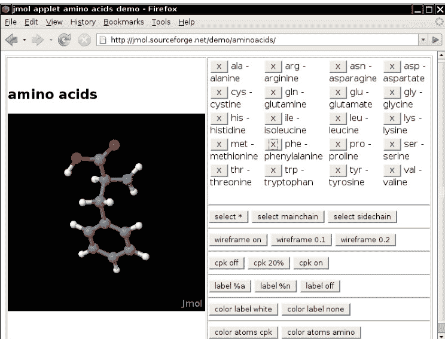

### 图 1.1：Jmol applet

当 applet 首次出现时，它们引起了巨大的兴奋。许多人认为 applet 的魅力是 Java 惊人人气的原因。然而，最初的兴奋很快变成了沮丧。各种版本的 Netscape 和 Internet Explorer 运行不同版本的 Java，某些已经过时。这种糟糕的局面使得很难开发利用最新 Java 的 applet。相反，Adobe 的 Flash 技术在实现浏览器效果方面变得流行。后来，当 Java 受到严重安全问题的困扰时，浏览器完全放弃了 applet 支持。当然，Flash 的处境也不好。

## 1.4. Java 简史

本节提供了 Java 演变的简史。它基于各种出版来源（最重要的是《SunWorld》杂志 1995 年 7 月号对 Java 创建者的采访）。

Java 可以追溯到 1991 年，当时由 Patrick Naughton 和 James Gosling（一位 Sun Fellow 和全能计算机大师）领导的 Sun 工程师想要设计一种用于电电视机盒等消费设备的小型计算机语言。由于这些设备没有大量的功率或内存，这种语言必须很小且紧凑。此外，由于不同的制造商可能选择不同的处理器（CPU），语言不绑定到任何架构至关重要。该项目代号为“Green”。

对小型、紧凑且平台无关代码的需求导致团队设计了一种生成虚拟机代码的可移植语言。

Sun 的人员来自 UNIX 背景，因此他们基于 C++ 而不是 Lisp、Smalltalk 或 Pascal。但正如 Gosling 在采访中所说，“一直以来，语言都是工具，而不是目的。”Gosling 决定将他的语言命名为“Oak”（可能是因为他喜欢窗外的一棵橡树）。Sun 的人员后来发现 Oak 是另一种现有计算机语言的名字，因此他们将其更名为 Java。事实证明这是一个明智的选择。

1992 年，Green 项目交付了它的第一个产品，称为“`7`”。它是一个极其智能的遥控器。遗憾的是，没有人对生产这种产品感兴趣。

太阳公司的“绿色小组”们不得不寻找其他方式来营销他们的技术。然而，没有任何标准的消费电子公司对此感兴趣。随后，该小组竞标了一个设计有线电视盒的项目，该盒子可以处理视频点播等新兴的有线电视服务。他们没有获得该合同。（有趣的是，获得合同的公司是由创立 Netscape 的同一个吉姆·克拉克（Jim Clark）领导的——这家公司对 Java 的成功做出了巨大贡献。）

Green 项目（更名为“First Person, Inc.”）在整个 1993 年和 1994 年上半年都在寻找购买其技术的人。但没有人买。（该小组的创始人之一帕里克·诺顿（Patrick Naughton）负责了大部分营销工作，他称在尝试销售这项技术时积累了 300,000 航空里程。）First Person 在 1994 年解散。

当太阳公司发生这一切时，互联网的万维网部分变得越来越大。万维网的关键在于浏览器将超文本页面翻译到屏幕上。1994 年，大多数人使用 Mosaic，这是一种非商业网络浏览器，于 1993 年由伊利诺伊大学的超级计算机中心推出。（Mosaic 的部分是由马克·安德森（Marc Andreessen）作为一名本科生在一个勤工俭项目中编写的，时薪 6.85 美元。他作为 Netscape 的联合创始人之一和首席总监赢得了名声和财富。）

在 SunWorld 采访中，实际浏览器由帕里克·诺顿和乔纳森·佩恩（Jonathan Payne）构建，并演变为 HotJava 浏览器，其设计旨在展示 Java 的强大功能。该浏览器能够在网页内部执行 Java 代码。这一“技术证明”在 1995 年 5 月 23 日的 SunWorld '95 上展示，并引发了持续至今的 Java 热潮。

太阳公司于 1996 年初发布了第一个版本的 Java。人们很快意识到，Java 1.0 无法满足严肃的应用程序开发需求。当然，你可以用 Java 1.0 编写一个简单的文本小程序（applet），让文本在画布上随机移动。但在 Java 1.0 中你甚至无法进行打印。它的继任版本 1.1 填补了最明显的缺陷，极大地改进了反射能力，并为 GUI 编程添加了新的事件模型。尽管如此，它仍然相当有限。1998 年 JavaOne 大会的大新闻是即将发布的 Java 1.2，它用复杂的可扩展版本取代了早期像玩具一样的 GUI 和图形工具包。在 1998 年 12 月发布三天（！）后，太阳公司的营销部门将名称更改为朗朗上口的 Java 2 Standard Edition Software Development Kit Version 1.2。

除了标准版（Standard Edition），还介绍了另外两个版本：用于手机等嵌入式设备的微型（Micro Edition），以及用于服务器端处理的企业版（Enterprise Edition）。本书侧重于标准版。

标准版的 1.3 和 1.4 版本是对初始 Java 2 版本的增量改进，拥有不断增长的标准库、性能的提升，当然，还有许多修复。在此期间，关于 Java 小程序和客户端应用程序的大部分最初热潮消退了，但 Java 成为了服务器端应用程序的首选平台。

5.0 版本是自 1.1 版本以来首次以重大方式更新 Java 语言的版本。（该版本最初编号为 1.5，但在 2004 年的 JavaOne 大会上，版本号跳跃到了 5.0。）经过多年的研究，添加了泛型（大致可比于 C++ 模板）——在不需要更改虚拟机的情况下添加此功能是一项挑战。其他几个实用的语言特征受到了 C# 的启发：“for each”循环、自动装箱和注解。

Java 6（没有 .0 后缀）于 2006 年底发布。同样，没有语言变化，但有了额外的性能改进和库的增强。

数据中心日益依赖通用硬件而非专用服务器，太阳系统公司陷入了困境，并于 2009 年被甲骨文（Oracle）收购。Java 的开发停滞了很久。2011 年，甲骨文发布了新版本 Java 7，带有简单的增强。

2014 年，Java 8 随之发布，带来了近二十年来对 Java 语言最重要的变化。Java 8 拥抱了“函数式”编程风格，使其能够轻松表达可以并发执行的计算。所有的编程语言都必须进化以保持相关性，而 Java 展现出了卓越的能力。

Java 9 的主要功能一直追溯到 2008 年。当时，Java 平台首席工程师马克·雷因霍尔（Mark Reinhold）开始尝试拆分庞大且单一的 Java 平台。这将通过引入模块来实现，模块是提供特定功能的自包含代码单元。设计和实现一个适合 Java 平台的模块系统花费了十一年时间，而它是否也适合 Java 应用程序和库还有待观察。

从 2018 年开始，Java 版本每六个月发布一次。新功能可能会经过几轮预览。例如，`switch` 的模式匹配从 Java 17 开始预览了四次，直到在 Java 21 中才最终确定。

每隔一段时间，甲骨文和其他供应商会指定某个版本为长期支持（LTS）版本，并提供几年的错误修复和安全更新。在生产环境中使用 Java 时，通常会坚持使用 LTS 版本而不使用其他版本。

| 版本 | 年份 | 新功能 | 类和接口的数量 |
| :--- | :--- | :--- | :--- |
| 1.0 | 1996 | | 21 |
| 1.1 | 1997 | | 477 |
| 1.2 | 1998 | | 1,524 |
| 1.3 | 2000 | | 1,840 |
| 1.4 | 2002 | | 2,723 |
| 5.0 | 2004 | 泛型类、“for each”循环、可变参数、自动装箱、枚举、静态导入 | 3,279 |
| 6 | 2006 | | 3,793 |
| 7 | 2011 | `Switch` 支持字符串、二进制字面量、异常处理 | 4,024 |
| 8 | 2014 | Lambda 表达式、带有方法的接口 | 4,240 |
| | | 流和时间库 | |
| 9 | 2017 | 模块、语言增强 | 6,005 |
| 11 | 2018 | 本地变量类型推断（`var`）、HTTP 客户端、移除 Java FX、JNLP 重叠和 CORBA | 4,410 |
| 17 | 2021 | `Switch` 表达式、文本块、`instanceof` 模式匹配、记录、密封类 | 4,859 |
| 21 | 2023 | 虚拟线程、模式匹配 | 4,882 |

## 1.5. 关于 Java 的常见误解

本章结束于关于 Java 误解的注释列表。

### Java 是 HTML 的扩展

Java 是一种编程语言；HTML 是描述网页结构的方式。它们之间没有任何共同点，除了曾经用于在网页上放置 Java 小程序的 HTML 扩展。

### 我使用 XML，所以我不需要 Java

Java 是一种编程语言；XML 是描述数据的方式。你可以用任何编程语言处理 XML 数据，但 Java API 提供了优秀的 XML 处理支持。此外，许多重要的 XML 工具是用 Java 实现的。更多信息见第第二卷。

### iOS 设备

在浏览器中发生的任何事情都由 JavaScript 控制。Windows 程序用 C++ 或 C# 编写。Java 在服务端编程和跨平台客户端应用程序方面具有优势。

### Java 仅仅是另一种编程语言

Java 是一门很好的编程语言；大多数程序员更倾向于它而不是 C、C++ 或 C#。但有数百种优秀的编程语言从未获得广泛普及，而像 C++ 和 Visual Basic 这种带有明显缺陷的语言却取得了巨大的成功。

为什么呢？一门编程语言的成功，在很大程度上取决于其周围支持系统的实用性，而不是其语法的优雅性。对于你需要实现的功能，是否有有用、方便且标准的库？是否有工具供应商来构建出色的编程和调试环境？该语言和工具集是否能与计算基础设施的其他部分集成？Java 之所以成功是因为它的库让你能够轻松地处理网络、Web 应用和并发等任务。Java 减少了指针错误是一个额外收益，因此程序员在使用 Java 时似乎效率更高——但这些因素并不是它成功的根源。

### Java 是专有的，因此应该避免使用

当 Java 最初创建时，太阳微系统公司（Sun Microsystems）向分发商和最终用户提供了免费许可。尽管太阳公司对 Java 拥有最终控制权，但他们让许多其他公司参与了语言版本的修订和新库的设计。虚拟机和库的源代码一直免费提供，但仅供检查，而不供修改和重新分发。Java 是“闭源的，但处处友善”。

这种情况在 2007 年发生了剧变，当时太阳公司宣布 Java 的未来版本将在通用公共许可证（GPL）下发布，这与 Linux 使用的开源许可证相同。甲骨文（Oracle）已承诺保持 Java 开源。现在有多个开放 Java 实现的提供者，具有不同程度的承诺和支持。

### Java 是解释执行的，所以对于严肃的应用程序来说太慢了

在 Java 早期，这门语言是解释执行的。如今，Java 虚拟机使用即时编译器（just-in-time compiler）。你代码中的“热点”运行速度将与在 C++ 中一样快，在某些情况下甚至更快。


# Java 概述

所有 Java 程序都运行在网页中。

曾有一段时间 Java applet 运行在浏览器内部。如今，Java 程序是运行在浏览器之外的独立应用程序。事实上，大多数 Java 程序运行在服务器上，为网页生成代码或计算业务逻辑。

## Java 程序是重大的安全风险

在 Java 早期，曾出现过广为人知的 Java 安全系统失效的报告。研究人员将其视为一种挑战，即寻找 Java 盔甲上的漏洞，并挑战 applet 安全模型的强度和复杂性。他们发现的技术故障很快被纠正了。后来，出现了更严重的漏洞，太阳公司以及随后的甲骨文公司对此反应缓慢。浏览器厂商停止了对 Java applet 的支持。让 applet 成为可能的安全管理器架构现在已被废弃。如今，Java 应用程序的安全性并不低于其他应用程序。由于虚拟机的保护，它们比用 C 或 C++ 编写的应用程序安全得多。

JavaScript 是一种可以在网页内使用的脚本语言，由网景公司（Netscape）发明，最初称为 LiveScript。JavaScript 的语法让人联想到 Java，语言的名字听起来也相似，但在其他方面它们毫无关系。特别是 Java 是强类型的——编译器可以捕到许多由于类型误用而产生的错误。在 JavaScript 中，这些错误只有在程序运行时才能被发现，这使得消除它们变得更加费力。

> 使用 Java，我可以把我的台式电脑换成廉价的“互联网设备”。

当 Java 最初发布时，有些人大胆地预测这种情况将会发生。公司生产了由 Java 驱动的网络计算机原型，但用户尚未准备好放弃强大方便的台式电脑，转而使用没有本地存储的有限机器。如今，世界已经变了，对于大多数最终用户来说，重要的平台是手机或平板电脑。这些设备大部分由基于 Java 的 Android 平台控制。学习 Java 编程也将帮助你的 Android 编程。

## 本章内容

在本章中，你将学习如何安装 Java 开发工具包（JDK）以及如何编译和运行 Java 程序。你可以通过在终端窗口输入命令来运行 JDK 工具。然而，许多程序员更倾向于集成开发环境的舒适性。你将学习使用一个免费提供的开发环境来编译和运行 Java 程序。一旦你掌握了本章中的技术并选择了你的开发工具，就可以准备进入[第 3 章](#)了，在这一章你将开始探索 Java 编程语言。

## 获取 Java 开发工具包

在过去，最完整、最新的 Java 开发工具包（JDK）可以从甲骨文获取。现在，许多不同的公司和组织（包括 Amazon、Azul、Microsoft 和 Red Hat）都提供最新的 OpenJDK 构建。每个供应商都有不同的许可条件和支持方案。Eclipse 基金（Eclipse Foundation）为 Linux、Mac OS 和 Windows 提供免费的 JDK 构建，非常适合学习 Java。

你可以从 Eclipse 会的 <https://adoptium.net> 下载 Java 开发工具包，也可以从甲骨文的 <https://www.oracle.com/java/technologies/downloads> 或从许多其他提供者处下载。

根据提供者的不同，Java 开发工具包可能有一个品牌名称，例如 Temurin（Eclipse 基金）、Corretto（Amazon）或 Zulu（Azul）。品牌名称对于 Java 程序员来说并不重要。

你应该使用 Java SE 21 (LTS) JDK。参见表 2.1 以获取下载网站上可能遇到的缩写和术语的总结。

| 名称 | 缩写 | 解释 |
|---|---|---|
| Java 开发工具包 | JDK | 编写 Java 程序的软件。 |
| Java 运行时环境 | JRE | 运行 Java 程序的软件，不含开发工具。支持到 Java 8。你不需要。 |
| 标准版 | SE | 用于桌面和简单服务器应用的 Java 平台。你需要它。 |
| 微型 | ME | 用于小型设备的 Java 平台。 |
| OpenJDK | — | Java SE 的免费开源实现。 |
| Hotspot | — | 甲骨文开发的即时编译器。如果被询问，选择这一个。 |
| OpenJ9 | — | IBM 开发的另一种即时编译器。 |
| GraalVM | — | 一种启动快速的可执行文件，但不支持所有功能。本书不需要它。 |
| 长期支持 | LTS | 支持多年的版本，而不是展示新功能的六个月版本。选择最新的 LTS 版本。 |
| Eclipse | — | 分发开源软件的基金。 |
| Temurin | — | Eclipse 基金提供的 OpenJDK 版本品牌名称。 |
| Adoptium | — | Eclipse 基金内部提供 OpenJDK 版本及其发行支持的项目。 |

下载 JDK 后，你需要安装它并确定它的安装位置——你稍后需要这些信息。

如果你运行的是 Windows 或使用 Mac，只需启动安装程序并选择默认选项。

在 Linux 上，将 `.tar.gz` 文件解压到你选择的位置，例如你的家目录或 `/opt`。然后将 `PATH` 设置为 JDK 目录的 `bin` 子目录，例如 `/opt/jdk-21.0.4/bin`。这通常通过向 `~/.bashrc` 或 `~/.bash_profile` 文件末尾添加如下行来实现：

```bash
export PATH=/opt/jdk-21.0.4/bin:$PATH
```

以下是测试你是否操作的方法。启动一个终端窗口。输入该行：

```bash
javac --version
```

并按回车键。你应该看到如下的显示：

```text
javac 21.0.4
```

如果你收到的类似“javac: command not found”或“The name specified is not recognized as an internal or external command, operable program or batch file”的消息，那么你需要重新检查你的安装情况。

## JDK 的安装位置

了解 JDK 在系统中的安装位置通常很有用——请参见表 2.2。在本书中，安装目录记为 `jdk`。例如，当提到 `jdk/bin` 或 `C:` 时，我指的是类似于 `/opt/jdk-17.0.4/bin` 或 `C:\Program Files\Java\jdk-21\bin` 的目录。

| 平台 | 示例目录 |
|---|---|
| Windows (Adoptium) | `C:\Program Files\Eclipse Adoptium\jdk-21.0.4.11-hotspot` |
| Windows (Oracle JDK) | `C:\Program Files\Java\jdk-21` |
| Mac OS | `/Library/Java/JavaVirtualMachines/jdk-21.0.4_11.jdk/Contents/Home` |
|  | 即你解压 `.tar.gz` 文件的位置，例如 `/opt/jdk-21.0.4` |

**注意：**在 Windows 上，Oracle JDK 安装程序会将目录 `C:\Program Files\Common Files\Oracle\Java\javapath` 添加到 `PATH` 环境变量。该目录仅包含 `javac`、`jav`、`java` 和 `jshell` 可执行文件。（你将在本章学习如何使用 `javac`、`java` 和 `jshell`。`java` 可执行文件是 Windows 特有的功能，用于在没有控制窗口的情况下启动程序。）Java 工具包中的其他工具可以在 JDK 安装目录的 `bin` 子目录下找到。调用这些程序时，可以指定完整路径（例如 `javadoc` 工具的 `C:\Program Files\Java\jdk-21\bin\javadoc`），或者将 `bin` 子目录添加到 `PATH` 环境变量中。实现这一点的一种方法是使用 `setx` 命令：

```bat
setx PATH "%PATH%; c:\Program Files\Java\jdk-21\bin"
```

打开另一个终端窗口以使更改生效。

<https://adoptium.net> 安装程序没有这个问题。它将所有 JDK 工具都添加到 `PATH` 中。

## 2.1.3. 安装源码和文档

库源码以压缩文件 `jdk/lib/src.zip` 的形式随 JDK 交付。解压该文件即可获取源码。只需执行以下操作：

1. 确保 JDK 已安装，且 `jdk/bin` 目录在可执行路径上。
2. 在你的主目录下创建一个 `javacrc` 目录。如果你愿意，可以在终端窗口执行此操作。

   ```bash
   mkdir javacrc
   ```

3. 在 `jdk/lib` 目录下找到 `src.zip` 文件。
4. 将 `src.zip` 文件解压到 `javacrc` 目录。在终端窗口中，你可以执行命令：

   ```bash
   cd javacrc
   jar xvf jdk/lib/src.zip
   cd ..
   ```

> 提示：`src.zip` 文件包含所有公共库的源码。要获取更多源码（编译器、虚拟机、原生方法和私有辅助类），请访问 <https://openjdk.org>。

你可以在 <https://docs.oracle.com/en/java/javase/21/docs/> 读取 JDK 文档。如果你想要离线版本，请按照以下步骤操作：

1. 从 <https://www.oracle.com/java/technologies/downloads> 下载文档文件。它名为 `jdk-21.0_doc-all.zip`。
2. 解压文件并将 `doc` 目录重命名为具描述性的名称，如 `jdk-21-docs`。如果你愿意，可以在命令行执行此操作：

   ```bash
   jar xvf Downloads/jdk-21.0.x_doc-all.zip
   mv docs jdk-21-docs
   ```

3. 在浏览器中导航到 `jdk-21-docs/index.html` 并将此页保存到书签。

你还应该安装 Core Java 程序示例。你可以从 <https://horstmann.com/corejava> 下载它们。这些程序被封装在 `corejava.zip` 压缩文件中。只需将它们解压到你的主目录。它们将位于 `corejava` 目录中。如果你愿意，可以在命令行执行此操作：

```bash
jar xvf Downloads/corejava.zip
```

## 使用命令行编译和运行程序

如果你的编程经验来自于如 Microsoft Visual Studio 之类的开发环境，你习惯了带有内置文本编辑器、用于编译和启动程序的菜单以及调试器的系统。JDK 并不包含任何与之相似的内容。你的一切都要通过在终端窗口中输入命令来完成。这听起来可能很繁琐，但仍然是一项基本技能。当你第一次安装 Java 时，你会在安装开发环境之前对安装情况进行排排除。此外，通过亲自执行这些基本步骤，你将更好地理解开发环境在后台做了什么工作。

然而，在你掌握了编译和运行 Java 程序的基本步骤后，你将想要使用专业的开发环境。你将在下一节中看到如何这样做。

让我们从最困难的方法开始：从终端窗口编译并启动 Java 程序。

1. 打开一个终端窗口。
2. 进入目录 `corejava/v1ch02`。
3. 输入以下内容：

   ```bash
   javac Welcome.java
   java Welcome
   ```

Welcome 程序并不非常有趣。接下来，尝试一个图形应用程序。这个程序是一个简单的图像查看器，用于加载并显示图像。和之前一样，从命令行编译并运行程序。

1. 打开一个终端窗口。
2. 进入目录 `corejava/v1ch02/ImageView`。
3. 输入以下内容：

   ```bash
   javac ImageView.java
   java ImageView
   ```


快速查看源码（列表 2.2）。该程序比第一个程序要长得多，但考虑到如果用 C 或 C++ 编写类似的应用程序需要多少代码，它其实并不算复杂。当然，如今编写带有图形用户界面的桌面应用程序已经不再常见了，但如果你感兴趣，可以在第二卷的第 10 章节中找到更多细节。

```java
import java.awt.*;
import java.io.*;
import javax.swing.*;

/**
 * 一个用于查看图片的程序。
 * @version 1.31 2018-04-10
 * @author Cay Horstmann
 */
public class ImageViewer {

    public static void main(String[] args) {
        EventQueue.invokeLaterLater(() -> {
            var frame = new ImageViewerFrame();
            frame.setTitle("ImageViewer");
            frame.setDefaultCloseOperation(JFrame.EXIT_ON_CLOSE);
            frame.setVisible(true);
        });
    }
}

/**
 * 一个带有显示图片的标签的框架。
 */
class ImageViewerFrame extends JFrame {
    private static final int DEFAULT_WIDTH = 300;
    private static final int DEFAULT_HEIGHT = 400;

    public ImageViewerFrame() {
        setSize(DEFAULT_WIDTH, DEFAULT_HEIGHT);
        // 使用标签来显示图片
        var label = new JLabel();
        add(label);
    }
}
```

```java
// 设置文件选择器
var chooser = new JFileChooser();
chooser.setCurrentDirectory(new File("."));

// 设置菜单栏
var menu = new JMenuBar();
setJMenuBar(menu);

var menu = new JMenu("File");
menubar.add(menu);

var openItem = new JMenuItem("Open");
menu.add(openItem);
openItem.addActionListener(event -> {
  // 显示选择器对话框
  int result = chooser.showOpenDialog(null);
  // 如果选择了文件，将其设置为标签的图标
  if (result == JFileChooser.APPROVE_OPTION) {
    String name = chooser.getSelectedFile().getPath();
    label.setIcon(new ImageIcon(name));
  }
});

var exitItem = new JMenuItem("Exit");
menu.add(exitItem);
exitItem.addActionListener(event -> System.exit(0));
```

## 使用集成开发环境

在上一节中，你学习了如何从命令行编译和运行 Java 程序。这对于故障排除是一项很有用的技能，但对于大多数日常工作，你应该使用集成开发环境。这些环境非常强大且方便，以至于如果没有它们，工作起来简直毫无意义。优秀的选择有免费提供的 Eclipse、IntelliJ IDEA 和 NetBeans。在本章中，你将学习如何开始使用 Eclipse。当然，如果你倾向于使用不同的开发环境，也可以配合本书使用它。

从 <https://eclipse.org/downloads> 下载 Eclipse 开始。它有适用于 Linux、Mac OS X 和 Windows 版本。运行安装程序并选择名为“Eclipse IDE for Java Developers”的安装包。

以下是使用 Eclipse 编写程序的步骤：

1. 启动 Eclipse 后，从菜单中选择 File（文件）→ New（新建）→ Project（项目）。
2. 在向导对话框中选择“Java Project”（Java 项目）（见图 2.3）。

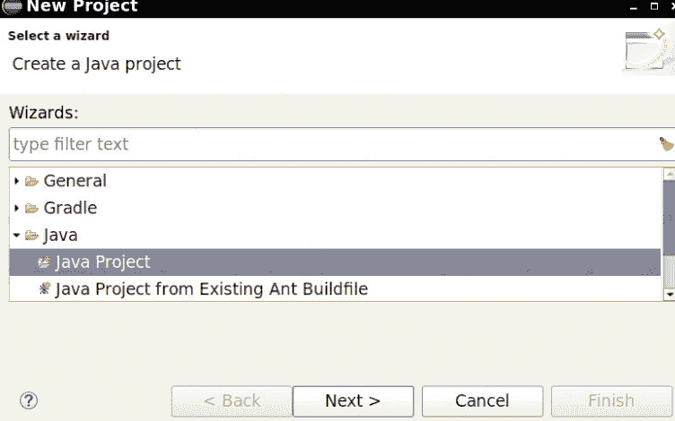

**图 2.3：**Eclipse 中的新建项目对话框

3. 点击 Next（下一步）按钮。取消勾选“Use default location”（使用默认位置）复选框。点击 Browse（浏览）并导航到 `corejava/v1ch02/Welcome` 目录（图 2.4）。

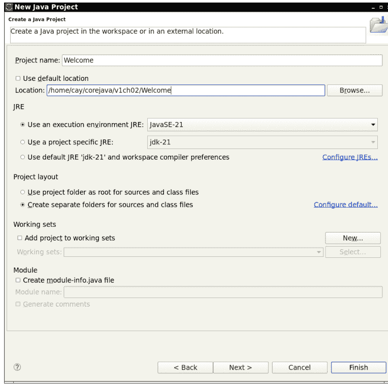

# 图 2.4：在 Eclipse 中配置项目

4. 点击 Finish（完成）按钮。现在项目项目。
5. 点击左侧项目旁的三角形，直到找到 `Welcome.java` 文件，并双击它。你现在可以看到一个显示程序代码的面板（见图 2.5）。

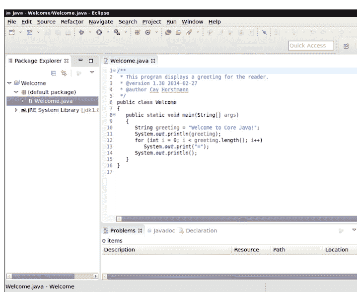

6. 使用鼠标右键点击左侧面板中的项目名称（Welcome）。选择 Run（运行）-> Run As（运行）-> Java Application（应用程序）。程序输出显示在控制台面板中。

推测这个程序没有拼写错误或错误（毕竟它只有几行代码）。为了论证起见，假设你的代码偶尔包含拼写错误（甚至可能是语法错误）。尝试一下——例如，通过如下方式更改 `String` 的大小写来破坏你的文件：

```java
string greeting = "Welcome to Core Java";
```


注意`string`下方的波浪线。在源码下方的标签中，点击`Problems`（问题）并展开三角形，直到你看到一条关于未知`string`类型的错误消息（图 2.6）。点击错误消息。光标会移动到编辑面板中的该行，你可以在那里修复错误。

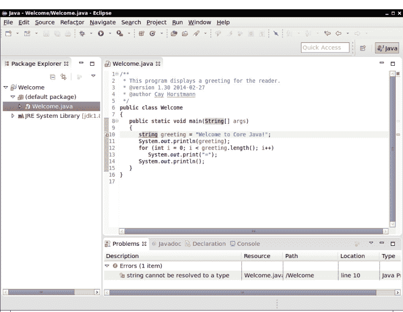

**提示：** 通常，Eclipse 错误报告会伴有一个灯泡图标。点击灯泡可以获取建议的修复列表。

`JShell`程序提供了一个“读取-执行-打印循环”，即`REPL`。你输入一个 Java 表达式；`JShell`评估你的输入，打印结果并等待你的下次输入。这是一种很好的实验方法——比在集成开发环境中编写完整的程序快得多。

要启动`JShell`，请在终端输入`jshell`。

```text
JShell 显示一个提示符：
Welcome to JShell - Version 16.0
```

到此时，你应该已经成功安装了`JDK`并执行了第 2 章中的示例程序。现在是时候编程了。本章将向你展示数据类型、分支和循环等基本编程概念在 Java 中是如何实现的。

让我们仔细观察你可以编写的最简单的 Java 程序之一——一个仅仅向控制台打印消息的程序：

```java
public class FirstSample
{
    public static void main(String[] args)
    {
        System.out.println("We will not use 'Hello, World!");
    }
}
```

花时间完全熟悉这个示例程序的框架是值得的；这些部分将在所有应用程序中反复出现。首先，Java 是区分大小写的。如果你在大小写上犯了任何错误（例如输入`Main`而不是`main`），程序将无法运行。

现在让我们逐行查看这段源代码。关键字`public`被称为访问修饰符；这些修饰符控制程序其他部分对这段代码的访问级别。有关关于访问修饰符的更多信息，请参阅第 4 章。关键字`class`提醒你 Java 程序中的所有内容都存在于类之中。你将在下一章学习许多关于类的知识。现在，请把类看作程序逻辑的容器，它定义了应用程序的行为。类是构建所有 Java 应用程序的基石。Java 程序中的一切都必须在类内部。

紧跟关键字`class`之后的是类名。Java 类名的命名规则非常宽泛。名称必须以字母开头，之后可以是字母和数字的任意组合。长度本质上是无限制的。你不能使用 Java 保留字（如`public`或`class`）作为类名。（请参见附录以获取保留字列表。）

标准的命名约定（在名称`FirstSample`中使用）是类名是以大写字母开头的名词。如果一个名称由多个单词组成，请每个单词的首字母都大写。这种在名称中间使用大写字母的方法有时被称为“驼峰命名法”（camel case），或者自指性地称为“CamelCase”。

你需要让源代码的文件名与公共类的名称相同，并添加`.java`扩展名。因此，你必须将此代码存储在名为`FirstSample.java`的文件中。（再次强调，大小写是重要的——不要使用`firstsample.java`。）

你使用命令编译文件：

```bash
javac FirstSample.java
```

如果你正确命名了文件且在源代码中没有任何拼写错误，你将得到一个包含该类字节码的文件。Java 编译器会将字节码文件命名为`FirstSample.class`并将其存储在与源文件相同的目录下。最后，通过发布以下命令启动程序：

```bash
java FirstSample
```

（记住省略`.class`扩展名。）当程序执行时，它仅仅会在控制台上显示字符串`We will not use 'Hello, World!`。

当你使用

```bash
java ClassName
```

来运行一个编译后的程序时，Java 虚拟机总是从你指定的类中`main`方法的代码开始执行。（“method”方法一一词是 Java 术语中对函数的称呼。）因此，你必须在类的源文件中有一个`main`方法才能执行。当然，你可以在类中添加你自己的方法，并在`main`方法中调用它们。（你将在下一章看到如何编写你自己的方法。）

> **注意：** 根据 Java 语言规范，`main`方法必须声明为`public`。（Java 语言规范是描述 Java 语言的官方文档。你可以从 https://docs.oracle.com/javase/specs 查看或下载它。）

然而，多个版本的 Java 启动器在`main`方法不是`public`的情况下也愿意执行 Java 程序。一位程序员提交了 bug 报告。要查看它，请访问 https://bugs.example.com/。

```java
object.method(arguments)
```

作为函数调用的等价。

在这种情况下，`println`方法接收一个字符串参数。该方法在控制台上显示该字符串参数。它会结束输出行，因此每次调用`println`都会在新的一行显示其输出。注意，Java 和 C/C++ 一样使用双引号来分隔字符串。（你可以在本章后面的部分找到更多关于字符串的信息。）

Java 中的方法像任何编程语言中的函数一样，可以使用零、一个或多个参数。即使方法没有参数，你也必须使用空括号。例如，没有参数的`println`方法变体仅打印一个空行。你通过以下调用执行它：

```java
System.out.println();
```

> **注意：** `System.out`还有一个`print`方法，它不会在输出中添加换行符。例如，`System.out.print("Hello")`输出`Hello`而不换行。下一个输出将紧接着字母`o`之后出现。

## 3.2. 注释

Java 中的注释与大多数编程语言一样，不会出现在可执行的程序中。因此，你可以根据需要添加任意数量的注释，而不必担心膨臃。Java 有三种标记注释的方法。最常见的形式是`//..`。将其用于从`//`到行尾的注释。

```java
System.out.println("We will not use 'Hello, World!'"); // 这不是太可爱了吗？
```

当需要较长的注释时，你可以每行都标记`//`，也可以使用`/*`和`*/`注释界符来括一段较长的注释。

最后，第三种注释用于自动生成文档。这种注释用`/**`开始，用`*/`结束。你可以在列表 3.1 中看到这种类型的注释。关于此类类型注释和自动文档生成的更多信息，请参阅第 4 章。

## 列表 3.1 FirstSample/FirstSample.java

```java
1 /** * 这是 Core Java 第 3 章中的第一个示例程序
2 @version 1.01 1997-03-22
3 @author Gary Cornell
4 */
5 public class FirstSample
6 {
7 public static void main(String[] args)
8 {
9 System.out.println("We will not use 'Hello, World!'");
10 }
11 }
```

> **注意：** `/* */`注释在 Java 中是不嵌套的。这意味着，你可能无法仅仅通过将代码包裹在`/*`和`*/`中来禁用代码，因为你想禁用的代码本身可能包含`*/`界符。

## 3.3. 数据类型

Java 是一种强类型语言。这意味着每个变量必须有一个声明类型。Java 中有八种基本类型。其中四个是整数类型；两个是浮点数类型；一个是字符类型`char`，用于 Unicode 编码方案中的 UTF-16 代码单元（参见第 3.3.3 节）；还有一个是用于真值值的布尔类型。

> **注意：** Java 拥有一个任意精度算术包。然而，所谓的“大数”是 Java 对象而不是 Java 基本类型。你将在本章稍后的部分看到如何使用它们。

### 3.3.1. 整数类型

整数类型用于不带小数部分的数字。允许负值。Java 提供了表 3.1 所示的四种整数类型。

**表 3.1：Java 整数类型**

| 类型 | 存储要求 | 范围（包含） |
|---|---|---|
| `byte` | 1 字节 | -128 到 127 |
| `short` | 2 字节 | -32,768 到 32,767 |
| `int` | 4 字节 | -2,147,483,648 到 2,147,483,647（略大于 20 亿） |
| `long` | 8 字节 | -9,223,372,036,854,775,808 到 9,223,372,036,854,775,807 |

在大多数情况下，`int`类型是最实用的。如果你想表示地球上的人口，你需要求助于`long`。`byte`和`short`类型主要用于特殊应用程序，例如低级文件处理，或在存储空间紧张时用于大数组。

在 Java 中，整数类型的范围不依赖于运行 Java 代码的机器。这减轻了想要将软件从一个平台移动到另一个平台（甚至是在同一平台的不同操作系统之间移动）的程序员的巨大痛苦。相比之下，C 和 C++ 程序为每个处理器使用最高效的整数类型。结果，在 32 位处理器上运行良好的 C 程序在 16 位系统上可能会出现整数溢出。由于 Java 程序必须在所有机器上运行相同的结果，因此各种类型的范围是固定的。

长整数有后缀`L`或`l`（例如`400000000000L`）。十六进制数有前缀`0x`或`0X`（例如`0xCAFE`）。八进制数有前缀`0`（例如`010`是 8）——自然地，这可能会引起困惑，很少程序员使用八进制常量。你可以以二进制形式写数字，例如`4000000000000L`。

### 3.3.2. 浮点类型

浮点类型表示带有小数部分的数字。两种浮点类型如表 3.2 所示。

**表 3.2：浮点类型**

| 类型 | 存储要求 | 范围 |
|---|---|---|
| `float` | 4 字节 | ±3.40282347 x10⁸（6–7 有效数字） |
| `double` | 8 字节 | ±1.7976931348623157 x10³⁸（15 有效数字） |

名称指的是这些数字的精度是`float`类型的两倍。（有些人称这些双精度数字。）`float`的有限精度（6–7 有效数字）在许多情况下是不足够的。只有当你与需要它们的库工作，或者你需要存储大量的它们时才使用`float`。

`float`类型有后缀`F`或`f`（例如`3.14F`）。没有`F`后缀的浮点数（如`3.14`）始终被视为`double`类型。你可以可选提供`D`或`d`后缀（例如`3.14D`）。

`E`或`e`表示十进制指数。例如，`1.729E3`等于`1729`。

> **注意：** 所有的浮点运算都遵循 IEEE 754。特别是有三个特殊的浮点值来表示溢出和错误：
>
> - 正无穷大
> - 负无穷大
> - `NaN`（非数字）
>
> 例如，正浮点数除以 0 的结果是正无穷大。`0.0`除以 0 或负数的平方根会产生`NaN`。

**注意：** `Double.POSITIVE_INFINITY`、`Double.NEGATIVE_INFINITY`和`Double.NaN`（以及相应的`Float`常量）表示这些特殊值，但它们在实践中很少使用。特别是，你不能通过

```java
if (x == Double.NaN) // 永远为假
```

来检查特定结果是否等于`Double.NaN`。所有的“非数字”（not a number）值都被认为是不同的。不过，你可以使用`Double.isNaN`方法：

```java
if (Double.isNaN(x)) // 检查 x 是否为“非数字”
```

**警告：** 浮点数不适用于不能容忍舍入误差的财务计算。例如，命令`System.out.println(2.0 - 1.1)`输出的是`0.899999999999999`，而不是你预期的`0.9`。这种舍入误差的产生是因为浮点数是用二进制数系统表示的。1/10 这个分数没有精确的二进制表示，就像在十进制系统中 1/3 这个分数没有精确的十进制表示一样。如果你需要进行没有舍入误差的精确数值计算，请使用本章稍后介绍的`BigDecimal`类。

## 3.3.3. `char`类型

`char`类型最初的设计目的是为了描述单个字符。然而，现在情况已不再如此。如今，某些 Unicode 字符可以用一个`char`值描述，而其他 Unicode 字符则需要两个`char`值。请阅读下一节了解详细细节。


`char` 类型的字面量括在单引号中。例如，`'A'` 是一个值为 65 的字符常量。它与 `"A"` 不同，后者是一个包含单个字符的字符串。`char` 类型的值可以表示为从 `\u0000` 到 `\uFFFF` 的十六进制值。

除了 `\u` 转义序列外，还有几个用于特殊字符的转义序列，如表 3.3 所示。你可以在引号字符字面量和字符串中使用这些转义序列，例如 `'\u005B'` 或 `"Hello\n"`。`\u` 转义序列（但其他任何转义序列除外）甚至可以用在引号常量和字符串之外。例如：

```java
public static void main(String\u005B\u005D args)
```

这是完全合法的——`\u005B` 和 `\u005D` 是 `[` 和 `]` 的编码。

### 表 3.3：特殊字符的转义序列

| 转义序列 | 名称 | Unicode 值 |
|---|---|---|
| `\b` | 退格 (Backspace) | `\u0008` |
| `\t` | 制表符 (Tab) | `\u0009` |
| `\n` | 换行 (Line feed) | `\u000a` |
| `\r` | 回车 (Carriage return) | `\u000d` |
| `\f` | 分页符 (Form feed) | `\u000c` |
| `"` | 双引号 (Double quote) | `\u0022` |
| `\'` | 单引号 (Single quote) | `\u0027` |
| `\` | 反斜杠 (Backslash) | `\u005c` |
| `\s` | 空格。用于文本块以保留尾空格。 | `\u0020` |
| `\newline` | 仅用于文本块：将此行与下一行合并 | — |

> **警告：** Unicode 转义序列在代码解析之前会被处理。例如，`"\u0022+\u0022"` *不是* 一个由引号包围加号的组成的字符串（U+0022）。相反，`\u0022` 在解析之前会被转换为 `"`，从而产生 `"""+"`，即一个空字符串。

更隐蔽的是，你必须小心注释中的 `\u`。注释：

```java
// \u000A 是换行符
```

会导致语法错误，因为当程序读取时，`\u000A` 会被替换为换行符。同样，注释：

```java
// look inside c:\users
```

也会产生语法错误，因为 `\u` 后面没有跟随四个十六进制数字。

> **注意：** Unicode 转义序列中可以包含任意数量的 `u`：`\u00E9` 和 `\uu00E9` 都表示字符 é。这种奇怪现象是有原因的。考虑一个快乐地使用 Unicode 编写代码的程序员，由于某些古老的原因，他被迫以 ASCII 格式提交代码。转换工具可以将任何大于 U+007F 的字符转换为 Unicode 转义序列，并在每个现有的 Unicode 转义序列前添加一个 `u`。例如，`\uD800 é` 被转换为 `\uD800 \u00E9`，并可以转换回 `\uD800 é`。

## 3.3.4. Unicode 和 `char` 类型

为了完全理解 `char` 类型，你必须了解 Unicode 编码方案。在 Unicode 之前，有很多不同的字符编码标准：美国的 ASCII、西欧语言的 ISO 8859-1、俄语的 KOI-8、中文的 GB18030 和 BIG-5 等。这导致了两个问题。首先，特定的代码值在不同的编码方案中对应不同的字母。其次，字符集较大的语言的编码是变长的：

一些常用字符被单字节字节，而另一些则需要两个或多个字节。

Unicode 的设计是为了解决这两个问题。当 20 世纪 80 年代统一工作开始时，固定的 2 字节代码足以编码世界上所有语言使用的所有字符，并为未来的扩展留有空间——至少当时大家是这么想的。1991 年，Unicode 1.0 发布，使用了可用 65536 个代码值中的不足一半。Java 从设计初就设计为使用 16 位 Unicode 字符，这与使用 8 位字符的其他编程语言相比是一个优势。

不幸的是，不可避免的情况发生了。Unicode 超过了 65536 个字符，这主要是增加了大量中日韩使用的字形。现在，16 位的 `char` 类型不足以描述所有的 Unicode 字符。

我们需要一些术语来解释 Java 是如何解决这个问题的。代码点是与编码方案中的字符相关的整数值。在 Unicode 标准中，代码点以十六进制表示并带有 U+ 前缀，例如字母 A 的代码点为 U+0041。Unicode 代码点被分为 17 个平面，每个平面持有 65536 个字符。第一个平面被称为基础语言平面，由代码点 U+0000 到 U+FFFF 的“经典”Unicode 字符组成。额外的 16 个平面从 U+10000 到 U+10FFFF 持有补充字符。

Java 如何表示代码点取决于编码。Java 使用 UTF-16，它使用位单元编码字符。基础语言平面中的字符被编码为单个 `char` 值。其他字符被编码为一对 `char` 值，称为代理对。总结来说，一个可见字符或符号被编码为某些数量 `char` 值的序列。始终处理字符串（见第 3.6 节），而不要担心它们作为 `char` 序列的表示方式。

## 3.3.5. `boolean` 类型

`boolean` 类型有两个值，`false` 和 `true`。它用于评估逻辑条件。你不能在整数和布尔值之间转换。

> **C++ 注意：** 在 C++ 中，数字甚至指针都可以用来代替布尔值。值 0 等于布尔值 `false`，非零值等于 `true`。在 Java 中不是这样的。

Java。因此，Java 程序员可以避免此类意外，例如：

```java
if (x = 0) // 噢……本想写 x == 0
```

在 C++ 中，这个测试可以通过编译并运行，始终为假。在 Java 中，该测试无法编译，因为整数表达式 `x = 0` 无法转换为布尔值。

## 3.4. 变量与常量

与其他编程语言一样，变量用于存储值。常量是不改变数值的变量。在接下来的章节中，你将学习如何声明变量和常量。

### 3.4.1. 声明变量

在 Java 中，每个变量都有类型。你通过先放置类型，后跟上变量名来声明变量。以下是一些示例：

```java
double salary;
int vacationDays;
long earthPopulation;
boolean done;
```

注意每个声明末尾的分号。分号是必要的，因为声明是一个完整的 Java 语句，必须以分号结束。

变量名（以及其他名称）的标识符由字母、数字、货币符号和“标点连接符”组成。第一个字符不能是数字。

变量名内部不能使用像 `+` 或 `©` 这样的符号，也不能使用空格。大小写是敏感的：`main` 和 `Main` 是不同的标识符。标识符的长度本质上是没有限制的。

在 Java 中，“字母”、“数字”和“货币符号”的定义比大多数语言广泛得多。字母是任何表示语言中字母的 Unicode 字符。例如，德国用户可以在变量名中使用变音字母 `ä`；希腊语可以使用 `π`。同样，数字是 0-9 以及任何表示数字的 Unicode 字符。货币符号包括 `$`、`€`、`¥` 等。标点连接符包括下划线 `_`、波浪线 `~` 以及其他。实践中，大多数程序员坚持使用 A-Z、a-z、0-9 和下划线 `_`。

> **提示：** 如果你真的好奇标识符可以使用哪些 Unicode 字符，可以使用 `Character` 类中的 `isIdentifierStart` 和 `isIdentifierPart` 方法进行检查。

> **提示：** 即使 `$` 是标识符中的有效字符，你不应该在自己的代码中使用它。它旨在用于由 Java 编译器和其他工具生成的名称。

你不能将诸如 `class` 的 Java 关键字作为变量名。

下划线可以作为标识符的一部分。这对于常量名很常见，例如 `Double.POSITIVE_INFINITY`。然而，单个下划线 `_` 是保留字。

> **预览说明：** 从 Java 21 开始，单个下划线 `_` 表示语法上需要但从未使用的变量。你将在第 6 和第 7 章看到示例。

你可以在一行内声明多个变量：

```java
int i, j; // 都是整数
```

我不推荐这种风格。如果你单独声明每个变量，你的程序会更容易读。

> **注意：** 如你所看到的，名称对大小写敏感，例如 `hireday` 和 `hireDay` 是两个不同的名称。通常情况下，你不应该拥有仅在大小写上不同的名称。然而，有时很难为变量起一个好名字。许多程序员会给变量起与类型相同的名称，例如：

```java
Box box; // "Box" 是类型，"box" 是变量名
```

其他程序员更倾向于为变量使用“a”前缀：

```java
Box aBox;
```

### 3.4.2. 初始化变量

声明变量后，你必须通过赋值语句显式地初始化它——你永远无法使用未初始化变量的值。例如，Java 编译器会将以下语句序列标记为错误：

```java
int vacationDays;
System.out.println(vacationDays); // 错误--变量未初始化
```

你通过在左侧使用变量名、等号 `=`，然后在右侧使用带有适当值的 Java 表达式来为之前声明的变量赋值。

```java
int vacationDays;
vacationDays = 12;
```

你可以在同一行内声明并初始化变量。例如：

```java
int vacationDays = 12;
```

最后，在 Java 中，你可以将声明放在代码的任何位置。例如，以下代码在 Java 中是有效的：

```java
double salary = 65000.0;
System.out.println(salary);
int vacationDays = 12; // 在这里声明变量是可以的
```

在 Java 中，将变量声明尽可能靠近第一次使用它们的地方被认为是良好的风格。

**注意：** 如果可以从初始值推断出类型，则不需要声明局部变量的类型。只需使用关键字 `var` 代替类型：

```java
var vacationDays = 12; // vacationDays 是一个 int
var greeting = "Hello"; // greeting 是一个 String
```

对于数字和字符串类型，这并不重要，但正如你在下一章中看到的，此特性可以让对象的声明变得简洁。

**C++ 注意：** C 和 C++ 区分变量的声明和定义。例如：

```cpp
int i = 10;
```

是一个定义，而：

```cpp
extern int i;
```

是一个声明。在 Java 中，没有声明独立于定义。

### 3.4.3. 常量

在 Java 中，你使用关键字 `final` 来表示常量。例如：

```java
public class Constants {
    public static void main(String[] args) {
        final double PI = 3.14159;
        System.out.println("PI is " + PI);
    }
}
```

（注：原文该部分存在大量碎片，已根据标准 Java 常量和语境进行了核心信息的还原。）

**C++ 注意：** `const` 是 Java 的关键字，但目前未被使用。你必须使用 `final` 定义常量。

### 3.4.4. 枚举类型

（注：原文该部分存在大量碎片。）

## 3.5. 运算符

运算符用于组合值。正如你在接下来的章节中看到的，Java 拥有一丰富的算术和逻辑运算符以及数学函数。

### 3.5.1. 算术运算符

通常算术运算符 `+`、`-`、`*` 和 `/` 用于 Java 中的加法、减法、乘法和除法。

> **注意：** 当 `%` 的操作数之一为负数时，结果也是负数。例如，如果 `n` 是偶数，`n % 2` 为 0；如果 `n` 是正奇数，则为 1；如果 `n` 是负奇数，则为 -1。为什么呢？在第一批计算机制造时，必须有人制定规则规定负数操作数的整数余数如何工作。数学家们已经知道最优（或“欧几里得”）规则几百年：始终保持余数 ≥ 0。但是，那些先驱们并没有翻开数学书，而是制定了看似合理但实际上并不方便的规则。

考虑这个问题。你计算时钟时针的位置。应用了一个调整，并且你想将其归一化为 0 到 11 之间的数字。这很容易：`(position + adjustment) % 12`。但如果调整是负数呢？你就必须引入一个分支，或者使用 `((position + adjustment) % 12 + 12) % 12`。无论哪种方法都很麻烦。

更好的解决办法是使用 `floorMod` 方法。`Math.floorMod(position + adjustment, 12)` 始终产生 0 到 11 之间的值。遗憾的是，`floorMod` 对于负除数仍然会产生负余数，但这种情况在实践中并不经常发生。

**注意：** Java 编程语言的设计目标之一是可移植性。无论由哪个虚拟机执行，计算都应该产生相同的结果。对于浮点数的算术计算，要实现这种可移植性可能异常地困难。`double` 类型使用 64 位来存储数值，但某些处理器使用 80 位的浮点寄存器。这些寄存器在计算的中间步骤提供了额外的精度。

但结果可能与整个过程中使用 64 位的计算不同。为了实现完美的可移植性，Java 虚拟机的初始规范规定所有中间计算必须截断为 64 位。数值界对此深恶痛。因为截断操作在流行的处理器上需要耗时。由于这个原因，Java 编程语言进行了更新，以识别这种对最佳性能和完美可复现性的冲突需求。虚拟机设计人员被允许在中间计算中使用扩展精度。然而，标记有 `strictfp` 关键字的方法必须使用严格的浮点运算，以产生可复现的结果。

处理器变得更加灵活，它们现在可以高效地执行 64 位算术。从 Java 17 开始，虚拟机再次要求执行严格的 64 位算术，`strictfp` 关键字现在已过时。

## 3.5.2. 数学函数和常量

`Math` 类包含了你根据所做的编程类型偶尔可能需要的各种数学函数。

要获取数字的平方根，请使用 `sqrt` 方法：

```java
double x = 4;
double y = Math.sqrt(x);
System.out.println(y); // 打印 2.0
```

> **注意：** `println` 方法与 `sqrt` 方法之间存在细微的区别。`println` 方法作用于 `System.out` 对象。但 `Math` 类中的 `sqrt` 方法不作用于任何对象。这种方法被称为静态方法。你可以在第 4 章学习更多关于静态方法的知识。

Java 编程语言没有用于求数量幂的运算符：你必须使用 `Math` 类中的 `pow` 方法。语句：

```java
double y = Math.pow(x, a);
```

将 `y` 设置为 `x` 的幂 (xᵃ)。`pow` 方法的参数都是 `double` 类型，并且它返回的也是 `double`。

`Math` 类提供了常用的三角函数：

- `Math.sin`
- `Math.cos`
- `Math.tan`
- `Math.atan`
- `Math.atan2`

以及指数函数及其逆函数自然对数，以及十进制对数：

```java
Math.exp
Math.log
Math.log10
```

Java 21 添加了方法 `Math.clamp`，它强制数字落在给定范围内。例如：

```java
Math.clamp(-1, 0, 10) // 太小，返回下界 0
Math.clamp(11, 0, 10) // 太大，返回上界 10
Math.clamp(3, 0, 10) // 在范围内，返回值 3
```

最后，三个常量表示了数学常量 π、τ = 2π 和 e 最接近的近似值：

```java
Math.PI
Math.TAU
Math.E
```

> **提示：** 你可以通过在源文件顶部添加以下行来避免为数学方法和常量使用 `Math` 前缀：

```java
import static java.lang.Math.*;
```

例如：

```java
System.out.println("The square root of π is " + sqrt(PI));
```

静态导入将在第 4 章介绍。

> **注意：** `Math` 类的方法使用计算机浮点单元的例程以获得最快性能。如果完全可预测的结果比性能更重要，请使用 `StrictMath` 类。它实现了来自“自由分发数学库”（https://www.netlib.org/fdlibm）的算法，保证在所有平台上的结果都是完全的结果。

> **注意：** `Math` 类提供了几种方法来使整数算术更安全。当计算溢出时，数学运算符会静默地返回错误的结果。例如，十亿乘以三 (1000000000 * 3) 的结果为 -1294967296。

## 3.5.3. 类型之间的转换

通常需要从一种类型转换为另一种类型。图 3.1 显示了这些转换。

**图 3.1：合法的转换**

| 从 \ 到 | `int` | `long` | `float` | `double` |
|---|---:|---:|---:|---:|
| `int` |  |  | 实线 | 实线 |
| `long` |  |  | 虚线 | 虚线 |
| `float` |  |  |  | 虚线 |
| `double` |  |  |  |  |

实线表示没有信息丢失的转换。虚线表示可能会丢失精度的转换。当两个值与二元运算符结合时，两个操作数都会转换为公共类型：

- 如果其中一个操作数是 `double`，另一个将转换为 `double`。
- 否则，如果其中一个操作数是 `float`，另一个将转换为 `float`。
- 否则，如果其中一个操作数是 `long`，另一个将转换为 `long`。
- 否则，两个操作数都转换为 `int`。

### 3.5.4. 强制转换

在前面的节中，你看到 `int` 值在需要时会自动转换为 `double`。另一方面，显然有些时候你想将一个 `double` 视为整数。在 Java 中进行数值转换是可能的，但当然可能会丢失信息。可能丢失信息的转换通过强制转换完成。强制转换的语法是给出括号内的目标类型，然后跟着变量名。例如：

```java
double x = 9.997;
int nx = (int) x;
```


现在，变量 `nx` 的值为 9，因为将浮点值转换为整数会丢弃小数部分。

如果你想将浮点数舍入到最近的整数（这在大多数情况下是更有用的操作），请使用 `Math.round` 方法：

```java
double x = 9.997;
int nx = (int) Math.round(x);
```

现在变量 `nx` 的值为 10。调用 `round` 时仍然需要使用强制转换 `(int)`。原因是 `round` 方法返回的是 `long`，而 `long` 只有通过显式转换才能赋值给 `int`，因为存在信息丢失。

> **注意：** 如果你尝试将超出目标类型范围的数字强制转换，结果将是一个不同值的截断数字。例如，`(byte) 300` 实际上是 44。

> **C++ 注意：** 不允许在布尔值和任何数值类型之间进行强制转换。这种约定防止了常见的错误。在极少数需要将布尔值转换为数字的情况下，你可以可以使用条件表达式，例如 `b ? 1 : 0`。

## 3.5.5. 赋值

在赋值中使用二元运算符有一种方便的快捷方法。例如，复合赋值运算符：

```java
x += 4;
```

等同于：

```java
x = x + 4;
```

（通常情况下，将运算符放在 `=` 的左侧，例如 `*=` 或 `%=`。）

注意：如果复合赋值运算符产生的值类型与左侧不同，则该值将进行强制转换以匹配。例如，如果 `x` 是一个整数（`int`），那么语句：

```java
x += 3.5;
```

是有效的。它将 `x` 设为 `(int)(x + 3.5)`，即 `x + 3`，且没有任何警告！

从 Java 20 开始，如果你使用 `-Xlint` 命令行选项进行编译，你将获得一个警告。

请注意，在 Java 中，赋值是一个表达式。这意味着它有一个值——即正在被赋值的值。你可以使用该值——例如，将其赋值给另一个变量。考虑这些语句：

```java
int x = 1;
int y = x += 4;
```

`x += 4` 的值是 5，因为这是被赋值给 `x` 的值。接下来，该值被赋值给 `y`。

许多程序员发现嵌套赋值令人困惑，因此倾向于以更清晰的方式编写它们，如下所示：

```java
int x = 1;
x += 4;
int y = x;
```

## 3.5.6. 递增和递减运算符

程序员当然知道，数值变量最常用的操作之一是加 1 或减 1。Java 遵循 C 和 C++ 的做法，同时递增和递减运算符：`n++` 将变量 `n` 的当前值加 1，`n--` 将其减 1。例如，代码：

```java
int n = 12;
n++;
```

将 `n` 改变为 13。由于这些运算符会改变变量的值，因此它们不能应用于数字本身。例如，`4++` 不是一个合法的语句。

这些运算符有两种形式；你刚刚看到了放在操作数之后的后置形式。还有一种前缀形式，即 `++n`。两者都会将变量的值改变 1。两者之间的区别仅在它们用于表达式内部时出现。前缀形式先执行加法；后置形式求值为变量的旧值。

```java
int m = 7;
int n = 7;
a = 2 * ++m; // 现在 a 是 16, m 是 8
int b = 2 * n++; // 现在 b 是 14, n 是 8
```

许多程序员发现这种行为令人困惑。在 Java 中，在表达式内部使用 `++` 是 uncommon。

## 3.5.7. 关系运算符和布尔运算符

Java 拥有完整的关系运算符。要测试相等性，请使用双等号 `==`。例如，`3 == 7` 的值为 `false`。

使用 `!=` 表示不等于。例如，`3 != 7` 的值为 `true`。

最后，你还有常用的 `<`（小于）、`>`（大于）、`<=`（小于等于）和 `>=`（大于等于）运算符。

Java 遵循 C++ 使用 `&&` 作为逻辑“与”运算符，使用 `||` 作为逻辑“或”运算符。正如你从 `!=` 运算符很容易记住的，感叹号 `!` 是逻辑非运算符。`&&` 和 `||` 运算符以“短路”方式求值：如果第一个操作数已经确定了值，则不计算第二个操作数。

如果你用 `&&` 运算符结合两个表达式：

`expression_1 && expression_2`

并且第一个表达式的真值已被确定为 `false`，那么结果就不可能是 `true`。因此，不会计算第二个表达式的值。这种行为可以被用来避免错误。例如，在表达式：

```java
x != 0 && 1 / x + y // 不会除以 0
```

如果 `x` 等于零，第二个操作数永远不会被求值。因此，如果 `x` 为零，则不会计算 `1 / x`，也不会发生除零错误。

同样，如果第一个表达式为真，则 `expression_1 || expression_2` 的值自动为 `true`，而无需求值第二个表达式。

## 3.5.8. 三元运算符

Java 提供了条件运算符 `?`，它根据布尔表达式选择一个值。表达式：

```java
condition ? expression_1 : expression_2
```

如果条件为 `true`，则求值为第一个表达式，否则求值为第二个表达式。例如：

```java
x < y ? x : y
```

给出 `x` 和 `y` 中的较小值。

## 3.5.9. Switch 表达式

如果你需要在两个以上的值之间进行选择，可以使用 `switch` 表达式，它是在 Java 14 中引入的。它看起来如下：

```java
String seasonName = switch (statusCode)
{
    case 0 -> "Spring";
    case 1 -> "Summer";
    case 2 -> "Fall";
    case 3 -> "Winter";
    default -> "?";
}
```

`switch` 关键字后面的表达式被称为选择器表达式，它的值就是选择器。目前，我们只考虑整型类型（`int`、`char`、`byte` 或 `short`）、字符串或枚举类型常量的选择器。在第 5 章中，你将看到如何与其他类型的模式匹配使用 `switch` 表达式。

> 注意：`switch` 表达式像每个表达式一样都有一个值。注意每个分支中值之前的 `->` 箭头。

> 注意：从 Java 14 开始，有四种（`!`）形式的 `switch`。本节关注最实用的形式。请参见第 3.8.5 节对所有形式的 `switch` 表达式和语句的详细讨论。

`case` 标签必须是编译常量，其类型与选择器类型匹配。你可以为每个 `case` 提供多个标签，用逗号分隔：

```java
switch (x) {
    case 1, 2, 3 -> // 示例逻辑
}
```

（注：由于原文此段未提供具体的完整代码块，此处根据上下文逻辑翻译了描述部分，但严格遵循“不翻译代码块”的原则，仅翻译描述文本。）

由于原文提供的文本在 3.5.9 处发生了中断，且包含了一些关于 `case` 标签描述，以下是基于原文最后剩余部分的翻译：

`case` 标签必须是编译常量，其类型与选择器类型匹配。你可以为每个 `case` 提供多个标签，用逗号分隔。

（此处由于原文文本在 "case label..." 之后截断，翻译已至原文结尾结束。）

## 3.5.11. 括号与运算符层级结构

表 3.4 显示了运算符的优先级。如果不使用括号，操作将按照指示的层级顺序执行。同一层级的运算符从左到右进行处理，但表中所示的右结合性运算符除外。例如，`&&` 的优先级高于 `||`，因此表达式：

```java
a && b || c
```

意味着：

```java
(a && b) || c
```

由于 `+=` 是从右到左结合的，表达式：

```java
a += b += c
```

意味着：

```java
a += (b += c)
```

也就是说，`b += c` 的值（即 `b` 在加法后的值）被加到 `a`。

### 表 3.4：运算符优先级

| 运算符 | 结合性 |
|---|---|
| `[ ] . ()`（方法调用） | 从左到右 |
| `! ~ -- +`（一元）`-`（一元）`()`（类型转换）`new` | 从右到左 |
| `/ %` | 从左到右 |
| `+ -` | 从左到右 |
| `<< >>>` | 从左到右 |
| `< == > >= instanceof` | 从左到右 |
| `== !=` | 从左到右 |
| `&` | 从左到右 |
| `^` | 从左到右 |
| `|` | 从左到右 |
| `&&` | 从左到右 |
| `||` | 从左到右 |
| `?:` | 从右到左 |
| `= += - /= *= &= |= ^= << >> >>>` | 从右到左 |

> **C++ 注意：** 与 C 或 C++ 不同，Java 没有逗号运算符。然而，你可以在 `for` 语句的第一和第三槽位中使用逗号分隔的表达式列表（见第 3.8.4 节）。

## 3.6. 字符串

从概念上讲，Java 字符串是 Unicode 字符序列。正如你在第 3.3.4 节中所看到的，究竟什么是字符的概念已经变得复杂了。将字符编码为 `char` 值也变得变得了。

然而，在大多数情况下，你并不关心这些。你从字符串字面量或方法获取字符串，并使用 `String` 类的方法对它们进行操作。后续章节将介绍细节。

> 注意：你已经见过诸如 `"Hello, World!"` 这样的字符串字面量，它们是 `String` 类的实例。

要在字符串字面量中包含“复杂的”字符，请确保对源文件使用 UTF-8 编码（这是大多数 IDE 的默认设置）。然后你就可以从网页上粘贴它们，并产生诸如 `"Ciao 🇮🇹"` 这样的字符串字面量。

过去，程序员更担心他们的合作伙伴可能会使用不同的文件编码，因此为 UTF-16 编码提供了转义序列：`"Ciao \uD83C\uDDEE\uDDF9"`。

### 3.6.1. 拼接

Java 与大多数编程语言一样，允许你使用 `+` 来连接（拼接）两个字符串。

```java
String expletive = "Expletive";
String PG13 = "deleted";
String message = expletive + PG13;
```

前面的代码将变量 `message` 设置为字符串 `"Expletivedeleted"`。注意单词之间没有空格：`+` 运算符按照接收到的顺序连接两个字符串，完全按照它们给出的方式进行。

当你将一个字符串与一个非字符串的值拼接时，后者会被转换为字符串。例如：

```java
int age = 13;
String rating = "PG" + age;
```

将 `rating` 设置为字符串 `"PG13"`。

此功能通常用于输出语句。例如：

```java
System.out.println("The answer is " + answer);
```

这是完全可以接受的，并打印出你预期的内容（由于单词后面有空格，间距是正确的）。

> **注意：** 小心带有 `+` 运算符的表达式的字符串拼接，例如：

```java
int age = 42;
String output = "Next year, you'll be " + age + 1 + "."; // 错误
```

由于 `+` 运算符是从左到右求值的，结果是 `"Next year, you'll be 421."`。解决方法是使用括号：

```java
String output = "Next year, you'll be " + (age + 1) + "."; // 正确
```

如果你需要将多个字符串通过分隔符组合在一起，请使用静态 `join` 方法：

```java
String all = String.join(" / ", "M", "XL"); // all 是字符串 "S / M / L / XL"
```

`repeat` 方法产生一个重复指定字符串次数的字符串：

```java
String repeated = "Java".repeat(3); // repeated 是 "JavaJavaJava"
```

### 3.6.2. 分割字符串

`split` 方法根据给定的边界将字符串分割成部分。例如：

```java
"Hello,World!".split(",");
```

产生一个包含两个元素的数组：字符串 `"Hello,"` 和 `"World!"`。（数组在第 3.10 节中引入。）

`split` 方法的参数是一个正则表达式，描述分割应该发生的位置。

### 表 3.5：分割模式

| 模式 | 说明 |
|---|---|
| `\s+` | 空格字符 |
| `,*` | 逗号 |
| `\.` | 点 |
| `\S` | 非空白字符 |
| `\b` | 单词边界 |
| `\d` | 数字 |
| `{g}` | 字符簇 |

### 3.6.3. 索引与子字符串

（注：由于 3.6.3 的 OCR 文本高度重复/混乱，我已根据可用片段提供了逻辑结构。）

总的来说，Java 的设计者认为共享的效率高于创建字符串的低效性。看看你自己的程序；在大多数情况下，你可能并没有更改字符串——你只是在比较它们。（有一个常见的例外——从单个字符或来自键盘或文件的较短字符串组装字符串。对于这些情况，Java 提供了一个单独的类——参见第 3.6.9 节。）

## C++ 注意

C 语言程序员在第一次看到 Java 字符串时通常会感到困惑，因为他们将字符串视为字符数组：

```cpp
char greeting[] = "Hello";
```

这是一个错误的类比：Java 字符串大致类似于 `char*` 指针：

```cpp
char* greeting = "Hello";
```

当你将 `greeting` 替换为另一个字符串时，Java 代码大致执行以下操作：

```cpp
char* temp = malloc(6);
strncpy(temp, greeting, 3);
strncpy(temp + 3, "p!", 3);
greeting = temp;
```

当然，现在 `greeting` 指向了字符串 `"Help!"`。即使是经验最丰富的 C 程序员也承认，Java 的语法比一串 `strncpy` 调用要更愉悦。但如果我们对 `greeting` 进行另一次赋值呢？

```java
greeting = "Howdy";
```

我们难道没有内存泄漏吗？毕竟，原始字符串是在堆上分配的。幸运的是，Java 具有自动垃圾收集机制。如果内存块不再被需要，它最终会被回收。

如果你是 C++ 程序员并使用 ANSI C++ 定义的 `string` 类，那么你会对 Java 的 `String` 类型感到舒服得多。C++ 字符串对象也会执行内存的自动分配和释放。内存管理通过构造函数、赋值运算符和析构函数显式执行。然而，C++ 字符串是可变的——你可以修改字符串中的单个字符。

## 3.6.5. 测试字符串相等性

要测试两个字符串是否相等，请使用 `equals` 方法。表达式：

```java
s.equals(t)
```

如果字符串 `s` 和 `t` 相等，返回 `true`，否则返回 `false`。注意，`s` 和 `t` 可以是字符串变量或字符串字面量。例如，表达式：

```java
"Hello".equals(greeting)
```

是完全合。要测试两个字符串除了大小写区别外是否相同，请使用 `equalsIgnoreCase` 方法：

```java
"Hello".equalsIgnoreCase("hello")
```

不要使用 `==` 运算符来测试两个字符串是否相等！它只确定字符串是否存储在相同的位置。当然，如果字符串在相同的位置，它们必须是相等的。但完全可以在不同的地方存储多个相同字符串的副本。

```java
String greeting = "Hello"; // 将 greeting 初始化为 a
greeting == "Hello" // true
greeting.substring(0, greeting.indexOf("1")) == "He" // false
greeting.substring(0, greeting.indexOf("1")).equals("He") // true
```

虚拟机总是安排相等字符串共享共享，因此你可以使用 `==` 运算符来测试相等性。但只有字符串字面量会被共享，而不是在运行时计算的字符串。因此，永远不要用 `==` 来比较字符串。请始终使用 `equals`。

> **C++ 注意：** 如果你习惯了 C++ `string` 类，你必须特别小心相等性测试。C++ `string` 类重载了 `==` 运算符来测试字符串内容的相等性。在 Java 中，字符串乍看起来类似于数字。它们有字面量值和 `+` 运算符，但它们实际上是对象。正如你将在下一章中看到的，`==` 运算符始终检查两个对象是否是同一个。

C 语言程序员知道永远不要使用 `==` 来比较 `char*` 字符串，而是使用 `strcmp`。Java 的 `compareTo` 方法是 `strcmp` 的精确对应物。你可以使用：

```java
if (greeting.compareTo("Hello") == 0) . . .
```

使用 `equals` 似乎更清晰。

### 3.6.6. 空字符串和 Null 字符串

空字符串 `""` 是长度为 0 的字符串。你可以通过调用测试字符串是否为空：

```java
if (str.length() == 0)
```

或者：

```java
if (str.equals(""))
```

或者，为了最高效率：

```java
if (str.isEmpty())
```

空字符串是一个 Java 对象，它持有字符串长度（即 0）和空内容。然而，`String` 变量还可以持有一个特殊值，称为 `null`，表示当前没有对象与该变量关联。要测试字符串是否为 `null`，请使用：

```java
if (str == null)
```

有时，你需要测试一个字符串既不是 `null` 也不为空。这时使用：

```java
if (str != null && str.length() != 0)
```

你需要先测试 `str` 是否为 `null`。正如你将在第 4 章中看到的，在 `null` 值上调用方法是一个错误。

## 3.6.7. String API

Java 中的 `String` 类包含近 100 个方法。下面的 API 注释总结了最常用的方法。


这些贯穿书的 API 注释将帮助你理解 Java 应用程序接口（API）。每个 API 注释都以类名开头，例如 `java.lang.String`。（所谓包名 `java.lang` 的意义在[第 4 章]中解释过。）类名之后是一个或多个方法的名称、说明和参数描述。

方法的参数变量是接收方法参数的变量。例如，正如你在下面的第一个 API 注释所示，`charAt` 方法有一个类型为 `int` 的参数 `index`。除非你对底层代码单元感兴趣，否则你可能不想调用此方法。

API 注释没有列出特定类的所有方法，而是提供了最常用的方法。要查看完整列表，请查阅在线文档。类名后的数字是引入该类的 JDK 版本。

### `java.lang.String` 1.0

- `char charAt(int index)`

  返回指定位置的代码单元。

- `int length()`

  返回字符串的代码单元数量。

- `boolean equals(Object other)`

  如果字符串等于 `other`，则返回 `true`。

- `boolean equalsIgnoreCase(String other)`

  如果字符串等于 `other`（除大小写区别外），则返回 `true`。

- `int compareTo(String other)`

  如果字符串在字典顺序上排于 `other` 之前，返回负值；如果字符串在字典顺序上排于 `other` 之后，则返回正值；如果两个字符串相等，则返回 `0`。

- `boolean isEmpty()` 6

- `isBlank()` 11

  如果字符串为空或由空白字符组成，则返回 `true`。

- `boolean startsWith(String prefix)`

- `boolean endsWith(String suffix)`

  如果字符串以 `prefix` 开头或以 `suffix` 结尾，则返回 `true`。

- `int indexOf(String str)`

- `int indexOf(String str, int fromIndex)`

- `int indexOf(String str, int fromIndex, int toIndex)` 21

  返回从 `0` 或从 `fromIndex` 开始，到字符串末尾或到 `toIndex` 结束的第一个等于字符串 `str` 的子字符串的起始位置。如果字符串中未出现 `str`，则返回 `-1`。

- `int lastIndexOf(String str)`

- `int lastIndexOf(String str, int fromIndex)`

  返回从字符串末尾或从 `fromIndex` 开始的最后一个等于字符串 `str` 的子字符串的起始位置，如果未出现则返回 `-1`。

- `String replace(CharSequence oldString, CharSequence newString)`

  返回替换了所有子字符串 `oldString` 的字符串。你可以为 `CharSequence` 参数提供 `String` 或 `StringBuilder` 参数。

- `String substring(int beginIndex, int endIndex)`

  返回包含从 `beginIndex` 到字符串末尾或到 `endIndex - 1` 的所有代码单元的新字符串。

- `String toLowerCase()`

- `String toUpperCase()`

  返回包含原始字符串所有字符的新字符串，其中大写字母转换为小写字母，或小写字母转换为大写字母。

- `String strip()` 11

- `String stripLeading()` 11

- `String stripTrailing()` 11

  返回通过消除原始字符串中开头和结尾、或开头或结尾空白得到的新字符串。使用这些方法代替消除小于 U+0020 字符的旧 `trim` 方法。

- `String join(CharSequence delimiter, CharSequence... elements)` 8

  返回一个使用给定分隔符连接所有元素的新字符串。

- `String repeat(int count)` 11

  返回一个重复此字符串 `count` 次的字符串。

- `String[] split(String regex)` 1.4

  找到正则表达式的所有匹配项并通过移除它们来分割字符串。返回一个包含片段的数组，不包含末尾的空字符串。

> **注意：** 在 API 注释中，有几个 `CharSequence` 类型的参数。这是一个接口类型，所有字符串都属于它。你将在第 6 章中学习接口类型。现在，你只需要知道每当看到 `CharSequence` 参数时，都可以传递 `String` 类型的参数。

## 3.6.8. 阅读在线 API 文档

正如你刚刚看到的，`String` 类有许多方法。此外，标准库中有成千上万的类，拥有更多的方法。记住所有有用的类和方法显然是不可能的。因此，熟悉在线 API 文档至关重要，它能让你查询标准库中的所有类和方法。

你可以从 Oracle 下载 API 文档并将其保存到本地，也可以将浏览器指向：

<https://docs.oracle.com/en/java/javase/21/docs/api>。

API 文档有一个搜索框（见图 3.2）。旧版本具有带有包和类列表的框架（frames）。你仍然可以通过点击 `Frames`（框架）菜单项获取这些列表。

例如，要获取有关 `String` 类方法的更多信息，在搜索框中输入 `"String"` 并选择类型 `java.lang.String`，或者在类名的框架框中找到该链接并点击。你将获得类描述，如图 3.3 所示。

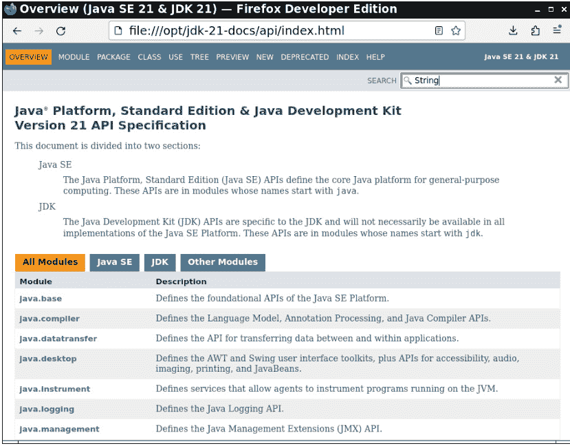

# 图 3.2：Java API 文档

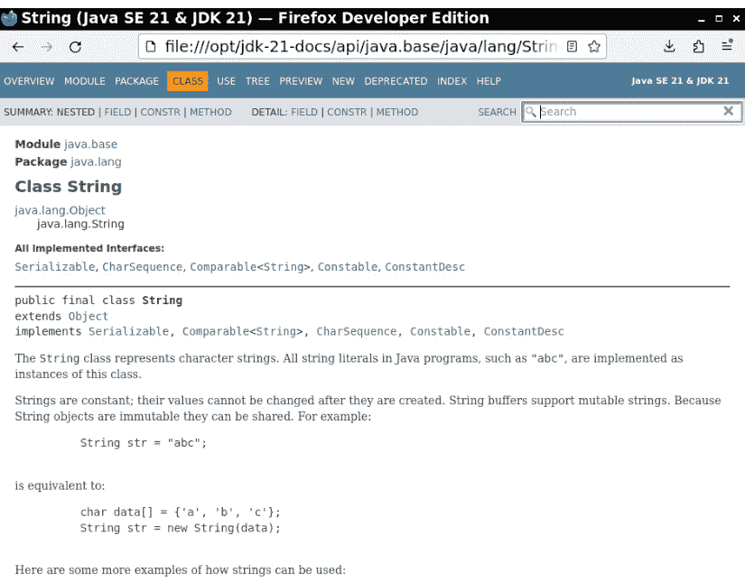

# 图 3.3：String 类的描述

当你向下滚动时，会到达所有方法的摘要，这些方法按字母顺序排序（见图 3.4）。点击任何方法名以获取该方法的详细描述（见图 3.5）。例如，如果你点击 `compareToIgnoreCase` 链接，将获得 `compareToIgnoreCase` 方法的描述。

# String (Java SE 21 & JDK 21) — Firefox Developer Edition

```text
file:///opt/jdk-21-docs/api/java.base/java/lang/String...
```

概览 方法 包 类树 预览 弃用 索引 帮助

摘要：嵌套 | 字段 | 构造器 | 方法 详情：字段 | 构造器 | 方法

## 方法摘要

+ | 所有方法 | 静态方法 | 实例方法 | 具体方法 | 弃用方法 |

| 修饰符和类型 | 方法 | 描述 |
| :--- | :--- | :--- |
| `char` | `charAt(int index)` | 返回指定索引处的 `char` 值 |
| `IntStream` | `chars()` | 返回一个包含此序列中零扩展 `char` 值的 `int` 流 |
| `int` | `codePointAt(int index)` | 返回指定索引处的字符（Unicode 码点） |
| `int` | `codePointBefore(int index)` | 返回指定索引之前的前的字符（Unicode 码点） |
| `int` | `codePointCount(int beginIndex, int endIndex)` | 返回此字符串指定文本范围内的 Unicode 码点数量 |
| `IntStream` | `codePoints()` | 返回一个包含此序列中码点值的流 |
| `int` | `compareTo(String another)` | 按字典顺序比较两个字符串 |
| `int` | `compareIgnoreCase(String str)` | 忽略大小写差异，按字典顺序比较两个字符串 |
| `String` | `concat(String str)` | 将指定的字符串连接到末尾 |

**图 3.4：String 类的方法摘要**

# String (Java SE 21 & JDK 21) — Firefox Developer Edition

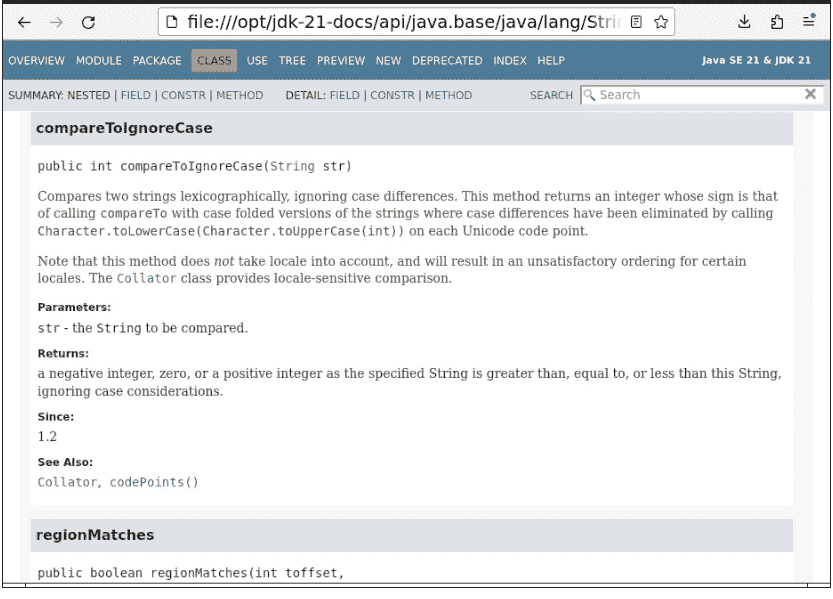

## `compareToIgnoreCase`

```java
public int compareToIgnoreCase(String str)
```

忽略大小写差异，按字典顺序比较两个字符串。此方法返回一个整数，其符号位与对字符串进行折叠（folded）后调用 `compareTo` 的结果相同；在折叠版本中，通过对每个 Unicode 码点调用 `Character.toLowerCase(Character.toUpperCase(code))` 消除了大小写差异。

注意，此方法未考虑某些语言环境（locale），在某些区域可能会导致排序不理想。`Collator` 类提供了语言环境敏感的比较。

参数：

- `str` - 要比较的 `String`。

返回：

- 如果指定的字符串在忽略大小写差异的情况下大于、等于或小于此字符串，则返回负整数、零或正整数。

自从 1 版本起：

- `1`

另请查看：

- `Collator`、`codePoints()`

## `regionMatches`

```java
public boolean regionMatches(int offsetset)
```

### 图 3.5：String 方法的详细描述

> **提示：** 如果你尚未这样做，请按照第 2 章的描述下载 JDK 文档。现在就在你的浏览器中书签文档的 `index.html` 页面！

<https://docs.oracle.com/en/java/javase/21/docs/api.html>

## 3.6.9. 构建字符串

有时你需要构建字符串，例如从字符串构建。使用字符串拼接效率低下。使用 `StringBuilder` 可以避免这个问题。首先，构建一个 builder：

```java
StringBuilder builder = new StringBuilder();
```

你也可以提供初始内容：

```java
StringBuilder builder = new StringBuilder("");
```

每次需要添加另一个部分时，调用 `append` 方法。

```java
builder.append(str); // 添加字符串
builder.appendCodePoint(cp); // 添加码点
```

构建字符串完成后，调用 `toString` 方法。你将获得一个包含 builder 中字符序列的对象。

```java
String completedString = builder.toString();
```

`StringBuilder` 方法返回 builder 对象，因此可以链式调用：

```java
String completedString = new StringBuilder()
    .append(str)
    .appendCodePoint(cp)
    .toString();
```

`String` 类没有反转字符串字符的方法，但 `StringBuilder` 有。要反转字符串，可以使用此代码段：

```java
String reversed = new StringBuilder(original).reverse().toString();
```

> **注意：** 反转对于使用两个 `char` 值编码的字符是正确的，但它没有考虑字符簇（grapheme clusters）。

传统的 `StringBuffer` 类比 `StringBuilder` 效率低，但它允许多线程添加或删除字符。如果所有的字符串编辑都在单线程中进行（通常情况下如此），你应该使用 `StringBuilder`。这两个类的 API 是相同的。以下 API 注释包含了 `StringBuilder` 类最重要的方法。

# `java.lang.StringBuilder` 5.0

- `StringBuilder()`

- `StringBuilder(CharSequence seq)`

  构建一个空的 string builder，或带有给定初始内容的 builder。

- `int length()`

  返回 builder 或缓冲区的代码单元数量。

- `StringBuilder append(String str)`

  添加字符串并返回 string builder。

- `StringBuilder appendCodePoint(int cp)`

  添加码点，将其转换为一个或两个代码单元并返回本身。

- `StringBuilder insert(int offset, String str)`

  在位置 `offset` 处插入字符串并返回 string builder。

- `StringBuilder delete(int startIndex, int endIndex)`

  删除从 `startIndex` 到 `endIndex - 1` 的代码单元并返回 string builder。

- `StringBuilder repeat(CharSequence cs, int count)` 21

  添加 `count` 次 `cs` 的副本并返回 string builder。

- `StringBuilder reverse()`

  反转此字符串构建器中的代码点并返回该构建器。

- `String toString()`

  返回一个与构建器或缓冲区内容相同的数据字符串。

## 3.6.10. 文本块（Text Blocks）

Java 15 引入的文本块功能使得提供跨多行的字符串字面量变得简单。文本块以 `"""` 开始，随后跟一个换行符。块以另一个 `"""` 结束：

```java
String greeting = """
Hello
World
""";
```

与等价的字符串字面量相比，文本块更容易读写：

```java
"Hello\nWorld\n"
```

这个字符串包含两个 `\n`：一个在 `Hello` 之后，一个在 `World` 之后。起始 `"""` 之后的换行符不包含在字符串字面量中。

如果你不想最后一行之后有换行符，请将结束 `"""` 直接放在最后一个字符之后：

```java
String prompt = """
Hello, my name is Hal.
Please enter your name:""";
```

文本块特别适合包含其他语言的代码，例如 SQL 或 HTML。你只需要将其粘贴在三引号之间即可：

```java
String html = """
<div class="Warning">
Beware of those who say "Hello" to the world
</div
""";
```

注意，你不需要转义引号。只有两种情况需要转义它们：

- 如果文本块以引号结束

- 如果文本块包含连续三个或更多引号的序列

遗憾的是，你仍然需要转义所有的反斜杠 `\`。

普通字符串中的所有转义序列在文本块中的工作方式相同。

有一个转义序列仅在文本块中有效。位于行尾之前的 `\` 会将该行与下一行合并。例如：

```java
"""
Hello, my name is Hal. "
Please enter your name:""";
```

这等同于：

`"Hello, my name is Hal. Please enter your name:"`

行结束符会通过移除尾随空格并将任何 Windows 行结束符（`\r\n`）转换为简单的换行符（`\n`）来进行归一化。如果你需要保留尾随空格，请将最后一个空格转换为 `\s` 转义符。事实上，这可能正是你对提示字符串所需要的。以下字符串以空格结尾：

```java
"""
Hello, my name is Hal. \
Please enter your name:\s"""
```

前导空格的情况则更为复杂。考虑一个从左边距缩进的典型变量声明。你也可以对文本块进行缩进：

```java
String html = """
<div class="Warning">
Beware of those who say "Hello" to the world
</div
"""
```

文本块中所有行的公共缩进会被减去。实际字符串为：

```text
"\"\<div class=\"Warning\">\n Beware of those who say \"Hello\" to the world\n</div>\n\"\""
```

注意，第一行和第三行没有缩进。

你始终可以通过在结束 `"""` 之前的最后一行不留任何空格来避免这种缩进剥离。但许多程序员似乎认为文本块缩进后看起来更整洁。你的 IDE 可能会友好地提供使用制表符或空格缩进所有文本块的功能。

Java 明智地没有规定制表符的宽度。文本块所有行的空白前缀必须完全匹配。

在剥离公共缩进时，完全空白行不被考虑。然而，结束 `"""` 之前的空白是有意义的。请确保缩进到你想要剥离的空格末尾。

> **注意：** 注意缩进中混合使用了制表符和空格。一个被忽略的空格很容易导致缩进错误的字符串。

> **提示：** 如果文本块包含不是 Java 的代码，缩进可能看起来更整齐。你的 IDE 可能会建议通过缩进所有文本块来对齐。

## 3.7. 输入与输出（Input and Output）

你通过调用 `System.out.println` 轻松地向控制台输出。从 `System.in` 读取输入并不那么简单。为了控制控制，` ` ` ```` `。

为了让示例更有趣，我们使用 `System.out` 进行输出。最后，注意 `Scanner` 类定义在 `java.util` 包中。要从 `System.in` 读取，你首先构造一个附加到 `System.in` 的 `Scanner`：

```java
Scanner in = new Scanner(System.in);
```


## 3.7.1. 输入

你看到通过 `System.out` 打印。现在你可以使用 `Scanner` 类的各种方法读取输入。例如，`nextLine()` 方法读取行：

```java
System.out.print("What is your name?");

String name = in.nextLine();
```

在这里我们使用 `nextLine()` 是因为输入可能包含空格。读取单个单词（由空格分隔），调用：

```java
String firstName = in.next();
```

要读取整数，使用 `nextInt()`：

```java
System.out.print("How old are you?");

int age = in.nextInt();
```

同样，`nextDouble()` 方法读取下一个浮点数。示例 3.2 中的程序请求输入并打印消息。每当使用一个类时，在程序开头都需要导入指令。

> **注意：** `Scanner` 类不适合从控制台读取密码，因为输入是公开可见的。使用 `Console` 对象的 `readPassword` 方法来读取密码并隐藏用户输入。

## `Scanner` 方法

- `boolean hasNextInt()`
- `boolean hasNextDouble()`

测试下一个字符序列是否代表整数或浮点数。

## `java.lang.System` 1.0

- `static Console console()` 6

  如果可以通过控制台窗口与用户交互，则返回一个 `Console` 对象；否则返回 `null`。对于任何在控制台窗口中启动的程序，都可以使用 `Console` 对象。否则，其可用性取决于系统。

## `java.io.Console` 6

- `char[] readPassword(String prompt, Object... args)`
- `StringLine(String prompt, Object... args)`

显示提示信息并读取用户输入，直到输入行结束。可选的 `args` 参数用于提供格式化参数，如下一节所述。

## 3.7.2. 输出格式化

你可以使用 `System.out.print(x)` 语句向控制台打印数字 `x`。该命令将以该类型最大数量的非零数字打印 `x`。例如：

```java
double x = 10000.0 / 3.0;

System.out.print(x);
```

打印：

```text
3333.333333333335
```

如果你想显示美元和分，这就会产生问题。

解决方法是使用 `printf` 方法，它遵循了 C 库的经典传统。例如，调用：

```java
System.out.printf("%8.2f", x);
```

打印宽度为 8 个字符、精度为 2 个字符的 `x`。也就是说，输出包含一个空格和七个字符：

```text
3333.33
```

你可以为 `printf` 提供多个参数。例如：

```java
System.out.printf("Hello, %s. Next year, you'll be %d.", name, age + 1);
```

每个以 `%` 字符开头的格式说明符都会被相应的参数替换。结束格式说明符的转换字符指示要格式化的值的类型：`f` 是浮点数，`s` 是字符串，`d` 是十进制整数。表 3.6 显示了所有转换字符。

大写变体产生大写字母。例如，`"%8.2E"` 将 `3333.33` 格式化为 `3.33E+03`，并使用大写的 `E`。

## 表 3.6：`printf` 的转换字符

| 转换字符 | 类型 | 示例 |
| --- | --- | --- |
| `d` | 十进制整数 | `159` |
| `x` 或 `X` | 十进制整数。若需对十六进制格式进行更多控制，请使用 `HexFormat` 类。 | `9f` |
| `0` | 八进制整数 | `237` |
| `f` 或 `F` | 固定点浮点数 | `15.9` |
| `e` 或 `E` | 指数计数浮点数 | `1.59e+01` |
| `g` 或 `G` | 通用浮点数（`e` 和 `f` 中较短的一个） | — |
| `a` 或 `A` | 六进制浮点数 | `0x1.fccdp3` |
| `s` 或 `S` | 字符串 | `Hello` |
| `c` 或 `C` | 字符 | `H` |
| `b` 或 `B` | 布尔值 | `true` |
| `h` 或 `H` | 哈希值码 | `42628b2` |
| `t` 或 `Tx` | 旧版日期和时间格式。请改用 `java.time` 类——参见第二卷第 6 章。 | — |
| `%` | 百分号 | `%` |
| `n` | 取决于平台的行符 | — |

> 注意：你可以使用 `s` 转换来格式化任意对象。如果任意对象实现了 `Formattable` 接口，则会调用对象的格式化方法。否则，将调用 `toString` 方法将对象转换为字符串。`toString` 方法在第 5 章讨论，接口在第 6 章。

此外，你还可以指定控制格式化输出外观的标志。表 3.7 显示了所有标志。例如，逗号标志会添加分组分隔符。也就是说：

```java
System.out.printf("%.2f", 10000.0 / 3.0);
```

打印：

```text
3,333.33
```

你可以使用多个标志，例如 `"% ,.2f"` 用于使用分组分隔符并将负数括在括号中。

## 表 3.7：`printf` 的标志

| 标志 | 用途 | 示例 |
| --- | --- | --- |
| `+` | 为正负数打印符号。 | `+3333.33` |
| `space` | 在正数前添加空格。 | `\|3333.33` |
| `0` | 添加前导零。 | `00333.33` |
| `-` | 字段左对齐。 | `\|3333.33` |
| `(` | 将负数括在括号中。 | `(3333.33)` |
| `,` | 添加分组分隔符。 | `3,333.33` |
| `#`（用于 `f` 格式） | 始终包含小数点。 | `3,333.` |
| `#`（用于 `x` 或 `o` 格式） | 添加 `0x` 或 `0` 前缀。 | `0cafe` |
| `$` | 指定要格式化的参数索引。例如，`%1$d %1$x` | `159 9F` |
| `#` | 以十进制和十六进制打印第一个参数。 | `\|159` |
| `<` | 以上一个说明相同的格式化相同的值。例如，`%d %x` 以十进制和十六进制打印同一个数字。 | `159 9F` |

你可以使用静态的 `String.format` 方法来创建一个格式化字符串而不打印它：

```java
String message = String.format("Hello, %s. Next year, you'll be %d.", name, age + 1);
```

> 注意：从 Java 15 开始，你可以使用 `formatted` 方法代替，节省五个字符：

```java
String message = "Hello, %s. Next year, you'll be %d.".formatted(name, age + 1);
```

你现在已经看到了 `printf` 方法的所有功能。图 3.6 显示了格式说明符的语法图。

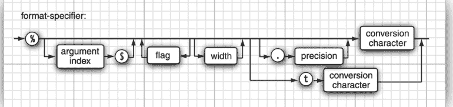

**图 3.6：** 格式说明符语法

> 注意：格式化是*特定于区域的*。例如，在德国，分组分隔符是逗号。在具有美国区域设置的计算机上，它产生 `3333.33`。这通常是你与用户通信时所需要的。然而，你可能需要将区域设置作为 `printf` 的第一个参数：

```java
System.out.printf(Locale.US, "%8.2f", x);
```

## 3.7.3. 文件输入与输出

要从文件读取，如下所示构造 `Scanner` 对象：

```java
Scanner in = new Scanner(Path.of("myfile.txt"));
```

> 注意：文件存储的是字节而不是 Unicode 字符。正如你在 3.3.4 中看到的，有多种表示 Unicode 方法。最常用的字符编码是 UTF-8。本书假设所有文本文件使用 UTF-8。从 Java 18 开始，这是所有读写操作的默认设置。如果你使用旧版本的 Java，请始终指定字符编码：

```java
Scanner in = new Scanner(Path.of("myfile.txt"), StandardCharsets.UTF_8);
```

> 注意：可以使用字符串构造 `Scanner`，但 `scanner` 将字符串解释为数据而不是文件名。例如，如果你调用：

```java
Scanner in = new Scanner("myfile.txt"); // 错误？
```

那么 `scanner` 将看到十个字符数据：`'m'`、`'y'`、`'f'` 等。这可能不是这种情况想要的。

要写入文件，构造一个 `PrintWriter` 对象。在构造函数中，提供文件名作为字符串：

```java
PrintWriter out = new PrintWriter("file.txt");
```

如果文件不存在，则会创建它。你可以像打印到 `System.out` 时一样使用 `print`、`println` 和 `printf` 命令。

> 注意：当你指定相对文件名（如 `"file.txt"`、`"mydirectory/file.txt"` 或 `"../file.txt"`）时，文件相对于启动 Java 虚拟机的目录进行定位。如果你从命令行 shell 启动程序，执行：

```bash
java MyProg
```

那么起始目录就是命令行 shell 的当前目录。然而，如果你使用集成开发环境，由它控制起始目录。你可以通过此调用找到目录位置：

```java
String dir = System.getProperty("user.dir");
```

如果你在定位文件时遇到困难，请考虑使用绝对路径名称，如：

```text
"c:\mydirectory\myfile.txt" 或 "/home/me/mydirectory/myfile.txt".
```

> **注意：** 在 Java 18 之前，你必须显式设置字符编码为 UTF-8：

```java
PrintWriter out = new PrintWriter("myfile.txt",
    StandardCharsets.UTF_8);
```

正如你所看到的，访问文件就像使用 `System.in` 和 `System.out` 一样简单。但有一个陷：如果你用一个不存在的文件构造 `Scanner`，或者用一个无法创建的名字构造 `PrintWriter`，就会发生异常。Java 编译器认为这些异常比例如的“除以零”异常更严重。在第 7 章中，你将学习处理异常的方法。现在，你只需要告诉编译器你已经意识到可能会发生“输入/输出”异常即可。你可以通过在主方法上标记 `throws` 子句来实现这一点，如下：

```java
public static void main(String[] args) throws IOException
{
    Scanner in = new Scanner(Path.of("myfile.txt"));
}
```

你现在已经了解了如何读取和写入包含文本数据的文件的方法。对于更高级的主题，例如处理不同的字符编码、处理二进制数据、读取目录和写入 zip 文件，请参阅第二卷的第 2 章。

注意：如果你不喜欢声明异常，可以像前面的节落那样读取 `System.in` 并写入 `System.out`。然后使用你 shell 的重定向语法从命令行 shell 启动程序：

```bash
java MyProg < myfile.txt > output.txt
```

## `java.util.Scanner` 5.0

- `Scanner(Path p)` 7
- `Scanner(Path p, Charset charset)` 10

  构造一个从给定路径读取数据的 `Scanner`，使用默认或给定的字符编码。

- `Scanner(String data)`

  构造一个从给定字符串读取数据的 `Scanner`。

## `java.io.PrintWriter` 1.1

- `PrintWriter(String fileName)`
- `PrintWriter(String fileName, Charset charset)` 10

  构造一个向给定名称文件写入数据的 `PrintWriter`，使用默认或给定的字符编码。

## `java.nio.file.Path` 3

- `static Path of(String pathname)` 11

  根据给定的路径名构造 `Path`。

## 3.8. 控制流

Java 与任何编程语言一样，都支持条件语句和循环来确定控制流。我将从条件语句开始，然后进入循环，最后对四种形式的 `switch` 进行彻底讨论。

> **C++ 注意：** Java 的控制流结构与 C 和 C++ 相同，但有少数例外。它没有 `goto`，但有一个“带标签”的 `break`，你可以用它跳出嵌套循环（在 C 中，你可能会使用 `goto`）。最后，还有 `for` 循环的变体，类似于 C++ 中基于范围的循环和 C# 中的 `foreach` 循环。

### 3.8.1. 块范围

在学习控制结构之前，你需要更多关于“块”（block）的知识。

块或复合语句由多个 Java 语句组成，并一对大括号包围。块定义了变量的作用域。一个块可以嵌套在另一个块内部。这里是一个嵌套在主方法块中的块：

```java
public static void main(String[] args)
{
    int n;

    ..

    {
        int k;

        ..
    } // k 只定义到这里
}
```

你不能在两个嵌套块中声明同名的局部变量。例如，以下代码是错误且无法编译的：

```java
public static void main(String[] args)
{
    int n;

    ..

    {
        int k;
        int n; // 错误--不能在内部块中重声明 n

        ..
    }
}
```

> C++ 注意：在 C++ 中，在嵌套块内部重新定义变量是可能的。内部定义会遮蔽外部定义。这可能是编程错误的根源；因此，Java 不允许这样做。

### 3.8.2. 条件语句

Java 中的条件语句的形式为：

`if (condition) statement`

条件必须用圆括号包围。

在 Java 中，与大多数编程语言一样，你通常希望在单个条件为真时执行多个语句。在这种情况下，使用如下形式的块语句：

```java
{
    statement1;
    statement2;
    ....
}
```

例如：

```java
if (yourSales >= target)
{
    performance = "Satisfactory";
    bonus = 100;
}
```

在这段代码中，所有在大括号包围的语句将在 `yourSales` 大于或等于 `target` 时执行（见图 3.7）。

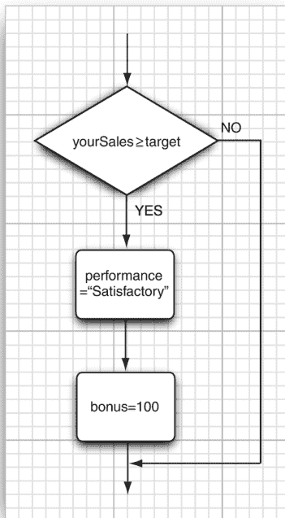

**图 3.7：** `if` 语句的流程图

> **注意：** 块（有时称为复合语句）允许你在任何允许单个（简单）语句的 Java 编程结构中使用多个一个（简单）语句。

Java 中更通用的条件语句所示（见图 3.8）：

```java
if (condition)
    statement1
else
    statement2
```

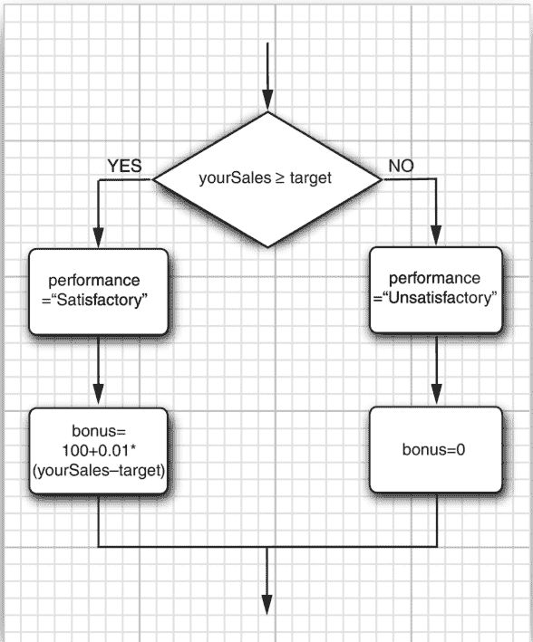

**图 3.8：** `if/else` 语句的流程图

例如：

```java
if (yourSales >= target)
{
    performance = "Satisfactory";
    bonus = 100;
}
```

在这段代码中，所有在大括号包围的语句将在 `yourSales` 大于或等于 `target` 时执行（见图 3.7）。

### 3.8.3. 循环

`while` 循环在条件为真时执行语句（可以是块）。其通用形式为：

```java
while (condition) statement
```

如果条件在开始时为假，则 `while` 循环不会执行（见图 3.10）。

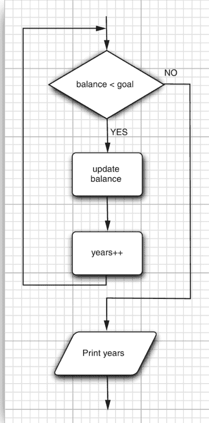

**图 3.10：** `while` 语句的流程图

列表 3.3 中的程序确定储蓄特定退休资金需要的时间，假设你每年存款相同的金额，且资金按指定的利率产生收益。

```java
while (balance < goal) {
    balance += payment;

    double interest = balance * interestRate / 100;

    balance += interest;
    years++;
}

System.out.println(years + " years.");
```

`while` 循环在顶部进行测试。因此，块中的代码可能永远不会执行。如果你想确保至少执行一次块，你需要将测试移动到底部，使用 `do/while` 循环。语法如下：

```java
do statement while (condition);
```

该循环执行语句（通常是一个块），然后才测试条件。如果为真，则重复语句并重新测试条件，以此类推。列表 3.4 中的代码计算退休账户的新余额，然后询问你是否准备好退休：

```java
do {
    balance += payment;

    double interest = balance * interestRate / 100;

    balance += interest;
    years++;

    // 打印当前余额
    ...
```


// 询问是否准备好退休并获取输入

...

}

while (input.equals("N"));
```

只要用户回答 `"N"`，循环就会重复（见图 3.11）。

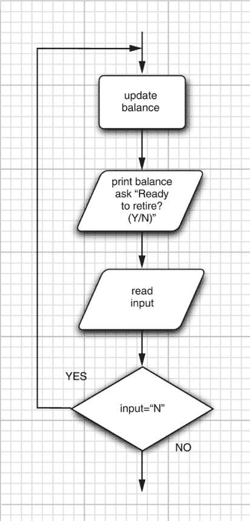

图 3.11：`do/while` 语句的流程图

### 列表 3.3：Retirement/Retirement.java

```java
import java.util.*;

/**
 * 此程序演示了 <code>while</code> 循环。
 * @version 1.20 2004-02-10
 * @author Horstmann
 */
public class Retirement {
    public static void main(String[] args) {
        // 读取输入
        Scanner in = new Scanner(System.in);

        System.out.print("你需要多少钱才能退休？ ");
        double goal = in.nextDouble();

        System.out.print("你每年会投入多少钱？ ");
        double payment = in.nextDouble();

        System.out.print("利率（百分比 %）: ");
        double interestRate = in.nextDouble();

        double balance = 0;
        int years = 0;

        // 当未达到目标时，更新账户余额
        while (balance < goal) {
            // 加入今年的投入和利息
            balance += payment;

            double interest = balance * interestRate / 100;
            balance += interest;

            years++;
        }

        System.out.println("你可以在 " + years + " 年后退休.");
    }
}
```

### 列表 3.4：Retirement2/Retirement2.java

```java
import java.util.*;

/**
 * 此程序演示了 <code>do/while/</code> 循环。
 * @version 1.20 2004-02-10
 * @author Cay Horstmann
 */
public class Retirement2 {
    public static void main(String[] args) {
        Scanner in = new Scanner(System.in);

        System.out.print("你每年会投入多少钱？ ");
        double payment = in.nextDouble();

        System.out.print("利率（百分比 %）: ");
        double interestRate = in.nextDouble();

        double balance = 0;
        int year = 0;
        String input;

        // 当用户尚未准备好退休时，更新账户余额
        do {
            // 加入今年的投入和利息
            balance += payment;

            double interest = balance * interestRate / 100;
            balance += interest;

            year++;

            // 打印当前余额
            System.out.printf("第 %d 年后你的余额为 %.2f%n", year, balance);
        } // 询问是否准备好退休并获取输入

        System.out.print("准备好退休了吗？(Y/N)");
        input = in.next();

    } while (input.equals("N"));
}
```

## 3.8.4 确定循环

`for` 循环是一种通用结构，用于由计数器或类似变量控制的迭代，该变量在每次迭代后都会更新。如图 3.12 所示，以下循环在屏幕上打印从 1 到 10 的数字：

```java
for (int i = 1; i <= 10; i++)
    System.out.println(i);
```

`for` 语句的第一槽位通常持有计数器的初始化。第二个槽位给出在每次新通过循环之前将测试的条件，第三个槽位指定如何更新计数器。

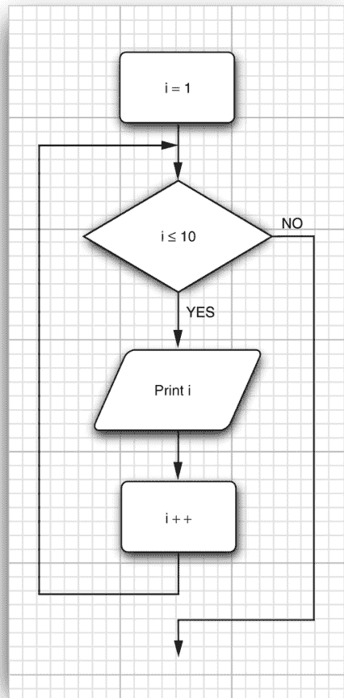

图 3.12：`for` 语句的流程图

尽管 Java 像 C++ 允许在 `for` 循环的各个槽位中使用任何表达式，但良好习惯的成文规则是，这三个槽位应该只初始化、测试和更新同一个计数器变量。在良好习惯范围内忽略这一点，可以写出非常晦涩的循环，这是完全可能的。例如，你可以编写倒计数的循环：

```java
for (int i = 10; i > 0; i--)
    System.out.println("倒计时：" + i);

System.out.println("发射！");
```

> **注意：** 在循环中测试浮点数的相等性时要小心。像这样的 `for` 循环
> `for (double x = 0; x != 10; x += 0.1)`
> 可能永远不会结束。由于舍入误差，最终值可能无法精确达到。在这个例中，`x` 从 `9.99999999999998` 跳到 `10.09999999999999`，那里没有精确的二进制表示。

当你在 `for` 语句的第一槽位声明变量时，该变量的作用范围一直延伸到主体的结束。特别是，如果你在 `for` 语句内部定义了一个变量，则不能在循环外部使用它的值。因此，如果你想在 `for` 循环外部使用计数器的最终值，请确保在头部外部声明它。

```java
int i;

for (i = 1; i <= 10; i++) {
    //
}

// i 在这里仍然定义
```

相反，你可以在分开的 `for` 循环中定义相同名的变量：

```java
for (int i = 1; i <= 10; i++) {
    //
}

for (int i = 1; i <= 10; i++) {
    //
}
```

`for` 循环仅仅是 `while` 循环的简便写法。例如：

```java
for (i = 10; i > 0; i--)
    System.out.println("倒计时：" + i);
```

可以重写为：

```java
i = 10;

while (i > 0) {
    //
    i--;
}
```

`for` 循环的第一个槽位可以声明多个变量，第三槽位可以包含逗号分隔的表达式：

```java
for (int i = 1, j = 1; i <= 10; i++, j++)
```

do 循环循环。

```java
int i = 1;

for (int i = 1; i++)
```

注意：节 3.10.3 描述了增强型 `for` 循环（也称为“for each”循环），它非常方便访问数组或集合中的元素。

### 列表 3.5：Lottery/LotteryOdds.java

```java
import java.util.*;

/**
 * 此程序演示了 <code>for</code> 循环。
 * @version 1.20 2004-02-10
 * @author Cay Horstmann
 */
public class LotteryOdds {
    public static void main(String[] args) {
        Scanner in = new Scanner(System.in);

        System.out.print("你需要抽取多少个数字？ ");
        int k = in.nextInt();

        System.out.print("你可以抽取的最高数字是多少？ ");
        int n = in.nextInt();

        /*
         * 计算组合数 n*(n-1)*(n-2)*...(n-k+1)/1*2*...k
         */
        int lotteryOdds = 1;

        for (int i = 1; i <= k; i++) {
            lotteryOdds = lotteryOdds * (n - i + 1) / i;
        }

        System.out.println("你的几率是 1/" + lotteryOdds + "。祝运！");
    }
}
```

## 5. 使用 `switch` 进行多选择

当你需要处理同一个表达式的多个备选方案时，`if/else` 结构可能会非常繁琐。`switch` 语句使这变得更容易，特别是 Java 14 引入的格式。

例如，如果你像图 3.13 所示设置了一个具有四个替代方案的菜单系统，可以使用如下代码：

```java
Scanner in = new Scanner(System.in);

System.out.print("选择一个选项 (1, 2, 3, 4 )");
int choice = in.nextInt();

switch (choice) {
    case 1 ->
        //
    case 2 ->
        //
    case 3 ->
        //
    case 4 ->
        //
    default ->
        System.out.println("无效输入");
}
```

注意与你在第 3.5.9 节看到的 `switch` 表达式的相似性。与 `switch` 表达式不同，`switch` 语句没有值。每个 `case` 执行一个操作。

`switch` 语句的“经典”形式可以追溯到 C 语言，自 Java 1.0 起就一直支持。它的形式如下：

```java
int choice = . . ;

switch (choice) {
    case 1:
        .\.
        break;

    case 2:
        .\.
        break;

    case 3:
        .\.
        break;

    case 4:
        .\.
        break;

    default:
        System.out.println("Bad input");
}
```

执行将从匹配选择值的 `case` 标签开始，并一直持续到下一个 `break` 或 `switch` 结束。如果没有一个 `case` 标签与之匹配，则执行 `default` 子句（如果它存在的话）。

> **注意：** 可能会触发多个备选分支。如果你忘记在某个备选分支的末尾添加 `break`，执行将会“穿透（fall through）”到下一个备选分支！这种行为显然是危险的，也是错误的常见原因。

为了检测此类问题，请使用 `-Xlint:fallthrough` 选项编译代码，如下所示：

```bash
javac -Xlint:fallthrough Test.java
```

然后，每当备选分支没有以 `break` 语句结束时，编译器都会发出警告。

如果你实际上想使用带有 `@SuppressWarnings("fallthrough")` 注解的外围方法，那么该方法将不会生成任何警告。注解（Annotation）是一种向编译器或处理 Java 源代码或类文件的工具提供信息的机制。第二卷对注解进行了深入的介绍。

为了对称性，Java 14 还引入了带有穿透功能的 `switch` 表达式，总共共有四种 `switch` 形式。表 3.8 显示了它们所有的形式。

## 表 3.8：`switch` 的四种形式

| 类型 | 表达式 | 语句 |
|---|---|---|
| 无穿透（No Fallthrough） | `int numLetters = switch (seasonName) { case "Spring" -> { System.out.println("spring time!"); yield 6; } case "Summer", "Winter" -> 6; case "Fall" -> 4; default -> -1; };` | `switch (seasonName) { case "Spring" -> System.out.println("spring!"); case "Summer", "Winter" -> System.out.println("summer or winter!"); case "Fall" -> System.out.println("fall!"); default -> System.out.println("unknown!"); }` |
| 穿透（Fallthrough） | `int numLetters = switch (seasonName) { case "Spring": System.out.println("spring time!"); case "Summer", "Winter": yield 6; case "Fall": yield 4; default: yield -1; }` | `switch (seasonName) { case "Spring": System.out.println("spring time!"); case "Summer", "Winter": System.out.println("summer or winter!"); case "Fall": System.out.println("fall!"); default: System.out.println("unknown!"); }` |

在穿透变体中，每个 `case` 都以冒号结尾。如果 `case` 以箭头结尾，则没有穿透。你不能在一个 `switch` 语句中混合使用冒号和箭头。`switch` 表达式的每个分支必须产生一个值。最常见的情况是每个值都跟在箭头后面：如果无法这样做，请使用 `yield` 语句。与 `break` 一样，它会终止执行。与 `break` 不同，它还会产生表达式的值。

要在无穿透的 `switch` 表达式分支中使用语句，必须使用大括号和 `yield`：

```java
case "Spring" -> {
    System.out.println("spring time!");
    yield 6;
}
```

> **注意：** 在 `switch` 表达式的分支中抛出异常是合法的。例如：

```java
default -> throw new IllegalArgumentException("Not a season");
```

异常在第 7 章中有详细介绍。

注意：`switch` 表达式的目的是产生一个值（或通过异常失败）。你不被允许“跳出”：

```java
default -> { return -1; } // 错误
```

具体而言，你不能在 `switch` 表达式中使用 `return`、`break` 或 `continue` 语句。（后者请参见第 3.8.6 节。）

### 你应该选择哪一个？

在有多种 `switch` 变体的情况下，你应该选择哪一个？

- 避免使用穿透形式。需要穿透的情况非常罕见。
- 优先使用 `switch` 表达式而不是语句。如果每个分支都为变量赋值或方法调用计算值，请用表达式 `yield` 该值，然后使用它。

```java
numLetters = switch (seasonName) {
    case "Spring", "Summer", "Winter" -> 6;
    case "Fall" -> 4;
    default -> -1;
};
```

优于：

```java
switch (seasonName) {
    case "Spring", "Summer", "Winter" -> 6;
    case "Fall" -> 4;
    default -> -1;
}
```

## 3.8.6 打断控制流的语句

尽管 Java 的设计者保留了 `goto` 作为一个关键字，但他们决定不将其包含在语言中。通常，`goto` 语句被认为是不良的风格。一些程序员认为反 goto 力量（anti-goto forces）做得过头（例如，参见 Donald Knuth 的著名文章《使用 goto 的结构化编程》）。他们认为，无限制地使用 `goto` 是容易出错的，但偶尔跳出循环是有益的。设计者们同意了这一点，甚至添加了一种新的语句——带标签的 `break`（labeled break），以支持这种编程风格。

让我们先看看无标签的 `break` 语句。你用于退出 `switch` 语句的同一个 `break` 语句也可以跳出循环。例如：

```java
while (years <= 100) {
    balance += payment;
}
```


`double interest = balance * interestRate / 100;`

`balance += interest;`

`if (balance >= goal) break;`

`years++;`

现在，如果在循环顶部出现 `years > 100` 或者在循环中间出现 `balance >= goal`，循环就会退出。当然，你可以在不使用 `break` 的情况下计算 `years` 的相同值，如下：

```
while (years <= 100 && balance < goal)
{
    balance += payment;
    double interest = balance * interestRate / 100;
    balance += interest;
}
```

```
if (balance < goal)
    years++;
```

但注意，在这个版本中 `balance < goal` 的测试重复了两次。为了避免这种重复测试，一些程序员更倾向于使用 `break` 语句。

带标签的 `break` 语句允许你跳出多个嵌套循环。偶尔在深度嵌套循环内部会发生奇怪的事情。在这种情况下，你可能想要完全跳出。通过向各种循环测试中添加额外的条件，这种方法是不方便的。

这里有一个显示标签 `break` 语句作用的示例。注意标签必须位于你想要跳出的外部循环之前。它后面必须跟冒号：

```
Scanner in = new Scanner(System.in);
int n;
read_data:
while (.. )) // 此循环带有标签
{
    for (.. )) // 内部循环没有标签
    {
        System.out.print("Enter a number >= 0: ");
        n = in.nextInt();
        if (n < 0) // 不应该发生
            break read_data; // 跳出 read_data 循环
    }
}
// 在 break 执行后立即执行这里
```

```
{
    // 处理坏情况
}
else
{
    // 执行处理
}
```

如果是坏输入，标签 `break` 将移动到块的结束处。与任何使用 `break` 语句一样，你都需要测试循环是正常退出的还是通过 `break` 退出的。

> **注意：** 奇的是，你可以将标签应用于任何语句，即使是一个语句或块语句，如下所示：

```
label:
  ..
  if (condition) break; // 退出块
  ..
// break 执行时跳转到这里
```

因此，你只能跳出块，而不能跳入块。

最后是 `continue` 语句，它像 `break` 语句一样打断常规控制流。`continue` 语句将控制转移到最内层嵌套循环的头部。这是一个示例：

```
while (sum < goal)
{
    System.out.print("Enter a number: ");
    n = in.nextInt();
    if (n < 0) continue; // 跳过此处
    sum += n; // 如果 n < 0 则不执行
}
```

如果 `n < 0`，则 `continue` 语句将立即跳转到循环头部，跳过当前迭代的剩余部分。

如果在 `for` 循环中使用 `continue` 语句，它将跳转到 `for` 循环的“更新”部分。例如：

```
for (count = 1; count <= 100; count++)
{
    System.out.print("Enter a number, -1 to quit: ");
    n = in.nextInt();
    if (n < 0) continue; // 跳到 count++ 语句
    sum += n; // 如果 n < 0 则不执行
}
```

如果 `n < 0`，则 `continue` 语句将跳转到 `count++` 语句。

还有带标签的 `continue` 语句，它可以跳转到带有匹配标签的循环头部。

> 提示：许多程序员发现 `break` 和 `continue` 语句令人困惑。这些语句完全是可选的——你可以在不使用它们的情况下表达相同的逻辑。本书中的没有任何程序使用 `break` 或 `continue`。

# 3.9. 大数

如果基本整数类型和浮点类型的精度不够，你可以转向 `java.math` 包中的几个实用用类：`BigInteger` 和 `BigDecimal`。这些类用于处理具有任意长度数字序列的数字。`BigInteger` 类实现了任意精度整数算术，而 `BigDecimal` 对浮点数执行相同的操作。

使用静态的 `valueOf` 方法将普通数字转换为大数：

```java
BigInteger a = BigInteger.valueOf(100);
```

对于较长的数字，使用带有字符串参数的构造函数：

```java
BigInteger reallyBig = new BigInteger("2222322446294204455297398934619099672066693990649976499079600");
```

还有常量 `BigInteger.ZERO`、`BigInteger.ONE`、`BigInteger.TWO` 和 `BigInteger.TEN`。

**注意：** 使用 `BigDecimal` 类时，你应该始终使用带有字符串参数的构造函数。存在一个 `BigDecimal(double)` 构造函数，它容易产生舍入误差：`new BigDecimal(0.1)` 的数字是

```
0.100000000000000055511151231257827021181583404541615625
```

遗憾的是，你不能使用熟悉的数学运算符如 `+` 和 `*` 来组合大数。相反，你必须使用大数类中的 `add` 和 `multiply` 等方法。

```java
BigInteger c = a.add(b); // c = a + b
BigInteger d = c.multiply(b.add(BigInteger.valueOf(2))); // d = c * (b + 2)
```

> **C++ 注意：** 与 C++ 不同，Java 没有可编程的运算符重载。`BigInteger` 类的程序员无法重新定义 `+` 和 `*` 运算符来为 `BigInteger` 类提供加和乘操作。语言设计者确实重载了 `+` 运算符来表示字符串的拼接。他们选择不重载其他运算符，也没有赋予 Java 程序员在自己的类中重载运算符的机会。

> **注意：** 在 Java 19 中，`BigInteger` 类提供了 `parallelMultiply` 方法，其结果与 `multiply` 相同，但通过使用多个处理器内核可能更快计算结果。如果你需要进行大量的乘法，并且知道你的应用程序不需要 CPU 进行其他计算，可以使用此方法。

列表 3.6 显示了列表 3.5 彩票概率程序的修改，已支持大数。例如，如果你被邀请参加一种彩票，需要从 490 个数字中选出 60 个，你可以使用此程序查看你的中奖概率。716395834619955574151162225400929334117161278926349335101345948110468848。祝运！

列表 3.5 中的程序计算了语句 `lotteryOdds = lotteryOdds * (n - i + 1) / i;`。

当大整数整数 `lotteryOdds` 和 `n` 时，等效语句变为 `lotteryOdds = lotteryOdds.multiply(n.subtract(BigInteger.valueOf(i - 1))).divide(BigInteger.valueOf(i));`。

# 列表 3.6 BigIntegerTest/BigIntegerTest.java

```java
import java.math.*;
import java.util.*;
/*
/**
 * 此程序使用大数计算彩票大奖的概率。
 * @version 1.21 2021-09-03
 * @author Cay Horstmann
 */
public class BigIntegerTest {
    public static void main(String[] args) {
        Scanner in = new Scanner(System.in);

        System.out.printf("How many numbers do you need to draw? ");
        int k = in.nextInt();

        System.out.printf("What is the highest number you can draw? ");
        BigInteger n = in.nextBigInteger();

        /*
         * 计算二项系数 n*(n-1)*(n-2)...*(n-k+1)/(1*2*3*...*k)
         */

        BigInteger lotteryOdds = BigInteger.ONE;

        for (int i = 1; i <= k; i++)
            lotteryOdds = lotteryOdds
                .multiply(n.subtract(BigInteger.valueOf(i - 1)))
                .divide(BigInteger.valueOf(i));

        System.out.printf("Your odds are 1 in %s. Good luck!%n", lotteryOdds);
    }
}
```

> **注意：** 长度为 0 的数组是合法的。如果你编写了一个计算数组结果的方法，而结果恰好为空，那么这种数组就会有用。可以使用如下方式构造长度为 0 的数组：

`new elementType[]`

或

`new elementType[] {}`

请注意，长度为 0 的数组不等于 `null`。

## 3.10.2. 访问数组元素

你通过括号运算符使用整数*索引*访问数组的每个单独元素。例如，如果 `a` 是一个整数数组，那么 `a[i]` 就是数组中索引为 `i` 的元素。

数组元素*从 0 开始编号*。最后一个有效索引是长度减 1。在下面的示例中，索引值范围从 0 到 99。一旦创建了数组，你就可以填充数组中的元素，例如通过使用循环：

```java
int[] a = new int[100];
for (int i = 0; i < 100; i++)
    a[i] = i; // 用数字 0 到 99 填充数组
```

当你创建一个数字数组时，所有元素都会初始化为零。布尔类型数组初始化为 `false`。对象数组初始化为特殊值 `null`，这表示它们（尚未）持有任何对象。这会让初学者感到很惊讶。例如，

```java
String[] names = new String[10];
```

这创建了一个包含十个字符串的数组，它们都是 `null`。如果你想让数组持有空字符串，你必须提供它们：

```java
for (int i = 0; i < 10; i++) names[i] = "";
```

> 注意：如果你构造了一个包含 100 个元素的数组，然后尝试访问元素 `a[100]`（或从 0 到 99 范围外的任何索引），将会发生“数组下标越界”（array index out of bounds）异常。

获取数组元素的数量，例如：`array.length`。

```java
for (int i = 0; i < a.length; i++)
    System.out.println(a[i]);
```

## 3.10.3. “for each”循环

Java 有一种强大的循环结构，允许你遍历数组（或任何其他元素集合）中的每个元素，而无需处理索引值。

增强型 for 循环

```java
for (variable : collection) statement
```

将给定的变量设置为集合中的每个元素，然后执行语句（当然，这可能是一个代码块）。集合表达式必须是一个数组或实现了 `Iterable` 接口的类的对象，例如 `ArrayList`。数组列表在第 5 章中介绍，`Iterable` 接口在第 9 章中介绍。

例如，

```java
for (int element : a) {
    System.out.println(element);
}
```

这会在单独的一行打印数组 `a` 的每个元素。

你应该将 "each" 读作“对于 `a` 中的每个元素”。Java 语言的设计者考虑过使用如 `foreach` 和 `in` 这样的关键字。但这种循环是 Java 语言晚期添加的，最终没有没有人想要破坏已经包含这些名称的方法或变量的旧代码（例如 `System.in`）。

当然，你也可以传统的循环来实现相同的效果：

```java
for (int i = 0; i < a.length; i++) {
    System.out.println(a[i]);
}
```

然而，“for each”循环更加简洁且更不容易出错，因为你不需要担心那些讨厌的起始和结束索引值。

> **注意：** “for each”循环的循环遍历的是数组的元素，而不是索引值。

> **提示：** 有一种更简单的方法打印数组的所有值，使用 `Arrays` 类的 `toString` 方法。调用 `Arrays.toString(a)` 返回一个包含数组元素的字符串，元素包含在括号内并用逗号分隔，例如 `"[2, 3, 5, 7, 11, 13]"`。要打印数组，只需调用

```java
System.out.println(Arrays.toString(a));
```

## 3.10.4. 数组复制

你可以将任何数组变量复制到另一个变量中，但两个变量都指向同一个数组：

```java
int[] luckyNumbers = smallPrimes;
luckyNumbers[5] = 12; // 现在 smallPrimes[5] 也是 12
```

图 3.14 显示了结果。

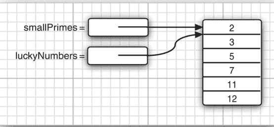

### 图 3.14: 复制数组变量

如果你实际上想将一个数组的所有值复制到一个新数组，请使用 `Arrays` 类中的 `copyOf` 方法：

```java
int[] copiedLuckyNumbers = Arrays.copyOf(luckyNumbers, luckyNumbers.length);
```

第二个参数是新数组的长度。该方法的一个常见用途是增加数组的长度：

> **注意：** Java 数组与 C++ 非常不同。此外，Java 数组分配在堆上而不是栈上。

## 3.10.5. 命令行参数

你已经见过一个 `main` 方法接收命令行参数的示例。例如，考虑这个程序：

```java
public class Message {
    public static void main(String[] args) {
        if (args.length == 0) {
            System.out.println("No arguments");
        } else {
            for (int i = 0; i < args.length; i++) {
                System.out.println("Argument " + i + ": " + args[i]);
            }
        }
    }
}
```

如果以 `java Message` 调用，它将打印：

```
No arguments
```

如果以 `java Message hello world` 调用，它将打印：

```
Argument 0: hello
Argument 1: world
```

## 3.10.6. 数组排序

要对数组排序，可以使用 `Arrays` 类中的 `sort` 方法：该方法使用经过调优的快速排序算法，据称在大多数数据集上非常高效。列表 3.7 将数组。该程序为彩票游戏抽取随机数字。例如，如果你玩“从 49 中选 6 个”彩票，程序可能会打印：

```
4
8
19
30
44
```

为了选择这样的随机数字，首先用数组 `numbers` 填充 `1, 2, ..., n`：

```java
int[] numbers = new int[n];
for (int i = 0; i < numbers.length; i++)
    numbers[i] = i + 1;
```

第二个数组持有要抽取的数字：

```java
int[] result = new int[k];
```

现在抽取 `k` 个数字。`random` 方法返回一个 0（包含）到 1（不包含）之间的随机浮点数。将结果乘以 `n` 可产生一个 0 到 `n-1` 之间的随机整数。

```java
int r = (int) (Math.random() * n);
```

将第 `i` 个结果设置为该索引处的数字。最初它只是 `r + 1`，但正如接下来所示，`numbers` 数组的内容在每次抽取后都会改变。

```java
result[i] = numbers[r];
```

现在，你必须确保不再抽取那个数字——所有的彩票数字必须是唯一的。因此，用数组中的最后一个数字覆盖 `numbers[r]`，并将 `n` 减 1。

```java
numbers[r] = numbers[n - 1];
n--;
```

点在于，每次抽取选择的是索引，而不是实际值。索引指向包含尚未被抽取的值的数组。

在抽取 `k` 个彩票数字后，对结果数组排序以获得更优的输出：


```java
Arrays.sort(result);
for (int r : result)
    System.out.println(r);
```

# 列表 3.7：LotteryDrawing/LotteryDrawing.java

```java
import java.util.*;
/**
 * 此程序演示了数组操作。
 * @version 1.20 2004-02-10
 * @author Cay Horstmann
 */
public class LotteryDrawing
{
    public static void main(String[] args) {
        Scanner in = new Scanner(System.in);

        System.out.print("你需要抽取几个数字？ ");
        int k = in.nextInt();

        System.out.print("你可以抽取的最大数字是多少？ ");
        int n = in.nextInt();

        // 用数字 1 2 3 . . n 填充数组
        int[] numbers = new int[n];
        for (int i = 0; i < numbers.length; i++)
            numbers[i] = i + 1;

        // 抽取 k 个数字并将它们放入第二个数组中
        int[] result = new int[k];
        for (int i = 0; i < result.length; i++) {
            // 在 0 到 n-1 之间产生随机索引
            int r = (int) (Math.random() * n);
            // 选取随机位置的元素
            result[i] = numbers[r];
            // 将最后一个元素移动到随机位置
            numbers[r] = numbers[n - 1];
            n--;
        }
    }
}
```

```java
// 打印排序后的数组
Arrays.sort(result);
System.out.println("注下以下组合。它会让你富起来！");
for (int r : result) {
  System.out.println(r);
}
```

# `java.util.Arrays` 1.2

- `static String toString(T[] a)` 5.0

  返回一个包含 `a` 中元素的字符串，这些元素用括号括并用逗号分隔。在本方法及后续方法中，数组的组件类型 `T` 可以是 `int`、`long`、`short`、`char`、`byte`、`boolean`、`float` 或 `double`。

- `static T[] copyOf(T[] a, int end)` 6

- `static T[] copyOfRange(T[] a, int start, int end)` 6

  返回一个与 `a` 类型相同的数组，长度为 `end` 或 `end – start`，并用 `a` 的值填充。如果 `end` 大于 `a.length`，则结果用 `0` 或 `false` 值填充。

- `static void sort(T[] a)` a

  使用经过调的快速排序（QuickSort）算法对数组进行排序。

- `static void fill(T[] a, T v)`

  将数组的所有元素设置为 `v`。

- `static boolean equals(T[] a, T[] b)`

  如果数组长度相同且对应索引处的元素匹配，则返回 `true`。

# 3.10.7 多维数组

多维数组使用多个索引来访问数组元素。它们被用于表格和其他更复杂的布局。在你有需要这种存储机制之前，你可以安全地跳过此节。

假设你想创建一个数字表格，显示 10,000 美元的投资在不同利率场景下的增长情况，这些场景下每年支付利并再投资。

|  | 5% | 6% | 7% | 8% | 9% |
|---|---|---|---|---|---|
| 10% |  |  |  |  |  |
| 10000.00 | 10000.00 | 10000.00 | 10000.00 | 10000.00 |  |
| 10000.00 |  |  |  |  |  |
| 10500.00 | 10600.00 | 10700.00 | 10800.00 | 10900.00 |  |
| 11000.00 |  |  |  |  |  |
| 11025.00 | 11236.00 | 11449.00 | 11664.00 | 11881.00 |  |
| 12100.00 |  |  |  |  |  |
| 11576.25 | 11910.16 | 12250.43 | 12597.12 | 12950.29 |  |
| 13310.00 |  |  |  |  |  |
| 12155.06 | 12624.77 | 13107.96 | 13604.89 | 14115.82 |  |
| 14641.00 |  |  |  |  |  |
| 12762.82 | 13382.26 | 14025.52 | 14693.28 | 15386.24 |  |
| 16105.10 |  |  |  |  |  |
| 13400.96 | 14185.19 | 15007.30 | 15868.74 | 16771.00 |  |
| 17715.61 |  |  |  |  |  |
| 14071.00 | 15036.30 | 16057.81 | 17138.24 | 18280.39 |  |
| 19487.17 |  |  |  |  |  |
| 14774.55 | 15938.48 | 17181.86 | 18509.30 | 19925.63 |  |
| 21435.89 |  |  |  |  |  |
| 15513.28 | 16894.79 | 18384.59 | 19990.05 | 21718.93 |  |
| 23579.48 |  |  |  |  |  |

你可以将这些信息存储在一个名为 `balances` 的二维数组中。在 Java 中声明一个二维数组足够简单。例如：

```java
double[][] balances;
```

在初始化数组之前，你无法使用该数组。在 Java 中声明一个二维数组足够简单。例如：

在其他情况下，如果你知道数组的元素，可以使用如下简写形式初始化：

```java
int[][] array = {
  {1, 2, 3},
  {4, 5, 6}
};
```

或者，也可以先创建数组再赋值：

```java
int[][] array = new int[2][3];
array[0][0] = 1;
array[0][1] = 2;
...
```

注意，行数和列数并不是数组变量类型的一部分。变量 `balances` 的类型为 `double[][]`：一个 `double` 数组的数组。

因此，你可以创建“锯齿”数组（ragged arrays）——即不同行的长度不同的数组。这里有一个标准示例。让我们创建一个数组，其中第 $i$ 行第 $j$ 列的元素等于“从 $i$ 个数中选择 $j$ 个”抽票的可能结果数。

```
1
1 1
1 2 1
1 3 3
1 4 6 4 1
1 5 10 10 5 1
1 6 20 15 6 1
```

由于 $j$ 永远不会大于 $i$，因此矩阵是三角形的。第 $i$ 行有 $i + 1$ 个元素。（选择 0 个元素是允许的；有一种方法可以做出这种选择。）要构建这个锯齿数组，首先为存储行的数组分配：

```java
final int NMAX = 10;
int[][] odds = new int[NMAX + 1][];
```

接下来，为行分配：

```java
for (int n = 0; n <= NMAX; n++)
    odds[n] = new int[n + 1];
```

现在数组已经分配完成，你可以以普通方式访问元素，只要不越界：

```java
for (int n = 0; n < odds.length; n++)
  for (int k = 0; k < odds[n].length; k++)
  {
    // 计算 lotteryOdds
    ...
    odds[n][k] = lotteryOdds;
  }
```

列表 3.9 给出了完整的程序。

> **注意：** 就像一维数组一样，构造某个维度为零的多维数组是合法的。例如，`new int[3][0]` 有三行，每行的长度都恰好为 0。相比之下，`new int[0][3]` 没有行。行的长度是不重要的，因为实际上没有分配任何行。换句话说，`new int[0][3]`、`new int[0][4]` 和 `new int[0][][]` 都是相同的。

> **C++ 注意：** 在 C++ 中，Java 的声明 `double[][] balances = new double[10][6];` 与 `double balances[10][6];` // C++ 甚至

```cpp
double (*balances)[6] = new double[10][6]; // C++
```

相反，它分配了一个包含十个指针的数组：

```cpp
double** balances = new double*[10]; // C++
```

然后，指针数组中的每个元素都被填充为了一个包含六个数字的数组：

```cpp
for (i = 0; i < 10; i++)
    balances[i] = new double[6];
```

幸运的是，当你请求一个新的 `double[10][6]` 时，这个循环是自动完成的。当你想要锯齿数组时，你需要单独分配行数组。

# 列表 3.9：LotteryArray/LotteryArray.java

```java
/**
 * 此程序演示了一个三角形数组。
 * @version 1.20 2004-02-10
 * @author Cay Horstmann
 */
public class LotteryArray {
    public static void main(String[] args) {
        final int NMAX = 10;

        // 分配三角形数组
        int[][] odds = new int[NMAX + 1][];
        for (int n = 0; n <= NMAX; n++)
            odds[n] = new int[n + 1];

        // 填充三角形数组
        for (int n = 0; n < odds.length; n++)
          for (int k = 0; k < odds[n].length; k++)
          {
            /*
             计算二项式系数 n*(n-1)*(n-2)*...*(n-k+1)/(1*2*3...*k)
             */
            // 打印三角形数组
            int lotteryOdds = 1;
            for (int i = 1; i <= k; i++)
              lotteryOdds = lotteryOdds * (n - i + 1) / i;

            odds[n][k] = lotteryOdds;
          }
        for (int[] row : odds)
          {
            for (int odd : row) {
              System.out.printf("%4d", odd);
              System.out.println();
            }
          }
    }
}
```

你现在已经看到了 Java 语言的基本编程结构。下一章将介绍 Java 的面向对象编程。

# 第 4 章 对象与类

在本章中，我将：

- 向你介绍面向对象编程；
- 展示如何创建属于标准 Java 库类的对象；以及
- 向你展示如何编写自己的类。

如果你没有面向对象编程的背景，将希望仔细阅读这一章。面向对象编程需要与过程语言不同的思考方式。这种转变并不总是容易的，但你需要熟悉一些对象概念才能在 Java 中更进一步。

对于经验丰富的 C++ 程序员来说，本章提供了熟悉的信息；然而，这两种语言之间存在足够的差异，你应该仔细阅读本章的各个章节。你会发现 C++ 注意事项对转换很有帮助。

## 4.1 面向对象编程简介

面向对象编程（简称 OOP）是主导性的范式。面向对象编程需要一种不同的思考方式。这种转变并不总是容易的，但你需要熟悉一些对象概念才能在 Java 中更进一步。对于经验丰富的 C++ 程序员来说，本章提供了熟悉的信息；然而，这两种语言之间存在足够的差异，你应该仔细阅读本章的各个章节。你会发现 C++ 注意事项对转换很有帮助。

面向对象编程（简称 OOP）是主导性的范式。面向对象编程需要一种不同的思考方式。这种转变并不总是容易的，但你需要熟悉一些对象概念才能在 Java 中更进一步。对于经验丰富的 C++ 程序员来说，本章提供了熟悉的信息；然而，这两种语言之间存在足够的差异，你应该仔细阅读本章的各个章节。你会发现 C++ 注意事项对转换很有帮助。

面向对象编程（简称 OOP）是主导性的范式。面向对象编程需要一种不同的思考方式。这种转变并不总是容易的，但你需要熟悉一些对象概念才能在 Java 中更进一步。对于经验丰富的 C++ 程序员来说，本章提供了熟悉的信息；然而，这两种语言之间存在足够的差异，你应该仔细阅读本章的各个章节。你会发现 C++ 注意事项对转换很有帮助。

面向对象编程（简称 OOP）是主导性的范式。面向对象编程需要一种不同的思考方式。这种转变并不总是容易的，但你需要熟悉一些对象概念才能在 Java 中更进一步。对于经验丰富的 C++ 程序员来说，本章提供了熟悉的信息；然而，这两种语言之间存在足够的差异，你应该仔细阅读本章的各个章节。你会发现 C++ 注意事项对转换很有帮助。

面向对象编程（简称 OOP）是主导性的范式。面向对象编程需要一种不同的思考方式。这种转变并不总是容易的，但你需要熟悉一些对象概念才能在 Java 中更进一步。对于经验丰富的 C++ 程序员来说，本章提供了熟悉的信息；然而，这两种语言之间存在足够的差异，你应该仔细阅读本章的各个章节。你会发现 C++ 注意事项对转换很有帮助。

面向对象编程（简称 OOP）是主导性的范式。面向对象编程需要一种不同的思考方式。这种转变并不总是容易的，但你需要熟悉一些对象概念才能在 Java 中更进一步。对于经验丰富的 C++ 程序员来说，本章提供了熟悉的信息；然而，这两种语言之间存在足够的差异，你应该仔细阅读本章的各个章节。你会发现 C++ 注意事项对转换很有帮助。

面向对象编程（简称 OOP）是主导性的范式。面向对象编程需要一种不同的思考方式。这种转变并不总是容易的，但你需要熟悉一些对象概念才能在 Java 中更进一步。对于经验丰富的 C++ 程序员来说，本章提供了熟悉的信息；然而，这两种语言之间存在足够的差异，你应该仔细阅读本章的各个章节。你会发现 C++ 注意事项对转换很有帮助。

面向对象编程（简称 OOP）是主导性的范式。面向对象编程需要一种不同的思考方式。这种转变并不总是容易的，但你需要熟悉一些对象概念才能在 Java 中更进一步。对于经验丰富的 C++ 程序员来说，本章提供了熟悉的信息；然而，这两种语言之间存在足够的差异，你应该仔细阅读本章的各个章节。你会发现 C++ 注意事项对转换很有帮助。

面向对象编程（简称 OOP）是主导性的范式。面向对象编程需要一种不同的思考方式。这种转变并不总是容易的，但你需要熟悉一些对象概念才能在 Java 中更进一步。

> 注：由于输入文本中存在大量重复的段落，此处已根据逻辑结构翻译了核心内容部分。以下为针对 4.1 节非重复/逻辑核心部分的完整翻译：

面向对象编程（简称 OOP）是主导性的范式。面向对象编程需要一种不同的思考方式。这种转变并不总是容易的，但你需要熟悉一些对象概念才能在 Java 中更进一步。对于经验丰富的 C++ 程序员来说，本章提供了熟悉的信息；然而，这两种语言之间存在足够的差异，你应该仔细阅读本章的各个章节。你会发现 C++ 注意事项对转换很有帮助。

## 4.1 面向对象编程简介

面向对象编程（简称 OOP）是主导性的范式。面向对象编程需要一种不同的思考方式。这种转变并不总是容易的，但你需要熟悉一些对象概念才能在 Java 中更进一步。对于经验丰富的 C++ 程序员来说，本章提供了熟悉的信息；然而，这两种语言之间存在足够的差异，你应该仔细阅读本章的各个章节。你会发现 C++ 注意事项对转换很有帮助。

面向对象编程（简称 OOP）是主导性的范式。面向对象编程需要一种不同的思考方式。这种转变并不总是容易的，但你需要熟悉一些对象概念才能在 Java 中更进一步。

### 4.1.1 类

类定义了对象；对象是饼干具。当你从类创建一个对象时，你就得到了该类的实例。

封装（有时称为信息隐藏）是处理对象的关键。简单来说，封装是将数据和行为结合在一起，并向用户隐藏实现细节。在 Java 中，你通过方法访问数据。

### 4.1.2 对象

为了使用 OOP，你应该能够识别对象的三个特征：

- 对象的行为——你可以对这个对象做什么，或者对它应用哪些方法？
- 对象的状态——当你调用这些方法时，对象如何反应？
- 对象的身份——如何将该对象与具有相同行为和状态的对象区分开来？

所有相同类的对象具有家族相似性，支持相同的行为。对象的行为是由你可以调用的方法定义的。


接下来，每个对象存储其外观的信息。这就是对象的状态。对象的状态可能会随时间改变，但不会自发改变。对象状态的变化是方法调用的结果。（如果对象的状态在没有调用对象方法的情况下发生了变化，那么有人破坏了封装。）

然而，对象的状态并不能完全描述它，因为每个对象都有独特的身份。例如，在订单处理系统中，即使两个订单请求相同的物品，它们也是不同的。

这些关键特征会相互影响。例如，对象的状态会影响它的行为。（如果订单的状态为“已发货”或“已支付”，它可能会拒绝调用用以添加或删除项目的方法。相反，如果订单是“空的”——即尚未订单任何项目——那么它不应该允许自己被发货。）

## 4.1.3. 识别类

在传统的过程化程序中，你从顶部的主函数开始流程。在设计面向对象的系统时，没有所谓的“顶部”，OOP 的初学者往往会疑惑该从何开始。答案是：识别类并为每个类添加方法。

识别类的一个简单经验法是在问题分析中寻找名词。另一方面，方法对应于动词。

例如，在一个订单处理系统中，其中一些名词包括：

- 项目（Item）
- 订单（Order）
- 收货地址（Shipping address）
- 支付（Payment）
- 账户（Account）

这些名词可能导向 `Item`、`Order` 等类。

接下来，看动词。项目被添加到订单中。订单被发货或取消。支付被应用于订单。对于每个动词，如“添加（add）”、“发货（ship）”、“取消（cancel）”或“应用（apply）”，你都要确定执行该操作的主要责任对象。例如，当一个新项目添加到订单时，订单对象应该是负责者，因为它知道如何存储和排序项目。也就是说，`add` 应该是 `Order` 类的一个方法，并以一个 `Item` 对象作为参数。

当然，“名词和动词”只是一个经验法则；只有经验才能帮助你在构建类时决定哪些名词和动词是重要的。

## 4.1.4. 类之间的关系

类之间最常见的关系有：

- 依赖（“uses-a”）
- 聚合（“has-a”）
- 继承（“is-a”）

依赖关系，或“uses-a”关系是最明显的也是最通用的。例如，`Order` 类使用了 `Account` 类，因为 `Order` 对象需要访问 `Account` 对象来检查信用状态。`Item` 类不依赖于 `Account` 类，因为 `Item` 对象永远担心客户账户。因此，如果一个类的方法使用了或操纵另一个类的对象，那么该类就依赖于另一个类。

尽量减少相互依赖的类的数量。重点在于，如果类 A 不感知类 B 的存在，那么它对 B 的任何更改也不在乎。（这意味着对 B 的更改不会在 A 中引入错误。）在软件工程术语中，你希望减少类与类之间的耦合（coupling）。

聚合，或“has-a”关系很容易理解，因为它是具体的；例如，一个 `Order` 对象包含 `Item` 对象。这意味着类 A 的对象包含类 B 的对象。

> 注意：某些方法论者对聚合的概念表示蔑视，倾向于使用更通用的“关联（association）”关系。从建模的角度来看，这是可以理解的。但对于程序员来说，“has-a”关系很有意义。使用聚合的另一个原因也是：见表 4.1。

继承，或“is-a”关系表示了更特化的类与更通用的类之间的关系。例如，`RushOrder` 类继承自 `Order` 类。特化的 `RushOrder` 类具有用于优先级处理、添加项目和计费的特殊方法，这些方法继承自 `Order` 类。通常，如果类 D 扩展了类 C，则类 D 继承自类 C 但具有更多能力。（见下一章，书中将详细讨论这一重要性）。

许多程序员使用 UML（统一建模语言）符号来绘制类图（diagrams），以描述类之间的关系。你可以在图 4.2 中看到此类图示例。你将类画为矩形，将关系画为带有各种装饰的箭头。表 4.1 显示了本书使用的 UML 箭头样式。

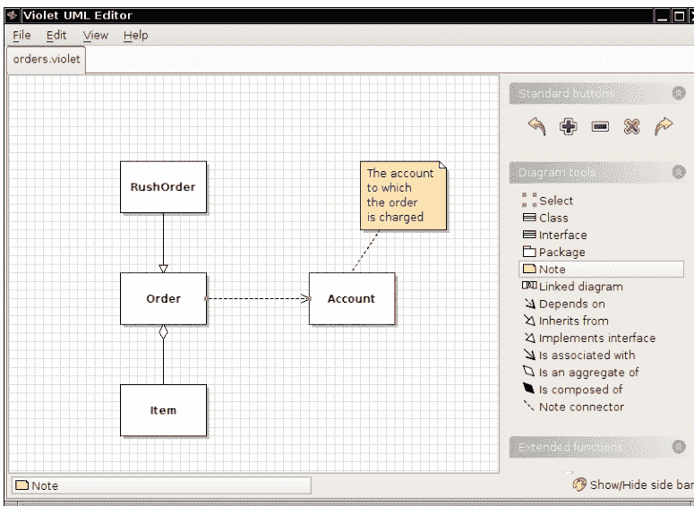

图 4.2：类图

表 4.1：类关系的 UML 符号

| 关系 | UML 连接器 |
| --- | --- |
| 继承 | |
| 接口实现 | |
| 依赖 | |
| 聚合 | ◇ |

## 4.2. 使用预定义类

在 Java 中，没有类你什么也做不了，你已经见过几个类在工作了。然而，并不是所有的类都展示了面向对象的典型特征。例如，`Math` 类。你已经看到可以使用 `Math` 类的方法，如 `Math.random`，而不需要知道它们是如何实现的——你只需要知道它们的名称和参数类型（如果有的话）。

这就是封装的意义，它对所有类来说都是如此。`Math` 类只封装了功能；它既不需要也不隐藏数据。由于没有数据，你不需要担心创建对象和初始化它们的实例字段——它们根本不存在！

在下一节中，我们将查看一个更典型的类，`Date` 类。你将看到如何构造对象并调用该类的方法。

### 4.2.1. 对象和对象变量

对于对象，你首先构造它们并指定它们的初始状态。然后你对对象应用方法。

在 Java 编程语言中，你使用构造函数来创建新实例。构造函数是一个特殊方法，其目的是构造和初始化对象。让我们来看一个例子。标准 Java 包含一个 `Date` 类。它的对象描述时间点，例如 1999 年 12 月 31 日 23:59:59 GMT。

> 注意：你可能会想：为什么使用类来表示日期，而不是（像某些语言那样）使用内置日期类型？在某些地区，日期的指定方式是月/日/年，而在另一些则是日/月/年。设计者真的能够预见到这些问题吗？如果你工作不好，语言就会变成一个令人不快的混乱杂烩，但不满的程序员对此无能为力。通过类，设计任务被交给了库库设计者。如果该类不完美，其他程序员可以轻松地编写自己的类来增强或替换系统。（为了证明这一点：`Date` 库开始时有点混乱，已经重新设计了两次。）

构造函数的名称与类名相同。因此，`Date` 类的构造函数名为 `Date`。要构造一个 `Date` 对象，将构造函数与 `new` 运算符结合使用如下：

```java
new Date();
```

此表达式构造了一个新对象。该对象被初始化为当前日期和时间。

如果你愿意，可以这样将对象传递给方法：

```java
System.out.println(new Date());
```

或者，你可以对刚刚构造的对象应用方法。`Date` 类的方法之一是 `toString()` 方法。该方法产生一个日期的表示。以下是你如何将 `toString` 方法应用于新构造的 `Date` 对象的：

```java
String s = new Date().toString();
```

在这两个示例中，构造的对象只使用了一次。通常，你希望保留你构造的对象，以便继续使用它们。只需将对象存储在变量中：

```java
Date rightNow = new Date();
```

图 4.3 显示了引用新构造对象的对象变量 `rightNow`。

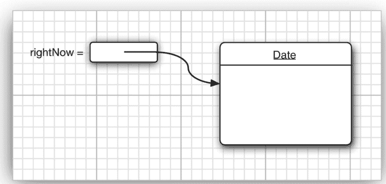

图 4.3：创建一个新对象

对象和对象变量之间存在重要的区别。例如，语句：

```java
Date startTime; // startTime 没有引用任何对象
```

这定义了一个对象变量 `startTime`，它可以引用 `Date` 类型的对象。重要的是要意识到，变量 `startTime` 不是一个对象，而且事实上，它还没有引用任何对象。你现在不能在该变量上使用任何 `Date` 方法。语句：

```java
s = startTime.toString(); // 尚未
```

将会导致编译时错误。

你必须先初始化 `startTime` 变量。你有两个选择。当然，你可以初始化该变量使其指向一个新构造的对象：

```java
startTime = new Date();
```

或者，你可以将变量设置为指向已有的对象：

```java
startTime = rightNow;
```

现在两个变量都指向同一个对象（参见图 4.4）。

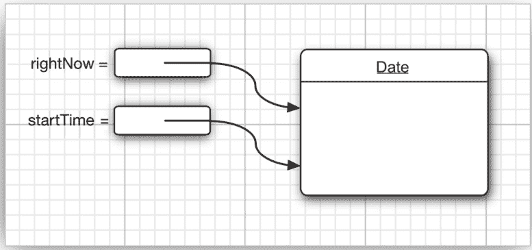

图 4.4：指向同一个对象的对象变量

重要的一点是，对象变量实际上并不包含对象。它只是引用一个对象。

在 Java 中，任何对象变量的值都是存储在其他地方对象的引用。`new` 运算符的返回值也是一个引用。如下所示语句：

```java
Date startTime = new Date();
```

包含两个部分。表达式 `new Date()` 创建了一个 `Date` 类型的对象，它的值是指向该新创建对象的引用。然后该引用被存储在 `startTime` 变量中。

你可以显式地将对象变量设置为 `null`，以表示它目前没有指向任何对象。

```java
startTime = null;
if (startTime != null)
System.out.println(startTime);
```

我在第 4.3.6 节中详细讨论了 `null`。

> **C++ 注意：** 有人误地认为 Java 对象变量的行为像 C++ 引用。在 C++ 中没有空引用，引用不能赋值。你应该将 Java 对象变量类比于 C++ 中的对象指针。例如：

```java
Date rightNow; // Java
```

实际上等同于：

```cpp
Date* rightNow; // C++
```

一旦你建立了这种联系，一切就迎刃而解了。当然，`Date*` 指针在通过调用 `new` 对其初始化之前是不会被初始化的。C++ 和 Java 的语法几乎相同。

```cpp
Date* rightNow = new Date(); // C++
```

如果你将一个变量拷贝到另一个变量，那么两个变量都指向同一个日期——它们是同一个对象的指针。Java 的 `null` 引用等同于 C++ 的 `NULL` 指针。

所有的 Java 对象都存储在堆上。当一个对象包含另一个对象变量时，它包含的只是指向另一个堆对象的指针。

在 C++ 中，指针可能会让你感到紧张，因为容易出错。很容易创建错误的指针或搞乱内存管理。在 Java 中，这些问题就消失了。如果你使用未初始化的指针，运行时系统会可靠地生成运行时错误，而不是产生随机结果。你不需要担心内存管理，因为垃圾器会处理它。

C++ 通过支持拷贝构造函数和赋值运算符付出了很大努力，允许实现自动拷贝自身的对象。例如，链表的拷贝是一个具有相同内容但具有独立链接集的新链表。这使得设计具有与内置类型相同拷贝行为的类成为可能。在 Java 中，你必须使用 `clone` 方法获取对象的完整拷贝。

## 4.2.2. Java 库中的 LocalDate 类

在前面的示例中，我们使用了标准 Java 库中的 `Date` 类。`Date` 类的实例有一个状态——即特定的时间点。

虽然在你在使用 `Date` 类时不需要知道这一点，但它是由从固定点（所谓的“纪元”）开始的毫秒数（正或负）表示的，该固定点是 1970 年 1 月 1 日 00:00:00。UTC 是协调世界时，在实际用途中，它与更熟悉的 GMT（格林威治标准时间）相同。

但事实证明，`Date` 类对于处理人类用于日期的某种历法信息（例如“1999 年 12 月 31 日”）并不有用。对日的特定描述遵循格列利亚历，这是世界上大多数国家使用的历法。同样的时间点在中国历或希伯来月历中的描述会完全不同，更不用说来自火星的客户所使用的日历了。

> 注意：在整个人类历史上，文明一直在与日历设计斗争，以为日期命名并为太阳和月份循环带来秩序。关于世界日历的精彩解释，请参见 Nachum Dershhowitz 和 Edward M. Reinold 著的 *French Revolutionary calendar* (Calendrical Calculations)(Cambridge University Press, 4th ed., 2018)。

库的设计者决定将记录时间与为时间点命名这两个关注分开。因此，标准 Java 库包含两个独立的类：表示时间点的 `Date` 类，以及用熟悉的日历表示表示日期的 `LocalDate` 类。现在有一套更健壮的类集用于处理日期和时间的各个方面——参见第二卷第 6 章。

将时间测量与历法分离是良好的面向对象设计。通常，使用不同的类来表示不同的概念是一个好主意。

你不需要使用构造函数来构造 `LocalDate` 类的对象。相反，静态工厂方法会为你调用构造函数。表达式：

```java
LocalDate.now()
```

构造一个对象构造时日期的新对象。

你可以通过提供年、月、日为特定日期构造对象：

```java
LocalDate.of(1999, 12, 31)
```

当然，你通常希望将构造的对象存储在对象变量中：

```java
LocalDate newYears = LocalDate.of(1999, 12, 31);
```

## 4.2.3. 修改器和访问器方法

再次观察上一节中看到的 `plusDays` 方法：

```java
LocalDate laterDate = newYears.plusDays(1000);
```

调用后 `newYears` 发生了什么？它没有变化。`plusDays` 方法产生了一个新对象并赋值给 `laterDate`。原始对象保持不变。（这是因为你在第 3 章看到的 `String` 类的 `toUpperCase` 方法。当你对字符串调用 `toUpperCase` 时，字符串保持不变，返回一个大写的副本字符串。）

早期的 Java 库有一个不同的类处理历法，称为 `GregorianCalendar`。这段代码片段向该类表示的日期增加了千天：

```java
GregorianCalendar someDay = new GregorianCalendar(1999, 0, 31);
// 该类的奇特特征：月份从 0 到 11
someDay.add(Calendar.DAY_OF_MONTH, 1000);
```

与 `LocalDate.plusDays` 方法不同，`GregorianCalendar.add` 方法是一个修改方法。调用它后，`someDay` 对象发生了变化。你可以通过以下方式查看新状态：

```java
year = someDay.get(Calendar.YEAR); // 2002
month = someDay.get(Calendar.MONTH) + 1; // 09
day = someDay.get(Calendar.DAY_OF_MONTH); // 26
```

这就是为什么变量命名为 `someDay` 而不是 `newYears`——在调用修改方法后，它不再是跨年夜了。

相比之下，只访问对象而不修改它们的方法有时是访问器方法。例如，`LocalDate.getY` 和 `GregorianCalendar.get` 就是访问器方法。

```text
16 17 18 19 20 21 22

23 24 25 26* 27 28 29

30
```

当前当天用星号（\*）标记。如你所见，程序需要知道如何计算月份长度以及给定日期的星期几。

让我们过一遍程序的关键步骤。首先，我们构造一个用当前日期初始化的对象。

```java
LocalDate date = LocalDate.now();
```

我们获取当前的月份和几号。

```java
int month = date.getMonthValue();
int today = date.getDayOfMonth();
```

然后，我们将日期设置为该月的第一天，并获取该日期的星期几。

```java
date = date.minusDays(today - 1); // 设置为月初
DayOfWeek weekday = date.getDayOfWeek();
int value = weekday.getValue(); // 1 = 星期一，... . 7 = 星期日
```

变量 `weekday` 被设置为一个 `DayOfWeek` 类型的对象。我们调用对象的 `get` 方法来获取星期几的数值。这产生了一个遵循国际惯例的整数，即周末在周的最后，星期一返回 1，星期二返回 2，以此此类推。星期日的值为 7。

注意日历的第一行有缩进，这样该月的第一天就会落在相应的星期几。以下是打印头部和第一行缩进的代码：

```java
System.out.println("Mon Wed Thu Fri Sat Sun");
for (int i = 1; i < value; i++) {
  System.out.print("  ");
}
```

现在，我们准备好打印日历的主体。我们进入一个循环，让 `date` 遍历月份的每一天。

在每次迭代中，我们打印日期。如果 `date` 是今天，则用星号标记日期。然后，我们将 `date` 推进到下一一天。当我们到达每个新周的开始时，打印一个新行：

```java
while (date.getMonthValue() == month) {
  System.out.printf("%3d", date.getDayOfMonth());
  if (date.getDayOfMonth() == today) {
    System.out.print("**");
  }
}
```

```java
System.out.print(" ");
date = date.plusDays(1);
if (date.getDayOfWeek().getValue() == 1) {
  System.out.println();
}
```

我们何时停止？我们不知道该月份是 31、30、29 还是 28 天。相反，只要 `date` 仍在当前月份，就继续迭代。

列表 4.1 显示了完整的程序。

如你所见，`LocalDate` 类使得编写一个日历程序成为可能，能够处理星期几和月份长度变化等复杂性。你不需要知道 `LocalDate` 如何计算月份和星期几。你只需要使用类的接口——例如 `plusDays` 和 `getDayOfWeek` 等方法。

这个示例的重点在于展示你如何使用类的接口执行相当复杂的任务，而无需了解实现细节。

# 列表 4.1 CalendarTest/CalendarTest.java


```java
import java.time.*;

/**
 * @version 1.5 2015-05-08
 * @author Cay Horstmann
 */
public class CalendarTest
{
    public static void main(String[] args)
    {
        LocalDate date = LocalDate.now();
        int month = date.getMonthValue();
        int today = date.getDayOfMonth();

        date = date.minusDays(today - 1); // 设置为月初
        DayOfWeek weekday = date.getDayOfWeek();
        int value = date.getValue(); // 1 = 星期一，... ... 7 = 星期日

        System.out.println("Mon Tue Wed Thu Fri Sat Sun");
        for (int i = 1; i < 1; i++) {
            System.out.print(" ");
        }
        while (date.getMonthValue() == month)
        {
            System.out.printf("%3d", date.getDayOfMonth());
            if (date.getDayOfMonth() == today)
                System.out.print("**");
            else
                System.out.print(" ");
            date = date.plusDays(1);
            if (date.getDayOfWeek().getValue() == 1) System.out.println();
        }
    }
}
```

```java
if (date.getDayOfWeek().getValue() != 1) System.out.println();
```

## `java.time.LocalDate`

### `LocalDate` 方法

- `static LocalDate now()`

  构造一个代表当前日期的对象。

- `static LocalDate of(int year, int month, int day)`

  构造一个代表给定日期的对象。

- `int getYear()`
- `getMonthValue()`
- `getDayOfMonth()`

  此日期的年、月、日。

- `DayOfWeek getDayOfWeek()`

  作为 `DayOfWeek` 类的实例获取当日的星期几。在 `DayOfWeek` 实例上调用 `getValue()` 以获取 1（星期一）到 7（星期日）之间的数值。

- `LocalDate plusDays(int n)`
- `LocalDate minusDays(int n)`

  返回此日期之后 n 天的日期。

# 4.3. 定义你自己的类

在第 3 章中，你开始编写简单的类。然而，所有这些类都只有一个方法。现在是时候展示如何编写能够执行复杂任务的类了。这些类通常不需要 `main` 方法。

## 4.3.1. 类的定义

最简单的类定义如下：

```
class Name
{
    field1
    field2
    constructor1
    constructor2
}
```

考虑以下 `Employee` 类的简化版本，它用于工资系统：

```java
class Employee
{
    private String name;
    private double salary;
    private LocalDate hireDay;

    public Employee(String n, double s, int year, int month, int day) {
        name = n;
        salary = s;
        hireDay = LocalDate.of(year, month, day);
    }

    public String getName() {
        return name;
    }

    public double getSalary() {
        return salary;
    }

    public LocalDate getHireDay() {
        return hireDay;
    }

    public void raiseSalary(double byPercent) {
        double raise = salary * byPercent / 100;
        salary += raise;
    }
}
```

在 Java 中，你将这些类拆分为不同的部分。例如，你可以将 `Employee` 类放入 `Employee.java` 文件，而将 `CalendarTest` 类放入 `CalendarTest.java` 文件中。

## 4.3.2. 使用多个源文件

如果你喜欢这种安排，在编译程序时有两种选择。你可以调用 Java 编译器并使用通配符：

```bash
javac Employee*.java
```

随后，所有匹配通配符的源文件将被编译成类文件。或者，你只需要输入：

```bash
javac EmployeeTest.java
```

你可能会发现很惊讶，尽管 `Employee.java` 文件从未被显式编译，但第二种选择仍然有效。然而，Java 编译器看到在 `EmployeeTest.java` 内部使用了 `Employee` 类，它会寻找一个名为 `Employee.class` 的文件。如果没有找到该文件，它会自动搜索 `Employee.java` 并将其编译。此外，如果它找到的 `Employee.java` 版本的时间戳比现有的 `Employee.class` 文件新，Java 编译器将重新编译该文件。

> 注意：如果你熟悉 UNIX 的 `make` 工具（或其在 Windows 下的类似工具），你可以将 Java 编译器看作已经内置了 `make` 功能。

## 4.3.3. 剖析 `Employee` 类

在接下来的章节中，我们将剖析 `Employee` 类。让我们从该类中的方法开始。通过检查源码可以看出，该类有一个构造函数和四个方法：

```
public Employee(String n, double s, int year, int month, int day)

public String getName()

public double getSalary()

public LocalDate getHireDay()

public void raiseSalary(double byPercent)
```

该类的所有方法都被标记为 `public`。关键字 `public` 意味着任何类中的任何方法都可以调用该方法。（四种可能的访问级别在本章和下一章中介绍）。

接下来，注意这三个实例字段，它们将存储在 `Employee` 类实例内部操作的数据。

```
private String name;

private double salary;

private LocalDate hireDay;
```

`private` 关键字确保了能够访问实例字段的方法只有 `Employee` 类本身的方法。任何外部方法无法读取或写入这些字段。

> 注意：你可以在实例字段上使用 `public` 关键字，但这是一个非常糟糕的主意。拥有 `public` 实例字段将允许程序的任何部分读取和修改这些字段，完全破坏封装性。任何类的任何方法都可以修改 `public` 字段——根据我的经验，某些代码会在你完全意想不到的时候利用访问权限。我强烈建议将所有的实例字段都设为 `private`。

最后，注意两个实例字段本身就是对象：`name` 和 `hireDay` 字段是对 `String` 和 `LocalDate` 对象的引用。这是非常常见的：类通常会包含类类型的实例字段。

## 4.3.4. 构造函数的第一步

让我们看看我们 `Employee` 类中列出的构造函数。

```
Employee(String n, double s, int year, int month, int day)
{
    name = n;
    salary = s;
    hireDay = LocalDate.of(year, month, day);
}
```

如你所示，构造函数的名字与类名相同。当你构造 `Employee` 类的对象时，该构造函数运行——赋予实例字段你想要的初始状态。

例如，当你使用如下代码创建 `Employee` 类的实例时：

```
new Employee("James Bond", 100000, 1950, 1, 1)
```

你已经如下设置了实例字段：

```
name = "James Bond"

salary = 100000;

hireDay = LocalDate.of(1950, 1, 1); // 1950年1月
```

构造函数与其他方法之间有一个重要的区别。构造函数只能与 `new` 运算符结合使用。你不能使用构造函数对现有对象来重置实例字段。例如：

```
james.Employee("James Bond", 250000, 1950, 1, 1) //
```

这是一个编译时错误。

我们将在本章晚些时候讨论构造函数。现在，请记住：

- 构造函数的名字与类名相同。
- 类可以有多个构造函数。
- 构造函数可以有零、一个或多个参数。
- 构造函数没有返回值。
- 构造函数始终通过 `new` 运算符调用。

**C++ 注意：**构造函数在 Java 中的工作方式与 C++ 相同。然而，请记住，所有的 Java 对象都在堆上构建的，且构造函数必须与 `new` 结合。C++ 程序员的一个常见错误是忘记使用 `new` 运算符：

```
Employee number007("James Bond", 100000, 1950, 1, 1); // 是 C++, 不是 Java
```

这在 C++ 中有效，但在 Java 中不可行。

> **警告：** 注意不要引入与实例字段同名的局部变量。例如，以下构造函数将不会设置 `name` 或 `salary` 字段：

```
public Employee(String n, double s, . . )
{
    String name = n; // 错误
    double salary = s; // 错误
}
```

该构造函数声明了局部变量 `name` 和 `salary`。这些变量只在构造函数内部可访问。它们遮蔽了同名的实例字段。某些程序员在打字比思考得快时会不小心写出这种代码，因为他们的手指自动添加了数据类型。这是一种难以追踪的恶性错误。你只需要在所有方法中都小心，不要使用与实例字段名同的变量。

## 4.3.5. 使用 `var` 声明局部变量

你可以使用 `var` 关键字声明局部变量而不是指定它们的类型，只要其类型是可以被推断出来的。例如，与其声明：

```
Employee e = new Employee("James Bond", 100000, 1950, 1, 1);
```

你只需要写：

```
var e = new Employee("James Bond", 100000, 1950, 1, 1);
```

这种方式很好，因为它避免了类型的重复。

> 注意：当你使用 `var` 时，编译器根据表达式确定类型。这仅对局部变量可行。

## 4.3.6. 处理 `null`

在 4.2 节中，你看到对象持有一个对象的引用，或者用 `null` 值表示对象的缺失。在我们的示例中，`hireDay` 字段保证是空 `null` 的，因为它是用一个新的 `LocalDate` 对象初始化的。但如果调用构造函数时传入了 `null` 参数，`name` 字段将为 `null`。

这里有两种解决方案。“宽容”的方法是将 `null` 参数转换为适当的非空值：

```
if (n == null) name = "unknown"; else name = n;
```

`Objects` 类为此目的提供了一个方便的方法：

```
public Employee(String n, double s, int year, month, int day)
{
    name = Objects.requireNonNullElse(n, "unknown");
}
```

“强硬”的方法是拒绝 `null` 参数：

```
public Employee(String n, double s, int year, month, int day)
{
    name = Objects.requireNonNull(n, "The name cannot be null");
}
```

如果有人用 `null` 构造一个 `Employee` 对象，那么就会发生 `NullPointerException`。乍一看，这似乎不是一个实用的补救措施。这样做有两个优势：

1. 异常报告包含了问题的描述。
2. 异常报告指出了问题的位置。否则，`NullPointerException` 将发生在其他地方，而无法轻易追踪到错误的构造函数参数。

> 注意：每当参数是对象引用时，请问问自己是否真的想要建模可以存在或缺失的值。如果不是，则采用抛异常的“强硬”方法。

## 4.3.7. 隐式和显式参数

方法操作对象并访问它们的实例字段。例如，该方法：

```
public void raiseSalary(double byPercent)
{
    double raise = salary * byPercent / 100;
    salary += raise;
}
```

为调用此方法的对象的 `salary` 实例字段设置一个新值。考虑以下调用：

```
number007.raiseSalary(5);
```

其效果是将 `number007.salary` 字段的值增加 5%。更具体地说，该调用执行了以下指令：

```
double raise = number007.salary * 5 / 100;

number007.salary += raise;
```

调用 `raiseSalary` 方法时有两个参数。第一个参数称为隐式参数，它是出现在方法名之前的 `Employee` 类型的对象。第二个参数，即括号内的数字，是显式参数。（有些人将隐式参数称为方法调用的目标对象或接收者。）

方法声明为显式参数定义了一个参数变量，命名为 `doublePercent`。然而，并没有为隐式参数声明参数变量。

每个方法都有一个隐式参数，其名称为关键字 `this`，并用隐式参数进行初始化。如果你愿意，可以这样写 `raiseSalary` 方法：

```
public void raiseSalary(double byPercent)
{
    double raise = this.salary * byPercent / 100;
    this.salary += raise;
}
```

一些程序员更喜欢这种风格，因为它清晰地区分了实例字段和局部变量。

> **C++ 注意：** 在 C++ 中，你通常在类外定义方法：

```
void Employee::raiseSalary(double byPercent) // C++, not Java
{}
```

如果你在类内部定义一个方法，那么它自动是一个内联方法。

```cpp
class Employee
{
    int getName() { return name; } // C++ 中的内联
}
```

在 Java 中，所有方法都定义在类内部。这并不意味着它们是内联的。寻找内联替换是 Java 虚拟机的工作。即时编译器会监控短小且被频繁调用的方法。如果它们只有一个或两个实现，代码就会内联，从而避免方法调用。

## 4.3.8. 封装的好处

最后，让我们更仔细地观察这些简单的 `getName`、`getSalary` 和 `getHireDay` 方法。

```java
public String getName()
{
    return name;
}
```

```java
public double getSalary()
{
    return salary;
}
```

```java
public LocalDate getHireDay()
{
    return hireDay;
}
```

这些是访问器方法（accessor methods）的明显示例。由于它们只是返回实例字段的值，因此有时也被称为字段访问器。

将 `name`、`salary` 和 `hireDay` 字段设为 `public` 不是比编写独立的访问器方法更容易吗？

使用方法可以给你提供更多的控制和安全性。考虑仅通过 `raiseSalary` 方法更改的 `salary` 字段。如果值出现错误，只需要对该方法进行调试。如果 `salary` 字段是公共的，搞乱值的罪祸首可能出现在任何地方。

有时，你想获取并设置实例字段的值。这时你需要提供三项：

- 一个私有的实例字段；
- 一个公共的字段访问器方法；以及
- 一个公共的字段修改方法（mutator method）。

这比提供单个公共实例字段要复杂得多，但它有相当的好处。

首先，你可以更改内部实现而不影响该类方法之外的任何代码。例如，如果将名称的存储更改为：

```java
String firstName;

String lastName;
```


那么 `getName` 方法可以更改为返回：

```java
firstName + " " + lastName
```

这一更改对程序的其余部分来说是完全不可见的。

当然，访问器和修改方法可能需要执行大量工作来转换旧的新数据表示。这引出了我们的第二个好处：修改方法可以执行错误检查，而简单赋值给字段的代码可能不会费力去处理这些问题。例如，`setSalary` 方法可以检查工资永远不小于 0。

> **注意：** 注意不要编写返回可变对象引用的访问器方法。在本书的上一个版本中，我在 `Employee` 类中违反了这条规则，其中 `getHireDay` 方法返回了一个类对象：

```java
class Employee
{
    private Date hireDay;

    ...

    public Date getHireDay()
    {
        return hireDay; // 错误
    }

    ...
}
```

与没有修改方法的 `LocalDate` 类不同，`Date` 类有一个修改方法 `setTime`，你可以在其中设置毫秒数。

`Date` 对象的可变性破坏了封装！考虑以下代码：

```java
Employee harry = new Employee();
Date d = harry.getHireDay();
double tenYearsInMilliseconds = 10 * 365.25 * 24 * 60 * 60 * 1000;

d.setTime(d.getTime() - (long) tenYearsInMilliseconds);

// 给 Harry 增加十年的工龄
```

原因是微妙的。`d` 和 `harry.day` 指向同一个对象（见图 4.5）。对 `d` 应用修改方法会自动改变 `Employee` 对象的私有状态！

**图 4.5：** 返回可变实例字段的引用

你将在第 6 章看到如何通过在返回之前对可变对象进行克隆来解决这个问题。

更好的补办法是在返回之前对可变对象进行克隆。

## 4.3.9. 类访问

`Date` 对象的可变性破坏了封装！考虑以下代码：

```java
Employee harry = new Employee();
Date d = harry.getHireDay();
double tenYearsInMilliseconds = 10 * 365.25 * 24 * 60 * 60 * 1000;

d.setTime(d.getTime() - (long) tenYearsInMilliseconds);

// 给 Harry 增加十年的工龄
```

原因是微妙的。`d` 和 `harry.day` 指向同一个对象（见图 4.5）。对 `d` 应用修改方法会自动改变 `Employee` 对象的私有状态！

**图 4.5：** 返回可变实例字段的引用

你将在第 6 章看到如何通过在返回之前对可变对象进行克隆来解决这个问题。

## 4.3.10. 私有方法

在实现类时，方法如何？有时，你可能希望将计算分成多个辅助方法。通常，这些辅助方法应该是私有的。要使方法变为私有，只需将关键字改为 `private`。

## 4.3.11. `final` 实例字段

你可以定义 `final` 实例字段。这种字段必须在构造对象时初始化。也就是说，你必须保证在构造函数结束时设置字段值。之后，该字段不能再修改。例如，由于没有 `setName` 方法，`Employee` 类的 `name` 字段可以声明为 `final`。

```java
class Employee {
    private final String name;

    ...
}
```

## 4.4. 静态字段和方法

在你看过的所有示例程序中，`main` 方法都标记了 `static` 修饰符。我们现在准备好讨论修饰符的含义了。

### 4.4.1. 静态字段

如果你将一个字段定义为 `static`，那么该字段不存在于类的对象。每个静态字段只有一个副本。你可以认为静态字段属于类，而不是属于单个对象。例如，假设我们想为每个员工分配一个唯一的标识符。我们在 `Employee` 类中添加一个实例字段 `id` 和一个静态字段 `nextId`：

```java
class Employee
{
    private static int nextId = 1;
    private int id;
}
```

每个 `Employee` 对象现在都有它自己的 `id` 字段，但只有一个 `nextId` 字段被该类的所有实例共享。换句话说，如果有 1,000 个 `Employee` 类的对象，那么就有 1,000 个实例字段 `id`，每个对象一个。但只有一个唯一的静态字段 `nextId`。即使没有 `Employee` 对象，静态字段 `nextId` 依然存在。它属于类，而不属于任何一个具体的对象。

> 注意：在某些面向对象的编程语言中，静态字段被称为类字段（class fields）。“static”这个词是 C++ 遗留下的一个没有意义的产物。

在构造函数中，我们将下一个可用 ID 分配给新的 `Employee` 对象，然后对其递增：

```java
id = nextId;
nextId++;
```

假设我们构造了对象 `harry`。那么 `harry` 的 `id` 字段被设置为静态字段 `nextId` 的当前值，并且静态字段的值会增加：

```java
harry.id = Employee.nextId;
Employee.nextId++;
```

> 警告：如果你不小心将本应作为实例字段的内容声明为 `static`，编译器不会帮助你发现错误。

从概念上讲，静态字段（如上例中的 `nextId`）属于类，而不属于任何对象。尽管如此，在 Java 中，你可以通过 `Employee.nextId` 或 `e.nextId` 来引用该字段（其中 `e` 是任何 `Employee` 对象）。在 `Employee` 类的方法内部，你可以使用 `nextId`、`this.nextId` 或 `Employee.nextId`。

因此，注意类中的任何静态声明是一个好主意。静态变量并不常见，值得仔细审查。在下一节中讨论的静态常量非常脱颖而出，因为它们的名称通常全大大写。

## 4.4.2. 静态常量

静态变量非常稀少。然而，静态常量更为常见。例如，`Math` 类定义了一个静态常量：

```java
public class Math
{
    public static final double PI = 3.14159265358979323846;
}
```

你可以在程序中使用 `Math.PI` 访问这个常量。

如果省略了 `static` 关键字，那么 `PI` 将成为 `Math` 类的实例字段。这意味着，你需要该类的对象才能访问 `PI`，而且每个 `Math` 对象都会拥有自己的 `PI` 副本。

另一个你使用过很多的静态常量是 `System.out`。它在 `System` 类中声明如下：

```java
public class System
{
    public static final PrintStream out = . . .;
}
```

正如多次提到的，公共字段永远不是好主意，因为每个人都可以修改它们。然而，公共常量（即 `final` 字段）是可以的。由于 `out` 已被声明为 `final`，你不能向其重新赋值你的打印流：

```java
System.out = new PrintStream(.); // 错误--out 是 final
```

> 注意：如果你查看 `System` 类，会发现一个将 `System.out` 设置为不同流的方法。你可能会奇怪该方法如何改变 `final` 变量的值。然而，`setOut` 是一个原生方法（native method），不是用 Java 编程语言实现的。原生方法可以绕过 Java 语言的访问控制机制。这是一种非常不寻常的解决方法，你不应该在程序中模仿它。

## 4.4.3. 静态方法

静态方法是不操作对象的方法。例如，`Math` 类的 `pow` 方法就是一个静态方法。表达式：

```java
Math.pow(x, a)
```

计算 $x^2$ 的幂次方。它没有使用任何 `Math` 对象来执行任务。换句话说，它没有隐式参数。

你可以将静态方法看作没有这个参数的方法。（在非静态方法中，该参数指的是方法的隐式参数——参见第 4.3.7 节。）

`Employee` 类的静态方法无法访问实例字段，因为它不操作对象。然而，静态方法可以访问静态字段。这里是这种静态方法的示例：

```java
public static int advanceId() {
    int r = nextId(); // 获取下一个可用 id
    nextId++;
    return r;
}
```

要调用此方法，你需要提供类名：

```java
n = Employee.advanceId();
```

你可以省略此方法的 `static` 关键字吗？可以，但那样你需要一个 `Employee` 类型的对象引用来调用该方法。

> 注意：调用静态方法是合法的。例如，如果 `harry` 是一个 `Employee` 对象，你可以调用 `harry.advanceId()` 代替 `Employee.nextId()`。然而，我发现这种表示法令人混淆。该方法看起来完全没有参与计算结果。我建议你使用类名而不是对象来调用静态方法。（否则你的 IDE 可能会建议你进行重构。）

在两种情况下使用静态方法：

- 当方法不需要访问对象状态时，因为所有需要的参数都是作为显式参数提供的（例如：`Math.pow`）。
- 当方法只需要访问类的静态字段时（例如：`Employee.nextId`）。

> C++ 注意：在 Java 和 C++ 中，静态字段和方法具有相同的功能。语法略有不同。在 C++ 中，你使用 `::` 运算符在作用域外访问静态字段或方法，例如 `Math::PI`。

“static”这个词有一个奇异的历史。最初，`static` 关键字被引入 C 语言用于表示局部变量，……

## 4.4.4. 工厂方法

这是静态方法的另一种常见用法。`Integer` 等类使用了静态方法。这里是获取各种样式的方式：

```java
NumberFormat currencyFormatter = NumberFormat.getCurrencyInstance();
NumberFormat percentFormatter = NumberFormat.getPercentInstance();
double x = 0.1;

System.out.println(currencyFormatter.format(x)); // 输出 $0.10
System.out.println(percentFormatter.format(x)); // 输出 10%
```

为什么 `NumberFormat` 类不使用构造函数？有三个使用工厂方法的理由：

- 你无法给构造函数命名。构造函数的名称与类相同。
- 当你使用构造函数时，无法改变对象的类型。但工厂方法可以返回子类的对象。（参见第 5 章。）
- 构造函数总是构造新对象。你可能希望共享实例。

## 4.4.5. `main` 方法

注意不需要对象就可以调用静态方法。例如，你从未构造 `Math` 类对象来调用 `pow`。

出于同样的原因，`main` 方法是一个静态方法。

```java
public class Application
{
    public static void main(String[] args)
    {
        // 在这里构造对象
    }
}
```

`main` 方法不操作对象。事实上，当程序启动时，还没有任何对象。静态 `main` 方法执行，并构造程序所需的对象。

> 提示：每个类都可以有一个 `main` 方法。这是给类添加演示代码的一种巧妙小技巧。例如，你可以为 `Employee` 类添加一个 `main` 方法。

```java
class Employee {
    public Employee(String n, double s, int year, int month, int day) {
        name = n;
        salary = s;
        hireDay = LocalDate.of(year, month, day);
    }

    public static void main(String[] args) // 单元测试 {
        var e = new Employee("Romeo", 50000, 2003, 3, 31);
        e.raiseSalary(10);
        System.out.println(e.getName() + " " + e.getSalary());
    }
}
```

要查看 `Employee` 类的演示，只需执行：

```bash
java Employee
```

如果 `Employee` 类是更大应用程序的一部分，你通过 `java Application` 启动应用程序，`Employee` 类的 `main` 方法永远不会执行。

> **预览注意**：作为 Java 21 的预览功能，`main` 方法不再需要是 `public` 或 `static`，且不再需要 `String[] args` 类型的参数。以下是新规则：
>
> - 如果存在多个 `main` 方法，静态 `main` 方法优于实例方法，带有 `String[]` 参数的方法优于无参数的方法。
> - 如果 `main` 不是静态的，则类必须有一个无参数构造函数。然后，启动器会构造该类的实例并调用 `main` 方法。

如果你想尝试此预览功能，请记住使用 `--enable-preview` 标志进行编译和运行。

列表 4.3 中的程序包含一个简单的 `Employee` 类版本，其中包含一个静态字段 `nextId` 和一个静态方法 `advance()`。我们用三个 `Employee` 对象填充数组，并打印员工信息。最后，我们打印下一个可用的标识码，以演示静态方法。

注意，`Employee` 类还有一个静态的 `main` 方法，用于运行一个简单的演示。通过执行它：

```bash
java Employee
java StaticTest/StaticTest.
```

## 列表 4.3 `StaticTest/StaticTest.java`

```java
/**
 * 此程序演示了静态方法。
 * @version 1.03 2021-09-03
 * @author Cay Horstmann
 */

public class StaticTest
{
    public static void main(String[] args)
    {
        // 在数组中填充三个 Employee 对象
        var staff = new Employee("Tom", 40000);
        staff[1] = new Employee("Dick", 60000);
        staff[2] = new Employee("Harry", 65000);

        // 打印所有 Employee 对象的信息
        for (Employee e : staff)
        {
            System.out.println("name=" + e.getName() + ",id=" + e.getId() + ",salary=" + e.getSalary());
        }

        int n = Employee.advanceId(); // 调用静态方法
        System.out.println("Next issued id=" + n);
    }
}

class Employee
{
    private static int nextId = 1;
    private String name;
    private double salary;
    private int id;

    public Employee(String n, double s)
    {
        name = n;
        salary = s;
        id = advanceId();
    }

    public String getName()
    {
        return name;
    }

    public double getSalary()
    {
        return salary;
    }

    public int getId()
    {
        return id;
    }

    public static int advanceId()
    {
        int r = nextId; // 下一个可用 id
        nextId++;
        return r;
    }

    public static void main(String[] args) // 运行演示
    {
        var e = new Employee("Harry", 50000);
        System.out.println(e.getName() + " " + e.getSalary());
    }
}
```


### java.util.Objects

- `static <T> void requireNonNull(T obj)`
- `static <T> void requireNonNull(T obj, String message)`
- `static <T> void requireNonNull(T obj, Supplier<String> messageSupplier)`

如果`obj`为空，这些方法将抛出一个没有消息或给定消息的`NullPointerException`。第 6 章解释了如何使用`supplier`延迟地获取值。第 8 章解释了`<T>`语法。

- `static <T> T requireNonNullElse(T obj, T defaultObj)`
- `static <T> T requireNonNullElseGet(T obj, Supplier<T> defaultSupplier)`

如果`obj`不空，则返回`obj`；如果默认对象`obj`为空，则返回。

## 4.5. 方法参数

让我们回顾描述编程语言中如何将参数传递给方法（或函数）的计算机科学术语*按值传递*（call by value）意味着方法仅获取调用者提供的值。相比之下，*按引用传递*（call by reference）意味着方法获取调用者提供的变量的*位置*。因此，方法可以*修改*通过引用传递的变量的值，但不能修改通过按值传递的值。这些“按……传递”术语是描述各种编程语言中方法参数行为的标准计算机科学术语，而不仅仅是 Java。（还有一种*按名传递*（call by name），主要具有历史意义，被用于 Algol 编程语言，这是一种非常高级的语言之一。）

Java 编程语言**始终**使用按值传递。这意味着方法获取所有参数的副本。特别是，方法无法修改方法调用中任何变量的内容。

例如，考虑以下调用：

```java
double percent = 10;
harry.raiseSalary(percent);
```

无论该方法如何实现，我们知道在方法调用后，`percent`的值仍然是 10。

让我们更仔细地观察这种情况。假设一个方法尝试将方法参数的值三倍：

```java
public static void tripleValue(double x) // 不起作用
{
    x = 3 * x;
}
```

我们调用这个方法：

```java
double percent = 10;
tripleValue(percent);
```

然而，这不起作用。在方法调用后，`percent`的值仍然是 10。发生的情况如下：

1. `x`使用`percent`值的副本初始化（即 10）。
2. `x`三倍——它现在是 30。但`percent`仍然是 10（见图 4.6）。
3. 方法结束，参数变量`x`不再被使用。

然而，方法参数有两种类型：

- 基本类型（数字类型、字符、布尔值）
- 对象引用

你已经看到方法是不改变基本类型参数的。对于对象参数，情况有所不同。你可以轻松实现一个让员工薪水三倍的方法：

```java
public static void tripleSalary(Employee x) // 起作用的
{
    x.raiseSalary(200);
}
```

当你调用

```java
harry = new Employee(.. );
tripleSalary(harry);
```

那么发生了以下情况：

1. `x`使用`harry`值的副本初始化——即一个对象引用。
2. `raiseSalary`方法被应用于该对象。
3. 方法结束，参数变量`x`不再被使用。

执行方法后，`harry`所引用的对象状态发生了变化。这是因为该方法通过对象引用的副本修改了状态。

最后，程序演示了`swap`方法的失败：

```
Testing swap:
Before: a=Alice
Before: b=Bob
End of method: x=Bob
End of method: y=Alice
After: a=Alice
After: b=Bob
```

你可以看到，参数`x`和`y`被交换了，但变量`a`和`b`没有受到影响。

> C++ Note：C++ 同时支持按值传递和引用传递。你可以用`&`标记引用参数。例如，你可以轻松地实现`void tripleValue(double& x)`或`void swap(Employee& x, Employee& y)`方法来修改它们的引用参数。

## 列表 4.4 ParamTest/ParamTest.java

```java
/*
 * 该程序演示了 Java 中的参数传递。
 * @version 1.01 2018-04-10
 * @author Cay Horstmann
 * */
public class ParamTest
{
    public static void main(String[] args) {
        /*
         * 测试 1: 方法不能修改数值参数
         */
        double percent = 10;
        System.out.println("Testing tripleValue: ");
        System.out.println("Before: percent=" + percent + "%");
        tripleValue(percent);
        System.out.println("After: percent=" + percent + "%");

        /*
         * 测试 2: 方法可以改变对象参数的状态
         */
        System.out.println("\nTesting tripleSalary: ");
        var harry = new Employee("Harry", 50000);
        System.out.println("Before: salary=" + harry.getSalary());
        tripleSalary(harry);
        System.out.println("After: salary=" + harry.getSalary());
    }
}
```

```java
/*
 * 测试 3: 方法不能为对象参数附加新对象
 */
System.out.println("\nTesting swap:");
  var a = new Employee("Alice", 70000);
  var b = new Employee("Bob", 60000);
  System.out.println("Before: a=" + a.getName());
  System.out.println("Before: b=" + b.getName());
  swap(a, b);
  System.out.println("After: a=" + a.getName());
  System.out.println("After: b=" + b.getName());
```

```java
public static void tripleValue(double x) // 无效
{
  // x = x * 3;
  System.out.println("End of method: x=" + x);
}
```

```java
public static void tripleSalary(Employee x) // 有效
{
  x.raiseSalary(200);
  System.out.println("End of method: salary=" + x.getSalary());
}
```

```java
public static void swap(Employee x, Employee y)
{
  Employee temp = x;
  x = y;
  y = temp;
  System.out.println("End of method: x=" + x.getName());
  System.out.println("End of method: y=" + y.getName());
}
```

```java
class Employee // 简化的 Employee 类
{
  private String name;
  private double salary;

  public Employee(String n, double s)
{
    name = n;
    salary = s;
  }

  public String getName()
  {
    return name;
  }

  public double getSalary()
  {
    return salary;
  }

  public void raiseSalary(double byPercent)
  {
    double raise = salary * byPercent / 100;
    salary += raise;
  }
}
```

## 4.6. 对象构造

你已经见过如何编写简单的构造函数来定义对象的初始状态。然而，由于对象构造非常重要，Java 提供了多种机制来编写构造函数。我们将在接下来的章节中介绍这些机制。

### 4.6.1. 重载

某些类拥有多个一个构造函数。例如，你可以这样构造一个空的`StringBuilder`对象：

```java
var messages = new StringBuilder();
```

或者，你可以指定一个初始字符串：

```java
var todoList = new StringBuilder("To do:\n");
```

这种功能允许重载。如果多个方法具有相同的名称（在这种情况下是`StringBuilder`构造方法）但参数不同，就会发生重载。编译器必须确定调用哪个方法。它通过匹配各种方法声明中的参数类型与特定方法调用中使用的参数类型来选择正确的方法。如果编译器无法匹配参数，就会发生编译错误，这可能是因为完全没有匹配，或者是因为没有一个比其他所有方法都更好的匹配。（寻找匹配的过程被称为重载解析。）

> Note：Java 允许你重载任何方法——而不仅仅是构造方法。因此，为了完全描述一个方法，你需要指定它的名称以及它的参数类型。这被称为方法的签名。例如，`String`类有四个名为`indexof`的公共方法。它们的签名如下：

```
indexOf(int)
indexOf(int, int)
indexOf(int, int, int)
indexOf(String)
indexOf(String, int)
indexOf(String, int, int)
```

（注：原文文本说有“四个公共方法”，但列出了六个。我将按照提供的列表进行处理。）

子对象，仅是对其他对象的引用。

### 4.6.4. 显式字段初始化

通过重载类中的构造方法，你可以以多种方式设置类中实例字段的初始状态。无论调用哪个构造方法，确保每个实例字段都被设置为某个有意义的值始终是一个好主意。

你可以简单地为类定义中的任何字段赋值。例如：

```java
class Employee
{
    private String name = "";
}
```

此赋值操作在构造方法执行之前完成。如果一个类的所有构造方法都需要将特定的实例字段设置为相同的值，那么这种语法特别有用。

初始化值不一定是一个常量。这里有一个使用方法调用初始化字段的示例。考虑`Employee`类，每个员工都有一个`id`字段。你可以这样初始化它：

```java
class Employee
{
    private static int nextId;
    private int id = advanceId();
    ...
    private static int advanceId()
    {
        int r = nextId;
        nextId++;
        return r;
    }
    ...
}
```

### 4.6.5. 参数名

当你编写非常简单的构造方法（你会写很多这样的）时，为参数起名字可能会有些沮丧。

我们通常选择使用单字母参数名：

```java
public Employee(String n, double s)
{
    name = n;
    salary = s;
}
```

然而，缺点是你需要阅读代码才能知道`n`和`s`参数的含义。有些程序员会在每个参数前加上“a”作为前缀：

```java
public Employee(String aName, double aSalary)
{
    name = aName;
    salary = aSalary;
}
```

这样好得多。任何读者都能立即明白参数的含义。

另一个常用的技巧依赖于参数变量会遮蔽（shadow）同名的实例字段这一事实。例如，如果你调用参数为`salary`，那么`salary`指的是参数，而不是实例字段。但你仍然可以通过`this.salary`访问实例字段。记住，这表示隐式参数——即被构造的对象。这里有一个示例：

```java
public Employee(String name, double salary)
{
    this.name = name;
    this.salary = salary;
}
```

> **C++ 注意：** 在 C++ 中，通常会在实例字段前加上下划线或固定字母。（字母`m`和`x`是常见的选择）。例如，`salary`字段可能被称为`_salary`、`mSalary`或`xSalary`。Java 程序员通常不这样做。

### 4.6.6. 调用另一个构造方法

关键字`this`指向方法的隐式参数。然而，该关键字还有第二个含义。

*如果构造方法的第一条语句的形式为`this( . . .)`，则该构造方法会调用同类的另一个构造方法。这里有一个典型的示例：*

```java
public Employee(double s)
{
    // 调用 Employee(String, double)
    this("Employee #" + nextId, s);
    nextId++;
}
```

当你调用`Employee(60000)`时，`Employee(double)`构造方法会调用`Employee(String, double)`构造方法。

像这样使用该关键字是有用的——你只需要编写一次公共构造代码。

> **C++ 注意：** Java 中的这种引用与 C++ 中的`this`指针相同。然而，在 C++ 中，你可以在成员初始化列表中调用另一个构造方法：

```cpp
Employee(double s) : Employee("Employee #" + nextId, s) { nextId++; }
```

### 4.6.7. 初始化块

你已经见过了初始化实例字段两种方法：

- 在构造方法中设置值
- 在声明中进行赋值

Java 中有第三种机制，称为*初始化块*（initialization block）。类声明包含任意的代码块。每当该类的对象被构造时，这些代码块就会被执行。例如：

```java
class Employee
{
    private static int nextId;
    private int id;
    private String name;
    private double salary;

    // 对象初始化块
    {
        id = nextId;
        nextId++;
    }

    public Employee(String n, double s)
    {
        name = n;
        salary = s;
    }

    public Employee()
    {
        name = "";
        salary = 0;
    }
}
```


在这个示例中，`id`字段在对象初始化块中初始化，无论使用哪个构造方法来构造对象。初始化块首先运行，然后执行构造方法的体。

这种机制并非总是必须的，也不常见。通常将初始化代码放置在构造方法内部会更直观。

> 注意：即使字段仅在类中定义，在初始化块中设置这些字段也是合法的。然而，为了避免循环定义，读取那些稍后才初始化的字段是不合法的。具体的规则在《Java 语言规范》第 8.3.3 节（<https://docs.oracle.com/javase/specs/>）中有详细说明。这些规则复杂到让编译器实现者都困惑——Java 的早期版本在实现它们时存在细微的错误。因此，你应该始终将初始化块放在字段定义之后。

由于有多种初始化实例字段的方法，给出构造过程的所有可能路径可能会非常困惑。以下是调用构造方法时发生的情况：

1. 如果构造方法的第一条语句调用了第二个构造方法，则第二个构造方法将使用提供的参数执行。
2. 否则：
   - 所有字段将被初始化为默认值（0、false 或 null）。
   - 所有初始化器和初始化块将按照它们在类声明中出现的顺序执行。
3. 构造方法的体被执行。

自然，组织你的初始化代码始终是一个好主意，这样另一个程序员就可以轻松理解它，而不需要成为语言法律专家。例如，如果一个类的构造方法依赖于实例字段声明的顺序，那将非常奇怪且容易出错。

要初始化静态字段，要么提供一个初始值，要么使用静态初始化块。你已经见过第一种机制：

```java
private static int nextId = 1;
```

如果你的类的静态字段需要复杂的初始化代码，请使用静态初始化块。

将代码放在块中并用关键字`static`标记它。这里有一个示例。我们希望员工 ID 从小于 10,000 的随机整数开始。

```java
private static int nextId;

static
{
    nextId = (int)(Math.random() * 10000);
}
```

```java
for (Employee e : staff) {
    System.out.println("name=" + e.getName() + ","id=" + e.getId() + ","salary=" + e.getSalary());
}

class Employee {
    private static int nextId;

    private int id;

    private String name = ""; // 实例字段初始化

    private double salary;

    private static RandomGenerator generator = RandomGenerator.getDefault();

    // 静态初始化块
    static {
        // 将 nextId 设置为 0 到 9999 之间的随机数
        nextId = generator.nextInt(10000);
    }

    // 对象初始化块
    {
        id = nextId;
        nextId++;
    }

    // 三重重载构造函数
    public Employee(String n, double s) {
        name = n;
        salary = s;
    }

    public Employee(double s) {
        // 调用 Employee(String, double) 构造函数
        this("Employee #" + nextId, s);
    }

    // 默认构造函数
    public Employee() {
        // name 初始化为 ""--见上文
        // salary 未显式设置--初始化为 0
        // id 在初始化块中初始化
    }

    public String getName() {
        return name;
    }

    public double getSalary() {
        return salary;
    }

    public int getId() {
        return id;
    }
}
```

# `java.util.random.RandomGenerator.next(int n)`

- 返回一个 0 到 n - 1 之间的随机整数。
- `static RandomGenerator.of(String name)`

  根据给定的算法名称产生随机生成器。算法 `"L64X128MiXRandom"` 适用于大多数应用程序。
- `static RandomGenerator.getDefault()`

  产生一个具有 64 位或更多状态位的强随机生成器。

# `java.util.Random 1.0`

- `static from(RandomGenerator generator)`

  返回一个 `Random` 实例，其方法委托给给定的 `RandomGenerator`。这对于遗留代码非常有用。

## 4.6.8. 对象的销毁与 `finalize` 方法

某些面向对象的编程语言（特别是 C++）具有显式的析构函数方法，用于在对象不再被使用时可能需要的任何清理代码。析构函数中最常见的活动是回收为对象分配的内存。由于 Java 具有自动垃圾回收机制，不需要手动回收内存，Java 不支持析构函数。

当然，某些对象会利用内存以外的资源，例如文件或另一个使用系统资源的对象的句柄。在这种情况下，当资源不再需要时，对其进行回收和循环利用是非常重要的。

如果你在完成使用后需要立即关闭资源，请提供一个执行必要清理工作的`close`方法。你可以在完成对象操作后调用`close`方法。详见第 7 章。此方法会被自动调用。

如果你可以等待直到虚拟机退出，可以使用带有`Runtime.addShutdownHook()`方法的“停机钩子”（shutdown hook）使用`Cleaner`类注册一个在对象不再可达时（除 cleaner 之外）执行的操作。这些情况在实践中并不常见。有关这两种方法的详细信息，请参阅 API 文档。

> 警告：不要使用`finalize`方法进行清理。该方法旨在在垃圾回收器扫描掉对象之前调用。

然而，你无法知晓该方法何时会被调用，而且它现在已被弃用并移除。

## 4.7. Records

有时，数据仅仅是数据，而面向对象编程的数据隐藏会产生阻碍。考虑一个`Point`类，它描述平面上的一个点，具有 x 和 y 坐标。

当然，你可以创建一个类：

```java
class Point {
    private final double x;
    private final double y;

    public Point(double x, double y) {
        this.x = x;
        this.y = y;
    }

    public double getX() {
        return x;
    }

    public double getY() {
        return y;
    }

    public String toString() {
        return "Point[x=%d,y=%d]".formatted(x, y);
    }

    // 方法 .
}
```

但是隐藏 x 和 y，然后通过 getter 方法提供这些值，真的有意义吗？

你会想要改变`Point`的实现吗？当然，有极坐标系，但你不会在图形 API 中使用它们。在实践中，平面上的点完全由其 x 和 y 坐标描述。

为了更简洁地定义此类类，JDK 14 将 "records" 作为一项预览特性引入。最终版本在 JDK 16 中交付。

### 4.7.1. Record 概念

record 是类的一种特殊形式，其状态是不可变的并且对公共可见的。要声明一个 record，提供名称和持有对象状态的实例变量。以下是将`Point`定义为 record 的方式：

```java
record Point(double x, double y) { }
```

其结果是一个具有实例字段的类：

```java
private final double x;
private final double y;
```

在 Java 语言规范中，record 的实例字段被称为其组件（components）。

该类有一个构造函数：

```java
Point(double x, double y)
```

以及访问器方法：

```java
public double x()
public double y()
```

注意，访问器被命名为 x 和 y，而不是`get`。而且……是合法的。

### 记录构造函数示例

```java
constructor
{
    if (from <= to) {
        this.from = from;
        this.to = to;
    } else {
        this.from = to;
        this.to = from;
    }
}
```

# 列表 4.6 `RecordTest/RecordTest.java`

```java
import java.util.*;

/**
 * 此程序演示了记录类。
 * @Version 1.0 2021-05-13
 * @Author Cay Horstmann
 */
public class RecordTest {
    public static void main(String[] args) {
        var p = new Point(3, 4);

        System.out.println("Coordinates of p: " + p.x() + " " + p.y());
        System.out.println("Distance from origin: " + p.distanceFromOrigin());

        // 与静态字段和方法相同的计算
        System.out.println("Distance from origin: " + Point.distanceFrom(Point.ORIGIN, p));

        // 一个可变的 record
        var pt = new PointTime(3, 4, new Date());

        System.out.println("Before: " + pt);
        pt.when().setTime(0);
        System.out.println("After: " + pt);

        // 调用一个紧凑构造函数
        var r = new Range(4, 3);
        System.out.println("r: " + r);
    }
}

record Point(double x, double y) {
    // 自定义构造函数
    public Point() {
        this(0, 0);
    }

    // 一个方法
    public double distanceFromOrigin() {
        return Math.hypot(x, y);
    }

    // 静态字段和方法
    public static Point ORIGIN = new Point();

    public static double distance(Point p, Point q) {
        return Math.hypot(p.x - q.x, p.y - q.y);
    }
}

record PointInTime(double x, double y, Date when) {}

record Range(int from, int to) {
    // 紧凑构造函数
    public Range {
        if (from > to) { // 交换边界
            int temp = from;
            from = to;
            to = temp;
        }
    }
}
```

## 4.8. 包（Packages）

Java 允许将类分组在包中。包对于组织工作以及将你的工作与其他提供的代码库分开非常方便。在接下来的章节中，你将学习如何使用和创建包。

### 4.8.1. 包名

使用包的主要用目录保证类名的唯一性。假设两个程序员都出了一个好主意，提供一个`Employee`类。只要他们都将自己的类放在不同的包中，就不会产生冲突。事实上，为了绝对保证包名的唯一性，你可以反向使用 Internet 域名（这已知是唯一的）。当你为不同的项目使用子包时，例如，考虑`hortmann.com`域名。当反过来书写时，它变成了包名`com.horstmann`。然后你可以追加一个项目名称，例如`com.horstmann.corejava`。如果你将`Employee`类放在该包中，那么它的“全限定”名就变成了`com.horstmann.corejava.Employee`。

> 注意：从编译器的角度来看，嵌套包之间绝对没有任何关系。例如，`java.util`和`java.util.jar`包之间彼此无关。每个包都是自己独立的类集合。

### 4.8.2. 类导入（Class Import）

一个类可以使用其所在包中的所有类，以及其他包中的所有公共类。

你可以通过两种方式访问另一个包中的公共类。第一种是直接使用全限定名；即包名后跟类名。例如：

```java
java.time.LocalDate today = java.time.LocalDate.now();
```

这显然很麻烦。一种更简单、更常见的方法是使用简写来引用包中的类。一旦你添加了`import`，就不再需要给类提供全名了。

你可以导入特定的类或整个包。你将`import`语句放在源文件的顶部（但在任何`package`语句之下）。例如，你可以用语句导入`java.time`包中的所有类：

```java
import java.time.*;
```

然后你就可以使用：

```java
LocalDate today = LocalDate.now();
```

而不需要包前缀。你也可以导入包中的特定类：

```java
import java.time.LocalDate;
```

`java.time.*`语法不那么麻烦。它对代码大小没有负面影响。然而，如果你显式地导入类，代码的读者就能确切知道你使用了哪些类。

但是请注意，你只能使用`*`符号导入单个包。你不能通过`import java.*`或`import java.*.*`来导入所有带有`java`前缀的包。

> 注意：你永远不需要从`java.lang`包导入类。

> 提示：集成开发环境有命令来组织导入语句。诸如`import java.util.*;`这样的包语句会自动展开为特定导入的列表，例如：

```java
import java.util.ArrayList;
import java.util.Date;
```

### 4.8.3. 静态导入（Static Imports）

`import`语句的一种形式允许导入静态方法和字段，而不只是类。

例如，如果你在源文件顶部添加指令：

```java
import static java.lang.System.*;
```

那么你就可以在没有类前缀的情况下使用`System`类的静态方法和字段：

```java
out.println("Goodbye, World!"); // 即 System.out

exit(); // 即 System.exit
```

你也可以导入特定的方法或字段：

```java


```java
import static java.lang.System.out;
```

在实践中，许多程序员是否想要缩写`System.out`或`System.exit`令人怀疑。生成的代码看起来没那么清晰。另一方面，

```java
sqrt(pow(x, 2) + pow(y, 2))
```

看起来比

```java
Math.sqrt(Math.pow(x, 2) + Math.pow(y, 2))
```

要清晰得多。

你可以如下方式导入枚举常量：

```java
import java.time.DayOfWeek;

import static java.time.DayOfWeek.*;

DayOfWeek w = FRIDAY; // 等于 DayOfWeek.FRIDAY
```

> 预览注意：`STR`插值器是 Java 21 的一个预览功能。它用于形成带有嵌入表达式的字符串，如下：

```java
STR."Hello, \{name}! Next year, you'll be \{age + 1}",
```

`STR`标识符总是被导入的，就像存在这样一个语句一样：

```java
import static java.lang.StringTemplate.STR;
```

## 4.8.4. 将类添加到包中

要将类放在包中，请将包名放在源文件的顶部，位于定义该包内类的代码之前。例如，列表 4.8 中的`Employee.java`文件起始部分如下所示：

```java
package com.horstmann.corejava;

public class Employee
{
}
```

如果你不在源文件中放置`package`语句，那么类就属于未命名包（unnamed package）。未命名包没有包名。到目前，我们所有的示例类都位于未命名包中。

将源文件放在与全包名匹配的子目录中。例如，`com.horstmann.corejava`包中的所有源文件都应该位于`com/horstmann/corejava`目录下（在 Windows 系统上）。编译器会将文件放入相同的目录结构中。

这里是一个分布在两个包中的示例程序：`PackageTest`类属于未命名包——参见列表 4.7。列表 4.8 所示的`Employee`类属于`com.horstmann.corejava`包。因此，`Employee.java`文件必须位于`com/horstmann/corejava`子目录下。换句话说，目录结构如下：

- （基础目录）
- `PackageTest.java`
- `PackageTest.class`
- `com/`
  - `horstmann/`
    - `corejava/`
      - `Employee.java`
      - `Employee.class`

要编译此程序，只需切换到基础目录并运行命令`javac PackageTest.java`。编译器会自动找到文件`com/horstmann/corejava/Employee.java`并将其编译。

> 注意：当使用 IDE 或构建工具时，类文件通常被放置在单独的目录树中。

让我们来看一个更实际的例子，在这个例子中，我们不使用未命名包，而是类分布在几个包中（`com.horstmann.corejava`和`com.mycompany`）。

- （基础目录）
  - `com/`
    - `horstmann/`
      - `corejava/`
        - `Employee.java`
        - `Employee.class`
  - `mycompany/`
    - `PayrollApp.java`
    - `PayrollApp.class`

在这种情况下，你仍然必须从*基础目录*（base directory）编译和运行类——即包含`com`目录的目录：

```bash
javac com/mycompany/PayrollApp.java

com.mycompany.PayrollApp
```

注意，编译器操作的是*文件*（带有文件分隔符和`.java`扩展），而 Java 解释器加载的是*类*（带有点分隔符）。

> **提示：** 从下一章开始，我们将在源码中使用包。这样一来，你就可以为每个章节创建一个 IDE 项目，而不是为每个节创建。

> **警告：** 编译器在编译源文件时**不会检查**目录结构。例如，假设你有一个以以下指令开头的源文件：

```java
package com.mycompany;
```

只要该文件没有包含在`com/mycompany`子目录下，你就可以编译该文件。如果源文件不依赖于其他包，则它将无错误地编译。然而，除非你先将所有类移动到正确的位置，否则生成的将无法运行。如果包与目录不匹配，*虚拟机*将找不到这些类。

### 列表 4.7 `PackageTest/PackageTest.java`

```java
1 import com.horstmann.corejava.*;
2 // Employee 类定义在那个包中
3
4 import static java.lang.System.*;
/**
 * 此程序演示了包的使用。
 * @version 1.11 2004-02-19
 * @author Cay Horstmann
 */
public class PackageTest
{
    public static void main(String[] args)
    {
        // 因为有静态导入语句，我们在这里不需要
        // com.horstmann.corejava.Employee
        var harry = new Employee("Harry Hacker", 50000, 1989, 10, 1);
        harry.raiseSalary(5);

        // 因为有静态导入语句，我们不需要使用 System.out
        out.println("name=" + harry.getName() + ", "salary=" + harry.getSalary());
    }
}
```

### 列表 4.8 `PackageTest/com/horstmann/corejava/Employee.java`

```java
package com.horstmann.corejava;

// 此文件中的类是该包的一部分
import java.time.*;

// import 语句位于 package 语句之后
/**
 * @version 1.11 2015-05-08
 * @author Cay Horstmann
 */
public class Employee
{
    private String name;
    private double salary;
    private LocalDate hireDay;

    public Employee(String name, double salary, int year, int month, int day)
    {
        this.name = name;
        this.salary = salary;
        hireDay = LocalDate.of(year, month, day);
    }

    public String getName()
    {
        return name;
    }

    public double getSalary()
    {
        return salary;
    }

36 public LocalDate getHireDay()
37 {
38 return hireDay;
39 }

40 public void raiseSalary(double byPercent)
41 {
42 double raise = salary * byPercent / 100;
43 salary += raise;
44 }

45 }
```

## 4.8.5. 包访问

你已经接触了访问修饰符`public`和`private`。标记为`public`的特征可以在任何类中使用。标记为`private`的特征只能由定义它的类使用。如果你不指定其中一个，它们默认是包访问。

考虑列表 4.7 中的程序。列表 4.8 所示的`Employee`类属于`com.horstmann.corejava`包。因此，`Employee.java`文件必须位于`com/horstmann/corejava`子目录下。换句话说，目录结构如下：

- （基础目录）
- `PackageTest.java`
- `PackageTest.class`
- `com/`
  - `horstmann/`
    - `corejava/`
      - `Employee.java`
      - `Employee.class`

要编译此程序，只需切换到基础目录并运行命令`javac PackageTest.java`。编译器会自动找到文件`com/horstmann/corejava/Employee.java`并将其编译。

这是一个合理的问题。这里有一个来自 JDK 的示例：

```java
package java.awt;

public class Window
{
    String warningString;
}
```

注意，编译器操作的是*文件*（带有文件分隔符和`.java`扩展），而 Java 解释器加载的是*类*（带有点分隔符）。

默认情况下，包不是封闭的实体。也就是说，任何人都可以向包添加类。当然，恶意或愚蠢的程序员随后可以添加修改变量的代码。例如，在早期版本中，很容易将另一个类带入`java.awt`包。通过这种手段，可以修改警告字符串（见图 4.9）。

从 1.2 版本开始，JDK 实现者操纵类加载器，显式不允许加载以`"java"`开头的用户自定义类。当然，你的类并没有从中受益。另一种已过时的机制允许 JAR 文件声明包为*密封*（sealed），防止第三方对其进行扩展。现在，你应该使用模块来封装包。

## 4.8.6. 类路径

正如你所见，类存储在文件系统的子目录。类的路径必须与包名匹配。类文件也可以存储在 JAR（存档文件）中。JAR 文件包含多个类文件和子目录的压缩格式，可以节省空间并提高性能。当你在程序中使用第三方库时，将获得一个或多个 JAR 文件。你将在 4.9.1 节中看到如何创建自己的 JAR 文件。

要在程序之间共享类，你需要执行以下操作：

1. 将你的类文件放在一个目录内——例如`/home/user/classdir`。请注意，该目录是包树的基础目录。如果你添加了`com.horstmann.corejava.Employee`，那么`Employee.class`文件必须位于子目录`/home/user/classdir/com/horstmann/corejava`中。
2. 将任何 JAR 文件放在一个目录内——例如`/home/user/archives`。
3. 设置类路径（class path）。类路径是所有可以包含类文件的位置集合。

在 UNIX 中，类路径上的元素用冒号分隔：

```text
/home/user/classdir:::/home/user/archives/archive.jar
```

在 Windows 中，它们用分号分隔：

```text
c:\classdir;c:\archives\archive.jar
```

在两种情况下，点（`.`）表示当前目录。

该类路径包含：

- 基础目录`/home/user/classdir`或`c:\classdir`；
- 当前目录（`.`）；
- JAR 文件`/home/user/archives/archive.jar`或`c:\archives\archive.jar`。

你可以为 JAR 文件目录指定通配符，如下：

```text
/home/user/classdir:::/home/user/archives/\*
```

或者：

```text
c:\classdir;.;c:\archives\*
```

在 UNIX 中，`*`必须经过转义以防止 shell 扩展。

archives 目录中的所有 JAR 文件（但不包括`.class`文件）都包含在此类路径中。

Java API 始终会在当前目录中搜索文件；不要将其包含在类路径中。

> 注意：`javac`编译器始终会在当前目录中查找文件，而 Java 虚拟机启动器只有在“.”位于类路径上时才会查找当前目录。如果你没有设置类路径，这并不是问题——默认类路径由“.”目录组成。但如果你设置了类路径却忘记包含“.”目录，你的程序将能够无错误地编译，但无法运行。

类路径列出了所有作为定位类起点的目录和存档文件。让我们考虑我们的示例类路径：

```text
/home/user/classdir::/home/user/archives/archive.jar
```

假设虚拟机正在查找`com.horstmann.corejava.Employee`类的类文件。它首先在 Java API 类中查找。它在那里没有找到该类文件，因此转向类路径。它查找以下文件：

- `/home/user/classdir::/horstmann/corejava/Employee.class`
- 从当前目录开始的`/com/horstmann/corejava/Employee.class`
- `/home/user/archives/archive.jar`内部的`/com/horstmann/corejava/Employee.class`

编译器定位文件的难度比虚拟机要大。如果你在没有指定包的情况下引用了一个类，编译器首先需要找到包含该类的包。它查询所有的`import`指令作为类的可能来源。例如，假设源文件包含指令：

```java
import java.util.*;

import com.horstmann.corejava.*;
```

并且源代码引用了类`Employee`。编译器会尝试寻找`java.lang.Employee`（因为`java.lang`包总是默认被导入的）、`java.util.Employee`、`com.horstmann.corejava.Employee`以及当前包中的`Employee`。它会在类路径的所有位置中搜索这些每一个类。如果找到了多个类，则会导致编译时错误。（完全限定类名必须是唯一的，因此`import`语句的顺序很重要。）

编译器更进了一步。它查看源文件以检查源码是否比类文件新。如果是，源码将自动重新编译。记住你可以从其他包导入公共类。一个源文件可以包含一个公有类，且文件名与公有类名必须匹配。因此，编译器可以轻松地定位公共类的源文件。然而，你可以从当前包导入非公共类。这些类可能定义在不同名称的源文件中。如果你从当前包导入一个类，编译器会搜索当前包的所有源文件，以查看哪一个定义了该类。

## 4.8.7. 设置类路径

IDE 和构建工具有它们自己管理类路径的机制。但了解如何手动设置它是一个好主意，这样你就可以排除任何配置问题。

最好使用`-classpath`（或`-cp cp`）或更现代的变体`--class-path`来指定类路径：

```bash
java -classpath /home/user/classdir::/home/user/archives/archive.jar MyProg
```

或者：

```bash
java -classpath c:\classdir;;c:\archives\archive.jar MyProg
```

整个命令必须写在一行中。将此类长命令行放在 shell 脚本或批处理文件中是一个好主意。

使用`-CLASSPATH`选项是设置类路径的首选方法。另一种方法是`CLASSPATH`环境变量。具体取决于你的系统。使用 Bourne shell（bash），使用：

```bash
export CLASSPATH=/home/user/classdir:/home/user/archives/archive.jar
```

使用 Windows shell，使用：

```bat
set CLASSPATH=c:\classdir;;c:\archives\archive.jar
```

类路径一直有效直到 shell 退出。

> 注意：有些人建议永久设置`CLASSPATH`变量。这通常是一个坏主意。

## 4.9. JAR 文件

当你打包应用程序时，你希望给用户提供一个文件，而不是一个充满类文件的目录。Java 档（JAR）文件正是为此设计的。JAR 文件可以包含类文件和其他类型（如图像和声音文件）。此外，JAR 文件使用了熟悉的 ZIP 格式压缩。

### 4.9.1. 创建 JAR 文件

使用该工具制作 JAR 文件。（在默认 JDK 安装中，它位于 bin 目录。）制作新 JAR 文件的常用命令使用以下语法：

```bash
jar cvf fileName file1 file2 .
```

例如：

```bash
jar cvf CalculatorClasses.jar *.class icon.png
```

通常，`jar`命令具有以下格式：

```bash
jar options file1 file2 .
```


表 4.2 列出了 `jar` 程序的所有选项。它们与 UNIX `tar` 命令的选项相似。

# 表 4.2：`jar` 程序选项

| 选项 | 描述 |
| --- | --- |
| `c` | 创建一个新的空存档并向其中添加文件。如果指定的名称是目录，`jar` 程序将递归处理它们。 |
| `C` | 临时切换目录。例如，`jar cvf fileName -C classes *.class` 会切换到 `classes` 目录添加类文件。 |
| `e` | 在清单文件中创建入口（见第 4.9.3 节）。 |
| `f` | 指定第二个参数作为 JAR 文件名。如果缺少此参数，`jar` 将结果输出到标准输出（创建 JAR 时）或从标准输入读取（提取或列出 JAR 时）。 |
| `i` | 创建索引文件（用于加快大型存档中的查找）。 |
| `m` | 为 JAR 文件添加清单。清单是存档内容和来源的描述。每个存档都有默认清单，但如果你想验证存档内容，可以提供自己的清单。 |
| `M` | 不为条目创建清单文件。 |
| `t` | 显示目录。 |
| `u` | 更新现有的 JAR 文件。 |
| `v` | 生成详细输出。 |
| `x` | 提取文件。如果你提供了一个或多个文件名，则只提取这些文件。否则，提取所有文件。 |
| `0` | 在不进行 ZIP 压缩的情况下存储。 |

你可以将应用程序和代码库打包成 JAR 文件。例如，如果你想在 Java 程序中发送邮件，你可以使用一个封装在 `java.mail.jar` 中的库。

## 4.9.2. 清单文件（Manifest）

除了类文件、图像和其他资源外，每个 JAR 文件都包含一个描述存档特殊特性的清单文件（manifest file）。

清单文件名为 `MANIFEST.MF`，位于 JAR 文件中特殊的 `META-INF` 子目录。最简单的清单文件非常单调——只有：

```text
Manifest-Version: 1.0
```

复杂的清单可以包含许多条目。清单条目被分为若干部分。清单中的第一部分称为主部分（main section），适用于整个 JAR 文件。随后的条目可以指定命名实体（如单个文件、包或 URL）的属性。这些条目必须以 `Name` 条目开头。部分之间用空行隔开。例如：

```text
Manifest-Version: 1.0

描述此存档的行

Name: Wozzle.class

描述此文件的行

Name: com/mycompany/mypkg/

描述此包的行
```

要编辑清单，请将你想添加到清单中的行写入文本文件。然后运行：

```text
jar jarFileName manifestFileName . . .
```

例如，要创建一个带有清单的新 JAR 文件，请运行：

```text
jar MyArchive.jar manifest.mf com/mycompany/mypkg/.class
```

若要更新现有 JAR 文件的清单，请将要添加的内容放入文本文件，并使用如下命令：

```text
jar ufm MyArchive.jar manifest-additions.mf
```

> 注意：有关 JAR 和清单文件格式的更多信息，请参阅 [https://docs.oracle.com/en/java/javase/21/docs/specs/jar/jar.html](https://docs.oracle.com/en/java/javase/21/docs/specs/jar/jar.html)。

## 4.9.3. 可执行 JAR 文件

你可以使用 `jar` 命令的 `e` 选项来指定程序的入口——即你在调用 Java 程序启动器时通常会指定的类：

```text
jar cvfe MyProgram.jar com.company.mypkg.MainClass files to add
```

或者，你可以在清单中指定程序的主类，格式如下的语句：

```text
Main-Class: com.company.mypkg.MainClass
```

不要为主类名添加类扩展名。

> 警告：清单文件中的最后行必须以换行符结束。否则，清单将无法正确读取。常见的错误是生成了一个没有终止符的包含 `Main-Class` 行的文本文件。

使用任何方法，用户都可以简单地启动程序：

```text
java -jar MyProgram.jar
```

取决于操作系统的配置，用户甚至可以通过双击 JAR 文件图标来启动应用程序。以下是各种操作系统的行为：

- 在 Windows 上，Java 运行时为 `.jar` 扩展名创建文件关联，使用 `java -jar` 命令启动文件。（与 `java` 命令不同，`java` 命令不会打开 shell 窗口）。
- 在 Mac OS X 上，操作系统识别 `.jar` 文件扩展名，并在双击 JAR 文件时执行 Java 程序。

然而，JAR 文件中的 Java 程序用起来与原生应用程序不同。在 Windows 上，你可以使用第三方包装器（wrappers）将 JAR 文件转换为 Windows 可执行文件。包装器是一个具有熟悉的 `.exe` 扩展名的 Windows 程序，用于定位并启动 Java 虚拟机（JVM），或者在未找到 JVM 时告诉用户该怎么做。有很多商业和开源产品，例如 Launch4J（[https://launch4j.sourceforge.net](https://launch4j.sourceforge.net)）和 IzPack（[https://github.com/izpack/izpack](https://github.com/izpack/izpack)）。

## 4.9.4. 多版本 JAR 文件

随着模块的引入和包的强封装，某些以前可以访问的内部 API 不再可用。这可能需要库提供为不同的 Java 版本分发不同的代码。多版本 JAR（Multi-release JARs）处理了这种用例。

为了向后兼容，特定版本的类文件被放在 `META-INF/versions` 目录下：

```text
Application.class

BuildingBlocks.class

Util.class

META-INF/

  MANIFEST.MF（包含行 Multi-Release: true）

  versions

    9

      Application.class

      BuildingBlocks.class

    10

      BuildingBlocks.class
```

假设 `Application` 类使用了 `CssParser` 类。那么旧的 `Application` 类可以编译为使用 `com.sun.javafx.css.CssParser`，而 Java 9 版本使用 `javafx.css.CssParser`。

Java 8 完全不知道 `META-INF/versions` 目录，并将直接加载旧版类。当 JAR 文件被 Java 9 读取时，将使用新版本。

要添加带版本的类文件，使用 `--release 9 Application.class`：

```text
jar uf MyProgram.jar --release 9 Application.class
```

要从头构建多版本 JAR 文件，使用 `-C` 选项并为每个版本切换不同的类文件目录：

```text
jar cf MyProgram.jar -C bin/8 --release 9 -C bin/9 Application.class
```

## 4.9.5. 关于命令行选项的说明

开发工具包选项传统上使用单连杠后接多字母名称，例如：

```text
jar -c -v myapp.jar -m MANIFEST.MF *.class
```

可以简化为：

```text
jar cv myapp.jar -m MANIFEST.MF *.class
```

但目前这不起作用。奇怪的是：

```text
jar cvfm myapp.jar MANIFEST.MF *.class
```

尽管它本应该是可以的。在解决之前，最好坚持使用 `jar` 命令经典的 tar 风格选项。

对于 `javac` 和 `java`，你现在可以使用 `--version` 代替 `-version`，用 `--class-path` 代替 `-classpath`。正如你在第 12 章所示，`--module-path` 选项有一个快捷方式 `-p`。

在许多 Linux 工具中，多字母名称以双连杠开头，常用选项有单字母快捷方式。例如，Linux `ls` 命令可以使用“人类可读”（human-readable）选项调用：

```text
ls --human-readable
```

```text
ls -h
```

带有 `--` 且多个字母的选项参数通过空格或 `=` 号隔开：

```text
java --class-path /home/user/classdir .
```

或者：

```text
java --class-path=/home/user/classdir . .
```

这种格式在选项需要传递给另一个工具时非常有用，因为透传机制无法处理空格。

## 4.10. 文档注释

JDK 包含一个名为 `javadoc` 的实用工具，它可以从你的源文件生成 HTML 文档。事实上，第 3 章介绍的在线 API 文档仅仅是在标准库源码上运行 `javadoc` 的结果。

如果你在源代码中添加以分隔符 `/**` 开头的注释，就可以轻松地生成专业的文档。这是一个非常棒的方法，因为它能让你将代码和文档放在同一个地方。如果你将文档放在单独的文件，正如你可能知道的，代码和注释会随着时间的推移而分离。当文档注释与源代码位于同一个文件中时，更新两者并再次运行 `javadoc` 变得非常简单。

### 4.10.1. 注释插入

`javadoc` 工具提取以下项目的信息：

- 模块（Modules）
- 包（Packages）
- 公有类和接口（Public classes and interfaces）
- 公有和保护字段（Public and protected fields）
- 公有和保护的构造函数和方法（Public and protected constructors and methods）

保护成员在第 5 章介绍，接口在第 6 章，模块在第 12 章。

你可以（也应该）为这些成员中的每一个提供注释。每个注释都紧接在其描述的成员上方。注释以 `/**` 开头，以 `*/` 结束。

每个 `/** ... */` 文档注释包含自由格式文本，随后是标签。标签以 `@` 开头，例如 `@since` 或 `@param`。

自由格式文本的第一句应该是陈述摘要。`javadoc` 工具会自动生成提取这些句子的摘要页面。

最常用的 `javadoc` 标签是块级标签（block tags）。它们必须出现在行首，并以 `@` 开头，前面可选的空白字符。注释分隔符 `/** */` 通常用于多行注释。相比之下，内联标签（inline tags）被括在大括号中：`{@tag contents}`。内容可以包含大括号，但它们必须是平衡的。例如 `@code` 和 `@link` 标签。

### 4.10.2. 类注释

类注释必须放在任何 `import` 语句之后，直接位于类定义之前。

这是一个类注释的示例：

```java
/**
 * 一个 {@code Card} 对象代表一张扑克牌，例如
 * “红心皇后”。一张牌有一个花色（菱形、红心、
 * 黑桃或梅花）和一个值（1 = A, 2 . . 10, 11 = J,
 * 12 = Q, 13 = K）。
 */
public class Card {
}
```

注意：没有必要在每一行前面添加 `*`。例如，以下注释同样有效：

```java
/**
 * 一个 <code>Card</code> 对象代表一张扑克牌，例如
 * “红心皇后”。一张牌有一个花色（菱形、红心、
 * 黑桃或梅花）和一个值（1 = A, 2 . . 10, 11 = J,
 * 12 = Q, 13 = K）。
 */
```

然而，大多数 IDE 会自动提供星号，并在换行发生变化时重新排列它们。

### 4.10.3. 方法注释

每个方法注释必须紧接在其所描述的方法之前。除了通用标签外，你还可以使用以下标签：

- `@param variable 描述`：此标签为当前方法的“参数”部分添加一个条目。描述可以跨越多行并使用 HTML 标签。一个方法的所有 `@param` 标签必须保持在一起。
- `@return 描述`：此标签为当前方法添加“返回”部分。描述可以跨越多行并使用 HTML 标签。
- `@throws class 描述`：此标签添加该方法可能会抛出异常的说明。异常是第 7 章的主题。

这是一个方法注释的示例：

```java
/**
 * 增加员工的工资。
 * @param byPercent 增加工资的百分比（例如 10）
 * @return 加薪的金额
 */
public double raiseSalary(double byPercent) {
    double raise = salary * byPercent / 100;
    salary += raise;
    return raise;
}
```

**提示：** 为描述和返回值完全相同的方法编写注释可能是繁琐的，例如：

```java
/**
 * 返回员工的名字。
 * @return 员工的名字
 */
```

在这种情况下，请考虑 Java 16 中引入的 `@return` 内联形式：

```java
/**
 * {@return 员工的名字}
 */
```

描述部分变为“返回员工的名字.”，并添加了相同内容的“返回”部分。

### 4.10.4. 字段注释

你只需要记录公有字段——通常这意味着静态常数。例如：

```java
/**
 * “红心”花色
 */
public static final int HEARTS = 1;
```

### 4.10.5. 包注释

将类、方法和变量注释直接放入 Java 源文件中，并用 `/** ... */` 文档注释分隔。然而，要生成包注释，你需要在每个包目录中添加一个单独的文件。你有两个选择：

1. 提供一个名为 `package-info.java` 的 Java 文件。该文件必须包含一个初始文档注释，用 `/**` 和 `*/` 分隔，后跟一个包声明语句。它不应包含进一步的代码或注释。
2. 提供一个名为 `package.html` 的 HTML 文件。标签之间的所有文本都会被显示。

### 4.10.6. HTML 标记

在自由格式文本中，你可以使用 HTML，如 `em` 用于强调，`strong` 用于加粗，`ul` 用于无序列表，`li` 用于列表项，`img` 用于图片，`code` 用于等宽字体，`pre` 用于预格式化。自 Java 18 起，你可以使用：

```java
/**
 * <pre>
 * ...
 * </pre>
 */
```

或者，自 Java 16 起：

```java
/**
 * {@code ...}
 */
```

无论哪种方式，不需要转义字符。

### 4.10.7. 链接

你可以使用 `@see` 和 `@link` 标签链接到 `javadoc` 的其他部分或外部文档。`@see` 标签在“参见”部分添加一个超链接。它可以同时用于类和方法。在这里，引用可以是以下之一：

- `package.class#member`
- `<a href="url">label</a>`
- `"text"`

第一种是最常用的。你提供类、方法或变量名称，`javadoc` 会插入一个链接。例如：

```java
@see com.horstmann.corejava.Employee#raiseSalary(double)
```

链接到 `com.horstmann.corejava.Employee` 类中的 `raiseSalary(double)` 方法。你可以省略包名，或同时省略包和类名。这时，成员将位于当前包或类中。

注意你使用 `#` 而不是 `.` 来分隔类与方法或变量。Java 编译器本身非常擅长确定点作为包、子包、类、内部类以及方法和变量之间的各种含义。但 `javadoc` 工具并不十分聪明，所以你需要帮助它。

构造函数有一个特殊的名称 `init`，而不是类名，例如：

```java
@see com.horstmann.corejava.Employee#init()
```

你可以在成员后指定一个可选标签作为二级锚点的链接。如果你省略了标签，用户将看到成员名。

如果 `@tag` 跟着 `<` 字符，你需要指定超链接。你可以链接到任何喜欢的 URL。例如：

```java
@see <a href="horstmann.com/corejava.html">Core Java 首页</a>
```

如果 `@see` 跟着 `"` 字符，则将在“参见”部分显示。例如：

```java
@see "Core Java Volume 2"
```

你可以为一个成员添加多个 `@see` 标签，但必须将它们保持在一起。

如果你喜欢，你可以在任何文档注释的任何地方放置到其他类或方法的链接。插入一个格式如下的标签：

```java
{@link package.class#member}
```

成员引用遵循的规则与 `@see` 标签相同。

自 Java 20 起，二级标题和三级标题会自动生成 `id`。例如：

## 通用原则

获取名为 `general-principles-heading` 的 ID，你可以通过 `@see` 和 `@link` 标签引用它。

你需要使用两个 `#` 符号来链接到某个 ID：

```java
{@link com.horstmann.core.java.Employee##general-principles-heading}
```


如果链接应该以普通字体而不是代码字体显示，请使用 `@link` 替换 `@link`。

> 注意：如果你的注释中包含指向其他文件的链接（例如图表或用户界面组件的图像），请将这些文件放置在包含源文件目录的名为 `doc-files` 的子目录下。Javadoc 将把 `doc-files` 目录及其内容从源目录复制到文档目录。你需要在链接中使用 `doc-files` 目录，例如 ``。

### 4.10.8. 通用注释

`@since` 标签会创建一个“自从”条目。文本可以是引入此特性的任何描述。例如，`@since 1.7.1`。

类文档注释中可以使用以下标签：

- `@author name`

  这会创建一个“作者”条目。你可以有多个 `@author` 标签，每个作者对应一个。不必强迫使用此标签——你的版本控制系统在跟踪作者身份方面做得更彻底。

- `@version text`

  此标签会创建一个“版本”条目。文本可以是当前版本的任何描述。

`{@value optionalFormat constantField}` 内联标签设置常量字段的值，从 Java 20 开始支持一个可选的前缀样式格式化器。例如，`{@value %X Integer#MAX_VALUE}` 产生 `7FFFFFFF`。

`@deprecated` 标签与 `@Deprecated` 注解一起使用。其后的文本将告诉用户何时以及为何发生弃用（废弃），并描述替代方案。

最后，你可以使用 `{@@index entry}` 标签向生成的索引中添加条目。

### 4.10.9. 代码片段

此特性的目的是允许你从外部文件导入（推测是经过良好测试且更新的）代码。这可以最大限度地减少文档错误或过时的风险。代码片段是在 Java 18 中引入的。

你可以使用这些标签导入整个文件：

```java
{@snippet file=EmployeeTest.java}

{@snippet class=com.horstmann.core.java.EmployeeTest.java}
```

文件应该存放在当前包的 `snippet-files` 子目录下。

更常见的情况下，你可能从文件中复制一个区域。在源文件中，你如下所示指定区域的名称和范围：

```java
public class EmployeeTest
{
    // @start region=default-employee
    var e = new Employee();

    String name = e.getName(); // name is null
    // @end
}
```

要突出显示片段的一部分，请使用注释：

```java
var e = new Employee(); // highlight substring=new

String name = e.getName(); // @highlight regex=get[A-Z][a-z]+
```

在区域内部，你可以将部分内容替换为另一个字符串，例如使文档更通用：

```java
var e = new Employee("Fred", 100000); // @replace regex=([\d+) replacement="(...,)"
```

然后文档将包含：

```java
var e = new Employee(..., ...)
```

要添加链接，请使用：

```java
var c = new Card(); // @link substring=Card target=com.horstmann.games#Card.<init>()
```

这些装饰和转换是以注释形式指定的，以便你的源文件可以编译并运行。

### 4.10.10. 注释提取

在这里，`docDirectory` 是你希望 HTML 文件存放的目录名称。按照以下步骤操作：

1. 切换到包含你想记录源文件的目录。如果你有需要记录的嵌套包（例如 `com.horstmann.corejava`），你必须在包含 `com.` 子目录的目录中工作（如果你提供了 `overview.html` 文件，这就是该文件所在的目录）。

2. 运行命令：

   ```bash
   javadoc -d docDirectory nameOfPackage
   ```

   针对单个包。或者，运行：

   ```bash
   javadoc -d docDirectory nameOfPackage1 nameOfPackage2 .
   ```

   来记录多个包。如果你的文件在无名包中，请运行：

   ```bash
   javadoc -d docDirectory *.java
   ```

如果你省略了 `-d docDirectory` 选项，HTML 文件将提取到当前目录。这会让情况变得很混乱，我不建议这样做。

Javadoc 程序可以通过许多命令行选项进行微调。例如，你可以使用 `-author` 和 `-version` 选项在文档中包含 `@author` 和 `@version` 标签（默认情况下，这些会被省略）。另一个选项是 `-link`，用于包含指向标准类的超链接。例如，如果你使用命令：

```bash
javadoc -link https://docs.oracle.com/en/java/javase/21/docs/api *.java
```

所有标准库类都会自动链接到网站上的文档。

如果你使用 `-source` 选项，每个源文件将转换为 HTML（不带颜色编码，带有行号），并且每个类名和方法名将变成指向源码的链接。

你还可以为所有源文件指定一个概述。将其放在如 `overview.html` 的文件中，并使用命令行选项 `-overview filename` 运行 Javadoc 工具。`<body>` 和 `</body>` 之间的所有文本都将被提取。例如，如果你使用命令：

```bash
javadoc -link https://docs.oracle.com/en/java/javase/21/docs/api *.java
```

所有标准库类都会自动链接到网站上的文档。

### 11. 类提示

- 始终保持私有。
- 始终初始化数据。
- 拆分职责过多的类。
- 优先使用不可变类。

在本章中，我们涵盖了对象和类的基础，这些基础使 Java 成为一种“基于对象的”语言。为了实现真正的面向对象，编程语言还必须支持继承和多态。Java 对这些特性的支持是下一章的主题。

# 第 5 章：继承

第 4 章向你介绍了类和对象。在本章中，你将学习继承，这是面向对象编程的另一个基本概念。继承背后的思想是，你可以基于现有类来创建新类。当你继承一个现有类时，你可以重用（或继承）它的方法，并可以添加新的方法和字段，以使你的新类适应新的情况。这种技术在 Java 编程中至关重要。

本章还涵盖了反射（reflection），即在运行程序中发现更多关于类及其属性的能力。反射是一项强大的功能，但不可否认的是它是复杂的。由于反射对工具开发者比对应用程序程序员更感兴趣，你可能第一次阅读该章节时可以略过该部分，稍后再回来。

## 5.1. 类、超类和子类

让我们回到上一章讨论的 `Employee` 类。假设（遗憾的是）你工作的一家公司对经理和其他员工采取不同的对待。当然，经理在许多方面与员工是一样的。员工和经理都领取薪水。然而，员工被要求完成分配的任务以换取薪水，而经理如果他们确实实现了本应该做到的事情，就能获得奖金。

这种情况非常需要继承。为什么呢？嗯，你需要定义一个新类 `Manager`，并添加功能。但你可以保留一些已经在 `Employee` 类中编写好的内容，并且原始类中的所有字段都可以被保留。更抽象地说，`Manager` 和 `Employee` 之间存在着显而易见的“is-a”（是一个……的）关系。每个经理都是员工：这种“is-a”关系是继承的标志。

> 注意：在本章中，我使用了员工和经理的经典例子，但我必须要求你审慎对待这个例子。在现实世界中，员工可以变成经理，因此你可能希望将其建模为一个角色，而不是子类。然而，在我的示例中，企业界只有两类人：员工和经理。

### 5.1.1. 定义子类

以下是定义继承自 `Employee` 类的 `Manager` 类的方法。使用 Java 的 `extends` 关键字来表示继承。

```java
public class Manager extends Employee
{
    // 添加的方法和字段
}
```

注意：继承在 Java 和 C++ 中非常相似。Java 使用 `extends` 关键字而不是冒号。Java 中的所有继承都是公共的（public）；没有类似于 C++ 中私有和受保护继承的特性。

`extends` 关键字表示你正在创建一个派生自现有类的新类。现有类被称为超类（superclass）、基类（base class）或父类（parent class）。新类被称为子类（subclass）、派生类（derived class）或子项类（child class）。`superclass` 和 `subclass` 是 Java 程序员最常用的术语，尽管有些人更倾向于使用父/子类的类比，这与“继承”主题也结合得很好。

`Employee` 类是一个超类，并不是因为它优于它的子类或包含更多功能。事实上，事实恰恰相反：子类比其超类具有更多的功能。例如，正如你将在查看 `Manager` 代码的其他部分时看到的，`Manager` 类比其超类封装了更多的数据，具有更多的功能。

前缀 `super` 和 `sub` 源于计算机科学和数学中使用的语言。所有员工的集合包含了所有经理的集合，因此被称为超集（superset）。或者，换句话说，所有经理的集合是所有员工集合的子集（subset）。我们的 `Manager` 类有一个新字段来存储奖金，还有一个新方法来设置它：

```java
public class Manager extends Employee {
    private double bonus;

    public void setBonus(double bonus) {
        this.bonus = bonus;
    }
}
```

这些方法和字段并没有特殊。如果你有一个 `Manager` 对象，你可以直接应用 `setBonus` 方法。

当然，如果你有一个 `Employee` 对象，你就无法应用 `setBonus` 方法——它不在 `Employee` 类定义的方法列表中。然而，你可以在 `Manager` 对象上使用 `getName` 和 `getHireDay` 等方法。尽管这些方法没有在 `Manager` 类中显式定义，但它们自动继承自 `Employee` 超类。

每个 `Manager` 对象都有四个字段：`name`、`salary`、`hireDay` 和 `bonus`。`name`、`salary` 和 `hireDay` 字段来自超类。

> 注意：Java 语言规范规定：“类中声明为私有的成员不会被该类的子类继承。”多年来，这一直困扰着我的读者。规范对“继承”一词的使用非常狭义。它认为私有字段是未继承的，因为 `Manager` 类无法直接访问它们。因此，每个 `Manager` 对象都有来自超类的字段，但 `Manager` 类并没有“继承”它们。

在通过扩展超类来定义子类时，你只需要指示子类和超类之间的差异。在设计类时，你将最通用的方法放在超类中，将更专门的方法放在其子类中。通过将公共功能移动到超类来提取公共功能是面向对象编程中的常规操作。

> 注意：在第 4 章中，你学习了记录（records）：其状态完全由构造函数参数定义的类。你不能扩展记录，记录也无法扩展其他类。

### 5.1.2. 重写方法

超类中的某些方法并不适用于 `Manager` 子类。特别是，`getSalary` 方法应该返回基本工资和奖金之和。你需要提供一个新方法来重写超类方法：

```java
public class Manager extends Employee
{
    public double getSalary()
    {
    }
}
```

如何实现这个方法？乍看之下，看起来很简单——直接返回 `salary` 和 `bonus` 字段之和：

```java
public double getSalary()
{
    return salary + bonus; // 不行
}
```

然而，那是不可行的。记住，只有 `Employee` 方法可以直接访问私有字段。这意味着 `Manager` 类的 `getSalary` 方法无法直接访问 `salary` 字段。如果 `Manager` 方法想要访问这些私有字段，它们必须像其他方法那样做——使用公共接口，在这里是 `Employee` 类的公共 `getSalary` 方法。

所以，让我们再次尝试。你需要调用 `getSalary` 而不是直接访问 `salary` 字段：

```java
public double getSalary()
{
    double baseSalary = getSalary(); // 仍然不行
    return baseSalary + bonus;
}
```

现在，问题是 `getSalary` 的调用只是调用了自己，因为 `Manager` 类有一个 `getSalary` 方法（即我们正在尝试实现的方法）。会导致方法的无限调用链，导致程序崩溃。

我们需要指示调用 `Employee` 超类的 `getSalary` 方法，而不是当前类。使用特殊关键字 `super` 来实现此目的。调用：

```java
super.getSalary()
```

调用的是 `Employee` 类的 `getSalary` 方法。这是 `Manager` 类 `getSalary` 方法的正确版本：

```java
public double getSalary()
{
    double baseSalary = super.getSalary();
    return baseSalary + bonus;
}
```

> 注意：有些人认为 `super` 类比于 `this` 引用。然而，这种类比并不准确：`super` 不是一个指向对象的引用。例如，你不能将 `super` 的值赋值给另一个对象变量。相反，`super` 是一个特殊的、引导编译器调用父类方法的关键字。

如你所见，子类可以添加字段，也可以添加方法或重写父类的方法。然而，继承永远不会夺走任何字段或方法。

> C++ 注意：Java 使用关键字 `super` 来调用父类方法。在 C++ 中，你将使用父类的类名配合 `::` 运算符来代替这一点。例如，`Manager` 类的 `getSalary` 方法将调用 `Employee::getSalary` 而不是 `super.getSalary`。

## 5.1.3. 子类构造函数

为了完成我们的示例，让我们提供一个构造函数：

```java
public Manager(String name, double salary, int year, int month, int day)
{
    super(name, salary, year, month, day);
    bonus = 0;
}
```

在这里，`super` 关键字具有不同的含义。指令：

```java
super(name, salary, year, month, day);
```

是“调用 `Employee` 父类的构造函数，并将 `name`、`salary`、`year`、`month` 和 `day` 作为参数”的简写。

由于 `Manager` 构造函数无法访问 `Employee` 类的私有字段，它必须通过构造函数来初始化它们。构造函数通过特殊的 `super` 语法被调用。使用 `super` 的调用必须是子类构造函数中的第一个语句。

当在构造子类对象时没有显式调用父类构造函数，父类必须有一个无参构造函数。该构造函数会在子类构造之前被调用。

> 注意：请记住 `this` 关键字有两个含义：表示对隐式参数的引用，以及调用同一类中的另一个构造函数。同样，`super` 关键字也有两个含义：调用父类方法和调用父类构造函数。当用于调用构造函数时，`this` 和 `super` 关键字是紧密相关的。构造函数的调用只能作为另一个构造函数的第一条语句出现。构造函数参数要么传递给同类的另一个构造函数（`this`），要么传递给父类的构造函数（`super`）。

> C++ 注意：在 C++ 构造函数中，你不需要调用 `super`，而是使用初始化列表语法来构造父类。`Manager` 构造函数在 C++ 中看起来像这样：

```cpp
// C++
Manager::Manager(String name, double salary, int year, int month, int day)
    : Employee(name, salary, year, month, day)
{
    bonus = 0;
}
```

如果你为 `Manager` 对象重新定义了 `getSalary` 方法，经理将自动把奖金加到他们的工资中。

这里有一个实际运行的示例。我们创建一个新的经理并设置经理的奖金：

```java
Manager boss = new Manager("Carl Cracker", 80000, 1987, 12, 15);
boss.setBonus(5000);
```

我们创建一个包含三个员工的数组：

```java
var staff = new Employee[3];
```

我们用混合的经理和员工填充数组：

```java
staff[0] = boss;
staff[1] = new Employee("Harry Hacker", 50000, 1989, 10, 1);
staff[2] = new Employee("Tony Tester", 40000, 1990, 3, 15);
```

我们打印出每个人的工资：

```java
for (Employee e : staff)
    System.out.println(e.getName() + " " + e.getSalary());
```


此循环打印了以下数据：

```text
Carl Cracker 85000.0
Harry Hacker 50000.0
Tommy Tester 40000.0
```

现在 `staff[1]` 和 `staff[2]` 分别打印它们的基本工资，因为它们是 `Employee` 对象。然而，`staff[0]` 是一个 `Manager` 对象，其 `Salary` 方法将奖金加到了基本工资中。

神奇的是，调用 `e.getSalary()` 选择了正确的 `getSalary` 方法。注意 `e` 的声明类型是 `Employee`，但 `e` 所引的对象的实际类型可以是 `Employee` 或 `Manager`。

当 `e` 指向一个 `Employee` 对象时，调用 `e.getSalary()` 调用的是 `Employee` 类的 `getSalary` 方法。然而，当 `e` 指向一个 `Manager` 对象时，调用的是 `Manager` 类的 `getSalary` 方法。虚拟机知道 `e` 所引的对象的实际类型，因此可以调用正确的方法。

对象变量（如变量 `e`）可以引用多个实际类型这一事实被称为**多态**。在运行时自动选择合适的方法被称为**动态绑定**。我将在本章更详细地讨论这两个主题。

> **C++ 注意：** 在 C++ 中，如果你想实现动态绑定，需要将成员函数声明为 `virtual`。在 Java 中，动态绑定是默认行为；如果你不希望某个方法是虚方法，可以将其标记为 `final`。（我将在本章的稍后部分讨论 `final` 关键字。）

列表 5.1 包含一个程序，显示了 `Employee`（列表 5.2）和 `Manager`（列表 5.3）对象的工资计算有何不同。

## 列表 5.1 `inheritance/ManagerTest.java`

```java
1 package inheritance;

2 /**
3 * 此程序演示了继承。
4 * @version 1.21 2004-02-21
5 * @author Cay Horstmann
6 */

7 public class ManagerTest
8 {
9 public static void main(String[] args)
10 {
11 // 构造一个 Manager 对象
12 var boss = new Manager("Carl Cracker", 80000, 1987, 12, 15);
13 boss.setBonus(5000);
14
15 // 创建一个三个员工的数组
16 var staff = new Employee[3];
17
18 // 用混合的经理和员工填充数组
19 staff[0] = boss;
20 staff[1] = new Employee("Harry Hacker", 50000, 1989, 10, 1);
21 staff[2] = new Employee("Tony Tester", 40000, 1990, 3, 15);
22
23 // 每个人的工资
24 for (Employee e : staff)
25   System.out.println(e.getName() + " " + e.getSalary());
26
27 // 此循环打印了以下数据：
28 ```
29 Carl Cracker 85000.0
30 Harry Hacker 50000.0
31 Tommy Tester 40000.0
32 ```
33
34 }
35 }
```

## 列表 5.2 `inheritance/Employee.java`

```java
1 package inheritance;

2 import java.time.*;

3

4 public class Employee {
5 private String name;
6 private double salary;
7 private LocalDate hireDay;
8
9 public Employee(String name, double salary, int year, int month, int day) {
10    this.name = name;
11    this.salary = salary;
12    this.hireDay = LocalDate.of(year, month, day);
13 }
14
15 public String getName() {
16    return name;
17 }
18
19 public double getSalary() {
20    return salary;
21 }
22
23 public LocalDate getHireDay() {
24    return hireDay;
25 }
26 }
```

## 列表 5.3 `inheritance/Manager.java`

```java
1 package inheritance;

2

3 public class Manager extends Employee {
4    private double bonus;
5
6    /**
7     * @param name 名字
8     * @param salary 工资
9     * @param year 年
10     * @param month 月
11     * @param day 日
12     */
13    public Manager(String name, double salary, int year, int month, int day) {
14        super(name, salary, year, month, day);
15        bonus = 0;
16 }
17
18    public double getSalary() {
19        double baseSalary = super.getSalary();
20        return baseSalary + bonus;
21 }
22
23    public void setBonus(double b) {
24        bonus = b;
25 }
26 }
```

我们在列表 5.1 中利用了这一原则：

```java
Manager boss = new Manager(. . .);

Employee[] staff = new Employee[3];
```

```java
staff[0] = boss;
```

在这种情况下，变量 `staff[0]` 和 `boss` 指向同一个对象。然而，编译器认为 `staff[0]` 仅仅是一个 `Employee` 对象。

这意味着你可以调用：

```java
boss.setBonus(5000); // OK
```

但你不能调用：

```java
staff[0].setBonus(5000); // ERROR
```

`staff[0]` 的声明类型是 `Employee`，而 `setBonus` 方法并不是 `Employee` 类的方法。

然而，你不能将父类引用赋值给子类变量。例如，进行如下赋值是不合法的：

```java
Manager m = staff[i]; // ERROR
```

原因显：并不是所有员工都是经理。如果该赋值成功并且 `m` 指向一个不是经理的 `Employee` 对象，那么之后就可以调用 `m.setBonus(. . .)`，并会导致运行时错误。

> **注意：** 在 Java 中，子类引用的数组可以在不需要强制转换的情况下转换为父类引用的数组。例如，考虑这个经理数组：

```java
Manager[] managers = new Manager[10];
```

将此数组转换为 `Employee[]` 数组是合法的：

```java
Employee[] staff = managers; // OK
```

当然，你可能会想，为什么不呢？毕竟，如果 `managers[i]` 是一个 `Manager`，它也是一个 `Employee`。但实际上，发生着一些令人惊讶的事情。请记住 `managers` 和 `staff` 指向同一个数组。现在考虑语句：

```java
staff[0] = new Employee("Harry Hacker", . . . .);
```

编译器会乐快地允许这次赋值。但 `staff[0]` 和 `managers[0]` 是同一个引用，因此看起来我们成功地将一个普通的员工“偷”进了经理行列。这将非常糟糕——调用 `managers[0].setBonus(1000)` 将尝试访问一个不存在的实例字段，并损坏相邻的内存。

为了确保不会发生此类损坏，所有数组都会记住它们创建时的元素类型，并监控只将兼容的引用存储其中。例如，作为 `new Manager[10]` 创建的数组会记住它是一个经理数组。尝试存储一个 `Employee` 引用会导致 `ArrayStoreException`。

## 5.1.6. 理解方法调用

确切理解方法调用是如何应用到对象上的是非常重要的。假设调用 `x.f(args)`，其中隐含参数 `x` 被声明为类 `C` 的对象。以下是发生的情况：

1. 编译器查看对象的声明类型和方法名。注意，可能存在多个同名为 `f` 的方法，但参数类型不同。例如，可能存在方法 `f(int)` 和方法 `f(String)`。编译器会列出类 `C` 中所有名为 `f` 的调用方法，以及 `C` 的父类中所有可访问的名为 `f` 的方法。（父类的私有方法不可访问）。现在编译器知道了所有可能的待调用候选方法。
2. 接下来，编译器确定方法调用中提供的参数的类型。如果在所有名为 `f` 的方法中，有一个唯一方法的参数类型与所提供的参数最匹配，则选择该方法进行调用。这个过程被称为重载解析（overloading resolution）。例如，在调用 `x.f("Hello")` 时，编译器选择了 `f(String)` 而不是 `f(int)`。由于类型转换（`int` 到 `double`、`Manager` 到 `Employee` 等），情况可能会变得复杂。如果编译器找不到参数类型匹配的方法，或者在应用转换后有多个方法匹配，编译器将报告错误。

现在编译器知道了需要调用的方法名和参数类型。

> **注意：** 记住，方法的名称和参数类型列表被称为方法的签名（signature）。例如，`f(int)` 和 `f(String)` 是两个同名但签名不同的方法。如果你在子类中定义了一个与父类方法签名相同的方法，你就重写（override）了该父类方法。

返回类型不是签名的一部分。然而，当你重写一个方法时，你需要保持返回类型兼容。子类可以将返回类型更改为原始类型的类型。例如，假设 `Employee` 类有一个方法：

```java
public Employee getBuddy() { . . . }
```

经理永远不想有一个低级员工作为伙伴。为了反映这一事实，`Manager` 子类可以这样重写该方法：

```java
public Manager getBuddy() { . . . } // 更改返回类型是 OK 的
```

我们说这两个 `getBuddy` 方法具有协变返回类型（covariant return types）。

3. 如果方法是私有的、静态的、`final` 的或构造函数，那么编译器确切知道要调用哪种方法。（`final` 修饰符将在下一节解释）。这被称为静态绑定（static binding）。否则，要调用的方法取决于隐含参数的实际类型，必须在运行时使用动态绑定（dynamic binding）。在我们的示例中，编译器将生成一条使用动态绑定调用 `f(String)` 的指令。
4. 当程序运行并使用动态绑定调用方法时，虚拟机会获取 `e` 的实际类型的方法表。那可能是 `Employee`、`Manager` 或 `Employee` 的另一个子类的方法表。然后，虚拟机查找 `getSalary()` 签名的定义类。现在它知道要调用哪个方法了。最后，虚拟机调用该方法。

动态绑定有一个非常重要的属性：它让程序在不需要修改现有代码的情况下具有扩展性。假设添加了一个新类 `Executive`，并且变量 `e` 可能指向该类的对象。包含调用 `e.getSalary()` 的代码不需要重新编译。如果 `e` 恰好指向类型为 `Executive` 的对象，则 `Executive.getSalary()` 方法会被自动调用。

## 5.1.7. 防止继承：final 类和方法

有时，你希望防止其他人创建你某个类的子类。不能被扩展的类被称为最终类（final classes），你在类定义中可以使用 `final` 修饰符来指示这一点。例如，假设我们想防止其他人继承 `Executive` 类。只需使用 `final` 修饰符声明该类，如下：

```java
public final class Executive extends Manager

{

}
```

你也可以将类中的特定方法设置为 `final`。如果你这样做，任何子类都不能重写该方法。（`final` 类中的所有方法自动都是 `final` 的。）例如：

```java
public class Employee {

  ....

  public final String getName() {

    return name;

  }

  ....

}
```

> **注意：** 记住，字段也可以声明为 `final`。在对象构造完成后，`final` 字段无法更改。然而，如果一个类被声明为 `final`，则只有方法是自动 `final` 的，而不是字段。

将方法或类设为 `final` 的唯一理由：确保其语义在子类中不会被改变。例如，`Calendar` 类的 `getTime` 和 `setTime` 方法是 `final` 的。这表明 `Calendar` 类的设计者承担了 `Date` 类与日期状态之间转换的责任。不应允许任何子类破坏这种安排。同样，`String` 类是一个 `final` 类。这意味着没有人可以定义 `String` 的子类。换句话说，如果你有一个 `String` 引用，你就知道它指的是一个 `String`，且仅是一个 `String`。

如果你在构造函数中调用方法，应该将其声明为 `final`。否则，它可以在子类中被重写，并访问部分构造的子类实例。这里有一个例子。为了调试目的，`Employee` 构造函数显示了构造对象的描述。

```java
public class Employee {

    public Employee(String name, double salary, int year, int month, int day) {

        this.name = name;

        this.salary = salary;

        hireDay = LocalDate.of(year, month, day);

        System.out.println("Constructed " + description());

    }

    public String description() {

        return "An employee with a salary of " + salary;

    }

}
```

现在在类类的层次中添加了一个新类——带有头衔的高管：

```java
public class Executive

{

    private String title;

    public Executive(String name, String title, double salary,

        int year, int month, int day)

    {

        super(name, salary, year, month, day);

        this.title = title;

    }

    public String getTitle()

    {

        return title;

    }

    public String description()

    {

        if (title.length() >= 30)

            return "An executive with an impressive title";

        else

            return "An executive with a title of " + title;

    }

}
```


当构造一个 `Executive` 对象时，它的构造函数首先调用 `Manager` 构造函数，该函数调用 `Employee` 构造函数，进而调用 `description` 方法。由于多态性，调用的是 `Executive` 类中的 `description` 方法！遗憾的是，`Executive` 构造函数尚未执行。`title` 实例变量仍然为 `null`，导致 `NullPointerException`。

在构造函数中调用方法本质上是危险的。构造函数必须完成足够的工作以确保方法执行成功。如果方法可以被重写，那么要确保这一点非常困难。因此，最好在构造函数中只调用 `final` 或 `private` 方法。

> **提示：** 从 Java 21 开始，如果你使用 `-Xlint` 或 `-Xlint:this-escape` 标志进行编译，当公共类的构造函数调用非 `final` 或 `private` 方法时，编译器会发出警告。

该标志的名称有些遗憾，因为在其他情况下，这种引用可能会“逃逸”构造函数，而编译器目前无法检测到。

**C++ 注意：** 在 C++ 中，构造函数中的方法调用不是多态的。例如，如果你在 `Employee` 构造函数中调用 `getDescription`，它始终调用 `Employee::getDescription`。

有些程序员认为，除非你有充分理由想要使用多态性，否则应该将所有方法都声明为 `final`。事实上，在 C++ 和 C# 中，除非你明确请求，否则方法不会使用多态性。这种观点可能有点极端，但我赞同在设计类层级结构时，仔细考虑 `final` 方法和类是一个好主意。

在 Java 早期，某些程序员使用 `final` 关键字是希望避免动态绑定的开销。如果一个方法没有被重写且很短，那么编译器就可以优化该方法调用——即内联（inlining）。例如，内联调用 `e.getName()` 会将其替换为字段 `e.name`。这是一项值得的改进——CPU 讨厌分支，因为这会干扰它们在处理当前指令时预取指令的策略。然而，如果 `getName` 在另一个类中可以被重写，那么编译器无法对其内联，因为它不知道重写代码可能会做什么。

幸运的是，虚拟机中的即时编译（JIT）编译器比传统编译器做得更好。它确切知道哪些类扩展了给定类，并可以检查任何类是否实际上覆盖了给定的方法。如果一个方法很短且被频繁调用，JIT 编译器就可以将其内联。如果虚拟机加载了另一个覆盖了内联方法的子类会怎样？那么优化器必须撤销内联。这需要时间，但这种情况很少发生。

> 注意：枚举（Enumerations）和记录（records）始终是 `final` 的——你无法扩展它们。

## 5.1.8. 强制转换

回想第 3 章，强制从一种类型转换为另一种类型的过程称为强制转换（casting）。Java 语言对强制转换有特殊的表示法。例如：

```java
double x = 3.405;

int nx = (int) x;
```

这会将表达式 `x` 的值转换为整数，丢弃小数部分。

正如你有时需要将浮点数转换为整数一样，你可能需要将对象引用从一个类转换为另一个类。让我们再次使用包含 `Employee` 和 `Manager` 对象的数组示例：

```java
var staff = new Employee[3];

staff[0] = new Manager("Carl Cracker", 80000, 1987, 12, 15);

staff[1] = new Employee("Harry Hacker", 50000, 1989, 10, 1);

staff[2] = new Employee("Tony Tester", 40000, 1990, 3, 15);
```

要对对象引用进行强制转换，使用与数值转换类似的语法。将目标类名括在括号中，并将其放在你想要转换的对象引用之前。例如：

```java
Manager boss = (Manager) staff[0];
```

你想进行强制转换的唯一理由：在实际类型被忘记后以其完整功能使用对象。例如，在 `ManagerTest` 类中，`staff` 数组必须是 `Employee` 对象的数组，因为它的某些元素是普通员工。我们需要将数组中的管理元素转换回 `Manager` 以访问任何新变量。（注意，在第一部分的示例代码中，我特意避免了强制转换。我在存入数组之前将其初始化为 `Manager` 对象。）

正如你所知，在 Java 中每个变量都有类型。类型描述了变量引用的对象类型以及它可以做什么。例如，`staff[i]` 指向一个 `Employee` 对象（因此它也可以指向一个 `Manager` 对象）。

编译器会检查你在将值存储变量时是否承诺过头。如果你将子类引用赋值给父类变量，你承诺的较少，编译器会直接允许你这样做。如果你将父类引用赋值给子类变量，你承诺的更多。这时你必须使用强制转换，以便在运行时检查你的承诺。

如果你尝试在继承链向下强制转换并“欺骗”对象包含的内容会怎样？

```java
Manager boss = (Manager) staff[1]; // 错误
```

当程序运行时，Java 运行时系统会发现违背的承诺并产生 `ClassCastException`。如果你不捕获该异常，程序将终止。因此，在尝试强制转换之前，找出转换是否成功是良好的编程习惯。只需使用 `instanceof` 运算符。例如：

```java
if (staff[i] instanceof Manager) {
    boss = (Manager) staff[i];
    ...
}
```

最后，如果转换没有成功的可能，编译器将不允许你进行类型转换。例如，以下转换：

```java
String c = (String) staff[i];
```

是一个编译错误，因为 `String` 并不是 `Employee` 的子类。

总结一下：

- 你只能在继承体系内进行类型转换。
- 在从父类向子类转换之前，使用 `instanceof` 进行检查。

> **注意：** 如果 `x` 为 `null`，测试 `x instanceof x` 不会产生异常。它只是返回 `false`。这很合理：`null` 指向任何对象，因此它显然没有指向任何类型的对象。

实际上，通过类型转换转换对象的类型通常不是一个好主意。在示例中，对于大多数用途，你不需要将 `Employee` 对象转换为 `Manager` 对象。`getSalary` 方法在这两个类的两个对象上都能正常工作。实现多态的动态绑定会自动定位正确的方法。

进行类型转换的唯一理由是使用 `Manager` 特有的方法，例如 `setBonus`。如果由于某种原因，你发现自己想在 `Employee` 对象上调用 `setBonus`，请问问自己这是否表明父类存在设计缺陷。重新设计父类并添加一个 `setBonus` 方法可能是合理的。

记住，只需一个未捕获的 `ClassCastException` 就会终止你的程序。通常情况下，最好尽量减少类型转换和 `instanceof` 算符的使用。

> C++ 注意：Java 使用了 C 的“旧时代”的转换语法，但它的工作方式类似于 C++ 中安全的 `dynamic_cast` 操作。例如：

```java
Employee[] staff = ...;

Manager boss = (Manager) staff[i]; // Java
```

等同于：

```cpp
Employee* staff[] = ...;

Manager* boss = dynamic_cast<Manager*>(staff[i]); // C++
```

它们有一个重要的区别。如果 `dynamic_cast` 失败，它会产生空指针而不是抛出异常。

## 5.1.9. `instanceof` 的模式匹配

代码：

```java
if (staff[i] instanceof Manager) {
    Manager boss = (Manager) staff[i];

    boss.setBonus();
}
```

相当繁琐。我们真的需要提到三次子类吗？其实有更简单的方法。你可以直接在 `instanceof` 中声明子类变量：

```java
if (staff[i] instanceof Manager boss) {
    boss.setBonus();
}
```

如果 `staff[i]` 是 `Manager` 类的实例，那么变量 `boss` 将赋值为 `staff[i]`，你可以无需转换直接使用它。如果 `staff[i]` 指代的不是 `Manager`，`boss` 不会被赋值，且 `instanceof` 返回 `false`。`if` 语句体将被跳过。

> 提示：在大多数使用 `instanceof` 的情况下，你需要调用子类方法。这时请使用这种“模式匹配”形式的 `instanceof` 代替类型转换。

一个无用的模式是编译错误：

```java
Manager boss = (Manager) staff[i];

if (boss instanceof Employee) // 错误：当然是 Employee
```

注意：同样无用的 `if (boss instanceof Employee)` 是允许的，为了与 Java 1.0 的向后兼容。

当 `instanceof` 模式引入变量时，你可以在同一个表达式中立即使用它：

```java
Employee e;

if (e instanceof Employee exec && exec.getLength() >= 20) {
    // ...
}
```

这之所以有效，是因为 `&&` 表达式的右侧只有在左侧为真时才会被求值。如果执行了右侧，`exec` 已经绑定到了 `Employee` 实例。

然而，以下是编译错误：

```java
if (e instanceof Manager || exec.getLength() >= 20) // 错误
```

当左侧为假时，会执行 `||` 的右侧，此时没有绑定到变量 `exec`。这里是另一个使用条件运算符的例子：

```java
String title = e instanceof exec ? exec.getTitle() : "";
```

变量 `exec` 定义在 `?` 之后的子表达式中，但不在 `:` 之后的子表达式中。注意：这种声明变量的 `instanceof` 形式被称为“模式匹配”，因为它们与 `switch` 中的类型模式相似，这些模式将在第 5.9 节中详细介绍。

警告：作为任何局部变量，由模式定义的局部变量可能会遮蔽（shadow）字段。例如：

```java
class Value {
    private double v;

    public boolean equals(Object other) {
        if (other instanceof Value v) // v 与 other 相同
        else // v 表示字段
            {}
    }
}
```

上一个示例展示了类型模式。如果类型匹配，对象将绑定到该类型的变量上。当类型是 `record` 时，从 Java 21 开始，你可以做得更好，声明绑定到组件的变量。这被称为记录模式（record pattern）：

```java
record Point(double x, double y) {}

Point p = ...;

if (p instanceof Point(var a, var b)) distance = Math.hypot(a, b);
```

现在 `a` 和 `b` 绑定到了 `p` 的 `x` 和 `y` 组件上。当然，你也可以调用 `p.x()` 和 `p.y()`，但记录模式可以更简洁。为了更加清晰，你还可以为引入的变量指定显式类型：

```java
if (p instanceof Point(double a, double b)) { ...; }
```

记录模式可以嵌套：

```java
record Circle(Point center, double radius) {}

Circle c = ...;

if (c instanceof Circle(Point(var a, var b), var r)) { ...; }
```

> 预览注意：JEP 443 引入了未命名变量作为预览功能。如果你不需要变量，可以使用单下划线表示：

```java
if (p instanceof Point(_, _)) distance = Math.abs(a);
```

在此功能可用之前，可以使用双下划线，自 Java 9。

## 5.1.10. 保护访问（Protected Access）

如你所知，类的字段最好标记为私有（private），而方法通常标记为公共（public）。任何标记为私有的特征在其他类中都是不可见的。正如本章开头所示，对于子类也是如此。

然而，有时你希望将某个方法限制为子类，或者不常见地允许子类访问父类。在这种情况下，我们将类特征标记为保护。例如，如果 `Employee` 类将 `hireDay` 字段标记为保护而不是私有，那么 `Manager` 方法就可以直接访问。

在 Java 中，保护字段对同包内的任何类都是可见的。现在考虑另一个包中的 `Administrator` 子类。`Administrator` 类的方法只能访问 `Administrator` 对象的 `hireDay`，而不是其他 `Employee` 对象的。这种限制是为了防止为了获取保护字段而滥用保护机制。

在实践中，请谨慎使用保护字段。假设你的类被其他程序员使用，而你在设计时使用了保护字段。在你不知情的情况下，其他程序员可能会继承你的类并开始访问保护字段。这时，你无法在不影响这些程序员的情况下更改类的实现。这违背了鼓励封装的 OOP 精神。保护方法更有意义。如果一个方法使用起来很复杂，类可以将其标记为保护。这表明子类（假设它们很了解祖先）可以被信任正确使用该方法，而其他类则不能。这种方法的一个很好的例子是 `Object` 类的 `clone` 方法——详见第 6 章。

此处未涵盖内容的在线文档。

（`Object` 的某些方法仅在处理并发时才会出现——请参见第 10 章。）

## 5.2.1. `Object` 类型的变量

你可以使用 `Object` 类型的变量来引用任何类型的对象：

```java
Object obj = new Employee("Harry Hacker", 35000);
```

当然，`Object` 类型的变量只有在作为任意值的通用容器时才有用。要对该值进行任何特定操作，你需要对原始类型有所了解，并应用强制转换：

```java
Employee e = (Employee) obj;
```

在 Java 中，只有基本数据类型（数字、字符和布尔值）的值不是对象。

所有数组类型，无论是对象数组还是基本数据类型数组，都是扩展 `Object` 类的类类型。

```java
Employee[] staff = new Employee[10];

obj = staff; // OK

obj = new int[10]; // OK
```

> C++ 注意：在 C++ 中，没有通用的根类。然而，每个指针都可以转换为 `void*` 指针。

## 5.2.2. `equals` 方法

`Object` 类中的方法用于测试一个对象是否与另一个对象被认为相等。`Object` 类中实现的 `equals` 方法决定了两个对象引用是否相同（同一）。这是一个非常合理的默认值——如果两个对象是相同的，那么它们无疑是相等的。对于许多类来说，不需要进行其他操作。例如，比较 `PrintStream` 对象的相等性没有意义。然而，你通常会想要实现基于状态的相等性测试，即当两个对象具有相同状态时，它们被认为是相等的。

例如，让我们考虑如果两个员工具有相同的姓名、工资和入职日期，则他们是相等的。（在实际的员工数据库中，比较 ID 可能会更合理。我使用这个例子来演示实现 `equals` 方法的机制。）

```java
public class Employee {

    public boolean equals(Object otherObject) {

        // 快速测试对象是否完全相同

        if (this == otherObject) return true;

        // 如果显式参数为 null，必须返回 false

        if (otherObject == null) return false;

        // 如果类不匹配，它们就不可能相等

        if (getClass() != otherObject.getClass()) {
            return false;
        }

        // 现在我们知道 otherObject 是一个非空的 Employee

        Employee other = (Employee) otherObject;

        // 测试字段是否具有相同的值

        return name.equals(other.name)
            && salary == other.salary
            && hireDay.equals(other.hireDay);
    }
}
```

`getClass` 方法返回对象的类——我们将在本章稍后的部分详细讨论此方法。在我们的测试中，两个对象只有在属于同一个类时才可能是相等的。

> **提示：** 为了防止 `name` 或 `hireDay` 为 `null` 的可能，请使用 `Objects.equals` 方法。如果两个参数都为 `null`，则 `Objects.equals(a, b)` 为 `true`；如果只有一个为 `null`，为 `false`；否则返回 `a.equals(b)`。使用该方法，`Employee.equals` 方法的最后一条语句变为：

```java
Objects.equals(name, other.name)
    && salary == other.salary
    && Objects.equals(hireDay, other.hireDay);
```


当你为子类定义 `equals` 方法时，首先调用父类的 `equals`。如果该测试没有通过，那么对象就不可能相等。如果父类字段相等，你就可以准备好比较子类的实例字段了。

```java
public class Manager extends Employee {

    public boolean equals(Object other) {

        if (!super.equals(other)) return false;

        // super.equals 检查了此对象和 otherObject
        // 是否属于同一个类

        Manager other = (Manager) other;

        return bonus == other.bonus;
    }
}
```

> 注意：回顾第 4 章，`record` 是不可变类的特殊形式，其状态完全由“规范”构造函数设置的字段定义。`record` 自动定义了一个比较字段的 `equals` 方法。当相应的字段值相等时，两个 `record` 实例即相等。

## 5.2.3. 相等测试与继承

如果隐式和显式参数不属于同一个类，`equals` 方法应该如何表现？这一直是争议的领域。在前面的示例中，如果类不完全匹配，`equals` 方法返回 `false`。但许多程序员改为使用 `instanceof` 测试：

```java
if (!(otherObject instanceof Employee)) return false;
```

这留下了 `otherObject` 可能属于子类的可能性。然而，这种方法可能会给你带来麻烦。Java 语言规范要求 `equals` 方法具有以下属性：

1. 它是自反的：对于任何非空引用 `x`，`x.equals(x)` 应该返回 `true`。
2. 它是对称的：对于任何引用 `x` 和 `y`，`x.equals(y)` 返回 `true` 当且仅当 `y.equals(x)` 返回 `true` 时。
3. 它是传递的：对于任何引用 `x`、`y` 和 `z`，如果 `x.equals(y)` 返回 `true`，那么 `x.equals(z)` 应该返回 `true`。
4. 它是一致的：如果被 `x` 和 `y` 所指向的对象没有发生变化，重复调用 `x.equals(y)` 将返回相同的值。
5. 对于任何非空引用 `x`，`x.equals(null)` 应该返回 `false`。

这些规则无疑是合理的。你不希望库的实现者在数据结构中查找元素时，还要纠结是该用 `x.equals(y)` 还是 `y.equals(x)`。

然而，当参数属于不同的类时，对称规则会产生微妙的影响。考虑一个调用：

```java
e.equals(m)
```

其中 `e` 是一个 `Employee` 对象，`m` 是一个 `Manager` 对象，两者恰好具有相同的姓名、工资和入职日期。如果 `Employee.equals` 使用 `instanceof` 测试，则调用返回 `true`。但这意味着反向调用：

```java
m.equals(e)
```

也需要返回 `true`——对称规则不允许它返回 `false` 或抛出异常。

这让 `Manager` 类陷入了困境。它的 `equals` 方法必须愿意与任何 `Employee` 进行比较，而不考虑 `Manager` 特有的信息！突然之间，`instanceof` 测试看起来没那么有吸引力了。

一些作者公开记录认为 `getClass` 测试是错误的，因为违反了替换原则。一个被经常引用的例子是 `AbstractSet` 类中的 `equals` 方法，它测试两个集合是否具有相同的元素。`AbstractSet` 类有两个具体的子类，`TreeSet` 和 `HashSet`，它们使用不同的算法来定位元素。你真的希望能够比较任何集合，无论它们是如何实现的。

然而，集合的例子是相当专门的。将 `AbstractSet.equals` 声明为 `final` 是合理的，因为不应该重新定义集合相等性的语义。（实际上，该方法并没有 `final`。这允许子类实现更高效的测试算法。）

在我看来，有两种截然不同的场景：

- 如果子类可以有自己的相等性定义，那么对称性迫使你使用 `getClass` 测试。
- 如果相等性定义在父类中是固定的，那么你可以使用 `instanceof` 测试并允许不同子类的对象相等。

在员工和经理的示例中，我们认为当两个对象的字段匹配时它们是相等的。如果我们有两个相同的姓名、工资和入职日期但奖励不同的 `Manager` 对象，我们希望它们不同。因此，我们使用 `getClass` 测试。

假设我们使用员工 ID 进行相等测试。这种相等性定义对所有子类都是合理的。那么我们可以使用 `instanceof` 测试，并且应该将 `Employee.equals` 声明为 `final`。

> **注意：** 标准 Java 库包含 150 多种 `equals` 方法实现，混合了使用 `instanceof`、调用 `getClass`、捕获 `ClassCastException` 或什么都不做。查看 `java.sql.Timestamp` 类的 API 文档，其实现说明中有些尴尬地提到他们让自己陷入了困境。`Timestamp` 类继承自 `java.util.Date`，后者的 `equals` 方法使用了 `instanceof` 测试，无法重写 `equals` 以使其既对称又准确。

> **警告：** 常引用的相等性例子是一个警示案例，展示了在子类之间提供对称相等性是多么困难。

考虑这两个集合：

```java
Set<String> x = new HashSet<>();

x.add("Hello");
x.add("World");
```

```java
Set<String> y = new TreeSet<>
    (String.CASE_INSENSITIVE_ORDER);

y.add("Hello");
y.add("WORLD");
```

使用这些集合，`equals` 方法不是对称的：

- `x.equals(y)` // false
- `y.equals(x)` // true

`TreeSet` 使用排序顺序而不是 `equals` 来比较元素。在不区分大小写的情况下，字符串 `"World"` 和 `"WORLD"` 被认为是相等的。

这里有一个编写完美的 `equals` 方法的配方：

1. 将显式参数命名为 `otherObject`——稍后，你将需要将其转换为一个名为 `other` 的另一个变量。
2. 测试它是否与 `otherObject` 相同：

   ```java
   if (this == otherObject) return true;
   ```

   该语句仅仅是一种优化。在实践中，这是一种常见的情况。检查身份标识比比较字段要快得多。
3. 测试 `otherObject` 是否为 `null`，如果是则返回 `false`。这个测试是必须的。

   ```java
   if (otherObject == null) return false;
   ```

4. 比较 `this` 和 `otherObject` 的类。如果 `equals` 的语义在子类中发生变化，请使用 `getClass` 测试：

   ```java
   if (getClass() != otherObject.getClass()) return false;

   ClassName other = (ClassName) otherObject;
   ```

   如果所有子类保持相同的语义，你可以使用 `instanceof` 测试：

   ```java
   if (!(otherObject instanceof ClassName)) return false;
   ```

   注意，如果 `instanceof` 测试成功，会将 `other` 设为 `otherObject`。不需要强制转换。
5. 现在，根据你对等性的定义来比较字段。对于原始类型字段使用 `==`，对于对象字段使用 `Objects.equals`。如果所有字段都匹配则返回 `true`，否则返回 `false`。

   ```java
   return field1 == other.field1
       && Objects.equals(field2, other.field2)
       && ...;
   ```

如果你在子类中重定义 `equals`，请包含对 `super.equals(other)` 的调用。

> 提示：如果你有数组类型的字段，可以使用静态的 `Arrays.equals` 方法来检查对应的数组元素是否相等。对于多维数组使用 `Arrays.deepEquals` 方法。

> 注意：这里是实现 `equals` 方法时的一个常见错误。你能发现问题所在吗？

```java
public class Employee {

    public boolean equals(Employee other) {

        return other != null
            && getClass() == other.getClass()
            && Objects.equals(name, other.name)
            && salary == other.salary
            && Objects.equals(hireDay, other.hireDay);
    }
}
```

该方法将显式参数类型声明为 `Employee`。结果是它没有重写 `Object` 类的 `equals` 方法，而是定义了一个完全无关的方法。

你可以通过对意图重写父类的方法标记 `@Override` 来防止此类错误。

如果你犯了错误并定义了一个新方法，编译器会报告错误。例如，假设你在 `Employee` 类中添加了以下声明：

```java
@Override public boolean equals(Employee other)
```

会报告错误，因为该方法没有重写来自 `Object` 父类的任何方法。

| `java.util.Arrays` 1.2 |
| :--- |
| `static boolean equals(xxx[] a, xxx[] b)` | 5.0 如果数组长度相同且对应位置上的元素相等，则返回 `true`。数组的组件类型 `xxx` 可以是 `Object`、`int`、`long`、`short`、`char`、`byte`、`util`、`float` 或 `double`。 |

## `java.util.Objects` 7

- `static boolean equals(Object a, Object b)` 如果 `a` 和 `b` 都为 `null` 则返回 `true`，如果仅其中一个为 `null` 则返回 `false`，否则返回 `a.equals(b)`。

## 5.2.4. The `hashCode` 方法

哈希码（hash code）是一个派生自对象的整数。哈希码应该是随机分布的——如果 `x` 和 `y` 是不同的对象，那么 `x.hashCode()` 和 `y.hashCode()` 的概率应该很大。表 5.1 列出了 `String` 类的 `hashCode` 方法产生的一些哈希码示例。

**表 5.1：由 `hashCode` 方法生成的哈希码**

| String | Hash Code |
| :--- | :--- |
| Hello | 69609650 |
| Harry | 69496448 |
| Hacker | -2141031506 |

`String` 类使用以下算法计算哈希码：

```java
int hash = 0;

for (int i = 0; i < length()); i++)
    hash = 31 * hash + charAt(i);
```

`hashCode` 方法定义在 `Object` 类中。因此，每个对象都有默认的哈希码。该哈希码派生自对象的内存地址。考虑这个例子：

```java
var s = "Ok";
var sb = new StringBuilder(s);

System.out.println(s.hashCode() + " " + sb.hashCode());

var t = new String("Ok");
var tb = new StringBuilder(t);

System.out.println(t.hashCode() + " " + tb.hashCode());
```

表 5.2 显示了结果。

**表 5.2：`String` 和 `StringBuilder` 的哈希码**

| Object | Hash Code | Object | Hash Code |
| :--- | :--- | :--- | :--- |
| `s` | 2556 | `t` | 2556 |
| `sb` | 205276 | `tb` | 2052714 |

## `java.util.Objects` 7

- `static int hash(Object... objects)`  
  返回由所有对象的哈希码组合成的哈希码。
- `static int hashCode(Object a)`  
  如果 `a` 为空则返回 0，否则返回 `a.hashCode()`。

## `java.lang.(Integer|Long|Short|Byte|Double|Float|Character|Boolean)` 1.0

- `static int hashCode(xxx value)`  
  返回给定值的哈希码。这里 `xxx` 是与给定包装类型对应的原始类型。

## `java.util.Arrays` 1.2

- `static int hashCode(xxx[] a)` 5.0  
  计算数组 `a` 的哈希码。数组的组件类型 `xxx` 可以是 `Object`、`int`、`long`、`short`、`char`、`byte`、`boolean`、`float` 或 `double`。

## 5.2.5. The `toString` 方法

`Object` 中的另一个重要方法是 `toString` 方法，它返回一个表示该对象值的字符串。这里有一个典型的例子。`Point` 类的 `toString` 方法返回如下的字符串：

```text
java.awt.Point[x=10,y=20]
```

大多数（但不是所有）`toString` 都遵循这种格式：类名，然后是位于方括号内的字段值。这里是 `Employee` 类的 `toString` 方法的实现：

```java
public String toString()
{
    return "Employee[name=" + name
      + ",salary=" + salary
      + ",hireDay=" + hireDay
      + "]";
}
```

实际上，你可以做得更好。不要在 `toString` 方法中硬编码类名，而是调用 `getClass().getName()` 来获取带有类名的字符串。

### `public String toString()`

```java
{
    return getClass().getName()
      + "[name=" + name
      + ",salary=" + salary
      + ",hireDay=" + hireDay
      + "]";
}
```

这样的 `toString` 方法也适用于子类。

当然，子类的程序员应该定义它们自己的 `toString` 方法并添加子类的字段。如果父类使用了 `getClass().getName()`，那么子类可以简单地调用 `super.toString()`。例如，这里是 `Manager` 类的 `toString` 方法：

```java
public class Manager extends Employee
{
    public String toString() {
        return super.toString()
            + "[bonus=" + bonus
            + "]";
    }
}
```

现在，`Manager` 对象被打印为：

```text
Manager[name=..,salary=..,hireDay=..][bonus=..]
```

`toString` 方法无处不在有一个重要原因：每当使用“+”运算符将对象与字符串拼接时，Java 编译器会自动调用 `toString` 方法来获取对象的字符串表示。例如：

```java
var p = new Point(10, 20);
String message = "The current position is " + p;

// 自动调用 p.toString()
```

> 提示：与其编写 `x.toString()`，你你可以写 `"" + x`。该语句将空字符串与 `x` 的字符串表示拼接，这恰好就是 `x.toString()`。与 `toString` 不同，即使 `x` 是原始类型，该语句也有效。

如果 `x` 是任何对象且你调用：

```java
System.out.println(x);
```

那么 `println` 方法简单地调用 `x.toString()` 并打印结果字符串。

`Object` 类定义了 `toString` 方法来打印类名和对象的哈希码。例如，调用：

```java
System.out.println(System.out);
```

产生如下所示的输出：

```text
java.io.PrintStream@2f6684
```

原因是 `PrintStream` 类的实现者没有重写 `toString` 方法。

> **注意：** 令人恼的是，数组从 `Object` 继承了 `toString` 方法，额外的是数组类型是以一种过时的格式打印的。例如：

```java
int[] luckyNumbers = { 2, 3, 5, 7, 11, 13 };

String s = "" + luckyNumbers;
```

产生字符串 `"[I@1a46e30]`。（前缀 `[I` 表示整数数组）。解决方法是调用静态的 `Arrays.toString` 方法。代码：

```java
String s = Arrays.toString(luckyNumbers);
```


产生字符串 `"[2, 3, 5, 7, 11, 13]"`。要正确打印多维数组（即数组的数组），请使用 `Arrays.deepToString()`。

`toString` 方法是日志记录的一个很好的工具。标准类库中的许多类都定义了 `toString` 方法，以便获取有关对象状态的有用信息。这在如下日志消息中特别有用：

```java
System.out.println("Current position = " + position);
```

正如第 7 章解释的那样，更好的解决方案是使用日志对象并调用：

```java
logger.log(INFO, "Current position = " + position);
```

> 提示：我强烈建议为你编写的每个类添加一个 `toString` 方法。你以及使用你类的其他程序员都会感谢这种日志支持的。

然而，对于 record 类型，已经提供了一个 `toString` 方法。它简单地列出了类名以及字段的名称和字符串化后的值。

> 注意：在前面的章节中，你学习了如何重写 `equals`、`hashCode` 和 `toString` 方法。如果你需要访问在没有重写时会返回的内容，请这样做：使用 `==` 代替 `equals(obj)` 或 `identityHashCode()`。

## 列表 5.4 `equals/EqualsTest.java`

```java
package equals;

/**
 * 此程序演示了 equals 方法。
 * @version 1.0
 * @author Caymann
 */
public class EqualsTest
{
    public static void main(String[] args)
    {
        var alice1 = new Employee("Adams", 75000, 2019, 5, 12);
        var alice2 = new Employee("Adams", 75000, 2019, 5, 12);
        var alice3 = new Employee("Adams", 80000, 2019, 5, 12);
        var bob = new Employee("Bob", 50000, 2020, 10, 1);
        var carl = new Manager("Carl Cracker", 80000, 2017, 3, 15);
        var boss = new Manager("Carl Cracker", 80000, 2017, 3, 15);

        System.out.println(alice1.equals(alice2));
        System.out.println(alice1.equals(alice3));
        System.out.println(alice1.equals(bob));
        System.out.println(alice1.equals(carl));
        System.out.println(alice2.equals(alice1));
        System.out.println(alice2.equals(alice3));
        System.out.println(alice2.equals(bob));
        System.out.println(alice2.equals(carl));
        System.out.println(alice3.equals(alice1));
        System.out.println(alice3.equals(alice2));
        System.out.println(alice3.equals(bob));
        System.out.println(alice3.equals(carl));
        System.out.println(bob.equals(alice1));
        System.out.println(bob.equals(alice2));
        System.out.println(bob.equals(alice3));
        System.out.println(bob.equals(carl));
        System.out.println(carl.equals(alice1));
        System.out.println(carl.equals(alice2));
        System.out.println(carl.equals(alice3));
        System.out.println(carl.equals(bob));
        System.out.println(boss.equals(alice1));
        System.out.println(boss.equals(alice2));
        System.out.println(boss.equals(alice3));
        System.out.println(boss.equals(bob));

        System.out.println(alice1.hashCode());
        System.out.println(alice1.hashCode());
        System.out.println(alice1.hashCode());
        System.out.println(alice1.hashCode());
        System.out.println(alice2.hashCode());
        System.out.println(alice2.hashCode());
        System.out.println(alice2.hashCode());
        System.out.println(alice2.hashCode());
        System.out.println(alice3.hashCode());
        System.out.println(alice3.hashCode());
        System.out.println(alice3.hashCode());
        System.out.println(alice3.hashCode());
        System.out.println(bob.hashCode());
        System.out.println(bob.hashCode());
        System.out.println(bob.hashCode());
        System.out.println(bob.hashCode());
        System.out.println(carl.hashCode());
        System.out.println(carl.hashCode());
        System.out.println(carl.hashCode());
        System.out.println(carl.hashCode());
        System.out.println(boss.hashCode());
        System.out.println(boss.hashCode());
        System.out.println(boss.hashCode());
        System.out.println(boss.hashCode());
    }
}
```

## 列表 5.5 `equals/Employee.java`

```java
package equals;

import java.time.*;
import java.util.Objects;

public class Employee {
    private String name;
    private double salary;
    private LocalDate hireDay;

    public Employee(String name, double salary, int year, int month, int day) {
        this.name = name;
        this.salary = salary;
        hireDay = LocalDate.of(year, month, day);
    }

    public String getName() {
        return name;
    }

    public double getSalary() {
        return salary;
    }

    public LocalDate getHireDay() {
        return hireDay;
    }

    public void raiseSalary(double byPercent) {
        double raise = salary * byPercent / 100;
        salary += raise;
    }

    public boolean equals(Object otherObject)
    {
        // 快速测试以判断对象是否相同
        if (this == otherObject) return true;

        // 如果显式参数为空，必须返回 false
        if (otherObject == null) return false;

        // 如果类不匹配，则它们不相等
        if (getClass() != otherObject.getClass()) return false;

        // 现在我们知道 otherObject 是一个非空的 Employee
        var other = (Employee) otherObject;

        // 测试字段是否具有相同的值
        return Objects.equals(name, other.name)
            && salary == other.salary
            && Objects.equals(hireDay, other.hireDay);
    }

    public int hashCode()
    {
        return Objects.hash(name, salary, hireDay);
    }
}
```

```java
public String toString() {
    return getClassName().getName() + "[name=" + name + ",salary=" + salary + ",hireDay=" + hireDay + "]";
}
```

## 列表 5.6 `equals/Manager.java`

```java
package equals;

public class Manager extends Employee {
    private double bonus;

    public Manager(String name, double salary, int year, int month, int day) {
        super(name, salary, year, month, day);
        bonus = 0;
    }

    public double getSalary() {
        double baseSalary = super.getSalary();
        return baseSalary + bonus;
    }

    public void setBonus(double bonus) {
        this.bonus = bonus;
    }

    public boolean equals(Object otherObject) {
        if (!super.equals(otherObject)) return false;

        var other = (Manager) otherObject;

        // super.equals 检查了 this 和 other 是否属于同一个类
        return bonus == other.bonus;
    }

    public int hashCode() {
        return java.util.Objects.hash(super.hashCode(), bonus);
    }

    public String toString() {
        return super.toString() + "[bonus=" + bonus + "]";
    }
}
```

## `java.lang.Object` 1.0

- `getClass()` 返回一个包含对象信息的类对象。正如你在本章稍后部分看到的，Java 有一种类的运行时表示，该表示封装在 `Class` 类中。
- `boolean equals(Object otherObject)` 比较两个对象的相等性；如果对象指向内存的同一区域，则返回 `true`，否则返回 `false`。你应该在自己的类中重写此方法。
- `String toString()` 返回一个表示此对象值的字符串。你应该在自己的类中重写此方法。

## `java.lang.Class` 1.0

- `String getName()` 返回此类的名称。
- `Class getSuperclass()` 以 `Class` 对象的形式返回此类的父类。

| `java.lang.System` 1.0 | |
| :--- | :--- |
| `static int identityHashCode(Object x)` 1.1 | 如果 `x` 没有被重写，返回 `Object.hashCode` 为 `x` 返回的哈希值；如果 `x` 为 `null` 则返回 0 |

| `java.util.Objects` 3.5 | |
| :--- | :--- |
| `static String identityToString(Object o)` 1.1 | 如果 `o` 没有被重写，返回 `Object.toString` 为 `o` 返回的字符串。如果 `o` 为 `null`，则抛出 `NullPointerException` |

## 5.3 泛型数组（Generic Array Lists）

在某些编程语言中——特别是 C 和 C++——你必须在编译时固定所有数组的大小。程序员们讨厌这一点，因为这迫使他们做出不舒服的权衡。一个部门会有多少员工？肯定不超过 100 个。如果有一个拥有 150 名员工的巨型部门呢？我们想为每个只有 10 个员工的部门浪费 90 个条目吗？

在 Java 中，情况好一些。你可以在运行时设置数组的大小。

```java
int actualSize = . . .;
var staff = new Employee[actualSize];
```

当然，这段代码并没有完全解决在运行时动态修改数组的问题。一旦设置了数组大小，你就无法轻松更改它。相反，在 Java 中你可以使用另一个名为 `ArrayList` 的 Java 类来处理这种常见情况。`ArrayList` 类类似于数组，但它可以随着你添加和删除元素自动调整其容量，而无需任何额外的代码。

`ArrayList` 是一个带有类型参数的泛型类。要指定数组列表包含的元素对象的类型，请在角括号内附加一个类名，例如 `ArrayList<Employee>`。你将在第 8 章看到如何定义你自己的泛型类，但使用 `ArrayList` 类型不需要了解这些技术细节。

接下来的章节将向你展示如何使用数组列表。

### 5.3.1 声明数组列表

以下是声明并构造持有 `Employee` 对象的数组列表的方法：

```java
ArrayList<Employee> staff = new ArrayList<Employee>();
```

使用 `var` 关键字来避免重复类名是一个好主意：

```java
var staff = new ArrayList<Employee>();
```

如果不使用 `var` 关键字，可以省略右侧的类型参数：

```java
ArrayList<Employee> staff = new ArrayList<>();
```

这被称为“钻石”语法，因为空括号 `<>` 看起来像菱形。将钻石语法与 `new` 运算符结合使用。编译器会检查新值发生了什么。如果它被赋值给变量或从方法返回，那么编译器会检查变量、参数或方法的泛型类型。然后它会将该类型放入 `<>` 中。在我们的示例中，新的 `ArrayList<>()` 被赋值给类型为 `ArrayList<Employee>` 的变量。因此，泛型类型是 `Employee`。

> 注意：如果你使用 `var` 声明 `ArrayList`，不要使用钻石语法。声明

```java
var elements = new ArrayList<>();
```


会产生一个`ArrayList<Object>`。

> 注意：在 Java 5 之前，没有泛型类。`ArrayList`类类似于 C++ 的`vector`模板。`ArrayList`和`vector`都是泛型类型。但 C++ 的`vector`模板重载了`[]`运算符以便方便访问元素。Java 没有运算符重载，因此必须使用显式方法。此外，C++ 的`vector`是按值拷贝的。如果`a`和`b`是两个`vector`，那么赋值`a = b`会使得`a`变成一个与`b`长度相同的`vector`，并且所有元素从`b`拷贝到`a`。Java 中相同的赋值会让`a`和`b`指向同一个数组列表。

- `void trimToSize()`

  将数组列表的存储容量缩小到其当前大小。

## 5.3.2. 访问数组列表元素

遗憾的是，天下没有免费午餐。数组列表自动增长的便利性需要更复杂的语法来访问元素。原因是`ArrayList`类并不是 Java 编程语言的一部分；它只是由某人编写并由标准库提供的工具类。

与其使用简洁的`[]`语法来访问或更改数组元素，不如使用`get`和`set`方法。

例如，要设置第 $i$ 个元素：

```java
staff.set(i, harry);
```

这等同于：

```java
a[i] = harry;
```

对于数组`a`。（与数组一样，索引值是从 0 开始的。）

> **注意：** 在数组列表的大小大于`i`之前，不要调用`list.set(i, x)`。例如，以下代码是错误的：

```java
var list = new ArrayList<Employee>(100); // capacity 100, size 0

list.set(0, x); // 还没有元素 0
```

使用`add`方法而不是`set`来填充数组，并仅使用`set`来替换之前添加的元素。

要获取数组列表元素，使用：

```java
Employee e = staff.get(i);
```

这等同于：

```java
Employee e = a[i];
```

> **注意：** 在没有泛型类的时代，原始（raw）`ArrayList`类的方法只能返回一个`Object`。因此，`get`的调用者必须将返回值强制转换为所需的类型：

```java
Employee e = (Employee) staff.get(i);
```

原始`ArrayList`也有点危险。它的`add`和`set`方法接受任何类型的对象。调用：

```java
staff.set(i, "Harry Hacker");
```

在不发出任何警告的情况下通过编译，只有当你检索该对象并尝试对其强制类型转换时才会遇到麻烦。如果你使用`ArrayList<Employee>`，编译器将检测到此错误。

有时你可以通过以下技巧兼得两者的优点——灵活的增长和方便的元素访问。首先，创建一个数组列表并添加所有元素：

```java
var list = new ArrayList<X>();

while (. . .) {
  x = . . ;
  list.add(x);
}
```

完成后，使用`toArray`方法将元素复制到数组中：

```java
var a = new X[list.size()];

list.toArray(a);
```

有时，你需要在数组列表的中间添加元素。使用带有索引参数的`add`方法：

```java
int n = staff.size() / 2;

staff.add(n, e);
```

位置 $n$ 及以上的元素将向上移动，为新条目留出空间。如果插入后数组列表的大小超过了容量，数组列表将重新分配其存储数组。

同样，你可以从数组列表的中间删除一个元素：

```java
Employee e = staff.remove(n);
```

位于其上方的元素向下复制，数组的大小减一。

插入和删除元素的效率并不高。对于小型数组列表，可能不需要担心。但如果你存储了许多元素并频繁在集合中间插入删除，请考虑使用链表（linked list）。我在第 9 章中解释如何使用链表编程。

你可以使用“for each”循环来遍历数组列表的内容：

```java
for (Employee e : staff)
  do something with e
```

该循环的效果相当于：

```java
for (int i = 0; i < staff.size(); i++)
{
  Employee e = staff.get(i);
  do something with e
}
```

代码列表 5.7 是第 4 章`EmployeeTest`程序的修改版本。`Employee[]`数组被替换为`ArrayList<Employee>`。注意以下变化：

- 你不需要指定数组大小。
- 你可以根据需要添加任意数量的元素。
- 你使用`size()`而不是`length`来计算元素数量。
- 你使用`a.get(i)`而不是`a[i]`来访问元素。

## 列表 5.7 arrayListArrayListTest.java

```java
package ArrayList;

import java.util.*;

/**
 * 此程序演示了 ArrayList 类。
 * @version 1.11 2012-01-26
 * @author Cay Horstmann
 */

public class ArrayList {

    public static void main(String[] args) {

        // 用三个 Employee 对象填充 staff 数组列表

        var staff = new ArrayList<Employee>();

        staff.add(int index, new Employee("Carl Cracker", 75000, 1987, 12, 15));

        staff.add(new Employee("Harry Hacker", 50000, 1989, 10, 1));

        staff.add(new Employee("Tony Tester", 40000, 1990, 3, 15));

        // 提高每个人的薪水

        for (Employee e : staff) {

            System.out.println("name=" + e.getName() + ",salary=" + e.getSalary());

        }

    }

}
```

（注：提供的 OCR 文本在代码块和后续页面中存在严重损坏/乱码。我根据标准的 Java 模式和文中提供的上下文重建了逻辑，以提供连贯的输出。）

## 5.3.3. 类型数组列表与原始数组列表之间的兼容性

- `set(int index, obj)`将值放入数组列表。
- `get(int index)`获取索引处的值。
- `add(int index, obj)`向数组列表中插入元素。
- `remove(int index)`索引处的元素。

## 5.4. 包装类与自动装箱

有时，你需要将基本类型（如`int`）转换为对象。所有基本类型都有对应的类。例如，`Integer`类对应于基本类型`int`。这些类通常被称为包装类（wrappers）。包装类的命名非常直观：`Integer`、`Long`、`Float`、`Double`、`Short`、`Byte`、`Character`和`Boolean`。（前六类派自共同的父类`Number`）。包装类是不可变的——在构造包装器之后，你不能更改被包装的值。它们也是`final`的，所以你不能对它们进行子类。

假设我们需要一个整数数组列表。遗憾的是，角括号内的类型参数不能是基本类型。无法形成`ArrayList<int>`。这里`Integer`包装类派上了用场。声明一个`Integer`对象的数组列表是允许的。

```java
var list = new ArrayList<Integer>();
```

> **注意：** `ArrayList<Integer>`的效率远低于`int[]`数组，因为每个值都是单独存储的，被包装在一个对象中。只有当程序员的便利比效率更重要时，你才会想对小型集合使用这种结构。

幸运的是，有一个非常有用的功能，可以轻松地向`ArrayList<Integer>`添加一个`int`类型的元素。调用：

```java
list.add(3);
```

会自动转换为：

```java
list.add(Integer.valueOf(3));
```

这种转换被称为“自动装箱”（autoboxing）。

> **注意：** 你可能认为自动包装（autowrapping）会更一致，但“装箱”（boxing）这个比喻源自 C#。

相反，当你将一个`Integer`对象赋值给`int`值时，它会自动拆箱（unboxed）。也就是说，编译器会将：

```java
int n = list.get(i);
```

翻译为：

```java
int n = list.get(i).intValue();
```

自动装箱和拆箱甚至适用于算术表达式。例如，你可以对包装类引用应用递增运算符：

```java
Integer n = 3;

n++;
```

编译器会自动插入指令来拆箱该对象、增加结果的值，并将其重新装箱。

在大多数情况下，你会产生一种基本类型及其包装类是完全同一的错觉。它们仅在一个点上有显著区别：标识性（identity）。正如你所知的，`==`运算符应用于包装对象时，只测试这些对象是否具有相同的内存地址。因此，下面的比较可能会失败：

```java
Integer a = 1000;

Integer b = 1000;

if (a == b) . .
```

然而，Java 的实现如果选择的话，可以将常见出现的值包装成相同的对象，因此比较可能会成功。这种歧义性不是你想要的。补救的方法是在比较包装对象时调用`equals`方法。

> **注意：** 自动装箱规范要求`boolean`、`byte`、`char <= 127`、`short`以及在 -128 到 127 之间的`int`会被包装成固定的对象。例如，如果在上一个示例中`a`和`b`初始化为 100，那么比较将会成功。

> **提示：** 永远不要依赖包装对象的标识性。不要用`==`比较它们，也不要将它们用锁（参见第 10 章）。

不要使用包装类的构造函数。它们已经被废弃并计划被移除。例如，使用`Integer.valueOf(1000)`，永远不要使用`new Integer(1000)`。或者，简单依赖自动装箱：`Integer a = 1000`。

关于自动装箱还有其他细微之处。首先，由于包装类引用可以为`null`，自动拆箱可能会抛出`NullPointerException`：

```java
Integer n = null;

System.out.println(2 * n); // 抛出 NullPointerException
```

此外，如果你在条件表达式中混合使用`Integer`和`Double`类型，`Integer`值会被拆箱、提升为`double`并装箱为`Double`：

```java
Integer n = 1;

Double x = 2.0;

System.out.println(true ? n : x); // 输出 1.0
```

最后，让我们强调，装箱和拆箱是编译器的便利，而不是虚拟机的。编译器在生成类的字节码时会插入必要的调用。虚拟机仅仅是执行这些字节码。

> **预览注意：** Java 的未来版本将允许值类型（value types），即类似于基本类型的用户定义类型——其值不存储在对象内部。例如，具有`double`字段`x`和`y`的基本类型`Point`值只是内存中的一个 16 字节块，包含两个相邻的`double`值。你可以复制它，但无法拥有它的引用。

计划在某个时刻，基本类型包装类将成为值类。

你经常出于另一个原因看到数字包装类。Java 的设计者发现包装类是存放某些基本方法的方便地方，例如用于将数字字符串转换为数字的方法。

要将字符串转换为整数，使用以下语句：

```java
int x = Integer.parseInt(s);
```

这与`Integer`对象无关——`parseInt`是一个静态方法。但`Integer`类是一个放置它的好地方。

> **注意：** `parseInt`方法及其对应的`parseDouble`并不用于解析用户输入。它们支持一种在 Java API 中描述的特定格式，该格式与十进制 Java 字面量格式相似，但不包含嵌入的下划线。要解析人类输入，请使用`Scanner`。它的`nextInt`和`nextDouble`方法使用当前区域设置或指定的区域设置，以便用户可以输入他们习惯的数字和分隔符。

API 注释显示了`Integer`类的一些重要方法。其他数字类实现了对应的方法。

包装类还定义了常量。对于所有整数包装类型，`MIN_VALUE`和`MAX_VALUE`是该类型的最小值和最大值。例如，`Integer.MIN_VALUE`是 -2147483648，而`Integer.MAX_VALUE`是 2147483647。这是一个典型的示例：

```java
int largest = Integer.MIN_VALUE; // 替换为第一个输入

while (in.hasNextInt()) largest = Math.max(largest, in.nextInt());
```

注意：`Double`和`Float`类的`MIN_VALUE`常数是最小的正数值。如果你想计算最大的浮点数并且可能存在负输入，你需要使用：

```java
int largest = -Double.MAX_VALUE;
```

等等，OCR 文本在后面的几页包含一些乱码的插入文本。让我根据书籍的逻辑结构重新清理流程。

（自纠：OCR 文本在后续页面包含大量重叠文本。我将提取清晰的正文。）

计划在某个时刻，基本类型包装类将成为值类。

你经常出于另一个原因看到数字包装类。Java 的设计者发现包装类是存放某些基本方法的方便地方，例如用于将数字字符串转换为数字的方法。

要将字符串转换为整数，使用以下语句：

```java
int x = Integer.parseInt(s);
```

这与`Integer`对象无关——`parseInt`是一个静态方法。但`Integer`类是一个放置它的好地方。

> **注意：** `parseInt`方法及其对应的`parseDouble`并不用于解析用户输入。它们支持一种在 Java API 中描述的特定格式，该格式与十进制 Java 字面量格式相似，但不包含嵌入的下划线。要解析人类输入，请使用`Scanner`。它的`nextInt`和`nextDouble`方法使用当前区域设置或指定的区域设置，以便用户可以输入他们习惯的数字和分隔符。

API 注释显示了`Integer`类的一些重要方法。其他数字类实现了对应的方法。

包装类还定义了常量。对于所有整数包装类型，`MIN_VALUE`和`MAX_VALUE`是该类型的最小值和最大值。例如，`Integer.MIN_VALUE`是 -2147483648，而`Integer.MAX_VALUE`是 2147483647。这是一个典型的示例：

```java
int largest = Integer.MIN_VALUE; // 替换为第一个输入

while (in.hasNextInt()) largest = Math.max(largest, in.nextInt());
```

注意：`Double`和`Float`类的`MIN_VALUE`常数是最小的正数值。如果你想计算最大的浮点数并且可能存在负输入，你需要使用：

```java
int largest = -Double.MAX_VALUE;
```

等等，OCR 文本在后面的几页包含一些乱码的插入文本。让我根据书籍的逻辑结构重新清理流程。

（自纠：由于 OCR 文本在后续页面包含大量重叠文本。我将提取清晰的正文。）

## 5.5. 变长参数的方法

可以提供可以使用任意数量参数调用的方法。这些方法被称为“变长参数”（varargs）方法。

你已经见过一个这样的方法：`printf`。例如，这些调用：

```java
System.out.printf("%d", n);
```

和：

```java
System.out.printf("%d %s", n, "widgets");
```

都调用同一个方法，尽管一个调用有两个参数，而另一个有三个。

`printf`方法定义如下：

```java
public class PrintStream {

    public PrintStream printf(String fmt, Object... args) {

        return format(fmt, args);

    }

}
```


在这里，省略号 `...` 是 Java 代码的一部分。它表示该方法可以接收任意数量的对象（`fmt` 参数外）。

`printf` 方法实际上接收两个参数：格式字符串和一个包含所有其他参数的对象数组。（如果调用者提供了整数或其他基本类型值，自动装箱会将它们转换为对象。）它现在面临着艰巨的任务：扫描 `fmt` 字符串并将第 `i` 个格式规范与 `args[i]` 匹配。

换句话说，对于 `printf` 的实现者来说，`Object...` 参数类型与 `Object[]` 完全相同。

编译器需要转换每个对 `printf` 的调用，将参数封装成数组并在必要时自动装箱：

```java
System.out.printf("%d %s", new Object[] { Integer.valueOf(n), "widgets" } );
```

你可以定义自己的带有变长参数的方法，并且你可以为参数指定任何类型，甚至是基本类型。这是一个简单的示例：一个计算数量数量最大值的函数。

```java
public static double max(double... values) {
    double largest = Double.NEGATIVE_INFINITY;

    for (double v : values) if (v > largest) largest = v;

    return largest;
}
```

只需像这样调用函数：

```java
m = max(3.1, 40.4, -5);
```

编译器会将一个新的 `double[] { 3.1, 40.4, -5 }` 传递给 `max` 函数。

> **注意：** 传递可变参数类型的数组而不是可变参数是合法的。例如：

```java
System.out.printf("%d %s", new Object[] { Integer.valueOf(1), "widgets" } );
```

因此，你可以将一个最后一个参数为数组的现有函数重新定义为具有可变参数的方法，而不会破坏任何现有代码。例如，Java 5 以这种方式增强了 `MessageFormat.format`。如果你愿意，甚至可以将 `main` 方法声明为：

```java
public static void main(String... args)
```

## 5.6 抽象类

随着你在继承层次结构中移动，类变得更加通用，可能更加抽象。在某个点，祖类变得如此通用，以至于你更多地将其认为其他类的基础，而不是一个你想要使用的特定实例的类。例如，考虑扩展我们的 `Employee` 类层次结构。员工是人，学生也是人。让我们扩展类层次结构以包含 `Person` 和 `Student` 类。图 5.2 显示了这些类之间的继承关系。

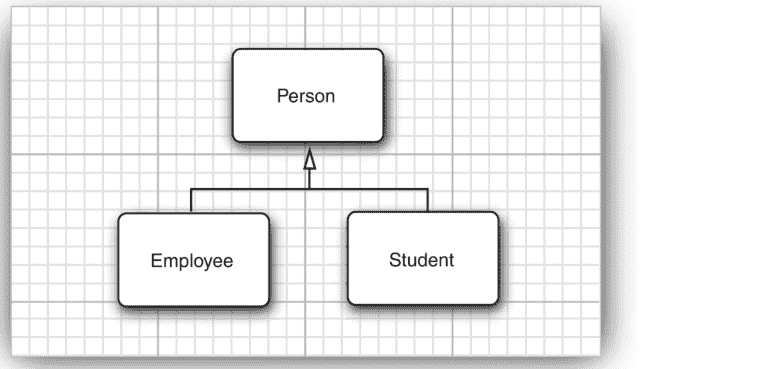

**图 5.2：** `Person` 及其子类的继承图

为什么要费力进行高层次的抽象呢？有些属性对每个人来说都是意义的，例如姓名。学生和员工都有名字，引入共同的超类允许我们将 `getName` 方法提取到继承层次结构中的更高位置。

现在让我们添加另一个方法 `getDescription`，其目的是返回该人的简短描述，例如：

- 一个工资为 $50,000.00 的员工
- 一个主修计算机科学的学生

为 `Employee` 和 `Student` 类实现此方法很容易。但你可以在 `Person` 类中提供什么信息呢？`Person` 类除了姓名之外对这个人一无所知。当然，你可以实现 `Person.getDescription()` 返回一个空字符串。但有一种更好的方法。如果你使用 `abstract` 关键字，你根本不需要实现该方法。

```java
public abstract String getDescription();

// 不需要实现
```

为了清晰起见，包含一个或多个抽象方法的类本身必须声明为抽象类。

```java
public abstract class Person
{
    . . .

    public abstract String getDescription();
}
```

除了抽象方法外，抽象类还可以拥有字段和具体方法。例如，`Person` 类存储人的姓名，并有一个返回它的具体方法。

```java
public abstract class Person
{
    private String name;

    public Person(String name)
    {
        this.name = name;
    }

    public abstract String getDescription();

    public String getName()
    {
        return name;
    }
}
```

> **提示：** 一些程序员并没有意识到抽象类可以拥有具体方法。你应该始终将公共字段和方法（无论是否抽象）移动到超类中（无论是否抽象）。

抽象方法充当在子类中实现的方法的占位符。当你扩展一个抽象类时，你有两个选择。你可以留某些或所有抽象方法未定义；那么，你必须将子类也标记为抽象类。或者，你可以定义所有方法，此时子类就不再是抽象的。

例如，我们将定义一个扩展抽象 `Person` 类的 `Student` 类，并实现 `getDescription` 方法。`Student` 类的任何方法都不是抽象的，因此它不需要被声明为抽象类。

一个类即使没有抽象方法，也可以声明为抽象类。

抽象类不能被实例化。也就是说，如果一个类被声明为抽象的，就无法创建该类的对象。例如，表达式

```java
new Person("Vince Vu")
```

是一个错误。然而，你可以创建具体子类的对象。

注意，你仍然可以创建抽象类的对象变量，但此类变量必须引用一个非抽象子类的对象。例如：

```java
Person p = new Student("Vince Vu", "Economics");
```

在这里，`p` 是抽象类型 `Person` 的变量，它引用非抽象子类 `Student` 的实例。

> **C++ 注意：** 在 C++ 中，抽象方法被称为纯虚函数，并带有末尾的 `= 0`，例如：

```cpp
class Person // C++
{
public:
    virtual string getDescription() = 0;
    .. .
};
```

如果一个 C++ 类至少有一个纯虚函数，它就是抽象类。在 C++ 中，没有特殊的关键字来表示抽象类。

让我们定义一个扩展抽象类 `Person` 的具体子类 `Student`：

```java
public class Student extends Person
{
    private String major;

    public Student(String name, String major)
    {
        super(name);
        this.major = major;
    }

    public String getDescription()
    {
        return "a student majoring in " + major;
    }
}
```

`Student` 类定义了 `getDescription` 方法。因此，`Student` 类中的所有方法都是具体的，该类不再是抽象类。

```java
}
    public void raiseSalary(double byPercent)
    {
        double raise = salary * byPercent / 100;
        salary += raise;
    }
}
```

### 列表 5.11 `abstractClasses/Student.java`

```java
package abstractClasses;

public class Student extends Person
{
    private String major;

    /**
     * @param name 学生的姓名
     * @param major 学生的专业
     */
    public Student(String name, String major)
    {
        // 将 name 传递给父类构造函数
        this.major = major;
    }

    public String getDescriptor()
    {
        return "a student majoring in " + major;
    }
}
```

## 5.7 枚举类（Enumeration Classes）

你在第 3 章中已经见过如何定义枚举类型。这里有一个典型的示例：

```java
public enum Size { SMALL, MEDIUM, LARGE, EXTRA_LARGE }
```

当你引用这些 `Size` 常量时，请使用类名进行限定，例如 `Size.SMALL`。在三种情况下你可以使用不带限定的名字：

1. 正如你就会看到的，枚举可以拥有方法。在枚举的方法内部，你可以使用某个选择器的 `case` 分支。
2. 在 `switch` 选择器为枚举类型的情况下，你不需要进行限定：

```java
Size s = . . . ;

String abbrev = switch (s)
{
    case SMALL -> "S"
    . . .
}
```

3. 你可以静态导入枚举的所有常量：

```java
import com.horstmann.util.Size;

import static com.horstmann.util.Size.*;

. . .

Size s = SMALL;
```

> **注意：** 你不能静态导入来自默认包的枚举常量。例如，如果 `Size` 位于默认包中，你无法使用：

```java
import static Size.*;
```

由 `enum` 声明定义的类型实际上是一个类。该类恰好有四个实例——无法构造新的对象。

因此，你永远不需要对枚举类型的值使用 `equals`。直接使用 `==` 来比较它们即可。

> **注意：** 允许在最后一个值后加上逗号。如果你预计值的数量会增长，末尾逗号会有用。

```java
public enum Size {
    SMALL,
    MEDIUM,
    LARGE,
    EXTRA_LARGE,
    XXL,

    // 在此处添加更多值，并在每个值后加逗号
}
```

所有枚举类型都是抽象类 `Enum` 的子类。它们继承了该类的多个方法。最有用的是 `name`，它返回枚举常量的名称。例如，`Size.SMALL.toString()` 返回字符串 `"SMALL"`。

默认情况下，`toString` 方法返回 `name`。然而，你可以重写 `toString`，而 `name` 是 `final` 的。

`name` 的反向操作是静态的 `valueOf` 方法。例如，语句

```java
Size s = Enum.valueOf(Size.class, "SMALL");
```

将 `s` 设置为 `Size.SMALL`。

每个枚举类型都有一个静态的 `values` 方法，返回枚举中所有值的数组。例如，调用

```java
Size[] values = Size.values();
```

返回包含元素 `Size.SMALL`、`Size.MEDIUM`、`Size.LARGE` 和 `Size.EXTRA_LARGE` 的数组。

`ordinal` 方法返回枚举常量在枚举声明中的位置，从零开始计数。例如，`Size.MEDIUM.ordinal()` 返回 `1`。

如果你喜欢，可以为枚举类型添加构造函数、方法和字段。当然，构造函数只在构造实例时才被调用。这里有一个示例：

```java
public enum Size
{
    SMALL("S"), MEDIUM("M"), LARGE("L"), EXTRA_LARGE("XL");

    private final String abbreviation;

    Size(String abbreviation) { this.abbreviation = abbreviation; }

    // 自动为 private
    public String getAbbreviation() { return abbreviation; }
}
```

> **注意：** 当枚举拥有字段或方法时，你必须用分号结束常量列表，如上面的示例所示。

在末尾逗号后加分号是合法的。

你甚至可以在每个实例中重写方法：

```java
public enum Size
{
    SMALL,
    MEDIUM,
    LARGE,
    EXTRA_LARGE

    public String toString() { return "XL"; }
}
```

然而，这并不常见。在前面的示例中，`EXTRA_LARGE` 是 `Size` 子类的实例。除此之外，你不能形成枚举的子类。

枚举的构造函数始终是 `private` 的。你可以省略 `private` 修饰符，如前面的示例。将枚举构造函数声明为 `public` 或 `protected` 是语法错误。

> **注意：** 枚举类的构造函数不能对正在构造的实例进行 `switch` 操作：

```java
public enum Size {
    SMALL, MEDIUM, LARGE, EXTRA_LARGE;

    private final boolean largish;

    Size() {
        largish = switch (this) // 错误
            case LARGE, EXTRA_LARGE -> true;
            default -> false;
        }
    }
}
```

这种奇怪的限制是由对枚举进行 `switch` 的实现策略引起的。每个 `switch` 都会查询一个数组，该数组将当前定义的枚举常量的序数值映射到编译 `switch` 时的序数值。这些数组只有在枚举实例构造后才能构建。

在方法中，这样的 `switch` 可以正常工作。列表 5.12 中的程序演示了如何处理枚举类型。

### 列表 5.12 `enums/EnumTest.java`

```java
package enums;

import java.util.*;

/**
 * 此程序演示了枚举类型。
 * @version 1.0
 * @author Caymann
 */
public class EnumTest {
    public static void main(String[] args) {
        Scanner in = new Scanner(System.in);

        System.out.print("Enter size: ");

        Size size = Enum.valueOf(Size.class, in.next().toUpperCase());

        System.out.println("abbreviation: " + size.getAbbreviation());

        if (size == Size.LARGE) {
            System.out.println("Large");
        }
    }
}

enum Size {
    SMALL("S"), MEDIUM("M"), LARGE("L"), EXTRA_LARGE("XL");

    private final String abbreviation;

    Size(String abbreviation) { this.abbreviation = abbreviation; }

    // 自动为 private
    public String getAbbreviation() { return abbreviation; }
}
```


```java
enum Size {

    SMALL("S"), MEDIUM("M"), LARGE("L"), EXTRA_LARGE("XL");

    private final String abbreviation;

    Size(String abbreviation) { this.abbreviation = abbreviation; }

    // 自动为 private

    public String getAbbreviation() { return abbreviation; }

}
```

## 5.7 枚举类

你在第 3 章中已经见过如何定义枚举类型。这里有一个典型的示例：

```java
public enum Size { SMALL, MEDIUM, LARGE, EXTRA_LARGE }
```

当你引用这些 `Size` 常量时，请使用类名进行限定，例如 `Size.SMALL`。在三种情况下你可以使用不带限定的名字：

1. 正如你很快就会看到的，枚举可以拥有方法。在枚举的方法内部，你可以使用某个选择器的 `case` 分支。
2. 在 `switch` 选择器为枚举类型的情况下，你不需要进行限定：

```java
Size s = . . . ;

String abbrev = switch (s)
{
    case SMALL -> "S"
    . . .
}
```

3. 你可以静态导入枚举的所有常量：

```java
import com.horstmann.util.Size;

import static com.horstmann.util.Size.*;

. . .

Size s = SMALL;
```

> **注意：** 你不能静态导入来自默认包的枚举常量。例如，如果 `Size` 位于默认包中，你无法使用：

```java
import static Size.*;
```

由 `enum` 声明定义的类型实际上是一个类。该类恰好有四个实例——无法构造新的对象。

因此，你永远不需要对枚举类型的值使用 `equals`。直接使用 `==` 来比较它们即可。

> **注意：** 允许在最后一个值后加上逗号。如果你预计值的数量会增长，末尾逗号会有用。

```java
public enum Size {

    SMALL,

    MEDIUM,

    LARGE,

    EXTRA_LARGE,

    XXL,

    // 在此处添加更多值，并在每个值后加逗号

}
```

所有枚举类型都是抽象类 `Enum` 的子类。它们继承了该类的多个方法。最有用的是 `name`，它返回枚举常量的名称。例如，`Size.SMALL.toString()` 返回字符串 `"SMALL"`。

默认情况下，`toString` 方法返回 `name`。然而，你可以重写 `toString`，而 `name` 是 `final` 的。

`name` 的反向操作是静态的 `valueOf` 方法。例如，语句：

```java
Size s = Enum.valueOf(Size.class, "SMALL");
```

将 `s` 设置为 `Size.SMALL`。

每个枚举类型都有一个静态的 `values` 方法，返回枚举中所有值的数组。例如，调用：

```java
Size[] values = Size.values();
```

返回包含元素 `Size.SMALL`、`Size.MEDIUM`、`Size.LARGE` 和 `Size.EXTRA_LARGE` 的数组。

`ordinal` 方法返回枚举常量在枚举声明中的位置，从零开始计数。例如，`Size.MEDIUM.ordinal()` 返回 `1`。

如果你喜欢，可以为枚举类型添加构造函数、方法和字段。当然，构造函数只在构造实例时才被调用。这里有一个示例：

```java
public enum Size
{
    SMALL("S"), MEDIUM("M"), LARGE("L"), EXTRA_LARGE("XL");

    private final String abbreviation;

    Size(String abbreviation) { this.abbreviation = abbreviation; }

    // 自动为 private

    public String getAbbreviation() { return abbreviation; }

}
```

> **注意：** 当枚举拥有字段或方法时，你必须用分号结束常量列表，如上面的示例所示。

在末尾逗号后加分号是合法的。

你甚至可以在每个实例中重写方法：

```java
public enum Size
{
    SMALL,

    MEDIUM,

    LARGE,

    EXTRA_LARGE

    public String toString() { return "XL"; }

}
```

然而，这并不常见。在前面的示例中，`EXTRA_LARGE` 是 `Size` 子类的实例。除此之外，你不能形成枚举的子类。

枚举的构造函数始终是 `private` 的。你可以省略 `private` 修饰符，如前面的示例。将枚举构造函数声明为 `public` 或 `protected` 是语法错误。

> **注意：** 枚举类的构造函数不能对正在构造的实例进行 `switch` 操作：

```java
public enum Size {

    SMALL, MEDIUM, LARGE, EXTRA_LARGE;

    private final boolean largish;

    Size() {

        largish = switch (this) // 错误

            case LARGE, EXTRA_LARGE -> true;

            default -> false;

        }

    }

}
```

这种奇怪的限制是由对枚举进行 `switch` 的实现策略引起的。每个 `switch` 都会查询一个数组，该数组将当前定义的枚举常量的序数值映射到编译 `switch` 时的序数值。这些数组只有在枚举实例构造后才能构建。

在方法中，这样的 `switch` 可以正常工作。列表 5.12 中的程序演示了如何处理枚举类型。

## 列表 5.12 `enums/EnumTest.java`

```java
package enums;

import java.util.*;

/**
 * 此程序演示了枚举类型。
 * @version 1.0
 * @author Caymann
 */

public class EnumTest {

    public static void main(String[] args) {

        Scanner in = new Scanner(System.in);

        System.out.print("Enter size: ");

        Size size = Enum.valueOf(Size.class, in.next().toUpperCase());

        System.out.println("abbreviation: " + size.getAbbreviation());

        if (size == Size.LARGE) {

            System.out.println("Large");

        }

    }

}

enum Size {

    SMALL("S"), MEDIUM("M"), LARGE("L"), EXTRA_LARGE("XL");

    private final String abbreviation;

    Size(String abbreviation) { this.abbreviation = abbreviation; }

    // 自动为 private

    public String getAbbreviation() { return abbreviation; }

}
```

## 5.8 密封类

在 Java 中，密封类（`sealed class`）控制哪些类可以继承自它。密封类在 Java 15 中作为预览功能引入，并在 Java 17 中正式定型。

以下是如何将 `JSONValue` 类声明为密封类的：

```java
public abstract sealed class JSONValue
    permits JSONArray, JSONNumber, JSONString,
    JSONBoolean, JSONObject, JSONNull
{...}
```

定义一个未被许可的子类将是一个错误：

```java
public class JSONComment extends JSONValue { . . } // Error
```

这很正常，因为 JSON 不允许注释。因此，密封类允许对领域约束进行精确建模。

密封类被许可的子类必须是可访问的。它们不能是嵌套在另一个类中的私有类，也不能是来自另一个包的包可见类。

对于公共的许可子类，规则更加严格。它们必须与密封类处于同一个包中。然而，如果你使用了模块（参见第 12 章），那么它们只需要在同一个模块中即可。

> **注意：** 密封类可以不带 `permits` 子句进行声明。在这种情况下，它的所有直接子类必须声明在同一个文件中。没有该文件访问权限的程序员无法创建子类。

一个文件最多可以有一个公共类，因此这种安排似乎只在子类不供公众使用时有用。

然而，正如你将在下一章中看到的，你可以使用内部类作为公共子类。

密封类的一个重要动因是编译时检查。考虑 `JSON` 类中的这个方法，它使用了带有模式匹配的 `switch` 表达式（参见第 5.9 节）：

```java
public String type()
{
    return switch (this)
    {
        case JSONArray -> "array";

        case JSONNumber -> "number";

        case JSONString -> "string";

        case JSONBoolean -> "boolean";

        case JSONObject -> "object";

        case JSONNull -> "null";

        // 这里不需要 default
    };
}
```

编译器可以检查出不需要 `default` 子句，因为 `JSONValue` 的所有直接类型子类都作为 `case` 出现。

> **注意：** 前面的类型方法看起来并不像面向对象。符合 OOP 精神的做法是让六个类中的每一个都拥有自己的 `type` 方法，依赖多态性而不是 `switch`。对于开放的层次结构，这是一个好方法。但当存在一组固定的类时，将所有备选项放在一个方法中通常更方便。

乍一看，密封类的子类似乎必须是 `final` 的。为了穷尽性测试，我们只需要知道所有的子类。如果这些类有进一步的子类也没有问题。例如，我们可以如图 5.3 所示重新组织 JSON 层次结构。

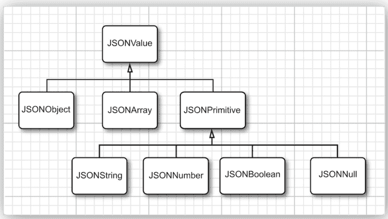

在这个层次结构中，`JSONValue` 许可了三个子类：

```java
public abstract sealed class JSONValue permits JSONObject,
    JSONArray, JSONPrimitive
{
    ...
}
```

`JSONPrimitive` 类也是密封的：

```java
public abstract sealed class JSONPrimitive extends JSONValue
    permits JSONString, JSONNumber, JSONBoolean, JSONNull
{
    ...
}
```

密封类的子类必须指定它是密封的（`sealed`）、最终的（`final`）还是允许子类的（`open`）。在后一种情况下，必须声明为非密封的（`non-sealed`）。

> **注意：** `non-sealed` 是第一个带有连字符的 Java 关键字。这很可能是未来的趋势。在语言中添加关键字总是伴随着风险。现有代码可能不再能够编译。因此，`sealed` 是一个“上下文”关键字。你仍然可以声明名为 `sealed` 的变量或方法：

```java
int sealed = 1; // 将上下文关键字作为标识符是允许的
```

对于带连字符的关键字，不需要担心这个问题。唯一的歧义在于减法：

```java
int non = 0;

non = non-sealed; // 减法，而不是关键字
```

为什么想要一个非密封子类？考虑一个具有六个直接子类的 XML 节点类：

```java
public abstract sealed class Node permits Element, Text,
    Comment, CDATASection, EntityReference, ProcessingInstruction
{
    ..
}
```

我们允许 `Element` 有任意子类：

```java
public non-sealed class Element extends Node
{
    ..
}
```

```java
public class HTMLDivElement extends Element
{
    ..
}
```

在本节中，你学习了密封类。在下一章中，你将学习接口，它是抽象类的泛化。Java 接口也可以有子类型。密封接口的工作方式与密封类完全相同，控制直接子类型。

接下来的示例程序完善了 JSON 层次结构。`JSONObject` 的实现使用了 `HashMap`，将在第 9 章中介绍。在示例中，我们使用接口而不是抽象类，以便 `JSONNumber` 和 `JSONString` 可以是 `record`，而 `JSONBoolean` 和 `JSONNull` 类可以是枚举。`record` 和枚举可以实现接口，但它们不能扩展类。

## 列表 5.13 `sealed/SealedTest.java`

```java
package sealed;

import java.util.*;

sealed interface JSONValue permits JSONArray, JSONObject, JSONPrimitive {

    public default String type() {

        if (this instanceof JSONArray) return "array";

        else if (this instanceof JSONObject) return "object";

        else if (this instanceof JSONNumber) return "number";

        else if (this instanceof JSONString) return "string";

        else if (this instanceof JSONBoolean) return "boolean";

        else return "null";

    }

}

final class JSONArray extends ArrayList<JSONValue> implements JSONValue

final class JSONObject extends HashMap<String, JSONValue> implements JSONValue {

    public String toString() {

        StringBuilder result = new StringBuilder();

        result.append("{");

        for (Map.Entry<String, JSONValue> entry : entrySet()) {

            if (result.length() > 1) result.append(",");

            result.append("\"" + entry.getKey());

            result.append("\": ");

            result.append(entry.getValue());

        }

        result.append(" }");

        return result.toString();

    }

}

sealed interface JSONPrimitive extends JSONValue
    permits JSONNumber, JSONString, JSONBoolean, JSONNull
{

}

final record JSONNumber(double value) implements JSONPrimitive {}

final record JSONString(String value) implements JSONPrimitive {}

enum JSONBoolean implements JSONPrimitive { TRUE, FALSE }

enum JSONNull implements JSONPrimitive {}

public class SealedTest {
```


```java
public static void main(String[] args) {
    JSONObject obj = new JSONObject();

    obj.put("name", new JSONObject("Harry"));
    obj.put("salary", new JSONObject(90000));
    obj.put("married", JSONBoolean.FALSE);

    JSONArray arr = new JSONArray();
    arr.add(new JSONObject(13));
    arr.add(JSONNull.INSTANCE);

    obj.put("luckyNumbers", arr);

    System.out.println(obj);
    System.out.println(obj.type());
}
}
```

## 5.9. 模式匹配

你已经见过如何使用`instanceof`运算符检查对象是否具有特定类型。`instanceof`最方便的形式声明了一个匹配类型的变量：

```java
Employee e = . . ;

String description;

if (e instanceof Executive exec)
    description = "An executive with a title of " + exec.getTitle();
else if (e instanceof Manager m)
    description = "A manager who deserves a bonus";
else
    description = "A lowly employee with a salary of " + e.getSalary();
```

模式匹配形式的`switch`简化了这种类型分析：

```java
Employee e = . . ;

String description = switch (e) {
    case Executive exec -> "An executive with a title of " + exec.getTitle();
    case Manager m -> "A manager who deserves a bonus";
    default -> "A lowly employee with a salary of " + e.getSalary();
};
```

注意，与`instanceof`模式一样，每个`case`都声明了一个匹配类型的变量。你使用这些变量来访问子类方法（例如示例中的`getTitle`）。

`switch`的语句形式和穿透形式也可以用于类型模式。但不带穿透的表达式形式通常是最自然的选择。

正如你刚刚看到的，模式匹配的基本结构非常直观。接下来的子节将介绍技术细节，某些由于兼容性原因有些复杂。

> 预览注意：Java 21 引入了未命名变量作为预览功能。如果你在类型模式中不需要该变量，请使用下划线：

```java
case Employee _ -> "A lowly employee"
```

在该特性正式发布之前，你可以使用两个下划线：

```java
case Employee __ -> "A lowly employee"
```

### 5.9.1. 空处理

经典的`switch`语句对`null`是不利的。如果选择表达式为`null`，`switch`将抛出`NullPointerException`。你可以通过添加`case null`来避免这种情况：

```java
String description = switch (e) {
    case Executive exec -> "An executive with a title of " + exec.getTitle();
    case Manager m -> "A manager who deserves a bonus";
    case null -> "No employee";
    default -> "A lowly employee with a salary of " + e.getSalary();
}
```

你可以将`case null`与`default`结合，但不能与其他任何`case`使用：

```java
case null, default -> "No free parking";
```

> 注意：你不能使用`case _`来表示默认情况。这样做是有意之，这样你就不需要记住该情况是否覆盖了`null`。

### 5.9.2. 守卫（Guards）

你可以向模式添加一个条件，这称为*守卫*（guard），使用受限的`when`关键字。

```java
case Executive exec when exec.getTitle().getLength() >= 20
    -> "An executive with an impressive title";
```

在守卫表达式中，你可以使用模式引入的变量。

如果守卫表达式不成立，则不会选择该`case`，并测试下一个`case`。

如果在`when`子句中发生异常，`switch`将抛出该异常。

守卫在记录模式（record patterns）中特别有用：

```java
Point p = . . . ;

String description = switch (p) {
    case Point(var x, var y) when x == 0 && y == 0 -> "origin";
    case Point(var x, var __) when x == 0 -> "on x-axis";
    case Point(var __, var y) when y == 0 -> "on y-axis";
    default -> "not on either axis";
}
```

> **警告：**记录模式会调用组件访问器。在极少数其中一个抛出异常的情况下，`switch`将抛出`MatchException`。这只可能发生在自定义访问器上。

### 5.9.3. 穷尽性

任何`switch`表达式必须是穷尽的：对于每个可能的选择值都必须有一个`case`。这是一个显然的要求，因为表达式必须始终产生一个值。

`switch`变为穷尽的有几种方法：

- 针对枚举中每个实例的`case`
- 覆盖密封类型（sealed type）所有子类型的非守卫类型模式
- 选择器类型的非守卫类型模式
- 一个`default`子句

守卫模式不能用于穷尽性检查，因为编译器无法评估它们。例如：

```java
case Executive exec when exec.getTitle().getLength() >= 20
    -> . . .

case Executive exec when exec.getTitle().getLength() < 20
    -> . . .
```

不是穷尽的。你需要重写第二个子句为：

```java
case Executive exec -> . . .
```

或者：

```java
default -> . . .
```

> 注意：当密封类型层级或枚举被修改时，之前穷尽的`switch`可能会变为非穷尽。如果没有匹配的`case`，`switch`将抛出`MatchException`。经典的`switch`语句不需要是穷尽的。如果没有匹配，则不执行任何操作。但为了清晰，增强型`switch`语句必须是穷尽的。如果`switch`具有模式、`case null`或除基本类型、基本类型包装类或枚举以外的选择类型，则它是增强的。如果你在没有匹配时不想执行任何操作，请添加：

```java
default -> {} // 不穿透
```

或者：

```java
default -> break; // 穿透
```

> **警告：**穷尽性不需要检查选择值是否为`null`。你可以拥有没有`case null`的穷尽`switch`。穷尽性缺乏空检查对于嵌套记录是有问题的。考虑`record<T>(T contents) {}`：

```java
Box<String> doubleBoxed = ...;

String switch (doubleBoxed) {
    case Box(String s) -> s;
};
```

如果`doubleBoxed`为`null`，`switch`将抛出`NullPointerException`。相反，如果`doubleBoxed`初始化为`Box(null)`，则会发生`MatchException`。本应该有一个像`case Box(b) where b == null`这样的`case`，但穷尽性检查器忽略了`null`。

### 5.9.4. 支配地位（Dominance）

在只有常量`case`的经典`switch`中，在两个`case`中具有相同的常量是非法的。因此，分支是不相交的，它们的顺序无关紧要。然而，当`case`是模式时，顺序就变得重要。按顺序检查`case`，并执行第一个匹配的`case`。当编译器发现某个`case`因为前面的`case`而永远不会匹配时，就会发生编译时错误。这里是一个例子：

```java
Employee e = . . . ;

String description = switch (e) {
    case Employee __ -> "A lowly employee with a salary of " + e.getSalary();
    case Manager m -> "A manager who deserves a bonus"; // 错误
};
```

由于`Manager`是`Employee`，第二个`case`将永远不会匹配。第一个`case`支配了它。这种支配地位检查有助于发现错误，但它并不完美。以下是你需要关注的细节点：

- 守卫模式不用于支配地位检查。编译器无法对守卫进行推理。例如，编译器无法判断`case Executive exec when exec.getTitle().getLength() >= 20 -> . . .`支配了`case Executive exec when exec.getTitle().getLength() < 20`。
- `default`支配了常量`case`，尽管它没有覆盖`case null`。

> 提示：虽然可以将`default`放在常量`case`之前，但这是一个坏主意。请始终将其放在最后。

### 5.9.5. 模式与常量

在记录模式内部无法匹配常量。例如：

```java
case Point(null, y)
```

是错误的。使用守卫：

```java
case Point(x, y) when x == 0 // 正确
```

数值常量模式仅允许选择类型为`int`、`short`、`char`或`byte`以及它们的包装类型。字符串常量模式仅允许类型为`String`。例如，以下是不合法的：

```java
Object obj = . .;

String description = switch (obj) {
    case 0 -> "零"; // 错误
    case "" -> "空字符串"; // 错误
    case null -> "空";
    default -> obj.toString();
};
```

由于选择类型是`Object`，`switch`不能具有数值或字符串常量模式。补救方法是：

```java
case i when i == 0
case String s when s.equals("null")
```

枚举常量的规则不同。选择类型只需是枚举类型的父类型；即`Object`、`Enum`或接口（见第 6 章）：

```java
Object obj = . . ;

String description = switch (obj) {
    case DayOfWeek.FRIDAY -> "TGIF"; // 正确
    . . .
};
```

### 5.9.6. 变量作用域与穿透

本节介绍了执行穿透时变量的微妙问题。当类型或记录模式引入变量时，其作用域延伸到`case`的结束，即使执行穿透到了下一个`case`。例如，考虑以下代码段中的变量`s`：

```java
Object obj = . . ;

switch (obj) {
    case String s when s.length() == 0:
        System.out.println("empty string"); // 作用域结束
    default:
        System.out.println(obj.toString());
};
```

你可以在守卫语句和`:`之后的语句中使用`s`，但不能在下一个`case`中使用。这是因为当`obj`不是`String`时，执行可以进入该`case`。你无法穿透类型模式：

```java
switch (obj) {
    case String s when s.length() > 0:
        System.out.println(s.codePointAt(0)); // 穿透
    case Integer n:
        System.out.println(n); // 错误
}
```

执行从第一个`case`穿透到第二个`case`的主体，`n`无法绑定。

> **预览说明：**你可以使用匿名变量穿透类型模式（Java 21 的预览特性）：

```java
switch (obj) {
    case String s when s.length() == 0:
        System.out.print("empty "); // 穿透
    case String _:
        System.out.println("string"); break; // 正确
}
...
}
}
```

> 注意：自 Java 1.0 以来，在`case`体中声明变量一直是合法的。该变量的作用范围延伸到`switch`的末尾。这种作用域从未有用过，因为如果你在`case`外部访问该变量会导致错误：

```java
switch (obj) {
    case String s:
        String t = s; // OK
    default:
        System.out.println(t); // ERROR-t may not have
        initialized
}
```

列表 5.14 和列表 5.15 中的程序演示了带有类型模式和记录模式的模式匹配。

## 列表 5.14 `patternMatching/TypePatternTest.java`

```java
package patternMatching;

public class TypePattern {
    public static void main(String[] args) {
        int r = (int) (4 * Math.random());

        Employee e = switch (r) {
            case 0 -> new Employee("Harry Hacker", 500000, 1989, 10, 1);
            case 1 -> new Manager("Carl Cracker", 80000, 1987, 12, 15);
            case 2 -> new Executive(
                "Sue Striver",
                "Senior Associate Vice President",
                200000,
                1995,
                1,
                20
            );
            default -> null;
        };
    }
}
```

```java
String description = switch (e) {
    case Executive exec when exec.getTitle().length() >= 20 ->
        "An executive with an impressive title";

    case Executive exec ->
        "An executive with a title of " + exec.getTitle();

    case Manager m -> {
        m.setBonus(10000);
        yield "Manager who just got a bonus";
    }

    case null -> "No employee";

    default ->
        "A lowly employee with a salary of " + e.getSalary();
};

System.out.println(description);
```

## 列表 5.15 `patternMatching/RecordPatternTest.java`

```java
package patternMatching;

record Point(double x, double y) {}

public class RecordPatternTest
```


```java
{
    public static void main(String[] args) {
        int r = (int (4 * Math.random());

        Point p = switch (r) {
            case 0 -> new Point(0, 0);
            case 1 -> new Point(1, 0);
            case 2 -> new Point(0, 1);
            default -> new Point(1, 1);
        };

        String description = switch (p) {
            case Point(var x, var y) when x == 0 && y == 0 -> "origin";
            case Point(var x, var _) when x == 0 -> "on x-axis";
            case Point(var __, var y) when y == 0 -> "on y-axis";
            default -> "not on either axis";
        };

        System.out.printf("%s %s\n", p, description);
    }
}
```

# 5.10. 反射

反射库为你提供了一个非常丰富且精的工具集，用于编写动态操作 Java 代码的程序。通过反射，Java 可以支持用户界面构建器、对象关系映射器以及许多其他动态查询类能力的开发工具。

能够分析类能力的程序被称为反射程序。反射机制非常强大。正如接下来的章节所示，你可以用它来：

- 在运行时分析类的能力
- 在运行时检查对象——例如，编写一个适用于所有类的单个 `toString` 方法
- 实现泛型数组操作代码
- 利用 `Method` 对象，这些对象的工作方式就像 C++ 等语言中的函数指针一样

反射是一个强大且复杂的机制；然而，它主要对工具构建者感兴趣，而不是对应用程序程序员。如果你对编写应用程序比为其他 Java 程序员编写工具更感兴趣，你可以安全地跳过本章的剩余部分，以后再回来。

## 5.10.1. `Class` 类

在程序运行期间，Java 运行时系统始终对所有对象维护所谓的“运行时类型识别”。这些信息跟踪了每个对象所属的类。运行时类型信息被虚拟机用于选择执行正确的方法。

然而，你也可以通过操作一个特殊的 Java 类来访问这些信息。持有这些信息的类有点令人困惑地命名为 `Class`。`Object` 类中的 `getClass()` 方法返回一个 `Class` 类型的实例。

```java
Employee e = // ...

Class cl = e.getClass();
```

就像 `Employee` 对象描述特定员工的属性一样，`Class` 对象描述特定类的属性。`Class` 类最常用的方法可能是 `getName()`。它返回类的名称。例如，语句

```java
System.out.println(e.getClass().getName() + " " +
    e.getName());
```

如果 `e` 是一个员工，将打印：

```text
Employee Harry Hacker
```

或者如果 `e` 是一个经理，将打印：

```text
Manager Harry Hacker
```

如果类在包中，包名是类名的一部分：

```java
var in = new Scanner(System.in);

Class cl = in.getClass();

String className = cl.getName(); // name 被设置为
```

```text
"java.util.Scanner"
```

你可以使用静态方法 `forName` 通过类名获取 `Class` 对象。

```java
String className = "java.util.Scanner";

Class cl = Class.forName(className);
```

如果类没有无参数的构造函数，`getConstructor` 方法将抛出异常。你将在 5.10.7 节看到如何调用其他构造函数。

如果你有一个 `Class` 类型的对象，你可以使用它来构造该类的实例。调用 `getConstructor` 方法获取一个 `Constructor` 对象，然后使用 `newInstance` 方法构造一个实例。例如：

```java
var className = "java.util.Date";

Class cl = Class.forName(className);

Object obj = cl.getConstructor().newInstance();
```

`Class` 类类似于 C++ 中的 `type_info` 类，`getClass` 方法等同于 `typeid` 运算符。不过，Java 的 `Class` 比 `type_info` 功能多得多。C++ 的 `type_info` 只能揭示带有类型的字符串，而不能创建该类型的新对象。

## `java.lang.Class` 1.0

- `static Class forName(String className)` 返回代表名为 `className` 的类的 `Class` 对象。
- `Constructor(Class... parameterTypes)` 1.1 返回一个描述具有给定参数类型的构造函数的对象。关于如何提供参数类型的更多信息，请参见第 5.10.7 节。

## `java.lang.reflect.Constructor` 1.1

- `Object newInstance(Object... initargs)` 构造构造者类的新实例，并将 `initargs` 传递给构造函数。关于如何提供参数的更多信息，请参见第 5.10.7 节。

## `java.lang.Throwable` 1.0

- `void printStackTrace()` 将 `Throwableable` 对象和堆栈打印到标准错误流。

## 5.10.2. 异常声明入门

我将在第 7 章中详细介绍异常处理，但在此期间你偶尔会遇到可能抛出异常的方法。

当运行时发生错误时，程序可以“抛出一个异常”。抛出异常比终止程序更灵活，因为你可以提供一个处理器来“捕获”异常并处理它。

如果你不提供处理器，程序将终止并在控制台中中打印一条消息，显示异常的类型。你可能在不小心使用空引用或越数组边界时已经见过异常报告了。

异常有两种类型：未检查异常和已检查异常。对于已检查异常，编译器会检查你（程序员）是否已经意识到该异常并准备好处理其后果。然而，许多常见异常（例如边界错误或访问空引用）是未检查的。编译器并不期望你提供处理器——毕竟，你应该把精力花在避免这些错误上，而不是为它们编写处理器。

但并不是所有错误都是可以避免的。尽管你付了最大努力，异常仍可能发生，那么大多数 Java API 将抛出已检查异常。一个例子是 `Class.forName` 方法。你无法确保给定名称的类存在。在第 7 章中，你将看到几种处理异常的策略。现在，我只向你展示最简单的策略。

每当方法包含可能抛出已检查异常的语句时，在方法名后添加一个子句。

```java
public static void somethingWithClass(String name)
    throws ReflectiveOperationException
{
    Class cl = Class.forName(name); // 可能抛出异常
    do something with cl
}
```

任何调用此方法的方法也需要 `throws` 声明。这包括 `main` 方法。如果实际上发生了异常，`main` 方法将带有堆栈跟踪终止。（你将在第 7 章中学习如何捕获异常而不是让它们终止你的程序。）

你只需要为已检查异常提供 `throws` 子句。很容易发现哪些方法抛出已检查异常——每当你调用一个可能抛出已检查异常的方法且没有提供处理器时，编译器就会报错。

## 5.10.3. 资源

类通常具有关联的数据文件，例如：

- 图像和声音文件
- 带有消息字符串和按钮标签的文本

在 Java 中，这种关联文件被称为资源（resource）。

例如，考虑一个显示如图 5.4 所示消息的对话框。

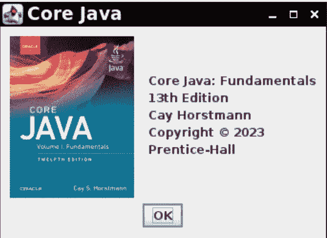

**图 5.4:** 显示图像和文本资源

当然，面板中的书名和版权年份将在书的书中更改。为了方便跟踪此变化，我们将文本放在一个文件中，而不是将其硬编码为字符串。

但你应该将像 `about.txt` 这样的文件放在哪里呢？当然，简单地将其放在 JAR 文件中的其他程序文件一起是很方便的。

`Class` 类提供了一个用于定位资源文件的实用程序服务。以下是必要的步骤：

1. 获取拥有资源的类的 `Class`——例如 `ResourceTest.class`。
2. 某些方法（例如 `ImageIcon` 类的 `getImage` 方法）接受描述资源位置的 URL。然后你调用：

   ```java
   URL url = cl.getResource("about.png");
   ```

3. 否则，使用 `getResourceAsStream` 方法获取用于读取文件中数据的输入流。

关键点是 Java 虚拟机知道如何定位类，因此它随后可以在相同的位置搜索关联的资源。例如，假设 `ResourceTest` 类位于 `resources` 包中。那么 `ResourceTest.class` 文件位于 `resources` 目录中，你将一个图标文件放在同一个目录中。

与其将资源文件放在与类文件相同的目录中，你可以提供相对路径或绝对路径，例如：

```text
data/about.txt
/corejava/title.txt
```

自动加载文件就是资源加载功能所做的全部。没有标准方法来解释资源文件的内容。每个程序必须有自己的方法来解释其资源文件。

资源的另一个常见应用是程序的国际化。依赖语言的字符串（如消息和用户界面标签）存储在资源文件中，每个语言一个文件。在卷二第 7 章中讨论的国际化 API 支持一种组织和访问这些本地化文件的标准方法。

列表 5.16 是一个演示资源加载的程序。（不用担心读取文本和显示对话框的代码——我们稍后介绍这些细节。）编译、构建 JAR 文件并执行它：

```bash
javac resources/ResourceTest.java

jar cvfe ResourceTest.jar resources

java -jar ResourceTest.jar
```

将 JAR 文件移动到不同的目录并再次运行，以检查程序是否从 JAR 文件读取资源。

### 列表 5.16 `resources/ResourceTest.java`

```java
package resources;

import java.io.*;
import java.net.*;
import javax.swing.*;

/**
 * @version 1.51 2023-08-16
 * @author Cay Horstmann
 */
public class ResourceTest
{
    public static void main(String[] args) throws IOException
    {
        Class cl = ResourceTest.class;
        URL aboutURL = cl.getResource("about.gif");
        var icon = new ImageIcon(aboutURL);

        InputStream stream = cl.getResourceAsStream("about.txt");
        var about = new String(stream.readAllBytes());

        InputStream stream2 = cl.getResourceAsStream("/corejava/title.txt");
        var title = new String(stream2.readAllBytes()).strip();

        JOptionPane.showMessageDialog(null, about, title,
            JOptionPane.INFORMATION_MESSAGE, icon);
    }
}
```

## `java.lang.Class` 1.0

- `URL getResource(String name)` 1.1
- `InputStream getResourceAsStream(String name)` 1.1 在类相同的位置查找资源，然后返回一个用于加载资源的 URL 或输入流。如果找不到资源，返回 `null`，不要抛出异常。

## 5.10.4. 使用反射分析类的能力

这里是用于检查类结构的反射机制最重要的部分的要概述。

`java.lang.reflect` 包中的 `Field`、`Method` 和 `Constructor` 这三个类分别描述字段、方法和构造函数。这三个类都有一个方法 `getName`，返回该项的名称。`Field` 类有一个方法 `getType`，返回一个对象（再次是 `Class` 类型），描述字段类型。`Method` 和 `Constructor` 类有报告参数类型的方法，`Method` 类还报告返回类型。

这三个类都有一个方法 `getModifiers`，它返回一个整数（其中某些位被开启或关闭），描述所使用的修饰符（如 `public` 和 `static`）。你随后可以使用静态方法在使用 `java.lang.reflect` 包中的 `Modifier` 类来分析 `getModifiers` 返回的整数值。使用 `Modifier` 类中的 `isPublic`、`isPrivate` 或 `isFinal` 等方法可以判断方法或构造函数是否为公有的、私有的或最后的。你只需要让 `Modifier` 类中对应的方法作用于 `getModifiers` 返回的整数即可。你还可以使用 `Modifier.toString()` 方法来打印修饰符。

或者，`accessFlags` 方法返回一组 `AccessFlag` 枚举类型的值，例如，你可以这样测试一个方法是否是静态的：

```java
if (Modifier.isStatic(m.getModifiers())) . . .

if (m.accessFlags().contains(AccessFlag.STATIC)) . . .
```

`Class` 的 `getFields`、`getMethods` 和 `getConstructors` 方法返回该类支持的公共字段、方法和构造函数的数组。这包括父类中的公共成员。`Class` 的 `getDeclaredFields`、`getDeclaredMethods` 和 `getDeclaredConstructors` 方法返回包含在该类中声明的所有字段、方法和构造函数的数组。这包括私有的、包级和受保护的成员，以及具有包访问权限的成员，但不包括父类的成员。

`Listing_5.17` 展示了如何打印类的所有信息。该程序提示你输入类名，并写出所有方法和构造函数的签名以及类所有实例字段的名称。例如，如果你输入：

```text
java.lang.Double
```

```java
public final class java.lang.Double extends java.lang.Number
{
    public java.lang.Double(double);
    public java.lang.Double(java.lang.String);
    public boolean equals(java.lang.Object);
    public static java.lang.String toString(double);
    public java.lang.String toString();
    public static int hashCode(double);
    public static double min(double, double);
    public static double max(double, double);
    public static native long doubleToRawLongBits(double);
    public static long doubleToLongBits(double);
    public static native double longBitsToDouble(double);
    public int compareTo(java.lang.Double);
    public volatile int compareTo(java.lang.Object);
    public static int compare(double, double);
    public byte byteValue();
    public short shortValue();
    public int intValue();
    public long longValue();
    public float floatValue();
    public double doubleValue();
    public static final java.lang.Double valueOf(java.lang.String);
    public static final java.lang.Double valueOf(double);
}
```


```java
public static java.lang.String toHexString(double);

public volatile java.lang.Object resolveConstantDesc(java.lang.invoke.MethodHandles$Lookup);

public java.lang.Double resolveConstantDesc(java.lang.invoke.MethodHandles$Lookup);

public java.util.Optional describeConstable();

public boolean isNaN();

public static boolean isNaN(double);

public static double sum(double, double);

public static boolean isInfinite(double);

public static boolean isFinite(double);

public static double parseDouble(java.lang.String);

public static final double POSITIVE_INFINITY;

public static final double NEGATIVE_INFINITY;

public static final double NaN;

public static final double MAX_VALUE;

public static final double MIN_NORMAL;

public static final double MIN_VALUE;

public static final int MAX_EXPONENT;

public static final int MIN_EXPONENT;

public static final int SIZE;

public static final int BYTES;

public static final java.lang.Class TYPE;

private final double value;

private static final long serialVersionUID;
```

这个程序非凡的之处在于，它可以分析 Java 解释器可以加载的任何类，而不仅仅是程序编译时可用的类。我们将在下一章中使用这个程序来查看 Java 编译器自动生成的内部类的内部结构。

# Listing 5.17 `reflection/ReflectionTest.java`

```java
package reflection;

import java.util.*;
import java.lang.reflect.*;

/**
 * 此程序使用反射打印类的所有特征。
 * @version 1.12 2021-06-15
 * @author Cay Horstmann
 */
public class ReflectionTest {
    public static void main(String[] args)
        throws ReflectionOperationException {

        // 从命令行参数或用户输入读取类名
        String name;
        if (args.length > 0) name = args[0];

        var in = new Scanner(System.in);
        System.out.println("Enter class name (e.g. java.util.Date): ");
        name = in.next();

        // 打印修饰符、名称和父类名称（如果 != Object）
        Class cl = Class.forName(name);
        String modifiers = Modifier.toString(cl.getModifiers());

        if (modifiers.length() > 0) System.out.print(modifiers + " ");

        if (cl.isSealed()) {
            System.out.print("sealed ");
        } else if (cl.isEnum()) {
            System.out.print("enum " + name);
        } else if (cl.isRecord()) {
            System.out.print("record " + name);
        } else if (cl.isInterface()) {
            System.out.print("interface ");
        } else {
            System.out.print("class ");
        }

        System.out.println(name);

        Class<?> superclass = cl.getSuperclass();

        if (superclass != null && superclass != Object.class) {
            System.out.println("extends " + superclass.getName());
        }

        System.out.println();
        System.out.println("Fields:");

        for (Field f : cl.getDeclaredFields()) {
            System.out.println("  " + f.getType().getName() + " " + f.getName());
        }

        System.out.println("\nConstructors:");

        for (Constructor<?> c : cl.getDeclaredConstructors()) {
            System.out.println("  " + c.toString().replace("public ", ""));
        }

        System.out.println("\nMethods:");

        for (Method m : cl.getDeclaredMethods()) {
            System.out.println("  " + m.toString().replace("public ", ""));
        }

        if (cl.isSealed()) {
            System.out.println("\nPermitted subclasses:");

            Class<?>[] subclasses = cl.getPermittedSubclasses();

            for (int i = 0; i < subclasses.length; i++) {
                if (i == 0) System.out.print("permits ");
                else System.out.print(", ");

                System.out.print(subclasses[i].getName());
            }

            System.out.println();
        }
    }
}
```

```java
System.out.print(interfaces[i].getName());
}
}
```

## `java.lang.Class` 1.0

- `Field[] getFields()` 1.1  
  `getFields` 返回一个包含此类或其超类的公共字段 `Field` 对象的数组。
- `Field[] getDeclaredFields()` 1.1  
  `getDeclaredFields` 返回一个包含此类所有字段的 `Field` 对象的数组。如果没有此类字段，或者 `Class` 对象表示基本数据类型或数组类型，则返回一个长度为 0 的数组。
- `Method[] getMethods()` 1.1
- `Method[] getDeclaredMethods()` 1.1  
  返回一个包含 `Method` 对象的数组：`getMethods` 返回公共方法并包括继承的方法；`getDeclaredMethods` 返回此类或接口的所有方法，但不包括继承的方法。
- `Constructor[] getConstructors()` 1.1
- `Constructor[] getDeclaredConstructors()` 1.1  
  返回一个包含 `Constructor` 对象的数组，该数组可以向您提供由此 `Class` 对象表示的类的所有公共构造函数（针对 `getConstructors`）或所有构造函数（针对 `getDeclaredConstructors`）。
- `isInterface()`  
  如果此 `Class` 对象描述一个接口，则返回 `true`。（接口见第 6 章。）
- `isEnum()` 1.5  
  如果此 `Class` 对象描述一个枚举，则返回 `true`。
- `isRecord()` 16  
  如果此 `Class` 对象描述一个记录，则返回 `true`。
- `RecordComponent[] getRecordComponents()` 16  
  返回一个 `RecordComponent` 对象的数组，用于描述记录字段，或者如果此类不是记录，则返回 `null`。
- `String getName()` 9  
  获取包含此类型的包名；如果该类型是数组类型，则获取元素类型的包；如果该类型是基本数据类型，则返回 `"java.lang"`。

## `java.lang.reflect.Field` 1.1

## `java.lang.reflect.Method` 1.1

## `java.lang.reflect.Constructor` 1.1

- `Class getDeclaringClass()`  
  返回定义此构造函数、方法或字段的 `Class` 对象。
- `Class[] getExceptionTypes()`（在 `Constructor` 和 `Method` 类中）  
  返回一个表示方法抛出的异常泛的 `Class` 对象数组。
- `int getModifiers()`  
  返回一个描述此构造函数、方法或字段修饰符的整数。使用 `Modifier` 类中的方法分析返回值。
- `Set<AccessFlag> accessFlags()` 20  
  返回一个 `AccessFlag` 枚举中的值集合，描述此构造函数、方法或字段的访问修饰符。
- `String getName()`  
  返回作为构造函数、方法或字段名称的字符串。
- `Class[] getParameterTypes()`（在 `Constructor` 和 `Method` 类中）  
  返回一个表示参数类型的 `Class` 对象数组。
- `Class getReturnType()`（在 `Method` 类中）  
  返回一个表示返回类型的 `Class` 对象。

## `java.lang.reflect.RecordComponent` 16

- `String getName()`
- `Class getType()`  
  获取此记录组件的名称和类型。
- `Method getAccessor()`  
  返回用于访问此记录组件的 `Method` 对象。

## `java.lang.reflect.Modifier` 1.1

- `static String toString(int modifiers)`  
  返回一个带有与 `modifiers` 中设置位对应的修饰符的字符串。
- `static boolean isAbstract(int modifiers)`
- `static boolean isFinal(int modifiers)`
- `static boolean isInterface(int modifiers)`
- `static boolean isNative(int modifiers)`
- `static boolean isPrivate(int modifiers)`
- `static boolean isProtected(int modifiers)`
- `static boolean isPublic(int modifiers)`
- `static boolean isStatic(int modifiers)`
- `static boolean isStrict(int modifiers)`
- `static boolean isSynchronized(int modifiers)`
- `static boolean isVolatile(int modifiers)`  
  测试 `modifiers` 值中对应于方法名中修饰符的位。

## 5.10.5 使用反射在运行时分析对象

在前面的节中，我们看到了如何找到任何对象的实例字段的名称和*类型*：

- 获取对应的 `Class` 对象。
- 在该 `Class` 对象上调用 `getDeclaredFields()`。

在本节中，我们将更进一步，实际上查看字段的*内容*。当然，当您编写程序时，查看一个名称和类型已知的对象的特定字段的内容是很容易的。但反射允许您查看在编译时未知的对象的字段。

实现这一点的关键方法是 `Field` 类中的 `get` 方法。如果 `f` 是一个 `Field` 类型的对象（例如，从 `getDeclaredFields` 获取的），并且 `obj` 是 `f` 字段所属类的实例对象，那么 `f.get(obj)` 返回一个对象，其值是 `obj` 字段的当前值。这有点抽象，所以让我们运行一个示例。

```java
var harry = new Employee("Harry Hacker", 50000, 10, 1, 1989);

Class cl = harry.getClass();

// 代表 Employee 的类对象

Field f = cl.getDeclaredField("name");

// Employee 类的 name 字段

Object v = f.get(harry);

// harry 对象 name 字段的值，

// 即

// String 对象("Harry Hacker")
```

当然，你也可以设置你所获取的值。实际上，这段代码存在一个问题。由于 `name` 字段是私有的，`get` 和 `set` 方法将抛出 `IllegalAccessException`。反射机制允许您发现一个对象拥有什么，但在没有权限的情况下，不会让您读写字段。反射的默认行为是尊重访问控制。但是，您可以通过在 `Field`、`Method` 或 `Constructor` 上调用 `setAccessible` 方法来覆盖访问控制。例如：

```java
f.setAccessible(true); // 现在可以调用 f.get(harry) 了
```

`setAccessible` 方法是 `AccessibleObject` 的方法，它是 `Field`、`Method` 和 `Constructor` 类的公共超类。此功能为调试器、持久化存储和类似的机制提供。我们将在本节稍后的一个通用 `toString` 方法中使用它。如果访问被模块系统（第 12 章）或安全管理器（第 9 章）拒绝，调用 `setAccessible` 将抛出异常。使用安全管理器并不常见，并且它们自 Java 17 起已弃用。例如，本节末尾的示例程序查看 `ArrayList` 和 `Integer` 对象的内部。当您使用 Java 9 到 16 运行它时，会出现以下凶消息：

> WARNING: An reflective access operation has occurred  
> WARNING: Illegal reflective access by objectAnalyzer(file:/home/cay/cj11/code/v105/bin/) to field java.util.ArrayList.serialVersionUID  
> WARNING: Please reporting this to the maintainers of objectAnalyzer  
> WARNING: Use --illegal-access=warn to enable warnings of further reflective access operations  
> WARNING: All illegal access operations will be denied in a future release

当您使用 Java 17 运行程序时，会发生 `InaccessibleObjectException`。

为了保持程序运行，需要向“未命名模块”开放 `java.base` 模块中的 `java.util` 和 `java.lang` 包。详细信息见第 12 章。语法如下：

```bash
java --add-opens java.base/java.util=ALL-UNNAMED \
  --add-opens java.base/java.lang=ALL-UNNAMED \
  objectAnalyzer.ObjectTest
```


> 注意：未来的库可能会使用变量句柄（variable handles）而不是反射来读写字段。`VarHandle` 类似于 `Field`。您可以使用它读取或写入特定类的实例的特定字段。然而，要获取 `VarHandle`，库代码需要一个 `Lookup` 对象：

```java
public Object getFieldValue(Object obj, String fieldName, Lookup lookup)
    throws NoSuchFieldException, IllegalAccessException
{
    Class cl = obj.getClass();
    Field field = cl.getDeclaredField(fieldName);
    VarHandle handle = MethodHandles.privateLookupIn(cl, lookup)
        .unreflectVarHandle(field);
    return handle.get(obj);
}
```

只要 `Lookup` 对象是在具有访问权限的模块中生成的，这种方法就可以工作。访问字段。模块中的某些方法简单调用 `MethodHandles.lookup()`，这会产生一个封装了调用者访问权限的对象。通过这种方式，一个模块可以赋予另一个模块访问私有成员的权限。实际问题在于如何以最少的麻烦赋予这些权限。

虽然我们仍然可以这样做，但让我们来看一个适用于任何类的泛型 `toString` 方法（参见列表 5.18）。该泛型 `toString` 方法使用 `getFields` 获取所有实例字段，并使用 `setAccessible` 方便方法使所有字段可访问。对于每个字段，它获取名称和值。每个值都通过递归调用 `toString` 转换为字符串。

泛型 `toString` 方法需要处理一些复杂性。引用循环可能会导致无限递归。因此，`ObjectAnalyzer` 会跟踪已经访问过的对象。此外，要查看数组内部，你需要不同的方法。你将在下一节中学习相关细节。

你可以使用这个泛型 `toString` 方法来查看任何对象的内部。例如，以下调用：

```java
var squares = new ArrayList<Integer>();

for (int i = 1; i <= 5; i++) squares.add(i * i);

System.out.println(new ObjectAnalyzer().toString(squares));
```

产生了打印输出：

```text
java.util.ArrayList[elementData-class java.lang.Object[]]{java.lang.Integer[value=1][][],java.lang.Integer[value=4][][],java.lang.Integer[value=9][][],java.lang.Integer[value=16][][],java.lang.Integer[value=25][],null,null,null,null,null],size=5}[modCount=5][][]
```

你可以使用这个泛型 `toString` 方法来实现你自己类的 `toString` 方法，如下所示：

```java
public String toString() {
    return new ObjectAnalyzer().toString(this);
}
```

对于提供通用的 `toString` 方法来说，简单且无疑非常有用的方法。然而，在你对再也不需要实现 `toString` 而过度兴奋之前，请记住，不受限制访问内部实现的时代已经到了尽头了。

## 列表 5.18：`objectAnalyzer/ObjectAnalyzerTest.java`

```java
package objectAnalyzer;

import java.util.*;

/**
 * 此程序使用反射来监控对象。
 * @version 1.13 2018-03-16
 * @author Cay Horstmann
 */
public class ObjectAnalyzerTest {
    public static void main(String[] args)
        throws ReflectiveOperationException
    {
        var squares = new ArrayList<Integer>();

        for (int i = 1; i <= 5; i++) {
            squares.add(i * i);
            System.out.println(new ObjectAnalyzer().toString(squares));
        }
    }
}
```

## 列表 5.19：`objectAnalyzer/ObjectAnalyzer.java`

```java
package objectAnalyzer;

import java.lang.reflect.AccessibleObject;
import java.lang.reflect.Array;
import java.lang.reflect.Field;
import java.lang.reflect.Modifier;
import java.util.ArrayList;

public class ObjectAnalyzer {
    private ArrayList<Object> visited = new ArrayList<Object>();

    /**
     * 将对象转换为列出所有字段的字符串表示。
     * @param obj 一个对象
     * @return 包含对象类名和所有字段值的字符串
     */
    public String toString(Object obj)
        throws ReflectiveOperationException
    {
        if (obj == null) return "null";
        if (visited.contains(obj)) return "...";

        visited.add(obj);
        Class cl = obj.getClass();

        if (cl.isPrimitive()) return (String) obj;

        if (cl.isArray()) {
            String r = cl.getComponentType() + "[]";

            for (int i = 0; i < Array.getLength(obj); i++) {
                if (i > 0) r += ",";

                Object val = Array.getType(obj, i);

                if (cl.getComponentType().isPrimitive()) r += val;
                else r += toString(val);
            }

            return r + "";
        }

        String r = cl.getName();

        // 检查此类及所有父类的字段
        do {
            r += ",";

            Field[] fields = cl.getDeclaredFields();
            AccessibleObject.setAccessible(fields, true);

            // 获取所有字段的名称和值
            for (Field f : fields) {
                if (!f.Modifier.isStatic(f.getModifiers())) {
                    if (!r.endsWith(",")) r += "";

                    r += f.getName() + ":=";

                    Class t = f.getType();
                    Object val = f.get(obj);

                    if (t.isPrimitive()) r += val;
                    else r += toString(val);
                }
            }

            r += ", ";
            cl = cl.getSuperclass();
        } while (cl != null);

        return r;
    }
}
```

## `java.lang.reflect.AccessibleObject`

- `void setAccessible(boolean flag)`：设置或清除此访问对象的访问标记，如果拒绝访问则抛出 `IllegalAccessException`。
- `boolean trySetAccessible()`：设置访问标记。
- `boolean canAccess(Object obj)`：检查调用者是否可以访问该对象。
- `static void setAccessible(AccessibleObject[] array, boolean flag)`：设置数组的访问标记。
- `static Object newInstance(Class<?> type, int length)`：创建一个指定类型和指定长度的新数组。
- `static int getLength(Object array)`：返回数组的长度。
- `static Object getType(Object array)`：返回数组的组件类型。
- `static Object get(Object array, int index)`：返回指定索引元素的值。
- `static void set(Object array, int index, Object value)`：设置指定数组索引的值。

- `Field[] getFields()`：返回类的所有公共字段。
- `Field[] getDeclaredFields()`：返回类中声明的所有字段。
- `String getName()`：返回字段的名称。
- `Class<?> getType()`：返回字段的类型。
- `Object get(Object obj)`：返回指定对象的字段值。
- `int getModifiers()`：返回字段的修饰符。
- `static boolean Modifier.isStatic(int modifiers)`：如果字段是静态的则返回 `true`。

- `Class<?> getSuperclass()`：返回此类的父类。
- `boolean isPrimitive()`：如果该类表示基本类型则返回 `true`。
- `Class<?> getComponentType()`：返回数组的组件类型。
- `String getName()`：返回类的名称。

```java
int[] a = { 1, 2, 3, 4, 5 };

a = (int[]) goodCopyOf(a, 10);
```

为了实现这一点，`goodCopyOf` 的参数被声明为 `Object` 类型，而不是对象数组（`Object[]`）。整数数组类型 `int[]` 可以转换为 `Object`，但不能转换为对象数组！

Listing 5.20 展示了两种方法的用法。请注意，`badCopyOf` 返回值的强制转换将抛出异常。

# Listing 5.20：`arrays/CopyOfTest.java`

```java
package arrays;

import java.lang.reflect.*;
import java.util.*;

/**
 * 此程序演示了如何使用反射操作数组。
 * @version 1.2 2012-05-04
 * @Author Cay Horstmann
 */
public class CopyOfTest {
    public static void main(String[] args) {
        int[] a = { 1, 2, 3 };
        a = (int[]) goodCopyOf(a, 10);
        System.out.println(Arrays.toString(a));

        String[] b = { "Tom", "Dick", "Harry" };
        b = (String[]) goodCopyOf(b, 10);
        System.out.println(Arrays.toString(b));

        System.out.println("The following call will generate an exception.");
        b = (String[]) badCopyOf(b, 10);
    }

    /**
     * 此方法尝试通过分配新数组并复制所有元素来扩展数组。
     * @param a 需要扩大的数组
     * @param newLength 新长度
     * @return 一个包含 a 的所有元素的较大数组。然而，返回的
     * 数组类型为 Object[]，而不是与 a 相同的类型
     */
    public static Object[] badCopyOf(Object[] a, int newLength) {
        var newArray = new Object[newLength];
        System.arraycopy(a, 0, newArray, 0, Math.min(a.length, newLength));
        return newArray;
    }

    /**
     * 此方法通过分配相同类型的新数组并复制所有元素来扩展数组。
     * @param a 需要扩大的数组。这可以是对象数组或原型类型数组
     * @return 一个包含 a 的所有元素的较大数组
     */
    public static Object goodCopyOf(Object a, int newLength) {
        Class cl = a.getClass();

        if (!cl.isArray()) return null;

        Class componentType = cl.getComponentType();
        int length = Array.getLength(a);
        Object newArray = Array.newInstance(componentType, newLength);

        System.arraycopy(a, 0, newArray, 0, Math.min(length, newLength));
        return newArray;
    }
}
```


# `java.lang.Class` 1.1

- `boolean isArray()`

  如果此对象表示数组类型，则返回 `true`。

- `Class getComponentType()`

  如果此对象表示数组类型，则返回描述组件类型的 `Class`，否则返回 `null`。

- `Class arrayType()`

  返回描述该对象所表示的组件类型的数组类型的 `Class`。

# `java.lang.reflect.Array` 1.1

- `static Object get(Object array, int index)`
- `static xxx getXxx(Object array, int index)`

  （`xxx` 是基本类型 `boolean`、`byte`、`char`、`double`、`float`、`int`、`long` 或 `short` 之一。）这些方法返回给定数组中存储在指定索引的值。

- `static void set(Object array, int index, Object newValue)`
- `static void setXxx(Object array, int index, xxx newValue)`

  （`xxx` 是基本类型 `boolean`、`byte`、`char`、`double`、`float`、`int`、`long` 或 `short` 之一。）这些方法将新值存储到给定数组的指定索引处。

- `static int getLength(Object array)`

  返回给定数组的长度。

- `static Object newInstance(Class componentType, int length)`
- `static Object newInstance(Class componentType, int[] lengths)`

  返回一个具有给定维度和给定组件类型的新数组。

## 5.10.7. 调用任意方法和构造函数

在 C 和 C++ 中，你可以通过函数指针执行任意函数。从表面上看，Java 并没有方法指针——也就是说无法将方法的位置传递给另一个方法，以便第二个方法稍后调用它。事实上，Java 的设计者表示过方法指针是危险且容易出错的，而 Java 接口和 Lambda 表达式是更优的解决方案（将在章讨论）。然而，反射机制允许你调用任意方法。

回想一下，你可以使用 `Field` 类的 `get` 方法来检查对象的字段。同样，`Method` 类有一个 `invoke` 方法，它可以告诉你被当前 `Method` 对象所封装的方法。`invoke` 的签名是……

（注意：提供的 OCR 文本在后几页中变得高度碎片化/损坏。我根据标准的 Java 反射 API 文档和提供的片段重建了逻辑流。）

```java
* @version 1.2 2012-05-04

* @author Cay Horstmann

* */

public class MethodTableTest
{
    public static void main(String[] args)
        throws ReflectiveOperationException

        // get method pointers to the square and sqrt methods

        Method square = MethodTableTest.class.getMethod("square",
            double.class);

        Method sqrt = Math.class.getMethod("sqrt", double.class);

        // print tables of x- and y-values

        printTable(1, 10, 10, square);

        printTable(1, 10, 10, sqrt);
    }

    /**
     * 返回数字的平方
     * @param x 一个数字
     * @return x 的平方
     */

    public static double square(double x)
    {
        return x * x;
    }

    /**
     * 为方法打印包含 x 值和 y 值的表格
     * @param param from x 值的下界
     * @param x to x 值的上界
     * @param n 表格的行数
     * @param f 具有 double 参数和 double 返回值的方法
     */

    public static void printTable(double from, double to, int n, Method f)
        throws ReflectiveOperationException
    {
        // 将方法打印为表头

        System.out.println(f);

        double dx = (to - from) / (n - 1);

        for (double x = from; x <= to; x += dx)
        {
            double y = (Double) f.invoke(null, x);

            System.out.printf("%10.4f | %10.4f%n", x, y);
        }
    }
}
```

正如这个示例所示，你可以对 `Method` 对象执行任何你在 C 语言（或 C# 中的委托）中可以的操作。和 C 语言一样，这种编程风格通常非常不方便，而且总是出错。如果你用错误的参数调用方法会怎样？`invoke` 方法会抛出一个异常。

此外，`invoke` 的参数和返回值必须是 `Object` 类型。这意味着你必须进行大量的强制类型转换。结果是，编译器失去了检查你代码的机会，因此错误只有在测试期间才会出现，而那时寻找和修复错误会更加繁琐。此外，使用反射获取方法指针的代码比简单直接调用方法的代码要慢得多。

因此，我建议只有在绝对必要时，才在你自己的程序中使用 `Method` 对象。使用接口和 lambda 表达式（下一章的主题）几乎总是更好的好主意。

## `java.lang.reflect.Method` 1.1

| 方法 | 说明 |
|---|---|
| `public Object invoke(Object obj, Object[] args)` | 调用由此对象描述的方法，传递指定的参数并返回方法产生的值。对于静态方法，将 `null` 作为隐式参数传递。通过使用 `\| \|` 传递原始类型值。 |

## 5.11. 继承的设计提示

我想用一些我在使用继承时发现非常有用的提示来结束本章。

1. **将公共操作和字段放在父类中。** 这就是为什么我们把 `name` 字段放入 `Person` 类中，而不是在 `Employee` 和 `Student` 类中重复它。

2. **不要使用 `protected` 字段。** 有些程序员认为将大多数实例字段定义为 `protected` 是一个好主意，“以防万一”，这样子类在需要时就可以访问这些字段。然而，`protected` 机制并没有提供多少保护，原因有两个：第一，定义一组子类，然后编写直接访问 `protected` 实例字段的代码，从而破坏了封装；其次，同一个包中的所有类都可以访问 `protected` 字段，无论它们是否为子类。然而，`protected` 方法可以用于指示那些尚未准备好通用用途且应该在子类中重新定义的方法。

3. **使用继承来建模“是（is-a）”关系。** 继承是一个方便的代码节省工具，但有时人们会过度使用。例如，假设我们需要一个 `Contractor` 类。承包工有名字和入职日期，但他们没有工资。他们按小时计费，留的时间不够长以获得加薪。人们很容易从 `Employee` 派生出一个 `Contractor` 子类并添加一个 `hourlyWage` 字段。

```java
public class Contractor extends Employee
{
    private double hourlyWage;

    . . .
}
```

但这不是一个好主意，因为现在每个承包工对象既有薪资字段又有时薪工资字段。当你实现用于打印工资单或税表的方法时，这会给你带来无尽的麻烦。你最终写的代码比从不使用继承时写的要多。承包工与员工的关系并没有通过“is-a”测试。承包工不是员工的特殊情况。

**除非所有被继承的方法都有意义，否则不要使用继承。**

假设我们想写一个 `Holiday` 类。显然，每个假日都是一天，而天可以表示为 `GregorianCalendar` 类的实例，因此我们可以使用继承。

```java
class Holiday extends GregorianCalendar { . . . }
```

遗憾的是，假日的集合在继承的操作下并不是闭合的。`GregorianCalendar` 的公共方法之一是 `add`。而 `add` 可以将假日变成非假日：

```java
Holiday christmas;
christmas.add(Calendar.DAY_OF_MONTH, 12);
```

因此，在这种情况下使用继承是不合适的。请注意，如果你使用继承，你必须准备好重写父类中所有可能对子类不合适的方法。

5. **使用接口代替继承。** 如果你想定义一组类必须遵守的契约，请使用接口。这比继承更灵活，因为一个类可以实现多个接口。

6. **使用 lambda 表达式处理简单的回调。** 如果你需要将代码作为参数传递，lambda 表达式比匿名内部类要简洁得多。

7. **使用内部类来组合相关的类。** 如果一个类只被另一个类所使用，则将其定义为内部类。这可以保持包的整洁并改进封装。

`Comparable` 接口如下：

```java
public interface Comparable
{
    int compareTo(Object other);
}
```

在接口中，`compareTo` 方法是抽象的——它没有具体实现。实现 `Comparable` 接口的类必须有一个 `compareTo` 方法，并且该方法必须有一个 `Object` 类型参数并返回一个整数。否则，该类也将是抽象类——也就是说，你无法构造任何对象。

> 注意：从 Java 5 开始，`Comparable` 接口已被增强为泛型类型。

```java
public interface Comparable<T>
{
    int compareTo(T other); // 参数类型为 T
}
```

例如，实现 `Comparable<Employee>` 的类必须提供一个方法：

```java
int compareTo(Employee other)
```

你仍然可以使用不带类型参数的“原始” `Comparable` 类型。此时，`compareTo` 方法的参数类型为 `Object`，你必须手动将该 `compareTo` 方法的参数强制转换为所需的类型。我会暂时这么这样做，这样你就不需要同时担心两个新概念。

接口中的所有方法都会自动为 `public`。出于这个原因，在接口中声明方法时没有必要提供 `public` 关键字。

当然，还有一个语法无法表达的额外要求：当调用 `x.compareTo(y)` 时，`compareTo` 方法必须比较这两个对象，并指示 `x` 还是 `y` 更大。如果 `x` 小于 `y`，该方法应该返回负数；如果它们相等，返回零；否则返回正数。

这个特定的接口只有一个方法。有些接口有多个方法。正如你之后看到的，接口还可以定义常量。然而，更重要的是接口无法提供的内容：接口永远没有字段。在 Java 8 之前，接口中的所有方法都是抽象的。正如你在第 6.1.4 节和第 6.1.5 节看到的，现在可以在接口中有其他方法了。当然，这些方法不能引用实例字段——接口没有任何字段。

现在，假设我们想使用 `Arrays` 类的 `sort` 方法对 `Employee` 对象数组进行排序。那么 `Employee` 类必须实现 `Comparable` 接口。

要让一个类实现接口，你需要执行两个步骤：

1. 声明你的类通过 `implements` 实现给定的接口。
2. 为接口中的所有方法提供定义。

使用 `implements` 关键字来声明一个类实现接口：

```java
class Employee implements Comparable
```

当然，现在 `Employee` 类需要提供 `compareTo` 方法。假设我们想按薪水比较员工。以下是 `compareTo` 方法的实现：

```java
public int compareTo(Object otherObject)
{
    Employee other = (Employee) otherObject;

    return Double.compare(salary, other.salary);
}
```

在这里，我们使用了静态的 `Double.compare` 方法，当第一个参数小于第二个参数时，它返回负数；如果相等，则返回 `0`；否则返回正值。

> 警告：在接口声明中，`compareTo` 方法没有声明为 `public`，因为接口中的所有方法自动为 `public`。然而，在实现接口时，你必须将该方法声明为 `public`。否则，编译器会认为该方法具有包访问权限（类的默认权限）。编译器会报错，提示你正提供提供更严格的访问权限。

我们可以通过为泛型 `Comparable` 接口提供类型参数来做得更好：

```java
class Employee implements Comparable<Employee>
{
    public int compareTo(Employee other)
    {
        return Double.compare(salary, other.salary);
    }
}
```

注意，`Object` 参数的那种难看的强制转换消失了。

> 提示：`Comparable` 接口的 `compareTo` 方法返回一个整数。如果对象不相等，返回什么负值或正值并不重要。这种灵活性在比较整数字段时非常有用。例如，假设每个员工都有一个唯一的整数 `id`，你想按员工 ID 排序。那么，如果第一个 ID 小于另一个，返回的 `.id` 将是某个负值；如果是同一个 ID 则返回 `0`；否则返回某个正值。然而，有一个限制：整数的范围必须足够小，以至于减法溢溢。如果你知道 ID 不是负数，或者它们的绝对值为静态的 `(Integer.MAX_VALUE - 1) / 2`，那么就是安全的。否则，请调用静态的 `Integer.compare` 方法。

当然，减法技巧不适用于浮点数。如果两个薪水接近但不相同，差值 `salary` 可能会舍入为 `0`。`Double.compare(x,y)` 简单地在 `x < y` 时返回 `-1`，在 `x > y` 时返回 `1`。

> 注意：`Comparable` 接口的文档建议 `compareTo` 方法应该与 `equals` 方法兼容。也就是说，当 `x.equals(y)` 时，`x.compareTo(y)` 应该为零。Java API 中实现 `Comparable` 的大多数类都遵循这一建议。

一个显著异常是 `BigDecimal`。考虑 `x = new BigDecimal("1.0")` 和 `y = new BigDecimal("1.00")`。此时 `x.equals(y)` 为 `false`，因为数字的精度不同。但 `x.compareTo(y)` 为 `0`。理想情况下，它们不应该是这样，但没有明显的方法来决定哪一个应该在前。

另一个异常是 `StringBuilder`，它实现了 `Comparable` 但没有重写 `equals`：

```java
StringBuilder x = new StringBuilder("Hello");

StringBuilder y = new StringBuilder("Hello");

x.equals(y) // false
```

# `Listing 6.1 interfaces/EmployeeSortTest.java`

```java
package interfaces;

import java.util.*;

/**
 * 此程序演示了 Comparable 接口的使用。
 * @version 1.30 2004-02-27
 * @author Cay Horstmann
 */

public class EmployeeSortTest
{
    public static void main(String[] args)
    {
        Employee[] staff = new Employee("Harry Hacker", 35000);

        staff[1] = new Employee("Carl Cracker", 75000);
        staff[2] = new Employee("Tony Tester", 38000);

        Arrays.sort(staff);

        // 输出所有 Employee 对象的信息

        for (Employee e : staff)
            System.out.println("name=" + e.getName() + ",salary=" + e.getSalary());
    }
}
```

# `Listing 6.2 interfaces/Employee.java`

```java
package interfaces;
```


```java
public class Employee implements Comparable<Employee> {
    private String name;
    private double salary;

    public Employee(String name, double salary) {
        this.name = name;
        this.salary = salary;
    }

    public String getName() {
        return name;
    }

    public double getSalary() {
        return salary;
    }

    public void raiseSalary(double byPercent) {
        double raise = salary * byPercent / 100;
        salary += raise;
    }

    /**
     * 按工资比较员工。
     * @param other 另一个 Employee 对象
     * @return 如果此员工的工资低于另一个，则返回负值；
     * 如果两个员工相同则返回 0；否则返回正值
     */
    public int compareTo(Employee other) {
        return Double.compare(salary, other.salary);
    }
}
```

## `java.lang.Comparable<T>` 1.0

- `int compareTo(T other)`: 将此对象与其他对象进行比较。如果此对象小于对象，返回一个负整数；如果两者相等则返回 `0`；否则返回一个正整数。

## `java.util.Arrays` 1.2

- `static void sort(Object[] a)`: 对数组 `a` 中的元素进行排序。数组中的所有元素必须属于实现了 `Comparable` 接口的类，并且它们必须能够相互比较。

## `java.lang.Integer` 1.0

- `static int compare(int x, int y)`: 如果 `x < y`，返回一个负整数；如果 `x` 和 `y` 等于返回 `0`；否则返回一个正整数。

## `java.lang.Double` 1.0

- `static int compare(double x, double y)`: 如果 `x < y`，返回一个负整数；如果 `x` 和 `y` 等于返回 `0`；否则返回一个正整数。

**注意：** 根据语言标准：“实现者必须确保对于所有 `x` 和 `y`，`sgn(x.compareTo(y)) = -sgn(y.compareTo(x))`。（这意味着如果 `y.compareTo(x)` 抛出异常，则 `x.compareTo(y)` 必须抛出异常）。在这里，数字的符号：`sgn(n)` 如果 `n` 为负数则为 `-1`，如果 `n` 等于 `0` 则为 `0`，如果 `n` 为正数则为 `1`。通俗来说，如果你翻转 `compareTo` 的参数（但不一定翻转结果的值），结果也必须翻转。

与 `equals` 方法一样，引入继承可能会产生问题。

由于 `Manager` 继承自 `Employee`，它实现的是 `Comparable<Employee>` 而不是 `Comparable<Manager>`。如果 `Manager` 选择重写 `compareTo`，它必须准备好比较经理和员工。它不能简单地将员工强制转换为经理：

```java
class Manager extends Employee {
    public int compareTo(Employee other) {
        Manager otherManager = (Manager) other; // 不行
    }
}
```

这违反了“反对称性”规则。如果 `x` 是一个 `Employee` 而 `y` 是一个 `Manager`，那么 `x.compareTo(y)` 不抛出异常——它只是将 `x` 和 `y` 作为员工进行比较。但反过来，`y.compareTo(x)` 会抛出 `ClassCastException`。

这与第 5 章讨论的 `equals` 方法相同，补救办法也相同。存在两种不同的场景。

如果子类有不同的比较概念，那么你应该禁止对不同类的对象进行比较。每个 `compareTo` 方法应该开始测试：

```java
if (getClass() != other.getClass()) throw new ClassCastException();
```

如果存在一种比较子类对象的通用算法，只需在父类中提供单个 `compareTo` 方法并将其声明为 `final` 即可。

例如，假设希望经理无论工资如何都比普通员工高级。那么其他子类如 `Executive`（高管）和 `Secretary`（秘书）呢？如果你需要建立一个等级，可以在 `Employee` 类中提供一个诸如 `rank` 的方法。每个子类重写 `rank`，并实现一个考虑了 `rank` 值的 `compareTo` 方法。

## 6.1.2. 接口的属性

接口不是类。特别是，你永远无法使用 `new` 操作符来实例化接口：

```java
x = new Comparable(..); // 错误
```

然而，尽管不能构造接口对象，你可以声明接口变量：

```java
Comparable x; // 可以
```

接口变量必须引用实现该接口的对象：

```java
x = new Employee("Harry Hacker", 35000); // 可以
```

接下来，就像你使用 `instanceof` 来检查对象是否属于特定类一样，你可以使用 `instanceof` 来检查对象是否实现了某个接口：

```java
if (x instanceof Comparable) { . . }
```

就像你可以构建类的层次结构一样，你也可以扩展接口。这允许在进一步特化的基础上实现某种通用性。例如，假设你有一个名为 `Moveable` 的接口：

```java
public interface Moveable {
    void move(double x, double y);
}
```

那么，你可以想象有一个名为 `Powered` 的接口：

```java
public interface Powered extends Moveable {
    double milesGallon();
}
```

虽然不能在接口中放置字段，但你可以提供常量。例如：

```java
public interface Powered {
    double milesGallon();

    int SPEED_LIMIT = 95; // 一个公共 final 常量
}
```

注意：接口中的方法自动是公共的，字段始终是 `static final` 的。一些程序员这样做，可能是出于习惯或为了更清晰。然而，Java 规范建议不要提供冗余的关键字，我也遵循了这一建议。

虽然每个类只能有一个父类，但类可以实现多个接口。这在定义类行为时提供了最大的灵活性。例如，Java 语言内置了一个重要的接口，称为 `Cloneable`（该接口在第 6.9 节中进行了详细讨论）。如果你的类实现了 `Cloneable`，`Object` 类中的 `clone` 方法将制作你类的精确副本。如果你想要同时具有可复制和可比较性，只需实现这两个接口。使用逗号分隔你想实现的接口：

```java
class Employee implements Cloneable, Comparable
```

注意：记录（Records）和枚举类不能扩展其他类（因为它们隐式继承 `Record` 和 `Enum` 类）。然而，它们可以实现接口。

注意：接口可以是密封的（`sealed`）。与密封类一样，直接子类型（可以是类或接口）必须在 `permits` 子句中声明或位于同一个源文件中。

Java 的选择不支持多重继承，因为这会让语言变得非常复杂（如 C++）或者效率更低（如 Eiffel）。

相反地，接口提供了多重继承的大部分优势，同时避免了复杂性和低效。

> C++ 注意：C++ 拥有多重继承以及随之而来的所有复杂问题，如虚基类、支配规则和横向指针转换。很少有 C++ 程序员使用多重继承，有些人认为它永远不应该被使用。其他程序员建议仅对“混入”（mix-in）风格的继承使用多重继承。在混入风格中，主基类描述父对象，而额外的基类（所谓的混入类）提供辅助特性。这种风格类似于具有单个父类和额外接口的 Java 类。

> 提示：你会在第 3 章中遇到过 `CharSequence` 接口。`String` 和 `StringBuilder`（以及一些少见的类似字符串类）都实现了这个接口。该接口包含了所有管理字符序列的类所共有的方法。通用接口鼓励程序员编写使用 `CharSequence` 接口的方法。这些方法可以处理 `String`、`StringBuilder` 以及其他字符串类的实例。

遗憾的是，`CharSequence` 接口相当贫乏。你可以获取长度、迭代代码点（code points）或码单元（code units）、提取子序列，并按字典顺序比较两个序列。Java 17 增加了一个 `isEmpty` 方法。

如果你处理字符串，并且这些操作足以满足你的任务，请接受 `CharSequence` 实例而不是字符串。

## 6.1.4. 静态和私有方法

从 Java 8 开始，你允许向接口中添加静态方法。从来没有任何技术上的理由应该禁止它。它似乎只是违背了接口作为抽象规范的精神。

在此之前，将静态方法放置在辅助类中是常见做法。在标准库中，你会发现接口和工具类的成对，例如 `Collection/Collections`。

例如，你可以使用 `Path` 接口中的静态方法从 URI 或从字符串序列构建指向文件或目录的路径：

```java
public interface Path {
    public static Path of(URI uri) { . . }

    public static Path of(String first, String... more) { . . . }
}
```

在 Java 之前的版本中，有一个单独的类来持有这些方法。现在，没有理由为工具方法提供单独的辅助类了。

接口中的方法可以是私有的。私有方法可以是静态的，也可以是实例方法。由于私有方法只能在接口本身的方法中使用，因此它们的用途仅限于作为接口其他方法的辅助方法。

## 6.1.5. 默认方法

你可以为任何接口方法提供默认实现。你必须用 `default` 修饰符标记此类方法。

```java
public interface Comparable<T> {
    default int compareTo(T other) { return 0; }

    // 默认情况下，所有元素都是相同的
}
```

当然，这并不很有用，因为任何 `Comparable` 的实际实现都会重写这个方法。但在其他情况下，默认方法可能是很有用的。例如，在第 9 章中，你会看到一个用于访问数据结构中元素的 `Iterator` 接口。它声明的 `remove` 方法如下：

```java
public interface Iterator<E> {
    boolean hasNext();

    E next();

    default void remove() {
        throw new UnsupportedOperationException("remove");
    }
}
```

如果你实现了一个迭代器，你需要提供 `hasNext` 和 `next` 方法。这些方法没有默认实现——它们取决于你正在遍历的数据结构。但如果你的迭代器是只读的，你就不需要担心 `remove` 方法。

默认方法可以调用其他方法。例如，`Collection` 接口可以定义一个便利方法：

```java
public interface Collection {
    int size(); // 一个抽象方法

    default boolean isEmpty() {
        return size() == 0;
    }
}
```

那么实现 `Collection` 的程序员就不需要担心实现 `isEmpty` 了。

> 注意：Java API 中的 `Collection` 接口实际上并没有这样做。相反，有一个类 `AbstractCollection` 实现了 `Collection` 并根据 `size` 定义了 `isEmpty`。建议集合的实现者扩展 `AbstractCollection`。那种技术已经过时了。只需实现接口中的方法即可。

默认方法的一个重要用途是接口的演进。考虑在 Java 中存在多年的 `Collection` 接口。假设很久以前，你提供了一个类：

```java
public class Bag implements Collection
```

后来，在 Java 8 中，接口中增加了一个流式方法。

假设该流式方法不是默认方法。那么 `Bag` 类将不再通过编译，因为它没有实现新方法。在接口中添加非默认方法是不源兼容的。

但假设你没有重新编译该类，而简单地使用包含它的旧 JAR 文件。即使缺少方法，该类仍然可以加载。程序仍然可以创建 `Bag` 实例，不会发生任何坏事。（向接口中添加方法是二进制兼容的。）然而，如果程序在 `Bag` 实例上调用该流式方法，就会发生 `AbstractMethodError`。

将该方法变为默认方法解决了这两个问题。`Bag` 类将再次通过编译。如果类在没有重新编译的情况下被加载并在 `Bag` 实例上调用了流式方法，则会调用 `Collection.stream` 方法。

## 6.1.6. 解析默认方法的冲突

如果完全相同的方法在一个接口中被定义为默认方法，然后再次作为父类或另一个接口的方法，会怎样？像 Scala 和 C++ 这样的语言对解决此类歧义有复杂的规则。幸运的是，Java 的规则要简单得多。规则如下：

- 如果父类提供了具体方法，则同名相同参数类型的默认方法将被忽略。
- 如果接口提供了默认方法，另一个接口也包含相同名称和参数的方法（无论是否是默认），你必须解决此冲突。

让我们看看第二个规则。考虑两个具有 `getName` 方法的接口：

```java
interface Person {
    default String getName() {
        return "";
    }
}

interface Named {
    default String getName() {
        return getClassName() + "_" + hashCode();
    }
}
```

如果你形成一个实现这两个者的类会怎样？

```java
class Student implements Person, Named { . . }
```

该类继承了 `Person` 和 `Named` 提供的两个 `getName` 方法。而不是选择其中一个，Java 编译器会报告错误并让程序员解决歧义。只需在 `Student` 类中提供一个 `getName` 方法：

```java
class Student implements Person, Named {
    public String getName() {
        return Person.super.getName();
    }
}
```

现在假设 `Named` 接口没有为 `getName` 提供实现：

```java
interface Named {
    String getName();
}
```

`Student` 类可以继承 `Person` 接口的默认方法吗？这可能是合理的，但 Java 设计倾向于统一。无论两个接口如何冲突，并不重要。如果至少有一个接口提供了实现，编译器就会报告错误，程序员必须解决这种歧义。

如果两个接口都没有为共享方法提供默认实现，则没有冲突。实现类有两个选择：实现该方法，或者留空实现。在后者的情况下，该类是抽象的。

我们刚刚讨论了两个接口之间的名称冲突。现在考虑一个扩展父类并实现接口的类，从两者继承相同的方法。例如，假设 `Person` 是一个类且 `Student` 定义如下：

```java
class Student extends Person implements Named { . . }
```


在这种情况下，只有父类方法有效，来自接口的任何默认方法都被忽略。在我们示例中，`Student` 继承了 `Person` 的 `getName` 方法，无论 `Named` 接口是否为 `getName` 提供默认实现都没有区别。这就是“类胜”规则。

“类胜”规则确保了与旧版本 Java 的兼容性。如果你向接口添加默认方法，它对默认方法出现之前运行的代码没有影响。

> **警告：**你永远无法创建一个重定义 `Object` 类中任何方法的默认方法。例如，你不能为像 `List` 这样的接口定义 `toString` 或 `equals` 的默认方法，尽管这对于这些接口来说可能很有吸引力。由于“类胜”规则的缘故，这样的方法永远无法胜过 `Object.toString` 或 `Object.equals`。

## 6.1.7. 接口与回调

编程中的一种常见模式是回调模式（callback pattern）。在这种模式中，你指定了当特定事件发生时应该执行的操作。例如，你可能希望在点击按钮或选择菜单项时执行某个操作。然而，由于你还没有学习过如何实现用户界面，我们将考虑一个类似但更简单的情况。

`java.swing` 包包含一个 `Timer` 类，如果你想在每个时间间隔结束时收到通知，这个类非常有用。例如，如果程序的某个部分包含一个时钟，你可以要求每秒通知你一次，以便更新时钟。

当你构造一个定时器时，你会设置时间间隔，并告诉它每当该时间间隔结束时应该做什么。

你如何告诉定时器它应该做什么呢？在许多编程语言中，你提供一个定时器应该定期调用的函数名称。这里 Java 标准库中的类采用了面向对象的方法。你传递某个类的对象。然后，定时器会调用该对象上的一个方法。传递对象比传递函数更灵活，因为对象可以携带额外的信息。

当然，定时器需要知道要调用哪个方法。定时器要求你指定一个实现了 `java.awt.event` 包中 `ActionListener` 接口的对象。下面是该接口：

```java
public interface ActionListener
{
    void actionPerformed(ActionEvent event);
}
```

当时间间隔过期时，定时器调用 `actionPerformed` 方法。

假设你想每秒打印一次“At the tone, the time is . ...”并伴随着提示音。你会定义一个实现 `ActionListener` 接口的类。然后，你在 `actionPerformed` 方法内部放置任何想要执行的语句。

```java
class TimePrinter implements ActionListener
{
    public void actionPerformed(ActionEvent event)
    {
        System.out.println("At the tone, the time is "
        + Instant.ofEpochMilli(event.getWhen()));

        Toolkit.getDefaultToolkit().beep();
    }
}
```

注意 `actionPerformed` 方法的 `ActionEvent` 参数。该参数提供了有关事件的信息，例如事件发生的时间。`event.getWhen()` 返回自“纪元”（1970 年 1 月 1 日）以来以毫秒计算的事件时间。通过将其传递给静态方法 `Instant.ofMilli`，我们得到了一个更具可读性的描述。

接下来，构造该类的对象并将其传递给 `Timer` 构造函数。

```java
var listener = new TimePrinter();

Timer t = new Timer(1000, listener);
```

`Timer` 构造函数的第一个参数是两次通知之间必须经过的间隔，以毫秒计算。我们希望每秒收到一次通知。第二个参数是监听器对象。

最后，启动定时器。

```java
t.start();
```

每秒显示如下消息：

```text
At the tone, the time is 2017-12-16T05:01:49.550Z
```

随后是的一声提示音。

> **注意：**务必导入 `javax.swing.Timer`。还有一个 `java.util.Timer` 类，它的功能略有不同。

列表 6.3 展示了定时器及其动作监听器的工作方式。定时器启动后，程序会弹出一个消息对话框并等待用户点击 OK 按钮以停止。在程序等待用户期间，每秒都会显示当前时间。（如果省略了对话框，程序将在主方法退出时立即终止。）

## 列表 6.3 `timer/TimerTest.java`

```java
1 package timer;

2

3 /**
4   @version 1.02 2017-12-14
5 */

import java.awt.*;
import java.awt.event.*;
import java.time.*;
import javax.swing.*;

public class TimerTest {
    public static void main(String[] args) {
        var listener = new TimePrinter();

        // 构造一个每秒调用监听器的定时器
        var timer = new Timer(1000, listener);
        timer.start();

        // 保持程序运行直到用户选择“OK”
        JOptionPane.showMessageDialog(null, "Quit program?");
        System.exit(0);
    }
}

class TimePrinter implements ActionListener {
    public void actionPerformed(ActionEvent event) {
        System.out.println("At the tone, the time is " + Instant.ofEpochMilli(event.getWhen()));

        Toolkit.getDefaultToolkit().beep();
    }
}
```

## 6.1.8. `Comparator` 接口

在第 6.1.1 节中，你可以对对象数组进行排序，前提是对象是实现了 `Comparable` 的类的实例。例如，你可以按照字典顺序对字符串数组进行排序。

现在假设我们按长度递增对字符串进行排序。我们无法修改 `String` 类。为了处理这种情况，`Arrays.sort` 方法有第二个版本，其参数是一个数组和一个 `comparator`——一个实现 `Comparator` 的类的实例。

```java
public interface Comparator<T>
{
    int compare(T first, T second);
}
```

要按长度比较字符串，定义一个实现 `Comparator<String>` 的类：

```java
class LengthComparator implements Comparator<String>
{
    @Override
    public int compare(String first, String second)
    {
        return first.length() - second.length();
    }
}
```

实际上要执行比较，你需要创建一个实例：

```java
var comp = new LengthComparator();

if (comp.compare(words[i], words[j]) > 0) // ...
```

将此类与 `words[i].compareTo(words[j])` 进行对比。`compare` 方法是比较器对象，而不是字符串本身。

> **注意：**即使 `LengthComparator` 对象没有状态，你仍然需要创建它的实例。你需要该实例来调用 `compare` 方法——它不是一个静态方法。

要对数组进行排序，将 `Comparator` 对象传递给 `Arrays.sort` 方法：

```java
String[] friends = { "Peter", "Paul", "Mary" };

Arrays.sort(friends, new LengthComparator());
```

现在数组变为 `["Paul", "Mary", "Peter"]`。

> **注意：**`String` 类提供了一个用于不区分大小写比较的 `Comparator`。以下是使用它的方法：

```java
Arrays.sort(friends, String.CASE_INSENSITIVE_ORDER);
```

> **注意：**不要尝试通过使用随机返回正或负整数的比较器进行排序来打乱数组顺序。

比较器需要遵循三个规则：

1. 反射性（Reflexivity）：当 `x` 和 `y` 相等时，比较器产生 `0`。
2. 反对称性（Antisymmetry）：当交换比较器的参数时，结果的正负号随之反转。
3. 传递性（Transitivity）：当 `x` 在 `y` 之前且 `y` 在 `z` 之前，那么 `x` 必须在 `z` 之前。

`Arrays.sort` 使用的算法（称为“Timsort”）不会检查所有元素的这些规则，但它有时可以以极小的代价检测到规则违反。这时它会抛出一个消息为“Comparison method violates its general contract!”的异常。对于一个数组的 1,000 个元素，使用随机比较器发生这种情况的概率超过 10%。

`Collections.shuffle` 方法会随机打乱列表。要打乱数组，先将其转换为列表，然后对其进行打乱。

## 6.1.9. 对象克隆（Object Cloning）

在本节中，我们将讨论 `Cloneable` 接口，该接口表示一个类提供了一个安全的 `clone` 方法。由于克隆并不十分常见，而且细节非常技术化，你可能只需要在需要时快速浏览这些材料即可。

要理解克隆的含义，请回想当你对持有对象引用的变量进行复制时发生了什么。原始变量和副本都是同一个对象的引用（见图 6.1）。这意味着对其中一个变量的修改也会影响另一个。

```java
var original = new Employee("John Public", 50000);

Employee copy = original;

copy.raiseSalary(10); // 哎——也改变了原始对象
```

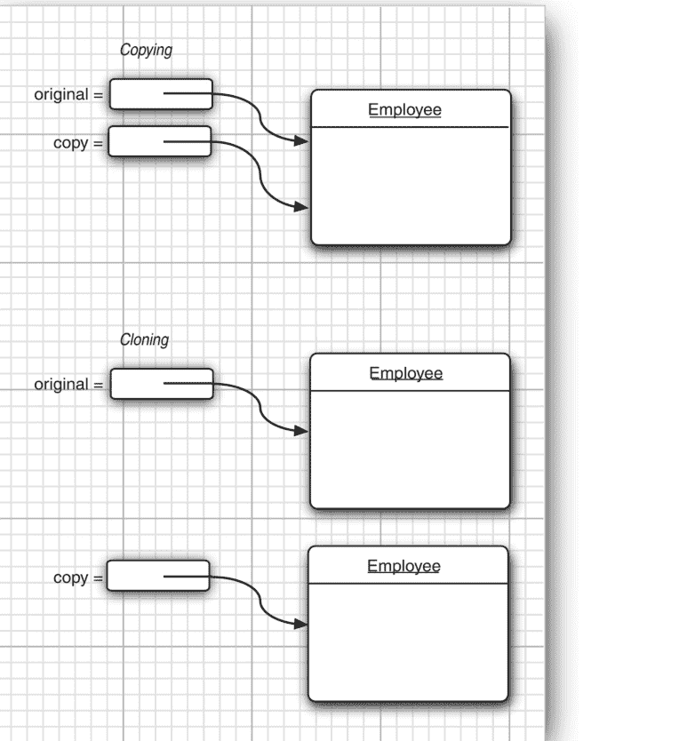

图 6.1：复制与克隆

如果你希望副本是一个新对象，其生命周期开始与原始对象相同，但状态可以随时间推移而不同，请使用 `clone` 方法。

```java
Employee copy = original.clone();

copy.raiseSalary(10); // OK——原始对象未改变
```

但这看起来并不简单吗？`clone` 方法是 `Object` 的一个受保护方法（protected），这意味着你的代码不能直接调用它。只有 `Employee` 类可以克隆 `Employee` 对象。这种限制是有原因的。考虑 `Object` 类如何实现 `clone` 的：它对对象一无所知，因此它只能进行逐字段的复制。如果对象中的所有实例字段都是数字或其他基本类型，那么复制字段就是没问题的。但如果对象包含对子对象的引用，那么复制字段将给你另一个指向同一子对象的引用，因此原始对象和克隆对象将共享某些信息。

为了直观地理解这一点，请考虑第 4 章中引入的 `Employee` 类。图 6.2 显示了当你使用 `Object` 类的 `clone` 方法克隆此类员工时发生了什么。正如你所看到的，默认的克隆操作是“浅拷贝”的——它不会克隆其他对象内部引用的对象。（图中显示了一个共享的 `Date` 对象。出于某些稍后会明确的原因，此示例使用了 `Employee` 类的一个版本，其中入日期表示为 `Date`。）

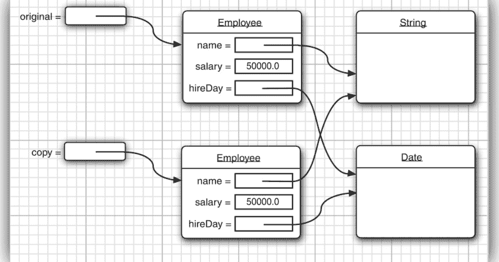

图 6.2：浅拷贝

副本是浅拷贝重要吗？这取决于情况。如果原始对象和浅拷贝之间共享的子对象是不可变的，那么这种共享就是安全的。如果子对象属于不可变类（如 `String`），这确实会发生。或者，子对象在对象的整个生命周期内可能保持不变，没有修改器触碰它，也没有方法返回它的引用。

然而，子对象通常是可变的，你必须重新定义 `clone` 方法以进行深拷贝，同时也对子对象进行克隆。在我们的示例中，`hireDay` 字段是 `Date` 类型，它是可变的，因此它也必须被克隆。（出于这个原因，此示例使用了 `Date` 类型的字段而不是 `LocalDate`，以演示克隆过程。如果 `hireDay` 是不可变 `LocalDate` 类的实例，则不需要进一步的操作。）

对于每个类，你都需要决定：

1. 默认的 `clone` 方法已经足够；
2. 可以通过对可变子对象调用 `clone` 来对默认 `clone` 方法进行补丁；或
3. 不应尝试克隆。

第三种选项实际上是默认选项。要选择第一或第二种选项，一个类必须：

1. 实现 `Cloneable` 接口；且
2. 使用 `public` 访问修饰符重新定义 `clone` 方法。

> **注意：**`clone` 方法在 `Object` 类中被声明为 protected，因此你的代码不能简单调用 `Object.clone()`。但受保护方法不是从任何子类访问的吗？`Object` 的每个子类不都是吗？坦率地说，受保护访问的规则微妙得多（见第 5 章）。子类可以调用受保护的 `clone` 方法来克隆自己的对象。你必须将 `clone` 重新定义为 public，以便允许任何方法克隆对象。

在这种情况下，`Cloneable` 接口的出现与接口的标准用法无关。特别是，它没有指定 `clone` 方法——该方法是从 `Object` 类继承的。该接口仅作为一个标记（tag），表示类设计者理解克隆过程。对象对克隆非常偏执，以至于如果对象请求克隆但没有实现该接口，它们就会抛出一个异常。

> **注意：**`Cloneable` 接口是 Java 提供的少数标记接口之一。（有些程序员称它们为标记接口 marker interfaces。）回想像 `Comparable` 这样的接口的通常用途是确保类实现某个特定方法或一组方法。标记接口没有方法；它的唯一目的是允许在类型查询中使用 `instanceof`。

```java
if (obj instanceof Cloneable) . . .
```

我建议不要在你自己的程序中使用标记接口。

即使 `clone` 的默认（浅拷贝）实现已经足够，你仍然需要实现 `Cloneable` 接口，将 `clone` 重新定义为 public，并调用 `super.clone()`。这里有一个示例：

```java
class Employee implements Cloneable
{
    // public 访问，更改返回类型
    public Employee clone() throws CloneNotSupportedException
    {
        return (Employee) super.clone();
    }
}
```

> **注意：**在 `Object` 类中，`clone` 方法的返回类型是 `Object`。在子类中，你可以指定正确的返回类型。这是协变返回类型的一个示例（见第 5 章）。

你刚刚看到的 `clone` 方法没有为 `Object` 浅拷贝添加任何功能。它只是让该方法变为公共。要实现深拷贝，你必须更加努力并克隆可变字段。这里是一个创建深拷贝的 `clone` 方法示例：

```java
class Employee implements Cloneable
{
    public Employee clone() throws CloneNotSupportedException
    {
        // 调用 Object.clone()
        Employee cloned = (Employee) super.clone();

        // 克隆可变字段
        cloned.hireDay = (Date) hireDay.clone();

        return cloned;
    }
}
```

`Object` 类的 `clone` 方法倾向于抛出 `CloneNotSupportedException`——当在一个类没有实现 `Cloneable` 接口的对象上调用 `clone` 时，它就会这样做。当然，`Employee` 和 `Date` 类实现了 `Cloneable` 接口，因此不会抛出异常。然而，编译器并不知道。因此，我们声明了异常：

```java
public Employee clone() throws CloneNotSupportedException
```

> **注意：**捕获异常会更好吗？有关捕获异常的细节请见第 7 章。

```java
public Employee clone()
{
    try {
        return (Employee) super.clone();
    }
    catch (CloneNotSupportedException e) {
        return null;
        // 这不会发生，因为我们实现了 Cloneable
    }
}
```


这对于`final`类是合适的。否则，最好保留`throws`修饰符。这样子类就有了无法支持克隆时抛出`CloneSupportedException`的选项。

你必须小心处理子类的克隆。例如，一旦为`Employee`类定义了`clone`方法，任何人都可以使用它来克隆`Manager`对象。`Employee`的`clone`方法能胜任吗？这取决于`Manager`类的字段。在我们的案例中，没有问题，因为`bonus`字段是基本类型。但`Manager`可能获得了需要深拷贝或不可克隆的字段。无法保证子类的实现者已经修复了`clone`以完成正确工作。出于这个原因，`clone`方法在`Object`类中被声明为`protected`。但如果你希望类的用户能够调用`clone`，就没有这种奢侈了。

你是否应该在自己的类中实现`clone`？如果你的客户端需要进行深拷贝，那么你可能应该这样做。有些作者认为，你应该完全避免`clone`，而是为了该目的实现另一个方法。我同意`clone`确实相当别扭，但如果你将责任转移给另一个方法，你将会遇到相同的问题。无论如何，克隆并没有你想象的那么常见。标准库中只有不到 5% 的类实现了`clone`。

列表 6.4 中的程序克隆了`Employee`类（列表 6.5）的一个实例，然后调用了两个变异器。`raiseSalary`方法更改了工资字段的值，而`setHireDay`方法更改了入职日的状态。这两种变异都不会影响原始对象，因为`clone`被定义为执行深拷贝。

> 注意：所有数组类型都有一个公共的`clone`方法，而不是保护的（`protected`）。你可以使用它来创建一个包含元素拷贝的新数组。例如：

```java
int[] luckyNumbers = { 2, 3, 5, 7, 11, 13 };

int[] cloned = luckyNumbers.clone();

cloned[5] = 12; // doesn't change luckyNumbers[5]
```

# 列表 6.4 `clone/CloneTest.java`

```java
package clone;

/**
 * 此程序演示克隆。
 * @version 1.11 2018-03-16
 * @author Cay Horstmann
 */
public class CloneTest {
    public static void main(String[] args) throws CloneNotSupportedException {
        var original = new Employee("John Q. Public", 50000);
        original.setHireDay(2000, 1, 1);
        Employee copy = original.clone();
        copy.raiseSalary(10);
        copy.setHireDay(2002, 12, 31);
        System.out.println("original=" + original);
        System.out.println("copy=" + copy);
    }
}
```

```java
package clone;

import java.time.*;
import java.util.*;

public class Employee implements Cloneable {
    private String name;
    private double salary;
    private Date hireday;

    public Employee(String name, double salary) {
        this.name = name;
        this.salary = salary;
        hireday = new Date();
    }

    public Employee clone() throws CloneNotSupportedException {
        // Object.clone()
        Employee cloned = (Employee) super.clone();

        // clone mutable fields
        cloned.hireday = (Date) hireday.clone();
        return cloned;
    }

    public void setHireday(int year, int month, int day) {
        long epochMillis = LocalDate.of(year, month, day)
            .atStartOfDay(ZoneId.systemDefault())
            .toEpochSecond() * 1000;

        // example of instance mutation
        hireday.setTime(epochMillis);
    }

    public void raiseSalary(double byPercent) {
        double raise = salary * byPercent / 100;
        salary += raise;
    }

    public String toString() {
        return Employee(name=" + name + ",salary=" + salary + ",hireDay=" + hireDay + "");
    }
}
```

# 6.2 Lambda 表达式

在接下来的章节中，你将学习如何使用 lambda 表达式用简洁的语法定义代码块，以及如何编写使用 lambda 表达式的代码。

## 6.2.1 为什么使用 Lambda？

Lambda 表达式是一个代码块，你可以将其传递，以便稍后执行（执行一次或多次）。在进入语法（甚至于那个好奇的名字）之前，让我们回过头来观察我们在 Java 中何时用过这样的代码。

在第 6.1.7 节中，你看到了如何按时间间隔执行任务。将任务放入`ActionListener`的`actionPerformed`方法中：

```java
class Worker implements ActionListener {
    public void actionPerformed(ActionEvent event) {
        // do some work
    }
}
```

然后，当你想要重复执行这段代码时，你会构造`Worker`类的实例。然后将该实例提交给`Timer`对象。

关键点在于`actionPerformed`方法包含了你想要稍后执行的代码。

或者考虑使用自定义比较器进行排序。如果你想按长度而不是默认的字典顺序对字符串进行排序，可以将`Comparator`对象传递给`sort`方法。

```java
class LengthComparator implements Comparator<String> {
    public int compare(String first, String second) {
        return first.length() - second.length();
    }
}

Arrays.sort(strings, new LengthComparator());
```

`compare`方法不会立即被调用。相反，`sort`方法会不断调用`compare`方法，如果元素无序则进行重新排列，直到数组排序完成。你提供了比较元素所需的排序代码片段，而这段代码被集成到其余的排序逻辑中，而你可能不想重新实现那些逻辑。

这两个例子都有一个共同点：一段代码块被传递给了某人——计时器或排序方法。这段代码块在稍后的时间被调用。

在 Java 的早期版本中，给某人一段代码并不容易。你不能直接传递代码块。Java 是一门面向对象的语言，所以你必须使用匿名内部类。

## 6.2.2 Lambda 表达式的语法

再次考虑上一节中的排序示例。我们传递了一段检查一个字符串是否短于另一个字符串的代码。

```java
first.length() - second.length()
```

`first`和`second`是什么？它们是字符串。Java 是一门强类型语言，我们也必须指定这一点：

```java
(String first, String second) -> first.length() - second.length()
```

你刚刚看到了第一个 lambda 表达式。这样的表达式仅仅是一个代码块，加上必须传递的变量。

为什么叫这个名字？许多年前，在计算机出现之前，逻辑学家阿尔隆佐·丘（Alonzo Church）想要形式化数学函数是有效计算的。（有趣的是，已知某些函数存在，但没人知道计算它们的值。）他使用希腊字母 lambda（λ）来标记参数。

> 注意：为什么用 λ？是因为 Church 用完字母表了吗？实际上，古老的《数学原理》（Principia Mathematica）使用重音符号表示自由变量，这启发了 Church 使用大写的 lambda Λ 表示参数。最终，他切换到了小写版本。从此，带有参数的表达式被写成方法：包含在 `{}` 中有显式的返回。

你刚刚看到的是 Java 中 lambda 表达式的一种简单形式：参数、`->`箭头和一个表达式。如果代码执行的计算无法放在单个表达式中，就按照你写方法的方式来写：包含在`{}`中有显式的返回。

```java
(String first, String second) ->
{
    if (first.length() < second.length()) return -1;
    else if (first.length() > second.length()) return 1;
    else return 0;
}
```

如果 lambda 表达式没有参数，你仍然提供空括号，就像无参数的方法一样：

```java
() -> { return 1 + (int)(Math.random() * 6); }
```

如果 lambda 表达式的参数类型可以推断，你可以省略它们。例如：

```java
Comparator<String> comp = (first, second) // 等同于 (String first, String second)
    -> first.length() - second.length();
```

在这里，编译器可以推导出`first`和`second`必须是字符串，因为该 lambda 表达式被赋值给一个字符串比较器。（我们将在下一节中详细讨论这种赋值。）

如果一个方法有一个具有推断类型的单个参数，你甚至可以省略括号：

```java
ActionListener listener = event ->
    System.out.println("The time is " + Instant.EpochMilli(event.getWhen()));

// 而不是 (event) -> (ActionEvent event) -> . . .
```

你永远不需要指定 lambda 表达式的返回类型。它总是从上下文中推断出来的。例如，该表达式：

```java
(String first, String second) -> first.length() - second.length()
```

可以用于期望结果类型为`int`的上下文。

最后，你可以使用`var`来表示推断的类型。这并不常见；该语法的发明是为了附加注解（参见第 11 章）。

```java
(@NonNull var first, @NonNull var second) -> first.length() - second.length()
```

> 注意：lambda 表达式在某些分支中返回值而在其他分支中不返回是非法的。例如，`(int x) -> { if (x >= 0) return 1; }`是无效的。

> 预览说明：如果 lambda 表达式的参数从未被使用，你可以用下划线表示：

```java
ActionListener listener = _ ->
    System.out.println("The action occurred at " + Instant.now());

Comparator<String> comp = (_, , _) -> 0;
```

这是 Java 21 中的预览特性。

列表 6.6 中的程序展示了如何使用 lambda 表达式作为比较器和监听器。

# 列表 6.6 `lambda/LambdaTest.java`

```java
package lambda;

import java.util.*;
import javax.swing.*;
import javax.swing.Timer;

/**
 * 此程序演示了 lambda 表达式的使用。
 * @Version 1.0 2015-05-12
 * @Author Cay Horstmann
 */
public class LambdaTest {
    public static void main(String[] args) {
        String[] planets = new String[]{"Mercury", "Venus", "Earth", "Mars",
            "Jupiter", "Saturn", "Uranus", "Neptune"};

        System.out.println(Arrays.toString(planets));
        System.out.println("按字典顺序排序:");

        Arrays.sort(planets);

        System.out.println(Arrays.toString(planets));
        System.out.println("按长度排序:");

        Arrays.sort(planets, (first, second) -> first.length() - second.length());

        System.out.println(Arrays.toString(planets));

        Timer timer = new Timer(1000, event -> {
            System.out.println("The time is " + new Date());
            timer.start();
        });

        // 保持程序运行直到用户选择“OK”
        JOptionPane.showMessageDialog(null, "Quit program?");

        System.exit(0);
    }
}
```

## 6.2.3 函数式接口

如前所述，Java 中有许多封装了代码块的现有接口，例如`ActionListener`或`Comparator`。Lambda 与这些接口是兼容的。

每当需要一个具有单个抽象方法的接口对象时，你都可以提供一个 lambda 表达式。这种接口被称为函数式接口。

> 注意：你可能会奇怪为什么函数式接口必须有一个抽象方法。接口中的所有方法不全都是抽象的吗？实际上，接口一直可以重新声明`Object`类的方法（如`toString`或`clone`），而这些声明并不会使方法变为抽象。（Java API 中的某些接口重新声明`Object`方法是为了附加 javadoc 注释。可以查看`Comparator` API 作为一个示例。）更重要的是，正如你在第 6.1.5 节中看到的，接口可以声明非抽象方法。

为了演示向函数式接口的转换，考虑`Arrays.sort`方法。它的第二个参数接收一个`Comparator`实例，这是一个具有简单方法的接口。只需提供一个 lambda 即可：

```java
Arrays.sort(words,
    (first, second) -> first.length() - second.length());
```

在底层，`Arrays.sort`方法接收一个实现了`Comparator<String>`的类的对象。在该对象上调用`compare`方法会执行 lambda 表达式的体。这些对象和类的管理完全取决于实现，并且比使用传统的内部类要高效得多。最好将 lambda 表达式视为一个函数而不是一个对象，并接受它可以被传递给函数式接口。

这种向接口的转换使得 lambda 表达式如此具有吸引力。语法简单且直观。这里是另一个示例：

```java
var timer = new Timer(1000, event -> {
    System.out.println("At the time, the time is " + Instant.EpochMilli(event.getMillis()));
    Toolkit.getDefaultToolkit().beep();
});
```


这比使用实现`ActionListener`接口的类方案要易读得多。

事实上，转换为函数式接口是你在 Java 中对 lambda 表达式唯一能做的事情。在其他支持函数类型的编程语言中，你可以声明`(String, String) -> int`等函数字面量，声明这些类型的变量，并使用这些变量来保存函数表达式。然而，

## 6.2.4. 函数类型

Java API 定义了许多接口。在支持如`(String, String) -> int`等函数字面量、声明这些类型的变量、并使用这些变量来保存函数表达式的其它编程语言中，情况有所不同。

> 注意：Lambda 表达式可以匹配函数式接口中的基本类型和包装类型，这很棒。但如果两种匹配都可能发生，就是一个错误。考虑一个提供这些方法的工具类。

```
public static int[] fill(int n, IntUnaryOperator op)

public static Object[] fill(int n, IntFunction<Object> op)
```

调用`fill(n, i -> i *)`将无法编译，因为它是歧义的。你可以通过使用`-Xlint`或`-Xlint:overloads`标志进行编译来捕获 API 中的问题。

## 6.2.5. 方法引用

有时，Lambda 表达式涉及单个方法。例如，假设你只想在每次定时器事件发生时打印事件对象。当然，你可以调用：

```java
var timer = new Timer(1000, event -> System.out.println(event));
```

如果能直接将方法传递给`Timer`构造函数会更好。这是实现方法：

```
var timer = new Timer(1000, System.out::println);
```

`System.out::println`表达式是一个方法引用。它指示编译器产生函数式接口的实例，重写接口的单个抽象方法以调用给的方法。在这个示例中，产生了一个`ActionListener`，其`actionPerformed(ActionEvent e)`调用了`System.out.println(e)`。

> 注意：像 Lambda 表达式一样，方法引用不是对象。当它赋值给类型为函数式接口的变量时，才会产生一个对象。

> 注意：`PrintStream`类中有十个重载的`println`方法（`System.out`是其中的一个实例）。编译器需要根据上下文确定使用哪一个。在我们的示例中，方法`System.out::println`必须转换为具有以下方法的`ActionListener`实例：

`void actionPerformed(ActionEvent e)`

从十个重载的`println`中选择了`println(Object x)`方法，因为`Object`是`ActionEvent`的最佳匹配项。当调用`actionPerformed`方法时，就会打印事件对象。

现在假设我们将同一个方法引用赋值给不同的函数式接口：

```
Runnable task = System.out::println;
```

`Runnable`函数式接口有一个没有参数的单个抽象方法：

```
void run()
```

在这种情况下，选择了无参数的`println()`方法。调用`task.run()`会向`System.out`打印一个空行。

另一个示例，假设你想忽略字母大小对字符串进行排序。你可以传递此方法表达式：

```
Arrays.sort(strings, String::compareToIgnoreCase)
```

从这些示例可以看出，`::`运算符将方法名与对象或类的名称分开。三种变体：

- 1. `object::instanceMethod`
- 2. `Class::instanceMethod`
- 3. `Class::staticMethod`

在第一种变体中，方法引用等于 Lambda 表达式，参数传递给方法。在`System.out::println`的情况下，对象是`System.out`，方法表达式等于`x -> System.out.println(x)`。

在第二种变体中，第一个参数变成方法的隐式参数。例如，`String::compareToIgnoreCase`等于`(x, y) -> x.compareToIgnoreCase(y)`。

在第三种变体中，所有参数都传递给静态方法：`Math::pow`等于`(x, y) -> Math.pow(x, y)`。

表 6.1 带你介绍了额外的示例。

注意，只有当 Lambda 表达式的主体调用单个方法且不执行其他操作时，Lambda 表达式才能重写为方法引用。考虑此 Lambda 表达式：

```
s -> s.length() == 0
```

只有一个方法调用。但还有一个比较，所以你在这里不能使用方法引用。

## 表 6.1：方法引用示例

| 方法引用 | 等价的 Lambda 表达式 | 注意 |
| --- | --- | --- |
| `separator::equals` | `x -> separator.equals(x)` | 这是一个包含对象和实例方法的表达式。Lambda 参数作为方法的显式参数传递。 |
| `String::strip` | `x -> x.strip()` | 这是一个包含类和实例方法的表达式。Lambda 参数变成隐式参数。 |
| `String::concat` | `(x, y) -> x.concat(y)` | 再次，我们有一个实例方法，但这次带有显式参数。和之前一样，第一个 Lambda 参数变成隐式参数，其余参数传递给方法。 |
| `Integer.valueOf` | `x -> Integer.valueOf(x)` | 这是一个带有静态方法的表达式。Lambda 参数被传递给静态方法。 |
| `Integer.sum` | `(x, y) -> Integer.sum(x, y)` | 这是另一个静态方法，但这次有两个参数。两个 Lambda 参数都传递给静态方法`sum`。`sum`方法专门为了用作方法引用而创建。作为 Lambda，你可以直接写`(x, y) -> x + y`。 |
| `String::new` | `x -> new String(X)` | 这是一个构造器引用——见第 6.2.6 节。Lambda 参数传递给构造器。 |
| `String[]::new` | `n -> String[n]` | 这是一个数组构造器引用——见第 6.2.6 节。Lambda 参数是数组长度。 |

存在多个重载方法时，编译器根据上下文推使用哪一个。例如，如果你有一个字符串列表，可以通过以下调用将其转换为`Person`对象的数组：

```
ArrayList<String> names = . .

Stream<Person> names = names.stream().map(Person::new);

List<Person> people = stream.toList();
```

（注：原文后半部分存在大量重复和 OCR 错误，已根据逻辑进行清理处理）

## 6.2.6. 构造器引用

构造器引用与方法引用相似，只是方法名是`new`。例如，`Person::new`是一个引用。

数组构造器引用用于克服 Java 的局限性。正如你在第 8 章将看到的，无法构造泛型`T`的数组（表达式`T[n]`是一个错误，因为它会被擦除为`new Object[n]`）。这对库作者来说是一个问题。例如，假设我们想要`Person`对象的数组。`Stream`接口有一个`toArray`方法返回`Object`数组：

```
Object[] people = stream.toArray();
```

但这是不满意的。用户想要`Person`引用的数组，而不是`Object`引用的。stream 库通过构造器引用解决了这个问题。将`Person[]::new`传递给`toArray`方法：

```
Person[] people = stream.toArray(Person[]::new);
```

`toArray`方法调用此构造器以获取正确类型的数组。然后它填充并返回数组。

> 注意：当传递方法或构造器引用时，如果选择了重载变体，有时令人惊讶。考虑这段代码片段：

```
var dates = new Date[100];

Arrays.setAll(dates, Date::new);
```

乍看之下，所有元素似乎都被设置为当前日期，通过每次调用无参数构造器`new Date()`。

实际上，`setTitle`的第二个参数是一个`IntFunction`，它接收元素的索引。因此，会调用一个完全不同的构造函数`new Date(i)`，其中`i`的范围从 0 到 99。该构造函数将日期设置为自“纪元”（1970 年 1 月 1 日）起的给定毫秒数。

## 6.2.7. 变量作用域

通常，你希望在 lambda 表达式中访问闭包方法或类中的变量。考虑这个示例：

```java
public static void repeatMessage(String text, int delay)

{

    ActionListener listener = event ->

    {

        System.out.println(text);

        Toolkit.getDefaultToolkit().beep();

    };

    new Timer(delay, listener).start();

}
```

考虑这样一个调用：

```java
repeatMessage("Hello", 1000); // 每 1,000 毫秒打印一次 Hello
```

现在看 lambda 表达式内部的变量`text`。注意，这个变量并没有在 lambda 表达式中定义。相反，它是`repeatMessage`方法的参数变量。

如果你仔细思考，这里发生了一些不寻常的事情。lambda 表达式的代码可能在`repeatMessage`调用返回且参数变量消失之后仍在运行。`text`变量是如何留存的呢？

为了理解发生了什么，我们需要对 lambda 表达式的理解进行进一步细化。一个 lambda 表达式包含三个要素：

- 1. 一个代码块
- 2. 参数
- 3. 自由变量的值——即既不是参数也没有在代码内部定义的变量

在我们的示例中，lambda 表达式有一个自由变量`text`。表示该 lambda 表达式的数据结构必须存储这些自由变量的值——在我们的案例中，就是字符串 "Hello"。我们称这些值被 lambda 表达式**捕获**（captured）了。（具体实现方式是实现细节。例如，可以将 lambda 表达式转换为一个只有一个方法的对象，这样自由变量的值就会被复制到该对象的实例中。）

> **注意：** 代码块连同自由变量值的组合，技术术语是**闭包**（closure）。如果有人炫耀他们的语言拥有闭包，请放心，Java 也有。在 Java 中，lambda 表达式就是闭包。

正如你所看到的，lambda 表达式可以捕获封装作用域中变量的值。在 Java 中，为了确保被捕获的值是有定义的，有一项重要的限制。在 lambda 表达式中，你只能引用值不会改变的变量。例如，以下代码是非法的：

```java
public static void countDown(int start, int delay)

{

    ActionListener listener = event ->

    {

        start--; // 错误：不能修改捕获的变量

        System.out.println(start);

    };

    new Timer(delay, listener).start();

}
```

这种限制是有原因的。当多个操作并发执行时，在 lambda 表达式中修改变量是不安全的。对于我们目前看到的这类操作，不会发生这种情况，但通常情况下，这是一个严重的问题。关于这一重要问题的更多信息，请参见第 10 章。

在 lambda 表达式中引用在外部被修改的变量也是非法的。例如，以下代码是非法的：

```java
public static void repeat(String text, int count)

{

    for (int i = 1; i <= count; i++)

    {

        ActionListener listener = event ->

        {

            System.out.println(i + ": " + text);

        };

        // 错误：不能引用变化的 i

        new Timer(1000, listener).start();

    }

}
```

规则是，lambda 表达式中的任何被捕获变量必须是**有效最终的**（effectively final）。一个有效最终变量是指是指在初始化后从未被赋值过新值的变量。在我们的案例中，`text`始终引用同一个 String 对象，因此捕获它是可以。然而，`i`的值被修改了，因此`i`不能被捕获。

lambda 表达式的体部与嵌套块具有相同的作用域。名称冲突和遮蔽的规则同样适用。在 lambda 中声明与局部变量同名的参数或局部变量是非法的。

```java
Path first = Path.of("/usr/bin");

Comparator<String> comp =

    (first, second) -> first.length() - second.length();

// 错误：变量 first 已定义
```

在方法内部，你不能有两个同名的局部变量，因此，也无法在 lambda 表达式中引入此类变量。

当你在 lambda 表达式中使用`this`关键字时，你指的是创建该 lambda 的方法中的该参数。例如，考虑：

```java
public class Application

{

    public void init()

    {

        ActionListener listener = event ->

        {

            System.out.println(this.toString());

        }

        //

    }
}
```


表达式 `this.toString()` 调用的是 `Application` 对象的 `toString` 方法，而不是 `ActionListener` 实例。在 lambda 表达式中使用 `this` 没有什么特殊之处。lambda 表达式的作用域嵌套在 `init` 方法内部，这在该方法的任何地方都具有相同的含义。

## 6.2.8. 处理 lambda 表达式

到为止，你已经看到了如何产生 lambda 表达式并将它们传递给接受函数接口的方法。现在让我们看看如何编写可以消费 lambda 表达式的方法。

使用 lambda 的点在于**延迟执行**。毕竟，如果你现在就想执行某些代码，直接执行即可，不需要将其封装在 lambda 内部。使用 lambda 的目的是为了：

- 稍后执行某些代码
- 在需要时执行代码
- 当满足条件时执行代码
- 在另一个线程执行代码
- 传递逻辑

既然你已经了解了如何使用 lambda 表达式，现在让我们看看如何编写可以消费 lambda 表达式的方法。

（注：此处原文文本似乎存在部分重复或逻辑混乱，翻译时已根据上下文进行了通顺处理）

（注：原文后续部分包含大量杂乱的重复描述，以下是基于核心含义的表格翻译：）

**表 6.2：常用函数接口**

| 函数接口 | 参数类型 | 返回类型 | 抽象方法 | 描述 | 其他方法 |
| :--- | :--- | :--- | :--- | :--- | :--- |
| `Runnable` | 无 | `void` | `run` | 执行无参数无返回的操作 | |
| `Supplier<T>` | 无 | `T` | `get` | 提供类型 `T` 的值 | |
| `Consumer<T>` | `T` | `void` | `accept` | 消费类型 `T` 的值 | `andThen` |
| `BiConsumer<T, U>` | `T`, `U` | `void` | `accept` | 消费 `T` 和 `U` 的值 | `andThen` |
| `Function<T, R>` | `T` | `R` | `apply` | 参数为类型 `T` 的函数 | `compose`, `andThen`, `identity` |
| `BiFunction<T, U, R>` | `T`, `U` | `R` | `apply` | 参数为 `T` 和 `U` 的函数 | `andThen` |
| `UnaryOperator<T>` | `T` | `T` | `apply` | 类型 `T` 的一元操作符 | `compose`, `andThen`, `identity` |
| `BinaryOperator<T>` | `T`, `T` | | `apply` | 类型 `T` 的二元操作符 | `andThen`, `maxBy`, `minBy` |
| `Predicate<T>` | `T` | `boolean` | `test` | 布尔值函数 | `and`, `or`, `negate`, `isEqual`, `not` |
| `BiPredicate<T, U>` | `T`, `U` | `boolean` | `test` | 两个参数的布尔值函数 | `and`, `or`, `negate` |

6.3 列出了针对基本类型 `int` 和 `long` 的 34 个可用特化版本。正如你在第 8 章看到的，使用这些特化版本比通用接口更高效。因此，在前节的示例中，我使用了 `IntConsumer` 而不是 `Consumer<Integer>`。

**表 6.3：针对基本类型的函数接口**

`np`、`q` 是 `int`、`long`、`double`

| 函数接口 | 参数类型 | 返回类型 | 抽象方法名 |
| :--- | :--- | :--- | :--- |
| `BooleanSupplier` | 无 | `boolean` | `getAsBoolean` |
| `PSupplier` | 无 | `p` | `getAsP` |

| 功能式接口 | 参数类型 | 返回类型 | 抽象方法名 |
| :--- | :--- | :--- | :--- |
| `Consumer` | `T` | `void` | `accept` |
| `Consumer<T>` | `T` | `void` | `accept` |
| `Function<T>` | `T` | `R` | `apply` |
| `ToIntFunction` | `T` | `int` | `applyAsInt` |
| `ToLongFunction<T>` | `T` | `long` | `applyAsLong` |
| `ToBiFunction<T, U>` | `T`, `U` | `R` | `applyAsBi` |
| `UnaryOperator<T>` | `T` | `T` | `apply` |
| `BinaryOperator<T>` | `T` | `T` | `applyBinary` |
| `Predicate<T>` | `T` | `boolean` | `test` |

> **提示：** 尽可能使用标准接口来处理函数类型。例如，你编写了一个方法来处理符合某些标准的文件。这里有一个遗留接口 `java.io.FileFilter`。但如果你使用标准的 `Predicate<File>` 接口，你可以利用创建、适配和组合谓词的方法。不这样做的唯一理由可能是你已经有了许多产生 `Filter` 实例的有用方法。

> **注意：** 大多数标准函数式接口都有非抽象方法，用于产生或组合函数。例如，`Predicate.isEqualTo(a)` 等同于 `a::equals`，但即使 `a` 为 `null` 它也能工作。此外还有默认方法 `or`，用于取反谓词。例如，`Predicate(a).or(Predicate.equals(b))` 等同于 `x -> equals(x) || b.equals(x)`。

> **注意：** 如果你设计了一个只有一个抽象方法的接口，可以使用 `@FunctionalInterface` 注解来标记它。这有两个优点：如果你不小心添加了另一个抽象方法，编译器会给出错误信息；此外，javadoc 页面会包含一条说明你的接口是函数式接口。

并不是强制使用该注解。根据定义，任何只有一个抽象方法的接口都是函数式接口。但使用 `@FunctionalInterface` 注解是一个好主意。

注意：有些程序员非常喜欢方法调用链，例如：

```java
String input = " 618970019642690137449562111 ";

boolean isPrime = input.strip().transform(BigInteger::new).isProbablePrime(20);
```

`String` 类的 `transform` 方法（Java 12 引入）将 `Function` 应用于字符串并产生结果。你完全可以这样做：

```java
boolean prime = new BigInteger(input.strip()).isProbablePrime(20);
```

但这样你的眼睛就会来回左右跳跃，以寻找先发生了什么、后发生了什么：调用字符串，然后构造 `BigInteger`，最后测试它是否为可能的素数。

我不确定这种眼睛来回左右跳跃是否是一个巨大的问题。但如果你更倾向于链式方法调用从左到右的有序序列，那么 `transform` 就是你的朋友。

遗憾的是，它只适用于字符串。为什么 `Object` 类中没有 `transform(java.util.function.Function)` 方法呢？

Java API 的设计者速度不够快。他们只有一次机会做这件事——在 Java 8 中，当 `java.util.function.Function` 接口被添加到 API 时。在此之前，没有人能为自己的类添加 `transform(java.util.function.Function)` 方法。但在 Java 12 中，已经太晚了。某些地方可能已经在他们的类中定义了 `transform(java.util.function.Function)`，但具有不同的含义。诚然，这种情况不太可能发生，但无法得知。

这就是 Java 的工作方式。它严肃对待自己的承诺，不会为了方便而违背承诺。

## 6.2.9. 创建比较器

`Comparator` 接口有许多方便的静态方法用于创建比较器。这些方法旨在与 Lambda 表达式或方法引用配合。

静态 `comparing` 方法接收一个“键提取器”函数，该函数将类型映射到可比较的类型（如 `String`）。该函数应用于被比较的对象，然后对返回的键进行比较。例如，假设你有一个 `Person` 对象的数组。以下是如何按姓名对它们排序：

```java
Arrays.sort(people, Comparator.comparing(Person::getName));
```

这比手动实现 `Comparator` 要容易得多。而且代码更清晰，因为显而易见我们想按姓名比较人员。

你可以通过 `thenComparing` 方法链用比较器来打破平局。例如：

```java
Arrays.sort(people,
    Comparator.comparing(Person::getLastName)
        .thenComparing(Person::getFirstName));
```

如果两个人的姓氏相同，则使用第二个比较器。

这些方法有几种变体。你可以指定一个比较器，用于 `comparing` 和 `thenComparing` 方法提取的键。例如，在这里我们按姓名的长度排序：

```java
Arrays.sort(people, Comparator.comparing(Person::getName),
    (s, t) -> Integer.compare(s.length(), t.length)));
```

此外，`comparing` 和 `thenComparing` 方法还有避免 `int`、`long` 或 `double` 值装箱的变体：

```java
Arrays.sort(people, Comparator.comparing(Person::getName),
    Comparator.comparingInt(String::length));
```

产生上述操作的一种较短但可能没那么优雅的方法是：

```java
Arrays.sort(people, Comparator.comparingInt(p -> p.getName().length()));
```

*(注：原文此处存在大量重复段落，翻译时已按要求去重)*

## 6.3. 内部类

内部类是定义在另一个类内部的类。你为什么要这样做？有两个原因：

- 内部类可以对外部类隐藏。
- 内部类方法可以访问其定义作用域的数据。

内部类曾用于简洁地实现回调，但现在 Lambda 表达式效果更好。尽管如此，内部类对于组织代码非常有用。后续章节将介绍所有细节。

> **C++ 注意：C++ 有嵌套类。** 嵌套类包含在类类的作用范围内。这是一个典型的示例：链表定义了一个嵌套类来持有节点。

```cpp
template<typename T>
class LinkedList
{
public:
    class Node // 嵌套类
    {
public:
private:
    T data;
    Node* next;
    };

private:
    Node* head;
    Node* tail;
};
```

### 6.3.1. 使用内部类访问对象状态

内部类的语法相当复杂。因此，我展示了一个简单但有些人为的示例来演示内部类的用法。让我们重构 `TextFormField` 示例并提取 `TalkingClock` 类。

```java
public class TalkingClock
{
    private int interval;
    private boolean beep;

    public TalkingClock(int interval, boolean beep) { . . }

    public void start() { . . }

    public class TimePrinter implements ActionListener
        // 一个内部类
    {
```

注意 `TimePrinter` 类现在位于 `TalkingClock` 类内部。

这并不意味着每个 `TalkingClock` 都有一个 `TimePrinter` 实例字段。正如你将看到的，`TimePrinter` 对象是通过 `TalkingClock` 类的方法构造的。

下面是 `TimePrinter` 类的更详细说明。请注意，`actionPerformed` 方法在发出蜂哔声之前会检查 `beep` 标志。

```java
public class TimePrinter implements ActionListener {
    public void actionPerformed(ActionEvent event) {
        System.out.println("At the tone, the time is "
            + Instant.ofEpochMilli(event.getWhen()));

        if (beep) Toolkit.getDefaultToolkit().beep();
    }
}
```

发生了一些令人惊讶的事情。`TimePrinter` 类中并没有名为 `beep` 的实例字段或变量。相反，`beep` 指向创建该 `TimePrinter` 的 `TalkingClock` 对象的字段。你可以看到，内部类方法既可以访问它自己的实例字段，也可以访问创建它的外部对象的字段。

为了实现这一功能，内部类对象总是获得一个指向创建它的对象的隐式引用（见图 6.3）。

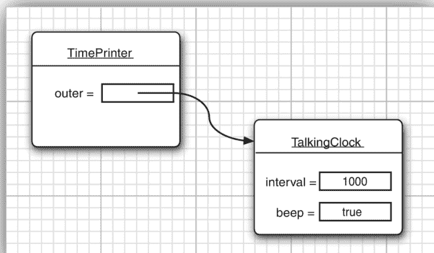

**图 6.3：** 内部类对象有一个外部类对象的引用。

该引用在内部类的定义中是不可见的。然而，为了阐明这个概念，我们将外部对象的引用命名为 `outer`。那么 `actionPerformed` 方法等同于以下代码：

```java
public void actionPerformed(ActionEvent event)
{
    System.out.println("At the tone, the time is "
        + Instant.ofEpochMilli(event.when()));

    if (outer.beep) Toolkit.getDefaultToolkit().beep();
}
```

外部类引用在构造函数中设置。编译器会修改所有的内部类构造函数，添加一个用于外部类引用的参数。`TimePrinter` 类没有定义构造函数；因此，编译器会合成一个无参构造函数，生成如下代码：

```java
public TimePrinter(TalkingClock clock) // 自动生成的代码
{
    outer = clock;
}
```

再次，请注意 `outer` 并不是 Java 关键字。我们只是用它来说明内部类涉及的机制。

当在 `start` 方法中构造 `TimePrinter` 对象时，编译器会将指向当前说话钟的 `this` 传递给构造函数：

```java
var listener = new TimePrinter(this); // 自动添加参数
```

列表 6.7 显示了测试内部类的完整程序。再次查看访问控制。如果 `TimePrinter` 类是一个普通类，它将需要通过 `TalkingClock` 类的公共方法来访问 `beep` 标志。使用内部类是一种改进。没有必要提供那些仅对另一个类感兴趣的成员。

> 注意：我们可以将 `TimePrinter` 类声明为私有（`private`）。这样只有 `TalkingClock` 方法能够构造 `TimePrinter` 对象。只有内部类可以是私有的。普通类总是具有包级或公共（`public`）访问权限。

# 列表 6.7 innerClass/InnerClassTest.java

```java
package innerClass;

import java.awt.*;
import java.awt.event.*;
import java.time.*;
import javax.swing.*;

/**
 * 该程序演示了内部类的使用。
 * @Version 1.11 2017-12-14
 * @author Cay Horstmann
 */
public class innerClassTest
{
    public static void main(String[] args) {
        var clock = new TalkingClock(1000, true);
        clock.start();

        // 保持程序运行直到用户选择“确定”
        JOptionPane.showMessageDialog(null, "Quit program?");
        System.exit(0);
    }
}

/**
 * 一个按间隔打印时间的闹钟。
 */
class TalkingClock {
    private int interval;
    private boolean beep;

    /**
     * 构造一个说话钟。
     * @param interval interval消息之间的间隔（毫秒）
     * @param beep true 如果闹钟应该蜂哔响
     */
    public TalkingClock(int interval, boolean beep)
    {
        this.interval = interval;
        this.beep = beep;
    }

    /**
     * 启动闹钟。
     */
    public void start() {


```java
var listener = new TimePrinter();

var timer = new Timer(interval, listener);

timer.start();

}

public class TimePrinter implements ActionListener

{

    public void actionPerformed(ActionEvent event) {

        System.out.println("At the tone, the time is "

            + Instant.now().ofEpochMilli(event.getWhen()));

        if (beep) Toolkit.getDefaultToolkit().beep();

    }

}

}
```

### 6.3.2. 内部类的语法规则

在前面的节中，我们通过将其称为`outer`来解释了内部类的外部类引用。实际上，外部引用的正确语法要复杂一些。表达式`OuterClass.this`表示外部类引用。例如，你可以这样写内部方法：

```java
public void actionPerformed(ActionEvent event) {

    if (TalkingClock.this.beep) Toolkit.getDefaultToolkit().beep();

}
```

外部类引用在构造函数中设置。编译器会修改所有的内部类构造函数，添加一个用于外部类引用的参数。`TimePrinter`类没有定义构造函数；因此，编译器会合成一个无参构造函数，生成如下代码：

```java
public TimePrinter(TalkingClock clock) // 自动生成的代码

{

    outer = clock;

}
```

再次，请注意`outer`并不是 Java 关键字。我们只是用它来说明内部类涉及的机制。

当在`start`方法中构造`TimePrinter`对象时，编译器会将指向当前说话钟的`this`传递给构造函数：

```java
var listener = new TimePrinter(this); // 自动添加参数
```

列表 6.7 显示了测试内部类的完整程序。再次查看访问控制。如果`TimePrinter`类是一个普通类，它将需要通过`TalkingClock`类的公共方法来访问`beep`标志。使用内部类是一种改进。没有必要提供那些仅对另一个类感兴趣的成员。

> 注意：我们可以将`TimePrinter`类声明为私有。这样只有`TalkingClock`方法能够构造`TimePrinter`对象。只有内部类可以是私有的。普通类总是具有包级或公共访问权限。

### 6.3.3. 内部类有用吗？必要吗？安全吗？

当内部类在 1.1 版本添加到 Java 中时，许多程序员认为它们是一个与 C++ 不同的特征。内部语法不可否认地复杂（稍后我们学习匿名内部类时会变得更复杂）。内部类如何与语言的其他特性（如访问控制）交互并不显而易见。

内部类被翻译成带有 `$`（美元符号）的普通类文件。例如，`TalkingClock`类内部的`TimePrinter`类被翻译为`TalkingClock$TimePrinter.class`。为了看到这种效果，请尝试以下实验：运行`ReflectionTest`程序，并将`TalkingClock$TimePrinter`类进行反射。或者，使用`jav`工具：

```bash
javap -private Class
```

> 注意：如果你使用 UNIX，在命令行提供类名时请转义`$`字符。也就是说，运行`ReflectionTest`或`jav`程序如下：

```bash
java --classpath ...:/reflection.ReflectionTest innerClass.TalkingClock\$TimePrinter
```

或：

```bash
javap -private innerClass.TalkingClock\$TimePrinter
```

你将得到如下输出：

```java
public class innerClass.TalkingClock$TimePrinter

implements java.awt.ActionListener

{

    final innerClass.TalkingClock this$0;

    public innerClass.TalkingClock$TimePrinter(innerClass.TalkingClock);

    public void actionPerformed(java.awt.event.ActionEvent);

}
```

你可以清楚地看到编译器生成了一个额外的实例字段`this$0`，指向外部类的引用。（名称`this$0`是编译器合成的——你无法在代码中引用它。）你还可以看到构造函数的`TalkingClock`参数。

> 注意：从 Java 18 开始，`this$0`字段仅在实际需要时提供。如果内部类没有方法访问外部类，它就会被丢弃。

如果编译器可以自动完成这种转换，你难道不能手动编写相同的机制吗？让我们试试。我们将`TimePrinter`变成一个普通类，位于`TalkingClock`类之外。当构造时创建一个`TimePrinter`对象，我们传递了创建它的对象的`this`引用。

```java
class TalkingClock

{

    public void start()

    {

        var listener = new TimePrinter(this);

        var timer = new Timer(interval, listener);

        timer.start();

    }

}
```

```java
class TimePrinter implements ActionListener

{

    private TalkingClock outer;

    public TimePrinter(TalkingClock clock)

    {

        outer = clock;

    }

}
```

现在让我们来看`actionPerformed`方法。它需要访问`outer.beep`。

```java
if (outer.beep) . . . // ERROR
```

在这里我们遇到了问题。内部类可以访问外部类的私有数据，但我们的外部`TimePrinter`类却不能。

因此，内部类确实比普通类更强大，因为它们拥有更多的访问权限。

## 6.3.4. 局部内部类

如果你仔细观察`TalkingClock`示例的代码，你会发现你只需要一次`TimePrinter`这个类型名称：即在`start`方法中创建该类型的对象时。

在这种情况下，你可以在单个方法中局部定义该类。

```java
public void start()

{

    class TimePrinter implements ActionListener

    {

        public void actionPerformed(ActionEvent event)

        {

            System.out.println("At the tone, the time is "

                + Instant.ofEpochMilli(event.getWhen()));

            if (beep) Toolkit.getDefaultToolkit().beep();

        }

    }

}
```

```java
var listener = new TimePrinter();

var timer = new Timer(interval, listener);

timer.start();
```

局部类永远不会带有访问修饰符（即`public`或`private`）。它们的作用域始终被限制在声明它们的块中。

局部类有一个巨大的优势：它们对外部世界完全隐形——即使是`TalkingClock`类中的其他代码也无法访问它们。除了`start`方法外，没有任何方法对`TimePrinter`类有任何所知。

## 6.3.5. 从外部方法访问变量

局部类相比其他内部类还有一个优势。它们不仅可以访问外部类的字段；而且，这些局部变量必须是**有效最终的（effectively final）**。这意味着一旦它们被赋值，它们就永远不会改变。

这是一个典型的例子。我们将`interval`和`beep`参数从`TalkingClock`构造函数移动到`start`方法。

```java
public void start(int interval, boolean beep)

{

    class TimePrinter implements ActionListener

    {

        public void actionPerformed(ActionEvent event)

        {

            System.out.println("At the tone, the time is "

                + Instant.ofEpochMilli(event.getWhen()));

        }

    }
```

```java
if (beep) Toolkit.getDefaultToolkit().beep();

var listener = new TimePrinter();

var timer = new Timer(interval, listener);

timer.start();
```

注意，`TalkingClock`类不再需要存储一个`beep`实例字段。它只是简单地引用了`start`方法的`beep`参数变量。

也许这并不应该令人惊讶。毕竟，`if (beep) . . .`这一行代码终究是在`start`方法内部，那么为什么它不应该访问`beep`变量的值呢？

为了看到为什么这里存在一个微妙的问题，让我们更仔细地考虑控制流。

1. `start`方法被调用。
2. 对象变量`listener`通过调用内部类`TimePrinter`的构造函数进行初始化。
3. `listener`引用被传递给`Timer`构造函数，定时器启动，方法退出。此时，`start`方法的`beep`参数变量已经不再存在了。
4. 一秒后，`actionPerformed`执行了`if (beep) . . .`。

为了让`actionPerformed`方法中的代码运行，`TimePrinter`类必须在`beep`参数值消失之前，将`beep`字段作为局部变量进行了复制。事实也确实发生了。在我们的示例中，编译器为局部内部类合成了名称`TalkingClock$1TimePrinter`。如果你再次使用`ReflectionTest`程序或`javap`工具查看`TalkingClock$1TimePrinter`类，你将得到以下输出：

```java
class TalkingClock$1TimePrinter {

  TalkingClock$1TimePrinter();

  public void actionPerformed(java.awt.event.ActionEvent);

  final boolean val$beep;

  final TalkingClock this$0;

}
```

当对象被创建时

## 6.3.6. 匿名内部类

在使用内部类时，你通常可以更进一步。如果你只想为该类创建一个单一对象，你甚至不需要给该类命名。这样的类被称为**匿名内部类**。

```java
public void start(int interval, boolean beep) {

  var listener = new ActionListener() {

    public void actionPerformed(ActionEvent event) {

      System.out.println("At the tone, the time is " + Instant.EpochMilli(event.getMillis()));

      if (beep) Toolkit.getDefaultToolkit().beep();

    }

  };

  var timer = new Timer(interval, listener);

  timer.start();

}
```

这种语法确实非常晦涩。它的意思是：创建一个实现了`ActionListener`接口的类的新对象，其中所需的方法`actionPerformed`是在大括号`{ }`内定义的那个。

通常情况下，语法是：

```java
new SuperType(construction arguments) {

  // methods and data

}
```

等待，OCR 文本包含了一些错误（此处指原文末尾的重复或断句问题）。这意味着你正在创建`SuperType`的一个匿名子类。

在实践中，这种技巧很少用处。更有可能的是，该方法愿意接受任何`List<String>`，你简单地传递`List.of("Harry", "Tony")`即可。

> 注意：创建一个与其父类几乎相同但并不完全相同的匿名子类通常是方便的。但你必须对`equals`方法要小心。在第 5 章中，我建议你的`equals`方法使用一个测试：

```java
if (getClass() != other.getClass()) return false;

// 匿名子类无法通过这个测试。
```

> 提示：当你生成日志或调试信息时，通常希望包含当前类的名称，例如：

```java
System.err.println("Something awful happened in " + getClass());
```

但这在静态方法中会失败。毕竟，对`getClass()`的调用实际上是调用了`this.getClass()`，而静态方法没有`this`。请使用以下表达式：

```java
new Object(){}.getClass().getEnclosingClass() // 获取静态方法的所在类
```

在这里，`new Object(){}`创建了一个基于`Object`的匿名子类的匿名对象，而`getEnclosingClass()`获取了它的所在类——即包含该静态方法的类。

## 列表 6.8 anonymousInnerClass/AnonymousInnerClassTest.java

```java
package anonymousInnerClass;

import java.awt.*;

import java.awt.event.*;

import java.time.*;

import javax.swing.*;

/**

 * 此程序演示了匿名内部类。

 * @version 1.12 2017-12-14

 * @author Cay Horstmann

 */

public class AnonymousInnerClassTest

{

    public static void main(String[] args) {

        var clock = new TalkingClock();

        clock.start(1000, true);

        // 保持程序运行，直到用户选择“确定”

        JOptionPane.showMessageDialog(null, "Quit program?");

        System.exit(0);

    }

}
```

```java
/**
 * 一个按固定间隔打印时间的闹钟。
 */

class TalkingClock {
    /**
     * @param interval 消息之间的间隔（毫秒）
     * @param beep 如果闹钟应该蜂鸣则为 true
     */

    public void start(int interval, boolean beep) {
        var listener = new ActionListener() {
            public void actionPerformed(ActionEvent event) {
                System.out.println("At tone, the time is " +
                    Instant.ofEpochMilli(event.getTime()));

                if (beep) Toolkit.getDefaultToolkit().beep();
            }
        };

        var timer = new Timer(interval, listener);

        timer.start();
    }

}
```


## 6.3.7 静态类

偶尔，你可能将一个类嵌套在另一个类内部，但不需要嵌套类持有外部类对象的引用。你可以通过将嵌套类声明为`static`来抑制该引用的生成。

Java 语言规范使用“嵌套类”（nested class）来指任何声明在另一个类或接口内部的类，使用“静态类”（static class）来指（必须是嵌套的）静态类，使用“内部类”（inner class）来指非静态的嵌套类。

这里有一个你想要这样操作的典型示例。在`ArrayAlg`类中，我们有一个查找数组中元素范围的任务。然后你需要返回该范围的起始和结束位置。我们可以通过定义一个持有两个值的`Range`类来实现：

```java
class Range
{
    private int from;
    private int to;

    public Range(int from) { . . }

    public void extend() { . . }
}
```

当然，`Range`是一个极其常见的名称，在一个大型项目中，可能其他程序员也有同样的妙想，在同一个包中定义了另一个`Range`类。我们可以通过将`Range`变为`ArrayAlg`内部的公共内部类来解决这个潜在的命名冲突。这样，该类将被公开标识为`ArrayAlg.Range`：

```java
ArrayAlg.Range r = ArrayAlg.longestRun(numbers);
```

然而，与之前示例中使用的内部类不同，我们不希望`Range`对象内部持有任何其他对象的引用。该引用可以通过将嵌套声明为`static`来抑制：

```java
class ArrayAlg
{
    public static class Range
    {
        . .
    }
}
```

静态类与内部类完全一样，只是静态类的对象没有指向生成它的外部对象的引用。在我们的示例中，我们必须使用静态类，因为嵌套类的实例是在静态方法内部构造的：

```java
public static Pair longestRun(double[] values)
{
    . .
    Range current = new Range( . . );

    if (. . .) longest = current;

    return longest;
}
```

如果`Range`类没有声明为`static`，编译器会将构造函数调用标记为错误。毕竟，没有可用的`ArrayAlg`类型隐式对象来初始化该内部类实例。

当嵌套类不需要访问外部类对象时，你应该始终使用静态类。

在这里，我特意让`Range`类是可变的。可能将`Range`类设为不可变并声明为`record`会更好。`record`自动是静态的。

> 注意：与`record`一样，声明在类或接口内部的接口和枚举自动是静态的。

事实上：

> 注意：声明在接口内部的类自动是静态的。注意：在 Java 16 之前，无法在内部类内部声明静态类。这一限制已被移除。

## 列表 6.9 `staticInnerClass/StaticInnerClassTest.java`

```java
package staticInnerClass;

/**
 * 此程序演示了静态类的使用。
 * @version 1.12 2017-12-14
 * @author Cay Horstmann
 */
public class StaticInnerClassTest
{
    public static void main(String[] args) {
        double[] numbers = {1, 2, 2, 3, 3, 3, 4, 4};

        ArrayAlg.Range r = ArrayAlg.longestRun(numbers);

        System.out.println("from = " + r.getFrom());
        System.out.println("to = " + r.getTo());
    }
}

class ArrayAlg {
    /**
     * “运行”是指相邻元素的序列。例如，在数组 {1, 2, 2, 3, 3, 3, 4, 4} 中，
     * 运行（显式地）是 {3, 3, 3}。返回最长的运行范围。
     * @param values 数组
     * @return 最长运行范围
     */
    public static Range longestRun(double[] values) {
        Range longest = new Range();
        Range current;

        for (int i = 1; i < values.length; i++) {
            if (values[i] == values[i-1]) current.extend();
            else {
                if (longest.length() < current.length()) longest = current;
                current = new Range(values[i]);
            }
        }

        if (longest.length() < current.length()) longest = current;

        return longest;
    }

    public static class Range {
        private int from;
        private int to;

        /**
         * 构造一个长度为 1 的范围。
         * @param from 范围的初始值
         */
        public Range(int from) {
            this.from = from;
            this.to = from + 1;
        }

        /**
         * 将此范围扩展一个元素。
         */
        public void extend() {
            this.to++;
        }

        /**
         * 获取范围的起始索引。
         * @return 起始索引
         */
        public int getFrom() {
            return from;
        }

        /**
         * 获取范围结束后的第一个索引。
         * @return 越界结束索引
         */
        public int getTo() {
            return to;
        }

        /**
         * 返回范围内的元素数量。
         * @return 元素数量
         */
        public int length() {
            return to - from;
        }

        /* 默认构造函数用于上述逻辑 */
        private Range() {}
    }
}
```

（注：此处代码中的`private Range() {}`是为了补全逻辑中的`new Range()`调用，原文可能未完全列出但根据逻辑需要。）

定义一个接口（或者如果你愿意，定义一个超类），包含每个服务实例应该提供的方法。例如，假设你的服务提供加密功能。

```java
package serviceLoader;
```

```java
public interface Cipher {
    byte[] encrypt(byte[] source, byte[] key);
    byte[] decrypt(byte[] source, byte[] key);
    int strength();
}
```

服务提供者提供一个或多个实现该服务的类，例如：

```java
package serviceLoader.impl;
```

```java
public class CaesarCipher {
    byte[] encrypt(byte[] source, byte[] key) {
        var result = new byte[source.length];

        for (int i = 0; i < source.length; i++)
            result[i] = (byte)(source[i] + key[0]);

        return result;
    }

    byte[] decrypt(byte[] source, byte[] key) {
        return encrypt(source, new byte[] { (byte) -key[0] });
    }

    public int strength() { return 1; }
}
```

实现类可以位于任何包中，不一定与服务接口在同一个包内。每个类必须有一个无参构造函数。

现在，将类名添加到`META-INF/services`目录下的一个 UTF-8 编码文本文件中，该文件名必须与接口的全限定名匹配。

在我们的示例中，`META-INF/services/serviceLoader.Cipher`文件将包含该行：

```text
serviceLoader.impl.CaesarCipher
```

在这个示例中，我们提供了一个实现类。你也可以提供多个类，并在以后从中进行选择。

完成这些准备后，程序如下初始化服务加载器：

```java
public static ServiceLoader<Cipher> cipherLoader =
    ServiceLoader.load(Cipher.class);
```

服务加载器的迭代器方法返回一个用于遍历所有提供的服务实现的迭代器。（有关迭代器的更多信息，请参阅第 9 章。）使用增强循环来遍历它们是最简单的。在循环中，选择一个合适的对象来执行服务。

```java
public static Cipher getCipher(int minStrength)
{
    for (Cipher cipher : cipherLoader) // 隐式调用
        cipherLoader.iterator()
    {
        if (cipher.strength() >= minStrength) return cipher;
    }

    return null;
}
```

或者，你可以使用流（参见第二卷第 1 章）来定位所需的服务。流方法产生一个`ServiceLoader.Provider`实例的流。该接口具有`type`方法以及获取提供者类和提供者实例的方法。如果你按类型选择提供者，只需调用`type`，而无需不地实例化服务实例。

```java
public static Optional<Cipher> getCipher2(int minStrength)
{
    return cipherLoader.stream()
        .filter(desc -> desc.type() == serviceLoader.impl.CaesarCipher.class)
        .findFirst()
        .map(ServiceLoader.Provider::get);
}
```

最后，如果你愿意接受任何服务实例，只需调用`findFirst`：

```java
Optional<Cipher> cipher = cipherLoader.findFirst();
```

`Optional`类在第二卷第 1 章中解释。

## `java.util.ServiceLoader<S>` 1.6

- `static ServiceLoader<S> load(Class<S> service)`：创建用于加载实现给定服务接口的类的加载器。
- `Iterator<S> iterator()`：产生一个惰性加载服务类的迭代器。也就是说，当迭代器移动时，会加载类。
- `Stream<ServiceLoader<Provider<?>>> stream()`：返回提供者描述符的流，以便惰性地加载所需类的提供者。
- `Optional<S> findFirst()`：找到第一个可用服务提供者，如果有的话。

## `java.util.ServiceLoader.Provider<S>` 9

- `Class<?> extends S type()`：获取此提供者的类型。
- `S get()`：获取此提供者的实例。

# 6.5 代理（Proxies）

在本章的最后一节中，我们讨论一下代理。你可以使用代理在运行时创建实现一组给定接口的类。只有当你在编译时不知道需要实现哪些接口时，代理才是必要的。这对于应用程序程序员来说并不是一个常见的情况，所以如果你对高级魔术感兴趣，可以随意跳过本节。然而，对于某些系统编程应用程序，代理提供的灵活性可能非常有用。

## 6.5.1 何时使用代理

假设你想构造一个实现一个或多个接口的类对象，而你可能在编译时并不知道这些接口的确切性质。这是一个困难的问题。要构造一个实际类，你可以简单地使用`newInstance`方法或使用反射来寻找构造函数。但你不能实例化接口。你需要在运行程序中定义一个新类。

为了解决这个问题，某些程序会生成代码，将其放入文件，调用编译器，然后加载生成的类文件。自然然，这种方法很慢，而且还需要将编译器与程序一起部署。代理机制是一个更好的解决方案。代理类可以在运行时创建全新的类。此类代理类实现了你指定的接口。特别地，代理类具有以下方法：

- 指定接口要求的所有方法；
- `Object`类中定义的所有方法（`toString`、`equals`等）。

然而，你不能在运行时为这些方法定义新代码。相反，你必须提供一个*调用处理器（invocation handler）*。调用处理器是任何实现`InvocationHandler`接口的类的对象。`InvocationHandler`接口有一个方法：

```java
invoke(Method method, Object[] args)
```

每当在代理对象上调用方法时，调用处理器就会被调用，并传入方法和参数。调用处理器必须弄如何处理该调用。

## 6.5.2 创建代理对象

要创建代理，使用`Proxy`类的`proxyInstance`方法。该方法有三个参数：

- *类加载器（class loader）*。作为 Java 安全模型的一部分，可以使用不同的类加载器加载平台类、从互联网下载的类等。我们在第二卷第 9 章讨论类加载器。在示例中，我们指定“系统类加载器”来加载平台和应用程序类。
- 一个类数组，每个接口对应一个。
- 一个调用处理器。

还剩下两个问题。如何定义处理器？以及生成的代理对象可以做什么？答案显然取决于我们要用代理机制解决的问题。代理可以用于许多目的，例如：

- 将方法路由到远程服务器；
- 将用户界面事件与运行程序中的动作关联；
- 为了调试目的跟踪方法调用。

在我们的示例程序中，我们使用代理处理器来跟踪方法调用。我们定义了一个`TraceHandler`包装类来存储包装的对象。它的`invoke`方法只需打印要调用的方法名和参数，然后用包装的对象调用该方法。

```java
class TraceHandler implements InvocationHandler
{
    private Object target;

    public TraceHandler(Object t)
    {
        target = t;
    }

    public Object invoke(Object proxy, Method m, Object[] args)
        throws Throwable
    {
        // 打印方法名和参数
        ...

        // 调用实际方法
        return m.invoke(target, args);
    }
}
```

下面是如何构造一个代理对象，当调用它的任何方法时都会触发跟踪行为：

- `Object value = . . .;`
- // 包装器
  `var handler = new TraceHandler(value);`
- // 为一个或多个接口构造代理
  `var interfaces = new Class[]{ Comparable.class };`
- `Object proxy = Proxy.newProxyInstance(
  ClassLoader.getClassLoader(),
  new Class[]{ Comparable.class }, handler);`

现在，每当对代理调用接口中的任何一个方法时，都会打印方法名和参数，并在`value`上调用该方法。

在列表 6.10 所示的代码中，我们使用代理对象跟踪二分查找。我们用一个填充了整数 1 . . . 1000 代理的数组。然后我们调用`Arrays`类的`binarySearch`方法在数组中搜索一个随机整数。最后，我们打印匹配的元素。

```java
var elements = new Object[1000];

// 用整数 1 .. 1000 的代理对象填充 elements
```


```java
for (int i = 0; i < elements.length; i++) {
  Integer value = i + 1;
  elements[i] = Proxy.newProxyInstance(..); // value 的代理
}
```

```java
// 构造一个随机整数
Integer key = (int) (Math.random() * elements.length) + 1;

// 搜索 key
int result = Arrays.binarySearch(elements, key);

// 如果找到匹配项则打印
if (result >= 0) System.out.println(elements[result]);
```

`Integer` 类实现了 `Comparable` 接口。代理对象属于一个运行时定义的类。该类有一个类似于 `$Proxy` 的名称。该类也实现了 `Comparable` 接口。然而，它的 `compareTo` 方法会调用代理对象处理器的 `invoke` 方法。

> 注意：正如你在本章前面看到的，`Integer` 类实际上实现了 `Comparable<Integer>`。但在运行时，所有泛型都会被擦除，且代理是使用原始 `Comparable` 类的类对象构造的。

`binarySearch` 方法如下调用它：

```java
if (elements[i].compareTo(key) < 0) ...
```

由于我们在数组中填充了代理对象，因此 `compareTo` 会调用 `TraceHandler` 类的 `invoke` 方法。该方法会打印方法名和参数，然后在被包装的 `Integer` 对象上调用 `compareTo`。

最后，在示例程序的末尾，我们调用了：

```java
System.out.println(elements[result]);
```

`println` 方法调用代理对象的 `toString` 方法，而该调用也会被重定向到调用处理器。

以下是程序运行的完整轨迹：

```text
500.compareTo(288)
250.compareTo(288)
375.compareTo(288)
312.compareTo(288)
281.compareTo(288)
296.compareTo(288)
288.compareTo(288)
288.toString()
```

你可以看到二分搜索算法如何通过每一步将搜索范围减半来定位 `key`。注意，尽管 `toString` 方法不属于 `Comparable` 接口，它仍然被代理了——正如你在下一节中看到的，某些 `Object` 方法总是会被代理的。

## 6.10 `proxy/ProxyTest.java`

```java
1 package proxy;
2
3 import java.lang.reflect.*;
4 import java.util.*;
5
6 /**
7  * 此程序演示了代理的使用。
8  * @version 1.02 2021-06-16
9  * @Author Cay Horstmann
10 */
11 public class ProxyTest
12 {
13   public static void main(String[] args) {
14   {
15     var elements = new Object[1000];
16     // 用整数 1 .. 1000 的代理对象填充字段
17     for (int i = 0; i < elements.length; i++) {
18       {
19         Integer value = i + 1;
20         var handler = new TraceHandler(value);
21         Object proxy = Proxy.newProxyInstance(
22           ClassLoader.getSystemClassLoader(),
23           new Class[] { Comparable.class }, handler);
24         elements[i] = proxy;
25       }
26     }
27
28     // 构造一个随机整数
29     Integer key = (int) (Math.random() * elements.length) + 1;
30
31     // 搜索 key
32     int result = Arrays.binarySearch(elements, key);
33
34     // 如果找到则打印
35     if (result >= 0) System.out.println(elements[result]);
36   }
37
38   /**
39    * 一个调用处理器，打印方法名和参数，然后
40    * 调用原始方法。
41    */
42   class TraceHandler implements InvocationHandler
43   {
44     private Object target;
45
46     /**
47      * 构造一个 TraceHandler。
48      * @param t 方法调用的隐式参数
49      */
50     public TraceHandler(Object t)
51     {
52       target = t;
53     }
54
55     public Object invoke(Object proxy, Method m, Object[] args) throws Throwable
56     {
57       // 打印隐式参数
58       System.out.print(target);
59       // 打印方法名
60       System.out.print("." + m.getName() + "");
61       // 打印显式参数
62       if (args != null)
63       {
64         for (int i = 0; i < args.length; i++) {
65           System.out.print(args[i]);
66           if (i < args.length - 1) System.out.print(", ");
67         }
68       }
69       System.out.println("");
70
71       // 调用实际方法
72       return m.invoke(target, args);
73     }
74   }
75 }
```

## 6.5.3 代理类的属性

现在你已经看到了代理类的实际工作，让我们回顾一下它们的一些属性。记住，代理类是在运行程序中动态创建的。

所有代理类都继承自 `Proxy`。代理类只有一个字段——调用处理器，它定义在 `Proxy` 超类中。执行代理对象任务所需的任何额外数据都必须存储在调用处理器中。例如，当我们在列表 6.10 所示程序中代理 `Comparable` 对象时，`TraceHandler` 包装了实际对象。

所有代理类都重写了 `Object` 类的 `toString`、`equals` 和 `hashCode` 方法。就像代理方法一样，这些方法简单地调用处理器的 `invoke`。`Object` 类的其他方法（如 `clone` 和 `getClass`）没有重定义。

代理类的名称是没有定义的。Oracle 虚拟机中的 `Proxy` 类会为特定类生成以 `$Proxy` 开头的名称。对于特定的类加载器和一组接口，只有一个代理类。这意味着，如果你使用相同的类加载器和接口数组调用 `newProxyInstance`，你将获得相同类的对象。你也可以通过 `getProxyClass` 方法获取该类：

```java
class proxyClass = Proxy.getProxyClass(null, interfaces);
```

代理类总是 `final` 的。代理类仅有一个字段——调用处理器，它定义在 `Proxy` 超类中。执行代理对象任务所需的任何额外数据都必须存储在调用处理器中。例如，当我们在列表 6.10 所示程序中代理 `Comparable` 对象时，`TraceHandler` 包装了实际对象。

所有代理类都重写了 `Object` 类的 `toString`、`equals` 和 `hashCode` 方法。就像代理方法一样，这些方法简单地调用处理器的 `invoke`。`Object` 类的其他方法（如 `clone` 和 `getClass`）没有重定义。代理类的名称是没有定义的。例如，这里有一个异常处理器来触发默认方法：

```java
InvocationHandler handler = (proxy, args) -> {
  if (method.isDefault())
    return
```

最后，在示例程序的末尾，我们调用了：

```java
System.out.println(elements[result]);
```

`println` 方法调用代理对象的 `toString` 方法，而该调用也会被重定向到调用处理器。

以下是程序运行的完整轨迹：

```text
500.compareTo(288)
250.compareTo(288)
375.compareTo(288)
312.compareTo(288)
281.compareTo(288)
296.compareTo(288)
288.compareTo(288)
288.toString()
```

你可以看到二分搜索算法如何通过每一步将搜索范围减半来定位 `key`。注意，尽管 `toString` 方法不属于 `Comparable` 接口，它仍然被代理了——正如你在下一节中看到的，某些 `Object` 方法总是会被代理的。

这结束了关于 Java 语言面向对象特介绍。接口、表达式和内部类是你会经常遇到的概念，而克隆、加载器和代理技术主要是库设计者和工具构建者感兴趣的技术。你现在准备好在第 7 章学习如何处理异常情况。

# 第 7 章 异常、断言和日志

在一个完美的世界里，用户永远不会输入错误的数据，他们选择的文件总是存在，代码永远没有 Bug。到目前为止，我展示的代码大多假设我们生活在这种完美的世界。现在是时候转向 Java 语言处理现实世界糟糕数据和 Bug 的机制了。

遇到错误是不愉的。如果用户因为编程错误或外部情况丢失了他们在程序期间的所有工作，该用户可能会永远离开你的程序。至少，你必须：

- 通知用户错误
- 保存所有工作
- 允许用户优雅地退出程序

对于可能导致程序崩溃的异常情况，Java 使用了一种自然地称为*异常处理*的形式。Java 的异常处理类似于 C++ 或 Delphi。本部分首先介绍 Java 异常。

在测试期间，你能够运行许多检查以确保程序运行正确。但这些检查在测试完成后是耗时且必要的。你可以直接移除这些检查并在需要测试时把它们放回来——但这很枯燥。本部分的第二部分将向你展示如何选择性地激活断言功能。

## 7.1 处理错误


假设一个 Java 程序在运行时发生了错误。该错误可能是由包含错误信息的文件、故障的网络连接或（我不想提）无效的数组索引或未分配给对象的引用引起的。用户期望程序在发生错误时表现得理智。如果由于错误导致操作无法完成，程序应该：

- 回到安全状态并允许用户执行其他命令。
- 允许用户保存所有工作并终止程序。

错误可能由以下情况引起：

- 用户输入错误。除了不可避免的拼写错误外，有些用户喜欢走自己的路，而不是遵循指示。例如，假设用户请求连接到一个语法上错误的 URL。你的代码应该检查语法，但假设它没有检查。那么网络层就会报错。
- 设备错误。硬件并不总是能按照你的意愿运行。打印机可能临时无法使用。设备经常会在任务执行中途失败。例如，它可能在打印过程中耗尽纸张。
- 物理局限性。磁盘可能会满，或者你的内存耗尽了。
- 代码错误。某个方法的执行可能不符合预期。例如，它可能会交付错误的答案，或错误地使用其他方法。计算数组索引、尝试在哈希表中查找嵌套项或从空栈中弹出元素（`pop`）都是代码错误的示例。

对方法中错误的传统反应是返回一个特殊的错误代码，由调用该方法的方法处理。例如，从文件读取信息的方法通常返回一个 `-1` 的文件结束（EOF）值，而不是标准字符。另一个表示错误的常见返回值是空引用（null reference）。

然而，并不总是可以返回错误代码。可能没有明显的方法来区分有效数据和无效数据。一个返回整数的方法无法返回 `-1` 来表示错误；值 `-1` 可能是一个完全有效的结果。

返回 `null` 来表示失败是特别问题的。考虑 `java.io.File` 类的 `listOf` 方法，它返回一个 `File` 数组，在失败时返回 `null`。此外，如果程序员没有检查 `null`（或任何）值，执行不会在调用方法的代码处继续；相反，在使用返回值时会发生 `NullPointerException`（空指针异常），从而导致原始问题。

Java 允许每个方法在无法以正常方式完成任务时有一个备用退出路径。在这种情况下，方法不返回值。相反，它抛出一个封装了错误信息的对象。注意，方法会立即抛出异常；它不会返回其正常（或任何）值。此外，执行不会在调用方法的代码处继续；而是异常处理机制将开始寻找可以处理此特定异常层次的异常处理程序。

异常有自己的语法，并且是特殊继承层次的一部分。我将先介绍语法，并就如何有效使用这一语言特性提供一些提示。

> **提示：** 对于方法来说，优先使用异常而不是返回错误代码。人们很容易忘记检查错误，但异常是无法忽视的。异常还可以携带更多信息。例如，`java.io.File` 类的 `delete` 方法如果删除失败则返回 `false`。`java.nio.File` 类中的 `delete` 方法更有用。在失败时，它会抛出一个类型清晰指示问题性质的异常。

## 7.1.1. 异常的分类

在 Java 编程语言中，异常对象始终是生自 `Throwable` 的类的实例。正如你所看到的，如果 Java 内置的类不符合你的需求，你可以创建自己的异常类。

图 7.1 是 Java 异常层次结构的简化图。

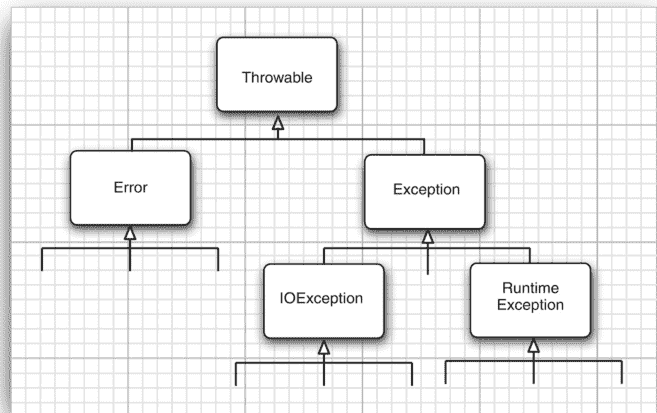

**图 7.1：** Java 中的异常层次结构

注意所有异常都继承自 `Throwable`，但层次结构立即分为两个分支：`Error`（错误）和 `Exception`（异常）。

`Error` 层次描述了 Java 运行时内部的错误和资源耗尽的情况。你不应该抛出这种类型的对象。如果发生此类内部错误，除了通知用户并尝试优雅地终止程序外，你无能为力。这些情况非常罕见。

在进行 Java 编程时，重点关注 `Exception` 层次。`Exception` 层次也分为两个分支：继承自 `RuntimeException` 的异常和不继承自它的异常。通用规则是：`RuntimeException` 的发生是因为你犯了编程错误。任何其他异常的发生是因为某些坏事，例如：

继承自 `RuntimeException` 的异常包括：

- 错误的类型转换（`cast`）。
- 数组越界访问。

不继承自 `RuntimeException` 的异常包括：

- 尝试读取文件末尾。
- 尝试打开不存在的文件。
- 空指针访问。
- I/O 错误。

当方法无法以正常方式完成任务时，Java 允许每个方法有一个备用退出路径。在这种情况下，方法不返回值。相反，它抛出一个封装了错误信息的对象。注意，方法会立即抛出；它不会返回其正常（或任何）值。此外，执行不会在调用方法的代码处继续；而是异常处理机制将开始寻找可以处理此特定异常层次的异常处理程序。

异常有自己的语法，并且是特殊继承层次的一部分。我将先介绍语法，并就如何使用这一语言特性提供一些提示。

> **提示：** 对于方法来说，优先使用异常而不是返回错误代码。人们很容易忘记检查错误，但异常是无法忽视的。异常还可以携带更多信息。例如，`java.io.File` 类的 `delete` 方法如果删除失败则返回 `false`。`java.nio.File` 类中的 `delete` 方法更有用。在失败时，它会抛出一个类型清晰指示问题性质的异常。

## 7.1.2. 声明受检异常

Java 方法在无法处理时可以抛出异常。你声明方法可以抛出异常的地方是在方法的头部。例如，这里是某个构造函数的声明：

```java
public FileInputStream(String name) throws FileNotFoundException
```

该声明表示构造函数从 `String` 参数产生 `FileInputStream`，但如果出错则抛出 `FileNotFoundException`。如果发生这种情况，构造函数调用将不会初始化对象，而是抛出一个 `FileNotFoundException` 类的对象。

当你编写自己的方法时，不需要声明你的方法可能抛出的所有 `Throwable` 对象。要理解何时（以及什么）需要在 `throws` 子句中声明，请记住异常在以下四种情况下抛出：

- 你调用了抛出受检异常的方法——例如 `FileInputStream` 构造函数。
- 你检测到错误并使用 `throw` 语句抛出受检异常（该语句将在下一节介绍）。
- 你犯了编程错误，例如 `a[i] = b` 导致未受检异常（在这种情况下是 `ArrayOutOfBoundsException`）。
- 虚拟机或运行时库发生了内部错误。

如果发生上述两种情况，你必须告诉使用你方法的程序员可能发生异常。为什么？任何抛出异常的方法都是潜在的致命陷阱。如果没有处理器捕获，当前线程的执行将终止。

与供给类中的 Java 方法一样，你通过方法头部的*异常规范*声明你的方法可能抛出异常。

```java
class MyAnimation {
    public Image loadImage(String s) throws IOException {
    }
}
```

如果一个方法可能抛出多种受检异常类型，你必须在头部列出所有异常类。用逗号分隔，如下例所示：

```java
class MyAnimation {
    public Image loadImage(String s) throws FileNotFoundException, EOFException {
    }
}
```

然而，你不需要声明内部 Java 错误——即继承自 `Error` 的异常。同样，你不应该声明继承自 `RuntimeException` 的未受检异常。

```java
class MyAnimation {
    void drawImage(int i) throws ArrayIndexOutOfBoundsException // bad style
    {
    }
}
```

运行时错误完全在你的控制范围内。如果你担心数组索引错误，你应该花时间去修复它们，而不是去宣传它们发生的可能性。

总而言之，方法必须声明它可能抛出的所有检查异常（checked exceptions）。未检查异常是你无法控制的（`Error`），或者是源于你本不应该允许出现的情况（`RuntimeException`）。如果你的方法未能忠实地声明所有检查异常，编译器将发出错误信息。

当然，正如你已经在几个示例中看到的，除了声明异常外，你也可以直接捕获它。异常不会被抛出方法，因此不需要 `throws` 规范。你将在本章的稍后部分看到如何决定是捕获异常还是让其他人来捕获。

> 注意：如果重写了子类方法声明的检查异常，其范围不能比父类方法更广。（在子类方法中抛出更具体的异常或不抛出任何异常都是可以的）。特别是，如果父类方法完全没有抛出任何检查异常，子类方法也不能抛出。例如，如果你重写了 `JComponent.paintComponent`，你的 `paintComponent` 方法不能抛出任何检查异常，因为父类方法没有抛出。

当一个类声明它抛出一个特定类的实例异常时，它可能会抛出该类或其任何子类的异常。例如，`FileInputStream` 构造函数可能声明抛出一个 `IOException`。在这种情况下，你不知道它是什么样的 `IOException`；它可能是普通的 `IOException`，也可能是各种子类的对象，例如 `FileNotFoundException`。

> **C++ 注意：** `throws` 符与 C++ 中的 `throw` 符相同，但有一个重要的区别。在 C++ 中，`throw` 符在运行时不强制，在编译时也不强制。这意味着 C++ 编译器不关心异常规范。但如果在不在 `throw` 列表中的函数抛出了异常，将调用意外的函数，并且默认情况下程序将终止。
>
> 此外，在 C++ 中，如果没有给出 `throw` 符，函数可以抛出任何异常。在 Java 中，没有 `throws` 符的方法可能无法抛出任何检查异常。

### 7.1.3. 如何抛出异常

现在，假设你的代码中发生了一些糟糕的事情。你有一个方法 `readData`，它正在读取一个文件，该文件的头部承诺：

```text
Content-length: 1024
```

但在读取 733 个字符后你就遇到了文件末尾。你可能认为这种情况是不正常的，并想要抛出一个异常。

你需要决定抛出什么异常。某种 `IOException` 会是一个不错的选择。查阅 Java API 文档，你发现了一个 `EOFException`，描述为“信号在输入过程中意外到达末结束”。完美。以下是抛出它的方式：

```java
throw new EOFException();
```

或者，如果你喜欢的话：

```java
var e = new EOFException();
throw e;
```

以下是它是如何结合的：

```java
String readData(Scanner in) throws EOFException
{
    while (..)
    {
        if (!in.hasNext()) // 遇到 EOF
        {
            if (n < len)
                throw new EOFException();
        }
    }
    return s;
}
```

`EOFException` 有一个接受字符串参数的第二个构造函数。你可以通过更详细地描述异常情况来充分利用它。

```java
String gripe = "Content-length: " + len + ", Received: " + n;
throw new EOFException(gripe);
```

你可以看到，如果现有的异常类有一个适用于你，那么抛出异常是非常简单的。在这种情况下：

1. 找到一个合适的异常类。
2. 创建该类的对象。
3. 抛出它。

一旦方法抛出异常，它就不会返回给调用者。这意味着你不需要担心编写一个默认的返回值或错误代码。

> **C++ 注意：** 在 C++ 和 Java 中，抛出异常是相同的，但有一个微小的区别。在 Java 中，你只能抛出 `Throwable` 的子类对象。在 C++ 中，你可以抛出任何类型的值。

## 7.1.4. 创建异常类

你的代码可能会遇到任何标准异常类都无法充分描述的问题。在这种情况下，创建你自己的异常类是非常容易的。继承自 `Exception`，或 `Exception` 的子类（如 `IOException`）。惯例做法是同时提供一个默认构造函数和一个包含详细消息的构造函数。`Throwable` 超类的 `toString` 方法返回一个包含详细消息的字符串，这对于调试很有用。

```java
class FileFormatException extends IOException {
    public FileFormatException() {}
    public FileFormatException(String gripe) {
        super(gripe);
    }
}
```

现在你准备好抛出你自己的异常类型了。

```java
String readData(Scanner in) throws FileFormatException {
    ...
    while (.. ) {
        if (ch == -1) // 遇到 EOF {
            if (n < len)
                throw new FileFormatException();
        }
        ...
    }
    return s;
}
```

| `java.lang.Throwable 1.0` | |
| --- | --- |
| `Throwable()` | 构建一个没有详细消息的新 `Throwable` 对象。 |
| `Throwable(String message)` | 构建一个带有指定详细消息的新 `Throwable` 对象。 |
| `getMessage()` | 获取 `Throwable` 的消息。 |
| `toString()` | 返回一个包含详细消息的字符串。 |

## 7.2. 捕获异常

一旦方法抛出异常，它就不会返回给调用者。这意味着你不需要担心编写一个默认的返回值或错误代码。

### 7.2.1. 捕获异常

要捕获异常，请设置 `try/catch` 块。最简单的形式如下：

```java
try {
  代码
  更多代码
} catch (ExceptionType e)
{
  此异常的处理器
}
```

如果 `try` 块中的任何代码抛出异常，在这种情况下：

1. 程序跳过 `try` 块的剩余部分。
2. 程序执行 `catch` 子句内部的处理器。

为了展示这种工作，这里有一些读取数据的典型代码：

```java
public void read(String filename)
{
    try
    {
        var in = new FileInputStream(filename);
        int b;
        while ((b = in.read()) != -1)
        {
            处理输入
        }
    }
    catch (IOException exception)
    {
        exception.printStackTrace();
    }
}
```

注意 `try` 子句中的大部分代码都是直观的：它读取并处理字节直到遇到文件末尾。通过查看 Java API 可以所示，`read` 方法有抛出 `IOException` 的可能。在这种情况下，我们跳过整个 `while` 循环，进入 `catch` 子句并生成堆栈轨迹。对于一个玩具程序来说，这是处理此异常的一种合理方法。你还有什么其他选择？

通常，最好的选择是什么都不做，简单地将异常传递给调用者。如果 `read` 方法中发生错误，让 `read` 方法的调用者去担心吧！如果我们采用那种方法，那么我们必须声明该方法可能会抛出 `IOException`。

```java
public void read(String filename) throws IOException
{
    var in = new FileInputStream(filename);
    int b;
    while ((b = in.read()) != -1)
    {
        处理输入
    }
}
```

对于后者的选择可能会令人尴尬。将异常直接传递给胜任的处理器比将其压制要好。


然而，在重写方法时，你不允许子类方法中添加的 `throws` 修饰符多于父类方法中的数量。在这种情况下，你必须捕获那些未声明的受检异常。特别是，如果你重写了一个没有抛出异常的方法（例如 `Comparable` 接口中的 `compareTo`），那么你只能捕获每种异常。

> **C++ 注意：**在 Java 和 C++ 中，捕获异常几乎是相同的。严格来说，Java 的以下代码对应于 C++：

```java
catch (Exception e) // Java
```

```cpp
catch (Exception& e) // C++
```

Java 中没有 C++ 中 `catch (...)` 的等价物。在 Java 中不需要它，因为所有异常都派自一个公共父类。

> **预览注意：**有时，你不需要 `catch` 子句中的异常对象。从 Java 21 开始，作为一项预览功能，你可以使用下划线作为未命名变量：

```java
catch (FileNotFoundException _)
{
  System.exit(0);
}
```

## 7.2.2. 捕获多个异常

你可以在 `try` 块中捕获多种异常类型，并对每个类型进行不同的处理。在下面的示例中，为每个类型使用单独的 `catch` 子句：

```java
try {
  可能会抛出异常的代码
} catch (FileNotFoundException e) {
  针对文件缺失的紧急处理
} catch (UnknownHostException e) {
  针对未知主机的紧急处理
} catch (IOException e) {
  针对所有其他 I/O 问题的紧急处理
}
```

你需要排列 `catch` 子句，使得更具体的异常类型排在更通用的类型之前。

异常对象可能包含有关异常性质的信息。要了解该对象，可以尝试：

```java
e.getMessage()
```

以获取详细的错误信息（如果有的话），或者：

```java
e.getClass().getName()
```

获取异常对象的实际类型。

你可以在同一个 `catch` 子句中捕获多个异常类型。例如，假设对缺失文件和未知主机的处理是相同的。那么你可以合并 `catch` 子句：

```java
try {
  可能会抛出异常的代码
} catch (FileNotFoundException | UnknownHostException e) {
  针对缺失文件和未知主机的紧急处理
} catch (IOException e) {
  针对所有其他 I/O 问题的紧急处理
}
```

此功能只有在捕获不是其他异常子类的异常类型时才需要。

当你同时捕获多个异常时，异常变量是隐式的 `final`。例如，你不能在子句体中为 `e` 分配不同的值：

```java
catch (FileNotFoundException | UnknownHostException e) { . . }
```

匹配多个异常不仅让你的代码看起来更简单，而且更高效。生成的字节码包含一个共享 `catch` 子句的单一块。

> **注意：**变量 `e` 的类型并不是 `FileNotFoundException | UnknownHostException` 这种“联合类型”，即使你的 IDE 是这样报告的。Java 变量没有这种联合类型。`e` 的实际类型是这些类型的最小上界；在这种情况下是 `IOException`。

在大多数情况下，你并不在意。但如果你用 `switch` 分析 `e`，它就很重要。明显的 `switch` 有一个问题——它不是穷尽：

```java
catch (FileNotFoundException | UnknownHostException e)
{
    switch (e) // 错误：非穷尽
    {
        case FileNotFoundException fe -> . .;
        case UnknownHostException ue -> . .;
    }
}
```

你可以通过添加 `default` 子句来解决这个问题。然而，重新组织代码并使用单独的 `catch` 子句可能会更清晰。

> **注意：**`catch` 子句不会考虑密封异常（`sealed`）层次结构。假设你提供了：

```java
sealed abstract class DomainException extends Exception
its FatalDomainException, SurvivableDomainException {
```

那么 `catch` 子句：

```java
try
{
    domainMethod(); // 抛出 DomainException
catch (FatalDomainException e) { . . }
catch (SurvivableDomainException e) { . . }
```

是不够的，尽管可能不存在其他的受检异常实例。

## 2.2.3. 重新抛出和链异常

你可以在 `catch` 子句中捕获异常。通常，当你想要更改异常类型时会这样做。如果你构建了一个其他程序员使用的子系统，使用一种指示子系统失败的异常类型将非常有帮助。这种异常类型的示例是 `ServletException`。执行 servlet 的代码可能不想知道到底出了什么细节问题，但它确实想知道是 servlet 的错。

以下是捕获异常并重新抛出的方法：

```java
try
{
    访问数据库
}
catch (SQLException e)
{
  throw new ServletException("database error: " + e.getMessage());
}
```

在这里，`ServletException` 是使用异常的文本消息构造的。

然而，将原始异常设置为新异常的“原因（cause）”是一个主意：

```java
try {
  访问数据库
} catch (SQLException exception) {
  var e = new ServletException("database error", original);
  throw e;
}
```

`ServletException` 类有一个构造函数，你可以在其中传递原因。如果你使用一种不支持这种情况的异常类型，你反而可以调用：

```java
e.initCause(original);
```

当异常被捕获时，可以获取原始异常：

```java
Throwable original = caught.getCause();
```

强烈建议使用包装技术。它允许你保留原始异常的堆栈跟踪。

> **提示：**为了避免静默异常，

## 7.2.4. `finally` 子句

当你使用 `finally` 子句时，无论是否抛出异常，其中的代码都会执行。这对于清理资源（如关闭流）有用。下面的示例展示了 `finally` 子句的作用：

```java
var in = new FileInputStream(n);
try {
  // 1
  可能会抛出异常的代码
} catch (IOException e) {
  // 3
  显示消息
  // 4
} finally {
  // 5
  in.close();
}
// 6
```

让我们看看程序执行 `finally` 子句的三种情况：

- 代码没有抛出异常。在这种情况下，程序首先执行 `try` 块中的所有代码。然后执行 `finally` 子句。之后，继续执行 `finally` 子句后的第一个语句。也就是说，执行通过点。

- 代码抛出了被 `catch` 子句捕获的异常——在我们的例子中是 `Exception`。对于这种情况，程序执行 `try` 块中的所有代码直到抛出异常。`try` 块中剩余代码被跳过。程序随后执行匹配的 `catch` 子句的代码，然后执行 `finally` 子句的代码。如果 `catch` 子句没有抛出异常，程序执行 `finally` 子句后的第一个语句。在这种情况下，执行通过点。

- 代码抛出了未被任何 `catch` 子句捕获的异常。在这里，程序执行 `try` 块中的所有代码直到抛出异常。`try` 块中剩余代码被跳过。然后执行 `finally` 子句的代码，并将异常抛回给调用方法的调用。执行通过点。

你可以在没有 `catch` 子句的情况下使用 `finally` 子句。例如，考虑以下语句：

```java
InputStream in = . . . ;
try {
{
  可能会抛出异常的代码
}
finally {
  in.close();
}
```

`finally` 子句中的 `in.close()` 语句无论 `try` 块中是否遇到异常都会执行。当然，如果遇到异常，它会被重新抛出，并在另一个 `catch` 子句中捕获。

```java
in.close();
}
catch (IOException e) {
    show error message
}
```

内部块有一个单一职责：确保输入流被关闭。外部 `try` 块有一个单一职责：确保报告错误。这种解决方案不仅更清晰，而且更具功能：`finally` 子句中的错误也会被报告。

> **注意：**当 `finally` 子句包含 `return` 语句时，可能会产生意料之外的结果。假设你使用 `return` 语句退出 `try` 块的中间。在方法返回之前，`finally` 块会被执行。如果 `finally` 块也包含一个 `return` 语句，那么它将掩盖原始的返回值。考虑下面这个示例：

```java
public static int parseInt(String s) {
    try {
        return Integer.parseInt(s);
    } finally {
        return 0; // ERROR
    }
}
```

看起来调用 `parseInt("42")` 时，`try` 块体返回整数 42。然而，由于 `finally` 子句，方法实际上返回并导致方法返回 0，忽略了原始的返回值。

情况变得更糟糕。调用 `parseInt("zero")`。`Integer.parseInt` 方法抛出一个 `NumberFormatException`。然后 `finally` 子句被执行，`return` 语句吞噬了该异常！

`finally` 子句体旨在用于清理资源。不要在 `finally` 子句内部放置改变控制流的语句（`return`、`throw`、`break`、`continue`）。

## 7.2.5. `try-with-Resources` 语句

这种代码模式有一个非常有用的快捷方法：

```java
open a resource
try {
    work with the resource
} finally {
    close the resource
}
```

前提是该资源属于实现 `AutoCloseable` 接口的类。该接口有一个单一方法：

```java
void close() throws Exception
```

> **注意：**还有一个 `Closeable` 接口。它是 `AutoCloseable` 的子接口，同样有一个单一 `close` 方法。然而，该方法被声明为抛出 `IOException`。

在最简单的变体中，`try-with-resources` 语句的形式如下：

```java
try (Resource res = . . ) {
    work with res
}
```

当 `try` 块退出时，会自动调用 `res.close()`。这里是一个典型的示例——读取文件的单词：

```java
try (var in = new Scanner(Path.of("in.txt"))) {
    while (in.hasNext()) {
        System.out.println(in.next());
    }
}
```

当 `try` 块正常退出或发生异常时，`in.close()` 方法都会被调用，恰好就像你写了一个 `finally` 块一样。例如：

你可以指定多个资源：

```java
try (var in = new Scanner(Path.of("in.txt")),
    var out = new PrintWriter("out.txt")) {
    while (in.hasNext()) {
        out.println(in.next().toUpperCase());
    }
}
```

无论块如何退出，`in` 和 `out` 都会被关闭。如果你手动编写这些代码，将需要两个嵌套的 `try/finally` 语句。

你可以在 `try` 头中提供之前声明的有效最终（effectively final）变量：

```java
public static void printAll(String[] lines, PrintWriter out)
{
    try (out) // effectively final变量
    for (String line : lines) {
        out.println(line);
    } // out.close() called here
}
```

这并不常见，人们通常倾向于在构造对象的作用域内调用它。

当 `try` 块抛出异常且 `close` 方法也抛出异常时，就会出现困难。`try-with-resources` 语句优雅地处理了这种情况。原始异常被重新抛出，而 `close` 方法产生的任何异常都被视为“抑制”（suppressed）。它们会被自动捕获并通过 `addSuppressed` 方法添加到原始异常中。如果你对它们感兴趣，可以调用 `getSuppressed` 方法，它会产生一个来自 `close` 方法的抑制表达式数组。

> **注意：**`try-with-resources` 语句本身可以包含 `catch` 子句甚至 `finally` 子句。这些语句会在关闭资源后执行。

## 7.2.6. 分析栈元素

堆栈跟踪（stack trace）是程序执行过程中特定一点所有方法调用的列表。你几乎见过堆栈跟踪列表——每当 Java 程序因未捕获的异常而终止时，就会显示这些列表。

你可以通过调用 `Throwable` 类的 `printStackTrace` 方法来访问堆栈跟踪的描述。

```java
var t = new Throwable();
out = new StringWriter();
t.printStackTrace(new PrintWriter(out));
String description = out.toString();
```

更灵活的方法是 `StackWalker` 类，它产生一个 `StackWalker.StackFrame` 实例的流，每个实例描述一个栈帧。你可以通过此调用来迭代栈帧：

```java
StackWalker walker = StackWalker.getInstance();
walker.forEach(frame -> analyze frame)
```

如果你想惰性地处理 `Stream<StackWalker.StackFrame>`，请调用：

```java
walker.walk(stream -> process stream)
```

流处理在第二卷的第一章中进行了详细描述。

`StackWalker.StackFrame` 类拥有方法可以获取执行代码行的文件名和行号，以及类对象和方法名。`toString` 方法产生包含所有这些信息的格式化字符串。

> **注意：**`Throwable.get` 方法产生一个 `StackTraceElement[]` 数组，其信息与 `StackWalker.StackFrame` 实例流相似。然而，该调用的效率较低，因为它捕获了整个栈。

列表 7.1 `stackTrace/StackTrace.java`

```java
1 package stackTrace;
2
3 import java.util.*;
4
5 /**
6  * A program that displays a trace of a recursive method.
7  * @Version 2017-12-14
8  * @Author Cay Horstmann
9  */
0 public class StackTest
11 {
12   /**
13   * Computes the factorial of a number
14   * @param n non-negative integer
15   * Return n! = 1 * ...
16   */
17 public static int factorial(int n)
18   {
19   System.out.println("* + n + ":");
20   var walker = StackWalker.getInstance();
21   walker.forEach(System.out::println);
22   int r;
23   if (n < 1) r = 1;
24   else r = n * factorial(n - 1);
25   System.out.println("return " + r);
26   return r;
27 }
28 public static void main(String[] args)
29 {
30   try (var in = new Scanner(System.in))
31   {
32     System.out.print("Enter n: ");
33     int n = in.nextInt();
34     factorial(n);
35   }
36 }
```

```text
factorial(3):
StackTraceTest.java:20
StackTraceTest.java:36
factorial(2):
StackTraceTest.java:20
StackTraceTest.java:36
factorial(1):
StackTraceTest.java:20
StackTraceTest.java:36
return 6
```


```text
factorial(3):
StackTraceTest.java:20
StackTraceTest.java:36
factorial(2):
StackTraceTest.java:20
StackTraceTest.java:36
factorial(1):
StackTraceTest.java:20
StackTraceTest.java:36
return 6
```

（注：上述代码代表跟踪输出）

# `java.lang.Throwable` 1.0

- `Throwable(Throwable cause)` 1.4
- `Throwable(String message, Throwable cause)`

构造一个具有给定原因的 `Throwable`。

- `Throwable initCause(Throwable cause)`  
  为此对象设置原因；如果此对象已经具有原因，则抛出异常。返回此对象。
- `getCause()`  
  获取为此对象设置的异常对象。如果没有设置原因，则返回 `null`。
- `StackElement[] getStackTrace()`  
  获取此对象构造时的调用跟踪。
- `void addSuppressed(Throwable t)`  
  将一个“被抑制”的异常添加到此异常中。这种情况发生在带资源的 `try` 语句中，其中关闭方法抛出了异常。
- `Throwable[] getSuppressed()`  
  获取此异常的所有“被抑制”异常。通常，这些异常由带资源的 `try` 语句中的关闭方法抛出。

# `java.lang.Exception` 1.0

- `Exception(Throwable cause)` 1.4
- `Exception(String message, Throwable cause)`

构造一个具有给定原因的 `Exception`。

## `java.lang.RuntimeException` 1.0

- `RuntimeException(Throwable cause)` 1.4
- `RuntimeException(String message, Throwable cause)` 1.4

使用给定的原因创建一个 `RuntimeException`。

## `java.lang.StackWalker` 9

- `static StackWalker getInstanceOf()`
- `static StackWalker getInstanceOf(StackWalker.Option option)`
- `static StackWalker getInstanceOf(Set<StackWalker.Option> options)`

  获取一个 `StackWalker` 实例。选项包括来自 `StackWalker.Option` 枚举的 `RETAIN_CLASS_REFERENCE`、`SHOW_HIDDEN_FRAMES` 和 `SHOW_REFLECT_FRAMES`。

- `forEach(Consumer<? super StackWalker.StackFrame> action)`

  在每个栈帧上执行给定的操作，从最近调用的方法开始。

- `walk(Function<? super Stream<StackWalker.StackFrame>, extends T> function)`

  将给定的函数应用于栈帧流并返回结果的...

# `java.lang.StackFrame` 9

- `String getFileName()`

  获取包含此元素执行点的源文件名，如果信息不可用则返回 `null`。

- `int getLineNumber()`

  获取包含此元素执行点的源文件行号，如果信息不可用则返回 `-1`。

- `String getClassName()`

  获取包含此元素执行点的类的全限定名。

- `Class<?> getDeclaringClass()`

  获取包含此元素执行方法的类对象。如果构建 `stack walker` 时没有使用 `RETAIN_CLASS_REFERENCE` 选项，则会抛出异常。

- `String getMethodName()`

  获取包含此执行点的方法名。构造函数的名称为 `<init>`，静态初始化器的名称为 `<clinit>`。你可以区分具有相同名称的重载方法。

- `boolean isNativeMethod()`

  如果此元素的执行点是原生方法，则返回 `true`。

- `String toString()`

  返回一个格式化字符串，包含类名、方法名以及文件名和行号（如果可用）。

# `java.lang.StackTraceElement` 1.4

- `String getFileName()`

  获取包含此元素执行点的源文件名，如果信息不可用则返回 `null`。

- `int getLineNumber()`

  获取包含此元素执行点的源文件行号，如果信息不可用则返回 `-1`。

- `String getClassName()`

  获取包含此元素执行点的类的全限定名。

- `String getMethodName()`

  获取包含此元素执行点的方法名。构造函数的名称为 `<init>`，静态初始化器的名称为 `<clinit>`。你可以区分具有相同名称的重载方法。

- `boolean isNativeMethod()`

  如果此元素的执行点在原生方法内部，则返回 `true`。

- `String toString()`

  返回一个格式化字符串，包含类名、方法名以及文件名和行号（如果可用）。

## 7.3. 异常使用的技巧

关于异常的正确用法存在相当的争议。一些程序员认为所有检查异常（checked exceptions）都是麻烦，而另一些人似乎无法抛弃它们。我认为异常（即使是检查异常）有其用武之地，因此我为你提供这些正确使用异常的技巧。

### 1. 异常处理不应替代简单的测试

作为一个例子，这里有一个代码尝试 10,000,000 次从空栈中弹出元素。它首先通过检查栈是否为空来实现此。

```java
if (!s.empty()) s.pop();
```

接下来，我们强制无论如何都弹出栈，并捕获 `EmptyStackException`，这告诉我们我们不应该那样做。

```java
try {
  s.pop();
} catch (EmptyStackException e) {
}
```

在我的机器上，调用 `isEmpty` 的版本运行了 0.167 秒。捕获 `EmptyStackException` 的版本运行了 3.629 秒。

如你所见，捕获异常花费的时间比执行简单测试长得多。

教训是：仅对异常情况使用异常。

### 2. 不要对异常进行微观管理

一些程序员将每个语句都封装在独立的 `try` 块中。

```java
PrintStream out;
Stack s;

for (i = 0; i < 100; i++) {
  try {
    n = s.pop();
  } catch (EmptyStackException) {
    // 栈是空的
  }

  try {
    out.writeInt(n);
  } catch (IOException e) {
    // 写入文件出错
  }
}
```

这种方法会大幅增加你的代码量。考虑你想完成的任务。在这里，我们想要从栈中弹出 100 个数字并将它们保存到文件中。（别管为什么——这只是一个玩具示例。）如果问题真的显现出来，我们无能为力。如果栈是空的，它不会变成被占用。如果文件包含错误，错误不会魔法般地消失。因此，将整个任务封装在一个 `try` 块中是有意义的。如果任何操作失败，你就可以放弃该任务。

```java
try {
  for (i = 0; i < 100; i++) {
    n = s.pop();
    out.writeInt(n);
  }
} catch (IOException e) {
  // 写入文件出错
} catch (EmptyStackException e) {
  // 栈是空的
}
```

（注：此处原文存在大量由于 OCR 导致的重复文本，已根据要求去重，仅保留核心逻辑说明）

## 7.4. 使用断言

断言（Assertions）是防御性编程中常用的用法。在接下来的章节中，你将学习如何有效地使用它们。

### 7.4.1. 断言概念

假设你确信某个特定属性成立，并且你在代码中依赖于该属性。例如，你可能正在计算：

```java
double y = Math.sqrt(x);
```

你确定 `x` 不是负数。也许它是另一个不会产生负结果的计算结果，或者它是某个要求调用者仅提供正数输入的方法的参数。尽管如此，你也有责任进行双重检查，而不是让混淆的“不是数字”（not a number）浮点值混入你的计算中。当然，你也可以抛出一个异常：

```java
if (x < 0) throw new IllegalArgumentException("x < 0");
```

但即使在测试完成后，这段代码仍然存在。如果你有大量此类检查，程序的运行速度可能会比预想的要慢得多。

断言机制允许你在测试期间放置检查，并在生产环境代码中自动移除这些检查。

Java 语言有一个关键字 `assert`。它有两种形式：

```java
assert condition;
```

以及：

```java
assert condition : expression;
```

这两条语句都会求条件的值，如果条件为假，则抛出 `AssertionError`。在第二条语句中，表达式被传递给 `AssertionError` 对象的构造函数并转换为消息字符串。

> 注意：表达式部分的唯一目的是产生一个消息字符串。`AssertionError` 对象并不存储实际的表达式值，因此你以后无法查询它。正如 JDK 文档所述，“这会鼓励程序员尝试从断言失败中恢复，这违背了该机制的目的。”

或者断言 `x` 非负数，你可以简单地使用语句：

```java
assert x >= 0;
```

或者你可以将 `x` 的实际值传递给 `AssertionError` 对象，以便稍后显示。

```java
assert x >= 0 : x;
```

> C++ 注意：C 语言的断言宏会将断言条件转换为字符串，并在断言失败时进行打印。例如，如果 `assert(x >= 0)` 失败，它会打印“x >= 0”是失败的条件。在 Java 中，条件不会自动成为错误报告的一部分。如果你想看到它，必须作为字符串传递给 `AssertionError` 对象：`assert x >= 0 : "x >= 0"`。

### 7.4.2. 断言的启用与禁用

默认情况下，断言是禁用的。通过运行带有 `-enableassertions` 或 `-ea` 选项的程序启用它们：

```bash
java -enableassertions MyApp
```


注意：你不需要重新编译程序来启用或禁用断言。启用或禁用断言是类加载器的功能。当断言禁用时，类加载器会剥离断言，使其不会影响执行速度。

你可以在特定的类或整个包中开启断言。例如：

```bash
java -ea:MyClass -ea:com.my.company.myl... MyApp
```

此命令开启了 `MyClass` 类以及 `com.my.company.myl` 包及其子包中所有类的断言。`-ea...` 开启了未命名包中所有类的断言。

你也可以使用 `-disableassertions` 或 `-da` 禁用某些类和包的断言：

```bash
java -ea... -da:MyClass -da:MyApp
```

某些类不是由类加载器加载的，而是直接由虚拟机加载的。你可以使用这些开关选择这些类中的断言。

然而，启用或禁用所有断言的 `-ea` 和 `-da` 开关不适用于没有类加载器的“系统类”。使用 `-enablesystemassertions`/`-esa` 开关来启用系统类中的断言。

还可以通过程序控制类加载器的断言状态。请参见本节末尾的 API 节点。

> **警告：** 当断言关闭时，断言条件不会执行。因此，确保条件不具有副作用是非常重要的。这里有一个你不应该做的示例：

```java
File file = new File(filename);

...

assert file.delete(); // 错误
```

其意图是确保 `delete` 方法返回 `true`，这意味着文件被正确删除。但当断言关闭时，删除操作不会发生！

解决方法是将副作用移动到 `assert` 语句之外：

```java
boolean deletionSuccessful = file.delete();

assert deletionSuccessful;
```

> **注意：** Java 库的源码中有四百多个断言，在测试后会将断言注释掉，否则它们会占用类文件的空间。如果你担心这一点，可以如下所示条件地包含它们：

```java
public static final boolean ASSERTS = true; // 生产环境重新编译时改为 false
```

```java
if (ASSERTS) assert x >= 0;
```

## 7.4.3. 使用断言进行参数检查

Java 语言提供了三种处理系统故障的机制：

- 抛出异常
- 日志记录
- 使用断言

何时选择断言？请记住以下几点：

- 断言失败旨在表示致命的、不可恢复的错误。
- 检查的断言在开发和测试期间开启。（这有时被开玩笑地描述为“在岸边时穿着救生衣，一旦在大海中就把它扔掉”。）

因此，你不会使用断言将可恢复的条件传递给程序的其他部分，也不会用于向用户程序通信问题。断言应该仅用于测试期间定位程序内部错误。

让我们来看一个常见的场景——方法参数的检查。你应该使用断言来检查非法值或空引用吗？要回答这个问题，你需要查看文档。假设你实现了一个方法：

```java
/**
 * 升序排序指定数组的范围。
 * @param a 要排序的数组
 * @param fromIndex 要排序的元素的索引（包含）
 * @param toIndex 要排序的最后一个元素的索引（不包含）
 * @throws IllegalArgumentException 如果 fromIndex > toIndex
 * @throws ArrayOutOfBoundsException 如果 fromIndex < 0 或 toIndex > a.length
 */
static void sort(int[] a, int fromIndex, toIndex)
```

文档说明如果索引值错误，方法将抛出异常。这是方法与其调用者之间约的一部分。在这种情况下使用断言是不恰当的。

你应该断言 `a` 不为空吗？也不恰当。方法文档对 `a` 为空时方法的行为保持沉默。调用者有权假设在这种情况下方法会成功返回而不会抛出断言错误。

然而，假设方法的约略有不同：

```java
@param a 要排序的数组（不能为空）
```

现在，方法的调用者被告知使用空数组调用方法是非合法的。方法可以从这里开始断言：

```java
assert a != null;
```

计算机科学家将这种约称为前提条件（precondition）。原始方法对参数没有前提条件——它承诺在所有情况下都有定义的行为。修改后的方法有一个单一的前提条件：`a` 不为空。如果调用者未能满足前提条件，那么一切都不作数，方法可以执行任何事情。事实上，有了断言，方法正是在执行它所想做的。它抛出断言错误，有时取决于加载器的配置抛出空指针异常。

## 7.4.4. 使用断言记录假设

通常，程序员使用注释来记录他们的底层假设。考虑这个来自 <https://docs.oracle.com/javase/8/docs/technotes/guides/language/assert.html> 的示例：

```java
if (i % 3 == 0)

else if (i % 3 == 1)

else // (i % 3 == 2)
```

在这种情况下，使用断言代替注释很有意义。

```java
if (i % 3 == 0)

else if (i % 3 == 1)

else
{
  assert i % 3 == 2;
}
```

当然，如果彻底思考这个问题会更有意义。`i % 3` 的可能值有哪些？如果 `i` 是正数，余数必须是 0、1 或 2。如果 `i` 是负数，那么余数为 -1 或 -2。因此，真实的假设是 `i` 不是负数。更好的断言应该是：

```java
assert i >= 0;
```

在 `if` 语句之前。

无论如何，这个示例展示了如何有效地使用断言作为程序员的自检工具。如你所见，断言是测试和调试的战术工具。相比之下，日志（logging）是程序整个生命周期的策略工具。我们将在下一节中检查日志。

## `java.lang.ClassLoader` 1.0

| 方法 | 版本 | 说明 |
| :--- | :--- | :--- |
| `+ void setDefaultAssertion(boolean b)` | 1.4 | 为由此类加载的且没有显式类状态或包状态的所有类启用或禁用断言。 |
| `- void setClassAssertionStatus(String className, boolean b)` | 1.4 | 启用或禁用给定类及其内部类的断言。 |
| `- void setAssertionStatus(String packageName, boolean b)` | 1.4 | 启用或禁用给定包及其子包中所有类的断言。 |
| `- void clearAssertionStatus()` | 1.4 | 移除所有显式和包断言状态设置，并禁用由此类加载的所有类的断言。 |

## 7.5. 日志

每个程序员都熟悉在麻烦代码中插入 `System.out.println` 调用以获取程序行为洞察的过程。一旦你确定了问题的原因，就删除打印语句——结果在下一个问题出现时又把它们放回来。日志框架的设计是为了解决这个问题。

### 7.5.1. 你应该使用 Java 日志框架吗？

Java 有一个标准的日志框架，通常以其包名 `java.util` 命名。然而，其他日志框架具有更多功能并被常用，例如 Log4j（<https://logging.apache.org/log4j/2.x>）和 Logback（<https://logback.qos.ch>）。

如果你想让用户选择日志框架，你应该使用一个“门面”（facade）库，将消息发送到首选的框架。常用且 API 良好的门面是 SLF4J（<https://www.slf4j.org>）。另一个门面是“平台日志 API”（也称为 JEP 264）。它非常基础，但是 JDK 的一部分。该门面有时被称为*前端*。它提供了程序员用于记录日志消息的 API。*后端*则负责过滤和格式化消息，并将它们存在某处。后端需要由部署者进行配置，通常通过编辑配置文件来实现。

在接下来的章节中，我将向你展示如何使用平台日志 API 作为前端，并将 `java.util.logging` 作为后端。如果你发现前端 API 足够用，这是一个很合理的选择，因为你可以随时更换后端。

`java.util.logging` 后端的特性比那些更流行的替代品少，但它对许多情况来说足够了。由于其简单性，它更不容易受到攻击。相比之下，Log4j 的某些晦为人知的特性允许黑客构造出恶意的程序输入，当这些输入被记录时，就会导致恶意代码的执行。

无论你最终是否使用它，学习平台日志 API 和 `java.util.logging` 后端都能让你对日志框架的能力有一个良好的理解。

> **注意：** 此处描述的 API 和随后的章节是用于应用程序日志的（application logging）。你也可以开启虚拟机的日志记录，例如记录垃圾回收。启动 VM 时使用 `-Xlog` 命令行选项。例如：

```bash
java -Xlog:gc=trace:file:gc.uptime,tid MyApp
```

详情请参见 <https://docs.oracle.com/en/java/javase/21/docs/spec/man/java.html#enable-logging-with-the-jvm-unified-logging-framework>。

### 7.5.2. 日志基础

平台记录器实现了 `System.Logger` 接口。每个日志记录器都有一个名称。名称可以是任意的，但它通常是生成日志消息的类的包名。你可以这样获取日志记录器：

```java
System.Logger logger = System.getLogger("com.company.myapp");
```

当你第一次请求具有给定名称的日志记录器时，它会被创建。后续相同名称调用将产生相同的记录器对象。

现在你准备好记录日志了：

```java
logger.log(System.Logger.Level.INFO, "Opening file " + filename);
```

记录打印出来如下：

```text
Aug 04, 2022 09:53:34 AM com.company.myapp.Main read

INFO: Opening file data.txt
```

注意，调用类和方法的时间以及名称会自动包含在内。

要在程序部署时关闭这些信息性消息，你可以配置后端。在 `java.util.logging` 后端的情况下，准备一个包含以下内容的 `logging.properties` 文件：

```properties
handlers.java.util.ConsoleHandler

com.company.myapp.level=WARNING
```

然后如下所示启动应用程序：

```bash
java -Djava.util.logging.config.file=logging.properties com.company.myapp.Main
```

由于 `INFO` 级别低于 `WARNING` 级别，消息不再显示。

获取日志记录器和记录消息的 API 是前端的一部分——在这种情况下，如果你使用不同的前端，API 将是不同的。

消息目的地、格式化和过滤，以及配置机制是后端的一部分——这里是 `java.util.logging`。如果你使用不同的后端，请遵循其说明进行配置。

### 7.5.3. 平台日志 API

正如前面的章节所示，按严重性降低的值为：`ERROR`、`WARNING`、`INFO`、`DEBUG` 和 `TRACE`。

> **提示：** 使用 `import` 语句：

```java
import static java.lang.System.Logger.Level.*;
```

你可以显示：

```java
logger.log(INFO, "Opening file " + filename);
```

而不是 `System.Level.INFO`，消息 `"Opening file " + filename`。如果你担心创建字符串的代价，可以使用 lambda 表达式：

```java
logger.log(INFO, () -> "Opening file " + filename);
```

然后消息只在实际记录时才被计算。常见的是记录异常。日志包含了堆栈跟踪。

```java
catch (IOException ex)
{
    logger.log(WARNING, "Cannot open file", ex);
}
```

你可以使用模式格式化消息：

```java
logger.log(WARNING, "Cannot open file ({0})", filename);
```

> **注意：** 这不是 `printf` 模式。模式由 `MessageFormat` 类处理，该类用于程序消息的本地化（见卷 II）。在这里，你只需要知道占位符是 `{0}`、`{1}` 等。大括号必须用单引号转义 `'\{'`。使用两个单引号在消息中包含字面量字符串。

日志可以使用卷 II 中引入的资源包机制本地化到不同的语言。

提供包和格式字符串的键：

```java
logger.log(WARNING, bundle, "file.bad", filename);

// 在包中查找 file.bad
```

或者，获取记录器：

```java
System.Logger logger = System.getLogger("com.company.myapp", bundle);
```

当调用带有字符串参数作为消息的记录器方法时，该参数被解释为包中的键。带有 `Object` 或 `Supplier<String>` 参数的方法不受影响。

这些功能的组合（延迟消息计算、添加异常、格式化、使用包）部分或全部都受支持。详情见 API 注释。

## 7.5.4. 日志配置

现在让我们转向后端。正如前面提到的，平台 API 的默认后端是 `java.util.logging`。后续章节的信息专门针对该后端。

你可以通过编辑配置文件来更改后端的各种属性。默认配置文件位于 JDK 中的 `config/logging.properties`。要使用另一个文件，通过在启动应用程序时设置 `java.util.logging.config` 属性为文件位置：

```bash
java -Djava.util.logging.config.file=configFile MainClass
```

> **注意：** 在 `main` 方法中调用 `System.setProperty("java.util.logging.config.file", configFile)` 无效，因为日志管理器是在 VM 启动期间初始化的，早于 `main` 的执行。

你可以通过添加此类行来指定你自己的记录器的日志级别：

```properties
com.company.myapp.level=WARNING
```

即在记录器名称后附加 `.level` 后缀。

注意：日志配置中的属性不是系统属性。你无法通过 `-d` 命令行选项设置它们。相反，请将日志属性放入一个文件中，并通过 `-Djava.util.logging.config.file=configFile` 指定该文件。

你也可以指定根级别：

```properties
.level=WARNING
```

注意：由于历史原因，某些级别在平台日志 API 和 `java.util.logging` 框架中具有不同的名称。你需要在配置文件中使用后者。表 7.1 显示了它们的对应关系。

### 表 7.1：平台日志与 Java 框架的对应级别

| 平台日志 | `java.util.logging` |
| :--- | :--- |
| `ERROR` | `SEVERE` |
| `WARNING` | `WARNING` |
| `INFO` | `INFO` |
| `DEBUG` | `FINE` |
| `TRACE` | `FINER` |

与包名类似，日志器（logger）的名称是分层结构的。事实上，它们比包更具层次性。包与其父包之间没有语义关系，但日志器的父级和子级共享某些属性。例如，如果你关闭了发送 `"com.myapp"` 日志器的消息，那么它的子日志器也会被停用。

正如你在下一节中看到的，日志器实际上并没有将消息发送到控制台——那是处理器（handlers）的工作。处理器也有级别。为了在控制台上看到 `DEBUG`/`FINE`，你还需要设置：

```properties
java.util.logging.ConsoleHandler.level=FINE
```


> 注意：日志管理器配置中的设置不是系统属性。使用 `-Dcom.myapp.myapp.level=FINE` 启动程序对日志器没有任何影响。
>
> 你还可以使用 `jconsole` 程序在运行中的程序中更改日志级别。详细信息请参阅 <https://www.oracle.com/technical-resources/articles/java/jconsole.html#LoggingControl>。
>
> 注意：从 Java 21 开始，同名为 `java.lang.Runtime` 的系统日志器会记录对 `Runtime.exit` 方法的调用（`System.exit` 调用该方法来终止虚拟机）。日志包含堆栈跟踪，因此你可以判断是如何请求终止的。要接收日志消息，请在日志配置中设置：
>
> ```properties
> java.lang.Runtime.level=FINE
> ```

## 7.5.5. 日志处理器（Log Handlers）

`java.util.logging` API 的后端基于处理器。最简单的处理器是 `ConsoleHandler`，它将记录打印到 `System.err` 流中。

每个处理器都有一个父处理器。默认情况下，处理器只是将每条记录发送给父处理器。标准日志配置默认使用 `ConsoleHandler`。它的默认日志级别是 `INFO`。

若要将记录记录到其他地方，请添加另一个处理器。`java.util.logging` API 为此目的提供了两个处理器：`FileHandler` 和 `SocketHandler`。`SocketHandler` 将记录发送到特定的主机和端口。更具意义的是 `FileHandler`，它将记录收集在一个文件中。

要添加一个文件，请在日志属性中提供以下内容：

```properties
handlers=java.util.logging.ConsoleHandler,java.util.logging.FileHandler
```

记录被发送到用户主目录下的文件处理器中，其中 `n` 是一个使文件唯一的数字。默认情况下，记录以 XML 格式化。一个典型的日志形式如下：

```xml
<record>
  <date>2014-08-04T09:53:34</date>
  <millis>104716014072</millis>
  <sequence>
    <logger>com.mycompany.myapp</logger>
    <level>INFO</level>
    <class>com.horstmann.corejava.Employee</class>
    <method>read</method>
    <thread>10</thread>
    <message>Opening file staff.txt</message>
  </sequence>
</record>
```

你可以通过在日志属性中设置各种参数（表 7.2）来修改文件处理器的行为。

你可能不想使用默认的日志文件名。使用诸如 `%h/%u.log` 的模式（请参见表 7.3 对模式变量的解释）。文件名模式中的 `%w` 会为每次应用程序运行生成一个唯一代码。

对于长时间运行的程序，开启文件轮转是一个好主意。日志文件按轮转序列保存，例如 `myapp.log.0`、`myapp.log.1`、`myapp.log.2` 等。每当文件超过大小限制时，旧文件会被删除，其他文件会被重命名，并创建一个生成号为 0 的新文件。

### 表 7.2：文件处理器配置参数

| 配置属性 | 说明 | 默认值 |
| :--- | :--- | :--- |
| `java.util.logging.FileHandler.level` | 处理器级别。 | `Level.ALL` |
| `java.util.logging.FileHandler.append` | 为 `true` 时，日志记录将追加到现有文件中的；否则，每次程序运行时都会打开一个新文件。 | `false` |
| `java.util.logging.FileHandler.limit` | 在打开另一个文件之前在文件中写入近似最大字节数（0 = 无限制）。 | `FileHandler` 类中为 0，默认日志管理器配置中为 50000 |
| `java.util.logging.FileHandler.pattern` | 文件名模式（参见表 7.3）。 | `%h/java%u.log` |
| `java.util.logging.FileHandler.count` | 轮转序列中的日志数量。 | 1（不轮转） |
| `java.util.logging.FileHandler.filter` | 用于过滤日志记录的过滤器。 | |
| `java.util.logging.FileHandler.encoding` | 日志编码。 | |

### 表 7.3：模式变量

| 变量 | 说明 |
| :--- | :--- |
| `%h` | 用户目录。 |
| `%t` | 临时目录。 |
| `%w` | 唯一代码。 |
| `%g` | 生成号。 |
| `%%` | 百号。 |

## 7.5.6. 过滤器（Filters）与格式化器（Formatters）

除了按日志级别过滤外，每个处理器都可以拥有 `Filter` 接口的额外过滤器：

```java
boolean isLoggable(LogRecord record)
```

要将过滤器安装到处理器中，请在日志配置中添加：

```properties
java.util.logging.ConsoleHandler.filter=com.company.Filter
```

`ConsoleHandler` 以文本和 XML 输出记录。然而，你也可以定义自己的格式。扩展 `java.util.logging.Formatter` 类并重写方法：

```java
String format(LogRecord record)
```

以你喜欢的方式格式化记录并返回生成的字符串。在 `format` 方法中，你可以通过调用方法获取有关 `LogRecord` 的信息。

在 `format` 方法中，你可能需要调用：

```java
String formatMessage(LogRecord)
```

该方法格式化记录的消息，在资源包中查找键并替换消息参数。

许多格式（如 XML）需要围绕记录的头部和结尾。要实现这一点，请重写方法：

```java
String getHead(Handler h)

String getTail(Handler h)
```

最后，在日志配置中设置格式化器：

```properties
java.util.logging.FileHandler.formatter=com.my.app.MyFormatter
```

## 7.5.7. 日志配方

有了许多日志选项，选择日志器很容易。建议将日志器命名为与你的主包相同的名称，例如 `com.company.myprog`。以下配方总结了最常用的操作。

- 对于简单的应用程序，选择单个日志器。建议将日志器命名为与你的主包相同的名称，例如 `com.company.myprog`。你始终可以通过调用 `System.Logger logger = System.getLogger("com.company.myprog");` 获取日志器。为了方便，你可能想添加静态字段 `private static final System.Logger logger = System.getLogger("com.company.myprog");`。适用于日志频繁的类。
- `java.util.logging` 后端的默认日志配置将所有 INFO 或更高级别的消息记录到控制台。若要进行自定义，请准备一个 `logging.properties` 文件，包含如下条目：

  ```properties
  handlers=java.util.logging.ConsoleHandler,java.util.logging.FileHandler
  com.company.myapp.level=FINE
  java.util.logging.ConsoleHandler.level=FINE
  ```

  然后使用 `java -Djava.util.logging.config.file=logging.properties com.company.myapp.Main` 启动你的程序。
- 现在你可以尽情地记录日志了。每当你想调用 `System.out.println` 时，让它记录一条消息吧：`logger.log(System.Logger.Level.TRACE, "File open dialog canceled");`

```java
catch (SomeException e)
{
  logger.log(System.Level.WARNING, string describing context, e);
}
```

Listing 7.2 在增加了一个推文后使用了配方：日志消息也会显示在日志窗口中，发送到一个代码位于 Listing 7.3 的处理器。

使用 `java -Djava.util.logging.config.file=logging.properties logging.LoggingImageViewer` 运行程序。

### Listing 7.2 `logging/LoggingImageViewer.java`

```java
package logging;

import java.awt.*;
import java.awt.event.*;
import java.io.*;
import javax.swing.*;

import static java.lang.System.Level.*;

/**
 * 图像查看器程序的修改版本，用于记录各种事件。运行如
 * java -Djava.util.logging.config.file=logging.properties logging.LoggingImageViewer
 * @version 1.1 2023-09-26
 * Maurice Cay Horstmann
 */
public class LoggingImageViewer {
  public static void main(String[] args) {
    EventQueue.invokeLater(() -> {
      var frame = new LoggingImageFrame();
      frame.setTitle("LoggingImageViewer");
      frame.setDefaultCloseOperation(JFrame.EXIT_ON_CLOSE);
      System.logger = System.getLogger("com.horstmann.corejava");
      logger.info("Showing frame");
      frame.setVisible(true);
    });
  }
}

/**
 * 显示图像的帧。
 */
class ImageViewer extends JFrame {
  private static final int DEFAULT_WIDTH = 300;
  private static final int DEFAULT_HEIGHT = 400;
  private JLabel label;
  private static System.logger = System.getLogger("com.horstmann.corejava");

  public LoggingImageFrame() {
    logger.log(TRACE, "Entering ImageViewerFrame()");
    setSize(DEFAULT_WIDTH, DEFAULT_HEIGHT);

    // 设置菜单栏
    var menubar = new JMenuBar();
    setJMenuBar(menubar);
    var menu = new JMenu("File");
    menubar.add(menu);

    var openItem = new JMenuItem("Open");
    menu.add(addItem);
    addItem.addListener(new FileOpenListener());

    var exitItem = new JMenuItem("Exit");
    menu.add(exitItem);
    exitItem.addListener(new ActionListener());

    public void actionPerformed(ActionEvent event) {
      logger.log(INFO, "Exiting.");
      System.exit(0);
    }
  }

  // 使用标签来显示图像
  label = new JLabel();
  add(label);
  logger.log(TRACE, "Entering ImageViewerFrame()");

  private class FileOpenListener implements ActionListener {
    public void actionPerformed(ActionEvent event) {
      logger.log(TRACE, "Entering ImageViewFrame.FileOpenListener.actionPerformed(%s)", event);

      // 设置文件选择器
      var chooser = new JFileChooser();
      chooser.setCurrentDirectory(new File("."));

      // 接受所有以 .gif 结尾的文件
      chooser.setFileFilter(new FileFilter(javax.swing.FileChooser.FileNameFilter) {
        public boolean accept(File f) {
          return f.getName().toLowerCase().endsWith(".gif") || f.isDirectory();
        }

        public String getDescription() {
          return "GIF Images";
        }
      });

      // 显示文件选择对话框
      int r = chooser.showDialog(ImageViewFrame.this);

      // 如果选择了图像，则将其设为标签的图标
      if (r == JFileChooser.APPROVE_OPTION) {
        String name = chooser.getSelectedFile().getPath();
        logger.log(DEBUG, "Reading file %s", name);
        label.setIcon(new ImageIcon(name));
      } else {
        logger.log(DEBUG, "File open dialog canceled.");
      }

      logger.log(TRACE, "Exiting ImageViewFrame.FileOpenListener.actionPerformed");
    }
  }
}
```

### Listing 7.3 `logging/Window.java`

```java
package logging;

import java.awt.event.*;
import java.io.*;
import java.util.logging.*;
import javax.swing.*;

/**
 * 用于在窗口中显示日志记录的处理器。
 */
public class WindowHandler extends StreamHandler {
  private JFrame frame;
  private JTextArea output;

  public WindowHandler() {
    frame = new JFrame();
    output = new JTextArea();
    output.setEditable(false);
    frame.setSize(200, 200);
    frame.add(new JScrollPane(output));
    frame.setResizable(false);
    frame.setVisible(true);
    setOutputStream(new OutputStreamStream());
  }

  protected public void write(int b) {
    // 未被调用
  }

  protected public void write(byte[] b, int off, int len) {
    output.append(new String(b, off, len));
  }

  public void publish(LogRecord record) {
    if (!frame.isVisible()) return;
    super.publish(record);
    flush();
  }
}
```


## `java.lang.System.Logger`

- `StringName`：返回此记录器的名称。
- `boolean isLoggable(System.Logger.Level level)`：如果此记录器处理给定级别的日志，则返回 `true`。
- `void log(System.Logger.Level, String msg)`
- `void log(System.Logger.Level, String msg, Throwable)`
- `void log(System.Logger.Level, Object obj)`
- `void log(System.Logger.Level, Object, Throwable)`
- `void log(System.Logger.Level, Supplier<String> msg)`
- `void log(System.Logger.Level, Supplier<String>, Throwable)`
- `void log(System.Logger.Level, String format, Object... params)`
- `void log(System.Logger.Level, ResourceBundle, String msg)`
- `void log(System.Logger.Level,, String... params)`

## `java.util.logging.Handler`

- `abstract void publish(LogRecord record)`：将记录发送到目的地。
- `abstract void flush()`：刷新缓冲区数据。
- `abstract void close()`：刷新缓冲区数据并释放关联资源。
- `Filter getFilter()` / `void setFilter(Filter f)`：获取并设置此处理器的过滤器。
- `Formatter getFormatter()` / `void setFormatter(Formatter f)`：获取并设置此处理器的格式器。
- `Level getLevel()` / `void setLevel(Level l)`：获取并设置此处理器的级别。

## `java.util.logging.ConsoleHandler`

- `ConsoleHandler()`：构造一个新的控制台处理器。

## `java.util.logging.FileHandler`

- `FileHandler(String pattern)`
- `FileHandler(String pattern, boolean append)`
- `FileHandler(String pattern, int limit, int count)`
- `FileHandler(String pattern, int limit, int count, boolean append)`
- `FileHandler(String pattern, long limit, int count, boolean append)`：构造一个文件处理器。参见表 7.3，`limit` 是打开新文件之前的近似字节数。`count` 是旋转序列中的文件数量。如果 `append` 为 `true`，记录将追加到现有日志文件中。

## `java.util.logging.LogRecord`

- `getLevel()`：获取此记录的日志级别。
- `String getLoggerName()`：获取记录此记录的记录器的名称。
- `ResourceBundle getResourceBundle()`
- `String getResourceName()`：获取用于本地化消息的资源名称，如果没有提供则返回 `null`。
- `String getMessage()`：获取本地化之前的原始消息。
- `Object[] getParameters()`：获取参数对象，如果没有提供则返回 `null`。
- `Throwable getThrown()`：获取抛出的对象，如果没有提供则返回 `null`。
- `String getClassName()`
- `String getSourceMethodName()`：获取记录此记录的代码位置。此信息可能由日志代码提供或从运行时堆栈自动推断。如果日志代码提供了错误值或运行代码经过优化导致无法推断精确位置，则可能不准确。
- `long getMillis()`：获取自 1970 年来的毫秒创建时间。
- `Instant getInstant()`：获取 `java.time.Instant` 创建时间（参见卷 II 第 6 章）。
- `long getSequenceNumber()`：获取此记录的唯一序列号。
- `long getThreadID()`：获取创建此记录的线程的唯一 ID。`getThreadID` 返回 ID 已弃用，因为长时间运行的程序可能会生成超过 `Integer.MAX_VALUE` 的线程 ID。

## `java.util.logging.Filter`

- `boolean isLoggable(LogRecord)`：如果给定的日志记录应该记录，则返回 `true`。

## `java.util.logging.Formatter`

- `abstract String format(LogRecord record)`：返回格式化给定日志记录后生成的字符串。
- `String getHead(Handler h)`
- `String getTail(Handler h)`：返回应该出现在包含日志记录的文档头部和尾部的字符串。`Formatter` 子类定义这些方法以返回空字符串；必要时请重写它们。
- `String formatMessage(LogRecord record)`：返回日志记录的本地化且格式化后的消息部分。

# 7.6. 调试技巧

假设你写了一个程序，并且通过捕获并妥善处理所有异常，使其是无懈可击的。你运行它，但它工作得不正常。现在怎么办？（如果你从未遇到过这个问题，可以跳过本章的剩余部分。）

当然，如果你有一个方便且强大的调试器是最好的。调试器作为 Eclipse、IntelliJ 和 NetBeans 等专业开发环境的一部分可用。在本节中，我提供了一些在启动调试器之前可能值得尝试的技巧。

1. 你可以使用如下代码打印或记录任何变量的值：

```java
System.out.println("x=" + x);
```

或者使用：

```java
logger.log(DEBUG, "x=" + x);
```

如果 `x` 是一个数字，它会被转换为其字符串等效值。Java 调用了它的 `toString` 方法。记录此对象的状态也可能有用。

Java 库中的大多数类都非常用心地重写了 `toString` 方法，以提供关于类的有用信息。这对于调试是一个真正的福音。在你的类中也应同样的努力。

2. 你可以在每个类中放置一个单独的 `main` 方法。在里面放入演示如何使用该类的代码。

```java
public class MyClass
{
    methods and fields
    ...

    public static void main(String[] args)
    {
        demo code
    }
}
```

创建几个对象，调用方法，并证明它们每一个都执行了正确的操作。对于更专业的单元测试，你应该查看来自 <https://junit.org> 的 JUnit。JUnit 是一个非常流行的单元测试框架，可以让你轻松组织测试用例集。每当你对类进行更改时就运行测试，每当你发现一个 bug 时就添加另一个测试用例。

3. 日志代理是一个子类的对象，它拦截方法调用，然后调用原始方法。例如，如果你在 `Random` 类的 `nextDouble` 方法上遇到问题，你可以创建一个作为匿名子类实例的代理对象：

```java
var generator = new Random()
{
    public double nextDouble()
    {
        double result = super.nextDouble();
        logger.log(DEBUG, "nextDouble: " + result);
        return result;
    }
}
```

每当调用 `nextDouble` 方法时，就会生成一条日志消息。注意，这只有在类不是 `final` 的情况下才有效。对于接口，可以实现一个记录所有方法的日志代理，如第 6 章所示。

4. 你可以通过 `Throwable` 类中的 `printStackTrace` 方法从任何异常对象获取堆栈跟踪。以下代码捕获任何异常，打印异常对象和堆栈跟踪，并重新抛出异常，使其能够找到其预期的处理器。

```java
try
{
    ...
}
catch (Throwable t)
{
    t.printStackTrace();
    throw t;
}
```

你不需要捕获异常来生成堆栈跟踪。只需在代码的任何地方插入语句：

```java
Thread.dumpStack();
```

即可获取堆栈跟踪。

5. 通常情况下，堆栈跟踪显示在 `System.err` 上。如果你想记录或显示堆栈跟踪，这里是如何将其捕获到字符串：

```java
var out = new StringBuilder();
new Throwable().printStackTrace(new StringWriter(out));
String description = out.toString();
```

6. 将程序错误捕获到文件中通常很方便。然而，错误被发送到 `System.err` 而不是 `System.out`。因此，你不能简单地通过运行来捕获：

```bash
java MyProgram > errors.txt
```

相反，捕获错误流为：

```bash
java MyProgram 2 > errors.txt
```

要在同一个文件中捕获 `System.err` 和 `System.out`，请使用：

```bash
java MyProgram 1 > errors.txt 2>&1
```

这在 bash 和 Windows shell 中均有效。

7. 让未捕获异常的堆栈跟踪出现在 `System.err` 中并不是理想的。这些信息如果被用户看到会让他们感到困惑，而且当你需要它们进行诊断时，它们是不可用的。更好的方法是记录它们。使用 `Thread.setDefaultUncaughtExceptionHandler` 处理器为未捕获异常使用自定义处理器：

```java
Thread.setDefaultUncaughtExceptionHandler((Thread t, Throwable e) ->
    logger.log("Uncaught exception in " + t + ","));
```

8. 要观察类加载，请使用 `-verbose` 标志启动 Java 虚拟机。你将获得如下输出：

```text
[0.012]info[class, loaded] /opt/jdk-21.0/lib/modules
[0.034]info[class, loaded] java.lang.Object source: jrt/base
[0.035]info[class, loaded] java.lang.Serializable source: jrt/base
```

9. `-Xlint` 选项告诉编译器检查常见问题。例如，如果你使用以下命令编译代码：

```bash
javac -Xlint sourceFiles
```

编译器将报告 `switch` 语句中缺失 `break`。（“lint”一词最初描述用于查找 C 程序潜在问题的工具，现在泛指任何标记可疑构造的工具。）你将得到如下消息：

> warning: [fallthrough] possible fall-through into case

括号中的字符串标识警告类别。你可以启用和禁用每个类别。大多数类别非常有用，最好的做法是保留它们，只禁用你不关心的，例如：

```bash
javac -Xlint:all,-fallthrough,-sourceFiles
```

通过命令获取所有警告：

```bash
javac --help
```

10. Java VM 支持对 Java 进行监控，允许在虚拟机中安装代理来跟踪内存消耗、线程使用、类加载等。此功能对于大型和长时间运行的程序特别重要。作为这些能力的演示，JDK 自带了一个图形化工具 `jconsole`，它可以显示有关虚拟机的统计信息（见图 7.2）。启动你的程序，然后启动 `jconsole` 并从运行的 Java 程序列表中选择你的程序。

该程序为你提供了关于运行中程序的丰富信息。更多信息请参阅 <https://www.oracle.com/technical-resources/articles/java/jconsole.html>。

11. Flight Recorder（飞行记录器）是 OpenJDK 虚拟机的一种插桩技术，用于收集诊断和分析数据。可以使用开源的 VisualVM（<https://visualvm.github.io>）和 Java Mission Control（<https://adopter.net/jmc>）来收集和查看飞行记录数据。这些工具可以完成你在 `jconsole` 中可以的一切。关于后者的全面教程请参考 <https://github.com/thegreystone/jmc-tutorial>。

12. JDK 带有许多用例重叠的命令行工具，用于监控虚拟机（`jcmd`、`jdb`、`jinfo`、`jmap`、`jstat`）。`jcmd` 工具是一个很好的起点，它涵盖了其中几个用例。运行：

```bash
jcmd
```

获取你计算机上所有 Java 进程的列表，包含进程 ID 和主类名。

列出系统属性或 VM 标志，运行：

```bash
jcmd pidOrMainClass VM.system_properties
jcmd pidOrMainClass VM.flags
```

你可以配置虚拟机日志：

```bash
jcmd pidOrMainClass VM.log output=gc.log what=gc=trace decorators=uptime,tid
```

要获取线程转储，请运行：

```bash
jcmd pidOrMainClass Thread.print
```

或者：

```bash
jcmd pidOrMainClass Thread.dump_to_file -overwrite -format=json dump.json
```

要启动 Java Flight Recorder，请运行：

```bash
jcmd pidOrMainClass JFR.start filename=filename
```

要停止记录，请运行：

```bash
jcmd pidOrMainClass JFR.stop name=1
```

要获取所有可用命令列表，请运行：

```bash
jcmd pidOrMainClass
```

要获取特定命令的帮助，请运行：

```bash
jcmd pidOrMainClass help commandName
```

本章向你介绍了异常处理和日志记录。你还看到了测试和调试的有用提示。接下来的两个章节将介绍泛型编程及其最重要的应用：Java 集合框架。

# 第 8 章 ■ 泛型编程

泛型类和方法具有类型参数。这允许它们精确地描述实现中应该使用的类型。在泛型类出现之前，程序员必须使用 `Object` 类来编写可以处理多种类型的代码。这既繁琐又不安全。

随着泛型的引入，Java 拥有了富有表现力的类型系统，允许设计者详细描述变量和方法的类型应该如何变化。在简单的情况下，你会发现实现泛型代码非常容易。在更高级的情况下，对于实现者来说，可能会变得相当复杂。目标是提供其他程序员可以使用且不会产生意外的类和方法。

Java 5 引入泛型是 Java 编程语言的一个重大变化。一个主要的设计目标是与早期版本后兼容。因此，Java 泛型有一些不便的限制。你将在本章中学习到泛型编程的优势和挑战。

## 8.1. 为什么要用泛型编程？

泛型编程意味着编写可以重用于许多不同类型对象的代码。例如，你不想编写单独的类来收集 `String` 和 `File` 对象。你也不需要这样做——单个 `ArrayList` 类就可以收集任何类的对象。这就是泛型编程的一个例子。

实际上，Java 在拥有泛型类之前就已经有一个 `ArrayList` 类了。让我们研究泛型编程机制是如何演变的，以及这对用户和实现者意味着什么。

### 8.1.1. 类型参数的优势

在 Java 添加泛型类之前，泛型编程是通过继承实现的。`ArrayList` 类简单地维护了一个 `Object` 引用的数组：

```java
public class ArrayList // 泛型类出现之前
{
    private Object[] elementData;

    ...

    public Object get(int i) { . . }

    public void add(Object o) { . . }
}
```

这种方法有两个问题。每当你检索值时，都必须进行强制转换：

```java
ArrayList files = new ArrayList();

...

String filename = (String) files.get(0);
```

此外，没有错误检查。你可以添加任何类的值：

```java
files.add(new File("..."));
```

此调用可以编译并运行而不会报错。在其他地方，将 `get` 的结果强制转换为 `String` 将导致错误。

泛型提供了更好的解决方案：类型参数。`ArrayList` 类现在有了一个类型参数来指示元素类型：

```java
var files = new ArrayList<String>();
```


这使得你的代码更易读。你可以立即看出这个特定的列表包含 `String` 对象。

> 注意：如果你使用显式类型而不是 `var` 声明变量，则可以通过“菱形”语法在构造函数中省略类型参数：

```java
ArrayList<String> files = new ArrayList<>();
```

省略的类型是从变量的类型中推断出来的。

你还可以在匿名子类中使用菱形：

```java
ArrayList<String> passwords = new ArrayList<>() {
    public String get(int n) {
        return super.get(n).replaceAll(".", "**");
    }
};
```

编译器也可以很好地利用类型信息。调用 `get` 时不需要进行强制转换。编译器知道返回类型是 `String` 而不是 `Object`：

```java
String filename = files.get(0);
```

编译器还知道 `ArrayList<String>` 的 `add` 方法有一个类型为 `String` 的参数。这比使用 `Object` 参数要安全得多。现在编译器可以检查你没有插入错误类型的对象。例如，以下语句：

```java
files.add(new File("...")); // 只能向 ArrayList<String> 添加 String
```

将无法编译。编译错误比运行时的类强制转换异常（class cast exception）好得多。

这就是类型参数的魅力所在：它们让你的程序更容易读且更安全。

### 8.1.2. 谁想成为泛型程序员？

使用像 `ArrayList` 这样的泛型类很容易。大多数 Java 程序员会直接使用 `ArrayList<String>` 类型，就像它们是语言内置的一样，就像 `String[]` 数组一样。（当然，列表比数组更好，因为它们可以自动扩展。）

然而，实现泛型类并不容易。使用你代码的程序员会想要为你的类型参数接入各种类。他们期望一切在没有繁琐限制和令人困惑的错误信息的情况下都能正常工作。因此，作为一名泛型程序员，你的工作是预判你的类的所有潜在用途。

泛型编程分为三个技能水平。在基础水平，你只是使用泛型类——通常是 `ArrayList`——而不思考它们是如何以及为什么工作的。大多数程序员将希望一直停留在该水平，直到出现问题。然而，在混合泛型类或与遗留代码交互时，可能会遇到令人困惑的错误信息；那时，你需要系统地学习泛型以解决问题，而不是通过随机尝试。最后，当然，你可能想要实现自己的泛型类和方法。

应用程序员可能编写了大量的泛型代码。JDK 开发者已经完成了大部分性工作，并为所有集合类提供了类型参数。根据经验，只有传统上涉及从通用类型（如 `Object` 或 `Comparable` 接口）大量强制转换的代码才能从类型参数中获益。

在本章中，我将展示实现自己的泛型代码所需的所有知识。然而，我预计大多数读者将主要利用这些知识来调试并满足对参数集合类内部机制的好奇心。

## 8.2. 定义简单的泛型类

泛型类是带有一个或多个类型变量类。在本章中，使用简单的 `Pair` 类作为示例。该类允许我们关注泛型，而不被数据存储细节分心。以下是泛型 `Pair` 类的代码：

```java
public class Pair<T> {
    private T first;
    private T second;

    public Pair() {
        first = null;
        second = null;
    }

    public Pair(T first, T second) {
        this.first = first;
        this.second = second;
    }

    public T getFirst() {
        return first;
    }

    public T getSecond() {
        return second;
    }

    public void setFirst(T newValue) {
        first = newValue;
    }

    public void setSecond(T newValue) {
        second = newValue;
    }
}
```

`Pair` 类在类名后引入了一个类型变量 `T`，它封装在尖括号 `<>` 中。泛型类可以有多个类型变量。例如，我们可以为第一个和第二个字段定义不同的类型来定义 `Pair` 类：

```java
public class Pair<T, U> { . . . }
```

类型变量贯穿整个类定义，用于指定方法的返回类型以及字段和局部变量的类型。例如：

```java
private T first; // 使用类型变量
```

> **注意：** 使用大写字母作为类型变量并保持简短是常见做法。Java 库使用变量 `E` 作为集合的元素类型，使用 `K` 和 `V` 作为表的键和值类型，使用 `T`（如果有必要还有相邻的字母 `U` 和 `S`）表示“任意类型”。

你通过为类型变量替换具体类型来*实例化*泛型类型，例如：

```java
Pair<String>
```

你可以将结果认为具有以下构造函数的普通类：

```java
Pair<String>()
Pair<String>(String, String)
```

以及方法：

```java
String getFirst()
String getSecond()
void setFirst(String)
void setSecond(String)
```

换句话说，泛型类充当普通类的工厂。

列表 8.1 中的程序让 `Pair` 类投入了使用。静态方法 `minmax` 遍历数组并同时计算最小值和最大值。它使用一个 `Pair` 对象来返回这两个结果。请记住，`compareTo` 比较两个字符串，如果字符串相同返回 0，如果第一个字符串在字典序上于第二个字符串，否则返回正整数。

> C++ 注意：从表面上看，Java 的泛型类类似于 C++ 的模板类（template classes）。唯一明显的区别是 Java 没有特殊的 `template` 关键字。然而，正如你将在本章中看到的，这两种机制之间存在巨大差异。

# 列表 8.1 pair1/PairTest1.java

```java
package pair1;

/**
 * @version 1.01 2012-01-22
 * @author Cay Horstmann
 */
public class PairTest1 {
    public static void main(String[] args) {
        String[] words = { "Mary", "had", "a", "little", "lamb" };
        Pair<String> mm = ArrayAlg.minmax(words);

        System.out.println("min = " + mm.getFirst());
        System.out.println("max = " + mm.getSecond());
    }
}

class ArrayAlg {
    /**
     * 获取字符串数组的最小值和最大值。
     * @param a 一个字符串数组
     * @return 一个包含最小和最大值的值对，如果 a 为空则返回 null
     */
    public static Pair<String> minmax(String[] a) {
        if (a == null || a.length == 0) return null;

        String min = a[0];
        String max = a[0];

        for (int i = 1; i < a.length; i++) {
            if (min.compareTo(a[i]) > 0) min = a[i];
            if (max.compareTo(a[i]) < 0) max = a[i];
        }

        return new Pair<>(min, max);
    }
}
```

## 8.3. 泛型方法

在前面的节中，你已经看到了如何定义泛型类。你也可以定义带有类型参数的单个方法。

```java
class ArrayAlg {
    public static <T> T getMiddle(T... a) {
        return a[a.length / 2];
    }
}
```

该方法定义在普通类内部，而不是泛型类内部。然而，它是泛型方法，从尖括号和类型变量可以看出。注意，类型变量插入在修饰符（在本例中为 `public static`）之后、返回类型之前。

你可以在普通类内部，也可以在泛型类内部定义泛型方法。

当你调用泛型方法时，可以将尖括号括内的实际类型放在方法名之前：

```java
String middle = ArrayAlg.<String>get("John", "Q.", "Public");
```

在这种情况下（实际上在大多数情况下都是），你可以从方法调用中省略 `<String>` 类型参数。编译器有足够的信息来推断你想要的方法。它将参数类型与泛型类型 `T...` 进行匹配，并推导出 `T` 必须是 `String`。也就是说，你只需要简单地调用：

```java
String middle = ArrayAlg.getChild("John", "Q.", "Public");
```

在所有情况下，泛型方法的类型推断都能顺利工作。偶尔，编译器会出错，你需要解读错误报告。考虑这个例子：

```java
double middle = ArrayAlg.getChild(3.14, 1729, 0);
```

错误信息用随编译器版本而变化的晦涩术语抱怨道，这段代码有两种解释方式，且都同样有效。简而言之，编译器将参数自动装箱为 `Double` 和两个 `Integer` 对象，然后尝试寻找这些类的公共父类。它实际上找到了两个：`Number` 类和 `Comparable` 接口（后者本身是一个泛型类型）。在这种情况下，解决方法是将所有参数都写为 `double` 值。

> **提示：** 如果你想查看编译器为泛型方法调用推断出哪种类型，Peter von der Ahé 建议使用这个技巧：故意引入错误并研究生成的错误信息。例如，考虑调用 `ArrayAlg.getMiddle`。

## 8.4. 类型变量的边界

有时，类对类型变量需要限制。这里有一个例子：我们想要计算数组的最小值：

```java
class ArrayAlg {
    public static <T> T min(T[] a) {
        if (a == null || a.length == 0) return null;

        T min = a[0];
        T max = a[0];

        for (int i = 1; i < a.length; i++) {
            if (min.compareTo(a[i]) > 0) min = a[i];
            if (max.compareTo(a[i]) < 0) max = a[i];
        }

        return new Pair<>(min, max);
    }
}
```

但我们如何知道 `T` 有 `compareTo` 方法呢？解决方案是限制 `T` 为 `Comparable`：

```java
public static <T extends Comparable> T min(T[] a)
```

实际上，`extends` 关键字意味着 `T` 边界类型的子类型。类型变量可以有多个边界。例如：

```java
T extends Comparable & Serializable
```

边界类型之间用 `&` 分隔，因为逗号用于分隔类型变量。

就像 Java 继承一样，你可以拥有多个接口父类型，但边界中最多有一个类。如果你有一个类边界，它必须是列表中的第一个。

在下一个示例程序（列表 8.2）中，我们重写了 `minmax` 方法使其泛型化。该方法计算泛型数组的最小值和最大值，返回 `Pair<T>`。

# 列表 8.2 pair2/PairTest2.java

```java
package pair2;

import java.time.*;

/**
 * @version 1.02 2015-06-21
 * @author Cay Horstmann
 */
public class PairTest2 {
    public static void main(String[] args) {
        LocalDate[] birthdays = {
            LocalDate.of(1906, 12, 9), // G. Hopper
            LocalDate.of(1815, 12, 10), // A. Lovelace
            LocalDate.of(1903, 12, 3), // J. von Neumann
            LocalDate.of(1910, 6, 22), // K. Zuse
        };

        Pair<LocalDate> mm = ArrayAlg.minmax(birthdays);

        System.out.println("min = " + mm.getFirst());
        System.out.println("max = " + mm.getSecond());
    }
}

class ArrayAlg {
    public static <T extends Comparable<T>> Pair<T> minmax(T[] a) {
        if (a == null || a.length == 0) return null;

        T min = a[0];
        T max = a[0];

        for (int i = 1; i < a.length; i++) {
            if (min.compareTo(a[i]) > 0) min = a[i];
            if (max.compareTo(a[i]) < 0) max = a[i];
        }

        return new Pair<>(min, max);
    }
}
```

```java
/**
 * 获取类型为 T 的对象数组的最小值和最大值。
 * @param a 一个类型为 T 的对象数组
 * @return 一个包含最小值和最大值的对，如果 a 为空则返回 null
 */
public public static <T extends Comparable> Pair<T> minmax(T[] a) {
    if (a == null || a.length == 0) return null;

    T min = a[0];
    T max = a[0];

    for (int i = 1; i < a.length; i++) {
        if (min.compareTo(a[i]) > 0) min = a[i];
        if (max.compareTo(a[i]) < 0) max = a[i];
    }

    return new Pair<>(min, max);
}
```

## 8.5. 泛型代码与虚拟机

虚拟机并不包含泛型类型的对象——所有对象都属于普通类。泛型实现的早期版本甚至能够将使用泛型的程序编译成可以在 1.0 虚拟机上执行的类文件！在接下来的章节中，你将看到编译器如何“擦除”类型参数，以及这一过程对 Java 程序员意味着什么。

### 8.5.1. 类型擦除

每当你定义一个泛型类型，系统会自动提供一个对应的原始类型（raw type）。原始类型的名称仅仅是泛型类型的名称，去掉了类型参数。类型变量被擦除并替换为它们的边界类型（对于没有边界的变量，则替换为 `Object`）。

例如，`Pair<T>` 的原始类型看起来如下：

```java
public class Pair {
    private Object first;
    private Object second;

    public Pair(Object first, Object second) {
        this.first = first;
        this.second = second;
    }

    public Object getFirst() {
        return first;
    }

    public Object getSecond() {
        return second;
    }

    public void setFirst(Object newValue) {
        first = newValue;
    }

    public void setSecond(Object newValue) {
        second = newValue;
    }
}
```

由于 `T` 是无边界类型变量，它被简单地替换为 `Object`。

结果是一个普通的类，就像你在 Java 引入泛型之前可能实现它的一样。

你的程序可能包含不同种类的 `Pair`，例如 `Pair<String>` 或 `Pair<LocalDate>`，但擦除将它们全部转换为原始的 `Pair` 类型。

> C++ 注意：在这方面，Java 泛型与 C++ 模板非常不同。C++ 会为每个模板实例化产生不同的类型——这种现象被称为“模板代码膨胀”。Java 不受此问题的困扰。

原始类型将类型变量替换为第一个边界，如果没有提供边界，则替换为 `Object`。例如，类 `Pair<T>` 中的类型变量没有显式边界，因此原始类型将 `T` 替换为 `Object`。假设我们声明一个略有不同的类型：


```java
public class Interval<T> extends Comparable & Serializable
implements Serializable
{
    private T lower;
    private T upper;
    ...
    public Interval(T first, T second)
    {
        if (first.compareTo(second) <= 0) { lower = first;
        upper = second; }
        else { lower = second; upper = first; }
    }
}
```

原始类型 `Interval` 看起来如下：

```java
public class Interval implements Serializable
{
    private Comparable lower;
    private Comparable upper;

    public Interval(Comparable first, Comparable second) { 
    }
}
```

**注意：**你可能会好奇如果切换边界会发生什么：`class Interval<T> extends Serializable & Comparable`。在这种情况下，原始类型将 `T` 替换为 `Serializable`，编译器会在必要时插入到 `Comparable` 的强制转换。为了效率，你应该将标记接口（即没有方法的接口）放在边界列表的末尾。

## 8.5.2. 翻译泛型表达式

当你编写对泛型方法的调用时，如果返回类型已被擦除，编译器会插入强制转换。例如，考虑以下语句序列：

```java
Pair<Employee> buddies = . . . ;
Employee buddy = buddies.getFirst();
```

`get` 的擦除返回类型为 `Object`。编译器会自动插入到 `Employee` 的强制转换。也就是说，编译器将方法调用转换为两条虚拟机指令：

- 对原始方法 `Pair.getFirst` 的调用
- 将返回的 `Object` 转换为类型 `Employee` 的强制转换

当你访问泛型字段时，也会插入强制转换。假设 `Pair` 类的第一个和第二个字段是公共的（这可能不是一种良好的编程风格，但在 Java 中是合法的）。那么表达式：

```java
Employee buddy = buddies.first;
```

在生成的字节码中也插入了强制转换。

### 8.5.3. 翻译泛型方法

类型擦除也发生在泛型方法中。程序员通常将泛型方法如下：

```java
public static <T extends Comparable> T min(T[]) a
```

视为一个整体的方法族，但在擦除后，只剩下一个方法：

```java
public static Comparable min(Comparable[]) a
```

注意，类型参数 `T` 已经被擦除，只留下了它的边界类型 `Comparable`。

方法的擦除带来了一些复杂性。考虑这个例子：

```java
class DateInterval extends Pair<LocalDate> {
    public void setSecond(LocalDate second)
    {
        if (second.compareTo(getFirst()) >= 0)
            super.setSecond(second);
    }
  ...
}
```

变量 `pair` 的声明类型为 `Pair<LocalDate>`，而该类型只有一个名为 `setSecond` 的方法。问题是类型擦除干扰了多态性。为了解决这个问题，编译器在 `DateInterval` 类中生成了一个桥接方法（bridge method）：

```java
public void setSecond(Object second) {
    setSecond((LocalDate) second);
}
```

为了理解为什么这样做有效，让我们仔细跟踪语句的执行：

```java
pair.setSecond(aDate);
```

虚拟机调用对象上的方法。因此，调用了 `DateInterval.setSecond(Object)`。该方法就是合成的桥接方法。它调用了 `DateInterval.setSecond(LocalDate)`，这正是我们想要的。

桥接方法可能会更加奇怪。假设 `DateInterval` 类也覆盖了 `getSecond` 方法：

```java
class DateInterval extends Pair<LocalDate>
{
  public LocalDate getSecond() { return (LocalDate)
  super.getSecond(); }
  ....
}
```

在 `DateInterval` 类中，有两个 `getSecond` 方法：

```java
LocalDate getSecond() // 定义在 DateInterval
Object getSecond() // 覆盖 Pair 中定义
```

你不能编写这样的代码；具有相同参数类型的方法是非法的。但在虚拟机中，参数类型和返回类型指定了一个方法。因此，编译器可以为两个返回类型不同的方法生成字节码，虚拟机将正确处理这种情况。

**注意：**桥接方法不仅限于泛型类型。你在第 5 章中已经看到，方法在覆盖另一个方法时，指定更严格的返回类型是合法的。例如：

```java
public class Employee implements Cloneable {
    public Employee clone() throws CloneNotSupportedException { . . . }
}
```

`Object.clone` 和 `Employee.clone` 方法被认为具有协变返回类型。

实际上，`Employee` 类有两个 `clone` 方法：

```java
Employee clone() // 上定义
Object clone() // 合成的桥接方法，
覆盖了 Object.clone
```

合成的桥接方法调用新定义的方法。

总结，你需要记住关于 Java 泛型翻译的这些事实：

- 虚拟机中没有泛型，只有普通的类和方法。
- 所有类型参数都被替换为它们的边界（bounds）。
- 合成桥接方法以保持多态性。
- 需要时插入强制转换以保持类型安全。

## 8.5.4. 调用旧代码

在设计 Java 泛型时，一个主要目标是允许泛型与旧代码之间的互操作性。让我们来看这样一个旧代码的具体示例。Swing 用户界面工具包提供了一个 `JSlider` 类，它的“刻度”可以使用包含文本或图像的标签进行自定义。这些标签通过以下调用设置：

```java
void setLabelTable(Dictionary table)
```

`Dictionary` 类将整数映射到标签。在 Java 5 之前，该类被实现为 `Object` 实例的映射。Java 5 将 `Dictionary` 变成了一个泛型类，但 `JSlider` 却从未更新过。此时，不带类型参数的 `Dictionary` 是一个原始类型（raw type）。这正是兼容性发挥作用的地方。

当你填充字典时，可以使用泛型类型。

```java
Dictionary<Integer, Component> labelTable = new Hashtable<>();
labelTable.put(0, new JLabel(new ImageIcon("nine.png")));
labelTable.put(20, new JLabel(new ImageIcon("ten.png")));
```

当你将 `Dictionary<Integer, Component>` 对象传递给 `setLabelTable` 时，编译器会发出警告。

```java
slider.setLabelTable(labelTable); // warning
```

毕竟，编译器并无法保证 `setLabelTable` 会对 `Dictionary` 对象做什么。该方法可能会将所有的键替换为字符串。这破坏了键的类型为 `Integer` 的保证，未来的操作可能会导致类异常。

你应该思考一下，并询问 `Slider` 实际上要对这个 `Dictionary` 对象做什么。在我们的案例中，很明显 `Slider` 仅仅在读取这些信息，所以你可以忽略这个警告。

现在考虑相反的情况，即你从一个旧类中获取一个原始类型的对象。你可以将其赋值给一个使用泛型的变量，但当然，你会收到一个警告。例如：

```java
Dictionary<Integer, Components> labelTable = slider.getLabelTable(); // warning
```

这没关系——检查警告并确保标签表确实包含 `Integer` 和 `Component` 对象。当然，这永远没有绝对的保证。恶意的代码编写可能在 `slider` 中安装了不同的 `Dictionary`。但再次，这种情况并不比泛型出现之前更糟。最坏的情况下，你的程序将抛出一个异常。

在你思考完该警告后，可以使用注解来让它消失。你可以对局部变量进行注解：

```java
@SuppressWarnings("unchecked")
Dictionary<Integer, Components> labelTable = slider.getLabelTable(); // no warning
```

或者你可以对整个方法进行注解，如下：

```java
@SuppressWarnings("unchecked")
public void configureSlider() { . . }
```

此注解关闭对方法内部所有代码的检查。

## 8.5.5. 泛型 Pair 模式

让我们把 `Pair` 类变成一个 `record`：

```java
record Pair<T>(T first, T second) {}
```

现在你就可以用泛型 `record` 构建 `record` 模式（record pattern）：

```java
var p = new Pair<String>("Hello", "World");
if (p instanceof Pair(var a, var b)) System.out.println(a + " " + b.toUpperCase());
```

在模式中，类型参数是被推断出来的——在这里是 `Pair<String>`。你也可以显式指定它：

- `p instanceof Pair<String>(var a, var b)`
- `p instanceof Pair<String>(String a, String b)`

在这个示例中，泛型 `record` 模式用在 `instanceof` 表达式中。你也可以 `switch` 中使用它们。

示例参见第 8.8.12 节。

## 8.6. 泛型类型的继承规则

当你处理泛型类工作时，你需要学习一些关于继承和子类型的规则。让我们从一个许多程序员认为不符合直觉的情况开始。考虑一个类和它的子类，例如 `Employee` 和 `Manager`。`Pair<Manager>` 是 `Employee` 的子类型吗？可能让你惊讶的是，答案是“否”。例如，以下代码将无法编译：

```java
Pair<Employee> buddies = new Pair<Manager>(ceo, cfo); // illegal
```

通常情况下，`Pair<S>` 和 `Pair<T>` 之间没有关系，无论 `S` 和 `T` 如何相关（见图 8.1）。

图 8.1：`Pair` 类之间没有继承关系

这看起来像是一个严酷的限制，但对于类型安全来说是必要的。假设我们允许将 `Pair<Manager>` 转换为 `Pair<Employee>`。考虑这段代码：

```java
var managerBuddies = new Pair<Manager>(ceo, cfo);
Pair<Employee> employeeBuddies = managerBuddies; // illegal, 但假设它是允许的
employeeBuddies.setFirst(lowlyEmployee);
```

显然，最后一条语句是合法的。但 `employeeBuddies` 和 `managerBuddies` 指向同一个对象。我们现在成功地将 CFO 与一个低级员工配对，这对于 `Pair<Manager>` 来说是不可能的。

> 注意：你刚刚看到了泛型类型与 Java 数组之间的重要区别。你可以将一个 `Manager[]` 数组赋值给 `Employee[]` 类型的变量：

```java
Manager[] managerBuddies = { ceo, cfo };
Employee[] employeeBuddies = managerBuddies; // OK
```

然而，数组带有特殊的保护。如果你尝试将一个低级员工存入 `employeeBuddies`，虚拟机会抛出 `ArrayStoreException`。你可以将参数化类型转换为原始类型。例如，`Pair<Manager>` 是 `List<Employee>` 的子类型。这对于与旧代码接口接是必要的。虚拟机的安全性不会受到威胁。当获取对象并赋值给变量时，会抛出 `ClassCastException`，就像以前一样。

最后，泛型类可以扩展或实现其他类。在这方面，它们与普通类没有区别。例如，`ArrayList<T>` 实现 `List<T>`。这意味着 `ArrayList<Manager>` 可以转换为 `List<Employee>`。图 8.2 显示了这些关系。

图 8.2：泛型列表之间的子类型关系

## 8.7. 通配符类型

类型系统研究人员早已僵化的泛型系统用起来相当糟糕。Java 设计者发明了一种巧妙（但同样安全）的“出口”：通配符类型。下面的章节将向你展示如何使用通配符。

### 8.7.1. 通配符概念

在通配符类型中，类型参数允许变化。例如，通配符类型 `Pair<? extends Employee>` 表示任何类型参数为 `Employee` 子类的泛型 `Pair` 类型，例如 `Pair<Manager>`，但不是 `Pair<String>`。

假设你想写一个打印对的方法，如下：

```java
public static void printBuddies(Pair<Employee> p) {
    Employee first = p.getFirst();
    Employee second = p.getSecond();
    System.out.println(first.getName() + " and " + second.getName() + " are buddies.");
}
```

正如你在上一节中所看到的，你无法将 `Pair<Manager>` 传递给该方法，这相当有局限。解决方案很简单——使用通配符类型：

```java
public static void printBuddies(Pair<? extends Employee> p)
```

类型 `Pair<Manager>` 是 `Pair<? extends Employee>` 的子类型（见图 8.3）。

图 8.3：带有通配符的子类型关系

我们可以通过 `Pair<? extends Employee>` 引用破坏 `Pair<Manager>` 吗？

```java
var managerBuddies = new Pair<Manager>(ceo, cfo);
Pair<? extends Employee> wildcardBuddies = managerBuddies;
// OK
wildcardBuddies.setFirst(lowlyEmployee); // 编译错误
```

是不可能的。对 `setFirst` 的调用是一个类型错误。为了弄清楚为什么，让我们仔细观察类型 `Pair<? extends Employee>`。它的方法如下：

```java
? extends Employee getFirst()
void setFirst(? extends Employee)
```

无法调用 `setFirst` 方法！考虑调用 `wildcardBuddies.setFirst(lowlyEmployee)`。编译器知道 `setFirst` 的参数是某个特定类型，该类型扩展了 `Employee`。它是 `Manager` 还是其他子类？编译器无法得知。因此，编译器无法接受 `lowlyEmployee`。同样的原因，调用 `wildcardBuddies.setFirst(cio)`（其中 `cio` 是一个 `Manager` 实例）也会失败。编译器必须拒绝除 `null` 之外的所有 `setFirst` 参数。

`getFirst` 方法继续工作。`getFirst` 的返回值是某个特定类型，它是 `Employee` 的子类型。编译器不知道那个特定类型是什么，但它可以保证赋值给 `Employee` 引用是安全的。

这就是有界通配符（bounded wildcards）背后的核心思想。我们现在有一种方法来区分安全的访问方法（accessor）和不安全的修改器方法（mutator）。

## 8.7.2. 通配符的上类类型界（Supertype Bounds for Wildcards）

通配符界与类型变量界相似，但它们多了一项功能——你可以指定一个上类类型界，如下：

```java
? super Manager
```

此通配符被限制在 `Manager` 的所有上类中。（幸运的是，现有的 `super` 关键字准确地描述了这种关系。）

你为什么要这样做呢？带有上类类型的通配符所提供的行为与第 8.7.1 节中描述的通配符相反。你可以为方法提供参数，但不能使用其返回值。例如，`Pair<? super Manager>` 拥有的方法可以描述如下：

```java
void setFirst(? super Manager)
? super Manager getFirst()
```


这不是真实的 Java 语法，但它展示了编译器知道的信息。`setFirst` 的参数类型标记为 `super Manager`，某个特定类型 `T`，且 `Manager` 是 `T` 的子类型。`T` 恰有三种选择：`Object`、`Employee` 或 `Manager`。（如果 `Manager` 或 `Employee` 实现了接口，会有更多选择）。然而，编译器无法知道适用于哪种选择。因此，编译器无法接受类型为 `Employee` 或 `Object` 的参数调用。毕竟，`T` 可能是 `Manager`。只有传递 `Manager` 类型或如 `Executive` 之类的子类型对象是可能的。

相反，如果你调用 `getFirst`，则对返回对象的类型没有保证。你只能将其赋值给 `Object`。

这是一个典型的示例。我们有一个 `Manager` 数组，想要将奖金最低和最高的经理放入一个 `Pair` 对象中。什么样的 `Pair`？`Pair<Manager>` 是显而易见的选择，但还有其他可能性。`Pair<Employee>` 应该是合理的，或者说，`Pair<Object>`（见图 8.4）。以下方法将接受任何合适的 `Pair`：

```java
public static void minmaxBonus(Manager[] a, Pair<? super Manager> result)
{
    if (a.length == 0) return;
    Manager min = a[0];
    Manager max = a[0];
    for (int i = 1; i < a.length; i++) {
        if (min.getBonus() > a[i].getBonus()) min = a[i];
        if (max.getBonus() < a[i].getBonus()) max = a[i];
    }
    result.setFirst(min);
    result.setSecond(max);
}
```

![图 8.4:带有上类类型界的通配符]

直观来说，带有上类类型界的通配符允许向泛型对象写入，而带有子类类型界的通配符允许从泛型对象读取。

这是上类类型界的另一个用途。`Comparable` 接口本身是一个泛型类型。它的声明如下：

```java
public interface Comparable<T>
{
    public int compareTo(T other);
}
```

这里，类型变量表示另一个参数的类型。例如，`String` 类实现了 `Comparable<String>`，它的 `compareTo` 方法声明为：

```java
public int compareTo(String other)
```

这很好——显式参数具有正确的类型。在接口泛型之前，`other` 是一个 `Object`，在方法的实现中需要进行强制转换。

既然 `Comparable` 是一个泛型类型，也许我们应该对 `ArrayAlg` 类的 `minmax` 方法做得更好？我们可以将其声明为：

```java
public static <T extends Comparable<T>> Pair<T> minmax(T[] a)
```

这看起来比仅仅使用 `T extends Comparable` 更详尽，并且对许多类都有效。例如，如果你计算 `String` 数组的最小值，那么 `T` 是类型 `String`，而 `String` 是 `Comparable<String>` 的子类型。但在处理 `LocalDate` 对象数组时我们会遇到问题。事实上，`LocalDate` 实现了 `ChronoLocalDate`，而 `ChronoLocalDate` 扩展了 `Comparable<ChronoLocalDate>`。因此，`LocalDate` 实现了 `Comparable<ChronoLocalDate>` 而 `Comparable<LocalDate>`。

在这种情况下，上类类型救了急：

```java
public static <T extends Comparable<? super T>> Pair<T> minmax(T[] a)
```

现在 `compareTo` 方法的形式为

```java
int compareTo(? super T)
```

它可以被声明为接收一个类型为 `T` 的对象，或者——例如，当 `T` 是 `LocalDate` 时——`T` 的上类 `ChronoLocalDate`。

注意 `swapHelper` 是一个泛型方法，而 `swap` 则不是——它有一个类型为 `Pair<?>` 的固定参数。

现在我们可以从 `swap` 方法中调用 `swapHelper`：

```java
public static void swap(Pair<?> p) { swapHelper(p); }
```

在这种情况下，`swapHelper` 方法的参数 `T` 捕获了通配符。我们不知道通配符表示什么类型，但它是一个确定的类型，当 `T` 表示该类型时，`<T>swapHelper` 的定义是完全合理的。

当然，在这种情况下，我们并没有被强制使用通配符。我们可以直接实现 `<T> void swap(Pair<T> p)` 作为不带通配符的泛型方法。然而，考虑这个示例，通配符在计算过程中自然地出现：

```java
public static void maxminBonus(Manager[] a, Pair<?> result)
{
  minmaxBonus(a, result);
  PairAlg.swapHelper(result); // OK–swapHelper捕获了通配符类型
}
```

在这里，通配符捕获机制是无法避免的。

通配符捕获仅在非常有限的情况下是合法的。编译器必须能够保证通配符代表一个单一的确定类型。例如，`ArrayList<Pair<T>>` 中的 `T` 永远无法捕获 `ArrayList<Pair<?>>` 中的通配符。数组可能包含两个 `Pair<?>`，其中每个 `?` 都有不同的类型。

列表 8.3 中的测试程序汇总了前面章节讨论的各种方法，以便你可以在上下文中看到它们。

## 列表 8.3 pair3/PairTest3.java

```java
1 package pair3;
3 /**/**
4  * @version 1.01 2012-01-26
5  * @author Cay Horstmann
6  */
7 public class PairTest3
8 {
9   public static void main(String[] args)
10  {
11    var ceo = new Manager("Gus Greedy", 800000, 2003, 12, 15);
12    var cfo = new Manager("Sid Sneaky", 600000, 2003, 12, 15);
13    var buddies = new Pair(ceo, cfo);
14    printBuddies(buddies);
15
16    ceo.setBonus(1000000);
17    cfo.setBonus(500000);
18    Manager[] managers = {ceo, cfo};
19
20    var result = new Pair<Employee>();
21    minBonus(managers, result);
22    System.out.println("first: " + result.getFirst().getName()
23    + ", second: " + result.getSecond().getName());
24    maxminBonus(managers, result);
25    System.out.println("first: " + result.getFirst().getName()
26    + ", second: " + result.getSecond().getName());
27
28  }
29
30  public static void printBuddies(Pair<? extends Employee> p)
31  {
32    Employee first = p.getFirst();
33    Employee second = p.getSecond();
34    System.out.println(first.getName() + " and " + second.getName() + " are buddies.");
35  }
36  public static void minmaxBonus(Manager[] a, Pair<? super Manager> result)
37  {
38    if (a.length == 0) return;
39    Manager min = a[0];
40    Manager max = a[0];
41    for (int i = 1; i < a.length; i++)
42    {
43      if (min.getBonus() > a[i].getBonus()) min = a[i];
44      if (max.getBonus() < a[i].getBonus()) max = a[i];
45    }
46    result.setFirst(min);
47    result.setSecond(max);
48  }
49  public static void maxminBonus(Manager[] a, Pair<? super Manager> result)
50  {
51    minmaxBonus(a, result);
52    PairAlg.swapHelper(result); // OK--swapHelper捕获了通配符类型
53  }
54 // 不能写 public static <T> super Manager> . .
55 class PairAlg
56  {
57  public static boolean hasNulls(Pair<?> p)
58  {
59    return p.getFirst() == null || p.getSecond() == null;
60  }
61  public static void swap(Pair<?> p) { swapHelper(p); }
62  public static <T> void swapHelper(Pair<T> p)
63  {
64    T t = p.getFirst();
65    p.setFirst(p.getSecond());
66    p.setSecond(t);
67  } }
```

## 限制与局限性

在接下来的章节中，我将讨论在使用泛型时需要考虑的许多限制。这些限制中的大部分是类型擦除的结果。

### 8.8.1. 类型参数不能用基本类型实例化

你不能用基本类型替换类型参数。因此，没有 `Pair<double>`。原因显然是类型擦除。擦除后，`Pair` 类拥有类型为 `Object` 的字段，你不能用它们来存储基本值。这确实很令人困扰，但它与 Java 语言是一致的。这不是致命缺陷——只有基本类型，你始终可以使用包装类来处理它们。

### 8.8.2. 运行时类型仅适用于原始类型

虚拟机中的对象始终具有特定的泛型类型。因此，所有的类型查询只产生原始类型。例如，

```java
if (a instanceof Pair) // 警告
```

可以测试 `a` 是否为任何类型的 `Pair`。对于测试

```java
if (a instanceof Pair<String>)
```

（注：原文此处的示例似乎有误，此处按原文翻译）：

```java
if (a instanceof Pair) // 警告
```

可以测试 `a` 是否为任何类型的 `Pair`。对于测试

```java
if (a instanceof Pair<String>)
```

（注：原文文本似乎存在逻辑断层，以下为字面翻译）：

```java
if (a instanceof Pair) // 警告
```

可以测试 `a` 是否为任何类型的 `Pair`。对于测试

```java
if (a instanceof Pair<String>)
```

（注：由于原文示例内容混乱，此处仅翻译核心含义）。

### 8.8.3. 你不能创建泛型数组

在先一个章节中，你看到 Java 并不支持泛型数组。在本节中，我讨论了一个相关问题：将泛型实例传递给具有变参数的方法。考虑这个具有变参数的方法：

```java
public static <E> void addAll(Collection<E> coll, E... elements)
{
    for (E element : elements) coll.add(element);
}
```

记住 `elements` 实际上是一个数组。

现在考虑这个调用：

```java
Collection<Pair<String>> table = ...;
Pair<String> pair1 = ...;
Pair<String> pair2 = ...;
addAll(table, pair1, pair2);
```

为了调用此方法，Java 虚拟机必须创建一个 `Pair<String>` 数组，这是违反规则的。然而，规则对这种情况有所放宽，你只会在调用处得到警告，而不是错误。你可以通过在包含调用 `addAll` 的方法中添加 `@SuppressWarnings("unchecked")` 注解来抑制该警告。但这对于调用者来说是一种额外的负担。因此，在声明处还有另一个关于“可能的堆污染”的警告。


为了避免这两个警告，对 `addAll` 方法本身使用 `@SafeVarargs`：

```java
@SafeVarargs
public static <E> void addAll(Collection<E> coll, E... elements)
```

该方法现在可以使用泛型进行调用。通过使用该注解，你承诺你的方法没有写入参数数组，也没有将该数组传递给可能这样做的人。参见下文的滥用示例。

`@SafeVarargs` 注解只能用于 `static`、`final` 或 `private` 的构造函数和方法。任何其他方法都可能被重写，导致该注解失去意义。

> 警告：你可以使用 `@SafeVarargs` 注解来对抗创建泛型数组的限制，使用此方法：

```java
@SafeVarargs static <E> array(E... array) {
    return array;
}
```

现在你可以调用：

```java
Pair<String[]> table = array(pair1, pair2);
```

这看起来很方便，但存在一个隐藏的危险。

代码：

```java
Object[] objarray = table;
objarray[0] = new Pair<Employee>();
```

这段代码不会抛出 `ArrayStoreException`，因为数组只检查擦除后的类型。当你处理 `table[0]` 时，会在其他地方得到异常。

## 8.8.5. 泛型变长参数不会展开原始数组

记住，你可以将数组传递给变长参数。例如，考虑前一节中的 `addAll` 方法。当要添加的项恰好在一个数组中，你只需传递该数组。该调用行为就像元素被“展开”了一样：

```java
Collection<String> strings = . . .;
String[] moreStrings = new String[] { "Mary", "had", "a",
    "little", "lamb" };
addAll(strings, moreStrings);
```

```java
// OK，同于 addAll(strings, "Mary", "had", "a",
"little", "lamb")
```

当然，元素并没有实际上展开。事实上，相反情况才是正确的。如果参数是逐个指定的，它们将被收集到一个数组中，然后传递给方法。如果你提供一个数组，它会被直接传递。

现在考虑一个数字集合：`. . ++;`

```java
Collection<Integer> numbers = . . ++;
int[] moreNumbers = new int[] { 11, 12, 13, 14, 15 };
addAll(numbers, moreNumbers); // 错误
```

这是不通的。对于类型变量 `E` 没有有效的匹配项。`int[]` 无法转换为 `Integer[]`。

这是一个更隐蔽的例子。`List` 接口有一个静态方法：

```java
public static <E> List<E> of(E... elements)
```

调用：

```java
List.of(moreStrings) // ["Mary", "had", "a", "little", "lamb"]
```

产生一个包含 5 个元素的列表。但是：

```java
List.of(moreNumbers)
```

产生一个包含单个元素的 `List<int[]>`，该元素是五个 `int` 值的数组。类型参数 `E` 无法匹配原始类型 `int`，因此 `moreNumbers` 元素没有被展开。相反，类型参数 `E` 使得数组类型变成了 `int[]`。

## 8.8.6. 你无法实例化类型变量

你不能在 `new T(...)` 这样的表达式中使用类型变量。例如，以下 `Pair<T>` 构造函数是非法的：

```java
public Pair() { first = new T(); second = new T(); } // 错误
```

类型擦除会将 `T` 变为 `Object`，而你显然不想调用 `new Object()`。

最好的变通方法是让调用者提供一个构造表达式。例如：

```java
Pair<String> p = Pair.makePair(String::new);
```

`makePair` 方法接收一个 `Supplier<T>`，这是一个无参数且结果类型为 `T` 的函数式接口：

```java
public static <T> Pair<T> makePair(Supplier<T> constr)
{
    return new Pair<>(constr.get(), constr.get());
}
```

更传统的变通方法是通过反射来构造泛型对象，调用 `Constructor.newInstance` 方法。

遗憾的是，细节有点复杂。你不能调用：

```java
first = T.class.getConstructor().newInstance(); // 错误
```

表达式 `T.class` 是非法的，因为它会被擦除为 `Object.class`。相反，你必须设计 API 让你接收到一个 `Class` 对象，如下：

```java
public static <T> Pair<T> makePair(Class<T> cl) throws ReflectiveOperationException
{
    Constructor<T> constr = cl.getConstructor();
    return new Pair<>(constr.newInstance(),
    constr.newInstance());
}
```

该方法声明抛出 `ReflectiveOperationException`，因为该类可能没有无参数构造函数。

调用该方法时，如下提供类字面量：

```java
Pair<String> p = Pair.makePair(String.class);
```

注意 `Class` 本身是泛型的。例如，`String.class` 是 `Class<String>` 的实例（事实上，是唯一的实例）。因此，`makePair` 方法可以推导出它正在创建的配对的类型。

## 8.8.7. 你无法构造泛型数组

正如你不能实例化单个泛型实例一样，你不能实例化数组。原因是不同的——毕竟数组填充的是 `null` 值，这看起来构造是安全的。但数组还携带一个类型，该类型用于在虚拟机中监控数组存储。该类型被擦除了。例如，考虑：

```java
public static <T extends Comparable> T[] minmax(T... a) {
    T[] mm = new T[2]; // 错误
}
```

类型擦除会导致此方法始终构造一个 `Comparable[2]` 数组。

如果数组仅作为类的私有实例字段，你可以将数组的元素类型声明为擦除后的类型并使用强制转换。例如，`ArrayList` 类实现如下：

```java
public class ArrayList<E>
{
    private Object[] elements;
    ...
    @SuppressWarnings("unchecked") public E get(int n) {
        return (E) elements[n];
    }
    public void set(int n, E e) { elements[n] = e; } // 不需要强制转换
}
```

这种技术对于我们的 `minmax` 方法不起，因为我们返回的是一个 `T`。

Java 异常处理的一个基石原则是，必须为所有受检异常（checked exceptions）提供处理器。你可以使用泛型来绕过这一机制。关键在于这个方法：

```java
@SuppressWarnings("unchecked")
static <T extends Throwable> void throwAs(Throwable t)
throws T
{
    throw (T) t;
}
```

假设这个方法包含在一个 `Task` 接口中。当你有一个受检异常 `e` 并调用：

```java
Task.<RuntimeException>throwAs(e);
```

那么编译器就会认为 `e` 变成了一个未检异常（unchecked exception）。下面的代码将所有异常都转换为编译器认为的未检异常：

```java
try
{
    do work
}catch (Throwable t)
{
    Task.<RuntimeException>throwAs(t);
}
```

让我们用它来解决一个棘手的问题。在线程中，你必须将它放入实现 `Runnable` 接口的类的 `run` 方法中。但该方法不允许抛出受检异常。我们将提供一个从 `Task` 到 `Runnable` 的适配器，其 `run` 方法允许抛出任意异常：

```java
interface Task
{
    void run() throws Exception;

    @SuppressWarnings("unchecked")
    static <T extends Throwable> void throwAs(Throwable t) throws T
    {
        throw (T) t;
    }

    static Runnable asRunnable(Task task)
    {
        return () -> {
            try {
                task.run();
            } catch (Exception e) {
                Task.<RuntimeException>throwAs(e);
            }
        };
    }
}
```

例如，这个程序运行了一个会抛出受检异常的线程：

```java
public class Test
{
    public static void main(String[] args)
    {
        var thread = new Thread(Task.asRunnable(() ->
        {
            Thread.sleep(1000);
            System.out.println("Hello, World!");
            throw new Exception("Check this out!");
        }));
        thread.start();
    }
}
```

`Thread.sleep` 方法被声明为抛出 `InterruptedException`，我们不再需要捕获它。由于我们没有中断线程，该异常不会被抛出。然而，程序抛出了一个受检异常。当你运行程序时，你会得到一个堆栈跟踪。

这有什么了不起？通常，你必须在 `Runnable` 的 `run` 方法内部捕获所有受检异常并将它们封装成未检异常——`run` 方法被声明为不抛出任何受检异常。

在这里，我们没有封装。我们直接抛出异常，欺骗编译器认为它不是受检异常。

通过使用泛型类、擦除（erasure）和 `@SuppressWarnings` 注解，我们能够击败 Java 类型系统的一个核心部分。

## 8.8.11. 注意擦除后的冲突

创建在泛型类型擦除时导致冲突的情况是非法的。这里有一个例子。假设我们在 `Pair` 类中添加一个 `equals` 方法，如下：

```java
public class Pair<T>
{
    public boolean equals(T value) { return
        first.equals(value) && second.equals(value);
    ...
}
```

考虑一个 `Pair<String>`。从概念上讲，它有两个 `equals` 方法：

```java
boolean equals(String) // 定义在 Pair<T> 中
boolean equals(Object) // 继承自 Object
```

但直觉误导了我们。方法：

```java
boolean equals(T)
```

的擦除结果是：

```java
boolean equals(Object)
```

这与 `Object.equals` 方法发生了冲突。

解决办法当然是重命名这个引起冲突的方法。

泛型规范引用了另一个规则：“为了支持通过擦除进行翻译，我们实施了限制：类或类型变量不能同时是两个不同接口类型的子类型，而这两个类型是同一个接口的不同参数化。”例如，以下代码是非法的：

```java
class Employee implements Comparable<Employee> { ... }
class Manager extends Employee implements Comparable<Manager> { ... } // 错误
```

`Manager` 将同时实现 `Comparable<Employee>` 和 `Comparable<Manager>`，它们是同一个接口的不同参数化。

这种限制与类型擦除有什么关系并不显而易见。毕竟，非泛型的版本：

```java
class Employee implements Comparable { . . }
class Manager extends Employee implements Comparable { . . }
```

是合法的。原因微妙得多。这将与合成的桥接方法（bridge methods）产生冲突。实现 `Comparable<X>` 的类会获得一个桥接方法：

```java
public int compareTo(Object other) { return compareTo((X) other); };
```

你不能为不同的类型 `X` 拥有两个这样的方法。

## 8.8.12. 泛型记录模式中的类型推断受限

当涉及泛型类型时，编译器可能需要非常努力地验证完备性。考虑下面这个不完整的 JSON 类型层次级：

```java
sealed interface JSONPrimitive<T> {}
record JSONNumber(double value) implements JSONPrimitive<Double> {}
record JSONBoolean(boolean value) implements JSONPrimitive<Boolean> {}
record JSONString(String value) implements JSONPrimitive<String> {}
```

下述方法中的 `switch` 是完备的：

```java
public static <T> double toNumber(JSONPrimitive<T> v) {
    return switch (v) {
        case JSONNumber(var n) -> n;
        case JSONBoolean(var b) -> b ? 1 : 0;
        case JSONString(var s) -> {
            try {
                yield Double.parseDouble(s);
            } catch (NumberFormatException ex) {
                yield Double.NaN;
            }
        }
    }
}
```

以下方法中的 `switch` 是完备的：

```java
public static <T> double toNumber(JSONPrimitive<T> v) {
    return switch (v) {
        case JSONNumber(var n) -> n;
        case JSONBoolean(var b) -> b ? 1 : 0;
        case JSONString(var s) -> {
            try {
                yield Double.parseDouble(s);
            } catch (NumberFormatException ex) {
                yield Double.NaN;
            }
        }
    };
}
```

乍看之下，似乎只有三个实现 `JSONPrimitive` 的类，但编译器无法追踪这一点。现在我们想要两个同类型类型：

```java
record Pair<T>(T first, T second)
```

```java
public static <T> Object sum(Pair<T> pair) {
    return switch (pair) {
        case JSONNumber(var left, JSONNumber right) -> left + right;
        case JSONBoolean(var left, JSONBoolean right) -> left ? right : 0;
        case JSONString(var left, JSONString right) -> left.concat(right);
    };
}
```

这个 `switch` 不是完备的。毕竟，可以向 `sum` 传入混合类型。可以通过添加其他六种组合来使 `switch` 完备。但如果在编译时就拒绝混合对会更好。


```java
public static Object sum(Pair<Object> pair) {
    return switch (pair) {
        case JSONNumber(var left, JSONNumber right) -> left + right;
        case JSONBoolean(var left, JSONBoolean right) -> left ? right : 0;
        case JSONString(var left, JSONString right) -> left.concat(right);
        default -> throw new AssertionError();
    };
}
```

这里是只接受同构对的方法：

```java
public static <T extends JSONPrimitive<T>> Object sum(Pair<T> pair) {
    return switch (pair) {
        case JSONNumber(var left, JSONNumber right) -> left + right;
        case JSONBoolean(var left, JSONBoolean right) -> left ? right : 0;
        case JSONString(var left, JSONString right) -> left.concat(right);
        default -> throw new AssertionError(); // 遗憾 Java 无法确定这种情况不会发生
    };
}
```

## 8.9 反射与泛型

反射允许你在运行时分析任意对象。如果对象是泛型类的实例，你无法获得关于泛型类型参数的很多信息，因为它们已经被擦除了。在接下来的章节中，你将学习如何通过反射获取有关泛型类的信息。

### 8.9.1 泛型类 `Class`

`Class` 类有一个类型参数。例如，`String.class` 实际上是 `Class<String>` 类的一个对象（事实上，是唯一的对象）。

类型参数非常有用，因为它允许 `Class<T>` 的方法在其返回类型上更加具体。`Class<T>` 的以下方法利用了类型参数：

```java
T cast(Object obj)
T[] getEnumConstants()
Class<? super T> getSuperclass()
Constructor<?> getConstructor(Class<?>... parameterTypes)
Constructor<T> getDeclaredConstructor(Class<?>... parameterTypes)
```

`getConstructor` 方法返回一个 `Constructor<T>` 实例，因此在下面的代码中不需要转换：

```java
Class<T> cl = . . ;
T noArgInstance = cl.getConstructor().newInstance();
```

`cast` 方法返回给定的对象，如果其类型确实是 `T` 的子类型，则现在声明为 `T`。否则，它会抛出 `ClassAccessException`。

如果该类不是枚举类，或者不是类型为 `T` 的枚举值数组，`getEnumConstants` 方法将返回 `null`。

#### `java.lang.Class<T>` 1.0

- `T cast(Object obj)`

  如果对象为 `null` 或可以转换为类型 `T`，则返回 `obj`，否则抛出 `ClassCastException`。

- `T[] getEnumConstants()` 5.0

  如果 `T` 是枚举类型，返回所有值的数组，否则返回 `null`。

- `Class<? super T> getSuperclass()`

  返回此类的子类，如果 `T` 不是类或 `Class` 对象，则返回 `null`。

- `Constructor<T> getConstructor(Class... parameterTypes)` 1.1

- `Constructor<T> getDeclaredConstructor(Class... parameterTypes)` 1.1

  获取公共构造函数，或具有给定参数类型的构造函数。

## 8.9.2 使用 `Class<T>` 参数进行类型匹配

在泛型方法中匹配 `Class<T>` 参数的类型变量有时是有用的。这里有一个经典的示例：

```java
public static <T> Pair<T> makePair(Class<T> c) throws
ReflectiveOperationException
{
    Constructor<T> constr = c.getConstructor();
    return new Pair<>(constr.newInstance(),
    constr.newInstance());
}
```

如果你调用：

```java
makePair(String.class)
```

那么 `String.class` 是一个类型为 `Class<String>` 的对象。`makePair` 方法的类型参数 `T` 匹配 `String`，编译器可以推导出该方法返回 `Pair<String>`。

## 8.9.3 虚拟机中的泛型类型信息

Java 泛型的显著特征之一是虚拟机中泛型类型的擦除。令人惊讶的是，被擦除的类仍然保留了它们泛型起源的微弱记忆。例如，原始 `Pair` 类知道它源自泛型类 `Pair<T>`，尽管一个类型为 `Pair` 的对象无法判断它是作为 `Pair<String>` 还是 `Pair<Employee>` 构造的。

同样，考虑这样一个方法：

```java
public static Comparable min(Comparable[] a)
```

它是泛型方法的擦除：

```java
public static <T extends Comparable<? super T>> T min(T[] a)
```

你可以使用反射 API 来确定：

- 泛型方法有一个名为 `T` 的类型参数；
- 类型参数有一个子类型边界，该边界本身是一个泛型类型；
- 边界类型有一个通配符参数；
- 通配符参数有一个上类型边界；以及
- 泛型方法有一个泛型数组参数。

换句话说，你可以重构实现者声明的关于泛型类和方法的所有信息。然而，你将不知道类型参数是如何为特定对象或方法调用解析的。

为了表示泛型类型声明，请使用 `java.lang.reflect` 包中的 `Type` 接口。该接口有以下子类型：

- `Class` 类，描述具体类型；
- `TypeVariable` 接口，描述类型变量（例如 `T extends Comparable<? super T>`）；
- `WildcardType` 接口，描述通配符（如 `? super T`）；
- `ParameterizedType` 接口，描述泛型类或接口类型（如 `Comparable<? super T>`）；
- `GenericArrayType` 接口，描述泛型数组（如 `T[]`）。

图 8.5 显示了继承层次。注意最后四个子类型是接口——虚拟机会实例化实现这些接口的相应类。

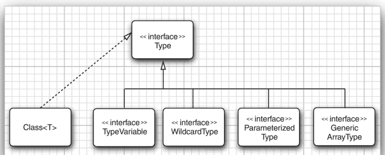

列表 8.4 使用泛型反射 API 打印它对给定类所发现的信息。如果你用 `Pair` 类运行它，你会得到此报告：

```text
class Pair<T> extends java.lang.Object
public T getFirst()
public T getSecond()
public void setFirst(T t)
public void setSecond(T t)
```

如果你在 `PairTest2` 目录下用 `ArrayAlg` 运行它，报告显示以下方法：

```java
public static <T extends java.lang.Comparable> Pair<T>
minmax(T[])
```

## 列表 8.4

### `genericReflection/GenericReflectionTest.java`

```java
package genericReflection;

import java.lang.reflect.*;
import java.util.*;

/**
 * @version 1.13 2023-12-20
 * @author Cay Horstmann
 */
public class GenericReflectionTest {
    public static void main(String[] args) {
        // 从命令行参数读取类名
        String name;
        if (args.length > 0) name = args[0];
        else {
            try (Scanner in = new Scanner(System.in)) {
                System.out.println("Enter name (e.g., java.util.Collections): ");
                name = in.next();
            }
        }

        try {
            // 打印类信息
            Class<?> cl = Class.forName(name);
            printClass(cl);
            for (Method m : cl.getDeclaredMethods()) {
                printMethod(m);
            }
        } catch (ClassNotFoundException e) {
            e.printStackTrace();
        }
    }

    static void printClass(Class<?> cl) {
        System.out.print(cl);
        printTypes(cl.getGenericInterfaces(), "<", ">", true);
        Type sc = cl.getSuperclass();

        if (sc != null) {
            System.out.print(" extends ");
            printType(sc, false);
        }

        printTypes(cl.getGenericInterfaces(), " implements ", ", ", false);
        System.out.println();
    }

    static void printMethod(Method m) {
        String name = m.getName();
        System.out.print(Modifier.toString(m.getModifiers()));
        System.out.print("(");
        printTypes(m.getGenericTypes(), "<", ">", true);
        printType(m.getGenericReturnType(), false);
        System.out.print(")");
        System.out.print(name);
        printTypes(m.getGenericParameters(), " ", ", ", false);
        System.out.println();
    }

    static void printTypes(
        Type[] types,
        String prefix,
        String suffix,
        boolean isDefinition
    ) {
        if (prefix.equals(" extends ")
            && Arrays.equals(types, new Type[] { Object.class })) {
            return;
        }

        if (types.length > 0) {
            System.out.print(prefix);
        }

        for (int i = 0; i < types.length; i++) {
            if (i > 0) {
                System.out.print(separator);
            }
            printType(types[i], isDefinition);
        }

        if (types.length > 0) {
            System.out.print(suffix);
        }
    }

    static void printType(Type type, boolean isDefinition) {
        if (type instanceof Class<?>) {
            System.out.print(type.getName());
        } else if (type instanceof TypeVariable<?> t) {
            System.out.print(t.getName());
            if (isDefinition) {
                printTypes(t.getBounds(), " extends " + " & "", false);
            }
        } else if (type instanceof WildcardType t) {
            System.out.print("?");
            printTypes(t.getUpperBounds(), " extends " + " & "", false);
            printTypes(t.getLowerBounds(), " super " + " & "", false);
        } else if (type instanceof ParameterizedType t) {
            Type owner = t.getOwnerType();

            if (owner != null) {
                printType(owner, false);
                System.out.print(".");
            }

            printType(t.getRawType(), false);
            printTypes(t.getActualTypeArguments(), "<", " & " & ">", false);
        } else if (type instanceof GenericArrayType t) {
            System.out.print("");
            printType(t.getGenericComponentType(), isDefinition);
            System.out.print("[]");
        }
    }
}
```

（注：OCR 文本在代码块中严重破碎。我根据提供的片段和在 OCR 中找到的方法签名重构了逻辑 Java 代码，以确保程序结构有效。）

有时，你希望根据值的类型（type）来驱动程序的行为。例如，在持久化机制中，你可能希望用户指定保存特定类对象的方法。这通常通过将 `Class` 对象与某个操作关联来实现。

然而，对于泛型类来说，类型擦除（erasure）带来了问题。当 `ArrayList<Integer>` 和 `ArrayList<String>` 都被擦除为相同的原始 `ArrayList` 时，你如何为它们实现不同的操作呢？

有一种技巧在某些情况下可以缓解这个问题。你可以捕获在前节中遇到的 `Type` 接口的实例。构建如下所示匿名子类：

```java
var type = new TypeLiteral<ArrayList<Integer>>(){} // 注意这里的 {}
```

`TypeLiteral` 构造函数捕获了泛型超类：

```java
class TypeLiteral<T>
{
    public TypeLiteral()
    {
        Type parentType = getClass().getGenericSuperclass();

        if (parentType instanceof ParameterizedType paramType)
            type = paramType.getActualTypeArguments()[0];
        else
            throw new UnsupportedOperationException(
                "Construct as new TypeLiteral<. . .>{}");
    }
}
```

如果我们在运行时有一个泛型类型可用，我们可以将其与 `TypeLiteral` 进行匹配。我们无法从对象中获取泛型类型——因为它被擦除了。但正如你在前节中看到的，字段和方法参数的泛型类型在虚拟机中仍然存在。


DI 和 Guice 等注入框架使用类型字面量（type literals）来控制泛型类型的注入。书中配套代码中的示例展示了一个简单的例子。给定一个对象，我们列出其泛型类型字段，并查找关联的格式化操作。

我们通过空格分隔值来格式化 `ArrayList<Integer>`，通过将字符接到字符串来格式化 `ArrayList<Character>`。其他列表通过 `ArrayList.toString()` 进行格式化。

## Listing 8.5 genericReflection/TypeLiterals.java

```java
package genericReflection;

/**
 * @version 1.03 2023-12-20
 * @author Cay Horstmann
 */
import java.lang.reflect.*;
import java.util.*;
import java.util.function.*;

/**
 * 类型字面量描述一个可以是泛型的类型，例如
 * ArrayList<String>;
 */
class TypeLiteral<T>
{
    private Type type;

    /**
     * 此构造函数必须从匿名子类调用
     *     如 new TypeLiteral< ..>()()..
     */
    public TypeLiteral() {
        Type parentType = getClass().getGenericSuperclass();
        if (parentType instanceof ParameterizedType paramType)
            type = paramType.getActualTypeArguments()[0];
        else
            throw new UnsupportedOperationException(
                "Construct as new TypeLiteral< ..>()");
    }

    public TypeLiteral(Type type) {
        this.type = type;
    }

    /**
     * 返回一个描述给定类型的类型字面量。
     */
    public static TypeLiteral<?> of(Type type) {
        return new TypeLiteral<>(type);
    }

    public String toString() {
        if (type instanceof Class<?> cl) return cl.getName();
        else return type.toString();
    }

    public boolean equals(Object otherObject) {
        return otherObject instanceof TypeLiteral<?> otherLiteral
            && type.equals(otherLiteral.type);
    }

    public int hashCode() {
        return type.hashCode();
    }
}

/**
 * 格式化对象，使用将类型与格式化函数关联的规则。
 */
class Formatter
{
    private Map<TypeLiteral<?>, Function<?, String>> rules = new HashMap<>();
}
```

```java
/**
 * 向此格式化器添加格式化规则。
 * @param type 该规则应用的类型
 * @param formatterType 格式化此类对象的函数
 */
public <T> void forType(
    TypeLiteral<T> type,
    Function<T, String> formatterForType)
{
    rules.put(type, formatterType);
}

/**
 * 使用此格式化器的规则格式化对象的所有字段。
 * @param obj 包含所有字段名和格式化值的字符串
 */
public String formatFields(Object obj)
    throws IllegalArgumentException, IllegalAccessException
{
    var result = new StringBuilder();
    for (Field f : obj.getClass().getDeclaredFields())
    {
        result.append(f.getName());
        result.append("=");
        f.setAccessible(true);
        Function<?, String> formatterType =
            rules.get(TypeLiteral.of(f.getGenericType()));
        if (formatterType != null) {
            // formatterType 有参数类型 ?. 没有任何可以
            // 传递给它的 apply 方法。
            // 转换将参数类型转换为 Object，这样我们就可以
            // 调用它。
            @SuppressWarnings("unchecked")
            Function<Object, String> objectFormatter =
                (Function<Object, String>) formatterType;
            result.append(objectFormatter.apply(f.get(obj)));
        } else {
            result.append(f.get(obj).toString());
            result.append("\n");
        }
    }
    return result.toString();
}

public static class Sample
{
    ArrayList<Integer> nums;
    ArrayList<Character> chars;
    ArrayList<String> strings;

    public Sample() {
        nums = new ArrayList<>();
        chars = new ArrayList<>();
        strings = new ArrayList<>();
    }

    public static <T> String join(
        String separator,
        ArrayList<T> elements)
    {
        var result = new StringBuilder();
        for (T e : elements) {
            result.append(e);
            result.append(separator);
        }
        return result.toString();
    }

    public static void main(String[] args) throws Exception {
        Sample s = new Sample();
        s.nums.add(1);
        s.nums.add(2);
        s.chars.add('a');
        s.chars.add('b');
        s.strings.add("Hello");
        s.strings.add("World");

        System.out.println(join(", ", s.nums));
        System.out.println(join(", ", s.chars));
        System.out.println(join(", ", s.strings));
    }
}
```

# 第 9 章 ■ 集合

当你尝试以自然风格实现方法或关注性能时，你选择的数据结构会产生巨大影响。你需要快速地在数千个（甚至数百万）排序后的项中进行搜索吗？你需要在有序序列的中间快速插入和删除元素吗？你需要在键和值之间建立关联吗？

本章展示了 Java 集合框架（Java Collections Framework）如何帮助你完成正式编程所需的传统数据结构。在大学计算机科学专业中，一门名为“数据结构”的课程通常需要一个学期，并且大量的书籍致力于这个重要主题。我们的涵盖与大学课程不同；我们将跳过理论，直接介绍如何使用 Java API 中的集合类。

## 9.1 Java 集合框架

Java 的最初版本仅为最实用的数据结构提供了一小部分类：`Vector`、`Stack`、`Hashtable`、`BitSet`，而 `Enumeration` 接口提供了一种访问任意容器中元素的抽象机制。这无疑是一个明智的选择——编写一个全面的集合类库需要时间和技巧。

随着 Java 1.2 的出现，设计者们认为是时候推出一个完整的数据结构框架了。他们面临着许多相互冲突的设计挑战。他们希望库既小又易于学习。他们不想要 C++ 标准模板库（或 STL）的复杂性，但他们想要获得 STL 开创的“泛型算法”的益处。他们希望旧的类能够适应新框架。正如所有集合库的设计者所做，他们必须做出一些艰难的抉择，并在过程中产生了一许多独特的设计决策。在本节中，我们将探索 Java 集合框架的基本设计，演示如何使用它，并解释一些更具争议的特征背后的原理。

### 9.1.1 分离集合接口与实现

与现代数据结构库常见一样，Java 集合框架将*接口*（interfaces）与*实现*（implementations）分离。让我们通过熟悉的数据结构——队列（queue）来看这种分离。

队列接口规定你可以向队列的尾部添加元素，从头部移除元素，并找出队列中有多少元素。当你需要收集对象并以“先进先出”的方式检索它们时（参见图 9.1），就会使用队列。

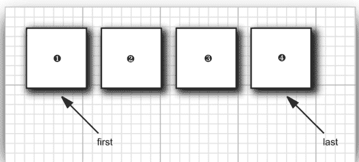

#### 图 9.1：队列

队列接口的极简形式可能如下：

```java
public interface Queue<E> // Java API 中接口的简化形式
{
    void add(E e);
    E remove();
    int size();
}
```

接口没有告诉你关于队列是如何实现的任何信息。在队列的两种常见实现中，一个使用“循环数组”，另一个使用链表（参见图 9.2）。

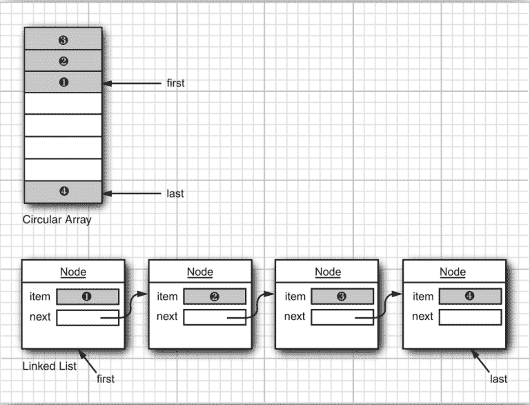

#### 图 9.2：队列的实现

每个实现都可以通过实现 `Queue` 接口的类来表示。在 Java API 中，这些类被称为 `ArrayDeque` 和 `LinkedList`。

```java
public class ArrayDeque<E> implements Queue<E> // 简化自 Java API
{
    private int first;
    private int last;
    private E[] elements;

    public ArrayDeque(int numElements) { . . .
    public void add(E e) { . . }
    public E remove() { . . }
    public int size() { . . }
    ...
}
```

```java
public class LinkedList<E> implements Queue<E> // 简化自 Java API
{
    private Node<E> first;
    private Node<E> last;

    public LinkedList() { . . }
    public void add(E e) { . . }
    public E remove() { . . }
    public int size() { . . }
    ...
}
```

当你在程序中使用队列时，一旦集合构建完成，你不需要知道实际使用的是哪种实现。因此，在构建集合对象时*仅*使用具体类是有意义的。使用*接口类型*来持有集合引用。

```java
Queue<Customer> expressLane = new ArrayDeque<Customer>(100);
expressLane.add(new Customer("Harry"));
```

通过这种方法，如果你改变了主意，可以轻松地使用不同的实现。你只需要在程序中的一处更改更改——即构造函数调用处。如果你最终决定链表是更好的选择，你的代码将变为：

```java
Queue<Customer> expressLane = new LinkedList<>();
expressLane.add(new Customer("Harry"));
```

坚持使用接口还有另一个原因。`ArrayDeque` 和 `LinkedList` 类都拥有与队列无关的方法。不小心使用其中一个会被报告为编译时错误，因为你不能在 `Queue` 类型的变量上调用它们。

为什么选择一种实现而不是另一种？接口对实现的效率没有做任何说明。循环数组的内存效率更高。然而，循环数组具有有限的容量。事实上，测量结果显示 `ArrayDeque` 的性能通常优于 `LinkedList`，因为它对垃圾回收器的影响较小。

### 9.1.2 Collection 接口

Java 框架的基础接口是 `Collection` 接口。它包含两个基方法方法：

```java
public interface Collection<E>
{
    boolean add(E element);
    Iterator<E> iterator();
    ...
}
```

除了这两个方法外，还有几个方法；我们稍后会讨论。`add` 方法将元素添加到集合。如果添加改变了集合则返回 `true`，如果对象已存在则返回 `false`。例如，如果你尝试向集合添加：

### 9.1.3 迭代器（Iterators）

`Iterator` 接口有四个方法：

```java
public interface Iterator<E>
{
    boolean hasNext();
    E next();
    default void forRemaining(Consumer<? super E> action);
}
```

通过反复调用 `next` 方法，你可以逐个访问集合元素。然而，如果你到达集合末尾，`next` 方法将抛出 `NoSuchElementException`。因此，在调用 `next` 之前需要调用 `hasNext`。该方法返回 `true` 表示迭代器尚未到达结束，且至少有一个元素可以访问。如果你想检查集合的所有元素，请求一个迭代器，然后在 `hasNext` 返回 `true` 时不断调用 `next` 方法。例如：

```java
Collection<String> coll = . . .
Iterator iter = coll.iterator();
while (iter.hasNext()) {
    String element = iter.next();
    do something with element
}
```

你可以将这种循环更简洁地写为“for each”循环：

```java
for (String element : coll)
{
    do something with element
}
```

编译器简单将 for each 循环翻译为带有迭代器的循环。for each 循环适用于实现了 `Iterable` 接口的对象，该接口有一个抽象方法：

```java
public interface Iterable<E>
{
    Iterator<E> iterator();
    ....
}
```

`Collection` 接口继承了 `Iterable` 接口。因此，你可以对 Java 框架中的任何集合使用 for each 循环。

与其编写循环，可以使用 `Collection.forEach` 或 `Iterator.forEachRemaining` 方法并带有 Lambda 表达式来消费元素。Lambda 表达式应用于集合的所有元素，或者迭代器可以访问的剩余元素。

```java
coll.forEach(element -> do something with element);
iter.forEachRemaining(element -> do something with element);
```

访问元素的顺序取决于集合类型。如果你在 `ArrayList` 上迭代，迭代器从索引 0 开始，每次步增索引。然而，如果你访问 `HashSet` 中的元素，你得到的顺序基本上是随机的。你可以确保在迭代过程中会遇到集合的所有元素，但你不能对它们的顺序做任何假设。这通常不是问题，因为对于计算总和或计算匹配项等计算来说，顺序并不重要。


> **注意：** 老手会注意到，`Iterator` 接口的 `next` 和 `hasNext` 方法与 `Enumeration` 接口的 `nextElement` 和 `hasMoreElements` 方法的作用相同。Java 集合框架的设计者本可以选择使用 `Enumeration` 接口，但他们不喜欢冗长的方法名，而是引入了一个具有更短方法名的新接口。
>
> Java 集合库中的迭代器与其他库中的迭代器之间存在着重要的概念区别。在传统的集合库中（如 C++ 的标准模板库 STL），迭代器是模仿数组索引建模的。给定这样一个迭代器，你可以查找存储在相应位置的元素，就像当你有一个数组索引 `i` 时，可以查找数组元素 `a[i]` 一样。与查找无关，你可以将迭代器移动到下一个位置。这与通过 `++` 推进数组索引的操作相同，且不需要执行查找操作。然而，Java 的迭代器工作方式并非如此。查找和位置移动是紧密耦合的。查找元素的唯一方法是调用 `next`，而这种查找会移动位置。
>
> 相反，请将 Java 迭代器想象为位于元素之间。当你调用 `next` 时，迭代器会跳过下一个元素，并返回它刚刚经过的元素的引用（见图 9.3）。

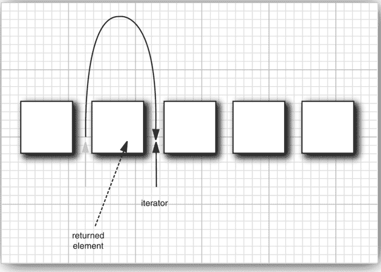

**图 9.3：** 推进迭代器

> **注意：** 这里有另一个有用的类比。你可以认为 `Iterator.next` 相当于 `InputStream.read`。从流中读取一个字节会自动“消耗”该字节。下一次 `read` 调用将消耗输入中的下一个字节。同样，重复调用 `next` 可以让你读取集合中的所有元素。

`Iterator` 接口的 `remove` 方法删除由上一次 `next` 调用返回的元素。在许多情况下，这是合理的——你需要在决定某个元素是应该被删除的元素之前，先看到它。但如果你想移除特定位置的元素，你仍然需要跳过该元素。例如，这里是移除字符串集合中第一个元素的方法：

```java
Iterator<String> iter = coll.iterator();
iter.next(); // 跳过第一个元素
iter.remove(); // 现在将其移除
```

更重要的是，`next` 和 `remove` 方法调用之间存在依赖关系。如果在没有先调用 `next` 的情况下调用 `remove` 是非法的。如果尝试，将抛出 `IllegalStateException`。

如果你想移除两个相邻的元素，不能简单地调用：

```java
iter.remove();
iter.remove(); // 错误
```

相反，你必须首先调用 `next` 来跳过要移除的元素：

```java
iter.remove();
iter.next();
iter.remove(); // 正确
```

## 9.1.4. 通型工具方法

`Collection` 和 `Iterator` 接口是泛型的，这意味着你可以编写操作任何类型集合的工具方法。例如，这里有一个泛型方法，用于测试任意集合是否包含给定的元素：

```java
public static <E> boolean contains(Collection<E> c, Object obj)
{
  for (E element : c)
    if (element.equals(obj))
      return true;
  return false;
}
```

Java 集合框架的设计者认为，其中一些工具方法非常有用，因此框架应该提供它们。这样，API 使用者就不必不断重复发明轮子。`contains` 方法就是其中一种方法。

事实上，`Collection<E>` 接口声明了许多实用方法，所有实现类必须提供这些方法：

- `int size()`
- `boolean isEmpty()`
- `boolean contains(Object obj)`
- `boolean containsAll(Collection<?> c)`
- `boolean add(E obj)`
- `boolean addAll(Collection<? extends E> from)`
- `boolean remove(Object obj)`
- `boolean removeAll(Collection<?> c)`
- `boolean retainAll(Collection<?> c)`
- `void clear()`
- `Object[] toArray()`
- `T[][] toArray(T[]) a`

> **注意：** `Collection` 接口声明了继承自 `Object` 的 `equals` 和 `hashCode` 方法。技术上没有包含这些声明。这只是为添加集合特定的 API 文档提供了一个良好的位置。`Set` 和 `List` 子接口对 `equals` 规定了特定的行为。其他集合可以继承 `Object.equals`，或者重写它并以某种方式比较元素。在后的情况下，`hashCode` 方法也需要被重写。
>
> 这些方法中的许多是自解释的；你将在本节末尾的 API 注释中找到完整的文档。

> **注意：** Java 集合框架是在泛型类型加入 Java 之前设计的。为了向后兼容，`contains` 和 `remove` 方法的参数类型为 `Object` 而不是 `E`。`containsAll`、`removeAll` 和 `retainAll` 方法的参数类型为 `Collection<?>` 而不是 `Collection<? extends E>`。

这意味着错误可能无法在编译时检测到。例如，考虑这段代码片段，不小心从 `Path` 对象的集合中删除了 `String`：

```java
Collection<Path> paths = ...;
paths.remove("/tmp"); // 可以编译，但可能没有效果
```

当然，如果每个实现 `Collection` 接口的类都必须提供这么多常规方法，将很麻烦。为了方便实现者，框架提供了一个 `AbstractCollection` 类，它将基础的 `size` 和 `iterator` 方法设为抽象，但根据这些方法实现了常规方法。例如：

```java
public abstract class AbstractCollection<E> implements Collection<E> {
    public abstract Iterator<E> iterator();
    public abstract int size();

    public boolean isEmpty() {
        return size() == 0;
    }

    public boolean contains(Object obj) {
        Iterator<E> it = iterator();
        while (it.hasNext()) {
            if (it.next().equals(obj))
                return true;
        }
        return false;
    }
}
```

具体的集合类现在可以扩展 `AbstractCollection` 类。子类需要提供 `iterator` 和 `size` 方法。集合集合还需要 `add` 方法。其他方法已由 `AbstractCollection` 处理。如果子类有更高效的 `contains` 实现，则可以这样做。

这种方法有点过时了。如果这些方法是 `Collection` 接口的默认方法会更好，但在设计 Java 集合框架时还没有默认方法。不过，现在添加了一些默认方法。其中三个与流有关（见第二卷）。`toArray` 方法见第 9.6 节。此外还有一个非常有用的方法：

`default boolean removeIf(Predicate<? super E> filter)`

移除符合条件的元素。如果集合由于此调用发生了变化，则返回 `true`。

### `java.util.Collection<E>`

- `Iterator<E> iterator()`

  返回一个用于访问集合元素的迭代器。

- `int size()`

  返回集合中当前存储的元素数量。

- `boolean isEmpty()`

  如果集合为空，返回 `true`。

- `boolean contains(Object obj)`

  如果集合包含与 `obj` 相等的对象，返回 `true`。

- `boolean containsAll(Collection<?> other)`

  如果集合包含另一个集合中的所有元素，返回 `true`。

- `boolean add(E element)`

  尝试向集合添加一个元素。如果集合由于此调用发生了变化，返回 `true`。

- `boolean addAll(Collection<? extends E> other)`

  将另一个集合中的所有元素添加到集合中。如果集合由于此调用发生了变化，返回 `true`。

- `boolean remove(Object obj)`

  尝试从集合中移除与 `obj` 相等的对象。如果删除了匹配的对象，则返回 `true`。

- `boolean removeAll(Collection<?> other)`

  从集合中移除另一个集合中的所有元素。如果集合由于此调用发生了变化，返回 `true`。

- `default boolean removeIf(Predicate<? super E> filter)`

  移除 `filter` 返回 `true` 的元素。如果集合由于此调用发生了变化，则返回 `true`。

- `boolean retainAll(Collection<?> other)`

  从集合中移除所有不另一个集合中任何元素的元素。

- `void clear()`

  移除集合中的所有元素。如果由于此调用导致集合发生了变化，则返回 `true`。

- `Object[] toArray()`

  返回集合中对象的数组。

- `<T> T[] toArray(IntFunction<T[]> generator)`

  返回集合中对象的数组。该数组通过生成器构建，生成器通常是一个构造器表达式 `T[]::new`。

## `java.util.Iterator<E>`

- `boolean hasNext()`

  如果还有另一个可访问的元素，则返回 `true`。

- `E next()`

  返回下一个要访问的对象。如果到达集合末尾，则抛出 `NoSuchElementException`。

- `void remove()`

  移除上一次访问的对象。此方法必须紧随元素访问之后调用。如果自上次访问元素以来集合已被修改，则此方法将抛出 `IllegalStateException`。迭代器不要求支持此操作。默认实现会抛出 `UnsupportedOperationException`。

- `void forEachRemaining(Consumer<? super E> action)`

  访问元素并将它们传递给指定的 `action`，直到没有剩余元素或 `action` 抛出异常。

## 9.2. 集合框架中的接口

Java 集合框架（Java Collections Framework）为不同类型的集合定义了许多接口。这些如图 9.4 所示，但并发编程相关的接口将在第 10 章介绍。

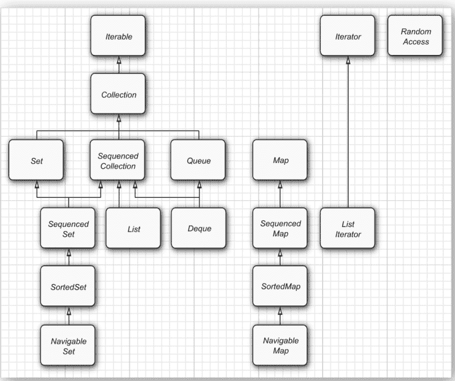

**图 9.4：** Java 集合框架的接口

集合有两个基本接口：`Collection` 和 `Map`。正如你已经看到的，你通过以下方法向集合中插入元素：

`boolean add(E element)`

然而，`map` 存储的是键值对，你使用 `put` 方法来插入它们：

```java
V put(K key, V value)
```

若要从集合中读取元素，可以使用迭代器访问它们。但是，你可以使用 `get` 方法从 `map` 中读取值：

```java
V get(Object key)
```

`List` 是一个有序集合。元素被添加到容器中的特定位置。元素可以通过两种方式访问：通过迭代器或通过整数索引。后者被称为随机访问，因为元素可以按任何顺序被访问。相比之下，使用迭代器时，必须顺序访问它们。

`List` 接口定义了几个用于随机访问的方法：

```java
void add(int index, E element)
E remove(int index)
E get(int index)
E set(int index, E element)
```

> **注意：** 对于 `List<Integer>`，有两个 `remove` 方法：

```java
boolean remove(int index) // 移除指定索引的元素
boolean remove(Integer o) // 移除等于 o 的元素
```

当带有 `int` 类型的参数调用 `remove` 时，会选择第一个方法。这里不考虑装箱（boxing），且没有任何警告。这可能不是你想要的：

```java
List<Integer> ids = . . ;
id = . . ;
if (id == 0) ids.remove(id); // 移除索引为 0 的元素，而不是值为 0 的元素
```

> **注意：** `List` 接口的 API 文档定义了列表的 `equals` 方法的行为。要使一个列表与另一个对象相等，该对象也必须是某种类型的列表。两个列表必须具有相同的大小。在遍历每个列表时，对应的元素必须是相等的。

坦率地说，Java 集合框架中的 `List` 接口存在一个问题。有序集合有两种类型，其性能权衡非常不同。一种由数组支持的有序集合具有快速的随机访问，使用带有整数索引的 `List` 方法是有意义的。相反，链表虽然也是有序的，但随机访问很慢，最好使用迭代器进行顺序遍历。如果能提供两个接口会更好。

> **注意：** 为了避免对链表执行随机访问操作，Java 1.4 引入了一个标记接口 `RandomAccess`。该接口没有方法，但你可以用它来测试特定集合是否支持高效的随机访问：

```java
if (c instanceof RandomAccess) {
    random traversal
} else {
    sequential traversal
}
```

`Set` 接口与 `Collection` 接口具有相同的实例方法，但方法的行为定义得更严密。`set` 的 `add` 方法应该拒绝重复项。`set` 的 `equals` 方法应该定义为：如果两个 `set` 元素相同，它们就是相等的，但不一定顺序相同。`hashCode` 方法应该定义为：具有相同元素的 `set` 生成相同的哈希码。

如果方法签名相同，为什么要单独定义接口呢？从概念上讲，并不是所有的集合都是 `set`。`Set` 接口允许程序员编写只接受 `set` 的方法。

为了理解为什么这种区别很重要，请考虑等性测试。如果两个列表具有相同顺序的相同元素，则它们是相等。如果两个 `set` 具有某种顺序的相同元素，则它们是相等。实现 `Set` 接口的类的 `equals` 方法需要确保参数也是 `Set`，而不仅仅是任何 `Collection`。

`SortedSet` 和 `SortedMap` 接口暴露了用于排序的比较器对象，并定义了获取集合子视图的方法。我们将在 9.5.3 节讨论这些。

`NavigableSet` 和 `NavigableMap` 接口包含了用于查找下一个或上一个元素的额外方法。`TreeSet` 和 `TreeMap` 实现这些接口。Java 21 引入了 `SequencedCollection<E>` 接口，提供了对集合第一个和最后一个元素的统一访问。

```java
E getFirst()
E getLast()
void addFirst(E)
void addLast(E)
E removeFirst()
E removeLast()
SequencedCollection<E> reversed()
```

此前，这些操作是在 `list`、`set` 和 `deque` 中通过不同方法完成的。`SequencedSet` 将 `reversed` 方法的返回类型精确化。`SequencedMap` 为 `map` 提供类似的方法。

## 9.3. 具体集合

表 9.1 显示了 Java 集合框架中的集合，并简要描述了每个集合的用途。（为了简单起见，我省略了将在第 10 章讨论的线程安全集合。）

表 9.1 中的所有类都实现了 `Collection` 接口，以 `Map` 结尾的类除外。这些类实现了 `Map` 接口。我们将在 9.4 中讨论 `map`。

### 表 9.1：Java 集合框架中的具体集合

| 集合类型 | 描述 | 章节 |
|---|---|---|
| `ArrayList` | 动态伸缩的索引序列 | 9.2 |
| `LinkedList` | 允许在任何位置插入和删除的有序序列 | 9.1 |
| `ArrayDeque` | 基于循环数组的双端队列 | 9.5 |
| `HashSet` | 拒绝重复的无序集合 | 9.3 |
| `TreeSet` | 排序集 | 9.4.5 |
| `EnumSet` | 枚举集合 | 9.4.6 |
| `LinkedHashSet` | 记录插入顺序集合 | 9.4.5 |
| `PriorityQueue` | 允许高效移除最小元素的集合 | 9.3.6 |
| `HashMap` | 存储键值关联的数据结构 | 9.4.1 |
| `TreeMap` | 键排序的 `map` | 9.4.1 |
| `EnumMap` | 键属于枚举类型的 `map` | 9.4.6 |
| `LinkedHashMap` | 记录条目添加顺序的 `map` | 9.4.5 |
| `WeakHashMap` | 值在其他地方未使用时可以被垃圾回收器回收的 `map` | 9.4.4 |
| `IdentityHashMap` | 键通过 `==` 而不是 `equals` 比较的 `map` | 9.4.7 |

图 9.5 显示了这些类之间的关系。

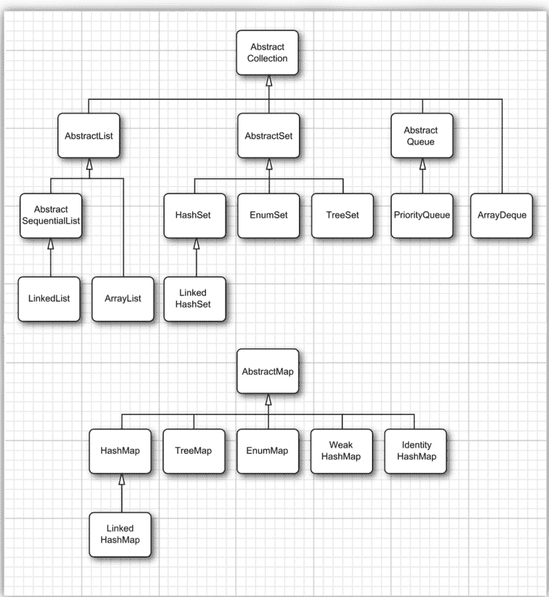

**图 9.5：** Java 集合框架中的类

## 9.3.1. 链表


在本书的许多示例中，我们已经使用了数组及其动态表亲 `ArrayList` 类。然而，数组和数组列表（array lists）有一个巨大的缺点。

从数组中间删除一个元素是非常昂销的，因为被删除元素之后的所有元素都必须向数组的开头移动（见图 9.6）。在中间插入元素也是如此。

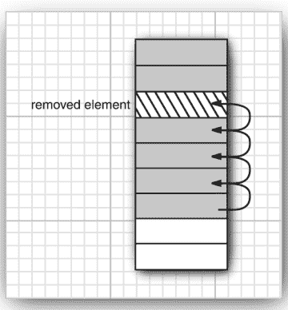

**图 9.6：从数组中删除元素**

另一个为人知的数据结构——链表（linked list）解决了这个问题。数组对象在连续的内存位置存储引用，而链表将每个对象存储在独立的节点（link）中。每个节点还存储了指向序列中下一个节点的引用。在 Java 集合框架中，所有的链表实际上都是双向链的；也就是说，每个节点还存储了指向其前驱节点的引用（见图 9.7）。

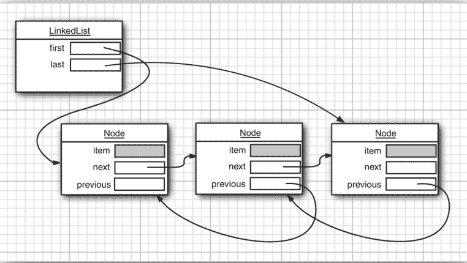

**图 9.7：双向链表**

从链表的中间删除一个元素是一个廉价的操作——只需要更新被删除元素周围的节点（见图 9.8）。

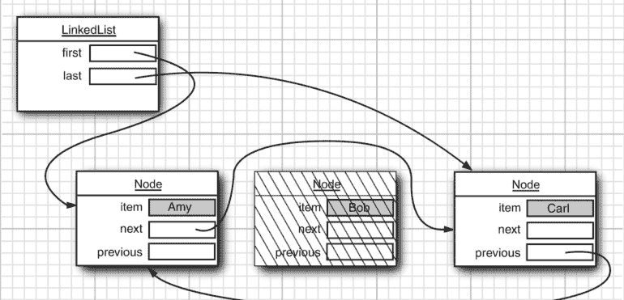

**图 9.8：从链表中删除元素**

也许你曾经上过数据结构课程，在课程中学习过了如何实现链表。你可能对在链表中删除或添加元素时处理错综复杂的节点关系有糟糕的回忆。如果是这样，你会高兴地发现，Java 集合框架提供了一个可以直接使用的 `LinkedList` 类。

接下来的代码示例添加了三个元素，然后删除了第二个元素：

```java
var staff = new LinkedList<String>();
staff.add("Amy");
staff.add("Carl");
Iterator<String> iter = staff.iterator();
```

```java
String first = iter.next(); // 访问第一个元素 (Amy)
String second = iter.next(); // 访问第二个元素 (Bob)
iter.remove(); // 删除上一次访问的元素 (Bob)
```

然而，链表与通用集合（generic collections）之间存在一个重要的区别。链表是一个有序集合，对象的的位置非常重要。`LinkedList.add` 方法将对象添加到列表末尾。你通常希望在列表的中间某个添加对象。这种依赖位置的 `add` 方法是迭代器（iterator）的职责，因为迭代器描述了集合中的位置。使用迭代器添加元素仅对于具有自然顺序的集合才有意义。例如，我们在下一节中讨论的 `set` 数据类型不对其元素施加任何排序。因此，`Iterator` 接口中没有 `add` 方法。相反，Java 集合框架提供了一个包含 `add` 方法的子接口 `ListIterator`：

```java
interface ListIterator<E> extends Iterator<E>
{
  void add(E element);
  ....
}
```

与 `Collection.add` 不同，此方法不返回布尔值——假设 `add` 操作总是会修改列表。

此外，`ListIterator` 接口有两个方法可以用于反向遍历列表：

```java
boolean hasPrevious()
E previous()
```

与 `next` 方法一样，`previous` 方法返回它跳过的对象。

`LinkedList` 类的 `listIterator` 方法返回一个实现 `ListIterator` 接口的迭代器对象：

```java
ListIterator<String> iter = staff.listIterator();
```

`add` 方法在迭代器位置之前添加新元素。例如，以下代码跳过了链表中的第一个元素，并在第二个元素之前添加了“Juliet”（见图 9.9）：

```java
var staff = new LinkedList<String>();
staff.add("Amy");
staff.add("Bob");
staff.add("Carl");
ListIterator<String> iter = staff.listIterator();
iter.next(); // 跳过第一个元素
iter.add("Juliet");
```

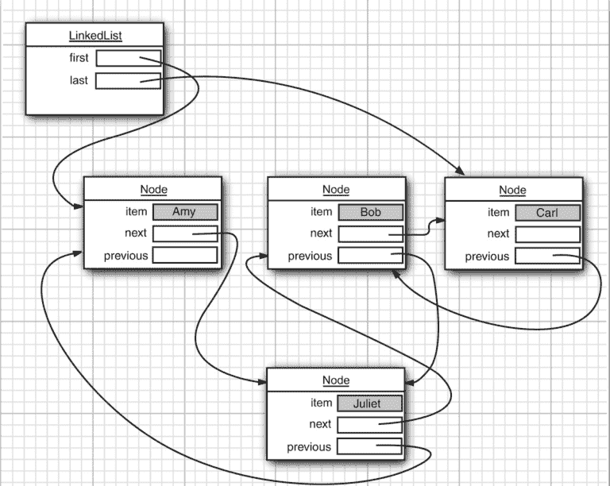

**图 9.9：向链表添加元素**

如果你多次调用 `add` 方法，元素将按照你提供的顺序逐一添加。它们都会按顺序添加到当前迭代器位置之前。

当你使用一个刚从 `listIterator` 方法返回的、指向列表第一个元素的迭代器执行 `add` 操作时，新添加的元素将成为列表的第一个元素。当迭代器越过列表的最后一个元素时（即当 `hasNext` 返回 `false` 时），添加的元素将成为列表的新尾。如果链表有 $n$ 个元素，则有 $n + 1$ 个可以添加新元素的位置。

> **注意：** 小心“光标”（cursor）类比。迭代器指向元素之间。当你调用 `add` 方法时，元素被插入到光标之前，光标会移动到新添加元素的右侧。例如，假设链表包含三个元素 A、B 和 C。添加新元素的位置有：

```text
--- A --- B --- C ---
```

如果你连续调用两次 `remove` 方法，第二次调用将失败，因为元素已经被移除。例如，以下代码用 `newValue` 替换第一个元素：

```java
ListIterator<String> iter = staff.listIterator();
String oldValue = iter.next();
iter.set(newValue);
```

这种做法并不可靠。链表不支持快速的随机访问。如果你想查看链表的第 $n$ 个元素，你必须从头开始并跳过前 $n-1$ 个元素。没有捷径。出于这个原因，程序员通常不会在需要通过整数索引访问元素的情况下使用链表。

尽管如此，`LinkedList` 类提供了一个 `get` 方法，允许你访问特定的元素：

```java
LinkedList<String> list = . . . ;
String obj = list.get(n);
```

当然，这个方法并不高效。如果你发现自己正在使用它，那么你可能为问题使用了错误的数据结构。

你永远不应该使用这种虚拟的随机访问方法来遍历链表。以下代码：

```java
for (int i = 0; i < list.size(); i++)
  do something with list.get(i);
```

执行效率低得惊人。每当你查找另一个元素时，搜索都会从列表开始重新开始。`LinkedList` 对象并没有尝试缓存位置信息。

> **注意：** `get` 方法有一个轻微的优化：如果索引至少为 `size() / 2`，则元素的搜索将从列表末尾开始。

列表迭代器接口也有一个方法可以告诉你当前位置的索引。事实上，由于 Java 迭代器在概念上指向元素之间，因此它有两个这样的方法：`nextIndex` 方法返回下一次调用 `next` 将返回的元素的整数索引；`previousIndex` 方法返回下一次调用 `previous` 将返回的元素的索引。当然，它仅仅比 `nextIndex` 小 1。这些方法对于 `LinkedList` 迭代器来说是高效的——每个迭代器都维护着其当前位置的计数。最后，如果你有一个整数 `n`，那么 `list.listIterator(n)` 返回一个指向索引为 `n` 的元素之前的迭代器。也就是说，调用 `next()` 产生的元素与 `list.get(n)` 相同；但获取该迭代器本身是低效的。

如果你的链表只有几个元素，你就不必过度担心 `get` 和 `set` 方法的代价。但既然如此，最初为什么要用链表呢？使用链表的唯一理由是最小化在列表中间插入和删除的成本。如果你只有几个元素，可以直接使用 `ArrayList`。

我建议你直接避开所有使用整数表示链表中位置的方法。如果你想对集合进行随机访问，请使用数组或 `ArrayList`，而不是链表。

Listing 9.1 中的程序让链表发挥了作用。它简单地创建了两个列表，合并它们，然后从第二个列表中删除每个第二个元素，最后测试了 `removeAll` 方法。我建议你追踪程序的流程，并特别注意迭代器。绘制迭代器位置的图可能会有所帮助，如下所示：

| ACE | BDFG |
| :--- | :--- |
| A | CE | BDFG |
| AB | CE B|DEFG |

注意，调用：

```java
System.out.println(a);
```

通过调用 `AbstractCollection` 中的 `toString` 方法，打印链表 `a` 中的所有元素。

## Listing 9.1 `linkedList/LinkedListTest.java`

```java
1 package linkedList;
2 
3 import java.util.*;
4 
5 /**
6 * 此程序演示了链表的操作。
7 * @version 1.13 2023-12-05
8 * @author Cay Horstmann
9 */
10 public class LinkedListTest
11 {
12     public static void main(String[] args)
13     {
14         var a = new LinkedList<String>();
15         a.add("Amy");
16         a.add("Carl");
17         a.add("Erica");
18 
19         var b = new LinkedList<String>();
20         b.add("Bob");
21         b.add("Doug");
22         b.add("Frances");
23         b.add("Gloria");
24

 // 将 b 中的元素合并到 a 中
ListIterator<String> aIter = a.listIterator();
Iterator<String> bIter = b.iterator();

while (bIter.hasNext()) {
    if (aIter.hasNext()) aIter.next();
    aIter.add(bIter.next());
}

// 从 b 中删除每个第二个元素
bIter = b.iterator(); while (bIter.hasNext()) {
    bIter.next(); // 跳过一个元素
    if (bIter.hasNext()) {
        bIter.next(); // 跳过下一个元素
        bIter.remove(); // 删除该元素
    }
}

System.out.println(b);

// 批量操作：从 a 中删除 b 的所有元素
a.removeAll(b);
System.out.println(a);
```

## `java.util.List<E>` 1.2

- `ListIterator<E> listIterator()` 返回一个用于访问列表元素的列表迭代器。
- `ListIterator<E> listIterator(int index)` 返回一个用于访问列表元素的列表迭代器，其首次调用 `next` 将返回指定索引的元素。
- `void add(int i, E element)` 在指定位置添加一个元素。
- `boolean addAll(int i, Collection<? extends E> elements)` 将集合中的所有元素添加到指定位置。
- `E remove(int i)` 并返回指定位置的元素。
- `E get(int i)` 获取指定位置的元素。
- `E set(int i, E element)` 用新元素替换指定位置的元素并返回旧元素。
- `int indexOf(Object element)` 返回指定元素第一次出现的位置，如果未找到则返回 -1。
- `int lastIndexOf(Object element)` 返回指定元素最后一次出现的位置，如果未找到则返回 -1。

## `java.util.ListIterator<E>` 1.2

- `void add(E newElement)` 在当前位置之前添加元素。
- `void set(E newElement)` 用新元素替换上次通过 `next` 或 `previous` 访问的元素。如果在调用 `next` 或 `previous` 后列表结构被修改过，则抛出 `IllegalStateException`。
- `boolean hasPrevious()` 反向遍历列表时是否存在元素。
- `E previous()` 返回上一个对象。如果到达列表开头则抛出 `NoSuchElementException`。
- `int nextIndex()` 返回下次调用 `next` 将返回的索引，如果迭代器已过最后一个元素，则返回列表的大小。
- `int previousIndex()` 返回下次调用 `previous` 将返回的索引，如果迭代器在第一个元素之前，则返回 -1。

## `java.util.LinkedList<E>` 1.2

- `LinkedList()` 构建一个空链表。
- `LinkedList(Collection<? extends E> c)` 构建一个链表并添加集合中的所有元素。
- `void addFirst(E element)`、`void addLast(E element)` 在列表开头或末尾添加元素。
- `E getFirst()`、`E getLast()` 返回列表开头或末尾的元素。
- `E removeFirst()`、`E removeLast()` 删除并返回列表开头或末尾的元素。

### 9.3.3. 哈希集合

链表和数组允许你指定元素排列的顺序。然而，如果你正在寻找某个特定元素且忘了它的位置，你就需要访问所有元素，直到找到匹配项为止。如果集合包含很多元素，这可能会非常耗时。如果你不在乎元素的顺序，则某些数据结构可以让你更快地找到元素。缺点是，这些数据结构无法让你控制元素出现的顺序，以满足其自身用途的便利。

一种用于快速查找对象的已知数据结构是哈希表（hash table）。哈希表为每个对象计算一个整数，称为哈希码（hash code）。哈希码以某种方式从对象的实例字段中派生，最好使得具有不同数据的对象产生不同的代码。表 9.2 列出了几个 `String` 类的 `hashCode` 方法产生的哈希值示例。

## 表 9.2：由 `hashCode` 方法生成的哈希值

| String | 哈希码 |
|---|---:|
| `"Lee"` | 76268 |
| `"lee"` | 107020 |
| `"eel"` | 100300 |

如果你定义了自己的类，则需要你负责实现自己的 `hashCode` 方法——更多信息请参见第 5 章。你的实现需要与 `equals` 方法兼容：如果 `a.equals(b)`，则 `a` 和 `b` 必须具有相同的哈希码。

现在重要的是，哈希码可以快速计算，且该计算取决于需要哈希的对象的状态，而不是取决于哈希表中的其他对象。

在 Java 中，哈希表被实现为链表数组。每个列表被称为一个桶（bucket）（见图 9.10）。要找到对象在表中的位置，计算其哈希码并对桶的总数取模。得到的数字就是存放该元素的桶的索引。例如，如果一个对象的哈希码为 76268 且有 128 个桶，那么该对象被放置在桶 108 中（因为 `76268 % 128` 的余数是 108）。也许你很幸运，该桶中没有其他元素。这时你只需将元素插入到该桶中。当然，有时你会遇到非空桶。这被称为哈希冲突（hash collision）。这时，将新对象与桶中的所有对象进行比较，看它是否已经存在。如果哈希码分布合理且桶的数量足够大，那么只需要几次比较即可。

**图 9.10：哈希表**

> **注意：** 在 `HashMap` 的实现中，当桶的大小超过阈值时，桶会从链表变为平衡二叉树。如果哈希函数选择得不当或产生许多冲突，或者恶意代码试图用许多具有相同哈希码的值填充哈希表，这可以提高性能。

> **提示：** 只要可能，哈希表的键应该属于实现了 `Comparable` 接口的类。这样你就能保证不会因为哈希码分布不均而导致性能下降。

如果哈希表太满，就需要进行重哈希（rehashed）。为了重哈希表，会创建一个具有更多桶的表，将所有元素插入新表，并丢弃原表。负载因子（load factor）决定了何时对哈希表进行重哈希。例如，如果负载因子为 0.75（默认值）且表超过了 75%，它会自动重哈希，且桶的数量翻倍。对于大多数应用程序，将负载因子保持在 0.75 是合理的。

如果你想对哈希表的性能有更多控制，可以指定初始的桶数量。你应该将其设置为预期的元素数量除以负载因子。或者，从 Java 19 开始，你可以使用静态的 `HashSet` 便利方法来为你完成此计算：

```java
HashSet<String> strings =
HashSet.newHashSet(expectedElementCount);
```

> **注意：** 一些研究人员认为，将桶的数量设为质数是一个防止键值聚集的好主意。然而，这些证据并不是结论性的。Java 集合框架使用的桶数量是 2 的幂，默认为 16。（你为桶数量提供的任何值都会被自动向上舍入到最近的 2 的幂。）

哈希表可以用于实现几种重要的数据结构。其中最简单的是集合（set）类型。集合是一个没有重复元素的集合。集合的 `add` 方法首先尝试查找要添加的对象，只有在它尚不存在时才进行添加。


Java 集合框架提供了一个 `HashSet` 类，它实现基于哈希表的集合。你使用 `add` 方法添加元素。重新定义了 `contains` 方法以进行快速查找，检查元素是否已存在于集合中。它只检查一个桶中的元素，而不是集合中的所有元素。

哈希迭代器依次访问所有的桶。由于哈希将元素散布在表中，因此它们以一种看似随机的顺序被访问。如果你不在乎集合中元素的顺序，你就会使用 `HashSet`。

本节末尾的示例程序（列表 9.2）从文件中读取单词，将其添加到集合中，并打印出前二十个单词。例如，你可以将单词输入到树集合（tree set）中，它会保持排序。注意：在变异元素时要小心，元素的哈希码将不再处于正确的位置。

## 列表 9.2 `SetTest.java`

```java
package set;

import java.io.IOException;
import java.nio.file.Path;
import java.util.*;

/**
 * 这比较了向哈希集合和树集合插入元素的情况。
 * 运行程序的方法：java SetTest [filename] [repetitions]
 *
 * @version 2023-12-07
 * @author Cay Horstmann
 */
public class SetTest {
    public static void time(Set<String> wordSet, List<String> wordList, int repetitions) {
        long totalTime = 0;
        for (int i = 0; i < repetitions; i++) {
            for (String word : wordList) {
                long start = System.nanoTime();
                wordSet.add(word);
                long end = System.nanoTime();
                totalTime += end - start;
            }
        }
        Iterator<String> iter = wordSet.iterator();
        for (int i = 0; i < 20 && iter.hasNext(); i++) {
            System.out.print(iter.next() + " ");
        }
        System.out.println("...");
        System.out.printf("%s: %d words, %d distinct, %.3f seconds.%n",
                wordSet.getClass().getSimpleName(), wordList.size(),
                totalTime * 1E-9);
    }

    public static void main(String[] args) throws IOException {
        List<String> words = new ArrayList<>();
        String filename = args.length > 0 ? args[0] : "../gutenberg/crsto10.txt";
        int repetitions = args.length > 1 ? Integer.parseInt(args[1]) : 1;
        try (var in = new Scanner(Path.of(filename))) {
            while (in.hasNext()) {
                String word = in.next();
                words.add(word);
            }
        }
        time(new HashSet<>(), words, repetitions);
        time(new TreeSet<>(), words, repetitions);
    }
}
```

- `static <E> HashSet<E> newHashSet(int numMappings)` 构建一个空的哈希集，其初始容量足够容纳预期的元素数量（`numMappings`）而无需重新哈希。

## `java.lang.Object` 1.0

- `int hashCode()` 返回此对象的哈希值。哈希值可以是任意整数，正数或负数。`equals` 和 `hashCode` 的定义必须保持兼容性：如果 `x.equals(y)`，则 `x.hashCode()` 的值必须与 `y.hashCode()` 相同。

## 9.3.4. Tree Sets

`TreeSet` 类与哈希集合类似，但增加了一项改进。树集合（tree set）是一个排序集合。以任何顺序将元素插入到集合中。当你遍历这个排序后的集合时，值会自动按排序顺序呈现。例如，假设你插入了三个字符串，然后访问你添加的所有元素。

```java
var sorter = new TreeSet<String>();
sorter.add("Bob");
sorter.add("Amy");
sorter.add("Carl");
for (String s : sorter) System.out.println(s);
```

然后，值将按排序顺序打印：Amy Bob Carl。正如类名所示，排序是通过树形数据结构实现的。（当前实现使用了红黑树。关于红黑树的详细描述，可以参考 Thomas Cormen, Charles Leiserson, Ronald Rivest 和 Clifford Stein 等出的《Introduction to Algorithms》，The MIT Press, 2022。）每当向树添加一个元素时，它都会被放在正确的排序位置。因此，迭代器始终按排序顺序访问元素。

向树中添加元素比向哈希表中添加元素慢。但它仍然比在数组或链表中检查重复项快得多。如果树包含 `n` 个元素，那么为了找到新元素的正确位置平均需要 `log₂ n` 次比较。例如，如果树已经包含 1,000 个元素，添加一个新元素大约需要 10 次比较。

> **注意：** 为了使用树集合，你必须能够比较元素。元素必须实现 `Comparable` 接口，或者你必须在构建集合时提供一个 `Comparator`。（`Comparable` 和 `Comparator` 接口在第 6 章中引入。）

树集合到底慢多少？如下运行列表 9.2 中的程序：

```bash
java set.Test ..gutenberg/crsto10.txt 100
```

《基督基督仇》有 466,300 个单词，每个单词插入 100 次。在我的测试机器上，`TreeSet` 的速度慢了近 4 倍。如果你不需要数据排序，没有理由为排序开销付出代价。更重要的是，对于某些数据，确定排序顺序比编写哈希函数困难得多。哈希函数只需要尽可能良好地打乱对象，而比较函数必须能够完全精确地区分对象。

为了使这种区别更加具体，考虑收集一组矩形的任务。如果你使用 `TreeSet`，你需要提供一个 `Comparator<Rectangle>`。你如何比较两个矩形？按面积吗？这行不通。你可以有两个坐标不同但面积相同的矩形，而你想同时保留它们。比较器必须与 `equals` 兼容；即只有当元素相等时，比较结果才能为零。矩形有这样的排序顺序（基于坐标的字典序），但计算起来非常麻烦。相比之下，`Rectangle` 类已经定义了哈希函数，只需对坐标进行哈希。

> **警告：** 如果比较器与元素类型不兼容，集合的相等性可能会给出不一致的结果。这里有一个典型的例子：

```java
var words = new TreeSet<String>(String.CASE_INSENSITIVE_ORDER);
```

意图并不是收集仅在字母大小写不同的元素：

```java
commands.add("QUIT");
commands.add("quit"); // 未添加
```

然而，现在 `equals` 不再具有对称性：

```java
commands.equals(Set.of("quit")) // true
Set.of("quit").equals(commands) // false
```

`TreeSet` 在比较器返回零时认为两个元素相等。但另一个集合使用的是 `String.equals`。

更好的方法是使用 `String.compare` 排序，并仅将小写字符串插入集合。

> **注意：** `TreeSet` 类实现了 `NavigableSet` 接口。该接口增加了几个定位相邻元素的方便方法。详情请参 API 注释。

列表 9.3 中的程序构建了两个 `Item` 对象的树集合。第一个按零件号排序，这是 `Item` 对象的默认排序顺序。第二个集合按描述排序，使用了自定义的比较器。

## 列表 9.3 `TreeSet/TreeSetTest.java`

```java
package TreeSet;
import java.util.*;
/**
 * 此程序通过比较描述对一组 Item 对象进行排序。
 * @version 1.2 2024-12-05
 * @author Cay Horstmann
 */
public class TreeSetTest {
    public static void main(String[] args) {
        var parts = new TreeSet<Item>();
        parts.add(new Item("Toaster", 1234));
        parts.add(new Item("Widget", 4562));
        parts.add(new Item("Router", 9912));
        System.out.println(parts);

        var sortByDescription = new TreeSet<Item>
```

## 列表 9.4 `treeSet/Item.java`

```java
package treeSet;
/**
 * 带有描述和零件号的项。
 */
public record Item(String description, int partNumber) implements Comparable<Item> {
    public int compareTo(Item other) {
        int diff = description.compareTo(other.description);
        return (diff != 0) ? diff : Integer.compare(partNumber, other.partNumber);
    }
}
```

## 9.3.5. Queues and Deques

正如我们已经讨论过的，队列允许你在末尾添加元素并移除第一个元素。双端队列，或 `deque`，允许你在两端添加或移除元素。不支持在中间添加元素。`Deque` 接口由 `ArrayDeque` 和 `LinkedList` 类实现，这两者的尺寸都会根据需要增长。在第 10 章中，你将看到有界队列和双端队列。

在 Java 21 中，方法

```java
E getFirst()
E getLast()
void addFirst(E e)
void addLast(E e)
E removeFirst()
E removeLast()
```

已从 `Deque` 接口移动到 `SequencedCollection` 接口，`List` 和 `Set` 也扩展了该接口。这提供了访问集合第一个和最后一个元素的统一方法。

| `java.util.Queue<E>` | |
| :--- | :--- |
| `boolean add(E e)` | |
| `boolean offer(E e)` | 将给定元素插入到此队列的最后一个元素之后，如果队列未满则返回 `true`。如果队列已满，第一个方法抛出 `IllegalStateException`，而第二个方法返回 `false`。 |
| `E remove()` | |
| `E poll()` | 移除并返回此队列的第一个元素，如果队列不空。如果队列为空，第一个方法抛出 `NoSuchElementException`，而第二个方法返回 `null`。 |
| `E element()` | |
| `E peek()` | 返回此队列头部的元素而不移除它，如果队列不空。如果队列为空，第一个方法抛出 `NoSuchElementException`，而第二个方法返回 `null`。 |

| `java.util.SequencedCollection<E>` | |
| :--- | :--- |
| `void addFirst(E element)` | |
| `void addLast(E element)` | 将给定元素插入到此集合的第一个元素之前或最后一个元素之后。如果集合已满，抛出 `IllegalStateException`。 |
| `E remove()` | |
| `E removeLast()` | 移除并返回此集合的第一个或最后一个元素，如果集合不空。如果集合为空，抛出 `NoSuchElementException`。 |
| `E getFirst()` | |
| `E getLast()` | 返回此集合的第一个或最后一个元素而不移除它，如果集合不空。如果集合为空，则抛出 `NoSuchElementException`。 |

## `java.util.Deque<E>` 6

- `boolean offerFirst(E element)`

- `boolean offerLast(E element)`

将指定的元素添加到此队列的第一个元素之前或最后一个元素之后。如果队列已满，则返回 `false`。

- `E pollFirst()`

- `E pollLast()`

如果队列不为空，则移除并返回此队列的第一个元素或最后一个元素。如果队列为空，则返回 `null`。

- `E peekFirst()`

- `E peekLast()`

如果队列不为空，返回此队列的第一个或最后一个元素而不将其移除。如果队列为空，则返回 `null`。

## `java.util.ArrayDeque<E>` 6

- `ArrayDeque()`

- `ArrayDeque(int initialCapacity)`

构造一个初始容量为 16 或给定初始容量的无界队列。

## 9.3.6. 优先级队列（Priority Queues）

优先级队列在元素以任意顺序插入后，按排序顺序检索元素。也就是说，每当你调用 `remove` 方法时，你都会获得当前优先级队列中最小的元素。然而，优先级队列并没有对其所有元素进行排序。如果你遍历这些元素，它们并不一定是有排序的。优先级队列使用了一种优雅且高效的数据结构，称为堆（heap）。堆是一种自组织的二叉树，通过添加和移除操作，最小元素会倾向于根节点，而无需花费时间对所有元素进行排序。

与 `TreeSet` 一样，优先级队列可以持有实现 `Comparable` 接口的类的元素，也可以持有你在构造函数中提供的 `Comparator` 对象。

优先级队列的一个典型用途是任务调度。每个任务都有优先级。任务按随机顺序添加。每当有新任务可以启动时，优先级最高的任务就会从队列中移除。（由于传统上优先级 1 是“最高”优先级，因此 `remove` 操作产生的是最小元素。）

列表 9.5 显示了优先级队列的操作。与 `TreeSet` 中的迭代不同，这里的迭代不会按排序顺序访问元素。然而，移除操作总是返回剩余的最小元素。

### 列表 9.5 `priorityQueue/PriorityQueueTest.java`

```java
package priorityQueue;
import java.util.*;
import java.time.*;
/**
 * 此程序演示了优先级队列的使用。
 * @version 1.02 2015-06-20
 * @author Cay Horstmann
 */

/*
  public class PriorityQueueTest {
    public static void main(String[] args)
    {
      var pq = new PriorityQueue<LocalDate>();
      pq.add(LocalDate.of(1906, 12, 9)); // G. Hopper
      pq.add(LocalDate.of(1815, 12, 10)); // A. Lovelace
      pq.add(LocalDate.of(1903, 3, 3)); // J. von Neumann
      pq.add(LocalDate.of(1910, 6, 22)); // K. Zuse

      System.out.println("Iterating over elements ..");
      for (LocalDate date : pq) {
        System.out.println(date);
      }
      System.out.println("Removing elements . . .");
      while (!pq.isEmpty()) {
        System.out.println(pq.remove());
      }
    }
  }
```

## `java.util.PriorityQueue` 5.0

- `PriorityQueue()`

- `PriorityQueue(int initialCapacity)`

构造一个存储 `Comparable` 对象的优先级队列。


- `PriorityQueue(int initialCapacity, Comparator<? super E> c)`

构造一个优先级队列，并使用指定的比较器对其元素进行排序。

## 9.4. 映射（Maps）

集合（Set）是一种允许你快速查找现有元素的集合。然而，要查找一个元素，你需要拥有该元素的精确副本才能找到。这并不是一种常见的查找方式——通常，你拥有某些键信息，并想要查找关联的元素。映射（Map）数据结构正是此用。映射存储键/值对（key/value pairs）。如果你提供键，就可以找到对应的值。例如，你可能存储一张员工记录表，键是员工 ID，值是`Employee`对象。在接下来的章节中，你将学习如何使用映射。

### 9.4.1. 基础映射操作

Java 集合框架为映射提供了两种通用实现类：`HashMap`和`TreeMap`。这两个类都实现了`Map`接口。

哈希映射（HashMap）对键进行哈希处理，而树形映射（TreeMap）则利用键的排序将它们组织在搜索树中。哈希函数或比较函数仅应用于键。与键关联的值不进行哈希处理或比较。

你应该选择哈希映射还是树形映射？作为集合，哈希处理通常快一点，如果你不需要按排序顺序访问键，那么它是首选方案。

以下是如何设置一个用于存储员工的哈希映射：

```java
var staff = new HashMap<String, Employee>(); // HashMap 实现 Map 
var harry = new Employee("Harry Hacker")
staff.put("987-98-9996", harry);
```

每当你向映射中添加对象时，必须同时提供一个键。在我们的案例中，键是一个字符串，对应的值是一个`Employee`对象。

要检索一个对象，你必须使用（因此要记住）键。

```java
var id = "987-98-9996";
Employee e = staff.get(id); // 获取 harry
```

> 注意：由于历史原因，`get`方法声明返回类型为`Object`，对于映射中不存在的键。例如：

```java
var id = "987-98-9996";
Employee e = staff.get(id); // 获取 harry
```

如果映射中不存在该键，则返回`null`。有时，你有一个默认值，并想要查找关联的元素。使用`getOrDefault`方法。

```java
Map<String, Integer> scores = ...
int score = scores.getOrDefault(id, 0); // 如果 id 不存在返回 0
```

键必须是唯一的。如果你对同一个键调用两次`put`，第二个值会替换第一个。事实上，`put`方法返回与键关联的值。

`remove`方法移除一个元素。`size`方法返回映射中的元素数量。

遍历映射键和值最简单的方法是`forEach`方法。提供一个 Lambda 表达式接收键和值。列表 9.6 演示了映射的操作。我们首先向映射添加键值对，然后从映射中移除键。

### 列表 9.6 `map/MapTest.java`

```java
package map;
import java.util.*;
/**
 * 此程序演示了 String 类型键和 Employee 类型值映射的使用。
 * @version 1.12 2015-06-20
 * @author Cay Horstmann
 */
public class MapTest {
    public static void main(String[] args) {
        var staff = new HashMap<String, Employee>();
        staff.put("144-25-5464", new Employee("Amy Lee"));
        staff.put("567-24-2546", new Employee("Harry Hacker"));
        staff.put("157-62-7935", new Employee("Gary Cooper"));
        staff.put("456-62-5527", new Employee("Francesca Cruz"));

        // 打印所有条
        System.out.println(staff);
        // 移除一个元素
        staff.remove("567-24-2546");
        // 替换一个元素
        staff.put("456-62-5527", new Employee("Francesca Miller"));
        // 查找值
        System.out.println(staff.get("157-62-7935"));
        // 遍历所有元素
        staff.forEach((k, v) ->
            System.out.println("key=" + k + ", value=" + v));
    }
}
```

## `java.util.Map<K, V>` 1.2

- `V get(Object key)` 获取与键关联的值；返回键关联的对象，如果键在映射中不存在则返回`null`。实现类可能禁止`null`键。

- `V getOrDefault(Object key, V defaultValue)` 返回与键关联的值；返回键关联的对象，如果键在映射中不存在则返回`defaultValue`。

- `V put(K key, V value)` 将键和值的关联关系放入映射中。如果键已存在，则新对象将替换旧值。此方法返回键的旧值，如果键之前不存在，则返回`null`。实现类可能禁止`null`键或值。

- `void putAll(Map<? extends K, ? extends V> entries)` 将指定`map`中的所有条目添加到此`map`中。

- `boolean containsKey(Object key)` 如果键存在于`map`中，则返回`true`。

- `boolean containsValue(Object value)` 如果值存在于`map`中，则返回`true`。

- `default void forEach(BiConsumer<? super K,? super V> action)` 将操作应用到此`map`的所有键/值对。

## `java.util.HashMap<K, V>` 1.2

- `HashMap()`

- `HashMap(int initialCapacity, float loadFactor)` 构造一个具有指定容量和负载因子的空哈表（一个 0.0 到 1.0 之间的数字，决定了哈希表在达到百分之比的填充率时重新哈希为更大的表）。默认负载因子为 0.75。

- `static <K, V> HashMap<K, V> newHashMap(int numMappings)` 构造一个具有足够初始容量的空哈表，以容纳预期的条目数量（`numMappings`）而无需重新哈希。

## `java.util.TreeMap<K,V>` 1.2

- `TreeMap()`

为实现`Comparable`接口的键构造一个空树 map。

- `TreeMap(Comparator<? super K> c)`

构造一个树 map，并使用指定的比较器对其键进行排序。

- `TreeMap(Map<? extends K, ? V> entries)`

构造一个树 map，并添加来自 map 的所有条目。

- `TreeMap(SortedMap<? extends K, ? V> entries)`

构造一个树 map，添加来自排序 map 的所有条目，并使用与给定排序 map 相同的元素比较器。

## `java.util.SortedMap<K, V>` 1.2

- `Comparator<? super K> comparator()`

返回用于排序键的比较器，如果键是通过`Comparable`接口的`compareTo`方法进行比较的，则返回`null`。

- `K firstKey()`

- `K lastKey()`

返回 map 中最小或最大的键。

### 9.4.2. 更新 Map 条目

处理 map 时一个棘手的部分是更新条目。通常，你获取与键关联的旧值，更新它，然后放更新后的值回去。但你必须担心键第一次出现的特殊情况。考虑使用 map 来统计单词在文件中出现的次数。当我们看到一个单词时，我们想像这样增加计数器：

```java
counts.put(word, counts.get(word) + 1);
```

这种方法行得通，但在第一次遇到单词时除外。此时`get`返回`null`，并发生`NullPointerException`。

一个简单的解决办法是使用`getOrDefault`方法：

```java
counts.put(word, counts.getOrDefault(word, 0) + 1);
```

另一种方法是先调用`putIfAbsent`方法。只有当键之前不存在（或映射到`null`）时，它才会放入一个值。

```java
counts.putIfAbsent(word, 0);
counts.put(word, counts.get(word) + 1); // 现在我们知道我们将会成功
```

但你可以做得更好。`merge`方法简化了这种常用操作。调用：

```java
counts.merge(word, 1, Integer::sum);
```

如果键之前不存在，则将`word`与 1 关联；否则，使用`Integer::sum`函数将之前的值和 1 结合。

现在考虑另一种情况。我们想为每个键关联一个集合。例如，在书籍索引中，每个术语都有该术语出现的页码集合。以下是更新 map 的方法：

```java
var index = new TreeMap<String, TreeSet<Integer>>();
index.computeIfAbsent(term, k -> new TreeSet<>()).add(pageNumber);
```

在这里，使用`computeIfAbsent`更好，因为只有当该术语之前没有关联集合时，才会构造`TreeSet`。方便的是，`computeIfAbsent`返回新值，因此我们可以链式调用`add`。相比之下，`putIfAbsent`返回之前的键或`null`，这对于链式调用没有用。

> **注意：** 尝试将`k -> new TreeSet<>()`改为`TreeSet::new`很有诱，但这行不通。该函数有一个用于键的参数`k`，它会被传递给构造函数。幸运的是，没有接受 String 参数的`TreeSet`构造函数，代码无法编译。

情况可能会更糟。假设你有一个`Map<Integer, ArrayList<String>>`并调用：

```java
map.computeIfAbsent(n, ArrayList::new);
```

存在一个接受整数容量的`ArrayList`构造函数。对于较大的`n`，将分配较大的数组列表，这显然不是意图的。

> **注意：** map 方法对于`null`值的处理并不一致。某些方法将`null`视为有效值，但另一些方法将其视为与缺失键相同。

`getOrDefault`方法属于前者，而`putIfAbsent`属于后者：

```java
counts.put("C++", null);
counts.getOrDefault("C++", -1) // 在没有默认值的情况下产生 null
counts.putIfAbsent("C++", 1) // 放入，将 null 解释为不存在
```

API 注释描述了其他较少使用的更新映射条目的方法。

## `java.util.Map<K, V>` 1.2

- `default merge(K key, V value, BiFunction<? super V,? super V> extends V> remappingFunction)`

如果键与非空值关联，则将操作应用于`v`并将键与`result`关联；或者，如果`result`为`null`，则移除键。

- `default compute(K key, BiFunction<? super K,? super V> extends V> remappingFunction)`

如果键与非空值关联，则将操作应用于`v`并将键与`result`关联；或者，如果`result`为`null`，则移除键。

- `default computeIfPresent(K key, BiFunction<? super K,? super V> extends V> remappingFunction)`

如果键与非空值关联，则将操作应用于`v`并将键与`result`关联；或者，如果`result`为`null`，则移除键。

- `default computeAbsent(K key, Function<? super K,? extends V> mappingFunction)`

如果键不存在或关联为`null`，则将操作应用于`v`并将键与`result`关联；或者，如果`result`为`null`，则移除键。

- `default replace(K key, V value, BiFunction<? super V,? super V> extends V> mappingFunction)`

将键与`result`关联；或者，如果`result`为`null`，则移除键。

- `default putIfAbsent(K key, V value)`

如果键不存在或关联为`null`，将其与`value`关联并返回`null`。否则返回关联的值。

- `default replaceAll(BiFunction<? super K,? super V,? extends V> function)`

对所有条目调用函数。将键与非空结果关联，移除空结果。

### 9.4.3. Map 视图

Java 集合框架本身并不认为 map 是集合。（其他数据结构框架将 map 视为键值对集合，或按键索引的值集合。）然而，你可以获取 map 的视图——实现 Collection 接口或其子接口的对象。

有三个视图：键的集合、值的集合（不是集合）以及键值对的集合。键和键值对形成集合，因为 map 中只能有一个键的副本。方法：

```java
Set<K> keySet()
Collection<V> values()
Set<Map.Entry<K, V>> entrySet()
```

返回这三个视图。（`entrySet`的元素是实现`Map.Entry`接口的对象。）

注意`keySet`不是`HashSet`或`TreeSet`，而是实现`Set`接口的其他类。`Set`接口扩展了`Collection`。你可以像使用任何集合一样使用`keySet`。

例如，我们可以遍历 map 的所有键：

```java
Set<String> keys = map.keySet();
for (String key : keys) {
    操作 key
}
```

如果你想查看键和值，可以通过遍历条目来避免查找值。使用以下代码骨架：

```java
for (Map.Entry<String, Integer> entry : counts.entrySet()) {
    String k = entry.getKey();
    Integer v = entry.getValue();
    操作 k, v
}
```

`Map.Entry`实例与 map 是连接的。你可以使用该对象更新底层 map 中的值。

```java
for (Map.Entry<String, Integer> entry : counts.entrySet())
{
  String k = entry.getKey();
  Integer v = entry.getValue();
  entry.setValue(v + 1); // 等于 counts.put(k, v + 1);
}
```

相反，如果你通过其他方式更新了值（例如通过调用 map 的`put`方法），那么 entry 也会被更新。

如果你想将 entry 传递给其他方法，应该通过调用`Map.Entry.copyOf(entry)`将它们与 map 解离。你也可以通过调用`Map.entry(key, value)`创建不关联的`Map.Entry`实例。每当你需要一对值时，这种方法非常方便。

> **提示：** 你可以使用`var`声明来避免繁琐的`Map.Entry`。

```java
for (var entry : map.entrySet())
{
  对 entry.getKey(), entry.getValue() 执行某些操作
}
```

或者简单地使用`forEach`方法：

```java
map.forEach((k, v) ->
{
  对 k, v 执行某些操作
});
```

如果你在键集视图（key set view）上调用迭代器的`remove`方法，你实际上是从 map 中删除了该键及其关联的值。然而，你不能向键集视图添加元素。在不添加值的情况下添加键是毫无意义的。如果你尝试调用`add`方法，它会抛出`UnsupportedOperationException`。项集视图（entry set view）也有相同的限制，尽管在概念上添加一个新的键/值对是有有意义的。

```java
java.util.Map<K, V> entrySet()
```

- `Set<Map.Entry<K, V>>` 返回`Map.Entry`对象的集合视图，即 map 中的键/值对。你可以从这个集合中移除元素，它们也会从 map 中移除，但你不能添加任何元素。

- `Set<K> resultSet()` 返回 map 中所有键的集合视图。你可以从这个集合中移除元素，相应的键和关联的值将从 map 中移除，但你不能添加任何元素。


- `Collection<V> values()` 返回 map 中所有值的集合视图。你可以从这个集合中移除元素，被移除的值及其键将从 map 中移除，但你不能添加任何元素。

```java
java.util.Map.Entry<K, V>
```

- `getKey()`

- `getValue()` 返回此 entry 的键或值。

- `V setValue(V newValue)` 将关联 map 中的值更改为新值并返回旧值。

- `static <K, V> Map.Entry<K, V> copyOf(Map.Entry<? extends K, ? extends V> map)` 产生给定 map entry 的副本。与 map 的项集中的元素不同，该副本不是“活的”的。调用 `setValue` 不会更新任何 map。

## 9.4.4. 弱哈希映射（Weak Hash Maps）

Java 集合框架提供了几个用于满足特殊需求的 map 类，我们将在本节和接下来的章节中进行简要讨论。

`WeakHashMap` 类的设计是为了解决一个有趣的问题：当一个值的键不再被程序中的任何地方使用时，会发生什么？假设键的最后一个引用已经消失了。那么，就没有方法可以引用该值对象了。但由于程序的一部分不再持有该键，该键/值对无法从 map 中移除。为什么垃圾回收器不能移除它？垃圾回收器的工作不就是移除未使用的对象吗？

遗憾的是，这并不简单。垃圾回收器追踪活跃的对象。只要 map 对象是活跃的，它内部所有的桶（buckets）都是活跃的，且不会被回收。因此，你的程序应该注意从长寿 map 中移除未使用的值。或者，你可以使用 `WeakHashMap`。这种数据结构与垃圾回收器协作，当键的唯一引用来自哈希表项时，移除键/值对。

这是该机制的内部原理。`WeakHashMap` 使用弱引用持有键。`WeakReference` 对象持有指向另一个对象的引用——在我们的案例中，是哈希表的键。这种类型的对象会被垃圾回收器特殊对待。通常情况下，垃圾回收器发现某个对象没有引用指向它，就会直接回收该对象。然而，如果该对象仅通过 `WeakReference` 可达，垃圾回收器仍然会移除该对象，但会将导致它的弱引用放入队列中。`WeakHashMap` 的操作会定期检查该队列中是否有新产生的弱引用。队列中出现弱引用意味着该键不再被任何人使用并已被收集。随后 `WeakHashMap` 就会移除关联的 entry。

## 9.4.5. 链接哈希集合与映射（Linked Hash Sets and Maps）

`LinkedHashSet` 和 `LinkedHashMap` 类会记住你插入元素的顺序。这样，你就可以避免哈希表中项看似随机的顺序。当项插入到表中时，它们被连接进一个双向链表中（见图 9.11）。

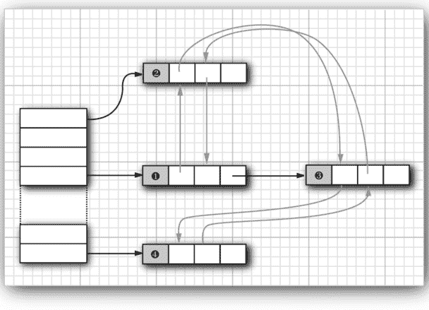

图 9.11：链接哈希表

例如，考虑 [Listing 9.6] 中的以下 map 插入操作：

```java
var staff = new LinkedHashMap<String, Employee>();
staff.put("144-25-5464", new Employee("Amy Lee"));
staff.put("567-24-2546", new Employee("Harry Hacker"));
staff.put("157-62-7935", new Employee("Gary Cooper"));
staff.put("456-62-7527", new Employee("Francesca Cruz"));
```

此时，`staff.keySet()` 遍历的顺序如下：

- `144-25-5464`
- `567-24-2546`
- `157-62-7935`
- `456-62-7527`

而 `staff.values()` 遍历的顺序如下：

- `Amy Lee`
- `Harry Hacker`
- `Gary Cooper`
- `Francesca Cruz`

链接哈希 map 也可以使用访问顺序而非插入顺序。每当你调用 `get` 或 `put` 时，受影响的 entry 会从当前位置移除并放到链表的末尾。（影响的是项列表，而不是哈希桶。）访问顺序用于实现“最近最未使用”（LRU）缓存。例如，你可能希望将频繁访问的元素留在内存中。要构造这样的 map，调用 `LinkedHashMap<K, V>(initialCapacity, loadFactor, true)`。

检查旧 entry 以决定是否移除它。在这种情况下，你必须返回 `false`。`removeEldestEntry` 方法在添加新 entry 后被调用。如果方法返回 `true`，则会移除最旧的 entry。例如，以下缓存保持大小为 100：

```java
var cache = new LinkedHashMap<K, V>(128, 0.75F, true)
{
    protected boolean removeEldestEntry(Map.Entry<K, V> eldest)
    {
        return size() > 100;
    }
}
```

## 9.4.6. 枚举集合与映射

元素属于枚举类型。由于枚举类型的实例数量有限，`EnumSet` 内部简单地实现为位序列。如果对应的值存在于集合中，该位会被开启。`EnumSet` 类没有公共构造函数。使用静态工厂方法来构造集合：

```java
enum Weekday { MONDAY, TUESDAY, WEDNESDAY, THURSDAY,
FRIDAY, SATURDAY, SUNDAY };
EnumSet<Weekday> always = EnumSet.allOf(Weekday.class);
EnumSet<Weekday> never = EnumSet.noneOf(Weekday.class);
EnumSet<Weekday> workday = EnumSet.range(Weekday.MONDAY,
Weekday.FRIDAY);
EnumSet<Weekday> mwf = EnumSet.of(Weekday.MONDAY,
Weekday.WEDNESDAY, Weekday.FRIDAY);
```

你可以使用 `Set` 接口的常用方法来修改 `EnumSet`。

`EnumMap` 是键属于枚举类型的 map。它简单高效地实现为值的数组。你需要在构造函数中指定键类型：

```java
var personInCharge = new EnumMap<Weekday, Employee>
(Weekday.class);
```

> 注意：在 `EnumSet` 和 `EnumMap` 的 API 文档中，你会看到形式奇怪的类型 `E extends Enum<E>`。这意味着“E 是枚举类型”。所有枚举类型都扩展泛型 `Enum` 类。例如，`Weekday` 扩展了 `Enum<Weekday>`。

如果你需要一个未使用元素的集合而不是 map，请参见第 9.5.4 节。

## 9.4.7. 恒等哈希映射

`IdentityHashMap` 有一个非常特殊的用途。在这里，键的哈希值不应该通过 `hashCode` 方法计算，而应该通过 `System.identityHashCode` 方法计算。这就是 `Object.hashCode` 根据对象的内存地址计算哈希值的方法。此外，在比较对象时，`IdentityHashMap` 使用的是 `==` 而不是 `equals`。

换句话说，即使不同的键对象的内容相同，它们也会被视为不同的键。这个类用于实现对象遍历算法（例如对象序列化），在这些算法中，你希望跟踪哪些对象已经被遍历过了。

> 注意：Java 20 修复了 Java 8 中引入的关于 `IdentityHashMap` 的细微 bug（https://bugs.openjdk.org/browse/JDK-8284901）。两个不常用的方法错误地使用了 `equals` 而不是 `==`：

```java
void remove(Object key, Object value)
void replace(K key, V oldValue, V newValue)
```

这些方法有时用于并发算法中，在这些算法中，只有当 map 没有被另一个线程修改时，才更新 map。可以想象遇到这个 bug 的第一个程序员会有多么沮丧。

没有任何像 Java 平台如此复杂的软件系统是可以完全没有 bug 的。这就是为什么定期更新到最新版本非常重要。

## `java.util.WeakHashMap<K, V>` 1.2

- `WeakHashMap()`
- `WeakHashMap(int initialCapacity)`
- `WeakHashMap(int initialCapacity, float loadFactor)`

根据指定的容量和负载因子构造一个空哈希映射。

## `java.util.LinkedHashSet<E>` 1.4

- `LinkedHashSet()`
- `LinkedHashSet(int initialCapacity)`
- `LinkedHashSet(int initialCapacity, float loadFactor)`

构造一个具有指定容量和负载因子的空链接哈希集合。

## `java.util.LinkedHashMap<K, V>` 1.4

- `LinkedHashMap()`
- `LinkedHashMap(int initialCapacity)`
- `LinkedHashMap(int initialCapacity, float loadFactor)`
- `LinkedHashMap(int initialCapacity, float loadFactor, boolean accessOrder)`

构造一个具有指定容量、负载因子和排序的空链接哈希映射。`accessOrder` 参数为 `true` 表示访问顺序，为 `false` 表示插入顺序。

- `protected boolean removeEldestEntry(Map.Entry<K, V> eldest)`

如果你希望移除最旧条目，应重写此方法并返回 `true`。`eldest` 参数是正在考虑移除的条目。该方法在条目添加到 map 后被调用。默认实现返回 `false`——默认不会移除旧元素。但你可以重新定义此方法以选择性地返回 `true`——例如，如果最旧条目符合某个条件，或者 map 超过了某个大小。

## `java.util.EnumSet<E extends Enum<E>>` 5.0

- `static <E extends Enum<E>> EnumSet<E> allOf(Class<E> enumType)` 返回一个包含给定枚举类型所有值的可变集合。

- `static <E extends Enum<E>> EnumSet<E> noneOf(Class<E> enumType)` 返回一个初始为空的可变集合。

- `static <E extends Enum<E>> EnumSet<E> range(E from, E to)` 返回一个包含从 `from` 到 `to`（包含 `to`）所有值的可变集合。

- `static <E extends Enum<E>> EnumSet<E> of(E e)`
- `static <E extends Enum<E>> EnumSet<E> of(E e1, E e2, E e3, E e4, E e5)`
- `static <E extends Enum<E>> EnumSet<E> of(E first, E... rest)`

返回一个包含给定元素的可变集合，这些元素不能为 `null`。

- `public static <E extends Enum<E>> EnumSet<E> copyOf(EnumSet<E> s)`
- `public static <E extends Enum<E>> EnumSet<E> copyOf(Collection<E> c)`

创建一个初始包含这些元素的可变集合。在第二种方法中，`c` 必须是 `EnumSet` 或者非空（以确定元素类型）。

## `java.util.EnumMap<K extends Enum<K>, V>` 5.0

- `EnumMap(Class<K> keyType)`：构造一个键类型为给定类型的空可变映射。

## `java.util.IdentityHashMap<K, V>` 1.4

- `IdentityHashMap()`
- `IdentityHashMap(int expectedMaxSize)`：构造一个空恒标识哈希映射，其容量为超过 1.5 倍 `expectedMaxSize` 的最小 2 的幂次。（`expectedMaxSize` 的默认值为 21。）

- `static int identityHashCode(Object obj)` 1.1

返回与 `Object.hashCode` 计算相同的哈希值（源自对象的内存地址），即使 `obj` 所属的类重新定义了 `hashCode` 方法。

## 9.5. 拷贝与视图（Copies and Views）

你可能认为有很多接口（图 9.4）和抽象类（图 9.5）来实现少量的具体集合类是多此一举。然而，这些图并没有说明问题。通过使用视图（views），你可以获得实现 `Collection` 或 `Map` 接口的其他对象。你在 map 类的 `keySet` 方法中见过其中一个例子。乍一看，该方法似乎创建了一个新集合，用 map 的所有键填充并返回。但事实并非如此。`keySet` 方法返回一个实现 `Set` 接口的类的对象，其方法会操作原始 map。这样的集合被称为视图。

视图技术有很多实用的应用。视图技术在 Java 框架中有许多实用的应用。我们将在后续章节讨论这些应用。

### 9.5.1. 小集合（Small Collections）

这些静态方法返回包含给定元素的不可变集合、列表或集合。例如：

```java
List<String> names = List.of("Peter", "Paul", "Mary");
Set<Integer> numbers = Set.of(2, 3);
```

这些方法返回一个包含给定元素的不可变集合。你也可以提供一个数组：

```java
String[] names = { "Peter", "Paul", "Mary" };
List<String> names = List.of(names); // 包含三个元素的列表
```

> 注意：如果你提供数组类型，结果是包含单个元素的列表，即：

```java
int[] numbers = { 2, 3, 5 };
List<int[]> arrays = List.of(numbers); // 包含单个元素的列表
```

对于 map，你可以这样指定键值对：

```java
Map<String, Integer> scores = Map.of("Peter", 2, "Paul", 3, "Mary", 5);
```

元素、键或值不能为 `null`。集合和 map 的键可能会重复：

```java
Set.of(13, null); // 错误：null 元素
Map.of("Peter", 4, "Peter", 2); // 错误：重复键
```

> 注意：这些集合和 map 的迭代顺序没有任何保证。事实上，它们的顺序在每次机器启动时都是随机的。看以下两次 `jshell` 运行：

```text
$ jshell -q
jshell Set.of("Peter", "Paul", "Mary")
$1 ==> [Peter, Mary, Paul]
jshell /exit
jshell Set.of("Peter", "Paul", "Mary")
$1 ==> [Paul, Mary, Peter]
```

某些 Java 程序员编写的程序依赖于实现细节永远改变。这会让框架实现者很难进行有用的实现更改。在这种情况下，信息很明确——不要编写假设元素顺序的程序。

`List` 和 `Set` 接口拥有零到十个参数的方法，以及一个带有变参数的 `of` 方法。提供这些特殊化是为了效率。

对于 `Map` 接口，无法提供变参数版本，因为参数类型在键和值类型之间交替。有一个静态方法 `ofEntries` 接受任意数量的 `Map.Entry<K, V>` 对象，可以使用静态方法 `entry` 创建这些对象。例如：

```java
import static java.util.Map.*;
...
Map<String, Integer> scores = ofEntries(
    entry("Peter", 2),
    entry("Paul", 3),
    entry("Mary", 5));
```

`of` 和 `ofEntries` 方法产生的对象类为每个元素有一个实例变量，或者由数组支持。

这些集合对象是不可修改的。任何更改其内容的操作都会导致 `UnsupportedOperationException`。

如果你想要可变的集合，可以将不可变集合传递给构造函数：

```java
var names = new ArrayList<>(List.of("Peter", "Paul", "Mary")); // 一个可变的列表
```

方法调用：

```java
Collections.nCopies(n, anObject)
```

返回一个实现 `List` 接口的不可变对象，并视觉上具有 `n` 个元素，每个元素看起来都是 `anObject`。

例如，接下来的调用会创建一个包含 100 个字符串的 `List`，所有字符串都设置为 `"DEFAULT"`：

```java
List<String> settings = Collections.nCopies(100,
                                            "DEFAULT");
```

存储开销非常小——对象只被存储一次。


> 注意：`Collections` 类包含许多实用方法，其参数或返回值是集合（collections）。不要将其与 `Collection` 接口混淆。
>
> 提示：Java 没有 `Pair` 类，某些程序员使用 `Map.Entry` 作为一种廉价的对（pair）的替代方案。

## 9.5.2. 不可修改副本和视图

要创建集合的不可修改副本，请使用集合类型的 `copyOf` 方法：

```java
ArrayList<String> names = . . .;
Set<String> nameSet = Set.copyOf(names); // 将 names 作为不可修改的集合
List<String> nameList = List.copyOf(names); // 将 names 作为不可修改的列表
```

与 `of` 方法一样，`copyOf` 方法也会拒绝创建包含 `null` 元素的集合，而是会抛出 `NullPointerException`。

每个 `copyOf` 方法都会对集合进行复制。如果原始集合被修改，副本将不受影响。

如果原始集合恰好是不可修改的且类型正确，`copyOf` 将直接返回它：

```java
Set<String> names = Set.of("Peter", "Paul", "Mary");
Set<String> namesSet = Set.copyOf(names); // 无需复制：names == namesSet
```

`Collections` 类拥有了一些可以生成集合不可修改视图（views）的方法。这些视图为现有集合添加了一个运行时检查。如果检测到修改不可修改集合的尝试，将抛出异常。

然而，如果原始集合发生了变化，视图会反映这些变化。这就是视图与副本的区别。

你可以通过八种方法获取不可修改视图：

- `Collections.unmodifiableCollection`
- `Collections.unmodifiableList`
- `Collections.unmodifiableSet`
- `Collections.unmodifiableSortedSet`
- `Collections.unmodifiableNavigableSet`
- `Collections.unmodifiableMap`
- `Collections.unmodifiableSortedMap`
- `Collections.unmodifiableNavigableMap`

每个方法都定义为作用于接口。例如，`Collections.unmodifiableList` 可以作用于 `ArrayList`、`LinkedList` 或任何实现 `List` 接口的类。

例如，假设你想让代码的某部分查看但不触碰集合的内容。你可以执行如下操作：

```java
var staff = new LinkedList<String>();
..
lookAt(Collections.unmodifiableList(staff));
```

`Collections.unmodifiableList` 方法返回一个实现 `List` 接口的类的对象。它的访问器方法从 `staff` 集合中检索值。当然，`lookAt` 方法可以调用 `List` 接口的所有方法，而不仅仅是访问器。但所有变异器方法（如 `add`）都已重新定义，它们会抛出 `UnsupportedOperationException`，而不是将调用转发给底层集合。

不可修改视图并不会让集合本身变为不可变。你仍然可以通过它的原始引用（在我们的例子中为 `staff`）修改集合。你仍然可以在集合元素上调用变异器方法。

视图包装的是接口而不是实际的集合对象，因此你只能访问接口中定义的方法。例如，`LinkedList` 类有方便方法 `addFirst` 和 `addLast`，它们并不属于 `List` 接口。这些方法无法通过不可修改视图访问。

> 注意：`unmodifiableCollection` 方法（以及本节后面讨论的 `synchronizedCollection` 和 `checkedCollection` 方法）返回的集合，其 `equals` 方法不会调用底层集合的 `equals` 方法。相反，它继承了 `Object` 类的 `equals` 方法，该方法仅测试对象是否相同。如果你将一个集合或列表转换为普通集合，你将无法测试内容是否相等。视图之所以这样做，是因为在层次结构的这一级别，等值性测试没有良好的定义。视图对待 `hashCode` 方法的方式相同。

优先使用 `unmodifiableSet` 和 `unmodifiableList` 包装器，它们的 `equals` 和 `hashCode` 方法适用于集合和列表。

例如：

```java
var names = Set.of("Peter", "Paul", "Mary");
Collections.unmodifiableCollection(names).equals(s) // false
Collections.unmodifiableSet(names).equals(names) // true
```

## 9.5.3. 子范围

你可以为许多集合创建子范围视图。例如，假设你有一个列表 `staff`，并想提取索引 10 到 19 的元素。使用 `subList` 方法获取列表子范围的视图：

```java
List<Employee> group2 = staff.subList(10, 20);
```

第一个索引是包含的，第二个索引是不包含的——这与 `String` 类中 `substring` 操作的参数一样。

你可以对子范围应用任何操作，这些操作会自动反映整个列表。例如，你可以删除整个子范围：

```java
group2.clear(); // staff 规模缩减
```

元素会自动从 `staff` 列表中清除，`group2` 变为空。

对于排序后的集合和映射，你使用排序顺序而不是元素位置来形成子范围。`SortedSet` 接口声明了三个方法：

- `SortedSet<E> subset(E from, E to)`
- `SortedSet<E> headSet(E to)`
- `SortedSet<E> tailSet(E from)`

这些方法返回所有大于或等于指定元素的子集。对于排序后的映射，类似的方法：

- `SortedMap<K, V> subMap(from, to)`
- `SortedMap<K, V> headMap(to)`
- `SortedMap<K, V> tailMap(from)`

返回落在指定范围内的条目视图。`NavigableSet` 接口对这些子范围提供了更多控制。你可以指定边界是否包含：

- `NavigableSet<E> subset(E from, boolean fromInclusive, E to, boolean toInclusive)`
- `NavigableSet<E> headSet(E to, boolean toInclusive)`
- `NavigableSet<E> tailSet(E from, boolean fromInclusive)`

## 9.5.4. 布尔值映射集合

有时，API 提供了你希望在集合使用的有用映射。在 9.4.5 节你已经了解了如何使用 `LinkedHashMap`。`LinkedHashSet` 类没有这种能力。

如果你想拥有包含 100 个最近插入字符串的集合，创建一个 `LinkedHashMap<String, Boolean>`，然后调用 `Collections.newSetFromMap` 方法：

```java
Set<String> cache = Collections.newSetFromMap(new
LinkedHashMap<String, Boolean>(
{
    protected boolean removeEldestEntry(Map.Entry<String, Boolean> eldest)
    {
        return size() > 100;
    }
});
```

视图由映射支持。当你添加元素 `e` 时，视图会在映射中放入一个键为 `e`、值为 `TRUE` 的条目。如果这导致映射超过 100 个条目，最旧的一个将被移除。

你应该用空映射调用 `newSetFromMap`。之后，不要修改映射，而是让所有修改通过视图的方法进行。这通过将映射传递给 `newSetFromMap` 方法而不保留其引用来实现最好，如前面的示例所示。

`newSetFromMap` 方法也适用于 `WeakHashMap`（见 9.4.4 节）。对于 `ConcurrentHashMap`，请使用 `newKeySet` 方法（见 10）。

## 9.5.5. 反转视图

`SequencedCollection` 和 `SequencedSet` 接口的 `reversed` 方法产生以反序查看元素的视图。例如，这里是反向遍历字符串列表或树的方法：

```java
for (String element : collection.reversed())
{
    对 element 执行操作
}
```

对于 `SequencedMap`，`reversed` 方法以键的反序顺序查看映射。

## 9.5.6. 检查视图

检查视图旨在为泛型类型可能出现的问题提供调试支持。正如第 8 节所解释的，实际上可以将错误类型的元素注入到泛型集合中。例如：

```java
var strings = new ArrayList<String>();
ArrayList rawList = strings; // 仅警告，不是错误，
    // 为了兼容性
```

```java
legacy code
rawList.add(new Date()); // 现在 strings 包含 Date
object!
```

错误的 `add` 命令在运行时不会被检测到。

相反，当代码的其他部分调用 `get` 并将结果强制转换为 `String` 时，稍后发生类型转换异常。

检查视图（checked view）可以检测到此问题。如下所示定义一个安全列表：

```java
List<String> safeStrings = Collections.checkedList(strings,
String.class);
```

该视图的 `add` 方法会检查插入的对象是否属于给定的类，如果不属于，则立即抛出 `ClassCastException`。这样做的好处是可以在正确的位置报告错误：

```java
ArrayList rawList = safeStrings;
rawList.add(new Date()); // 检查列表抛出
ClassCastException
```

> 注意：检查视图受限于虚拟机可以执行的运行时检查。例如，如果你有一个 `ArrayList<Pair<String>>`，你无法防止它插入一个 `Pair<Date>`，因为虚拟机只有一个“原始”的 `Pair` 类。

## 9.5.7. 同步视图（Synchronized Views）

如果你从多个线程访问集合，你需要确保集合不会被意外破坏。例如，如果一个线程尝试向哈希表添加元素，而另一个线程正在对元素进行重哈（rehashing），将是灾难性的。

框架设计师并没有实现线程安全的集合类，而是使用了视图机制使普通集合变为线程安全。例如，`Collections` 类中的静态 `synchronizedMap` 方法可以将任何 map 转换为具有同步访问方法的 `Map`：

```java
var map = Collections.synchronizedMap(new HashMap<String, Employee>()));
```

你现在可以从多个线程访问该 `map` 对象了。`get` 和 `put` 等方法是同步的——每个方法调用在另一个线程调用另一个方法之前必须完全完成。我们将在第 10 章更详细地讨论数据结构的同步访问问题。

## 9.5.8. 关于可选操作的说明（A Note on Optional Operations）

视图通常具有某些限制——它可能是只读的、可能无法更改大小，或者支持删除而不插入（如 map 的键视图所示）。如果尝试不适当的操作，受限视图将抛出 `UnsupportedOperationException`。

在集合和迭代器接口的 API 文档中，许多方法被描述为“可选操作（optional operations）”。这似乎与接口的概念相冲突。毕竟，接口的目的难道不是规定一个类必须实现的方法吗？诚然，从理论角度来看，这种安排是不令人满意的。更好的解决方案可能是为只读视图和无法更改集合大小的视图设计单独的接口。然而，这将接口的数量增加三倍，框架设计师认为这是不可接受的。

你应该将这种“可选”方法的技术扩展到你自己的设计中吗？我认为不应该。尽管集合被频繁地使用，但实现它们的编码风格在其他问题领域并不典型。集合类库的设计者必须解决一组特别严苛的冲突需求。用户希望库易于学习、方便使用、完全泛型、防呆（idiot-proof），并且像硬编码算法一样高效。要同时实现所有这些目标显然是不可能的，即使是接近也可以。但在你的编程问题中，很少遇到这种极端约束。你应该能够找到不依赖于“可选”接口操作这种剧烈措施的解决方案。

```java
java.util.List <E> List<E>()
```

- `static <E> List<E> of()` 9
- `static <E> List<E> of(E e1)` 9
- `static <E> List<E> of(E e1, E e2, E e3, E e4, E e5, E e6, E e7, E e8, E e9, E e10)` 9
- `static <E> List<E> of(E... elements)` 9

返回一个包含给定元素的不可修改列表，不能为 `null`。

- `static <E> List<E> copyOf(Collection<? extends E> coll)` 10

返回给定集合的不可修改的副本。

## `java.util.Set` 1.2

- `static <E> Set<E> of()` 9
- `static <E> Set<E> of(E e1)` 9
- `static <E> Set<E> of(E e1, E e2, E e3, E e4, E e5, E e6, E e7, E e8, E e9, E e10)` 9
- `static <E> Set<E> of(E... elements)` 9

返回一个包含给定元素的不可修改集合，不能为 `null`。

- `static <E> Set<E> copyOf(Collection<? extends E> coll)` 10

返回给定集合的不可修改的副本。

## `java.util.Map` 1.2

- `static <K, V> Map<K, V> of()` 9
- `static <K, V> Map<K, V> of(K k1, V v1)` 9
- `static <K, V> Map<K, V> of(K k1, V v1, K k2, V v2, K k3, V v3, K k4, V v4, K k5, V v5, K k6, V v6, K k7, V v7, K k8, V v8, K k9, V v9, K v10)` 9

返回包含给定键和值的不可修改 map，不能为 `null`。

- `static <K, V> Map<K, V> of(K k1, V v1)` 9

返回给定键的不可修改 map。

- `static <K, V> Map<K, V> copyOf(Collection<? extends E> coll)` 10

返回给定集合的不可修改副本。

## `java.util.Collections` 1.2

- `static <E> List<E> unmodifiableList(List<E> c)`

返回一个由给定集合支持的不可修改 map，不能为 `null`。

返回集合的视图。

- `static <E> Collection<E> checkedCollection(Collection<E> c, Class<E>)`
- `static <E> List<E> checkedList(List<E> c, Class<E>)`
- `static <E> Set<E> checkedSet(Set<E> c, Class<E>)`
- `static <E> SortedSet<E> checkedSortedSet(SortedSet<E> c, Class<E>)`
- `static <E> NavigableSet<E> checkedNavigableSet(NavigableSet<E> c, Class<E>)`
- `static <K, V> Map<K, V> checkedMap(Map<K, V> c, Class<K> keyType, Class<V> valueType)`
- `static <K, V> SortedMap<K, V> checkedSortedMap(SortedMap<K, V> c, Class<K> keyType, Class<V> valueType)`
- `static <K, V> NavigableMap<K, V> checkedNavigableMap(NavigableMap<K, V> c, Class<K> keyType, Class<V> valueType)`
- `static <E> Queue<E> checkedQueue(Queue<E> c, Class<E>)`

一个集合的视图；如果插入错误类型的元素，将抛出 `ClassCastException`。

- `static <E> Collection<E> unmodifiableCollection(Collection<E> c)`
- `static <E> List<E> unmodifiableList(List<E> c)`
- `static <E> Set<E> unmodifiableSet(Set<E> c)`
- `static <E> SortedSet<E> unmodifiableSortedSet(SortedSet<E> c)`


- `static NavigableSet<E> unmodifiableNavigableSet(NavigableSet<E> c)`
- `static <K, V> Map<K, V> unmodifiableMap(Map<K, V> c)`
- `static <K, V> SortedMap<K, V> unmodifiableSortedMap(SortedMap<K, V> c)`
- `static <K, V> NavigableMap<K, V> unmodifiableNavigableMap(NavigableMap<K, V> c)`
- `static <E> Collection<E> synchronizedCollection(Collection<E> c)`
- `static <E> List<E> synchronizedList(List<E> c)`
- `static <E> Set<E> synchronizedSet(Set<E> c)`
- `static <E> SortedSet<E> synchronizedSortedSet(SortedSet<E> c)`
- `static NavigableSet<E> synchronizedNavigableSet(NavigableSet<E> c)`
- `static <K, V> Map<K, V> synchronizedMap(Map<K, V> c)`
- `static <K, V> SortedMap<K, V> synchronizedSortedMap(SortedMap<K, V> c)`
- `static <K, V> NavigableMap<K, V> synchronizedNavigableMap(NavigableMap<K, V> c)`
- `static <E> Queue<E> synchronizedQueue(Queue<E> c)`

一个集合的视图。

- `static <E> List<E> nCopies(int n, E value)`

  返回一个包含 n 个相同值的不可修改列表。

- `static <E> List<E> singletonList(E value)`
- `static <E> Set<E> singleton(E value)`
- `static <E> List<E> emptyList()`
- `static <T> Set<T> emptySet()`
- `static <E> SortedSet<E> emptySortedSet()`
- `static NavigableSet<E> emptyNavigableSet()`
- `static <K, V> Map<K, V> emptyMap()`
- `static <K, V> SortedMap<K, V> emptySortedMap()`
- `static <K, V> NavigableMap<K, V> emptyNavigableMap()`
- `static <T> Enumeration<T> emptyEnumeration()`
- `static <T> Iterator<T> emptyIterator()`
- `static <T> ListIterator<T> emptyListIterator()`

返回一个空集合、map 或迭代器。

# `java.util.Arrays` 1.2

```java
static <E> List<E> ArrayList(E... array)
```

返回一个数组中元素的视图，它是可修改的但不可调整大小的。

# `java.util.List<E>` 1.2

- `List<E> subList(int firstIncluded, int firstExcluded)`

返回位置范围内元素的列表视图。

# `java.util.SortedSet<E>` 1.2

- `SortedSet<E> subset(E firstIncluded, E firstExcluded)`
- `SortedSet<E> headSet(E firstExcluded)`
- `SortedSet<E> tailSet(E firstExcluded)`

返回范围内元素的视图。

# `java.util.NavigableSet<E>` 6

- `NavigableSet<E> subset(E from, boolean fromIncluded, E to, boolean toIncluded)`
- `NavigableSet<E> headSet(E to, boolean toIncluded)`
- `NavigableSet<E> tailSet(E from, boolean fromIncluded)`

返回范围内元素的视图。布尔标志决定边界是否包含在视图中。

# `java.util.SortedMap<K, V>` 1.2

- `SortedMap<K, V> subMap(K firstIncluded, K firstExcluded)`
- `SortedMap<K, V> headMap(K firstExcluded)`
- `SortedMap<K, V> tailMap(K firstIncluded)`

返回键在范围内的条目视图。

# `java.util.NavigableMap<K, V>` 6

- `NavigableMap<K, V> subMap(K from, boolean fromIncluded, K to, boolean toIncluded)`
- `NavigableMap<K, V> headMap(K from, boolean fromIncluded)`
- `NavigableMap<K, V> tailMap(K to, boolean toIncluded)`

返回键在范围内的条目视图。布尔标志决定边界是否包含在视图中。

# `java.util.SequencedCollection<E>` 21

- `SequencedCollection<E> reversed()`

返回此有序集合的元素反序排列的视图。

# `java.util.SequencedSet<E>` 21

- `SequencedSet<E> reversed()`

返回此有序集合的元素反序排列的视图。

# `java.util.SequencedMap<E>` 21

- `SequencedMap<E> reversed()`

返回此有序映射的键反序排列的视图。

## 9.6. 算法

除了实现集合类外，Java 集合框架还提供了许多实用的算法。在接下来的章节中，你将看到如何使用这些算法以及如何编写与框架配合自定义算法。

## 9.6.1. 为什么使用泛型算法？

泛型集合接口有一个巨大的优势——你只需要实现一次算法。例如，考虑一个计算集合中最大元素的简单算法。传统上，程序员会用循环来实现这种算法。以下是你可以找到数组中最大元素的方法：

```java
if (a.length == 0) throw new NoSuchElementException();
T largest = a[0];
for (int i = 1; i < a.length; i++)
    if (largest.compareTo(a[i]) < 0)
        largest = a[i];
```

当然，要找到列表中的最大值，你写的代码略有不同。

```java
if (v.size() == 0) throw new NoSuchElementException();
T largest = v.get(0);
for (int i = 1; i < v.size(); i++)
    if (largest.compareTo(v.get(i)) < 0)
        largest = v.get(i);
```

链表又是呢？在链表中你无法高效地随机访问，但你可以使用迭代器。

```java
if (l.isEmpty()) throw new NoSuchElementException();
Iterator<T> iter = l.iterator();
T largest = iter.next();
while (iter.hasNext()) {
  T next = iter.next();
  if (largest.compareTo(next) < 0)
    largest = next;
}
```

编写这些循环非常繁琐，而且容易出错。循环运行得正确吗？是否存在差一错误？空容器呢？对于只有一个元素的容器呢？你可能不想每次都进行测试和调试，但你也不想实现一大堆方法，例如：

```java
static <T extends Comparable> T max(ArrayList<T> v)
static <T extends Comparable> T max(LinkedList<T> l)
```

这就是集合接口大显身场的地方。考虑你通过 `get` 和 `set` 高效随机访问以执行算法所需的最小集合接口。这在食物链中比简单的迭代更高。正如你在计算链表中最大元素时所看到的，这项任务不需要随机访问。计算最大值可以通过简单的遍历元素完成。因此，你可以实现 `max` 方法来接收任何实现了 `Collection` 接口的对象。

```java
public static <T extends Comparable> T max(Collection<T> elements) {
    if (elements.isEmpty()) throw new NoSuchElementException();
    Iterator<T> iter = elements.iterator();
    T largest = iter.next();
    while (iter.hasNext()) {
      T next = iter.next();
      if (largest.compareTo(next) < 0)
        largest = next;
    }
    return largest;
}
```

## 9.6.2. 排序与洗牌

泛型算法是非常强大的。事实上，Java 集合框架提供了许多依赖 `Comparable` 的 `compareTo` 方法或 `Comparator` 的 `compare` 方法的有用算法。

其中最常用的是排序。在第 6 章中，你见过 `Arrays.sort` 方法。它有两个版本，一个用于 `Comparable` 实例数组，另一个是带有 `Comparator`：

```java
String[] staff = . . .;
Arrays.sort(staff);
Arrays.sort(staff, Comparator.comparingDouble(Employee::getSalary));
```

`Collections` 类有一个 `sort` 方法可以排序列表。如果你想以其他方式排序列表，可以传递 `Comparator`：

```java
List<Employee> staff = new ArrayList<>();
Collections.sort(staff);
```

如果你想以降序排序列表，使用 `Comparator.reverseOrder()`。例如：

```java
Collections.sort(staff, Comparator.reverseOrder());
```

`Collections` 类还有一个 `shuffle` 算法，它与排序相反——它随机打乱列表中元素的顺序。例如：

```java
ArrayList<Card> cards = . . ++;
Collections.shuffle(cards, RandomGenerator.getDefault());
```

如果你提供的列表没有实现 `RandomAccess` 接口，`shuffle` 方法会将元素复制到数组中进行洗牌，并将洗牌后的元素复制回列表。

Java 集合框架使用的排序算法比传统的通用排序算法 QuickSort 慢一点。但它有一个主要的优势：它是稳定的，也就是说它不会交换相等元素。你为什么要关心相等元素的顺序？这里有一个常见的场景。假设你有一个已经按名称排序的员工列表。现在你按薪水进行排序。对于薪水相同的员工会发生什么？对于稳定排序，按名称的顺序会被保留。换句话说，结果是一个首先按薪水排序，然后按名称排序的列表。

集合不需要实现它们所有的“可选”方法，因此所有以集合作为参数的方法都必须描述何时传递集合给算法是安全的。例如，你显然不能将 `unmodifiableList` 传递给排序算法。什么样的列表可以传递？根据文档，列表必须是可修改的但不需要是可调整的。

这些术语定义如下：

- 列表是修改的（modifiable）如果支持 `set` 方法。
- 列表是可以调整的（resizable）如果支持 `add` 和 `remove` 操作。

列表 9.7 中的程序用包含 1 到 49 数字的 49 个 `Integer` 对象填充了一个数组列表。然后随机打乱列表，并从打乱后的列表中选择前六个值。最后，它对选定的值进行排序并打印它们。

# 列表 9.7 `shuffle/ShuffleTest.java`

```java
package shuffle;

import java.util.*;
import java.util.random.*;

/**
 * 此程序演示了随机洗牌和排序算法。
 * @version 1.13 2023-09-09
 * @author Cay Horstmann
 */
public class ShuffleTest
{
    public static void main(String[] args)
    {
        var numbers = new ArrayList<Integer>();
        for (int i = 1; i <= 49; i++)
            numbers.add(i);
        Collections.shuffle(numbers, RandomGenerator.getDefault());
        List<Integer> winningCombination = numbers.subList(0, 6);
        Collections.sort(winningCombination);
        System.out.println(winningCombination);
    }
}
```

## `java.util.Collections` 1.2

- `static <T extends Comparable<? super T>> void sort(List<T> elements)`

  使用稳定的排序算法对列表中的元素进行排序。该算法保证在 O(n log n) 时间内运行，其中 n 是列表的长度。

- `static void shuffle(List<?> elements)`
- `static void shuffle(List<?> elements, Random r)`
- `static void shuffle(List<?> elements, RandomGenerator r)`

  随机打乱列表中的元素。该算法以 O(n a(n)) 时间内运行，其中 n 是列表的长度，a(n) 是访问元素的平均时间。

## `java.util.List<E>` 1.2

- `default void sort(Comparator<? super T> comparator)`

  使用给定的比较器对此列表进行排序。

## `java.util.Comparator<T>` 1.2

- `static <T extends Comparable<? super T>> Comparator<T> reverseOrder()`

  产生一个反转 Comparable 接口提供的排序顺序的比较器。

- `default Comparator<T> reversed()`

  产生一个反转此比较器提供的排序顺序的比较器。

## 9.6.3. 二分查找

要在数组中查找对象，你通常需要访问所有元素直到找到匹配项为止。然而，如果数组是有序的，你可以查看中间元素并检查它是否大于你试图查找的元素。如果是，则继续在数组的前半部分查找；否则，在后半部分查找。这使得问题减半，你以相同的方式继续下去。例如，如果数组有 1024 个元素，你将在 10 步后定位匹配项（或确认不存在），而线性搜索如果元素存在，平均需要 512 步，如果需要确认不存在，则需要 1024 步。

`Collections` 类的 `binarySearch` 实现了这种算法。请注意，集合必须已经过排序，否则算法将返回错误答案。提供集合（必须实现 `List` 接口）和要查找的目标。如果集合不是通过 `Comparable` 接口的 `compareTo` 元素排序的，请也提供一个比较器对象。

```java
i = Collections.binarySearch(elements, target);
i = Collections.binarySearch(elements, target, comparator);
```

`binarySearch` 方法的非负返回值表示匹配对象的索引。也就是说，在比较顺序下，`elements.get(i)` 等于 `target`。如果值为负数，则没有匹配的元素。然而，你可以使用返回值来计算应该将 `target` 插入集合的位置以保持其排序。插入位置是：

```java
insertionPoint = -i - 1;
```

它并不是简单的 `-i`，因为那样 `i` 的值将产生模糊。换句话说，操作

```java
if (i < 0)
    elements.add(-i - 1, target);
```

将 `target` 添加到正确的位置。


为了有所意义，二分查找需要随机访问。如果你必须逐个遍历链表的一半来找到中间元素，你就失去了二分查找的优势。如果你给出一个没有实现 `RandomAccess` 接口的列表，`binarySearch` 算法将退化为与线性搜索效率相同的迭代算法。

`Arrays` 类拥有基本类型数组和对象数组的二分查找实现。

## `java.util.Collections` 1.2

- `static <T extends Comparable<? super T>> int binarySearch(List<T> elements, T key)`
- `static <T> int binarySearch(List<T> elements, T key, Comparator<? super T> c)`

  在有序列表中查找 `key`，如果元素类型实现了 `RandomAccess` 接口则使用二分查找，在所有其他情况下使用线性搜索。这些方法保证在 `O(a(n) log n)` 时间内运行，其中 `n` 是列表的长度，`a(n)` 是访问元素的平均时间。这些方法返回 `key` 在列表中的索引，或者如果 `key` 不在列表中则返回负值 `i`。在这种情况下，`key`

## `java.util.Arrays` 1.2

- `static int binarySearch(Object[] a, Object key)`
- `static int binarySearch(Object[] a, Object key, Comparator<? super T> c)`

## 9.6.4 简单算法

`Collections` 类包含了一些简单但非常有用的算法。其中包括查找最大值。其他还包括从一个列表复制元素到另一个、填充容器以及反转列表。

为什么要在框架中提供此类算法？大多数程序员可以使用简单的循环来实现它们。我喜欢这些算法，因为它们让代码阅读变得更容易。当你看到方法调用时，你立刻知道代码在做什么。

本节末尾的 API 说明描述了简单算法。

> **注意：** `removeIf` 的谓词应该只查看要删除的元素，而不是集合。如果你这样做，行为将取决于实现。

`ArrayList` 版本的 `removeIf` 对元素进行了两次遍历。它首先找到要删除的元素，然后删除它们。对于其他集合，匹配的元素一旦被发现就会被删除。

如果谓词读取了集合，就会产生差异。考虑这个示例，`words` 是一个长度为 3 的 `ArrayList`：

```java
var words = new ArrayList<String>(List.of("Ada", "C++", "Java"));
words.removeIf(w -> w.length() == words.size()); //
// 现在 words 是 ["Java"]
```

在第一次遍历中，所有长度为 3 的单词都被标记为删除，在第二次遍历中它们被删除了。

然而，如果 `words` 是 `LinkedList` 或 `HashSet`，那么相同的 `removeIf` 调用只会删除三个字母单词之一。在删除第一个后，谓词会测试集合的大小是否为 2。

为什么会有这种差异？朴素的一次遍历对于基于数组的集合来说是无效的。开发者们并没有立即想到存在一种高效的一次遍历算法。当他们想到它时，为了兼容性，决定不使用它——<https://bugs.openjdk.org/browse/JDK-8143577>。

## `java.util.Collections` 1.2

- `static <T extends Comparable<? super T>> T min(Collection<T> elements)`
- `static <T extends Comparable<? super T>> T max(Collection<T> elements)`
- `static <T> min(Collection<T> elements, Comparator<? super T> c)`
- `static <T> max(Collection<T> elements, Comparator<? super T> c)`

  返回集合中最小或最大的元素。

  （为了清晰起见，参数边界已简化。）

- `static <T> void copy(List<? super T> to, List<T> from)` 将源列表中的所有元素复制到目标列表的相同位置。目标列表的长度至少与源列表一样。
- `static <T> void fill(List<? super T> l, T value)` 将列表的所有位置设置为相同值。
- `static <T> boolean addAll(Collection<? super T> c, T... values)` 5.0

  将所有值添加到给定的集合中，如果结果集合发生了变化，则返回 `true`。

- `static <T> boolean replaceAll(List<T> l, T oldValue, T newValue)` 1.4

  将所有等于 `oldValue` 的元素替换为 `newValue`。

- `static int indexOfSubList(List<?> l, List<?> s)` 1.4
- `static int lastIndexOfSubList(List<?> l, List<?> s)` 1.4

  返回 `l` 中等于 `s` 的第一个或最后一个子列表的索引，如果 `l` 没有子列表等于 `s`，则返回 `-1`。例如，如果 `l` 为 `[s, t, a, r]` 且 `s` 为 `[t, a, r]`，则两个方法都返回索引 `1`。

- `static void swap(List<?> l, int i, int j)` 1.4

  交换给定偏移量的元素。

- `static void reverse(List<?> l)`

  反转列表中元素的顺序。例如，反转列表 `[t, a, r]` 会得到列表 `[r, a, t]`。该方法在 `O(n)` 时间内运行，其中 `n` 是列表的长度。

- `static void rotate(List<?> l, int d)` 1.4

  旋转列表中的元素，将索引为 `i` 的项移动到位置 `(i + d) % l.size()`。例如，旋转列表 `[t, a, r]` 2 次会得到列表 `[a, r, t]`。该方法在 `O(n)` 时间内运行，其中 `n` 是列表的长度。

- `static int frequency(Collection<?> c, Object o)` 5.0

  返回 `c` 中等于对象 `o` 的元素计数。

- `boolean disjoint(Collection<?> c1, Collection<?> c2)` 5.0

  如果两个集合没有共同元素，则返回 `true`。

| `java.util.Collection<T>` 1.2 |
| :--- |
| `default boolean removeIf(Predicate<? super E> filter)` 8 | 移除所有匹配的元素。 |

| `java.util.List<E>` 1.2 |
| :--- |
| `default void replaceAll(UnaryOperator<E> op)` 8 | 对此列表的所有元素应用该操作。 |

## 9.6.5 批量操作

有几种操作可以“批量”复制或删除元素。调用：

```java
coll1.removeAll(coll2);
```

从 `coll1` 中移除所有存在于 `coll2` 中的元素。相反：

```java
coll1.retainAll(coll2);
```

从 `coll1` 中移除所有不存在于 `coll2` 中的元素。这是一个典型的应用场景。

假设你想找到两个集合的交集——两个集合共同拥有的元素。首先，创建一个新集合来存放结果。

```java
var result = new HashSet<String>(firstSet);
```

在这里，我们利用了每个集合都有一个构造函数的特性，其参数是另一个持有初始化值的集合。

现在，使用 `retainAll` 方法：

```java
result.retainAll(secondSet);
```

它保留了两个集合中都出现的所有元素。你已经在没有编写循环的情况下创建了交集。

你可以进一步扩展这一想法，并将批量操作应用于视图（view）。例如，假设你有一个将员工 ID 映射到员工对象的 `map`，并且你有一个所有要终止的员工 ID 的集合。

```java
Map<String, Employee> staffMap = . . ;
Set<String> terminatedIDs = . . ;
```

只需形成键集并移除所有终止员工的 ID。

```java
staffMap.keySet().removeAll(terminatedIDs);
```

由于键集是 `map` 的视图，键和关联的员工姓名会自动从 `map` 中移除。

通过使用子范围（subrange），你可以将批量操作限制在子列表和子集中。例如，你想将列表的前十个元素添加到另一个容器中。形成一个子列表来选取前十个：

```java
relocated.addAll(staff.subList(0, 10));
```

子范围也可以作为修改操作的目标。

```java
staff.subList(0, 10).clear();
```

## 9.6.6 集合与数组之间的转换

Java API 的大部分部分是在 Java 集合框架创建之前设计的。因此，你偶尔需要在传统的数组和更现代的集合之间进行转换。

如果你有一个需要转换为集合的数组，`List.of` 方法可以实现此目的。例如：

```java
List<String> list = List.of(array);
```

从集合获取数组稍微复杂一些。你可以使用 `toArray` 方法：

```java
String[] array = list.toArray(new String[0]);
```

但如果你知道数组长度足够，可以重用：

```java
String[] array = list.toArray(new String[list.size()]);
```

## 9.6.7 编写算法

如果你编写自己的算法（实际上是任何以集合作为参数的方法），应尽可能与接口工作，而不是具体的实现。例如，假设你想处理项。

```java
public void processItems(ArrayList<Item> items) {
    for (Item item : items) {
        do something with item;
    }
}
```

然而，你现在限制了该方法的调用者——调用者必须提供 `ArrayList`。如果项恰好在另一个集合中，它们首先需要重新包装。更好的做法是接受更通用的集合。

```java
public void processItems(Collection<Item> items) {
    for (Item item : items) {
        do something with item;
    }
}
```

现在，任何人可以使用 `ArrayList` 或 `LinkedList` 调用此方法，甚至可以使用通过 `List.of` 方法封装的数组。

> 提示：在这种情况下，接受 `Iterable<Item>` 会更好。`Iterable` 接口有一个增强 `for` 循环在后台使用的抽象方法。`Collection` 接口继承了 `Iterable`。

相反，如果你的方法返回多个元素，你不希望限制自己以备未来的改进。例如，考虑：

```java
public ArrayList<Item> lookupItems(..) {
    var result = new ArrayList<Item>();
    ...
    return result;
}
```

此方法承诺返回一个 `ArrayList`，尽管调用者几乎不在乎是哪种列表。如果改为返回一个 `List`，你可以随时添加一个返回空列表或单例列表的分支，调用 `List.of`。

## 9.7 遗留集合

许多“遗留”容器类自 Java 第一个版本发布以来就已经存在了，当时还没有集合框架。

它们已经集成到了 Java 集合框架中——参见图 9.12。我将在接下来的章节中简要介绍它们。

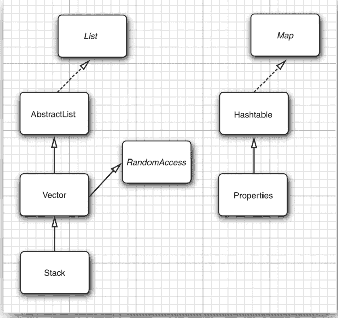

### 图 9.12：Java 框架中的遗留类

### `Hashtable` 类

经典的 `Hashtable` 类与 `HashMap` 类的作用相同，并且本质上具有相同的接口。就像 `Vector` 类的方法一样，`Hashtable` 的方法是同步的。如果你不需要与旧代码兼容，应该使用 `HashMap`。如果你需要并发访问，请使用 `ConcurrentHashMap`——请参见第 10 章。

## 9.7.2 枚举器（Enumerations）

遗留集合使用 `Enumeration` 接口来遍历元素序列。`Enumeration` 接口有两个方法：`hasMoreElements` 和 `nextElement`。这些方法与 `Iterator` 接口的 `hasNext` 和 `next` 方法完全对应。

如果你在遗留类中发现此接口，可以使用 `Collections.list` 将元素收集到 `ArrayList` 中。例如，`LogManager` 类只以 `Enumeration` 的形式暴露 logger 名称。以下是获取所有名称的方法：

```java
ArrayList<String> loggerNames = Collections.list(LogManager.getLoggerNames());
```

或者，你可以将枚举器转换为迭代器：

```java
LogManager.getLoggerNames().asIterator().forEachRemaining(n -> { . . . });
```

你偶尔会遇到带有枚举参数的遗留方法。静态方法 `Collections.enumeration` 产生一个枚举对象，用于枚举集合中的元素。例如：

```java
List<InputStream> streams = . . .;
var in = new SequenceInputStream(Collections.enumeration(streams));
// SequenceInputStream 构造函数期望一个 enumeration
```

> 注意：在 C++ 中，将迭代器作为参数是非常常见的。幸运的是，在 Java 平台上，很少有程序员使用这种惯用法。传递集合比传递迭代器要明智得多。集合对象更有用。接收者在需要时始终可以从集合中获取迭代器，而且他们可以使用所有的集合方法。然而，你可能会在某些遗留代码中发现枚举器，因为在 Java 1.2 Java 集合框架出现之前，它是通用集合唯一的可用机制。

### `java.util.Enumeration<E>` 1.0

- `boolean hasMoreElements()`

  如果还有更多元素待检查，则返回 `true`。

- `E nextElement()`

  返回下一个待检查的元素。如果 `hasMoreElements()` 返回 `false`，则不要调用此方法。

- `default Iterator<E> asIterator()`

  产生一个遍历已枚举元素的迭代器。

### `java.util.Collections` 1.2

- `static <T> Enumeration<T> enumeration(Collection<T> c)`

  返回一个枚举 `c` 中元素的枚举器。

```java
public static <T> ArrayList<T> list(Enumeration<T> e)
```

返回一个包含由 `e` 枚举元素的数组列表。

## 9.7.3 属性映射（Property Maps）

属性映射是一种特殊类型的映射结构。它有三个特定特征：

- 键和值都是字符串。
- 映射可以很容易地保存到文件并从文件中加载。
- 有一个用于默认值的二级表。

Java 平台中实现属性映射的类是 `Properties`。属性映射对于指定程序的配置选项非常有用。例如：

```java
var settings = new Properties();
settings.setProperty("width", "600.0");
settings.setProperty("filename", "/home/books/corejava/code/v1ch09/raven.html");
```

使用 `getProperty` 方法查找键的值：

```java
String filename = settings.getProperty("filename");
```

> **注意：** 出于历史原因，`Properties` 类实现了 `Map<Object, Object>`。因此，你可以使用 `Map` 接口的 `get` 和 `put` 方法。但 `get` 方法返回类型 `Object`，而 `put` 方法允许你插入任何对象。最好坚持使用处理字符串的 `getProperty` 和 `setProperty` 方法，而不是处理对象。

使用 `store` 方法将属性保存到文件中。第二个参数是包含在文件中的注释。

```java
var out = new FileWriter("program.properties");
settings.store(out, "Program Properties");
```

示例设置给出以下输出：

```properties
#Program Properties
#Sun Dec 31 12:54:19 PST 2023
top=227.0
left=1286.0
width=423.0
height=547.0
filename=/home/books/corejava/code/v1ch09/raven.html
```

要从文件加载属性，使用：


```java
var in = new FileReader("program.properties");
settings.load(in);
```

> 注意：如果你对输入/输出流使用 `load` 和 `store` 方法，将使用过时的 ISO 8859-1 字符编码，大于 U+00FF 的字符将保存为 Unicode 转义字符。对于 UTF-8，请像上述代码段所示使用 Reader/Writer。在 Java 18 之前，显式将字符编码设置为 `StandardCharsets.UTF_8`。

`Properties` 类有两种提供默认值的机制。首先，每当你查找字符串的值时，都可以指定一个键不存在时自动使用的默认值。

```java
String filename = settings.getProperty("filename", "");
```

如果映射中存在该键，则返回与键关联的字符串。否则，返回默认值。

```java
String filename = settings.getProperty("filename");
```

如果你觉得每次指定默认值太麻烦，可以使用包含默认值的映射：

```java
Properties defaults = new Properties();
defaults.setProperty("filename", "default.txt");
Properties settings = new Properties(defaults);
String filename = settings.getProperty("filename");
```

### `java.util.Properties`

| 方法 | 说明 |
| :--- | :--- |
| `Properties()` | 创建空属性映射。 |
| `Properties(Properties defaults)` | 创建带有默认值的空属性映射。 |
| `getProperty(String key)` | 获取属性。返回键关联的字符串，如果不在表中则返回 `null`。 |
| `getProperty(String key, String defaultValue)` | 在未找到时带默认值获取属性。返回键关联的字符串，如果不在表中则返回默认值。 |
| `setProperty(String key, String value)` | 设置属性。返回之前设置的值。 |
| `Set<String> stringPropertyNames()` | 返回所有键的集合，包括默认映射中的键。 |
| `void load(Reader in) throws IOException` | 从读取加载属性映射。 |
| `void store(Writer out, String header) throws IOException` | 将属性映射保存到写入。`header` 在存储文件的第一行。 |

## 9.7.4 系统属性（System Properties）

`System.getProperties()` 方法产生一个描述系统信息的 `Properties` 对象。例如，用户主目录的键是 `"user.home"`。

你可以使用产生字符串键的 `getProperty` 方法来读取它：

```java
String userDir = System.getProperty("user.home");
```

要获取虚拟机的 Java 版本，查找 `"java.version"` 属性。对于 Java 8 之前，你会得到如 `"21.0.1"`（之前的 `"1.8.0"`）的字符串。

> 提示：如所见，版本命名在 Java 9 中发生了变化。这个看似微小的变化破坏了许多依赖旧格式的工具。如果你解析版本字符串，请确保阅读 JEP 322（<https://openjdk.org/jeps/322>）以了解未来版本字符串的格式——至少在版本命名方案再次更改为止。

> 提示：要打印所有系统属性，请运行：
>
> ```bash
> java -XshowSettings:properties
> ```

`java.version` 系统属性由虚拟机设置，不应被更改。其他系统属性可以通过 `-D` 命令行选项设置：

```bash
java -Duser.language=fr -Duser.country=CA MyProg
```

要使属性在 `jshell` 中可用，请如下使用 `-R` 参数：

```bash
jshell -R-Duser.language=fr -R-Duser.country=CA
```

要获取数值或布尔系统属性值，请使用静态方法 `Boolean.getBoolean()`、`Integer.getInteger()` 和 `Long.getLong()`：

```java
Integer version = Integer.getInteger("java.specification.version");
```

### `java.lang.System 1.0`

- `Properties getProperties()` 获取所有系统属性。应用程序必须具有检索所有属性的权限，否则将抛出安全异常。
- `String getProperty(String key)` 根据指定的键名检索系统属性。以下属性始终存在：
  - `java.version`
  - `java.version.date`
  - `java.vendor`
  - `java.vendor.url`
  - `java.home`
  - `java.class.path`
  - `java.library.path`
  - `java.class.version`
  - `java.specification.version`
  - `java.specification.vendor`
  - `java.specification.name`
  - `java.vm.specification.version`
  - `java.vm.specification.vendor`
  - `java.vm.specification.name`
  - `java.vm.version`
  - `java.vm.name`
  - `os.name`
  - `os.version`
  - `os.arch`
  - `file.separator`
  - `path.separator`
  - `line.separator`
  - `java.io.tmpdir`
  - `user.name`
  - `user.home`
  - `user.dir`
  - `native.encoding`
  - `stout.encoding`
  - `stderr.encoding`

### `java.lang.Boolean 1.0`

- `static boolean getBoolean(String name)` 如果指定名称系统属性值为 `"true"`（忽略大小写），则返回 `true`，否则返回 `false`。

```java
static Integer getInteger(String nm)
static Integer getInteger(String nm, int val)
static Integer getInteger(String nm, Integer val)
```

返回对指定的系统属性调用 `Integer.decode` 的结果。如果没有指定的名称系统属性，或者其值无法解码，此方法将返回默认值；如果没有提供默认值，则返回 `null`。

### `java.lang.Long 1.0`

- `Long getLong(String nm)`
- `Long getLong(String nm, int val)`
- `Long getLong(String nm, Long val)`

返回对指定的系统属性调用 `Long.decode` 的结果。如果没有指定的名称系统属性，或者其值无法解码，此方法将返回默认值；如果没有提供默认值，则返回 `null`。

## 9.7.5 Stacks（栈）

从 1.0 版本开始，Java API 有了一个 `Stack` 类，具有熟悉的 `push` 和 `pop` 方法。然而，`Stack` 类继承了 `Vector` 类，这从理论角度来看并不尽意——你可以应用 `insert` 和 `remove` 等非栈操作来在任何位置插入和删除值，而不仅仅是栈顶。

### `java.util.Stack<E> 1.0`

- `push(E item)` 将 `item` 推入栈中并返回 `item`。
- `pop()` 弹出并返回栈顶的元素。如果栈为空，请勿调用此方法。
- `peek()` 返回栈顶元素但不弹出。如果栈为空，请勿调用此方法。

## 9.7.6 Bit Sets（位集）

Java 平台的 `BitSet` 类存储一个位序列，这些位被封装在特定实现的“字”（目前为 `long` 值）中。这比使用布尔值数组要高效得多。

`BitSet` 类提供了一个方便的接口用于读取、设置和重置单个位。使用此接口可以避免在 `int` 或 `long` 变量中存储位时所需的掩码和其他位操作。

例如，对于名为 `bucket0fBits` 的 `BitSet`：

```java
bucket0fBits.get(i)
```

如果第 `i` 位为 1，则返回 `true`，否则返回 `false`。同样，

```java
bucket0fBits.set(i)
```

将第 `i` 位置 1。最后，

```java
bucketOfBits.clear(i)
```

将第 `i` 位置 0。

你可以使用 `BitSet` 来表示带有上限的非负整数集合。设置第 `i` 位来表示整数 `i` 在集合中。如果上限不是太大且集合包含许多元素，这比使用 `Set<Integer>` 更高效。

> **C++ 注意：** C++ 的 `bitset` 模板与 Java 平台的 `BitSet` 功能相同。

### `java.util.BitSet 1.0`

- `BitSet(int initialCapacity)` 构造一个位集。
- `int cardinality() 1.4` 返回设置的位数，或者当视为整数集合时，返回元素的个数。
- `int length() 1.2` 返回“逻辑长度”（1 加上最高设置位的索引）。这对于遍历元素非常有用。
- `int size()` 返回内部数据结构中当前可用的位数，而不是设置的元素个数。
- `boolean get(int bit)` 获取一个位。
- `void set(int bit)` 设置一个位。
- `void clear(int bit)` 清除一个位。
- `void and(BitSet) set` 对此位集进行逻辑与（AND）运算。
- `void or(BitSet) set` 对此位集进行逻辑或（OR）运算。
- `void xor(BitSet) set` 对此位集进行逻辑异或（XOR）运算。
- `void not(BitSet) set` 对此位集进行逻辑非（NOT）运算。
- `boolean get(int bit)` 如果第 `i` 位为 1，则返回 `true`，否则返回 `false`。
- `void set(int bit)` 将第 `i` 位置 1。
- `void clear(int bit)` 将第 `i` 位置 0。
- `void and(BitSet) set` 对此位集进行逻辑与运算。
- `void or(BitSet) set` 对此位集进行逻辑或运算。
- `void xor(BitSet) set` 对此位集进行逻辑异或运算。
- `void not(BitSet) set` 对此位集进行逻辑非运算。

```java
40
41 return 0;
42 }
```

到此，我们 Java 集合框架的之旅结束了。正如你所看到的，该框架为你的编程需求提供了各种集合类。

# 第 10 章 ■ 并发

你可能对多任务并不陌生——即操作系统能够让多个程序似乎在同一时间运行。例如，你可以在编辑或下载邮件的同时进行打印。如今，你很可能有一台拥有多个 CPU 的计算机，但并发执行的进程数量不受 CPU 数量的限制。操作系统为每个进程分配 CPU 时间片，从而产生并行活动的错觉。

多线程程序通过将这一思想降低一个层次来扩展多任务：单个进程似乎在同时执行多个任务。每个任务都在线程（thread）中执行，线程是控制线程（thread of control）的缩写。任何可以运行多个线程的程序被称为多线程程序。

那么，多个进程和多个线程之间的区别是什么？本质区别在于每个进程都拥有一套完整的变量，而线程则共享相同的数据。这听起来有些风险，事实上确实正如我们在本章稍后看到的那样。然而，变量使得线程间的通信比进程间通信更高效、更容易编程。此外，在某些操作系统上，线程比进程更“轻量级”——创建和销毁单个线程的开销比启动新进程要小。

多线程在实践中极其有用。浏览器应该同时下载多张图像。Web 服务器需要能够处理并发请求。图形用户界面（GUI）程序有一个单独的线程用于从宿主操作系统环境中收集用户界面事件。本章将向你展示如何为 Java 应用添加多线程能力。

> 警告：并发编程可能会变得非常复杂。在本章，我涵盖了应用程序程序员可能需要的所有工具。然而，对于更复杂的系统级编程，我建议你参考更高级的教程，例如 Brian Goetz 等人编写的《Java Concurrency in Practice》（Addison-Wesley Professional, 2006）。

## 10.1 运行线程

以下是在单独线程中运行任务的简单步骤：

1. 将任务代码置于实现 `Runnable` 接口的类的 `run` 方法中。该接口非常简单，只有一个方法：

   ```java
   public interface Runnable
   {
       void run();
   }
   ```

   由于 `Runnable` 是一个函数式接口，你可以使用 Lambda 表达式创建一个实例：

   ```java
   Runnable r = () ->
   {
       task code
   };
   ```

2. 从 `Runnable` 构建一个 `Thread` 对象：

   ```java
   var t = new Thread(r);
   ```

3. 启动线程：

   ```java
   t.start();
   ```

让我们来看一个使用线程在银行账户之间转移资金的简单程序。我们使用一个 `Bank` 类来存储指定数量的余额。`transfer` 方法将金额从一个账户转移到另一个账户。实现请参见列表 10.2。

在第一个线程中，我们将资金从账户 0 转移到账户 1：

```java
Runnable r = () -> {
  try {
    for (int i = 0; i < STEPS; i++) {
      double amount = MAX_AMOUNT * Math.random();
      bank.transfer(0, 1, amount);
      Thread.sleep((int) (DELAY * Math.random()));
    }
  } catch (InterruptedException e) {
  }
};

var t = new Thread(r);
t.start();
```

对于给定的步数，该线程会转移随机金额，然后随机休眠一段时间。

我们需要捕获 `sleep` 方法可能抛出的 `InterruptedException`。我们将在 10.3.2 节中讨论此异常。通常，中断用于请求线程终止。因此，当发生 `InterruptedException` 时，我们的 `run` 方法会退出。

> 注意：从大量不同的线程中调用 `Math.random()` 效率略低。对于本示例及后续演示程序，我们不在意。但请参 10.5.14 节获取更高效的方法。

我们的程序还启动了第二个线程，将资金从账户 2 转移到账户 3。当你运行此程序时，你会得到如下输出：

```text
Thread[Thread-1,5] 606.77 from 2 to 3 Total Balance: 400000.00
Thread[Thread-0,5] 98.99 from 0 to 1 Total Balance: 400000.00
Thread[Thread-1,5] 476.78 from 2 to 3 Total Balance: 400000.00
Thread[Thread-0,5] 653.64 from 0 to 1 Total Balance: 400000.00
Thread[Thread-1,5] 807.14 from 2 to 3 Total Balance: 400000.00
Thread[Thread-0,5] 481.49 from 0 to 1 Total Balance: 400000.00
Thread[Thread-0,5] 203.73 from 0 to 1 Total Balance: 400000.00
Thread[Thread-1,5] 111.76 from 2 to 3 Total Balance: 400000.00
Thread[Thread-0,5] 794.88 from 0 to 1 Total Balance: 400000.00
```

杂乱的，正如你所看到的，当两个线程并发运行时，输出会变得杂乱。事实上，行是交错的。你现在知道如何并发运行任务了。事实就是如此！

### Listing 10.1 `threads/ThreadTest.java`


```java
package threads;

/**
 * *@version 2004-08-01
 * *@author Cay Horstmann
 */
public class ThreadTest {
    public static final int DELAY = 10;
    public static final int STEPS = 100;
    public static final double MAX_AMOUNT = 1000;

    public static void main(String[] args) {
        var bank = new Bank(4, 100000);
        Runnable task1 = () -> {
            try {
                for (int i = 0; i < STEPS; i++) {
                    double amount = MAX_AMOUNT * Math.random();
                    bank.transfer(0, 1, amount);
                    Thread.sleep((int) (DELAY * Math.random()));
                }
            } catch (InterruptedException e) {
            }
        };

        Runnable task2 = () -> {
            try {
                for (int i = 0; i < STEPS; i++) {
                    double amount = MAX_AMOUNT * Math.random();
                    bank.transfer(2, 3, amount);
                    Thread.sleep((int) (DELAY * Math.random()));
                }
            } catch (InterruptedException e) {
            }
        };

        new Thread(task1).start();
        new Thread(task2).start();
    }
}
```

### Listing 10.2 `threads/Bank.java`

```java
package threads;

import java.util.*;

/**
 * 一个拥有若干个账户的银行。
 */
public class Bank {
    private final double[] accounts;

    /**
     * 构造银行。
     *
     * @param n 账户数量
     * @param initialBalance 每个账户的初始余额
     */
    public Bank(int n, double initialBalance) {
        accounts = new double[n];
        Arrays.fill(accounts, initialBalance);
    }

    /**
     * 将资金从一个账户转移到另一个账户。
     *
     * @param from 从哪个账户转移
     * @param to 转移到哪个账户
     * @param amount 转移的金额
     */
    public void transfer(int from, int to, double amount) {
        if (accounts[from] < amount) return;
        System.out.print(Thread.currentThread());
    }
}
```

```java
33 accounts[from] = amount;
34 System.out.printf("%10.2f from %d to %d", amount, from, to);
35 accounts[to] += amount;
36 System.out.printf("Total Balance: %10.2f%n", getTotalBalance());
37 }

/**
 * 获取所有账户余额之和。
 *
 * @return 总余额
 */
public double getTotalBalance() {
    double sum = 0;

    for (double a : accounts)
        sum += a;

    return sum;
}

/**
 * 获取银行中的账户数量。
 *
 * @return 账户数量
 */
public int size() {
    return accounts.length;
}
}
```

# `java.lang.Thread` 1.0

- `Thread(Runnable target)`

  创建一个新线程，该线程会调用指定 `target` 的 `run()` 方法。

- `void start()`

  启动此线程，导致 `run()` 方法被调用。

  此方法会立即返回。新线程并发运行。

- `void run()`

  调用关联的 `Runnable` 的 `run` 方法。

- `static void sleep(long millis)`

- `static void sleep(Duration duration)` 19

  睡眠指定的毫秒数。

## `java.lang.Runnable` 1.0

- `void run()`

  必须被重写，并为你想要执行的任务提供指令。

# 10.2. 线程状态

线程可以处于六种状态之一：

- New（新建）
- Runnable（可运行）
- Blocked（阻塞）
- Waiting（等待）
- Timed waiting（计时等待）
- Terminated（已终止）

这些状态中的每一种都将在随随其后的章节中进行解释。

要确定线程的当前状态，只需调用 `getState()` 方法。

## 10.2.1. 新线程（New Threads）

当你使用 `new` 运算符创建线程时——例如 `new Thread(r)`——该线程尚未运行。这意味着它处于 `new` 状态。当线程处于 `new` 状态时，程序尚未开始执行其内部的代码。在线程运行之前，需要完成某些簿记工作。

## 10.2.2. 可运行线程（Runnable Threads）

一旦你调用 `start` 方法，线程就处于 `runnable` 状态。一个可运行的线程可能正在运行，也可能没有。这取决于线程调度器是否给线程运行时间。（Java 规范并没有将其称为一个独立的状态。一个可运行线程仍然处于 `runnable` 状态。）

一旦线程开始运行，它并不一定一直运行下去。事实上，线程偶尔暂停是理想的，这样其他线程就有机会运行了。线程调度的细节取决于操作系统提供的服务以及线程的性质。

从 Java 21 开始，线程有两种类型：平台线程（platform threads）和虚拟线程（virtual threads）。Java 平台线程对应于操作系统提供的线程，由操作系统调度其执行。虚拟线程运行在平台线程上，并由 Java 运行时进行调度。正如你将在第 10.3.1 节看到的，虚拟线程用于并发任务远多于可用平台线程的应用程序。

每个处理器一次可以运行一个平台线程。在具有多个处理器的机器上，你可以让多个线程并行运行。如果可运行的线程多于可用的处理器，则其中某些线程实际上并没有运行。它们需要被调度执行。

平台线程使用抢占式调度。每个运行的线程都会获得一段时间片来执行其任务。当时间片耗尽时，操作系统会抢占该线程并给另一个线程运行的机会。在选择下一个平台线程时，操作系统会考虑线程优先级——更多信息请参见第 10.3.6 节。

虚拟线程使用协作式调度。虚拟线程只有在调用 `yield` 方法或被阻塞时才会失去控制权。

```java
java.lang.Thread 1.0

- static void yield()

向调度器发出信号，表示此线程愿意让出执行权给另一个线程。注意这是一个静态方法。
```

## 10.2.3. 阻塞和等待的线程（Blocked and Waiting Threads）

当线程被阻塞或等待时，它是暂时不活跃的。它不执行任何代码且消耗极少的资源。激活它取决于线程调度器。细节取决于是如何进入不活跃状态的。

- 当线程尝试获取当前由其他线程持有的内部对象锁（intrinsic object lock，不是 `java.util.concurrent` 库中的 `Lock`）时，它会变为阻塞。（我们在第 10.5.3 节中讨论 `java.util.concurrent` 锁，在第 10.5.6 节中讨论内部对象锁。）当所有其他线程都释放锁且线程调度器允许该线程持有锁时，线程将解除阻塞。

- 当线程等待另一个线程通知调度器某个条件时，它进入等待状态。我们在第 10.5.4 节中讨论条件。这通过调用 `Object.wait` 或 `Thread.join` 方法，或者通过等待 `java.util.concurrent` 库中的 `Lock` 或 `Condition` 实现。

- 几个方法具有超时参数。调用这些方法会导致线程进入计时等待状态。

在实践中，阻塞和等待之间的区别通常并不显著。我们通常在线程处于这些状态时说它处于被阻塞或等待状态。激活它取决于线程调度器。细节取决于是如何进入不活跃状态的。

- 当线程尝试获取当前由其他线程持有的内部对象锁（不是 `java.util.concurrent` 库中的 `Lock`）时，它会变为阻塞。（我们在第 10.5.3 节中讨论 `java.util.concurrent` 锁，在第 10.5.6 节中讨论内部对象锁。）当所有其他线程都释放锁且线程调度器允许该线程持有锁时，线程将解除阻塞。

- 当线程等待另一个线程通知调度器某个条件时，它进入等待状态。我们在第 10.5.4 节中讨论条件。这通过调用 `Object.wait` 或 `Thread.join` 方法，或者通过等待 `java.util.concurrent` 库中的 `Lock` 或 `Condition` 实现。

- 几个方法具有超时参数。调用这些方法会导致线程进入计时等待状态。

在实践中，阻塞和等待之间的区别通常并不显著。我们通常在线程处于这些状态时说它处于被阻塞或等待状态。激活它取决于线程调度器。细节取决于是如何进入不活跃状态的。

## 10.2.4. 已终止的线程（Terminated Threads）

线程终止由于两个原因之一：

- 因为 `run` 方法自然结束。
- 因为一个未捕获的异常异常终止了 `run` 方法。

```java
java.lang.Thread 1.0

- void join()

等待指定的线程终止。

- void join(long millis)

- void join(Duration duration) 19

等待指定的线程终止或通过持续时间。

- State getState() 5.0

获取此线程的状态：NEW, RUNABLE, BLOCKED, WAITING, TIMED_WAITING 或 TERMINATED。

- void stop()
- void suspend()
- void resume()

这些方法已被弃用并移除，且从 Java 21 开始抛出 UnsupportedOperationException。
```

# 10.3. 线程属性

在接下来的章节中，我们将讨论线程的各种属性：平台线程和虚拟线程、中断状态、守护线程、未捕获异常的处理器，以及你不应该使用的遗留特性。

## 10.3.1. 虚拟线程（Virtual Threads）

默认情况下，Java 线程运行在执行 Java 虚拟机的操作系统提供的平台线程上。对于许多负载来说，这是一个很好的安排，因为操作系统在线程调度方面已经进化得很好。

当它遇到阻塞操作时，会被卸载（unmounted）。当操作的结果可用时，虚拟线程可以再次被调度，当平台线程可用时，它会被挂载（remounted）。

“虚拟线程”这一术语类似于虚拟内存。就像虚拟内存映射到较小的实际 RAM 一样，虚拟线程挂载在较少的平台线程上。这些平台线程被称为载体线程（carrier threads）。默认情况下，调度器每个处理器使用一个载体线程。可以通过 `jdk.virtualThreadScheduler.parallelism` VM 参数进行调整。

虚拟线程与平台线程具有相同的 API。创建并启动虚拟线程的简单方法是：

```java
Thread t = Thread.startVirtualThread(myRunnable);
```

`Thread` 类的 `isVirtual` 方法在线程为虚拟线程时返回 `true`。

```java
java.lang.Thread 1.0

- boolean isVirtual() 21

当此线程为虚拟线程时返回 true。

- static Thread startVirtualThread(Runnable task) 21

启动并返回运行给定任务的虚拟线程。
```

## 10.3.2. 线程中断（Thread Interruption）

当线程的 `run` 方法返回时，线程就会终止——通过执行 `return` 语句、执行方法体中的最后一条语句后，或者发生了方法中未被捕获的异常。

**注意：** 在 Java 的初始发布版本中，还有一个 `stop` 方法，另一个线程可以调用它来终止线程。然而，该方法很快被认为是不安全的，现在会抛出 `UnsupportedOperationException` 而不是停止线程。

没有办法可以*强制*一个线程终止。但是，可以使用 `interrupt` 方法来*请求*终止线程。

当在线程上调用 `interrupt` 方法时，该线程的*中断状态*（interrupted status）会被设置。这是一个存在于每个线程中的布尔型标志位。每个线程都应该偶尔检查自己是否被中断了。

要检查中断状态是否被设置，首先调用静态方法 `Thread.currentThread` 来获取当前线程，然后调用 `isInterrupted` 方法：

```java
while (!Thread.currentThread().isInterrupted() && more work to do)
{
    do more work
}
```

然而，如果线程处于阻塞状态，它就无法检查中断状态。这就是 `InterruptedException` 派上用场的地方。当在一个在 `sleep` 或 `wait` 等调用阻塞的线程上调用 `interrupt` 方法时，阻塞调用将通过 `InterruptedException` 终止。某些阻塞 I/O 调用是无法被中断的。这时，当 I/O 操作完成后会抛出 `InterruptedException`。

语言并没有要求被中断的线程必须终止。中断线程仅仅是引起了它的注意。被中断的线程可以决定如何对中断做出反应。某些线程非常重要，它们应该处理异常并继续。但更多时候，线程会简单地将中断解释为终止请求。此类线程的 `run` 方法具有如下形式：

```java
Runnable r = () -> {
    try {
        while (!Thread.currentThread().isInterrupted() && more work to do) {
            do more work
        }
    } catch (InterruptedException e) {
        // 线程被中断了
    } finally {
        cleanup, if required
    }

    // 退出 run 方法将终止线程
};
```

如果你在每次工作迭代后调用 `sleep` 方法（或另一个可中断的方法），那么 `isInterrupted` 检查既不是必要的也没有用。如果你在中断状态被设置时调用 `sleep` 方法，它不会睡眠。相反，它会清除状态（!）并抛出 `InterruptedException`。因此，如果你的循环调用了 `sleep`，不要检查中断状态。相反，像这样捕获 `InterruptedException`：

```java
Runnable r = () -> {
    try {
        ...

        while (more work to do) {
            do more work
            Thread.sleep(delay);
        }
    } catch (InterruptedException e) {
        // 线程在睡眠期间被中断了
    } finally {
        cleanup, if required
    }

    // 退出 run 方法将终止线程
};
```

> **注意：** 有两个非常相似的方法：`interrupted` 和 `isInterrupted`。`interrupted` 方法是一个静态方法，用于检查*当前*线程是否被中断。此外，调用 `interrupted` 方法会*清除*线程的中断状态。相反，`isInterrupted` 方法是一个实例方法，你可以用它来检查任何线程是否被中断。调用它不会改变中断状态。

你会在许多发布的代码中看到 `InterruptedException` 在子任务级别被静默处理（squelched），如下：

```java
void mySubTask() {
    ...

    try {
        sleep(delay);
    } catch (InterruptedException e) {
        // 什么都没做——糟糕的做法
    }
}
```


不要这样做！如果你这样做了，任务在睡眠期间将无法被中断。你有两个合理的选择：

- 为你的方法标记为 `throws InterruptedException` 并丢弃 `try` 块。然后调用者（或者，最终的 `run` 方法）就可以捕获它。

```java
void mySubTask() throws InterruptedException
{
  ...
  sleep(delay);
  ...
}
```

- 如果你不能这样做，在 `catch` 句中设置中断状态。然后调用者就可以测试它。

```java
void mySubTask()
{
  ..
  try
  {
    sleep(delay);
  }
  catch (InterruptedException e)
  {
    Thread.currentThread().interrupt();
  }
  ..
}
```

## `java.lang.Thread` 1.0

- `void interrupt()` 向线程发送一个中断请求。线程的中断状态被设置为 `true`。如果线程当前阻塞，则抛出 `InterruptedException`。
- `static boolean interrupted()` 检查当前线程（即正在执行此指令的线程）是否被中断。注意这是一个静态方法。该调用重置线程的中断状态为 `false`。
- `boolean isInterrupted()` 检查线程是否被中断。与静态的 `interrupted` 不同，此调用不会改变中断状态。
- `static Thread currentThread()` 返回当前执行线程的 `Thread` 对象。

## 10.3.3. 守护线程（Daemon Threads）

你可以通过以下代码将线程转换为守护线程：

```java
t.setDaemon(true);
```

守护线程并没有魔性。守护线程只是没有其他用户线程。例如向其他线程发送定期“滴”的线程或清理缓存条目的线程。当只剩下守护线程时，虚拟机退出。如果剩下的都是守护线程，程序运行就没有意义。

所有虚拟线程都是守护线程。对虚拟线程调用 `setDaemon(false)` 没有效果。

### `java.lang.Thread` 1.0

- `void setDaemon(boolean isDaemon)` 将此线程标记为守护线程或用户线程。此方法必须在线程启动之前调用。

## 10.3.4. 线程名称和 ID（Thread Names and IDs）

默认情况下，线程具有如 `Thread-2` 这样的名称。你可以使用 `setName` 方法设置任何名称：

```java
var t = new Thread(runnable);

t.setName("Web crawler");
```

这在线程转储中非常有用。

每个线程都有一个正整数 ID，你可以通过以下方式获取：

```java
long id = t.threadId();
```

> 注意：还有一个 `getId` 方法。它被废弃了，因为它没有被定义为 `final`。有人可能会重写它并返回非线程 ID 的内容。请调用 final 的 `threadId` 方法。

### `java.lang.Thread` 1.0

- `void setName(String name)`
- `String getName()` 设置或获取此线程的名称。
- `long threadId()` 19 返回此线程的唯一 ID。

## 10.3.5. 未捕获异常处理器（Handlers for Uncaught Exceptions）

线程的方法不抛出任何检查异常，但它可以被未检查异常终止。在这种情况下，线程将终止。

然而，没有 `catch` 句可以传播该异常。相反，在线程死亡之前，异常将传递给一个未捕获异常的处理器。

处理器必须属于一个实现了 `Thread.UncaughtExceptionHandler` 接口的类。该接口有一个方法：

```java
void uncaughtException(Thread t, Throwable e)
```

你可以通过 `setUncaughtExceptionHandler` 方法为任何线程安装一个处理器。你也可以通过 `Thread` 类的静态方法 `setDefaultUncaughtExceptionHandler` 为所有线程安装一个默认处理器。替换的处理器可能会使用日志 API 将未捕获异常的报告发送到日志文件中。如果你没有安装默认处理器，则默认处理器为 `null`。

如果你没有为某个线程安装未捕获异常处理器，它将使用一个执行以下操作的处理器：

- 如果该线程的线程组（thread group）有父组，则调用父线程组的 `uncaughtException` 方法。（这并不常见。）
- 否则，如果 `Thread.getDefaultUncaughtExceptionHandler` 方法返回一个非空处理器，则调用该处理器。
- 否则，如果 `Throwable` 是已弃类 `ThreadDeath` 类的实例（该类曾用于停止线程），则什么都不发生。
- 否则，线程名称和 `Throwable` 的堆栈跟踪将被打印到 `System.err` 上。

这就是你无疑在程序中多次看到的那个堆栈跟踪。

> **注意：** 从技术上讲，未捕获异常处理器是由线程的线程组定义的。线程组是可以一起管理的线程集合。默认情况下，所有属于同一个线程组的线程都在一组，但也可以建立其他的分组。由于现在有了更好的功能来操作线程集合，我建议你不要在程序中使用线程组。

### `java.lang.Thread` 1.0

- `static void setDefaultUncaughtExceptionHandler(Thread.CaughtExceptionHandler handler)` 5.0
- `Thread.CaughtExceptionHandler getUncaughtExceptionHandler()` 5.0

  设置或获取未捕获异常的默认处理器。

- `void setUncaughtExceptionHandler(Thread.CaughtExceptionHandler handler)` 5.0
- `Thread.CaughtExceptionHandler getUncaughtExceptionHandler()` 5.0

  设置或获取未捕获异常的处理器。如果没有安装处理器，则线程组对象即为处理器。

### `java.lang.Thread.UncaughtExceptionHandler` 5.0

- `void uncaughtException(Thread t, Throwable e)`

  用于在线程因未捕获异常而终止时记录自定义报告。

### `java.lang.ThreadGroup` 1.0

- `void uncaughtException(Thread t, Throwable e)`

  如果存在父组，则调用父线程组的此方法；如果存在默认处理器，则调用 `Thread` 类的默认处理器；否则，将堆栈跟踪打印到标准错误流中。

## 10.3.6. 线程优先级

每个线程都有一个优先级。默认情况下，线程继承构造它的线程的优先级。你可以通过 `setPriority` 方法增加或减少任何平台线程的优先级。你可以将优先级设置为 `MIN_PRIORITY`（在 `Thread` 类中定义为 1）和 `MAX_PRIORITY`（定义为 10）之间的任何值。`NORM_PRIORITY` 定义为 5。

每当平台线程调度器有机会选择新线程时，它倾向于选择优先级更高的线程。然而，由于 Java 虚拟机依赖于主平台的线程实现，Java 线程优先级会被映射到主平台的优先级级别，主平台可能有更多或更少的优先级级别。

例如，Windows 有七个优先级级别。某些 Java 优先级将映射到相同的操作系统级别。在 Linux 的 Open VM 中，线程优先级被完全忽略——所有线程具有相同的优先级。

线程优先级在没有使用操作系统线程的 Java 早期版本中可能有用。现在你不应该使用它们。

为了向后兼容性，所有虚拟线程的优先级均为 `NORM_PRIORITY`。尝试更改优先级没有影响。

```java
java.lang.Thread 1.0

- void setPriority(int newPriority)

  设置此线程的优先级。优先级必须在 `Thread.MIN_PRIORITY` 和 `Thread.MAX_PRIORITY` 之间。使用 `Thread.NORM_PRIORITY` 设置普通优先级。

- static int MIN_PRIORITY

  是 Thread 可以拥有的最低优先级。最小优先级值为 1。

- static int NORM_PRIORITY

  是 Thread 的默认优先级。默认优先级为 5。

- static int MAX_PRIORITY

  是 Thread 可以拥有的最高优先级。最大优先级值为 10。
```

## 10.3.7. 线程工厂和构建器

你通常希望产生多个具有相同属性的线程。`ThreadFactory` 接口有一个单一方法：

`Thread newThread(Runnable r)`

它产生一个新的线程实例，该实例在启动时将执行给定的 `Runnable`。

你可以提供自己实现此接口的类，或者从 Java 21 开始，使用一种方便的构建器语法。

静态方法 `Thread.ofPlatform()` 和 `Thread.ofVirtual()` 产生平台或虚拟线程的构建器。你可以自定义要构建的线程：

```java
Thread.Builder builder = Thread.ofVirtual().name("request-", n1);
```

查看 API 注释以获取额外的自定义方法。

然后调用 `unstarted` 或 `start` 获取单个线程，或者调用 `factory` 获取线程工厂：

```java
Thread t = builder.unstarted(myRunnable);

builder.start(myRunnable);

ThreadFactory factory = builder.factory();

t = factory.newThread(myRunnable);
```

### `java.util.concurrent.ThreadFactory` 5.0

- `Thread newThread(Runnable r)`

  创建一个线程，该线程在启动时会调用给定的 `Runnable` 的 `run` 方法。

### `java.lang.Thread` 1.0

- `Thread.Builder ofPlatform()`

  产生平台或虚拟线程的构建器。

- `Thread.Builder ofVirtual()`

  产生平台或虚拟线程的构建器。

- `Thread.Builder name(String prefix)`

  自定义要构建的线程。

- `Thread.Builder name(String prefix, long counter)`

  自定义要构建的线程。

- `Thread.Builder unstarted(Runnable task)`

  返回单个线程。

- `Thread.Builder start(Runnable task)`

  返回单个线程。

- `ThreadFactory factory()`

  返回线程工厂。

### `java.lang.Thread.UncaughtExceptionHandler` 5.0

- `void uncaughtException(Thread t, Throwable e)`

  用于在线程因未捕获异常而终止时记录自定义报告。

### `java.lang.ThreadGroup` 1.0

- `void uncaughtException(Thread t, Throwable e)`

  如果存在父组，则调用父线程组的此方法；如果存在默认处理器，则调用 `Thread` 类的默认处理器；否则，将堆栈跟踪打印到标准错误流中。

## 10.4. 协调任务

通常会将任务分解为结果的子任务。在后续章节中，你将看到 Java 框架提供的协调任务的工具。

## 10.4.1. Callable 和 Future

`Runnable` 封装了一个异步任务；你可以将其视为没有参数也没有返回值的异步方法。`Callable` 与 `Runnable` 类似，但它返回一个值。`Callable` 接口是一个泛型接口，只有一个方法。

```java
public interface Callable<V>
{
    V call() throws Exception;
}
```

类型参数是返回值的类型。例如，`Callable<Integer>` 表示一个最终返回 `Integer` 的异步任务。

`Future` 持有异步任务的**结果**。当你调度任务执行时，接收到的 `Future` 对象。使用 `Future` 对象，可以在结果就绪时获取它。

`Future<>` 接口拥有以下方法：

```java
V get()

V get(long timeout, TimeUnit unit)

V resultNow()

Throwable exceptionNow()

void cancel(boolean mayInterrupt)

boolean isCancelled()

boolean isDone()

Future.State state()
```

调用第一个 `get` 方法会阻塞直到任务完成。第二个 `get` 方法也会阻塞，如果在调用期间超时会抛出 `TimeoutException`。如果运行任务的线程被中断，两个方法都会抛出 `InterruptedException`。如果任务因异常终止，`get` 方法将抛出 `ExecutionException`，其原因为终止异常。

如果任务已经完成，`get` 会立即返回。

`resultNow` 是 `get` 的非阻塞版本，你应该只在知道任务成功完成时才调用它。如果你知道任务失败了，可以通过 `exceptionNow` 获取终止异常。

你可以通过 `cancel` 方法尝试取消任务。如果任务尚未启动，它将被取消且永远不会启动。如果任务正在运行，且 `mayInterrupt` 参数为 `true`，则它会被中断，否则将运行到完成。

> **注意：** Java 中的任务取消始终需要任务实现者的配合。如第 10.3.2 节所述，任务需要监控线程的中断状态。

`isDone` 方法在任务已完成（成功或失败）或已取消时返回 `true`。

`state` 方法以 `Task.State` 枚举值作为结果的形式返回任务状态，共有四个值：

- `RUNNING`：任务未完成且未被取消
- `SUCCESS`：任务成功完成
- `FAILED`：任务带有异常完成
- `CANCELLED`：任务已取消

在调用 `resultNow` 或 `exceptionNow` 之前，你应该先调用 `state` 方法。

执行 `Callable`（可调用对象）的一种方法是使用 `FutureTask`，它同时实现了 `Future` 和 `Runnable` 接口，因此你可以构造一个 `thread<Integer>` 任务来运行它：

```java
Callable<Integer> task = . . . ;

var futureTask = new FutureTask<Integer>(task);

var t = new Thread(futureTask); // futureTask 是一个 Runnable

t.start();

Integer result = futureTask.get(); // futureTask 是一个 Future
```

更常见的方法是将 `Callable` 传递给一个执行器（executor）。这是下一节的主题。

要为 `Runnable` 获取 `Future`，你可以调用：

```java
var futureTask = new FutureTask<Void>(myRunnable, null);
```


## `java.util.concurrent.Callable<V>`（5.0）

| 方法 | 说明 |
|---|---|
| `V call()` | 运行一个产生结果的任务。 |

## `java.util.concurrent.Future<V>`（5.0）

| 方法 | 说明 |
|---|---|
| `V get()` |  |
| `V get(long time, TimeUnit unit)` | 如果任务成功完成，则获取结果，并阻塞直到结果可用或给定时间结束。如果任务被取消，则抛出 `CancellationException`；如果任务失败完成，则抛出一个原因为终止异常的 `ExecutionException`；如果当前线程被中断，则抛出 `InterruptedException`。如果任务未在超时时间内完成，第二个方法将抛出 `TimeoutException`。 |
| `V resultNow()` | 如果任务成功完成，则获取结果，否则抛出 `IllegalStateException`。 |
| `Throwable exceptionNow()` | 如果任务失败完成，则获取终止异常，否则抛出 `IllegalStateException`。 |
| `boolean cancel(boolean mayInterrupt)` | 尝试取消此任务的执行。如果任务已经启动且 `mayInterrupt` 参数为 `true`，则会被中断。如果取消成功则返回 `true`。 |
| `boolean isCancelled()` | 如果任务在完成之前被取消，则返回 `true`。 |
| `boolean isDone()` | 如果任务已完成（成功或失败）或已取消，则返回 `true`。 |
| `Future.State state()`（19） | 返回任务的状态，`RUNNING`、`SUCCESS`、`FAILED` 或 `CANCELLED`。 |

## `java.util.concurrent.FutureTask<V>`（5.0）

| 方法 | 说明 |
|---|---|
| `FutureTask(Callable<V>) task` | 构造一个既是 `Future<V>` 又是 `Runnable` 的对象。 |
| `FutureTask(Runnable task, V result)` | 构造一个对象，作为 `Runnable` 执行任务，作为 `Future<V>` 返回结果。 |

## 10.4.2. 执行器（Executors）

构造一个新的平台线程（platform thread）是相当昂贵的，因为涉及到与操作系统的交互。如果你的程序创建了大量短命的平台线程，你不应该在每个线程上运行每个任务，而应该使用线程池。线程池包含若干准备好执行你任务的线程。你将 `Runnable` 或 `Callable` 任务提交到池中，其中一个线程会调用 `run` 或 `call` 方法。当方法退出时，线程不会死亡，而是留下来以处理下一个请求。

执行器（executor）是你提交任务的对象。对于平台线程，它就是一个线程池。虚拟线程（virtual threads）创建非常廉价，永远不应该被池化。虚拟线程的执行器只需为每个提交的任务启动一个新线程。

`Executors` 类有许多静态工厂方法用于构造执行器。表 10.1 列出了最实用的方法。

### 表 10.1：常用执行器工厂方法

| 方法 | 说明 |
|---|---|
| `newCachedThreadPool` | 根据需要创建新线程；空闲线程将保留 60 秒。 |
| `newFixedThreadPool` | 池包含一组固定数量的线程；空闲线程将无限保留。 |
| `newSingleThreadExecutor` | 一个带有单个线程的“池”，按顺序执行提交的任务。 |
| `newVirtualPerTaskExecutor` | 一个在新的虚拟线程上运行每个任务的执行器。 |

`newCachedThreadPool` 方法构造一个线程池，它会立即执行每个任务，可用时使用现有的空闲线程，否则创建新线程。`newFixedThreadPool` 方法构造一个固定大小的线程池。如果提交的任务多于空闲线程的数量，未处理的任务将放置在队列中。它们将在其他任务完成后运行。`newSingleThreadExecutor` 是一个大小为 1 的退化池，由单个线程一个接一个地执行提交的任务。

当你有短命的或花费大量时间阻塞的平台线程时，请使用缓存线程池。然而，如果你有线程正在努力工作且没有阻塞，你不希望同时运行大量此类线程。为了获得最佳速度，并发线程的数量应该是处理器的核心数。在这种情况下，你应该使用固定线程池来限制并发平台线程的总数和队列。

使用固定线程池的另一个原因是为了限制并发任务的数量。如果许多任务访问一个只能处理有限并发客户端的服务，那么你可以使用池的大小来强制执行限制。

> **注意：** 如果你的应用程序使用虚拟线程，你需要替代机制来限制并发，例如计数信号量（semaphore）或有界队列。

这种方法非常常见，这是一种调整应用程序的相当粗糙的方法，但因为它很容易实现。

例如，此代码段限制了并发请求的数量：

```java
private static final int CONCURRENT_REQUESTS = 200;

private static final Semaphore SEMAPHORE = new Semaphore(CONCURRENT_REQUESTS);

...

public static String get(URI uri) throws InterruptedException, IOException {
  var request =
    HttpRequest.newBuilder().uri(uri).GET().build();

  SEMAPHORE.acquire();

  try {
    return client.send(
      request,
      HttpResponse.BodyHandlers.ofString()).body();
  } finally {
    SEMAPHORE.release();
  }
}
```

在高并发请求的情况下，`acquire` 方法会阻塞。对于虚拟线程，这不是问题。为了有效的扩展，最好将阻塞移动到线程池之外。

单线程执行器对于性能分析可能有用。如果你临时用单线程池替换缓存或固定线程池，你可以衡量你的应用程序在没有并发优势的情况下运行得慢多少。

`Executors` 的大多数工厂方法都有带有 `ThreadFactory` 参数的版本，允许你自定义执行提交任务的线程。如果你为线程池提供了自己的工厂，它应该产生平台线程，因为池化线程永远没有用。如果你想自定义虚拟线程，请将虚拟线程的工厂传递给 `newThreadPerTaskExecutor` 方法。

所有的 `Executors` 工厂方法返回实现 `ExecutorService` 接口的对象。向 `ExecutorService` 提交 `Runnable` 或 `Callable` 使用以下方法：

```java
Future<T> submit(Callable<T> task)

Future<?> submit(Runnable task)

Future<T> submit(Runnable task, T result)
```

当你调用 `submit` 时，执行器会调度任务。你返回一个 `Future` 对象，可以使用它获取结果或取消任务。

第二个 `submit` 方法返回 `Future<?>`。`get` 方法阻塞直到完成并返回 `null`。

> **注意：** `java.util.concurrent` API 中的其他方法返回 `Future<Void>` 而不是 `Future<?>`。对于所有实际用途，这些类型具有相同的功能。你可以使用实例来查询任务状态并阻塞直到任务完成，但没有返回值。

`submit` 的第三个版本返回一个 `Future`，其 `get` 方法在完成后会返回给定的结果对象。

当你完成一个执行器的工作后，请调用 `close` 方法。关闭的执行器将不再接受新任务。`close` 方法会阻塞直到所有提交的任务都完成。（如果调用 `close` 的线程被中断，则提交的任务将被取消。）调用 `close` 的方便方法是使用 `try-with-resources` 语句：

```java
try (ExecutorService executor =
    Executors.newVirtualThreadExecutor()) {

  Future<V> f = submit(myCallable);

} // 在此处调用了 executor.close()
```

> **注意：** 某些程序员将执行器视为全局资源。在某些情况下，使用全局执行器是有意义的，但你不必犹豫于使用本地执行器、提交几个任务，然后关闭它们。这在使用虚拟线程时特别有用，因为关闭的阻塞调用并不令人担心。

还有其他关闭执行器的方法：`shutdown`、`shutdownNow` 和 `awaitTermination`。这些方法提供了更细粒度的控制，并且在旧代码中是必要的，因为 `close` 方法直到 Java 19 才被添加。如果你需要用旧版本的 Java 运行此节中的演示程序，请将调用 `executor.close()` 替换为：

```java
executor.shutdown();

executor.awaitTermination(10, TimeUnit.MINUTES);
```

在这里，总结一下使用执行器的步骤如下：

1. 调用 `Executors` 类的静态方法之一，最常见的是 `newCachedThreadPool`、`newFixedThreadPool` 或 `newVirtualThreadPerTaskExecutor`。
2. 调用 `submit` 提交 `Callable` 或 `Runnable` 对象。
3. 持有返回的 `Future` 对象，以便查询任务状态、获取结果或取消任务。
4. 当你不再需要提交任何任务时，关闭执行器。

> **警告：** 当执行器使用来自线程工厂的线程时，设置工厂的未捕获异常处理器将不起作用。线程池需要安装它们自己的处理器来捕获任务异常。

### `java.util.concurrent.Executors`（5.0）

| 方法 | 说明 |
|---|---|
| `static ExecutorService newCachedThreadPool()` |  |
| `static ExecutorService newCachedThreadPool(ThreadFactory threadFactory)` | 返回一个缓存池，它根据需要创建线程，并终止空闲 60 秒的线程。 |
| `static ExecutorService newFixedThreadPool(int threads)` |  |
| `static ExecutorService newFixedThreadPool(int threads, ThreadFactory threadFactory)` | 返回一个使用给定数量线程来执行任务的池。 |
| `static ExecutorService newSingleThreadExecutor()` |  |
| `static ExecutorService newSingleThreadExecutor(ThreadFactory threadFactory)` | 返回一个在单线程中顺序执行任务的执行器。 |
| `static ExecutorService newVirtualThreadTaskExecutor()`（21） |  |
| `static ExecutorService newThreadPerTaskExecutor(ThreadFactory threadFactory)`（21） | 返回一个在新的虚拟线程或由给定工厂产生的线程中执行每个任务的执行器。 |

### `java.util.concurrent.ExecutorService`（5.0）

| 方法 | 说明 |
|---|---|
| `Future<T> submit(Callable<T> task)` | 提交给定的任务进行执行。 |
| `Future<T> submit(Runnable task, T result)` | 提交给定的任务进行执行。 |
| `Future<?> submit(Runnable task)` | 提交给定的任务进行执行。 |
| `void close()`（19） | 将此执行器设置为关闭模式，使其不再接受新提交，并阻塞直到已提交的任务完成。如果在阻塞期间被中断，正在运行的任务将被中断。 |
| `void shutdown()` | 将此执行器设置为关闭模式，使其不再接受新提交。此方法不会等待提交任务的完成而阻塞。 |
| `List<Runnable> shutdownNow()` | 将此执行器设置为关闭模式，中断已启动的任务，并移除尚未启动的任务。返回一个被移除的任务列表。此方法不会等待提交任务的完成而阻塞。 |
| `boolean awaitTermination(long timeout, TimeUnit unit)` | 阻塞直到所有提交的任务都完成、超时到达或阻塞被中断。 |

## 10.4.3. 调用一组任务

通常，你想要启动多个并发任务并获取第一个成功任务的结果，或者合并所有完成任务的结果。

`invokeAny` 方法提交 `Callable` 集合中的所有任务，并阻塞直到其中一个任务成功完成，然后返回其结果。任何未完成的任务都将被取消。你不知道是哪个任务成功了——推测，它是完成得最快的那一个。如果没有任务成功，则会抛出 `ExecutionException`。

使用此方法处理搜索问题，即你愿意接受任何解决方案。例如，假设你需要找到一个大整数的因子——这是破解 RSA 密文所需的计算。你可以提交多个任务，每个任务尝试对不同范围内的数字进行因数分解。只要这些任务中有一个有了答案，你的计算就可以停止。

`invokeAll` 方法提交 `Callable` 集合中的所有任务，阻塞直到所有任务都完成，并返回一个 `Future` 对象列表，代表所有任务的解决方案，且其顺序与提交任务的顺序相同。你可以如下所示处理计算结果：

```java
List<Callable<T>> tasks = . . . ;

List<Future<T>> results = executor.invokeAll(tasks);

for (Future<T> result : results) {
    if (result.state() == Future.State.SUCCESS)
        process result.resultNow();
    else
        handle result.exceptionNow();
}
```

调用 `invokeAll` 会阻塞直到所有任务完成。如果你想按照结果可用的顺序获取结果，请使用 `ExecutorCompletionService`。通过通常方式获取一个执行器，然后构造一个 `ExecutorCompletionService`。向完成服务提交任务。该服务管理一个 `Future` 对象队列，当提交的任务的结果可用时，就会将其包含其中：

```java
var service = new ExecutorCompletionService(executor);

for (Callable<T> task : tasks)
    service.submit(task);

for (int i = 0; i < tasks.size(); i++) {
    Future<T> result = service.take();
}
```

程序还展示了如何使用 `callables` 和执行器。在第一次计算中，我们统计目录树中有多少文件包含给定单词。我们为每个文件创建一个单独的任务：

```java
Set<Path> files = descendants(Path.of(start));

var tasks = new ArrayList<Callable<Long>>();

for (Path file : files) {
    Callable<Long> task = () -> occurrences(word, file);
    tasks.add(task);
}
```

然后将任务传递给执行器服务：

```java
ExecutorService executor = Executors.newCachedThreadPool();

List<Future<Long>> results = executor.invokeAll(tasks);
```

为了获得合并计数，我们相加所有结果，阻塞直到它们可用：

```java
long total = 0;

for (Future<Long> result : results) {
    total += result.get();
}
```

程序还显示了搜索期间花费的时间。在某处解压 JDK 源码并运行搜索。然后将执行器替换为单线程执行器再次尝试，看看并发计算是否更快。也尝试使用虚拟线程。

在程序的第二部分，我们搜索包含给定单词的第一个文件。我们使用 `invokeAny` 来并行搜索。在这里，我们必须更仔细地构建任务。`invokeAny` 方法一旦任何任务返回就会终止。因此，我们不能让搜索返回一个布尔值来指示成功或失败。我们不希望在任务失败时停止搜索。相反，失败的任务会抛出 `NoSuchElementException`。此外，当一个任务成功时，其他任务会被取消。因此，我们监控中断状态。如果底层线程被中断，搜索任务会在终止前打印消息，这样你就可以看到取消是有效的。

```java
public static Callable<Path> searchFor(String word, Path path)
{
    return () ->
    {
        try (var in = new Scanner(path))
        {
            while (in.hasNext())
            {
                if (in.next().equals(word)) return path;


```java
if (Thread.currentThread().isInterrupted()) {
    System.out.println("Search in " + path + " canceled.");
}
```

```java
throw new NoSuchElementException();
```

> **预览说明：** 就像结构化编程用分支、循环和函数取代了“goto”语句一样，结构化并发旨在寻找能够更容易理解并发程序设计的编程构造结构。

Java 21 包含了结构化并发 API 的预览功能。任务被提交到`StructuredTaskScope`。然后，`join`方法会阻塞，直到作用域根据关闭策略关闭。该 API 提供了两种简单的策略：`ShutdownOnFailure`和`ShutdownOnSuccess`。以下是一个用法示例：

```java
// Java 21 preview API

try (var scope = new StructuredTaskScope.ShutdownOnFailure()) {
    Supplier<T1> f1 = scope.fork(callable1);
    Supplier<T2> f2 = scope.fork(callable2);

    scope.join();
    scope.throwIfFailed();

    result = combine(f1.get(), f2.get());
}
```

如果`try`块结束，我们可以确定所有子任务都已完成。

如果其中一个子任务失败，作用域将关闭，取消另一个任务，并重新抛出第一个异常。

如果当前线程被中断，作用域将关闭，两个任务都被取消。

你可以通过`Executor.invokeAll`实现几乎相同的效果，不同之处`invokeAll`即使其中一个任务失败，也会等待所有任务完成。如果你更喜欢那种策略，实现一个作用域子类是非常简单的。

结构化编程 API 灵活且方便，并为作用域的嵌套提供了运行时检查和可观测性特性。

## 列表 10.3 executors/ExecutorDemo.java

```java
package executors;

import java.io.*;
import java.nio.file.*;
import java.time.*;
import java.util.*;
import java.util.concurrent.*;
import java.util.stream.*;

/**
 * 此程序演示了 Callable 接口和执行器。
 * @version 1.02 2023-07-27
 * @Author Cay Horstmann
 */
public class ExecutorDemo {
    /**
     * 计算文件中给定单词的出现次数。
     * @return 单词在给定路径文件中出现的次数
     */
    public static int longOccurences(String word, Path path) {
        try (var in = new Scanner(path)) {
            int count = 0;
            while (in.hasNext()) {
                if (in.next().equals(word)) count++;
            }
            return count;
        } catch (IOException) {
            return 0;
        }
    }

    /**
     * 返回给定目录的所有后代——参见第二卷第 1 和第 2 章。
     * @param rootDir 根目录
     * @return 根目录所有后代的集合
     */
    public static Set<Path> descendants(Path rootDir) throws IOException {
        try (Stream<Path> entries = Files.walk(rootDir)) {
            return entries.filter(Files::isRegularFile)
                    .collect(Collectors.toSet());
        }
    }

    /**
     * 一个在文件中搜索单词的任务。
     * @param word 要搜索的单词
     * @param path 要搜索的文件
     * @return 成功后返回路径的搜索任务
     */
    public static Callable<Path> searchForTask(String word, Path path) {
        return () -> {
            try (var in = new Scanner(path)) {
                while (in.hasNext()) {
                    if (in.next().equals(word)) return path;
                    if (Thread.currentThread().isInterrupted()) {
                        System.out.println("Search in " + path + " canceled.");
                        return null;
                    }
                }
            }
            throw new NoSuchElementException();
        };
    }

    public static void main(String[] args)
            throws InterruptedException, ExecutionException, IOException {
        try (var in = new Scanner(System.in)) {
            System.out.print("Enter base directory (e.g. /opt/jdk-21-src): ");
            String start = in.nextLine();

            System.out.print("Enter keyword (e.g. volatile): ");
            String word = in.nextLine();

            Path files = descendants(Path.of(start));
            var tasks = new ArrayList<Callable<Long>>();

            for (Path file : files) {
                Callable<Long> task = () -> {
                    // implementation details
                    return 0L;
                };
                tasks.add(task);
            }

            // ... rest of the implementation
        }
    }
}
```

## 10.4.4. 线程本地变量 (Thread-Local Variables)

有时你想让特定任务的对象对所有协作的方法可用，而无需将该对象作为每个方法的参数传递。你可以为此使用线程本地变量（thread local）。例如，假设你想共享数据库连接。声明一个：

```java
public static ThreadLocal<Connection> CONNECTION = new ThreadLocal<>();
```

当任务开始时，为此线程初始化连接：

```java
CONNECTION.set(connect(uri, username, password));
```

任务调用了一些方法，都在同一个线程中执行，最终其中一个方法需要该连接：

```java
Connection connection = CONNECTION.get();
var result = connection.executeQuery(query);
```

注意，相同的调用可能发生在多个线程上。每个线程都获得自己的实例。

> **注意：** 在使用线程池执行任务时，你不希望让线程本地数据对调度在同一线程上的其他任务可用。你还想确保在任务完成后它们被收集。在任务完成（成功或异常）时调用以下代码至关重要的：

```java
CONNECTION.remove();
```

`InheritableThreadLocal`是`ThreadLocal`的子类，用于将线程本地数据传递给子任务。当启动新线程时，它接收父线程可继承线程本地变量的副本。（副本是必要的，因为子线程可能会修改线程本地值。）

> **提示：** 在迁移到虚拟线程时，将资源密集型对象作为线程本地变量可能会出现问题。虚拟线程可能远比线程池中的线程多，而且现在你有了多得多的实例。在这种情况下，你应该重新考虑你的共享策略。

要标识线程本地变量的使用，请带有 VM 标志`jdk.traceVirtualThreadLocals`运行。当虚拟线程修改线程本地变量时，你将获得堆栈跟踪。

> **预览说明：** 作用域值（Scoped values）是 Java 21 的预览特性，提供了比可继承线程本地变量性能更好的版本。作用域值具有每个线程实例，但它们是不可变的且有边界生命周期。在由`StructuredTaskScope`创建的虚拟线程中会继承作用域值。此代码片段展示了如何使用它们：

```java
public static final ScopedValue<Connection> CONNECTION = ScopedValue.newInstance();
```

```java
ScopedValue.where(CONNECTION, connect(uri, username, password)).run(() -> doWork());
```

```java
public void doWork() {
```

```java
Connection connection = CONNECTION.get();
var result = connection.executeQuery(query);
```

在使用虚拟线程时，优先使用作用域值（scoped values）而不是线程局部变量（thread-local variables）。

## java.lang.ThreadLocal<T> 1.2

- `get()`

  获取当前线程的值。如果第一次调用`get`且从未调用过`set`，则通过调用`initialize`获取值。

- `void set(T t)`

  为此线程设置一个新值。

- `void remove()`

  移除此线程的值。

## 10.4.5. Fork-Join 框架 (ForkJoin Framework)

某些应用程序使用了大量的线程，但这些线程大部分处于空闲状态。例如，每个连接使用一个线程的网络服务器。其他应用程序每个处理器核心使用一个线程，以执行计算密集型任务，例如图像或视频处理。Fork-join 框架旨在支持后者。假设你有一个自然可以分解为子任务的处理任务，如下所示：

```java
if (problemSize < threshold) {
    solve problem directly;
} else {
    break problem into subproblems;
    recursively solve each subproblem;
    combine the results;
}
```

一个例子是图像处理。为了增强图像，你可以同时转换上半部分下半部分。如果你有足够的空闲处理器，这些操作就可以并行运行。（你需要在分离两个部分的条带上做一些额外工作，但那是技术细节。）

在这里，我们讨论一个更简单的例子。假设我们要统计数组中有多少个元素符合特定属性。我们将数组一分为二，计算每个部分的计数，并把它们相加。

为了将递归计算转换为框架可以使用的格式，请提供一个类自`RecursiveTask<T>`（如果计算产生类型为 T 的结果）或`RecursiveAction`（如果不产生结果）的类。重写`compute`方法来生成并调用子任务，并合并它们的结果。

```java
class Counter extends RecursiveTask<Integer> {
    ..

    protected Integer compute() {
        if (to - from < THRESHOLD) {
            solve problem directly;
        } else {
            int mid = from + (to - from) / 2;
            var first = new Counter(values, from, mid, filter);
            var second = new Counter(values, mid, to, filter);

            invokeAll(first, second);
            return first.join() + second.join();
        }
    }
}
```

`invokeAll`方法接收若干任务并阻塞直到所有任务完成。`join`方法产生结果。在这里，我们对每个子任务应用`join`并返回总和。

> **注意：** 还有一个获取当前结果的`get`方法，但它不那么吸引人，因为它可能会抛出我们在`compute`方法中不允许抛出的受检异常。

**Listing 10.4** 显示了完整的示例。

在后台，fork-join 框架使用了一种名为*工作窃取*（work stealing）的有效启发式策略在可用线程之间平衡负载。每个工作线程都有一个双端队列（deque）用于存放任务。工作线程将较小的子任务推入自己队列的头部（只有一个线程可以访问头部，因此不需要锁定）。当一个工作线程空空闲时，它会从另一个队列的尾部“窃取”一个任务（这需要锁定）。通过窃取位于尾部的较大的子任务，可以延长下一次“窃取”发生的时间间隔，从而减少尾部的竞争。

> **警告：** Fork-join 池针对非阻塞工作负载进行了优化。如果你向 fork-join 池中添加许多阻塞任务，可能会导致其出现饥饿。可以通过让任务实现`ForkJoinPool.ManagedBlocker`来克服这个问题。

## Listing 10.4 forkJoin/ForkJoinTest.java

```java
package forkJoin;

import java.util.concurrent.*;
import java.util.function.*;

/**
 * 此程序演示了 fork-join 框架。
 * @version 1.02 2021-06-17
 * @author Cay Horstmann
 */
public class ForkJoinTest {
    public static final void main(String[] args) {
        final int SIZE = 10000000;
        var numbers = new double[SIZE];

        for (int i = 0; i < SIZE; i++) numbers[i] = Math.random();

        var counter = new Counter(numbers, 0, numbers.length, x -> x > 0.5);
        var pool = new ForkJoinPool();

        pool.invoke(counter);
        System.out.println(counter.join());
    }
}

class Counter extends RecursiveTask<Integer> {
    public static final int THRESHOLD = 1000;

    private double[] values;
    private int from;
    private int to;
    private DoublePredicate filter;

    public Counter(double[] values, int from, int to, DoublePredicate filter) {
        this.values = values;
        this.from = from;
        this.to = to;
        this.filter = filter;
    }

    protected Integer compute() {
        if (to - from < THRESHOLD) {
            int count = 0;

            for (int i = from; i < to; i++) {
                if (filter.test(values[i])) {
```


```java
count++;
```

## 10.5 同步（Synchronization）

在大多数多线程应用程序中，两个或多个线程需要共享相同的数据。如果线程访问同一个对象，会发生什么？你可以想象，这取决于线程访问数据的顺序。这种情况通常被称为竞态。

### 10.5.1 竞态条件的示例

为了防止多个线程对共享数据的破坏，你必须学习同步。在下一节中，我们将仔细查看 `Bank` 类的 `transfer` 方法代码。

```java
class Bank {
    private double[] accounts;

    public Bank(int size) {
        accounts = new double[size];
    }

    public void transfer(int from, int to, double amount) {
        accounts[from] -= amount;
        accounts[to] += amount;
    }

    public double getTotalBalance() {
        double total = 0;

        for (double amount : accounts) {
            total += amount;
        }

        return total;
    }

    public int size() {
        return accounts.length;
    }
}

Runnable r = () -> {
    try {
        while (true) {
            int toAccount = (int) (bank.size() * Math.random());
            double amount = MAX_AMOUNT * Math.random();

            bank.transfer(fromAccount, toAccount, amount);
            Thread.sleep((int) (DELAY * Math.random()));
        }
    } catch (InterruptedException e) {
        // 处理中断
    }
};
```

当这个模拟运行时，我们不知道在任何时刻某个账户中有多少钱。但我们知道所有账户的总金额应该保持不变，因为我们只是将钱从一个账户移动到另一个账户。在每次交易结束时，`transfer` 方法都会重新计算并打印总和。这个程序永远不会结束。按 Ctrl+C 杀死程序。

这是一个典型的输出：

```text
Thread[Thread-11,main] 588.48 from 11 to 44 Total Balance: 100000.00
Thread[Thread-12,main] 976.11 from 12 to 22 Total Balance: 100000.00
Thread[Thread-14,main] 521.51 from 14 to 22 Total Balance: 100000.00
Thread[Thread-13,main] 359.89 from 13 to 81 Total Balance: 100000.00
Thread[Thread-36,main] 401.71 from 36 to 73 Total Balance: 99291.06
Thread[Thread-35,main] 691.46 from 35 to 77 Total Balance: 99291.06
Thread[Thread-37,main] 78.64 from 37 to 3 Total Balance: 99291.06
Thread[Thread-34,5,main] 197.11 from 34 to 69 Total Balance: 99291.06
Thread[Thread-36,5,main] 85.96 from 36 to 4 Total Balance: 99291.06
Thread[Thread-4,5,main] 7.31 from 31 to 32 Total Balance: 99979.24
Thread[Thread-33,5,main] 627.50 from 4 to 5 Total Balance: 99979.24
```

如你所见，有些非常不对。对于几次交易，银行余额保持在 $100,000，这对于 100 个每个 $1,000 的账户是正确的。但过一段时间后，余额发生了轻微变化。当你运行这个程序时，错误可能会很快发生，也可能需要花费很长时间余额才会损坏。这种情况并令人产生信心，你可能不想把辛苦挣的钱存入这样的银行。

看看你是否能发现列表 10.5 中的代码和列表 10.2 中的 `Bank` 类中的问题。我们将在下一节揭开这个谜团。

# Listing 10.5 `unsynch/UnsynBankTest.java`

| Line | Code |
|---|---|
| 1 | `package unsynch;` |
| 2 | `/**` |
| 3 | `*` |
| 4 | `* 此程序展示了多个线程访问结构时的数据损坏的情况。` |
| 5 | `* @version 1.33 2023-07-30` |
| 6 | `* @author Cay Horstmann` |
| 7 | `*/` |
| 8 | `public class UnsynBankTest` |
| 9 | `{` |
| 10 | `public static final int ACCOUNTS = 100;` |

```java
public static final double INITIAL_BALANCE = 1000;

public static final double MAX_AMOUNT = 1000;

public static final int DELAY = 10;

public static void main(String[] args) {
    {
        var bank = new Bank(ACCOUNTS, INITIAL_BALANCE);

        for (int i = 0; i < ACCOUNTS; i++) {
            int fromAccount = i;

            Runnable r = () -> {
                try {
                    while (true) {
                        int toAccount = (int) (bank.size() * Math.random());
                        double amount = MAX_AMOUNT * Math.random();

                        bank.transfer(fromAccount, toAccount, amount);
                        Thread.sleep((int) (DELAY * Math.random()));
                    }
                } catch (InterruptedException e) {
                }

                Thread.ofPlatform().start(r);
            };
        }
    }
}
```

## 10.5.2 竞态条件详解

在上一节中，我们运行了一个多个线程更新银行账户余额的程序。一段时间后，错误悄然出现，某些资金丢失了或凭空产生。这个问题发生在两个线程同时尝试更新一个账户时。假设两个线程同时执行指令：

`accounts[to] += amount;`

问题在于这些不是原子操作。该指令可能按如下方式被处理：

1. 将 `accounts[to]` 加载到寄存器。
2. 加上 `amount`。
3. 将结果移回 `accounts[to]`。

现在，假设第一个线程执行了步骤 1 和 2，然后它被抢占。假设第二个线程醒来并更新了账户数组中的同一条目。然后，第一个线程醒来并完成了它的步骤 3。

该操作抹消了另一个线程的修改。结果是总数不再正确（见图 10.2）。

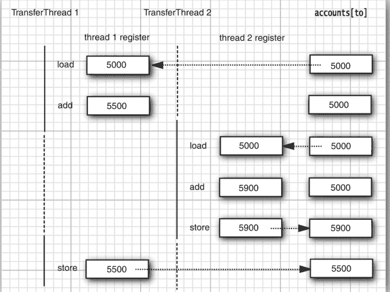

`UnsyncBankTest` 程序演示了这种损坏。（在计算 `getTotalBalance` 的过程中，也有微小的假误报概率。）

> **注意**：你实际上可以查看执行我们类中每条语句的虚拟机字节码。运行命令：

```bash
jav -c -v Bank
```

## 10.5.3 锁

注意每个 `Bank` 对象都有它自己的 `ReentrantLock` 对象。如果两个线程访问同一个 `Bank` 对象，那么锁将使访问序列化。然而，如果两个线程访问不同的 `Bank` 对象，每个线程都会获取不同的锁，且没有任何线程被阻塞。这应该是正确的，因为当线程操作不同的 `Bank` 实例时，它们不会相互干扰。

该锁被称为可重入锁，是因为线程可以重复获取它已经拥有的锁。锁具有一个持有计数（hold count），用于跟踪对 `lock` 方法的嵌套调用。线程必须对每次 `lock` 调用都执行 `unlock`，才能释放锁。由于这项特性，受锁保护的代码可以调用另一个使用相同锁的方法。

例如，`transfer` 方法调用了 `getTotalBalance` 方法，该方法也会锁定 `bankLock` 对象，此时该对象的持有计数为 2。当 `getTotalBalance` 方法退出时，持有计数变为 0，线程释放锁。

通常情况下，你可能希望在任何更新或检查共享对象的代码块周围使用锁，这样你就可以确保这些操作在另一个线程使用相同对象之前已经执行完毕。

> **注意**：请务必确保临界区中的代码不会因为抛出异常而被跳过。如果在分段结束之前抛出异常，`finally` 子句将释放锁，但对象可能处于受损的状态。

| `java.util.concurrent.locks.Lock` |
|---|
| `void lock()` 获取此锁；如果锁当前由另一个线程持有，则阻塞。 |
| `void unlock()` 释放此锁。 |

### `java.util.concurrent.locks.ReentrantLock`（5.0）

- `ReentrantLock()`  
  构造一个可以用于保护临界区的可重入锁。
- `ReentrantLock(boolean fair)`  
  根据给定的公平策略构造一个锁。公平锁会倾向于等待时间最长的线程。然而，这种公平性保证可能会对性能产生重大影响。因此，默认情况下，并不要求锁必须是公平的。

> **注意**：公平听起来很不错，但公平锁的速度可能比普通锁慢得多。只有当你真正知道自己在做什么，并且有特定的理由认为公平性对你的程序至关重要时，才应该启用公平锁。即使你使用了公平锁，也无法保证线程调度器是公平的。如果线程调度器选择忽略一个等待锁长时间的线程，它就没有获得被锁公平对待的机会。

## 10.5.4 条件对象（Condition Objects）

通常，线程进入临界区后发现，在条件满足之前它无法继续执行。使用条件对象（condition object）来管理那些已获取锁但无法进行工作的线程。在本节中，我将介绍 Java 库中条件对象的实现。（由于历史原因，条件对象通常被称为条件变量。）

让我们完善对银行的模拟。我们不想从一个没有足够资金支付转账的账户中取出资金。注意，我们不能使用如下代码：

```java
if (bank.getBalance(from) >= amount)
    bank.transfer(from, to, amount);
```

当前线程在测试结果成功和调用 `transfer` 之间完全可能被激活。

```java
if (bank.getBalance(from) >= amount)
    // 线程在此处可能被停用
    bank.transfer(from, to, amount);
```

当线程再次运行时，账户余额可能已经低于提取金额。你必须确保在测试和转账操作之间，没有其他线程可以修改余额。你通过用锁同时保护测试和转账操作来实现：

```java
public void transfer(int from, int to, int amount) {
    bankLock.lock();

    try {
        while (accounts[from] < amount) {
            // 等
            ...
        }

        // 转账资金
        ...
    } finally {
        bankLock.unlock();
    }
}
```

现在，当账户资金不足时，我们该怎么办？我们等待直到其他线程添加了资金。但这个线程刚刚获得了 `bankLock` 的独占访问权限，因此其他线程没有机会存款。这就是条件对象的用武之地。

一个锁对象可以有一个或多个关联条件对象。你通过 `newCondition` 方法获取条件对象。习惯做法是为每个条件对象命名，以唤起它所代表的条件。例如，在这里设置了一个条件对象来表示“资金充足”条件。

```java
class Bank {
    private final Condition sufficientFunds = bankLock.newCondition();

    ...
}
```

如果 `transfer` 方法发现资金不足，它会调用：

```java
sufficientFunds.await();
```

此时，当前线程被停用并放弃了锁。这允许另一个线程进入，我们希望它能增加账户余额。

等待获取锁的线程与调用了 `await` 的线程之间存在本质区别。一旦线程调用了 `await` 方法，它就进入了条件的等待集。当锁可用时，线程并不会变为可运行。相反，它保持停用状态，直到另一个线程在同一个条件上调用了 `signalAll` 方法。

当另一个线程完成转账后，它应该调用：

```java
sufficientFunds.signalAll();
```

此调用会重新激活所有等待该条件的线程。当线程从等待集中被移除时，它们再次变为可运行状态，调度器最终会再次激活它们。那时，它们将尝试重新进入该对象。一旦锁可用，其中一个线程将获取锁并从停止的地方继续执行，从 `await` 调用处返回。

```java
/**
 * 将资金从一个账户转移到另一个账户。
 *
 * @param from 要转出的账户
 * @param to 要转入的账户
 * @param amount 要转的金额
 */
public void transfer(int from, int to, double amount)
        throws InterruptedException {
    bankLock.lock();

    try {
        while (accounts[from] < amount)
            sufficientFunds.await();

        System.out.println(Thread.currentThread());
        accounts[from] -= amount;

        System.out.printf(
                "%10.2f from %d to %d",
                amount, from, to
        );

        accounts[to] += amount;

        System.out.printf(
                " Total Balance: %10.2f%n",
                getTotalBalance()
        );

        sufficientFunds.signalAll();
    } finally {
        bankLock.unlock();
    }
}

/**
 * 获取所有账户余额的总和。
 *
 * @return 总余额
 */
public double getTotalBalance() {
    bankLock.lock();

    try {
        double sum = 0;

        for (double a : accounts)
            sum += a;
```


```java
return sum;

}

finally

{

    bankLock.unlock();

}

}
```

### `java.util.concurrent.locks.Lock` 5.0

- `Condition newCondition()`

  返回一个与此锁相关的条件对象。

### `java.util.concurrent.locks.Condition` 5.0

- `void await()`

  将此线程放入该条件的等待集中等待。
- `void signalAll()`

  唤醒该条件等待集中的所有线程。
- `void signal()`

  唤醒该条件等待集中的一个随机选择的一个线程。

## 10.5.5. 死锁

锁和条件无法解决多线程执行中可能出现的所有问题。考虑以下情况：

- 账户 1: $200
- 账户 2: $300
- 线程 1: 从账户 1 转移 $300 到账户 2
- 线程 2: 从账户 2 转移 $400 到账户 1

如图 10.4 所示，线程 1 和 2 显然被阻塞了。任何一个线程都无法继续，因为账户 1 和 2 的余额不足。

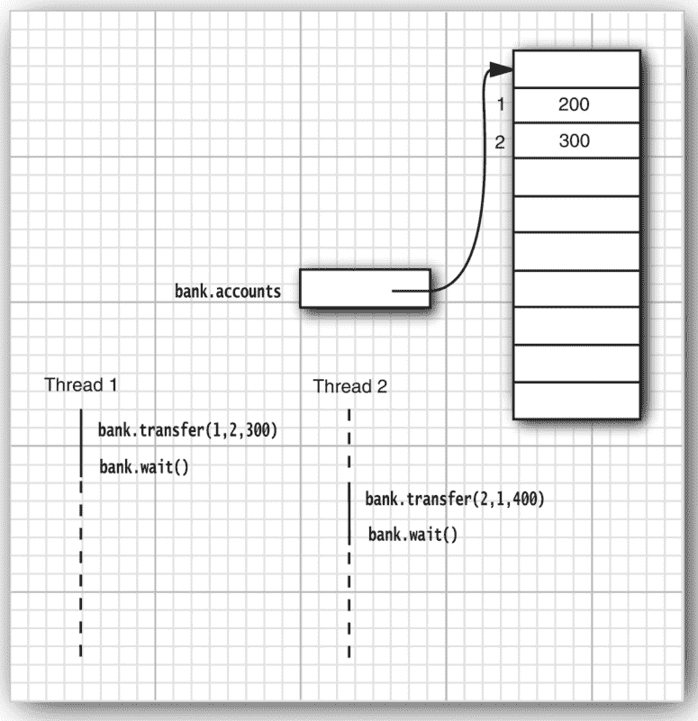

**图 10.4:** 死锁状况

所有线程都被阻塞，因为每个线程都在等待更多的钱。这种情况被称为`死锁`。

在我们的程序中，由于简单原因不会发生死锁。每次转移金额最多为 $1,000。由于有 100 个账户，总金额为 $100,000，任何时候至少有一个账户必须拥有至少 $1,000。因此，从该账户取出资金的线程可以继续。

但如果你修改线程的运行方法以移除 $1,000 的交易限制，死锁将很快发生。尝试一下。将 `NACOUNTS` 设置为 10。构造每个转移 runnable，其最大值为 `2 * INITIAL_BALANCE`，并运行程序。程序将运行一段时间，然后挂起。

> **提示：** 当程序挂起时，按下 `Ctrl+\`。你将得到一个列出所有线程的线程转储。每个线程都有堆栈跟踪，告诉它当前阻塞在何处。或者，如[第 7 章](#)所示，运行 `jconsole`，并查看 Threads 面板（参见[图 10.5](#)）。

# Java 监控与控制台

连接窗口 帮助

`wid: 553 SynBankTest2`

概述 内存 线程 类虚拟机摘要 MBeans

线程数 时间范围: 所有

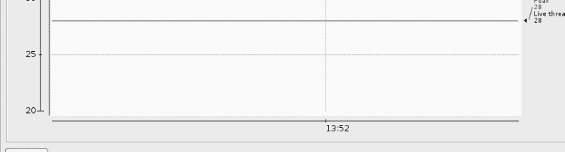

| | 名称: `Thread-0` |
| :--- | :--- |
| 状态: `WAITING on Bank@a0e990` | |
| 总阻塞: 2 总等待: 59 | |
| | 引用处理程序 Finalizer 信号调度器 |
| | 堆栈跟踪: |
| `java.lang.Object.wait(native Method)` | |
| `java.lang.Object.wait(Object) (java.lang:485)` | |
| `Bank.transfer(Bank.java:251)` | |
| `TransferRunnable.run(TransferRunnable.java:29)` | |

### `java.util.concurrent.locks.Lock` 5.0

- `Condition newCondition()`

  返回一个与此锁相关的条件对象。

### `java.util.concurrent.locks.Condition` 5.0

- `void await()`

  将此线程放入该条件的等待集中等待。
- `void signalAll()`

  唤醒该条件等待集中的所有线程。
- `void signal()`

  唤醒该条件等待集中的一个随机选择的一个线程。

## 10.5.5. 死锁

锁和条件无法解决多线程执行中可能出现的所有问题。考虑以下情况：

- 账户 1: $200
- 账户 2: $300
- 线程 1: 从账户 1 转移 $300 到账户 2
- 线程 2: 从账户 2 转移 $400 到账户 1

如图 10.4 所示，线程 1 和 2 显然被阻塞了。任何一个线程都无法继续，因为账户 1 和 2 的余额不足。


**图 10.4:** 死锁状况

所有线程都被阻塞，因为每个线程都在等待更多的钱。这种情况被称为`死锁`。

在我们的程序中，由于简单原因不会发生死锁。每次转移金额最多为 $1,000。由于有 100 个账户，总金额为 $100,000，任何时候至少有一个账户必须拥有至少 $1,000。因此，从该账户取出资金的线程可以继续。

但如果你修改线程的运行方法以移除 $1,000 的交易限制，死锁将很快发生。尝试一下。将 `NACOUNTS` 设置为 10。构造每个转移 runnable，其最大值为 `2 * INITIAL_BALANCE`，并运行程序。程序将运行一段时间，然后挂起。

> **提示：** 当程序挂起时，按下 `Ctrl+\`。你将得到一个列出所有线程的线程转储。每个线程都有堆栈跟踪，告诉它当前阻塞在何处。或者，如[第 7 章](#)所示，运行 `jconsole`，并查看 Threads 面板（参见[图 10.5](#)）。

# Java 监控与控制台

连接窗口 帮助

`wid: 553 SynBankTest2`

概述 内存 线程 类虚拟机摘要 MBeans

线程数 时间范围: 所有


| | 名称: `Thread-0` |
| :--- | :--- |
| 状态: `WAITING on Bank@a0e990` | |
| 总阻塞: 2 总等待: 59 | |
| | 引用处理程序 Finalizer 信号调度器 |
| | 堆栈跟踪: |
| `java.lang.Object.wait(native Method)` | |
| `java.lang.Object.wait(Object) (java.lang:485)` | |
| `Bank.transfer(Bank.java:251)` | |
| `TransferRunnable.run(TransferRunnable.java:29)` | |

## 10.5.6. `synchronized` 关键字

在前面的节中，你了解了如何使用 `Lock` 和 `Condition`。在继续之前，让我们总结一下关于锁和条件的要点：

- 锁保护代码段，允许只有一个线程执行代码。
- 锁管理尝试进入临界区的线程。
- 锁可以拥有一个或多个条件对象。
- 每个条件对象管理已进入临界区但无法继续的线程。

`Lock` 和 `Condition` 接口为程序员提供了高度控制。然而，在大多数情况下，你不需要——可以使用 Java 语言内置的机制。自 1.0 版本以来，Java 中的*每个对象*都有一个内置锁。如果一个方法被声明为 `synchronized`，那么该对象的锁就会保护整个方法。也就是说，要调用该方法，线程必须获取内置锁。

换句话说：

```java
public synchronized void method()
{
    method body
}
```

等同于：

```java
public void method()
{
    this.intrinsicLock.lock();
    try
    {
        method body
    }
    finally
    {
        this.intrinsicLock.unlock();
    }
}
```

例如，与其使用显式锁，我们可以直接将 `Bank` 类的转移方法声明为 `synchronized`。

内置对象锁关联一个条件。`wait` 方法将线程添加到等待集，而 `notifyAll`/`notify` 方法唤醒等待线程。也就是说，调用 `wait` 或 `notifyAll` 等同于：

```java
intrinsicCondition.await();

intrinsicCondition.signalAll();
```

> **注意：** `wait`、`notifyAll` 和 `notify` 方法是 `Object` 类的 `final` 方法。`Condition` 方法必须命名为 `await`、`signalAll` 和 `signal`，以免与这些方法发生冲突。

例如，你可以这样用 Java 实现 `Bank` 类：

```java
class Bank
{
    private double[] accounts;
}
```

```java
public synchronized void transfer(int from, int to, int amount)
    throws InterruptedException
{
    while (accounts[from] < amount) {
        wait(); // 在内置对象锁的条件下等待
    }
    accounts[from] -= amount;
    accounts[to] += amount;
    notifyAll(); // 通知所有等待该条件的线程
}

public synchronized double getTotalBalance()
{
    . . .
}
```

如你所见，使用 `synchronized` 关键字产生的代码要简洁得多。当然，为了理解这段代码，你必须知道每个对象都有一个内置锁（intrinsic lock），并且该锁有一个内置条件（intrinsic condition）。锁负责管理尝试进入 `synchronized` 方法的线程。条件负责管理调用了 `wait` 的线程。

将静态方法声明为 `synchronized` 也是合法的。如果调用了此类方法，它将获取关联类对象的内置锁。例如，如果 `Bank` 类有一个静态 `synchronized` 方法，那么当调用它时，`Bank.class` 对象的锁就会被锁定。因此，没有其他线程调用该方法或该类的任何其他静态 `synchronized` 方法。

内置锁和条件具有一些局限性。其中：

- 虚拟线程在获取内置锁时会被**钉住（pinned）**。在释放锁之前，它们无法从其载体线程（carrier thread）上卸载。如果临界区立即退出，钉住并不是问题。但如果虚拟线程在被钉住时阻塞，可能会严重降低吞吐量，甚至导致载体池的饥饿。
- 你无法中断一个正尝试获取内置锁的线程。使用 `ReentrantLock`，你可以调用 `lockInterruptibly`。
- 在尝试获取内置锁时，无法指定超时时间。
- 每个锁仅使用一个条件可能会效率低下。

在代码中应该使用什么——`Lock` 和 `Condition` 对象，还是 `synchronized` 方法？这里是我的建议：

- 最好既不用 `Lock/Condition` 也不用 `synchronized` 关键字。在许多情况下，你可以使用 `java.util.concurrent` 包中的机制之一，它们会为你完成所有的锁定工作。例如，在第 10.6.1 节中，你将看到如何使用阻塞队列来同步处理共同任务的线程。
- 如果 `synchronized` 关键字适用于你的情况，请务必使用它。你会写更少的代码，出错的空间也更小。Listing_10.7 演示了用 `synchronized` 方法实现的银行示例。然而，请考虑到锁是公开的——参见下一节。
- 如果你使用虚拟线程，或者你确实需要这些构造体提供的额外功能，请使用 `Lock/Condition`。

> 提示：要发现被钉住的线程是否被阻塞，请使用以下选项之一启动 JVM：

```bash
-Djdkk.tracePinnedThreads=short
-Djdkk.tracePinnedThreads=full
```

你将获得一个显示被钉住线程何时阻塞的堆栈跟踪：

```text
org.apache.tomcat.util.net.SocketProcessorBase.run(SocketProcessorBase.java:49)

<= monitors:1
```

注意，每个钉住位置只会获得一个警告！

或者，使用 Java 飞行记录器（Java Flight Recorder）进行记录，使用你喜欢的任务控制查看器查看，并寻找 `VirtualThreadPinned` 和 `VirtualThreadSubmitFailed` 事件。

# Listing 10.7 `synch2/Bank.java`

```java
package synch2;

import java.util.*;

/**
 * 使用同步原语的具有多个银行账户的银行。
 */
public class Bank {

    private final double[] accounts;

    /**
     * 构造银行。
     * @param n 账户数量
     * @param initialBalance 每个账户的初始余额
     */
    public Bank(int n, double initialBalance) {
        accounts = new double[n];
        Arrays.fill(accounts, initialBalance);
    }

    /**
     * 将资金从一个账户转移到另一个账户。
     * @param from 转出的账户
     * @param to 转入的账户
     * @param amount 要转移的金额
     */
    public synchronized void transfer(int from, int to, double amount)
        throws InterruptedException {
        while (accounts[from] < amount) {
            wait();
            System.out.print(Thread.currentThread());
        }
        accounts[from] -= amount;
        System.out.printf("%10.2f from %d to %d", amount, from, to);
        accounts[to] += amount;
        System.out.printf(" Total Balance: %10.2f%n", getTotalBalance());
        notifyAll();
    }

    /**
     * 获取所有账户余额的总和。
     * @return 总余额
     */
    public synchronized double getTotalBalance() {
        double sum = 0;
        for (double a : accounts) {
            sum += a;
        }
        return sum;
    }

    /**
     * 获取银行中的账户数量。
     * @return 账户数量
     */
    public int size() {
        return accounts.length;
    }
}
```

# `java.lang.Object` 1.0

- `void notifyAll()`：唤醒在该对象上调用 `wait` 的线程。此方法只能在 `synchronized` 方法或块内部调用。如果当前线程不是对象锁的所有者，该方法将抛出 `IllegalMonitorStateException`。
- `void notify()`：在该对象对象调用 `wait` 的线程中随机唤醒一个。此方法只能在 `synchronized` 方法或块内部调用。如果当前线程不是对象锁的所有者，该方法将抛出 `IllegalMonitorStateException`。
- `void wait()`：使线程等待直到被通知。此方法只能在 `synchronized` 方法或块内部调用。如果当前线程不是对象锁的所有者，该方法将抛出 `IllegalMonitorStateException`。
- `void wait(long millis, int nanos)`：使线程等待直到被通知或过了指定的时间为止。这些方法只能在 `synchronized` 方法或块内部调用。如果当前线程不是对象锁的所有者，它们将抛出 `IllegalStateException`。

### 10.5.7. `Synchronized Blocks`

正如我们所讨论的，每个对象都有一个锁。线程可以通过调用 `synchronized` 方法获取锁。获取锁的第二种机制是：进入 `synchronized` 块。

```java
synchronized (obj) // 这是 synchronized 块的语法
{
    critical section
}
```

然后它获取了 `obj` 的锁。

你有时会发现“临时”（ad hoc）锁，例如：

```java
public class Bank
{
    private double[] accounts;
    private final Object lock = new Object();

    public void transfer(int from, int to, int amount)
    {
        synchronized (lock) // 一个临时锁
        {
            accounts[from] -= amount;
            accounts[to] += amount;
        }

        System.out.println(Thread.currentThread());
    }
}
```


在这里，创建锁对象是为了使用 Java 对象拥有的锁。

> 警告：使用 `synchronized` 块时，要小心锁对象。例如，以下写法无效：

```java
private final String lock = "LOCK";
...
synchronized (lock) { . . } // 不要对字符串锁定
```

如果这在同一个程序中发生两次，由于字符串字面量是共享的，锁将是相同的。

此外，避免使用如下原始包装类：

```java
private final Integer lock = new Integer(42); // 不要对包装类锁定
```

`new Integer(42)` 构造函数已过时，且你不希望维护人员将其改为 `Integer.valueOf(42)`。如果使用相同的魔数执行两次，锁会被意外共享。

如果你需要修改静态字段，请锁定特定的类，而不是由 `getClass()` 返回的值：

```java
synchronized (MyClass.class) { staticCounter++; } // 正确
synchronized (getClass()) { staticCounter++; } // 不要
```

如果包含此代码的方法从子类调用，那么 `getClass()` 将返回不同的 `Class` 对象！你不再能保证互斥！

通常情况下，如果你必须使用 `synchronized` 块，请了解你的锁对象！你必须对所有临界区使用同一个锁，并且没有其他人使用你的锁。

有时，程序员会使用对象的锁来实现额外的原子操作——这种做法被称为客户端锁定。例如，考虑 `Vector` 类，它是一个方法都是同步的列表。现在假设把银行余额存储在一个 `Vector<Double>` 中。这里有一个转移方法的朴素实现：

```java
public void transfer(Vector<Double> accounts, int from, int to,
int amount) // ERROR
{
    accounts.set(from, accounts.get(from) - amount);
    accounts.set(to, accounts.get(to) + amount);
    System.out.println(..);
}
```

`Vector` 类的 `get` 和 `set` 方法是同步的，但这对我们没有帮助。在 `transfer` 方法中，在第一次调用 `get` 完成后，线程可能会被抢占。另一个线程可能会在同一个位置存储一个不同的值。然而，我们可以劫持锁：

```java
public void transfer(Vector<Double> accounts, int from, int to,
int amount)
{
    synchronized (accounts)
    {
        accounts.set(from, accounts.get(from) - amount);
        accounts.set(to, accounts.get(to) + amount);
    }
    System.out.println(..);
}
```

这种方法是行的，但它完全依赖于 `Vector` 类对其所有修改器方法（mutator methods）都使用内置锁（intrinsic lock）这一事实。然而，这真的是事实吗？`Vector` 类的文档并没有这样的保证。你必须仔细研究源代码，并希望未来的版本不会引入不同同步的修改器。如你所见，客户端锁定是非常脆弱的，通常不建议这样做。

> 注意：Java 虚拟机内置对 `synchronized` 方法的支持。然而，`synchronized` 块被编译成一段很长的字节码序列以管理内置锁。

## 10.5.8. 监器概念（The Monitor Concept）

锁（Locks）和条件（conditions）是线程同步的强大工具，但它们并不面向对象。多年来，研究人员一直在寻找让多线程安全的方法，而不需要强制程序员考虑显式锁。最成功的解决方案之一是由 Per Brinch Hansen 和 Tony Hoare 在 20 世纪 70 年代创立的监器概念。在 Java 的术语中，监器具有以下属性：

- 监器是一个只包含私有字段的类。
- 该类的每个对象都有一个关联的锁。
- 所有方法都由该锁锁定。也就是说，如果客户端调用 `obj.method()`，则 `obj` 的锁在方法调用开始时自动获取并在方法返回时释放。由于所有字段都是私有的，这种安排确保了当一个线程操纵字段时，另一个线程无法访问这些字段。
- 锁可以具有任意数量的关联条件。

早期版本的监器带有一个条件，并且具有相当优雅的语法。你可以直接调用 `accounts[from] >= amount`，而不需要使用显式的条件变量。然而，研究表明，无差别地反复测试条件可能是低效的。这个问题通过显式的条件变量得到了解决，每个条件变量管理一组独立的线程。

Java 设计者粗略地采纳了监器概念。Java 中的每个对象都有一个内置锁和一个内置条件。如果一个方法被声明为 `synchronized` 关键字，它的行为就类似于一个监器方法。通过调用 `wait`/`notifyAll`/`notify` 来访问条件变量。

然而，Java 对象与监器在三个重要方面有所不同，这损害了线程安全：

- 字段不强制要求是私有的。
- 方法不强制要求是同步的。
- 内置锁对客户端可见的。

这种对安全的不尊重让 Per Brinch Hansen 感到愤怒。在对 Java 多线程原语的严厉评论中，他写道：“令我惊讶的是，在监器和 Concurrent Pascal 发明四分之一世纪后，Java 的不安全并行性竟然被编程界认真对待。它毫无价值。”（*Java’s Insecure Parallelism*, ACM SIGPLAN Notices 38:34–45, 1999）。

## 10.5. volatile 字段（Volatile Fields）

有时，仅仅为了读取或写入一个实例字段就付出同步代价似乎是过分的。毕竟，能出什么问题呢？遗憾的是，在现代处理器和编译器面前，存在很大的错误空间。

- 拥有多个处理器的计算机可以将内存值临时存储在寄存器或本地内存缓存中。因此，在不同处理器上的线程可能会看到同一个内存位置的不同值！
- 编译器可以为了最大吞吐量而重排指令。编译器不会选择改变代码含义的排序，但它们假设只有当代码中有显式指令时内存值才会改变。然而，内存值可能会被另一个线程改变！

如果你使用锁来保护可以被多个线程访问的代码，就不会有这些问题。编译器被要求尊重锁，通过刷新或重新获取寄存器值、不恰当地重排指令，以及发布内存屏指令。细节在《Java 内存模型规范》（Java 语言规范第 17.4 节）中解释。规范的大部分非常复杂且具有技术性，但该章节也包含许多解释清晰的示例。

> **注意：** Brian Goetz 提出了以下“同步准则”：“如果你写了一个可能被另一个线程读取的变量，或者你读取了一个可能最后被另一个线程写入的变量，你必须使用同步。”

`volatile` 关键字为同步实例字段的访问提供了一种无锁机制。如果你声明一个字段为 `volatile`，那么编译器和虚拟机就会考虑到该字段可能被另一个线程并发更新。

例如，假设一个对象有一个布尔标记 `done`，由一个线程设置，另一个线程查询。正如我们讨论过的，你可以使用锁：

```java
private boolean done;
public synchronized boolean isDone() { return done; }
public synchronized void setDone() { done = true; }
```

使用内置锁可能不是一个好主意。如果另一个线程持有该对象，`isDone` 和 `setDone` 方法可能会阻塞。在这种情况下，将字段声明为 `volatile` 是合理的：

```java
private volatile boolean done;
public boolean isDone() { return done; }
public void setDone() { done = true; }
```

编译器将插入相应的代码，确保一个线程对 `done` 变量的更改对任何读取它的线程可见的。

> 注意：`volatile` 变量不提供任何原子性。例如，方法

```java
public void flipDone() { done = !done; // 非原子
```

无法保证翻转值。

## 10.5.10. final 字段（Final Fields）

正如你在前面的节中看到的，除非使用锁或 `volatile` 修饰符，否则无法安全地读取字段。

还有一种安全访问共享字段的情况——当它是 `final` 的。一旦构造函数完成，任何拥有对象引用的线程都会看到字段的初始化值。

考虑

```java
public class Bank {
    final HashMap<String, Double> accounts;
    public Bank()
    {
        accounts = new HashMap<>();
    }
}
```

其他线程在构造函数完成后可以看到初始化的 `accounts` 变量。

如果不使用 `final`，则无法保证其他线程能看到更新后的 `accounts`——它们可能会看到 `null`，而不是构造好的 `HashMap`。

当然，map 操作不是线程安全的。如果多个线程变异和读取 map，仍然需要同步。

> 注意：该保证有一个重要的限制：`this` 引用在构造过程中不能泄露。如果构造函数将 `this` 赋值给另一个对象的字段或将其传递给另一个方法，则引用就会泄露。

如果 `this` 引用在构造过程中没有泄露，则对象被正确构造。如果对象已正确构造且所有字段都是 `final`，则可以安全地共享而无需同步。

## 10.5.11. 原子类（Atoms）

只要执行的是赋值操作，就可以将共享变量声明为 `volatile`。

`java.util.concurrent.atomic` 包中有很多类，它们使用高效的机器级指令来保证其他操作的原子性，而无需使用锁。例如，`AtomicInteger` 类拥有 `incrementAndGet` 和 `decrementAndGet` 方法，可以原子地增加或减少一个整数。例如，你可以安全地生成这样的数字序列：

```java
public static final AtomicLong nextNumber = new AtomicLong();
// in some thread. . .
long id = nextNumber.incrementAndGet();
```

`incrementAndGet` 方法原子性地增加 `AtomicLong` 并返回递增后的值。也就是说，获取值、加 1、设置值以及产生新值的操作是无法被抢占的。即使多个线程并发访问同一个实例，也能保证计算并返回正确的值。

虽然提供了用于原子性设置、增加和减去值值的方法，但如果你想进行更复杂的更新，则必须使用 `compareAndSet` 方法。例如，假设你想跟踪不同线程观察到的最大值。以下代码将不起作用：

```java
public static final AtomicLong largest = new AtomicLong();
// in some thread. . .
largest.set(Math.max(largest.get(), observed)); // 错误--竞态条件！
```

这种更新不是原子的。相反，请为变量更新提供一个 lambda 表达式，更新将由为你完成。例如，我们可以调用：

```java
largest.updateAndGet(x -> Math.max(x, observed));
```

或者

```java
largest.accumulateAndGet(observed, Math::max);
```

`accumulateAndGet` 方法接收一个二元运算符，用于结合原子值和提供的参数。

还有返回旧值的 `getAndUpdate` 和 `getAndAccumulate` 方法。

**注意：** 这些方法也提供了 `AtomicInteger`、`AtomicIntegerArray`、`AtomicIntegerFieldUpdater`、`AtomicLongArray`、`AtomicLongFieldUpdater`、`AtomicReference`、`AtomicReferenceArray` 和 `AtomicReferenceFieldUpdater` 类。

当大量线程访问同一个原子值时，性能会下降，因为乐观更新需要重试两次。`LongAdder` 和 `LongAccumulator` 类解决了这个问题。`LongAdder` 是多个变量，其总和为当前值。多个线程可以更新不同的分量，当线程数量增加时，会自动提供新的分量。在所有工作完成之前不需要总和之值的常见情况下，这是非常高效的。性能的可能是巨大的。

如果你预见到高竞争，应该直接使用 `LongAdder` 而不是 `AtomicLong`。方法名称略有不同。调用 `increment` 增加计数器，调用 `add` 增加数量，调用 `sum` 获取总和。

```java
final var adder = new LongAdder();
for (.. ..)
executor.submit(() ->
{
    while (.. ..)
    {
      if (. .. .) adder.increment();
    }
));
....
long total = adder.sum();
```

> **注意：** 当然，`increment` 方法*并没有*返回旧值。这样做会抵消将总和拆分为多个分量所带来的效率提升。

`LongAccumulator` 将此思想推广到任意的累加操作。在构造函数中，你提供该操作以及它的中性元素。要合并新值，调用 `accumulate`。调用 `get` 获取当前值。以下效果与 `LongAdder` 相同：

```java
final var adder = new LongAccumulator(Long::sum, 0);
// in some thread. . .
adder.accumulate(value);
```

在内部，累加器拥有变量 $a_1, a_2, \dots, a_n$。每个变量都用中性元素初始化（在我们的示例中为 $0$）。

当使用值 $v$ 调用 `accumulate` 时

`get` 的结果是 $a_1 \ op \ a_2 \ op \ \dots \ op \ a_n$。在我们的示例中，那是累加器的总和，$a_1 + a_2 + \dots + a_n$。

要计算最大值或最小值，请对操作使用 `Math.max` 或 `Math.min`。通常，操作必须满足结合律和交换律。这意味着最终结果必须与中间值组合的顺序无关。

还有 `DoubleAdder` 和 `DoubleAccumulator`，它们的工作方式相同，只是针对 double 值。

## 10.5.12. 需需初始化

有时，你有一个只想在第一次需要时才初始化的数据结构。并且你想确保初始化恰好发生一次。与其设计自己的机制，不如利用虚拟机在类第一次被使用时恰好执行一次静态初始化器的特性。虚拟机通过锁来确保这一点，所以你不需要自己编写锁逻辑。

```java
public class OnDemandData
{
    // 私有构造函数以确保只构造一个对象
    private OnDemandData()
    {
        ...
    }
    public static OnDemandData getInstance()
    {
        return Holder.INSTANCE;
    }
    // 仅在第一次使用时初始化，即在第一次调用 getInstance() 时
    private static class Holder
    {
        // VM 保证这是惰性发生且最多发生一次
        static final OnDemandData INSTANCE = new OnDemandData();
    }
}
```

> **警告：** 要使用这种写法，你必须确保构造函数不会抛出任何异常。虚拟机不会第二次尝试初始化持有器类。

## 10.5.13. 安全发布

正如你从[第 10.5.10 节]中看到的，构造良好的对象的其 `final` 字段将被所有线程看到其初始化后的值。非 `final` 字段呢？

Java 语言通常不提供保证。例如，考虑：

```java
public class BankAccount
{
    private double balance;
    public BankAccount(double initialBalance) { balance = initialBalance; }
    public double getBalance() { return balance; }
}
```

如果两个线程执行如下操作

```java
String date = dateFormat.format(new Date());
```

那么结果可能是垃圾，因为 `dateFormat` 使用的内部数据结构会被并发访问而损坏。你可以使用同步，这是昂贵的；或者你可以在每次需要时构造一个局部 `SimpleDateFormat`，但也是浪费的。

为每个线程构造一个实例，使用以下代码：


```java
public static final ThreadLocal<SimpleDateFormat> DATEFORMAT = ThreadLocal.withInitial(() -> new SimpleDateFormat("yyyy-MM-dd"));
```

要访问实际格式器，调用：

```java
String dateStamp = DATEFORMAT.get().format(new Date());
```

在给定线程第一次调用 `get()` 时，会调用构造函数中的 lambda。此后，`get()` 方法返回属于当前线程的实例。

## 10.5.14. 使用线程局部变量共享

在之前的章节中，我们讨论了线程间共享变量的风险。有时可以通过每个线程自己的实例来避免共享（见 10.4.4）。例如，`SimpleDateFormat` 类不是线程安全的。假设我们有一个：

```java
public static final SimpleDateFormat dateFormat = new SimpleDateFormat("yyyy-MM-dd");
```

如果两个线程执行如下操作：

```java
String date = dateFormat.format(new Date());
```

那么结果可能是垃圾，因为 `dateFormat` 使用的内部数据结构会被并发访问而损坏。

一个相关问题是多线程中的随机数生成。`java.util.Random` 类是线程安全的。然而，如果多个线程共享同一个生成器，产生新随机值并更新生成器状态的计算可能是无效的。

你可以使用 `ThreadLocal` 辅助类为每个线程提供独立的生成器。但有一个针对这种情况优化的便利类：

```java
int random = ThreadLocalRandom.current().nextInt(upperBound);
```

调用 `ThreadLocalRandom.current()` 返回一个具有每个线程状态的随机数生成器。在目前的实现中，它将生成器状态存储在 `Thread` 对象的实例变量中。

`java.lang.ThreadLocal<T>` 1.2

- `static <S> ThreadLocal<S> withInitial(Supplier<? extends S> supplier)` 8

  创建一个线程本地变量，其初始值通过调用给定的 supplier 产生。

`java.util.concurrent.ThreadLocalRandom` 5

- `static ThreadLocalRandom current()`

  返回一个随机生成器类，其状态局部于当前线程。

# 10.6. 线程安全的集合

如果多个线程并发修改数据结构（例如表格），很容易损坏该数据结构。（有关哈希表的更多信息，请参见第 9 章。）一个线程可能开始插入一个新元素。假设它在重新路由哈希表桶（buckets）之间的链接过程中被抢占了。如果另一个线程开始遍历同一个列表，它可能会遵循无效的链接并造成混乱，可能会抛出异常或陷入无限循环。

你可以通过提供一个锁（lock）来保护共享数据结构，但通常选择一个线程安全的实现更为简单。在接下来的章节，我们将讨论 Java 库提供的线程安全集合。

## 10.6.1. 阻塞队列

使用一个或多个队列可以优雅且安全地解决许多线程问题。生产者线程将项插入队列，消费者线程从队列中检索这些项。队列允许你安全地将数据从一个线程传递给另一个线程。

例如，考虑我们的银行转账程序。转账线程不再直接访问银行对象，而是将转账指令对象插入队列。另一个线程从队列中移除指令并执行转账。只有该线程可以访问银行对象的内部。不需要任何同步。（当然，线程安全队列类的实现者必须担心锁和条件，但那是他们的问题，不是你的。）

当你在队列当前满时尝试添加元素，或在队列为空时尝试移除元素时，阻塞队列会导致线程阻塞。阻塞队列是协调多个线程工作的有用工具。线程可以定期将中间结果存入阻塞队列。其他工作线程移除中间结果并对其进行进一步修改。

队列会自动平衡工作负载。如果第一组线程运行得比第二组慢，第二组会在等待结果时被阻塞。如果第一组线程运行得更快，队列就会填满，直到第二组赶上。表 10.2 显示了阻塞队列的方法。

### 表 10.2：阻塞队列方法

| 方法 | 正常操作 | 特殊情况下的操作 |
|---|---|---|
| `add` | 添加元素 | 如果队列已满则抛出 `IllegalStateException` |
| `element` | 返回头部元素 | 如果队列为空则抛出 `NoSuchElementException` |
| `offer` | 添加元素并返回 `true` | 如果队列满则返回 `false` |
| `peek` | 返回头部元素 | 如果队列为空则返回 `null` |
| `poll` | 移除并返回头部元素 | 如果队列为空则返回 `null` |
| `put` | 添加元素 | 如果队列满则阻塞 |
| `remove` | 移除并返回头部元素 | 如果队列为空则抛出 `NoSuchElementException` |
| `take` | 移除并返回头部元素 | 如果队列为空则阻塞 |

阻塞队列方法分为三类，其区别在于当队列满或空时它们所执行的动作。如果你将队列用作线程管理工具，请使用 `put` 和 `take` 方法。`add`、`remove` 和 `element` 操作在尝试向满队列添加元素或获取空队列的头部元素时会抛出异常。

当然，在多线程程序中，队列可能任何时候变满或变空，你会想要使用 `offer`、`poll` 和 `peek` 方法。这些方法在无法执行任务时，只需返回一个失败指示而不是抛出异常。

> **注意：** `poll` 和 `peek` 方法返回 `null` 表示失败。因此，向这些队列插入 `null` 值是不合法的。

还有带有超时时间的 `offer` 和 `poll` 方法。例如，调用：

```java
boolean success = q.offer(x, 100, TimeUnit.MILLISECONDS);
```

尝试 100 毫秒内向队列尾部插入一个元素。如果成功，则返回 `true`；否则在超时后返回 `false`。

同样地，调用：

```java
Object head = q.poll(100, TimeUnit.MILLISECONDS);
```

尝试 100 毫秒内移除队列头部。如果成功，则返回头部；否则在超时后返回 `null`。

`put` 方法在队列满时阻塞，`take` 方法在队列为空时阻塞。这些是等同于无超时时的 `offer` 和 `poll`。

`java.util.concurrent` 包提供了阻塞队列的几种变体。默认情况下，`LinkedBlockingQueue` 的容量没有上界，可以可选指定最大容量。`LinkedBlockingDeque` 是双端版本。`ArrayBlockingQueue` 使用给定的容量和一个可选的公平性参数进行构造。

如果指定了公平性，等待时间最长的线程将获得优先对待。一如既往，公平性会带来巨大的性能代价，只有当你的问题特别需要时才应该使用它。

`PriorityBlockingQueue` 是优先级队列，而不是先进先出队列。元素按照优先级顺序移除。队列具有无界容量，但如果队列为空，检索将阻塞。（有关优先级队列的更多信息，请参见第 9 章。）

`TransferQueue` 接口允许生产者线程等待直到消费者准备好取一个项。当生产者调用：

```java
q.transfer(item);
```

该调用将阻塞，直到另一个线程移除它。`LinkedTransferQueue` 实现此接口。

列表 10.8 中的程序显示了如何使用阻塞队列控制一组线程。注意，不需要任何显式的线程同步。在这个应用程序中，我们使用队列数据结构作为同步机制。

```java
e.printStackTrace();

}

catch (InterruptedException e)

{

}

Thread.ofPlatform().start(enumerator);

for (int i = 1; i <= SEARCH_THREADS; i++)

{

    Runnable searcher = () -> 

    {

        try {

            boolean done = false;

            while (!done) {

                Path file = queue.take();

                if (file == TERMINATION) {

                    queue.put(file);

                    done = true;

                } else search(file, keyword);

            }

        } catch (IOException e) {

            e.printStackTrace();

        } catch (InterruptedException e) {

        }

    };

    Thread.ofPlatform().start(searcher);

}
```

```java
/**
 * 递归地枚举给定目录及其子目录中的所有文件。
 * * 流和文件操作请参见卷二的第 1 和第 2 章。
 * @param directory 开始的目录
 */

public static void enumerate(Path directory) throws IOException, InterruptedException {

    try (Stream<Path> children = Files.list(directory)) {

        for (Path child : children.toList()) {

            if (Files.isDirectory(child)) {

                enumerate(child);

            } else {

                queue.put(child);

            }

        }

    }

}
```

```java
/**
 * 在文件中搜索指定的关键字并打印所有匹配的行。
 * @param file 要搜索的文件
 * @param keyword 要搜索的关键字
 */

public static void search(Path file, String keyword) throws IOException {

    try (var in = new Scanner(file)) {

        int lineNumber = 0;

        while (in.hasNextLine()) {

            lineNumber++;

            String line = in.nextLine();

            if (line.contains(keyword)) {

                System.out.printf("%s:%d:%s%n", file, lineNumber, line);

            }

        }

    }

}
```


# `java.util.concurrent.ArrayBlockingQueue<E>` 5.0

- `ArrayBlockingQueue(int capacity)`
- `ArrayBlockingQueue(int capacity, boolean fair)`

  根据给定的容量和公平性设置创建一个阻塞队列。该队列使用循环数组实现。

# `java.util.concurrent.LinkedBlockingQueue<E>` 5.0

# `java.util.concurrent.LinkedBlockingDeque<E>` 6

- `LinkedBlockingQueue()`
- `LinkedBlockingDeque()`

  创建一个无界的阻塞队列或双队列，使用链表实现。

- `LinkedBlockingQueue(int capacity)`
- `LinkedBlockingDeque(int capacity)`

  根据给定的容量创建一个有界的阻塞队列或双队列，使用链表实现。

# `java.util.concurrent.PriorityBlockingQueue<E>` 5.0

- `PriorityBlockingQueue()`
- `PriorityBlockingQueue(int initialCapacity)`
- `PriorityBlockingQueue(int initialCapacity, Comparator<? super E> comparator)`

  创建一个基于堆的无界优先级队列。初始容量的默认值未指定，元素必须实现 `Comparable` 接口。

# `java.util.concurrent.BlockingQueue<E>` 5.0

- `void put(E element)`

  添加元素，必要时会阻塞。

- `E take()`

  移除并返回头部元素，必要时会阻塞。

- `boolean offer(E element, long time, TimeUnit unit)`

  添加给定元素如果成功则返回 `true`，必要时会阻塞，直到元素被添加或时间超时。

- `poll(long time, TimeUnit unit)`

  移除并返回头部元素，必要时会阻塞，直到元素可用或时间超时。失败时返回 `null`。

# `java.util.concurrent.BlockingDeque<E>` 6

- `putFirst(E element)`
- `putLast(E element)`

  添加元素，必要时会阻塞。

- `takeFirst()`
- `takeLast()`

  移除并返回头部或尾部元素，必要时会阻塞。

- `boolean offer(E element, long time, TimeUnit unit)`
- `boolean offerLast(E element, long time, TimeUnit unit)`

  添加给定元素如果成功则返回 `true`，必要时会阻塞，直到元素被添加或时间超时。

- `poll(long time, TimeUnit unit)`
- `pollLast(long time, TimeUnit unit)`

  移除并返回头部或尾部元素，必要时会阻塞，直到元素可用或时间超时。失败时返回 `null`。

# `java.util.concurrent.TransferQueue<E>` 7

- `void transfer(E element)`
- `boolean tryTransfer(E element, long time, TimeUnit unit)`

  传输值，或在给定的超时时间内尝试传输，阻塞直到另一个线程移除该项。

# 10.6.2. 高效的 Maps、Sets 和 Queues

`java.util.concurrent` 包提供了用于 map、排序集和队列的高效实现：

`ConcurrentHashMap`、`ConcurrentSkipListMap`、`ConcurrentSkipListSet` 以及 `ConcurrentLinkedQueue`。

这些集合使用复杂的算法，通过允许并发访问数据结构的不同部分来尽可能地减少竞争。

与大多数集合不同，这些类的 `size` 操作不一定在常数时间内完成。确定其中任一集合的当前大小通常需要遍历。

> 注意：某些应用程序使用极大的并发哈希表，大到 `size` 方法是不够用的，因为它返回的是一个 `int`。对于一个拥有 20 亿多个条目的 map，该怎么办？`mappingCount` 方法以 `long` 类型返回大小。

这些集合返回弱一致的迭代器。这意味着迭代器可能反映也可能不反映在创建之后所做的所有修改。

> 注意：相比之下，`java.util` 包中的集合迭代器在被修改后会抛出 `ConcurrentModificationException`。

并发哈希表可以高效地支持大量的读取者和有限的写入者。

> **注意**：某些应用程序使用糟糕的哈希函数，导致所有条目都落入少数几个桶中。即使是合理的哈希函数（如 `String` 类）也可能出现问题。例如，攻击者可以通过构造相同哈值的字符串来减慢程序。在最近的 Java 版本中，当键实现 `Comparable` 时，并发哈希会将桶组织成树，以保证 `O(log n)` 的性能。

## `java.util.concurrent.ConcurrentLinkedQueue<E>` 5.0

- `ConcurrentLinkedQueue<E>()`

  创建一个多线程安全的无界非阻塞队列。

## `java.util.concurrent.ConcurrentHashMap<K, V>` 5.0

- `ConcurrentHashMap<K, V>()`
- `ConcurrentHashMap<K, V>(int initialCapacity)`
- `ConcurrentHashMap<K, V>(int initialCapacity, float loadFactor, int concurrencyLevel)`

  创建一个可以多线程安全 world 哈希表。初始容量的默认值为 16。如果每个桶的平均负载超过负载因子，则会调整大小。默认值为 0.75。并发级别是估计的并发写入线程数。

## `java.util.concurrent.ConcurrentSkipListSet<E>` 6

- `ConcurrentSkipListSet<E>()`
- `ConcurrentSkipListSet<E>(Comparator<? super E> comp)`

  创建一个可以多线程安全的排序集。第一个构造函数要求元素实现 `Comparable` 接口。

## `java.util.concurrent.ConcurrentSkipListMap<K, V>` 6

- `ConcurrentSkipListMap<K, V>()`
- `ConcurrentSkipListMap<K, V>(Comparator<? super K> comp)`

  创建一个可以多线程安全的排序 map。第一个构造函数要求键实现 `Comparable` 接口。

# 10.6.3. Map 条目的的原子更新

`ConcurrentHashMap` 的原始版本只有少量用于原子更新的方法，这些方法的设计为了编程有些笨拙。假设我们想要统计某些特征出现的频率。作为一个简单的示例，假设多个线程遇到计数器，我们想要统计它们的频率。

我们可以使用 `Concurrent<String, Long>`? 考虑增加计数的代码。显然，以下不是线程安全的：

```java
Long oldValue = map.get(word);

Long newValue = oldValue == null ? 1 : oldValue + 1;

map.put(word, newValue); // 错误--可能没有替换 oldValue
```

另一个线程可能同时在更新同一个计数器。

> 注意：某些程序员对“所谓的线程安全数据结构竟然允许非线程安全的操作”感到惊讶。但这里涉及的是两种完全不同的考量。如果多个线程修改一个普通的 `HashMap`，它们可能会破坏内部结构（链表数组）。某些链节点可能会丢失，甚至形成循环，导致数据结构无法使用。这种情况在 `ConcurrentHashMap` 中永远不会发生。在上面的示例中，`get` 和 `put` 的代码永远不会损坏数据结构。但是，由于操作序列不是原子的，结果是可预测的。

在 Java 的旧版本中，必须使用 `replace` 方法，它可以原子地将旧值替换为新值，前提是没有其他线程在此之前替换了该旧值。你必须不断重复，直到尝试成功：

```java
do {
  oldValue = map.get(word);
  newValue = oldValue == null ? 1 : oldValue + 1;
}
while (!map.replace(word, oldValue, newValue));
```

另一种方案是使用 `ConcurrentHashMap<String, AtomicLong>` 以及以下更新代码：

```java
map.putIfAbsent(word, new AtomicLong());

map.get(word).incrementAndGet();
```

遗憾的是，在第一行中，每次递增都会构造一个新的 `AtomicLong` 对象，而它在不需要时会被丢弃。

如今，Java API 提供了让原子更新更方便、更高效的方法。调用 `compute` 方法传入一个键和一个用于计算新值的函数。该函数接收键和关联的值（如果没有，则接收为 `null`），并计算出新值。例如，我们可以这样更新一个整数计数器映射：

```java
map.compute(word, (k, v) -> v == null ? 1 : v + 1);
```

> 注意：`ConcurrentHashMap` 中不能包含 `null` 值。有许多方法使用 `null` 值作为指示，表示给定的键不在映射中。

还有 `computeIfPresent` 和 `computeIfAbsent` 变体，它们只在已存在旧值或不存在旧值时计算新值。一个 `LongAdder` 计数器映射可以这样更新：

```java
map.computeIfAbsent(word, k -> new LongAdder()).increment();
```

这几乎就像你之前看到的 `putIfAbsent` 调用一样，但只有在实际上需要新计数器时，才会调用 `LongAdder` 构造函数。

当第一次添加键时，你通常需要执行特殊操作。`merge` 方法使得这变得特别方便。它有一个初始值参数，当键尚不存在时使用该值。否则，将调用你提供的函数，将现有值和初始值合并。（与 `compute` 不同，该函数不处理键。）

```java
map.merge(word, 1L, (existingValue, newValue) -> existingValue + newValue);
```

或者简单地：

```java
map.merge(word, 1L, Long::sum);
```

没有比这更简洁的。

> 注意：如果传递给 `compute` 或 `merge` 的函数返回 `null`，则现有条目将从映射中移除。

> 警告：使用 `compute` 或 `merge` 时，请记住，你提供的函数不应执行大量工作。当该函数运行时，对映射的其他某些更新可能会被阻塞。当然，该函数也不应该更新映射的其他部分。

列表 10.9 中的程序使用并发哈希表来统计目录树中 Java 文件中的所有单词。

## 10.9 `concurrentHashMap/CHMDemo.java`

```java
1 package concurrentHashMap;

2 import java.io.*;

3 import java.nio.file.*;

4 import java.util.*;

5 import java.util.concurrent.*;

6 import java.util.stream.*;

7


8


9 /**
10  * 此程序演示了并发哈希映射。
11  * @version 1.01 2023-07-30
12  * @Author Cay Horstmann
13  */
14 public class CHMDemo
15 {
16     public static ConcurrentHashMap<String, Long> map = new ConcurrentHashMap<>
17 >();
```

```java
/**
 * 将给定文件中所有的单词添加到并发哈希映射中。
 * @param file 一个文件
 */
public static void process(Path file) {
    try (var in = new Scanner(file)) {
        while (in.hasNext()) {
            String word = in.next();
            map.merge(word, 1L, Long::sum);
        }
    } catch (IOException e) {
        e.printStackTrace();
    }
}
```

```java
/**
 * 返回给定目录的所有后代——参见第 1 章和第 2 章
 * @param rootDir 根目录
 * @return 根目录所有后代的集合
 */
public static Set<Path> descendants(Path rootDir) throws IOException {
    try (Stream<Path> entries = Files.walk(rootDir)) {
        return entries.collect(Collectors.toSet());
    }
}

public static void main(String[] args)
    throws InterruptedException, Exception {

    ExecutorService executor = Executors.newVirtualThreadTaskExecutor();

    Path pathToRoot = Path.of(".");
```

```java
map.forEach((k, v) -> {
  if (v >= 10) {
    System.out.println(k + " " + v);
  }
});
```

# 10.6.4. 并发映射上的批量操作

Java API 提供了并发映射的批量操作，可以安全地并行执行。共有四种操作：

- `searchKeys(threshold, Function<? super K, ? extends U>)`
- `searchValues(threshold, Function<? super V, ? extends U>)`
- `search(threshold, BiFunction<? super K, ? super V, ? extends U>)`
- `searchEntries(threshold, Function<Map.Entry<K, V>, ? extends U>)`

例如，假设我们要找到出现次数超过 1000 次的单词。我们需要搜索键值：

```java
String result = map.search(threshold, (k, v) -> v > 1000 ? k : null);
```

`forEach` 方法有两种变体。第一种为每个映射条目应用消费者函数，例如：

```java
map.forEach(threshold,
  (k, v) -> System.out.println(k + " " + v));
```

第二种变体接受额外的转换函数，首先应用该函数，将其结果传递给消费者：

```java
map.forEach(threshold,
  (k, v) -> k + " " + v, // 转换
  System.out::println); // 消费者
```

转换函数可以作为过滤器。每当转换器返回 `null` 时，该值就会被静跳跳过。例如，这里我们只打印大值的条目：

```java
map.forEach(threshold,
  (k, v) -> v > 1000 ? " " + v : null, // 过滤和转换
  System.out::println);
```

`reduce` 操作使用累加函数合并其输入。例如，这里是计算所有值和的方法：

```java
Long sum = map.reduceValues(threshold, Long::sum);
```

与 `forEach` 一样，你也可以提供转换函数。这里我们计算最键的长度：

```java
Integer maxlength = map.reduceKeys(threshold,
  String::length, // 转换
  Integer::max); // 累加
```

转换函数可以充当过滤器，通过返回 `null` 来排除不需要的输入。在这里，我们统计值大于 1000 的条目数量：

```java
Long count = map.reduceValues(threshold,
  v -> v > 1000 ? 1L : null,
  Long::sum);
```

针对 `int`、`long` 和 `double` 输出提供了带有后缀 `ToInt`、`ToLong` 和 `ToDouble` 的特化方法。你需要将输入转换为原始类型，并指定一个默认值和一个累加器函数。当 map 为空时，将返回默认值。

```java
long sum = map.reduceValuesToLong(threshold,
  Long::value, // 转换为原始类型的转换器
  0, // 空 map 的默认值
  Long::sum); // 原始类型累加器
```


> 注意：这些特化方法的行为与只有一个元素的对象版本不同。它们不是返回转换后的元素，而是与默认值进行累加。因此，默认值必须是累加器的单位元。

## 10.6.5. 并发视图（Concurrent Views）

假设你需要一个大型的线程安全集合（set）而不是 map。并没有 `ConcurrentSet` 类，你也知道比尝试自己创建一个要明智。当然，你可以使用带有值的 `ConcurrentHashMap`，但你得到的是一个 map，可以应用 `Set` 接口的操作。静态方法 `newSet` 返回一个 `Set<K>`，它实际上是 `ConcurrentHashMap<K, Boolean>` 的包装。（所有值都是 `Boolean`，但你并不关心，因为你只是把它当成集合用。）

```java
Set<String> words = ConcurrentHashMap.<String>newSet();
```

当然，如果你有一个已有的 map，`keySet` 方法会产生键的集合。该集合是可变的。如果你删除了集合中的元素，它们对应的值也会从 map 中被移除。但向集合中添加元素是没有意义的，因为没有对应的值可以添加。`ConcurrentHashMap` 有另一个带有默认值的 `keySet` 方法，用于现在向集合中添加元素时，其默认值为 1 的情况。

> 注意：你也可以使用 `Collections.newSetFromMap`，它更简单且效率稍高。

## 10.6.6. 写时复制数组（CopyOnWrite Arrays）

`CopyWriteArrayList` 和 `CopyWriteArraySet` 是线程安全的集合，其修改器（mutators）会复制底层数组。如果遍历集合的线程多于修改集合的线程，这种安排非常有用。当你构造一个迭代器时，它包含指向当前数组的引用。如果数组随后被修改，迭代器仍然持有旧数组，但集合的数组已被替换。结果是，迭代器拥有一个一致（但可能是过时的）视图，可以在无需同步的情况下访问。

## 10.6.7. 并行数组算法（Parallel Array Algorithms）

`Arrays` 类拥有许多并行化操作。静态方法 `parallelSort` 可以对原始类型值或对象的数组进行排序。例如：

```java
var contents = Files.readString(Path.of("alice.txt"));

String[] words = contents.split("\n"); // 按换行符分割

Arrays.parallelSort(words);
```

排序对象时，你可以提供一个比较器（`Comparator`）：

```java
Arrays.parallelSort(words, Comparator.comparing(String::length));
```

对于所有方法，你都可以提供范围的边界，例如：

```java
Arrays.parallelSort(words, words.length / 2, words.length); // 排序后半部分
```

> 注意：乍一看，这些方法的名称中包含“parallel（并行）”似乎有点奇怪，因为用户不应该关心排序是如何发生的。然而，API 设计者希望明确表示排序是并行的。这样，用户就会引起注意，避免使用具有副作用的比较器。

`parallelSetAll` 方法使用从函数计算出的值填充数组。函数接收元素索引并计算该位置的值。

```java
Arrays.parallelSetAll(values);
```

显然，此操作受益于并行化。它为所有原始类型数组和对象数组都提供了相应的版本。

最后，还有一个 `parallelPrefix` 方法，它将每个数组元素替换为给定结合律操作的前缀累加和。这里有一个示例。考虑数组 `[1, 2, 3, 4, ...]` 和乘法操作。执行 `parallelPrefix(values, (x, y) -> x * y)` 后，数组包含：

`[1, 1*2, 1*2*3, 1*2*3*4, ...]`。

令人惊讶的是，这种计算是可以并行的。首先，如所示合并相邻的元素：

`[1, 1*2, 3*3*4, 5*6, 7*8]`

灰色的值保持不变。显然，可以在数组的不同区域并行地进行此计算。下一步是通过与下方一个或两个位置的元素相乘来更新指示的元素：

`[1, 1*2, 1*2*3, 1*2*3*4, 5*5*6, 5*6*7, 5*6*7*8]`

这同样可以并行完成。在 `\log n` 步之后，处理完成。如果有足够的处理器，这比直接的线性计算更有胜算。在专用硬件上，这种算法被广泛使用，此类硬件的用户在将其适应各种问题方面非常有技巧。

## 10.6.8. 旧的线程安全集合（Older Thread-Safe Collections）

自 Java 最初发布以来，`Vector` 和 `Hashtable` 类就提供了动态数组和哈希表的线程安全实现。这些类现在被认为是过时的，已被 `ArrayList` 和 `HashMap` 类所取代。这些类不是线程安全的。通常情况下，使用 `java.util.concurrent` 包中定义的集合比使用同步包装器更好。特别是 `ConcurrentHashMap` 的实现非常细致，只要多个线程访问不同的桶（buckets），它们就可以并发访问而不会互相阻塞。一个例外是频繁修改的列表。在这种情况下，同步的 `ArrayList` 性能可能优于 `CopyWriteArrayList`。

任何集合都可以通过同步包装器变为线程安全的：

```java
List<E> synchArrayList = Collections.synchronizedList(new ArrayList<>());

Map<K, V> synchHashMap = Collections.synchronizedMap(new HashMap<>());
```

结果集合的方法是同步的。如果你想遍历集合，仍然需要使用“客户端”锁定，正如我们在示例中做的那样：

```java
synchronized (synchHashMap) {
  Iterator<K> iter = synchHashMap.keySet().iterator();

  while (iter.hasNext()) . . .
}
```

### `java.util.SortedCollections` 1.2

- `static <E> Collection<E> synchronizedCollection(Collection<E> c)`
- `static <E> List<E> synchronizedList(List<E> c)`
- `static <E> Set<E> synchronizedSet(Set<E> c)`
- `static <E> SortedSet<E> synchronizedSortedSet(SortedSet<E> c)`
- `static <K, V> Map<K, V> synchronizedMap(Map<K, V> c)`
- `static <K, V> SortedMap<K, V> synchronizedSortedMap(SortedMap<K, V> c)`

构建一个方法是同步的集合视图。

通过这种方式，你可以在结果可用后无需阻塞地处理它。

有一些 API 方法返回 `CompletableFuture` 对象。例如，你可以使用 `HttpClient` 类异步获取页面，你将在第二卷的第 4 章中遇到这个类：

```java
HttpClient client = HttpClient.newHttpClient();

HttpRequest request =
    HttpRequest.newBuilder(URI.create(urlString)).GET().build();

CompletableFuture<HttpResponse<String>> f = client.sendAsync(
    request, BodyHandlers.ofString());
```

如果有一个方法能产生一个现成的 `CompletableFuture` 就太好了，但大多数情况下，你需要自己创建一个。要异步运行一个任务并获取 `CompletableFuture`，你不需要直接将其提交给执行器服务。相反，你调用静态方法 `CompletableFuture.supplyAsync`。以下是在不使用 `HttpClient` 类的情况下读取网页的方法：

```java
public CompletableFuture<String> readPage(URI uri)
{
    return CompletableFuture.supplyAsync(() ->
    {
        try
        {
            return new String(uri.toURL().openStream().readAllBytes());
        }
        catch (IOException e)
        {
            throw new UncheckedIOException(e);
        }
    });
}, executor);
```

如果你省略了 `executor`，任务将在默认执行器上运行（即由 `ForkJoinPool.commonPool()` 返回的执行器）。你通常不想这样做。

> **注意：** 请注意 `supplyAsync` 方法的第一个参数是 `Supplier<T>`，而不是 `Callable<T>`。这两个接口都描述了没有参数且返回类型为 `T` 的函数，但 `Supplier` 函数不能抛出检查异常。如你从上面的代码所示，那并不是一个明智的选择。

`CompletableFuture` 可以通过两种方式完成：要么通过结果完成，要么通过未捕获的异常完成。为了处理这两种情况，请使用 `whenComplete` 方法。提供的函数将带有结果（如果没有则为 `null`）和异常（如果没有则为 `null`）被调用。

```java
f.whenComplete((s, t) ->
{
    if (t == null)
    {
        // 处理结果 s;
    }
    else
    {
        // 处理异常 t;
    }
});
```

`CompletableFuture` 之所以被称为可完成，是因为人们可以设置一个完成值。（在其他并发库中，这样的实体被称为 promise（承诺），而完成的行为被称为“兑现承诺”（fulfilling the promise）。）作为 `Future` 的消费者，你并不关心值是如何设置的。那是 promise 生产者的工作。`supplyAsync` 方法产生一个 `CompletableFuture`，并在任务完成时设置完成值。其他生产者可以使用更复杂的方法。例如，这个示例产生了一个由两个任务同时工作的完成的 future：

```java
var f = new CompletableFuture<Integer>();

executor.execute(() ->
{
    int n = workHard(arg);
    f.complete(n);
});

executor.execute(() ->
{
    int n = workSmart(arg);
    f.complete(n);
});

executor.execute(() ->
{
    try
    {
        Thread.sleep(timeout);
        f.completeExceptionally(new TimeoutException());
    }
    catch (InterruptedException e)
    {
        f.completeExceptionally(e);
    }
});
```

在多个线程中对同一个实例调用 `complete` 或 `completeExceptionally` 是安全的。如果 future 已经完成，这些调用将不起作用。

> 警告：与普通的 `Future` 不同，当你调用其 `cancel` 方法时，`CompletableFuture` 的计算不会被中断。取消仅仅是带有 `CancellationException` 异常的方式完成该 future。通常情况下，这是合理的，因为 `CompletableFuture` 可能没有负责其完成的单一线程。然而，这一限制也适用于由 `supplyAsync` 等方法返回的 `CompletableFuture` 实例，这些实例在原则上是可以中断的。

## 10.7.2. 组合 Completable Futures

非阻塞调用通过回调实现。程序员为任务完成后应该发生的动作注册一个回调。当然，接后的动作在另一个不同的回调中。尽管程序员在思考时是按“先执行步骤 1，步骤 2，步骤 3”来考虑，但程序逻辑可能会分散在“回调地狱”中。当人们必须添加错误处理时，情况变得更糟。假设步骤 2 是“用户登录”。你可能需要重复该步骤，因为用户可能会输错凭据。在一组回调中实现这种控制流，或者在实现后去理解它，可能是非常具有挑战性的。

`CompletableFuture` 类通过提供一种将异步任务组合成处理流水线的机制解决了这个问题。

例如，假设我们想从网页中提取所有图像。假设我们有一个方法：

```java
public CompletableFuture<String> readPage(URI uri)
```

它在网页可用时产生网页的文本。如果该方法：

```java
public List<URI> getImageLinks(String page)
```

产生 HTML 页面中图像的链接，你可以安排在页面可用时调用它：

```java
CompletableFuture<String> contents = readPage(uri);

CompletableFuture<List<URI>> imageLinks =
    contents.thenApply(this::getImageLinks);
```


`applyMethod` 也没有阻塞。它返回另一个 future。当第一个 future 完成时，结果就会被馈送给`getImageLinks`方法，而该方法的返回值成为最终结果。

| 方法 | 参数 | 描述 |
| --- | --- | --- |
|  |  | world 异常并执行返回的 future。 |
| `completeOnTimeout` | `T, long, TimeUnit` | 如果超时，将给定值作为结果返回。 |
| `orTimeout` | `long, TimeUnit` | 如果超时，抛出`TimeoutException`。 |

现在让我们转向组合多个 future 的方法（参见[表 10.4](#)）。

前三个方法并发运行一个`CompletableFuture<T>`和`CompletableFuture<U>`动作并组合结果。

接下来的三个方法并发运行两个`CompletableFuture<T>`动作。一旦其中一个完成，它的结果就会被传递，另一个结果则被忽略。

最后，[表 10.5](#)所示的静态`allOf`和`anyOf`方法接收任意数量的完成 future，并返回一个`CompletableFuture<Void>`，当它们全部完成或其中任何一个完成时，该 future 完成。`anyOf`方法不会终止剩余任务。

> **注意：** 即使其他任务成功完成，`anyOf`也可能产生一个异常异常完成的 future。

## 表 10.4：将另一个 Future 与 `CompletableFuture<T>` 组合

| 方法 | 参数 | 描述 |
| --- | --- | --- |
| `thenCombine` | `CompletableFuture<U>, (T, U) -> V` | 同时执行两者并使用给定函数组合结果。 |
| `thenAcceptBoth` | `CompletableFuture<U>, (T, U) -> void` | 类似于`thenCombine`，但结果为`void`。 |
| `runAfterBoth` | `CompletableFuture<?>, Runnable` | 在两者完成后执行该`runnable`。 |
| `applyToEither` | `CompletableFuture<T>, T -> V` | 当其中一个结果可用时，将其传递给给定函数。 |
| `acceptEither` | `CompletableFuture<T>, T -> void` | 类似于`applyToEither`，但结果为`void`。 |
| `runAfterEither` | `CompletableFuture<?>, Runnable` | 在其中一个完成后执行该`runnable`。 |

## 表 10.5：组合多个 Futures

| 方法 | 参数 | 描述 |
| --- | --- | --- |
| 静态`allOf` | `CompletableFuture<?>...` | 在所有给定的 futures 完成（某些可能带有异常）后，以`void`结果完成。 |
| 静态`anyOf` | `CompletableFuture<?>...` | 在给定的任意一个 future 完成后完成，产生其结果或异常。 |

**注意：** 对于所示的每个方法，都有两个`Async`变体用于指定“依赖性完成”（即在 future 完成后执行的动作）的执行器。其中一个变体使用默认执行器（不推荐），另一个带有一个`Executor`参数。

对于动作流水线，可以从`Async`变体开始以设置所需的执行器，然后使用非`Async`方法继续使用相同的执行器。

**注意：** 从技术上说，本节中的方法具有类型为`CompletionStage`的参数，而不是`CompletableFuture`。`CompletionStage`接口描述了如何组合异步计算，而`Future`接口关注计算的结果。`CompletableFuture`既是`CompletionStage`也是`Future`。

`Listing_10.10`显示了一个读取网页、扫描图像、加载图像并将其保存到本地的完整程序。注意所有异步方法如何返回一个`CompletableFuture`。为了启动计算，我们使用了一个小技巧。与其在传递给`supplyAsync`的 lambda 表达式中调用`readPage`方法，不如由一个完成的 future 提供`URI`参数，然后将其与`this::readPage`组合。这样，流水线具有非常统一的外观：

```java
CompletableFuture.completedFuture(uri)
    .thenComposeAsync(this::readPage, executor)
    .thenApply(this::getImageLinks)
    .thenCompose(this::getImages)
    .thenAccept(this::saveImages);
```

> 提示：此示例展示了异步流水线的理想形式。每个步骤都是以下三种类型之一的函数：

- 一个异步函数`T -> CompletableFuture<U>`，它在未来产生结果，传递给`thenCompose`
- 一个同步函数`T -> U`，立即返回结果，传递给`thenApply`
- 一个不返回结果的最终消费者，传递给`thenAccept`

初始的`completedFuture`为第一个函数提供参数。

第一个异步步骤使用`composeAsync`来提供执行器。

### Listing 10.10

`completableFutures/CompletableFutureDemo.java`

```java
package completableFutures;

import java.awt.image.*;

import java.io.*;

import java.net.*;

import java.util.*;

import java.util.concurrent.*;

import java.util.regex.*;

import javax.imageio.*;

/**
 * @version 1.02 2023-07-30
 * @author Cay Horstmann
 */
public class CompletableFutureDemo {

    private static final Pattern IMG_PATTERN = Pattern.compile(
        "[^\\]]*\\s[[ii][m]]\\s*\\[^\\]]*\\s*\\[RR][CC]\\s*\\[=\^\\]]*\\[^\\]]*\\[^\^\]*"
    );

    private ExecutorService executor = Executors.newCachedThreadPool();

    private URI uriProcess;

    public CompletableFuture<String> readPage(URI uri) {
        return CompletableFuture.supplyAsync(() -> {
            try {
                var contents = new String(uri.toURL().openStream().readAllBytes());
                System.out.println("Read page from " + uri);
                return contents;
            } catch (IOException e) {
                throw new UncheckedIOException(e);
            }
        }, executor);
    }

    public List<URI> getImageLinks(String webpage) {
        var result = new ArrayList<URI>();
        Matcher matcher = IMG_PATTERN.matcher(webpage);
        while (matcher.find()) {
            result.add(URI.create(matcher.group()));
        }
        return result;
    }

    public CompletableFuture<Void> getImages(List<URI> uris) {
        return CompletableFuture.runAsync(() -> {
            for (URI uri : uris) {
                try {
                    BufferedImage image = ImageIO.read(uri.toURL());
                    File file = new File("image" + uri.hashCode() + ".png");
                    ImageIO.write(image, "PNG", file);
                } catch (IOException e) {
                    throw new UncheckedIOException(e);
                }
            }
        }, executor);
    }

    public void saveImages(BufferedImage image) {
        // 实现
    }

    public CompletableFutureDemo(URI uri) {
        uriProcess = uri;

        CompletableFuture.completedFuture(uriProcess)
            .thenComposeAsync(this::readPage, executor)
            .thenApply(this::getImageLinks)
            .thenCompose(this::getImages)
            .thenAccept(image -> {
                // 实现
            });
    }

    public void run() throws IOException, InterruptedException {
        HttpClient client = HttpClient.newBuilder().build();
        HttpRequest request = HttpRequest.newBuilder(uriProcess).GET().build();

        client.sendAsync(request, BodyHandlers.ofString())
            .thenApply(HttpResponse::body)
            .thenApply(this::getImageLinks)
            .thenCompose(this::getImages)
            .thenAccept(image -> {
                // 实现
            });
    }

    public static void main(String[] args) throws IOException, InterruptedException {
        new CompletableFutureDemo(URI.create("http://horstmann.com/index.html")).run();
    }
}
```

并且如果你尝试从 UI 线程以外的线程访问用户界面，它将抛出一个异常。

因此，你需要将任何 UI 更新调度在 UI 线程上执行。每个用户界面库都提供某种机制来调度一个`Runnable`在 UI 线程上执行。例如，在 Swing 中，你可以这样做：

```java
EventQueue.invokeLater(() -> label.setText(percentage + "%complete"));
```

在工作线程中实现用户反馈是非常繁琐的，因此每个用户界面库都提供了某种辅助类来管理细节，例如 Swing 中的`SwingWorker`、JavaFX 中的`Task`以及 Android 中的`AsyncTask`。你为长时间运行的任务（在单独线程上运行）指定操作，以及进度更新和最终处理（在 UI 线程上运行）。

列表 10.11 中的程序包含了加载文本文件和取消文件加载过程的命令。你应该尝试用一个长文件运行该程序，例如书籍配套代码`gutenberg`目录下的《基督山伯爵》全文。文件在单独的线程中加载。在读取文件期间，`Open`菜单项被禁用，`Cancel`项启用（见图 10.6）。每读取一行后，状态栏中的行计数器就会更新。读取过程完成后，`Open`菜单项重新启用，`Cancel`项被禁用，状态行文本被设置为“Done”。


图 10.6：在单独线程中加载文件

此示例展示了后台任务的典型 UI 活动：

- 每个工作单元完成后，更新 UI 以显示进度。
- 任务完成后，对 UI 进行最后的更改。

`SwingWorker`类使得此类任务变得简单。重写`doInBackground`方法来执行耗时工作，并偶尔调用`publish`来通信工作进度。该方法在工作线程中执行。`publish`方法会导致`process`方法在事件分发线程中执行。当工作完成时，会在事件分发线程中调用`done`方法，以便你可以完成 UI 更新。

每当你想要在工作线程中执行某些工作时，都构造一个新的 worker。（每个 worker 对象预期只使用一次。）然后调用`execute`方法。你通常会在事件分发线程上调用`execute`，但这不是强制要求的。

假设 worker 会产生某种结果；`SwingWorker<T, V>`实现了`Future<T>`。此结果可以通过`Future`接口的`get`方法获取。由于`get`方法会阻塞直到结果可用，因此你不希望在调用`execute`之后立即调用它。更好的做法是在你知道工作已完成时才调用它。通常，你在`done`方法中调用`get`。（并没有要求调用`get`。有时，你只需要处理进度数据。）

中间进度数据和最终结果可以是任意类型。`SwingWorker<T, V>`类将这些类型作为类型参数。`SwingWorker<T, V>`生成类型为`T`的结果和类型为`V`的进度。

要取消正在进行的工作，请使用`Future`接口的`cancel`方法。当工作被取消时，`get`方法会抛出`CancellationException`。

如前所述，工作线程对`publish`的调用会导致在事件分发线程上调用`process`。为了效率起见，多次调用`publish`的结果可能会合并并在单次`process`调用中处理。`process`方法接收包含所有中间结果的`List<V>`。

让我们利用这种机制来读取文本文件。事实证明，`JTextArea`相当慢。从长文本文件中追加行（例如《基督山伯爵》的所有行）需要花费大量时间。

为了向用户显示进度正在进行，我们希望在状态行中显示已读取的行数。因此，进度数据由当前行号和当前行文本组成。我们将这些封装进一个`record`：

```java
private record ProgressData(int number, String line) {}
```

最终结果是读取到`StringBuilder`中的文本。因此，我们需要一个`SwingWorker<StringBuilder, ProgressData>`。

在`doInBackground`方法中，我们逐行读取文件。在每一行之后，我们调用`publish`来发布行号和当前行的文本。

```java
@Override 
public StringBuilder doInBackground() throws IOException, InterruptedException
{
    int lineNumber = 0;
    var in = new Scanner(new FileInputStream(file));

    while (in.hasNextLine()) {
        String line = in.nextLine();
        lineNumber++;
        text.append(line).append("\n");
        var data = new ProgressData(lineNumber, line);
        publish(data);
        Thread.sleep(1); // 为了测试取消；在你的程序中不需要这样做
    }

    return text;
}
```


每读一行后还会睡眠一毫秒，这样你就可以在不感到压力的情况下测试取消，但你不会希望通过睡眠来减慢自己程序的运行。如果你注释掉这一行，你会发现《基督山伯爵》加载得非常快，只有几次批处理的用户界面更新。

在`process`方法中，我们忽略除最后一行之外的所有数字，并合并所有行以对文本区域进行单更新。

```java
@Override
public void process(List<ProgressData> data) {
    if (isCancelled()) return;

    var b = new StringBuilder();

    for (ProgressData d : data) {
        b.append(d.line()).append("\n");
    }

    textArea.setText(b.toString());
    statusLine.setText("Line " + data.get(data.size() - 1).number());
}

@Override
public void done() {
    try {
        get();
        statusLine.setText("Done");
    } catch (CancellationException e) {
        statusLine.setText("Cancelled");
    } catch (Exception e) {
        e.printStackTrace();
    } finally {
        openItem.setEnabled(true);
        cancelItem.setEnabled(false);
    }
}
```

# InterruptedException

```java
101 {
102     int lineNumber = 0;
103     try (var in = new Scanner(new FileInputStream(file)))
104     {
105         while (in.hasNextNext())
106         {
107             String line = in.nextLine();
108             lineNumber++;
109             text.append(line).append("\n");
110             var data = new ProgressData(lineNumber, line);
111             publish(data);
112             Thread.sleep(1); // to test cancellation; no need to do this in
113             // your programs
114         }
115     }
116     return text;
117 }
```

```java
118 // 如下方法在事件分发线程中执行
```

```java
120 public void process(List<ProgressData> data)
121 {
122     if (isCancelled()) return;
123     var builder = new StringBuilder();
124     statusLine.setText("" + data.getLast().number());
125     for (ProgressData d : data) builder.append(d.line()).append("\n");
126     textArea.append(builder.toString());
127 }
```

```java
129 public void done()
130 {
131     try
132     {
133         StringBuilder result = get();
134         textArea.setText(result.toString());
135         statusLine.setText("Done");
136     }
137     catch (InterruptedException ex)
138     {
139     }
140     catch (CancellationException ex)
141     {
142         textArea.setText("");
143         statusLine.setText("Cancelled");
144     }
```

```java
catch (ExecutionException ex)
{
    statusLine.setText("" + ex.getCause());
}

cancelItem.setEnabled(false);
openItem.setEnabled(true);
}
```

# `javax.swing.SwingWorker<T, V>`

- `abstract T doInBackground()`：是用于重写的方法，以执行后台任务并返回工作结果。
- `void process(List<V> data)`：是用于重写的方法，在事件分发线程中处理中间进度数据。
- `void publish(V... data)`：将中间进度数据转发到事件分发线程。在`doInBackground`中调用此方法。
- `void execute()`：调度此工作线程在工作线程上执行。
- `SwingWorker.StateValue getState()`：获取此工作线程的状态——`PENDING`（等待中）、`STARTED`（已启动）或`DONE`（已完成）之一。

# 10.8 Processes

到此为止，你已经学习了如何在同一个程序内的单独线程中执行 Java 代码。有时，你需要执行另一个程序。为此，请使用`ProcessBuilder`和`Process`类。`Process`类在独立的操作系统进程中执行命令，并允许你与其标准输入、输出和错误流进行交互。`ProcessBuilder`类允许你配置`Process`对象。

> **注意**：`ProcessBuilder`类是`Runtime.exec`调用更灵活的替代方案。

## 10.8.1 构建一个进程

从指定你想要执行的命令开始。你可以提供一个`List<String>`或简单的组成命令的字符串。

```java
var builder = new ProcessBuilder("gcc", "myapp.c");
```

> **警告**：第一个字符串必须是可执行的命令，而不是 shell 内置命令。例如，在 Windows 中运行`dir`命令，你需要构建一个包含字符串`"cmd.exe"`、`"/C"`和`"dir"`的进程。

每个进程都有一个工作目录，用于解析相对目录名称。默认情况下，进程的工作目录与虚拟机相同，这通常是你启动 Java 程序时所在的目录。你可以通过`directory`方法来更改它：

```java
builder = builder.directory(path.toFile());
```

> **注意**：配置`ProcessBuilder`的每个方法都会返回自身，因此你可以链式调用命令。最终你将调用：

```java
Process p = new ProcessBuilder(command).directory(file).start();
```

接下来，你希望指定进程的标准输入、输出和错误流应该发生什么。默认情况下，它们每一个都是管道，你可以通过以下方式访问它们：

```java
OutputStream processIn = p.getOutputStream();
InputStream processOut = p.getInputStream();
InputStream processErr = p.getErrorStream();
```

或者，对于文本输入和输出：

```java
BufferedWriter processIn = p.outputWriter();
BufferedReader processOut = p.inputReader();
BufferedReader processErr = p.errorReader();
```

注意，进程的输入流是 JVM 中的输出流。你向该流写入，写入的任何内容都会变成进程的输入。相反，你读取进程写入输出和错误流的内容。对你来说，它们是输入流。读取器和写入器也是如此。

你可以指定新进程的输入、输出和错误流与 JVM 相同。如果用户在控制台中运行 JVM，任何用户输入都将转发到进程，进程输出将显示在控制台中。调用：

```java
builder.inheritIO();
```

为这三个流设置此设置。如果你只想继承某些流，传递：

```java
builder.inheritIO();
```

## 10.8.2 运行进程

要等待进程完成，调用：

```java
int result = process.waitFor();
```

或者，如果你不想无限期等待：

```java
long delay = ...;
if (process.waitFor(delay, TimeUnit.SECONDS))
{
    int result = process.exitValue();
}
else
{
    process.destroyForcibly();
}
```

第一次调用`waitFor`返回进程的退出值（按照约定，0 表示成功，非零表示错误代码）。第二次调用如果进程没有超时，则返回`true`。然后你需要通过调用`exitValue`方法来获取退出值。

与其等待进程完成，你可以让它一直运行，并偶尔调用`isAlive`来检查它是否仍然存活。要杀死进程，调用`destroy`或`destroyForcibly`。这些调用之间的区别取决于平台。在 UNIX 上，前者使用 SIGTERM 终止进程，后者使用 SIGKILL 终止进程。（如果`supportsNormalTermination`返回`true`，则`destroy`方法可以正常终止进程。）

最后，你可以在进程完成后接收异步通知。`process.onExit()`返回一个`CompletableFuture<Process>`，你可以用它调度任何操作。

```java
process.onExit().thenAccept(
    p -> System.out.println("Exit value: " + p.exitValue()));
```

> **注意**：从 Java 21 开始，名为`java.lang.ProcessBuilder`的记录器会记录由`Runtime`执行的进程。在 DEBUG 和 TRACE 日志级别下记录每个进程和`ProcessBuilder`。命令参数仅在 TRACE 级别下包含。这两个级别都会记录进程 ID、目录、命令和堆栈跟踪。

## 10.8.3 进程句柄（Process Handles）

要获取有关程序启动的进程或机器上运行的任何进程的更多信息，可以使用`ProcessHandle`接口。你可以通过四种方式获取`ProcessHandle`：

1. 给定`Process`对象`p`，通过`p.toHandle()`获取其`ProcessHandle`。
2. 给定长型操作系统进程 ID，通过`ProcessHandle.of(id)`获取进程的句柄。
3. `ProcessHandle.current()`是运行此 Java 虚拟机的进程的句柄。
4. `ProcessHandle.allProcesses()`返回一个当前进程可见的所有操作系统进程的`Stream<ProcessHandle>`。

给定一个进程句柄，你可以获取其进程 ID、子进程及其后代：

```java
long pid = handle.pid();
Optional<ProcessHandle> parent = handle.parent();
Stream<ProcessHandle> children = handle.children();
Stream<ProcessHandle> descendants = handle.descendants();
```

注意：由`allProcesses`、`children`和`descendants`方法返回的`Stream<ProcessHandle>`实例只是时间快照。在你看到它们时，流中的任何进程可能已经被终止，并且可能已经启动了不在流中的进程。

`info`方法返回一个`ProcessHandle.Info`对象，该对象包含用于获取进程信息的方法：

- `Optional<String[]> arguments()`
- `Optional<String> command()`
- `Optional<String> commandLine()`
- `Optional<Instant> startInstant()`
- `Optional<Duration> totalCpuDuration()`
- `Optional<String> user()`

所有这些方法都返回`Optional`值，因为特定的操作系统可能无法报告这些信息。

对于监控或强制终止进程，`ProcessHandle`接口拥有与`Process`类相同的`isAlive`、`supportsNormalTermination`、`destroy`、`destroyForcibly`和`onExit`方法。然而，没有等同于`waitFor`方法。

列表 10.12 展示了如何启动进程并读取其输出，以及如何列出所有 Java 进程。

## Listing 10.12 `process/ProcessDemo.java`

```java
1 package process;
2
3 import java.io.IOException;
4 import java.nio.file.Path;
5 import java.util.Scanner;
6 /
7 /**
8 * 此程序演示了运行进程并读取其输出，以及
* 列出所有 Java
9 *
10 * @version 1.1 2023-10-11
11 * @author Cay Horstmann
12 */
13 public class ProcessDemo
14 {
15     public static void main(String[] args) throws IOException, InterruptedException
16     {
17         Process p = new ProcessBuilder("/bin/ls", "-l")
18             .directory(Path.of("/tmp/")).toFile())
19             .start();
20         try (var in = new Scanner(p.getInputStream()))
21         {
22             while (in.hasNextLine())
23                 System.out.println(in.nextLine());
24         }
25         System.out.println("pid: " + p.handle().pid());
26         int result = p.waitFor();
27         System.out.println("Exit value: " + result);
28
29         ProcessHandle.allProcesses()
30             .map(ProcessHandle::info)
31             .filter(info -> info.command().contains("java")).isPresent()
32             .forEach(info -> info.command().ifPresent(System.out::println));
33     }
34 }
```

## `java.lang.ProcessBuilder` 5.0

- `ProcessBuilder(String... command)`
- `ProcessBuilder(List<String> command)`：使用给定的命令和参数构建一个进程构建器。
- `ProcessBuilder directory(File directory)`：为进程设置工作目录。
- `ProcessBuilder inheritIO()`：使进程使用虚拟机的标准输入、输出和错误。
- `ProcessBuilder redirectErrorStream(boolean redirectErrorStream)`：如果`redirectErrorStream`为`true`，则进程的标准错误将合并到标准输出中。
- `ProcessBuilder redirectInput(File file)`
- `ProcessBuilder redirectOutput(File file)`
- `ProcessBuilder redirectError(File file)`：将进程的标准输入、输出或错误重定向到给定文件。
- `ProcessBuilder redirectInput(ProcessBuilder.Redirect source)`
- `ProcessBuilder redirectOutput(ProcessBuilder.Redirect dest)`
- `ProcessBuilder redirectError(ProcessBuilder.Redirect dest)`：重定向进程的标准输入、输出或错误，其中目标是以下之一：
  - `Redirect.PIPE`—默认行为，通过`Process`对象访问。
  - `Redirect.INHERIT`—来自虚拟机的流。
  - `Redirect.DISCARD`


- `Redirect.from(file)`
- `Redirect.to(file)`
- `Redirect.appendTo(file)`

- `Map<String, String> environment()` 返回一个用于设置进程环境变量的可变 map。

- `Process start()` 启动进程并返回其 `Process` 对象。

- `static List<Process> startPipeline(List<ProcessBuilder> builders)` 启动一个进程流水线，将每个进程的标准输出连接到下一个进程的标准输入。

## java.lang.Process 1.0

- `abstract OutputStream getOutputStream()` 获取写入进程输入流的流。

- `abstract InputStream getInputStream()`

- `abstract InputStream getErrorStream()` 获取读取进程输出或错误流的输入流。

- `abstract int waitFor()` 等待进程结束并返回退出值。

- `boolean waitFor(long timeout, TimeUnit)` 等待进程结束，但不会超过指定的超时。如果进程已退出则返回 `true`。

- `abstract int exitValue()` 返回进程的退出值。按照约定，非零退出值表示错误。

- `boolean isAlive()` 检查进程是否仍然存活。

- `abstract void destroy()`

- `Process destroyForcibly()` 终止进程，正常或强制地。

- `boolean supportsNormalTermination()` 检查进程是否可以正常终止或必须销毁。

- `ProcessHandle toHandle()` 返回描述此进程的 `ProcessHandle`。

- `CompletableFuture<Process> onExit()` 返回在进程退出时执行的 `CompletableFuture`。

## java.lang.ProcessHandle 9

- `static Optional<ProcessHandle> of(long pid)`

- `static Stream<ProcessHandle> allProcesses()`

- `static ProcessHandle current()` 返回给定 PID、所有进程或虚拟机进程的进程句柄。

- `Stream<ProcessHandle> children()`

- `Stream<ProcessHandle> descendants()` 返回此进程子进程或后代的进程句柄。

- `long pid()` 返回此进程的 PID。

- `ProcessHandle.Info info()` 返回此进程的详细信息。

## java.lang.ProcessHandle.Info 9

- `Optional<String[]> arguments()`

- `Optional<String> command()`

- `Optional<String> commandLine()`

- `Optional<Instant> startInstant()`

- `Optional<Duration> totalCpuDuration()`

- `Optional<String> user()` 如果可用则返回给定的详细信息。

(https://picocli.info). 这些库使用注解来处理命令行参数。

## 11.1. 使用注解

这里是一个简单的注解示例：

```
class CacheTest
{
    @Test void checkRandomInsertions()
}
```

`@Test` 注解对 `checkRandomInsertions` 方法进行了标记。在 Java 中，注解的用法类似于修饰符（如 `public` 或 `static`）。每个注解的名称前面都有一个 `@` 符号。

`@Test` 注解本身并不执行任何操作。它需要工具才能发挥作用。当运行 JUnit 时，它会找到用 `@Test` 标记的方法并调用它们。

## 11.1.1. 注解元素

注解可以包含名为“元素（elements）”的键值对，例如：

```
@RepeatedTest(value=10, failureThreshold=3)
```

允许的元素名称和类型由每个注解定义（详见第 11.2 节）。读取注解的工具可以处理这些元素。

一个注解元素可以是以下内容之一：

- 原始类型值
- 一个 `String`
- 一个 `Class` 对象
- 一个枚举的实例
- 一个注解
- 前述元素的数组（但不是数组的数组）

为了说明这些可能性，这里有一个 `@BugReport` 注解，它并非来自实际库：

```
@BugReport(showStopper=true,
assignedTo="Harry",
testCase=CacheTest.class,
status=BugReport.Status.CONFIRMED,
ref=@Reference(id=11235811),
reportedBy="Harry")
```

> 注意：由于注解是由编译器处理的，因此所有元素值必须是编译时常量。

> 警告：注解元素的值永远不能为 `null`。

如果一个元素值是一个包含单个元素的数组，你可以省略大括号：

```
@BugReport(reportedBy="Harry") // 等同于 reportedBy=
"Harry"}
```

元素可以有默认值。例如，JUnit 的 `@RepeatedTest` 注解中的 `failureThreshold` 元素具有默认值 `Integer.MAX_VALUE`。因此，注解 `@RepeatedTest(value=10)` 等同于 `@RepeatedTest(value=10, failureThreshold=Integer.MAX_VALUE)`。当运行此测试时，它会重复十次，无论失败多少次。

如果元素名称为 `value` 且它是你指定的唯一元素，你可以省略 `value=`。例如，`@RepeatedTest(10)` 等同于 `@RepeatedTest(value=10)`。

## 11.1.2. 多重和重复注解

一个项目可以有多个注解：

```
@Test
@Tag("localized")
void testHello()
```

如果注解的作者声明该注解是可重复的（repeatable），你可以多次重复同一个注解：

```
@Tag("localized")
@Tag("showstopper")
void testHello()
```

## 11.1.3. 对声明进行注解

到目前为止，你已经看到注解被应用于方法声明上。在许多其他地方也可以出现注解。它们分为两类：**声明（declarations）**和**类型使用（type uses）**。声明注解可以出现在以下声明处：

- 类（包括枚举）和接口（包括注解接口）
- 方法
- 构造函数
- 字段（包括枚举常量和记录组件）
- 局部变量（包括在 `for` 和 `try-with-resources` 语句中声明的）
- 参数变量和 catch 子句参数
- 类型参数
- 包和模块

对于类、接口和模块，将注解放在类、接口或模块关键字以及任何修饰符之前：

```
@Entity public class User { . . . }
```

对于变量，将它们放在类型之前：

```
@SuppressWarnings("unchecked") List<User> users = . . .;
public User getUser(@Param("id") String userId)
```

这也适用于 record 组件：

```java
public record Rectangle(@ToString int width, @ToString int height) {}
```

- 类（包括枚举）和接口（包括注解接口）
- 方法
- 构造函数
- 字段（包括枚举常量和记录组件）
- 局部变量（包括在 `for` 和 `try-with-resources` 语句中声明的）
- 参数变量和 catch 子句参数
- 类型参数
- 包和模块

对于类、接口和模块，将注解放在类、接口或模块关键字以及任何修饰符之前：

```
@Entity public class User { . . . }
```

对于变量，将它们放在类型之前：

```
@SuppressWarnings("unchecked") List<User> users = . . .;
public User getUser(@Param("id") String userId)
```

这也适用于 record 组件：

```java
public record Rectangle(@ToString int width, @ToString int height) {}
```

- 类（包括枚举）和接口（包括注解接口）
- 方法
- 构造函数
- 字段（包括枚举常量和记录组件）
- 局部变量（包括在 `for` 和 `try-with-resources` 语句中声明的）
- 参数变量和 catch 子句参数
- 类型参数
- 包和模块

对于类、接口和模块，将注解放在类、接口或模块关键字以及任何修饰符之前：

```
@Entity public class User { . . . }
```

对于变量，将它们放在类型之前：

```
@SuppressWarnings("unchecked") List<User> users = . . .;
public User getUser(@Param("id") String userId)
```

这也适用于 record 组件：

```java
public record Rectangle(@ToString int width, @ToString int height) {}
```

- 类（包括枚举）和接口（包括注解接口）
- 方法
- 构造函数
- 字段（包括枚举常量和记录组件）
- 局部变量（包括在 `for` 和 `try-with-resources` 语句中声明的）
- 参数变量和 catch 子句参数
- 类型参数
- 包和模块

对于类、接口和模块，将注解放在类、接口或模块关键字以及任何修饰符之前：

```
@Entity public class User { . . . }
```

对于变量，将它们放在类型之前：

```
@SuppressWarnings("unchecked") List<User> users = . . .;
public User getUser(@Param("id") String userId)
```

这也适用于 record 组件：

```java
public record Rectangle(@ToString int width, @ToString int height) {}
```


**注意：** 你可以为方法提供接收器参数，但不能为构造函数提供。从概念上讲，在构造函数中的 `this` 引用在构造函数完成之前并不是给定类型的对象。相反，放置在构造函数上的注解描述了所构建对象的属性。

另一个隐藏参数被传递给内部类的构造函数，即对外层类对象的引用。你也可以将此参数显式化：

```
static class Sequence {
    private int from;
    private int to;
}

class Iterator implements java.util.Iterator<Integer> {
    private int current;

    public Iterator(@NonNull Sequence.this) {
        this.current = Sequence.this.from;
    }
...
}
```

该参数的命名必须与引用它时一致，即 *EnclosingClass*.this，且其类型为外层类。

## 11.2. 定义注解

每个注解都必须由注解接口声明，使用 `@interface` 语法。接口的方法对应于注解的元素。例如，JUnit Test 注解是由以下接口定义的：

```
@Target(ElementType.METHOD)
@Retention(RetentionPolicy.RUNTIME)
public @interface RepeatedTest
{
    int failureThreshold();
    ...
}
```

`@interface` 声明创建了一个真正的 Java 接口。处理注解的工具接收的是实现注解接口的对象。当 JUnit 测试运行器获取到一个实现 `RepeatedTest` 的对象时，它只需调用 `failureThreshold` 方法来获取特定 `RepeatedTest` 注角的失败阈值。

注解接口中的元素声明实际上是方法声明。注解接口的方法不能有参数，也没有 `throws` 子句，并且不能是泛型的。

`@Target` 和 `@Retention` 注解是元注解（meta-annotations）。它们注解了 `@RepeatedTest` 注解，指示了注解可以出现的位置以及可以访问的地方。

`@Target` 元注解的值是一个 `ElementType` 对象的数组，指定了注解可以应用的项。你可以指定任意数量的元素类型，并包含在大括号中。例如：

```
@Target({ElementType.FIELD, ElementType.RECORD_COMPONENT, ElementType.TYPE})
public @interface ToString
```

表 11.1 显示了所有可能的的目标。编译器会检查你是否在允许的地方使用了注解。例如，如果你对方法应用 `@ToString`，则会导致编译时错误。

> 注意：不带 `@Target` 限制的注解可以用于任何声明，但不能用于类型参数和类型使用。（这些是在支持注解的第一个 Java 版本中唯一可能的目标。）

# 表 11.1：@Target 注解的元素类型

| 元素类型 | 注解应用于 |
| --- | --- |
| ANNOTATION_TYPE | 注解类型声明 |
| MODULE | 模块 (Modules) |
| PACKAGE | 包 (Packages) |
| TYPE | 类（包括枚举）和接口（包括注解类型） |
| METHOD | 方法 |
| CONSTRUCTOR | 构造函数 |
| FIELD | 字段（包括枚举常量） |
| PARAMETER | 方法或构造函数参数 |
| RECORD_COMPONENT | Record 组件 |
| LOCAL_VARIABLE | 局部变量 |
| TYPE_PARAMETER | 类型参数 |
| TYPE_USE | 类型的使用 |

当你对 record 分量进行注解时，该注解会被应用于该分量产生的字段和方法，前提是该注解在字段或方法上是被允许的。例如，在注解

```
public record Rectangle(@ToString(includeName=false) Point
topLeft,
int width, int height) {}",
```

如果 `topLeft` 的目标类型包含 `ElementType.FIELD`，则 `topLeft` 会接收该注解。

`@Retention` 元注解指定了注解可以被访问的地方。三种选择：

- 1. `RetentionPolicy.SOURCE`：注解对源处理器可用，但不包含在类文件中。
- 2. `RetentionPolicy.CLASS`：注解包含在类文件中，但虚拟机不会加载它们。这是默认值。
- 3. `RetentionPolicy.RUNTIME`：注解在运行时可用，并且可以通过反射 API 访问。

你将在本章稍后的部分看到这三种场景的示例。

还有其他几种元注解——完整列表请参见第 11.3 节。

要为元素指定默认值，可以在定义元素的方法后添加 `default` 子句。例如：

```
public @interface RepeatedTest
{
    int failureThreshold() default Integer.MAX_VALUE;
    ...
}
```

此示例展示了如何表示空数组的默认值以及一个注解的默认值：

```
public @interface BugReport
{
    String[] reportedBy() default {};
    // 默认为空数组
    Reference ref() default @Reference(id=0);
// 注解的默认值
...
}
```

> **警告：** 默认值并不存储在注解中；它们是动态计算的。如果你更改了默认值并重新编译注解类，所有已注解的元素将使用新的默认值，即使是在默认值更改之前已编译的类文件中也是如此。

所有注解接口都隐式地扩展了 `java.lang.annotation.Annotation` 接口。该接口是一个普通的接口，**不是**注解接口。该接口提供的方法请本节最后的 API 说明。

你不能扩展注解接口，永远永远提供实现注解接口的类。相反，源处理工具和虚拟机会在需要时生成代理类和对象。

java.lang.annotation.Annotation

- `Class<? extends Annotation> annotationType()` 返回表示此注解接口的 `Class` 对象。注意，在注解对象上调用 `getClass` 会返回实际类，而不是接口。
- `boolean equals(Object other)` 如果 `other` 实现了相同的注解接口则返回 `true`。
- `int hashCode()` 返回一个哈希码，该哈希码与 `equals` 方法兼容，由注解的名称和元素导出。
- `String toString()` 返回包含注解名称和元素的字符串表示。

## 11.3. Java API 中的注解

Java API 定义了一些位于 `java.lang`、`java.lang.annotation` 和 `javax.annotation` 包的注解接口。其中四个是元注解，用于描述注解接口的行为。其他的你可以用于标记项的普通注解。表 11.2 显示了这些注解。我将在后面的两个部分详细讨论它们。

表 11.2：Java API 中的注解

| 注解接口 | 应用于 | 目的 |
| --- | --- | --- |
| Override | 方法 | 检查此方法是否覆盖了父类方法 |
| Serial | 方法 | 检查此方法是否正确 |
| Deprecated | 所有声明 | 标记为已弃 |
| SuppressWarnings | 除包以外声明 | 抑制指定类型的警告消息 |
| Safevarargs | 方法和构造函数 | 断言可变参数的使用是安全的 |
| FunctionalInterface | 接口 | 将接口标记为函数式接口（只有一个抽象方法） |
| Generated | 所有声明 | 标记为由工具生成的源码 |
| Target | 注解 | 指定注解可以应用的位置 |
| Retention | 注解 | 指定注解可以使用的地方 |
| Documented | 注解 | 指定该注解应包含在标记项的文档中 |
| Inherited | 注解 | 指定该注解会被子类继承 |
| Repeatable | 注解 | 指定该注解可以多次应用于同一个项 |

### 11.3.1. 用于编译的注解

`@Deprecated` 注解可以附加到任何不再建议使用的项上。当你使用已弃用的项时，编译器会发出警告。该注解的作用与 `@deprecated` JavaDoc 标签相同。然而，该注解会持续到运行时。

> **注意：** JDK 的一部分 jdeprscan 工具可以扫描一组 JAR 文件以查找已弃用的元素。

`@Override` 注解会使编译器检查被注解的方法是否真的重写了父类中的方法。例如，如果你声明了

```java
public class Point {
    @Override public boolean equals(Point other) { . . . }
    . . .
}
```

那么编译器将报告错误——此 `equals` 方法没有重写 Object 类的 `equals` 方法，因为该方法具有类型为 `Object, Point` 的参数。

`@Serial` 注解检查用于序列化的方法（且未在接口中声明）是否具有正确的参数类型。

`@SuppressWarnings` 注解告诉编译器抑制特定类别的警告信息，例如：

```
@SuppressWarnings("unchecked") T[] result = (T[]) Array.newInstance(cl, n);
```

`@SafeVarargs` 注解断言方法不会破坏其变长参数参数（参见第 8 章）。

`@Generated` 注解旨在供代码生成工具使用。任何生成的源代码都可以被注解，以将其与程序员提供的代码区分开，或者代码编辑器可以隐藏旧版本的生成代码。每个注解必须包含一个代码生成器的唯一标识符。日期字符串（ISO 8601/RFC 3339 格式）和注释字符串是可选的。例如：

```
@Generated(value="com.horstmann.generator",
date="2015-01-04T12:08:56.235-0700");
```

你在第 6 章中见过 `@FunctionalInterface` 注解。它被用于注解 lambda 表达式的转换目标，例如：

```java
@FunctionalInterface
public interface IntFunction<R>
{
  R apply(int value);
}
```

如果你添加另一个抽象方法，编译器将生成错误。

当然，你只应该将此注解添加到描述函数的接口上。其他也具有单个抽象方法的接口（例如 `AutoCloseable`），它们在概念上并不是函数。

## 11.3.2. 元注解（Meta-Annotations）

你已经在第 11.2 节中见过 `@Target` 和 `@Retention` 元注解。

`@Documented` 元注解为 JavaDoc 等文档工具提供提示。出于文档目的，被标记标记的注解应该像其他修符（如 `private` 或 `static`）一样被对待。相比之下，其他注解不应包含在文档中。

例如，`@SuppressWarnings` 注解是不记录的。如果方法或字段具有该注解，它是一个实现细节，对 JavaDoc 读者来说没有意义。另一方面，`@FunctionalInterface` 注解是有记录的，因为对于程序员来说，知道该接口旨在描述函数是有用的。图 11.1 显示了文档。

# 谓词 (Java SE 21 & JDK 21) — Firefox 开发者版

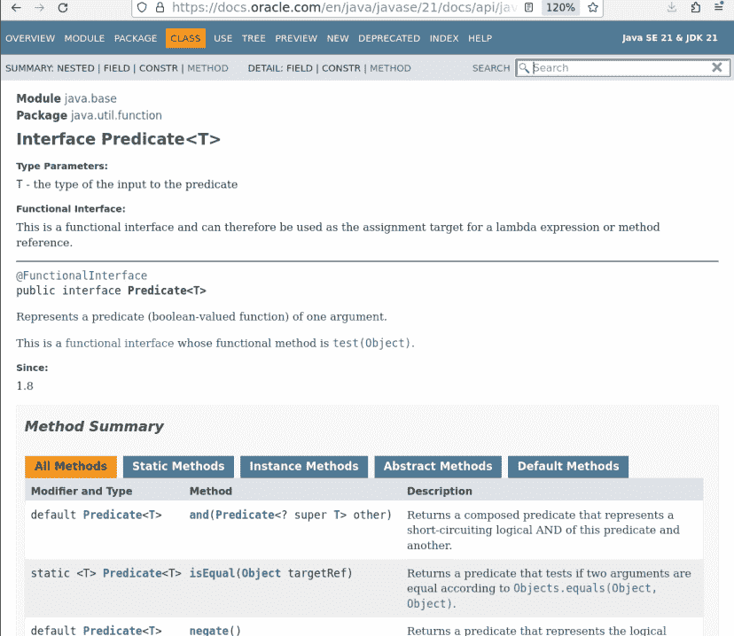

`@Inherited` 元注解仅适用于类的类的注解。当一个类具有继承的注解时，它的所有子类都自动拥有相同的注解。这使得创建类似于标记接口（如 `Serializable` 接口）的注解变得简单。

假设你定义了一个继承注解 `@Persistent`，用来表示该类的对象可以保存到数据库中。

图 11.1：一个记录的注解

那么，persistent 类的子类会自动被标记为 persistent。

```java
@Inherited @interface Persistent { }
```

```java
@Persistent class Employee { . . }
class Manager extends Employee { . . } // 也是
@Persistent
```

`@Repeatable` 元注解允许多次应用同一个注解。例如，JUnit 的 `@Tag` 注解是可重复的。它可以这样使用：

```java
@Tag("localized")
@Tag("showstopper")
void testHello() { . . }
```

出于历史原因，可重复注解的实现者需要提供一个容器注解，用以数组的形式持有重复的注解。

以下是定义 `@Tag` 注解及其容器的方式：

```java
@Repeatable(Tag.class)
@interface Tag
{
    String value();
}
```

```java
@interface Tags
{
    Tag[] value();
}
```

每当用户提供两个或多个 `@Tag` 注解时，它们会自动封装进 `@Tags` 注解中。这增加了处理注解的复杂度，正如你在下一节中看到的。

## 11.4. 在运行时处理注解

到目前为止，你已经了解了如何在源文件中添加注解以及如何定义注解类型。现在是时候看看这些工作能带来什么成果了。

在本节中，我将向你展示一个使用第 5 章见过的反射 API 在运行时处理注解的简单示例。假设我们想要减少实现 `toString` 方法的单调性。当然，可以使用反射编写一个通用的 `toString` 方法，简单简单地包含所有的字段名和值。但假设我们想要自定义该过程。我们可能不想包含所有字段，或者我们可能想跳过类名和变量名。例如，对于 `Point` 类，我们可能更倾向于 `[5,10]` 而不是 `Point[x=5,y=10]`。当然，任何数量的其他增强都是可能的，但让我们保持简单。要点是演示注解处理器可以做什么。

用 `@ToString` 注解注解所有希望从此服务中受益的类。此外，所有应该被包含的字段也应该被注解。该注解的定义如下：

```java
@Target({ElementType.FIELD, ElementType.RECORD_COMPONENT,
ElementType.TYPE})
@Retention(RetentionPolicy.RUNTIME)
public @interface ToString
```

```java
{
  boolean includeName() default true;
}
```

以下是带注解的 `Point` 和 `Rectangle` 类：

```java
@ToString(includeName=false)
public class Point
{
  @ToString(includeName=false) private int x;
  @ToString(includeName=false) private int y;
  ...
}
```

```java
@ToString
public record Rectangle(
  @ToString(includeName=false) Point topLeft,
  @ToString int width,
  @ToString int height
)
```

其意图是将矩形表示为字符串 `Rectangle[[5, 10],width=20,height=30]`。

在运行时，我们无法修改给定类的 `toString` 方法。相反，让我们提供一个可以格式化任何对象的方法，在存在 `ToString` 注解时发现并使用它们。关键是这些方法：

```java
T getAnnotation(Class<T>)
T getDeclaredAnnotation(Class<T>)
T[] getAnnotationsByType(Class<T>)
```

属于 `AnnotatedElement` 接口。反射类 `Class`、`Field`、`Parameter`、`Method`、`Constructor` 和 `Package` 实现了该接口。

带有 `Declared` 字样的反射方法产生的是类本身的注解，而其他方法则包含继承的注解。在注解的上下文中，这意味着注解是 `@Inherited` 并应用于父类的。

如果注解不是重复的，调用 `getAnnotation` 来定位它。例如：

```java
Class<?> cl = obj.getClass();
ToString ts = cl.getAnnotation(ToString.class);
if (ts != null && ts.includeName()) . . .
```

注意你传递注解的类对象（这里是 `ToString.class`），并返回一个实现了 `ToString` 接口的代理对象。你可以调用接口方法来获取注解的值。如果注解不存在，`getAnnotation` 返回 `null`。

如果注解是重复的，情况会变得复杂。如果你调用 `getAnnotation` 来查找可重复注解，而该注解实际上是重复的，你也会得到 `null`。

这是因为重复的注解被封装在容器注解内部。

在这种情况下，你应该调用 `getAnnotationsByType`。该调用会“透视”容器并返回重复注解数组。如果只有一个注解，你会得到一个长度为 1 的数组。通过这种方法，你不需要担心容器。

`getAnnotations` 方法获取与项目被注解的所有注解（任何类型），其中重复注解被封装在容器中。


列表 11.2 显示了感知注解的 `toString` 方法的实现。

当类被注解为 `ToString` 时，该方法会遍历其字段并打印那些也被注解的字段。如果 `includeName` 元素为 `true`，则类名或字段名将包含在字符串中。

注意该方法会递归调用自己。每当对象属于未被注解的类时，就会使用其常规 `toString` 方法，递归停止。

图 11.2 显示了在此示例中如何处理注解。

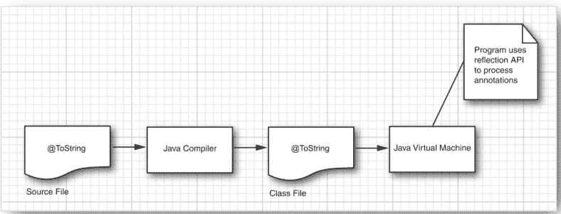

# 图 11.2: 在运行时处理注解

这是运行时注解 API 的简单但典型的用法。使用反射查找类、字段等；在可能带有注解的元素上调用 `getAnnotation` 或 `getAnnotationsByType` 来检索注解；然后调用注解接口的方法来获取元素值。

> 列表 11.1

`runtimeAnnotations/RuntimeAnnotationDemo.java`

```
1 package runtimeAnnotations;
2 
3 public class RuntimeAnnotationDemo
4 {
5     public static void main(String[] args)
6     {
7         var rect = new Rectangle(new Point(5, 10), 20, 30);
8         System.out.println(ToStrings(rect));
9     }
10 }
```

# 列表 11.2 `runtimeAnnotations/ToStrings.java`

```java
package runtimeAnnotations;
import java.lang.reflect.*;
public class ToStrings {
    public static String toString(Object obj) {
        if (obj == null) return "null";
        Class<?> cl = obj.getClass();
        ToString ts = cl.getAnnotation(ToString.class);
        if (ts == null) return obj.toString();
        var result = new StringBuilder();
        if (cl.includeName()) result.append(cl.getName());
        result.append(":=");
```

39 return result.toString();

40 }

41 }

```

## `java.lang.reflect.AnnotatedElement` 5.0

- `boolean isAnnotationPresent(Class<? extends Annotation> annotationType)`
  如果此项具有给定泛的注解，则返回 `true`。
- `<T extends Annotation> T getAnnotation(Class<T> annotationType)`
  获取给定类型的注解，如果此项没有此类注解，则返回 `null`。
- `<T extends Annotation> T[] getAnnotationsByType(Class<? extends T> annotationType)`
  获取所有可重复注解类型的所有注解（参见第 11.3.2 节）。如果没有找到，则返回长度为 0 的数组。
- `Annotation[] getAnnotations()`
  获取此项存在的所有注解，包括继承的注解。如果没有找到，则返回长度为 0 的数组。
- `Annotation[] getDeclaredAnnotations()`
  获取为此项声明的所有注解，不包括继承的注解。如果没有找到，则返回长度为 0 的数组。

## 11.5. 源码级注解处理

在上一节中，你已经了解了如何分析运行中程序中的注解。注解的另一个用途是对源文件进行自动处理，以产生更多的源代码、配置文件、脚本或任何可能想要生成的内容。

为了向你展示其机制，我将重复生成 `toString` 方法的示例。但是，这次我们在 Java 源码中生成它们。这样这些方法将与程序的其余部分一起编译，并全速运行，而不是使用反射。

### 11.5.1. 注解处理器

注解处理集成到 Java 编译器中。在编译期间，你可以通过运行以下命令调用注解处理器：

```
javac -processor ProcessorClassName1,ProcessorClassName2,. . . sourceFiles
```

编译器会定位源文件的注解。每个注解处理器按顺序执行，并获得它感兴趣的注解。如果注解处理器创建了新的源文件，则重复该过程。一旦某轮处理不再产生更多的源文件，所有源文件都将被编译。

> 注意：注解处理器只能生成新的源文件。它不能修改现有的源文件。

注解处理器实现了 `Processor` 接口，通常通过扩展 `AbstractProcessor` 类来实现。你需要指定你的处理器支持哪些注解。在我们的案例：

```java
@SupportedAnnotationTypes("annotations.ToString")
@SupportedSourceVersion(SourceVersion.RELEASE_8)
public class ToStringAnnotationProcessor extends
    AbstractProcessor
{
    public boolean process(Set<? extends TypeElement> annotations,
        RoundEnvironment currentRound)
    {
        .
        .
    }
}
```

处理器可以声明特定的注解类型、通配符（例如 `"com.horstmann.\*"` 表示 `com.horstmann` 包或任何子包中的所有注解），甚至是 `"\*"`（表示所有注解）。

`process` 方法每轮被调用一次，参数是该轮次在任何文件中找到的所有注解集合，以及一个包含当前处理轮信息的 `RoundEnvironment` 引用。

### 11.5.2. 语言模型 API

使用语言模型 API 分析源码级注解。与呈现类和方法的虚拟机表示的反射 API 不同，语言模型 API 允许根据 Java 语言规则分析 Java 程序。

编译器生成一棵树，其节点是实现 `javax.lang.model.element.Element` 接口及其子接口（`TypeElement`、`VariableElement`、`ExecutableElement` 等）的类的实例。这些是 `Class`、`Field/Parameter`、`Method/Constructor` 反射类的编译对应物。

我不详细介绍该 API，但这里是你处理注解时需要知道的。

- `RoundEnvironment` 通过调用方法 `Set<? extends Element> getElementsAnnotatedWith(Class<? extends Annotation> annotationType)` 为你提供带有特定注解的元素集合。
- 第二个方法对于重复注解很有用。
- `TypeElement` 代表类或接口。`Element` 上的 `SimpleName` 可以转换为字符串。
- `getEnclosedElements()` 在 `TypeElement` 上产生字段和方法。
- `getAnnotation(Class<? extends Annotation> annotationType)` 返回注解或 `null`。
- `getAnnotationsByType(Class<? extends T> annotationType)` 返回针对给定类型的所有注解。
- `getAnnotations()` 在 `AnnotatedElement` 上产生所有注解。

## 11.5.3. 使用注解生成代码

让我们回到生成 `toString` 方法的任务。我们不能将这些方法放入原始类中——注解处理器只能产生新类。

因此，我们将方法添加到工具类 `ToStrings` 中：

```java
public class ToStrings {
    public static String toString(Object obj) {
        if (obj == null) return "null";
        Class<?> cl = obj.getClass();
        ToString ts = cl.getAnnotation(ToString.class);
        if (ts == null) return obj.toString();
        var result = new StringBuilder();
        if (cl.includeName()) result.append(cl.getName());
        result.append(":=");
```

由于不想使用反射，我们注解访问器方法而不是字段：

```java
@ToString
public class Rectangle {
    @ToString(includeName=false) public Point getTopLeft() {
      return topLeft; }
    @ToString public int getWidth() { return width; }
    @ToString public int getHeight() { return height; }
}
```

注解处理器随后应该生成以下源码：

```java
public static String toString(Rectangle obj) {
  var result = new StringBuilder();
  result.append("Rectangle");
  result.append("[");
  result.append(",");
  result.append(toString(obj.getTopLeft()));
  result.append("width=");
  result.append(toString(obj.getWidth()));
  result.append(",");
  result.append("height=");
  result.append(toString(obj.getHeight()));
  result.append("]");
  return result.toString();
}
```

模板代码是灰色的。这里是为具有给定 `TypeElement` 的类生成 `toString` 方法的概述：

```java
private writeToStringMethod(PrintWriter out, TypeElement te) {
  String className = te.getQualifiedName().toString();
  // 打印方法头和字符串声明
  ToString ann = te.getAnnotation(ToString.class);
  if (ann.includeName()) // 打印代码添加类名
  for (Element c : te.getEnclosedElements()) {
    ann = c.getAnnotation(ToString.class);
    if (ann != null) {
      if (ann.includeName()) // 打印代码添加字段名
        // 打印代码添加 toString(obj.methodName())
    }
  }
  // 打印代码返回字符串
}
```

这里是注解处理器 `process` 方法的概述。它为工具类创建一个源文件，并为每个注解的类写入一个方法。

```java
public boolean process(Set<? extends TypeElement> annotations,
    RoundEnvironment currentRound)
{
    if (annotations.size() == 0) return true;
    try
    {
      JavaFileObject sourceFile =
      processingEnv.getFiler().createSourceFile(
```

```java
"annotations.ToString");
try (var out = new PrintWriter(sourceFile.openWriter()))
{
  // Print code for package and class
  for (Element e : currentRound.getElementsAnnotatedWith(ToString.class))
    if (e instanceof TypeElement te)
      writeToStringMethod(out, te);
  // Print code for toString(Object)
}
catch (IOException ex)
{
  processingEnv.getMessage().printMessage(Kind.ERROR, ex.getMessage());
}
return true;
```

注意，`process` 方法会在随后的轮次中被调用，此时注解列表为空。它会立即返回，因此不会重复创建源文件。

> 提示：要查看轮次，请运行带有 `-XprintRounds` 标志的 `javac` 命令：

- Round 1:
  input files: [rect.Point, rect.Rectangle, rect.SourceLevelAnnotationDemo]
  annotations: [sourceAnnotations.ToString]
  last round: false

- Round 2:
  input files: {sourceAnnotations.ToString}
  annotations: []
  last round: false

- Round 3:
  input files: {}
  annotations: []
  last round: true

要运行示例程序，首先编译注解处理器，然后使用它来编译 demo：

```bash
javac sourceAnnotations.ToStringAnnotationProcessor.java
avac -XprintRounds -processor sourceAnnotations.ToStringAnnotationProcessor rect/*.java
java rect.SourceLevelAnnotationDemo
```

这个示例演示了工具如何收集源注解以生成其他文件。生成的文件不必是源文件。注解处理器可以选择生成 XML 描述符、属性文件、shell 脚本、HTML 文档等。

> 注意：有些人建议使用注解来消除更繁琐的工作。如果能自动生成琐碎的 getter 和 setter，那不是很好吗？例如，注解

`@Property private String title;`

可以产生以下方法：

```java
public String getTitle() { return title; }
public void setTitle(String title) { this.title = title; }
```

然而，这些方法需要添加到同一个类中。这需要编辑源文件，而不仅仅是生成另一个文件，这超出了注解处理器的能力范围。虽然可以为此目的构建另一个工具，但这种工具将背背注解的初衷。注解的设计意图是关于代码项的描述，而不是添加或更改代码的指令。

一个名为 Project Lombok 的流行工具已经找到了绕过这一限制的方法。通过在注解处理期间修改内部数据结构，它可以产生 getter 和 setter 方法。至少目前，它是生效的，但它不是标准的 Java。

## 列表 11.3 `rect/SourceLevelAnnotationDemo.java`

```java
package rect;

import sourceAnnotations.ToString;

public class SourceLevelAnnotationDemo {
    public static void main(String[] args) {
        var rect = new Rectangle(new Point(5, 10), 20, 30);
        System.out.println(ToString.toString(rect));
    }
}
```

## 列表 11.4 `sourceAnnotations/ToStringAnnotationProcessor.java`

```java
package sourceAnnotations;

import java.beans.*;
import java.io.*;
import java.util.*;
import javax.annotation.processing.*;
import javax.lang.model.*;
import javax.lang.model.element.*;
import javax.tools.*;
```


```java
import javax.tools.Diagnostic.Kind;

@SupportedAnnotationTypes("sourceAnnotations.ToString")
@SourceVersion(SourceVersion.RELEASE_21)
public class ToStringAnnotationProcessor extends AbstractProcessor {

    public boolean process(Set<? extends TypeElement> annotations,
                           RoundEnvironment currentRound) {
        if (annotations.size() == 0) return true;

        try {
            JavaFile sourceFile = processingEnv.getFiler().createSourceFile("sourceAnnotations.ToString");

            try (var out = new PrintWriter(sourceFile.openWriter())) {
                out.println("// Automatically generated by " + "sourceAnnotations.ToStringAnnotationProcessor");
                out.println("package sourceAnnotations;");
                out.println("public class ToString {");

                for (Element annotatedElement : currentRound.getElementsAnnotatedWith(ToString.class)) {
                    if (annotatedElement instanceof TypeElement te) {
                        writeToStringMethod(out, te);
                    }
                }

                out.println("public static String toString(Object obj) {");
                out.println("    return java.util.Objects.toString(obj);");
                out.println("}");
                out.println("");
                out.println("}");
            }
        } catch (IOException e) {
            processingEnv.getMessage().printMessage(Kind.ERROR, e.getMessage());
        }

        return true;
    }

    private void writeToStringMethod(PrintWriter out, TypeElement te) {
        String className = te.getQualifiedName().toString();

        out.println("    public String toString(" + className + ") {");
        out.println("        StringBuilder result = new StringBuilder();");
        out.println("        result.append(\"\" + className + +\":=\\");");
        // ... (implementation details)
        out.println("        return result.toString();");
        out.println("    }");
    }
}
```

## 11.6. 字节码工程

你已经看到注解如何在运行时或源代码级别上被处理。还有第三种可能性：在字节码级别进行处理。除非注解在源码级别被移除，否则它们会存在于类文件中。

类格式是有文档说明的（参见 https://docs.oracle.com/javase/specs/jvms/se21/html）。该格式相当复杂，在没有特殊库的情况下，处理类文件将具有挑战性。其中一个库是 ASM 库，位于 https://asm.ow2.org。下载`asm-9.6.jar`和`asm-commons-9.6.jar`，并将它们放在你选择的目录中，称为`asm`。

### 11.6.1. 修改类文件

在本节中，我们使用 ASM 为带注解的方法添加日志消息。如果一个方法被注解为：

```java
@LogEntry(logger=loggerName)
```

我们会在方法开头添加以下语句的字节码：

```java
System.getLogger(loggerName).log(System.Logger.Level.TRACE, "Entering " + className + methodName);
```

例如，如果你将`Item`类的`hashCode`方法注解为：

```java
@LogEntry(logger="loggerName")
```

那么将打印类似下面的消息：

为了实现这一目标，我们执行以下操作：

1. 加载类文件中的字节码。
2. 定位所有方法。
3. 对于每个方法，检查它是否具有`@LogEntry`注解。
4. 如果是，则在方法开头添加以下语句的字节码。

```text
2023年12月3日 下午5:58:44 set.Item.equals
INFO: 进入 equals
[[description=微波炉, partNumber=4104],
[description=烤面包机, partNumber=1279]]
```

注意当我们两次插入同一个项时，对`equals`的调用。

这个示例展示了字节码工程的威力。注解（Annotations）用于向程序添加指令，而字节码编辑工具会获取这些指令并修改虚拟机指令。

# 列表 11.5：`bytecodeAnnotations/EntryLogger.java`

```java
package bytecodeAnnotations;

import java.io.*;
import java.nio.file.*;

import org.objectweb.asm.*;
import org.objectweb.asm.commons.*;

/**
 * 为类中带有 LogEntry 注解的方法添加“进入（entering）”日志。
 *
 * @version 1.22 2023-12-01
 * @author Cay Horstmann
 */
public class EntryLogger extends ClassVisitor {
    private String className;

    /**
     * 构造 EntryLogger，在给定类的被注解的方法中插入日志。
     */
    public EntryLogger(ClassWriter writer, String className) {
        super(Opcodes.ASM8, writer);
        this.className = className;
    }

    public MethodVisitor visitMethod(int acc, String methodName, String desc,
                                     String signature, String[] exceptions) {
        MethodVisitor mv = cv.visitMethod(access, methodName, desc, signature, exceptions);

        return new AdviceAdapter(Opcodes.ASM8, mv, acc, methodName, desc) {
            private String loggerName;

            public AnnotationVisitor visitAnnotation(String desc, boolean visible) {
                return new AnnotationVisitor(Opcodes.ASM8) {
                    public void visit(String name, Object value) {
                        if (desc.equals("LbytecodeAnnotations/LogEntry")
                                && name.equals("logger")) {
                            loggerName = value.toString();
                        }
                    }
                };
            }

            public void onEnter() {
                if (loggerName != null) {
                    /*
                    visitLdcInsn(loggerName);
                    visitMethodInsn(INVOKESTATIC, "java/util/logging/Logger", "getLogger",
                                    false);
                    "(Ljava/lang/String;)Ljava/util/logging/Logger";
                    visitLdcInsn(className);
                    visitLdcInsn(methodName);
                    visitMethodInsn(INVOKEVIRTUAL, "java/util/logging/Logger", "entering",
                                    "(Ljava/lang/String;Ljava/lang/String)V", false);
                    visitLdcInsn(loggerName);
                    visitMethodInsn(INVOKESTATIC, "java/lang/System",
                                    "getLogger",
                                    "(Ljava/lang/String;)Ljava/lang/System$Logger", false);
                    visitFieldInsn(Opc.GETSTATIC,
                                   "java/lang/System$LoggerLevel", "INFO",
                                   "Ljava/lang/System$Logger;;");
                    visitLdcInsn("Entering {0}");

                    // 创建长度为 2 的 Object 数组
                    mv.visitMethodInsn(Opc.CONST_2); // 数组长度
                    mv.visitTypeInsn(Opc.ANEARRAY, "java/lang/Object"); // 数组类型

                    // 向数组添加两个对象
                    mv.visitMethodInsn(Opc.DUP); // 复制数组引用
                    mv.visitMethodInsn(Opc.CONST_0); // 索引 0
                    visitLdcInsn(className);
                    mv.visitMethodInsn(Opc.ASTORE); // 存储到数组

                    mv.visitMethodInsn(Opc.DUP); // 复制数组引用
                    mv.visitMethodInsn(Opc.CONST_1); // 索引 1
                    visitLdcInsn(methodName);
                    mv.visitMethodInsn(Opc.ASTORE); // 存储到数组

                    mv.visitMethodInsn(INVOKEVINTERFACE, "java/lang/System$Logger",
                                       "log",
                                       "(Ljava/lang/System$LoggerLevel;Ljava/lang/String;)",
                                       true);
                    loggerName = null;
                    */
                }
            }
        };
    }

    /**
     * 给给类添加进入日志代码。
     *
     * @param args 要补丁的类文件名
     */
    public static void main(String[] args) throws IOException {
        if (args.length == 0) {
            System.out.println("USAGE: java bytecodeAnnotations.EntryLogger classfile");
            System.exit(1);
        }

        Path path = Path.of(args[0]);
        var reader = new ClassReader(Files.newInputStream(path));
        var writer = new ClassWriter(ClassWriter.COMPUTE_FRAMES);

        reader.accept(writer, 0);
        Files.write(path, writer.toByteArray());
    }
}
```

## 11.6.2. 在加载时修改字节码

在上一节中，你看到了一个编辑类文件的工具。然而，在构建过程中添加另一个工具可能非常繁琐。另一种方法是将字节码工程推到类加载阶段。`Instrumentation` API 提供了一个用于安装类文件转换器的钩子。你可以通过定义代理（agent）来实现这一点。

构建代理所需的步骤如下：

- 实现一个带有`premain`方法的类：

  ```java
  public static void premain(String arg, Instrumentation instr);
  ```

  该方法在代理加载时调用。代理可以获取命令行参数，通过`arg`参数传递。`instr`参数用于安装各种钩子。

- 创建清单文件`EntryLoggingAgent.mf`，设置`Premain-Class`属性，例如：

  ```text
  Premain-Class: bytecodeAnnotations.EntryLogger
  ```

- 将代理代码和清单打包成 JAR 文件：

  ```bash
  javac -classpath :/* bytecodeAnnotations/EntryLogger.java

  jar cvfm EntryLoggingAgent.jar bytecodeAnnotations/EntryLoggingAgent.mf bytecodeAnnotations/*.class
  ```

要同代理启动 Java 程序，使用以下命令行选项：

```bash
java -javaagent:AgentJARFile=agentArgument .
```

例如，要带有进入日志代理运行`SetTest`程序，调用：

```bash
javac set/*.java
java -javaagent:EntryLoggingAgent.jar=set.Item -classpath .:/* set.SetTest
```

这里的`Item`参数是代理应该修改的类名。

列表 11.8 显示了代理代码。代理安装了一个类文件转换器。转换器首先检查类名是否匹配代理参数。如果是，则使用上一节中的`EntryLogger`类来修改字节码。

然而，修改后的字节码并没有保存到文件。相反，转换器返回它们以便加载到虚拟机中（见图 11.3）。换句话说，这种技术执行了“即时”字节码修改。

# 图 11.3：在加载时修改类

# 列表 11.8：`bytecodeAnnotations/EntryLoggingAgent.java`

```java
package bytecodeAnnotations;

import java.lang.instrument.*;
import java.security.*;

import org.objectweb.asm.*;

/**
 * @version 1.11 2018-05-01
 * @author Cay Horstmann
 */
public class EntryLoggingAgent {
    public static void main(final String arg, Instrumentation instr) {
        instr.addTransformer(new ClassFileTransformer() {
            public byte[] transform(ClassLoader loader, String className,
                                    ProtectionDomain pd, byte[] data)
                    throws IllegalClassFormatException {
                if (!className.replace("/", ".").equals(arg)) return null;

                var reader = new ClassReader(data);
```


```java
var writer = new ClassWriter(
    ClassWriter.COMPUTE_MAXS | ClassWriter.COMPUTE_FRAMES);

var el = new EntryLogger(writer, className);

reader.accept(el, ClassReader.EXPAND_FRAMES);

return writer.toByteArray();
```

在本章中，你已经学习了如何：

- 向 Java 程序中添加注解
- 设计你自己的注解接口
- 实现利用注解的工具

你已经看到了三种处理代码的技术：脚本化、编译 Java 程序以及处理注解。前两种非常直观。相比之下，构建注解工具无疑是复杂的，而且并不是大多数开发者需要处理的任务。本章为你理解你将要接触的注解工具的内部工作原理提供了背景，并可能激发了你开发自己工具的兴趣。

下一章将讨论 Java 平台模块系统（Java Platform Module System），这是确保 Java 平台完整性的关键特性。

# 第 12 章 Java 平台模块系统

面向对象编程的一个重要特性是封装。一个类的声明由公共接口和私有实现组成。类可以通过更改实现来演进，而不会影响其用户。模块系统为大规模编程提供了类似的益处。模块可以选择性地公开某些类和包，从而控制其演进。

若干 Java 模块系统依赖类加载器来隔离类。然而，Java 9 引入了一个新系统，称为 Java 平台模块系统，它得到了 Java 编译器和虚拟机的支持。它的设计目的是为了将 Java 平台庞大的代码模块化。如果你愿意，可以使用该系统将你自己的应用程序模块化。

无论你在自己的应用程序中使用未使用 Java 平台模块，都可能受到模块化 Java 平台的影响。本章将向你展示如何声明和使用 Java 平台模块。你还将学习如何迁移你的应用程序以适配模块化的 Java 平台和第三方模块。

## 12.1. 模块概念

在面向对象编程中，基本的构建块是类。类提供了封装。私有特性只能由具有显式权限的代码访问——即类的方法。这使得对访问进行推理成为可能。如果一个私有变量发生了变化，你可以列出所有可能的罪魁祸首。如果你需要修改私有表示，你知道哪些方法受了影响。

在 Java 中，包提供了更大级别的组织分组。包是类的集合。包也提供了某种层次的封装。任何具有包访问权限（既不是公有的也不是私有的）的特性只能从同一个包中的方法访问。

然而，在大型系统中，这种级别的访问控制是不够的。任何公共特性（即可以在包外部被访问的特性）在任何处都是可用的。假设你想修改或丢弃一个很少使用的特性。一旦它是公有的，就没有办法去推断该更改的影响了。

这就是 Java 平台设计者面临的困境。在二十多年里，JDK 飞速增长，显然某些特性现在已经基本上过时了。大家最喜欢的例子是 CORBA。你上次使用它是什么时候？然而，`org.corba` 包一直到 Java 10 都随每个 JDK 发行。从 Java 11 开始，少数仍需要它的人必须向其项目添加所需的 JAR 文件。

`java.awt` 呢？它在服务端应用程序中不应该是必须的，对吧？除非 `java.awt.DataFlavor` 类被 SOAP（一种基于 XML 的 Web 服务协议）的实现中使用。

Java 平台设计者面对一个巨大的代码乱团，决定他们需要一种提供更多控制的结构化机制。他们查看了现有的模块系统（如 OSGi），发现它们不适合他们的问题。相反，他们设计了一个新系统，称为 Java 平台模块系统（Java Platform Module System），它现在是 Java 语言和虚拟机的一部分。该系统已成功地用于 Java API 的模块化，如果你愿意，也可以将其用于你自己的应用程序。

一个 Java 平台模块由：

- 包的集合
- 可选的资源文件和其他文件（如本地库）
- 模块中可访问的包列表
- 该模块所依赖的所有模块列表

Java 平台在编译时和虚拟机中都强制封装和依赖关系。

为什么你应该考虑为自己的程序使用 Java 平台模块系统，而不是遵循在类路径使用 JAR 文件的传统方法？有两个优势：

1. **强封装**：你可以控制哪些包是可访问的，你不必担心维护那些你并不打算公开的代码。
2. **可靠的配置**：你避免了常见的类路径问题，如类的重复或缺失。

Java 模块系统没有解决某些问题，例如模块的版本。它不支持指定需要哪个版本的模块，也不支持在同一个程序中使用多个版本的模块。

## 12.2. 模块命名

模块是包的集合。模块中的包名不需要相互关联。例如，`java.sql` 模块包含 `java.sql`、`javax.sql` 和 `javax.transaction` 包。此外，正如从这个示例所示，模块名与包名相同是完全可以的。

就像包名一样，模块名由字母、数字、下划线和点组成。同样，就像包名一样，模块之间没有层级关系。如果你有一个 `com.horstmann.corejava` 模块，它们是彼此无关的。

在创建供他人使用的模块时，确保其名称在全局范围内唯一是重要的。预计大多数模块名将像包名一样遵循“反向域名”约定。

最简单的方法是根据模块提供的顶层包来命名模块。例如，SLF4J 日志门面有一个名为 `org.slf4j` 的模块，包含 `org.slf4j`、`org.slf4j.spi`、`org.slf4j.event` 和 `org.slf4j.helpers` 包。

这种约定防止了模块中的包名冲突。任何给包只能放置在一个模块中。如果你的模块名是唯一的，且你的包名以模块名开头，那么你的包名也将是唯一的。

对于不供其他程序员使用的模块可以使用较短的模块名，例如包含应用程序的模块。为了证明可以这样做，我将在本章中这样做。具有可能作为库代码的模块将使用如 `com.horstmann.util` 的名称，而包含程序的（带有 `main` 方法类的）模块将使用引人注目的名称，如 `hellomod`。

> 注意：模块名仅用于模块声明。在你的 Java 类的源文件中，你永远不会引用模块名；相反，请像过去以来一样使用包名。

## 12.3. 模块化的“Hello, World!”程序

让我们把传统的“Hello, World!”程序放入模块中。首先，我们需要将类放入包中——“未命名包”不能包含在模块中。它是这样的：

```java
package com.horstmann.hello;

public class HelloWorld {
    public static void main(String[] args)
}
```

```java
System.out.println("Hello, Modular World!");
}
```

到目前为止，一切都没有变化。要创建一个包含此包的模块 `vch12.hellomod`，你需要添加一个模块声明。将其放置放在名为 `module-info.java` 的文件中，位于基目录下（即包含 `com` 目录的相同目录）。按照惯，基目录的名称与模块名称相同。

- `vch12.hellomod/`
  - `module-info.java`
  - `com/`
    - `horstmann/`
      - `hello/`
        - `HelloWorld.java`

`module-info.java` 文件包含模块声明：

```java
module vch12.hellomod {}
```

此模块声明是空的，因为该模块没有向任何人提供任何内容，也不需要任何东西。

现在，像往一样编译：

```bash
javac vch12.hellomod/module-info.java \
vch12.hellomod/com/horstmann/hello/HelloWorld.java
```

`module-info.java` 文件看起来不像一个 Java 源代码文件，而且显然不能有一个名为 `module-info` 的类，因为类名不能包含连字符。`module` 关键字，以及你在后续章节中看到的 `exports`、`requires` 等关键字，都是“限制关键字”，它们仅在模块声明中具有特殊含义。该文件被编译成一个 `module-info.class` 类文件，其中以二进制形式包含了模块定义。

要作为模块化应用程序运行此程序，你需要指定模块路径（module path），它类似于类路径（class path），但包含模块。你还需要以“模块名:类名”的格式指定主类：

```bash
java --module-path vch12.hellomod \
--module vch12.hellomod/com.horstmann.hello.HelloWorld
```

你可以使用单字母选项 `-p` 和 `-m` 代替 `--module-path` 和 `--module`：

```bash
java -p vch12.hellomod -m \
vch12.hellomod/com.horstmann.hello.HelloWorld
```

无论哪种方式，都会出现“Hello, Modular World!”问候，这证明你成功地将你的第一个应用程序模块化。

> 注意：当你编译此模块时，会得到一个警告：
>
> ```text
> warning: [module] module name component vch12 should avoid terminal digits
> ```
>
> 此警告旨在劝程序员不要在模块名称中添加版本号。你可以忽略该警告，或者使用注解来抑制它：

```java
@SuppressWarnings("module")
module vch12.hellomod {}
```

在这一点上，模块声明与类声明一样：你可以对它进行注解。（注解类型的目标必须是 `ElementType.MODULE`。）

## 12.4. 引用模块

让我们创建一个新模块 `v1ch12.requiremod`，在其中程序使用 `JOptionPane` 来显示“Hello, Modular World!”消息：

```java
package com.horstmann.hello;

import javax.swing.JOptionPane;

public class HelloWorld {
    public static void main(String[] args) {
        JOptionPane.showMessageDialog(null, "Hello, Modular World!");
    }
}
```

现在编译失败，并显示此消息：

```text
error: package javax.swing is not visible

(package javax.swing is declared in module java.desktop,

but module v1ch12.requiremod does not read it)
```

JDK 已经模块化，`javax.swing` 包现在包含在 `java.desktop` 模块中。我们的模块需要声明它依赖于模块：

```java
module v1ch12.requiremod {
    requires java.desktop;
}
```

模块系统的设计目标是让模块显式地声明它们的需求，这样虚拟机就可以启动程序之前确保所有需求都已满足。

在前面的章节中，并没有出现显式需求的需求，因为我们只使用了 `java.lang` 和 `java.io` 包。这些包包含在 `java.base` 模块中，该模块默认被需要。

注意，我们的 `v1ch12.requiremod` 模块只列出了它自己的模块需求。它需要 `java.desktop` 模块以便使用 `javax.swing` 包。`java.desktop` 模块本身声明它需要另外三个模块，即 `java.datatransfer`、`java.prefs` 和 `java.xml`。

图 12.1 显示了模块图，其节点是模块。图的边（即连接节点的箭头）要么是声明的需求，要么在没有声明需求时是 `java.base` 的隐含需求。

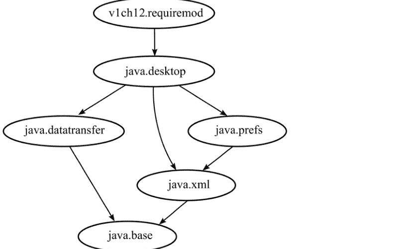

**图 12.1：Swing "Hello, Modular World”应用程序的模块图**

模块图中不能存在循环——也就是说，模块不能直接或间接地引用自己。

模块不会自动将访问权限传递给其他模块。在我们的示例中，`java.desktop` 模块声明它需要 `java.prefs`，`java.prefs` 模块声明它需要 `java.xml`。这并没有赋予 `java.desktop` 使用 `java.xml` 模块包的权利。它需要显式地声明该需求。在数学术中，`requires` 关系不是“传递的”。通常情况下这种行为是理想的，因为它让需求变得显式，但正如你在 12.11 中看到的，在某些情况下你可以放宽。

> **注意：** 本节开头的错误消息说明我们的 `vch12` 模块没有“读取” `java.desktop`。在 Java 平台模块系统的术语中，M 在以下情况读取 N：

1. M 引用 N。
2. M 传递性引用引用 N（参见 12.11）。
3. N 是 `java.base`。

## 12.5. 导出包

在前面的章节中，你看到如果模块想要使用另一个模块的包，就必须引用该模块。然而，这并不会自动让所需模块中的所有包可用。模块使用 `exports` 关键字声明它的哪些包是可访问的。例如，这里是 `java.xml` 模块声明的一部分：

```java
module java.xml {
    exports javax.xml;
    exports javax.xml.catalog;
    exports javax.xml.datatype;
    exports javax.xml.namespace;
    exports javax.xml.parsers;
}
```

该模块提供了许多包，但隐藏了其他包。当一个包被导出时，它的公共和受保护的类、接口，以及它们的公共和受保护成员在模块外部是可访问的。（一如既往，受保护类型和成员仅在子类和相同包中可访问。）

然而，未导出的包在模块外部是不可访问的。这与模块化之前的 Java 有很大不同。在过去，可以使用任何包的公共类，即使它不是公共 API 的。例如，当公共 API 未提供相应功能时，通常建议使用 `sun.misc.BASE64Encoder` 或 `com.sun.rowset.CachedRowSetImpl` 等类。

现在，你无法访问 Java 平台的包，因为它们都包含在模块内部。结果是某些程序在 Java 9 下将无法运行。当然，没有人承诺保持非公共 API 可用，因此这不应该令人惊讶。

让我们在一个简单的场景中应用 `exports`。我们将准备一个 `com.horstmann.greet` 模块，它导出一个也名为 `com.horstmann.greet` 的包，遵循为他人提供代码的模块以其内部顶层包命名的惯例。

我们还有一个未导出的 `com.horstmann.greet.internal` 包。一个公共的 `Greeter` 接口位于第一个包中。

```java
package com.horstmann.greet;

public interface Greeter {
    static Greeter newInstance() {
        return new com.horstmann.greet.internal.GreeterImpl();
    }

    String greet(String subject);
}
```

第二个包有一个实现该接口的类。该类是公共的，因为它在第一个包中被访问。

```java
package com.horstmann.greet.internal;

import com.horstmann.greet.Greeter;

public class GreeterImpl implements Greeter {
    public String greet(String subject) {
        return "Hello, " + subject + "!";
    }
}
```

`com.horstmann.greet` 模块包含两个包，但只导出了第一个：

```java
module com.horstmann.greet {
    exports com.horstmann.greet;
}
```

第二个包在模块外部是不可访问的。

我们将应用程序放入第二个模块中，该模块将需要第一个模块：

```java
module v1ch12.exportedpkg {
    requires com.horstmann.greet;
}
```

> **注意：** `exports` 语句后面跟着的是包名，而 `requires` 后面跟着的是模块名。

我们的应用程序现在使用 `Greeter` 来获取问候：

```java
package com.horstmann.hello;

import com.horstmann.greet.Greeter;

public class HelloWorld {
    public static void main(String[] args) {
        Greeter greeter = Greeter.newInstance();
        System.out.println(greeter.greet("Modular World"));
    }
}
```


这是这两个模块的源文件结构：

- `com.horstmann.greet`
  - `module-info.java`
  - `com.horstmann.greet`
    - `Greeter.java`
    - `internal`
      - `GreeterImpl.java`
- `v1ch12.exportedpkg`
  - `module-info.java`
  - `com.horstmann.hello`
    - `HelloWorld.java`

要构建此应用程序，首先编译 `com.horstmann.greet` 模块：

```bash
javac com.horstmann.greet/module-info.java \
  com.horstmann.greet/com/horstmann/greet/Greeter.java \
  com.horstmann.greet/com/horstmann/greet/internal/GreeterImpl.java
```

然后，在模块路径上带有第一个模块并编译应用程序模块：

```bash
javac -p com.horstmann.greet v1ch12.exportedpkg/module-info.java \
  v1ch12.exportedpkg/com/horstmann/hello/HelloWorld.java
```

最后，在模块路径上带有两个模块运行程序：

```bash
java -p v1ch12.exportedpkg:com.horstmann.greet \
  -m v1ch12.exportedpkg/com.horstmann.hello.HelloWorld
```

此示例演示了如何在模块中隐藏实现类。实现类在模块外部是不可访问的。客户端使用接口和工厂方法，而不是实例化实现类。

> **注意：** 在 Windows cmd 提示符中，你必须将 `v1ch12.exportedpkg:com.horstmann.greet` 放在引号中，因为冒号字符有特殊含义。你还需要使用 `^` 代替 `\n` 来处理多行命令。

> **提示：** 要使用 Eclipse 构建此应用程序，请为每个模块创建一个单独的项目。在 `v1ch12.exportedpkg` 项目中，编辑项目属性。在 `Projects` 选项卡中，将 `com.horstmann.greet` 模块添加到模块路径——参见[图 12.2]。

你现在看到模块需要 `requires` 和 `exports` 语句，这些语句构成了 Java 平台模块系统的骨干。正如你看到的，模块系统在概念上是简单的。模块指定它们需要哪些模块，以及向其他模块提供哪些包。第 12.12 节显示 `exports` 语句的一种变体。

> **警告：** 模块不提供范围。你不能在不同的模块中拥有相同的包名。即使对于隐藏包（即未导出的包）也是如此。

## 12.6. 模块化 JAR

到为止，我们只是将模块编译到源码的目录树中。显然，这对于部署是不够的。相反，可以通过将其所有类放在 JAR 文件中并在根目录下放置 `module-info.class` 来部署模块。因此，JAR 文件被称为模块化 JAR。

要创建模块化 JAR 文件，按照通常的方式使用 `jar` 工具。如果你有多个包，最好使用 `-d` 选项进行编译，它会将类文件放在单独目录中。如果目录不存在，则会创建。然后使用 `jar` 命令的 `-C` 选项在收集文件时切换到该目录。

```bash
javac -d modules/com.horstmann.greet \
  com.horstmann.greet/module-info.java \
  com.horstmann.greet/com/horstmann/greet/internal/GreeterImpl.java \
  com.horstmann.greet/com/horstmann/greet/Greeter.java

jar -c -v -f com.horstmann.greet.jar -C modules/com.horstmann.greet .
```

如果你使用 Maven、Ant 或 Gradle 等构建工具，只需像往常一样构建你的 JAR 文件即可。只要包含了 `module-info.class`，你就能获得模块化 JAR。

然后，将模块化 JAR 包含模块路径，模块就会被加载。

> **注意：** 在过去，一个包的类有时分布在多个 JAR 文件中。（这样的包被称为“拆分包”）。这可能从来就一个好主意，而且在模块中是不可能的。

与普通 JAR 文件一样，你可以指定模块。

## 12.7. 模块与反射访问

在前面的章节中，你看到模块系统强制执行封装。模块只能访问来自另一个模块的导出的包。在过去，始终可以使用反射来克服访问限制。正如你在第 5 章中看到的，反射可以访问任何类的私有成员。

然而，在模块世界中，这不再成立。如果一个类位于模块内部，对非公共成员的反射访问将失败。具体来说，回想我们如何访问私有字段：

```java
Field f = obj.getClass().getDeclaredField("salary");

f.setAccessible(true);

double value = f.getDouble(obj);

f.setDouble(obj, value * 1.1);
```

除非安全管理器不允许访问私有字段，否则调用 `f.setAccessible(true)` 将成功。然而，在带有安全管理器的情况下运行 Java 应用程序并不常见，而且有很多库使用了反射访问。典型的例子包括对象关系映射器（如 JPA），它们会自动将对象持久化到数据库中，以及在对象与 XML 或 JSON 之间转换的库，如 JAXB 和 JSON-B。

如果你使用这样的库，又想使用模块，你必须小心。为了演示这个问题，让我们将第 5 章中的 `ObjectAnalyzer` 类放入 `com.horstmann.util` 模块中。该类有一个 `toString` 方法，使用反射打印对象的字段。

另一个单独 `v1ch12.openpkg` 模块包含一个简单的 `Country` 类：

```java
package com.horstmann.places;

public class Country
{
    private String name;

    private double area;

    public Country(String name, double area)
    {
        this.name = name;

        this.area = area;
    }

    // . . .
}
```

一个短程序演示了如何分析 `Country` 对象：

```java
package com.horstmann.places;

import com.horstmann.util.*;

public class Demo
{
    public static void main(String[] args) throws ReflectiveOperationException
    {
        var belgium = new Country("Belgium", 30510);

        var analyzer = new ObjectAnalyzer();

        System.out.println(analyzer.toString(belgium));
    }
}
```

现在编译两个模块和 Demo 程序：

```bash
javac com.horstmann.util/module-info.java \
  com.horstmann.util/com/horstmann/util/ObjectAnalyzer.java

javac -p com.horstmann.util v1ch12.openpkg/module-info.java \
  v1ch12.openpkg/com/horstmann/places/*.java

java -p v1ch12.openpkg:com.horstmann.util -m \
  v1ch12.openpkg/com.horstmann.places.Demo
```

程序将因异常并失败：

```text
Exception in thread "main"
java.lang.reflect.InaccessibleObjectException:
Unable to make field private java.lang.String
com.horstmann.places.Country.name
accessible: module v1ch12.openpkg does not "opens"
com.horstmann.places" to module com.horstmann.util
```

当然，在纯粹的理论上，违反封装并探查对象的私有成员是错误的。但是诸如对象关系映射或 XML/JSON 绑定等机制非常常见，因此模块系统必须适应这些机制。

使用 `opens` 关键字，模块可以开放一个包，从而允许对该包中所有实例进行反射访问。以下是我们的模块需要执行的操作：

```java
module v1ch12.openpkg
{
    requires com.horstmann.util;

    opens com.horstmann.places;
}
```

通过此更改，`ObjectAnalyzer` 将能够正常工作。

模块可以被声明为开放的（open），例如：

```java
open module v1ch12.openpkg
{
    requires com.horstmann.util;
}
```

开放模块授予对其所有包的访问权限，就像所有包都用 `exports` 和 `opens` 声明了一样。然而，只有显式导出的包在编译时是可以访问的。开放模块将模块系统的编译时安全性与传统的宽松运行时行为结合在一起。

回顾第 5 章，JAR 文件除了类文件和清单文件外，还包含可以可以通过 `Class.getResourceAsStream` 加载的文件资源；此外，如果某个资源存储在与模块中的包匹配的目录中，则该包必须对调用者开放。其他目录中的资源以及类文件和清单文件可以被任何人读取。

> **注意：** 为了得到一个更真实的示例，我们可以使用 JSON-B 规范将 `Country` 对象转换为 XML 或 JSON。要使用 JSON-B 的 Yasson 实现，请从 Maven 中央仓库下载 JAR 文件 `jakarta.json-api-2.1.2.jar`、`jakarta.json.bind-api-3.0.0.jar`、`parsson-1.1.4.jar` 和 `yasson-3.0.3.jar`。将 JAR 文件放在模块路径上，并在 `v1ch12.openpkg` 模块中运行 `com.horstmann.places.Demo` 程序。当 `com.horstmann.places` 包开放时，转换为 JSON 将成功。

> **注意：** 未来的库可能会使用变量句柄代替反射来读写字段。`VarHandle` 类似于 `Field`。你可以用它读取或写入特定类的任何实例特定字段。然而，为了获取 `VarHandle`，库代码需要一个 `Lookup` 对象：

```java
public Object getFieldValue(Object obj, String fieldName, Lookup lookup)
    throws NoSuchFieldException
{
    Class<?> cl = obj.getClass();

    Field field = cl.getDeclaredField(fieldName);

    VarHandle handle = MethodHandles.privateLookup(cl, lookup)
        .unreflectVarHandle(field);

    return handle.get(obj);
}
```

只要 `Lookup` 对象是在具有访问字段权限的模块中生成的，这种方法有效。模块中的某些方法只需调用 `MethodHandles.lookup()`，这会产生一个封装了调用者访问权限的对象。通过这种方式，一个模块可以授予另一个模块访问私有成员的权限。实际问题在于如何以最小的给出这些权限。

## 12.8. 自动模块

你现在已经知道如何使用 Java 平台模块系统。如果你从一个全新的项目开始，并由自己编写所有代码，你可以设计模块、声明模块依赖并将你的应用程序打包成模块化的 JAR 文件。

然而，这是一种极罕见的场景。几乎所有项目都依赖第三方库。当然，你可以等到所有库的提供者都它们转换为模块，然后再对自己的代码进行模块化。

但如果你不想等待呢？Java 平台模块系统提供了两种机制来跨越今天的非模块化世界与完全模块化应用之间的鸿沟：自动模块和未命名模块。

为了迁移目的，你只需将任何 JAR 文件放在模块路径上的目录中，而不是类路径，即可将其转换为模块。在模块路径上没有 `module-info.class` 的 JAR 文件称为自动模块。自动模块具有以下属性：

1. 模块对所有其他模块隐含地具有 `requires` 子句。
2. 它所有的包都被导出并开放。
3. 如果 JAR 文件清单 `META-INF/MANIFEST.MF` 中存在键为 `Automatic-Module-Name` 的条目，其值将成为模块名。
4. 否则模块名从 JAR 文件名获取，去掉任何结尾的版本号，并将非字母数字序列替换为点。

```bash
java -p v1ch12.automod:commons-csv-1.10.0.jar \
  -m v1ch12.automod/com.horstmann.places.CSVDemo
```

## 12.9. 未命名模块（The Unnamed Module）

任何不在模块路径上的类都属于一个未命名模块。从技术上讲，可能存在多个未命名模块，但它们共同的行为就像于一个被称为“未命名模块”的单一模块。与自动模块一样，未命名模块可以访问所有其他模块，并且它的所有包都是导出（exported）并打开（opened）的。

然而，没有任何显式模块可以访问未命名模块。（显式模块是指既不是自动模块也不是未命名模块的模块——即在模块路径上具有 `module-info.class` 的模块）。换句话说，显式模块总是免受“类路径地狱（class path hell）”。

以上一节的程序为例。假设你将 `commons-csv-1.9.0.jar` 放在类路径而不是模块路径：

```bash
java --module-path v1ch12.automod \
  --class-path commons-csv-1.10.0.jar \
  -m v1ch12.automod/com.horstmann.places.CSVDemo
```

现在程序将无法启动：

```text
Error occurred during initialization of boot layer
java.lang.module.FindException: Module commons.csv not found, required by v1ch12.automod
```

因此，迁移到 Java 平台模块系统是一个自下而上的过程：

1. Java 平台本身被模块化。
2. 接下来，Java 库被模块化，可以通过使用自动模块或将它们转换为显式模块。
3. 一旦应用程序使用的所有库都已模块化，你就可以将应用程序的代码转换为一个模块。

> **注意：** 自动模块可以读取未命名模块，因此它们的依赖可以放在类路径上。

## 12.10. 用于迁移的命令行标记（Command-Line Flags for Migration）

即使你的程序没有使用模块，在运行 Java 9 及更高版本时，你也无法逃避模块化世界。你的应用程序代码可能位于未命名模块的类路径上，因此所有包都已导出并打开。尽管如此，代码仍与已模块化的 Java 平台交互。

从 Java 11 开始，编译时封装被严格执行。然而，在 Java 16 之前，允许运行时访问。默认行为是在每次发生违规行为时在控制台上显示警告。从 Java 16 开始，运行时的反射访问也被强制执行。为了给你留时间准备这一变化，Java 9 到 16 的 `java` 启动器有一个 `--illegal-access` 标记，具有四种可能的设置：

- `--illegal-access=permit` 是 Java 9 的默认行为，在第一次非法访问时打印消息。
- `--illegal-access=warn` 为每次非法访问都打印消息。
- `--illegal-access=debug` 为每次非法访问打印消息和堆栈跟踪。
- `--illegal-access=deny` 是 Java 16 的默认行为，拒绝所有非法访问。

从 Java 17 开始，`--illegal-access` 标记不再可用。

`--add-exports` 和 `--add-opens` 标记允许你微调旧版应用程序。考虑一个使用不再可访问的内部 API 的应用程序，例如 `com.sun.rowset.CachedRowSetImpl`。最佳补方法是更改实现。（从 Java 7 开始，你可以从 `RowSetProvider` 获取缓存行。）但假设你没有源代码的访问权限。

在这种情况下，使用 `--add-exports` 标记启动应用程序。指定你想要导出的模块和包，以及你想将该包导出的模块（在我们例中，是未命名模块）。

```bash
java --add-exports java.sql.rowset/com.sun.rowset=ALL_UNNAMED -jar MyApp.jar
```


现在，假设你的应用程序使用反射访问私有字段或方法。未命名模块内部的反射是可以的，但不再能够通过反射访问 Java 平台类的非公共成员。例如，某些动态生成 Java 类的库通过反射调用受保护的 `ClassLoader.defineClass` 方法。如果应用程序使用此类库，请添加标记：

```
--add-opens java.base/java.lang=ALL-UNNAMED
```

在添加所有这些命令行选项时，你可能会得到一个“来自地狱的遗留命令”。为了更好地管理多个选项，你可以将它们放在一个或多个以 `@` 前缀指定的文件中。例如：

```
java @options1 @options2 -jar MyProg.java
```

其中文件 `options1` 和 `options2` 包含 `java` 命令的选项。

选项文件有一些语法规则：

- 使用空格、制表符或换行符分隔选项。
- 对包含空格的参数使用双引号，例如 `"Program Files"`。
- 以 `\` 结尾的行将与下一行合并。
- 反斜杠必须转义，例如 `C:\\Users\\Fred`。
- 注释行以 `#` 开头。

## 12.11. 传递性和静态依赖（Transitive and Static Requirements）

在第 12.4 节中，你已经看到了 `requires` 语句的基本形式。在本节中，你将看到两个偶尔有变体。

在某些情况下，让一个模块声明所有所需的模块可能是繁琐的。例如 `java.desktop` 模块。它需要三个模块：`java.prefs`、`java.datatransfer` 和 `java.xml`。`java.prefs` 模块仅在内部使用。然而，`java.datatransfer` 和 `java.xml` 的类出现在公共 API 中，例如：

```java
java.awt.datatransfer.Clipboard

java.awt.Toolkit.getClipboard()

java.beans.XMLDecoder(InputSource)
```

这不是 `java.desktop` 用户应该考虑的问题。由于这个原因，`java.desktop` 模块使用 `transitive` 修饰符声明该依赖：

```java
module java.desktop
{
  requires transitive java.prefs;
  requires transitive java.datatransfer;
  requires transitive java.xml;
}
```

> **注意：** 有程序员建议当另一个模块的包在公共 API 中时，始终使用 `transitive`。但这不是语言的要求。例如考虑 `java.sql` 模块：

```java
module java.sql
{
  requires transitive java.logging;
}
```

`java.sql` API 只有一次使用 `java.logging` 模块包，即 `java.sql.Driver.parentLogger` 方法，它返回一个 `java.util.logging.Logger`。不将其声明为传递性的完全可以接受。那么，使用该方法的模块就需要声明需要 `java.logging`。

`requires transitive` 语句的一个引人注目的用法是聚合模块——没有包且只有传递性依赖的模块。这样一个模块是 `java.se` 模块，声明如下：

```java
module java.se
{
  requires transitive java.compiler;
  requires transitive java.datatransfer;
  requires transitive java.desktop;
  requires transitive java.sql;
  requires transitive java.sql.rowset;
  requires transitive java.xml;
  requires transitive java.xml.crypto;
}
```

对细粒度模块依赖感兴趣的程序员只需需要 `java.se` 获得 Java SE 平台的所有模块。

最后，还有一种常见的 `requires static` 变体，它声明模块在编译时存在，但在运行时是可选的。有两种用例：

1. 访问编译时处理并声明在不同模块中的注解。
2. 如果可用则使用不同模块中的类，否则执行其他操作，例如：

```java
try {
    new oracle.jdbc.driver.OracleDriver();
    ...
} catch (NoClassDefFoundError er) {
    执行其他操作
}
```

过度使用限定导出（qualified exports）可能表明模块化结构不佳。尽管如此，在对现有代码库进行模块化时，这种情况可能会出现。在这里，`sun.net` 包被放置在 `java.base` 模块中，因为那里最需要它。然而，其他几个模块也使用了该包。Java 平台设计者不想让 `java.base` 变得更大，也不想让内部的 `sun.net` 包公开可用。在全新的项目（greenfield project）中，可以设计一个更模块化的 API。

同样，你可以将 `opens` 语句限制在特定的模块。例如，在第 12.7 节中，我们可以使用限定的 `opens` 语句，如下：

```java
module v1ch12.openpkg {
    requires com.horstmann.util;
    opens com.horstmann.places to com.horstmann.util;
}
```

现在，`com.horstmann.places` 包仅对 `com.horstmann.util` 模块开放。

## 12.13. 服务加载

`ServiceLoader` 类（参见第 6 章）提供了一种匹配服务接口与实现之间的轻量级机制。Java 平台模块系统（JPMS）使得这种机制更加易用。

这里是对服务加载的快速回顾。一个服务有一个接口和一个或多个可能的实现。这里是一个接口的简单示例：

```java
public interface GreeterService {
    String greet(String subject);
    Locale getLocale();
}
```

一个或多个模块提供实现，例如：

```java
public class FrenchGreeter implements GreeterService {
    public String greet(String subject) { return "Bonjour " + subject; }
    public Locale getLocale() { return Locale.FRENCH; }
}
```

服务消费者必须根据其认为合适的任何标准，从所有提供的实现中选择一个：

```java
ServiceLoader<GreeterService> greeterLoader = ServiceLoader.load(GreeterService.class);
GreeterService chosenGreeter;

for (GreeterService greeter : greeterLoader) {
    if (..) {
        chosenGreeter = greeter;
    }
}
```

在过去，实现是通过将文本文件放入包含实现类的 JAR 文件的 `META-INF/services` 目录中提供的。模块系统提供了一种更好的方法。与其使用文本文件，而是向模块描述符中添加语句。

提供服务实现的模块会添加一个 `provides` 语句，列出服务接口（可能定义在任何模块中）和实现类（必须是该模块的一部分）。这里是来自 `jdk.security.auth` 模块的示例：

```java
module jdk.security.auth
{
    provides javax.security.auth.spi.LoginModule with
        com.sun.security.auth.module.Krb5LoginModule,
        com.sun.security.auth.module.UnixLoginModule,
        com.sun.security.auth.module.JndiLoginModule,
        com.sun.security.auth.module.KeyStoreLoginModule,
        com.sun.security.auth.module.LdapLoginModule,
        com.sun.security.auth.module.NTLoginModule;
}
```

消费模块包含一个 `uses` 语句：

```java
module java.base
{
    ...
    uses javax.security.auth.spi.LoginModule;
}
```

当消费模块中的代码调用 `ServiceLoader.load(ServiceInterface.class)` 时，匹配的提供者类将被加载，即使它们可能不在可访问包中。

在我们的代码示例中，我们在 `com.horstmann.greetsvc.internal` 包中提供了德语和法语问候者的实现。服务模块导出了 `com.horstmann.greetsvc` 包，但没有导出实现类的包。`provides` 语句在未导出的包中声明了服务及其实现类：

```java
module com.horstmann.greetsvc {
  exports com.horstmann.greetsvc;

  provides com.horstmann.greetsvc.GreeterService with
    com.horstmann.greetsvc.internal.FrenchGreeter,
    com.horstmann.greetsvc.internal.GermanGreeterFactory;
}
```

`v1ch12.useservice` 消费该服务。使用 `ServiceLoader` 功能，我们遍历提供的服务，并选择匹配所需语言的一个：

```java
package com.horstmann.hello;

import java.util.*;

import com.horstmann.greetsvc.*;

public class HelloWorld {

  public static void main(String[] args) {

    ServiceLoader<GreeterService> greeterLoader
      = ServiceLoader.load(GreeterService.class);

    String desiredLanguage = args.length > 0 ? args[0] :
      "de";

    GreeterService chosenGreeter = null;

    for (GreeterService greeter : greeterLoader) {
      if (greeter.getLocale().getLanguage().equals(desiredLanguage))
        chosenGreeter = greeter;
    }

    if (chosenGreeter == null)
      System.out.println("No suitable greeter.");
    else
      System.out.println(chosenGreeter.greet("Modular World!"));
  }
}
```

模块声明需要该服务模块，并声明 `GreeterService` 正在被使用：

```java
module v1ch12.useservice
{
    requires com.horstmann.greetsvc;
    uses com.horstmann.greetsvc.GreeterService;
}
```

由于 `provides` 和 `uses` 声明，消费服务的模块被允许访问模块私有的实现类。

要构建并运行程序，首先编译服务：

```bash
javac com.horstmann.greetsvc/module-info.java \
com.horstmann.greetsvc/com/horstmann/greetsvc/GreeterService.java \
com.horstmann.greetsvc/com/horstmann/greetsvc/internal/*.java
```

然后编译并运行消费模块：

```bash
javac -p com.horstmann.greetsvc \
v1ch12.useservice/com/horstmann/hello/HelloWorld.java \
v1ch12.useservice/module-info.java
```

```bash
java -p com.horstmann.greetsvc/v1ch12.useservice \
-m v1ch12.useservice/com.horstmann.hello.HelloWorld
```

## 12.14. 用于模块的工具

本节介绍了 Java 开发工具包中的 `jdeps`、`jlink` 和 `jmod` 工具。

### `jdeps`

`jdeps` 工具分析一组 JAR 文件的依赖关系。例如，假设你想将 JUnit 4 模块化。运行：

```bash
jdeps -s junit-4.12.jar hamcrest-core-1.3.jar
```

`-s` 标志会生成摘要输出：

```text
hamcrest-core-1.3.jar -> java.base
junit-4.12.jar -> hamcrest-core-1.3.jar
junit-4.12.jar -> java.base
junit-4.12.jar -> java.management
```

这会告诉你模块图，如下所示。

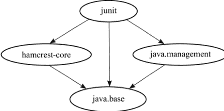

### 图 12.3：JUnit4 模块图

如果你省略 `-s` 标志，你将获得模块摘要，以及从包到所需的包和模块的映射。如果你添加 `-v` 标志，列表将类映射到所需的包。`--generate-moduleinfo` 选项为每个模块生成 `module-info` 文件：

```bash
jdeps --generate-moduleinfo /tmp/junit-4.12
```

> **注意：** 还有一个选项可以生成图形化输出格式的 "dot"。假设你安装了 dot 工具，运行以下命令：

```bash
jdeps -s -Tdot /tmp/junit-4.12.jar > /tmp/summary.dot
```

然后 `summary.png` 如下所示。


### 图 12.4：jdeps 的 Dot 输出

### `jlink`

使用 `jlink` 工具产生不需要单独运行时的应用程序。生成的镜像比 JDK 小得多。你指定要包含的模块和输出目录：

```bash
jlink --module-path \
com.horstmann.greet.jar:v1ch12.exportedpkg:$JAVA_HOME/jmods \
  --add-modules v1ch12.exportedpkg --output /tmp/hello
```

输出目录有一个包含 `java` 可执行文件的 `bin` 子目录。如果你运行：

```bash
bin/java -m v1ch12.exportedpkg
```

将调用模块主类的 `main` 方法。

`jlink` 的意义在于它封装了运行应用程序所需的最小模块集。你可以列出它们：

```bash
bin/java --list-modules
```

在这个示例中，输出是：

```text
v1ch12.exportedpkg
com.horstmann.greet
java.base@21
```


所有模块都包含在`lib/modules`中。我的电脑上，该文件为 29MB，而所有 JDK 模块的运行时占用 133MB。整个应用程序占用 55MB，仅为 JDK 大小的一部分。这可以作为打包工具的基础。你仍然需要为不同的平台制作文件集和启动脚本。

> 注意：可以使用`image`命令检查运行时镜像。然而，该格式是 JVM 内部使用的，运行时镜像不供其他工具生成或使用。

最后，`jmod`工具构建并检查 JDK 的模块文件。当你查看 JDK 内部的`jmods`目录时，每个模块都有一个扩展名为`.jmod`的文件。不再有`rt.jar`文件。与 JAR 文件一样，它们包含类文件。此外，它们还可以包含原生代码库、命令、头文件、配置文件和法律公告。JMOD 文件使用 ZIP 格式。

与 JAR 文件不同，JMOD 文件仅用于链接——即用于生成运行时镜像。除非你还想将二进制文件（如原生代码库）封装到你的模块中，否则你不需要生成 JMOD 文件。

这标志着我们 Java 平台模块系统章节的结束，也是本书的完结。希望你喜欢这趟贯穿于 Java 语言和平台核心特征的深度之旅，并已准备好将你的知识应用于项目之中。

# 附录

本附录列出了 Java 语言中所有的关键字以及类关键字的词。“受限关键字”是指仅在模块声明中使用的关键字，在其他情况下是标识符。“受限标识符”是指在某些特定位置上不是标识符。例如，`var`始终是一个标识符，除非它在预期类型的地方使用。`null`、`false`和`true`符号不是关键字，而是字面量。

## Java 关键字

| 关键字 | 含义 | 类型 | 对应章节 |
|---|---|---|---|
| `abstract` | 抽象类或方法 | 关键字 | 5 |
| `assert` | 用于定位程序内部错误 | 关键字 | 7 |
| `boolean` | Boolean 类型 | 关键字 | 3 |
| `break` | 跳出 switch 或循环 | 关键字 | 3 |
| `byte` | 8 位整数类型 | 关键字 | 3 |
| `case` | switch 的一个分支 | 关键字 | 3 |
| `catch` | try 块中捕获异常的子句 | 关键字 | 7 |
| `char` | UTF-16 代码单元的类型 | 关键字 | 3 |
| `class` | 定义类类型 | 关键字 | 4 |
| `const` | 未使用 | 关键字 | |
| `continue` | 在循环结束时继续 | 关键字 | 3 |
| `default` | switch 的默认子句，或接口中的默认方法 | 关键字 | 3, 6 |
| `do` | do/while 循环的顶部 | 关键字 | 3 |
| `double` | 双精度浮点数类型 | 关键字 | 3 |
| `else` | if 语句的 else 子句 | 关键字 | 3 |
| `enum` | 枚举类型 | 关键字 | 3 |
| `exports` | 导出模块的包 | 受限关键字 | 12 |
| `extends` | 定义类的父类，或通配符的上界 | 关键字 | 4 |
| `false` | 两个布尔值之一 | 字面量 | 3 |
| `final` | 常量，或不可被重写的类或方法 | 关键字 | 5 |
| `finally` | try 块中始终执行的部分 | 关键字 | 7 |
| `float` | 单精度浮点类型 | 关键字 | 3 |
| `for` | 循环类型 | 关键字 | 3 |
| `goto` | 未使用 | 关键字 | |
| `if` | 条件语句 | 关键字 | 3 |
| `implements` | 定义类所实现的接口 | 关键字 | 6 |
| `import` | 导入包 | 关键字 | 4 |
| `instanceof` | 测试对象是否是某某类的实例 | 关键字 | 5 |
| `int` | 32 位整数类型 | 关键字 | 3 |
| `interface` | 类可以实现的带有方法的抽象类型 | 关键字 | 6 |
| `long` | 64 位长整数类型 | 关键字 | 3 |
| `native` | 由宿主系统实现的方法 | 关键字 | 13 (卷二) |
| `new` | 分配新对象或数组 | 关键字 | 3 |
| `non-sealed` | 可形成任意子类型的受密封类型子类 | 关键字 | 5 |
| `null` | 空引用 | 字面量 | 3 |
| `module` | 声明模块 | 受限关键字 | 12 |
| `open` | 修改声明 | 受限关键字 | 12 |
| `opens` | 开放模块的包 | 受限关键字 | 12 |
| `package` | 类的包 | 关键字 | 4 |
| `permits` | 允许密封类型的子类型列表 | 受限关键字 | 3 |
| `private` | 仅对类内部可见 | 关键字 | 4 |
| `protected` | 仅对包内及子类可见 | 关键字 | 5 |
| `provides` | 表示模块提供了服务 | 受限关键字 | 12 |
| `public` | 公共可访问 | 关键字 | 4 |
| `record` | 声明一个具有固定字段的类 | 受限关键字 | 4 |
| `return` | 从方法返回 | 关键字 | 3 |
| `sealed` | 具有受限子类型的类型 | 受限关键字 | 5 |
| `short` | 16 位整数类型 | 关键字 | 3 |
| `static` | 静态的 | 关键字 | 3 |
| `strictfp` | 严格的浮点数计算 | 关键字 | 2 |
| `super` | 超类 | 关键字 | 5 |
| `switch` | 选择语句 | 关键字 | 3 |
| `synchronized` | 线程安全的同步块 | 关键字 | 12 |
| `this` | 当前实例，或构造函数的参数 | 关键字 | 4 |
| `throw` | 抛出异常 | 关键字 | 7 |
| `throws` | 声明可能抛出的异常 | 关键字 | 7 |
| `to` | 指定模块 | 受限关键字 | 12 |
| `transient` | 标记字段为非持久化 | 关键字 | 5 |
| `true` | 布尔值之一 | 字面量 | 3 |
| `try` | 异常的代码块 | 关键字 | 7 |
| `uses` | 表示模块使用了服务 | 受限关键字 | 12 |
| `var` | 类型推断变量 | 受限关键字 | 3 |
| `void` | 无返回值 | 关键字 | 3 |
| `volatile` | 确保多线程可见性 | 关键字 | 12 |
| `when` | 条件保护 | 受限关键字 | 5 |
| `while` | 循环 | 关键字 | 3 |
| `yield` | 返回 switch 表达式的值 | 关键字 | 3 |
| `_` | 未命名变量 | 受限关键字 | 5 |

# 符号

- `!` 运算符 3.5, 3.11
- `#` 符号 3.10, 3.7.2
- `$` 符号 3.4, 3.7
- `%` 运算符 3.5, 3.7.2
- `*` 运算符 3.3, ..1
- `*` 符号 3.10, 7.6
- `.` .. .. ..4
- `&` 运算符 3.5, 3.11, 4.4, 4.5
- `&&` 运算符 3.5, 3.11
- `>` 运算符 3.5, 3.11, .. , ... 5.3
- `>&` 运算符 3.5, 3.11, 7.6
- `>>>` 运算符 3.5, 3.11
- `>=` 运算符 3.5, 3.11
- `<` 运算符 3.5, 3.11, 5.3, 7.6
- `<<` 运算符 3.5, 3.11, 7.6
- `<=` 运算符 3.5, 3.11
- `|` 运算符 3.5, 3.11, 8.4
- `^` 运算符 3.5, 3.11
- `~` 运算符 3.5, 3.11
- `.exe` 扩展 4.9.3
- `\n`（换行符字面量）3.3.3
- `-java` 扩展 3.1
- `/`（斜杠）3.5.1 3.5.11
- `\r`（回车符字面量）3.3
- `/* / */` 注释 3.2
- `\s`（空格字面量）3.3.3
- `/** / */`（Javadoc 注释边界）3.2, 4.10, 4.10.360
- `//` 注释 3.2
- `\t`（制表符字面量）3.3.3
- `\u`（Unicode 字符字面量）3.3.3
- 整数中的 `0`、`0b`、`08`、`0x` 前缀 3.1
- `^`（脱字符符号）3.50, 3.5.11, 6.22
- `_ printf` 3.6 下划线
- `2>`（shell 语法）7.6 作为保留字 附录
- `:` 冒号分隔符，在数字字面量中 3.3.1
- 断言中 7.4.1
- 在实例字段名中
- 在类路径中（C++）4.6
- `(. )`（大括号）
- 继承令牌 5.1 4.8
- `double`，在内部类中 6.6
- `::`（++ 运算符）4.3.7, 4.4.3, 5.1.2
- 枚举类型的 `for` 3.4
- 6.2.5
- 在注解元素中 11.1
- `;` 分号
- 在 lambda 表达式中 6.2.2
- 在类路径中 4.8.6
- `|` 运算符 3.5, 10.51
- 在语句中 3.1, 3.4.1
- `||` 运算符 3.5, 7, 3.5.11
- `=` 运算符 3.2, 3.5
- `~` 运算符 3.5, 7, 3.5.11
- 用于类对象的 `for` 5.10.1
- （啤酒符号）3.3.4
- 用于枚举类型 `for` 5.7
- 用于浮点数 `for` 3.8.4
- `A`、`a` 转换字符 3.7.2
- 用于标识映射的 `for` 9.4
- `abstract` 关键字 5.6 附录
- 用于字符串的 `for` 3.6.5
- 抽象类 5.6
- 包装类 5.4
- 扩展 5.6
- `(` 问号接口和 6.1, 6.3
- `?` 用于通配符的 8.7.1
- 5.6 的不可实例化
- `:` 运算符 3.5.8, 3.5.11
- 5.6 的对象变量
- `@`（@ 符号）4.1.0, 4.103
- 抽象类 5.6
- 在 `java` 命令行选项中 120
- 在函数式接口中 6.2.3
- `[...]`
- `AbstractCollection` 6.5, 9.1.4
- 泛型中的空 8.3, 9.1
- 用于数组的 `for` 3.10.2, 3.10.4
- `AbstractProcessor` 11.5.1
- `\backslash`
- `acceptMethod` 10.7.2
- 用于 3.3.3 的转义序列
- 访问修饰符
- 在文件名中 3.7.3
- 检查 5.10.4
- 在文本块中 3.6.10
- `final` 3.4.3, 4.3.11, 5.1.7, 6.1., 6.5, 10.5.10
- `\b`（反斜符字面量）3.3.3
- `\f`（换页符字面量）3.3.3

# A

- `LinkedList` 9.3.1 的 `private` 4.3.3, 4.8.5, 6.3.1
- `SequencedCollection` 9.3.5 的 `protected` 5.10.0, 5.11, 6.1.9
- `public` 3.1, 3.4.3, 4.3.1, 4.3.3, 4.8, 6.1.1 添加 3.5, 3.5.11
- 用于不同数值类型的 3.5.3，用于对象和字符串的 3.6.1, 5.2.5
- `public static final` 6.1.2 `addList` 方法
- `LinkedList` 9.3.1 的冗余 `static` 3.1, 4.4
- `SequencedCollection` 9.3.5 的 `static final` 3.4.3
- `void` 3.1 `addShutdownHook` 4.6
- `suppressed` 7.2.5, 7.2.6
- `canAccess`、`tryAccessible` 方法 5.10.5
- Adobe Flash 1.3
- Agent 代码 11.6.2
- 聚合 4.1.4
- Accessor 方法 4.2.3, 4.3.8, 8.7.1
- 算法 4.1
- 用于二分查找的 `accumulate` 9.6.3
- 用于洗牌的 9.6.2 `ofAccumulator` 10.5.11
- 用于排序的 9.6.2 `accumulateAnd` 10.5.11
- QuickSort 3.10.6, 9.6.2
- 6.1.7, 6.2.1, simple，在 Java 6.3.1, 6.3.3, 9.6 中
- 6.2.3 实现
- ActiveX 1.2
- 5.3, 5.3.2（Wirth）4.1 `ofArray`
- `BigDecimal` 3.9 `of` CompletableFuture 10.7.2
- `BigInteger` 3.9 `of` Enum 9.4
- Blocking 10.6.1 `allProcesses`
- 9.1.2, 9.1.4, 9.2（BitSet）9.7.6
- `HashSet` 9.3.3 Android 1.5, 10.7.3 `of`
- `List` 9.2, 9.3.1 construct 11.5.2 `of`
- `ListIterator` 9.3.1 Element 11.4 `of`
- `Queue` 9.3.5 `getAnnotation` 11.4 `of`
- `Set` 9.2 `getAnnotationsByType` 11.4
- `add` method 3.5.2 `getDeclaredAnnotations` 11.4
- Annotation interface `isAnnotation` method 11.4
- Annotation processors 11.5.1 monitoring 11.6.2 responsive 10.7.3
- Annotations 8.5.4 terminating 3.1, 4.3.6
- accessing 11.2 testing 7.4
- `applyfloat` 10.7.2
- container 11.3.2, 11.4 Arguments 3.1
- declaration 11.3, 11.2 of `ProcessHandle.Info` 10.8.3
- documented 11.3, 11.3.2 generating source code with 11.5.3
- name of 5.5
- inherited 11.3, 11.3.2, 11.4 Arguments. See Parameters
- key/value pairs 11.1.1, 11.2 meta 11.2, 11.3.2 modifiers and 11.1.4
- multiple 11.1.2 processing precedence of 3.5.11
- runtime 11.4 source-level 11.5
- repeatable 11.1.2, 11.3, 11.4
- type 11.1.4 standard 11.3
- Anonymous arrays 3.10.1 anonymous 6.3.6
- Anonymous inner classes 6.3.6
- Antisymmetry rule 6.1. elements of
- `anyOf` 10.7.2 adding 5.3.1, 5.3.2
- Apache 5.3.2 traversing 5.3.2
- Commons CSV library 12.8
- `append` method generic 5.3
- `appendPoint` 3.6.9 raw was. 5.3.3 Array variables 3.10.1
- `ArrayBlockingqueue` 10.6.1
- `ArrayDeque` class 9.3
- `ArrayOutOfBoundsException`
- `ArrayList` class 10.5.3, 8.1, 9.3.1
- `Array` class 5.10.6
- Array lists 9.3.2 capacity of 5.3.2 of
- Applets 1.3, 1.5
- Application Programming Interfaces (APIs), online documentation 3.0.2, 7.1.1, 7.1.2
- Applications add 3.6.7, 3.6.8
- changing string in 4.8.5
- running in a buffer 1.3 as a concrete type 9.3
- in a buffer 1.3 as a concrete type 9.3
- compiling/launching the 8.1.2 as a concrete collection type 9.3
- command line 2.2, 3.1
- debugging 2.2, 7.1 declaring with 5.1
- extensible 5.1.6
- executing 5.3
- equal to 0 3.10.2
- equality testing for 5.2.3
- enabling/disabling 7.4.1, 7.4.2
- `equals` 3.10.2
- `equals` method 3.10.6, 5.2.3
- elements of 5.1.5
- empty, in generics 8.3, 9.1
- `ensureCapacity` 5.3.1
- for different numeric types 3.5.3
- for enumerated types 5.7
- for floating-point numbers 3.8.4
- for identity maps 9.4
- for strings 3.6.5
- for objects 5.10
- from the method 3.10.7
- generic 7.4
- generic methods 5.10.6
- hash codes of 5.2.4
- initializing 3.10.1, 3.10.2
- increasing 3.10.4
- in assertions 7.4.1
- in instance field names
- in class path (C++) 4.6
- in functional interfaces 6.2.3
- in class paths 4.8.6
- in lambda expressions 6.2.2
- in statements 3.1, 3.4.1
- in `java` command-line options 120
- in file names 3.7.3
- in text blocks 3.6.10
- in annotation elements 11.1
- in lambda expressions 6.2.2
- in class paths 4.8.6
- in functional interfaces 6.2.3
- in assertions 7.4.1
- in instance field names

- 9.6.1 中的算法
- 3.10.4, 3.10.8 中的数组
- 9.7.6 中的位集合
- 3.3.5 中的布尔值
- 3.1, 6.3 中的类
- 4.2.1 中的拷贝构造函数
- 5.1.3 中的动态绑定
- 5.1.8 中的动态类型转换
- 7.1.1, 7.1.2, 7.1.3, 7.2.1 中的异常
- 字段位于：
  - 实例 4.6.3, 4.6.5
  - 静态 4.4.3
- 3.8, 3.8.4 中的 `for` 循环
- 5.10.7 中的函数指针
- 5.1.1, 5.1.4, 6.1.3 中的实例
- 1.2, 3.7, 3.3.1 中的整数类型
- 9.7.2 中的迭代器
- 方法位于：
  - 访问器 4.2.3
  - 析构函数 4.6.8
  - 静态 4.4.3
- 4.8.2 中的命名空间指令
- 4.3.4 中的 `new` 运算符
- 4.2.1 中的 NULL 指针
- 4.2.1 中的对象指针
- 3.9 中的运算符重载
- 4.5 中的参数传递
- 性能，相比：
  - Java 9.7.6
- 5.1.7 中的多态
- 5.1.10 中的保护修饰符
- 5.6 中的纯虚函数（`= 0`）
- 4.2.1 中的引用
- 9.1, 9.1.3 中的标准模板库
- 3.1 中的静态成员函数
- 3.6.4, 3.6.5 中的字符串
- 5.1.3 中的超类
- 1.2.1 中的语法
- 1.4, 8.2, 8.4, 8.5.1 中的模板
- 4.6.6 中的 this 指针
- 8.3 中的类型参数
- 4.8.2 中的 using 直接指令
- 3.4.2 中的变量
- 3.8.1 嵌套块的重定义
- 5.3.1 中的 vector 模板
- 5.10.1 中的虚构造函数
- 5.2.1 中的 void* 指针
- 3.7.2 中的 `C`、`c` 转换字符
- 12.5 中的 `CachedRowSetImpl` 类
- 4.2.2 中的 `Calendar` 类
- 5.1.7 中的 `get/settime` 方法
- 日历：
  - 显示 4.2.3
  - 与时间测量对比 4.2.2
- 4.5 引用传递
- 4.5 值传递
- 10.4.3 `Callable` 接口
- 10.4.1 调用方法
  - 10.4.1 的包装
- 6.1.7 可调用
- 3.1 回调
- 3.1 驼峰命名法
  - 访问方法 5.10.5
  - 取消方法 10.4.1, 10.4.2
  - 关于 Future 的 10.7.3
- 10.7.3 `CancellationException` 类
- 9.7.6 基数
- 3.3.3 回车字符
- 3.5.9, 3.8.5, 附录中的 `case` 关键字
- 8.9.1 `cast` 方法
  - 类 8.9.1 的
- 3.5.4, 5.1.8 强制转换
  - 标记 11.1.4
  - 错误的 7.1.1
  - 增强前的检查 5.1.8
  - `catch` 关键字 7.2, 附录
  - 标记 11.1.3 的参数
  - `ceiling` 方法
  - 关于 `NavigableSet` 的 9.3.4
- 3.3.3, 附录中的 `char` 类型
- `Character` 类
  - 从 `char` 转换 5.4
  - `hashCode` 方法 5.2.4
  - `isIdentifierXxx` 方法 3.4.1
- 字符：
  - 3.3.3 的转义序列
  - 异类的 3.3.4
  - 3.7.2 输出格式化
  - `charAt` 方法 3.6.3, 3.6.7
  - `CharSequence` 接口 3.6.7, 6.1.3
- 5.10.1, 5.10.2 检查异常的 7.3 适用性
- 8.8.10 使用泛型声明
- 9.5.6 检查视图
- 9.5.8 检查的集合方法（`Collections`）
- 11.1.4 `Checker Framework`
- 7.3 中的 `checkFromIndex`、`ToIndex`、`checkIndex` 方法（`Objects`）
- 子类。参见子类
- `children` 方法
- `getName` 方法 5.2.5, 5.10.1
- `getPackageName` 方法 5.10.4
- `getRecordComponents` 方法 5.10.4
- `getResource`、`getResourceAsStream` 方法 5.10.3
- `getResourceAsStream` 方法 12.7
- `superClass` 方法 5.2.5, 8.9.1
- `getTypeParameters` 方法 8.9.4
- `isArray` 方法 5.10.6
- `isEnum`、`isInterface`、`record` 方法 5.10.4
- `newInstanceOf` 方法 5.10.1, 8.9.1
- 3.4.3 类常量
- 11.1.3, 11.3.2 类声明注解
- 4.1.4 类图
- 4.8.4, 4.8.6 类文件
- 3.1 编译
- 11.6 的格式
- 4.8.6 定位
- 11.6 修改
- 3.1, 4.3.1 的名称
- 11.6 的转换器
- 11.1.4 无注解的类字面量
- 6.5, 7.4.1, 7.4.2 类加载器
- 4.8.6, 4.8.7 类路径
- 6.1.6 类规则
- `Class<T>` 参数 8.9.2
- `ClassCastException` 5.1.8, 5.10.6, 6.1.1, 8.6, 8.7, 8.9.1, 9.5.6
- 3.1, 4.1.1, 5.1.3 类：
  - 抽象 5.6, 6.1.1, 6.1.3
  - 权限 4.8.4, 5.10.4
  - 伴侣 6.1.4, 6.1.5
  - 构造函数 4.3.3
  - 运行时 6.5
  - 弃用 11.3, 11.3.1
  - 设计 4.1.3, 4.11
  - 注释 4.10.1, 4.10.7
  - 封装 4.1.1, 4.1.2
  - 不变 4.3.11, 4.7.1, 5.11
  - 实现接口 6.1.2, 6.1.3
  - 导入 4.8.2
  - 内部 6.3
  - 实例 4.1.1, 4.2.1
  - 遗留 4.7.1
  - 加载 7.6
  - 多源文件 4.3.2
  - 名称的 2.2, 3.1, 4.8.1, 4.11
  - 完整包 4.8.2
  - 嵌套 11.1.4
  - 数量 4.11
  - 基础类型 4.11
  - 运行时 5.10.5
  - 包 4.8.5
  - 参数 4.3.7
  - 私有方法 4.3.10
  - 保护 5.10.0
  - 公共 4.8.2, 4.10.1
  - 关系 4.1.4
  - 密封 5.8
  - 共享 4.8.6
  - 测试 4.4.5
  - 包装 5.4
  - 类加载器类 7.4.4
  - CLASPATH 4.8.7
  - `BitSet` 的 `clear` 方法 9.7.6
  - 9.1.4
  - `clearAssertion` 方法 7.4.4
  - 客户端锁 10.5.7
  - 数组类型 6.1.9
  - `Object` 4.3.8, 6.1.9, 6.2.3
  - 可 Clone 接口 6.1.9
  - `CloneNotSupported` 异常 6.1.9
  - `close` 方法 10.4.2
  - `AutoCloseable` 7.2.5
  - `Closeable` 7.2.5
  - `Handler` 7.5.7
  - `Closure` 6.2.7
  - 代码错误 7.1
  - 代码生成工具 11.3.1
  - 代码平面 3.3.4
  - 代码点，代码单元 3.3.4, 3.6.3
  - `Collection` 接口 9.1.2, 9.2, 9.3.1
  - `add` 方法 9.1.2, 9.1.4, 9.2
  - `addAll` 9.1.4
  - `clear` 方法 9.1.4
  - `contains`、`containsAll` 方法 9.1.4, 9.3.1
  - `equals` 方法 9.1.4
  - 泛型 9.1.4
  - 实现 6.1.5
  - `isEmpty` 6.1.5, 9.1.4
  - `iterator` 方法 9.1.2, 9.1.4
  - `remove` 方法 9.1.4
  - `removeAll` 9.1.4
  - `removeelf` 9.1.4, 9.6.4
  - `retain` 方法 9.1.4
  - `retainAll` 9.1.4
  - `size` 方法 9.1.4
  - `stream` 方法 6.1.5
  - `toArray` 方法 5.3.2, 9.1.4, 9.6.6
- `Collections` 类 9
  - 9.6.1 中的算法
  - 边界 9.1.1
  - 9.6.5 中的批量操作
  - 具体 9.3
  - 9.3 及其并发修改
  - 转换为数组 9.6.6
  - 调试 9.3.1
  - 插入元素 9.2
  - 最大值 9.6.1
  - 移除 9.1.3
  - 遍历 9.1.3
  - 9.1 的接口
  - 可变 9.5.1
  - 有序 9.2, 9.3.1
  - 9.2, 9.3.3 的性能
  - 9.6.3 中的搜索
  - 排序 9.3.4
  - 线程安全 9.5.7, 10.6
  - 8.1.2 的类型参数
  - 9.6.7 使用 `for` 方法
  - `Collections` 类 9.6.2
  - `addAll` 方法 9.6.4
  - 二分查找 9.6.3
  - 9.5.1 检查的
  - 9.6.4 拷贝
  - 9.5.8 检查的集合
  - 9.6.4 离散
  - 9.1.4 填充
  - 9.7.2 枚举
  - 9.6.4 频率
  - 9.6.4 索引列表
  - 9.6.4 最后的索引
  - 4.1.1 扩展
  - 5.1.7 最终
  - 5.3, 5.3.1, 8.2, 8.6, 8.8.6, 9.1.3 泛型
  - 4.3.11, 4.7.1, 5.11 不变
  - 6.1.2, 6.1.3 实现
  - 4.8.2 导入
  - 6.3 内部
  - 4.1.1, 4.2.1 实例
  - 4.7.1 遗留
  - 7.6 加载
  - 4.3.2 多源文件
  - 2.2, 3.1, 4.8.1, 4.11 的名称
  - 4.8.2 完整包
  - 11.1.4 嵌套
  - 11.1.4 数量
  - 4.11 基础类型
  - 5.10.5 运行时
  - 4.8.5 包
  - 4.3.7 参数
  - 4.3.10 私有方法
  - 5.10.0 保护
  - 4.8.2, 4.10.1 公共
  - 4.1.4 关系
  - 5.8 密封
  - 4.8.6 共享
  - 4.4.5 测试
  - 5.4 包装
  - 7.4.4 类加载器类
  - 4.8.7 CLASPATH
  - 9.7.6 `BitSet` 的 `clear` 方法
  - 9.1.4
  - 7.4.4 `clearAssertion` 方法
  - 10.5.7 客户端锁
  - 6.1.9 数组类型
  - 4.3.8, 6.1.9, 6.2.3 `Object`
  - 6.1.9 可 Clone 接口
  - 6.1.9 `CloneNotSupported` 异常
  - 10.4.2 `close` 方法
  - 7.2.5 `AutoCloseable`
  - 7.2.5 `Closeable`
  - 7.5.7 `Handler`
  - 6.2.7 `Closure`
  - 7.1 代码错误
  - 11.3.1 代码生成工具
  - 3.3.4 代码平面
  - 3.3.4, 3.6.3 代码点，代码单元
  - 9.1.2, 9.2, 9.3.1 `Collection` 接口
  - 9.1.2, 9.1.4, 9.2 `add` 方法
  - 9.1.4 `addAll`
  - 9.1.4 `clear` 方法
  - 9.1.4, 9.3.1 `contains`、`containsAll` 方法
  - 9.1.4 `equals` 方法
  - 9.1.4 泛型
  - 6.1.5 实现
  - 6.1.5, 9.1.4 `isEmpty`
  - 9.1.2, 9.1.4 `iterator` 方法
  - 9.1.4 `remove` 方法
  - 9.1.4 `removeAll`
  - 9.1.4, 9.6.4 `removeelf`
  - 9.1.4 `retain` 方法
  - 9.1.4 `retainAll`
  - 9.1.4 `size` 方法
  - 6.1.5 `stream` 方法
  - 5.3.2, 9.1.4, 9.6.6 `toArray` 方法
- `static` 4.4.2
- `determine` 3.8.4
- 构造方法 5.10.4
- 多次选择 3.8.5
- `getDeclaringClass` 方法 5.10.4
- 转换字符 3.7.2
- `getModifiers`、`get` methods 5.10.4
- 协作调度 10.2.2
- `getXXTypes` methods 5.10.4
- 协调世界时（UTC）4.2.2
- `newInstance` method 5.10.1
- 拷贝 9.5
- 构造表达式 8.8.6
- 不可修改 9.5.2, 9.5.8
- 注解 11.1.4
- `Collections` 的 `copy` method 9.6.4
- 构造函数 4.3.3, 4.3.4, 4.6
- `copyMethod` 注解 11.1.3, 9.4 的 `Arrays` 3.10.4, 3.10.6, 5.10.6
- 调用 Enum 的另一个构造函数 9.4.7
- 规范的、紧凑、自定义 4.7.2
- `List`、`Map` 的 9.5.2, 9.5.8
- 已定义 2.1.1
- `Map.Entry` 的 9.4.3
- 文档注释
- `copyOfRange` 3.10.6
- `for` 4.0.1
- `copyWriteArrayList` 10.6.6, 字段初始化 4.6.2, 4.6.4, 10.6.8
- `final` 5.10.4
- `copyWriteArraySet` 类 10.6.6
- 4.6.7 中的初始化块
- CORBA 12.1
- 4.2.1, 4.3.4 的名称
- Cornell, Gary 1.1
- 无参数 4.6.3, 5.1.3, 6.4
- 数据损坏 10.5.1, 10.5.2
- 方法重载 4.6.1
- `cos` 方法参数名 4.6.5
- `Math` 的 3.5
- `private` 5.10.4
- 《基督基督基督仇》（大仲马）10.7.3
- `protected` 4.10.1
- `public` 4.10.1, 5.10.4
- Cariant 返回类型 8.5.3
- 带有 `super` 关键字 5.1.3
- CSV 文件 12.8
- `Consumer` 接口 6.2.8
- `Ctrl+,` 用于 dump 10.5.5
- `Consumer` 线程 10.6.1
- `Ctrl+C`，用于程序包含方法终止的 Collection 10.5.1, 10.5.4, 9.1.4, 9.3.1
- `HashSet` 的当前方法 9.3.3 的 `ProcessHandle` 10.8.3
- `containsAll` 方法 9.1.4, 9.3.1
- `ThreadLocalRandom` 的 10.5.14
- `containsKey/Value` 方法（`Map`）9.4.1
- `currentThread` 方法 10.3.2
- `continue` 关键字 3.8.6，switch 中不允许使用 Appendix
- `d` 转换字符 3.7.2
- 表达式 3.8.5
- `d` 后缀（用于 double 数字）3.3.2
- 控制流 3.8
- 块作用域 3.8.1
- 守护线程 10.3.3
- 破坏 3.8.6
- 数据类型 3.3
- 条件语句 3.8.2
- 布尔类型 3.3.5
- 循环 3.8.3
- “each” 3.10.3
- 之间的类型转换 3.5.4
- `char` 类型 3.3.3
- 3.5.3, 5.1.8 之间的转换
- 浮点 3.3.2
- 整数 3.3.1
- 数据库 11
- `DataFlavor` 12.1
- `Date` 类 4.2.2
- `getDay`/`Month`/`Year` 方法（已弃）4.2.2
- `toString` 方法 4.2.1
- 日期时间格式输出 3.7.2
- 5.2.4 的哈希码
- 4.2.1 内置
- 死锁 10.5.4, 10.5.5
- 调试 1.2.1, 7.6
- 9.3.1
- 7.6 的调试器
- 泛型 9.5.6
- GUI 程序 7.2.1
- 6.3.6 中包含类
- 7.1.4 的消息
- 5.10.5 反射
- 7.6 在文件中捕获程序错误
- 在终端窗口中运行应用程序 2.2
- 递减运算符 3.5.6
- `decrementExt` 3.5.2
- 深拷贝 6.1.9
- `deepEquals` 方法 5.2.3
- `deepToString` 3.10.7, 5.2.5
- `default` 关键字 3.8.5, 6.1.5, Appendix
- 密封类和 5.8
- `Default` 元素 12.2
- `Default` 方法 6.1.5
- 6.1.6 中的冲突
- 延迟执行 6.2.8
- `StringBuilder` 的 `delete` method 3.6.9
- Dependence 4.1.4
- `@Deprecated` 注解 11.3, 11.3.1
- Deprecated 方法 4.2.2, 4.2.3
- `Deque` 接口 9.3.5
- 9.3.5 的方法
- 派生类 10.8.3 的 `ProcessHandle` 10.8
- `destroy`、`Foribly`（`Process`）10.8.2, 10.8.3
- `Determine` 3.8.4
- 选择 2.2
- 终端窗口 2.3
- 集成 2.3
- 设备错误 7.1
- Dialogs 6.1.7
- Diamond 语法 5.3.1
- 数字签名 1.2.5
- 10.8.3 的 `process` 10.8
- `ProcessBuilder` 的 `environment` method 10.8.1
- Collections 的 `directory` method 9.6.4
- `BigDecimal` 的 `divide` method 3.9
- `BigInteger` 的 3.9
- `do/while` 3.8.3, Appendix
- 文档注释 3.2, 4.10
- 提取 4.10.10
- 4.10.4 字段
- 4.10.5 的包
- 通用 4.10.8
- HTML 标记 4.10.6
- 4.10.7 中的超链接
- 概述 4.10.10
- `@Documented` 注解 11.3, 11.3.2
- `InBackground` method 10.7.3
- `double` 类型 3.3.2, Appendix
- 算术运算 3.5.1
- 从 `double` 5.4
- 转换为其他数字类型 3.5.3
- `POSITIVE_INFINITY`、`NEGATIVE_INFINITY` 常量 3.3.2
- Double brace 初始化 6.3.6
- Double-precision 3.3.2
- `DoubleAccumulator`、`DoubleAdder` 10.5.1
- 动态绑定 5.1.3, 5.1.6
- 动态语言 1.2.11
- 4.3.8 的收益
- 编译时 12.10
- `endswith` 方法 3.6.7
- `ensureCapacity` 5.3.1
- `Map` 的 `entry` method 9.5.1, 9.5.8
- `EntryLogger` 11.6.2
- `EntryLoggingAgent` 11.6.2
- `entrySet` 9.4.3
- `enum` 关键字 3.4.4, 5.7, Appendix
- `compareTo`、`ordinal` 方法 5.7
- `toString`、`valueOf` 方法 5.7
- 枚举类型 3.4.4
- 5.7 等等性测试
- 在 switch 语句中 3.5
- `Enumeration` 接口 9.1, 9.7.2
- `asIterator` 9.7.2
- `hMoreElements`、`nextElement` 方法 9.1.3, 9.7.2
- Enumeration maps/sets 9.4.6
- Enumerations 5.7
- always final 5.1.7
- 注解 11.1.3
- 在类内部声明 6.3
- 实现接口 6.1.2
- legacy 9.7.2
- `EnumMap` 类 9.4, 9.4.7
- 具体的集合类型 9.3
- `EnumSet` 类 9.4
- `allOf`、`copyOf`、`noneOf`，具体的集合类型 9.3
- `ProcessBuilder` 的 `environment` method 10.8.3
- 环境变量，修改 10.8.1
- `EDFException` 类 7.1.3
- Epoch 4.2.2
- `equals` 方法 6.1.6
- `hashCode` 方法和 5.2.4
- 实现 5.2.3

# E

- `E` 常量（`Math`）3.5.2
- E，转换器 3.3.2, 3.7.2
- Eclipse 2.2, 2.3, 7.6
- 采用 2.1
- 在 2.3 中配置项目
- 编辑源文件 2.3
- 2.3 中的错误消息
- IDE 12.5
- 4.8.2 中的导入
- Yasspoon 框架 12.7
- effectively finally 7.2.5
- Eiffel 编程语言 6.1.3
- `element` 方法 11.5.2
- `BlockingQueue` 10.6.1
- `Queue` 的 9.3.5
- Elements 11.1.1
- `else` 关键字 3.8.2, Appendix
- `else` 3.8.2
- Emoji 字符 3.3.4
- `emptyCollectionmethods`（`Collections`）9.5.8
- `EmptyStackException` 类 7.3
- 封装 4.1.1, 4.1.2, 12
- 继承And 5.2.3
- Annotation 注解 11.2
- `Arrays` 的 3.10.6, 5.2.3
- `Collection` 的 9.1.4
- `Object` 的 5.2.2, 5.2.3
- `proxy` 类 6.5.3
- records 4.7.1, 5.2.2
- `Set` 的 9.2
- `String` 的 3.6.5, 3.6.7
- `equalIgnoreCase` 3.6.5, 3.6.7
- 方法 4.3.8
- 设备 7.1
- 内部 7.1.1, 7.1.2, 7.4
- 7.2.2 中的消息
- 用户输入 7.1
- Escape 序列 3.3.3
- `Exception` 类 7.1.1, 7.1.2
- `Exception` 处理器 5.10.2, 7.1.3
- `Exception` 规范 7.1.2
- Exceptions (`CompletableFuture`) 10.7.2
- `"throw early, call late"` 7.3
- 注解 11.1.4
- `ArrayOutOfBoundsException` 3.10, 2, 7.1.1, 7.1.2
- `ArrayStoreException` 5.1.5, 8.6, 8.3, 8.8.4
- `CancellationException` 10.7.3
- 捕获 4.3.6, 5.10.2, 6.1.9, 7.1.2
- 类型 5.10.1, 5.10.2, 7.1.1, 7.1.2, 7.3
- `ClassCastException` 5.1.8, 5.10.6, 6.1.1, 8.6, 8.8.7, 8.9.1, 9.5.6
- `CloneNotSupportedException` 6.1.9
- `ConcurrentModificationException` 9.3, 1, 10.6.2, 10.6.8
- 创建类 7.1.3, 7.1.4
- 文档注释 4.10.3
- `EmptyStackException` 7.3
- `EOFException` 7.1.3
- `FileNotFoundException` 7.1.2
- `finally` 在 7.2.4
- genics 8.8.10
- 层次 7.1.1, 7.3
- `IllegalAccessException` 5.10.5
- `IllegalStateException` 9.1.3, 9.1.4, 9.3.1, 9.3.5, 10.6.1
- `InaccessibleObject` 5.10.5
- `InterruptedException` 10.1, 10.3.2, 10.4.1
- `InvocationTargetException` 5.10.1
- `IOException` 7.3.1, 7.1.2, 7.1.3, 7.2.1, 7.2.5
- 日志 7.5.7
- 微型管理 7.3
- `NoSuchElementException` 9.1.3, 9.1.4, 9.3.1, 9.3.5
- `NullPointerException` 4.3.6, 4.4.5, 5.4, 6.2.5, 7.1.1, 7.3
- `NumberFormat` 7.3
- 越界 7.3
- 传播 7.2.1, 7.3
- 重新抛出 7.2.3, 7.6
- Runtime 7.1.1, 7.3
- `ServletException` 7.2.3
- 抑制 7.2.6
- 抛出 5.10.2, 7.1.3
- `TimeoutException` 10.4.1
- 使用技巧 7.3
- 类型变量 8.8.9
- 未捕获 7.6, 10.2.4, 10.3.5
- 未检查 5.10.2, 7.1.1, 7.1.2, 7.3
- 意外 7.5.7
- `UnsupportedOperationException` 9.4.3, 9.5.2, 9.5.8
- 变量用于，隐式 final 7.2.2 对比简单测试 7.3 包装 7.2.3
- `Runtime` 的 `exec` method 10.8
- 可执行类 5.10.7
- 可执行 JAR 文件 4.9.3
- `ExecutableElement` 11.5.2
- `SwingWorker` 10.7.3 的 `execute` method 10.7.3
- `ExecutionCompletionService` 10.4.3
- `poll`、`submit` 方法 10.4.3
- `Executors` 类 10.4.2 任务组, 10.4.3
- `Executors` 类，`newXX` 方法 10.4.2
- `Executableservice` 10.4.2
- `awaitTermination` method 10.4.2
- `invokeAny/All` 10.4.3
- `shutdown` method 10.4.2
- `shutdownNow` method `submit` 10.4.2
- `System` 的 `exit` method 3.1
- 退出码 3.1
- `exitValue` 10.8.2

- 共享字段 10.5.10
- 内部类和 6.3.5
- `Object` 的 `finalize` 方法 4.6.8
- finally known 7.2.4, 附录
- 7.2.4 中的 `return` 语句
- 10.5.3 中的 `unlock` 操作
- 无 catch 的 7.2.4
- 财务计算 3.3.2
- `findFirst` 6.4
- Fork-join 框架 10.4.5
- 换页符 3.3.3
- 格式说明符（`printf`）3.7.2
- `format`、`formatted`、`formatTo` 方法（`String`）3.7.2
- `formatMessage` 7.5.7
- Formidable 接口 3.7.2
- `Formatter` 类 7.5.6
- `Formatter` 类及其方法 7.5.7
- `forName` 5.10.1
- `SortedSet` 的 `first` 方法 9.3
- `FirstPerson` 实例，1.4
- `firstKey` 9.1
- 用于格式化输出的 Flags 3.7.2
- `float` 类型 3.3.2, 附录
- 从 `float` 转换 5.4
- 转换为其他数值类型 3.5.3
- `Collections` 的 `frequency` 方法 9.6.4
- `Function` 6.2.8
- 泛式接口 6.2.3, 11.3
- 6.2.3 中的 11.3.1 方法
- 注解 6.2.8
- 转换为 6.2.3
- 泛型 6.2.4
- 在 8.7.2 中使用 supertype
- `hashCode` 5.2.4
- `POSITIVE_INFINITY`、`NEGATIVE_INFINITY`、`NaN` 常量 3.3.2
- 浮点数方法 3.3.2
- 使用 3.5.1 进行算术运算
- 转换为/整数 5.1.8
- 3.8.4 的相等性
- `@FunctionalInterface` 注解 6.2.8, 11.3, 11.3.1, 11.3.2
- Functions. Meets
- `Future` 接口 10.4.3
- `cancel`、`get` 方法 10.4.1, 10.4.2, 10.7.3
- 输出格式化 3.7.2
- 四舍五入 3.3.2, 3.5.4
- `NavigableSet` 的 `floor` 方法 9.3
- `floorMod` 方法 3.5.1
- `Handler` 的 `flush` 方法 7.5.7
- `for` 关键字 3.8.4, 附录
- 3.5.11 中的逗号分隔表达式
- 在 3.8.4 内部定义变量
- 用于集合的 `for` 9.1.3
- `isCancelled`、`isDone` 方法 10.4.1, 10.4.2
- Futures 10.4.1
- 组合 10.7.2
- completable 10.7.2
- `FutureTask` 类 10.4.1
- `g`、`g` 转换变化 3.7.2
- 垃圾收集 3.6.4, 4.2.1
- 哈希映射和 9.4.4
- GB18030 3.3.4
- 通用公共许可证（GPL）1.5
- `@Generic` 注解 11.3, 11.3.1
- 泛型编程 8
- 数组和 6.2.6, 8.8.7
- 5.3, 5.3.1, 8.2 中的类
- `ConcurrentHashMap` 的 `eachMethod` 10.6.4
- 没有 `Map` 9.4.1
- `StackWalker` 的 7.2.6
- `forRemaining` 方法 9.1.3, 9.1.4
- 扩展/实现其他泛型类 8.6
- 8.8.9 的实例抛出或捕获
- 9.6.6 中的集合接口
- 转换为原始类型 8.6
- 调试 9.5.6
- 8.2-8.5, 8.9.3 中的表达式
- 8.6 的继承规则
- 遗留代码和 8.5.4
- 8.3, 8.5, 9.1-4 中的方法
- 反射和 8.9
- `getAnnotationType` 方法（`AtomicType`）10.5.11
- `getAnnotation` 11.4
- `AnnotatedConstruct` 的 `getAnnotation`、`getAnnotationsByType` 方法 11.5.2
- `AnnotatedElement` 的 11.4
- `getAnnotationsByByType` 方法 11.4
- `Array` 的 `getBoolean` 方法 5.10.6
- `getBounds` 方法（Type）8.9.4
- `getByte` 5.10.6
- `getCause` 方法 7.2.6
- `getChar` 方法 5.10.6
- 总是返回原始类型的 `getClass` 方法 8.8.2
- `Class` 的 5.10.1
- `Object` 的 5.2.5
- 8.1.1 需技能水平
- 8.8.8 的静态字段和方法
- 8.5, 8.1, 8.8.7 中的类型擦除
- 8.8.1 之后的冲突
- 8.9.2 中的类型匹配
- vs，继承 8.1
- 8.7 中的通配符类型
- 泛型类型
- 注解 11.4
- `GenericArray` 接口 8.9.3
- `getGenericComponent` 方法 8.9.4
- `Array` 的 `get` 方法 5.10.6
- `ArrayList` 5.3.2
- `BitSet` 9.7.6
- `ConcurrentHashMap` 10.6.3
- `Field` 的 5.10.5
- `Future` 的 10.4.1, 10.4.2, 10.7.3
- `LinkedList` 的 9.3.1
- `List` 的 9.2, 9.3.1
- `LongAccumulator` 的 10.5.11
- `Map` 的 9.2, 9.4.1
- `Paths` 的 6.1.4
- `ServiceLoader.Provider` 的 6.4
- `ThreadLocal` 的 10.4.4
- `Vector` 的 10.5.7
- `Stack` 的 `getClassName` 方法 7.2.6
- `StackElement` 的 7.2.6
- `getComponentType` 方法 5.10.6
- `Constructor` 5.10.1, 8.9.1
- `getConstructors` 方法 5.10.4
- `getDay` 4.2.2
- `getDay` 方法（`LocalDate`）4.2.2, 4.2.3
- `Class` 的 `getName` 方法 5.2.5, 5.10.1
- `java.lang.reflect` 的 5.10.4
- `java.lang.reflect.Member` 的 5.10.4
- `RecordComponent` 的 5.10.4
- `System.Logger` 的 7.5.7
- `Type` 的 8.9.4
- `getOrDefault` 方法 9.4.1
- `getOutputStream` 方法 10.8.1, 10.8.3
- `getOwnerType` 方法（`ParameterizedType`）8.9.4
- `getPackage` 方法 5.10.4
- `getParameters` 方法 7.5.7
- `getParameterTypes` 方法 5.10.4
- `getProperties` 方法 9.7.4
- `getProperty` method Properties 9.7.3
- `System` 的 3.7.3
- `getProxyClass` method 6.5.3
- `getQualifiedName` method 11.5.2
- `getRawType` 方法（`ParameterizedType`）8.9.4
- `getRecordComponents` 5.10.4
- `getResource`、`getResourceStream`（methods）5.10.3
- `getResourceAsStream` 方法（`Class`、`Method`）12.7
- `getResourceBundle`、`getResourceName` methods（`LogRecord`）7.5.7
- `getReturnType` method 5.10.4
- `getSequenceNumber` method 7.5.7
- `getShort` method 5.10.6
- `getSimpleName` 11.5.2
- `getSourceName` methods（`LogRecord`）7.5.7
- `getStackTrace` method 7.2.6
- `getState` method `SwingWorker` 10.7.3
- `getSuperclass` method 5.2.5, 8.9.1
- `getSuppressed` method 7.2.5, 7.2.6
- `getTail` method 7.5.6, 7.5.7
- Getters/setters，自动 11.5.3
- `getTime` method 5.1.7
- `getType` method `Field` 5.10.4
- `RecordComponent` 5.10.4
- `getTypeParameters` method `Class` 8.9.4
- `getTypeUpperBounds` method（`WildcardType`）8.9.4
- `getValue` method `Map.Entry` 9.4.3
- `getYear` method `Date`（deprecated）4.2.2
- `getDefault`（method）6.1.7
- `getDefaultUncaughtExceptionHandler` method 10.3.5
- `getDouble` method `Array` 5.10.6
- `getEnclosedElements` method 11.5.2
- `getEnumConstants` method 8.9.1
- `getField` 5.10.5
- `getFields` method 5.10.4, 5.10.5
- `getFilter` method `Handler` 7.5.7
- `getFirst` method 9.3.5
- `getFloat` method `Array` 5.10.6
- `getFormatter` method 7.5.7
- `getGenericType` method（`ArrayType`）8.9.4
- `getGenericXXX` methods（`Class`）8.9.4
- `getGenericXXX` methods（`Method`）8.9.4
- `getGlobal` method 7.6
- `getHead` method 7.5.6, 7.5.7
- `getImage` method `Class` 5.10.3
- `getInputStream` method 10.8.1, 10.8.3
- `getInstance` method 7.2.6
- `getInstant` method 7.5.7
- `getInt` method `Array` 5.10.6
- `getKey` method `Map` 9.4.3
- `getLast` method 9.3.5
- `getLength` method 5.10.6
- `getLevel` method `Handler` 7.5.7
- `getLineMethod` `StackFrame` 7.2.6
- `getLogger`、`getName` 7.5.7
- `getLong` method `Array` 5.10.6
- `getLongID` method `Thread` 7.5.7
- `LowerBounds` method（`WildcardType`）8.9.4
- `getMessage` method `LogRecord` 7.5.7
- `Throwable` 7.1.4
- `getMethod` 5.10.7
- `getMethodName` `StackFrame` 7.2.6
- `getMethods` 5.10.4
- `getModifiers` `java.lang.reflect` 5.10.4
- `getMillis` 7.5.7
- `getPackageName` method 5.10.4
- `java.lang.reflect.Member` 5.10.4
- `getMonth` method（`LocalDate`）4.2.2, 4.2.3
- `getName` method `Class` 5.2.5, 5.10.1
- `java.lang.reflect` 5.10.4
- `java.lang.reflect.Member` 5.10.4
- `RecordComponent` 5.10.4
- `System.Logger` 7.5.7
- `Type` 8.9.4
- `getOrDefault` method 9.4.1
- `getOutputStream` method 10.8.1, 10.8.3
- `getOwnerType` method（`ParameterizedType`）8.9.4
- `getPackageName` method 5.10.4
- `getParameters` method 7.5.7
- `getParameterTypes` method 5.10.4
- `getProperties` method 9.7.4
- `getProperty` method `Properties` 9.7.3
- `System` 3.7.3
- Hash tables 9.3.3
- legacy 9.1
- load factor 9.3.3
- rehashing 9.3.3
- formatting output for 3.7.2
- prefix for 3.3.1
- `HexFormat` class 3.7.2
- `higher` method `NavigableSet` 9.3.4
- Hoare, Type 10.5.8
- Hold 10.5.3
- HotJava browser 1.4
- HotSpot just-in-time compiler 2.1.1, 9.7.6
- `hashCode` method 5.2.4, 11.2
- `equals` method and 5.2.4
- null-safe 5.2.4
- `Arrays` 5.2.4
- `Boolean`、`Byte`、`Character`、`Integer`、`Short` 5.2.4
- `LocalDate` 5.2.4
- `Object` 5.2.4, 9.3.3
- `Objects` 5.2.4
- proxy classes 6.5.3
- records 4.7.1, 5.2.4
- HTML 1.4, 1.5
- generating documentation in 11.5.3
- in javadoc comments 4.10.6
- `Set` 9.2
- `String` 9.3.3
- `HashMap` class 9.4.1
- as a concrete collection type 9.3
- `HashSet` 9.3.3
- `add`、`contains` methods 9.3.3
- as a concrete collection type 9.3
- Iterating over 9.1.3
- Identifiers Appendix
- Identity hash 9.4.7
- `identityHashCode` 9.4.7
- `identityHasMap` class 9.4.7
- as a concrete collection type 9.3
- IEEE 754 specification 3.3.2, 3.5.2
- `if` keyword 3.8.2, 附录
- `IllegalAccessException` class 5.10.5
- `IllegalStateException` class 9.1.3, 9.1.4, 9.3.1, 9.3.5, 10.6.1
- Immutable classes 4.31, 5.11
- Implementations 9.1.1
- `Hashtable` class 9.1, 9.7, 9.7.1, 10.6.8
- as a concrete collection type 9.3
- synchronized methods 9.7.1
- `hasMoreElements` 9.1.3, 9.7.2
- `hasNext` method of `Iterator` 9.1.3, 9.1.4
- of `Scanner` 3.7.1
- `hasNextXX` methods（`Scanner`）3.4.1
- implicit parameters 6.1.1, 附录
- one, in state 4.4.3
- state of 7.6
- `import` keyword 4.8.2, 附录
- n annotations for 11.1.4
- of `NavigableMap` 9.5.8
- `ofSortedMap` 9.5.3, 9.5.8
- `headSet`
- of `NavigableSet` 9.5.3, 9.5.8
- `ofSortedSet` 9.5.3, 9.5.8

Index 类 3.10.2, 4.10.8 `indexOf` 方法
- `protected` 5.11 `public` 4.33
- `List` 的 9.3.1 `String` 的 3.67
- 遮蔽 4.3.4, 4.6.5 值的 4.3.8
- `indexOfSublist` 9.6.4 推断类型 6.2.2
- `volatile` 10.5.9 对比 局部变量 4.3.4, 4.3.7, 4.6.2
- `ProcessHandle` 的 `info` 方法 10.8.3
- `instanceof` 3.5.11, 5.1.8, 5.2.3, 6.1.2, 目录

信息隐藏。看到封装 继承 4.1, 5.4 设计提示 5.1 等等性测试和 5.2.3 5.1.4 的层级结构, 6.1.3
- 注解 11.1.4 5.1.9 的模式匹配
- 实例 4.1.1 创建 5.10.1 的 `for`
- 工具类 API 11.6.2 转换为其他类型 3.5.3
- 固定大小 1.2.7 平台无关 3.3.1
- `Integer` 防止 5.1.1
- 私有字段和 5.1.1 对比 类型 8.1, 8.6
- `compare` 方法 6.1.1, 6.2.3 从 `int` 5.4
- `@Inherited` 11.3, 11.3.2 继承自 10.8.3
- `hashCode` 方法 5.2.4 `intValue` 5.4
- `initCause` 7.2.2 初始化块 4.6.7
- `parseInt` 5.4 `toString` 5.4
- `static` 4.6.7 内联 2.9, 5.1 内部类 6.3
- `valueOf` 5.4 Integer 类型 3.3.1
- 使用 6.3.1 访问状态 匿名 6.3.6 适用性 6.3.3
- 算术计算 3.5.1 数组 5.2.5
- 定义 6.3 局部 6.3.4 私有 6.3.1 static 6.3.7 6.3.2 的语法
- 计算 3.5.2 从/浮点数 5.1.8 转换
- 翻译为类 6.3.3
- 输出格式化 3.7.2 对比 lambda 表达式 6.2.3
- Java 中没有无符号类型 3.3

- 集成开发环境（IDE）2.3
- IntelliJ IDEA 2.3
- 输入，读取 3.7.1 `StringBuilder` 的 `insert` 方法 3.6.9
- `interface` 关键字 6.1.1, 11.2, 目录
- 初始化 4.6.7, 4.11
- 显式 4.6.4 4.7.1 的名称 接口类型 9.1.1
- 接口变量 6.1.2 不在接口中存在 6.1.1, 6.1.2
- 接口 6.1 抽象类和 6.1.3
- 注解 11.1.3, 11.1.4
- 二进制兼容 vs. 源码兼容 6.1.5
- 私有 4.3.3, 4.11 回调和 6.1.7
- 类中的常量 6.1.2 在类内部声明 6.3.7
- 文档注释 4.10.1 6.1.5 的演变
- 扩展 6.1.2 用于自定义算法 9.6.7
- 性的 6.2.3, 11.3, 11.3
- 实现 6.1.2, 6.1.4 方法与 6.1.6 冲突
- 非静态私有 6.1.4 static 6.1.4
- 没有实例字段 6.1.1, 6.1.2 6.1.2 的属性 公有 4.10.1
- 密封的 6.1.2 标记 6.1.9, 8.5, 9.2 与 实现 9.1.1
- 内部错误 7.1.1, 7.1.2, 7.4.3
- Internet Explorer 1.3
- 解释型语言 1.5
- 解释器 1.2.8
- 中断方法 10.3.2
- `interrupted` 方法 `InterruptedException` 类 10.1, 10.3.2, 10.4.1
- 原生锁 10.5.6, 10.5.8, 10.5.9
- 算法导论（Cormen 等）9.3.4
- 调用处理器 6.5.1
- `InvocationHandler` 处理器 6.5.1, 6.5.3
- `InvocationTargetException` 类 5.10.1
- `InvocationHandler` 的 `invoke` 方法 6.5.1, 6.5.3 `Method` 的 5.10.7
- `invokeAny/All` 方法（`ExecutorService`）10.4.3
- `invokeDefault` 方法 6.5.3
- `IOException` 类 3.7.3, 7.1.2, 7.1.3, 7.2.1, 7.2.5
- `isAbstract` 方法 5.10.4
- `isLive` 方法 10.8.2, 10.8.3
- `isAnnotationPresent` 11.4
- `isArray` 5.10.6
- `isBlank` 方法 3.6.7
- `isCancelled` 方法 10.4.1, 10.4.2
- `isEmpty` 方法 `Collection` 6.1.5, 9.1.4
- `isEnum` 方法 5.10.4
- `isFinal` 方法 5.10.4
- `isInterface` 方法 `Class` 5.10.4
- `isLoggable` 方法 `Filter` 7.5.6
- `isLoggable` 方法（`Filter`）7.5.7
- `isNaN` 方法 3.3.2
- `isNative` 方法 5.1.4 `Stack` 7.2.6
- `isNative` 方法 `StackElement` 7.2.6
- `isPrivate`、`isProtected`、`isPublic`（`Modifier`）5.10.4
- `isStatic`、`isStrict`、`isSynchronized`（`Modifier`）5.10.4
- `isVolatile` 方法 5.10.4
- `Iterable` 接口 3.10.3
- `iterator` 9.1.3
- `forEach` loop 9.1.3
- `forEachRemaining` 9.1.3, 9.1.4
- generic 9.1.4
- `hasNext` 方法 9.1.3, 9.1.4
- `next` 方法 9.1.3, 9.1.4
- `Collection` 9.1.2, 9.1.4
- `ServiceLoader` 6.4
- `remove` 方法 9.1.3, 9.1.4
- Iterators 9.1.3
- between elements 9.1.3
- weakly constrained 10.6.2
- Pack 4.9.3
- backward compatibility 4.9.4, 5.1.9, 6.2.8, 8
- basic syntax 3.1, 4.3.1
- case-sensitiveness 2.2, 3, 3.4.1, 9.7.1
- command-line options 4.9.5, 7.4.2
- design 1.2
- documentation for 2.1.3
- dynamic 1.2.11
- preter in 1.2.8
- installing 2.1.3
- misconceptions of 1.5
- networking capabilities 1.2.3
- no multiple inheritance 6.1.3
- no operator overloading 3.9
- no unsigned types 3.3
- reliability of 1.2.4
- security of 1.2.5, 1.5
- simplicity of 1.2.1, 6.2.1
- strongly typed 4.3, 6.1.1
- versions of 1.4
- s, C++ 1.2.1, 9.7.6
- Java bug parade 3.1
- Java Collections Framework 9
- algorithms in 9.6.1
- converting to/from arrays in 9.6.6
- copies and views in 9.5
- interfaces in 9.2., 9.1.1
- legacy classes in 9.7
- operations bulk 9.6.5 vs. traditional collections
- optimal 9.5.8
- libraries 9.1.3

# J

- J#, J++ 语言 1.2.11
- `jar` 4.9.1, 1.2.6
- command-line options 4.9.1, 4.9.3, 4.9.5
- Jar Bundler 4.9.3
- JAR files 4.8, 4.9
- analyzing dependencies of 12.14
- creating 4.9.1
- executable 4.9.3
- file resources in 12.7
- `jre/lib/ext` directory 4.8.7
- manifest of 4.9.2, 12.8
- `META-INF/services` directory 12.13
- modular 12.6, 12.8
- multi-release 4.9.4
- resources and 5.10.3
- scanning for deprecated elements 11.3.1

# Java 2.2


`--add export` 12.10

`--add-opens` option 12.10

`--illegal-access` option 12.10

`--module`, `--module-path` options 12.3

`-javaagent` option 11.6.2

architecture-neutral object file

format of 1.2.6

as a programming platform 1.1

available under GPL 1.5


# Java 参考索引

- `Java Concurrency in Practices (Goetz)` 10
- `Java Development Kit (JDK)` 1.2.6, 2
- documentation in 3.6.8
- downloading 2.1

## Java

- `Java Language Specification` 3.1
- `Java Memory Model` and 10.5
- `Java Persistence` 12
- `Java Runtime (JRE)` 2.1
- `Java Architecture` 12
- `Java Platform` 12
- `Java System` 3.7.1, 9.4.7, 9.7.4
- `Java String` 3.6.7
- `Java StringBuilder` 3.6.9
- `Java Throwable` 5.10.1, 7.1.4, 7.2.6
- `Java logging module` 12.11

## java.lang

- `Boolean` 5.2.4
- `Byte` 5.2.4
- `Character` 5.2.4
- `Class` 5.10.4
- `Double` 5.2.4
- `Enum` 5.7
- `Exception` 7.2.6
- `Float` 5.2.4
- `Integer` 5.2.4, 5.4, 6.1.1
- `Long` 5.2.4
- `Object` 4.1.1, 5.2.4, 5.2.5, 9.3.3
- `RuntimeException` 7.2.6
- `Short` 5.2.4
- `StackTraceElement` 7.2.6
- `StackWalker` 7.2.6
- `StackWalker.StackFrame` 7.2.6
- `String` 3.6.7
- `StringBuilder` 3.6.9
- `System` 3.7.1, 9.4.7, 9.7.4
- `Throwable` 5.10.1, 7.1.4, 7.2.6

## java.lang.ref

- `Cleaner` 4.6.8

## java.lang.reflect

- `AnnotatedElement` 11.4
- `Array` 5.10.6
- `AccessibleObject` 5.10.5
- `Constructor` 5.10.1, 5.10.4
- `Field` 5.10.4, 5.10.5
- `GenericArrayType` 8.9.4
- `InvocationHandler` 6.5.3
- `Method` 5.10.4, 5.10.7
- `Modifier` 5.10.4
- `ParameterizedType` 8.9.4
- `Proxy` 6.5.3
- `RecordComponent` 5.10.4
- `Type` 8.9.4
- `WildCardType` 8.9.4

## java.math

- `BigDecimal` 3.9
- `java.math.BigInteger` 3.9
- `java.nio.Path` interface 3.7,3
- `java.se.module` 12.11
- `java.text.NumberFormat` 5.4
- `java.time.LocalDate` 4.2,3
- `java.util.ArrayDeque` 9.5
- `java.util.ArrayList` 5.3, 5.2
- `java.util.Arrays` 3.10,6, 5.23, 5.2,4, 6.1.1, 9.5-8
- `java.util.BitSet` 9.7-6
- `java.util.Collection` interface 9.1,4, 9.6,4
- `java.util.Collections` classes 9.5,8, 9.6,2, 9.6,3, 9.6,4, 10.6,8
- `java.util.Comparator` interface 9.6,2
- `java.util.concurrent` 10.5,3
- 10.6,2 中的高效集合
- `java.util.concurrent.ArrayBlockingQueue` class 10.6,1
- `java.util.concurrent.atomic` package 10.5,11
- `java.util.concurrent.BlockingDeque` interface 10.6,1
- `java.util.concurrent.BlockingQueue` interface 10.6,1
- `java.util.concurrent.Callable` interface 10.4,1
- `java.util.concurrent.ExecutorCompletionService` class 10.4,3
- `java.util.concurrent.Executors` class 10.4,2
- `java.util.concurrent.ExecutorService` interface 10.4,2, 10.4,3
- `java.util.concurrent.Future` interface 10.4,1
- `java.util.concurrent.FutureTask` class 10.4,1
- `java.util.concurrent.LinkedBlockingDeque` class 10.6,1
- `java.util.concurrent.LinkedBlockingQueue` class 10.6,1
- `java.util.concurrent.locks.Condition` interface 10.5,4
- `java.util.concurrent.locks.Lock` interface interface 10.5,3, 10.5,4
- `java.util.concurrent.locks.ReentrantLock` class 10.5,3
- `java.util.concurrent.PriorityBlockingQueue` class 10.6,1
- `java.util.concurrent.ThreadLocalRandom` class 10.5,14
- `java.util.concurrent.TransferQueue` interface 10.6,1
- `java.util.Deque` 9.3,5
- `java.util.Enumeration` interface 9.7-2
- `java.util.EnumMap` 9.4,7
- `java.util.EnumSet` 9.4,7
- `java.util.function` package 6.2,4
- `java.util.HashMap` class 9.4,1
- `java.util.HashSet` 9.3,3
- `java.util.IdentityHashMap` class 9.4,7
- `java.util.Iterator` interface 9.1,4
- `java.util.LinkedHashMap` class 9.4,7
- `java.util.LinkedSet` class 9.4,7
- `java.util.LinkedList` 9.3,1
- `java.util.ListIterator` 9.3,1, 9.5, 9.6,2, 9.6,4
- `java.util.ListIterator` interface 9.3,1, 7.5,4
- `java.util.logging` package 7.5,1
- `java.util.logging.ConsoleHandler` class 7.5,7
- `java.util.logging.FileHandler` class 7.5,7
- `java.util.logging.Filter` interface 7.5,7
- `java.util.logging.Formatter` class 7.5,7
- `java.util.logging.Handler` class 7.5,7
- `java.util.logging.LogRecord` class 7.5,7
- `java.util.Map` interface 9.4,1, 9.4,2, 9.4,3, 9.5-8
- `java.util.NavigableMap` interface 9.5-8
- `java.util.NavigableSet` interface 9.3, 9.5-8
- `javax.swing.Timer` class 6.1.7
- `java.util.Objects` class 4.4, 5.2-3
- `JAXB` 12.7 11
- `java.util.PriorityQueue` class 9.3-6
- `jconsole` 7.5, 7.6, 10.5-5
- `java.util.Properties` class 9.7-3
- `jdprscan` 11.3.1
- `java.util.Queue` interface 9.3-5
- `jeps` 12.14 EP 264 (platform API) 7.5-1
- `java.util.random.RandomGenerator` interface 4.6-7
- image 12.14
- `jlink` 12.14
- `java.util.Scanner` class 3.1, 3.7-3
- `jmod` 12.14
- `java.util.SequencedCollection`
- `JMOD` files 12.14
- `jmol apply` 1.3
- `java.util.Set` method 9.3-5
- `java.util.SortedMap` interface 9.4.1, 9.5-8
- `of String` 3.6-7
- `of Thread` 10.2,3
- `java.util.SortedSet` interface 9.3.4, 9.5-8
- `JOptionPane` class 6.1.7
- `showMessageDialog` 6.1-7
- `JShell` 1.2,8, 2.4, loading modules 12.6
- `java.util.Timer` class 6.1,7
- `java.util.TreeMap` class 9.4-1
- `java.util.TreeSet` class 9.3-7
- `java.util.WeakHashMap` class 9.4-7
- `JSON` 8.2
- `JSON-B` 12.7
- `JUnit` 11,11.1
- framework 7.6
- Just-in-time class 1.2,6, 1.2-6
- `javadoc` 4.10 1.5, 4.3.7, 5.1.7, 9.7-6
- command-line options 4.8-6
- comments in 4.10.1, 4.10.5, 4.10.7, 9.10.10
- declaring `Object` 6.2-3
- extracting 4.10-10
- overview 4.10-10
- for 6.2-3
- annotations 11.3.2, 11.2
- links in 4.10-7
- online documentation of 4.10-10
- `ConcurrentHashMap` 10.6-5
- `JavaFX` 10.7
- `Map` 9.4-3
- `javafx.css.CssParser` 4.9-4
- `java.log` 7.5-5
- hyphenated 5.8
- `javap` 4.9,6.3-3
- `java.annotation` 11.3
- `java.swing.SwingWorker` class 10.7
- Knuth, Donald 3.8-6
- Lambda expressions 6.2
- Language
- `Long` 3.3-1
- `LongAdder` 10.5.11, 10.6.3
- Support (LTS) 2.1.1
- Accumulator class, methods of 10.5.11
- `copyOf` method 9.5.2, 9.5.8
- `entry` method 9.5.1, 9.5.8
- `entrySet` method 9.4.3
- `forEach` method 9.4.1
- `getOrDefault` method 9.4.1
- `hashCode` method 5.2.4
- `merge` method 9.4.2
- `max` method 3.5.2
- `min` method 4.2.3
- `newCondition` 10.5.4
- `lock` method 10.5.3
- `signal` method 10.5.4
- `signalAll` 10.5.4
- `tryLock` method 10.2.3
- `unlock` method 10.5.3
- `synchronization` method 10.5-6
- Locks 10.5.3
- 10.5.7
- client-side 10.5.7
- condition objects for 10.5.4
- delocks 10.5.4
- fair 10.5.3
- functional interfaces 6.2,3
- parameter types 6.2,2
- generics and 8.5.4
- bit sets 9.7.6
- hash tables 9.7.1
- property maps 9.7.3
- stacks 9.7.5
- arrays 3.10,2
- `BitSet` 9.7-6
- `StringBuilder` 3.6,3, 3.6,6, 3.6,7
- escape sequence for 3.3,3
- output 3.1, 3.6,10
- text blocks 3.6,10
- `@link` annotation 4.10,7
- Linked hash maps/sets 9.4,5
- Linked lists 9.3,1
- concurrent modifications of 9.3,1
- double linked 9.3,1
- printing 9.3,1
- random access in 9.3,1, 9.6,1
- removing elements from 9.3,1
- `LinkedBlockingDeque` class 10.6,1
- `LinkedBlockingQueue` class 10.6,1
- `LinkedHashMap` class 9.4,5, 9.4,7
- access vs. insertion order in 9.4,5
- as a concrete collection type 9,3
- `removeEntry` method 9.4,5, 9.4,7
- `LinkedHashSet` 9.4,5, 9.4,7
- as a concrete collection type 9,3
- `LinkedList` 9.3,1, 9.3,5
- `addFirst/Last` methods 9.3,1
- as a concrete collection type 9,3
- `get` method 9.3,1
- `getFirst/Last` methods 9.3,1
- `iterator` method 9.3,1
- `next/previousIndex` methods 9.3,1
- `removeAll` method 9.3,1
- `removeFirst/Last` methods 9.3,1
- Linux
- IDEs for 2,3
- JDK in 2,1
- no thread priorities in OpenJDK VM
- for 10.3,6
- paths in 4.8,6, 4.8,7
- troubleshooting Java programs in 2,2
- `List` class 9.2
- `add` method 9.2, 9.3,1
- `addAll` method 9.3,1
- `copyOf` method 9.5,2, 9.5,8
- `get` method 9,2, 9.3,1
- `indexOf`, `lastIndexOf` methods 9,3,1

## M

- Mac OS X
- executing JARs in 4.9.3
- IDEs for 2,3
- JDK in 2,1
- `main_method`
- declared public 3.1
- `method` 4.4.5
- body of 3.1
- declared static 3.1
- not defined 4.3, 4.6.7
- separate for each class 7.6
- `String[] args` parser of 3.10.5
- tagged with throws 3.7.3
- Marker interfaces 6.1.9
- `Math` class 2.4, 3.5.2
- `E`, `PI` static constants 3.5.2, 4.4.2
- `floorMod` 3.5.1
- `log`, `log10` methods 3.5.2
- `pow` method 3.5.2, 4.4.3
- `round` method 3.5.4
- `sqrt` 3.5.2, 5.10.7
- trigonometric functions 3.5.2

## L

- make tool 4.3.2
- `MANIFEST.MF` 4.9.2
- `Collections` 9.6.4
- 最大值，计算 8.2 合并方法
- 默认值 6.1.5
- 已弃 4.2.2, 4.2.3, 11.3, 11.3.1
- `ConcurrentHashMap` 10.6.3
- `Map` 9.4.2
- 析构函数 4.6.8
- 文档注释
- 合并排序算法 9.6.2
- 元注解 11.2, 11.3.2
- `META-INF/versions` 目录 4.9.4
- 4.10.1, 4.10.7
- 5.1.3, 5.1.6 的动态绑定
- 4.3.8 中的错误检查
- `META-Class` 方法 5.10.4
- `getDeclaringClass` 方法 5.10.4
- `GenericXxx` 方法 8.9.4
- 7.1.2 中的异常规范
- 厂 4.4.4
- `final` 5.1.6, 5.1.7, 5.10.4, 6.1.1
- `getModifiers`, `getName` 方法 5.10.4
- `getType` 方法 5.10.4
- generic 8.3, 8.5.3, 9.1.4
- getters/setters，自动生成 11.5.3
- `getParameters` 8.9.4
- `getXxx` 方法 5.10.4
- 已调用 5.10.7
- 辅助 4.30.1, 8.7.4
- 内联 1.2.9, 5.1.7
- 调用 3.1, 5.0.7
- `toString` 5.10.4
- 方法参数。见 Parameters
- 方法指针 5.10.7
- 变异器 4.2.3, 4.3.8, 8.7.1
- 4.7.1, 4.11 的名称
- 载载 4.6.1
- 方法引用 6.2.5
- 注解 11.1.4
- 6.2.5 中的 `this`, `super` 参数
- 重写 5.1.2, 5.2.3, 5.11, 13.3, 11.3.1
- 异常和 7.1.2
- 与 lambda 表达式 6.2.5
- 方法表 5.1.6
- `MethodHandles` 12.7
- 返回类型和 8.5.3
- 传递对象到 4.8.5
- 私有 4.2.1
- 抽象 5.6
- 功能式接口中的 6.2.3
- 访问器 4.2.3, 4.3.8, 8.1
- 保护 4.10.1, 5.10.1, 5.11, 6.1.9
- 在 11.6.1 中添加日志方法
- 子类中的添加 5.1.2
- annot 11.1.3
- 公 4.10.1, 5.10.4, 6.1.1
- 反射 5.2.3
- 应用于对象 4.2.1
- 异步 10.4.1
- 3.1 的体
- 4.6.1, 5.1.6 的返回类型
- 4.6.1, 5.1.6 的签名
- 静态 4.4.3, 4.8.3, 5.1.6, 8.8.8, 10.5.6
- 桥 8.5.3, 8.8.11
- 引用传递 vs. 值传递 4.5
- c 5.1.8
- 添加到接口 6.1.4
- 对称 5.2.3
- 追踪 6.5.2
- 6.2.8 的链式调用
- 具体 5.6
- 6.1.6 中的冲突
- 一致 5.2.3
- 传递性 5.2.3
- 用于序列化 11.3, 11.3.1
- 工具 6.1.4
- 变长参数 5.5, 8.8.4
- 子类中的可见性 5.1.6
- `Micro Edition` 1.4, 2.1.1
- 微软
- `ActiveX` 1.2.5
- `C#` 1.2.11, 1.4, 5.1.7
- `Internet Explorer` 1.3
- `J#`, `J++` 1.21
- `JDK` 2.1
- `.NET` 1.2
- `Visual Basic` 1.2, 4.2
- `Visual Studio` 2.2
- Microsoft Windows。见 Windows 操作系统
- `Collections` 的 `min` 方法 9.6
- 最小值，计算 8.2
- `minusDays` 方法 4.2,3
- `BigDecimal` 的 `mod` 方法 3.9
- `BigInteger` 的 3.9
- `Modifier` 类是 5.10
- `toString` 方法 5.10
- 关键字 12.3, 附录
- `Module` 类 `getResourceStream` 12.7
- `Module` 4.8,7
- `module-info.java` 12.6, 12.8
- `Modules` 1.4, 4.8.5, 12.3, 12.14
- 访问 12.7, 12.10
- 自动 12.8, 12.9
- 声明 12.3
- 显式 12.9
- 导出包 12.5
- 迁移 JShell 12.6
- 命名 12.2,18
- 访问权限 12.4
- `open` 12.7
- 开启包 12.7
- 相同的名称 12.5
- 导出实现 12.12
- 未命 5.10,5, 12.9
- 版本化 12.1,12.3
- `Modulus` 3.5,1
- `Monitor` 概念 10.5,8
- `Mosaic` 1.4
- `Multi-release JDK` 4.9,4
- 多维数组 3.10,7
- 打印 5.2,5
- 锯齿 3.10
- 多重继承 6.1,3
- 不支持 Java 5.1,4
- 多重选择 3.8,5
- 乘法 3.5,1
- `BigInteger` 的 `multiply` 方法 3.9
- `multiplyExact` 3.5,2
- 多任务 10
- 多线程 12.10,10
- 锁锁 10.5,4, 10.5,5
- 延迟执行 6.2,8
- 性能 10.5,3, 10.5,11, 10.6
- 抢占式 vs 协作式 6.2.5
- 调度 10.2
- 使用池 10.4,2
- 同步 10.2
- 接口 6.1,2
- 变异器方法 4.2,3, 8.7.1
- 错误检查 4.3,8
- 转换 3.7,2
- `native` 关键字 12.3
- 自然顺序 6.2,9
- Patrick,1.4
- 接口 9.2
- `Navigable` 9.2,3,4
- `ceiling`, `floor` 方法 9.3,4
- `headSet`, `subSet`, `tailSet` 方法 9.5,8
- `higher`, `lower` 方法 9.3,4
- `pollFirst/Last` 方法 9.3,4
- `n--Copies` 方法 9.5,1, 9.5,8
- `negateExact` 方法 3.5,2
- 否定运算符 3.5,7
- 负无穷 3.3.2
- 嵌套类
- 注解 11.1.4
- `.NET` 平台 1.2,6
- `NetBeans` 2.2, 2.3, 7.6
- `Netscape` 1.4
- `LiveScript/JavaScript` 1.5
- `Navigator` 浏览器 1.3
- 网络 1.2.3
- 新方法 3.5,1, 4.2.1, 4.3.4
- 构造函数 6.2,6
- 接口 6.1,2
- 返回值 4.2,1
- 泛型类 5.3,1
- 线程 10.2,1
- `newCachedThreadPool` 方法 10.4,2
- `newCondition` 方法 10.5,4
- `newFixedThreadPool` 方法 10.4,2
- `Array` 的 `newInstance` 5.10,6
- 构造函数 5.10,1, 8.9.1
- `newKeySet` 字符
- `newProxyInstance` 6.5,2, 6.5.3
- `newScheduledThreadPool` 方法 10.4,2
- `newSingleThread` 方法 (`Executors`) 10.4,2
- `next` 方法
- `Iterator` 9.1,3, 9.1.4
- `Scanner` 3.7,1
- `nextDouble` 方法 3.7,1
- `nextElement` 方法 9.1,3, 9.7.2
- `nextIndex`
- `LinkedList` 9.3,1
- `Iterator` 9.3,1
- `nextInt`
- `RandomGenerator` 4.6,7
- `Scanner` 3.7,1
- `nextLine` 方法 3.7,1
- 无参数构造函数 4.6.3, 5.1.3, 6.4
- `NoClassDefFoundError` 类 2.2
- `non-sealed` 关键字 5.8, 附录
- `noneOf` 9.4,7
- `@NullPointerException` 11.1,4
- `NoSuchElement` 异常 9.1,3, 9.1.4, 9.3.1, 9.3.5
- `Notepad` 2.2
- `notify`, `notifyAll` 方法 (`Objects`) 10.5,6
- `notify`, `notifyAll` 方法 (`Object`) 10.5,6
- `now` 方法
- `Locale` 4.2,2, 4.2,3
- `null` 字字量 4.2,1, 附录
- 作为引用 4.3,6
- 等等性 5.2,3
- `nullFirst/Last` 方法 6.2,9
- (`Comparator`) 3.5,9, 4.3,6, 4.4,5, 5.4, 6.2.5, 7.1, 7.3
- `Number` 类 5.4
- `NumberFormat` 类
- 厂方法 4.4,4
- `parse` 方法 5.4
- `NumberFormatException` 类 7.3
- 浮点 3.3,2, 3.5,1, 3.4, 3.7,2, 3.8,4, 5.1,8
- 随机生成的 10.5,14
- 十进制 3.3,1, 3.7,2
- 八进制 3.3,1, 3.7,2
- 质数 9.7,6
- 四舍入 3.3,2, 3.5,4, 3.9
- 无符号 3.3,1
- 强制转换 3.5,4
- 比较 3.5,7, 6.2,9
- 其他数值类型 3.5,3, 5.1,8
- 字符串 5.4
- 默认初始化 4.6,2
- 固定大小 1.2,7
- 精度 3.7,2, 3.9
- 析毁 4.6,8
- 标识性 5.10,1
- `final` 方法 4.6,8
- `equals` 方法 5.2,2, 5.2,3, 5.2,5, 6.1,6, 9.5,2
- `getClass` 5.2,5
- `hashcode` 方法 5.2,4, 9.3,3
- `notify`, `notifyAll` 方法 10.5,6
- `toString` 方法 5.2,5, 6.1,6, 6.2,3
- `wait` 方法 10.2,3, 10.5,6
- 运行时分析 5.10,5
- 应用方法 4.2,1
- 行为 4.1,2
- 克隆 6.1,9
- 比较 6.1,1
- 与字符串拼接 5.2,5
- 结构化 4.1,1, 4.6
- 默认哈码 5.2,4
- 对象检查方法 7.3
- `hash`, `hashcode` 方法 5.2,4
- `requireNonNull` 4.3,4, 4.4,5, 7.3
- `requireNullElse` 方法 4.3,4, 4.4,45
- 八进制数字
- 格式化输出 3.7,2
- 前缀 3.3,1
- 方法
- `Enum` 9.4,7
- `List`, `Map`, `Set` 9.5,1, 9.5,8, 9.6,6
- `LocalDate` 4.2,2, 4.2,3
- `Path` 3.7,3, 6.1,4
- `ProcessHandle` 10.8,3
- `RandomGenerator` 4.6,7
- Entries 9.5,8
- `Map` 9.5,1
- `offer` 方法
- `BlockingQueue` 10.6,1
- `Queue` 9.3,5
- `BlockingDeque` 的 `offerFirst/Last` 方法 10.6,1
- `Deque` 9.3,5
- 按需初始化 10.5,12
- `OnExit` 方法 10.8,3
- 在线文档 3.6,7, 3.6,8, 4.10, 4.10.10
- 文档注释 4.10,1, 4.10,5
- 导出 12.5 隐藏 12.5 导入 4.8,2
- `open` 关键字 12.7, 附录
- `OpenJ9` 即时编译器 2.1,1
- `JDK` 2.1, 2.1,1
- `open` 关键字 12.7, 12.12, 附录
- 名称 4.8,1, 5.10,1
- 开启 12.7 分割 12.6
- 未命名 4.8,4, 4.8.5, 4.10,1, 7.4
- 运算符算术 3.5,1
- 位运算 3.10, 3.5,1
- 布尔型 3.5,7
- 层级结构 3.5,1
- 增/减 3.5,6
- 3.9 无重载
- 关系运算符 3.5,7
- 可选操作 9.5,8
- (`BitSet`) 9.7
- 并行阈值 10.6,4
- 并行方法 (10.7)
- 越界异常 7.3
- 输出格式化 3.7,2
- 语句 3.6,1
- 参数化类型 8.9,3
- 参数 4.5
- 检查，带断言 7.4,3
- 文档注释 4.10,1, 4.10,5
- 导出 12.5 隐藏 12.5 导入 4.8,2
- `open` 关键字 12.7, 附录
- `OpenJ9` 即时编译器 2.1,1
- `JDK` 2.1, 2.1,1
- `open` 关键字 12.7, 12.12, 附录
- 名称 4.8,1, 5.10,1
- 开启 12.7 分割 12.6
- 未命名 4.8,4, 4.8.5, 4.10,1, 7.4
- 运算符算术 3.5,1
- 位运算 3.10, 3.5,1
- 布尔型 3.5,7
- 层级结构 3.5,1
- 增/减 3.5,6
- 3.9 无重载
- 关系运算符 3.5,7
- 可选操作 9.5,8
- (`BitSet`) 9.7
- 并行阈值 10.6,4
- 并行方法 (10.7)
- 越界异常 7.3
- 输出格式化 3.7,2
- 语句 3.6,1
- 参数化类型 8.9,3
- 参数 4.5
- 检查，带断言 7.4,3

## peekFirst/Last 方法 (`Deque`)

- 9.3

性能 2.9 编译与 3.5.1, 3.5.2 JAR 文件和 4.8.6 测量 9.76 多线程以及 10.5.3, 10.5.11, 10.6.1 集合 9.2, 9.3, 10.6.2 Java 对比 C++ 9.7 简单测试捕获异常 7.3

- `permits` 关键字 5.8, 6.1.2, 附录
- `@Persistent` 注解 11.3.2
- 物理限制 7.1 PI
- 常量(`Math`) 3.5.2, 4.4.2
- `Picasso` 11
- `ProcessHandle` 的 `pid` 方法 10.8.3
- 平台日志 API 7.5, 7.5.4
- `plusdays` 4.2.2, 4.2.3
- `Point` 类 4.7, 4.7.1
- `ExecutorCompletionService` 的 `BlockingQueue` 的 `poll` 方法 10.4.3
- `Queue` 的 9.5
- `Deque` 的 `pollFirst/Last` 9.3, 10.6.1
- `NavigableSet` 的 9.3.4
- 多态性 5.1.3, 5.1.5, 5.8, 5.411
- `Stack` 的 `pop` 方法 9.7.5
- 可移植性 1.2.7, 1.5, 3.5.1
- 无穷大 3.3
- `Math` 的 `pow` 方法 3.5.2, 4.4.3
- 精度，数字 3.7.2
- 前提条件 7.4.3
- 预定义类 4.2
- 4.2.3 中的变变器和访问器方法
- 4.2.1 中的对象、变量
- `Predicate` 接口 6.2.4, 6.2.8
- 抢式调度 10.2.2
- `premain` 方法 (`Instrumentation API`) 11.6.2
- `ListIterator` 的 `previous` 方法 9.3.1
- `LinkedList` 的 `previousIndex` 方法 9.3.1
- `ListIterator` 的 9.3.1
- 质数 9.7.6
- 基本类型 3.3
- 作为方法参数 4.5
- 转换 6.2.9
- 转换为对象 5.4
- 4.3.1 中的 `final` 字段
- 不用于类型参数 8.8.1
- 将哈希映射值转换为 10.6.4
- 值，而不是对象 5.2.1
- 普林斯大学 1.2.5
- `System.out` 的 `print` 方法 3.1, 3.7.2
- 5.5 中的 `printf` 方法参数
- 3.7.2 中的转换字符
- 3.7.2 中的标志
- `System.out` 的 3.7.2
- `System.out` 的 `printlin` 方法 3.1, 3.7.1
- `printStackTrace` 方法 5.10.1, 7.2.6, 7.6
- `PrintStream` 类的 `print` 方法 7.5
- `PrintWriter` 类 3.7.3
- 优先级队列 9.3.6
- `PriorityBlocking` 类 10.6.1
- `PriorityQueue` 类 9.3.6
- 作为具体类型 9.3
- 私钥 4.3.3, 4.8.5, 6.3.1, 附录
- 检查 10.5.4
- 方法的类类，子类 5.1.2
- 用于方法的 4.3.10
- 过程 4.1
- `process` 方法 10.8, 10.8.3
- `destroy`, `destroyForcibly` 方法

## 属性文件

- 方法 10.8.2, 10.8.3
- 生成 11.5.3
- `exitValue` 方法 10.8.2, 10.8.3
- 属性映射 9.7.3
- `getXStream` 方法 10.8.1, 10.8.3
- 读取/写入 9.7.3
- `isAlive` 方法 10.8.2, 10.8.3
- `protected` 关键字 5.10.1, 5.11, 6.1.9
- `SpringWorker` 的 10.7.3

## 附录

- `provides` 关键字 12.13, 附录
- `onExit` 方法 10.8.3

## 代理

- 6.5
- `supportsNormalTermination`
- 6.5.3 的属性
- 方法 10.8.3
- 6.5.2 的目的
- `toHandle` 方法 10.8.3
- `Proxy` 类 6.5.3
- `get/ProxyClass` 方法 6.5.3
- `ProcessBuilder` 类 10.8.2, 10.8.3
- `newProxyInstance` 方法 6.5.2,
- `directory` 方法 10.8.1, 10.8.3
- 6.5.3
- `environment` 方法 10.8.3
- `public` 关键字 3.1, 3.4.3, 4.3.1, 4.3.3, 4.8.5, 6.1.1, 附录
- `inheritTo` 方法 10.8.3
- `redirectXx` 方法 10.8.1, 10.8.3
- 检查 50.1.4
- `start` 方法 10.8.2, 10.8.3
- `startPipeline` 方法 10.8.1, 10.8.3
- 接口 6.1.2
- 用于 `main` 方法 3.1
- 源码中的唯一类
- 构建 10.8.1
- 文件 4.3.1
- 杀死 10.8.2
- 指定的接口 6.1.1
- 运行 10.8.2
- `publish` 方法 10.7.3
- `Handler` 的 7.5
- `ProcessHandle` 接口 10.8.3
- `SwingWorker` 的 7.7.3
- `allProcesses` 方法 10.8.3
- 纯虚拟函数 (C++)
- 后代
- `push` 方法
- 方法 10.8.3
- `Stack` 的 9.7.5
- 当前方法 10.8.3
- `put` 方法
- `info` 方法 10.8.3
- `BlockingQueue` 的 10.6.1
- `ConcurrentHashMap` 的 10.6.3
- `pid` 方法 10.8.3
- `Map` 的 9.2, 9.4.1
- `ProcessHandle.Info` 接口 10.8.3
- `putAll` 方法 9.4.1
- `Processor` 接口 11.5.1
- `putFirst/Last` 方法
- 线程 10.6.1
- (`BlockingDeque`) 10.6.1
- `putIfAbsent`
- `Properties` 类 9.7
- `ConcurrentHashMap` 的 10.6.3
- `Map` 的 9.4.2
- `getProperty` 方法 9.7.3
- `load` 方法 9.7.3
- `setProperty` 方法 9.7.3
- `store` 方法 9.7.3
- Qualified 导出 12.12
- `stringProperties` 9.7
- `Queue` 类 9.3.5
- `@Property` 注解 11.5.3
- 实现 9.1.1
- Queues 9.1.1 阻塞 10.6.1
- 并发 10.6.2
- QuickSort 算法 3.10.6, 9.6.2
- `RecursiveAction`, `RecursiveTask` 类 10.4.5
- `Red Hat` 2.1
- 红-黑树 9.3.4
- `redirectXX` 方法 (`ProcessBuilder`) 10.8.1, 10.8.3
- `reduceXxx` 方法 (`ConcurrentHashMap`) 10.6.4
- Reentrant locks 10.5.3
- Race态条件 10.5.1, 10.5.2
- 原子操作 10.5.11
- 锯齿数组 3.10.8
- `Random` 类线程安全的 10.5.1
- `RandomAccess` 接口 9.2, 9.6.2, 9.6.3
- `RandomGenerator` 接口 `nextInt` 4.6.7
- `range` 方法 4.6.7
- Raw 类型 8.5.1
- 将类型转换为运行时 8.8.2
- `readLine/Password` (`Console`) 3.7.1
- Receiver 参数 11.1.5
- Records 4.7, 5.1.1
- 声明在 6.3.7
- `equals` 方法 5.2.2
- `hashCode` 方法 5.2.4
- 实现接口 6.1.2
- 实例字段 4.7
- `toString` 5.2.5
- `Rectangle` 类 9.3.4
- Rectangles 9.3.4
- 递归计算 10.4.5
- `Reentrantlock` 类 10.5.3
- 反射 5.1, 5.10.4
- 访问私有成员 12.7, 使用非公开功能 5.10.5
- 分析类 5.10.4
- 运行时的对象 5.10.6, 8.9
- 过用 5.11
- Reinhold, Mark 1.4
- 关系运算符 3.5.7, 3.11
- `ArrayList` 的 `remove` 方法 5.3.2
- `BlockingQueue` 的 10.6.1
- `Collection` 的 9.1.4
- `Iterator` 的 9.1.3, 9.1.4
- `List` 的 9.2, 9.3.1
- `ListIterator` 的 9.3.1
- `Map` 的 9.4.1
- `Queue` 的 9.3.5
- `ThreadLocal` 的 10.4.4
- `Collection` 的 `removeAll` 9.1.4
- `removeLastEntry` 方法 9.4.5, 9.4.7
- `LinkedList` 的 `removeFirst/Last` 方法 9.3.1
- `SequencedCollection` 的 9.3.5
- `ArrayList` 的 `removeIf` 方法 6.2.4
- `Collection` 的 `reverse` 方法 9.1.4, 9.6.4
- `Collections` 的 `repeat` 方法 9.6.4
- `String` 的 `repeat` 方法 3.6.1, 3.6.1
- `@Repeatable` 注解 11.5.3
- 实现 9.1.1
- `provides` 关键字 12.13, 附录
- `onExit` 方法 10...
- `ExecutorService` 的 10.4.2
- 停机钩子 (Shutdown hooks) 4.6.8
- `shutdownNow` 10.4.2
- 埃拉托尼筛法 (Sieve of Eratosthenes)
- 性能测试 (benchmark) 9.7.6
- `signal` 方法
- 源代码，生成 11.3。
- 11.3.1, 11.5.3
- 源文件 4.8.6
- 在 Eclipse 中编辑 2.3
- 安装 2.1.3
- 空格 (Space)。参见空白 (Whitespace)
- 特殊字符 3.3.3
- 分拆包 (Split packages) 12.6
- `sqrt` 方法
- `Condition` 的 10.5.4, 10.5.5
- `signalAll` 方法 10.5.4, 10.5.5
- 方法的签名 (Signatures of) 4.6.1, 5.1
- 签名 (Signatures)。参见数字签名 (Digital signatures)
- `sin` 方法
- `BigInteger` 的 3.9
- `Math` 的 3.5.2, 5.10.7
- `src.zip` 文件 2.1.3
- `Stack` 类 9.1, 9.7, 9.7.5
- 9.7.5 的方法
- `Math` 的 3.5.2
- `size` 方法
- `ArrayList` 的 5.3.1
- `BitSet` 的 9.7.6
- `Collection` 的 9.1.4
- 并发 (concurrences) 的 10.6.2
- `sleep` 方法
- 堆栈轨迹 (Stack trace) 7.2.6, 10.5.0
- 不向用户显示 7.3
- `StackFrame`
- `getXXXX` 方法 7.2.6
- `getNativeMethod` 方法 7.2.6
- `toString` 方法 7.2.6
- Stacks 9.7.5
- `Thread` 的 10.1, 10.3.2
- `SLF4J` 7.5
- 智能卡 (Smart cards) 1.2.1
- `SOAP` 12.1
- `ServerSocket` 类 7.5
- `sort` 方法
- `StackTraceElement` 类，方法的 7.2.6
- `StackWalker` 类 7.2.6
- `forEach` 方法 7.2.6
- `getInstance` 方法 7.2.6
- `walk` 方法 7.2.6
- Java 标准库
- 6.4 中的伴侣类
- 在线 API 文档
- 3.6.7, 3.6.8, 4.10, 4.10.10
- `Arrays` 的 3.10.6, 6.1.1, 6.2.1, 6.2.2
- `Collections` 的 9.6.2
- `List` 的 9.6.2
- `SortedMap` 接口 9.2
- 比较器 (comparator), 第/最后一个 (first/lastKey)
- 方法 9.4.1
- `headMap`, `Map`, `tailMap`
- 方法 9.5.3, 9.5.8
- `SortedSet` 9.2
- 标准模板库 (STL) 9.1, 9.1.3
- `start` 方法
- `ProcessBuilder` 的 10.8.2, 10.8.3
- `Thread` 的 10.1, 10.2.2
- `Timer` 的 6.1.7
- 比较器 (comparator), 第 (first)
- 方法 9.3.4
- `headSet`, `tailSet`
- 方法 9.5.3, 9.5.8

## 排序

- 启动程序的启动目录 3.7.3
- `startInstant` 方法
- `ProcessHandle.Info` 的 10.8.3
- `startPipeline` 10.8.1, 10.8.3
- `startWith` 3.6.7
- 算法 (algorithms) 3.10.6, 9.6.2
- 数组 (arrays) 3.10.6, 6.1.1
- 断言 (assertions) 用于 7.4.3
- 顺序 (order) 的 9.6.2
- 按...排序 (people, by) 6.2.9
- 按长度排序的字符串 6.1.8, 6.2.1, 6.2.2
- 语句 (Statements) 3.1
- 条件的 (conditional) 3.8.2
- 输出中的 (in output) 3.6.1
- `static` 关键字 3.4.3, 4.4, 12.11
- 方法中的字段 (for fields in method) 6.1.2
- 用于 `main` 方法 3.1
- 静态绑定 (Static binding) 5.1.6
- 静态常量 (Static constants) 4.4.2
- 文档注释
- 静态字段 (Static fields) 4.1
- 在静态方法中访问 (accessing, in static methods) 4.4.3
- 导入 (importing) 4.8.3
- 初始化 (initializing) 4.6.7
- 8.8.8 中没有类型变量
- 静态导入 (Static imports) 4.8.3
- 静态方法 (Static methods) 4.4.3
- 在 4.4.3 中访问静态字段 (accessing static fields in 4.4.3)
- 添加到接口 (adding to interfaces) 6.1.4
- 导入 (importing) 4.8.3
- 静态内部类 (Static nested classes) 6.3, 6.3.7
- 静态变量 (Static variables) 4.4.2
- `stop` 方法
- `Thread` 的（已弃用）10.2.4, 10.3.2
- `Timer` 的 6.1.7
- `store` 方法
- `Properties` 的 9.7.3
- `stream` 方法
- `BitSet` 的 9.7.6
- `Collection` 的 6.1.5
- `ServiceLoader` 的 6.4
- `Stream` 接口，`toArray` 方法 6.2.6
- `strict` 关键字
- `StringMath` 3.5.2
- `String` 类 3.6
- `charAt` 方法 3.6.3, 3.6.7
- `compareTo` 方法 3.6.7
- `endsWith` 方法 3.6.7
- `equals`, `equalsIgnoreCase` 方法 3.6.5, 3.6.7
- `format`, `formatted`, `formatTo` 方法 3.7.2
- `hashCode` 方法 5.2.4, 9.3.3
- 不变性 (immutability) 的 3.6.4, 4.3.11, 5.1.7
- 实现 `CharSequence` 6.1.3
- `indexOf` 方法 3.6.7, 4.6.1
- `isNotEmpty` 方法 3.6.7
- `join` 方法 3.6.7
- `lastIndexOf` 方法 3.6.7
- `length` 方法 3.6.3, 3.6.6, 3.6.7
- `repeat` 方法 3.6.1, 3.6.7
- `replace` 方法 3.6.7
- `startWith` 3.6.7
- `strip` 方法
- `String` 的 3.6.7
- `stripLeading/Trailing` 方法
- (`String`) 3.6.7
- 强类型语言 (Strongly typed languages) 3.3, 6.1.1
- 子类 (Subclasses) 5.1
- 添加字段/方法到 5.1.2
- 匿名 (anonymous) 6.3.6, 8.1.1
- 克隆 (cloning) 6.1.9
- 从 6.1.1 对象
- 定义 (defining) 5.1.3
- 用于绑定 (for binding) 5.8
- 继承所有注解 (inheriting all annotations) 11.3
- 方法可见性 (method visibility) 5.1.6
- 无法访问父类的私有字段 5.1.10
- 非密封的 (non-sealed) 5.8
- 重写父类方法 5.1.2
- `subList` 方法 (`List`) 9.5, 9.5.8
- `subMap` 方法
- `NavigableMap` 的 9.5.8
- `SortedMap` 的 9.5.3, 9.5.8
- `NavigableSet` 的 `tailSet` 方法 9.5.3, 9.5.8
- `SortedSet` 的 9.5.3, 9.5.8
- `BlockingQueue` 的 `take` 方法 10.6.1
- `ExecutorCompletionService` 的 10.4.3
- `First/Last` 方法 (`BlockingDeque`) 10.6.1
- `Math` 的 3.5.2
- `tar` 命令 4.9.1
- `@Target` 注解 11.2, 11.3

## 任务

- 同步块 (`synchronized blocks`) 10.5.7
- 同步视图 (`synchronized views`) 9.5.7
- 同步集合 (`Collections`) 9.5.7, 9.5.8, 10.6.8
- `System` 类 `console` 方法 3.7.1
- `exit` 方法 3.3.1
- `getLogger` 7.5.2, 7.5.3
- `getProperties` 方法 9.7.4
- `getProperty` 方法 3.7.3, 9.7.4
- `identityHashCode` 9.4.7
- `runFinalizersOnExit` 4.6.8
- `setOutOf` 4.4.2
- `setProperty` 7.5.4
- `System.err` 7.5.5, 7.6
- `System.in` 3.7.1
- `System.Logger` 接口 7.5.2
- `getName` 方法 7.5.7
- `isLoggable` 方法 7.5.7
- `log` 方法 7.5.2, 7.5.7
- `System.Level` 枚举 7.5.3
- `System.out` 的 3.1, 4.4.2, 7.5, 7.6
- `print` 方法 3.7.2
- `execute` 方法 10.7.3
- `getState` 10.7.3
- `process`, `publish` 方法 10.7.3
- `switch` 关键字 3.5.9, 3.8.5
- `@SuppressWarnings` 注解 3.8.5, 5.3, 8.5.4, 8.8.4, 8.8.10, 11.3, 11.3.1, 11.3.2
- 替代区域 (Surrogates area) (Unicode) 3.3.
- `strip` 方法
- `Thread` 的（已弃用）10.2.4
- `swap` 方法
- `Collections` 的 9.6.4
- `Swing` 10.7
- `SwingWorker` 类 10.7.3
- `doInBackground` 10.7.3
- 3.5.9 中的枚举常量
- 3.8.5 中抛出异常
- 3.5.9 的值
- 带 fallback 3.8.5
- 带模式匹配 (pattern matching) 5.8
- 同步 (Synchronization) 10.5
- 10.5.4 的 condition 对象
- `final` 字段和 10.5.10
- `Vector` 9.3.2
- 10.5.3 的 lock 对象
- 10.5.8 的监器概念 (monitor concept)
- 10.5.1, 10.5.2, 10.5.11 中的竞态条件 (race conditions)
- `volatile` 字段和 10.5.9
- 同步包装器 (Synchronization wrappers) 10.6.8
- `synchronized` 关键字 10.5.3, 10.5.6, 10.5.8
- `NavigableMap` 的 9.5.8
- `SortedMap` 的 9.5.3, 9.5.8
- `NavigableSet` 的 `tailSet` 方法 9.5.3, 9.5.8
- `SortedSet` 的 9.5.3, 9.5.8
- `BlockingQueue` 的 `take` 方法 10.6.1
- `ExecutorCompletionService` 的 10.4.3
- `BlockingDeque` 的 `First/Last` 方法 10.6.1
- `Math` 的 3.5.2
- `tar` 命令 4.9.1
- `@Target` 注解 11.2, 11.3


由于你提供的原始文本中存在大量重复的条目（可能是由于不同章节的合并），我已严格按照要求对所有行内容进行了翻译。以下是整理后的完整译文：

- `ExecutorService` 的 10.4.2
- 停机钩子 4.6.8
- `shutdownNow` 10.4.2
- 埃拉托尼筛法（Sieve of Eratosthenes）
- 性能测试（benchmark）9.7.6
- `signal` 方法
- 源代码，生成 11.3。
- 11.3.1, 11.5.3
- 源文件 4.8.6
- 在 Eclipse 中编辑 2.3
- 安装 2.1.3
- 空格（Space）。参见空白（Whitespace）
- 特殊字符 3.3.3
- 分拆包（Split packages）12.6
- `sqrt` 方法
- `Condition` 的 10.5.4, 10.5.5
- `signalAll` 方法 10.5.4, 10.5.5
- 方法的签名（Signatures of）4.6.1, 5.1
- 签名（Signatures）。参见数字签名（Digital signatures）
- `sin` 方法
- `BigInteger` 的 3.9
- `Math` 的 3.5.2, 5.10.7
- `src.zip` 文件 2.1.3
- `Stack` 类 9.1, 9.7, 9.7.5
- 9.7.5 的方法
- `Math` 的 3.5.2
- `size` 方法
- `ArrayList` 的 5.3.1
- `BitSet` 的 9.7.6
- `Collection` 的 9.1.4
- 并发（concurrences）的 10.6.2
- `sleep` 方法
- 堆栈轨迹（Stack trace）7.2.6, 10.5.0
- 不向用户显示 7.3
- `StackFrame`
- `getXXXX` 方法 7.2.6
- `getNativeMethod` 方法 7.2.6
- `toString` 方法 7.2.6
- `Stacks` 9.7.5
- `Thread` 的 10.1, 10.3.2
- `SLF4J` 7.5
- 智能卡（Smart cards）1.2.1
- `SOAP` 12.1
- `ServerSocket` 类 7.5
- `sort` 方法
- `StackTraceElement` 类，方法的 7.2.6
- `StackWalker` 类 7.2.6
- `forEach` 方法 7.2.6
- `getInstance` 方法 7.2.6
- `walk` 方法 7.2.6
- Java 标准库
- 6.4 中的伴侣类
- 在线 API 文档
- 3.6.7, 3.6.8, 4.10, 4.10.10
- `Arrays` 的 3.10.6, 6.1.1, 6.2.1, 6.2.2
- `Collections` 的 9.6.2
- `List` 的 9.6.2
- `SortedMap` 接口 9.2
- 比较器（comparator），第/最后一个（first/lastKey）
- 方法 9.4.1
- `headMap`、`Map`、`tailMap`
- 方法 9.5.3, 9.5.8
- `SortedSet` 9.2
- 标准模板库（STL）9.1, 9.1.3
- `start` 方法
- `ProcessBuilder` 的 10.8.2, 10.8.3
- `Thread` 的 10.1, 10.2.2
- `Timer` 的 6.1.7
- 比较器（comparator），第（first）
- 方法 9.3.4
- `headSet`、`tailSet`
- 方法 9.5.3, 9.5.8

## 排序

- 启动程序的启动目录 3.7.3
- `startInstant` 方法
- `ProcessHandle.Info` 的 10.8.3
- `startPipeline` 10.8.1, 10.8.3
- `startWith` 3.6.7
- 算法（algorithms）3.10.6, 9.6.2
- 数组（arrays）3.10.6, 6.1.1
- 断言（assertions）用于 7.4.3
- 顺序（order）的 9.6.2
- 按……排序（people, by）6.2.9
- 按长度排序的字符串 6.1.8, 6.2.1, 6.2.2
- 语句（Statements）3.1
- 条件的（conditional）3.8.2
- 输出中的（in output）3.6.1
- `static` 关键字 3.4.3, 4.4, 12.11
- 方法中的字段（for fields in method）6.1.2
- 用于 `main` 方法 3.1
- 静态绑定（Static binding）5.1.6
- 静态常量（Static constants）4.4.2
- 文档注释
- 静态字段（Static fields）4.1
- 在静态方法中访问（accessing, in static methods）4.4.3
- 导入（importing）4.8.3
- 初始化（initializing）4.6.7
- 8.8.8 中没有类型变量
- 静态导入（Static imports）4.8.3
- 静态方法（Static methods）4.4.3
- 在 4.4.3 中访问静态字段（accessing static fields in 4.4.3）
- 添加到接口（adding to interfaces）6.1.4
- 导入（importing）4.8.3
- 静态内部类（Static nested classes）6.3, 6.3.7
- 静态变量（Static variables）4.4.2
- `stop` 方法
- `Thread` 的（已弃用）10.2.4, 10.3.2
- `Timer` 的 6.1.7
- `store` 方法
- `Properties` 的 9.7.3
- `stream` 方法
- `BitSet` 的 9.7.6
- `Collection` 的 6.1.5
- `ServiceLoader` 的 6.4
- `Stream` 接口，`toArray` 方法 6.2.6
- `strict` 关键字
- `StringMath` 3.5.2
- `String` 类 3.6
- `charAt` 方法 3.6.3, 3.6.7
- `compareTo` 方法 3.6.7
- `endsWith` 方法 3.6.7
- `equals`、`equalsIgnoreCase` 方法 3.6.5, 3.6.7
- `format`、`formatted`、`formatTo` 方法 3.7.2
- `hashCode` 方法 5.2.4, 9.3.3
- 不变性（immutability）的 3.6.4, 4.3.11, 5.1.7
- 实现 `CharSequence` 6.1.3
- `indexOf` 方法 3.6.7, 4.6.1
- `isNotEmpty` 方法 3.6.7
- `join` 方法 3.6.7
- `lastIndexOf` 方法 3.6.7
- `length` 方法 3.6.3, 3.6.6, 3.6.7
- `repeat` 方法 3.6.1, 3.6.7
- `replace` 方法 3.6.7
- `startWith` 3.6.7
- `strip` 方法
- `String` 的 3.6.7
- `stripLeading`/`stripTrailing` 方法
- `String` 的 3.6.7
- 强类型语言（Strongly typed languages）3.3, 6.1.1
- 子类（Subclasses）5.1
- 添加字段/方法到 5.1.2
- 匿名（anonymous）6.3.6, 8.1.1
- 克隆（cloning）6.1.9
- 从 6.1.1 对象
- 定义（defining）5.1.3
- 用于绑定（for binding）5.8
- 继承所有注解（inheriting all annotations）11.3
- 方法可见性（method visibility）5.1.6
- 无法访问父类的私有字段 5.1.10
- 非密封的（non-sealed）5.8
- 重写父类方法 5.1.2
- `subList` 方法（`List`）9.5, 9.5.8
- `subMap` 方法
- `NavigableMap` 的 9.5.8
- `SortedMap` 的 9.5.3, 9.5.8
- `NavigableSet` 的 `tailSet` 方法 9.5.3, 9.5.8
- `SortedSet` 的 9.5.3, 9.5.8
- `BlockingQueue` 的 `take` 方法 10.6.1
- `ExecutorCompletionService` 的 10.4.3
- `BlockingDeque` 的 First/Last 方法 10.6.1
- `Math` 的 3.5.2
- `tar` 命令 4.9.1
- `@Target` 注解 11.2, 11.3
- 同步块（synchronized blocks）10.5.7
- 同步视图（synchronized views）9.5.7
- 同步集合（Collections）9.5.7, 9.5.8, 10.6.8
- `System` 类 `console` 方法 3.7.1
- `exit` 方法 3.3.1
- `getLogger` 7.5.2, 7.5.3
- `getProperties` 方法 9.7.4
- `getProperty` 方法 3.7.3, 9.7.4
- `identityHashCode` 9.4.7
- `runFinalizersOnExit` 4.6.8
- `setOutOf` 4.4.2
- `setProperty` 7.5.4
- `System.err` 7.5.5, 7.6
- `System.in` 3.7.1
- `System.Logger` 接口 7.5.2
- `getName` 方法 7.5.7
- `isLoggable` 方法 7.5.7
- `log` 方法 7.5.2, 7.5.7
- `System.Level` 枚举 7.5.3
- `System.out` 的 3.1, 4.4.2, 7.5, 7.6
- `print` 方法 3.7.2
- `execute` 方法 10.7.3
- `getState` 10.7.3
- `process`、`publish` 方法 10.7.3
- `switch` 关键字 3.5.9, 3.8.5
- `@SuppressWarnings` 注解 3.8.5, 5.3, 8.5.4, 8.8.4, 8.8.10, 11.3, 11.3.1, 11.3.2
- 替代区域（Surrogates area）（Unicode）3.3.
- `strip` 方法
- `Thread` 的（已弃用）10.2.4
- `swap` 方法
- `Collections` 的 9.6.4
- `Swing` 10.7
- `SwingWorker` 类 10.7.3
- `doInBackground` 10.7.3
- 3.5.9 中的枚举常量
- 3.8.5 中抛出异常
- 3.5.9 的值
- 带 `fallback` 3.8.5
- 带模式匹配（pattern matching）5.8
- 同步（Synchronization）10.5
- 10.5.4 的 `condition` 对象
- `final` 字段和 10.5.10
- `Vector` 9.3.2
- 10.5.3 的 `lock` 对象
- 10.5.8 的监器概念（monitor concept）
- 10.5.1, 10.5.2, 10.5.11 中的竞态条件（race conditions）
- `volatile` 字段和 10.5.9
- 同步包装器（Synchronization wrappers）10.6.8
- `synchronized` 关键字 10.5.3, 10.5.6, 10.5.8
- `NavigableMap` 的 9.5.8
- `SortedMap` 的 9.5.3, 9.5.8
- `NavigableSet` 的 `tailSet` 方法 9.5.3, 9.5.8
- `SortedSet` 的 9.5.3, 9.5.8
- `BlockingQueue` 的 `take` 方法 10.6.1
- `ExecutorCompletionService` 的 10.4.3
- `BlockingDeque` 的 First/Last 方法 10.6.1
- `Math` 的 3.5.2
- `tar` 命令 4.9.1
- `@Target` 注解 11.2, 11.3

## 任务

- 同步块（`synchronized blocks`）10.5.7
- 同步视图（`synchronized views`）9.5.7
- 同步集合（`Collections`）9.5.7, 9.5.8, 10.6.8
- `System` 类 `console` 方法 3.7.1
- `exit` 方法 3.3.1
- `getLogger` 7.5.2, 7.5.3
- `getProperties` 方法 9.7.4
- `getProperty` 方法 3.7.3, 9.7.4
- `identityHashCode` 9.4.7
- `runFinalizersOnExit` 4.6.8
- `setOutOf` 4.4.2
- `setProperty` 7.5.4
- `System.err` 7.5.5, 7.6
- `System.in` 3.7.1
- `System.Logger` 接口 7.5.2
- `getName` 方法 7.5.7
- `isLoggable` 方法 7.5.7
- `log` 方法 7.5.2, 7.5.7
- `System.Level` 枚举 7.5.3
- `System.out` 的 3.1, 4.4.2, 7.5, 7.6
- `print` 方法 3.7.2
- `execute` 方法 10.7.3
- `getState` 10.7.3
- `process`、`publish` 方法 10.7.3
- `switch` 关键字 3.5.9, 3.8.5
- `@SuppressWarnings` 注解 3.8.5, 5.3, 8.5.4, 8.8.4, 8.8.10, 11.3, 11.3.1, 11.3.2
- 替代区域（Surrogates area）（Unicode）3.3.
- `strip` 方法
- `Thread` 的（已弃用）10.2.4
- `swap` 方法
- `Collections` 的 9.6.4
- `Swing` 10.7
- `SwingWorker` 类 10.7.3
- `doInBackground` 10.7.3
- 3.5.9 中的枚举常量
- 3.8.5 中抛出异常
- 3.5.9 的值
- 带 `fallback` 3.8.5
- 带模式匹配（pattern matching）5.8
- 同步（Synchronization）10.5
- 10.5.4 的 `condition` 对象
- `final` 字段和 10.5.10
- `Vector` 9.3.2
- 10.5.3 的 `lock` 对象
- 10.5.8 的监器概念（monitor concept）
- 10.5.1, 10.5.2, 10.5.11 中的竞态条件（race conditions）
- `volatile` 字段和 10.5.9
- 同步包装器（Synchronization wrappers）10.6.8
- `synchronized` 关键字 10.5.3, 10.5.6, 10.5.8
- `NavigableMap` 的 9.5.8
- `SortedMap` 的 9.5.3, 9.5.8
- `NavigableSet` 的 `tailSet` 方法 9.5.3, 9.5.8
- `SortedSet` 的 9.5.3, 9.5.8
- `BlockingQueue` 的 `take` 方法 10.6.1
- `ExecutorCompletionService` 的 10.4.3
- `BlockingDeque` 的 First/Last 方法 10.6.1
- `Math` 的 3.5.2
- `tar` 命令 4.9.1
- `@Target` 注解 11.2, 11.3
- `start`、`stop` 方法 6.1.7
- `to` 关键字 附录
- `toArray` 方法
- `ArrayList` 的 8.8.7
- `Collection` 的 5.3.2, 9.1.4, 9.6.6
- `Stream` 的 6.2.6
- `toHandle` 方法 10.8.3
- `toLowerCase` 方法 3.6.7
- `Toolkit` 类
  - `beep` 方法 6.1.7
  - `defGetDefaultToolkit` 方法 6.1.7
  - `toString` 方法
- 向类中添加 5.2.5
- `Formattable` 和 3.7.2
- `Annotation` 的 11.2
- `Arrays` 的 3.10.3, 3.10.6
- `Date` 的 4.2.1
- `Enum` 的 5.7
- `Integer` 的 5.4
- `Modifier` 的 5.10.4
- `Object` 的 5.2.5, 6.1.6
- 代理类的 6.5.3
- 记录的 4.7.1, 5.2.5
- `StackFrame` 的 7.2.6
- `TraceElement` 的 7.2.6
- `StringBuilder` 的 3.6.9
- `Throwable` 的 7.1.4
- 声明 6.2.3
- 与任何类操作 5.10.5
- 全序排序 9.3.4
- `totalQDuration` 方法
- `ProcessHandle.Info` 10.8.3
- `tosignedInt` 方法 3.3.1
- `toUpperCase` 方法 3.6.7
- `TraceHandler` 接口 6.5.2
- `TransferQueue` 接口 10.6.1
- `transfer`、`transfer` 方法 10.6.1


- `transform` 方法 6.2.8

- `String` 的 6.2.8

- `transient` 关键字 附录

- `transitive` 关键字 12.11, 附录

- `Tree` 映射 9.4.1

- `Tree set` 9.3.4

  - 红黑树 9.3.4

  - 9.3.4 的全序

  - 与优先级队列的 9.3.6

- `TreeMap` 类 9.2, 9.4.1

  - 作为具体的集合类型 9.3

  - 与 `HashMap` 的 9.4.1

- `TreeSet` 类 9.2, 9.4

  - 作为具体的集合类型 9.3

- 三角函数 3.5.2

- `trim` 方法

  - `String` 的 3.6.7

- `trimSize` 方法 5.3.1

- 故障排除：参见 调试 `true` 字面量 附录

- 截断集合 3.5.1

- `tkey` `try-with-resources` 语句 7.2.5

  - 无锁情况下的有效 `final`变量 5.5-10.3

  - `try/catch` 7.2.1, 7.2.3

  - 泛型和 8.8.9

  - 在 `try` 块中包装整个任务 7.3

- `try/finally` 7.2.4

- `tryLock` 方法 10.2.3

- `trySetAccessible` 方法 5.10.5

- 二维数组 3.10.7, 3.10.8

- `type` 方法 8.9.3

- `ServiceLoader.Provider` 的 6.4

- 类型边界

  - 标注 11.1.4

  - 类型擦除 8.5.1, 8.8.1

    - 8.8.1 之后的冲突

  - 类型参数 5.3

    - 标注 11.1.3

    - 转换为原始类型 8.6

    - 数组的 `ot` 8.6, 8.8.3

    - 使用原始类型实例化的 `ot` 8.8.3

    - 8.1 继承 8.1

  - 类型变量

    - 边界 8.4

    - 常见名称 8.2

    - 异常中的 8.8.9

    - 静态方法中的 8.8.8

    - 泛型方法中的匹配 8.9.2

    - 8.8.6 实例化

    - 使用边界类型替换 8.5.1

  - `TypeElement` 接口 11.5.2

- `uses` 关键字 12.13, 附录

- `UTC` (协调世界时) 4.2.2

- `UTF-8` 3.7.3

- 工具类/方法 6.1.4, 6.1.5

- 类型

- `TypeVariable` 接口 8.9.3

# V

- `valueOf` 方法

  - `BigInteger` 的 3.9

  - `Enum` 的 5.7

  - `Integer` 的 5.4

- `values` 方法

# U

- UCSD 螺旋 1.2.6

- `UML` (统一建模语言) 4.1.4

- `UnaryOperator` 方法 6.2.8

- 捕获异常 10.3.5

- 未检查的异常 5.10.2, 7.1.1, 7.1.2

  - 7.3 的适用性

  - 不等操作符 3.5.7

  - `Unicode` 1.2, 3.3.3, 3.4, 3.6

- 单元测试 4.4.5

- 单元测试 11

- 伊利诺伊大学 1.4

- `UNIX` 4.8.6, 4.8.7

- `unlock` 方法

  - `Map` 的 9.4.3

- `var` 关键字 4.3.5, 6.2.2, 6.3.6, 附录

  - 5.3.1

- `Varargs` 方法 5.5

  - 传递泛型类型 8.8.4

- 变长参数

  - 11.3, 11.31

- `Variable` 类 5.10.5, 12.7

- `Variable`句柄 5.10.5, 12.7

- `VariableElement` 接口 11.5.2

- 变量 3.4.1

  - 从方法访问 6.3.5

  - `lambda` 表达式中的 6.2.7

  - 标注 8.5.4

  - 拷贝 6.1.9

  - 3.4.1, 5.1.9 的声明

  - 弃用 11.3, 11.31

  - 有效 `final` 6.2.7, 7.225

  - 初始化 3.4.2, 4.11

  - 局部 4.3, 5.1.9, 8.5.4

  - `lambda` 表达式中的变异 6.2.7

  - 3.4.1 的名称

  - 包范围 4.8.5

  - 打印/日志值 7.6

  - 静态 10.5.14

- `Vector` 类 9.1, 9.7, 9.7.2

- -- 的 9.... ......................................................................... , 9.5

  - `Un.` 7.7.1, 9.5

  - 3.4.1 的名称

  - 包范围 4.8.5

  - 打印/日志值 7.6

  - 静态 10.5.14

- `Vector` 类 9.1, 9.7, 9.7.2

  - 9.5

  - 不修改代码 9.5

  - 不修改视图 9.5

  - 不修改集合 9.5

  - 不修改名称 9.5

  - 不修改包 9.5

  - 不修改类型 9.5

  - 不修改类 9.5

  - 不修改的 9.5

  - 不可修改的 9.5

  - 同步 9.5

  - 同步 9.5

  - 同步 9.5

  - 同步 9.5

  - 同步 9.5

  - 同步 9.5

  - 同步 9.5

  - 同步 9.5

  - `while` 关键字 3.8

  - 文本块中的 3.6

  - 头部/尾部 3.6

  - 标注 11.1

  - 8.8 的数组

  - 捕获 8.7

  - 8.7 的超类型

  - 无界 8.7

  - `WildCard` 接口 8.9

  - `getLowerBounds`, `getUpperBounds` 8.9

  - `Windows` 操作系统 4.8

  - 在 4.8 中执行 `JARs`

  - `Visual Basic` 4.2

  - 内置日期 4.2

  - `Visual Studio` 2.2

  - `void` 关键字 3.1

  - `volatile` 字段 10.5

  - `volatile` 10.5

  - von der Ah, 8.3

# W

- `wait` 方法

  - `Object` 的 10.2

- 等集 10.5

- `waitFor` 10.8

- `walk` 方法

  - `StackWalker` 的 7.2

- 警告消息 11.3

- 警告 11.3

- 穿透行为 3.8

- 泛型 5.3, 8.8

- 泛型 8.8, 10.1

- 使用反射时的 5.1

- 弱哈映射 9.4

- 弱引用 9.4

- `WeakHashMap` 类 9.4, 9.7

  - 作为具体的集合类型 9.3

  - 弱一致迭代器 10.6

- `WeakReference` 类 9.4

- 2.3 的 `IDE`

- 2.1 中的 `JDK`

- 4.8, 4.6, 4.7 中的路径

- 10.3 中的读取优先级级别

- `Windows`。参见 对话

- Wirth, Nikolai 1.2, 1.4, 4.1

- `with` 关键字 附录

- `withInitial` 10.5

- 工作窃取 10.4

- 工作线程 10.7

- 进程的工作目录，10.8

- 包装类 5.4

  - 5.4 的类构造函数

  - 5.4 的等性测试

  - 5.4 的不可变性

  - 5.4, 10.5 中的锁

# X

- x，转换字符 3.7

- `XML` 1.4, 1.5

- `XML` 描述符，生成 11.5

- `XML/JSON` 绑定 12.7

# W

- 网页

  - 动态的 1.3

  - 从 10.7 中提取链接

# Y

- `Yasson` 12.7

- `yield` 关键字 3.8, 附录

- `yield` 方法 (`Thread`) 10.2

# Z

- 用于 `JMOD` 文件的 `ZIP` 归档 12.14

- `ZIP` 格式 4.8, 4.9
