# Java 入门指南

## 作者

### Kiran Gurbani 教授

B.E., MCA, M.Phil,

计算机科学与信息技术系长，

R.K. Talreja 艺术、科学与商学院，

Ulhasnagar（西部）。

### Sandeep Vishwakarma 教授

B.Sc., MCA,

B.Sc. (IT) 协调员，

Chandrabhan Sharma 艺术、科学与商学院

孟买 Powai。

### Sohrab Ardeshar Vakharia

B.Sc. (IT), M.Sc. (IT).

孟买大学各学院客座讲师及

专业网页开发人员/顾问。

孟买。

## 献献与致谢

首先，我要感谢上帝。在汇编这本书的过程中，我意识到写作这份天赋对我来说是多么的珍贵。你赋予了我相信自己的热情并追求梦想的力量。

我想将这本书献给我的母亲（Kavita Bajaj）和我的儿子（Chirag Gurbani）。我的母亲是我奉献中唯一的支持，她是一个在每一个时刻都让我振起的力量。

最后，我想借此机会向一位特别的人 S.K. Srivastava 先生以及喜马拉雅出版有限公司表达我一生最深的谢意，感谢他们的指导、不断的鼓励、巨大的动力以及为我的生活带来的新活力，这些就像是上帝赐予的礼物，并在我的生命中留下了恩典的足迹。真的，我衷心感谢他。

# Java 简介

Java 是一种面向对象的语言，Java 是一种互联网的语言。Sun Microsystems 在 1990 年建立了一个团队。但在 Java 中消除了指针、多重继承和程序化的内存管理。

1994 年，Java 变得流行，该团队发现这种语言适合互联网。他们将其命名为 Java。Java 拥有应用程序接口（API），可以处理图形和用户界面，并用于创建应用程序或小程序（applets）。

Java 编程语言由 Java 编译器、Java 虚拟机和 Java 类库组成。Java 虚拟机（JVM）是计算机的软件实现，可以像真实机器一样执行程序。

## Java 语言简介

Java 编译器将 Java 代码翻译成所谓的字节码。Java 虚拟机解释这些字节码并运行程序。Java 虚拟机是针对特定的操作系统编写的。

由于其丰富的 API 集合（类似于 Macintosh 和 Windows）以及其平台独立性，Java 可以被视为一个平台本身。Java 还有用于数学计算的标准库。

在 Java 中，我们区分应用程序和小程序。应用程序是执行与其他编程语言编写的程序相同功能的程序；而小程序是可以嵌入到 Web 页面并通过互联网访问的程序。

## 1.2 JAVA（面向对象编程语言）

Java 是一种面向对象的、基于互联网的语言。它由 Sun Microsystems 在 1990 年开发。1994 年，互联网变得非常流行，该团队发现这种语言适合互联网。他们将其命名为 Java。它设计为在不同平台和操作系统上都是小巧、可移植且高度可靠的。

在 Java 开发中分为两个部分：

1. Java 编译器
2. Java 解释器

编译器生成字节码并在 JVM 中通过 JIT 执行 Java 程序。

编写 Java 程序时使用的编辑器有记事本、MS-DOS Editor 和 Edit Plus。

对象包含数据以及操作这些数据的代码。对象的整个数据和代码可以是一个用户定义的类型类。

在面向对象编程（OOP）中，类是定义数据和代码的模板。当声明一个类类型的变量时，它被称为对象。在类中定义的函数被称为方法。

我们可以创建任意数量属于该类的对象。

变量声明的一般形式为：

```java
Class classname
{
    private:
        variables;
    methods;
    public:
        variables;
    methods;
}
```

类包含变量的声明（数据成员或属性）和方法（成员函数）；这些被称为类的成员。

关键字 `private` 和 `public` 是访问修饰符。

在 `private` 中声明的变量和方法由 `public` 成员访问。

公共成员可以被外部访问。

### 面向对象编程的一些特性

1. 面向对象的方法通过将程序划分来实现模块化。
2. 程序被划分为对象。
3. 操作数据的函数在数据结构中结合。
4. 数据被隐藏，无法由外部函数访问。
5. 对象通过函数相互通信。
6. 数据和函数可以组合在一个单元中。
7. 只要需要就可以轻松添加新的数据和函数。

### 面向对象编程的基本概念

1. 对象
2. 类
3. 抽象
4. 封装
5. 继承
6. 多态
7. 动态绑定
8. 消息传递

## 1. 对象

- (a) 对象是类的实例。
- (b) 类是定义数据和代码的蓝图。
- (c) 抽象隐藏了实现细节并只显示功能。
- (d) 封装将数据和方法封装成一个单元。
- (e) 继承允许一个类获取另一个类的属性。
- (f) 多态允许一个接口用于多种形式。

# Java 语言介绍

## 6. 多态

- (a) Poly 意味着多，morphism 意味着多种形式，即操作有多种以上的形式。
- (b) 多态表示采取多种形式的能力。
- (c) 形式的操作可以通过创建不同的实例来产生不同的行为。
- (d) 对象的行为变化取决于所使用的数据类型，即同一个事物在不同地方有不同的表现。
- (e) 多态允许具有不同内部结构的对象共享相同的外部接口。
- (f) 它支持函数重载和运算符重载概念。函数重载是指类中具有相同名称但参数数量不同或参数类型不同的函数。

你不能重载一个参数数量、类型和顺序都相同，仅返回值类型不同的函数。

例如：

当你的朋友询问某事以及你的老板询问某时，你的行为是不同的。

### 示例

同名的 `sum` 函数可以用于两个整数相加、两个浮点数相加、三个整数相加。

```java
sum(int a, int b);
sum(float x, float y);
sum(int a, int b, int c);
```

这也被称为函数多态。

当使用单个函数来执行不同类型的任务时，被称为函数重载。这就像特定的单词根据上下文有几种不同的含义一样。

- (g) 在运算符重载中，我们可以重载内置运算符以及用户定义的数据类型。你不能改变运算符的语义。现有的运算符 `+` 可以用于两个整数相加，也可以用于两个浮点数相加，或者 `+` 号可以用于两个字符串的拼接。

## 7. 动态绑定

- (a) 动态绑定发生在运行时。
- (b) 动态绑定也称为后期绑定。
- (c) 绑定指的是将过程调用或函数调用链接到响应该调用的执行代码。
- (d) 在调用之前，不知道与给定的过程调用或函数调用相关的代码。
- (e) 借助动态绑定的帮助，可以在运行时使用基类指针访问派生类的方法。

## 8. 消息传递

- (a) 面向对象由一组相互通信的对象组成。
- (b) 消息传递涉及步骤：
  - (i) 创建定义对象及其行为的类。
  - (ii) 从类定义创建对象。
  - (iii) 在对象之间建立通信。
- (c) 对象通过发送和接收消息来相互通信。
- (d) 对象的消息是执行某个过程的请求，因此调用产生所需结果的函数。
- (e) 消息传递涉及指定对象的名称（即消息）以及要发送的信息。
- (f) 客户是一个对象。

| 账户 | 余额 |
| :--- | :--- |
| 对象 | 信息 |

- (g) 只要对象存活，对象之间的通信就是可行的。

Java 最初由 James Gosling 在 Sun Microsystems（该公司现已被 Oracle 公司收购）开发，并于 1995 年作为 Sun Microsystems 平台的一个组件发布发布。该语言的语法很大程度上源自 C 和 C++，但比它们提供的低级设施更少。

这种编程语言由 James Gosling 与另外两个人 Mike Sheridan 和 Patrick Naughton 在于 Sun Microsystems 工作期间编写。最初被命名为 oak。

### Java 版本历史

- Java 1.0 和 1.1 于 1996 年发布于 Linux、Solaris、Mac 和 Windows。
- Java 1.2（通常称为 java 2）于 1998 年发布。
- Java 1.3 代号 Kestrel，于 2000 年发布。
- Java 版本 1.4 代号 Merlin，于 2002 年发布。
- Java 版本 1.5/Java SE 5 代号“Tiger”于 2004 年发布。
- Java 版本 1.6/Java SE 6 代号“Mustang”于 2006 年发布。
- Java 版本 1.7/Java SE 7 代号“Dolphin”于 2011 年发布。
- Java 版本 1.8 是当前的稳定版本，于 2015 年发布。

### Java 的主要特性

1. 简单
2. 面向对象
3. 分布式
4. 解释型
5. 健壮
6. 安全
7. 可移植
8. 架构中立
9. 多线程
10. 动态
11. 平台独立
12. 高性能

## 1. 简单

Java 是简单的，因为它继承了 c/c++ 语法以及 C++ 的许多面向对象的特性。Java 中不使用像 `struct` 和 `union` 这样的 C 语言结构，Java 中也没有运算符重载和多重继承。

最重要的一原因是 Java 不使用指针。不需要像 `malloc` 和 `free` 那样的内存管理，因为它实现了自动垃圾收集。它处理内存管理，从而防止了由于内存使用不当引起的错误。编写类的语法与 C++ 有为相似。

## 2. 面向对象

Java 是真正的面向对象编程语言，类是数据和方法的集合，Java 中的一切都被视为对象。所有程序代码和数据都存在对象和类中。Java 自带了一系列大量的类，按包排列，我们可以通过继承在程序中使用它们。Java 的对象模型简单且易于扩展。它支持 OOPS 的所有特性，如继承、多态、封装等。

例如：`Animal` 是一个类，`Height`、`color` 是数据，`Speed` 是方法。哪个方法返回动物的速度？那么该类的对象可以是狮子、斑马等。

## 3. 分布式

Java 设计为一种分布式语言，用于在网络上创建应用程序。它具有共享数据和程序的能力。Java 应用程序可以像在本地系统中一样打开并访问互联网上的远程对象。这使得多个远程地的程序员可以协作并在单个对象上工作。Java 应用程序的目标是支持网络应用。Java 团队的目标是设计支持网络应用程序的语言。Java 拥有 `java.net` 包，支持网络功能。

Java 可以运行在任何平台（操作系统）。此外，Java 还有 `java.rmi` 包（远程方法调用），它提供了调用网络上对象的方法。使用 Java 可以像打开本地文件一样打开远程文件。也可以使用 socket 类进行客户端-服务器编程。

## 4. Java 是编译型和解释型语言

在 Java 中，编写程序时，我们将该程序（类）保存为 `className.java` 文件，为了运行程序，有两个步骤：

- (a) 编译程序。
- (b) 解释程序。

第一步是通过命令编译程序：

```cmd
C> javac className.java
```

编译器创建一个名为 `class` 的文件，该文件包含程序的字节码版本且是不可执行的。字节码是程序的中间表示形式，Java 解释器将执行它。要实际运行程序，我们使用名为 `java` 的 Java 解释器来实现，传递类文件。

```cmd
C> java class name
```

编译器仅仅将程序转换成字节码，而不检查错误（语法），当我们逐行执行程序时，它会检查错误。

Java 通过管理内存分配和未使用对象的自动垃圾回收，从根本上解决了内存管理问题。

## 6. 安全性

如今，安全和可靠是市场中最重要的标准。

在 Java 出现之前，大多数用户不会频繁下载可执行（部分）程序，对于那些下载了的用户，会在执行前对其进行病毒扫描。同时也存在系统被病毒感染的可能性。

Java 之所以安全，是因为：

- (a) 无显式指针。
- (b) Java 程序运行在虚拟机沙箱内部。
- (c) 类加载器：通过将本地文件系统的类包与从网络源导入的类包隔离开来增加安全性。
- (d) 字节码验证器：检查代码片段是否存在可能违反对象访问权限的非法代码。
- (e) 安全管理器：决定类可以访问的资源，例如读写本地磁盘。

这些安全性是由 Java 语言提供的。某些安全性也可以由应用开发者通过 SSL、JAAS、密码学等技术提供。

除了病毒，还存在另一种类型的恶意软件，它们通过搜索用户计算机本地文件系统的内容来收集隐私信息，例如卡号、银行账户余额和密码。

Java 在网络应用程序和用户计算机之间创建了一道防火墙。

## 7. 可移植性与平台无关

Java 环境可以迁移到任何新的硬件平台和操作系统。

由于 JVM 的存在，Java 是平台无关的。

平台无关是指程序从一个计算机系统轻松移动到另一个系统的能力。

Java 相比其他语言最大的贡献是它的可移植性。其目标是“一次编写，随处运行，永远有效”。Java 程序可以随时随地从一个计算机系统移动到另一个系统。

## 8. 架构原生性

当我们编写程序时，无法保证今天运行的程序明天还能运行，即使在同一台机器上。

在 Java 中，Java 会产生字节码，这是一组设计用于 Java 运行时系统执行的指令。这被称为 JVM。

在编译期间生成的字节码是平台无关的。也就是说，将 Java 程序翻译成字节码，有助于其在安装了 JVM 的广泛环境中运行程序。

尽管 JVM 的具体细节在不同平台之间有所不同，但所有的 JVM 都解释相同的 Java 字节码。

因此，程序可以在任何平台（Linux、win 95）的 JVM 实现上执行。

唯一的区别是根据操作系统显示的组件视图。

## 9. 多线程

多线程程序运行两个或多个可以并发执行的部分。此类程序的每个部分被称为线程，每个线程定义了一条独立的执行路径。

我们有两种不同的多任务类型：

- (a) 基于进程的。
- (b) 基于线程的。

进程是执行实体。因此，基于进程的多任务是允许你的计算机并发运行两个或多个程序的特性。

在基于进程的任务中，程序是调度程序可以分发的最小代码单元。

在基于线程的任务处理中，线程是可调度代码的最小单元。这意味着单个程序可以同时执行两个或多个任务。

多任务线程比多任务进程所需的开销更小，后者是需要独立地址空间的重量级任务。

另一方面，线程是轻量级的。它们共享相同的地址空间。

## 10. 动态

Java 是一种动态语言，旨在适应不断变化的环境。

Java 程序带有大量的运行时信息，用于运行时验证和解析对象。这使得以安全且高效的方式动态链接代码成为可能。对于 Applet 环境的健壮性至关重要，在那种环境下，小的代码片段可能在运行系统上被动态更新。

## 11. 平台无关

平台是程序运行的硬件或软件环境。

平台有两种：基于软件的、基于硬件的。Java 提供了基于软件的平台。

Java 平台与大多数其他平台的不同在于，它是一个运行在其他硬件平台之上的软件平台。它包含两个组件：

- (a) 运行时环境
- (b) API（应用程序编程接口）

Java 代码可以在多个平台上运行，例如 Windows、Linux、Sun Solaris、Mac/OS 等。Java 代码由编译器编译并转换为字节码。这种字节码是平台无关的代码，因为可以在多个平台上运行，即“一次编写，随处运行（WORA）”。

## 12. 高性能

Java 比传统的（语言）速度更快。Java 具有以下一些核心特性：

- 提高生产力
- 易用性
- 提高的安全性
- 架构及其组件
- 新功能
- Lambda 表达式
- 流（Streams）
- 多线程
- 动态语言
- 平台无关性

# Java 程序的编译与运行

如上图所示，在记事本中编写简单的 Java 程序并将其保存为 `Simple.java`。要编译并运行此程序，你需要通过开始菜单 -> 所有程序 -> 附件 -> 命令行提示符打开命令行提示符。

```text
Microsoft windows XP [version 5.1.2600]
(C) Copyright 1983-2001 Microsoft corp.
E:\Documents and Settings\Administrator:
D:\
D:\set path=E:\Program Files\Java\jdk1.8.0_101\bin"
D:\>cd sandeep
D:\>sandeep>javac sample.java
welcome to cbs college
D:\>sandeep>
```

要编译并运行上述程序，请先进入你当前的目录；我的当前目录是 `c:\new`。请在下方写出以下命令的输出：

**编译：** `javac Sample.java`

**执行：** `java Sample`

但如果没有设置 Java 的路径（path）并尝试编译，它将显示无法识别 java 的错误。

错误显示如下：

```text
Microsoft Windows XP [Version 5.1.2600]
(C) Copyright 1983-2001 Microsoft corp.
E:\Documents and Settings\Administrator:
D:\>cd sandeep
D:\>sandeep>javac sample.java
javac is not recognized as an internal or external command, operable program or batch file.
D:\>sandeep>
```

## 1.6 如何在 JAVA 中设置路径

使用 `javac`、`java` 等工具时需要设置路径。

如果你将 Java 源文件保存在 `jdk/bin` 目录内部，则不需要设置路径，因为所有工具在当前目录下都可用。

但如果你将 Java 文件保存在 `jdk/bin` 文件夹之外，则有必要设置 JDK 的路径。设置 Java 路径有 2 方法：

1. 临时
2. 永久

## 1. 如何在 Windows 中设置 JDK 的临时路径

要设置 JDK 的临时路径，你需要遵循以下步骤：


- (a) 打开命令行提示符
- (b) 复制`jdk/bin`目录的路径
- (c) 在命令行提示符中输入：`set path=copied_path`

例如：

```text
set path=C:\Files\Java\jdk1.6.0_23\bin
```

让我们看下图：

```text
Microsoft windows XP [Version 5.1.2600]
(C) Copyright 1985-2001 Microsoft Corp.
:\Documents and Settings\Administrator>
D:\sandeep
D:\sandeep>sample.java
java is not recognized as an internal or external command,
operable program or batch file.
D:\sandeep>set path="E:\Program Files\java\jdk1.8.0_101\bin"
D:\sandeep>java sample
D:\sandeep>java sample
 sample
welcome to cbs college
D:\sandeep->
```

## 2. 如何在 Windows 中设置 JDK 的永久路径

要设置 JDK 的永久路径，你需要遵循这些步骤：

- (a) 进入“我的电脑”属性 -> 高级选项卡 -> 环境变量 -> 用户变量新建选项卡 -> 在变量名中写入`path` -> 在变量值中写入文件夹路径 -> 确定 - 确定

例如：

假设你已在`C:\Program files/ Java / JDK`目录下安装了 Java。

第 1 步：右键点击“我的电脑”并选择“属性”。

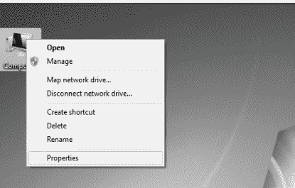

第 2 步：进入“高级”设置卡。

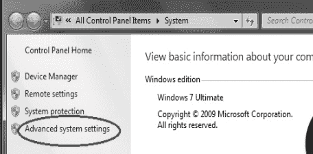

第 3 步：点击“环境变量”。

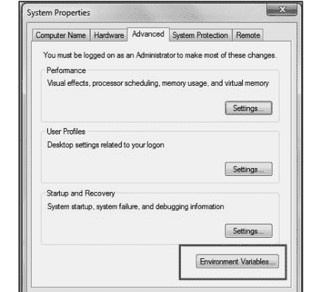

第 4 步：从`bin`文件夹复制路径。

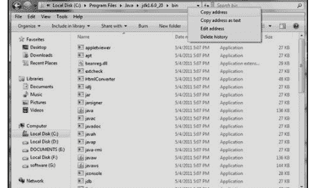

第 5 步：现在修改路径变量，使其包含 JDK 安装目录的路径。

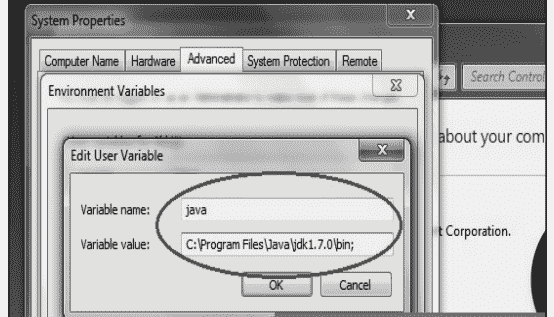

现在你的永久路径已设置好。你现在可以从任何驱动器执行任何 Java 程序。

## 1.7 JAVA 编译器和解释器

### 编译时发生了什么（编译器）？

在编译时，Java 文件由 Java 编译器进行编译（它不与操作系统交互），并将 Java 代码转换为字节码。

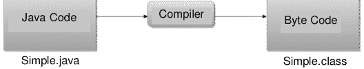

### 运行时发生了什么（解释器）？

在运行时，会执行以下步骤：

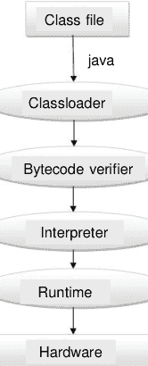

- 类加载器（`Classloader`）：JVM 的子系统，用于加载类文件。
- 字节码验证器（`Bytecode Verifier`）：检查字节码是否存在安全违反。
- 解释器（`Interpreter`）：将字节码转换为机器码以执行。

## 1.8 JAVA 类

类文件是 Java 编译器的输出。它包含由 JVM 执行的字节码。类文件包含代码、方法和数据成员。

## 1.9 JAVA 运行环境

运行时环境（JRE）是 Java 程序运行的环境。它包含了执行 Java 所需的 JVM 和标准库。

## 1.10 JAVA 格式

Java 程序的结构通常包含：

- 文档部分：包含关于程序的注释。
- 包部分：定义类所属的包。
- 导入部分：导入必要的类或包。
- 接口部分：定义类可以实现的接口。
- 类定义：类的主体。
- 主方法类：Java 程序的入口。

## 1.11 JVM（Java 虚拟机）

JVM（Java 虚拟机）是一个允许计算机程序运行的抽象机器。它提供了一个执行 Java 代码的运行时环境。JVM 负责加载代码、验证代码并执行代码。

# Java 语言介绍

以下显示了 Java 虚拟机的框图，它包含了主要的子系统和内存区域。每个 Java 虚拟机都有一个类加载器子系统：一种用于加载类型（类和接口）的机制。每个 Java 虚拟机还有一个执行引擎：一种负责执行已加载类方法中所包含指令的机制。

Java 虚拟机的内部架构。

## 1.12 JAVA 组件

Java 语言的三个主要组件是 JVM、JDK 和 JRE，分别代表 Java Virtual Machine（虚拟机）、Java Development Kit（开发工具包）和 Java Runtime Environment（运行环境）。它们的作用如下：

1. Java 虚拟机（JVM）
2. Java 工具包（JDK）
3. Java 运行环境（JRE）

## 1.13 JAVA API

在 Java 的上下文中，应用程序接口（API）是一系列重写的包、类和接口的集合，它们拥有各自的方法、字段和构造函数。类似于便于人机交互的用户界面，API 充当软件接口来促进交互。

在 Java 中，大多数基础编程任务是由 API 的类和包完成的，这有助于减少代码中编写的行数。

Java 工具包（JDK）由以下三个基本组件组成：

1. Java 编译器
2. Java 虚拟机（JVM）
3. Java 应用程序接口（API）

包含在 JDK 中的 Java API 描述了其包含的每个组件的功能。在 Java 编程中，许多此类组件都是预创建且通用的。因此，程序员能够通过 Java API 应用预写代码。在参考了这些 API 类和包后，程序员可以轻松地调用必要的代码类和包来实现功能。

## 1.14 JAVA 平台

# Java 编程语言平台

Java 编程语言有四种平台：

1. Java 标准版（Java SE）
2. Java 企业版（Java EE）
3. Java 微型版（Java ME）
4. Java FX

所有平台都由一个 Java 虚拟机（VM）和一个应用程序接口（API）组成。Java 虚拟机是一个程序，用于特定的硬件和软件平台运行 Java 技术。API 是一个软件组件集合，你可以用它创建其他软件组件或应用程序。每个 Java 平台都提供一个虚拟机和一个 API，这使得该平台的应用程序可以在任何兼容系统上运行，并具备 Java 编程语言的所有优势：平台无关性、强大、稳定性、易于开发和安全性。

# Java SE

当人们想到 Java 编程语言时，他们会想到 Java。Java SE API 提供了 Java 编程语言的核心功能。它定义了从 Java 语言的基本类型和对象到用于网络、安全、数据库访问、图形用户界面（GUI）开发和 XML 解析的高级类。

除了核心 API 外，Java 平台还由虚拟机、开发工具、部署技术以及 Java 技术应用中常用的其他类库和工具包组成。

# Java EE

EE 平台构建在 Java SE 平台之上。Java EE 平台为开发和运行大型、多层、可扩展、可靠且安全的网络应用程序提供了 API 和运行环境。

# Java ME

ME 平台提供了一个 API 和小型虚拟机，用于在手机等小尺寸设备上运行 Java 编程应用程序。该 API 是 Java SE API 的子集，并带有用于小型设备开发的特殊类库。Java ME 通常是 Java EE 服务的客户端。

# Java FX

Java FX 技术是一种用于用 Java Script 编写富网络应用的平台。Java FX 是一种用 Java 编写的平台。Java FX 应用程序可以使用 Java 平台的方法。

# Java 语言介绍

## 1.15 JAVA 开发工具包（JDK）

Java 工具包包含了用于加载、打包、文档生成等工具。它在 Java 程序被加载时会自动创建内存空间。JDK 包含了 Java 开发所必需的工具。

## 1.16 LAMBDA 表达式

Lambda 表达式是 Java 8 引入的一种新特性，它是表示函数的一种简洁方式。在 Java Lambda 表达式时，我们不需要再次定义方法。Lambda 表达式被视为一个函数，可以生成字节码。

### 函数接口（Functional Interface）

Lambda 表达式提供了函数接口的实现。一个只有一个抽象方法的接口被称为函数接口。

使用 Lambda 表达式的原因：

- 提供函数接口的实现。
- 减少代码。

## 1.17 方法引用

Java 8 引入了一种名为方法引用的特性。方法引用是用于引用方法接口的紧凑形式。每当你使用 Lambda 表达式来引用方法时，都可以将其替换为方法引用。在本教程中，我们将详细解释方法引用的概念。

# 方法引用的类型

Java 方法引用类型类型：

- 静态方法引用

  你可以引用类中定义的静态方法。以下是引用静态方法的语法和示例。

  语法：

  `类::静态方法`

- 实例方法引用

  像静态方法一样，你可以引用实例方法。下面的示例描述了引用实例方法的过程。

  语法：

  `对象::实例方法`

- 构造函数引用

  你可以使用`new`关键字引用构造函数。在这里，我们通过函数接口引用构造函数。

  语法：

  `类::new`

## 1.19 方法参数反射

Java 提供了一种新特性，你可以获取任何方法或构造函数的形式参数名称。`java.reflect`包包含了处理反射所需的所有类，如`Method`和`Parameter`。

### 方法类

它提供了关于类或接口方法的信息。反射方法可以是类方法，也可以是实例方法。

### 参数类

参数类提供了方法参数的信息，包括名称和修饰符。它还提供了获取属性的替代方法。

## 1.20 带有`main()`、`public`、`static`、`void`、`string args[]`的 Java 程序

```java
class sample
{
    public static void main(String[] args)
    {
        System.out.println("welcome to core java");
    }
}
```

任何 Java 程序都使用以下方法：

```java
public static void main(String[] args)
```

- `public`：访问访问符，意味着可以公开访问。
- `static`：访问修饰符，意味着当 Java 程序加载时会自动在内存中创建空间。
- `void`：返回类型，即它不返回任何值。
- `main()`：方法或函数名。
- `string args[]`：命令行参数，它是字符串格式的变量集合。

## Java 语言简介

## 1.21 JAVA 标记（TOKENS）

Java 程序由类和方法组成，方法是各种语句的容器，而语句由变量、常量、操作符等组成。

标记（Tokens）是编译器识别的各种 Java 程序元素。标记是程序中对编译器有意义的最小元素。Java 支持的标记包括关键字、变量、常量、特殊字符、操作符等。

当你编译一个程序时，编译器会扫描源代码中的文本并提取单个标记。在对源文件进行标记化时，编译器会识别并随后移除空白（空格、制表符、换行符和分页符）以及注释内的文本。现在，让我们考虑一个程序：

```java
//Print Hello
public class Hello
{
    public static void main(String args[]) {
        System.out.println("Hello Java");
    }
}
```

源代码包含了如下标记：`class`、`Hello`、`{`、`public`、`static`、`void`、`main`、`(`、`String`、`]`、`args`、`[`、`System`、`out`、`println`、`("Hello Java"`、`}`、`]`。生成的标记被编译成 Java 字节码，可以在解释型的 Java 环境中运行。标记对于编译器检测错误非常有用。当标记没有按照特定的顺序排列时，编译器会生成错误信息。

标记是程序的最小单元。共有五种标记：

1. 保留关键字
2. 标识符
3. 字面量
4. 变量
5. 操作符

## 核心 Java

1. **保留关键字**：保留关键字是具有预定义含义的 Java 标记。Java 有 60 个保留关键字，例如`int`、`class`、`break`、`continue`等。
2. **标识符**：标识符是由 Java 程序员设计并决定的 Java 标记。命名为标识符示例有：类名、类成员名以及类方法中的临时变量。
3. **字面量**：字面量是包含一组字符的 Java 标记。字面量用于表示必须存储在变量中的常量。例如`2`、`4`、`6`、`"ram"`、`"s"`等。
4. **操作符**：操作符是包含符号且在 Java 中具有预定义含义的标记。操作符可以与一个或多个操作符一起使用以获得结果。例如：一元、二元；三元操作符。
5. **变量**：变量用于保存值。例如`int a, b`；`int`数据类型`a, b`是整数类型变量。

## 1.22 JAVA 语句

## Java 的控制结构

控制程序的流程是编程中一个非常重要的方面。解决特定问题可能有很多方法，但你会希望寻找最好、最快的方法。

控制语句包含一个逻辑语句，该语句通常是括在花括号`[]`围的语句块。

真/假值用于`if`和循环语句。这些值要么是布尔值`true`和`false`，要么任何非零值表示真，零表示假（如 C 语言所示）。

Java 有四种控制结构：顺序、选择（决策）、重复（循环）和子程序（函数）。这些结构简单地控制程序的执行。

### 1.22.1 控制结构的类型

Java 有四种控制结构：

1. 顺序
2. 选择（决策）
3. 重复（循环）
4. 子程序（函数）

1. **顺序**：顺序语句意味着程序从一条语句移动到下一条，该语句再移动到下一条，依此类推。这是最简单的结构，在开发复杂程序时不太使用顺序结构。
2. **选择（决策）**：选择结构根据决策做出判断并执行命令。选择结构包括“`if`语句”，类似于“如果……，就做……”和“如果不是……，就不做……”的语句。通过“`if`语句”，我们还可以包含“嵌套`if`语句”，即其他“`if`语句”内部的“`if`语句”。选择结构的另一种形式是“`switch`语句”，它在某些情况下非常强大，但在其他情况下则不然。“`switch`语句”关注特定变量的值并据此执行不同的“`case`”情况。
3. **重复（循环）**：当需要通过“循环”重复某些次数时，使用重复结构。循环是一个简单的语句，它完成迭代或循环，直到达到某个值，执行移动到下一个可执行语句。例如，如果你要求用户输入十个值，你可以写一个循环，让用户继续输入直到输入了数字为止。
4. **子程序（函数）**：函数是一个执行特定任务的子组，并可以向调用或调用的语句返回一个值。函数让编程变得非常强大，因为当你开发一个处理特定情况的函数时，你可以将其用于其他程序。函数可以调用另一个函数，该函数可能再调用另一个，依此类推。它是组织程序并将程序分解为逻辑步骤极极方法。

在对不同类型的控制结构进行简要介绍后，是时候介绍如何使用每种类型了。我们将跳过顺序结构，因为它们几乎是自言易懂且基础的，直接进入选择语句。继续阅读了解更多关于选择结构和“`if……`”的内容。

## 1.22 选择语句

选择语句：在处理选择语句时，通常有三个版本：单向、双向和多向。单向语句根据表达式的值执行特定的操作，或者什么都不做。

**单向决策**：单向决策通过“`if`语句”处理，要么执行某些操作，要么完全什么都不做。单向决策是基于逻辑表达式的真假值来的。如果逻辑表达式为真，则执行相应的语句；如果表达式为假，控制将进入下一个可执行语句。单向决策的格式如下：

```java
if (逻辑表达式)
```

语句可以是简单的或复合的。简单涉及单个语句。复合涉及使用花括号`{}`括起来的一个或多个语句。复合语句被称为块语句。

### 示例 1：简单语句

```java
int c = 3;
if (c > 0)
    System.out.println("c 的值为 " + c);
```

### 示例 2：复合语句

```java
int c = 10;
{
    b = 2 * b;
    System.out.println("值为 " + c);
}
```

# 双向决策

双向决策通过“`if/else`语句”处理，要么执行某项操作，要么执行另一种。与单向决策类似，决策基于逻辑表达式。如果表达式为真，则执行`stmtT`；如果表达式为假，则执行`stmtF`。双向决策的格式如下：

```java
if (逻辑表达式)
stmtT;
else
stmtF;
```

`stmtT`和`stmtF`可以是简单或复合语句。记住复合语句始终用花括号`{}`括起来。

## 多向决策

多向决策涉及使用“`if / else if`语句”、“嵌套`if`”或“`switch`语句”。它们都用于评估可能有多个可能值的逻辑表达式。“`if / else if`语句”用于在值的范围之间进行选择。

使用“`if / else if`语句”的多向决策格式如下：

```java
if (逻辑表达式)
stmtT1;
else if (逻辑表达式)
stmtT2;
else if (逻辑表达式)
stmtT3;
...
else if (逻辑表达式)
stmtTN;
else
stmtF;
```

如果第一个逻辑表达式为真，则执行`stmtT1`。如果第二个逻辑表达式为真，执行`stmtT2`，依此类推。如果所有逻辑表达式都为假，则执行`else`之后的语句，即`stmtF`。

# Java 语言介绍

```java
stmtBF;
)
else
stmtAF;
```

如果条件 A 的求值为真，则执行将进入嵌套的`if`并评估条件 B。如果条件 A 的求值为假，则执行执行`stmtAF`。

## 示例 1


```java
int x;
if (x > 0)
    System.out.println(x + " is positive");
else if (x == 0)
    System.out.println(x + " is zero");
else
    System.out.println(x + " is negative");
```

## 示例 2

```java
char ch;
if (ch >= 'A' && ch <= 'Z' || ch >= 'a' && ch <= 'z')
    System.out.println("ch contains characters");
else if (ch >= '0' && ch <= '9')
    System.out.println("ch represents digits");
else if (ch == ' ' || ch == '\t' || ch == '\n')
    System.out.println("ch is white space");
else
    System.out.println("ch is misc character");
```

# `switch` 语句

当我们需要从多个备选项中选择一个时，可以使用 `switch` 设计程序来控制选择。然而，随着备选方案数量的增加，此类程序的复杂性也会增加。为了构建多路决策语句，`switch` 将给定变量或表达式的值与一组 `case` 值列表进行测试，当形成匹配时，将执行与 `case` 关联的块语句。

`switch` 语句是处理多路决策的另一种选择。我一直把它留到最后，因为程序员觉得使用 `switch` 语句不是良好的编程风格。凭借我一个学期的编程经验以及多年对不同编程语言的摸索，我还没有在使用 `switch` 语句时遇到过任何问题。我没有写过太多使用 `switch` 语句的程序，但当我写时，程序运行似乎非常顺畅。也许在之后的编程经验中，我会发现为什么程序员不喜欢使用 `switch` 语句。现在，让我们探索 `switch` 语句的方来去。。

以下是 `switch` 构造的特征：

1. 表达式必须是整数表达式。
2. 每个 `case` 都由整数或字符常量标记。
3. `case` 和 `default` 可以以任何顺序出现。
4. `case` 必须不同。
5. 完成一个 `case` 的代码后，执行将向下进入下一个 `case`，除非你采取了显式的退出操作。
6. `break` 语句会导致立即退出 `switch`。
7. 穿透 `case`（Falling through）是一种错失的幸运。
8. 优点是可以用一个代码处理多个 `case`，避免了冗余。
9. 负面因素是在每个 `case` 之后都要 `break`。

`switch` 语句为 `else if` 结构提供了一种替代，该结构根据单个表达式的值有多种可能的路径。`switch` 语句的修订形式如下：

# `switch (int expression)`

```java
{
case label - 1:
    stmt-list-1;
    break;
case label - 2:
    stmt-list-2;
    break;
case label - 3:
    stmt-list-3;
    break;
.
.
case label - n:
    stmt-list-n;
    break;
default:
    stmt-list;
}
```

在执行期间，会对表达式进行求值。如果表达式的值匹配 `label – 1`，则将执行 `stmt-list-1`。否则，执行将移动检查 `label – 2`，依此类推。如果没有标签匹配表达式，则将执行 `default`。在每个 `case` 内部以及每个语句列表的末尾（`default` 除外），必须有一个 `break` 语句，它会终止最内层的 `switch` 或循环语句。

# Java 语言介绍

这里关于 `switch` 语句的一些最后注意事项；被测试的表达式必须产生一个整值（`int` 或单字符 `char`），`case` 标签必须是整数常量（字面量或命名常量），`switch` 内部的每个标签应该是唯一的，且 `stmt-list` 可以包含 0 个或多个语句，这些语句不需要用大括号 `{ }` 包围。

## 示例

假设一个命名变量 `score` 是一个 `int` 型变量，包含了橄榄球一次进攻中得到的分数。考虑以下代码：

```java
switch (score) {
    case 1:
        System.out.println("Extra point");
        break;
    case 2:
        System.out.println("Safety of two point conversion");
        break;
    case 3:
        System.out.println("Field Goal");
        break;
    case 6:
        System.out.println("Touchdown");
        break;
    default:
        System.out.println("Invalid score on a football play.");
}
```

一旦处理完选择语句，是时候谈论程序中的迭代（或循环）了。这当然涉及到使用循环语句。继续阅读以探索循环的世界……

# 选择语句的语法

选择（`if`、`if-else`）

## `if` 语句

```java
//------ 带有真语句的 if语句
if (expression) {
    // 如果 expression 为真则执行
}

//------ 带有真、假语句的 if语句
if (expression) {
    // 如果 expression 为真则执行
} else {
    // 如果 expression 为假则执行
}

//------ 带有多个并行测试的 if语句
if (expression1) {
    // 如果 expression1 为真则执行
} else if (expression2) {
    // 如果 expression2 为真则执行
} else if (expression3) {
```

## 1.2.23 重复（循环）

### `while` 循环

循环是一种代码语句，重复执行某些操作，直到逻辑表达式求值为假。它仅仅是一种重复代码直到达到某个特定值的方法。它也是确保用户输入正确类型输入的一种有效方法（数据验证）。循环与 `if` 语句不同，`if` 语句如果逻辑表达式为真，它将执行并跳回去再次检查逻辑表达式，一次又一次，直到逻辑表达式变为假。有一点要避免编写产生无限循环的代码，无限循环是一种在你按下键盘上的 `ctrl-break` 之前永远不会停止的循环。为了避免无限循环，你需要在循环体内部使用语句来改变逻辑表达式的某些。我们将讨论三种类型的循环：`while`、`do`、`for`。

`while` 循环的格式如下：

```java
while (logical expression)
    stmt;
```

#### 示例 1

```java
int x = 7;
while (x > 0) {
    System.out.println("x is " + x);
    x--;
}
```

#### 示例 2

使用数据验证：假设用户需要输入一个整数。使用数据验证：假设用户需要输入 0 到 99 之间的一个整数。

```java
int k;
while (k < 0 || k > 99) {
    System.out.println("Enter an integer between 0 and 99: ");
    k = scanner.nextInt();
}
```

#### 示例 3

编写一个打印 500 以下倍数的循环。

```java
int x = 0;
while (x < 500) {
    System.out.println("x is " + x);
    x += 5;
}
```

关于 `while` 循环的介绍到此结束，让我们看看下一个循环。

### `do` 循环

`do` 循环是另一种重复执行某些操作直到逻辑表达式求值为假的代码语句。它是一种重复代码直到达到某个特定值的方法。它也可以确保用户输入正确类型输入的方法。`do` 循环与 `while` 循环完全相同，但它先执行某些操作然后检查逻辑表达式。`do` 循环的格式如下：

```java
do
    stmt;
while (expression);
```

`stmt` 可能是简单的或复杂的。复杂的语句必须用大括号 `{ }` 包围。

#### 示例 1

```java
int number;
do {
    System.out.println("Enter positive number greater than 0 ");
    number = scanner.nextInt();
} while (number <= 0);
```

#### 示例 2

```java
int number;
do {
    System.out.println("Enter a number between 0 and 100: ");
    number = scanner.nextInt();
} while (number < 0 || number > 100);
```

# Core Java

讨论了 `while` 和 `do` 循环后，还有一个循环我想介绍：`for` 循环。继续阅读更多关于循环的内容……

## `for` 循环

循环是另一种执行需要重复的操作（迭代）的方法。程序员通常喜欢使用循环，因为代码可以以更紧凑的方式编写。循环通常用于确切知道需要重复次数的代码。循环的一般格式如下：

```java
for (expression1; expression2; expression3)
```

```java
stmt(s);
```

其中 `stmt(s)` 是单个复合语句。`expression1` 用于初始化循环；`expression2` 用于确定循环是否继续；`expression3` 在每次迭代周期结束时评估。

注意 1：`expression2` 在 `stmt` 和 `expression3` 执行之前进行测试；循环体可能永远不会执行或测试。

注意 2：`for` 循环中的 3 个表达式都可以省略，但如果循环中没有初始化，那么你的程序可能不需要任何初始化。如果省略了 `expression2`，则 `for` 语句中没有更新，但更新应该作为循环体语句的一部分完成。

通常，循环可以写成等效的 `while` 循环，反之亦然。

```java
for (expression1; expression2; expression3) {
    stmt;
}
```

等同于：

```java
expression1;
while (expression2) {
    stmt(s);
    expression3;
}
```

#### 示例 1

编写一个 `for` 循环来显示 1 到 51 之间所有的奇数：

```java
for (int k = 1; k <= 51; k += 2)
    System.out.println("k is " + k);
```

#### 示例 2

编写一个 `for` 循环来显示从 20 到 1 的整数倒计时：

```java
for (int k = 20; k >= 1; k--)
    System.out.println("k is " + k);
```

## Java 语言简介

## 所有循环的语法

| 循环语句 | `do` 语句 |
|---|---|
| **`while` 语句：**<br>`while` 语句测试一个表达式。如果该表达式的值为真，则执行 `while` 的循环体。如果为假，则继续执行循环体之后的语句。每次执行完循环体后，执行都会重新开始测试。这会一直持续，直到表达式为假或某些语句停止循环。<br><br>```java<br>while (testExpr) {<br>    statements<br>}<br>``` | 这是循环语句中最用最少的一种，但有时你可能希望循环在测试之前先执行一次。<br><br>```java<br>do {<br>    statements<br>} while (testExpr);<br>``` |

### 其他循环控制

- `break;` // 退出最内层循环或 `switch`
- `continue;` // 开始下一次循环迭代

## 函数返回

- `return;` // 从 `void` 类型函数返回值
- `return expr;` // 从函数返回表达式 `expr` 的值

### `for` 语句

许多循环在循环开始前有一个初始化，并且某些循环在下一次循环前有一个“增量”操作。`for` 循环是组合这些部分的标准方式。

```java
for (initialStmt; testExpr; incrementStmt) {
}
```

这等于：

```java
initialStmt;

while (testExpr) {
    statements;
    incrementStmt;
}
```

## 1.23 空格符

Java 中的空白格用于分隔 Java 源文件中的标记。空白格在某些地方是必须，例如在访问修饰符、类型名称和标识符之间，并在其他地方用于提高可读性。

在 Java 中需要空白格的地方，可以使用一个或多个空白字符。在 Java 中空白格可选的地方，可以使用零或多个空白字符。

一个字符被认为是 Java 空格字符，当且仅当它满足以下标准之一：它是一个 Unicode 空格字符（`SPACE_SEPARATOR`、`LINE_SEPARATOR` 或 `PARAGRAPH_SEPARATOR`），但它不是换断空格（` `、` `、` `）。它是 `\t`，水平制表符。

## 1.24 大小敏感

Java 是大小敏感的。这是由于它继承自 C 语言。为了让这种语言对人们“过去”的习惯更加熟悉，他们保留了它的大小敏感性。这还有一个额外优势，因为 Java 标识符可以是几乎任何 Unicode 字符。大小敏感强制了文本中的大写或小写。

## 1.25 标识符

所有的 Java 组件都需要名称。用于类、方法、接口和变量的名称称为标识符。标识符必须遵循某些规则。这些是规则：

- (a) 所有标识符必须以字母（a 到 z 或 A 到 Z）、货币字符（`$`）或下划线（`_`）开头。
- (b) 在第一个字符之后，标识符可以是任何字符组合。
- (c) Java 关键字不能作为标识符。
- (d) Java 中的标识符是对大小敏感的，`foo` 和 `Foo` 是不同的标识符。

## 1.26 关键字

这里是 Java 编程语言中的关键字列表。你不能在程序中使用任何一个。关键字 `const` 和 `goto` 是被保留的，尽管它们目前没有被使用。`True`、`false` 和 `null` 看起来像关键字，但它们实际上是字面量；你不能在程序中使用它们作为标识符。

| `Abstract` | `Continue` | `for` | `new` | `switch` |
|---|---|---|---|---|
| `Assert` | `Default` | `goto` | `package` | `synchronized` |
| `Boolean` | `Double` | `if` | `private` | `This` |
| `Break` | `Do` | `implements` | `protected` | `throw` |
| `Byte` | `Else` | `import` | `public` | `throws` |
| `Case` | `enum` | `instance` | `return` | `transient` |
| `Catch` | `Extends` | `final` | `short` | `Try` |
| `Char` | `Final` | `interface` | `static` | `Void` |
| `Class` | `Finally` | `long` | `strictfp` | `volatile` |
| `Const` | `Float` | `native` | `super` | `while` |

## 1.27 注释

注释是指不被编译器和解释器执行的语句。注释可以用于提供关于变量、方法、类或任何语句的信息或解释。它也可以用于在特定时间隐藏程序代码。

### Java 注释类型

Java 中有 3 种注释：

- 单行注释
- 多行注释
- 文档注释

### 1. Java 单行注释

单行注释用于只注释一行代码。

语法：

```java
//这是一条单行注释
```

### 2. Java 多行注释

多行注释用于注释多行代码。

语法：

```java
/*
这是
多行
注释
*/
```

### 3. Java 文档注释

文档注释用于创建文档 API。要创建文档 API，你需要使用 `javadoc` 工具。

语法：

```java
/**
这是
文档
注释
*/
```

## 1.28 大括号和代码块

Java 中的代码块是一段被成对的大括号 `{ }` 括起来的代码：大括号 `{ }` 用于标记一段作为一个整体运行代码的开始和结束。如果你愿意，可以把左大括号 `{` 视作是代表单词 `BEGIN`，用以标记一个节的开始。那么右大括号 `}` 就会代表 `END`，用以标记一个节的结束。（有些语言实际上使用 `BEGIN` 和 `END` 代替大括号，如 Pascal 和 Modula-2。）

在 Java 程序中，通常有几个代码块。代码块可以互相“嵌套”，即一个代码块完全在另一个代码块内部：

```java
public class Hello {
    public static void main(String[] args) {
    }
}
```


## 1.29 空格符

Java 中的空白格用于分隔 Java 源文件中的标记。空白格在某些地方是必须的，例如在访问修饰符、类型名称和标识符之间，并在其他地方用于提高可读性。

在 Java 中需要空白格的地方，可以使用一个或多个空白字符。在 Java 中空白格可选的地方，可以使用零或多个空白字符。

一个字符被认为是 Java 空格字符，当且仅当它满足以下标准之一：它是一个 Unicode 空格字符（`SPACE_SEPARATOR`、`LINE_SEPARATOR` 或 `PARAGRAPH_SEPARATOR`），但它不是换断空格（` `、` `、` `）。它是 `\t`，水平制表符。

## 1.30 大小敏感

Java 是大小敏感的。这是由于它继承自 C 语言。为了让这种语言对人们“过去”的习惯更加熟悉，他们保留了它的大小敏感性。这还有一个额外优势，因为 Java 标识符可以是几乎任何 Unicode 字符。大小敏感强制了文本中的大写或小写。

## 1.31 标识符

所有的 Java 组件都需要名称。用于类、方法、接口和变量的名称称为标识符。标识符必须遵循某些规则。这些是规则：

- (a) 所有标识符必须以字母（a 到 z 或 A 到 Z）、货币字符（`$`）或下划线（`_`）开头。
- (b) 在第一个字符之后，标识符可以是任何字符组合。
- (c) Java 关键字不能作为标识符。
- (d) Java 中的标识符是对大小敏感的，`foo` 和 `Foo` 是不同的标识符。

## 1.32 对象引用类型

有四种引用类型：

- 类类型（`$8`）
- 接口类型（`$9`）

## 1.30 变量的作用域 ...

## Java

数据类型指定了存储的值的大小和类型。

| 数据类型 | 默认值 | 默认大小 |
|---|---|---|
| `boolean` | `false` | `1 bit` |
| `char` | `\u0000` | `2 byte` |
| `byte` | `0` | `1 byte` |
| `short` | `0` | `2 byte` |
| `int` | `0` | `4 byte` |
| `long` | `0L` | `8 byte` |
| `float` | `0.0f` | `4 byte` |
| `double` | `0.0d` | `8 byte` |

原生类型称为固有类型或内置类型。这些数据类型与机器无关。

## 原生数据类型

- 1. 数值数据类型
  - (a) 整数数据类型
    - `byte` → `1byte` → `128 to 127`
    - `short` → `2bytes` → `32768 to 32767`
    - `int` → `4 bytes` → `-2^31 to 2^31 - 1`
    - `long` → `8 bytes` → `-2^63 to 2^63 - 1`
  - (b) 浮点数据类型
    - `float` → `4 bytes` → `-3.4e-038 to 3.4 e + 38`
    - `double` → `8 bytes` → `-1.7e-308 to 1.7 e + 38`
- 2. 非数值
  - (a) `char` → `2Bytes`。字符类型是两个字节，因为 Java 使用 Unicode，定义了完整的国际字符集。
  - (b) `boolean` → `1 bit`。Boolean 有两个可能的值，`true` 或 `false` 逻辑值。Boolean 的存储需要一个位。
- 3. 非原生类型
  - (a) 类
  - (b) 接口
  - (c) 数组

# Java 语言介绍

- 变量类型（`$4.4`）
- 数组类型（`$10`）
- 引用类型：
  - `ClassOrInterfaceType`
  - `TypeVariable`
  - `ArrayType`
  - `ClassType`
- `ClassOrInterfaceType`：
  - `Type`
  - `InterfaceType`
- `Class`：
  - `TypeDeclSpecifier TypeArgumentsopt`
- `InterfaceType`：
  - `TypeDeclSpecifier TypeArguments`
- `TypeDeclSpecifier`：
  - `TypeName`
  - `ClassOrInterfaceType Identifier`
- `TypeName`：
  - `Identifier`
  - `TypeName Identifier`
- `TypeVariable`：
  - `Identifier`
- `ArrayType`：
  - `Type []`

```java
class Point { int[] move(int deltax, int deltay); }

interface Move { void move(int deltax, int deltay); }
```

上述代码声明了一个类型 `Point`、接口 `Move`，并使用数组类型 `int[]`（`int` 数组）来声明类 `Point` 的字段 `metrics`。

一个类或接口由一个类型声明组成，可选地跟随类型参数（`$4.5.1`）。如果类型参数出现在类或接口类型的任何地方，则它是一个参数化类型（`$4.5`）。

类型声明可以是一个类型名（`$6.5.5`），可以是类或接口类型后跟“。”。在后者的情况下，标识符的形式为 `T.id`，其中 `id` 必须是 `T` 的可访问（`$6.6`）成员类型（`$8.5`、`$9.5`）的简单名称，否则将发生编译错误。该标识符表示该成员类型。

在 Java 编程语言中，存在不提供类型参数的情况下使用泛型类或接口的情况。这些情况并不涉及原始类型（raw types）（`$4.8`）。相反，它们是类型参数对于泛型类或接口的意义没有必要或相关的上下文。

## 核心 Java

例如，单类型导入声明 `import java.util.List;` 将简单类型名 `List` 置于编译单元的作用范围之内，从而可以使用泛型 `List<...>` 的参数化类型。另一个例子是调用泛型类的静态方法只需要提供泛型类的（可能是限定的）名称，而不需要任何类型参数，因为此类类型参数对静态方法是无关的。（方法本身可以是泛型的，并接收它自己的类型参数，但静态方法的类型参数必然与其泛型类的类型参数无关（`§5.5.3`）。）

由于偶尔需要在不带类型参数的情况下使用泛型类或接口名称，类型名与类型声明符是不同的。类型名总是通过另一个名称进行限定。在某些情况下，为了访问作为另一个参数化类型成员的内部类是必要的。

以下是一个类型声明与类型名不同的示例：

```java
class GenericOuter<T extends Comparable<?>> {

  public class Inner<S extends Comparable<S>> {

    T getT() { return null; }

    S getS() { return null; }

  }

}

class Test {

  public static void main(String[] args) {

    GenericOuter<Integer>.Inner<Double> x1 = null;

    Integer i = x1.getT();

    Double d = x1.getS();

  }

}
```

如果我们通过用类型名限定来访问 `Inner`，例如：

`GenericOuter.Inner.x2 = null;`

我们将强制其作为原始类型使用，从而丢失类型信息。

## 1.33 字符串（STRINGS）

# 字符串（Strings）

在 Java 中，string 本质上表示字符值序列的对象的。字符数组的用法与 Java 字符串相同。例如：

1. `char[] ch={'j','a','v','a','p','o','i','n','t'};`
2. `String s=new String(ch);`

等同于：

1. `String s="javpoint";`

# Java 语言介绍

Java `String` 类提供了许多方法对字符串执行操作，如 `compare()`、`concat()`、`equals()`、`split()`、`length()`、`replace()`、`compareTo()`、`intern()`、`substring()` 等。

`java.lang.String` 类实现了 `Serializable`、`Comparable` 和 `CharSequence` 接口。

# Serializable Comparable CharSequence

## CharSequence 接口

CharSequence 接口用于表示字符序列。它被 `String`、`StringBuffer` 和 `StringBuilder` 类实现。这意味着通过这三个类在 Java 中创建字符串。

String 是不可变的，即它不能被更改。每当我们更改任何字符串时，都会创建一个新的实例。对于可变字符串，你可以使用 `StringBuffer` 和 `StringBuilder` 类。

我们稍后会讨论可变字符串。让我们先理解 Java 中的字符串是什么，以及如何创建字符串。

# Java 中的 String 是什么

通常，string 是字符的序列。但在 Java 中，string 是一个表示字符序列的对象。`java.lang.String` 类用于创建字符串对象。

# 如何创建 String 对象？

创建 String 对象有两种方法：

- 1. 通过字符串字面量（string literal）
- 2. 通过 `new` 关键字

## 1. 字符串字面量（String Literal）

Java 字符串字面量是通过双引号创建的。例如：

- 1. `String s="welcome";`

每次创建一个字面量时，JVM 首先检查字符串常量池。如果字符串已存在于池中，则返回池中实例的引用。如果字符串在池中不存在，则返回池中实例的引用。

# 为什么 Java 使用字符串字面量的概念？

为了使内存更高效（因为 `String` 对象存储在常量池中）。

## 2. 通过 `new` 关键字

# Java 字符串示例

```java
class StringExample{

  public static void main(String args[]){

    String s1="java"//通过字面量创建字符串

    char ch[]={'s','t','r','i','n','g'};

    String s2=new String(ch);//将字符数组转换为字符串

    String s3=new String("example");//通过new关键字创建字符串

    System.out.println(s1);

    System.out.println(s2);

    System.out.println(s3);
  }
}
```

# 输出：

```text
java

strings

example
```

# String 方法

`java.lang.String` 类提供了许多有用方法对字符序列执行操作。

| 序号 | 方法 | 描述 |
| :--- | :--- | :--- |
| 1 | `charAt(int index)` | 返回指定索引的字符 |
| 2 | `length()` | 返回字符串长度 |
| 3 | `static format(String format, Object... args)` | 返回格式化字符串 |
| 4 | `static format(Locale l, String format, Object... args)` | 返回指定区域设置的格式化字符串 |
| 5 | `substring(int begin)` | 返回指定起始索引的子字符串 |
| 6 | `substring(int beginIndex, int endIndex)` | 返回指定起始和结束索引的子字符串 |
| 7 | `contains(CharSequence s)` | 返回匹配字符序列的 `true` 或 `false` |
| 8 | `static join(CharSequence delimiter, CharSequence... elements)` | 返回合并后的字符串 |
| 9 | `static join(CharSequence delimiter, Iterable<? extends CharSequence> elements)` | 返回合并后的字符串 |
| 10 | `equals(Object object)` | 检查字符串与对象的相等性 |
| 11 | `isEmpty()` | 检查字符串是否为空 |
| 12 | `concat(String str)` | 合并指定的字符串 |
| 13 | `replace(char old, char new)` | 替换所有指定的字符值 |
| 14 | `replace(CharSequence old, CharSequence new)` | 替换所有指定的 CharSequence |
| 16 | `String[] split(String regex)` | 返回匹配正则表达式的拆分字符串 |
| 17 | `String[] split(String regex, int limit)` | 返回匹配正则表达式和限制的拆分字符串 |
| 18 | `String intern()` | 返回池化后的字符串 |
| 19 | `int indexOf(int ch)` | 返回指定字符值的索引 |
| 20 | `int indexOf(String substring)` | 返回从给定索引开始的指定字符值 |
| 21 | `int indexOf(String substring)` | 返回指定的子字符串索引 |
| 22 | `int indexOf(String substring, int fromIndex)` | 返回从给定索引开始的指定子字符串索引 |
| 23 | `String toLowerCase()` | 返回小写的字符串。 |
| 24 | `String toLowerCase(Locale l)` | 使用指定的区域设置返回小写的字符串。 |
| 25 | `String toUpperCase()` | 返回大写的字符串。 |
| 26 | `String toUpperCase(Locale l)` | 使用指定的区域语言返回大写的字符串。 |
| 27 | `String trim()` | 移除字符串开头结尾的空格。 |
| 28 | `static String valueOf(int value)` | 将给定类型转换为字符串。它是重载的。 |

## 1.34 自动装箱与拆箱

Java 1.5 引入了一项特殊功能，即基本类型与对应的包装类（Wrapper class）之间的反向自动转换。

**自动装箱（Autoboxing）：** 将基本类型自动转换为其对应的包装类对象称为自动装箱。例如——将 `int` 转换为 `Integer`，`long` 转换为 `Long`，`double` 转换为 `Double`。

**拆箱（Unboxing）：** 是自动装箱的反过程。将包装类对象自动转换为其对应的基本类型的过程称为拆箱。例如——将 `Integer` 转换为 `int`，`long` 转换为 `long`，`double` 转换为 `double`。

| 基本类型 | 包装类 |
|---|---|
| `boolean` | `Boolean` |
| `byte` | `Byte` |
| `char` | `Character` |
| `float` | `Float` |
| `int` | `Integer` |
| `long` | `Long` |
| `short` | `Short` |
| `double` | `Double` |

## Java 语言简介

### Java 中的自动装箱与拆箱

从 Java 5 开始，增加了两个新特性：自动装箱和拆箱。当需要对象而非基本类型时，自动装箱会自动将基本数据类型包装成该特定数据类型的包装类；而拆箱则执行完全相反的操作，即自动从包装对象中取出值。

例如：

在添加此自动自动装箱功能之前，将基本类型 `int` 包装为对应的包装类 `Integer` 看起来如下：

```java
int num = 25;
```

```java
Integer i = Integer.valueOf(num);
```

现在有了这个功能，你可以直接为包装类赋值：

```java
Integer i = 25;
```

现在 `valueOf()` 方法的调用将由编译器在后台完成。自动拆箱也是如此：以前包装对象意味着需要根据类型调用 `intValue()`、`longValue()`、`doubleValue()` 方法。

```java
Integer i = new Integer(10);

int num = i.intValue();
```

现在可以直接完成：

```java
Integer i = new Integer(10);

int num = 1;
```

对于 `float` 类型：

```java
Float f = new Float(56.78);

float fNum = f;
```

## 自动装箱与拆箱的优势

正如你已经看到的，通过这项功能，你不需要手动地包装或拆箱基本类型。这对于 Java 5 中添加的另一个特性也有很大帮助。由于泛型只与具有自动装箱和拆箱功能的对象工作，因此这极大地简化了代码编写。

集合类也与对象工作，因此使得与集合的操作也变得简单。

例如：

```java
List<Integer> li = new ArrayList<>();

for (int i = 1; i < 10; i++) {
    li.add(i);
}
```

尽管你有一个存储 `Integer` 类型对象的 `List`，但由于自动装箱的存在，你仍然直接将基本类型添加到 `List` 中。早些将基本类型 `int` 添加到列表时，这些值会在后台被包装在 `Integer` 对象中然后添加到 `ArrayList` 中。

同样，拆箱也会自动发生。

```java
int elem = li.get(0);

System.out.println("elem " + elem);
```


当你尝试从列表中获取第一个元素并将其赋值给 `int` 变量时，`Integer` 会被拆箱以从包装类中获取 `int`，该值被赋值给 `int` 变量 `element`。

## Java 中自动装箱与拆箱的重要点

1. 编译器使用 `valueOf()` 方法将基本类型转换为对象，并使用 `intValue()`、`doubleValue()` 从对象获取基本类型值。
2. 在自动装箱期间，`boolean` 转换为 `Boolean`，`byte` 转换为 `Character`，`float` 变为 `Float`，`int` 变为 `Integer`，`long` 变为 `Long`，`short` 转换为 `Short`；而在拆箱时情况相反，如 `Float` 变为 `float`。

### 自动装箱与拆箱示例

我们已经看到了一些赋值示例，基本类型自动装箱为包装类，而箱后的对象自动拆箱以获取基本类型值。但这并不是唯一使用自动装箱和拆箱的地方。

- 你可以在方法中看到它。
- 你可以在表达式中看到它。
- 由于自动装箱和拆箱，包装类可以用 `switch` 语句。

### 方法参数中的自动装箱

当参数传递给方法或方法返回值时，可能会发生自动装箱/拆箱。

示例：

```java
public class BoxDemo {

    public static void main(String[] args) {

        BoxDemo bd = new BoxDemo();

        System.out.println("Value " + bd.calcValue(15.6));

    }

    public double calcValue(Double dNum) {

        Double dOb;

        dOb = dNum + 13.4;

        return dOb;

    }

}
```

### `switch` 中的用法

由于拆箱，`Integer` 对象可以在 `switch` 中使用。

```java
Integer iVal = 7;

switch(iVal) {

    case 1: System.out.println("First step");

    break;

    case 2: System.out.println("Second step");

    break;

    default: System.out.println("There is some error");

}
```

### 自动装箱与拆箱的开销

装箱/拆箱的过程存在开销，因此请不要因为认为会自动发生装箱/拆箱就完全开始使用对象。这会导致代码效率变低。

# 1.35 Java 运算符

## 运算符

- C++ 运算符
  - (1) 算术运算符
  - (2) 赋值运算符
  - (3) 比较和逻辑运算符
    - 关系运算符
    - 逻辑运算符
    - 等等运算符
  - (4) 位逻辑运算符
  - (5) 特殊运算符
    - (a) 一元运算符
    - (b) 三元运算符
    - (c) 逗号运算符
    - (d) 作用域运算符
    - (e) `New` 和 `delete` 运算符
    - (f) 其他运算符

## 1. 算术运算符

用于执行加（`+`）、减（`-`）、乘（`*`）、除（`/`）等算术操作的运算符被称为算术运算符。这些基础运算符被称为二元运算符，因为它们需要两个变量来求值。

| 序号 | 运算符 | 含义 |
|---|---|---|
| 1 | `+` | 加或一元加 |
| 2 | `-` | 减或一元负 |
| 3 | `*` | 乘法 |
| 4 | `/` | 除法 |
| 5 | `%` | 取模除（整除的余数） |

对操作数的变量或常量被称为操作数。C++ 中的算术可以分为三种：

(a) 整数算术。  
(b) 实数算术。  
(c) 混合模式算术。

### (a) 整数算术

当两个操作数都是整数时，该操作被称为整数算术。

例如：

- `5 - 5 = 50`
- `5 + 5 = 60`
- `14 * 2 = 28`
- `14 / 2 = 7`（截断小数整数除法）
- `14 % 2 = 0`（除法余数）
- `14 % 3 = 2`
- `6 / 7 = 0`

### (b) 实数算术

仅涉及实数操作数的算术称为实数算术。实数操作数的值可以是分数形式或指数形式。

例如：

- `1.5 - 0.7 = 0.8`
- `1.5 + 0.7 = 2.2`
- `1.5 * 2.0 = 3.0`
- `6.0 / 7.0 = 0.857143`
- `1.0 / 3.0 = 0.333333`
- `-2.0 / 3.0 = -0.666667`

`%`（取模运算符）不能用于 `int` 或 `Real` 数值。

```text
x_int / int = result_int

x_int / float = result_float

x_float / y_int = result_float

x_float / y_float = result_float
```

### (c) 混合模式算术

C++ 允许我们将整数操作数与实数操作数混合。当一个操作数是实数而另一个是整数时，该表达式被称为混合算术表达式，即如果任一操作数为实数类型，则只执行实数运算，结果始终为实数。

例如：

- `15 / 10.0 = 1.5`
- `4 + 3.5 = 7.5`

## 2. 赋值运算符

赋值运算符用于将表达式或常量的值赋值给变量。赋值运算符可以使用任何表达式中，常用的赋值运算符是 `=`。

```text
variable_Name = constant or expression;
```

算术表达式是变量、常量和运算符的组合。

例如：

```text
x = a + b;
```

```text
z = 0;
```

```text
final = 100;
```

在赋值运算符操作期间，右侧表达式的值被赋值给左侧变量。

在赋值运算符操作期间，右侧表达式的值被计算并赋值给左侧的变量。

### 简写赋值运算符

除了常用的赋值运算符 `=` 之外，C++ 还有以下形式的简写赋值运算符：

```text
variable op = expression;
```

其中 `op` 是 Java 二进制算术运算符。

- (a) `+=`

  ```text
  a = a + 1
  ```

  如果 `a = 5`，则：

  ```text
  a = 5 + 1
  a = 6
  ```

  ```text
  x = y + 1
  x = x + (y + 1)
  ```

- (b) `-=`

  ```text
  a = a - 1
  ```

- (c) `*=`

  ```text
  a = a * 5
  ```

- (d) `/=`

  ```text
  a = a / b
  ```

- (e) `%=`

  ```text
  a = a % b
  ```

- (f) `&=`（位与运算符）

  ```text
  a = & 5
  a = a & 5
  ```

- (g) `|=`（位或运算符）

  ```text
  a = / 6
  a = a / 6
  ```

- (h) `~=`（位取反运算符）

  ```text
  a ~ = 7
  a = a ~ 7
  ```

## 3. 比较和逻辑运算符

- (a) 关系运算符。
- (b) 逻辑运算符。
- (c) 等于运算符。

### (a) 关系运算符

借助关系运算符，我们可以通过比较两个或多个操作数的值来决策。

关系运算符通过比较值来判断它们是否相等，或者其中一个大于其他等。

| 运算符 | 含义 |
| :--- | :--- |
| `<` | 小于 |
| `<=` | 小于等于 |
| `>` | 大于 |
| `>=` | 大于等于 |

表达式：关系运算符 `expression2`

| 表达式 | 结果 |
| :--- | :--- |
| `3 > 4` | `false` |
| `6 <= 2` | `false` |
| `10 - 32` | `True` |
| `(23 * 7) >= (-67 + 89)` | `True` |

### (b) 逻辑运算符

逻辑运算符用于执行逻辑表达式，如逻辑与、逻辑或和逻辑非。

| 运算符 | 含义 |
| :--- | :--- |
| `&&` | 逻辑与 |
| `||` | 逻辑或 |
| `!` | 逻辑非 |

当我们想要测试多个条件并做出决策时，使用逻辑与和逻辑或运算符。

逻辑与表示当两个条件或表达式都为真时，复合表达式为真。

| 情况 | 结果 |
| :--- | :--- |
| `true && true` | `true` |
| `true && false` | `false` |
| `false && true` | `false` |
| `false && false` | `false` |

逻辑或表示如果任一个或所有输入为真，则结果为真。

```text
expression1 || expression2
```

| 情况 | 结果 |
| :--- | :--- |
| `true || true` | `true` |
| `true || false` | `true` |
| `false || false` | `false` |

```text
(a < b) || (b > c)
true || false
```

逻辑取反运算符（`!`）：逻辑表达式可以通过取反运算符（`!`）从假变为真，或从真变为假。

| 情况 | 结果 |
| :--- | :--- |
| `!(true)` | `false` |
| `!(false)` | `true` |

```text
!(expression)
```

示例：

```text
(a < b) || (b > c)

(4 < 5) || (6 > 5)

(true) || (true)
false || true
```

### (c) 等于运算符

这些表达式用于检查给定表达式的相等性。

`==` 是两个表达式之间的相等性检查。  
`!=` 是两个表达式之间的不相等性检查。

| 表达式 | 结果 |
| :--- | :--- |
| `a == b` | 如果 `a = 4`、`b = 6` 则 `false` |
| `(a *) != c` | 如果 `a = 4`、`b = 6` 则 `true` |
| `'` | `false` |

| 运算符 | 含义 |
| :--- | :--- |
| `==` | 等于 |
| `!=` | 不等于 |

## 4. 位逻辑运算符

C++ 拥有一强大的位操作运算符集。这些运算符允许程序员访问并操作数据中的单个位。

| 运算符 | 含义 |
| :--- | :--- |
| `&` | 位与 |
| `\|` | 位或 |
| `^` | 位异异 |
| `>>` | 右移 |
| `<<` | 左移 |
| `~` | 位取反 |

### (a) 位与

两个操作数之间执行位运算。

| 变量 | 数值 |
| :--- | :--- |
| `x` | 5 |
| `y` | 2 |
| `x & y` | 0 |
| `a` | 6 |
| `b` | 3 |
| `a & b` | 2 |

### (b) 位或

如果任一个或所有输入为真，结果为真。

| 变量 | 数值 |
| :--- | :--- |
| `x` | 5 |
| `y` | 2 |
| `x \| y` | 7 |
| `a` | 6 |
| `b` | 3 |
| `a \| b` | 7 |

### (c) 位异异

两个操作数之间执行位运算。如果操作数不同，结果为 1。

减 `i--` 后减，`--i` 前减，`i-- (i = i - 1) (i = 5 - 1) 4`。

| 变量 | 数值 |
|---|---:|
| `x` | 5 |
| `y` | 2 |
| `x ^ y` | 7 |
| `a` | 6 |
| `b` | 3 |
| `a ^ b` | 5 |

### (d) 位右移

右移运算符用于将位向右移。

| 变量 | 数值 |
|---|---:|
| `x` | 5 |
| `y` | 2 |
| `x >> y` | 1 |
| `a` | 6 |
| `b` | 3 |
| `a >> b` | 0 |

### (e) 位左移

左移运算符用于将位向左移。

| 变量 | 数值 |
|---|---:|
| `x` | 5 |
| `y` | 2 |
| `x << y` | 20 |
| `a` | 6 |
| `b` | 3 |
| `a << b` | 48 |

### (f) 位取反

取反运算符 `~` 切换二进制模式中的位。

| 变量 | 数值 |
|---|---:|
| `x` | 5 |
| `y` | 2 |
| `~x` | -6 |
| `a` | 6 |
| `b` | 3 |
| `~a` | -7 |

## 5. 特殊运算符

C++ 中用一些特殊运算符执行特定类型的操作：

- (a) 一元运算符。
- (b) 三元运算符。
- (c) 逗号运算符。
- (d) `New` 和 `delete` 运算符：
  - (i) 用于分组表达式的括号。
  - (ii) 成员运算符（操作符）。

### (a) 一元运算符

一元运算符只需要单个表达式即可产生一行。某些一元运算符后面可以跟增减运算符操作数。

最常见的一元操作是一元减，减号位于数值常量、变量或表达式之前。

| 运算符 | 含义 |
| :--- | :--- |
| `*` | 指针所指存储字段的内容。因此 `*` 用于获取地址运算符的内容。指向特定的内存。 |
| `&` | 变量地址 |
| `--` | 负值（负号） |
| `--` | 位取反 |
| `++` | 递增运算符 `i++` 后增，`++++` 前增，`i++ (i = i + 1) (i = 5 + 1) 6` |
| `--` | 递减运算符 `i--` 后减，`--i` 前减，`i-- (i = i - 1) (i = 5 - 1) 4` |
| `type` | 强制类型转换 |
| `sizeof` | 后续数据类型或类型按字节的大小。它用于指示编译器为特定数据类型保留内存大小或块。 |

### (b) 三元运算符（`?`）

C++ 包含一种特殊的、三元运算符或条件运算符。之所以被称为三元运算符是因为它使用了三个表达式。它是 `if_else` 结构的简写版本。

三元运算符的格式为：

```text
expression1 ? expression2 : expression3
```

如果表达式 1 求值为真，则计算表达式 2，否则计算表达式 3。

**示例：**

```text
if (i % 2 == 0)
    even = true
else
    even = false

even = (i % 2 == 0) ? true : false;
```

```text
if (i > j)
    max = i
else
    man = j
```

```cpp
max = (i > j) ? i : j;

if (x > y)
    x = x + 3
else
    x = x - 3

x = (x > y) ? x + 3 : x - 3;
```

### (c) 逗号运算符

C++ 以两种方式使用逗号运算符：

- (i) 逗号第一次用法是变量声明 `int a, b, c;` 中的分隔符。

  ```text
  float x, y, z;
  ```

- (ii) 逗号的第二次用法是用于 `for` 循环的分隔符。

  ```cpp
  for (i = 1, j = 2; i <= 10; i++, j += 3)
  {
      out << i <<
  }
  ```

# 1.36 类型转换（TYPE CASTING）

在这种情况下需要将一种类型的值存储到另一种类型的变量中时，我们必须通过处理对要存储的值进行转换。在括号 `()` 中指定类型名。

语法：

```text
type variable1 = (Type) variable2;
```

例如：

```text
int m = 50;
```

在这些语句中，`byte` 是 `n` 的数据类型，括号内的 `byte` 表示 `M` 从整数转换为字节的类型转换。

```text
Long Count = (Long) M
```

此语句将 `M` 的数据类型从整数转换为长型。

```text
Float s = (float) M
```

此语句将 `M` 整数值转换为浮点数。

当方法返回的类型与我们要求的类型不同时，转换通常是必要的。

转换为较小的类型可能会导致数据丢失。

将浮点值转换为整数会导致小数部分的丢失。

不同的转换不会丢失信息。

| 源类型 | 目标类型 |
| :--- | :--- |
| `Byte` | `Short`、`Char`、`int`、`long`、`float`、`double` |
| `Short` | `int`、`long`、`float`、`double` |
| `Char` | `int`、`long`、`float`、`double` |

`Int`、`long`、`float`、`double`。

`Long`、`float`、`double`。

`Float`、`double`。

例如：

```text
char c = '4', b = '5'
char d = a + b - 45
int d = (int) + (int) - 91;
```

## 强制转换与类型转换（Casting and converting）

强制转换用于将一种类型的值转换为另一种。由于 Java 同时拥有基本类型和对象类型，强制转换有三种：

- 基本类型之间。
- 对象类型之间。
- 将基本类型转换为对象以及从这些对象中提取基本类型。

## 强制转换基本类型

```java
public class MyAPP {
    public static void main(String args[]){
        double a=22.33;
        System.out.println((int)a);
    }
}
```

## 强制转换对象

类进行强制转换时，它们必须具有继承关系。大多数情况下，需要特定的强制转换。

你可以始终将子类强制转换为父类。

## 将基本类型强制转换为对象

你可以为基本类型创建包装类，例如将 `int` 转换为 `Integer` 类。并使用方法将其转换回 `int`。

```java
public class MyAPP {
    public static void main(String args[]){
        double a=22.33;
        //System.out.println((Double)a); 不允许的
        Double b= new Double(a);
        System.out.println(b.doubleValue());
        System.out.println(b.byteValue());
        System.out.println(b.floatValue());
    }
}
```


```java
System.out.println(b.doubleValue());
System.out.println(b.intValue());
System.out.println(b.byteValue());
System.out.println(b.floatValue());
System.out.println(b.longValue());
}
```

## 问题

1. 详细解释 Java 的特征。
2. 区分 C++ 和 Java。
3. 写关于 Java 历史的简短说明。
4. 解释 Java 的结构。
5. 解释组件。
6. 结合合适的示例解释带有 `main()` 方法的程序。
7. 写关于运行时环境（Runtime Environment）的简短说明。
8. 解释语言中的 JVM 概念。
9. 解释编译器和解释器的流程。
10. 写关于 Java API 和开发工具包（JDK）的简短说明。
11. 什么是 Lambda 表达式和方法引用？
12. 写关于类型注解和方法参数的简短说明。
13. 解释 Java 中的数据类型。使用的不同运算符。
14. 详细定义标记（Tokens）。
15. 解释语句和语句的类型。
16. 区分 `while` 循环。
17. 列出不同的语句。
18. 写关于 Java 中空白字符和大小写敏感的简短说明。
19. 解释 Java 中的标识符（Identifiers）和关键字（Keywords）。
20. 解释注释和代码块。
21. 解释变量和变量的作用域。
22. 解释 Java 中的对象类型。
23. 结合合适的示例解释 Java 中的字符串。
24. 解释 Java 中的自动装箱（Autoboxing）和拆箱（unboxing）。
25. 解释 Java 中的类型转换（Typecasting）。

## 第二单元

# 第 2 章：控制流语句

## 结构

### 2.1 Java 的控制结构

### 2.2 控制流语句

#### 2.2.1 `if` 语句

#### 2.2.2 `if...else` 嵌套语句

#### 2.2.3 嵌套 `if` 语句

#### 2.2.4 `if-else` 阶梯语句

#### 2.2.5 `switch...case` 语句

真/假值用于 `if`。这些值要么是布尔值 `true` 和 `false`，或者任何非零值表示 `true` 和 `false`（如在 C 中所示）。

Java 使用四种控制结构：顺序、选择、重复和子程序。这些结构控制程序的执行。

## 控制结构

Java 有四种类型：

1. 顺序
2. 选择（决策）
3. 重复（循环）
4. 子程序（函数）

**1. 顺序**：顺序意味着程序从一个语句移动到下一个语句，它是最简单的结构，在开发复杂程序时可能会使用。

**2. 选择（决策）**：选择根据决策执行命令。选择包括“如果……那么……”以及“如果不是……那么……”。通过 `if` 语句，我们还可以包含“嵌套 `if` 语句”，即在语句内部。

**3. 重复（循环）**：重复结构用于需要重复某些内容，循环在达到某个值后执行移动到下一个语句。例如，如果你要求用户输入十个数值以计算平均值，你可以写一个循环让用户输入这些数值。

**4. 子程序（函数）**：函数是一个执行特定任务的组合，并向调用它的语句返回一个值。函数可以调用另一个函数，该函数又可以调用另一个函数，以此类推。

# 控制流语句

结果为真或假。如果逻辑表达式的值为真，则执行相应的语句；如果逻辑表达式的值为假，则控制跳转到下一个可执行的语句。单向决策语句的形式如下：

```java
if (logical expression)
```

该语句可以是简单语句也可以是复合语句。简单语句包含 1 条单一语句。复合语句包含用大括号 `{ }` 包围的一个或多个语句。复合语句被称为块语句。

### 示例 1：简单语句

```java
int c = 3;
if (c > 0)
    System.out.println("the value of c is " + c);
```

### 示例 2：复合语句

```java
int c = 10;
if (c > 5)
{
    b = 2 * b + c;
    System.out.println("the value is " + c * c * b);
}
```

# 双向决策

双向决策通过 `if/else` 语句处理，执行特定操作或执行操作。与单向决策类似，决策基于逻辑表达式。如果表达式为真，将执行 `stmtT`；如果表达式为假，将执行 `stmtF`。双向决策的形式如下：

```java
if (logical expression)
stmtT;
else
stmtF;
```

`stmtT` 和 `stmtF` 可以是简单语句也可以是复合语句。记住，复合语句始终用大括号 `{ }` 包围。

# 多路决策

多路决策语句涉及 `if/else if` 语句、嵌套 `if` 或 `switch` 语句。它们都用于评估一个可能有多个可能值的逻辑表达式。`if/else if` 语句通常用于在数值范围之间进行选择。

使用 `if/else if` 语句的多路决策的形式如下：

```java
if (logical expression)
stmtT1;
else if (logical expression)
stmtT2;
else if (logical expression)
stmtT3;

.
.
else if (logical expression)
stTN;
else
stmtF;
```

如果第一个逻辑表达式的值为真，则执行 `stmtT1`。如果第二个逻辑表达式为真，则执行 `stmtT2`，依此类推。如果没有任何逻辑表达式为真，则执行 `else` 之后的语句，即 `stmtF`。

使用嵌套 `if` 的多路决策的形式如下：

```java
if (conditionA)
{
    if (conditionB)
        stmtBT;
    else
        stmtBF;
}
else
    stmtAF;
```

如果 `conditionA` 的值为真，则执行进入嵌套 `if` 并评估 `conditionB`。如果 `conditionA` 的值为假，则执行 `stmtAF`。

# 示例 1

```java
int x;
if (x > 0)
    System.out.println(x + "is positive");
else if (x == 0)
    System.out.println(x + "is zero");
else
    System.out.println(x + "is negative");
```

# 示例 2

```java
char ch;
if (ch >= 'A' && ch <= 'Z' || ch >= 'a' && ch <= 'z')
    System.out.println("ch contains characters");
else if (ch >= '0' && ch <= '9')
    System.out.println("ch represents digits");
else if (ch == ' ' || ch == 't' || ch == '\n')
    System.out.println("ch is white space");
else
    System.out.println("ch is misc. character");
```

编程语言使用控制语句根据某些条件来控制程序的执行流。这些语句用于根据程序状态的变化使执行流推进并产生分支。

# Java 的选择语句

- `if`
- `if-else`
- 嵌套 `if`
- `if-else-if`
- `switch-case`

## 2.2.1 `if` 语句

`if` 语句是最简单的决策语句。它用于决定是否执行某条语句或语句块，即：如果某个条件为真，则执行一个语句块，否则不执行。

语法：

```java
if (condition)
{
    Statements...
}
```

在这里，`condition` 评估后的结果为真或为假。`if` 语句接受布尔值——如果值为真，它将执行其下方的语句块。

如果我们在 `if(condition)` 之后不提供大括号 `{` 和 `}`，那么默认情况下 `if` 语句会将紧随其后的语句视为其块内部。例如：

```java
if (condition)
    statement1;
statement2;
```

### 示例

```java
class IfDemo
{
    public static void main(String args[])
    {
        int i = 10;
        if (i > 15) {
            System.out.println("10 is less than 15");
            System.out.println("welcome to if condition");
        }
    }
}
```

## 2.2.2 `if-else` 语句

单独的 `if` 语句告诉我们，如果条件为真则执行一个语句块，如果条件为假则不执行。但如果我们想在条件为假时做某些事情呢？这时 `else` 语句就出现了。我们可以使用 `else` 语句来执行一个块。

语法：

```java
if (condition)
{
    // 为真时执行此块
}
else
{
    // 为假时执行此块
}
```

### 示例

```java
class IfElseDemo
{
    public static void main(String args[])
    {
        int i = 10;
        if (i > 15) {
            System.out.println("i is greater than 15");
        } else {
            System.out.println("i is smaller");
        }
    }
}
```

## 2.2.3 嵌套 `if` 语句

嵌套 `if` 是 `if` 语句内部的语句。Java 允许嵌套 `if` 语句。

语法：

```java
if (condition1)
{
    // condition1 为真时执行
    if (condition2)
    {
        // condition2 为真时执行
    }
}
```

### 示例

```java
class NestedIfDemo
{
    public static void main(String args[])
    {
        int i = 10;
        if (i == 10) {
            // 第一条语句
            if (i < 15) {
                System.out.println("i is smaller than 15");
            } else {
                System.out.println("i is not smaller than 15");
            }
        }
    }
}
```

## 2.2.4 `if-else-if` 阶梯

在这里，用户可以在多个选项之间进行选择。`if` 语句从上往下执行。一旦某个条件为真，就会执行与其相关的语句，并跳过剩余的阶梯。如果没有任何条件为真，则将执行最后的 `else` 语句。

语法：

```java
if (condition)
    statement;
else if (condition)
    statement;
...
else
    statement;
```

### 示例

```java
class ifelseDemo {
    public static void main(String[] args[]) {
        int i = 20;
        if (i == 10) {
            System.out.println("i is 10");
        } else if (i == 15) {
            System.out.println("i is 15");
        } else if (i == 20) {
            System.out.println("i is 20");
        } else {
            System.out.println("i is not present");
        }
    }
}
```

## 2.2.5 `switch-case`

`switch` 语句是一种多路分支语句。它提供了一种根据表达式的值将执行分发到代码部分的简单方法。

语法：

```java
switch (expression) {
    case value1:
        statement1;
        break;
    case value2:
        statement2;
        break;
...
    case valueN:
        statementN;
        break;
    default:
        statementDefault;
}
```

- 表达式的类型可以是 `byte`、`short`、`int`、`char` 或枚举。从 JDK 7 开始，表达式也可以是 `String` 类型。
- 不允许重复的 `case` 值。
- `default` 语句是可选的。
- `break` 语句用于 `switch` 内部终止语句序列。
- `break` 语句是可选的。如果省略，执行将继续进入下一个 `case`。

### 示例 1

```java
class Switch_demo
{
    public static void main(String args[])
    {
        int i = 9;
        switch (i)
        {
            case 0:
                System.out.println("i is zero.");
                break;
            case 1:
                System.out.println("i is one.");
                break;
            case 2:
                System.out.println("i is two.");
                break;
            default:
                System.out.println("i is greater than 2.");
        }
    }
}
```

### 示例 2


```java
class SwitchCaseDemo2
{
    public static void main(String args[])
    {
        try {
            int num = Integer.parseInt(args[0]);
            int n = num;
            int reverse = 0;
            int remainder;
            while(num > 0)
            {
                remainder = num % 10;
                reverse = reverse * 10 + remainder;
                num = num / 10;
            }
            String result = ""; //contains the actual output
            while(reverse > 0)
            {
                remainder = reverse % 10;
                reverse = reverse / 10;
            }
            switch(remainder) {
                case 0:
                    result = result + "zero";
                    break;
                case 1:
                    result = result + "one";
                    break;
                case 2:
                    result = result + "two";
                    break;
                case 3:
                    result = result + "three";
                    break;
                case 4:
                    result = result + "four";
                    break;
                case 5:
                    result = result + "five";
                    break;
                case 6:
                    result = result + "six";
                    break;
                case 7:
                    result = result + "seven";
                    break;
                case 8:
                    result = result + "eight";
                    break;
                case 9:
                    result = result + "nine";
                    break;
                default:
                    result = "";
            }
            System.out.println(result);
        } catch(Exception e) {
            System.out.println("Invalid number format");
        }
    }
}
```

## 问题

1. 列出 Java 中使用的控制语句并详细解释其中两个。
2. `if...else` 和 `switch...case` 语句之间的区别。
3. 结合示例解释语句。
4. 结合示例解释 `if...else` 语句。
5. 结合示例解释嵌套 `if`。
6. 结合示例解释 `if-else-if` 语句。
7. 结合示例解释 `switch...case` 语句。

# 第 3 章

## 迭代

### 结构

- 3.1 Java 中的循环
- 3.2 `while` 循环
- 3.3 `do...while` 循环
- 3.4 `for` 循环
- 3.5 `foreach` 循环
- 3.6 标签语句
- 3.7 标签 `break` 语句
- 3.8 `continue` 语句
- 3.9 `return` 语句

## 3.1 Java 中的循环

编程语言中的循环是一种特性，它允许在某些条件评估为真时，重复执行一组指令/函数。

Java 提供了三种执行循环的方式。虽然所有方式都提供了相似的基础功能，但它们在语法和条件检查时间上有所不同。

## 3.2 `while` 循环

`while` 循环是一种控制流语句，允许根据给定的布尔条件重复执行代码。`while` 循环可以被视为重复的 `if` 语句。

语法：

```java
while (boolean condition)
{
    loop statements...
}
```

- `while` 循环从检查条件开始。如果评估为真，则执行循环体语句，否则执行循环后的第一条语句。由于这个原因，它也被称为入口控制循环。
- 一旦条件评估为真，循环体中的语句就会执行。通常，这些语句包含一个用于下一次迭代的变量的更新值。
- 当条件为假时，循环终止，标志其生命周期的结束。

示例：

```java
class whileLoop_Demo
{
    public static void main(String[] args)
    {
        int x = 1;
        while (x <= 4)
        {
            System.out.println("Value of x:" + x);
            x++;
        }
    }
}
```

## 3.3 `do while`

`do while` 循环与 `while` 循环相似，唯一的区别在于它在执行语句后检查条件，因此它是出口控制循环的示例。

语法：

```java
do {
  statements..
}
while (condition);
```

- `do while` 循环从执行语句开始。它是一个出口控制循环，因为条件是在最后检查的。
- 无论条件如何，它至少执行一次循环体。
- 当条件为假时，循环终止。

示例：

```java
{
    public static void main(String args[]) {
        int x = 2;
        do {
            System.out.println("Value of x:" + x);
            x++;
        } while (x < 4);
    }
}
```

## 3.4 `for` 循环

`for` 循环提供了一种简洁的循环编写方式。它将初始化、条件和增减合并在一行中。

语法：

```java
for (initialization; condition; increment/decrement)
{
  statement(s)
}
```

- 初始化：仅在循环开始时执行一次。
- 测试条件：在每次迭代之前评估。如果为真，则执行循环体。
- 递增/递减：在每次迭代后执行，用于更新循环变量。

你可以使用以下 `for-each` 循环来执行相同的任务：

```java
class AssignmentOperator
{
    public static void main(String[] args)
    {
        char[] vowels = {'a', 'e', 'i', 'o', 'u'};
        for (char item: vowels) {
            System.out.println(item);
        }
    }
}
```

示例 2：计算整数数组所有元素的和。

```java
class EnhancedForLoop
{
    public static void main(String[] args)
    {
        int[] numbers = {3, 4, 5, -5, 0, 12};
        int sum = 0;
        for (int number: numbers) {
            sum += number;
            System.out.println("Sum = " + sum);
        }
    }
}
```

## `break` 语句

`break` 语句会立即终止循环，程序控制将移动到循环之后的下一个语句。

示例：

```java
class Test
{
    public static void main(String[] args)
    {
        for (int i = 1; i <= 10; ++i) {
            if (i == 5) {
                break;
            }
            System.out.println(i);
        }
    }
}
```

# 3.6 标签语句

Java 提供了一项不常用的特性，称为标签语句（labeled statement）。这一特性在某种程度上类似于汇编语言编程，因为我们可以创建一个带标签的代码块，并在使用 `break` 和 `continue` 将程序控制权转移到标签语句的末尾或开头时，引用该标签。

程序通常是连续语句的线性执行流。程序员根据某些逻辑施加控制，将执行流重定向到适当的方向。在 Java 中有多种方法控制程序的执行流。使用这些关键字编写的语句被称为控制语句。控制语句属于此类，并有助于交替程序的执行流。这两个关键字可以配合标签使用，也可以不带标签。我们大多数时候不带标签使用它们，但也可以带标签使用。我们将简要概述这两个控制语句，并在稍后部分深入探讨它们的标签部分。

# 3.7 标签 `break` 语句

我们目前为止讨论的 `break` 语句是非标签的 `break` 语句，它终止最内层的 `for`、`while`、`do...while` 和 `switch` 语句。另一种形式的 `break` 语句是标签 `break`，它可以用于终止外层循环。

# 标签 `break` 语句的工作原理

```java
label:
for(int i; testexpression; update) {
    // codes
    for(int j; testexpression; update) {
        // codes
        if(condition to break) {
            break label;
        }
        //codes
    }
}
//codes
```

在这里，`label` 是一个标识符。当 `break` 语句执行时，它会终止标签语句，程序控制跳转到紧随标签语句之后的语句。

```java
class LBreak
{
  public static void main(String[] args) {
    first:
    for(int i = 1; i<5; i++) {
        // codes
    }
  }
}
```

## 迭代

`second`：

```java
for(int j=1; j<3; j ++ ) {
    System.out.println("i=" + i + "; j=" + j);
    if (i == 2) {
        break first;
    }
}
```

当你运行程序时，输出将是：

```text
i = 1; j = 1
i = 1; j = 2
i = 2; j = 1
```

# 不带标签的 `break` 语句

`break` 语句的常见用法是使用它终止 `switch` 语句的执行。它退出该块并执行块之后的下一个语句。

```java
class Test
{
    public static void main(String[] args)
    {
        for (int i=1; i<=10; ++i) {
            if (i == 5) {
                break;
            }
            System.out.println(i);
        }
    }
}
```

## 3.8 `continue` 语句

当 `continue` 语句执行时，程序控制跳转到循环的末尾。然后，将评估控制循环的测试表达式。在循环的情况下，更新语句会在评估测试表达式之前执行。

它总是很好与决策语句（`if...else` 语句）结合使用。

# 它的语法是：

```java
continue;
```

# 标签 `continue` 语句

我们目前为止讨论的 `continue` 语句是非标签的 `continue` 形式，它跳过最内层 `for`、`while` 和 `do...while` 剩余语句的执行。

# 标签 `continue` 语句的工作原理？

```java
label:
while (testexpression) {
  // codes
  for(testexpression) {
    // codes
    if(condition for continue) {
      continue label;
    }
    //codes
  }
  //codes
}
```

另一种形式的 `continue` 语句是标签形式，它可以跳过外层循环内部语句的执行。

# 不带标签的 `continue` 语句

`continue` 语句在 Java 中配合循环使用时，会跳过循环体的剩余语句并继续循环的下次迭代。这与 `break` 语句相反，后者是退出当前循环。`continue` 语句简单地从下一次迭代开始恢复循环。

示例：

```java
class Test
{
    public static void main(String[] args)
    {
        for (int i=1; i<=10; ++i) {
            if (i == 5) {
                continue;
            }
            System.out.println(i);
        }
    }
}
```

## 迭代

### 示例

```java
public class Program
{
    static int computeSize(int height, int width)
    {
        // Return an expression based on two arguments (variables)
        return height * width;
    }
    public static void main(String[] args)
    {
        // Assign to the result of computeSize.
        int result = computeSize(10, 3);
        System.out.println(result);
    }
}
```

## 问题

1. 列出 Java 中使用的循环语句并详细解释其中两种。
2. `while` 循环与 `do while` 循环的区别。
3. 结合示例解释 `break` 语句。
4. 结合示例解释 `continue` 语句。
5. 结合示例解释 `return` 语句。
6. 结合示例解释 `while` 循环。
7. 结合示例解释 `do...while` 循环。
8. 结合示例解释 `foreach` 循环。
9. 结合示例解释 `for` 循环。

# 第 4 章

## 类（Class）

### 结构

| 索引 | 描述 |
| :--- | :--- |
| 4.1 | 类简介 |
| 4.1.1 | 字段声明或实例变量或成员变量 |
| 4.1.2 | 方法声明 |
| 4.2 | 类的类型 |
| 4.3 | 作用域规则 |
| 4.4 | 访问修饰符 |
| 4.5 | 从类实例化对象（创建对象） |
| 4.6 | 初始化类对象及其属性 |
| 4.7 | 类方法、访问方法（访问类成员） |
| 4.8 | 返回值的方法、方法参数 |
| 4.9 | 对象数组 |
| 4.10 | 方法重载 |
| 4.11 | 可变长度参数 [Varargs] |
| 4.12 | 构造函数 |
| 4.13 | Java 中的 `THIS` 关键字 |
| 4.14 | Java 中的 `Super` 关键字 |

## 4.1 类简介

类是对象的蓝图：

1. Java 是一门真正的面向对象编程语言。Java 中几乎一切都是对象，因此所有 Java 程序的结构由类组成。所有的程序代码和数据都存在于对象和类中。Java 封装在类中定义了对象的状态和行为（类类型的变量），被称为基本程序组件。Java 创建实例，对象使用方法在它们之间通信。
2. 定义。类是用户定义的数据类型。所有数据和方法都封装在类内部。类是类类型变量的模板。写在类内部的数据和函数被称为类的成员。变量和方法被称为方法的实例。方法在实例变量上运行工作。
3. 类提供了一种高效方便的方法，将一组逻辑上相关的数据项及其处理这些数据的函数封装在一起。
4. 在 Java 中，这些数据项被称为字段（field），函数被称为方法（method）。
5. 类定义的基本形式如下。


## 如何在 Java 中定义类？

以下是类在 Java 中定义的方式：

```java
class Name
{
  // 变量
  // 方法
}
```

这里是一个示例：

```java
class Lamp {
  // 实例变量
  private boolean isOn;

  // 方法
  public void turnOn() {
    isOn = true;
  }
}
```

```java
// 方法
public void turnOff() {
    isOn = false;
}
}
```

我们定义了一个类 `Lamp`。

该类有一个实例变量（在类内部定义的变量）`isOn` 和两个方法 `turnOn()` 和 `turnOff()`。在类内部定义的变量和方法被称为类的成员。

注意：

1. 调用大括号调用后不需要分号。
2. 类名是合法的 Java 标识符。
3. 类内部定义的方法和成员被称为类的成员。
4. 类声明仅创建模板，它不会创建实际的对象。

### 4.1.1 字段声明或实例变量或成员变量

- 定义在类内部的数据变量被称为实例（instance）。通过将数据字段放在类定义的主体内部，将数据封装在类中。
- 这些变量被称为实例变量或字段，因为每当类的对象被实例化时，它们就会被创建，并且类的每个实例都包含这些变量的独立副本。因此，一个对象的数据是独立的且唯一的，另一个对象的数据可以像声明局部变量一样被创建。
- 点运算符 `.` 用于从类外部结合对象访问实例变量。它可以直接从定义它的类进行访问。

示例：

```java
class Fruit
{
    int cost;
    char name[10];
}
```

在这个示例中，类是 `Fruit`，`int cost` 和 `char name[10]` 是类 `Fruit` 的两个实例变量。

这些实例仅被声明了，内存中尚未创建存储空间。实例变量也被称为成员变量，因为它们是类的成员。

### 4.1.2 方法声明

1. 类需要方法来操作实例变量。方法用于处理类中包含的数据。方法声明在类主体内部，但紧接着变量声明之后。这允许在更清晰的方法抽象之前隐藏内部数据结构的特定布局。
2. 点变量定义了类的接口。点运算符用于从类外部访问方法。使用对象来调用方法。它可以直接从定义它的类内部访问。
3. 点运算符用于从类外部访问方法。使用对象来调用方法。它可以直接从定义它的类内部访问。
4. 方法声明的一般形式：

```java
Type method_name(parameter_list)
{
    ...
    Method body;
}
```

5. 方法声明包含以下四个部分：

- 方法名（`method_name`），方法名是合法的标识符。
- 类型（`Type`）指定了方法返回的数据类型。方法返回的数据类型必须与方法中指定的返回类型兼容。接收方法返回值的变量也必须与方法指定的返回类型兼容。
- 参数列表（`parameter_list`）是由逗号分隔的类型和标识符对的序列。
- 方法体实际上描述了对数据要执行的操作。

示例：

```java
class Rectangle
{
    int length;
    int width;

    void getdata(int a, int b)
    {
        length = a;
        width = b;
    }
}
```

在给定的示例中，类 `Rectangle` 有两个实例变量和一个接收 `a` 和 `b` 的方法。它的返回类型是 `void`。

## 4.2 类的类型

根据访问修饰符，有四种类：

- 公共类（Public Class）
- 私有类（Private Class）
- 保护类（Protected Class）
- 默认类（Default Class）

根据继承关系：

- 超类（Super Class）
- 子类（Sub Class）

## 4.3 作用域规则

块可以嵌套，某些作用域规则适用于此类块中的局部变量声明。局部声明可以出现在块的任何地方。通用规则是，在块中声明的变量在声明它的块内部作用域有效，但在该块外部不可访问。

```java
public static void main(String[] args) { // 块1

    // String args = ""

    char digit = 'z'; // (1) 无法重复声明参数。

    for (int index = 0; index < 10; ++index) { // 块2

        switch(digit) { // 块3

            case 'a':

                int i;

                // int i; // (2)

            default:

                // int i; // (3) 已经在同一个块中声明过。

        }

        if (true) { // 块4

            int i; // (4) OK

            // int digit; // (5) 已经在闭包的块 1 中声明过。

            // int index; // (6) 已经在闭包的块 2 中声明过。

        }

    } // for for

    int index; // (7) OK

} // main
```

## 4.4 访问修饰符

每个对象都有成员（成员和方法），可以声明具有特定的访问权限。Java 有 4 种访问级别和 3 种访问修饰符。访问级别按从严格到宽松顺序列如下：

1. **Public（公共）**：在公共类中声明为公共的成员（变量、方法和构造函数）（限制最小）对 Java 程序中的任何类可见，无论这些类是在同一个包还是另一个包中。

2. **Protected（保护）**：保护的字段和方法不能用于类和接口。在超类中声明的字段、方法和构造函数只能由其他包中的子类访问。同一个包中的类也可以访问保护字段、方法和构造函数，即使它们不是保护成员类的子类。

3. **Default（默认/无值）**：通过不写任何访问修饰符来声明访问级别。任何没有访问修饰符的类、字段、方法或构造函数只能由同一个包中的类访问。

4. **Private（私有）**：私有（限制最大）修饰符可以用于成员，但不能用于类和接口。声明为私有的字段、方法或构造函数受到严格控制，这意味着在闭包类外部任何地方都无法访问。

## 4.5 从类实例化对象（创建对象）

对象是类的实例，或者是用户定义数据类型类的变量。对象是包含用于存储所有实例变量空间的内存块；创建对象也被称为实例化一个对象。

对象是通过使用 `new` 运算符（内存分配操作符）创建的。`new` 运算符创建一个指定类的对象，并返回所创建对象的引用。

创建对象的步骤如下：

1. 声明类类型的对象或变量以持有对象的引用。该变量本身并没有定义对象，它仅仅是一个可以引用对象的变量。

例如：

```java
Rectangle rec;
```

2. 使用 `new` 运算符实例化对象，或将类类型的变量赋值给变量。或者通过 `new()` 运算符获取对象的任何物理拷贝并将其赋值给变量。`new` 运算符为对象动态分配内存并返回其引用。该引用在某种程度上是 `new` 运算符分配的对象的地址。在 Java 中，所有类对象必须动态分配内存。这提供了安全性，因为你不能像指针一样操作引用。因此，对象引用不能被操纵，也不能指向任意的内存位置。

例如：

```java
Rec = new Rectangle();
```

变量 `Rec` 现在是 `rectangle` 类的对象，如下图所示：

```java
Rectangle Rec = new Rectangle();
```

`Rectangle()` 方法是该类的默认构造函数。

### 赋值对象引用变量

- 可以将一个对象的引用给另一个引用变量，此时不会创建对象的拷贝，而是创建引用的拷贝。
- 可以创建任意数量的对象。每个对象都有其所属类实例变量的副本。这意味着对一个对象的变量进行的任何更改都不会影响另一个变量。也可以创建指向相同对象的引用，如上图所示。

```java
Rectangle R1 = new Rectangle();

Rectangle R2 = R1;
```

在上面的示例中，`R1` 和 `R2` 指向同一个对象。将 `R1` 赋值给 `R2` 没有分配任何内存，也没有复制原始对象的任何部分。它只是让 `R2` 指向与 `R1` 相同的对象。因此，通过 `R2` 对对象所做的任何更改都会影响 `R1` 所指向的对象，因为它们是同一个对象。

## 4.6 初始化类对象及其属性

在计算机编程中，初始化是为数据对象或变量分配初始值的过程。初始化的执行方式取决于编程语言，以及要初始化对象的存储类等。

初始化可以通过在编译时静态嵌入值来完成，也可以通过在运行时赋值来完成。执行此类初始化的代码段通常被称为“初始化代码”，并可能包括其他仅执行一次的函数，例如打开文件；在面向对象编程中，初始化代码可以是构造函数（类方法）的一部分，也可以是初始化器（实例方法）。将内存位置设置为十六进制的零有时被称为“清零”（clearing），在机器级上通过异或指令（两个操作数指定同一个变量）执行，因为这不需要额外的内存访问。

## 4.7 类方法、访问方法（访问类成员）

- 对象包含用于操作数据的成员或实例。每个对象拥有其数据成员的内存空间。点运算符（`.`）用于从类外部访问方法。使用对象调用方法。在定义方法的类内部，可以直接访问。
- 点运算符用于从类外部通过对象访问实例变量。在定义该变量的类内部，可以直接访问。
- 从类外部无法直接访问实例变量和方法。要实现此操作，需要对象和点运算符，如下所示：

```java
Object_name.variable_name=value;
Object_name.method_name(parameter list);
```

其中：

- `Object_name` 是对象的名称。
- `variable_name` 是对象内部实例变量的名称。
- `method_name` 是方法的名称。
- `parameter list` 是实际值的列表，其类型和数量与类中声明的 `method_name` 参数列表匹配。
- 例如：`Rectangle` 类的实例变量可以被访问并赋值：

```java
Rec.length = 10;

Rec.width = 20;
```

```java
void putdata() {
    System.out.println("age of person=" + age);
    System.out.println("person name=" + name);
}

public static void main(String args[]) {
    Person a=new Person();

    a.getdata(20,"vinod");
    a.putdata();
}
}
```

## 4.8 返回值的方法、方法的参数

你可以在方法声明中声明方法的返回类型。在方法体内部，使用 `return` 语句来返回值。任何声明为 `void` 的方法都不返回值。它不需要包含 `return` 语句，但也可以包含。

| 返回类型 | 方法名 | 传递给方法的值 |
| :--- | :--- | :--- |

```java
int total(int aNumber) {
  int a_Value = aNumber + 10;
  return a_Value;
}
```

### 从方法返回值

当方法满足以下情况时，它会返回到调用它的代码：

- 完成了方法中的所有的语句；
- 到达了 `return` 语句；或
- 抛出了异常（稍后介绍）。

以先发生的情况为准。

你可以在方法声明中声明方法的返回类型。在方法体内部，你使用 `return` 语句来返回值。

任何声明为 `void` 的方法都不返回值。它不需要包含 `return` 语句，但也可以包含。在这种情况下，`return` 语句可以跳出控制流块并退出方法，其用法如下：

```java
return;
```

如果你尝试从一个已声明的方法中返回值，你将得到编译错误。任何没有声明为 `void` 的方法必须包含一个带有相应返回值的 `return` 语句，如下：

```java
return returnValue;
```

## 4.9 对象数组

对象数组是相同类的集合。给定的语法将定义一个引用数组。因此，请在数组中分配单个对象引用，或者声明对象数组。定义对象数组的语法：

```java
classname array_name[dimension];
```

其中：

- `className` 是要定义对象数组的类名。
- `array_name` 是对象的名称。
- `dimension` 是数组的大小。

示例：

```java
Box b[6]; //定义一个指向类 Box 的引用数组。

for(i=0;i<6;i++)
  b[i] = //为数组中的单个引用赋值
```

**程序 7：** 定义一个具有长度和宽度数据成员的 `Rectangle`。使用对象为该类的三个对象接受并显示数据。

```java
import java.io.*;

class Rectangle
{
    int length, breadth;

    void accept(){
        BufferedReader in=new BufferedReader(new InputStreamReader(System.in));

        try{
            System.out.println("length=");
            length=Integer.parseInt(in.readLine());

            System.out.println("breadth=");
            breadth=Integer.parseInt(in.readLine());
        }
        catch(Exception e)
        {
        }
    }

    void display()
    {
        System.out.println("length="+length+" and breath="+breadth);
    }

    public static void main(String args[])
    {
        Rectangle arr[]=new Rectangle[3];

        for(int i=0;i<3;i++)
        {
            arr[i]=new Rectangle();
            arr[i].accept();
        }

        System.out.println("\n Displaying data=");

        for(int i=0;i<3;i++)
        {
            arr[i].display();
        }
    }
}
```

**程序 8：** 定义一个具有姓名和基本工资数据成员的 `Employee` 类。定义适当的方法初始化并显示数据成员的值。为三个对象接受并显示数据。

```java
import java.io.*;
import java.lang.*;

class employee
{
    int bsalary;
    String name;

    BufferedReader br=new BufferedReader(new InputStreamReader(System.in));

    void get()
    {
        try
        {
            System.out.println("Enter the basic salary:");
            bsalary=Integer.parseInt(br.readLine());

            System.out.println("Enter the name:");
            name=(br.readLine());
        }
        catch(Exception e)
        {
            System.out.println(e);
        }
    }

    void show(int m) {
      System.out.println("basic salary:"+bsalary);
      System.out.println("name:"+name);
    }
}

class program1 {
  public static void main(String[] args) {
    employee e[]=new employee[3];

    for(int i=0;i<3;i++) {
      e[i]=new employee();
    }

    for(int i=0;i<3;i++) {
      e[i].get();
    }

    for(int i=0;i<3;i++) {
      e[i].show(i);
    }
  }
}
```


## 输出

```text
D:\javac program1.java
D:\java program1
Enter the basic salary:
2000
Enter the name:
sandeep
Enter the basic salary:
3000
Enter the name:
arvind
Enter the basic salary:
4000
Enter the name:
Alok
```

## 程序 9

定义一个具有代码和价格成员的`Item`类。以对象数组的形式接受五个对象并以表格格式显示。同时显示所有`Item`的总价格。

```java
import java.lang.*;
import java.io.*;

class item {
    int code;
    double price;
    BufferedReader br = new BufferedReader(new InputStreamReader(System.in));

    void get() {
        try {
            System.out.println("Enter code:");
            code = Integer.parseInt(br.readLine());

            System.out.println("Enter Price:");
            price = Double.parseDouble(br.readLine());
        } catch (Exception ex) {
            System.out.println(ex);
        }
    }

    void show() {
        System.out.println(code + " " + price);
    }
}

class testprogram1 {
    public static void main(String args[]) {
        item it[] = new item[5];

        for (int i = 0; i < 5; i++) {
            it[i] = new item();
        }

        for (int i = 0; i < 5; i++) {
            it[i].get();
        }

        double total = 0;

        for (int i = 0; i < 5; i++) {
            total = total + it[i].price;
        }

        System.out.println("Code Price");

        for (int i = 0; i < 5; i++) {
            it[i].show();
        }

        System.out.println("Total price of the item is:-" + total);
    }
}
```

### 输出

```text
D:\javac testprogram1.java
D:\java testprogram1
Enter code:
111
Enter Price:
120.0
Enter code:
222
Enter Price:
230.0
Enter code:
333
Enter Price:
310.0
Enter code:
444
Enter Price:
430.0
Enter code:
555
Enter Price:
620.0
Code Price
111 120.0
222 230.0
333 310.0
444 430.0
555 620.0
Total price of the item is:1710.0
```

## 程序 0

定义一个具有姓名、学号和百分比数据成员的`student`类。使用对象数组接受五个对象并显示排名单、学号和百分比。

```java
import java.io.*;
import java.lang.*;

class student {
    int rollno;
    String name;
    double percent;

    BufferedReader br = new BufferedReader(new InputStreamReader(System.in));

    void get() {
        try {
            System.out.println("Enter the roll number of student.");
            rollno = Integer.parseInt(br.readLine());

            System.out.println("Enter the name of student.");
            name = br.readLine();

            System.out.println("Enter the percent of student.");
            percent = Double.parseDouble(br.readLine());
        } catch (Exception e) {
            System.out.println(e);
        }
    }

    void show(int m) {
        System.out.println("Merit no" + (m + 1) + ":Roll no" + rollno + ":Percent" + percent);
    }
}

class testprogram12 {
    public static void main(String[] args) {
        student s[] = new student[5];
        student s1 = new student();

        for (int i = 0; i < 5; i++) {
            s[i] = new student();
        }

        for (int i = 0; i < 5; i++) {
            s[i].get();
        }

        double test = s[0].percent;
        int j = 0;

        for (int i = 0; i < 4; i++) {
            for (j = i; j < 5; j++) {
                if (s[i].percent < s[j].percent) {
                    s1 = s[i];
                    s[i] = s[j];
                    s[j] = s1;
                }
            }
        }

        for (int i = 0; i < 5; i++) {
            s[i].show(i);
        }
    }
}
```

### 输出

```text
D:\>javac testprogram12.java
D:\>java testprogram12
Enter the roll number of student.
111
Enter the name of student.
sandep
Enter the percent of student.
67.0
Enter the roll number of student.
234
Enter the name of student.
Faisal
Enter the percent of student.
51.0
Enter the roll number of student.
452
Enter the name of student.
Arvind
Enter the percent of student.
64.0
Enter the roll number of student.
321
Enter the name of student.
Sanjay
Enter the percent of student.
73.0
Enter the roll number of student.
543
Enter the name of student.
Mahendra
Enter the percent of student.
87.0
Merit no1Roll no:543Percent:87.0
Merit no2Roll no:321Percent:73.0
Merit no3Roll no:111Percent:67.0
Merit no4Roll no:452Percent:64.0
Merit no5Roll no:234Percent:51.0
```

## 4.10 方法重载

方法重载是一项允许类拥有多个具有相同名称的方法，只要它们的参数列表不同。这类似于 Java 中的构造方法重载，构造方法允许一个类拥有多个具有不同参数列表的构造方法。

### 重载方法的三种方式

要重载方法，方法的参数列表必须在以下任一方面不同：

#### 1. 参数数量

例如，这是一个有效的重载用例：

```java
add(int, int)
add(int, int, int)
```

#### 2. 参数的数据类型

例如：

```java
add(int, int)
add(int, float)
```

#### 3. 参数数据类型的顺序

例如：

```java
add(int, float)
add(float, int)
```

### 通过改变参数类型来实现方法重载的示例

```java
class Calculate {
    void sum(int a, int b) {
        System.out.println("sum is" + (a + b));
    }

    void sum(float a, float b) {
        System.out.println("sum is" + (a + b));
    }

    public static void main(String[] args) {
        Calculate cal = new Calculate();

        cal.sum(8, 5); //调用了 int a, int b 方法。
        cal.sum(4.6f, 3.8f); //调用了 float a, float b 方法。
    }
}
```

### 通过改变参数数量来实现方法重载的示例：面积

```java
class Area {
    void find(int l, int b) {
        System.out.println("Area is" + (l * b));
    }

    void find(int l, int b, int h) {
        System.out.println("Area is" + (l * b * h));
    }

    public static void main(String[] args) {
        Area ar = new Area();

        ar.find(8, 5); //调用了 find(int l, int b) 方法。
        ar.find(4, 6, 2); //调用了 find(int l, int b, int h) 方法。
    }
}
```

## 4.11 可变参数（VARARGS）

Java 中的可变参数（Varargs）。在 JDK 5 中，Java 引入了一项简化创建需要数量参数的方法的功能。该功能被称为`varargs`，它是可变长度参数的缩写。接受可数量参数的方法被称为`varargs`方法。

`varargs`允许方法接受零个或多个参数。在`varargs`出现之前，我们使用重载方法或使用数组作为方法参数，但这被认为不是好的做法，因为它会导致维护问题。如果我们不知道需要向方法传递多少参数，`varargs`是更好的方法。

### Varargs 的优势

我们不需要提供多个重载方法，因此代码更少。

### varargs 的语法

- `Varargs`使用省略号，即在数据类型后加三个点。语法如下：

  `return_type method_name(data_type... variableName)()`

## 4.12 Java 中的构造函数

构造函数是一个用于初始化对象的特殊方法。每个类都有构造函数，如果我们没有为任何 Java 类显式地声明构造函数，编译器将为该类构建一个默认构造函数。

构造函数的名称与它所属的类相同。Java 中的构造函数不能是抽象的（`abstract`）、静态的（`static`）、最后的（`final`）或同步的（`synchronized`）。构造函数不允许这些修饰符。

| 类`Car` |
| --- |
| `String name;` |
| `String model;` |
| `Car()` //构造函数 |

```java
{
    name = "";
    model = "";
}
```

### 构造函数有两种类型

- 默认构造函数
- 参数构造函数

每当创建一个新对象时，至少会调用一次构造函数。

```java
Car c = new Car(); //调用默认/参数构造函数
Car c = new Car(name); //调用参数构造函数
```

### 构造函数重载

方法一样，构造函数也可以被重载。重载的构造函数根据其参数类型或参数数量来区分。构造函数重载与方法重载没有太大区别。在方法重载中，你有多个同名但签名不同的方法；而在构造函数重载中，你有多个签名不同的构造函数，但唯一的区别是 Java 中的构造函数没有返回类型。

#### 构造函数重载的示例

```java
class Cricketer {
    String name;
    String team;
    int age;

    Cricketer() //默认构造函数。
    {
        name = "";
        team = "";
        age = 0;
    }

    Cricketer(String n, String t, int a) //重载的构造函数
    {
        name = n;
        team = t;
        age = a;
    }

    Cricketer(Cricketer c) //类似于拷贝构造函数的构造函数
    {
        name = c.name;
        team = c.team;
        age = c.age;
    }

    public String toString() {
        return "this is " + name + " of " + team;
    }
}

class test {
    public static void main(String[] args) {
        Cricketer c1 = new Cricketer();
        Cricketer c2 = new Cricketer("India", 32);
        Cricketer c3 = new Cricketer(c2);

        System.out.println(c2);
        System.out.println(c3);

        c1.name = "Virat";
        c1.team = "India";
        c1.age = 32;

        System.out.println(c1);
    }
}
```

### 输出

```text
this is of India
this is India of India
this is Virat India
```

## 4.13 `this` 实例

可以存在很多处`this`。`this`是一个用于引用当前类对象的引用变量。

### `this`的用法

- `this`可以用于引用当前实例变量。
- `this`可以用于调用当前类的方法。
- `this()`可以用于调用当前类的构造函数。

`this`引用当前实例。在 Java 中，`this`是一个引用当前对象的引用变量。

### `this`关键字的用法

`this`允许你引用当前实例。

在很多处使用`this`关键字来引用当前对象。

## 不使用`this`关键字理解问题

如果不使用`this`关键字，请看以下程序：

```java
class Car {
    int id;
    String name;

    Car(int id, String name) {
        id = id;
        name = name;
    }

    void display() {
        System.out.println(id + " " + name);
    }

    public static void main(String[] args[]) {
        Car c1 = new Car(111, "Sandeep");
        Car c2 = new Car(321, "Arvind");

        c1.display();
        c2.display();
    }
}
```

### 输出

```text
null
```

在上面的示例中，参数（形式参数）和实例变量相同，因此我们使用`this`关键字来区分局部变量和实例变量。

## 通过`this`关键字解决上述问题

`this`关键字的示例：

```java
class Car {
    int id;
    String name;

    Car(int id, String name) {
        this.id = id;
        this.name = name;
    }

    void display() {
```


```java
System.out.println(id + " " + name);

}

public static void main(String[] args[]) {

    Car c1 = new Car(111, "Sandeep");

    Car c2 = new Car(321, "Arvind");

    c1.display();

    c2.display();

}

}

```

**输出：**

```text
111 Sandeep
321 Arvind
```

## 4.14 `SUPER` 实例

Java 中的 `super` 关键字是一个用于引用父类对象的引用变量。

当你创建子类的实例时，会隐式地创建一个父类的实例，并通过 `super` 引用变量来引用它。

## Java `super` 关键字的用法

- `super` 可以用于引用直接父类的实例变量。
- `super` 可以用于调用直接父类方法。
- `super()` 可以用于调用直接父类的构造函数。

## 1. `super` 用于引用直接父类的实例变量

我们可以使用 `super` 关键字访问父类的数据成员或字段。当父类和子类具有相同字段时使用它。

```java
class vehicle {

    String color = "white";

}

class car extends vehicle {

    String color = "black";

    void printColor(String color) {

        System.out.println(color); // 打印 car 类的颜色

        System.out.println(super.color); // 打印 vehicle 类的颜色

    }

}

class TestSuper1 {

    public static void main(String[] args) {

        car c = new car();

        c.printColor();

    }

}

```

## 2. `super` 用于调用父类方法

```java
class Animal {

    void eat() {
        System.out.println("eating...");
    }

}

class Dog extends Animal {

    void eat() {
        System.out.println("eating bread...");
    }

    void bark() {
        System.out.println("barking...");
    }

    void work() {

        super.eat();

        bark();

    }

}

class TestSuper2 {

    public static void main(String[] args[]) {

        Dog d = new Dog();

        d.work();

    }

}

```

## 3. `super` 用于调用父类构造函数

`super` 关键字也可以用于调用父类构造函数。

```java
class Animal {

    Animal() {
        System.out.println("animal is created");
    }

}

class Dog extends Animal {

    Dog() {

        super();

        System.out.println("dog is created");

    }

}

class TestSuper3 {

    public static void main(String[] args[]) {

        Dog d = new Dog();

    }

}

```

## 4.15 方法重写（METHOD OVERRIDING）

当子类中的方法名称和类型签名与其父类中的方法相同时，该方法被称为被重写方法。方法重写也称为运行时多态。重写的关键优势是能够定义针对特定子类类型的特有方法。

```java
class Animal {

    public void eat() {

        System.out.println("Generic Animal eating");

    }

}

class Dog extends Animal {

    public void eat() { // eat() 被 Dog 类重写

        System.out.println("Dog eat meat");

    }

}

```

| 方法重载（Method Overloading） | 方法重写（Method Overriding） |
|---|---|
| 参数必须不同，名称必须相同。 | 名称和参数都必须相同。 |
| 编译时多态。 | 运行时多态。 |
| 增加代码的可读性。 | 增加代码的可重用性。 |
| 访问修饰符可以更改。 | 访问修饰符不能比原始方法更严格（可以更宽松）。 |

## 4.16 类成员的特征

当从同一个类蓝图创建多个对象时，每个对象都有其实例变量的独立副本。在 `Bicycle` 类中，实例变量是频率、齿轮和速度。每个 `Bicycle` 对象都有这些变量的值，存储在不同的内存位置。

有时，你希望拥有一个所有对象共有的变量。这通过 `static` 修饰符实现。在声明中带有 `static` 的字段称为静态字段或类变量。它们与类相关，而不是与任何对象相关。该类的每个实例共享一个类变量，该变量存储在内存的某一个位置。任何对象都可以更改类变量的值，但可以在不创建类实例的情况下对类变量进行操作。

例如，假设你想创建多个 `Bicycle` 对象并为每个对象分配一个数字，从第一个对象开始为 1。这个 ID 对每个对象都是唯一的，因此它是一个实例变量。同时，你需要一个字段来跟踪创建了多少个 `Bicycle` 对象，以便知道该给下一个对象分配什么 ID。此类字段与任何单独的对象无关，而与整个类相关。为此，你需要一个类变量 `numberOfBicycles`，如下所示：

```java
public class Bicycle {

    private int cadence;

    private int gear;

    private int speed;

    // 为对象 ID 添加一个实例变量

    private int id;

    // 为实例化的 Bicycle 数量

    // 添加一个类变量

    private static int numberOfBicycles = 0;

    ...

}

```

## 4.17 常量（CONSTANTS）

常量基本上是值不能改变的变量。在 C/C++ 中，使用 `const` 关键字声明这些常量变量。在 Java 中，你使用 `final` 关键字。然而，引入的工具不仅仅是原始变量；它是一个真正的对象实例。

Java 不直接支持常量。但是，静态变量实质上是一个常量。`static` 修饰符允许变量在不加载其定义所在类的实例的情况下可用。`final` 修饰符允许变量变得不可更改。

Java 常量通常用全大写字母声明。Java 常量中的单词通常用下划线分隔。

下面是 Java 中常量定义的示例：

```java
public class MaxUnits {

    public static final int MAX_UNITS = 25;

}

```

## 4.18 类的静态字段

在声明中带有 `static` 修饰符的字段称为静态字段或类变量。它们与类相关，而不是与任何对象相关。该类的每个实例共享一个类变量，该变量存储在内存中的一个固定位置。

静态类和成员用于创建可以在无需创建类实例（使用 `new` 关键字，它们不能有构造函数）的情况下访问的数据和方法。

## 4.19 类的静态方法

Java 静态方法：Java 中的静态方法可以在不创建类对象的情况下调用。你是否注意到为什么在定义 `main` 时要写 `static` 关键字，是因为程序执行是从 `main` 开始的，此时还没有创建对象。

### 核心 Java

静态方法具有以下特征：

1. 它是一个属于类而不是属于对象（实例）的方法。
2. 静态方法只能访问静态数据。它不能访问非静态数据（实例变量）。
3. 静态方法只能调用其他静态方法，不能调用非静态方法。
4. 语法：`<class-name>.<方法名>`
5. 静态方法不能引用 `this`。

考虑以下示例以理解静态方法：

```java
class Languages {

    public static void main(String[] args) {

        display();

    }

    static void display() {

        System.out.println("Java is my favorite.");

    }

}

```

## 4.20 垃圾回收（GARBAGE COLLECTION）

Java 中对象的销毁是由 JVM 自动完成的。当对象没有引用时，该对象不再需要。这种技术由 JVM 完成。垃圾回收器是后台运行的守护线程。垃圾回收的主要目标是通过销毁不可达对象来释放内存。

### 垃圾回收的优势

1. 程序员不需要担心引用。
2. 由 JVM 自动完成。
3. 提高内存效率并减少泄漏。

### `finalize()` 方法

有时对象在销毁之前需要执行特定任务，例如关闭连接或释放资源。为了处理这种情况使用了 `finalize()` 方法。`finalize()` 方法在收集对象之前被调用。它是对象执行清理工作的最后机会。

```java
finalize() 签名

protected void finalize() {

    // 清理代码

}

```

## 问题

1. 解释字段声明或实例变量或成员变量。
2. 解释类的不同类型。
3. 解释类的作用规则。
4. 说明 Java 的访问修饰符。
5. 定义从类实例化对象的不同方法。
6. 解释如何定义类方法以及如何访问方法。
7. 定义对象数组。
8. 使用示例解释方法重载。
9. 解释 Java 中的构造函数。
10. 写一个构造函数重载的程序。
11. 解释 Java 中的标识符和关键字。
12. 写一个演示方法重写的程序。
13. 解释 `this` 的用途。
14. 解释 Java 中的 `super`。
15. 使用示例解释类和对象。
16. 使用适当示例解释 Java 的静态字段和方法。
17. 解释 Java 中的垃圾回收。
18. 定义一个带有实例变量 `n` 的 `Factorial` 类并使用方法计算 `n` 的阶乘。
19. 写一个程序创建一个 `Account` 类，数据成员为帐号、姓名和余额。接受并显示一个对象的数据。
20. 写一个程序创建一个 `employee` 类，数据为姓名、基本工资。接受并显示一个对象的数据。
21. 定义一个具有长度和宽的 `Rectangle` 类，使用对象数组接受并显示三个类对象的数据。

# 第三单元

# 第 5 章：继承

## 结构

- 5.1 继承简介
- 5.2 扩展继承：创建派生类
- 5.3 聚合
- 5.4 `Super` 关键字
- 5.5 什么是抽象类
- 5.6 使用抽象类实现抽象
- 5.7 接口
  - 5.7.1 定义接口
  - 5.7.2 扩展接口
  - 5.7.3 默认实现
  - 5.7.4 实现接口
- 5.8 抽象类与接口的区别
- 5.9 类与接口的关系
- 5.10 使用接口实现多重继承

## 5.1 继承简介

继承是一个重用性概念。它也被称为派生（derivation）。重用是面向对象编程（OOP）的重要特征。重用是一种技术，允许我们可以重用已经过多次测试和调试的类。

这种技术用于从旧类中创建新类，并重用现有类的属性。

从旧类派生新类的机制被称为继承。旧类被称为基类（base class），新类被称为派生类（derived class）。基类也称为超类（super class），派生类也称为子类（sub-class）。它也被称为父子关系。在任何类型的继承中，派生类都可以访问基类的属性和方法，同时派生类也有它自己的属性和方法。

## Java 继承示例

## 继承的类型

- **单继承：** 仅有一个基类的派生类被称为单继承。通过这一个基类可以派生一个派生类是可能的。
- **多级继承：** 从另一个派生类派生出一个类的机制被称为多级继承。

  在多级继承中，第一类类派生自基类，然后再次从该派生类派生出另一个类。

- **多重继承：** 具有多个基类的派生类被称为多重继承。

  这种类型的继承可以有一个或多个基类，从这些基类只能派生出一个派生类，这被称为多重继承。这种继承在 Java 中不直接支持，但可以通过接口的概念来实现。

- **层次继承：** 一个类的属性可能被多个类继承，这被称为层次继承。在这种类型的继承中，一个基类可以派生出许多类，这被称为层次继承。
- **混合继承：** 它是多级继承和多重继承的结合，也可以是层次继承和多重继承的结合，因此它是不同类型继承的组合。

## 如何在 Java 中实现继承

基类可以定义为普通的 Java 类，它可能包含一些数据和函数。

派生类是从基类获取属性的类，被称为派生类。

派生类可以有它自己的属性和方法。

## 5.2 扩展继承：创建派生类

## 定义子类

```text
class subclass extends superclassname
{
    变量声明；
    方法定义
}
```

关键字 `extends` 标识了超类名称的属性。子类包含了它自己的属性和方法，以及超类的属性和方法。

## 单继承示例

用 Java 编写一个程序定义以下类：

1. 一个名为 `Addition` 的类，定义了两个整数变量和一个用于显示数字的方法。
2. 一个 `Summation` 类，继承自 `Addition`。它定义了一个整数变量，提供一个显示该变量的方法，以及一个 `sum` 方法来打印三个整数的和（其中两个继承自父类，一个是子类）。
3. 创建一个带有 `main` 方法的 `simpleinh`，用于调用基类的方法。

```java
class Addition {

    int a, b;

    void displayab() {

        System.out.println("a and b " + "" + b);

    }

}

class Summation extends Addition {

    int c;

    void displayc() {

        System.out.println(":" + c);

    }

    void sum() {

        System.out.println("a+b+c" + (a + b + c));

    }

}

class simpleinh {

    public static void main(String args[]) {

        Addition superb = new Addition();

        Summation subob = new Summation();

        superob.a = 10;

        superob.b = 20; // 根据上下文从 superob 修正为 superb

        subob.c = 30; // 根据上下文从 superob 修正为 subob

        subob.sum();

        subob.displayc();

        subob.displayab();

    }

}

```

*等等，让我仔细重新处理 OCR 提供的代码块，以确保在修复拼写错误时不丢失数据：*

```java
void sum() {

    System.out.println("a+b+c" + (a + b + c));

}

class simpleinh {

    public static void main(String args[]) {

        Addition superb = new Addition();

        Summation subob = new Summation();

        superob.a = 10;

        superob.b = 10; // OCR 写为 superob.b=10，但逻辑暗示值是不同的

        // 实际上，我应该遵循文本，但修复明显的拼写错误如 'superob' -> 'subob'

    }

}

```

*重新评估第 129-130 页的 OCR 文本：*

```java
void sum() {

    System.out.println("a+b+c" + (a + b + c));

}

class simpleinh {

    public static void main(String args[]) {

        Addition superb = new Addition();

        Summation subob = new Summation();

        superob.a = 10;

        superob.b = 10; // OCR 说 superob.b=10

```

*基于第 129 页 OCR 文本修正后的代码块：*

```java
void sum() {

    System.out.println("a+b+c" + (a + b + c));

}

class simpleinh {

    public static void main(String args[]) {

        Addition superb = new Addition();

        Summation subob = new Summation();

        superob.a = 10;

        superob.b = 10; // OCR 说 superob.b=10

```


```java
System.out.println("Mailing a check to " + this.name + " " + this.address);

public String toString() {
  return name + " " + address + " " + number;
}

public String getName() {
  return name;
}

public String getAddress() {
  return address;
}

public void setAddress(String newAddress) {
  address = newAddress;
}

public int getNumber() {
  return number;
}
```

# 5.6 使用抽象类实现抽象

在 Java 中，用 `abstract` 关键字声明的类被称为抽象类（abstract class）。它可以包含抽象方法和非抽象方法（带有方法体的方法）。

## Java 中的抽象（Abstraction）

抽象隐藏实现细节并仅向用户展示功能的过程。

换句话说，它只向用户展示重要的内容，并隐藏内部细节。例如发送邮件，你只需要输入文本并发送消息。你不需要知道消息投送的内部处理过程。

抽象让我们关注对象“做什么”，而不是它“怎么做”。

## 实现抽象的方法

在 Java 中实现抽象有两种方式：

1. 抽象类（0 到 100%）
2. 接口（100%）

## Java 中的抽象类

声明为 `abstract` 的类被称为抽象类。它需要被继承并实现其方法。它不能被实例化。

## 抽象类示例

```java
abstract class A {
}
```

## 抽象方法

声明为 `abstract` 且没有实现体的方法被称为抽象方法。

## 抽象方法示例

```java
abstract void printStatus(); // 没有方法体且是抽象的
```

## 5.6.1 定义和扩展抽象类

### 抽象类

```java
abstract class shape {
  int a, b;

  abstract String getarea();

  public void print() {
    System.out.println(getarea());
  }

  class circle extends shape {
    circle(int x) {
      a = x;
    }

    public String getarea() {
      double area = Math.PI * a * a;
      return "area of circle " + area;
    }
  }

  class rect extends shape {
    rect(int x, int y) {
      a = x;
      b = y;
    }

    public String getarea() {
      double area = a * b;
      return "area of rectangle " + area;
    }
  }
}

class app {
  public static void main(String args[]) {
    // shape s1 = new shape();
  }
}
```

```java
circle c1 = new circle(2);
rect r1 = new rect(2, 3);

c1.print();
r1.print();

shape s2;
s2 = c1;
s2.print();

s2 = r1;
s2.print();

{}
```

抽象类拥有抽象方法，即没有方法体的方法，这些方法需要在子类中重定义。它也可以包含普通方法。

任何包含抽象方法的类都应该定义为抽象类。

如果一个类中的所有方法都是抽象的，则它被称为接口（interface）。

如果你在子类中将 `print` 方法设为 `final`，不会报错。但如果你在 `shape` 类中将 `print` 方法设为 `final`，则会提示 `final` 方法不能重写。

## 基于继承的示例

**程序 1：**编写一个程序实现以下继承。假设有适当的方法。

| 类名: dimension |
| :--- |
| 成员变量: |
| 长度，宽度，高度 |

| 类名: bookshelf |
| :--- |
| 成员变量: |
| 层数数量 |

```java
class room {
  int length, breadth;

  room(int a, int b) {
    length = a;
    breadth = b;
  }

  int area() {
    return length * breadth;
  }
}
```

## 继承（Inheritance）

```java
class bedroom extends room {
  int height;

  bedroom(int a, int b, int c) {
    super(a, b);
    height = c;
  }

  int volume() {
    return length * breadth * height;
  }
}

class innertest {
  public static void main(String args[]) {
    bedroom room1 = new bedroom(14, 12, 10);
    int area1 = room1.area();
    int volume1 = room1.volume();

    System.out.println("Area=" + area1);
    System.out.println("volume=" + volume1);
  }
}
```

**程序 2：**编写一个程序实现以下继承。假设有适当的方法。

| 类名: Student |
| :--- |
| 成员变量: |
| 学号 (Roll_no), 姓名 (name) |

| 类名: Library |
| :--- |
| 成员变量: |
| 员号 (Member_no) |

```java
class student {
  int rollno;
  String name;

  student(int a, String b) {
    rollno = a;
    name = b;
  }
}
```

```java
void display() {
  System.out.println("Rollno=" + rollno);
  System.out.println("Name=" + name);
}

class Library extends student {
  int member_no;

  Library(int a, String b, int c) {
    super(a, b);
    member_no = c;
  }

  void display1() {
    display();
    System.out.println("Member no=" + member_no);
  }
}

class innertest3 {
  public static void main(String[] args) {
    Library l = new Library(23, "Alok", 12);
    l.display1();
  }
}
```

**程序 3：**编写一个程序实现继承。接受 3 个人的数据并显示工资大于 3000 的员工姓名。

| 类名: Person |
| :--- |
| 成员变量: |
| 姓名 (Name), 年龄 (age) |

| 类名: Employee |
| :--- |
| 成员变量: |
| 职位 (Designation), 工资 (salary) |

```java
class person {
  int age;
  String name;

  person(int a, String b) {
    age = a;
    name = b;
  }

  void display() {
    System.out.println("Age=" + age);
    System.out.println("Name=" + name);
  }
}

class employee extends person {
  String designation;
  int salary;

  employee(int a, String b, String c, int d) {
    super(a, b);
    designation = c;
    salary = d;
  }

  void display() {
    System.out.println("Salary=" + salary);
  }
}

class inner2 {
  public static void main(String args[]) {
    employee e = new employee(23, "Alok", "Manager", 5000);
    display();
  }
}
```

# 5.7 接口（INTERFACES）

## 接口

接口在 Java 中是一个蓝图。它可以包含抽象方法和静态常量。

接口在 Java 中是实现抽象的机制。它表示 IS-A 关系。

接口不能被实例化，就像抽象类一样。

Java 不直接支持类的多重继承。

## 为什么要使用接口？

使用接口主要有三个原因，如下所示：

- 用于实现抽象。
- 通过接口，我们可以支持多重继承。
- 用于实现松耦合。

换句话说，接口默认是公有的、静态的、最终的，方法是抽象的。

## 5.7.1 定义接口

接口本质上是一种类。和类一样，它包含方法和变量。区别在于接口只定义抽象方法和常量字段。

这意味着接口不指定任何实现代码。

### 语法

```java
interface {
  变量声明;
  方法声明;
}
```

接口是一个关键字，接口名类似于任何有效的类名。变量声明如下：

`static final 类型 变量名 = 值`

所有变量都声明为常量。方法声明将只包含方法列表。

## 继承

例如：返回类型 方法名(参数列表);

例如：

```java
interface item {
  final int productcode = 201;
  Static final String productname = "cpu";
  Static final String company = "Intel";

  Void display();
}
```

```java
interface area {
  Final. Static float pi = 3.142;
  float computer(float x, float y);
  Void show();
}
```

1. 接口中的所有方法默认都是抽象的。因此，不能实例化接口对象。
2. 接口中的所有方法隐式具有公共权限。如果你定义 `private` 或 `protected`，会报错。
3. 定义的变量隐式 `final` 和 `static`，并且必须用常量初始化。

## 5.7.2 扩展接口

和类一样，接口也可以扩展。也就是说，一个接口可以是子接口。从其他接口，新的子接口将继承父接口的所有成员，其方式类似于子类。

```java
interface name2 extends name1 {
  name2 的主体;
}
```

例如，我们可以将所有常量放在一个接口中，将方法放在另一个中。这将允许我们在不需要方法的类中使用常量。

```java
interface itemconstant {
  int prodcode = 201;
  String prodname = "cpu";
}
```

```java
Interface item extends itemconstant {
  Void display();
}
```

当包含两个或多个接口时，它们用逗号分隔。

需要记住的是，接口不能继承类。这将违反接口只能包含抽象方法和常量的规则。

## 5.7.3 默认实现

我们可以在接口中包含方法体。但我们需要将其变为默认方法（default method）。

```java
interface Drawable {
  void draw();

  default void msg() {
    System.out.println("default method");
  }
}

class Rectangle implements Drawable {
  public void draw() {
    System.out.println("drawing rectangle");
  }
}

class TestInterfaceDefault {
  public static void main(String[] args[]) {
    Drawable d = new Rectangle();

    d.draw();
    d.msg();
  }
}
```

输出：

```text
drawing rectangle
default method
```

## 5.7.4 实现接口

接口被创建为“超类”，其属性被类继承。有必要创建一个继承给定接口的类。

### 语法

```java
class Classclassname implements interfacefacename {
  Body of classname;
}
```

即：

```java
class classclassname extends superclass implements interface1, interface2 {
  Body of struct;
}
```

## 继承

类可以在实现接口的同时继承另一个类。当一个类实现多一个接口时，它们用逗号分隔。

## 实现接口的示例

```java
interface Area {
  final static double PI = Math.PI;

  public double getarea(double x, double y);
}

class circle implements Area {
  public double getarea(double x, double y) {
    return PI * x * x;
  }
}

class rect implements Area {
  public double getarea(double x, double y) {
    return x * y;
  }
}

class peri implements Area {
  public double getarea(double x, double y) {
    return (0 / 5) * x * y;
  }
}

class MyAPP {
  public static void main(String[] args[]) {
    circle c1 = new circle();
    rect r1 = new rect();
    peri p = new peri();

    System.out.println("area of circle = " + c1.getarea(2, 0));
    System.out.println("area of rect = " + r1.getarea(2, 3));
    System.out.println("area of perimeter = " + p.getarea(2, 5));
  }
}
```

# 5.8 抽象类与接口的区别

抽象类和接口都用于实现抽象，我们可以在其中声明抽象方法。抽象类和接口都不能被实例化。

但抽象类和接口之间有许多区别，如下：

| 抽象类 | 接口 |
| --- | --- |
| 抽象类可以包含非抽象方法。 | 接口只能包含抽象方法。从 Java 8 开始，它还可以包含默认方法和静态方法。 |
| 抽象类不支持多继承。 | 接口支持多继承。 |
| 抽象类可以有 `final`、非 `final`、静态和非静态变量。 | 接口只有静态和 `final` 变量。 |
| 抽象类可以提供接口的实现。 | 接口不能提供抽象类的实现。 |
| 使用 `abstract` 关键字声明抽象类。 | 使用 `interface` 关键字声明接口。 |

# 5.9 接口与类之间的关系

如下所示，类继承另一个类，接口继承另一个接口，但类实现接口。

# 5.10 使用接口实现多继承

通过接口在 Java 中实现多继承。

如果一个类实现多个接口，或者一个接口继承多个接口，即我们所说的多继承。

## 继承

```java
interface Printable {
  void print();
}

interface Showable {
  void show();
}

class A7 implements Printable, Showable {
  public void print() {
    System.out.println("Hello");
  }

  public void show() {
    System.out.println("Welcome");
  }

  public static void main(String[] args) {
    A7 obj = new A7();
  }
}
```


```java
obj.print();

obj.show();

}

}

```

输出：

```text
Hello
Welcome
```

## 问题

1. 解释什么是继承？陈述并解释 Java 中不同的继承类型。
2. 举例解释多级继承。
3. 解释 `super` 关键字。
4. 解释接口的作用？如何定义接口，如何实现多个接口。
5. 解释如何实现接口。
6. 解释如何扩展接口。
7. 什么是抽象类？如何定义和访问抽象类。
8. 写出抽象类和接口的区别。
9. 解释如何通过使用接口实现多继承。

# 第 6 章：包（Packages）

## 6.1 包简介

包（Package）是相关类的容器。

1. 包是一组相似的类。
2. 包是组织程序内类的机制。
3. 包是类分组的一种方式。
4. 包提供了命名空间，意味着所有类都是唯一的。
5. 包类似于库。
6. 包包含接口的类。
7. 包定义了存储你的类的命名空间。
8. 包作为以下内容的容器：
   - 包中的类可以被重用。
   - 包中的类可以有相同的名称。
   - 包提供了一种隐藏类的方法。
   - 包还提供了安全性。

## 6.2 预定义包

## 6.3 用户自定义包

用户自定义包：由用户定义的包是自定义包。用户可以将类保存到适当的包中以便使用。用户可以创建自己的包层次结构。

## 定义包

包定义了存储你的类的命名空间。

要定义一个包，只需编写：

```java
package packename;
```

这必须是程序的第一条语句。

# 包（Packages）

- 创建一个名为 `registration` 的包（目录），并将 `form1.java` 文件保存到该文件夹（目录）中。
- 如果编写 Java 代码时没有使用包语句，则 Java 代码将被保存到默认的未命名包中。
- 编译 Java 代码并在相同的包路径中创建类文件。重要的一点是，`.class` 文件必须创建在与包同名的目录中。

## Java 包的简单示例

`package` 关键字用于在 Java 中创建包。

```java
// 另存为 Simple.java

package mypack;

public class Simple {

    public static void main(String[] args) {
        System.out.println("Welcome to package");
    }

}
```

## 如何编译 Java 包

如果你没有使用任何 IDE，则需要遵循下面的语法：

```bash
javac -d directory filename
```

例如：

```bash
javac -d . Simple.java
```

- `-d` 选项指定生成的类文件存放的目标目录。你可以使用任何目录名称，如 `/home`（Linux 系统）、`/d/abc`（Windows 系统）等。如果你想将包保留在当前目录下，可以使用 `.`（点）。

## 如何运行 Java 包程序

你需要使用完全限定类名，例如 `mypack.Simple` 来运行该类。

编译：

```bash
javac -d mypack.Simple
```

运行：

```bash
java mypack.Simple
```

输出：

```text
Welcome to package
```

- `-d` 是一个开关，告诉编译器将类文件放在哪里，即它代表目标位置。
- `.` 代表当前文件夹。

## 6.4 访问用户定义的包

当我们想在 Java 代码中使用任何类时，必须提供其来自包的完全限定类名。

可以通过 `import` 语句来引入用户定义的包。例如：

```java
import firstpackage.firstclass;
```

或：

```java
import firstpackage.*;
```

通过以下类型创建你自己的包：

1. 定义要放入包中的类，并将其声明为 `public`。
2. 在存储主源文件的目录下创建子目录。
3. 在创建的子目录中将列表保存为 `classname.java` 文件的形式。

编译文件，然后在子目录中创建类文件。

### 如何从另一个包访问包？

有三种方法从包外部访问包：

1. `import package.*;`
2. `import package.classname;`
3. 完全限定名。

## 1. 使用 `packageName.*`

如果你使用 `package.*`，则该包的所有类和接口都是可以访问的，但不包括子包。

`import` 关键字用于使另一个包的类和接口对当前包可见。

导入 `packageName.*` 的包示例：

```java
// 另存为 A.java

package pack;

public class A {

    public void msg() {
        System.out.println("Hello");
    }

}
```

```java
// 另存为 B.java

package repack;

import pack.*;

class B {

    public static void main(String[] args[]) {
        A obj = new A();
        obj.msg();
    }

}
```

输出：Hello

## 2. 使用 `packageName.classname`

如果你导入 `package.classname`，则只有该包中声明的类是可以访问的。

通过 `import package.classname` 导入包的示例：

```java
// 另存为 A.java

package pack;

public class A {

    public void msg() {
        System.out.println("Hello");
    }

}
```

```java
// 另存为 B.java

package mypack;

import pack.A;

class B {

    public static void main(String args[]) {
        A obj = new A();
        obj.msg();
    }

}
```

输出：Hello

## 程序 1

为 `GAMES` 编写一个包，其中包含两个类 `Indoor` 和 `Outdoor`。使用函数 `display()` 来生成特定游戏的玩家列表。使用默认构造函数和参数化构造函数。

### 解决方案

创建一个名为 `GAMES` 的目录，并将文件保存为 `Indoor.java`。

```java
package GAMES;

public class Indoor {

    String chess[] = new String[5];

    public Indoor(String p, String q, String r, String s) {
        chess[0] = p;
        chess[1] = q;
        chess[2] = r;
        chess[3] = s;
    }

    public void display() {
        System.out.println(
            "1. " + chess[0] + "\t2. " + chess[1] +
            "\t3. " + chess[2] + "\t4. " + chess[3]
        );
    }

}
```

在同一目录下将文件保存为 `Outdoor.java`。

```java
package GAMES;

public class Outdoor {

    String cricket[] = new String[5];

    cricket[1] = q;
    cricket[2] = r;
    cricket[3] = s;

    public void display() {
        System.out.println(
            "1." + cricket[0] + "\t2." + cricket[1] +
            "\t3." + cricket[2] + "\t4." + cricket[3]
        );
    }

}
```

现在在 `gamesdemo.java` 文件中导入 `GAMES` 包，并将 `gamesdemo.java` 保存在 `GAMES` 目录之外。

```java
import GAMES.*;

public class Gamesdemo {

    public static void main(String[] args) {
        Indoor i = new Indoor("Sachin", "Saurav", "Rahul", "Kapil");
        Outdoor o = new Outdoor("Harbhajan", "Rohan", "Aniket", "Raj");

        i.display();
        o.display();
    }

}
```

## 问题

1. 定义要放入包的数组并说明其优点。
2. 解释 Java 中可用的包。
3. 用合适的示例解释。
4. 如何访问包。

# 第四单元

## 结构

## 第七章：枚举与数组

| 主题 |
| :--- |
| 7.1 数组 |
| 7.2 包 |
| 7.3 Java 中的数组 |
| 7.4 枚举 |

# 数组（ARYS）

数组是相同类型的集合。从虚拟机的角度来看，数组和枚举都是类。

# 对象数组

1. 数组是相同类型的集合。
2. 数组是相同类型的集合。
3. 数组数组与类型相同。
4. 数组也被称为索引。
5. 数组内部变量与类型相同。
6. 二维数组具有行和列。
7. 我们可以声明类型的数组。
8. 如果我们创建一个包含 `Rollno`、`name` 和 `marks` 的 `student` 类。为了接受 10 个学生信息，我们将创建 10 个实例。
9. 例如，如果我们创建一个包含 `empno`、`name`、`salary` 的 `employee` 类。为了存储 10 个员工，我们有 10 个对象。
10. 数组可以是一维、二维或多维的。名称后的的一维数组被称为一维数组。
11. 多维数组将为项目分配内存空间。

## 12. 创建单维数组

Java 数组可以通过两种方式声明：

- `Type arrayName[]`
- `Type [] arrayName;`

## 13. 数组创建

应该为数组分配块内存。分配内存我们使用 `new` 运算符。

```java
Array name = new type[size];
```

## 14. 数组初始化

创建数组后，可以将值存入数组中。这一过程被称为初始化。

```java
Array name[subscript] = value;
```

# 枚举与数组

- Java 数组可以动态分配。
- Java 数组被视为对象，因此可以使用成员变量 `length` 获取其长度，这与 C/C++ 等其他编程语言不同。
- Java 数组也可以用作静态字段、局部变量和方法参数。

## 数组示例

### 1. 计算数组中 5 个数字的和和平均值

编写一个程序，在数组中声明五个不同的变量并计算 5 个数字的和和平均值。

```java
class Number {

    public static void main(String args[]) {
        int x[] = {1, 2, 3, 4, 5};
        int sum = 0;

        for (int i = 0; i < 5; i++) {
            sum = sum + x[i];
        }

        float avg = sum / 5;

        System.out.println("The sum is " + sum);
        System.out.println("the avg is " + avg);
    }

}
```

### 2. 示例

```java
class Array {

    int da[] = {1, 2, 3, 4, 5, 6};

    void disp() {
        for (int i = 0; i < da.length; i++)
            System.out.println(" element " + i + "=" + da[i]);
    }

}

class MyAPP {

    public static void main(String args[]) {
        Array d1 = new Array();
        d1.disp();
    }

}
```

150 核心 Java

在 Java 中可以通过 2 种方式创建数组。因此我们有 2 种数组：

1. 一维数组
2. 多维数组

## 语法（一维数组）

1. `dataType[] arr;`
2. `dataType[][] arr;`
3. `dataType arr[];`

## 语法（多维数组）

1. `dataType[][]arrayRefVar;`
2. `dataType [][]arrayRefVar[];`
3. `dataType[][][]arrayRefVar[];`
4. `dataType[][][][]arrayRefVar[];`

数组运行有 3 个主要步骤，我们始终需要记住。数组首先被**声明**（DECLARED），然后被**实例化**（INSTANTIATED），接着被**初始化**（INITIALSED），最后进行打印。

## 示例程序 1（一维）

```java
class SingleArray {

    public static void main(String[] args[]) {
        int a[] = new int[5]; // declaration and instantiation

        a[0] = 100; // initialization
        a[1] = 200;
        a[2] = 300;
        a[3] = 400;
        a[4] = 500;

        // printing array
        for (int i = 0; i < a.length; i++)
            // length is the property of the array
            System.out.println(a[i]);
    }

}
```

输出：

```text
100
200
300
400
500
```

# 枚举与数组

## 示例程序 2

```java
import java.util.*;

public class myarray {

    public static void main(String args[]) {
        int[] array = {12, 53, 21, 13, 56, 9, 19, 98};

        System.out.println("The size of array this is : " + array.length);

        for (int i = 0; i < array.length; i++) {
            if (array[i] % 2 == 0)
                System.out.println("The number " + array[i] + " is even");
            else
                System.out.println("The number " + array[i] + " is odd");
        }
    }

}
```

输出：

## 示例程序 3（多维数组）

让我们示例显示一个二维矩阵。这里我们通过一个小程序使用数组来显示它。多维数组也被“数组的数组”。

```java
class Arrayexample3 {

    public static void main(String[] args[]) {
        int arr[][][] = {
            {1, 1, 1},
            {2, 2, 2},
            {3, 3, 3}
        }; // declaring and initializing 2D array

        for (int i = 0; i < 3; i++) {
            for (int j = 0; j < 3; j++) {
                System.out.print(arr[i][j] + " "); // printing 2Dimensional array
            }

            System.out.println();
        }
    }

}
```

输出：

```text
1 1 1
2 2 2
3 3 3
```

## 示例程序 4（多维）

这是一个三维数组程序，用于显示 3D 坐标并从 1-24 对它们编号。

程序自动初始化一个 3*4*2 的三维（3D）数组，即它从 1 开始初始化数字，然后打印所有数字及其索引，直到 24：

```java
import java.util.*;

public class MultiArray {

    public static void main(String args[]) {
        int arr[][][][] = new int[3][4][2];

        int i, j, k, num = 1;

        for (int i = 0; i < 3; i++) {
            for (int j = 0; j < 4; j++) {
                for (int k = 0; k < 2; k++) {
                    arr[i][j][k] = num;
                    num++;
                }
            }
        }
    }

}
```


```java
}
```

```java
for (i = 0; i < 3; i++)
    for (j = 0; j < 4; j++)
        for (k = 0; k < 2; k++)
            System.out.print("arr[" + i + "][" + j + "][" + k + "] = " + arr[i][j][k] + "\t");
```

输出：

## 7.2 Array

### ArrayList

我们已经知道了数组（一维和多维），但如果我们想动态添加元素怎么办？`ArrayList` 是解决方案。`ArrayList` 类使用动态数组存储元素。它继承了 `AbstractList` 类并实现了 `List` 接口。

关于该类的几个重要点：

- 它是同步的。
- 元素可以随机访问。
- 它保持插入顺序。
- 它可以包含重复元素。（但每个索引是唯一的）。

#### 语法

```java
public class ArrayList<E> extends AbstractList<E> implements RandomAccess, Cloneable, Serializable
```

#### 示例程序

```java
import java.util.*;

class MyArrayList {

    public static void main(String args[]) {
        List<String> list = new ArrayList<String>(); // creating array

        list.add("Sohrab"); // adding object in array
        list.add("Kiran");
        list.add("Sandeep");

        Iterator itr = list.iterator(); // traversing elements

        while (itr.hasNext()) {
            System.out.println(itr.next());
        }
    }
}
```

输出：

## 7.3 Vectors

### Java 中的 Vectors

`Vector` 实现了动态数组，与 `ArrayList` 相似，但有两个区别：

- `Vector` 是同步的。
- `Vector` 包含了许多旧框架的方法。

当数组的大小预先未知或需要在程序生命周期内更改大小时，`Vector` 非常有用。创建 `vector` 类有 3 种方式。

#### 语法 1

```java
Vector vec = new Vector();
```

创建一个初始容量为 10 的默认 `vector`。这意味着当插入第 11 个元素时，`Vector` 将调整大小。注意：默认 `vector` 的大小保持为 10，直到我们尝试插入第 11 个元素，它会变为 20（容量的翻倍）。

#### 语法 2

```java
Vector object = new Vector(int initialCapacity);
```

示例：

```java
Vector vec = new Vector(5);
```

创建一个初始容量为 5 的 `Vector`。

#### 语法 3

```java
Vector object = new Vector(int initialcapacity, capacityIncrement);
```

示例：

```java
Vector vec = new Vector(5, 8);
```

提供了参数。这意味着在插入第 6 个元素时，大小为 13（5 + 8），在第 14 次插入时，它将变为 21（13 + 8）。

#### 示例程序

```java
import java.io.*;
import java.util.*;

class MyVector {

    public static void main(String[] args) {
        Vector<String> v = new Vector<String>(); // creating a vector

        v.add("Kiran"); // method of Collection
        v.addElement("Sohrab"); // method of Vector
        v.addElement("Sandeep");

        Enumeration e = v.elements(); // traversing elements using Enumeration

        while (e.hasMoreElements()) {
            System.out.println(e.nextElement());
        }
    }
}
```

输出：

```text
C:\Windows\System32\cmd.exe

C:\my java\arrays>javac MyVector.java

C:\my java\arrays>java MyVector

Kiran

Sohrab

Sandeep

C:\my java\arrays>
```

`vector` 类的常用方法如下所示：

1. `void addElement(Object element)`：将元素插入 `Vector` 的末尾。
2. `int capacity()`：此方法返回 `vector` 的当前容量。
3. `int size()`：返回 `vector` 的当前大小。
4. `void setSize(int size)`：更改指定的大小。
5. `boolean contains(Object element)`：此方法检查指定的元素是否存在于 `Vector` 中。如果找到则返回 `true`，否则返回 `false`。
6. `Object elementAt(int index)`：返回 `Vector` 中指定位置的元素。
7. `Object firstElement()`：用于获取 `vector` 的第一个元素。
8. `Object lastElement()`：返回数组最后一个元素。
9. `Object get(int index)`：返回指定索引处的元素。
10. `boolean isEmpty()`：如果 `Vector` 没有任何元素，则返回 `true`。
11. `boolean removeElement(Object element)`：从 `vector` 中移除指定的元素。
12. `void setElementAt(Object element, int index)`：用给定的元素更新索引处的元素。

向 `vector` 添加元素、访问元素并处理其大小的程序：

```java
import java.io.*;
import java.util.*;

public class MyVectorElement {

    public static void main(String[] args) {
        Vector<String> vec = new Vector<String>(3); // initial capacity 3

        /* Adding elements to a vector* \n*/
    }
}
```

# 枚举与数组

```java
vec.addElement("Avenger");
vec.addElement("Pulsar");
vec.addElement("FZ-S");
vec.addElement("DUKE");

/* check size and capacityIncrement */
System.out.println("Size is: " + vec.size());
System.out.println("Capacity increment is: " + vec.capacity());

vec.addElement("Mercedes");
vec.addElement("Audi");
vec.addElement("RollsRoyce");

/* size and capacityIncrement after two insertions */
System.out.println("Size after addition: " + vec.size());
System.out.println("Capacity after increment is: " + vec.capacity());

/* Display Vector elements */
Enumeration en = vec.elements();

System.out.println("Elements are: ");

while (en.hasMoreElements()) {
    System.out.print(en.nextElement() + " ");
}
```

输出：

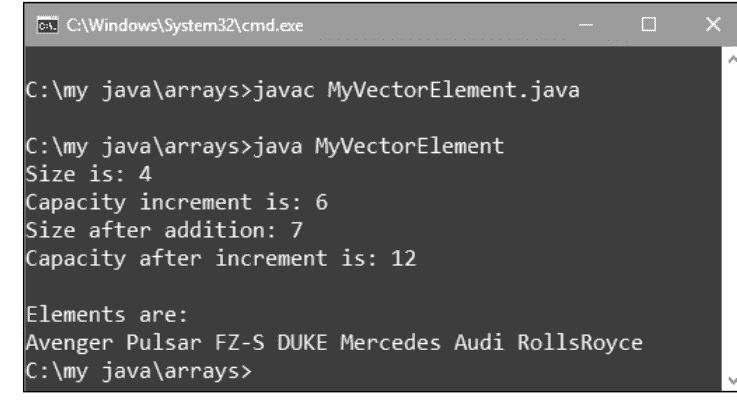

## 7.4 枚举

“Enumerate（枚举）”一词的意思是“按顺序为一个名称/实体分配编号”。Java 中的枚举也是出于同样的目的。可以说，在任何编程语言中，它的含义都是相同的，目的也如此。在 Java 中，枚举是使用“`enum` 数据类型”实现的。

根据 Oracle Java 文档，`enum` 类型是一种特殊的数据类型，它允许变量成为一组预定义的常量。关键字 `enum` 用于声明“枚举类型”。我们可以用它来显示一系列名称/实体，例如星期的几几、月份、太阳系中的行星等。

### 语法示例

```java
public enum days { Sun, Mon, Tue, Wed, Thu, Fri, Sat }
```

Java 中的 `enum` 是一种包含固定常量集合的数据类型。

### 示例程序

```java
class EnumExample {

    public enum Authors { Sohrab, Kiran, Sandeep }

    public static void main(String[] args) {
        for (Authors a : Authors.values())
            System.out.println(a);
    }
}
```

### 输出

```text
Sohrab
Kiran
Sandeep
```

## 问题

1. 解释 Java 中的数组。
2. 解释二维数组。
3. 解释 Java 中的多维数组。
4. 结合合适的示例定义 `ArrayList`。
5. 解释 Java 中的 `Vectors`。
6. 解释 Java 中的枚举。


# 第 8 章：多线程

## 结构

- 8.1 多线程简介
- 8.2 线程的创建
- 8.3 线程的生命周期
- 8.4 生命周期方法
- 8.5 同步
- 8.6 `Wait()`
- 8.7 `Notify()`
- 8.8 `Notify All()` 方法

## 8.1 多线程简介

1. 多线程支持处理器同时执行数量的线程。
2. 在多线程中，程序被划分为若干子部分。程序可能有两个或多个部分，这些程序部分被称为“子程序”或“线程”。单个程序可以拥有多个线程。
3. 线程类似于具有单一控制流的程序。它有开始、主体、结束，所有这些语句都是按顺序执行的。

### 核心 Java

4. Java 为每个程序支持多线程，这使得 Java 在开发程序时可以使用多个控制流。
5. 多线程指出并行运行的线程数量被称为线程的并发性。
6. Java 中作为主程序子 `Sub` 的线程共享相同的内存空间。因此，它们被称为“轻量级线程”或“轻量级进程”。
7. 包含多个控制流的程序被称为“多线程程序”。

## 8.2 线程的创建

线程的概念是一个轻量级的执行单元——比进程小，但仍然能够执行任意 Java 代码。通常的实现方式是让每个线程成为操作系统的一个完全匹配的执行单元，但属于一个进程，进程的地址空间在组成该进程的所有线程之间共享。这意味着每个线程都可以被独立调度，并拥有自己的栈和程序计数器，与同一进程中的其他线程共享内存对象。

Java 中的多线程环境可以通过以下两种方式实现，如下所示：

1. 创建一个继承 Java 内置 `Thread` 类的类（用户自定义）。
2. 创建一个实现 Java 内置 `Runnable` 接口的类（用户自定义）。

### 创建线程的类和接口

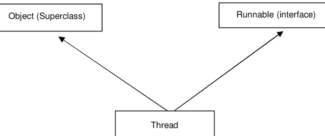

1. `Thread`（类）：创建并定义线程的类。此类继承 `Object` 类并实现 `Runnable` 接口。
2. `Runnable`（接口）：该接口中唯一的方法是 `run()` 方法。

### 实现 `Runnable` 接口

创建线程的最简单方法是实现 `Runnable` 接口。

## 多线程

上述程序的输出：

```text
Command Prompt

C:\Ashwin\material>javac SinglethreadDemo.java

C:\Ashwin\material>java SinglethreadDemo

My single thread is in running state

C:\Ashwin\material>
```

## 两个线程运行的示例

```java
class Count extends Thread {

    Count() {
        super("My extending thread");
        System.out.println("My thread created" + this);
        start();
    }

    public void run() {
        try {
            for (int i = 0; i < 5; i++) {
                System.out.println("Printing the count " + i);
                Thread.sleep(1500);
            }
        } catch (InterruptedException ie) {
            System.out.println("My thread interrupted");
        }

        System.out.println("My thread run is complete ");
    }
}

class CountThread {

    public static void main(String args[]) {
        Count cnt = new Count();

        try {
            while (cnt.isAlive()) {
                System.out.println("Main thread will be alive till the child thread is live");
                Thread.sleep(2000);
            }
        } catch (InterruptedException ie) {
            System.out.println("Main thread's run is interrupted");
        }

        System.out.println("Main thread's run is complete");
    }
}
```

## 上述两个线程程序的输出

此输出显示了在第一次创建 `Count` 对象时，它调用了 `Count` 类的构造函数。这生成了“My thread created”以及其他线程的所有状态。之后主线程存活了 200 毫秒。然后在 `Count` 类中调用了 `run` 方法，开始打印“Printing the count ” 以及“i”的值。这是子线程将存活 1500 毫秒。程序返回主线程，第二个子线程启动，这在输出中是可以看到的。基于类似的原理，输出中剩余子线程（五个）的行为也可以这样解释。

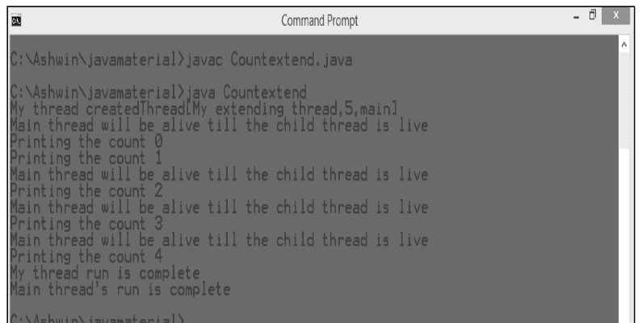

## 使用线程方法

`Thread` 类方法可以控制线程的行为。在以下程序中使用了 `start()`、`run()`、`yield()`、`sleep()` 方法。

**程序：** 使用 `yield()`、`stop()` 和 `sleep()` 方法的程序。

```java
class X extends Thread {

    public void run() {
        for (int i = 1; i <= 5; i++) {
            yield();
            System.out.println("t from Thread X: i=" + i);
        }
    }
}

class B extends Thread {

    public void run() {
        for (int j = 1; j <= 5; j++) {
            System.out.println("t from thread B: j=" + j);

            if (j == 3) {
                stop();
            }

            System.out.println("t exit from thread B");
        }
    }
}

class C extends Thread {

    public void run() {
        for (int k = 1; k <= 5; k++) {
``` 


```java
System.out.println("t from Thread: k=" + k);

if (k == 1) {
    try {
        sleep(1000);
    } catch (Exception e) {
    }
}

System.out.println("t exit from thread C");
```

## `isAlive()` 和 `join()` 方法的示例

```java
public class MyThread extends Thread {
    public void run() {
        System.out.println("r1 ");

        try {
            Thread.sleep(500);
        } catch (InterruptedException exception) {
            System.out.println("r2 ");
        }
    }

    public static void main(String[] args) {
        MyThread t1 = new MyThread();
        MyThread t2 = new MyThread();

        t1.start();
        t2.start();

        System.out.println(t1.isAlive());
    }
}
```

## 多线程

```java
System.out.println(t2.isAlive());
```

输出：

```text
D:\ssit>javac MyThread.java
D:\ssit>java MyThread
r1
true
true
r1
r2
r2
```

## 使用 `Runnable` 接口运行多个线程的示例

```java
public class Worker implements Runnable {
    public static void main(String[] args) {
        System.out.println(
            "This is currently running on the main thread, " +
            "the id is " + Thread.currentThread().getId()
        );

        Worker worker = new Worker();
        Thread thread = new Thread(worker);
        thread.start();
    }

    @Override
    public void run() {
        System.out.println(
            "This is currently running on the main thread, " +
            "the id is " + Thread.currentThread().getId()
        );
    }
}
```

上述程序的输出所示。

# Core Java

## 8.4 生命周期

- `start()`：通过调用其 `run()` 方法启动线程。
- `run()`：线程的入口点。
- `sleep()`：挂起线程指定的时间（毫秒）。
- `getName()`：获取线程名称。
- `getPriority()`：获取线程优先级。
- `isAlive()`：判断线程是否仍在运行。
- `join()`：等待线程终止。

## 8.5 同步

多线程引入了不一致性。当两个或多个线程需要访问共享数据时，一次应只有一个线程使用。要实现这一点需要使用同步。

## 8.6 `wait()`

### 线程间通信

我们有一些方法可以让线程相互进行通信。这些方法是 `Object` 类中的 `wait()`、`notify()`、`notifyAll()`。这些方法可以在同步方法内部调用。`wait()` 告诉调用线程放弃监锁并进入睡眠，直到其他线程进入监锁并调用 `notify()`。

## 8.7 `notify()`

`notify()` 唤醒在同一对象上调用 `wait()` 的线程。

## 8.8 `notifyAll()`

`notifyAll()` 唤醒所有在对象上调用 `wait()` 的线程。优先级最高的线程将先运行。

### 同步方法的示例

```java
class Table {
    synchronized void printTable(int n) {
        for (int i = 1; i <= 5; i++) {
            System.out.println(n * i);

            try {
                Thread.sleep(400);
            } catch (Exception e) {
                System.out.println(e);
            }
        }
    }
}

class MyThread1 extends Thread {
    Table t;

    MyThread1(Table t) {
        this.t = t;
    }

    public void run() {
        t.printTable(5);
    }
}

class MyThread2 extends Thread {
    Table t;

    MyThread2(Table t) {
        this.t = t;
    }

    public void run() {
        t.printTable(100);
    }
}

public class TestSynchronization2 {
    public static void main(String[] args) {
        Table obj = new Table();

        MyThread1 t1 = new MyThread1(obj);
        MyThread2 t2 = new MyThread2(obj);

        t1.start();
        t2.start();
    }
}
```

输出：

```text
D:\ssit>javac TestSynchronization.java
D:\ssit>java TestSynchronization2
5
10
15
20
```

## 问题

1. 解释线程、状态并解释如何实现多线程。
2. 解释生命周期方法。
3. 解释线程的生命周期。
4. 解释线程的同步。
5. 解释 `wait()`、`notify()`、`notifyAll()` 方法。

# 第 9 章

## 异常处理


## 目录

- 9.1 异常处理简介与基础
- 9.2 预异常
- 9.3 Try-Catch-Finally
- 9.3.1 多 Catch 语句
- 9.3.2 异常处理的优势
- 9.4 Throw
- 9.5 Throws
- 9.6 用户自定义异常示例

## 9.1 异常处理简介与基础

异常（Exception）是一个由 `Exception` 类或其子类生成的对象。异常对象表示已发生的错误。它还包含有关该错误的信息。

如图所示，`Throwable` 是所有异常类的父类。

## 异常层次结构

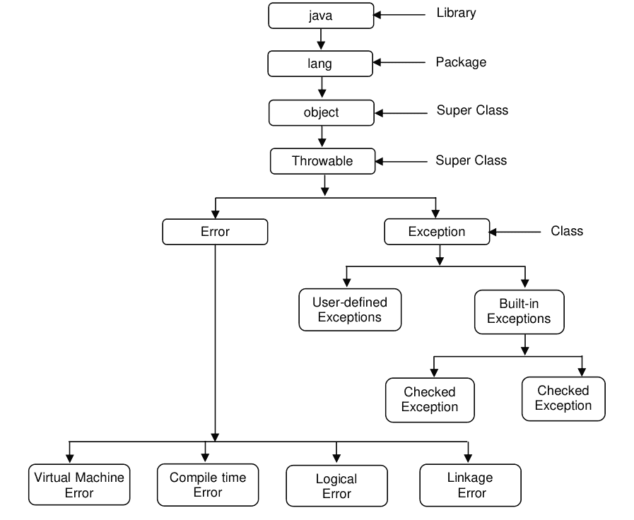

- `Java`：JAVA API 是一个包含包的库。这些包是由 Sun MicroSystems Inc. 开发的，用于在开发程序时导入类。
- `Lang`：Lang 是 java 库中的一个包。它被认为是名为 language 的默认包。它隐式地导入到每个 java 程序中。
- `Object`：Object 是所有类（用户定义类、预定义类）直接或间接的父类。因为它位于 lang 包。
- `Throwable`：Throwable 是 Java 中错误（Error）和异常（Exception）的父类。Throwable 自 object 类。
- `Error`：Error 是一个类。它是不被处理的。我们在编译后通过 java 编译器知道程序中的错误。这些错误始终在编译时被检测到。

程序中的错误被称为 bug。从程序中移除错误称为调试（debugging）。Java 程序中基本上有三类型的错误：

## 异常处理

- **编译时错误**：由于语法或格式问题引起的错误称为编译错误。这些错误由 java 编译器在编译时检测。人工检查（Desk checking）是解决编译时错误的方案。

通常程序由错误和 bug 组成。常见的 bug 类型有：

- 逻辑错误。
- 语法错误。

逻辑错误由于错误的解决方案或错误的逻辑引起，而语法错误由于对语言的理解不当（即语法错误）。我们可以检测这些错误，然后进行调试，并相应为这些错误提供错误描述，这些被称为异常。

异常是程序在执行过程中可能遇到的运行时条件或错误。例如除以 0、访问数组范围外的元素、内存耗尽或磁盘空间不足。

异常处理分为两种类型：

- 同步。
- 异步。

同步异常可能发生索引越界和溢出错误。在异步情况下，由控制管理的的事件（如键盘中断、磁盘扇区或硬件故障）被称为异步异常。

针对异常可以执行以下任务：

1. 发现问题（触发异常）。
2. 通知发生了错误（抛出异常）。
3. 接收错误信息（捕获异常）。
4. 采取纠正措施（处理异常）。

## 9.2 预异常

### 异常类型

1. 编译时错误。
2. 运行时错误。

### 1. 编译时错误

所有语法都会被 java 编译器删除并显示。错误被称为编译时错误。每当编译器显示 Error 时，它不会显示类文件。

例如：

```java
System.out.println("Hello")
```

Java 给出错误：

```text
Semicolon (;) expected
```

常见问题包括：

- 缺少分号（`;`）。
- 缺少括号和类。
- 缺少标识符和关键字。
- 缺少双引号（`"`）。
- 使用未声明的变量。
- 将单等号（`=`）用作双等号（`==`）等。

### 2. 运行时错误

有时程序成功创建了 `.class` 文件但可能无法正常运行，此类程序可能会产生错误结果并显示适当的消息以采取纠正措施。这项任务被称为检测和报告异常情况的异常处理（Exception handling）。

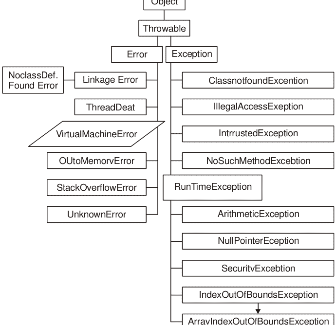

`Exception` 类的子类分为两类：

1. 属于 `RuntimeException` 的异常：如图所示，Java 编译器不强制程序员/开发者编写特定代码来处理这些未检查异常（unchecked exceptions）。此类错误的示例如除以 0 或内存不足。
2. 源自 `Exception` 类所有子类的异常。Java 编译器要求程序员/开发者编写特定代码来处理这些异常。这些被称为检查异常（checked exceptions）。

## 异常处理

以下是一些常见的预定义未检查异常：

- `ArithmeticException`
- `IllegalArgumentException`
- `NumberFormatException`
- `NullPointerException`
- `IndexOutOfBoundsException`

未检查异常不经编译器检查。

一些检查异常：

- `ClassNotFoundException`
- `IOException`
- `EOFException`
- `FileMethodException`
- `NoSuchMethodException`

检查异常通过方法调用来处理，代码应该捕获并处理它。捕获并处理异常的代码被称为异常处理器（exception handler）。这通常通过使用 `try`、`catch` 和 `finally` 代码块完成。一个简单的示例显示当开发者想要读取文件且发生文件未找到异常时：

```java
RandomAccessFile:
String = "";
Boolean = false;

while (!ValidFileName) {
    try {
    } catch (FileNotFoundException e) {
        System.out.println("File not found");
    } finally {
        System.exit(0);
    }
}
```


`finally` 无论是否发生异常都会执行。

Java 通过五个关键字处理异常：`try`、`catch`、`finally`、`throw` 和 `throws`。可能会产生异常的代码块放在 `try` 中。

如果在 `try` 块中创建了异常对象，则抛出异常。该异常由 `catch` 语句处理。如果可能发生多个异常，建议使用多个 `catch` 语句。`catch` 语句遵循 `Throwable` 的层次结构。

## 内置异常

| Exception | 含义 |
| --- | --- |
| `ClassNotFoundException` | 类未找到。 |
| `CloneNotSupportedException` | 对象不支持复制 |
| `IllegalAccessException` | 禁止访问类。 |
| `InstantiationException` | 实例化抽象类或接口。 |
| `InterruptedException` | 一个线程被另一个线程中断。 |
| `NoSuchFieldException` | 请求字段不存在。 |
| `NoSuchMethodException` | 请求的方法不存在。 |
| `ArithmeticException` | 错误，如除零。 |
| `ArrayIndexOutOfBoundsException` | 数组索引越界。 |
| `ArrayStoreException` | 给类型不兼容的数组赋值。 |
| `ClassCastException` | 无效类型转换。 |
| `EnumConstantNotPresentException` | 尝试使用未定义的枚举值。 |
| `IllegalArgumentException` | 调用方法的非法参数。 |
| `IllegalMonitorStateException` | 非法监器操作，如在未锁线程上等待。 |
| `IllegalStateException` | 环境或应用程序处于错误状态。 |
| `IllegalThreadException` | 操作与当前线程状态不兼容。 |
| `IndexOutOfBoundsException` | 某些类型的索引越界。 |
| `NegativeArraySize` | 使用负尺寸创建数组。 |
| `NullPointerException` | 空引用的无效使用。 |
| `NumberFormatException` | 字符串转换为数字格式时无效。 |
| `SecurityException` | 尝试违反安全。 |
| `StringIndexOutOfBoundsException` | 尝试访问字符串范围之外。 |
| `TypesNotPresentException` | 类型未找到。 |
| `UnsupportedOperationException` | 遇到不支持的操作。 |

## 9.3 TRY-CATCH-FINALLY

异常是一个错误或意外事件。异常处理器是一组在发生异常时执行的代码。

异常处理基本上使用 3 块代码块：

- (i) Try（尝试）
- (ii) Throw（抛出）
- (iii) Catch（捕获）

`try` 和 `catch` 块写在大括号 `{ }` 之间。`try` 块通过 `try` 关键字以及位于 `{ }` 之间的语句来标识。当 `try` 块检测到异常时，会使用 `try` 块中的 `throw` 语句将其抛出。

`catch` 块由关键字 `catch`、`{ }` 及其紧跟的语句块定义。`catch` 块通过 `try` 块中的 `throw` 语句捕获异常并进行适当处理。当 `try` 抛出异常时，程序控制权将离开 `try` 块并进入 `catch` 块，只有当 `try` 块抛出的对象类型匹配时，才会执行 `catch` 块进行处理。如果不匹配，程序将通过异常终止。

### Try

`try` 包含一个代码块，该代码块可能产生自身的异常，或者在 `try` 块之后需要特定的代码来处理异常（`Catch`）。其目的是当 `try` 块因任何原因终止时捕获异常。`try` 块的终止可能是由于异常、`break`、`continue` 或 `return` 语句引起的。

### Catch

`try` 后面可以跟随零个或多个 `catch` 子句。每个 `catch` 子句都包含处理各种类型异常的特定代码。每个 `catch` 子句接收一个参数，用于指定异常的类型。`catch` 子句的参数必须是 `Throwable` 类或其任何子类。

当异常被抛出时，JVM 会寻找参数与异常对象类型完全相同的 `catch` 子句。JVM 会调用它找到的第一个 `catch` 子句。`catch` 块中的代码应采取必要的行动来处理该异常。例如，如果异常是 `java.io.FileNotFoundException`，用户可能会被要求检查文件名的拼写，并再次检查方法。

### Finally

`finally` 块用于清理 `try-catch` 块中的代码。`try` 块中可能会发生各种情况：

1. 如果 `try` 块中发生异常并且有相关的 `catch` 块来处理异常，控制权首先转移到 `catch`，然后转移到 `finally` 块。
2. 在正常情况下（无任何异常），控制权到达 `try` 块的末尾，然后到达 `finally` 块。`finally` 块执行清理工作，如关闭任何打开的文件，`myFunction.close()`。
3. 如果控制权因为 `return`、`break` 或 `continue` 语句离开 `try` 块，则在控制权转移到目的地之前执行 `finally` 块。

示例：

| 语法（Try Catch 块的通用格式） |
| --- |
| `try {` 在此处调用函数 `}` `catch (type org)` // 捕获异常 `{` 在此处处理异常 `}` `class division { public static void main(String args[]) { Int x=10,a=0; System.out.println("Before division"); { int p=x/a; System.out.println("division is " + p); } Catch (ArithmeticException ae)` |

## 异常处理

```java
{
    System.out.println("Dividing by zero error");
}

System.out.println("Division not done");
}
```

输出：

```text
Before Division
Division by Zero
Division not done
```

## 9.3.1 多个 `catch` 语句

程序段可以有多个条件来抛出异常。在这种情况下，我们可以有多个 `catch` 块，这意味着一个 `try` 块可以有多个 `catch` 块。当异常被抛出时，会按照顺序搜索异常处理器以找到适当的匹配，如果处理器找到了正确的异常匹配，则执行该 `catch` 块。执行 `catch` 块后，控制权将转移到 `try` 块的下一条语句，当未找到匹配时，程序将终止。`catch` 块可以有一个单独参数来捕获抛出的信息。

多个 `catch` 语句/块的通用格式：

```java
try
{
    // try 块
}
catch(type arg)
{
    // catch 块 1
}
catch(type2 arg)
{
    // catch 块 2
}
catch(type N arg)
{
    // catch 块 N
}
```

示例：

```java
class multicatch {
    public static void main(String[] args) {
        try {
            System.out.println("Inside try block");
            int p = Integer.parseInt(arg[0]);
            int c = p / 0;
            System.out.println("Division is " + c);
        }
        catch (NumberFormatException e) {
            System.out.println("Number format Exception");
            System.out.println("Enter proper number");
        }
        catch (ArrayIndexOutOfBoundsException e) {
            System.out.println("Command line argument is not passed");
        }
    }
}
```

## 9.3.2 异常处理的优势

1. 借助异常，我们可以检测逻辑错误和语法错误。
2. 借助运行时的异常，我们可以在运行时捕获错误并将消息传递给用户。
3. 异常处理提供了一种类型安全的集成方法。
4. 用户可以创建同步异常，因此用户可以控制程序。
5. 异常处理机制的主要优势是检测错误并报告异常情况，以便用户采取适当的措施。
6. 一个程序段可以有多个条件，这些多个条件可以通过多个 `catch` 块进行处理，这意味着一个 `try` 可以有多个 `catch` 块。
7. 异常处理支持某些异常，即 `try` 块。
8. 异常处理支持抛出异常。
9. 异常处理支持指定的异常。

## 异常处理

### `throw`

Java 程序可以使用 `throw` 语句显式地抛出异常。`throw` 语句的通用形式如下：

### `Throwable`

1. 在 `catch` 子句传递参数。
2. `throw` 语句后的表达式将求值为 `Throwable` 对象。

示例显示：

```java
public static double factorial(int n)
{
    if (n < 0)
        throw new IllegalArgumentException(" n must be positive");

    double fact;

    for (n = 1; n > 0; n--)
        fact = factorial(n - 1) * n;

    return fact;
}
```

当 JVM 执行 `throw` 语句时，它立即停止正常执行并寻找适当的处理器。

### `throws`

某些方法能够抛出异常但无法处理它们。在这种情况下，它们必须指定异常列表，以便调用方法的方法可以保护自己。这是通过在方法声明中包含 `throws` 语句来实现的。对于 `Error` 或 `RuntimeException` 之外的所有异常都是必要的。

这是一个示例：

```java
class ThrowableDemo
{
    static void throwOne() throws IllegalAccessException {
        System.out.println("throwOne exception");
        throw new IllegalAccessException("demo");
    }

    public static void main()
    {
        try
        {
            throwOne();
        }
        catch (IllegalAccessException e)
        {
            System.out.println(" exception caught " + e);
        }
    }
}
```

上述程序的输出将是：

```text
throwOne exception
exception caught java.lang.IllegalAccessException : demo
```

## try-catch 示例

这里提供了更多的代码示例，以便学生可以制作自己的变体并练习。

### 保存文件为 `Quotient.java`

```java
import java.util.Scanner;

public class Quotient {
    public static void main(String[] args) {
        Scanner input = new Scanner(System.in);

        // 提示输入两个整数
        System.out.print("Enter two integers: ");

        int number1 = input.nextInt();
        int number2 = input.nextInt();

        System.out.println(number1 + " / " + number2 + " is " + (number1 / number2));
    }
}
```

上述程序运行时，会产生一个提示：

```text
Enter two integers: 7 3
7 / 3 is 2
Enter two integers: 9 0

Exception in thread "main" java.lang.Arithmetic division by zero at Quotient.java
```

## 异常处理

```java
Scanner input = new Scanner(System.in);

// 提示输入两个整数
System.out.print("Enter two integers: ");

int number1 = input.nextInt();
int number2 = input.nextInt();

try {
    if (number2 == 0)
        throw new ArithmeticException("Division by zero not allowed");

    System.out.println(number1 + " / " + number2 + " is " + (number1 / number2));
}
catch (ArithmeticException ae) {
    System.out.println(" Exception: Division by zero for integer data type");
    System.out.println(" Program continues to run ...");
}
```

在 Java 中，当前执行的语句属于某个方法。Java 解释器调用 `main` 方法来开始执行程序。每个方法都必须声明它可能抛出的受检异常（checked exceptions），这被称为声明异常。由于系统错误和运行时错误可能发生在任何代码中，Java 不要求程序员在方法中显式声明 `Error` 和 `RuntimeException`（未检异常）。然而，方法抛出的所有其他异常都必须在方法头中显式声明，以便调用方法的者了解这些异常。这是通过使用 `throws` 关键字实现的。通用语法如下：

```java
public void myWeb() throws IOException, FileNotFoundException
```


`throws` 单词表示方法可能会抛出 `IOException`。如果方法可能抛出多个异常，请在 `throws` 后面添加用逗号分隔的异常列表：

## 9.6 用户自定义异常

### 创建异常子类

尽管 Java 的内置异常处理了大多数错误，但你可能想要创建自己的异常类型来处理特定应用程序的情况。这很容易；只需定义 `Exception` 的子类（当然，它是 `Throwable` 的子类）。你的子类不需要实现任何内容——它们在系统类型中的存在就允许你将其作为异常使用。

`Exception` 类没有定义任何自己的方法。当然，它继承了 `Throwable` 提供的方法。因此，所有异常（包括你创建的异常）都可以使用 `Throwable` 定义的方法。如表所示。

### 方法描述

| 方法 | 描述 |
| --- | --- |
| `Throwable fillInStackTrace()` | 返回一个包含完整堆栈轨迹的 `Throwable` 对象。该对象可以被重新抛出。 |
| `Throwable getCause()` | 返回当前异常的底层异常。如果没有底层异常，则返回 `null`。 |
| `String getLocalizedMessage()` | 返回异常的本地化描述。 |
| `String getMessage()` | 返回异常的描述。 |
| `StackTraceElement[] getStackTrace()` | 返回一个包含轨迹的数组，以 `StackTraceElement` 数组的形式逐个包含元素。堆栈顶端的方法是抛出异常之前最后调用的方法。该方法位于数组的第一个元素。`StackTraceElement` 类允许你的程序访问轨迹中的每个元素，例如其方法名。 |
| `Throwable InitCause(Throwable causesExc)` | 将 `causesExc` 与调用异常关联，作为调用异常的产生原因。返回该异常的引用。 |
| `void printStackTrace()` | 显示堆栈轨迹。 |
| `void printStackTrace(PrintStream Stream)` | 将堆栈轨迹发送到指定的流。 |
| `void printStackTrace(PrintWriter Stream)` | 将堆栈轨迹发送到指定的流。 |
| `void setStackTrace(StackTraceElement[] elements)` | 将堆栈轨迹设置为传入的 `elements` 元素。此方法用于特殊应用程序，不用于正常用途。 |

你可能还希望在你创建的异常类中重写这些方法之一或多个。`Exception` 定义了四个构造函数。JDK 1.4 增加了两个以支持链式异常，将在下一节描述。另外两个显示在此：

```java
Exception()
Exception(String msg)
```

第一种形式创建一个没有描述的异常。第二种形式允许你指定异常的描述。虽然创建异常时指定描述是有用的，但有时重写 `toString()` 更好。原因如下：由 `Throwable` 定义（`Exception` 继承的 `toString()` 版本首先显示异常名称，后跟一个冒号，然后是你的描述。通过重写 `toString()`，你可以防止异常名称和冒号显示。这使得输出更加整洁，在某些情况下是理想的。

返回包含异常描述的 `String` 对象。当输出 `Throwable` 对象时，`print()` 调用此方法。

## 异常处理

```java
//用户自定义异常示例

import java.io.*;

class MyException extends Exception {

    private int a;

    MyException(int b){

        a=b;

    }

    public String toString(){

        return "MyException ["+a+"]";

    }

}

class MyProj{

    public int x;

    final int k=3;

    void getInt() {

        try {

            BufferedReader dis = new BufferedReader(new InputStreamReader(System.in));

            System.out.println("do some guess work");

            System.out.println("enter a no between 1 and 10");

            String line;

            while((line=dis.readLine())!=null) {

                x=Integer.parseInt(line);

                if (x<=5){

                    System.out.println("you generated the exception");

                    throw new MyException(x);

                } else {

                    System.out.println("wrong guess and try again");

                }

            }

        } catch (MyException e) {

            System.out.println("generated exception");

        }

    }

    public static void main(String args[]) throws IOException {

        MyProj m = new MyProj();

        m.getInt();

    }

}
```

## 问题

1. 解释异常处理。
2. 什么是预定义异常？
3. 带有示例解释 `Try-Catch-Finally` 块。
4. 定义 `Catch` 的用法。
5. 异常处理的优点有哪些？
6. 关于 `throw` 语句的简短说明。
7. 解释 Java 中的 `throws`。
8. 用户自定义示例。

# 字节流（Byte Streams）

| 名称 | 描述 |
| --- | --- |
| `FileFilter` | 可用于过滤路径名（Pathnames）。即我们可以提取路径名。 |
| `FilenameFilter` | 此接口用于过滤文件名（Filenames）。即我们可以提取文件名。 |
| `ObjectInput` | 此接口用于读取对象并扩展了 `DataInput` 接口。用于输入或接受对象。 |
| `ObjectValidation` | 这是一个回调接口（Callback interface）。它允许对图中的对象进行验证。它接受用户提供的对象并带有某些限制和验证。 |
| `ObjectOutput` | 此接口用于写入对象并扩展了 `DataOutput` 接口。 |
| `ObjectStreamConstants` | 此接口用于向序列化流流中写入常量。 |
| `Serializable` | 这是一个实现了 `java.io.Serializable` 接口的接口。 |

# 类及描述（Classes and Descriptions）

| 类 | 描述 |
| --- | --- |
| `BufferedInputStream` | 它用于创建一个内部缓冲区。它支持 `mark` 和 `reset` 方法。用于接受存储在缓冲区中的字符流。 |
| `BufferedOutputStream` | 此类用于向输出流写入字节。它实现了一个缓冲输出流。用于显示缓冲区中的字符。 |
| `BufferedReader` | 此类提供从字符输入读取文本并对字符缓冲。它还读取字符、数组和行。 |
| `BufferedWriter` | 此类提供向输出流写入文本并对字符缓冲。它还写入字符、数组和行。 |
| `ByteArrayInputStream` | 它包含内部缓冲区并从流中读取数据。用于以数组的形式读取字符流。 |
| `ByteArrayOutputStream` | 此类用于将数据写入字节数组。这在输出流类中实现。字符的输出流可以存储在数组中。 |
| `CharArrayReader` | 它用于字符输入流并实现字符缓冲区。用于逐个接受字符并为读取创建字符数组。它还实现了一个字符缓冲区并是一个写入器。用于逐个写入字符并创建字符数组。 |
| `DataInputStream` | 此类以机器格式从输入流中读取基本数据数据类型。 |
| `DataOutputStream` | 此类以机器格式向输出流写入基本数据数据类型。 |
| `File` | 此类显示文件和目录路径名。 |
| `FileDescriptor` | 此类用于创建 `FileInputStream` 和 `OutputStream`。 |
| `FileInputStream` | 它包含来自文件的输入字节并实现了一个输入流。 |
| `FileOutputStream` | 它用于向文件写入数据并实现了一个输出流。 |

# 190 核心 Java（190 Core Java）

| 类 | 描述 |
| --- | --- |
| `FilePermission` | 它提供访问文件或目录的权限（读或写）。 |
| `FileReader` | 此类用于读取字符文件。 |
| `FileWriter` | 此类用于写入字符文件。 |
| `FilterInputStream` | 此类重写了 `InputStream` 的所有方法并包含了另一个流。 |
| `FilterOutputStream` | 此类重写了 `OutputStream` 的所有方法并包含了另一个流。 |
| `FileReader` | 它从过滤后的字符流读取数据。 |
| `FileWriter` | 它从过滤后的字符流写入数据。 |
| `InputStream` | 此类表示字节输入流。 |
| `InputStreamReader` | 它读取字节并将其解码为字符。 |
| `LineNumberReader` | 此类具有行号。 |
| `ObjectInputStream` | 此类用于恢复之前序列化的对象。 |
| `ObjectInputStream.GetField` | 此类访问读取输入流的成员字段。 |
| `ObjectOutputStream` | 此类用于基本数据类型，并通过 `ObjectOutputStream` 写入对象。 |
| `ObjectOutputStream.GetField` | 此类访问写入 `ObjectOutput` 的成员字段。 |
| `ObjectStreamWriter` | 类的序列化描述符。 |
| `ObjectStreamField` | 此类描述可序列化的字段。 |
| `OutputStream` | 此类表示字节输出流。 |
| `OutputStreamWriter` | 它写入字节并将其解码为字符。 |
| `PipedInputStream` | 在此类中，数据字节被写入管道输出流。此类还连接到管道输出流。 |
| `PipedOutputStream` | 此类也将管道输入流通信到管道输出流。它在两者之间建立了通信。 |
| `PipedReader` | 这是一个管道字符输入流。 |
| `PipedWriter` | 这是一个管道输出流。 |
| `PrintStream` | 此类增加了另一个输出流的功能。 |
| `PrintWriter` | 此类增加了另一个输入流的功能。 |
| `PushbackInputStream` | 它包含了输入流的功能。例如：“回退”或“未读”一个字节。 |
| `PushbackReader` | 这是一个字符读取器，并将回退读入流中。 |
| `RandomAccessFile` | 它支持对随机访问文件进行读取和写入。 |
| `Reader` | 它用于读取字符流。 |
| `SequenceInputStream` | 它表示其他输入流的逻辑连接。 |

# 字节流（Byte Streams）

| 类 | 描述 |
| --- | --- |
| `SerializablePermission` | 这是一个序列化权限类。 |
| `StreamTokenizer` | 它获取输入流并将其解析为“标记”（tokens）。在读取时允许的标记。 |
| `StringReader` | 这是一个字符字符串类。它有字符读取源。 |
| `StringWriter` | 这也是一个字符字符串类。用于在缓冲区显示输出。 |
| `Writer` | 它用于写入字符流。 |

# `java.io` 包异常（Exceptions for `java.io` package）

| 异常 | 描述 |
| --- | --- |
| `CharConversionException` | 它在 `catch` 块中提供与 `CharConversionException` 相关的详细消息。 |
| `EOFException` | 此异常表示文件结束。当输入流结束时，会触发 `EOFException`。 |
| `FileNotFoundException` | 当打开的文件名未找到时，触发此异常。 |
| `InterruptedIOException` | 当 I/O 被中断时。 |
| `InvalidClassException` | 创建类时产生的任何问题。 |
| `InvalidObjectException` | 当反序列化对象出现问题。 |
| `IOException` | 当发生 I/O 操作时。 |
| `NotActiveException` | 反序列化操作未激活。 |
| `NotSerializableException` | 当实例需要序列化时的异常。 |
| `ObjectStreamException` | 这是所有异常的父类。 |
| `OptionalDataException` | 读取操作失败时。 |
| `StreamCorruptedException` | 违反内部一致性。 |
| `SyncFieldException` | 同步操作失败。 |
| `UnsupportedEncodingException` | 不支持编码。 |
| `UTFDataFormatException` | 数据输入中读取了错误的 UTF-8。 |
| `WriteAbortedException` | 由对象抛出的异常。 |

# 10.3 `File` 类（10.3 FILE CLASS）

`java.io`（输入输出）包包含一个名为 `File` 的类，它提供了创建文件和目录的支持。通过 `File` 类，我们可以创建和读取现有文件，也可以删除文件。该类包含了用于实例化文件对象的构造函数。该类还包含许多支持操作的方法，例如：

- 创建文件。
- 打开文件。
- 关闭文件。
- 删除文件。
- 获取文件大小。
- 检查文件是否存在。
- 重命名文件。
- 检查文件是否可读。

## 字节流

```text
Input.data salary
Test.doc student.txt
Inventory read.dat
```

数据类型对于决定使用哪些文件流类来处理数据很重要。我们应该决定要处理的数据是字符、字节还是原始类型的形式。

在使用文件之前，还必须决定使用文件的目的。例如，我们应该知道该文件是为了仅读取而创建的，还是通过某种操作创建的。

正如我们所知，使用文件必须首先打开它。这是通过创建文件流并将其与文件名链接来实现的。可以使用 `Reader`/`Input Stream` 类定义用于等待数据的字节流。用于各种 I/O 操作的常用流类如所示。流类的构造函数可能是将所需的文件名分配给流对象。

## 10.4 目录与创建目录

我们将在 Java 类文件中使用 `File` 类来创建目录：

1. `File` 类是文件和目录路径的抽象表示。
2. `File` 类用于与文件系统交互。

Java 提供了以下方法来创建目录：

1. `File('directory').mkdir();`
2. `new File("C:\Directory").mkdir();`

此程序将在给定路径创建一个名为 Ravi 的目录。

### Java 代码

```java
import java.io.File;

public class MakeDirectory {

    public static void main(String[] args)

    {

        File f = new File("c:\Ravi");

        f.mkdir();

    }

}
```

### 创建目录与子目录的示例

一次性创建一个名为 "Kiran" 的目录及其所有的子目录 "Ravi" 和 "Chirag"。

两种方法都返回一个布尔值来指示操作状态：如果成功返回 `true`，否则返回 `false`。

### 示例

```java
import java.io.File;

public class CreateDirectoryExample
{}
```

```java
public static void main(String[] args)

{

    File file = new File("C:\\Kiran");

    if(file.mkdir()){

        System.out.println("Kiran name Directory is created!");

    }else{

        System.out.println("Failed to create directory!");

    }

    File files = new File("C:\\Kiran\Ravi\Chirag");

    if(files.mkdirs()){

        System.out.println("Multiple directories are created!");

    }else{

        System.out.println("Failed to create multiple directories!");

    }

}
```


# 10.5 `File` 类（过滤器）

正如我们所知，可以使用输入和输出流从不同的资源中读取和写入数据。

现在我们将查看文件内容是如何被读取的，以及数据是如何写入文件的。这首先需要文件作为资源，提供了 `File` 类，它描述了文件的属性，如其名称、目录或文件大小。

## `File` 类的构造函数和方法

| 方法 | 说明 |
| :--- | :--- |
| 1. `File(String path)` | 构造函数接受一个参数，即文件的完整路径。用于在指定路径中创建新文件。 |
| 2. `File(String dirpath, String name)` | 构建文件对象，第一个参数是输出路径，第二个参数是文件名。在这里你可以在其中一个参数中指定文件名，在第二个参数中指定目录路径。 |
| 3. `File(File dirpath, String fname)` | 与上述构造函数相同，但目录路径由文件对象引用。 |
| 4. `String getName()` | 返回文件名。 |
| 5. `String getParent()` | 返回父目录名称。 |
| 6. `String getPath()` | 返回文件路径。 |
| 7. `String getAbsolutePath()` | 返回到文件名的完整路径。 |
| 8. `Boolean exists()` | 检查文件是否存在。如果存在则返回 `true`，否则返回 `false`。 |
| 9. `long length()` | 返回以字节为单位的文件长度。 |
| 10. `Boolean isFile()` | 检查是否为文件。如果是文件则返回 `true`，否则返回 `false`。 |
| 11. `lastModified()` | 以毫秒为单位返回文件的最后修改日期。 |
| 12. `Boolean canRead()` | 如果文件可读则返回 `true`，否则返回 `false`。 |
| 13. `Boolean canWriteTo()` | 如果文件可写则返回 `true`，否则返回 `false`。 |
| 14. `Boolean renameTo(Filename)` | 如果重命名成功返回 `true`，如果无法重命名则返回 `false`。 |
| 15. `Boolean delete()` | 如果目录为空则删除该目录并返回 `true`，否则返回 `false`。 |
| 16. `Boolean isHidden()` | 如果是隐藏的则返回 `true`，否则返回 `false`。 |
| 17. `String[] list()` | 返回文件列表的字符串数组。 |

### 一个演示 `File` 类的程序

```java
import java.io.*;

class File_methods {

    public static void main(String ar[]) {
        File f-new = new File("D:\kiran\information.txt");

        PrintWriter pw = new PrintWriter(System.out, true);

        pw.println("file name: " + f.getName());
        pw.println("file path: " + f.getPath());
        pw.println("parent: " + f.getParent());
        pw.println("exists: " + f.exists());
        pw.println("isFile: " + f.isFile());
        pw.println("size: " + f.length());
    }
}
```

# 10.6 `LISTFILES`

正如我们所知，可以使用输入和输出流从不同的资源中读取和写入数据。

现在我们将查看文件内容是如何被读取的，以及数据是如何写入文件的。这首先需要文件作为资源，提供了 `File` 类，它描述了文件的属性，如其名称、目录或文件大小。

## `ListFiles` 替代方案

`listFiles()` 方法用于显示文件。

```java
import java.io.*;

class ListFiles {

    public static void main(String[] args) throws Exception {
        String text = "";

        File f = new File("C:\\Kiran");
        File[] listFiles = f.listFiles();

        for (int j = 0; j < listFiles.length; j++) {
            if (listFiles[j].isFile()) {
                text = listFiles[j].getName();
                System.out.println(text);
            }
        }
    }
}
```

# 10.7 流类

I/O 代表输入输出。Java 程序可以从输入设备读取数据并向输出设备输出数据。

在本章中我们将学习 Java 编程如何从输入源（如文件、网络）读取数据，并输出到文件、网络。

流的概念：我们知道 i/p 和 o/p 资源连接到系统。

## 字节流

字节流是通过使用层次结构顶部的两个抽象类定义的，它们是 `InputStream` 和 `OutputStream`：

- (i) 输入流。
- (ii) 输出流。

## 字符流

字符流也是通过使用层次结构顶部的两个抽象类定义的，它们是 `Reader` 和 `Writer`：

- (i) `Reader`
- (ii) `Writer`

### 字符流

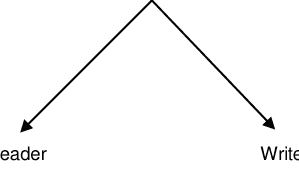

### 读取字符

`read()` 方法配合 `BufferedReader` 对象使用用于读取字符。由于该函数返回整数值，因此我们需要使用类型转换将其转换为 `char` 类型。

```java
int read() throws IOException
```

以下是一个解释字符输入的简单示例。

```java
class CharRead {

    public static void main(String args[]) {
        BufferedReader br =
            new BufferedReader(new InputStreamReader(System.in));

        char c = (char) br.read(); // 读取字符
    }
}
```

### 读取字符串

要读取字符串，我们必须配合 `BufferedReader` 类对象使用 `readLine()` 函数。

```java
String readLine() throws IOException
```

## Java 中从键盘获取字符串输入的程序

```java
import java.io.*;

class MyInput {

    public static void main(String[] args) {
        String text;

        InputStreamReader isr =
            new InputStreamReader(System.in);

        BufferedReader br = new BufferedReader(isr);

        text = br.readLine(); // 读取字符串
        System.out.println(text);
    }
}
```

## 10.7.1 字节流类

字节流用于从 i/o 类中读写二进制数据，如下：

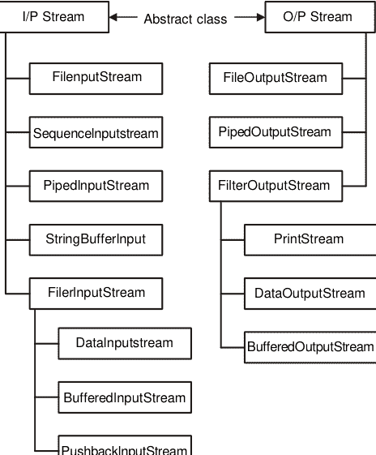

## 10.7.2 `InputStream` 类

这是面向字节的 I/O 类的抽象类和超类。

`InputStream` 的大多数方法在读取数据过程中遇到错误会抛出 `IOException`。

`InputStream` 类的方法：

| 方法名 | 描述 |
|---|---|
| `int read()` | 返回下一个字节的（ASCII 值）整数表示；如果是文件末尾则返回 `-1`。 |
| `int read(byte b[])` | 读取字节并将其存储在 `b` 中，并返回读取的字节数；文件末尾返回 `-1`。 |
| `int read(byte b, int offset, int klength)` | 从 `offset` 开始读取总长度为 `klength` 的字节并存储在 `b` 中，返回成功读取的字节数；文件末尾返回 `-1`。 |
| `int available()` | 返回输入流中可供读取的字节数。 |
| `long skip(long tobytes)` | 跳过或忽略输入中的总字节数，返回实际忽略的字节数。 |
| `void close()` | 关闭输入源。随后的读取语句将抛出 `IOException`。 |

## 10.7.3 `OutputStream` 类

`OutputStream` 是所有面向字节的输出类的抽象类和超类。它定义了输出数据的方法。

### `OutputStream` 类方法

| 方法 | 描述 |
| --- | --- |
| `void write(int b)` | 向输出流写入单个字节。 |
| `void write(byte b[])` | 将字节数组写入输出流。 |
| `void write(byte b[], int offset, int length)` | 从数组的 `offset` 开始写入长度为 `length` 的字节数据。 |
| `void flush()` | 刷新输出缓冲区或清空输出缓冲区。 |
| `void close()` | 关闭输出流。如果尝试继续写入，则会抛出 `IOException`。 |

# 10.8 `FileInputStream`

读取/写入字节。

要从文件中读取数据，我们需要 `FileInputStream` 类，它是面向文件的。

## 构造函数

- `FileInputStream(String filename) throws FileNotFoundException`
- `FileInputStream(String obj) throws FileNotFoundException`

如果指定的文件在系统上不存在，该构造函数将抛出 `FileNotFoundException`。

### 方法

- `int read()`
- `int read(byte b[])`
- `int read(byte b[], int offset, int lengh)`

### 读取内容的示例

```java
import java.io.*;

class filereaddemo {
    FileInputStream finput;
    PrintWriter pw = new writer(System.out, true);

    public void readFile(String fname) throws IOException {
        try {
            finput = new FileInputStream(fname);
        } catch (FileNotFoundException e) {
            System.out.println("文件未找到 ");
            System.exit(0);
        }

        int c;

        while ((c = finput.read()) != -1) {
            pw.print((char) c);
        }

        pw.println("显示成功 ");
        finput.close();
    }

    public static void main(String ar[]) throws IOException {
        filereaddemo fr = new filereaddemo();
        BufferedReader br =
            new BufferedReader(new InputStreamReader(System.in));

        String fname = br.readline();
        fr.readFile(fname);
    }
}
```

# 10.9 `FileOutputStream`

`FileOutputStream` 类用于将数据写入文件。

## 构造函数

- `FileOutputStream(String filename) throws FileNotFoundException`
- `FileOutputStream(String filepath, Boolean Append) throws FileNotFoundException`

如果文件不存在，这些构造函数将按名称创建文件；如果文件存在但是目录或无法打开，则抛出构造异常。

如果文件已存在，默认情况下会覆盖文件内容。如果将 `append` 参数设置为 `true`，则会将新内容追加到文件末尾。

### 方法

```java
void write(byte b[])
void write(int b)
void write(byte b[], offset, int length)
```

字节流 205

`FilterInputStream` 和 `FilterOutputStream` 本身不执行任何过滤操作；这些是由它们的子类实现的。为了提高这些 I/O 流的性能，使用了它们的子类 `BufferedInputStream` 和 `BufferedOutputStream`。

# 10.12 缓冲字节流

## `BufferedInputStream`

该类是 `FilterInputStream` 的子类，允许你从流中读取大量数据并将其存储在内部缓冲区中。当请求数据时，通常是从缓冲区读取的。这具有提高某些输入流性能的效果，特别是那些绑定到文件或网络连接等较慢源的流。

`BufferedInputStream` 的构造函数如下：

```java
BufferedInputStream(java.io.InputStream in);
```

## `BufferedOutputStream`

这是 `BufferedOutputStream` 的子类（也是一种缓冲输出流），允许你向流中写入字符。`BufferedOutputStream` 为另一个流增加了功能。数据首先被写入缓冲区。当创建 `BufferedOutputStream` 时，还会创建一个内部缓冲区数组，字节存储在其中。

`BufferedOutputStream` 的构造函数如下：

```java
BufferedOutputStream(java.io.OutputStream out);
```

# 10.13 `SEQUENTIALINPUTSTREAM`

`SequentialInputStream` 表示多个输入流的连接。它从一个有序的输入流集合开始，从第一个流开始读取直到到达末尾，然后从第二个流读取，依此类推，直到到达最后一个输入流。

它充当单一的 `InputStream`，按顺序表示其他 `InputStream` 的流。你可以使用给定的示例，我们创建了三个 `FileInputStream` 对象来解析三个不同的文件，然后将它们添加到 `InputStream` 向量（`vector`）中。所有的向量元素都会被传递给 `SequentialInputStream` 的构造函数，它会读取所有内容并显示在控制台上。

### 源代码

```java
import java.io.*;
import java.util.*;

public class FileSequentialInputStream {
    public static void main(String[] args) throws Exception {
        FileInputStream f1 = new FileInputStream("C:/output.txt");
        FileInputStream f2 = new FileInputStream("C:/filedmo.txt");
        FileInputStream f3 = new FileInputStream("C:/datademo.txt");

        Vector vector = new Vector();
        vector.add(f1);
```

# 10.14 `PRINTSTREAM`

`PrintStream` 类是从 `FilterOutputStream` 类继承的，它实现了许多用于显示 Java 原始数据类型文本表示的方法。它为其他输出流增加了能够方便地打印各种数据的功能。与其他输出流不同，`PrintStream` 永远不会抛出 `IOException`，且数据会自动刷新到文件，即在写入一个字节后会自动调用 `flush` 方法。

`PrintStream` 类的构造函数如下：

```java
PrintStream(java.io.OutputStream out); //创建一个新的打印流
```

该类的 `print()` 和 `println()` 方法提供了与标准输出流方法相同的功能，并在表示后带有换行符。

给出的示例演示了如何使用 `PrintStream` 类向文件进行写入操作。


```java
import java.io.*;

class PrintStreamDemo {
    public static void main(String[] args[]) {
        FileOutputStream out;
        PrintStream ps; // 一个打印流对象
        try {
            // 创建一个新的文件输出流
            out = new FileOutputStream("myfile.txt");
            // 将打印流连接到输出流
            ps = new PrintStream(out);
            ps.println("This data is written to a file;");
            System.err.println("Write successfully");
            ps.close();
        }
}
```

```java
}
catch (Exception e)
{
    System.err.println("Error in writing to file");
}
}
```

## 10.15 RANDOM ACCESS FILE

随机（Random）意味着数据的读写不是顺序的。该类允许你从文件的任何位置读取和写入数据、文本或原始数据类型。

该类使用文件指针指向文件中的位置，以便从该位置读写数据。

`RandomAccessFile` 的构造函数和方法：

| 方法/构造函数 | 说明 |
| --- | --- |
| 1. `RandomAccessFile(File name, String mode) throws FileNotFoundException` | 创建随机文件访问以读写指定文件，`'r'` 为只读模式，`'rw'` 为读写模式。 |
| 2. `RandomAccessFile(String filename, String Mode) throws FileNotFoundException` | 与上述相同，文件名类型为字符串 |
| 3. `long len()` | 返回文件长度 |
| 4. `int read()` `int read(byte b[], int offset, int len)` | 与 `InputStream` 类方法相同。从 `b[]`、`int offset`、`int len` 读取数据 |
| 5. `Boolean readboolean()` | 从文件中读取数据 |
| 6. `byte readfloat()` `float readchar(int)` | 用于从文件读取原始数据 |
| 7. `String readline()` | 用于从文件读取下一行 |
| 8. `void write(int v)` `void write(byte b)` `void write(byte b[], int offset, int length)` | 与 `InputStream` 类相同，向文件写入字节 |
| 9. `void writeChar(int v)` `void write(Boolean b)` `void write(int d)` `void float(float val)` | 用于向文件写入原始数据 |
| 10. `void seek(long position)` | 相对于起始位置设置文件指针位置。 |
| 11. `long getFilePointer()` | 返回文件指针当前的位置 |

演示读写 `RandomAccessFile` 的简单程序：

```java
import java.io.*;

class RandomAccessFileDemo {
    public static void main(String[] args) {
        File f = new File("test.txt");
        RandomAccessFile raf = null;
        try {
            raf = new RandomAccessFile(f, "rw");
            raf.writeBytes("Hello World");
            raf.seek(0);
            String line = raf.readLine();
            System.out.println(line);
        } catch (IOException e) {
            e.printStackTrace();
        } finally {
            if (raf != null) {
                raf.close();
            }
        }
    }
}
```

## 10.16 字符流

字符流用于处理字符的输入输出。它们比字节流更高效。

### 10.16.1 Reader 类

`Reader` 是抽象类，是所有字符输入流类的基类。

### Reader 类的方法

| 方法 | 说明 |
| --- | --- |
| 1. `int read()` | 返回可用字符的 ASCII 整数表示。如果结束则返回 `-1`。 |
| 2. `int read(Char b[])` | 读取字符数据到字符数组。返回实际读取的字符数，遇到 EOF 则返回 `-1`。 |
| 3. `abstract int read(Char b[], int offset, int length)` | 从 `offset` 开始读取总长度的字符到数组 `b`。返回读取的字符数，文件结束则返回 `-1`。 |
| 4. `long skip(long n)` | 跳过输入流的字符。 |
| 5. `abstract void close()` | 关闭输入流，如果再次调用 `read` 方法将抛出 `IOException`。 |

### 10.16.2 Writer 类

`Writer` 类是抽象类，是所有字符输出流类的基类。

### Writer 类的方法

| 方法 | 说明 |
| --- | --- |
| 1. `void write(int)` | 向输出流写入单个字符 |
| 2. `void write(Char c[])` | 向输出流写入完整的字符数组 |
| 3. `abstract void write(Char c[], int offset, int length)` | 从数组开始写入总长度字符到输出流。 |
| 4. `abstract void flush()` | 刷新/清除输出缓冲区。 |
| 5. `abstract void close()` | 关闭输出流 |

## 字节流

```java
long fact = 1;
for (int i = 1; i < f; i++)
    fact *= i;
return fact;
}
{
    public static void main(String args[]) {
        try {
            BufferedReader br = new BufferedReader(new InputStreamReader(System.in));
            PrintWriter pw = new PrintWriter(System.out, true);
            pw.println("enter number ");
            int a = Integer.parseInt(br.readLine());
            Factorial f = new factorial();
            pw.println("Factorial of number is " + f.fact(a));
        } catch (IOException e) {
            System.out.println(e);
        }
    }
```

### 输出

输入数字

5

数字阶阶是

120

## 2. 编写一个 Java 程序从用户处读取一个完整的语句

同时读取给定语句中的一个子串并显示相应的信息。

```java
import java.io.*;
import java.util.*;

class string_match {
    public static void main(String args[]) throws IOException {
        BufferedReader br = new BufferedReader(new InputStreamReader(System.in));
        PrintWriter pw = new PrintWriter(System.out, true);
        pw.println("Enter Statement");
```

### 212 • 核心 Java

```java
String s = br.readLine();
StringTokenizer st = new StringTokenizer(s, " ");
pw.println("Enter substring to be search");
String s1 = br.readLine();
boolean flg = false;

while (st.hasMoreTokens()) {
    if (s1.equals(st.nextToken())) {
        pw.println("Match Found");
        flg = true;
        break;
    }

    if (!flg) {
        pw.println("No match found");
    }
}
```

### 输出

输入语句

Hello my name is Ravi Kiran Gurbani

输入要查找的子串

Kiran

匹配成功

## 3. 编写一个程序将两个二维数组相加，并将结果存储在第三个矩阵中

执行以下操作：

- (a) 从用户处读取数组的大小（行、列）。
- (b) 读取元素。
- (c) 显示加法结果。

```java
import java.io.*;

class array_addition {
    BufferedReader br = new BufferedReader(new InputStreamReader(System.in));
    PrintWriter pw = new PrintWriter(System.out, true);
    int a[], b[], c[];
    int R, c;

    public void readsize() throws IOException
```

```java
{
    pw.println("Enter row size of arrays ");
    R = Integer.parseInt(br.readLine());
    pw.println("Enter column size of arrays ");
    c = Integer.parseInt(br.readLine());
}
```

```java
{
    public void read_array_element() throws IOException {
        pw.println("Enter the element of array A");
        pw.println("******** ");

        for (int i = 0; i < c; i++) {
            for (int j = 0; j < R; j++)
                a[i][j] = Integer.parseInt(br.readLine());
            pw.println();
        }

        pw.println("Enter the element of array b");
        pw.println("******** ");

        for (int i = 0; i < c; i++) {
            for (int j = 0; j < R; j++)
                b[i][j] = Integer.parseInt(br.readLine());
            pw.println();
        }
    }
}
```

```java
public void array_add() {
    for (int i = 0; i < R; i++)
        for (int j = 0; j < c; j++)
            c[i][j] = a[i][j] + b[i][j];
}

public void display() {
    pw.println("Adition of two array element is");

    for (int i = 0; i < R; i++)
        for (int j = 0; j < c; j++)
            pw.println(c[i][j] + "");

    pw.println();
}
```

```java
}

class test_array_addition {
    public static void main(String args[]) throws IOException {
        array_addition ad = new array_addition();
        ad.resize();
        ad.read_array_element();
        ad.array_add();
        ad.display();
    }
}
```

### 输出

```text
D=>java_practs>java test_array_addition

Enter row size of array

2

Enter column size of array

2.

Enter the element of array A

***

1

2

3

4

Enter the element of array B

***

5

6

7

8

Addition of two array is

***

6

8

10 12
```

## 10.17 FILEREADER

从文件中读取/向文件中写入字符：

从文件中读取字符时使用 `FileReader` 类，向文件中写入字符数据时使用 `FileWriter` 类。

```java
FileReader 类:
FileReader(String filename) throws FileNotFoundException
FileReader(String fname) throws FileNotFoundException
方法继承自 Reader 类，如之前讨论的。
int read()
int read(char c[])
int read(char c, int offset, int length)
```

### 示例

```java
FileReader reader = new FileReader("data.txt");
int data;

while ((data = reader.read()) != -1) {
    // 对数据进行处理
}

reader.close();
```

## 10.18 WRITER

`FileWriter` 类用于写入数据。

### 构造函数

```java
FileWriter(String fname) throws FileNotFoundException
FileWriter(String fname, boolean append) throws IOException
```

### 方法

```java
void write(char c)
void write(String str)
void write(char c, int offset, int length)
```

### 使用 FileWriter 的简单程序

```java
import java.io.*;

class WriteTest {
    public static void main(String args[]) {
        try {
            FileWriter fw = new FileWriter("output.txt");
            String str = "This Java is very useful";
            fw.write(str);
            fw.close();
        } catch (IOException e) {
            e.printStackTrace();
        }
    }
}
```

## 10.19 CHARREADER

如果需要的数据存储在字符数组，`CharArrayReader` 非常有用。`CharArrayReader` 封装字符数组，将其转换为流。

```java
char[] chars = "hello";
Reader reader = new CharArrayReader(chars);
```

## 10.20 CHARARRAYWRITER

该类也实现了一个字符缓冲区，并使用一个 `writer`。

```java
CharArrayWriter ch = new CharArrayWriter();
ch.append("newstackindia.com");
ch.flush();
System.out.println(ch.toString());
```

## 10.21 BUFFEREDREADER 控制输入

我们使用 `BufferedReader` 对象从键盘获取输入。


```java
public static void main(String args[]) {
    try {
        BufferedReader br = new BufferedReader(new InputStreamReader(System.in));
        PrintWriter pw = new PrintWriter(System.out, true);
        pw.println("Enter your name:");
        String name = br.readLine();
        pw.println("Hello " + name);
    } catch (IOException e) {
        e.printStackTrace();
    }
}
```

## 字节流

## `BufferedReader`：`Reader` 类的子类

顾名思义，它具有一个缓冲区用于输入缓冲。

### 构造函数

- `BufferedReader(Reader inputStream)`
- `BufferedReader(Reader inputstream, int bsize)`

`BufferedReader` 是 `FilterReader` 类的子类。`BufferedReader` 维护缓冲区和缓冲区状态。`BufferedReader` 支持 `read()` 和 `readline()` 方法，用于从字符输入流中读取文本。缓冲区大小可以指定，或者使用大多数用途的默认缓冲区大小——8192 个字符的默认大小可以由流的创建者覆盖。

在这个程序中，如你所见，`BufferedReader` 类中的实例变量从输入流中读取单行文本。

### 程序源代码

```java
import java.io.*;

public class StandardIO {
    public static void main(String[] args) throws IOException {
        BufferedReader in = new BufferedReader(new InputStreamReader(System.in));
        System.out.println("Enter text: ");
        String str = in.readLine();
        System.out.println("You entered String: ");
        System.out.println(str);
    }
}
```

## 使用 `BufferedReader` 从文件读取的程序

```java
import java.io.*;

class ReadTest {
    public static void main(String[] args) {
        try {
            File fl = new File("d:/kiran.txt");
            BufferedReader br = new BufferedReader(new FileReader(fl));
            String str;
            while ((str = br.readLine()) != null) {
                System.out.println(str);
            }
            br.close();
            fl.close();
        } catch (IOException e) {
            e.printStackTrace();
        }
    }
}
```

## 10.22 `BufferedWriter`

通过将输出缓冲到缓冲区来提高性能。缓冲减少了写入周期。

### 构造函数

- `BufferedWriter(Writer outStream)`
- `BufferedWriter(Writer OutputStream, int buffsize)`

### `BufferedWriter` 类

`BufferedWriter` 是一个字符流类，允许将字符串、数组或字符数据直接写入文件。它为 `Writer` 提供了缓冲。使用此类，你可以一次写入较大的块，而不是一次向网络或磁盘写入一个字符。这速度要快得多，特别是对于磁盘访问和大量数据。

在给定的示例中，我们允许用户输入要存储在文件中的数据。当用户在控制台上编写数据时，`InputStream` 从中读取数据。然后使用 `BufferedWriter` 类的 `write` 方法将数据存储到文件中。

- `read()`：`InputStream` 类此方法从输入流中读取下一个字节数据。
- `write(ch)`：`BufferedWriter` 类此方法写入单个字符。
- `flush()`：`BufferedWriter` 类此方法刷新流。

### 源代码

```java
import java.io.*;

public class BufferedWriterExample {
    public static void main(String[] args) throws Exception {
        System.out.println("Enter text to store in the file:");
        InputStream in = System.in;
        BufferedWriter bw = new BufferedWriter(new FileWriter("C:/output.txt"));
        int i;

        while ((i = in.read()) != -1) {
            bw.write((char) i);
        }

        bw.flush();
    }
}
```

## 问题

1. 解释 Java 中的 IO 流。
2. 解释不同的 Java I/O 类。
3. 解释 Java 中的文件和目录。
4. 解释 Java 的流类。
5. 详细解释字节流。
6. 解释 Java 的 `InputStream` 和 `OutputStream`。
7. 结合示例解释 `FileInputStream` 和 `FileOutputStream`。
8. 解释 Java 的 `ByteArrayInputStream`。
9. 解释 Java 的过滤字节流和 `SequenceInputStream`。
10. 解释 Java 的缓冲字节流和 `SequenceInputStream`。
11. 解释 `PrintStream`。
12. 定义如何在 Java 中使用 `RandomAccessFile`。
13. 解释带有 `Reader` 和 `Writer` 的字符字符流。
14. 结合合适的示例解释 `FileReader` 和 `FileWriter` 类。
15. 解释 Java 的 `CharArrayReader` 和 `CharWriter`。
16. 结合合适的示例解释 `BufferedReader` 和 `BufferedWriter` 的用法。

## 第五单元

# 第 11 章

## 事件处理


### 结构

- 11.1 事件委托模型
- 11.2 事件
- 11.3 `AWTEvent`
- 11.4 事件监听器接口
- 11.5 Java 中的事件处理
- 11.6 Java AWT 中不同类型的事件
- 11.7 适配器类
- 11.8 Java 中的内部类

## 11.1 事件委托模型

事件委托模型处理事件的现代方法基于事件委托模型，该模型定义了生成和处理事件的标准且一致的机制。

它的概念非常简单：

1. 源产生事件并将其发送给一个或多个监听器。
2. 监听器只需等待直到接收到事件。一旦接收，监听器处理事件然后返回。
3. 这种设计的优势是，处理事件的应用程序逻辑与产生这些事件的用户界面逻辑清晰分离。
4. 用户界面元素能够将事件的处理委托给另一单独的代码。
5. 用户界面元素能够将事件的处理委托给另一单独的代码。
6. 用户界面元素能够将事件的处理委托给另一单独的代码。


## 事件

事件委托模型处理事件的现代方法基于事件委托模型，该模型定义了生成和处理事件的标准且一致的机制。

它的概念非常简单：

1. 源产生事件并将其发送给一个或多个监听器。
2. 监听器只需等待直到接收到事件。一旦接收，监听器处理事件然后返回。
3. 这种设计的优势是，处理事件的应用程序逻辑与产生这些事件的用户界面逻辑清晰分离。
4. 用户界面元素能够将事件的处理委托给另一单独的代码。
5. 用户界面元素能够将事件的处理委托给另一单独的代码。
6. 用户界面元素能够将事件的处理委托给另一单独的代码。

### 源

源是产生事件的对象。在委托模型中，监听器注册于源。

### 监听器

监听器是在事件发生时被通知的对象。它必须实现方法以接收这些通知。接收和处理事件的方法在 `java.awt.Event` 中的一组接口中。

例如，`MouseMotionListener` 接口定义了两个方法，在鼠标拖动或移动时接收通知。任何对象只要提供了该接口的实现，就可以接收并处理其中一个或两个事件。

### 事件处理

`SimpleButtonEvent` 辅助程序将自身注册为创建 `Button` 实例的按钮动作事件的监听器。

`ActionListener` 方法可以由包括 `Applet` 在内的任何类实现。这里需要记住的一点是，所有的监听器总是会被通知的。此外，每当执行任何操作时，你都可以调用 `AWTEvent.consume()`，而在你不希望某个操作被处理时，可以使用 `removeEventListener()` 方法。还有另一个方法供监听器用于检查事件是否被消费，该方法是 `isConsumed()` 方法。一旦监听器收到通知，系统一旦消费事件，事件的处理就会停止。消费仅适用于 `InputEvent` 及其子类。此外，如果你不想要来自键盘的任何输入，可以对 `KeyEvent` 使用 `consume() method`。

事件处理的步骤如下：

- 当发生任何事情时，由 `component` 生成 `AWTEvent` 的子类。
- 任何类都可以作为事件源所承诺的监听器类工作。例如，`addActionListener() method` 用于任何 `Action` 为事件类型的操作。`ActionListener`。还有另一种可以移除监听器的方法是 `removeXXXListener() method`，其中 `XXX` 是事件类型。
- 对于任何事件处理（如 `Action`），必须实现一个监听器。
- 还有一些特殊类型的监听器，需要实现多个方法，例如 `key Events`。`Key` 需要实现三个方法并注册它们，即：一个用于 `release`、`key typed` 以及一个用于 `press`。还有一些被称为 `adapters` 的特殊类，它们用于实现 `listener interfaces` 并实现所有方法。这些适配器类可以被子类，并 `override the necessary method`。

## 11.3 `AWTEVENT`

大多数情况下，每个事件类型都有 Listener 接口，因为事件类继承自 `AWTEVENT` 类。然而，`PaintEvent` 和 `InputEvent` 没有 Listener 接口，因为只有 `paint() method` 可以通过 `PaintEvent` 事件进行重写。

### 低级事件

`低级输入或窗口操作由低级事件执行。` `低级事件的类型包括鼠标移动、窗口打开、按键按下。` 例如，在键盘上输入字母 `'A'` 会生成三个事件用于释放、输入，以及一个用于按下。下表显示了不同类型的 `低级事件` 以及 `生成每个事件的操作`。

| 事件类型 | 用途 |
| :--- | :--- |
| `FocusEvent` | 用于获取/失去焦点。 |
| `MouseEvent` | 用于进入、退出、点击、拖拽、移动、按下或释放。 |
| `ContainerEvent` | 用于添加/移除组件。 |
| `KeyEvent` | 用于释放、按下或输入（两者皆有）键。 |
| `WindowEvent` | 用于打开、取消激活、关闭、最小化、最大化、真正关闭。 |
| `ComponentEvent` | 用于移动、调整大小、隐藏、显示。 |

### 语义事件

与 GUI 组件的交互由语义事件表示，例如更改文本框的内容、选择按钮等。不同组件生成的不同事件如下表所示。

| 事件类型 | 用途 |
| :--- | :--- |
| `ItemEvent` | 用于状态改变。 |
| `ActionEvent` | 用于执行命令。 |
| `TextEvent` | 用于文本更改。 |
| `AdjustmentEvent` | 用于值调整。 |

### 事件源

如果一个组件是某个东西的事件源，那么它的子类也是如此的。不同的事件源由下表表示。

| 低级事件 | 监听器 |
| :--- | :--- |
| `Window` | `WindowListener` |
| `Container` | `ContainerListener` |
| `Component` | `ComponentListener`、`FocusListener`、`KeyListener`、`MouseListener`、`MotionListener` |

| 语义事件 | 监听器 |
| :--- | :--- |
| `Scrollbar` | `AdjustmentListener` |
| `TextArea` | `TextListener` |
| `TextField` |  |
| `Button List MenuItem TextField` | `ActionListener` |
| `Choice Checkbox CheckboxMenuItem List` | `ItemListener` |

## 11.4 事件监听器（EVENT LISTENERS）

每个监听器接口至少包含一种事件类型。此外，它还包含事件类封装的每种类型事件的方法。例如之前讨论过的，`KeyListener` 有三个方法，对应 `KeyEvent` 拥有的每种事件类型：`keyTyped()`、`keyPressed()` 和 `keyReleased()`。

监听器接口及其方法如下：

| 接口 | 方法 |
| :--- | :--- |
| `WindowListener` | `windowActivated(WindowEvent e)`<br>`windowDeiconified(WindowEvent e)`<br>`windowOpened(WindowEvent e)`<br>`windowClosed(WindowEvent e)`<br>`windowClosing(WindowEvent e)`<br>`windowIconDeiconified(WindowEvent e)`<br>`windowDeactivated(WindowEvent e)` |
| `ActionListener` | `actionPerformed(ActionEvent e)` |
| `AdjustmentListener` | `adjustmentValueChanged(AdjustmentEvent e)`<br>`mouseClicked(MouseEvent e)`<br>`mouseEntered(MouseEvent e)` |
| `MouseListener` | `mouseExited(MouseEvent e)`<br>`mousePressed(MouseEvent e)`<br>`mouseReleased(MouseEvent e)` |
| `FocusListener` | `focusGained(FocusEvent e)`<br>`focusLost(FocusEvent e)` |
| `ItemListener` | `itemStateChanged(ItemEvent e)` |
| `KeyListener` | `keyReleased(KeyEvent e)`<br>`keyTyped(KeyEvent e)`<br>`keyPressed(KeyEvent e)` |
| `ComponentListener` | `componentHidden(ComponentEvent e)`<br>`componentMoved(ComponentEvent e)`<br>`componentShown(ComponentEvent e)`<br>`componentResized(ComponentEvent e)` |
| `MouseMotionListener` | `mouseMoved(MouseEvent e)`<br>`mouseDragged(MouseEvent e)`<br>`mouseChanged(MouseEvent e)` |
| `TextListener` | `textValueChanged(TextEvent e)` |
| `ContainerListener` | `componentAdded(ContainerEvent e)`<br>`componentRemoved(ContainerEvent e)` |

## 11.5 Java 中的事件处理

在本节中，你将学习如何在 Java 中处理事件。任何编程语言中的事件都指定了发生的外部影响，你的应用程序根据该事件产生行为。例如，当用户输入某些数据时，应用程序会产生输出。

按钮、文本框等组件（不包括面板、标签）会生成事件。该事件由监听器处理。事件监听器监听事件并执行相应的操作。


Java 事件处理可能包含以下四个类：

- **事件源（Event Sources）**：生成事件的源可以是组件。在 Java 中，`java.awt.Component` 指定了可能生成或不生成事件的组件。这些组件类是上述类的子类。这些事件源可能是按钮、组合框、文本框。

- **事件类（Event Classes）**：Java 中的事件是为几乎所有可能生成事件的组件定义的类。这些事件以特定名称命名，例如对于组件源事件是 `ActionEvent`。以下是事件列表：

  - `ActionEvent`：Button、TextField、List、Menu
  - `WindowEvent`：Frame
  - `ItemEvent`：Checkbox、List
  - `AdjustmentEvent`：Scrollbar
  - `MouseEvent`：Mouse
  - `KeyEvent`：Keyboard

- **事件监听器（Event Listeners）**：事件监听器是 Java 接口，为实现类中提供了各种方法。监听器监听由组件生成的事件。在 Java 中，几乎所有组件都有自己的监听器来处理由组件生成的事件。例如，有一个名为 `ActionListener` 的监听器处理来自按钮、文本框、列表、菜单的事件。

- **事件适配器（Event Adapters）**：事件适配器类是抽象类，提供了一些方法以避免繁琐的代码。适配器类是为具有多个抽象方法的监听器定义的。

## 示例

这里我提供一个简单的示例，它将演示你从中看到点击按钮后生成的事件是如何被处理的。要处理事件，你需要实现相应的监听器，并将监听器添加到组件（即按钮）上。然后你需要重写监听器中声明的方法。

你可以通过以下方式添加监听器：

```java
b.addActionListener(new ActionListener() {
    public void actionPerformed(ActionEvent ae) {
        b = (JButton) ae.getSource();
        sayHi();
    }
});
```

## 事件处理

你可以按照以下方式添加监听器：

```java
b.addActionListener(this);

public void actionPerformed(ActionEvent e) {
    b = (JButton) ae.getSource();
    sayHi();
}
```

# 11.6 Java AWT 中不同类型的事件

## 序言

你的 AWT 应用程序会产生许多类型的事件。这些事件用于使应用程序更有效、更高效。通常，Java AWT 中使用了十二种事件：

1. `ActionEvent`：该 `ActionEvent` 类继承自 AWT 类。它表示发生了组件定义的事件，即由按钮（Button）、复选框等组件生成的事件。生成的事件将通过该对象的 `addActionListener()` 方法传递给接收此类事件的每个监听器对象。

2. `AdjustmentEvent`：该 `AdjustmentEvent` 类继承自 AWT 类。当绝对值（Absolute Value）发生变化时，就会生成该事件。

3. `ComponentEvent`：`ComponentEvent` 类也继承自 AWT 类。该类创建低级事件，当对象移动、改变或其可见性（visibility）变化时会触发。此类仅执行有关对象状态的通知。`ComponentEvent` 相当于其他组件级事件的根类。

4. `ContainerEvent`：`ContainerEvent` 类继承自 `Component` 类。当容器的内容由于添加或删除组件而变化时，会生成此低级事件。

5. `FocusEvent`：`FocusEvent` 类也继承自 `ComponentEvent` 类。该类表示对象获得了或丢失了焦点。生成的事件将通过该对象的 `addFocusListener()` 方法传递给接收此类事件的每个对象。

6. `InputEvent`：`InputEvent` 类也继承自 `ComponentEvent` 类。此事件类处理所有组件级的输入事件。该类作为所有组件级输入的根类。

7. `ItemEvent`：`ItemEvent` 类继承自 AWT 类。`ItemEvent` 类处理所有关于对象选择的指示，即对象是否被选中。生成的事件将通过该对象的 `addItemListener()` 方法传递给接收此类事件的每个 `ItemListener`。

8. `KeyEvent`：`KeyEvent` 类继承自 `Input` 类。`KeyEvent` 类处理应用程序中所有的按键事件。如果你为了对象的目的按了任何键，生成的事件将提供关于所按键的信息。这种类型的事件会检查按下的键是左键还是右键、是 `A` 还是 `a` 等。

9. `MouseEvent`：`MouseEvent` 类也继承自 `Input` 类。`MouseEvent` 类处理对象在鼠标操作期间产生的所有事件。它包含鼠标是否被点击的信息，如果被点击，则检查按下的按键是左键还是右键。

10. `PaintEvent`：`PaintEvent` 类也继承自 `ComponentEvent` 类。`PaintEvent` 类仅确保 `paint()` 或 `update()` 与从事件队列传递的其他事件一起序列化执行。

11. `TextEvent`：`TextEvent` 继承自 AWT 类。当对象的文本更改时会生成 `TextEvent`。生成的事件将通过该对象的 `addTextListener()` 方法传递给接收此类事件的每个 `TextListener` 对象。

12. `WindowEvent`：`WindowEvent` 继承自 `ComponentEvent` 类。如果应用程序的窗口或帧发生变化（打开、关闭、激活、取消激活或生成其他事件），就会生成 `WindowEvent`。

# 11.7 适配器类（Adapter Classes）

适配器类提供了事件监听器中所有方法的默认实现。当你只想处理特定事件监听器接口处理的少数事件时，适配器类非常有用。你可以通过扩展其中一个适配器类来定义新类，并只实现相关的那些。

有些事件监听器有许多方法需要实现。某些监听器接口包含一个以上的方法。例如，`MouseListener` 接口包含五个方法，如 `mouseClicked`、`mousePressed`、`mouseReleased` 等。如果你只想使用其中一个方法，你就必须实现所有方法。因此，你不关心的方法可以留空方法体。为了避免这种情况，我们有了适配器类。

适配器类帮助我们避免实现空方法体。通常，对于每个具有多个方法的监听器接口，都有一个适配器类。例如，`MouseAdapter` 类实现了 `MouseListener` 接口。可以通过创建它的子类并重写仅有用的方法来使用适配器类，从而避免了对监听器接口所有方法的实现。以下示例展示了 `MouseAdapter` 示例。

```java
import java.awt.*;
import java.awt.event.*;

public class MouseAdapterExample extends MouseAdapter {
    Frame f;

    MouseAdapterExample() {
        f = new Frame("Mouse Adapter");
        f.addMouseListener(this);
        f.setSize(300, 300);
        f.setLayout(null);
        f.setVisible(true);
    }
}
```

## 事件处理

```java
public void mouseClicked(MouseEvent e) {
    Graphics g = f.getGraphics();
    g.setColor(Color.BLUE);
    g.fillOval(e.getX(), e.getY(), 30, 30);
}

public static void main(String[] args) {
    new MouseAdapterExample();
}
```

# 11.8 Java 中的内部类（Inner Classes）

Java 内部类或嵌套类是声明在类或接口内部的类。

使用内部类将类和接口在逻辑上分组在一起，以便使其更具可读性和可维护性。

此外，它可以访问外部类的所有成员，包括私有成员。

## 内部类的语法

```java
class Java_Outer_class {
    // code

    class Java_Inner_class {
        // code
    }
}
```

## 内部类的优点

内部类主要有三个优点，如下：

- 嵌套类表示了一种特殊的关系，它可以访问外部类的所有成员，包括私有数据。
- 嵌套类用于开发更具可读性和可维护性的代码，因为它们在逻辑上将类和接口分组在一起。
- 代码优化：编写的代码更少。

## 如何访问内部类

内部类只能通过外部类的生存实例进行访问。

## 在外部类内部

外部类可以像普通类成员一样创建内部类的实例。

```java
class OuterClass {
    private int i = 9;

    // 创建内部类实例并调用内部函数
    public void createInner() {
        InnerClass i1 = new InnerClass();
        i1.getValue();
    }

    // 内部类声明
    class InnerClass {
        public void getValue() {
            // 访问外部类的私有变量
            System.out.println("value of i - " + i);
        }
    }
}
```

## 从外部类外部

创建外部类实例，然后创建内部类实例。

```java
class MainClass {
    public static void main(String[] args) {
        // 创建外部类实例
        OuterClass outerclass = new OuterClass();

        // 创建内部类实例
        OuterClass.InnerClass innerclass = outerclass.new InnerClass();

        // 调用内部类方法
        innerclass.getValue();
    }
}
```

## 成员类

- 这种类有时被定义为外部类的非静态成员。这种类型的内部类类似于实例方法或字段。

## 局部类

- 此类定义在 Java 代码块中，因此类似于局部变量，它在代码块内可见。

## 匿名类

它是一个没有名字的内部类，并为此创建一个单一对象。在创建具有某些“额外功能”的对象实例时（例如重载类或接口的方法，而无需实际对某个类进行子类化），匿名内部类非常有用。

匿名内部类在图形化编程中为监听器接口编写实现类时非常有用。

匿名内部类可以通过两种方式创建：

- 类（可以是抽象的或具体的）
- 接口

### 语法

```java
AnonymousDemo ai = new AnonymousDemo() {
    public void test_method() {
        // ...
    }
};
```

## 问题

1. 简述关于事件委托模型的简要笔记。
2. Java AWT 中不同类型的事件。
3. 什么是事件和事件类？
4. 解释 Java 中是如何进行事件处理的。
5. 什么是适配器类（Adapter classes）？
6. 解释什么是 AWT 事件。
7. 解释 Java 中的内部类。

# 第 12 章

## 抽象窗口工具包（AWT）

### 结构

- 12.1 窗口基础 – JAVA AWT
- 12.2 Java AWT 层次结构
- 12.3 使用 Frame 窗口
- 12.4 Canvas 组件 – Java 控制基础
- 12.5 布局

## 12.1 窗口基础 – JAVA AWT

Java AWT（抽象窗口工具包）是一个用于在 Java 中开发 GUI 或基于窗口的应用程序的 API。

Java AWT 组件依赖于平台，即组件会根据操作系统的视图进行显示。AWT 是重量级的，即它的组件使用系统资源。

`java.awt` 包提供了用于 AWT API 的类，如 `TextField`、`Label`、`TextArea`、`RadioButton`、`CheckBox`、`Choice`、`List` 等。

抽象窗口工具包（AWT）

# 12.2 Java AWT 层次结构

## Component（组件）

AWT 类的顶端是 `Component` 类。`Component` 是一个抽象类，封装了所有视觉组件的属性。所有在屏幕上显示并与用户交互的用户界面元素都是 `Component` 的子类。它定义了一百多个公共方法，负责管理事件，例如鼠标和键盘输入、窗口定位和调整大小以及重绘。`Component` 对象负责记住当前的前景颜色、背景颜色以及当前选择的字体。

## Container（容器）

`Container` 类是 `Component` 的子类。它拥有额外的方法，允许其他 `Component` 对象嵌套在其中。其他 `Container` 对象可以存储在 `Container` 内部，因为它们本身就是 `Component` 的实例。这形成了一个多级包含系统。容器负责对其包含的任何组件进行布局，即定位。

## Window（窗口）

`Window` 类创建顶层窗口。顶层窗口不包含在任何其他对象中，它直接位于桌面上。我们使用窗口的一个子类，称为 `Frame`。

## Panel（面板）

`Panel` 类是 `Container` 的一个具体子类。它没有添加任何方法，只是实现了 `Container`。`Panel` 是 `Applet` 的父类。当屏幕输出定向到 applet 时，它被绘制在 `Panel` 对象的表面。`Panel` 是一个不包含标题栏、菜单或边框的窗口。当你使用 applet viewer 运行 applet 时，applet viewer 提供标题和边框。其他组件可以通过继承自 `Container` 的 `add()` 方法添加到 `Panel` 对象中。一旦添加了这些组件，你就可以使用 `Component` 定义的 `location()`、`setSize()` 或 `setBounds()` 方法手动对它们进行定位和调整大小。

## Frame（帧）

`Frame` 是一个包含标题栏并可以拥有菜单栏的容器。它可以包含按钮、文本框等其他组件。

## Canvas（画布）

它不属于 applet 或 frame 窗口的层次结构部分。`Canvas` 封装了一个空白窗口，你可以在上面绘图。

## 12.3 使用 Frame 窗口

### 如何创建 Frame 窗口

在 applet 内部创建一个新的 frame 实际上简单。首先，创建一个 `Frame` 的子类。接下来，重写任何标准的 applet 方法（如 `init()`、`start()` 和 `stop()`）来显示或隐藏你创建的 frame。最后，通过 `WindowListener` 接口的 `windowClosing()` 方法，在窗口关闭时调用 `setVisible(false)`。applet 后创建的窗口类型通常派生自 `Frame`。

### Frame 的构造函数如下

```java
Frame()
Frame(String title)
```

第一种形式创建一个不包含标题的标准窗口。第二种形式创建一个由 `title` 指定标题的窗口。我们无法指定窗口的尺寸。我们必须在窗口创建后设置大小。处理窗口时使用的一些方法如下：

### 设置窗口

- `getSize()` 方法用于设置窗口的组件。其签名所示：

  ```java
  void getSize(int width, int height)
  void getSize(Dimension newSize)
  ```

  窗口的新尺寸以像素为单位指定。

- `getSize()` 方法用于获取窗口当前的大小。其签名所示：

  ```java
  Dimension getSize()
  ```

## 隐藏和显示窗口

创建 frame 窗口后，在调用 `setVisible()` 之前，它将是不可见的。其签名所示：

```java
void setVisible(boolean visibleFlag)
```

如果此方法的参数为 `true`，则组件可见；否则，被隐藏。

抽象窗口工具包（AWT）

## 设置窗口标题

你可以使用 `setTitle()` 更改 frame 窗口的标题。其签名所示：

```java
void setTitle(String newTitle)
```

在这里，`newTitle` 是窗口的新标题。

## 关闭 Frame 窗口

使用 frame 窗口时，程序必须在窗口关闭时通过调用 `setVisible(false)` 将窗口从屏幕上移除。为了拦截窗口关闭事件，你必须实现 `WindowListener` 接口的 `windowClosing()` 方法。在 `windowClosing()` 中，你必须从屏幕上移除窗口。

# 12.4 Canvas 组件

这篇文章继续对抽象窗口工具包（AWT）的探索。它检查 Java 定义的标准控件。控件是允许用户以各种方式与你的应用程序交互的组件——例如，常用的控件是按钮。

AWT 支持以下类型的控件：

| 控件 |
| --- |
| 标签 |
| 按钮 |
| 复选框 |
| 选择列表 |
| 列表 |
| 滚动条 |
| 文本编辑 |

这些控件都是 `Component` 的子类。

## 添加和移除控件

要将控件包含在窗口中，必须将其添加到窗口。为此，你必须先创建一个控件实例，并调用 `Container` 定义的 `add()` 方法将其添加。`add()` 方法有多种形式。

```java
Component add(Component compObj)
```

这里，`compObj` 是你想添加的控件实例。返回引用。一旦添加了控件，每当父窗口显示时，它将自动可见。

有时你会在不再需要某个控件时将其从窗口中移除。为此，请调用 `remove()`。该方法同样由 `Container` 定义。它具有通用形式：

```java
void remove(Component obj)
```


在这里，`obj` 是你想移除的控件引用。你可以通过`removeAll()`移除所有控件。

## 响应控件

除了作为被动控件的标签（`label`）外，所有控件在用户访问时都会生成事件。例如，当用户点击推按钮（push button）时，会发送一个标识该推按钮的事件。通常情况下，你的程序实现相应的接口，并为需要监控的每个控件注册事件监听器。一旦安装了监听器，事件会自动发送给它。

## Java AWT

我们可以通过两种方式使用`Frame`类创建 GUI：

1. 通过继承`Frame`类。
2. 通过创建`Frame`类的实例。

### 示例 1：通过继承 Frame 类创建 Frame

```java
import java.awt.*;

public class SimpleExample extends Frame {
    SimpleExample() {
        Button b = new Button("Button!!");
        b.setBounds(50, 50, 50, 50);
        add(b);
        setSize(500, 300);
        setTitle("This is my First AWT example");
        setLayout(new FlowLayout());
        setVisible(true);
    }

    public static void main(String[] args) {
        SimpleExample fr = new SimpleExample();
    }
}
```

输出：


### 示例 2：通过创建 Frame 类的实例创建 Frame

```java
import java.awt.*;

public class Example2 {
    Example2() {
        Frame fr = new Frame();
        Label lb = new Label("UserId");
        fr.add(lb);
        TextField t = new TextField();
        fr.add(t);
        fr.setSize(500, 300);
        fr.setLayout(new FlowLayout());
        fr.setVisible(true);
    }

    public static void main(String args[]) {
        Example2 ex = new Example2();
    }
}
```

## 抽象窗口工具包（AWT）

输出：

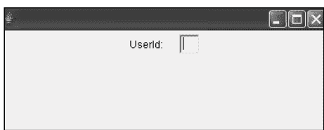

## Java AWT Label

`Label`定义了以下构造函数：

- `Label()`
- `Label(String str)`
- `Label(String str, int how)`

`Label`类对象是用于在容器中放置文本的组件。它用于显示单行只读文本。文本可以由应用程序更改，但用户无法直接编辑。

### AWT Label 声明

```java
public class Label extends Component implements Accessible
```

```java
import java.awt.*;

class Labeldemo {
    public static void main(String args[]) {
        Frame f = new Frame("Label Demo");
        Label l1, l2;
        l1 = new Label("First Label.");
        l1.setBounds(50, 100, 100, 30);
        l2 = new Label("Second Label.");
        l2.setBounds(50, 150, 100, 30);
        f.add(l1);
        f.add(l2);
        f.setSize(400, 400);
        f.setLayout(null);
        f.setVisible(true);
    }
}
```

输出：

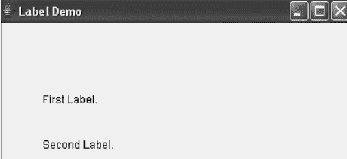

## AWT 按钮

最常用的控件是推按钮（push button）。推按钮是一个包含标签并在被按下时生成事件的组件。推按钮是`Button`类型的对象。`Button`定义了以下两个构造函数：

1. `Button()`
2. `Button(String str)`

第一个版本创建一个空按钮。

第二个版本创建一个包含`str`作为标签的按钮。

在创建按钮后，你可以通过调用`setLabel()`设置其标签。可以通过调用`getLabel()`获取标签。

这些方法如下：

1. `void setLabel(String str)`
2. `String getLabel()`

在这里，`str`成为按钮的新标签。

## 处理按钮

每当按钮被按下时，就会生成一个动作事件（action event）。该事件会被发送给之前注册过接收该组件动作通知感兴趣的监听器。每个监听器都实现`ActionListener`接口。该接口定义了`actionPerformed()`方法，该方法在事件发生时被调用。该方法提供一个`ActionEvent`对象作为参数。它包含了生成事件的按钮的引用，以及作为按钮标签的字符串的引用。

这里有一个示例创建了三个标记为“Yes”、“No”和“Undecided”的按钮。每当其中一个被按下时，就会显示一条消息报告哪个按钮被按下。在这个版本中，按钮的标签被用于判断哪个按钮被按下。标签通过调用传递给`actionPerformed()`的`ActionEvent`对象的`getCommand()`方法获取。

### 示例：AWT 按钮示例

```java
import java.awt.*;

public class Button1 {
    public static void main(String[] args) {
        Frame f = new Frame("Button Example");
        Button b = new Button("Click Here");
        b.setBounds(50, 100, 80, 30);
        f.add(b);
        f.setSize(400, 400);
        f.setLayout(null);
        f.setVisible(true);
    }
}
```

### 带有 ActionListener 的 AWT 按钮

```java
import java.awt.*;
import java.awt.event.*;

public class Buttondemo {
    public static void main(String[] args) {
        Frame f = new Frame("Button Example");
        Button b = new Button("Click Here");
        b.setBounds(50, 100, 80, 30);
        final TextField tf = new TextField();

        b.add(new ActionListener() {
            public void actionPerformed(ActionEvent e) {
                tf.setText("Welcome to college");
            }
        });

        f.add(b);
        f.add(tf);
        f.setSize(400, 400);
        f.setLayout(null);
        f.setVisible(true);
    }
}
```

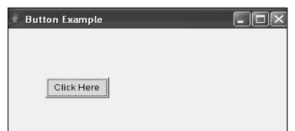

# Java AWT TextField

`TextField`类对象是一个允许单行编辑组件。它继承自`TextComponent`。

### AWT TextField 声明

```java
import java.awt.*;
import java.awt.event.*;

public class TextFielddemo {
    public static void main(String[] args) {
        Frame f = new Frame("TextField Demo");
        TextField t1, t2;
        t1 = new TextField("First TextField.");
        t1.setBounds(50, 100, 100, 30);
        t2 = new TextField("Second TextField.");
        t2.setBounds(50, 150, 100, 30);
        f.add(t1);
        f.add(t2);
        f.setSize(400, 400);
        f.setLayout(null);
        f.setVisible(true);
    }
}
```

输出：

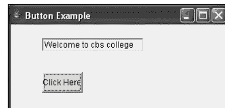

## 使用 TextField 进行加法

```java
import java.awt.*;
import java.awt.event.*;

public class TextField1 extends Frame implements ActionListener {
    TextField t1, t2, t3;
    Button b1, b2;

    TextField1() {
        t1 = new TextField();
        t1.setBounds(50, 50, 100, 30);
        t2 = new TextField();
        t2.setBounds(50, 100, 100, 30);
        t3 = new TextField();
        t3.setBounds(50, 150, 100, 30);
        b1 = new Button("ADD");
        b1.setBounds(50, 200, 50, 30);
        b2 = new Button("SUB");
        b2.setBounds(100, 200, 50, 30);
        add(t1);
        add(t2);
        add(t3);
        add(b1);
        add(b2);
        setSize(300, 300);
        setLayout(null);
        setVisible(true);
    }

    public void actionPerformed(ActionEvent e) {
        int a = Integer.parseInt(t1.getText());
        int b = Integer.parseInt(t2.getText());
        int c = 0;

        if (e.getSource() == b1) {
            c = a + b;
        } else if (e.getSource() == b2) {
            c = a - b;
        }

        t3.setText(String.valueOf(c));
    }

    public static void main(String[] args) {
        new TextField1();
    }
}
```

输出：

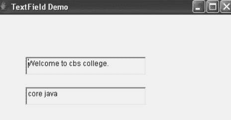

# Java AWT JRadioButton

此类表示`RadioButtons`。`RadioButtons`是选项列表，一次可以选择其中一个。必须将其配置为一个组，以便每次只有一个按钮被选中。我们使用`ButtonGroup`类。

## 构造函数

```java
JRadioButton(Icon i)
JRadioButton(Icon i, boolean state)
JRadioButton(String s)
JRadioButton(String s, boolean state)
JRadioButton(String s, Icon i)
JRadioButton(String s, Icon i, boolean state)
```

### RadioButton 示例

```java
import javax.swing.*;
import java.io.*;
import java.awt.*;

class radiobutton {
    public static void main(String[] args[]) {
        JFrame f = new JFrame("frame window");
        JPanel p = new JPanel();
        JLabel l = new JLabel("Courses:");
        JRadioButton r1 = new JRadioButton("IT");
        JRadioButton r2 = new JRadioButton("BMS");
        JRadioButton r3 = new JRadioButton("BBI");
        JRadioButton r4 = new JRadioButton("BMM");
        ButtonGroup bg = new ButtonGroup();

        bg.add(r1);
        bg.add(r2);
        bg.add(r3);
        bg.add(r4);
        p.add(r1);
        p.add(r2);
        p.add(r3);
        p.add(r4);
        f.add(p);
        f.setSize(300, 300);
        f.setVisible(true);
    }
}
```

## JCheckBox

这些代表复选框，它们是小框状图标，可以被选中或取消。

## 构造函数

- `JCheckBox(Icon i)`
- `JCheckBox(Icon i, boolean state)`
- `JCheckBox(String s)`
- `JCheckBox(String s, boolean state)`
- `JCheckBox(String s, Icon i)`
- `JCheckBox(String s, Icon i, Boolean state)`

### 示例

```java
import javax.swing.*;
import java.io.*;
import java.awt.*;

classcheckboxdemo {
    public static void main(String arg[]) {
        JFrame f = new JFrame("frame window");
        JPanel p = new JPanel();
        JLabel l = new JLabel("programming languages");
        p.add(l);
        JCheckBox c1 = new JCheckBox("SQL");
        JCheckBox c2 = new JCheckBox("ASP.NET");
        JCheckBox c3 = new JCheckBox("LINUX");
        JCheckBox c4 = new JCheckBox("DBMS");
        p.add(c1);
        p.add(c2);
        p.add(c3);
        p.add(c4);
        p.add(p);
        f.setSize(200, 200);
        f.setVisible(true);
        f.setDefaultCloseOperation(JFrame.EXIT_ON_CLOSE);
    }
}
```

## JComboBox

此类表示组合框，它是一个下拉列表，能够在显示区域中显示选中的项目。Swing `ComboBox`是 AWT 组件调的增强版。

## 构造函数

- `JComboBox()`
- `JComboBox(vector v)`

其中`v`是一个向量（vector）。通过以下方法向`ComboBox`添加项目：

`void addItem(Object obj)`

其中`obj`是要添加到`ComboBox`中的对象。

### 示例

```java
import java.swing.*;
import java.io.*;
```


```java
class comboboxdemo {
    public static void main(String arg[]) {
        JFrame f = new JFrame(" frame window ");
        JPanel p = new JPanel();
        JLabel l1 = new JLabel("cities");
        String s1 = "Mumbai";
        String s2 = "Nagpur";
        String s3 = "Pune";
        String s4 = "Delhi";
        JComboBox b = new JComboBox();
        b.addItem(s1);
        b.addItem(s2);
        b.addItem(s3);
        b.addItem(s4);
        p.add(1);
        p.add(b);
        p.add(p);
        f.setSize(200, 200);
        f.setVisible(true);
        f.setDefaultCloseOperation(JFrame.EXIT_ON_CLOSE);
    }
}
```

## `JList`

这是一个类似框的组件，用于在多行显示文本项目。列表项目通常是可以滚动的。

## 构造函数

```java
JList()
JList(s)
```

其中 `s` 是一个字符串数组。

## 方法

- `getSelectedValue()`：用于检索选中的项目。
- `setSelected(object o, Boolean s)`：用于设置项目。

为了使用这些方法，我们必须实现 `ListSelectionListener`。

示例：

```java
import javax.swing.*;
import java.io.*;

classlistdemo {
    public static void main(String args[])n {
        JFrame f = new JFrame("list demo");
        JPanel p = new JPanel();
        String s[] = {"Dbms", "Java", "Linux", "OS"};
        JList l = new JList(s);
        p.add(l);
        f.add(p);
        f.setSize(300, 300);
        f.setVisible(true);
        f.setDefaultCloseOperation(JFrame.EXIT_ON_CLOSE);
    }
}
```

## 滚动条

滚动条用于在指定的最小值和最大值之间选择连续值。滚动条可以是水平或垂直的。滚动条实际上是几个单独部分的组合。每个末端都有一个箭头，你可以点击它使滚动条的当前值沿箭头方向移动一个单位。

滚动条相对于其最小值和最大值的当前值由滚动条的滑块（或滑块）指示。滑块可以由用户拖动到新位置。然后滚动条将反映此值。在滑块两侧的背景中，用户可以点击滑块以按大于 1 的增量跳转。此动作将转换为某种形式的向上页和向下页。滚动条由 `Scrollbar` 类计算。

`Scrollbar` 定义了以下构造函数：

1. `Scrollbar()`
2. `Scrollbar(int style)`
3. `Scrollbar(int style, int initialValue, int thumbSize, int min, int max)`

第一种形式创建一个垂直滚动条。第二和第三种形式允许你指定滚动条的方向性。如果 `style` 为 `Scrollbar.VERTICAL`，则创建一个垂直滚动条。如果 `style` 为 `Scrollbar.HORIZONTAL`，则滚动条为水平。

在构造函数的第三种形式中，滚动条的初始值通过 `initialValue` 传入。滑块代表的单位数通过 `thumbSize` 传入。滚动条的最小值和最大值由 `min` 和 `max` 指定。

## 核心 Java

如果你通过前两个构造函数之一构造滚动条，那么你需要使用 `setValues()` 设置其参数：

```java
void setValues(int initialValue, int thumbSize, int min, int max)
```

参数的含义与它们在第三个构造函数中的相同。为了获取滚动条的值，使用 `getValue()`。这些方法如下：

1. `getValue()`
2. `setValue(int newValue)`

处理滚动条事件，需要实现 `AdjustmentListener` 接口。每次滚动滚动时，都会生成一个 `AdjustmentEvent`。

### 处理滚动条

为了处理滚动条事件，需要实现 `AdjustmentListener` 接口。每次滚动滚动时，都会生成一个 `AdjustmentEvent`。

## `JMenuBar`

这是菜单栏的实现。将 `Menu` 对象添加到菜单栏。当用户选择 `Menu` 时，会显示。

## `JMenu`

这是菜单的实现——本质上是菜单中的按钮。当用户点击“按钮”时，会弹出菜单。

## `JMenuItem`

这是菜单项的实现。使用 `JMenuItem` 添加项。

## 构造函数

```java
JMenuItem()
JMenuItem(String label)
JMenuItem(String label, boolean off)
JMenuItem(String s)
```

其中 `s` 代表菜单名称。

示例：

```java
import java.awt.*;

class AWTMenu extends Frame {
    MenuBar mbar;
    Menu menu1, submenu, menu2, menu3;
    JMenuItem m1, m2, m3, m4, m5, m6, m7, m8, m9;

    public AWTMenu() {
        setName("AWT Menu");
        setSize(400, 400);
        setLayout(new FlowLayout());
        setVisible(true);
        setLocationRelativeTo(null);

        mbar = new MenuBar();
        menu1 = new Menu("File");
        submenu = new Menu("Color");

        m1 = new JMenuItem("New");
        m2 = new JMenuItem("Save ctrl+s ");
        m3 = new JMenuItem("Save as");
        m4 = new JMenuItem("Red");
        m5 = new JMenuItem("Blue");
        m9 = new JMenuItem("Exit");

        menu1.add(m1);
        menu1.add(m2);
        menu1.add(m3);
        menu1.add(m9);

        submenu.add(m4);
        submenu.add(m5);
        menu1.add(submenu);
        mbar.add(menu1);

        menu2 = new Menu("Edit");
        m6 = new MenuItem("Undo");
        m7 = new MenuItem("Redo");
        menu2.add(m6);
        menu2.add(m7);
        mbar.add(menu2);

        menu3 = new Menu("Help");
        m8 = new MenuItem("About Us");
        menu3.add(m8);
        mbar.add(menu3);

        setMenuBar(mbar);
    }

    public static void main(String args[]) {
        {
            new AWTMenu();
        }
    }
}
```

## 12.5 LAYOUTS

布局管理器（`LayoutManagers`）用于以特定的方式安排组件。`LayoutManager` 是一个所有布局管理器类都实现的接口。有以下类：

- `java.awt.BorderLayout`
- `java.awt.FlowLayout`
- `java.awt.GridLayout`

## `java.CardLayout (AWT)` 摘要

- `java.awt.CardLayout`
- `java.awt.GridBagLayout`
- `javax.swing.BoxLayout`
- `javax.swing.GroupLayout`
- `javax.swing.ScrollPaneLayout`
- `javax.swing.SpringLayout` 等

## `BorderLayout`

`BorderLayout` 用于将组件排列在五个区域：北、南、东、西和中心。每个区域（区域）只能包含一个组件。它是框架（frame）或窗口（window）的默认布局。

`BorderLayout` 为每个区域提供了五个常量：

1. `public static final NORTH`
2. `public static final SOUTH`
3. `public static final EAST`
4. `public static final WEST`
5. `public static final CENTER`

## 使用的构造函数

- `BorderLayout()`：创建一个组件之间没有间隙的边界布局。
- `BorderLayout(int hgap, int vgap)`：创建一个组件之间具有给定水平和垂直间隙的边界布局。

示例：

```java
import java.awt.*;
import javax.swing.*;

public class BorderLayoutExample {
    JFrame f;

    BorderLayoutExample() {
        f = new JFrame();

        JButton b1 = new JButton("NORTH");
        JButton b2 = new JButton("SOUTH");
        JButton b3 = new JButton("EAST");
        JButton b4 = new JButton("WEST");
        JButton b5 = new JButton("CENTER");

        f.add(b1, BorderLayout.NORTH);
        f.add(b2, BorderLayout.SOUTH);
        f.add(b3, BorderLayout.EAST);
        f.add(b4, BorderLayout.WEST);
        f.add(b5, BorderLayout.CENTER);

        f.setSize(300, 300);
        f.setVisible(true);
    }

    public static void main(String[] args) {
        new BorderLayoutExample();
    }
}
```

输出：

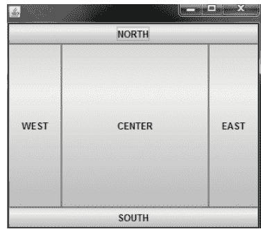

## `GridLayout`

`GridLayout` 用于将组件排列在矩形网格中。每个矩形显示一个组件。

## 构造函数

1. `GridLayout()`：创建一个每行一个组件列的网格布局。
2. `GridLayout(int rows, int columns)`：创建一个具有给定行和列但组件之间没有间隙的网格布局。
3. `GridLayout(int rows, int columns, int hgap, int vgap)`：创建一个具有给定行、列以及给定水平和垂直间隙的网格布局。

示例：

```java
import java.awt.*;
import javax.swing.*;

public class MyGridLayoutExample {
    JFrame f;

    MyGridLayoutExample() {
        f = new JFrame();

        JButton b1 = new JButton("A");
        JButton b2 = new JButton("B");
        JButton b3 = new JButton("C");
        JButton b4 = new JButton("D");
        JButton b5 = new JButton("E");
        JButton b6 = new JButton("F");
        JButton b7 = new JButton("G");
        JButton b8 = new JButton("H");
        JButton b9 = new JButton("I");

        f.add(b1);
        f.add(b2);
        f.add(b3);
        f.add(b4);
        f.add(b5);
        f.add(b6);
        f.add(b7);
        f.add(b8);
        f.add(b9);

        f.setLayout(new GridLayout(3, 3));
        f.setSize(300, 300);
        f.setVisible(true);
    }

    public static void main(String[] args) {
        new MyGridLayoutExample();
    }
}
```

输出：

| A | B | C |
|---|---|---|
| D | E | F |
| G | H | I |

## `FlowLayout`

`FlowLayout` 用于将组件排列成行，一个接一个（流式排列）。它是 applet 或 panel 的默认布局。

`FlowLayout` 类的字段：

- `public static final int LEFT`
- `public static final int RIGHT`
- `public static final int CENTER`
- `public static final int LEADING`
- `public static final int TRAILING`

## 构造函数

- `FlowLayout()`：创建一个居中对齐且默认水平垂直间隙为 5 单位的流式布局。
- `FlowLayout(int align)`：创建一个具有给定对齐方式和默认 5 单位水平垂直间隙的流式布局。
- `FlowLayout(int align, int hgap, int vgap)`：创建一个具有给定对齐方式和给定水平垂直间隙的流式布局。

## 示例

```java
import java.awt.*;
import javax.swing.*;

public class FlowLayoutDemo {
    JFrame f;

    FlowLayoutDemo() {
        f = new JFrame();

        JButton b1 = new JButton("A");
        JButton b2 = new JButton("B");
        JButton b3 = new JButton("C");
        JButton b4 = new JButton("D");
        JButton b5 = new JButton("E");

        f.add(b1);
        f.add(b2);
        f.add(b3);
        f.add(b4);
        f.add(b5);

        f.setLayout(new FlowLayout(FlowLayout.RIGHT));
        f.setSize(300, 300);
        f.setVisible(true);
    }

    public static void main(String[] args) {
        new FlowLayoutDemo();
    }
}
```

输出：

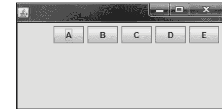

## `BoxLayout`

`BoxLayout` 用于以垂直或水平方式排列组件。为此，`BoxLayout` 提供了四个常量：

```java
Class BoxLayout
public static final int X_AXIS
public static final int Y_AXIS
public static final int LINE_AXIS
public static final int BLOCK_AXIS
```

## 构造函数

`BoxLayout(Container c, int axis)`：创建一个按照给定轴排列组件的框布局。

示例：

```java
import java.awt.*;
import javax.swing.*;

public class BoxLayoutDemo extends Frame {
    Button buttons[];

    public BoxLayoutDemo() {
```


```java
buttons = new Button[5];

for (int i = 0; i < 5; i++) {
    buttons[i] = new Button("Button " + (i + 1));
    add(buttons[i]);
}

setLayout(new BoxLayout(this, BoxLayout.Y_AXIS));
setSize(200, 400);
setVisible(true);
}

public static void main(String args[]) {
    BoxLayoutDemo b = new BoxLayoutDemo();
}
}
```

输出：

| Button 1 |
|---|
| Button 2 |
| Button 3 |
| Button 4 |
| Button 5 |

## CardLayout

`CardLayout` 类管理组件，使得一次只显示一个。它将每个组件视为一张卡片，因此被称为 `CardLayout`。

## 构造函数

- `CardLayout()`：创建水平垂直间隙为零的卡片布局。
- `CardLayout(int hgap, int vgap)`：创建具有给定水平垂直间隙的卡片布局。

## 方法

- `public void next(Container parent)`：切换到容器的下一个卡片。
- `public void previous(Container parent)`：切换到容器的上一个卡片。
- `public void first(Container parent)`：切换到容器的第一张卡片。
- `public void last(Container parent)`：切换到容器的最后一张卡片。
- `public void show(Container parent, String name)`：切换到指定的卡片。

示例：

```java
import java.awt.event.*;

import javax.swing.*;

public class CardLayoutDemo extends JFrame implements ActionListener {
    CardLayout card;
    JButton b1, b2, b3;
    Container c;

    CardLayoutDemo() {
        c = getContentPane();
        card = new CardLayout(40, 30);
        c.setLayout(card);

        b1 = new JButton("Book");
        b2 = new JButton("Flower");
        b3 = new JButton("Animal");

        b1.addActionListener(this);
        b2.addActionListener(this);
        b3.addActionListener(this);

        c.add("a", b1);
        c.add("b", b2);
        c.add("c", b3);
    }

    public void actionPerformed(ActionEvent e) {
        card.next(c);
    }

    public static void main(String[] args) {
        CardLayoutDemo cl = new CardLayoutDemo();

        cl.setSize(400, 400);
        cl.setVisible(true);
        cl.setDefaultCloseOperation(EXIT_ON_CLOSE);
    }
}
```

输出：

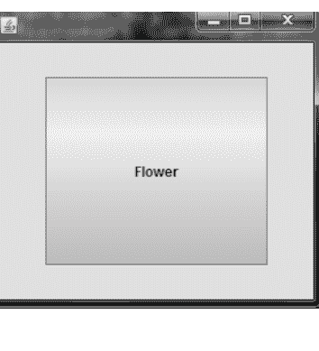

## 问题

1. 解释 AWT 事件层次结构的细节。
2. 什么是布局管理器？解释 `FlowLayout`。
3. 使用示例解释 `BorderLayout`。
4. `Frame` 和 `Window` 之间的区别是什么？
5. 解释 `Applet` 的生命周期。
6. 什么是 `Applet`？`Applet` 应该有构造函数吗？
7. 解释 AWT `RadioButton` 和 `Checkbox`。
8. 编写一个演示 `TextField` 的程序。
9. 编写一个演示 `ComboBox` 和 `List` 的程序。
10. 编写一个演示 `Label` 和 `Button` 的程序。


## 关于作者


Kiran Gubrani 教授目前是 Talreja 学院科学系主任。她在各种技术平台上作为培训师、学术负责人和领域专家（SME）拥有超过 18 年的经验。在过去的 18 年里，她是多种技术的教授，涵盖 Oracle Cloud、`.NET`、`SQL`、云计算、虚拟化和云脚本、`Linux` 管理、Web 技术、软件工程、软件测试、`JBOSS` 以及逻辑、并行和分布式计算。

她是 Capaginei、ADMS、Oracle 等公司的自由培训师。她是 ICOA、MMS 系统技术以及计算机科学和信息技术的客座教师。她出版了关于 Java 编程、`Linux` 操作系统、Java 和数据结构、`Linux` 管理、命令式编程的书。

即将出版：

- 大数据分析（参考书）
- （1）直接设备（2）女性职业生涯面临的问题（3）云存储机制（4）基于 `GitHub` 的开放私有云以及（5）`NoSQL` 数据库分析的概率独立虚拟化数据库。

她是 Himalaya 出版社 IT/CS 书籍的评审和编辑。

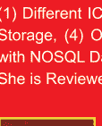

Sandeep Vishwakarma 目前是 Sharma 科学、艺术和商学院主任。他拥有超过 12 年的教学经验和 2 年的行业经验。他教授过各种技术：OOPS、高级 Java、`Linux` 管理、软件工程、`DBMS`、`ORACLE`、`C` 编程、数据结构、操作系统、逻辑离散数学、`C#` 和互联网技术。

他是 M.Sc.（IT/CS）和 MMS 的访问教师。

他出版了关于数字计算基础、Java 和数据结构、Web 编程和数据结构的书。


Sohrab Vaharis 自 2014 年以来一直是自我激励且富有韧性的企业家和教学人员。他是一个技术爱好者，喜欢与不同的技术合作。在 Mahendra Kanoja 教授和 Farguni 教授的指导下，他发表了自己的研究论文并开发了一种编程语言“`myLanguage`”。由于对人工智能和信息安全感兴趣，Sorab 在这些领域举办了多次研讨会和会议，并教授人工智能、神经网络、网络安全和伦理黑客等课程。
