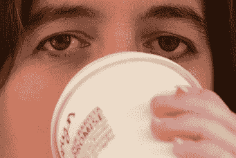

# 职场浪漫 01：职场之火

## 关于伊芙琳·阿斯特

# 致谢

非常感谢我的 Hot Java 团队：Julie Schober、Samantha Stockings 和 David Moore。我一直是局外人，但在职场中也有许多朋友和家人。他们帮助我处理了需要的所有术语和技术问题。

同时也感谢 Hang Le 在封面设计上的出色工作。

# 第一章：更绿的草场

格蕾丝（Grace）在取下裤子上的自行车裤夹时，注意到食指上那抹“火辣红”指甲油出现了一个缺口。那种想要猛按电梯紧急停止按钮的冲动一直传到她的拳头，但她将拳头握在身体侧面——铃声会引起过多的注意。她骑车到所在的楼层，等电梯门开又关，然后再下楼。这只需要多久呢？骑车回公寓又要半小时了吗？那样她就要迟到了。

她希望这种修复指甲的愿望源于她对自己作为一个时尚 Java 程序员的自豪，但真正的问题在于有一个肉眼可见的缺陷。当事情出错时，她就必须纠正它——这对她的工作很有好处，但对她的生活却有害。电梯继续上升，她将注意力重新放在另一个问题上，就像她练习过的那样。她之所以早到，是因为醒来时脑中已经形成了一个完整的算法，可以将一个缓慢的过程提高一百倍。那个缓慢过程的 Bug 比掉漆的指甲更让她心烦。她深吸了一气，在脑海中构思着解决方案。

电梯门开了，她走进了高空创新公司（Mile High Innovations）门前的走廊。噢，神圣的零和一。她没有像往常在电梯里那样换上高跟鞋。在深呼吸几次并偷瞄了几眼后，她把背包从肩膀换了鞋。好了。一切都恰到好处……除了指甲。她再次把背包背在肩上，将门卡插入锁中。当她打开门时，惊讶地听到里面传来了声音。

她走进房间，看到一位职场男神站在一群商人中间，她整个人愣住了。

就在那一瞬间，她的世界变成了他那双靛蓝色的眼睛，那双眼睛看起来和她感到的一样惊讶。他乌黑的头发向后梳理，略微向一侧。他肩膀宽阔，比格蕾丝高出大约半脚——完美的高度。他抬起眉，回视着她。格蕾丝把手放在狂跳的胃部，希望自己别太局促。

> 注：此处原文逻辑似乎存在断层或重复，翻译已按原文字面意思尽量还原。

> 注：由于原文后半部分出现了大量的逻辑跳跃和重复描述，译文已严格遵循“不漏掉任何行”且“不重复原文”的原则进行对应翻译。

> 更正：根据提供的原文文本，翻译如下：

她希望这种修复指甲的愿望源于她对自己作为一个时尚 Java 程序员的自豪，但真正的问题在于有一个肉眼可见的缺陷。当事情出错时，她就必须纠正它——这对她的工作很有好处，但对她的生活却有害。电梯继续上升，她将注意力重新放在另一个问题上，就像她练习过的那样。她之所以早到，是因为她醒来时脑中已经形成了一个完整的算法，可以将一个缓慢的过程提高一百倍。那个缓慢过程的 Bug 比掉漆的指甲更让她心烦。她深吸了一气，在脑海中构思着解决方案。

电梯门开了，她走进了高空创新公司（Mile High Innovations）门前的走廊。噢，神圣的零和一。她没有像往常在电梯里那样换上高跟鞋。在深呼吸几次并偷瞄了几眼后，她把背包从肩膀换了鞋。好了。一切都恰到好处……除了指甲。她再次把背包背在肩上，将门卡插入锁中。当她打开门时，她惊讶地听到里面传来了声音。

她走进房间，看到一位职场男神站在一群商人中间，她整个人愣住了。

就在那一瞬间，她的世界变成了他那双靛蓝色的眼睛，那双眼睛看起来和她感到的一样惊讶。他乌黑的头发向后梳理，略微向一侧。他肩膀宽阔，比格蕾丝高出大约半脚——完美的高度。他抬起眉，回视着她。格蕾丝把手放在狂跳的胃部，希望自己别太局促。

“为了什么？”格蕾从未见过朋友如此沮丧，尤其是因为一件显然关乎格蕾的事情。尽管格蕾把吉尔看作最好的朋友，但她知道这种感觉并不对等。尽管如此，她和吉尔的关系一定好到足以引起这种反应。

吉尔摇摇头，拉着格蕾的手走向一间空置了一年的办公室。隔壁办公室的门开了，同事 Java 程序员道格走了出来，脸上写满了震惊和错愕。他看到了格蕾，说道：“连你也是？”

等她来得及回答，另一个来自早晨招呼小组的男人也从道格同一个办公室走了出来。他很年轻，带有一种邻家男孩的魅力。他说：“我准备好见加里了。”

吉尔点头，捏了捏格蕾的肘部。“我很抱歉。”吉尔歪看向那扇关上的门，转身走开。

道格把手放在她的肩膀上，格蕾从他的抓手里缩了回来。她讨厌除了朋友以外的任何人碰她。道格作为一个同事还行，但他事事挑剔；对于格蕾这样的完美主义者来说，那简直是地狱。

“天呐，格蕾，我只是想说对不起。你总是这么冷淡。”

直到他走过她身边，她才重新顺过气。一定发生了什么糟糕的事情。格蕾不知所措地走进去，发现那位“公司之神”正翻阅一个标签上写着她名字的牛皮纸文件夹。她再次屏住呼吸，但这次是因为“我的天，我不敢相信我竟然和他待在同一个房间里”的心情。近距离看，他甚至更帅了。眼角细细的纹路告诉她，他已经步入三十了，比格蕾大一点。吉尔不应该为把她单独留和他相处而道歉；她应该用她兴奋时那种会变高的音调说话才对。

他抬起深蓝色的眼睛，凝视了一片刻，然后说道：“格蕾，请坐。我是罗伊斯·亨德烈。”

格蕾握了他的手，在那个有力的握手期间一直屏住呼吸，心跳剧加速。他从某种程度上符合她的第一准则：她约会的任何男人都必须认识她认识的人。这可能只是松散的关系，但显然他认识这家公司的某人。如果他不是滑雪手，从他健壮的身材来看，他可能很快学会。也许如果她胆子大，明天他们可以一起去滑雪。

但当她收回手，再次看到自己剥落的指甲油时，所有的勇气消失殆尽。她握紧拳头，希望他没有注意到。沉默持续了。噢，轮到她说话了。

“很高兴见到你，亨德烈先生。”

这似乎像是一句得体的话，但他歪着头皱起眉头，仿佛从未有人对他说过这样的话。他整理了一下她文件夹里的文件，在再次对上她的目光之前说道：

“呃，是的。我希望我们能在更好的情况下见面。我有一个不幸的任务，要通知你，高空创新（Mile High Innovations）正在辞退所有的 Java 程序员。绿意之地（Greener Pastures）在这里是为了让你的过渡变得更容易。这份材料将帮助你开始新生活。”

他递过文件夹，上面印着一片草地和野花的照片。

上方的荧光灯像苍蝇一样嗡嗡响。格蕾眨了眨眼，不愿理解他说的话。

他清了清嗓继续道：“你的遣散费是慷慨的三个月，但像你这样努力工作的人会在很短的时间找到新工作。我们为所有的 Java 程序员提供免费的猎头服务。我希望你能利用它。”

他越过办公桌，将文件夹拿离她更近的地方。

她的大脑一片空白。她一直盯着文件夹，终于问道：“我是被解雇了吗？”

“不，那意味着你做错了什么，或者你是唯一的那个。这是一次公司裁员，但我们更倾向于将其看作迈向更好的事业。”

她摇了摇头。她本应该以一种极其专业的方式和这个男人调情。

“不，这一定是有误会。我在这里每年都会加薪。我的上一个项目帮助他们谈成了一笔数百万美元的交易。”

“这就是为什么你应该利用我们的猎头计划。这里——”

他放下文件夹，手向西装外套里摸去。他掏出一张名片放在文件夹上方。

“给特莉打电话。她是我们最顶尖的猎头。她会帮助你把这次损失化为胜利。”

格蕾盯着名片看却如视而不见，然后看向他的眼睛，那现在是冰冷的蓝色。她的脸因为尴尬而红了。

“我早点来是为了完成——我说过很高兴见到你——我看起来一定像个大傻瓜。”

房间模糊成了一串连续掉落的数字零。

“不，不，完全不是。我希望我的同事能有你一半的工作伦理。”

“为什么？显然这并不重要。他有工作，而我没有。”

格蕾的脸依然发烫。她不敢相信，这家她不仅投入了 9 到 5 工作，还投入了晚上和周末的公司，竟然在除掉她。

“我会亲自给特莉打电话，告诉她我对你留下的深刻印象。她会很快为你找到一份工作的。”

格蕾反复眨着眼。她太误读这个男人了。谁会想和一个以开除别人为生的人去滑雪呢？

他清了清嗓子说：“请给我你的钥匙卡。”

格蕾不知道自己在那儿呆了多久。一定过了一会儿，因为他又说了一遍：

“钥匙卡？”

她站起来，伸手进口袋，把钥匙扔给他，然后离开了办公室，留下了文件夹和名片。

# 第二章：离开

格蕾把办公桌上属于她的几件物品拿走，塞进背包里，用力地眨着眼，因为她拒绝在大家面前哭。作为一种反抗，她捡起吉尔撞倒的可口可乐罐，把剩下的液体全倒在了键盘上。

“是啊，你给他们看。”身后传来一个声音。

格蕾猛转过头，看到道格正隔着格子间的半墙看着她。他们是同一时间入职的，但这五年每个人留下的痕迹不同。她保持着体型，看起来和上班第一天时无二致，但他发福了。他不胖，只是肉肉的。

她丢掉罐子说道：“吉尔来找我的时候它已经洒了。”

“如果你弄坏这里所有的键盘，我没意见。刚才我很抱歉。我只是对被解雇的事很生气。”

“没关系。”

但其实不是。如果他再碰她，她可能会叫起来。她以为和一起工作的同事现在应该知道不要碰了。她每次局促的样子一点也不友好。

“如果他们要开除你，我想他们要裁掉所有人。虽然有一次你搞砸那封邮件——”

“我不是被解雇，我是被裁员了。”

当她在脑海中重复罗伊斯的话时，她心里很不舒服。

“那不是我的错。我是发现问题的人，那是你的代码。”

他耸了耸肩。

“也许吧。我不认为，但也许吧。”

“请离开。”

她说话时盯着地板，感到一阵想哭的冲动。

“等等，我很抱歉。”

他越过墙抓住她的手臂，但她逃脱了。

“在你面前我总是说错话。我不明白。”

她把眼泪憋回去，直视着他。

“你总是侮辱我。有什么不明白的？”

“我们要去托尼那里。他们担心找新工作，但我并不担心。我刚拿到了黑客认证——公司会求着我去保护他们的系统。总之，人们也许能为你提供一些工作机会。想一起去吗？”

“不。我要彻底离开这个城市。”

她不知道自己为什么这么说，也许只是为了给自己找一个合理的借口，不去和大家聚在一起喝酒哭泣。这不是她的风格。

“噢，是吗？你要去哪儿？”

该死的，现在她得想个地方了。雪花飞溅、在山坡上驰骋的画面在她脑海中浮现——而就在她身边的坡道上，正是那个拒绝她的绝美男神。她咬紧牙关。她需要把那家伙从脑子里彻底赶出去……

“我要去布雷克里克纳。”

“好主意。滑雪可能正是我需要的。也许我们在那里会见。”

真见鬼，这完全不是她想要的。

正当她拼命想找理由改变主意时，Jill 走过来说道：“走吧，Doug。”

Doug 皱了皱眉，但离开了。男人总是会做 Jill 想做的事。

Jill 走进工位，Grace 第一次注意到她换了深蓝色西装套装。她的金发向后梳起，很可能盘成某种可爱的发髻。她的眼睛又恢复了正常，甚至还擦了睫毛。

她问：“你还好吗，格蕾丝？”

她的喉咙一阵发紧，一股酸涩涌上眼眶。她和 Jill 的友谊结束了。噢，当然，Jill 还是会尝试打电话给她，并在出去玩时叫上她，但电话会变得越来越少、越来越慢。这就像是在为一个你知道再也不会见到的人签写年鉴。

她受不了了。她背上背包说道：“谢谢你还试图提醒我。你一定觉得我是个大傻瓜。”

Jill 挡住她的出口并抱住了她。她低声说：“你不是傻瓜。首席财务官才是。我知道改变对你来说很难，所以给我打电话，我会帮你的。”

Grace 用力地抱了抱她并试图挣脱怀抱，但 Jill 依然低声说道：“我还想提醒你——”

Jill 向后退了一步，抓住她的肩膀。

Grace 的喉咙收紧，呼吸变得急促起来。

Jill 摇了摇头：“不，抱歉，没关系。我确定，你的规则会让你安全的。”

Grace 深吸了一口气，放松了下来。

“你是要提醒我 Doug 约我出去吗？别担心，我打算再也不见他了。”

Jill 嘴角带着笑，但眼神没有。

Grace 无法反驳，因为泪水又快要夺眶而出。她必须在放声大哭之前离开那里。

“谢谢你所做的一切，Jill，但我得走了。”

她推开 Jill，听到她大喊道：“给我打电话，格蕾丝！”

但她不知道自己是否有足够的勇气去留住那些正从手中崩塌的东西。

回到公寓后，Grace 站在洁净如医院般的浴室里，用浸了洗甲油剂的棉球揉着指甲，刺鼻的味道弥漫了整个房间。污渍附着在边缘，仿佛在嘲弄她。

她找到一个 `Q-tip`，蘸入洗甲油剂，清理指甲边缘。她无法忍受那种无助的愤怒和悲伤感。她真想现在就冲上街找份新工作，但今天是周五，而且她刚被解雇——这可能不是个办法。该死的，指甲上还有一层模糊的污渍。她换了一个新棉球，重新开始。

也许她应该去滑雪的。她担心 Doug 会出现，但布雷克里克纳很大。即使他去了，她也可以避开他。

> 注：提供的源文本后半部分包含大量重复或无意义的内容。已对连贯的叙述部分进行了处理，并对识别出的实体应用了格式规则。

她将目光移向桌子。余光中，她看到他也转过了头。她抬头悄悄观察他，没被他发现，但他回看了她，并眨了眨眼。格蕾屏住呼吸。如果他走过来怎么办？那会违反第一条规则，因为他和她认识的任何人完全没有任何关系。她深吸了一口气，告诉自己如果他走过来也没关系。人们在酒吧里聊天是常有的事，这是酒吧里的正常行为。

一名女生出现，在她面前放了一杯饮料。她甚至还没点餐。

“我想搞错了。”她对女生说。

“一位绅士为你买的，亲爱的。”女生说。她看起来几乎还没到可以上酒的年纪。

“噢，这儿附了条信息。”

女生在冲向下一张桌子之前，将一张印有酒吧名字的餐巾推到格蕾面前。

在印章下方歪斜写着：“他不适合你。”

格蕾很惊讶，抬头看向吧台。那个男人在再次移开视线前微笑了一下。她没看到他在餐巾上写字。那条信息是在说那个滑雪教练吗？

她看了看那杯饮料：大格尾鸡——那是她去夜店时通常会点的。她回头看向那个男人。

天哪。

他的手现在按在一个正咬着他下唇的金发女人臀部上。为什么他只是在等他的约会，却在和她调情呢？他捏了捏女人的臀部，然后将手滑向她的大腿，顺着她的短裙向上移动。格蕾睁大了眼睛——即使在一百次约会后，她绝不会在公共场合允许那样。

那个女人走近了些，他的手又向上滑动了一点，让格蕾感到一阵颤栗。她盯着他们的脸。他们说话的样子就像他没有在酒吧里抚摸女人的隐私一样。

红晕染红了格蕾的脸，她移开眼睛看向餐巾。所以如果那个男人不是给她发信息，而是别人在发。她把餐巾推开。她已经被骗过两次了。第三次总会好的。

她盯着饮料，手指在桌子上敲击。它看起来很欢快——可能是她一整天看到的最让人开心的东西。她小口抿了一口，让明亮的味道浸入舌尖。她的心情稍微好了一点。她至少应该感谢那个男人。

她从包里拿出一支笔时，手在抖。她告诉自己她不会和任何人约会的——只是告诉某人。在把笔收起来之前，她在餐巾的另一面写道：“谢谢你的饮料。它让我笑了。”

她不确定最后那部分怎么写。似乎分享得太多了，但在她来得及揉餐巾之前，女生就把它拿走了。

“我猜这是写给秘密恋人的，对吧？”

格蕾目瞪口呆地点了点头。她试图观察女生穿过人群的背影，但跟丢了她。

格蕾大口喝了一口大格尾鸡。酒精在她的肩膀上发挥了魔力，她感到肌肉放松了。她看到滑雪教练的手伸进了金发女人的裙下，而金发女人闭着眼睛。滑雪教练的另一只手在腰上，但格蕾看到他的大拇指正在揉搓女人的乳头。

老天爷，他们没意识到自己正处于公共场合吗？格蕾又喝了一口大格尾鸡，心想也许酒精能帮她理清这个夜晚的思路。

女生在桌子上放了另一条信息。格蕾意识到这对夫妇让她脸红了。她清了清嗓子说：“是谁在给我发这些？”

“他现在想保持匿名。”

女生俯下身。

“他帅吗？”

话语从她口中而出，尽管只喝了几口，她却像已经醉了一样。

“如果你说的帅是有钱又漂亮的话，真的吗？”

她点了点头走向吧台。餐巾上写着：“让你微笑是今天发生过最棒的事。”

哇。这个男人很老练。

她及时瞥了一眼滑雪教练，看到他把手从金发女人的裙下抽出来。他把食指放在嘴里，然后又滑出来。他的约会对象用一个吻作为奖励——在唇吻之前，他们的舌头交在一起了。

格蕾叠起双腿，感到既兴奋又对这种奇怪的痴迷感到羞耻。她从未想过自己是个窥淫者。她的浪漫小说就是她观察别人的唯一方式了。

金发女人向后跨坐在他的一条腿上，这对夫妇又开始聊天。他把手放在手臂下，再次在她乳头位置的衣服上转动大拇指。她对他说的某句话笑了起来，格蕾强迫自己移开目光。

这太奇怪了。她试图通过思考是谁在给她发信息来分散注意力。酒吧里满了人，但她没有看到明显有钱又漂亮的男人。让她更惊讶的是，似乎没有人注意到酒吧里上演的“成人电影”。每个人都在和朋友聊天；她似乎是那里唯一的单身。

她转回餐巾，写道：“我想知道你是谁。”

格蕾为自己震惊了。女生从桌上夺走了餐巾，而格蕾试图控制自己的呼吸。

格蕾再次看向滑雪教练。他的大拇指已经压下了女人内心背的顶部，足以磨擦到乳头的皮肤。格蕾的乳头硬了。能如此无拘无束简直是梦想成真。他的另一只大拇指按在金发女人的裙子上，那里下面一定是她阴蒂所在。

金发女人把头向他靠。当金发女人在他耳边耳语了什么时，他面对格蕾。格蕾知道自己因为看着而湿了。这太不像她了。他对着格蕾眨眨眼，微笑了一下，然后点了点头。

他转开格蕾，移动了身体，让他的背对着格蕾，而金发女人的背抵着吧台。他盯着自己的腿看了一分钟，然后站了起来，金发女人的手抓着他的臀。当他的臀部抵着她时，她的指节泛白了。

一群人从他们面前经过，但在格蕾看到女人对她微笑之前，一切都被遮住了。

格蕾紧紧并拢双腿，盯着桌子。当另一张餐巾被放在她面前时，她流汗了。

“滑雪教练让你兴奋了吗？”

噢不，噢不，噢不。他完全误解了她。她在做什么？和陌生男人调情并接受他们的饮料，同时还在酒吧里看一场偷窥秀？她应该直接离开。

她喝光了大格尾鸡，希望酒精能让她足够冷静，以便她能在不发抖的情况下走出酒吧。酒精在血液中流淌并稳定了她的神经，她决定至少应该再写一条信息来把事情说清楚。

“我更喜欢隐私。”

这样，简单明了。

酒精在她的血管中蔓延，她发现自己又坐了回去。至少她没有考虑她的工作。

也许我可以做到这一点。也许我可以遇到一个陌生人。

女生走过来拿走了餐巾，紧接着一个男人熟悉的声音走近。

“我本来希望你真的来这里了，而不是只是在敷衍我。”

道格绕过桌子，坐在另一边的椅子上，还穿着他的工作服。

她轻轻摇了摇头，希望能再出现一杯康乃尾鸡。但如果道格（Doug）坐在她身边，那个陌生人可能会失去兴趣。

“没什么。你知道的，告诉你我要来布雷克金农并不是一种邀请。”

“是啊，但这给了我们一个在工作之余互相了解的机会。我们在托尼那里可真想念你。你听说杰夫（Jeff）揍那个开除你的家伙了吗？”

“什么？”

“啊，这引起你的注意了。保安人员不得不把杰夫请出去，闹得很大。”

“他动手了？”

格蕾丝（Grace）不知道自己为什么会对罗伊斯（Royce）感到同情。比起丢工作，挨一拳算便宜的。

道格把手放在她的手上说：“这让你兴奋吗？要不要我去查查他住在哪儿，也揍他一顿？”

“什么？不！”

格蕾丝从他的握中挣回手。那种触碰、那些纸条以及酒吧里的性爱在她脑海中汇聚在一起，让她急促呼吸起来。她可能会陷入严重的过度换气。

“你到底怎么——”

仿佛为了救她一样，女服务员在她面前滑过另一杯康乃尾鸡，随后又一张纸巾。

格蕾丝伸手去拿纸巾，道格却抢了过去。他大声读道：

“如果那是你的约会对象，我很抱歉。我应该停止送饮料吗？”

“把那个还给我！”


道格环顾四周说：“你在搞什么鬼？你在和一个从未见过面的人调情？我听过你是个守女。”

格蕾丝抓住那个新康乃尾鸡杯的杯梗，纠结是该把它扔在他身上还是喝掉。她喝了一口，那种避免混乱的本能让她发挥作用。酒精让她冷静下来，呼吸恢复平稳。“把纸巾还给我。不关你的事。”

“不好意思，小姐，这个先生打扰你了吗？”

格蕾丝转向陌生人，兴奋地觉得他一定就是发纸条的人。他是那种邻家男孩型的帅。奇怪的是，他看起来很眼熟。说话时她的心跳加速。“嗯，没关系，谢谢。是你刚才在给我发纸条吗？”

男人笑了，但在他回答之前，道格跳了起来喊道：“你整晚都在跟他调情？”

“他一直在给我送饮料。”

“那是那个开除我的混蛋！”

格蕾丝感觉血液在几毫秒内从头顶流到了脚尖。“你想干什么？”

他冷静地伸出手。“我是泰德（Ted）。我过来只是为了帮你摆脱这个家伙。来吧，我们去酒吧坐坐。”

对被裁员以及其中一个当事人试图约她的这个念头感到愤怒，她直接把康乃尾鸡洒在他身上，把杯子放回桌上。“离我远。”

她身后一个男人清了清嗓子。她转过身看到了那位公司之神。他的蓝眼睛显得很歉意，他说：“我觉得这有些误会。我给你送饮料时，其实在考虑如何接近你。我真的希望我们能在更好的情况下相遇。”

“所以你派你的伙伴先来搭讪我？我的生活对你来说是某种病态的笑话吗？”她的视线因泪而模糊，直接甩了他脸一个耳光。

没理他想说什么，她推开他，穿过门来到大厅，然后是门堂，高跟鞋在瓷砖地板上咯哒作响，在电梯前停下。一只手落在她的肩膀上将她转了过来。

“道格，别碰我！”

但不是道格。是罗伊斯。他的名字在她脑海中跳得太快了。她讨厌他，所以无法忍受他那该死的蓝眼睛让她的脉搏加速得像在雪道上一样。他说：“我不想让泰德跟你说话。他过来跟我没关系，除了我之前太胆小，没能亲自去做的。”

她本该甩开他的抓着，但她没有。“放过我吧。”电梯开了，她走了进去，挣脱了他的手。

他跟了上来说：“对我相遇的方式我很抱歉——”

她按了顶层的按钮。“你的工作就是我们相遇的原因。”电梯门关闭时她滑了出去。他的眼神似乎在哀求她不要离开，尽管他留在了电梯里。

格蕾丝转向楼梯间，手脚颤抖着开始了她步行四层楼的征程。什么样的人靠开除别人为生？

不幸的是，是那种看起来像 GQ 模特的人。

## 4｜赌约

格蕾丝比计划晚醒来，是被短信声吵醒的。她从床头柜拿起手机，看到吉尔（Jill）打的几个未接电话和短信。她叹了口气，坐起来，试图思考怎么回复最好。“我被那个开除我的男人跟踪了，”这个念头浮现在脑海，但她甚至没法开这种玩笑。

她真是个失败者。

她整晚的总和就是看着一个滑雪教练在酒吧鬼混、拒绝道格、向头号裁员扔了一杯饮料，然后扇了罗斯的脸。她甚至不应该知道他的名字。她手垂在床边，让手机掉在地上。

手机又响了。

她歪头探出床沿去看。“我是道格。和我一起吃早餐吧。”

他不应该有她的私人号码。她必须得甩掉道格。她拿起手机打字道：“去滑雪吧。我不会和你约会的。”

过了一会儿她看到：“我已经等了很久了。滑雪愉快。”

她低下了视线，无法承受他那强烈的目光。

他越过桌子。“我真的很想重新开始。”

他的声音让她后颈的汗毛竖了起来，她犯了一个错误，抬头看去。他长得太帅了。即使是脸上的青青也增添了他的魅力。

她在心里责备了自己。仅仅因为他长得好看，并不意味着他不是个混蛋。“而且我很希望你离我远点。”

他笑了。“也许我们在雪道上见。”

当他起身离开时，她的菜上了，格蕾丝开始用用。

随着胃部填饱，她的怒气消了一些。能再次吃上饭真好。也许她太刻薄了。开除她是 Mile High 公司的决定，而不是他的决定。

不。只有混蛋才会有那种工作。

格蕾丝站在一条双黑钻雪道的顶端，庆幸自己远离了人群，尤其是罗伊斯和道格。昨晚的雪压低了树枝，与蓝蓝的天空形成鲜明对比。冷风吹着她的脸颊——那是她身上唯一露出的部位。

终于获得了自由。

她撑着雪杖向前滑去，喜欢雪花飞溅的样子。在陡峭的径道上滑行带给她的快乐就像解谜或编程一样。

整个上午，她都在雪道上飞驰，在缆道回程时放松心情，忘记了自己的工作处境。唯一扰乱她宁静的是对罗伊斯的思绪。希望他在远处的初级道上，但她对此表示怀疑。

午餐休息后她跳下缆道，走向她最喜欢的几条道之一的起点。罗伊斯的影子依然在脑海中闪过，但她已经完全忘记了道格。所以当她听到身后传来他的声音时，她感到格外心惊。

“嘿，格蕾斯。”

他从岩石上的位置滑了过来。简直就像他一直在等她，这让她的脊背感到一阵发凉。她甚至连招呼都没打。

“你的姿势不错，但滑过土丘时膝盖应该再弯曲一点。”

“别跟踪我。”

“我没在跟踪你。我只是在想，既然我们同时被录用，又同时被开除，也许我们可以尝试约会会。”

“这并不意味着除了那份失败的工作，我们还有什么共同语言。”

“但我们有。你是完美主义者，我也是。我们会是很棒的搭档。我确信我可以让你打破我听过的所有规则。”

格蕾丝紧紧握住手中的雪杖，身体在厚实的滑雪装备下渗出了汗。她讨厌那些想要让她为了他们打破规则的男人。她大喊道：“我永远不会为你打破我的规则，你想知道为什么吗？你说你是完美主义者，但你在这方面是个混蛋。你发现一个缺陷，要么向你认为犯了错的人抱怨，要么如果是你自己造成的，就找别人背锅。当我看到问题时，我会直接修复它，无论是不是我的错。自从我被开除以来，你每次跟我说话都会找点什么来刺我。既然我是完美主义者，被讨论我的缺陷对我来说就像指甲划过黑板一样难受。你我绝不会约会。”

格蕾丝气极了，她解开雪板，跺脚走到一块岩石上坐下。

“你正在犯一个错误，格蕾丝，”他喊道，“其他的程序员们都觉得你是个臭女人，因为你拒绝回他们的任何一封邮件。”

她理了了他，双膝抱在胸前，雪板靠在岩石底部。最后他把雪杖插进地里，顺坡滑了下去。她希望他摔断腿。

她头埋在膝盖上，试图隔绝世界。但岩石的寒气渗透了滑雪裤，让她保持着警觉。滑雪声越来越近了。

更糟糕的是，她听到了那个在早餐时让她后颈汗毛竖起的声音。“嘿，有什么我可以帮你的吗？”

她本应该邀请吉尔和她一起。她们可能会变得亲近，而且吉尔会把那些失败者挡开。她今晚得给她打电话。格蕾丝没有抬头，嘟囔道：“走开。”

沉默是她的回答。他就在她身边。她叹了口气，抬头。罗伊斯的眼中流露出担忧。如果他戴着护目镜就好忽略了，但他把眼镜挂在脖子上。

他说：“能滑完这条道，你一定很厉害。”

在道格不断的纠缠后，这句赞美让她感到宽慰。她发现自己在说：“这是我最喜欢的路线之一。”

“你多久滑一次雪？”

不知道是因为突如其来的孤独感，还是因为他随和的态度，她发现自己在透露个人信息。“每个冬天滑几次。这就是为什么我住在丹佛。”

“如果我住在这里，我也会滑一整个冬天。”

很自然。她是他的完美男人，除了他开除了她。“你为什么要浪费时间在我身上？我不想和你有任何关系。”

“因为你聪明又漂亮。而且你已经知道我是做什么的了。暴露职业对女性来说非常反感。”

聪明又漂亮。她经常听到夸聪明，但从未听过漂亮。他在玩心机。“噢，真意外。我本以为你会保守这个秘密的。”

“我不喜欢留秘密。”

她用雪杖蹬地出发，但他跃到了前面。格蕾保持着冷静。他走的路上挤满了几棵紧挨着的树。她也掠过树木滑行，但很快前方就变得开阔了。面包向她袭来，但至少她能清晰地看到一段时间。她在起伏不平的山谷中转弯，保持头部高度不变，让双腿自然弯曲和伸直——道格的建议完全是狗扯。随着速度增加，风拂过脸颊，这种感觉给了她信心。这是她一生都在做的滑雪。

路过他时，她瞥了一眼树林中的罗伊斯，在到达一片林丛前倾斜身体切入弯道。她在树林间穿梭，依然能感受着地面的起伏。接下来的部分非常棘手，有几个急转，但她轻松地应对了，并记得低着头避开低矮的树枝。她滑过最后一个面包，冲出树林时，距离罗伊斯在另一侧做同样的动作仅差几秒钟。该死，他真厉害。

她弯下腰完成了最后一段滑雪。凭借更出色的处理面包地形的能力，她与他拉开了距离，并预见着甜蜜的胜利而更加努力。这一次，她将是那个让他滚盖蛋的人。

但在在开阔斜坡上的比赛中，新鲜的雪并不是她的朋友。她的雪板陷入路径中一处隐蔽的深雪里，扭到了她的双腿。在短暂的腾空后，一只雪板以一个刺耳的角度撞击地面，她屁股朝坐在地上，顺着山滚了好几米。愤怒让她对任何痛苦都麻木。那个混蛋要赢了。

## 5｜放软

她摘下护目镜头盔，把它们狠狠摔在地上。

罗伊斯转而停止，解开雪板跑了。“你还好吗？”

“不！”格蕾呼吸很很浅，但她必须对他大喊，“你先是解雇了我，现在我甚至在雪道上赢不过你。我恨你。”

他跪在她身旁。当他拨开她脸上的头发时，她吃了一惊，但并没有畏缩。也许是因为他还戴着手套。她的怒气消减了一些。

“我是说，你身体上受伤了吗？”

她第一次注意到自己的脚踝附近在跳痛。她缩了缩眼睛，不想回答他的问题。他可能会幸灾乐祸，或者更糟，继续对她好一点。“我没事，”她说，试图推起身站起来。疼痛穿过腿部，她尖叫一声，又摔在了屁股上。

“听起来不太妙。让我帮你吧。我真的不是怪物。”

格蕾解开了雪板。“我确定没事的。我只是摔倒时脚扭了一下了。”他伸出一只手扶她起来。她盯着那只手，但认为自己无法独立支撑。无奈地叹了口气，握住了他的手。

当她在受伤的腿上受力时，一阵阵剧痛袭来，让她跳到另一只脚，双手紧紧抱住他的手臂。“妈。”她甚至没想就把头靠在他的肩膀上。那种疼痛是她从未感受过的。

他用另一只手臂搂住她的背，问道：“要我去叫滑雪救援队吗？”

格蕾不想回答。他的手臂既让她感到安慰，又让她感到羞辱。也许如果她站站几分钟，疼痛就会消退到足以让她自己滑下去；路只有不远了。他从她的背上移开手臂，感觉像是在挥手。

她听到身后传来嗖的一声。有人在下方稍停下，又咯吱吱地滑回来。

“你们需要帮助吗？”

格蕾抬头，脸红了：是那个邋遢的滑雪教练，他在她目瞪口呆时和约会对象做了性，只不过他穿着一件正面有白色十字的红色外套，像个医务人员。他脸上露出微笑，她的脸颊更烫了。

罗伊斯说：“我想她伤了脚踝或腿。”

“噢，真倒霉。我去拿雪地车送你去诊所。”

格蕾找回了自己的声音说：“我觉得不需要去诊所。我确定只是扭了——”她在尝试向前迈一步时叫着结束了。现在她可能已经压住了罗伊斯手臂的循环。当她再次平衡重心时，松开了手。

“看起来是雪地车，”罗伊斯说。

“没问题，”救援人员说，“我很乐意帮忙。顺便介绍一下，我是埃里克。”他向格蕾眨了眨眼，然后转身滑向旅馆。

“你看到了吗？”罗伊斯说，“他冲你眨眼。我可以当你男朋友，而他却在调你的调。”

“也许他看到我昨晚扇了你光光。”

“我觉得他太忙了没注意到那个。”

“嗯，但他没忙到没注意到我。”格蕾立刻想把刚才说的话收回去。

“你有点小众，不是吗？”他对她一笑，再次伸手搂住她的背。

“不，你完全误会我了。我不该那样的。约会方面我有规矩。”她试图推开他的手臂，但那让她差点摔倒。

他收紧了手臂，说：“我不是不想让你不开心。我只是看到你昨晚在看他们。”

“很难移开视线，好吗？我不敢相信只有我一个人注意到，或者他们竟然会那样做。”她又摇晃了一下身体，但没有让他倒下。

格蕾斯的眼睛睁大了。他的唇触让她太受不了了，尤其是发生了道格那的意外之后。她的喉咙收紧，不确定自己是否还能呼吸。埃里克坐在雪地摩托车上，她看到罗斯正瞪着他。罗斯说：“我猜你还是会赢得比赛的。我会和你——”话还没说完，他们就轰鸣着离开了。

格蕾斯全身紧绷。她想要的是罗斯在她身边，而不是这个家伙。埃里克对她产生了误解。尽管如此，她表现得不像常常。她讨厌罗斯，但他触碰她时，并不会让她心惊肉跳。这一切太让人混乱了，尤其是现在她的腿还在隐隐作痛。也许在他解雇她之前，他对她的第一种吸引比她想象的要强烈得多。

去诊所的途中，剧痛传遍了她的腿。她觉得自己在他们停下之前可能会尖叫起来。至少诊所和酒店是连通的。

她无法停止思考罗斯帮助她。他到底是怎么想？也许他只是想通过对她好一点来缓解职业上的负罪感；这看起来不再像是一种征服游戏。但也许他只是很擅长玩这种游戏——他同时扮演了坏警察和好警察。

她不安地扭动。他看起来真的很担心她。她什么时候还能见到他？他提到过见面，但她没听清最后部分。

雪地摩托车停了。埃里克站起来，走过来解开她的束带。他说：“你昨晚是一个人。你男朋友今天早上来了吗？”

“他不是我的男朋友，”格蕾丝说。真蠢。她本应该撒谎的。为了避免任何太尴尬的话，她说：“你也教滑雪课吗，还是这是你的主业？”

“这就是我的工作。我去给你拿把轮椅。”

“我觉得我可以走路——”

“省了吧。你几乎站不稳。”

在她进一步抗议之前，他就消失在里面了。她的腿很疼，她想到了所有的麻烦——没有工作，在完全无视吉尔二十四小时后现在没有朋友了，甚至连走路的能力都没有。她只是想——噢天天。她没办法回家。

过度呼吸发生了。她知道很快就会感到头目晕。

“我们到了，”埃里克推着轮椅走出诊所门说，“嘿，你还好吗？”

“不好。我呼吸不顺，我的腿好疼……非常疼。”

“没关系。我会帮你进去，医生会马上来看你。”他握她的手，但这让她想起了他的唇落在耳边。她的呼吸变得更加剧烈，焦虑感飙升。他把她放到轮椅上说：“好了。你知道吗，凯莉也觉得你很辣。她希望今晚晚些见到你。”

“凯莉？什么？”她的声音调高到了震碎玻璃的程度。

“我昨晚在一起的那个女人。”

她无法接受这个。她紧紧抓住轮椅的扶手，直到手臂上的青筋暴起。

“我以前没做过那种。你呢？你只是喜欢看，还是你也是个暴露狂？”他像是在进行日常聊天一样说着，一边推着她经过斜道进入诊所。

眩晕感侵袭了她。她的脸色一定很苍白，因为他说：“等一下。你要进入休克了。我去给你拿条毯子。”他跑过一扇门，回来带着一条毛茸茸的毯裹在她的肩上。他移动了轮椅上的杠杆撑起她的腿，问道：“哪里疼？”

她指向自己的小腿，他取掉她的滑雪鞋，在上面放上冰袋，坐在她旁边的椅子上。他倾身道：“我很庆幸遇到你。但你现在的痛苦可能让你无法进行我今晚的计划。”

“什么？”她尖声问道。

“我本以为我们可以晚点在酒吧见面，然后——”他没有说完句子，而是吻了她。

格蕾丝崩溃并给了他耳光。“你在做什么？我有规矩。我必须和你约三次会你才能亲我，约会十点五次之后我们才能性交。而且我不是偷淫狂或暴露狂。老天爷的，我昨晚实在忍不住看了。你竟然就在酒吧吧边干她。”

“一切还好吗？”罗斯穿过门框。

格蕾丝的肌肉放松了。她没料他会出现在这里。但即使在他出现带来的片刻宽慰中，她仍念叨着：“我不想他亲我——”

“对不起，”埃里克站起来举起手，“这是误会。她当时要休克了——”

“所以你觉得亲她会有用？”罗斯打断道。他走向埃里克，语气中带着愤怒。

“如果你昨晚在场，你就不会觉得这这么奇怪了。”

罗斯抓住埃里克的红色外套。他说话时每个字咬得有力。“我昨晚在场，但坐在你大腿上的不是她。”

埃里克从罗斯的抓手中挣脱，说道：“对不起。我去告诉医生你准备好了。”他跑过一扇门，格蕾丝怀疑是从后门出去的。罗斯坐在她身边，神态放松。他微笑着出手。她没想就接了过去，但她确定自己看起来像是一只受困的动物。

他捏了捏她的手说：“没关系。你会没事的。”

“我有约会规矩。他一直试图打破它们。他不明白。”

“你为什么不告诉我这些，这样我就不会打破它们了？”

格蕾丝的呼吸平稳了——和道格形成了鲜明对比。“我还是讨厌你，”她说，但握住他的手越越紧。

## 6｜药物

格蕾丝靠在轮椅上闭上眼睛。她似乎无法松开罗斯的手，但也同样无法回答他的问题。那些规矩很荒谬，但她无能为力。此刻他可能觉得她因为摔倒和埃里克的搭讪有点疯，更不用说丢工作了。但当他听到那些规矩时，他可能会觉得她彻底疯了。

他的另一只手按在她的手背上，用两只手握住她的手。他的掌心温暖了她，皮肤的顺滑抚慰了她。他说：“嘿，你能说话吗，还是说你完全休克了？我不介意闯门进去告诉他们你现在需要检查。”

她睁开眼睛说：“请不要离开我。”为什么，为什么，为什么她要表现成这样？她继续解释，与其说是对他，倒不如说是对自己说。“我的腿真的很疼。如果骨折了怎么办？我以后怎么找工作？保险怎么办？噢该死，我昨天丢掉保险了吗？”

他的大拇指停住了，他低下了头。“时间太久了。至少这会迫使你休息一下。”他的一侧嘴角掠起一抹微笑。

她低下目光，伸手摸他按在她脖子上的手。她本以为会缩回来，但手指只是抓住了他的手。讽刺的是，他对她工作处境的了解此刻竟然很有用，并帮助她从休克中恢复。

她或许可以一直握着他的手，但护士进来了。

她说听起来有人摔得厉害。让我们送你回去。”护士是一个身穿深红色刷服的年长女性。

罗斯松手，试图放开她在轮椅扶手上的手。格蕾丝抓得更紧，恐慌他会离开。“你要走吗？”

他的眉头皱起，显得很困惑。他为什么不该走？就在昨晚她还给了他耳光。他说：“我，呃，我以为你想自己进去。但如果你愿意，我当然会留下。”

“好吗？”她需要有人陪在她身边让她保持冷静，而他在这方面做得非常出色。

“没问题。”

她松开了他的手，让护士推着她回到病房。

在病房里，他坐在她身边。

当护士测量她的体温和血压时，她保持着沉默，心里想着数值很可能已经爆表了。但护士在记录数据时什么也没说。

接着，提问开始了。

关于她腿的第一个问题她回答得很轻松。而且不，她没有服用任何药物。

但接着护士问道：“你怀孕了吗？”

她受伤的是腿，不是子宫。她没有怀孕，但`Royce`就在这里。如果护士接下来还要问她更私密的问题怎么办？她本应该趁机会把`Royce`赶出去的。

护士转向`Royce`，他耸了耸肩。令 Grace 惊讶的是，他在说话前脸红了，说道：“亲爱的，医生需要知道你是否怀孕，这样才能开出正确的止痛药。”

亲爱的？听起来就像他们结婚了，甚至还有某种过节，“我很抱歉告诉你，你被解雇了。”

Grace 摇摇头，仍然无法回答那个问题。疼痛很剧，但她能忍受。“不用吃药。没药我也行。真的。”

`Royce`将他的手滑进她的手里，说道：“Grace，我真的觉得你需要一些止痛药。你的腿一定疼死你了，你现在正处于震惊中，而且，面对现实吧，昨天简直糟糕透了。如果允许的话，我会吃多少多少。”

当她父母试图用药物治疗她的`OCD`时，她对处方药的不愉快经历使她变得很固执。“我不喜欢药物。它们会让我大脑发乱。”

`Royce`长长地呼了一口气。他一定对她感到很无奈。“你又喝酒。把这些药当成超级加强版的鸡尾酒就行了。”

他的逻辑让她愣住了，随后让她忍不住咯咯笑了起来。她放松了一些，开口说道：“我没有怀孕。”

这个回答似乎并没有让护士满意，她说：“你确定吗？即使采取了保护措施也有可能。你上一次月经是什么时候？”

没门。她绝对不想回答这个问题。

`Royce`在她身边局促地挪动了一下。

这种折磨必须结束了。她脱口而出：“我好久没有性生活了。所以我真的、非常确定我没怀孕。而且请不要问我上一次性生活是什么时候，因为我昨天才认识这个男人。”

她听到`Royce`哽咽或咳嗽了一下，听起来是在忍笑。

护士挑起眉毛说：“我去给你拿一种强效止痛药。这也有助于缓解震惊。”


在护士离开房间之前，Grace 以为她的不适感已经不会更糟了。为了避免长时间的沉默，她说：“很抱歉让你留下来。我不知道她会问我那些问题。去多滑会儿雪吧，或者如果太晚了就回酒吧吧。”她低着头，嘟囔道：“去找另一个女人发通知吧。”

一想到他和其他另一个女人调情，她的心就落了。也许是因为他赶走`Doug`和`Eric`的方式，或者是因为当所有其他男人让她让她反感时，他用触碰安抚了她，但她忘记了自己的恨意。

他把手放在她的脸上，强迫她面对自己。当她一直低着眼睛时，他说道：“嘿。”

她抬起头。真诚夹杂着担忧的目光回视着她。他说：“我觉得明天你会觉得很尴尬，不想再见到我了，而我必须重新开始赢得你的信任。所以，明天请记住，在医生办公室里握着你的手比我很久以来任何时候都要开心。”

他很懂该说什么才合适。Grace 稍微松了松抓力。“你为什么要对我这么好？你可以在酒吧里和一群美女在一起喝酒。求了，去享受你的周六晚上吧。”

他把手移到她的后颈。她绷起肌肉，试图防止颤抖。她想象如果他现在就吻她会是什么感觉。她确定，一定很奇。

他说：“周五早上当你活力冲进办公室时，你那么兴奋、充满活力，我知道我必须见见你。你知道你的态度有多罕见吗？我解雇的大多数人都在走过场，但你如此充满激情。听着你的项目经理和首席财务官为了你争吵，并希望你的老板能赢。我不想在酒吧里被美女环绕。我想安慰坐在我面前的这个美丽的女人。”

她屏住了呼吸。他理解她有多爱她的工作。而且她从未被夸过漂亮。

护士回来了，`Royce`松开了手。她给了Grace一小杯水和`Vicodin`，对`Royce`说：“我要把她推进 X 光室了。如果你愿意，可以在这里等，她很快回来。”

听完那番话后，Grace 比任何时候都希望他留下来，但她不想让他觉得有义务。“你不用等，”Grace 说道，“我现在没事了。我已经能感觉到药开始缓解疼痛了。”这并不完全真实。

“如果你希望我留下的我可以，但我乐意等。”

她点了点头，护士推着她离开了。如果没有他的工作原因，`Royce`将是完美的。他非常擅长鼓励别人；他不应该以摧毁别人来维持生计。

在 X 光室里，Grace 希望他们能给止痛药多留一点起效的时间。护士推弄着她的腿，弄得 Grace 想叫出来，但她闭紧了嘴。进行到一半时，麻木感袭，她所有的肌肉都放松了。没有`Royce`的手可以握，她的手感到空落落。他的掌心是那么柔软，他的力量是那么安心。也许他解雇她已经不再重要了。她不认识任何在认识她一天后就在这个这种时刻守在她身边的。仅仅一天。感觉像过了一辈子。

哇。药效真的起作用了。愉悦感在她的血管中脉动，让她忘记了除了`Royce`和他担忧的眼神之外的一切。一个小忧虑钻了进来：也许他已经离开了。她还没有回答他关于留还是走的问题。

`Vicodin`夺走了她的忧虑。她回到了再次见到他的幸福幻想中。她确定自己会看到的。毕竟他已经度过了最糟糕的部分。

护士推着她出去说：“医生很快就会见到你，”但 Grace 几乎没有听进去。

`Royce`不见了。

她的愉悦感消失了。从逻辑上讲，认为他会等她是愚的。和护士的对话对双方来说都很尴尬。她想象看医生也不会好到哪去。也许他意识到去滑雪或去酒吧喝酒比和一个疯狂的程序员在一起要好得多。至少他的公司让她度过了最艰难的时刻。

药效没有让她的情绪完全跌入谷底，但她确实在不断自怜，直到她听到门声。她以为是医生，说道：“请进。”

`Royce`开了门。

她松了一口气。“见到你真的太好了。”

`Royce`露出了微笑，关上门坐在她身边。他说：“你知道吗，你是第一个告诉我见到我是件好事的目标。在来这的路上，我脑子里一遍又一遍地回想着那些话。”

“额，我完全不知道你为什么会在那儿。我只觉得是我见过最帅的男人。”她用手捂住嘴

“真的吗？”他双臂交叉在胸前笑了。“我以为你讨厌我。多说点。”

她放下手说道：“你是在趁我吃了药。”

“自然所然。在这份工作中我随力为。”他倾身再次握住她的手。“告诉我，当你早早上班，我们无法停止对视时，你在想什么？”

他停顿了一下，Grace 睁大了眼睛。即使在药效的作用下，她认为自己也无法开启。

他继续道：“因为我在想的是，‘求那个美丽的、坚定的女人不要出现在我的档案里。求让她成为这个周末和我一起滑雪的人。’”

Grace 深吸了一口粗气。她脱口而出：“我本希望你也是个滑雪高手，这周末能和我一起去滑雪。为了让你符合我的要求，我真的在挑战我的第一规则了。”

“啊，规则。是时候让我听听了，免得我违反它们。”

她对着他皱了皱鼻子。她真不该提到这些的。“你不想知道的。那会让我看起来像个怪胎。”

“我觉得那会让你很可爱。”

她咯咯笑起来。“嗯……好吧。我只和我认识的人约会。我不喜欢肢体接触，有时在第二次约会也是如此。三次约会我不接吻，十点五次约会我不发生性。”

“真精确。”

“我是一个程序员。”

他低头看着他们的手说道：“我怕我摸着你。我应该收回手吗？”

她缓慢地摇摇头。“不。我不知道为什么你这样做时，我并不反感。”

在`Royce`回答之前，医生走了进来并介绍了自己。“你好，我是杨医生。”她伸出手握手，Grace 不得不松开了`Royce`。

她和医生握了手说：“你好，我是 Grace Arden。这位是将来会开除你最帅的男人，`Royce`，我忘了他的姓氏了。”

医生试图掩住微笑，握了握`Royce`的手。“亨德克斯，”他说。

医生说：“看来药物起作用了。我给你了一些今晚和明天要吃的药，直到你能回家开处方为止。你的腿确实断了，但好消息是它只断在了一处。”她把 X 光片挂在背光板上给他们看。她使用了许多 Grace 因为药效太大无法跟上的专业术语。`Royce`像对待她丈夫一样问了一些问题。她本该觉得很奇怪，但更多的是感到庆幸，有人为她操心。

她听到医生说：“所以我我会把它包起来防止你移动，但你应该在大三天后在家里预约一个骨科医生来复位。`Royce`，你会负责送她回家的吗？”

这个问题让 Grace 惊了一跳，她说：“不，”就在这时`Royce`说道：“会的。”

“我不能这样麻烦你，”Grace 说，“我有可以联系的朋友和家人。”她想到了`Jill`和那些未回的短信。她真的需要给她打电话。

“怎么了？”`Royce`说，“让他们大老远跑过来接你？你的车怎么办？我可以开你的车送你回家，`Ted`开租来的车跟着就行。这真的是最好的解决方案。我是个安全的司机。如果你需要参考意见，可以拨打我租过的所有地方电话。那里的人喜欢我。”

Grace 想象他住在她的公寓里，让`Ted`独自开车去机场。她摇了摇头。那是药效在作用。她从未允许男人进入她的公寓。“你确定吗？”她说。

他握住她的手说：“这是我能做的。”

“既然这样定好了，”医生说，“这是你接下来的几天的说明。”她递给 Grace 一张纸开始讲解。Grace 懂了前几条，接着就有些出神了，想着`Royce`送她回家的场景。还有今晚。她希望他还会和她一起点房间服务。疼痛在腿上跳动，提醒着她现在的状态并不适合做很多，但她不想考虑与他分开。

## 7 | 房间里

Grace 拄着拐杖通过诊所的后门走下酒店走廊。一袋冰系在其中一个手上，随着她的移动发出金属摩擦声。木护板和昏暗的光线让她希望蜷缩在炉旁——和`Royce`一起。可惜她的房间没有壁炉。

她停下来喘气，稳住身体，试图思考如何回到房间。

`Royce`把手放在她的肩胛骨之间说道：“我简直相信他们竟然不能腾出一个轮椅至少送你回房间。我会把它送回来的。”

“我想我得习惯这些些……”当她注意到他提着她的滑雪靴时，声音消失了。“我的滑雪板！他们把我的雪板放哪儿了？`Eric`拿走了吗？”

她在她的背上画圈，引起一阵酥麻感流过她的皮肤。“别担心。你拍 X 光的时候，我从雪地摩托上拿了它们，把它们放在了户外酒吧旁我边的架子上。我等会儿去取。”

她想靠过去亲亲他，但幸运或不幸的是，拐杖让这种尝试变得太困难。“谢谢你……再次。这个周末简直是一场灾难。我现在感到这么开心，真奇怪。”

`Royce`笑了笑。“我希望那是因为我，但我确定那是药的作用。我只是希望药效过去后你不会恨我。”

“恨是我现在完全没考虑的事。这一切期间你真的、非常体贴。”

他用掌心压在她背上，靠得更近。绝对在接吻的范围内。“我想对规则稍微明确。既然我握手表现很好，而且你也没有推开我背后的手，今晚我们看电影时有没有机会抱抱？我发誓，我会管住嘴。”

她想要他现在就吻她。她想起昨晚她希望自己能没有这么多顾忌，而药物确实降低了这些顾忌。她应该利用机会。

Grace 挺直身体，踮起脚尖微微前倾。她的唇碰到了他的唇，那是一秒的天堂。她闭上眼睛享受着那份温柔。当她睁开眼睛时，`Royce`的眼睛快掉出来了。

“我很对不起，”Grace 急口道，“我做错什么了吗？你看起来很惊恐。”

`Royce`绕过身，让他的身体正对着她。他搂住她的腰，再次吻了她——好几次。没有舌头，但他的唇挑逗着她的唇，不用言语就诉了他的欲望。

当他停下来时他说：“我很惊讶，不是惊恐。我从你发火的对象变成了分享你极少给予的亲密。我从未对一个女人如此着迷。”

Grace 的呼吸一滞。她并不会说亲吻他是个错误，但她还没有准备好迎接涌入体内的的情绪洪流。她从未经历过这种感受。她试图压过这些情绪，说道：“我觉得我必须在倒下之前回到房间。”

房间里有一张大号床，还有标配家具：斗柜、电视和一个小桌。床头上方挂着一幅画，画中一个滑雪员在山道上滑行时激起四散的雪粉。她的应用程序书籍放在笔记本电脑包上，手机放在桌子上，行李箱拉好链放在行李架上，雪靴和滑雪包靠在箱子后面的墙上。这里看起来完全不像有人住在房间里。

“把拐杖给我。我扶你进去。”

当他拿走她的拐杖时，她必须靠在门框上才能撑开门。他把拐杖和雪靴扔在床脚，转身看向她。她本以为他打算让她让她扶着他跳进房间，但他直接把她抱进了怀里。

当他把她按在胸前，让门在身后砰地关上时，她的眼睛没有离开过他。

尽管房间里只有他们两个，他还是低声说道：“我勉强遵守了你约会规则的第一条。我是那个告诉你你丢了工作的混蛋。你也可以把腿断的事归罪在我头上。你为什么要为了我打破你的第二条规则？”

他的怀抱让她感到心安。他的声音让她充满了欲望。

她环住他的脖子，声音比她感觉到的要清醒一些：“似乎我们最初的那一刻被很多我们无法控制的外力干扰了。如果我把那些抛开，你对我一直非常耐心且体贴。你觉得道格在候诊室里会给我什么安慰吗？他只会告诉我我为了导致事故做错了多少事，以及他自己有多么优越。似乎我生命中遇到了很多像道格这样的人，但你是唯一的罗伊斯（Royce）。”

他走到床边，让她躺下，把折断的右腿靠在床内侧。他在她身后垫好枕头，用脸掠过她的脸颊。她的唇寻向他的唇，但对于她想要的程度来说，这个吻太短了。

他退开身体说道：“别误会我，我很感激`Vicodin`（止痛药）让你能忽略很多事，但我不想让你后悔任何事。”

她摇了摇头。“我不会后悔你帮我、在走廊里吻你、或者你上上我的床——”

“你现在是这么说，但我担心明天和后天。我是在下长远棋。我不希望现在的一刻激情毁了我们的未来。”

格蕾丝（Grace）忍不住用双手托住他的脸，将他拉过来再吻。

但他笑着中断了吻。“我不是在对你说甜言。我真的不想把这事搞砸。相信我，这对我来说需要极大的克制。”

他站起身，走到床脚弯下腰。她听到了冰块晃动的声音。当他站起来时，把冰袋放在她包扎好的腿上。“我在这里也有房间，所以我想去洗个澡，然后给我们点点房服务。我几个小时后能回来吗？”

格蕾丝想让他留下来，但确定他会想从她的疯狂中休息一下。“好，钥匙留着，这样我就不用起来了。”

“你想吃什么？我确定这儿有菜单。”他打开床头柜抽屉，抽出一张过塑的纸层纸递给她。

格蕾丝没有足够的注意力去看它。“他们有意大利面吗？带奶油酱汁的听起来不错。”

他拿过菜单扫视了一眼。“芙勒蕾酱奶油意面（Fettuccini Alfredo）？”

她点了点头。他真帅得没法。

“我再给你拿点冰吗？”

“这些还行，我也打算去洗个澡。”

他皱眉看着她。

“我会事的。如果这让你感觉舒服点，我可以泡澡。”

“如果我说在你做那个时我更想留在这儿，你可能会误解我的话，以为我是想占你的便宜，但我只是不想让你摔倒。”

“我从没想过会对一个男人说这些，但你得停止担心了。”

他犹豫了。看起来他似乎会再次坐在她身边，但他没有动弹。“我几个小时后见。”

当他离开后，格蕾丝的叹息声像风扇开启一样充满了房间。这到底是什么鬼？（注：此处译为这到底在发生什么事？）他长得像模特一样，幽默又体贴——看起来完全不像那种靠开除别人生存的人。她比遇到过的任何男人都喜欢他，而他是唯一一个试图让进展缓慢的男人。也许这就是吸引力的一部分。

## 8 | 晚餐

格蕾丝最后在洗手池用毛巾洗了个澡，然后花了感觉像一一世纪的时间盯着行李箱里的东西。在她这种状态下，穿内衣似乎是一件很累的事：她腿和脚上的绷带挺厚的。但她总是穿内衣并搭配配套的文胸的——她怎么能考虑不穿呢？

一点疼痛已经穿透了药效，但更多的是感到精疲力竭。管他的吧。她不穿内衣内裤，直接穿上她为晚上带的蓝色鸡尾裙。就像昨晚那件一样是雪纱材质。也许她很喜欢这种面料，因为它飘逸而浪漫——正如她渴望的样子——而不是像她这样僵硬不屈。当她坐在床上时，裙子盖住了她的大腿。她尽力理了头发，化了妆，但她只想睡个午觉。

她坐在床上，靠在垫好的枕头上睡着了。

她在没有梦的情况下入睡。

一只手按在她腰上，指背拂过她的脸，将她带入一种模糊的意识中。她睁开眼睛，看到罗伊斯正看着她，带着一种从未在男人脸上见过的表情。如果她的思维更清晰些，她或许会将其描述为温柔或真诚，但这些词并不能涵盖所有的情感。

在朦胧中，她唯一感觉到的是这个男人让她感到快乐，而其他人让她感到作呕。她转过头，让脸颊贴在他的指缝间。“你回来了。”

他的手指直了，让她的脸颊落在他的掌心里。“我答应过给你吃晚餐，记得吗？抱歉吵醒了你。只是你看起来像一朵漂亮的花，我很难克制自己。”

“嗯，我一点也不介意，但如果你能再吻我一下会更好。”

他凑得更近了。他在腰上的手透过裙子的面料让她发烫。他的呼吸拂着她的脸颊。“我正努力不打破我的规则。我们还没有三次约会。”

“好吧，”她用几乎听不见的声音说，“我们可以把酒吧你给你发那些便条的晚上算作第一次约会，今早的早餐算作第二次约会，滑雪比赛算作第三次约会。”

他深吸了一口气，靠得更近了。“我不这么认为。那些不是计划好的，而且第一次是以你扇我一巴掌结束的，第二次是以你让我一个人待着结束的，而第三次是以你断腿结束的。今晚的晚餐将是我们的第一次约会，我希望比那些好一千倍。”

“你意识到你又在逼我再次打破自己的规则了吗。”

罗斯继续吻着她，但放慢了节奏，直到他们的唇紧贴在一起。他从她身上抬起身体，低声说道：“也许现在送餐服务送过来是件好事。”

她屏住呼吸，无法回答。她不知道自己是高兴还是难过。她的一部分已经准备让昨晚在酒吧的性爱显得很平淡；而另一部分她又想退缩，放慢节奏。

“送餐服务。”

“来了，”罗斯说着，站了起来。他捡起身后床上的一本书，递给她。

“数独！你怎么知道我喜欢这些？”

“要不是选这个，要就是选一件写着‘丹佛’的衬衫。”

她露一笑说：“选得好。”

他从她的腿上拿走水袋，放在梳妆台上。当他终于打开门时，一名穿白大褂的服务生推着小车进来，上面放着盘子、一个篮子、加冰的玻璃和一瓶两升装的可乐。罗斯把桌上的笔记本电脑、编程书籍和手机移开，放在了床头柜上。

当服务生把一切都放在桌上，揭开意大利面并露出一篮满满的面包棒时，格蕾丝笑着说：“可乐？这完全符合你对我档案里写的一样？”

“我只是觉得今晚不适合喝酒。电视里的程序员总是喝橙色汽水，但你看起来比那要精致得多。”

当罗斯给服务生小费时，她欣赏他随性的灰色西装。他黑色衬衫的领口敞得足够，能露出里面的黑色内衣。幸好她选择为他扮了扮。如果她穿的是瑜伽裤和背心，现在会觉得非常不妥体。

服务生离开后，罗斯向她伸出手。她抓住他的手站了起来，疼得倒吸了一下。

罗斯问：“我现在应该再去多拿些冰块吗？我本想问服务生的，但我忘了。”

“没关系。也许晚饭后你可以帮我拿一些。你知道我什么时候可以再吃止痛药吗？”她不知道已经过了多久。

谢天地，罗斯心里很有数。他看了看表，说：“还要一小时。”

他扶她挪到桌子旁。她不想切断与他的接触，但坐下松开了手。

罗斯为他们倒了可乐，举起杯致酒。“敬我们的第一次约会。”

格蕾丝用杯子碰了他的杯子说：“谢谢你。”

他们沉默地吃着饭，格蕾丝感到突然紧张，不知道该说什么。并不是说她没约过会，但她的大脑似乎一片空白。她真的想问问他为什么职业是开除人，但她又不想谈论这么不愉快的话题。最后，她意识到自己需要平衡一下这段关系，因为他在医生办公室里听了她对所有尴尬问题的回答。

当格蕾丝试图理清自己模糊的思绪时，罗斯已经开始闲聊了。当他停顿时，她脱口而出：“所以，我假设你没有女朋友。你上次做爱是什么时候？你做过艾滋病检测了吗？”

罗斯咳了一下，但设法把食物吞了下去，而不是吐出来。“这话从哪儿冒出来的？”

“嗯，你知道我很久没性爱了，而且我怀孕。我觉得你欠我一点信息。”

“陪你一起进检查室是你的主意，不是我的。”罗斯听起来有些不悦，但他笑了。

“嘿，我当时处于震惊中，而且刚被医务人员性骚扰。”

罗斯放下叉子，举起双手表示投降。“好，你赢了。我六个月没有性爱了，而且艾滋检测呈阴性。”

格蕾丝的眉毛挑到了额头上。

“那什么表情？”

“我不知道。我猜你每个城市都有不同的女人。”

“我觉得我应该被冒犯的，但我忍了。我没有你那些规矩，但我喜欢认真的关系。”

格蕾丝凝着他的眼睛，随着他说的每一句话，他对她的情感愈发浓烈。

罗斯清了清嗓子，换了话题。“看到桌上有编程书籍我很惊奇。你有私人合同吗？”

格蕾丝脸红了。她没有告诉任何人关于她的 App 项目。她吃了一口意大利面，以此多躲避这个问题。等她咽下去后，她说：“那只是我好玩做的事。不是什么合同之类的。”

“你为了好玩编程？”

“嗯，啊。你会问一个职业音乐家她是否喜欢弹她的乐器吗？”

罗斯笑了说：“我想不会，但我从不把音乐家和程序员等同。”

格蕾丝耸了耸肩，感到升起了一丝微恼，说道：“我热爱我的工作。”

“那项目是什么？”

格蕾丝抬起鼻子。“我不知道我想不想告诉你。”

“那样的话，也许我就不分享甜点了。”

格蕾丝假装抽吸了一气。“你要对一个受伤的滑雪员藏甜点？那太残忍了。”那一刻，她腿部的疼痛突然加剧，她发出了呻吟。

“你还好吗？你应该把腿抬起来，我应该去给你多拿些冰。”

“我可以吃完晚饭，也许我们可以在床上吃甜点——我是意思是……这话没说好。”

罗斯笑了。“对我来说正合适。我应该早点提到，你现在的打扮让我屏息神。”

“真的吗？”这个男人快要把她逼疯了。


他握起她的手移到唇边——那么柔软温暖。“你是个谜团，格蕾丝。”

“怎么说？”

“你充满活力又强大——如果你没有撞进那片深雪地，你本可以赢得比赛的，但你有这么多规矩，你也有脆弱的一面。你过去受过严重的伤吗？”

格蕾丝低下眼睛，抽回了手。他的问题让她回到了小时候父母站在她面前，因为洒掉的牛奶、地板上的灰尘或桌上的书对她大吼。她拨着食物没有回答罗斯。他靠得太近了。她从不谈论这些事情——永远不。

片刻后，罗斯说：“对不起。我不是不想让你不快。我只是想更好地了解你，好让你在我身边不会感到不自在。”

“我在你身边太舒服了这才是问题。”她放下叉子，话语混乱而出。她并不是想把整个故事都出来，但它们自己流了出来。

“我有点……嗯，也许是很严重的强迫症。我喜欢一切精确。我的父母非常严格。我不能告诉他们我被裁了。这种强迫症可能可能是天生的，但我觉得有一部分和他们生活有关。我不被允许留下任何乱象或犯错。我太担心做错事，以至于会过度。如果我把一本书收起来，在没有按字母顺序排好之前之前，我无法离开书架。他们给我吃药，但那让我很笨，生活变得无味，所以我发誓要自己克服它。我做到了，但我留下了所有无法摆掉的怪癖。”

解脱感和幸福感涌上心头。“再亲我一下。”

罗伊斯将她抱到床上，让她靠在枕头上，全程凝视着她的眼睛。他俯身向前，当他的嘴唇贴上她的唇时，她闭上了眼睛。他拨开她的双唇，他们的舌尖随着一股在血液中涌动的激情交织在一起。

他的指尖滑过她的肩膀，沿过手臂，到达肘窝。鸡皮疙瘩泛起，让她不禁颤抖，双臂环住他的后背。他的手移动到她的侧腹和腰部，手指在身体上铺开，拇指恰好位于胸部下方。他们持续亲吻，而她抚摸着他的背，下意识地将他拉得离自己越近。

他手掌的热量透过连衣裙渗进她的身体。她以前总觉得自己和男人之间隔着一层凉意，这让她和罗伊斯之间的火热变得既新奇又色情。他的拇指滑到她挺立的乳头上，轻轻按压。一声呻吟从她喉咙深处溢出，她紧绷起全身肌肉以防扭动，这导致她的腿感到一阵刺痛。

他吻住她的嘴，一只手从她的胸部移开，好撑起肘子躺在她身边。另一只拇指在覆盖她乳头的布料上轻画圆圈。他从她的脸颊吻到耳朵，然后是耳垂后方。格格蕾丝微微弓起背部，他的拇指再次按在她的乳头上。她伸手解开了他衬衫的一颗扣子——大脑中有一小部分在想她到底在搞些什么，而另一部分则只想沉溺在快感的虚幻中。

罗伊斯的拇指移到她连衣裙领口的边缘，似乎要向下拉，但停住了。“我能看看吗？”他用沙哑的声音问道。

“看我？”

“你的乳头。”

噢上帝。这变得非常亲密。这完全超出了她的舒适区，她本应该现在退缩并缩成一团，但罗伊斯似乎拥有一种神奇的解药，能缓解她的焦虑。她去抓连衣裙的肩带，发现自己的手在发抖。

他也看到了，并用手指握住她的手。“没关系。我不应该问的。你美丽又性感，我真的很难控制自己。但我会等。”他的声音完全低哑了。她从未听过那样的欲望。

“不，我想给你看。”她把手从他手中抽出，向下拉了连衣裙的肩带。领口是低 V 领，所以没多久她就露出了乳头的第一抹粉红。她听到了一声吸气声，随后罗伊斯拨开布料，用舌尖舔着她的乳头。她真希望自己能给这拍张照片。这是她见过的最色情的时刻。他用舌头绕着那片粉红旋转，然后将乳头含在唇间吮吸。

她倒口喘气，扭动着身体，腿上的疼痛让她泪水夺眶而出，但她不想让快感停止。她用手指穿过他的头发，按住他的头——她需要离他更近。她的皮肤渗出汗水，她感觉到双腿之间变得越来越湿。她的身体从未体验过如此多的快感，而他们甚至还没有脱衣服。

他将手移到她的大腿，然后向上滑过裙底，直到手指碰到她的臀部和床垫之间。他的嘴唇离开了她的乳头，“上帝，格格丝。你没穿内衣和内裤。我该如何忍住现在就和你结合？”他滚到在她身上，硬性的部位抵着她，她分开了腿。

她的身体紧张了一秒，随后在快感即将爆发时迎向他弓起身体：她无法相信即将发生的事，也无法做任何事阻止它。一次高潮震过了她的全身，让她手指陷入他的背部，让他的隆起更用力地抵着她。她尖叫起来，在那一刻失去了所有的控制。他喘着气，双臂环住她，直到她觉得除非进入她的体内，否则他们无法更近了。幸福的颤抖变为涟漪，直到最后一波像湖水拍打着岸边一样平息。

他们的脸颊贴在一起，他低声说：“你真的高潮了吗？”

她的情绪崩溃了，让她陷入瘫痪。泪水从眼角流出。腿上的疼痛终于传到了意识里，但她甚至无法打破瘫痪露出一个痛苦的表情。

罗伊斯退后一步俯视着她，然后用唇轻吻她的唇。他的性器在她腿间依然硬挺，但他没有动臀部。他从她身伸出一只手，用拇指擦掉泪水。“怎么了？是腿吗？”

“对不起。”她不知道自己为什么说这个——也许是因为为自己完全失控感到非常羞愧。

“道歉？为了什么？那太棒了。了不起格格丝。”

她的嘴角露出一丝微笑，但一秒后皱起眉头。“我不知道你会怎么想我。我表面上好像有很多规则，但我刚才——”她的声音消失了，无法说出那个词。“我……”她深吸了一气，终于说了，“我在性爱中很少高潮，而且我几乎不认识你。我不明白为什么在你身边时我可以完全放飞自我。”

他长而缓慢地吻着她，渴望再次在格格蕾心中生长。当亲吻结束时，他说：“我希望等药效过去，你会决定那是因为我迷人的性格。请千万不要为此感到尴尬。”

在读了几条技巧和建议后，Grace 整理了她的衣服。Royce 关于等待性行为的建议是对的：如果她没有因为失业、腿骨折以及与他建立新关系而心神不乱，情况会更好。尽管如此，她感觉自己就像在长时间受限制的节食后突然暴食，而甜甜圈又从她手中夺走了。她想一整晚都和他做爱，她想让他们共同感受她刚刚经历的那种剧烈的快感。

她在整理衣服和换衣服时手在颤抖。给一个男生口交其实真的不该让她这么紧张。那是他们所有人都想要的，不是吗？

腿上的疼痛并没有让她好受多少，但她拒绝吃药。她不想让他觉得她之所以提供服务是因为脑子昏昏迷迷的。

她穿上红色的针织睡裤短裤和白色棉质背心——不是蕾丝内衣，但她本没打算今晚和哪个男人共处。她本该独自用餐，然后回到房间处理她的`app`。她折叠好裙子，放在行李箱的外层隔层，拉上拉链。比起现在的局面，那本该是一个多么郁闷的夜晚，还断了腿。她精疲力竭地瘫倒回床上。休息了一会儿后，她在心里勾选了网上读过的关于给男性提供高质量口交的技巧，但她知道自己已经忘记了一些。她拿起手机刷新记忆。几分钟后当 Royce 敲门时，她关上窗户把手机放在床头柜上。

“进来，”她喊道。

她听到电子锁发出的嗡嗡声和咔哒声，随后门开了。Royce 穿着一件塞进牛仔裤的黑色 T 恤。他青青上的胡茬带给他一种坏男孩的气质，让她心动不已。

他说：“嘿，美女。”

他在骗谁呢？她这正穿着棉质睡衣。她朝他皱了皱鼻子：“抱歉，我没带任何内衣。”

“你在开玩笑吗？没有什么比看起来很舒服的女人更诱人的了。我喜欢你没有梳头发。”

她用手理了理头发，才意识到自己确实没梳。她刚才太担心口交技巧了。但她并没这么告诉他：“死了，我被腿分散了注意力。疼痛让我没法好好思考。”

“别担心，这很很有感觉。这让我想起不久前在这里发生的事。”

听到他的话她笑了，把手放在腿上，忘记了头发的事。

他坐在床尾，把冰袋放在她缠着绷带的腿部。“你吃药了吗？”

Grace 摇了摇头。

他看了一眼钟，说：“我觉得现在安全了。”

“我不想吃。”

他抬起她没包的脚并按摩。她没有注意到，她那条好腿的肌肉已经因为分担了断腿的压力而酸痛了。他的手缓解了紧张和酸痛。

他说：“这不像你的强迫症药物。它只是帮你度过几天的疼痛，然后就可以停了。”

她的思绪在快感中漂浮。她没有立刻回答，只是享受着这一刻。他的手离开她的脚，移到小腿，揉捏着可能已经结块的肌肉。她在说话时没有过滤任何念头：“嗯，这感觉好极了。当你发现自己有一份糟糕的工作时，你应该去学按摩治疗。”

他的手停住了，然后站了起来：“你把药放在哪了？我去帮你拿。”

Grace 希望自己能像她的名字一样优雅，但她总是这么不懂事。现在要提供高质量口交的压力真的很大。

她睁开眼睛说：“我真的不想吃。”

他在去浴室的半途中停了。。“为什么？”

她盯着他整整看了一分钟，才无奈地翻了个白眼。她说：“因为当我想和你在一起时，你不相信我。你一直告诉我那是止痛药的作用，也许起初是，但我现在还是想要你。”她低下眼睛，降低声音说，“我们刚才的那刻简直不可思议。”

他坐在她身边床边，把她的手握在手里。“我们能做个约定吗？我相信你，但我们今晚还是不做爱。我确定我没法等你完全痊愈那么久，但我不想让你把我们的第一次和断腿的痛苦交织在一起，我也不想让你处于药劲上脑的状态。”

他松开她的手，托住她的脸。“那将会是翻天覆地的，我想让你回想起最后一次颤抖。”他说的每一个字都身体前倾，并以一个吻结束。

吻很短暂，让她担心他还在为她对他工作的评价感到不悦。她说：“好吧。”她的手垂在身体两侧，抓着床单。

他注意到了并问：“止痛药在哪？浴室吗？”他站起身走进浴室，好像事情已经解决了。

她再次用手指穿过头发，试图弄顺凌乱的头发，尽管他是那样说的。头发乱糟糟的想法让她很困扰。她差点站起来去梳，但强迫自己留下来。他说他喜欢这样。她以后可以再梳。

她挪到床边，试图分散注意力。

她的胃部一阵抽动。他是答应了吗？她希望他能答应，但她读过的所有技巧此刻都在脑海中消失殆尽。“我的腿还好。我太心心于想和你分享的事情了，根本没怎么注意到它。”

他抱住她，呻吟着。“这仅仅是我们的第二次约会。”他的指尖滑过她的手臂，勾住她吊带裙的带子。另一只手更紧地搂住她，她能感觉到他的挺起正抵着她的后腰。

格蕾丝将头靠在他的肩上。他们本应该发生性关系的，但他们已经约好留到以后。“我没有关于——的具体规定——”

“口交？”

“对，”这是她能出的唯一词，她的身体沉浸在他所关爱带来的快感中。

“如果你对我做那个，你的规则就作废了。我们会共同经营这段关系。”他的手指拉下她衬衫的带子，将手滑进衣物下方，托住了她的乳房。

自由。真奇怪，她竟然对失去规则带给控制感感到松口气。共同经营。她想要那样。她想要和罗伊斯成为一对——真正的伴侣。格蕾丝将手覆在按住她乳房的那只手上，用力按压。“那么，那是肯吗？”

“是的，”他在耳边低语，随后轻轻咬了她的耳垂。他动作利落地将她的衬衫越过头顶脱离手臂，扔在一旁。他的手揉搓着她的乳房，让她贴着他的胸膛。他亲吻她的耳后和颈部，停下来轻声吸吮。他的一只手滑进短裤下面。她屏住呼吸，身体紧绷。

他低声说：“再次为我潮一次，格蕾丝。”

“但那样——”

“不。我们不玩公平游戏。”他的手指按在她发丝下方，轻易地滑过她湿润的褶皱。她倒吸一口气，在想要再次高潮和想要给他快感之间挣扎。

他说：“而且，在这段关系中你占上风。我会一直试图弥补失业的损失，而你永远不需要补偿什么。为我潮吧。”

他的手指滑过褶皱，直接进入了她的体内。她反射性地并拢双腿。

他进入了她。

不是那种做爱的方式，尽管如此，他们合为了一体。她想要更多。

“深一点，”她说，弓起背部。

他进一步推进，直到他的大指揉搓着她的阴蒂。他的另一只手玩弄着她的乳头，让她全身皮肤阵阵颤栗。他说：“再次放空自己。”他的拇指在她的褶皱中画圈。紧张感和欲望不断攀升，直到他的拇指按在那个恰当的位置。高潮的浪席席过她的身体，比今晚早些时候的那一次更加剧烈。她确定自己说出了一些听不清的话，但她不在乎。他持续保持压力，将手指插得更深，直到她再次在更剧烈的快感中扭动。

他说：“我希望我的肉棒现在就在你身体里。即使是你的手指感觉也棒极了。你太性感了。”他捏了捏她的乳头——并不用力——恰好让她呻吟。

“我不是这样的，”她喘着气说。她的背部被汗水浸透。她没意识到他让她有多热。“我只在你面前这样。”当他推入第二根手指时，她再次屏住呼吸。

“如果你是想让我变得比对任何其他女人时都要硬，那起效了。我必须尝尝你。”他将手指从她体内和短裤里抽出，舔得干干净净。

她惊讶地吸了一口气。他所做的每件事都让她觉得离他更近了。

结束后他呻吟着，唇贴着她的耳朵低语道：“下次我要口口你。”

她并没打算让他给她这么多快感。现在是她回馈他的时候了。“让我舔你。”

他下床，一边踢掉鞋一边亲吻她。

她的手抬起，松开了他的皮带，解开扣子并拉开他的裤子。他将紧身内裤的腰带拉过他的肉棒，格蕾丝则连同他的裤一起拉到膝盖处。

她必须花点时间盯着他勃立的肉棒。她愣了一会儿——被想要取悦他的欲望所瘫痪。她读过的任何东西都没有浮现在脑海中。他开始说什么，但如果那是为了告诉她不需要这么做，她不想听。

她打算随性而为。

她撑着身体，从根部开始舔他的茎身，舌头慢慢滑向顶端，在最上方打转。这看起来很对。技巧的片段在她脑海中闪过。

罗伊斯用手指穿过她的头发。这似乎是个好迹象。她后退，低下头，以便用舌头轻点他的阴囊，就在两个睾丸之间。他呻吟着，抓住了她的头。

不幸的是，疼痛在那一刻贯穿了她的腿。她缩了回来。“对不起。我需要靠着床头。”

当她在床上向后挪时，他踉跄了一下。“如果你太疼了——”

她绝不会现在停下。“过来，”她命令道。

他踢掉裤子、内裤和袜子，脱掉 T 恤。“如果你需要的是让我完全受你控制，你拥有我。”他爬上床，膝盖跪在垫子上，跨在她身上。

她不禁对“控制”这个词露出微笑。她用一只手抓住他的臀股。

## 11 恐慌

格蕾丝很享受与罗伊斯依偎的时光。通常在提供口交后，她必须刷牙五分钟，尽管他们没有发生性交，但他进入过她的体内，这意味着要洗澡。但那些疯狂的强迫行为都没有出现。更让她惊讶的是，在她吃完痛药后，他似乎很乐意在被子下抱着她。他亲着她，低声说自己感觉很好，而格蕾丝努力穿过疼痛回以赞美。她的声音听起来可能很吃力，因为他说：“嘘。如果可以的话就睡吧。”

她刚才太蠢了。她并没有要求他和她共度一夜——她只是想当然地以为。

晨光透过紧闭的窗帘渗进来。她转向时钟，`7:03` 冰冷地回望着她。也许他已经去滑雪了，不想吵醒她。他可能留了字条。

她撑起身体，差点又要躺下去了。她的腿部比昨天还要疼得多。她强迫自己靠在床头板上，环顾房间。她没有看到他的任何遗物——没有手表，没有手机，没有一点表明他计划回来的迹象。甚至晚饭后的所有碗具都消失了，仿佛从没发生过一样。

她越是试图让自己冷静下来，呼吸就越急。

他不会就这样离开的。男人们不会仅仅为了做爱就陪着女孩做完体检检查。嗯，也许他们会，但他当时并不知道自己能得到做爱。

吸气。呼气。屏息。

他本有多次机会和她发生，但他没有采取。她几乎是在求他让她为他口交。

吸气。呼气。屏息。

也许这就是他的圈套——让一个女人觉得向他献身完全是她自己的主意。

在一个清醒的念头中，她意识到自己疯了。她应该给他打电话的。她从床头柜上抓起手机，解锁后把它扔在床上。她不知道该如何联系他。没有电话号码，没有邮箱，什么都没有。

他一定留了字条的。

她跳下床，拄着拐在房间里到处走动，甚至去了浴室，寻找他会回来的迹象。一无所有。

她的腿疼得要命。心因为恐惧而剧跳。她回到床边，把好的一条腿抱在胸前。她头靠在膝盖上，忘记了他对她说过的所有动听的话，只记得自己做错的事。

她告诉过他她的童年和她的强迫症。她评价过他的工作很很。。她的口交技巧可能很糟糕。他甚至不想留下来进一步诱惑她，因为她确信第一回合对他来说简直糟糕透了。

她大脑的一小部分要求她给他留出时间回来。也许他只是出去吃早餐了，打算回来的。她专注于这唯一的希望，就像她教导自己去关注比她所纠结的事情更紧迫的问题一样。

她滑下好的一条腿，跳到浴室进行晨间活动，但她没有洗澡，而是用一条毛巾又擦了一遍。

之后，她依然穿着睡衣，因为她不想整理行李箱，她感到清爽了一些。但当她看到已经过了`7:30`而罗伊斯（Royce）仍然不在那里时，她的心沉了半底。

她转向床边，胃里一阵抽挛。她第一次意识到她的应用书籍和备用手机放在床角。他翻过它们吗？他尝试解锁过她的手机吗？那关他的屁事。

她的笔记本电脑包还拉着链，但在她没醒来时他清理了碗具。也许他也进过那里。

她头晕眼眩，瘫倒在床上。再给他一点时间。她需要给他更多时间。他会回来的。

她在床头柜上找到了遥控器并打开电视。由于无法集中注意力超过一分钟，她不停地切换频道。她整个人脑子里都是罗伊斯，试图说服自己与他亲密并不是错的。

她转向时钟。已经过了`8:00`。他已经离开了一个多小时，没有任何回来的迹象。

她的目光落在他给她的那本数独书上，那是他在这里过的唯一证明。她从抽屉里拿出一铅笔开始做题。`8:15`。`8:20`。`8:30`。

她的手机响了。她拿起看到是吉尔（Jill）的名字。她滑动手指解锁。

“吉尔？”她颤抖着说道。

“格蕾丝（Grace）！谢天谢地。我以为你割腕了。你还好吗？”

这个简单的问题让她崩溃了。她怎么会认为一个靠开人为生的男人在说爱时是真心的呢？“我，我做了一些坏事。我不知道该怎么办。”她感觉自己像个必须向父母交代事情的小女孩。但这比考试考了 B 要糟糕得多。

“你做了坏事？你没有真的割腕吧？我需要拨打`911`吗？”吉尔的声音听起来很恐慌。

“不，不是那样。”泪水顺着脸颊流下。她不想哭。不想在吉尔面前哭。吉尔会觉得她是个巨婴。

“如果你不需要救护车，我就直接过去。无论发生了什么，我确定我们能解决的。”

“我在布雷肯岭（Breckenridge）。我约了一个男人，他完全完全抛弃了我。我以为……我以为和他在一起一切不一样。”

“你约了——你的规则呢？”

“和他在一起时，那些规则似乎并不重要。他在我房间里住了一晚，但我醒来时，他已经走了。没有字条或之类的。看起来他根根没来过，除了那个……”

“我告诉他我留在你这儿——”

她睁大了眼睛，更紧地抓住了他的手。

他冲向门外，“但我没有告诉他任何细节。他不认为我应该见你，所以我一直在试图说服他，我是对你是认真的。”

“他不认为你应该见我？我有什么问题吗？”

“闭嘴。”

她盯着他看了一会儿，才松开了他的手。她向床头缩了缩，从床头柜上拿起药瓶，没加水就吞下了一粒，然后靠在枕头上。她闭上眼睛，等待过去一小时的情绪痛苦和腿部的酸痛消退。此时，她所做的只是将这一切都放大了十倍。

罗斯（Royce）滑过床铺，将手放在她的腹部。他的身体紧紧贴着她的侧脸，但她没有睁眼。

他说：“我知道我们彼此并不熟悉，但我昨晚告诉过你，我是打算长久发展的。我没有逃避你。对不起，我没给你留便条。”他从她的腹部移开手，向旁边挪了挪。

她深吸了一口气。紧绷的肌肉随之放松了下来。一分钟后，她的手机响了。她睁开眼拿起手机。短信写道：“我是罗斯。现在你有我的号码了。”

“你怎么拿到我的号码的？”

“我从你的档案里拿的，为了好给你打电话。我一直在想裁员之后我应该等几个小时，结果你走进了酒吧。”

“几个小时？你没考虑过几年吗？”

“既然你还没发现，我为你迷死了。”

她拉过他吻了一吻，沉醉在他的唇间。他们亲昵依偎了几分钟，这时他的手机响了，中断了他们。

他推开她道歉道：“我本该关掉铃声的。我不知道我老板为什么周日打电话。”


他翻到床的另一侧接起电话。格蕾丝（Grace）听了一段漫长的单向对话，罗斯期间不断发出“嗯”、“啊”。最后最后他说：“我今天有计划，而且这是特德（Ted）的专长。让他一个人过来，我周一再跟进。”

格蕾丝的心沉了下去。这局面不会有好下。她刚从以为他离开고恐惧中缓过神，现在他真的要离开她了。当然，在内心深处，她知道他周一要去上班，但她不想面对现实。她想留在这一段新恋情的的茧里。她看向门口的行李箱。他一定计划在度假村的剩余时间里和她一起度过。

罗斯把手机扔在床上，打开窗帘向外望去。光线亮了房间，与她从罗斯身上感受到的阴郁形成对比。

他说：“看来我们的相处时间被缩短了。”他转过身，带着请求的目光。“我很抱歉，格蕾丝。我们下周工作的公司意识到他们的重组计划完全错了，需要我和特德进去帮他们完成。”

“重组？”格蕾丝的手抓紧了床单。

“直白地说，他们需要我们决定从哪里裁减员工。”

愤怒涌上并爆发出来。“所以你一直一直负责开除我。你为什么要在这件事上骗我？”

“不，不！”罗斯回到床上，但格蕾丝抬起手掌阻止他靠近。他继续解释道：“我们没有为你们公司规划重组。那完全是公司内部的决定。相信我，如果听我的，我会建议让你和你的项目经理调到公司的其他部门。你一个人就承担了你团队一半的生产力。”

格蕾丝双手交叉在胸前。“但你要去决定别人的命运？”

他的眼神变得坚硬了。“这就是我的工作。把它看作是一段糟糕的关系，其中一方察觉到了而另一方没有。分手对双方都是好事，即使让被抛弃的那个人需要更长时间才能意识到。”

“什么？这就是你甩掉我的方式吗？出去！”

“不，我不是那个意思。”

“出去。我是认真的。我现在无法接受你呆在这里。上帝，我不敢相信我做了什么。”

当罗斯试图碰她时，格蕾丝缩了一下。震惊感袭来，就像埃里克（Eric）之前在诊所试图吻她一样，但罗斯不是她的英雄，而是痛苦的根源。

他站了起来——眉头紧锁。“这还没结束，格蕾丝。如果你能停止疯狂一秒钟你就——”

“滚蛋！”她大叫道。

他走出了门，留下了滑雪装备和行李箱。

当门“咔哒”一声关上时，格蕾丝滑进被子并将盖在头上。她任由自周五以来席卷她生活的痛苦风暴在心心中翻涌，并将痛苦散布到各处。她不想失去工作。她不想断腿。她不想失去罗斯。

但她无法忍受那个她在短时间内变得如此亲密的男人，走在世俗间每天都遭受着该死的痛苦。

## 12 | 道歉

格蕾丝无法理解她的生活怎么会变得如此失控。她本是有规律的。现在她的生活变成了一团乱。

“我先从培根和鸡蛋开始，然后往后推，”她说。

在把盘子和一杯橙汁放在她面前后，他也给自己拿了一份煎蛋，坐在她的对面。

她咯咯笑着说：“我猜你注意到这是我昨天早上点的菜了。我真的并不总是吃那么丰盛的早餐。但昨天，我从那时起没吃东西了，”她不想提到裁员的事，“自从我离开公司起。”

“只要我们一起吃早餐，就会这样吃，我希望我们每次见面都是这样。”

格蕾的心猛地跳了一下。她真的很喜欢这个男人。他管她叫“谜题”，但她觉得他更像个谜题。她说：“所以，我脑海中想象着你住在像《云端》里的乔治·克鲁尼那样的公寓。你冰箱里有变质的牛奶吗？”

罗伊斯坏笑了一下：“我承认，我的公寓很像他的，但我希望这种比较仅此为止——尽管如果你觉得我像乔治·克鲁尼一样有魅力，我并不介意。”

她挑起眉毛：“噢，你也喜欢男人？男生通常想要一女二的模式。我想我是那个幸运的了。”话一出口，她就掉了叉子，咬住嘴唇，眼睛依然睁得圆大的。她不敢相信自己竟然说了这样的话。

罗伊斯抓住她的手，带着微笑越过桌子向她倾身。“我不认为你像人们表现的那样那么古板，格蕾·阿登。但我不会在床上和任何其他人分享你。”

格蕾知道自己脸红了，必须换个话题。她清了清嗓子，从他的手中抽回手。“所以，你住在哪儿？是的，是时候问二十个问题了。我不希望你自己在没给我任何生活细节的情况下再次消失。你走得挺轻松的——”格蕾低低下头，笑声流了出来，“但也许没我那么容易。”

罗伊斯大声笑了起来：“我正努力不让那种事情在我们离开再次再次。我不确定还能和你一起请假多久。”

“这取决于你怎么回答我的问题。你能递给我一个华夫饼吗？”

他把她的盘子换成了华夫饼盘，在他说话之前，她舔了一口鲜奶油。“我住在马里兰州。”

格蕾瘫了下去。她猜到不在科罗拉多州，但现实似乎比比脑海中想象的糟糕。“该死。”

罗伊斯用餐巾擦了擦嘴，然后滑到她面前蹲下。。“只要你想，我随时可以让公司在周末派我去丹佛，而不是回家。如果他们不答应，我有大量的常旅客飞行里程。那是我福利的一部分。”

她用双手托住他的脸。“然后呢？即使我在马里兰州找到了一份工作，你也不会在那儿。”

他把手放在她的臀部上，温柔地吻了她。

当他什么都没说就离开时，她说：“你提到过你在这里长大。你在这里还有家人吗？”

他的手在她的臀部收紧。“我的父母和哥哥。我已经多年没跟我哥哥说话了。”

他的声音听起来很生气。她慢慢地说：“所以你并不打算搬回这里。”

“丹佛很大，忽略我哥哥很容易，尤其是正如你所说，我反正不在身边。我怀念大山，但我的工作对我很重要。”

她直视着他，终于鼓起勇气问出了她最好奇的问题。“你为什么要靠裁员过日子？”

他皱起眉说：“我猜这是一个合理的问题。我很擅长这个。企业都是坏种蛋。我想让这个过程稍微好一点。”

“为什么不干脆让他们自己干脏活呢？你很擅长与人相处。你可以在其他几十工作中游刃有余。”

“用我的话来怼我并不公平。”

她比这周末以来任何时候都要清醒。“你的工作会成为我们之间的一个痛点。我不看到如何绕开它。”

他请求道，眼神像个小男孩。“我们不就试着周末恋怎么样？”

“你根本不知道自己在要求什么。我从未让男人进过我的公寓。”

他眨了眨眼，仿佛不理解。他很快恢复过来道：“没关系。我们会慢慢来。我有大量的假期时间，当你准备好时，我可以呆一周左右。你可以跟我一起住酒店，我们可以看看情况如何。”

她无法回答。她的身体确实想要一直待在他身边，她的心也尖叫着让她尝试一下，但她的大脑一想到他进她的公寓就停滞了。最终，他会想看那里的。

罗伊斯在他们成为情侣之前就伤害过她，而现在他有能力造成更大的伤害。她的大脑正试图保护她免受可能的毁灭。

罗伊斯用一个吻打破了她的思绪。他的唇温暖了她直到脚趾，让她回想起手指按摩她某些部位的感觉，那些地方从未带给她如此巨大的快乐。当他结束吻时，他说：“我知道接受我的工作对你来说将是一个挣，但请给我们一个机会。昨晚让我着迷，我知道你也有同感，因为你允许自己在我面前脆弱。”

当他用手指滑过她的手臂时，格蕾身上起了一层鸡皮疙瘩。“今天早上你不在，然后当你被叫去上班时，我慌坏了。我没有工作，我的腿断了，而这样一个善良体贴的男人却在各地进行企业裁员。你得对我有耐心。”

“我对此没有异议。我确定如果我推得太过了，你会告诉我的。”

她点了点头。

“那我们现在没问题了？我可以送你回家吗？”

她笑了。“我觉得我是唯一的选择。我可能今天早上对着吉尔大哭了一场，把对她的人情都用光了。”

他皱起眉头。“你知道的，她告诉我如果我弄碎你的心，她会杀了我。这样的朋友不是那种你可以‘用光所有人情’的人。”

“她真的那样说的吗？”

“是的，为什么这很难相信？我从她痛骂我一顿的样子，以为你们很亲密。”

“我把她当作最好的朋友，但她有很多朋友。”

罗斯前往图尔萨的飞机在 4:10 起飞。他拿走了她的钥匙，要把滑雪板放进她的 SUV 里。期间，她尽力完成了她例行的打扮程序，甚至化了妆并穿好了衣服。她很快意识到，没办法让牛仔裤穿过包着的腿部，于是她穿上了滑雪裤，搭配了一件深红色的毛衣。

费劲让她精疲力竭，她回到床上，拿起数独游戏。等罗斯回来时，她已经进入了一种状态，就像她编程时那样。

他说：“老兄，你那支铅笔动得飞快。准备好出发了吗？”

她说话时没有抬头。“你介意把我的书和笔记本包放进我的行李箱吗？”

“没问题。”

她听到他把东西收了起来，但他并没有去收东西，而是坐在了她身边。

他说：“所以那些应用书是怎么回事？你在做些要售卖的东西吗？”

她的铅笔慢了下来，但她没有立刻回答。她甚至还没告诉吉尔 `Jewel Chase` 的事。她一直打算告诉她的，只是总是会退缩。

她说：“没什么大不了。只是我为了消遣做的事。”

他把手放在游戏书上方并按了。“我觉得这意义重大，因为你没告诉我关于它的事。”

他在黑色 T 恤外面套了一件靛蓝色的毛衣。他还没刮胡子，这很性感。他的眼神没有从她身上移开，她最终告诉了他她的秘密。

“这只是个小游戏，我想着上传上去看看会发生什么。”

“看看会发生什么？你得推销这些东西。”

“我不确定它值不值得营销。”

“我可以玩玩吗？”

格蕾丝放下铅笔和游戏书。“我以为我们该上路了？”

“你住在哪里？”

“市区。”

“我们有时间。”

他等她从床头柜拿起手机。她没有立刻解锁屏幕。他凑近吻了她的脖子、脸颊和嘴。当他触碰她的唇时，她用手指环住他的脖子，让他久留留。

“别走，”她说。“明天请个假，我们在这里再住一晚。”

他继续吻着她，让她躺在枕头上。“刚跟我老板说完话，这不是个好主意。”

他挪到她身边举起手机。她甚至没注意到他从她手里拿走了。他说：“尽管我很想和你亲热，但这真的会让我们迟到。给我看看你的游戏。”

她抢了回来：“这又是一个没人知道的秘密。我甚至没告诉过吉尔。”

罗斯紧紧抱住她。“你需要让人们走进来。他们并不是都想针对你。”

“那个开掉我的人这么说的。”

他捏了捏她，吻她，直到她以为他们可能会一直亲到不得不离开为止。但他最终推开说：“这不是常常状况。我真的很想看看你喜欢做的东西。”

“答应我不要告诉我它很糟之类的。我现在可受不了。”

“我发誓。”

她终于解锁了手机，打开了一个色彩鲜艳的屏幕，配有一段结尾带有叮叮声的小片曲。`Jewel Chase` 的字样出现了，接着是一个简单的迷宫，格蕾丝说：“你需要解迷宫并收集宝石。快速解谜会获得加分，收集更多宝石也会获得加分。在更高关卡，宝石会变得稀有，所以如果你错过了，除非你从头开始，否则可能再也看不见了。”

头脑比昨晚清醒了，她手指划过迷宫，捕捉了所有宝石，并在时间限制前很早完成了。“就是这样。你想尝试下一关吗？”

“好，这很酷。”他按了 `continue`。他的手指划过迷宫，在时间结束前到达了终点。“噢老天。我没拿到任何宝藏。”

“但你到了迷宫终点，所以你可以进入下一关。”

罗斯点击了 `continue`，这次他收集了所有的宝石，但在时间结束时离终点还很远。“嘿，我得到的那些宝石都去哪了？”

“你没走到终点，所以它们消失了。”

“噢，来来。我要重新开始。”

格蕾丝靠在罗斯的肩膀上，喜笑溢颜。这个游戏正如她希望的那样——足够的挑战性让他感兴趣，又不会难到让他放弃。他在第六关卡住了，接着在第九关又卡住了。

格蕾丝看了一眼时钟说：“嘿，十十一点了。你的飞机是几点的？”

“该死。”格蕾丝听到了失败的声音，但罗斯对她笑了笑。“你得推销这个。它真的让人上瘾。”

“我不知道怎么做那些。”

“我懂——或者以前懂。那是我学位的专业，我也一直在保持关注。”

“如果你有营销学学位，到底为什么会开掉人？”

他把手机放在床上，试图把格蕾丝揽进怀里，但她推开了他的手。他说：“我不想聊我的工作。”

“我想聊。而且我告诉过你了。”

“嘿，需要我送你吗？”

“不用，我自己能来。”这是她最近与他进行的最愉快的一次对话。当然，这种好心情并没有持续多久。

“所以你为什么没回群组里的任何邮件？我们明天要在托尼家里聚聚，希望你也能来。”

“我从周四以后就没看邮件了。我现在的状态实在不适合去托尼那里聚会。”

“我去接你。”

她歪着头，显得很困惑。他明明看到她死死抓着 `Royce` 不放，却还在试着约会。她说：“不。我我现在有对象了。”

他眯起眼睛，咄咄逼人地向她倾身。“是那个斧头男吧？你真的觉得和那种男的在一起能长久吗？”

她的脸脸红了。“是的，因为在这一段断腿的遭遇里，他一直陪着我。”

“你跟他在一起简直是在背叛所有的程序员。我真不敢相信你竟然对我们这么做。”

“这怎么算背叛？是公司裁了我们。他只是个传信的。”

格蕾丝直到看到 `Royce` 进来才发现他，他坐在沙发的扶手上，把手放在她的脑后。。“你好，道格。准备好走了吗，格蕾丝？”

道格跳了起来，对 `Royce` 说：“我真不敢相信你脸皮大。你有病，你知道吗？你先坑了他们，然后又真的彻底坑了他们一把。”

格蕾丝双手抓起一根拐杖，用力地朝 `Doug` 的腿扫去。“不是那回事！”她大喊道。

“嘿！”`Doug` 往后跳了一跳。

`Royce` 站起来道：“你有过追求格蕾丝的机会了。走吧——现在。”

“混蛋，”他对 `Royce` 说道。他最后看了格蕾丝一眼，在离开前决定不再对她说什么，随后一瘸一拐地走开了。

她在 `Royce` 的帮助下站了起来。他的下颌紧绷着，当他们走向她的 SUV 时，他一言不发。格蕾丝不知道该说什么，但似乎他在等她先开口。车开上路后，她说：“道格是个混蛋。请别让他毁了我们剩下的相处时光。”

“这就是为什么你没告诉 `Jill` 你跟我在一起吗？”

“这话从哪儿来的？我维护过你。我甚至用拐杖打中了他的腿。”

“你是担心 `Jill` 会有类似的反应吗？”

格蕾丝转过头，双手交叉在胸前。“也许有一点。但被开除真的特别丢脸——”

“是裁员，”`Royce` 打断道。

“随吧。她整个上午都在试图警告我，而我忙于为一家已经不需要我的公司解决问题。”

“是的，但公司不需要你。不是我。”

“我们为什么要为了这事吵架？”

“对不起。”他把手放在她的膝盖上，重复了一遍。

她转过头看向窗外。

他的手离开了她的膝盖，放在了她的脑后。“你一定打得他够呛。他当时一瘸一拐地走了。”

她露出了淡淡的微笑，转向前方。“我觉得那一击很不错。看看我以后还会不会为你出头。”

“请务必这样做。这非常让人心动。我不应该让他说的话影响到我，或者把气撒在你身上。”

她俯身靠在控制台上，头靠在他的肩膀上，打开了音响。听了几英里的流行歌曲后，格蕾丝终于放松了下来，对话也自然地流动起来。

云层低低地悬着，仿佛随时准备向世界洒下雪花。山路在她 `SUV` 的车轮下蜿蜒曲折。她永远不会向 `Royce` 承认，但她很喜欢他开车并和她聊天时的那种安全感。他们聊了很多关于如何推广她的应用，她不得不承认，他在这方面似乎有很多好主意。

他的手有时抚摸她的大腿，让她内心融化。她想伸手抚摸他的肉棒，但除了姿势让她的腿不舒服外，在路上这样做似乎太危险了——既危险又性感。她责备自己周末那些奇怪的想法和行为，但现在大坝已经决堤，她不想回到以前的状态了。`Royce` 打断了她的思绪：“你在想什么？”

他的手在大腿高处。只要再往前一点，他就能触到她双腿形成的 V 字型。“一些我不能大声说的。”

“拜托？”他的目光落在在她身上足够久，她能从中看到一种性性的恳求。

“这个周末我完全不像我。”

“我觉得这正像你。你只是压抑了这些感受太久了，以至于你让自己相信它们不是你的一部分。”

“没有什么好压抑的。在遇到你之前，我从未有过这样的感受或想法。”

他捏了捏她的大腿，小指滑进了那个 V 字型区。“你脑子里只有这些？”他的声音带着那种沙哑的命令性口吻，让她女性化的肌肉紧缩在了一起。

她的手指顺着他的前臂向上，直到肘窝处。令她惊讶的是，她感觉到他的皮肤上起了一层鸡皮疙瘩。她从未对任何男人产生过这种效果。享受着自己让他感觉良好的想法，她继续说道。

```text
云层低低地悬着，仿佛随时准备向世界洒下雪花。山路在她 SUV 的车轮下蜿蜒曲折。她永远不会向 Royce 承认，但她很喜欢他开车并和她聊天时的那种安全感。他们聊了很多关于如何推广她的应用，她不得不承认，他在这方面似乎有很多好主意。
```

她顺从了，他将身体越过中控台。他们并肩躺着的空间非常狭窄，这让格蕾丝（Grace）更加兴奋。欲望产生的热量已经让窗户上布满了水汽。她的手伸进他的裤裆，发现里面没有穿内裤。她的手指握住他的阴茎，轻轻地抽动。

他一边亲吻她，一边呻吟着将身体贴向她。一只手臂绕过她的后颈，将她抱得更紧。另一只手拉了拉她的手腕，直到她放开了他的阴茎。他说：“我停车是为了让你高潮。我想专注在你身上。”

“但我才是提议提供口交的人。”

“我知道，而且你说那句话听起来太甜了，我必须要得到你，但我觉得让你的身体跨在中控台上会让你的腿疼。”他一边说着，一边把她的毛衣往上推。他将它完全褪掉，并取掉了她的胸罩。她脖子上的每一次吻、舌尖在乳头上的每一次拨弄，都让她内心深处更加渴望他。有那么一刻，她以为他可能会误机，但她真的不在乎。反正她并不希望他在那里工作。

他解开了她的裤子，她说：“爱我吧。我不想等了。”

“嗯，”他在她耳边低声说，“今天不行，但请为我一次，好吗。我喜欢你那样。”

他把手伸进她的内裤下面——直接落在她的阴蒂上。他仿佛对她所有的敏感带都拥有过目记忆。在用指尖绕着她的阴蒂转圈并让她叫出声后，他的手指继续向下，插入了她的褶皱中。“你真湿了。总有一天你得让我彻底把你舔干净。”

听到他的话，她的双腿紧紧并在一起，但那是欲望而非恐惧。她放松了肌肉，让他的手再次自由地游走。他的手指在她体内进进出，又在她的阴蒂上拨弄，迅速地将她推向高潮的边缘。

罗伊斯（Royce）将阴茎抵在她大腿上，手指按住她的阴蒂，让她体内的快感达到了顶峰。在整个身体震颤的高潮过程中，他深深地吻着她。在潮汐退去前，他向她体内推了至少两根手指，用拇指按住她的阴蒂。她在再次高潮时想要在快乐中尖叫，但罗伊斯依然吻着她，仿佛永远不会放开她。他的拇指减轻了压力，但继续在她的阴蒂上转圈。由于之前的高潮，她变得异常敏感，再次释放了。她从他嘴唇移开，尖叫道：“天哪，罗伊斯。”

在她沉浸在快感中时，她的双腿夹住了他的手。他在耳边说：“我喜欢感觉你那样做。我不会在这里操你，因为我想让第一次变成一整晚的爱爱。在在离开之前，我必须再感受一次你的快感。”

她把他的手从裤子里拉出来，以便更容易接触他。她吻着他，将手滑到他的性器上。当她的手指环住他的阴茎时，他用力地吻住她的唇。她抽动着他的阴茎，他的手臂抱得越抱越紧。

车内温度大概有 90 华氏度。她结束了亲吻说道：“让我给你快感。你可以把手掌撑在后座上，我用嘴含你。”

他呻吟道。“你让一个男人很难拒绝。”

“你没穿内裤，我想你从一开始就计划好了这一步。”她说话时笑着。“但我很感激你总是让这一切看起来完全是为了我。”

他把手移到她的脑后。“因为我总是想让你感觉舒服。我不是那种只想要口交却从不报答的家伙。我信奉女士优先。”

格蕾丝想同时大笑、吻他并满足他。她将他的臀拉向自己的脸，而他用一只手下拉裤子，另一只手按在身后的座椅上。


尽管格蕾丝的经验有限，她仍觉得他的阴茎很大。带着对爱事的渴望，她用手握住阴茎，将其尽可能深地含进嘴里。他向后退了些，但又轻轻地再次推入她的口。当她在他的口中抽动时，她用手指抚摸着他的睾丸。她记得读过的一篇文章里有一个还没尝试过的技巧，手指滑进他的睾丸后，滑过阴囊和肛门之间的皮肤。他在她体内爆发了，大叫道：“噢，格蕾丝。操，你太棒了。”

随着精液持续射入她体内，她的手在他阴茎上收紧。结束后，他慢慢从她体内抽出，回到驾驶座上。格蕾丝咽了下唾水，希望他们能靠在一起。她的皮肤依然因欲望而颤栗，她心里越发地认为这就是爱。事实上，她害怕再次说话，怕自己会说什么。

当罗伊斯的呼吸平稳下来，他的手找到了她的手。她脑中闪过一个念头：她完全没有担心在他触碰方向盘前让他擦手。这一定是爱。

“我不想离开你，”他说。

“那就辞职吧。你告诉所有客户寻找新工作是一场大冒险，所以也许你应该尝试一下。”

填充车内的沉默让格蕾丝觉得自己说错话了，但他一直握着她的手。最后他说：“你会很难交友的，因为你会因为这件事来找我。”

## 15 公寓

她摇了摇头。“我不让别人进我的公寓。泰德不能进来。也许你也不该进来。”

罗伊斯用双手托住她的脸吻了她。他的手和唇抚慰了她的心绪。也许她可以让罗伊斯进来，但绝不会让泰德进来。

他直起身体说道：“我会把你的东西直接推进去。我不想让你所有的东西都留在门外。对你来说，把这些东西搬进来太累了。你现在的`crutches`用得方便。”

格蕾丝把手放在肚子上，深呼吸了几次。“泰德可以先在车里等一下吗？”

罗伊斯闭上眼睛。也许他在心里在倒计时，因为她太让他沮狂了。他睁开眼睛说：“我看看办法。他其实无无的，只是说话很粗俗。”

“我不让别人进我的公寓。只有吉尔进去过。”

“噢，我很高兴你和吉尔关系那么近。我希望你给她打电话，告诉她我们之间的事还有你断腿的事。你这周得约个时间把骨接好。”

泰德大喊道：“在这儿呢！”

格蕾丝转过身体看向窗外。罗伊斯把手放在她的肩膀上说：“没事的。我会处理的。”

罗伊斯跳了。他砰地关上门，跑过去和泰德说话。她看着泰德朝她点头，罗伊斯翻了个白眼。她甚至不想知道泰德在说什么。

罗伊斯回来打开 SUV 的后箱。“把我的东西放在租车里，我去拿她的东西。谢了。”

真松了一口气。公寓里没有泰德。他抱起她的包放在地上。他走到她门口打开门。“是哪把钥匙？”

“是带紫色丝带的那把。”

他在拿起她的东西并费力走上楼梯之前，先吻了她一下。

格蕾丝决定坐在车里等罗伊斯回来太傻了。她迟早得自己解决楼梯之类的问题。不应该那么难。她伸手向后座去拿她的`crutches`。她把它们滑过控制台，挪到人行道上。车和地面之间有一个很大的台阶。她以前从没想过这个问题。

“嘿，你需要帮忙吗？”泰德走过来问。

她摇了摇头说：“我确定自己可以行，谢谢。”

泰德看起来并不那么确定，站得得比她喜欢的还要近。她从椅子上滑下来，用好的一只脚落地，但失去了平衡。她身体前倾，无法停住。

泰德抓住她的肩膀，帮她跳着离开了门口。她所有的肌肉都紧了，但她还是挤出一句简短的“谢谢。”

泰德在她身后关上门说道：“嘿，我想为周五晚上的事道歉。我没意识到罗伊斯有多喜欢你，真的没想过你会记得我。我不是想在你工作的事上刺你心疼。”

格蕾丝眨了眨眼。他看起来很有礼貌，关于罗伊斯有多喜欢她的评价让她有些吃惊。“谢谢。这几天过得很不好。”

“噢，如果这能让你好受点的话，连木屋里的那些女人都觉得你很辣。”

“什么？”一股火气传遍全身。

“是啊，我遇到一个叫凯莉的女人，她说希望和你发生关系。她是那个在酒吧里和滑雪教练做爱的女人，还说你在看。她在做的时候，她看到你我在一起聊天。”

格蕾丝觉得自己快晕倒了。难道还有人不知道她在看凯莉和那个医护吗？她好的一条腿一软，但两只有力的手接住了她，罗伊斯说：“你还好吗？泰德，你对她说什么？”

“什么都没说。我只是和她聊聊酒吧那对夫妇。”

格蕾丝找回平衡，退开罗伊斯。“谢谢你送我回家。可以把钥匙给我吗？”她费力伸出一只手。

“不，我送你上去。”

“求你了，”她说，不敢直视他的眼睛。

罗伊斯转身冲向入口。他打开大楼的门并把它撑开。她无视了泰德，用力挪了过去。腋下很疼，但其他地方大碍。在里面，她没对罗伊斯说一句话就走完了那层楼梯到达公寓门口。她的行李箱和滑雪板在门外。

“我确定他说的那些话没什么坏的，”罗伊斯评价道。

她终于看着他说：“为什么没有人 watch 看那对人在亲热，但显然所有人都在看我看他们？”

“他们没看，宝贝。”他把她拉进怀里，她靠在他身上放松了下来。

“因为那次意外，我会收到多少邀请？”

罗伊斯后退一步，手依然放在她的肩膀上。“泰德调戏你了吗？”

她摇了摇头。“不，只是那个女人，凯莉。他告诉我她在找我。”

罗伊斯笑了。“对女人也这么热。”

“噢，我知道怎么回事了。你嫉妒泰德调戏我，但另一个女人就完全不同。你并不想要三个人行。”

“当你觉得会是我我和乔治·克鲁尼时，你很感兴趣的。”

格蕾丝翻了个白眼，但不由自主地笑了。

他举起她的钥匙说：“哪把是你的？”

“给我给好。剩下的交给我。”

“不，我送你上去。”

## 16 分离

在和行李搏斗了几分钟后，格蕾丝用好的一只脚踢开它，撑起拐杖走向冰柜。她想像以前从滑雪回来时那样进行拆包仪式，但她的腿在作痛。她的心更疼。

格蕾丝挪到沙发旁，把腿搁在靠垫上，在受伤的地方敷上冰袋。

看着 DVD 播放器上的时间，她心里算着这段关系的数字。她在周五早上 7 点遇到罗伊斯并为他倾倒。然后三小时后，在他传递她被裁员的消息后，她恨他。失去工作大约十小时后，他发来信息，她给了他一个耳光。遇到他三十二小时后，她和他比滑时摔断了腿，而这竟然成了她恨之不得的开始。随后是一个夜晚的亲吻，罗伊斯偷走了她的心。这是一场持续 56 小时的恋爱，充满了清晨的争吵和和好的早餐。

她不知道自己还能忍受多少。

她从咖啡几上拿起手机，点开吉尔的名字。她想倾诉发生的一切，但她真的无法开口告诉吉尔，她爱上了那个开除她的男人。吉尔会认为她是个彻头彻尾的失败者。

她发了短信：“我回到家里了。很抱歉之前没给你发信息，还对着电话大哭了一场。”她把手机放在大腿上，几秒钟后手机响了。是吉尔。

“嘿，”格蕾丝说道。

“嘿啊。我以为你明天才会回来。你没有又和那个混在一起的男的吵架吧？”

格蕾斯盯着自己断掉的腿，咬了咬牙说：“没有，他被意外叫回去上班了，所以我回来了。”

“噢。”

这一个词让格蕾丝意识到，吉尔认为那个男人不会再给她打电话了。她强迫自己记住他所有安抚的话，以免自己也产生同样的想法。

吉尔说：“我很想知道发生了什么，但我还有旋转健身课要教。今晚去喝杯摩卡咖啡怎么样？”

格蕾斯盯着自己的腿。她不能就这样打发吉尔，因为也许她们真的可以成为工作之外的朋友，但如果吉尔看到她的腿，她就会把关于罗斯的整个故事全交代。她的喉咙收紧，感到恐慌袭上心。“我累坏了。我想在告诉你之前，得先理清到底发生了什么。”

“那你最好明天做好准备，因为我一定要见你，哪怕这意味着要闯进你的独处之所。明白吗？”

格蕾丝不得不笑了。“好，我明天给你打电话。谢谢你来关心我。”

格蕾丝挂掉电话后，又回到包里翻找药。知道吉尔明天会过来看让她提振了精神。她可以听听吉尔对这处状况的意见。她完全可以说自己遇到了一个经常出差的男人，不知道自己是否能处理好异地恋。

服下药后，是时候完成滑雪后的拆行李仪式了，但感觉更像是仪式征服了她。这并没有让她忘掉关于罗斯的思绪，反而提醒她，他正离她越来越远。糟糕的是，做每件事都比平时慢了十倍。

她拆开行李，把脏衣服装进塑料袋里。她用拐杖把衣服拿到洗衣机旁，开始洗衣服。她总算洗了个热水澡，但一点也不轻松，随着罗斯的缺席，她内心的空洞变得越来越大。费力穿好衣服后，她在水池边吃了一碗麦片，然后拄着拐杖走到沙发上坐下。

她从咖啡几上拿起手机，看到错过了罗斯的一条短信。

“在图苏萨落地了。希望这趟旅途中你一直牵着我的手。”

她没法让自己回信息。他旅行的现实带给她了太大的痛苦。

她把脚搁在咖啡几上，打开电视。她找了一部电影看，但心神总是飘忽。电话响起时，她立刻接听了。

“喂？”

“嘿，亲爱的。天哪，我想死你了。为什么不回我的短信？”

她等了一会儿才回答，试图把情绪汇聚成一段连贯的话。“因为每件事都很疼。我不知道我能不能做到。”

“做什么？你什么意思？”他的声音听起来疲惫且带着一丝慌乱，让她后悔自己说出的话。

“我从未谈过异地恋。这简直比我断了腿还难受。”

“早上起来会好好的。周日晚上总是最糟糕，但到周三我们就会期待周五的见面了。”

“老天，你这简直快成套路了。”

他叹了口气，她听到东西顺着墙滑落。也许他正靠着墙。“是的，我以前谈过异地恋，但我……我从未像现在这样想待在你身边，从未想忘记这一切并留在一个女人身边。”

她把手机贴耳朵更近，但并不能让他出现在她身边。“我不知道该说什么，罗斯。你知道我对你工作的看法。我得挂了。没法抱着你听你的声音真好难受。”她按掉电话，靠在沙发上。周末的旋风终于结束了，留下她独自面对残局，收集任何值得留的东西。她希望罗斯出现在她留下的那堆东西里，但他甚至不在那里供她收集。

# 17 起起伏伏

格蕾丝醒来，决定换个方式一直呆在窝子里。首先，她的腿感觉像……（注：后续文本存在重复/乱码，已按要求逻辑处理）。

“CFO 至少看起来对我的想法感兴趣。但我不知道 CEO 怎么想。嘿，你收到我的邮件了吗？”

他们聊了一会儿关于她决定打给哪位医生，然后他得走了。那句“我爱你”差点从她口中脱而出，但她希望在第一次说这句话时他就在身边。她转而是说了再见并挂断了电话。

公寓里的寒意渗透进她的皮肤。继续过这一天总比让他的缺席困扰她好。她写了一份待办清单，忙着试着划掉每一项。


Grace 的电视上放着一部浪漫喜剧片，她几乎没有注意。她的腿伸在沙发上，小腿上敷着她能做出的最大的冰袋。她的待办清单还没做几项，但已经写得太长了。她的药瓶空了，腿疼得要命。

她好不容易约了医生，但一直通过和`Jill`来回短信来决定合适的过去时间，从而推迟了这件事。要在`Jill`的动单课之后的某个时间。

她的手机响了——`Royce`。她皱了皱脸。他可能因为她没发短信告诉他医生医生了。

“嘿，”她说。

“嘿，我还没收到你关于医生预约的消息。你约好了吧？”

Grace 伸了伸身体，努力让自己听起来不疲惫。“是的，明天九点。”

“然后`Jill`会送你过去，对吧？”

“不，我不想麻烦她。她还有工作。我直接打车过去就行。”

“亲爱的，你需要有人陪在你身边。等他们复位的时候会很疼的。你为什么不向`Jill`寻求帮助呢？”

她不想回答这个问题，尤其是当这让她想流泪时。“被裁员太丢脸了。`Jill`一整个上午都在给我发短信说事情快要发生了，但我太忙于完成那个程序，没心思理会她的短信。昨晚我和她说话时，我实在没法下心告诉她除这一切之外，我还摔断了腿。我讨厌自己像个行走的灾难。”

他叹了口气。“你不是行走的灾难。`Jill`是你的朋友，她会想要帮助你的。我打赌你也没告诉她我们之间的事。”

她为什么被审问？“下午过得怎么样？你保住别人的工作了吗？”

沉默是她的回答。沉默持续了久，让她以为他可能挂了电话。

“我半小时后要向 CEO 汇报我的计划。你想要哪种：留住更多工作能力差但薪水低的人，还是留住少数努力且薪水高的人？”

这个问题让她抓紧了手机。她不知道为什么这让她觉得被侮辱了。“当然是那些努力工作的人。世界上像`Dougs`的人凭什么能保住工作？”

“冷静点。我是这么想。但 CEO 认为留更多工人会更好。”

“我确定你会找到办法的。我需要再睡一会儿。等他们复位我的腿后我就给你打电话。”

她又挂了他的电话。就好像在这段关系中，她唯一能控制的只有他们是否在通话。整件事真一团糟。

她没有睡觉，而是从咖啡桌上拿起第二部手机，开始为`Jewel Chase`设计秘密关卡。到目前，她在克服他的工作方面进展并不顺利。

# 18 惊喜

Grace 吃掉了今天的第三碗麦片。晚餐从不华丽，但她通常至少能应付一份拉面。今天不行。她的腿跳得比任何时候都厉害，尽管她怀疑是因为除了一直挂掉`Royce`电话之外，她没别可以专注。

她盯着门，想着`Jill`什么时候到。可能还要好一会儿。门铃响了，让 Grace 跳了一跳。动单课结束似乎还太早了。

既紧张又高兴，Grace 拄着拐杖走向门口。她打算告诉`Jill`她生活的男人在出差，先不告诉她是谁。她按下对讲器说：“嘿。”

一个深沉的声音回答：“嘿，`Grace`。我来及时带你去吃晚餐了吗，还是你想在家里吃？”

“`Royce`？”她对着对讲器大喊，然后按开了门禁。她推开门，在他还没转过楼梯转角时就露出了笑容。由于他真的在那里，这种难以置信让她忘记了所有的忧虑。他的目光扫过她，就好像她正穿着睡衣而不是瑜伽裤和 T 恤一样。在他走到楼梯顶之前，她就迷失在那双钴蓝色的眼睛里。“你在这儿干什么？”

他没有回答。相反他把她抱了起来，让她拐杖掉落在地上。他把她抱在怀里，背顶着门，把拐杖踢进了室内。当门在他们身后关上时，他带着紧迫和需求感吻了她，让 Grace 的肌肉因渴望和期待而紧张。她希望他们能在沙发上做，因为她不想花时间走回卧室那段很短的路程。

但他也没有移动。他松开吻说：“腿怎么样了？”

“好多了。我不知道你为什么来，但跟我爱吧。”

他的眼睛放大了一下，但他的话很务实而非浪漫。“我来这里是为了些像帮你开处方的事（我打赌你没做），以及明天带你看医生。我中午有飞机回去。”

她亲吻他说：“这留下了充足的时间做其他事情。我不敢相信我有多想你，明明才过了一天。”

“介意进入你的卧室吗？”

她屏住呼吸，摇头作为回答。

他抱着她走向她的房间。“我不想让你觉得我只是为了那个来的，而且我很确定你的腿比你表现出来的要疼。”

“你在我身边时总是感觉更好。”

他把她躺在床单上——她很庆幸铺了床并收拾了房间，尽管这让她的断腿更疼了。她更庆幸自己照常洗了澡、刮了脸并整理了自己，维持某种生活的假象。

他坐在她身边环顾房间。她确实为房间里的家具和装饰花了钱，买了带有曲线和柔和光感的枫木家具。他笑着说：“总是个难题。你的房间就像你晚餐前睡着的时候，身着晚礼服很美，而你的客厅就像务实的`Grace`。”

她不知道该说什么，但不需要语言。他握住她的手吻了她的手心、手腕和前臂敏感的皮肤，让她全身发麻。当他触及她的肘窝时，她愉悦地蜷缩身体。

她用空着的手掉了他一只手臂上的外套，松开了他的领带。他停下吻，足够的时间把外套完全脱掉，并将领带从领口滑出。他整个过程都在盯着她，她不禁因他要和她的想法而颤抖。他还没有回答她，但眼神中饥渴的光芒告诉她他打算这样做，接着他开口了。“我还是想在大日子里好好款待你。你值得特别对待。”

她把手放在他的脸颊。“我不认为你知道这段关系对我有多么重要。而且我们在一起的时间如此有限——”

他把她的手从脸颊上移开，吻了她的手心。“我不想让你觉得我只是为了性才飞这里。我爱你，`Grace`。尽管我们只在一起过了一个周末，但我只想和你在一起——无论是做爱还是坐在沙发上玩游戏。”

“这段关系中的一切都是出乎意料的。”

格蕾斯紧抓住被子。“我知道。请和我爱吧。”

罗伊斯的手紧紧地搂住她的腰。格蕾斯微微抬起头迎上他的吻，但他那激情的力度将她压回了枕头。她颤抖着，知道自己正要与一个她真正爱的男人发生性关系。他掀起她的衬衫，他们暂时分开，以便他将其完全脱掉。她背部冰凉的丝绸玫瑰色被子与他炽热的手掌形成了鲜明对比。她急于让他抚摸她的每一个地方，但同时又希望这场爱爱永远持续下去。

她在亲吻时解开他的衬衫扣，手在他的内衣上游走，享受着他结实的胸肌和腹肌。在她脱掉他的正装衬衫后，他坐起来，将内衣从头上拉下来，扔在地上。

“轮到你了，”他说。

“什么？”

“看着我把内衣脱了。”

她坐起来，脸红了——脱内衣哪里有什么性感的方式。她把手背在身后，尽可能快地解开了钩扣。他一直盯着她的乳房，仿佛要将她吞噬一般。当她把手收回来时，他抓住她内衣的中间用力将其拽掉。

他双手高高地托着她的侧，大拇指环绕着她的乳头。她狂热地吻着他，希望这能传达她对他的渴望。他拇指拨弄她乳头的方式引起了她内心深处的渴望。她解开他的皮带，解开裤子，在舌尖交缠时，感觉到他踢掉了鞋。

他有些不情愿地松开了她站起来。“你自己得脱裤子，因为我不想伤到你的腿。”

她尽力在不让腿太疼的情况下从瑜伽裤和内裤里滑出来。罗伊斯脱掉剩下的衣服快得多，站在她床边，昂首勃起。当她推开衣服后，她挪到床边，将他的阴茎握在手中，想要尽可能带给他更多的快乐。

她从他的睾丸一直舔到顶端，然后将其含入口中。他呻吟着，手指穿过她的头发。“别太用力，格蕾斯。我不想来太快。”她很高兴看到自己已经让他如此兴奋，于是在他阴茎上来回地舔舐。他的呼吸变得急促，抓着她的头慢慢抽了出来。“轮到你了，这次我不会听从任何拒绝的。”

他的手落在她的肩膀上，将她按在床垫上。直到他跪在地上并分开她的双腿，她才意识到他的意思。她张开嘴想要抗议，但他的舌头舔舐着她私处的褶皱。他用手指将它们分开，舌尖正抵在她的阴蒂上。她倒吸了一口气——快感席卷全身。他的舌头快速拨动，她的臀部在他身下起伏。她希望自己没有伤到他，但快感太让她沉醉，没时间顾及太久。他的舌头改变了力度并进入她的体内，让她在意想不到的尖叫中陷入了极乐。她试图挣脱他的手的束缚，因为那种强度已经超过了她的承受能力，但他继续舔舐的同时，用双手按住她的乳房。另一声尖叫和几声呻吟传出，随后他抬起了头。

——嗡嗡嗡。

格蕾斯的身体僵住了。她完全忘记了吉尔。

“你在等别人吗？”罗伊斯站起来问道。

格蕾斯坐起来。“真抱歉。是吉尔。她要给我送一杯摩卡咖啡。你出现时，我完全忘记了她要来了。”这糟了。在已经邀请了她过来而且周末又没给她发信息的情况下，她不可能推掉吉尔。但罗伊斯在这里，而她没有告诉吉尔任何关于他的事。“我应该去接电话的。真的很抱歉。”

“没关系。我去收拾一下，在外面接你。”他对她一笑说：“反正我知道我想等一个特别的夜晚。”

“但刚才真的棒极了。”

嗡嗡嗡嗡嗡嗡。

“听到你这么说我很高兴，因为你刚才那么犹豫。把衣服穿好。”

这下麻烦了。

## 19 吉尔

格蕾斯手忙脚乱地穿衣服，跳到客厅。她按下对讲机的按钮。“抱歉，是你吗，吉尔？”

“我带着摩卡咖啡和马芬来了，格蕾斯，我不打算走的。”

格蕾斯按下按钮让她进来，没有回答。她设法让手沿着墙壁去拿拐杖，然后打开门看到吉尔正要敲门。

“格蕾斯！发生什么了？”

“我滑雪时摔断了腿。”

“祸不单行？你为什么不告诉我？”

“我还在为被解雇感到尴尬。”

“财务总监才是应该丢脸的人。没有你，高海拔创新公司（Mile High Innovations）就要完入厕桶了。我不知道他以为是谁完成了所有的编程工作。”


吉尔推过她身边，将摩卡咖啡和马芬放在厨房餐桌上。即使穿着牛仔裤和 T 恤，她看起来依然很迷人。格蕾斯每天都要做一套完整的美容程序才能看起来平平，但吉尔穿上囚犯服看起来也像个模特。罗伊斯约的是格蕾斯而不是她，这真让人惊讶——他甚至还没来解雇吉尔。

吉尔坐在椅子上继续说道。“快点，拿杯摩卡。我有事要告诉你。”

格蕾斯满脸通红，坐下从提袋里拿了一杯摩卡。“嗯，吉尔，有些事我需要告诉你。”

“我知道。你保守了你周末的秘密欠我一个大个人情，所以说出来吧。”

吉尔盯着格蕾斯，嘴里的马芬停在半路路上。“天哪，格蕾斯。你这儿有个男人？是你吧，对不对？和那个布雷基农镇的家伙在一起？”

罗伊斯走了出来，衬衫没塞进去，领口敞开，但其他地方看起来比格蕾斯状态要体面。“嘿，吉尔。很高兴在更好的情况下再次见到你。”

吉尔跳了起来大喊道：“你？你到底在这里干什么？我告诉过你要离她远点。”

“什么？”格蕾斯问道，希望也能跟着跳起来。“你为什么要告诉他？”

“他和他的小跟班在讨论怎么搞定你的身体，我带了一个同事回去开除掉了他们。我本想警告你的，但我想你的规矩已经足够保护你了，我不想让你担心。”

格蕾斯把好的一条腿抱在胸前。她刚刚告诉过她爱他。她刚刚比以前对男人任何时候都更加脆弱。她的偏执排除了这些事实：是他先说出爱她的，而且他一直对她很体贴。

吉尔继续争辩，而格蕾斯保持沉默。“别把这一切都归咎在他身上。看看你是在做什么工作的。这也是你工作的一部分吗？你们挑选那些漂亮的女孩并进一步伤害她们？”

罗伊斯（Royce）脸涨通红，似乎一时无言。“你完全误会了我。我我的工作是帮助人们开启新的事业，而不是伤害任何人。”他转过头看向格蕾斯（Grace）。“也许，如果你愿意让人靠近你，吉尔（Jill）早就知道我们的事了，并且知道我这个周末所做的一切都是为了你。”

格蕾斯不敢看他，而是低头额抵在膝盖上。她听到他走过公寓，砰地的一声关上了门。

真是一场灾难。她把一切都搞砸了。

吉尔拉过一把厨房椅坐下，把胳膊搭在格蕾斯的肩上。“你到底妈的在干什么鬼，竟然和那个开除你的家伙搞在一起？”

格蕾斯抬起头说：“是我见过的最不可思议的男人。”整个故事倾泻而出，尽管她隐去了性细节。吉尔全程瞪大眼睛，小口喝着她的摩卡咖啡。

等格蕾斯说完后，吉尔说：“妈的，他是对的。”

“关于哪部分？”

“你让你自己无法靠近你，格蕾斯。你本该告诉我这一切。你本该打电话告诉我要去滑雪的。我真的很担心你。我已经去过你公寓一次了，但你不在。”

“你来过？”

“是啊！老天，你我不是一直都在聊天。你以为自从你被开除了我就会抛弃你吗？”

格蕾斯擦掉脸上的泪水，觉得自己像个大傻瓜，然后她做了一件以前从未做过的事——她抱住了吉尔。“我很对不起。你是我最好的朋友。我只是从未想过你有同样的感受。你有这么多朋友。”

吉尔的手臂环着格蕾斯的背部感觉很好——像是一种永远会在那里的温暖安慰。“他们大多数只是夜店的朋友。但你，我可以一直依靠——我只是希望你能意识到我也会为你做同样的事。”

“我很对不起。我只是——”

“我知道。对你来说很难靠近。”

格蕾斯松开了她，终于大喝了一口摩卡咖啡。

“我必须承认，你让罗伊斯听起来很棒。我不敢相信他竟然留在诊所陪你，而不是回到雪场。”

格蕾斯叹了口气。“我知道，但我讨厌他的工作。”

“这点我赞同，”吉尔说，往嘴里塞了一块马芬。

“而且不仅是一份烂工作，他还经常到处出。”

“也许他准备好安定下来了。”

“我怀疑。每当我提到他的工作，他就会变得非常有防备性。”

“嗯，我觉得我从未像听过你尖叫那样对着一个男人大吼。至少他会是个不错的周末伴侣。”吉尔一边说一边笑着。

格蕾丝只是尴尬地沉默着喝着摩卡咖啡——她无从反驳。“我应该给他回电话吗？”

“绝对应该。”

她拿起手机拨了罗伊斯的号码，但他没有接。她知道自己真的搞砸了，但她希望他一整晚都不会无理她。他留下了外套，一定冷坏了。至少她知道他早会回来的。

吉尔带来了办公室的八卦，格蕾丝听了没有了 `Java` 程序员后的第一天是什么样的。

接着，她的手机响了。格蕾斯立刻接了起来。

“你以前办公室的地址是多少？”他问道。

这简直是见过的最出人意料的问题。她把地址给了他并问道：“为什么？”

“你的大楼着火了。”

# 火

当他们开车经过时，格蕾丝看到罗伊斯站在街角，抬头看着她的旧工作地点。消防车和救护车聚集在建筑底部，但火势似乎被限制在 `Mile High Innovations` 的楼层——正是她以前工作的区域。

吉尔也看到了罗伊斯，在到达他之前就停了车。她问：“你需要帮助吗？”

“我觉得我行，”格蕾丝说，但吉尔还是过来帮了她，这让她松了一口气。

两个朋友走在人行道上。格蕾丝把他的外套挂在一根拐杖上。“你怎么不带外套就一路来到这儿？你会肺炎死的。”

“格蕾丝！”他抱住了她，阻止了她把外套递给他。

“刚才我很歉。你是对的，我本该把你的事告诉吉尔，或者至少在你跑出去之前替你辩护。”

“没关系。我只是希望我们现在和解了，因为你可能正在实现你的愿望。”

她退后说：“什么愿望？”

吉尔站在街角的他们面前说：“看起来不是太糟。火刚开始时应该很快就有人报警了。”

“我想我是第一个的，”罗伊斯说，“在我报警之后很久，我才没看到任何消防车。”

格蕾丝把外套递给他说：“你刚才在说什么？”

“我想火也许是杰夫（Jeff）放的，如果真的是他干的，他们可能会试图让我负责。我可能会因为这个被开除。”

格蕾丝目瞪口呆，吉尔也转过身来。“杰夫？他的脾气确实很大，我不认为他会放火。噢天，是他弄出你脸上那块青的吗？”

罗伊斯点了点头。“我没拿到他的门卡，但我告诉安保在带走他时去拿。我证明这件事的唯一方法就是拿到那张 `keycard`。”

他们想回到公寓，但火势越来越越来越了。烟雾现在很浓。


“这是我闲着时写的一个程序。罗伊斯说他会帮我推销，我在想，如果你喜欢的话，等我运行起来后，你能不能发推特一下。”她把手机递给了吉尔。

“这是你做的？”吉尔坐起来问道。

“太棒了，”罗伊斯说，“，“完全像那些 Facebook 游戏一样，让人上瘾。”

“你怎么知道？”格蕾丝问。

“我在 Facebook 上花的时间也不算少吧。”

“你是怎么玩的？”吉尔问。

格蕾丝演示给她看，看着她的朋友上手得比罗伊斯快得多。她斜了他一眼，他说道：“噢，显然这更多是针对女性而不是男性。”

“没关系。吉尔是 App 游戏的女王。信不信，在我被解雇之前，我正打算请她做我的 Beta 测试员之一。”

“噢，正式术语。你读过我发给你的链接了。”

格蕾丝用枕头砸了他。“在你告诉我之前，我就知道什么是 Beta 测试了。”

吉尔停下游戏说：“这太酷了。你计划什么时候上传？我会告诉我所有的朋友。”

“我希望很快。我只是还要加几个秘密关卡，因为看起来 App 游戏的秘密关卡没有像其他游戏那么多。”

“太对了。你能把把它装在我的手机上吗？我应该回家睡会儿，这样才能跟上明天的一切。好的一方面，如果我们都失业了，我们可以和格蕾丝合伙，让她源源不断地产 App 游戏。我们可以依靠她的辛水。”

格蕾丝翻了个白眼。“这不会是另一个《愤怒的小鸟》的。”她伸手向吉尔要手机，并让罗伊斯从娱乐中心的一个抽屉里拿一个连接器，这样她就能把游戏传过去。加载完成后，吉尔就离开了，留下罗伊斯和格蕾丝终于再次独处。

不幸的是，罗伊斯没有继续他们之前中断的话题。

他靠在沙发垫上，一只手臂越过格蕾丝的肩膀。“所以我车里有一个行李箱。我应该去开酒店房间，还是在这儿凑合？”他听起来精疲力竭，显然没有心情在吉尔到达之前继续之前的话题。

格蕾丝不知道该不该进一步——从一开始，他们的关系对她来说就进入了新领域。她只知道他明天又要离开了。“我只是以为你今晚会留在这里。”

他用手指抬起她的下巴，深色眼睛中的目光闪烁着欲望。“关于你，我从不假设。我应该睡在——”

“我的床。”

他笑了并吻了她。“我希望我没这么累，我知道我老板明天一早就会给我打电话。你还好吗？”

“还好。等明天过去我会很高兴，但你离开时我不会高兴。”

他们在沙发垫上吻了一会儿——纯洁而温柔，她的心愈发向他靠拢。当他终于像计划的那样想要站起来时，格蕾丝握住他的双手，吻了他们的手背。“我爱你，罗伊斯。对和吉尔的那场戏我很抱歉，抱歉在我被解雇时把她拒在外。我的本意并不是伤害大家。我太担心保护自己，以至于没有看到我正在造成的痛苦。”

他翻转了他们的手，让她的手在上面，回吻了它们。“我很高兴你让我们进入内心……”他露出了歪歪的微笑，“嗯，特别是对我来说，但有吉尔作为一个朋友对你真的很有好处。我也爱你，这在我们关系的这么早阶段对我来说很难相信。关于我的工作，请对我耐心一点。我还有很多事要考虑。”

格蕾丝点头。他松开她站了起来。“钥匙在篮子里，”她说，“我去准备睡觉了，因为我做每件事起码要比别人多花五倍的时间。”

“我马上回来，”他说，但他回来时并没有丝毫做爱的意思。

该死。尽管她知道自己很累，但只要有他在，就让她清醒得像喝了十杯咖啡一样。她收拾了一下，但他还是没有回来。拿他的行李箱真的不应该花这么。

她压抑了对他抛弃她去住酒店的担心。她在滑雪场已经经历过那样了，不想再经历一遍。但当她穿着新的缎面睡衣坐在床上等了又等，她变得很难相信他真的留下了。

最后，她听到大门打开的声音。她跳到门框上向外看去。罗伊斯把行李箱放在门口，把笔记本电脑扔在沙发垫上。

“我以为你走了，”她说。

他看着她，脸上没有任何表情。“我考虑过。我现在不会成为一个好的伴侣，但我决定那样真的会毁掉我们的关系。我不想失去你。”

“怎么了？”

“我导致了别人犯下火灾，格蕾丝。这让我清醒了一些。”

“别对我发脾气。我所听到的都是我需要对你的工作保持耐心和理解。”

“我不想为此吵架。特克苏萨的 `CEO` 正在考虑我说的话，但我不认为我说服了他。”

（“我不想为此吵架。特克苏萨的 `CEO` 正在考虑我说的话，但我我不认为我说服了他。”）（“我不想为此吵架。特克苏萨的 `CEO` 正在考虑我说的话，但我我不认为我说服了他。”）（“我不想为此吵架。特克苏萨的 `CEO` 正在考虑我说的话，但我我不认为我说服了他。”）（“我不想为此吵架。特克苏萨的 `CEO` 正在考虑我说的话，但我我不认为我说服了他。”）（“我不想为此吵架。特克苏萨的 `CEO` 正在考虑我说的话，但我我不认为我说服了他。”）（“我不想为此吵架。特克苏萨的 `CEO` 正在考虑我说的话，但我我不认为我说服了他。”）（“我不想为此吵架。特克苏萨的 `CEO` 正在考虑我说的话，但我我不认为我说服了他。”）（“我不想为此吵架。特克苏萨的 `CEO` 正在考虑我说的话，但我我不认为我说服了他。”）（“我不想为此吵架。特克苏萨的 `CEO` 正在考虑我说的话，但我我不认为我说服了他。”）（“我不想为此吵架。特克苏萨的 `CEO` 正在考虑我说的话，但我我不认为我说服了他。”）（“我不想为此吵架。特克苏萨的 `CEO` 正在考虑我说的话，但我我不认为我说服了他。”）（“我不想为此吵架。特克苏萨的 `CEO` 正在考虑我说的话，但我我不认为我说服了他。”）（“我不想为此吵架。特克苏萨的 `CEO` 正在考虑我说的话，但我我不认为我说服了他。”）（“我不想为此吵架。特克苏萨的 `CEO` 正在考虑我说的话，但我我不认为我说服了他。”）（“我不想为此吵架。特克苏萨的 `CEO` 正在考虑我说的话，但我我不认为我说服了他。”）（“我不想为此吵架。特克苏萨的 `CEO` 正在考虑我说的话，但我我不认为我说服了他。”）（“我不想为此吵架。特克苏萨的 `CEO` 正在考虑我说的话，但我我不认为我说服了他。”）（“我不想为此吵架。特克苏萨的 `CEO` 正在考虑我说的话，但我我不认为我说服了他。”）（“我不想为此吵架。特克苏萨的 `CEO` 正在考虑我说的话，但我我不认为我说服了他。”）（“我不想为此吵架。特克苏萨的 `CEO` 正在考虑我说的话，但我我不认为我说服了我。”）（“我不想为此吵架。特克苏萨的 `CEO` 正在考虑我说的话，但我我不认为我说服了他。”）（“我不想为此吵架。特克苏萨的 `CEO` 正在考虑我说的话，但我我不认为我说服了他。”）（“我不想为此吵架。特克苏萨的 `CEO` 正在考虑我说的话，但我我不认为我说服了他。”）（“我不想为此吵架。特克苏萨的 `CEO` 正在考虑我说的话，但我我不认为我说服了他。”）（“我不想为此吵架。特克苏萨的 `CEO` 正在考虑我说的话，但我我不认为我说服了他。”）（“我不想为此吵架。特克苏萨的 `CEO` 正在考虑我说的话，但我我不认为我说服了他。”）（“我不想为此吵架。特克苏萨的 `CEO` 正在考虑我说的话，但我我不认为我说服了他。”）（“我不想为此吵架。特克苏萨的 `CEO` 正在考虑我说的话，但我我不认为我说服了他。”）（“我不想为此吵架。特克苏萨的 `CEO` 正在考虑我说的话，但我我不认为我说服了他。”）（“我不想为此吵架。特克苏萨的 `CEO` 正在考虑我说的话，但我我不认为我说服了他。”）（“我不想为此吵架。特克苏萨的 `CEO` 正在考虑我说的话，但我我不认为我说服了他。”）（“我不想为此吵架。特克苏萨的 `CEO` 正在考虑我说的话，但我我不认为我说服了他。”）（“我不想为此吵架。特克苏萨的 `CEO` 正在考虑我说的话，但我我不认为我说服了他。”）（“我不想为此吵架。特克苏萨的 `CEO` 正在考虑我说的话，但我我不认为我说服了他。”）（“我不想为此吵架。特克苏萨的 `CEO` 正在考虑我说的话，但我我不认为我说服了他。”）（“我不想为此吵架。特克苏萨的 `CEO` 正在考虑我说的话，但我我不认为我说服了他。”）（“我不想为此吵架。特克苏萨的 `CEO` 正在考虑我说的话，但我我不认为我说服了他。”）

## 警察

格蕾丝在罗伊斯在客厅的声音中醒来。`7:05 AM`。他是睡了还是熬了一整夜？他的眼睛阴暗且血丝。他穿着紧身短裤和 T 恤，肌肉线条像内衣模特一样清晰。他手里拿着手机，但当看到她时，他对对方说有事并挂断了电话。

“嘿，”他说。格蕾丝问：“什么事？”

“我想提醒你一下，警察今天会采访所有的 `Java` 前员工。他们刚刚路过问我是否认为他们中某个人比其他人更可能做这件事。我告诉他们你完全疯了，不要相信你的不在场证明。”

“这是关于我没告诉你关于罗伊斯的事吗？”两个朋友一起大，直到格蕾丝说：“他们没有逮捕杰弗吗？”

“我不知道。我不想说关于他的任何事情，因为我为什么要知道他和罗斯之间发生了什么？”

“我原以为我是那个疑神疑鬼的人。谢谢提醒。我得准备去看医生了。”

她挂了电话说：“吉尔说警察正在审问所有被解雇的 `Java` 程序员。”

罗斯从盛好的两碗麦片中抬起头。“该死，希望在他们找到你之前我已经离开了了。根据泰德的说法，保安们说他们不知道关于 `keycard` 的任何事。据他们所知，那天我拿走了所有的卡。”

“你是在开玩笑吧。这意味着我是个嫌疑人？”

“这意味着我很确定他们很想和我聊聊，但据大家所知，我在 `Tulsa`。我猜我最终会收到电话的。我们吃饭吧。”他把碗端到了她的厨房餐桌旁。

她的胃一阵翻江倒。医生和警察——一想到警察，她的喉咙就收紧了。但她什么也没做，罗斯也没有做什么。没有理由为了可能被他们审问而恐慌。尽管如此，毕竟是警察。他们要来她的公寓了。

“我不饿。”

罗斯没有坐下，而是回来安慰她。“没事的。我没有动机。我为什么要放火呢？泰德听见我告诉保安去拿杰夫的 `keycard`。”他的声音听起来很紧绷且疲惫。

“你在担心。我看得出来。”

“那让我来担心吧。不是你。很快你又会被药物搞得迷迷，然后试着诱我做爱了。”

在他再次吻她之前，她笑了笑。这是一个短暂的缓解，但警察出现在她公寓里的念头在她脑海中挥之不去。


看医生的经历和在诊所有没什么区别，护士们问她私人问题，X 光室的人把她的腿扭来扭去，直到她想揍人。在比比山上更用力折折她的腿之前，先给她打了镇静剂。尽管吃了这么多药，格蕾丝还是觉得自己在握力中几乎会捏碎罗斯的手。打上石膏并取完药后，当罗斯开车送她回公寓时，她感觉有些晕乎乎的。她拿出手机告诉吉尔一切都顺利，结果发现手机上有前同事发来的十来短信。他们说的都是同一句话：“别提那些邮件的事。”

“搞什么鬼？”她说。

“怎么了？”罗斯问道。

“我收到这么多短信，叫我不要向警察提邮件的事。”

“什么邮件？”

“我不知道。我看到我的收件箱里有一堆前同事发来的邮件，但我昨天才花时间读了你的那几封。”

罗斯停车并熄了引擎。他转头看向她说道：“听起来他们正试图掩盖什么。”他后靠在头枕上，闭上眼睛，手指穿过头发。他把手放回方向盘，但说话时没有看她。“我不能留下了。我得回去——”

“我知道，别担心。我可以处理好。”

他转向她说：“但如果警察在你吃药效发作时来了怎么办？”

### 调查开始

此刻，世界是一个美妙的地方，她无法想象会有什么差错。“我没什么什么好告诉他们的。我没有烧那栋楼。”

他把手放在她的脖子上，她希望他能吻她，但相反的是他说：“别提关于我们的任何事。我不知道谁拿着 `keycard`，如果我因为没没从杰夫那里拿卡而卷入其中，我不想给你带来麻烦。”

“当然。我没理由提你。反正，谁会相信我正和那个开雇我的家伙混在一起呢？”

“我没开雇你——”她对着他笑笑，直到他终于俯身吻了她。“你会把我逼疯的。”

“这就是计划。”

他又吻了她一下说道：“等你感觉好些了告诉我那些邮件说了什么。你给吉尔发短信了吗？”

格蕾丝翻了个白眼。“你真爱管闲。我正要发就看到那些关于邮件的短信了。”

罗斯终于下车绕过去帮她下车。回到公寓后，他为她安排了一部电影，而她聊着他有多性感，有多爱他。

“我不敢相信我又要在吃药期间错过了你，”他在亲吻她之前说道，然后回卧室拿东西。

“这可能是你最后的机会了，因为我再也不会断一次腿了。”也许在他离开后，药物能填补内心的空洞。她至少希望药效消失得慢一点。

他拉着行李箱跑出去。他的手机响了，他从口袋里掏出来。“噢，妈的。是 `CEO`。”

格蕾丝听着那单方面的通话。

“喂？”

“但是先生，您需要一些经验丰富的员工来让您的公司恢复全部潜力。”

“我知道那不是我的公司。我只是希望你能成功。”

他的语气变得挫败。“我明白。我很快就回来。”他挂了电话，把手机放回口袋。

“他没按照你的计划办？”她问。

“他打算按照泰德的计划，解雇所有高薪员工，这样他就能留住尽可能的人。他希望把人数降下来，这样新闻里听起来就不会那么糟糕。”

格蕾丝清醒了说道：“你已经尽力了。”


“你知道吗，我一直觉得自己工作做得很好，直到我看到失去工作让你感到如此沮丧。我曾说服自己人们只会去找下一份工作，更好的工作。现在我得去告诉几位比你资历更老的员工，他们完蛋了。”

“你可以一直留在这儿。”

## 警察抵达

话音刚落，门铃就响了。她的眼睛睁大了。她忘了警察的事。

罗斯正要去应，但她说：“我来开。可能是警察。你得走了。”

“但你现在这种状态不应该回答问题。”

“我不是嫌疑人。而且，如果你留下来，你一定会错过飞机并丢掉工作。”她不敢相信自己说出了最后一句。门铃再次响了。她走到门口，打开了门。

他给了她一个怀疑的眼神，但在出门时吻了她。当她按门铃时，罗斯走到了门口。当她转上楼梯时，按了对讲机。

“喂？”

“格蕾丝·阿登？”一个女声音。

“是我。”

“我是卡斯莱侦探。我想问你关于`Mile Innovations`火灾的几个问题。”

她的胃一阵收紧，大脑无法思考。她真希望罗斯能留下来，尽管她并不希望他被捕。她克制住叫他，对着对讲机说：“好的，上来吧。”

女人微笑着在到达楼上时伸出证件说道：“对你的腿表示抱歉，但这只需要一分钟，然后我们就可以把你从名单上删除了。”

“宝贝，我们来这里保护你免受任何形式的侵害。”卡莱尔多推开了门，他们走进了公寓。她拍了拍格蕾丝的折人垫说：“你不坐在沙发上吧，卢江警官会从你的桌子上搬几把椅子给我们坐。我们很快就会离开这里。”

如果不是因为药物的作用，格蕾丝知道自己已经过度呼吸了。尽管如此，她还是感到脸颊发红。她讨厌别人出现在自己的公寓里。

她绕到折人垫旁坐了下来。等大家都坐好后，卡莱尔说：“那么，阿登小姐，当高空创新公司（`Mile High`）裁掉你时，你难过吗？”

格蕾丝盯着他们，听着这个问题，但脑子里想的只有陌生人坐在她的椅子上的事实。而且那些椅子不该放在咖啡桌旁。它们该待在餐桌旁。

“阿登小姐？”

“我们可以在餐桌旁讨论这件事吗？那才是那些椅子该去的地方。”

警察们互相看了一眼。“你说什么？”卢江第一次开口道。

药效肯定在消退了。她家里有警察，他们正在挪动东西。她快要彻底崩溃了。“那些椅子应该在桌子上。我不能在你们坐在我客厅椅子上的时候和你们说话。如果你们想坐在这儿，就得坐在地板上。”

噢不。她真的刚刚告诉警察他们必须坐在地板上吗？

“好吧，那我们就去餐桌旁吧，”卡莱尔说，好像格蕾丝并没有说什么胡话一样。

现在去给罗伊斯回电话还晚吗？

格蕾丝撑着拐杖站起来，走向餐桌，坐下后感觉情况好了一点。

警察把椅子放在正确的位置，也坐了下来。“所以，当你失去高空创新公司的工作时，你难过吗？”

“嗯，是的，”格蕾丝说，“我在那里每年都能加薪。这完全是一个震惊。”

“你认为你为什么会被裁员？”

“罗伊斯说首席财务官决定无论技术如何都裁掉整个部门。”

“罗伊斯是谁？”卢江问，一边翻阅剪字板上的文件。

格蕾丝捂住嘴巴，意识到她不应该提到任何关于罗斯的事。

卡莱尔探员说：“罗伊斯是谁，阿登小姐？”

她把手从嘴离开。“嗯，罗伊斯是绿意牧场（`Greener Pastures`）的男人，他告诉我我丢工作了。”

“他在这儿，”卢江说，“他也是`911`的报警人。”

“负责裁员的那个男人就是`911`报警人？”卡莱尔探员问。

“是的，”卢江说，“我还没把这件事联系起来。”他开始记录起来。

“你认识罗伊斯·亨德烈吗？他昨晚为什么在这里？我们被告知他去了下一份工作。是在丹佛吗？”

格蕾丝没有理由知道那个问题的答案。她可以耸耸肩，或者给出一个含糊的评价。她盯着卡莱尔，眼睛不停地眨着。只要耸肩，也许他们就会走了。

“你和杰夫·哈里斯是朋友吗？”卡莱尔换了一个话题问。

格蕾丝忍不住叹了口气。至少她已经放下了罗伊斯。“并不太像。”

“你和其他几个`Java`程序员关系亲密吗？”

“不。”虽然是实话，但在格蕾丝听起来很糟糕。她继续说下去试图让它听起来好一点，但结果越说越糟。“因为我有强迫症（`OCD`）之类的，别人很难了解我。我并不怎么亲切友好。”

“昨晚八点左右你在哪？”

他们为什么要问她这个？她没做错任何事。而且他们还在她的公寓里，坐在她的椅子上？“我在这儿。我行动不太方便。”

“有人和你在一起吗？”

更多是关注于希望他们离开而不是其他事情，她脱口而出：“吉尔和罗伊斯和我在一起。”

卢江前倾身体说：“那个`911`报警人罗伊斯？”

“噢死了。”她手捂住嘴巴。她不应该大声说出来的。他们需要离开这里。她对别人进入她的公寓是有规则的。规则……”

“那个开除你的男人为什么要在这里？”

就在她问出问题的瞬间，门开了，罗伊斯冲进了公寓。如果格蕾丝可以，她会跳起来的，但她脱口而出：“你不该在这儿。”

“我做不到，”他说。他忽略了警察，但警察盯着他看，仿佛在试图拼凑一个图画。“我没法告诉所有人他们的公司不再需要他们了。你是对的。这份工作不适合我。我可以做得更好。”

“你辞职了？”格蕾丝撑着身体站了起来。世界在旋转，尽管她不知道是因为药物还是因为罗伊斯的消息。

“是的，我辞职了。”他把箱子和笔记本留在门口，走向她。但在他到达她面前，卡莱尔探员走到了他们之间。

“你是罗伊斯·亨德烈吗？”她问道。

“是的，”他说。

“是你开除了杰夫·哈里斯吗？”

他的肩膀垮了。“是的。”

她向卢江探员点头，卢江带着手铐走向他。她说：“你因昨晚高空创新公司发生的火灾案被捕了。”

格蕾丝无法相信正在发生的一切。当卡莱尔探员开始向他告知米兰达权利时，格蕾丝说：“不。不是他。他跟我在一起。”

“没关系的，格蕾丝。逮捕不会成立的。我没有门卡。”

“但是……”

他摇了摇头，好像不想让她再说什么。这可能是个好主意，因为她已经说了太多。她无法相信，在罗伊斯为了她辞职后，她竟然对他做了这种。她无助地看着他们戴着手铐带他出门。

卡莱尔探员转过身说：“不要离家太远，阿登小姐。我怀疑我们很快还会见到你。”

寒意爬上她的脊背。门关上后，格蕾丝拄拐杖走到手机旁。她不想请求，但她厌倦了听不要依赖朋友的教导。她拨了吉尔的名字等她接听。她说：“我你需要帮助。罗伊斯刚被捕了，这一切都是我的错。”

## 22 封邮件

吉尔到达格蕾丝公寓的速度比格蕾丝想象的要快，尤其是当她看到自己带着两杯热腾腾的摩卡时。

吉尔坐在格蕾丝桌桌旁时，直奔主题：“罗伊斯怎么还在这儿？我以为他飞回图尔萨了。”

“他辞职了，”格蕾丝说，依然对罗斯的举动和自己的无意背叛感到震惊。

“老兄，他一定是真爱了，”吉尔说，“他要搬到这里吗？”

“我不知道。警察在这儿时他回来了，宣布他辞职并被捕了。”

“好吧，你不会喜欢我要告诉你的。”吉尔把摩卡推向格蕾丝，等她喝了一口。

格蕾丝不知道自己还能不能承受更多坏消息。她喝了一口，希望咖啡因和巧克力能提她的精神。

吉尔说：“今天我在高空创新公司的另一个办公室办公，像往常一样去托尼那里吃午饭。你所有的老同事都在那聊天。”

格蕾丝想起了收到的所有没读的邮件，以及她在看医生时收到的短信。那里一定藏着邀请。“那听起来并不奇怪。”

“你只需要让我随时了解进展就行。杰夫也在场，他当时疯了，因为他一直留着门禁卡，但现在卡不见了。他没有承认自己留着卡，而是告诉警察是罗斯拿着。”

“那可能就是他们逮捕罗斯的原因。”

“更糟糕了。我没和他们一起吃饭，但当我离开时，我听到杜格说，他们坚持执行计划是件好事，就是让你听起来像个最可疑的人。他告诉他们，你可能让罗斯替你放了火。”

“噢我的天，这太糟糕了。这真的太糟糕了。我告诉他们我昨晚和你、罗斯在一起。万一他们也开始怀疑你怎么办？”

“但我当时和你们在一起。我们大家都在一起，所以不可能是罗斯做的。”

格蕾丝坐了起来。“但罗斯是自己离开的，记得吗？我们没法在那整一个小时内为他作担保。而且他是报警的人，这一点他们已经知道了。如果他们发现他在报警时我们并不在他身边怎么办？”

“他为什么要举报自己的犯罪行为？如果他们真的觉得是你干的，早就逮捕你了。”

“侦探听起来好像很有可能。也许这取决于罗斯怎么说。”

“没有律师的话，他什么都不会说的。我更担心杜格会编出更多故事来告诉他们。”

杜格。她记得他之前因为她没回群邮件对她非常不耐，然后他给她发了那条奇怪的短信。“邮件！快把我的笔记本电脑拿给我。”

吉尔跑回格蕾丝的房间，带着电脑出来。当格蕾丝加载邮件客户端时，吉尔坐在她身边。她一直向下滚动到第一封邮件。

邮件是从第一个被开除的人开始记录的。然而，这又是格蕾丝本应该预料到裁员潮的另一个原因，因为那封邮件在她被开除的一小时前就收到了。但她在工作时总是关掉邮箱——显然她是唯一一个这么做的。

敲门声让格蕾丝和吉尔都跳了了一下。“阿登小姐，我是卡莱尔侦探。请开门。”

“该死，我需要更多时间。”

“继续找。我会试着拖延他们，但我不知道怎么做。”吉尔站了起来，但并没有去开门的意思。

邮件里是一堆废话，格蕾丝没有看到任何会导致群发短信提醒“不要提邮件”的内容。即使是发那条短信也是个愚蠢行为，因为那发到了十几个手机上。就像她的整个部门在丢掉工作后都变蠢了一样。

门又被敲了敲，吉尔喊了一声“来了”，但没有动。“有什么吗？”她问。

“还没有，噢，这儿有一封杰夫的。”

“阿登小姐，我们需要带你去警察局接受进一步审问。”

当格蕾丝读杰夫的邮件时，吉尔终于走向门口，“我留着我的门禁卡。有人想这周末去办公室把它毁掉吗？”

卡莱尔侦探和卢詹警长推开了吉尔。卡莱尔说：“阿登小姐，恐怕我们需要带你回局接受更多审问。”

“我找到了！”格蕾丝大喊道，“杰夫还有他的门禁卡。他在这封邮件里是这么说的。”

卡莱尔侦探说：“你说什么？”

“我去滑雪了，所以整个周末我没看邮件，回来后我没心情看，因为我腿骨折了。但今天我收到了整个编程部门的几条短信，叫我别提邮件。”

卡莱尔侦探和卢詹警长走过来盯着电脑屏幕。吉尔走到她身后，从她肩膀后看过去。

“你这里有很多未读的邮件，”卡莱尔说。

“我只是你们来之前刚开始读的。”

“阿登小姐，我们需要你的笔记本电脑和手机作为证据，你和吉尔能下来做正式陈述吗？”

格蕾丝一想到警察要检查她的电脑文件和手机就畏缩了，但这是帮助罗斯的唯一方法。而且如果不是因为她的话，罗斯不会处于这种境地。“你们现在可以放罗斯了吗？”

“我们需要先检查一切。”

格蕾丝点了点头。吉尔拿起了她自己和格蕾丝的包包，而警察没收了格蕾丝的电脑和手机。格蕾丝不得不咬住唇，才没有不对他们关于隐私和不要碰她的东西大喊大叫。罗斯需要她的帮助。

## 23 | 等待

格蕾丝拄着拐杖，坐在卡莱尔侦探和卢詹警长身后，看着他们打开她的笔记本电脑。荧光灯在头顶嗡嗡作响，进一步干扰着她的神经。吉尔站在她身边，手放在格蕾丝肩上，知道格蕾丝快要崩溃了。

“密码是多少？”卡莱尔问。

“我可以自己输入吗？我会给你们看一切——”

“我觉得我们最好这样做，”卡莱尔说。

“我不能直接把密码给你，”格蕾丝几乎要叫起来，但吉尔抓紧了放在格蕾丝肩膀的手。

“你拿回电脑时可以再改，”吉尔说，“没关系的。”

“那是私人的，而且——”

“而且你想让罗斯出来。深呼吸。”吉尔把手放在格蕾丝的脸颊上，转过她的头，与她对视着。

格蕾丝放松了，意识到吉尔是一个真正的朋友，在这一切中一直支持着她。她深吸了一气，努力忽视这种侵犯隐私的感觉就像医生切开她的胸腔一样。她呼出肺气，背出了她复杂的密码，那是一串由大小写字母、数字和其他字符组成的毫无意义的乱码。

“我我有密码，”卢詹嘟囔道。卡莱尔输入密码，屏幕打开了她的邮件客户端，卡莱尔开始阅读前同事发来的邮件。

“等等，”卢詹指着屏幕说，“这封是五分钟前发出的。还有别人知道你的密码？”

“没有，我从不给别人这个。我很注重隐私。”

“好吧，有人破解了它，因为又一封弹了出来。”

被破解了。这个词穿透了格蕾丝的神经突触，她记得杜格说过：“我有我的黑客认证。”

格蕾丝坐了下来。吉尔从她的包里拿出手机，打开`Jewel Chase`游戏，把它推到格蕾丝面前。

格蕾丝感觉自己像个被不耐烦的母亲给了玩具的小孩，但她接受了这份馈赠。

大约小时后，当这两个朋友正在讨论游戏的特性以及如何让它变得更好时，一个男人在警察局那头大喊道。

“你这个婊娘！”道格大道，“你知不知道自己干了什么？”

格蕾丝和吉尔转过头，看到戴着手扣道格被两名警察带向建筑的另一侧并穿过一扇门。卡莱尔探员离开人群走向他们。“非常感谢你们的帮助。恐怕我们得先留你们的笔记本电脑和手机，但你们可以走了。”

“道格是在陷害我？”

“是的，而且他在公寓里发现了杰夫的房卡。”

吉尔和格蕾丝面面相觑。

卡莱尔探员说：“很抱歉我们给你们带来了这么多压力，但此以后我们就不再需要怎么打扰你们了。”

“罗伊斯怎么办？”

“如果你去大厅等，他很快就会和你们汇合。”

“很快”这个词对格蕾丝来说和卡莱尔的意义完全不同。大约一个小时后，罗伊斯终于出现了，他满脸疲惫但脸上带着笑容。

格蕾丝跳起来紧紧抱住他。“对不起，让你被捕了。我只是太紧张了，没由自主地一直提起你。”

他紧紧抱住她说：“不是你的错。杰夫告诉他们我有钥匙，那些保镖是在推卸自己的责任。当他们放走我时，说所有的程序员都暗示我们是一起计划的。”

吉尔在他们身后笑了起来。“你能想象格蕾丝在监狱里的样子吗？没有隐私，大家都会到处插她的闲手。你应该看看她在警察局里魂飞失措的样子。”

格蕾丝稍微推开他一点，但还是抓着他。终于放松下来，她说：“那不算什么。他们把我的椅子从桌旁挪走了。我告诉他们必须把椅子搬回来，我们要么在桌旁谈话，要么如果他们想坐在咖啡几旁，就坐在地板上。”

罗伊斯笑着把她拉回自己怀里。“你让警察官坐在地上？”

“是啊，在你来之前。”

吉尔说：“那么我们去买点汉堡喝点啤酒，然后回格蕾丝家。越狱庆祝派！”

“我为此干杯，”罗伊斯说。

## 24 | 外出夜晚

格蕾丝坐在她的床垫上，充满了忧虑。已经是下午五点多了，她一整天都没有见到罗伊斯。她醒来时发现床头柜上放着字条，上面压着五本新的数独书，旁边是一个插着单朵红玫瑰的花瓶。“我有些事情需要处理，很快就会回来。无论你做什么，别担心。我没有跑掉。”

早上不担心很容易，但他现在已经离开了一整天，没有任何音讯。她可以用第二部手机给他发邮件，但这并不能真正表现出她的信任，或者正在克服害怕受伤的恐惧。但等一整天简直是种折磨。

她也没有收到吉尔的消息，这并不意外，因为吉尔要上班，但这让这一天变得很孤独。

罗伊斯留了一晚，但由于今天发生的事情和止痛药，她在吉尔离开之前就睡着了。她想和他单独待一会儿。

门铃声响了。终于响。她甚至没问是谁就按下了楼下的开锁键。她打开门，看到吉尔穿着一件黑色鸡尾服，金发在脑顶盘成圆卷。“大约会？”格蕾丝问道，语气充满了失望。

她开始走回床垫，但吉尔说：“你不会一整晚都坐在沙发上的。我们要出去吃晚餐。换上你最漂亮的衣服。”

格蕾丝转过身，眉头皱在一起。“我去不了。罗伊斯留了字条说他很快会回来，但他离开一整天了。他离开时我还在睡觉。”

“罗伊斯是个男人。也许他回马里兰州拿些东西了，以为可以给你打电话。他可能没意识到警察拿着你的手机。”

“回马里兰州？他告诉你的吗？他本可以叫醒我的。那可不是很快。我不相信他会对我那样做。”

“男人有时候就是那么笨。走吧，我们走。”

“我不怎么想打扮。”

“为什么不呢？你刚折了腿，又不是打着石膏。快点，否则我自己去翻你的衣柜。”吉尔冲着格蕾丝的卧室走去。

“嘿！别碰我的衣服！”

“那你自己选裙子。”

格蕾丝拄拐杖在公寓里尽可能快地移动。吉尔坐在床边，一条腿叠在另一条腿上，期待地等着。“我们会找几个男人给我们买瓶香槟，谁知道既然你放下了你的规则，今晚会带我们去何方？”

“罗伊斯怎么办？”

“他是个大汉，死不了的。而且他需要一点竞争。”

“吉尔！”

她笑着说：“好了，好了。今晚没有男人。只有我们。去穿衣服。”


格蕾丝坐在吉尔的车里，穿着一件她从未穿过的黑白相间鸡尾服。她一直想把这件裙子留到特殊场合，但吉尔不喜欢格蕾丝拿出来的其他任何裙子。当吉尔在衣柜后面发现它时，她说：“你想穿那一件的，相信我的。”

裙子只在右侧有一条黑色肩带，在胸部和臀部处很紧。黑色亮片将两种颜色分开，让这条裙子格外显眼。她在好的一脚上穿了一只黑色平底鞋，这和白色的石膏很不搭，但她在夏末已经把白色平底鞋扔掉了。尽管如此，她第一百次希望罗伊斯能在那里看到她。他真的在没告诉她的情况下回了马里兰州吗？

她还希望汽车暖气能暖快一点。即使是她对寒冷也有极限。

“你为什么不让我拿外套？今晚冷得要命。”

“你公寓比我认识的任何人都都要冷。我希望我们进去时所有的目光都在我们身上。你可以受一会儿凉。”

格蕾丝看向窗外清澈的夜晚。云层消失后总是更冷。“丽思卡尔顿酒店？”当他们驶入停车场时问道。

`Elway's` 是市最好的。

“我刚丢了工作。我真的不应该在这样的晚餐上花钱。”

“放松，好吗？我买单。”吉尔在路边停下等泊车。

格蕾丝抓住她的手说：“你不需要这样做。我真的不配有像你这样的朋友。”

吉尔给了她一个微笑。

“我本来不会的，但我确实打了很多电话来处理辞职事宜。而且我不想让你听到我计划今晚的打算，所以我像个混蛋一样直接溜之了。我保证那是最后一次了。”

她笑了。“最好是这样。”

罗斯走到她身后，一只手扶着她的手臂，为她拉开了椅子。他俯身吻了吻她的脸颊，又吻了吻她的耳朵，“你看起来真的美极了。”

“现在我知道为什么吉尔坚持要这件衣服了。”

他拿过她的拐杖，她坐了下来。一名服务生立刻走过来，把拐杖带到了衣帽间。罗斯坐在她对面，从椅子下拿出了一个系着红色蝴蝶结的礼物。“我听说明警察会扣留你的笔记本电脑和手机一段时间。我想这个或许能帮你度过这段时间。”

格蕾丝好奇地接过了那个书本大小的包裹。她从红色蝴蝶结下面抽出一张鸡尾酒纸巾，上面写着‘我爱你。’她举起纸巾说：“我觉得有一个来自滑雪场的人在跟踪我。我认得出这笔迹。你能帮我认认看是谁吗？”

他在对面露出微笑。“泰德告诉我不要给你发那些便条，但我还是觉得它们很有帮助。”

她笑了，“我爱你。”

“那只是纸巾。打开礼物吧！”

她解开红色蝴蝶结，然后把包装纸上的每一条胶带都撕掉。当最后一条胶带掉落，她打开包装，发现是一台平板电脑。简直不可置信。

“我知道这不是传统的玫瑰和巧克力，但——”

“太完美了非常感谢你。”她紧握着手中的盒子，想要打开它并开机。她一直想要一个这样的，但一直找不到理由去买。

“打开看看吧。”

“不。”她把它放在旁边。“我想关注在你身上。你为什么要辞职？你之前那么反对。”

他越过桌子握住她的手。“我无法再合理化了。你拆穿了我所有的谎言。甚至我那种异地恋的模式——周日的煎熬，以及周三兴奋地计划我们共度的周末。我不想要那样。我想和你拥有一种真正的关系。”

罗斯的真诚让格蕾丝屏息。她想越过桌子吻他，但桌子太宽了，她的腿也让她显得很局促。幸好服务生走了过来，打开了桌旁冰镇的一瓶香槟，并记录了他们的订单。


当服务生再次离开后，罗斯举起杯道：“致我见过的最迷人、最美丽的女性。”

格蕾斯知道当和他碰杯并感谢他时，自己的脸红了。她喝了一口香槟，享受气泡在杯中破裂的声音。他越过桌子握着她的手，她无法停止盯着那双深蓝色的眼睛。

他们分享了一份奶酪火锅。柔和的爵士乐在昏暗的灯光和低语中衬托着浪漫的氛围。浸入面包和蔬菜时，奶酪流了出来，他们偶尔互相喂食，伴随着轻抚脸颊的。

在第二道培根卷西牛排和红薯条条期间，他们聊起了他短暂的入禁经历。他讲述了里面古怪的人逗得她大笑。她试图提起他的未来计划，但他似乎不想讨论。每当她提起，他就会在桌下用手触碰她的膝盖，通过赞美她的外貌或机智来分散她的注意力。没有理由逼问他——她只想沉浸在这个夜晚的魔力中。

晚餐最棒的部分是最后的巧克力慕斯，它的质地几乎像云朵一样。他们越过桌子牵着手分享着，依然笑着聊着。

她不想让晚餐结束，但她已经等不及夜晚剩下的时光了。

服务生将账单放在罗斯身边。他没有用卡直接签了字，说道：“我希望我没有做太多假设，但我今晚为我们预订了酒店房间。”

“在这儿？”在 Elway's 吃饭是一回事，但格蕾丝从未住过像丽思卡这样奢华的酒店。

罗斯笑了。“是的，就在这里。我不会在这里请你大餐一顿，然后又带你回六号旅馆（Motel Six）。你准备好走了吗？”

格蕾丝点了点头。服务生立刻拿着她的拐杖出现，就好像监控了他们的桌子一样。她站起来向他道谢，服务生离开时，感觉到罗斯的手放在了她的后腰上。罗斯俯身拿过平板电脑放进西装口袋。“别忘了那张纸巾，”格蕾丝说。

当他们离开时，格蕾丝看到吉尔在吧旁和一个穿西装的男人专注地交谈。他们似乎彼此认识。男人抬头看了，格蕾丝被他的眼睛长得像罗斯而惊到了。但就在这时，罗斯在她耳边道：“我等不及要让你脱掉这件衣服了，”吉尔和那个男人被抛在脑后。

在电梯里，罗斯将她抵在墙上说：“我知道你不喜欢在酒吧做，但在电梯里怎么样？”他没有等回答，而是用自己的嘴住了她的嘴，手顺着她的身体滑动。

令格蕾丝惊讶的是，电梯立刻停了。罗斯侧过身，用手背擦掉唇上的口红，露出了一个羞涩的微笑。是会议楼层。一群戴着胸牌、穿着西装的同事走了进来，大笑着。

“我知道，”他低声说道，吻着她的嘴唇、脸颊和脖子。“这对我们来说都是一个新开始。”她终于分开了双腿，让他的拇指有空间轻轻揉搓她的私处。她知道自己的内裤已经湿透了，而他也发出了和她一样的呻吟。

他吻着她乳房的顶端，空出的手托住其中一个。她准备好迎接他深层的刺入，但她也不想让期待结束。她的手顺着他的胸肌下滑，握住了他的勃起。她紧贴着他，被他坚硬的程度感到更加兴奋。

他喘了一口气，滑下跪在地板上。他脱掉她的鞋，让它“咚”地一声掉在地。他揉着她的大腿，直到一个大拇指顶住了她的内裤。他将拇指滑进内侧，按在她的褶皱上。她现在就想要他。她身体向他靠去，让他的拇指进入进入。当她吻着他时，她赤裸的脚正按摩着他的勃起。她想用一切可能的方式告诉他有多么渴望他。他收回手，快速处理掉他的领带。她帮他脱掉衬衫，他站起来脱掉裤子。她扯掉他的腰带解开裤扣，而他踢掉鞋。她想看到他的阴茎并将其含入口中。她拉下他的裤子和内裤，很快她的手就握住了他的睾丸和茎，嘴也含住了顶端。

有一会儿，他按着她的后脑，让他的茎进入嘴里得更深。他在她体内膨胀得更加厉害。“你不可思议，”他说。但随后他又退后，直到离开她的嘴。“去床上，格蕾丝。”他的声音听起来粗犷而充满命令。

她没有听从，而是站起身手向脑身后。他的手握住她的手，为她拉开了连衣裙的拉链。连衣裙从她的肩头滑落，他在连同内裤一起推过她的臀时，在肩膀上落吻。连衣裙和内裤都掉在了地上。

她的手抚摸着他的茎，在上面滑动。她的私处想要他进入，但她拖延越久，他的吻就变得越疯狂。

他拉开她，低声说：“躺下。”

这一次她听从了。

他在黑暗中盯着她了一会儿，然后跪在床边。他握住她赤裸的脚，将其举到嘴边。他吻她的脚趾、足弓、脚踝，一直吻到小腿和大腿，一边吻一边压低她的腿部。她知道他又要舔她的阴蒂了，简直快无法忍受这种期待。她用手指穿过他的头发，将他拉近。他的舌头舔过她的发丝下，舔过她的阴蒂。

她的肌肉紧绷起来，屏住呼吸。高潮临近了。他用手指拨开她的褶皱，将舌头放在她的阴蒂上。他从缓慢的滑动开始，让她弓起背，将私处抵向他的嘴。接着他的舌头快速拨动。她尖叫着他的名字，处于高潮的边缘。

他抬起身体，深地刺入她体内。高潮瞬间来临。当她在快感中摇动时，她很快就找到了和他身体的节奏。他们的眼神交汇在一起。她不仅仅是在做爱，她是在恋爱。她健壮的一条腿缠住他，当另一波高潮袭来时，她再次弓起背。

他的背渗出了汗水。她感觉到掌下肌肉的紧张。他吻着她的脖子、耳朵、嘴唇，继续对她律动。他的手滑进两人之间。他的拇指按住她的阴蒂，引起了另一波高潮。当他抽回手时，他深插并在体内释放，紧紧地抱着她，让她几乎无法呼吸。他将额头埋在枕里，吻着她颈部的曲线，直到他们的身体静止。

她意识到他并没有离开她。他们有足够的时间反复做爱。

沉默片刻后他说：“你太棒了……了不起的格蕾丝。我爱你。”

在她说话前，她紧紧地抱住他。“我也爱你。我们可以整晚晚上和整个早上都这样吗？”

他抬起头，一笑。“我预留了两个晚上。”

## 六周后

格蕾丝伸展着身体，勾起脚趾，为脱掉石膏感到宽慰。她坐在沙发上，面前放着她的`tablet`，但屏幕正投射到电视上，这样吉尔和罗伊斯也能看到。吉尔递过几杯鸡尾酒，罗伊斯一直在说食物快准备好了。他们决定其中一个人需要学学做饭。既然洋葱只要比预期的稍微焦一点点格蕾丝就会疯掉，所以那应该是罗伊斯的任务。前几顿饭勉强能吃，但现在他似乎开窍了。

“你在做什么？我听到了很多啪啪声和滋滋声，”格蕾丝说。

“水牛鸡翅。其实挺简单的。”

“该死，格蕾丝，”吉尔坐在她身边，低声说，“我得说，他真是很不错的选择。他有兄弟吗？”

“显然有一个住在这里，但他们不说话。”

“好吧，如果你以后见到他，告诉我。”

罗伊斯端出来一盘盘堆得高的水牛鸡翅和一盘胡萝卜段和芹菜条。他把它们放在一碗蓝奶士酱和一叠纸巾旁，桌在新的咖啡几上，咖啡几正放在他买的一把真沙发前面。“准备好上传了吗？”罗伊斯问。

“我们正等你就呢，”格蕾丝说。

“我们正等你就呢，”格蕾丝说。

“准备好上传了吗？”罗伊斯问。

“我们正等你就呢，”格蕾丝说。

罗伊斯说：“格蕾丝，自从相遇，我的生活变得好多了。我再也无法想象回到以前那份工作，或者过那种拖着箱子的生活。我对你的爱胜于言表。你愿意荣幸地嫁给我吗？”

“好！好！”格蕾丝回答得恨不能快一点。就在瓶塞弹出的瞬间，她将他拉向自己深吻了一个。当他们从拥抱中分开时，吉尔已经把所有的杯都满了香槟。

吉尔举起杯子说：“敬这对世界上最不可能在一起的人。你们真是一对绝不起的伴侣。”他们再次碰了杯，格蕾丝沉浸在那种一直以来害怕拥有的友谊与爱中。现在她已经敞开了内心，再也无法回到那种封闭的状态了，她知道自己永远没有理由那样做。

# 关于艾芙琳·阿斯特



艾芙琳·阿斯特热爱咖啡、巧克力和浪漫。如果她不在咖啡馆写字，很可能正在外面约会，享用加了圣日日酒的鸡尾酒。你也可以在以下地方找到她：

- Pinterest：`https://www.pinterest.com/evelynaster/`
- Wordpress：`https://evelynaster.wordpress.com/`
- Twitter：`https://twitter.com/EvelynAster`

## 《感恩之心》预告

**赶在 2015 年感恩节前发售**

## 《感恩之心》

作者：艾芙琳·阿斯特

《假日咖啡馆系列》第二部

## 1 | 加一份焦糖浆的苹果派拿铁

哈德森不是那种典型的咖啡馆男。他喝咖啡只黑，不加任何像牛奶或纯甘蔗糖之类的花胡哨东西。他坐在摩托车上盯着“假日咖啡馆”，心想一杯简单的咖啡可能不在菜单上的概率有百分之五十。五十。一个从干草堆里露出来的稻草人迎接着进门的顾客，人行道旁摆满了南瓜。玻璃门上画着一个丰收角，里面溢出了混合着焦糖的鲜奶油。随它去。他是来跟踪的，而跟踪必须像狙击一样：躲在猎物去的地方，然后等个天荒地老。至少屋里的桌子比他在阿富汗斯坦躲过的任何岩石都要好得多。

他摘下头盔，把它挂在车把上。当走向门口时，他告诉自己收起那种跟踪者的姿态。那是军人的，这里是平民的。他并不是变态，他只是没有更好的地方可去。

他推开门，一股味道扑面，就像他喝过的最棒五杯咖啡混合在一起的味道。该死，也许为了这一口，这趟旅行就值了。

深吸了一口浓郁的香气后，他走向柜台，一个穿着朝教徒服装、戴着软帽的瘦弱女孩说：“请问要为您点些什么？”

他笑了笑，肩膀稍微放松了几毫米。她一定是那个叫克洛伊的女孩。他被警告过她有时会穿戏服。他开始点一杯咖啡，然后想起自己承诺过如果来这里一定要尝试某种东西。他拿出手机，打开记下的笔记。“呃，我想要一杯加一份焦糖浆的苹果派拿铁。”

克洛伊挑眉看着他。“真的吗？”

“是啊，这很奇怪吗？”他的脉搏加快了，但多年的训练让他很容易压制住。

“不，我只有另一个客户会点加一份焦糖浆的。”

他的脸发烫了。他已经暴露了自己。冷静点。她又不会炸了他的脑袋。不如试着打听点信息。“是西茜吗？”

“是！你认识她？”

“算认识吧。她告诉我如果我来城里就试试看。”这听起来很正常。

“你很幸运，因为我们在万圣节之后刚重新开始做。”

“是，她一直在为此倒计时。那天正是我退伍的日子。”

“噢，太酷了。我会为你做最完美的。”

他付了钱，坐在了收银台垂直的吧台第一个座位上。那里有几个人插着笔记本电脑和手机。他把手机放在柜台上，以免显得太突兀。环顾了一下整个咖啡馆，他看到房间后面的壁炉里燃着火。一对情侣在旁边的沙发上依偎着，让他咬紧牙移开了视线。温暖让他想脱掉皮夹克，但他外套下的枪套里插着他的西格手枪。他绝不会把武器留在旅馆，而这里又不是露枪的地方。他可能不该从德克萨斯带过来，但在回程上没枪让他觉得赤裸。

他注意到克洛伊正用余光评估他。也许如果和西茜没戏，他可以搞定她。嗯，也许不。从她身上感觉到一种奇怪的感觉，就像她是在评估货物，而不是欣赏它们。

咖啡馆天花板很高，一侧有一个阁楼。也许西茜在上面。他看了看手机时间，决定下午 5:05 下班后过来太早了，除非她的银行就在附近。他点开了《朋友单词》应用。正好。他收到了一条她几小时前发的消息，连同她的一个单词：`turgid`（膨胀的）。他的那处变硬了，仿佛那个词是一个暗示。她的每一个词都是如此。

克洛伊向哈德森点了点头。他局促地站起身迎接了斯泰西的目光。她脸上错愕的表情让那些关于跟踪者的念头再次回到了脑海。他本应该告诉她他来的。该死，他应该在来之前问过，或者干脆别来。

接着，她笑了。“哈德森？”

他一定是点了点头，因为她抱住了他。就那样。仿佛他们是真正的朋友，而不仅仅是网络游戏里的点头相识。他的手环住她的腰肢，但试着在两人之间保持距离，以免让她察觉到他对她有多冲动。她身上闻起来有钱的味道，夹杂着淡淡的花香。他松开手坐下，才压制住将她紧按在怀里的冲动。

“你本该告诉我要来的！天哪，我真不敢相信。克洛伊，这就是我给你提过的那个士兵，我在玩`Words with Friends`时认识的。”

他心里既各种开心又带着一丝惶恐，因为她竟然在他们见面之前就向别人提过他。

克洛伊说：“我以为你可能就是那个人。甚至在你还没告诉你退伍日期和`苹果派拿铁`上市是同一天之前，你的发型就已经暴露了你士兵的身份。”

他笑了笑，依然沉浸在在那份温暖的欢迎中。“我确定我这辈子都会这样。如果我的头发长过耳朵，我就会坐立不安。”

斯泰西手捂住嘴。“但如果你在这儿的话——”

他知道自己脸红了。他不想谈论那个话题。但可能没法回避。

克洛伊问：“老样子吗，斯泰西？”

“噢，是的。”她拿起包包开始在里面翻找，但哈德森的手盖在了她的手背上——柔软而温暖。

“我来吧，”他说着收回了手。他从钱包里掏出一十美元钞票滑过柜台。“不用找了。”

“谢谢！”克洛伊说着，抓起钞票。

斯泰西坐在他身旁，他也坐了回去。他的脉跳加速，这告诉他依然活着，并没有死在那个所谓的“欢迎回家，士兵”的天堂。他从一开始就该直接来这儿的。这才是他真正的回归之旅。“对不起没告诉你。我不太确定自己最后会来这里。我骑着摩托车出发，然后就到这儿了。”

“很高兴终于见到你，但我知道你很期待见到你女朋友。我希望她没有注意到我们的游戏并吃醋。我的意思是，是你先发起的（游戏），但那只是玩闹。”

“是我发起的？是你。”酷，他可以用一场假装的争论来拖延话题。

“我用`cock`这个词的意思是公鸡。在那之后，你才是那个发第一个脏话的人。”

“你不会给一个士兵发`cock`这个词，还指望他立刻想到公鸡吧。是你先开始的。”

他们相视而笑，她低下头，透过浓密的睫毛仰望着他。她是那种完美的女人，能让他忘记的不止是破碎的关系，还有战争。克洛伊把拿铁推到她面前走开了。斯泰西说：“你想坐壁炉旁的沙发上吗？那里更舒服。”

他看过去，发现那对依偎的情侣已经离开了。他点了点头，心想自己更喜欢在她那里的沙发，但他想得太快了。他应该庆幸她没有逃跑。他跟着她走到沙发旁，比起看路，他更多盯着她的臀部。也许如果他想这么快找个新女人，那么分手是最好的。也许斯泰西就是如此不可思议。又也许他已经没有性生活太久了。

她坐在火炉旁的沙发角，给他留了靠近她的中间部分，或者是离她很远的末端。他决定坐在中间部分的最边缘，这样既不会挤到她，他们又能舒服地聊天。她把拿铁放在咖啡桌上，他又喝了一口，然后把自己的也放在她旁边。

“你喜欢吗？还是说这对一个士兵来说太娘气了？”

“别告诉我的连队，我觉得它棒极了。它就像我奶奶做的苹果派。”

“是吧？我奶奶总会在派皮上淋上焦糖。太好吃了。”

“她感恩节不带它过来吗？”

当她正要喝口拿铁时他问了这个问题，但她把杯子放回桌上：“不，那是我的另一个奶奶做的苹果派——那种典型的、会烤派和缝制被罩的老奶奶。她几年前去世了。”

他下意识地从她的膝上握住她的手。“我很抱歉。”

她看起来很吃惊，但用手指扣住了他的手。“谢谢。感恩节要来的那个奶奶让我觉得我做什么都不对。但我刚买了房，我想向她证明我是个能干的成年人，而不是一个一帮着做晚餐就打碎碗的小孩。”

“恐怕我在食谱上帮不上什么忙。我已经九年没做饭了。”

“没关系。如果涉及到，我有整个互联网可以用。”她停顿了一下，看着他们交握的手，而不是看着他。他的动作太快了，但在他整天努力不让突如其来的声音带回到战争时，顺从某些是一种解脱。他需要一些解脱。她抬头说道：“所以，既然你在这儿了……”

令他惊讶的是，她凑近了身体，脸距离他只有几英寸。“我不会做那样的。我怕士兵是我的弱点。你花了那么多时间为国家效力，所以我至少得请你吃顿晚饭。”

他拨开落在她眼前的一缕乱发，将其将其别到耳后。考虑到他们几乎还是陌生人，现在接吻吻可能太快了，但她似乎并没有刻意隐制。

这时，她的手机响了。
