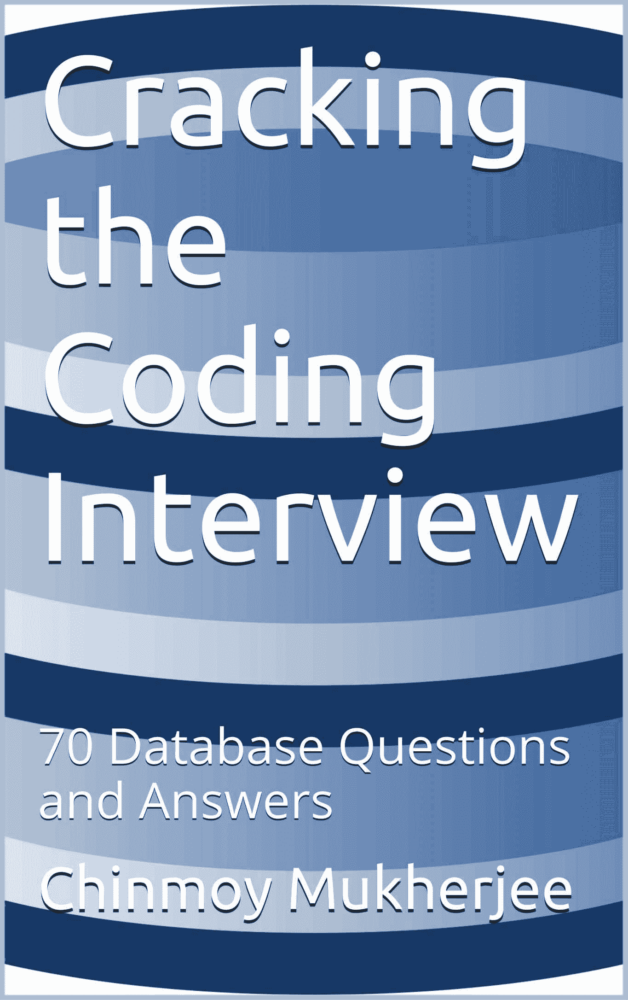
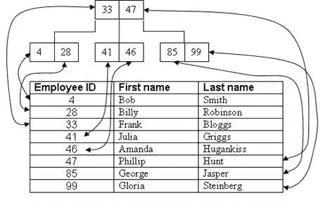

# 编码面试：60 道 Java 编程问题与答案（第 1 ）



本书献给所有数据库程序员。

# 引言

我们为读者准备了 70 道有趣的数据库面试问题和答案，以便他们练习并攻克任何数据库面试。鼓励读者在查看答案之前尝试自己解决这些问题。

## 数据库面试题 1：“索引（index）”有什么用？

答案：索引是物理磁盘中数据库记录的查找表。索引使记录搜索更快，它类似于书籍的索引。下图直观地解释了索引的概念。



## 数据库面试题 2：什么时候不应该使用索引？

答案：在以下情况下不应使用索引：

- 如果记录数量较少
- 如果记录每天需要进行更新/插入/删除
- 如果列值经常为空（`null`）

## 数据库面试题 3：`tempdb` 是什么？

答案：`tempdb` 是临时数据库，供所有用户/进程使用以维护临时表等。当数据库服务器重启时，`tempdb` 的内容会被清除。

## 数据库面试题 4：你如何找到数据库中存在的所有存储过程？

答案：

```sql
SELECT object_name, object_type
FROM user_objects
WHERE object_type = 'PROCEDURE'
```

## 数据库面试题 5：`TRUNCATE` 和 `DELETE` 有什么区别？

答案：`TRUNCATE` 删除表中的所有行。该操作无法回滚，且 `TRUNCATE` 不会触发触发器。

## 数据库面试题 6：`IN` 和 `EXISTS` 有什么区别？

答案：`EXISTS` 检查是否存在此类记录。例如：

```sql
SELECT * FROM Orders o WHERE EXISTS (
    SELECT * FROM Products p where p.ProductNumber = o.ProductNumber)
```

`IN` 用于在多个记录中查找某个记录是否存在。例如：

```sql
SELECT * FROM Orders WHERE ProductNumber IN (1, 10, 100)
```

## 数据库面试题 7：哪些数据库参数可以进行性能优化？

答案：缓冲池（Buffer pool）、日志级别（Log level）等。

## 数据库面试题 8：`bcp` 是什么？

答案：Sybase 中的 `bcp` 帮助将表拷贝到平面文件中，反之亦然。

## 数据库面试题 9：假设你登录了数据库 `DB1`。在 `DB1` 中运行什么查询来从另一个数据库 `DB2` 中的表 `table1` 获取数据？

答案：我们可以使用 `select * from DB2..table1` 或使用 `DB2;select * from table1`。

## 数据库面试题 10：哪些主要的开源数据库？

答案：PostgreSQL、MySQL 等。

## 数据库面试题 11：什么是视图（View）？

答案：视图是存储在内存中的 SQL 语句表示，以便方便地作为示例重用。例如：

```sql
CREATE VIEW [MyProductList] AS
SELECT ProductID,ProductName
FROM Products
WHERE Discontinued=No
SELECT * FROM [MyProductList]
```

## 数据库面试题 12：有一个表 `Employee`，包含两列——`Emp_Name` 和 `Office_Locations`。编写一个查询显示所有办公地点以及每个地点的员工人数。

答案：

```sql
Select Office_Locations, COUNT(Emp_Name) FROM Employee GROUP BY Office_Locations;
```

## 数据库面试题 13：编写一个查询获取既是经理的员工。

答案：

```sql
Select name from employees where id in (select manager from employees)
```

或者：

```sql
Select e1.name from employees e1 inner join employees e2 ON e1.id = e2.manager
```

## 数据库面试题 14：如何获取数据库名称？

答案：

```sql
select db_name();
```

## 数据库面试题 15：如何获取数据库版本？

答案：

```sql
select @@version
```

## 数据库面试题 16：如果表被截断（truncated），它可以回滚吗？

答案：不能。

## 数据库面试题 17：什么是聚集索引（clustered index）？一个表可以有多少个聚集索引？

答案：聚集索引根据索引对磁盘上的记录进行物理排序。因此，每个表只有一个聚集索引是可能的。

## 数据库面试题 18：`MINUS` 有什么用？

答案：`MINUS` 只从第一个结果集中返回不在第二个结果集中的结果。

## 数据库面试题 19：编写一个查询获取所有作为经理的员工。

答案：

```sql
select distinct e.name from employees e inner join employees m on e.id = m.manager
```

## 数据库面试题 20：编写一个查询获取所有员工。

答案：

（注：此处原文未提供完整代码，已按要求保留翻译结构。）

```sql
CREATE PROCEDURE GetEmployeenameEmailInOutputVariable
(
    @ID INT,                   --输入参数
    @NAME VARCHAR (200) OUT,    -- 用于收集名称的输出参数
    @EMAIL VARCHAR (200)OUT     -- 用于收集邮箱的输出参数
)
AS
BEGIN
SELECT @NAME= Firstname+' '+Lastname,
    @EMAIL=EMAIL FROM EMPLOYEE WHERE ID=@ID
END
```

## 数据库面试题 31：规范化的缺点是什么？

答案：数据库越规范化，需要的表就越多，连接（joins）就越多，获取所需记录花费的时间越长。

## 数据库面试题 32：编写 SQL 查询获取所有以“Shyam”开头的银行账户详情

答案：

```sql
Select * from account where name LIKE '%Shyam%';
```

## 数据库面试题 33：编写 SQL 查询获取余额最高的前 3 个账户

答案：

- SYBASE：

  ```sql
  select top 3 * from account order by balance desc;
  ```

- MYSQL：

  ```sql
  select * from employee order by salary desc limit 1,3
  ```

- Oracle：

  ```sql
  select * from employee order by salary where rownum < 3
  ```

## 数据库面试题 34：编写 SQL 查询获取余额最低的 3 个账户

答案：

- SYBASE：

  ```sql
  select top 3 * from account order by balance asc;
  ```

- MYSQL：

  ```sql
  select * from employee order by salary asc limit 1,3
  ```

- Oracle：

  ```sql
  select * from account order by balance asc where rownum<3;
  ```

## 数据库面试题 35：编写 SQL 查询更新所有账户余额以增加 6%的利息

答案：

```sql
UPDATE account SET BALANCE = BALANCE * 1.06;
```

## 数据库面试题 36：编写 SQL 查询查找整个银行的总余额

答案：

```sql
SELECT SUM(balance) AS total FROM account;
```

## 数据库面试题 37：编写 SQL 查询查找余额为 100000 的客户数量

答案：

```sql
SELECT COUNT(balance) AS "Number of customers" FROM account WHERE balance = 100000;
```

## 数据库面试题 38：编写 SQL 查询返回前 100 条账户记录

答案：

```sql
select top 100 * from account;
```

## 数据库面试题 39：编写 SQL 查询返回余额在 100000 到 200000 之间的客户数量并按余额分组

答案：

```sql
select balance, COUNT(*) from account where balance > 100000 AND balance < 200000 GROUP BY balance
```

## 数据库面试题 40：在 SQL 中，“子查询”还是“连接（join）”运行得更快？

答案：`Join`

## 数据库面试题 41：以下哪一个 SQL 子句用于对结果排序？

1. `SORT`
2. `ORDER BY`
3. `ARRANGE`
4. `SORTED BY`

答案：B

## 数据库面试题 42：FROM SQL 关键字用于：

A. 指定我们正在修改的表。

B. 指定我们要插入数据的表。

C. 指定我们从中选择或删除的表。

答案：C

## 数据库面试题 43：ACID 代表什么？

A. Access（访问）、Constraint（约束）、Index（索引）、Data（数据）。

B. Atomicity（原子性）、Consistency（一致性）、Isolation（隔离性）、Durability（持久性）。

C. Access（访问）、Consistency（一致性）、Isolation（隔离性）、Data（数据）。

答案：B

## 数据库面试题 44：以下哪一个 SQL 语句删除了 `SalesData` 表中的所有行？

A. `DELETE * FROM SalesData`

B. `DELETE FROM SalesData`

C. `DELETE SalesData`

D. `DELETE ALL SalesData`

答案：B

## 数据库面试题 45：以下哪一个 SQL 子句用于从 2 个或多个表中选择数据？

A. `HAVING`

B. `WHERE`

C. `JOIN`

答案：JOIN

## 数据库面试题 46：`INNER JOIN` 子句……

A. 返回连接字段上具有匹配值的所有行。

B. 返回两个表中的所有行。

C. 仅返回第一个表中在连接字段上与第二个表值不匹配的行。

答案：A

## 数据库面试题 47：`TRUNCATE TABLE`……

A. 检查表是否指定了主键。

B. 从表中删除所有行。

C. 删除该表。

答案：B

## 数据库面试题 48：表列也称为：

1. `Attributes`（属性）
2. `Fields`（字段）
3. `Records`（记录）

答案：B

## 数据库面试题 49：`UNION` SQL 子句可以与……配合使用

1. 仅 `SELECT` 子句
2. 仅 `UPDATE` 子句
3. `DELETE` 和 `UPDATE` 子句
4. 以上三者均不是

答案：A

## 数据库面试题 50：`HAVING` 子句只能与……

1. `JOIN` 子句。
2. `INSERT` 子句。
3. `SELECT` 子句。
4. `DELETE` 子句。

答案：C

## 数据库面试题 51：哪个 SQL 关键字用于仅检索唯一值？

1. `DISTINCT`
2. `DISTINCTIVE`
3. `DIFFERENT`
4. `UNIQUE`

答案：A

## 数据库面试题 52：以下哪项是正确的？

1. `TRUNCATE` 指定了主键。
2. `TRUNCATE` 删除所有行。
3. `TRUNCATE` 等同于 `DELETE`。

答案：C

## 数据库面试题 53：`FROM` 关键字指定：

1. `SELECT` 子句、`DELETE` 语句表。
2. 搜索条件。

答案：A

## 数据库面试题 54：`AS` 子句的作用是什么？

1. 用于对结果集中的列重命名。
2. 为派生列指定别名。

答案：A

## 数据库面试题 55：`UNION` 运算符作用于？

1. `UNION` 对结果集排序。
2. `UNION` 将多个查询的结果合并为一个结果集。
3. `UNION` 操作的行为与 `JOIN` 相同。

答案：B

## 数据库面试题 56：`UPDATE` 子句可以……

1. 一次更新一行。
2. 一次更新多行。
3. 一次删除一行。
4. 一次删除多行。

答案：B

## 数据库面试题 57：数据库哪些方面可以优化？

答案：

1. 内存：数据库缓存、重做日志、共享池。
2. 磁盘 I/O：数据库文件需要适当的大小和放置以最大磁盘子系统吞吐量。
3. 竞争：检查数据库锁、旋锁和等待事件是否可以消除。
4. 操作系统：监控 CPU、I/O 和内存使用率。

## 数据库面试题 58：检查数据库统计信息的命令是什么？

答案：

```sql
SHOW STATISTICS
```

## 数据库面试题 59：如何为表设置存储引擎？

答案：

```sql
SET storage_engine=MYISAM;
```

或：

```sql
CREATE TABLE test (id INTEGER) ENGINE = MYISAM;
```

## 数据库面试题 60：你执行过数据库优化任务吗？

答案：是的，请解释说明，例如你创建了新索引或在现有查询中添加索引以缩短“查询执行时间”。如果你在数据库领域工作，你必须给出一个真实的实例。

## 数据库面试题 61：如何查找服务器名称？

答案：

```sql
select @@servername
```

## 数据库面试题 62：主键可以为空吗？

答案：不能。

## 数据库面试题 63：创建一个包含 ID、名称和薪资的员工表，并在该表中插入 10 条记录

答案：

```sql
create table TEST(employeeid INTEGER, employeename VARCHAR(20), employeesalary INTEGER);
insert into TEST values(1,'A',1000);
insert into TEST values(2,'B',1000);
insert into TEST values(3,'C',1000);
insert into TEST values(4,'D',1000);
insert into TEST values(5,'E',1000);
insert into TEST values(6,'F',1000);
insert into TEST values(7,'G',1000);
insert into TEST values(8,'H',1000);
insert into TEST values(9,'I',1000);
insert into TEST values(10,'J',4);
```

## 数据库面试题 64：举例解释约束

答案：

```sql
Create table EMPLOYEE(
ID INTEGER,
NAME STRING,
SALARY INTEGER not null constraint check_salary SALARY ( > 0) and (SALARY < 1000))
```

回答：查询计划是获取与查询对应的记录所需的步骤集合。

以下问题留给读者作为练习。

# SQL 练习题

编写 SQL 查询以创建以下表：

- `Employee`（`ID`、`NAME`、`LOCATION`、`DEPARTMENT`、`BANKACCOUNTID`、`SEX`）
- `Bank Account`（`BANKACCOUNTID`、`OPENINGDATE`、`BALANCE`）

为 5 个部门（例如 `Finance`、`IT`、`Admin`、`Facility`、`Legal`）中的每个部门插入 5 名员工（男和女）的详情以及相应的银行账户详情。

## 数据库面试题

- **数据库面试题-65**：编写 SQL 查询以检索银行余额超过 10000 的所有员工。
- **数据库面试题-66**：编写 SQL 查询将所有女性员工的余额增加 5000。
- **数据库面试题-67**：编写 SQL 查询查找余额在 5000 到 1000 之间的所有男性员工人数。
- **数据库面试题-68**：将上述每个员工的余额增加 1000。
- **数据库面试题-69**：编写 SQL 查询以查找在财务部门的所有员工的总余额。
- **数据库面试题-70**：编写 SQL 查询查找按部门划分的员工平均余额。

# 结论

希望这本数据库面试题解答集能让你为下一次面试做好更好的准备。请每天花些时间编写新的数据库查询/存储过程。这将帮助你跟上数据库技术的发展。

# 关于作者

Chinmoy 是一位作家、创新者、企业家和解决方案架构师。他写过关于“软件技术”、“社会科学”和“成人着色书”的数十本书。他喜欢指导他人。请随时通过 `http://www.linkedin.com/in/chinmoym` 与他联系。
