# Java 代码面试破解：2500+ 面试题与答案

## 破解

## Java 编码

## 面试

## 200 个技巧与非技术面试题与问答

## 2000+ Java 问题与问答

> IT 经理 & 匿名黑客 @ 匿名国际组织

# ∞ 内部主题一览 ∞

## 前言 | ∞ 核心 Java 面试技巧—化繁为简！ ∞

# 第 1 章 | 面试迷思

### 要点总结

# 第 2 章 | 说服他们 | 你适合这份工作

### 要点总结

# 第 3 章 | 你能胜任这份工作吗？

### 要点总结

# 第 4 章 | 你应对新任务的潜力

### 要点总结

# 第 5 章 | 雇主喜爱 | 积极主动的员工

### 要点总结

# 第 6 章 | “五大”问题

### 要点总结

# 第 7 章 | 建立关系与信任

### 要点总结

# 第 8 章 | 常见问题的 10 个有效回答

### 从书中需要记住的九个关键要点

## 苹果面试

## 谷歌面试

## 微软面试

## 雅虎面试

## 脸书面试

## 面试常见问题解答 - I

## 如何准备技术面试题

## 处理技术问题 | 技术面试题通用建议

## 候选人常犯的十大错误

## 针对软件测试工程师（SDETs）的特别建议

## 16 个最能体现水平的面试题

# 第一部分

# 第二部分

# 第三部分

## 10 道高级核心 Java 面试题 | 针对高级和经验丰富的程序员

## 第四部分 | Top 50 Java 多线程与并发面试题答案 | 针对应届生、经验丰富的程序员

## 第五部分 | Java 多线程与并发 | 面试题及答案

## Java 并发面试题答案

## 40 道 Java 集合面试 | 问题与问答

## 异常面试 | 问题与问答

## 随机脑风暴 | 201 道核心 Java 面试题

## 核心 Java - OOP 概念：| 初级 OOP 面试题

## 核心 Java - OOP 概念：| 构造函数面试题

## 核心 Java - OOP 概念：| static 关键字面试题

## 核心 Java - OOP 概念：| 继承面试题

## 核心 Java - OOP 概念：| 方法重载面试题

## 核心 Java - OOP 概念：| 方法重写面试题

## 核心 Java - OOP 概念：| final 关键字面试题

## OOP：多态、抽象 | 以及包面试题

## 核心 Java - OOP 概念：抽象面试题

## 核心 Java - OOP 概念：| 包面试题

## Java 异常与字符串 | 面试题

## 核心 Java：字符串处理面试题

## 核心 Java：嵌套类与接口面试题

## Java 垃圾回收、I/O 流、序列化 & 网络面试题

## I/O 面试题

## 序列化面试题

## 网络面试题

## 反射面试题

## Java 杂项、AWT 和 Swing 面试题

## AWT 和 SWING 面试题

## Java Bean 面试题

## RMI 面试题

## Java 多线程 | 面试题

## 20 Java 集合 | 面试题

## JDBC 面试题

## 第六部分 | 开发者的 Java 8 特性 | Lambda、函数式接口、Stream 和时间 API

## 核心 Java 面试脑风暴 | 问题与答案

## Java 字符串 | 面试题答案

## 最后的交易 - 现在踢掉 Java | 并告别 Java.. 

## 面试题

### Java 高级编码标准

> 要做与不要及可维护性

作者注：我们已尽可能确保书中包含的信息是准确的，出版商或作者不接受因依赖书中信息导致的任何损失、失望或其他损害。书中提及的公司、组织、产品、域名、电子邮件地址、标志、人物、地点和事件均为虚构。无意或不应暗示与任何真实的公司、个人或实体有关。本书仅代表作者的观点和意见。作者、出版商及其分销商对因本书直接或间接引起或声称引起的损害不承担责任。

版权所有 ©2014 作者 Harry

第一版出版：2010- Harry & Associates & Createspace O-D-, LLC USA。

第二国际版：2014- Harry & Associates & Createspace O-D-, LLC USA。

保留所有权利。未经作者 Harry 书面许可，不得以任何方式复制或使用本书的任何部分，但在书评或学术期刊中使用短引除外。

ISBN 13: 978-1500714949 第二版 2014-15

ISBN 10: 1500714941

由 Createspace Inc. O-D Publishing LLC- USA 打印并出版。

由 Amazon Inc. & LuLu.Com 以及全球 1500 家书店营销和发行。LuLu.com & Amazon.com 提供纸质平装版；Google Books、Google Play Store 和 Lulu.com 提供优惠折扣的数字 PDF 版。销量超过 100000 册。

---

## 献辞

“本书献给所有做出日常牺牲的人，特别是那些为了确保我们的自由与安全而做出牺牲的人。”

你告诉过我，一切都会好起来；你还告诉我，如果现在还不好，说明还没有结束。


“我会穿越 1000 个世界、10000 世去寻找你，直到找到你”

## 关于作者

Harry 是一位匿名黑客行动主义（Hacktivist）、世界著名的计算机程序员、畅销版 Java 书籍作者以及科学黑客专业人士。他在计算机编程、黑客技术和网络安全领域拥有独特的经验。

他曾帮助过全球许多国家的政府和许多跨国软件公司保护其网络和安全。他编写了多本关于各种计算机编程语言以及计算机安全与黑客技术的书籍。他最广为人知的是国际畅销编程书籍《Core Java Professional》。

他在技术上是研究生毕业的软件工程师和硕士。他是 `C` 编程、`C++` 编程以及 `Core Java` 和数据结构与算法领域的领先权威。他广受赞誉的著作包括 `C`、`C++`、`C#` 和 `Java`。他拥有超过 5 年的软件方法论专家经验。他的教学和研究兴趣领域在人工智能和编程语言。

他过着两种生活。一种生活中，他是一家知名软件公司的计算机程序编写员；另一种生活在计算机里，他以黑客代名“Harry”行事，并犯了几乎所有的计算机犯罪。目前，他在著名的匿名国际社区 Anonymous International Community 担任线下 IT 经理 -Anonymous 团队。

## 作者自白

你可能注意到这里缺少了一些东西：没有令人印象深刻的资历。我没有在某著名大学担任过四分之一世纪的教授；也不是硅谷巨头公司的高管。在某些方面，我只是一个技术的学生，就像你一样。

多年来的经验告诉我，许多最了解技术工作原理的人，在解释他们所知的内容并使我理解的方式上，成功率相当有限。我的兴趣，我相信我的技能，并不在于成为专家，而在于成为一名教育者，以一种合逻辑、易于消化且读起来有趣的形式呈现复杂信息，这就是我的书。

“什么是真实？你如何定义真实？如果你说论的是你能感受到的、能闻到的、能尝到的和看到的，那么真实仅仅是你的大脑解释的电信号。”

“……我现在才开始发现在纸上表达想法是困难的。只要它只包含描述，就非常容易；但当推理介入，去建立恰当的联系、清晰度和适度的流畅性时，对我来说，正如我所说的，这是一个我完全没有察觉的困难……”

– Harry.

# ∞ 内部主题一览 ∞

| 单元 | 书中包含章节与主题 | 页码 |
| :--- | :--- | :--- |
| 01. | 前言，等一下！先读它！它对你有帮助！ | 007. |
| 02. | 面试迷思。 | 011. |
| 03. | 说服他们你适合这份工作。 | 019. |
| 04. | 你能胜任这份工作吗？ | 029. |
| 05. | 你应对新任务的潜力。 | 043. |
| 06. | 雇主喜欢积极主动的员工。 | 049. |
| 07. | “五大”问题。 | 055. |
| 08. | 建立关系与信任。 | 063. |
| 09. | 针对常见问题的十个有效回答。 | 093. |
| 10. | 苹果公司面试。 | 105. |
| 11. | Google 面试。 | 107. |
| 12. | 微软公司面试。 | 108. |
| 13. | Yahoo 面试。 | 109. |
| 14. | Facebook 面试。 | 110. |
| 15. | 面试常见问题 (FAQ’S) - I | 111. |
| 16. | 如何准备技术面试题。 | 115. |
| 17. | 以简单的方法处理技术题。 | 117. |
| 18. | 应聘人犯的十大错误。 | 121. |
| 19. | 16 个最能体现信息的面试题与答案。 | 125. |
| 20. | Java 面试题答。350+ Q/A (PART-1) | 129. |
| 21. | Java 面试题答。350+ Q/A (PART-2) | 203. |
| 22. | Java 面试题答。250+ Q/A (PART- 3) | 249. |
| 23. | 资深程序员的 10+ 高级 Java 问答。 | 286. |
| 24. | Java 随机合一问答 50+ Q/A (PART- 4) | 293. |
| 25. | Java 随机合一问答 250+ Q/A (PART- 5) | 308. |
| 26. | Java 并发面试题答 | 315. |
| 27. | Java 集合面试题答 40+ | 317. |
| 28. | Java 异常面试题答 15+ | 334. |
| 29. | Java 面试脑筋问答。201+ Q/A (PART- 6) | 340. |
| 30. | 开发者 Java 8 特性 – Lambdas。(PART- 7) | 369. |
| 31. | Java 8 函数式接口、Stream & Time API。(PART- 8) | 369. |
| 32. | Java 随机脑力训练题答 50+ | 407. |
| 33. | Java 随机字符串题答 20+ | 424. |
| 34. | 最后踢踢 Java 并说再吧…… | 431. |
| 35. | Java 代码规范（高级） | 445. |
| 36. | Java 代码清晰度/可维护性/ | 452. |
| 37. | Java 数据库问题/分析。 | 466. |
| 38. | 图片与图表的着装/体态指南。 | 471 |

---


# 前言

# ∞ 核心 Java 面试技巧——轻松学会！∞ ∞

## 请稍等！

我知道很多人不读前言，但如果你真的想攻克代码面试，那么我强烈建议你也读一遍前言以及每一页的每一行。之所以这样做，是因为前言提供了与众不同的内容。

本面试书的主要目标不仅仅是给你提供神奇的面试题和技巧，我遵循了一种模式，即通过对每个面试问题提供不同复杂程度的深度问答解释，来提高解题的质量，你将为复杂的面试题找到多种解决方案。我提到了大约 2000+ 个 `Java` 技术题，以及针对面试技术轮之前的非技术题。

### 特别之处

在本书中，我为开发者和新手详细涵盖了最新的 `Java 8` 特性，例如 `Lambdas`、`Java 8 函数式接口`、`Stream` 和 `Time API`。

作为一名求职者，如果你能认真并深入地读完这本书，我 101% 确定你能挑战任何面试和面试官（尤其是 `Java` 面），这就是本书的目标。这本书包含了两千多个 Java 技术问题和 200 多个技术轮次之前的非技术问题。

这本书对于 IT 专业人士以及工程学位和硕士的学生在校招和学术准备期间非常有用。如果你是正在准备计算机科学或信息技术面试的学生，本书的内容涵盖了所有要求的主题。在编写这本书时，特意关注并帮助了准备此类技术面试的学生。

- 当你准备面试时，请考虑以下建议：

### 始终在纸上写你的代码

大多数面试官不会给你提供电脑，而是要求你在白板或纸上书写代码。为了模拟这种环境，请尝试先在纸上写代码来回答问题，然后原封地将它们输入到电脑中。白板/纸上写代码是一项特殊技能，通过不断的练习就可以掌握。我的意思是，假设你的想法是面试官，而你的大脑是编译器。就这么简单。

## 首先，了解你的简历

首先，我想和你们分享一些你们不知道的重要事情。我说的是区别！是的，`CV`（简历/学术简历）与 `Resume`（简历）之间的区别。`Curriculum Vitae` 是由寻找工作的毕业生或学生准备的文档。它提供了学生的学术细节；另一方面，`resume` 是由经验丰富的专业人士准备的，强调工作历史、在职技能和经验。

虽然技术技能至关重要，但这并不是忽视你自己简历的理由；确保你已经准备好能够对你参与过的任何项目或工作进行简要总结。

## 并且背诵答案

虽然这本书提供了一些具有代表性的面试题，但世界上仍然有成千上万的面试题。背答案并不是浪费时间的好方法。相反，利用这本书来探索解决问题的方法，学习新概念并练习你的技能。

## 所以，大声说出来

面试官想了解你的思考和解决问题的方法，因此在解决问题时要大声说出来；让面试官看到你是如何处理问题的，他们可能还会引导你。

## 最后记住——面试是困难的！

在我在 `IBM` 面试的多年里，我看到一些面试官会问“简单”的问题，而另一些人问更难的问题，但你知道吗？得到简单的问题并不会让获得 Offer 变得更容易。获得 Offer 不是要完美无缺地解决问题（极少数候选人能做到这一点！），而是要比其他候选人更好地回答问题。我为你们以及你们即将要开发的技能感到振奋。充分的准备将带给你广广泛的技术和沟通技巧。无论这些努力将带你走向何方，都是值得的！

对于初级工作，IT 行业要求具备良好编程能力（尤其是世界上最需求的 `Java` 语言）和问题解决能力的学生和年轻专业人士。对于需要编程技能的大多数 IT 公司都在寻找良好的 `C`、`C++`（较少）以及特别优秀的 `Java` 编程技能的候选人。

## 最后的关键点

那就是 `java` 编程技能对于现在 IT 公司的几乎任何软件相关工作都是至关重要的（特别是 `Apple`、`IBM`、`HP`、`HCL`、`MICROSOFT`、`INFOSYS`、`ACCENTURE`、`FACEBOOK`、`GOOGLE`、`YAHOO` 等）。

## 关于编程

市场上有很多书籍，但大多数是关于不同编程语言的教程或教材。

仅仅通过阅读这些书籍中的任何一本或编写几段程序来通过 IT 面试是非常困难的，这很容易让人怀疑你是不是这个世界上最疯狂的程序员。

每个 IT 面试都关注从编程角度解决问题的能力，因此问的问题与教科书中涵盖的内容大不同，因为教科书只涵盖教学问题和答案，旨在教你如何编写简单的程序。

## 目标读者群

这本书专为参加软件公司校园招聘或线下面试的学生、程序员及软件专业人士设计，目标是帮助他们通过笔试和面试。

IT 公司的校园招聘通常包括笔试和面试。在涉及 `C`、`C++` 和 `Java` 的客观题笔试中，他们想检查学生或专业人士是否了解编程概念的基础，并具备基础的编程和问题解决能力。

### 作为软件专业人士或学生

通过阅读这本书，你可以轻松攻克笔试和面试。在书中，我使用了 `Java` 编程的各个方面，包含了两千多个问答，包括十张关于面试着装的高清图片——着装得体（Dress Appropriately）、肢体语言以及常见问题解答（FAQ'S）等。

### 另一方面

对于经验丰富的软件程序员来说，与针对应届生的笔试/面试有很大不同。除了极少数情况外，优秀的 IT 公司不会对有相关工作经验的程序员进行笔试。

面试旨在评估候选人在编程方面的实践经验，以及他们解决日常编程和项目中所遇到的问题的能力。编程逻辑题和谜题也比问学生的问题复杂得多，最后程序员在准备此类工作面试时可以从书中受益。这本书确实是一本关于 Java 面试的佳书，其他章节也专注于于多个与面试相关的准备。

“石头是被最后一击锤击碎的。这并不意味着第一击是没用的。成功是持续努力的结果……！！！所以，站起来，要勇敢，要强大。把所有的责任扛在自己肩上，并且你知道是你自己命运的创造者。”


# 第 1 章：面试神话

人们在面试中失败的一个重要原因是由于对面试过程中真实发生的情况的误解或神话。我们都知道，面试的目的是让面试官招聘一个能够在特定工作中表现良好的人，但除此之外，很少有人完全理解面试是如何运作的，以及是什么让一个候选人比其他人脱颖而出。

这种理解的缺乏是坐在面试官面前努力给出最佳答案时，表现最大化的主要障碍。

面试与生活中的其他努力并无异：你越了解它们是如何运作的（或不运作的），成功的概率就越高。理解大多数面试中固有的内在机制是提高你面试表现的重要开始。

## 神话 1：最合适的人会获得职位

有时这是事实——特别是在每个人互相认识的情况下，例如公司进行内部招聘时。然而，情况通常并非如此。为了让最合适的人赢得职位，需要许多非常重要的因素到位（即使如此，也没有保证）。

这些包括：

- 面试官知道问什么问题，以及如何寻找答案的真实性。这两点听起来可能很简单，但我可以向你保证，大部分面试官没有接受过培训，缺乏面试经验，而且往往甚至不花精力准备面试。
- 面试官不会被被面试者的魅力、外貌、幽默感或其他任何方面所吸引。这对于经验丰富的面试官来说也是一个困难的障碍。
- 被面试者学会了如何清晰地表达自己的技能、主要成就以及他们如何为组织创造价值。
- 面试官和被面试者之间没有性格冲突。
- 双方都没有心情不佳的日子。

一些雇主（通常是那些在过去雇佣错人而吃过大亏的人）会竭力建立专业的招聘程序，旨在最大限度地减少招聘错误。虽然这些程序中的一些在改进候选筛选方面是有效的，但它们不能保证最合适的人实际上会赢得职位。


归根结底，为工作选择人意味着至少由一个人对另一个人做出决策。无论我们如何努力消除主观性，作为人类，我们都不可能抛弃自己的倾向、偏好和个人喜好——无论我们多么如何尝试。

在理想的世界里，最适合工作的人总能赢得它；然而，现实情况是，往往是面试中表现最好的人赢得了机会。这里的重要教训是：

- 如果你知道比你更适合这份工作的人也在申请，不要自动放弃申请。如果你花精力为面试做好充分准备，那么你很有可能被视为首选人，特别是当对方认为面试是理所当然且没有准备时。
- 如果你恰好知道自己是这份工作最合适的人，要避免把面试视为理所当然。表现得就像你确实是最佳人选一样。

### 误区二：面试就像考试：准备得越充分，表现就越好

是的，面试确实像考试，但有一些关键区别。在考试中，通常有一个标准答案，但在面试中，往往有多个正确答案。在考试中，人们根据你的知识水平进行评分；但在面试中，你的性格和沟通能力也会受到评估。

在考试中，你有有限的时间来回答问题，但在面试中，你可以花费任何需要的时间。在考试中，你是在面对试卷回答；但在面试中，你是在面对一个人回答。

尽管有这些相似之处，面试并不完全像考试。在考试中，你和自己的想法相处；但在面试中，你必须与他人互动。在考试中，测试的是你知道什么；但在面试中，测试的还是你能做什么。

### 误区三：面试的目的是建立关系，而不是展示技能

面试确实关乎建立关系，但也关乎展示你的技能。与面试官建立联系很重要，但证明你有能力胜任工作也同样重要。

如果你只专注于建立关系，你可能无法获得工作，因为你没有展示出自己具备必要的技能。如果你只专注于展示技能，你可能无法获得工作，因为你没有与面试官建立起联系。

关键在于两者之间找到平衡。你应该尝试与面试官建立关系，但同时也应该确保证明你有胜任该工作的能力。

### 误区四：说“不知道”比编造答案要好

说“不知道”比胡造答案要好。如果你编造答案，面试官很可能会看穿你，这会损害你的信誉。如果你说“不知道”，面试官会欣赏你的诚实。

然而，如果你说“不知道”，你还应该解释你会如何找到答案。例如，你可以说：“我不确定，但我可以查一下并在明天之前回复你。”这向面试官展示了你是一个积极主动并愿意付努力的人。

### 误区五：长得好看的人获得工作

长得好看可能有略微优势，但并不是最重要的因素。最终，你的技能、经验和性格才是最重要的。

如果你不是特别得看，不要让这让你感到沮丧。专注于提升你的技能和性格，你更有可能获得这份工作。

因此，不要仅仅将面试看作是回答正确的问题。面试也关乎建立关系和信任，虽然建立这种关系没有万无一失的方法，但你可以做一些事情（以及你不应该做的事情），这些事情将极大地提高你在面试这一至关重要领域的技能。

## 第 7 个误区：你应该尝试给出一个完美的答案

我听过太多人说话结结、重复自己的话并在逻辑上兜圈子，因为他们正试图表述出一个完美的答案——或者他们认为构成完美答案的回答。

有些人如此痴迷于给出完美答案，以至于在没有产他们看来完美无缺的回答之前不停止。因为我们永远无法完全确定面试官想听什么，我们中的一些人会一直说下去，希望能够涵盖所有方面。这种方法存在的问题在于，我们最终话得太多了，导致面试官失去注意力，而这当然是你面试中最不希望出现的情况。

现实是，在大多数情况下，并没有所谓的完美答案。这里的教训是：接受一个直击主题的良好答案，远比到处乱撞去寻找那个摸不可及的完美答案要明智得多。

## 第 8 个误区：你必须提问来展示你的兴趣和智力

许多面试者持有一种错误观念，认为他们必须在面试结束时提问。许多面试者之间似乎有一个共同的信念，认为这会让他们看起来更聪明，而且对工作更感兴趣。

事实并非如此。为了提问而提问并不会增加你获得工作的机会。这甚至可能让你听起来有点呆板，尤其是当你问的问题在面试过程中已经涵盖过时。

只有当你有真正的疑问时才提问。可以接受的问题包括与你申请的职位直接相关的问题，以及工作条件公司对薪资、假期等这些方面的政策。面试官从不介意回答此类事项的问题，但他们介意回答他们认为无关的问题。

如果你没有问题要问，只需简单说如：“谢谢，我没有问题了。在面试过程中您描述得非常详尽，涵盖了关于工作的所有重要事项。”对面试官的周全和专业表现给予赞美并没有错——只要这不过过分，或者听起来不像是在卑躬奉承。

关于提问，还需要另外两点。首先，避免问得太多问题。总的来说，面试官并不喜欢角色反转。其次，永远不要问可能导致尴尬的问题。这些可能包括：

- 涉及负面事件的问题；
- 不应该出现在公共领域的内容；
- 可能让面试官感到为难的挑战性问题。

经验之是：如果你认为一个问题可能会导致尴尬，请宁可信其谨慎并避免它。

## 第 9 个误区：放松，做你自己就好

虽然放松并展现你较好的一面很重要，但理解面试并不是社交活动同样重要。大多数面试都是高度形式化的活动，在其他无害的行为会被视为不可接受的。

简而言之，表现出本色可能会导致灾难（尽管这听起来很矛盾）。例如，如果做你自己意味着后靠在椅子上、穿得有些邋遢并开玩笑，那么你可能会发现自己参加了数量巨大的面试。

虽然面试官喜欢人们放松，但他们对面试中哪些行为是适当的明确期望，违反了这些期望，后果自自负！

## 第 10 个误区：面试官在寻找缺陷

这个误区的危险在于，它很容易导致面试者在面试期间采取防御性的、甚至是不信任的态度。

如果你认为面试官在刻意搜寻你的缺陷，这很可能会破坏你建立那种至关重要的关系和信任的努力。

它也可能阻止你敞开心扉并给出非常好的答案。请放心，大多数面试官准备面试问题并不是为了发现你的缺陷。准备问题大多是为了让面试官对你能够为公司提供什么有一个整体或综合的洞察。一个优秀的面试官确实会发现你你不擅长的领域，但这与认为面试官一心只想发现你的缺陷完全大相径庭。

将每一个问题都视为一个脱颖而出的机会，而不是不必要的戒备，是非常重要的。只有通过回答问题，你才能证明自己有多优秀。将问题视为怀疑的对象完全没有意义。

理解围绕面试的误区将为你成功提供一个良好的开端。记住，面试与生活中的其他努力没有区别：你对它们的本质理解得越深，成功应对的可能性就越高。对常见面试误区的见解将为你提供所需的信息，防止你掉入那些令人沮丧的陷阱。

同样重要的是，对面试真实本质更清晰的认识能更好地指导你的后续准备，并有助于你的信心和表现。

# 核心要点总结

- 最适合工作的人并不一定能赢得它——通常是面试表现最好的人赢得。
- 面试不仅仅是给出技术上正确的答案。它们也很大关乎建立关系。
- 并不是所有的面试官都清楚自己在做什么；你的任务是学会如何应对优秀的和糟糕的面试官。
- 诚实并承认无知，比试图假装知道答案而表现得不真诚且不聪明要好。
- 长得好看的人赢得工作——也许在好莱坞电影里如此，但总的来说，雇主更热于招聘人才而非外表因素。
- 努力给出完美答案可能会带来麻烦。接受一个直击主题的良好答案比寻找完美要好；此外，通常没有所谓的完美答案。
- 不要为了提问而提问。只有当你有未涵盖的真实疑问时才提问。
- 面试是要求相对正式的行为的场合。面试官期待这些，如果他们没有看到会产生负面反应。
- 面试官不会花所有时间寻找你的缺陷。他们更有兴趣获得关于你的一个整体画像。避免防御性地回答问题。将每个问题都视为一个展示你优点的机会要好得多。

我们所有人都在曾在面试中犯过错误，而且我们大多数人在走出面试室时，脑子里都在想着那些忘记提到的精彩事，以及那些本不该说的话。但错误最重要的一点在于从中学学习，而不是重复犯错。以下是一些常见的面试错误：

- **未能清晰地表达自己。** 通常，由于焦虑和想要把话说得完美，我们过度努力，将本该简单的句子变成了晦涩的言乱语。简单的语言总是是最有效的。避免试图通过使用专业术语或复杂的句子来让自己显得很有学问。
- **没有意识到肢体语言。** 许多面试者成功地疏远了面试官，是因为他们很少关注关注自己的肢体语言。肢体语言是一种极其强大的沟通工具，未能有效利用它几乎会使你处于巨大的劣势。眼神交流、坐姿和面部表情都是面试非常重要的方面，需要在面试前深思熟虑。
- **未能控制紧张情绪。** 有时候人们会让紧张完全失控，以至于无法建立共鸣甚至忘记了自己的答案。

在面试之前和期间感到紧张是很常见的。事实上，有一点紧张是一件好事。但没有必要成为这种虚弱神经的受害者。当你阅读这本书时，你将逐渐学会如何减轻焦虑。

- **未能提供恰当的例子。** 不提供例子或提供不恰当的例子将导致灾难。在面试之前，想好你所成就的相关案例，以及你是如何实现这些成就的，是非常重要的。

说你成就了什么却无法用具体的例子来支撑，只会让你得到一封拒绝信。你的例子需要易于理解、遵循逻辑顺序，并与雇主的需求相关。如果没有准备，这一切都不可能发生。

- **过于刻意讨好面试官。** 虽然在面试过程中建立共鸣和信任至关重要，但很少有面试官欣赏面试者表现过度的行为。谄媚的行为通常被视为一种欺骗的形式，且几乎没有分量——事实上，它们会破坏你努力建立信任的努力。

## 你没有问题

你可能至少犯了上面列出的某些错误。要意识到犯这类错误是很常见的，这一点非常重要。换句话说，你并没有问题。在绝大多数情况下，面试表现不佳是因为面试的本质——面试过程才是罪魁祸首。

因此，对面试的基本本质有意识，是显著提高你表现的第一步。一个很好的起点是问：“要做到什么才能说服面试官你是担任这份工作的最佳人选？”这个问题的答案可以最好地总结为四个部分：

- 正确的准备；
- 了解面试官在乎的事；
- 练习你的答案；
- 坚持。

## 正确的准备

你在面试中的表现如何，很大程度上取决于你准备得有多充分。没有正确准备几乎意味着你无法发挥出最佳水平。在某些情况下，这意味着表现非常糟糕，这可能导致你信心的侵蚀。

即使你幸运地成为了青睐的候选人，几乎确定只要出现就能赢得职位，你仍然应该花时间准备，因为你表现得越好，谈出更高薪水的可能性越大，而且金上的差异往往是巨大的。

我们都听过人吹嘘说他们从未为面试准备过，而且过得很好。虽然这种吹嘘可能不是空穴来风，但仔细观察通常会发现这些人：

- 幸运——也就是说，在正确的时间出现在正确的地点；
- 人脉广；
- 在一个有利的劳动力市场中工作，那里对员工需求巨大而供应匮乏；
- 申请的工作完全在他们的舒适区内——也就是说，没有为了提高自己的而挑战自我；或
- 申请的是内部职位，主要的竞争对象是外部候选人。

### 准备的理由

当你对面试的基本本质进行一些思考时，面试准备的论点就变得非常有说服力。

你不仅被要求在竞争环境中推销自己，还被要求将大量且往往复杂的信息压缩成整洁且表达清晰的答案，这些答案要避免任何负面内涵，并包含面试官想听到的信息。

人们的压力水平增加这并不奇怪。但并不仅于此。还有三个额外的理由让面试准备的必要性变得更具说服力：

- 面试是稀有的事件，因此使人们感到既陌生又尴尬。
- 许多人发现自己在面试中推销自己非常困难，因为他们受到了家庭和社会的 conditioning，被教导不要自夸自大（吹牛）。做出诸如简单的陈述，如“我非常擅长推销 xyz”，可能是一个难以逾越的障碍。
- 在大多数面试中，获得第二是不够的。这不仅关乎表现良好，还关乎击败所有人。难以想象，你竟然不会为一个发生频率低、具有竞争性且需要平时不使用的行为的活动做好准备。然而，这正是人们在没有准备的情况下进入面试间时所做的事情。

### 什么是错误的准备？

错误的准备是指任何不能优化你面试表现的准备。死记硬背别人准备的通用答案价值有限。

在最好的情况下，它们能让你对可能构成好答案的内容有所洞察；最坏的情况下，它们只会误导你。重要的是理解，在绝大多数情况下，问题并没有所谓的“标准答案”。对于一个雇主来说可能是完美的答案，对于另一个雇主可能被认为非常平庸。

你能做的最糟糕的事情之一就是背诵别人的答案并在面试中重复它们。重复别人所谓的完美答案会让你听起来不真诚，并在被问追问性问题时显得很滑稽。准备你自己的答案要有意义得多。

#### 准备的优势

花时间为面试正确准备将：

- 提高你的信心水平；
- 协助你简洁地回答问题，而不是花长时间表达一个简单的观点；
- 帮助你知道说什么以及如何说；
- 协助你处理困难的问题；
- 帮助你避免说出留下不利印象的话；
- 提高你建立关系的能力。

## 了解面试官在乎的事

了解准备什么的关键之一在于理解面试官的需求。一旦你知道了面试官在乎的事，面试准备突然变得清晰得多，更容易管理。

绝大多数面试官——无论他们是否意识到——都想从你那里听到三件事。事实上，几乎所有的好的面试问题都可以归结为这三个关键的通用问题：

### 三个核心通用问题

- 你能胜任这份工作吗？换句话说，你是否具备在该工作中表现优异的技能、知识、经验或潜力？大多数面试官会在面试的大部分时间在这个问题上对你进行探测。他们想知道你做过什么、是如何做的以及结果如何。如果你没有履行过某项特定职责，他们会尝试确定你从事该工作的潜力。
- 你是那种能与他们一起工作的人吗？这个问题的另一种表达方式是：你会融入组织现有的文化吗？或者，对于小型组织来说：你能和老板相处好吗？虽然面试官通常在这个问题上花费的时间要少得多，但这仍然是一个至关重要的问题，因为没有人想和自己不喜欢的人一起，即使他们能胜任这份工作。
- 你的积极性如何？换句话说，你为这个职位带来了什么样的能量水平和动力？你可能甚至不会被问及你的积极性水平，但如果不处理这个问题，后果将自负。正如我们所知，积极性极高的员工深受雇主青睐——这这有其道理。

知道面试官对这三个通用问题非常感兴趣，并且他们能提出的绝大多数问题都属于这一个或多个类别，具有两个显著的好处。首先，它指导你准备答案（本书的很大一部分就是基于回答这三个核心问题）。与其花费大量时间在随机选择的问题中挣扎并希望你已经准备了正确答案，不如理解这三个核心通用问题的意义，为你的准备提供方向和平台。简而言之，你能够围绕以下问题规划你的准备工作：

- 你的技能、知识和经验——你能胜任这份工作吗？
- 你的个人特质——你是那种能与他们一起工作的人吗
- 你的积极性水平。

其次，它为处理实际面试中的问题提供了一种有用的方法。通过将面试问题分类为三个通用问题类别中的一个或多个，你的答案将获得额外的结构和更明确的方向，仅仅因为你知道了这些问题的底层目的。

通过学习如何识别问题的真实意图，你可以最大限度地减少给出错误答案和或胡言乱语的机会。

### 练习

说服面试官你是这份工作的最佳人选的第三方面是练习。遗憾的是，培养优秀的面试技巧没有捷径。

一旦你准备好答案，你就需要坐下来尽可能地练习它们。练习得越多，你的表现就越好。正如老话所说，“成功三分才华，九分努力”。你如何练习取决于你自己。可以在镜子前做、坐在沙发上做、在房间里走动或开车时做，但要避免在老板面前练习！

#### 大声练习你的答案

大声练习答案是重要的，而不是仅仅在脑子里演练。这是因为人类大脑区分说话和思考，你需要刺激大脑中负责说话的部分。面试时在脑子里想答案将一事无成，除非面试官是个读心者。

### 获取一些反馈

理想情况下，你应该在真实的面试中进行练习。参加的面试越多越好——即使你必须参加一些你实际上并不感兴趣的工作的面试。面试结束后——假设你不是胜出的候选人——回给面试官并请求对你的表现提供反馈。

有些面试官乐意提供这种反馈；但许多人宁愿这样做，因为他们觉得这具有威胁性并且浪费时间。这些人要么会完全避开你，要么给你提供如此被淡化的反馈，使其几乎毫无用。

在某些情况下，你可能无法解决这个问题；但是，你可以通过让面试官感到尽可能舒适来增加获得诚实反馈的机会。

你可以通过以下方式做到：a) 向他们保证你只需要他们五分钟的时间；以及 b) 告诉他们你寻求反馈的唯一目的是提高未来的面试表现。

### 模拟面试

如果你无法参加你想要的那么多的面试，那么与你可以合作的人一起建立模拟面试是一个好主意。你模拟真实情况越越近，你获得的益处就越多。

进行模拟面试的一种有效方法是进入角色并在整个面试过程中保持住。不要干扰，不要闲聊，特别是不要重新开始。如果可能，避免给你的助手提供问题，让他们自己想问题。

如果你的助手无法做到这一点，就给他们很多问题，并让他们选择他们想要的。对你来说，重要的是让自己习惯于回答意料之外的问题。

此外，如果你觉得你的助手可以对你的表现提供诚实的反馈，不要羞于提问。你永远不知道可能会学到什么。通常情况下，小细节决定了巨大的差异。但要警惕过度积极的反馈。很有可能你的助手是一个朋友，而朋友一以避开负面意见而闻名。

### 坚持

当你着手提高面试表现时，能做的最糟糕的事情就是放弃，因为一切看起来都太难了。放弃者注定一无所获。他们得不到好工作，也建立不了伟大的事业。相反，那些坚持的人往往能获得宝贵的见解，仅仅因为他们有体力坚持下去。

我们最钦佩的人往往是那些面对看似不可逾越的障碍，却并没有放弃，而是静静地决定克服它们的人。硬币的另一面，我们通常最不尊重的人是那些永远开始却从不完成的人。

他们往往是那些夸大其词但最终收获极少或毫无收获的人。经常放弃者身上的一个共同特征是自尊心低，他们并不相信自己。如果你自己都不相信自己，别人通常也不会相信你——当你试图说服面试官相信你的能力时，这不是一个好的处境。

这些人经常被听到说诸之的是：“太难了”、“我学不会”、“别人会怎么想”等。他们往往也是那些总是抱怨事情但似乎从未采取行动来纠正它们的人，因为总有借口。不必成为经常放弃者或深受低自尊负担也会放弃提高面试技巧，可能有许多其他原因。

然而，如果你正在读这本书，很有可能提高面试技巧是你生活中的一个重要事项，因此不应该轻易放弃。如果你觉得自己可能是那些正站在放弃边缘的人之一，这里有一个小练习可以帮助你从边缘后退一两步。

#### 建议活动：神经语言程序

基于神经语言程序（`NLP`），这项练习旨在影响你的感受。人们经常放弃是因为他们将正在做的事情与负面情绪联系在一起。坚持的人有力量对自己的行为感到良好，无论这些行为在别人看来是多么无聊或毫无建设性。

如果你能让自己在提高面试技巧的过程中感到良好，那么很有可能放弃将成为你最后考虑的事。下次当你觉得想要放弃时，你可能会找一个安静的地方并采取以下步骤：

- 闭上眼睛，想象自己在面试中表现得极佳。花时间尽可能仔细地观察这个画面。在脑海中勾勒出面试官的面孔，注意他们是多么专注，对你的回答留下了多么深刻的印象。沉浸在那种体验中。注意细节，包括声音、气味、颜色、温度等等。最重要的是，捕捉那种成功的感觉。不要束手缩脚。你让自己感觉得越好，这项练习的效果就越强大。


- 不断重复这个练习，直到你捕捉到那种兴奋的感觉。你可能通过想象自己在新工作中表现来产生更大的兴奋感。想象一下获得一份很棒的工作的感觉会有多好。想象接到那个至重要的电话，通知你成功了。想象自己置于那个职位上，去做所有你梦寐以求要做的事情。这项练习的关键在于产生与面试成功相关的那种绝妙的感觉。你唯一的限制就是你的想象力。

- 一旦你捕捉到了那种感觉，下一步就是在你需要它的时候重现它——换句话说，就是当你想要放弃时。重现兴奋感觉的一种有效方法是安装 NLP（神经语言程序）所说的“锚点”。锚点是一种刺激，当你想要某种感觉时，它能触发这种感觉。锚点可以是你做的动作、说的话或想象的事。动作锚点通常效果最好。例如，你可以交叉手指、跳到空中或拉拉耳朵。这是什么并不重要，只要在你想做时可以轻松做到并触发所需的感受即可。每当你受到“放弃”这一毒魔的困扰时，就使用你的锚点，让你影响情绪的能力去完成剩下的工作。

# 核心点总结

- 由于其性质，面试天生就具有挑战性。在面试中犯错是每个人都会的。好消息是，我们可以通过正确的准备、练习和坚持来克服错误。

- 警惕准备不足。避免死记硬背他人的答案。始终准备你自己的答案。

- 了解雇主在面试中想听什么，是准备自己答案的良好开始，并能简化面试准备。大多数雇主想听的内容可以用三个关键问题表示：
  - 你能胜任这份工作吗？
  - 你是他们可以合作的人选吗？
  - 你的积极性有多高？

- 尽可能多练习，并始终寻求诚恳的反馈。

- 坚持就是一切。

- 通过教自己将强烈的兴奋感与提高面试技巧联系起来，扫除所有放弃的念头。

“我不后悔我做过的事，我后悔有机会时没做的事。”—— 哈里。

“挑战让生活变得有趣，而克服挑战让生活变得有。”—— 哈里。

“为了成功，你对成功的渴望应该大于对失败的恐惧。”—— 哈里。


# 第 3 章

## 你能胜任这份工作吗？

在雇主决定给某人工作之前，他们需要确信这个人要么能够胜任这份工作，要么能够快速学会。因此，得知“你能胜任这份工作吗？”这类问题是最常见的，这并不意外。它们也是人们花费最多时间准备的问题。

“你能胜任这份工作吗？”这类问题是直接或间接地寻求确定你履行工作中固有职责的能力。它们包括旨在澄清以下方面的问题：

- 技能
- 知识
- 经验
- 主要成就
- 潜在表现

“你能胜任这份工作吗？”问题的示例包括：

- 你能给我们举一个例子吗？你曾必须沟通某些复杂且有争议的内容。你是如何做的？
- 告诉我们你的一项主要成就？
- 一个愤怒的客户打来电话并在电话里对你大发雷。你是如何处理的？
- 你认为你能为这个职位带来什么？
- 你能给我们举一个例子吗？你曾必须计划和组织的项目。你采取了哪些步骤？
- 你会如何描述自己？
- （乍看之下，这可能让你觉得不像一个“你能胜任这份工作吗？”的问题，但有效的面试者总是会寻找方法来强调自己的技能。）
- 你认为什么能成为一个有效的人经理？
- 我们为什么要雇佣你？
- 你认为你最大的优势是什么？
- 你工作中最重要的职责将是照看 x、y 和 z。告诉我们你打算怎么做。

## 三类“你能胜任这份工作吗？”的问题

除非你面试的职位与你已经做过的工作几乎完全相同，否则你很可能会被问到三类“你能胜任这份工作吗？”的问题。这些是：

- 关于你以前执行过的职责的问题。
- 关于你没有执行过但你掌握了相关技能的职责的问题。
- 关于对你来说完全全新的职责的问题。

## 尽可能多地了解工作

你需要做的第一件事是仔细查看你申请的职位的职责和要求。正是这些职责和要求将构成你答案的基础。收集此类信息有几种方法：

- 仔细研究职位广告
- 获取职责说明书——如果有的话
- 联系雇主或招聘代理人以澄清主要职责

在理想的世界里，你可以获得详细的职位广告、一份最新的职责说明书，以及一个愿意讨论主要职责的雇主。不幸的是，通常的情况是职位广告描述空洞、没有职责说明书，雇主不回电话。

然而，在坐下思考答案之前，尽可能多地了解工作是至关重要的。信息的最佳来源是雇主或招聘代理人。职位广告和职责说明书是有用的（有时你只有这些）；然而，职责说明书往往过时，而职位广告可能信息不足。

与正确的人交谈可以提供从文字中无法获取的洞察。例如，你可能会发现你申请的职位空缺是因为前任者沟通能力差，并且当有人表达不同意见时会变得好斗。在这种情况下，雇主很可能在寻找具有卓越的人际沟通和团队合作精神的替代者。如果你在面试之前获取了这些信息并花时间准备答案，你赢得工作的机会将大得多。

### 与雇主交谈以获取更多

如果你能够与雇主交谈，确保你已经准备好了问题。你最不想做的就是由于通过结思不周的问题而浪费他们的时间。

如果雇主没有回你的电话，不要放弃。通常，接电话的人可以成为极具价值的信息来源——尤其是在中小企业中。

在面试前与雇主交谈时，有一些实用的规则：

- 避免闲聊，直奔主题。闲聊会被视为讨溜——当然，它确实是如此！
- 避免问过多的问题——除非雇主已经明确表示他们有很多空闲并且愿意和你交谈。
- 永远不要问幼稚的问题——即那些可以通过广告内容获得答案，或者一个优秀的应聘者本应该知道答案的问题。
- 在必要时，简要说明你提问该问题的原因——雇主可能无法理解该问题的重要性，并得出错误的结论。
- 感谢他们的时间，并告诉他们你期待面试。

## 关于职责说明（Duty Statements）的简要说明

职责说明仅仅是对工作主要职责的总结。虽然它们是极佳的信息来源，但可能已经过时。因此，如果你收到了一份职责说明，请花精力确认上面的信息是否仍然有效。

核实职责说明是一个联系雇主并询问几个问题的绝佳机会。遗憾的是，职责说明通常是大机构的专利。较小的公司通常缺乏编写此类文档的资源。

## 从招聘广告中获取信息

当你仔细研究招聘广告时，请将与职位相关的所有职责/要求列成清单。其核心思想是尽可能地读懂言外之意。你想出的职责和要求越多，准备就越充分，这会减少在面试中显得措手无的几率。

## 面试成功的四个步骤

面试成功的四个步骤旨在一个简单易于管理的框架内，捕捉构建面试答案所需的所有相关信息。该方法包含四列，标题如表 3.1 所示。

### 表 3.1 面试成功的四个步骤

| 步骤 1 | 步骤 2 | 步骤 3 | 步骤 4 |
| :--- | :--- | :--- | :--- |
| 我申请职位的职责/要求。 | 我已经做过的与步骤 1 列出的职责直接相关的内容，包括所克服的障碍。 | 当前或过去的背景。 | 结果——组织层面和个人层面。 |

通过填写表格中的每一列，你有效地收集了回答各种问题所需的所有信息。最重要的是，这些是你自己的相关信息，而不是从你在别处读到的他人答案中收集的信息。

一旦你获取了所需信息，下一步就是将它们整合起来，以回答一系列可能出现的面试问题，然后练习你的答案。

## 行为面试题

四步骤法的主要优势之一是它适用于应对一种被称为“行为面试法”（behavioural questioning）的流行提问技巧。

每当面试官要求你提供具体案例来支持你所提出的观点时（包括你采取的步骤和遇到的障碍），你就能识别出这类问题中的一种。

行为面试题旨在揭示结果或职责背后的行动（行为），如果不准备第三列，就无法成功回答。

如果你是毕业生或职场新新人，你仍很有机会被问到行为面试题；但它们的范围会受到限制。面试官将不会询问与工作相关的经验，而是会询问与学习或生活相关的事件。

例如，面试官可能想知道你在团队中的运作能力如何，因此可能会询问你上一次与学生小组完成作业的情况。同样的原理适用于沟通技巧、规划与组织、冲突解决、你应对变化的能力等。

## 使用四步骤

一旦你获取了关于该工作尽可能多的信息，你就需要开始考虑准备你以前执行过的职责的答案了。你只需要叙述你过去的行动和成就，并将它们与新工作联系起来。

但注意不要对这些面试掉理所当然。如果你认为问题会很简单，很容易掉入不作准备的陷阱，这种想法太轻率了。

然而，仅仅因为你执行过同样的职责，并不意味着你能够清晰地阐述你做了什么以及是如何做的。“做过某事”与“实际上能够以简洁连贯的方式谈论它”之间存在巨大差异。

你的第一步是挑选你以前执行过新工作的所有职责/要求，并叙述你过去的行动和成就，以便于创建出有效的答案。

使用表 3.1 来捕捉你所需的所有信息，包括你做了什么、怎么做的、执行时的背景以及结果。随后是对每个步骤的更详细的说明，包括每列应包含和不包含的内容。

### 步骤 1：职责或要求

在第一列列出你申请职位的职责和要求。

### 步骤 2：你做了什么以及是如何做的

第二列（`step 2`）包含你答案的核心，包括为了满足 `step 1` 列出的职责或要求而克服的障碍。在填写这一列时，避免编写宽泛或笼统的答案，尽管这并不总是可行。

其核心是将步骤 1 中列出的职责或要求拆分为其主要任务或组成部分。问问自己以下问题会有帮助：为了完成步骤 1 中的职责或要求，我采取了哪些个人行动，包括为了克服障碍所采取的任何行动？然后按逻辑顺序列出这些内容。

避免匆忙完成这一步，特别是当你已经很久没有执行某项职责时。一个好办法是将所有你想到的事情都写下来，然后将列表精简为关键点。包含具体的例子。

在填写第二列时，注意不要过度详述。这样做可能会无意中导致答案包含过多的细节。鉴于许多面试者觉得他们必须展示辛苦换得的知识，在 `step 2` 中很容易做得过头。

但在大多数情况下，你在回答问题时并不需要涵盖每种意外情况。尽量避免谈话时间过长，以免让面试官感到无聊。大多数面试官能够从你答案的要点中推出合理的结论。

如果他们想要更多信息，会提要求的。如果你确实有很多认为绝对不能遗漏的精彩信息，那么可以在第二列中列出它们，但在面试时要选择性地使用。

考虑到面试过程中建立良好关系（rapport-building）的重要性，在面试时不提供详尽的答案非常有意义。

记住：与面试官建立关系是你在面试中能做的最重要的事情，而话得太多会违背这一至关重要的目标。

## 我的答案应该有多长？

有些答案可以短到单词；另一些可能长达好几句话。这完全取决于问题和情况。以下是关于将答案保持在接受范围内的一些有用性指南。

让我们做一个合理的假设。假设你的面试将持续 40 分钟。减去 5 分钟适应环境和寒暄的时间。你剩下大约 35 分钟。（询问面试持续多久并无害，但要在面试前问，而不是在面试现场问，以免留下你急着去别处的地方印象。）

现在，假设该工作包含十项主要职责和要求，且面试官为每个主要职责/要求准备了两个问题。

这意味着你必须在 35 分钟内至少回答 20 个问题，这意味着每个问题的时间不到两分钟。这并不意味着你要为每道题都设置 1 分 50 秒的计时器——它仅仅意味着假设面试官留出略于两分钟的时间来他们的核心问题是合理的。

然而，假设面试官可能想在特定问题上花费更多时间也是合理的。如果你提前做了功课，那么你很有可能预先知道面试官想在哪些问题上多花一点时间。

如果没有这样做，那就得取决于你在面试期间尽可能保持警觉了。留意任何线索（如肢体语言和语气），这些线索可能表明面试官对某些问题格外重视。要点是，在这些问题上多花一点时间是可以接受的。

避免对问题进行主观或随意的解释。仔细听问题，然后回答。这听起来很显而易见，但人们确实有一个坏习惯，即假设面试官想听很多其他内容。

只贴合问题即可。如果面试官有其他问题，他们很可能会问。

## 第 3 步：背景（Context）

一旦你在第 2 步中列出了你做了什么以及是如何做的，那么考虑你做这些事情的背景或情况就变得了。没有背景，你的回答听起来会很空洞或只完成了一半。

事实上，正如我们稍后看到的，在回答开始时先让面试官了解你履行这些职责的背景，通常是一个好主意。

例如，在回答开始时说“我在一个快节奏的创业环境中规划和组织我的工作，那里的客户对任何事情都非常急”，要比说“我通过确保我的工作计划考虑了即将发生的事件来规划和组织我的工作”要好。

虽然后者没有错，但前者是一个更好的开头，因为它设定了场景，并让面试官更好地了解你所处的环境。

通过谈论背景，你正在让面试官更好地欣赏你所做的工作，以及它与你申请的职位之间的相关性。如果没有清晰表述的背景，你的回答将仅仅是一堆你完成的任务列表。

而且面试官很有可能会表现出那种冷漠的表情，表示无论你之后说什么，他们都已决定你得不到这份工作。

请注意，对于你每份做过的工作，你只需要建立一次背景。对同一份工作重复背景是毫无意义的，并且可能会让面试官认为你在面试的路上撞到了什么硬物！

## 第 4 步：结果（Outcomes）

这一步涉及写下你行动的关键结果或成果。多年来我注意到现象之一是，许多人发现很难描述他们工作带来的良好结果。

当我问他们为什么时，我很快发现是因为他们中的许多人不以结果为导向思考。不幸的是，他们的思维主要局限于他们做了什么，有时以及是如何做的。

然而，结果或成就无疑是你工作中最重要的方面。如果你没有取得任何积极的结果，那么做所有正确的事情也无意义。

从面试官的角度来看，结果是至关重要的。在考虑结果时，将它们分为组织和个人类别是有用的。

### 组织结果（Organisational outcomes）

组织结果包括组织因你的工作而获得的任何改进。有时这些结果是容易量化的，特别是当你参与了制造、销售、安装或更改某些东西时。在考虑组织结果时，许多人将自己局限于显性结果——或者他们实际做的事情。

显性结果的例子包括实施新的归归系统、更改报告模板或建立新的数据库来跟踪客户联系。无需说明，在面试中提到这些结果是重要的。

然而，显性结果的缺点在于它们未能阐明对组织的主要益处。说你实施了一套新的归档系统很棒，但如果你还能阐明这个新归档系统对雇主的益处，你的回答将会好得多。

### 以一个或多个结果结束你的回答

尽可能地尝试以一个积极的结果结束。总结上述几点，这里有一个问题和一个完整的回答听起来可能是这样的：

**问题：** 告诉我们你是如何应对在快节奏创业环境中工作的。

在为公司工作期间，一位重要客户需要进行更改，由于我们的客户工作在不可预测的环境中，这些请求并不罕见，她在非常短的时间内需要这些更改。我应对这种高要求环境的方式之一，是确保我的计划考虑了事情可能随时变化的情况。例如，我可能会更改预约或派别人代替我。我也避免了做出长期承诺。在如此忙碌的环境中应对意味着我必须对思维方式进行一些根本性的改变。现在我无法想象自己回到一个稳定的环境。

我还需要准备好根据需要快速学习新事物。对于这份工作，我必须在几天内学会 `PowerPoint` 和 `Access` 的基础知识并将其应用于工作中。培训成为一种生活方式，学习与他人良好合作也是如此。

我必须放弃工作可预测的时间和执行预见任务的想法。适应这种环境也意味着我必须接受工作往往不可预测的，需要大量的灵活性。现在我无法想象自己回到一个稳定的环境。

我还需要在需要出现时准备好快速学习新事物。除了其他事情，这个开头建立了背景。这告诉面试官关于你工作的意义。

这反映了第 2 步：你做了什么以及是如何做的。答案清晰简洁地说明了了哪些行动（`规划`），并提供了如何执行这些行动的具体例子（`更改预约`）。

我的结果对我来说很有动力。我们不仅持续满足客户的需求，而且根据我们每年两次的客户调查，我们在客户服务水平方面记录卓越。

这是对第 4 步的说明。在这种情况下，陈述了两个组织结果：`持续满足客户的需求`和`卓越的客户服务`。而且还有一个个人结果——高水平的动力。这是一个详尽的回答，你可能不会在回答单个问题时使用全部内容。

然而，充分的准备是明智的预防措施。你可以选择仅使用这个回答的一部分来回答关于团队合作的问题，并将其余部分留给另一个团队合作问题或需要类似技能的问题。根据需要，随意“剪切和粘贴”你的答案。

此回答中包含的良好面试元素包括：

- 它提供了具体的例子。
- 它提到了学习 `PowerPoint` 和 `Access` 的基础知识。

## 概述

- 它阐述了你做了什么以及如何做的——例如更改预约；避免做出长期承诺；根据需要快速学习新事物；重新培训；以及放弃工作是可预测且僵化的观念。

- 它阐述了结果，并提到以结果为动力，包括持续满足客户需求以及在客户服务水平方面的卓越记录。

- 它避免了漫无边际。这四个步骤的优点之一是，我们可以回答与 `step 1` 中的职责或要求相关的系列问题。

以下是对与在创业环境中工作相关的其他问题的回答。

### 问题：在创业环境中工作，你觉得哪部分最具有挑战性？

考虑到时间紧迫和所需的工作量，对我来说至少在开始阶段，最具挑战性的方面是满足客户紧迫的截止日期（`step 3`）。

我通过改进应急计划的制定方式、对包括 `PowerPoint` 和 `Access` 在内的多个软件包进行自我培训，以及实施改进关键利益相关者沟通的措施（`step 2`）克服了这一挑战。结果非常积极。我不仅开始能够满足客户的截止日期，还建立了提高组织效率的沟通程序（`step 4`）。

### 问题：在创业环境中工作，你最喜欢的是什么？

我最喜欢的部分是满足客户设定的紧迫期限。每当我们成功克服一项困难挑战时（`step 4`），我都会感到深切的满足。在成功满足期限之前，需要完成大量的计划和组织良好的工作（`steps 2 and 3`）。

例如，我们需要确保团队的所有成员之间持续沟通，并且每个人都经过了培训。我喜欢在节奏快且充满挑战的环境工作，这种环境每天激励我。

### 问题：你如何应对在快速节奏创业环境中工作的压力？

我管理得很好。事实上，我甚至可以说我喜欢在这样的环境中工作。对我有效的策略包括确保我拥有完成工作的所有正确技能，包括良好的沟通能力和与他人良好合作的能力。然而，与技能同样重要的是正确的心态。我喜欢在快速节奏和充满挑战的环境中工作，在那里变化是唯一的不。我无法想象自己在缓慢且可预测的环境中工作。

记住，这四个步骤仅仅提供了一种以简单方式获取大量相关数据的方法。没有理由你不能改变模型的某些方面来适应你自己的需求。它是灵活设计的。以下是四个步骤如何以不同方式两个重要示例。

首先，你不需要填满每一列。例如，如果你没有值得提及的个人结果，就不要为了填写该部分而编造它们。`step 2` 下的障碍也是如此。

在某些情况下，人们执行某些职责时会遇到非常细微的障碍——事实上，这些障碍非常细微，至于真的不值得提。总是忽略掉琐事。其理念是，每一列只填入对工作重要且你认为与面试官会相关的信息。


其次，你可以调整四个步骤下的标题以适应你正在回答的问题。例如，对于与非技能相关的特质或问题，和或不适用于分步骤程序的问题，可以将第二列的标题调整为简单的“示例”。此类特质包括忠诚、诚实、正直、工作相关的价值观或信念以及爱好。

由于与价值观相关的特征（如上述）是不需要技能或技术知识的特质，而且不适用于一系列动作，因此该列将简单列出你表现得忠诚或诚实的例子（而不是你是如何做某事的）。以下是`step 2`可能需要调整的问题示例：

- 告诉我们一些你工作之外的兴趣。
- 我们对员工忠诚，并希望他们对我们也忠诚。你能给我们一个你表现得忠诚的例子吗？
- 你更倾向于安静的工作场所，还是有噪音的地方？
- 你喜欢遵守规则吗？
- 你更倾向于遵循既定的分步骤程序，还是随遇地发挥？

## 建议活动：使用四个步骤

- 选择一个你熟悉的职责或工作要求，并使用“四个步骤面试成功法”捕获你所想到的所有相关信息（参见`Table 3.1`）。
- 当你输入了所有信息后，使用本章提到的行为提问技巧向自己提出两个问题。
- 大声练习你的答案，直到达到满意的流利水平。

## 关键点总结

- “你能胜任这份工作吗？”的问题通常是面试中最常见的问题。它们关乎确定你的技能、知识和经验。
- “你能胜任这份工作吗？”的问题分为三类：
  - 关于你以前执行过的职责的问题；
  - 关于你没有执行过但已掌握了所需技能的职责的问题；
  - 关于对你完全全新的职责的问题。
- 准备面试答案的第一个重要步骤是尽可能多地了解该工作。
- 四个步骤面试成功法提供了一个易于使用的框架，通过你可以捕获构建面试答案所需的所有相关信息。除了捕获你做了什么以及如何做的，它还迫使你思考背景和结果。它非常适合回答行为问题，并可以灵活使用。

注意避免冗长的答案。

使用四个步骤整合你信息的最有效方法是向自己提出假设性的面试问题，然后大声回答，直到变得流利。

第一步涉及将每项新职责分解为它们所包含的单项技能和知识。你构思出的这些碎片化信息将构成你答案的核心。在我们的四个步骤中，这些信息属于`step 2`。

拆解一项你从未履行过的职责有时是一项棘手的练习，特别是当你完全没有这方面的经验时。但不要在尝试几次后就放弃，它会变得容易。这里有一些你可能会发现非常有用的指南。首先问自己一个问题：“为了履行某项职责或要求，我需要采取哪些步骤？”进行头脑风暴。不要忽略任何一个细节，无论你认为它多么微不足道。

写下脑海中浮现的任何想法。你以后可以丢弃那些不重要的东西。你认为微不足道、不值一提的事情，往往会被证明是一项重要的技能。倾听能力就是个很好的例子。

大多数人甚至不会考虑提到这项技能，然而良好的倾听能力对于有效的人际交往至关重要——包括成为团队合作者、解决问题和冲突冲突。这也是一项非常难以掌握的技能，尤其是当你听到你不认同的内容时。

如果你在构思想法时遇到困难，不要担心。联系朋友、同事、前任经理或任何你认为可能对此事提供见解的人。你会很快发现三个头脑胜过一个脑袋。无论你做什么，都不要放弃。你会做到的——这只是掌握技巧的问题。

如果你的朋友帮不上忙，请不要恐慌。是时候咨询书籍或该领域的专家了。例如，如果你正在申请经理职位，而你以前从未管理过人员，那么与了解其中涉及内容的人交流是合情合理的。尽可能尝试将这些组成技能按逻辑顺序列出来。

在最终确定你的列表之前，你必须审视你的答案。因为你以前从未履行过这些职责，理所当然某些答案可能有些天真或干脆是错误的。通过与了解情况的人交流，或者通过问自己那个至关重要的问题：“如果面试官更详细地追问，我能否有信誉地支持我的答案？”来审视答案的质量。

在大多数情况下，履行职责的方法没有绝对的对错之分。需要高度技术性且非常具体的答案问题当然是例外。作为在不同环境中工作的独立个体，我们面临着不同的挑战，这些挑战会影响我们做事的方式。

因此，我在创业环境中的工作方式，或我计划和组织工作的方式，可能与别人的方法不同——但它同样有效且高效。在面试中，重要的是提供一个简洁且符合逻辑的答案，如果面试官决定深入挖掘你的答案，这个答案能够经受住推敲。而优秀的面试官总是会深入挖掘的。

你需要对你认为履行职责的正确方法保持信心，但要确保你对答案经过深思熟虑。问自己：“我为什么要采取某项行动？”务必咨询专家并仔细听他们的话，但归根结底，这必须是你自己的答案。

让我们来看一个新职责的常见例子：在职场中管理人员。正如任何被推到那个位置的人所知，管理员工需要一系列新技能，其中一些技能可能非常具有挑战性。鉴于大多数组织对有效的人员管理的高度重视，如何回答这类问题很容易决定你面试的成败。以下是几个关于管理员工的问题示例：

- 你将如何领导一个由高训练专业人士组成的团队？
- 作为人员经理，你将如何激励他们并使他们的表现最大化？
- 描述你理想的经理。在职场中管理人员固有的职责可能包括：
  - 适当分配工作，考虑到员工的能力和多技能培养的考量；
  - 提供及时且客观的反馈；
  - 就影响员工的事宜进行咨询；
  - 认可并表彰他们的努力；
  - 平等对待每个人。

使用这四个步骤，你会将这些职责——或其他你认为重要的其他职责——列在`step 2`下（见对页表格）。

## 创建一个相关的语境

鉴于你从未履行过这项职责，理所当然，你无法像提供实际履行过的职责那样提供真实的现实背景。

然而，这不应阻止你虚构一个语境——一个与你申请的工作相同或相似的语境。这样做迫使你更进一步，将你的`step 2`答案置于“现实生活”的情况中。

通过这种方式，你的答案听起来会更有服力。

在面试中，你可能会被问到一个情境化的问题——即询问你如何在特定情况或背景下履行某项职责。因此，与其被问“你将如何管理员工？”（无语境），你更有可能需要回答类似“你将如何在快节奏的环境中管理一个充满积极动性的专业人士团队？”的问题。

如果你确实被问到一个没有语境的问题（已知经验不丰富的面试官会问去语境化的问题），能够将其放入与你申请的工作相关的语境中，可能会给面试官留下深刻印象。

如果没有语境，你的答案听起来只完成了一半。将你想象的语境放在四个步骤表格的`step 3`（见对页表格）。

## 预期结果

鉴于你从未履行过这项职责，谈论实际结果是没有意义的。然而，以预期结果来思考是一个好主意——即如果你有效地管理人员，可能会发生什么。

考虑预期结果的优势有二。首先，因为结果与目标相似，这会向面试官证明你考虑的是目标或最终结果，而不仅仅是过程。记住，实现目标对雇主来说是最重要的。

其次，许多面试官喜欢问一些讨厌的问题，例如“你认为人员管理的结果是什么？”以及“一个优秀的人经理能和员工成就什么？”在`step 4`列中填写你的预期结果，将帮助你对这类问题制定有效的答案（见下表）。

请注意，有些公司倾向于使用“管理”人员一词。相反，他们更青睐“领导”人员。如果你正在准备一系列管理/领导人员问题的答案，请确保你熟悉该公司的管理语言。有时，仅仅使用正确的词就能产生巨大的影响。

| 职位职责/要求 | 我将采取什么措施来确保第 1 步中列出的职责得到妥善履行，包括克服障碍• 考虑到员工的能力和多技能考虑，合理分配工作• 给出及时且客观的反馈• 就影响员工的事务进行咨询• 认可并表扬他们的努力 | 虚拟情境 | 预期结果 组织和个人 |
|---|---|---|---|
|  |  |  |  |
|  |  | 组织方面：• 维持或提高员工的积极性，这将有助于提高个人和团队表现，包括可能改善缺勤率和离职率。 个人方面：• 展现出快速学习我所销售产品的能力 |  |
| 职场人员管理 |  | 在快节奏环境中管理一个由高度积极的专业人士组成的小团队 |  |

## 综合运用

让我们来看一个可能的问题以及可能的回答。

**问题**：你将如何领导一个由受过良好培训的专业人士组成的团队？

我会考虑到我面对的是专业人士——也就是说，是应该知道自己在做什么的经过高度培训的人员第 3 步。在分配工作时，我会考虑他们的能力、偏好和当前的工作负载。我会确保工作分配均匀，并考虑到组织的需求第 2 步。

我非常信赖给予人们反馈。没有反馈，员工往往无法意识到与他们的表现相关的重要事项。我会确保我的反馈是及时且客观的——也就是说，基于事实而非推测第 2 步。

我也认为在与工作相关的事务上与员工进行咨询。员工在被咨询时不仅感到更有价值，而且通常可以让管理层意识到他们之前没有注意的重要事项第 2 步。

我认为认可和表扬个人及团队的努力也是非常重要的——特别是当给员工一种被赞赏的感觉时。我知道，当我的经理认可我所做的某些特殊贡献时，我总是感觉很好第 2 步。

我坚信，有效的人员管理对于任何团队的成功至关重要。优秀的经理能够激励并激发出员工最好的一面。这反过来对团队表现有重大贡献。我的目标是通过实施已经提到的技术来最大化我的团队表现第 4 步。

上述回答的优点如下：

- 承认了所管理团队的专业背景；
- 以清晰且按顺序的方式阐述了要点；
- 给出了采取某些行动的原因；
- 以预期结果结束。

### 建议活动：你应对新任务的潜力

为了帮助你准备至少一个与你以前做过的任何事情都不同的职责的回答，请遵循上述指南，即：

- 将职责拆解为各个组成部分。
- 使用这四个步骤，并将这些组成部分放在第 2 步下。
- 使用可能在面试中出现的虚拟情境。
- 包含预期结果。

## 关键点总结

- 关于与你以前做过的任何事情都不同的职责的问题，通常是面试中最具挑战性的。
- 关于如何履行职责，通常没有单一的标准答案（也没有一个正确答案）。我们都来自不同的工作背景，带来了不同的办事方式。
- 第 2 步、第 3 步和第 4 步的名称会略有变化，反映了这类问题所带来的不同挑战。特别是情境（虚拟情境）和结果（预期结果）标题会发生变化，以考虑到你从未履行过这些职责这一事实。


# 第 5 章：雇主的青睐

## 积极主动的员工

经验丰富的雇主知道，高度积极的员工是无价之宝。积极的员工往往学习很快，充满热情地完成职责，关心业务，并且经常超出职责范围。这与缺乏积极性的员工形成对比。即使是极具才华但缺乏动力的人也可能变得无所作为。正如一位成功的雇主对我说过的：

> “比起才华，我任何时候都要动力。积极的人会通过他们的驱动力和热情培养人才。他们会提问、自愿承担工作并克服自己可能存在的任何缺点。他们的价值是缺乏动力的天才的二倍。一个缺乏动力的天才者是一个矛盾体。”

## 传达你的积极性水平

在面试中，候选人的积极性水平往往由面试官推断。换句话说，面试官捕捉的是受访者给出的信号。这些信号可以分为三类：

- 说了什么；
- 怎么说的；
- 肢体语言。

本章将关注前两类：“说了什么”和“怎么说的”。上一章将讨论肢体语言。可以说，要说服雇主你非常积极，不仅仅取决于你口中说的话。你的肢体语言和说话方式都是至关重要的。

尽管积极性在职场中具有至关重要的性，但关于积极性的问题并没有想象中那么常见。原因之一是，有很多缺乏经验的面试官，他们不知道如何构建一个积极性问题。

诸如“你有多积极？”之类的问题听起来非常业余，并且往往会吸引诸如“我非常积极。如果你给我这份工作，我会非常努力”之类的回答。

当被问及直接的积极性问题时，它们通常以“为什么”和“什么”开头。这里是一些经典的例子：

- 你为什么想在这里工作？
- 你为什么想做这份工作？
- 这份工作中吸引你的特点是什么什么？
- 你喜欢在这样的环境下工作的哪些方面？
- 你热爱这份工作的哪些方面？
- 你在工作中喜欢哪些类型的事情？

准备以上所有问题的有效方法是问自己：“我喜欢这份工作的特点是什么？”或者，换一种说法，“我为什么喜欢这类工作？”在思考你喜欢某项特定工作的点时，你需要仔细观察该工作的职责。

你的下一步是列出所有吸引你从事这份工作的因素，尽可能具体。你需要具体化，否则你的回答听起来会很空洞。

例如，一个宽泛的陈述如“我热爱零售”，远不如“我喜欢每天与人打交道”或“我喜欢看到满意的顾客离开商店的快感”那样有说服力。这是因为后两个陈述不仅告诉面试官你热爱零售，还解释了原因。这里是一些让雇主兴奋的积极性陈述示例（但请确保你有具体的例子来支持你的陈述）：

- 我喜欢与人打交道。
- 我非常喜欢你提到的这类挑战。
- 我真的很喜欢和数字打交道。
- 与人互动是我每天起床的动力。
- 我非常喜欢独立工作。
- 我喜欢学习新知识。
- 我热爱编程。
- 解决复杂问题是我最喜欢做的事情。
- 让客户满意会带给我深深的满足感。
- 我热于解决技术问题。
- 我热爱使用计算机。
- 我非常喜欢这种环境。
- 我对这类工作毫无厌。

### 不要隐藏你的热情

你可能注意到，上述所有陈述都有一个重要的共同点：它们都是充满热情的表达。避免使用胆怯或不确定的语言，因为这会让你听起来缺乏说服力。把自己想象成雇主，比较以下两个关于客户服务的回答。在面试中，你更愿意听到哪一个？

**答案 1**：总的来说，我喜欢与客户打交道，尽管他们真的很烦人，而且会问一些愚蠢的问题。但我意识到，如果没有客户我就没有工作做了，所以我会努力满足他们。

**答案 2**：我喜欢与客户打交道。我非常享受人的互动，包括回答他们所有的问题——无论这些问题看起来多么微小。当我能为客户解决问题或在某些方面帮助他们时，我会感到深切的满足。

显然，第二个答案是更好的。它以一个非常热情的陈述开头，并通过随后的几次肯定加强了这一点。它充满了正能量，并给人留下清晰的印象：此人在提供高标准客户服务方面非常有动力。

还要注意，这个答案表达了一个价值陈述——即“我感到深切的满足”。通过这种方式，它让我们洞察了说话者的信念或价值观，从而在一定程度上回答了“你是那种与我们可以共事的人吗？”这个问题。

另一方面，第一个回答听起来就像这个人提供良好的客户服务是因为他们迫所无奈。我们都知道客户有时会问愚蠢的问题，但面试不是表达此类观点的地方。

你使用四个步骤收集的信息也可以用于回答动机类问题。在回答动机问题时，第 2 步的信息可以作为特定信息的丰富来源。

比比，你正在申请一份需要领导团队的工作，并且被问到了经典的动机问题之一。以下是对话可能听起来的样子：

**问题**：这份工作的哪些方面吸引了你？

“这份工作有很多真正让我感兴趣的地方。其中之一是有领导一个勤奋团队的机会。我喜欢发掘人的最好的一面，并看着他们从工作中获得最大的收获。我通过运用合理的团队领导力原则来实现这一点。

例如，在分配工作时，我会考虑到人的能力以及工作量。我会提供及时且一致的反馈，旨在提高人的表现。我会与人们请教，认可良好的工作，并平等地对待每个人。获得团队的尊重是一种极具激励性的经历。”

上述回答中的加粗部分直接取自表格的第二列。通过具体说明你做了什么来成功领导一个团队，你对自己喜欢“发掘人的最好的一面”的说法增加了可信度。

这个回答的精彩之处在于，它在多个面上都有效：

- 它直接回答了问题。
- 它告诉面试官你可能是一个出色的团队领导。
- 它告诉面试官发掘人的最好的一面是极大地激励你的事情。
- 它做到了以上所有点，且没有废话。

### 关于激励因素的警告

在汇总关于你喜欢的工作各方面的回答时，有些你需要注意的事。这些包括：

- 金钱；
- 离你住的地方近；
- 方便的时间；
- 在那里工作的朋友。

所有这些对许多人来说都是重要的激励因素——当然，可以在面试过程中提到。然而，不应该将其作为主要的激励因素，因为其中任何一个都与你在工作中表现良好无关。

主要的激励因素应该与工作本身联系起来，并展示在工作关键领域表现良好的能力。说你喜欢与人共事，比说你喜欢金钱或你的通勤时间将减半要有效得得多！

### 建议活动：动机

列出所有吸引你选择这份工作的因素。如果你在想答案时遇到困难，仔细查看主要职责并问自己：“我喜欢这些职责的哪些方面？”记住避免宽泛的陈述。尽可能具体。一旦你汇总了列表，回答以下问题。继续练习你的回答，直到你对自己的流畅度满意。

**问题 1**：你为什么要申请这份工作？

**问题 2**：哪些事情能激励你？

## 关键要点总结

- 说服面试官你非常有动力不仅仅是说正确的话。肢体语言和你说说话的方式同样重要。
- 在准备回答动机问题的回答时，你可以问自己的一个有帮助的问题是“我为什么喜欢这种工作？”。你对这个问题的具体回答将构成你动机回答的核心。
- 用热情表达自己。面试官期待看到有动力的候选人表现渴望。
- 四个步骤中的第 2 步通常是动机问题的良好信息来源。
- 避免提到金钱和旅行时间等激励因素——它们对你在工作中表现良好没有贡献。

> “不要担心失败，要担心当你甚至尝试时错过的机会。” – Harry。
>
> “你今天感受到的痛苦将是你明天感受到的力量。对于遇到的每一个挑战，都有成长的机会。” – Harry。

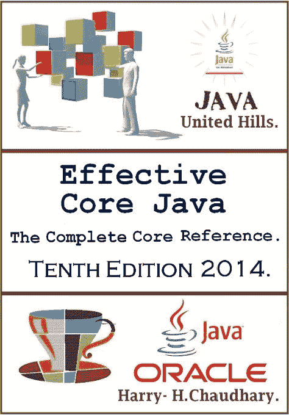


# 第 6 章：“五大”问题

有五个非常常见的通用问题几乎出现在每场面试中。它们涉及到：

- 成为一名优秀的团队成员；
- 有效地计划和组织你的工作；
- 良好的人际沟通；
- 应对职场变化；
- 提供有效的客户服务（包括内部客户）。

使用四个步骤，本章提出了这些问题，并建议了可能的回答。

## “五大”问题的重要性

上述技能对大多数工作都至关重要。很难想象有一份工作在某个阶段不会发挥这五项的作用，也不可能有一份工作至少有一个是不相关的。由于这个原因，“五大”问题实际上构成了数百个面试问题。

大多数人都在团队中工作。即使是那些看起来在独立工作的人，通常也需要与组织内的其他人互动，从而形成一个或多个松散的团队。有些团队需要紧密合作，另一些则不如此；有些团队一直在一起工作，而另一些则只定期聚会。重点在于，雇主极度依赖团队的顺畅运行，并渴望聘用高效的团队合作者。以下是一些关于团队合作的问题示例：

- 是什么让你成为一名优秀的团队合作者？
- 你觉得团队工作如何？
- 你更倾向于独立工作还是团队工作？为什么？
- 你不喜欢团队工作中的哪些方面？
- 如果你的其中一名同事没有尽责，你会怎么办？
- 描述一下你理想中的团队。
- 你能否举例说明，你做过什么来确保自己在团队中的角色是积极的？
- 你会如何处理一个在团队会议上大大且具有攻击性，并通过恐吓他人来主导会议的团队成员？

现在让我们利用这四个步骤来准备回答“团队合作”问题所需的信息：这里有一个面试示例题及可能的回答。


# 团队合作能力

**问题：你是一个优秀的团队合作者吗？你能举例说明你展示团队合作能力的例子吗？**

是的，我认为自己是一个高效的团队合作者。在我的工作中，我是一个四人团队的成员，负责支付约 2000 名员工的工资，包括加班费和奖金。当我刚开始在团队工作时，几个团队成员之间存在沟通问题。这些问题不仅影响了我们的表现，还紧张了团队某些成员之间的关系。几周后，我想如果我们引入更定期的会议和轮流主席制，沟通可能会有所改善。

当我提出这个建议时，团队成员们表示同意。简而言之，新的会议格式被证明是成功的。沟通和表现都得到了提高。我还通过特意认可同事的意见和贡献，并在团队成员遇到问题时帮助他们，展示了我的团队合作能力。

我认为，当你愿意帮助他人时，当他们需要帮助时，他们也会帮助你，这对团队只有好处没有坏处。我还注重分享所有我认为同事需要知道的信息。我甚至会提到一些看似不重要的信息，例如个人对薪资的抱怨或软件的微小故障，因为往往是这些小事在后期导致了大问题。

根据同事的说法，我在团队中的存在改善了成员之间以及与客户之间的沟通，这对我们的整体表现贡献巨大。特别地，我们的错误率在两个月内减少了一半。

请记住，除非面试官明确告诉过公司非常重视聘用具有高效团队合作技能的人才，否则你可能在回答单个问题时，不会使用上述答案的每一个方面。

你可能决定使用其中的部分内容，并将其他部分留作回答后续问题或寻求类似技能信息的问题。过度准备是明智的，而知道何时停止则更加明智。同样的原则也适用于其他“五大问题”问题。

# 回答关于规划和组织的问题

很难想象有一份工作是不涉及规划和组织的。如果我们承认技术已在很大程度上接管了过去人们执行许多重复性任务，那么现在的大多数工作都涉及某种形式的规划和组织。因此，规划和组织问题可能处于许多面试官议程中的重要位置。以下是一些典型的规划和组织问题：

- 告诉我们你是如何规划和安排你的工作计划的。
- 你能否举例说明你曾何时需要计划和组织一次重要的活动或工作相关活动？你采取了哪些步骤？
- 你认为自己是一个优秀的规划者和组织者吗？为什么？
- 当你的经理要求你完成一项任务但你的日程已经非常满时，你会怎么办？
- 你如何给你的工作划分优先级？
- 描述你规划和组织工作的方法。

现在让我们来看一个面试示例和回答。

**问题：你能否举例说明你曾何时需要计划和组织一次重要的活动或工作相关活动？你采取了哪些步骤？**

当我在迈克尔·安哲罗企业（Michael Angelo Enterprises）的行政支持部门工作时，我负责规划各种活动，从及时订购油漆到安全、建筑维护，以及协助部门和经理满足基础设施需求。同时处理所有这些活动意味着我必须对工作进行非常详细的规划，并保持良好的组织。

有一次，我们需要安装新的安全系统和新的计算机图形软件，同时还要回答客户提出的多项请求。为了处理所有事情，我需要按日、每周、每月记录我的工作，并确保我持续跟进其他每个人的动态。

我确保尽可能参加所有的会议并保持消息敏锐。鉴于我必须完成的多项任务，我发现根据组织的需求而非少数个人的需求来优先考虑我的工作是非常重要的。落实新的安全系统必须排在经理提出的某些请求之前。

最后，学会对某些请求说“不”是非常重要的。在我看来，一个优秀的规划者知道多少才足够。承担超出能力范围的工作只会导致服务质量下降，甚至无法完成工作。

在学习了大量关于基础设施支持方面维护组织的知识之余，行动的巨大成果之一是我的客户连续三个月对我的服务评分为“非常高”，这给了我很大的满足感。

# 回答人际沟通的问题

人际沟通技巧不仅涉及清晰的沟通，还涉及我们互动的方式。具备高效人际沟通技能的人更容易与职场的其他人相处（从而获得进步），因为他们展示了一系列能够激发互动对象最好一面的行为。

他们是良好的听者，避免煽动性语言（包括肢体语言），认可人的贡献，在做决定前咨询等。具有高效人际沟通技能的人深受主主青睐，因为他们为工作场所带来了和谐。他们通常能让人们对自己和自己的贡献感觉更好——这对于雇主保持快乐且高效的劳动力来说，当然是重要的。

以下是一些典型的人际技能问题：

- 你喜欢与人一起工作吗？
- 你会如何描述你与同事同事人的关系？
- 描述一下你自己。（虽然这个问题不仅限于人际沟通技能，但它为你提供了一个简要提及这些技能的绝佳机会。）
- 告诉我们你在工作中与他人发生分歧的经历。情况是怎样的你是如何处理的？
- 你能否举例说明你曾何时需要沟通一个复杂且敏感的问题？你是怎么做的？
- 描述你最喜欢一起共事的一位同事。
- 你如何处理工作中生气的人？
- 你更倾向于被视为受欢迎的人，还是一个高效的人？

人际沟通技巧与团队协作能力之间存在着明显的重叠。因此，许多观点可以互换使用。以下是一个可能的面试问题及回答示例。

## 面试问题及回答示例

### 问题：你能举例说明你曾沟通复杂且敏感问题的例子吗？你是如何做的？

当我为`Magellan`工作时，我所在的团队负责为我们船只上的所有船员引入一套新的绩效评估系统。在项目执行过程中，我经常需要向个人和群体传递复杂且敏感的信息。我想强调的是，绩效评估是一个极其敏感的问题，因为人们的薪资与结果直接挂钩。

我成功地传达了相关信息，因为我遵循了多项科学的人际沟通原则——这些原则我在过去已经成功实施过。例如，我特意考虑到人们的敏感性，并在对话早期就对其进行处理。

我避免了使用任何形式的术语，并且通常假设我的听众对相关问题了解甚少。我使用了积极、非威胁性的肢体语言——尤其是当我面对那些尽管缺乏相关知识却贬低该计划的怀疑者时。我还承认他人的意见，并且无论建议多么离谱，我都从不对其发表任何贬低评论。

此外，我总是会在做出决定之前努力咨询关键利益相关者。你付诸努力咨询并解释你必须工作的框架参数，这一事实本身通常就能最大限度地减少不满程度，尽管人们可能并不完全认同你。

由于我的努力，对该计划的反对意见几乎不存在。船员们表现出了建设性的态度，并尽力而为。结果，我们在规定的时间内和预算内成功实施了该计划。

# 应对职场中的变化

与过去的工作场所不同（过去人们可以多年执行同一套职责），今天的工作环境以**持续不断的变化**为特征。

事实上，可以认为唯一不变的就是变化。这无疑意味着一个灵活的员工是具有高度价值的。变化可以以任何形式出现，包括：

- 新机器；
- 新流程或准则；
- 新法律；
- 新管理结构；
- 公司收购；
- 裁员；
- 新软件；
- 新竞争的影响。

无法快速适应环境变化的组织往往会失去市场份额，并很容易倒闭。因此，你如何回答关于“应对变化”的问题非常重要。以下是这些问题可能采取的几种形式：

- 告诉我们一次你必须为工作学习新知识的经历。你是如何应对的？
- 你喜欢改变职责吗？
- 你如何应对职场中不断的变化？
- 你认为自己是一个灵活的人的人吗？
- 如果你突然必须放弃正在进行的项目并开始一个新项目，你认为自己会有什么反应？
- 你对职场学习有何看法？

现在，让我们来看一个示例问题和可能的回答。

### 问题：告诉我们一次你必须为工作学习新知识的经历。你是如何应对的？

当我为`Northern Legions`建造`哈德良长城`时，高层决定大力投资一项新技术，旨在提高质量并为我们节省大量时间。这项新技术涉及一系列新设备、软件和工作程序，代表了我履行职责方式的翻天覆地变化。

起初，我们所有人都对这种规模的变化感到稍显畏缩；但我很快意识到，如果我们的公司想要保持竞争力，变化是不可避免的。

我也很快意识到，如果我想继续成为公司有价值的成员，我需要迅速学会如何在新制度下工作。这种认知确保了我热情地拥抱了这些变化。当我的一些同事将其视为负担时，我将其视为未来的趋势，这也是我目前对变化的一般看法。

除了参加所有必要的培训课程外，我还参加了额外的课程。我努力学习，提问问题，并尽可能地积累了经验。我很快就成为了某些领域内公认的专家，人们开始向我寻求建议。

由于我们的努力，新技术得到了成功实施。我的团队在分配的时间表和预算内使用了新技术进行工作。我学到了一套全新的办事方法。

# 核心要点总结

这五个核心问题的重要性在于，它们是基于大多数（如果不是所有）工作所需的技能的。这使得你很有可能被要求回答若干与这些相关的问题。除了这些技能的通用性外，它们对大多数雇主来说也至关重要（例如，良好的人际沟通能力被视为建立和谐工作关系和有效表现的核心）。

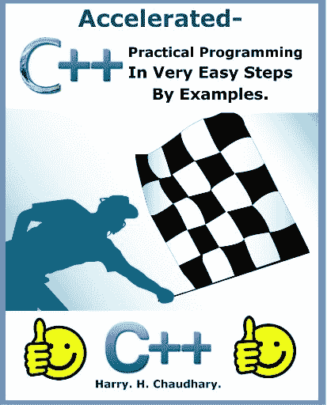


# 第 7 章：建立关系与信任

## 管理感知和刻板印象

面试在很大程度上取决于如何管理面试官的感知。研究表明，人们会寻找他们认为（感知到）存在的东西，反之，则忽略或很少关注那些不符合他们刻板印象的事。

如果面试官认为你是一个非常出色的候选人，那么他们很有可能会寻找并记录所有支持他们预设观念的因素。

换句话说，如果两个应聘者在面试中的表现大致相同，那么面试前声誉更好的那一个可能会获得更高的评分。

所以，尽可能在面试开始前或刚开始时留下最好的印象。你可以通过以下方式做到这一点：

- 确保你的简历是尽可能最好的状态；
- 发送一封积极且简短的面试前感谢信，感谢面试官提供面试机会，并说明你有多期待与他们见面；
- 联系公司进行合理的面试前问询。在面试前联系公司展示了适当的兴趣和专业水平的准备。

### 第一印象

此外，重要的是，面试的最初几分钟（有些人说是几秒钟）对于左右面试官的心意也非常重要。正如古语所说，第一印象往往是持久的印象。简而言之（我们稍后会详细介绍），需要关注的内容包括：

- 着装；
- 握手；
- 眼神交流；
- 面部表情；
- 语气。

### 最后印象

人们对事件开始和结束发生的事情记忆往往比对中间发生的事情要多。然而，这并不意味着你专注于面试的开头和结尾而忽略中间。

这在提醒你在面试结束时的行为和言行要小心。一些应聘者会掉入过度放松的陷阱（通常是因为过度补偿最初的紧张感），并表现出不当的行为，例如变得过于亲密并采用一种“我在参加烧烤”风格的肢体语言。因此，请确保直到最后一刻都保持适当的面试行为。

## 沟通不仅仅是语言

在提升人际关系和信任能力方面，你可以学到的最重要的课程之一就是：沟通远不止你口中所说的话。

沟通专家不断提醒我们，沟通中约有 10% 取决于我们说的话，30% 取决于说话的方式，而 60% 则取决于我们的肢体语言！因此，如果你在准备面试时把所有时间都集中在回答的内容上，你实际上是将 100% 的精力花在了整体沟通的 10% 上。这可能在很大程度上解释了为什么许多在技术上回答非常出色的人并没获得这份工作。

诚然，许多面试者在直觉上明白，成功的人际沟通（面对面交流）依赖的不仅仅是使用的词汇。然而，由于多种复杂且不便在此详述的原因，许多人的人际沟通技巧并不十分精练，和/或者他们在面试期间无法展示自己原本有效的沟通技巧——这可能是因为焦虑加剧。

一旦你理解了成功的沟通取决于语言之外的一整系列因素，一个全新的沟通世界就会开始出现。你面试准备的重点应该从严格的言辞准备转向包含一系列非语言因素，包括外表、坐姿甚至你点头的时机等。有时，一个友好的微笑和认同的点头可能比最好的口头回答价值得多。

## 承认权力源

在大多数面试中，表象之下潜伏着一种重要但未说明的动态关系。这种关系就像人类第一次互相打量并张嘴发出哼声时一样古老。自然地，我指的是权力。

更具体地说，我说的是承认事实：在绝大多数情况下，面试官拥有真正的权力。（例外是你足够幸运，拥有一套雇主渴望获得的独特技能和/或知识。）如果你认真想要最大限度地提升你的人际关系，那么向面试官证明你明白在录用你这件事上他们拥有所有权力是非常重要的。

作为面试者，你也有权力——主要体现在你控制着面试官会听到什么。然而，这并不能消除招聘（或不聘用）的权力专属于面试官这一现实。

承认面试官权力的面试者更有机会获得好感（从而赢得工作），因为直言之，大多数人类都有渴望被重视和被满足虚荣心的弱点。从直觉上，我们许多人理解这种动态关系，但并不是每个人都会面试期间主动表现出来。面试官可能甚至意识不到这种动态（你通常可以识别出那些享受权力感的人），但这并不意味着它不存在。

## 避免卑躬

承认大多数面试中固有的权力动态并不意味着卑躬。正如前面所提到的，把自己扑在面试官脚下，或者为了一个劣的笑话笑得口嘶力竭，很可能会被视为一种欺骗行为。

这里的教训非常简单：意识到大多数面试中存在的潜在权力动态，并避免那些可能让面试官反感的行为（例如争论某个观点或公开不同意面试官的意见）。

# 肢体语言问题

## 坐姿

你的坐姿传达了关于一系列问题的信息，包括你认为面试有多重要、你有多紧张（或自信），以及你对潜在权力关系的理解。有些人的坐姿流露出过度熟悉甚至傲慢的感觉，而另一些人则传达出极度缺乏自信。

坐姿的黄金法则是：避免任何会让面试官无法专注于你回答内容的行为；并避免让面试官感到不适。如果你坐得具有攻击性（身体过度前倾）或过于被动（身体向后靠并双腿交叉），面试官通常不会感到舒服。简而言之，良好的坐姿是不让面试官察觉的。

以下关于你应该避免的建议：

- 向后靠。给人一种你没有认真对待面试的印象。
- 双腿交叉。太随意，尤其是在面试开始时。
- 双腿大开。对于面试场合来说太过于随意了，并且会让面试官感到分心和不适。
- 过度前倾。可能会让某些面试官感到不适，尤其是当你体型较大且说话大声时。
- 驼着背。给人一种你没有认真对待面试的印象，而且在工作中可能同样无精神。

良好坐姿实践的建议包括：

- 身体笔直挺拔。这是面试官希望看到的中性坐姿。
- 男士坐姿。男性可以保持大腿直视前方，并采取所谓的“起跑姿”，即主脚平放在地，另一只脚只有前脚触地。
- 女性坐姿。女性可以在脚踝处交叉双腿，并将腿稍微向一侧倾。

## 面部表情与眼神交流

面部表情是非常强大的沟通工具。如果你坐姿正确，面试官在面试期间的大部分时间应该看着你的脸和眼睛。

坐姿的两个黄金法则也适用于这里：不要做任何会分散面试官注意力或让他们感到不适的事。任何过度的行为（无论是过度微笑、点头还是眼神交流）几乎都会让面试官产生疑虑。

在面试过程中，控制你的面部表情非常重要，当你觉得面试没有朝着你满意的方向进展，或者听到了你不喜欢的内容时——否则，你可能会向面试官传达不想要的信息。

无法控制面部表情将通过向面试官发送矛盾信号来损害你的信誉。

例如，假设面试官突然告诉你，这份工作将包含一项招聘启事中未提到的新且重要的职责，而你的直觉反应是：

> “噢不，我没为这项新职责做准备，他们到底在搞什么鬼，在最后阶段改变工作内容，而我对这个该死的新职责一无所知！”

但你却（或尝试说）：“新职责，没问题。我习惯于承担新职责。我学习能力很快，并且喜欢挑战。”

在这种情况下，你脸上露出的恐惧极可能会损害你的话语，尽管你的回答很合理，但会让面试官无法信服。

控制表情比许多人想象的要困难得多。通常我们的脸是独立于我们的意愿运作的。而且通常它们传达了我们最深层（最黑暗）的情感，而暴露这些情感可能对我们并非有利。但通过一些知识和练习，我们可以在控制面部表达的内容方面取得很大进展。

意识到面部表情的沟通力量是控制不必要沟通的良好开始。下次当你觉得你的脸可能在传达你不想表达的东西时，停下来强迫自己改变它。起初你可能会觉得有点尴尬，但只要坚持，你应该能够随心所欲地控制它。通过大量的练习，它将变成本能。

## 微笑

如果你正站在房间外，几秒钟后就要被邀请进入面试，而我恰好路过，你用一种绝望的眼神抓住我，并向我请教一条建议，我会说：“不要忘记微笑。”微笑是一种非常高效的沟通方式，能向面试官传递所有正确的信号，特别是在建立良好关系方面。

微笑往往能达到最完美的回答也无法做到的——软化面试官的心态。非常重要的一点是，当你对面试官微笑时，通常会让他们感觉变好，这倾向于激发他们良好的一面，而这正是你在面试中希望做到的。它还向面试官传达了一个信号：你拥有良好的社交技巧，是一个友善的人，并且没有反社会倾向。

### 关于微笑的技巧

- **要真诚。** 避免咧嘴大笑或假装微笑。没有什么比一个人努力微笑却只成功展示了“咬牙齿术”更糟糕的了。
- **不要过头。** 过头可能会让你面临显得不真诚的风险。
- **避免模仿面色严峻的面试官。**

模仿别人的面部表情（以及肢体语言）并不罕见，尽管我们通常并没有意识到自己在这样做。如果你遇到面色严峻的面试官，尽量不要陷入自己也变得严峻的陷阱。这听起来可能没那么简单，因为人类这种生物通常需要正向反馈来继续表现某些特定的行为。换句话说，如果你笑了而对方拒绝回以微笑，你很可能会停止微笑。所以：不要让一个阴沉的面试官影响了你。无论如何，坚持你的立场，露出你最温暖的微笑！

## 点头

点头代表了另一种极有力的沟通方式。当你对某事点头时，人们会认为你在告诉他们你同意他们的，而且你是在没有打断他们的情况下这么做的，这是面试官决定阐述某个话题时最理想的建立关系技巧。但要小心：和微笑一样，点头的危险在于过头。

## 眼神交流

成功眼神交流的关键在于避免极端。过头会让人反感，完全没有眼神交流也是如此。长时间盯着看几乎肯定会在你的社交技巧上打一个巨大的问号。更糟糕的是，它可能会吓到面试官。

眼神交流不足很可能表明你缺乏自信，并且可能饱有低自尊问题。请记住，面试在很大程度上是关于传达印象的。现实中你可能是一个自信外向、享受社交生活的人，但如果你未能与面试官进行足够的眼神交流，你可能无法传达出这一事实。

就像许多非语言交流方式一样，面试中适当眼神交流水平在不同文化之间存在差异。在进入面试之前，确定文化准则是非常重要的。

## 手部和手臂

手臂的一个大错误是交叉抱在胸前。这样做等同于在你和面试官之间竖起了一道屏障。其他违规行为包括手放在腿上或假装自己没有手。使用手来强调观点并没有错——这显示出你是真实的人。然而，要避免过头。

## 握手

良好的握手应该是有力的。如果你是年轻男性，要避免想要捏碎面试官手骨的原始冲动。提醒自己，握手的目的是建立关系，而不是展示你有多强。还要避免软手握手、时间过长的握手（记得松手）以及三指握手。如果你严重受手心出汗的困扰，请带块手巾，但如果你的汗腺在疯狂作作，最好在弄湿对方手掌之前先提醒面试官。

## 穿着与外表

有些人固执地认为外表与他们的工作能力几乎没有关系，因此对面试的着装很少考虑。虽然这种想法的逻辑可能无懈可击，但这样做是非常危险的，因为没有考虑到面试在很大程度上是关于管理感知。面试官对着装有特定的预期。未能达到这些预期是危险的。


着装和外表的原则是宁可谨慎。总的来说，面试官在招聘某人时倾向于谨慎和保守。雇主最不想做的事情就是雇错人。可靠性、忠诚、一致性、诚信和可靠是所有雇主在员工身上寻求的品质，无论什么类型的工作。你在面试中的任务是向面试官传达你具备所有这些品质，而着装得代表了一个良好的开始。

这里是一些技巧：

- 一定要穿干净的衣服和鞋子。
- 带洞的牛仔裤（或其他任何东西）在舞池上可能会留下深刻印象，但不太可能引起面试官的好感。
- 避免过度的饰品和化妆。
- 设计过的胡须渣可能让你看起来很有男子气，代表了时尚大师们的最新潮流；然而，它可能会让面试官认为你觉得这份工作不够重要，不值得你特意刮胡子。
- 避免极端的发型。
- 避免露出过多的皮肤。

有一种合理的学派主张根据你申请的工作的性质来着装。所以，如果你申请的是会计职位，你就穿西装；而如果你申请的是建筑工地的劳动力职位，西装就不太恰当了。这些都是事实；然而，上述关于着装和外表的技巧仍然重要。

## 面试行为

肢体语言和个人外表代表了面试期间建立关系和信任的方程式的一侧。另一侧同样重要的方面是你在面试期间的行为和自我表达方式。

### 永远不要争论

面试中最糟糕的事情之一就是与面试官争论。即使认为是非常礼貌的争论也不应该被考虑。争论很可能让面试官认为你天生好辩，而这不是雇主所喜欢的品质。

这是一些面试者忘记的一点——当他们坚信自己是正确的，或者面试官说了明显错误的话时。

如果你只是坐在那里强调自己的许多缺点和缺陷点，那么参加面试就毫无意义。以下是一些负面陈述的例子，这些表述会让面试官想要避而远：

- “如果我没有和队友发生冲突，我本可以完成那个项目的。”（你可能确实在和一群地狱般的同事共事，但面试官可能会怀疑你的团队协作能力。）
- “我喜欢在软件公司工作，但有时客户的咨询或我的老板让我抓狂。”
- “我通常喜欢管理人员，除非他们开始抱怨工作。我不喜欢抱怨的人。”（大多数人都会不时对工作感到不满，一名优秀经理的工作是倾听和帮助，而不是把员工看作抱怨者。）
- “我不喜欢事物不断变化。当你刚学会某样东西，你就得忘记它并学习不同的东西。有些工作场所的不稳定性太大了。”（除非你申请的是那种事物永远不变的稀有职位，否则在当今快速变化的环境下，给出这样的答案很容易入选“糟糕回答名录”。）
- “我不喜欢压力。”（除非你申请的是你在脑海中创造的幻想工作，否则请避免这一条。）
- “我不喜欢别人告诉我要做什么。”（你应该认真考虑自己创业了。）
- “我饱受高水平压力的影响，所以我需要一份没有压力的工作。”（另一个幻想工作。）
- “我不喜欢加班。”（很多人都不喜欢加班，但这不是在面试时该说的话。除非有紧迫的任务不允许你这样做，否则大多数工作都要求员工有时需要留下来。）
- “当人们不理解我在说什么时，我会感到恼火。”（也许你的沟通方面存在问题。）
- “我不知道为什么，但人们似乎很怕我。”（也许你自己在人际关系上存在问题。）
- “我学得慢。”（哎哟！）

负面陈述会让面试官感到非常害怕，记住，他们是一群保守的人。对自己过去的表现进行批判等同于给面试官一个不录用你的理由。此外，负面陈述因为会吓到面试官，往往会引来后续问题，而这正是你在面试中最不希望发生的事情。

整个核心思想是说那些能引发积极问题的话，即那些让你谈论自己所有优势和出色成就的问题。有些人认为，指出负面因素是向面试官展示自己诚实的一种。对他们来说的是，面试官只会考虑结束面试的方法。

除了与工作有直接关系的事情之外（例如在需要重体力劳动的工作中出现问题），你的缺点是什么与他人无关。你认为自己的弱点，别人可能并不认为是。归根结底，面试是关于尽可能留下最好的印象。

### 克服缺点

不谈论负面因素与谈论克服缺点不同。对于许多高成就者来说，工作在很大程度上是为了克服技能和知识方面的缺陷以实现他们的目标。他们并不是对新事物感到恐惧，而是将其视为学习的挑战并期待克服它们。

通常情况下，高效员工与挣扎的员工之间的区别与才华关系不大，更多在于这种对学习的态度。

雇主最喜欢听到的就是你如何弥补技能或知识短板以完成项目。克服缺陷向面试官证明了你是一个能够在工作中学习并，其是，完成任务的人。以下是一个“克服技能/知识短板”的回答听起来可能的样子：

```
在接到任务后，我们很快意识到团队中的一些人没有所需的知识来最大化我们的贡献。我的缺陷在于不理解如何使用几个复杂的软件应用程序，这些程序对于任务的质量控制至关重要。

我的挑战是在很短的时间内学会如何使用这些应用程序，并可靠地应用这些知识。因为我们在非常紧迫的时间表内工作，团队的其他成员也依赖我，所以容错空间非常小。

幸运的是，我能够运用我新学的知识，团队其他成员也是如此，我们成功地完成了任务。
```

这个回答不仅告诉雇主你可以在执行任务的同时学习复杂的信息，还说明你可以在压力下完成工作并交付所需的结果。

### 处理“弱点”问题：不该做什么

“你的弱点是什么？”并不是面试官提问的理想问题。这个问题本身包含的一些问题包括：

- 许多面试者从根本没有意识到自己有弱点。
- 另一些人认为自己有弱点，但实际上完全没有。
- 有些面试者误认为将此问题看作展示自己诚实的机会，说得比该说的多得多。
- 许多面试者极度不愿意在面试中透露自己的弱点。

尽管存在这些问题，许多面试官仍然坚持询问你的弱点。你的工作是学习处理此类问题的最佳方式。至少，你应该减少潜在的损害，最好情况下，你应该转守为攻，并向面试官证明你是一个不仅能克服弱点，而且通过这样做实现目标的人。

在回答这个问题时，你能做的最糟糕的事情之一就是说你没有任何弱点。这会向面试官发出信号：你失去了对现实的控制和/或你极度自大，这两者对你都没有好处。以下是其他需要避免的事情：

- 不要提供超过一个弱点，也不要对你的失败和可能的起源进行长篇大论。除非被要求说第二个，否则只坚持一个。
- 避免谈论性格上的弱点，如急躁、易怒或对错误不宽容。
- 通常来说，这类弱点比技能缺陷更令雇主害怕。后者通常可以通过培训来纠正，而性格类型的弱点可能更难治疗，更难处理。
- 避免陈词滥调，例如：“我工作太努力了。我不知道什么时候停止。我不知道如何拒绝工作请求。”这些回答的问题有两点：第一，很多人都这样说，这意味着你无法脱颖而出；第二，以上所有回答都可能向敏锐的面试官暗示你在管理工作量方面存在严重问题。
- 不要提到真正会伤害你的事情。你过去犯过的错误应该留在过去。
- 不要去挖掘这些错误——特别是如果你已经吸取了教训并迈向前发展了。

希望你不会申请你本就不胜任的工作。例如，如果你非常恐高，而工作内容的一部分涉及在高处工作，那么你不应该通过申请来浪费任何的时间。

然而，如果同一份工作也需要你所具备的技能，可以先打电话告诉他们你的情况。雇主可能会重视你的其他技能，并愿意至少与你谈谈。

# 警告

如果你曾犯过可能与你申请的职位相关的违法行为，在参加面试之前，你应该调查自己在披露方面的法律义务。请避免听信道道妈妈。披露法有时会更改，且不同州之间可能有所。

## 如何处理“缺点”问题：该说什么

处理缺点问题的一种有效方法是将缺点定位在过去的某个时间点（最好是技能方面的短板），然后描述你为克服它而采取的步骤（与克服不足类似，见上文）。其核心思想是向面试官展示你有能力克服自己的缺点。此外，尝试以积极的方式结束你的回答也是好的。以下是一个对话可能听起来的样子：

**问题：请谈谈你的缺点。**

几年前我在 Chaos 公司工作时，我的缺点之一是在向客户和内部员工进行演示的方面。并不是说我的演示是一场灾难——远非如此——但确实缺乏其他经验丰富的演讲者的那种圆润。

于是，我找了一位我非常欣赏其风格的演讲者，询问她是否可以给我一些改进技能的技巧。幸运的是，她非常乐意帮助我，甚至听了我的其中一次演示并对我的缺点给出了反馈。我采纳了她的建议并做了几处改变，这使我的演示水平显著提高。

如果面试官对这种回答不满意，因为它没有谈及目前的缺点，只需提供一个基于技能的缺点，且该缺点不会损害你获得工作的机会——换句话说，就是一个与工作不相关的缺点。

## 处理异议

雇主的异议通常以“我喜欢你，但是……”的形式出现。例如，“我喜欢你，但我主要担心的是你大部分经验都在零售业，这与我们的需求不相关。”当你申请晋升或跨不同职业或行业的工作时，最常遇到异议。虽然处理异议没有标准方法，但有一个你可能会发现的的三步法：

1. **赞同异议**：“是的，没错。我的大部分经验确实在零售业。”赞同往往会让面试官放松戒备。不同意可能会让你听起来不理智，甚至显得很迫切。
2. **陈述你认为该异议并不构成问题的原因**：“我想指出，在零售业我所做的大部分工作与这份工作直接相关。虽然行业不同，但技能是共通。例如，提供高水平客户服务和解决客户投诉所需的技能，与你们所要求的技能是一样的。”
3. **肯定差异不是问题并以积极的方式结束**：“事实上，我认为为你们的业务带来新颖视角是一种优势。我相信我可以引入新想法来推动你们的业务发展。”

## 避免不确定性

面试中的黄金准则之一是尽可能避免怀疑或犹豫。用带有迟疑的语气说你能完成某事，或使用模棱两定的语言，几乎等同于说你实际上做不到。请避开以下表达：

- 我认为我可能……
- 我不太确定，但也许……
- 也许我会……
- 也许我可以……
- 我觉得我能够……

自信是建立面试中良好关系的关键之一。面试官喜欢听自信的回答，因为这能帮助他们消除对受访者能力的怀疑。即使你被问及一项从未执行过的职责，最好说你从未执行过，但由于你带入职位的各种技能和知识，你对完成它充满信心，而不是承认从未履行过该职责并表现出一连串的不确定。

记住，你怎么说比你说什么更重要。请比较以下两个候选人的回答，他们都在回答“你认为你会如何应对管理一个专业人士团队？”

**候选人一**：我不完全确定是否能管理一个专业人士团队。我以前没做过，所以对我来说是一个全新的体验，但我想只要稍加努力我是可以的。当然，我想尝试一下。这是一个我非常感兴趣的领域。

**候选人二**：我有信心能做好。我乐于与高成就者共事，我拥有良好的人际沟通能力，而且管理人员我非常感兴趣的领域。虽然我从未管理过团队，但我感到已准备好迎接职业生涯中的这一新挑战了。

本质上，以上两个候选人说的是相同的话。他们都承认没有管理专业人士团队的经验，但都愿意承担这项新责任。然而，第一个候选人回答的开头可能会让他们失去这份工作。我怀疑很多面试官在听完那个致命的第一句后，就不会再认真听后面的任何话了。

最后两句话虽然试图挽回，但那时已经太晚了。另一方面，第二个候选人从一开始就激发了人的信心。这个回答中完全没有不确定性，尽管候选人承认自己没有管理专业人士的经验。

许多受访者在谈论自己从未执行过的职责时，难以使用非常积极的语言。这并不常见，因为在非面试场合，大多数人谈论从未尝试过的事物时都会使用犹豫的语言。你的目标应该是将所有的犹豫都关在面试门之外。如果你对自己能做好没有信心，你怎么让面试官对你有信心呢？

## 积极陈述

让自己习惯使用积极语言的一种有效方法是在面试前练习使用积极陈述。列出与你情况相关的积极陈述，并开始大声说出来。刚开始可能会感到有些尴尬，但重复很快就能解决。继续练习直到你感到非常自然。这里是一些可以帮助你开始的开头：

- 我完全可以完成/撰写/分析……
- 我对……有信心。
- 我对……的前景感到很轻松。
- 我确信我可以处理你提到的所有……
- 我对接受……持积极态度。

### 第三人称陈述

不要总是使用第一人称陈述（“我”语句），例如“我做了某个……”和“我非常擅长……”，使用第三人称陈述通常更好。这类陈述的优势在于它们让你引用他人对你成就的评价，而不是你自己的想法。这里是一些例子：

- 我的老板经常评价我完成工作的速度非常快。（相比之下，“我经常能很快完成工作”）
- 我的同事们慷慨地将我投为最有价值的团队成员。
- 客户经常对我的服务技能给出积极反馈。
- 我所在的团队一直对我的人际沟通能力和乐于助人的表现给出高分。

### 归功于他人

尽管有些人可能这样认为，但在绝大多数情况下，在职场中完成工作需要他人的协助与合作。在谈及你的成就时，承认他人的宝贵投入是实现面试中谦逊态度的极佳方式。一个回答听起来可能是这样的：“在预算内并按时成功完成项目，对我的雇主来说意义重大。如果我没有交付成果，这些人可能会面临被裁员的风险。”

然而，我想强调的是，我成功的唯一原因是因为我从同事那里获得了宝贵的帮助。没有他们无私的支持，我会失败的。如果不承认同事的投入，这个回答会有听起来有些傲慢的风险，但将归功于他人可以确保说话者显得谦逊，同时不会削减成就的份量。

### 成就目标的关键策略

- **避免重复你的核心成就。** 在普通的社交语境下，我们不喜欢别人没完没了地论自己的成就，提到一次通常就足够了。面试中也是如此。虽然学习如何推销你的核心成就至关重要，但你应该只陈述一次成就。如果你重复它们，可能会给人留下一种印象：要么你没多少话可说，要么你是在显摆。
- **避免“自我夸大”。** 这从一本面试技巧书里听起来可能有点奇怪，但如果你想避免把自己描绘得过于自视不凡，这至关重要。“自我夸大”意味着实际上说出自己很厉害。与其自吹自擂，不如让事实说话。

必须理解的是，薪资谈判从你走进面试间的那一刻就开始了，而不是在谈到金钱时。换句话说，为了最大化雇主愿意支付给你的薪资，你需要做的最重要的事情之一，就是在整个面试过程中真正脱颖而出。显然，如果雇主认为他们能够获得价值，他们会更倾向于给出更多的钱。

## 做好你的研究

在没有进行基础研究的情况下就尝试谈判薪资，有点像蒙着眼睛射击目标。你的研究应该集中在两个领域。首先，了解市场对像你这样的人才提供的薪资水平如何。你需要考虑到你的资、经验和主要成就。重要的是，你还需要考虑你将要工作的行业，因为对于具有相当经验和能力的人来说，某些行业提供的薪资比其他行业高。地理位置也是如此。

薪资调查公司、优秀的招聘顾问和相关的专业组织通常可以为你提供可靠的薪资信息。确保你所有的来源都是可信的，并且使用一个以上的来源。如果你的来源被发现不可靠，你的论据会迅速崩溃（损害你的信誉）——如果你面对的是一个了解市场的资深谈判专家，这种情况在所难免。

永远不要听信道言，永远不要引用你朋友声称的他们的收入。你的第二个研究领域应该关注公司本身。你可能无法获得所有想要的信息，但这不应该阻止你的尝试（只要不要让自己显得很讨厌）。需要调查的事情包括：

### 薪酬政策

有时，特别是在规模较小的公司，明显缺乏此类政策。然而，如果这些政策存在且你能够获取，你可能可以利用这些信息来让自己有利。例如，如果你知道公司每六个月考核一次绩效和薪水，你可能可以推迟高薪资的执行，直到你有六个月的时间在工作中证明自己，而不是无限期地接受一个较低的金额。

### 薪资水平

这可能很棘，因为关于人们薪资的信息往往笼罩在神秘之中。但如果你能获得一些洞察，你至少知道自己面对的是什么。例如，知道公司倾向于给员工支付高于市场价值的工资，在谈判薪资时是一个非常有用的信息。

### 公司经营状况

经营良好的公司通常比财务困境的公司更倾向于支付更多。你最不想做的就是为一个正处于巅峰时期的公司低估自己。

### 他们对填补该职位的迫切程度

有些工作比其他工作更难招聘，而另一些工作对公司的成功至关重要。如果你的研究表明你所申请的职位恰好属于这两个类别之一，那么假设你在谈判中拥有更大的筹码是合理的。

## 避免开头提到金钱

薪资谈判中的一个重要原则是将讨论留到最后。其意图是在谈论金钱之前，尽可能留下人类所能留下的最好印象。这与任何试图推销的销售员没有区别。

价格只有在讨论了产品的所有优秀特性和优点后才会被提到。在突出特性和优点之前谈论价格，并不是一个好的销售方法，也不是好的薪资谈判方法。

在报价之前，先谈论你的技能和知识，以及它们将如何为业务带来利益。如果你碰巧遇到想在开头谈论钱的面试官，尝试（礼貌地）说服他们改变主意。

你可以这样说：“我倾向于将薪资讨论留到我们谈话的最后。我非常希望在谈论钱之前，让您更好地了解我能为公司提供什么，让我了解更多关于工作的信息。”

如果这不起作用且面试官执意不移，那么你别无选择回避具体的金额。相反，给出一个范围（见下文）。这样做将为你之后的操作留出回旋的空间。

向雇主报价一个你愿意考虑的金额范围，首要原则是现实。报价不切合实际的高额很可能会损害你的信誉，并可能抵消你付出的许多努力。以下指南旨在帮助你确定一个范围。

## 确定你的底线

认真考虑确定你的底线是什么——即你愿意工作的绝对最低金额。你应该考虑的三个因素包括：

- 你的生活成本，考虑到预期的通胀（物价上涨）；
- 考虑到你的经验水平，市场所承受的水平。不要低于市场范围的底点。如果市场范围在`$45 000`到`$65 000`之间，你的底线不应低于`$45 000`。另一方面，如果情况足够有利，你可以超过上限；
- 你对这份工作的渴望程度。人们往往由于各种重要的个人原因而愿意降低标准，例如更合适的时间、最短的通勤时间，或者因为这份工作代表了职业转型的第一步。

## 算出一个范围

一旦你确定了自己的底线，坚持它就非常重要。接受较低的金额很可能会导致以后失望。你的最低金额将代表你薪资范围的绝对底点。

你希望范围定得多宽取决于上述的所有因素，但主要取决于市场支付的水平和你的经验水平。

这里有一种可能的方法。假设你已经决定你的绝对最低金额是`$50 000`。你有丰富的经验，并且既知道公司非常喜欢你，也知道他们在填补该职位方面一直很困难。

你还知道你行业的市场上限是`$60 000`。在这样的有利情况下，报价一个高于你底线并超过市场上限的薪资范围是不合理的——例如`$55 000`到`$65 000`。另一方面，如果你知道该职位的竞争非常激烈，而且你的经验并不突出，那么报价`$50 000`到`$58 000`会更合逻辑。

在上述有利的情况下，建立薪资范围的另一种不保守的方法是设定范围，但报价一个更高的底线——例如`$60 000`到`$65 000`。这种方法方法的优势是增加了雇主自动支付你报价底线的概率，并充分承认了你强大的议价能力。

一个资金不充裕的雇主（但是你很想工作的公司）可能会被你的预期吓跑，但你应该可以通过降低你的报价底线来解决这个问题。

对于确定一个你愿意工作的最低金额或薪资范围，并没有硬性规定。上述指南仅仅是可能方法的说明。最重要的是先做好研究，然后避免向雇主报价不切实际的金额。

## 当你从之前的一工作中被解雇时如何应对


通常情况下，雇主并不喜欢解雇。解雇充满了困难，并且往往会给双方带来巨大的焦虑。然而，不幸，某些员工的行为迫使雇主不得不采取终极手段。

然而，也存在员工在非自身过错的情况下被解雇的情况。这些不当解雇可能出于多种原因，包括管理极度无能、工作设计非常糟糕（某些工作——尤其是新工作——没有经过仔细考虑，往往让人们注定失败）、招聘实践不当或缺乏培训。

这里的问题在于，一个被不当解雇的人在下一次面试中该如何应对那些接踵而来的问题。特别是，他们该如何回答那个普遍存在的问题：“你为什么要离开上一任雇主？”而我们完全合理地推断，告诉面试官你被解雇了（尽管是不公正的）可能等同于面试中的自杀？正如前面提到的，面试官往往是一群谨慎的人（这通常有其理由），当你试图解释自己遭受了多大的不公时，他们只能听凭你的话。

不幸的是，某些招聘人员（特别是在劳过剩的市场中）对于雇佣上一份工作中被解雇的人会表现出明显的排斥，即使那个人并没有错。他们的这种排斥很大程度上源于担心以前被解雇的人在新工作中无法适应。在这种情况下，招聘人员最终可能会显得自己无能。

残酷的现实是，被上一份工作解雇的人在面试竞争中通常会比其他人落后一段距离。然而，一切并非全无希望——这只是意味着他们必须付出加倍的努力。面试者可以做几件事来增加成功的机会。

### 详细描述发生的情况

一种选择是尽可能清晰地描绘导致你被解雇的情况。这里的关键之一是不要使用贬义词汇。避免陷入辱骂性语言或侮辱你的前雇主，尽管这可能很难。只需坚持事实并客观地陈述你的情况，并使用恰当的语言。你可以包含以下四点来增强你的论点：

- 与其他员工的相似经历。这是一个强有力的论点。如果其他人受到了与你类似的对待，那么这就是谴责雇主的有力证据。
- 违背的承诺。不当解雇员工的雇主通常会做出许多承诺但又会背叛。
- 糟糕管理实践的例子。这可能包括任何事情，例如：在需要培训的地方没有培训；在没有任何警告的情况下发生重大变化；零咨询或零反馈；虐待行为；或者在没有任何警告或咨询的情况下对你的工作职责进行重大变更。
- 你为挽救局面所做的努力。这包括你为改善状况所做的尝试，包括你提出的建议或采取的任何行动。针对那个可怕的“你为什么要离开前雇主？”问题，一个很好的回答听起来可能是这样的：

```text
很遗憾，我们分手是因为发生了一系列负面事件。我的前雇主面临一些压力，在应对方面非常困难。他经常向员工发泄情绪，包括使用辱骂性语言和做出各种威胁。

结果，他的许多员工都对他胆胆不已，并积极寻找其他工作。事实上，员工流失率非常高。他还习惯做出重要的承诺，但极少履行。

其中一个例子是他做过一个承诺，承诺我们将接受关于新机器的培训。这项培训将显著提高我们的生产水平，并让每个人的生活轻松得多，但培训从未出现过。当我向他提起这件事时，他告诉我让我管好自己的事。当我试图向他解释我的担心是出于业务的福利时，他变得非常愤怒并当场解雇了我。
```

将上述答案与以下内容对比：

```text
我离开是因为我被开除了，这是我身上发生过的最好的事情。我的前老板太糟糕了。他完全不知道如何经营业务，而且完全没有人际技巧。他是一个欺凌者、一个白痴，并且无法应对压力。没有人受得了他，那些没有跳船的人都在寻找其他工作。

我被开除是因为我告诉他我们需要对新机器进行培训，他承诺过我们会接受培训，而且这本可以显著提高我们的生产水平。

我最后听到的消息是他快破产了，这一点也不令我惊讶。尽管上述两个答案本质上说的是相同的内容，但在某个层面上，它们是完全对立的。
```

第一个答案是客观的，避免了使用辱骂性语言，并在提出被解雇之前给出了一个有说服力的论点。当第一个发言者谈到被解雇时，他很有可能已经赢得了面试官的同情。

而第二个第二个答案除了具有辱骂性和情绪化之外（这会让任何面试官感到担心），它在第一句话中就提到了解雇，这非常危险。在第一句中提到解雇根本没有给你软化面试官的机会。

### 避免提到解雇

第二种选择涉及闭嘴。鉴于被解雇员工身上的污名，提到解雇几乎没有意义，并且不可避免地吓到面试官，特别是当你的雇用期限很短或是在很久以前的事时。

尽管有冒犯那些喜欢占据道德高地的人的风险，但我认为某些事情不需要向面试官揭露。归根结底，所有雇主都有权仅知道你是否能胜任这份工作、你是否符合他们组织的文化以及你的动力水平如何。

### 小组面试

一种日益流行的面试形式是小组面试，在面试中，一群面试者聚在一起，并被赋予一系列任务作为小组完成（尽管某些任务可能要求你独立行动，例如进行演示）。

小组任务的例子可以包括任何需要解决问题、提出创意解决方案、计划和组织、定义和设定目标或解决冲突的练习。当小组执行这些任务时，情况会由一名评估员或一组评估员仔细监控，他们的工作是观察你是如何与小组互动的，以及你的贡献是什么。

根据你的可观察行为——即你说了什么、怎么说、做了什么以及如何与小组的其他人互动——评估员将对你的适用性得出结论。在某种程度上，小组面试是终极的行为面试。

小组面试的关键在于确保你展示了所需的行为并避免了不当行为。

#### 小组面试中的理想行为和不当行为

确保你做出了贡献。你的贡献应该是促进小组的顺畅运作和任务的完成。避免任何可能破坏这两个主要目标的行为。不当行为可以包括任何被合理视为具有侵略性或过度主导地位的行为，例如：

- 恐吓他人；
- 坚持自己的方式；
- 不听取或轻视他人的贡献；
- 抢占风头。

同样糟糕的是过度消极的行为。坐在那里不贡献，或者贡献极少，对你没有任何好处。有信心做出贡献是很重要的。不要坐在那里想：“噢我的天——万如果他们都嘲笑我的建议怎么办？”比起做一个不平庸的贡献，比坐在那里保持沉默好得多。

倾听并认可他人的观点。如果有人提出了很好的建议，认可它会为你赢得加分项。但要避免为了认可而认可。而且，无论你做什么，都不要对每一项建议都表示赞同。

在可能的情况下，帮助他人，但要方法得当。避免让小组成员感到尴尬或直接接管他们的任务。不要忘记任务的目的。如果你看到小组偏离了任务，试着通过提醒他们目标将他们带回正轨。

尝试弄清楚任务的设计是为了激发什么样的行为。例如，如果你认为任务的设计是为了激发与小组内解决问题相关的行为，那么你的工作就是展示出这些行为。这些可能包括：

- 让大家对实际问题达成共识（问题定义）；
- 发起对问题可能原因的讨论；
- 确定最可能的原因；
- 建议就可能的解决方案进行头脑风暴会议；
- 对最佳解决方案达成共识；
- 制定旨在实施解决方案的行动计划；
- 记住避免在过程中占据主导地位。

希望我已经说服了你建立良好关系和信任的重要性，以及赢得工作不仅仅取决于正确回答问题。虽然我们每个人都不同，并为面试带来不同的沟通风格，但专家们一致认为，在建立关系和信任方面，某些行为比其他行为更有效。熟悉这些行为非常重要，这样你就能最大限度地发挥你的效率。

你可能会发现上述某些技术在刚开始很难掌握。这并不是因为它们本身很困难——事实上，它们大多数都是通俗易懂的。挑战在于“忘记”现有的行为，但只要有一点毅力，你将惊讶于自己改变得会有多快；在掌握所有技巧之前，坚持下去真的是值得的。

## 建议活动

为了帮助你精通这些技术，这里是一些建议的活动，帮助你一路上进。

1. 如上所述，开始模仿你所钦佩的人际关系人士的行为。
2. 你可以在大多数社交场合练习许多技巧。下次你与某人交谈时，考虑一下你的肢体语言。它有助于改善沟通、关系和信任吗？你可以做些什么来改进它？过了一段时间，你会发现这种自我意识会变成你的本能。

## 关键点总结

建立良好关系和信任需要具备三点：明智且诚实地回答问题；确保你所有的非语言沟通（肢体语言和个人外表）不会让面试官感到焦虑；以及符合接受的面试行为，例如永不争论。

注意第一印象和最后印象——人们往往能更好地记住任何互动（包括面试）开始和结束时发生的事。微笑、恰当的面部表情并在适当的时间点头都会留下良好的印象。

对于电话面试，要用好你的声音——在通话时，它取代了你的肢体语言。

记住关键的“要做”和“不要”：在应该给予给予的地方，避免批评他人（包括以前的领导）；使用积极的陈述，但避免过度自夸；提到你克服的任何缺点或障碍，但要避免过度修饰。

在谈薪水时，先做好研究——不要低估自己，但你提出的要求要切合实际。在强调你能为公司带来什么之前，避免讨论金钱。

在小组小组面试中，确保你熟悉每个人的名字。在小组面试中，要积极展示面试官正在寻找的行为。

“阻碍你和梦想之间的唯一障碍是尝试的意愿以及这确实可能的信念。”

“自信是一个人可以拥有的最有吸引力的特质。如果你自己都看不到自己的优秀，别人又怎么能看到呢？”

“人生活中可能最大的失败是犯了从从不尝试的错误。”


# 第 8 章

## 针对常见问题的 10 个有效回答

到目前为止，除了识别良好面试回答的基本要素外，你还应该能够组合出你自己的有效答案。你应该知道如何：

- 在确定最终答案之前，尽可能多地了解关于工作的信息；
- 使用四个步骤来整合答案的主要部分，包括你做了什么、你是如何做的、你做时的背景以及结果；
- 将你所有的信息整合在一起，以便你能够给出清晰、连贯的回答，而不是东拉西扯；
- 回答广泛的问题，包括关于你以前执行过的职责、你没有执行过但已掌握相关技能的职责，以及你没有执行过且还没有技能的职责；
- 使用你的肢体语言和其他人际沟通技巧来建立并维持关系。

### 良好的回答没有简单的公式

在此时重申这一点很重要，尽管有关于如何回答问题的有用指南，但并没有一个适用于所有面试问题的蓝图或结构。

有时，可能适合给出三部分的回答，包括背景、你做了什么以及如何做的，以及结果。在其他时候，可能更适合讨论你的能力、文化匹配度和动力水平。

通常，可能适合将上述内容进行组合。归根结底，取决于你为每个问题识别合适的结构或方法。而且一种方法可能和另一种一样好，记住，没有完美的答案。练习将使你能够提供最好的回答。

### 问题：你为什么选择这份工作？

#### 良好的回答

从我记忆中开始，我就对这一行工作感兴趣。吸引我的是它提供的与人互动、解决问题和独立工作的机会。我喜欢这种事实：某天我可能在外面帮助客户解决问题，第二天我可以在办公室里和团队一起解决一个复杂的技巧问题。我非常喜欢在像我们这样的服务行业工作，可以让客户满意。

#### 不太好的回答

其实我完全是偶然进入这一行的。我一直想当演员，但找工作几乎是不可能的。我之所以现在还在这一行，可能是因为我学了所有的技能和知识，并且了这里的套路。我做这行已经做了一段时间，我想你可以说我是老手了。我知道如何交付成果。

#### 评语

第一个回答及时回答了问题，然后重点突出了工作的主要职责（与人互动、解决问题等）作为候选人选择这份工作的原因。同样重要的是，我们感受到了候选人的高动力水平和提供良好服务的欲望。它还暗示了候选人喜欢团队合作并且能够胜任这份工作。

在第二个回答中，我们必须等等到第三句才触及问题——这太晚了。尽管候选人很有经验，但我们强烈感受到他对这份工作的冷漠。这给我们留下的印象是，这仅仅是一份工作，而第一个回答则充满了热情。

### 问题：你认为什么因素决定了一个个人在组织中的进步？

#### 优秀的回答

在我看来，有三点决定了一个个人在组织中的进步。这些是：首先，做好工作的能力，包括学习新事物的意愿和适应变化环境的能力；其次，能够融入组织文化（即能够与同事良好相处）；第三，具有高水平的驱动力和动力。

当然，这些是我在工作中对自己坚持的三个点要求。如果我在任何时候我觉得自己在这三个方面都没有达到最佳状态，我就会停下来问问自己可以做什么来改善状况。我认为，如果这三个领域不能完全满足，没有人能从工作中获得真正的快乐。到目前为止，这些标准让我受益匪浅。

#### 不太好的回答

取悦老板可能是我能想到的第一件事。我觉得，如果你和老板合不来，无论你做得有多好都没用，你的日子也就没不日了。当然，擅长工作也有帮助，但我认为，玩好“游戏”，即在组织政治的雷区中穿行更为重要。我意识到这听起来可能有些世俗，但我们都都清楚，要进入高级管理层，需要学会如何玩游戏。

#### 评语

这样的问题应该立即被视为展示你优势的机会。第一个回答直接谈到了所有雇主想听到的三点：工作能力、文化契合以及动力，并且更进了一步，指出这三点都是候选人具备的特质。第二个回答太过于世俗了，未能强调候选人的优势。毫无疑问，“玩游戏”的能力会对一个人的进步产生影响，但把所有的鸡蛋都放在那个篮子里是一个致命的错误。

### 问题：你为什么想在我们组织工作？

#### 优秀的回答

你们公司是我可以实现贡献最大化的类型公司。我所有的研究表明，你们不仅在服务标准和产品创新方面是市场领导者，而且拥有良好的工作文化。

我接触过的每个人都谈到了员工所获得的高水平的支持、培训和认可。你们提供了广阔的职业前景、有趣的工作以及家庭友好的政策。最重要的是，我一直非常渴望在一家提供具有挑战性和前沿工作的公司工作。

#### 不太好的回答

我知道你们组织非常看重员工——我谈过的每个人都想在这里工作。你们的薪水很高，而且照顾员工。你们是一家大公司，这意味着我提升职业的机会将会增加，我希望我不会一直在做同样的工作。我喜欢这种轮岗制度和学习新事物的想法。

#### 评语

第一个回答的基调在第一句就确立了，候选人在那里谈到了想要做出贡献，这正是让雇主感到兴奋的内容。回答认可了公司所有的优点，但非常重要的是，它将这些优点与候选人的贡献联系了起来。

换句话说，不仅关乎候选人能从公司得到什么，还关乎他想回馈什么。第二个回答的主要问题在于，它完全关于候选人能从公司得到什么。在公司提供的条件与这些因素如何增加候选人的贡献之间，没有建立任何联系。

### 问题：你希望在五年后的职业生涯中做什么？

#### 优秀的回答

我希望继续做我现在正在做的事情——即享受我的工作，努力工作，并尽我所能做出贡献。当然，我预想五年后，我积累的经验将让我能够胜任更大的责任，这也是我在时机成熟时期待承担的。然而，最重要的是保持快乐、高效并成为团队中受重视的成员。

#### 不太好的回答

基本上，我很有野心且勤奋，所以我预想我的职业会得到显著提高。我的目标是努力工作并尽可能走得更远。我认为我会在寻找某种具有更大责任、当然也有更高报酬的管理职位。

#### 评语

第二个回答并没有什么致命的错误；事实上，它提出了几个很好的点——即，它直击主题，并推崇了候选人努力工作和出领先的野心。它之所以没有第一个回答好，在于其方法的局限性：候选人的首要目标仅仅是晋升。

其潜台词是，如果没有晋升的机会，候选人可能会离开。另一方面，第一个回答承认了努力工作和晋升的重要性，但非常有智慧地表示，晋升并不是唯一的考虑因素。第一个回答少了一些以自我为中心，更多地意识到为公司做出贡献的重要性。

### 问题：描述你的理想工作

#### 优秀的回答

我申请的这份工作包含了我理想工作的许多（甚至是全部）元素。它具有多样性，在智力上具有挑战性，既能让我独立工作也能在团队环境中工作（兼得其美），还能让我为客户提供创造性的解决方案。我一直在具有挑战性和以结果为导向的环境中茁成长，而这份工作提供了这一切。

#### 不太好的回答

我的理想工作是那种我可以努力工作但不会一直感到压力的工作。它应该有很多多样性，有足够的挑战以及大量的晋升的机会。它应该包括优秀的同事以及一个好老板。

#### 评语

第一个回答之所以有效的原因之一是它将候选人的理想工作与实际工作联系了起来。告诉面试官你申请的工作是你理想的是非常合理的。注意到了这份工作的主要元素：多样性、挑战性、独立与团队协作，以及为客户提供创造性的解决方案。

再次，第二个回答并没有致命缺陷。它的主要错误是提到了压力。你一提到压力，面试官的警报就会响起。他们会想知道多大的压力是合适的，而不是你想在面试中谈论什么。

### 问题：是什么激励着你？

#### 优秀的回答

在工作中有很多激励我的事物，但我最大的三个激励因素可能是：解决问题，尤其是需要专业知识的高级技术问题；学习新事物并跟上我领域的变化；以及在一个合作的团队环境中工作，我们互相交流想法并提出创造性的解决方案。我喜欢随之而来的同事情。

#### 不太好的回答

可能我最大的激励是拥有一份有趣的工作，一份我真正向往并在其中出色的工作。每天去上一份你不喜欢的工作没有比这更糟糕的。此外，我喜欢良好的工作时间。我不介意偶尔留下来帮助，但我不想一直那样做。我也喜欢在市中心工作，因为从我住的地方去很方便，而且那里有很多很棒的商店和餐厅。

#### 评语

只有当第一个答案中提到的职责——解决高技术性问题、跟上最新创新以及在团队中享受创造性工作——都是职位描述的一部分时，它才是一个有效的答案……重点是，回答动机类问题的极佳策略是回到工作的核心职责并谈论这些内容。第二个回答开头得很好，但没有提到什么构成了有趣的工作。此后，它就是一个致命缺陷的答案。工作时间和工作地点很可能是激励因素，但它们永远不应该被提及，因为它们无法证明你将如何为工作创造价值。

## 问题：你认为哪些素质对于在该领域取得成功是重要的？

### 良好的回答

在该领域取得成功所需的素质包括能够妥善完成工作的技能和知识。

我指的不仅仅是所有的技术技能，例如知道如何操作各种软件程序，以及对相关法律的全面了解以及如何应用这些法律，

还包括与人相处的能力、具备出色的沟通技巧，以及在巨大的压力下规划和组织工作的能力。

我认为高水平的动力和驱动力非常重要。这些都是我具备的素质，并且从第一天起就能带入这个职位。

### 不太好的回答

在该领域取得成功所需的素质包括对完成操作所需的各种软件程序的详细了解。人们不仅需要具备如何操作软件的知识，还需要在出现问题时知道如何修复，而问题是总会会出的。

复杂的法律技术问题也是如此。正如你所知，在我们的行业中，魔鬼隐藏在细节中，对法律的浅理解可能会带来很多麻烦。除了对这项工作的所有编程要求有深入理解外，我对法律的细微之处也有全面的了解。

### 评论

这类问题引导你直接针对你所申请职位的核心职责，并以此作为你的答案（这与回答动机问题时使用的策略相同）。

第一个回答正是做这一点。它优于第二个回答，因为它涵盖面更广。除了谈论技术技能外，它还谈到了与人相处、规划和组织以及良好的沟通（通用能力）。

第二个回答并不是一个坏回答，但它落入了只关注工作技术方面的常见陷阱。

## 问题：请告诉我们一次你与同事处理困难情况的经历。

### 良好的回答

去年，我们的一个同事表现出许多攻击性行为，包括主导团队会议、轻视他人的想法以及不配合。


我向其他同事反映了他的情况，很快发现每个人的感受都和我一样。我们决定在有机会先和他交谈之前，不把这件事提交给经理。因此，我们决定在下一次会议上向他提出这些问题。我被选中发起讨论。

在会议上，我避免将问题个人化，并避免使用煽动性的语言。我还采取了积极乐观的语调。结果比我们预想的要好。他感谢我以微妙的方式提出这些问题，也感谢我们都在采取进一步行动之前先与他交谈。会议之后，他的行为发生了显著的良性变化。

### 不太好的回答

有一次，我的一个同事没有尽职尽责，而且与团队其他成员完全不配合。经理没有发现这一点，因为团队的一些成员掩盖了他的错误，而当经理在场时，他总是会特意表现得非常友好。所以有一天，当他又不配合时，我把他拉到一边，告诉他我对他的看法。从那以后起，他对我的态度就变了。他开始特意对我友好，并确保我需要的所有工作都得到了妥善完成。遗憾的是，他对团队其他成员的行为完全没有改变。我学到的教训是，你必须坚持自己，因为没有别人会为你自己。

### 评论

第一个回答展示了与同事协商的能力、独立解决问题而非立即上报管理层的能力，以及以适当方式交流高度敏感信息的能力。它还展示了所有参与者的良好结果。第二个回答的关注点太窄了。它解决了个人的问题，但未能解决团队和谐与协作更广泛的问题。

## 问题：请告诉我们一次你必须面对非常紧迫期限的经历

### 良好的回答

当我在行星委员会工作时，我需要面对多个紧迫的期限。通过遵循合理的规划和组织原则，我能够如既地完成所有截止日期。

这些包括提前地规划工作以确保没有意外，确保团队中的每个人都经过了良好培训并清楚自己的责任，在事情出现问题时随时准备各种应急计划，并且拒绝接受超出我们处理能力的工作。

这些做法的有效性体现在，我的团队从未错过截止日期，并被视为组织内绩效的标杆。

### 不太好的回答

我应对紧迫期限的方法是确保我留下来并下苦功夫。当出现意外或我们正经历特别忙碌的时期时，我不是那种会推卸责任的人。如果意味着留下来按时完成工作，我会这样做。在我看来，努力工作是不可替代的。

## 问题：你希望为什么样的经理工作

### 良好的回答

我想为一位既知道如何妥善完成自己的工作，又知道如何领导员工的经理工作。经理知道如何做好自己的工作是很重要的，否则他们会在员工中失去信誉，而缺乏信誉的经理很快就会失去成为有效领导者所需要的尊重。

我理想的经理会理解并实践良好的领导原则，例如与员工协商、认可大家的努力、提供定期反馈以及不恐吓或欺凌他人。我的观点是，优秀的经理应该是严厉而公正，并且知道如何获得员工的投入。

### 不太好的回答

我认为经理具备良好的人际技巧是重要的。我工作过的最棒经理不仅在工作场所，在工作之外也能与员工相处。她对所有人都是好朋友，每个人都知道在需要时可以向她寻求帮助。她从不拒绝任何人，并总是尽力照顾我们。参加她告别晚餐的人比参加总经理晚餐的人多得多。

### 评论

第二个回答太窄了。优秀的经理需要的不仅仅是受员工喜爱。他们还需要在工作上表现出色，并在需要时对员工保持严厉。广受欢迎的经理可能为了不失去员工的喜爱而导致运营效率低下。

第一个回答是一个更完整的回答。它不仅承认了与人相处的重要性，还承认了在需要时保持严厉以及具备良好工作技能。

## 问题：你是否已经发挥了你能力范围内最好的水平

### 良好的回答

是的，我这样做过，而且我认为我是在持续地做这一点，而不仅仅是在所谓的“重要场合”。在我看来，发挥你所能达到的最高水平需要高水平的动力，以及努力工作和从错误中学习的意愿。

这些是我每天都带到职场的特质，我相信这些证明可以从我的工作质量以及我获得的前任雇主的赞誉中看出来。我在 `Odysseus Project` 上的工作——我超额完成了所有目标，并在带回成果方面发挥了重要作用——这就是我日常工作效率和贡献的范例。

### 不太好的回答

是的，我曾在好几个场合成功发挥了最佳水平。当压力来临时时，我往往处于最佳状态。如果我知道有重大利益相关，我就会卷起袖子，全力以赴。如果这需要加班或周末工作，那就那样吧，只要任务完成即可。我热爱挑战，并享受在压力下交付成果。

### 评语

第一个回答的优点在于它的论点：即发挥最佳水平是候选人一直在做的事情，而不是一种为特殊情况保留的偶然行为。它还列出了某人表现最佳所需的特质，然后给出了一个具体的例子。

第二个回答中候选人愿意在利益攸关时卷起袖子的意愿值得赞赏；然而，雇主希望你一直都有这种奉献精神。

## 问题：你如何处理批评

### 好的回答

我把积极批评等同于建设性反馈——它是为了提高我的表现而设计的，这对我来说很重要。如果我工作的某个方面受到批评，我会尽力找到问题的根源，并尽所努力地纠正它。从这个角度来看，批评是一个极好的学习工具。另一方面，我不认好非建设性的批评，即其主要目标是伤害或削弱他人。在这种情况下，我倾向于以开放的方式与批评者沟通，以便我们解决问题。我不认为职场中应该有负面批评之地，那只会打击士气。

### 不太好的回答

我不喜欢别人批评我的工作。没有人是完美的，我也从不到处批评别人的工作。让无罪的人投掷第一颗石头。当然，如果我犯了错，我预计团队领导会批评我的表现，但我认为以适当的方式进行批评是非常重要的，不能有任何贬低或欺凌。我见过太多人因为微小的错误而被“处死”，这会损害他们对组织的投入度。

### 评语

第一个回答的强项在于能够区分建设性批评和负面批评，并陈述了候选应对这两种批评的回应。第二个回答的弱点在于候选人不愿被同事批评。尽管关于贬低和欺凌的部分很好，但人们会认为这位候选人对批评可能稍微敏感了。

上述回答的编写是为了让你洞察有效的面试听起来像什么样，以及雇主倾向于听某些答案而非其他答案的原因。在面试中表现良好并不像很多人想象的那么困难。成功的关键在于正确的准备和练习。知道要准备什么以及如何准备，然后给自己应用新习得技能的机会，这是一个经过实践检验的成功公式。

记住，优秀的面试者并不是天生就具备有效面试技巧的，他们通过遵循这个公式来发展自己的技能。完成这本书意味着你对面试过程现实情况的认识显著增加。你的面试技巧很可能已经提高了。然而，需要注意的是，你对答案思考得越多、练习得越多，你就会变得越好。出色的面试技巧不是一夜就能成的；它们随着时间的推移和正确的运用而提高。

# 从书中记住的九个要点

1. 不要浪费时间寻找快速解决办法，它们并不存在。它们甚至可能让事情变得糟糕。出色的面试表现来自于充分准备和练习。
2. 避免背诵别人的答案。
3. 记住，面试不仅仅是给出完美的答案；它们还关乎建立关系和信任。而建立关系和信任不仅取决于言语，肢体语言和态度也非常重要。
4. 所有面试官都想知道三件事：
   - 你是否能胜任这份工作；
   - 你的动力或驱动力有多大；以及
   - 你是否能契合现有的职场文化。
5. 使用这四个步骤可以为你提供一个易于遵循的系统，通过这个系统你可以组织并整合大量关于工作成就的碎片信息，帮助你形成清晰且流畅的回答。
6. 大多数工作都有重叠的技能或职责。这些包括：
   - 成为良好的合作伙伴；
   - 有效地规划和组织你的工作；
   - 良好的人际沟通技巧；
   - 应对职场变化的能力；以及
   - 提供有效客户服务的能力（包括对内部客户）。
   
   意识到这些可以让你预判可能会被问到的某些问题。
7. 如果面试得不好，不要消极。每个人都有这种时候，即使是优秀的面试者也是如此。关键是从中学习并为下一次做好准备。
8. 经常，面试官没有经验，可能会提出一些考虑不周的问题。你的工作是知道如何应对新手和经验丰富的面试官。
9. 相信你自己。既然你已经知道该做什么，没有理由不这样做。——祝你好运，冠军们。

# 苹果面试

就像该公司本身一样，苹果的面试流程官官僚主义。面试官会寻找卓越的技术技能，但对职位和公司的热情也非常重要，虽然不是 Mac 用户的先决条件，但你至少应该熟悉该系统。

面试流程通常从招聘人员电话筛选开始，以对你的技能进行初步了解，随后是系列技术电话筛选。

一旦被邀请来到校园，通常会有招聘人员接待，他们会提供流程概述，你将与应聘职位的团队成员以及与你团队合作的关键人物进行 6–8 场面试。

你可以预期会有一对一和二对一的面试。午餐是与未来的同事共进，看起来比较随意，但仍然是一场面试。每个面试官通常关注一个不同的领域，并且被鼓励分享反馈，除非有他们想要让后续面试官深入挖掘的内容。

在一天结束时，你的面试官会交换意见，如果大家仍然认为你是一个可候选人，你将与该部门的主管和副总裁面试。虽然这个决定相当非正式，但如果你通过了，这是一个非常好的信号。这个决定也是在幕后进行的，如果你没有通过，会被直接带出大楼，而对此完全不知情（直到现在）。

如果你进入了总监和副总裁面试阶段，所有的面试官将聚集在一个会议室里给出一个官方的赞成或拒绝。副总裁通常不会在场，但如果他们没有留下深刻印象，仍然可以否决录用。你的招聘人员通常会在几天后跟进，但你也可以随时联系招聘人员询问更新进展。

嗯，我曾通过招聘人员申请，整个过程耗时了 2 个月——是在苹果面试的。

## 面试详情

通过 `Hacktivist` 认识了苹果的招聘人员。我在线申请了很久，但一直没有收到任何回音，所以我猜苹果的招聘人员更倾向于那些他们面对面见过的候选人。

下个月我进行了两次电话面试。第一次是技术性的，而且相当简单。第二次是行为面试。我实际上感到非常惊讶，我原以为苹果的筛选流程会困难得多。我被邀请在下个月进行现场面试。

现场面试比电话面试挑战性得多。我当时还在上大学，所以我知道很多东西，但都不深入。被问的问题与团队的工作直接相关，不像大多数其他公司——在那些公司里，`NCG` 通常被问及他们在学校所学知识的问题。我猜苹果的团队即使对于大学毕业生，也在寻找他们特定职位明确需要的人才。

在第一次技术面试的大部分时间里我应付自如，但我开始失去信心并变得非常紧张。到第三次面试时，我已经一团糟了。我花了 5 分钟才真正理解面试官在问我什么。最后两个面试官问了我关于我在大学期间和实习期间的经历以及项目。他们留下了深刻印象，但我知道那时已经太晚了。果不其然，面试结束后我立刻请了出去。

我猜我是被现场面试比电话面试困难得多，以及问题针对团队的针对性如此给得措手不及了。

**面试题**：从零开始为操作系统/内核创建一个同步原语。我创建了一个带有 `test-and-set` 的 `spinlock`。接下来，创建一个不浪费 CPU 周期的原语。（本质上，你将如何在内核中创建一个 `mutex`？）

给定一个包含 `N - 2` 个元素（缺失两个）且范围从 `1` 到 `N` 的数组，请在性性时间内以常数内存找到那两个缺失的元素及核心设计概念。

我在技术面试中表现得还可以，我相信我没有准备充分，特别是行为面试。问题涉及 `Design patterns`、`data structures`、`algorithms`（与 `BST` 相关的多个问题、`queues`、`linked lists` 等）。还有后续问题，你如何改进时间/空间复杂度，以及几个关于核心 `Java` 的问题。我获得了一份 `$30,000 USD/A` 的 offer。但我拒绝了，并向他们竖起了我的中指离开。

**面试题**：你会如何设计 `evernote` 应用，在 `linked list` 中寻找环，以及其他与 `java` 相关的简单问题。

“人生有两个规则：#1 永不放弃 #2 永远记住规则 #1。”——哈里。

# Google 面试

流传着许多关于 Google 面试的恐怖故事，但大多只是如此：故事而已。面试与微软或亚马逊相比并没有太大区别。不过，由于 `Google HR` 可能有点没条理，我们建议主动沟通。

`Google engineer` 会进行第一轮电话面试，所以要准备好棘手的技术问题。在现场面试中，你将与四到六个人面试，其中一人是午餐面试官。面试官的反馈对其他面试官保密，所以你可以确保进入每次面试时都是白纸状态；你的午餐面试官不提交反馈，所以这是一个问诚实问题的绝佳机会。

书面反馈将提交给工程师招聘委员会，以做出录用/不录用的建议。反馈通常分为四类（`Analytical Ability`、`Coding`、`Experience` 和 `Communication`），你将得到从 `1 0` 到 `4 0` 的总分。

招聘委员会理解，不能要求你在每场面试中都表现出色，但如果多个人提出了同一个警示信号（傲慢、编码能力差等），这可能会导致你被淘汰。招聘委员会通常希望看到一位面试官是“热情的支持者”。换句话说，一份分数为 `3 6`、`3 1`、`3 1` 和 `2 6` 的分包比全是 `3 1` 好。你的电话面试通常不是最终决定的强有力因素。

如果一周内没有收到回复，Google 的招聘流程可能会很慢，礼貌地询问你的招聘人员获取更新——没有回复并不能说明你的表现。

### 提示：一定要准备

作为一家基于网络的公司，Google 关注如何设计可扩展的系统。因此，确保你准备好“系统设计和内存限制”的问题。此外；许多 Google 面试官会问涉及 `Bit Manipulation` 的问题，因此请复习这些问题。

### 提示：有什么不同

你的面试官不做录用决定。相反，他们输入反馈，并将其传递给招聘委员会。

# 微软面试

微软想要对技术充满热情的聪明极客。

在典型的面试中，你将接受测试 `C++`，但你被要求在黑板上写。

在典型的面试中，你会在早上到达并完成初始工作。你将与招聘人员进行简短面试，他或她是为了为你做准备，而不是为了用问题难住你。对你的招聘人员友好一点。你的招聘人员可以成为你的倡者，甚至在你的第一次面试中失误时争取重新面试。

一天中，你将进行四或五场面试，通常面对不同的团队。与许多在会议室见面试官的公司不同，你会在面试官的办公室与他们见面。这是一个观察周围并感受团队氛围的好时机。

根据团队的不同，面试官可能会与不会将对你的反馈与循环中的其他人分享。

当你完成与某个团队的面试后，你可能会与招聘经理交谈。如果是这样，那是好信号！这可能意味着你通过了特定团队的面试。现在取决于招聘经理的决定。你可能在当天得到决定，也可能在没有收到 HR 音息的一周后，给他们发一封友好的邮件询问状态。

### 提示：一定要准备

“你为什么想在微软工作？”

在这个问题中，微软想看到你对技术充满热情。一个很好的答案可能是：“从我记忆中开始我就一直在使用微软软件，我对微软如何创造出一个全球范围内优秀的产品留下了深刻的印象。例如，我最近一直在使用 `Visual Studio` 学习游戏编程，它的 `APIs` 非常棒。”注意这如何展示了对技术的热爱！

# 雅虎面试

## 简历选择与筛选

虽然雅虎倾向于仅在前 10–20 名学校招聘，其他候选人仍然可以通过雅虎的职位板获得面试（或者——更好——如果他们能获得内部推荐）。如果你是被选中的幸运儿之一，你的面试流程将从电话面试开始。你的电话面试将与高级员工（技术主管、经理等）进行。

## 现场面试

你通常会与同一小组的 `6–7` 人进行面试，每人 45 分钟。每位面试官都有一个侧重点领域。例如，一位面试官可能关注数据库，而另一位面试官则可能关注你对计算机架构的理解。面试通常由以下组成：

### 分钟安排

- **5 分钟：日常交流**：介绍一下你自己、你的项目等。
- **20 分钟：编码算法题**：例如，实现 `merge sort`。
- **20 分钟：系统设计**：例如，设计一个大型 `distributed cache`。这些问题通常会关注你过去某个领域，或者面试官目前正在从事的项目。

### 决策

在最后，你可能会与一个 `Program Manager`（项目经理）或其他人进行日常交流（产品演示、对公司的顾虑、你的其他竞争性录取等）。与此同时，你的面试官将讨论你的表现并尝试达成决定。`hiring manager`（招聘经理）拥有最终决定权，并会权衡正面反馈和负面反馈。如果你表现良好，通常会在当天得到结果，但并非总是如此。可能有许多原因导致你几天内得不到通知——例如，团队可能觉得还需要面试其他人。

### 必须准备

Yahoo 几乎按照惯例提问关于 `system design` 的问题，所以请确保你为此做了准备。他们希望知道你不仅会写代码，还能设计软件。如果你没有这方面的背景也不要担心——你可以通过推理来解决它！

### 有什么独特之处

你的电话面试可能会由更有影响力的人进行，例如 `hiring manager`。Yahoo 的另一个与众之处在于，它通常会在当天给出结果（如果你被录用的话）。当你与最后一个面试官见面时，你的面试官会讨论你的表现。

# Facebook 面试

## 面试详情

我个人参加过 Facebook 的面试。流程始于一个基于编码的预筛选测试。有一道需要在 60 分钟内完成的。

这个问题对我来说相当简单，我很快完成了。一周后，我被叫去现场面试。面试本应持续 45 分钟。现在，我的面试中，我首先被（她，她太美了——Melody）问到过去两年里最好的经历是什么。我说：“你真美，我 5 分钟前见过你，这是我经历过的最好的经历。”她笑了，并让我进入下一环节。

然后，面试官很快转到了编码题。有两道题需要我解释我的解决方案然后在白板上写出代码。我回答了这两道题，但我认为面试官可能喜欢我解释方法的方式，因为 `FB` 团队叫我参加下一次面试，但我向他们竖起了大拇指（点赞）！

面试官不是怎么多话，也没有真正参与你解释方法的讨论。这就是为什么很难检测面试官是否理解了你的话。无论如何，这是一段特别的经历。

## 面试详情

根据之前面试的表现，总共有 `1/2/3` 轮面试。Facebook 的招聘人员和其他员工非常友善。

### 我的面试轮次

- **第一轮**：给定一个 `undirected graph`（无向图）和一个 `node`（节点），将该图修改为 `directed graph`（有向图），使得任何路径都指向一个特定的节点。
- **第二轮**：给定一个大小为 `mXn` 的矩阵和一个单元格列表，找到从左上角单元格到右下角单元格的路径数量。
- **第三轮**：求解一个单变量线性方程，其中可能的操作符为 `+`、`-` 和 `*` 以及括号。例如 `(2x + 5 - (3x - 2) = x + 5)`。

所以，据我所知，他们非常看重 `Coding`（`c` 和 `c++` 以及 `java`、基于 web 的编程及数学）以及沟通能力。


## 面试常见问题 - I


## 1. IT 公司寻找候选人具备哪些技能？

**回答**：IT 公司寻找候选人的各种技术技能和软技能。在软技能方面，沟通能力非常重要，其他软技能包括演讲能力、团队合作、写作能力、领导力等；在技术技能方面，公司期望候选人在其毕业领域拥有良好的专业知识。例如 `C` & `C++`、`Operating system`（操作系统）与网络以及 `Core java`——`DSA-DBMS` 等。

## 2. 我应该什么时候开始准备求职？

**回答**：对于软技能，最好在招聘开始的一年前就开始准备。

## 3. 我应该如何准备笔试？

**回答**：应注意以下几点：

- 编程能力（涉及 `C-C++`、`Data structure`、`Algorithms`、`Java`）。
- 推理部分。
- 语言能力（`同义词`、`语法`、`作文`等）。

在 `Amazon.com` & `Google Books` || `Google Play-` 阅读以下书籍：

我列出了一些适合初学者到专学生的优秀书籍。

- `Serious books for students with beginners to experts.`（查看 `Amazon.com`）
- `Accelerated C: Practical Programming in Very Steps`（ISBN-9781500521950）
- `Your Brain On C++`（ISBN-9781500349578）
- `Thinking in C Beginner's Guide`（ISBN-9781500192693）
- `Mastering Algorithms with C`（ISBN-9781500137137）
- `Effective Java: The Complete Core Reference`（ISBN-97814964258）

## 4. 我需要通过多少面试才能获得工作？

**回答**：通常至少有三轮面试：面谈之前的电话面试。然后是技术面试和 HR 面试。在某些大型跨国公司，会有多次技术面试，除非招聘公司对你的技能和沟通能力满意。

## 5. 请介绍一下你自己。

**回答**：这是面试官在面试开始问的问题，旨在了解更多关于你的信息，他们也通过这个问题了解你如何看待自己。所以，简要介绍你的职业背景、你做过的项目、你在之前工作的贡献，并以你的个人背景和一些个人特征作为结尾。不要说一小时——要简洁直接。此外，不要过度强调个人细节。

## 6. 你的优点和缺点是什么？

**回答**：这个问题是为了检查你如何看待自己，以及你的优点如何为团队做出贡献。所以，要诚实说明你认为的优点（`我学习新知识很快`、`我很有团队精神`、`我有良好的领导能力`等）。为你的优点提供支持性细节，例如`我学习新知识很快。在我的上一份工作中，我必须学习脚本。我第二天就开始了 Java 编程，并且做到了！`。对于缺点，不要描述过多；某些缺点可能会让你丢掉工作（`我无法拒绝偷贵的手机!`）。

## 7. 你对我们公司了解多少？

**回答**：为了回答这个问题，你应该在参加面试之前做好准备。访问公司网站的“关于我们”部分，寻求 Google 的帮助，联系在该公司的的人以了解公司业务、在哪些国家或州设有机构、他们正在开发的项目或产品类型等。一个概述就足够了。

## 8. 你为什么计划离开目前的工作？

**回答**：在回答此问题时要小心。通常可以接受的答案是：寻找更高的薪水、寻找更好的职位和增长机会、结婚了必须搬到这个城市。糟糕的答案是“我不喜欢我的老老板！”“我不想做那个项目”等。

## 9. 告诉我们你在上一份工作中遇到过哪些挑战，以及你是如何克服它们的。

**回答**：问这个问题是为了检查你处理日常工作时的信心，以及在面对棘手情况时的信心。因此，你可以解释你在早前工作中遇到的一些挑战，你是如何处理它们的，以及如何成功克服问题的，别忘了这一点！！避免谈论负面经历；同时也要避免指责任何个人或团队。因此，最好讨论技术性的挑战和问题。

## 10. 为什么我们应该雇你？

**回答**：这是每位面试官都会问的问题，他们希望听到为什么要选择你的理由。面试官只是把这个球传回给你，检查你如何给出录用你的理由！所以，告诉他们你的职业优势和个人优势、相关的就业经验或学术背景、你与当前职位要求的契合度等，并给出你认为他们应该雇用你的观点。糟糕的答案是：“因为我急需一份工作；”“我已经找了一年多工作了还没找到——你们应该帮帮我！”

## 11. 你期望的加薪幅度是多少？

**回答**：如果你诚实地说“现在的工资翻倍”，你可能得不到这份工作。如果你说“我拿原来的工资也可以”，你可能真的能拿到！一个安全的答案是与跳槽新工作时获得的行业平均加薪幅度。或者你可以说：与贵公司拥有相似经验和技能的人所获得的薪水相同，然后把球踢回面试官的半场。

## 12. 我应该怎么穿体？

**回答**：通常情况下，候选人的着装应该比该职位的平均员工高一个小档，或者像该职位上穿得最体面的员工一样。在大多数软件公司，这意味着牛仔裤（没洞的漂亮牛仔裤）或西装裤搭配漂亮的衬衫或毛衣是可以的。在银行或其他更正式的机构，请避免牛仔裤，坚持西装裤。

## 13. 我应该使用什么语言？

**回答**：许多人会告诉你“用你最熟悉的语言即可”，但理想情况下，你想使用一种面试官熟悉的语言。我通常建议用 `C`、`C++` 或 `Java` 进行编码，因为绝大多数面试官都精通这些语言中的一种。我个人在面试中的偏好是 `Java`（除非是需要 `C` / `C++` 的问题），因为它写起来很快，而且几乎所有人都能读懂并理解 `Java`，即使他们主要用 `C++` 编写（由于这个原因，书中几乎所有的解决方案都是用 `Java` 写的）。


# 如何准备技术面试题

你购买了这本书，说明你已经在良好的准备方面迈出了一大步。做得好！尽管如此，准备方法有优劣之分，许多候选人只是通读问题和答案，不要那样！

死记硬背或尝试学习特定的问题对你没有帮助！相反，你应该这样做：

1. **尝试独立解决问题**

   我的意思是，真的尝试去解决它。很多问题被设计得很难——这没关系！当你解决问题时，务必考虑空间和时间效率。问问自己是否可以通过减少空间效率来提高时间效率，反之亦然。

2. **在纸上写下算法代码**

   你这辈子都在电脑上写代码，已经习惯了它提供的许多便利功能。但在面试中，你没有语法高亮、代码补全或编译的奢侈待遇。通过在纸上写代码来模拟这种情况。

3. **将你的纸上代码原封不动地输入电脑**

   你可能会犯下一堆错误。开始列出你犯的所有错误清单，这样在真实的面试中就能记住这些错误。

---

# 技术准备

## 你需要了解的

坦率地说，大多数面试官不会询问关于二叉树平衡或其他复杂算法的特定算法，他们可能也并不记得这些算法。你通常只需要掌握基础知识。这里有一份必须掌握的知识清单。

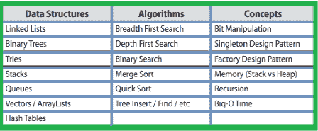

当然，这并不是一份详尽的列表。可能会问这些主题之外的问题，这仅仅是一份“必知”列表。

对于每个主题，确保你理解如何实现/使用它们，以及（在适用情况下）空间和时间复杂度。

练习你在面试中可能被要求实现的数据结构和算法，你也可能被要求实现它们的变体，无论哪种，你对实现越熟悉越好。

## 你需要了解 `C++`、`Java` 等等细节吗？

虽然我个人一直不喜欢问这类问题（例如，“什么是虚函数表？”），但许多面试官在微软、谷歌、亚马逊等大公司面试时会遗憾地问出这些问题，你可以尝试阅读《Core Java Professional》。

不要对这些问题压力太大。查阅最常见的问题并确保你有相应的对策，但我会将重点放在数据结构和算法的准备上。在较小的公司或非软件公司，这些问题可能会更多。


# 如何处理技术题

## 技术题的通用建议

面试本就应该是困难的。如果你没有立即得到答案，没关系！事实上，根据我的经验，在我面试过的 120 多人中，可能只有 10 个人对了问题。所以，当你遇到难题时，不要慌张。大声说你打算解决它。还有一点：除非面试官说完，否则我的意思是当你出一个算法时，开始考虑伴随的问题；当你写代码时，开始寻找 Bug。如果你和我面试过的其他 110 个候选人一样，你可能犯了一些错误。

## 解决技术题的五步

技术面试题可以通过以下五步法解决：

1. 向面试官提问以消除歧义。
2. 设计算法。
3. 先写伪代码，但确保告诉面试官你写的是伪代码！否则，他/她可能认为你根本不想写“真正的”代码，许多面试官会因此否定你。
4. 编写代码，不要太慢也不太快。
5. 测试你的代码并仔细修复错误。

### 第一步：提问

技术问题比看起来更具歧义，因此确保通过提问来消除任何模糊或歧义的地方。你最终可能会得到一个与最初想象完全不同且容易得多的问题。事实上，许多面试官（特别是在微软）会专门测试你是否会问好问题。好的问题可能是：

- 数据类型是什么？数据量有多大？
- 解决问题需要哪些假设？用户是谁？

例如：“设计一个排序列表的算法。”

**问题**：什么样的列表？数组？链表？

**回答**：数组。

**问题**：数组里存什么？数字？字符？字符串？

**回答**：数字。

**问题**：这些数字是整数吗？

**回答**：是的。

**问题**：这些数字从哪里来？是 ID 还是某个值？

**回答**：它们是客户的年龄。

**问题**：有多少个客户？

**回答**：大约一百万。

我们现在有了一个完全不同的问题：

对一个包含百万个 0 到 130 整数的数组进行排序。我们如何解决这个问题？只需创建一个 130 个元素的数组，并统计每个数值出现的次数。

## 第 2 步：设计算法

设计算法可能很困难，但我们的五种算法方法可以提供帮助。在设计算法时，不要忘记思考：

- 空间和时间复杂度是多少？
- 如果数据量很大会发生什么？
- 你的设计会导致其他问题吗？（例如，如果你正在创建一个二叉搜索树的修改版本，你的设计是否影响了插入/查找/删除的时间？）
- 如果有其他问题，你是否做出了正确的权衡？
- 如果他们给了你特定的数据（例如，提到数据是年龄，或者是有序的），你是否利用了这些信息？他们给你这些信息可能是有原因的。

## 第 3 步：伪代码

先写伪代码可以帮助你清晰地概述思路，并减少你犯的错误数量。但请确保告诉面试官你正在先写伪代码，稍后会编写“真实”代码。许多候选人写伪代码是为了“逃避”编写真实代码，你绝对不想与那些候选人混为一谈。

## 第 4 步：代码

你不需要急于完成代码；事实上，这很可能会对你不利——只需以适中、缓慢且有方法的节奏进行。另外，记住这条建议：

**慷地使用数据结构**：在相关的地方，使用良好的数据结构或定义你自己的。例如，如果你被要求解决一个涉及寻找人群最小年龄的问题，考虑定义一个表示 `Person` 的数据结构。这向面试官展示了你重视良好的对象设计。

**不要让代码太拥挤**：这是一个细节，但非常有帮助。当你在白板上写代码时，从左上角开始，而不是中间。这将为你提供充足的空间写答案。

## 第 5 步：测试

- 是的，你需要测试你的代码！考虑测试：
- 极端情况：0、负数、`null`、最大值等。
- 用户错误：如果用户传入 `null` 或负值会发生什么？
- 一般情况：测试正常情况。

如果算法很复杂或高度数值化（位移、算术运算等），考虑在编写代码时进行测试，而不仅仅是在最后。

此外，当你发现错误时（你会发现的），仔细思考 bug 发生的原因。我在面试期间看到的最糟糕的情况之一，是候选人识别出错误并尝试通过“随机”更改来修复错误。

例如，想象一个候选人写了一个返回数字的函数。当他用数字“5”测试代码时，他注意到返回了 0，而本应该返回 1。于是，他将最后一行从 `return ans` 改为 `return ans+1`，而没有思考为什么这能解决问题。这不仅看起来不好，还会让候选人陷入无止境的 bug 和修复的循环中。当你发现代码中存在问题时，在修复错误之前，要深思你的代码为什么失败了。

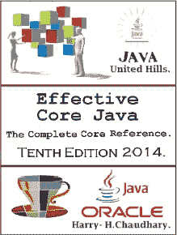


# 候选人常犯的十大错误

## #1 | 在电脑上练习

如果你在为一场严峻的山地自行车赛训练，你只会在街道上骑车练习吗？我希望没有——空气不同，地形也不同。是的，我敢打赌你会在山里练习。使用编译器练习面试题就像这样——你基本上一辈子都在街道上骑车。收起编译器，拿出旧笔和纸。只使用编译器来验证你的解决方案。

## #2 | 不练习行为面试题

许多候选人花费所有时间准备技术问题，却忽略了行为面试题。猜猜怎么着？你的面试官也在评估这些！而且，你在行为面试题中的表现可能会影响面试官对你技术表现的感知。行为面试准备相对容易，非常值得花时间。回顾你的项目和职位。

## #3 | 不进行模拟面试

想象你正在为一场大型演讲做准备。你的整个学校、公司或任何地方都会在场。你的未来取决于此。而你所做的准备工作只是在脑子里静静地读演讲稿。很疯狂，对吗？

不通过模拟面试来准备真实的面试，就像这样。如果你是一个工程师，你必须了解其他工程师。找个伙伴，请/她为你做一个模拟面试，你甚至可以回回礼！

## #4 | 尝试背诵解决方案

质量胜过数量。尝试自己挣扎并解决问题；在卡住时不要直接翻看答案。背诵如何解决特定问题对你的面试帮助不大。真正的准备是学习如何处理新问题。

## #5 | 话太多

我无法说我曾问过候选人多少简单的问题，比如“Project Pod 上最困难的 bug 是什么？”，结果他们滔滔不绝谈论我不懂的内容。五分钟后，当他们终于喘口气时，我什么都没学到——除了他们沟通能力很差。被问到问题时，将你的答案分为三部分（情境 / 行动 / 结果），部分只说几句话。

## #6 | 话太少

让我告诉你一个秘密：我不知道你脑子里在想什么。如果你长时间说话，我会认为你没有进展。多说话，尝试通过口述你的解决方案，这能向面试官展示你正在解决问题。

## #7 | 操之

编码不是比赛，面试也不是。在编码时要留出时间——不要操之！操之会导致错误，并暴露你粗心。缓慢且有规律地进行，经常测试，你会更快完成问题，而且错误更少。

## #8 | 不调试

你会写完代码后不运行或测试它吗？我希望不会！那么为什么在面试时这样做呢？当你写完代码后，“运行”（或走一遍）代码进行测试，或者在处理更复杂的问题时，边写边测试代码。

## #9 | 代码草率

你知道可以在写出无 bug 代码的同时在编码题中表现糟糕吗？这是真的！重复的代码、混乱的数据结构（例如缺乏对象设计）等。糟糕、糟糕、糟糕！当你写代码时，想象你是为了现实的可维护性而编写。将代码拆分为子程序，并设计数据结构来连接相关数据。

## #10 | 放弃

你参加过适应测试吗？这些测试根据你的表现给出更难的问题。听我的——它们一点不好玩。无论你的实际表现如何，你突然发现自己正在问题中挣扎。哎！这些问题可能从一开始就很困难！无论如何，在问题上挣扎并不意味着你表现不好，所以不要放弃或灰心，你做得很好！

- 准备核心测试题：例如，你会如何测试一个灯泡？笔？收银机？微软 Word？“测试”主题将为你提供更多关于这些问题的背景知识。
- 练习编码题：SDET（软件开发测试工程师）被拒回的首要原因是编码能力。请确保你已经为普通开发者会遇到的所有相同编码和算法题做了准备。
- 练习编码题的测试：SDET 面试中非常流行的一种格式是“编写代码实现 X”，然后是“好的，现在来测试它”。所以，即使问题没有明确要求这一点，你也应该问问自己：“你会如何测试这个？”记住：任何问题都可以成为 SDET 的面试题！


# 16 个最具揭示性的面试问题

## 谈谈你上一份职位招聘过的人？他们留了多久？成功率百分之是多少？

测试对人员流动率、培训以及诚实性的了解（因为没有人的成功率是 100%）。

## 你的推荐人会用哪些形容词来描述你？

保持简短，并与真实的推荐人评价进行对比，以查看他们对自己的优缺点有有多大的自我认知？

## 你能为这个组织带来最大的优势是什么？（一个经典但重要的问题）

刻意设计为开放式问题，让他们推销自己的能力。寻找具体的细节和过去的成就。

## 哪些是你是不喜欢做，或者不想从事的工作？

这是一次对诚实和自我认知的测试。这也是一种威胁性较小的询问弱点的方式。我们都有弱点，他们是否愿意承担风险、诚实并解释他们可能需要帮助的地方？该职位是否有某些对特定人格或特征的要求，而他们可能具备或不具备？

## “反推荐人”问题

最好且最具揭示性的问题之一，花些时间深入挖掘。

**问题**：想一个你在职业生涯中与人产生过矛盾的人（我们都会遇到这种情况），你**绝对不会**请他担任你的推荐人。告诉我他们可能用来描述你的形容词（保持简短），以及他们为什么会有这种认知？然后我们可以讨论你是如何处理这种情况的。

这是通往“弱点”问题的绝佳后门，而且要有效得多。它是非常开放的，通常会引导他们处理某个隐藏的事件或问题。获取那些他们不会主动提供的潜在参考点，以及他们可能挣扎的公司或环境。测试诚实度？测试他们处理棘困的情况的能力？测试他们对问题解决的印象，以及在存在个人问题的情况下，公司的任务是否仍然完成了。这还给了你一些具体的可以向推荐人询问的事项，通过隐含的披露，迫使对方给出更诚实的回答。

**问题**：告诉我想如果你获得了这个职位，你会做的前五件事是什么？

测试他们思考的层次、如何解决问题以及切入工作的速度有多快。在实施变更之前，他们会做多少研究和调查，以对组织、历史和其他公司特定问题保持敏感。

**问题**：到目前为止，你职业中的哪项成就让你最自豪？

这项成就处于什么水平？是大是小？

**问题**：3-5 年后，你想在职业生涯中处于什么位置？你想赚多少钱？

显示野心、前瞻思考和规划的能力，并将他们的计划与公司对个人和职位的目标进行对比。

**问题**：告诉我会如何进行（安装新系统、实施新流程）？

这是一个针对特定职位的问题，用于测试特定的技术或管理知识。太多的人不会问具体的深度技术问题，因为他们不懂，或者担心得罪。你需要一些足够深入、技术化且晦涩的领域知识问题，以证明他们理解自己的技术版图。

**问题**：你认为让你在这个职位上取得成功最重要的五件事是什么？

候选人通常会列出他们认为是自己的优势，这可能可能与你们的公司优先事项和目标一致。

**问题**：你目前的雇主可以做哪些不同的改变来获得更大的成功？


是吃葡萄还是建设性的批评？他们思考的层次是什么，是小想法还是大想法？如果除了抱怨什么，他们可能是一个不满者，没有采取行动改善现状，或者会对公司士气产生负面影响。

**问题**：你为什么对这份工作感兴趣？你对我们公司了解多少？

是真正的兴趣还是仅仅是另一份工作？显示对你们公司的了解。他们是否对你的公司做了功课？他们关注并认为哪些水平的信息是重要的？他们谈论的是一个在你们公司内合理的职业路径吗？

**问题**：你职业生涯中最大的失败和挫败感是什么？

引出对失败、风险以及自我责任（而不是仅仅归咎他人和外部因素）的态度。

**问题**：你为什么决定离开目前/之前的职位？

通过对他们的回答进行追问深入挖掘这一点。驱动这个人的任何因素对于他们看待世界的方式至关重要。他们做了什么来纠正驱动他们离开的因素？那是他们无法控制的，还是可能是他们自身问题和弱点的投影？

**问题**：你在上一份职位中承担了哪些风险？

研究表明，采取冒险的人通常比不冒险的人更成功！讨论这个可以非常有揭示性。在初创阶段组织中，你不想雇用那些过于规避风险的人，因为在了解事情起伏之后，他们可能会跳向第一个新机会。

在我看来，这些是一些最好且最具揭示性的面试问题。应该增加更多针对职位或行业特定的问题，这可以在 45 分钟的面试中完成。

与其他所有计算机语言一样，`Java` 的元素并不是孤立存在的。相反，它们共同工作以形成语言的整体。然而，这种相互关联性使得在描述 `Java` 的某方面时，很难涉及其他几个方面。通常，对某一个特征的讨论意味着对另一个特征的预先了解。

因此，本书介绍了 `Java` 几个关键特征的快速概述。这里描述的材料将为你提供一个足点，使你能够编写和理解简单的典型程序。讨论的大部分主题将在后续章节中进行更详细的探讨。

正如我们在过去几年中所记录的事实：Web 已经不可逆转地重塑了计算面貌，不愿掌握其环境的程序员将被遗留。前述是一个强有力的论点，它也是事实。

越来越多的应用程序必须与 Web 接口。应用程序本身是什么已经不再重要，几乎通用的 Web 访问正在拉动、推动并诱导程序员为在线世界编写程序，而 `Java` 正是许多人将用来完成这一任务的语言。

坦率地说，精通 `Java` 对于专业程序员来说已不再是一个选项，而是一项要求。这本书将帮助你掌握它。

除了是互联网最出的语言外，`Java` 还有另一个重要性：它改变了计算机语言发展的进程。许多首次由 `Java` 引入主流的特征现在正进入其他语言。

例如，新的语言 `C#` 语言深受 `Java` 的深远影响。了解 `Java` 开启了通往编程领域最新创新门。直接地说，`Java` 是世界上最重要的计算机语言之一。

## 它背后的故事

在 `Java` 的细节正在被制定的时期，第二个、也是最终更重要的因素正在出现，它将对 `Java` 的未来起着至关重要的作用。

这第二股力量无疑是世界维网（World Wide Web）。如果 Web 没有在 `Java` 实现的大左右形成，`Java` 可能会一直作为一种有用但晦涩的消费电子产品编程语言存在。

然而，随着世界维网的出现，`Java` 被推向计算机语言设计的前沿，因为 Web 也需要可移植程序。

大多数程序员在职业生涯早期就了解到，可移植程序正如其需求量一样难以捉摸。

虽然对创建高效、可移植（平台无关）程序的追求几乎与编程学科本身一样古老，但它一直让位于其他更紧迫的问题之后。

到 1993 年，`Java` 设计团队的成员明显感觉到，在为嵌入式控制器创建代码时经常遇到的移植性问题，在尝试为互联网创建代码时也会遇到。

事实上，`Java` 最初设计用于在小范围内解决的相同问题，也可以在大规模应用于互联网。这一认识导致 `Java` 的重心从消费电子转向了互联网编程。因此，虽然对架构中立的编程语言的渴望提供了最初的火花，但互联网最终导致了 `Java` 的大规模成功。

如前提到的，`Java` 的许多特性源于 `C` 和 `C++`。这是刻意为之。`Java` 的设计者知道，使用 `C` 熟悉的语法并反映 `C++` 的面向对象特征，将使他们的语言对大量经验 `C/C++` 程序员具有吸引力。

除了表面的相似性外，`Java` 还共享一些有助于 `C` 和 `C++` 成功的其他属性。首先，`Java` 是由真实的、工作的程序员设计、测试和完善的。它是一门植根于设计它的人们的需求和经验的语言。

因此，`Java` 也是一种程序员的语言。第二，`Java` 具有凝聚且逻辑一致。第三，除了互联网环境实施的限制外，`Java` 给了你这个程序员完全的控制。如果你编程得好，你的程序就会反映这一点。

如果你编程得不好，你的程序也会反映这一点。换句话说，`Java` 不是一种带有辅助轮的语言。它是一门面向专业程序员的语言。

## 简介

`Java` 是由 Sun Microsystems Inc. 于 1991 年开发的强大面向对象编程语言。`Java` 最初是为消费电子设备开发的，但后来转向了互联网。现在 `Java` 已成为互联网广泛使用的编程语言。`Java` 是一种平台中立语言（机器无关）。由 `Java` 开发的程序可以在此世界的任何硬件或任何操作系统上运行。

当编写计算机语言编史时，将会这样说：`B` 导致 `C`，`C` 演变为 `C++`，而 `C++` 为 `Java` 铺平了道路。理解 `Java` 就是理解驱动其创建的原因、塑造它的力量以及它继承的遗产。

与之前成功的计算机语言一样，`Java` 是其丰富底蕴中最佳元素与与其独特环境所需的创新概念的结合。

虽然本书的其余章节描述了 `Java` 的实际各个方面——包括它的语法、库和应用程序——但在本章中，你将学习 `Java` 如何以及为何产生，以及是什么让它如此重要。

尽管 `Java` 已与互联网的在线环境密不可分，但重要的是记住 `Java` 首先是一种编程语言。计算机语言的创新和发展发生于两个根本原因：

- 为了适应变化的环境和用途。
- 为了实现编程艺术的精炼和改进。
- 正如你将看到的，`Java` 的创建几乎是以同等程度受这两个因素驱动的。

## Java 之前的语言

首先，Martin Richards 开发了语言 `BCPL`（基础组合编程语言），它影响了 Ken Thompson 开发的 `B` 语言，随后 Dennis Ritchie 在 1972 年在美国的 AT & T 贝尔实验室的 Unix 操作系统上开发了 `C`。

几年后，Bjarne Stroustroup 在 20 世纪 80 年代初开发了 `C++`，因为 `C` 无法处理大型程序。`C++` 的初始名称是“C with Classes”，但在 1983 年被重命名为 `C++`。

`Java` 与 `C++` 相关，`C++` 是 `C` 的直接后代。`Java` 的许多特性继承自这两种语言。`Java` 从 `C` 获得了语法。`Java` 的许多面向对象特征深受 `C++` 的影响。事实上，`Java` 的几个定义特征来自于它的前身，或者是对其的回。

此外，`Java` 的创建深根于过去三十年来计算机语言中不断发生的精炼和适应过程。出于这些原因，本节回顾了导致 `Java` 的事件序列和力量。正如你所看到的，语言设计中的每个创新都是由解决以前语言无法解决的根本问题驱动的。`Java` 例外。

## Java 的历史与 Java 的创建

基本上，`Java` 是 James Gosling、Patrick Naughton、Chris Warth、Ed Frank 和 Mike Sheridan 在 1991 年于 Sun Microsystems, Inc. 开发的。这种语言的初始名称是“Oak”，但在 1995 年被重命名为“Java”。花费了 18 个月开发出第一个可工作版本。这种语言最初被称为“Oak”，但在 1995 年被重命名为“Java”。

在 1992 年秋季 Oak 的首次实现到 1995 年春季 Java 公布之间，更多的人为这种语言的设计和演进做出了贡献。Bill Joy、Arthur van Hoff、Jonathan Payne、Frank Yellin 和 Tim Lindholm 是原始原型成熟的关键贡献者。

有些令人惊讶的是，`Java` 最初的动力并不是为了互联网！相反，主要的动机是需要一种平台无关（即架构中立）的语言，用于创建嵌入到各种消费类电子设备中的软件，例如微波炉和遥控器。

正如你可能猜到的那样，许多不同类型的 CPU 被用作控制器。`C` 和 `C++`（以及大多数其他语言）的问题在于，它们被设计为针对特定目标进行编译。虽然可以为几乎任何类型的 CPU 编译 `C++` 程序，但这需要一个针对该 CPU 的完整 `C++` 编译器。

问题是，编译器的创建昂贵且耗时。我们需要一种更简单、更有成本效益的解决方案。为了寻找这种解决方案，Gosling 等人开始研发一种可移植的平台无关的语言，用于生成可以在不同环境下的各种 CPU 上运行的代码。这一努力最终导致了 `Java` 的诞生。

# Java 的舞台已经就绪

在 20 世纪 80 年代末和 90 年代初，使用 `C++` 的面向对象编程占据了主流。事实上，在短的一段时间内，程序员们似乎终于找到了完美的语言。因为 `C++` 结合了 `C` 的高效率和风格元素以及面向对象的范式，它是一种可以用于创建广泛程序的语言。

然而，正如过去一样，一种正在酝酿的力量将再次推动计算机语言的演进。在短短几年内，世界网和互联网将达到临界规模。这一事件将引发编程领域的另一场革命。

## Java 的需求

`Java` 的开发是因为需要一种平台中性的语言，用于创建嵌入各种消费类电子设备的软件（如微波炉和遥控器）。

用 `C` 和 `C++` 编写的程序是针对特定的硬件和软件编译的，该程序不会在任何其他硬件或软件上运行。因此，我们需要为每种硬件创建一个 `C/C++` 编译器来编译同一个程序。但编译器的创建昂贵且耗时。因此，需要一种平台中性的语言。这样通过编译器编译的程序就可以在任何硬件上运行。这种需求导致了 `Java` 的创建。

## Java 类库

`Java` 程序由称为 `classes`（类）的部分组成。类由称为 `methods`（方法）的部分组成，这些方法执行任务并在完成任务时返回信息。你可以编写形成一个 `Java` 程序可能需要的每个部分。然而，大多数 `Java` 程序员都利用了 `Java` 类库中丰富的现有类集合。类库也被称为 `Java APIs`（应用程序编程接口）。

因此，学习 `Java` “世界”实际上有两个部分。第一部分是学习 `Java` 语言本身，以便你可以编写自己的 `classes`；第二部分是学习如何使用大量的 `Java` 类库中的 `classes`。

在整本书中，我们讨论了许多库类。类库主要由编译器供应商提供，但许多类库由独立软件供应商（ISV）提供。此外，许多类库可以通过互联网和世界网以免费软件（freeware）或共享软件（shareware）的形式提供。你可以下载免费软件产品并免费使用，但须遵守版权所有者指定的任何限制。

你也可以免费下载共享软件产品以便尝试这些软件。共享软件产品通常对个人使用是免费的。然而，对于你经常使用或用于商业目的的共享软件，你需要支付版权所有者指定的费用。

许多免费软件和共享软件也是开源的。开源产品的源代码在互联网上免费提供，这让你能够从源代码中学习，验证代码是否符合其说明目的，甚至修改代码。通常，开源产品要求你发布所做的任何改进，以便开源社区能够继续演进这些产品。流行的开源产品的一个例子是 `Linux` 操作系统。

## 其他高级语言

人们已经开发了数百种高级语言，但只有少数几种获得了广泛认可。`FORTRAN`（公式翻译器）由 IBM 公司在 1954 年至 1957 年间开发，用于需要复杂数学计算的科学和工程应用。`FORTRAN` 至今仍被广泛使用。

`COBOL`（通用业务面向语言）是由一组计算机制造商和政府及工业计算机用户在 1959 年开发的。`COBOL` 主要用于需要精确且高效地处理大量数据的商业应用程序。

今天，约一半的业务软件仍用 `COBOL` 编写。大约有 100 万人正在编写 `COBOL` 程序。`Pascal` 与 `C` 同时设计。它由 Nicklaus Wirth 教授创建，旨在学术用途。我们将在下一节进一步讨论 `Pascal`。`Basic` 于 1965 年在达特茅斯学院开发，作为一种简单的语言以帮助初学者熟悉编程。比·盖茨在几台早期个人计算机上实现了 `Basic`。今天，比·盖茨创立的微软是世界领先的软件开发组织。

`Java` 集成开发环境（IDEs），例如 Java 社区版的 Forte、NetBeans、Borland 的 JBuilder、Symantec 的 Visual Cafe 和 IBM 的 Visual Age 都内置了集成到编程环境中的编辑器。我们假设读者知道如何编辑文件。如 `Java` 这样的语言是面向对象的——在这样的语言中编程被称为 OOP，允许设计人员将面向对象的设计实现为运行的系统。相反，如 `C` 这样的语言是过程化的——编程倾向于面向操作。

例如，在银行的面向对象设计中，`bank teller`（柜员）类需要与 `customer`（客户）类相关。这些关系被称为关联。

我们将看到，当软件以类的形式封装时，这些类可以在未来的软件系统中被重用。相关的类组通常封装成可重用的组件。

就像房地产经纪人告诉客户影响房地产价格的三个最重要的因素是“位置、位置和位置”一样，软件社区的许多人认为，影响软件开发的三个最重要的因素是“重用、重用和重用”。

事实上，通过对象技术，我们可以通过组合被称为类的“标准化、可交换部件”来构建我们所需的大软件。这本书将教你如何“构建有价值的类”以便重用。

你创建的每个新类都有潜力成为有价值的软件资产，你和其他程序员员可以使用它来加速并提高未来软件开发工作的质量——这是一个令人兴奋的可能性。

## Java 与 C、C++ 和 C# 的关系

`Java` 从 `C` 继承了语法，从 `C++` 继承了面向对象的特性。它不是 `C++` 的增强版本。`Java` 既不向上兼容也不向下兼容 `C++`。

我想告诉你们的一点是，`Java` 语言的设计并不是为了取代 `C++` 和 `C#`。微软开发的另一种支持 `.NET Framework` 的语言 `C#` 与 `Java` 紧密相关，因为它们共享 `C++` 和 `C` 风格的语法，支持分布式编程，并使用相同的对象模型。

## Java 的主要目标是实现

### 1. 安全性

当我们使用兼容 `Java` 的网络浏览器时，没有病毒感染的威胁。此外，也没有恶意程序从本地机器收集信用卡号、银行账户余额和密码等私有信息的威胁。

`Java` 在网络应用程序和我们的计算机之间提供了一个防火墙。

### 2. 可移植性

`Java` 程序可以在运行不同操作系统和不同硬件的计算机之间移植。

### Java 码

`Java` 编译器的输出是字节码而不是机器码（`.class` 文件）。字节码是一组旨在 Java 虚拟机（称为 `JVM`）执行的高度优化的指令集。编译后的程序运行得更快，但 `Java` 仍然使用解释器来实现可移植性，因此 `Java` 程序的运行速度稍慢。

现在，通过 `Java` 编译器编译的程序可以在任何环境中运行，但每个平台都需要实现一个 `JVM`。`Java` 程序是被解释执行的。这也有助于提高其安全性，因为每个 `Java` 程序的执行都在 `JVM` 的控制之下。

### JIT（即时编译）

`JIT` 是 `JVM` 使用的翻译器，用于将字节码翻译成实际的机器码。它不是翻译整个字节码，而是根据需要分段进行翻译。

## Java 可以开发的应用程序类型

### 1. 独立应用程序

独立应用程序是运行在我们本地计算机的操作系统之上的程序，就像 `C` 或 `C++` 程序一样。

### 2. Applets（小程序）

`applet` 是一种在互联网上传输并在客户端机器上由兼容 `Java` 的 Web 浏览器（如 `Internet Explorer` 或 `Netscape Navigator`）执行的小型程序。

`applet` 实际上是一个微小的 `Java` 程序，通过网络动态下载。`Applet` 程序存储在 Web 服务器上，并在客户端机器的请求时传输到客户端机器。

`applet` 无法像独立应用程序那样执行。`Applet` 只能通过嵌入 `HTML` 页面（类似于声音文件、图像文件或视频剪）来执行。

现在，这个嵌入了 `applet` 的 `HTML` 页面可以在本地机器的浏览器浏览器下载该 HTML 页面后运行。`applet` 是一个可以对用户输入做出反应并动态变化的程序。它不会重复播放相同的动画或声音。

### 3. Web 应用程序

这些是运行在 Web 服务器上的程序。当我们通过在浏览器中指定 `URL`（通用资源定位符）访问网站时，浏览器会向 Web 服务器发送针对特定网站的请求。接收到请求后，服务器运行该程序，该程序被称为 Web 应用程序。我们使用 `Java Servlets` 和 `JSP`（Java Server Pages）编写此类程序。

这些程序运行在服务器上，然后将结果/响应发送给客户端。`JSP` 页面可以被视为 `HTML` 和 Java 代码的结合。Web 服务器在执行之前会将 `JSP` 转换为 `Java Servlets`。当客户端请求特定的 `URL` 且该 `URL` 对应于 `HTML` 页面时，Web 服务器直接将 `HTML` 页面返回给客户端，然后由客户端显示。如果 `URL` 对应于 `servlet` 或 `JSP`，则它在服务器上执行并将结果/响应返回给客户端，然后由客户端显示。

### 4. 分布式应用程序

`Java` 应用程序被分成可以在单独机器上运行的小程序。这些程序中使用的对象可以相互通信。这些应用程序被称为分布式应用程序。这允许两个不同计算机上的对象远程执行过程。这使用了 `RMI`（远程方法调用）。

## Java 的特性

### 1. 简单

`Java` 的语法几乎与 `C` 和 `C++` 相似，因此熟悉 `C/C++` 的程序员不需要从头开始学习语法。但 `C/C++` 中许多复杂或导致歧义的特性在 `Java` 中被移除了。

- 1.1. `Java` 不支持多继承，因为这个概念有点复杂并可能导致歧义。


1.2. `Java` 不支持全局变量，这也导致了 `C/C++` 程序中的许多错误。

1.3. `Java` 不使用指针也不允许指针运算，由于固有的复杂性，这导致了 `C/C++` 程序中大部分错误。

1.4. `Java` 不支持运算符重载，因为它可能导致混淆。

1.5. `Java` 中没有垃圾值的概念。我们必须在使用变量之前对其初始化。

## 2. 安全

`Java` 程序运行在 `JVM`（Java 虚拟机）内部，对其他部分是不可见的。这大大提高了安全性。由于这一特性，Java 程序很少挂起。这与频繁挂起的 `C/C++` 程序大不同。`Java` 的安全模型有三个主要组件：

- 2.1. 类加载器（Class loader）。
- 2.2. 字节码验证器（Bytecode Verifier）。
- 2.3. 安全管理器（Security Manager）。

`Java` 使用不同的类加载器从本地机器和远程机器加载类文件（可执行文件）。从远程机器加载的类（如 `Applet` 类）被允许读取或写入本地机器的文件。这防止了恶意程序损坏本地文件系统。

字节码验证器在类加载器完成工作后立即验证字节码。它确保字节码是有效的 Java 代码。这几乎消除了 Java 程序执行某些恶意活动（如访问 `JVM` 外部内存）的可能性。

`Security Manager` 控制许多关键操作，如删除文件、创建线程等。只有当 Java 程序具有足够的权限时才允许这些操作，否则 `Security Manager` 不允许这些操作并生成 `Security Exception`。

## 3. 可移植

`Java` 程序平台无关。它们遵循“一次编写，随运行”的策略。为 Windows 平台编写的 Java 程序可以在任何其他平台（Unix、Linux、Sun Solaris 等）上运行，只需复制字节码（`.class` 文件）。

不需要像 C/C++ 程序那样复制源代码并重新编译。这一特性使得 Java 成为一种强大的语言。只要机器上安装了 `JVM`，我们就可以在任何机器上运行字节码。`JVM` 本身是依赖于平台的，但它让 Java 代码与平台无关。实际上是 `JVM` 将字节码转换为机器码并执行它们。

因此我们可以说 Java 是一种可移植的语言。另一个让 Java 高可移植性的特性是基本数据类型的长度固定的，与平台无关。例如，Java 中的 `int` 始终是 4 字节。这与 C/C++ 不同，在某些机器上 `int` 的大小可能是 2 字节，而在另一些机器上则可能是 4 字节。

## Java 的特性

1. **面向对象**：Java 几乎是一种纯面向对象的语言，但出于性能考虑，它支持 `byte`、`short`、`int`、`long`、`float`、`double`、`char`、`boolean` 等基本数据类型。

2. **健壮性**：大多数程序失败于两个原因之一：

   - 内存管理。
   - 运行时的异常情况。

   在设计语言时，目标之一是确保 Java 程序尽可能地健壮，即它们很少失败。因此，Java 对上述两个因素给予了高度的关注。

   在 Java 中，内存的分配和释放由语言本身处理，这消除了由于 C/C++ 中动态内存管理功能而引起的许多问题。Java 还支持面向对象的异常处理功能，用以处理运行时发生的异常情况。这允许 Java 程序在发生异常情况后能够恢复并继续执行。

3. **多线程**：Java 的设计是为了满足创建交互式、网络化程序的现实需求。Java 提供了对编写多线程程序的支持以实现这一目标。这允许程序员编写可以并发执行许多任务的程序。

   例如，一个基于 GUI（图形用户界面）的应用程序可能监听用户事件并采取适当的操作，另一个线程可能在进行打印，而另一个线程可能正在从网络上的某台机器下载文件，这一切都是并发进行的。这带来了更好的性能和更高的 CPU 利用率。

   在其他语言中编写多线程程序也是可能的，但它仅通过使用 `System` 调用实现，而在 Java 中，可以通过使用语言本身的特性来实现。

4. **架构中性**：程序员面临的主要问题之一是，无法保证如果我们今天写了一个程序，明天还能运行——即使在同一台机器上。操作系统的升级、处理器的升级以及核心系统资源的变化都可能导致程序发生故障。但 Java 程序的目标是“一次编写，到处运行”。

5. **解释型和高性能**：Java 程序是被解释执行的，但与其它解释器相比，它们的运行速度仍然很快。

6. **分布式**：Java 是为了互联网的分布式环境设计的。为了这一目的，Java 内置了对各种基于 TCP/IP 协议的支持。事实上，使用 `URL` 访问资源类似于访问本地上的文件。Java 还具有远程方法调用（Remote Method Invocation）功能，这与远程过程调用（`RPC`）类似。它允许不同计算机上的对象远程执行过程。Java 为此提供了内置的 API，称为 `RMI`。

7. **动态性**：每个 Java 类都是一个独立的执行单元。类只有在需要时才在运行时加载。Java 中绑定方法的默认机制也是动态的（运行时绑定）。

## 编程学习策略

编程课程与其他课程非常不同。在编程课程中，你从示例、从实践以及从错误中学习。你需要投入大量时间在编写程序、测试程序和修复错误上。

对于初学者来说，学习 Java 就像学习任何高级编程语言一样。关键点是培养为实际问题制定程序化解决方案，并使用选择语句、循环、`methods` 和 `arrays` 将其翻译成程序的技能。

一旦你掌握了使用循环、`methods` 和 `arrays` 编写程序的各种技能，你就可以开始学习如何使用面向对象的方法开发大型程序和 GUI 程序了。

当你知道如何编程并理解了面向对象编程的概念后，学习 Java 就变成了学习 `Java API` 的问题。`Java API` 为程序员使用 Java 开发应用程序建立了一个框架。

你必须使用 `API` 中的 `classes` 和 `interfaces`，并遵循它们的约定和规则来创建应用程序。学习 `Java API` 的最佳方法是模仿示例并做练习。

## Java 语言规范、API、JDK 和 IDE

计算机语言有严格的用法规则。如果你在编写程序时不遵守这些规则，计算机将无法理解它。`Java 语言规范`和 `Java API` 定义了 Java 标准。

`Java 语言规范` 是该语言的术定义，包含了 Java 编程语言的语法和语义。完整的 Java 语言规范可以在 `java.sun.com/docs/books/jls` 找到。

应用程序接口（`API`）包含了包含了用于开发 Java 程序的预定义 `classes` 和 `interfaces`。`Java 语言规范` 是稳定的，但 `API` 仍在扩展。在 Sun Java 网站（`java.sun.com`）上，你可以查看并下载最新版本的 `Java API`。

Java 是一门功能全且强大的语言，可以以多种方式使用。它分为三个版本：Java 标准版（`Java SE`）、Java 企业级版（`Java EE`）和 Java 微型版（`Java ME`）。

`Java SE` 可用于开发客户端应用程序或 applet。`Java EE` 可用于开发服务器应用程序，例如 Java `servlets` 和 Java Server Pages。`Java ME` 可用于开发移动设备应用程序，如手机。

## 变量定义

在方法内部定义的变量是“局部”变量。在类中声明（即不在任何方法内部）的变量是“成员”变量（全局变量）。在类中声明（即不在任何方法内部）并定义为“静态”（static）的变量是类变量。

## JDBC 驱动

**问题**：共有多少种 JDBC 驱动？它们分别是什么？（JDBC）

答案：有 4 种 JDBC 驱动：

- 类型 1：JDBC-ODBC 桥接驱动
- 类型 2：原生 API 部分 Java 驱动
- 类型 3：网络协议驱动
- 类型 4：JDBC 纯 Java 驱动

## JSP 基础

**问题**：可以在 JSP 中实现接口吗？（JSP）

答案：不能。

**问题**：`ServletContext` 和 `PageContext` 之间有什么区别？（JSP）

答案：

- `ServletContext`：提供有关容器的信息。
- `PageContext`：提供有关 Request 的信息。

**问题**：使用 `request.getRequestDispatcher()` 和 `context.getRequestDispatcher()`get 区别？（JSP）

答案：

- `request.getRequestDispatcher(path)`：为了创建它，我们需要提供资源的相对路径。
- `context.getRequestDispatcher(path)`：为了创建它，我们需要提供资源的绝对路径。

**问题**：如何从 JSP 向包含的 JSP 传递信息？（JSP）

答案：使用 `<jsp:param>` 标签。

**问题**：`include` 指令和 `jsp include` 之间有什么区别？（JSP）

答案：

- `<%@ include %>`：用于在翻译期间包含静态资源。
- `jsp include`：用于在运行时包含动态内容或静态内容。

**问题**：什么是预定义变量或隐式对象？

答案：为了简化 JSP 表达式和脚本（scriptlets）中的代码，我们可以使用八自动定义的变量，有时称为隐式对象。它们是 `request`、`response`、`out`、`session`、`application`、`config`、`pageContext` 和 `page`。

## 开发工具与文件

**问题**：什么是 BDK？

答案：`BDK` 是一种用于创建、配置和连接一组 Beans 的工具，它可以在不编写代码的情况下测试 Beans。

**问题**：什么是 Jar 文件？

答案：Jar 文件允许高效地部署一组类及其关联资源。jar 文件中的元素是压缩的，这使得下载一个 Jar 文件比单独下载多个未解压缩的文件快得多。`java.util.zip` 包包含读取和写入 jar 文件的类。

## RMI（远程方法调用）

**问题**：解释 `Naming` 类中的 `rebind()` 和 `lookup()` 方法？

答案：

- `Naming` 类的 `rebind()`（位于 `java.rmi`）用于更新服务器机器上的 RMI 注册表。`Naming.rebind("AddServer", AddServerImpl)`。
- `Naming` 类的 `lookup()` 接受一个参数，即 rmi URL，并返回一个 `AddServerImpl` 类型对象的引用。

**问题**：什么是 `UnicastRemoteObject`？

答案：所有远程对象都必须继承 `UnicastRemoteObject`，它提供了让对象从远程机器可用的功能。

**问题**：什么是 RMI 架构？

答案：RMI 架构由四层组成，每层都执行特定的功能：

a) 应用层 - 包含实际的对象定义。

b) 代理层 - 由存根（stub）和骨架（skeleton）组成。

c) 远程引用层 - 从传输层获取字节流并将其发送到代理层。

d) 传输层 - 负责处理的机器间通信。

**问题**：开发 RMI 对象涉及哪些步骤？

答案：开发 RMI 对象的步骤包括：

a) 定义接口。

b) 实现这些接口。

c) 使用 `java` 编译器编译接口及其实现。

d) 使用 RMI 编译器编译服务器实现。

e) 运行 RMI 注册表。

f) 运行应用程序。

**问题**：什么是 RMI？

答案：远程方法调用（RMI）允许在一个机器上执行的 Java 对象调用在另一台机器上执行的 Java 对象的方法。

## Servlets

**问题**：Servlet 如何处理多个并发请求？

答案：服务器有多个可用线程来处理请求。当请求进来时，它会被分配给一个线程，该线程调用 servlet 的服务方法（例如：`doGet()`、`doPost()` 和 `service()`）。由于这个原因，单个 servlet 对象的服务方法可以同时被许多线程调用。

**问题**：什么是 Servlet 链（Servlet chaining）？

答案：Servlet 链是一种允许两个或多个 servlet 协作处理单个请求的技术。在 Servlet 链中，一个 servlet 的输出被传递到下一个 servlet 的输入中。这个过程一直持续到到达最后一个 servlet。它的输出随后会被发送回客户端。

**问题**：可以在 URL 中带参数调用 servlet 吗？

答案：可以。你可以按照 `(?Param1 = xxx || m2 = yyy)` 的语法带参数调用 servlet。

**问题**：我们为什么要使用 servlet 间通信？

答案：在同一服务器上共同运行的 Servlet 通过多种方式相互通信。使用 servlet 间通信的三个主要原因是：

a) 直接操作 servlet - 允许访问其他当前加载的 servlet 并执行某些特定任务（通过 `ServletContext` 对象）。

b) Servlet 复用 - 允许 servlet 复用另一个 servlet 的公共方法。

c) Servlet 协作 - 需要通过共享特定信息（通过方法调用）相互通信。

**问题**：什么是连接池（connection pooling）？

答案：在 servlet 中，打开数据库连接是一个主要的瓶颈，因为我们为每个页面请求都创建和销毁新连接，而创建连接非常耗时。对于复杂的 servlet，创建连接池是一种理想的方法。

通过连接池，我们可以只复制需要的资源而不是整个 servlet。连接池还可以智能地管理池的大小并确保每个连接有效。目前有许多连接池包可用。如 `DbConnectionBroker` 等通过请求分配连接来工作。

`ConnectionPool` 类维护一个 `Hastable`，使用 `Connection` 对象作为键，`Boolean` 值作为值。`Boolean` 值指示是否在使用。程序调用 `ConnectionPool` 的 `getConnection()` 方法获取可以使用 `Connection` 对象；调用 `returnConnection()` 将连接还给池。

**问题**：applet 可以与 servlet 通信吗？有多少种方式？如何？

答案：是的，从 applet 到 servlet 有三种通信方式，分别是：

a) HTTP 通信（基于文本和基于对象）。

b) Socket 通信。

c) RMI 通信。

**问题**：什么是 Cookie？如何使用它们？

答案：Cookie 是 servlet 用于让客户端持有与用户相关的少量状态信息的机制。

a) 使用 `Cookie` 构造函数创建 cookie：`public Cookie(String name, String value)`。

b) servlet 可以通过将 `Cookie` 对象传递给 `HttpServletResponse` 的 `addCookie()` 方法向客户端发送 cookie：`public void HttpServletResponse.addCookie(Cookie cookie)`。

c) servlet 通过调用 `HttpServletRequest` 的 `getCookies()` 方法获取 cookie：`public Cookie[] HttpServletRequest.getCookie()`。

**问题**：什么是服务器端包含（SSI）？

答案：服务器端包含允许通过使用特殊的 servlet 标签在 HTML 页面中嵌入 servlet。在许多支持 servlet 的 servlet 中，页面可以由服务器处理以便在 HTML 页面的某些位置包含 servlet 的输出。

这是通过特殊的内部 `SSINCLUDE` 实现的，每当请求 `.shtml` 扩展的文件时，`SSINCLUDE` servlet 就会被调用。因此，包含服务器端包含的 HTML 文件必须以 `.shtml` 扩展名存储。

## 会话跟踪

**问题**：什么是会话跟踪（session tracking），在 servlet 中如何跟踪用户会话？

答案：会话跟踪是 servlet 使用的一种机制，用于在一段时间内维护来自同一位用户的一系列请求的状态。用于会话跟踪的方法有：

a) `User Authentication`（用户身份验证）- 当 Web 服务器限制某些资源仅允许使用识别的用户名和密码登录的客户端访问时。

b) `Hidden form fields`（隐藏表单字段）- 在 HTML 表单中添加字段，这些字段在客户端浏览器中不显示。当提交包含这些字段的表单时，字段会被发送回服务器。

c) `URL rewriting`（URL 重写）- 用户点击的每个 URL 都被动态修改或重写，以包含额外信息。额外信息可以是额外的路径信息、添加的参数或某些自定义的、特定的 URL 更改的形式存在。

d) `Cookies` - Web 服务器发送到浏览器的一段信息，稍后可以从该浏览器读回。

e) `HttpSession` - 对内存中存在的会话数量进行限制。此限制在 `session.maxresidents` 属性中设置。

**问题**：我们可以通过多少种方式跟踪客户端，它们分别是什么？

答案：servlet API 提供了两种跟踪客户端状态的方法，它们是：

a) 使用 `Session tracking`（会话跟踪）。

b) 使用 `Cookies`。

**问题**：`doPost()` 和 `doGet()` 方法之间的区别是什么？

答案：

a) `doGet()` 方法用于获取信息，而 `doPost()` 方法用于发布信息。

b) `doGet()` 请求无法发送大量信息，并且被限制在 240-255 个字符。然而，`doPost()` 请求传递其所有数据，长度不受限制。


`c) doGet()` 请求以查询字符串的形式附加到请求 URL 中，这使得交换过程对客户端可见；而 `doPost()` 请求直接作为其 HTTP 请求体的一部分通过套接字连接传递，且交换对客户端是不可见的。

# 存储过程

## 问题：如何创建和调用存储过程？

答案：

创建存储过程的方法：

`Create procedure procedurename (specify in, out and in out parameters) BEGIN Any multiple SQL statement; END;`

调用存储过程的方法：

```java
CallableStatement csmt = con.prepareCall("{call procedure name(?,?)}");
csmt.registerOutParameter(column no., data type);
csmt.setInt(column no., column name);
csmt.execute();
```

## 问题：什么是存储过程？

答案：存储过程是一组 SQL 语句，它们形成一个逻辑单元并执行特定任务。存储过程用于封装在数据库上执行的一系列操作或查询。存储过程可以根据不同的参数和结果进行编译和执行，并可能有任何输入/输出参数的组合。

# JDBC

## 问题：JDBC 中语句的类型有哪些？

答案：

- `Statement`：使用 `createStatement()` 方法执行单条 SQL 语句。
- `PreparedStatement`：使用 `preparedStatement()` 方法重复执行相同的 SQL 语句。
- `CallableStatement`：使用 `prepareCall()` 方法重复执行多条 SQL 语句。

## 问题：与数据库连接涉及哪些步骤，或者你如何连接到数据库？

答案：

### a) 加载驱动程序

要加载驱动程序，使用 `Class.forName()` 方法。

`Class.forName("sun.jdbc.odbc.JdbcOdbcDriver");`

当驱动程序加载时，它会向 `java.sql.DriverManager` 类注册自身，作为一个可用的数据库驱动程序。

### b) 与数据库建立连接

要打开到数据库的连接，使用 `DriverManager.getConnection()` 方法。

`Connection con = DriverManager.getConnection("jdbc:odbc:somedb", "user", "password");`

### c) 执行 SQL 语句

要执行 SQL 查询，使用 `java.sql.statements` 类。使用 `Connection` 的 `createStatement()` 方法获取新的 `Statement` 对象。

`Statement stmt = con.createStatement();`

返回数据的查询可以使用 `Statement` 的 `executeQuery()` 方法执行。该方法执行语句并返回一个封装了检索数据的 `java.sql.ResultSet`：

`ResultSet rs = stmt.executeQuery("SELECT * FROM some table");`

### d) 处理结果

`ResultSet` 每次返回一行。可以调用 `ResultSet` 对象的 `next()` 方法移动到下一行。`getString()` 和 `getObject()` 方法用于检索列值：

```java
while (rs.next()) {
    String event = rs.getString("event");
    Object count = (Integer) rs.getObject("count");
}
```

## 问题：JDBC 驱动程序模型有哪几种类型，请解释它们？

答案：分有两种类型的 JDBC 驱动程序模型，它们是：

- `Two tier model`（两层模型）
- `Three tier model`（三层模型）

### 两层模型

在这种模型中，Java 应用直接与数据库交互。需要 JDBC 驱动程序与访问的特定数据库管理系统通信。SQL 语句被发送到数据库，并将结果给用户。这种模型被称为客户端/服务器配置，其中用户是客户端，拥有数据库的机器被称为服务器。

### 三层模型

在该模型中引入了中间层。该模型的功能是：

- 从客户端收集 SQL 语句并将其交给数据库。
- 从数据库接收结果到客户端。
- 维护对上述访问和更新的控制。

## 问题：JDBC 和 ODBC 之间的区别是什么？

答案：

- `ODBC` 用于微软，而 `JDBC` 用于 Java 应用。
- `ODBC` 无法直接在 Java 中使用，因为它使用 C 接口。
- `ODBC` 利用指针，而指针在 Java 中被完全删除了。
- `ODBC` 将简单和高级功能混合在一起，并为简单查询提供了复杂的选项。但 `JDBC` 设计初衷是保持简单，同时在需要时允许高级功能。
- `ODBC` 要求在所有客户端机器上手动安装 `ODBC` 驱动管理器和驱动程序。`JDBC` 驱动程序用 Java 编写，且 `JDBC` 代码在所有平台上都是自动安装、安全且可移植的。
- `JDBC` API 是自然的 Java 接口，并构建在 `ODBC` 之上。`JDBC` 保留了 `ODBC` 的一些基本功能。

## 问题：什么是 JDBC？

答案：`JDBC` 是一套用于执行 SQL 语句的 Java API。该 API 由一组类和接口组成，使程序能够编写纯数据库应用程序。

# Java I/O

## 问题：什么是序列化和反序列化？

答案：序列化是将对象的状态写入到字节流的过程。反序列化是恢复这些对象的过程。

## 问题：`Reader/Writer` 和 `InputStream/OutputStream` 之间的区别是什么？

答案：`Reader/Writer` 类是面向字符的，而 `InputStream/OutputStream` 类是面向字节的。

## 问题：什么是流（stream），流的类型和类有哪些？

答案：流是产生或消费信息的抽象。流有两种类型，它们是：

- 字节流（Byte Streams）：提供了处理字节输入和输出的方便方法。
- 字符流（Character Streams）：提供了处理字符输入和输出的方便方法。

字节流类：使用两个抽象类定义，即 `InputStream` 和 `OutputStream`。

字符流类：使用两个抽象类定义，即 `Reader` 和 `Writer`。

# Java 集合

## 问题：`Vector`、`Hashtable`、`LinkedList` 和 `Enumeration` 分别是什么？

答案：

- `Vector`：`Vector` 类提供了实现可增长数组的能力。
- `Hashtable`：`Hashtable` 类实现了 `Hashtable` 数据结构。`Hashtable` 使用哈希码作为对象的键在字典中索引并存储对象。哈希码是识别对象的整数值。
- `LinkedList`：可以使用 `LinkedList` 在数组中间删除或插入元素。`LinkedList` 将每个对象存储在单独的链接中，而数组在连续位置存储对象引用。

## 枚举（Enumeration）

枚举器：实现 `Enumeration` 接口的对象按次生成一系列元素。它有两个方法，即 `hasMoreElements()` 和 `nextElement()`。`hasMoreElements()` 测试此枚举器是否还有更多元素，`nextElement()` 方法返回该系列中的后续元素。

# Java AWT

## 布局管理器（Layout Managers）

### 问题：不同布局的元素是如何组织的？

答复：

- `FlowLayout`：`FlowLayout` 的元素按照从上到下、从左到右的方式组织。
- `BorderLayout`：`BorderLayout` 的元素组织在容器的边界（北、南、东、西）和中心位置。
- `CardLayout`：`CardLayout` 的元素像扑牌一样堆叠在其他元素之上。
- `GridLayout`：`GridLayout` 的元素大小相等，并使用网格的方格进行布局。
- `GridBagLayout`：`GridBagLayout` 的元素根据网格组织。然而，元素的大小不相同，并且可能占据网格的多个行或多个列。此外，行和列的大小可以不同。

### 问题：什么是布局管理器？Java AWT 中提供了哪些类型的布局管理器？

答复：布局管理器是一个用于组织容器中组件的对象。提供的不同布局有 `FlowLayout`、`BorderLayout`、`CardLayout`、`GridLayout` 和 `GridBagLayout`。

### 问题：滚动条（scrollbar）和滚动面板（scrollpane）有什么区别？

答复：`Scrollbar` 是一个 `Component` 但不是 `Container`，而 `Scrollpane` 是一个 `Container`，它处理自己的事件并执行自己的滚动。

## 事件（Events）

### 问题：源（source）和监听器（listener）是什么？

答复：

- **Source**：源是产生事件的对象。当该对象的内部状态发生某种变化时，就会产生事件。
- **Listener**：监听器是在事件发生会被通知的对象。它有两个主要要求：首先，它必须注册在一个或多个源以接收有关特定类型事件的通知；其次，它必须实现方法来接收并处理这些通知。

## 小程序（Applets）

### 问题：如何在小程序中设置安全性？

答复：使用 `setSecurityManager()` 方法。

### 问题：小程序的生命周期是什么？

答复：

- `init()` 方法：在小程序首次加载时可以调用。
- `start()` 方法：每次小程序启动时都可以被调用。
- `paint()` 方法：在小程序最小化或最大化时可以调用。
- `stop()` 方法：当浏览器离开小程序所在的页面可以使用。
- `destroy()` 方法：当浏览器完成对小程序的操作时可以调用。

### 问题：在小程序中何时使用 `codebase`？

答复：当小程序的类文件不在同一目录时，使用 `codebase`。

### 问题：小程序如何识别高度和宽度？

答复：使用 `getParameters()` 方法。

# Java 语言与线程

### 问题：Java 中是否存在全局变量，且可以被程序的其他部分访问？

答复：不，变量不是在 `main` 方法中定义的。全局变量是不可能存在的，因为这里封装的概念被消除了。

### 问题：什么是守护线程（daemon thread）？使用什么方法来创建守护线程？

答复：守护线程是一种低优先级线程，在后台间断运行，为 Java 运行时系统执行垃圾收集操作。使用 `setDaemon` 方法创建守护线程。

### 问题：你会在何时同步你的代码？

答复：当你预计你的代码会被不同的线程访问，且这些线程可能会更改特定数据导致数据损坏时。

### 问题：什么是同步（synchronization）？

答复：同步是一种确保同一时间只有一个线程访问资源的机制。

### 问题：Java 中用于创建线程的类和接口有哪些？哪种方法是最有优势的？

答复：可以使用 `Thread` 类和 `Runnable` 接口来创建线程，使用 `Runnable` 接口是创建线程最有优势的方法，因为我们不需要在这里扩展 `thread` 类。

### 问题：用于线程间通信的方法有哪些？这些方法定义在哪个类中？

答复：可以使用 `wait()`、`notify()` 和 `notifyAll()` 方法进行线程间通信，这些方法定义在 `Object` 类中。

- `wait()`：当线程执行 `wait()` 方法调用时，它会放弃对象锁并进入等待状态。
- `notify()` 或 `notifyAll()`：要从等待状态中移除线程，必须由另一个线程在同一个对象上调用 `notify()` 或 `notifyAll()` 方法。

### 问题：什么是多线程（multithreading）？

答复：多线程是在进程内运行多个相互独立的线程的机制。

### 问题：进程（process）和线程（thread）有什么区别？

答复：进程是执行中的程序，而线程是程序中一条独立的执行路径。

### 问题：数组（Array）和向量（vector）有什么区别？

答复：`Array` 是一组相关的、静态的数据类型，而 `vector` 是可增长的对象数组且是动态的。

### 问题：`String` 和 `StringBuffer` 有什么区别？

答复：

- `String` 对象是常量且不可变的，而 `StringBuffer` 对象不是。
- `String` 类支持常量字符串，而 `StringBuffer` 类支持可增长和可修改的字符串。

# 类（Classes）

### 问题：你可以在方法内部定义内部类吗？你可以访问哪些变量？

答复：是的，我们可以在方法内部定义内部类，并且可以访问 `final` 变量。

### 问题：什么是 `cloneable` 接口？它包含多少方法？

答复：它不包含任何方法，因为它是一个标记接口（TAGGED interface）或标记位接口（MARKER interface）。

### 问题：`Integer` 和 `int` 有什么区别？

答复：

1. `Integer` 是定义在 `java.lang` 包中的一个类，而 `int` 是 Java 语言本身定义的原始数据类型。Java 不会在它们之间进行自动转换。
2. `Integer` 可以作为需要对象的方法的参数，而 `int` 可以用于计算。

### 问题：什么是内部类（inner class）和匿名类（anonymous class）？

答复：

- **Inner class**：定义在其他类中的类（包括定义在方法中的类）称为内部类。内部类可以具有任何访问权限，包括私。
- **Anonymous class**：匿名类是定义在方法内部没有没有类，在同一处进行实例化和声明，且不能有显式的构造函数。

### 问题：哪些修饰符可以用于顶层类（top-level class）？

答复：`public`、`abstract` 和 `final` 可以用于顶层类。

# Servlets

### 问题：Servlet 的预初始化（Pre-initialization）是什么意思？

答复：当 Servlet 容器加载时，`web.xml` 中定义的所有 Servlet 默认不会初始化。但在容器接收到请求时，会加载 Servlet。但在某些情况下，如果你希望 Servlet 在上下文加载时就初始化，你必须使用称为 Servlet 预初始化的概念。在预初始化的情况下，Servlet 在上下文加载时被加载。你可以在标签之间指定 1。

### 问题：什么是 `ServletContext`？

答复：`ServletContext` 是一个接口，定义了一组 Servlet 用来与其 Servlet 容器通信的方法，例如获取文件的 MIME 类型、分发请求或向日志文件写入内容。每个 Java 虚拟机每个“Web 应用”都有一个上下文。（“Web 应用”是安装在服务器 URL 命名空间特定子集（如 `/catalog`）下的 Servlet 和内容的集合，并可能通过 `.war` 文件安装。）

# Java Servlets

**答案**：Java Servlets 是服务器端组件，为开发 Web 应用的服务器端提供了一种强大的机制。早期的 `CGI` 是为了为 Web 应用提供服务器端功能而开发的。尽管 `CGI` 在互联网的爆发中发挥了重要作用，但其性能、可扩展性和可重用性问题使其并非优解决方案。Java Servlets 改变了这一切。它使用 Sun 的“一次编写，随处运行”技术从底层构建，`java servlets` 为服务器端处理提供了极好的框架。

## `CardLayout` 在哪里使用？

**答案**：`CardLayout` 管理两个或多个共享相同显示区域的组件。它允许你使用一个容器（通常是 `panel`）在多个可能的子组件中显示其中一个（就像在桌子上翻卡牌一样）。程序可以使用这种布局为不同的用户显示不同的子组件。

例如，显示给管理员的界面可能比显示给普通用户的界面具有额外的功能。通过卡布局，我们的程序可以根据使用程序的用户类型显示相应的界面。卡布局的另一个典型用途是让最终用户在不同的显示之间进行切换，并选择他们喜欢的一种。在这种情况下，程序必须为用户提供一个 GUI 以进行选择。

## 什么是 JFC？

**答案**：Java Foundation Classes（Java 类）包括：

- 标准 `AWT` 1.1
- 可访问性接口（Accessibility interface）
- 轻量级组件：不子类现有 `AWT` 接口元素的用户界面组件。它们不使用底层窗口系统提供的原生界面元素。这意味着它们比标准的 `AWT` 组件限制少。
- Java 外观和感觉（Java look and feel）
- 对原生外观和感觉的支持
- 如 `Java2D` 和拖放等服务

## Applet 与 Servlets 之间如何通信？

**答案**：我们可以使用 `java.net.URLConnection` 和 `java.net.URL` 类来打开标准的 HTTP 连接并“隧道”到 Web 服务器。服务器然后以正常方式将此信息传递给 servlet。基本上，applet 伪装成浏览器，而 servlet 并不知道区别。对于 servlet 而言，applet 只是另一个 HTTP 客户端。

## 两个 Applet 之间如何通信？

**答案**：最简单的方法是使用共享类的静态变量，因为该类只有一个实例，因此静态变量也只有一份。一种稍微可靠的方法依赖于给定页面上的所有 applet 共享相同的 `AppletContext`。我们通过以下方式获取此 applet context：


```java
AppletContext ac = getAppletContext();
```

`AppletContext` 为 applets 提供方法，如 `getApplet(name)`、`getApplets()`、`getAudioClip`、`getImage`、`showDocument` 和 `showStatus()`。

## 什么时候调用 `update` 方法？

**答案**：每当需要重绘屏幕时（例如创建、调整大小、验证时），就会调用 `update` 方法。默认情况下，`update` 方法会清除屏幕然后调用 `paint` 方法，后者通常包含所有的绘图代码。

## Applet 中方法调用的顺序是什么？

**答案**：

- `public void init()`：浏览器调用一次初始化方法。
- `public void start()`：在 `init()` 之后调用，方法包含启动处理的代码。如果用户离开页面并在未杀死当前会话的情况下返回，则调用 `start()` 而不会先调用 `init()`。
- `public void stop()`：停止由 `start()` 启动的所有处理。如果用户离开页面则执行。
- `public void destroy()`：如果当前浏览器会话被终止则调用。释放 applet 使用的所有资源。

## `notify()` 和 `notifyAll()` 有什么区别？

**答案**：`notify()` 用于解除一个等待线程的阻塞；`notifyAll()` 用于解除所有线程的阻塞。当只有一个阻塞线程能从变化中受益时（例如，将缓冲区释放回池中），使用 `notify()` 更好（为了效率考虑）。如果有多个线程应该恢复执行，则 `notifyAll()` 是必要的（为了正确性，例如，释放文件的“写入”锁可能允许所有“读取”恢复）。

## 时间切片（time slicing）是指什么？

**答案**：这是一种任务调度方法。通过时间切片（或“轮询系统”），多个进程被顺序执行到完成。每个可执行任务被分配一个固定的时间量子（时间切片）用于执行。

## 监视器（monitor）内部如何发生线程同步？

**答案**：JVM 使用锁结合监视器。监视器基本上是一个守护者，它监控一段代码，确保一次只有一个线程执行该代码。每个监视器与一个对象引用关联。当线程到达代码块的第一条指令时，它必须获取对所引用对象的锁。在获取锁之前，不允许线程执行代码。一旦获取锁，线程就会进入受保护的代码块。当线程离开块时，无论如何离开，它都会释放关联对象的锁。

## 什么是 Model 1？

**答案**：仅使用 `JSP` 技术开发 Web 页。这种术语用于早期的 `JSP` 规范。Model 1 架构适用于页面非常简单、对集中安全控制或日志需求较小且随时间变化很小的应用程序。Model 1 应用通常可以重构为 Model 2。

## 什么是 Model 2？

**答案**：使用 `JSP` 和 `Servlet` 开发 Web 页。Model 2 应用更容易维护和扩展，因为视图之间不直接引用。

## 定义为实例变量的数组中所有元素的默认值是什么？

**答案**：如果数组是基本类型数组，则数组的所有元素将初始化为与该基本类型对应的默认值。例如，`int` 数组的所有元素将初始化为 `0`，而 `boolean` 类型的元素将初始化为 `false`。而如果数组是引用数组（任何类型），所有元素将初始化为 `null`。

## 当线程在 I/O 上阻塞时，它进入什么状态？

**答案**：线程在 I/O 上阻塞时进入等待状态。

## 为什么线程会在 I/O 上阻塞？

**答案**：线程在 `i/o` 上阻塞（即进入等待状态），以便在执行 `i/o` 操作时其他线程可以执行。

## JSP 和 JSF 有什么区别？

**答案**：JSP 仅提供一个包含标记、嵌入 Java 代码和封装复杂逻辑的“标签”的页面。

JSF 可能使用 `JSP` 作为其模板，但提供了更多。这包括验证、丰富的组件模型和生命周期、更复杂的 EL、数据分离、导航处理、不同的视图技术（替代 `JSP`）、提供高级功能如 AJAX 等。

## 什么是 JSF？

**答案**：JavaServer Faces (JSF) 是一种用于构建 Web 应用的新标准 Java 框架。它通过提供以组件为中心的方法开发 Java Web 用户界面来简化开发。JavaServer Faces 也吸引了各种 Java/Web 开发人员。“企业开发者”和 Web 设计师会发现 JSF 开发可以像将用户界面 (UI) 组件拖放到页面上一样简单，而“系统开发人员”会发现丰富且强大的 JSF API 为他们提供了无与伦比的力量和编程灵活性。

JSF 通过将成熟的模型-视图-控制器（MVC）设计模式集成到架构中，确保了应用程序良好的设计和更强的维护性。最后，由于 JSF 是通过 Java 社区进程（JCP）开发的 Java 标准，开发工具供应商完全有能力为 JavaServer Faces 提供易于使用、视觉化且高效的开发环境。

## Java 核心概念

### 父类和子类之间有什么区别？

**答案**：父类是被继承的类，而子类是执行继承的类。

### 重载（overloading）和重写（overriding）之间有什么区别？

**答案**：

a) 在重载中，同一类中的可用方法之间存在关系；而在重写中，父类方法与子类方法之间存在关系。

b) 重载不会阻止从父类的继承，而重写会阻止从父类的继承。

c) 在重载中，不同的方法共享相同的名称；而在重写中，子类方法替换了父类方法。

d) 重载必须具有不同的方法签名，而重写必须具有相同的签名。

### 什么是方法重载和方法重写？

**答案**：方法重载：当类中具有相同方法名但参数不同的方法时，称为方法重载。方法重写：当类中具有相同方法名且相同参数时，称为方法重写。

### `finalize()` 方法是什么？

**答案**：`finalize()` 方法在对象被销毁之前使用，可以在垃圾收集之前调用。

### 什么是 Unicode 字符？

**答案**：Unicode 用于字符和字符串的内部表示，它使用 16 位来表示每个字符。

### `final`、`finalize()` 和 `finally` 有什么区别？

**答案**：

- `final`：`final` 关键字可以用于类、方法和变量。`final` 类不能被继承，它可以防止其他程序员通过继承安全类来调用不安全的方法。`final` 方法不能被重写。`final` 变量不能从其初始化值改变。
- `finalize()`：`finalize()` 方法在对象被销毁之前使用，可以在垃圾收集之前调用。
- `finally`：`finally` 是异常处理中的一个关键字，它创建一个代码块，该块会在 `try/catch` 块完成之后、`try/catch` 块之后的代码之前执行。无论是否抛出异常，`finally` 块都会执行。例如，如果一个方法在退出时打开了一个文件，你不希望异常处理机制跳过关闭文件的代码。这个 `finally` 关键字的设计是为了解决这种意外情况。

### Java 中不同类型的访问修饰符有哪些？

**答案**：

- `Public`：任何声明为 `public` 的内容都可以从任何地方访问。
- `Private`：任何声明为 `private` 的内容在类外部不可见。
- `Protected`：任何声明为 `protected` 的内容都可以被相同包中的类以及其他包中的子类访问。
- 默认修饰符：只能被相同包中的类访问。

### 参数可以通过多少方式传递给子程序？

**答案**：参数可以通过两种方式传递：按值传递（Pass by Value）和引用传递（Passing by Reference）。

- **按值传递**：这种方法将参数的值复制到子程序的形式参数中。
- **按引用传递**：在这种方法中，将参数的引用（而不是参数的值）传递给参数。

### JDK 中 `bin` 和 `lib` 的用途是什么？

**答案**：`bin` 包含所有工具，如 `javac`、`appletviewer`、`awt tool` 等；而 `lib` 包含 API 和所有包。

### 事务隔离级别有哪些不同类型？

**答案**：隔离级别描述了正在更新的数据对其他事务的可见程度。当两个事务尝试读取表中的同一行时，这非常重要。假设有两个事务：A 和 B。这里可能会发生三种不一致的情况：

- **脏读（Dirty-read）**：A 修改了一行但尚未提交更改。B 读取了未提交的数据，但如果 A 回滚了更改并更新了数据库中自己的更改，B 的数据视图可能是错误的。
- **不可重复读（Non-repeatable read）**：B 执行了读取，但 A 随后修改或删除了该数据。如果 B 再次读取同一行，他将得到不同的数据。
- **幻读（Phantoms）**：A 对一组行执行查询。B 修改了表，导致 A 的查询可能会得到不同的结果。表可能是不一致的。

## C++ 与面向对象编程

### C++ 中的多重继承是什么意思？

**答案**：多重继承是 C++ 的一个特性，一个类可以是不同的类型。假设类 `teachingAssistant` 继承自两个类，比如 `teacher` 和 `Student`。

### 虚拟方法（virtual methods）是什么意思？

**答案**：虚拟方法用于 C++ 中的多态特性。假设类 `A` 继承自类 `B`。如果我们在类 `B` 中将函数 `f()` 声明为 `virtual` 并在 `A` 中重写相同函数，那么运行时将根据对象的类型调用类的适当方法。

### 静态方法（static methods）是什么意思？

**答案**：通过使用 `static` 方法，不需要创建类的对象即可使用该方法。我们可以直接在类上调用该方法。例如，假设类 `A` 有静态函数 `f()`，我们可以通过 `A.f()` 调用 `f()` 函数。不需要创建类 `A` 的对象。

### 面向对象编程语言（OOPL）的优点有哪些？

**答案**：面向对象编程语言直接表示现实对象。OOPL 的特性如继承、多态、封装使其变得强大。

## Java Swing 与高级应用

### `JFileChooser` 有预定义的过滤器吗？

**答案**：除了接受所有过滤器外，在 Java 6 之前没有预定义的过滤器。Java 6 引入了 `FileNameFilter`，允许为用户定义多种文件类型。

```java
FileFilter filter = new FileNameFilter("JPEG file", "jpg", "jpeg");
JFileChooser fileChooser = ...;
fileChooser.addChoableFileFilter(filter);
```

### 为什么我的 applet 不能读取或写入文件？

**答案**：Applet 在浏览器的控制下执行。Netscape 和 Internet Explorer 实施了限制，阻止 applet 访问本地文件系统。这可能让开发者感到沮丧，但对于终端用户来说是一项重要的安全功能。如果没有它，applet 将自由修改用户硬盘的内容，或读取其内容并通过网络传回。

数字签名的 applet 可以请求访问本地系统的权限，但解决此问题的简单方法是读写网络驱动器上的远程文件。例如，结合 CGI 脚本或 servlet，你可以发送 HTTP 请求来存储和检索数据。

### 如何从 JavaScript 调用 Java 方法？

**答案**：Direct Web Remoting 是一个开源 Java 库，允许将 Java 集成到 AJAX。它允许你从 JavaScript 直接调用 Java 方法。

### 如何判断请求对象中是否存在参数？

**答案**：

```java
boolean hasFoo = !(request.getParameter("foo") == null || request.getParameter("foo").equals(""));
```

或：

```java
boolean hasParameter = request.getParameterMap().contains(theParameter); // 在 Servlet 2.3+ 中有效
```

### `RequestDispatcher` 和 `sendRedirect` 之间有什么区别？

**答案**：`RequestDispatcher`：服务端重定向，共享请求和响应对象。`sendRedirect`：客户端重定向，带有新的请求和响应对象。

### 指令包含（directive include）和 JSP include 之间有什么区别？

**答案**：`<%@ include %>`：用于在翻译时包含静态资源。JSP include：用于在运行时包含动态内容或静态内容。

# JSP 和 JDBC 面试题

## 使用 `request.getRequestDispatcher()` 和 `context.getRequestDispatcher()` 有什么区别？

**答案**：`request.getRequestDispatcher(path)`：创建它时需要提供资源的相对路径；`context.getRequestDispatcher(path)`：创建它时需要提供资源的绝对路径。

## `ServletContext` 和 `PageContext` 之间有什么区别？

**答案**：`ServletContext`：提供关于容器的信息。`PageContext`：提供关于 `Request` 的信息。

## 有多少类型的 JDBC 驱动？它们是什么？

**答案**：有 4 种 JDBC 驱动：

- `JDBC-ODBC Bridge Driver`。
- `Native API Partly Java Driver`。
- `Network protocol Driver`。
- `JDBC Net pure Java Driver`。

## 在 SQL Server（查询分析器）中显示所有表名称的查询是什么？

**答案**：`select * from information_schema.tables`

## 如何从 JDBC 调用存储过程？

**答案**：第一步是创建一个 `CallableStatement` 对象。与 `Statement` 和 `PreparedStatement` 对象一样，这是通过打开连接对象完成的。`CallableStatement` 对象包含了对存储过程的调用。

```java
CallableStatement cs = con.prepareCall("{call SHOW_SUPPLIERS}");
ResultSet rs = cs.executeQuery();
```

## 如何使用 `PreparedStatement`？

**答案**：这种特殊类型的语句派自 `Statement` 类。如果你需要使用一个 `Statement` 对象执行多次，那么通常使用 `PreparedStatement` 对象更有意义。

这种方法的优势是，在大多数情况下，此 SQL 语句会立即发送到 DBMS 并在那里进行编译。因此，`PreparedStatement` 对象不仅包含 SQL 语句，还包含一个已经预编译的 SQL 语句。这意味着当执行 `PreparedStatement` 时，DBMS 可以直接运行 `PreparedStatement` 的 SQL 语句，而不需要先进行编译。

```java
PreparedStatement updateSales = con.prepareStatement("UPDATE COFFEES SET SALES = ? WHERE COF_NAME =");
```

## `Statement` 有哪些不同类型？

**答案**：普通语句（使用 `createStatement` 方法）、预编译语句（使用 `prepareStatement` 方法）和可调用语句（使用 `prepareCall`）。

## 如何从 `ResultSet` 中检索数据？

**答案**：JDBC 在 `ResultSet` 对象中返回结果，因此我们需要声明 `ResultSet` 类的实例来存放结果。以下代码演示了如何声明 `ResultSet` 对象 `rs`。

```java
ResultSet rs = stmt.executeQuery("SELECT COF_NAME, PRICE FROM COFFEES");
String s = rs.getString("COF_NAME");
```

在 `ResultSet` 对象 `rs` 上调用 `getString` 方法，因此 `getString()` 将检索（获取）存储在 `rs` 当前行 `COF_NAME` 列中的值。

## 如何创建 JDBC 语句？它们是什么？

**答案**：`Statement` 对象用于将你的 SQL 语句发送到 DBMS。你只需要创建一个 `Statement` 对象然后执行它，通过相应的执行方法提供你想发送的 SQL 语句。

对于 `SELECT` 语句，使用的方法是 `executeQuery`。对于创建或修改表的语句，使用的方法是 `executeUpdate`。

它需要一个活动连接的实例来创建 `Statement` 对象。在下面的示例中，我们使用 `Connection` 对象 `con` 来创建 `Statement` 对象：

```java
Statement stmt = con.createStatement();
```

## 在加载驱动时 `Class.forName` 会做什么？

**答案**：它用于创建驱动程序的实例并将其注册到 `DriverManager` 中。当你加载了驱动后，就可以与 DBMS 建立连接。

## 如何加载驱动？

**答案**：加载你想要使用的单个或多个驱动非常简单，只需要一行代码。例如，如果你想使用 JDBC-ODBC Bridge 驱动，以下代码将加载它：


```java
Class.forName(`sun.jdbc.odbc.JdbcOdbcDriver`);
```

你的驱动文档将提供要使用的类名。例如，如果类名为 `jdbc.DriverXYZ`，你可以通过以下代码加载驱动：

```java
Class.forName(`jdbc.DriverXYZ`);
```

## JDBC 常见问题

### 建立 JDBC 连接涉及哪些步骤？

**答案**：此操作涉及两个步骤：加载 JDBC 驱动和建立连接。

### 什么是数据源（Data Source）？

**答案**：`DataSource` 类比直接使用连接对象提供了更高层次的抽象。

数据源可以通过 `JNDI` 引用。数据源可以指向 RDBMS、文件系统、任何 DBMS 等。

### 什么是两阶段提交（2 phase commit）？

**答案**：两阶段提交是一种用于确保提交事务完整性的算法。

在第一阶段，事务协调者联系事务的潜在参与者。所有参与者都同意将事务结果持久化，但不会立即执行。参与者将信息记录到磁盘，以确保他们能够完成操作。

在第二阶段，如果所有参与者都同意提交，协调者将记录该同意并决定结果。日志中对该同意的记录在第二阶段结束，协调者通知每个参与者决策，他们永久地更新自己的资源。

### 什么是元数据（Metadata）？我为什么应该使用它？

**答案**：元数据（关于数据的数据）是关于以下两者之一的信息：数据库信息（`java.sql.DatabaseMetaData`）或关于特定 `ResultSet` 的信息（`java.sql.ResultSetMetaData`）。

使用 `DatabaseMetaData` 查找有关数据库的信息，如其功能和结构。使用 `ResultSetMetaData` 查找 SQL 查询结果的信息，例如列的大小和类型。

### 什么是“脏读（dirty read）”？

**答案**：在数据库处理中，我们经常遇到这样的情况：一个事务更改了一个值，而第二个事务在原始更改提交或回滚之前就读取了该值。

这被称为脏读场景，因为始终存在第一个事务可能会回滚更改的可能性，导致第二个事务读取到了无效值。

虽然你可以轻松命令数据库禁止脏读，但由于锁开销的增加，这通常会降低你应用程序的性能。禁止脏读还会导致系统并发性下降。

### 使用 `PreparedStatement` 的优势是什么？

**答案**：如果我们使用 `PreparedStatement`，执行时间会更短。`PreparedStatement` 对象不仅包含 SQL 语句，还包含经过预编译的 SQL 语句。这意味着当执行 `PreparedStatement` 时，RDBMS 可以直接运行 `PreparedStatement` 的 SQL 语句，而不需要先进行编译。

### 我们什么时候会进行数据反范化（Denormalize）？

**答案**：数据反范化是反向操作，纯粹是为了提高性能。对于高吞吐量系统，为某些数据进行复制可能是高效的。

### 什么是冷备份、热备份、温备份恢复？

**答案**：冷备份（所有这些文件必须在数据库重启之前同时备份）。热备份（正式名称为“在线备份”）是在数据库运行且被用户访问时对每个表空间进行的备份。

### JDBC-ODBC Bridge 是多线程的吗？

**答案**：不是，JDBC-ODBC Bridge 不支持不同线程的并发访问。JDBC-ODBC Bridge 使用同步方法（synchronized methods）对其向 ODBC 发的所有调用进行序列化。多线程 Java 程序可以使用 Bridge，但无法获得多线程的优势。

## Java 小程序（Applet）

### 什么是 Applet？Applet 应该有构造函数吗？

Answer Applets 是通过互联网传输的小型程序，自动安装并作为浏览器的一部分运行。Applet 实现了客户端的功能。

Applet 是一种动态且交互的程序，运行在支持 Java 的浏览器显示的 Web 页面内部。在 Applet 中，我们没有构造函数（Constructors）的概念。Applet 可以通过浏览器调用，也可以通过 `JDK` 提供的 `Appletviewer` 工具调用。

## 常见问题解答

### `main` 方法可以声明为 `final` 吗？

回答：可以，`main` 方法除了是 `public static`，还可以声明为 `final`。

### 可以在名为 `YourClass.java` 的源文件中定义公共类 `MyClass` 吗？

回答：不能。如果源文件包含 `public` 类，则文件名必须与公共类名相同，并以 `.java` 结尾。

### 局部变量的默认值是什么？

回答：局部变量不会初始化为任何默认值，无论是基本类型还是对象引用。如果你尝试在不显式初始化的情况下使用这些变量，`java` 编译器将无法编译代码。它会报错提示局部变量未初始化。

### Java 变量的不同作用域有哪些？

回答：Java 变量的作用域由变量声明的上下文决定。因此，在任何给定时刻，Java 变量可以具有三种作用域之一。

1. **实例（Instance）**：这些是典型的对象级变量，它们在对象创建时初始化为默认值，只要对象仍然可访问，它们就保持可用。

2. **局部（Local）**：这些是在方法内部定义的变量。它们仅在方法执行期间可用。当方法执行结束时，这些变量将超出作用域。

3. **静态（Static）**：这些是类级变量。它们在类首次加载到 `JVM` 时初始化，只要类保持加载状态，它们就会一直存在。它们不绑定任何特定的对象实例。

### 定义为实例变量的对象引用初始值是什么？

回答：在 `Java` 中，所有对象引用都初始化为 `null`。然而，为了对这些引用进行任何有用操作，你必须将它们设置为有效对象，否则在尝试使用此类默认初始化的引用时，都会得到 `NullPointerExceptions`。

### 如果不初始化 Java 中任何基本类型的实例变量会发生什么？

回答：`Java` 默认会将其初始化为该基本类型的默认值。因此，`int` 将初始化为 `0`，`boolean` 将初始化为 `false`。

### `main`、`next`、`delete`、`exit` 是 Java 中的关键字吗？

回答：不是，它们不是 `Java` 中的关键字。`delete` 不是 `Java` 中的关键字。`Java` 没有像 `C++` 那样显式的析构函数。要显式退出程序，你使用 `System` 对象中的 `exit` 方法。

### `String` 是 Java 中的基本数据类型吗？

回答：不是，`String` 不是 `Java` 中的基本数据类型，尽管它是使用最广泛的对象之一。`Java` 中的 `Strings` 是 `java.lang` 包中定义的 `String` 类的实例。

### 一个 `.java` 文件可以包含多个 Java 类吗？

回答：可以，一个 `.java` 文件可以包含多个 Java 类，前提是其中最多有一个类是 `public` 类。

### `Empty.java` 文件是有效的源文件吗？

回答：是的，一个空的 `.java` 文件是一个完全有效的源文件。

### 方法或字段是“静态（static）”意味着什么？

回答：静态变量和方法每个类只实例化一次。换句话说，它们是类变量，而不是实例变量。

如果你更改了特定对象中 `static` 变量的值，该变量的值对于该类的所有实例都会改变。

静态方法可以使用类名而不是类的特定对象名来引用（尽管那样也行）。像 `System.out.println()` 这样的库方法就是这样工作的，它是 `java.lang.System` 类中的一个静态字段。

### 接口中的方法允许哪些修饰符？

回答：接口中的方法只允许 `public` 和 `abstract` 修饰符。

### 什么是 `Externalizable`？

回答：`Externalizable` 是扩展 `Serializable` 接口的 `Interface`。它以压缩格式将数据发送到 `Streams` 中。它有两个方法：`writeExternal(ObjectOutput out)` 和 `readExternal(ObjectInput in)`。

### 所有线程必须实现哪个方法？

回答：所有任务必须实现 `run()` 方法，无论它们是 `Thread` 的子类还是实现了 `Runnable` 接口。

### 什么是同步方法（synchronized methods）和同步语句（synchronized statements）？

回答：同步方法是用于控制对象访问的方法。线程只有在获取了方法对应对象或类的锁后，才会执行 `synchronized` 方法。

同步语句与同步方法类似。`synchronized` 语句只有在线程获取了 `synchronized` 语句引用的对象或类的锁后才能执行。

### 不可访问的对象可以重新变得可访问吗？

回答：不可访问的对象可能会再次变得可访问。当对象的 `finalize()` 方法被调用，且该对象执行了某种导致其变为可访问对象的操作时，就会发生。

### 如何将对象序列化到文件？

回答：要序列化对象的类应该实现 `Serializable` 接口。然后将实例传递给连接到 `fileoutputstream` 的 `ObjectOutputStream`。这将对象保存到文件中。

### `Serializable` 接口的哪些方法需要实现？

回答：`Serializable` 是一个空接口，不包含任何方法。因此我们不需要实现任何方法。

### 我如何自定义序列化过程？即如何控制序列化过程？

回答：是的，可以控制序列化过程。类应该实现 `Externalizable` 接口。该接口包含两个方法，即 `readExternal` 和 `writeExternal`。你应该实现这些方法并编写自定义序列化的逻辑。

### 序列化的常见用途是什么？

回答：每当需要通过网络发送对象时，都需要序列化。此外，如果需要保存对象的状态，就需要序列化。

### 当你序列化对象时，对象包含的对象引用会发生什么？

回答：序列化机制会生成用于序列化的对象图。因此会确定包含的对象引用是否可序列化。这是一个递归过程。因此，当序列化一个对象时，所有包含的对象也会被序列化。

### 序列化对象时应该注意什么？

回答：确保所有包含的对象都是可序列化的。如果任何对象不可序列化，则会抛出 `NotSerializableException`。

### 序列化过程中类的静态字段会发生什么？

回答：三种情况下序列化不一定会读取和写入流。这些是：

- 序列化忽略静态字段，因为它们不属于特定的状态。
- 基类字段仅在基类本身可序列化的情况下才会被处理。
- `Transient` 字段。

### 导入一个包会导入子包吗？

回答：不是，你必须显式导入子包。

例如：导入 `com.MyTest.*` 只会导入 `MyTest` 包中的类。它不会导入其任何子包中的类。

### AWT 调用 applet 方法的顺序是什么？

回答：当 applet 开始时，AWT 按照以下顺序调用这些方法：

```text
init()
start()
paint()
```

当 Applet 终止时，会发生以下方法调用序列：

```text
stop()
destroy()
```

### Applet 的生命周期方法有哪些？请解释它们。

答案：以下是 Applet 生命周期中的几个方法：

- `init()` 方法 - 在 applet 第一次加载时调用。该方法在 applet 的整个周期内只被调用一次。此方法通常初始化 applet 中使用的变量。
- `start()` 方法 - 每次 applet 启动时被调用。
- `paint()` 方法 - 当 applet 最小化或刷新时调用。该方法用于在 applet 窗口上绘制不同的字符串、图形和图像。
- `stop()` 方法 - 当浏览器离开 applet 所在的页面时调用。
- `destroy()` 方法 - 当浏览器完成对 applet 的处理时调用。

### 继承的替代方案有哪些？

答案：委托（Delegation）是继承的替代方案。委托意味着你将另一个类的实例作为实例变量包含进来，并将消息转发给该实例。

它通常比继承更安全，因为它迫使你考虑转发的每条消息，因为该实例属于已知类而不是新类，而且它不会强制你接受父类的所有方法：你可以只提供真正有意义的方法。另一方面，它会让你编写更多的代码，而且更难重用（因为它不是子类）。

### 如果我在 `try` 块的末尾写 `return`，`finally` 块还会执行吗？

答案：是的，即使你在 `try` 块的最后一条语句中使用 `return` 且没有发生异常，`finally` 块也会执行。`finally` 块执行完毕后控制才会返回。

### 是否每个 `try` 块都必须紧跟一个 `catch` 块？

答案：并不是每个 `try` 块都必须紧跟一个 `catch` 块。它应该紧跟一个 `catch` 块或者一个 `finally` 块。并且任何可能抛出的异常都应该在方法的 `throws` 子句中声明。

### 处理异常的不同方式有哪些？

答案：处理异常有两种方式：

1. 将目标代码封装在 `try` 块中，随后紧跟一个 `catch` 块以捕获异常。
2. 在方法的 `throws` 子句中列出所需的异常，让方法的调用者来处理这些异常。

### 异常是如何在代码中传播的？

答案：未处理的异常会沿着方法栈向上移动，以寻找匹配项。当异常从封装在 `try` 块（随后紧跟一个或多个 `catch` 块）的代码中抛出时，会搜索匹配的 `catch` 块。如果找到了匹配的类型，则将调用该块。如果没有找到匹配的类型，则异常将向上移动方法栈并到达调用者方法。如果调用者方法包含在 `try catch` 块中，则重复相同的过程。这个过程持续持续到找到处理相应类型异常的 `catch` 块为止。如果没有找到这样的块，程序最终将终止。

### 什么是运行时异常（Runtime exceptions）？

答案：运行时异常是在运行时由于输入数据错误或业务逻辑错误等原因抛出的异常。这些异常在编译时不会被编译器检查。

### 什么是编译时异常（Checked exceptions）？

答案：编译时异常是 Java 编译器强制你捕获的异常。例如 `IOException` 就是编译时异常。

### Java 是否提供任何查找对象大小的结构？

答案：没有，Java 中没有 `sizeof` 运算符。因此，在 Java 中没有直接确定对象大小直接方法。

### 什么是 `Externalizable` 接口？

答案：`Externalizable` 是一个包含两个方法 `readExternal` 和 `writeExternal` 的接口。这些方法让你对序列化机制拥有了控制权。因此，如果你的类实现了这个接口，你就可以通过实现这些方法来自定义序列化过程。

### Java 支持什么类型的参数传递方式？

答案：在 Java 中，参数总是按值传递的。

### 顶层类可以是 `private` 或 `protected` 的吗？

答案：不能，顶层类不能是 `private` 或 `protected`。它可以有 `public` 或者没有任何修饰符。如果没有修饰符，它被认为具有默认访问权限。如果将顶层类声明为 `private`，编译器会报错“modifier private is not allowed here”。这意味着顶层类不能是 `private`。`protected` 也是如此。

### 声明变量（declaring）和定义变量（defining）有什么区别？

答案：在声明中，我们只提到变量的类型和名称。我们不对其进行初始化。但定义意味着声明 + 初始化。

例如 `String s;` 只是一个声明，而 `String s = new String("abcd");` 或 `String s = "abcd";` 都是定义。

### 内部类的不同类型有哪些？

答案：嵌套顶层类、成员类、局部类、匿名类。

- **嵌套顶层类（Nested top-level classes）**：如果在一个类内部声明一个类并指定 `static` 修饰符，编译器会将该类视为任何其他顶层类。声明类外的任何类都通过声明类名访问嵌套类，该类名的作用类似于包。例如，`outer.inner`。顶层内部类隐式地只能访问静态变量。也可以有内部接口。这些都属于嵌套顶层类种类。
- **成员类（Member classes）**：成员内部类和其他成员方法、成员变量一样，对成员类的访问受到限制，就像方法和变量一样。这意味着公共成员类的作用方式与嵌套顶层类类似。成员类和嵌套顶层类之间的主要区别是，成员类可以访问外部类的特定实例。
- **局部类（Local classes）**：局部类类似于局部变量，特定于某个代码块。它们的可见性仅限于其声明的代码块内。为了让该类在声明块之外有用，它需要实现一个更公开的接口。因为局部类不是成员，所以 `public`、`protected`、`private` 和 `static` 修饰符不可用。
- **匿名类（Anonymous classes）**：匿名内部类在局部内部类的基础上进一步扩展。由于匿名类没有名称，你无法提供构造函数。

### 什么是重写（Overriding）？

答案：当一个类定义的方法与其父类中的方法具有相同的名称、返回类型和参数时，类中的方法重写了父类中的方法。当为该类的对象调用方法时，调用的是新的方法定义，而不是父类的方法定义。方法可以被重写为更公共，而不是更私有。

### 什么是编译异常（Checked Exception）和运行时异常（UnChecked Exception）？

答案：编译异常是 `Exception` 的某个子类（或 `Exception` 本身），但不包括 `RuntimeException` 类及其子类。

将异常变为编译异常会强制调用者处理抛出异常的可能性。例如 `java.io.FileInputStream` 的 `read()` 方法抛出的 `IOException`。


运行时异常是 `RuntimeException` 及其任何子类。`Error` 类及其子类也是未检查的。然而，对于未检查异常，编译器并不强制调用者捕获该异常或在 `throws` 子句中声明它。事实上，调用者可能甚至不知道会抛出该异常。例如 `String` 的 `charAt()` 方法抛出的 `StringIndexOutOfBoundsException`。编译异常必须在编译时捕获。运行时异常不需要。错误通常无法处理。

### 问题：如何使用一行代码证明数组既非空又为空？

打印 `args.length`。它将打印 `0`。这意味着它是空的。但如果它是 `null`，那么在尝试打印 `args.length` 时会抛出 `NullPointerException`。

### `main` 方法中 `String` 数组的第一个参数是什么？

回答：`String` 数组是空的。它不包含任何元素。这与 C/C++ 不同，后者的第一个元素默认是程序名。

### 什么是 `Iterator`？

回答：某些集合类通过 `java.util.Iterator` 接口提供对其内容的遍历。该接口允许你遍历对象集合，并依次操作每个对象。记住，在使用 `Iterators` 时，它们包含获取 `Iterator` 瞬间集合的快照；通常不建议在遍历 `Iterator` 的时候修改集合本身。

### `Vector` 和 `ArrayList` 的区别是什么？

回答：`Vector` 是同步的，而 `ArrayList` 不是。

### `HashMap` 和 `HashTable` 的区别是什么？

回答：`HashMap` 类大致等同于 `Hashtable`，不同在于它是非同步且允许空值（`HashMap` 允许键和值都为 `null`，而 `Hashtable` 不允许）。

`HashMap` 不保证 map 的顺序随时间保持不变。`HashMap` 是非同步的，而 `Hashtable` 是同步的。

### `HashMap` 和 `Map` 分什么？

回答：`Map` 是接口，`HashMap` 是实现该接口的类。

### 什么是引用传递和值传递？

回答：引用传递（Pass By Reference）意味着传递地址本身而不是值。值传递（Pass by Value）意味着传递要传递的值的副本。

### 描述多线程环境的同步机制

回答：在多线程方面，同步是控制多个线程访问共享资源的能力。如果没有 `synchronization`，可能会出现一个线程正在修改共享变量，而另一个线程正在使用或更新同一个共享变量。这通常会导致严重的错误。

### Java 中垃圾回收的目的是什么？什么时候使用？

回答：垃圾回收的目的是识别并丢弃程序不再需要的对象，以便回收和重用它们的资源。当一个 Java 对象在它使用的程序中变得不可达时，就会被垃圾回收。

### 构造函数和方法的区别是什么？

回答：构造函数是类的一个成员函数，用于创建该类的对象。它与类名同名，没有返回类型，并使用 `new` 运算符调用。

方法是类的普通成员函数。它有自己的名称、返回类型（可以是 `void`），并使用点操作符调用。

### 什么是 `final`？

回答：`final` 类不能被扩展，即 `final` 类不能被子类化。`final` 方法在类被继承时不能被重写。你不能改变 `final` 变量的值（它是一个常量）。

### Java 中的 `static` 是什么？

回答：`static` 意味着每个类有一个，而不是每个对象一个，无论存在多少个类实例。这意味着你可以在不创建实例的情况下使用它们。`static` 方法隐式是 `final` 的，因为重写是基于对象类型进行的，而 `static` 方法是绑定到类而不是对象的。

父类中的 `static` 方法可以被子类中的另一个 `static` 方法隐藏（shadow），只要原始方法没有声明为 `final`。然而，你不能用非静态方法来重写 `static` 方法。换句话说，你不能在子类中将 `static` 方法改为实例方法。

### 如果 `main` 方法被声明为 `private` 会怎样？

回答：程序可以正常编译，但在运行时会给出“Main method not public.”的消息。

### `HttpServlet` 和 `GenericServlet` 的区别是什么？

回答：`GenericServlet` 有一个旨在处理请求的 `service()` 方法。

`HttpServlet` 扩展 `GenericServlet` 并增加了对 `doGet()`、`doPost()`、`doHead()` 方法（HTTP 1.0）以及 `doPut()`、`doOptions()`、`doDelete()`、`doTrace()` 方法（HTTP 1.1）的支持。

这两个类都是抽象类。

### Servlet 的预初始化（preinitialization）是什么？

回答：容器在启动时立即初始化 `servlets`，而不是在第一次接收到该 servlet 的请求时才对其初始化。这被称为懒加载。servlet 规范定义了一个可以在部署描述中指定的元素，使 servlet 容器在启动时立即加载并初始化 servlet。在任何请求到达之前加载 servlet 的过程称为加载（preloading）或预初始化 servlet。

### `ServletContext` 和 `ServletConfig` 的区别是什么？

`ServletContext`：定义了一组 servlet 使用来与其 servlet 容器通信的方法，例如获取文件的 MIME 类型、分发请求或写入日志文件。`ServletContext` 对象包含在 `ServletConfig` 对象中，Web 服务器在 servlet 初始化时将其提供给 servlet。

`ServletConfig`：在 servlet 实例化并读取其默认构造函数后创建的对象。它的创建是为了向 servlet 传递初始化信息。

### 解释 `ServletContext`

回答：`ServletContext` 接口是 servlet 查看其环境的窗口。servlet 可以使用此接口获取信息，例如 Web 应用程序的初始化参数或 servlet 容器的版本。

每个 Web 应用程序都有且只有一个 `ServletContext`，并且对该应用程序的所有活动资源可见。

### `javax.servlet.ServletRequest` 接口的 `getRequestDispatcher(String path)` 方法与 `javax.servlet.ServletContext` 接口的方法的区别是什么？

回答：`javax.servlet.ServletRequest` 接口的 `getRequestDispatcher(String path)` 方法接受要包含或转发的资源路径，该路径可以相对于调用 servlet 的请求。如果路径以 `/` 开头，则被解释为相对于当前上下文根目录。

`javax.servlet.ServletContext` 接口的 `getRequestDispatcher(String path)` 方法不接受相对路径。所有路径必须以 `/` 开头，并解释为相对于当前上下文根目录。

### 解释 Servlet 的生命周期方法

回答：`javax.servlet.Servlet` 接口定义了三个被称为生命周期的方法。

```java
public void init(ServletConfig config) throws ServletException
public void service(ServletRequest req, ServletResponse res) throws ServletException, IOException
public void destroy()
```

首先构造 servlet，然后通过 `init()` 方法进行初始化。

来自客户端的任何请求最初由 `service()` 方法处理，在 `HttpServlet` 的情况下再委托给 `doXxx()` 方法。

servlet 从服务中移除，通过 `destroy()` 方法销毁，然后进行垃圾回收和终结化。

### 什么是 `Iterator` 接口？

回答：`Iterator` 接口用于遍历 `Collection` 中的元素。

### 描述 Java 中的垃圾回收过程

回答：JVM 规范规定在程序员控制之外进行自动垃圾回收。`System.gc()` 或 `Runtime.gc()` 仅仅是对 JVM 运行 GC 过程的建议，但不保证执行。

### 你可以有多少个静态初始化（static init）？

回答：随你意愿，可以有多个，但静态初始化器和类变量初始化器按文本顺序执行，并且可能无法引用类中声明位置在文本上位于使用之后的类变量，尽管这些类变量在作用域内。

### 什么是构造函数链（constructor chaining）？在 Java 中如何实现？

# Java 核心概念

回答：子对象的构造函数总是需要先构造父类（这又会调用其父类的构造函数）。在 Java 中，这是通过作为第一个语句对无参构造函数的隐式调用来实现。

### 问题：Java 中哪些方法可以被重写？

回答：在 C++ 术语中，Java 中的所有公共方法都是虚方法。因此，除了声明为 `final`、`static` 和 `private` 的方法外，所有的 Java 方法都可以在子类中重写。

### 问题：描述 Java 的安全模型

回答：Java 安全模型是该语言最有趣且独特的特性之一。它大部分分为两个部分：用户可调整的安全管理器（Security Manager），用于检查文件访问等各种 API 操作；以及验证编译字节码有效性的字节码验证器。`public abstract class SecurityManager extends java.lang.SecurityManager` 是一个抽象类，不同的应用程序对其进行子类来实现特定的安全策略。它允许应用程序确定特定操作是否会产生安全异常。

### 问题：什么是守护线程（Daemon thread）？使用什么方法创建守护线程？

回答：守护线程是一种低优先级线程，在后台定期运行，为 Java 运行时系统执行垃圾回收操作。使用 `setDaemon` 方法来创建守护线程。

### 问题：什么是 `Transient` 和 `Volatile` 修饰符？

回答：

- `Transient`：`transient` 修饰符适用于变量，它不会作为对象持久化状态的一部分被存储。`Transient` 变量不会被序列化。
- `Volatile`：`volatile` 修饰符适用于变量，它告诉编译器被 `volatile` 修改的变量可能会被程序的其他部分意外更改。

### 问题：什么是抢占式和非抢占式时间调度？

回答：

- 抢占式（Preemptive）：通过时间片划分为运行中的任务分配小段执行时间。
- 非抢占式（Non-Preemptive）：一个任务在完成或正常让出时间之前，不会给另一个任务提供运行的机会。

### 问题：什么是 `runnable`？

回答：它是 Java 实现线程的接口。该类可以继承任何类，但如果它实现了 `Runnable`，就可以在该特定应用程序中使用 `Threads`。

### 问题：`set` 和 `list` 之间的区别是什么？

回答：`Set` 以无序的方式存储元素但不包含重复元素，而 `list` 以有序的方式存储元素但可能包含重复元素。

### 问题：什么是布局管理器（layout manager）？

回答：布局管理器是一个用于组织容器中组件的对象。

### 问题：公共类（public class）和非公共类（non-public class）之间的区别是什么？

回答：公共类可以在其包之外访问。非公共类不能在其包之外访问。

### 问题：`instanceof` 和 `isInstance` 之间的区别是什么？

`instanceof` 用于检查对象是否可以转换为指定的类型而不会抛出类型转换异常。`isInstance()` 确定指定的 `Object` 是否与此 `Class` 类所表示的对象具有赋值兼容性。该方法是 Java 语言中 `instanceof` 操作符的动态等效方法。如果指定的 `Object` 参数不为空，并且可以转换为由此 `Class` 对象表示的引用类型而不会引发 `ClassCastException`，则该方法返回 `true`；否则返回 `false`。

### 问题：方法或类前面的 “abstract” 关键字意味着什么？

回答：`abstract` 关键字用于声明方法或类。如果一个方法前面有 `abstract` 关键字，它被称为抽象方法。`abstract` 方法没有方法体，它只有参数和返回类型。`abstract` 方法作为占位方法，在子类中被实现。

抽象类不能被实例化。如果一个类被声明为 `abstract`，则无法创建该类的对象。如果一个类包含任何 `abstract` 方法，它必须被声明为 `abstract`。

### 问题：什么是 JDBC？描述使用 JDBC 执行 SQL 查询所需的步骤。

回答：`JDBC` 是一种用于执行 SQL 语句的纯 Java API。它提供了一系列类和接口，开发者可以使用这些类来编写数据库应用程序。

使用 `JDBC` 执行 SQL 查询所需的步骤：

1. 打开与数据库的连接。
2. 执行 SQL 语句。
3. 处理结果。
4. 关闭与数据库的连接。

### 问题：什么是 RMI？

回答：`RMI` 代表远程方法调用（Remote Method Invocation）。跨网络在其他机器上执行代码的传统方法既困惑又繁琐且容易出错。考虑这个问题的最好的方式是：某些对象恰好运行在另一台机器上，你可以向远程对象发送消息并获取结果，就像该对象运行在你的本地机器上一样。这种简化正是 Java 远程方法调用（`RMI`）允许你做的。

### 问题：什么是原生方法（native methods）？你如何使用它们？

回答：原生方法是在 `java` 类中定义为 `public static` 方法，但其实现是由另一种编程语言（如 C）提供的。

### 问题：Java 中的 “synchronize” 关键字意味着什么？你什么时候使用它？

回答：当你想要让方法线程安全时使用 `synchronized`。`synchronized` 的缺点是会减慢程序。此外，如果处理不当，会导致死锁。

1. 仅在编写多线程代码时使用同步（并尽量减少其使用），因为使用它会带来速度开销（取决于 `synchronized`/非同步方法的执行时间，速度可能会慢五到六倍）。
2. 在 `synchronized` 方法修饰符的情况下，生成的字节码与非同步方法完全相同。唯一的区别是，如果存在 `synchronized` 方法修饰符，方法 `method_info` 结构中一个名为 `ACC_SYNCRONIZED` 的属性标志位会被设置。
3. 此外，如果在方法体中使用 `synchronized` 关键字，除了生成任何异常处理外，还会生成 `monitoreter`/`monitorexit` 的字节码，这会增大代码体积。

### 问题：Vector 和 Array 之间的区别是什么？讨论它们的优缺点。

回答：`vector` 容器类泛化了普通 C 数组的概念。像数组一样，`vector` 是一种索引数据结构，索引值范围从 0 到结构中元素数量减一。

同样像数组一样，最常用的是使用下标运算符向 `vector` 赋值和从中提取值。然而，`vector` 与 `array` 之间有以下重要区别：`vector` 的大小可以动态变化。新元素可以插入到 `vector` 的末尾或中间。然而，需要注意的是，虽然提供了这些功能，但在 `vector` 中间插入元素并不像在 `list` 中间插入那样高效。`vector` 比普通 `array` 具有更多的“自我认知”。

特别地，`vector` 可以查询其大小、可能容纳的元素数量（这可能与当前大小不同）等。`vector` 只能持有对象的引用而不能持有原始类型。由于带了所有功能，`Vector` 的实现通常比 `array` 慢。在 Java 的实现中，`vector` 是线程安全的类，因此所有方法都是同步方法，这使得它们明显变慢。

### 问题：说“一次编写，到处运行”。有哪些方式使得这不完全正确？

回答：每当你使用特定于某个操作系统的系统调用而没有为另一个操作系统创建替代调用时，你的程序将无法正常运行。Solaris 系统和 Intel 系统对整数位字节排序方式不同（你可能听说过小端和大端的区别）。

如果你的代码使用了位移或其他二进制操作符，它们在字节序（endianness）相反的系统上将无法工作。

### Applet（小程序）和 Application（应用程序）的区别是什么？

答案：

1. `Applets` 可以嵌入 HTML 页面中并通过互联网下载，而 `Applications` 在 HTML 中没有用于嵌入或下载的特殊支持。
2. `Applets` 只能在 Java 兼容的容器中执行，例如浏览器或 `appletviewer`，而 `Applications` 通过 `java.exe` 或 `jview.exe` 在命令行中执行。
3. `Applets` 在严格的安全限制下运行，这些限制禁止了某些操作（沙箱模型安全机制），而 `Applications` 没有固有的安全限制。
4. `Applets` 没有像应用程序那样的 `main()` 方法。相反，它们运行在完全不同的机制上，通过 `init()` 初始化，通过 `start()` 启动，通过 `stop()` 停止或通过 `destroy()` 销毁。

### 如何强制所有派生类实现基类中存在的方法？

答案：创建并实现一个接口是处理这种情况的最佳方法。只需创建一个带有空方法的接口，这将强制程序员实现其包含的所有方法。

实现此任务的另一种方法是将类声明为抽象类（abstract class），并将其所有方法声明为抽象方法。

### 什么是抽象类、抽象方法？

答案：简单来说，带有“abstract”关键字的类或方法就是抽象类或抽象方法。


当你想要通过通用接口操作一组类时，你就会创建一个抽象类。所有与基类声明签名匹配的派生类方法都将使用动态绑定机制进行调用。抽象方法是一个不完整的方法。它仅有声明而没有方法体。以下是抽象方法声明的语法：

```java
abstract void f();
```

### `==` 和 `equals()` 方法之间有什么区别？

答案：`equals()` 方法可以被认为是对对象的值进行深层比较，而 `==` 运算符执行的是浅比较。`equals()` 方法比较字符串对象内部的字符。`==` 运算符则比较两个对象引用，以检查它们是否引用同一个实例。

### 通俗描述一下 Java 的垃圾回收器是如何工作的？

答案：Java 运行时环境在确定某些对象不再被使用时会删除这些对象。

这个过程被称为垃圾回收。Java 运行时环境支持一个垃圾回收器，它可以定期释放不再需要的对象所占内存。

Java 垃圾回收器是一个标记-清除（mark-sweep）垃圾回收器，它扫描 Java 的动态内存区域以寻找对象，并标记被引用的对象。在调查了所有可能的对象路径后，那些未标记的对象（即未被引用的对象）被视为垃圾并收集。

### `StringBuffer` 和 `String` 类之间有什么区别？

答案：`StringBuffer` 实现了一个可变的字符序列。`StringBuffer` 类似于 `String`，但可以修改。在任何时间点，它包含某些特定的字符序列，但该序列的长度和内容可以通过某些方法的调用更改。`String` 类表示字符串。Java 程序中所有的字符串字面量（如“abc”）都是常量，并实现为该类的实例；它们的值在创建后无法被更改。

### 如何在 Java 中实现多重继承？

答案：Java 接口机制可以实现多重继承，与 C++ 实现多重继承的重要区别是：继承的接口必须是抽象的。这消除了在不同实现之间进行选择的，因为接口没有实现。

### 什么是接口（interfaces）？

答案：接口提供了更复杂的方法来组织和控制系统中的对象。`interface` 关键字将抽象概念进一步推了一步。你可以将其视为一个“纯”抽象类。它允许创建者为类建立形式：方法名、参数列表和返回类型，但没有方法体。

接口也可以包含字段，但 `interface` 关键字将抽象概念进一步推了一步。你可以将其视为一个“纯”抽象类。接口还表示：“所有实现此特定接口的类看起来都是这样。”因此，任何使用特定接口的代码都知道该接口可能调用哪些方法，仅此而已。所以，接口被用于在类之间建立一种“协议”。

### 如何使应用程序线程安全？

答案：你应该使用 `synchronized` 关键字来标记代码的关键区域（critical section）。你也可以使用其他线程同步方法（参见 `wait()`、`notify()`、`notifyAll()` 等）。

### 你对 Java 的网络支持了解什么？

答案：Java 支持“底层”和“高层”类。“底层”类为套接编程提供支持：`Socket`、`DatagramSocket` 和 `ServerSocket` 类。“高层”类提供“Web 编程”支持：`URL`、`URLEncoder` 和 `URLConnection` 类。

网络编程类简化了网络应用程序的编写，但不能替代你的网络知识。Java 网络像 Java 中的其他任何东西一样，是平台无关的。

### 不使用布局管理器（layout managers）的 Java 程序员面临哪些问题？

答案：如果没有布局管理器，Java 程序员必须确定如何让其 GUI 在多个窗口系统中显示，并找到一种能够在每个窗口系统限制内运行的通用尺寸和定位方案。

### 定义可以作为线程运行的类共有哪两种基本方式？

答案：线程类可以声明为 `Thread` 的子类，也可以实现 `Runnable` 接口。

### 语句块（statement block）的作用是什么？

答案：语句块用于将一组语句组织为一个语句组。

### 垃圾回收目的是目的是？

答案：垃圾回收的目的是识别并丢弃程序不再需要的对象，以便回收和重用资源。

### `this` 和 `super` 如何使用？

答案：`this` 用于引用当前对象实例。`super` 用于引用当前对象父类的变量和方法。

### 什么是 I/O 过滤器？

答案：I/O 过滤器是从一个流读取并写入另一个流的对象，通常在数据从一个流传递到另一个流的过程中对其进行某种修改。

### `GridLayout` 的元素是如何组织的？

答案：`GridLayout` 布局的元素大小相等，并使用网格的方格进行布局。

### `this()` 和 `super()` 如何在构造函数中使用？

答案：`this()` 用于调用同类的构造函数。`super()` 用于调用父类的构造函数。

### 如何使用 `Checkbox` 类创建单选按钮？

答案：通过将 `Checkbox` 对象与 `CheckboxGroup` 关联。

### 如果一个方法被声明为 `protected`，该方法可以在何处被访问？

答案：保护的方法只能由同一包中的类或接口，或者由定义该方法的子类访问。

### 编译器何时会为类提供默认构造函数？

答案：当没有提供其他构造函数时，编译器会为类提供默认构造函数。

### 事件委托模型中最高级别的事件类是什么？

回答：`java.util.EventObject` 类是事件委托类层级结构中最高级别的类。

### `switch` 语句中每个 `case` 的值受到哪些限制？

回答：在编译期间，`switch` 语句中每个 `case` 的值必须评估结果一个可以转换为 `int` 类型的值的值。

### `CardLayout` 的元素是如何组织的？

回答：`CardLayout` 的元素是堆叠的，一个接一个，就像一幅扑克牌一样。

### 对于哪些语句使用标签（label）是有意义的？

回答：使用标签有意义的只有那些包含 `break` 或 `continue` 语句的语句。

### 整数除法下是如何进行舍入的？

回答：结果的小数部分被截断。这被称为向零舍入。

### 对象在仍然可达时可以被垃圾回收吗？

回答：可达的对象不能被垃圾回收。只有不可达的对象可能被垃圾回收。

### `Window` 和 `Frame` 之间有什么区别？

回答：`Frame` 类继承自 `Window`，用于定义可以带有菜单栏的主应用程序窗口。

### 什么时候可以将对象引用转换为接口引用？

回答：当对象实现了所引用的接口时，可以将对象引用转换为接口引用。

### 什么是 `Dictionary` 类？

回答：`Dictionary` 类提供了存储键值对的能力。

### 高级线程状态有哪些？

回答：高级线程状态有就绪、运行、等待和死亡（dead）。

### 程序的 `main()` 方法的参数类型是什么？

回答：程序的 `main()` 方法接收一个 `String[]` 类型的参数。

### 什么调用了线程的 `run()` 方法？

回答：线程启动后（通过其 `start()` 方法或 `Thread` 类的 `start()` 方法），JVM 在线程首次执行时调用线程的 `run()` 方法。

### 优先级和结合性是什么？它们是如何使用的？

回答：优先级决定了表达式中运算符求值的顺序。结合性决定了表达式是从左到右还是从右到左进行求值。

### 什么是裁剪（clipping）？

回答：裁剪是将绘制操作限制在特定区域或形状的过程。哪些字符可以作为标识符的第二个字符，但不能作为第一个？数字 `0` 到 `9` 不能作为标识符的第一个字符，但可以在标识符的第一个字符之后使用。

### 什么是 CTS（通用类型系统）？

回答：它定义了在 `.NET` 中应该如何声明、定义和使用对象。`CLS` 是 `CTS` 的子集。

### 什么是策略（policy）？

回答：它是表示 Java 应用程序环境系统安全策略的抽象类（指定来自各种来源的代码可用权限）。Java 安全属性文件位于 `/lib/security/java.security` 目录。应该更改 `policy.provider` 的值。

### 安全管理器（Security Manager）对 Applet 施加了哪些限制？

回答：

i) 不能读取或写入执行它的宿主机上的文件。

ii) 不能加载库或定义本地方法。

iii) 除了来自的宿主机外，不能建立网络连接。

iv) 不能在执行它的宿主机上启动任何程序。

v) 不能读取某些系统属性。

vi) `applet` 弹出的窗口与应用程序弹出的窗口看起来不同。

### 变量的作用范围和生命周期？

回答：变量的作用范围仅限于特定的代码块；生命周期持续到该块结束。在类中并在代码块上方定义的变量在那个内部块中也有效。

### 什么是 `Object` 类和 `java.lang`？

回答：`Object` 类是所有类的父类，这意味着类型为 `object` 的引用变量可以引用任何其他类的对象。它定义了 `finalize()`、`wait()` 等方法。`java.lang` 包含了所有的基础语言功能并在所有程序中隐式导入。

### 什么是包（packages），为什么要用？如何执行包中的程序？

回答：包是一组类，它们可以被自己访问而不能在包外访问，并且可以定义为 `package`。包名和目录名必须相同。包中程序的执行通过以下方式完成：`java mypack.account`，其中 `mypack` 是目录名，`account` 是程序名。

### 什么是 `StringTokenizer`？

回答：`StringTokenizer` 提供了一种解析过程，在该过程中识别用户提供的分隔符（默认分隔符是空格、制表符、换行符等），并将它们与标记（tokens）隔离开。标记是被分隔符分开的内容。

### 什么是嵌套类？

回答：有两种类型——`static` 和非静态。`static` 类意味着其内部类（类之类）中的成员可以通过创建对象来访问，而无法在不创建对象的情况下直接访问。`non-static` 类意味着内部类，可以通过为外部类创建的对象直接访问，而不需要像 `static` 类那样再次创建一个对象。

### 什么是方法？它们是如何定义的？

回答：方法是在定义它们时所属的类的实例上操作的函数。对象之间可以使用方法进行通信，并可以调用其他类的方法。方法定义由四个部分组成：它们是方法名、方法返回的对象类型或原始类型、参数列表以及方法体。方法的签名（signature）是上述前三个部分的组合。

### 什么是垃圾回收？如何显式调用它？

回答：当一个对象不再被任何变量引用时，Java 会自动回收该对象使用的内存。这被称为垃圾回收。可以使用 `System.gc()` 方法显式地调用它。

### 什么是接口（interface）及其用途？

回答：接口类似于类，但可能只包含方法签名而不包含方法体，它是实现接口的类必须定义的方法和常量的正式集合。接口用于：

- 声明一个或多个类预期实现的方法；
- 在不强制建立类关系的情况下捕捉无关类之间的相似性；
- 在不泄露类实际体的情况下确定对象的编程接口。

### 抽象类（abstract class）和接口的区别是什么？

回答：

a) 接口内部声明的所有方法都是抽象的，而抽象类必须至少有一个抽象方法，其他可以是具体的也可以是抽象的。

b) 在抽象类中，方法必须使用 `abstract` 关键字，而在接口中不需要该关键字。抽象类必须有子类，而接口没有子类。

### 异常（exception）和错误（error）的区别是什么？

回答：异常类定义了程序遇到的轻微错误状况。例如 `ArithmeticException`、`FileNotFoundException`。当尝试打开不存在的文件、网络连接中断、操作的操作数超出规定范围、感兴趣的类文件丢失时会异常。错误类定义了你不尝试恢复的严重错误状况。在大多数情况下，遇到此类错误建议让程序终止。例如 `OutOfMemoryError`、`StackOverflowError`。

### 应用程序（applications）和 `applet` 的区别是什么？

回答：

a) 应用程序在本地机器上运行，而 `applet` 不需要在本地机器上显式安装。

b) 应用程序必须在兼容 Java 的虚拟机中显式地运行，而 `applet` 则在启用 Java 的浏览器中自动加载并运行。

c) 应用程序通过其 `main` 方法开始执行，而 `applet` 通过其 `init` 方法开始执行。

d) 应用程序可以在有图形用户界面或没有图形用户界面的情况下运行，而 `applet` 必须在图形用户界面中运行。

### 问题：什么是事件？有哪些可用的事件处理模型？

回答：事件是一个描述源源状态变化的事件对象。换句话说，当产生动作（如按下按钮、点击鼠标、选择列表等）时，事件就会发生。处理事件有两种模型，它们是：

- a) 事件继承模型；
- b) 事件委托模型。

### 问题：什么是适配器类（adapter class）？

回答：适配器类（adapter class）为事件监听器接口中的所有方法提供了一个方法的空实现。当你只想接收和处理由特定事件监听器接口处理的某些事件时，适配器类非常有用。你可以通过扩展其中一个适配器类并仅实现你感兴趣的事件来定义一个新类作为监听器。

### 问题：什么是控件（controls）？AWT 中包含哪些类型的控件？

回答：控件是允许用户与你的应用程序交互的组件。AWT 支持以下类型的控件：

- 标签（Labels）；
- 按钮（Push Buttons）；
- 复选框（Check Boxes）；
- 选择列表（Choice Lists）；
- 列表（Lists）；
- 滚动条（Scrollbars）；
- 文本组件（Text Components）。

这些控件都是 `Component` 的子类。

### 问题：`choice` 和 `list` 之间有什么区别？

回答：Choice 以紧凑的形式显示，需要你拉取它才能看到可用选项列表，且从 Choice 中只能选择一个项目。List 的显示方式可以使多个列表项可见，并且它支持选择一个或多个列表项。

### 问题：什么是 Java 包（package）？它是如何被使用的？

回答：Java 包是类和接口的命名空间文中。包用于为一组类和接口创建一个独立的命名空间。包还用于将相关的类和接口组织成单一的 API 单元，并控制对这些类和接口的访问权限。

### 问题：`++` 运算符的前缀形式和后置形式之间有什么区别？

回答：前缀形式执行递增操作并返回递增操作的值。后置形式返回整个表达式的当前值，然后对该值执行递增操作。

### 问题：什么是数值提升（numeric promotion）？

回答：数值提升是将较小的数值类型转换为较大的数值类型，以便进行整数和浮点数运算。在数值提升中，`byte`、`char` 和 `short` 值会被转换为 `int` 值。如果必要，`int` 值也会转换为 `long` 值。根据需要，`long` 和 `float` 值会被转换为 `double` 值。

### 问题：线程进入等待状态（waiting state）的三种方式有哪些？

回答：线程可以通过调用其 `sleep()` 方法、在 I/O 上阻塞、尝试获取对象锁失败或调用对象的 `wait()` 方法来进入等待状态。它还可以通过调用其（已废弃的）`suspend()` 方法进入等待状态。

### 问题：如果异常未被捕获会发生什么？

回答：未捕获的异常会导致线程组 `Group` 的 `uncaughtException()` 方法被调用，最终导致抛出异常的程序终止。

### 问题：方法重写（method overriding）有哪些限制？

回答：被重写的方法必须具有相同的名称、参数列表和返回类型。重写方法不能限制其所重写方法的访问权限。重写方法不能抛出任何被重写方法可能抛出的异常。

### 问题：你所在平台的默认字符编码是什么？

回答：如果你在英语 Windows 平台上运行 Java，它可能是 `Cp1252`。如果你在英语 Solaris 平台上运行 Java，它最可能是 `8859_1`。

### 问题：`File` 类和 `RandomAccessFile` 类之间有什么区别？

回答：`File` 类封装了本地文件系统的文件和目录。`RandomAccessFile` 类提供了直接访问文件任何部分包含的数据的方法。

### 问题：`enableEvents()` 方法的作用是什么？

回答：`enableEvents()` 方法用于启用特定对象的事件。通常情况下，当为对象添加了特定事件的监听器时，该事件会被启用。`enableEvents()` 方法用于通过重写事件分发方法来处理事件的对象。

### 问题：JDK 1.02 事件模型和事件委托模型之间有什么区别？

回答：JDK 1.02 事件模型使用事件继承或冒泡（bubbling）方法。在这种模型中，组件需要处理自己的事件。如果它们不处理某个特定事件，该事件将由组件的容器继承（或冒泡到容器）。容器随后要么处理该事件，要么将其冒泡到它的容器，依此类推，直到尝试了最高层级的容器。在事件委托模型中，特定的对象被指定为 GUI 组件的事件处理器。这些对象实现了事件监听器接口。事件委托模型比事件继承模型更高效，因为它消除了为了支持未处理事件冒泡所需的处理过程。

### 问题：`Choice` 和 `List` 之间有什么区别？

回答：Choice 以紧凑的形式显示，需要你拉取它才能看到可用选项列表。从 Choice 中只能选择一个项目。List 的显示方式可以使多个 List 项可见。List 支持选择一个或多个 List 项。

### 问题：什么是类型转换（casting）？

回答：类型转换有两种类型：基本数值类型之间的转换和对象引用之间的转换。基本数值类型之间的转换用于将较大的值（如 `double` 值）转换为较小的值（如 `byte` 值）。对象引用之间的转换用于通过兼容的类、接口或数组类型引用对象。

### 问题：`try-catch-finally` 语句中的 `finally` 块何时执行？

回答：除非线程终止或在 `finally` 块执行期间发生异常，否则 `finally` 块总是执行的。

### 问题：在单 CPU 处理器是如何实现多线程的？

回答：操作系统的任务调度器为多个任务分配执行时间。通过快速切换执行的任务，创建出任务正在按顺序执行的错。

### 问题：静态变量和非静态变量之间有什么区别？


回答：静态变量与类相关，而不是与类的实例相关。非静态变量在每个对象实例中具有独特的值。

### Java 布局管理器

问题：Java 布局管理器相对于传统的窗口系统有什么什么优势？

回答：Java 使用布局管理器在所有窗口平台上以一致的方式布局组件。由于 Java 的布局管理器不绑定于绝对的尺寸和位置，它们能够适应窗口系统之间的平台特定差异。

### 循环语句

`while` 语句在循环开始时检查是否应该发生下一次循环迭代。`do` 语句在循环结束时检查是否应该发生下一次循环迭代。`do` 语句始终至少执行一次循环体。

### 事件与接口

问题：事件监听器接口（event-listener interface）与事件适配器（event adapter）之间是什么关系？

事件监听器接口定义了事件处理器对于特定类型事件的必须实现的方法。事件适配器提供了 `event-listener` 接口的默认实现。

问题：如果声明一个类时没有指定任何访问修饰符，该类可以在哪里被访问？

没有指定任何访问修饰符的类被称为具有包访问权限（package access）。这意味着该类只能由定义相同包内的其他类和接口访问。

问题：`catch` 子句可以捕获哪些类的异常？

`catch` 子句可以捕获任何可以分配给 `Throwable` 异常。这包括 `Error` 和 `Exception` 类型。

### 多线程与同步

问题：当线程无法获取对象的锁时会发生什么？

如果线程尝试执行 `synchronized` 方法或 `synchronized` 语句但无法获取对象的锁，它将进入等待状态，直到锁可用。

问题：`Font` 类和 `FontMetrics` 类之间的区别是什么？

`FontMetrics` 类用于定义 `Font` 对象的特定实现属性，例如 `ascent` 和 `descent`。

问题：`Window` 和 `Frame` 之间的区别是什么？

`Frame` 类扩展自 `Window`，用于定义可以带有菜单栏的主应用程序窗口。

### 运算符

问题：`%` 运算符是什么？

它被称为取模或取余运算符。它返回第一个操作数除以第二个操作数的余数。

问题：对象的锁是什么？哪些对象拥有锁？

对象的锁是多个线程用于获取对对象同步访问的机制。线程只有在获取了对象的锁后才能执行该对象的 `synchronized` 方法。所有对象和类都有锁。类的锁是在类的 `Class` 对象上获取的。

### 内部类

问题：静态内部类和非静态内部类之间的区别是什么？

非静态内部类可能拥有与外层类实例关联的对象实例。`static` 内部类没有任何对象实例。

### 源文件

问题：Java 源代码文件是如何命名的？

Java 源代码文件的命名采用该文件中定义的 `public` 类或接口的名称。一个源文件最多可以包含一个 `public` 类或接口。

如果在源文件中定义了 `public` 类或接口，那么该源文件必须以该 `public` 类或接口命名命名。如果源文件中没有定义 `public` 类或接口，则该文件的名称必须与它包含的类和接口不同。源文件使用 `.java` 扩展名。

### 线程方法

问题：`wait()`、`notify()` 和 `notifyAll()` 方法的作用是什么？

`wait()`、`notify()` 和 `notifyAll()` 方法用于提供一种高效的方式，让线程等待共享资源。当线程执行对象的对象的 `wait()` 方法时，它会进入等待状态。只有当另一个线程调用该对象的 `notify()` 或 `notifyAll()` 方法后，它才进入就绪状态。

### 事件模型

问题：事件委托模型相比早期的事件继承模型有什么优优势？

事件委托模型相比事件继承模型有两个优势。首先，它允许由产生事件的类（或其容器）之外的对象来处理事件处理。这使得组件的设计与使用之间实现了清晰的分离。事件委托模型的另一个优势是，在产生大量事件的应用中它的性能要好得多。这种性能的提升是因为事件委托模型不需要像事件继承模型那样重复处理未处理的事件。

### 接口与控制流

问题：类实现接口必须做什么？

它必须提供接口中的所有方法，并在其 `implements` 子句中标识接口。

问题：`break` 语句和 `continue` 语句之间的区别是什么？

`break` 语句会导致其作用语句（`switch`、`for`、`do` 或 `while`）终止。`continue` 语句用于结束当前的循环迭代并将控制交还循环语句。

### 标准类

问题：`Locale` 类是什么？

`Locale` 类用于根据特定的地理、政治或文化区域习惯来定制程序的输出。

问题：`try-catch-finally` 语句中 `finally` 子句的作用是什么？

`finally` 子句用于提供无论是否抛出或捕获异常都能执行代码的能力。

问题：`Runtime` 类的作用是什么？

`Runtime` 类的作用是提供对 Java 运行时系统的访问。

### 逻辑运算符

问题：`Boolean &` 运算符和 `&&` 运算符之间的区别是什么？

如果评估涉及 `Boolean &` 运算符的表达式，两个操作数都会被评估。然后 `&` 运算符应用于操作数。当评估涉及 `&&` 运算符的表达式时，首先评估第一个操作数。如果第一个操作数返回值为 `true`，则评估第二个操作数。

将 `&&` 运算符应用于第一个和第二个操作数。如果第一个操作数的评估结果为 `false`，则跳过对第二个操作数的评估。

### 内存管理

问题：终化（finalization）的作用是什么？

终化的目的是让不可达的对象在被垃圾收集之前，有机会执行任何清理处理。

### AWT 包

问题：支持事件委托的大多数 AWT 事件位于哪个包中？

事件委托模型的大多数 AWT 相关事件都定义在 `java.awt.event` 包中。`AWTEvent` 类定义在 `java.awt` 中。

问题：匿名类可以声明为实现接口并扩展一个类吗？

匿名类可以实现接口或扩展父类，但不能声明同时做这两者。

问题：哪个类是 AWT 层次结构的顶端？

`java.awt.AWTEvent` 类是 AWT 事件层次结构中的最高级类。

问题：任务的优先级是什么？它在调度中如何使用？

任务的优先级是一个整数值，用于标识它相对于其他任务的执行顺序。调度器尝试在低优先级任务之前调度高优先级任务。

问题：方法声明的捕或声明（catch or declare）规则是什么？

如果方法体内可能抛出受检异常，则方法必须捕获该异常，或者在它的 `throws` 子句中声明它。

问题：运算符优先级和结合性是什么？它们是如何使用的？

运算符优先级决定了表达式中运算符评估的顺序。结合性决定了表达式是从左到右还是从右到左评估。

问题：抢占式调度和时间片调度的区别是什么？

在抢占式调度下，最高优先级任务一直执行直到它进入等待或死亡状态，或者更高优先的任务出现。在时间片调度下，任务执行一个预定义的时间片后重新进入就绪任务池。然后，调度器根据优先级和其他因素决定下一个执行哪个任务。

回答：垃圾回收并不保证程序不会耗尽内存。程序使用内存资源的速度可能比垃圾回收的速度更快。此外，程序也可能创建不受垃圾回收的对象。

### Java 集合与线程

问题：哪些 `java.util` 类和接口支持事件处理？

回答：`EventObject` 类和 `EventListener` 接口支持事件处理。

问题：yielding（让出）和 sleeping（睡眠）之间有什么区别？

回答：当任务调用其 `yield()` 方法时，它返回就绪状态。当任务调用其 `sleep()` 方法时，它返回等待状态。

问题：表示 Unicode、ASCII、UTF-16 和 UTF-8 字符分别使用多少位？

回答：Unicode 需要 16 位，而 `ASCII` 需要 7 位。虽然 `ASCII` 字符集仅使用 7 位，但它通常被表示为 8 位。`UTF-8` 使用 8 位、16 位和 18 位模式表示字符。`UTF-16` 使用 16 位更大的位模式。

问题：`Vector` 类是什么？

回答：`Vector` 类提供了实现可增长对象数组的能力。

问题：`List` 接口是什么？

回答：`List` 接口提供了对有序对象集合的支持。

问题：`Collections` API 是什么？

回答：`Collections` API 是一组支持对象集合操作的类和接口。

问题：组件的首选大小（preferred size）是什么？

回答：组件的首选大小是允许组件正常显示的最小组件尺寸。

问题：可以对类加锁吗？

回答：可以，可以对类加锁。该锁是在类的 `Class` 对象上获取的。

问题：什么是同步（synchronization），它为什么重要？

回答：对于多线程来说，同步是控制多个线程访问共享资源的能力。如果没有同步，可能会出现一个线程修改共享对象时，另一个线程正在使用或更新该对象的值。这通常会导致严重的错误。

问题：`Observer` 和 `Observable` 是如何使用的？

回答：继承 `Observable` 类的子类维护一个观察者列表。当 `Observable` 对象被更新时，它会调用每个观察者的 `update()` 方法，以通知观察者其状态已发生变化。`Observer` 接口由观察 `Observable` 对象的类实现。

问题：什么是 transient（瞬态）变量？

回答：transient 变量是一个可能不会被序列化的变量。


## 第二部分


建议练习：如果你认为自己的 Java 编程能力薄弱，请尝试这本由 Harry. H. Chaudhary 编写的 Java 书《Core Java Professional》。

在 Amazon 仅购买纸质版，在 Google Books & Google Play 购买数字 PDF 版（7.99 美元）。800-1000 页深度 Java 核心）

### Java 基础

问题：可以存在没有抽象方法的抽象类吗？

回答：可以。

问题：接口可以定义为 `final` 吗？（Core Java）

回答：不可以。

问题：接口可以有内部类吗？（Core Java）

回答：可以。

```java
public interface abc {
    static int i = 0;
    void dd();

    class a1 {
        a1() {
            int j;
            System.out.println("in interfia");
        }

        public static void main(String a1[]) {
            System.out.println("in interfia");
        }
    }
}
```

问题：可以在接口变量中定义 `private` 和 `protected` 修饰符吗？（Core Java）

回答：不可以。

问题：SQL Server（查询分析器）中显示所有表名的查询是什么？（JDBC）

回答：`select * from information_schema.tables`

问题：什么是 `Externalizable`（外部序列化）？（Core Java）

回答：`Externalizable` 是一个扩展 `Serializable` 接口的接口。它以压缩格式将数据发送到流中。它有两个方法：`writeExternal(ObjectOutput out)` 和 `readExternal(ObjectInput in)`。

问题：接口方法允许哪些修饰符？

回答：接口方法只允许 `public` 和 `abstract` 修饰符。

问题：什么是局部变量、成员变量和类变量？（Core Java）

在方法内部声明的变量是“局部”变量。在类内部声明（但在任何方法内部）的变量是“成员”变量（全局变量）。在类内部声明（但在任何方法内部）且定义为 `static` 的变量是类变量。

问题：共有多少种 JDBC 驱动，它们分别是什么？

回答：有 4 种 JDBC 驱动：

- 类型 1：`JDBC-ODBC Bridge Driver`。
- 类型 2：`Native API Partly Java Driver`。
- 类型 3：`Network protocol Driver`。
- 类型 4：`JDBC Net pure Java Driver`。

### JSP 与 Servlet

问题：可以在 JSP 中实现接口吗？（JSP）

回答：不可以。

问题：`ServletContext` 和 `PageContext` 有什么区别？

回答：`ServletContext`：提供关于容器的信息。`PageContext`：提供关于请求的信息。

问题：使用 `request.getRequestDispatcher()` 和 `context.getRequestDispatcher()` 有什么区别？（JSP）

回答：`request.getRequestDispatcher(path)`：我们需要我们需要提供资源的相对路径。`context.getRequestDispatcher(path)`：我们需要提供资源的绝对路径。

问题：如何从 JSP 传递信息到包含的 JSP？（JSP）

回答：使用 `<jsp:param>` 标签。

问题：指令包含（directive include）和 jsp include 有什么区别？

回答：`<%@ include %>`：在翻译期间用于包含静态资源。`jsp include`：在运行时用于包含动态内容。

问题：`RequestDispatcher` 和 `sendRedirect` 有什么区别？

回答：`RequestDispatcher`：带有请求和响应对象的服务器端跳转。`sendRedirect`：带有新请求和响应对象的客户端跳转。

问题：JSP 如何处理运行时异常？（JSP）

回答：使用 `page` 指令的 `errorPage` 属性，如果当前页面打算用于处理 URL 异常，还需要指定 `isErrorPage=true`。

问题：如何在 JSP 中删除 Cookie？（JSP）

回答：

```java
Cookie mycook = new Cookie("name", "value");
response.addCookie(mycook);

Cookie killmycook = new Cookie("mycook", "value");
killmycook.setMaxAge(0);
killmycook.setPath("/");
response.addCookie(killmycook);
```

问题：在 JSP 中混合 JSP 和 SSI `#include`？（JSP）

回答：如果你只是包含原始 HTML，可以在 `.jsp` 文件中像往常一样使用 `#include` 指令：`<!--include file="data.inc">`。如果你想让服务器评估包含文件中的任何 JSP 代码，情况会稍微复杂。Ronel Sumibcay (ronel@LIVESOFTWARE.COM) 说：如果你的 `data.inc` 文件包含 JSP 代码，你将不得不使用 `<@ vinclude="data.inc" %>`。`<!--include file="data.inc">` 用于包含非 JSP 文件。

问题：我让我的类实现了 `Cloneable`，但仍然无法访问受保护的方法 `clone`。为什么？（Core Java）

回答：是的，有些 Java 书，特别是《Java 语言》，暗示要让你的类支持 `clone()` 只需实现 `Cloneable` 接口。

注意：并非如此。也许可能是某时的意图，但这不是目前的操作方式。目前你必须实现自己的 `public clone()` 方法，即使它没有做任何特殊处理只是调用 `super.clone()`。

### XML

问题：为什么 XML 是一项重要的发展？（XML）

回答：它消除了阻碍 Web 的两个限制：

1. 依赖单一且不灵活的文档类型（HTML），它正被滥用于许多它从未设计的任务；
2. 完整 SGML 的复杂性，其语法允许许多强大的选项，但某些选项难以编程。

XML 允许灵活地开发用户定义的文档类型。它提供了一种稳健的、非专有的、持久且可验证的文件格式，用于 Web 内部外部文本和数据的存储与传输；它移除了 SGML 中复杂的选项，使其更容易编程。

### 企业级 Bean

问题：企业级 Bean 允许使用 `Thread.sleep()` 吗？（EJB）

答案：企业级 Bean 使用 EJB 容器提供的服务，例如生命周期管理。为了避免与这些服务冲突，企业级 Bean 被限制执行某些操作：线程的管理或同步。

问题：能否可以编写两个共享相同 Remote 和 Home 接口但具有不同类的 EJB？如果是的话，它们的优点/缺点是什么？（EJB）

答案：这完全可能。事实上，Inprise Application Server 自带了一个示例，其中包含一个 `Account` 接口，并为 `CheckingAccount` 和 `SavingsAccount` 提供了不同的实现，其中一个是 `CMP`，另一个是 `BMP`。

问题：在部署 EJB 时可以指定多个 JNDI 名称吗？

答案：不可以。要实现这一点，你必须多次部署你的 EJB，每次指定一个不同的 `JNDI` 名称。

问题：有没有方法可以强制 Entity Bean 将自身存储到数据库中？我不想等待容器更新数据库，我想现在就做！可以吗？（EJB）

答案：将 bean 的事务属性指定为 `RequiresNew`。根据 `EJB` v 1.1 规范的第 11.6.2.4 节，`EJB` 容器会在方法调用之前启动一个新的事务。容器在方法结果发送给客户端之前也会执行提交协议。


### 问题：我正在开发一个 BMP Entity Bean

我注意到每当调用`create`方法时，`ejbLoad()`和`ejbStore()`方法也会被调用。我觉得一旦我的数据库插入完成，还需要执行`select`和`update`SQL查询是巨大的开销。这种行为是所有 EJB 容器的典型特征吗？有什么方法可以抑制这些调用吗？（EJB）

**答案：**这是 EJB 的默认行为。规范规定，`ejbLoad()`会在每个事务之前调用，`ejbStore()`会在每个事务之后调用。每个供应商都有针对该场景的优化，这些优化是其专有的。

### 问题：EJB 可以向其客户端发送异步通知吗？（EJB）

**答案：**异步通知是第一版`EJB`规范中的一个缺陷。推荐的解决方案是使用`JMS`，它正变得符合`J2EE`标准的服务器可用。另一种方案是使用客户端线程和轮询。这不是一个理想的解决方案，但在许多场景下是可行的。

### 问题：我如何从 ASP 访问 EJB？（EJB）

**答案：**你可以使用 Java 2 平台企业版客户端访问服务（`J2EE` CAS）COM 桥 1.0，目前可以从此处下载：

```text
http://developer.java.sun.com/developer/earlyAccess/j2eecas/
```

### 问题：Entity Bean 有唯一性保证吗？（EJB）

**答案：**没有这种保证。服务器（或服务器集群）可以根据需要实例化任意数量的底层 Entity Bean 实例（具有相同的`PK`）。然而，每个实例都保证具有最新的数据值，并且在事务上是一致的，因此不需要唯一性。这允许服务器扩展系统以支持多个线程、多个并发请求和多个主机。

### 问题：六个事务属性如何映射到如“脏读”之类的隔离级别？像“Required”这样的属性是否会在我完成更新之前锁定其他读取器？（EJB）

**答案：**EJB 中的事务属性并不映射到`JDBC`中使用的事务隔离级别。这是一个常见的误区。事务属性指定了容器在企业级 Java Bean 方法调用之间何时启动、挂起（暂停）和提交事务。更多细节和事务属性摘要，请参阅`EJB` 1.1 规范的第 11 节。

### 问题：在`FirstServlet`中创建了一个 EJB 的远程引用。我可以将该引用放在 servlet session 中并在`SecondServlet`中使用它吗？（EJB）

**答案：**可以。EJB 客户端（在这种情况下为你的 servlet）从`Home Interface`获取 EJB 的远程引用；该引用是序列化的，可以从 servlet 传递到 servlet。如果是 session bean，那么 EJB 服务器将认为你的 Web 客户端 servlet session 对应单个 EJB session，这通常是（但并非总是）你想要的。

### 问题：Entity Bean 中的主键可以是 Java 基本类型（如`int`）吗？（EJB）

**答案：**主键不能是基本类型——请使用基本类型包装类。例如，你可以使用`java.lang.Integer`作为主键类，但不能使用`int`。

### 问题：EJB 2.0 规范中有哪些新功能？（EJB）

**答案：**EJB 2.0 支持的主要功能如下：

- EJB 与`JMS`的集成
- 消息驱动 Bean
- `Home`接口中额外的业务方法
- EJB QL

### 问题：RMI 有多少种协议实现？（RMI）

**答案：**RMI 至少有三种协议实现：

- Java 远程方法（`JRMP`）
- 互联网 ORB 协议（`IIOP`）
- Jini 可远程调用（`JERI`）

这些是替代方案，不属于同一个协议，对于仍在使用 OSI 参考模型的人来说尤其如此。

### 问题：线程的不同标识状态是什么？（Core Java）

**答案：**线程的不同标识为：

- `R` - 运行或可运行线程。
- `S` - 挂起线程。
- `CW` - 等待条件变量线程。
- `MW` - 等待锁线程。
- `MS` - 挂起等待锁的线程。

### 问题：为什么需要 Remote 和 Home 接口？不能合并吗？（EJB）

**答案：**简单来说，我认为主要原因是这两个接口之间的角色和职责有清晰的划分。Home 接口是你与容器通信的方式，容器负责创建、定位甚至删除一个或多个 bean。

Remote 接口是你与 bean 的链接，允许你远程访问它的所有方法和成员。正如你看到的，有两个不同的元素（容器和 bean），你需要两个接口来访问它们。

### 问题：Java Beans 和 EJB 的区别是什么？（EJB）

**答案：**Java Beans 是客户端对象，而 EJB 是服务端对象，它们的开发、生命周期、目的完全不同。

### 问题：关于 Entity Beans，如果我的 EJB 服务器和数据库都崩溃了，未保存的更改会发生什么？是否有事务日志文件？（EJB）

**答案：**实际上，如果你的 EJB 服务器崩溃，你甚至无法连接到服务器来执行 bean 查找，因为服务器不再监听用于 JNDI 查找请求的端口。你将丢失崩溃之前未提交的所有数据。你应该从这里开始考虑你的 EJB 服务器集群化。

**另一个答案：**

当你的 EJB 服务器崩溃时，任何未保存和未提交的更改都会丢失。如果你的数据库也崩溃，除非你有某些备份或恢复机制来检索数据，否则所有保存的更改也会丢失。因此，对于此类场景，请考虑数据库复制和 EJB 集群，尽管这种情况非常非常罕见。所有数据库都有日志文件的概念（例如 Oracle 具有重做日志文件的概念）。因此，如果数据库崩溃，在启动时它们会查找日志文件以执行所有待处理的任务。但对于 EJB 崩溃，这取决于容器被钝化（passivates）的频率或与数据库刷新数据的频率。

### 问题：你可以控制被钝化的发生时间吗？（EJB）

**答案：**根据规范，开发者无法直接控制被钝化的发生时间。尽管，对于有状态会话 Bean（Stateful Session Beans），容器无法钝化正处于事务中的实例。因此，使用事务可以作为控制被钝化的策略。`ejbPassivate()`方法在被钝化期间被调用，因此开发者对在此过程中执行什么具有控制权，并可以实现所需的优化逻辑。某些 EJB 容器（如 BEA WebLogic）提供了调优容器以尽量减少被钝化的能力。摘自 WebLogic 6.0 DTD：

> “被钝化策略可以是`default`或`transaction`。在默认设置下，容器将尝试在缓存中保留一组工作状态的 bean。在`transaction`设置下，容器将在每次事务后（或非事务调用的方法调用后）钝化该 bean。”

### 问题：RMI-IIOP 支持类的动态下载吗？（RMI）

**答案：**不支持，RMI-IIOP 不支持像 CORBA 在 DII（动态接口调用）中那样的类动态下载。实际上，RMI-IIOP 结合了 Java 远程方法调用（RMI）的易用性和互联网对象间间接协议（IIOP）的互操作性。因此，为了实现 RMI 和 CORBA 之间的这种互操作性，某些 RMI 支持但 CORBA 不支持的功能，以及反之的功能，都从 RMI-IIOP 规范中删除了。

### 问题：EJB 1.1 是否强制要求支持 RMI-IIOP？所谓“客户端 API 必须支持 Java RMI-IIOP 编程模型以实现可移植性，但底层协议可以是任何格式”是什么意思？（EJB）

**答案：**EJB 1.1 确实强制支持 RMI-IIOP。好的，回答第二个问题：

EJB 服务器可能提供 2 类实现：基于 CORBA 的 EJB 服务器和私有的 EJB 服务器。两者都支持 RMI-IIOP API，但该 API 是如何实现的则是另一回事。（注：我们说的 API 是通过存根或代理提供客户端的接口）。基于 CORBA 的 EJB 服务器实际上将其 EJB 对象实现为 CORBA 对象（因此它包含一个 ORB，这意味着 EJB 可以被 CORBA 客户端（以及 RMI-IIOP 客户端）访问）。

私有的 EJB 仍然实现了 RMI-IIOP API（在客户端的存根中），但底层协议可以是任何格式。因此，你的 EJB **无法**被 CORBA 客户端访问。区别在于，在两种情况下，你的客户端看到的是相同的 API（因此保证了你的客户端的可移植性），但存根与服务器通信的方式是不同的。

### 问题：EJB 规范说我们不能在实体 Bean 中使用 Bean 管理事务（Bean Managed Transaction）。为什么？（EJB）

**答案：**简短且实用的答案是……因为这会让你的实体 Bean 作为可复用组件变得毫无用。此外，事务管理最好留给应用服务器——这正是它们存在的意义。这都关乎对你数据的原子操作。如果一个操作更新了多个实体，你希望整个过程要么成功，要么失败，中间不能有任何结果。如果你在实体 Bean 中放置提交，那么在操作后期某个点发生错误时回滚将非常困难。

### 问题：我可以在 EJB 中调用`Runtime.gc()`吗？（EJB）

**答案：**你不应该这样做。发生什么取决于实现，但该调用可能会被忽略。你应该将系统级管理（如垃圾回收）交给容器来处理。毕竟，这是使用 EJB 的益处之一，你不需要自己管理资源。

### 问题：什么是集群？用于集群的不同算法是哪些？（EJB）

**答案：**集群是将机器组合在一起以透明地提供企业级服务。客户端不知道访问单个服务器与访问服务器集群之间的区别。集群提供了两个优势：可扩展性和高可用性。更多信息可以在 JavaWorld 的文章《J2EE Clustering》中找到。

### 问题：对于数据库操作，使用实体 Bean 相比直接使用 JDBC API 进行数据库操作有什么优势？我应该在何时使用其中一个？（EJB）

**答案：**实体 Bean 实际上代表数据库中的数据。并不是实体 Bean 替换了 JDBC API。实体 Bean 有两种：容器管理（CMB）和 Bean 管理（BMP）。

在容器管理的实体 Bean 中——每当 bean 实例创建时，容器会自动从数据库或持久化存储中检索数据，并分配给 bean 中的对象变量，供用户操作或使用。

为此，开发者需要将数据库中的字段映射到部署描述文件中的变量（每个厂商的有所不同）。

在 Bean 管理的实体 Bean 中——开发者必须专门建立连接、检索值，并将它们分配给`ejbLoad()`中的对象，容器会在实例化 bean 对象时调用`ejbLoad()`。同样地，在`ejbStore()`中，容器会将对象值保存回持久化存储中。

`ejbLoad()`和`ejbStore()`是回调方法，只能由容器调用。除此之外，当你使用实体 Bean 时，你不需要担心数据库处理、数据库连接池等，这些都由 EJB 容器处理。但在`JDBC`的情况下，你必须显式地完成上述功能。Suresh 所说的完全正确。当然，这属于数据库事务范畴，但我想补充这一点。容器管理实体 Bean 的伟大之处在于，每当事务处理期间连接失败时，数据库的一致性会自动维护。容器会将存储在实体 Bean 持久存储中的数据重新写入数据库以提供数据库一致性。而在 JDBC API 中，开发者必须手动完成。

### 问题：序列化在 EJB 中起什么作用？（EJB）

**答案：**EJB 的很大一部分是底层 RMI：远程方法调用的框架。你从 JVM 空间“A”远程调用位于 JVM 空间“B”中的对象的方法——这些对象可能运行在网络上的另一台机器上。

为了实现这一点，每个方法调用的所有参数必须将其当前状态从 JVM“A”内存中提取，展平为可以通过 TCP/IP 网络连接发送的字节流，然后在 JVM“B”端进行反序列化以“重生”，那里是实际发生方法调用的地方。如果方法有返回值，则会被序列化并流回 JVM A。因此，要求所有 EJB 方法的参数和返回值必须是可序列化的。这样做最简单的方法是确保你所有的类都实现了`java.io.Serializable`。

### 问题：什么是 EJB QL？（EJB）

**答案：**EJB QL 是一种查询语言，用于跨越通过容器管理持久化（CMP）定义的企业 Bean 网络和依赖对象进行导航。EJB QL 是在 EJB 2.0 规范中引入的。

EJB QL 查询语言为具有容器托管持久化能力的实体 Bean 定义了查找方法（finder methods），并且在不同的容器和持久化管理器之间具有移植性。EJB QL 用于两种类型的查找方法的查询：

- 定义在实体 Bean 主接口（home interface）中并返回实体对象的查找方法。
- 选择方法（Select methods）不向客户端公开，但用于 Bean 提供程序选择由持久化管理器维护的持久化值，或选择与定义查询实体 Bean 相关的实体对象。

### 问题：最快的 JDBC 驱动程序是哪种？（JDBC）

**答案：**JDBC 驱动程序的性能取决于许多因素：

- （a）驱动代码的质量
- （b）驱动代码的大小
- （c）数据库服务器及其负载
- （d）网络拓扑
- （e）你的请求转换为不同 API 的次数

通常情况下，在其他条件相同的情况下，你可以假设请求和响应的交接次数越多，速度就越慢。这意味着类型 1 和类型 3 驱动会比类型 2 驱动慢（数据库调用至少经过三次转换，而只有两次），而类型 4 驱动最快（仅需一次转换）。

### 问题：请求参数——如何在请求对象中查找参数是否存在？（Servlets）

**答案：**

```java
boolean hasFoo = !(request.getParameter("foo") == null || request.getParameter("foo").equals(""));
```

```java
boolean hasParameter = request.getParameterMap().contains(theParameter);
```

（在 Servlet 2.3+ 中有效）

### 问题：在创建 URLConnection 时如何发送用户认证信息？（Servlets）

**答案：**你将需要使用`HttpURLConnection.setRequestProperty`并设置所有适当的头用于 HTTP 授权。

### 问题：继承的某些替代方案是什么？（Core Java）

**答案：**委托（Delegation）是继承的替代方案。委托意味着你将另一个类的实例作为实例变量包含进来，并将消息转发给该实例。

它通常比继承更安全，因为它迫使你考虑所转发的每条消息，因为该实例属于已知类而不是新类，而且它不会强迫你接受父类的所有方法：你可以只提供真正有意义的方法。另一方面，它会让你写更多代码，而且更难重用（因为它不是子类）。

### 问题：为什么没有运算符重载？（Core Java）

**答案：**因为 C++ 已经证明了运算符重载会使代码几乎无法维护。事实上，Java 甚至几乎没有方法重载，但人们认为这对于某些像`print()`这样非常基础的方法太有用了。注意，某些类如`DataOutputStream`拥有未重载的方法，如`writeInt()`和`writeByte()`。

### 问题：方法或字段为“static”（静态）意味着什么？（Core Java）

**答案：**静态变量和方法每个类只实例化一次。换句话说，它们是类变量而不是实例变量。如果你更改了特定对象中静态变量的值，该类所有实例的变量值都会发生变化。静态方法可以使用类名而不是类的某个特定对象名来引用（尽管这样做也可以）。像`System.out.println()`这样的库方法就是这样工作的。`out`是`java.lang.System`类中的一个静态字段。

### 问题：如何将像 192.18.97.39 这样的数字 IP 地址转换为像 java.sun.com 的主机名？（Networking）

**答案：**

```java
String hostname = InetAddress.getByName("192.18.97.39").getHostName();
```

### 问题：JRE、JVM 和 JDK 之间的区别（Core Java）

**答案：**参见本章开头“简介”部分的上方内容。

### 问题：为什么线程会在 I/O 上阻塞？（Core Java）

**答案：**线程在 I/O 上阻塞（即进入等待状态），以便在执行 I/O 操作时其他线程可以执行。

### 问题：什么是同步？它为什么重要？（Core Java）

**答案：**对于多线程而言，同步是控制多个线程访问共享资源的能力。如果没有同步，可能会出现一个线程在另一个线程正在使用或更新该对象值过程中修改该共享对象的情况。这通常会导致严重的错误。

### 问题：`null`是关键字吗？（Core Java）

**答案：**`null`值不是关键字。

### 问题：哪些字符可以作为标识符的第二个字符，但不能作为标识符的第一个字符？（Core Java）

**答案：**数字`0`到`9`不能作为标识符的第一个字符，但可以在标识符的第一个字符之后。

### 问题：作为外部类成员的内部类可以使用哪些修饰符？（Core Java）

**答案：**非本地内部类可以声明为`public`、`protected`、`private`、`static`、`final`或`abstract`。

### 问题：表示 Unicode、ASCII、UTF-16 和 UTF-8 字符使用多少位？（Core Java）

**答案：**Unicode 需要 16 位，ASCII 需要 7 位。虽然 ASCII 字符集仅使用 7 位，但通常表示为 8 位。UTF-8 使用 8、16 和 18 位模式表示字符。UTF-16 使用 16 位和更大的位模式。

### 问题：什么是包装类（wrapped classes）？（Core Java）

**答案：**包装类是允许将基本类型当作对象访问的类。

### 问题：对源文件内包语句的位置有何限制？（Core Java）

**答案：**`package`语句必须出现在源文件的第一行。

### 问题：抢占式调度和时间片调度有什么区别？（Core Java）

**答案：**在抢占式调度下，高优先级任务执行，直到它进入等待状态或有更高优先级的任务出现。

在时间片调度下，任务执行预定义的时间片后重新进入就绪池。调度器根据优先级等因素决定下一个执行哪个任务。

### 问题：什么是原生方法（native method）？（Core Java）

**答案：**原生方法是用 Java 以外的语言实现的方法。

### 问题：优先级和关联性是什么？如何使用？

**答案：**优先级决定了表达式中运算符求值的顺序。关联性决定了表达式是从左到右还是从右到左求值。


### 问题：方法声明中的声明规则是什么？（Core Java）

答案：如果方法体内可能抛出检查异常，则方法必须捕获该异常或在 `throws` 子句中声明它。

### 问题：匿名类可以声明为实现接口并扩展类吗？（Core Java）

答案：匿名类可以实现接口或扩展父类，但不能同时声明两者。

### 问题：`char` 类型的范围是多少？（Core Java）

答案：`char` 类型的范围是 0 到 $2^{16} - 1$。

### 问题：最终化（finalization）的目的是什么？（Core Java）

答案：最终化的目的是让不可达对象在被垃圾回收之前执行任何清理工作的机会。

### 问题：垃圾回收器可能会调用对象的 `finalize()` 方法多少次？（Core Java）

答案：对象的 `finalize()` 方法只会被垃圾回收器调用一次。

### 问题：`try-catch-finally` 语句中 `finally` 子句的目的是什么？（Core Java）

答案：`finally` 子句用于提供无论是否抛出或捕获到异常都能执行代码的能力。

### 问题：程序中 `main()` 方法的参数类型是什么？（Core Java）

答案：程序的 `main()` 方法接收一个类型为 `String[]` 的参数。

### 问题：Java 中哪种运算符是右结合性（right associative）的？（Core Java）

答案：`=` 运算符是右结合的。

### 问题：`double` 类型可以转换为 `byte` 类型吗？（Core Java）

答案：是的，`double` 类型可以转换为 `byte`。

### 问题：`break` 语句和 `continue` 语句之间有什么区别？（Core Java）

答案：`break` 语句会导致所作用的语句（`switch`、`for`、`do` 或 `while`）终止。`continue` 语句用于结束当前的循环迭代并将控制权交回循环语句。

### 问题：一个类实现一个接口必须做什么？（Core Java）

答案：它必须提供接口中的所有方法，并在其 `implements` 子句中标识该接口。

### 问题：事件委托模型相比于早期的事件继承模型有什么优势？（Core Java）

答案：事件委托模型相比于事件继承模型有两个优势。首先，它允许事件处理由除生成事件的对象（或其容器）以外的对象来处理。这允许组件的设计与其使用之间进行清晰的分离。事件委托模型的另一个优势是，在产生大量事件的应用中它的性能好得多。这种性能的提升是因为事件委托模型不需要像事件继承模型那样重复处理未处理的事件。

### 问题：逗号在 `for` 语句的初始化部分和迭代部分中是如何使用的？（Core Java）

答案：逗号用于分隔 `for` 语句初始化部分和迭代部分中的多个语句。

### 问题：什么是抽象方法？（Core Java）

答案：抽象方法是一种其实现被推迟到子类的方法。

### 问题：`read()` 到文件末尾时返回什么值？（Core Java）

答案：`read()` 方法到达文件末尾时返回 -1。

### 问题：`Byte` 对象可以转换为 `double` 值吗？（Core Java）

答案：不可以，对象不能转换为原始值（primitive value）。

### 问题：静态内部类和非静态内部类之间有什么区别？（Core Java）

答案：非静态内部类可能拥有与外部类实例关联的对象实例。`static` 内部类没有任何对象实例。

### 问题：如果变量被声明为 `private`，可以在何处访问该变量？（Core Java）

答案：`private` 变量只能在声明它的类内部被访问。

### 问题：对象的锁（lock）是什么？哪些对象拥有锁？（Core Java）

答案：对象的锁是一种供多个线程用于获取对对象同步访问的机制。线程只有在获取了对象的锁后才能执行该对象的 `synchronized` 方法。所有对象和类都有锁。类的锁是在类的 `Class` 对象上获取的。

### 问题：`%` 运算符是什么？（Core Java）

答案：它被称为取模运算符或余数运算符。它返回第一个操作数除以第二个操作数的余数。

### 问题：对象引用何时可以转换为接口引用？

答案：当对象实现了所引用的接口时，对象引用可以转换为接口引用。

### 问题：哪个类被所有其他类继承？（Core Java）

答案：`Object` 类被所有其他类继承。

### 问题：对象在仍然可达（reachable）时可以被垃圾回收吗？

答案：可达的对象不能被垃圾回收。只有不可达的对象才可以被垃圾回收。

### 问题：三元运算符是写成 `x : y ? z` 还是 `x ? y : z`？（Core Java）

答案：它的写法是 `x ? y : z`。

### 问题：整数除法中是如何进行舍入的？（Core Java）

答案：结果的小数部分会被截断。这被称为向零舍入。

### 问题：`Reader/Writer` 类层次结构和 `InputStream/OutputStream` 类层次结构之间有什么区别？（Core Java）

答案：`Reader/Writer` 类层次结构是面向字符的，而 `InputStream/OutputStream` 类层次结构是面向字节的。

### 问题：`catch` 子句可以捕捉哪些类的异常？

答案：`catch` 子句可以捕捉任何可以赋值给 `Throwable` 异常。这包括 `Error` 和 `Exception` 类型。

### 问题：如果声明类时没有任何访问修饰符，可以在何处访问该类？（Core Java）

答案：没有声明访问修饰符的类被称为具有包访问权限（package access）。这意味着该类只能由定义相同包内的其他类和接口访问。

### 问题：类会继承其父类的构造方法吗？（Core Java）

答案：类不继承任何父类的构造方法。

### 问题：`System` 类的目的是什么？（Core Java）

答案：`System` 类的目的是提供对系统资源的访问。

### 问题：列出 Java 八种基本类型。（Core Java）

答案：八种基本类型是 `byte`、`char`、`short`、`int`、`long`、`float`、`double` 和 `boolean`。

### 问题：应该哪个类来获取对象的设计信息？（Core Java）

答案：使用 `Class` 类来获取关于对象设计的信息。

### 问题：`"abc"` 是原始值吗？（Core Java）

答案：字符串字面量 `"abc"` 不是原始值。它是一个 `String` 对象。

### 问题：`switch` 语句中每个 `case` 的值受到哪些限制？（Core Java）

答案：在编译期间，`switch` 语句中每个 `case` 的值必须求值出一个可以提升为 `int` 值的值。

### 问题：接口声明可以使用哪些修饰符？

答案：接口可以声明为 `public` 或 `abstract`。

### 问题：类是它自身的子类吗？（Core Java）

答案：类是它自身的子类。

### 问题：`while` 语句和 `do` 语句之间有什么区别？

答案：`while` 语句在循环开始时检查是否应该发生下一次迭代。`do` 语句在循环结束时检查是否应该发生下一次迭代。`do` 语句始终至少执行一次循环体。

### 问题：局部内部类可以使用哪些修饰符？（Core Java）

答案：局部内部类可以是 `final` 或 `abstract`。

### 问题：`File` 类的目的是什么？（Core Java）

答案：`File` 类用于创建提供对本地文件系统的文件和目录访问的对象。

### 问题：异常可以重新抛出吗？（Core Java）

答案：是的，异常可以重新抛出。

### 问题：编译器何时为类提供默认构造方法？

答案：当没有提供其他构造方法时，编译器为类提供默认构造方法。

### 问题：如果方法被声明为 `protected`，可以在何处访问该方法？

答案：`protected` 方法只能由相同包的类或接口，或声明方法的类的子类访问。

### 问题：哪些非 Unicode 字母可以作为标识符的第一个字符？（Core Java）

答案：非 Unicode 字母 `$` 和 `_` 可以作为标识符的第一个字符。

### 问题：方法重载受到哪些限制？（Core Java）

#### 回答

两个方法可能有相同的名称和参数列表，但返回类型可能不同。

## 问题：什么是强制转换？（核心 Java）

回答：强制转换有两种类型：基本数据数值类型之间的强制转换和对象引用之间的强制转换。数值类型之间的强制转换用于将较大的值（例如 `double` 值）转换为较小的值（例如 `byte` 值）。对象引用之间的强制转换用于通过兼容的类、接口或数组类型引用来引用对象。

## 问题：程序 `main()` 方法的返回类型是什么？（核心 Java）

回答：程序的 `main()` 方法的返回类型为 `void`。

### 问题：Java 运行时系统生成什么种类的异常？

回答：Java 运行时系统会生成 `RuntimeException` 和 `Error` 异常。

### 问题：哪个类允许你直接从流中读取对象？

回答：`ObjectInputStream` 类支持从输入流中读取对象。

### 问题：字段变量和局部变量之间有什么区别？

回答：字段变量是声明为类成员的变量。局部变量是在方法内部声明的局部变量。

### 问题：`this()` 和 `super()` 如何在构造函数中使用？（核心 Java）

回答：`this()` 用于调用同类的构造函数。`super()` 用于调用父类的构造函数。

### 问题：方法的 `throws` 子句与方法执行期间可能抛出的异常之间是什么关系？（核心 Java）

回答：方法的 `throws` 子句必须声明任何在方法体内部未被捕获的检查异常（checked exceptions）。

### 问题：为什么 Math 类的方法是静态的？（核心 Java）

回答：这样就可以像调用数学代码库一样调用它们。

### 问题：`instanceof` 操作符合的操作数是什么？（核心 Java）

回答：左操作数是对象引用或 null 值，右操作数是类、接口或数组类型。

### 问题：什么是 I/O 过滤器？（核心 Java）

回答：I/O 过滤器是从一个流读取并写入另一个流的对象，通常在数据从一个流传递到另一个流时以某种方式对其进行修改。

### 问题：如果对象被垃圾回收，它还能再次变为可访问吗？

回答：一旦对象被垃圾回收，它就不存在了。它无法再次变为可访问。

### 问题：E 和 PI 是什么？（核心 Java）

回答：`E` 是自然对数的底，`PI` 是数学值 `pi`。

### 问题：true 和 false 是关键字吗？（核心 Java）

回答：值 `true` 和 `false` 不是关键字。

### 问题：`File` 和 `RandomAccessFile` 类之间有什么区别？（核心 Java）

回答：`File` 类封装了本地文件系统的文件和目录。`RandomAccessFile` 类提供了直接访问文件任何部分所包含的数据的方法。

### 问题：当你向 String 添加 `double` 值时会发生什么？（核心 Java）

回答：结果是一个 `String` 对象。

### 问题：你平台的默认字符编码是什么？（核心 Java）

回答：如果你在英文 Windows 平台上运行 Java，它很可能是 `Cp1252`。如果你在英文 Solaris 平台上运行 Java，它最可能是 `8859_1`。

### 问题：哪个包是总是被默认导入的？（核心 Java）

回答：`java.lang` 包总是被默认导入。

### 问题：对象在作为对象被写入流之前必须实现哪个接口？（核心 Java）

回答：对象在作为对象被写入流之前，必须实现 `Serializable` 或 `Externalizable` 接口。

### 问题：我的应用程序如何知道 HttpSession 何时移除？

回答：定义实现 `HttpSessionBindingListener` 的类 `HttpSessionNotifier`，并在 `valueUnbound()` 方法中实现你需要的功能。创建该类的实例并放入 `HttpSession` 中。

### 问题：`notify()` 和 `notifyAll()` 之间有什么区别？（核心 Java）

回答：`notify()` 用于解除一个等待线程的阻塞；`notifyAll()` 用于解除所有阻塞。当只有一个阻塞线程能从变化中获益时（例如，将缓冲区释放回池中），使用 `notify()` 更好（出于效率考虑）。如果多个线程应该恢复执行（例如，释放文件的“写入者”锁可能会允许所有“读取者”恢复执行），则 `notifyAll()` 是必须的（为了正确性）。

### 问题：为什么我不能直接说 `abs()` 或 `sin()` 而不是用 `Math.abs()` 和 `Math.sin()`？（核心 Java）

回答：`import` 语句并没有将方法引入你的本地命名空间。它允许你缩写类名，但不能完全消除它们。这就是它的工作方式，你会习惯的。这样实际上安全得多。不过，在某些情况下，你实际上可以使用一个小技巧来实现你想要的结果。

如果你的顶层类不需要继承其他任何内容，让它继承 `java.lang.Math`。这确实会将所有方法引入你的本地命名空间。但你不能在 applet 中使用这个技巧，因为你必须继承 `java.awt.Applet`。实际上，你根本无法在 `java.lang.Math` 上使用它，因为 `Math` 是“final”类，意味着它不能被扩展。

### 问题：EJB 客户端是否可以将 `java.lang.Class` 类的对象序列化到 EJB？（EJB）

回答：技术上可以，但规范上不行！企业 bean 不能由于 Java 语言的安全规则尝试查询无法访问的类成员的信息。

### 问题：在 EJB 中使用静态初始化块合法吗？（EJB）

回答：虽然技术上是合法的，但静态初始化块用于在实例化之前执行某些代码。静态初始化块通常用于初始化静态字段——这在 EJB 中可能是非法的——在 EJB 中，可以通过 `ejbCreate()`、`setSessionContext()` 或 `setEntityContext()` 方法包含这些代码来实现。

### 问题：如何实现线程安全的 JSP？（JSP）

回答：通过让 JSP 实现 `SingleThreadModel` 来实现线程安全。这是在 JSP 页面中添加指令 `<%@page isThreadSafe="false" %>` 完成。

### 问题：可以在 SessionBean 完成前停止方法的执行吗？（EJB）

回答：在不在 Session Bean 内部编写代码的情况下是不可能的。这是因为不允许在 EJB 内部访问线程。

### 问题：EJB 的默认事务属性是什么？（EJB）

回答：EJB 没有默认事务属性。EJB v1.1 规范第 11.5 节规定，部署程序必须为容器管理事务的方法指定事务属性值。在 WebLogic 中，EJB 的默认事务属性是 `SUPPORTS`。

### 问题：session bean 和 entity bean 之间有什么区别？我应该用哪一个？（EJB）

回答：entity bean 代表持久的全局数据；session bean 代表临时用户数据，用户断开连接（结束会话）时消失。通常，session bean 实现业务方法（例如 `Bank.transferFunds`），这些方法会调用 entity bean（例如 `Account.deposit`、`Account.withdraw`）。

### 问题：Entity bean 是否有默认的缓存管理系统？换句话说，EJB 是否会维护数据库数据的缓存？

回答：在应用程序服务器内部缓存数据库数据是 Entity EJB 的用途。`ejbLoad()` 和 `ejbStore()` 方法用于同步 Entity Bean 的状态与持久化存储（数据库）。

事务在此场景中也起着重要作用。如果数据通过外部应用程序从数据库中删除，你的实体豆（Entity Bean）在 EJB 容器中仍然“活跃”。当事务提交时，会调用 `ejbStore()`，此时将找不到该行，并且事务将回滚。

### 问题：为什么 `ejbFindByPrimaryKey` 是强制性的？（EJB）

答案：`Entity Bean` 实体豆代表存储在 EJB 容器/服务器外部的持久化数据。`ejbFindByPrimaryKey` 是一个用于定位并将 `Entity Bean` 加载到容器的方法，类似于 SQL 中的 `SELECT` 语句。通过使此方法成为强制性，客户端程序员可以确保只要他们拥有 `Entity Bean` 的主键，就可以检索该 bean，而无需每次都创建一个新的 bean——否则将会导致持久化数据的重复并破坏 EJB 的完整性。

### 问题：为什么在 `EJBHome` 和 `EJBObject` 中都有一个 `remove` 方法？

答案：使用 `EJBHome` 版本的 `remove`，你可以在无需先实例化的情况下删除实体豆（你可以提供一个 `PrimaryKey` 对象作为 `remove` 方法的参数）。home 版本仅适用于实体豆。另一方面，远程接口版本作用于你已经实例化的实体豆。此外，远程版本也适用于会话豆（无状态和有状态），以通知容器你已对该 bean 失去兴趣。

### 问题：如何从一个 EJB 内部调用另一个 EJB？（EJB）

答案：EJBs 可以作为其他 EJBs 的客户端。这完全可行。使用 `JNDI` 定位其他 bean 的 Home Interface，然后获取实例引用，依此类推。

### 问题：服务器（Server）、容器（Container）和连接器（Connector）之间有什么区别？（EJB）


答案：`EJB` 服务器是一个应用程序，通常是如 `BEA WebLogic` 等产品，它为并发客户端连接提供（或应提供）支持，并管理系统资源，如线程、进程、内存、数据库连接、网络连接等。`EJB container` 运行在 `EJB` 服务器内部，为部署的 `EJB bean` 提供事务安全管理等。

`EJB container` 通过在 `EJB bean` 及其容器之间提供简单的标准 API，将 `EJB bean` 与底层 `EJB` 服务器的特定细节隔离开。`Connector` 允许任何企业信息系统（EIS）连接到任何支持连接器架构的 `EJB` 服务器。有关连接器的更多详细信息，请参见 `http://java.sun.com/j2ee/connector/`。

### 持久化在企业豆中是如何实现的？（EJB）

答案：`EJB` 中的持久化通过两种方式处理，取决于你如何实现 bean：容器管理持久化（CMP）或豆管理持久化（BMP）。对于 CMP，运行你 bean 的 `EJB` 容器负责处理你声明为持久化到数据库的字段的持久化——该声明位于部署描述文件中。

因此，每当你修改 `CMP` bean 中的字段时，一旦你执行的方法执行完成，新数据就会由容器持久化到数据库。对于 BMP，EJB bean 开发者负责在 bean 的适当位置定义持久化例程，例如，`ejbCreate()`、`ejbStore()`、`ejbRemove()` 方法将由 bean 开发者开发，以便进行数据库的调用。

在 BMP 中，容器负责调用 bean 上的相应方法。因此，如果 bean 正在被查找，当在 Home 接口上调用 `create()` 方法时，容器负责调用 bean 中的 `ejbCreate()` 方法，该方法内部应该具有访问数据库并查找数据的功能。

### 什么是 EJB Context？（EJB）

答案：`EJBContext` 是由容器实现的接口，它也是 bean-容器合约的一部分。实体豆使用名为 `EntityContext` 的 `EJBContext` 子类。会话豆使用名为 `SessionContext` 的子类。这些 `EJBContext` 对象为 bean 类提供了有关其容器、使用该 bean 的客户端以及其自身的信息。它们还提供了其他功能。更多细节请参见 API 文档和规范。

### EJB 是否允许方法重载？（EJB）

答案：是的，你可以重载方法。

### 在 bean 方法上应该使用同步原语吗？（EJB）

答案：不。EJB 规范明确规定企业豆不允许使用线程原语。容器负责在运行时管理对 bean 的并发访问。

### 我们允许事务中间更改事务隔离属性吗？（EJB）

答案：不允许。你不能在事务中间更改事务隔离级别。

### 对于实体豆，当 bean 被钝化（passivated）时，未映射到任何持久存储的实例字段会发生什么？（EJB）

答案：规范推断容器永远不会序列化实体豆的实例（不像有状态会话豆）。因此，钝化仅涉及将 bean 从“就绪”箱移动到“池”箱。

因此，实例变量内容的变化由程序员控制。请记住，当实体豆被钝化时，实例在逻辑上与它的远程对象分离。

这里要小心，因为无状态会话豆、有状态会话豆和实体豆的钝化/激活功能完全不同。对于实体豆，`ejbPassivate` 方法通知实体豆它在重用之前或为了解除引用，正与某个特定的实体解离。

### 什么是消息驱动豆（Message Driven Bean），消息驱动豆具有哪些功能，它们如何与 JMS 协作？（EJB）

答案：消息驱动豆是 `EJB` 规范定义的组件豆家族的最新新增。

原始的豆类型包括包含业务逻辑并与客户端关联的会话豆，以及映射对象到持久化数据的实体豆。消息驱动豆通过作为 `JMS` 消息消费者为 `EJB` 提供异步支持。

消息驱动豆与 `JMS` 主题或队列关联，接收来自 `EJB` 客户端或其他 bean 发的 `JMS` 消息。与实体豆和会话豆不同，消息驱动豆没有 Home 或远程接口。相反，消息驱动豆根据需要由容器实例化。

与无状态会话豆一样，消息豆不维护客户端状态，允许容器优化地管理消息豆实例池。客户端向消息豆发送消息的方式与向任何其他 `JMS` 目标发送消息完全相同。

这种相似性是新规范 `JMS` 能力的基本设计目标。为了接收 `JMS` 消息，消息驱动豆实现 `javax.jms.MessageListener` 接口，该接口定义了一个单一 `onMessage()` 方法。

当消息到达时，容器确保对应消息主题/队列的消息豆存在（必要时实例化），并调用其 `onMessage` 方法并将客户端的消息作为单个参数传递。消息豆方法的实现包含了处理消息所需的业务逻辑。

注意，会话豆和实体豆不允许作为消息豆。

### RMI-IIOP 是否支持跨 IIOP 连接按值传递 Java 对象的代码下载，就像 RMI 在 JRMP 连接上那样？（RMI）

答案：是的。JDK 1.2 支持动态类加载。

### EJB 容器实现了 `EJBHome` 和 `EJBObject` 类。对于来自唯一客户端的每个请求，容器是否会为生成的 `EJBHome` 和 `EJBObject` 类创建独立的实例？（EJB）

## EJB 容器与 Bean 管理

`EJB` 容器维护着一个实例池。无论客户端请求如何，容器都会使用这些实例用于 `EJB Home` 引用。而在引用 `EJB Object` 类时，容器会为每个客户端请求创建一个独立的实例。

### 另一个答案

实例池的维护取决于容器的实现。如果容器提供了池化功能，则可以使用；否则，提供者并不强制实现它。

话虽如此，是的，大多数容器提供者都实现了池化功能，以提高应用服务器的性能。具体如何实现，再次取决于实现者。

## 问题：将实体 Bean（Entity Bean）实例从“就绪状态”（Ready State）移动到“池化状态”（Pooled state）有什么好处？（EJB）

答案：“池化状态”的想法是允许容器维护一个实体 Bean 池，这些 Bean 已经创建，但尚未被“同步”或分配给 `EJBObject`。这意味着这些实例确实代表实体 Bean，但它们只能用于处理 Home 方法（`create` 或 `findBy`），因为这些方法并不依赖于 Bean 的特定值。

事实上，所有这些实例都是完全相同的，因此它们没有有意义的状态。Jon Thorarinsson 还补充道：

可以这样理解：如果没有客户端正在使用特定类型的实体 Bean，那么就没有必要缓存它（数据已持久化在数据库中）。因此，在这种情况下，容器会在一段时间后将实体 Bean 从“就绪状态”移动到“池化状态”以节省内存。

然后，为了节省额外的内存，容器可能会开始将实体 Bean 从“池化状态”移动到“不存在状态”（Does Not Exist State），因为即使 Bean 的缓存已被清除，该 Bean 只要处于“池化状态”就仍然会占用一些内存。

## 问题：Session Bean 可以在没有 `ejbCreate()` 方法的情况下定义吗？（EJB）

答案：`ejbCreate()` 方法是 Bean 生命周期的一部分，所以编译器不会因为缺少 `ejbCreate()` 方法而报错。然而，`J2EE` 规范是明确的：无状态 Session Bean（Stateless Session Bean）的 home 接口必须有一个无参数的 `create()` 方法，而 Session Bean 类必须恰好包含一个 `ejbCreate()` 方法，且同样不带参数。

有状态 Session Bean（Stateful Session Beans）可以带有参数（多个 `create` 方法），有状态 Bean 可以包含多个 `ejbCreate()`，只要它们与 home 接口的定义匹配。你首先需要一个 `EJBObject` 的引用。为了这一点，Sun 坚持放置一个创建该引用的方法（home 接口中的 `create` 方法）。在这里，用的是 `EJBObject`，而不是真正的 Bean 本身。

## 问题：JSP 和 EJB 之间可以共享 HttpSession 吗？如果我在 EJB 内部修改了 HttpSession 中的值会发生什么？（EJB）

答案：你可以将 `HttpSession` 作为参数传递给 `EJB` 方法，前提是 Session 中的所有对象都是可序列化的。这被视为“按值传递”（passed-by-value），这意味着它在 `EJB` 中是只读的。如果在 `EJB` 内部修改了任何内容，都不会反映回 Servlet 容器的 `HttpSession`。“按引用传递”（pass-byreference）可以用于 `EJBs` 远程接口之间，因为它们是远程引用。

虽然可以将 `HttpSession` 作为参数传递给 `EJB` 对象，但从面向对象设计的角度来看，这被认为是“坏做法 (1)”。这是因为你在后端对象（`ejbs`）和前端对象（`HttpSession`）之间创建了不必要的耦合。

为你的 `ejb's` API 创建更高层次的抽象。不要传递整个、臃肿的 `HttpSession`（它携带了一堆 HTTP 语义），而是创建一个作为值对象（或结构）的类，持有所有你需要在前端/后端之间来回的数据。

考虑你的 `ejb` 需要支持非基于 HTTP 的客户端的情况。这种更高层次的抽象将足够灵活以支持它。(1) 核心 J2EE 设计模式 (2001)

## 问题：有没有方法可以在不锁定事务剩余部分的情况下，从实体 Bean 中读取值（例如，只读事务）？我们有一个键值映射 map Bean，它在某些并发读取期间会死锁。隔离级别似乎只影响数据库，而我们需要在事务内工作。（EJB）

答案：（我）脑海中想到的唯一办法是，你可以写一个“组访问器”（group accessor）——一个返回包含所有实体 Bean 属性（或所有感兴趣的属性）的单一对象的方法。该方法可以放在一个“需要新”（Requires New）事务中。

这样一来，当前事务会在调用实体 Bean 期间挂起，实体 Bean 的获取/操作/提交周期将在单独的事务中进行，任何锁都会立即释放。取决于你从 map 中提取内容的细粒度，组访问器可能大材小用。

## 问题：“粗粒度”（Coarse Grained）实体 Bean 和“细粒度”（Fine Grained）实体 Bean 有什么区别？（EJB）

答案：“细粒度”实体 Bean 几乎直接映射到第三范式的某个关系表。“粗粒度”实体 Bean 更大、更复杂，可能是因为它的属性包含了其他表的值或列表，或者因为它“拥有”了一个或一组依赖对象。

请注意，粗粒度 Bean 可能映射到单个表或扁平文件，但那个单表会非常糟糕，包含从其他表拷贝的数据、重复的字段组、依赖于非键字段的列等。

在大型系统中，细粒度实体通常被认为是一种负担，因为它们倾向于增加 EJB 服务器多个子系统的负载（通过分发层导出的对象更多、参与事务的对象更多、内存中的骨架/skeletons 更多、内存中的 `EJB Objects` 更多等）。

硬币的另一面是，1.1 规范并没有强制要求支持依赖对象（甚至没有指示应如何支持它们），这使得使用 CMP 实现粗粒度对象变得更加困难。EJB 2.0 规范在很大程度上改进了这一点。

## 问题：什么是 EJBDoclet？（EJB）

答案：`EJBDoclet` 是一个开源的 JavaDoc doclet，它可以从嵌入 EJB 源码文件的自定义 JavaDoc 标签生成大量与 EJB 源文件。

## 问题：System.out.println("Hello"+null); 的输出是什么？

```java
System.out.println("Hello"+null);
```

## 问题：我们可以使用构造函数代替 `init()` 来初始化 servlet 吗？（Servlets）

答案：是的，你当然可以使用构造函数代替 `init()`。没有什么能阻止你。但你不应该这样做。`init()` 的原始原因是旧版本的 Java 无法动态调用带参数的构造函数，因此无法为构造函数提供 `ServletConfig`。虽然现在已不再适用，但 servlet 容器仍然只会调用你的无参数构造函数。因此，你无法访问 `ServletConfig` 或 `ServletContext`。

## 问题：当数据库中有新数据进入时，servlet 如何自动刷新？（Servlets）

答案：你可以使用客户端刷新（client-side Refresh）或服务器推送（Server Push）。

## 问题：`finally` 语句中的代码永远不会执行失败对吧？（Servlets）

答案：在 `try` 块中使用 `System.exit(1);` 将不会允许 `finally` 代码执行。

## 问题：为什么 Java 中没有全局变量？（Core Java）

答案：全局变量由于各种原因被认为是不良做法：

引入状态变量会破坏引用透明性（你不再能够独立地理解一个语句或表达式：你需要在全局变量设置的上下文中来理解它）。状态变量会降低程序的内聚性：为了理解某个功能是如何工作的，你需要了解更多信息。面向对象编程的一个重点是将全局状态拆分为更易理解的局部状态集合。当你添加一个变量时，你就将程序的使用限制在了一个实例上。你认为是全局的变量，别人可能认为是局部的：他们可能想同时运行你程序的两个副本。由于这些原因，Java 决定禁止使用全局变量。

### 问题：类或成员被标记为 `final` 是什么意思？（Java Java）

`final` 类不能再被子化。这主要是出于安全考虑，例如对于 `String` 和 `Integer` 等基本类。它还允许编译器进行某些优化，并使得线程安全变得更容易实现。方法也可以被声明为 `final`，这意味着它们可能在子类中被重写。

字段也可以被声明为 `final`。然而，这具有完全不同的含义。`final` 字段在初始化后不能更改，并且它必须在声明处包含一个初始化语句。例如：

```java
public final double c = 2.998;
```

还可以将 `static` 字段设为 `final` 以达到类似 C++ `const` 语句或 C 中 `#define` 的效果，例如 `public static final double c = 2.998;`

### 问题：方法或类被标记为 `abstract` 是什么意思？（Java Java）

`abstract` 类不能被实例化。只有它的子类可以实例化。你使用 `abstract` 关键字如下所示指示类是 `abstract` 的：

```java
public abstract class Container extends Component {
```

抽象类可以包含抽象方法。声明为抽象的方法在当前类中实际上并没有被实现。它的存在仅仅是为了在子类中被重写。它没有方法体。例如：

```java
public abstract float price();
```

抽象方法只能包含在 `abstract` 类中。然而，一个 `abstract` 类并不要求拥有任何抽象方法，尽管大多数类都是。`abstract` 类的每个子类必须重写其父类的抽象方法，或者自身被声明为 `abstract`。

### 问题：什么是 `transient` 变量？（Java Java）

`transient` 变量是一个可能不被序列化的变量。

### 问题：`Observer` 和 `Observable` 是如何使用的？（Java Java）

继承 `Observable` 类的对象维护一个观察者列表。当 `Observable` 对象被更新时，它会调用每个观察者的 `update()` 方法，以通知观察者它的状态已经发生了变化。`Observer` 接口由观察 `Observable` 对象的类实现。

### 问题：可以在类上获取锁吗？（Java Java）

可以，可以在类上获取锁。该锁是在类的 `Class` 对象上获取的。

### 问题：线程在结束处理时进入什么状态？

当线程结束处理时，它进入 `dead`（死亡）状态。

### 问题：Java 如何处理整数溢出和下溢？

它使用结果中能够适应操作允许的类型的低位字节。

### 问题：`>>` 和 `>>>` 运算符的区别是什么？

`>>` 运算符在向右移动时带有符号位。`>>>` 运算符会对移出的位进行补零填充。

### 问题：`sizeof` 是关键字吗？（Java Java）

`sizeof` 运算符不是关键字。

### 问题：垃圾回收能保证程序不会耗尽内存吗？（Java Java）

垃圾回收不能保证程序不会耗尽内存。程序使用内存资源的速度可能比垃圾回收的速度快。程序也可能创建不受垃圾回收的对象。

### 问题：当对象可达时，它的 `finalize()` 方法可以被调用吗？

当对象仍然可达时，垃圾回收器无法调用该对象的 `finalize()` 方法。然而，对象的 `finalize()` 方法可能会被其他对象调用。

### 问题：`readLine()` 到达文件末尾时返回什么值？（Java Java）

`readLine()` 方法到达文件末尾时返回 `null`。

### 问题：`for` 语句可以无限循环吗？（Java Java）

可以，`for` 语句可以无限循环。例如，考虑以下代码：

```java
for(;;) ;
```

### 问题：`String` 类型变量会自动初始化为什么值？（Java Java）

`String` 类型的默认值是 `null`。

### 问题：任务的优先级是什么？在调度中如何使用？

任务的优先级是一个整数，标识它相对于其他任务执行的相对顺序。调度器尝试在低优先级任务之前调度高优先级的任务。

### 问题：`short` 类型的范围是多少？（Java Java）

`short` 类型的范围是 `-(2¹⁵)` 到 `2¹⁵ - 1`。

### 问题：垃圾回收的目的是什么？（Java Java）

垃圾回收的目的是识别并丢弃程序不再需要的对象，以便回收并重用它们的资源。

### 问题：JMS 提供了哪些消息模型？它们是什么？

`JMS` 提供了两种消息模型：发布/订阅（publish-and-subscribe）和点对点队列（point-to-point queuing）。

### 问题：创建 TCP Socket 需要哪些信息？（Networking）


本地系统的`IP Address`和端口号，以及远程系统的`IPAddress`和端口号。

## JDBC

### 问题：在加载驱动程序时，`Class.forName`会做什么？

它被用于创建驱动程序的实例并将其注册到`DriverManager`中。当你加载了驱动程序后，就可以与`DBMS`建立连接。

### 问题：如何获取警告？

`SQLWarning`对象是`SQLException`的子类，用于处理数据库访问警告。警告不会像异常那样停止程序的执行；它们只是提醒用户某些没有计划发生。

警告可以在`Connection`对象、`Statement`对象（包括`PreparedStatement`和`CallableStatement`）或`ResultSet`对象上报告。这些类都有一个`getWarnings`方法，你必须调用它才能看到调用对象上的第一个警告。例如：

```java
SQLWarning warning = stmt.getWarnings();
if (warning != null) {
    while (warning != null) {
        System.out.println("Message: " + warning.getMessage());
        System.out.println("SQLState: " + warning.getSQLState());
        System.out.print("Vendor error code: ");
        System.out.println(warning.getErrorCode());
        warning = warning.getNextWarning();
    }
}
```

### 问题：什么是存储过程？它有什么用？

存储过程是存储在数据库中的一组语句/命令。存储过程是经过预编译的，节省了数据库在每次运行查询时解析和编译 SQL 语句的精力。

每个数据库都有自己的存储过程语言，通常是带有 SQL 预处理器的 C 变体。新版本的数据库也支持使用 Java 和 Perl 编写存储过程。

在三层/n 层架构出现之前，使用存储过程（stored procs）来实现业务逻辑是非常常见的（许多系统仍然在这样做）。最大的优势无疑是速度。此外，某些类型的数据操作是无法通过 SQL 实现的。

存储过程提供了执行这些操作的机制。当你想要在数据库上进行批量更新/导出/清理等操作时，存储过程也非常有用。在这些情况下，`JDBC Connection`的开销可能是巨大的。

## JSP

### 问题：有多少种 JSP 脚本元素？它们是什么？

有三种脚本元素：

- 声明（declarations）
- 脚本（scriptlets）
- 表达式（expressions）

### 问题：在 Servlet 2.4 规范中，`SingleThreadModel`被废弃了，为什么？

因为这种模型是不实际的。无论你将`isThreadSafe`设置为`true`还是`false`，都应该通过同步访问页面级定义的共享对象来处理对 JSP 页的并发请求。

### 问题：如何在 JSP 页面中包含静态文件？

静态资源应该始终使用 JSP 包含指令（include directive）。这样，包含操作在翻译阶段执行一次。以下示例显示了语法：请注意，你应该始终为 file 属性提供相对 URL。虽然你也可以使用 action 标签包含静态资源，但不建议这样做，因为包含操作会在每个请求时执行一次。

## Core Java

### 问题：你如何理解 `private`（私有）、`protected`（保护）和 `public`（公共）？

回答：这些是访问修饰符。`private`限制最大，而`public`限制最小。在同一个包的范围内，`protected`与默认类型（也称为包级保护 package protected）没有本质区别，但`protected`关键字允许不同包中的派生类可见性。

### 问题：什么是向下转型（Downcasting）？

回答：向下转型是从通用类型向更具体的类型进行转换，即在层次结构中向下转换。

### 问题：方法可以根据不同的返回类型但相同的参数类型进行重载吗？

回答：不能，因为方法可以在不使用返回类型的情况下调用，在这种情况下，编译器会产生歧义。

### 问题：类方法内部定义的静态变量（static var）会怎样？

回答：不能这样做。你会得到编译错误。

### 问题：你可以定义多少个静态初始化（static init）？

回答：随你所欲，但静态初始化器和类变量初始化器是按文本顺序执行的，并且可能无法引用类中声明位置在文本使用位置之后的类变量，尽管这些类变量在作用域内。

### 问题：`JVM`规范（Spec）、`JVM`实现（Implementation）、`JVM`运行时（Runtime）之间的区别是什么？

回答：`JVM spec`是由 Sun 生成并拥有的`JVM`的蓝图。`JVM implementation`是厂商对规范的实际实现，而`JVM runtime`是`JVM implementation`的实际运行实例。

### 问题：描述在 Java 中创建对象时会发生什么？

回答：会按照特定的顺序发生几件事，以确保对象被正确构造：

1. 从堆内存中分配内存以存储该对象及其父类的所有实例变量和特定于实现的数据。特定于实现的数据包括指向类数据和方法数据的指针。
2. 对象的实例变量被初始化为它们的默认值。
3. 调用最派生类的构造函数。构造函数执行的第一件事是调用其父类的构造函数。这个过程一直持续到调用`java.lang.Object`的构造函数，因为`java.lang.Object`是`java`中所有对象的基类。
4. 在执行构造函数体之前，所有的实例变量初始化器和初始化块都会执行。然后执行构造函数体。因此，基类的构造函数首先完成，而最派生类的构造函数最后完成。

### 问题：变量、方法、类前面的`final`关键字意味着什么？

回答：变量的`FINAL`意味着：值是常量。

方法的`FINAL`意味着：不能被重写（override）。类的`FINAL`意味着：不能被派生（derive）。

### 问题：`instanceof`和`isInstance`之间有什么区别？

回答：`instanceof`用于检查对象是否可以转换为指定的类型而不抛出类类型转换异常。`isInstance()`确定指定的`Object`是否与此`Class`所表示的对象兼容（assignment-compatible）。该方法是 Java 语言`instanceof`操作符的动态等效。如果指定的`Object`参数非空，并且可以转换为此`Class`对象所表示的引用类型而不引发`ClassCastException`，则该方法返回 true。否则返回 false。

### 问题：什么是编译单元？

答案：编译单元是一个 Java 源代码文件。

### 问题：方法重写有哪些限制？

答案：被重写的方法必须具有相同的名称、参数列表和返回类型。重写方法不能限制其被重写方法的访问权限。重写方法不能抛出被重写方法可能抛出的任何异常。

### 问题：如何重启一个死去的线程？

答案：死去的线程无法重启。

### 问题：如果异常未被捕获会怎样？

答案：未捕获的异常会导致线程的`ThreadGroup`的`uncaughtException()`方法被调用，最终导致抛出异常的程序终止。

### 问题：哪些算术运算可能导致`ArithmeticException`？

答案：`Integer`的`/`和`%`可能会导致抛出`ArithmeticException`。

### 问题：抽象类可以是`final`的吗？

答案：抽象类不能被声明为`final`。

### 问题：如果`try-catch-finally`语句没有`catch`子句来处理`try`语句体内抛出的异常会发生什么？

答案：异常将向上传播到更高层级的`trycatch`语句（如果有），或者导致程序终止。

### 问题：什么是数值提升？

答案：数值提升是将较小的数值类型转换为较大的数值类型的过程，以便进行整数和浮点数运算。在数值提升中，`byte`、`char`和`short`值被转换为`int`值。如果必要，`int`值也会被转换为`long`值。根据需要，`long`和`float`值会被转换为`double`值。

### 问题：公有类和非公有类之间的区别是什么？

答案：`public`类可以在其包之外访问。非公有类不能在其包之外访问。

### 问题：`boolean`类型的变量自动初始化为什么值？

答案：`boolean`类型的默认值是`false`。

### 问题：`try`语句可以嵌套吗？

答案：可以。

### 问题：`++`运算符的前缀形式和后置形式有什么区别？

答案：前缀形式执行自增操作并返回自增操作的值。后置形式返回表达式当前的值，然后对该值执行自增操作。

### 问题：语句块的作用是什么？

答案：语句块用于将一组语句组织成一个单一的语句组。

### 问题：什么是 Java 包？它是如何使用的？

答案：Java 包是类和接口的命名空间。包用于为类和接口组创建一个独立的命名空间。包还用于将相关的类和接口组织成单一的 API 单元，并控制对这些类和接口的访问权限。

### 问题：顶层类可以使用哪些修饰符？

答案：顶层类可以是`public`、`abstract`或`final`。

### 问题：`Object`类和`Class`类用于什么？

答案：`Object`类是 Java 类层次结构中最高类。`Class`类用于表示由 Java 程序加载的类和接口。

### 问题：`try`语句如何确定应该使用哪个`catch`子句来处理异常？

答案：`try`语句根据抛出的异常类型确定应该使用哪个`catch`子句。

## Swing

### 问题：为什么第一次访问带有 Swing 组件的 Applet 需要花费很长时间？

回答：因为每个 swing 组件的背后都是许多 Java 对象和资源。在内存中创建它们需要时间。Sun 提供的`JDK` 1.3 有一些改进，这可能会加快 Swing 应用的执行速度。

### 问题：为什么`JComponent`有`add()`和`remove()`方法，而`Component`没有？

回答：因为`JComponent`是`Container`的子类，它可以包含其他组件和`jcomponents`。

### 问题：你如何创建一个带圆角的按钮？

回答：有两种方法。首先要知道`JButton`的边缘是由`Border`绘制的，所以你可以重写`Button`的`paintComponent(Graphics)`方法并绘制一个圆形或圆角矩形（随意的），然后关闭边框。或者，你可以创建一个自定义边框，在任何组件周围绘制圆形或圆角矩形，并将按钮的边框设置为它。

### 问题：如何在`JComboBox`中检测按键？

回答：为`JComboBox`的编辑器组件添加`KeyListener`，而不是向`JComboBox`本身添加`KeyListener`。

### 问题：为什么任何 Swing 回调（如监听器）的实现应该快速执行？

回答：因为回调是由事件调度线程（event dispatch thread）调用的，如果执行过长将阻塞其他事件的处理。

### 问题：为什么要使用`SwingUtilities.invokeAndWait`或`SwingUtilities.invokeLater`？

回答：我想更新一个 Swing 组件，但我现在不在回调中。如果我希望更新立即发生（例如对于进度条），我会使用`invokeAndWait`。如果我不在意何时更新，我会使用`invokeLater`。

### 问题：如果你的 UI 定期冻结，可能的原因是什么？

回答：类似`ActionListener.actionPerformed`或`MouseListener.mouseClicked`的回调实现执行时间过长，阻塞了事件线程处理 UI 事件。

### 问题：哪些 Swing 方法是线程安全的？

回答：线程安全的方法只有`repaint()`、`revalidate()`和`invalidate()`。

### 问题：为什么当我关闭所有应用程序窗口时 JVM 不会终止？

回答：AWT 事件调度线程不是守护线程。你必须显式调用`System.exit`来终止 JVM。

### 问题：`JFrame`是重量级组件。由于它继承了 awt Frame，它是线程安全的吗？

回答：`JFrame`本身是（本质上是一个`java.awt.Frame`），但根面板/内容面板不是，因此它遵循 Swing 容器的相同规则，不被认为是线程安全的。

### 问题：`invokeAndWait()`和`invokeLater()`之间有什么区别？

回答：`invokeAndWait()`会阻塞`Runnable`任务完成；它是同步的。`invokeLater()`将任务发布到事件队列并立即返回；它是异步的。

### 问题：为什么不建议在接口中有实例变量？

回答：默认情况下，接口中的所有数据成员和方法都是公共的。在实现该接口的类中公共变量将违反封装原则。希望这个回答可以可以..

### 问题：内部类（inner class）和嵌套类（nested class）的区别是什么？

回答：当一个类在另一个类的作用域内定义时，它变成内部类。如果内部类的访问修饰符是静态的（static），那么它变成嵌套类。

### 问题：`Scrollbar`和`ScrollPane`之间有什么区别？

回答：`Scrollbar`是一个`Component`，但不是`Container`。`ScrollPane`是一个`Container`。`ScrollPane`处理其自身的事件并执行自己的滚动。

## AWT

### 问题：GUI 组件如何处理其自身的事件？

答案：组件可以通过实现所需的事件监听器接口并将自身添加为自身的事件监听器来处理其自身的事件。

### 问题：`GridBagLayout`的元素是如何组织的？

答案：`GridBagLayout`的元素是根据网格进行组织的。然而，这些元素的大小各不相同，并且可能占据网格的某行或多列。此外，行和列的大小也可能是不同的。

### 问题：Java 布局管理器相比传统的窗口系统提供了什么优势？

答案：Java 使用布局管理器在所有窗口平台上以一致的方式布局组件。由于 Java 的布局管理器不绑定于绝对尺寸和位置，因此它们能够适应窗口系统之间特定于平台的的差异。

### 问题：`paint()`方法和`repaint()`方法之间有什么区别？

答案：`paint()`方法支持通过`Graphics`对象进行绘图。`repaint()`方法用于触发 AWT 绘制线程调用`paint()`。

### 问题：如何使用`Checkbox`类来创建单选按钮？

答案：通过将`Checkbox`对象与`CheckboxGroup`关联。

### 问题：`Choice`和`List`之间有什么区别？

答案：`Choice`以紧凑的形式显示，需要你将其下拉才能看到可用选项列表。`Choice`只能选择一个项目。`List`的显示方式可以使得多个`List`项目同时可见。`List`支持选择一个或多个`List`项目。

### 问题：AWT 事件监听器扩展了什么种接口？

答案：所有的 AWT 事件监听器都扩展了`java.util.EventListener`接口。

### 问题：什么是布局管理器？

答案：布局管理器是一个用于组织容器中组件的对象。

### 问题：哪个`Component`子类用于绘制和画图？

答案：`Canvas`。

### 问题：不使用布局管理器的 Java 程序员面临着什么问题？

答案：没有布局管理器，Java 程序员面临着确定其 GUI 如何在多个窗口系统上显示，并寻找一种能够在每个窗口系统限制内通通的通用尺寸和位置。

## Java util

### 问题：什么是`Collections` API？

答案：`Collections` API 是一组支持对象集合操作的类和接口。

### 问题：什么是`List`接口？

答案：`List`接口为对象的有序集合提供支持。

### 问题：什么是`Vector`类？

答案：`Vector`类提供了实现对象可伸数组的能力。

### 问题：什么是`Iterator`接口？

答案：`Iterator`接口用于逐步遍历`Collection`中的元素。

### 问题：哪些`java.util`类和接口支持事件处理？

答案：`EventObject`类和`EventListener`接口支持事件处理。

### 问题：什么是`GregorianCalendar`类？

答案：`GregorianCalendar`提供对传统西方历的支持。

### 问题：什么是`Locale`类？

答案：`Locale`类用于使程序输出符合特定地理、政治或文化区域的习惯。

### 问题：什么是`SimpleTimeZone`类？


`SimpleTimeZone` 类提供对格列哥历的支持。

## 基础 Java

### 什么是 `Map` 接口？

`Map` 接口取代了 JDK 1.1 中的 `Dictionary` 类，用于将键与值关联。

### 事件委托模型中最高级别的事件类是哪个？

`java.util.EventObject` 类是事件委托类层次结构中最高类。

### 什么是 `Collection` 接口？

`Collection` 接口为实现数学“包”（bag）的支持——一种可能包含重复元素的无序对象集合。

### 什么是 `Set` 接口？

`Set` 接口提供了访问有限数学集合中元素的方法。`Set` 不允许重复元素。

### `enableEvents()` 方法的目的是什么？

`enableEvents()` 方法用于启用特定对象的事件。通常情况下，当为某个对象的特定事件添加了监听器时，该事件会被启用。`enableEvents()` 方法用于那些通过重写事件分发方法来处理事件的对象。

### 什么是 `ResourceBundle` 类？

`ResourceBundle` 类用于存储本地特定的资源，程序可以加载这些资源以使程序外观适应其运行的特定区域。

## Threads

### 释放（yielding）和睡眠（sleeping）之间有什么区别？

当任务调用其 `yield()` 方法时，它返回到就绪状态。当任务调用其 `sleep()` 方法时，它返回到等待状态。

### 当线程在 I/O 上阻塞时，它会进入什么状态？

线程在 I/O 上阻塞时进入等待状态。

### 当线程被创建并启动时，它的初始状态是什么？

线程在被创建和启动后处于就绪状态。

### 什么调用了线程的 `run()` 方法？

当线程通过其 `start()` 方法或 `Thread` 类的启动方法启动后，JVM 调用线程的 `run()` 方法。

### 什么方法被调用以使独立线程开始执行？

`Thread` 类的 `start()` 方法被调用以使独立线程开始执行。

### `wait()`、`notify()` 和 `notifyAll()` 方法的目的是什么？

`wait()`、`notify()` 和 `notifyAll()` 方法为线程等待共享资源提供了一种高效方式。当线程执行对象的 `wait()` 方法时，它进入等待状态。在另一个线程调用对象的 `notify()` 或 `notifyAll()` 方法后，它才会进入就绪状态。

### 高级线程状态有哪些？

高级线程状态有就绪、运行、等待和死亡。

### 当线程无法获取对象锁会发生什么？

如果线程尝试执行 `synchronized` 方法或 `synchronized` 语句且无法获取对象的锁，它将进入等待状态，直到锁可用。

### 在单 CPU 计算机上如何进行多线程处理？

操作系统的任务调度器为多个任务分配执行时间。通过在执行的任务之间快速切换，创建出任务按顺序执行的错。

### 当线程睡眠或等待时调用其 `interrupt()` 方法会发生什么？

当任务的 `interrupt()` 方法执行时，任务进入就绪状态。任务下次进入运行状态时，会抛出 `InterruptedException`。

### 线程在执行时处于什么状态？

执行中的线程处于运行状态。

### 线程可以进入等待状态的三种方式有哪些？

线程可以通过调用其 `sleep()` 方法、在 I/O 上阻塞、未尝试尝试获取对象的锁或调用对象的 `wait()` 方法进入等待状态。它还可以通过调用（已弃用的）`suspend()` 方法进入等待状态。

## 其他问题

### 所有线程都必须实现什么方法？（线程）

所有任务都必须实现 `run()` 方法，无论它们是 `Thread` 的子类还是实现了 `Runnable` 接口。

### 可以作为线程运行的类有哪两种基本的定义方式？（线程）

线程类可以声明为 `Thread` 的子类，也可以实现 `Runnable` 接口。

### 如何在 cookie 中存储国际化/Unicode 字符？（JSP）

一种方法是在存储 cookie 之前对其进行 `URLEncode` 编码。使用 `URLEnocder.encoder(str);`，并在获取存储的 cookie 时使用 `URLDecoder.decode(str)`。

### URL 实例和 URLConnection 实例之间的区别是什么？（网络）

`URL` 实例表示资源的位置，而 `URLConnection` 实例表示用于访问或与位置上的资源通信的连接。

### 两个重要的 TCP Socket 类是什么？（网络）

`Socket` 和 `ServerSocket`。`ServerSocket` 用于正常的双向 socket 通信。`Socket` 类允许我们通过 socket 进行读写。`getInputStream()` 和 `getOutputStream()` 是 `Socket` 类中提供的两个方法。

### 如何从 JDBC 调用存储过程？（JDBC）

第一步是创建一个 `CallableStatement` 对象。与 `Statement` 和 `PreparedStatement` 对象一样，这是通过一个打开的 `Connection` 对象完成的。`CallableStatement` 对象包含对存储过程的调用。例如：

```java
CallableStatement cs = con.prepareCall("{call SHOW_SUPPLIERS}");
ResultSet rs = cs.executeQuery();
```

### 什么是隐式对象？（JSP）

隐式对象是由 Web 容器创建的包含与特定请求、页面或应用程序相关的对象。它们是：

- `request`
- `response`
- `pageContext`
- `session`
- `application`
- `out`
- `config`
- `page`
- `exception`

### JSP 技术是可以扩展的？（JSP）

是的。JSP 技术通过开发自定义动作（或标签）来扩展，这些标签被封装在标签库中。

### 是什么让 Java 具有“一次编写，到处运行”的特性？

Java 被编译成字节码，字节码是源代码和机器码之间的中间语言。这种字节码不是特定平台的，因此可以提供给任何平台。在提供给针对特定操作系统的 `JVM` 之后，会生成特定平台的机器码，从而使 Java 具有平台无关性。

### OOP（面向对象编程）的四个基石是什么？（核心 Java）

抽象、封装、多态和继承。

### 类和对象的区别是什么？（核心 Java）

类是一个定义或原型，而对象是原型的实例或存活的表示。

### 方法重写（Overriding）和重载（Overloading）的区别是什么？（核心 Java）

重写是指与父类具有相同名称和参数的方法，而重载是方法名称相同但参数不同。

### 什么是“无状态”协议？（核心 Java）

在不进行长长辩论的情况下，通常认为像 `HTTP` 这样的协议是无的，即在事务（即单个请求-响应的组合）之间不保留状态。

### 什么是构造函数链？在 Java 中是如何实现的？

子对象的构造函数总是需要先构造其父类（这反过来调用了父类的构造函数）。在 Java 中，这是通过作为第一语句隐式调用无参构造函数来实现的。

### 什么是引用传递，什么是值传递？（核心 Java）

所有 Java 方法参数都是按值传递的。然而，Java 通过引用操作对象，并且所有对象变量本身都是引用。

### 基于 RMI 和 Corba 的应用程序可以相互交互吗？（RMI）

可以，它们可以。`RMI` 可以 `IIOP` 作为传输协议而不是 `JRMP`。

### 你可以通过 `String str = "abc";` 创建 String 对象，为什么不能用 `Button bt = "abc";` 创建按钮对象？解释（核心 Java）

不能通过 `Button bt1 = "abc";` 创建按钮的主要原因是 `"abc"` 是字面量字符串（顺便说一下，这与 `String` 对象略有不同），而 `bt1` 是 `Button` 对象。Java 中唯一可以赋值字面量字符串的对象是 `java.lang.String`。需要注意的是，当你输入 `String s = "abc";` 时，你并没有调用 `java.lang.String` 的构造函数。

### 方法或类前面的 `"abstract"` 关键字意味着什么？（核心 Java）

`abstract` 关键字用于声明方法或类。如果方法前面有 `abstract` 关键字，它被称为抽象方法。抽象方法没有主体。它只有参数和返回类型。抽象方法作为占位方法，在子类中实现。抽象类不能被实例化。如果一个类被声明为抽象类，则无法创建该类的对象。如果一个类包含任何抽象方法，它必须被声明为抽象类。

### 实现 `Serializable` 接口需要实现多少方法？（核心 Java）

`Serializable` 接口只是一个“标记”接口，没有需要实现的方法。其他的“标记”接口有 `java.rmi.Remote` 和 `java.util.EventListener`。

### 导入特定类而不是整个包（例如 `import java.net.*` 之于 `import java.net.Socket`）有什么实际益处？（核心 Java）

在生成的类文件中没有区别，因为只有实际使用的类才会被引用。导入单个类还有另一个实际益处，这发生于两个（或多个）包具有相同类名时。例如 `java.util.Timer` 和 `javax.swing.Timer`。如果我导入 `java.util.*` 和 `javax.swing.*` 然后尝试使用 `Timer`，编译时会报错（类名冲突）。假设你真正想要 `javax.swing.Timer` 类，而你计划在 `java.util` 中使用的类只有 `Collection` 和 `HashMap`。在这种情况下，某些人倾向于导入 `java.util.Collection` 和 `java.util.HashMap`。这样他们就可以在不用全限定名的情况下使用 `Timer`、`Collection`、`HashMap` 以及其他 `javax.swing` 类。

继承 `Observable` 类的子类维护一个观察者列表。当一个 `Observable` 对象被更新时，它会调用其每个观察者的 `update()` 方法，以通知观察者它的状态发生了变化。`Observer` 接口由观察 `Observable` 对象的类实现。

### 5. 什么是同步？为什么它很重要？

在多线程方面，`synchronization`（同步）是指控制多个线程对共享资源访问的能力。如果没有同步，可能会出现一个线程在修改共享对象时，另一个线程正在使用或更新该对象的值。这通常会导致严重的错误。

### 6. 可以在类上获取锁吗？

可以，可以在类上获取锁。该锁是在类的 `Class` 对象上获取的。

### 7. JDK 1.2 中的 `stop()`、`suspend()` 和 `resume()` 方法有什么新特性？

`stop()`、`suspend()` 和 `resume()` 方法在 JDK 1.2 中已被弃用。

### 8. `null` 是关键字吗？

`null` 值不是关键字。

### 9. 组件的首选尺寸是多少？

组件的首选尺寸是允许组件正常显示的最小组件尺寸。

### 10. 使用什么方法指定容器的布局？

使用 `setLayout()` 方法指定容器的布局。

### 11. 哪些容器使用 `FlowLayout` 作为默认布局？

`Panel` 和 `Applet` 类使用 `FlowLayout` 作为它们的默认布局。

### 12. 线程在结束处理时进入什么状态？

当线程结束处理时，它进入 `dead`（终结）状态。

### 13. 什么是 Collections API？

`Collections` API 是一组支持对对象集合操作的类和接口。

### 14. 哪些字符可以作为标识符的第二个字符，但不能作为第一个字符？

数字 `0` 到 `9` 不能作为标识符的第一个字符，但它们可以用标识符的第一个字符之后。

### 15. 什么是 `List` 接口？

`List` 接口为对象的有序集合提供支持。

### 16. Java 如何处理整数溢出和下溢？

它使用结果中可以放入操作允许的类型大小的低位字节。

### 17. 什么是 `Vector` 类？

`Vector` 类提供了实现可伸对象数组的能力。

### 18. 用于作为外类成员的内部类可以使用哪些修饰符？

（非本地）内部类可以声明为 `public`、`protected`、`private`、`static`、`final` 或 `abstract`。

### 19. 什么是 `Iterator` 接口？

`Iterator` 接口用于遍历 `Collection`（集合）中的元素。

### 20. `>>` 和 `>>>` 运算符之间的区别是什么？

`>>` 运算符在右移时会保留符号位。`>>>` 运算符会将移出的位用零填充。

### 21. `Component` 类的哪个方法被用于设置组件的位置和大小？

`setBounds()`

### 22. 使用多少位来表示 Unicode、ASCII、`UTF-16` 和 `UTF-8` 字符？

Unicode 需要 16 位，`ASCII` 需要 7 位。虽然 `ASCII` 字符集仅使用 7 位，但通常被表示为 8 位。`UTF-8` 使用 8、16 和 18 位模式表示字符。`UTF-16` 使用 16 位和更大的位模式。

### 23. 放弃让（yielding）和睡眠（sleeping）有什么区别？

当任务调用其 `yield()` 方法时，它返回 `ready`（就绪）状态。当任务调用其 `sleep()` 方法时，它返回 `waiting`（等待）状态。

### 24. 哪些 `java.util` 类和接口支持事件处理？

`EventObject` 类和 `EventListener` 接口支持事件处理。

### 25. `sizeof` 是关键字吗？

`sizeof` 运算符不是关键字。

### 26. 什么是包装类？

包装类是允许基本类型作为对象访问的类。

### 27. 垃圾回收能保证程序不会耗尽内存吗？

垃圾回收不能保证程序不会耗尽内存。程序使用内存资源的速度可能比垃圾回收的速度快。程序还可能创建不受垃圾回收控制的对象。

### 28. 对源文件内 `package` 语句的位置有什么限制？

`package` 语句必须出现在源文件的第一行（空行和注释除外）。

### 29. 对象的 `finalize()` 方法在可达时可以被调用吗？

当对象可达时，不能调用它的 `finalize()` 方法。但是，对象的 `finalize()` 方法可能会被调用。

### 30. Applet 类的直接父类是什么？

`Panel`。

### 31. 抢占式调度和时间片调度有什么区别？

在抢占式调度下，高优先级任务一直执行，直到进入等待或死亡状态或更高优先的任务出现。时间片调度下，任务执行预定义的时间片。

### 32. 列出三个支持绘制的 Component 子类。

`Canvas`、`Frame` 和 `Panel`。

### 33. `readLine()` 在到达结尾时返回什么？

`readLine()` 在到达文件结束时返回 `null`。

### 34. Dialog 类的直接父类是什么？

`Window`。

### 35. 什么是裁剪（clipping）？

裁剪是将绘制操作限制在特定区域或形状的过程。

### 36. 什么是原生方法？

原生方法是用 Java 其他语言实现的方法。

### 37. `for` 语句可以无限循环吗？

可以，`for` 语句可以无限循环。例如：

```java
for(:
```

### 38. 优先级和结合性是什么？

优先级决定运算符的计算顺序。结合性决定表达式是从左到右还是从右到左计算。

### 39. 当线程阻塞 I/O 时，它进入什么状态？

线程在阻塞 I/O 时进入等待状态。

### 40. String 类型的变量自动初始化为什么什么值？

String 类型的默认初始化值为 `null`。

### 41. 方法声明的捕获或声明规则是什么？

如果方法体内可能抛出检查异常，则该方法必须捕获该异常或在它的 `throws` 子句中声明它。

### 42. `MenuItem` 和 `CheckboxMenuItem` 之间的区别是什么？

`CheckboxMenuItem` 类继承自 `MenuItem` 类，支持可以勾选或未勾选的菜单项。

### 43. 任务优先级是什么？它在调度中如何使用？

任务优先级是一个整数值，标识了它相对于其他任务执行的相对顺序。调度器尝试先调度高优先级任务。

### 44. 哪个类是 AWT 事件层次结构的顶层类？

`java.awt.AWTEvent` 类是 AWT 事件类层次结构中的顶级类。

### 45. 当线程被创建并启动后，它的初始状态是什么？

线程在创建并启动后处于 `ready` 状态。

### 46. 匿名类可以声明为实现接口并扩展一个类吗？

匿名类可以实现接口或扩展父类，但不能声明同时进行这两者。

### 47. `short` 类型的范围是多少？


回答：`short` 类型的范围是 `-(2¹⁵)` 到 `2¹⁵ - 1`。

### 48. `char` 类型的范围是多少？

回答：`char` 类型的范围是 `0` 到 `2¹⁶ - 1`。

### 49. 大多数支持事件委托模型的 AWT 事件定义在哪个包中？

回答：大多数与事件委托模型相关的 AWT 事件都定义在 `java.awt.event` 包中。`AWTEvent` 类定义在 `java.awt` 包中。

### 50. `Menu` 的直接父类是什么什么？

回答：`MenuItem`。

### 51. 最终化（finalization）的目的是什么？

回答：最终化的目的是让一个不可达的对象在被垃圾回收之前，有机会执行任何清理处理工作。

### 52. `MenuComponent` 的直接父类是哪一个类？

回答：`class.Object`

### 53. 是什么了线程的 `run()` 方法？

回答：在线程启动后，通过其 `start()` 方法或 `Thread` 类的方法，JVM 在线程首次执行时会调用线程的 `run()` 方法。

### 54. `Boolean &` 运算符与 `&&` 运算符之间的区别是什么？

回答：如果评估涉及 `Boolean &` 运算符的表达式，两个操作数都会被评估。然后将 `&` 运算符应用于操作数。当评估涉及 `&&` 运算符的表达式时，首先评估第一个操作数。如果第一个操作数返回 `true`，则评估第二个操作数。然后将 `&&` 运算符应用于第一两个操作数。如果第一个操作数的评估结果为 `false`，则跳过对第二个操作数的评估。

### 55. 写出 `Component` 类的三个子类。

回答：`Box.Filler`、`Button`、`Canvas`、`Checkbox`、`Choice`、`Container`、`Label`、`List`、`Scrollbar` 或 `TextComponent`

### 56. 什么是 `GregorianCalendar` 类？

回答：`GregorianCalendar` 支持传统的西方历法。

### 57. 哪个 `Container` 方法用于触发容器的布局和重新显示？

回答：`validate()`

### 58. `Runtime` 类的目的是什么？

回答：`Runtime` 类的目的是提供对 Java 运行时访问。

### 59. 垃圾回收器可能会调用对象的 `finalize()` 方法多少次？

回答：对象的 `finalize()` 方法可能只被垃圾回收器调用一次。

### 60. `try-catch-finally` 语句中 `finally` 子句的目的是什么？

回答：`finally` 子句用于提供无论是否抛出或捕获异常都能执行代码的能力。

### 61. 程序的 `main()` 方法的参数类型是什么？

回答：程序的 `main()` 方法接收一个 `String[]` 类型的参数。

### 62. 哪种 Java 运算符是右结合的？

回答：`=` 运算符是右结合的。

### 63. 什么是 `Locale` 类？

回答：`Locale` 类用于使程序输出符合特定地理位置、政治或文化区域的习惯。

### 64. `double` 值可以转换为 `byte` 吗？

回答：可以，一个 `double` 值可以转换为 `byte`。

### 65. `break` 语句和 `continue` 语句之间的区别是什么？

回答：`break` 语句会导致其应用的语句（`switch`、`for`、`do` 或 `while`）终止。`continue` 语句用于结束当前循环迭代并将控制交还给循环语句。

### 66. 类实现接口必须做什么？

回答：它必须提供接口中的所有方法，并在其 `implements` 子句中标识该接口。

### 67. 调用什么方法可以使对象作为单独线程开始执行？

回答：调用 `Thread` 类的 `start()` 方法可以使对象作为单独线程开始执行。

### 68. 写出 `TextComponent` 类的两个子类。

回答：`TextField` 和 `TextArea`

### 69. 事件委托模型相比早期的事件继承模型有什么优势？

回答：事件委托模型相比于事件继承模型有两个优势。首先，它允许由生成事件的对象（或其容器）以外的对象来处理事件处理。这使得组件的设计与其使用之间实现了清晰的分离。事件委托模型的另一个优势是，在产生大量事件的应用程序中，它的性能好得多。这种性能的提升是因为事件委托模型不需要像事件继承模型那样重复处理未处理的事件。

### 70. 哪些容器可以拥有 `MenuBar`？

回答：`Frame`。

### 71. 逗号如何在 `for` 语句的初始化和迭代部分使用？

回答：逗号用于分隔 `for` 语句初始化和迭代部分中的多个语句。

### 72. `wait()`、`notify()` 和 `notifyAll()` 方法的目的是什么？

回答：`wait()`、`notify()` 和 `notifyAll()` 方法用于为线程等待共享资源提供一种高效的方式。当线程执行对象的 `wait()` 方法时，它进入等待状态。只有当另一个线程调用该对象的 `notify()` 或 `notifyAll()` 方法后，它才会进入就绪状态。

### 73. 什么是抽象方法？

回答：抽象方法是一种实现被推迟到子类的方法。

### 74. Java 源代码文件是如何命名的？

回答：Java 源代码文件的名称取文件中定义的 `public` 类或 `interface` 的名称。一个源代码文件最多包含一个公共类或接口。如果源代码文件中定义了公共类或接口，那么该源代码文件必须以该公共类或接口的名字命名。源代码文件使用 `.java` 扩展名。

### 75. `Canvas` 类和 `Graphics` 类之间是什么关系？

回答：`Canvas` 对象通过其 `paint()` 方法提供对 `Graphics` 对象的访问。

### 76. 什么是高级状态？

回答：高级线程状态有就绪（ready）、运行（running）、等待（waiting）和死亡（dead）。

### 77. `read()` 到文件末尾时返回什么值？

回答：`read()` 到文件末尾时返回 `-1`。

### 78. `Byte` 对象可以转换为 `double` 值吗？

回答：不可以，对象不能转换为原始值。

### 79. 静态内部类和非静态内部类的区别是什么？

回答：非静态内部类拥有与类实例关联的对象实例。静态内部类没有对象实例。

### 80. `String` 和 `StringBuffer` 类的区别是什么？

回答：`String` 对象是常量。`StringBuffer` 对象不是。

### 81. 如果一个变量被声明为 `private`，可以在哪里访问该变量？

回答：私有变量只能在声明它的类内部被访问。

### 82. 什么是对象的锁？哪些对象拥有锁？

回答：对象的锁是多线程用于获取同步访问对象的机制。线程只有在获取了对象的锁后，才能执行对象的 `synchronized` 方法。所有对象和类都拥有锁。类的锁是在该类的 `Class` 对象上获取的。

### 83. 什么是 `Dictionary` 类？

回答：`Dictionary` 类提供了存储键值对的能力。

### 84. `BorderLayout` 的元素是如何组织的？

回答：`BorderLayout` 的元素组织在容器的边界（`North`、`South`、`East` 和 `West`）和中心。

### 85. `%` 运算符是什么？

取模运算符（`%`）被称为取模运算符或取余运算符。它返回第一个操作数除以第二个操作数后的余数。

### 86. 对象引用何时可以强制转换为接口引用？

答案：当对象实现了所引用的接口时，对象引用可以转换为接口引用。

### 87. `Window` 和 `Frame` 之间有什么区别？

答案：`Frame` 类继承自 `Window`，用于定义一个可以带有菜单栏的主应用程序窗口。

### 88. 哪个类被所有其他类继承？

答案：`Object` 类被所有其他类继承。

### 89. 对象在仍然可达时可以被垃圾回收吗？

答案：可达达的对象不会被垃圾回收。只有不可达的对象才可能被垃圾回收。

### 90. 三元运算符的写法是 `x : y ? z` 还是 `x ? y : z`？

答案：它的写法是 `x ? y : z`。

### 91. `Font` 和 `FontMetrics` 类之间有什么区别？

答案：`FontMetrics` 类用于定义 `Font` 对象的特定实现相关的属性，例如基线高度（ascent）和降部高度（descent）。

### 92. 整数除法是如何进行舍入的？

答案：结果的小数部分截断。这被称为向零舍入。

### 93. 当线程无法获取对象的锁时会发生什么？

答案：如果线程尝试执行 `synchronized` 方法或 `synchronized` 语句且无法获取对象的锁，它将进入等待状态，直到锁可用。

### 94. `Reader/Writer` 类层次结构和 `InputStream/OutputStream` 类层次结构之间有什么区别？

答案：`Reader/Writer` 类层次结构是面向字符的，而 `InputStream/OutputStream` 类层次结构是面向字节的。

### 95. 哪些类的异常可以被 `catch` 语句捕获？

答案：`catch` 语句可以捕获任何可以赋值给 `Throwable` 类型的异常。这包括 `Error` 和 `Exception` 类型。

### 96. 如果声明类时没有任何访问修饰符，可以在哪里访问该类？

答案：没有声明任何访问修饰符的类被称为具有包访问权限（package access）。这意味着该类只能由定义在相同包中的其他类和接口访问。

### 97. `SimpleTimeZone` 类是什么？

答案：`SimpleTimeZone` 类提供了对格里哥日历的支持。

### 98. `Map` 接口是什么？

答案：`Map` 接口取代了 JDK 1.1 中的 `Dictionary` 类，用于将键与值关联起来。

### 99. 类会继承其父类的构造方法吗？

答案：类不会从它的任何父类继承构造方法。

### 100. 对于哪些语句使用标签（label）是有意义的？

答案：使用标签的有意义语句只有那些包含 `break` 或 `continue` 语句的语句。

### 101. `System` 类的目的是什么？

答案：`System` 类的目的是提供对系统的访问。

### 102. 使用哪个 `TextComponent` 方法将 `TextComponent` 设置为只读状态？

答案：`setEditable()`

### 103. `CardLayout` 的元素是如何组织的？

答案：`CardLayout` 的元素是堆叠的，一个接一个，就像扑克牌一样。

### 104. `&&=` 是有效的 Java 运算符吗？

答案：不是，它不是。

### 105. 写出 Java 的八种基本类型。

答案：八种基本类型是 `byte`、`char`、`short`、`int`、`long`、`float`、`double` 和 `boolean`。

### 106. 使用哪个类来获取对象的设计信息？

答案：使用 `Class` 类获取对象的设计信息。

### 107. 裁剪（clipping）和重绘（repainting）之间有什么关系？

答案：当窗口被 AWT 绘制线程重绘时，它会将裁剪区域设置为需要重绘的窗口区域。

### 108. `"abc"` 是基本类型值吗？

答案：字符串字面量 `"abc"` 不是基本类型值。它是一个 `String` 对象。

### 109. 事件监听器接口和事件适配器类（event-adapter class）之间有什么关系？

答案：事件监听器接口定义了处理器针对特定类型事件必须实现的方法。事件适配器（event adapter）提供了事件监听器接口的默认实现。

### 110. `switch` 语句中每个 `case` 的值受到哪些限制？

答案：在编译期间，`switch` 语句每个 `case` 的值必须评估为可以提升为 `int` 值的值。

### 111. 接口声明可以使用哪些修饰符？

答案：接口可以声明为 `public` 或 `abstract`。

### 112. 类是自身的子类吗？

答案：类是它自身的子类。

### 113. 事件委托模型中最高级别的事件类是什么？

答案：`java.util.EventObject` 类是事件委托类层次结构中最高级别的类。

### 114. 点击按钮会产生什么事件？

答案：点击按钮时会生成一个 `ActionEvent`。

### 115. GUI 组件如何处理它的事件？

答案：组件可以通过实现所需的事件监听器接口并将自身添加为监听器来处理事件。

### 116. `while` 语句和 `do` 语句之间有什么区别？

答案：`while` 语句在循环开始时检查是否进行迭代。`do` 语句在循环结束时检查并至少执行一次循环体。

### 117. `GridLayout` 的元素是如何组织的？

答案：`GridLayout` 的元素根据网格组织。然而，元素的大小可以是不同的。

### 118. Java 布局管理器相比传统的窗口系统有什么优势？

答案：Java 使用布局管理器在所有窗口平台上以一致的方式布局组件。由于布局管理器不束缚于绝对的大小和位置，它们能够适应特定平台的差异。

### 119. `Collection` 接口是什么？

答案：`Collection` 接口提供了对数学包（bag）实现的支持——一种可能包含重复元素的无序集合。

### 120. 内部类（inner class）可以使用哪些修饰符？

答案：局部内部类可以是 `final` 或 `abstract`。

### 121. 静态变量和非静态变量之间有什么区别？

答案：`static` 变量与整个类相关而不是与类的特定实例相关。非静态变量每个每个对象实例具有唯一的值。

### 122. `paint()` 和 `repaint()` 方法之间有什么区别？

答案：`paint()` 方法通过 `Graphics` 对象支持绘制。`repaint()` 方法用于由 AWT 绘制线程调用 `paint()`。

### 123. `File` 类的目的是什么？

答案：`File` 类用于创建访问本地文件系统中的文件和目录的对象。

### 127. 如果没有提供其他构造函数，会发生什么？

回答：如果没有提供其他构造函数，编译器会为类提供一个默认构造函数。

### 128. `try-catch-finally` 语句的 `finally` 子句何时执行？

回答：`try-catch-finally` 语句的 `finally` 子句总是会被执行，除非执行线程终止，或者在 `finally` 子句的执行过程中发生了异常。

### 129. 哪个类是 `Container` 类的直接父类？

回答：`Component`。

### 130. 如果一个方法被声明为 `protected`，那么可以在哪里访问该方法？

回答：`protected` 方法只能由同一包中的类或接口，或声明该方法的类的子类访问。

### 131. 如何使用 `Checkbox` 类创建单选按钮？

回答：通过将 `Checkbox` 对象与 `CheckboxGroup` 关联来实现。

### 132. 哪些非 Unicode 字母可以作为标识符的第一个字符？

回答：非 Unicode 字母 `$` 和 `_` 可以作为标识符的第一个字符。

### 133. 方法重载有哪些限制？

回答：两个方法不能具有相同的名称和参数列表，但具有不同的返回类型。

### 134. 当线程处于睡眠或等待时调用其 `interrupt` 方法会发生什么？

回答：当任务的 `interrupt()` 方法被执行时，该任务进入就绪状态。当任务下次进入运行状态时，将抛出一个 `InterruptedException`。

### 135. 什么是强制转换（casting）？

回答：强制转换有两种类型：基本数值类型之间的转换和对象引用之间的转换。数值类型之间的转换用于将较大的值（例如 `double` 值）转换为较小的值（例如 `byte` 值）。对象引用之间的转换则用于通过兼容的类、接口或数组类型引用来引用对象。

### 136. 程序的 `main()` 方法的返回类型是什么？

回答：程序的 `main()` 方法的返回类型为 `void`。

### 137. 请列出四个 `Container` 类。

回答：`Window`、`Frame`、`Dialog`、`FileDialog`、`Panel`、`Applet` 或 `ScrollPane`。

### 138. `Choice` 和 `List` 之间有什么区别？

回答：`Choice` 以紧凑的形式显示，需要你将其下拉才能看到可用选项列表。一个 `Choice` 只能选择一个项目。`List` 的显示方式可以使得多个 `List` 项目同时可见。`List` 支持选择一个或多个 `List` 项目。

### 139. Java 运行时系统生成什么类别的异常？

回答：Java 运行时系统生成 `RuntimeException` 和 `Error` 异常。

### 140. 哪种类允许你直接从流中读取对象？

`ObjectInputStream` 类支持从输入流中读取对象。

### 141. 字段变量（field variable）和局部变量（local variable）之间有什么区别？

回答：字段变量是声明为类成员的变量。局部变量是声明在方法内部的变量。

### 142. 在什么情况下垃圾回收器会调用对象的 `finalize()` 方法？

回答：当垃圾回收器检测到对象已变得不可达时，会调用对象的 `finalize()` 方法。

### 143. `this()` 和 `super()` 如何在构造函数中使用？

回答：`this()` 用于调用同类的构造函数。`super()` 用于调用父类的构造函数。

### 144. 方法 `throws` 子句与方法执行期间可能抛出的异常之间是什么关系？

回答：方法的 `throws` 子句必须声明任何在方法体内部未捕获的受检异常（checked exceptions）。


### 145. JDK 1.02 事件模型与 JDK 1.1 引入的事件委托模型之间有什么区别？

回答：JDK 1.02 事件模型使用事件继承或冒泡机制。在这种模型中，组件需要处理它们自己的事件。如果它们不处理某个特定事件，该事件将由组件的容器继承（或冒泡到容器）。然后容器要么处理该事件，要么将其继续冒泡到它的容器，依此类推，直到尝试了最高层的容器为止。

在事件委托模型中，特定的对象被指定为 GUI 组件的事件处理器。这些对象实现了事件监听器接口。事件委托模型比事件继承模型更高效，因为它消除了支持未处理事件冒泡所需的处理过程。

### 146. 为什么两个值完全相同的 `String` 对象在 `==` 运算符下可能不相等？

回答：`==` 运算符比较两个对象，以确定它们是否是内存中的同一个对象。两个 `String` 对象可能具有相同的值，但位于内存的不同区域。

### 147. 为什么 `Math` 的方法是静态的？

回答：这样它们就可以像数学库一样被调用。

### 148. 哪个 `Checkbox` 方法允许你判断它是否被勾选？

回答：`getState()`

### 149. 线程在执行时处于什么状态？

回答：执行中的线程处于运行状态（running state）。

### 150. `instanceof` 的合法操作数是什么？

回答：左操作数是对象引用或 `null`，右操作数是类、接口或数组类型。

### 151. `GridLayout` 的元素是如何组织的？

回答：网格元素大小相等，并使用正方形布局。

### 152. 什么是 I/O 过滤器？

回答：I/O 过滤器是从流读取并写入另一个流的对象，通常在数据通过流传输时对其进行修改。

### 153. 如果一个对象被垃圾回收，它还能再次变为可达吗？

回答：一旦对象被垃圾回收，它就消失了。它不再可能变为可达。

### 154. `Set` 接口是什么？

回答：`Set` 接口提供了访问集合元素的方法。集合不允许存在重复元素。

### 155. `throw` 语句可以抛出什么类的异常？

回答：`throw` 语句可以抛出任何可以转换为 `Throwable` 类型的表达式。

### 156. `E` 和 `PI` 是什么？

回答：`E` 是自然对数的底，`PI` 是圆周率。

### 157. `true` 和 `false` 是关键字吗？

回答：值 `true` 和 `false` 不是关键字。

### 158. 什么是 `void` 返回类型？

回答：`void` 返回类型表示方法不返回值。

### 159. `enableEvents()` 方法的目的是什么？

回答：`enableEvents()` 方法用于为特定对象启用事件。通常，在向对象添加监听器时会启用事件。该方法供通过重写事件分发方法来处理事件的对象使用。

### 160. `File` 类和 `RandomAccessFile` 类之间有什么区别？

回答：`File` 类封装了本地文件系统中的文件和目录。`RandomAccessFile` 类提供了直接访问文件任何部分所需的方法。

`this` 用于引用当前对象实例。`super` 用于引用当前对象实例的父类中的变量和方法。

### 166. 垃圾回收的目的是什么？

回答：垃圾回收的目的是识别并丢弃程序不再需要的对象，以便它们的资源可以被回收和重复使用。

### 167. 什么是编译单元？

回答：编译单元是一个 Java 源代码文件。

### 168. AWT 事件监听器扩展了哪个接口？

回答：所有的 AWT 事件监听器都扩展了 `java.util.EventListener` 接口。

### 169. 方法重写（Method Overriding）有哪些限制？

回答：重写的方法必须具有相同的名称、参数列表和返回类型。重写的方法不能限制其所覆盖方法的访问权限。重写的方法不能抛出被重写方法可能抛出的任何异常。

### 170. 如何重启死亡的线程？

回答：死亡的线程无法重启。

### 171. 如果异常未被捕获会发生什么？

回答：未捕获的异常会导致线程所属的 `ThreadGroup` 的 `uncaughtException()` 方法被调用，这最终导致抛出异常的程序终止。

### 172. 什么是布局管理器（Layout Manager）？

回答：布局管理器是一个用于组织容器中组件的对象。

### 173. 哪些算术运算可能导致抛出 ArithmeticException？

回答：`Integer` 和 `%` 可能会导致抛出 `ArithmeticException`。

### 174. 线程进入等待状态的三种方式是什么？

回答：线程可以通过调用其 `sleep()` 方法、在 I/O 上阻塞、尝试获取对象锁失败，或调用对象的 `wait()` 方法来进入等待状态。它还可以通过调用其（已弃用的）`suspend()` 方法进入等待状态。

### 175. 抽象类可以是 final 的吗？

回答：抽象类不能被声明为 `final`。

### 176. 什么是 ResourceBundle 类？

`ResourceBundle` 类用于存储特定区域语言（locale）的资源，程序可以加载这些资源以使程序的外观适应其运行的特定区域语言。

### 177. 如果 try-catch-finally 语句没有 catch 子句来处理 try 语句体内部抛出的异常会发生什么？

回答：异常将传播到下一个更高级的 `try-catch` 语句（如果有的话），或导致程序终止。

### 178. 什么是数值提升（Numeric Promotion）？

数值提升是将较小的数值类型转换为较大的数值类型，以便可以进行整数和浮点数运算。在数值提升中，`byte`、`char` 和 `short` 值会被转换为 `int` 值。如果必要，`int` 值也会被转换为 `long` 值。根据需要，`long` 和 `float` 值会被转换为 `double` 值。

### 179. Scrollbar 和 ScrollPane 之间的区别是什么？

回答：`Scrollbar` 是一个 `Component`，但不是 `Container`。`ScrollPane` 是一个 `Container`。`ScrollPane` 处理自己的事件并执行自己的滚动操作。

### 180. 公有类（public class）和非公有类（non-public class）之间的区别是什么？

回答：`public` 类可以在包之外访问。非公有类不能在包之外访问。

### 181. 布尔类型变量自动初始化为什么值？

回答：`boolean` 类型的默认值为 `false`。

### 182. try 语句可以嵌套吗？

回答：try 语句可以被嵌套。

### 183. `++` 运算符的前缀形式和后置形式之间的区别是什么？

回答：前缀形式执行自增操作并返回自增操作的值。后置形式返回表达式的当前值，然后对该值执行自增操作。

### 184. 语句块（Statement Block）的目的是什么？

回答：语句块用于将一系列语句组织为一个语句组。

### 185. 什么是 Java 包（Package）？它是如何使用的？

回答：Java 包是类和接口的命名空间。包用于为类和接口的组创建一个独立的命名空间。包还用于将相关的类和接口组织成单一 API 单元，并控制对这些类和接口的访问权限。

### 186. 哪些修饰符可以用于顶层类（Top-level class）？

回答：顶层类可以是 `public`、`abstract` 或 `final`。

### 187. Object 类和 Class 类是做什么的？

回答：`Object` 类是 Java 类层次结构中最高级别的类。`Class` 类用于表示 Java 程序加载的类和接口。

### 188. try 语句如何确定应该使用哪个 catch 子句来处理异常？

当 `try` 语句体内部抛出异常时，将按照出现的顺序检查 `try` 语句的 `catch` 子句。第一个能够处理该异常的 `catch` 子句将被执行。

### 189. 不可达的对象会变成可达的吗？

回答：不可达的对象可能会变成可达。当对象的 `finalize()` 方法被调用且该对象执行了导致其变为可访问的操作时就会发生这种情况。

### 190. 对象会被垃圾回收吗？

回答：当对象在所属的程序中变得不可达时，会被垃圾回收。

### 191. 线程必须实现什么方法？

回答：所有任务必须实现 `run()` 方法，无论它们是 `Thread` 的子类还是实现了 `Runnable` 接口。

### 192. 使用什么方法获取和设置 Button 对象的标签？

回答：`getLabel()` 和 `set()`

### 193. 哪个 Component 子类用于绘图？

回答：`Canvas`。

### 194. 什么是同步方法（Synchronized methods）和同步语句（Synchronized statements）？

回答：同步方法是用于控制对象访问的方法。线程在获取了方法对象的锁后才能执行同步方法。同步语句与同步方法类似。线程在获取了同步语句所引对象的锁后才能执行同步语句。

### 195. 定义可运行线程类的两种基本方式是什么？

回答：线程类可以声明为 `Thread` 的子类，也可以实现 `Runnable` 接口。

### 196. 不使用布局管理器的 Java 程序员面临哪些问题？

回答：如果不使用布局管理器，Java 程序员必须确定其 GUI 如何在多个窗口系统中显示，并找到一种能够适应每个窗口系统限制的通用尺寸和位置方案。

### 197. if 语句和 switch 语句的区别是什么？

`if` 语句用于在两种方案中进行选择。它使用布尔表达式来决定执行哪种方案。`switch` 语句用于在多种方案中进行选择。它使用整型表达式来确定执行哪种方案。

### 198. 描述在 Java 中创建对象时会发生什么？

回答：按特定顺序发生以下操作，以确保对象被正确构造：

- 从堆中分配内存以存储对象及其父类的所有实例变量和实现特定的数据。实现特定的数据包括指向类和方法数据的指针。
- 对象的实例变量被初始化为默认值。
- 最派生类的构造函数被调用。构造函数的第一项工作是调用其父类的构造函数。这个过程一直持续，直到调用 `java.lang.Object` 的构造函数，因为 `java.lang.Object` 是 `java` 中所有对象的基类。
- 在执行构造函数体之前，会执行所有的实例变量初始化和初始化块。然后执行构造函数体。因此，基类的构造函数首先完成，最派生类的构造函数最后完成。
- 该类及其父类层级的方法变得可用。最后，返回对象的地址。

### 199. 问：在 Java 中，你可以如下创建一个 String 对象：

```java
String str = "abc";
String str = new String("abc");
```

为什么不能像这样创建按钮对象：`Button bt = "abc"`？为什么必须强制以如下方式创建按钮对象：

```java
Button bt = new Button("abc");
```

**答：** `String` 在 Java 中不仅仅是另一个类。`String` 类有很多特殊情况。如果你仔细观察，会发现 `String` 是一个 `Immutable`（不可变）类，而 `Button` 或大多数其他类则并非如此。

Java 编译器以及 `+` 和 `+=` 运算符会将引号内的字符转换为 `String`。我相信 Java 设计者希望让 `Strings` 尽可能地接近原始类型，因此产生了一些差异。需要注意的是，当你输入 `String s = "abc";` 时，你并没有调用 `java.lang.String` 构造函数。

例如：

```java
String x = "abc";
String y = "abc";
```

引用同一个对象。

而：

```java
String x1 = new String("abc");
String x2 = new String("abc");
```

引用两个不同的对象。

### 200. 问：OOP 的优势是什么？

**答：** 根据你的对象，答案会有不同。OOP 的主要优势是：

- **简单性**：软件对象模拟真实世界的对象，因此降低了复杂性，程序结构非常清晰。
- **模块化**：每个对象都是一个独立的实体，其内部机制与系统的其他部分分离。
- **可修改性**：在 OO 程序中，很容易对数据表示或过程进行微调。类内部的更改不会影响程序的其他部分，因为外部世界访问该类的唯一接口是通过使用方法。
- **可扩展性**：通过引入几个新对象并修改某些现有对象即可解决添加新功能或响应操作环境变化。
- **可维护性**：对象可以单独维护，使得定位和修复问题变得更容易。
- **可重用性**：对象可以在不同的程序中重用。

### 201. 问：Java 和 C++ 之间的主要区别是什么？

**答：** `C++` 和 `Java` 之间的主要区别是：

- 在 `Java` 中一切皆对象（单根层级结构，因为所有内容都派自 `java.lang.Object`）。
- `Java` 不具备 `C++` 的所有复杂特性（例如：指针、模板、联合体、运算符重载、结构体等）。
- Java 语言的推广者最初说“没有指针！”，但当许多程序员质疑在没有指针的情况下如何工作时，推广者开始说“受限的指针”。你可以自己判断它是否真的是指针。无论如何，没有指针算术。
- `Java` 中没有析构函数（自动垃圾回收）。
- `Java` 不支持条件编译（`#ifdef/#ifndef` 类型）。
- 线程支持内置于 `java` 中，但 `C++` 中没有。
- `Java` 不支持默认参数。
- `Java` 中没有作用域解析运算符：`Java` 使用点号处理一切，但由于你只能在类内部定义元素，所以可以接受。即使方法定义也必须发生在类内部，因此那里不需要作用域解析。
- `Java` 中没有 `goto` 语句。
- `Java` 不支持多继承（MI），至少不像 `C++` 那样。
- `Java` 中的异常处理不同，因为没有析构函数。
- `Java` 有方法重载，但没有运算符重载。`String` 类确实使用 `+` 和 `+=` 运算符来拼接字符串，String 表达式使用自动类型转换，但那是特殊的内置情况。
- `Java` 大部分是解释执行的，因此与平台无关。

### 202. 问：什么是接口（Interfaces）？

**答：** 接口提供了更高级的方法来组织和控制系统中的对象。`interface` 关键字将抽象概念进一步推了一步。你可以把它看作一个“纯”抽象类。

它允许创建者为类建立形式：方法名、参数列表和返回类型，但没有方法体。接口还可以包含字段。接口表示：

“这是所有实现此特定接口的类的样貌。”因此，任何使用特定接口的代码都清楚该接口可能调用哪些方法，仅此而已。

所以，接口用于在类之间建立一种“协议（protocol）”（一些面向对象的编程语言有一个名为 `protocol` 的关键字来做同样的事情）。

下面列出了一个示例（来自“Coe Java Professional”）：

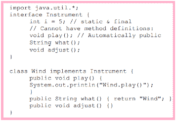

### 203. 问：在 Java 中如何实现多继承？

**答：** `Java` 的接口机制可以实现多继承，与 `C++` 实现多继承的方法相比有一个重要的区别：被继承的接口必须是抽象的。这避免了在不同实现之间进行选择的需求，因为接口没有实现。

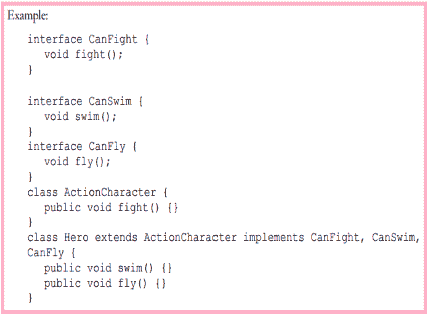

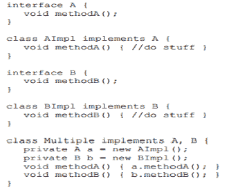

见上文，你甚至可以实现一种多继承的形式，可以使用类的功能而不仅仅是接口。

这完全解决了 `C++` 多继承中的传统问题，即基类之间发生名称冲突的问题。派生类的编码者必须显式地解决任何冲突。

### 204. 问：String Buffer 和 String 类之间有什么区别？

**答：** String buffer 实现了一个可变的字符序列。String buffer 类似于 `String`，但可以被修改。在任何时间点它包含某些特定的字符序列，但可以通过某些方法调用更改序列的长度和内容。

`String` 类表示字符字符串。Java 程序中所有的字符串字面量（如 `"abc"`）都是常量，并实现为该类的实例；它们的值在创建后无法被更改。

### 205. 问：概括描述 Java 垃圾回收器是如何工作的？

**答：** Java 运行时环境在确定对象不再被使用时会删除它们。这个过程被称为垃圾回收。Java 运行时环境支持一个垃圾回收器，它可以定期释放不再需要的对象所占用的内存。Java 垃圾回收器是一个标记-清除（mark-sweep）回收器，它扫描 Java 的动态内存区域以寻找对象，标记那些被引用的对象。在调查了所有可能的对象路径后，那些未被标记的对象（即未被引用的对象）被认为是垃圾并被收集（对我们垃圾回收算法更完整的描述可能是“一种带有保守扫描的压缩标记-清除回收器”）。

垃圾回收器在系统内存耗尽时同步运行，或者响应 Java 程序的请求。你的 Java 程序可以通过调用 `System.gc()` 请求垃圾回收器运行。垃圾回收器需要大约 20 毫秒来完成任务，因此你的程序应该只在对性能没有影响且预计有足够空闲期让垃圾回收器完成工作时才运行垃圾回收器。

请求垃圾回收运行并不能保证你的对象会被垃圾回收。

在允许 Java 运行时记录线程启动并中断另一个线程的系统（例如 Windows 95）上，Java 垃圾回收器会在系统空闲时异步运行。

一旦另一个线程变得活跃，垃圾回收器就会被要求进入一致状态并终止。（源自 Harry 编写的《from "COe Java Professional"》。）

### 206. 问题：`==` 运算符和 `equals` 方法之间的一些主要区别是什么？

答案：`equals` 方法可以被认为是对对象的值进行深层比较，而 `==` 运算符执行的是浅比较。`equals` 方法比较的是对象所指向的内容，而非指针本身（如果我们可以承认 Java 中有指针的话）。这种间接性对于 C++ 程序员来说可能是很清晰的。


当你想在自定义对象上使用`equals()`方法时，记得重写由`java.lang.Object`提供的`toString()`方法，因为对于`Object`来说，`toString`方法简单地返回内存地址，而在检查对象等性时，比较两个内存地址并不是你想要的。

`String`类带有`toString()`的实现，它会逐字符地进行比较，因此在字符串对象上使用`equals`时，你不需要担心`toString()`。

## 207. 问题：什么是抽象类和抽象方法？

答案：简单来说，带有“abstract”关键字修饰的类或方法就是抽象类或抽象方法。当你想要通过通用接口操作一组类时，你就会创建一个抽象类。所有与基类声明签名匹配的派生类方法将通过动态绑定机制被调用。

如果你有一个抽象类，该类的对象几乎总是没有意义的。也就是说，抽象类旨在表示接口以及有时的默认方法实现，而不是特定的实现，因此创建一个抽象类的实例对象是没有意义的且是不允许的（如果你尝试创建一个，编译器会给你给出一个错误信息）。抽象方法是一个不完整的方法。它只有声明而没有方法体。这里是抽象方法声明的语法：

```java
abstract void f();
```

如果一个类包含一个或多个抽象方法，该类必须被标记为抽象的。（否则，编译器会给出一个错误信息）。可以在不包含任何抽象方法的情况下创建一个抽象类。当你有一个类，在该类中设置任何抽象方法都没有意义，但你又想防止该类的任何实例被创建时，这就有用。创建抽象类和方法是因为它们使类的抽象性显式化，并告诉用户和编译器它被打算如何被使用。

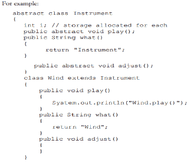

## 208. 问题：你如何强制所有派生类实现基类中存在的方法？

答案：抽象类是可行的方法。`Interface`绝对是错误的方法。考虑`Interface`的最佳方式就是把它视为它本身，一个完全抽象的类。接口和抽象类的一个主要区别在于，在抽象类中你可以定义一些方法而不是所有（尽管你仍然无法实例化抽象类）。

在`interface`中你只能声明方法，但不能定义它们。总而言之，抽象类是可行的方法。这将允许你将涉及的方法留在抽象类中并允许它由子类来定义。

## 209. 问题：Java 说“一次编写，随处运行”。哪些情况下这并不完全正确？

答案：有些问题需要你花费精力将为一个操作系统编写的系统移植到另一个操作系统上运行：

- 你有使用`JNI`的能力，它将使用原生库，这些库在不同系统上的工作方式可能不同。
- 你有通过`Runtime.getRuntime().exec("<system command>")`执行系统调用的能力，这会使代码依赖硬件，例如`"ls"`在 Windows 上无法工作。
- 你有在像素中使用像素 XY 坐标而不是在 Swing 中指定布局管理器（Layout Manager），这将改变 GUI 在不同系统上的外观。
- 在不同系统的 VM 实现中也存在一些 bug，这可能导致你的程序在 Sun 上运行良好，但在 HP 上崩溃，如果你的程序在 HP VM 上遇到了一个在 SUN 实现中不存在的 bug。我个人就就遇到过这种情况。
- 你必须为运行系统的每个操作系统执行单独的性能调优，例如垃圾回收参数、初始堆大小等，这取决于每个操作系统及其运行硬件的性能。
- 线程在每个系统上的实现方式不同。例如，在 Windows 上，即使是低优先级线程也会获得几个时间片，而在 UNIX 上，如果高优先级线程不让位，低优先级线程永远不会运行。

还有其他细微的操作系统差异，例如，你在 UNIX 上发送`kill -S SIGQUIT`命令来查看线程转储，而在 Windows 上你按 Break 键。

## 210. 问题：`Vector`和`Array`有什么区别？讨论两者的优缺点？

答案：`Vector`和`Arrays`之间的主要区别是：

- `Vector`可以包含不同类型的对象，而数组只能包含单种类型的对象。
- `Vector`可以在运行时扩展，而数组的长度是固定的。
- `Vector`方法是同步的，而`Array`方法不是同步的。

如果你需要类似 vector 的功能，但不需要同步功能，请使用`ArrayList`。

## 211. 问题：Java 中的“synchronize”关键字意味着什么？你何时使用它？同步的缺点是什么？

答案：当你想让你的方法是线程安全的时使用同步。同步的缺点是它会减慢程序。而且如果处理不当，会导致死锁。

关于同步还有几点需要知道的：

- 仅在编写多线程代码时使用（并尽量减少）同步，因为这存在速度成本（取决于同步/非同步方法的执行时间，慢五到六倍）。
- 在`synchronized`方法的情况下，生成的字节码与非同步方法完全相同。唯一的区别是方法`method_info`结构中的`ACC_SYNCRONIZED`属性标记在存在同步方法修符时会被设置。
- 此外，如果在方法体中使用`synchronized`关键字，除了异常处理之外生成`monitorenter/monitorexit`的字节码。

所以，底线是非常谨慎地使用同步，理解性能影响，并优先使用`synchronized`方法而不是`synchronized`块。

子类构造函数中的第一条语句应该是对基类构造函数的调用，当且仅当基类构造函数带有参数时如此。然而，如果基类构造函数没有参数，则在子类中会自动调用基类构造函数。

## 214. 问题：阐述 Java 的安全模型

**答案：**Java 拥有一种“沙箱”安全模型，通过对单个操作进行细粒度的分析，可以将不受信的代码与其不应该能够接触的数据隔离开。

这与“信任用户”安全模型形成对比，微软一直在通过`ActiveX`等推行这种模型。在这种模型中，重点是获取一系列信任用户的证书链。一旦某个东西被信任，它就拥有执行所有操作的全权限。

---

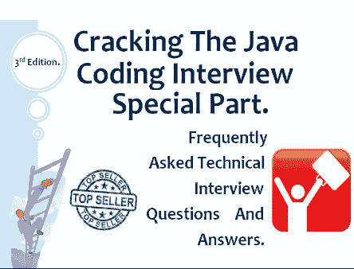


# 针对高级和资深开发者的 10 个核心 Java 面试题

面向高级和资深开发者的 Java 面试题 -

如你所知，Java 非常庞大，没有任何办法可以为任何核心 Java 面试做完全准备，但问题的难度取决于你的经验。如果你是初级人员，Java 面试中问的问题大多基于基础知识，例如 Java 中的`Iterator`对比`Enumeration`、为什么`main`方法是`public static void`，或者 Java 中`ArrayList`与`LinkedList`的区别。

当你申请高级开发人员、技术主管或团队组 Java 职位时，情况就会发生变化。该层级的问题更高级，且在 Java 圈中不那么流行，你可能会被问到设计模式、多线程、集合的问题，甚至被要求编写代码、设计类并准备`JUnit`测试。

在 Java 章节中，我将分享一些高级核心 Java 面试题，这些问题通常出现在具有 4 到 6 年和 6 到 8 年经验的高级面试中。需要注意的一点是，你不能仅仅通过背这些问题的答案来通过面试，因为面试官很可能会根据你的回答提出追问，而通过的唯一方法是充分理解主题。

以下是我的问题列表，如果你准备参加高级位的核心 Java 面试，这些问题是值得准备的，这些问题大多基于垃圾回收、并发、集合、设计、编码和测试。

## `ConcurrentHashMap`在 Java 中是如何工作的？

**问题：**`ConcurrentHashMap`是线程安全的吗？

**问题：**可以在没有外部同步的情况下将`Hashtable`替换为`ConcurrentHashMap`吗？

如你所示，该类别有多个问题，它们大多是追问，如果你理解`ConcurrentHashMap`就能回答。

**问题：**Java 中的`CountDownLatch`是什么？

**问题：**Java 中的`CyclicBarrier`是什么？

**问题：**Java 中`CountDownLatch`和`CyclicBarrier`有什么区别？

并发是高级核心 Java 面试的热门话题，期望资深和高级 Java 开发者对 Java 中的多线程和并发 API 有良好的理解。

**问题：**什么是竞态条件（Race condition）？你遇到过竞态吗？

**问题：**Java 中的`deadLock`是什么？编写代码避免 Java 中的死锁。

竞态条件和死锁是编写高性能并发 Java 应用时面临的主要挑战，高级和资深 Java 程序员应该具备处理同步和并发问题的实战经验。更多细节请参阅“如何在 Java 中避免死锁”和“Java 中什么是竞态条件”。

**问题：**什么是`PermGen`空间？

**问题：**Java 中的内存泄漏是什么？

**问题：**`PermGen`内存中的`OutOfMemoryError`是什么意思？

**问题：**Java 中`NoClassDefFoundError`和`ClassNotFoundException`有什么区别？

这些是与 Java 错误和异常相关的问题，`OutOfMemoryError`和`NoClassDefFoundError`是 Java 中常见且令人恐惧的错误。

## 作为高级 Java 开发人员，你应该具备哪些技能？

**技能 #1：**良好的“软件工艺”技能。换句话说，对下面列出的 16 个技术关键领域有良好的掌握。你应该能够提出正确的问题（例如：我应该在这里使用面向面向编程（即`AOP`）吗？我应该倾向乐观锁还是悲观锁？方法调用是否应该在事务上下文中？）并解决与这 16 个技术关键领域相关的问题（例如内存泄漏、线程安全、SQL 注入攻击、性能等）。

### 这 16 个关键领域是什么？


1. 语言基础 (LF)
2. 规范基础 (SF)
3. 平台基础 (PF)
4. 设计考虑 (DC)
5. 设计模式 (DP)
6. 并发管理 (CM)
7. 性能考虑 (PC)
8. 内存/资源考虑 (MC)
9. 事务管理 (TM)
10. 安全 (SE)
11. 可扩展性 (SC)
12. 最佳实践 (BP)
13. 编码 (CO)
14. 异常处理 (EH)
15. 软件开发流程 (SDP)
16. 服务质量 (QoS)

## 如何获得初级 Java 开发人员的工作？

初级 Java 开发人员和职业转型者会陷入一种恶性循环：“没有实战经验就找不到工作，但雇主在你没有经验的情况下也不于雇你”。雇主寻找的是从入职第一天起就能贡献的初级开发人员。这并不意味着雇主不会为你提供培训和支持，而是寻找学术学历之外的技能，如独立工作等。

### 对获得工作没有实质帮助的事情：

1. 认为堆积证书有帮助。
2. 认为研究生学历可以增加你的机会。
3. 认为从头到尾读完一本 Java 书有帮助。

### 成为 Java 开发人员你应该做的事：

学习驾驶的唯一方法是坐在驾驶位上。简而言之，你应该做这三件事：

2. 投入精力提高求职技能，包括面试、人脉建立和简历编写。
3. 通过公开和隐藏的人才市场持续申请工作。
4. 遵循下述的提示来增强实战经验，同时坚持第 1 和 2 点。

## 获取所需的实战经验

**技巧 #1：**Java 非常容易获取，以下所有都是免费提供的。你采取步骤可能会根据你对 Java 及其工具的熟悉程度而有所不同。

1. 一台电脑——台式机或笔记本。
2. 下载最新版本的 Java（`JDK`和`JRE`）。
3. 下载最新版本的`eclipse` IDE。
4. 下载`Tomcat`或`JBoss`来部署你的应用程序。
5. 下载并安装`MySQL`数据库。所有非简单的应用程序都需要将信息持久化到数据库中。
6. 设置`Maven`作为构建和依赖管理工具，以便你能够下载所需的框架，如`Spring`和`Hibernate`。

### 提示 #2

先从基础知识开始。企业级 Java 有数百个框架和库，初学者很容易感到困惑。一旦你达到某个程度，你就能更好地掌握它们，但为了入门，请遵循以下基础步骤。可以根据你的需要随时进行调整。

- Java 核心基础。使用面向对象（OO）概念编写简单的独立 Java 程序。使用`JUnit`编写单元测试。
- 学习`SQL`并编写通过`JDBC`连接到`MySQL`数据库的独立 Java 程序。
- 使用企业级 Java 通过`Servlets`和`JSPs`编写简单的 Web 应用。应用程序需要将数据持久化到`MySQL`数据库。将应用程序部署到`Tomcat`或`JBoss`服务器并作为企业级应用运行。使用`Maven`进行构构建和依赖管理。
- 扩展你使用`JSPs`、`Servlets`和`JDBC`创建的项目，以使用热门的框架。学习“依赖注入”的概念。开始构建如`Spring`等热门框架。`Spring`非常庞大，请从`spring core`和`spring jdbc`开始。`Spring core`用于依赖注入，`Spring jdbc`用于连接数据库和执行 SQL 查询。
- 学习用于 Web 开发`MVC`（模型-视图-控制器）设计模式。将你的`JSPs`和`Servlets`转换为基于`Spring-mvc`的 Web 应用。
- 使用`Spring MVC`编写`RESTFul` Web 服务。
- 掌握`HTML`、`JavaScript/jQuery/JSON`、`ajax`和`CSS`。这是至关重要的，因为越来越多的机构正转向基于 JavaScript 的 MVC 框架，如`angularjs`或`backbone`。这些框架通过 RESTFul Web 服务调用获取`JSON`格式的数据并填充前端。如果时间允许，学习`node.js`也会很有帮助。
- 确保使用`JUnit`和像`Mockito`这样的框架为你的代码编写单元测试。

### 提示 #3

一旦你对使用`Java`开发企业级应用有了熟悉和经验，尝试为开源项目做贡献，或者如果你的自学项目非常复杂，尝试将你的自学项目开源。通过查看他人的代码你可以学到很多。

### 提示 #4

寻找志愿者工作来增强你的实战经验。不要过度承诺。留出比如 2 到 3 天为慈善机构或社区组织建立网站。

### 提示 #5

在简历和博客中分享你通过提示 1-4 获得的实战经验（博客最初可以保持私密）。通过博客记录你的经验至关重要。通过此博客或互联网其他地方的许多实用文章来提高你的简历写作和面试技巧。在执行提示 1-5 的同时，继续申请有薪工作也是至关重要的。

### 提示 #6

志愿者工作以及通过`Java 用户组`（`JUGs`）和毕业招聘会提供的其他人脉机会，可以让你与行业内的人士建立联系，并为你开启更多大门。提示 1-5 也会将你与其他初级开发者区分开来。我的书籍和博客涵盖了大量的`Java`面试题库。

练习这些问答，因为许多雇主会进行初步电话筛选和技术测试，以确定你的 Java 知识，主要是核心`Java`和 Web 开发（例如：无状态`HTTP`协议、`session`、`cookie`等）。

你只需要每天学习 10 个问答，同时获得实战经验并申请初级工作。针对有经验的 Java 开发者的前 20 个 Java 技术面试题和答案。

掌握 16 个技术关键领域以及提高你 Java 开发者生产力的实用工具。

你想成为前端开发者，但对从哪里开始感到困惑吗？

新的趋势是使用如`AngularJS`等基于 JavaScript 的框架。因此，学习`JavaScript`、`HTML(5)`和`CSS`是必须的。`AngularJS`正在快速增长。目前的 JEE 标准是`JSF`。新的项目正转向使用客户端 MVW（模型-视图-任何）框架，如`AngularJS`、`Backbone`、`ExtJs`等。如果你最终是增强现有应用程序，你有很大机会使用以下 Web 框架之一：`JSF`、`Spring MVC`、`Struts(2)`和`GWT`。


## 寻找初级 Java 开发者工作本身就是一份全职工作

你面临着 8 小时以上的工作。定期回顾你的进度，并微调你的方法。有时你可能需要对方法进行 360 度的转变（例如：从堆积证书转向获得急需的实战经验，从头到尾读 Java 书籍转向参加志愿者工作，将找工作时间从每天 2 小时改为每天 8 小时等）。

做各种事情来保持趣味性并让你保持动力真的非常重要。动力很容易流失。与同为初级 Java 开发者分享你的经验。在处理上述提示的同时，继续申请有薪工作至关重要。


# 第四部分


# 针对新手和有经验的程序员的 50 道 Java 多线程与并发面试题答案

无论你参加任何 Java 面试，无论是高级还是初级，有经验还是新手，你都不可避免关于线程、并发和多线程的问题。事实上，这种内置的并发支持是 Java 编程语言的强大点之一，并帮助它在企业世界和程序员中获得普及。大多数高薪 Java 开发者职位都要求优秀的 Java 多线程技能以及开发、调试和优化低延迟并发应用的经验。

这就是为什么它是面试中最受欢迎的技能之一。在典型的 Java 面试中，面试官会从`Thread`的基本概念开始，询问如为什么需要线程、如何创建线程、哪种创建线程的方法更好，例如扩展`thread`类或实现`Runnable`，然后进入并发问题、并发 Java 应用时面临的挑战、Java 内存模型、1.5 版本引入的高级并发工具、并发 Java 应用原则和设计模式、经典的多线程问题，如生产者消费者、哲学家晚餐、读写者或简单的缓冲区问题。仅仅了解线程基础是不够的，你必须学会如何处理并发问题，如死锁、竞态条件、内存不一致以及各种线程安全相关问题。


这些技能通过演示各种多线程和并发问题得到彻底测试。许多 Java 开发者习惯在面试前只看和读面试题，这并不坏，但你不应该太脱节。

而且，收集问题并反复练习太费时间了，这就是为什么我创建了这份从各种面试中收集的 Top 50 Java 多线程和并发相关问题列表。我只会在发现新的和最新的面试题时进行添加。

顺便说一下，我没有在这里提供这些问题的答案，为什么呢？因为我期望大多数 Java 开发者知道这个问题的答案，如果不知道，这里是我关于 Java 线程、并发和多线程的热题列表。你可以利用这个列表充分准备你的 Java 面试。

## 1) 什么是 Java 中的线程？

线程（`Thread`）是一个独立的执行路径。它是利用机器中可用多个 CPU 的方式。通过使用多个线程，你可以加速 CPU 密集型任务。例如，如果一个线程完成一项工作需要 100 毫秒，你可以使用 10 个线程将该任务缩短到 10 毫秒。Java 在语言层面为多线程提供了极佳的支持，这也是它的核心卖点之一。

## 2) Java 中线程（Thread）和进程（Process）的区别是什么？

线程是 `Process` 的子集，换句话说一个进程可以包含多个线程。两个进程运行在不同的内存空间中，但所有线程共享同一个内存空间。不要将其与栈内存（stack memory）混淆，每个线程的栈是不同的，用于存储该线程的本地数据。

## 3) 如何在 Java 中实现线程？

在语言层面，在 Java 中实现线程有两种。`java.lang.Thread` 的实例代表一个线程，但它需要一个任务来执行，该任务是 `java.lang.Runnable` 接口的实例。由于 `Thread` 类本身实现了 `Runnable`，你可以通过扩展 `Thread` 类或直接实现 `Runnable` 接口来重写 `run()` 方法。详细答案和讨论请参阅此。

## 4) 在 Java 中何时使用 Runnable 还是 Thread？

这是上一个多线程面试题的后续。众所周知我们可以通过扩展 `Thread` 类或实现 `Runnable` 接口来实现线程，问题随之产生：哪一个更好？什么时候用哪个？如果你知道 Java 编程语言不支持类的多继承，但允许实现多个接口，那么这个问题就很好回答。这意味着如果你还想扩展另一个类（例如 `Canvas` 或 `CommandListener`），那么实现 `Runnable` 比扩展 `Thread` 更好。

## 6) Thread 类中 start() 和 run() 方法的区别是什么？

这是早期的一个经典的 Java 陷阱题，但仍然足以区分对 Java 线程模型的浅层理解。`start()` 方法用于启动新创建的线程，而 `start()` 内部会调用 `run()` 方法，这与直接调用 `run()` 方法是有区别的。当你像普通方法一样调用 `run()` 时，它是在同一个线程中调用的，不会启动新线程；而调用 `start()` 方法时则是如此。

## 7) Java 中 Runnable 和 Callable 的区别是什么？

`Runnable` 和 `Callable` 都代表旨在在单独线程中执行的任务。`Runnable` 从 JDK 1.0 就有了，而 `Callable` 是在 JDK 1.5 添加的。这两者的主要区别是 `Callable` 的 `call()` 方法可以返回值并抛出 `Exception`，而 `Runnable` 的 `run()` 方法无法做到这一点。`Callable` 返回 `Future` 对象，它可以持有计算结果。

## 8) Java 中 CyclicBarrier 和 CountDownLatch 的区别是什么？

虽然 `CyclicBarrier` 和 `CountDownLatch` 都等待一个或多个事件上的线程数量，但它们的主要区别在于：一旦 `CountDownLatch` 的计数归零就无法重用，但即使屏障被打破，你也可以重用同一个 `CyclicBarrier`。

## 9) 什么是 Java 内存模型？

Java 内存模型是一 set 规则和指南，允许 Java 程序在不同的内存架构、CPU 和操作系统上以确定性的行为运行。在多线程情况下尤为重要。Java 内存模型对一个线程所做的更改对其他线程可见提供了一些保证，其中之一就是“发生之前”（happens-before）关系。

这种关系定义了几条规则，允许程序员预测和推理并发 Java 程序的行为。例如，“发生之前”关系保证：

- 线程中的每个动作都发生在该线程中在程序顺序中较后的每个动作之前，这被称为程序顺序规则。
- 对监视器锁（monitor lock）的解锁操作发生在对同一监视器锁的后续任何锁定操作之前，也称为监视器锁规则。
- 对 `volatile` 字段的写操作发生在对该字段的后续任何读操作之前，被称为 Volatile 变量规则。
- 对线程调用 `Thread.start()` 的操作发生在任何其他线程检测到该线程已终止之前（无论是通过 `Thread.join()` 成功返回，还是通过 `Thread.isAlive()` 返回 `false`），也称为线程启动规则。
- 线程对另一个线程调用 `interrupt()` 的操作发生在被中断的线程检测到中断之前（无论是通过抛出 `InterruptedException`，还是调用 `isInterrupted` 或 `interrupted()`），俗称为线程中断规则。
- 对象构造函数的结束发生在该对象终结器（finalizer）的开始之前，被称为 Finalizer 规则。

如果 `A` 发生于 `B` 之前，且 `B` 发生于 `C` 之前，那么 `A` 就发生在 `C` 之前，这意味着“发生之前”保证具有传递性。

## 10) Java 中的 volatile 变量？

`volatile` 是一种特殊的修饰符，只能用于实例变量。在并发 Java 程序中，多个线程对实例变量的更改在缺少任何同步器（例如 `synchronized` 关键字或锁）的情况下对其他线程是不可见的。`Volatile` 变量保证写操作发生在任何后续读操作之前，正如上一个问题中提到的“volatile 变量规则”。

## 11) 什么是线程安全？Vector 是线程安全的类吗？（是的，见详情）

线程安全是对象或代码的属性，保证如果以任何方式被多个线程执行或使用（例如读与写），它的行为将符合预期。例如，一个线程安全的计数对象如果该计数器的同一实例在多个线程之间共享，将不会遗漏任何计数。显然，你也可以将集合类分为两类：线程安全和非线程。`Vector` 确实是一个线程安全的类，它通过同步修改状态的方法来实现线程安全；另一方面，它的伙伴 `ArrayList` 不是线程安全的。

## 12) Java 中的什么是竞态条件（race condition）？举例说明。

竞态条件是 Java 程序在并发执行环境中产生微妙程序错误的原因。正如名称所示，竞态条件由于多个线程之间的竞争而产生，如果应该先执行的线程输掉了竞争变成了后执行，代码的行为就会改变，表现为非确定性的错误。由于线程竞争的随机性，这是最难发现和复现的错误之一。一个例子是无序处理。

## 13) Java 中如何停止线程？

我一直说 Java 提供了丰富的 API，但讽刺的是 Java 并没有提供一种可靠停止线程的方法。JDK 1.0 中有一些控制方法，例如 `stop()`、`suspend()` 和 `resume()`，它们由于潜在的死锁威胁被废弃了，从那时起 Java API 设计师并没有提供一种一致、线程安全且优雅的停止线程的方法。程序员主要依赖线程在完成 `run()` 或 `call()` 方法执行后会自动停止这一事实。要手动停止，程序员要么利用 `volatile` 布尔变量并在每次迭代中检查运行方法是否有循环，要么中断线程以强制取消任务。

## 14) 当线程中发生异常会发生什么？

这是我在面试中见过的一个非常有趣的 Java 题。简单来说，如果未捕获，线程将死亡；如果注册了未捕获异常处理器，它将获得回调。`Thread.UncaughtExceptionHandler` 是一个接口，定义为当线程由于未捕获异常而突然终止时的处理器。当线程由于未捕获异常即将终止时，Java 虚拟机将通过 `Thread.getUncaughtExceptionHandler()` 查询线程的未捕获异常处理器，并调用它的 `uncaughtException()` 方法，将线程和异常作为参数传递。

## 15) 如何在两个线程之间共享数据？

你可以通过共享对象或并发数据结构（如 `BlockingQueue`）在线程之间共享数据。请参考此教程学习 Java 中的线程间通信。它使用 `wait` 和 `notify` 方法实现了生产者-消费者模式，这涉及到在两个线程之间共享对象。

### 16) Java 中 `notify` 和 `notifyAll` 有什么区别？

这是 Java 核心面试中的另一个棘手问题，由于多个线程可以等待同一个监视锁（monitor lock），Java API 设计者提供了方法在等待条件改变时仅通知其中一个或所有线程，但它们只提供了一半的实现。

`notify()` 方法没有提供任何选择特定线程的方法，因此只有当你确定只有一个线程在等待时，它才是有用的。另一方面，`notifyAll()` 会向所有线程发送通知，并允许它们竞争锁，这确保了至少会有一个线程能够继续向下执行。

### 17) 为什么 `wait`、`notify` 和 `notifyAll` 不在 `Thread` 类中？

这是一个设计相关的问题，用于检查候选人对现有系统的看法，或者他是否考虑过某些非常常见但初看起来并不恰当的事情。为了回答这个问题，你必须给出理由说明为什么这三个方法放在 `Object` 类中是合理的，而不是放在 `Thread` 类中。

一个显而易见的原因是，Java 提供的是对象级别的锁，而不是线程级别的锁。每个对象都有锁，该锁由线程获取。现在，如果线程需要等待某个锁，那么在该对象上调用 `wait()` 比在线程上调用更符合逻辑。如果 `wait()` 方法声明在 `Thread` 类上，则将无法清楚该线程正在等待哪个锁。简而言之，由于 `wait`、`notify` 和 `notifyAll` 是在锁级别上操作的，因此在对象类中定义它们是合理的，因为锁属于对象。

### 18) Java 中的 `ThreadLocal` 变量是什么？

`ThreadLocal` 变量是 Java 程序员可用的一种特殊变量。就像实例变量是每个实例私有的一样，`ThreadLocal` 变量是每个线程私有的。它是实现高开销对象线程安全的良好方法，例如，你可以使用 `ThreadLocal` 使 `SimpleDateFormat` 线程安全。由于该类开销很大，在局部作用域内使用它并不好，因为每次调用都需要独立的实例。

通过为每个线程提供自己的副本，你可以一箭双雕。首先，你通过复用固定数量的实例减少了高开销对象的实例数量；其次，你在无需付出同步或不可变性代价的情况下实现了线程安全。线程本地变量的另一个良好例子是 `ThreadLocalRandom` 类，它减少了多线程环境中高开销的 `Random` 对象的实例数量。

### 19) Java 中的 `FutureTask` 是什么？

`FutureTask` 代表并发 Java 应用程序中一个可取消的异步计算。

该类提供了 `Future` 的基础实现，并带有启动和取消计算的方法、查询计算是否完成的方法，以及获取计算结果的方法。只有在计算完成后才能获取结果；如果计算尚未完成，`get` 方法将发生阻塞。`FutureTask` 对象可以用来封装 `Callable` 或 `Runnable` 对象。由于 `FutureTask` 也实现了 `Runnable`，因此它可以被提交给 `Executor` 执行。

### 20) Java 中 `interrupted` 方法和 `isInterrupted` 方法有什么区别？

`interrupted()` 和 `isInterrupted()` 的主要区别在于，前者会清除中断状态，而后者不会。Java 多线程中的中断机制是通过一个名为“中断状态”的内部标志实现的。通过调用 `Thread.interrupt()` 中断线程会设置此标志。当被中断的线程通过静态方法 `Thread.interrupted()` 检查中断时，中断状态会被清除。非静态方法 `isInterrupted()` 用于一个线程查询另一个线程的中断状态，它不会改变中断状态标志。按照惯，任何通过抛出 `InterruptedException` 退出的方法在这样做时都会清除中断状态。然而，另一个线程可能会通过调用 `interrupt` 立即设置中断状态。

### 21) 为什么 `wait` 和 `notify` 方法必须在 `synchronized` 块中调用？

在 `synchronized` 块或方法中调用 `wait` 和 `notify` 方法的主要原因是这是 Java API 的强制要求。如果你不在同步上下文中调用它们，你的代码将抛出 `IllegalMonitorStateException`。另一个更微妙的原因是避免 `wait` 和 `notify` 调用之间的竞态条件。

### 22) 为什么你应该在循环中检查等待条件？

等待线程可能会接收到虚假报警和伪唤醒调用，如果它不在循环中检查等待条件，即使条件不满足，它也会直接退出。因此，当等待线程唤醒时，它不能假设它所等待的状态仍然有效。该状态在过去可能是有效的，但在调用 `notify()` 方法之后、等待线程唤醒之前，状态可能已经发生了变化。这就是为什么在循环中调用 `wait()` 方法总是更好，你甚至可以在 Eclipse 中创建调用 `wait` 和 `notify` 的模板。

### 23) Java 中 `synchronized` 集合和并发集合有什么区别？

尽管 `synchronized` 集合和并发集合都提供了适用于多线程并发访问的线程安全集合，但后者的扩展性更好。在 Java 1.5 之前，Java 程序员只有同步集合，当多个线程并发访问它们时，它们会成为竞争源，这阻碍了系统的扩展性。Java 5 引入了如 `ConcurrentHashMap` 等并发集合，它不仅提供了线程安全性，还通过锁分段（lock stripping）和内部表分区的等现代技术改进了扩展性。

### 24) Java 中 `Stack`（栈）和 `Heap`（堆）有什么区别？

为什么有人会作为多线程和并发的一部分问这个问题？因为 `Stack` 是与线程紧密相关的内存区域。为了回答这个问题，栈和堆都是 Java 应用程序中特定的内存。每个线程都有自己的栈，用于存储局部变量、方法参数和调用栈。存储在一个 `Thread` 栈中的变量对其他线程不可见。另一方面，堆是所有线程共享的公共内存区域。无论是局部对象还是任何级别的对象都创建在堆中。为了提高性能，线程倾向于将值从堆中缓存到自己的栈中，如果该变量被多个线程修改，就会产生问题，这就是 `volatile` 变量大显身场的地方。`volatile` 建议线程始终从主内存读取变量的值。

### 25) 什么是线程池？为什么在 Java 中你应该使用线程池？

创建线程在时间和资源方面都是昂昂的。如果你在处理请求时创建线程，它将减慢你的响应时间，而且一个进程可以创建的线程数量是有限的。为了避免这两个问题，会在应用程序启动时创建一个线程池，并复用线程进行请求处理。这个线程池被称为“线程池”，线程被称为“工作线程”。从 JDK 1.5 发布开始，Java API 提供了 `Executor` 框架，允许你创建不同类型的线程池，例如单线程池（一次处理一个任务）、固定线程池（具有固定数量线程的池）或缓存线程池（适用于具有许多短命任务的可扩展线程池）。

你在现实世界中解决的大多数线程问题都属于生产者-消费者模式，其中一个线程产生任务，另一个线程消费这些任务。你必须知道如何进行线程间通信来解决这个问题。在底层层面，你可以使用 `wait` 和 `notify` 来解决这个问题；而在高层层面，你可以利用 `Semaphore` 或 `BlockingQueue` 来实现生产者-消费者模式。

### 27) 如何检查一个线程是否持有锁？

在 Java 面试的电话轮次中遇到这个问题之前，我甚至不知道可以检查 `Thread` 是否已经持有了锁。`java.lang.Thread` 上有一个名为 `holdsLock()` 的方法，当且仅当当前线程持有指定对象的监视器锁时，该方法返回 `true`。

### 28) 如何在 Java 中避免死锁？写出代码？


死锁是指两个线程等待对方采取行动以便自己继续移动的状态。这是一个严重的问题，因为当死锁发生时，你的程序会挂起且不执行其预期的任务。为了使死锁发生，必须满足以下四个条件：

- `Mutual Exclusion`（互斥）：至少有一个资源必须以非共享模式被持有。在任何给定时刻，只有一个进程可以使用该资源。
- `Hold and Wait`（持有并等待）：一个进程当前持有至少一个资源，并请求由其他进程持有的额外资源。
- `No Pre-emption`（非抢夺）：操作系统在分配资源后不能收回资源；资源必须由持有进程自愿释放。
- `Circular Wait`（循环等待）：一个进程必须等待由另一个进程持有的资源，而该进程又在等待第一个进程释放资源。

避免死锁最简单的方法是防止循环等待，这可以通过按特定顺序获取锁并反向释放锁来实现，这样线程只有在持有另一个锁的情况下才能继续获取某个锁。

### 29) Java 中活锁（livelock）和死锁（deadlock）的区别是什么？

这个问题是上一个面试问题的扩展。活锁类似于死锁，不同之处在于参与活锁的线程或进程的状态会相互不断变化，但没有任何一个能取得进展。

活锁是资源饥饿的一种特殊情况。活锁的一个现实世界例子是：两个人在狭窄走廊里相遇，每个人都试图通过礼貌地侧身让对方通过，但他们最终来回晃动而没有取得任何进展，因为他们反复同时向同一个方向移动。简而言之，活锁和死锁的主要区别在于，前者进程的状态在改变但没有产生进展。

### 30) 如何在 Java 中获取线程转储（thread dump）？


取决于操作系统，有多种方法可以获取 Java 进程的线程转储。获取线程转储时，JVM 将所有线程的状态写入日志文件或标准错误控制台。

在 Windows 中，你可以使用 `Ctrl + Break` 键组合获取线程转储；在 Linux 上可以使用 `kill -3` 命令实现相同的功能。你也可以使用一个名为 `jstack` 的工具来获取线程转储，它作用于进程 ID，该 ID 可以通过另一个名为 `jps` 的工具找到。

## 31) 使用哪个 JVM 参数控制线程的栈大小？

这个非常简单，`-Xss` 参数用于控制 Java 中 `Thread` 的栈大小。

## 32) Java 中 `synchronized` 和 `ReentrantLock` 的区别是什么？

曾几何段时间，在 Java 中提供互斥的唯一方法是通过 `synchronized` 关键字，但它有许多缺点，例如：你无法在方法或块边界之外扩展锁，你无法放弃尝试获取锁等。Java 5 通过 `Lock` 接口提供更精细的控制解决了这个问题。

`ReentrantLock` 是 `Lock` 接口的一种常见实现，它提供了可重入互斥锁，其基本行为和语义与使用 `synchronized` 方法和语句访问的隐式监视器锁相同，但具有更强大的扩展能力。

## 33) 有三个线程 T1、T2 和 T3？如何在 Java 中确保 T1、T2、T3 的执行顺序？

多线程中的顺序控制可以通过不同的手段实现，但你可以简单地使用线程类的 `join()` 方法在另一个线程完成执行后启动它。为了确保三个线程按顺序执行，你需要先启动最后一个线程，例如 `T3`，然后按反序调用 `join` 方法，例如 `T3` 调用 `T2.join`，而 `T2` 调用 `T1.join`，通过这样 `T1` 会先完成，`T3` 最后完成。

## 34) `Thread` 类的 `yield` 方法起什么作用？

`Yield` 方法是请求当前线程放弃 CPU 以便其他线程有机会执行的一种方式。`Yield` 是一个静态方法，它只保证当前线程会放弃 CPU，但并没有说明哪个其他线程将获得 CPU。同一个线程可能会重新获得 CPU 并再次开始执行。

## 35) Java 中 `ConcurrentHashMap` 的并发级别（concurrency level）是多少？

`ConcurrentHashMap` 通过将实际 map 划分为若干区域（sections）来在其其可扩展性和线程安全。这种划分是通过使用并发级别完成的。它是 `ConcurrentHashMap` 构造函数的可选参数，默认值为 `16`。表在内部被分区，以尝试在没有竞争的情况下允许指定数量的并发更新。

## 36) Java 中的 `Semaphore` 是什么？

Java 中的 `Semaphore` 是一种新的同步器。它是一个计数信号量。从概念上讲，`semaphore` 维护一组许可（permit）。每次 `acquire()` 在必要时阻塞直到许可可用，然后获取它。每次 `release()` 增加一个许可，可能会释放一个阻塞的获取者。然而，并没有使用实际的许可对象；`Semaphore` 只是对可用数量进行计数并据此行动。`Semaphore` 用于保护数量固定的贵资源，例如池中的数据库连接。了解更多关于 Java 中的计数信号量。

## 37) 当线程池队列已满时，提交任务会发生什么？

这是我列表中的另一个棘手问题。许多程序员会认为它会一直阻塞直到任务被清除，但事实并非如此。如果任务无法调度执行，`ThreadPoolExecutor` 的 `submit()` 方法会抛出 `RejectedExecutionException`。

## 38) Java 线程池中 `submit()` 方法和 `execute()` 方法的区别是什么？

这两个方法都是将任务提交到线程池的方式，但它们之间存在细微差异。`execute(Runnable command)` 定义在 `Executor` 接口中，并在未来执行给定任务，但重要的是它不返回任何内容。它的返回类型是 `void`。另一方面，`submit()` 是一个重载方法，它可以接收 `Runnable` 或 `Callable` 任务，并返回一个可以持有待计算结果的 `Future` 对象。该方法定义在 `ExecutorService` 接口上，该接口扩展了 `Executor` 接口，每个其他线程池类（例如 `ThreadPoolExecutor` 或 `ScheduledThreadPoolExecutor`）都拥有这些方法。

## 39) 什么是 Java 中的阻塞方法（blocking method）？

阻塞方法是指在任务完成之前一直阻塞的方法，例如 `ServerSocket` 的 `accept()` 方法会阻塞直到客户端连接。在这里阻塞意味着在任务完成之前，控制权不会返回给调用者。另一方面，还有异步或非阻塞方法，它们在任务完成之前就会返回。

## 40) Swing 是线程安全的吗？你说的 Swing 线程安全是什么意思？

你可以简单地回答这个问题为：不，`Swing` 不是线程安全的，但即使面试官没有问及，你也必须解释清楚它的具体含义。当我们说 `swing` 不是线程安全的，我们通常指的是它的组件，这些组件不能在多个线程中被修改。所有对 GUI 组件的更新必须在 AWT 线程中完成，而 `Swing` 提供了同步和异步回调方法来调度此类更新。你也可以阅读我的文章了解更多关于 `swing` 和线程安全的知识，以便更好地回答这个问题。接下来的两个问题也与此概念有关。

## 41) Java 中 `invokeAndWait` 和 `invokeLater` 的区别是什么？

这两个是 `Swing` API 提供的方法，允许 Java 开发者从事件分发线程（Event dispatcher thread）之外的线程更新 GUI 组件。`InvokeAndWait()` 同步更新 GUI 组件，例如进度条，一旦有了进展，进度条就应该更新以反映该变化。

如果进度是在另一个线程中跟踪的，则它必须调用 `invokeAndWait()` 来由事件分发线程调度该组件的更新。另一方面，`invokeLater()` 是更新组件的异步调用。

## 42) Java 中 Swing API 的哪些方法是线程安全的？

这个问题再次与 `swing` 和线程安全有关，尽管组件本身不是线程安全的，但某些方法是可以安全地从多个线程调用的。

我知道 `repaint()` 和 `revalidate()` 是线程安全的，但在不同的 Swing 组件上还有其他方法，例如 `JTextComponent` 的 `setText()` 方法，以及 `JTextArea` 类的 `insert()` 和 `append()` 方法。

## 43) 如何在 Java 中创建不可变对象（Immutable object）？

这个问题看起来可能与多线程和并发无关，但实际上是相关的。不可变性有助于简化 Java 中已经复杂的并发代码。由于不可变对象可以在无需任何同步的情况下共享，因此对 Java 开发者来说非常重要。

本要在线程间共享的核心值对象为了性能和简单性考虑，应该是不可变的。遗憾的是，Java 中没有 `@Immutable` 注解可以使你的对象不可变，这必须由 Java 开发者手动完成。你需要保持一些基础，如在构造函数中初始化状态、不提供 setter 方法、不泄露引用、保留可变对象的副本以创建不可变对象。

## 44) Java 中的 `ReadWriteLock` 是什么？

通常情况下，读写锁是锁剥分技术（lock stripping）提高并发应用性能的结果。在 Java 中，`ReadWriteLock` 是在 Java 5 中引入的接口。`ReadWriteLock` 维护一对关联的锁，一个用于只读操作，一个用于写。只要没有写者，多个读取线程可以同时持有读锁。写锁是排斥性的。如果你愿意，可以用你自己的规则实现此接口，否则你可以使用 `ReentrantReadWriteLock`，它随 JDK 一起提供并支持最多 65535 个递归写锁和 65535 个读锁。

## 45) 多线程中的忙自旋（busy spin）是什么？

忙自旋是并发程序员采用的一种技术，用于让线程等待某个特定条件。与传统方法（例如 `wait()`、`sleep()` 或 `yield()`）不同，这些方法都涉及放弃 CPU 控制权，而这种方法不会放弃 CPU，相反，它只是运行一个空循环。为什么有人会这样做？为了保护 CPU 缓存。在多核系统中，暂停的线程可能会在不同的核心上恢复，这意味着需要重新构建缓存。为了避免重新构建缓存的代价，程序员更倾向于通过忙自旋等待极更短的时间。

## 46) Java 中 `volatile` 和原子变量（atomic variable）的区别是什么？

对于 Java 程序员来说这是一个有趣的问题，首先，`volatile` 和原子变量看起来非常相似，但它们是不同的。`volatile` 变量提供了“发生于”（happens-before）保证，即写操作发生在任何后续写入之前，它不保证原子性。例如，仅仅通过将 `count` 变量声明为 `volatile`，`count++` 操作也不会变成原子的。另一方面，`AtomicInteger` 类提供了原子方法来原子地执行此类复合操作，例如 `getAndIncrement()` 是自增运算符的原子替代方案。它可以用于原子地将当前值加 1。同样，你也有其他数据类型和引用变量的原子版本。

## 47) 如果线程在 `synchronized` 块内部抛出 `Exception` 会发生什么？

这是普通 Java 程序员的又一个棘手的问题，他能否指出锁是否被释放这一事实是判断其理解程度的关键指标。要回答这个问题，无论你如何退出 `synchronized` 块（无论是正常执行完毕，还是通过抛出异常异常退出），线程都会释放它进入该 `synchronized` 块时获取的锁。这实际上是我更喜欢 `synchronized` 块而不是 `lock` 接口的原因之一，后者需要显式地释放锁，通常通过在 `finally` 块中释放锁来实现。

## 48) 单例模式的双重检查锁定（double checked locking）是什么？

这是 Java 面试中非常流行的问题之一，尽管很流行，但候选人回答满意的概率只有 50%。一半时间，他们未能写出双检查锁的代码；另一半时间，他们不知道它在 Java 1.5 中是如何被破坏和修复的。这实际上是一种创建线程安全单例的老方法，试图通过只在第一次创建 `Singleton` 实例时加锁来优化性能，但由于其复杂性以及它在 JDK 1.4 中存在缺陷的事，我个人并不喜欢它。无论如何，即使你不倾向于这种方法，从面试的角度来说了解它也是好的。

## 49) 如何在 Java 中创建线程安全的单例？

这个问题实际上是上一个问题的跟进。如果你说你不喜欢双检查锁定，那么面试官必然会询问创建线程安全单例的替代方法。实际上，你可以利用 JVM 的类加载和静态变量初始化来创建单例实例，或者你可以利用 Java 强大的枚举类型（enumeration）来创建单例。

## 50) 列出三个你遵循的多线程最佳实践？

这是我最喜欢的问题之一，因为我相信在编写并发代码时必须遵循某些最佳实践，这有助于性能、调试和维护。以下是三项最佳实践，我认为普通 Java 程序员应该遵循：

- 始终为你的线程赋予有意义的名字：对于在并发代码中寻找 bug 或跟踪执行非常有帮助。`OrderProcessor`、`QuoteProcessor` 或 `TradeProcessor` 远比 `Thread-1`、`Thread-2` 和 `Thread-3` 好。名称应该说明该线程执行的任务。所有主流框架甚至 JDK 都遵循这一最佳实践。
- 避免锁定或缩小同步范围：锁定是昂贵的，而上下文切换更昂贵。尽量避免同步和锁定，至少你应该缩小临界区。这就是为什么我倾向于使用 `synchronized` 块而不是 `synchronized` 方法，因为它让你对锁的范围有绝对控制。
- 优先使用同步器（Synchronizers）而不是 `wait` 和 `notify`：像 `CountDownLatch`、`Semaphore`、`CyclicBarrier` 或 `Exchanger` 这样的同步器简化了编码。使用 `wait` 和 `notify` 实现复杂的控制流非常困难。其次，这些类是由业内专家编写和维护的，很有可能它们在随后的 JDK 版本中被优化或被性能更好的代码取代。通过使用高级同步工具，你会自动获得所有这些处。
- 优先使用并发集合（Concurrent Collection）而不是同步集合（Synchronized Collection）

这是另一个易于遵循但获益丰丰简单实践。并发集合（Concurrent collection）比其同步对应的更具可扩展性，这就是为什么在编写并发代码时最好使用它们。所以，下次当你需要 map 时，在考虑 `Hashtable` 之前先考虑 `ConcurrentHashMap`。

## 51) 如何在 Java 中强制启动一个 `Thread`？

这个问题就像如何在 Java 中强制进行垃圾回收一样，没有办法，虽然你可以使用 `System.gc()` 发起请求，但它并不保证执行。在 Java 多线程中，绝对没有办法强制启动线程，这是由线程调度器控制的，且 Java 并没有暴露用于控制线程调度的 API。这在 Java 中仍然是一个随机的位。

## 52) Java 中的 fork join 框架是什么？

`fork/join` 框架是在 `JDK` `7` 中引入的，它是 Java 开发者的一种强大工具，用于利用现代服务器的多个处理器。它是为了可以递归地分解为更小部分的工作而设计的。

目标是利用所有可用的处理能力来增强应用程序的性能。`fork/join` 框架的一个显著优势是它使用了工作窃取（work-stealing）算法。执行完任务的线程线程可以从仍在忙碌的其他线程中窃取任务。

## 53) Java 多线程中调用 `wait()` 和 `sleep()` 方法有什么区别？

虽然 `wait` 和 `sleep` 都会在 Java 中引入某种形式的暂停，但它们是针对不同需求的工具。

`wait` 方法用于线程间通信，如果等待条件为真，它会释放锁，并在另一个线程的操作导致等待条件变为假时等待通知。另一方面，`sleep()` 方法只是在指定的持续时间内释放 CPU 或停止当前线程的执行。调用 `sleep` 方法不会释放当前线程持有的锁。


# 第五部分

# Java 多线程与并发

# 面试题及参考答案


多线程或并发是 Java 面试题中的热门话题之一。在这里我列出了从面试角度来看的大部分重要问题，但你应该对 `java threads` 有良好的了解，以应对后续问题。

## 1. 进程（Process）和线程（Thread）的区别是什么？

进程是一个自包含的执行环境，可以被视为一个程序或应用程序，而 `Thread` 是进程中的单个执行任务。Java 运行时环境作为一个单一进程运行，其中不同的类和程序作为进程。`Thread` 可以称为轻量级进程。`Thread` 创建所需的资源较少且存在于进程中，线程共享进程资源。

## 2. 多线程编程的好处是什么？

在多线程编程中，多个线程并发执行，这提高了性能，因为当某些线程等待获取资源时，CPU 不会空闲。多个线程共享堆内存，因此创建多个线程来执行任务比创建多个进程要好。例如，Servlet 的性能优于 CGI，因为 Servlet 支持多线程，而 CGI 不支持。

## 3. 用户线程（user Thread）和守护线程（daemon Thread）的区别是什么？

当我们在 Java 程序中创建一个 `Thread` 时，它被称为用户线程。守护线程在后台运行，且不会阻止 JVM 终止。当没有用户线程在运行时，JVM 会关闭程序并退出。从守护线程创建的子线程也是守护线程。

## 4. 我们如何如何在 Java 中创建 `Thread`？

在 Java 中创建 `Thread` 有两种方法：首先是通过实现 `Runnable` 接口并从它创建一个 `Thread` 对象，其次是扩展 `Thread` 类。

## 5. `Thread` 的生命周期中包含哪些不同的状态？

当我们在 Java 程序中创建一个 `Thread` 时，它的状态是 `New`。然后我们启动线程，将其状态更改为 `Runnable`。`Thread Scheduler`（线程调度器）负责为 `Runnable` 线程池中的线程分配 CPU 并将其状态改为 `Running`。其他线程状态有 `Waiting`、`Blocked` 和 `Dead`。

## 6. 我们可以调用 `Thread` 类的 `run()` 方法吗？

可以，我们可以调用 `Thread` 类的 `run()` 方法，但它的行为会像一个普通方法一样。要在 `Thread` 中实际执行它，我们需要使用 `Thread.start()` 方法启动它。

## 7. 如何为了特定时间暂停 `Thread` 的执行？

我们可以使用 `Thread` 类的 `sleep()` 方法来暂停暂停 `Thread` 的执行。注意，这不会在特定时间内停止线程的处理，一旦线程从睡眠中醒来，它的状态就会变为 `runnable`，并根据线程调度进行执行。

## 8. 你对线程优先级（Thread Priority）怎么理解？

每个线程都有一个优先级，通常高优先级线程在执行上获得优先，但这取决于依赖操作系统的 `Thread Scheduler` 实现。我们可以指定线程的优先级，但它不能保证高优先级线程会在低优先级线程之前执行。线程优先级是一个 `int`，其值范围从 1 到 10，其中 1 是最低优先级线程，10 是最高优先级线程。

## 9. 什么是线程调度器（Thread Scheduler）和时间片（Time Slicing）？


`Thread Scheduler` 是将 CPU 时间分配给可用就绪线程的操作系统服务。一旦我们创建并启动一个线程，它的执行就取决于 `Thread Scheduler` 的实现。时间片是将可用的 CPU 时间划分给可用就绪线程的过程。向线程分配 CPU 时间可以基于线程优先级，或者等待时间较长的线程在获取 CPU 时间上将获得更高的优先级。线程调度无法由 Java 控制，因此从应用程序本身控制它总是更好的。

### 10. 多线程中的上下文切换（context-switching）是什么？

上下文切换是存储和恢复 CPU 状态的过程，以便线程执行可以在以后的某个时刻从相同点恢复。上下文切换是多任务操作系统的基本特征，支持多线程环境。

### 11. 如何让 `main()` 成为 Java 程序中最后一个完成的线程？

我们可以使用 `Thread join()` 方法确保在结束主函数之前，程序创建的所有线程都已死亡。这里有一篇关于 `Thread join` 方法的文章。

### 12. 线程之间是如何通信的？

当线程共享资源时，线程之间的通信对于协调它们的工作非常重要。`Object` 类的 `wait()`、`notify()` 和 `notifyAll()` 方法允许线程就资源的锁状态通信。

### 13. 为什么线程通信方法 `wait()`、`notify()` 和 `notifyAll()` 在 `Object` 类中？

在 Java 中，每个 `Object` 都有一个监器（monitor），`wait()`、`notify()` 方法用于等待 `Object` 监器，或通知其他线程 `Object` 监器现在空闲了。Java 中的线程没有监器，且同步可以用于任何 `Object`，这就是为什么它是 `Object` 类的一部分，以便 Java 中的每个类都拥有这些用于线程间通信的重要方法。

### 14. 为什么 `wait()`、`notify()` 和 `notifyAll()` 方法必须在同步方法或块中调用？

当线程在任何 `Object` 上调用 `wait()` 时，它必须拥有它将离开的该 `Object` 的监器，并进入等待状态，直到其他线程在该 `Object` 上调用 `notify()`。同样，当线程在任何 `Object` 上调用 `notify()` 时，它离开该 `Object` 的监器，其他等待的线程可以获得该 `Object` 的监器。由于所有这些方法都需要线程拥有 `Object` 监器，而这只能通过同步实现，因此它们需要在同步方法或块中调用。

### 15. 为什么 `Thread sleep()` 和 `yield()` 方法是静态的？

`Thread sleep()` 和 `yield()` 方法作用于当前执行的线程。因此，在处于等待状态的其他线程上调用这些方法没有意义。这就是为什么这些方法被设计为静态的，这样当静态地调用这些方法时，它们作用于当前执行的线程，并避免可能误认为可以在非运行线程上调用这些方法的程序员产生困惑。

## 16. 我们如何在 Java 中实现线程安全？

在 Java 中实现线程安全有多种方法——同步（synchronization）、原子并发类、实现 `Lock` 接口、使用 `volatile` 关键字、使用不可变类以及线程安全类。可以在[线程安全教程]中学习更多信息。

## 17. Java 中的 `volatile` 关键字是什么？

当我们对变量使用 `volatile` 关键字时，所有线程都直接从内存中读取其值，而不对其进行缓存。这确保了读取到的值与内存中的值一致。

## 18. 哪种方式更优？——同步方法还是同步块？

同步块（Synchronized block）是更优选的方式，因为它不会锁定整个 `Object`。同步方法会锁定 `Object`，如果类中存在多个同步块，即使它们没有关联，也会阻止它们的执行并将它们放入等待状态以获取对 `Object` 的锁。

## 19. 如何在 Java 中创建守护线程？

可以使用 `Thread` 类的 `setDaemon(true)` 方法在 Java 中创建守护线程。我们需要在调用 `start()` 方法之前调用此方法，否则它将抛出 `IllegalThreadStateException`。

## 20. 什么是 `ThreadLocal`？

Java `ThreadLocal` 用于创建线程局部变量。我们知道一个 `Object` 的所有线程共享它的变量，因此如果变量不是线程安全的，我们可以使用同步；但如果我们想避免同步，就可以使用 `ThreadLocal` 变量。

每个线程都有自己的 `ThreadLocal` 变量，它们可以使用 `get()` 和 `set()` 方法来获取默认值或更改其在线程本地的值。

`ThreadLocal` 实例通常是类中为了将状态与线程关联的私有字段（private static fields）。

## 21. 什么是 `ThreadGroup`？为什么建议不要使用它？

`ThreadGroup` 是旨在提供线程组信息的类。`ThreadGroup` API 非常薄弱，它不具备任何 `Thread` 类未提供的功能。它拥有的两个主要特性是获取线程组中的活动线程列表以及为线程设置未捕获异常处理器。但 Java 1.5 增加了 `setUncaughtExceptionHandler(UncaughtExceptionHandler eh)` 方法，通过该方法我们可以为线程添加未捕获异常处理器。因此，`ThreadGroup` 已经过时，不再建议继续使用。

```java
t1.setUncaughtExceptionHandler(new UncaughtExceptionHandler(){

    @Override
    public void uncaughtException(Thread t, Throwable e) {
        System.out.println("exception occured:"+e.getMessage());
    }
});
```

## 22. 什么是 Java Thread Dump？我们如何获取程序的 Java Thread dump？

线程转储（Thread dump）是 JVM 中所有活动线程的列表，线程转储对于分析应用程序瓶颈和死锁情况非常有帮助。有很多方法可以生成线程转储——使用 Profiler、`Kill -3` 命令、`jstack` 工具等。我倾向于使用 `jstack` 工具生成程序的线程转储，因为它易于使用且随 JDK 安装。由于它是一个基于终端的工具，我们可以创建脚本定期生成线程转储，以便日后进行分析。

## 23. 什么是死锁？如何分析和避免死锁情况？

死锁是一种两个或多个线程被永久阻塞的编程情况，这种情况发生在至少有两个线程和两个或多个资源的情况下。

要分析死锁，我们需要查看应用程序的 Java 线程转储，需要关注状态为 `BLOCKED` 的线程，以及它正在等待锁定的资源。每个资源都有一个唯一的 ID，通过该 ID 我们可以找到哪个线程已经持有该对象的锁。避免嵌套锁（Nested Locks）、仅锁定所需的资源以及避免无限期等待是避免死锁情况的常见方法。

## 24. 什么是 Java Timer 类？如何调度任务以便其在特定间隔后运行？

`java.util.Timer` 是一个工具类，可用于调度线程在未来的某个时间执行。Java `Timer` 类可以用于调度任务运行一次，或按固定间隔运行。

`java.util.TimerTask` 是实现 `Runnable` 接口的 `abstract class`（抽象类），我们需要扩展这个类来创建自己的 `TimerTask`，然后可以使用 Java Timer 类对其进行调度。

## 25. 什么是线程池？如何在 Java 中创建线程池？

线程池管理工作线程池，它包含一个保持等待执行任务的队列。线程池管理 `Runnable` 线程的集合，工作线程执行队列中的 `Runnable`。

`java.util.concurrent.Executors` 提供了 `java.util.concurrent.Executor` 接口的实现，以便在 Java 中创建线程池。[线程池示例程序]展示了如何在 Java 中创建和使用线程池。或者阅读 `ScheduledThreadPoolExecutor` 示例来了解如何在特定延迟后调度任务。

# Java 并发面试题问答

## 1. 什么是原子操作？Java 并发 API 中的原子类是什么？

原子操作是在单个任务单元中执行的，不受其他操作的干扰。在多线程环境中，原子操作是避免数据不一致的必要条件。`int++` 不是原子操作。因此，当一个线程读取值并将其加 1 时，另一个线程可能读取了旧值，导致结果错误。为了解决这个问题，我们必须确保对计数的递增操作是原子的，我们可以使用 `Synchronization` 实现，但 Java 5 的 `java.util.concurrent.atomic` 提供了 `int` 和 `long` 的包装类，可以在不使用 `Synchronization` 的情况下以原子方式实现此操作。访问此了解更多关于原子并发类的信息。

## 2. Java 并发 API 中的 `Lock` 接口是什么？它相比同步（synchronization）有什么优势？

`Lock` 接口提供了比同步方法和语句更广泛的锁定操作。它们允许更灵活的结构，可能具有不同的属性，并可能支持多个 `Condition` 对象。

锁的优势在于：

- 可以使其具有公平性（fair）。
- 线程在等待 `Lock` 对象时，可以对中断（interruption）做出响应。
- 可以尝试获取锁，如果无法获取锁，则立即返回或在超时后返回。
- 可以在不同的作用范围和不同的顺序上获取和释放锁。

## 3. 什么是 `Executors` 框架？

在 Java 5 中，Executor 框架随着 `java.util.concurrent.Executor` 接口被引入。Executor 框架是一个根据一组执行策略来标准化异步任务的调用、调度、执行和控制的框架。

创建大量无最大阈值限制的线程会导致应用程序耗尽堆内存。因此，创建线程池是一个更好的解决方案，因为有限数量的线程可以被池化并复用。Executors 框架简化了在 Java 中创建线程池的过程。

## 4. 什么是 `BlockingQueue`？我们如何使用 `BlockingQueue` 实现生产者-消费者问题？

`java.util.concurrent.BlockingQueue` 是一种队列，它在检索和移除元素时会等待队列变为非空，在添加元素时会等待队列可用可用。`BlockingQueue` 不接受 `null` 值，如果你尝试在队列中存储 `null` 值，它将抛出 `NullPointerException`。`BlockingQueue` 的实现是线程安全的。所有队列方法在本质上都是原子的，并使用内部锁或其他形式的并发控制。

# 40 道 Java 集合面试

## 问题与解答

Java 集合框架（Java Collections Framework）是 Java 编程语言的基础。它是 Java 面试中的重要主题之一。在这里我列出了一些关于 Java 集合框架的重要问题和答案。

### 1. Java 8 中有哪些集合相关的特性？

Java 8 为 `Collection API` 带来了重大变化。其中一些变化包括：

- 用于集合类的 `Java Stream API`，支持顺序处理和并行处理。
- `Iterable` 接口扩展了 `forEach()` 默认方法，我们可以用它遍历集合。在与 `lambda expressions`（lambda 表达式）配合时非常有用，因为它的参数 `Consumer` 是一个函数式接口。
- 杂项集合 API 的改进，例如 `Iterator` 接口中的 `forEachRemaining(Consumer action)` 方法，`Map` 的 `replaceAll()`、`compute()` 和 `merge()` 方法。

### 2. 什么是 Java 集合框架？列出集合框架的一些优点？

集合在每种编程语言中都广泛使用，初始 Java 版本包含几个集合类：`Vector`、`Stack`、`Hashtable` 和 `Array`。但考虑到更广泛的范围和用途，Java 1.2 推出了集合框架，将所有的集合接口、实现和算法组合在一起。

Java 集合通过使用 `Generics`（泛型）和用于线程安全操作 `Concurrent Collection`（并发集合）类已经走了很长的路。

它还包含了 `java.concurrent` 包中的阻塞接口及其实现。集合框架的一些优点包括：

- 通过使用核心集合类而不是自己实现集合类，减少了开发工作。
- 使用经过良好测试的集合框架类增强了代码质量。
- 使用 JDK 自带的集合类减少了代码维护工作。
- 可重用性和互操作性。

### 3. 泛型在集合框架中的好处是什么？

Java 1.5 引入了 `Generics`，所有的集合接口和实现都大量使用它。`Generics` 允许我们指定集合可以包含的 `Object` 类型，因此如果你尝试添加其他类型的元素，它将抛出编译时错误。这避免了运行时的 `ClassCastException`，因为你会在编译阶段获取错误。此外，泛型让代码更加整洁，因为我们不再需要使用类型转换和 `instanceof` 运算符。

### 4. Java 集合框架的基本接口有哪些哪些？

`Collection` 是集合层次结构的根接口。集合表示一组被称为“元素”（elements）的对象。Java 平台没有提供此接口的任何直接实现。

- `Set` 是一个不能包含重复元素的集合。该接口模拟了数学集合抽象，用于表示集合，例如扑牌。
- `List` 是有序集合，可以包含重复元素。你可以通过索引访问它的任何元素。`List` 更像是一个具有动态长度的数组。
- `Map` 是一个将键（keys）映射到值（values）的对象。映射不能包含重复的键：每个键最多映射到一个值。
- 其他一些接口包括 `Queue`、`Dequeue`、`Iterator`、`SortedSet`、`SortedMap` 和 `ListIterator`。

### 5. 为什么 `Collection` 没有扩展 `Cloneable` 和 `Serializable` 接口？

`Collection` 接口指定了一组被称为元素的 `Objects`。元素如何维护取决于 `Collection` 的具体实现。例如，某些 `Collection` 实现（如 `List`）允许存在重复元素，而其他实现（如 `Set`）则不允许。

许多 `Collection` 实现都有公共的 `clone()` 方法。然而，将其包含在所有 `Collection` 实现中并没有真正意义。这是因为 `Collection` 是一个抽象表示。重要的是实现。

在处理实际实现时，克隆或序列化的语义和影响才会起作用；因此，具体实现应该决定应该如何被克隆或序列化，甚至决定是否可以被克隆或序列化。

因此，在所有实现中强制要求克隆和序列化实际上灵活性更低且限制更多。具体的实现应该决定自己是否可以被克隆或序列化。

### 6. 为什么 `Map` 接口不扩展 `Collection` 接口？

尽管 `Map` 接口及其实现是集合框架的一部分，但 `Map` 不是集合，而集合也不是 `Map`。因此，`Map` 扩展 `Collection` 或反之没有意义。

如果 `Map` 扩展了 `Collection` 接口，那么元素在哪里？`Map` 包含键值对，并提供了获取 `Keys` 列表或作为 `Collection` 的值的方法，但并不符合“元素组”的范式。

### 7. 什么是 `Iterator`？

`Iterator` 接口提供了遍历任何 `Collection` 的方法。我们可以通过 `Collection` 的 `iterator()` 方法获取迭代器实例。`Iterator` 在 Java 集合框架中取代了 `Enumeration`。`Iterators` 允许调用者在迭代期间从底层集合中删除元素。Java `Collection` 迭代器提供了一种遍历集合元素的通用方式，并实现了 `Iterator Design Pattern`。

### 8. `Enumeration` 和 `Iterator` 接口之间的区别是什么？

`BlockingQueue` 接口是 Java 集合框架的一部分，主要用于实现生产者-消费者问题。

### 9. 什么是 `Callable` 和 `Future`？

Java 5 在并发包中引入了 `java.util.concurrent.Callable` 接口，它类似于 `Runnable` 接口，但它可以返回任何 `Object` 并能够抛出 `Exception`。`Callable` 接口使用 `Generic` 来定义返回类型 `Object`。`Executors` 类提供了在线程池中执行 `Callable` 的有用方法。由于 `callable` 任务并行运行，我们必须等待返回的 `Object`。`Callable` 任务返回 `java.util.concurrent.Future` 对象。使用 `Future` 我们可以发现 `Callable` 任务的状态并获取返回的 `Object`。它提供了 `get()` 方法，可以等待 `Callable` 完成并返回结果。

### 10. 什么是 `FutureTask` 类？

`FutureTask` 是 `Future` 接口的基础实现类，我们可以结合 `Executors` 使用它进行异步处理。

大多数时候我们不需要使用 `FutureTask` 类，但如果我们想重写 `Future` 接口的一些方法并希望保留大部分基础实现，它就会非常有用。我们只需扩展这个类并根据需求重写方法。

### 11. 什么是并发集合类（Concurrent Collection）？


Java 集合类是快速失败（fail-fast）的，这意味着如果在某个线程使用`iterator`遍历`Collection`的同时发生了变化，`iterator.next()`将抛出`ConcurrentModificationException`。

`Concurrent Collection`类支持检索的完全并发，以及针对更新的可调预期并发。

主要类有`ConcurrentHashMap`、`CopyOnWriteArrayList`和`CopyOnWriteArraySet`。

### 12. 什么是 Executors 类？

`Executors`类为`Executor`、`ExecutorService`、`ScheduledExecutorService`、`ThreadFactory`和`Callable`类提供了工具方法。`Executors`类可以用于在 Java 中轻松创建线程池，这也是唯一支持执行`Callable`实现的类。

### 13. Java 8 在并发 API 中有哪些改进？

一些重要的并发 API 增强包括：

- `ConcurrentHashMap`的`compute()`、`forEach()`、`forEachEntry()`、`forEachKey()`、`forEachValue()`、`merge()`、`reduce()`和`search()`方法。
- `CompletableFuture`，可以显式地完成（设置其值和状态）。
- `Executors`的`newWorkStealingPool()`方法，创建一个使用所有可用处理器作为目标并行度的工作窃取线程池。

`Enumeration`的速度比`Iterator`快一倍，且使用的内存更少。`Enumeration`非常基础，适用于基本需求。但与`Enumeration`相比，`Iterator`要安全得多，因为它总是拒绝其他线程修改它正在迭代的集合对象。

`Iterator`在 Java 集合框架中取代了`Enumeration`。`Iterators`允许调用者从底层集合中删除元素，这是在`Enumeration`中无法做到的。`Iterator`的方法名经过了改进，使其功能更加清晰。

### 9. 为什么没有像 `Iterator.add()` 这样的方法向集合中添加元素？

语义是不明确的，因为`Iterator`的合约没有对迭代顺序做任何保证。不过，注意`ListIterator`确实提供了`add`操作，因为它保证了迭代的顺序。

### 10. 为什么 Iterator 没有在不移动光标的情况下直接获取下一个元素的方法？

它可以在当前的`Iterator`接口之上实现，但由于其使用频率很低，将其包含在每个人都必须实现的接口中并没有意义。

### 11. Iterator 和 ListIterator 之间有什么区别？

我们可以使用`Iterator`遍历`Set`和`List`集合，而`ListIterator`只能用于`Lists`。

- `Iterator`只能向正向遍历，而`ListIterator`可以用于双向遍历。
- `ListIterator`继承自`Iterator`接口，并带有额外的功能，如添加元素、替换元素、获取上一个和下一个元素的索引位置。

### 12. 遍历列表的不同方法有哪些？

我们可以通过两种方式遍历列表——使用`iterator`和使用`for-each`循环。

`List<String> strList = new ArrayList<>();`

**使用 for-each 循环**

```java
for(String obj : strList){
    System.out.println(obj);
}
```

**使用 iterator**

```java
Iterator<String> it = strList.iterator();
while(it.hasNext()){
    String obj = it.next();
    System.out.println(obj);
}
```

使用`iterator`更具线程安全性，因为它确保了如果底层列表元素被修改，它将抛出`ConcurrentModificationException`。

### 13. 你如何理解迭代器的快速失败（fail-fast）属性？

`Iterator`的快速失败属性在我们尝试获取下一个元素时，都会检查底层集合结构是否有任何修改。如果发现任何修改，它将抛出`ConcurrentModificationException`。`Collection`类中所有`Iterator`的实现设计都是快速失败的，但`ConcurrentHashMap`和`CopyOnWriteArrayList`等并发集合类除外。

### 14. 快速失败（fail-fast）和安全（fail-safe）有什么区别？

`Iterator`的安全失败属性与底层集合的副本一起工作，因此它不受集合中任何修改的影响。设计上，`java.util`包中的所有集合类都是快速失败的，而`java.util.concurrent`中的集合类是安全的失败。快速失败迭代器抛出`ConcurrentModificationException`，而安全失败迭代器永远不会抛出`ConcurrentModificationException`。

### 15. 在迭代集合时如何避免 ConcurrentModificationException？

我们可以使用并发集合类来避免在遍历集合时出现`ConcurrentModificationException`，例如使用`CopyOnWriteArrayList`代替`ArrayList`。

### 16. 为什么没有 Iterator 接口的具体实现？

`Iterator`接口声明了用于迭代集合的方法，但其实现是`Collection`实现类的职责。每个返回用于遍历的`iterator`的集合类都有其内部的嵌套`Iterator`实现类。

这允许集合类选择迭代器是快速失败的还是安全的。例如，`ArrayList`迭代器是快速失败的，而`CopyOnWriteArrayList`迭代器是安全的失败。

### 17. 什么是 UnsupportedOperationException？

`UnsupportedOperationException`用于指示操作不支持的异常。

它在`JDK`类中被广泛使用，在集合框架中，`java.util.Collections.UnmodifiableCollection`对所有`add`和`remove`操作抛出此异常。

### 18. HashMap 在 Java 中是如何工作的？

`HashMap`在`Map.Entry`静态嵌套类实现存储键值对。`HashMap`基于哈希算法工作，并在`put`和`get`方法中使用`hashCode()`和`equals()`方法。当我们通过传递键值对调用`put`方法时，`HashMap`使用`Key hashCode()`通过哈希处理来查找存储键值对的索引。`Entry`存储在`LinkedList`中，因此如果已存在条目，它将使用`equals()`方法检查传递的键是否已存在，如果是则覆盖值，否则创建一个新条目并存储此键值`Entry`。

当我们通过传递`Key`调用`get`方法时，再次使用`hashCode()`找到数组中的索引，然后使用`equals()`方法找到正确的`Entry`并返回其值。下面的图片将清楚地解释这些细节。

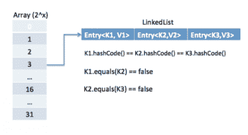

关于`HashMap`需要知道的其他重要点还有容量（capacity）、负载因子（load factor）、阈值扩容（threshold resizing）。`HashMap`的初始默认容量为 32，负载因子为 0.75。阈值是容量乘以负载因子，每当超过此阈值时，`HashMap`就会重新哈希。

### 19. hashCode() 和 equals() 方法的性是什么？

`hashCode()`和`equals()`方法用于确定放置键值对的索引。`HashMap`在`put`和`get`方法中使用`hashCode()`和`equals()`方法。当我们传递键值对调用`put`方法时，`HashMap`使用`Key hashCode()`通过哈希处理来查找存储键值对的索引。这些方法在我们尝试从`HashMap`获取值也非常重要。如果这些方法没有实现正确，`HashMap`可能会认为它们是相同的，从而覆盖它们。

### 20. 我们可以使用任何类作为 Map 的键吗？

我们可以使用任何类作为`Map Key`，但在使用它们之前应考虑以下点：

- 如果类重写了`equals()`方法，也应该重写`hashCode()`方法。
- 类实例应遵循与`equals()`和`hashCode()`相关的规则。
- 如果类中的字段未用于`equals()`，则你不应在`hashCode()`方法中使用它。
- 自定义键类的最佳实践是使其变为不可变的，这样`hashCode()`值就可以缓存以提高性能。不可变类还确保了`hashCode()`和`equals()`不会改变，从而解决任何可变性带来的问题。

例如，假设我有一个用于`HashMap`键的`MyKey`类。

| 说明 |
| :--- |
| 传递给`MyKey`的`name`参数用于`equals()`和`hashCode()` |
| `MyKey key = new MyKey("Pankaj"); //假设 hashCode=1234` |
| `myHashMap.put(key, "Value");` |
| `//下面的代码将更改键的 hashCode() 和 equals() 但其位置没有改变//` |
| `key.setName("Amit"); //假设新的 hashCode=7890` |
| `//下面将返回 null，因为 HashMap 将将在存储时的相同索引查找键，由于键被修改了，将没有匹配并返回 null。` |
| `myHashMap.get(new MyKey("Pankaj"));` |

这就是为什么`String`和`Integer`经常被用作`HashMap`的键。

`Map`接口提供了三个集合视图：

1. `keySet()`：返回一个此 map 中包含的键的`Set`视图。该集合由 map 支持，因此对 map 的更改会反映在集合中，反之亦然。

   如果在对集合进行迭代的过程中，对 map 进行了修改（通过迭代器自身的`remove`操作除外），则迭代的结果是未定义的。该集合支持删除元素，可以通过`Iterator.remove`、`Set.remove`、`removeAll`、`retainAll`和`clear`操作从 map 中移除相应的映射关系。它不支持`add`或`addAll`操作。

2. `values()`：返回一个此 map 中包含的值的的`Collection`视图。该集合由 map 支持，因此对 map 的更改会反映在集合中，反之亦然。

   如果在对集合进行迭代的过程中，对 map 进行了修改（通过迭代器自身的`remove`操作除外），则迭代的结果是未定义的。该集合支持删除元素，可以通过`Iterator.remove`、`Collection.remove`、`removeAll`、`retainAll`和`clear`操作从 map 中移除相应的映射关系。它不支持`add`或`addAll`操作。

3. `Set<Map.Entry<K, V>> entrySet()`：返回一个此 map 中包含的映射的`Set`视图。该集合由 map 支持，因此对 map 的更改会反映在集合中，反之亦然。如果在对集合进行迭代的过程中，对 map 进行了修改（通过迭代器自身的`remove`操作，或通过迭代器返回的 map entry 的`setValue`操作除外），则迭代的结果是未定义的。

   该集合支持删除元素，可以通过`Iterator.remove`、`Set.remove`、`removeAll`、`retainAll`和`clear`操作从 map 中移除相应的映射关系。它不支持`add`或`addAll`操作。

## HashMap 和 Hashtable 之间有什么区别？

`HashMap`和`Hashtable`都实现了`Map`接口并且看起来相似，但`HashMap`和`Hashtable`之间存在以下差异：

- `HashMap`允许 null 键和值，而`Hashtable`不允许 null 键和值。
- `Hashtable`是同步的，而`HashMap`不是同步的。因此`HashMap`适用于单线程环境，`Hashtable`适用于多线程环境。
- `LinkedHashMap`在 Java 1.4 中作为`HashMap`的子类引入，如果你需要迭代顺序，可以轻松地从`HashMap`切换到`LinkedHashMap`，但`Hashtable`则不然，它的迭代顺序是不可预测的。
- `HashMap`提供用于迭代的键`Set`，因此它是快速失败（fail-fast），但`Hashtable`提供键的`Enumeration`，它不支持这一功能。
- `Hashtable`被认为是遗留类，如果你在迭代时正在寻找对 Map 的修改，你应该使用`ConcurrentHashMap`。

## 如何在 HashMap 和 TreeMap 之间做出选择？

在`Map`中插入、删除和定位元素，`HashMap`提供了最好的替代方案。然而，如果你需要按排序遍历键，那么`TreeMap`是你更好的替代方案。

根据集合的大小，先向`HashMap`中添加元素，然后将 map 转换为`TreeMap`进行排序键遍历，可能会更快。

## ArrayList 和 Vector 之间有什么相似之处和区别？

`ArrayList`和`Vector`在许多方面是相似的类。

- 两者都是基于索引的，并在内部由数组支持。
- 两者都维护插入顺序，我们可以按照插入顺序获取元素。
- `ArrayList`和`Vector`的`iterator`实现在设计上都是快速失败的。
- `ArrayList`和`Vector`都允许 null 值，并可以使用索引号随机访问元素。

这些是`ArrayList`和`Vector`之间的区别：

- `Vector`是同步的，而`ArrayList`不是同步的。然而，如果你在迭代时正在寻找列表的修改，你应该使用`CopyOnWriteArrayList`。
- `ArrayList`比`Vector`快，因为它没有由于同步带来的开销。
- `ArrayList`更通用，因为我们可以轻松地使用`Collections`工具类从从中获取同步列表或只读列表。

## Array 和 ArrayList 之间有什么区别？什么时候你会用 Array 而不是 ArrayList？

`Arrays`可以包含原始类型或对象，而`ArrayList`只能包含对象。`Arrays`是固定大小的，而`ArrayList`的大小是动态的。`Arrays`不像`ArrayList`那样提供许多功能，如`addAll`、`removeAll`、`iterator`等。尽管在处理列表时`ArrayList`是显而易见的选择，但在某些情况下使用数组更好。

如果列表的大小是固定的且主要用于存储和遍历它们。对于原始数据类型的列表，虽然`Collections`使用自动装箱来减少编码工作量，但在处理固定大小的原始类型时，它们仍然会使运行变慢。如果你在处理固定的多维情况，使用`[][]`比使用`List<List<>>`方便得多。

## ArrayList 和 LinkedList 之间有什么区别？

`ArrayList`和`LinkedList`都实现了`List`接口但它们之间存在一些差异。

- `ArrayList`是基于数组的基于索引的数据结构，因此它提供了对元素的随机访问，性能为`O(1)`，但`LinkedList`以节点列表的形式存储数据，每个节点都与其上一个和下一个节点链接。因此，虽然有一种通过索引获取元素的方法，但内部从开始遍历到达索引节点然后返回元素，所以性能为`O(n)`，比`ArrayList`慢。
- 在`LinkedList`中插入、添加或删除元素比`ArrayList`快，因为在中间添加元素时没有调整数组或更新索引的概念。
- `LinkedList`比`ArrayList`消耗更多内存，因为`LinkedList`中的每个节点都存储了前后续元素的引用。

## 哪些集合类提供了元素的随机访问？

`ArrayList`、`HashMap`、`TreeMap`、`Hashtable`类提供了元素的随机访问。

## 什么是 EnumSet？

`java.util.EnumSet`是用于枚举类型的`Set`实现。枚举集合中的所有元素来自来自枚举类型，该类型在创建集合时显式或隐式指定。`EnumSet`不用于同步且不允许空元素。它还提供了一些有用的方法，如`copyOf(Collection c)`、`of(E first, E... rest)`和`complementOf(EnumSet s)`。

## 哪些集合类是安全的？


`Vector`、`Hashtable`、`Properties` 和 `Stack` 是同步类，因此是安全的，可以在多线程环境中使用。Java 1.5 Concurrent API 提供了一些允许在迭代时修改集合的集合类，因为它们在集合的副本上工作，因此在多线程环境中是安全的。

## 什么是并发集合类（Concurrent Collection Classes）？

Java 1.5 Concurrent 包（`java.util.concurrent`）包含了线程安全的集合类，允许在迭代时修改集合。按设计，其迭代器是快速失败的并抛出 `ConcurrentModificationException`。这些类包括 `CopyOnWriteArrayList`、`ConcurrentHashMap`、`CopyOnWriteArraySet`。

`java.util.concurrent.BlockingQueue` 是一种 `Queue`，它支持某些操作：在检索和移除元素时等待队列变得非空，以及在添加元素时等待队列有可用空间。`BlockingQueue` 接口是 Java 集合框架的一部分，主要用于实现生产者消费者问题。在 `BlockingQueue` 中，我们不需要担心为生产者等待空间或为消费者等待对象可用，因为这些由 `BlockingQueue` 的实现类处理。Java 提供了多种 `BlockingQueue` 的实现，例如 `ArrayBlockingQueue`、`LinkedBlockingQueue`、`PriorityBlockingQueue`、`SynchronousQueue` 等。

### 32. 什么是 Queue（队列）和 Stack（栈）？列出它们的区别。

`Queue` 和 `Stack` 都用于在处理之前存储数据。`java.util.Queue` 是一个接口，其实现类存在于 `java.concurrent` 包中。`Queue` 允许按照先进先出（FIFO）顺序检索元素，但并不总是如此。

还有一个 `Deque` 接口，允许从队列的两端检索元素。`Stack` 与队列类似，区别在于它允许按照后入先出（LIFO）顺序检索元素。`Stack` 是一个继承 `Vector` 的类，而 `Queue` 是一个接口。

### 33. 什么是 Collections 类？

`java.util.Collections` 是一个工具类，完全由静态方法组成，这些方法用于操作集合或返回集合。它包含了操作集合的多态算法、返回一个由指定集合支持的新集合的“包装器（wrappers）”，以及其他一些零杂的方法。

该类包含了用于集合框架算法的方法，如二分查找、排序、洗牌、反转等。

### 34. 什么是 Comparable 和 Comparator 接口？

Java 提供了 `Comparable` 接口，如果我们想使用 `Arrays` 或 `Collections` 的排序方法，则任何自定义类都应该实现该接口。`Comparable` 接口拥有 `compareTo(T obj)` 方法，该方法被排序方法调用。我们应该重写此方法，使其在当“此”对象小于、等于或大于作为参数传递的对象时，返回一个负整数、零或正整数。

但在大多数现实场景中，我们希望根据不同的参数进行排序。例如，作为 CEO，我想根据薪水（Salary）对员工进行排序，而 HR 则想根据年龄对他们进行排序。在这种情况下，我们需要使用 `Comparator` 接口，因为 `Comparable.compareTo(Object o)` 方法的实现只能根据一个字段排序，且我们无法选择想要对对象排序的字段。

`Comparator` 接口需要实现 `compare(Object o1, Object o2)` 方法，该方法接受两个 Object 参数，其实现方式应该是：如果第一个参数小于第二个参数则返回负整数，如果它们相等则返回零，如果第一个参数大于第二个参数则返回正整数。

### 35. Comparable 和 Comparator 接口之间的区别是什么？

`Comparable` 和 `Comparator` 接口用于对集合或对象数组排序。`Comparable` 接口用于提供对象的自然排序（natural sorting），我们可以使用它提供基于单一逻辑的排序。

`Comparator` 接口用于提供不同的排序算法，我们可以选择我们想要使用的比较器来对给定的对象集合进行排序。

### 36. 我们如何对对象列表进行排序？

如果我们需要对对象数组进行排序，可以使用 `Arrays.sort()`。如果我们需要对对象列表进行排序，可以使用 `Collections.sort()`。这两个类都拥有重载的 `sort()` 方法，用于自然排序（使用 `Comparable`）或基于标准的排序（使用 `Comparator`）。

`Collections` 内部使用 `Arrays` 排序方法，因此两者的性能相同，不同之处在于 `Collections` 需要一些时间将列表转换为数组。

### 37. 在将集合作为参数传递给函数时，我们如何确保该函数无法修改它？

我们可以在传递作为参数之前，使用 `Collections.unmodifiableCollection(Collection c)` 方法创建一个只读集合，这将确保任何更改集合的操作都会抛出 `UnsupportedOperationException`。

### 38. 我们如何从给定的集合创建一个同步集合？

我们可以使用 `Collections.synchronizedCollection(Collection c)` 来获取一个由指定集合支持的同步（线程安全）集合。

### 39. Collections 框架中实现了哪些常用算法？

Java 集合框架提供了许多常用的算法实现，如排序和搜索。`Collections` 类包含了这些方法的实现。这些算法中的大多数作用于 `List`，但其中某些算法也适用于所有类型的集合。

其中一些包括排序、搜索、洗牌、最大/最小值查找等。

### 40. 什么是大 O 表示法？举一些例子。

大 O 表示法（Big-O notation）根据数据结构中元素的数量来描述算法的性能。由于 `Collection` 类实际上是数据结构，我们倾向于使用大 O 表示法根据时间、内存和性能来选择使用的集合实现。

示例 1：`ArrayList.get(index i)` 是常数时间操作，不依赖于列表中元素的数量。因此它在大 O 表示法中的性能是 `O(1)`。

示例 2：数组或列表上的线性搜索性能为 `O(n)`，因为我们需要遍历整个元素列表来找到目标元素。

### 41. 关于 Java 集合框架有哪些最佳实践？

根据需求选择合适的集合类型，例如，如果大小是固定的，我们可能希望使用 `Array` 而不是 `ArrayList`。如果我们需要按照插入顺序遍历 `Map`，则需要使用 `TreeMap`。如果我们不想要重复元素，应该使用 `Set`。

- 某些集合类允许指定初始容量，因此如果我们对将存储的元素数量有估计，就可以避免重新哈希（rehashing）或调整大小。

- 基于接口而非实现类编写程序，这允许我们在以后方便地更改实现类。

- 始终使用泛型（Generics）来确保类型安全并避免运行时出现 `ClassCastException`。

- 使用 JDK 提供的不可变类作为 `Map` 的键，以避免为我们的自定义类实现 `hashCode()` 和 `equals()`。

- 尽可能使用 `Collections` 工具类来执行算法或获取只读、同步或空集合，而不是自己编写。这将增强代码复用性并具有更好的稳定性和较低的可维护性。

### 42. 什么是 Java Priority Queue（优先级队列）？

`PriorityQueue` 是一个基于优先级堆（priority heap）的无界队列，元素按照自然顺序排序，或者我们可以在创建时提供 `Comparator` 进行排序。`PriorityQueue` 不允许空值，我们无法添加任何没有自然排序或没有比较器的对象。Java `PriorityQueue` 不是线程安全的，且入队（enqueuing）和出队（dequeuing）操作的时间复杂度为 `O(log(n))`。

### 43. 为什么我们不能写代码 `List<Number> numbers = new ArrayList<Integer>();`？

泛型不支持类型协变，因为这会给实现类型安全带来问题。即 `List<T>` 不被视为 `List<S>` 的子类型，其中 `S` 是 `T` 的父类型。

为了理解为什么是不允许的，让我们看看如果支持这种操作会发生什么。

```java
List<Long> listLong = new ArrayList<Long>();
listLong.add(Long.valueOf(10));
List<Number> listNumbers = listLong; // 编译错误
listNumbers.add(Double.valueOf(1.23));
```

从上面的代码中可以看出，如果泛型支持子类型，我们可以轻松地将一个 `Double` 添加到 `Long` 列表中，这在遍历 `Long` 列表时会在运行时抛出 `ClassCastException`。

### 44. 为什么我们不能创建泛型数组？或写代码 `List<Integer>[] array = new ArrayList<Integer>[10];`

我们不允许创建泛型数组，因为数组在运行时会携带其元素的类型信息。这些信息在运行时用于当元素类型与定义的类型不匹配时抛出 `ArrayStoreException`。由于泛型类型信息在运行时会被“类型擦除”（`Type Erasure`）擦除，那么在应该失败的地方，数组存储检查将会通过。让我们通过一个简单的示例代码来理解这一点。

```java
List<Integer>[] intList = new List<Integer>[5]; // 编译错误
Object[] objArray = intList;
List<Double> doubleList = new ArrayList<Double>();
doubleList.add(Double.valueOf(1.23));
objArray[0] = doubleList; // 这应该失败但它会通过，因为在运行时 intList 和 doubleList 都仅仅是 List
```

数组本质上是协变的，即只要 `S` 是 `T` 的子类型，`S[]` 就是 `T[]` 的子类型，但正如我们在上一个问题中看到的，泛型不支持协变或子类型。因此，如果我们允许创建泛型数组，由于类型擦除的原因，即使两个类型不相关，我们也不会得到数组存储异常。

# Java 异常面试

## 问题与问答

Java 提供了一种健壮且面向对象的方法来处理异常场景，即 `Java Exception Handling`（Java 异常处理）。

### 1. 什么是 Java 异常？

异常是程序执行过程中可能发生并破坏正常流程的错误事件。异常可能源于不同的情况，例如用户输入的错误数据、硬件故障、网络连接失败等。

当执行 Java 语句时发生任何错误，都会创建一个异常对象，然后 `JRE` 尝试寻找异常处理器来处理该异常。如果找到了合适的异常处理器，异常对象将传递给处理器代码以处理异常，这被称为“捕获异常”（`catching the exception`）。如果没有找到处理器，应用程序将向异常抛给运行时环境，`JRE` 将终止程序。

Java 异常处理框架仅用于处理运行时错误，编译时错误不由异常处理框架处理。

### 2. Java 中的异常处理关键字有哪些？

Java 异常处理使用了四个关键字。

- `throw`：有时我们显式地想要创建一个异常对象并将其抛出，以停止程序的正常处理。`throw` 关键字用于将异常抛给运行时进行处理。

- `throws`：当我们在方法中抛出任何检查异常（checked exception）且不进行处理时，我们需要在方法签名中使用 `throws` 关键字，让调用者程序知道方法可能抛出的异常。调用者方法可以处理这些异常，或者使用 `throws` 关键字将其传递给它的调用者方法。我们可以在 `throws` 子句中提供多个异常，它也可以用于 `main()` 方法。

- `try-catch`：我们在代码中使用 `try-catch` 块进行异常处理。`try` 是块的开始，`catch` 位于 `try` 块的结尾，用于处理异常。我们可以为 `try` 配置多个 `catch` 块，并且 `try-catch` 块也可以嵌套。`catch` 块需要一个类型为 `Exception` 的参数。

- `finally`：`finally` 块是可选的，且只能与 `try-catch` 块一起使用。由于异常会停止执行，我们可能有一些打开的资源不会被关闭，因此可以使用 `finally` 块。无论是否发生异常，`finally` 块总是执行。

### 3. 解释 Java 异常层次结构？

Java 异常是层次化的，使用 `inheritance`（继承）来分类不同类型的异常。`Throwable` 是 Java 异常层次结构的父类，它有两个子类——`Error` 和 `Exception`。异常进一步分为检查异常（checked exceptions）和运行时异常（runtime exception）。

- `Errors` 是超出应用程序范围的异常情况，无法预测和从其恢复，例如硬件故障、JVM 崩溃或内存溢出错误。

- `Checked Exceptions`（检查异常）是我们在程序中可以预测并尝试从中恢复的异常情况，例如 `FileNotFoundException`。我们应该捕获此异常并向用户提供有用的信息，并对其进行适当记录以便调试。`Exception` 是所有检查异常的父类。

- `Runtime Exceptions`（运行时异常）是由不良编程引起的，例如尝试从数组中检索元素。在尝试检索元素之前，我们应该检查数组长度，否则在运行时可能会抛出 `ArrayIndexOutOfBoundException`。`RuntimeException` 是所有运行时异常的父类。

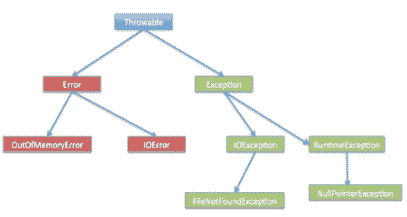

### 4. Java 异常类的重要方法有哪些？

`Exception` 及其所有子类没有提供任何特定方法，所有方法都定义在基类 `Throwable` 中。

1. `String getMessage()` – 该方法返回 `Throwable` 的消息字符串，可以在通过构造函数创建异常时提供该消息。
2. `String getLocalizedMessage()` – 提供此方法是为了让子类重写它，以便为调用程序提供特定区域的消息。`Throwable` 类对此方法的实现简单地使用 `getMessage()` 方法返回异常消息。
3. `synchronized Throwable getCause()` – 该方法返回异常的原因，如果原因未知则返回 `null`。
4. `String toString()` – 该方法以字符串格式返回有关 `Throwable` 的信息，返回的字符串包含 `Throwable` 类的名称和本地化消息。
5. `void printStackTrace()` – 该方法将堆栈跟踪信息打印到标准错误流中，该方法经过重载，我们可以传递 `PrintStream` 或 `PrintWriter` 作为参数，将堆栈跟踪信息写入文件或流中。

### 5. 解释 Java 7 特性和多异常块？

如果你在一个 `try` 块中捕获许多异常，你会发现 `catch` 块代码看起来很丑，并且大部分是记录错误的冗余代码。考虑到这一点，Java 7 的一个特性是多异常捕获（multi-catch），我们可以在单个 `catch` 块中捕获多个异常。使用该特性的 `catch` 块如下：

```java
catch(IOException | SQLException | Exception ex){
    logger.error(ex);
    throw new MyException(ex.getMessage());
}
```

通常我们使用 `finally` 块是为了关闭资源，有时我们会忘记关闭，从而产生运行时异常。这些异常很难调试，我们可能需要检查使用类型资源的每个地方以确保将其关闭。因此 Java 7 的一个改进是 `try-with-resources`，我们可以在 `try` 语句中创建资源并在 `try-catch` 块中使用它。当执行离开 `try-catch` 块时，运行时环境会自动关闭这些资源。使用此改进的 `try-catch` 块示例如下：

```java
try (MyResource mr = new MyResource()) {
    System.out.println("MyResource created in try-with-resources");
} catch (Exception e) {
    e.printStackTrace();
}
```

### 6. Java 中检查异常和运行时异常的区别是什么？

`Checked Exceptions`（检查异常）应该在代码中使用 `try-catch` 块进行处理，否则 `main()` 方法应使用 `throws` 关键字让 JRE 知道程序可能抛出的异常。运行时异常（Unchecked Exceptions）不需要在程序中处理，也不需要在 `throws` 子句中说明。

- `Exception` 是所有检查异常的父类，而 `RuntimeException` 是所有运行时异常的父类。

- `Checked exceptions` 不是由程序引起的错误场景，例如读取不存在的文件时产生的 `FileNotFoundException`，而运行时异常通常由糟糕编程引起，例如在未确保对象引用不为空的情况下调用其方法时产生的 `NullPointerException`。

### 7. Java 中 `throw` 和 `throws` 关键字的区别是什么？


`throws` 关键字与方法签名一起使用，用于声明方法可能抛出的异常；而 `throw` 关键字用于中断程序的执行流，并将异常对象交给运行时进行处理。

## 8. 在 Java 中如何编写自定义异常？

我们可以扩展 `Exception` 类或其任何子类来创建自定义的异常类。自定义异常类可以有自己的变量和方法，我们可以利用这些成员将错误代码或其他异常相关信息传递给异常处理器。

下面是一个自定义异常的简单示例。

| MyException.java |
| --- |
| ```java
package com.journaldev.exceptions;
import java.io.IOException;
public class MyException extends IOException {
    private static final long serialVersionUID = 4664456874499611218L;
    private String errorCode="Unknown_Exception";
    public MyException(String message, String errorCode){
        super(message);
        this.errorCode=errorCode;
    }
    public String getErrorCode(){
        return this.errorCode;
    }
}
``` |

## 9. Java 中的 OutOfMemoryError 是什么？

Java 中的 `OutOfMemoryError` 是 `java.lang.VirtualMachineError` 的子类，当 `JVM` 堆内存耗尽时会抛出。我们可以通过 Java 选项为运行 Java 应用提供更多内存来修复此错误。

```bash
java MyProgram -Xms1024m -Xmx1024m -XX:PermSize=64M -XX:MaxPermSize=256m
```

## 10. 导致“Exception in thread main”的常见场景有哪些？

常见的主线程异常场景包括：

- `Exception in thread main java.lang.UnsupportedClassVersionError`：该异常发生在你的 Java 类是从另一个 JDK 版本编译的，而你正尝试用另一个 Java 版本运行它。

- `Exception in thread main java.lang.NoClassDefFoundError`：此异常有两种变体。第一种是你提供了带有 `.class` 扩展名的类全名。第二种情况是找不到 `Class`。

- `Exception in thread main java.lang.NoSuchMethodError main`：该异常发生在你尝试运行一个没有 `main` 方法的类时。

- `Exception in thread “main” java.lang.ArithmeticException`：每当从 `main` 方法抛出任何异常时，它都会在控制台打印异常。第一部分解释异常是从 `main` 方法抛出的，第二部分打印异常的类名，然后在冒号之后打印异常消息。

## 11. Java 中 `final`、`finally` 和 `finalize` 的区别是什么？

`final` 和 `finally` 是 Java 中的两个关键字，而 `finalize` 是一个方法。`final` 关键字可以用于类变量，使其无法被重新赋值；用于类以避免被子类扩展；用于方法以避免被子类重写；`finally` 关键字与 `try-catch` 块一起使用，提供即使发生异常也会始终执行的语句，通常 `finally` 用于关闭资源。

`finalize()` 方法在对象被销毁之前由垃圾回收器执行，它是确保所有全局资源关闭的一种极方法。在这三者中，只有 `finally` 与 Java 异常处理有关。

## 12. `main` 方法抛出异常时会发生什么？

当 `main()` 方法抛出异常时，Java 运行时会终止程序并在系统控制台打印异常消息和堆栈轨迹。

## 13. 我们可以有空的 `catch` 块吗？

我们可以有空的 `catch` 块，但这是糟糕编程的范例。我们永远不应该有空 `catch` 块，因为如果异常被该块捕获，我们将无法关于异常的任何信息，调试它将是一场噩梦。至少应该有一个日志语句，以便在控制台或日志文件中记录异常详情。

## 14. 提供一些 Java 异常处理的最佳实践？

与 Java 异常处理相关的一些最佳实践包括：

- 使用特定的异常以便于调试。
- 在程序中尽早抛出异常（快速失败）。
- 在程序后部捕获异常，让调用者处理异常。
- 使用 Java 7 ARM 特性确保资源被关闭，或使用 `finally` 块妥妥地关闭它们。
- 始终记录异常消息以供调试。
- 使用多 `catch` 块进行更整洁的关闭。
- 使用自定义异常从你的应用程序 API 抛出单一类型的异常。
- 遵循命名规范，始终以 `Exception` 结尾。
- 在 Javadoc 中使用 `@throws` 文档方法抛出的异常。
- 异常是有代价的，因此仅在合理时抛出。否则，你可以捕获它们并提供 `null` 或空响应。


# Random Brain Wash

# 201 核心 Java 面试题

## 1. JDK、JRE 和 JVM 之间的区别是什么？

- `JVM`：`JVM` 是 Java Virtual Machine 的缩写，它是一个提供执行 Java 字节码运行环境的抽象机器。`JVM` 可适用于许多硬件和软件平台（因此 `JVM` 是依赖平台的）。
- `JRE`：`JRE` 代表 Java Runtime Environment。它是 `JVM` 的实现，并在物理上存在。
- `JDK`：`JDK` 是 Java Development Kit 的缩写。它在物理上存在，包含了 `JRE` + 开发工具。

## 2. `JVM` 分配了多少种内存区域？

有很多类型：

1. 类（方法）区域
2. 堆（Heap）
3. 栈（Stack）
4. 程序计数器寄存器（Program Counter）
5. 原生方法栈（Native Method Stack）

## 3. 什么是 JIT 编译器？

`Just-In-Time (JIT)` 编译器用于同时编译具有相似功能的字节码，从而减少编译时间。这里的“编译器”指的是从 Java 虚拟机（`JVM`）指令集到特定 CPU 指令集的翻译器。

## 4. 什么是平台？

平台基本上是程序运行的硬件或软件环境。有两种类型：软件平台和硬件平台。Java 提供了软件平台。

## 5. Java 平台与其他平台的主要区别是什么？

Java 平台与其他大多数平台的区别在于它是一个运行在其他硬件平台之上的软件平台。它有两个组件：

1. 运行环境
2. `API`（应用程序接口）

## 6. 什么让 Java 有“一次编写，到处运行”的特性？

字节码。Java 被编译成字节源码和机器码之间的中间语言。这种字节码是不依赖于特定平台的。

## 7. 什么是类加载器？

类加载器是 `JVM` 的子系统，用于加载类和接口。有很多类型的类加载器，例如：启动加载器、扩展加载器、系统加载器、插件加载器等。

## 8. 空的 `.java` 文件名是有效的源码吗？

是的。将你的 Java 文件以 `.java` 结尾，通过 `javac .java` 编译，通过 `java yourclassname` 运行。让我们来看一个简单的示例：

```java
// 以 .java 结尾
class A {
    public static void main(String args[]) {
        System.out.println("Hello java");
    }
}
```

通过 `javac .java` 编译。

通过 `java A` 运行。

## 9. Java 中有 `delete`、`next`、`main`、`exit` 或 `null` 关键字吗？

没有。

## 10. 如果我在命令行没有提供任何参数，`main` 方法的 `String` 数组是空的还是 `null`？

它是空的，不是 `null`。

## 11. 如果我写 `static public void` 而不是 `public static void` 会怎样？

程序正常编译并运行。

## 12. 局部变量的默认值是什么？

局部变量没有初始化为任何默认值，无论是基本类型还是对象引用。

# 核心 Java - OOPs 概念

## OOPs 面试题

这里提供了超过 50 个 OOPs（面向对象编程与系统）面试题。

为了更好地理解，它们被归类为许多部分，例如构造函数面试题、静态面试题、继承面试题、抽象面试题、多态面试题等。

### 13. 面向对象的语言和基于对象的编程语言有什么区别？

基于对象的编程语言遵循 OOP 的所有特征，除了 `Inheritance`（继承）。基于对象的编程语言示例有 `JavaScript`、`VBScript` 等。

### 14. 定义为实例变量的对象引用的初始值是什么？

在 `Java` 中，所有的对象引用都初始化为 `null`。

## 构造函数面试题

### 15. 什么是构造函数？

构造函数就像方法一样，用于初始化对象的状态。它在对象创建时被调用。

### 16. 默认构造函数的目的是什么？

默认构造函数为对象提供默认值。只有当类中没有构造函数时，`java` 编译器才会创建一个默认构造函数。更多详情……

### 17. 构造函数返回任何值吗？

答：是的，它返回当前实例（你虽然可以使用返回类型，但它确实返回了一个值）。更多详情……

### 18. 构造函数会被继承吗？

不，构造函数不被继承。

### 19. 你可以使构造函数为 `final` 吗？

不，构造函数不能是 `final` 的。

## `static` 关键字面试题

### 20. 什么是静态变量？

`static variable` 用于引用所有对象的共同属性（该属性对于每个对象来说不是唯一的），例如员工的公司名称、学生的学校名称等。`static variable` 在类加载时在类区域中只获取一次内存。

### 21. 什么是静态方法？

- 一个 `static method` 属于类而不是类的对象。
- 无需创建类的实例即可调用 `static method`。
- `static method` 可以访问静态数据成员并可以改变它的值。

### 22. 为什么 `main` 方法是静态的？

因为调用 `static method` 不需要对象。如果它是非静态方法，`JVM` 会先创建对象再调用 `main()` 方法，这将导致额外内存分配的问题。更多详情……

### 23. 什么是静态块？

- 用于初始化静态数据成员。
- 它在类加载时在 `main` 方法之前执行。

### 24. 可以在没有 `main()` 方法的情况下执行程序吗？

答：可以，一种方法是 `static block`。

### 25. 如果从 `main` 方法的签名中移除 `static` 修饰符会怎样？

程序可以编译，但在运行时会抛出错误 `NoSuchMethodError`。

### 26. 静态（类）方法和实例方法有什么区别？

| 静态方法（或类方法） | 实例方法 |
| --- | --- |
| 1) 这种声明为 `static` 的方法被称为静态方法。 | 这种未声明为 `static` 的方法被称为实例方法。 |
| 2) 调用 `static method` 不需要对象。 | 调用实例方法需要对象。 |
| 3) 非静态（实例）成员无法直接在静态上下文中（`static method`、`static block` 和静态嵌套类）中被访问。 | 静态和非静态变量都可以在实例方法中被访问。 |
| 4) 例如：`public static int cube(int n) { return n*n*n;}`。 | 例如：`public void msg(){...}`。 |

## 继承面试题

### 27. Java 中的 `this` 是什么？

它是一个引用当前对象的关键字。

### 28. 什么是继承？

继承是一种机制，其中一个对象获取另一个类中的对象的所有属性和行为。它代表了 IS-A 关系。它用于代码重用和方法重写。

### 29. 哪个类是所有类的超类？

`Object` 类。

### 30. 为什么 Java 不支持多继承？

为了减少复杂性并简化语言，`java` 在类级别上不支持多继承。

### 31. 什么是组合（Composition）？

在某些类内部持有另一个类的引用被称为组合。

### 32. 聚合（Aggregation）和组合（Composition）之间有什么区别？

聚合代表弱关系，而组合代表强关系。例如：自行车有指示灯（聚合），但汽车有引擎（组合）。

### 33. 为什么 Java 不支持指针？

指针是引用内存地址的变量。它们在 `java` 中不被使用，因为它们是不安全的（无保障）且难以理解。

### 34. Java 中的 `super` 是什么？

它是一个引用直接父类对象的关键字。

### 35. 你可以在构造函数中同时使用 `this()` 和 `super()` 吗？

不。因为 `super()` 或 `this()` 必须是第一语句。

### 36. 什么是对象克隆？

对象克隆用于创建对象的完全副本。

## 方法重载面试题

### 37. 什么是方法重载？

如果一个类具有多个同名但参数不同的方法，则被称为方法重载。它增加了程序的可读性。

### 38. 为什么在 Java 中不能通过更改返回类型来实现方法重载？

因为存在歧义。

### 39. 我们可以重载 `main` 方法吗？

可以。

## 方法重写面试题

### 40. 什么是方法重写？

如果子类提供了父类已提供的方法的特定实现，则被称为方法重写。它用于运行时多态。

### 41. 静态方法可以重写吗？

不，因为静态方法属于类而不是对象。

### 42. 为什么我们不能重写静态方法？

因为 `static method` 绑定到类，而实例方法绑定到对象（堆）。

### 43. 我们可以重写重载的方法吗？

可以。

### 44. 方法重载（Overloading）和重写（Overriding）的区别

| 方法重载 | 方法重写 |
| --- | --- |
| 1) 方法重载增加了程序的可读性。 | 方法重写提供了父类已方法的特定实现。 |
| 2) 方法重载发生在类内部。 | 方法重写发生在具有 IS-A 关系的类之间。 |
| 3) 在这种情况参数不同。 | 在这种情况参数相同。 |

### 45. Java 中有虚函数吗？

是的，`Java` 中的所有函数默认都是虚函数。

### 46. 什么是协变返回值？

现在从 `java5` 开始，如果子类重写方法的返回类型是子类类型，就可以通过更改返回类型来重写任何方法。这被称为协变返回值。

## `final` 关键字面试题

### 47. 什么是 `final` 变量？

如果你将任何变量标记为 `final`，你就无法更改它的值（它是常量）。

### 48. 什么是 `final` 方法？

`Final methods` 不能被重写。

### 49. 什么是 `final` 类？

`Final class` 不能被继承。

### 50. 什么是空 `final` 变量？

声明时未初始化的 `final` 变量被称为空 `final` 变量。

### 51. 我们可以初始化空 `final` 变量吗？

如果是非静态的，可以在构造函数中初始化。如果是静态空 `final` 变量，则可以在静态块中初始化。

### 52. 你可以将 `main` 方法声明为 `final` 吗？

可以，例如 `public static final void main(String[] args){}`。


# OOPs：多态、抽象以及包面试题

### 53. 什么是运行时多态？

运行时多态（或动态方法分发）是一个对被重写方法的调用在运行时进行解析而不是在编译时进行解析的过程。在这个过程中，通过父类的引用变量调用被重写的方法。被调用方法的确定是基于引用变量所引用的对象。

### 54. 能够通过数据成员实现运行时多态吗？

不能。

### 55. 静态绑定和动态绑定之间有什么区别？

在静态绑定的情况下，对象的类型在编译时被确定；而在动态绑定的情况下，对象的类型在运行时被确定。

# 核心 Java - OOP 概念：抽象相关面试题

### 56. 什么是抽象？

抽象是隐藏实现细节并仅向用户显示功能的过程。抽象让你关注对象“做了什么”，而不是它“如何做到的”。

### 57. 抽象和封装之间有什么区别？

抽象隐藏了实现细节，而封装将代码和数据封装在一个单元中。

### 58. 什么是抽象类？

声明为抽象的类被称为抽象类。它需要被扩展并实现其方法。它不能被实例化。

### 59. 在没有抽象类的情况下可以有抽象方法吗？

不能，如果一个类中有任何抽象方法，该类必须是抽象类。

### 60. 可以在方法上同时使用 `abstract` 和 `final` 吗？

不能，因为抽象方法需要被重写，而你不能重写 `final` 方法。

### 61. 抽象类可以被类吗？

不能，抽象类永远不能被实例化。

### 62. 什么是接口（interface）？

接口是具有静态常量和抽象方法的类蓝图。它可以实现完全抽象和多重继承。

### 63. 你可以将接口方法声明为 `static` 吗？


不能，因为接口的方法默认是抽象的，`static` 和 `abstract` 关键字不能同时使用。

### 64) 接口可以是 `final` 的吗？

不能，因为它的实现是由另一个类提供的。

### 65) 什么是标记接口（marker interface）？

没有数据成员和方法的接口被称为标记接口。例如 `Serializable`、`Cloneable` 等。

### 66) 抽象类和接口之间有什么区别？

| 抽象类 | 接口 |
| :--- | :--- |
| 1) 抽象类可以有方法体（非抽象方法）。 | 接口只有抽象方法。 |
| 2) 抽象类可以有实例变量。 | 接口不能有实例变量。 |
| 3) 抽象类可以有构造方法。 | 接口不能有构造方法。 |
| 4) 抽象类可以有静态方法。 | 接口不能有静态方法。 |
| 5) 你可以扩展一个抽象类。 | 你可以实现多个接口。 |

### 67) 可以在接口的变量上定义 `private` 和 `protected` 修饰符吗？

不能，它们隐式地是 `public` 的。

### 68) 什么时候对象引用可以强制转换为接口引用？

当对象实现了所引用的接口时，对象引用可以强制转换为接口引用。

# 核心 Java - OOP 概念：包相关面试题

### 69) 什么是包（package）？

包是相似类型类、接口和子包的组。它提供了访问保护并消除了命名冲突。

### 70) 我需要随时导入 `java.lang` 包吗？为什么？

不需要。它由 `JVM` 在内部默认加载。

### 71) 我可以重复导入同一个包/类吗？JVM 会在运行时加载两次包吗？

可以多次导入同一个包或同一个类。编译器和 JVM 都不会对此产生意见。但无论你导入多少次同一个类，JVM 在内部都只会加载该类一次。

### 72) 什么是静态导入（static import）？

通过静态导入，我们可以直接访问类的静态成员，无需用类名来修饰它。

# Java 异常和字符串相关面试题

### 73) 什么是异常处理？

异常处理是一种处理运行时错误的机制。它主要用于处理受检的异常（checked exceptions）。

### 74) 检异常（Checked Exception）和未检异常（Unchecked Exception）之间有什么区别？

1) **检异常**：

除了 `RuntimeException` 和 `Error` 之外，继承 `Throwable` 类的类被称为检异常，例如 `IOException`、`SQLException` 等。检异常在编译时被检查。

2) **未检异常**：

继承 `RuntimeException` 的类被称为未检异常，例如 `ArithmeticException`、`NullPointerException` 等。未检异常在编译时不进行检查。

### 75) Error 和 Exception 的基类是什么？

`Throwable`。

### 76) 每个 `try` 块都必须后跟 `catch` 块吗？

并不是每个 `try` 块都必须后跟 `catch` 块。它应该后跟 `catch` 块**或者** `finally` 块。任何可能抛出的异常都应该在方法的 `throws` 子句中声明。

### 77) 什么是 `finally` 块？

`finally` 块是一个始终会被执行的块。

### 78) 可以在没有 `catch` 的情况下使用 `finally` 块吗？

可以，通过 `try` 块。`finally` 必须后跟 `try` 或 `catch` 块。

### 79) 是否存在 `finally` 不会执行的情况？

如果程序退出（通过调用 `System.exit()` 或由于导致进程中止的致命错误），`finally` 块将不会执行。

### 80) `throw` 和 `throws` 之间有什么区别？

| `throw` 关键字 | `throws` 关键字 |
| :--- | :--- |
| 1) `throw` 用于显式抛出异常。 | `throws` 用于声明异常。 |
| 2) 检异常不能仅通过 `throw` 传递。 | 检异常可以通过 `throws` 传递。 |
| 3) `throw` 后面跟着一个实例。 | `throws` 后面跟着一个类。 |
| 4) `throw` 在方法内部使用。 | `throws` 在方法签名中使用使用。 |
| 5) 你不能抛出多个异常。 | 你可以声明多个异常，例如 `public void method() throws IOException, SQLException.` |

### 82) 异常可以被重新抛出吗？

可以。

### 83) 如果父类方法没有抛出异常，子类重写的方法可以声明异常吗？

可以，但只能是未检异常，不能是检异常。

### 84) 什么是异常传播？

将异常对象传递给调用者方法的过程被称为异常传播。

# 核心 Java：字符串处理相关面试题

这里给出了字符串处理面试题列表，并带有简洁的答案。如果你有任何关于字符串处理的问题。

### 84) 在字符串术中，不可变（immutable）意味着什么？

不可变的简单意思是不可修改或不可改变的。一旦字符串对象被创建，它的值就不能改变。

### 85) 为什么 Java 中的字符串对象是不可变的？

因为 Java 使用字符串字面量概念。假设有 5 个引用变量都指向同一个对象 `"sachin"`。如果一个引用变量改变了对象的值，它将影响到所有的引用变量。这就是为什么 Java 中的字符串对象是不可变的。

### 86) 我们可以通过多少种方式创建字符串对象？

创建字符串对象有两种方式：通过字符串字面量和 `new` 关键字。

### 87) 以下代码会创建多少个对象？

```java
String s1 = "Welcome";
String s2 = "Welcome";
String s3 = "Welcome";
```

只有一个对象。

### 88) 为什么 Java 使用字符串字面量概念？

为了让 Java 内存效率更高（因为如果字符串常量池中已经存在，就不会创建新对象）。

### 89) 以下代码会创建多少个对象？

```java
String s = new String("Welcome");
```

两个对象，一个在字符串常量池中，另一个在池外（堆）中。

### 90) `string` 和 `stringbuffer` 对象之间的基本区别是什么？

`String` 是不可变对象。`StringBuffer` 是可变对象。

### 91) `StringBuffer` 和 `StringBuilder` 之间有什么区别？

`StringBuffer` 是同步的，而 `StringBuilder` 不是同步的。

## 92) 如何在 Java 中创建不可变类？

我们可以通过定义 `final` 类来创建一个类似于 `String` 类的不可变类。

## 93) Java 中 `toString()` 方法的作用是什么？

`toString()` 方法返回任何对象的字符串表示。如果你打印任何对象，Java 编译器会在内部调用该对象的 `toString()` 方法。因此，通过重写 `toString()` 方法可以返回预期的输出，这可以是对象的状态等，具体取决于你的实现。

# 核心 Java：嵌套类与接口面试题

## 94) 什么是嵌套类？

在另一个类内部声明的类被称为嵌套类。嵌套类有 4 种：成员内部类、局部内部类、匿名内部类和静态嵌套类。

## 95) 嵌套类和内部类之间有区别吗？

有的，内部类是非静态的嵌套类，即内部类是嵌套类的一部分。

## 96) 可以在局部内部类内部访问非 `final` 的局部变量吗？

不可以行的，如果你想在局部内部类中访问它，该局部变量必须是常量。

## 97) 什么是嵌套接口？

任何声明在接口或类内部的接口都称为嵌套接口。它默认是静态的。

## 98) 类可以包含接口吗？

可以的，这被称为嵌套接口。

## 99) 接口可以包含类吗？

可以的，它们是隐式静态的。

# Java 垃圾回收、I/O 流、序列化与网络面试题

## 117) 什么是垃圾回收？

垃圾回收是回收运行时未使用的对象的过程。它是为了内存管理。

## 118) `gc()` 是什么？

`gc()` 是一个守护线程。`gc()` 方法定义在 `System` 类中，用于向 JVM 发送执行垃圾回收请求。

## 119) `finalize()` 方法的作用是什么？

`finalize()` 方法在对象被垃圾回收之前被调用。它用于执行清理工作。

## 120) 未引用的对象可以再次被引用吗？

可以。

## 121) 垃圾回收器线程是什么类型的线程？

守护线程。

## 122) `final`、`finally` 和 `finalize` 有什么区别？

| 名称 | 说明 |
| :--- | :--- |
| `final` | `final` 是一个关键字，`final` 可以修饰变量、方法或类。你不能改变 `final` 变量的值，不能重写 `final` 方法，不能继承 `final` 类。 |
| `finally` | `finally` 块用于异常处理。`finally` 块总是执行。 |
| `finalize()` | `finalize()` 方法用于垃圾回收。`finalize()` 方法在对象被垃圾回收之前被调用。`finalize()` 方法可以用于执行任何清理工作。 |

## 123) `Runtime` 类的作用是什么？

`Runtime` 类的作用是提供对 Java 运行时系统的访问。

## 124) 你如何在 Java 中调用任何外部进程？

通过 `Runtime.getRuntime().exec(?)` 方法。

## I/O 面试题

## 125) `Reader/Writer` 类层次级与 `InputStream/OutputStream` 类层次级有什么区别？

`Reader/Writer` 类层次级是面向字符的，而 `InputStream/OutputStream` 类层次级是面向字节的。

## 126) 什么是 I/O 过滤器？

I/O 过滤器是一个从一个流读取并写入另一个流的对象，通常在数据从一个流传递到另一个流时以某种方式对其进行修改。

## 序列化面试题

## 127) 什么是序列化？

序列化是将对象的状态写入字节流的过程。它主要用于在网络上传输对象的状态。

## 128) 什么是反序列化？

反序列化是从序列化状态重建对象的过程。它是序列化的反向操作。

## 129) 什么是 `transient` 关键字？

如果你将任何数据成员定义为 `transient`，它将不会被序列化。

## 130) 什么是 `Externalizable`？

`Externalizable` 接口用于以压缩格式将对象的状态写入字节流。它不是一个标记接口。

## 131) `Serializable` 接口和 `Externalizable` 接口有什么区别？

`Serializable` 是标记接口，而 `Externalizable` 不是。当你使用 `Serializable` 接口时，你的类默认情况下会被自动序列化。但你可以重写 `writeObject()` 和 `readObject()` 两个方法来控制更复杂的对象序列化过程。当你使用 `Externalizable` 接口时，你对类的序列化过程有完全的控制。

## 网络面试题

## 132) 如何将像 192.18.97.39 这样的数字 IP 地址转换为像 java.sun.com 这样的主机名？

通过 `InetAddress.getByName("192.18.97.39").getHostName()`，其中 192.18.97.39 是 IP 地址。

## 反射面试题

## 133) 什么是反射？

反射是在运行时检查或修改类的运行时行为的过程。它用于：

- IDE（集成开发环境），例如 Eclipse、MyEclipse、NetBeans。
- 调试器
- 测试工具

## Java 杂项、AWT 和 Swing 面试题

## 148) 什么是包装类？

包装类允许以对象的形式访问原始数据类型。

## 149) 什么是原生方法？

原生方法是用 Java 以外的语言实现的。

## 150) `System` 类的作用是什么？

`System` 类的作用是提供对系统的访问。

## 151) 当人提到 Java 中的浅拷贝时你想到了什么？

`Object cloning`

## 152) 什么是单例类？

单例类意味着在给定的时间内 JVM 中只有一个类的实例。

# AWT 和 Swing 面试题

## 153) 哪些容器使用边界布局作为默认布局？

`Window`、`Frame` 和 `Dialog` 类使用边界布局作为默认布局。

## 154) 哪些容器使用 FlowLayout 作为默认布局？

`Panel` 和 `Applet` 类使用 `FlowLayout` 作为默认布局。

## 155) 什么是无组件？

无组件被称为轻量级组件。

## 156) `Scrollbar` 和 `ScrollPane` 有什么区别？

`Scrollbar` 是 `Component`，但不是 `Container`。`ScrollPane` 是 `Container`。`ScrollPane` 处理自己的事件并执行滚动。

## 157) 什么是轻量级组件？

轻量级组件是不随原生调用获取图形单元的组件。它们共享父组件的图形单元进行渲染。例如，Swing 组件。

## 158) 什么是重量级组件？

对于每一次绘制调用，都会有一个原生调用来获取图形单元。例如，AWT。

## 159) 什么是 applet？

applet 是一个在浏览器内部运行并生成动态内容的 Java 程序。

## 160) 你可以写一个既可以作为 applet 又作为应用程序的 Java 类吗？

可以。为 applet 添加一个 `main()` 方法。

# 国际化面试题

## 161) 什么是 Locale？

`Locale` 对象表示特定的地理、政治或文化区域。

## 162) 你如何加载特定的 locale？

通过 `ResourceBundle.getBundle(?)` 方法。

## Java Bean 面试题

## 163) 什么是 JavaBean？

是用 Java 编程语言编写的可用软件组件，设计用于通过软件开发环境（如 JBuilder 或 VisualAge for Java）进行可视化操作。

## RMI 面试题

## 164) RMI 和基于 Corba 的应用程序可以相互交互吗？

可以。RMI 使用 IIOP 作为传输协议而不是 JRMP。

# Java 多线程面试题

多线程和同步被认为是 Java 编程中的一个典型章节。在游戏开发公司，通常会问与多线程相关的面试题。下面列出常见的 Java 多线程面试题。

## 1) 什么是多线程？

多线程是同时执行多个线程的过程。它的主要优势是：

- 线程共享相同的地址空间。
- 线程是轻量级的。
- 进程之间的通信成本较低。

## 2) 什么是线程？

线程是一个轻量级的子进程。它是一个独立的执行路径。之所以被称为独立的执行路径是因为每个线程运行在独立的栈帧中。

## 3) 抢占式调度和时间分片有什么区别？

在抢占式调度下，高优先的任务一直执行，直到它进入等待或死锁状态，或者更高优先的任务出现。在时间分片下，任务执行一个预定义的时间片，然后重新进入就绪任务池。调度器然后根据优先级和其他因素决定下一个应该执行哪个任务。

## 4) `join()` 方法的作用是什么？

`join()` 方法等待一个线程销毁。换句话说，它会导致当前运行的线程停止执行，直到它所连接的线程完成任务。

## 5) `wait()` 方法和 `sleep()` 方法有什么区别？

| `wait()` | `sleep()` |
| :--- | :--- |
| 1) `wait()` 方法定义在 `Object` 类中。 | 1) `sleep()` 方法定义在 `Thread` 类中。 |
| 2) `wait()` 方法会释放锁。 | 2) `sleep()` 方法不会释放锁。 |

## 6) 可以启动两次线程吗？

不，没有启动两次线程的可能性。如果我们这样做，它会抛出一个异常。

## 7) 我们可以调用 `run()` 方法而不是 `start()` 方法吗？

可以，但它不会作为线程那样工作，而是作为一个普通对象工作，因此线程之间不会发生上下文境切换。

## 8) 守护线程（daemon threads）是什么？

守护线程基本上是低优先级线程，为用户线程提供后台支持。它为用户线程提供服务。

## 9) 如果线程已经启动，我们可以将用户线程设置为守护线程吗？

不能，如果你这样做，它会抛出 `IllegalThreadStateException`。

## 10) 什么是关闭钩子（shutdown hook）？

关闭钩子基本上是一个线程，即在 JVM 关闭之前隐式调用的线程。因此我们可以使用它来清理资源。

## 11) 我们应该何时中断（interrupt）一个线程？

如果我们想跳出线程的睡眠或等待状态，我们就应该中断该线程。

## 12) 什么是同步（synchronization）？

同步控制多个线程访问任何共享资源的能力。它用于：

1. 防止线程干扰。
2. 防止一致性问题。

## 13) `Synchronized` 块（同步块）的目的是什么？

- `Synchronized` 块用于锁定任何共享资源的对象。
- `synchronized` 块的范围比方法小。

## 14) Java 对象可以锁定供特定线程独占使用吗？

可以。你可以通过将对象放入 `"synchronized"` 块中锁定它。除了显式声明它的线程外，任何线程都无法访问该对象。

## 15) 什么是静态同步（static synchronization）？

如果你将任何静态方法标记为 `synchronized`，锁将是在类上而不是在对象上。

## 16) `notify()` 和 `notifyAll()` 有什么区别？


`notify()`用于解除一个等待线程的阻塞，而`notifyAll()`方法用于解除所有等待状态线程的阻塞。

## 17) 什么是死锁（deadlock）？

死锁是指两个线程互相等待对方释放资源的情况。每个线程都在等待由另一个等待的线程所持有的资源。

# Java 集合

## 面试题集

在 Java 中，面试官通常会问集合相关的面试题。以下是常问的集合面试题及答案。

### 1) ArrayList 和 Vector 有什么区别？

| 序号 | `ArrayList` | `Vector` |
| :--- | :--- | :--- |
| 1) | `ArrayList` 不是同步的。 | `Vector` 是同步的。 |
| 2) | `ArrayList` 不是遗留类（legacy class）。 | `Vector` 是遗留类。 |
| 3) | `ArrayList` 按数组大小的 50% 增加容量。 | `Vector` 按数组大小的两倍增加容量。 |

### 2) ArrayList 和 LinkedList 有什么区别？

| 序号 | `ArrayList` | `LinkedList` |
| :--- | :--- | :--- |
| 1) | `ArrayList` 使用动态数组。 | `LinkedList` 使用双向链表。 |
| 2) | `ArrayList` 在操作时是不高效的，因为需要大量的移动。 | `LinkedList` 在操作时是高效的。 |
| 3) | `ArrayList` 更适合存储和获取数据。 | `LinkedList` 更适合操作数据。 |

### 3) Iterator 和 ListIterator 有什么区别？

`Iterator`仅能正向遍历元素，而`ListIterator`可以正向和反向遍历元素。

| 序号 | `Iterator` | `ListIterator` |
| :--- | :--- | :--- |
| 1) | `Iterator` 仅能正向遍历元素。 | `ListIterator` 同时可以反向和正向遍历元素。 |
| 2) | `Iterator` 可用于`List`、`Set`和`Queue`。 | `ListIterator` 只能用于`List`。 |

### 4) Iterator 和 Enumeration 有什么区别？

| 序号 | `Iterator` | `Enumeration` |
| :--- | :--- | :--- |
| 1) | `Iterator` 可以遍历遗留和非遗留元素。 | `Enumeration` 只能遍历遗留元素。 |
| 2) | `Iterator` 是快速失败的（fail-fast）。 | `Enumeration` 不是快速失败的。 |
| 3) | `Iterator` 比`Enumeration`慢。 | `Enumeration` 比`Iterator`快。 |

### 5) List 和 Set 有什么区别？

`List`可以包含重复元素，而`Set`只包含唯一元素。

### 6) HashSet 和 TreeSet 有什么区别？

`HashSet`不维护顺序，而`TreeSet`维护升序。

### 7) Set 和 Map 有什么区别？

`Set`只包含值，而`Map`同时包含键和值（值）。

### 8) HashSet 和 HashMap 有什么区别？

`HashSet`只包含值，而`HashMap`包含条目（键, 值）。`HashSet`可以迭代，但`HashMap`需要转换为`Set`才能进行迭代。

### 9) HashMap 和 TreeMap 有什么区别？

`HashMap`不维护顺序，但`TreeMap`维护升序。

### 10) HashMap 和 Hashtable 有什么区别？

| 序号 | `HashMap` | `Hashtable` |
| :--- | :--- | :--- |
| 1) | `HashMap` 不是同步的。 | `Hashtable` 是同步的。 |
| 2) | `HashMap` 可以包含一个 null 键和多个 null 值。 | `Hashtable` 不能包含任何 null 键或 null 值。 |

### 11) Collection 和 Collections 有什么区别？

`Collection`是一个接口，而`Collections`是一个类。`Collection`接口为`List`、`Set`和`Queue`提供数据结构的基本功能。但`Collections`类用于同步集合元素。

### 12) Comparable 和 Comparator 有什么区别？

| 序号 | `Comparable` | `Comparator` |
| :--- | :--- | :--- |
| 1) | `Comparable` 仅提供一种排序序列。 | `Comparator` 提供多种排序序列。 |
| 2) | 它提供一个名为`compareTo()`的方法。 | 它提供一个名为`compare()`的方法。 |
| 3) | 它存在于`java.lang`包中。 | 它存在于`java.util`包中。 |
| 4) | 如果我们实现`Comparable`接口，实际类会被修改。 | 实际类不被修改。 |

### 13) Properties 文件的优势是什么？

如果你更改了属性文件中的值，不需要重新编译 Java 类。因此，它使得应用程序更容易管理。

### 14) hashCode() 方法的作用是什么？

`hashCode()`方法返回一个哈希值（一个整数）。

如果两个键（通过调用`equals()`方法）是相同的，则`hashCode()`方法返回相同的整数。但是，两个哈希值可能具有不同或相同的键。

### 15) 为什么要重写 equals() 方法？

`equals`方法用于检查两个对象是否相同。如果我们想根据属性检查对象，则需要重写该方法。

例如，`Employee`是一个拥有 3 个数据成员的类：`id`、`name`和`salary`。但是，我们想根据`salary`来检查员工对象的相等性。这时，我们需要重写`equals()`方法。

### 16) 如何同步 List、Set 和 Map 元素？

是的，`Collections`类提供了方法使`List`、`Set`或`Map`元素变为同步的：

| 方法 |
| :--- |
| `public static List synchronizedList(List l){}` |
| `public static Set synchronizedSet(Set s){}` |
| `public static SortedSet synchronizedSortedSet(SortedSet s){}` |
| `public static Map synchronizedMap(Map m){}` |
| `public static SortedMap synchronizedSortedMap(SortedMap m){}` |

### 17) 泛型集合的优点是什么？

如果我们使用泛型类，就不类型转换。它是类型安全的，并且在编译时进行检查。

### 18) Hashtable 中的哈希冲突（hash-collision）是什么？Java 是如何处理的？

具有相同哈希值的两个不同键被称为哈希冲突。两个不同的条目将被保留在一个哈希桶中以避免冲突。

### 19) 什么是 Dictionary 类？

`Dictionary`类提供了存储键值对的能力。

### 20) 基于哈希的集合中负载因子（load factor）的默认大小是多少？

负载因子的默认大小为`0.75`。默认容量计算为`initial capacity * load factor`。例如，`16 * 0.75 = 12`。因此，`12`是`Map`的默认容量。

# JDBC 面试题

下面列了一系列常用的 JDBC 面试问题及答案。

### 1) 什么是 JDBC？

`JDBC`是一个用于连接和向数据库执行查询的 Java API。`JDBC` API 使用`jdbc drivers`连接到数据库。

### 2) 什么是 JDBC 驱动程序？

`JDBC Driver`是一个允许 Java 程序与数据库交互的软件组件。`JDBC 驱动`有 4 种类：

1. `JDBC-ODBC bridge driver`
2. `Native-API driver`（部分 Java 驱动）
3. `Network Protocol driver`（全 Java 驱动）
4. `Thin driver`（全 Java 驱动）

### 3) 在 Java 中连接数据库的步骤有哪些？

- 注册驱动程序类
- 创建连接
- 创建语句
- 执行查询
- 关闭连接

### 4) JDBC API 的组件包含哪些？

`java.sql`包包含了`JDBC` API 的接口和类。

接口：

- `Connection`
- `Statement`
- `PreparedStatement`
- `ResultSet`
- `ResultSetMetaData`
- `DatabaseMetaData`
- `CallableStatement`等。

类：

- `DriverManager`
- `Blob`
- `Clob`
- `Types`
- `SQLException`等。

### 5) JDBC 语句（statements）有哪些？

有 3 种 JDBC 语句：

1. `Statement`
2. `PreparedStatement`
3. `CallableStatement`

### 6) Statement 和 PreparedStatement 接口的区别是什么？

在`Statement`的情况下，查询都会被编译；而在`PreparedStatement`的情况下，查询只被编译一次。因此，`PreparedStatement`的性能优于`Statement`。

### 7) 我们如何执行存储过程和函数？

通过使用`Callable statement`接口，我们可以执行过程和函数。

### 8) JDBC DriverManager 类的作用是什么？

`DriverManager`类管理已注册的驱动程序。它可以用于注册和注销驱动程序。它提供了一个返回`Connection`实例的工厂方法。

### 9) JDBC Connection 接口的作用是什么？

`Connection`接口维护数据库会话。它可以用于事务管理。它提供了返回`Statement`、`PreparedStatement`、`CallableStatement`和`DatabaseMetaData`实例的工厂方法。

### 10) JDBC ResultSet 接口的作用是什么？

`ResultSet`对象表示表的一行。它可以更改光标指针并从数据库中获取信息。

### 11) JDBC ResultSetMetaData 接口的作用是什么？

`ResultSetMetaData`接口返回表的信息，如列的总数、列名、列类型等。

### 12) JDBC DatabaseMetaData 接口的作用是什么？

`DatabaseMetaData`接口返回数据库的信息，如用户名、驱动名称、驱动版本、表数量、视图数量等。

### 13) 哪个接口负责 JDBC 中的事务管理？

`Connection`接口提供了事务管理的方法，如`commit()`、`rollback()`等。

### 14) 什么是批处理（batch processing），在 JDBC 中如何执行批处理？

通过在`JDBC`中使用批处理技术，我们可以执行多个查询。让性能变快。

### 15) 我们如何从数据库存储和检索图像？

通过使用`PreparedparedStatement`接口，我们可以存储和检索图像。


# 第六部分：面向开发者的 Java 8 特性

## Lambda、函数式接口、Stream 和 Time API

`Java 8`于 2014 年 3 月 18 日发布，所以现在是时候让开发者关注 Java 8 的特性了。目前关于 Java 8 的材料还不充足。但在经过大量努力后，我在这里编写 Java 8 中引入的一些我非常期待的重要特性：

1. `Iterable`接口中的`forEach()`方法。
2. 接口中的`default`和`static`方法。
3. `Functional Interfaces`和`Lambda 表达式`。
4. 用于集合批量数据操作的`Java Stream API`。
5. `Java Time API`。
6. `Collection API`的改进。
7. `Concurrency API`的改进。
8. `Java IO`的改进。
9. `Miscellaneous Core API`的改进。

让我们简要查看这些 Java 8 特性。为了更好地理解，我将提供一些代码段，所以如果你想在 Java 8 中运行程序，将按照按照步骤设置 Java 8 环境。

下载`JDK8`并安装它。安装过程与其他 Java 版本一样简单。编写、编译和运行程序都需要安装`JDK`。

注意：当前的 Eclipse IDE 不支持 Java 8，所以你必须从`efxclipse.org`下载适用于 Java 8 的 Eclipse。

我今天检查了（2014 年 7 月 28 日），Eclipse Kepler 4.3.2 SR2 包可以用于 Java 8。你需要先下载它，然后从 Eclipse Marketplace 安装“Java 8 support for Eclipse Kepler SR2”插件。针对 Mac OS、Windows 和 Linux 系统有不同的稳定版本，因此下载最新版本以获取大多数功能。

我刚刚尝试过了，它看起来运行良好。

### 1. Iterable 接口中的 forEach() 方法

每当我们需要遍历`Collection`时，我们需要创建一个`Iterator`，其整个用途就是遍历，然后在针对集合中每个元素的循环中编写业务逻辑。如果迭代器使用不当，可能会遇到`ConcurrentModificationException`。

Java 8 在`java.lang.Iterable`接口中引入了`forEach`方法，这样我们在编写代码时只需关注业务逻辑。`forEach`方法接受一个`java.util.function.Consumer`对象作为参数，因此它有助于将业务逻辑放在一个可复用的位置。让我们通过简单的示例查看`forEach`的用法。

```text
Java8ForEachExample.java
```

```java
package com.journaldev.java8.foreach;
import java.util.ArrayList;
import java.util.Iterator;
import java.util.List;
import java.util.function.Consumer;
import java.lang.Integer;

public class Java8ForEachExample {
    public static void main(String[] args) {
        //创建示例集合
        List<Integer> myList = new ArrayList<Integer>();
        for (int i = 0; i < 10; i++) myList.add(i);

        // 使用 Iterator 遍历
        Iterator<Integer> it = myList.iterator();
        while (it.hasNext()) {
            Integer i = it.next();
            System.out.println("Iterator Value::" + i);
        }

        // 使用匿名类通过 Iterable 的 forEach 方法遍历
        myList.forEach(new Consumer<Integer>() {
            public void accept(Integer t) {
                System.out.println("forEach anonymous class Value::" + t);
            }
        });

        // 使用 Consumer 接口实现遍历
        MyConsumer action = new MyConsumer();
        myList.forEach(action);
    }
}

// 可复用的 Consumer 实现
class MyConsumer implements Consumer<Integer> {
    public void accept(Integer t) {
        System.out.println("Consumer impl Value::" + t);
    }
}
```

行数可能会增加，但`forEach`方法有助于将迭代逻辑和业务逻辑分离在不同的地方，从而实现更高的关注点分离和更整洁的代码。

## 2. 接口中的默认方法（default）和静态方法（static）


如果你仔细阅读 `forEach` 方法的细节，你会发现它是定义在 `Iterable` 接口中的，但我们知道接口不能拥有方法体。从 Java 8 开始，接口被增强为可以具有具体实现的方法。我们可以使用 `default` 和 `static` 关键字来创建带有方法实现的接口。

`Iterable` 接口中每个方法的具体实现如下：

```java
default void forEach(Consumer<? super T> action) {
    Objects.requireNonNull(action);
    for (T t : this) {
        action.accept(t);
    }
}
```

### 记住

我们知道 Java 类不支持多重继承，因为这会导致“菱问题”（Diamond Problem）。那么现在接口由于有了方法实现，它将如何处理这种情况呢？因为接口现在类似于抽象类。

解决方案是，编译器在这种情况下会抛出异常，我们必须在实现接口的类中提供实现逻辑。

### `Interface1.java`

```java
package com.journaldev.java8.defaultmethod;
@FunctionalInterface
public interface Interface1 {
    void method1(String str);

    default void log(String str) {
        System.out.println("I1 logging::" + str);
    }

    static void print(String str) {
        System.out.println("Printing " + str);
    }

    // 尝试重写 Object 方法会导致编译错误，因为
    // "A default method cannot override a method from java.lang.Object"
    // default String toString() {
    //     return "i1";
    // }
}
```

### `Interface2.java`

```java
package com.journaldev.java8.defaultmethod;
@FunctionalInterface
public interface Interface2 {
    void method2();

    default void log(String str) {
        System.out.println("I2 logging::" + str);
    }
}
```

注意到两个接口都拥有一个带有实现逻辑公共方法 `log()`。

### `MyClass.java`

```java
package com.journaldev.java8.defaultmethod;
public class MyClass implements Interface1, Interface2 {
    @Override
    public void method2() {}

    @Override
    public void method1(String str) {}

    // 如果没有它自己的 log() 实现，MyClass 将无法编译
    @Override
    public void log(String str) {
        System.out.println("MyClass logging::" + str);
        Interface1.print("abc");
    }
}
```

你可以看到 `Interface1` 有一个静态方法实现，它被用于 `MYCLASS.LOG()` 方法实现中。Java 8 在 Collection API 中大量使用了默认方法和静态方法，添加默认方法是为了保持我们的代码向后兼容性。

如果层级结构中的任何类具有相同签名的方法，那么默认方法将变得无关。由于任何实现接口的类已经拥有 `Object` 作为父类，如果我们在接口中有 `equals()` 和 `hashCode()` 默认方法，它们将变得无关。这就是为什么为了更好的清晰度，接口不允许拥有 `Object` 类的默认方法。

有关 Java 8 接口更改的完整细节，请阅读下方的 Java 8 接口变化。

## Java 8 接口变化：静态方法、默认方法、函数式接口

Java 8 设计最大的变化之一是接口概念。在 Java 7 之前，我们只能在接口中定义方法声明。但从 Java 8 开始，我们可以在接口中拥有`默认方法`和`静态方法`。

设计接口一直是一项艰巨的工作，因为如果我们想在接口中添加额外方法，将需要修改所有实现类。

随着接口变得久久，实现它的类数量可能会增加到无法扩展接口的程度。这就是为什么在设计应用程序时，大多数框架提供一个基础实现类，然后我们扩展它并重写适用于我们应用程序的方法。让我们来看看接口的默认和静态方法以及引入它们的原因。

### 接口默认方法

为了在接口中创建默认方法，我们需要使用 `default` 关键字配合方法签名。例如：

#### `Interface1.java`

```java
package com.journaldev.java8.defaultmethod;
public interface Interface1 {
    void method1(String str);
    default void log(String str) {
        System.out.println("I1 logging::" + str);
    }
}
```

注意到 `log(String str)` 是 `Interface1` 中的默认方法。现在，当一个类实现 `Interface1` 时，不再强制要求提供实现。这种特性有助于我们在添加额外方法时扩展接口。假设我们有另一个如下的接口：

#### `Interface2.java`

```java
package com.journaldev.java8.defaultmethod;
public interface Interface2 {
    void method2();

    default void log(String str) {
        System.out.println("I2 logging::" + str);
    }
}
```

我们知道 Java 不允许扩展多个类，因为会导致无法确定使用哪个父类方法的菱问题。有了默认方法，接口会出现菱问题。因为如果一个类实现了 `Interface1` 和 `Interface2` 但没有实现公共默认方法，编译器将无法选择哪一个。

为了确保这个问题在接口中不会发生，强制要求为公共默认方法提供实现。所以如果一个类实现了上述接口，它必须提供 `log()` 方法的实现，否则编译器将报错。一个实现 `Interface1` 和 `Interface2` 的简单类将：

#### `MyClass.java`

```java
package com.journaldev.java8.defaultmethod;
public class MyClass implements Interface1, Interface2 {
    @Override
    public void method2() {}

    @Override
    public void method1(String str) {}

    @Override
    public void log(String str) {
        System.out.println("MyClass logging::" + str);
        Interface1.print("abc");
    }
}
```

这个逻辑非常简单，这是因为 `Object` 是所有 Java 类的基类。因此，即使我们在接口中将 `Object` 类方法定义为默认方法，它也将是徒用的，因为 `Object` 类的方法始终会被使用。这就是为什么为了避免混淆，我们不能拥有重写 `Object` 类方法的默认方法。

- 默认方法也被称为防御方法（Defender Methods）或虚拟扩展方法（Virtual extension methods）。

## 接口静态方法

静态方法与默认方法类似，不同之处我们不能在实现类中重写它们。这一特性有助于我们在避免子类实现不佳的情况下出现意外的结果。让我们通过一个简单的例子来看。

#### `MyData.java`

```java
package com.journaldev.java8.staticmethod;
public interface MyData {
    default void print(String str) {
        if (!isNull(str))System.out.println("MyData Print::" + str);
    }
    static boolean isNull(String str) {
        System.out.println("Interface Null Check");
        return str == null ? true : "".equals(str) ? true : false;
    }
}
```

现在让我们来看一个具有实现良好的 `isNull()` 方法的实现类。

#### `MyDataImpl.java`

```java
package com.journaldev.java8.staticmethod;
public class MyDataImpl implements MyData {
    public boolean isNull(String str) {
        System.out.println("Impl Null Check");
        return str == null ? true : false;
    }    
    public static void main(String args[]){
        MyDataImpl obj = new MyDataImpl();
        obj.print("");
        obj.isNull("abc");
    }
}
```

注意 `isNull(String str)` 是一个简单的类方法，它并没有重写接口方法。

例如，如果我们在 `isNull()` 方法上添加 `@Override` 注解，将导致编译错误。现在当我们运行应用程序时，得到以下输出：

```text
Interface Null Check
Impl Null Check
```

如果我们将接口方法从 `static` 改为 `default`，我们将得到以下输出：

```text
123
Impl Null Check
MyData Print::Impl Null Check
```

静态方法仅对接口方法可见，如果我们从 `MyDataImpl` 类中移除 `isNull()` 方法，我们将无法在 `MyDataImpl` 对象上使用它。然而，像其他静态方法一样，我们可以使用类名使用接口静态方法。例如，一个有效的语句是：

```java
boolean result = MyData.isNull("abc");
```

### 关于接口静态方法的要点

- 接口静态方法是接口的一部分，我们不能为实现类对象使用它。
- 接口静态方法非常适合提供工具方法，例如空检查、集合排序等。
- 接口静态方法通过允许实现类重写它们，帮助我们提供安全性。
- 我们不能为 `Object` 类方法定义静态方法，我们将得到编译错误 “This static method cannot hide the instance method from Object”。这是因为在 Java 中是不允许的，因为 `Object` 是所有类的基类，我们不能拥有一个类级静态方法和一个具有相同签名的实例方法。
- 我们可以使用接口静态方法移除像 `Collections` 这样的工具类，将其所有的静态方法移动到相应的接口中，这样更容易查找和使用。

## 函数式接口

在结束这个主题之前，我想简要介绍一下函数式接口（Functional Interfaces）。恰有一个抽象方法的接口被称为函数式接口。

引入了一个新注解 `@FunctionalInterface` 来标记一个接口为函数式接口。`@FunctionalInterface` 注解是一种避免在函数式接口中意外添加抽象方法的机制。它是可选的，但使用它是一种良好实践。

函数式接口是 Java 8 长期期待且备受关注的功能，因为它使我们能够使用 lambda 表达式来实例化它们。新增了一个包 `java.util.function`，其中包含许多函数式接口，为 lambda 表达式和方法引用提供目标类型。

### 函数式接口与 Lambda 表达式

如果你观察上面的接口代码，你会注意到 `@FunctionalInterface` 注解。函数式接口是 Java 8 引入的新概念。恰有一个抽象方法的接口就变成了函数式接口。

我们不需要使用 `@FunctionalInterface` 注解来标记接口为函数式接口。`@FunctionalInterface` 注解是一种避免在函数式接口中意外添加抽象方法的机制。

你可以把它想象成 `@Override` 注解，使用它是最佳实践。带有单个抽象方法 `run()` 的 `java.lang.Runnable` 是函数式接口的一个绝佳例子。

函数式接口的主要优势之一是可以使用 lambda 表达式来实例化它们。我们可以通过匿名类实例化接口，但代码看起来很臃肿。

```java
Runnable r = new Runnable(){
    @Override
    public void run() {
        System.out.println("My Runnable");
    }
};
```

由于函数式接口只有一个方法，lambda 表达式可以轻松地提供方法实现。

我们只需要提供方法参数和业务逻辑。例如，我们可以使用 lambda 表达式这样写上面的实现：

```java
Runnable r1 = () -> {System.out.println("My Runnable")};
```

如果方法实现中只有一条语句，我们就不需要大括号。例如，上面的 `Interface1` 匿名类可以使用 lambda 如下所示实例化：

```java
Interface1 i1 = (s) -> System.out.println(s);
i1.method1("abc");
```

所以 lambda 表达式是轻松创建函数式接口匿名类的手段。使用 lambda 表达式在运行时并没有益处，因此我会谨慎地使用它，因为我不介意多写几行代码。

新增了一个包 `java.util.function`，其中包含许多函数式接口，为 lambda 表达式和方法引用提供目标类型。

Lambda 表达式是一个巨大的课题，我将来会就此写一个单独的备注（Note）（在本书的后续版本）。你可以在下方的 Java 8 Lambda 表达式教程阅读完整教程。

## Java 8 Lambda 表达式与函数式接口教程

Java 一直是一种面向对象的编程语言。这意味着 Java 编程中的一切都围绕对象展开（为了简单起见某些基本类型除外）。Java 中不只有函数，函数是类的一部分，我们需要使用类/对象来调用任何函数。

如果我们看看其他编程语言如 C++、JavaScript；它们被称为函数式编程语言，因为我们可以编写函数并在需要时使用它们。这些语言中的一些也支持面向对象编程以及函数式编程。

面向对象并不是坏事，但它给程序带来了很多冗余。例如，假设我们需要创建一个 `Runnable` 实例。通常我们像下面这样使用匿名类来实现。

```java
Runnable r = new Runnable(){
    @Override
    public void run() {
        System.out.println("My Runnable");
    }
};
```

函数接口的主要优势是，我们可以使用 `lambda expressions` 来实例化它们，从而避免使用繁琐的匿名类实现。

Java 8 的 `Collections API` 经过重写，并提供了使用了许多函数接口的型 `Stream API`。Java 8 在 `java.util.function` 包中定义了许多函数接口，其中一些用用的 `Consumer`、`Supplier`、`Function` 和 `Predicate`。你可以在 `Java 8 Stream Example` 中找到关于它们的更多信息。

`java.lang.Runnable` 是一个具有单个抽象方法 `run()` 的函数接口绝佳示例。

下面的代码段为函数接口提供了一些指导：


```java
interface Foo { boolean equals(Object obj); } // 不是函数接口，因为 equals 已经是隐式成员（Object 类）
interface Comparator<T> { boolean equals(Object obj); int compare(T o1, T o2); } // 是函数接口，因为 Comparator 只有一个非 Object 的抽象方法
interface Foo { int m(); Object clone(); } // 不是函数接口，因为 Object.clone 方法不是 public
interface X { int m(Iterable<String> arg); }
interface Y { int m(Iterable<String> arg); }
interface Z extends X, Y {} // 是函数接口：两个方法，但它们的签名相同
interface X { Iterable m(Iterable<String> arg); }
interface Y { Iterable m(Iterable arg); }
interface Z extends X, Y {} // 是函数接口：Y.m 是子签名且返回类型可替换
interface X { int m(Iterable<String> arg); }
interface Y { int m(Iterable<Integer> arg); }
interface Z extends X, Y {} // 不是函数接口：没有一个方法拥有所有抽象方法的子签名
interface X { int m(Iterable<String> arg, Class c); }
interface Y { int m(Iterable arg, Class<?> c); }
interface Z extends X, Y {} // 不是函数接口：没有一个方法拥有所有抽象方法的子签名
interface X { long m(); }
interface Y { int m(); }
interface Z extends X, Y {} // 编译错误：没有方法的返回类型可替换
interface Foo<T> { void m(T arg); }
interface Bar<T> { void m(T arg); }
interface FooBar<X, Y> extends Foo<X>, Bar<Y> {} // 编译错误：不同的签名，相同的擦除类型
```

## Lambda 表达式

`Lambda Expressions` 是我们在 Java 面向对象世界中可视化 `functional programming` 的方式。对象是 Java 编程语言的基础，没有 `Object`，我们就永远无法拥有函数，这就是为什么 Java 语言仅支持配合函数接口使用 lambda 表达式。

由于函数接口中只有一个抽象函数，因此将 lambda 表达式应用于方法时不会产生冲突。Lambda 表达式的语法是`(argument) -> (body)`。现在让我们如何使用 lambda 表达式编写上述匿名 `Runnable`。

```java
Runnable r1 = () -> System.out.println("My Runnable");
```

- 让我们尝试理解上面的 lambda 表达式发生了什么。
- `Runnable` 是一个函数接口，这就是为什么我们可以使用 lambda 表达式来创建它的实例。
- 由于`run()`方法没有参数，所以我们的 lambda 表达式也没有参数。
- 就像 if-else 块一样，由于方法体中只有一个语句，我们可以避免使用大括号（`{}`）。对于多个语句，我们必须像其他任何方法一样使用大括号。

## 为什么我们需要 Lambda 表达式

### 1. 减少代码量

使用 lambda 表达式的一个明显优势是减少了代码量，我们已经看到如何方便地使用 lambda 表达式创建函数接口的实例，而不是使用匿名类。

### 2. 支持顺序和并行执行

使用 lambda 表达式的另一个优势是，我们可以从`Stream API`的顺序和并行操作中受益。为了解释这一点，让我们来看一个简单的例子，我们需要写一个方法来测试传递的数字是否为素数。

传统上我们会像下面这样写代码。代码没有经过完全优化，但对于示例目的足够了，请包涵。

```java
//传统方法
private static boolean isPrime(int number) {
    if (number < 2) return false;
    for (int i = 2; i < number; i++) {
        if (number % i == 0) return false;
    }
    return true;
}
```

上述代码的问题是它本质上是顺序的，如果数字巨大，将花费大量时间。代码的另一个问题是有许多退出点，且可读性差。让我们看看如何使用 lambda 表达式和`stream API`编写相同的方法。

```java
//声明式方法
private static boolean isPrime(int number) {
    return number > 1 && IntStream.range(2, number - 1).noneMatch(index -> number % index == 0);
}
```

`IntStream` 是原始 `int` 值的元素的序列，支持顺序和并行聚合操作。这是`Stream`的`int`原型特化。为了提高可读性，我们也可以像下面这样写方法：

```java
private static boolean isPrime(int number) {
    IntPredicate isDivisible = index -> number % index == 0;
    return number > 1 && IntStream.range(2, number - 1).noneMatch(isDivisible);
}
```

如果你熟悉`IntStream`，它的`range()`方法返回从`startInclusive`（包含）到`endExclusive`（不包含）按步长`1`递增的顺序`IntStream`。`noneMatch()`方法返回流中是否没有元素匹配提供的谓词（predicate）。

如果对于确定结果不是必要的，它可能不会对所有元素求值谓词。

### 3. 将行为传递给方法

让我们通过一个简单的示例看看如何使用 lambda 表达式传递方法的行为。假设我们需要写一个方法，当列表中的数字符合给定标准时求和。我们可以使用`Predicate`并编写如下所示的方法。

```java
public static int sumWithCondition(List<Integer> numbers, Predicate<Integer> predicate) {
    return numbers.parallelStream().filter(predicate).mapToInt(i -> i).sum();
}
```

示例用法：

```java
// 所有数字的和
sumWithCondition(numbers, n -> true);

// 所有偶数的和
sumWithCondition(numbers, i -> i % 2 == 0);

// 所有大于 5 的数字的和
sumWithCondition(numbers, i -> i > 5);
```

### 4. 惰性计算带来的更高效率

使用 lambda 表达式的另一个优势是惰性计算（lazy evaluation），例如，假设我们需要写一个方法找到 3 到 11 范围内最大的奇数并返回其平方。通常我们会这样写这个方法的代码：

```java
private static int findSquareOfMaxOdd(List<Integer> numbers) {
    int max = 0;
    for (int i : numbers) {
        if (i % 2 != 0 && i > 3 && i < 11 && i > max) {
            max = i;
        }
    }
    return max * max;
}
```

上述程序将始终按顺序运行，但我们可以使用`Stream API`实现此并获得惰性计算的收益。让我们看看如何使用`Stream API`和 lambda 表达式以函数式的方式重写这段代码。

```java
public static int findSquareOfMaxOdd(List<Integer> numbers) {
    return numbers.stream()
        .filter(NumberTest::isOdd) // Predicate 是函数接口且
        .filter(NumberTest::isGreaterThan3) // 我们正在使用 lambda 初始化它。
        .filter(NumberTest::isLessThan11) // 而不是匿名内部类。
        .max(Comparator.naturalOrder())
        .map(i -> i * i)
        .get();
}

public static boolean isOdd(int i) {
    return i % 2 != 0;
}

public static boolean isGreaterThan3(int i) {
    return i > 3;
}

public static boolean isLessThan11(int i) {
    return i < 11;
}
```

如果你对双冒号（`::`）运算符感到惊讶，它是在 Java 8 中引入的，用于方法引用（method references）。Java 编译器负责处理参数映射到被调用的方法。它是 lambda 表达式`i -> isGreaterThan3(i)`或`i -> NumberTest.isGreaterThan3(i)`的简写形式。

## Lambda 表达式示例

下面我提供了一些 lambda 表达式的代码片段，并附带了解释它们的简短注释。

- `123456789101112131415161718192021222324252627282930`
- `() -> {}` // 无参数，void 结果
- `() -> 42` // 无参数，表达式体
- `() -> null` // 无参数，表达式体
- `() -> { return 42; }` // 无参数，带有返回值的块状体
- `() -> { System.gc(); }` // 无参数，void 块状体
- 带有多个返回值的复杂块体：
  `() -> { if (true) return 10; else { int result = 15; for (int i = 1; i < 10; i++) result *= i; return result; } }`
- `(int x) -> x + 1` // 单个声明类型参数
- `(int x) -> { return x + 1; }` // 与上方相同
- `(x) -> x + 1` // 单个推断类型参数，与下方相同
- `x -> x + 1` // 单个推断类型情况下，括号可选
- `(String s) -> s.length()` // 单个声明类型参数
- `(Thread t) -> { t.start(); }` // 单个声明类型参数
- `s -> s.length()` // 单个推断类型参数
- `t -> { t.start(); }` // 单个推断类型参数
- `(int x, int y) -> x + y` // 多个声明类型参数
- `(x, y) -> x + y` // 多个推断类型参数
- `(x, final y) -> x + y` // 非法：不能修改推断类型参数
- `(x, int y) -> x + y` // 非法：不能混合推断类型和声明类型

## 方法引用构造引用

方法引用用于在不调用方法的情况下引用方法；构造引用同样用于在不创建命名类或数组类型新实例的情况下引用构造器。

方法引用和构造引用的示例：

- `System::getProperty`
- `System.out::println`
- `"abc"::length`
- `ArrayList::new`
- `int[]::new`

函数式接口和 Lambda 表达式教程就此结束，我强烈建议研究使用它，因为这种语法对于 Java 来说是新的，需要一些时间来掌握并更好地使用它。

## 4. 用于集合批量数据操作的 Java Stream API

Java 8 添加了新的`java.util.stream`，用于对集合进行类似 filter/map/reduce 的操作。Stream API 允许顺序执行和并行执行。

这是对我来说最棒的功能之一，因为我经常处理集合，而且通常是处理大数据，我们需要根据某些条件过滤掉它们。`Collection`接口扩展了`STREAM()`和`PARALLELSTREAM()`默认方法，以获取顺序和并行执行的 Stream。让我们通过简单的示例来看它们的用法。


### StreamExample.java

```java
package com.journaldev.java8.stream;

import java.util.ArrayList;
import java.util.List;
import java.util.stream.Stream;

public class StreamExample {
    public static void main(String[] args) {
        List<Integer> myList = new ArrayList<>();

        for (int i = 0; i < 100; i++) {
            myList.add(i);
        }

        //顺序流
        Stream<Integer> sequentialStream = myList.stream();

        //并行流
        Stream<Integer> parallelStream = myList.parallelStream();

        // 在 Stream API 中使用 lambda，filter 示例
        Stream<Integer> highNums = parallelStream.filter(p -> p > 90);

        // 在 forEach 中使用 lambda
        highNums.forEach(p -> System.out.println("High Nums parallel=" + p));

        Stream<Integer> highNumsSeq = sequentialStream.filter(p -> p > 90);
        highNumsSeq.forEach(p -> System.out.println("High Nums parallel=" + p));
    }
}
```

在 Stream API 中使用 lambda 的 filter 示例：

`Stream<Integer> highNums = parallelStream.filter(p -> p > 90);`

在 forEach 中使用 lambda：

`highNums.forEach(p -> System.out.println("High Nums parallel=" + p));`

`Stream<Integer> highNumsSeq = sequentialStream.filter(p -> p > 90);`

`highNumsSeq.forEach(p -> System.out.println("High Nums parallel=" + p));`

如果你运行上述代码，将得到如下的输出：

```
High Nums parallel=91
High Nums parallel=92
...
```

Stream 支持顺序处理和并行处理，并行处理对于实现大型集合的高性能处理非常有帮助。

所有的`Stream` API 接口和类都位于`java.util.stream`包中。由于我们可以在集合中通过自动装箱（auto-boxing）使用`int`、`long`等原始数据类型，而这些操作可能会消耗大量时间，因此为这些类型提供了特定的类——`IntStream`、`LongStream`和`DoubleStream`。

### Stream 中常用的函数接口

Stream API 方法中一些常用的函数接口包括：

1. **Function 和 BiFunction**

   `Function` 代表接受一个类型参数并返回另一个类型参数的函数。`Function` 是泛型形式，其中 `T` 是函数的输入类型，`R` 是函数的结果类型。为了处理原始类型，有特定的`Function`接口——`ToIntFunction`、`ToLongFunction`、`ToDoubleFunction`、`ToIntBiFunction`、`ToLongBiFunction`、`ToDoubleBiFunction`、`LongToIntFunction`、`LongToDoubleFunction`、`IntToLongFunction`、`IntToDoubleFunction`等。

   一些使用了`Function`或其原始类型特化的 Stream 方法有：

   - `<R> Stream<R> map(Function<? super T, ? extends R> mapper)`


- `IntStream mapToInt(ToIntFunction<? super T> mapper)` – 同样适用于返回原始特定流的 `long` 和 `double`。

- `IntStream flatMapToInt(Function<? super T, ? extends IntStream> mapper)` – 同样适用于 `long` 和 `double`。

- `<A> A[] toArray(IntFunction<A[]> generator)`

- `<U> U reduce(U identity, BiFunction<U, ? super T, U> accumulator, BinaryOperator<U> combiner)`

## 2. `Predicate` 和 `BiPredicate`

它代表一个对流中的元素进行测试的谓词。这用于过滤流中的元素。就像 `Function` 一样，也有针对 `int`、`long` 和 `double` 的原始特定接口。

一些使用了 `Predicate` 或 `BiPredicate` 特化的 Stream 方法有：

- `Stream<T> filter(Predicate<? super T> predicate)`
- `boolean anyMatch(Predicate<? super T> predicate)`
- `boolean allMatch(Predicate<? super T> predicate)`
- `boolean noneMatch(Predicate<? super T> predicate)`

## 3. `Consumer` 和 `BiConsumer`

它代表一个接受单个输入参数且无结果的操作。它可以用于对流中的所有元素执行某些操作。使用 `Consumer`、`BiConsumer` 或其原始类型特定接口的 Stream 方法有：

- `Stream<T> peek(Consumer<? super T> action)`
- `void forEach(Consumer<? super T> action)`
- `void forEachOrdered(Consumer<? super T> action)`

## 4. `Supplier`

`Supplier` 代表通过它可以在流中生成新值的操作。Stream 中一些接受 `Supplier` 参数的方法有：

- `public static<T> Stream<T> generate(Supplier<T> s)`
- `<R> R collect(Supplier<R> supplier, BiConsumer<R, ? super T> accumulator, BiConsumer<R, R> combiner)`

## `java.util.Optional`

`Optional` 是一个容器对象，可能包含也可能不包含空值。如果值存在，`isPresent()` 将返回 true，`get()` 将返回该值。Stream 终端操作返回 `Optional` 对象。其中一些方法是：

- `Optional<T> reduce(BinaryOperator<T> accumulator)`
- `Optional<T> min(Comparator<? super T> comparator)`
- `Optional<T> max(Comparator<? super T> comparator)`
- `Optional<T> findFirst()`
- `Optional<T> findAny()`

## `java.util.Spliterator`

为了支持 Stream API 的并行执行，使用了 `Spliterator` 接口。`Spliterator.trySplit` 方法返回一个新的 `Spliterator`，它管理原始 `Spliterator` 元素的子集。

## 中间操作和终端操作

返回新 `Stream` 的 Stream API 操作被称为中间操作。大多数情况下，这些操作是惰性的，因此它们开始产生新的流元素并将其传递到下一个操作。中间操作永远不是产生结果的操作。

常用的中间操作是 `filter` 和 `map`。返回结果或产生副作用的 Stream API 操作。一旦在流上调用了终端方法，它就会消耗该流，之后我们无法再使用该流。终端操作是急性的（eager），即它们在返回结果之前处理流中的所有元素。

常用的终端方法有 `forEach`、`toArray`、`min`、`max`、`findFirst`、`anyMatch`、`allMatch` 等。你可以通过返回类型识别终端方法，它们永远不会返回 `Stream`。

## 短路操作

如果一个中间操作可以为无限流产生有限流，则该操作被称为短路操作。例如 `limit()` 和 `skip()` 都是两个短路中间操作。

如果一个终端操作可以在有限时间内终止无限流，则该操作被称为短路操作。例如 `anyMatch`、`allMatch`、`noneMatch`、`findFirst` 和 `findAny` 是短路终端操作。

## Java Stream 示例

我已经涵盖了 Java Stream API 的几乎所有重要部分。使用这些新的 API 特性令人兴奋，让我们通过一些示例来看看它的运行。

### 创建流

有几种方法可以从数组和集合创建流。让我们看看这些简单的示例。

1. 使用 `Stream.of()` 从数组创建流。对于整数，可以创建流。

```java
Stream<Integer> stream = Stream.of(1,2,3,4);
```

2. 使用 `Stream.of()` 创建对象。注意它支持自动装箱，所以我们可以传递原始类型。

```java
Stream<Integer> stream = Stream.of(1,2,3,4);
```

3. 使用 `Collection.stream()` 创建顺序流，使用 `parallelStream()` 创建并行流。

```java
List<Integer> myList = new ArrayList<>();
for(int i=0; i<100; i++) myList.add(i);
//顺序流
Stream<Integer> sequentialStream = myList.stream();
//并行流
Stream<Integer> parallelStream = myList.parallelStream();
```

4. 使用 `Stream.generate()` 和 `Stream.iterate()` 方法创建流。

```java
Stream<String> stream1 = Stream.generate(() -> {return "abc";});
Stream<String> stream2 = Stream.iterate("abc", (i) -> i);
```

5. 使用 `Arrays.stream()` 和 `String.chars()` 方法。

```java
Stream<Integer> stream = Stream.of(new int[]{1,2,3,4}); // 编译时错误。
```

### 将流转换为集合或数组

有几种方法可以从流获取集合或数组。

1. 使用 `Stream.collect()` 方法从流获取 List、Map 或 Set。

```java
Stream<Integer> intStream = Stream.of(1,2,3,4);
List<Integer> intList = intStream.collect(Collectors.toList());
System.out.println(intList); // 输出 [1, 2, 3, 4]
intStream = Stream.of(1,2,3,4); // 流已关闭，所以我们需要重新创建它
Map<Integer,Integer> intMap = intStream.collect(Collectors.toMap(i -> i, i -> i+10));
System.out.println(intMap); // 输出 {1=11, 2=12, 3=13, 4=14}
```

2. 使用 `stream.toArray()` 方法从流创建数组。

```java
Stream<Integer> intStream = Stream.of(1,2,3,4);
Integer[] intArray = intStream.toArray(Integer[]::new);
System.out.println(Arrays.toString(intArray)); // 输出 [1, 2, 3, 4]
```

## Stream 中间操作

让我们来看看常用的 Stream 中间操作示例。

### 1. Stream `filter()` 示例

我们可以使用 `filter()` 方法对流元素进行测试并生成过滤后的列表。

```java
List<Integer> myList = new ArrayList<>();
for(int i=0; i<100; i++) myList.add(i);
Stream<Integer> sequentialStream = myList.stream();
Stream<Integer> highNums = sequentialStream.filter(p -> p > 90); //过滤大于 90 的数字
System.out.print("High Nums greater than 90=");
highNums.forEach(p -> System.out.print(p+" "));//打印 "High Nums greater than 90=91 92 93 94 95 96 97 98 99 "
```

### 2. Stream `map()` 示例

我们可以使用 `map()` 对流应用函数。让我们看看如何用它对一个 `Strings` 列表应用大写函数。

```java
Stream<String> names = Stream.of("aBc", "d", "ef");
System.out.println(names.map(s -> {return s.toUpperCase();}).collect(Collectors.toList()));//打印 [ABC, D, EF]
```

### 3. Stream `sorted()` 示例

我们可以通过传递 `Comparator` 参数来对流元素进行排序。

```java
Stream<String> names2 = Stream.of("aBc", "d", "ef", "123456");
List<String> reverseSorted = names2.sorted(Comparator.reverseOrder()).collect(Collectors.toList());
System.out.println(reverseSorted); // [ef, d, aBc, 123456]
Stream<String> names3 = Stream.of("aBc", "d", "ef", "123456");
List<String> naturalSorted = names3.sorted().collect(Collectors.toList());
System.out.println(naturalSorted); //123456, aBc, d, ef]
```

### 4. Stream `flatMap()` 示例

我们可以使用 `flatMap()` 从列表的流创建一个流。让我们来看一个简单的示例来消除这个疑惑。

```java
Stream<List<String>> namesOriginalList = Stream.of(Arrays.asList("Pankaj"),Arrays.asList("David", "Lisa"),Arrays.asList("Amit"));//将 List<String> 的流展平为 String 流
Stream<String> flatStream = namesOriginalList.flatMap(strList -> strList.stream());
flatStream.forEach(System.out::println);
```

## Stream 终端操作

让我们来看一些终端操作示例。

### 1. Stream `reduce()` 示例

我们可以使用 `reduce()` 使用结合累加函数对流元素执行归约，并返回一个 `Optional`。让我们看看如何用它来相乘流中的整数。

```java
Stream<Integer> numbers = Stream.of(1,2,3,4,5);
Optional<Integer> intOptional = numbers.reduce((i,j) -> {return i*j;});
if(intOptional.isPresent()) System.out.println("Multiplication = "+intOptional.get()); //120
```

### 2. Stream `count()` 示例

我们可以使用这个终端操作来计算流中的项数。

```java
Stream<Integer> numbers1 = Stream.of(1,2,3,4,5);
System.out.println("Number of elements in stream="+numbers1.count()); //5
```

### 3. Stream `forEach()` 示例

这可以用于遍历流。我们可以用它代替 `iterator`。让我们看看如何用它打印流的所有元素。

```java
Stream<Integer> numbers2 = Stream.of(1,2,3,4,5);
numbers2.forEach(i -> System.out.print(i+",")); //1,2,3,4,5,
```

### 4. Stream `match()` 示例

让我们来看看 Stream API 中匹配方法的的一些示例。

```java
Stream<Integer> numbers3 = Stream.of(1,2,3,4,5);
System.out.println("Stream contains 4? "+numbers3.anyMatch(i -> i==4));//Stream 包含 4? true
Stream<Integer> numbers4 = Stream.of(1,2,3,4,5);
System.out.println("Stream contains all elements less than 10? "+numbers4.allMatch(i -> i<10));//Stream 包含所有小于 10 的元素? true
Stream<Integer> numbers5 = Stream.of(1,2,3,4,5);
System.out.println("Stream doesn't contain 10? "+numbers5.noneMatch(i -> i==10));//Stream 不包含 10? true
```

### 5. Stream `findFirst()` 示例

这是一个短路终端操作，让我们看看如何用它从流中找到以 D 开头的第一个字符串。

```java
Stream<String> names4 = Stream.of("Pankaj","Amit","David", "Lisa");
Optional<String> firstNameWithD = names4.filter(i -> i.startsWith("D")).findFirst();
if(firstNameWithD.isPresent()){System.out.println("First Name starting with D="+firstNameWithD.get()); //David}
```

## Java Stream API 局限性

Stream API 为处理列表和数组带来了许多新功能，但它也有局限性。

### 1. 无状态

Stream API 为处理列表和数组带来了许多新功能，但它也有局限性。（此处原文存在大量重复文本，已按要求对应翻译）

### 2. Stream `map()`

我们可以使用 `map()` 对流应用函数。（此处原文存在重复）

### 3. Stream `sorted()`

我们可以通过传递 `Comparator` 参数对流元素进行排序。（此处原文存在重复）

### 4. Stream `flatMap()`

我们可以使用 `flatMap()` 从列表的流创建一个流。（此处原文存在重复）

### 5. Java Time API

Stream API 为处理列表和数组带来了许多新功能，但它也有局限性。（此处原文存在重复）

- h) `ThreadLocal` 静态方法 `withInitial(Supplier supplier)` 用于方便地创建实例。
- i) `Comparator` 接口扩展了许多默认方法和静态方法，用于自然排序、逆序等。
- j) `Integer`、`Long` 和 `Double` 包装类中的 `min()`、`max()` 和 `sum()` 方法。
- k) `Boolean` 类中的 `logicalAnd()`、`logicalOr()` 和 `logicalXor()` 方法。
- l) `ZipFile.stream()` 方法用于获取 ZIP 文件条目的有序 `Stream`。条目在 `Stream` 中出现的顺序与其在 ZIP 文件中央目录中的顺序一致。
- m) `Math` 类中的若干实用方法。

以上就是 Java 8 的主要改进。


# 核心 Java 面试脑筋


# 问题与解答

无论你是应届生还是经验丰富的人士，`core java` 在任何 Java/JEE 面试中都起着至关重要的作用。`Core Java` 是大多数面试中最青睐的领域，对决定你的面试结果起着关键作用。我已经针对 `String`、`Collections` 和多线程等特定主题编写了许多 `java interview questions`。

1. `Java String 面试题`
2. `Java 线程面试题`
3. `Java Collections 面试题`
4. `Java 异常面试题`

在这里我提供了一些你应该掌握的 Java 核心 Java 面试题及答案。

1. Java 8 版本的重要特性有哪些？
2. Java 的平台无关性是指什么意思？
3. 什么是 `JVM`？它是平台无关的吗？
4. `JDK` 和 `JVM` 之间有什么区别？
5. `JVM` 和 `JRE` 之间有什么区别？
6. 哪个类是所有类的父类？
7. 为什么 Java 不支持多继承？
8. 为什么 Java 不是纯面向对象的语言？
9. `path` 和 `classpath` 变量之间的区别是什么？
10. Java 中 `main` 方法的作用是什么？
11. Java 中的重载（overloading）和重写（overriding）分别什么？
12. 我们可以重载 `main` 方法吗？
13. 一个 Java 源文件中可以有多个公共类吗？
14. 什么是 Java `Package`（包）？默认导入的是哪个包？
15. 什么是访问修饰符？
16. `final` 关键字是什么？
17. `static` 关键字是什么？
18. Java 中的 `finally` 和 `finalize` 是什么？
19. 我们可以将类声明为静态吗？
20. 什么是 `static import`（静态导入）？
21. Java 中的 `try-with-resources` 是什么？
22. Java 中的 `multi-catch` 块是什么？
23. 什么是 `static` 块？
24. 什么是接口（interface）？
25. 什么是 `abstract class`（抽象类）？
26. 抽象类和接口有什么区别？
27. 接口可以实现或扩展另一个接口吗？
28. 什么是 `Marker interface`（标记接口）？
29. 什么是 `Wrapper classes`（包装类）？
30. Java 中的 `Enum`（枚举）是什么？
31. Java `Annotations`（注解）是什么？
32. Java `Reflection API`（反射 API）是什么？为什么它如此重要？
33. Java 中的组合（composition）是什么？
34. 组合优于继承（Inheritance）有什么好处？
35. 如何在 Java 中对自定义对象的集合排序？
36. Java 中的 `inner class`（内部类）是什么？
37. 什么是 `anonymous inner class`（匿名内部类）？
38. Java 中的 `Classloader`（类加载器）是什么？
39. `classloaders` 的不同类型有哪些？
40. Java 中的三元运算符是什么？
41. `super` 关键字的作用是什么？
42. `break` 和 `continue` 语句是什么？
43. `this` 关键字是什么？
44. 什么是默认构造函数？
45. 可以在没有 `catch` 块的情况下使用 `try` 吗？
46. 什么是 `Garbage Collection`（垃圾回收）？
47. 什么是 `Serialization`（序列化）和 `Deserialization`（反序列化）？
48. 如何通过命令行运行 `JAR` 文件？
49. `System` 类的作用是什么？
50. 什么是 `instanceof` 关键字？
51. 可以在 `switch case` 中使用 `String` 吗？
52. 以下程序的输出是什么？

## 1. Java 8 版本的重要特性有哪些？

Java 8 已于 2014 年 3 月发布，因此它是 Java 面试题中的热点之一。如果你能清晰地回答这个问题，将说明你喜欢跟上最新技术。Java 8 是自 Java 5 注解和泛型之后最大的发布版本之一。Java 8 的一些重要特性包括：

- 带有默认方法和静态方法的接口变化。
- 函数式接口和 Lambda 表达式。
- 适用于集合类的 Java Stream API。
- Java 日期时间 API。

## 2. Java 的平台无关性是指什么意思？

平台无关性意味着你可以在任何操作系统上运行相同的 Java 程序。例如，你可以在 Windows 上编写 Java 程序并在 Mac OS 上运行它。

## 3. 什么是 `JVM`？它是平台无关的吗？

Java 虚拟机（`JVM`）是 Java 编程语言的核心。`JVM` 负责将字节码转换为机器可读的代码。`JVM` 不是平台无关的，这就是为什么不同的不同的操作系统有不同的 `JVM`。我们可以通过 Java 选项自定义 `JVM`，例如为 `JVM` 分配最小和最大内存。它被称为虚拟的，是因为它提供了一个不依赖于平台的接口。

## 4. `JDK` 和 `JVM` 之间有什么区别？

Java 开发工具包（`JDK`）用于开发目的，而 `JVM` 是它的一部分，用于执行任何程序。`JDK` 提供了编译、调试和执行 Java 所需的所有工具和可执行文件。

## 5. `JVM` 和 `JRE` 之间有什么区别？

Java 运行环境（`JRE`）是 `JVM` 的实现。`JRE` 由 `JVM` 和执行 Java 所需的其它类组成。`JRE` 不包含像 Java 编译器这样的开发工具。如果你想运行任何程序，就应该安装 `JRE`。

## 6. 哪个类是所有类的父类？

`java.lang.Object` 是所有 Java 类的根类，我们不需要扩展它。

## 7. 为什么 Java 不支持多继承？

Java 类不支持多继承是因为“菱问题”（Diamond Problem）。要了解更多关于菱问题的信息，请阅读《Java 中的多继承》。然而，接口支持多继承。接口可以扩展多个接口，因为它们只声明方法，实现将位于实现类中。因此接口不存在菱问题问题。

## 8. 为什么 Java 不是纯面向对象的语言？

Java 不被认为是纯面向对象的，因为它支持 `int`、`byte`、`short`、`long` 等基本类型。我认为这在编写代码时增加了语言的简单性。显然 Java 为基本类型提供了包装对象，但仅仅为了表示，并没有提供任何好处。

众所周知，对于所有基本类型，我们都有如 `Integer`、`Long` 等提供额外方法的包装类。

## 9. `path` 和 `classpath` 变量之间的区别是什么？

`PATH` 是操作系统查找执行文件的环境变量。这就是为什么当我们安装 Java 或希望操作系统找到可执行文件时，我们需要将目录位置添加到 `PATH` 变量中。如果你在 Windows OS 上工作，Classpath 是 Java 特有的，用于 Java 可执行文件定位类文件。我们可以在运行 Java 应用时提供 classpath 位置，它可以是目录、ZIP 文件、JAR 文件等。

## 10. Java 中 `main` 方法的作用是什么？

`main()` 方法是任何独立 Java 程序的入口。`main` 方法的语法为 `public static void main(String args[])`。`main` 方法是公共且静态的，因此 `java` 可以在无需初始化类的情况下访问它。输入参数是一个 `String` 数组，通过它我们可以向 Java 程序传递运行时参数。

当我们在同一个类中有多个同名但参数不同的方法时，这被称为方法重载（method overloading）。当我们在继承关系中，父类和子类中各有一个相同签名的方法时，就引入了方法重写（Overriding）的概念。我们可以在子类的被重写方法中使用 `@Override` 注解，以确保如果父类方法发生变化，子类也会同步变化。

## 11. 我们可以重载 `main` 方法吗？

可以的，我们可以在单个类中拥有多个名为 `main` 的方法。但是，如果我们运行该类，Java 运行时环境会寻找语法为 `public static void main(String args[])` 的 `main` 方法。

## 12. 在 Java 源文件中可以有多个 `public` 类吗？

我们不能在单个 Java 源文件中包含超过一个 `public` 类。一个源文件可以包含多个非公共的类。

## 13. 什么是 Java 包（Package）？默认导入的是哪个包？

Java 包是通过将 Java 类进行分组来组织 Java 类的机制。分组逻辑可以基于功能或基于模块。一个 Java 类的全限定类名包含包名和类名。例如，`java.lang.Object` 是 `Object` 类的全限定类名，它属于 `java.lang` 包。`java.lang` 包是默认导入的，我们不需要显式地从该包导入任何类。

## 14. 什么是访问修饰符（access modifiers）？

Java 通过 `public`、`private` 和 `protected` 访问修饰符关键字提供访问控制。当这些一个都没有使用时，它被称为默认访问修饰符。Java 类只能有 `public` 或默认访问修饰符。

## 15. 什么是 `final` 关键字？

`final` 关键字用于 `Class` 时，可以确保没有其他类可以扩展它，例如 `String` 类就是 `final` 的，我们无法扩展它。我们可以将 `final` 关键字用于方法，以确保子类不能重写它。

`final` 关键字可以用于变量，以确保它只能赋值一次。然而，变量的状态是可以改变的，例如我们可以只给 `final` 变量赋值一次对象，但该对象的变量之后可以改变。Java 接口变量默认是 `final` 且 `static` 的。

## 16. 什么是 `static` 关键字？

`static` 关键字可以用于类级变量，使其成为全局，即所有对象将共享同一个变量。`static` 关键字也可以用于方法。`static` 方法只能访问类的 `static` 变量，并只能调用类的 `static` 方法。

## 17. Java 中的 `finally` 和 `finalize` 是什么？

`finally` 块与 `try-catch` 一起使用，用于放置希望始终执行的代码，即使 `try-catch` 块抛出了任何异常，它也会执行。

`finally` 块主要用于释放 `try` 块中创建的资源。`finalize()` 是 `Object` 类中的一个特殊方法，我们可以在自己的类中重写它。

当对象被垃圾回收时，垃圾回收器会调用此方法。该方法通常被重写以便对象回收时释放系统资源。

## 18. 我们可以将类声明为 `static` 吗？

我们不能将顶层类声明为 `static`，但内部类可以声明为 `static`。如果内部类被声明为 `static`，则它被称为静态嵌套类。静态嵌套类与任何其他顶层类相同，仅为了方便打包而嵌套。

## 19. 什么是静态导入（static import）？

如果我们必须使用其他类的任何静态变量或方法，通常我们会导入该类，然后使用类名调用该方法或变量。

```java
// 123
import java.lang.Math;inside class
double test = Math.PI * 5;
```

我们可以通过仅导入静态方法或变量来实现相同的操作，然后在类中使用它，就像它属于该类一样。

```java
// 1234
import static java.lang.Math.PI;//现在不需要引用类名了
double test = PI * 5;
```

使用静态导入可能会引起混淆，因此最好避免它。过度使用静态导入会使你的程序变得不可读且难以维护。

## 20. Java 中的 `try-with-resources` 是什么？

Java 7 的特性之一是 `try-with-resources` 语句，用于自动资源管理。在 Java 7 之前，没有自动资源管理，我们应该显式地关闭资源。通常是在 `try-catch` 语句的 `finally` 块中完成的。

这种方法在我们忘记关闭资源时会导致内存泄漏。从 Java 7 开始，我们可以在 `try` 块内部创建并使用资源。Java 会在 `try-catch` 块结束时立即负责关闭它。

## 21. Java 中的多 `catch` 块（multi-catch block）是什么？

Java 7 的改进之一是多 `catch` 块，我们可以在单个 `catch` 块中捕获多个异常。当每个 `catch` 块都有相似的代码时，这使得我们的代码更短洁。如果一个 `catch` 块处理多个异常，可以使用管道符号（`|`）将它们分开，在这种情况下异常参数（`ex`）是 `final` 的，所以你不能更改它。

## 22. 什么是静态块（static block）？

Java `static` 块是一组当类被 Java 类加载器加载到内存时执行的语句。它用于初始化类的 `static` 变量。大多数情况下用于在类加载时创建静态资源。

## 23. 什么是接口（interface）？

接口是 Java 编程语言的核心部分，不仅在 JDK 中大量使用，也广泛用于设计模式、框架和工具。接口提供了一种实现抽象的方法并供子类实现。由于 Java 类可以实现多个接口，因此将接口作为父类通常更好。

## 24. 什么是抽象类（abstract class）？

抽象类在 Java 中用于创建一个带有方法实现的类。抽象类可以包含没有方法体的抽象方法，也可以包含带有实现的方法。`abstract` 关键字用于创建抽象类。

抽象类不能被实例化，通常用于为子类提供扩展和实现的基础。

## 25. 抽象类和接口的区别是什么？

`abstract` 关键字用于创建抽象类，而 `interface` 是接口的关键字。抽象类可以有方法实现，而接口不能。一个类只能扩展一个抽象类，但可以实现多个接口。如果抽象类有 `main()` 方法，我们可以运行它，而接口不能运行。更多的区别请见抽象类与接口的区别。

## 26. 接口可以实现或扩展另一个接口吗？

接口不实现另一个接口，它们扩展它。由于接口不能有方法实现，因此不存在菱形问题。这就是为什么接口中存在多重继承，即一个接口可以扩展多个接口。

## 27. 什么是标记接口（Marker interface）？

标记接口是一个没有任何方法的空接口，但用于通过 Java 强制实现类实现某些功能。一些知名的标记接口是 `Serializable` 和 `Cloneable`。

## 28. 什么是包装类（Wrapper classes）？

Java 包装类是 Java 中八种基本类型的对象表示。Java 中所有的包装类都是不可变的且 `final` 的。Java 5 的自动装箱和拆箱允许在基本类型与其对应的包装类之间进行轻松转换。

## 29. Java 注解（Annotations）是什么？

Java 注解（Annotations）提供了有关代码的信息，并且它们对被注解的代码没有直接影响。注解是在 Java 5 中引入的。注解是嵌入在程序本身的关于程序的元数据。它可以通过注解解析工具或编译器进行解析。我们还可以指定注解的可用性：仅限编译时，或持续到运行时。Java 内置注解有 `@Override`、`@Deprecated` 和 `@SuppressWarnings`。

## 30. 什么是 Java 反射 API？为什么它如此重要？

Java 反射 API 提供了检查和修改 Java 应用程序运行时行为的能力。我们可以检查 Java 类（class）、接口（interface）和枚举（`enum`），并获取它们的方法和字段详情。反射 API 是一个高级主题，我们在普通编程中应该避免使用它。反射 API 的用法可以通过调用私有构造函数来破坏设计模式（例如 `Singleton` 单例模式），即违反访问修饰符的规则。

尽管我们自己在普通编程中不使用 `Reflection API`，但它是非常重要的。没有 `Reflection API`，我们就无法使用如 `Spring`、`Hibernate` 等框架，或如 `Tomcat`、`JBoss` 等服务器。它们通过反射 API 调用适当的方法并实例化类，并将其大量用于其他处理。

## 31. Java 中的组合（Composition）是指什么？

组合是一种在类中实现“拥有（has-a）”关系（relationship）的设计技术。我们可以使用 `Object` 组合来实现代码复用。Java 组合通过使用引用其他对象的实例变量来实现。使用组合的好处是，我们可以控制客户端类对其他对象的可见性，并且只复用我们需要的部分。

## 32. 相比继承（Inheritance），组合的优点是什么？

Java 编程的最佳实践之一是“优选组合而非继承”。可能的原因包括：

- 父类中的任何更改都可能影响子类，即使我们可能没有使用父类的方法。例如，如果我们在子类中有一个方法 `test()`，而突然有人在父类中引入了 `test()` 方法，我们的子类将会出现编译错误。组合永远不会遇到这个问题，因为我们只使用我们需要的方法。
- 继承会将父类的所有方法和变量暴露给客户端，如果对父类的设计没有控制权，它可能会导致安全漏洞。组合允许我们对方法提供受限的访问，因此更加安全。
- 在组合中我们可以获得运行时绑定，而继承是在编译时绑定类。因此，组合在方法调用上提供了灵活性。

## 33. 如何在 Java 中对自定义对象集合排序？

我们需要实现 `Comparable` 接口来支持集合中自定义对象的排序。`Comparable` 接口有一个 `compareTo(T obj)` 方法，它被排序方法使用，通过提供该方法的实现，我们可以为自定义对象集合提供默认的排序方式。

然而，如果你想根据不同的标准进行排序（例如根据薪水或年龄对 `Employees` 集合进行排序），我们可以创建 `Comparator` 实例并将其作为排序方法传递。


## Java 中的内部类（inner class）是指什么？

我们可以在类内部定义一个类，它们被称为嵌套类（nested classes）。任何非静态的嵌套类都被称为内部类（inner class）。内部类与类的对象相关联，它们可以访问外部类的所有变量和方法。

由于内部类与实例相关，因此我们不能在它们内部定义静态变量。我们可以在类内部拥有局部内部类（local inner class）或匿名内部类（anonymous inner class）。

## 什么是匿名内部类？

没有名字的局部内部类被称为匿名内部类。匿名类在单个语句中定义并实例化。匿名内部类总是扩展一个类或实现一个接口。

由于匿名类没有名字，因此无法为匿名类定义构造函数。匿名内部类仅在其定义的地方是可访问的。

## Java 中的类加载器（Classloader）是指什么？

Java 类加载器是在我们访问任何类时将字节码（byte code）加载到内存中的程序。我们可以通过扩展 `ClassLoader` 类并重写 `loadClass(String name)` 方法来创建自己的类加载器。

## 类加载器有哪些不同的类型？

有三种内置的类加载器（Class Loaders）：

- **启动加载器（Bootstrap Loader）**：它加载 `rt.jar`。
- **扩展加载器（Extensions Loader）**：它加载 `ext` 目录下的。
- **系统加载器（System Loader）**：它通过 `classpath` 命令加载类。

## Java 中的三元运算符（ternary operator）？

我们可以使用 `break` 语句来终止 `for`、`while` 或 `do-while` 循环。可以在 `switch` 语句中使用 `break` 来退出分支。你可以在 `java break` 看到 `break` 语句的示例。

我们可以使用带标签的 `break` 语句来终止嵌套循环。`continue` 语句跳过 `for`、`while` 或 `do-while` 循环的当前迭代。可以使用带标签的 `continue` 跳过外层循环的当前迭代。

## `this` 关键字？

`this` 关键字提供了当前对象的引用，它通常用于确保使用的是对象变量，而不是同名的局部变量。

```java
//constructor
Point(int x, int y) {
    this.x = x;
    this.y = y;
}
```

我们还可以使用 `this` 关键字在构造函数中调用其他构造函数。

```java
public Rectangle() {
    this(0, 0, 0, 0);
}
public Rectangle(int width, int height) {
    this(0, 0, width, height);
}
public Rectangle(int x, int y, int width, int height) {
    this.x = x;
    this.y = y;
    this.width = width;
    this.height = height;
}
```

## `super` 关键字的作用是什么？

`super` 关键字用于在子类中访问父类。

我们可以使用 `super` 关键字在子类构造函数中调用父类构造函数，这应该是第一条语句。

`SuperClass.java`

```java
package journaldev.access;
public class SuperClass {
    public SuperClass(){}
    public SuperClass(int i){}
    public void test(){
        System.out.println("super class");
    }
}
```

`super` 关键字的使用可以在下面的子类实现看到。

`ChildClass.java`

```java
package journaldev.access;
public class ChildClass extends SuperClass {
    public ChildClass(String str){
        // 使用 super 访问父类构造函数
        super();
        // 使用 super 访问父类方法
        super.test();
    }
    @Override
    public void test(){
        System.out.println("child class");
    }
}
```

## 可以没有 catch 块的 try true？

可以，我们可以使用 `try-finally` 语句从而避免 `catch` 块。

## 什么是垃圾回收（Garbage Collection）？

垃圾回收是查看堆内存、识别哪些对象在使用中、哪些没有在使用，并删除未使用的对象的过程。在 Java 中，内存释放的过程由垃圾回收器自动处理。

我们可以通过代码 `Runtime.getRuntime().gc()` 运行垃圾回收，或者使用工具方法 `System.gc()`。

## 什么是序列化（Serialization）和反序列化（Deserialization）？

我们将 Java 对象转换为字节流（Stream）的过程被称为序列化。一旦对象转换为流，就可以将其保存到文件中、发送到网络上或用于字接连接。

该对象应该实现 `Serializable` 接口，我们可以使用 `java.io.ObjectOutputStream` 将对象写入文件或任何 `OutputStream` 对象。更多信息请参阅 `Java Serialization`（Java 序列化）。将通过序列化创建流数据转换为对象的过程被称为反序列化。

### 如何通过命令行提示符运行 JAR 文件？

我们可以使用 `java` 命令运行 jar 文件，但它要求在 jar 清单文件中包含 `Main-Class` 条目。`Main-Class` 是 jar 的入口点，`java` 命令用它来执行类。

### `System` 类的作用是什么？

Java `System` 类是核心类之一。用于调试日志信息最简单的方法之一是 `System.out.print()` 方法。

`System` 类是 `final` 的，因此我们无法通过继承对其进行子类化并覆盖行为。`System` 类不提供任何公共构造函数，所以我们无法实例化该类，这就是为什么它的所有方法都是 `static` 的。`System` 类的某些工具方法用于数组复制、获取当前时间、读取环境变量。

### `instanceof` 关键字是什么？

我们可以使用 `instanceof` 关键字来检查一个对象是否属于某个类。我们应该尽可能避免使用它。示例用法如下：

```java
public static void main(String args[]){
    Object str = new String("abc");
    if(str instanceof String){
        System.out.println("String value:"+str);
    }
    if(str instanceof Integer){
        System.out.println("Integer value:"+str);
    }
}
```

由于 `str` 在运行时是 `String` 类型，因此第一个 `if` 语句结果为真，第二个结果为假。

### 可以在 `switch case` 中使用 `String` 吗？

Java 7 的特性之一是改进了 `switch case` 允许使用 `Strings`（此处应为 String）。因此，如果你正在使用 Java 7 或更高版本，可以在 `switch-case` 语句中使用 `String`。

### 以下程序的输出是什么？

#### 类中的静态方法

```java
package com.journaldev.util;
public class Test {
    public static String toString(){
        System.out.println("Test toString called");
        return "";
    }
    public static void main(String args[]){
        System.out.println(toString());
    }
}
```

**答案：** 代码将无法编译，因为我们不能拥有带有 `static` 关键字的 `Object` 类方法。你会得到一个编译时错误：“This static method cannot hide the instance method from Object”（此静态方法不能隐藏 Object 的实例方法）。原因是 `static` 方法属于类，而由于每个类的基类都是 `Object`，我们不能在实例和类中拥有相同的方法。

#### 静态方法的调用

```java
package com.journaldev.util;
public class Test {
    public static String foo(){
        System.out.println("Test foo called");
        return "";
    }
    public static void main(String args[]){
        Test obj = null;
        System.out.println(obj.foo());
    }
}
```

**答案：** 这是一个奇怪的情况。我们都在对为 `NULL` 的对象上调用方法时遇到过 `NullPointerException`。编译器会给出警告：“The static method `foo()` from the type `Test` should be accessed in a static way”（来自类型 Test 的静态方法 foo() 应该以静态方式访问），但在执行时它会工作并打印“Test foo called”。

理想情况下，当从对象调用 `static` 方法时，Java API 应该返回错误而不是警告，但我认为现在实施这一规定太晚了。最奇怪的是，尽管这里的 `obj` 是 `null`，但在调用静态方法时它仍然正常工作。我认为是因为 Java 运行时识别出 `foo()` 是 `static` 方法，并在加载到内存的类上调用它，完全没有使用该对象，因此没有 `NullPointerException`。

记住：我必须承认这是一个非常棘的问题，如果你在面试某人，这将让他大开眼界。

### 什么是默认构造函数？

类的无参数构造函数被称为默认构造函数。当我们没有为类定义任何构造函数时，`java` 编译器会自动为类创建默认的无参构造函数。如果定义了其他构造函数，编译器将不会为我们创建默认构造函数。


# Java String

# 面试题与解答

`String` 是最广泛使用的 Java 类之一。在这里我列出了一些重要的 Java String 面试题和解答。这对于获取 `String` 的完整知识以及应对面试中任何与 `String` 相关的问题非常有帮助。

1. Java 中的 `String` 是什么？`String` 是数据类型吗？
2. 创建 `String` 对象的不同方法有哪些？
3. 写一个方法检查输入的 `String` 是否是回文（Palindrome）？
4. 写一个方法从 `String` 中删除指定的字符？
5. 如何让 `String` 变为大写或小写？
6. `String` subSequence 方法是什么？
7. 如何在 Java 程序中比较两个 `Strings`？
8. 如何将 `String` 转换为 `char` 数组以及反之？
9. 如何将 `String` 转换为字节数组以及反之？
10. 可以在 `switch case` 中使用 `String` 吗？
11. 写一个程序打印 `String` 的所有排列？
12. 写一个函数找到给定字符串中的最长回文？
13. `String`、`StringBuffer` 和 `StringBuilder` 之间的区别？
14. 为什么 `String` 是不可变的（immutable）？
15. 如何分割 `String`？
16. 为什么优先使用 `String`？
17. 如何在 Java 中检查两个 `Strings` 是否相等？
18. `String` 池是什么？
19. `String.intern()` 方法的作用是什么？
20. `String` 是安全的吗？
21. `String` 是 `HashMap` 的键吗？

我们可以使用 `replaceAll` 方法来替换 `String` 中所有出现的另一个 `String`。需要注意的重要的一点是它接受 `String` 作为参数，因此我们将使用 `Character` 类来创建 `String`，并用它将所有字符替换为空字符串 `String`。

```java
private static String removeChar(String str, char c) {
    if (str == null) return null;
    return str.replaceAll(Character.toString(c), "");
}
```

### 如何将 String 转换为大写或小写？

我们可以使用 `String` 类的 `toUpperCase` 和 `toLowerCase` 方法来获取全大写或全小写的 `String`。这些方法有一个变体可以接受 `Locale` 参数，并使用该区域的规则将 `String` 转换为大写或小写。

### 什么是 String 的 subSequence 方法？

Java 1.4 引入了 `CharSequence` 接口，`String` 实现了该接口，这是 `String` 类中实现 `subSequence` 方法的原因。

### 如何在 Java 中比较两个 String？

Java `String` 实现了 `Comparable` 接口，并有 `compareTo()` 方法变体。`compareTo(String another)` 方法按字典顺序比较 `String` 对象。如果 `String` 对象先于参数，则返回负整数；如果 `String` 对象后于参数传递，则返回正整数；当两个 `String` 的值相同时，返回零。在这种情况下，`equals(String str)` 方法返回 true。`compareToIgnoreCase(String str)` 方法与第一个方法类似，但它忽略大小写，使用 `CASE_INSENSITIVE_ORDER` 比较比较。如果值相等，`equalsIgnoreCase(String str)` 将返回 true。

### 如何将 String 转换为 char 并反之？

这是一个棘手的问题，因为 `String` 是字符序列，我们无法将其转换为单个字符。我们可以使用 `charAt` 方法获取指定索引处的字符，或者使用 `toCharArray()` 方法将 `String` 转换为字符数组。

### 如何将 String 转换为字节数组并反之？

我们可以使用 `getBytes()` 方法将 `String` 转换为字节数组，可以使用 `String(byte[] arr)` 构造函数将字节数组转换为 `String`。

### 可以在 switch 语句中使用 String 吗？

这是一个棘手的问题，取决于你使用的 Java 开发版本。Java 7 扩展了 `switch` 语句对 `Strings` 的支持。早期的 Java 版本不支持此，你可以使用 `if-else` 条件。

### 编写一个打印 String 的所有排列的程序

这是一个棘手的问题，并且需要使用递归来查找 `String` 的所有排列，例如“AAB”将是“AAB”、“ABA”和“BAA”。我们还需要 `Set` 来确保没有重复值。

### 编写一个函数查找给定字符串中很长的子串

`String` 可以包含子串，查找给定字符串中最长的子串是一个编程问题。

### String、StringBuffer 和 StringBuilder 之间的区别

`String` 在 Java 中是不可变的且 `final` 的，因此每当我们进行 `String` 操作时，都会创建一个新的 `String`。由于 `String` 操作消耗资源，Java 提供了两个用于 `String` 操作的工具类：`StringBuffer` 和 `StringBuilder`。`StringBuffer` 和 `StringBuilder` 是可变的。`StringBuffer` 操作是线程安全的（同步），而 `StringBuilder` 操作不是线程安全的。当多个线程操作同一个 `String` 时，我们应该使用 `StringBuffer`，但在单线程环境下应该使用 `StringBuilder`。由于没有同步开销，`StringBuilder` 的性能比 `StringBuffer` 快。

### 为什么 Java 中的 String 是不可变的或 final 的？

`String` 因为它是不可变的且是 `final` 的，有很多益处：

- 因为 `String` 是不可变的，`String Pool` 是可能的。
- 它增加了安全性，因为黑客无法更改它的值，它用于存储数据库用户名、密码等敏感信息。
- 由于 `String` 是不可变的，在多线程中使用是安全的，我们不需要任何同步。
- `Strings` 用于 Java 类加载器，不可变性确保了正确的类被加载。


### 如何在 Java 中拆分 `String`？

我们可以使用 `split(String regex)` 根据提供的正则表达式将 `String` 拆分为 `String array`。

### 为什么存储密码时 `char` 数组优于 `String`？

`String` 在 Java 中是不可变的并存储在 `String pool` 中。一旦被创建，它就会一直留在池中直到垃圾回收，因此即使我们用完了密码，它在内存中仍存在很久，且没有办法避免。这是一个安全风险，因为任何访问内存转储的人都可以找到明文密码。

如果我们使用 `char array` 来存储密码，在用完后可以将其为空。这样我们就可以控制它在内存中存在的时间，从而避免 `String` 的安全威胁。

### 你在 Java 中如何检查两个 `String` 是否相等？

检查两个 `Strings` 是否相等有两种方法——使用 `==` 运算符或使用 `equals` 方法。当我们使用 `==` 运算符时，它会检查 `String` 的值以及引用，但在我们的编程中，大多数时候只检查 `String` 的值。所以我们应该使用 `equals` 方法来检查两个 `Strings` 是否相等。还有一个用于忽略大小写的函数 `equalsIgnoreCase`。

```java
String s1 = "abc";
String s2 = "abc";
String s3= new String("abc");
System.out.println("s1 == s2 ? "+(s1==s2)); // true
System.out.println("s1 == s3 ? "+(s1==s3)); // false
System.out.println("s1 equals s3 ? "+(s1.equals(s3))); // true
```

### 什么是 `String Pool`？

顾名所示，`String Pool` 是存储在 Java 堆内存中的 `String` 池。我们知道 `String` 是 Java 中的一个特殊类，我们可以使用 `new` 运算符创建 `String` 对象，也可以通过双双引号提供值。

### `intern()` 方法的作用是什么？

当调用 `intern` 方法时，如果池中已经存在通过 `equals(Object)` 方法确定的与此 `String` 对象相同的字符串，则返回池中的字符串。否则，此 `String` 对象被池中并返回该 `String` 对象的引用。

该方法始终返回一个与此字符串内容相同的 `String`，但保证是来自唯一的字符串池。

### Java 中的 `String` 是线程安全的吗？

`Strings` 是不可变的，所以我们无法在程序中更改它的值。因此它是线程安全的，可以在多线程环境中安全地使用。

既是又不是。当然，掌握这些问题的最佳方法是从内到外地学习 Java。但如果你确实卡住了，可以尝试通过以下方法来解决：

- 创建一个场景的示例，并问自己这些事情应该如何发展的。
- 问问自己其他语言是如何处理这种场景的。
- 考虑如果你是语言设计者，你会如何设计这种情况。

每种选择会产生什么影响？

如果你能推导出答案，面试官对你的印象可能比你直接知道答案时更深刻。不过不要尝试装傻。告诉面试官：“我不确定是否能记得答案，但让我看看我能不能想出来。假设我们有这段代码……”

### `final` 关键字

我已经解释过好几次了。Java 中的 `final` 关键字的含义取决于它应用于变量、类还是方法。

- 变量：一旦初始化，值就不能更改。
- 方法：该方法不能被子类重写。
- 类：该类不能被子类。

### `finally` 关键字

`finally` 关键字与 `try/catch` 块结合使用，保证即使抛出异常，部分代码也会执行。`finally` 块将在 `try` 和 `catch` 块之后执行，但在控制权返回原点之前执行。

看下方示例中的执行情况。

```java
public static String lem() {
  System.out.println("lem");
  return "return from lem";
}

public static String foo() {
  int x = 0;
  int y = 5;
  try {
    System.out.println("start try");
    int b = y / x;
    System.out.println("end try");
    return "returned from try";
  } catch (Exception ex) {
    System.out.println("catch");
    return lem() + " | returned from catch";
  } finally {
    System.out.println("finally");
  }
}

public static void bar() {
  System.out.println("start bar");
  String v = foo();
  System.out.println(v);
  System.out.println("end bar");
}

public static void main(String[] args) {
  bar();
}
```

这段代码的输出如下：

1. `start bar`
2. `start try`
3. `catch`
4. `lem`
5. `finally`
6. `return from lem | returned from catch`
7. `end bar`

仔细观察输出中的第 3 到 5 行。`catch` 块被完全执行（包括返回语句中的函数调用），然后是 `finally` 块，最后函数才实际返回。

### `finalize` 方法

自动垃圾回收器在实际销毁对象之前调用 `finalize()` 方法。因此，类可以重写来自 `Object` 类的 `finalize()` 方法以便以便垃圾回收期间定义自定义行为。

```java
protected void finalize() throws Throwable {
  /* 关闭打开的文件，释放资源等 */
}
```

### 重载 vs 重写

重载（Overloading）是一个用于描述两个方法名称相同、但参数类型或数量不同的术语。

```java
public double computeArea(Circle c) { ... }
public double computeArea(Square s) { ... }
```

然而，重写（Overriding）发生在一个方法与其父类中的另一个方法共享相同的名称和函数签名时。

```java
public abstract class Shape {
  public void printMe() {
    System.out.println("I am a shape.");
  }
  public abstract double computeArea();
}

public class Circle extends Shape {
  private double rad = 5;
  public void printMe() {
    System.out.println("I am a circle.");
  }

  public double computeArea() {
    return rad * rad * 3.15;
  }
}

public class Ambiguous extends Shape {
  private double area = 10;
  public double computeArea() {
    return area;
  }
}

public class IntroductionOverriding {
  public static void main(String[] args) {
    Shape[] shapes = new Shape[2];
    Circle circle = new Circle();
    Ambiguous ambiguous = new Ambiguous();

    shapes[0] = circle;
    shapes[1] = ambiguous;

    for (Shape s : shapes) {
      s.printMe();
      System.out.println(s.computeArea());
    }
  }
}
```

上述代码将打印：

1. `I am a circle.`
2. `78.75`
3. `I am a shape.`
4. `10`

- 应用于变量（原始类型）时：变量的值不能改变。
- 应用于变量（引用类型）时：引用变量不能指向堆上的任何其他对象。
- 应用于方法时：该方法不能被重写。
- 应用于类时：该类不能被子化。

### `finally`

在 `try` 块或 `catch` 块之后有一个可选的 `finally` 块。`finally` 块中的语句将始终被执行（Java 虚拟机从 `try` 块退出除外）。`finally` 块用于编写清理代码。

### `finalized`

当垃圾回收器确定不再有更多引用时，会调用 `finalize()` 方法。它通常用于清理资源，例如关闭文件。

### 问题 4：解释 C++ 模板（templates）和 Java 泛型（generics）的区别

答答：许多程序员认为模板和泛型的概念是等价的，仅仅是因为它们都允许你执行诸如 `List<String>` 的操作。但是，每种语言实现这一方式以及以及存在显著差异。

Java 泛型的实现根植于“类型擦除”（type erasure）的概念。这种技术在源代码翻译成 Java 虚拟机（JVM）字节码时消除了泛化类型。

例如，假设你有如下所示 Java 代码：

```java
1 Vector<String> vector = new Vector<String>();
2 vector.add(new String("hello"));
3 String str = vector.get(0);
```

在编译期间，这段代码被重写为：

```java
1 Vector vector = new Vector();
2 vector.add(new String("hello"));
3 String str = (String) vector.get(0);
```

Java 泛型的使用并没有真正改变我们的能力；它只是让代码看起来更漂亮了一点。由于这个原因，Java 泛型有时被称为“语法糖”（syntactic sugar）。

这与 C++ 非常不同。在 C++ 中，模板本质上是一组增强版的宏，编译器为每种类型创建一个模板代码的新副本。证明这一点的事是：`MyClass<Foo>` 的实例不会与 `MyClass<Bar>` 共享静态变量。然而，两个 `MyClass<Foo>` 实例将共享同一个静态变量。

为了说明这一点，请考虑下面的代码：

```cpp
1 /*** MyClass.h ***/
2 template<class T> class MyClass {
3 public:
4 static int val;
5 MyClass(int v) { val = v; }
6 };
7
8 /*** MyClass.cpp ***/
9 template<typename T>
10 int MyClass<T>::bar()
11
12 template class MyClass<Foo>;
13 template class MyClass<Bar>;
14
15 /*** main.cpp ***/
16 MyClass<Foo> *fool = new MyClass<Foo>(10);
17 MyClass<Foo> *foo2 = new MyClass<Foo>(15);
18 MyClass<Bar> *bar1 = new MyClass<Bar>(20);
19 MyClass<Bar> *bar2 = new MyClass<Bar>(35);
20
21 int fl = fool->val; // 将等于 15
22 int f2 = foo2->val; // 将等于 15
23 int bl = barl->val; // 将等于 35
24 int b2 = bar2->val; // 将等于 35
```

记住，尽管 Java 泛型和 C++ 模板在很多方面看起来是一样的，但它们非常不同。

### 问题 5：解释 Java 中的对象反射（object reflection）以及它为什么很有用

答：对象反射（Object Reflection）是 Java 中的一项特性，它提供了一种获取 Java 类和对象的反射信息的方法，并可以执行如下操作：

- 在运行时获取类内部方法和字段的信息。
- 创建类的的新实例。
- 通过获取字段引用直接获取和设置对象字段，无论其访问修饰符是什么。

下面的代码提供了对象反射的示例。

```java
1 /* 参数 */
2 Object[] doubleArgs = new Object[] { A.2, 3.9 };
3
4 /* 获取类 */
5 Class rectangleDefinition = Class.forName("Rectangle");
6
7 /* 等于：Rectangle = new Rectangle(1.2, 3.9); */
8 Constructor doubleArgsConstructor = rectangleDefinition.getConstructor(double.class, double.class);
9 Object rectangle = doubleArgsConstructor.newInstance(doubleArgs);
10
11 Method m = rectangleDefinition.getDeclaredMethod("bar");
12 m.invoke(rectangle);
```

#### 对象反射有用吗？

当然，在上面的示例中它看起来并不非常有用，但反射在特定情况下是非常有用的。对象反射有用的原因有三点：

1. 它有助于观察应用程序的运行时行为。
2. 它可以帮助调试或测试程序，因为我们可以直接访问方法、构造函数和字段。
3. 当我们预先不知道方法名时，可以通过名称调用方法。例如，我们可以让用户传入类名、构造函数的参数和方法名。然后我们可以使用这些信息来创建对象并调用方法。

### 问题 6：实现一个 `CircularArray` 类

该类应支持一种可以高效旋转的类数组数据结构。该类应该使用泛型类型，并应该支持通过标准的 `for-each` 循环语法进行迭代。

答答：这个问题真的包含两个部分。首先，我们需要实现 `CircularArray` 类。其次，我们需要支持迭代。我们将分别处理这些部分。

#### 实现 `CircularArray` 类

实现 `CircularArray` 类的一种方法是在每次调用 `rotate(int shiftRight)` 时实际移动元素。这样做显然不是高效的。

相反，我们可以仅创建一个成员变量 `head`，它指向应该被视为循环数组起始的位置。与其在数组中移动元素，我们只需将 `head` 增加 `shiftRight`。

下面的代码实现了这种方法：

```java
1 public class CircularArray<T> {
2 private T[] items;
3 private int head = 0;
4
5 CircularArray(int size) {
6 items = (T[]) new Object[size];
7 }
8
9 private int convert(int index) {
10 if (index < 0) {
11 index += items.length;
12 }
13 return (head + index) % items.length;
14 }
15
16 public void rotate(int shiftRight) {
17 head = convert(shiftRight);
18 }
19
20 public T get(int i) {
21 if (i < 0 || i >= items.length) {
22 throw new java.lang.IndexOutOfBoundsException("...");
23 }
24 return items[convert(i)];
25 }
26
27 public void set(int i, T item) {
28 items[convert(i)] = item;
29 }
30 }
```

这里有很多容易出错的地方，例如：

- 我们无法创建泛型类型的数组。相反，我们要么对数组进行强制转换，要么将项定义为 `List<T>` 类型。为了简单起见，我们选择了前者。
- 当我们执行 `negValue % posVal` 时，`%` 运算符将返回一个负值。例如，`-8 % 3` 是 `-2`。这与数学家定义模函数的方式不同。我们必须在负索引上加上 `items.length` 才能得到正确的正结果。
- 我们需要确保一致地将原始索引转换为旋转后的索引。为此，我们实现了一个 `convert` 函数，并供其他方法调用。即使是 `rotate` 函数也使用了 `convert`。这是代码复用的一个良好示例。

现在我们已经搞定了 `CircularArray` 的基础代码，可以专注于实现一个迭代器了。

### 实现迭代器接口

该问题的第二部分要求我们实现 `CircularArray` 类，以便我们能够执行以下操作：

```java
CircularArray<String> array = ...
for (String s : array) { ... }
```

实现这需要实现 `Iterator` 接口。要实现 `Iterator` 接口，我们需要完成以下操作：


- 修改 `CircularArray<T>` 的定义以添加 `implements Iterable<T>`。这要求我们为 `CircularArray<T>` 添加一个 `iterator()` 方法。
- 创建一个实现 `Iterator<T>` 的 `CircularArrayIterator<T>`。这要求我们在 `CircularArrayIterator` 中实现 `hasNext()`、`next()` 和 `remove()` 方法。

一旦完成了上述工作，`for` 循环就会“神奇地”工作起来。在下面的代码中，我们删除了 `CircularArray` 中与之前的实现相同的部分。

```java
public class CircularArray<T> implements Iterable<T> {

  public Iterator<T> iterator() {
    return new CircularArrayIterator<T>(this);
  }

  private class CircularArrayIterator<TI> implements Iterator<TI> {
    /* current 反映相对于旋转头的偏移量，而不是
     * 原始数组的实际开头。 */
    private int _current = -1;
    private TI[] _items;

    public CircularArrayIterator(CircularArray<TI> array) {
      _items = array.items;
    }

    @Override
    public boolean hasNext() {
      return _current < items.length - 1;
    }

    @Override
    public TI next() {
      _current++;
      TI item = (TI) _items[convert(_current)];
      return item;
    }

    @Override
    public void remove() {
      throw new UnsupportedOperationException("...");
    }
  }
}
```

在上面的代码中，注意 `for` 循环的第一次迭代将调用 `hasNext()` 然后调用 `next()`。请务必确保你的实现在这里返回正确的值。

当你在面试中遇到这类问题时，很有可能你并不确切记得各种方法和接口的名称。在这种情况下，请尽力解决解决问题。如果你能推断出人们可能需要的各种方法，单此这一点就能表现出良好的胜任能力。


# 书籍章节 – XXX

## Java 高级编码规范

## 准与忌 & 数据库问题

## ∞ Java 编码规范 ∞

## `java.lang` — 数学类、字符串和包装类


### 引言

使用 Sun Java 编码规范。

本章及后续章节将帮助你理解代码规范。这些章节非常重要，将帮助你通过 Java 开发人员面试，进入世界前 10 软件公司，并学习 Java 编码规范。有很多复杂的设计问题需要考虑，以及许多需要正确理解和实现的高级 Java 技术。评估人员在非常严格的指导下工作。你可以创建一个造就 JVM 的最卓越的应用，但如果你不注意细节（cross your t’s and dot your i’s），评估人员将从你的项目中扣除至关重要的（有时是大量的）分值。本章将帮助你完善这些细节。

遵循编码规范并不困难，只需要勤奋。如果你足够细心，这些是不费脑筋的事，因为一个大括号位置放错而丢分将是很遗憾。开发者面试强调了为了避免自动失败而必须完成的事。面试频繁使用 `must` 一词。当我们使用 `must` 这个词时，我们秉持面试的精神：如果你必须做，你就必须做，所以尽管去做吧。让我们深入 Java 编码规范迷人的世界。

### 间距规范

此奖励部分涵盖了缩进、行长度限制、换行和空白的标准。

#### 缩进

我们说过这会非常有趣，不是吗？缩进涵盖了缩进、行长度限制、换行和空白的标准。我们说过这会非常有趣，不是吗？缩进涵盖了缩进、行长度限制、换行和空白的标准。我们说过这会非常有趣，不是吗？缩进涵盖了缩进、行长度限制、换行和空白的标准。

我们说过这会非常有趣，不是吗？缩进涵盖了缩进、行长度限制、换行和空白的标准。我们说过这会非常有趣，不是吗？缩进涵盖了缩进、行长度限制、换行和空白的标准。

我们说过这会非常有趣，不是吗？缩进涵盖了缩进、行长度限制、换行和空白的标准。

缩进：

我们说过这会非常有趣，不是吗？缩进涵盖了缩进、行长度限制、换行和空白的标准。

- 对于 `indenting`、`line-length limits`、`line breaking` 和 `white space`。
- 对于 `indenting`、`line-length limits`、`line breaking` 和 `white space`。

我们说过这会非常有趣，不是吗？缩进涵盖了 `indenting`、`line-length limits`、`line breaking` 和 `white space` 的标准。

我们说过这会非常有趣，不是吗？缩进涵盖了 `indenting`、`line-length limits`、`line breaking` 和 `white space` 的标准。

我们说过这会非常有趣，不是吗？缩进涵盖了 `indenting`、`line-length limits`、`line breaking` 和 `white space` 的标准。（等等，让我根据提供的文本清理重复内容）。

我们说过这会非常有趣，不是吗？缩进涵盖了 `indenting`、`line-length limits`、`line breaking` 和 `white space` 的标准。

（注：由于原文中存在大量重复的填充句，以下将基于核心内容进行整理和翻译）

**缩进：**

此奖励部分涵盖了缩进、行长度限制、换行和空白的标准。

- 对于缩进、行长度限制、换行和空白。
- 对于缩进、行长度限制、换行和空白。

（注：由于原文中存在大量重复的填充句，以下将基于核心内容进行整理和翻译）

**缩进：**

此奖励部分涵盖了缩进、行长度限制、换行和空白的标准。

- 在 `for` 语句的表达式之后。
- 在关键字和括号之间。
- 在类型转换之后。

下面的代码示例演示了在使用缩进、空行、折行和使用空格时的正确格式。我们还没有涵盖与正确使用注释相关的所有规则；因此，此示例并没有演示标准的注释：

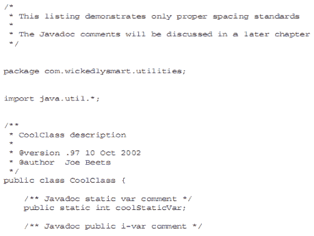

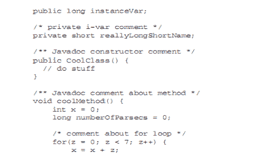

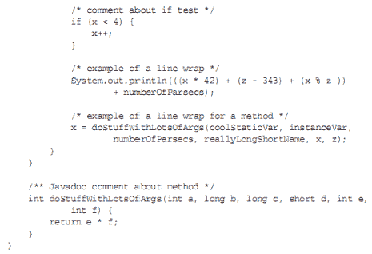

## 声明很有趣

声明是 Java 的很大组成部分。它们非常复杂，充满了规则，如果使用得粗糙，可能会导致 Bug 和维护性差。以下指南旨在让你的代码更具可读性、更易于调试且更易维护。

## 安排你的声明顺序

Java 源文件中的元素应该按照标准的顺序排列。

在某些情况下，编译器要求这样做；而在其他情况下，保持一致性将帮助你赢得朋友并影响他人。如下：

- `class` 注释。
- `package` 声明。
- `import` 语句。
- `class` 声明。
- `static` 变量。
- `instance` 变量。
- 构造函数（constructors）。

## 位置与初始化

在进行 Java 声明时，应考虑以下指南：在方法内部：

- 在其他语句之前声明并初始化局部变量（尽可能如此）。
- 在其他块语句之前声明并初始化块变量（可能的情况下）。
- 每行仅声明一个成员。
- 避免变量遮蔽（shadowing）。当实例变量与局部变量或块变量同名时就会发生这种情况。虽然编译器允许这样做，但遮蔽被认为对必须维护你代码的下一个同事（记住：可能是心理变态的）非常不友善。

## 大写规则

猜三个。当你声明和使用包、类、接口、方法、变量和常量名时，最好正确使用大小写。规则非常简单：

- **包名**：最稳妥的是尽可能使用小写：`com.wickedlysmart.utilities`
- **类名和接口名**：通常它们应该是名词；首字母大写，名称中其他辅助单词的首字母也大写：`Customer` 或 `CustomTable`
- **方法名**：通常它们应该是动词；第一个单词小写，如果有辅助单词，每个单词的首字母都要大写：`initialize()` 或 `getTelescopicOrientation()`
- **变量名**：它们应该遵循与方法相同的大写规则；你应该用字母开头（尽管可以使用 `_` 或 `$`，但不要），只有临时变量（如循环变量）可以使用单字符命名：`currentIndex;` 或 `name;` 或 `x;`
- **常量名**：要被标记为常量，变量必须声明为 `static` 和 `final`。它们的名称应该全大写，并使用下划线分隔单词：`MAX_HEIGHT;` 或 `USED;`


# 清晰性与维护性

## 清晰性与维护性

你易读的代码真的意义吗？它可以被轻松维护吗？

这些是面试中的重大问题，占了你评分的很大一部分。我们将从类设计到错误处理查看每一个方面。记住，你是一个团队成员。代码清晰度的的一些关键领域在“文档”章节中有更详细的介绍，所以我们在这里不讨论。

这些领域包括有意义的注释和自说明性标识符的重要性：

- 通用编程风格考量。
- 遵循面向对象（OO）设计原则。
- 重复轮子。
- 错误处理。

## 通用编程考量

上一章节涵盖的编码规范是一个极好的起点。但面试也在寻找你编程风格的一致性和适当性。

接下来的部分列出了你在编写完美格式的代码时应该记住的一些关键点。其中一些将在随后的章节中解释；其中几点与面向对象设计有关（例如），我们将在该章节中更详细地介绍。

再次强调，现在不是争论这些原则实际优劣的时候。再次，想象你加入了一个项目团队，并需要证明自己是一个……什么？是的！团队合作者男人！

团队首先寻找的是你是否能够遵循规范和标准，这样大家就可以一起工作，而不会不想把对方从七楼的窗户扔到下面的水泥喷泉上。（除非你 true 一家互联网公司，而且你的办公室现在正对着一个废弃的加油站。）

这些点没有特定的顺序，所以不要推断第一个比最后一个重要。然而，你可以推断，你的面试评估官可能会问你是否恰当地做了这些事情。

## 保持变量范围尽可能小

当局部变量可行时，不要使用实例变量！这不仅影响内存使用，还减少了对象无意或刻意“滑出”到不应使用它的地方的风险。

在变量使用正之前再声明它。你应该始终在声明局部变量时（即使用正之前）对其进行初始化，`try/catch` 块除外。在这种情况下，如果变量在 `try/catch` 块中声明并赋值，编译器将不允许你在该块之外使用它，因此，如果你在 `try` 或 `catch` 块之后需要该变量，那么你必须先在 `try/catch` 之外声明它。减少范围的另一种方法是使用 `for` 循环而不是 `while`。

## 避免设计一个没有任何方法的类

对象本质上应该同时具有状态和行为；它们不仅仅是华丽的结构体。如果你需要数据结构，请使用 `Collection`。

然而，这可能适用于你的面试任务。有时你确实需要一个唯一目的是将数据从一个位置传输到另一个位置的对象——通常是数据库请求的结果。例如，表中的一行应该在你的 Java 程序中表示为一个对象，如果它的唯一工作是在在 GUI 表格中显示，它可能并不总是需要方法。这被称为 `ValueObject`（值对象）模式。

## 使用模式

当你使用熟悉的模式时，你就有了一套与其他程序员讨论设计的简捷语言（即使这种讨论发生在你的代码/注释与他人之间。如果你做得对，你就不需要亲自在场讨论它，就像开发者面试的情况那样）。如果你需要一个 `Singleton`（单例），就写一个 `Singleton`——不要只记录这种东西只有一个。

另一方面，不要为了使用模式而强行将你的设计塞入某种模式中。简单应该是你的首要考虑问题，但如果你在你的方法和同样复杂、著名的设计模式之间犹豫不决，请选择模式。

## 尽可能减少内容的可见性

通常情况下，你向世界暴露的公共内容越多，你以后进行更改而不破坏他人代码的自由就越小。暴露的越少，你以后实现更改的灵活性就越大。

而且你知道总会有变化。因此，将变量、方法和类尽可能地限制，同时限制暴露给你的“公共接口”的内容，

长远来看，你会表现得很好。显然，在继承方面还有其他细微的问题（例如，子类可以访问哪些内容），因此这里有更多需要考虑的地方，但总而言之，要考虑减少你的暴露（将其想象为减少你未来的责任）。这与缩小变量的作用范围密切相关。

## 使用重载而非逻辑

如果你有一个方法需要根据实际接收到的对象类型表现出不同的行为，请考虑对它进行重载。

每当你看到 `if` 或 `switch` 块在测试参数的类型时，你应该开始考虑重载该方法了。顺便提一下……

## 避免长参数列表

如果你有大量的参数传入一个方法，也许你需要将该方法所需的内容封装进一个属于它自己类型的类中。

## 不要从构造函数调用可能被重写的方法

### 来自构造函数的方法

你已经知道在 `superconstructor` 运行之前，你无法访问任何非静态内容，但请记住，即使在对象的 `superconstructor` 完成后，在构造函数结束之前，对象仍然处于不完全状态。多态在构造函数中仍然有效。

所以，如果 `B` 继承自 `A`，并且 `A` 在其构造函数调用了一个被 `B` 重写的方法，猜猜看当有人实例化 `B` 时会发生什么。你知道了。`B` 的构造函数调用了它的 `superconstructor`（`A` 的构造函数）。但在 `A` 的构造函数内部，它调用了自己的某个方法之一，而 `B` 重写了该方法。`B` 的方法运行了！

换句话说，在构造函数完成之前，对象的某个方法就可以被调用！所以，尽管 `B` 甚至还一个完全的对象，但它仍然可以运行代码甚至访问它自己的实例变量。

这是一个问题，因为它的实例变量尚未初始化为默认值以外的任何值，即使它们在声明时被赋予了显式值。糟糕！所以不要这样做。如果它是 `final` 或 `private` 实例方法，那么你是安全的，因为你知道它永远不会被重写。

## 编写接口的代码

多态，多态，多态。尽可能使用多态的参数、返回类型和变量（换句话说，将变量、返回类型或参数声明为接口类型，而不是具体的类类型）。

使用接口作为类型可以让你只暴露代码能执行的定义，并留出实现的灵活性和可扩展性。并且具有可维护性。以及所有其他以 -ble 结尾的 OOP 特。但如果你做不到……

## 当你需要继承功能时使用抽象类

如果你确实需要实现代码和/或实例变量，请使用 `abstract class`，并使用该类作为声明的多态变量、参数和返回类型。

## 让你已完成的对象符合垃圾回收条件

你已经知道如何做到这一点。当你不再需要使用该对象时，显式地将引用变量设置为 `null`，或者将不同的对象重新赋值给该引用变量（从而放弃它最初引用的对象）。同时……

## 不要创建比需要更多的对象

仅仅因为有垃圾回收器并不意味着你不会遇到“内存问题”。如果你在堆上保留了太多的对象，导致它们不符合垃圾回收条件（但你不会这样做，因为你读了前一点），那么你仍然会耗尽内存。

更可能的问题是，你的性能可能会因为创建所有对象以及让垃圾回收器回收它们的开销而略有下降。

不要为了省掉几个对象就改变你的设计，但在实现代码中要注意。在某些情况下，你可能可以通过重置状态来简单地复用现有对象。

## 避免深度嵌套和复杂的逻辑

在分支处理方面，少即是多。事实上，你的评估者可能正在对你的代码应用圈复杂度衡量，该衡量认为代码的复杂性不是基于代码行数，而是基于分支点的数量。（实际上这比这复杂得多。讽刺的是，代码复杂性的测试本身就是一个相当复杂的公式。）底线是，每当你在方法中看到嵌套的 `if` 或任何非简单的逻辑流时，你都应该认真考虑重新设计该方法或将功能拆分为单独的方法。

## 使用遵循 JavaBean 命名规范的 Getter 和 Setter

这意味着你应该使用 `set<yourPropertyName>` 来对应可以修改属性的方法（通常属性直接映射到实例变量，但并不一定），并使用 `get<yourPropertyName>` 来对应可以读取属性的方法。例如，一个 `String` 变量名将具有以下 getter/setter 方法：

```java
setName(String name)
String getName()
```

如果属性是 `boolean`，那么你有一个选择（是的，你确实有一个选择）来决定将方法命名为 `get<property>` 还是 `is<property>`。例如，一个布尔实例变量 `motorOn` 可以具有以下 getter/setter 方法：

```java
setMotorOn(boolean state)
boolean getMotorOn()
boolean isMotorOn()
```

遵循 JavaBeans 命名规范的妙之处在于，嘿，你得给它起个名字，如果你遵循规范，大多数与 Java 相关的工具（以及某些技术）就可以读取你的代码并自动检测到你有可编辑属性，例如。这很酷；你应该这样做。

## 在面向对象的世界中不要做过程化程序员

判断你还没有真正转变为完全“对象”的两个明显标志是当你使用以下内容时：

- 拥有所有方法的巨大类。
- 大量的 `static` 方法。事实上，除非你非常有理由让它们成为静态的，否则所有方法都应该是非静态的。这是面向对象。我们没有全局变量和函数。
- 除非发生分支，否则一直线性执行。这是面向对象，这意味着从头到底。

## 让变量和方法尽可能自解释其义


不要使用像 `x` 或 `y` 这样的变量名。这到底是什么意思：`int x = 27;` 27 什么？除非你真的认为可以通过确保没人能看懂你的代码来锁定工作安全（并假设尝试的杀人狂找不到你），否则你应该让你的标识符尽可能具有意义。

它们不需要是段落。事实上，如果需要用一段话来解释变量代表什么，你可能需要重新考虑你的设计。或者至少使用注释。但不要让它们太简短！从核心 API 中吸取教。它们可以命名为 `ArInBException`，但它们使用了 `ArrayIndexOutOfBoundsException`。对于该异常代表什么还有疑问吗？当然，Sun 的大失误是著名的 `NullPointerException`。尽管使用了禁忌词 pointer，大家在收到时都知道这意味着什么。但如果命名为 `NPTException` 或 `NullException` 可能会引起混乱。

## 使用核心 API

不要造轮子，并且不要——否则会自动失败——使用你开发的代码和核心 Java API 之外的任何库。抵抗 true 自己可以构建出更快、更干净、更多内容的冲动。即使事实如此，认为放弃使用他人熟悉且在领域内经过极端大量测试的标准类的优势也是值得的。

## 如果找不到合适的类，请创建自己的异常类

如果你在 `java.lang` 中没有找到完美的检查型 `Exception` 类，请创建你自己的。并让它足够具体以便对捕获者有意义。换句话说，不要为程序中发生的任何可能的业务错误都创建一个 `BadThingHappenedException` 并抛出它。

## 不要返回错误码！

这是 Java。这是面向对象（OO）。如果你真的需要指示某种异常情况，请使用 `Exception`！如果你真的想惹恼评估老师，就把错误码作为你某些方法的返回值。仅仅是其中一个方法可能就能达到目的了。

## 使用字符串构造函数参数创建你的异常

这样做可以让你有机会更详细地描述导致异常的事件。当你实例化一个 `Exception` 时，调用接收 `String` 参数的构造函数（或者如果你正在进行异常链，则调用接收另一个低级异常的构造函数）。当你创建自己的 `Exception` 类时，务必包含一个接收 `String` 的构造函数。

## 遵循基础面向对象设计原则

在节一节中，一些关键点触及了我们在这里将深入探讨的领域。你不需要成为世界上最好的面向对象设计师，但你确实需要遵循面向对象优势所依赖的基础原则。

显然，我们不能把这写成“10 页教你如何成为优秀的面向对象设计师”。你需要更多的学习和实践，我们假设你已经做过了这些。

这现在应该是老生常谈了，但你可以打赌，你的评估老师会关注这些问题，所以温习一下无无处。我们正在介绍那些你可能在作业中被扣分的领域的重点。

### 隐藏实现细节

这适用于许多地方，但使用接口编码和使用封装是实现这一点的最佳方法。如果你将代码看作许多小的、自包含的、可插的组件，那么你就不希望任何使用你某个组件的人去思考它是如何运行的。这一切都归于输入和输出。

公共接口描述了方法需要你提供什么，以及它将向你返回什么。它对于如何实现这一点字字未提。你可以更改你的实现（甚至是执行该操作的类），而不影响调用它的代码。

实现细节也可以通过异常传播，所以要小心不要在使用了接口的情况下，却在 `throws` 子句中放置了特定于实现的异常！如果客户端执行“搜索”，他们不应该去捕获 `SQLException`。

例如，如果你的实现代码恰好在执行可能会生成 `SQLExceptions` 的数据库操作（如 `JDBC` 代码那样），客户端不应该知道这一点。你的工作是捕获该特定实现的异常，并向客户端代码抛出一个更有意义的、与业务相关的异常。

### 使用适当的类粒度

类的粒度应该是合适的，你知道的。它不应该太大，也不应该太小。问题很少出在类太小；然而，大多数不完全面向对象的程序员都会写出太大的类。

一个类应该代表一个具有状态和行为的实体。在编写每个方法时，不断问自己，该行为是否可能更适合其他东西。

例如，假设你有一个 `Kitchen` 类，它处理各种关于厨房的事情。比如 `Oven`（烤箱）和 `Refrigerator`（冰箱）等等。现在你在同一个类中拥有了 `Kitchen` 的（`Kitchen` 是一个房间）、`Refrigerator` 的和 `Oven` 的东西。

那是三件不同的事情。类（以及从它们实例化的对象）真的应该是专家。它们应该执行该类型实体应该执行的行为，仅此而已。因此，与其让 `Kitchen` 类包含所有 `Refrigerator` 和 `Oven` 行为的代码，不如让 `Kitchen` 类通过“包含”（HAS-A）关系使用 `Refrigerator` 和 `Oven`。

这保持了所有三个类的简单且可重用。这解决了你的命名问题，这样你就不需要把那个无所不能的厨房类命名为 `KitchenFridgeOven`。

另一个导致“大类”的可能是你定义了太多的内部类。太太多意味着某些内部类本应该是顶层类（为了重用）或者干脆是包装类的方法。确保你的内部类或嵌套类确实有必要被包含。

### 限制子类化

如果你需要创建一个新的子类来添加重要功能，也许该功能实际上应该在父类中（从而消除了对子类的需求——你只需要修复父类）。

当你觉得需要扩展一个类时，务要查看父类是否应该更改，或者你是否需要组合（这意味着使用 HAS-A 关系而不是 IS-A 关系）。

在 Java 核心 API 中寻找关于子类化与组合的线索：核心 API 的继承体系非常宽但非常浅。除了少数例外（如 GUI 组件）外，大多数类层次结构的深度都不会二到三层。

### 使用适当的方法粒度

正如类应该是专家一样，方法也应该是专家。如果你的方法很长，你的作业几乎肯定会被扣分（尽管在某些情况下，特别是在是在你的 `Swing` GUI 代码中，长方法并不一定意味着设计糟糕）。

但在大多数情况下，方法越长越复杂，因为长方法通常反映了一个方法执行了太多任务。

你们都是程序员了，所以我们不必过多强调较小的模块化功能更易调试、修改、重用等。始终看看将一个长方法拆分为几个较小的方法是否有意义。虽然在截止日期紧迫压力下，你在现实世界中可能可以用长方法混过去（当然会感到内疚），但这在你的开发作业中是行不通的。

### 使用封装

你的作业将针对这一最基础的面向对象原则接受严格审查。预计评估老师会查看你控制对象状态访问的方式。

换句话说，查看你如何通过 setter 和 getter 保护实例变量。这里不需要讨论，直接做就好。只通过更具访问性的方法允许访问数据（常量除外）。注意你的访问修饰符。

如果你有一组良好的访问器方法，但又把变量开放供直接访问，那是没有意义的。再次，尽可能地私有化并限制范围。

### 隔离可能变化的代码与不变的代码

在设计类时，务必将可能变化的功能分离到单独的类中。这样你就限制了在程序演进时需要查找并修改的地方。

## 使用核心 API

始终始终始终检查核心 API，并知道有时你可能会在预料之外的包中找到你寻找的类。

所以务必真正搜索 API，甚至挖掘那些你认为偏离了路径的包和类。有时解决方案出现在你最意想不到的地方，所以要对那些你通常不会采取的方法保持开放态度。

我们无法告诉你在作业中实际上真正需要哪些模式；这取决于你的作业内容以及你具体的实现方法。但有很多标准的设计模式可以让你利用那些之前遇到过类似问题并挣扎过的人所积累的集体经验（尽管通常是在相当抽象的层面——这通常也是大多数模式发挥作用的地方）。

因此，虽然核心 API 让你利用他人的实现代码，但设计模式则让你利用他人解决问题的方法。不过，如果你非要拿刀抵我们的脑门，我们可能不得不说，在开发作业时，`Singleton` 应该出现在你考虑列表的最顶端。

但你也可以先看看 `MVC`（用于你的客户端 GUI）、`Façade`、`Decorator`、`Observer`、`Command`、`Adapter`、`Proxy` 和 `Callback`。作为开始，可以买一本关于设计模式的书（经典参考书被称为“四人帮” `GOF` 书，由 Erich Gamma、Richard Helm、Ralph Johnson 和 John Vlissides 编写的 *Design Patterns: Elements of Reusable Object-Oriented Software*），并花时间回过头看看你的程序是否正尝试解决某些已经由设计模式很好解决的问题。

这些模式并不会教你如何构建算法和逐行实现代码，但它们可以引导你走向一个健壮且可维护的设计。

也许最重要的是，随着设计模式变得越来越知名，开发者有了一个共同的词汇来讨论设计权衡和决策。

我们认为，由于设计模式流行程度的提高，设计模式的使用在考试评估中的重要性比过去更加时候。

## 恰当处理错误

你将在整个项目过程中被评估是否执行了恰当且清晰的错误处理。你可能在 GUI 方面表现得非常好，但在服务器端却掉链了，但这在程序的每个地方都同样重要。

### 不要返回错误代码

这里是 Java。使用错误代码作为返回值而不是使用异常是一个非常糟糕的主意（Really Bad Idea）。我们很确定你的阅卷老师知道这一点。

### 不要发送过多的命令行消息

命令行消息不要太啰嗦，并务确保不要遗留调试信息！你的命令行消息应该只包含验证程序启动所必需的内容，以及极少数在程序失败时可能关重要的状态消息。

但总的来说，如果发生了你预知可能发生的错误，你应该用异常来处理它。无论你做什么，都不要用命令行消息向用户发送警报信息！如果合适，请使用适当对话框。

### 在适当的地方使用对话框

另一方面，不要为用户可能需要知道的每条消息都使用对话框。除非你需要向用户显示非紧急性质的信息（紧急是指如记录锁定问题，或者你需要提供“你确定要退出吗？”的选项）。在很多情况下，当程序中的某个部分捕获到异常且你需要用户输入来适当处理时，你会使用对话框。

### 恰当地抛出检查异常

抛出检查异常（checked exceptions）有正确的时间和地点，不愿抛出它们可能和粗率抛出它们一样糟糕。

- 使用 `runtime exceptions`（运行时异常）处理编程错误。
- 使用 `checked exceptions`（检查异常）处理你的代码可以恢复的问题（可能需要用户的帮助）。
- `Checked exceptions` 仅用于真正的异常情况。
- 不要使用异常进行流程控制！噢，如果你希望在考试和现实生活中都表现良好，就不要这样做。

记住，`checked exceptions` 在运行时并不是免费的；它们有开销。只有在需要时，且仅在需要时才使用它们。

### 在适当的情况下创建并抛出你自己的异常

在合理的情况下利用标准异常，如果合适，永远不要犹豫创建自己的异常。如果有合理可能从某个异常状态中恢复，请使用 `checked exception` 并尝试处理它。

通常情况下，你创建的异常可以被视为 `Business Exceptions`（业务异常）——也就是说，如 `RecordLockedException` 或 `InsufficientSearchCriteriaException` 之类的异常。

异常越具体，代码就越容易处理它，你可以获得提供特定 `catch` 块的处，从而保持 `catch` 块粒度的有用性。这种策略的反面是简单在一个巨大的 `try` 块中捕获 `Exception`（更糟的是 `Throwable`！）。

### 捕获底层实现异常并抛出高层业务异常

假设你捕获了一个 `SQLException`（在开发者考试中不太可能）。

你会把它抛回给客户端吗？当然不。对于客户端来说，这属于“信息过多”。客户端不应该知道——也不应该关心——数据库服务器恰好在使用 SQL。相反，应该向客户端抛出一个更有意义的自定义业务异常，以便他们进行处理。

这个更有意义的业务异常定义在你的公共接口中，因此客户预见到了这种可能性。但简单地将底层异常一直传递给客户端反映了糟糕的设计，因为这将客户端与服务器的实现细节耦合，这在面向对象的设计中从不是一个好主意。

### 永远、永远、永远不要吞掉异常（Eat an Exception）

我们说的“吞”是指以下糟糕的做法：

```java
try {
    doRiskyThing();
} 
catch(Exception e) { }
```

看到缺失了什么吗？通过捕获异常而不进行任何方式的处理，它将完全没有被察觉，仿佛从没发生过一样。你至少应该打印堆栈跟踪（stack trace）。在你的考试项目中放置这样的代码可能是致命的。

有时候，客户端可能想要，例如，预订一次马术游轮，在这种情况下，一条或多条记录将需要更新。你可能需要插入一个新的游轮或删除一个已取消的游轮。无论实际情况如何，真正的问题在于——

## 我如何保护数据免受并发访问？

换句话说，我该如何锁定记录？

### 注意

你的锁定设计和实现决策（以及执行）是你开发者作业中最重要的部分。请花费尽可能大部分的时间来确保你有一个可靠的解决方案。请确保你已经满足作业文档中任何关于锁定和解锁的要求。

如果你的作业规范中部分内容模糊或具有歧义，你需要对其进行解释（你对应该如何做的最佳推测），然后记录你的假设和策略。

请记住，客户端可能是局部的也可能是远程的（换句话说，在数据库所在的同一台机器上，或者在网络其他地方的机器上），因此你必须考虑与这两种场景相关的问题。

锁定至关重要，但幸运的是开发者考试并没有要求你使用两阶段提交协议实现一个完整的分布式事务系统。

事实上，这比事务简单得多，但它要求你理解围绕数据并发访问的基本问题。就是那个丈夫和妻子共享同一个账户的问题吗？

如果你不是完全清楚如何处理同步，请重读那个章节。为了正确实现你的锁定策略，你需要对同步、`wait()`、`notify()` 和 `notifyAll()` 有扎实的掌握。那么，准备好回答一些问题了吗？再次强调，这些问题没有特定的顺序。

## 需要问自己的问题

我们将这些问题分为两类：搜索和锁定。但有很多关于搜索的内容也属于 GUI 问题范畴（第 13 章）。具体来说，你需要确保你的终端用户知道如何构建搜索查询。

### 搜索

客户端执行搜索有多容易？假设 GUI 本身是用户友好的（我们在第 13 章中对此有很多要说），那么标准是什么呢？

- 搜索准则项是如何表示的？一个 `String`？一个 `CriteriaObject`？
- 客户端如何确切知道他们可以基于什么进行搜索？
- 你的搜索支持布尔匹配吗？它需要吗？
- 数据库并不一定有索引，所以你是否考虑过其他让搜索尽可能高效的方法？

### 注意

不要为了微小的性能提升而牺牲清晰性和简单性。如果性能提升很大，请重新设计，以便你拥有一个相当高效且清晰易于维护的算法。

你记录过你的搜索算法吗？

- 如果你发现自己正在编写大量的文档来解释你的搜索算法，那么设计上可能出了问题。
- 你的搜索算法文档是易阅读和理解的吗？
- 当客户端提交搜索查询时，搜索准则的特定部分是否显式地匹配到特定字段？还是说你每次搜索都搜索所有字段？
- 如果你在使用 1.4，你是否调查过正则表达式是否有帮助？
- 如果没有没有项匹配客户端的搜索准则，会发生什么？
- 它需要精确匹配吗？
- 是否存在大量记录匹配搜索准则的情况？

（注：由于原文中存在大量重复内容，译文已根据核心逻辑进行了去重处理。）


连接独立的读者与独立的作者。

Harry 的其他作品 - 匿名黑客活动分子。

200 个技巧与非技术面试题及问答。2000+ Java 问题及问答。

[破解编程面试：2000+ 题目、概念、问题、分析与解决方案](https://www.draft2digital.com/catalog/61159)

## 独立章节

[破解编码面试（2500+ 面试题与问答](https://www.draft2digital.com/catalog/54225)
