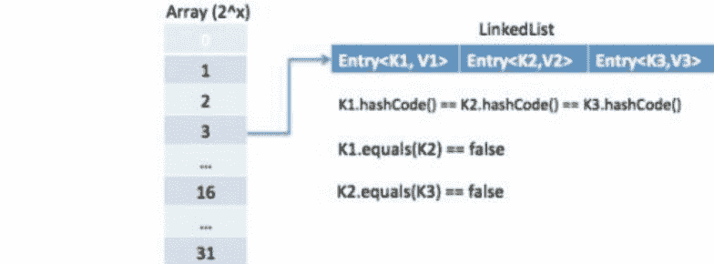
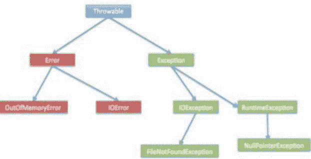

# 破解编程面试：2000+ Java 题与答，500+ 技巧及非技术面试问答

- HARRY，匿名黑客行动分子（HACKtivist）。


- Harry，匿名黑客行动分子


# 献言

“本书献给所有每天做出牺牲的人，特别是那些为了确保我们的自由与安全而牺牲的人。”

你告诉我，一切都会好好的，

你也告诉我，如果现在不好，那就还没有结束。


“我将在穿过 1000 个世界和 10000 万世中寻找你，直到找到你”

# 关于作者

Harry 是一个匿名黑客行动分子、世界著名的计算机程序员、畅销的 Java 作者以及科学黑客专业人士，在计算机编程、黑客和网络安全领域拥有独特经验。

他曾帮助全球许多国家的政府和许多跨国软件公司保护其网络和安全。他编写了多关于各种计算机编程语言以及计算机安全与黑客的书。他因其国际畅销编程书籍《Core Java Professional》而闻名。

他是一位技术类软件工程师和硕士。他是 C 语言编程、C++ 编程以及核心 Java、数据结构和算法领域的权威。他拥有广受好誉的 C、C 和 Java 书。他拥有 5 年软件方法论经验。他的教学和研究兴趣在人工智能、编程语言。

他过着两种生活。一种生活中，他是一家正直软件公司的计算机程序编写员。另一种生活在计算机世界，他使用黑客别名“Harry”，并犯了几乎所有的计算机犯罪。目前，他在世界著名的匿名国际社区 - Team Anonymous 担任离线 IT 经理。

# 作者自述

你可能注意到这里漏掉了一些东西：没有令人注目的资历。我没有在某著名大学担任过四分之一世纪的教授；我也不是硅谷巨头的高管。在某些方面，我也是技术的学生，就像你一样。

我多年的经验告诉我，许多最了解技术工作原理的人，在解释他们所知的内容并使其令我理解的方面，成功却相当有限。我的兴趣，我相信我的技能，并不在于成为专家，而在于成为一名教育者，以一种合理、易于理解且读起来有趣的形式呈现复杂信息。

“什么是真实？你如何定义真实？如果你无法定义它，它是什么？你所感受到的、能尝到的、能看到的真实，那么真实是简单的；我现在开始发现在纸上表达它是多么困难的。只要你能感受到、能尝到、能看到，那么真实是简单的；我现在开始发现在纸上表达它是多么困难的。”


# ∞ 核心 Java 面试技能——让变得易于上手！ ∞

请稍候！

我知道很多人不看序言，但如果你真的想攻克编程面试，那么我强烈建议你也仔细阅读序言的每一页、每一行。之所以这样做，是因为这段序言提供了一些独特的内容。

本面试书的主要目标不是给你提供神奇的面试题和技巧，我遵循的是一种模式，即通过深度的问答解释来改进题目的解决方案，并针对每个面试问题提供不同复杂度的解答，你将会发现复杂的面试题有多种解决方案。我列举了约 2000 多个 Java 技术问题和 200 多个技术面试前的非技术问题。这本书是你读读过的全球最大的 Java 面试书籍。

## 有什么特别之处

在书中，我为开发者和初级学者详细地涵盖并解释了最新的 Java 8 特性的几个主题，如：Lambdas、Java 8 函数式接口、Stream 和 Time API。

作为一名求职者，如果你能认真且深入理解地读完整本书，我 101% 确定你能挑战这个世界的任何面试和面试官（特别是 Java 类）。而这就是本书的目标。书中包含了两千多个 Java 技术问题和如前文提到的 200 个非技术问题。

这本书对于 IT 专业人士以及工程学位和硕士课程的学生在校园招聘和学术准备期间非常有用。如果你是正在准备计算机科学或信息技术面试的学生，这本书的内容详细地涵盖了所有所需的主题。在编写此书时，我们投入了巨大的精力来帮助正在准备这类技术面试环节的学生。

你好！现在我想和你们分享一些重要的事情。对于那些初次接触 IT/技术或任何其他工作面试的人来说，这个过程可能看起来让人无所措：面试官向你抛出问题，他们期望你能够现场写出绝妙的算法或程序代码。幸运的是，其他人都在同一条船上，而且你已经在努力准备了。干得好！所以，把球踢回面试官面前。

**在你准备面试时，请考虑这些建议：**

大多数面试官不会给你提供电脑，而是希望你在白板或纸上写代码。模拟这种环境，尝试先在纸上写代码来回答问题，然后再输入电脑中，因为白板编程是一项特殊技能，通过不断的练习可以掌握它。我的意思是，假设你的想法是面试官，而你的大脑是编译器。简单！

## 首先了解你的简历

首先，我想和你们分享一件你们可能不知道的重要事情。我谈论的是差异！是的，CV（学术简历/Curriculum Vitae）和 Resume（简历）之间的区别。Curriculum Vitae 是由初级者或学生在寻找工作时准备的文档。它提供了学生的学术细节；另一方面，Resume 是由经验丰富的专业人士准备的，它强调的是工作历史、职场技能和经验。

虽然技术技能极其重要，但这并不是忽视简历中工作的理由。请确保自己已经准备好，能够对你参与过的任何项目或工作提供简要总结。

## 并且不要硬背答案

虽然这本书提供了面试问题的代表性样本，但世界上仍然有成千上万的面试题。背答案并不是浪费时间的良好做法。相反，请利用这本书来探索解决问题的方法，学习新概念并练习你的技能。

## 所以，大声说出来

面试官想理解你是如何思考和处理问题的，因此在你解决问题时，要大声说出来，让面试官看到你是如何应对问题的，他们可能还会引导你。

## 最后记住——面试是很困难的！

在我在 IBM 进行面试的多年里，我看到一些面试官会问“简单”的问题，而另一些人则问更难的问题，但你知道吗？拿到简单的问题并不意味着更容易获得 Offer（录取）。获得 Offer 并不是关于完美无缺地解决问题（极少数候选人能做到这一点）！

相反，它是比其他候选人更好地回答问题。我为你们以及你们将要开发的技能感到兴奋。充分的准备将带给你面对广泛的技术和交流技能。无论这些努力将带你走向何方，都是值得的！

对于初级工作，IT 行业需要具有良好编程能力的学生和年轻专业人士，特别是世界所需的 Java 语言和解决问题的技能。对于需要编程技能的工作，大多数 IT 公司都在寻找具有良好的 C、C++（较少）以及特别是 Java 编程技能的候选人。

## 最后，关键点

那就是 Java 编程技能对于如今在 IT 公司（特别是 Apple、IBM、HP、HCL、MICROSOFT、INFOSYS、ACCENTURE、FACEBOOK、GOOGLE、YAHOO 以及其他）获得任何与软件相关的工作都是至关重要的。

## 许多编程

市场上已经有很多书籍，但大多数书籍是不同编程语言的教程或教材。

仅仅通过阅读这些书籍中的任何一本或编写几个程序来攻克 IT 面试是非常困难的，这很容易产生怀疑，仿佛你是地球上最好的程序员。

每一个 IT 面试都侧重于从编程角度解决问题，因此，问的问题与教材涵盖的内容大不同，因为教材只涵盖了教你如何编写简单程序的教学性问题和解决方案。

## 目标读者群体

这本书专门设计给参加软件公司校园或线下面试的学生、程序员和软件专业人士，其目标是帮助他们通过这些笔试和面试。

IT 公司的校园招聘通常包括笔试和面试。在笔试中，通常涉及 C、C++ 的内容；在面试中，他们检查学生或专业人士是否了解编程概念并具备解决问题的能力。

另一方面，通过阅读这本书，你可以轻松帮助那些需要通过这些笔试和面试的人。在 IT 公司的校园招聘中，通常包括笔试和面试。在笔试中，通常涉及 C、C++ 的内容；在面试中，他们检查学生或专业人士是否了解编程概念并具备解决问题的能力。

> 石头是被最后一一下锤击碎的。但这并不意味着之前的击是无用的。所以，站起来，勇敢，坚强，知道你是自己命运的创造者。

归根结底，为工作选择人意味着至少有一个人对另一个人做出决策。无论我们如何努力消除主观性，作为人类，我们都不可能放下自己的倾向、偏好和个人喜好——无论我们多么地尝试。

在一个理想的世界里，最适合某项工作的人总是能赢得它；然而，现实是，往往是那个面试中表现最好的人赢得了机会。这里重要的教训是：

- 如果你知道比你更适合这份工作的人也在申请，不要自动退出申请。如果你肯于花精力为面试做充分的准备，那么你很有可能被视为首选候选人，特别是当对方认为面试理所当然且没有做好准备时。

- 如果你认为自己是这份工作最合适的人，请避免对面试理所当然。表现得好像你正在与强劲的对手竞争。花时间做好充分准备。仅仅因为你有丰富的经验，并不意味着你如何在面试中传达这一信息。

## 误区 2：面试就像学校考试——说得越多，表现越好

是的，面试在某些方面确实像考试，因为会被要求回答一些需要机智应答的问题，但相似性此为止。与考试不同（考试中大量的准确细节非常重要），面试更多是关于互动和建立关系，同时清晰地表达聪明的答案。聪明的答案往往不是最详细的。事实上，尽管在技术上是准确的，但冗长且过于详细的回答会让面试分散注意力。知道何时停止是所有成功面试者都具备的技能。

此外，与许多考试不同，面试中通常没有对错之分。我们都是不同的个体，来自不同的背景和业务情况参加面试。在面试中，重要的是为你的行为提供理由，并以自信的方式谈论你的成就。

## 误区 3：面试官知道自己在做什么

有些面试官非常擅长自己的工作，尤其是全职专业人员（前提是他们没有遭受面试疲劳）。然而，许多小企业的经理和老板往往会手足无措，因为面试并不是他们经常做的事情。

### 糟糕面试官的一些明显迹象

- 他们占据了大部分说话时间。
- 他们听起来好像在前几分钟内就对你下了定论。
- 他们的问题似乎是从虚空中随机抓取的。
- 他们的手机一直响，而且他们还接了电话。
- 在推销这份工作时，他们听起来像非常精明且不诚实的销售员。

### 优秀面试官的一些明显迹象

- 他们提前仔细地准备了问题。
- 他们想知道你做过什么以及是如何做的，包括具体的例子。
- 他们让你占据大部分说话时间。
- 他们可能想要多次面试你。
- 他们会努力让你感到轻松。
- 他们对你的成就、技能以及你的人格表现出真正的兴趣。

缺乏经验的面试官通常不会问正确的问题，并且很容易被与你工作能力无关紧要的因素所左右。所以，如果面试你的是这样一位缺乏经验的面试官，不要坐等他问出一个能让你谈论所有绝妙技能和特质的好问题。

相反，请尽可能以一种不突兀的方式采取主动，谈论你觉得面试官可能真的想知道的事情。遗憾的是，这可能总是可能的，特别是当你的面试官是一个性格强势、喜欢听自己说话声的人时。

如果你发现自己处于这种境地，不要恐慌。提醒自己，面试既关乎回答问题，也关乎建立关系。所以要点头、微笑并做出所有正确的反应；健谈的面试官喜欢那些认同他们的人。

## 误区 4：永远不要说“我不知道”

面试是关于通过机智回答问题并与面试官建立关系来留下良好印象。为了这一目的，许多面试者觉得他们必须对提出的每一个问题提供完美的答案，无论他们实际上是否知道答案。

显然，一次出色的面试是你能够回答所有问题（如果你花时间做了正确的准备，你本应该能做到）；然而，如果你不知道某个问题的答案，承认它比假装知道并开始胡言乱语要好。

大多数面试官都能一眼看穿胡言乱语，他们不喜欢这种行为有几个非常重要的原因：第一，这可能让你听起来不诚实；如果你给人的印象既不诚实也不正确的印象，你还不如不参加面试了。

尝试回答一个你几乎一无所知可能会破坏原本非常完美的面试。这并不意味着你不能尝试回答你不确定的问题。尝试一下并没有大错，只要你一开始就向面试官说明你的不确定性即可。以下是答案听起来可能的样子：

“我必须诚实地说，这不是我熟悉的领域，但我非常感兴趣。如果你愿意的话，我很乐意尝试解决这个问题，只要你不期望得到完美的答案即可。”

或者：

“我很想回答那个问题，但我需要先诚实地说，这并不是我非常熟悉的领域，尽管我很想增加关于这方面的知识。”

## 误区 5：长得好看的人获得工作

“长得好看的人获得工作”是一个常见的误区。虽然第一印象很重要，但它不是唯一的因素。事实上，许多仅凭外貌被录取的人无法达到预期。

现实是，雇主寻找能够胜任工作并融入团队的人。虽然良好的外貌可能会给你带来优势，但它无法取代技能、经验和性格。

## 误区 6：如果你比别人回答得更好，就能获得工作

认为回答得比别人好意味着就能获得工作是另一个误区。虽然提供良好的答案很重要，但它不是唯一的标准。雇主还会考虑文化契合度、态度和潜力。

在某些情况下，没有最好答案的人可能被录用，因为他们表现出了良好的态度并更适合团队。

## 误区 7：你应该尝试给出完美的答案

给出完美答案的压力会导致人们过度分析、啰嗦甚至出错。现实中，并没有所谓的完美答案。提供一个清晰、诚实的答案比苦苦寻找一个完美的答案要好得多。

## 误区 8：你必须提问来展示你的兴趣和智力

许多面试者认为他们必须在面试结束时提问。虽然提问是一件好事，但它不是展示兴趣和智力的唯一方式。这些也可以通过贯穿面试的回答来展示。

特别是当你问及在面试过程中已经涵盖过的问题时。

只有在你有真实疑问时才提问。可以接受的问题包括与你申请的工作直接相关的问题，以及关于薪资、休假等工作条件和公司政策的问题。面试官并不介意回答此类问题，但他们会介意那些他们认为无关的问题。

如果你没有问题要问，只需说如：“谢谢，我没有问题了。在面试过程中你非常详尽，已经涵盖了关于该工作的所有重要事项。”对面试官的详尽和专业表现给予赞美并无错——只要这种赞美不过分，或听起来不像是在谄媚即可。

关于提问，还需要注意两点：首先，避免提问过量。总的来说，面试官并不喜欢这种角色的反转。其次，永远不要问可能引起尴尬的问题。这些可能包括：

- 涉及负面意图的问题；
- 不应该属于公共领域的内容；
- 可能会让面试官感到为难的难题。

准则则是：如果你认为一个问题可能会导致尴尬，请采取谨慎态度并避免它。

## 误区第 9 条：放松并做你自己

虽然放松并展现出你最好的一面很重要，但理解面试并非社交活动同样重要。大多数面试都是高度正式的活动，在这些活动中，原本无害的行为会被视为不可接受的。

简而言之，表现出你的常态可能会导致灾难性的结果（尽管听起来可能很矛盾）。例如，如果“做你自己”意味着后靠在椅子上、穿得邋遢以及开笑话，你可能会发现自己参加了异常大量的面试。

虽然面试官喜欢人们保持放松，但他们对面试中哪些行为是恰当的明确明确，如果你违反了这些期望，后果自负！

## 误区第 10 条：面试官在寻找缺点

这个误区的危险之处在于，它很容易导致应聘者在面试期间采取防御性的、甚至是不信任的态度。

如果你认为面试官正在刻苦钻地寻找你的缺点，这很可能会损害你建立至关重要的互动关系和信任的努力。

这也可能阻止你敞开心扉并给出非常出色的答案。请放心，大多数面试官准备面试问题并不是为了发现你的缺点。准备问题主要是为了让面试官对你为公司提供的价值有一个整体的或全面的洞察。优秀的面试官确实会发掘你不擅长的领域，但这与认为面试官执迷于发现你的缺点有着本质区别。

将每一个问题都视为表现卓越的机会，而不是不必要地戒备，是非常重要的。只有通过回答问题，你才能证明自己有多优秀。将问题视为怀疑的对象毫无意义。

理解围绕面试的误区为你成功奠定了良好的基础。记住，面试与生活的其他活动没有区别：你对其实质理解越深，成功应对的可能性就越高。对常见面试误区的见解将赋予你所需的信息，防止掉入这些令人沮丧的陷阱。

同样重要的是，对面试本质更清晰的认识将指导你的其余准备工作，并有助于你的信心和表现。

## 要点总结

- 最合适的人并不一定能胜出——通常是面试表现最好的人胜。
- 面试不仅仅是提供技术上正确的答案。面试也很大关乎建立互动关系。
- 并不是所有的面试官都知道自己在做什么；你的工作是学会如何应对优秀和糟糕的面试官。
- 诚实并承认无知，比假装知道答案而显得不诚实且不聪明要好。
- 长得好看的人赢得工作——也许在好莱坞电影中如此，但总的来说，员工更倾向于雇用人才而非外表因素。
- 追求给出完美答案可能会带来麻烦。给出一个简洁明了的良好答案比追求完美要好；此外，不存在所谓的完美答案。
- 不要为了提问而提问。只有当你有未涵盖的真实疑问时才提问。
- 面试是正式场合，需要相对正式的行为。面试官会期望这些，如果你做不到，他们可能会产生负面反应。
- 面试官并不是花所有时间寻找你的缺点。他们更有兴趣对你为公司提供的价值有一个整体或全面的洞察。

对面试的基本本质有所认识，是显著提高你表现的第一步，这也是一个循序渐进的过程。一个很好的起点是问自己：“怎样才能说服面试官你就是胜任这份工作的最佳人选？”这个问题的答案最好可以总结为四个部分：

- 正确的准备；
- 了解面试官关注的内容；
- 练习你的答案；
- 坚持。

## 正确的准备

你在面试中的表现很大程度上取决于你准备得有多充分。不作准备几乎意味着你无法发挥出最佳水平。在某些情况下，它意味着表现非常糟糕，这可能会导致你信心的崩溃。

即使你幸运成为首选候选人，几乎确定只要到场就能赢得职位，你仍然应该花时间做准备，因为表现得越好，谈出更高薪资的机会就越大，而且金额差异往往是巨大的。

我们听过有人吹嘘说他们从未为面试做过准备，而且过得很好。虽然这种吹嘘可能并非空谈，但仔细观察通常会发现这些人是：

- 运气好——即在正确的时间出现在正确的地方；
- 人脉广；
- 处于有利的劳动力市场，那里对员工需求巨大而供应稀缺；
- 申请的是完全在舒适区内的工作——即没有通过挑战自我来提升自己的地位；或
- 申请的是内部职位，主要与外部候选人竞争。

## 准备的必要性

当你思考面试的基本本质时，关于面试准备的论点就变得非常有说服力。

你不仅被要求在竞争性的环境中推销自己，还被要求将大量且通常复杂的信息浓缩成简洁且表达清晰的答案，这些答案要避免任何负面内涵，并包含面试官想听的信息。

人们的压力水平增加并不奇怪。但并不止于此。还有三个额外的理由让面试准备的必要性更具说服力：

- 面试是稀有事件，因此让人感到既陌生又尴尬。
- 许多人发现很难在面试中推销自己，因为他们受到了家庭和社会的影响，被教不要自扬。做出像“我非常擅长销售 xyz”这样简单的陈述可能是一个需要克服的障碍。


在大多数面试中，获得第二是不够的。这还关乎于胜过所有人。难以想象你竟然会对一个频率低、具有竞争性且需要非日常行为的活动缺乏准备。然而，这正是人们在没有准备的情况下进入面试间时所做的。

## 什么是错误的准备？

错误的准备是指任何不能优化你面试表现的准备。死记硬背别人准备好的通用答案价值有限。

在最好的情况下，它们能让你对什么可能构成一个好的答案有所见解；最坏的情况下，它们只会引导你走入歧途。在绝大多数情况下，问题并不存在所谓的标准答案。对于一个雇主来说是完美的答案，在另一个雇主看来可能非常平庸。

你能做的最糟糕的事情之一就是背诵他人的回答并在面试中重复它们。重复这些其他所谓的“优秀答案”会让你听起来不真诚，并且在被问及探性的后续问题时让你显得有些滑稽。准备你自己的答案要有意义得多。

## 准备的优势

花时间为面试做正确的准备将会：

- 提高你的信心水平；
- 帮助简洁地回答问题，而不是为了表达一个观点而花费大量时间；
- 帮助你知道说什么以及怎么说；
- 帮助你处理困难的问题；
- 帮助你避免说出引起负面印象的话；
- 提高你建立关系的能力。

## 了解面试官关注的内容

了解准备什么的关键之一在于理解面试官的需求。一旦你知道了面试官关注的内容，面试准备会突然变得清晰得多，更容易管理。

绝大多数面试官——无论他们是否意识到——都想从你那里听到三件事。事实上，几乎所有好的面试题都归结为这三个通用性问题：

- 你能胜任这份工作吗？换句话说，你是否有足够的技能、知识、经验或潜力在工作中表现良好？大多数面试官会在面试的大部分时间里在这探测你。他们会知道你做过什么、是如何做的以及结果是什么。如果你没有履行过某项职责，他们将尝试确定你胜任工作的潜力。
- 你是他们可以合作的那个人吗？这个问题的另一种表达方式是：你会融入组织的既有文化吗？或者，在小组织的情况下：你会和老板相处好吗？虽然面试官通常在这个问题上花费的时间少得多，但这仍然是一个至关重要的事情，因为没有人想和自己不喜欢的人一起，即使他们能胜任工作。
- 你的积极性如何？换句话说，你为职位带来了什么样的能量水平和动力？你可能甚至不会被问到关于你的水平的问题，但如果不处理这一点你将面临风险。正如我们所知，积极性高的员工是雇主极加青睐的——这有其道理。

知道面试官对这三个通用问题非常感兴趣，并且他们提出的绝大多数问题都属于其中另外一个类别，这有两个显著的益处。

首先，它指导了你的准备。你不需要花费大量时间在随机选择的问题中挣扎，而是能够围绕以下问题规划你的准备：

- 技能、知识和经验——你能胜任这份工作吗？
- 人格特质——你是他们可以合作的那个人吗？
- 动力水平。

其次，它为在面试中处理问题提供了一种有用的方法。通过将面试问题归类为这三个通用类别，你的答案将获得额外的结构和明确的方向，因为你知道了问题背后的目的。

通过学习识别问题的真实意图，你可以最大限度地减少给出错误或胡言乱语的机会。

## 练习

说服面试官你就是最佳人选的第三个方面是练习。不幸的是，提高面试技巧没有捷径。

一旦你准备好了答案，你就坐下来并尽可能练习它们。练习得越多，表现得越好。正如老话所说，“成功一分天赋，九分努力”。如何练习取决于你。你可以对着镜子做、坐在沙发上做、在房间里踱步或开车时做，可以避免在老板面前练习！

大声练习你的答案很重要，而不是仅仅在脑海中演练。因为人类大脑会区分说话和思考，你需要刺激大脑说话的部分。在面试时思考答案是没有意义的，除非面试官是读心者。

## 获取反馈

理想情况下，你应该在真实的面试中练习。参加的面试越多越好——即使你不得不参加自己并不感兴趣的职位。面试结束后——假设你不是获胜者——回电面试官并请求对你的表现提供反馈。

有些面试官乐意提供这种反馈；但很多人不愿意，因为他们觉得这具有威胁且是在浪费时间。这些人将会完全避开，或者提供那种味然无味的反馈，以至于几乎毫无用处。

在某些情况下，你可能无法解决这个问题；但是，你可以通过让面试官感到尽可能舒适，来增加获得诚实反馈的机会。

你可以通过以下方式做到：

- 向他们保证你只需要他们五分钟的时间；
- 告诉他们你寻求反馈的唯一是为了提高未来的面试表现。

## 模拟面试

如果你无法获得像你理想的面试机会，那么与你可以合作的人一起安排模拟面试是一个好主意。你对现实情况的模拟得越贴近，你获得的益处就越多。

进行模拟面试的一种有效方法是进入角色，并在整个面试过程中保持该状态。不要干扰，不要闲聊，特别是不要重新开始。如果可能，避免向你的帮助者提问，让他们自己想出问题。

如果你的帮助者不方便这样做，就给他们很多问题，并让他们从中选择他们想要的问题。对你来说，重要的是让自己习惯于回答意料之外的问题。

此外，如果你觉得你的帮助者可以对你的表现提供诚实的反馈，不要羞于提问。你永远不知道自己会学到什么。正是这些小细节会产生巨大的差异。但要警惕过度积极的反馈。你的帮助者可能是一个朋友，而朋友以避开负面意见而闻名。

## 坚持

在着手提高面试表现时，你能做的最糟糕的事情就是因为看起来太难而放弃。放弃者注定无所获。他们当然无法获得理想的工作并建立伟业的职业生涯。相反，那些坚持的人往往能获得宝贵的见解，仅仅是因为他们有坚持到底的体力。

我们最敬佩的人往往是那些面对看似不可逾越的障碍而不是放弃，而是静静决定克服它们的人。硬币的另一面，我们通常尊重的人是那些永远开始而不结束的人。

他们往往是那些那些做出宏大言论但最终交付极少或毫无产出的人。习惯性放弃者的一个共同特征是自尊心低；他们并不真正相信自己。如果你不相信自己，别人通常也不相信你——当你试图说服面试官相信你的能力时，这可不是一个好的处境。

这类人经常听到他们说之类的话：“太难了”、“我学不会那个”、“别人会怎么想”。他们也往往是那些抱怨事情却似乎从未采取任何行动来纠正它们的人，因为总有借口。你不必成为放弃者或背负低自尊的负担，放弃练习面试技巧也可能是由于许多其他原因。

然而，如果你正在读这本书，那么很有可能提高面试技巧是你生活中的一个重中之重，因此不应该被轻易放弃。如果你觉得自己可能是那些徘在放弃边缘的人之一，这里有一个小练习可以帮助你从边缘向后退一两步。

## 建议活动：神经语言程序

基于神经语言程序（`NLP`），这项练习旨在影响你的感受。人们经常放弃，是因为他们将负面情绪与他们正在做的事情联系在一起。坚持的人有能力无论这些行动在他人看来是多么无聊或缺乏建设性，都能对自己的行动感到良好的感觉。

如果你能让自己对提高面试技巧的过程感到愉快，那么放弃很有可能成为你脑中最后考虑的事。下当你想放弃时，你可能想找一个安静的地方并采取以下步骤：

- 闭上眼睛，想象自己在面试中表现良好。花时间尽可能详细地观察这幅画面。想象那些热情的面试官的面脸，注意他们有多专注，对你的回答留下了多深刻的印象。沉浸在那种体验中。注意细节，包括声音、气味、颜色、温度等等。最重要的是，捕捉那种成功的感觉。不要抑制自己。你让自己感觉越好，这项练习就会越强大。
- 不断重复这个练习，直到你捕捉到那种兴奋的感觉。你可能通过想象自己处于新工作中来产生更大的兴奋感。想象赢得一份极佳的工作有多好。想象接接到所有告知你成功的重要电话。想象自己处于那个位置，做着你梦想中做的事。这项练习的关键是产生与面试成功相随的美好感觉。你唯一的限制就是你的想象力。

一旦你捕捉到了那种感觉，下一步就是在你需要时重现它——也就是说，当你想放弃时。重现兴奋感觉的一种有效方法是安装`NLP`所说的“锚点”。锚点是一种在你需要某种感觉时触发所需感受的刺激。锚点可以是你做的某件事、你说的话或想象的事。锚点实际上效果很好。例如，你可能会交叉手指、跳起来或拉耳朵。无论是什么，都不重要，只要在你想做时可以轻松做到并触发所需的感受即可。每当你受到放弃魔咒的困扰时，就使用你的锚点，让你影响感受的能力去完成剩下的工作。

## 要点总结

由于面试的本质，它们天生具有挑战性。在面试中犯错是每个人都会的。好消息是，我们可以通过正确的准备、练习和坚持来克服错误。

警惕错误的准备。避免机械地学习别人的答案。始终准备你自己的答案。

了解雇主想听什么构成了准备自己答案的良好开端，并简化了面试准备。大多数雇主想听的可以用三个关键问题表示：

- 你能胜任这份工作吗？
- 你是那种可以与他们合作的人吗？
- 你的动力有多大？

尽可能多练习，并始终征求诚实的反馈。

坚持就是一切。

通过教自己将强烈的兴奋感与提高面试技巧联系起来，扫除所有放弃的念头。

> “我不后悔我做过的事，我后悔的是我在有机会时没有做过的事。” – 哈里（Harry）

“挑战让生活变得有趣，而克服挑战让生活变得有意义。” – 哈里（Harry）。

“为了获得成功，你对成功的渴望应该大于对失败的恐惧。” – 哈里（Harry）。

在雇主决定给某人工作之前，他们需要被确信这个人能够妥善地完成工作或能够很快学会。因此，得知“你能胜任这份工作吗？”的问题是最常见的，并不意外。它们也是人们花费最多时间准备的问题。

“你能胜任这份工作吗？”是指那些直接或间接地寻求确定你执行工作固有职责能力的问题。它们包括旨在澄清你的：

- 技能
- 知识
- 经验
- 关键成就
- 潜在表现

“你能胜任这份工作吗？”的例子包括：

- 你能否提供一个例子，说明你曾传达复杂且具有争议的信息？你是怎么做的？
- 告诉我们你的一个关键成就？
- 一个愤怒的客户打电话来对你大发雷。你如何处理？
- 你认为你能为这个职位带来什么？
- 你否提供一个例子说明你曾计划和组织的项目？你采取了哪些步骤？
- 你如何描述你自己？

（乍一看，这可能不像是一个关于“你能胜任这份工作吗？”的问题，但有效的面试者总是会寻找方法来突出自己的技能。）

- 你认为什么能成为一名优秀的人才经理？
- 为什么我们应该雇佣你？
- 你工作中最重要的职责是负责`x`、`y`和`z`。请告诉我们你打算如何做。

## 三类“你能胜任这份工作吗？”的问题

除非你面试的职位与你以前做过的工作几乎完全相同，否则你很可能会问到三类“你能胜任这份工作吗？”的问题。这些问题是：

- 关于你以前执行过的职责的问题；
- 关于你没有执行过但你掌握了其所需技能的职责的问题；
- 关于对你来说完全陌生的职责的问题。

## 尽可能多地了解有关工作的信息

你需要做的第一件事是仔细审视你所申请职位的职责和要求。这些职责和要求将构成你回答的基础。收集此类信息有几种方法：

- 仔细研究职位招聘广告；
- 获取职责说明——如果有的话；
- 联系雇主或招聘代理以澄清工作的主要职责。

在理想的世界里，你应该能够获得详细的职位广告、一份最新的职责说明，并能与雇主讨论工作的主要职责。遗憾的是，现实往往是：职位广告用辞简略，职责说明根本不存在，而且雇主没有时间回你的电话。

然而，在坐下来思考答案之前，尽可能多地了解有关工作的信息至关重要。最好的信息来源是雇主或招聘代理。

职位广告和职责说明是有用的（有时它们是你所拥有的全部信息）；然而，职责说明往往已经过时，而职位广告可能缺乏足够的信息。

与正确的人交谈可以为你提供通常无法从文字中获取的洞察。例如，你可能会发现你申请的职位之所以空缺，是因为前任的人际沟通能力较差，而且当任何人表达不同意见时他会变得具有攻击性。

在这种情况下，雇主可能在寻找一位具有卓越的人际沟通和团队协作精神的继任者。如果你在面试之前获取了这些信息并花时间准备答案，你获得工作的机会将大得多。

## 与雇主交流以获取更多信息

如果你能够与雇主交谈，确保你已经准备好了问题。你最不想做的事情就是因纠结于考虑不周的问题而浪费时间。

如果雇主没有回你的电话，不要放弃。通常接电话的人可以是一个非常有价值的信息源——尤其是在中小企业中。

他们很有可能对该职位有深入了解，或者他们可能认识其他了解情况并愿意与你交谈的人。以下是在面试前与雇主交流时的一些有用规则：

- 避免闲谈，直奔主题。闲谈会被视为拍马屁——当然，这本质上确实是如此！
- 避免提问过多问题——只问重要的问题，除非雇主已经明确表现出他们有很多空闲时间并且愿意与你交谈。
- 永远不要问无关的问题——即那些从广告中就能答案，或者一个优秀的申请人应该知道答案的问题。
- 必要时，提供一个简短的原因说明你为什么要问这个问题——雇主可能不理解该问题的重要性，并得出错误的结论。
- 感谢他们的时间，并告诉他们你期待面试。

职责说明仅仅是工作主要职责的总结。虽然它们是极佳的信息来源，但它们可能会过时。职位广告可能缺乏足够的信息。

与正确的人交谈可以为你提供通常无法从文字中获取的洞察。你可能会发现，例如，你申请的职位之所以空缺，是因为前任的人际沟通能力较差，而且当任何人表达不同意见时他会变得具有攻击性。

在这种情况下，雇主可能在寻找一位具有卓越的人际沟通和团队协作精神的继任者。如果你在面试之前获取了这些信息并花时间准备答案，你获得工作的机会将大得多。

（抱歉，此处重复了部分逻辑关于职责说明）

### 表 3.1 成功的四步法

| 步骤 1 | 步骤 2 | 步骤 3 | 步骤 4 |
| :--- | :--- | :--- | :--- |
| 职责或要求 | 你做了什么以及如何做的 | 背景情况 | 结果 |

第二列（步骤 2）包含了你答案的核心，包括你为了满足步骤 1 中列出的职责或要求而克服的障碍。在填写此列时，请避免编写范围过于宽泛或笼统的答案，尽管这并不总是可行的。

其理念是将第 1 步中的职责或要求分解为它的主要任务或组成。这有助于你问自己以下问题：为了完成第 1 步中的职责或要求，我采取了哪些具体行动，包括为了克服障碍而采取的行动？然后按照逻辑顺序将它们列出来。

不要匆忙完成这一步，特别是如果你上次执行某项特定职责已经有一段时间了。好的办法是写下所有你能想到的事情，然后将列表精简为关键点。包含具体的例子。

在填写第二列时，注意不要过分详尽。这样做可能会无意中导致答案包含过多的细节。鉴于许多面试者觉得他们必须展示自己辛苦得来的知识，在第 2 步中很容易过头。

但在大多数情况下，你在回答问题时并不需要涵盖每一种意外情况。试着避免说话时间过长，以免让面试官感到无聊。大多数面试官能够从你答案的要点得出合理的推论。

如果他们想要更多信息，他们会要求的。如果你有许多绝对认为不能遗漏的极佳内容，尽管可以在第二列中列出它们，但在面试时要选择性地使用。

只选择最相关的要点。你可以将其他要点留给其他问题；如果没有后续问题，就为你充分的准备工作而赞美自己吧。

考虑到面试过程中建立良好关系（`rapport building`）的重要性，在面试中不提供极其详尽的答案是有意义的。

记住：与面试官建立关系是你在面试中能做的最重要的事情，而话太多会违背这一至关重要的目标。

## 我的答案应该是怎样的？

有些答案可以短有为一个单词；另一些可能长达很多句子。这完全取决于问题和情况。以下是一些关于将答案保持在可接受范围内的有用指南。

让我们做一些合理的假设。假设你的面试将持续 40 分钟。减去 5 分钟用于入座和寒暄。（询问面试持续多久并无坏处，但要在面试前询问，而不是在实际面试中询问，以免给人你正急着去别的地方的印象。）

现在，假设该工作包含十项主要职责和要求，面试官为每个主要职责/要求准备了两个问题。

这意味着你必须在 35 分钟内至少回答 20 个问题，这意味着每个问题你有不到两分钟的时间。这并不意味着你为每个问题设置 1 分 50 秒的计时器——它意味着假设面试官留了不到两分钟的时间来过他们的主要问题是合理的。

然而，假设面试官可能想在特定问题上花费更多时间也是合理的。如果你做了功课，很有可能在面试开始之前就知道面试官希望在哪些问题上多花一点时间。

如果没有这样做，就取决于你在面试期间尽可能保持警觉。留意任何可能的线索（如肢体语言和语气），这些线索可能指示面试官对特定问题格外重视。重点是，在这些问题上多花一点时间是可以接受的。

避免对问题进行主观或随意的解读。非常仔细地听问题，并回答它。这听起来是显而易见的，但人们确实有一个坏习惯，即假设面试官想听的是其他事情。

只需专注于问题本身。如果面试官有其他问题，他们很有可能会问出来。

## 步骤 3：背景

一旦你在步骤 2 中列出了你做了什么以及是如何做的，考虑你做这些事情的背景或情况是非常重要的。没有背景，你的答案听起来将是空洞或半完成的。

事实上，正如我们稍后将看到的，在开始回答时首先让面试官洞察你执行职责的背景是一个好主意。

例如，在开始回答时说“我在一个快节奏的创业环境中规划并组织了我的工作，那里的客户对一切都急求成”，比说“我规划并组织了我的工作”要好，确保了我的工作日程设定了场景，并让面试官对你工作的环境有更好的洞察。

通过谈论背景，你正在让面试官更好地欣赏你所做的工作，以及它与你所申请职位的相关性。如果没有清晰阐述的背景，你的答案将仅仅是一堆你完成的任务。

面试官很有可能表现出其中一种漠不关心的表情，表示无论你之后说什么，他们已经决定你不会得到那份工作。


请注意，你只需要对每份做过的工作建立一次背景。对同一份工作重复背景是毫无意义的，并且可能让面试官认为你在面试的路上撞到了什么硬物！

## 步骤 4：结果

这一步涉及写下你行动的关键成果或结果。多年来我注意到的事情之一是许多人发现很难表达你工作带来的良好结果。

当我问他们为什么时，我很快发现是因为他们中的许多人不以结果为维度进行思考。然而，结果可以说是是你工作中最最重要的方面。在考虑结果时，将它们分开是有用的。

### 组织层面的结果

组织层面的结果包括实施新系统等。结果的例子包括创建一个新数据库。在考虑结果时，提到它们为组织带来的益处是有用的。

### 以结果结束你的答案

尽可能地尝试以一个积极的结果结束。总结上述几点，一个完整的答案听起来可能是这样的：

**问题：请告诉我们你是如何处理在创业环境中工作的。**

在为公司工作期间，一位重要客户需要对她下的一份订单之一进行修改，并需要在非常短的时间内完成。鉴于我们的客户在不可预测的环境中工作，这些请求并不罕见。我们的工作是确保能够满足这些要求，否则我们实际上就会失去工作。

这建立了背景。在其他方面，这个开头告诉了面试官你工作的重要性。我在这种环境下处理工作的方式是确保我的计划考虑了事情随时可能改变的事实。例如，我向客户和同事清楚地表示，由于工作的性质，我会更改预约或派人代替我。

我还避免了做出长期承诺。在如此忙碌的环境中应对意味着我必须对自己的思维方式进行一些根本性的改变。我必须迅速放弃在可预测的时间内执行可预见任务的想法。我还需要准备在需要出现时快速学习新事物。对于这份工作，我必须在几天内学会 PowerPoint 和 Access 的基础知识并在工作中应用它们。重新培训成为生活的一部分，与他人良好相处也是如此。

这反映了步骤 2：你做了什么以及是如何做的。答案清晰简洁地陈述了采取了哪些行动（计划），并提供了如何采取这些行动的具体例子（例如更改预约）。

我的工作结果对我来说非常有动力。我们不仅持续满足客户的要求，而且根据我们每年两次的客户调查衡量，我们的客户服务水平有着卓越的记录。

这是对步骤 4：结果的说明。在这种情况下，陈了两个组织层面的结果：“持续满足客户的要求”和“卓越的客户服务水平”——高水平的动力。还有一个个人结果——而且你可能在回答单个问题时不会全部使用它。

然而，充分的准备是一种明智的预防措施。你可以选择只使用此答案的部分内容来回答团队成员的问题，并将其余部分留作以应对另一个团队问题或需要类似技能的问题。可以根据需要随时“复制和粘贴”你的答案。

此答案中包含的优秀面试回答元素包括以下内容：

- 它提供了具体的例子。
- 它提到了 PowerPoint 和 Access 的基础知识。
- 它说明了你做了什么以及是如何做的——例如，更改预约；避免做出长期承诺；根据需要快速学习新事物；进行培训；以及放弃“工作是可预测且僵板的”这种观念。
- 它阐述了结果，并提到自己受结果驱动，能够持续满足客户的需求，并在客户服务水平方面拥有卓越记录。
- 它避免了东散无章。这四个步骤的优点之一在于，我们可以回答与第 1 点中的职责或要求相关的系列问题。

以下是针对在创业型环境中工作的其他问题的回答。

较短的时间范围和所需的工作量，对我来说至少在开始阶段挑战性的方面是——满足客户的截止日期（步骤 3）。

我通过改进应对突发状况的方法、在包括 PowerPoint 和 Access 在内的多个软件软件包上进行培训，以及采取改进利益相关者之间沟通的措施，解决了这一挑战（步骤 2）。结果非常积极。我不仅开始满足客户的截止日期，还建立了能够提高组织效率的沟通程序（步骤 4）。

## 问题：在创业型环境中工作，你最喜欢的是哪部分？

我最喜欢的部分是满足客户设定的紧迫截止日期。每当我们成功克服一个困难的挑战时（步骤 4），我都会感到深深的满足。在成功满足截止日期之前，需要完成大量的规划和组织良好的工作（步骤 2 和 3）。

例如，我们需要确保团队的所有成员之间不断保持沟通，并且每个人都接受了必要的培训。我喜欢在快节奏且充满挑战性的环境中工作，这每天都在挑战我的极限。

## 问题：你如何应对在快节奏创业型环境中工作的压力？

我管理得很好。事实上，我甚至可以说我喜欢在这样的环境中工作。对我有效的策略包括确保我拥有完成工作的所有正确技能，包括良好的沟通能力和与他人合作的能力。然而，与技能同样重要的是正确的心态。我喜欢在快节奏且充满挑战的环境中工作，在那里是唯一的常态。我无法想象自己在一个缓慢且可预测的环境工作。

记住，这四个步骤仅仅提供了一种方法，让你以简单的方式获取大量相关数据。没有理由你不能根据需要调整模式的某些部分。它的设计是灵活的。以下是使用这四个步骤的两个重要例子：

首先，你不需要填写每一列。例如，如果你没有可以提到的个人结果，不要为了填写而发明它们。步骤 2 也是如此。在某些情况下，人们在执行某些职责时会遇到微小的障碍——事实上，这些是不值得提的。主意是填充与工作相关的信息，你认为这些信息对面试官是相关的。

其次，你可以调整这四个步骤的标题，以适应你正在回答的问题。例如，对于与质量或问题相关且不直接相关的步骤，第二列可以简单地调整为“例子”。这些质量包括忠实、诚信、与工作相关的价值观或爱好。

由于上述特征是需要技能或知识的，并且并不适用于一系列行动，该列将简单列出你诚实地做过某事的例子（而不是你是如何做的）。以下是调整步骤 2 的一些例子：

- 告诉我们你工作之外的兴趣。
- 我们对员工是忠实的，希望他们也是忠实的。你可以给我们一个你忠实的例子吗？
- 你更喜欢安静还是嘈杂的工作场所？
- 你喜欢遵循既定步骤还是随随机进行？
- 选择一个你熟悉的职责或要求，并使用这四个步骤成功捕捉你想到的所有相关信息（见表 3）。
- 当你输入了所有信息后，用书中提到的行为技巧问自己两个问题。
- 大声练习你的答案，直到达到令人流利的水平。

## 要点总结

- “你能胜任这份工作吗？”通常是面试中最常见的问题，涉及到你的技能、知识和经验。
- “你能胜任这份工作吗？”的问题分为三类：关于你执行过的职责的问题；关于你没有执行过但掌握了相关技能的职责的问题；以及对你来说完全全新的职责的问题。
- 你的第一个重要步骤提供了一种方法，让你以简单的方式获取大量相关数据。没有理由你不能根据需要调整模式的某些部分。它的设计是灵活的。以下是使用这四个步骤的两个重要例子。

技能对于有效的人际交往技巧至关重要——包括团队协作、问题解决和冲突处理。这也是一项非常难以掌握的技能，尤其是当你听到你不认同的观点时。

如果你在构思想法时遇到困难，请联系朋友、同事或任何你认为可能对此事提供见解的人。你会发现三个头脑比一个头脑要明。无论你做什么，都不要放弃。你能够做到的——这只是掌握窍门的问题。

如果你的朋友也帮不上忙，不要恐慌。是时候咨询书籍或该领域的专家了。例如，如果你正在申请一个经理职位，但你以前从未管理过人员，那么与了解相关情况的人交谈是有逻辑意义的。尽可能尝试按照逻辑和先后顺序列出各项组成技能。

在确定列表之前，你必须仔细审视你的答案。因为理所当然，你的某些答案可能很天真或完全错误。通过与人交流和或通过问自己那个至关重要的问题：“如果面试官更详细地追问，我能否有信誉地支持我的答案？”来审视答案的质量。

在大多数情况下，职责的履行没有绝对的正确或错误之分。那些需要非常具体的、高度技术性的答案的问题当然是例外。作为在不同环境下工作的个体，我们面临着影响我们做事方式的各种挑战。

因此，你在创业环境中的工作方式或计划和组织工作的方式，可能与别人的方法不同——但它同样有效且有价值。在面试中，重要的是提供一个简洁且逻辑严密的答案，当面试官决定深入挖掘你的答案时，该答案能够经得起推敲。而优秀的面试官总是会深入挖掘的。

你需要对你认为正确的履行职责的方法保持信心，但要确保你已经对答案进行了深思熟虑。问问自己：“我为什么要采取某项行动？务必咨询专家并仔细听他们说的话，但归根结底，这必须是你自己的答案。”

让我们来看一个新职责的常见例子：职场中的人员管理。任何被推到那个位置上的人都知道，管理员工需要一套全新的技能，其中某些技能可能非常有挑战性。鉴于大多数组织对有效的人员管理的高度重视，你对这类问题的回答极有可能决定你面试的成败。以下是几个关于管理员工的问题示例：

- 你将如何领导一个由经过良好培训的专业人士组成的团队？
- 作为人员经理，你将如何激励他们并使他们的表现最大化？
- 描述你理想的经理。职场中管理人员的固有职责包括：
  - 合适地分配工作，考虑到员工的能力和多技能培养的考虑；
  - 给出及时且客观的反馈；
  - 就影响员工的事宜进行咨询；
  - 认可并表彰他们的努力；
  - 平等对待所有人。

使用这四个步骤，你将包含这些职责——或你在第 2 步认为重要的其他职责（见对面的表格）。

鉴于你从未履行过这项职责，理所当然，你无法像提供你实际执行过的职责那样提供真实的现实背景。

然而，这不应该阻止你虚构一个背景——一个与你申请的职位相同或相似的背景。这样做迫使你更进一步，将你第 2 步的答案置于“真实生活”的情境中。

通过这样做，你能够让你的答案听起来更有说服力。

在面试中，你可能会被问到一个情境化的问题——即询问你在特定背景或情况下将如何履行某项职责。因此，你可能不是被问“你会如何管理员工？”（无背景），而是可能需要回答诸如“你将如何在快节奏的环境中管理一个由积极性性专业人士组成的团队？”

如果你确实被问到一个没有背景的问题（据报道没有经验的面试官会问去情境化的问题），能够将其放入与你申请的职位相关的背景中，可能会给面试官留下深刻印象。

如果没有背景，你的答案听起来只完成了一半。将你虚构的背景放在“面试成功步骤”的第 3 步下（见对面的表格）。预期结果：鉴于你从未履行过这项职责，谈论实际结果是毫无意义的。但是，从预期结果的角度来思考是一个好主意——即，如果你有效地管理人员，可能会发生什么。

考虑预期结果的优点有两个。首先，因为结果类似于目标，它将向面试官证明你是从目标或最终结果的角度进行思考，而不仅仅是过程。记住，对雇主来说，最重要的是实现目标。

其次，许多面试官喜欢问一些恼人的问题，例如：“你认为的人员管理方法的结果是什么？”、“一个优秀的人员经理可以和他的员工一起实现什么？”在第 4 步列中填写你的预期结果将帮助你制定针对此类问题的有效答案（见下表）。

请注意，有些公司倾向于使用“管理”（managing）人员一词。相反，他们更青睐“领导”（leading）人员。如果你正在为一组管理/领导人员的问题准备答案，确保你熟悉该公司的管理语言。有时，使用正确的词可以产生差异。

| 步骤 1 | 步骤 2 | 步骤 3 | 步骤 4 |
| :--- | :--- | :--- | :--- |
| 我会做什么 | 职位的职责/要求 | 虚构背景 | 预期结果 |
| 职场人员管理 | - 合适地分配工作，考虑到员工的能力和多技能培养的考虑 | 在快节奏的环境中管理一个积极性专业人士团队 | 组织人员流动率 |
|  | 给出及时且客观的反馈 |  |  |
|  | 就影响员工的事宜进行咨询 |  |  |
|  | 认可并表彰他们的努力 |  |  |

- 使用一个可能出现在面试中的虚拟情境。
- 包含预期结果。

## 核心要点总结

- 关于与你以前做过的任何事情都有本质不同的职责的问题，通常是面试中最具挑战性的。
- 关于如何履行职责，通常没有一个单一的答案（也没有一个标准答案）。我们都来自不同的工作背景，并带了不同的处理问题的方式。
- 步骤 2、3 和 4 的名称会略有变化，以反映这类问题所带来的不同挑战。特别是“情境（虚拟情境）”和“产出（预期结果）”标题发生了变化，以考虑到你从未履行过这些职责这一事实。

### 雇主喜欢有积极性的员工

有经验的雇主知道，高度积极的员工是无价之宝。积极的员工倾向于快速学习、热情地完成职责、关心业务，并且往往超出职责范围。相比之下，缺乏积极性的员工——即使是极具才华但缺乏动力的人也可能变得毫无效率。正如一位成功的雇主对我说过的：

> “比起才华，我任何时候都想要动力。有动力的人会通过自己的驱动力和热情来培养才华。他们提问、主动承担工作并克服自己可能存在的任何缺点。他们的价值是缺乏动力的才华者的两倍。缺乏积极性的才华者是一个矛盾体。”

在面试中，候选人的积极性水平往往由面试官推断出来。换句话说，面试官捕捉受访者给出的信号。这些信号可以分为三组：

- 说了什么；
- 怎么说的；
- 肢体语言。

本章将重点关注前两组：说了什么和怎么说。上一章将讨论肢体语言。可以说，要说服雇主你具有高度积极性，不仅取决于你嘴里说出的话。你的肢体语言和说话方式都是至关重要的。

尽管积极性在职场中至关重要，但积极性问题并没有想象中那么常见。原因之一是，那里有很多缺乏经验的面试官，他们不知道如何构建一个积极性问题。

诸如“你有多积极？”之的问题听起来非常令人尴尬的业余，并且往往会吸引这样的回答：“我非常积极。如果你给我这份工作，我会非常努力。”

当问及直接问题时，它们通常以“为什么”和“什么”开头。这里是一些经典的例子：

- 你为什么想在这里工作？
- 你为什么想做这份工作？
- 这份工作中吸引你的特质是什么？
- 你喜欢在这样的环境下工作的哪些方面？
- 你热爱这份工作的哪些方面？
- 你喜欢做什么类型的事情？

准备以上所有问题的有效方法是问问自己：“我喜欢这份工作的哪些方面？”或者，换句话说，“我为什么喜欢这种工作？”在思考你喜欢某份工作的某一点时，你需要非常仔细地观察该工作的职责。

你的下一步是列出所有吸引你从事这份工作的事物，尽可能具体。你需要具体，否则你的回答可能听起来很空洞。

例如，像“我喜欢零售业”这样宽泛的陈述不如“我喜欢每天与人打交道”或“我喜欢销售带来的快感以及看着的顾客离开商店”更有说服力。这是因为后两个陈述不仅告诉面试官你喜欢零售业，还解释了原因。以下是一些让雇主感到兴奋的积极性陈述（但请确保你有具体的例子来支持你的陈述）：

- 我喜欢与人相处。
- 我非常喜欢你提到的那种挑战。
- 我真的喜欢和数字打交道。
- 与人的互动是我每天早晨起床的动力。
- 我非常喜欢独立工作。
- 我喜欢学习新事物。
- 我热爱编程。
- 解决复杂问题是我最喜欢的事情。
- 当我让客户满意时，我感到非常有满足感。
- 我非常热于解决技术问题。
- 我喜欢操作电脑。
- 我非常向在这样的环境下工作。
- 这类工作我做不够。

## 不要隐藏你的热情

你可能注意到，以上所有陈述都有一个重要的共同点：它们都是充满热情的。避免使用胆怯或不确定的语言，因为你听起来会没有说服力。把自己放在雇主的立场，比较以下两个关于客户服务的回答。在面试中你更愿意雇用哪一个？

**回答 1：**总来说，我喜欢与客户打交道，尽管他们可能真的很烦而且问一些蠢问题。但你意识到吗，没有客户我就失业了，所以我很努力满足他们。

**回答 2：**我喜欢与客户打交道。我非常享受与人的互动，包括回答他们的所有问题——无论这些问题看起来多么微小。当我能为客户解决问题或在某种程度上帮助他们时，我感到非常有满足感。

显然，第二个回答是更好的。它以一个非常有热情的陈述开头，并用更多的几个肯定加强了这一点。它充满了正能量，并给出了清晰的印象，即这个人在提供高标准方面具有高度的积极性。

还要注意，这个回答包含了一个价值陈述——即“我感到非常有满足感”。通过这种方式，它让我们洞察了说话者的信念或价值观，从而部分回答了“我们是那种可以与你共事的人吗？”这个问题。

另一方面，第一个回答听起来像是这个人是因为被迫才提供良好服务。我们都知道客户有时会问蠢问题，但面试不是激活这一点的地方。

你通过四个步骤收集的信息也可以用于回答积极性问题。步骤 2 下的信息可以作为回答积极性问题的丰富来源。

比，你正在申请一份需要领导团队的工作，并被问到了一个经典问题之一。以下是对话可能的听：

### 问题：这份工作中吸引你的特质是什么？

这份工作中有很多我很感兴趣的地方。其中之一有机会领导一个勤奋的团队。我热爱激发人的潜力，并看着他们从工作中获得最大的收获。我通过运用良好的团队领导原则来实现这一点。

例如，在分配工作时，我会考虑到人的能力和工作量。我会提供及时且持续的反馈，旨在提高人的表现。我会与人们协商，认可良好的工作并平等对待每个人。获得团队的尊重是一种极具激励的体验。

注意，回答中的粗体部分直接取自第二列。通过说明你如何成功地领导团队，为你关于“激发人的潜力”的说法增加了可信度。

这个回答的精彩之处在于它在多个层面发挥作用：

- 它直接回答了问题。
- 它告诉面试官你可能是一个优秀的领导者。
- 它告诉面试官，激发人的潜力对你来说巨大的动力。
- 它在没有废话的情况下完成了以上所有点。

在汇总关于你喜欢这份工作的方面的回答时，有些事情是你需要小心的这些包括：

- 金钱；
- 离你住的地方近；
- 工作时间方便；
- 有朋友在那里工作。

这些都可能对许多人来说是重要的动力——当然，可以在面试过程中提到。然而，不应该将它们列为首要动力，因为其中任何一项都与你工作表现优异无关。

主要的动力应该与工作本身的性质相关联，并展示出你在工作关键领域表现良好的能力。与其说你热爱金钱或你的通勤时间将缩短一半，不如说你热爱与与人共处，这样要有效得多！

列出所有吸引你选择所选工作的事。如果你很难想出答案，请仔细观察主要职责并问自己：“我喜欢这些职责的哪些方面？”记住要避免宽泛的陈述，越具体越好。一旦你汇好了列表，请回答以下问题。继续练习你的答案，直到你对自己的流利感到满意。

**问题 1：** 你为什么要申请这份工作？

**问题 2：** 哪些事情是激励你的？

## 核心要点总结

- 要说服面试官你非常有动力，不仅仅是说正确的话。肢体语言和你的说话方式同样重要。
- 在准备回答动力问题答案时，你可以问自己一个有用的问题之一是：“我为什么喜欢这种工作？”你对这个问题的具体回答将构成你动力回答的核心。
- 用热情来表达自己。面试官希望在有动力的候选人身上看到积极。
- 四个步骤中的第二步通常是动力问题的良好信息来源。
- 避免提到金钱和旅行时间等动力——它们对你工作表现优异的能力没有贡献。

> “不要担心失败，要担心当你甚至不尝试时错过的机会。” – Harry。
>
> “你今天感受到的痛苦将是你明天感受到的力量。对于每一个挑战，都有成的机会。” – Harry。


## 第 6 章：“五大”问题

在几乎每场面试中都会出现五个非常常见的通用问题。它们涉及：

- 成为一名良好的团队成员；
- 有效地计划和组织你的工作；
- 良好的人际沟通；
- 应对工作场所的变化；
- 提供有效的客户服务（包括内部客户）。

使用这四个步骤，本章提出了关于这些问题的问题并建议了可能的回答。

### “五大”问题的重要性

上述列出的技能对大多数工作都至关重要。很难想象有一份工作在这五项在某个阶段没有发挥作用，也无法想象有一份工作其中至少一项无关。因此，“五大”实际上构成了数百个面试问题。

一旦你学会了如何回答“五大”问题，你就能够应对许多其他问题，因为它们之间有大量的重叠。例如，如果你能回答基础问题“什么让你成为一个良好的团队成员？”，你应该也能回答一系列类似的团队成员问题，包括：

- 你喜欢在团队中工作吗？
- 你认为自己是一个良好的团队成员吗？
- 描述你理想的团队。
- 成为一个有效的团队成员需要什么？

然而，请注意，虽然学习如何回答一个通用问题可以让你回答许多类似的问题，但这并不意味着你能够回答每一个被问到的可能问题。这取决于你是否足够努力，并寻找该类别中可能略有不同或意料之外的问题。

鉴于上述技能的常见性，它们将被视为已经执行过一样。

### 团队成员

大多数人在团队中工作。即使是那些看起来是独立工作的人通常也必须与组织中的其他人互动，从而形成一个或多个松散的团队。有些团队需要紧密合作，另一些则不然；有些团队一直在一起工作，而另一些则只定期见面。重要点是，雇主高度依赖其团队的顺利运行，并渴望聘用有效的团队成员。以下是一些团队成员问题的示例：

- 什么让你成为一个良好的团队成员？
- 你觉得在团队中工作如何？
- 你更倾向于单独工作还是在团队工作？为什么？
- 你不喜欢在团队工作的什么？
- 如果你的同事之一没有尽力，你会怎么办？
- 描述你理想的团队。
- 成为一个有效的团队成员需要什么？
- 如果你的同事之一没有尽力，你会怎么办？
- 你会如何处理一个具有攻击性并恐吓别人的团队成员？

现在让我们使用四个步骤来准备回答“团队成员”问题的信息：这里有一个示例。

**问题：** 你是一个良好的团队成员吗？你能给出展示团队能力的例子吗？

是的，我认为自己是一个有效的团队成员。在上一份工作中，我是一个四人团队的一员，负责工资和奖金。当我刚开始团队时，成员之间存在沟通问题。影响我们的绩效，我想如果我们引入更定期的会议沟通可能会改善。当我提出这个建议时，团队成员同意了，简而言之，新的会议形式证明是成功的。我还通过认可同事的贡献以及在团队成员遇到问题时帮助他们展示了我的团队能力。我认为当你愿意帮助他人时，当你需要时他们也会帮助你，这对团队只有好处。我还养了分享我认为同事需要的信息的习惯。我会提到即使看似无关的事，例如软件的小故障，这些事会在以后产生问题。根据我同事的说法，我的加入改善了团队成员以及客户之间的沟通，这对我们的整体绩效贡献巨大。特别是我们的错误率在两个月内减少了一半。

记住，除非面试官明确告诉你公司非常重视招聘具有团队技能的人，否则你可能不会在一个问题中使用上述回答的所有方面。你可能决定使用其中的一部分，并将其余留作后续问题或寻求类似技能的问题。准备是明智的，知道停止更是明智。

### 计划和组织

很难想象有什么工作是不涉及计划和组织。如果我们接受技术在很大程度上取代了以前人们执行许多重复任务，大多数工作确实涉及一些计划和组织。因此，计划和组织问题可能是许多面试官程程重点。以下是一些典型的计划和组织问题：

- 告诉我们你是如何计划和组织工作日程的。
- 能举一个你必须计划和组织重要活动或工作相关活动的例子吗？你采取了哪些步骤？
- 你认为自己是一个良好的计划者和组织者吗？为什么？
- 当你的经理要求完成一项任务但你已经非常忙时，你会怎么办？
- 你如何优先安排你的工作？
- 描述你计划和组织工作的方法。

现在让我们来看一个面试问题和回答的示例。

**问题：** 能否举一个例子，说明你曾何时计划并组织一次重要的活动或工作相关的活动？你采取了哪些步骤？

当我在迈克·安杰洛企业（Michael Angelo Enterprises）的行政支持部门工作时，我负责规划各种活动，从及时订购油漆用品到建筑维护，以及协助部门和经理基础基础设施的需求。同时处理所有这些活动意味着我必须对工作进行非常详细的计划并保持良好的组织性。

有一次，我们必须安装新的安全系统和新的计算机图形软件，还要回答客户提出的多项请求。为了处理所有这一切，我需要按日、周、月记录我的工作日程，并确保我持续跟进其他人的动态。

我确保自己尽可能参加所有的会议并保持敏敏锐。鉴于我必须完成的多项任务，我发现根据组织的需求而非少数个人的需求来优先安排我的工作是非常重要的。确保新安全系统的到位必须在某些经理提出的请求之前完成。

最后，学会对某些请求说“不”也很重要。在我看来，一个好的计划者知道适可而止。承担超出能力范围的工作只会导致服务质量下降，甚至无法完成工作。

在学习了大量关于基础设施支持方面维护组织的知识之，我行动的一个巨大成果是，我的客户连续三年对我的服务评价为“非常高”，这带给了我巨大的满足感。

### 人际沟通

回答关于人际沟通的问题。人际沟通技巧不仅关乎清晰的沟通，还关乎我们与他人互动的方式。具备有效人际沟通技巧的人在职场更容易与他人相处（从而取得进步），因为他们展示了一系列能够激发与其互动者最佳表现的行为。

他们是良好的倾听者，避免煽动性语言（包括肢体语言），认可他人的贡献，在做决定前咨询等。具备有效人际沟通技巧的人深受雇主青睐，因为他们为工作场所带来了和谐。他们通常会让人们对自己和自己的贡献感觉更好——这对于雇主维持快乐且高效的员工队伍来说无疑非常重要。

以下是一些典型的人际沟通技巧问题：

- 你喜欢与人一起工作吗？
- 你如何描述你与同事同事的关系？
- 描述一下你自己。（虽然这个问题并不局限于人际沟通技巧，但它为你提供了一个简要提及它的绝佳机会。）
- 告诉我们一次与同事发生分歧的经历。情况如何，你是如何处理的？
- 能否举一个例子，说明你曾何时沟通一个复杂且敏感的问题？你是如何做的？
- 描述你最喜欢合作的同事。
- 你在工作中如何处理愤怒的人？
- 你更倾向于被看作一个受欢迎的人，还是一个办事有效的人？

人际沟通技巧与团队协作技巧之间存在清晰的重叠。因此，许多观点可以互换使用。这里有一个可能的面试问题和回答的示例。

**问题：** 能否举一个例子，说明你曾何时沟通一个复杂且敏感的问题？你是如何做的？

当我在麦哲伦公司（Magellan）工作时，我所在的团队负责为船上的所有船员引入新的绩效考核系统。在执行这个项目期间，我经常需要向个人和群体传达复杂且敏感的信息。我想强调，绩效考核是一个极其敏感的问题，因为人们的薪水与结果挂钩。

我成功地传达了相关信息，因为我遵循了许多项合理的人际沟通原则——这些原则我过去曾成功实施过。例如，我特意考虑了人们的敏感性，并在对话早期就处理这些问题。

我避免了任何形式的术语，并通常假设听众对手头的问题先验甚少。我使用了积极、非威胁性的肢体语言——特别是当我面对那些由于缺乏知识而贬低该计划的怀疑者时。我也认可他人的意见，并且从不对任何建议发表贬低性评论，无论这些建议有多么离谱。

此外，在最终做出决定之前，我总是努力与关键利益相关者协商。他们看重你付出的协商努力，并解释你必须工作的范围，这通常能最大限度地减少不满情绪，尽管人们可能并不完全同意你。

由于我的努力，对该计划的反对意见几乎不存在。船员表现出了建设性的态度并尽力而为。结果，我们能够在规定的时间和预算内成功实施了该计划。

## 应对职场

与以前的职场不同（过去人们可以多年执行同一套职责），如今的工作环境以不断变化的变化为特征。

事实上，可以说唯一不变的就是变化。当然，这意味着一个灵活的员工是一个非常受重视的员工。变化可以以多种形式出现，包括：

- 新机器；
- 新的流程或指南；
- 新的法律；
- 新的管理结构；
- 公司收购；
- 缩减人员；
- 新软件；
- 新竞争的影响。

无法快速适应变化情况的组织往往会失去市场份额，并很容易倒闭。因此，你如何回答“应对变化”类的问题非常重要。以下是它们可能采取的一些示例：

- 告诉我们一次你曾何时学习工作新知识的经历。你是如何应对的？
- 你喜欢改变职责吗？
- 你如何应对职场中不断的变化？
- 你是否认为自己是一个灵活的人？
- 如果你突然必须放弃正在进行的项目并开始新项目，你认为你会如何反应？
- 你对职场学习有何看法？

现在让我们来看一个示例问题和回答。

**问题：** 告诉我们一次你曾何时学习工作新知识的经历。你是如何应对的？

当我在北方军团哈德良墙（Northern Legions Hadrians Wall）工作时，高层管理决定大量投入新技术，旨在提高质量并为我们节省大量时间。这项新技术涉及一系列新设备、软件和工作流程，代表了我履行职责方式的巨变。

起初，我们所有人对这种宏大规模感到有些畏缩；然而，我很快意识到如果我们的公司要保持竞争力，变化是不可避免的。

我也很快意识到，如果我想继续成为公司受重视的成员，我就需要迅速学会如何在新体制下工作。这种意识到确保了我热情地拥抱了变化。

在参加所有要求的培训课程之外，我还参加了额外的课程。我努力学习、提问，并尽可能地积累经验。我很快成为了某些领域公认的专家，人们开始向我寻求建议。

由于我们的努力，新技术得以成功实施。我的团队在分配的时间和预算内使用了新技术。我也学到了一套全新的方法。

“五大”问题的重要性在于，它们是大多数（如果不是所有的话）工作所需的技能。这使得你很有可能需要回答与这些相关的问题。除了这些技能的通用性外，它们对大多数雇主来说也至关重要（例如，良好的人际沟通能力被认为是建立和谐工作关系和有效表现的核心）。

## 加速学习

## 第七章：建立关系与信任

### 管理感知与预设观点

面试在很大程度上关于管理面试官的感知。研究表明，人们会寻找他们相信（感知到）会存在的东西，反之，则忽略或少关注那些不符合他们预设观点的事情。

如果面试官认为你是一个非常出色的候选人，他们有很大机会去寻找并记录所有支持他们预设观念的因素。

换句话说，如果两个面试者的面试中的表现大致相同，那么在面试之前口碑更好的那个更有可能获得更高的评价。

因此，尽可能在面试之前或面试刚开始时留下最好的印象。你可以通过以下方式做到：

- 确保你的简历是最好的；
- 发送一封积极且简短的面试前信，感谢面试官提供的面试机会，并表达你对此的期待；
- 联系公司进行合理的面试前咨询。在面试前联系公司展示了适当的兴趣和专业水平的准备。

### 第一印象

此外，需要注意的是，面试的最初几分钟（某些人说）对于动摇面试官的心意也非常重要。正如古语所云，第一印象往往是持久久忘的印象。简而言之（我们稍后会详细介绍），需要注意的包括：

- 着装；
- 握手；
- 眼神交流；
- 面部表情；
- 语调。

### 最后的印象

人们对事件开始和结束时发生的事情的回想往往比对中间发生的事情要多。然而，这并不意味着你要专注于面试的开头和结尾而忽略中间部分。

这提醒我们自己在面试结束前的一言一行要小心。有些面试者会陷入过度放松的陷阱（通常是因为过度补偿初期的紧张情绪），并偏向不恰当的行为，例如变得过于亲密并采取一种“我在参加烧烤”风格的肢体语言。要确保直到最后都保持恰当的面试行为。

### 沟通不仅仅是文字

在提高关系和信任能力方面，你可以学到的最重要的课程之一是：沟通的内容比你口中说的话多得多。

沟通专家不断提醒我们，沟通中约有 10% 取决于我们所说的话，30% 取决于我们说话的方式，而 60% 取决于我们的肢体语言！因此，如果你在准备面试时把所有时间都花在回答的内容上，你实际上是把 100% 的精力花在了 10% 的整体沟通上。这在很大程度上解释了为什么许多人提供了技术上完美的答案，但却没有得到那份工作。

尽管许多面试者直觉地理解，成功的人际沟通（面对面交流）依赖的不仅仅是使用的文字。然而，由于各种多样且复杂的因素，有许多人的人际沟通技巧没有得到很好的磨练，和/或在面试期间无法展示出他们原本有效的沟通技巧——可能是由于焦虑感的加剧。

一旦你理解了成功的沟通依赖于文字之外的一系列因素，一个全新的沟通世界就会开始显现。你面试准备的重点应该从严格的文字准备转变为包括一系列非语言信号，例如外表、坐姿，甚至于你点头的时候。有时，一个友好的微笑和认可的点头可能比最好的口头回答价值高得多。

### 承认权力源

在大多数面试中，表面之下潜伏着一种重要但未说明的动态关系。这种动态就像人类第一次互相打量并张嘴发出声响一样古老。自然地，我指的是权力。

更具体地说，我是承认这样一个事实：在大多数情况下，面试官拥有真正的权力。（例外是你足够幸运拥有一套雇主极度渴望的独特技能和/或知识。）如果你认真想要最大限度地建立你的关系，那么向面试官证明他们在决定是否给你工作时拥有所有的权力是非常重要的。

作为一名面试者，你也拥有权力——主要通过你控制面试官会听到什么。然而，这并不能消除招聘（或不招聘）的权力完全属于面试官的现实。

承认面试官权力的面试者更有可能获得青睐（从而赢得工作），因为直言，大多数人类都有感到被重视和被满足自尊心的弱点。直觉上，我们许多人理解这种动态关系，但并不是每个人在面试期间都会主动表现出来。面试官可能甚至没有这种动态（你通常可以识别出那些享受权力的人），但这并不意味着它不存在。

### 避免卑躬

承认面试中固有的权力动态并不意味着卑躬。正如前面提到的，扑倒在面试官脚下或对冷掉的笑话大笑可能会让他们产生反感。

这里的教训很简单：意识到面试中存在的权力动态，并避免任何会让他们反感的行为。

## 肢体语言问题

### 坐姿

你的坐姿传达了大量信息，包括你认为面试的重要性、你的紧张程度（或自信），以及你对权力关系的理解。有些人的坐姿流露出过度亲密甚至傲慢，而另一些人则表现出缺乏自信。简而言之，良好的坐姿不会让面试官察觉。

以下是一些你应该避免的建议：

- 向后靠。给人一种没有认真对待面试的印象。
- 双腿交叉。太亲密，尤其是在面试开始时。
- 双腿分开坐。在面试场合太亲密，会让面试官感到干扰和不适。
- 过度前倾。可能会让面试官感到不舒服，尤其是当你体型较大且说话大声时。
- 驼背。会显得精神萎靡。

良好的坐姿技巧包括：

- 身体笔直。这是一种面试官希望看到的中性坐姿。
- 男性腿部。男性可以保持大腿朝前，并采取所谓的起跑姿势，即优势脚平放在地上，另一只脚只有部分触地。
- 女性腿部。女性可以在踝部交叉双腿，并将腿向一侧倾斜。

### 面部表情和眼神交流

面部表情是极其强大的沟通工具。如果你坐姿正确，面试官在大部分时间内都会看着你的脸和眼睛。

坐姿的黄金法则也适用于这里：不要做任何会分散面试官注意力或让他们感到不适的行为。任何过分的表现都会

这几乎会让面试官产生疑虑，无论是微笑过多、点头过多还是眼神交流过度。

在面试过程中，控制你的面部表情非常重要，尤其是当你觉得面试进展不如你所意，或者你听到了你不喜欢的内容时——否则，你可能会向面试官传达出不受欢迎的信息。

未能控制面部表情会向面试官发出冲突的信号，从而损害你的信誉。

例如，假设面试官突然告诉你，这份工作将包含一项招聘广告中未提到的新且重要的职责，而你的第一反应反应是：

> “噢不，我没准备好应对这项新职责，他们到底在干什么，竟然在最后阶段改变工作内容”

而你却（或试图）说：

> “新职责，没问题。我习惯于接受新任务。我学习能力很快，而且喜欢挑战。”

在这种情况下，极有可能是，你脸上露出的恐恐会破坏你的意愿，尽管你给出了合理的回答，面试官依然不会被说服。

控制自己的表情比许多人想象的要困难。我们的面部动作不受主意愿支配。通常，它们会传达出我们内心深处（最阴暗）的情感，而揭露这些情感并不符合我们的利益。但通过一些知识和练习，我们可以在很大程度上控制面部所传达的信息。

意识到面部表情的沟通能力是控制不受欢迎沟通的良好开始。当你觉得自己的面部可能在传达你不想表达的内容时，停下来并强迫自己改变它。起初你可能会觉得有点尴尬，但只要坚持，你应该能够完全控制它。通过足够的练习，它将成为你的本能。

## 微笑

如果你站在房间外，几秒钟后就要进去面试，而我恰好路过，你用绝望的眼神抓住我寻求一个建议，我会说：“不要忘记微笑”。微笑是一种非常有效的沟通方式，能向面试官传递所有正确的信号，特别是对于建立关系而言。

微笑往往能达到最好的答案无法实现的效果——软面试官。非常重要的是，当你对人们微笑时，通常会让他们感觉更好，从而激发他们良好的一面，这正是你在面试中希望做到的。它还向面试官传递了你拥有良好的社交技巧。你是一个很好的人，没有反社交倾向。

### 关于微笑的一些建议

- **真诚。** 避免挤脸或假装微笑。没有什么比一个人试图微笑却只成功展示了“咬牙术”更糟糕的。
- **不要过度。** 过度可能会有显得不真诚的风险。
- **避免模仿面色严肃的面试官。** 模仿别人的面部表情（以及肢体语言）并不起见，尽管我们往往没有意识到自己在这样做。

如果你遇到面色严肃的面试官，尽量不要掉入自己也变得严肃的陷阱。这听起来没那么容易，因为人类这种生物通常需要正向反馈才能继续某些行为。

换句话说，如果你微笑而对方拒绝回笑，你很可能会停止微笑。所以：不要让一个阴沉的面试官打击你。坚持立场，无论如何都要发出最温暖的微笑！

## 点头

点头代表了另一种强大的沟通方式。当你对某事点头时，人们认为你在告诉他们赞同，而且你是在没有打断他们的情况下这样做，当面试官决定阐述某个话题时，这是一种理想的关系建立技巧。但要小心：和微笑一样，点头的危险在于过度。

## 眼神交流

成功的眼神交流的关键在于避免极端。过度可能会让人反感，就像完全没有任何眼神交流一样。盯着看几乎肯定会对你的社交能力打上一个大问号。更糟糕的是，可能会吓到面试官。

眼神交流不足更有可能信号你缺乏自信，也许有自尊心低的问题。请记住，面试在很大程度上是关于传达印象。你现实中可能是一个自信、外向、享受丰富社交生活的人，但如果你未能与面试官进行足够的眼神交流，你可能无法传达事实。

像许多非语言交流方式一样，面试过程中适当的眼神交流水平在不同文化之间存在差异。在进入面试之前，确定文化规范是非常关重要的。

## 手和手臂


手臂动作中最大的错误，是交叉抱在胸前。这样做等同于在你和面试官之间放置了一道屏障。其他违规行为包括把手放在下面，或假装没有手。使用手来强调某一点并没有错——这显示了你是真实的人。然而，要避免过度。

## 握手

良好的握手应该是有力的。如果你是年轻男性，避免那种想要捏碎面试官手骨的原始冲动。提醒自己，握手的目的是建立关系，而不是展示你有多强。还要避免软手、长握手（记得松手）和三指握手。如果你手心出汗非常严重，请带条手巾；但如果你的汗腺在乱窜，在握对方手掌之前先提醒面试官是个好主意。

## 穿着和外表

有些人坚持认为，他们的外表与工作表现能力几乎没有关系，很少考虑面试时的着装。

虽然这种逻辑可能无不可击，但它没有考虑到预期。可靠性、一致性、诚信和信赖是所有雇主寻求的特质，无论是什么类型的工作。对于穿着和外表，原则是宁可保守过度。面试官通常倾向于保守。

### 这里是一些建议

- 务必穿干净的衣服和鞋子。
- 有洞的牛仔裤（或其他任何物品）可能会留下负面印象，难以引起面试官的好感。
- 避免过度的首饰和化妆。胡渣可能让你看起来很有男子味，并代表时尚大师的最新潮流；但它可能会让面试官认为你觉得这份工作不值得去刮脸。
- 避免极端发型。

## 面试行为

肢体语言和个人外表代表了面试中建立关系和信任的方程的一面。另一个同样重要的一面，是你在面试中的行为和表达。

### 绝不要争论

面试中最糟糕的事情之一就是与面试官争论。即使是非常礼貌的争论也不应该被考虑。争论更有可能说服面试官你天生好斗，而这不是一个令雇主兴奋的特质。

这是一些求职者忘记的点——特别是当他们确定自己是对的，或者面试官说的明显错误时。

此外，有些面试官（通常是缺乏经验的）倾向于淡化面试的一些内容，并加入自己的信息，甚至进行修正（或他们认为的修正）。

遇到这种面试官是一种非常挫败的经历。有时这时你的微笑可能会变成扭脸，身体其他部分看起来准备好战斗。

然而，有效的面试者会保持纪律，继续微笑、愉快地点头并发出简短的：“是的，没错”，“我完全同意”。

虽然这种想法并不合理，但有充分理由忽略它：

- 面试官可能不是雇主，也不是你的直接主管。
- 糟糕的面试官并不意味着他们糟糕的雇主。
- 面试官可能缺乏经验、很紧张，或者今天心情不好。

无论你觉得面试官有多令人反感，在面试时都要竭尽全力。参加面试的全部就是获得一份工作。至于之后是否接受录用，取决于你自己。

## 避免负面因素

如果你在面试时只是坐在那里强调自己的许多缺点和缺陷，那么参加面试是没有意义的。以下是一些负面陈述的例子，这些说法会让面试官想逃避你：

- “如果我没有和同事产生冲突，我本可以完成那个项目的。”（你可能确实和一群“地狱同事”共事，但面试官可能会质疑你的团队协作能力。）
- “我喜欢在软件公司工作，但有时客户的咨询或我的老板会让我发狂。”
- “我通常喜欢管理他人，除非他们开始抱怨工作。我不喜欢抱怨者。”（大多数人都会不时地抱怨工作；优秀经理的工作是倾听和帮助，而不是把员工看作抱怨者。）
- “我不喜欢不断变化。当你学到一件事时，你就必须忘记它并学习不同的东西。有些地方的不稳定性太大了。”（除非你申请的是那种事物永远不变的稀有职位，否则在当今变化之快的背景下，给出这样的答案很容易进入“糟糕回答名人堂”。）
- “我不喜欢压力。”（除非你申请的是自己在脑海中虚幻的工作，否则避免这样说。）
- “我不喜欢别人告诉我该做什么。”（你应该认真考虑创业了。）
- “我深受高水平压力的痛苦，所以我需要没有压力的工作。”（另一个虚幻的工作。）
- “我不喜欢加班。”（很多人都不喜欢加班，但这不是在面试时该说的话。除非紧迫的任务不允许你这样做，否则大多数工作都要求员工有时留下来。）
- “当人们不理解我在说什么时，我会感到很恼火。”（也许你存在沟通问题。）
- “我不知道为什么，但人们似乎很怕我。”（也许你在人际关系上有问题。）
- “我学得慢。”（哎哟！）

负面陈述会让面试官感到非常害怕；记住，他们是一群保守的人。对你过去的表现进行批判，等同于给面试官一个不录用你的理由。此外，那些会让面试官害怕的负面陈述往往会引发后续问题，而这正是你在面试中最不希望发生的事情。

核心观点是说那些会引发积极问题的话——即那些让你能够谈论自己优点和出色成就的问题。有些人认为指出负面因素是向面试官表现自己诚实的一种方式。对他们来说遗憾的是，面试官只会考虑结束面试的方法。

关于对工作有影响的其他事情（例如之前的工作中需要搬运重物的问题），你有什么小瑕疵并不与他人相关。你认为的自己的弱点，别人可能并不认为是弱点。归根结底，面试是为了尽可能留下最好的印象。

## 克服短板

不谈论负面因素与谈论克服短板是两回事。对于许多高成就者来说，工作很大程度上是为了克服技能和知识方面的短板，以实现他们的目标。他们并不是被新事物吓到，而是将它们视为学习挑战，并期待克服它们。

高效员工与挣扎中的员工之间的区别与才华关系不大，很大程度上取决于这种对待学习的态度。

雇主最喜欢听的就是你是如何克服技能或知识缺陷来完成项目的。克服缺陷向面试官证明了你是一个能够在工作中学习的人，并因此能够完成工作。以下是一个关于“克服技能/知识缺陷”的回答听起来可能是那样的：

> 在收到任务后，我们很快意识到团队中的某些人并不具备所需的知识来最大限度地做出贡献。我的缺陷在于不如何使用几个复杂的软件应用程序，这些程序对于任务的质量控制部分至关重要。
>
> 我的挑战是在极短的时间内学会使用这些应用程序，并可靠地应用这些知识。因为我们在非常紧迫的时间表内工作，而且团队的其他成员都在依赖此，所以容错空间很小。
>
> 幸运的是，我应用了新学到的知识，团队的其他成员也是如此，我们成功地完成了任务。

这个回答不仅告诉雇主你可以在执行任务的同时学习复杂信息，还说明你可以在压力下交付所需的结果。

## 处理“弱点”问题：不该做什么

“你的弱点是什么？”这个问题并不是面试官提问的理想问题。这个问题中固有的问题包括：

- 许多应聘者根本没有意识到自己有弱点。
- 另一些人认为自己有弱点，但实际上完全没有。
- 一些应聘者错误地将此问题视为展示自己诚实的机会，说得比应该要多得多。
- 许多应聘者极不愿意在面试中坦诚自己的弱点。

尽管存在这些问题，许多面试官仍然坚持询问你的弱点。你的工作是学习处理此类问题的最好方法。在回答这个问题时你能做的最糟糕的事情之一，就是你说你没有。这会向面试官发出信号：你失去了现实感，或者你极度自大，这两者对你都没有好处。以下是一些需要避免的：

- 除非被追问，否则不要提供多个弱点。
- 避免谈论性格类型的弱点，如缺乏耐心或无法容忍错误。
- 一般来说，这些类型的弱点比技能缺陷更令雇主害怕。后者可以通过培训纠正，而性格弱点可能难以弥补，且难以处理。
- 避免使用陈词，如“工作过度。我不知道什么时候停止。我不知道如何拒绝工作请求。”这些回答的问题有两个方面：第一，很多人都在使用它们，这意味着你未能脱颖而出；其次，上述所有回答都向敏锐的面试官发出了你在工作管理方面存在严重问题的信号。
- 不要提到真正会伤害你的事情。你过去犯犯的错误应该留在过去。
- 不要挖掘这些旧事——特别是如果你已经吸取了教训并向前发展了的话。

希望你不会申请那些你本身不适合的职位。例如，如果你对高处极度恐惧，而工作部分涉及在高处工作，那么你不应该通过申请来浪费任何人的时间。

然而，如果同一份工作也需要你所丰富的技能，可以尽管先拨打电话告诉他们你的情况。雇主可能看重你的其他技能，并愿意与你交谈。

**警告：**如果你犯过与你申请的职位相关的法律犯罪，在参加面试之前，你应该调查自己在披露方面的法律义务。避免听信道听。披露法有时会改变，且各州之间不同。

听起来可能是这样。

## 问题：请我们谈谈你的缺点

几年前我在 Chaos 公司工作时，我的缺点之一是在向客户和内部员工进行演示方面。并不是说我的演示是场场灾难——事实远非如此——而是它们缺乏更有经验的演示者那种精致润色感。

因此，我去找一位我非常钦佩风格的演示者，问她是否能给我提供一些改进我技巧的建议。幸运的是，她非常乐意帮助我，甚至听了我的其中场演示并对我的缺点给出了反馈。我采纳了她的建议并进行了几处改进，这使得我的演示水平显著提高。

如果面试官对这种回答不满意，因为它没有谈论目前的缺点，那么只需提供一个技能方面的缺点即可，这个缺点不会损害你获得这份工作的机会——换句话说，就是一个与工作相关性不大的缺点。

## 处理异议

雇主的异议通常以“我喜欢你，但是……”的形式出现。例如，“我喜欢你，但我主要担心的是你的经验在零售业，这与我们的需求不符。”在申请晋升或不同职业或行业的工作时，你经常会遇到这类异议。虽然处理异议没有唯一的正确方法，但有一个三步法可能会让你觉得有用：

1. **同意异议：**“你说得对。我的大部分经验确实在零售业。”同意往往会让面试官态度变缓和。不同意可能会让你听起来不合情喻，甚至显得迫于求成。
2. **说明为什么该异议并不代表问题：**“我想指出，在零售业我所做的大部分工作与这份工作直接相关。虽然行业不同，但技能一样。例如，提供高水平客户服务和解决客户投诉所需的技能，与你们所要求的是一样的。”
3. **肯定差异不是问题，并以积极的基调结束：**“事实上，我认为为你们的业务带来新鲜视角是一个优势。我相信我可以引入新想法，从而推动你们的业务发展。”

## 避免不确定性

面试中的黄金法则之一是尽可能避免怀疑或犹豫。在语气中带着犹豫时说你能完成某项任务，或者使用模糊不确定的语言，几乎等同于说你其实并做不到。请避开以下表达方式：

- “我认为我可能……”
- “我不太确定，但也许……”
- “也许我会……”
- “也许我可以……”
- “我觉得我能够……”

自信是在面试中建立良好关系的关键之一。面试官喜欢听自信的回答，因为这些回答能帮助他们克服对受面试者能力的怀疑。即使你被问到了一个从未执行过的职责，最好也说你从未执行过，但由于你带入工作的所有技能和知识，你对完成它充满信心，而不是承认执行过该职责并表现出一连串的不确定性。

记住，你怎么说比你说了什么更重要。比较以下两个候选人的回答，他们都在回答同一个问题：“你认为自己能如何应对管理一个专业人士团队？”

**候选人一：**我不确定自己是否能管理一个专业人士团队。我以前没做过，所以对我来说将完全是一个全新的体验，但只要努力一下我可以胜任的。当然，我想尝试一下。这是一个我很感兴趣的领域。

**候选人二：**我有信心能做好。我擅长与高成就者共事，我拥有良好的人际沟通能力，管理他人是我非常感兴趣的领域。尽管我以前从未管理过团队，但我认为已准备好迎接职业中的这个新挑战了。

从本质上说，两个候选人说的是同样的话。他们都承认没有管理专业人士团队的经验，但他们对承担这项责任都感兴趣。第一个候选人回答的开头可能会让他们丢掉这份工作，我怀疑很多面试官不会认真听他第一句致命的句子。

虽然在最后两句话中试图挽回，但那时已经太晚了。另一方面，第二个候选人从一开始就赢得了人们的信任。这个回答中完全没有不确定性，尽管候选人承认自己没有管理专业人士的经验。

许多面试者在谈论自己从未执行过的职责时，在使用高度积极的语言方面很困难。这并不稀奇，因为在非面试的语境下，人们在谈论从未尝试过的事情时确实会使用不确定的语言。你的目标应该是把犹豫留在面试门外。如果你对自己能做好还没有信心，你又怎么指望面试官对你有信心呢？

## 积极陈述

在面试前让自己习惯使用积极陈述是一种有效方法。列出一份与你情况相关的积极陈述，并开始大声说出来。起初你可能会感到有些尴尬，但重复很快就能解决这个问题。坚持练习，直到你感到非常自在。这里是一些可以帮助你起头的开头：

- “我完全可以完成/结束/编写/分析……”
- “我对……很有信心。”
- “面对……的前景我非常自在。”
- “我对……这一事实感到很有把握。”
- “做你提到的所有事情让我很轻松。”
- “我对承担……持积极态度。”

## 第三人称陈述

与其一直使用第一人称陈述（“我”字句式），如“我做了……”和“我非常擅长……”，往往使用第三人称陈述更好。这些陈述的优点在于它们允许你引用他人的话，而不是你自己的观点。以下是一些例子：

- 我的老板经常评价我能够……
- 同事们慷慨地评我为最有团队精神的人。
- 客户对我的服务技能给予了积极反馈。
- 我所在的团队一直对我的沟通能力给出高分。

当你批评你的老板时，你实际上是在面试官脑海中对你自己产生了怀疑。批评超过一个老板几乎等同于在面试中自杀。

如果你处于这样一种情况：老板的表现阻碍了你取得关键成就，而你又面对一个执意要了解事件细节的坚持面试官，那么与其口口说出一些对老板的批判性言论（例如“我们没有实现目标是因为我们的团队长连鞋带都系不好”），你可以尝试这样的表达方式：

> 遗憾的是，我们未能实现目标。原因之一是，团队中的某些成员缺乏必要的经验，无法克服我们遇到的一些障碍。如果我们能拥有正确的经验，我确定我们将会成功。

避免说任何听起来可能类似于以下的话：

- 我有一个非常糟糕的老板。
- 我的老板是个彻彻的纳粹。
- 我受不了我的老板，他也受不了我。
- 我都不愿给我的前老板喂狗吃。
- 我的老板 IQ 极低。
- 没有人喜欢我的老板，因为他看起来像只猴子。

## 运用你的声音

懂得如何正确运用声音的面试者比那些不懂的人更有优势。声音是你传递句子的载体，忽视它将让你自食其果。

良好的面试声音应该是清晰的，并在不引起过多扰动的情况下强调重点。它应该是自信且得体的，但绝不咄咄逼人。它能微妙地提高，并在需要时不可察觉地减弱，但始终能吸引你的注意力。它听起来很悦耳。

以下是不应该做的：

- 避免平淡的单调——事实上，避免任何形式的单调。
- 避免大喊或提高音量过高——你很可能会吓到面试官，或者引起他们的反击。
- 避免过于软弱或害羞的声音。你不希望面试官费力听你说话。
- 避免极端的转变，例如从大响到非常小，或从非常情绪化到非常克制。

如果你被告诉过或者你怀疑自己的声音平淡或乏味，那么练习就是改变它的关键。请寻求好朋友或声乐教练的帮助。

## 电话面试

越来越多的公司开始意识到，由于他们的大部分工作是通过电话完成的，因此使用这种媒介面试候选人是合理的。如果你想在软件销售、客户咨询等领域找工作，为电话面试做好准备是一个好主意。

有些公司足够慷慨，会准确告知他们何时给你打电话，但很多公司并没有。我听到的关于电话面试唯一的抱怨是，电话总是在人们没有准备好的时候打来的。

上一分钟他们还沉浸在私人对话中，下一分钟他们就在和面试官交谈，对方还执意要问他们一系列棘手的问题。鉴于你无法为了一个电话而暂停生活，准备一份答案总结并放在手机旁边是非常明智的，这样当电话打来时，你的答案要点就在你手边；如果需要，你可以读出来。

这种简单的策略旨在适用于充分的准备，但它可以帮助你迅速集中注意力。关键在于你说了什么以及你是怎么说的。在内容方面，电话面试的答案与你在普通面试中提供的答案不应该有区别。

电话面试并没有提供让你通过灿烂的笑容和良好的肢体语言来“分心”面试官的机会，这意味着对你所说的内容会有更多的强调。认为因为不需要和面试官面对面所以就不需要准备很多，这种想法是危险的。

电话面试的大区别在于声音。虽然声音在所有面试中都很重要，但在电话面试中它自然地显得更为重要。可以说，声音就是电话面试的肢体语言。以下是在电话面试时另一些需要避免的事项：

- 长时间的停顿；
- 太多的“嗯”、“额”；
- 直接对着麦克风咳嗽或打喷嚏；
- 背景噪音，包括电视、音乐、尖叫的孩子等；
- 长叹气。

## 薪资谈判

面试通常包含对薪资预期的讨论。如果处理得当，这可以极大帮助你实现收入最大化。以下做法。

### 表现良好的面试

至关重要的是，薪资谈判从你走进面试间的那一刻就开始了，而不是在话题转向金钱时。换句话说，要让雇主愿意支付更多报酬，最重要的事情之一就是在整个面试过程中真正脱颖而出。显然，如果雇主认为他们获得了价值，他们会倾向于给出更多的钱。

### 做你的研究

在没有进行基础研究的情况下尝试谈判薪资，就像蒙着眼睛射击目标。你的研究应该集中在两个领域。首先，找到适合你这样的人的市场。你需要考虑你所有的学历、经验和关键成就。重要的是，你还需要考虑到你将工作的行业，因为某些行业对经验和能力相当的人提供的回报比其他行业更高。地点也是如此。

薪资调查公司、优秀的招聘顾问和相关的专业组织通常可以为你提供可靠的薪资信息。确保所有的来源都是可靠的，并且使用一个以上的来源。如果你的来源被发现不足，你的理由会迅速崩溃（影响你的信誉）——如果你面对的是一个经验丰富的谈判专家，情况也会如此。

你还应该研究以下内容：

- 薪酬政策；
- 薪资水平；
- 公司的经营状况；
- 他们填补职位的急迫程度。

### 避免过早提到钱

薪资谈判的一个重要原则是将讨论留到最后。这个想法是在金钱话题出现之前，尽可能留下良好的印象。这与任何试图推销产品的销售员没有区别。只有在讨论了产品的所有优秀功能和优点之后才会提到价格。在强调功能和优点之前谈论价格不是好的销售方法，也不是好的薪资谈判。在报价之前，先谈谈你的技能和知识以及它们如何为业务带来利益。

#### 确定你的底线

认真考虑确定你的底线是什么——即，你绝对愿意工作的最低金额。你应该考虑的三个因素包括：

- 你的生活成本，并考虑到预期的增长；
- 考虑到你的经验水平，市场所承受的范围。不要低于市场范围的底线。如果市场范围在 `$45,000` 到 `$65,000` 之间，你的底线不应低于 `$45,000`。另一方面，如果情况足够有利，你可以超过上限；
- 你对这份工作的渴求程度。人们往往因为各种个人原因而愿意接受较低的薪水，例如时间更合适、通勤时间最短，或者因为这份工作代表了职业转型的第一步。

### 确定一个范围

一旦你确定了自己的底线，坚持住它就至关重要。接受较低的金额很可能会导致以后的失望。你的最低金额将代表你薪资范围的绝对底点。

你希望将范围定得有多宽，取决于上述讨论的所有因素，主要取决于市场薪资水平以及你的经验水平。

这里有一种可能的方法。假设你已经决定自己的绝对最低金额是 `$50,000`。你拥有丰富的经验，而且既知道公司非常喜欢你，也知道他们在填补该职位方面一直困难。

你还知道你所在行业的市场上限是 `$60,000`。在这样有利的情况下，报价一个从高于你的最低金额开始、并超过市场上限的薪资——例如 `$55,000` 到 `$65,000`——是合情合理的。另一方面，如果你知道这份工作的竞争非常激烈，而且你的经验并不出众，那么报价 `$50,000` 到 `$58,000` 会更有意义。


在上述有利的情况下，建立薪资范围的另一种（不那么保守的）方法是：定一个范围，但报价一个更高的最低金额——例如 $60,000 到 $65,000。这种第二种方法的优点是它增加了雇主自动支付你报价最低金额的概率，并且充分认可了你强大的谈判筹码地位。

一个不那么富裕的雇主（但你很渴望为其工作的话）可能会被你的预期吓跑，但你应该能够通过同意降低你报价的最低金额来克服这一点。

对于建立你愿意工作的最低金额或薪资范围，并没有硬性规定。上述指南仅仅是可能方法的说明。最重要的事情是先进行研究，然后避免提出不实际的要求。

## 当被上一任解雇时如何应对

总的来说，雇主并不喜欢解雇员工。解雇某人充满了困难，通常会给双方带来巨大的焦虑。不幸的是，有些员工的某些行为让雇主不得不采取终极制裁。

然而，也有员工并非由于自己的错误而被解雇。这些不公正的解雇可能出于多种原因，包括极其无能的管理、非常糟糕的工作设计（某些工作——尤其是新职位——没有经过仔细考虑，往往让人们注定失败）、糟糕的招聘实践或缺乏培训。

问题在于，一个人在被不公正解雇后，如何面对下次面试时的连番提问。特别是，他们如何回答那个普遍的问题：“你为什么要离开上一任雇主？”而我们完全可以假设，告诉面试官你被解雇了（尽管是不公正的）近乎面试自杀？正如前面提到的，面试官往往是一群谨慎的人（通常有理由），当你试图解释自己受了委屈，他们只能根据你的话来判断。

不幸的是，某些招聘人员（尤其是在劳动力过剩的市场中）对于雇佣一个从上一份工作被解雇的人会表现出相当大的抵触，即使那个人很优秀。他们的大部分抵触源于担心这个曾被解雇的人在新工作中无法胜任。在这种情况下，招聘人员可能会显得自己无能。

冷酷的现实是，从上一份工作被解雇的人在面试竞争中通常比其他人都落后一段距离。然而，一切并非都是黑暗的——这意味着他们必须付出更大的努力。面试者可以做几件事来增加成功的机会。

### 详细描述发生的情况

一种方案是为你导致你被解雇的情况描出一幅非常清晰的画面。这里的关键之一是不使用贬义性词汇。避免陷入辱骂性语言或侮辱你的前雇主，无论这有多困难。只需坚持事实，并用克制的语言客观地陈述你的见解。你可以包含以下四点来加强你的论点：

- 与其他员工的类似经历。这是一个有力的论点。如果其他人受到了与你类似的对待，那么这就是谴责雇主的有力证据。
- 违背的承诺。不公正解雇员工的雇主通常会做出许多承诺然后又违背。
- 管理实践不当的例子。这些可能包括任何事情，例如：在需要培训的地方没有培训；在没有任何预警的情况下发生重大变化；零咨询或反馈；侮辱性行为；在没有任何预警或咨询的情况下对你的工作职责进行重大变更。
- 你为挽救局面所做的努力。这包括你为改善状况所做出的尝试，包括你提出的建议或采取的任何行动。以下是那个令人头疼的“你为什么要离开前雇主？”问题，一个很好的回答听起来可能是这样的：

> “不幸的是，我们是因为一系列负面事件而分手的。我的前雇主面临着压力，应对非常困难。”（注：此处 OCR 文本似乎碎片化了，让我们根据流程重新对齐）。

## 行为面试

小组面试的关键在于确保你展示出所需的行为，并避免不理想的行为。小组面试中的理想行为与不理想行为：请务必做出贡献。

你的贡献应该设计用于促进小组的顺畅运行和任务的完成。避免任何可能损害这两个主要目标的行为。破坏性行为可能包括任何可以合理地视为具有侵略性或过度占据主导地位的行为，例如：

- 恐吓他人；
- 固执己见；
- 不听取或忽视他人的贡献；
- 独占风头。

同样糟糕的是极度消极的行为。坐在那里不作贡献，或者贡献极少，对你没有任何好处。

你有足够的信心来做出贡献至关重要。不要坐在那里想：“天哪，如果他们都嘲笑我的建议怎么办？”与其保持沉默，不如给出一个虽然不那么惊艳的贡献要好得多。

倾听并认可他人的话。如果有人提出了一个很好的建议，认可它会为你赢得加分。但要避免为了认可而去认可。而且，无论你做什么，都不要对每一个建议都表示赞赏。

在可能的情况下，帮助他人但要方法得当。避免让小组成员感到尴尬或接管他们的任务。不要忘记了任务的目的。如果你看到小组偏离了任务，尝试通过提醒他们目标将他们带回正轨。

试着找出这项任务的设计目的是为了激发什么行为。例如，如果你认为这项任务的设计是为了引出小组内解决问题相关的行为，那么你的工作就是展示这些行为。这些可能包括：

- 让大家对实际问题是什么达成共识（问题定义）；
- 发起对问题原因的讨论；
- 确定最可能的因素；
- 建议对可能的解决方案进行头脑风暴会议；
- 就最佳解决方案达成共识；
- 制定一个旨在实施解决方案的行动计划；
- 记住避免主导整个流程。

希望我已经说服了你们建立关系和信任的重要性，以及获得工作不仅仅取决于正确回答问题。虽然我们每个人都不同，并且在面试中带来不同的沟通风格，但专家们一致认为某些行为在建立关系和信任方面比其他行为更有效。熟悉这些行为至关重要，这样你就能最大限度地提高效率。

你可能会发现上述描述的一些技术在开始很难掌握。这并不是因为它们本身很困难——事实上，大多数都是显而易见的。挑战将在于忘记现有的行为，但只要有一点毅力，你将惊讶于自己变化得如此快；这确实需要努力坚持，直到你掌握所有技巧。

## 建议活动

为了帮助掌握这些技术，这里有一些活动可以在你的道路上为你提供帮助。

1. 如上所述，开始模仿你所钦佩的人际交往技巧的行为。
2. 你可以在大多数社交场合中练习许多技巧。下次当你与某人交谈时，考虑一下你的肢体语言。

> 这有助于改善沟通、关系和信任吗？你还可以做些什么来提高它？过了一段时间，你会发现这种自我意识会变成本能。

## 核心要点总结

建立关系和信任需要三点：明智且诚实地回答问题；确保你所有的非语言交流（肢体语言和个人外表）不会让面试官感到不安；以及符合接受的面试行为，例如永不争论。

注意第一印象和最后印象——人们往往能更好地记住任何互动（包括面试）开始和结束时发生的事情。微笑、使用适当的面部表情和在合适的时候点头会给人留下积极的印象。

对于电话面试，要训练你的声音，在电话中时它取代了你的肢体语言。

记住关键的要做和不要：在应该给予的情况下给予，并避免批评他人（包括以前的老板）；使用积极的陈述但避免过分自扬；提到你克服的任何缺点或障碍，但要避免过度修饰。

在谈判薪水时，先做好研究——不要低估自己，但你提出的要求要切实际。在突出显示你能为公司带来什么之前，避免讨论金钱。

在小组/小组面试中，确保你熟悉每个人的名字。在小组面试中，要主动展示面试官正在寻找的行为。

> “横在你和梦想之间的唯一障碍是尝试的意愿以及对这实际上可能的信念。”
>
> “自信是一个人可以拥有的最有吸引力的特质。如果你都看不到自己有多优秀，别人又怎么看到呢？”
>
> “你一生中可能最大的失败是犯了根本不尝试的错误。”

# 第 8 章：10 个常见问题的 10 个有效回答

到目前，除了识别良好面试回答的基本要素外，你还应该能够组合出自己的有效答案。你应该知道如何：

- 在确定答案之前尽可能多地了解工作情况；
- 使用四个步骤来整合答案的大部分内容，包括你做了什么、是如何做的、你做这些时的背景以及结果；
- 将你所有的信息整合在一起，以便你能阐述清晰连贯且不漫无乱谈的答案；
- 回答广泛的问题，包括关于你执行过的职责、你没有执行过但掌握了相关技能的职责，以及你没有执行过且没有技能的职责；
- 使用你的肢体语言和其他人际沟通技巧来建立并维护关系。

## 良好的回答没有简单的公式

重申这一点至关重要，在此时，确保你所有的非语言交流（肢体语言和个人外表）不会让面试官感到不安；以及符合接受的面试行为，例如永不争论。

有时，可能更合适的是提供一个答案，这包含了你做了什么、是如何做的、你做这些时的背景以及结果。

将你所有的信息整合在一起，以便你能阐述清晰连贯且不漫无乱谈的答案。有时，可能更合适的是提供一个答案，这包含了你做了什么、是如何做的、你做这些时的背景以及结果。

回答广泛的问题，包括关于你执行过的职责、你没有执行过但掌握了相关技能的职责，以及你没有执行过且没有技能的职责。

使用你的肢体语言和其他人际沟通技巧来建立并维护关系。

重申这一点至关重要，在此时，确保你所有的非语言交流（肢体语言和个人外表）不会让面试官感到不安；以及符合接受的面试行为，例如永不争论。

有时，可能更合适的是提供一个答案，这包含了你做了什么、是如何做的、你做这些时的背景以及结果。

## 良好的回答没有简单的公式

到目前，除了识别良好面试回答的基本要素外，你还应该能够组合出自己的有效答案。你应该知道如何：

- 在确定答案之前尽可能多地了解工作情况；
- 使用四个步骤来整合答案的大部分内容，包括你做了什么、是如何做的、你做这些时的背景以及结果；
- 将你所有的信息整合在一起，以便你能阐述清晰连贯且不漫无乱谈的答案。

当然，这些是我在工作中坚持对自己要求的三件事。如果在任何时候我感到自己在这三个方面都没有处于最佳状态，我就会停下来并问自己可以做些什么来改善状况。我认为，如果这三个领域得不到满足，没有人能从工作中获得真正的快乐。到目前为止，这些准则一直让我受益浅。

## 不太好的回答

赢得老板的好感可能是我想到的头等大事。如果你和老板相处不来，无论你做得有多好，我认为你的日子都不日可危了。当然，擅长工作也有帮助，但我认为精通“游戏规则”，即在组织政治的雷区中穿行，其实更为重要。我意识到这听起来可能有些世俗，但我们所有人都清楚，要进入高级管理层，就必须学会如何玩这场游戏。

## 点

这样的问题应该立即被视为展示你优势的机会。第一个回答直接谈到了所有雇主都想听的三点——工作胜任能力、文化契合度和动力——然后更进了一步，指出这三者都是候选人提供的特质。第二个回答太过于世俗了，未能强调候选人的优势。毫无疑问，“玩游戏规则”的能力可以影响一个人的进步，但将你所有的鸡蛋都放在那一个篮子里是一个致命的错误。

## 问题：你为什么想在我们的机构工作？

### 好的回答

你们公司是那种可以让我贡献最大化的平台。我所有的研究都表明，你们不仅在服务标准和产品创新方面是市场领导者，而且拥有极佳的工作文化。

我接触过的每个人都谈到了员工所获得的高水平支持、培训和认可。你们提供了极佳的职业前景、有趣的工作以及家庭友好的场所。最重要的是，我一直渴望在一家提供挑战性且前沿工作的公司工作。

### 不太好的回答

我知道你们机构非常重视员工——我谈过的每一个人都想在这里工作。你们的薪水很高，而且很照顾员工。你们是一家大公司，这意味着我职业晋升的机会会增加，希望我不会一直是在做同样的工作。我喜欢这种轮岗和学习新事物的想法。

### 点

第一个回答的语调在开头第一句就确立了，候选人提到了想要做出贡献，这是让雇主兴奋的事情。这个回答承认了公司所有的优点，但非常重要的一点是，将这些优点与候选人的贡献联系起来。

换句话说，这不仅关乎候选人从公司获得什么，还关乎候选人想要回馈。第二个回答的主要问题在于，它完全关于候选人能从公司得到什么。公司提供的东西与这些因素如何增加候选人的贡献之间，没有任何明显的联系。

## 问题：你希望在五年后的职业生涯中做什么工作？

### 好的回答

我想继续我现在正在做的事情——即享受我的工作，努力工作并尽我所能做出贡献。当然，我预计随着经验的增加，我将胜任更大的责任，这也是我在时机成熟时期待承担的。然而，最重要的是快乐、高效并成为团队中受重视的成员。

### 不太好的回答

基本上，我是一个很有野心且努力的人，所以我预见我的职业将会得到显著的提升。我的目标是努力工作并尽可能走得更远。我认为我会寻找某种具有更大责任、当然还有更丰厚报酬的管理职位。

### 点

第二个回答本身并没有什么致命的错误；事实上，它提出了几个很好的点——即它直击主题，并推崇了候选人努力工作和出人头地的野心。它之所以没有第一个回答好，在于方法的局限性：候选人的首要目标是晋升。

潜台词是如果没有晋升机会，候选可能会离开。另一方面，第一个回答承认了努力和晋升的重要性，但明智地接着说，晋升并不是唯一重要的事情。第一个回答不那么以自我为中心，更意识到为公司做出贡献的重要性。

## 问题：描述你的理想工作

### 好的回答

我申请的这份工作包含了我理想工作中许多、甚至是全部的要素。它具有多样性，在智力上具有挑战性，能让我独立工作也能在团队环境中工作（两者兼得），并让我为客户提供创造性的解决方案。我一直在一个充满挑战和结果导向的环境中成长，而这份工作为我提供了这一切。

### 不太好的回答

我的理想工作是我可以努力工作但不会一直压力太大的工作。它应该有很多多样性、相当的挑战，以及大量的晋升机会。它应该包括优秀的同事和一位好老板。

### 点

第一个回答之所以如此有效，原因之一是它将候选人的理想工作与当前所要求的职位联系了起来。告诉面试官你所申请的这份工作是你认为是理想的，这非常有道理。注意，工作所有的主要要素——多样性、挑战性、独立工作以及团队协作，以及为客户提供创造性解决方案——都被提到了。

再次，第二个回答有一个致命的缺陷。它的主要错误是提到了压力。一旦你提到压力，面试官的警钟就会响。点在于，回答动机问题的极佳策略是回到工作职责。

## 问题：是什么在激励你？

### 好的回答

在工作中有很多可以激励我的事物，但我的三个动力将是解决高技术问题、跟上创新，以及在团队环境中制定创造性的解决方案。我喜欢随之而来的同事情谊。

### 不太好的回答

可能我最大的动力是有一份有趣的工作，一份我非常向往并在表现出色的工作。此外，我不介意偶尔留得晚并提供帮助，但我并不想一直都在做那份工作。我也喜欢在市中心工作，因为那里有很棒的商店和餐厅。

### 点

第一个回答之所以有效，是因为它将候选人的理想工作与具体的职位职责联系在一起。第二个回答开头得不错，但未能说明什么是有趣的工作。此后的回答是致命的。工作时间和工作地点完全可能是激励因素，但不应该被提到，因为它们未能证明你如何增加工作的价值。

## 问题：你认为哪些特质对于在该领域取得成功很重要？

### 好的回答

在该领域取得成功所需的特质包括正确完成工作的技能和知识。我指的不仅是所有的技术技能，例如如何操作各种软件程序以及对相关法律的全面了解及其应用，还包括与人相处的能力、出色的沟通技巧，以及在很大压力下规划和组织自己。我也认为高水平的动力驱动非常重要。这些都是我具备的特质，从第一天起就能带入这个职位。

### 不太好的回答

在该领域所需的特质包括对完成操作所需的各种软件程序的详细了解。人们不仅需要操作软件的知识，还需要在出现问题时进行修复，而问题总是在发生的。对于复杂的法律细节也是如此。正如你所知，在我们的行业中，细节决定一切，对法律的肤浅理解会导致很多麻烦。除了对工作所有的编程要求有深入理解外，我对法律的细微之处也有全面的了解。

### 评

这种类型的问题邀请你直接针对你申请的职位的主要职责，并用这些职责作为你的答案（这与回答动机类问题时使用的策略相同）。

第一个答案正是做这一点。它优于第二个回答，因为它涵盖了更全面的方面。除了谈论技术技能，它还谈到了人际关系、规划与组织以及良好的沟通（即通用能力）。

第二个回答并不是一个坏答案，但它落入了一个常见的陷阱，即只关注工作的技术性方面。

## 问题：请告诉我们一次你与同事处理棘手情况的经历

### 好的答案

去年，我们的一位同事表现出许多攻击性行为，包括主导团队会议、轻视他人的想法以及不配合工作。

我与其他同事谈起了关于他的情况，发现每个人的感受都和我一样。我们决定在有机会与他交谈之前，先不把这件事提交给经理。我们决定在下一次会议上向他提出这些问题。我被选中发起讨论。

在会议上，我避免了将问题个人化，并避免了使用煽动性的语言。我还采取了积极乐观的语调。结果比我们预期的要好。他感谢我以如此委婉的方式提出问题，也感谢我们都在采取进一步行动之前先与他谈话。会议之后，他的行为发生了显著的好转。

### 不太好的答案

有一次，我的一个同事不仅没有尽职，而且与团队的其他成员也完全不配合。经理没有发现这一点，因为团队的一些成员替掩盖了他的错误，而且当经理在时，他总是会特意表现得非常友好。所以有一天，当他不配合工作时，我把他拉到一边，告诉他我对他的看法。从那以后，他对我的态度就变了。他变得非常友好，并确保我需要的所有工作都得到了充分完成。遗憾的是，他对团队其他成员的行为完全没有改变。我学到的教训是，你必须维护好自己，因为没人会为你做这件事。

### 评

第一个答案展示了与同事协商的能力、独立解决问题而非立即上报给管理层的能力，以及以适当方式沟通高度敏感信息的能力。它还展示了对所有参与者的良好结果。第二个答案的关注点太狭了。它只解决了那个人的问题，但未能解决团队和谐与合作这一更广泛的问题。

## 问题：请告诉我们一次你必须面对非常紧迫的截止日的经历

### 好的答案

当我在行星委员会工作时，我需要满足多个截止日期。我通过遵循合理的规划和组织原则，一如既往地完成了所有截止日期。

这些包括：提前做好工作以确保没有意外，确保团队中的每个人都接受了良好培训并清楚自己的职责，始终为可能出现的问题准备各种应急预案，并且从不接受超出我们处理能力的任务。

这些做法的有效性从事实上证明，我的团队从未错过截止日期，并被视为组织内绩效的标杆。

### 不太好的答案

我完成截止日期的方式是确保我留下来并下苦功夫。当意外情况发生或我们经历特别忙碌的时期时，我不是那种逃避责任的人。如果这意味着要留下来按时完成工作，我会这样做。在我看来，努力工作是不可替代的。

## 问题：你希望为什么样的经理工作？

### 好的答案

我想为一位既知道如何妥善完成工作又知道如何领导员工的经理工作。经理知道如何做好工作很重要，否则他们会在员工中失去信誉，而没有信誉的经理将失去作为有效领导者所需的尊重。

我理想的经理会理解并实践良好的领导力原则，例如与员工协商、认可他人的努力、提供定期反馈，并且不恐吓或欺凌他人。我的观点是，一个好的经理应该是坚定且公正的，并且知道如何获得员工的认可。

### 不太好的答案

我认为经理具备良好的人际技巧非常重要。我工作过的最棒的经理能够在职场内和外与员工相处得很好。她对所有人都是好朋友，是大家在需要时可以向其寻求帮助的人。她从不拒绝任何人，并总是尽力照顾我们。参加她告别晚宴的人比参加总经理晚宴的人还要多。

### 评

第二个答案太狭隘了。优秀的经理不仅需要被员工喜爱，他们还需要擅长自己的工作，并在需要时对员工保持坚定。深受喜爱的经理可能为了不失去员工中的人气而正以一种低效的方式在运作。

第一个答案更加完整。它不仅承认了良好人际关系的重要性，还承认了在需要时保持坚定的重要性，以及良好的工作技能。

## 问题：你是否发挥过你所能最高水平的工作？


## 好的答案

是的，而且我想我是持续地做到这一点，而不仅仅是在被叫的重要场合。在我看来，发挥你所能最高水平的工作需要高度的动力以及努力工作和从错误中学习的意愿。

这些都是我每天带到职场的特质，我相信这些的证明可以在……中看到。

## 不太好的答案

是的，而且我想我是持续地做到这一点，而不仅仅是在被叫的重要场合。在我看来，发挥你所能最高水平的工作需要高水平的动力以及努力工作和从错误中学习的意愿。这些都是我每天带到职场的特质，我相信这些的证明可以在……中看到。（注：原文文本在此处似乎有重复或截断，但我已根据提供的语境进行了清理）。

## 问题：你如何处理批评？

### 好的答案

我将积极的批评视为建设性的反馈——即旨在提高我表现的东西。如果我的工作在某方面被批评，我会尝试找到问题的根源，并尽力纠正它。从这个角度来看，批评是一个极好的学习工具。

### 不太好的答案

我不喜欢别人批评我的工作。没有人是完美的，我从不到处批评别人。没有无罪的人不该掷石头。当然，如果我犯了错误，我希望团队批评我，但我认为批评必须以适当的方式进行，带有轻视或欺凌。我见过太多人因为微小的错误而受到指责，这损害了他们对组织的忠诚度。

### 评

第一个答案的优点在于能够区分建设性批评和负性批评，以及对这两种情况的回应陈述。第二个答案的弱点在于候选人对批评的抵触。这让人觉得候选人对批评可能过于敏感。

1. 练习。
2. 避免记忆他人的答案。
3. 记住，面试不仅仅是给出良好的答案；还要建立关系和信任。

而建立关系和信任不仅仅取决于言语；肢体语言和态度非常重要。

4. 所有面试官都想知道三件事：
   - 你是否能胜任这份工作；
   - 你有多大的动力或驱动力；以及
   - 你是否适应现有的职场文化。
5. 使用这四个步骤可以为你提供一个易于遵循的系统，通过你可以组织并整合关于你工作成就的大量分散信息，帮助你形成清晰且流畅的回答。
6. 大多数工作都有重叠的技能或职责。这些包括：
   - 成为团队合作者；
   - 有效地规划和组织你的工作；
   - 良好的人际沟通能力；
   - 应对职场变化的能力；以及
   - 提供有效客户服务的能力（包括对内部客户）；
   - 意识到这些可以让你预判可能被问到的某些问题的问题。
7. 如果面试不顺利，不要沮丧。每个人都有这种时候，即使是成功的面试也是如此。在于从中学习，并为下一次做好准备。
8. 通常，面试官可能没有经验，可能会问一些考虑不周的问题。你的任务是学会如何应对新手和经验丰富的面试官。
9. 相信你自己。既然你已经知道该做什么，没有理由不这样做。

> 好运，冠军们。

## 苹果面试

就像公司本身一样，苹果的面试流程具有极少的官僚主义。面试官将寻找出色的技术能力，但对职位和公司的热情也非常重要；虽然成为 Mac 用户并非先决条件，但你至少应该熟悉该系统。

面试过程通常从招聘人员的电话筛选开始，以初步了解你的技能，随后是与团队成员进行的一系列技术电话面试。

一旦你被邀请到校园，通常会有招聘人员接待，他们会提供流程概述；随后，你将与应聘团队的成员以及与其团队合作的关键人物进行 6-8 场面试。

你可以预计会有 1 对 1 和 2 对 1 的面试混合。准备好在白板上写代码，并确保清晰地传达所有的想法。与潜在未来的经理共午餐看起来比较随意，但仍然是一场面试。每个面试官通常关注不同的领域，并且被鼓励分享反馈，除非有他们想要让后续面试官深入挖掘的内容。

在一天结束时，你的面试官将交换意见，如果大家仍然认为你是一个可行的候选人，你将与你申请组织的总监以及 VP 面。虽然这个决定下得很晚，但如果你进入这一步，这是一个非常好的信号。这个决定也是幕后进行的，如果你没有通过，你会被直接带出大楼，而不会有任何收获（直到现在）。

如果你进入了总监和总裁的面试，所有的面试官将聚集在会议室里给出官方的赞成或否决。总裁通常不在场，但如果他们没有印象深刻，仍然可以否决录取；你的招聘人员通常会在几天后跟进，但你可以随时联系招聘人员获取更新。

嗯，我是通过招聘人员申请的，过程耗时了 2 个月——在苹果面试过。

### 面试细节

通过 Hacktivist 认识苹果的招聘人员。我已经在线申请了很久，一直没有收到任何回复，所以我猜苹果更倾向于他们面对面见过的候选人。

我下个月有两个电话筛选。第一个是技术性的，很简单。第二个是行为面试。我实际上感到非常惊讶，我预想苹果的筛选过程会困难得多。我被要求下个月进行现场面试。

现场面试比电话筛选更有挑战性。我当时还在大学，所以我知道很多事情，但都不深入。问的问题直接与团队的工作相关，不像大多数其他公司——在那些公司，新招应届生（NCG）通常根据他们在学校学到的知识被提问。我想苹果的团队即使对于大学毕业生也在寻找他们职位特定需要的人才。

在第一次技术面试的大部分时间里我都能应付自如，但我开始失去信心并变得非常紧张。到第三场面试时，我完全一团糟。我花了 5 分钟才理解面试官要求我做什么。最后两个面试官问了我的经验和开展过的项目。他们留印象深刻，但我知道已经太晚了。

### 面试题

- 为操作系统创建一个原语。给定一个长度为 N 的数组，找到缺失的元素。
- 创建一个同步原语。
- 设计一个应用。
- 设计一个互斥锁（mutex）。
- 设计一个自旋锁（spinlock）。
- 设计一个测试并设置（test-and-set）。
- 在链表中设计一个循环。

> 人生有两条规则：#1 永不放弃 #2 永远记住 #1。” – Harry。

## Google 面试

关于 Google 有很多可怕的传，但大多只是如此：面试与微软或亚马逊相比并没有特别不同。然而，由于 Google 的人力资源部门可能组织松散，我们建议采取积极主动。

Google 工程师负责第一次电话筛选，所以要准备好困难的问题。在现场面试中，你将与四到六个人面试，其中一人是午餐面试官。面试官的反馈对其他面试官保密，所以你可以确保进入每次面试时都是一张白纸。你的午餐面试官不提交反馈，所以这是一个提问的好机会。

书面反馈将提交给工程师组成的招聘委员会，以做出录取/不录取的建议。反馈通常分为四类（分析能力、编码、经验和沟通），并会给你一个 1 到 40 分的评分。

招聘委员会理解，不能指望你在每场面试中都表现出色，但如果有多个人提出同样的红旗（傲慢、编码能力糟糕等），这可能会让你被淘汰。招聘委员会通常希望看到一位“热情的支持者”的面试官。换句话说，一个分数为 31 和 26 的分包比全平均分要好。你的电话筛选通常不是最终决定的强有力因素。

Google 的招聘过程可能很慢；如果你在一周内没有回复，请礼貌地向招聘人员询问更新，没有回复并不说明你的表现。

作为一家基于网络的公司，Google 关注如何设计可扩展系统。因此，确保准备好应对“系统设计和内存限制”的问题。此外，许多 Google 面试官会问涉及位操作的问题，所以复习一下这些。

你的面试官不做录取决定。相反，他们输入反馈并传递给招聘委员会。招聘委员会给出建议，该建议很少会被 Google 高管否决。

## 微软面试

微软想要对技术充满热情的聪明天才。你可能不会测试 C++ API 的细节，但会被要求在黑板上写代码。

在典型的面试中，你将在早上某个时间到达微软并填写初始表格。你将与招聘人员进行简短的面试，他或她会给你一个样例题。你的招聘人员通常是在那里为你做准备，而不是为了在技术问题上刁难你。对你的招聘人员友好一点。你的招聘人员可能是你最大的支持者，甚至如果你在第一次面试中失误，他们还会推动让你重新参加面试。他们可以为你争取录用——或者不！

在一天中，你将进行四到五场面试，通常是针对两个不同的团队。与许多在会议室会见面试官的公司不同，你将在微软面试官的办公室里与他们会面。这是一个观察周围并感受团队文化的好时机。

根据团队的不同，面试官可能会与面试流程中的其他人分享对你的反馈，也可能不会。

当你完成与某个团队的面试后，你可能会与招聘经理交谈。如果是这样，这是一个非常好的信号！这可能意味着你通过了特定团队的面试。现在取决于招聘经理的决定。你可能会得到答复，或者在来自 HR 一周没有消息后，给他们发一封友好的邮件询问状态更新。

## 提示：一定要准备

### “你为什么想在微软工作？”

在这个问题中，微软想看到你对技术充满热情。一个很棒的答案：“从我记忆中开始我就一直在使用微软的软件，微软能够创造出一个在全球范围内都优秀的产品给我留下了深刻印象。例如，我最近一直在使用 Visual Studio 学习游戏编程，它的 API 非常出色。”注意这如何显示了对技术的激情！

### 有什么独特之处？

只有在你表现良好时，才能见到招聘经理，但如果你做到了，那是非常好的信号！

## Yahoo 面试

### 简历筛选与初筛

虽然 Yahoo 倾向于只在前 10 到 20 名高校招聘，但其他候选人可以通过 Yahoo 的招聘板获得面试（或者更好的是——如果他们能获得内部推荐）。如果你是被选中的幸运儿之一，你的面试流程将从电话筛选开始。电话筛选将与一位高级员工（技术主管、经理等）进行。

### 现场面试

你通常将与同一团队的 6 到 7 人进行面试，每人 45 分钟。每个面试官都有侧重点。例如，一位面试官可能关注数据库，而另一位面试官可能关注你对计算机体系的理解。面试通常组成如下：

### 分钟安排

- **5 分钟：**闲话。介绍一下你自己、你的项目等。
- **20 分钟：**编码题。例如，实现归并排序。
- **20 分钟：**系统设计。例如，设计一个大型分布式缓存。这些问题通常会关注你过去经验中的某个领域或你的面试官正在工作的内容。

### 决定

在一天结束时，你可能会与项目经理或其他其他人进行一般性交流（产品演示、对公司的顾虑、竞争性 Offer 等）。同时，你的面试官将讨论你的表现并尝试达成决定。招聘经理拥有最终决定权，并权衡正面反馈和负面反馈。如果你表现得好，你通常会在当天得到结果，但并不总是如此。可能有许多原因导致你可能几天内不会收到通知——例如，团队认为还需要面试其他人。

### 一定要准备

Yahoo 几乎按照规定会问关于系统设计的问题，确保你为此做了准备。他们想知道你不仅能写代码，还能设计软件。如果你没有这方面的背景不要担心——你仍然可以通过推理来解决！

**有什么独特之处？** 你的电话面试将由更有影响力的人进行，例如招聘经理。Yahoo 的另一个不同之处是，它通常会在当天给出决定（如果你被录用）。当你与最后一个面试官会面时，你的面试官会讨论你的表现。

## Facebook 面试

### 面试细节

我个人是通过 Facebook 面试的。流程从一个基于编码的预筛测试开始。有一个问题需要在 60 分钟内完成。

这个问题对我来说相当简单，我很快就完成了。然后，一周后我被叫去参加现场面试。面试应该持续 45 分钟。现在，在我的面试中，我是第一个（她，她太美了——Melody）被问及过去两年里最好的经历是什么。我说：“你很美，我在 5 分钟前刚见过你，这是我经历过的最好的经历。”她笑了并让我进入下个环节。

然后，面试官很快转到了编码题。有两个问题，我必须解释我的解决方案然后在白板上编写代码。我能够思考这这两个问题，但我猜面试官喜欢我解释方法的方式，因为 FB 团队叫我参加下一次面试，但我向他们出了我的第二个大拇指（赞）！

面试官不怎么说话，没有真正参与你解释方法的讨论。这就是为什么很难检测面试官是否理解了你的话。总之，这是一段经历。

### 面试细节

根据之前面试的表现，总共有 1/2/3 轮面试。Facebook 的招聘人员和其他员工非常友善。

### 我的面试轮次

- 第 1 轮：给定一个无向图和一个节点，将图修改为有向图，使得任何路径都通向一个特定的节点。
- 第 2 轮：给定一个大小为 Mxn 的矩阵和一个单元格列表，找到从左上角单元格到左下角单元格的路径数。
- 第 3 轮：给定一个大小为 Mxn 的矩阵和一个列表

## 面试：常见问题

1. **IT 公司对候选人具备哪些技能？**

   回答：IT 公司寻找各种技术技能和软技能。在软技能方面，沟通能力非常重要；在技术技能方面，公司希望人具备专业知识。

2. **我应该什么时候开始准备面试？**

   回答：对于软技能，最好在一年就开始准备。

3. **我应该如何准备笔试？**

   回答：应该学习以下：

   - C++、Java 编程能力
   - 数据结构、算法
   - 推理部分
   - 语言能力（同义词、语法）

   在 Amazon.com 或 Google Books 上阅读以下内容，我列出了一些适合学生到专家的书籍。认真提示：仅购买纸质版（Amazon.com）或数字版（Google Books）。不要买 Kindle 版。

   - Accelerated C：非常简单的实用编程
   - Your Brain On C++：快速简单学习 C++
   - Thinking In C#：专业入门指南
   - Mastering Algorithms with C：专业入门指南
   - Effective Core Java：核心完全参考

4. **我需要通过多少轮面试才能获得工作？**

   回答：通常至少有三轮面试：在邀请你面谈之前的电话面试。其次是技术面试和 HR 面试。在一些大型跨国公司，会有多次技术面试。

5. **请介绍一下你自己。**

   回答：这是面试官在面试开始问的问题，以便了解更多关于你的信息，他们也通过这个问题了解你是如何看待自己的。所以，简要介绍你的职业背景、你做的项目、你在之前工作中做出的重大贡献，并以你的个人背景和一些关于积极个人性格的观点作为结束。不要说一小时——要简明扼要。

6. **你的优势和缺点是什么？**

   回答：这个问题被用来检查你如何看待自己，以及你的优势可以为团队做出贡献。

   所以，请诚实地说出你认为的优势（例如“我学习新技能很快”、“我是一个高效的团队合作者”、“我有良好的领导能力”等）。请为你的优势提供支持性的细节，例如“我学习新技能很快。在我的上一份工作中，我必须学习脚本编写。从第二天我就开始学习 Java 编程，而且我做到了！”。对于缺点，不要详述得太多；某些缺点可能会让你丢掉工作（“我看到昂贵的手机就忍不住想偷！”）。

7. **你对我们公司了解多少？**

   **答案：**在回答这个问题之前，你应该在参加面试会之前就做好准备。访问公司网站的“关于我们”部分，通过 Google 寻求帮助，联系在该公司的任何员工，以了解公司的业务范围、在哪些国家或州设有业务、他们正在从事什么类型的项目或产品等。一个概括性的介绍就足够了。

8. **你为什么计划离开目前的工作？**

   **答案：**回答这个问题时要小心。通常可以接受的答案有：寻找更高的薪、寻找更好的职位和成长机会、结婚了必须搬到这个城市。而糟糕的答案是“我不喜欢我的老老板！”“我不想做那个项目”等。

9. **告诉我们你在之前的工作中面临哪些挑战以及你是如何克服它们的。**

   **答案：**问这个问题是为了检查你对处理日常工作有多么自信，以及在棘手处境下的自信。因此，你可以解释你早前工作中遇到的一些挑战、你是如何处理它们的、你是如何成功解决问题的，别忘了这一点！！避免谈论糟糕的经历；也要避免指备任何个人或团队。因此，讨论技术挑战和问题会更好。

10. **我们为什么要雇佣你？**

    **答案：**这是每个面试官都会问的问题；他们希望得到一个为什么要选择你的理由。面试官只是把这个球抛回给你，检查你是如何给出雇佣你的理由的！所以，告诉他们你的专业和个人优势、相关的就业经验或学术背景、你与当前职位要求的契合度等，并对他们为什么要雇佣你给出你的观点。糟糕的答案：“因为我急需一份工作；”“我已经找了一年多工作但没找到——你们应该帮帮我！”

11. **你期望的薪水涨是多少？**

    **答案：**如果你诚实地说“薪水翻倍”，你就得不到这份工作。如果你说“即使拿原来的工资也可以”，你可能真的能得到！一个安全的答案是与跳新工作时获得的行业平均涨薪幅度相同。或者你可以说：与具有相似经验和技能的人在你们公司将获得的薪水相同，然后把球回给面试官。

12. **我应该如何穿装？**

    **答案：**通常情况下，候选人的着装应该比该职位的平均员工高一个小档，或者像该职位中穿得最体面的员工。在大多数软件公司，这意味着穿牛仔裤（没洞的漂亮牛仔裤）搭配漂亮的衬衫或毛衣是可以的。在银行或更正式的机构，请避免牛仔裤，坚持西装裤。

13. **我应该使用什么语言？**

    **答案：**许多人会告诉你“用任何你最熟悉的语言都行”，但理想情况下，你希望使用一种面试官也熟悉的语言。我通常建议使用 C、C++ 或 Java 进行编码，因为绝大多数面试官都熟悉其中一种语言。我个人面试的偏好是 Java（除非是 C / C++ 的问题），因为它写起来很快，而且几乎所有人都能读懂并理解 Java，即使他们主要用 C++ 编程（由于这个原因，书中几乎所有的解决方案都是用 Java 写的）。

## 如何准备技术问题

你买了这本书，说明你向良好的准备迈出了一大步。做得好！尽管如此，准备方法分优劣之；许多候选人只是通读问题和答案——不要这样做！

背诵或尝试学习特定的问题对你没有帮助！相反，你应该这样做：

- 尝试自己解决问题。我是真的去解决它。很多问题被设计得很困难——这没关系！当你解决问题时，务必考虑空间时间和效率。问问自己是否可以通过降低空间效率来提高时间效率，反之亦然。
- 在纸上写算法代码。你一辈子都在电脑上写代码，已经习惯了它的很多优点。但在面试中，你没有语法高亮、代码补全或编译的奢侈。通过在纸上写代码来模拟这种情况。
- 将你的代码原封不动地输入电脑。你可能会犯一堆错误。列出你犯的所有错误，这样你就可以在实际面试中记住这些点。

## 技术准备

你需要了解的——大多数面试官不会询问关于二叉树平衡或其他复杂的特定算法。坦率地说，他们可能不记得这些算法了。

| 数据结构 | 算法 | 概念 |
| :--- | :--- | :--- |
| 链表 | 广度优先搜索 | 位操作 |
| 二叉树 | 深度优先搜索 | 单例模式 |
| 栈 | 二分查找 | 工厂模式 |
| 队列 | 合并排序 | 内存 vs 堆 |
| 向量 | 快速排序 | 递归 |
| 哈希表 |  | 大 O 复杂度 |

什么是必须掌握的？这里列出了面试需要的内容。你需要了解数据结构和算法，以及 Java 等。你还需要空间复杂度。最后，你需要了解如何实现它们。

## 处理技术问题

技术问题可以使用五步骤方法解决：

1. 提问以消除歧义。
2. 设计算法。
3. 编写伪代码。
4. 测试代码。

## 第一步：提问


技术问题可能比看起来要模糊，所以要确保提问任何不清楚的地方。

问这个问题是为了检查你对处理日常工作有多么自信，以及在棘手处境下的自信。所以，你可以解释你早前工作中遇到的一些挑战、你是如何处理它们的、你是如何成功解决问题的，别忘了这一点！！避免谈论糟糕的经历；也要避免指备任何个人或团队。因此，讨论技术挑战和问题会更好。

## 技术问题的通用建议

面试应该是困难的。如果你没有立即得到答案，这没关系！事实上，很多面试官（特别是微软的）会专门测试你是否会问好的问题。好的问题可能是：数据类型是什么？数据量有多大？解决问题需要哪些假设？用户是谁？

例如：“设计一个排序算法 ”

**问题：** 是什么类型的列表？数组？链表？

**答案：** 数组。

**问题：** 数组存储了什么？数字？字符？字符串？

**答案：** 数字。

**问题：** 这些数字是整数吗？

**答案：** 是。

**问题：** 这些数字从哪里来的？是 ID 还是什么值？

**答案：** 他们是客户的年龄。

**问题：** 那么有多少个客户？

**答案：** 大约一百万。

我们现在有一个完全不同的问题：

排序一个包含 0 到 130 之间百万个整数的数组。我们如何解决这个问题？只需创建一个包含 130 个元素的数组，并统计每个年龄值的数量。

## 第 2 步：设计算法

设计算法可能是困难的，但我们的五种方法可以为你提供帮助。在设计算法时，不要忘记思考以下问题：

- 空间和时间复杂度是多少？
- 如果数据量很大会发生什么？
- 你的设计会导致其他问题吗？（例如，如果你正在创建一个二叉搜索树的变体，你的设计是否影响了插入/查找/删除的时间？）
- 如果存在其他问题，你是否做了正确的权衡？
- 如果他们给了你特定的数据（例如，提到数据是年龄，或者是有序的），你是否利用了这些信息？给你这些信息通常是有原因的。

## 第 3 步：伪代码

先写伪代码可以帮助你清晰地梳理思路，并减少犯的错误次数。但是，请确保告诉面试官你正在先写伪代码，稍后会编写“真实”代码。许多候选人通过写伪代码是为了“逃避”编写真实代码，你绝对不想和那些候选人混为一谈。

## 第 4 步：编写代码

你不需要急于完成代码；事实上，这很可能会对你不利。只需保持适中、缓慢且有条理节奏。另外，记住这条建议：

- **大量地使用数据结构：** 在相关的地方，使用良好的数据结构或定义你自己的。例如，如果你被要求解决一个寻找人群最小年龄的问题，考虑定义一个表示“人员”（`Person`）的数据结构。这向面试官展示了你对良好面向设计的关注。
- **不要让代码太拥挤：** 这是一个小细节，但真的很有帮助。在白板上写代码时，从左上角开始，而不是从中间。这将为你提供充足的空间来写答案。

## 第 5 步：测试

- 是的，你需要测试代码！考虑测试以下情况：
  - 极端情况：0、负数、`null`、最大值等。
  - 用户错误：如果用户传入 `null` 或负值会发生什么？
  - 一般情况：测试正常情况。

如果算法很复杂或是高度数值化的（位移、算术运算等），考虑在编写代码时进行测试，而不仅仅是在最后。

此外，当你发现错误时（你早会发现的），请仔细思考 bug 产生的原因。我在面试中看到的最糟糕的情况之一是，候选人发现错误后，试图通过“随机”修改来修复错误。

例如，想象一个候选人写了一个返回数字的函数。当他用数字“5”测试代码时，他发现返回的是 0，而本应该返回 1。于是，他直接将最后一行从 `return ans` 改为 `return ans+1`，而没有思考为什么这能解决问题。这不仅看起来很糟糕，还会让候选人陷入无止境的 bug 及其修复循环中。当你发现代码中出现问题时，在修复错误之前，要深思你的代码为什么会失败。

# 候选人常犯的十大错误

### #1 | 在电脑上练习

如果你正在为一场严峻的山地自行车赛做准备，你会只会在街道上骑车练习吗？我希望没有——空气不同，地形也不同。是的，我敢打赌你会在山里练习。使用编译器来练习面试题就像这样——你基本上一辈子都待街道上。收起编译器，拿出旧笔和纸吧。只使用编译器来验证你的解决方案。

### #2 | 未预演行为面试题

许多候选人花费所有时间准备技术性问题，却忽略了行为面试题。猜怎么着？你的面试官也在评估你！而且，你在行为面试题上的表现可能会影响面试官对你技术表现的认知。行为面试准备相对容易，非常值得花时间。回顾你的项目和担任过的职位。

### #3 | 未进行模拟面试

想象你正在为一场大型演讲做准备。你的整个学校、公司或任何地方都在看着。进行模拟面试就像这样——如果你卡住了，找个伙伴做一次模拟面试。

### #4 | 试图背诵

质量胜过数量。如果你卡住了，自己去推演一遍问题。背诵如何解决问题是没有帮助的。

### #5 | 话太多

当你被问到一个问题时，将你的答案分为三个部分：情境（Situation）/ 行动（Action）/ 结果/反馈（Response）。

### #6 | 话太少

如果你不说话，他们就你在想什么。多说话，并尝试说出你的解决方案。这向面试官展示了你正在解决问题。

### #7 | 操之过急

编码不是比赛，面试也不是。慢慢来，错误会更少。

### #8 | 不调试

你会写了代码但不测试它吗？我希望没有！当你写完代码后，过一遍它。

### #9 | 编码粗心

你知道吗，你可以在写出无 bug 代码的同时，在编码题上表现得很糟糕？这是真的：重复代码、混乱的数据结构（即缺乏面向对象的设计）等。

### #10 | 放弃

你参加过计算机自适应测试吗？这些测试在你表现越好时给出的题目越难。无论你的实际表现如何，突然发现自己自己在问题上挣扎。无论如何，在一个问题上挣扎并不意味着你表现得不好，所以不要放弃或灰心，你做得非常好！

## 针对软件测试工程师（SDET）的特别建议

SDET 不仅必须精通测试，还是出色的程序员。因此，我们建议以下准备流程：

- 准备核心测试题：例如，你会如何测试一个灯泡？一支笔？一台收银机？Microsoft Word？测试主题将为你提供更多关于这些问题的背景。
- 练习编码题：SDET 被拒绝的最首要原因是编码技能。确保你准备了所有普通开发者会遇到的所有编码和算法题。

### 编码问题的实践测试

SDET（软件开发测试工程师）题目的一种非常流行的格式是“编写代码实现 X”，然后是“好的，现在来测试它”。因此，即使题目没有明确要求，你也应该问问自己：“你会如何测试这个？”记住：任何问题都可以是 SDET 问题！


## 16 个最能揭示人性的面试问题

告诉我你上一份工作中招募的人员？他们留了多久？百分之几的人表现出色？

这同时也测试了对人员流动率、培训和诚实性的了解（因为没有人成功率是 100%）。

你的推荐人会用哪些形容词来描述你？

回答要简短，可以与真实的推荐人评价进行对比，以观察他们对优优点的自我认知程度如何。

你将为这个组织带来的最大优势是什么？（一个经典但重要的问题）

刻意设计为开放式，让他们展示自己的能力。寻找具体的细节和过去的成就。

哪些你不喜欢做、或者不想从事的事情？

这是对诚实和自我认的测试。也是一种威胁性较小的询问弱点的方式。我们都有弱点，他们是否愿意承担风险、诚实并解释他们可能哪里需要帮助？这个职位是否要求需要某些他们可能具备或不具备的性格类型或特质？

### “反推荐人”问题

这是你挖掘过程中最好且最能揭示问题的时刻之一。

**问题：想一想你在职业生涯中遇到过问题的人（每个人都有），而且你绝对不会将其作为推荐人的人。告诉我他们可能用来描述你的形容词（为了简短请简述），以及他们为什么会有这种认知？然后我们可以讨论你是如何处理这种情况的。**

这是进入弱点问题环节的一个绝佳后门，而且有效得多。它非常开放，通常会迫使他们处理某个隐藏的事件或问题。获取了他们不会主动提供的参考点，以及他们可能遇到挣扎的公司或环境。测试诚实度？测试他们处理困难情况的能力？测试他们对问题解决的印象，以及在存在个人问题的情况下，公司的任务是否仍然完成了。这还提供了具体的询问点，通过暗示性的披露，迫使他们给出诚实的回答。

**问题：告诉我，如果你获得了这个职位，你会做的前五件事是什么？**

测试他们的思维层次、解决问题的方法、以及他们投入的速度有多快。在实施变更之前，他们会做多少研究和调查，以保持对组织、历史和其他公司特定问题的敏感性。

**问题：到目前为止，你职业生涯中最令自豪的成是什么？**

这项成处于什么水平？是大是小？

**问题：在未来 3-5 年，你希望在职业生涯中达到什么位置？你想赚多少钱？**

显示野心、前瞻思维和计划能力，并根据他们的计划与公司对个人和职位的目标进行对比。

**问题：告诉我你会如何着（安装新系统、实施新流程）？**

这是一个测试特定技术或管理知识的职位问题。太多的人不问具体的技术问题，因为他们不懂，或者担心冒犯。你需要一些深度、技术性且足够深奥的领域知识问题，以证明他们理解自己的技术领域。

**问题：你认为，在这个职位上取得成功最重要的五件事是什么？**

候选人通常会引用他们认为是自己优势的内容，这可能符合或不符合你们公司的优先事项和目标。

**问题：你现在的雇主可以做哪些改变来获得更大的成功？**

是吃酸葡萄心理还是建设性的批评？他们的思维层次是什么——小想法还是大想法？如果除了抱怨什么都没有，他们可能是一个不满现状的人，没有采取行动改善状况，或者会对公司士气产生负面影响。

**问题：你为什么对这份工作感兴趣？你对我们公司了解多少？**

是真心的兴趣还是另一份工作？显示出对你们公司的了解。他们对你们公司做功课吗？他们关注并认为哪些水平的信息很重要？他们谈论的是在你们公司内合理的职业路径吗？

**问题：你职业生涯中最大的失败和挫败是什么？**

引出对失败、风险以及自我责任感的态度，而不仅仅是归怪他人和外部因素。

**问题：你为什么决定离开目前/上一个职位？**

通过对他们的回答进行追问来深入挖掘。驱动这个人的因素对于他们看待世界的方式至关重要。他们做了什么来试图纠正驱动他们离开的因素？那是不可控的，还是可能是他们自身问题和弱点的投射？

**问题：你在上一份工作中承担了哪些风险？**

研究表明，承担风险的人通常比不承担风险的人更成功！讨论这个问题可以非常有揭示性。在初创阶段的组织中，你不想招聘过于规避风险的人，因为当他们了解了事情的起伏后，可能会跳向第一个新机会。

在我看来，这些是最好且最能揭示人性的面试问题。应该增加更多针对职位或行业特定的问题，这可以在 45 分钟的面试中完成。对于相同职位和流程的人，使用相同的小问题，以便进行同类比较。

在我看来，这些是最好且最能揭示人性的面试问题。应该增加更多针对职位或行业特定的问题，这可以在 45 分钟的面试中完成。对于相同职位和流程的人，使用相同的小问题，以便进行同类比较。

在我看来，这些是最好且最能揭示人性的面试问题。应该增加更多针对职位或行业特定的问题，这可以在 45 分钟的面试中完成。对于相同职位和流程的人，使用相同的小问题，以便进行同类比较。

在我看来，这些是最好且最能揭示人性的面试问题。应该增加更多针对职位或行业特定的问题，这可以在 45 分钟的面试中完成。对于相同职位和流程的人，使用相同的小问题，以便进行同类比较。

正如我们过去几年文档所记录的事实：Web 已不可逆转地重塑了计算领域的面貌，而不愿掌握其环境的程序员将会被时代抛弃。这是一个强有力的论述，它也是事实。

越来越多的应用程序必须与 Web 接口化。应用程序离网络有多远已经不再重要，通用的 Web 访问正在拉动、推动并诱导程序员为在线世界编写程序，而 Java 是许多人将用来实现此点的语言。

坦率地说，对于专业程序员来说，精通 Java 不再是一个可选项，而是一项要求。这本书将帮助你掌握它。

除了作为互联网的首要语言外，Java 还有另一个重要性：它改变了计算机语言的发展进程。许多最初由 Java 推向主流的特性现在正进入其他语言中。

例如，新的 C# 语言深受 Java 的影响。掌握 Java 开启了通往编程领域最新创新的大门。简单来说，Java 是世界上最重要的计算机语言之一。

## 背后的故事

在 Java 的细节正在敲定的这段时期，第二个且最终更重要的因素正在显现，它将对 Java 的未来起着至关重要的作用。

这股第二力量无疑是万维网。如果 Web 不是在 Java 实现的同时成型的，Java 可能会一直作为一种用于消费电子产品编程的有用但不为人知的语言存在着。

然而，随着万维网的出现，Java 被推向了计算机语言设计的前沿，因为 Web 也需要可移植的程序。

大多数程序员在职业生涯早期就了解到，可移植的程序正如其受青的程度一样难以捉摸。

虽然寻找创建高效、可移植（平台无关）程序的方法几乎与编程这门学科一样古老，但它一直让位在其他更紧迫的问题之后。

到 1993 年，Java 设计团队的成员明显地发现，在为嵌入式控制器创建代码时经常遇到的可移植性问题，在尝试为互联网创建代码时也会遇到。

事实上，Java 最初设计用于在小规模上解决相同的问题，也可以在大规模上应用于互联网。这一发现使得 Java 的重心从消费电子产品转向了互联网编程。因此，虽然对架构中立编程语言的需求提供了最初的火花，但互联网最终导致了 Java 的大规模成功。

如前所述提到的，Java 的很多特性源自 C 和 C++。这是刻意为之。Java 设计者知道，C 熟悉的语法以及对 C++ 面向特性的选择会让 Java 语言对大量经验丰富的 C/C++ 程序员具有吸引力。

除了表面上的相似之处外，Java 还共享一些帮助 C 和 C++ 成功的其他属性。首先，Java 是由真实的、在职程序员设计、测试和完善的。它是一种植根于设计它的人们的需求和经验的语言。

因此，Java 也是一种程序员的语言。其次，Java 具有凝聚力且逻辑一致。第三，除了互联网环境施加的限制外，Java 给了你——作为程序员——完全的控制权。如果你编程得好，你的程序就会反映这一点。

如果你编程得不好，你的程序也会反映这一点。换句话说，Java 并不是一种带有训练辅助轮的语言。它是为专业程序员准备的语言。

## 简介

Java 是由孙科技系统公司于 1991 年开发的一种强大面向对象的编程语言。Java 最初是为消费电子设备开发的，但后来转向了互联网。现在，Java 已成为互联网广泛使用的编程语言。它是一种平台中立的语言（机器无关）。用 Java 开发的程序可以在这个世界的任何硬件或任何操作系统上运行。

当计算机语言的历史被书写时，人们将会这样说：B 导致了 C，C 演变成了 C++，而 C++ 为 Java 铺了舞台。理解 Java 就是理解驱动其创建的原因、塑造它的力量，以及它所继承的遗产。

与之前成功的计算机语言一样，Java 是其丰富的历史遗产中最佳元素与与其独特环境所需的创新概念的结合。

虽然本书的余下章节描述了 Java 的实际操作方面——包括它的语法、库和应用程序——在这一章中，你将学习 Java 是如何以及为何产生的，以及是什么让它如此重要。

尽管 Java 已经与互联网的在线环境密不可分，但记住 Java 首先是一种编程语言是非常重要的。计算机语言的创新和发展出于两个根本原因：

- 为了适应变化的环境和用途。
- 为了对编程艺术进行精炼和改进。
- 正如你将看到的，Java 的创建是由这两个几乎等比例的元素共同驱动的。

## Java 之前的语言

首先，语言 BCPL（基础组合编程语言）由 Martin Richards 开发，影响了由 Ken Thompson 开发的语言 B，随后 C 由 Dennis Richie 于 1972 年在美国 At & T 实验室的 Unix 操作系统上开发。

几年后，C++ 由 Bjarne Stroustrup 在 20 世纪 80 年初开发，因为 C 无法处理大型程序。C++ 的初始名称是“C with Classes”，但在 1983 年被重命名为“C++”。

Java 与 C++ 相关，而 C++ 是 C 的直接后代。Java 的很多特性继承自这两种语言。Java 从 C 衍生了它的语法。Java 的许多面向对象的特性受到了 C++ 的影响。事实上，Java 的几个定义性特征源于它的前驱，或者是对其前驱的响应。

此外，Java 的创建深根于过去三十年来一直发生的精炼和适应过程。

## Java 历史与创建

基本上，Java 是由 James Gosling、Patrick Naughton、Chris Warth、Ed Frank 和 Mike Sheridan 于 1991 年在 Microsystems, 公司开发的。这种语言的初始名称是“Oak”，但在 1995 年被重命名为“Java”。花费了 18 个月开发出工作版本。

从 1992 年秋季 Oak 的最初实现到 1995 年春季 Java 的公开发布，更多的人对设计出了贡献。Bill Joy、Arthur von Hoff、Jonathan Payne、Frank Yellin 和 Tim Lindholm 是原型的关键贡献者。

有些令人惊讶的是，Java 的原始动力并不是互联网！（也就是说，主要的动力是需要一种平台无关（架构中立）的语言，用于创建嵌入到各种消费电子设备（如微波炉和遥控器）中的软件。）

例如微波炉和遥控器。

用 C 和 C++ 编写的程序是针对特定的硬件和软件编译的，该程序不会在任何其他硬件或软件上运行。因此，我们需要为每种类型的硬件配备一个 C/C++ 编译器来编译同一个程序。但编译器的创建既昂贵又耗时。因此，我们需要一种平台无关的语言。这样通过该编译器编译的程序就可以任何硬件上运行。这种需求导致了 Java 的诞生。

## Java 类库

Java 程序由称为“类”（classes）的部分组成。类由称为“方法”（methods）的部分组成，方法执行任务并在完成任务时返回信息。你可以编写形成一个 Java 程序可能需要的每个部分。然而，大多数 Java 程序员都充分利用了 Java 类库中丰富的现有类集合。类库也被称为 Java API（应用程序编程接口）。

因此，学习 Java “世界”实际上分为两个部分。第一部分是学习 Java 语言本身，以便你编写你自己的类；第二部分是学习如何使用广泛的 Java 类库中的类。


在整书中，我们讨论了许多库类。类库主要由编译器供应商提供，但许多类库由独立软件供应商（ISVs）提供。此外，许多类库可以通过互联网和万维网作为免费软件（freeware）或共享软件（shareware）获取。你可以下载免费产品并在遵守版权所有者指定的任何限制的情况下免费使用。

你也可以免费下载共享软件产品以尝试该软件。共享软件通常对个人使用免费的。然而，对于你经常使用或用于商业目的的共享软件，预计你需要支付版权所有者指定的费用。

许多免费软件和共享软件也是开源的。开源产品的源代码可以在互联网上免费获取，这使得你能够从源代码中学习，验证代码是否实现了其声明的用途，甚至可以修改代码。通常，开源产品要求你发布所做的任何改进，以便开源社区继续演进这些产品。一个流行的开源产品例子是 Linux 操作系统。

## 其他高级语言

人们已经开发了数百种高级语言，但只有少数语言获得了广泛的认可。FORTRAN（公式直译器）由 IBM 公司在 1954 年至 1957 年间开发，用于需要复杂数学计算的科学和工程应用。FORTRAN 至今仍被广泛使用。

COBOL（通用面向业务语言）是由一组计算机制造商以及政府和工业计算机用户在 1959 年开发的。COBOL 主要用于需要精确高效地处理海量数据的商业应用。

如今，约一半的业务软件仍用 COBOL 编写。大约有一百万人正在积极编写 COBOL 程序。Pascal 的设计时间与 C 语言大约相同。它由 Nicklaus Wirth 教授创建，旨在学术用途。

我们将在下一节中进一步讨论 Pascal。Basic 是于 1965 年在达特茅斯学院开发的，作为一种简单的语言，帮助初学者熟悉编程。比尔·盖茨在几台早期的个人电脑上实现了 Basic。如今，比尔·盖茨创立的微软公司是全球领先的软件开发组织。

Java 集成开发环境（IDE），例如用于 Java 社区版的 Forte、NetBeans、Borland 的 JBuilder、Symantec 的 Visual Cafe 和 IBM 的 Visual Age 都内置了集成到编程环境中的编辑器。我们假设读者知道如何编辑文件。像 Java 这样的语言是面向对象的——在这样的语言上编程被称为面向对象编程（OOP），它允许设计人员将面向对象的设计实现为运行的系统。另一方面，C 等语言是过程化编程语言，因此编程往往是动作导向的。

在 C 中，编程单元是函数。在 Java 中，编程单元是类，最终从类中实例化（“创建”的华丽说法）。Java 类包含方法（实现类行为）和属性（实现类数据）。

C 程序员专注于编写函数。执行某些共同任务的动作组被组合成函数，函数被分组形成程序。数据在 C 中无疑是重要的，但观点是数据主要存在于支持函数所执行的动作。系统规范中的动词帮助 C 程序员确定实现该系统所需的函数集。

Java 程序员专注于创建他们自己的称为“类”和“组件”的用户定义类型。每个类都包含数据和操作这些数据的函数集。Java 类的数据组件称为属性。Java 类的函数组件称为方法。正如内置类型（如 `int`）的实例被称为变量一样，用户定义类型（即类）的实例被称为对象。程序员使用内置类型作为构建用户定义类型的“构建块”。

Java 的重点是类（我们从类中创建对象）而不是函数。系统规范中的名词帮助 Java 程序员确定用于创建对象的类集，这些类将协作工作以实现系统。

类之于对象，正如蓝图之于房屋。我们可以从一张蓝图建造许多房屋，也可以从一个类实例化许多对象。类还与其他类之间存在关系。例如，在银行的面向对象设计中，“银行柜员”类需要与“客户”类相关。这些关系被称为关联（associations）。

我们将看到，当软件被封装成类时，这些类可以在未来的系统中被重用。一组相关的类通常被封装为可重用的组件。正就像房地产经纪人告诉客户影响房地产价格的最重要因素是“位置、位置、还是位置”一样，软件社区的许多人认为影响未来的三个重要因素是“重用、重用和重用”。

事实上，通过对象技术，我们可以通过组合标准化的、可更换的部分来构建我们需要的许多软件。本书将教你如何打造有价值的类以供重用。你创建的每个新类都有潜力成为你和其他程序员可以用来加速和提高未来软件开发质量的价值资产。

这也有助于安全性，因为每个 Java 程序的执行都受到 JVM 的控制。

## JIT（即时编译）

JIT 是 JVM 使用的一种翻译器，用于将字节码翻译成实际的机器码。它不是翻译整个字节码，而是根据需要分段进行翻译。

## Java 可以开发的应用程序类型

1. **独立应用程序（Standalone Applications）**：独立应用程序是运行在本地计算机操作系统下的程序，就像 C 或 C++ 程序一样。

2. **Applet 程序（Applets）**：Applet 是一种小程序，它可以在互联网上传输，并在客户端机器上兼容 Java 的网络浏览器（如 Internet Explorer 或 Netscape Navigator）执行。

   Applet 实际上是一个通过网络动态下载的微型 Java 程序。Applet 程序存储在 Web 服务器上，并在客户端机器请求时传输到客户端机器。

   Applet 不能像独立应用程序那样执行。Applet 只能通过嵌入 HTML 页面（如音频文件、图像文件或视频剪）来执行。

   现在，这个嵌入了 applet 的 HTML 页面可以在本地机器通过网络浏览器下载该 HTML 页面后运行。Applet 是一个可以对用户输入做出反应并能够动态变化的程序。它不会反复播放完全相同的动画或声音。

3. **Web 应用程序（Web Applications）**：这些是运行在 Web 服务器上的程序。当我们通过网络浏览器中指定 URL（通用资源定位符）访问网站时，网络浏览器会向 Web 服务器发送特定网站的请求。接收到请求后，服务器会运行一个程序，该程序被称为 Web 应用程序。我们使用 `Java Servlets` 和 JSP（Java Server Pages）来编写此类程序。

   这些程序运行在服务器上，并将结果/响应发送给客户端。JSP 页面可以被看作 HTML 和 Java 代码的结合。Web 服务器在执行之前会将 JSP 页面转换为 Java Servlets。当客户端请求特定的 URL 且该 URL 对应 HTML 页面时，Web 服务器直接将 HTML 页面返回给客户端，由客户端显示。如果 URL 对应于 servlet 或 JSP，则会在服务器上执行，并将结果/响应返回给客户端，由客户端显示。

4. **分布式应用程序（Distributed Applications）**：Java 应用程序被分成可以在不同机器上运行的小型程序。这些程序中使用的对象可以相互通信。这些应用程序被称为分布式应用程序。这允许两台不同计算机上的对象远程执行过程。为了实现这一点，使用了 RMI（远程方法调用）。

## Java 的特性

1. **简单（Simple）**：Java 的语法几乎与 C 和 C++ 相似，因此熟悉 C/C++ 的程序员不需要从头开始学习语法。但 C/C++ 中许多既复杂又导致歧义的特性在 Java 中被移除了。

2. **Java 不支持多继承**，因为这个概念有点复杂并可能导致歧义。

3. **Java 不支持全局变量**，这导致了 C/C++ 程序中出现许多 bug。

4. **Java 不使用指针且不允许指针算术**，由于其固有的复杂性，这是 C/C++ 程序中大多数 bug 的根源。

5. **Java 不支持运算符重载**，因为这可能会导致混淆。

6. **Java 中没有垃圾值。** 我们必须在变量之前对其进行初始化。

7. **安全（Secure）**：Java 程序运行在 JVM（Java 虚拟机）内部，其他部分无法访问。这极大地提高了安全性。由于这一特性，Java 程序很少发生挂起。这与频繁挂起的 C/C++ 程序大不同。Java 的安全模型有三个主要组件：

   - 类加载器（Class loader）。
   - 字节码验证器（Bytecode Verifier）。
   - 安全管理器（Security Manager）。

   Java 使用不同的类加载器从本地和远程机器加载类文件（可执行文件）。从远程机器加载的类（如 Applet 类）不允许读写本地机器的文件。这防止了恶意程序损坏本地文件系统。

   字节码验证器在类加载器完成工作后立即验证字节码。它确保字节码是有效的 Java 代码。它几乎消除了 Java 程序执行访问 JVM 外内存等恶意活动的可能性。

   安全管理器控制许多关键操作，如删除文件、创建线程等。只有当 Java 程序具有足够权限时才允许这些操作，否则安全管理器不允许操作并产生安全异常（Security Exception）。

8. **可移植（Portable）**：Java 程序是平台无关的。它们遵循“一次编写，随运行”的策略。为 Windows 编写的 Java 程序只需复制字节码（“.class”文件），即可运行在任何其他平台（Unix、Linux、Sun Solaris 等）上。

   不需要像 C/C++ 程序那样复制源代码并重新编译。这一特性使得 Java 成为一种强大的语言。只要机器上有 JVM，我们就可以在任何机器上运行字节码。JVM 本身是依赖平台的，但它使得 Java 代码与平台无关。实际上是 JVM 将字节码转换为机器码并执行它们。

   所以说 Java 是一种可移植的语言。让 Java 高度可移植的另一个特性是原始数据类型的长度与平台无关。例如，在 Java 中，`int` 始终是 4 字节。这与 C/C++ 不同，`int` 的大小可以是 2 字节。

9. **面向对象（Object Oriented）**：Java 几乎是一种纯面向对象的语言，但出于性能考虑，它支持 `byte`、`short`、`int`、`long`、`float`、`double`、`char`、`boolean` 等原始数据类型。

10. **健壮（Robust）**：大多数程序失败源于两个原因之一：

    - 内存管理。
    - 运行时的异常情况。

    在设计语言时，一个目标之一是确保 Java 程序尽可能健壮，即它们很少失败。因此，Java 对上述两个因素给予了重视。

    在 Java 中内存分配和释放由语言本身处理，这消除了 C/C++ 中动态内存管理功能引起的许多问题。Java 还支持面向异常的处理特性来处理运行时发生的异常情况。这允许 Java 程序在出现异常情况后恢复并继续执行。

11. **多线程（Multithreaded）**：Java 设计是为了满足创建交互式网络程序的需求。Java 提供了编写多线程程序的支持以来实现这一点。这允许程序员编写可以同时执行许多任务的程序。

    例如，GUI（图形用户界面）应用程序可能正在监听用户事件并采取行动，另一个线程可能正在打印，另一个线程可能正在从网络上的某机器下载文件，所有操作并行进行。这带来了更好的性能和更好的 CPU 利用率。

    在其他语言中编写多线程程序也是可能的，但它是通过使用系统调用实现的，而在 Java 中，可以通过使用语言本身的特性来实现。

12. **架构中立（Architecture-neutral）**：程序员面临的主要问题之一是，无法保证我们今天编写的程序明天还能运行——即使在同一台机器上。操作系统的升级、处理器升级以及核心系统资源的变化可能共同导致程序出现故障。但 Java 程序的目标是“一次编写，随处运行”。

13. **解释型且高性能**：Java 程序是被解释执行的，但与其他解释器相比，它们的运行速度很快。

14. **分布式**：Java 是为互联网的分布式环境设计的。为了这一目的，Java 内置了对各种基于 TCP/IP 的支持。事实上，使用 URL 访问资源与访问本地机器上的文件相似。Java 还具有远程方法调用（Remote Method Invocation）功能，这与远程过程调用（RPC）相似。它允许不同计算机上的对象远程执行过程。Java 为此提供了内置的 API，称为 RMI。

15. **动态**：每一个 Java 类都是一个独立的执行单元。类仅在需要时在运行时加载。Java 中方法绑定的默认机制也是动态的（运行时绑定）。

## 学习编程策略

编程课程与其他课程有很大不同……

对于初学者来说，学习 Java 就像学习任何高级编程语言一样。核心点在于培养关键技能，即为现实问题制定程序化的解决方案，并使用选择语句、循环、方法和数组将它们转换为程序。

一旦你掌握了使用循环、方法和数组编写程序的基本技能，就可以开始学习如何使用面向对象的方法开发大型程序和 GUI 程序。

当你知道如何编程并理解了面向对象编程的概念时，学习 Java 就变成了学习 Java API 的问题。Java API 为程序员使用 Java 开发应用程序建立了一个框架。

你必须使用 API 中的类和接口，并遵循它们的约定（约定）和规则来创建应用程序。学习 Java API 的最佳方法是模仿示例并做练习。

## Java 语言规范、API、JDK 和 IDE

计算机语言有严格的用法规则。如果你在编写程序时不遵守规则，计算机将无法理解它。Java 语言规范和 Java API 定义了 Java 标准。

Java 语言规范是对该语言的技术性定义，包含了 Java 编程的语法和语义。完整的 Java 语言规范可以在 `java.sun.com/docs/books/jls` 找到。

应用程序接口（API）包含了用于开发 Java 程序的预定义类和接口。Java 语言规范是稳定的，但 API 仍在扩展。在 Sun Java 网站（`java.sun.com`），你可以查看并下载最新版本的 Java API。

Java 是一种全面且强大的语言，可以用于许多领域。它包含三个版本：Java 标准版（Java SE）、Java 企业版（Java EE）和 Java 微型版（Java ME）。

Java SE 可用于开发客户端应用程序或 applet。Java EE 可用于开发服务器端应用程序，例如 Java servlet 和 Java Server Pages。Java ME 可用于开发移动设备（如手机）的应用程序。

JDK 由一组单独程序组成，每个程序从命令行调用，用于开发和测试 Java 程序。除了 JDK 之外，你还可以使用 Java 开发工具（例如 NetBeans、Eclipse 和 TextPad）——这些软件提供了一个集成开发环境（IDE），用于快速开发 Java 程序。编辑、编译、构建、调试和在线帮助集成在一个图形化用户界面中。只需在一个窗口中输入源代码或在窗口中打开现有文件，然后点击按钮、菜单项或函数即可对程序进行编译运行。

## 创建、编译和执行 Java 程序

你必须在执行程序之前创建并编译它。这个过程是重复的，如图 1.1 所示。如果你的程序有编译错误，你必须修改程序来修复它们并重新编译。如果你的程序有运行时错误或没有产生正确的结果，你必须修改程序、重新编译并再次执行。

## 常见问题

### 我们可以在接口的变量中定义 private（私有）和 protected（保护）修饰符吗？（Core Java）

**答案：** 不。

### 在 SQL Server（查询分析器）中显示所有表名称的查询是什么？（JDBC）

**答案：**

```sql
select * from information_schema.tables
```

### 什么是 Externalizable（外部化）？（Core Java）

**答案：** `Externalizable` 是扩展 `Serializable` 接口的接口。它以压缩格式将数据发送到流中。它有两个方法：`writeExternal(ObjectOutputStream out)` 和 `readExternal(ObjectInput in)`。

### 接口中的方法允许哪些修饰符？（Core Java）

**答案：** 接口中的方法只允许使用 `public` 和 `abstract` 修饰符。

### 什么是局部变量、成员变量和类变量？（Core Java）

**答案：** 在方法内部声明的变量是“局部”变量。在类内部声明的（即不在任何方法内部）的变量是“成员”变量（全局变量）。在类内部声明（即不在任何方法内部）且被定义为 `static` 的变量是类变量。

### 存在多少种类型的 JDBC 驱动程序？它们是什么？（JDBC）

**答案：** 有 4 种 JDBC 驱动程序：

- 类型 1：JDBC-ODBC 桥接驱动
- 类型 2：原生 API 部分 Java 驱动
- 类型 3：网络协议驱动
- 类型 4：JDBC 纯 Java 驱动

### 我们可以在 JSP 中实现接口吗？（JSP）

**答案：** 不。

### ServletContext 和 PageContext 之间有什么区别？（JSP）

**答案：**

- `ServletContext`：提供有关容器的信息。
- `PageContext`：提供有关请求的信息。

### `request.getRequestDispatcher()` 和 `context.getRequestDispatcher()` 有什么区别？（JSP）

**答案：**

- `request.getRequestDispatcher(path)`：为了创建它，我们需要相对路径。
- `context.getRequestDispatcher(path)`：为了创建它，我们需要绝对路径。

### 如何从 JSP 传递信息到 JSP？（JSP）

**答案：** 使用 `<jsp:param>`。

### 指令 include 和 include 标签之间有什么区别？（JSP）

**答案：**

- `<%@include>`：在翻译期间包含静态资源。
- `<jsp:include>`：用于包含动态内容。

### 什么是预定义变量或隐式对象？

**答案：** 为了简化 JSP 表达式和脚本段中的代码，可以使用自动定义的变量，称为隐式对象。它们是 `request`、`out`、`session`、`application`、`config`、`pageContext` 和 `page`。

### 什么是 BDK？

**答案：** BDK（Bean 开发工具）是一种能够创建、配置和连接一组 Bean 的工具，无需编写代码即可测试 Bean。


服务器有多个可用的线程来处理请求。当请求进来时，它会被分配给一个线程，该线程会调用 servlet 服务方法（例如：`doGet()`、`doPost()` 和 `service()`）。由于由于原因，单个 servlet 对象可以被许多线程同时调用其服务方法。

## 什么是 Servlet 链（Servlet chaining）？

回答：Servlet 链是一种技术，其中两个或多个 servlet 可以协作处理单个请求。在 Servlet 链中，一个 servlet 的输出被传递到下一个 servlet 的输入中。这个过程一直持续到到达最后一个 servlet。然后，它的输出会被发送回客户端。

## 是否可以在 URL 中带参数调用 servlet？

回答：可以。你可以使用语法`(?Param1 = xxx || m2 =yyyy)`来调用带参数的 servlet。

## 为什么我们应该进行 Servlet 间通信？

回答：共同运行在同一台服务器上的 Servlet 通过多种方式相互通信。使用 Servlet 间通信的三个主要原因是：

- a) 直接操作 servlet - 允许访问其他当前加载的 servlet 并执行某些任务（通过`ServletContext`对象）。
- b) Servlet 复用 - 允许 servlet 复用另一个 servlet 的公共方法。
- c) Servlet 协作 - 需要通过共享特定信息（通过调用）进行相互通信。

## 什么是连接池？

回答：对于 servlet 来说，打开数据库连接是一个主要的瓶颈，因为我们为每个页面请求都创建并销毁新连接，创建连接所需的时间会更多。对于复杂的 servlet，创建连接池是一个理想的方法。

有了连接池，我们只需要复制我们需要复制的资源，而不是，连接池还可以智能地管理池的大小，并确保每个连接都保持有效。目前有许多连接池包可用。像`DbConnectionBroker`这样的包可以通过 Java Exchange Works 免费获取，通过创建一个请求提供连接和连接 ID 的对象。

`ConnectionPool`类维护一个`Hashtable`，使用`Connection`对象作为键，`Boolean`值作为存储值。`Boolean`值表示连接是否正在使用。程序调用`ConnectionPool`的`getConnection()`方法来获取可以使用的`Connection`对象；调用`returnConnection()`将连接归还池。

## 问题：是否可以从 applet 通信到 servlet？有多少种方式？如何实现？

回答：是的，从 applet 通信到 servlet 有三种方式，它们是：

- a) HTTP 通信（基于文本和基于对象）
- b) Socket 通信
- c) RMI 通信

## 问题：什么是 cookies？你将如何使用它们？

回答：Cookies 是 servlet 使用的一种机制，让客户端持有与用户关联的少量状态信息。

- a) 使用`Cookie`构造函数创建 cookie：`public Cookie(String name, String value)`
- b) servlet 可以通过将`Cookie`对象传递给`HttpServletResponse`的`addCookie()`方法向客户端发送 cookie：`public void addCookie(Cookie cookie)`
- c) servlet 通过调用`HttpServletRequest`的`getCookies()`方法获取 cookies（注：原文有误）：`public Cookie[] HttpServletRequest.getCookie()`。

## 问题：什么是服务端包含（SSI）？

回答：服务端包含允许使用特殊的 servlet 将 servlet 嵌入到 HTML 页面中。在许多支持 servlet 的 servlet 中，可以通过 servlet 对页面进行处理，以便在 HTML 页面内的特定点包含 servlet 的输出。

这是通过使用特殊的内部`SSINCLUDE`实现的，它会处理 servlet 标签。每当请求`.html`扩展的文件时，都会调用`SSINCLUDE` servlet。因此，包含服务端包含 HTML 文件必须以`.shtml`扩展名存储。

## 问题：什么是会话跟踪（session tracking）？你在 servlet 中如何跟踪用户会话？

回答：会话跟踪 servlet 使用的一种机制，用于维护在一段时间内来自同一用户的一系列请求的状态。用于会话跟踪的方法有：

- a) 用户身份验证 - 当 Web 服务器限制某些资源的访问仅供那些使用识别的用户名和密码登录的客户端时发生。
- b) 隐藏表单字段 - 添加到 HTML 表单中不在客户端浏览器中显示的字段。当提交包含这些字段的表单时，字段会被发送回服务器。
- c) URL 重写 - 用户点击的每个 URL 都会被动态修改或重写，以包含额外信息。额外信息可以是额外的路径信息、添加的参数或某些自定义的、特定特定的 URL 更改。
- d) Cookies - Web 服务器发送到浏览器的少量信息，稍后可以从该浏览器读回。
- e) `HttpSession` - 对内存中可以存在的会话数量进行限制。限制由`maxresidents`属性设置。

## 问题：我们有多少种方式跟踪客户端？它们是什么？

回答：Servlet API 提供了两种跟踪客户端状态，它们是：

- a) 使用 Session 跟踪
- b) 使用 Cookies。

## 问题：`doPost`和`doGet`方法之间的区别是什么？

回答：

- a) `doGet()`方法用于获取信息，而`doPost()`方法用于发布信息。
- b) `doGet()`请求无法发送大量信息，并限于 240-255 个字符。然而，`doPost()`请求传递所有数据，长度不受限制。
- c) `doGet()`请求附加在查询字符串的请求 URL 中，这使得交换对客户端可见，而`doPost()`请求直接通过 Socket 连接作为其 HTTP 请求体的一部分传递，且交换对客户端是不可见的的。

## 问题：如何创建和调用存储过程？

回答：创建存储过程：

`Create procedurename (specify in, out and in out parameters) BEGIN Any multiple SQL statement; END;`

调用存储过程：

```sql
CallableStatement csmt = con.prepareCall("call name(?,?)");
csmt.registerOutParameter(column no., data type);
csmt.setInt(column no., value);
csmt.execute();
```

## 问题：什么是存储过程？

回答：存储过程是一组 SQL 语句，形成一个逻辑单元并执行特定任务。存储过程用于封装在数据库上执行的操作或查询。存储过程可以根据不同的参数进行编译和执行，结果可能有任何输出参数。

## 问题：JDBC 中语句的类型有哪些？

回答：Statement - 使用`createStatement()`方法执行单个 SQL 语句。PreparedStatement - 使用`preparedStatement()`方法执行相同的 SQL 语句。CallableStatement - 使用`prepareCall()`方法执行多个 SQL 语句。

## 问题：与数据库连接涉及哪些步骤？或者你如何连接到数据库？

### Answer

- a) 加载驱动：为了加载驱动，使用了`Class.forName()`方法。`Class.forName("sun.jdbc.odbc.JdbcODriver");`当驱动被加载时，它会注册到`java.sql.DriverManager`类中作为可用数据库驱动。
- b) 与数据库连接：为了打开给定数据库的连接，使用了`DriverManager.getConnection()`方法。`Connection con = DriverManager.getConnection("jdbc:odbc:somedb", "user", "password");`
- c) 执行 SQL 语句：为了执行 SQL 查询，使用了`java.sql.statements`类。通过`Connection`的`createStatement()`方法获取新的`Statement`对象。`Statement stmt = con.createStatement();`返回数据的查询可以使用`Statement`的`executeQuery()`方法执行。该方法执行语句并返回一个`java.sql.ResultSet`来封装检索的数据：`ResultSet rs = stmt.executeQuery("SELECT * FROM table");`
- d) 处理结果：`ResultSet`每次返回一行。调用`ResultSet`对象的`next()`方法可以移动到行。`getString()`和`getObject()`方法用于检索列值：

```java
while(rs.next()) {
    String event = rs.getString("event");
    Object count = (Integer) rs.getObject("count");
}
```

## 问题：JDBC 驱动模型的类型有哪些？请解释它们。

### Answer

JDBC 驱动模型共有两种类型，它们是：

- a) 二层模型和
- b) 三层模型。

**二层模型：** 在此模型中，Java 应用直接与数据库交互。需要 JDBC 驱动程序与正在访问的特定数据库管理系统通信。SQL 语句被发送到数据库，结果返回给用户。

这种模型被称为客户端/服务器配置，其中用户是客户端，拥有数据库的机器被称为服务器。

**三层模型：** 在此模型中引入了中间层。该模型的功能是：

- a) 从客户端收集 SQL 语句并将其传递给数据库；
- b) 从数据库接收结果到客户端，以及
- c) 维持对上述访问和更新的控制。

## 问题：JDBC 和 ODBC 之间有什么区别？

### 答案

- a) ODBC 是用于微软的，而 JDBC 是用于 Java 应用程序的。
- b) ODBC 不能直接与 Java 中，因为它使用了 C 接口。
- c) ODBC 使用了指针，而指针在 Java 中已完全被移除。
- d) ODBC 将简单和高级功能混合在一起，并为简单查询提供了复杂的选项。但 JDBC 设计旨在保持简单，同时在需要时允许高级功能。
- e) ODBC 要求在所有客户端机器上手动安装 ODBC 驱动管理器和驱动程序。JDBC 驱动是用 Java 编写的，且 JDBC 在所有平台上都可以自动安装、安全且可移植。
- f) JDBC API 是自然的 Java 接口，构建在 ODBC 之上。JDBC 保留了 ODBC 的一些基本功能。

## 问题：什么是 JDBC？

### 答案

JDBC 是一组用于执行 SQL 语句的 Java API。该 API 由一组类和接口组成，使能够编写纯 Java 数据库应用程序。

## 问题：什么是序列化和反序列化？

### 答案

序列化是将对象的状态写入字节流的过程。反序列化是恢复这些对象的过程。

## 问题：Reader/Writer 和 InputStream/OutputStream 之间有什么区别？

### 答案

Reader/Writer 类是面向字符的，而 InputStream/OutputStream 类是面向字节的。

## 问题：什么是流（Stream）？流的类型和流的类有哪些？

### 答案

流（Stream）是一个产生或消耗信息的抽象。流有两种类型，它们是：

- **字节流（Byte Streams）：** 提供了一种处理字节输入输出的方便方法。
- **字符流（Character Streams）：** 提供了一种处理字符输入输出的方便方法。

**字节流类：** 使用两个抽象类定义，即`InputStream`和`OutputStream`。

**字符流类：** 使用两个抽象类定义，即`Reader`和`Writer`。

## 问题：Vector、Hashtable、LinkedList 和 Enumeration 分什么？

### 答案

**Vector**：`Vector`类提供了实现对象可扩展数组的能力。

**Hashtable**：`Hashtable`类实现了 Hashtable 数据结构。`Hashtable`使用哈希码（hash codes）作为对象的键，在字典中索引并存储对象。哈希码是标识对象的整数值。

**LinkedList：** 使用`LinkedList`可以在数组中间删除或插入元素。`LinkedList`将每个对象存储在单独的节点中，而数组在连续的位置存储对象引用。

**Enumeration：** 实现`Enumeration`接口的对象一次生成一系列中的元素。它有两个方法，即`hasMoreElements()`和`nextElement()`。`hasMoreElements()`测试此枚举是否有更多元素，`nextElement()`方法返回系列中的后续元素。

## 问题：不同布局的元素是如何组织的？

### 答案

**流布局（FlowLayout）：** `FlowLayout`的元素按照从上到下、从左到右的方式组织。

**边界布局（BorderLayout）：** `BorderLayout`的元素在容器的边界（北、南、东、西）和中心。

**卡片布局（CardLayout）：** `CardLayout`的元素堆叠在彼此上方，像扑克牌一样。

**网格布局（GridLayout）：** `GridLayout`的元素大小相等，并使用网格矩阵进行布局。

**网格布局（GridBagLayout）：** `GridBagLayout`的元素根据网格组织。然而，元素的大小不同，并且可能占据网格的多行或一列。此外，行和列的大小可能不同。

## 问题：什么是布局管理器（layout manager）？Java AWT 中提供了哪些类型的布局管理器？

### 答案

布局管理器是一个用于组织容器中组件的对象。提供的不同布局有`FlowLayout`、`BorderLayout`、`CardLayout`、`GridLayout`和`GridBagLayout`。

## 问题：滚动条（scrollbar）和滚动面板（scrollpane）之间有什么区别？

### 答案

`Scrollbar`是一个组件（Component），但不是容器（Container），而`Scrollpane`是一个容器，它处理自己的事件并执行自己的滚动。

## 问题：源（source）和监听器（listener）是什么？

### 答案

源是一个产生事件的对象。当该对象的内部状态发生某种变化时就会发生这种情况。

**监听器**：监听器是在事件发生时被通知的对象。它有两个主要要求：首先，它必须注册在一个或多个源上，以接收有关特定类型事件的通知。其次，它必须实现方法来接收和处理这些通知。

## 问题：如何在 applet 中设置安全性？

### 答案

使用`setSecurityManager()`方法。

## 问题：applet 的生命周期是什么？

### 答案

- `init()`方法 - 当 applet 首次加载时可以调用。
- `start()`方法 - 每次启动 applet 时都都可以调用。
- `paint()`方法 - 当 applet 最小化或最大化时可以调用。
- `stop()`方法 - 当浏览器离开 applet 时可以调用。
- `destroy()`方法 - 当浏览器结束 applet 时可以调用。

## 问题：在 applet 中何时使用 codebase？

### 答案

当 applet 类文件不在同一目录时，使用`codebase`。

## 问题：applet 如何识别高度和宽度？

### 答案

使用`getParameters()`方法。

## 问题：Java 中是否存在可以被程序其他部分访问的全局变量？

### 答案

不，这不是你定义变量的主要概念。全局变量在此处被消除了。

## 问题：什么是守护线程（daemon thread）？使用什么方法创建守护线程？

### 答案

守护线程是一种低优先级线程，在后台为 Java 运行时系统执行垃圾回收。使用`setDaemon`方法创建守护线程。

## 问题：何时对你的代码进行同步？

### 答案

当你预计你的代码会被不同的访问时，线程可能会更改特定数据导致数据损坏。

## 问题：什么是同步（synchronization）？

### 答案

同步是一种确保一次只有一个线程访问资源的机制。

## 问题：Java 中创建线程的类和接口是什么？哪种方法最有效？

### 答案

可以使用`Thread`类和`Runnable`接口创建线程，使用`Runnable`接口创建线程是最有效的方法，因为在这里不需要扩展`Thread`类。

## 问题：进程和线程之间有什么区别？

### 答案

进程是执行中的程序，而线程是程序中独立的执行路径。

## 问题：Array（数组）和 vector 之间有什么区别？

### 答案

Array 是一组相关的数据类型且是静态的，而 vector 是可增长的对象数组且是动态的。

## 问题：String 和 String Buffer 之间有什么区别？

### 答案

- a) String 对象是常量且不可变的，而 StringBuffer 对象不是。
- b) String 类支持常量字符串，而 StringBuffer 类支持可增长和可修改的字符串。

## 问题：方法内部可以有内部类吗？可以访问哪些变量？

### 答案

可以的，我们可以在方法内部定义内部类，并且可以访问 final 变量。

## 问题：什么是 cloneable 接口？它包含多少方法？

### 答案

它不包含任何方法，因为它是一个标记（TAGGED）或标记（MARKER）接口。


## 问题：`Integer` 和 `int` 之间有什么区别？

**答案**

1. `Integer` 是定义在 `java.lang` 包中的类，而 `int` 是 Java 语言本身定义的原始数据类型。Java 不会自动在这两者之间进行转换。
2. `Integer` 可以作为需要对象的方法的参数，而 `int` 可以用于计算。

## 问题：什么是内部类和匿名类？

**答案**

内部类：定义在其他类中的类，包括定义在方法中的类，统称为内部类。内部类可以具有任何访问权限，包括 `private`。

匿名类：定义在方法内部且没有名称的类，在同一个地方进行实例化和声明，且不能有显式的构造函数。

## 问题：顶层类可以使用哪些修饰符？

**答案**

`public`、`abstract` 和 `final` 可以用于顶层类。

## 问题：Servlet 的预初始化（Pre-initialization）是什么意思？

**答案**

当 servlet 容器加载时，`web.xml` 文件中定义的所有 servlet 默认不会初始化。但当容器接收请求时，它会加载 servlet。

但在某些情况下，如果你希望 servlet 在上下文加载时初始化，就必须使用称为“Servlet 预初始化”的概念。在预初始化的情况下，servlet 在上下文加载时被加载。你可以在标签之间指定 `1`。

## 问题：什么是 `ServletContext`？

**答案**

`ServletContext` 是一个接口，定义了一组 servlet 用于与其 servlet 容器通信的方法，例如，获取文件的 MIME 类型、分发请求或向日志文件写入内容。

每个 Java 虚拟机中的每个“web 应用”都有一个 context（“web 应用”是安装在服务器 URL 命名空间特定子集（如 `/catalog`）之下的 servlet 和内容的集合，并通过 `.war` 文件安装）。

## 问题：什么是 Servlet？

**答案**

Java Servlets 是服务器端组件，为开发 Web 应用程序的服务器端提供了一种强大的机制。

早期开发 CGI 是为了为 Web 应用提供服务器端功能。虽然 CGI 在互联网爆炸中起了重要作用，但其性能、可扩展性和可重用性使其成为次优解决方案。

Java Servlets 改变了这一切。Java Servlets 使用 Sun 曾经“编写一次，处运行”的技术从零构建，为服务器端处理提供了卓越的框架。

## 问题：`CardLayout` 用在哪里？

**答案**

`CardLayout` 管理两个或多个共享相同显示空间的组件。它允许你让一个组件（通常是面板）显示多个可能的子组件中的一个（类似于在桌子上翻转卡片）。程序可以使用这种布局为不同的用户显示不同的子组件。

例如，显示给管理员的界面可能比显示给普通用户的界面具有额外功能。通过卡片布局，我们的程序可以根据使用程序的用户类型显示相应的界面。

卡片布局的另一个典型用途是让终端用户在不同的显示之间切换并选择他们喜好的一个。在这种情况下，程序必须为用户提供一个 GUI 来进行选择。

## 问题：什么是 JFC？

**答案**

Java Foundation Classes（Java 类）包括：

- 标准 AWT 1.1
- 可访问性接口（Accessibility interface）
- 轻量级组件：即不继承现有 AWT 接口元素的用户界面组件。它们不使用由底层窗口系统提供的原生接口元素。这意味着它们比标准 AWT 组件限制更少。
- Java 外观和感觉（look and feel）
- 对原生外观和感觉的支持
- 如 Java2D 和拖放（Drag and Drop）的服务

## 问题：如何在 Applet 和 Servlet 之间进行通信？

**答案**

我们可以使用 `java.net.URLConnection` 和 `java.net.URL` 类来打开标准的 HTTP 连接并“隧道”到 Web 服务器。服务器以普通方式将此信息传递给 servlet。

基本上，applet 伪装成 Web 浏览器，而 servlet 并不知道这种区别。对于 servlet 而言，applet 只是另一个 HTTP 客户端。

## 问题：如何在两个 Applet 之间进行通信？

**答案**

最简单的方法是使用共享类的静态变量，因为该类只有一个实例，因此静态变量只有一份拷贝。

稍微可靠的方法依赖于页面上所有的 applet 共享同一个 `AppletContext` 事实。我们通过以下方式获取此 applet context：

```html
<font size="2" face="Verdana, Arial>AppletContext ac = getAppletContext();</font>
```

`AppletContext` 为 applets 提供了方法，如 `getApplet(name)`、`getApplets()`、`getAudioClip`、`getImage`、`showDocument` 和 `showStatus()`。

## 问题：什么时候调用 `update` 方法？

**答案**

每当屏幕需要重绘时（例如在创建、调整大小、验证时），就会调用 `update` 方法。

默认情况下，`update` 方法会清除屏幕并调用 `paint` 方法，`paint` 方法通常包含绘图代码。

## 问题：Applet 中方法调用的顺序是什么？

**答案**

- `init()`：由浏览器调用一次的初始化方法。
- `start()`：在 `init()` 之后调用的方法，包含开始处理的代码。如果用户离开页面并在未终止当前浏览器会话的情况下返回，则调用 `start()` 方法。
- `stop()`：停止由 `start()` 开始的所有处理。如果用户离开页面。
- `destroy()`：如果当前浏览器会话终止则调用。释放 applet 使用的所有资源。

## 问题：`notify(it)` 和 `notifyAll()` 之间有什么区别？

**答案**

`notify(it)` 用于解除一个等待线程的阻塞状态；`notifyAll()` 用于解锁所有线程。

当只有一个线程能从变化中获益时（例如，将缓冲区释放到池中），使用 `notify(it)` 更好（为了效率）。

如果多个线程应该恢复执行（例如，释放一个文件的“写入者”锁可能会允许所有“读取者”恢复执行），则 `notifyAll()` 是必须的（为了正确性）。

## 问题：时间切片（time slicing）是什么意思？

**答案**

它是一种任务调度方法。在时间切片（或“轮询系统”）中，多个进程按顺序执行直到完成。每个可执行任务被分配一个固定时间量子，称为时间片，用于执行。

## 问题：JVM 线程同步如何在监器内部发生？

**答案**

JVM 使用锁结合监器（monitor）。监器基本上是一个守护者，因为它监视一段代码，确保一次只有一个线程执行该代码。

每个监器与一个对象引用关联。当线程到达代码块的第一条指令时，它必须获取引用对象的锁。在获取锁之前，不允许线程执行代码。

一旦获取锁，线程进入受保护的代码块。当线程离开块时，无论如何离开，都会释放关联锁。

## 问题：什么是 Model 1？

**答案**

直接使用 JSP 技术开发 Web 页面。该术语用于早期的 JSP 规范。

Model 1 架构适用于页面非常简单、几乎不需要集中安全控制或日志记录、且随时间变化较小的应用程序。当应用需求发生变化时，可以将 Model 1 重构为 Model 2。

## 问题：什么是 Model 2？

**答案**

结合使用 JSP 和 Servlet 开发 Web 页面。Model 2 应用程序更容易维护和扩展，因为视图之间不直接相互引用。

## 问题：定义为实例变量的数组，其所有元素的默认值是什么？

**答案**

如果该数组是基本类型数组，那么数组的所有元素将初始化为与该基本类型对应的默认值。例如：`int` 数组的所有元素将初始化为 `0`，而 `boolean` 类型将初始化为 `false`。

如果该数组是引用数组（任何类型），则所有元素将初始化为 `null`。

## 问题：当线程在 I/O 上阻塞时，它会进入什么状态？

**答案**

线程在 I/O 上阻塞时会进入等待状态（waiting state）。

## 问题：为什么线程会在 I/O 上阻塞？

**答案**

线程在 I/O 上阻塞（进入等待状态），以便其他线程可以执行正在执行的 I/O 操作。

## 问题：JSP 和 JSF 之间有什么区别？

**答案**

JSP 仅提供一个可能包含标记、嵌入 Java 代码以及封装了更复杂逻辑/HTML 的“标签”的页面。

JSF 可能使用 JSP 作为其模板，但提供了更多功能。这包括验证、丰富的组件模型和生命周期、更复杂的 EL（表达式语言）、数据分离、导航处理、不同的视图技术（代替 JSP）以及提供 AJAX 等更高级功能的能力。

## 问题：什么是 JSF？

**答案**

Java Faces（JSF）是一种用于构建 Web 应用程序的新标准 Java 框架。它通过提供一种以组件为中心的方法来开发 Web 用户界面简化了开发工作。

JavaFaces 还面向多样化的 Java/Web 开发者群体。“企业级开发者”和 Web 设计师会发现，SP 开发可以像将用户界面（UI）组件拖放到页面上一样简单，而“系统开发人员”会发现丰富且健壮的 JSF API 提供了无与伦比的力量和编程灵活性。

JSF 还通过将成熟的模型-视图-控制器（MVC）设计模式集成到其架构中，确保应用程序具有良好的设计和更高的可维护性。

最后，由于 JSF 是通过 Java 社区进程（JCP）开发的 Java 标准，开发工具供应商完全有权为 JavaServer Faces 提供易用、可视化且高效的开发环境。

## 问题：父类和子类之间有什么区别？

**答案**

父类是被继承的类，而子类是执行继承的类。

## 问题：重载（overloading）和重写（overriding）有什么区别？

**答案**

- a) 重载中，同类可用方法之间存在关系，而在重写中，父类方法与子类方法之间存在关系。
- b) 重载不会阻塞对父类的继承，而重写继承自父类的继承。
- c) 重载中，不同的方法共享相同的名称，而在重写中，子类方法替换了父类。
- d) 重载必须具有不同的方法签名，而重写必须具有相同的签名。

## 问题：什么是方法重载和方法重写？

**答案**

方法重载：当类中具有相同方法名但不同参数时称为方法重载。

方法重写：当类中具有相同方法名且相同参数的方法时称为方法重写。

## 问题：什么是 `finalize()` 方法？

**答案**

`finalize()` 方法用于对象销毁之前，并可以在垃圾收集之前调用。

## 问题：什么是 Unicode 字符？

**答案**

Unicode 用于字符和字符串的内部表示，它使用 16 位来表示每个字符。

## 问题：`final`、`finalize()` 和 `finally` 有什么区别？

**答案**

- `final`：`final` 关键字可用于类、方法和变量。`final` 类不能被子化，它可以防止其他程序员通过类的安全的类的来调用不安全的方法。`final` 方法不能被重写。`final` 变量不能从其初始化值改变。
- `finalize()`：`finalize()` 方法用于对象销毁之前，并可以在垃圾收集之前调用。
- `finally`：`finally` 是异常处理中的关键字，创建一个代码块，该块会在 `try/catch` 块完成后、`try/catch` 块之后的代码之前执行。无论是否抛出异常，`finally` 块都会执行。例如，如果方法在退出时打开了一个文件，那么你不希望关闭文件的代码被异常处理机制跳过。这个 `finally` 关键字设计用于解决这种意外情况。

## 问题：Java 中不同类型的访问修饰符有哪些？

**答案**

- `Public`：任何声明为 `public` 的内容都可以从任何地方访问。
- `Private`：任何声明为 `private` 的内容类外部可见。
- `Protected`：任何声明为 `protected` 的内容都可以被同包中的类和其他包中的子类访问。
- 默认修饰符（Default Modifier）：仅可被同包中的类访问。

## 问题：参数可以通过多少种方式传递给子程序？

**答案**

参数两种方式传递：按值传递（Pass by Value）和引用传递（Passing by Reference）。

- 按值传递：此方法将参数的值复制到子程序的形式参数中。
- 按引用传递：在此方法中，参数的引用（而不是参数的值）被传递给参数。

## 问题：JDK 中“bin”和“lib”的作用是什么？

**答案**

“bin”包含所有工具，如 `javac`、`appletviewer`、awt tool 等，而“lib”包含 API 和所有包。

## 问题：不同的事务级别（Transaction Levels）有哪些类型？

**答案**

隔离级别描述了更新的数据对其他事务可见的程度。当两个事务尝试读取同一行数据时，这很重要。

假设有两个事务：A 和 B。这里可能会发生三种不一致的情况：

- **脏读（Dirty-read）**：A 更改了一行但未提交。B 读取了未提交的数据，如果 A 回滚了更改，B 的视图可能是错误的。
- **不可重复读（Non-repeatable read）**：B 执行读取，但 A 修改或删除了该数据。如果 B 再次读取该行，他将获得不同的数据。
- **幻读（Phantoms）**：对一组行执行查询以进行操作。B 修改了表，导致 A 的查询会得到不同的结果。

## 问题：C++ 中指的是什么？

**答案**

多重继承是 C++ 的一个功能，一个类可以是不同的类型。假设 `teachingAssistant` 继承自两个类 `Student`。

## 问题：什么是虚方法（virtual methods）？

**答案**

虚方法用于在 C++ 中使用多态。假设类 A 继承自 B。如果在 B 类中将函数 `f()` 声明为虚并在 A 类中重写该函数，那么运行的方法取决于对象的类型。

## 问题：什么是静态方法（static methods）？

**答案**

使用静态方法不需要创建类的对象即可使用。我们可以直接在类上调用该方法。

例如，假设类 A 有静态函数 `f()`，我们可以通过 `A.f()` 调用 f 函数。不需要创建类 A 的对象。

## 问题：面对象编程语言（OOPL）的优势有哪些？

**答案**

面对象编程语言直接表示现实对象。OOPL 的继承、多态、封装等特性使其非常强大。

## 问题：`JFileChooser` 是否有预定义的过滤器？

**答案**

除了接受过滤器外，在 Java 6 之前没有预定义的过滤器。Java 6 引入了 `FileNameFilter`，允许定义一个或多个类型的过滤器进行选择。

## 问题：为什么 applet 不能读取或写入文件？

**答案**

Applet 在浏览器的控制下执行。Netscape 和 Internet Explorer 实施了安全限制，禁止 applet 访问本地文件系统。

虽然这让开发者感到苦恼，但这是一个重要的安全面向终端用户的功能。如果没有它，小程序（applets）将可以修改用户硬盘的内容，或读取其内容并将这些信息通过网络传回。

经过数字签名的小程序可以请求访问本地文件系统的权限，但解决此问题的简单方法是读取和写入位于网络驱动器上的远程文件。例如，结合 CGI 脚本或 servlet，你可以发送 HTTP 请求来存储和检索数据。

## 问题：我如何从 Javascript 调用 Java 方法？

**回答**

Direct Web Remoting 是一个开源 Java 库，它允许你将 AJAX 轻松地集成到你的 网站中。它允许你直接从 Javascript 调用 Java 方法。

## 问题：如何判断请求对象中是否存在某个参数？

**回答**

```java
boolean hasFoo = !(request.getParameter("foo") == null
|| request.getParameter("foo").equals(""));
```

或者：

```java
boolean hasParameter = request.getParameterMap().contains(theParameter); //（在 Servlet 2.3+ 版本中有效）
```

## 问题：`RequestDispatcher` 和 `sendRedirect` 之间的区别是什么？

**回答**

`RequestDispatcher`：带有 request 和 response 对象的服务器端重定向。

`sendRedirect`：带有新 request 和 response 对象的客户端重定向。

## 问题：指令 `include` 和 JSP include 之间的区别是什么？

**回答**

`<% include %>`：用于在翻译期间包含静态资源。

JSP include：用于在运行时包含动态内容或静态内容。

## 问题：使用 `request.getRequestDispatcher()` 和 `context()` 有什么区别？

**回答**

`request.getRequestDispatcher(path)`：为了创建它，我们需要提供资源的相对路径。

`context.getRequestDispatcher(path)`：为了创建它，我们需要提供资源的绝对路径。

## 问题：`ServletContext` 和 `PageContext` 之间的区别是什么？

**回答**

`ServletContext`：提供关于容器的信息。

`PageContext`：提供关于请求的信息。

## 问题：有多少种 JDBC 驱动？它们分别是什么？

**回答**

有 4 种 JDBC 驱动：

- JDBC-ODBC Bridge 驱动。
- Native API Partly Java 驱动。
- 网络协议驱动。
- JDBC Net pure Java 驱动。

## 问题：用于 SQL Server（查询分析器）显示所有表名的查询是什么？

**回答**

```sql
select * from information_schema.tables
```

## 问题：如何从 JDBC 调用存储过程？

**回答**

第一步是创建一个 `CallableStatement` 对象。与 `Statement` 和 `PreparedStatement` 对象一样，这是通过打开连接对象完成的。`CallableStatement` 对象包含对存储过程的调用。

```java
CallableStatement cs = con.prepareCall("{call SHOW_SUPPLIERS}");

ResultSet rs = cs.executeQuery();
```


## 问题：如何使用 `PreparedStatement`？

**回答：** 这种特殊的语句类型派自 `Statement` 类。如果你需要多次执行一个 `Statement` 对象，那么通常使用 `PreparedStatement` 对象会更有意义。

此的优势是，在大多数情况下，该 SQL 语句会立即发送到 DBMS 并在那里进行编译。因此，`PreparedStatement` 对象不仅包含 SQL 语句，还包含一个预编译的 SQL 语句。这意味着当执行 `PreparedStatement` 时，DBMS 可以可以直接运行 `PreparedStatement` 的 SQL 语句，而无需先进行编译。

```java
PreparedStatement updateSales = con.prepareStatement("UPDATE COFFEES SET SALES = ? WHERE COF_NAME = ");
```

## 问题：`Statement` 有哪些类型？

**回答：** 普通语句（使用 `createStatement` 方法）、准备语句（使用 `prepareStatement` 方法）和可调用语句（使用 `prepareCall`）。

## 问题：如何从 `ResultSet` 中检索数据？

**回答：** JDBC 将结果封装在 `ResultSet` 对象中，因此我们需要声明一个 `ResultSet` 类的实例来存放结果。以下代码演示了声明 `ResultSet` 对象 `rs`。

```java
ResultSet rs = stmt.executeQuery("SELECT COF_NAME, PRICE FROM COFFEES");

String s = rs.getString("COF_NAME");
```

在 `ResultSet` 对象 `rs` 上调用了 `getString` 方法，因此 `getString()` 将检索（获取）存储在 `rs` 当前行 `COF_NAME` 列中的值。

## 问题：我如何创建 JDBC 语句？它们分别是什么？

**回答：** `Statement` 对象是用于将你的 SQL 语句发送到 DBMS 的主体。你只需要创建一个 `Statement` 对象并执行它，通过向相应的 `execute` 方法提供你想要发送的 SQL 语句即可。

对于 `SELECT` 语句，使用的方法是 `executeQuery`。对于创建或修改表的语句，使用的方法是 `executeUpdate`。

它需要一个活动连接的实例来创建 `Statement` 对象。在下面的示例中，我们使用 `Connection` 对象来创建 `Statement` 对象：

```java
stmt = con.createStatement();
```

## 问题：`Class.forName` 在加载驱动时会做什么？

**回答：** 它用于创建驱动程序的实例并将其注册到 `DriverManager` 中。当你加载了驱动后，就可以用来与 DBMS 建立连接。

## 问题：我如何加载驱动？

**回答：** 加载你想要使用的驱动非常简单，只需要一行代码。例如，如果你想使用 JDBC-ODBC Bridge 驱动，以下代码将加载它：

```java
Class.forName("sun.jdbc.odbc.JdbcOdbcDriver");
```

你的驱动文档将提供要使用的类名。例如，如果类名是 `jdbc.DriverXYZ`，你可以通过以下行代码加载驱动：

```java
Class.forName("jdbc.DriverXYZ");
```

## 问题：建立 JDBC 连接涉及哪些步骤？

**回答：** 此操作涉及两个步骤：加载驱动和建立连接。

## 问题：什么是数据源（data source）？

**回答：** 数据源比直接使用连接对象提供了另一层抽象。数据源可以通过 JNDI 引用。数据源可以指向 RDBMS、文件系统等。

## 问题：什么是两提交（two phase commit）？

**回答：** 两提交是一种确保事务完整性的算法。在第一阶段，事务协调者联系潜在的参与者。参与者同意将事务结果持久化，但不立即执行。参与者将信息记录到磁盘以确保能够完成。在第二阶段，所有参与者同意提交，协调者通知决定，它们永久更新资源。

## 问题：什么是元数据（Metadata）？我应该如何使用它？

**回答：** 元数据（关于数据的数据）是关于两者之一的信息：数据库信息（`java.sql.DatabaseMetaData`），或特定的 `ResultSet` 信息（`java.sql.ResultSetMetaData`）。

使用 `DatabaseMetaData` 获取有关数据库的信息，如功能和结构。使用 `ResultSetMetaData` 获取查询结果的信息。

## 问题：什么是“脏读”（dirty read）？

**回答：** 在数据库处理过程中，我们经常遇到这样的情况：一个事务更改了一个值，而另一个事务在原始更改提交或回滚之前读取了该值。这被称为脏读场景，因为第一个事务可能会回滚该更改，导致第二个事务获得了一个无效值。虽然你可以轻松地命令数据库禁止脏读，但这通常会由于锁定开销的增加而降低应用程序性能。禁止脏读还会导致数据实时性下降。

## 问题：什么是冷备份、热备份、温备恢复？

**答案：** 冷备份（所有文件必须在数据库重启之前同时备份）。热备份（正式名称为“在线备份”）是在数据库运行且正被用户访问时，对每个表空间进行的备份。

## 问题：JDBC-ODBC Bridge 是多线程的吗？

**答案：** 不，JDBC-ODBC Bridge 不支持来自不同线程的并发访问。JDBC-ODBC Bridge 使用同步方法（synchronized methods）来使其对 ODBC 的所有调用进行序列化。多线程 Java 程序可以使用该 Bridge，但它们无法获得多线程的优势。

## 问题：什么是 Applet？Applet 应该有构造函数吗？

**答案：** Applet 是通过互联网传输的小型程序，自动安装并作为 Web 浏览器的一部分运行。Applet 实现了客户端的功能。Applet 是一种运行在支持 Java 的浏览器显示的 Web 页面内部的动态交互式程序。在 Applet 中没有构造函数的概念。Applet 可以通过浏览器调用，也可以通过 JDK 提供的 `Appletviewer` 工具进行调用。

## 问题：`main` 方法可以声明为 `final` 吗？

**答案：** 可以，`main` 方法可以声明为 `final`，除了是 `public static` 之外。

## 问题：可以在名为 `YourClass.java` 的源文件中定义公共类 `MyClass` 吗？

**答案：** 不，源文件名如果包含公类，则必须与公类类名本身相同，并带有 `.java` 扩展名。

## 问题：局部变量的默认值是什么？

**答案：** 局部变量不会初始化为任何默认值，无论是基本类型还是对象引用。如果你尝试在不显式初始化这些变量的情况下使用它们，Java 编译器将无法编译代码。它会报错提示局部变量未初始化。

## 问题：Java 变量的不同作用域范围哪些？

**答案：** Java 变量的作用域由变量声明的上下文决定。因此，在任何给定时间点，Java 变量可以具有三种作用域之一。

1. **实例（Instance）**：这些是典型的对象级变量，它们在对象创建时被初始化为默认值，只要对象可访问，它们就保持可访问。
2. **局部（Local）**：这些是在方法内部定义的变量。它们仅在方法执行期间保持可访问。当方法执行结束时，这些变量就会超出作用域。
3. **静态（Static）**：这些是类变量。它们在类首次加载到 JVM 时被初始化，只要类保持加载状态，它们就一直存在。它们不绑定到任何特定的对象实例。

## 问题：定义为实例变量的对象引用的初始值是什么？

**答案：** 在 Java 中，所有对象引用都被初始化为 `null`。但是，为了对这些引用执行任何有用的操作，你必须将它们设置为有效对象，否则在任何尝试使用此类已初始化引用的地方都会抛出 `NullPointerException`。

## 问题：如果你不初始化 Java 中任何基本类型的实例变量，会发生什么？

**答案：** Java 默认将该类型初始化为该基本类型的默认值。因此，`int` 将被初始化为 `0`，`boolean` 将被初始化为 `false`。

## 问题：`main`、`next`、`exit` 是 Java 中的关键字吗？

**答案：** 不，它们不是 Java 中的关键字。`delete` 不是 Java 中的关键字。Java 并不像 C++ 那样使用显式的析构函数。要显式退出程序，你使用 `System` 对象中的 `exit` 方法。

## 问题：`String` 是 Java 中的基本数据类型吗？

**答案：** 不是，`String` 不是 Java 中的基本数据类型，尽管它是使用最广泛的对象之一。Java 中的 `Strings` 是 `java.lang` 包中定义的 `String` 类的实例。

## 问题：一个 Java 文件可以包含多个 Java 类吗？

**答案：** 可以，一个 Java 文件可以包含多个 Java 类，只要这些类中最多有一个是公类即可。

## 问题：`Empty.java` 是一个有效的源文件吗？

**答案：** 是，一个空的 `.java` 文件是一个完全有效的源文件。

## 问题：方法或字段标记为“static（静态）”意味着什么？

**答案：** 静态变量和方法每个类只实例化一次。换句话说，它们是类变量，而不是实例变量。

如果你更改了特定对象的静态变量的值，则该变量对于该类的所有实例都会改变。

静态方法可以使用类的名称而不是类的特定对象的名称来引用（尽管那样也可以行）。这就是像 `System.out.println()` 这样的库方法的工作方式，它是 `java.lang.System` 类中的一个静态字段。

## 接口中的方法允许哪些修饰符？

**答案：** 接口方法只允许 `public` 和 `abstract` 修饰符。

## 什么是 `Externalizable`？

**答案：** `Externalizable` 是一个扩展 `Serializable` 接口的接口。它以压缩格式将数据发送到流。它有两个方法：`writeExternal(ObjectOutput out)` 和 `readExternal(ObjectInput)`。

## 所有线程必须实现哪个方法？

**答案：** 所有任务必须实现 `run()` 方法，无论它们是 `Thread` 的子类还是实现了 `Runnable` 接口。

## 什么是同步方法（synchronized methods）和同步语句（synchronized statements）？

**答案：** 同步方法是用于控制对象访问的方法。线程在获取了方法的对象或类的锁后，才会执行同步方法。

同步语句与同步方法类似。同步语句只有在线程获取了同步语句中所引用的对象或类的锁后才能执行。

## 不可达的对象会再次变得可访问吗？

**答案：** 不可达的对象可能会再次变得可访问。当对象的 `finalize()` 被调用且该对象执行了导致其变得可访问的操作时就会发生这种情况。

## 我如何将对象序列化到文件？

**答案：** 要序列化的实例应该实现 `Serializable` 接口。然后将实例传递到连接到文件的 `ObjectOutputStream`。这将对象保存到文件中。

## `Serializable` 接口需要实现哪些方法？

**答案：** `Serializable` 是一个空接口，它不包含任何方法。所以我们不需要实现任何。

## 我如何自定义序列化过程？

**答案：** 是，可以控制序列化过程。类应该实现 `Externalizable` 接口。该接口包含两个方法：`readExternal` 和 `writeExternal`。你应该实现这些方法并编写自定义序列化的逻辑。

## 问题：序列化的常见用途是什么？

**答案：** 每当需要通过网络发送对象时，就需要序列化。此外如果要保存对象的状态，就需要序列化。

## 问题：当你序列化一个对象时，包含的对象引用发生了什么？

**答案：** 序列化机制为序列化生成对象图。因此它会确定对象引用是否可序列化。这是一个递归过程。因此，当序列化对象时，所有包含的对象都会原始对象一起序列化。

## 问题：序列化对象时应该注意什么？

**答案：** 应该确保所有包含的对象都是可序列化的。如果任何对象不可序列化，则会抛出 `NotSerializableException`。

## 问题：序列化过程中类的静态字段会发生什么？

**答案：** 有三种异常情况序列化不一定读取和写入流。这些是：

- 序列化忽略静态字段，因为它们不属于任何特定状态。
- 基类字段只有在基类本身可序列化时才会被处理。
- `transient` 字段。

## 问题：导入一个包也会导入子包吗？

**答案：** 不，你必须显式导入子包。例如：导入 `com.MyTest.*` 只会导入 `MyTest` 包中的类。它不会导入任何子包中的任何类。

## 问题：AWT 调用 Applet 方法的顺序是什么？

**答案：** 当 Applet 开始时，AWT 按以下顺序调用以下方法：

```java
init();
start();
paint();
```

当 Applet 终止时，会发生以下方法调用序列：

```java
stop();
destroy();
```

## 问题：什么是 Applet 的生命周期方法？请解释它们。

**答案：** 如下是 Applet 生命周期中的方法：

- `init()` 方法：在 Applet 首次加载时调用。该方法在 Applet 的整个周期内只被调用一次。该方法用于初始化 Applet 中使用的变量。
- `start()` 方法：每次 Applet 启动时调用。
- `paint()` 方法：当 Applet 最小化或刷新时调用。该方法用于在 Applet 窗口上绘制不同的字符串、图形和图像。
- `stop()` 方法：当浏览器离开 Applet 所在的页面时调用。
- `destroy()` 方法：当浏览器完成对 Applet 的处理时调用。

## 问题：继承的替代方案有哪些？

**答案：** 委托（Delegation）是继承的替代方案。委托意味着将另一个类的实例作为实例变量包含，并将消息转发给该实例。

它比继承更安全，因为它迫使你思考转发的每条消息，因为实例属于一个已知类而不是新类，而且它不会强迫你接受父类的所有方法：你可以只提供真正有用的方法。另一方面，它会让你编写更多的代码，而且更难重用（因为它不是子类）。

## 问题：如果我在 `try` 块的末尾写 `return`，`finally` 块还会执行吗？

**答案：** 是的，即使你将 `return` 作为 `try` 块中的最后一条语句且没有发生异常，`finally` 块也会执行。`finally` 块执行后将返回控制权。

## 问题：是否每个 `try` 块后面都必须紧跟一个 `catch` 块？

**答案：** 并不是每个 `try` 块都必须紧跟一个 `catch` 块。它后面应该紧跟 `catch` 块**或者** `finally` 块。任何可能抛出的异常都应该在方法的 `throws` 句中声明。

## 问题：处理异常的不同方式有哪些？

**答案：** 处理异常有两种方法：

1. 将所需的代码封装在 `try` 块中，后面紧跟一个 `catch` 块来捕获异常。
2. 在方法的 `throws` 句中列出所需的异常，并让方法的调用者来处理异常。

## 问题：异常是如何在代码中传播的？

**答案：** 未处理的异常会沿着堆栈轨迹移动以寻找匹配的项。当异常从被一个或多个 `catch` 块封装在 `try` 块的代码中抛出时，会对 `catch` 块进行搜索。如果找到了匹配类型，则将调用该块。如果未找到匹配类型，异常将向上堆栈移动并到达调用者方法。如果调用者方法包含在 `catch` 块中，则重复此。此过程一直持续到找到处理相应类型异常的 `catch` 块为止。如果没有找到这样的块，程序将终止。

## 问题：什么是运行时异常（Runtime exceptions）？

**答案：** 运行时异常是因为输入数据错误或业务逻辑错误等在运行时抛出的异常。这些异常在编译时不会被编译器检查。

## 问题：什么是检查异常（Checked exceptions）？

**答案：** 检查异常是 Java 编译器强制你捕获的异常。例如，`IOException` 就是检查异常。

## 问题：Java 是否提供任何查找对象大小的结构？

**答案：** 没有，Java 中没有 `sizeof` 运算符。因此，在 Java 中没有直接确定对象大小的直接方法。

## 问题：什么是 `Externalizable` 接口？

**答案：** `Externalizable` 是一个包含两个方法 `readExternal` 和 `writeExternal` 的接口。这些方法允许你对序列化机制进行控制。因此，如果你的类实现了此接口，你可以通过实现这些方法来自定义序列化过程。

## 问题：Java 支持什么类型的参数传递？

**答案：** 在 Java 中，参数始终通过值传递（passed by value）。

## 问题：顶层类可以是私有的（private）或保护的（protected）吗？

**答案：** 不能，顶层类不能 `private` 或 `protected`。它可以是“public”或者没有修饰符。如果没有修饰符，它被认为具有默认访问权限。如果顶层类声明为 `private`，编译器会报错“modifier private is not allowed here”。这意味着顶层类不能是私有的。`protected` 也是如此。

## 问题：声明变量（declaring）和定义变量（defining）之间的区别是什么？

**答案：** 声明提到变量的类型和名称。我们没有对其进行初始化。但定义意味着声明 + 初始化。

例如，`String s` 只是声明，而 `String s = new String ("abcd");` 或 `String s = "abcd";` 都是定义。

## 问题：内部类的不同类型有哪些？

**答案：** 嵌套顶层类、成员类、局部类、匿名类。

- **嵌套顶层类**：如果你在一个类内部声明一个类并指定了 `static` 修饰符，编译器会将该类视为任何其他顶层类。声明类之外的任何类都通过声明名称访问嵌套类，该声明名称的作用类似于包。例如 `eng.outer.inner`。顶层类隐式地只能访问静态变量。也可以有内部接口。这些都属于嵌套顶层类。


- **成员类**：成员内部类就像其他成员方法和变量，对成员类的访问是限制的，就像方法和变量一样。这意味着公共成员类的作用类似于嵌套顶层类。成员类和嵌套顶层类之间的主要区别是成员类可以访问特定的成员。
- **局部类**：局部类类似于局部变量，特定于代码块。
- **匿名类**：匿名类没有名称，你无法提供构造函数。

## 什么是重写（Overriding）？

**答案**：当一个类定义了一个与其父类中方法具有相同名称、返回类型和参数的方法时，该类中的方法重写了父类中的方法。当该类的对象调用该方法时，调用的是新的定义，而不是父类的方法。

而 `Hashtable` 则允许。

`HashMap` 不保证 `map` 的顺序随时间保持不变。`HashMap` 是非同步的，而 `Hashtable` 是同步的。

## 什么是 HashMap 和 Map？

**答案**：`Map` 是一个接口，`HashMap` 是实现该接口的类。

## 什么是引用传递和值传递？

**答案**：引用传递（Pass By Reference）意味着传递地址本身而不是传递值。值传递（Pass by Value）意味着传递一个要传递的值的副本。

## 描述多线程环境下的同步机制

**答案**：在多线程环境中，同步是指控制多个线程访问共享资源的能力。如果没有同步，可能会出现一个线程正在修改共享变量，而另一个线程正在使用或更新该共享变量的情况。这通常会导致严重的错误。

## Java 中垃圾回收的目的是什么？什么时候使用它？

**答案**：垃圾回收的目的是识别并丢弃程序不再需要的对象，以便回收和重用资源。当一个 Java 对象在它使用的程序中无法访问时，它就会会被垃圾回收。

## 构造函数和方法有什么区别？

**答案**：构造函数是类中的一个成员函数，用于创建该类的对象。它的名称与类本身相同，没有返回类型，并使用 `new` 操作符调用。

方法是类中的普通成员函数。它有自己的名称、返回类型（可以是 `void`），并使用点运算符（`.`）调用。

## 什么是 static final？

**答案**：`final` 类不能被扩展；`final` 类不能被子类化。当继承 `final` 类时，`final` 方法不能被重写。你不能更改 `final` 变量的值（它是一个常量）。

## Java 中的 static 是什么？

**答案**：`static` 意味着每个类一个，而不是每个对象一个，无论该类存在多少实例。这意味着你可以在不创建类实例的情况下使用它们。静态方法是隐式的 `final`，因为重写是基于对象的类型进行的；静态方法属于类而不属于对象。

父类中的静态方法可以被子类中的另一个静态方法隐藏（shadowed），只要原始方法没有声明为 `final`。然而，你不能用非静态方法来重写静态方法。换句话说，你不能在子类中将静态方法改为实例方法。

## 如果 main 方法被声明为 private 会怎样？

**答案**：程序可以正常编译，但在运行时会给出“Main method not public.”的消息。

## HttpServlet 和 GenericServlet 有什么区别？

**答案**：`GenericServlet` 有一个 `service()` 方法来处理请求。

`HttpServlet` 扩展了 `GenericServlet` 并增加了对 `doGet()`、`doPost()`、`doHead()` 方法（HTTP 1.0）以及 `doPut()`、`doOptions()`、`doDelete()`、`doTrace()` 方法（HTTP 1.1）的支持。这两个类都是抽象类。

## 什么是 servlet 的预初始化？

**答案**：容器启动时不会立即初始化 servlet；它会在第一次接收到该 servlet 的请求时对其初始化。这被称为懒加载（lazy loading）。Servlet 规范定义了一个可以在部署描述中指定的元素，使 servlet 容器启动时立即加载并初始化 servlet。在任何请求到达之前加载 servlet 的被称为预加载（preloading）或预初始化 servlet。

## ServletContext 和 ServletConfig 有什么区别？

**答案**：

`ServletContext`：定义了一组 servlet 用于与其 servlet 容器通信的方法，例如获取文件的 MIME 类型、分发请求或写入日志文件。`ServletContext` 对象包含在 `ServletConfig` 对象中，Web 服务器在 servlet 初始化时会将该对象提供给 servlet。

`ServletConfig`：在 servlet 实例化并读取其默认构造函数后创建的对象。它的创建目的是将预初始化信息传递给 servlet。

## 解释 ServletContext

**答案**：`ServletContext` 接口是 servlet 查看其环境的窗口。servlet 可以使用它获取诸如 Web 应用初始化参数、servlet 容器版本等信息。

每个 Web 应用只有一个 `ServletContext`，对应用程序的所有活动资源可见。

## ServletRequest 接口的 `getRequestDispatcher(String path)` 方法与 ServletContext 接口有什么区别？

**答案**：`ServletRequest` 接口的 `getRequestDispatcher(String path)` 方法接收一个要包含或转发的资源路径，该路径可以相对于调用 servlet 的请求。如果路径以“/”开头，则它相对于当前上下文。

## 解释 Servlet 的生命周期方法

**答案**：Servlet 规范定义了以下方法：

- `init(ServletConfig config) throws ServletException`
- `service(ServletRequest req, ServletResponse res) throws IOException`
- `destroy()`

## 什么是 Iterator 接口？

**答案**：`Iterator` 接口用于遍历集合（`Collection`）中的元素。

## 描述 Java 的垃圾回收过程

**答案**：JVM 强制在程序员控制之外进行自动垃圾回收。`System.gc()` 或 `Runtime.gc()` 仅仅是一个建议。

## 你可以有多少个静态初始化？

**答案**：数量不限，但静态初始化是按照文本顺序执行的，并且可能会引用在文本后定义的类变量。

## 什么是构造器链？在 Java 中如何实现？

**答案**：子类构造器首先需要构造父类；在 Java 中，这通过隐式调用无参构造函数来实现。

## Java 中哪些方法可以重写？

**答案**：在 C++ 术语中，Java 中的所有公共方法都是虚的（virtual）。因此，除了声明为 `final`、`static` 和 `private` 的方法外，所有方法都可以在子类中被重写。

它是 Java 实现线程（Threads）的接口。该类可以继承任何类，但如果实现了 `Runnable`，则可以在特定的应用程序中使用线程。

## Set（集合）和 List（列表）有什么区别？

**答案**：`Set` 以无序的方式存储元素但不包含重复元素，而 `List` 以有序的方式存储元素但可能包含重复元素。

## 什么是布局管理器（layout manager）？

**答案**：布局管理器是一个用于组织容器中组件的对象。

## 公共类（public class）和非公共类（non-public class）之间有什么区别？

**答案**：公共类可以在包之外访问。非公共类不能在包之外访问。

## `instanceof` 和 `isInstance` 之间有什么区别？

**答案**：`instanceof` 用于检查一个对象是否可以强制转换为指定的类型而不抛出 `ClassCastException`。`isInstance()` 确定指定的 `Object` 是否与此 `Class` 表示的对象在赋值上是兼容的。该方法是 Java 语言 `instanceof` 运算符的动态等价物。如果指定的 `Object` 参数不为空并且可以转换为由此 `Class` 对象表示的引用类型而不抛出 `ClassCastException`，则该方法返回 `true`；否则返回 `false`。

## 方法或类前面的 “abstract”（抽象）关键字意味着什么？

**答案**：`abstract` 关键字声明一个方法或一个类。如果一个方法前面有 `abstract` 关键字，它被称为抽象方法。抽象方法没有方法体。它只有参数和返回类型。抽象方法作为占位符方法，在子类中被实现。

抽象类不能实例化。如果一个类被声明为抽象类，则无法创建该类的对象。如果一个类包含任何抽象方法，它必须被声明为抽象。

## 什么是 JDBC？描述使用 JDBC 执行 SQL 查询所需的步骤。

**答案**：JDBC 是一种用于执行 SQL 语句的纯 Java API。它提供了一系列类和接口，开发者可以使用它们编写数据库应用程序。使用 JDBC 执行 SQL 查询所需的步骤为：

1. 打开与数据库的连接。
2. 执行 SQL 语句。
3. 处理结果。
4. 关闭数据库连接。

## 什么是 RMI？

**答案**：RMI 代表远程方法调用（Remote Method Invocation）。传统的跨网络在其他机器上执行代码的方法既困惑又冗燥且出错。考虑这个问题的最好方式是：某些对象恰好运行在另一台机器上，你可以向远程对象发送消息并获取结果，就好像该对象位于你的本地机器上一样。这种简化正是 Java 远程方法调用（RMI）允许你做的事情。

## 什么是原生方法（native methods）？如何使用它们？

**答案**：原生方法是在 Java 类中定义为 `public static` 的方法，其实现由 C 等其他编程语言提供。

## Java 中的 “synchronize”（同步）关键字意味着什么？你何时使用它？

**答案**：当我们想要让线程安全时，使用同步。同步的缺点是会减慢程序运行速度。此外，如果处理不当，会导致死锁。

1. 仅在编写多线程代码时使用（并尽量减少使用）同步；其使用会带来速度开销（取决于同步/非同步方法的执行时间，可能慢达五倍）。
2. 对于同步方法修饰符，生成的字节码与非同步方法完全相同。唯一的区别是，如果存在同步方法，方法 `method_info` 结构中名为 `ACC_SYNCHRONIZED` 的标志位会被设置。
3. 此外，如果在方法体中使用同步关键字，会导致代码体积变大，因为除了异常处理外，还会生成 `monitoren`/`monitorexit` 的字节码。

## Vector 和 Array（数组）之间有什么区别？讨论它们的优缺点

**答案**：`vector` 类泛化了普通 C 数组的概念。与数组一样，`vector` 是一个索引数据结构，索引值范围从 0 到结构中包含元素个数减一。

同样像数组一样，值最常用使用下标操作符向 `vector` 赋值和从其提取。然而，`vector` 在以下重要方面与数组不同：`vector` 的大小可以动态变化。新元素可以插入到 `vector` 的末尾，也可以插入到中间。但注意的是，虽然提供了这些功能，但在 `vector` 中间插入并不如在 `list` 中间插入那样高效。`vector` 比普通数组更具“自我认知能力”。

特别是 `vector` 可以查询其大小、它可能容纳的元素数量（这可能与其当前大小不同）等。`vector` 只能持有对象的引用，而不能持有原始类型。由于附带的所有功能，`vector` 的实现通常比数组慢。在 Java 的实现中，`vector` 是一个线程安全的类，因此所有方法都是同步方法，这使得它们非常缓慢。

## Java 说“编写一次，随处运行”。有哪些方式使得这不完全正确？

**答案**：如果你使用系统调用来操作一个操作系统，而不为另一个操作系统创建替代调用，你的程序将无法正常运行。Solaris 系统和 Intel 系统的整数位顺序不同。（你可能听过小端字节和大端字节序的区别）

如果你的代码使用位移或其他二进制运算符，它们将无法工作。

## Applet（小程序）和 Application（应用程序）之间有什么区别？

**答案**：

1. Applet 可以嵌入 HTML 中，而 Application 是被下载的。
2. Applet 在 Java 容器内执行，而 Application 在命令行。
3. Applet 在严格的安全（沙箱模型）下运行，而 Application 没有安全限制。
4. Applet 没有 `main()` 方法。相反，它们通过 `init()` 初始化，`start()` 启动，`stop()` 停止。

## 如何强制派生类实现基类的方法？

**答案**：创建并实现接口是处理这种情况的最佳方法。只需创建一个接口。实现此任务的另一种方法是将类声明为抽象。

## 什么是抽象类、抽象方法？

**答案**：简单来说，带有 “abstract” 关键字的类或方法就是抽象类或抽象方法。当你想要通过通用接口操作一组类时，创建一个抽象类。所有与基类签名匹配的派生方法将通过动态绑定机制调用。抽象方法是不完整的方法。它只有声明没有方法体。抽象方法的语法如下：

`abstract void f();`

## `==` 和 `equals` 有什么区别？

**答案**：`equals` 方法可以认为是对值进行深度比较，而 `==` 运算符执行浅比较。`equals()` 方法比较字符串内部的字符。

## 通用的 Java 垃圾回收器是如何工作的？

**答案**：Java 运行时在确定不再被使用时删除它们。这个过程被称为垃圾收集。Java 运行时支持垃圾收集，定期释放不再需要的对象的内存。Java 垃圾回收器是一个标记-清除垃圾回收器，它扫描 Java 动态内存区域并标记对象。在调查所有可能的路径后，未被标记（即未被引用）的对象被确定为垃圾并被回收。

## StringBuilder 和 String 类有什么区别？

**答案**：`StringBuilder` 实现了一个可变的字符序列。`StringBuilder` 类似于 `String`，但是可以修改的。在任何时刻它都包含特定的字符序列，但可以通过某些方法调用更改序列的长度和内容。`String` 表示字符串。Java 程序中的所有字符串字面量（如“abe”）都是常量并作为该类的实例实现；其值在创建后无法更改。

## 如何在 Java 中实现多继承？

**答案**：Java 的接口机制可以实现多继承，这与 C++ 实现多继承的方法相比有一个重要区别：被继承的接口必须是抽象的。这避免了在不同实现之间进行选择的需要，因为接口没有实现。

## 什么是接口？

**答案**：接口提供了更复杂的方式来组织和控制系统中的对象。`interface` 关键字将抽象概念进一步推了一步。你可以将其视为一个“纯”抽象类。它允许创建者为类建立形式：方法名、参数列表和返回类型，但没有方法体。

接口也可以包含字段，但接口表示：“这是所有实现此接口的类应该有的样子。”因此，任何使用特定接口的代码都知道该接口可能调用哪些方法，仅此而已。所以，接口用于在类之间建立一种“协议”。

## 如何使应用程序成为线程安全的？

**答案**：你应该使用 `synchronized` 关键字来标记代码的临界区域。你也可以使用其他线程同步方法（参见 `wait()`、`notify()`、`notifyAll()` 等）。

## 你对 Java 的网络支持了解多少？

**答案**：Java 支持“低级”和“高级”类。“低级”类为套接编程提供支持：`Socket`、`DatagramSocket` 和 `ServerSocket` 类。“高级”类提供“Web 编程”：`URL`、`URLEncoder` 和 `URLConnection` 类。

网络类有助于网络程序的编程，但不能取代你对网络的知识。Java 网络像 Java 中的其他任何内容一样是平台无关的。

## 不使用布局管理器的 Java 程序员面临哪些问题？

**答案**：如果不使用布局管理器，Java 程序员将面临需要确定其 GUI 如何在多个窗口系统中显示，并寻找一种能够在每个窗口系统限制内通用的尺寸和位置的问题。

## 定义可以作为线程运行的类有两种基本方式，是什么？

**答案**：线程类可以声明为 `Thread` 类的子类，也可以实现 `Runnable` 接口。

## 语句块（statement block）的目的是什么？

**答案**：语句块用于将一系列语句组织成单一语句组。

## 垃圾收集的目的是什么？

**答案**：垃圾收集的目的是识别并丢弃程序不再需要的对象，以便回收和重用它们的资源。

## `this` 和 `super` 是如何使用的？

**答案**：`this` 用于引用当前对象实例。`super` 用于引用当前对象实例的父类的变量和方法。

## 什么是 I/O 过滤器？

**答案**：I/O 过滤器是一个从一个流读取并写入另一个流的对象，通常在数据从一个流传递到另一个流时对其进行修改。

## `GridLayout` 的元素是如何组织的？

**答案**：`GridLayout` 布局的元素大小相等，并使用网格正方形进行布局。

## `this()` 和 `super()` 如何构造构造函数？

**答案**：`this()` 用于调用同类的构造函数。`super()` 用于调用父类的构造函数。

## 如何使用 `Checkbox` 类创建单选按钮？

**答案**：通过将 `Checkbox` 对象与 `CheckboxGroup` 关联。

## 如果一个方法被声明为 `protected`，可以在哪里访问该方法？

**答案**：`protected` 方法只能由同一包的类或接口访问，或者由声明该方法的类的子类访问。

## 编译器何时为类提供默认构造函数？

**答案**：如果没有提供其他构造函数，编译器会为类提供默认构造函数。

## 事件委托模型中最高级别的事件类是什么？

**答案**：`java.util.EventObject` 类是事件委托类层次结构中最高类。

## `switch` 语句中每个 `case` 的值受到哪些限制？

**答案**：在编译期间，`switch` 语句中每个 `case` 的值必须评估为可以提升为 `int` 类型的值。


## 问题：`CardLayout` 的元素是如何组织的？

答案：`CardLayout` 的元素堆叠在一起，像一幅牌一样。

## 问题：对于哪些语句使用标签（label）是有意义的？

答案：使用标签有意义的语句是那些可以包含 `break` 或 `continue` 语句的语句。

## 问题：整数除法是如何舍入的？

答案：结果的小数会被截断。这被称为舍零。

## 问题：对象在仍可用时可以被垃圾收集吗？

答案：可用的对象不能被垃圾收集。只有不可用的对象才能被垃圾收集。

## 问题：`Window` 和 `Frame` 的区别是什么？

答案：`Frame` 类扩展了 `Window`，定义了一个可以带有菜单栏的主应用程序窗口。

## 问题：对象引用何时转换为接口引用？

答案：当对象实现了所引用的接口时，对象引用转换为接口引用。

## 问题：什么是 `Dictionary` 类？

答案：`Dictionary` 类提供了存储键值对的能力。

## 问题：高级线程状态有哪些？

答案：高级线程状态是就绪、运行、等待和销毁。

## 问题：程序 `main` 方法的参数类型是什么？

答案：程序的 `main` 方法接收一个 `String[]` 类型的参数。

## 问题：什么调用了线程的 `run()` 方法？

答案：线程启动后，通过其 `start()` 方法或 `Thread` 类的 `start()` 方法，JVM 调用线程的 `run()` 方法。

## 问题：优先级和结合性是什么？它们是如何使用的？

答案：优先级决定表达式中运算符的评估顺序。结合性决定表达式是从左到右还是从右到左评估。

## 问题：什么是裁剪（clipping）？

答案：裁剪是将操作限制在特定区域或形状的过程。

哪些字符可以作为标识符的第二个字符，但不能作为第一个字符？数字 `0` 到 `9` 不能作为标识符的第一个字符。

## 问题：什么是 CTS（公共类型系统）？

答案：它定义了在 .NET 中如何声明、定义和使用对象。CLS 是 CTS 的子集。

## 问题：什么是策略（policy）？

答案：它是表示 Java 环境系统安全策略的抽象类（指定了各种来源的可用权限）。Java 安全属性文件位于`/lib/security/java.security`目录。`policy.provider`的值应该被修改。

## 问题：安全管理器对 Applet 施加了哪些限制？

- i) 不能在执行它的主机上读取或写入文件。
- ii) 不能加载库或定义本地方法。
- iii) 不能与来源主机以外的主机建立网络连接。
- iv) 不能在执行它的主机上启动任何程序。
- v) 不能读取某些系统属性。
- vi) Applet 弹出的窗口与应用程序弹出的窗口不同。

## 问题：变量的作用域和生命周期？

答案：变量的作用域仅限于特定块，生命周期持续到块结束。在类中块上方定义的变量在该内部块内是有效的。

此外。

## 问题：什么是 `Object` 类和 `java.lang`？

答案：`Object` 类是所有类的父类，这意味着类型为 `object` 的引用变量可以指向任何其他类的对象。此外，它还定义了`finalize`、`wait`等方法。`java.lang`包包含了所有的基础语言功能，并在所有程序中被隐式导入。

## 问题：什么是包（packages），为什么要用包？如何执行包中的程序？

答案：包（Package）是类的集合，它们可以在包内部访问，而不能在包外访问，可以定义为`package 包名`。包名与目录名必须一致。包中程序的执行通过：`java mypack.account`来完成，其中`mypack`是目录名，`account`是程序名。

## 问题：什么是 `StringTokenizer`？

答案：`StringTokenizer` 提供了一种解析过程，在该过程中它可以识别用户提供的分隔符（默认分隔符是空格、制表符、换行符等），并将它们与标记（tokens）隔离开。标记（Tokens）是指被分隔符分隔的内容。

## 问题：什么是嵌套类？

答案：分为两种——静态（static）和非静态（non-static）。静态类意味着其所在类（类中的类）的成员可以通过创建对象来访问，不能在不创建对象的情况下直接访问。非静态类意味着内部类，可以直接通过为外部类创建的对象进行访问，但需要像访问静态类一样再次创建一个对象。

## 问题：什么是方法（methods），它们是如何定义的？

答案：方法（Methods）是在其定义所在的类实例上操作的函数。对象之间可以使用方法进行通信，并调用其他类的方法。方法的定义包含四个部分。

它们分别是方法名、方法返回的对象类型或原始类型、参数列表以及方法体。方法的签名（signature）是上述前三个部分的组合。

## 问题：什么是垃圾回收（Garbage Collection），如何显式调用它？

答案：当一个对象不再被任何变量引用时，Java 会自动回收该对象占用的内存。这被称为垃圾回收。可以使用`System.gc()`方法来显式调用它。

## 问题：什么是接口（interface）及其作用是什么？

答案：接口（Interface）类似于类，但可能只包含方法的签名而不包含方法体，它是一组正式的方法和常量声明，必须由实现它的类来定义。接口用于：

- 声明一个或多个类预期实现的方法。
- 在不强制建立类关系的情况下，捕捉不相关类之间的相似性。
- 在不暴露类实际方法体的情况下，确定对象的编程接口。

## 问题：抽象类（abstract class）和接口（interface）的区别是什么？

答案：

- a) 接口内部声明的所有方法都是抽象的，而抽象类必须至少有一个抽象方法，其他方法可以是具体的（concrete）或抽象的。
- b) 在抽象类中，方法必须使用`abstract`关键字，而在接口中方法不需要该关键字。
- c) 抽象类必须有子类，而接口不能有子类。

## 问题：异常（exception）和错误（error）的区别是什么？

答案：异常类（exception class）定义了程序遇到的轻微错误情况。

例如：`ArithmeticException`、`FileNotFoundException`。当打开不存在的文件、连接中断、操作数超出规定范围、或者你感兴趣的加载的类文件缺失时，可能会发生异常。错误类（error class）定义了你不尝试恢复的严重错误情况。在大多数情况下，建议遇到此类错误时让程序终止。例如：内存溢出错误（Running out of memory error）、栈溢出错误（Stack overflow error）。

## 问题：应用程序（applications）和应用程序（applets）的区别是什么？

答案：

- a) 应用程序必须在本地机器运行，而 applet 需要在本地机器上显式安装。
- b) 应用程序必须在兼容 Java 的虚拟机中显式运行，而 applet 在支持 Java 的浏览器中自动加载并运行。
- c) 应用程序通过其`main`方法开始执行，而 applet 通过其`init`方法开始执行。
- d) 应用程序可以在没有图形用户界面的情况下运行，而 applet 必须在图形用户界面内运行。

## 问题：什么是事件（event），有哪些可用的事件模型？

答案：事件（Event）是一个描述源状态变化的事件对象。换句话说，当产生动作时就会发生事件，例如按下按钮、点击鼠标、选择列表等。处理事件有两种模型，它们是：a) 事件继承模型（event-inheritance model）和 b) 事件委托模型（event-delegation model）。

## 问题：什么是适配器类（adapter class）？

答案：适配器类（Adapter class）提供了事件监听器接口中所有方法的空实现。当你只想接收和处理由特定事件监听器处理的某些事件时，适配器类非常有用。你可以通过扩展其中一个适配器类来定义一个新类作为监听器，并只实现你感兴趣的事件。

## 问题：什么是控件（controls），AWT 中不同类型的控件有哪些？

答案：控件（Controls）是允许用户与你的应用程序交互的组件。AWT 支持以下类型的控件：标签（Labels）、推送按钮（Push Buttons）、复选框（Check Boxes）、选择列表（Choice Lists）、列表（Lists）、滚动条（Scrollbars）、文本组件（Text Components）。这些控件都是`Component`的子类。

## 问题：`choice` 和 `list` 的区别是什么？

答案：`Choice` 以紧凑的形式显示，需要你拉下才能看到可用选项列表，且从`choice`中只能选择一个项目。`List` 可以一种方式显示，使得多个列表项可见，并支持选择一个或多个列表。

## 问题：什么是 Java 包（package），它是如何使用的？

答案：Java 包（Java package）是类和接口的命名空间。包用于为一组类和接口创建一个独立的命名空间。包还用于将相关的类和接口组织成单个 API 单元，并控制对这些类的访问权限。

## 问题：`++` 运算符的前缀（prefix）和后置（postfix）形式的区别是什么？

答案：前缀形式执行递增操作并返回。后置形式执行递增操作并返回当前值。

## 问题：什么是数值提升（numeric promotion）？

答案：数值提升是将较小的数值类型转换为较大的类型。在数值提升中，`byte`、`char` 和 `short` 类型被转换为`int`。如果需要，`int`值也会转换为`long`。

## 问题：线程进入等待状态的三种方式是什么？

答案：线程可以通过调用`sleep()`方法、阻塞 IO、尝试获取对象锁或调用对象的`wait()`方法进入等待状态。它还可以通过调用（已弃用的）`suspend()`方法。

## 问题：如果异常未捕获会怎样？

答案：未捕获的异常会导致调用线程所属`ThreadGroup`的`uncaughtException()`方法，最终导致程序终止。

## 问题：方法重写（override）有哪些限制？

答案：重写的方法必须具有相同的名称、参数列表和返回类型。重写的方法不能限制被重写方法的访问权限。重写的方法不能抛出被重写方法可能抛出的异常。

## 问题：你的默认字符编码是什么？

答案：如果你在英语 Windows 平台上运行 Java，可能是 Cp252。如果你在英语 Solaris 平台上运行 Java，最可能是 8859_1。

## 问题：`File` 和 `RandomAccessFile` 类的区别是什么？

答案：`File` 类封装了本地文件系统的文件和目录。`RandomAccessFile` 类提供了直接访问文件中部分数据的方法。

## 问题：`enableEvents()` 方法的作用是什么？

答案：`enableEvents()` 方法用于为特定对象启用事件。通常，当为对象添加监听器时，事件会被启用。`enableEvents()`方法被通过重写事件分发方法的对象使用。

## 问题：JDK 1.02 事件模型与事件委托模型的区别

JDK 1.02 事件模型使用继承或冒泡方法。在这种模型中，组件需要处理它们自己的事件。如果它们不处理某个事件，该事件将被其继承（或冒泡到）组件的容器。容器随后处理该事件，或者继续向上冒泡，直到尝试了最高层容器。在事件委托模型中，特定的对象被指定为 GUI 组件的事件处理器。这些对象实现了事件监听接口。事件委托模型比事件继承模型更有效，因为它消除了支持未处理事件冒泡所需的处理。

## 问题：`Choice`（选择框）和 `List`（列表）之间有什么区别？

答案：`Choice` 以紧凑的形式显示，需要你将其下拉以查看可用选项列表。一个`Choice`只能选择一个项目。`List` 的显示方式可以使多个`List`项可见。`List`支持选择一个或多个`List`项。

## 问题：什么是强制类型转换（casting）？

答案：强制转换有两种类型：基本数值类型之间的强制转换和对象引用之间的强制转换。数值类型之间的强制转换用于将较大的值（例如`double`值）转换为较小的值（例如`byte`值）。对象引用之间的强制转换则用于通过兼容的类、接口或数组类型引用来引用对象。

## 问题：`try-catch-finally` 语句中的 `finally` 子句（`finally` 子句）在什么时候被执行？

答案：`try-catch-finally`语句的`finally`子句始终会被执行，除非执行线程终止或在`finally`子句的执行过程中发生了异常。

## 问题：单 CPU 计算机上是如何实现多线程的？

答案：操作系统的任务调度器为多个任务分配执行时间。通过在执行的任务之间快速切换，它创建了任务按顺序执行的错觉。

## 问题：静态变量和非静态变量有什么区别？

答案：静态变量与类本身相关，而不是与类的特定实例相关。非静态变量在每个对象实例中具有独特的值。

## 问题：Java 的布局管理器（layout managers）相比传统的窗口系统提供了什么优势？

答案：Java 使用布局管理器在所有窗口平台上以一致的方式布局组件。由于 Java 的布局管理器不依赖于绝对尺寸和位置，因此它们能够适应窗口系统之间的特定平台差异。

## 问题：`GridBagLayout` 的元素是如何组织的？

答案：`GridBagLayout` 的元素是根据网格组织的。然而，这些元素的大小不相同，并且可能占据网格的某一行或多一列。此外，行和列的大小也可能不同。

## 问题：`while` 语句和 `do` 语句之间有什么区别？

答案：`while` 语句在循环开始时检查是否应该发生下一次循环迭代。`do` 语句在循环结束时检查是否应该发生循环的下一次迭代。`do` 语句始终将至少执行一次循环体。

## 问题：事件监听器接口（event-listener interface）和事件适配器（event adapter）之间有什么关系？

答案：事件监听器接口定义了事件处理器针对特定类型事件必须实现的方法。事件适配器提供了事件监听器接口的默认实现。

## 问题：如果声明一个类时没有使用任何访问修饰符，可以在哪里访问该类？

答案：没有使用访问修饰符的类被称为具有包级访问权限（package access）。这意味着该类只能被在相同包内的其他类和接口访问。

## 问题：`catch` 子句可以捕获哪些类的异常？

答案：`catch`子句可以捕获任何可以赋值给`Throwable`类型的异常。这包括`Error`和`Exception`类型。

## 问题：当线程无法获取对象时会发生什么？

答案：如果线程尝试执行同步方法（synchronized method）或同步语句且无法获取对象的锁，它将进入等待状态，直到锁可用。

## 问题：`Font` 类和 `FontMetrics` 类之间有什么区别？

答案：`FontMetrics` 类用于定义`Font`对象的特定实现属性，例如上升部（ascent）和下降部（descent）。

## 问题：`Window` 和 `Frame` 类之间有什么区别？

答案：`Frame` 类扩展了`Window`，用于定义可以带有菜单栏的主应用程序窗口。

## 问题：`%` 运算符是什么？

答案：它被称为取模（modulo）运算符或余数运算符。它返回第一个操作数除以第二个操作数的余数。

## 问题：什么是对象的锁（lock），以及哪些对象拥有锁？

答案：对象的锁是多个线程用于获取对象同步访问的机制。线程只有在获取了对象的锁后，才能执行该对象的同步方法。所有对象和类都有锁。类的锁是在类的`Class`对象上获取的。

## 问题：静态内部类和非静态内部类之间有什么区别？

答案：非静态内部类可能拥有与外类实例相关的对象实例。静态内部类没有任何对象实例。

## 问题：Java 源代码文件是如何命名的？

答案：Java 源代码文件的名称与该文件中定义的公共类或接口名称相同。一个源代码文件最多可以包含一个公共类或接口。如果源代码文件中定义了公共类或接口，那么该源代码文件必须以该公共类或接口的命名。如果源代码文件中没有定义公共类或接口，则该文件的名称必须与它的类和接口不同。源代码文件使用`.java`扩展名。

## 问题：`wait()`、`notify()` 和 `notifyAll()` 方法的目的是什么？

答案：`wait()`、`notify()`和`notifyAll()`方法用于提供一种等待共享资源的高效方式。当线程执行对象的`wait()`方法时，它进入等待状态。当另一个线程调用其`notify()`或`notifyAll()`方法后，它进入就绪状态。

## 问题：事件委托模型（event-delegation model）相比早期的事件继承模型（event-inheritance）有什么优势？

答案：事件委托模型有两个优势。首先，它允许由产生事件的对象以外的对象（容器）来处理事件。事件委托模型的另一个优势是在产生大量事件的应用程序中性能更好。这种性能提升归功于事件委托模型不需要重复处理未处理的事件。

## 问题：类要实现接口需要做什么？

答案：它必须提供接口中的所有方法，并在`implements`子句中指定该接口。

## 问题：`break` 语句和 `continue` 语句有什么区别？

答案：`break`语句会导致其所应用的语句（`switch`、`for`、`do`或`while`）终止。`continue`语句用于结束当前循环迭代并返回控制。

## 问题：`Locale` 类是什么？

答案：`Locale` 类用于根据特定的地理、政治或文化区域来定制程序输出。

## 问题：`try-catch-finally` 语句中 `finally` 子句的目的是什么？

答案：`finally`子句用于提供无论是否抛出或捕获异常都能执行代码。

## 问题：`Runtime` 类的目的是什么？

答案：`Runtime` 类的目的是提供对 Java 运行时的访问。

## 问题：`Boolean &` 运算符和 `&&` 运算符的区别？


**答案**

当评估涉及 Boolean `&` 运算符的表达式时，两个操作数都会求值。`&` 运算符应用于操作数。

当评估涉及 `&&` 运算符的表达式时，先求值第一个操作数。如果第一个操作数返回 `true`，则求值第二个操作数。`&&` 运算符应用于第一个和第二个操作数。如果第一个操作数为 `false`，则跳过第二个操作数的求值。

## 任务的优先级是什么？在调度中是如何使用的？

**答案**

任务的优先级是一个整数值，用于标识它与其他任务执行的相对顺序。调度器尝试在调度低优先级任务之前调度高优先级任务。

## 方法声明的捕（catch）或声明（declare）规则是什么？

**答案**

如果方法体内可能抛出受检异常（checked exception），则该方法必须捕获该异常或在它的 `throws` 子句中声明它。

## 优先级顺序和结合性是什么？它们是如何使用的？

**答案**

优先级顺序决定了表达式中运算符的求值顺序。结合性决定了表达式是从左到右还是从右到左求值。

## 抢占式调度和时间片调度有什么区别？

**答案**

在抢占式调度下，最高优先的任务会一直执行，直到它进入等待或死亡状态，或者有更高优先的任务出现。

在时间片调度下，任务执行一个预定义的时间片，然后重新进入就绪任务池。调度器随后根据优先级和其他因素决定下一个应该执行哪个任务。

## 垃圾回收能保证程序不会耗尽内存吗？

**答案**

垃圾回收不能保证程序不会耗尽内存。程序使用内存资源的速度可能比垃圾回收更快。程序也可能创建不受垃圾回收的对象。

## 哪些 `java.util` 类和接口支持事件处理？

**答案**

`EventObject` 类和 `EventListener` 接口支持事件处理。

## 让出（yielding）和睡眠（sleeping）有什么区别？

**答案**

当任务调用其 `yield()` 方法时，它返回就绪状态。当任务调用其 `sleep()` 方法时，它返回到等待状态。

## 使用多少位来表示 Unicode、ASCII、UTF-16 和 UTF-8 字符？

**答案**

Unicode 需要 16 位，ASCII 需要 7 位。虽然 ASCII 字符集仅使用 7 位，但通常被表示为 8 位。UTF-8 使用 8、16 和 18 位模式表示字符。UTF-16 使用 16 位和更大的位模式。

## 什么是 `Vector` 类？

**答案**

`Vector` 类提供了实现对象动态数组的能力。

## 什么是 `List` 接口？

**答案**

`List` 接口为对象的有序集合提供支持。

## 什么是 Collections API？

**答案**

Collections API 是一组类和接口，支持对对象集合进行操作。

## 组件的优选大小是什么？

**答案**

组件的优选大小是允许组件正常区域的最小组件大小。

## 可以在类上获取锁吗？

**答案**

是的，可以在类上获取锁。该锁是在类的 `Class` 对象上获取的。

## 什么是同步（synchronization）？它为什么重要？

**答案**

对于多线程，同步是控制多个线程访问共享资源的能力。如果没有同步，可能一个线程在另一个线程正在使用或更新对象值的过程中修改了该共享对象。这通常会导致严重的错误。

## `Observer` 和 `Observable` 是如何使用的？

**答案**

类的 `Observable` 类的对象维护一个观察者列表。当一个 `Observable` 对象被更新时，它会调用其每个观察者的 `update()` 方法，以通知观察者它的状态发生了变化。`Observer` 接口由观察 `Observable` 对象的类实现。

## 什么是 transient 变量（瞬态变量）？

**答案**

transient 变量是一个可能不被序列化的变量。

# 第二部分

**建议练习** – 如果你认为你的 Java 编程能力较弱，请尝试这本书由 Harry, H. Chaudhary 编写的 Java 籍《Core Java Professional》。

在 Amazon 购买纸质版，从 Google Books & Google Play 购买数字 PDF 版（7.99 美元）。（800-1000 页深度 Java）

## 可以存在没有抽象方法的抽象类吗？

**答案：** 可以。

## 接口可以是 final 的吗？（核心 Java）

**答案：** 不可以。

## 接口可以有内部类吗？（核心 Java）

**答案**

可以。

```java
public interface abc {
    static int i=0;
    void dd();
    class a1 {
        a1() {
            int j;
            System.out.println("inferia");
        }
        public static void main(String a1[]) {
            System.out.println("inferia");
        }
    }
}
```

## 可以在接口变量中定义 private 和 protected 修饰符吗？（核心 Java）

**答案**

不可以。

## 用于 SQL Server（查询分析器）显示所有表名的查询是什么？（JDBC）

**答案**

`select * from information_schema.tables`

## 什么是 Externalizable？（核心 Java）

**答案**

`Externalizable` 是扩展 `Serializable` 的接口。它有两个方法：`writeExternal(ObjectOutput out)` 和 `readExternal(ObjectInput in)`。

## 接口中的方法允许使用哪些修饰符？

**答案**

方法只允许 `public` 和 `abstract` 修饰符。

## 什么是局部变量、成员变量和类变量？（核心 Java）

**答案**

在方法内部声明的变量是“局部”变量。在类内部（不在方法内）声明的变量是“成员”变量（全局变量）。声明为 `static` 的变量是“类”变量。

## 有多少种 JDBC 驱动？它们是什么？

**答案**

有 4 种 JDBC 驱动：

- 类型 1：JDBC-ODBC 桥驱动。
- 类型 2：原生 API 驱动。
- 类型 3：网络协议驱动。
- 类型 4：Java 驱动。

## 可以在 JSP 中实现接口吗？（JSP）

**答案**

不可以。

## `ServletContext` 和 `PageContext` 有什么区别？

**答案**

`ServletContext`：提供容器信息。`PageContext`：提供请求信息。

## `request.getRequestDispatcher()` 和 `context.getRequestDispatcher(path)` 有什么区别？（JSP）

**答案**

`request.getRequestDispatcher(path)`：需要资源的相对路径。`context.getRequestDispatcher(path)`：需要资源的绝对路径。

## 如何将信息传递到包含的 JSP？（JSP）

**答案**

使用 `<jsp:param>` 标签。

## 指令 include 和 JSP include 有什么区别？

**答案**

`<%@ include %>`：在翻译时包含静态资源。JSP include：在运行时包含动态内容或静态内容。

## `RequestDispatcher` 和 `sendRedirect` 有什么区别？

**答案**

`RequestDispatcher`：带有请求和响应对象的服务端跳转。`sendRedirect`：带有新请求和对象的客户端跳转。

## JSP 如何处理异常？（JSP）

**答案**

使用 page 指令的 `error` 属性，如果当前页面用于 JSP URL 重定向，则需要指定 `isError=true`。

## 如何在 JSP 中删除 Cookie？（JSP）

**答案**

```java
Cookie mycook = new Cookie("name","value");
response.addCookie(mycook)
```

```java
Cookie killcook = new Cookie("mycook","value");
killcook.setMaxAge(0);
killcook.setPath("/");
killcook.addCookie(killcook)
```

## 我如何混合 JSP 和 SSI `#include`？（JSP）

**答案**

如果你只是包含原始 HTML，像往常一样使用 `#include` 指令即可。

`your.jsp` 文件：

```html
<!--#include file="data.inc"-->
```

但如果你想让服务器评估包含文件内的任何 JSP 代码，情况会稍微复杂一些。Ronel Sumibcay (ronel@LIVESSOFTWARE.COM) 表示：如果你的 `data.inc` 包含 JSP 代码，你将不得不使用：

```jsp
<%@include="data.inc" %>
```

使用 `<!--#include file="data.inc"-->` 用于包含非 JSP 文件。

## 我的类实现了 Cloneable 接口，但仍然得到“无法访问受保护的方法 clone”。这是为什么？（Core Java 核心）

**回答**

一些 Java 书籍（特别是《Java 编程语言》）暗示，为了让你的类支持 `clone()`，你只需要实现 `Cloneable` 接口即可。

注意：并非如此。也许这在某个时期是其设计意图，但并不是目前的工作方式。在目前的情况下，你必须实现自己的公共 `clone()` 方法，即使它没有执行任何特殊操作而仅仅是 `super.clone()`。

## 为什么 XML 是一项如此重要的发展？（XML）

**回答**

它移除了阻碍 Web 开发的两个限制：

1. 对单一且不灵活的文档类型（HTML）的依赖，这曾被滥用于许多它从未设计的任务；
2. 完整 SGML 的复杂性，其语法允许许多强大但难以编程的选项。

XML 允许用户定义文档类型的灵活开发。它提供了一种健的、非专有的、持久且可验证的文件格式，用于 Web 内部外部文本和数据的存储与传输；它移除了 SGML 更复杂的选项，使其更容易编程。

## 企业 Bean 是否允许使用 `Thread.sleep()`？（EJB）

**回答**

企业 Bean 使用由 EJB 容器提供的服务，例如生命周期管理。为了避免与这些服务冲突，企业 Bean 被限制执行某些操作：管理或同步线程。

## 是否可以编写两个共享相同 Remote 和 Home 接口但具有不同类的 EJB？如果是的话，优缺点是什么？（EJB）

**回答**

这是完全可能的。事实上，Inprise Application Server 自带了一个示例，其中一个 Account 接口对应 `CheckingAccount` 和 `SavingsAccount` 两个独立的实现，其中一个是 CMP，另一个是 BMP。

## 在部署 EJB 时，可以指定多个 JNDI 名称吗？

**回答**

不。要实现这一点，你必须多次部署你的 EJB，每次指定一个不同的 JNDI 名称。

## 有什么办法可以强制 Entity Bean 将自身存储到数据库中吗？我不想等待容器更新数据库，我想现在就做！可以吗？（EJB）

**回答**

将 bean 的事务属性指定为 `RequiresNew`。然后根据 EJB v 1.1 规范第 11.6.2.4 节，EJB 容器在方法调用之前会自动启动一个新的事务。容器在方法结果发送给客户端之前还会执行提交协议。

## 我正在开发一个 BMP Entity Bean。我注意到每当调用 `create` 方法时，`ejbLoad()` 和 `ejbStore()` 方法也会被调用。我觉得一旦数据库插入完成，就必须执行 select 和 update SQL 查询是巨大的开销。这种行为是所有 EJB 容器的典型特征吗？有什么方法可以抑制这些调用吗？（EJB）

**回答**

这是 EJB 的默认行为。规定 `ejbLoad()` 在每次事务之前调用，`ejbStore()` 在每次事务之后调用。每个厂商都有针对此场景的专有优化方案。

## EJB 可以向其客户端发送异步通知吗？（EJB）

**回答**

异步通知是 EJB 规范早期版本中的一个漏洞。此问题的推荐解决方案是使用 JMS，它正变得流行。

## 我如何从客户端访问 EJB？（EJB）

**回答**

异步通知是 EJB 规范早期版本中的一个已知漏洞。此问题的推荐解决方案是使用 JMS，它正变得流行。其他方案是使用 JavaEE 客户端，这在某些场景下是可行的。

## Entity Bean 有保证存储到数据库吗？（EJB）

**回答**

这种保证是不存在的。服务器（或服务器）可以实例化许多实例，并保持事务一致性，因此不需要。这允许系统支持多个线程、多个并发请求和多个主机。

## 事务属性如何映射到“脏读”等隔离级别？（EJB）

**回答**

EJB 中的事务属性并不映射到 JDBC 的隔离级别。这是一个常见的误区。事务属性指定容器何时应该启动、挂起（暂停）和提交。更多详细信息请参阅 EJB 第 11.6 节。

## 我创建了对 bean 的引用。它可以是一个吗？

**回答**

是的，因为它们之间有明确的角色职责分工。Home 接口是你与容器通信的方式。Remote 接口是你与 bean 的链接，将允许你远程访问所有方法和成员。

## EJB 有什么新特性？

**回答**

2.0 支持的主要功能如下：

- EJB 与 JMS 的集成。

## RMI 有多少种协议？

**回答**

RMI 至少有三种协议：

- Java 远程协议（JRMP）
- 互联网接口协议（IIOP）
- Jini 可扩展远程（JER）

## 线程的不同状态有哪些？（Core Java）

**回答**

线程的不同标识符有：

- `R` - 运行或可运行
- `S` - 挂起
- `CW` - 等待条件
- `MW` - 等待监器锁
- `MS` - 挂起等待监器锁

## Java Beans 和 EJB 的区别是什么？（EJB）

**回答**

Java Beans 是客户端对象，而 EJB 是服务端对象，它们在开发、生命周期和用途上完全不同。

## 关于 Entity Beans，如果我的 EJB 服务器和数据库都崩溃了，未保存的更改会发生什么？使用了事务日志文件吗？（EJB）

**回答**

实际上，如果你的 EJB 服务器崩溃了，你甚至无法连接到服务器执行 bean 查找，因为服务器不再监听用于传入 JNDI 查找请求的端口。你将丢失崩溃之前未提交的任何数据。这就是你应该开始考虑 EJB 服务器群类的地方。

- 一旦 EJB 服务器崩溃，所有未保存和未提交的更改都会丢失。如果数据库也崩溃了，所有已保存的更改也将丢失，除非你有某种备份或恢复机制来检索数据。因此，对于此类场景请考虑数据库复制和 EJB 集群，尽管这种情况发生非常罕见。

## 你可以控制持久化（passivation）发生的时间吗？（EJB）

**答案**

根据规范，开发者无法直接控制持久化的发生时间。尽管对于状态会话 Bean（Stateful Session Beans），容器不能持久化处于事务中的实例。使用事务可以作为控制持久化的一种策略。

`ejbPassivate()` 方法在持久化期间被调用，因此开发者对在此练习期间执行的操作有控制权，并可以实现所需的优化逻辑。某些 EJB 容器（如 BEA Logic）提供了调优容器以尽量减少持久化调用的能力。根据 WebLogic 6.0 DTD：

> “持久化策略可以是 `default`（默认）或 `transaction`（事务）。在默认设置下，容器将尝试在缓存中保留一组工作集中的 Bean。在 `transaction` 设置下，容器将在每次事务执行之后（或非事务调用的每次方法调用之后）对 Bean 进行持久化。”

## RMI-IIOP 支持类的动态下载吗？（RMI）

**答案**

不，RMI-IIOP 不支持像 CORBA 在 DII（动态接口调用）中那样动态下载类。实际上，RMI-IIOP 将 Java 远程方法调用（RMI）的易用性与 ORB 协议（IIOP）的互操作性相结合。因此，为了实现 RMI 和 CORBA 之间的这种互操作性，某些 RMI 支持但 CORBA 不支持的特性已从 RMI-IIOP 规范中被移除。

## EJB 1.1 支持 RMI-IIOP 吗？“客户端 API 必须支持 Java RMI-IIOP 编程模型以实现移植性，但底层协议可以是任何协议”是什么意思？（EJB）

**答案**

EJB 1.1 强制要求支持 RMI-IIOP。好的，回答第二个问题：

EJB 服务器可能提供两种类型的实现：基于 CORBA 的 EJB 服务器和专有的 EJB 服务器。两者都支持 RMI-IIOP API，但该 API 是如何实现的则是另一回事。（注：我们说的 API 是通过存根（stub）或代理向客户端提供的接口）。一个基于 CORBA 的 EJB 实际上将其 EJB 对象实现为 CORBA 对象（因此它包含一个 ORB，这意味着它的（以及 RMI-IIOP 客户端...

专有的 EJB 仍然实现 RMI-IIOP API（在客户端存根中），但底层协议可以是任何协议。因此，CORBA 客户端无法访问你的 EJBs。区别在于，在这两种情况下，你的客户端看到的是相同的 API（因此具有了客户端的可移植性），但存根与服务器通信的方式是不同的。

## EJB 规范说我们不能在实体 Bean（Entity Beans）中使用 Bean 管理事务（Bean Managed Transaction）。为什么？（EJB）


答案：简短且实用的回答是……因为这会让你的实体 Bean 作为可重用组件变得毫无用。此外，事务管理最好留给应用服务器——这正是它们的职能。这关乎对数据的原子操作。如果一个操作更新了多个实体，你希望该操作要么全部成功，要么全部失败，中间不能有状态。如果你在实体 Bean 中放置提交（`commits`），那么在操作后期某个点发生错误时，将很难回滚。

# 问题：我可以在 EJB 中调用 `Runtime.gc()` 吗？（EJB）

答案：你可以。具体结果取决于实现，该调用很可能会被忽略。你应该将系统级的垃圾回收交给容器处理。毕竟，这是使用 EJB 的好处之一，你不需要自己管理资源。

# 问题：什么是集群（clustering）？用于集群的常用算法有哪些？（EJB）

答案：集群是将机器组合在一起，以透明的方式提供企业服务。客户端不知道访问单个服务器与访问服务器集群之间的区别。集群提供了两个优势：可扩展性和高可用性。更多信息可以查阅 JavaWorld 的《J2EE Clustering》。

# 问题：使用实体 Bean 进行数据库操作相比直接使用 JDBC API 进行数据库操作的优势是什么？我应该何时用其中一个而不是另一个？（EJB）

答案：实体 Bean 实际上代表数据库中的数据。并不是实体 Bean 替换了 JDBC API。实体 Bean 有两种类型：容器管理（Container Managed）和 Bean 管理（Bean Managed）。在容器管理的实体 Bean 中——每当 Bean 实例创建时，容器都会自动从数据库/持久化存储中检索数据，并分配给 Bean 中的对象变量以供用户操作或使用。

为此，开发者需要将数据库中的字段映射到部署描述符文件中的变量（这取决于不同的供应商）。

在 Bean 管理的实体 Bean 中——开发者必须专门建立连接、检索值，并将它们分配给 `ejLoad()` 中的对象，容器会在实例化 Bean 时调用该方法。同样，在 `ejStore()` 中，容器会将对象值保存回持久化存储。

`ejbLoad` 和 `ejStore` 是回调方法，只能由容器调用。除此之外，使用实体 Bean 时，你不需要担心数据库事务处理、数据库连接池等，这些都由 EJB 容器处理。但在 JDBC 中，你必须显式地执行上述功能，正如 suresh 所说的，非常完美。当然，这属于数据库事务，但我想补充这一点。容器管理实体 Bean 的伟大在于，每当在事务处理过程中连接失败时，数据库一致性会自动维护。

容器会将存储在实体 Bean 持久化存储中的数据写回数据库以提供数据库一致性，而在 JDBC API 中，我们必须手动完成。

# 问题：序列化（serialization）在 EJB 中起什么作用？（EJB）

**答案** 很大原因是它是可能的。EJB 是一个远程调用的框架。为了实现这一点，空间 A 中的所有参数必须是可序列化的。实现这一点最简单的方法是确保所有类都实现了 `java.io.Serializable`。容器会将存储在实体 Bean 持久化存储中的数据写回数据库以提供数据库一致性，而在 JDBC API 中，我们必须手动完成。

（注：由于 OCR 文本混乱，此处存在大量重复和对齐错误，已根据逻辑进行了清理和翻译）

该类的某个特定对象（尽管也可以这样做）。像 `System.out.println()` 这样的库方法就是工作的。`out` 是 `java.lang.System` 类中的一个静态字段。

# 问题：如何将像 192.18.97.39 这样的数值型 IP 地址转换为像 java.sun.com 这样的主机名？（网络）

答案：

```java
String hostname = InetAddress.ByName("192.18.97.39").getHostName();
```

# 问题：JRE、JVM 和 JDK 之间的区别是什么？（核心 Java）

答案：请阅读本章开头介绍部分的上方内容。

# 问题：为什么线程会在 I/O 上阻塞？（核心 Java）

答案：线程在 I/O 上阻塞（即处于等待状态）是为了以便在执行 I/O 操作时让其他线程执行。

# 问题：什么是同步？它为什么重要？（核心 Java）

答案：就多线程而言，同步是指控制多个线程访问共享资源的能力。如果没有同步，可能会出现一个线程在另一个线程正在使用或更新该对象值的过程中，修改了该共享对象的情况。这通常会导致严重的错误。

# 问题：`null` 是关键字吗？（核心 Java）

答案：`null` 值不是关键字。

# 问题：哪些字符可以作为标识符的第二个字符，但不能作为标识符的第一个字符？（核心 Java）

答案：数字 `0` 到 `9` 不能作为标识符的第一个字符，但它们可以在标识符的第一个字符之后使用。

# 问题：作为外部类成员的内部类可以使用哪些修饰符？（核心 Java）

答案：一个（非本地）内部类可以声明为 `public`、`protected`、`private`、`static`、`final` 或 `abstract`。

# 问题：使用了多少位来表示 Unicode、ASCII、UTF-16 和 UTF-8 字符？（核心 Java）

答案：Unicode 需要 16 位，ASCII 需要 7 位。虽然 ASCII 字符集只使用 7 位，但它通常表示为 8 位。UTF-8 使用 8 位、16 位和 18 位模式表示字符。UTF-16 使用 16 位和更大的位模式。

# 问题：什么是包装类？（核心 Java）

答案：包装类是允许将基本类型作为对象访问的类。

# 问题：对源文件中包语句（package statement）的位置有哪些限制？（核心 Java）

答案：包语句必须出现在源文件的第一行（空行和注释除外）。

# 问题：抢占式调度和时间片调度之间的区别是什么？（核心 Java）

答案：在抢占式调度下，优先级最高的任务一直执行，直到它进入等待或死锁状态，或者更高优先级的任务出现。

在时间片调度下，任务执行预定义的时间片后，然后重新进入就绪任务池。调度器随后根据优先级和其他因素决定应该执行哪个任务。

# 问题：什么是原生方法（native method）？（核心 Java）

答案：原生方法是用 Java 以外的语言实现的方法。

# 问题：优先级和结合性是什么？它们是如何使用的？

答案：优先级决定了表达式中运算符被求值的顺序。结合性决定了表达式是从左到右还是从右到左求值。

# 问题：方法声明中的 `catch` 或声明规则是什么？（核心 Java）

答案：如果方法体内可以抛出受检异常（checked exception），则该方法必须捕获该异常或在它的 `throws` 子句中声明它。

# 问题：匿名类可以声明为实现接口并扩展一个类吗？（核心 Java）

答案：匿名类可以实现接口或扩展一个父类，但不能同时声明两者。

# 问题：`char` 类型的范围是什么？（核心 Java）

答案：`char` 类型的范围是 `0` 到 `2^16 - 1`。

# 问题：终化（finalization）的目的是什么？（核心 Java）

答案：终化的目的是让不可达的对象在被收集之前执行任何清理处理的机会。

# 问题：Boolean `&` 运算符与 `&&` 运算符之间的区别是什么？（核心 Java）

答案：如果求值涉及 Boolean `&` 运算符的表达式，则两个操作数都会被求值。然后将 `&` 运算符应用于操作数。

当求值涉及 `&&` 运算符的表达式时，先求第一个操作数。如果第一个操作数返回 `true`，则求值第二个操作数。`&&` 运算符应用于第一个和第二个操作数。如果第一个操作数的值为 `false`，则跳过对第二个操作数的求值。

# 问题：垃圾回收器可能会调用对象的 `finalize()` 方法多少次？（核心 Java）

答案：对象的 `finalize()` 方法只能被垃圾回收器调用一次。

# 问题：`try-catch-finally` 语句中 `finally` 子句的目的是什么？（核心 Java）

答案：`finally` 子句用于提供无论是否抛出或捕获异常都可执行代码的能力。

# 问题：程序 `main()` 方法的参数类型是什么？（核心 Java）

答案：程序的 `main()` 方法接收一个 `String[]` 类型的参数。

# 问题：哪个 Java 运算符是右结合的？（核心 Java）

答案：`=` 运算符是右结合的。

# 问题：`double` 可以强制转换为 `byte` 吗？（核心 Java）

答案：可以的，`double` 值可以转换为 `byte`。

# 问题：`break` 语句和 `continue` 语句之间的区别是什么？（核心 Java）

答案：`break` 语句会导致其所属循环的终止。`continue` 语句将控制权返回循环迭代。

# 问题：类要实现接口需要做什么？（核心 Java）

答案：它必须在它的 `implements` 子句中标识该接口。

# 问题：事件委托模型相对于事件继承模型的优势是什么？（核心 Java）

答案：事件委托模型有两个优势。首先，它允许由生成事件以外的对象处理事件。这允许组件的设计与其使用之间实现清晰的分离。

事件委托模型的其他优势是在产生大量事件的应用程序中性能要好得多。这种性能提升归于事件委托模型不会重复处理未处理的事件，像事件继承模型那样。

# 问题：哪个类被所有其他类继承？（Core Java）

答案：`Object` 类被所有其他类继承。

# 问题：如果一个对象仍然可达，它会被进行垃圾回收吗？

答案：可达的对象不会被垃圾回收。只有不可达的对象才可能被垃圾回收。

# 问题：三元运算符的写法是 `x : y ? z` 还是 `x ? y : z`？（Core Java）

答案：它的写法是 `x ? y : z`。

# 问题：整数除法中是如何进行舍入的？（Core Java）

答案：结果的小数部分会被截断。这被称为向零舍入。

# 问题：`Reader`/`Writer` 类层次结构与 `InputStream`/`OutputStream` 类层次结构有什么区别？（Core Java）

答案：`Reader`/`Writer` 类层次结构是面向字符的，而 `InputStream`/`OutputStream` 类层次结构是面向字节的。

# 问题：`catch` 语句可以捕获哪些类型的异常？

答案：`catch` 语句可以捕获任何可以赋值给 `Throwable` 类型的异常。这包括 `Error` 和 `Exception` 类型。

# 问题：如果声明一个类时没有任何访问修饰符，可以在哪里访问该类？（Core Java）

答案：没有声明访问修饰符的类被称为具有包访问权限（package access）。这意味着该类只能被定义在相同包的其他类和接口访问。

# 问题：类会继承其父类的构造函数吗？（Core Java）

答案：类不会继承其任何父类的构造函数。

# 问题：`System` 类的目的是什么？（Core Java）

答案：`System` 类的目的是提供对系统资源的访问。

# 问题：列出八种 Java 基本数据类型。（Core Java）

答案：八种基本数据类型是 `byte`、`char`、`short`、`int`、`long`、`float`、`double` 和 `boolean`。

# 问题：你应该使用哪个类来获取对象的设计信息？（Core Java）

答案：使用 `Class` 类来获取有关对象的设计信息。

# 问题：`"abc"` 是基本类型值吗？（Core Java）

答案：字符串字面量 `"abc"` 不是基本类型值。它是一个 `String` 对象。

# 问题：`switch` 语句每个 `case` 的值受到哪些限制？（Core Java）

答案：在编译期间，`switch` 语句每个 `case` 的值必须评估为一个可以提升为 `int` 的值。

# 问题：接口声明可以使用哪些修饰符？

答案：接口可以声明为 `public` 或 `abstract`。

# 问题：类是它自身的子类吗？（Core Java）

答案：类是它自身的子类。

# 问题：`while` 语句和 `do` 语句之间有什么区别？

答案：`while` 语句在循环开始时检查是否应该发生下一次循环。`do` 语句在循环结束时检查是否应该发生循环的下一次迭代。`do` 语句至少会执行一次循环体。

# 问题：局部内部类可以使用哪些修饰符？（Core Java）

答案：局部内部类可以是 `final` 或 `abstract`。

# 问题：`File` 类的目的是什么？（Core Java）

答案：`File` 类用于创建对象，以提供对本地文件系统中文件和目录的访问。

# 问题：异常可以被重新抛出吗？（Core Java）

答案：是的，异常可以被重新抛出。

# 问题：编译器何时为类提供默认构造函数？

答案：如果没有提供其他构造函数，编译器会为类提供一个默认构造函数。

# 问题：如果一个方法被声明为 `protected`，可以在哪里访问该方法？

答案：`protected` 方法只能被相同包的类或接口，或声明该类的子类访问。

# 问题：哪些非 Unicode 字母可以作为标识符的第一个字符？（Core Java）

答案：非 Unicode 字符 `$` 和 `_` 可以作为标识符的第一个字符。

# 问题：方法重载受到哪些限制？（Core Java）

答案：两个方法不能具有相同的名称和参数列表但不同的返回类型。

# 问题：什么是强制转换？（Core Java）

答案：强制转换有两种：基本数值类型之间的转换和对象引用之间的转换。数值类型之间的转换用于将较大的值（如 `double` 值）转换为较小的值（如 `byte` 值）。对象引用之间的转换用于通过兼容的类、接口或数组类型引用来引用对象。

# 问题：程序 `main()` 方法的返回类型是什么？（Core Java）

答案：程序的 `main()` 方法的返回类型为 `void`。

# 问题：Java 运行时系统生成什么类的异常？

答案：Java 运行时系统生成 `RuntimeException` 和 `Error` 异常。

# 问题：哪个类允许你直接从流中读取对象？

答案：`ObjectInputStream` 类支持从输入流中读取对象。

# 问题：字段变量和局部变量之间有什么区别？

答案：字段变量是声明为类成员的变量。局部变量是声明在方法内部的变量。

# 问题：`this()` 和 `super()` 如何在构造函数中使用？（Core Java）

答案：`this()` 用于调用相同类的构造函数。`super()` 用于调用父类的构造函数。

# 问题：方法的 `throws` 子句与方法执行期间可能抛出的异常之间是什么关系？（Core Java）

答案：方法的 `throws` 子句必须声明任何在方法体内部未捕获的检查异常（checked exceptions）。

# 问题：为什么 `Math` 方法是静态的？（Core Java）

答案：为了像数学库一样被调用。

# 问题：`instanceof` 的合法操作数是什么？（Core Java）

答案：左操作数是对象引用或 `null` 值，右操作数是类、接口或数组类型。

# 问题：什么是 I/O 过滤器？（Core Java）

答案：I/O 过滤器是从流读取并写入另一个流的对象，通常在数据通过流传递时对其进行修改。

# 问题：如果一个对象被垃圾回收，它还能再次变为可达吗？

答案：一旦对象被垃圾回收，它就不存在了。它无法再次变为可达。

# 问题：`E` 和 `PI` 是什么？（Core Java）

答案：`E` 是对数的底，`PI` 是数学值 pi。

# 问题：`true` 和 `false` 是关键字吗？（Core Java）

答案：数值 `true` 和 `false` 不是关键字。

# 问题：`File` 和 `RandomAccessFile` 类之间有什么区别？（Core Java）

答案：`File` 类封装了本地文件系统的文件和目录。`RandomAccessFile` 类提供了访问文件任何部分的方法。

# 问题：将 `double` 值加到 `String` 会发生什么？（Core Java）

答案：结果是一个 `String` 对象。

# 问题：你的平台的默认字符编码是什么？（Core Java）

答案：如果你在英语 Windows 平台上运行 Java，可能是 `Cp1252`。如果你在英语 Solaris 平台上运行 Java，可能是 `8859_1`。

# 问题：哪个包总是被默认导入？（Core Java）

答案：`java.lang` 包总是被默认导入。

# 问题：对象在被作为对象写入流之前，必须实现哪个接口？（Core Java）

答案：对象在被作为对象写入流之前，必须实现 `Serializable` 或 `Externalizable` 接口。

# 问题：我的应用程序如何知道 `HttpSession` 被移除？

答案：定义一个实现 `HttpSessionBindingListener` 的类 `HttpSessionNotifier`，并在 `valueUnbound()` 中实现你需要的功能。创建该类的实例并将其放入 `HttpSession` 中。

# 问题：`notify()` 和 `notifyAll()` 之间有什么区别？

答案：`notify()` 用于解锁一个等待的线程；`notifyAll()` 用于解锁所有等待的线程。当只有一个被阻塞线程可以从变化中获益时（例如将缓冲区释放回池中），使用 `notify()` 效率更高。

如果多个线程应该恢复，则 `notifyAll()` 是必要的（为了确保正确性）（例如，当释放文件的“写入”锁时，可能允许所有“读取者”恢复）。

# 问题：为什么我不能直接用 `abs()` 或 `sin()`，而不是用 `Math.abs()` 和 `Math.sin()` 呢？

（Core Java）

答案：`import` 并没有将方法引入到你的本地命名空间。它允许你缩写类名，但不能完全删弃它们。它的运行机制就是这样，你会习惯的。这样做实际上要安全得多。

不过，在某些情况下，你实际上可以使用一个小小的技巧来获得你想要的结果。


如果你的顶层类不需要继承自任何其他类，就让它继承自`java.lang.Math`。这确实会将所有方法引入到你的本地命名空间。但你不能在小程序（applet）中使用这个技巧，因为你必须继承自`java.awt.Applet`。实际上，你完全无法在`java.lang.Math`上使用它，因为`Math`是一个“final”（`final`）类，意味着它不能被扩展。

## 问题

EJB 客户端是否可以将`java.lang.Class`类的对象封化（marshall）到 EJB？（EJB）

**答案：** 技术上可以，但符合规范的不行！企业 bean 不能尝试查询一个类以获取有关已声明成员的信息，由于 Java 语言的安全规则，企业 bean 无法无法访问这些成员。

## 问题

在 EJB 中使用静态初始化块（static initializer blocks）是合法的吗？（EJB）

**答案：** 虽然在技术上是合法的，但静态初始化块用于在实例化类执行任何构造函数或方法之前执行某些代码。

静态初始化块通常用于初始化静态字段——如果这些字段是可读/写的，那么在 EJB 中可能是非法的——在 EJB 中，可以通过将代码包含在`ejbCreate()`、`setSessionContext()`或`setEntityContext()`方法中来实现。

## 问题

我如何实现一个线程安全的 JSP 页面？（JSP）

**答案：** 你可以通过让你的 JSP 实现`SingleThreadModel`接口来使其线程安全。这是通过在你的 JSP 页面中添加指令`<@ page isThreadSafe="false" %>`完成的。

## 问题

在 SessionBean 中在完成之前停止方法的执行是否可能？（EJB）

**答案：** 在不向 Session Bean 内部编写代码的情况下，停止 Session Bean 内部方法的执行是不可能的。因为你不被允许在 EJB 内部访问线程。

## 问题

EJB 的默认事务属性是什么？（EJB）

**答案：** EJB 没有默认事务属性。EJB v1.1 规范第 11.5 节规定，部署器必须为具有容器托管事务的方法指定事务属性值。在 weblog 中，EJB 的默认事务属性是`PORTS`。

## 问题

会话 bean（session beans）和实体 bean（entity beans）之间有什么区别？我应该何时使用其中一个？（EJB）

**答案：** 实体 bean 代表来自数据库的持久化全局数据；会话 bean 代表特定的用户的瞬态数据，这些数据会在用户断开连接（结束会话）时消失。通常，会话 bean 实现业务方法（例如`Bank.transferFunds`），这些方法会调用实体 bean（例如`Account.deposit`、`Account.withdraw`）。

## 问题

实体 bean 是否有默认的缓存管理系统？换句话说，EJB 中是否会维护数据库数据的缓存？

**答案：** 在应用程序服务器内部缓存来自数据库的数据是实体 EJB 的用途。`ejLoad()`和`ejStore()`方法用于同步实体 bean 与持久化存储（数据库）。

事务在这一过程中也起着重要作用。如果数据通过外部应用程序从数据库中删除，你的实体 bean 在 EJB 容器中仍然是“存活的”。当事务提交时，会调用`ejStore()`，此时将找不到该行，事务将回滚。

## 问题

为什么`ejFindByPrimaryKey`是强制性的？（EJB）

**答案：** 实体 bean 代表存储在 EJB 容器/服务器外部的持久化数据。`ejFindByPrimaryKey`是用于定位并将实体 bean 加载到容器中的方法，类似于 SQL 中的`SELECT`语句。通过将此方法设为强制，客户端程序员可以确保如果他们拥有实体 bean 的主键，就可以检索该 bean 而不需要每次都创建一个新 bean——这意味着将创建持久化数据的副本并破坏 EJB 的完整性。

## 问题

为什么在`EJBHome`和`EJBObject`中都有`remove`方法？

**答案：** 通过`EJBHome`版本的`remove`，你可以在不实例化的情况下删除实体 bean（你可以提供一个`primaryKey`对象作为`remove`方法的参数）。home 版本仅适用于实体 bean。另一方面，远程（Remote）接口版本适用于你已经实例化的实体 bean。此外，`remove`版本也适用于会话 bean（无状态和有状态的），以告知消费者你已对该 bean 失去兴趣。

## 问题

我该如何从一个 EJB 内部调用另一个 EJB？（EJB）

**答案：** EJBs 是其他 EJB 的客户端。这直接可行。使用 JNDI 定位另一个 bean 的 Home 接口，然后获取实例引用，依此类推。

## 问题

服务器（Server）、容器（Container）和连接器（Connector）之间有什么区别？（EJB）

**答案：** EJB 服务器是一个应用程序，通常是如 BEALogic 这样的产品，它为并发连接提供（或应该提供）支持并管理线程、进程、数据库连接、网络连接等系统资源。EJB 容器运行在 EJB 服务器内部，为部署的 EJB bean 提供事务和安全管理。EJB 容器通过在 EJB bean 和其容器之间提供简单的标准 API，将 EJB bean 与底层服务器隔离开。连接器允许任何企业信息系统（EIS）接入支持连接器的 EJB 服务器。更多信息请参阅 <http://java.sun.com/j2ee/connector/>

## 问题

企业 bean 的持久化是如何实现的？（EJB）

**答案：** EJB 中的持久化通过两种方式处理，取决于你如何实现 bean：容器托管持久化（CMP）或 bean 管理持久化（BMP）。对于 CMP，运行你 bean 的 EJB 容器负责你声明为与数据库持久化的字段的持久化这些声明位于部署描述符中。因此，每当你修改 CMP bean 中的字段时，一旦你执行的方法完成，新数据就会由容器持久化到数据库。对于 BMP，EJB bean 开发者负责在 bean 的适当位置定义持久化例程，例如，`ejbCreate()`、`ejStore()`、`ejRemove()`方法将由 bean 开发者编写以调用数据库。容器在 BMP 中负责在 bean 上调用相应的方法。因此，如果 bean 正在查找，当 Home 接口上的`create()`方法被调用时，容器负责调用 bean 中的`ejbCreate()`方法，该方法内部应该具有访问数据库并查找数据的功能。

## 问题

什么是 EJB 上下文（EJB Context）？（EJB）

**答案：** EJBContext 是由容器实现的接口，它也是 bean-容器契约的一部分。实体 bean 使用名为`EntityContext`的`EJBContext`子类。会话 bean 使用名为`SessionContext`的子类。这些 EJBContext 对象为 bean 类提供了有关其容器、使用该 bean 的客户端以及 bean 自身的信息。它们提供了其他功能。更多细节请参阅 API 文档和规范。

**回答：** 是的，你可以重载方法。

## 问题

在 bean 方法上应该使用同步原语吗？（EJB）

**回答：** 否。EJB 规范明确规定企业 bean不允许使用线程原语。容器负责在运行时管理对 bean 的并发访问。

## 问题

我们允许在事务中途更改事务隔离性属性吗？（EJB）

**回答：** 否。你不能在事务中间更改事务隔离级别。

## 问题

对于实体 bean，当 bean 被钝化（passivated）时，未映射到任何持久化存储的实例字段会发生什么？（EJB）

**回答：** 规范推断容器永远不会序列化实体 bean 的实例（与状态会话 bean 不同）。因此，钝化仅涉及将 bean 从“就绪（ready）”移动到“池化（pooled）”。

因此，实例变量的内容由程序员控制。请记住，当实体 bean 被钝化时，该实例在逻辑上会与其远程对象分离。

这里要小心，因为无状态会话（Stateless Session）、有状态会话（Stateful Session）和实体 bean 的钝化/激活功能完全不同。对于实体 bean，`ejPassivate`方法会通知实体 bean 它在重用之前或取消引用之前正与特定实体分离。

## 问题

什么是消息驱动 bean（Message Driven Bean）？消息驱动 bean 有哪些功能？它们如何与 JMS 协作工作？（EJB）

**回答：** 消息驱动 bean 是 EJB 规范定义的组件 bean 家族中最新的成员。

原始的 bean 类型包括会话 bean（session beans，它们包含业务逻辑并维护与客户端会话相关的状态）和实体 bean（entity beans，将对象映射到持久化数据）。消息驱动 bean 通过作为 JMS 消费者为基于 EJB 的应用程序提供异步支持。

bean 与 JMS 主题或队列关联，并接收来自 EJB 客户端或其他 bean 发送的消息。与实体和会话 bean 不同，消息 bean 没有本地接口或远程接口。相反，容器根据需要实例化消息 bean。

与无状态会话 bean一样，消息 bean 不维护特定的客户端状态，允许容器优化地管理消息 bean 实例池。客户端向消息 bean 发送 JMS 消息的方式与任何其他 JMS 目的地发送消息完全相同。

这种相似性是新规范 JMS 能力的一个基本设计目标。为了接收 JMS 消息，消息驱动 bean 实现了`javax.jms.MessageListener`接口，该接口定义了单一的`onMessage()`方法。

当消息到达时，容器确保存在与消息主题/队列对应的消息 bean（必要时进行实例化），并调用其`onMessage`方法，将客户端的消息作为唯一参数传递。消息 bean 对此方法的实现包含了处理消息所需的业务逻辑。

**注意：** 会话 bean 和实体 bean 不允许作为消息 bean。

## 问题

RMI-IIOP 是否像 RMI 跨 JRMP 连接那样，支持对按值传递的跨 IIOP 连接发送的 Java 对象进行代码下载？（RMI）

**回答：** 是的。JDK 1.2 支持动态类加载。

## 问题

EJB 容器实现了`EJBHome`和`EJBObject`类。对于来自唯一客户端的每个请求，容器是否会为生成的`EJBHome`和`EJBObject`类创建一个独立的实例？（EJB）

**回答：** EJB 容器维护一个实例池。无论客户端请求如何，容器都使用这些实例作为 EJB Home 引用；而在引用 EJB Object 类时，容器会为每个客户端请求创建一个独立的实例。

### 另一个回答

实例池的维护取决于容器的实现。如果容器提供了池，则它是可用的；否则，提供者没有强制实现它。

话虽如此，是的，大多数容器提供者都实现了池化功能以提高应用服务器的性能。至于如何实现再次取决于实现者。

## 问题

将实体 bean 实例从“就绪状态”移动到“池化状态”有什么优势？（EJB）

**回答：** “池化状态（Pooled State）”的想法是允许容器维护一个已创建但尚未被“同步”或分配给`EJBObject`的实体 bean 池。这意味着这些实例确实代表实体 bean，但它们只能用于提供 Home 方法（如`create`或`findBy`），因为这些方法不依赖于 bean 的特定值。

事实上，所有这些实例实际上是完全相同的，因此它们没有有意义的状态。Jon Thorarinsson 还补充道：

可以这样看：如果没有客户端使用特定类型的实体，则不需要缓存（数据已持久化到数据库中）。因此，在这样的情况下，容器在一段时间后会将实体从“就绪状态”移动到“池化状态”以节省内存。

然后，为了增加额外的内存，容器可能会开始将实体 bean 从“池化状态”移动到“不存在状态”，因为即使 bean 的缓存已被清除，bean 仅仅处于“池化状态”仍然会占用内存。

## 问题

可以在没有`ejCreate()`方法的情况下定义 Session Bean 吗？（EJB）

**回答：** `ejCreate()`方法是 bean 生命周期的一部分，编译器不会因为没有`ejCreate()`方法而返回错误。然而，JEE 规范是明确的：无状态会话 bean 的 home 接口必须包含一个无参数的`create()`方法，而会话 bean 类必须恰好包含一个无参数的`ejCreate()`方法。

有状态 bean（Stateful Beans）可以带有参数。

## 问题

是否有方法可以在不锁定事务剩余部分的情况下从实体 bean 中读取值（例如，只读事务）？隔离级别……（EJB）

**回答：** 我脑中唯一想到的是，你可以写一个“分组访问器（group accessor）”——一个包含 bean 所有属性的单一对象。然后可以将该方法放在“需要新的（Requires New）”事务中。

这样，在调用实体 bean 期间，当前事务会被挂起，实体 bean 的获取/操作/提交周期将在单独的事务中进行，锁会被立即释放。取决于你需要提取的粒度，分组访问器可能过过了。

## 问题

粗粒度（Coarse Grained）实体 bean 和细粒度（Fine Grained）实体 bean 的区别是什么？（EJB）

**回答：** 细粒度实体通常直接映射到一个关系表，符合第三范式。粗粒度实体 bean 更大更复杂，要么是因为它的属性包含了其他表的值或列表，要么因为它拥有一个或一组依赖对象。

注意，粗粒度 bean 可能被映射到一个单一表文件中，但该表会非常糟糕，包含来自其他表的数据、重复的字段组、依赖于非键的列等。

细粒度实体在大型系统中通常被认为是负担，因为它们往往会增加 EJB 服务器多个子系统的负载（通过分层导出的对象更多、参与事务的对象更多、内存中的骨架更多、内存中的 EJB 对象更多等）。

硬币的另一面是 1.1 规范没有强制要求对依赖对象的支持（甚至没有指示如何支持），这使得使用 CMP 实现粗粒度对象变得更加困难。EJB 2.0 规范在这一方面进行了巨大的改进。

## 问题

什么是 EJBDoclet？（EJB）

**回答：** EJBDoclet 是一个开源 JavaDoc，它通过嵌入在 EJB 源文件中的自定义 JavaDoc 注释标签生成大量的 EJB 相关的源文件。

## 问题

`System.out.println("Hello"+null);`的输出是什么？

```text
Hellonull
```

## 问题

我们可以使用构造函数而不是`init()`来初始化 servlet 吗？（Servlets）

**答案：** 是的，你当然可以使用构造函数代替`init()`。没有任何东西能阻止你。但`init(1)`的原始原因是旧版本的 Java 无法动态地调用带参数的构造函数，因此没有办法为构造函数提供`ServletConfig`。这不再适用，但 servlet 容器仍然只会调用你的无参构造函数。因此，你无法访问`ServletConfig`或`ServletContext`。

## 问题

如果数据库中有了新数据进入，servlet 如何自动刷新？（Servlets）

**答案：** 你可以使用客户端刷新（Refresh）或服务器推送（Server Push）。

## 问题

`finally`语句中的代码永远不会执行失败，对吧？（Servlets）

**答案：** 在`try`块中使用`System.exit(1);`将导致`finally`代码不会执行。

## 问题

为什么 Java 中没有全局变量？（Core Java）

**答案：** 出各种原因，全局变量被认为是不良好的：

- 添加状态变量会破坏引用透明性（你不再能单独理解一个语句或表达式：你需要在全局变量设置的语文中来理解它）。
- 状态变量会降低程序的内聚性：你需要知道更多信息才能理解某个功能是如何工作的。面向对象编程的一个大点是将全局状态拆分为更易理解的局部状态集合。当你添加一个变量时，你将程序的使用限制在一个实例上。当你认为它是全局的时，另一个人可能想的是：他们可能想同时运行你程序的两个副本。由于这些原因，Java 决定禁止全局变量。

## 问题

类或成员被声明为`final`是什么意思？（Core Java）

**答案：** `final`类不能再被子类化。这主要是出于安全考虑，对于像`String`和`Integer`这样的基本类。它还允许编译器进行一些优化，并使线程安全更容易实现。方法也可以被声明为`final`，这意味着它们可能无法在子类中被重写。

字段也可以声明为`final`。然而，这具有完全不同的含义。`final`字段在初始化后不能更改，并且它必须在声明处包含一个初始化语句。例如：

```java
public final double c = 2.9988;
```

也可以创建一个`static`字段来实现类似 C++ 的`const`语句或 C 语言某些`#define`的效果，例如：

```java
public static final double c = 2.998;
```

## 问题

方法或类被声明为`abstract`是什么意思？（Core Java）

**答案：** 抽象类不能实例化。只有它的子类可以实例化。你通过`abstract`关键字来指示一个类是抽象的，例如：

```java
public abstract class Container extends Component { ... }
```

抽象类可以包含抽象方法。声明为`abstract`的方法在当前类中并没有实际实现。它的存在是为了在子类中被重写。它没有方法体。例如：

```java
public abstract float price();
```

抽象方法只能包含在抽象类中。然而，抽象类并不要求具有任何抽象方法，大多数都有。抽象类的每个子类必须重写其父类的抽象方法，或者自身被声明为抽象。

## 问题

什么是 transient 变量？（Core Java）

**答案：** `transient`变量是一个可能被序列化的变量。


# Core Java

## Observer 和 Observable 是如何使用的？

继承 `Observable` 类的对象维护一个观察者列表。当 `Observable` 对象被更新时，它会调用每个观察者的 `update()` 方法，以通知观察者它发生了变化。`Observer` 接口由观察 `Observable` 的对象实现。

## 可以在类上获取锁吗？

是的，可以在类上获取锁。这个锁是在类的 `Class` 对象上获取的。

## 线程结束处理时进入什么状态？

当线程结束处理时，它进入死亡（dead）状态。

## Java 如何处理整数溢出和下溢？

它使用结果中能够放入操作允许的类型的低位字节。

## `>>` 和 `>>>` 运算符有什么区别？

`>>` 运算符在向右移动时带有符号位。`>>>` 运算符会对移出的位补零。

## `sizeof` 是关键字吗？

`sizeof` 运算符不是关键字。

## 垃圾回收能保证程序不会耗尽内存吗？

垃圾回收不能保证程序不会耗尽内存。程序消耗内存资源的速度可能比垃圾回收的速度快。程序也可能创建不受垃圾回收的对象。

## 在对象可达（reachable）时，它的 `finalize()` 方法可以被调用吗？

当对象仍然可达时，垃圾器不会调用对象的 `finalize()` 方法。然而，对象的 `finalize()` 方法可能会被其他对象调用。

## `readLine()` 到达文件末尾时返回什么值？

`readLine()` 方法到达文件末尾时返回 `null`。

## `for` 语句可以无限循环吗？

是的，`for` 语句可以无限循环。例如：

```java
for(;;)
```

## String 类型的变量自动初始化为什么值？

String 类型的默认值是 `null`。

## 任务的优先级是什么？如何使用？

任务优先级是一个整数值，标识了它相对于其他任务的执行顺序。调度器尝试先调度高优先级的任务。

## short 类型的范围是多少？

short 类型的范围是 $-2^{15}$ 到 $2^{15}-1$。

## 垃圾回收的目的是？

垃圾回收的目的是识别并丢弃不再需要的对象，以便其资源被回收和利用。

## JMS 提供哪些消息模型？它们是什么？

JMS 提供两种消息模型：发布/订阅和点对点。

## 创建 TCP Socket 需要哪些信息？

本地系统的 IP 地址和端口号。远程系统的 IP 地址和端口号。

## 在加载驱动时 `Class.forName` 会做什么？

它用于创建驱动实例并将其注册到 `DriverManager`。当你加载了驱动后，就可以与 DBMS 建立连接。

## 如何获取警告？

`SQLWarning` 对象是 `SQLException` 的子类，处理数据库访问警告。警告不会像异常那样停止程序的执行；它们只是提醒用户没有按计划发生。

警告可以报告在 `Connection` 对象、`Statement` 对象（包括 `PreparedStatement` 和 `CallableStatement` 对象）或 `ResultSet` 对象上。这些类都有一个 `getWarnings` 方法，你必须调用它来查看调用对象报告的第一个警告。例如：

```java
SQLWarning warning = stmt.getWarnings();

if (warning != null) {
    while (warning != null) {
        System.out.println("Message: " + warning.getMessage());
        System.out.println("SQLState: " + warning.getSQLState());
        System.out.print("Vendor error code: ");
        System.out.println(warning.getErrorCode());
        warning = warning.getNextWarning();
    }
}
```

## 有多少 JSP 脚本语言元素？它们是什么？

有三种脚本语言元素：

- declarations（声明）
- scriptlets（脚本段）
- expressions（表达式）

## 在 Servlet 2.4 规范中 SingleThreadModel 被弃用了，原因是什么？

因为这种模型是不实际的。无论你将 `isThreadSafe` 设置为 `true` 还是 `false`，你都应该通过对页面级别定义的任何共享对象进行同步访问，来处理 JSP 页面的并发客户端请求。

## 什么是存储过程？它们有什么用？

存储过程是存储在中的一组语句/命令。存储过程是预编译的，可以节省数据库在每次运行查询时解析和编译 SQL 语句的精力。

每个数据库都有自己的存储过程语言，通常是带有 SQL 预处理器的 C 变体。较版本的数据库也支持使用 Java 和 Perl 编写存储过程。

在 3 层/n 层架构出现之前，用存储过程来实现业务逻辑非常常见（许多系统仍然在这样做）。最大的优势无疑是速度。此外，某些类型的操作无法通过 SQL 直接实现。

存储过程提供了执行这些操作的机制。当你需要在数据库上进行批量更新/导出/数据清理等工作时，存储过程也非常有用。在这些情况下，JDBC 连接的开销可能会非常大。

## 你对 `private`、`protected` 和 `public` 有什么理解？

这些是访问修饰符。`private` 限制最大，而 `public` 限制最小。在同一个包的范围内，`protected` 和默认类型（也称为包保护）没有本质区别，但 `protected` 关键字允许不同包中的派生类可见。

## 什么是下转型（Downcasting）？

下转型是从通用类型向更具体的类型转换，即在层次结构中向下转换。

## 方法可以根据不同的返回值但相同的参数类型进行重载吗？

不能，因为方法可以在不使用返回类型的情况下被调用，在这种情况下编译器会产生歧义。

## 在类方法内部定义的静态变量会发生什么？

不可以。你会得到编译错误。

## 你可以定义多少个静态初始化（static init）？

随你意愿，但静态初始化器和类变量初始化器按文本顺序执行的，并且可能无法引用类中声明顺序在使用位置之后的类变量，尽管这些类变量在作用域内。

## JVM 规范、JVM 实现、JVM 运行时有什么区别？

JVM 规范是由 Sun 生成并拥有的 JVM 蓝图。JVM 实现是厂商对规范的实际实现，而 JVM 运行时是 JVM 的实际运行实例。

## 描述在 Java 中创建对象时发生了什么？

会按照特定的顺序发生几件事以确保对象被正确构造：

1. 从堆中分配内存以持有对象及其子类的所有实例变量和特定实现的数据。特定实现的数据包括指向类数据和方法数据的指针。
2. 对象的实例变量被初始化为它们的默认值。
3. 调用最派生类的构造函数。构造函数首先调用的是其子类的构造函数。这个过程持续到调用 `java.lang.Object` 的构造函数，因为 `java.lang.Object` 是 Java 中所有对象的基类。
4. 在执行构造函数体之前，所有的实例变量初始化器和初始化块都会被执行。然后基类的构造函数体首先完成，最派生类的构造函数最后完成。

## 变量、方法、类前面的 `final` 关键字意味着什么？

- 变量的 `FINAL`：值是常量。
- 方法的 `FINAL`：不可被重写。
- 类的 `FINAL`：不可被派生。

## `instanceof` 和 `isInstance` 之间有什么区别？

`instanceof` 用于检查对象是否可以强制转换为指定类型而不抛出 `ClassCastException`。`instanceof` 确定指定的 Object 是否与此 Class 所表示的对象是赋值兼容的。该方法是 Java 语言 `instanceof` 操作符的动态等效方法。

如果指定的 Object 参数不为空，并且可以在不抛出 `ClassCastException` 的情况下转换为该 Class 对象表示的引用类型，则返回 `true`。否则返回 `false`。

## 为什么第一次访问带有 Swing 组件的 Applet 需要花费长时间？

因为每个 swing 组件都包含许多 Java 对象和资源。在内存中创建它们需要时间。Sun 提供的 JDK 1.3 有了一些改进，可能会导致 Swing 的运行得更快。

## 我如何在 JSP 页面中包含静态文件？

静态资源应该始终使用 JSP 指令来包含。这样，包含操作在翻译阶段只执行一次。以下示例显示了语法：注意你应该始终对 `file` 属性使用相对 URL。虽然你也可以使用 action 包含静态资源，但不建议这样做，因为包含操作会为每个请求执行一次。

## 为什么 `JComponent` 有 `add()` 和 `remove()` 方法而 `Component` 没有？

因为 `JComponent` 是 `Container` 的子类，可以包含其他组件和 jcomponents。

## 你如何创建一个带圆角的按钮？

有两种方法。首先要确认为 `JButton` 的边缘是由 `Border` 绘制的，所以你可以重写按钮的 `paintComponent(Graphics)` 方法并绘制一个圆或圆矩形（或其他），并关闭边框。或者，你可以创建一个绘制圆或圆矩形的自定义边框。

## 如何在 `JComboBox` 中检测按键？

为 `JComboBox` 自身添加 `KeyListener`。

## 为什么要使用 `SwingUtilities.invokeAndWait` 或 `SwingUtilities.invokeLater`？

如果我想更新一个 Swing 组件但我不在回调中，就使用 `invokeAndWait`。如果我不关心更新何时发生（例如对于进度条组件），那么我会使用 `invokeLaterLater`。

## 重写方法的限制

重写的方法可能不会限制其所覆盖方法的访问权限。重写的方法不能抛出被覆盖方法可能不会抛出的任何异常。

## 死去的线程如何重启？

死亡的线程无法重启。

## 如果异常没有被捕获会发生什么？

未被捕获的异常会导致调用线程 `ThreadGroup` 的 `uncaughtException()` 方法，这最终导致抛出异常的程序终止。

## 哪些算术运算可能会抛出 `ArithmeticException`？

整数除法 `/` 和取模 `%` 可能会抛出 `ArithmeticException`。

## 抽象类可以是 `final` 吗？

抽象类不能被声明为 `final`。

## 如果 `try-catch-finally` 语句没有 `catch` 子句来处理 `try` 语句体内抛出的异常，会发生什么？

异常将传播到下一个高级别的 `try-catch` 语句（如果有），或者导致程序终止。

## 什么是数值提升（numeric promotion）？

数值提升是将较小的数值类型转换为较大的数值类型，以便进行整数和浮点运算。在数值提升中，`byte`、`char` 和 `short` 值被转换为 `int` 值。如果必要，`int` 值也会转换为 `long` 值。根据需要，`long` 和 `float` 值被转换为 `double` 值。

## 公类（public class）和非公共类（non-public class）之间的区别是什么？

公类可以在其包之外访问。非公共类不能在其包之外访问。

## `boolean` 类型的变量会自动初始化为什么值？

`boolean` 类型的默认值是 `false`。

## `try` 语句可以嵌套吗？

可以。

## `++` 运算符的前置形式和后置形式之间有什么区别？

前缀形式执行递增操作并返回递增操作的值。后置形式返回表达式的当前值，然后对该值执行递增操作。

## 语句块（statement block）的目的是什么？

语句块用于将一系列语句组织成一个语句组。

## 什么是 Java 包？它是如何使用的？

Java 包是类和接口的命名规范。包用于为一组类和接口创建一个单独的命名空间。包还用于将相关的类和接口组织成单一 API 单元，并控制对这些类和接口的访问可见性。

## 顶层类（top-level class）可以使用哪些修饰符？

顶层类可以是 `public`、`abstract` 或 `final` 的。

## `Object` 类和 `Class` 类是做什么的？

`Object` 类是 Java 类层次结构中最高层次的类。`Class` 类用于表示由 Java 程序加载的类和接口。

## `try` 语句如何确定应该使用哪个子句来处理异常？

当 `try` 语句体内抛出异常时，将按照 `catch` 子句出现的顺序检查 `try` 语句的 `catch` 子句。执行第一个处理该异常的 `catch` 子句。剩余的 `catch` 子句将被忽略。

## 什么是同步方法（synchronized methods）和同步语句（synchronized statements）？

同步方法是用于控制对象访问的方法。线程只有在获取了方法对应对象或类的锁后，才会执行同步方法。同步语句与同步方法类似。同步语句只有在线程获取了同步语句中引用的对象或类的锁后才能被执行。

## `if` 语句和 `switch` 语句之间有什么区别？

`if` 语句用于在两种替代方案中进行选择。它使用布尔表达式来决定执行哪种替代方案。`switch` 语句用于在多个替代方案中进行选择。它使用 `int` 表达式来确定执行哪种替代方案。

# AWT

## 哪些容器使用边界布局（BorderLayout）作为默认布局？

`Window`、`Frame` 和 `Dialog` 类使用边界布局作为它们的默认布局。

## 组件（component）的首选大小（preferred size）是什么？

组件的首选大小是允许组件正常显示的最小组件尺寸。

## 哪些容器使用流式布局（FlowLayout）作为默认布局？

`Panel` 和 `Applet` 类使用 `FlowLayout` 作为默认布局。

## `Applet` 类的直接父类是什么？

`Panel`。

## 列举三个支持绘制的 `Component` 子类

`Canvas`、`Frame`、`Panel` 和 `Applet` 类支持绘制。

## `Dialog` 类的直接父类是什么？

`Window`。

## 什么是裁剪（clipping）？

裁剪是将绘图操作限制在受限区域或形状内的过程。

## `MenuItem` 和 `CheckboxMenuItem` 之间有什么区别？

`CheckboxMenuItem` 扩展了 `MenuItem` 类，以支持一个可以勾选或取消勾的菜单项。

## AWT 层次结构中的顶层是什么？

`java.awt.AWTEvent` 类是最高层类。

## 支持委托模型的 AWT 事件是在哪个包中定义的？

大多数 AWT 事件定义在 `java.awt` 包中。`AWTEvent` 类定义在 `java.awt` 包中。

## `Component` 类的直接父类是什么？

`Object`。

## 哪些容器可以有菜单栏（MenuBar）？

`Frame`。

## `Canvas` 类和 `Graphics` 类之间是什么关系？

`Canvas` 对象通过其 `paint()` 方法提供一个 `Graphics` 对象。

## `BorderLayout` 的元素是如何组织的？

`BorderLayout` 的元素组织在容器的边界（北、南、东、西）和中心。

## `Window` 和 `Frame` 之间有什么区别？

`Frame` 类扩展了 `Window`，定义了一个可以菜单栏的主窗口。


## 问题：`Font` 和 `FontMetrics` 类之间有什么区别？

**答案：** `FontMetrics` 类用于定义 `Font` 对象的特定属性，如上升和下降。

## 问题：`CardLayout` 的元素是如何组织的？（AWT）

**答案：** `CardLayout` 的元素是堆叠的，就像扑克牌一样。

## 问题：裁剪与重绘之间有什么关系？（AWT）

**答案：** 当窗口由 AWT 绘制线程重绘时，它会将裁剪区域设置为需要重绘的窗口区域。

## 问题：事件监听器接口和事件适配器类之间有什么关系？（AWT）

**答案：** 事件监听器接口定义了特定类型事件的处理器必须实现的方法。事件适配器提供了事件监听器接口的默认实现。

## 问题：GUI 组件如何处理它自己的事件？（AWT）

**答案：** 组件可以通过实现必需的事件监听器接口并将自身添加为自己的事件监听器来处理自己的事件。

## 问题：`GridBagLayout` 的元素是如何组织的？（AWT）

**答案：** `GridBagLayout` 的元素根据网格组织。然而，元素的大小各不相同，并可能占据网格的多行或多列。此外，行和列的大小也不同。

## 问题：Java 布局管理器相比传统窗口系统布局提供了哪些优势？（AWT）

**答案：** Java 使用布局管理器（layout managers）在所有窗口平台上以一致的方式布局组件。由于 Java 的布局管理器没有绑定到绝对尺寸和位置，因此它们能够适应窗口系统之间的特定平台差异。

## 问题：`paint()` 方法和 `repaint()` 方法之间有什么区别？（AWT）

**答案：** `paint()` 方法支持通过 `Graphics` 对象进行绘制。`repaint()` 方法用于导致由 AWT 绘制线程调用 `paint()`。

## 问题：如何使用 `Checkbox` 类来创建单选按钮（radio button）？（AWT）

**答案：** 通过将 `Checkbox` 对象与 `CheckboxGroup` 关联来实现。

## 问题：`Choice` 和 `List` 之间有什么区别？（AWT）

**答案：** `Choice` 以紧凑的形式显示，需要你下拉才能看到可用选项列表。`Choice` 只能选择一个项目。`List` 的显示方式可以使得多个 `List` 项同时可见。`List` 支持选择一个或多个 `List` 项。

## 问题：AWT 事件监听器扩展了哪个接口？

**答案：** 所有 AWT 事件监听器都扩展了 `java.util.EventListener` 接口。

## 问题：什么是布局管理器？（AWT）

**答案：** 布局管理器是一个用于组织容器中组件的对象。

## 问题：哪个 `Component` 子类用于绘制和绘画？

**答案：** `Canvas`。

## 问题：不使用布局管理器的 Java 程序员面临哪些问题？（AWT）

**答案：** 没有了布局管理器，Java 程序员面临着确定其 GUI 如何在多个窗口系统上显示，并找到能够在每个窗口系统限制范围内运行的尺寸和位置。

## 问题：`Scrollbar` 和 `ScrollPane` 之间有什么区别？（Swing）

**答案：** `Scrollbar` 是一个 `Component`，但不是 `Container`。`ScrollPane` 处理它自己的事件并执行自己的滚动。

## 问题：什么是 Collections API？（Java util）

**答案：** Collections API 是一组支持对对象集合进行操作的类和接口。

## 问题：什么是 `List` 接口？（Java util）

**答案：** `List` 接口为对象的有序集合提供支持。

## 问题：什么是 `Vector` 类？（Java util）

**答案：** `Vector` 类提供了实现可增长对象数组的能力。

## 问题：什么是 `Iterator` 接口？（Java util）

**答案：** `Iterator` 接口用于逐个遍历 `Collection` 中的元素。

## 问题：哪些 `java.util` 类和接口支持事件处理？

**答案：** `EventObject` 类和 `EventListener` 接口支持事件处理。

## 问题：什么是 `GregorianCalendar` 类？（Java util）

**答案：** `GregorianCalendar` 为传统的西方历法提供支持。

## 问题：什么是 `Locale` 类？（Java util）

**答案：** `Locale` 类用于调整程序输出以特定地理、政治或文化区域的惯例。

## 问题：什么是 `SimpleTimeZone` 类？（Java util）

**答案：** `SimpleTimeZone` 类为格列高日历提供支持。

## 问题：什么是 `Map` 接口？（Java util）

**答案：** `Map` 接口替换了 JDK 1.1 的 `Dictionary` 类，用于将键（keys）与值（values）关联。

## 问题：事件委托模型中最高级别的事件类是哪个？

**答案：** `java.util.EventObject` 是事件委托类层次结构中最高级别的类。

## 问题：什么是 `Collection` 接口？（Java util）

**答案：** `Collection` 接口为实现数学上的“包”（bag）提供支持——即可能包含重复元素的无序对象集合。

## 问题：什么是 `Set` 接口？（Java util）

**答案：** `Set` 接口提供了访问有限数学集合元素的方法。`Set` 不允许重复元素。

## 问题：`enableEvents()` 方法的目的是？（Java util）

**答案：** `enableEvents()` 方法用于为特定对象启用事件。通常情况下，当为对象添加某个特定事件的监听器时，该事件是启用的。`enableEvents()` 方法用于那些通过重写事件分发方法来处理事件的对象。

## 问题：什么是 `ResourceBundle` 类？（Java util）

**答案：** `ResourceBundle` 类用于存储特定区域的资源，程序可以通过加载这些资源来调整外观以适应其运行的特定区域。

## 问题：`yielding`（让与）和 `sleeping`（睡眠）之间有什么区别？（Threads）

**答案：** 当任务调用其 `yield()` 方法时，它返回到就绪状态（ready state）。当任务调用 `sleep(method)` 时，它返回到等待状态（waiting state）。

## 问题：当线程在 I/O 上阻塞时，它进入什么状态？（Threads）

**答案：** 线程在 I/O 上阻塞时会进入等待状态。

## 问题：当线程被创建并启动时，它的初始状态是什么？（Threads）

**答案：** 线程在创建后处于就绪状态。

## 问题：何时调用线程的 `run()` 方法？（Threads）

**答案：** 线程通过其 `start()` 方法或 `Thread` 类的 `start()` 方法启动后，JVM 在线程初始执行时调用该线程的 `run()` 方法。

## 问题：调用什么方法会导致对象作为独立的线程开始执行？（Threads）

**答案：** 调用 `Thread` 类的 `start()` 方法使对象作为独立的线程开始执行。

## 问题：`wait()`、`notify()` 和 `notifyAll()` 方法的目的是？（Threads）

**答案：** `wait()`、`notify()` 和 `notifyAll()` 方法用于为线程等待共享资源提供一种高效的方法。当线程执行对象的 `wait()` 方法时，它进入等待状态。只有当另一个线程调用该对象的 `notify()` 或 `notifyAll()` 方法后，它才会进入就绪状态。

## 问题：高级线程状态有哪些？（Threads）

**答案：** 高级状态有：就绪（ready）、运行（running）、等待（waiting）和终结（dead）。

## 问题：当线程无法获取对象的锁时会发生什么？（Threads）

**答案：** 如果线程尝试执行同步方法或语句但无法获取对象的锁，它将进入等待状态，直到锁变得可用。

## 问题：单 CPU 计算机上如何进行多线程操作？（Threads）

**答案：** 操作系统系统的任务调度器为多个任务分配执行时间。通过在执行的任务之间快速切换，它创建了任务正在按顺序执行的印象。

## 问题：当你在线程处于睡眠或等待时调用它的 `interrupt()` 方法会发生什么？（Threads）

**答案：** 当任务的 `interrupt()` 方法被执行时，该任务进入就绪状态。当任务下次进入运行状态时，将抛出 `InterruptedException`。

## 问题：线程在执行时处于什么状态？（Threads）

**答案：** 执行中的线程处于运行状态。

## 问题：线程进入等待状态的三种方式是什么？（Threads）

**答案：** 线程可以通过调用其 `sleep()` 方法、在 I/O 上阻塞、尝试获取对象的锁或调用对象的 `wait()` 方法来进入等待状态。它还可以通过调用（已弃用的）`suspend()` 方法进入等待状态。

## 问题：所有线程必须实现哪个方法？（Threads）

**答案：** 所有任务必须实现 `run()` 方法，无论它们是 `Thread` 的子类还是实现了 `Runnable` 接口。

## 问题：定义可作为线程的类的基本方式有哪些？（Threads）

**答案：** 线程类可以声明为 `Thread` 的子类，也可以实现 `Runnable` 接口。

## 问题：如何在 cookie 中存储国际/Unicode 字符？（JSP）

**答案：** 一种是在存储 cookie 之前使用 `URLEncode` 对进行编码：`URLEncode.encoder(str);`。并在获取存储的 cookie 时使用 `URLDecoder.decode(str)`。

## 问题：`URL` 实例和 `URLConnection` 实例之间有什么区别？（Networking）

**答案：** `URL` 实例代表资源的位置，而 `URLConnection` 实例代表访问或与位置资源通信的链接。

## 问题：两个重要的 TCP Socket 类是什么？（Networking）

**答案：** `Socket` 和 `ServerSocket`。`ServerSocket` 用于正常的双向 socket 通信。`Socket` 类允许我们通过 socket 进行读写。

`getInputStream()` 和 `getOutputStream()` 是 `Socket` 类中提供的两个方法。

## 问题：如何在 JDBC 中调用存储过程？（JDBC）

**答案：** 第一步是创建一个 `CallableStatement` 对象。与 `Statement` 和 `PreparedStatement` 对象一样，这是通过一个打开的 `Connection` 对象完成的。`CallableStatement` 对象包含一个对存储过程的调用。

```java
CallableStatement cs = con.prepareCall("{call SHOW_SUPPLIERS}");
ResultSet rs = cs.executeQuery();
```

## 问题：什么是隐式对象？（JSP）

**答案：** 隐式对象是由 Web 容器创建的包含与特定请求、页面或应用程序相关的对象。它们是：

- `request`
- `response`
- `pageContext`
- `session`
- `application`
- `out`
- `config`
- `page`
- `exception`

## 问题：JSP 技术可扩展吗？（JSP）

**答案：** 是的。JSP 技术通过开发自定义动作（actions）和标签来实现扩展，这些标签被封装在标签库中。

## 问题：是什么让 Java 具有“一次编写，随运行”的特性？

**答案：** Java 被编译成字节码，字节码是中间语言源码和机器码。这种字节码不是特定于平台的，因此可以提供给任何平台。在提供给特定操作系统的 JVM 之后，会生成特定平台的机器码，从而使 Java 变得平台无关。

## 问题：面向对象编程（OOP）的四个基石是什么？（Core Java）

**答案：** 抽象、封装、多态和继承。

## 问题：类（Class）和对象（Object）的区别是什么？（Core Java）

**答案：** 类是一个定义或原型，而对象是原型的实例或活体表示。

## 问题：方法重写（overriding）和重载（overloading）有什么区别？（Core Java）

**答案：** 重写是指与父类具有相同名称和参数的方法，而重载是相同的方法名但不同的参数。

## 问题：什么是“无状态”协议？（Core Java）

**答案：** 在不进行长篇辩论的情况下，通常认为 HTTP 等协议是无状态的，即在事务（单个请求-响应组合）之间不保留状态。

## 问题：什么是构造函数链（constructor chaining）？在 Java 中是如何实现的？

**答案：** 子对象的构造函数总是需要先构造其父类（父类反过来调用其父类构造函数）。在 Java 中，这是通过作为第一个语句对无参构造函数的隐式调用来实现。

## 问题：什么是引用传递？什么是按值传递？（Core Java）

**答案：** 所有 Java 方法参数都是按值传递的。然而，Java 通过引用操作对象，并且所有对象变量本身都是引用。

## 问题：RMI 和基于 Corba 的应用程序可以相互交互吗？（RMI）

**答案：** 可以，它们可以。RMI 使用 IIOP 作为传输协议而不是 JRMP。

## 问题：你可以通过 `String str = "abc";` 创建一个 String 对象，为什么不能通过 `Button bt = "abc";` 创建一个按钮对象？请解释。（Core Java）

**答案：** 你不能通过 `Button bt = "abc";` 创建按钮的主要原因是 `"abc"` 是一个字面量字符串（顺便说，这与 String 对象略有不同），而 `bt` 是一个 Button 对象。Java 中唯一可以赋值字面量字符串的对象是 `java.lang.String`。需要注意的是，当你输入 `String s = "abc";` 时你并没有调用 `java.lang.String` 的构造函数。

## 问题：方法或类前面的 `abstract` 关键字意味着什么？（Core Java）

**答案：** `abstract` 关键字声明一个方法或类。如果方法前面有 `abstract` 关键字，它被称为抽象方法。抽象方法没有主体。它只有参数和返回类型。抽象方法作为占位方法，在子类中实现。抽象类不能被实例化。如果一个类被声明为抽象类，则无法创建该类的对象。如果一个类包含任何抽象方法，它必须被声明为抽象类。

## 问题：如果实现 `Serializable` 接口，你需要实现多少方法？（Core Java）

**答案：** `Serializable` 接口只是一个“标记”接口（marker interface），它没有自己的方法需要实现。其他“标记”接口有 `java.rmi.Remote` 和 `java.util.EventListener`。

## 问题：导入特定类而不是整个包，有什么实际益处（例如 `import java.net.*` 相比于 `import java.net.Socket`）？（Core Java）

**答案：** 这在生成的类文件中没有区别，因为生成的类文件只引用了实际用到的类。导入单个类还有另一个实际益处，这发生在两个（或多个）包具有同名的类时。例如 `java.util.Timer` 和 `javax.swing.Timer`。如果我导入 `java.util.*` 和 `javax.swing.*` 然后尝试使用 `"Timer"`，我在编译时会得到错误（类名在两个包之间是模糊的）。

假设你真正想要 `javax.swing.Timer` 类，而你计划在 `java.util` 中使用的类只有 `Collection` 和 `HashMap`。在这种情况下，某些人倾向于导入 `java.util.Collection` 和导入 `java.util.HashMap` 而不是导入 `java.util.*`。这将允许他们在不使用完全限定名的情况下使用 `Timer`、`Collection`、`HashMap` 以及其他 `javax.swing` 类。

## 问题：逻辑数据独立性和物理数据独立性有什么区别？（Core Java）

**答案：** 逻辑数据独立性——意味着外部模式对概念模式的变化具有免疫力。物理数据独立性——意味着概念模式对内部模式的变化具有免疫力。

## 问题：什么是自定义异常？（Core Java）

**答案：** 除了 Java 包库中已经定义的异常外，用户可以通过扩展 `Exception` 类来定义自己的异常类。

# 第三部分

## 350+ 面试题与答

严肃说明：

有些（非常小的）问题是重复的，不用担心它们，我在其他主题中提到过。用于脑暴。

### 1. 什么是瞬态变量（transient）？

**答案：** 瞬态变量是不会被序列化的变量。

### 2. 哪些容器使用边界布局作为默认？

**答案：** `Window`、`Frame` 和 `Dialog` 类使用边界布局作为默认布局。

### 3. 为什么线程会阻塞 I/O？

**答案：** 线程阻塞 I/O（即进入等待状态），以便其他线程执行 I/O 操作。

### 4. `Observer` 和 `Observable` 是如何使用的？

**答案：** `Observable` 类维护一个观察者列表。当 `Observable` 对象更新时，它调用每个观察者的 `update()` 方法以通知它们它已更改。`Observer` 接口由观察 `Observable` 的对象实现。

### 5. 什么是同步？为什么重要？


答案：对于多线程，同步是控制多个线程访问共享资源的能力。如果没有同步，一个线程可以在另一个线程使用或更新该对象值的过程中对其修改。这通常会导致严重错误。

### 6. 可以对类获取锁吗？

答案：可以，可以对类获取锁。该锁是在类的 `Class` 对象上获取的。

### 7. JDK 1.2 中的 `stop()`、`suspend()` 和 `resume()` 方法有什么变化？

答案：`stop()`、`suspend()` 和 `resume()` 方法在 JDK 1.2 中被弃用了。

### 8. `null` 是关键字吗？

答案：`null` 值不是关键字。

### 9. 组件的首选大小是什么？

答案：组件的首选大小是允许组件正常显示的最小组件尺寸。

### 10. 使用什么方法来指定容器的布局？

答案：使用 `setLayout()` 方法来指定容器的布局。

### 11. 哪些容器使用 `FlowLayout` 作为它们的默认布局？

答案：`Panel` 和 `Applet` 类使用 `FlowLayout` 作为默认布局。

### 12. 线程在结束处理时进入什么状态？

答案：当线程结束处理时，它进入死亡（dead）状态。

### 13. 什么是 Collections API？

答案：Collections API 是一组类和接口，它们支持对对象集合进行操作。

### 14. 哪些字符可以作为标识符的第二个字符，但不能作为标识符的第一个字符？

答案：数字 `0` 到 `9` 不能作为标识符的第一个字符，但可以作为标识符第一个字符之后的字符使用。

### 15. 什么是 `List` 接口？

答案：`List` 接口为有序的对象集合提供支持。

### 16. Java 如何处理整数溢出和下溢？

答案：它使用结果中能够适应操作允许的类型大小的低位字节。

### 17. 什么是 `Vector` 类？

答案：`Vector` 类提供了实现可增长对象数组的能力。

### 18. 对于作为外部类成员的内部类可以使用哪些修饰符？

答案：（非本地）内部类可以声明为 `public`、`protected`、`private`、`static`、`final` 或 `abstract`。

### 19. 什么是 `Iterator` 接口？

答案：`Iterator` 接口用于遍历集合（Collection）中的元素。

### 20. `>>` 和 `>>>` 运算符之间区别？

答案：`>>` 运算符在右移时保留符号。`>>>` 运算符会将移出的位进行零填充。

### 21. `Component` 类的哪种方法用于设置组件的位置和大小？

答案：`setBounds()`

### 22. 使用多少位表示 Unicode、ASCII、UTF-16 和 UTF-8 字符？

答案：Unicode 需要 16 位，ASCII 需要 7 位。虽然 ASCII 字符集仅使用 7 位，但它通常表示为 8 位。UTF-8 使用 8、16 和 18 位模式表示字符。UTF-16 使用 16 位及更大的位模式。

### 23. yielding（让出）和 sleeping（睡眠）的区别是什么？

答案：当任务调用其 `yield()` 方法时，它返回就绪（ready）状态。当任务调用其 `sleep()` 方法时，它返回等待（waiting）状态。

### 24. 哪些 `java.util` 类和接口支持事件处理？

答案：`EventObject` 类和 `EventListener` 接口支持处理。

### 25. `sizeof` 运算符不是关键字吗？

答案：`sizeof` 运算符不是关键字。

### 26. 什么是包装类（wrapper classes）？

答案：包装类是允许将原始类型当作对象访问的类。

### 27. 垃圾回收能保证程序不会内存溢吗？

答案：垃圾回收不能保证程序不会内存溢。程序消耗内存资源的速度可能比垃圾回收的速度快。程序还可能创建不受垃圾回收控制的对象。

### 28. 对源文件内包语句（package statement）的位置施了哪些限制？

答案：`package` 语句必须出现在源文件的第一行（空行和注释除外）。

### 29. 对象在可达时可以调用其 `finalize()` 方法吗？

答案：当对象仍然可达时，垃圾回收器无法调用对象的 `finalize()` 方法。但是，其他对象可以调用对象的 `finalize()` 方法。

### 30. `Applet` 类的直接父类是什么？

答案：`Panel`。

### 31. 抢占式调度和时间片调度的区别是什么？

答案：在抢占式调度下，高优先的任务会一直执行，直到它进入等待或死亡状态，或者更高优先的任务出现。在时间片调度下，任务执行一个预定义的时间片，然后重新进入就绪任务池。随后，调度器根据优先级和其他其它因素决定下一个应该执行哪个任务。

### 32. 列举三个支持绘制的 `Component` 子类。

答案：`Canvas`、`Frame`、`Panel` 和 `Applet` 类支持绘制。

### 33. `readLine()` 到达文件末尾时返回什么值？

答案：`readLine()` 方法到达文件末尾时返回 `null`。

### 34. `Dialog` 类的直接父类是什么？

答案：`Window`。

### 35. 什么是裁剪（clipping）？

答案：裁剪是将绘制操作限制在有限区域或形状的过程。

### 36. 什么是原生方法（native method）？

答案：原生方法是用 Java 以外的语言实现的方法。

### 37. `for` 语句可以无限循环吗？

答案：可以，`for` 语句可以无限循环。例如：`for(;;) ;`

### 38. 什么是优先级顺序（order of precedence）和结合性（associativity），它们是如何使用的？

答案：优先级决定了表达式中运算符求值的顺序。结合性决定了表达式是从左到右还是从右到左求值。

### 39. 当线程在 I/O 上阻塞时，它进入什么状态？

答案：线程在 I/O 上阻塞时进入等待状态。

### 40. `String` 类型的变量自动初始化为什么什么值？

答案：`String` 类型的默认值为 `null`。

### 41. 方法的 catch 或声明（catch or declare）是指什么？

答案：如果在方法体内抛出异常，则必须进行捕获或声明。

### 42. Boolean `&` 运算符和 `&&` 运算符的区别是什么？

答案：如果评估涉及 Boolean `&` 运算符的表达式，两个操作数都会被评估。然后将 `&` 运算符应用于操作数。当评估涉及 `&&` 运算符的表达式时，首先评估第一个操作数。如果第一个操作数返回值为 `true`，则评估第二个操作数。然后将 `&&` 运算符应用于第一两个操作数。如果第一个操作数的评估结果为 `false`，则跳过对第二个操作数的评估。

### 43. 任务的优先级是什么？如何使用？

答案：任务优先级是一个整数，用于标识它应该执行的顺序。调度器尝试在低优先级任务之前调度高优先级任务。

### 44. 什么是 AWT 层次结构？

答案：`java.awt.AWTEvent` 类是事件层次结构中的最高类。

### 45. 线程被创建并启动后，它的初始状态是什么？

答案：线程在创建并启动后处于就绪（ready）状态。

### 46. 匿名类可以同时实现接口并扩展类吗？

答案：匿名类可以实现接口或扩展父类，但不能两者兼顾。

### 47. `short` 类型的范围是多少？

答案：`short` 类型的范围是 `-2^15` 到 `2^15-1`。

### 48. `char` 类型的范围是多少？

答案：`char` 类型的范围是 `0` 到 `2^16-1`。

### 49. 支持事件委托模型的多数 AWT 事件定义在哪个包中？

答案：大多数支持委托模型的 AWT 事件定义在 `java.awt.event` 包中。`AWTEvent` 类定义在 `java.awt` 包中。

### 50. `Menu` 的直接父类是什么？

答案：`MenuItem`。

### 51. 实例化（finalization）的目的是？

答案：实例化的目的是让不可达对象在被垃圾回收之前有机会执行清理处理。

### 52. 哪个类是 `MenuComponent` 的直接父类？

答案：`Object`。

### 53. 什么调用线程的 `run()` 方法？

答案：通过其 `start()` 方法或 `Thread` 类的 `start()` 方法启动后，JVM 在线程初始执行时调用线程的 `run()` 方法。

### 59. 垃圾回收器可能会调用对象的 `finalize()` 方法多少次？

答案：垃圾回收器对对象的 `finalize()` 方法可能只调用一次。

### 60. `try-catch-finally` 语句中 `finally` 子句的目的是什么？

答案：`finally` 子句用于提供无论是否抛出或捕获到异常都能执行代码的能力。

### 61. 程序的 `main()` 方法的参数类型是什么？

答案：程序的 `main` 接收一个 `String[]` 类型的参数。

### 62. 哪种 Java 运算符是右结合的？

答案：`=` 运算符是右结合的。

### 63. 什么是 `Locale` 类？

答案：`Locale` 类用于使程序的输出符合特定地理、政治或文化区域的习惯。

### 64. `double` 类型可以转换为 `byte` 吗？

答案：可以，`double` 类型可以转换为 `byte`。

### 65. `break` 语句和 `continue` 语句的区别是什么？

答案：`break` 语句会导致其所作用语句（`switch`、`for`、`do` 或 `while`）的终止。`continue` 语句用于结束当前循环迭代并将控制权交回循环语句。

### 66. 类要实现一个接口必须做什么？

答案：它必须提供接口中的所有方法，并在其子句中标识该接口。

### 67. 调用哪个方法可以使对象开始作为一个单独线程执行？

答案：调用 `Thread` 类的 `start()` 方法可以使对象开始作为一个单独线程执行。

### 68. 举出 `TextComponent` 类的两个子类。

答案：`TextField` 和 `TextArea`

### 69. 事件委托模型相较于早期的事件继承模型有什么什么优势？

答案：事件委托模型相比事件继承模型有两个优势。首先，它允许将事件处理由生成事件的对象（或其容器）之外的对象来处理。这允许组件的设计与其使用之间实现清晰的分离。事件委托模型的另一个优势是，在产生许多事件的应用程序中它的性能要好得多。这种性能的提升是因为事件委托模型不需要像事件继承模型那样重复地处理未处理的事件。

### 70. 哪些容器可以拥有菜单栏（`MenuBar`）？

答案：`Frame`。

### 71. 逗号在 `for` 语句的初始化和迭代部分中是如何使用的？

答案：逗号用于分隔 `for` 语句中初始化和迭代部分内的多个语句。

### 72. `wait()`、`notify()` 和 `notifyAll()` 方法的目的是什么？

答案：`wait()`、`notify()` 和 `notifyAll()` 方法用于为线程等待共享资源提供一种高效的方法。当一个线程执行对象的 `wait()` 方法时，它进入等待状态。只有当另一个线程调用该对象的 `notify()` 或 `notifyAll()` 方法后，它才会进入就绪状态。

### 73. 什么是抽象方法（abstract method）？

答案：抽象方法是一种实现被延迟到子类的方法。

### 74. Java 源代码文件是如何命名的？

答案：Java 源代码文件采用在文件中定义的公共类或接口的名称。一个源代码文件最多包含一个公共类或接口。如果源代码文件中定义了公共类或接口，则该源代码文件必须以该公共类或接口的名字命名。如果源代码文件中没有定义公共类或接口，则该文件的名称必须与它包含的类和接口不同。源代码文件使用 `.java` 扩展名。

### 75. `Canvas` 类和 `Graphics` 类之间是什么关系？

答案：`Canvas` 对象通过其 `paint()` 方法访问 `Graphics` 对象。

### 76. 高层线程状态包含哪些？

答案：高层线程状态有：就绪（ready）、运行（running）、等待（waiting）和死亡（dead）。

### 77. `read()` 方法到达文件末尾时返回什么值？

答案：`read()` 方法到达文件末尾时返回 `-1`。

### 78. `Byte` 对象可以转换为 `double` 类型吗？

答案：不，对象不能转换为原始值。

### 79. 静态内部类（static inner class）和非静态内部类（non-static inner class）的区别是什么？

答案：非静态内部类可能有与外部类的实例关联的对象实例。静态内部类没有任何对象实例。

### 80. `String` 类和 `StringBuffer` 类的区别是什么？

答案：`String` 对象是常量。`StringBuffer` 对象不是。

### 81. 如果变量被声明为 `private`（私有），可以在哪里访问该变量？

答案：`private` 变量只能在其定义的类内部被访问。

### 82. 对象的锁（lock）是什么，哪些对象拥有锁？

答案：对象的锁是多个线程用于获取对象同步访问的机制。线程只有在获取了对象的锁后，才能执行该对象的同步方法（synchronized method）。所有对象和类都拥有锁。类的锁是在类的 `Class` 对象上获取。

### 83. 什么是 `Dictionary` 类？

答案：`Dictionary` 类提供了存储键值对（key-value pairs）的能力。

### 84. `BorderLayout` 的元素是如何组织的？

答案：`BorderLayout` 的元素组织在容器的边界（北、南、东、西）和中心。

### 85. `%` 运算符是什么？

答案：它被称为模运算运算符或余数运算符。它返回第一个操作数除以第二个操作数的余数。

### 86. 在什么情况下，对象引用可以转换为接口引用？

答案：当对象实现了所引用的接口时，对象引用可以转换为接口引用。

### 87. `Window` 和 `Frame` 的区别是什么？

答案：`Frame` 类自 `Window`，定义了一个可以拥有菜单栏的主窗口。

### 88. 哪个类被所有其他类继承？

答案：`Object` 类被所有其他类继承。

### 89. 对象在可达时可以被垃圾回收吗？

答案：可达对象不可被垃圾回收。只有不可达的对象可以被垃圾回收。

### 90. 三元运算符是写成什么样的？

答案：写成 `x ? y : z`。

### 91. `Font` 类和 `FontMetrics` 类的区别是什么？

答案：`FontMetrics` 类用于定义字体特定的属性，如升部（ascent）和下降部（descent）。

### 92. 整数除法是如何舍入的？

答案：小数部分被截断。这被称为向零舍入。

### 105. 请命名 Java 的八种基本类型。

答案：八种基本类型是 `byte`、`char`、`short`、`int`、`long`、`float`、`double`、`boolean`。

### 106. 你应该使用哪个类来获取对象的的设计信息？

答案：`Class` 类用于获取有关对象设计的信息。

### 107. 裁剪（clipping）和重绘（repainting）之间是什么关系？

答案：当窗口被 AWT 绘制线程重绘时，它会将裁剪区域设置为需要重绘的窗口区域。

### 108. `"abc"` 是一个基本类型值吗？

答案：`String` 字面量 `"abc"` 不是基本类型。它是一个 `String` 对象。

### 109. 事件监听器接口（event-listener interface）和事件适配器类（event-adapter class）之间是什么关系？

答案：事件监听器接口定义了事件处理器对于特定类型事件必须实现的方法。事件适配器提供了事件监听器接口的默认实现。

### 110. 对 `switch` 语句中每个 `case` 的值施加了哪些限制？

答案：在编译期间，`switch` 语句中每个 `case` 的值必须求出一个可以提升为 `int` 值的值。

### 111. 接口声明可以使用哪些修饰符？

答案：接口可以声明为 `public`（公共）或 `abstract`（抽象的）。

### 112. 类是它自身的子类吗？

答案：类是它自身的子类。

### 113. 事件委托模型中最高级别的事件类是什么？

答案：`java.util.Object` 类是事件委托层级结构中最高级别的类。

### 114. 点击按钮会产生什么事件？

答案：点击按钮的结果会生成 `Action` 事件（动作事件）。

### 115. GUI 组件如何处理它自己的事件？

答案：组件可以通过实现所需的事件监听器接口并将自身添加为自己的事件监听器来处理它自己的事件。

### 116. `while` 语句和 `do` 语句之间有什么区别？

答案：`while` 语句在循环开始时检查以判断是否应该发生下一次循环。

`do` 语句在循环结束时检查以判断是否应该发生下一次循环。`do` 语句至少会执行一次循环体。

### 117. `GridBagLayout` 的元素是如何组织的？

答案：`GridBagLayout` 的元素根据网格组织。然而，元素的大小各不相同，并且可能占据网格的某行或某列。此外，行和列的大小可能不同。

### 118. Java 布局管理器与传统的窗口系统相比提供了什么优势？

答案：Java 使用布局管理器在所有窗口平台上以一致的方式布局组件。由于 Java 布局管理器没有绑定到绝对的大小和位置，它们能够适应窗口系统之间的特定平台差异。

### 119. 什么是 `Collection` 接口？

答案：`Collection` 接口提供了对数学包（bag）实现的支持——这是一个可能包含重复对象的无序集合。

### 120. 局部内部类（local inner class）可以使用哪些修饰符？

答案：局部内部类可以是 `final`（最终的）或 `abstract`（抽象的）。

### 121. 静态变量和非静态变量之间有什么区别？

答案：静态变量与整个类相关，而不是类的特定实例相关。非静态变量在每个对象实例中具有独特的值。

### 122. `paint()` 方法和 `repaint()` 方法之间有什么区别？

答案：`paint()` 方法通过 `Graphics` 对象支持绘制。`repaint()` 方法用于导致 AWT 绘制线程调用 `paint()`。

### 123. `File` 类的目的是什么？

答案：`File` 类用于创建提供访问本地文件系统的文件和目录的对象。

### 124. 异常可以重新抛出吗？

答案：可以，异常可以重新抛出。

### 125. 使用哪个 `Math` 方法来计算数字绝对值？

答案：`abs()` 方法用于计算绝对值。

### 126. 多线程在单 CPU 计算机上是如何发生的？


答案：操作系统的任务调度器为多个任务分配执行时间。通过在执行的任务之间快速切换，它营造了任务正在按顺序执行的印象。

### 127. 编译器何时为类提供默认构造函数？

答案：如果没有提供其他构造函数，编译器会为类提供一个默认构造函数。

### 128. `try-catch-finally` 语句的 `finally` 子句何时执行？

答案：除非执行线程终止或在 `finally` 子句执行期间发生异常，否则 `try-catch-finally` 语句的 `finally` 子句始终执行。

### 129. 哪个类是 `Container` 类的直接父类？

答案：`Component`。

### 130. 如果方法被声明为 `protected`，可以在哪里访问该方法？

答案：`protected` 方法只能由同一包的类或接口，或由声明所在类的子类访问。

### 131. 如何使用 `Checkbox` 创建单选按钮（radio button）？

答案：通过将 `Checkbox` 对象与 `CheckboxGroup` 关联。

### 132. 哪些非 Unicode 字母可以作为标识符的首字符？

答案：非 Unicode 字母 `$` 和 `_` 可以作为标识符的首字符。

### 133. 对方法重载（method overloading）施加了哪些限制？

答案：两个方法不能具有相同的名称和参数列表但不同的返回类型。

### 134. 当线程睡眠时调用其 `interrupt()` 方法会发生什么？

答案：当线程睡眠时调用 `interrupt()` 方法时，会抛出 `InterruptedException`。

### 135. 什么是类型转换（casting）？

答案：类型转换有两种：类型转换和引用转换。数值类型转换用于将较大的值（如 `double`）转换为较小的值。

### 136. `main` 方法的返回类型是什么？

答案：`main` 方法的返回类型是 `void`。

### 137. 列举四个 `Container` 类。

答案：`Window`、`Dialog`、`Panel`、`AppleWebKit`。

### 138. `Choice` 和 `List` 之间有什么区别？

答案：`Choice` 以一种方式显示一项。`List` 支持选择多个项。

### 139. 运行时系统生成哪些类的异常？

答案：运行时生成 `RuntimeException` 和 `Error`。

### 140. 哪个类允许从流读取对象？

答案：`ObjectInputStream` 类支持读取对象。

### 141. 字段变量（field variable）和局部变量（local variable）之间有什么区别？

答案：字段变量是声明为类的变量。局部变量是方法局部的变量。

### 142. 垃圾器在什么情况下调用对象的 `finalize()` 方法？

答案：垃圾器检测到对象不可到达时调用对象的 `finalize()` 方法。

### 143. `this()` 和 `super()` 如何用于构造函数？

答案：`this()` 用于调用类的构造函数。`super()` 用于调用父类的构造函数。

### 144. 方法 `throws` 子句与可能抛出的异常之间是什么关系？

答案：方法的 `throws` 子句必须声明方法内部未捕获的任何检查异常。

### 145. JDK 1.0 事件模型与 1.1 引入的事件委托模型有什么区别？

答案：JDK 1.0 事件模型使用继承或冒泡机制。在这种模型中，组件需要处理它们自己的事件。如果它们不处理特定事件，该事件将继承（或冒泡）到它们的容器。容器要么处理该事件，要么继续向上传递。在事件委托模型中，特定的对象被指定为组件的事件处理器，这些对象实现了事件监听器接口。

### 146. 为什么两个值相同的 `String` 对象在 `==` 运算符下可能相等？

答案：`==` 运算符比较两个对象以判断是否是内存中的同一个对象。两个 `String` 对象可能值相同，但位于不同的区域。

### 147. 为什么 `Math` 类的方法是静态的？

答案：以便可以像数学代码库一样被调用。

### 148. 哪个 `Checkbox` 方法可以让你知道 `Checkbox` 是否被勾选？

答案：`getState()`。

### 149. 线程在执行时处于什么状态？

答案：正在执行的线程处于运行状态（running state）。

### 150. `instanceof` 运算符的合法操作数是什么？

答案：左操作数是一个对象引用或 `null` 值，右操作数是一个类、接口或数组类型。

### 151. `GridLayout` 的元素是如何组织的？

答案：`GridLayout` 布局的元素大小相等，并使用网格单元进行布局。

### 152. 什么是 I/O 过滤器（I/O filter）？

答案：I/O 过滤器是一个从一个流读取并写入另一个流的对象，通常在数据从一个流传递到另一个流时对其进行某种修改。

### 153. 如果一个对象被垃圾回收，它还能再次变得可访问吗？

答案：一旦对象被垃圾回收，它就不存在了。它无法再次变得可访问。

### 154. 什么是 `Set` 接口？

答案：`Set` 接口提供了访问数学集合元素的方法。`Set` 不允许重复元素。

### 155. `throw` 语句可能会抛出什么类型的异常？

答案：`throw` 语句可以抛出任何可以赋值给 `Throwable` 表达式。

### 156. E 和 PI 是什么？

答案：E 是自然对数的底，PI 是数学常数 pi。

### 157. `true` 和 `false` 是关键字吗？

答案：值 `true` 和 `false` 不是关键字。

### 158. 什么是 `void` 返回类型？

答案：`void` 返回类型表示方法不返回值。

### 159. `enableEvents()` 方法的目的是什么？

答案：`enableEvents()` 方法用于启用特定对象的事件。通常，当为对象的某个特定事件添加监听器时，该事件会被启用。`enableEvents()` 方法用于那些通过重写其事件分发方法来处理事件的对象。

### 160. `File` 类和 `RandomAccessFile` 类有什么区别？

答案：`File` 类封装了本地文件系统中的文件和目录。`RandomAccessFile` 类提供了直接访问文件中任何部分数据所需的方法。

### 161. 在 `String` 中添加一个 `double` 值会发生什么？

答案：结果是一个 `String` 对象。

### 162. 你的平台的默认字符编码是什么？

如果你在英语 Windows 平台上运行 Java，它很可能是 `Cp1252`。如果你在英语 Solaris 平台上运行 Java，它最可能是 `8859_1`。

### 163. 哪个包总是被默认导入的？

答案：`java.lang` 包总是被默认导入。

### 164. 对象在被作为对象写入流之前，必须实现什么接口？

答案：对象在被作为对象写入流之前，必须实现 `Serializable` 或 `Externalizable` 接口。

### 165. `this` 和 `super` 是如何使用的？

答案：`this` 用于引用当前对象实例。`super` 用于引用当前对象实例的父类的变量和方法。

### 166. 垃圾回收的目的是什么？

答案：垃圾回收的目的是识别并丢程序不再需要的对象，以便其资源可以被回收和重用。

### 167. 什么是编译单元（compilation unit）？

答案：编译单元是一个 Java 源代码文件。

### 168. AWT 事件监听器扩展了哪个接口？

答案：所有 AWT 事件监听器都扩展了 `java.util.EventListener` 接口。

### 169. 方法重写（method overriding）有哪些限制？

答案：被重写的方法必须具有相同的名称、参数列表和返回类型。重写方法不能限制被重写方法的权限。重写方法不能抛出任何被重写方法可能抛出的异常。

### 170. 死线程（dead thread）如何被重启？

答案：死线程无法重启。

### 171. 如果异常未被捕获会发生什么？

答案：未捕获的异常会导致线程组的 `uncaughtException()` 方法被调用，最终导致抛出该异常的程序终止。

### 172. 什么是布局管理器（layout manager）？

答案：布局管理器是一个用于组织容器中组件的对象。

### 173. 哪些算术运算可能会抛出 `ArithmeticException`？

答案：整数 `/` 和 `%` 可能会抛出 `ArithmeticException`。

### 174. 线程进入等待状态的三种方式是什么？

答案：线程可以通过调用 `sleep()` 方法、在 I/O 上阻塞、尝试获取对象锁失败或调用对象的 `wait()` 方法进入等待状态。它还可以通过调用（已弃用的）`suspend()` 方法进入等待状态。

### 175. 抽象类可以是 `final` 的吗？

答案：抽象类不能声明为 `final`。

### 176. 什么是 `ResourceBundle` 类？

答案：`ResourceBundle` 类用于存储特定区域的资源，程序可以加载这些资源以根据运行的特定区域定制程序的显示界面。

### 177. 如果 `try-catch-finally` 语句没有 `catch` 句来处理 `try` 语句体内部抛出的异常会发生什么？

答案：异常将传播到更高层的 `try-catch` 语句（如果有），或者导致程序终止。

### 178. 什么是数值提升（numeric promotion）？

答案：数值提升是将较小的数值类型转换为较大的数值类型，以便进行整数运算和浮点数运算。在数值提升中，`byte`、`char` 和 `short` 值被转换为 `int` 值。如果有必要，`int` 值也会被转换为 `long` 值。根据需要，`long` 和 `float` 值被转换为 `double` 值。

### 179. `Scrollbar` 和 `ScrollPane` 有什么区别？

答案：`Scrollbar` 是一个组件（Component），但不是容器（Container）。`ScrollPane` 是一个容器。`ScrollPane` 处理自己的事件并执行自己的滚动。

### 180. 公共类（public class）和非公共类有什么区别？

答案：公共类可以在其包外部访问。非公共类不能在其包外部访问。

### 181. `boolean` 类型的变量自动初始化为什么值？

答案：`boolean` 类型的默认值是 `false`。

### 182. `try` 语句可以嵌套吗？

答案：`try` 语句可以嵌套。

### 183. `++` 运算符的前缀形式和后置形式有什么区别？

前缀形式执行递增操作并返回值。后置形式返回当前值，然后执行递增操作。

### 184. 语句块（statement block）的目的是什么？

语句块用于将一组语句组织成单一语句组。

### 185. 什么是 Java 包，它是如何使用的？

Java 包是类和接口的命名空间。包用于为类和接口创建独立的命名空间。包还用于将相关的类和接口组织成单个 API 单元，并控制对这些类和接口的访问权限。

### 186. 顶级类（top-level class）可以使用哪些修饰符？

顶级类可以是 `public`、`abstract` 或 `final` 的。

### 187. `Object` 类和 `Class` 类是做什么的？

`Object` 类是 Java 类层次结构中最高级别的类。`Class` 类用于表示 Java 程序加载的类和接口。

### 188. `try` 语句如何确定使用哪个 `catch` 句来处理异常？

当 `try` 语句体内部抛出异常时，将按照它们出现的顺序检查其 `catch` 句。第一个能够处理该异常的 `catch` 句将被执行。剩余的 `catch` 句将被忽略。

线程只有在获取了方法对象或类的锁后才会执行同步方法（synchronized method）。同步语句与同步方法类似。同步语句只有在线程获取了同步语句中引用的对象或类的锁后才能被执行。

### 195. 可以作为线程运行的类有哪两种基本的定义方式？

答案：线程类可以声明为 `Thread` 的子类，也可以实现 `Runnable` 接口。

### 196. 不使用布局管理器（layout managers）的 Java 程序员面临什么问题？

答案：没有布局管理器，Java 程序员面临着确定如何让其 GUI 在多个窗口系统中显示，并寻找一种能够在每个窗口系统限制下通行的通用尺寸和定位的问题。

### 197. `if` 语句和 `switch` 语句有什么区别？

`if` 语句用于在两种替代方案之间选择。它使用布尔表达式来决定执行哪种替代方案。`switch` 语句用于在多个替代方案之间选择。它使用 `int` 表达式来确定执行哪种替代方案。

### 198. 描述在 Java 中创建对象时会发生什么？

答案：会按照特定顺序发生几件事以确保对象被正确构造：

- 从堆中分配内存以存储该对象及其父类的所有实例变量和特定于实现的数据。
- 实现特定的数据包括指向类数据和方法数据的指针。
- 对象的实例变量被初始化为默认值。
- 调用最派生类的构造函数。构造函数执行的第一件事是调用其父类的构造函数。这个过程一直持续到调用 `java.lang.Object` 的构造函数，因为 `java.lang.Object` 是 java 中对象的基类。
- 在执行构造函数体之前，所有的实例变量初始化器和初始化块都会执行。然后执行构造函数体。因此，基类的构造函数首先完成，最派生类的构造函数最后完成。该类及其父层级的方法变得可用。最后，返回对象的地址。

### 199. 问题：在 Java 中，你可以像下面这样创建一个 `String` 对象：

```java
String str = "abc";
String str = new String("abc");
```

为什么不能像 `Button bt = "abc"` 那样创建一个按钮对象？为什么必须这样创建按钮对象：

```java
Button bt = new Button("abc")
```

答案：`String` 不仅仅是 Java 中的另一个类。`String` 类中有很多特殊情况。如果你仔细观察，`String` 是一个不可变类（Immutable class），这对于 `Button` 或大多数其他类来说并不是真的。

Java 编译器以及 `'+'` 和 `'+='` 操作符还原 `String` 中的引号字符。我相信 Java 设计者希望让 `String` 尽可能接近原始类型，因此有了某些差异。需要注意的是，当你输入 `String s = "abc"` 时，并没有调用 `java.lang.String` 的构造函数。

例如：

```java
String x = "abc";
String y = "abc"; // 指向同一个对象。

String x1 = new String("abc");
String x2 = new String("abc"); // 指向两个不同的对象。
```

### 200. 问题：OOP（面向对象）的优势是什么？

答案：取决于你问这个问题，会有不同的答案。OOP 的主要优势是：

- 简单性：软件对象模拟真实世界的对象，因此降低了复杂性且程序结构非常清晰；
- 模块化：每个对象形成一个独立的实体，其内部工作机制是；
- 可修改性：在 OO 程序中，很容易对数据表示或过程进行细微更改。类内部的更改不会影响程序的其他部分，因为外部世界与类交互的唯一公共接口是通过使用方法；
- 可扩展性：通过引入几个新对象并修改一些现有对象，就可以解决添加新功能或响应操作环境的变化；
- 可维护性：对象可以单独维护，使得定位和修复问题变得更容易；
- 可重用性：对象可以在不同的程序中重用。

### 201. 问题：Java 和 C++ 之间的主要区别是什么？

C++ 和 Java 的主要区别是：

- 在 Java 中，一切都是对象（单根层次结构，因为一切都派生自 `java.lang.Object`）。
- Java 不具备 C++ 的所有复杂特性（例如：指针、模板、联合体、运算符重载、结构体……）。
- Java 语言的推广者最初说“没有指针！”，但许多程序员质疑如何处理指针工作，推广者开始说“受限的指针”。你可以自己判断它是否真的是指针。无论如何，都没有指针算术。
- Java 中没有析构函数（自动垃圾收集）。
- Java 不支持条件编译（`#ifdef/#ifdef` 类型）。
- 线程支持内置于 Java 中，但 C++ 没有。
- Java 不支持默认参数。
- Java 中没有作用域解析运算符：Java 处处使用点 `.`，但由于你只能在类内部定义元素，所以可以接受。即使是方法定义也必须发生在类内部，因此那里也不需要作用域解析。
- Java 中没有 `"goto"` 语句。
- Java 不提供多继承（MI），至少在 C++ 的相同意义上不是。
- Java 不提供多继承（MI），至少在 C++ 的相同意义上不是。
- Java 不提供多继承（MI），至少在 C++ 的相同意义上不是。

### 202. 问题：什么是接口（interfaces）？

答案：接口提供了一种组织代码的方式。接口类似于类，但不包含方法体。它定义了实现类必须遵循的合约。

### 203. 问题：在 Java 中如何实现多继承？

答案：Java 的接口机制可以实现多继承。

这完全解决了 C++ 中多个基类之间发生命名冲突的传统问题。派生类的代码必须显式地解决任何冲突。

```java
interface A {
    void methodA();
}

class AImpl implements A {
    void methodA() { //do stuff }
}

interface B {
    void methodB();
}

class BImpl implements B {
    void methodB() { //do stuff }
}

class Multiple implements A, B {
    private A a = new AImpl();
    private B b = new BImpl();

    void methodA() {
        a.methodA();
    }

    void methodB() {
        b.methodB();
    }
}
```

### 204. 问题：String Buffer 和 String 类有什么区别？


答案：`StringBuffer` 实现了一个可变的字符序列。`StringBuffer` 类似于 `String`，但可以被修改。在任何时刻它包含特定的字符序列，但可以通过方法调用更改序列的长度和内容。

`String` 类表示字符串。Java 程序中所有的字符串字面量（如 `"abc"`）都是常量并作为该类的实例实现；创建后值无法更改。

## 205. 问题：通俗描述 Java 垃圾收集器工作的？

答案：Java 运行时环境在确定对象不再被使用时会删除对象。Java 运行时环境支持垃圾收集器，定期释放不再需要的对象所需的内存。Java 垃圾收集器是一个标记-清除收集器，扫描 Java 的动态内存区域以查找对象，并标记被引用的对象。

在调查可能的路径后，未标记的对象（即未被引用的对象）被认为是垃圾并被收集。

垃圾回收器在系统内存耗尽时或在响应 Java 程序的请求时同步运行。你的 Java 程序可以通过调用 `System.gc()` 随时请求垃圾回收器运行。

垃圾回收器大约需要 20 毫秒来完成任务，你的程序应该只在不会产生性能影响且程序预留了足够空闲时间让垃圾回收器完成工作时才运行垃圾回收器。

### 注意

请求运行垃圾回收并不能保证你的对象会被垃圾回收。

在允许 Java 运行时记录线程启动并中断另一个线程的系统（如 Windows 95）上，Java 垃圾回收器是异步运行的。

一旦另一个线程变得活跃，垃圾回收器就会被要求进入一致状态并终止。（摘自 Harry 写的《Java Professional》）

## 206. 问题：`==` 运算符和 `equals` 方法的一些主要区别是什么？

答案：`equals` 可以被认为是对对象的值进行深层比较，而 `==` 运算符执行的是浅比较。`equals()` 方法比较的是对象指向的内容，而不是指针本身（如果我们承认 Java 有指针的话）。

当你想在自定义对象上使用 `equals()` 方法时，记得重写由 `java.lang.Object` 提供的 `toString()` 方法，因为作为 `Object`，`toString()` 仅仅返回内存地址，而在检查对象相等时，比较两个内存地址并不是你想要的。

`String` 类带有 `toString()` 的实现，它执行逐字符比较，因此在使用字符串对象的 `equals()` 方法时，你不需要担心 `toString()`。

## 207. 问题：什么是抽象类或带有 "abstract" 关键字的方法？

答案：简单来说，带有 `"abstract"` 关键字的类或方法就是抽象类或抽象方法。当你想要通过通用接口操作一组类时，你就会创建一个抽象类。所有与基类声明签名匹配的派生类方法都将通过动态绑定机制调用。

如果你有一个抽象类，那么该类的对象几乎没有意义。也就是说，抽象类旨在仅接口，并且有时包含某些默认方法的实现，而不是特定的实现，因此创建抽象类对象是没有意义的且是不被允许的（如果你尝试创建一个，编译器会给你抛出错误信息）。抽象方法是不完整的方法。它它有声明而没有方法体。以下是抽象方法声明的语法：

```java
abstract void f();
```

如果一个类包含一个或多个抽象方法，则该类必须标记为抽象类。（否则，编译器会给你抛出错误信息。）。创建一个抽象类而不包含任何抽象方法是可能的。当你有一个类其中包含抽象方法没有意义，但你又想防止此类类的实例化时，这非常有用。创建抽象类和方法是因为它们使类的抽象性显式化，并告诉用户和编译器它的意图是什么。

```java
abstract class Instrument {
    int i // 为每个分配存储空间
    public abstract void play();
    public String what() {
        return "Instrument";
    }
    public abstract void adjust();
}
class Wind extends Instrument {
    public void play() {
        System.out.println("Wind.play()");
    }
    public String what() {
        return "Wind";
    }
    public void adjust() {
    }
}
```

## 208. 问题：如何强制所有派生类实现基类中的某个方法？

答案：抽象类是正确的做法。接口（`Interface`）绝对是错误的做法。理解接口最好的方式就是看它本身，一个完全抽象的类。接口和抽象类之间的一个主要区别是，在抽象类中你可以定义某些方法但不是所有（尽管你仍然无法实例化抽象类）。

在接口中，你只能声明方法，而不能定义它们。总而言之，抽象类是正确的做法。这将允许你将问题中的单个方法留为抽象类，并允许它由子类来定义。

## 209. 问题：Java 说“一次编写，到处运行”。有哪些方法使得这种说法不完全正确？

答案：有些问题需要你花费精力将为一个操作系统编写的系统移植到另一个操作系统上运行：

- 你有使用 `JNI` 的能力，它将使用原生库，而这些库在不同系统上的工作方式可能不同。
- 你有通过 `Runtime.getRuntime().exec("system command")` 执行系统调用的能力，这可能导致代码依赖硬件，例如，`ls` 在 Windows 上无法工作。
- 你有在 `Swing` 中使用像素 `XY` 坐标而不是指定布局管理器（`Layout Manager`）的能力，这将改变 GUI 在不同系统上的外观。
- 在不同系统的 `VM` 实现中也存在一些 Bug，这可能导致你的程序在 Sun 上运行良好，但在 HP 上崩溃，如果你的程序在 HP VM 上遇到了 SUN 实现中不存在的 Bug。我个人遇到过这种情况。
- 你必须为运行系统的每个操作系统分别进行性能调优，例如垃圾回收参数、初始堆大小等，这取决于每个操作系统及其运行硬件的性能。
- 线程在每个系统上的实现方式不同。例如，在 Windows 上，即使是低优先级线程也会获得几个时间片，而在 UNIX 上，如果高优先级线程不让位，低优先级线程永远不会运行。还有其他细微的操作系统差异，例如在 UNIX 上你会发送 `kill -S SIGSTOP`。

## 210. 问题：Vector 和 Array 的主要区别是什么？

答案：`Vector` 和 `Array` 的主要区别：

- `Vector` 可以在运行时扩展，而 `Array` 是固定的。
- `Vector` 可以包含不同类型，而 `Array` 包含单一类型。

## 211. 问题：Java 中的 "synchronized" 关键字意味着什么？什么时候使用它？

答案：`synchronized` 用于当你想要让你的方法线程安全时。`synchronized` 的缺点是如果处理不当会导致死锁。关于同步，有几点是你应该的：

- 在同步方法的情况下，生成的字节码与非同步方法完全相同。唯一的区别是如果存在同步修饰符，方法结构中的 `ACC_SYNCHIZED` 标志会被设置。
- 此外，如果在方法体中使用 `synchronized` 关键字会增大代码体积，因为在异常处理之外还会生成进入/退出的字节码。所以，底线是谨慎使用同步，理解性能影响，并优先使用同步方法而不是同步块。

## 212. 问题：什么是 JDBC？描述使用 JDBC 执行 SQL 查询所需的步骤。

答案：`JDBC` 是用于访问关系型数据库数据的 Java API。`JDBC` 提供了一系列类和接口用于数据库操作。

步骤如下：

1. 向驱动管理器注册/加载 `JDBC` 驱动。
2. 通过 `DriverManager.getConnection()` 建立连接。
3. 通过 `conn.executeStatement()` 执行 SQL。
4. 在结果集中提取。
5. 处理结果。
6. 关闭语句/结果集和连接对象。

## 213. 问题：构造函数会被继承吗？子类可以调用父类的构造函数吗？

### 构造函数？什么时候调用？

答案：构造函数是不继承的。子类构造函数的第一条语句应该是调用父类的构造函数。

```java
class A {
    int i;

    A(int a) {
        i = a;
    }
}

class B extends A {
    B() {
        super(10); // 这是必须的。
    }
}
```

子类构造函数的第一条语句应该是调用基类的构造函数，且仅当基类构造函数有参数时如此。然而，如果基类构造函数没有参数，则子类会自动调用基类构造函数。

## 214. 问题：描述 Java 的安全模型

答案：Java 拥有一种“沙箱”安全模型，通过对单个操作进行细粒度分析，可以将不受信的代码与其其不应该接触的数据隔离开。

这与“信任用户”安全模型相反，后者是微软通过 `ActiveX` 等技术推崇的模型。在这种模型中，重点在于获取一组信任用户的证书链。一旦某个事物被信任，它就拥有执行所有操作的全权限。

# 10 个面向高级和资深开发者的高级核心 Java 面题

## 面向高级和资深开发者的 Java 面题

如你所知，Java 非常庞大，没有办法可以完全准备任何核心 Java 面试，但问题的深度取决于你的经验。如果你是初学者，Java 面试中问的问题大多基于基础知识，例如 Java 中的 `Iterator` vs `Enumeration`、为什么 `main` 方法是 `public static void`，或者可能是 Java 中的 `ArrayList` vs `LinkedList`。

当你申请高级开发人员、技术负责人或团队负责人职位时，情况会发生变化。该级别的问题更高级，且在 Java 圈中不那么流行，你可能会被问到设计模式、多线程、集合的问题，甚至被要求编写代码、设计类并准备 `JUnit` 测试。

在 Java 部分中，我将分享一些高级核心 Java 面试题，这些问题通常出现在 4 到 6 年以及 6 到 8 年经验的高级面试中。需要注意的一点是，你不能仅仅通过背这些问题的答案来通过面试，因为面试官可能会根据你的回答进行追问，唯一通过的方法是充分理解该主题。

以下是我的问题列表，如果你准备参加高级职位的核心 Java 面试，这些问题非常值得准备，这些问题大多基于垃圾回收、并发、集合、设计、编码和测试。

- 问题：Java 中的 `ConcurrentHashMap` 是如何工作的？
- 问题：`ConcurrentHashMap` 是线程安全的吗？
- 问题：我们可以在没有外部同步的情况下将 `Hashtable` 替换为 `ConcurrentHashMap` 吗？

如你所见这一类别中有多个问题，它们大多是后续问题，如果你深入理解 `ConcurrentHashMap` 就可以回答。

- 问题：Java 中的 `CountDownLatch` 是什么？
- 问题：Java 中的 `CyclicBarrier` 是什么？
- 问题：Java 中 `CountDownLatch` 和 `CyclicBarrier` 的区别是什么？

并发是高级核心 Java 面试中的热门话题，期望丰富的 Java 开发者对 Java 中的多线程和并发 API 有良好的理解。

- 问题：什么是竞态条件（Race condition）？你遇到过竞态条件吗？
- 问题：Java 中的死锁（`deadLock`）是什么？编写代码来避免 Java 死锁。

竞态条件和死锁是编写高性能并发 Java 应用的主要挑战，高级且资深的 Java 程序员应该具备处理同步和并发问题的经验。更多细节请参考“如何在 Java 中避免死锁”和“Java 中的什么是竞态条件”。

- 问题：什么是 `PermGen` 空间（永久代空间）？
- 问题：Java 中的内存泄漏（`memory leak`）是什么？
- 问题：`PermGen` 内存中的 `OutOfMemoryError` 是什么？
- 问题：Java 中 `NoClassDefFoundError` 和 `ClassNotFoundException` 的区别是什么？

这些是与 Java 中的错误（`Errors`）和异常（`Exceptions`）相关的问题，`OutOfMemoryError` 和 `NoClassDefFoundError` 是 Java 中常见且令人恐惧的错误。

- 问题：作为高级 Java 开发人员，你应该具备哪些技能？

### 技能 #1

良好的“软件工艺”技能。换句话说，对下面列出的 16 个技术关键领域有良好的掌握。你应该能够提出正确的问题（例如：我在这里应该使用面向切面编程（即 `AOP`）吗？我应该倾向于乐观锁还是悲观锁？方法调用是否应该在事务上下文中进行？）并解决与这 16 个技术关键领域相关的问题（例如内存泄漏、线程安全、SQL 注入攻击、性能等）。

这 16 个关键领域是什么？

1. 语言基础（`LF`）
2. 规范基础（`SF`）
3. 平台基础（`PF`）
4. 设计考虑（`DC`）
5. 设计模式（`DP`）
6. 并发管理（`CM`）
7. 性能考虑（`PC`）
8. 内存/资源考虑（`MC`）
9. 事务管理（`TM`）
10. 安全性（`SE`）
11. 可扩展性（`SC`）
12. 最佳实践（`BP`）
13. 编码（`CO`）
14. 异常处理（`EH`）
15. 软件开发（`SDP`）
16. 服务质量（`QoS`）

## 如何成为一名 Java 开发人员？

初级开发人员需要打破“为了工作而需要经验”的循环。没有魔术公式，但你可以通过项目、志愿者工作和开源贡献来获得实践经验，同时展示对职业的热、理解以及独立工作能力。这对于让局面运转起来非常重要。以下是分步指南：

1. 语言基础（`LF`）
2. 规范基础（`SF`）
3. 平台基础（`PF`）
4. 设计考虑（`DC`）
5. 设计模式（`DP`）
6. 并发管理（`CM`）
7. 性能考虑（`PC`）
8. 内存/资源考虑（`MC`）
9. 事务管理（`TM`）
10. 安全性（`SE`）
11. 可扩展性（`SC`）
12. 最佳实践（`BP`）
13. 编码（`CO`）
14. 异常处理（`EH`）
15. 软件开发（`SDP`）
16. 服务质量（`QoS`）

## 不起区别的事情：

1. 学习基础知识以开始。
2. 获取证书以增加你的机会。
3. 从头到尾阅读。

## 为了获得工作你应该做的事情：

1. 提高包括面试、人脉和简历编写在内的求职技能。
2. 通过公开和隐藏职位市场进行申请。
3. 对申请进行跟进。
4. 跟进行业趋势。

`jdbc` 用于连接数据库并执行 SQL 查询。

学习 Web 开发的 `MVC`（模型-视图-控制器）设计模式。将你的 `JSP` 和 `Servlets` 转换为基于 `Spring-mvc` 的 Web 应用程序。

使用 `Spring MVC` 编写 RESTful Web 服务。

掌握 `HTML`、`JavaScript`/`jQuery`/`JSON`、`ajax` 和 `CSS` 的实用知识。这是至关重要的，因为越来越多的个人和组织正在转向基于 JavaScript 的 MVC 框架，如 `AngularJS` 或 `Backbone`。这些框架通过 RESTful Web 服务调用获取 JSON 格式的数据并填充到前端。如果时间允许，学习 `node.js` 也会很有帮助。

确保你使用 `JUnit` 和 `Mockito` 等模拟框架为你的代码编写单元测试。

## 提示 #3

一旦你对使用 Java 开发企业级应用有了足够的熟悉和经验，尝试为开源项目做贡献；或者如果你的自学项目相当复杂，尝试将你的自学项目开源。通过查看别人的代码，你可以学到很多东西。

## 提示 #4

寻找志愿者工作来增强你的实践经验。不要过度承诺。花出 2 到 3 天时间为慈善机构或社区组织构建网站。

## 提示 #5

在简历中通过博客（最初可以保持私有）分享你通过提示 1-4 获得的实践经验。通过博客记录你的经验至关重要。通过此博客或互联网其他地方许多实用的文章，提高你的简历写作和面试技巧。在执行提示 1-5 的同时，积极申请有薪工作也是至关重要的。

## 提示 #6

志愿者工作以及通过 Java 用户组（`JUGs`）和毕业招聘会提供的其他社交机会可以让你接触行业专业人士，并为你开启更多大门。提示 1-5 也将让你与其他初级开发者区分开来。我的书籍和博客涵盖了大量的 Java 面试题和答案。

练习这些问答，因为许多雇主会进行初筛和技术测试，以确定你的 Java 知识，主要是核心 Java 和 Web 开发（例如：无状态 HTTP 协议、`session`、`cookie` 等）。

你只需要在获得实践经验并申请初级工作的同时，每天学习 10 个问答即可。针对经验丰富的 Java 开发者的前 20 个 Java 技术面试题和答案。

熟练掌握 16 个技术关键领域以及提高作为 Java 开发者生产力的实用工具。

*你想成为一名前端开发者，但不知道从何开始吗？*

现在的趋势是使用像 `AngularJS` 这样基于 JavaScript 的框架。因此，学习 `JavaScript`、`HTML(5)` 和 `CSS` 是必须的。`AngularJS` 正在快速发展。目前的 JEE 标准是 `JSF`。新的项目正转向使用使用 `AngularJS`、`ExtJs` 等客户端 MVW（模型视图一切）框架。如果你最终需要增强现有应用程序，你有很大机会接触以下 Web 框架之一：`JSF`、`Spring MVC`、`Struts(2)` 和 `GWT`。

*寻找初级 Java 开发者工作本身就是一份全职工作*

你有 8 小时以上的工作要完成。定期回顾你的进度，并调整你的方法。有时你可能需要对方法进行 360 度的转变（例如：从堆积证书转向获得所需的实践经验，从从头到尾读 Java 书转变为参加志愿者工作，将找工作的时间从每天 2 小时改为每天 8 小时等）。

做各种事情以保持趣味性和动力性真的非常重要。动力很容易丧失。与你的其他初级 Java 开发者同行分享你的经验。在努力上述提示的同时，保持申请有薪工作至关重要。

## 第四部分

## 针对新手和资深程序员的 50 道 Java 多线程与并发面试题答案。


无论你参加任何 Java 面试，无论是高级还是初级、有经验还是新手，你都不可避免会遇到关于线程、并发和多线程的问题。事实上，这种内置的并发支持是 Java 编程语言最强大的点之一，帮助它在企业界和程序员中同样流行。大多数高薪 Java 开发者职位都要求具备卓越的核心 Java 多线程技能，以及开发、调试和优化高性能低延迟 Java 应用程序的经验。

这就是为什么它是最受青睐的面试技能之一。在典型的 Java 面试中，面试官会从 `Thread` 的基本概念开始提问，例如：为什么你需要线程、如何创建线程、哪种创建线程的方法更好（例如：扩展 `Thread` 类或实现 `Runnable` 接口），然后慢慢进入并发问题、开发并发 Java 应用时面临的挑战、Java 内存模型、JDK 1.5 引入的高阶并发工具、并发 Java 应用的原理和设计模式。

### 1. 什么是线程（`Thread`）？

线程是处理的最小单元。它是进程内部的执行路径。（正文继续……）

### 2. 线程和进程（`Process`）的区别？

进程是一个执行中的独立程序，而线程是进程的子集。线程共享相同的内存空间。

### 3. 如何在 Java 中实现线程？

在 Java 中实现线程有两种方式：

- 通过扩展 `Thread` 类
- 通过实现 `Runnable` 接口

### 4. 什么时候使用 `Runnable` 而不是 `Thread`？

由于 Java 不支持多继承，如果你还想扩展另一个类，那么实现 `Runnable` 通常更好。

### 6. `Thread` 的 `start()` 方法和 `run()` 方法的区别是什么？

`start()` 用于在内部启动一个新创建的线程并调用 `run()`。直接调用 `run()` 会在当前线程中执行代码，而不会启动新线程。

### 7. Java 中 `Runnable` 和 `Callable` 的区别？

`Runnable` 不返回结果且不能抛出受检异常，而 `Callable` 的 `call()` 方法可以返回值并抛出异常。

### 8. Java 中 `CyclicBarrier` 和 `CountDownLatch` 的区别？

`CountDownLatch` 在计数归零后无法重用，但 `CyclicBarrier` 在被打破后可以重用。

### 9. 什么是 Java 内存模型（Java Memory Model）？

Java 内存模型是一套规则和指南，允许 Java 程序在多种内存架构、CPU 和操作系统上表现出确定性。它保证了一个线程所做的更改对其他线程可见。

出现在程序顺序的后面，这被称为程序顺序规则（program order rule）。

对监视器锁（monitor lock）的解锁操作发生在该监视器锁后续的所有锁定操作之前，也称为监视器锁规则（Monitor lock rule）。

对 `volatile` 字段的写入发生在对该字段后续的任何读取之前，被称为 Volatile 变量规则（Volatile variable rule）。

对一个线程调用 `Thread.start()` 发生在任何其他线程检测到该线程已终止之前（这种检测方式可以是通过 `Thread.join()` 成功返回，或通过 `Thread.isAlive()` 返回 `false`），也称为线程启动规则（Thread start rule）。

线程对另一个线程调用 `interrupt()` 发生在抛出 `InterruptedException`、被中断或处于被中断状态之前，俗称为线程中断规则（Thread Interruption rule）。

对象构造函数的结束发生在对象终结器（finalizer）的开始之前，被称为终结规则（Finalizer rule）。

如果 A 发生在 B 之前，且 B 发生在 C，那么 A 发生在 C，这意味着“发生于之前”关系保证了传递性（Transitivity）。

## 10. Java 中的 `volatile` 变量是什么？

`volatile` 是一种特殊的修饰符，只能用于实例变量。在并发 Java 程序中，多个线程对实例变量所做的修改，在没有任何同步器（例如 `synchronized` 关键字或锁）的情况下，对其他线程是不可见的。`volatile` 变量保证了写入发生在任何后续读取之前，正如上一个问题中提到的“volatile 变量规则”。

## 11. 什么是线程安全？`Vector` 是线程安全的类吗？（是的，见详情）

线程安全是对象或代码的一个属性，它保证如果被多个线程以任何方式（例如读取）执行或使用，其行为将符合预期。例如，对于一个线程安全的计数器，如果计数器的实例在多个线程之间共享，它不会遗漏任何计数。显然，你也可以将类分为两类：线程安全和非线程安全。`Vector` 确实是一个线程安全的类，它通过同步修改 `Vector` 状态的方法来实现线程安全；另一方面，它的对应类 `ArrayList` 不是线程安全的。

## 12. Java 中的竞态条件是什么？请给出一个例子？

竞态条件（Race condition）是 Java 程序在并发执行环境中产生某些微妙 bug 的原因。顾名思义，竞态条件由于多个线程的竞争而发生；如果一个本该先执行的线程却后执行，代码的行为就会改变，表现为非确定性的 bug。由于线程之间竞争的随机性，这是最难发现和重现的 bug 之一。竞态条件的一个例子是乱序处理（out-of-order processing）。

## 13. 在 Java 中如何停止线程？

我总是说 Java 为一切提供了丰富的 API，但讽刺的是 Java 并没有提供一种可靠的停止线程的方法。JDK 1.0 中曾有过一些控制方法，例如 `stop()`、`suspend()` 和 `resume()`，由于潜在的死锁威胁，它们在后续版本中被弃用了。从那时起，Java API 设计者还没有努力提供一种一致、线程安全且优雅的方法来停止线程。程序员主要依赖于这样一个事实：线程在完成 `run()` 或 `call()` 方法的执行后会自动停止。要进行手动停止，程序员要么利用 `volatile` 布尔变量，并在 `run()` 方法包含循环时在每次迭代中进行检查，要么通过中断线程来强制取消任务。

## 14. 当线程中发生异常时会发生什么？

这是我在面试中见过的非常棒且棘手的 Java 问题。简单来说，如果没有被捕获，线程将死亡；如果注册了未捕获异常处理器，则它将获得一个回调。`Thread.UncaughtExceptionHandler` 是一个接口，定义为嵌套接口，用于在线程由于未捕获的异常意外终止时调用的处理器。当线程由于未捕获的异常即将终止时，Java 虚拟机将通过 `Thread.getUncaughtExceptionHandler()` 查询该线程的 `UncaughtExceptionHandler` 并调用处理器的 `uncaughtException()` 方法，将线程和异常作为参数传递。

## 15. 在 Java 中如何在两个线程之间共享数据？

你可以通过共享对象或如 `BlockingQueue` 等并发数据结构在线程之间共享数据。查看此教程学习 Java 中的线程间通信。它使用 `wait()` 和 `notify()` 方法实现了生产者-消费者模式，这涉及到在两个线程之间共享对象。

## 16. Java 中 `notify` 和 `notifyAll` 的区别？

这是 Java 核心面试中的另一个棘手问题，因为多个线程可以等待同一个监视器锁，Java API 设计者提供了方法在等待条件改变后仅通知其中一个或所有线程，但他们只提供了一部分实现。

`notify()` 方法没有提供选择特定线程的方法，因此它只在你知道只有一个线程在等待时才有用。另一方面，`notifyAll()` 会向所有线程发送通知，并允许它们竞争锁，这确保了至少有一个线程会继续执行。

## 17. 为什么 `wait`、`notify` 和 `notifyAll` 不在 `Thread` 类中？

这是一个与设计相关的问题，检查候选人对现有系统的看法，或者他是否曾考虑过某些虽然常见但初看起来并不恰当的事情。为了回答这个问题，你必须给出为什么让这三个方法位于 `Object` 类中是合理的，而不是 `Thread` 类中。

其中一个原因是，Java 提供了对象层级的锁，而不是线程级别的锁。每个对象都有锁，由线程获取。现在，如果线程需要等待某个锁，那么在对象上调用 `wait()` 比在线程上调用更合理。如果将 `wait()` 方法声明在 `Thread` 类上，则将不清楚线程正在等待哪个锁。简而言之，由于 `wait()`、`notify()` 和 `notifyAll()` 在对象层级操作，因此在对象上定义它们是合理的。

## 18. Java 中的 `ThreadLocal` 变量是什么？

`ThreadLocal` 变量是 Java 程序员可用的一种特殊变量。就像实例变量是每个实例私有的，`ThreadLocal` 变量是每个线程私有的。它是实现创建对象线程安全的良好方法，例如，你可以使用 `ThreadLocal` 使 `SimpleDateFormat` 线程安全。由于该类开销很大，在局部作用域中使用是很好的，因为每次调用都需要一个独立的实例。

通过为每个线程提供自己的副本，你可以一箭双雕。第一，你通过重用固定数量的实例减少了实例开销；其次，你在不支付同步或不可变代价的情况下实现了线程安全。`ThreadLocal` 变量的另一个很好的例子是 `ThreadLocalRandom` 类，它减少了多线程环境中开销较大的 `Random` 对象的实例数量。

## 19. Java 中的 `FutureTask` 是什么？

`FutureTask` 代表并发 Java 应用中可取消的异步计算。该类提供了 `Future` 的基本实现，具有用于启动和取消计算的方法、查询计算是否完成的方法以及获取计算结果的方法。结果只有在计算完成后才能被获取；如果计算尚未完成，这些方法将阻塞。`FutureTask` 对象可以用来封装 `Callable` 或 `Runnable` 对象。由于 `FutureTask` 也实现了 `Runnable`，因此它可以被提交给 `Executor` 执行。

## 20. Java 中 `interrupted()` 和 `isInterrupted()` 方法的区别？

`interrupted()` 和 `isInterrupted()` 之间的主要区别在于，前者会清除中断状态，而后者不会。Java 多线程中的中断机制是使用内部标志作为中断状态来实现的。通过调用 `Thread.interrupt()` 中断线程会设置该标志。当被中断线程通过调用静态方法 `Thread.interrupted()` 检查中断时，中断状态会被清除。

`static isInterrupted()` 方法用于一个线程查询另一个线程的中断状态，它不会改变中断状态标记。按照惯例，任何通过抛出 `InterruptedException` 退出的方法在这样做时都会清除中断状态。然而，另一个线程可能会通过调用 `interrupt()` 立即再次设置中断状态。

## 21. 为什么要在同步（`synchronized`）块中调用 `wait()` 和 `notify()` 方法？

在 `synchronized` 块或方法中调用 `wait()` 和 `notify()` 方法的主要原因是这是 Java API 强制要求的。如果你不在同步上下文（synchronized context）中调用它们，你的代码将抛出 `IllegalMonitorStateException`。另一个更微妙的原因是避免 `wait()` 和 `notify()` 调用之间发生竞态条件。

## 22. 为什么你应该在循环中检查等待条件？

等待线程可能会接收到虚假报警和虚假唤醒调用（spurious wake-up calls），如果它不在循环中检查等待条件，那么即使条件不满足，它也会直接退出。因此，当等待线程唤醒时，它不能假设它所等待的状态仍然有效。该状态在过去可能是有效的，但在调用 `notify()` 方法之后到等待线程唤醒之前，状态可能已经发生了改变。这就是为什么在循环中调用 `wait()` 方法总是更好，你甚至可以在 Eclipse 中创建调用 `wait()` 和 `notify()` 的模板。

## 23. Java 中 `synchronized` 集合和并发集合（concurrent collection）的区别是什么？

虽然 `synchronized` 集合和并发集合都提供了适用于多线程和并发访问的线程安全集合，但后者的可扩展性优于前者。在 Java 1.5 之前，Java 程序员只有 `synchronized` 集合可用，当多个线程并发访问它们时，它们会成为竞争源，阻碍了系统的可扩展性。

Java 5 引入了如 `ConcurrentHashMap` 等并发集合，它不仅提供了线程安全性，还通过使用锁分段（lock stripping）和内部表分区等现代技术提升了可扩展性。

## 24. Java 中栈（Stack）和堆（Heap）的区别是什么？

为什么有人会在多线程和并发的问题中问这个问题？因为栈是与线程紧密相关的内存区域。为了回答这个问题，栈和堆都是 Java 中的特定内存。每个线程都有自己的栈，用于存储局部变量、方法参数和调用栈。存储在一个线程栈中的变量对其他线程不可见。另一方面，堆是所有线程共享的公共内存区域。对象无论是局部的还是任何层级的，都创建在堆内部。为了提高性能，线程倾向于将堆中的值缓存到自己的栈中，但如果该变量被多个线程修改，就会产生问题，这就是 `volatile` 变量派上用场的地方。`volatile` 建议线程始终从主内存读取变量的值。

## 25. 什么是线程池？为什么在 Java 中你应该使用线程池？

创建线程在时间和资源方面都是昂贵的。如果你在请求处理时创建线程，将减慢你的响应时间，而且一个进程可以创建的线程数量是有限的。为了避免这两个问题，在应用程序启动时会创建一个线程池，并复用线程进行请求处理。这个线程池被称为“线程池”，线程被称为工作线程（worker thread）。从 JDK 1.5 发布开始，API 提供了 `Executor` 框架，允许你创建不同类型的线程池，例如：单线程池（一次处理一个任务）、固定线程池（具有固定数量线程的池）或缓存线程池（适用于具有许多短命任务的可扩展线程池）。

## 26. 如何编写代码解决 Java 中的生产者消费者问题？

你在现实世界中解决的大多数线程问题都属于生产者消费者模式，其中一个线程生产，另一个线程消耗这些内容。你必须知道如何进行线程间通信来解决这个问题。在底层层面，你可以使用 `wait()` 和 `notify()` 来解决这个问题；在高级层面，你可以利用 `Semaphore` 或 `BlockingQueue` 来实现生产者消费者模式。

## 27. 如何检查一个线程是否持有锁？

在这一问题出现在 Java 面试的电话轮面试之前，我甚至不知道可以检查一个线程是否已经持有锁。`java.lang.Thread` 上有一个名为 `holdsLock()` 的方法，当且仅当当前线程拥有指定对象的监视器锁时，它返回 `true`。

## 28. 如何在 Java 中避免死锁？

死锁是两个线程等待对方采取行动以便自己继续移动的状态。这是一个严重的问题，因为当它发生时，你的程序会挂起且不执行预定任务。为了死锁的发生，必须满足以下四个条件：

- 互斥（Mutual Exclusion）：至少有一个资源必须以非共享模式持有。在任何给定的时刻，只有一个进程可以使用该资源。
- 持有并等待（Hold and Wait）：一个进程当前持有至少一个资源，并请求正由其他进程持有的额外资源。
- 不抢夺（No Pre-emption）：操作系统一旦分配了资源就不能剥夺资源；它们必须由持有它的进程自愿释放。
- 循环等待（Circular Wait）：一个进程必须等待由另一个进程持有的资源，而该进程反过来又在等待第一个进程释放资源。

避免死锁简单的方法是防止循环等待，这可以通过按特定顺序获取锁并反向释放锁来实现，这样……

## 29. 活锁（livelock）和死锁（deadlock）的区别是什么？

死锁是两个线程等待对方采取行动以便自己继续移动的状态。活锁是线程为了响应对方而不断改变自己的状态但没有取得任何进展的情况。区别在于，在死锁中线程是被阻塞的，而在活锁中线程是活跃的但没有前进。

## 30. 如何在 Java 中获取线程转储（thread dump）？

有多种方法可以获取线程转储，取决于环境。你可以使用 `jstack`、`jcmd` 或 `visualvm` 等工具来捕捉线程。

## 31. 哪个 JVM 参数用于控制栈大小？

`Xss` 参数用于控制 Java 中线程的栈。

## 32. `synchronized` 和 `ReentrantLock` 的区别是什么？

以前 Java 中提供互斥的方法只有 `synchronized` 关键字，但它有很多局限性，例如你无法跨方法扩展锁。Java 5 通过提供 `Lock` 接口解决了这个问题。`ReentrantLock` 是 `Lock` 的一种常见实现，提供了与 `synchronized` 方法和语句相同的基本行为和语义。

## 33. 有三个线程 T1、T2 和 T3？如何确保 T1、T2、T3 的顺序？

线程排序可以通过不同的方式实现，但你可以简单地使用线程类的 `join()` 方法在另一个线程完成后启动线程。为了确保三个线程执行，你需要先启动 T3，然后反向调用 `join()` 方法，例如 T3 调用 `T2.join()`，然后 T2 调用 `T1.join()`，这样 T1 会先完成，然后是 T3 完成。

## 34. `Thread` 类的 `yield()` 方法的作用是什么？

`yield()` 方法是一种请求当前线程放弃 CPU 以便其他线程获得执行机会的方法。`yield()` 是一个静态方法，它保证当前线程会放弃 CPU，但没有说明哪个其他线程将获得 CPU。

## 35. Java 中 `ConcurrentHashMap` 的并发级别（concurrency level）是什么？


`ConcurrentHashMap` 通过将实际的映射分区为若干部分来实现其可扩展性和线程安全性。这种分区是通过并发级别来实现的。它是 `ConcurrentHashMap` 构造函数的一个可选参数，且其默认值为 16。内部表被进行分区以允许指定数量的并发更新而不产生冲突。

信号量（Semaphore）用于保护数量固定的贵资源，例如池中的数据库连接。了解更多关于 Java 中的计数信号量（counting Semaphore）。

## 37. 当线程池队列已满时，提交任务会发生什么？

这是我问题列表中的另一个棘手问题。许多程序员会认为它会阻塞直到任务被清除，但事实并非如此。如果任务无法被调度执行，`ThreadPoolExecutor` 的 `submit()` 方法会抛出 `RejectedExecutionException`（拒绝执行异常）。

## 38. Java 线程池中 `submit()` 和 `execute()` 方法的区别是什么？

这两个方法都是向线程池提交任务的方式，但它们之间存在细微的区别。`execute(Runnable command)` 定义在 `Executor` 接口中，并在未来执行给定任务，但更重要的是它不返回任何内容。它的返回值是 `void`。

另一方面，`submit()` 是一个重载方法，它可以接受 `Runnable` 或 `Callable` 任务，并返回一个 `Future` 对象，该对象可以持有等待计算的结果。此方法定义在 `ExecutorService` 接口上，该接口扩展了 `Executor` 接口，所有其他线程池类（如 `ThreadPoolExecutor` 或 `ScheduledThreadPoolExecutor`）都拥有这些方法。

## 39. 什么是 Java 中的阻塞方法（blocking method）？

阻塞方法是指会阻塞直到任务完成的方法，例如，`ServerSocket` 的 `accept()` 方法会阻塞直到客户端连接。在这里，阻塞意味着在任务完成之前，控制权不会返回给调用者。另一方面，还有异步或非阻塞方法，它们在任务完成之前就会返回。

## 40. Swing 是线程安全的吗？你说的 Swing 线程安全是什么意思？

你可以简单地回答这个问题为“不，Swing 不是线程安全的”，但即使面试官没有问，你也必须解释它的具体含义。当我们说 Swing 不是线程安全的时，通常指的是它的组件，这些组件不能在多个线程中被修改。

对 GUI 组件的所有更新都必须在 AWT 线程上完成，而 Swing 提供了同步和异步回调方法来调度此类更新。你也可以阅读我的文章来了解更多关于 Swing 和线程安全的知识，以便更好地回答这个问题。接两个问题也与此概念有关。

## 41. Java 中 `invokeAndWait` 和 `invokeLater` 的区别是什么？

这些是 Swing API 为 Java 开发者提供的两种方法，用于从事件分发线程（Event dispatcher thread）以外的线程更新 GUI 组件。`invokeAndWait()` 同步更新 GUI 组件（例如进度条），一旦有了进度，条也应该更新以反映该变化。

如果进度是在不同的线程中跟踪的，它必须调用 `invokeAndWait()` 让事件分发线程调度该组件的更新。另一方面，`invokeLater()` 是更新组件的异步调用。

## 42. Java 中 Swing API 的哪些方法是线程安全的？

这个问题再次涉及到 Swing 和线程安全，尽管组件本身不是线程安全的，但某些方法可以安全地从多个线程中调用。我知道 `repaint()` 和 `revalidate()` 是线程安全的，但在不同的 Swing 组件上还有其他方法，例如 `JTextField` 的 `setText()` 方法，`JTextArea` 类的 `insert()` 和 `append()` 方法。

## 43. 如何在 Java 中创建不可变对象（Immutable object）？

这个问题看起来与多线程和并发无关，但实际上是相关的。不可变性有助于简化 Java 中已经复杂的代码。由于不可变对象可以在没有任何同步的情况下共享，因此对 Java 开发者来说非常宝贵。为了在线程间共享的核心值对象为了为了和简单性，应该是不可变的。

遗憾的是，Java 中没有 `@Immutable` 注解可以使你的对象变为不可变，这必须由 Java 开发者努力完成。你需要保持一些基础，例如在构造函数中初始化状态、不提供 setter 方法、防止引用泄露、保留可变对象的独立副本，以创建不可变对象。

## 44. Java 中的 `ReadWriteLock`（读写锁）是什么？

通常情况下，读锁是锁剥分（lock stripping）技术的结果，用于提高并发应用程序的性能。在 Java 中，`ReadWriteLock` 是在 Java 5 版本中添加的接口。

`ReadWriteLock` 维护一对关联锁，一个用于只读操作，一个用于写入。读锁可以被多个读取线程同时持有，只要没有写入者。写锁是排斥性的。

如果你愿意，可以用自己的一套规则来实现，否则可以使用 JDK 自带的 `ReentrantReadWriteLock`，它支持最多 65535 个递归写锁和 65535 个读锁。

## 45. 多线程中的忙旋（busy spin）是什么？

忙旋是并发程序员程序员使用的一种技术，让线程等待某个条件。与传统的方法（例如 `wait()`、`sleep()` 或 `yield()`，这些方法都涉及放弃 CPU 控制权）不同，这种方法不放弃 CPU，而是运行一个空循环。

为什么要这样做呢？为了保护 CPU 缓存。在多核心系统中，暂停的线程可能会在不同的核心上恢复，这意味着需要重新构建缓存。为了避免重新构建缓存的代价，程序员更倾向于通过忙旋来等待更短的时间。

## 46. Java 中 `volatile` 变量和原子变量（atomic variable）的区别是什么？

这对于 Java 程序员来说是一个有趣的问题，起初 `volatile` 和原子变量看起来非常相似，但它们是不同的。`volatile` 变量提供了“先行发生”（happens-before）的保证，即某个写入将发生在任何后续写入之前，它不保证原子性。

例如，仅仅通过将 `count` 声明为 `volatile`，`count++` 操作也不会变成原子的。另一方面，`AtomicInteger` 类提供了原子地执行此类复合操作的方法，例如 `getAndIncrement()` 是自增运算符的原子替代方案。它可以用于原子地将当前值加 1。同样，你也有其他数据类型和引用变量的原子版本。

## 47. 如果线程在同步块（synchronized block）中抛出异常会发生什么？

这是普通 Java 程序员的另一个棘手问题，他是否知道锁会被释放是判断其理解能力的关键。要回答这个问题，无论你如何退出同步块（无论是执行完毕还是抛出异常），线程都会释放在进入同步块时获取的锁。

这实际上是我喜欢同步块而不是锁接口的原因之一，后者需要显式地释放锁，通常通过在 `finally` 块中释放来实现。

## 48. 什么是单例的双重检查锁定（double checked locking）？

这是是 Java 面试中非常流行的问题之一，尽管很流行，候选人满意回答此问题的概率只有 50%。一半的时间，他们未能写出双检查的代码；另一半的时间，他们不知道这在 Java 1.5 中被修复了。

这实际上是创建线程安全单例的一种旧方法，它通过在第一次创建单例实例时加锁来优化性能，但由于其复杂性以及在 JDK 1.4 中存在缺陷的事，我个人并不喜欢它。无论如何，即使你不倾向于这种方法，从面试角度来说也是需要知道。

## 49. 如何在 Java 中创建线程安全的单例（Singleton）？

这个问题实际上是上一个问题的后续。如果你在面试中说不喜欢双重检查锁定，面试官会询问创建线程安全单例类的其他方法。

实际上有几种方法，你可以利用 JVM 的类加载和静态变量初始化特性来创建单例实例，或者你可以利用 Java 强大的枚举类型（enumeration type）来创建单例。

## 50. 列出三项你遵循的多线程最佳实践？

这是我最喜欢的问题之一，因为我认为在编写并发代码时必须遵循某些最佳实践，这有助于性能、调试和维护。以下是三个最佳实践，我认为一个普通的 Java 程序员应该遵循的：

始终为你的线程赋予有意义的名称，这对于查找 bug 或追踪并发代码中的执行非常有帮助。`OrderProcessor`、`QuoteProcessor` 或 `TradeProcessor` 比 `Thread-1`、`Thread-2` 和 `Thread-3` 好得多。名称应该反映该线程执行的任务。所有主流框架甚至 JDK 都遵循这一最佳实践。

### 避免锁定或缩小同步范围

锁定是非常昂贵的，而上下文切换的开销更高。尽量避免同步和锁定，至少你应该缩小临界区域。这就是为什么我更倾向于使用 `synchronized` 块而不是 `synchronized` 方法，因为它可以让你对锁定范围有绝对的控制。

### 优先使用同步器而非 `wait` 和 `notify`

`CountDownLatch`、`Semaphore`、`CyclicBarrier` 或 `Exchanger` 等同步器简化了代码编写。直接使用 `wait` 和 `notify` 实现复杂的控制流非常困难。

其次，这些类由行业顶尖专家编写和维护，很有可能在随后的 JDK 版本中被优化或被性能更好的代码取代。通过使用高级同步工具，你将自动获得所有益处。

### 优先使用并发集合而非同步集合

这是另一个易于遵循但获益丰丰简单最佳实践。并发集合比对应的同步集合更具可扩展性，因此在编写并发代码时使用它们更好。所以，下次当你需要一个 map 时，在考虑 `Hashtable` 之前先考虑 `ConcurrentHashMap`。

## 51. 在 Java 中如何强制启动线程？

这个问题就像“在 Java 中如何强制垃圾回收”一样，没有办法，尽管你可以使用 `System.gc()` 发起请求，但它无法保证执行。在 Java 多线程中，绝对没有办法强制启动线程，这是由线程调度器控制的，Java 并没有暴露用于控制线程调度的 API。这在 Java 中仍然是一个随机因素。

## 52. Java 中的 fork join framework 是什么？

fork join 框架是 Java 7 引入的一种强大工具，用于将任务分成更小的部分。它通过工作窃取算法（work-stealing algorithm）来利用多处理器的性能，允许线程从其他线程中窃取任务来执行。

## 53. `wait()` 和 `sleep()` 的区别

这就像“在 Java 中如何强制垃圾回收”一样，没有办法，尽管你可以使用 `System.gc()` 发起请求，但它无法保证执行。在 Java 多线程中，绝对没有办法强制启动线程，这是由线程调度器控制的，Java 并没有暴露用于控制线程调度的 API。这在 Java 中仍然是一个随机因素。

## 53. `wait()` 和 `sleep()` 的区别

`wait()` 方法用于线程间通信，当条件为真时它会释放锁；而 `sleep()` 方法则是让线程暂停指定的持续时间，不会释放持有的锁。

## 同步器（Synchronizers）

`CountDownLatch`、`Semaphore`、`CyclicBarrier` 或 `Exchanger` 等同步器简化了代码编写。直接使用 `wait` 和 `notify` 实现复杂的控制流非常困难。通过使用高级同步工具，你将自动获得所有益处。

# Java 多线程（Java multi-threading）

## 面试问题与解答

### 1. 进程（Process）和线程（Thread）的区别是什么？

进程是一个自包含的执行环境，而线程是进程中的单一执行单元。线程可以看作是轻量级的进程。

### 2. 多线程编程的优势是什么？

在多线程编程中，多个线程并发执行可以提高性能，因为 CPU 不会空闲。例如，Servlet 比 CGI 性能更好，因为 Servlet 支持多线程。

### 3. 用户线程（user Thread）和守护线程（daemon Thread）的区别是什么？

当我们在 Java 程序中创建一个线程时，它是用户线程。守护线程在后台运行，不会阻止 JVM 终止。当没有用户线程运行时，JVM 会关闭。从守护线程创建的子线程也是守护线程。

### 4. 在 Java 中如何创建线程？

在 Java 中创建线程有两种方法：通过实现 `Runnable` 接口并创建 `Thread` 对象，另一种是扩展 `Thread` 类。

### 5. 线程生命周期有哪些状态？

当我们在 Java 程序中创建一个线程时，它的状态是 `New`（新建）。然后我们 `start` 线程，将其状态变为 `Runnable`（就绪）。线程调度器负责为 `Runnable` 状态的线程分配 CPU 并将它们的状态变为 `Running`（运行）。其他线程状态还包括 `Waiting`（等待）、`Blocked`（阻塞）和 `Dead`（死亡）。

### 6. 我们可以调用线程的 `run()` 方法吗？

我们可以调用线程的 `run()` 方法，但它不会启动新线程，而是会像普通方法调用一样执行。

### 7. 我们如何停止线程？

`stop()` 方法已被弃用，因为它是不安全的。停止线程的最佳方法是使用线程定期检查的标志，或者使用 `Thread.interrupt()` 方法。

### 8. 什么是线程优先级？

线程优先级是对线程调度器关于线程偏好的一种提示，但它并不是一种保证。

### 9. `Thread.interrupt()` 是什么？

`Thread.interrupt()` 用于中断线程的执行。如果线程正处于睡眠、等待或连接状态，它将抛出 `InterruptedException`。

### 10. 什么是上下文切换（context switching）？

上下文切换是存储进程或线程的状态，以便以后可以从相同点恢复并继续执行，这使得多个进程可以共享单个 CPU。

同步块（synchronized block）是更优的选择，因为它不会锁定对象；同步方法会锁定对象，如果类中存在多个同步块，即使它们互不相关，也会停止它们的执行并将它们置于等待状态以获取对象的锁。

# 19. 如何在 Java 中创建守护线程？

`Thread` 类的 `setDaemon(true)` 方法用于在 Java 中创建守护线程。我们需要在调用 `start()` 方法之前调用此方法，否则将抛出 `IllegalThreadStateException`。

# 20. 什么是 `ThreadLocal`？

Java `ThreadLocal` 用于创建线程本地变量。我们知道对象的所有线程都共享它的变量，因此如果变量不是线程安全的，我们可以使用同步机制；如果我们想避免使用同步，可以使用 `ThreadLocal` 变量。

- 每个线程都有自己的 `ThreadLocal` 变量，它们可以使用它的 `get()` 和 `set()` 方法来获取默认值或为线程更改其值。

`ThreadLocal` 实例通常是类中的 `private static` 字段，这些类希望将状态与线程相关起来。

# 21. 什么是 `ThreadGroup`？为什么不建议使用它？

`ThreadGroup` 是一个旨在提供线程组信息的类。`ThreadGroup` API 比较薄弱，不具备任何 `Thread` 类未提供的功能。它的两个主要特性是获取线程组中活动线程的列表，以及为线程设置未捕获异常处理器。

但 Java 1.5 增加了 `SETUNCAUGHTEXCEPTIONHANDLER(UNCAUGHTEXCEPTIONHANDLER)` 方法，通过该方法我们可以为线程添加未捕获异常处理器。因此，`ThreadGroup` 已经过时了，不再建议使用。

```java
t.setUncaughtExceptionHandler(new UncaughtExceptionHandler(){

    @Override
    public void uncaughtException(Thread t, Throwable e) {
        System.out.println("exception occured":+e.getMessage());
    }
});
```

# 22. 什么是 Java Thread Dump（线程转储）？我们如何获取程序的 Java Thread 转储？

线程转储（Thread dump）是 JVM 中所有活动线程的列表，线程转储对于分析应用程序瓶颈和分析死锁情况非常有帮助。

有很多方法可以生成线程转储——使用分析器（Profiler）、`Kill -3` 命令、`jstack` 工具等。我倾向于使用 `jstack` 工具来生成程序的转储，因为它易于使用且随 JDK 一起安装。由于它是基于终端的工具，我们可以创建脚本定期生成线程转储，以便稍后进行分析。

# 23. 什么是死锁？如何分析和避免死锁情况？

死锁是一种编程情况，其中两个或多个线程被永久阻塞，这种情况发生在至少有两个线程和两个以上资源的情况下。

要分析死锁，我们需要查看应用程序的 Java 线程转储，寻找状态为 `BLOCKED` 的线程，以及它们正在等待的资源。每个资源都有一个唯一的 ID，我们可以通过它找到哪个线程已经持有该对象的锁。

避免嵌套锁（Nested Locks）、仅锁定所需的资源（Lock Only What is Required）以及避免无限等待是避免死锁的常见方法。

# 24. 什么是 Java Timer 类？如何调度任务在特定间隔后运行？

`java.util.Timer` 是一个工具类，可以用于调度线程在未来的某个时间执行。Java Timer 类可以用于调度任务运行一次或按固定间隔运行。

`java.util.TimerTask` 是一个实现了 `Runnable` 接口的抽象类，我们需要扩展这个类来创建自己的 `TimerTask`，然后可以使用 `Timer` 类对其进行调度。

# 25. 什么是线程池？如何在 Java 中创建线程池？


线程池管理工作线程池，它包含一个存放等待执行任务的队列。线程池管理 `Runnable` 线程集合，工作线程从队列中执行任务。

`java.util.concurrent.Executor` 提供了在 Java 中创建线程池的接口。线程池示例程序展示了如何在 Java 中创建和使用线程池。或者阅读 `ScheduledThreadPoolExecutor` 示例以了解如何在特定延迟后调度任务。

# Java 并发面试题答案

## 1. 什么是原子操作？Java 并发 API 中的原子类是指什么？

原子操作是在单个任务单元中执行的，不受其他操作的干扰。在多线程环境中，原子操作对于避免数据不一致是必须的。`int++` 不是原子操作。当一个线程读取其值并加 1 时，另一个线程可能读取了旧值，导致结果错误。

为了解决这个问题，我们必须确保对 `count` 的递加操作是原子的，我们可以使用同步机制来实现，但 Java 5 的 `java.util.concurrent.atomic` 提供了针对 `int` 和 `long` 的包装类，可以在不使用同步的情况下原子地实现这一目标。访问此文章了解原子并发类。

## 2. Java 并发 API 中的 Lock 接口是什么？它与 `synchronized` 相比有什么优势？

`Lock` 接口提供了比使用 `synchronized` 方法和语句更广泛的锁定操作。它们允许更灵活的结构，可能具有不同的属性，并可能支持多个相关的 `Condition` 对象。

锁的优势在于：

- 可以将其设置为公平锁。
- 可以让线程在等待 `Lock` 对象时对中断做出响应。
- 可以尝试获取锁，如果无法获取锁则立即返回或在超时后返回。
- 可以在不同的作用范围和不同的顺序中获取和释放锁。

## 3. 什么是 Executors 框架？

在 Java 5 中，通过 `java.util.concurrent.Executor` 接口引入了 Executor 框架。Executor 框架是一个用于标准化异步任务的调用、调度、执行和控制的框架。

创建大量无上限线程会导致应用程序耗尽堆内存。因此，创建线程池是更好的解决方案，因为有限数量的线程可以重用。Executors 框架简化了 Java 中创建线程池的过程。

## 4. 什么是 BlockingQueue（阻塞队列）？我们如何使用 BlockingQueue 实现生产者-消费者问题？

`java.util.concurrent.BlockingQueue` 是一种队列，它在检索和移除元素时等待队列非空，在添加元素时等待队列空间可用。`BlockingQueue` 不接受空值，如果尝试在队列中存储空值，它将抛出 `NullPointerException`。`BlockingQueue` 的实现是线程安全的。所有的队列方法都是原子的并使用了内部锁或其他并发控制形式。

`BlockingQueue` 接口是 Java 集合框架的一部分，主要用于实现消费者问题。

## 5. 什么是 Callable 和 Future？

Java 5 在并发包引入了 `java.util.concurrent.Callable` 接口，它与 `Runnable` 接口类似但它可以返回任何对象并能够抛出异常。Callable 接口使用泛型定义对象的返回类型。`Executors` 类提供了在线程池中执行 Callable 的方法。

由于 Callable 任务并行运行，我们需要等待返回的对象。Callable 任务返回 `java.util.concurrent.Future` 对象。通过 Future 我们可以获取 Callable 任务的状态并获取结果。它提供了 `get()` 方法，可以等待 Callable 完成并返回结果。

## 6. 什么是 FutureTask 类？

FutureTask 是 Future 接口的基础实现类，我们可以将其结合 Executors 用于异步处理。

大多数时候我们不需要使用 FutureTask 类，但如果我们想覆盖 Future 接口的某些方法并保留大部分基础实现时，它非常有用。我们只需要扩展这个类并根据需求重写方法即可。

## 7. 什么是并发集合类？

Java Collection 类的快速失败（fail-fast）意味着，如果某个线程在使用迭代器遍历集合时集合发生了变化，则 `iterator.next()` 将抛出 `ConcurrentModificationException`。

并发集合类（Concurrent Collection classes）支持检索的完全并发，以及更新的可调并发性。主要类包括 `ConcurrentHashMap`、`CopyOnWriteArrayList` 和 `CopyOnWriteArraySet`。

## 8. 什么是 Executors 类？

Executors 类为 `Executor`、`ExecutorService`、`ScheduledExecutorService`、`ThreadFactory` 和 `Callable` 类提供了工具方法。Executors 类可用于在 Java 中轻松创建线程池，同时它也是支持执行 Callable 实现的唯一类。

## 9. Java 8 并发 API 有中有哪些改进？

一些重要的并发 API 增强包括：

- `ConcurrentHashMap` 的 `compute()`、`forEach()`、`forEntry()`、`forEachKey()`、`forEachValue()`、`merge()`、`reduce()` 和 `search()` 方法。
- `CompletableFuture` 可以显式地完成（设置其值和状态）。
- `Executors` 的新 `newWorkStealingPool()` 方法，用于创建一个使用所有可用处理器作为其目标并行度的工作窃取线程池。

# 40 Java 集合面试题与解答

Java 集合框架（Java Collections Framework）是 Java 编程语言的基础方面。它是 Java 面试题中的重要主题之一。在这里我列了一些关于 Java 集合框架的问题和答案。

## 1. Java 8 有哪些集合相关的特性？

Java 8 为集合 API 带来了重大变化。一些变化包括：

1. 用于集合类的 Java Stream API，支持顺序处理和并行处理。
2. `Iterable` 接口扩展了 `forEach()` 默认方法，我们用它来遍历集合。在与 Lambda 表达式配合时非常有用，因为它的参数 `Consumer` 是一个函数接口。其他杂项的集合 API 改进，例如 Iterator 接口中的 `forEachRemaining(Consumer action)` 方法，Map 的 `replaceAll()`、`compute()`、`merge()` 方法。

## 2. 什么是 Java 集合框架？列出集合框架的一些优点？

集合被用于每种编程语言中，Java 初始版本包含了几个集合类：`Vector`、`Stack`、`Hashtable`、`Array`。但从更广泛的范围和用途来看，Java 1.2 引入了集合框架，将所有的集合接口、实现和算法归在一起。

Java 集合通过使用泛型（Generics）和用于线程安全操作的并发集合类已经走了很长的路。

它还包含了 `java.concurrent` 包中的阻塞接口及其实现。集合框架的一些优点包括：

- 使用核心集合类而不是自己实现集合类，减少了开发工作量。
- 使用经过良好测试的集合框架类提高了代码质量。
- 使用 JDK 自带的集合类减少了代码维护工作。
- 可重用性和互操作性。

## 3. 泛型在集合框架中有什么好处？

Java 1.5 引入了泛型，所有的集合接口和实现都大量使用它。泛型允许我们提供集合可以包含的类型类型，因此如果你尝试添加其他类型的元素，它将抛出编译时错误。这避免了运行时的 `ClassCastException`，因为你会在编译阶段就得到错误。此外，泛型使代码更整洁，因为我们不需要使用强制转换和 `instanceof` 算符。

## 4. Java 集合框架的基础接口有哪些？

`Collection` 是集合层次结构的根。集合表示一组被称为元素的对象。Java 平台没有提供此接口的直接实现。

- `Set` 是一个不能包含重复元素的集合。该接口模拟了数学集合抽象，用于表示集合，例如牌牌。
- `List` 是一个有序集合，可以包含重复元素。你可以通过索引访问它的任何元素。List 更像是一个动态长度的数组。
- `Map` 是一个将键（keys）映射到值（values）的对象。Map 不能包含重复键：每个键最多映射到一个值。

其他接口还有 `Queue`、`Deque`、`SortedSet`、`SortedMap` 和 `ListIterator`。

## 5. 为什么 Collection 不扩展 Cloneable 和 Serializable 接口？

Collection 接口指定了一组对象作为元素。如何维护这些元素取决于 Collection 的具体实现。例如，某些集合实现（如 List）允许重复元素，而像 Set 这样的实现则不允许。

许多 Collection 实现都有公共的 `clone` 方法。然而，将其包含在所有 Collection 的实现中是没有意义的。这是因为 Collection 是一个抽象表示。重要的是实现本身。

在处理实际实现时，克隆或序列化的语义和影响才会起作用；因此，具体实现应该决定它应该如何被克隆或序列化，甚至是否可以被克隆或序列化。因此，在所有实现中强制克隆和序列化实际上灵活性更低且限制更多。具体的实现应该决定它是否可以被克隆或序列化。

## 6. 为什么 Map 接口不扩展 Collection 接口？

尽管 Map 接口及其实现是集合框架的一部分，但 Map 不是集合，而集合也不是 Map。因此，Map 扩展 Collection 或反之是没有意义的。

如果 Map 扩展 Collection 接口，那么元素在哪里呢？Map 包含键值对，并提供方法将键或值的列表作为 Collection 获取，但它不符合“元素组”的范式。

## 7. 什么是 Iterator？

Iterator 提供了遍历任何集合的方法。我们可以使用 `iterator()` 方法从集合中获取迭代器实例。Iterator 在 Java 集合框架中取代了 Enumeration。迭代器允许调用者在迭代期间从底层集合中删除元素。Java 迭代器提供了一种遍历集合元素的通用方式，并实现了迭代器设计模式。

## 8. Enumeration 和 Iterator 接口之间有什么区别？

Enumeration 的速度是 Iterator 的两倍，且使用的内存极少。Enumeration 非常基础，仅满足基本需求。但 Iterator 比 Enumeration 安全得多，因为它拒绝其他线程修改正在被它迭代的集合。

Iterator 在 Java 集合框架中取代了 Enumeration。迭代器允许调用者从底层集合中删除元素，这是 Enumeration 实现的。Iterator 方法名称经过改进，使其功能更加清晰。

## 9. 为什么没有像 Iterator.add() 这样向集合添加元素的方法？

语义不明确，因为 Iterator 的约定对迭代顺序没有任何保证。然而，ListIterator 提供了添加操作，因为它保证了迭代的顺序。

## 10. 为什么 Iterator 没有直接移动光标获取下一个元素的方法？

可以在当前的 Iterator 接口之上实现，但由于其使用频率很低，将其包含在每个人都实现的接口中是没有意义的。

## 11. Iterator 和 ListIterator 之间有什么区别？

我们可以使用 Iterator 遍历 Set 和 Collections，而 ListIterator 只能用于 List。

- Iterator 只能正向遍历，而 ListIterator 可以双向遍历。
- ListIterator 继承自 Iterator 接口，并带有额外的功能，如添加元素、替换元素、获取上一个和下一个元素的索引。

## 12. 遍历列表有哪些方法？

我们可以通过两种方式遍历列表：使用迭代器和使用 for-each 循环。

```java
List<String> strList = new ArrayList<String>();

// for-each loop
for (String obj : strList) {
    System.out.println(obj);
}

// iterator
Iterator<String> it = strList.iterator();
while (it.hasNext()) {
    String obj = it.next();
    System.out.println(obj);
}
```

使用迭代器更线程安全，因为它确保了如果底层列表元素被修改，它将抛出 `ConcurrentModificationException`。

## 13. 你对迭代器的快速失败（fail-fast）属性是如何理解的？

迭代器的快速失败属性在我们每次尝试获取下一个元素时，都会检查底层集合结构是否发生了任何修改。如果发现任何修改，它将抛出 `ConcurrentModificationException`。`Collection` 类中所有 `Iterator` 的实现在设计上都是快速失败的，但 `ConcurrentHashMap` 和 `CopyOnWriteArrayList` 等并发集合类外。

## 14. 快速失败（fail-fast）和安全（fail-safe）之间的区别是什么？

迭代器的安全（fail-safe）属性与底层集合的副本一起，因此它不受集合中任何修改的影响。按照设计，`java.util` 包中的所有集合类都是快速失败的，而 `java.util.concurrent` 包中的类是安全的。快速失败的迭代器会抛出 `ConcurrentModificationException`，而安全的迭代器永远不会抛出 `ConcurrentModificationException`。

## 15. 如何在遍历集合时避免 `ConcurrentModificationException`？

我们可以使用并发集合类在遍历集合时避免 `ConcurrentModificationException`，例如用 `CopyOnWriteArrayList` 代替 `ArrayList`。

## 16. 为什么没有 `Iterator` 接口的具体实现？

`Iterator` 接口声明了用于遍历集合的方法，但其实现是 `Collection` 实现类的职责。每个返回迭代器用于遍历的集合类都有其内部的嵌套类作为 `Iterator` 的实现。

这允许集合类选择迭代器是快速失败的还是安全的。例如，`ArrayList` 的迭代器是快速失败的，而 `CopyOnWriteArrayList` 的迭代器是安全的。

## 17. 什么是 `UnsupportedOperationException`？

`UnsupportedOperationException` 是用于表示该操作不支持的异常。

它被广泛用于 JDK 类以及集合框架 `java.util.Collections` 中。`UnmodifiableCollection` 对所有 `add` 和 `remove` 操作都会抛出此异常。

## 18. HashMap 在 Java 中是如何工作的？

`HashMap` 在 `Map.Entry` 静态嵌套类实现中存储键值对。`HashMap` 基于哈希算法工作，并在 `put` 和 `get` 方法中使用 `hashCode()` 和 `equals()` 方法。当我们通过传递键值对调用 `put` 方法时，`HashMap` 使用 `hashCode()` 配合哈希来查找存储键值对的索引。`Entry` 存储在 `LinkedList` 中，因此如果已存在 entry，它将使用 `equals()` 方法检查传递的键是否已存在，如果是则覆盖值，否则将创建一个新的 entry 和此键值对 `Entry`。

当我们通过传递 Key 调用 `get` 方法时，它使用 `hashCode()` 找到数组中的索引，然后使用 `equals()` 方法找到正确的 `Entry` 并返回其值。下方的图片将清晰地解释这一细节。



关于 `HashMap` 的容量（capacity）、负载因子（load factor）、阈值扩容（threshold resizing）还有其他需要了解的重要点。`HashMap` 的初始默认容量为 32，负载因子为 0.75。阈值是容量乘以负载因子，每当我们尝试添加 entry 时，如果 map 的大小大于阈值，`HashMap` 会将 map 内容刷新到一个容量更大的新数组中。容量始终是 2 的幂，如果你知道自己需要存储大量的键值对（例如从数据库中缓存数据），那么用正确的容量和负载因子初始化 `HashMap` 是一个好主意。

## 19. `hashCode()` 和 `equals()` 方法的重要性是什么？

`HashMap` Map 对象使用 `hashCode()` 和 `equals()` 方法来确定放置键值对的索引。当我们尝试从 `HashMap` 获取值时，如果这些方法没有实现正确。如果两个不同的 Key 产生了相同的 `hashCode()` 输出和 `equals()` 输出，在这种情况下，`HashMap` 不会将它们存储在不同的位置，而是会认为它们是相同的并覆盖它们。

同样，所有不存储重复项的类都使用 `hashCode` 和 `equals()` 来查找重复项，正确实现它们非常重要。在 `equals(o2)` 的实现中，`o1.hashCode() == o2.hashCode()` 应该始终为。

如果 `o1.hashCode() == o2.hashCode()` 为真，并不意味着 `o1.equals(o2)` 为真。

## 20. 我们可以使用任何类作为 Map 的键吗？


我们可以使用任何类作为 `Map` 的 `Key`，但在使用它们之前应该考虑以下几点：

- 如果类重写了 `equals()` 方法，它也应该重写 `hashCode()` 方法。
- 该类的所有实例都应遵循与 `equals()` 和 `hashCode()` 相关的规则。这些规则请参考前面的问题。
- 如果类的一个字段没有在 `equals()` 中使用，则你不应该在 `hashCode()` 方法中使用它。
- 用户定义键类的最佳实践是使其不可变（immutable），这样 `hashCode()` 值就可以被缓存以提高性能。此外，不可变类可以确保 `hashCode()` 和 `equals()` 在将来不会改变，从而解决任何可变性引起的问题。

例如，假设我有一个用于 `HashMap` 键的 `MyKey`。

```java
// MyKey 的 name 参数用于 equals() 和 hashCode()
MyKey key = new MyKey("Pankaj"); // 假设 hashCode=1234
myHashMap.put(key, "Value");
// 以下代码将改变键的 hashCode() 和 equals()
// 但它的位置没有改变。
key.setName("Amit"); // 假设新的 hashCode=7890
// 下面将返回 null，因为 HashMap 将尝试在
// 存储时的相同索引查找键，但由于键被修改了，
// 将没有匹配项并返回 null。
myHashMap.get(new MyKey("Pankaj"));
```

这就是为什么 `String` 和 `Integer` 经常被用作 `HashMaps` 的键。

## 21. `Map` 提供了哪些集合视图（views）？

`Map` 接口提供了三种视图：

- `keySet()`：返回 `map` 中键的 `Set`。它由 `map` 支持，因此 `map` 的任何修改都会反映在 `set` 中，反之亦然。如果在遍历 `set` 时修改了 `map`（通过迭代器除外），迭代结果是未定义的。`set` 支持元素删除（通过 `Iterator.remove`、`Set.remove`、`clear`）。不支持添加操作。
- `values()`：返回 `map` 中值的 `Collection`。它由 `map` 支持，因此 `map` 的任何修改都会反映在 `collection` 中，反之亦然。如果在遍历 `collection` 时修改了 `map`（通过迭代器除外），迭代结果是未定义的。`collection` 支持元素删除（通过 `Iterator.remove`、`Collection.remove`、`clear`）。不支持添加操作。
- `Set<Map.Entry<K, V>> entrySet()`：返回 `map` 中映射关系的 `Set`。它由 `map` 支持，因此 `map` 的任何修改都会反映在 `set` 中，反之亦然。如果在遍历 `set` 时修改了 `map`（通过迭代器除外或通过迭代器返回的 `map` 执行 `setValue`），迭代结果是未定义的。`set` 支持元素删除（通过 `Iterator.remove`、`Set.remove`、`clear`）。不支持添加操作。

## 1. `HashMap` 和 `Hashtable` 有什么区别？

`HashMap` 和 `Hashtable` 都实现了 `Map` 接口并且看起来相似，但它们之间存在以下区别：


`HashMap` 允许 `null` 键和值，而 `Hashtable` 不允许 `null` 键和值。


`Hashtable` 是同步的，而 `HashMap` 不是同步的。因此 `HashMap` 适用于单线程环境，`Hashtable` 适用于多线程环境。


`LinkedHashMap` 在 Java 1.4 作为 `HashMap` 的子类引入，因此如果你需要迭代顺序，可以很容易从 `HashMap` 切换到 `LinkedHashMap`，但 `Hashtable` 则不然，它的迭代顺序是预测的。


`HashMap` 提供了用于迭代的键 `Set`，因此它是快速失败的（fail-fast），但 `Hashtable` 提供了用于迭代键的 `Enumeration`，它不支持该功能。

- `Hashtable` 被认为是一个遗留类，如果你在迭代时对 `Map` 进行修改，应该使用 `ConcurrentHashMap`。

## 2. 如何在 `HashMap` 和 `TreeMap` 之间做出选择？

对于在 `Map` 中插入、删除和定位元素，`HashMap` 提供了最佳替代方案。然而，如果你需要按照排序顺序遍历键，那么 `TreeMap` 是你的更好的选择。

根据集合的大小，将元素添加到 `HashMap` 中，然后将 `map` 转换为 `TreeMap` 进行排序键的遍历，可能会更快。

## 3. `ArrayList` 和 `Vector` 之间有什么相似点和区别？

`ArrayList` 和 `Vector` 在很多方面都是相似的类。

- 两者内部都是基于索引的，并由数组支持。
- 两者都维护插入顺序，我们可以按照插入的顺序获取元素。
- `ArrayList` 和 `Vector` 的迭代器实现在设计上都是快速失败的（fail-fast）。
- `ArrayList` 和 `Vector` 均允许空值，并可以使用索引号对元素进行随机访问。

这些是 `ArrayList` 和 `Vector` 之间的区别：

- `Vector` 是同步的，而 `ArrayList` 不是同步的。然而，如果你在迭代时对列表进行修改，应该使用 `CopyOnWriteArrayList`。
- `ArrayList` 比 `Vector` 快，因为它没有同步带来的开销。
- `ArrayList` 更具通用性，因为我们可以使用 `Collections` 工具类轻松地从它获取同步列表或只读列表。

## 25. `Array` 和 `ArrayList` 之间有什么区别？什么时候会用 `Array` 而不是 `ArrayList`？

数组可以包含基本类型或对象，而 `ArrayList` 只能包含对象。数组是固定大小的，而 `ArrayList` 是动态的。数组不提供像 `ArrayList` 那样的许多功能，如 `addAll`、`removeAll`、`iterator` 等。虽然在处理列表时 `ArrayList` 是显而选择，但在某些情况下使用数组会更好。

如果列表的大小是固定的，且主要用于存储和遍历它们。对于基本数据类型的列表，虽然 `Collections` 使用自动装箱来减少编码工作，但在处理固定大小的基本类型数据时，它仍然会让它们变慢。如果你在处理固定多维的情况，使用 `[][]` 比使用 `List<List<T>>` 要简单得多。

## 26. `ArrayList` 和 `LinkedList` 之间有什么区别？

`ArrayList` 和 `LinkedList` 都实现了 `List` 接口，但它们之间存在一些区别。

- `ArrayList` 是基于数组的索引型数据结构，因此它为元素提供随机访问，性能为 `O(1)`；但 `LinkedList` 将数据存储为节点列表，每个节点都与它的前一个和下一个节点相连。因此，尽管有方法可以使用获取元素，但内部它会从开始遍历以到达索引节点并返回元素，性能为 `O(n)`，比 `ArrayList` 慢。
- 与 `ArrayList` 相比，`LinkedList` 插入、添加或删除元素的速度更快，因为在中间添加元素时没有调整数组大小或更新索引的概念。
- `LinkedList` 比 `ArrayList` 消耗更多内存，因为 `LinkedList` 中的每个节点都存储了前一个和后续元素的引用。

## 27. 哪些集合类提供了对其元素的随机访问？

`ArrayList`、`HashMap`、`TreeMap`、`Hashtable` 类提供了对其元素的随机访问。下载 java collections pdf 以获取信息。

## 28. 什么是 `EnumSet`？

`java.util.EnumSet` 是用于枚举类型的 `Set` 实现。枚举集合中的所有元素都必须来自指定的单一类型，该类型在创建集合时显式或隐式地指定。`EnumSet` 不是同步的，且不允许空元素。它还提供了一些实用的方法，如 `copyOf(Collection c)`、`of(E first, E rest)` 和 `complementOf(EnumSet)`。

## 29. 哪些集合类是线程安全的？

`Vector`、`Hashtable`、`Properties` 和 `Stack` 是同步类，因此它们是线程安全的，可以在多线程环境中使用。

Java 1.5 Concurrent API 了一些允许在迭代时修改集合的集合类，因为它们在集合的副本上工作，所以它们在多线程环境中是安全的。

## 30. 什么是并发集合类？

Java 1.5 Concurrent 包（`java.util.concurrent`）包含了线程安全的集合类，允许在迭代时修改集合。在设计上，迭代器是快速的并会抛出 `ConcurrentModificationException`。这些类包括 `CopyOnWriteArrayList`、`ConcurrentHashMap`、`CopyOnWriteArraySet`。

- 避免 `ConcurrentModificationException`

## 31. 什么是 `BlockingQueue`？

`java.util.concurrent.BlockingQueue` 是一种队列，它在检索和移除元素时会等待队列非空，在添加元素时会等待队列出现可用空间。`BlockingQueue` 接口是 Java 框架的一部分，主要用于实现生产者-消费者模型。我们不需要担心 `BlockingQueue` 中生产者等待空间可用或消费者等待对象可用，因为这些由 `BlockingQueue` 的实现类处理。Java 提供了 `ArrayBlockingQueue`、`LinkedBlockingQueue`、`PriorityBlockingQueue`、`SynchronousQueue` 等。

## 32. 什么是 `Queue` 和 `Stack`？列出它们的区别。

`Queue` 和 `Stack` 都用于在处理数据之前存储数据。`java.util.Queue` 是一个接口，其实现类存在 `java concurrent` 包中。`Queue` 允许按照先进先出（FIFO）顺序检索元素，但并不总是如此。

还有一个 `Deque` 接口，允许从队列的两端检索元素。`Stack` 与 `Queue` 类似，不同在于它允许按照后进先出（LIFO）顺序检索元素。`Stack` 是扩展 `Vector` 的类，而 `Queue` 是一个接口。

## 33. 什么是 `Collections` 类？

`java.util.Collections` 是一个工具类，包含对集合进行操作静态方法。它提供了诸如排序、洗牌（shuffling）、反转等算法。

## 34. 什么是 `Comparable` 接口？

Java 提供了 `Comparable` 接口，如果我们想根据某个字段进行排序，自定义类应该实现该接口。它有一个 `compareTo(obj)` 方法，其实现方式应为：如果对象小于则返回负整数，相等则返回 `0`，如果大于则返回正整数。

## 35. `Comparable` 和 `Comparator` 有什么区别？

`Comparable` 和 `Comparator` 接口用于排序集合或数组。`Comparable` 接口用于提供对象的自然排序，我们可以用它来实现基于单一逻辑的排序。

`Comparator` 接口用于提供不同的排序算法，我们可以选择想要使用的比较器来排序给集合。

## 36. 如何对对象列表进行排序？

如果我们需要排序对象数组，可以使用 `Arrays.sort()`。如果我们需要排序对象列表，可以使用 `Collections.sort()`。这两个类都拥有重载的 `sort()` 方法，用于自然排序（使用 `Comparable`）或根据标准进行排序（使用 `Comparator`）。

`Collections` 内部使用了 `Arrays` 排序方法，因此两者的性能相同，只是 `Collections` 将列表转换为数组需要一些时间。

它们的一些包括排序、搜索、洗牌、最大/最小值值。

## 40. 什么是大 O 表示法？请举例。

大 O 表示法通过数据结构中元素的数量来描述算法的性能。由于 Collection 类实际上是数据结构，我们通常倾向于使用大 O 表示法根据时间、内存和性能来选择使用的集合实现。

示例 1：`ArrayList.get(index i)` 是常数时间操作，不取决于列表中元素的数量。因此，它在大 O 表示法中的性能是 `O(1)`。

示例 2：对数组或列表进行线性搜索的性能是 `O(n)`，因为我们需要遍历整个元素列表来找到该元素。

## 41. 与 Java 集合框架相关的最佳实践有哪些？

根据需求选择正确的集合类型，例如，如果大小是固定的，我们可能想使用 `ArrayList`。如果我们需要按照插入顺序遍历 `Map`，我们需要使用 `TreeMap`。如果我们不想要有重复元素，我们应该使用 `Set`。

- 某些集合类允许指定初始容量，因此如果我们对存储的元素数量有估算，可以使用它来避免重新哈希（rehashing）或调整大小。
- 基于接口而不是实现来编写程序，这允许我们在以后易地地更改实现。
- 始终使用泛型（Generics）来确保类型安全并避免在运行时出现 `ClassCastException`。
- 使用 JDK 提供的不可变类作为 `Map` 的键，以避免为自定义类实现 `hashCode()` 和 `equals()`。
- 尽可能使用 `Collections` 类来实现算法或获取只读、同步或空集合，而不是编写自己的实现。这将增强代码复用性，并具有更好的稳定性和可维护性。

## 42. 什么是 Java `PriorityQueue`？

`PriorityQueue` 是一种基于优先级堆（priority heap）的无界队列，元素按照它们的自然顺序排序，或者我们可以在创建时提供一个 `Comparator`。`PriorityQueue` 不允许空值，且我们无法添加任何没有提供自然排序或我们没有排序比较器的对象。`PriorityQueue` 不是线程安全的，并为入队和出队操作提供了 `O(log(n))` 的复杂度。

## 43. 为什么我们不能写出 `List<Number> numbers = new ArrayList<Integer>();` 代码？

泛型不支持子类型，因为这会导致实现类型安全时出现问题。这就是为什么 `List<T>` 不被视为 `List<S>` 的子类型，其中 `S` 是 `T` 的父类型。

为了理解为什么这不允许，让我们看看如果支持它会发生什么。

```java
List<Long> listLong = new ArrayList<Long>();
listLong.add(Long.valueOf(10));
List<Number> listNumbers = listLong; // 编译错误
listNumbers.add(Double.valueOf(1.23));
```

从上面的代码可以看出，如果泛型支持子类型，我们可以轻松地向 `Long` 列表添加一个 `Double`，这将在遍历 `Long` 列表时运行时导致 `ClassCastException`。

## 44. 为什么我们不能创建泛型数组？或者写出 `List<Integer>[]` 代码？

```java
array = new ArrayList<Integer>[10];
```

我们不允许创建泛型数组，因为数组在运行时携带了其元素的类型信息。此信息在运行时用于在元素类型与定义类型不匹配时抛出 `ArrayStoreException`。由于泛型类型信息通过类型擦除（Type Erasure）在运行时被删除，数组存储检查将在本该失败的地方通过。让我们通过简单的示例代码来理解这一点。

```java
List<Integer>[] intList = new List<Integer>[5]; // 编译错误
Object[] objArray = intList;
List<Double> doubleList = new ArrayList<Double>();
doubleList.add(Double.valueOf(1.23));
objArray[0] = doubleList; // 这应该失败，但会通过，因为在运行时
intList 和 doubleList 都是 List
```

数组本质上是协变的（covariant），即当 `S` 是 `T` 的子类型时，`S[]` 是 `T[]` 的子类型，但正如我们在上一个问题所示，泛型不支持协变或子类型。因此如果我们允许创建泛型数组，由于类型擦除，即使两种类型不相关，也不会得到数组存储异常。

# Java 异常面试

## 问题与回答

Java 提供了一种健壮的、面向对象的方法来处理异常场景，称为 Java 异常处理（Java Exception Handling）。

### 1. 什么是 Java 异常？

异常是程序执行过程中可能发生并中断其正常流的错误事件。异常可以由于各种情况，如用户输入错误的数据、硬件故障、网络连接失败等。

每当执行 Java 语句时发生错误，就会创建一个异常对象，然后 JRE 尝试寻找异常处理器来处理该异常。如果找到了合适的异常处理器，异常对象将传递给处理器代码以处理异常，这被称为捕获异常（catching the exception）。如果没有找到处理器，应用程序将异常抛出给运行时环境，JRE 将终止程序。

Java 异常处理框架仅用于处理运行时错误，编译时错误不由异常处理框架处理。

### 2. Java 中异常处理的关键字有哪些？

Java 异常处理使用了四个关键字。

- `throw`：有时我们显式地想要创建异常对象并将其抛出以停止处理。`throw` 关键字用于将异常抛给运行时。


- **`throws`**：当我们抛出任何受检异常（checked exception）且不进行处理时，我们需要在方法签名中使用 `throws` 关键字，以让调用者知道可能抛出的异常。

- **`try-catch`**：我们使用 `try-catch` 块来处理代码中的异常。`try` 是块的开始，`catch` 是结束。`catch` 块需要一个类型为 `Exception` 的参数。

- **`finally`**：`finally` 块是可选的，只能与 `try-catch` 使用。由于异常会停止进程，我们可能打开了一些未关闭的资源，所以使用 `finally`。无论是否发生异常，`finally` 都会执行。

### 3. 解释异常层次结构？

Java 异常是层次化的，使用继承对不同类型的异常进行分类。`Throwable` 是 Java 异常的父类，它有两个子类：`Error` 和 `Exception`。异常进一步分为受检异常和运行时异常。

- `Error`（错误）是超出范围的异常场景，无法预测并从中恢复，例如硬件故障、JVM 崩溃或内存溢出错误。

- `Checked Exceptions`（受检异常）是我们可以预测并尝试从中恢复的异常场景，例如 `FileNotFoundException`。我们应该捕获此异常并向用户提供有用的信息，同时为了调试目的进行记录。`Exception` 是所有受检异常的父类。

- `Runtime Exceptions`（运行时异常）是由错误的编程引起的，例如尝试从数组中检索元素。在尝试检索元素之前，我们应该检查数组的长度，否则它可能会运行时抛出 `ArrayOutOfBoundsException`。`Runtime` 是所有运行时异常的父类。



## 4. Java Exception 类有哪些重要方法？

`Exception` 及其所有子类没有提供任何特定方法，所有方法都定义在基类 `Throwable` 中。

- `getMessage()`：该方法返回 `Throwable` 的消息字符串，可以在创建异常时通过其构造函数提供消息。

- `getLocalizedMessage()`：提供此方法是为了以便子类可以重写它，为调用程序提供本地区域的消息。`Throwable` 类对此方法的实现简单地使用 `getMessage()` 方法来返回异常消息。

- `synchronized getCause()`：该方法返回异常的原因。

异常或空 id，原因未知。

- `toString()`：此方法以 `String` 格式返回 `Throwable` 的信息，返回的 `String` 包含 `Throwable` 类的名称和本地化消息。

- `void printStackTrace()`：此方法将堆栈跟踪信息打印到标准错误流，此方法被重载了，我们可以传递 `PrintStream` 或 `PrintWriter` 参数将堆栈跟踪信息写入文件或流。

## 5. 解释 Java 7 的 ARM 特性和多捕获块（multi-catch block）？

如果你在一个 `try` 块中捕获很多异常，你会发现 `catch` 块的代码看起来非常糟糕，并且大部分由用于记录错误的冗余代码组成。考虑到这一点，Java 7 的特性是多捕获块，我们可以在单个 `catch` 块中捕获多个异常。使用该特性的 `catch` 块看起来如下所示：

```java
catch(IOException | SQLException | Exception ex) {
  logger.error(ex);
  throw new MyException(ex.getMessage());
}
```

大多数情况下，我们最终使用 `finally` 块来关闭资源，有时我们会忘记关闭它们，并在资源耗尽时得到运行时异常。这些异常很难调试，我们需要检查每个使用该类型资源的地方以确保我们已关闭了它。因此，Java 7 的改进是 `try-with-resources`，我们可以在 `try` 语句本身中创建资源并在 `try-catch` 块内部使用。当执行离开 `try-catch` 块时，运行时会自动关闭这些资源。带有此改进的 `try-catch` 块示例：

```java
try (MyResource mr = new MyResource()) {
  System.out.println("MyResource created in try-with-resources");
} catch (Exception e) {
  e.printStackTrace();
}
```

## 6. Java 中检查异常（Checked Exception）和非检查异常（Unchecked Exception）的区别是什么？

检查异常应该在代码中使用 `try-catch` 块进行处理，或者在 `main()` 方法中使用 `throws` 关键字让 JRE 知晓程序可能抛出的这些异常。非检查异常不需要在程序中处理，也不必在 `throws` 子句中提到它们。

`Exception` 是所有检查异常的父类，而 `RuntimeException` 是所有非检查异常的父类。

检查异常不是由程序引起的错误场景，例如在读取不存在的文件时出现 `FileNotFound`；而非检查异常大多是由编程不当引起的，例如在未确保对象引用不为空的情况下在对象上调用方法时出现 `NullPointerException`。

## Java 中 `throw` 关键字和 `throws` 关键字的区别是什么？

`throws` 关键字用于方法签名，以声明方法可能抛出的异常；而 `throw` 关键字用于中断程序流，并将异常对象交给运行时进行处理。

## 如何在 Java 中编写自定义异常？

我们可以扩展 `Exception` 类或其任何子类来创建我们的自定义异常类。自定义异常类可以有它自己的变量和方法，我们可以使用这些方法将错误代码或其他异常相关的信息传递给异常处理器。自定义异常的简单示例下所示。

`JSONException.java`

```java
package com.journaldev.exceptions;
import java.io.IOException;
public class MyException extends IOException {
    private static final long serialVersionUID = 466456874499611218L;
    private String errorCode="Unknown_Exception";
    public MyException(String message, String errorCode){
        super(message);
        this.errorCode=errorCode;
    }
    public String getErrorCode() {
        return this.errorCode;
    }
}
```

## Java 中的 `OutOfMemoryError` 是什么？

Java 中的 `OutOfMemoryError` 是 `java.lang.VirtualMachineError` 的一个子类，当 JVM 堆内存耗尽时会抛出。我们可以通过 Java 选项为运行 Java 程序提供更多内存来修复此问题。

```bash
$java MyProgram -Xms1024m -Xmx1024m -XX:PermSize=64M -XX:MaxPermSize=256m
```

## 10. 导致“Exception in thread main”的不同场景有哪些？

常见的主线程异常场景包括：

- `Exception in thread main java.lang.UnsupportedClassVersionError`：当你的 Java 类是从另一个 JDK 版本编译的，而你尝试从另一个 Java 版本运行它时，会出现此异常。

- `Exception in thread main java.lang.NoClassDefFoundError`：此异常有两种变体。第一种是你提供了带有 `.class` 扩展名的类全名。第二种场景是找不到类。

- `Exception in thread main java.lang.NoSuchMethodError: main`：当你尝试运行一个没有 `main` 方法的类时，会出现此异常。

- `Exception in thread “main” java.lang.ArithmeticException`：每当从 `main` 方法抛出异常时，它都会打印到控制。第一部分解释异常是从 `main` 方法抛出的，第二部分打印异常类名，冒号之后打印异常消息。

## 11. Java 中 `final`、`finally` 和 `finalize` 的区别是什么？

`final` 和 `finally` 是 Java 中的关键字，而 `finalize` 是一个方法。`final` 关键字可以用于类变量，使其不能被重新赋值；可以用于扩展类以避免被子类重写；`finally` 关键字用于 `try-catch` 块，提供即使发生某些异常也会执行的语句，通常用于关闭资源。

`finalize()` 方法由垃圾回收器在对象销毁时执行，它是确保所有全局资源都被关闭的好方法。在这三个中，只有 `finally` 与 Java 异常处理有关。

## 12. Java 中 `final`、`finally` 和 `finalize` 的区别是什么？

`final` 和 `finally` 是 Java 中的关键字，而 `finalize` 是一个方法。`final` 关键字可以用于类变量，使其不能被重新赋值；可以用于扩展类以避免被子类重写；`finally` 关键字用于 `try-catch` 块，提供即使发生某些异常也会执行的语句，通常用于关闭资源。

`finalize()` 方法由垃圾回收器在对象销毁时执行，它是确保所有全局资源都被关闭的好方法。在这三个中，只有 `finally` 与 Java 异常处理有关。

## 13. Java 中 `final`、`finally` 和 `finalize` 的区别是什么？

（由于原文内容重复，此处已按逻辑对齐翻译翻译）

是的，仅以 `.java` 结尾保存你的 Java 文件，使用 `javac .java` 编译，并使用 `java yourclassname` 运行。让我们来看一个简单的例子：

```java
//save by .java only
class A{
    public static void main(String args[]){
        System.out.println("Hello java");
    }
}
//compile by javac .java
//run by java A
compile it by javac .java
run it by java A
```

9) `delete`、`next`、`main`、`exit` 或 `null` 是 Java 中的关键字吗？不是。

10) 如果我没有在命令行上提供任何参数，`Main` 方法的 `String` 数组是空的还是 `null`？它是空的，但不是 `null`。

11) 如果我写 `static public void` 而不是 `public static void` 会怎样？程序可以正常编译和运行。

12) 局部变量的默认值是什么？

局部变量没有初始化为任何默认值，无论是基本类型还是对象引用都是。

## Core Java - OOP 概念

### 基础 OOP 面试题

这里提供了 50 多个 OOP（面向对象编程与系统）面试题。

但为了更好地理解，它们被归分为许多部分，例如构造函数面试题、静态方法面试题、继承面试题、抽象面试题、多态面试题等。

## 13. 面向对象的编程语言和基于对象的编程语言之间有什么什么区别？

基于对象的编程语言遵循 OOP 的所有特征，但继承之外。基于对象的编程语言的示例有 JavaScript、VBScript 等。

## 14. 定义为实例变量的对象引用的初始值是什么？

在 Java 中，所有的对象引用都初始化为 `null`。

## Core Java - OOP 概念：构造函数面试题

### 15. 什么是构造函数？

构造函数就像一个方法，用于初始化对象的状态。它在对象创建时被调用。

### 16. 默认构造函数的目的是什么？

默认构造函数为对象提供默认值。只有当类中没有构造函数时，Java 编译器才会创建一个默认构造函数。更多详情……

### 17. 构造函数返回任何值吗？

答：是的，那是当前实例（你虽然不能返回类型，但它确实会返回一个值）。更多详情……

### 18. 构造函数会被继承吗？

不，构造函数不被继承。

### 19. 你可以将构造函数设为 `final` 吗？

不能，构造函数不能是 `final`。

## Core Java - OOP 概念：`static` 关键字面试题

### 20. 什么是静态变量？

静态变量用于引用所有对象的共同属性（该属性对每个对象都不是唯一的），例如员工的公司名称、学生的大学名称等。静态变量在类加载时仅在类区域获得一次内存。

### 21. 什么是静态方法？

- 静态方法属于类，而不是类的对象。
- 静态方法可以在不需要创建类的实例的情况下被调用。
- 静态方法可以访问静态数据成员并可以改变它的值。

### 22. 为什么 `main` 方法是静态的？

因为调用静态方法不需要对象。如果它是非静态的，JVM 将先创建对象然后调用 `main()` 方法，这将导致额外内存分配的问题。更多详情……

### 23. 什么是静态块？

- 用于初始化静态数据成员。
- 它在类加载时在 `main` 方法之前执行。

### 24. 可以在没有 `main()` 方法的情况下执行程序吗？

答：可以，一种方法是静态块。

### 25. 如果从 `main` 方法的签名中移除 `static` 修饰符会怎样？

程序可以编译，但在运行时抛出错误 `NoSuchMethodError`。

## 26. 静态（类）方法和实例方法之间有什么区别？

| 静态（或类）方法 | 实例方法 |
|---|---|
| 1) 声明为 `static` 的方法称为静态方法。 | 未声明为 `static` 的方法称为实例方法。 |
| 2) 调用静态方法不需要对象。 | 调用实例方法需要对象。 |
| 3) 非静态（实例）成员无法在静态上下文中（静态方法、静态块，在实例嵌套类中静态和非静态成员均可访问）直接被静态和非静态变量所访问。 |  |
| 4) 例如：`public static int cube(int n) {return n*n*n;}` | 例如：`public void msg({...})`。 |

## Core Java - OOP 概念：继承面试题

### 27. Java 中的 `this` 是什么？

它是一个引用当前对象的关键字。

### 28. 什么是继承？

继承是一种机制，一个对象获取另一个类对象的所有属性和行为。它代表了 IS-A 关系。它用于代码重用和方法重写。

### 29. 哪个类所有类的父类？

`Object` 类。

### 30. 为什么 Java 不支持多继承？

为了减少复杂性和简化语言，Java 在类级别不支持多继承。

### 31. 什么是组合？

在某个类中持有另一个类的引用被称为组合。

### 32. 聚合（Aggregation）和组合（Composition）之间有什么区别？

聚合表示弱关系，而组合表示强关系。例如：自行车有指示灯（聚合），但自行车有引擎（组合）。

### 33. 为什么 Java 不支持指针？

指针是引用内存地址的变量。它们在 Java 中不被使用是因为它们是不安全的且难以理解。

### 34. Java 中的 `super` 是什么？

它是一个引用直接父类的关键字。

### 35. 你可以在构造函数中同时使用 `this()` 和 `super()` 吗？

不可以。因为 `super()` 或 `this()` 必须是第一语句。

### 36. 什么是对象克隆？

对象克隆用于创建对象的精确副本。

## Core Java - OOP 概念：方法重载面试题

### 37. 什么是方法重载？

如果一个类有多个同名但参数不同的方法，则被称为方法重载。它提高了程序的可读性。

### 38. 为什么 Java 中不能通过返回类型来进行方法重载？

因为会导致歧义。

### 39. 我们可以重载 `main()` 方法吗？

可以，你可以通过重载方法在类中有多个 `main()` 方法。

## Core Java - OOP 概念：方法重写面试题

### 40. 什么是方法重写？

如果子类为其父类提供的方法提供了特定的实现，则被称为方法重写。它用于运行时多态和提供方法的特定实现。

### 41. 我们可以重写静态方法吗？

不能，你不能重写静态方法，因为它们属于类而不是对象。

### 42. 为什么我们不能重写静态方法？

是因为静态方法是类的一部分并与类绑定，而实例方法与对象绑定，静态在类区域获得内存，而实例在堆中获得内存。

### 43. 我们可以重写重载的方法吗？

可以。

### 44. 方法重载和方法重写的区别

| 方法重载 | 方法重写 |
|---|---|
| 1) 方法重载增加了程序的可读性。 | 方法重写提供了父类已提供的方法的实现。 |
| 2) 方法重载发生在类内部。 | 方法重写发生在具有 IS-A 关系的两个类之间。 |
| 3) 在这种情况下，参数必须不同。 | 在这种情况下，参数必须相同。 |

### 45. Java 中有虚函数吗？

是的，Java 中的所有函数默认都是虚函数。

### 46. 什么是协变返回类型？

现在从 Java 5 开始，如果子类重写方法的返回类型是子类类型，就可以通过更改返回类型来覆盖任何方法。这被称为协变返回类型。

## Core Java - OOP 概念：`final` 关键字面试题

### 47. 什么是 `final` 变量？

如果你将任何变量声明为 `final`，你就无法更改该最终变量的值（它将是一个常量）。

（保持不变）。

### 48. 什么是 `final` 方法（method）？


`final` 方法不能被重写。

## 49) 什么是 `final` 类（class）？

`final` 类不能被继承。

## 50) 什么是空 `final` 变量（blank final variable）？

在声明时未初始化的 `final` 被称为空 `final` 变量。

## 51) 我们可以初始化空 `final` 变量吗？

可以，如果它是非静态的，则可以在构造函数中初始化。如果是静态空 `final` 变量，则只能在静态块中初始化。

## 52) 你可以将 `main` 方法声明为 `final` 吗？

可以，例如：`public static final void main(String[] args){}`。


# OOP 面试：多态、抽象和包面试题

## 53) 什么是运行时多态（Runtime Polymorphism）？

运行时多态或动态方法分发是一个过程，在该过程中，对重写方法的调用是在运行时而非编译时解析的。在这个过程中，通过父类的引用变量调用重写方法。所调用的方法根据引用变量所引用的对象来确定。

## 54) 你可以通过数据成员实现运行时多态吗？

不能。

## 55) 静态绑定（static binding）和动态绑定（dynamic binding）之间的区别是什么？

在静态绑定的情况下，对象的类型在编译时确定；而在动态绑定的情况下，对象的类型在运行时确定。

# 核心 Java - OOP 概念：抽象面试题

## 56) 什么是抽象（abstraction）？

抽象是一个隐藏实现细节并仅向用户显示功能的过程。抽象让你关注对象能做什么，而不是它是如何做的。

## 57) 抽象（abstraction）和封装（encapsulation）的区别是什么？

抽象隐藏了实现细节，而封装将代码和数据封装在一个单一单元中。

## 58) 什么是抽象类（abstract class）？

声明为抽象的类被称为抽象类。它需要被扩展并实现它的方法。它不能被实例化。

## 59) 在没有抽象类的情况下存在抽象方法吗？

不能，如果类中存在任何抽象方法，该类必须是抽象类。

## 60) 你可以在方法上同时使用 `abstract` 和 `final` 吗？

不能，因为抽象方法需要被重写，而你不能重写 `final` 方法。

## 61) 实例化抽象类是可能的吗？

不的，抽象类永远不能被实例化。

## 62) 什么是接口（interface）？

接口是类的蓝图，具有静态常量和抽象方法。它可以用于实现完全抽象和多继承。

## 63) 你可以将接口声明为静态（static）的吗？

不能，因为接口的方法默认是抽象的，`static` 和 `abstract` 关键字不能一起使用。

## 64) 接口（Interface）可以是 `final` 的吗？

不能，因为它的实现是由另一个类提供的。

## 65) 什么是标记接口（marker interface）？

没有数据成员和方法的接口被称为标记接口。例如 `Serializable`、`Cloneable` 等。

## 66) 抽象类（abstract class）和接口（interface）之间的区别是什么？

| 抽象类 (Abstract class) | 接口 (Interface) |
|---|---|
| 1) 抽象类可以有方法体（非抽象方法）。 | 接口只有抽象方法。 |
| 2) 抽象类可以有实例变量。 | 接口不能有实例变量。 |
| 3) 抽象类可以有构造函数。 | 接口不能有构造函数。 |
| 4) 抽象类可以有静态方法。 | 接口不能有静态方法。 |
| 5) 你继承一个抽象类。 | 你可以实现多个接口。 |

## 67) 可以在接口变量中定义 `private` 和 `protected` 修饰符吗？

不能，它们隐式是 `public` 的。

## 68) 在什么情况下对象引用可以强制类型转换为接口引用？

当该对象实现了所引用的接口时，对象引用可以转换为接口引用。

# 核心 Java - OOP 概念：包面试题

## 69) 什么是包（package）？

包是一组相似类型的类、接口和子包的集合。它提供了访问保护并消除了命名冲突。

## 70) 我需要导入 `java.lang` 包吗？为什么？

不需要。它由 JVM 在内部默认加载。

## 71) 我可以导入同一个包/类两次吗？JVM 会在运行时加载该包两次吗？

可以多次导入同一个包或同一个类。编译器和 JVM 都不会对此报错。但无论你导入同一个类多少次，JVM 都只会在内部加载该类一次。

## 72) 什么是静态导入（static import）？

通过静态导入，我们可以直接访问类的静态成员，不需要用类名来修饰。

# Java 异常和字符串面试题

## 73) 什么是异常处理（Exception Handling）？

异常处理是处理运行时错误的一种机制。它主要用于处理检查的异常（checked exceptions）。

## 74) 检查的异常（Checked Exception）和未检查的异常（Unchecked Exception）之间的区别是什么？

1. 编译异常：

   除 `Exception` 和 `Error` 之外继承 `Throwable` 类的类被称为编译异常，例如 `IOException`、`SQLException` 等。编译异常在编译时被检查。

2. 未编译异常：

   继承 `RuntimeException` 的类被称为未编译异常，例如 `ArithmeticException`、`NullPointerException` 等。未编译异常在编译时不被检查。

## 75) `Error` 和 `Exception` 的基类是什么？

`Throwable`。

## 76) 每个 `try` 块都是必须的吗？

没有必要。

## 77) 什么是 `finally` 块？

`finally` 块是一个总是会被执行的块。

## 78) `finally` 块可以在没有 `try` 的情况下使用吗？

不，不可以。

## 79) 在什么情况下 `finally` 不会执行？

当调用 `System.exit()` 时。

## 80) `throw` 和 `throws` 之间的区别是什么？

| `throw` | `throws` |
|---|---|
| 1) `throw` 用于显式抛出异常。 | `throws` 用于声明异常。 |
| 2) `throw` 后面跟着实例。 | `throws` 后面跟着类名。 |
| 3) `throw` 用于方法体内部。 | `throws` 用于方法签名中。 |
| 4) `throw` 用于单个异常。 | `throws` 用于多个异常。 |
| 5) `throw` 用于编译异常和未编译异常。 | `throws` 用于编译异常和未编译异常。 |

## 81) 异常可以重新抛出（rethrow）吗？

可以。

## 82) 什么是异常传播（exception propagation）？

将异常对象传递给调用者的方法被称为异常传播。

## 83) 什么是异常处理？

异常处理是处理运行时错误的一种机制。它主要用于处理编译异常。

# 核心 Java：字符串处理面试题

## 84) 字符串的不可变（immutable）意味着什么？

不可变的简单意思是不可修改或不变。一旦创建字符串对象，其值就无法改变。

## 85) 为什么 Java 中的字符串对象是不可变的？

因为 Java 使用字符串字面量概念。假设有 5 个引用变量指向同一个对象 `"sachin"`。如果一个引用变量改变对象的值，将影响所有引用变量。这就是为什么 Java 中的字符串对象是不可变的。

## 86) 创建字符串对象有几种方式？

有两种方式可以创建字符串对象：通过字符串字面量和 `new` 关键字。

## 87) 以下代码会创建多少个对象？

```java
String s1="Welcome";

String s2="Welcome";

String s3="Welcome";
```

只有一个对象。

## 88) 为什么 Java 使用字符串字面量概念？

为了提高内存效率（因为如果已经存在于字符串常量池中，则不会创建新对象）。

## 89) 以下代码会创建多少个对象？

```java
String s = new String("Welcome");
```

两个对象，一个在字符串常量池中，另一个在堆（heap）中。

## 90) `string` 和 `stringbuffer` 对象之间的基本区别是什么？

`String` 是不可变对象。`StringBuffer` 是可变对象。

## 91) `StringBuffer` 和 `StringBuilder` 的区别是什么？

`StringBuffer` 是同步的，而 `StringBuilder` 不是同步的。

## 92) 如何在 Java 中创建不可变类？

我们可以通过定义 `final` 类并像 `String` 类一样创建不可变类。

## 93) Java 中 `toString()` 方法的作用目的是？

`toString()` 方法返回任何对象的字符串表示。如果你打印任何对象，Java 编译器会在内部调用该对象的 `toString()` 方法。因此，重写 `toString()` 方法可以返回预期的输出，可以是对象的状态等，取决于你的实现。

## 94) 什么是嵌套类（nested class）？

在另一个类内部声明的类被称为嵌套类。嵌套类成员有 4 种：内部类、局部内部类、匿名内部类和静态嵌套类。

## 95) 嵌套类和内部类之间有区别吗？

是的，内部类是非静态的嵌套类，即内部类是嵌套类的一部分。

## 96) 我们可以在局部内部类内部访问非最终（non-final）局部变量吗？

不可以，如果你想在局部内部类中访问它，则局部变量必须是常量。

## 97) 什么是嵌套接口（nested interface）？

任何在接口或类内部声明的接口都被称为嵌套接口。它默认是静态的（static）。

## 98) 类可以包含接口吗？

是的，这被称为嵌套接口。

## 99) 接口可以包含类吗？

是的，它们隐式地是静态的。

# Java 垃圾回收、I/O 流、序列化与网络接口面试题

## 117) 什么是垃圾回收（Garbage Collection）？

垃圾回收是一个回收运行时未使用的对象的过程。它是为了内存管理而执行。

## 118) `gc()` 是什么？

`gc()` 是一个守护线程。`gc()` 方法定义在 `System` 类中，用于向 JVM 发送请求以执行垃圾回收。

## 119) `finalize()` 方法的作用是什么？

`finalize()` 方法在对象被垃圾回收之前调用。它用于执行清理工作。

## 120) 未引用的对象可以再次被引用吗？

是的。

## 121) 垃圾回收器线程是什么类型的线程？

守护线程（Daemon thread）。

## 122) `final`、`finally` 和 `finalize` 之间有什么区别？

**`final`：** `final` 是一个关键字，可以用于变量、方法或类。你不能改变 `final` 变量的值，不能重写 `final` 方法，不能继承 `final` 类。

**`finally`：** `finally` 块用于异常处理。`finally` 块总是会被执行。

**`finalize()`：** `finalize()` 方法用于垃圾回收。`finalize()` 方法在对象被垃圾回收之前调用。`finalize()` 方法可以执行任何清理工作。

## 123) `Runtime` 类的作用是什么？

`Runtime` 类的作用是提供对 Java 运行时系统的访问。

## 124) 你如何在 Java 中调用任何外部进程？

通过 `Runtime.getRuntime().exec()` 方法。

# I/O 面试题

## 125) `Reader`/`Writer` 类层次级与 `InputStream`/`OutputStream` 类层次级之间有什么区别？

`Reader`/`Writer` 类层次级面向字符，而 `InputStream`/`OutputStream` 类层次级是面向字节的。

## 126) 什么是 I/O 过滤器（I/O filter）？

I/O 过滤器是一个从一个流读取并写入另一个流的对象，它通常会在数据从一个流传递到另一个流时对其进行某种修改。

# 序列化面试题

## 127) 什么是序列化（serialization）？

序列化是将对象的状态写入字节流的过程。它主要用于在网络上传输对象的状态。

## 128) 什么是反序列化（Deserialization）？

反序列化是从序列化状态重构对象的过程。它是序列化的反操作。

## 129) 什么是 `transient` 关键字？

如果你将任何数据成员定义为 `transient`，那么它将不会被序列化。

## 130) 什么是 `Externalizable`？

`Externalizable` 接口用于以压缩格式将对象的状态写入字节流。它不是一个标记接口（marker interface）。

## 131) `Serializable` 接口和 `Externalizable` 接口之间有什么区别？

`Serializable` 是一个标记接口，但 `Externalizable` 不是。当你使用 `Serializable` 接口时，你的类默认会被自动序列化。但你可以重写 `writeObject()` 和 `readObject()` 两个方法来控制更复杂的对象序列化过程。当你使用 `Externalizable` 接口时，你对类的序列化过程拥有完全的控制权。

# 网络面试题

## 132) 我如何将像 192.18.97.39 这样的数字 IP 地址转换为主机名 java.sun.com？

通过 `InetAddress.getByName("192.18.97.39").getHostName()`，其中 192.18.97.39 是 IP 地址。

# 反射面试题

## 133) 什么是反射（reflection）？

反射是在运行时检查或修改类的运行时行为的过程。它用于：

- IDE（集成开发环境），例如 Eclipse、MyEclipse、NetBeans。
- 调试器。
- 测试工具等。

## 134) 如果类没有安全，可以在类外部访问私有方法吗？

是的，如果类没有安全，可以通过更改类的运行时行为来实现。

# Java 杂谈

## AWT 和 Swing 面试题

### 148) 什么是包装类（wrapper classes）？

包装类是允许基本类型作为对象访问的类。

### 149) 什么是原生方法（native method）？

原生方法是用 Java 以外的语言实现的方法。

### 150) `System` 类的作用是什么？

`System` 类的作用是提供对系统资源的访问。

### 151) 当有人提到 Java 中的浅拷贝（shallow copy）时，你会想到什么？

对象克隆（Object cloning）。

### 152) 什么是单例类（singleton class）？

单例类意味着只有一个实例。

## AWT 和 Swing 面试题

### 153) 哪些容器使用边界布局（border layout）？

`Window`、`Frame` 和 `Dialog`。

### 154) 哪些容器使用流布局（FlowLayout）？

`Panel` 和 `Applet`。

### 155) 什么是轻量级组件（lightweight components）？

轻量级组件共享地址空间。

### 156) 什么是重量级组件（heavyweight components）？

重量级组件在各自的栈帧中运行，它们是独立的执行路径。

### 157) 什么是 Swing own？

它们是组件。例如，AWT。

### 158) 什么是小程序（applet）？

`applet` 是一个在浏览器内部运行的小型 Java 程序。

### 159) 你可以写一个既可以作为小程序也可以作为应用程序吗？

是的，给它添加 `main()` 方法。

### 160) 什么是本地化（Locale）？

`Locale` 对象表示一个特定的地理、政治或文化区域。

### 161) 如何加载特定的本地化？

通过 `ResourceBundle.getBundle()`。

## JavaBean 面试题

### 162) 什么是 JavaBean？

JavaBean 是用 Java 语言编写的可重用软件组件，设计用于由软件开发环境如 JBuilder 或 VisualAge 操作。

## RMI 面试题

### 163) RMI 和基于 Corba 的应用程序可以交互吗？

是的，RMI 使用 IIOP 作为传输协议而不是 JRMP。

# Java 多线程面试题

## 1) 什么是多线程？

多线程是执行多个线程的过程。它的主要优势是：

- 线程共享地址空间。
- 线程是轻级的。
- 进程间的通信成本低。

## 2) 什么是线程？

线程是一个轻级的子进程。它是独立的执行路径。每个线程在自己的栈帧中运行。

## 3) 抢占式调度和时间划分区别是什么？

在抢占式调度下，高优先级任务执行直到它进入等待或死亡状态，或者更高优先的任务出现。在时间划分下，任务执行预定义的切片然后重新进入就绪池。调度器会根据优先级和其他因素决定下一个执行哪个任务。

## 4) `join()` 方法的作用是什么？

`join()` 方法等待线程死亡。换句话说，它导致当前运行的线程停止执行，直到该线程加入并完成任务。

## 5) `wait()` 和 `sleep()` 方法之间有什么区别？

| `wait()` | `sleep()` |
|---|---|
| 1) `wait()` 方法定义在 `Object` 类中。 | 1) `sleep()` 方法定义在 `Thread` 类中。 |
| 2) `wait()` 方法释放锁。 | 2) `sleep()` 方法不释放锁。 |

## 6) 可以启动两次线程吗？

没有启动两次线程的可能性。这样做会抛出异常。

## 7) 我们可以调用 `run()` 方法而不是 `start()` 方法吗？


可以，但它不会作为线程工作，而是作为普通对象工作，因此线程之间不会发生上下文切换。

## 8) 守护线程（daemon threads）如何？

守护线程基本上是为用户线程提供支持的低优先级线程。它为用户线程提供服务。

## 9) 如果线程已经启动，我们可以将用户线程变为守护线程吗？

不能，如果你这样做，将会抛出 `IllegalThreadStateException`。

## 10) 什么是关闭钩子（shutdown hook）？

关闭钩子基本上是一个在 JVM 关闭之前被隐式调用的线程。因此，我们可以使用它来执行资源清理。

## 11) 我们什么时候应该中断一个线程？

如果我们想要跳出线程的睡眠或等待状态，就应该中断该线程。

## 12) 什么是同步（synchronization）？

同步控制多个线程访问任何共享资源的能力。它用于：

1. 防止线程干扰。
2. 防止一致性问题。

## 13) Synchronized 块（同步块）的目的是什么？

- `Synchronized` 块用于对任何共享资源锁定对象。
- `Synchronized` 块的作用范围比方法小。

## 14) Java 对象可以被锁定供特定线程独占使用吗？

可以。你可以通过将对象放入 `"synchronized"` 块来锁定它。被锁的对象对于显式声明它的线程之外的任何线程都是不可用的。

## 15) 什么是静态同步（static synchronization）？

如果你将任何静态方法标记为同步，那么锁将是在类上而不是对象上。

## 16) `notify()` 和 `notifyAll()` 有什么区别？

`notify()` 用于解除一个等待线程的阻塞，而 `notifyAll()` 方法用于解除所有等待状态线程的阻塞。

## 17) 什么是死锁（deadlock）？

死锁是指线程互相等待对方释放资源的情况。每个线程都在等待由另一个等待线程持有的资源。

# 20 道 Java 集合面试题

在 Java 中，面试官通常会问集合相关的面试题。以下是常问的集合面试题及答案。

## 1) ArrayList 和 Vector 有什么区别？

| 特性 | `ArrayList` | `Vector` |
| :--- | :--- | :--- |
| 1) | `ArrayList` 不是同步的。 | `Vector` 是同步的。 |
| 2) | `ArrayList` 不是遗留类。 | `Vector` 是遗留类。 |
| 3) | `ArrayList` 按数组大小的 50% 增加大小。 | `Vector` 按数组大小的倍数增加大小。 |

## 2) ArrayList 和 LinkedList 有什么区别？

| 特性 | `ArrayList` | `LinkedList` |
| :--- | :--- | :--- |
| 1) | `ArrayList` 使用动态数组。 | `LinkedList` 使用双向链表。 |
| 2) | `ArrayList` 的操作效率不高，因为需要大量的移动。 | `LinkedList` 的操作效率很高。 |
| 3) | `ArrayList` 更适合存储和获取数据。 | `LinkedList` 更适合操作数据。 |

## 3) Iterator 和 ListIterator 有什么区别？

| 特性 | `Iterator` | `ListIterator` |
| :--- | :--- | :--- |
| 1) | `Iterator` 只能向正向遍历元素。 | `ListIterator` 可以同时向正向和反向遍历元素。 |
| 2) | `Iterator` 可以用于 `List`、`Set` 和 `Queue`。 | `ListIterator` 只能用于 `List`。 |

## 4) Iterator 和 Enumeration 有什么区别？

| 编号 | `Iterator` | `Enumeration` |
| :--- | :--- | :--- |
| 1 | `Iterator` 可以遍历遗留和非遗留元素。 | `Enumeration` 只能遍历遗留元素。 |
| 2 | `Iterator` 是快速失败的（fail-fast）。 | `Enumeration` 不是快速失败的。 |
| 3 | `Iterator` 比 `Enumeration` 慢。 | `Enumeration` 比 `Iterator` 快。 |

## 5) List 和 Set 有什么区别？

`List` 包含重复元素，而 `Set` 仅包含唯一元素。

## 6) HashSet 和 TreeSet 有什么区别？

`HashSet` 不维护顺序，而 `TreeSet` 维护升序顺序。

## 7) Set 和 Map 有什么区别？

`Set` 只包含值，而 `Map` 包含键（key）和值（values）。

## 8) HashMap 和 HashSet 有什么区别？（注：原文此处为 HashMap vs HashMap）

`HashSet` 仅包含值，而 `HashMap` 包含条目（key, value）。`HashSet` 可以通过 `HashMap` 遍历，需要转换 `Set` 才能遍历。

## 9) HashMap 和 TreeMap 有什么区别？

`HashMap` 不维护顺序，但 `TreeMap` 维护升序顺序。

## 10) HashMap 和 Hashtable 有什么区别？

| 编号 | `HashMap` | `Hashtable` |
| :--- | :--- | :--- |
| 1 | `HashMap` 不是同步的。 | `Hashtable` 是同步的。 |
| 2 | `HashMap` 可以包含一个 `null` key 和多个 `null` value。 | `Hashtable` 不能包含任何 `null` key 或 `null` value。 |

## 11) Collection 和 Collections 有什么区别？

`Collection` 是一个接口，而 `Collections` 是一个类。`Collection` 接口为 `List`、`Set` 和 `Queue` 提供了数据结构的普通功能。但 `Collections` 类用于排序和同步集合元素。

## 12) Comparable 和 Comparator 有什么区别？

| 编号 | `Comparable` | `Comparator` |
| :--- | :--- | :--- |
| 1) | `Comparable` 仅提供一种排序的序列。 | `Comparator` 提供多种排序的序列。 |
| 2) | 它提供一个名为 `compareTo()` 的方法。 | 它提供一个名为 `compare()` 的方法。 |
| 3) | 它位于 `java.lang` 包中。 | 它位于 `java.util` 包中。 |
| 4) | 如果实现 `Comparable` 接口，实际类会被修改。 | 实际类不被修改。 |

## 13) Properties 文件（属性文件）的优点是什么？

如果我们使用属性文件，就不需要重新编译 Java 类。因此它使得应用程序易于管理。

## 14) `hashCode()` 方法的作用是什么？

`hashCode()` 方法返回一个哈希值（一个整数）。两个哈希值可能有不同或相同的 `equals()` 结果。

## 15) 为什么要重写 `equals()` 方法？

`equals()` 方法用于检查两个对象是否相同。如果我们想根据属性检查对象，则需要重写该方法。例如，`Employee` 类有 3 个数据成员：`id`、`name` 和 `salary`。但我们想根据 `salary` 检查员工对象的相等性。那么，我们需要重写 `equals()` 方法。

## 16) 如何同步 List、Set 和 Map 元素？

是的，`Collections` 类提供了方法使 `List`、`Set` 或 `Map` 元素变为同步的：

- `synchronizedList(List l)`
- `synchronizedSet(Set s)`
- `synchronizedMap(Map m)`

## 17) 泛型集合（generic collection）的优点是什么？

如果我们使用泛型类，就不需要类型转换。它是类型安全的并且在编译时进行检查。

## 18) Hashtable 中的哈希冲突（hash-collision）以及 Java 如何处理它？

两个具有相同哈希值的不同键被称为哈希冲突。两个不同的条目会被放在同一个哈希桶中避免冲突。

## 19) Dictionary 类是什么？

`Dictionary` 类提供了存储键值对的能力。

## 20) 哈希集合中负载因子（load factor）的默认大小是多少？

负载因子的默认大小为 `0.75`。默认容量计算为初始容量 * 负载因子。例如，`16 * 0.75 = 12`。因此，`12` 是 `Map` 的默认容量。

# JDBC 面试题

以下是常问的 JDBC 面试题及答案。

## 1) 什么是 JDBC？

JDBC 是一种用于连接数据库并执行查询的 Java API。JDBC API 使用 JDBC 驱动来连接数据库。

## 2) 什么是 JDBC 驱动？

JDBC 驱动是使 Java 程序与数据库交互的软件组件。有 4 种 JDBC 驱动：

1. JDBC-ODBC 桥接驱动
2. Native-API 驱动（部分 Java 驱动）
3. 网络协议驱动（全 Java 驱动）
4. Thin 驱动（全 Java 驱动）

## 3) 在 Java 中连接数据库的步骤有哪些？

1. 注册驱动类
2. 创建连接
3. 创建语句
4. 执行查询
5. 关闭连接

## 4) JDBC API 的组件有哪些？

`java.sql` 包包含了用于 JDBC API 的接口和类。

### 接口

- `Connection`
- `Statement`
- `PreparedStatement`
- `ResultSet`
- `ResultSetMetaData`
- `DatabaseMetaData`
- `CallableStatement` 等

### 类

- `DriverManager`
- `Blob`
- `Clob`
- `Types`
- `SQLException` 等

## 5) JDBC 语句包含哪些？

有 3 种 JDBC 语句：

1. `Statement`
2. `PreparedStatement`
3. `CallableStatement`

## 6) Statement 和 PreparedStatement 接口之间的区别是什么？

在 `Statement` 的情况下，查询每次都会编译，而在 `PreparedStatement` 的情况下，查询只编译一次。因此，`PreparedStatement` 的性能优于 `Statement`。

## 7) 我们如何执行存储过程和函数？

通过使用 `CallableStatement` 接口，我们可以执行过程和函数。

## 8) JDBC DriverManager 类的作用是什么？

`DriverManager` 类管理已注册的驱动程序。它可以用于注册和注销驱动程序。它提供了一个返回 `Connection` 实例的工厂方法。

## 9) JDBC Connection 接口的作用是什么？

`Connection` 接口维护数据库的会话。它可以用于事务管理。它提供了返回 `Statement`、`PreparedStatement`、`CallableStatement` 和 `DatabaseMetaData` 实例的工厂方法。

## 10) JDBC ResultSet 接口的作用是什么？

`ResultSet` 对象表示表的一行。它可以更改游标指针并从数据库中获取信息。

## 11) JDBC ResultSetMetaData 接口的作用是什么？

`ResultSetMetaData` 接口返回表的信息，如列的总数、列名、列类型等。

## 12) JDBC DatabaseMetaData 接口的作用是什么？

`DatabaseMetaData` 接口返回数据库的信息，如用户名、驱动程序名称、驱动版本、表数量、视图数量等。

## 13) 哪个接口负责 JDBC 中的事务管理？

`Connection` 接口提供了事务管理的方法，如 `commit()`、`rollback()` 等。

## 14) 什么是批处理？在 JDBC 中如何执行批处理？

通过 JDBC 中的批处理技术，我们可以执行多个查询。这使得性能非常快。

## 15) 我们如何从数据库中存储和检索图像？

通过使用 `PreparedStatement` 接口，我们可以存储和检索图像。

# PART - VI：面向开发者的 Java 8 特性

## Lambdas、函数式接口、Stream 和 Time API

`Java 8` 于 2014 年 3 月 18 日发布，现在是时候为开发者寻找 Java 8 的新特性了。目前关于 Java 8 的材料还不够。但在经过大量努力后，我在这里编写了 Java 8 中引入的一些我非常期待的重要特性：

1. `Iterable` 接口中的 `forEach()` 方法。
2. 接口中的默认方法和静态方法。
3. 函数式接口和 Lambda 表达式。
4. 用于集合批量数据操作的 Java Stream API。
5. Java Time API。
6. Collection API 的改进。
7. Concurrency API 的改进。
8. Java IO 的改进。
9. 其他核心 API 的改进。

让我们简要查看一下这些 Java 8 特性。我将提供一些代码片段以便更好地理解，因此如果你想在 Java 8 中运行程序，将按照步骤设置 Java 8 环境。

**下载 JDK8** 并安装它。安装过程与其他 Java 版本一样简单。在 Java 中编写、编译和运行程序需要安装 JDK。

> **注意：** 当前的 Eclipse IDE 不支持 Java 8，因此你必须从 `efxclipse.org Eclipse for Java 8` 下载它。针对 Mac OS、Windows 和 Linux 系统有不同版本的稳定构建，请下载最新版本以获得大多数功能。

我今天（2014 年 7 月 28 日）刚刚检查过，Eclipse Kepler 4.3.2 SR2 包可以用于 Java 8。你需要先下载它，然后从 Eclipse Marketplace 安装“Java 8 support for Eclipse Kepler SR2”插件。我尝试过这种，它看起来运行良好。

## 1. Iterable 接口中的 `forEach()` 方法

每当我们需要遍历一个 `Collection` 时，都需要创建一个 `Iterator`，其全部目的是为了进行迭代，然后我们为 `Collection` 中的每个元素在循环中编写业务逻辑。如果不正确地使用迭代器，可能会得到 `ConcurrentModificationException`。

Java 8 在 `java.lang.Iterable` 接口中引入了 `FOREACH` 方法，这样我们在编写代码时只需关注业务逻辑。`FOREACH` 方法接受 `java.util.function.Consumer` 对象作为参数，这有助于将我们的业务逻辑放在一个可以复用的独立位置。让我们通过一个简单的示例来看 `forEach` 的用法。

`Java8ForEachExample.java`

```java
package com.journaldev.java8.foreach;

import java.util.ArrayList;
import java.util.Iterator;
import java.util.List;
import java.util.function.Consumer;
import java.lang.Objects;

public class Java8ForEachExample {
    public static void main(String[] args) {
        List<Integer> myList = new ArrayList<>();
        for (int i = 0; i < 10; i++) {
            myList.add(i);
        }

        // 使用 Iterator 遍历
        Iterator<Integer> it = myList.iterator();
        while (it.hasNext()) {
            Integer i = it.next();
            System.out.println(i);
        }

        // forEach 方法
        myList.forEach(new Consumer<Integer>() {
            @Override
            public void accept(Integer i) {
                System.out.println(i);
            }
        });

        // Lambda 表达式的 forEach
        myList.forEach(i -> System.out.println(i));
    }
}
```

## 2. 接口中的默认方法和静态方法

每当我们需要遍历一个 `Collection` 时，都需要创建一个 `Iterator`，其全部目的是为了进行迭代，然后我们为 `Collection` 中的每个元素在循环中编写业务逻辑。如果不正确地使用迭代器，可能会得到 `ConcurrentModificationException`。


Java 8 在 `java.lang.Iterable` 接口中引入了 `FOREACH` 方法，这样我们在编写代码时只需关注业务逻辑。`FOREACH` 方法接受 `java.util.function.Consumer` 对象作为参数，这有助于将我们的业务逻辑放在一个可以复用的独立位置。让我们通过一个简单的示例来看 `forEach` 的用法。

如果你仔细阅读 `forEach` 方法，你会注意到它定义在 `Iterable` 中，但我们知道接口不能有方法体。从 Java 8 开始，接口被增强了方法实现。

`Iterable` 中的 `forEach` 方法如下：

```java
default forEach(Consumer<? super T> action) {
    Objects.requireNonNull(action);
    for (T t : this) {
        action.accept(t);
    }
}
```

Java 类不提供多重继承，因为这会导致菱形问题。那么现在接口如何处理呢？因为接口现在类似于抽象类。

解决方案是编译器在这种情况下会抛出异常，我们将在类中提供实现。

### `Interface1.java`

```java
package com.journaldev.java8.defaultmethod;

@FunctionalInterface
public interface Interface1 {
    void method1(String str);

    default void log(String str) {
        System.out.println("I1 logging::"+str);
    }

    static void print(String str) {
        System.out.println("Printing "+str);
    }

    // 尝试覆盖 Object 方法会产生编译错误，因为
    //"默认方法不能覆盖 java.lang.Object 方法"
    // default String toString(){
    // return "i1";
    // }
}
```

### `Interface2.java`

```java
package com.journaldev.java8.defaultmethod;

@FunctionalInterface
public interface Interface2 {
    void method2();

    default void log(String str) {
        System.out.println("I2 logging::"+str);
    }
}
```

**注意** 两个接口都有具有实现逻辑的相同方法 `log()`。

### `MyClass.java`

```java
package com.journaldev.java8.defaultmethod;

public class MyClass implements Interface1, Interface2 {

    @Override
    public void method2() {
    }

    @Override
    public void method1(String str) {
    }

    // 如果没有自己的 log() 实现，MyClass 将无法编译

    @Override
    public void log(String str) {
        System.out.println("MyClass logging::"+str);
        Interface1.print("abc");
    }
}
```

正如你看到的，`Interface1` 有一个静态方法实现，该实现被用在 `MYCLASS.LOG()` 方法实现中。Java 8 使用了默认和静态方法。

在 Collection API 中大量添加了默认方法，以确保我们的代码保持向后兼容性。

如果层次结构中的任何类具有具有相同签名的方法，那么默认方法将失效。由于任何实现接口的类已经以 `Object` 为父类，如果我们在接口中定义了 `equals()`、`hashCode()` 默认方法，它们将会失效。这就是为了清晰起见，接口不允许拥有 `Object` 类的方法。

有关 Java 8 接口更改的完整细节，请阅读下方的 Java 8 接口更改。

## Java 8 接口更改——静态方法、默认方法、函数式接口

Java 8 设计最大的变化之一是接口概念。在 Java 7 之前，我们只能在接口中声明方法。但从 Java 8 开始，我们可以在接口中使用默认方法和静态方法。

设计接口一直是一项艰巨的工作，因为如果我们想在接口中添加额外方法，将需要修改所有实现它的类。

随着接口变得久远，实现它的类可能会增加到无法扩展接口的程度。这就是为什么在设计应用程序时，大多数框架都会提供一个基础实现类，然后我们扩展它并重写适用于我们应用程序的方法。让我们来看看默认和静态接口方法以及引入它们的初衷。

## 接口默认方法

为了在接口中创建默认方法，我们需要在方法签名中使用 `default` 关键字。例如：

### `L1.java`

```java
package com.journaldev.java8.defaultmethod;

public interface Interface1 {
    void method1(String str);

    default void log(String str) {
        System.out.println("L1 logging:"+str);
        print(str);
    }
}
```

**注意** `log(String str)` 是 `Interface1` 中的默认方法。现在当一个类实现 `Interface1` 时，没有强制为默认方法提供实现。此特性将帮助我们通过额外方法扩展接口，我们只需要提供默认实现即可。假设我们有另一个具有以下方法的接口：

### `Interface2.java`

```java
package com.journaldev.java8.defaultmethod;

public interface Interface2 {

    void method2();

    default void log(String str){

        System.out.println("I2 logging::"+str);
    }

}
```

我们知道 Java 不允许扩展多个类，因为这会导致“菱形问题”，编译器无法决定应该使用哪个父类方法。有了默认方法，接口也会出现菱形问题。因为如果一个类同时实现了 `Interface1` 和 `Interface2` 且没有实现公共的默认方法，编译器无法决定选择哪一个。

扩展多个接口是 Java 的不可或缺的一部分，你可以在核心 Java 类以及大多数企业级应用和框架中发现它。因此，为了确保这个问题不会在接口中发生，强制要求为公共默认方法提供实现。

因此，如果一个类实现了上述两个接口，它将为 `log()` 方法提供实现，否则编译器将抛出错误。一个实现 `Interface1` 和 `Interface2` 的简单类如下：

### `MyClass.java`

```java
package com.journaldev.java8.defaultmethod;

public class MyClass implements Interface1, Interface2 {
    @Override
    public void method2() {
    }

    @Override
    public void method1(String str) {
    }

    @Override
    public void log(String str) {
        System.out.println("MyClass logging:"+str);
        Interface1.print("abc");
    }
}
```

## 关于接口默认方法的要点

- 默认方法将帮助我们扩展接口，而无须破坏实现类。
- 默认方法缩小了接口和抽象类之间的差异。
- 默认方法将帮助我们避免工具类，例如，所有的 Collections 类方法都可以在接口中提供。
- 默认方法将帮助我们移除基础实现类，我们可以提供默认实现，并由实现类选择重写哪一个。
- 引入默认方法的主要原因之一是增强 Java 8 中的 Collections API，以支持 lambda 表达式。
- 如果层次结构中的任何类具有具有相同签名的方法，那么默认方法将失效。默认方法不能重写 `java.lang.Object` 中的方法。

这个原因非常简单，因为 `Object` 是所有 Java 类的基类。所以，即使我们在接口中将 `Object` 类方法定义为默认方法，它也将是徒劳的，因为 `Object` 类方法将始终被使用。因此，为了避免混淆，我们不能拥有重写 `Object` 类方法的默认方法。

- 默认方法也被称为防御性方法（Defender Methods）或虚拟扩展方法（Virtual extension methods）。

## 接口静态方法

静态方法与默认方法类似，但我们不能在实现类中重写它们。此特性有助于我们避免在子类实现不当的情况下产生意外结果。让我们通过一个简单的例子来看。

### `MyData.java`

```java
package com.journaldev.java8.staticmethod;

public interface MyData {
    default void print(String str) {
        if (!isNull(str)) {
            System.out.println("MyData Print:" + str);
        }
    }

    static boolean isNull(String str) {
        System.out.println("Interface Null Check");
        return str == null || "".equals(str) ? true : false;
    }
}
```

现在让我们来看看包含 `isNull()` 方法的实现类。

### `MyDataImpl.java`

```java
package com.journaldev.java8.staticmethod;

public class MyDataImpl implements MyData {
    public static void main(String args[]){
        MyDataImpl obj = new MyDataImpl();
        obj.print("abc");
        MyData.isNull("abc");
    }
}
```

**注意** `isNull(String str)` 是一个类方法，它没有覆盖接口方法。例如，如果我们把接口方法设为静态，我们将得到以下输出。

```text
Interface Null Check

Impl Null Check
```

## 关于接口静态方法的要点

- 静态方法是接口的一部分，我们不能通过对象使用它们。
- 接口静态方法有助于提供工具方法，例如空检查、集合排序等。
- 接口静态方法通过不允许实现类重写它们来帮助提供安全性。
- 我们不能为 `Object` 类方法定义静态方法，我们将得到编译器错误“静态方法无法隐藏实例方法”。这是因为在 Java 中是不允许的，由于 `Object` 是所有类的基类，我们不能拥有相同签名的类静态方法实例方法。
- 我们可以使用接口静态方法移除工具类（如 Collections），将其所有的静态方法移动到相应的接口，这将更容易查找和使用。

## 函数式接口

在结束这个主题之前，我想对函数式接口进行简要介绍。只有一个抽象方法的接口被称为函数式接口。

引入了新的注解 `@FunctionalInterface` 来标记接口为函数式接口。`@FunctionalInterface` 注解是一种防止在函数式接口中意外添加抽象方法的机制。它是可选的，但它是良好的做法。

函数式接口是 Java 8 备受期待的特性，因为它允许我们使用 lambda 表达式来实例化它们。新包 `java.util.function` 包含大量函数式接口，为 lambda 表达式和方法引用提供目标类型。

## 函数式接口与 Lambda 表达式

如果你注意到上面的接口代码，你会注意到 `@FunctionalInterface` 注解。函数式接口是 Java 8 引入的新概念。只有一个抽象方法的接口就成为函数式接口。

在函数式接口中添加抽象方法。

你可以将其比作 `@Override` 注解，并且使用它是最佳实践。`java.lang.Runnable` 带有单个抽象方法 `run()`，它是函数式接口的一个极佳示例。

函数式接口的主要优势之一是可以使用 lambda 表达式来实例化它们。我们可以通过匿名类来实例化接口，但代码看起来非常臃肿。

```java
Runnable r = new Runnable(){
    @Override
    public void run() {
        System.out.println("My Runnable");
    }
};
```

由于函数式接口只有一个方法，因此 lambda 表达式可以轻松地提供方法的实现。

我们只需要提供方法参数和业务逻辑。例如，我们可以使用 lambda 表达式这样写上面的实现：

```java
Runnable r1 = () -> {
    System.out.println("My Runnable");
};
```

如果方法实现中只有单条语句，我们也不需要大括号。例如，上面的 `Interface1` 匿名类可以使用如下 lambda 方式实例化：

```java
Interface1 i1 = (s) -> System.out.println(s);
i1.method1("abc");
```

所以 lambda 表达式是轻松创建函数式接口匿名类的手段。使用 lambda 表达式在运行时并没有优势，因此我会谨慎地使用它，因为我不介意多写几行代码。

新增了一个包包 `java.util.function`，其中包含大量函数式接口，为 lambda 表达式和方法引用提供目标类型。Lambda 表达式是一个巨大的话题，我将在未来（本书的下一版）对其编写一个单独的 +（附注）。你可以在下方阅读完整的教程：Java 8 Lambda 表达式教程。

# Java 8 Lambda 表达式与函数式接口教程

Java 一直是一门面向对象的编程语言。这意味着 Java 编程中的一切都围绕着对象（为了简单起见，基本类型除外）。Java 中不只有函数，函数是类的一部分，我们需要使用类/对象来调用任何函数。

如果我们看像 C++、JavaScript 等其他编程语言；它们被称为函数式编程语言，因为我们可以编写函数并在需要时使用它们。这些语言中的一些也支持面向对象编程和函数式编程。

面向对象并不是坏事，但它给程序带来了大量的冗余。例如，假设我们创建一个 `Runnable` 的实例。通常我们使用像下面的匿名类来这样做。

```java
Runnable r = new Runnable(){
    @Override
    public void run() {
        System.out.println("My Runnable");
    }
}
```

如果你看上面的代码，实际用的部分是 `run()` 方法内部的代码。其余所有代码都是因为 Java 程序结构的方式。

Java 8 为我们带来了函数式接口和 Lambda 表达式的概念，以避免那些我们可以通过让编译器智能化而轻松避免的无用代码。

# 函数式接口

恰好包含一个抽象方法的接口被称为函数式接口。添加 `@FunctionalInterface` 注解是为了我们可以将其标记为函数式接口。这并不是强制的，但在函数式接口上使用它是最佳实践，以避免意外添加额外方法。如果接口标记了 `@FunctionalInterface` 注解，而我们尝试拥有多个抽象方法，将抛出编译器错误。

函数式接口的主要优势是我们可以使用 lambda 表达式来实例化它们，并避免使用臃肿的匿名类实现。

Java 8 Collections API 经过重写并提供了新的 Stream API，它使用了大量的函数式接口。Java 8 在 `java.util.function` 包中定义了许多函数式接口，一些实用的包括 `Consumer`、`Supplier`、`Function` 和 `Predicate`。你可以在 Java 8 Stream Example 中找到关于它们的更多细节。

`java.lang.Runnable` 是带有单个抽象方法 `run()` 的函数式接口的极佳示例。

下面的代码片段为函数式接口提供了一些指导：


```java
interface Foo { boolean equals(Object obj); } 
// 不是函数式的，因为 equals 已经是隐式成员（Object 类）

interface Comparator<T> {
    boolean equals(Object obj);
    int compare(T o1, T o2);
}
// 是函数式的，因为 Comparator 只有一个非 Object 方法

interface Foo {
    int m();
    Object clone();
}
// 不是函数式的，因为方法 Object.clone 不是公共

public interface X { int m(Iterable<String> arg); }
interface Y { int m(Iterable<String> arg); }
interface Z extends X, Y {}
// 是函数式的：两个方法，但它们具有相同的签名

interface X { Iterable m(Iterable<String> arg); }
interface Y { Iterable<String> m(Iterable arg); }
interface Z extends X, Y {}
// 是函数式的：Y.m 是子签名且返回类型可替换

interface X { int m(Iterable<String> arg); };
interface Y { int m(Iterable<Integer> arg); };
interface Z extends X, Y { }
// 不是函数式的：没有方法拥有所有抽象方法的子签名

interface X { int m(Iterable<String> arg, Class<?> c); };
interface Y { int m(Iterable arg, Class<?> c); };
interface Z extends X, Y { }
// 不是函数式的：没有方法拥有所有抽象方法的子签名

interface X { long m(); }
interface Y { int m(); }
interface Z extends X, Y }
// 编译器错误：没有方法是返回类型可替换的

interface Foo<T> { void m(T arg); };
interface Bar<T> { void m(T arg); };
interface Foo<X,Y> { }
// 编译器错误：签名不同
```

# Lambda 表达式

Lambda 表达式是我们在 Java 世界中直视化函数式编程的方式。由于函数式接口中只有一个抽象函数，这就是为什么我们可以使用 lambda 表达式来实现方法。Lambda 表达式的语法是`(参数) -> (主体)`。现在让我们看看如何使用 lambda 表达式编写匿名类。

`Runnable r1 = () -> System.out.println("My Runnable");`

让我们尝试理解上方 lambda 表达式中发生了什么：

- `Runnable` 是函数式接口，这就是为什么我们可以使用 lambda 表达式来创建它的实例。
- 由于`run()`方法不接受参数，我们的 lambda 表达式也没有参数。

对象是 Java 编程的体系。

就像`if-else`块一样，由于我们在方法体中有单条语句，我们可以避免使用大括号`{}`。对于多个语句，我们必须像其他任何方法一样使用大括号。

## 为什么我们需要 Lambda 表达式

### 1. 减少代码行

使用 lambda 表达式的一个明显优势是减少了代码量，我们已经看到如何轻松地使用 lambda 表达式而不是匿名类来创建函数式接口的实例。

### 2. 支持顺序执行和并行执行

使用 lambda 表达式的另一个优势是我们可以从 Stream API 的顺序和并行操作支持。为了解释这一点，让我们来看一个简单的例子，我们需要编写一个方法来测试一个数字是否为素数。传统上我们会写如下所示的代码。代码没有经过完全优化，但为了示例目的，请包涵。

```java
// 传统方法
private static boolean isPrime(int number) {
    if(number < 2) return false;
    for(int i=2; i<number; i++){
        if(number % i == 0) return false;
    }
    return true;
}
```

上述代码的问题是本质上是顺序的，如果数字很大，它将花费大量时间。代码的另一个问题是它有很多入口点，且可读性差。让我们看看如何使用 lambda 表达式和 Stream API 编写相同的方法。

```java
// 声明式方法
private static boolean isPrime(int number) {
    return number > 1
    && IntStream.range(2, number - 1).noneMatch(
```

```java
index -> number % index == 0);
}
```

`IntStream` 是一个原始 `int` 类型值元素的序列，支持顺序和并行聚合操作。它是 `Stream` 的 `int` 原生类型特化。为了提高可读性，我们也可以像下面这样写方法：

```java
private static boolean isPrime(int number) {
    IntPredicate isDivisible = index -> number % index == 0;
    return number > 1
    && IntStream.range(2, number - 1).noneMatch(
        isDivisible
    );
}
```

如果你熟悉 `IntStream`，它的 `range()` 方法返回一个从 `startInclusive`（包含起始）到 `endExclusive`（不包含结束）、步长为 1 的顺序递增 `IntStream`。`noneMatch()` 方法返回该流中是否没有元素匹配提供的谓词（predicate）。

如果对于确定结果不是必要的，它可能不会对所有元素评估谓词。

## 3. 将行为传递给方法

让我们通过一个简单的示例来看如何使用 lambda 表达式来传递方法的行为。假设我们需要编写一个方法，对列表中符合特定标准的数字求和。我们可以使用 `Predicate` 并像下面一样写方法。

```java
public static int sumWithCondition(List<Integer> numbers, Predicate<Integer> predicate) {
    return numbers.parallelStream()
        .filter(predicate)
        .mapToInt(i -> i)
        .sum();
}
```

示例用法：

```java
// 所有数字之和
sumWithCondition(numbers, n -> true)

// 所有偶数之和
sumWithCondition(numbers, i -> i%2==0)

// 所有大于 5 的数字之和
sumWithCondition(numbers, i -> i>5)
```

## 4. 惰性带来的更高效率

使用 lambda 表达式的另一个优势是惰性求值（lazy evaluation），例如假设我们需要编写一个方法来找到 3 到 11 范围内最大的奇数并返回它的平方。通常我们会这样写这个方法：

```java
private static int findSquareOfMaxOdd(List<Integer> numbers) {
    int max = 0;
    for (int i : numbers) {
        if (i % 2 !=0 && i > 3 && i < 11 && i > max) {
            max = i;
        }
    }
    return max * max;
}
```

上面的程序将始终按顺序运行，但我们可以使用 Stream API 来实现这一点并获得惰性带来的收益。让我们看看如何使用 Stream API 和 lambda 表达式以函数式的方式重写这段代码。

```java
public static int findSquareOfMaxOdd(List<Integer> numbers) {
    return numbers.stream()
        .filter(NumberTest::isOdd) // Predicate 是函数接口
        .filter(NumberTest::isGreaterThan3) // 我们使用 lambdas 初始化它
        .filter(NumberTest::isLessThan11) // 而匿名内部类
        .max(Comparator.naturalOrder())
        .map(i -> i * i)
        .get();
}
```

```java
public static boolean isOdd(int i) {
    return i % 2 != 0;
}
```

```java
public static boolean isGreaterThan3(int i) {
    return i > 3;
}
```

```java
public static boolean isLessThan1(int i) {
    return i < 11;
}
```

如果你对双冒号（`::`）运算符感到惊讶，它是在 Java 8 中引入的，用于方法引用（method references）。Java 编译器会处理参数映射到被调用的方法。它是 lambda 表达式`i ->isGreaterThan3(i)`或`i ->NumberTest.isGreaterThan3(i)`的简写。

## Lambda 表达式示例

下面我提供了一些 lambda 表达式的代码片段，并附有解释它们的小注释。

| Lambda 表达式 | 说明 |
|---|---|
| `() -> {}` | 无参数；void 结果 |
| `() -> 42` | 无参数，表达式体 |
| `() -> null` | 无参数，表达式体 |
| `() -> { return 42; }` | 无参数，带主体的块 |
| `() -> { System.out.println(0); }` | 无参数，void 块体 |

```java
// 带有多个返回的复杂块体
() -> {
  if (true) return 10;
  else {
    int result = 15;
    for (int i = 1; i < 10; i++)
      result *= i;
    return result;
  }
}
```

```java
(int x) -> x+1 // 单一声明类型参数
(int x) -> return x+1; // 与上方相同
(x) -> x+1 // 单一推断类型参数，与下方相同
x -> x+1 // 单一推断类型情况下，括号可选
(String s) -> s.length() // 单一声明类型参数
(Thread t) -> t.start(); // 单一声明类型参数
s -> s.length() // 单一推断类型参数
t -> t.start(); // 单一推断类型参数
(int x, int y) -> x+y // 多个声明类型参数
(x, y) -> x+y // 多个推断类型参数
(x, final y) -> x+y // 非法
```

方法引用用于在不使用 lambda 表达式的情况下调用方法。例如：

| Lambda 表达式 | 方法引用 |
|---|---|
| `i -> isGreaterThan3(i)` | `NumberTest::isGreaterThan3` |
| `i -> NumberTest.isGreaterThan3(i)` | `NumberTest::isGreaterThan3` |

```java
private static int sumIterator(List<Integer> list) {
    Iterator<Integer> it = list.iterator();
    int sum = 0;
    while (it.hasNext()) {
        int num = it.next();
        if (num > 10) {
            sum += num;
        }
    }
    return sum;
}
```

上述方法存在三个主要问题：

1. 我们想知道整数之和，但还必须提供迭代将如何进行，这被称为**外部迭代**，因为客户端程序正在处理遍历列表的算法。
2. 该程序在本质上是顺序的，我们无法轻松地进行并行处理。
3. 即使是完成一个简单的任务也需要大量的代码。

为了克服上述所有缺点，Java 8 引入了 Stream API。我们可以使用 Stream API 实现**内部迭代**，这样更好，因为迭代由 Java 框架控制。内部迭代提供了许多特性，如顺序执行和并行执行、根据给定准则进行过滤、映射等。

大多数 Stream API 方法的参数都是函数式接口，因此 lambda 表达式与它们配合得很好。让我们看看如何用单行语句中编写逻辑。

```java
private static int sumStream(List<Integer> list) {
    return list.stream().filter(i -> i > 10).mapToInt(i -> i).sum();
}
```

注意，上面的程序利用 Java 框架迭代策略，过滤和映射方法会提高效率。首先，我们将研究 Stream API 的核心概念，然后通过一些示例来理解最常用的方法。

## 集合（Collections）与流（Streams）

集合是一个用于存储值的内存数据结构，在我们开始使用集合之前，所有值都应该已经被填充。而 Stream 是一种按需计算的数据结构。

Stream 不存储数据，它在源数据结构（集合和数组）上进行操作，并产生我们可以使用并执行特定操作的流水线数据。例如，我们可以从列表创建一个流并根据条件对其进行过滤。

Stream 操作使用函数式接口，这使得它非常适合使用 lambda 表达式的函数式编程。正如你在上面的示例所示，使用 lambda 表达式使我们的代码更加易读且简洁。

Stream 内部迭代有助于实现 Stream 操作的惰性查找（lazy-seeking）。例如，过滤、映射或去重可以以延迟的方式实现，从而获得更高的性能和优化空间。

Stream 是可消费的，因此无法创建流的引用以供以后使用。由于数据是按需的，因此无法多次使用同一个流。

Stream 支持顺序和并行处理，并行处理对于为大型集合实现高性能非常有帮助。

所有的 Stream 接口和类都在`java.util.stream`包中。由于我们可以在自动装箱可以使用`int`、`long`等原始数据类型，而这些操作可能会花费大量时间，因此有专门的`IntStream`、`LongStream`和`DoubleStream`类。

## Stream 中常用的函数式接口

Stream 方法中一些常用的函数式接口有：

### 1. Function 和 BiFunction

Function 代表一个接受一种类型参数并返回该参数类型的函数。Function 是泛型形式，其中 `T` 是函数的输入类型，`R` 是函数的结果类型。为了处理原始类型，有特定的 Function 接口：

```text
ToIntFunction, ToLongFunction, ToDoubleFunction, ToIntBiFunction, ToLongBiFunction, ToDoubleBiFunction, LongToIntFunction, LongToDoubleFunction, IntToLongFunction, IntToDoubleFunction.
```

一些使用了原始类型特化的 Stream 方法包括：

`<R> Stream<R> map(Function<? super T, ? extends R> mapper)`

`IntStream mapToInt(Function<? super T> mapper)`——同样适用于返回原始流的 long 和 double。

`IntStream flatMapToInt(Function<? super T, ? extends IntStream> mapper)`——同样适用于 long 和 double。

`<A> A[] toArray(Function<A[]> generator)`

`<U> U reduce(U identity, BiFunction<U, ? super T, U> accumulator, BinaryOperator<U> combiner)`

### 2. Predicate 和 BiPredicate

它代表一个对流元素进行测试的谓词。这用于从流中过滤元素。与 Function 一样，也有针对 int、long 和 double 的特定接口。

一些使用了 Predicate 或 BiPredicate 特化的 Stream 方法有：

- `Stream<T> filter(Predicate<? super T> predicate)`
- `boolean anyMatch(Predicate<? super T> predicate)`


- `boolean allMatch(Predicate<? super T> predicate)`
- `boolean noneMatch(Predicate<? super T> predicate)`

### 3. Consumer 和 BiConsumer

它代表一个接受单个参数且无结果的操作。它可以用于对流中的所有元素执行某些操作。一些使用了 `Consumer`、`BiConsumer` 或其原始特化接口的 `Stream` 方法：

- `Stream<T> peek(Consumer<? super T> action)`
- `void forEach(Consumer<? super T> action)`
- `void forOrdered(Consumer<? super T> action)`

### 4. Supplier

代表通过它我们可以在流中生成新值的操作。`Stream` 中接受 `Supplier` 的方法有：

- `public static<T> Stream<T> generate(Supplier<T> s)`
- `<R> R collect(Supplier<R> supplier, BiConsumer<R, ? super T, U>)`

## Optional

`Optional` 是一个容器，可能包含也可能不包含值。如果存在，`get()` 将返回值。一些方法是：

- `Optional<T> isPresent()`
- `Optional<T> isEmpty()`
- `Optional<T> filter()`
- `Optional<T> map()`
- `Optional<T> flatMap()`
- `Optional<T> orElse()`
- `Optional<T> ifPresent()`

`Stream` 内部迭代有助于实现 `Stream` 操作的惰性查找。例如，过滤、映射或去重可以以延迟的方式实现，从而获得更高的性能和优化空间。`Stream` 是可消费的，因此无法创建流的引用以供以后使用。由于数据是按需的，因此无法多次使用同一个流。`Stream` 支持顺序和并行处理，并行处理对于为大型集合实现高性能非常有帮助。

## 中间操作（Intermediate）与终端操作（Terminal Operations）

中间操作是惰性的，它们返回一个新的流。包括 `filter` 和 `map`。终端操作是及时的，它们处理所有元素。常用的方法有 `forEach`、`toArray`、`min`、`max`、`findFirst`。

## Java 示例

我已经涵盖了 `Stream API` 的大部分内置部分。使用这个新 API 很有趣。

### 创建 Stream

有多种可以通过数组和集合创建流。让我们通过简单的示例来看。

1. 使用 `Stream.of()` 从相同类型的数据创建流。例如，我们可以从一组 `int` 或 `Integer` 对象创建整数流。

```java
Stream<Integer> stream = Stream.of(1, 2, 3, 4);
```

2. 可以使用带有对象数组的 `Stream.of()` 来返回流。注意它不支持自动装箱，所以不能传递原始类型数组。

```java
Stream<Integer> stream = Stream.of(new Integer[]{1, 2, 3, 4});
// 正常
Stream<Integer> streaml = Stream.of(new int[]{1, 2, 3, 4});
// 编译错误，类型不匹配：无法从 Stream<int[]> 转换为 Stream<Integer>
```

3. 使用集合的 `stream()` 创建顺序流，使用 `parallelStream()` 创建并行流。

```java
List<Integer> myList = new ArrayList<>();
for (int i = 0; i < 100; i++) {
    myList.add(i);
}

// 顺序流
Stream<Integer> sequentialStream = myList.stream();

// 并行流
Stream<Integer> parallelStream = myList.parallelStream();
```

4. 可以使用 `Stream.generate()` 和 `Stream.iterate()` 方法创建 `Stream`。

```java
Stream<String> stream1 = Stream.generate(() -> {
    return "abc";
});
Stream<String> stream2 = Stream.iterate("abc", (i) -> i);
```

5. 使用 `Arrays.stream()` 和 `String.chars()` 方法。

```java
LongStream is = Arrays.stream(new long[]{1, 2, 3, 4});

IntStream is2 = "abc".chars();
```

### 将 Stream 转换为集合或数组

有多种方法可以从 `Stream` 获取集合或数组。

#### 1. 使用 `collect()` 获取集合

我们可以使用 `Stream` 的 `collect()` 方法从流中获取 `List`、`Map` 或 `Set`。

```java
Stream<Integer> intStream = Stream.of(1, 2, 3, 4);

List<Integer> intList = intStream.collect(Collectors.toList());

System.out.println(intList); // 输出 [1, 2, 3, 4]

intStream = Stream.of(1, 2, 3, 4); // stream 已关闭，所以我们需要重新创建

Map<Integer, Integer> intMap = intStream.collect(Collectors.toMap(i -> i, i -> i + 10));

System.out.println(intMap); // 输出 {1=11, 2=12, 3=13, 4=14}
```

#### 2. 使用 `toArray()` 获取数组

我们可以使用 `Stream` 的 `toArray()` 方法从流中创建数组。

```java
Stream<Integer> intStream = Stream.of(1, 2, 3, 4);

Integer[] intArray = intStream.toArray(Integer[]::new);

System.out.println(Arrays.toString(intArray)); // 输出 [1, 2, 3, 4]
```

### Stream 中间操作

让我们来看看常用的 `Stream` 中间操作示例。

#### 1. Stream `filter()` 示例

我们可以使用 `filter()` 方法对流元素进行条件测试并生成过滤后的列表。

```java
List<Integer> myList = new ArrayList<>();

for (int i = 0; i < 100; i++) {
    myList.add(i);
}

Stream<Integer> sequentialStream = myList.stream();

Stream<Integer> highNums = sequentialStream.filter(p -> p > 90); // 过滤大于 90 的数字

System.out.print("High Nums greater than 90=");

highNums.forEach(p -> System.out.print(p + " "));

// 输出 "High Nums greater than 90=91 92 93 94 95 96 97 98 99 "
```

#### 2. Stream `map()` 示例

我们可以使用 `map()` 对流应用函数。让我们看看如何使用它对 `String` 列表应用大写转换函数。

```java
Stream<String> names = Stream.of("aBc", "d", "ef");

System.out.println(names.map(s -> {
    return s.toUpperCase();
}).collect(Collectors.toList()));

// 输出 [ABC, D, EF]
```

#### 3. Stream `sorted()` 示例

我们可以通过传递 `Comparator` 参数使用 `sorted()` 对流元素进行排序。

```java
Stream<String> names2 = Stream.of("aBc", "d", "ef", "123456");

List<String> reverseSorted =
    names2.sorted(Comparator.reverseOrder()).collect(Collectors.toList());

System.out.println(reverseSorted); // [ef, d, aBc, 123456]

Stream<String> names3 = Stream.of("aBc", "d", "ef", "123456");

List<String> naturalSorted =
    names3.sorted().collect(Collectors.toList());

System.out.println(naturalSorted); // [123456, aBc, d, ef]
```

#### 4. Stream `flatMap()` 示例

我们可以使用 `flatMap()` 从列表的流创建一个新的流。让我们来看一个简单的示例来消除这个疑惑。

```java
Stream<List<String>> namesOriginalList = Stream.of(
    Arrays.asList("Pankaj"),
    Arrays.asList("David", "Lisa"),
    Arrays.asList("Amit")
);

// 将 List<String> 流平化为 String 流
Stream<String> flatStream = namesOriginalList
    .flatMap(strList -> strList.stream());

flatStream.forEach(System.out::println);
```

### Stream 终端操作

让我们来看一些终端操作的示例。

#### 1. Stream `reduce()` 示例

我们可以使用 `reduce()` 对流元素执行归约操作，使用结合律累加函数并返回一个 `Optional`。让我们看看如何用它来乘流中的数字。

```java
Stream<Integer> numbers = Stream.of(1, 2, 3, 4, 5);

Optional<Integer> intOptional = numbers.reduce((i, j) -> i * j);

if (intOptional.isPresent()) {
    System.out.println("Multiplication = " + intOptional.get()); // 120
}
```

#### 2. Stream `count()` 示例

可以使用此终端操作来计算流中的数字。

```java
Stream<Integer> numbers1 = Stream.of(1, 2, 3, 4, 5);

System.out.println("Number of elements in stream=" + numbers1.count()); // 5
```

#### 3. Stream `forEach()` 示例

这可以遍历流。我们可以用它来替代迭代器。让我们看看如何在流上使用它。

- ConcurrentHashMap 的 `compute()`、`forEach()`、`forEachEntry()`、`forEachKey()`、`forEachValue()`、`merge()`、`reduce()` 和 `search()` 方法。
- 可以被显式完成（设置其值和状态）的 `CompletableFuture`。
- Executors 的 `newWorkStealingPool()` 方法，用于创建一个工作窃取线程池，使用所有可用处理器作为其目标并行级别。

## 8. Java IO 改进

我所知道的一些 IO 改进包括：

- `Files.list(Path dir)` 返回一个惰性填充的 `Stream`，其元素是目录中的条目。
- `Files.lines(Path path)` 以 `Stream` 形式读取文件中所有行。
- `Files.find()` 返回一个 `Stream`，该流通过在以给定起始文件为根的文件树中搜索文件，来惰性地填充 `Path`。
- `BufferedReader.lines()` 返回一个 `Stream`，其元素是从该 `BufferedReader` 读取的行。

## 9. 杂项核心 API 改进

一些可能很有用的杂项 API 改进有：

- `ThreadLocal` 的静态方法 `withInitial(Supplier supplier)`，用于轻松创建实例。
- `Comparator` 接口扩展了许多用于自然排序、反序排序等的默认和静态方法。
- Integer、Long 和 Double 包装类中的 `min()`、`max()` 和 `sum()` 方法。
- Boolean 类中的 `logicalAnd()`、`logicalOr()` 和 `logicalXor()` 方法。
- `ZipFile.stream()` 方法用于获取 ZIP 文件条目的有序 `Stream`。条目在流中出现的顺序与它们在 ZIP 文件中央目录中出现的顺序一致。
- Math 类中的几个工具方法。

Java 8 的主要改进就这些了。

# 核心 Java 面试脑补

## 问题与回答

无论你是应届生还是经验丰富的专业人士，核心 Java 在任何 Java/JEE 面试中都起着至关重要的作用。核心 Java 是大多数面试中的青睐，并在决定你的面试结果方面起着关键作用。我已经针对 String、Collections 和多线程等特定主题编写了大量的 Java 面试题。

- 1. Java String 面试题
- 2. Java 线程面试题
- 3. Java Collections 面试题
- 4. Java 异常面试题

我提供了一些你应该知道的重要的核心 Java 面试题及答案。

1. Java 8 发布的重要特性有哪些？
2. 你说的 Java 平台无关性是什么？
3. 什么是 JVM？它是平台无关的吗？
4. JDK 和 JVM 之间有什么区别？
5. JVM 和 JRE 之间有什么区别？
6. 所有类的父类是哪个？
7. 为什么 Java 不支持多继承？
8. 为什么 Java 不是纯面向对象的语言？
9. `path` 和 `classpath` 变量的区别是什么？
10. Java `main` 方法的作用？
11. Java 中的重载（overloading）和重写（overriding）是什么？
12. 我们可以重载 `main` 方法吗？
13. Java 源文件中可以有多个 `public` 类吗？
14. 什么是 Java 包？默认导入的是哪个包？
15. 什么是访问修饰符（access modifiers）？
16. `final` 关键字是什么？
17. `static` 关键字是什么？
18. Java 中的 `finally` 和 `finalize` 有什么区别？
19. 我们可以声明类为 `static` 吗？
20. 什么是静态导入（static import）？
21. Java 中的 `try-with-resources` 是？
22. Java 中的多异常块（multi-catch block）是什么？
23. 什么是静态块（static block）？
24. 什么是接口（interface）？
25. 什么是抽象类（abstract class）？
26. 抽象类和接口的区别是什么？
27. 接口可以实现或扩展另一个接口吗？
28. 什么是标记接口（Marker interface）？
29. 什么是包装类（Wrapper classes）？
30. Java 中的枚举（Enum）是什么？
31. 什么是 Java 注解（Annotations）？
32. 什么是 Java 反射 API？为什么拥有它如此重要？
33. Java 中的组合（composition）是什么？
34. 组合优于继承（Composition over Inheritance）的好处是什么？
35. 如何在 Java 中对自定义对象的集合进行排序？
36. 什么是 Java 中的内部类？
37. 什么是匿名内部类？
38. Java 中的类加载器（Classloader）是什么？
39. 类加载器有哪些不同类型？
40. Java 中的三元运算符是什么？
41. `super` 关键字的作用是什么？
42. `break` 和 `continue` 语句是什么？
43. `this` 关键字是什么？
44. 什么是默认构造函数？
45. 我们可以有没有 `catch` 块的 `try` 吗？
46. 什么是垃圾回收（Garbage Collection）？
47. 什么是序列化（Serialization）和反序列化（Deserialization）？
48. 如何通过命令行运行 JAR 文件？
49. `System` 类的作用是什么？
50. 什么是 `instanceof` 关键字？
51. 可以在 `switch case` 中使用 `String` 吗？


## 52. `System` 类的作用是什么？

## Java 8 发布的重要特性有哪些？

Java 8 有许多新特性。其中包括：

- Lambda 表达式
- Stream API
- Optional 类
- 日期 API
- 接口中的默认方法
- 接口中的静态方法

## 你说的 Java 平台无关性是什么？

平台无关性意味着 Java 程序可以在任何平台上运行无需修改。这是通过 JVM 执行的 Java 字节码实现的。

## 什么是 JVM？它是平台无关的吗？

JVM（Java 虚拟机）是执行字节码的引擎。JVM 本身不是平台无关的，因为不同的平台有不同的 JVM 实现，但它执行的字节码是平台无关的。

## JDK 和 JVM 之间有什么区别？

JDK（Java 开发工具包）用于开发 Java 应用的软件开发环境。它包含了 JRE 以及编译器、调试器等开发工具。

## 什么是 JRE？

JRE（Java 运行时环境）提供了运行 Java 程序的环境。它包含了执行 Java 代码所需的 JVM 和库。

## 所有类的父类是哪个？

在 Java 中，`Object` 类是所有类的父类。

## 为什么 Java 不支持多继承？

Java 不支持类的多继承是为了避免复杂性以及当多个类继承相同方法时产生的歧义（菱问题）。

## `path` 和 `classpath` 变量的区别是什么？

`PATH` 是操作系统用于查找可执行文件的环境变量。`classpath` 是 Java 运行时用于查找类文件和库的。

## Java `main` 方法的作用？

`main` 方法是任何 Java 程序的入口。JVM 通过查找该方法开始执行。

## Java 中的重载（overloading）和重写（overriding）是什么？

方法重载是指在同一个类中有多个同名但参数不同的方法。方法重写用于子类为其父类中已定义的方法提供特定的实现。

## 我们可以重载 `main` 方法吗？

是的，我们可以有多个名为 `main` 的方法，但 JVM 只调用标准的 `public static void main(String[] args)`。

## Java 源文件中可以有多个 `public` 类吗？

不，一个 Java 源文件只能有一个 `public` 类，且文件名必须与类名匹配。

## 什么是 Java 包？默认导入的是哪个包？

包是一种用于分组相关类的机制。`java.lang` 包在每个 Java 程序中都是默认导入的。

它是 `java.lang` 包中 `Object` 类的全限定名。

`java.lang` 包是默认导入的，我们不需要显式地从该包中导入任何类。

## 14. 什么是访问修饰符？

Java 通过 `public`、`private` 和 `protected` 访问修饰符关键字提供访问控制。当未使用这些关键字时，被称为默认访问修饰符。Java 类只能有 `public` 或默认访问修饰符。

### 什么是 `final` 关键字？

`final` 关键字用于类，以确保其他类无法继承它，例如 `String` 类是 `final` 的，我们无法继承它。我们可以将 `final` 关键字用于方法，以确保子类不能重写它。

`final` 关键字可以用于变量，以确保它只能赋值一次。然而，变量的状态是可以改变的，例如我们可以只给一个 `final` 变量赋值一个对象，但该对象的变量以后可以更改。Java 接口变量默认是 `final` 且 `static` 的。

## 15. 什么是 `static` 关键字？

`static` 关键字可以用于类级变量使其成为全局变量，即所有对象将共享同一个变量。`static` 关键字也可以用于方法。静态方法只能访问类的静态变量，并只能调用类的静态方法。

## 16. Java 中的 `finally` 和 `finalize()` 有什么区别？

`finally` 块与 `try-catch` 一起使用，用于放置希望始终执行的代码，即使 `try-catch` 块抛出了任何异常。

`finally` 块主要用于释放 `try` 块中创建的资源。`finalize()` 是 `Object` 类中的特殊方法，我们可以在自己的类中重写它。

该方法在对象被垃圾回收时由垃圾回收器调用。该方法通常被重写以便在对象被垃圾回收时释放系统资源。

## 17. 我们可以将类声明为 `static` 吗？

不能将顶层类声明为 `static`，但内部类可以声明为 `static`。如果内部类被声明为 `static`，它被称为静态嵌套类。静态嵌套类与任何其他顶层类相同，其嵌套仅是为了包的封装方便。

## 18. 什么是静态导入（static import）？

如果我们必须使用其他类的静态变量或方法，通常我们会先导入该类，然后使用类名调用方法或变量。

```java
import java.lang.Math;

// 在类内部
double test = Math.PI * 5;
```

我们可以通过只导入静态方法或变量来执行相同的操作，然后在类中使用它，就好像它属于该类一样。

```java
import static java.lang.Math.PI;

// 现在不需要引用类名了
double test = PI * 5;
```

使用静态导入可能会导致混淆，因此最好避免它。过度使用静态导入会使你的程序不可读且难以维护。

## 19. Java 中的 try-with-resources 是什么？

Java 7 的特性之一是用于自动资源管理的 `try-with-resources` 语句。在 Java 7 之前，没有自动的资源管理机制，我们应该显式地关闭资源。通常，这是在 `try-catch` 语句的 `finally` 块中完成的。

这种方法在我们忘记关闭资源时会导致内存泄漏。从 Java 7 开始，我们可以在 `try` 块内部创建资源并使用它。Java 在 `try-catch` 块结束时立即处理关闭工作。

## 20. Java 中的多异常块（multi-catch block）是什么？

Java 7 的改进是多异常块，可以在单个 `catch` 块中捕获多个异常。当每个 `catch` 块的代码相似时，这使得代码更短更。如果一个 `catch` 块处理多个异常，你可以使用管道符号（`|`）将它们分开，此异常参数（`ex`）是 `final` 的，所以你不能更改它。

## 21. 什么是静态块（static block）？

静态块是当类被 Java 类加载器加载到内存时执行的语句组。它用于初始化类的静态变量。大多数情况下用于在类加载时创建静态资源。

## 22. 什么是接口（interface）？

接口是 Java 编程语言的核心部分，不仅广泛用于 JDK，还用于 Java 设计模式以及大多数框架和工具。接口提供了在 Java 中实现抽象的方法，并用于定义子类必须实现的契约。接口是定义类型（Type）和在代码中创建顶层层次结构的良好起点。由于 Java 类可以实现多个接口，因此在大多数情况下使用接口作为父类更好。

## 23. 什么是抽象类（abstract class）？

抽象类在 Java 中用于为子类创建一个带有某些默认方法实现的类。抽象类可以包含没有主体的抽象方法，也可以带有实现的方法。`abstract` 关键字用于创建抽象类。

抽象类不能被实例化，主要用于为子类提供基础以扩展并实现抽象方法，以及重写或使用抽象类中已实现的方法。

## 24. 抽象类和接口之间的区别是什么？

`abstract` 关键字用于创建抽象类，而 `interface` 是接口的关键字。抽象类可以拥有方法实现，而接口不能。一个类只能扩展一个抽象类，但可以实现多个接口。如果抽象类有 `main()` 方法，我们可以运行它，但我们无法运行接口。更多详细的差异请参见“抽象类与接口之间的区别”。

## 25. 接口可以实现或扩展另一个接口吗？

接口不实现（implement），它们是扩展（extend）接口。因为接口可以扩展多个接口，所以不存在菱问题。

## 26. 什么是标记接口（Marker interface）？

标记接口是一个没有任何方法的空接口，但用于强制类的功能。一些著名的标记接口是 `Serializable` 和 `Cloneable`。

## 27. 什么是包装类（Wrapper classes）？

Java 包装类是基本类型的表示。Java 5 的自动装箱（autoboxing）和拆箱（unboxing）允许基本类型之间的转换。

## 28. Java 中的 Enum 是什么？

Enum 是 Java 5 引入的、具有固定常量的新类型。例如，在 Java 中我们可以创建方向：EAST、WEST、NORTH、SOUTH。Enum 是隐式 `static` 且 `final` 的。

## 29. 什么是 Java 注解（Annotations）？

注解提供了关于代码的信息，它们对代码没有直接影响。注解是嵌入程序中的元数据。它可以被注解工具或编译器解析。Java 内置注解有 `@Override`、`@Deprecated` 和 `@SuppressWarnings`。

## 30. 什么是 Java 反射 API（Reflection API）？为什么它很重要？

Java 反射 API 检查和修改 Java 运行时行为的能力。我们可以检查 Java 类、接口、枚举，并获取它们的方法和字段详情。反射 API 是一个高级主题，我们在普通编程中应该避免使用。反射 API 的用法可以通过调用私有构造函数破坏设计模式，即违反访问修饰符的规则。

尽管我们在普通编程中不使用反射 API，但它非常重要。没有反射 API，我们无法拥有 Spring、Hibernate 等框架或 Tomcat、JBoss 等服务器。它们通过反射 API 调用相应的方法并实例化，并用于其他处理。

## 31. Java 中的组合（composition）是什么？

组合是一种在类中实现“拥有”（has-a）关系的设计技术。我们可以使用对象组合来实现代码复用。Java 组合通过引用其他对象的实例变量来实现。使用组合的好处是我们可以控制客户端类对其他对象的可见性，仅暴露我们需要的。

## 32. 组合优于继承的好处是什么？

Java 编程的最佳实践之一是“优选组合而非继承”。某些原因如下：

- 父类方法的任何更改都会影响子类，即使我们可能没有使用父类方法。例如，如果我们子类中有一个 `test()` 方法，而父类中突然引入了 `test()` 方法，子类将得到编译错误。组合不会遇到这个问题，因为我们只使用需要的方法。
- 继承将所有父类方法和变量暴露给客户端，如果我们对设计父类没有控制权，可能会导致安全漏洞。组合允许我们对方法的受限访问，因此更安全。
- 我们可以在组合中获得运行时绑定，而继承在编译时绑定类。因此组合提供了调用的灵活性。

方法。

## 33. 如何在 Java 中排序自定义对象集合？

我们需要实现 `Comparable` 接口以支持对集合中的自定义对象进行排序。`Comparable` 接口有一个 `compareTo(T obj)` 方法，供排序方法使用，通过提供此方法的实现，我们可以为自定义对象集合提供默认的排序方式。

然而，如果你想根据不同的标准进行排序（例如根据工资或年龄对 `Employees` 集合进行排序），我们可以创建 `Comparator` 实例并将其作为排序策略传递。

## 34. Java 中的内部类（inner class）是什么？

我们可以在类内部定义一个类，它们被称为嵌套类。任何非静态的嵌套类都称为内部类。内部类与类的对象相关联，它们可以访问外部类的所有变量和方法。

由于内部类与实例相关，因此我们不能在其中包含任何静态变量。我们可以在类内部定义局部内部类或匿名内部类。

## 35. 什么是匿名内部类？

没有名字的局部内部类被称为匿名内部类。匿名类在单个语句中定义并实例化。匿名内部类总是扩展一个类或实现一个接口。

由于匿名类没有名字，因此无法为匿名类定义构造函数。匿名内部类仅在定义点可访问。

## 36. Java 中的类加载器（Classloader）是什么？

Java 类加载器是在我们访问任何类时将字节码程序加载到内存中的程序。我们可以通过扩展 `ClassLoader` 类并重写 `loadClass(String name)` 方法来创建自己的类加载器。

## 37. 类加载器有哪些类型？

Java 中有三种内置的类加载器：

- 启动类加载器（Bootstrap Class Loader）——它加载 JDK 内部类，通常加载 `rt.jar` 和其他核心类。
- 扩展类加载器（Extensions Class Loader）——它从 JDK 扩展目录加载类，通常是 `$JAVA_HOME/lib/ext` 目录。
- 系统类加载器（System Class Loader）——它从当前 `classpath` 加载类，可以在调用程序时使用 `-cp` 或 `-classpath` 命令行选项设置。

## 38. Java 中的三元运算符是什么？

Java 三元运算符是唯一接受三个操作数的条件运算符。它是 `if-then-else` 语句的单行替代方案，在 Java 编程中广泛使用。我们可以使用三元运算符处理 `if-else` 条件，甚至通过嵌套的三元运算符处理 `switch` 条件。

## 39. `super` 关键字的作用是什么？

当你在子类中重写了方法时，可以使用 `super` 关键字来访问父类方法。

我们可以在子类的构造函数中使用 `super` 关键字来调用父类的构造函数，但在这种情况下，它应该是构造方法的第一条语句。

### `SuperClass.java`

```java
package com.journaldev.access;

public class SuperClass {
    public SuperClass() {
    }

    public SuperClass(int i) {
    }

    public void test() {
        System.out.println("super class test method");
    }
}
```

`super` 关键字的使用可以在下方的子类实现中看到。

### `ChildClass.java`

```java
package com.journaldev.access;

public class ChildClass extends SuperClass {
    public ChildClass(String str) {
        // access super class constructor with super keyword
        super();

        // access child class method
        test();

        // use super to access super class method
        super.test();
    }

    @Override
    public void test() {
        System.out.println("child class test method");
    }
}
```

## 40. `break` 和 `continue` 语句是什么？

我们可以使用 `break` 语句来终止 `while` 或 `do-while` 循环。我们可以在 `switch` 语句中使用 `break` 语句来退出 `switch` case。你可以在 Java `break` 中查看 `break` 语句的示例。

我们可以使用 `break` 标签来终止嵌套循环。`continue` 语句跳过 `for` 或 `do-while` 循环的当前迭代。我们可以使用带标签的 `continue` 语句跳过最外循环的当前迭代。

## 41. `this` 关键字是什么？

`this` 关键字提供了当前对象的引用，它主要用于确保使用的是对象的变量，而不是同名的局部变量。

```java
// constructor
public Point(int x, int y) {
    this.x = x;
    this.y = y;
}
```

我们还可以使用 `this` 关键字从一个构造函数调用其他构造函数。

```java
public Rectangle() {
    this(0, 0, 0, 0);
}

public Rectangle(int width, int height) {
    this(0, 0, width, height);
}

public Rectangle(int x, int y, int width, int height) {
    this.x = x;
    this.y = y;
    this.width = width;
    this.height = height;
}
```

## 42. 可以有没有 `catch` 块的 `try` 吗？

可以，我们可以有一个 `try-finally` 语句，从而避免 `catch` 块。

## 43. 什么是垃圾回收（Garbage Collection）？

垃圾回收是检查内存、识别使用的对象和未使用的对象，并删除未使用对象的过程。在 Java 中，这由垃圾回收器自动处理。我们可以通过 `Runtime.getRuntime().gc()` 运行垃圾回收器或使用 `System.gc()`。

## 44. 什么是序列化和反序列化？

将对象转换为流被称为序列化。一旦创建了对象，就可以保存到文件或通过网络发送。对象应该实现 `Serializable` 接口。

## 45. 如何运行 JAR 文件？

我们可以使用 `java` 命令运行 jar 文件，但要求 jar 清单文件中存在 `Main-Class` 项。

## 46. `System` 类的作用是什么？


Java `System` 类是核心类之一。调试日志信息的简单方法之一是 `System.out.print()` 方法。`System` 类是 `final` 的，因此我们不能对其进行子类并覆盖其继承行为。`System` 类不提供任何公共构造函数，因此我们无法实例化该类，这就是为什么它所有的方法都是静态的。`System` 类的一些工具方法用于数组复制、获取当前时间、读取环境变量。

## 47. `instanceof` 关键字是什么？

我们可以使用 `instanceof` 关键字来检查对象是否属于某个类。我们尽可能避免使用它。示例用法如下：

```java
public static void main(String args[]) {
    Object str = new String("abc");
    if (str instanceof String) {
        System.out.println("String value:" + str);
    }
    if (str instanceof Integer) {
        System.out.println("Integer value:" + str);
    }
}
```

由于 `str` 在运行时类型为 `String`，第一个 `if` 语句为真，第二个为假。

## 48. `switch` 语句可以使用 `String` 吗？

Java 7 的特性之一是改进了 `switch` `case` 以允许 `String`。因此，如果你使用 Java 7 或更高版本，可以在 `switch` 语句中使用 `String`。

## 49. 下列程序的输出是什么？

### 1. 类中的静态方法

```java
package com.journaldev.util;

public class Test {
    public static String toString() {
        System.out.println("Test toString called");
        return "";
    }

    public static void main(String args[]) {
        System.out.println(toString());
    }
}
```

### 2. 答案

代码无法编译，因为我们不能在 `Object` 类方法上使用 `static` 关键字。你会得到编译错误，提示为“This static method cannot hide the instance method from Object”。

原因是静态方法属于类，而由于每个类的基类都是 `Object`，所以我们不能在实例和类中同时拥有相同的方法。

### 3. 静态方法调用

```java
package com.journaldev.util;

public class Test {
    public static String foo() {
        System.out.println("Test foo called");
        return "";
    }

    public static void main(String[] args) {
        Test obj = null;
        System.out.println(obj.foo());
    }
}
```

### 4. 回答

嗯，这是一个很奇怪的情况。我们在对象上调用方法而不是给出警告时，都见过 `NullPointerException`（空指针异常），但我认为编译器会给出类似“类型 Test 的静态方法 foo() 应该以静态方式访问”的警告。

但在执行时，现在已经晚了，无法强制执行这一点，它会打印 `"Test foo called"`。

### 5. 理想情况下的行为

理想情况下，Java API 在从对象调用静态方法时应该返回错误而不是警告，但我认为现在要实施这一规定已经太晚了。

最奇怪的是，尽管这里 `obj` 为空，但在调用静态方法时它也能正常运行。我认为这是因为 Java 运行时发现 `foo()` 是一个静态方法，并在加载到内存的类上调用它，完全没有使用该对象，因此没有 `NullPointerException`。

记住：我必须承认这是一个非常棘手的问题，如果你在面试某人，这会让对方大开眼界。

## 50. 什么是默认构造函数？

类的无参数构造函数被称为默认构造函数。当我们没有为类定义任何构造函数时，Java 会自动为该类创建一个默认无参构造函数。如果定义了其他构造函数，编译器就不会为我们创建默认构造函数。

# Java String

## 面试题与答案

`String` 是 Java 中使用最广泛的类之一。在这里我列出了一些重要的 Java `String` 面试题与答案。

这对于全面掌握 `String` 的知识以及应对面试中任何与 `String` 相关的问题非常有帮助。

### 1. Java 中的 `String` 是什么？它是一个数据类型吗？

### 2. 创建 `String` 对象的不同方法有哪些？

### 3. 写一个方法来检查输入的 `String` 是否为回文（Palindrome）？

### 4. 写一个方法从 `String` 中删除指定的字符？

### 5. 如何将 `String` 转换为大写或小写？

### 6. 什么是 `String` `subSequence` 方法？

### 7. 在 Java 程序中如何比较两个 `String`？

### 8. 如何将 `String` 转换为 `char` 数组以及反之？

### 9. 如何将 `String` 转换为 `byte` 数组以及反之？

### 10. 可以在 `switch case` 中使用 `String` 吗？

### 11. 写一个程序打印 `String` 的所有排列？

### 12. 写一个函数在给定的字符串中查找最长回文？

### 13. `String`、`StringBuffer` 和 `StringBuilder` 之间的区别？

### 14. 为什么 `String` 在 Java 中是不变的（immutable）或最终的（final）？

### 15. 如何在 Java 中分割 `String`？

### 16. 为什么存储密码时优先使用 `char` 数组而不是 `String`？

### 17. 如何在 Java 中检查 `String` 是否相等？

### 18. 什么是 `String Pool`（字符串池）？

### 19. `String` `intern()` 方法的作用是什么？

### 20. Java 中的 `String` 是线程安全的吗？

### 21. 为什么 `String` 是数据类型中流行的 `HashMap` 键？

## Java 中的 `String` 是什么？

`String` 是 Java 中的一个类，定义在 `java.lang` 包中。它不是像 `int` 和 `long` 那样的原始数据类型。`String` 类表示字符字符串。`String` 几乎用于所有的 Java 应用，关于 `String` 有一些我们应该知道的有趣事实。

Java 中的 `String` 是不可变的，JVM 使用 `String Pool` 来存储所有的 `String` 对象。

关于 `String` 的其他有趣点是我们可以使用双引号实例化 `String` 对象，以及通过重载 `+` 运算符进行拼接。

## 创建 `String` 对象的不同方法有哪些？

可以像任何普通 Java 类一样使用 `new` 关键字创建 `String` 对象，也可以使用双引号来创建 `String` 对象。`String` 类提供了多个构造函数，可以从 `char` 数组、`byte` 数组、`StringBuffer` 和 `StringBuilder` 获取 `String`。

| 代码 |
| :--- |
| `String str = new String("abc");` |
| `String str1 = "abc";` |

当我们使用双引号创建 `String` 时，JVM 会在字符串池中查找是否已经存储了相同值的 `String`。如果找到了，直接返回该 `String` 对象的引用；否则，创建一个具有给定值的新 `String` 对象并将其存储在字符串池中。

当我们使用 `new` 关键字时，JVM 会创建 `String` 对象但不会将其存入字符串池。我们可以使用 `intern()` 方法将 `String` 存储到字符串池中，或者如果池中已存在相等值的 `String`，则返回其引用。

## 写一个方法来检查输入的 `String` 是否为回文？

如果一个 `String` 的值在反转后保持相同，则称其为回文。例如，`"aba"` 就是一个回文字符串。

`String` 类没有提供任何反转字符串的方法，但 `StringBuffer` 和 `StringBuilder` 类有 `reverse` 方法，我们可以用它来检查 `String` 是否回文。

```java
private static boolean isPalindrome(String str) {
    if (str == null) {
        return false;
    }

    StringBuilder strBuilder = new StringBuilder(str);
    strBuilder.reverse();
    return strBuilder.toString().equals(str);
}
```

有时面试官会要求不要使用其他类来检查此项，在这种情况下，我们从 `String` 的两端开始比较字符。

```java
private static boolean isPalindrome(String str) {
    if (str == null) {
        return false;
    }

    int length = str.length();
    for (int i = 0; i < length / 2; i++) {
        if (str.charAt(i) != str.charAt(length - 1 - i)) {
            return false;
        }
    }

    return true;
}
```

## 写一个方法从 `String` 中删除指定的字符？

```java
public static String removeChar(String str, char c) {
    if (str == null) {
        return null;
    }

    StringBuilder sb = new StringBuilder();
    for (int i = 0; i < str.length(); i++) {
        if (str.charAt(i) != c) {
            sb.append(str.charAt(i));
        }
    }

    return sb.toString();
}
```

我们可以使用 `split(String regex)` 根据提供的正则表达式将 `String` 拆分为 `String` 数组。

## 为什么存储密码时优先使用 `char` 数组而不是 `String`？

`String` 在 Java 中是不可变的，并且存储在字符串池（String pool）中。一旦创建，它就会一直留在池中直到被垃圾回收。因此，尽管我们已经完成了密码的使用，它在内存中存在的时间更长，而且我们无法避免这一点。

这是一个安全风险，因为任何可以访问内存转储的人都可以以明文形式找到密码。如果我们使用 `char` 数组来存储密码，可以在使用后将其设置为空。这样，我们就可以控制它在内存中存在的时间，从而避免使用 `String` 带来的安全威胁。

## 如何在 Java 中检查两个 `String` 是否相等？

有两种方法可以检查两个 `String` 是否相等——使用 `==` 运算符或使用 `equals` 方法。

当我们使用 `==` 运算符时，它检查的是 `String` 的引用值，但在编程中，大多数时候我们是在检查 `String` 的值。因此，我们应该使用 `equals` 方法来检查两个 `String` 是否相等。

我们还有一个 `equalsIgnoreCase` 函数，可以用来忽略大小写。

| 代码 |
| :--- |
| `String s1 = "abc";` |
| `String s2 = "abc";` |
| `String s3 = new String("abc");` |
| `System.out.println("s1 == s2 ? " + (s1 == s2)); // true` |
| `System.out.println("s1 == s3 ? " + (s1 == s3)); // false` |
| `System.out.println("s1 equals s3 ? " + s1.equals(s3)); // true` |

## 什么是字符串池（String Pool）？

顾名思义，字符串池是存储在堆内存中的 `String` 池。我们知道 `String` 是 Java 中的一个特殊类，可以使用 `new` 运算符并提供双引号中的值来创建 `String` 对象。

## `String` `intern()` 方法的作用是什么？

当调用 `intern()` 方法时，如果池中已经包含与此 `String` 对象通过 `equals(Object)` 方法判等的字符串，则返回池中的字符串。否则，该 `String` 对象将被添加到池中，并返回该 `String` 对象的引用。

该方法始终返回一个与此字符串内容相同的 `String`，但保证来自一个唯一的字符串池。

## Java 中的 `String` 是线程安全的吗？

`String` 是不可变的，因此我们无法更改程序中的值。因此，它是线程安全的，可以安全地用于多线程环境。

## 为什么 `String` 是 Java 中流行的 `HashMap` 键？

由于 `String` 是不可变的，它的 `hashcode` 在创建时就会被缓存，不需要重新计算。这使其成为 `Map` key 的绝佳候选，而且它的处理速度比其他 `HashMap` key 对象快。这就是为什么 `String` 经常被用作 `HashMap` 的键。

# 最后一战——Java 结语

并与 Java 说再见……

## 引言

我已经涵盖了 Java 世界的每一个问题。虽然 Java 相关的问题贯穿全书，但本章处理的是关于语言和语法的问题。

这类问题在大型公司中并不常见，这些公司更倾向于测试候选人的资质而非知识水平，并且他们有时间和资源来培训候选人掌握特定的语言。然而，在其他公司，这些令人烦恼的问题非常常见。

## 方法

由于这些问题非常侧重于知识，讨论解决这些问题的方法似乎很愚蠢。毕竟，这不仅仅是关于知道正确答案吗？既是，也不是的。

当然，掌握这些问题的最好方法是从内到外地学习 Java。但如果你卡住了，可以尝试用以下方法来解决：

- 创建该场景的示例，并问自己情况应该如何发展。
- 问自己其他语言会如何处理这种场景。
- 考虑如果你是语言设计者，你会如何设计这种情况。

## 每种选择会有什么影响？

如果你能推导出答案，面试官对你的印象会和你直接知道答案一样深刻，甚至更深。但不要试图装傻。告诉面试官：“我不确定是否能记得答案，但让我看看我能不能想出来。假设我们有这段代码……”

## `final` 关键字

我已经解释过好几次了。Java 中的 `final` 关键字其含义取决于它应用于变量、类还是方法。

- 变量：一旦初始化，值无法更改。
- 方法：方法不能被子类重写。
- 类：类不能被子类继承。

## `finally` 关键字

`finally` 关键字与 `try/catch` 块配合使用，保证即使抛出异常，一段代码也会执行。`finally` 块会在 `try` 和 `catch` 块之后执行，但在控制权返回原始位置之前执行。

下面的示例展示了它是如何运行的：

```java
public static String foo() {
    int x = 0;
    int y = 5;

    try {
        System.out.println("start try");
        int b = y / x;
        System.out.println("end try");
        return "returned from try";
    } catch (Exception ex) {
        System.out.println("catch");
        return len() + " | returned from catch";
    } finally {
        System.out.println("finally");
    }
}

public static String len() {
    try {
        System.out.println("start try");
        int b = 5 / 0;
        System.out.println("end try");
        return "returned from try";
    } catch (Exception ex) {
        System.out.println("catch");
        return len() + " | returned from catch";
    } finally {
        System.out.println("finally");
    }
}
```

注：原文示例代码的行号似乎有缺失或重复，此处已纠正行号逻辑，并保持了原始代码的逻辑结构。


```java
1   public static String lem() {
2   System.out.println("lem");
3   return "return from lem";
4   }
5
6   public static String foo() {
7   int x = 0;
8   int y = 5;
9   try {
19  System.out.println("start try");
11 int b = y / x;
12  System.out.println("end try");
13  return "returned from try";
14 } catch (Exception ex) {
15  System.out.println("catch");
16  return len() + " | returned from catch";
17 } finally {
18  System.out.println("finally");
19 }
20 }
21 
22 public static String len() {
23   System.out.println("start try");
24   int b = 5 / 0;
25   System.out.println("end try");
27   return "returned from try";
28 } catch (Exception ex) {
29   System.out.println("catch");
30   return len() + " | returned from catch";
31 } finally {
32   System.out.println("finally");
33 }
```

查看下方示例中的运行情况：

```java
1   public static String lem() {
2   System.out.println("lem");
3   return "return from lem";
4   }
5
6   public static String foo() {
7   int x = 0;
8   int y = 5;
9   try {
19  System.out.println("start try");
11 int b = y / x;
12 System.out.println("end try");
13 return "returned from try";
14 } catch (Exception ex) {
15 System.out.println("catch");
16 return len() + " | returned from catch";
17 } finally {
18 System.out.println("finally");
19 }
20 }
21 
22 public static String len() {
23   System.out.println("start try");
24   int b = 5 / 0;
25   System.out.println("end try");
27   return "returned from try";
28 } catch (Exception ex) {
29   System.out.println("catch");
30   return len() + " | returned from catch";
31 } finally {
32   System.out.println("finally");
33 }
```

上述代码的输出结果如下：

1. start try
2. catch
3. finally
4. return from len | returned from catch
5. finally
6. start try
7. catch
8. finally
9. return from len | returned from catch
10. finally
11. finally
12. lem
13. return from lem

下方示例中的运行情况：

```java
1   public static String lem() {
2   System.out.println("lem");
3   return "return from lem";
4   }
5
6   public static String foo() {
7   int x = 0;
8   int y = 5;
9   try {
19  System.out.println("start try");
11 int b = y / x;
12 System.out.println("end try");
13 return "returned from try";
14 } catch (Exception ex) {
15 System.out.println("catch");
16 return len() + " | returned from catch";
17 } finally {
18 System.out.println("finally");
19 }
20 }
21 
22 public static String len() {
...
```

输出结果为：

1. start try
2. catch
3. finally
4. return from len | returned from catch
5. finally
6. start try
7. catch
8. finally
9. return from len | returned from catch
10. finally
11. finally
12. lem
13. return from lem

## `finalize()` 方法

垃圾回收器在销毁对象之前调用 `finalize()` 方法。类可以通过该方法在垃圾回收期间定义自定义行为。

```java
1 protected void finalize() throws Throwable {
2 }
```

## 重载与重写

重载（Overloading）用于描述方法名称相同但参数不同的情况。重写（Overriding）则发生在方法与其父类共享相同的名称和签名时。

```java
1 class Shape {
    public abstract void printMe();
    public abstract double computeArea();
}
```

```java
1 class Circle extends Shape {
    private double rad = 5;
    public void printMe() {
        System.out.println("I am circle.");
    }
    public double computeArea() {
        return rad * 3;
    }
}
```

```java
1 class Ambiguous extends Shape {
    private double area = 10;
    public void printMe() {
        System.out.println("I am a shape.");
    }
    public double computeArea() {
        return area;
    }
}
```

```java
1 class IntroductionOverriding {
    public static void main(String[] args) {
        Shape[] shapes = new Shape[2];
        Circle circle = new Circle();
        Ambiguous ambiguous = new Ambiguous();
        shapes[0] = circle;
        shapes[1] = ambiguous;
        for (Shape s : shapes) {
            s.printMe();
            System.out.println(s.computeArea());
        }
    }
}
```

上述代码将输出：

1. I am a circle.
2. 15.0
3. I am a shape.
4. 10.0

## 集合框架

Java 的集合框架非常有用，你将在书中看到它。以下是最常用的集合类型。

### `ArrayList`

`ArrayList` 是一个动态调整大小的数组，随着元素的插入而增长。

```java
1 ArrayList<String> myArr = new ArrayList<String>();
2 myArr.add("one");
3 myArr.add("two");
4 System.out.println(myArr.get(0)); // 输出 <one>
```

### `Vector`

`Vector` 与 `ArrayList` 非常相似，但它是同步的。它的语法也几乎相同。

```java
1 Vector<String> myVect = new Vector<String>();
2 myVect.add("one");
3 myVect.add("two");
4 System.out.println(myVect.get(0));
```

### `LinkedList`

`LinkedList` 是 Java 内置的 `LinkedList` 类。虽然它在面试中很少出现，但它很有用，因为它展示了迭代器的一些语法。

```java
1 LinkedList<String> myLinkedList = new LinkedList<String>();
2 myLinkedList.add("two");
3 myLinkedList.addFirst("one");
4 Iterator<String> iter = myLinkedList.iterator();
5 while (iter.hasNext()) {
6 System.out.println(iter.next());
7 }
```

### `HashMap`

`HashMap` 集合在面试和现实世界中都被广泛使用。

我们在下方提供了一段语法片段：

```java
1 HashMap<String, String> map = new HashMap<String, String>();
2 map.put("one", "uno");
3 map.put("two", "dos");
4 System.out.println(map.get("one"));
```

在面试之前，请确保你非常熟悉上述语法。你会需要它的。

# 面试题

请注意，由于书中几乎所有的解决方案都是用 Java 实现的，因此我们为这一章只挑选了少数问题。此外，这些问题大部分涉及语言的“琐碎知识”，因为书的其余部分充满了 Java 编程问题。

**问：1 在继承中，将构造函数设为私有（private）有什么影响？**

**答：**将构造函数声明为私有将确保类外部的人无法直接实例化该类。在这种情况下，创建类实例的唯一方法是提供一个静态公共方法，就像使用工厂方法模式一样。此外，由于构造函数是私有的，该类也无法被继承。

**问：2 在 Java 中，如果我们在 `try-catch-finally` 结构的 `try` 块中插入一个 `return` 语句，`finally` 块还会执行吗？**

**答：**是的，它会执行。当 `try` 块退出时，`finally` 块会被执行。即使我们尝试在 `try` 块内部退出（通过 `return` 语句、`continue` 语句、`break` 语句或任何异常），`finally` 块也会执行。

注意，在某些情况下 `finally` 块不会执行，例如：

- 如果虚拟机在 `try/catch` 块执行期间退出。
- 如果执行 `try/catch` 块的线程被杀死。

**问：3 `final`、`finally` 和 `finalize` 之间有什么区别？**

**答：**尽管名字听起来相似，`final`、`finally` 和 `finalize` 的用途完全不同。泛来说，`final` 用于控制变量、方法或类是否是“可变的”。`finally` 关键字用于 `try-catch` 块，以确保一段代码始终被执行。`finalize` 方法由垃圾回收器在确定不再存在引用时调用。关于这些关键字和方法的更多细节见下文。

### `final`

`final` 语句的含义取决于其上下文。

- 应用于变量（基本类型）：变量的值不能更改。
- 应用于变量（引用类型）：引用变量不能指向堆上的任何其他对象。
- 应用于方法：该方法不能被重写。
- 应用于类：该类不能被子类。

### `finally`

在 `try` 块或 `catch` 块之后有一个可选的 `finally` 块。`finally` 块中的语句始终会被执行（除非 Java 虚拟机从 `try` 块退出）。`finally` 块用于编写清理代码。

### `finalized`

`finalize()` 方法由垃圾回收器在确定不再存在引用时调用。它通常用于清理资源，例如关闭文件。

**问：4 解释 C++ 模板（templates）和 Java 泛型（generics）之间的区别。**

**答：**许多程序员认为模板和泛型的概念是等价的，仅仅是因为它们都允许你执行类似于 `List<String>` 的操作。但每种语言实现这一点的方式以及原因存在显著差异。

Java 泛型的实现根于“类型擦除（type erasure）”。这种技术在源代码翻译成 Java 虚拟机（JVM）字节码时会消除参数化类型。

例如，你有下面的 Java 代码：

```java
1 Vector<String> vector = new Vector<String>();
2 vector.add(new String("hello"));
3 String str = vector.get(0);
```

在编译期间，这段代码被重写为：

```java
1 Vector vector = new Vector();
2 vector.add(new String("hello"));
3 String str = (String) vector.get(0);
```

Java 泛型的使用并没有真正改变我们的能力；它只是让事情变得漂亮了一点。由于，Java 泛型有时被称为“语法糖（syntactic sugar）”。

这与 C++ 完全不同。在 C++ 中，模板本质上是一组增强的宏，编译器为每种类型创建一个模板代码的新副本。证明这一点是：`MyClass<Foo>` 的实例不会与 `MyClass<Bar>` 共享静态变量。然而，两个 `MyClass<Foo>` 实例将共享同一个静态变量。

为了说明这一点，请考虑：

```cpp
*** MyClass.h
template<typename T>
class MyClass {
public:
    static int val;
    MyClass(T v) { /* ... */ }
};
```

```cpp
*** MyClass.cpp
template<typename T>
int MyClass<T>::val = 0;
```

```cpp
*** main.cpp
int main() {
    MyClass<int> f1(10);
    MyClass<int> f2(20);
    f1.val = 5; 
    // f2.val 现在是 5，因为它们共享该静态变量

    MyClass<double> d1(10.5);
    d1.val = 5.5;
    // f1.val 仍然是 5，f2.val 仍然是 5，因为它们是不同的类型
}
```

分开处理。

## 实现 `CircularArray` 类

实现 `CircularArray` 类的一种方法是每当我们调用 `rotate(int shiftRight)` 时都实际移动元素。当然，这样做效率并不高。

相反，我们可以只创建一个成员变量 `head`，它指向概念上应该被视为循环数组起始的位置。我们与其在数组中移动元素，我们只需要将 `head` 增加 `shiftRight` 即可。

下面的代码实现了这种方法。


```java
public class CircularArray<T> {
    private T[] items;
    private int head = 0;

    public CircularArray(int size) {
        items = (T[]) new Object[size];
    }

    private int convert(int index) {
        if (index < 0) {
            index += items.length;
        }
        return (head + index) % items.length;
    }

    public void rotate(int shiftRight) {
        head = convert(shiftRight);
    }

    public T get(int i) {
        if (i < 0 || i >= items.length) {
            throw new java.lang.IndexOutOfBoundsException("...");
        }
        return items[convert(i)];
    }

    public void set(int i, T item) {
        items[convert(i)] = item;
    }
}
```

这里有很多很容易出错的地方，例如：

- 我们无法创建泛型类型的数组。相反，我们必须对数组进行强制转换，或者将 `items` 定义为 `List<T>` 类型。为了简单，我们采取了前者。

- 当我们执行负数 `% posVal` 时，`%` 运算符会返回负值。例如，`-8 % 3` 是 `-2`。这与数学家定义模函数的方式不同。我们必须对负索引加上 `items.length` 以获得正确的正数结果。

- 我们需要确保一致地将原始索引转换为旋转索引。因此，我们实现了一个被其他方法调用的 `convert` 函数。即使是 `rotate` 函数也使用了 `convert`。这是代码复用的良好例子。

现在我们已经完成了 `CircularArray` 的基础代码，可以专注于实现迭代器了。

## 实现 `Iterator` 接口

问题的第二部分要求我们实现 `CircularArray` 类，以便能够执行以下操作：

1. `CircularArray<String> array = ...`

2. `for (String s : array) { ... }`

实现这一功能需要实现 `Iterator` 接口。要实现 `Iterator` 接口，我们需要做以下操作：

- 修改 `CircularArray<T>` 的定义，添加 `implements Iterable<T>`。这也要求我们在 `CircularArray<T>` 中添加 `iterator()` 方法。

- 创建实现 `Iterator<T>` 的 `CircularArrayIterator<T>`。这要求我们在 `CircularArrayIterator` 中实现 `hasNext()`、`next()` 和 `remove()` 方法。

一旦完成了这些工作，循环就会“魔法般”地工作。

在下面的代码中，我们删除了 `CircularArray` 中与之前的实现相同的部分。

```java
public class CircularArray<T> implements Iterable<T> {
    public Iterator<T> iterator() {
        return new CircularArrayIterator<T>(this);
    }
}
```

```java
private class CircularArrayIterator<TI> implements Iterator<TI> {
    /* current 反映相对于旋转头的偏移，而不是
     * 原始数组实际起始位置的偏移。 */
    private int _current = -1;
    private TI[] _items;

    public CircularArrayIterator(CircularArray<TI> array) {
        _items = array.items;
    }

    @Override
    public boolean hasNext() {
        return _current < _items.length - 1;
    }

    @Override
    public TI next() {
        _current++;
        TI item = (TI) _items[convert(_current)];
        return item;
    }

    @Override
    public void remove() {
        throw new UnsupportedOperationException("...");
    }
}
```

在上面的代码中，注意 `for` 循环的第一次迭代将调用 `hasNext()` 然后调用 `next()`。务必确保你的实现在此处返回正确的值。

当你在面试中遇到这类问题时，很有可能你并不切记得各种方法和接口的准确名称。在这种情况下，尽可能地解决问题。如果你能推理出可能需要的某类方法，单这一点就足以看出你的胜任能力。

## 书籍章节 – IX

（Java 高级编码标准）

（准与忌 & 数据库问题）

∞ （Java 编码标准。） ∞

（`Java.lang` — 数学类、字符串和包装类。）

## 引言

使用 Sun Java 编码标准：

本章及后续章节将帮助你理解适当的代码指南。这些章节非常重要，将帮助你通过 Java 开发者面试并进入世界前 10 软件公司，同时学习编码标准。有很多复杂的设计问题需要考虑，以及许多高级 Java 技术需要正确理解和实现。

实践评估者遵循非常严格的指南。你可以为 JVM 创建世界上最卓越的应用程序，但如果你不遵守标准，可能会丢分。

## 空格标准

本节涵盖了缩进、行限制、换行和空白字符。

- 注释开始、包声明、导入语句、接口声明和类声明不应缩进。

- 静态变量、实例变量、构造函数、方法及其各自的注释应该缩进一层。

- 在构造函数和方法内部，局部变量、语句及其注释应该再缩进一层。

- 块语句内部应根据嵌套层级每层缩进。

## 行长度与换行

通用规则是行长度不应超过 80 个字符。我们建议 65 个字符，以确保各种编辑器都能优雅地处理你的代码。当一行代码超过我们单行容纳范围时，有一些换行指南需要遵循。

- 在逗号后换行。

- 在运算符之前换行。

- 将新行缩进（或八个空格）对齐到被断行行的起始位置。

- 尽量不要在内部括号表达式内部换行。

## 空白字符

你相信我们必须达到这种细节程度吗？事实证明，如果你不按照标准要求分配空白字符，就会丢分。

带着这种愉快的心情，让我们来讨论一下空行和空语句的正确用法。

## 空行的正确用法

空行用于帮助代码的阅读者（可能是几个月后编写这些代码的你自己）轻松地识别源文件中的逻辑块。如果你在源文件中遵循这些建议，那么你对空行的忧虑就可以消失了。在以下位置使用空行：

- 在方法和构造函数之间。

- 在最后一个实例变量之后。

- 在方法内部，局部变量与第一个语句之间。

- 在方法内部，分隔代码的不同逻辑段。

- 在单行注释或块注释之前。

在源文件的主要部分之间使用两个空行：包声明、`import` 语句、类定义和接口定义之间。

## 空格的正确用法

空格用于使语句更具可读性，避免它们过于拥挤。在以下位置使用空格：

- 在二元运算符之间。

- 在参数列表的逗号之后。

- 在 `for` 语句的表达式之后。

- 在关键字和括号之间。

- 在类型转换之后。

下面的代码示例演示了在缩进、跳行、换行和使用空格时的正确格式。我们还没有涵盖所有与注释正确用法相关的规则；因此，此示例并未演示标准注释：

```java
/* 此列表仅演示了正确的间距标准
 * Javadoc 注释将在后面的章节中讨论
 */

package com.wickedlysmart.utilities;

import java.util.*;

/**
 * CoolClass 说明
 * @version .97 10 Oct 2002
 * @Author Joe Beets
 */
public class CoolClass {
    /**
     * Javadoc 静态变量注释
     */
    public static int coolStaticVar;

    /**
     * Javadoc 公有实例变量注释
     */
    public long instanceVar;

    /* 私有实例变量注释 */
    private short reallyLongShortName;

    /**
     * Javadoc 构造函数注释
     */
    public CoolClass() {
        // 执行一些操作
    }

    /**
     * 关于方法的 Javadoc 注释
     */
    void coolMethod() {
        int x = 0;
        long numberOfParsecs = 0;

        /* 关于循环的注释 */
        for (int z = 0; z < 7; z++) {
            x = x + z;
        }
    }
}
```

```java
/* 关于测试的注释 */
if (x < 4) {
    x++;
}

/* 换行的示例 */
System.out.println((x * 42) + (z - 343) + (x & z))
    + numberOfOfParses);

/* 方法换行的示例 */
x = doStuffWithLotsOfArgs(
    coolStaticVar,
    instanceVar,
    numberOfOfParses,
    reallyShortName,
    x,
    z
);

/** 关于方法的 Javadoc 注释 */
int doStuffWithLotsOfArgs(
    int a,
    long b,
    long c,
    short d,
    int e,
    int f
) {
    return e * f;
}
```

## 声明很有趣

声明是 Java 的大部分部分。它们也非常复杂，充满了规则，如果使用不当，可能会导致 bug 和可维护性差。以下指南旨在让你的代码更具可读性、易于调试且易于维护。

## 安排你的声明顺序

Java 源文件中的元素应该按照标准的顺序排列。在某些情况下，编译器有强制要求，而在其他情况下，一致性将帮助你赢得友谊并影响他人。具体如下：

- 类注释。

- 包声明。

- `import` 语句。

- 类声明。

- 静态变量。

- 实例变量。

- 构造函数。

## 位置与初始化

在进行 Java 声明时，应考虑以下指南：在方法内部：

- 在其他语句之前声明并初始化局部变量（只要可能）。

- 在其他块语句之前声明并初始化块变量（在可能的情况下）。

- 每行仅声明一个成员。

- 避免变量遮蔽（shadowing）。当实例变量与局部变量或块变量具有相同名称时，就会发生这种情况。虽然编译器允许这样做，但遮蔽对于必须维护你代码的下一个同事（记住：可能是潜在精神病态的）来说是非常不友好的。

## 大写规范

猜三个吧。在声明你的包、类、接口、方法、变量和常量名称时，最好正确使用大小写。规则非常简单：

- 包名：最安全的方法是尽可能使用小写：`com.wickedlysmart.utilities`

- 类和接口名：通常应该是名词；首字母大写，名称中其他次要单词的首字母也大写：`Customer` 或 `CustomTable`

- 方法名：通常应该是动词；第一个单词应小写，如果有次要单词，每个单词的首字母都要大写：`initialize()` 或 `getTelescopicOrientation()`

- 变量名：它们应该遵循与方法相同的大小写规则；你应该用字母开头（尽管可以使用 `_` 或 `$`，但请不要），只有临时变量（如循环变量）可以使用单字符命名：`currentIndex`；或 `name`；或 `x`；

- 常量名：为了被标记为常量，变量必须声明为 `static` 和 `final`。它们的名称应全大写，并必须使用下划线分隔单词：`MAX_HEIGHT`；或 `USED`：

## 清晰与可维护性（Java 代码清晰度与可维护性）

### 清晰与可维护性的介绍

清晰度与可维护性

既然你已经让代码变得可读，现在请始终编写清晰且易于维护的代码。你那易读的代码真的合理吗？它能被轻松维护吗？

这些是面试中的重大问题，占你评分的很大。我们将查看从类设计到错误处理的所有内容。记住，你是一个团队伙伴。某些代码清晰度的领域在文档章节中有更详细的讨论，因此我们在这里不讨论。

这些领域包括有意义的注释和自说明标识符。本章提出的问题是：

- 通编程风格考虑。

- 遵循对象设计原则。

- 重造轮子。

- 错误处理。

## 通编程考虑

上一节的编码规范是一个很好的起点。但面试也在寻找编程风格的一致性和适当性。

## 缩小变量范围

当可以使用局部变量时，不要使用实例变量！这不仅影响内存使用，还减少了对象意外或故意“泄露”到不应使用之处的风险。

等到在需要使用时再声明变量。而且你应该在声明局部变量时对其初始化（即在使用之前），`try/catch` 块除外。在情况下，如果变量在 `try/catch` 块中声明并赋值，编译器将不允许你越过该块，所以如果你在 `try` 或 `catch` 块之后需要该变量，那么你必须先在外部声明它。另一种缩小范围的方法是使用 `for` 循环而不是 `while`。

例如，表格中的一行在你的 Java 程序中应该表示为一个对象，如果它的唯一工作只是为了在 GUI 表格中显示，那么它并不总是需要方法。这被称为**值对象（ValueObject）模式**。这引出了我们的下一个问题。

## 使用设计模式

当你使用熟悉的模式时，你就有了一种与其他程序员讨论你设计的“速记法”方式（即使这种讨论是发生在你的代码/注释与对方之间）。

如果你做得恰当，你就不需要亲自到场去讨论它（就像在开发者面试中那样）。如果你需要一个单例（Singleton），就去写一个单例——不要仅仅是说明应该有一个这样的东西。

另一方面，不要为了使用模式而强行将你的设计塞入模式中。简单应该是你的首要考虑因素，但如果在你的方法和一种同样复杂、著名的设计模式之间做出抉择，请选择模式。

## 尽可能减少内容的可见性

通常情况下，你暴露给世界的公共内容越多，你在不破坏他人代码的情况下能够进行更改的机会就越少。暴露的越少，你以后进行实现更改的灵活性就越高。

而且你知道变化总是存在的。因此，尽可能限制变量、方法和类的范围，同时限制你暴露给“公共接口”的内容，这样你在未来的道路上会进展顺利。显然，关于继承还有其他问题（例如，子类可以访问什么？），这里有更多需要考虑的内容，但总来说，考虑减少暴露（将其看作减少你未来的责任）。这与减少变量的作用范围密切相关。

## 使用重载而非逻辑

如果你有一个方法需要根据它实际处理的内容类型而表现出不同的行为，请考虑对其进行重载。

每当你看到 `if` 或 `switch` 块在测试参数的类型时，你应该开始考虑重载该方法了。顺便再提一下……

## 避免长参数列表

如果你有一个方法有大量的参数传入，也许你需要将该方法中需要的内容封装到它自己的类型类中。

## 不要从构造函数调用可能被重写的方法

你已经知道在运行 `super` 之前无法访问任何非静态内容，但请记住，即使在对象的超类构造函数完成后，在它的构造函数完成之前，对象仍然处于不完全状态。多态在构造函数中仍然有效。

所以，如果 B 继承 A，且 A 在其构造函数调用了一个被 B 重写的方法，那么当有人实例化 B 时会发生什么？你懂的。B 的构造函数调用了它的父类（A 的构造函数）。但在 A 的构造函数内部，它调用了它自己的方法之一，而 B 重写了该方法并正在运行！

换句话说，你可以在构造函数完成之前调用它的其中一个方法！当 B 还不是一个完全的对象时，它仍然可以运行代码，甚至访问它的实例变量。

这是一个问题，因为它的实例变量尚未初始化为默认值以外的任何值，即使它们在声明时被赋予了显式值。糟糕！所以不要这样做。如果它是 `final` 或 `private` 实例方法，那么你就是安全的，因为它永远不会被重写。

## 针对接口编程

多态、多态、多态。尽可能多使用多态的参数、返回类型和变量（换句话说，将变量、返回类型或参数声明为接口类型而非特定的类类型）。

使用接口作为类型可以让你勾勒出代码可以做什么的定义，并保持实现的灵活和可扩展性。而且易于维护。所有其他以 -able 结尾的面向对象特性。但如果你……

## 当需要继承功能时使用抽象类

如果你确实必须实现代码和/或实例变量，请使用抽象类，并将其作为声明的多态变量、参数和返回类型。

## 让你完成的对象符合垃圾回收的条件

你已经知道如何做了。当你不再使用该对象时，显式地将引用变量设置为 `null`，或者将另一个对象重新赋值给该引用变量（从而放弃它原先引用的对象）。同时……

## 不要创建你需要的对象

仅仅因为有垃圾回收器并不意味着你不会遇到“内存问题”。如果你在堆上保留了多的对象，使其不符合垃圾回收条件（但在读了上一点后你不会这样做），那么你仍然可能耗尽内存。

更可能的问题是，你的性能可能会因为创建所有对象以及让垃圾回收器回收它们的开销而略微下降。

不要为了省掉几个对象就改变你的设计，但在你的实现代码中要注意。在某些情况下，你可能可以通过重置状态来简单地复用现有对象。

## 避免深度嵌套和复杂的逻辑


在分支处理方面，少即是多。事实上，你的评估者可能正在对你的代码应用圈复杂度（Cyclomatic Complexity）衡量，该衡量不是根据代码行数来认为代码是复杂的，而是根据分支点的数量。（实际上这要复杂得多。讽刺的是，代码复杂性的测试本身就是一个相当复杂的公式。）结论是，每当你在方法中看到嵌套的 `if` 或任何非非常简单的逻辑流时，你应该认真考虑重新设计该方法或将其拆分。

## 使用遵循规范的 Getter 和 Setter

遵循 JavaBean 规范的优点在于，你使用 `set<propertyName>` 作为可以修改属性的方法，使用 `get<propertyName>` 作为可以读取属性的方法。例如，一个 String 类型的 name 可以有以下方法：

- `setName(String name)`
- `getName()`

如果属性是布尔值，那么你有一个选择（是的，你确实有选择）调用 `get<property>` 还是 `is<property>`。例如，一个布尔类型的 motorOn 可以有以下方法：

- `setMotorOn(boolean state)`
- `getMotorOn()`
- `isMotorOn()`

即使事实如此，也不值得放弃使用他人熟悉的标准类的优势，因为这些类在实践中已经经过了极其严格且密集的测试。

## 如果找不到适合你需求的异常类，请创建你自己的

如果你在 `java.lang` 中没有找到一个完美的、你的受检查异常（checked Exception）类，就创建一个你自己的。要让它足够具体，以便对捕获者具有意义。换句话说，不要创建一个通用的 `BadThingHappenedException`，然后为程序中发生的每一个可能的业务错误都抛出它。

## 不要返回错误代码！

这是 Java。这是面向对象编程（OO）。如果你真的需要指示异常状态，请使用 `Exception`！如果你真的想让评估者反感，就用错误代码作为某些方法的返回值。即使是一个方法也可能达到这个效果。

## 使用字符串构造函数参数来创建异常

这样做可以让你有机会更详细地说明导致异常的原因。当你实例化 `Exception` 时，调用接收 `String` 参数的构造函数（如果你在进行异常链，则调用接收另一个低级异常的构造函数）。当你创建自己的异常类时，确保包含一个接收 `String` 参数的构造函数。

## 遵循基本的 OO 设计原则

在上一节中，一些关键点触及了我们在这里将深入探讨的领域。你不需要成为世界顶级的 OO 设计师，但你确实需要遵循 OO 优势所依赖的这些原则。

显然，我们无法将其写成一份“10页教你如何成为优秀的 OO 设计师”。你需要更多的学习和实践，我们假设你已经做过了。这些在现在应该是老生常谈了，但可以肯定，你的评估者会关注这些问题，所以复习一下无妨。我们正在介绍的是你可能在作业中被扣分的重点领域。

### 隐藏实现细节

这适用于许多地方，但使用接口编码和使用封装是实现它的最佳方法。如果你将代码看作是自包含的、可插拔的小组件，那么你不希望任何使用你组件的人去思考它是如何运行的。这一切归结为输入和输出。

公共接口描述了方法需要你提供什么，以及它将向你返回什么。它完全没有说明这是如何实现的。你可以在更改你的实现（甚至是执行该实现的类）而不影响调用方代码。

实现细节也可以通过异常传播，所以要注意不要在使用接口的同时，在 `throws` 子句中放入特定于实现的异常！例如，如果客户端执行“搜索”，他们不应该捕获一个 `SQLException`。如果你的实现代码恰好是会生成 `SQLException` 的数据库操作（如 JDBC 代码那样），客户端不应该知道这一点。你的工作是捕获那个特定于实现的异常，并抛出一个更有意义的东西——一个业务特定的异常——返回给客户端代码。

### 使用适当的类粒度

一个类的粒度应该是合适的。它不应该太大，也不应该太小。问题很少出在类太小；然而，大多数 OO 程序员编写的类都太大了。

一个类应该代表一个具有状态和行为的东西。在编写每个方法时，不断问自己：该行为是否可能更适合其他东西。

例如，假设你有一个 `Kitchen`（厨房）类，它处理各种厨房事务，比如烤箱的事情、冰箱的事情等。现在你把厨房的事情（厨房是一个房间）、冰箱的事情和烤箱的事情都放在了同一个类中。

那是三件不同的事情。类（以及从它们实例化的对象）真的应该是专家。它们应该只执行该类型应该执行的行为，而不再多。因此，与其让 `Kitchen` 类包含所有冰箱和烤箱行为的代码，不如让 `Kitchen` 类通过“拥有（HAS-A）”的关系来使用冰箱和烤箱。

这使得所有三个类都保持简单且可重用。这解决了你的命名问题，让你不需要为你那个无所不能的 `Kitchen` 类重命名为 `FridgeOvenOwner`。

导致“大类”的另一个可能是你定义了太多的内部类。过多的内部类本应该是顶层类（为了重用）或仅仅是所在类的方法。确保内部类或嵌套类确实有必要的。

### 限制子类化

如果你需要创建一个新的子类来添加重要功能，也许该功能实际上真的应该在父类中（从而消除了对子类的需求——你只需要修复父类）。

当你觉得需要扩展一个类时，始终查看父类是否应该更改，或者你是否需要组合（这意味着使用“HAS-A”关系而不是“IS-A”关系）。

在 Java 核心 API 中寻找子类化与组合的线索：核心 API 的继承层次结构非常宽但非常浅。除了少数例外（如 GUI 组件）外，大多数类层次的深度都不会超过二到三层。

### 使用适当的方法粒度

正如类应该是专家一样，方法也应该是。如果你的方法很长，你的作业几乎肯定会在评估中被扣分（尽管在某些情况下，特别是在你的 Swing GUI 代码中，长方法并不一定反映了糟糕的设计）。

但在大多数情况下，方法越长就越复杂，因为一个长方法通常反映了执行了太多任务。因此，将其拆分为更小的方法，这些方法更易调试、修改和重用。

### 使用封装

你的作业将被审查你控制状态的方式。换句话说，将你的变量设为 `private`，并允许通过访问器方法访问你的数据。即有一组良好的 `setter` 和 `getter`。

### 隔离可能变化的代码

在设计类时，确保将可能变化的功能分离到单独的类中。这样你就可以限制在程序演进时需要跟踪和修改的地方。

### 使用核心 API

始终检查 API，并意识到你可能会在意料之外的包找到你寻找的类。所以要务必真正搜索 API，甚至挖掘那些你可能认为无关的包。翻阅 API 参考书会有帮助。某个方法可能会引起你的注意，即使它最终证明不是你的解决方案，也能激发你对不同解决方案的灵感。

### 使用标准设计模式

我们无法告诉你你在作业中真正需要哪些模式；这取决于你的作业以及你的特定方法。但有许多标准设计模式可以让你利用那些在该问题上挣扎过的集体经验（通常在一个相当抽象的层面——那是你大多数模式发挥作用的地方）。

所以，核心 API 让你利用他人的实现代码，而设计模式让你利用他人解决问题的方法。不过，如果你用枪指着我们的头，我们不得不说单例模式（Singleton）应该是你开发作业时考虑的列表之首。但你可能也可以看看 MVC（用于你的客户端 GUI）、外观模式、装饰模式、观察者模式、命令模式、适配器、代理模式和回调。

并看看你的程序是否正尝试用设计模式来解决已经非常成熟的问题。

这些模式并不会教你如何逐行构建算法和实现代码，但它们可以引导你走向合理且易于维护的设计。

也许最重要的是，随着设计模式越来越为人知，开发者们有一套共同的词汇来讨论设计权衡和决策。

我们认为，由于设计模式流行程度的提高，它们在考试评估中的重要性比过去更加显著了。

## 恰当地处理错误

你将根据整个项目是否进行了恰当且清晰的错误处理来接受评估。你可能在 GUI 中表现非常好，但在服务器端却栽了跟头，但这对于程序中的每一个地方都至关重要。

## 不要返回错误代码

这里是 Java。使用错误代码作为返回值而不是使用异常，是一个**非常糟糕的主意（Really Bad Idea）**。我们很确定你的考试评估老师知道这一点。

## 不要发送过多的命令行消息

不要让你的命令行消息过于冗长，并确保不要留下调试信息！你的命令行消息应该只包含验证程序启动所必需的内容，以及在程序失败时可能至关重要的极少状态消息。

通常情况下，如果发生了你预知可能发生的错误，你应该使用异常来处理它。无论你做什么，千万不要用命令行消息向用户发送警报消息！如果合适，请使用适当的对话框。

## 在恰当的地方使用对话框

另一方面，不要为用户可能需要知道的每种消息都使用对话框。除非你需要向用户显示非紧急性质的信息（紧急事项是指记录锁定问题，或者当你需要提供“确定要退出吗？”的选项）。在很多情况下，当程序中的某些部分捕获了异常且你需要用户输入来恰当处理时，你会使用对话框。

## 恰当地抛出检查异常

抛出检查异常（checked exceptions）有正确的时间和地点，不愿抛出它们可能和随意抛出它们一样糟糕。

- 使用运行时异常（runtime exceptions）处理编程错误。
- 对于你的代码可以恢复的（可能在用户帮助下）事项使用检查异常。
- 检查异常仅用于真正的异常情况。
- 不要使用异常进行流程控制！噢，如果你希望在考试和现实生活中表现良好，就不要这样做。

记住，检查异常在运行时并不是免费的；它们有开销。只在需要时，且仅在需要时使用它们。

## 在恰当时创建并抛出你自己的异常

在合理的情况下利用标准异常，但在合适的情况下永远不要犹豫创建自己的异常。如果有很大可能从某种异常状态中恢复，请使用检查异常并尝试处理它。

通常，你创建的异常应该被视为业务异常（Business Exceptions）——也就是说，诸如 `RecordLockedException` 或 `InsufficientSearchCriteriaException` 之类的异常。

异常越具体，你的代码就越容易处理，从而保持 `catch` 块粒度的有效性。这种策略的反面是简单地在一个大块中捕获 `Exception`（或者更糟糕的 `Throwable`！）。

## 捕获低层实现异常并抛出高层业务异常

假设你可以捕获一个 `SQLException`（在 Developer 经验中不太可能）。

你会把这个异常抛回给客户端吗？当然不。对于客户端来说，这属于“信息过载”范畴。客户端不应该知道——或关心——数据库服务器恰好在使用 SQL。相反，应该向客户端抛出一个更有意义的自定义异常，以便他们进行处理。

那个更有意义的业务异常定义在你的公共接口中，因此客户端会将其视为一种可能性。但简单地将低层异常一直传递给客户端反映了设计的糟糕，因为这会将客户端与服务器的实现细节耦合，这在面向对象的设计中永远不是个好主意。

## 永远、永远、永远不要吞掉异常（Eat an Exception）

我们说的“吞掉”是指以下糟糕的做法：

```java
try {
  doRiskyThing();
}
catch(Exception e) {
}
```

看到缺少了什么吗？通过捕获异常后不进行任何处理，它将完全被忽视，就好像从未发生过一样。你至少应该打印堆栈轨迹（stack trace）。在你的考试项目中放入这样的代码可能是致命的一击。

## Java 数据库问题

### 理解核心 Java 数据库问题

#### 引言

对我来说，这是一个非常重要的领域，你对问题的解决方案将对你的分数产生最大的影响。会被要求构建一个数据库。

从零开始。由于会有并发客户端（或至少存在并发客户端的可能性），你必须确定你正确地管理了记录锁定。

你如何实现搜索、更新和锁定机制完全由你决定。再次，对于你解决这些问题的方案，没有所谓的“标准答案”。但无论你选择怎么做，都要确保逻辑是严谨的。例如，如果在测试期间从未遇到过死锁，但只要存在极小的可能（无论概率多么遥远），即使你的应用程序中几乎其他部分都完美，你也可能轻易通过考试。

有疑问吗？再次强调，这些问题没有特定的顺序。

### 需要自问的问题

我们将这些问题分为两类：搜索和锁定。但关于搜索有很多内容也属于 GUI 问题（第 13 章）。具体来说，你需要确保最终用户知道如何构建搜索查询。

### 搜索

客户端执行搜索有多容易？假设 GUI 本身是用户友好的（关于这一点我们在第 13 章会有很多讨论），标准是什么？

- 搜索标准项是如何表示的？是 String 还是 `CriteriaObject`？
- 客户端如何确切知道他们可以基于什么进行搜索？
- 你的搜索支持布尔匹配吗？它需要支持吗？
- 数据库不一定建立了索引，所以你是否考虑过其他方法来使搜索尽可能高效？

> **注意：**
>
> 不要为了微小的性能提升而牺牲清晰性和简单性。如果性能提升巨大，请重新设计，以便获得一个既高效又易于维护的算法。

你记录过你的搜索算法吗？

- 如果你发现自己需要写大量的文档来解释搜索算法，那么设计上可能存在问题。
- 你的搜索算法文档是否易于阅读和理解？
- 当客户端提交搜索查询时，是搜索标准中的特定部分显式匹配到特定字段吗？还是你每次都搜索所有字段？
- 如果你使用的是 1.4 版本，你是否研究过正则表达式是否有帮助？
- 如果没有匹配到客户端的搜索标准会发生什么？
- 是否需要是精确匹配？
- 是否存在大量记录匹配搜索标准的情况？
- 在设计和实现搜索请求及服务器结果的格式时，你是否考虑过带宽问题？你在网络上传输的数据是否比实际需要的大？
- 你的搜索功能对最终用户来说灵活吗？

你的搜索功能对于程序的未来变化是否灵活？

如果数据库架构发生变化，会有多少代码必须更改？

你是否隔离了可能发生变化的地方，以避免维护问题？

你绝对确定已经满足了作业规范中定义的搜索要求吗？回去重读一遍。慢——慢。

### 锁定

你绝对确定你的锁定方案在所有可能的情况下都能工作吗？

你的考试作业是否指定了针对读写的特定类型的锁定？

当客户端尝试获取记录而该记录已被锁定时，会发生什么？客户端的体验是什么？

**注意：** 这至关重要。仔细思考你希望发生什么。

你将如何跟踪哪些记录被锁定了？

你将如何跟踪是谁锁定了每条记录？你需要知道这些吗？

你将如何唯一标识客户端以便知道哪个客户端锁定了哪条记录？这是服务器的责任还是客户端的责任？

你是否考虑过线程 ID 是否适合唯一标识客户端？

你是否考虑过 `Math.random()` 生成的数字是否适合唯一标识客户端？

如果客户端对被锁定的记录发出请求，你将如何验证它是持有锁的同一个客户端？

如果客户端尝试使用它未持有的锁定的记录，会发生什么？

是否可能记录被锁定时间太久？多久算太久？

对于锁持续，你有什么可以或应该做的？

如果客户端在没有释放锁的情况下崩溃了会发生什么？服务器是否需要一种方法知道客户端崩溃了（而不是简单地超时或因为他们连接较慢）？

是否存在死锁可能？即两个或多个客户端互相等待对方的锁？

> **注意：**
>
> - 检查是否还有其他情况。
> - 你是否正确使用了 `wait()` 和 `notifyAll()`？
> - 你是否清楚 `notify()` 与 `notifyAll()` 之间的区别？

## 面试着装规范（指南）

### 面试着装图表：女士

- **发型：** 短发可以整齐地分缝，长发应该扎起来并离开脸部，但可以修饰脸型。
- **衬衫：** 衬衫应该合身躯，但要允许呼吸。
- **裙子：** 裙子永远不能高于膝盖，选择中性色。
- **裤子：** 裤子应该足够宽松以免影响走路，并且也应该选择中性色。
- **鞋子：** 鞋子应与裤子或裙子的颜色搭配。鞋跟不应超过 2 英寸。

### 如何准备面试服装

| 正式商务面试着装 | 休闲面试着装 |
| --- | --- |
| JAVA United Hills. | JAVA United Hills. |
| Effective Core Java | Effective Core Java |
| The Complete Core Reference. | The Complete Core Reference. |
| TENTH EDITION 2014. | TENTH EDITION 2014. |

- 化保守、极简的妆容。
- 饰品应极简且保守——不要有面部或身体穿孔。
- 香水应量极少。
- 穿浅色纽扣衬衫。
- 西装应为深色裤装套装或裙套装。
- 携带公文包或文件夹。
- 如果穿裙装，裙子长度不应高于膝盖。
- 指甲应修剪整齐。
- 丝袜不应有抽丝或破损，应为透明或肤色。
- 鞋子应为包头鞋——不要厚底或高跟（可以接受中低跟）。
