# 创建组件：Java 面向对象、并发与分布式计算

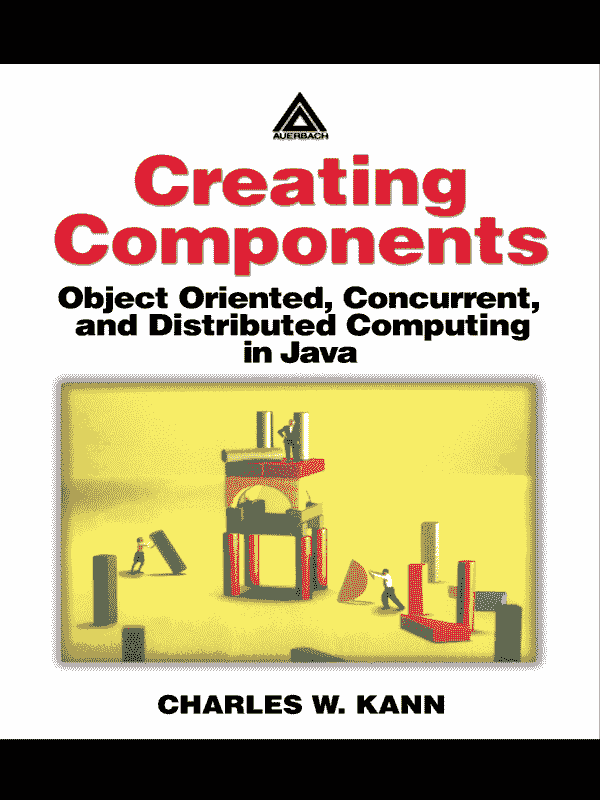


CRC Press 公司

博卡拉顿、伦敦、纽约、华盛顿特区

本版于 2005 年出版于 Taylor & Francis 电子图书馆。

“如需购买您自有的本书或任何其他 Taylor & Francis 或 Routledge 出版的数千本电子书之一，请访问 [www.eBookstore.tandf.co.uk](http://www.eBookstore.tandf.co.uk)。”

# 美国国会图书馆编排数据

Kann, Charles W.

创建组件：Java 面向对象、并发与分布式计算 / Charles W. Kann 著。

厘米级尺寸。

包含参考文献和索引。

ISBN 0-8493-1499-2（平装本）

1. 并行编程（计算机科学）
2. 面向对象编程（计算机科学）
3. Java（计算机程序语言）
I. 标题。

QA76.642.K3 2003

005.13—20030433

书中包含了从可靠来源获取的信息，并获得许可引用。书中材料的有效性，作者和出版社不承担责任。未经 CRC Press 书面许可，本书的任何部分不得以任何形式或通过任何手段（包括复印、微缩摄影、录制或任何信息存储或检索系统）复制或传输。

相关咨询请联系 CRC LLC，2000 N.W. Blvd., Boca Raton, Florida 33431。

**商标通知：产品或公司名称可能是商标或注册商标，仅用于说明，无侵权意图。**

访问 Auerbach 网站 [auerbach-publications.com](http://www.auerbach-publications.com)

© 2004 CRC Press LLC

Auerbach 是 CRC Press LLC 的旗下品牌。

国际标准书号 0-8493-1499-2

国会图书馆卡号 200304833

Adobe eReader 格式

# 前言

## 目的与目标

本书的目的是向熟悉过程化编程和 GUI 编程的学生介绍使用对象（我们称之为组件编程）的并发编程。书中的内容大部分与 Java 语言及支持 API 相关。

使用组件编程产生的程序类型在数量和重要性上都在增加。随着基于网络服务的增长，对来自多个来源程序的需求也随之增长。此类请求所需的工具，如 `RMI`、`CORBA` 或 `J2EE`，都可以使用组件技术进行设计和实现。涵盖了这些技术，并将帮助学生更好地理解系统中并发对他们实现的程序的影响。

本书适用于本科大三、四年级或研究生一年级教授的 Java 并发与面向对象编程课程。它也可以作为其他课程的辅助，例如：

- **并发编程或操作系统**：前三章可以帮助学生理解和在 Java 中实现并发程序。此外，第 13 章可以作为分布式计算模块的一部分。
- **分布式编程**：第 3 章和第 7 章的概念可以作为许多分布式程序实现的模板，第 13 章可以涵盖 Java RMI 的相关内容。
- **面向对象编程**：第 5 章关于 Java 中接口使用的讨论，以及第 10 章至第 12 章可以涵盖系统设计与管理方面。
- **Java 高级编程**：第 2 章的讨论可以涵盖 Java 线程，第 4 章至第 6 章可以涵盖对象、接口和异常等主题。

## 目标读者

本书的内容假设读者对 Java 编程语言和 Java API 的用法已经熟悉。这种熟悉通常可以通过两个学期的 Java 课程获得，或者对于精通其他语言的程序员来说，通过一门 Java 作为第二语言的课程获得。

本书并不打算作为 Java 入门课程的教材，也不适合首次尝试学习 Java 的学生，即使他们已经精通其他编程语言（如 `C++`）。至少，使用本书的学生应该对 Java 编程语言有相当好的掌握，包括如何编写 GUI 程序、如何设计类和实例化对象，以及用于调用方法和传递参数的机制等主题。

学生具备任何额外背景（例如在操作系统课程中对进程的理解，或在编程语言课程中涵盖的内存使用等）都将帮助学生更好地理解文中提出的原理，但对于理解文中的内容并非必须。

## 所需资源

本文假设读者可以访问 `Java Standard Edition`（`J2SE`），它有时也被称为 `Java Developer’s Toolkit`（`JDK`）。本书使用了 `JDK` 1.4 的特性，因此需要 1.4 或更高版本的工具包来运行文中的程序。

本文假设读者熟悉 `JDK` 以及编译和运行 Java 程序的命令。它还假设读者对标准 Java API 有一定了解，并可以使用这些 API 编写简单的程序。

## 方法

本书大致分为五个主要部分：

- 第 1 到第 3 章涵盖并发编程的基础。主题包括并发编程的定义、并发编程的类型以及为什么存在多种类型的并发编程、Java 如何实现和支持并发，以及实现并发程序的一些基本技术。
- 第 4 到第 6 章涵盖了 Java 基础主题，例如什么是对象、对象如何影响程序的实现细节、什么是接口、如何使用接口进行编程，以及 Java 中一些基础的异常处理技术。
- 第 7 到第 9 章涵盖了 Java 中实现并发编程的一些更高级主题，例如 Java 事件模型和通知对象。书中给出了如何结合这些技术以产生问题的强大解决方案的示例。
- 第 10 到第 12 章涵盖了程序设计和管理。书中涵盖了组合和分类等 OOP 技术，并强调了它们的使用如何影响组件。书中还讨论了专门在 Java 编程语言中做出的支持程序管理的实现决策。
- 第 13 章将书中其他内容应用于使用 `RMI` 的分布式编程。

## 概述

第 1 章包含了书中其余背景材料。给出了并发编程和组件的定义。本章指出，并发的直观定义（即多个活动同时发生）对于理解并发编程问题以及解决这些问题所需的机制并不适用。书中提供了一个更好的定义，使用可以交错执行顺序的活动，并讨论了控制这种交错的机制。本章还考虑了使用并发编程的不同原因以及它们如何影响生成的解决方案的类型。

第 2 章涵盖了计算机程序中并发的基础。通过讨论如何实现并发来解释程序的行为——例如，为什么基于栈的局部变量在并发程序中是安全的，而实例变量不是。

第 2 章同样涵盖了 Java 中的同步机制、这些机制是如何实现的，以及为什么选择以这些方式来实现它们。学生理解实现细节背后的原理至关重要，因为学生往往试图记忆在程序中使用同步结构的效果。这通常会导致不理解如何使用该结构、产生无效程序，以及对语言整体的挫败感。所有这些问题都可以通过简单地理解为什么这样实现同步来避免。

第 3 章提供了一种围绕被动对象和活动对象设计并发程序的简单方法。活动对象是简单的过程实体，而被动对象使用状态图设计，并使用简单的规则转换为 Java 类。虽然这种技术尚不足以实现所有程序，但这些概念易于理解，并为评估许多组件提供了良好的机制。

第 4 章处理了 Java 中对象的概念。Java 中的对象与某些语言（如 `C++`）不同，这些差异大到足以影响程序开发的方式。书中详细讨论了这种模型的优点。

第 5 章是使用接口进行编程的概述。虽然 Java 编程语言没有参数化数据类型（泛型或模板），但可以使用接口来弥补这一缺陷。本章解释了什么是接口，以及如何使用它来实现与泛型对象工作的类。

第 6 章涵盖了异常。几乎每本 Java 入门书籍都会涵盖异常。但这些书籍的观点通常是如何在 Java 中使用异常；然而，异常处理策略是任何程序设计的重要部分。本章解释了如何使用异常来有效处理运行时发生的问题。

第 7 章使用动画程序涵盖了 Java 事件模型。该动画器是一个组件，允许任何可绘制的对象向其注册，然后允许该对象进行动画。动画器使用 Java 事件模型实现，并通过解决问题分阶段构建，直到完成 Java 事件模型的形态。

第 8 章引入了使用动画器进行协作同步的示例，以及在动画移动期间挂起的线程。通过这种方式，以图形化展示了尝试不同同步方案的效果，使得竞态、死锁和饥饿情况显而易见。

第 9 章结合了第 3 章、第 [7 章](#chapter7.xhtml) 和第 8 章的技术，并引入了其他技术（如封装），以展示并发问题更健壮的解决方案。

第 10 章从复用的角度引入了对象设计，专门处理了如何对本质上是工具对象或并非问题设计的一部分、为一个或多个应用程序提供服务的对象进行复用。涵盖了过程化和面向对象的复用，通过组合和分类演示了对象复用。最终结论是论证应该始终使用组合来复用本质上是工具类的类。

第 11 章探讨了面向对象编程（`OOP`）中更传统的话题：即在设计解决问题的对象时的组合与分类。这涉及到简单的“是”（is）和“有”（has）规则，以及组合设计中对象的聚合（aggregation）和关联（association）概念。本章从设计程序时需要考虑的选择涵盖了这些概念，并解释了为什么某些设计比其他设计产生更健壮系统。此外涵盖了并发对不同设计的影响。

第 12 章探讨了程序管理主题，或者说在设计后实际实现程序时涉及的问题。本章包含了许多 Java 特有的项目，这些有助于更容易执行良好的程序管理。

第 13 章将前 12 章涵盖的原理应用于使用 `RMI` 的若干分布式计算问题。本章展示了某些分布式计算程序实际上是组件程序的一种。

## 关键词

书中使用的许多术语具有特定含义，这些含义要么与术语的通常用法不同，要么不属于常用术语。这些术语在文中以斜体表示，并在书末的关键词部分（附录 A）中定义。

## 习题

每章末尾都有旨在强化本章所涵盖材料的问题。其中一些问题设计为用纸和笔回答，以便学生推理 Java 中某些内容是如何实现的以及为什么要这样实现。另一些问题是对本章中实现程序的扩展，以强化这些程序中展示的概念。最后，一些问题是要求使用本章提出的原理实现的程序。

## 参考文献

每章末尾都引用了额外的阅读材料，供对每章涵盖的问题感兴趣并希望进行更深入分析的读者参考。书末提供了参考文献列表。

## 代码可用性

本书的源代码可以在 [www.Auerbachpublications.com](http://www.Auerbachpublications.com) 获取。

# 第 1 章：并发编程与组件简介

## 1.1 引言

本章介绍了书的主题，特别是 `concurrency`（并发）和 `components`（组件）。由于并发概念（特别是应用于编程时的并发）被初级程序员理解得非常匮乏，本章首先对并发编程给出一个实用的定义。这个定义抛弃了并发是两个程序同时运行的、很大程度上无用的定义，而是代之以处理并发如何影响问题解决方案实现的定义。

一旦给出了并发编程的定义，就会引入称为 `concurrent components`（并发组件）的特殊用途对象。这些对象是并发编程中最感兴趣的对象，因为它们负责协调并发程序中的活动。没有并发组件，并发程序仅仅是一组不相关的活动集合。正是组件允许这些活动协同工作以解决问题。

组件也是最难编写的对象。这是因为这些活动（或活动对象）与普通的过程化程序紧密对应，但组件要求大多数程序员思考程序的方式发生改变。并发编程特有的问题（如竞态条件和死锁）也是在组件中发现并处理的。书的其余部分将讨论如何使用这些并发组件来实现并发程序。

最后，本章解释了不同类型的并发程序以及这些程序如何产生各种类型的程序。理解并发编程的一部分是意识到进行并发编程不止一个理由。任何程序的某个重要方面是它应该解决一个问题。并发提高了许多不同类型问题的解决方案。每种问题类型都以略不同的方式看待待解决的问题，因此要求程序员以略不同的方式处理问题。

## 1.2 章目标

完成本章后，你应该能够：

- 理解为什么并发编程是重要的。
- 为并发程序给出一个实用的定义。
- 理解两种类型的同步并给出每种类型的示例。
- 给出术语 `component` 的定义，并知道在使用组件时可能会遇到哪些特殊问题。
- 描述进行并发编程的不同原因，以及这些理由如何导致不同的设计决策和不同的程序实现。

## 1.3 什么是并发编程？

本书的目的是帮助程序员理解如何创建并发程序。具体而言，它旨在帮助程序员理解并编写称为 `concurrent components` 的特殊并发对象。由于这些组件仅用于并发程序，因此在定义组件并给出它们的实现方法之前，需要对并发程序有一个良好的实用定义。本节在首先解释了为什么并发编程对程序员来说是一个重要概念之后，提供了一个关于并发程序的良好的实用定义。这里提供的并发程序实用定义将作为书中其余部分理解并发编程的基础。

### 1.3.1 为什么要进行并发编程？

理解并发编程的首要问题是为学习并发编程提供合理性。大多数学生，事实上，许多专业程序员从未写过显式创建 Java 线程的程序，而且在编程领域可能可以在从未创建过线程的情况下度过职业生涯。因此，许多程序员认为编程中的并发并没有在大多数真实系统中使用，所以它是一个可以安全忽略的旁题。然而，并发编程的使用对程序员是隐藏的，这本身就是一个问题，因为并发程序的影响很少可以安全地忽略。

在课堂上被问到时，大多数学生会说他们从未实现过并发程序，但可以向他们展示示例 1（程序 1.1）。这个程序在 `JFrame` 中放置了一个按钮，然后在循环中计算斐波纳契数字。循环内部没有方法将 `stopProgram` 的值设置为 `false`，这一事实意味着循环是无限的，因此它永远不会停止；然而，当按钮被点击时，循环最终停止了。

面对这种行为时，大多数学生正确地指出，当点击“停止计算”按钮时，`stopProgram` 的值被设置为 `true`，循环就可以退出；但在循环的任何地方都没有检查按钮是否被点击。因此，必须存在某种循环外部的机制，允许 `stopProgram` 的值发生改变。允许该值发生改变的机制就是并发。

在示例 1（程序 1.1）中发生的情况是：在后台且对程序员不可见的情况下，一个独立的线程——图形用户界面（GUI）线程被启动了。这个线程是由 Java 启动的线程，它一直在运行，等待“停止计算”按钮被按下。当此按钮被按下时，GUI 线程会与主线程（执行斐波纳契数计算的线程）并发运行短时间，并将 `stopProgram` 的值设置为 `true`。

因此，示例 1（程序 1.1）是并发程序的一个非常简单的例子。由于几乎每一位 Java 程序员在某个时间点都写过使用按钮或其他抽象窗口工具包（AWT）或 Swing 组件的程序，因此几乎每一位 Java 程序员都写过并发程序。

这引出了学习并发编程的第一个原因。无论程序员如何想，并发编程都是无处不在的；它无处不在。在几乎任何语言中使用视觉组件的程序员可能都在使用某种形式的并发来实现这些组件。

编写分布式系统的程序的程序员（例如运行在生成 Web 页面的 Web 服务器上的程序）正在进行并发编程。编写 UNIX `.so`（共享对象）文件或 Windows `.com` 或 `.dll` 文件的程序员正在编写并发程序。

程序中的并发性存在于几乎每一个主要的软件项目中（即使是隐藏的），而且对于一个职业生涯仅剩几年的程序员来说，不太可能在某一点不遇到它。而且，正如本书的其余部分将看到的，虽然程序是并发的这一事实可以被隐藏，但未能考虑并发的影响可能会导致灾难性的后果。

**示例 1. 程序 1.1：一个计算斐波纳契数的程序**

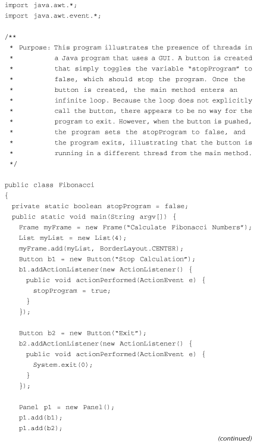

**示例 1. 程序 1.1（续）**

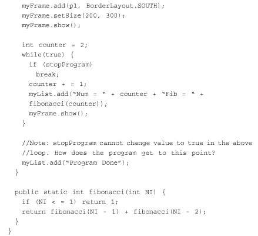

学习并发编程的第二个原因是，使用并发将程序拆分为部分可以显著降低程序的复杂性。例如，曾经实现诸如示例 1（程序 1.1）中的按钮需要循环来检查按钮是否被按下。这意味着程序员必须在整个程序中一致地放置代码，以确保事件被妥善处理。

使用线程允许这种检查在单独的线程中处理，从而减轻了程序的责任。使用此类线程允许程序员编写代码来解决他们的问题，而不是为其他对象执行维护性检查。

学习并发编程的第三个原因是它的应用正在快速增长，特别是在分布式系统领域。每个在单独计算机上运行程序部分内容的系统，根据几乎每种定义（包括本书中所使用的定义）都是并发的。

这意味着浏览器对 Web 站的每次访问都涉及某种程度的并发。这种并发链不会止于 Web 服务器，而是通常会扩展到 Web 服务器程序所使用的资源上。如何正确实现这些资源需要程序员至少理解并发访问所涉及的问题，否则程序将出现问题，例如偶尔给出错误答案或运行非常缓慢。

本文的其余部分将用于阐述如何在程序中正确地实现和控制并发，以及如何将并发与对象结合以简化和组织程序。然而，在描述并发的使用之前，必须给出一个并发的工作性定义，特别是与对象相关的定义。开发这个工作性定义是本章其余部分的目的。

### 1.3.2 并发编程的定义

正确地定义并发程序并不是一项易事。例如，最简单的定义是当两个或多个程序同时运行时，但这个定义远不令人满意。

例如，考虑示例 1（程序 1.1）。这个程序被描述为并发的，因为 GUI 线程独立于主线程运行，因此可以在主线程计算循环之外设置 `stopProgram` 变量的值。然而，如果这个程序运行在具有单个中央处理器（CPU）的计算机上（大多数 Windows 计算机都是这样），那么就不可能同时运行多于一条指令；因此，根据上述给出的简单定义，这个程序不是并发的。

另一个具有这种简单定义的程序可以用两台计算机的例子来说明：一台计算机在旧金山运行文字处理程序，另一台在华盛顿特区运行电子表格。根据上述对并发程序的定义，这些是并发的。然而，由于这两个程序之间没有任何关系，它们是并发的这一事实实际上毫无意义。

显而易见，一个良好的并发编程定义会将第一个例子定义为并发，将第二个例子定义为非并发；因此，这种对并发编程的简单定义在根本上存在问题。

事实上，涉及两个活动同时发生的并发这种简单想法，是尝试构建更好的 `concurrency（并发）` 术语定义的糟糕基础。要创建一个可以用于描述并发编程的并发定义，需要建立一个全新的基础。在 1.3.2 节的其余部分将提供一个更好、更可行的定义。

#### 1.3.2.1 异步活动

定义并发程序始于定义程序的基本构建单元，它被称为 `activity（活动）`。一个活动可以正式地定义为任何抽象图灵机可以完成的内容，或者说是一种算法。

然而，这里感兴趣的是一个工作性定义，将活动简单地定义为执行任务而实现的一系列步骤就足够了。活动的示例可以是烤派或计算斐波纳契数。执行任务所需的步骤将被称为 `ordering（排序）`。


活动可以被拆分为子活动，每个子活动都是一个活动。例如，烤派可以由制作饼皮、制作馅料、将馅料放入饼皮和烘派组成。例如，示例 2 显示了烤派的步骤，必须先制作饼皮，然后制作馅料，将馅料加入饼皮，最后烘派。如果这些活动的顺序是完全固定的，那么这种排序被称为`total ordering（全排序）`，因为所有活动中的所有步骤都是有序的。在事件的全排序的情况下，下一步的采取总可以在单个活动内确定。步骤顺序由活动决定的活动被称为`synchronous activity（同步活动）`。注意，部分排序也由同步活动控制；这些是通过编程等价的`if`和`while`语句实现的。


**示例 2 制作派的同步活动**

在制作派的情况下，没有必要先制作饼皮再制作馅料。馅料可以在前一晚上做好，饼皮可以在第二天早上制作，然后将两者结合制作派。如果制作饼皮和馅料的顺序可以改变，那么这种排序被称为`partial ordering（部分排序）`（制作饼皮的步骤顺序和制作馅料的步骤顺序保持固定，但任何一个都可以先进行）。然而，如果一个活动必须在另一个活动开始之前完成，则可以使用同步活动来实现这种行为。

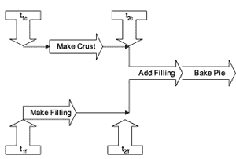

## 图表 3. 制作饼图中异步活动的一个可能示例

当部分次序中，下一步不是由单个活动决定的，就会出现一种特殊情况。为了展示这一点，必须定义几个时间值。开始制作饼皮的时间为`t[1c]`，必须完成的时间为`t[2c]`。开始制作内馅的时间为`t[1f]`，必须完成的时间为`t[2f]`。现在，如果`[(t[1c] <= t[1f] < t[2c]) || (t[1f] <= t[1c] < t[2f])]`，那么制作饼皮和制作内馅的活动就可以（但并不一定必须）重叠。如果步骤发生重叠，那么步骤的整体顺序就无法在任何一个任务（因此在任何一个活动）中确定。制作饼图中这种情况的一个示例见图表 3 中的甘特图。请注意，可能许多其他时间线，因为饼皮不需要在`t[1c]`开始，也不必在`t[1f]`结束；它只需要在这两个时间之间发生。制作内馅也是如此。这两个活动可能实际上并没有重叠；只要它们可以重叠即可。

这两个活动能够以这种方式重叠的唯一方法，是这些活动的步骤列表是在独立执行的。例如，可能有两个饼师负责这个饼，一个制作内馅，另一个制作饼皮。也可能一个饼师同时负责饼皮和内馅，但他们在不断地从执行食谱一部分（制作饼皮）到另一部分（制作内馅）的步骤之间切换。然而，无论它们是如何完成的，根据此处的定义，涉及这两个子任务的步骤是相互独立执行的，或者说是异步执行的。这种类型的活动被称为`异步活动`。

异步活动的定义引出了一个非常并发定义：`并发被定义为两个或多个异步活动的存在`。

当程序中存在异步活动时，这两个活动的步骤可能会（但并不一定）交错执行。正如我们将在第 2 章中看到的，它们交错执行的不同方式可能很多，而且结果可能非常出乎意料。然而，请注意，根据异步活动的定义，这两个活动并不需要同时运行；它们只需要能够同时运行。这是一个非常有用的区分，因为并发中将遇到的问题并不是因为活动同时执行，而是因为它们可以交错执行。这很有用，因为如果程序允许活动交错，它必须防止这种交错无论是否发生都会带来的不良影响。这意味着可能并发使用的方法必须进行同步，即使在大多数情况下使用`synchronized`语句并没有益处。

这种并发定义相比于“多个活动同时发生”的并发定义，其重要性再怎么强调也不为过。这个定义暗示了可能发生的问题类型以及解决这些问题的方法。如果一个并发程序实际上没有同时运行两个活动，但它可以这样做，那么必须采取措施来确保不会发生问题。关于这两个活动是否实际上在同时运行，或者它们通常是一个接一个运行的，任何争论都是多余的。关于活动实际上是如何实现的（例如，系统是否存在优先级？）以及实现可能如何影响相互作用（高优先级进程是否总是必须先运行？）的争论也不重要。如果存在异步活动，那么程序就必须考虑到这种行为。

应该注意的是，异步活动的定义解决了并发定义中的第一个问题。运行在图表 1 中的两个线程（`Program1.1`）是异步活动，因此它们是并发的。然而，运行在不同城市的两个计算机也是异步活动，因此并发编程的定义必须进一步加强。

### 1.3.2.2 异步活动的同步

两个或多个异步活动并发是并发的一个很好的定义，但它并不是一个实用的定义。正如之前提到的，两个不相关的异步活动是并发的，但这并不意味着在推论它们时必须考虑任何特定操作。一个实用的定义要求活动之间需要某些相互作用。活动之间的这种相互作用要求活动必须协调（或同步），因此本节将定义同步如何影响活动。

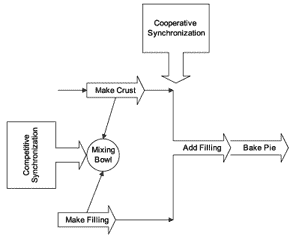

## 图表 4. 竞争性和协作性同步

Sebesta [SEB99] 说，“同步是一种控制任务执行顺序的机制。”从活动的角度来看，这个定义意味着，虽然异步活动代表了对活动步骤执行的独立控制，但有时异步活动会同意结合在一起并合作，以便在活动内部创建有效的部分次序。Sebesta 定义了两种类型的同步：`竞争性同步`和`协作性同步`。为了看到同步如何影响异步活动内部的部分次序，给出了这两种同步类型的示例。

图表 4 给出了两种类型同步的示例。该图说明了两个异步活动：制作饼皮和制作内馅。这两个活动将进行同步，首先展示了共享资源的同步（竞争性同步），其次了围绕事件的同步（协作性同步）。为了理解竞争性同步，考虑如果两个食谱都要求在大碗中混合原料，但只有一个大碗可用，那么两个活动都必须使用同一个碗。如果这两个活动在不考虑另一个活动操作的情况下使用碗，就可能同时混合内馅和饼皮，这将导致制作饼问题的解决方案是错误的。因此，这两个活动必须竞争使用资源，并对其进行同步，规则是当一个活动使用该资源时，另一个活动在资源释放之前无法继续。在这个示例中，碗是两个活动必须同步以正确解决该问题的共享资源，在本文情况下被称为`竞争性同步`。

第二种同步发生在异步活动必须等待事件发生才能继续的情况下。在图表 4 中，这发生在饼皮和内馅的制作都必须完成之后，才能将内馅加入饼皮并烘烤饼。因为这两个活动必须协作等待这一事件，这种类型的同步被称为`协作性同步`。请注意，虽然同步对异步活动施加了部分次序，但它并没有让它们变成同步。除了活动由于某些原因必须进行同步之外，它们仍然是异步的。

### 1.3.2.3 并发编程

随着异步活动和同步机制的引入，现在为定义并发奠定了背景。`Concurrency（并发）`是指存在相互作用的异步活动，因此它们在执行的某时刻必须实现竞争性或协作性的同步。这是一个关于并发的可行定义，因为它要求的活动实际上并非同时运行，但在行为上却像是同时运行一样。它还要求这些活动必须通过同步才能被视为并发。

既然已经建立了一个可行的并发定义，那么构建并发程序的定义就相对容易了：

**并发程序：** 一个包含异步活动的程序，这些活动在执行过程中会在一个或多个点上或在一个或多个资源上进行同步。

从设计上来说，这个定义并没有指定异步活动在程序中是如何实现的。这些活动可能是`Ada`任务、`UNIX`进程、`Pthreads`或`Java`线程。它也没有说明如何实现同步，这同样可以通过`Ada select`语句、`UNIX`操作系统系统调用或使用`Java synchronized`语句来实现。此外，它没有说明活动之间是如何通信的，无论是通过单进程中的方法调用、进程间通信（如`UNIX pipes`），还是与完全不同计算机上的进程进行远程方法调用（`RMI`）。这些都只是单个并发程序的细节，但并发的基本原理始终是相同的。

## 1.4 组件

观察并发程序的一种有趣方式是将其看作包含两类单元：对其他实体起作用的活动，控制这些活动相互作用的实体。如果这些单元是对象，那么在并发程序中，程序中的所有对象都可以被制为活跃的（如线程等异步活动）或被被的（如共享资源或用于同步的事件）。其他类型的简单非并发对象会被活跃对象和被动对象使用，例如`vectors`或`StringTokenizers`，但它们不参与程序中的并发。

大多数程序员在理解活跃对象方面没有问题，因为它们仅仅是以过程化顺序编写并执行的指令，原则上可以用流程图来表示；他们理解非并发对象也没有问题。这可能是因为对象的对象的行为通常可以在其运行的活动语文中被理解，就像过程化程序一样。这正是学生从第一门入门课程开始被教导编程的方式。

然而，被动对象（从现在起被称为`concurrent components（并发组件）`或简单的`components（组件）`）对大多数程序员来说要困难得多。这可能是因为它们为并发程序中执行的异步活动提供了基础设施。这对于许多程序员来说是一个有些陌生的概念。

在制作饼的的示例中，组件是共享的搅拌碗，以及标志着饼皮和填充物准备完成的事件。它们控制异步活动的行为，以便它们能够协调并产生正确的结果。它们还处于异步活动之间，并被多个异步活动共享和使用。

注意，并非所有活跃的对象都是组件。例如，`vector`在多线程程序中使用是安全的，但它不是一个组件，因为即使它被多个线程使用，它通常也不用于协调这些线程之间的关系。对象被从`vector`中添加或删除，但`vector`仅用于存储数据元素，而不是用于协调异步活动。一种名为`bounded buffer（有界缓冲区）`的特殊向量（在第 3 章中介绍）实际上被用于协调异步活动之间的关系。

由于组件为异步活动提供了基础设施并在这些活动之间进行协调，它们具有许多实现时必须考虑的特性，而这些特性在实现普通对象时是不存在的。这里列举了其中一些特性：

- 因为组件在多个线程之间进行协调，所以它们不能由单个线程创建或拥有；因此，必须使用某种机制允许这些对象注册（或将自身注册）代表异步活动的其他对象。有许多机制可以实现这一点，从在构造函数中使用简单参数到 GUI 组件中的特殊方法，再到用于远程对象的整个协议（如轻量级目录访问协议（`LDAP`））。

- 因为组件被用在单独的异步活动中，在分布式计算的极端情况下位于物理上不同的计算机上，因此必须实现某种机制允许组件与异步活动进行通信。再次，这些机制范围从线程情况下的简单方法调用到使用分布式对象时的整个协议不等。

- 与异步活动的对象不同（对象可以使用过程化流程进行设计），组件中的逻辑通常是围绕组件执行时的状态组织的。需要设计某种机制来有效实现组件，以允许它们提供这种协调性（请参见第 3 章）。

- 如果对象设计得不当，可能会发生称为`race conditions（竞态条件）`的有害交互。避免竞态条件的方法是将对象中的所有方法都设为`synchronized`，并且不允许对象在执行时放弃锁。这被称为`complete synchronization（完全同步）`，对于字符串或`vector`等非组件对象是足够的；然而，组件必须在多个对象之间协调，而完全同步限制太大，无法有效实现这种协调。本书的大部分内容都是关于如何安全地放同步条件。

- 如果组件设计不当，可能会导致第二种称为`deadlock（死锁）`的有害交互。当对象被处理不当时，任何并发程序都可能发生死锁；然而，即使组件被正确使用，死锁的可能性实际上也可能构建在设计不当的组件中。文中提供了几个死锁的示例，特别是关于 Java 事件的第 7 章。

这里给出两个示例来展示这些条件如何影响组件。组件的第一个示例是按钮对象。按钮通过将事件的发生（按钮被按下）转发给该事件感兴趣的其他对象（`Listeners`），为 GUI 线程提供服务。在图 1（`Program1.1`）中，按钮在主线程中创建，然后通过添加到`Frame`对象中传递给 GUI 线程。随后，它通过按钮中的`addActionListener`方法被其他想要知道按钮何时被按下的线程使用。因此，按钮独立于使用它的线程（GUI 线程或与`ActionListeners`相关任何线程）。所以，按钮是一个独立对象，在多个其他线程之间提供协调服务，并向其他异步活动（在本例中为线程）提供按钮被按下的服务。一种特殊的机制（称为`event`）允许按钮与其交互的线程进行通信。对于这个简单的程序，没有必要担心按钮的状态或竞态或死锁条件，但这些条件为何会影响简单的按钮的原因将在后续章节中详细讨论。

组件的另一个例子是大多数分布式服务，它们使用了分布式对象，如`RMI`、`通用对象请求代理 (CORBA)`或`企业 Java Beans (EJB)`。在运行分布式对象时，组件位于位于位置的服务器上，并为远程客户端提供服务，例如 PC 上的 Web 浏览器，这些是运行在其他计算机上的进程或程序，可以通过网络访问这些组件。在分布式程序的情况下，组件中可能发生的五个问题（如上文所述）都至关重要，这将在第 13 章中所示。

## 1.5 并发编程的类型

在继续描述组件编程之前，有必要消除一些关于并发编程的误解。程序员通常认为并发编程只涉及一种类型的问题。例如，某些程序员认为所有并发处理都涉及加速非常庞大的模拟，例如天气预报或地球地壳地震活动的的模拟。另一些程序员认为并发编程只解决在计算机上运行操作系统时出现的问题。还有一些人认为并发编程仅在分布式系统中才需要。由于这些程序员在处理并发问题时，对他们想要解决的问题类型带有先入为主的偏见，因此他们并不理解那些解决他们感兴趣的问题之外的并发方法论。

使用并发的理由非常多，在程序中实现并发的每个理由都导致了结构不同的程序。事实上，真的没有一种“最佳”的实现并发和同步的方法，因为这实际上取决于所解决的问题类型。下面是可能使用并发编程的一些原因列表。每种类型的并发程序都附有说明，说明要解决的问题类型如何影响所开发的解决方案类型。本文很大程度上关注于将并发编程用于软实时、分布式和建模目的。虽然所用技术也适用于其他系统，但对于那些问题通常有更合适的解决方案。此外，请注意，程序很少是某一种类型的并发程序；它通常会表现出许多类型程序的特征：

- **偶然并发 (Incidental concurrency)**。当并发存在但异步活动之间互不交互时，就会发生偶然并发。一个极端的例子是华盛顿的一台运行`Word`的独立计算机和旧金山的一台运行`Excel`的独立计算机。偶然并发也发生在如`UNIX`等操作系统中，其中多个用户使用同一台计算机，但每个用户的程序都不与其他任何程序发生交互。因此，虽然并发存在且必须在操作系统中予以考虑，但从用户程序的角度来看，不必考虑任何并发行为。偶然并发实际上并不有趣，本书中不再进一步讨论。

- **资源利用 (Resource utilization)**。资源利用通常与操作系统相关，它发生在程序围绕共享资源构建时。例如，在第一批操作系统中实现并发，是为了让昂贵的`CPU`忙于对一个程序进行有用的工作，而让另一个程序执行输入/输出（`IO`）。这种同样的原理也出现在 PC 中，程序的某些部分可以围绕专用硬件设计，例如图形处理器或`IO`处理器，这些（处理器）实际上是独立的`CPU`，因此与主处理器异步运行。这种类型的并发通常由编译器或操作系统处理，对程序员来说通常是透明的。在进行这种类型的并发编程时，程序员围绕存在且共享的特殊资源编写程序。这种类型的并发编程通常在操作系统的书中介绍，本书不再不再进一步讨论。

- **分布式编程 (Distributed programming)**。在分布式程序中，程序所需的所有资源并不存在于单台计算机上，而是位于计算机网络上的某处。为了利用这些分布式资源，程序围绕定位和访问资源进行设计。这可能涉及寻找资源的特殊方法和协议，例如使用带有`rmiregistry`的`RMI`，甚至编写整个协议，如套字字协议。

- **并行计算 (Parallel computing)**。当程序需要大量的实际（时钟）时间时（例如天气预报模型），就会使用并行计算。这些模型可以使用多个处理器同时处理问题，从而更快速地进行计算。并行程序围绕程序中可以高效并行计算的段进行设计。这通常通过使用特殊的编译器来实现，这些编译器可以获取循环等语言结构并对其进行组织，以便它们能够在单独处理器上并行运行。某些系统为语言添加了扩展以帮助编译器做出这些决策。

- **响应式编程 (Reactive programming)**。响应式程序是指程序的某些部分对另一个程序或过程中生成的外部刺激做出反应的程序。响应式程序有两种类型：硬实时软实时。

  - **硬实时 (Hard real time)**。硬实时程序必须满足特定时间要求的程序。例如，火箭上的计算机必须能够保证每 1/1000 秒进行一次轨道调整；否则火箭将偏离航道。硬实时程序围绕满足这些时间约束设计，并通常使用时序图设计，以确保事件在分配的时间内被处理。然后这些程序用低级语言实现，如`Assembly`或`C`，这些语言允许对计算机使用的每个时钟周期进行控制。

  - **软实时 (Soft real time)**。软实时程序实时处理信息，而不是批处理模式（批处理模式每天更新一次两次信息）。这些程序使用当前数据，但不满足硬性截止。一个例子是基于 Web 的订购系统，它始终拥有最新数据，但可能需要几秒钟才能提供给客户端。这些系统通常围绕它们提供的服务进行设计，其中服务有时实现为事务。作为组件的对象经常会处理这些事务。

- **可用性 (Availability)**。对于某些程序（如电子商务网站），确保它们 24 小时、每周 7 天可访问至关重要。并发可以用于复制程序的关键部分并使其在多台独立的计算机上运行。这保证了即使其中一个处理器故障，程序也能继续可用。这些程序的设计使得关键部分可以复制并分发到多个处理器上。这些系统通常是具有特殊可用能力的软实时程序；因此它们在设计中使用了组件。

- **实现的便利性 (Ease of implementation)**。使用并发编程可以使程序的实现变得更容易。这对于大多数 GUI 程序都是如此，其中带有组件的并发使得实现按钮、`TextFields`等变得更容易。这些系统使用的许多对象都是设计成组件的。

- **系统建模**。有时使用并发编程是因为它能更好地支持系统的抽象模型。这些程序通常是用对象建模的仿真程序，其中一些对象是活跃的（active），另一些是被动的（passive）。这些程序的设计目标是让抽象程序模型尽可能地接近现实问题。在这些系统中建模的许多对象都是组件。

## 1.6 总结


本书的目的是帮助程序员（特别是学生）理解如何在程序中使用组件，以及在为并发环境编写程序时涉及的特殊问题。为了实现这一目标，本章提供了一个并发程序的定义，该定义将作为书中其余部分的基础。它还给出了组件的基本定义，该定义将在书的后续进行扩展。希望这本书能够帮助读者理解如何将组件应用到需要它们的问题中，从而为他们解决问题的工具箱中增添另一件工具。

## 1.7 扩展阅读

在看待并发程序的许多方法中，将面向对象的并发程序看作由活跃对象和被动对象组成的观点只是其中之一。例如，`ADA` 使用会会（rendezvous）的概念来协调任务之间的关系（参见 *Ada 95 Reference Manual* [ADA95] 和 Barnes [BAR96]），并添加了保护类型（protected types，`[ADA95]`）的概念，这与活跃和被动对象的概念更接近，并且与书中使用的某些方法非常相似，特别是在第 3 章中。关于如何处理并发编程，已经有了许多建议。涵盖了并发编程许多历史方面的优秀教材是 Gehani 和 McGettrick [GEH88]。并发编程仍然是一个非常活跃的研究领域。两本对涉及问题提供极佳概述的教科书是 Bacon [BAC98] 和 Ben-Ari [BEN90]。专门针对 `Java` 并发编程的一些优秀教材是 Hartley [HAR98] 和 Lea [LEA00]。最后，并发编程传统上是作为操作系统课程的一部分进行教授的。这是因为与并发编程相关的问题最初是在设计和实现操作系统时遇到并解决的，而且为运行在其之下的程序提供虚拟并发环境仍然是操作系统的责任。许多关于操作系统的优秀书籍都涉及并发编程问题；例如参见 Stallings [STA01]。

Hathorn [HAT88] 在博士论文中提出程序可以完全使用活跃和被动对象来编写，这构成了所谓的*协调语言*（coordination language）的基础（参见 Gelernter 和 Carriero [GEL92]）。活跃和被动对象也出现在许多设计方法中（具体参见 Booch [BOO91] 和 Meyer [MEY88]），并最终被纳入 `UML`（参见 Booch [BOO99]）；然而，这些方法中没有一种处理被动对象的方式与此处呈现完全相同。

## 1.8 练习

1. 考虑运行在同一台计算机上但在完全独立的进程中的两个程序。对于实现它们的程序员来说，这些程序是并发的吗？

2. 考虑问题 1 中相同的两个程序，但这次从实现操作系统的程序员的角度考虑它们。这两个程序现在是并发的吗？你的答案和之前一样吗？为什么或为什么？

3. 两个程序在两台不同的计算机上运行，但它们都访问公共服务器上的同一个数据库。从编写访问服务器程序的程序员的角度考虑这两个程序。这两个程序是并发的吗？从实现服务器的程序员的角度来看呢？

4. 如果制作饼皮和填充物的活动可以按任何顺序发生，但必须在另一个活动开始之前启动并完成其中一个，那么这两个活动是并发的吗？你可以提出哪些可能影响你答案的问题？

5. `java.util.vector` 类在 `Java API` 中被描述为“同步”（synchronized）。根据本章给出的组件定义，`vector` 是一个组件吗？

6. 如果某物是*线程安全的*（thread safe），意味着对该对象的方法调用可以在具有许多线程的程序中安全地运行。线程安全的对象是组件吗？

7. 描述操作系统用于在计算机程序中实现异步活动的一些机制。用于实现这些活动的机制是否会影响异步活动的定义？对除 `Java` 之外的其他支持异步活动的语言也进行描述（`Ada`、`Modula2`、`OCCAM`、`Concurrent C`、`Co-Pascal` 等）。

8. 描述其他语言或操作系统中用于实现同步的一些机制。用于实现同步的机制是否会影响异步活动的定义？

9. 描述几个可以有效使用并发性的问题。你会使用什么类型的并发来实现此类这样的程序？这将如何影响程序的设计？

10. 考虑以下类型的对象。有哪些是组件吗？为什么或为什么？

    - ■ `Integer`

    - ■ `Vector`

    - ■ `Socket`

    - ■ `Array of primitives`（基本类型数组）

    - ■ `Array of objects`（对象数组）

    - ■ `TextField`

    - ■ `Button`

    - ■ `Servlet`

    - ■ `Enterprise Java Bean`

11. 证明 `JButton` 确实可以链接到许多对象，让按钮在被按下时通知多个对象。通过从多个框架中添加和删除它，证明按钮独立于 GUI 线程。

12. 如果将同一个 `ActionListener` 对象两次添加到 `JButton` 中会发生什么？这看起来是合合理的行为吗？

13. 在单任务操作系统（如 `DOS`）中，按钮通常显示在终端上，程序简单轮询（忙等待）直到屏幕发生变化。由于这代表了一种 GUI 类型，这些按钮是组件吗？为什么或为什么？

14. 组件可以包含线程吗？解释说明。

* *组件*一词定义模糊，并用于面向对象编程。由于某些读者在非并发语境下使用该术语，因此在这里将其引入为*并发组件*；然而，书中的所有组件都是并发组件，所以术语中的*并发*部分将被去掉，*组件*一词将代表并发组件。

# 第 2 章：线程与程序上下文

## 2.1 引言

*并发*程序与传统程序员所熟悉的更常见的*过程化*程序具有非常不同的属性。例如，如果用相同的输入反复运行一个过程化程序，人们理所当然预期每次都会得到相同的结果，这很不错，因为可以证明程序至少在有限的测试用例中是正确的。这也意味着任何漏洞都是可复现的，并且每次运行程序时都会出现。对于并发程序，情况并非如此。

本章解释了当程序（无论是过程化的还是并发的）执行时发生了什么。一旦揭示了程序运行方式的谜团，事情之所以那样发生的原因应该变得清晰得多。这种理解将用于展示如何使用诸如*同步块*（synchronized blocks）以及 `wait` 和 `notify` 方法来控制程序中的并发性。

本章还介绍了在 Java 中创建异步任务的机制——`thread`（线程），并描述了线程与`process`（进程）之间的区别。这种区别将用于概述当前代`Web servers`（Web 服务器）的实现。随后识别并解决了并发编程中特有的问题。这些问题涉及`safety`（安全性：如果执行完成，是否得到了正确答案？）和`liveness`（活性：程序是否执行完成），并受`race conditions`（竞态条件）和`deadlock`（死锁）是否存在的影响。

## 2.2 章节目标

完成本章后，你应该能够：

* ■ 编写包含线程的简单 Java 程序。

* ■ 解释一种简单的内存管理和执行模型，类似于`Java virtual machine`（JVM）中使用的模型。

* ■ 理解程序如何使用上下文控制多个线程。

* ■ 理解什么是`nondeterminism`（不确定性）以及它为什么会在并发程序中发生。

* ■ 识别程序中的竞态条件并能够消除它们。

* ■ 理解 Java 中`synchronized`语句以及`wait`和`notify`方法调用是如何工作的，并了解它们使用的一些规则。

* ■ 理解什么是`deadlock`（死锁），它是如何发生的以及如何防止。

## 2.3 在 Java 中编写线程

本节演示了如何在 Java 中编写线程，以及线程的执行与大多数程序员熟悉的传统过程化程序有何不同。首先，通过简单的过程化和并发程序示例说明它们在结构上的差异。随后对比了额外的过程化和并发程序，以展示并发程序如何产生不同且不确定的结果。

### 2.3.1 简单的过程化与并发程序

为了演示如何构建一个使用线程的程序，本节将具有单个方法调用的简单过程化程序与启动一个线程的类似并发程序进行了对比。Exhibit 1 (Program2.1) 中的程序是一个简单的 Java 过程化程序，在`main`中开始执行。该程序创建了一个类型为`ProceduralExample`的对象，然后调用了该对象的`run`方法。随后`main`方法暂停执行，程序在`run`方法中继续执行。当`run`方法完成后，程序返回`main`方法，在`main`方法中完成执行，然后退出程序。

Exhibit 2 (Program2.2) 提供了一个类似的线程线程程序。该程序同样在`main`中启动，并创建了`RunnableExample`对象的实例。程序并没有调用`RunnableExample`对象中的`run`方法，而是创建了一个`Thread`对象，并将其作为构造函数的参数传递给`RunnableExample`对象。这相当于将`RunnableExample`对象与线程进行了“注册”。

**Exhibit 1. Program2.1: 过程化程序**

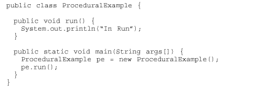

**Exhibit 2. Program2.2: 使用 Runnable 接口创建的并发程序**

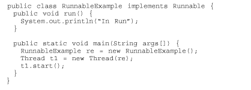

现在对`Thread`对象调用了`start`方法，线程开始执行。此时`main`可以可以继续执行（如将在 2.3.3 节中所示），新的线程对象也是如此。当调用`Thread`对象的`start`方法时，它会开始调用与其构造函数注册的对象中的`run`方法（在本例中，为`RunnableExample`对象）。该对象的`run`方法打印出消息并结束。它不会返回`main`；相反，因为`main`和创建的线程都已完成执行，程序退出。

请注意，`RunnableExample`对象需要声明为“实现 Runnable”。这是因为`Thread`对象期望在调用其`start`方法时能够调用该对象上的`run`方法。由于`Thread`对象并不认识这个`RunnableExample`对象，它保证`run`方法可用的唯一方法就是要求任何传递给其构造函数的对象必须实现`Runnable`，从而确保它将有一个可调用的`run`方法。在`ProceduralExample`程序中这并不是必要的，因为在调用`run`方法时，被调用的实际对象（`ProceduralExample`类）的定义是可用的。接口将在第 5 章中详细介绍；目前只需意识到在创建线程对象时，必须在其定义中给出一个实现`Runnable`的对象即可。

**Exhibit 3. Program2.3: 通过扩展 Thread 类创建的并发程序**

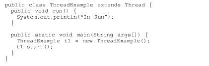

### 2.3.2 扩展 Thread 类

创建线程的另一种方法不涉及向线程传递实现`Runnable`的对象。这可以通过类扩展`Thread`类来实现，如 Program2.3 所示（Exhibit 3）。由于`Thread`已经实现了`Runnable`，扩展`Thread`类的对象自动实现了`Runnable`对象。现在构造函数没有接收传递的对象，因为它本身就是`Runnable`对象。线程可以判断是否向构造函数传递了对象。如果有，它将调用所传递对象上的`run`方法；否则，它将调用“`this`”（即当前）对象的`run`方法。

这两种机制非常相似，几乎可以互换使用；然而，Java 只支持单继承模型，而创建扩展`Thread`类的机制正使用了这种模型。因此，扩展`Thread`的类无法用于其他的继承层次结构，这是一个缺点。由于使用实现`Runnable`的对象没有相应的负面影响，这种方法是始终适用且首选的。本书将始终使用`Runnable`接口方法来实现线程。

### 2.3.3 多线程程序

2.3.1 节使用了各种机制来描述过程化程序和并发程序的运行情况；然而，由于它们产生了相同的结果，这可能被视为“没有区别的区别”。本节展示了不同的机制实际上可以产生非常不同的结果。

Program2.4 (Exhibit 4)是一个简单的过程化程序，它创建了两个对象，并为它们分配了不同的数字以便区分对象的输出。调用第一个对象的`run`方法，产生两行输出。程序随后返回`main`，然后调用第二个对象的`run`方法，再次产生两行输出。第二个方法完成后，控制权返回到`main`，在`main`中又打印了最后两行。这种输出如 Exhibit 5 所示，无论运行程序多少次，结果都是相同的。执行顺序总是相同的，因此我们称这种执行为*全序的*。

**Exhibit 4. Program2.4: 带有两次方法调用的过程程序**

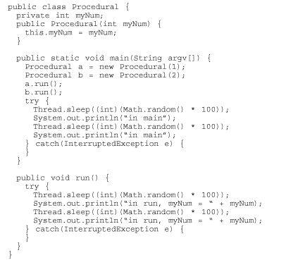

**Exhibit 5. 来自 Exhibit 4 (Program2.4) 的输出**

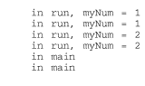

`Program2.5` (Exhibit 6) 与 `Program2.4` (Exhibit 4) 类似，不同在于现在方法调用被替换为了线程。虽然 `Program2.5` 看起来与 `Program2.4` 相似，但它的行为非常不同。在 `Program2.5` 中，`main` 创建了两个对象并使用这些对象创建了两个线程 `t1` 和 `t2`。调用线程 `t1` 的 `start` 方法，现在 `main` 和线程 `t1` 都可以自由执行。如果 `main` 先执行，它会启动 `t2`，然后三个线程都可以自由运行。现在每个线程都有相等的机会运行。因此，`main` 可能先运行，接着是两次 `t2`，然后是 `main`，最后是 `t1`，如 Exhibit 7 中提供的第一个输出示例所示。同样可能的是 `t2` 先运行，接着是 `main`，然后是 `t1`、`t2`，如 Exhibit 7 中所示的第二个示例。事实上，要证明这个简单的程序有 24 种可能的输出组合并不困难。

**Exhibit 6. Program2.5：带有两个线程和一个主线程的并发程序**

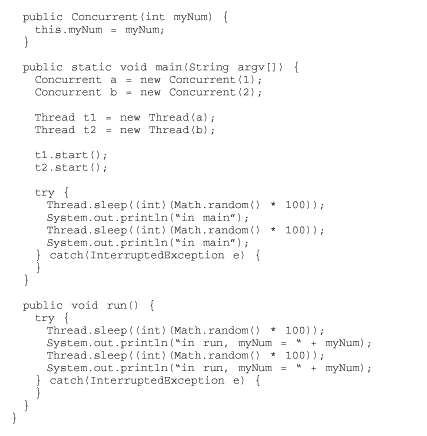

**Exhibit 7. Exhibit 6 的两种可能输出 (Program2.5)**

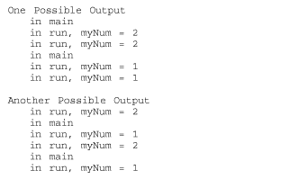

早些时候人们说过程化程序具有全序；也就是说，它的语句只有一种顺序。而并发程序是偏序的。这意味着，尽管线程本身是有序的，且每个线程中的语句实际上是过程化的，但 JVM 选择某一个线程来执行其下一条指令的顺序是无序的。这允许线程中的语句能够交错执行，如 Exhibit 7 所示。从这个例子中难看出，简单程序的正确顺序数量可能非常大（`n` + 2），其中 `n` 是我们启动的线程数。本文的大部分内容将致力于管理这种复杂性性的技术。

## 2.4 简单执行

程序实际上如何在计算机上被实例化和执行是一个复杂的课题，通常需要研究操作系统、编程语言和编译器理论才能理清。与大多数架构一样，JVM 是优雅的，而且就本文而言，并发程序的基本行为可以在不引入复杂的情况下解释。本章开发了这样一个模型，以解释后续章节中程序的行为。虽然本章开发的模型符合 JVM 的精神并解释了线程的所有行为，但它并未声称完全真实。在某些情况下，那些细节增加了不必要的复杂性，且没有讨论 JVM 的大部分部分。为了清晰起见，这里使用的模型被称为简单虚拟机（`SVM`），并实现简单的内存模型（`SMM`）。

### 2.4.1 简单内存模型 (SMM)

与大多数架构一样，SVM 在运行程序时使用多种类型的内存。内存中每个部分的目的以及程序部分访问内存的能力是为了对内存进行逻辑划分，以允许程序正确执行。SVM 使用的 SMM 将使用四种内存：

1. `程序计数器 (pc)` 寄存器跟踪当前正在执行的指令；这在 JVM 中是一个地址，但在本章中是一行程序代码。

2. `堆 (heap)` 用于存储所有对象和对象数据；该区域由所有线程共享。

3. `方法区 (method area)` 包含类定义和运行程序的编译指令；该区域也被所有线程共享。

4. `程序上下文 (program context)` 包含每个线程特有的信息，例如`栈 (stack)`。它还可以包含其他信息，例如与该线程相关的 `PC` 以及调用方法的返回地址。

每个独立的 SVM 程序（称为 `process`）包含一个 PC、堆、方法区域和一个多个线程上下文（每个线程一个）。Exhibit 8 以图示展示了这在运行两个 SVM 进程的计算机上是什么样的：第一个进程拥有线程 `main` 和 `t1`，第二个进程拥有线程 `main`、`t1` 和 `t2`。

一个可以帮助你理解进程这个概念的类比是是想象一个正在为几栋房屋工作的建筑师。他一次只能做一项任务。假设建筑师正在建造一排联屋，每栋房子都使用相同的图纸，并且他有一套工具用于这些房屋；因此建筑师可以共享图纸和工具。因为并不是所有房屋所需的材料随时可用的，建筑师会在房屋之间移动，当特定房屋特定任务的材料可用时，先做一个，再做另一个。

通过我们的类比，建筑师是 `CPU`，它一次可以处理一个任务。工具是对象（`heap`），图纸是我们正在使用的指令（`method area`）。每栋联屋（`thread`）都有自己的状态（`PC`），建筑师（`CPU`）使用的 `PC` 是当前正在工作的那栋房屋的。整个施工工地是 `process`，拥有共享的图纸和工具，但有独立的联屋（`threads`）。当建筑师从工作一栋联屋移动到另一栋时，这种切换被称为 `context switch`，因为正在工作的上下文（房屋）发生了变化。

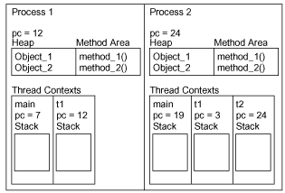

**Exhibit 8. SVM 中两个进程的图形表示**

这个类比可以扩展到进程。如果建筑师在不同的位置处理两组不同的联屋，那么每个工地就变成一个进程。这些工地中的每一个都有自己的图纸（`method area`）和工具（`heap`），因此图纸和工具不在工地之间共享，但在工地内部共享的。每个工地还有一组待建的联屋（`threads`）。当建筑师从工作一栋联屋切换到另一栋时（无论是在当前工地还是另一个工地），这种变化仍被称为 `context switch`。


SMM（存储器模型）是一个非常简单的内存模型，由于遗留了太多细节，无法实际上用于实现真实的计算机架构。然而，正如第 2.4.3 节所示，它提供了足够的细节来解释并发程序的行为。本节利用该模型来解释 Web 服务器的工作原理，以及为什么像`servlets`这样的机制正在取代`common gateway interface`（`CGI`）等旧技术。

操作系统的最初设计是为了为了在单台计算机上同时运行多个程序。当时并没有考虑过单程序程序可能使用多个线程或需要多个上下文的情况。每个程序被视为一个单一、完整的实体，在运行期间不需要与任何其他程序通信。因此，这些操作系统将上下文合并到进程（process）中，一个进程只有一个堆（heap）、方法区域（method area）和一个线程（或上下文）。如果需要单独的线程，就会启动一个新进程。直到很久以后程序员才意识到他们可以在程序中有效地使用多一个线程。在处理多个上下文时，线程比进程有效得多，原因有两点：

- 每个进程都有自己的堆和方法区域，因此比线程携带的负担（或重量）大得多。创建一个线程只需要创建一个新的上下文，该上下文与创建它的上下文共享堆和方法区域；因此，线程比进程更“轻量级”。线程通常被称为`轻量级进程`，而进程被称为`重量级进程`。由于线程的开销小得多，创建线程以及在同一个进程中切换两个线程的成本更低。特别是，创建一个线程所需的资源可能比创建一个进程少上几个数量级。
- 由于线程共享同一个堆，它们可以使用堆中的变量进行通信。这使得线程之间的通信比进程之间的通信更容易，因为进程不共享任何运行时内存。若要在进程之间共享数据，必须使用文件等外部数据存储器。对于共享数据来说，这些可能是计算开销巨大的选项。

当 Web 服务器首次引入时，它们与`Perl`或`C/C++`等程序一起用于处理 Web 页面的数据。这些早期程序是通过`CGI`机制实现为进程的。`CGI`总是创建一个进程来运行程序，就像早期的操作系统所做的那样，这导致了进程实现 Web 服务器有两个主要缺点：

- 每当 Web 页面发送一个新请求时，必须创建一个新进程来处理它。由于每个 Web 页面都会产生请求，这要求每从服务器请求一个 Web 页面就要启动一个进程。当 Web 刚出现时，请求数量很少，这并不是问题；但随着 Web 使用的增长，某些 Web 服务器每小时开始接收数百万次请求。创建进程的开销变得非常大，威胁到即使是极快的服务器。
- 由于与请求相关的所有数据都包含在进程中，当进程退出时，数据不再在服务器上可用；然而，Web 页面之间的持久化数据对于跟踪用户的当前状态是必要的，以便在处理请求时知道应该采取什么操作。程序员尝试了解决此问题的几种方案。可以将数据写入文件并在每次请求时检索，但访问磁盘的速度很慢，会拖慢系统。所需的数据有时被放在发送到客户端计算机的 HTML 页面的隐藏字段中，但这些数据很容易被破解和更改，根本不安全。人们还尝试了其他处理持久化数据需求的机制，但它们都存在严重问题。

启动进程的高开销和无法有效共享数据的问题，通过应用使用线程的技术（如`servlets`）得到了解决。`CGI`和`servlets`之间的巨大区别在于，`CGI`为每个请求使用独立的进程，而 servlet 在进程内部作为线程处理每个请求，这解决了在使用`CGI`时遇到的两个问题。由于线程创建所需的资源少得多，且上下文切换所需的资源也较少，`servlets`和其他使用线程的技术比基于进程的技术（如`CGI`）需要少得资源。

由于许多线程可以共享堆，每个请求都可以创建一个线程并在堆中缓存（`cache`）信息。当用户发送下一个请求时，可以检索这些缓存信息并创建新线程来处理该请求。这允许使用简单的机制在服务器上维护持久化存储。

使用线程解决了在实现运行在 Web 服务器上的程序时遇到的许多问题，但也引发了许多新问题。由于现在 Web 服务器上运行的请求正在进程内部共享数据，所有在通信异步活动时出现的问题都存在并且需要考虑。本章的最后两节概述了这些问题，教科书的其他部分将关注如何处理此类问题。

**图 9：图 10 的过程化程序**

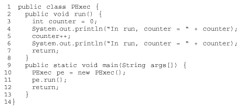

### 2.4.3 过程化程序的程序执行

本节解释了异步活动（如线程和进程）如何交错执行。它首先解释了简单的过程化程序如何执行，然后使用相同的模型展示`SVM`如何在并发程序的执行中使用线程上下文。执行模型在后续章节中得到了扩展，以解释诸如进程状态、Java`synchronized`修饰符以及`wait`、`notify`和`notifyAll`方法等概念。

讨论从考虑图 9 中的过程化程序开始。在图中，程序中的行经过了编号，以显示在`PC`（程序计数器）中执行的程序语句。在实际程序中，`PC`将设置为方法区域中的地址。

下面详细说明了程序的执行如何进行。每一步对应图 10 中的一个帧，显示了执行该步骤后的 SMM 状态。这可能会导致困惑，因为`PC`始终指向将执行的行，而不是刚刚执行的行。

1. 程序开始执行。SVM 为`main`创建堆和线程上下文，将其初始化为`null`。它还创建了方法区域并将 PExec 类的方法加载到方法区域中。最后，它创建了`PC`。由于程序仍在启动，`PC`存在并可能被使用，但目前其值是未定义的。
2. SVM 在栈上为`main`方法推入一个激活记录（activation record）。作为激活记录的一部分，创建指向 PExec 对象的引用；然而，对象本身尚未创建，因此引用为`null`。我们使用类似于 C 的约定来表示此引用：`pe`。此时，SVM 还将进程`PC`和线程`PC`分配给`main`方法的第一行可执行代码，即第 10 行。
3. SVM 现在执行第 10 行的代码，在堆中创建一个 PExec 类的实例。`pe`引用指向堆中的该对象（注意它不再是`null`），SVM 更新了此上下文中的`PC`和进程`PC`，使其指向程序中的下一行可执行代码，即第 11 行。

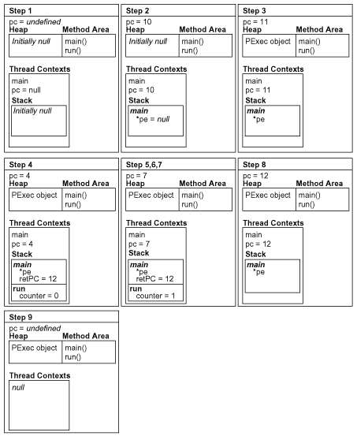

**图 10：执行过程化程序的步骤**

4. SVM 准备调用`run`方法。首先，main 方法中下一条执行行（第 12 行）的程序计数器（PC）被存储在 main 方法激活记录中的一个特殊变量中，我们将其命名为`retPC`。该行是`run`方法返回后执行将继续的行，且用户程序无法访问。随后，SVM 为`run`方法创建一个激活记录，创建在该方法中声明的名为`counter`的局部变量，并将`counter`设置为 0。最后，SVM 更新 PC，使其指向`run`方法中的第一行代码，即第 4 行。
5. 步骤 5、6 和 7 全部合并在图表 10 中，所使用的值是步骤 7 结束时的值。在步骤 4、5 和 6 中，SVM 在`run`方法中执行，输出一行带有`counter`的内容，更新`counter`变量，并输出第二行。在这一系列步骤结束后，PC 指向第 7 行，栈上的`counter`已经递增到 1。
6. SVM 现在执行从`run`方法的返回。这导致`run`方法的激活记录从栈中弹出（并删除），并将 PC 设置为调用该方法时保存的`retPC`。程序现在回到了 main 方法中执行。
7. main 方法执行返回，main 方法的激活记录从栈中弹出。这意味着对`PExec`对象的引用被删除了，但实际对象将在稍后通过名为`garbage collection`（垃圾收集）的过程清理栈时被删除。此外，方法区中的信息不会被删除。这导致进程失去了任何上下文。由于 SVM 正在进行内部清理工作以清理该进程，因此 PC 现在是未定义的。
8. SVM 现在销毁此进程，堆或方法区中留的任何信息将在进程销毁时被销毁。

此示例展示了如何使用 SVM 来过程化程序的执行。下一节为 SVM 增加了一些细节，并解释了并发程序的执行。

### 2.4.4 线程的程序执行与上下文切换

SVM 中并发进程的执行与过程化程序相同，但有一个主要区别。由于并发程序具有多个线程，因此并发进程中存在多个上下文，并且由于每个上下文都有自己的 PC，SVM 必须在每个执行周期中选择运行哪个线程上下文，从而选择使用哪个上下文的 PC。许多因素都会影响这一决策，其中一些只能在运行时决定。例如，如果一个上下文在没有中断的情况下运行了几个语句，SVM 可能会在下一个周期允许另一个上下文运行。由于程序员无法知道所有影响下一个选择的线程上下文的因素，SVM 的规则将是：在任何时候都可以选择任何有效且就绪的线程上下文。程序员永远不应该假设将选择哪个上下文（从而选择哪个 PC）。

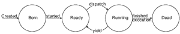

**图表 11. SVM 线程状态**

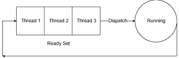

**图表 12. SVM 中就绪状态与运行状态的关系**

关于线程的讨论始于回答如何创建新线程上下文并启动线程的问题。当线程被创建时，它起初处于`born`（出生）状态（参见图表 11）。随后对线程调用`start`方法，线程被移动到`ready`（就绪）状态，从该状态开始它可以运行。通常，许多线程已就绪并必须由 SVM 管理。这是通过将这些线程放入`ready set`（就绪集）来实现的，如图表 12 所示。当前使用 CPU 执行的线程处于`running`（运行）状态。对于带有单 CPU 的计算机，任何时间只有一个线程处于运行状态。

当 SVM 选择下一个要执行的线程时，它可以选择当前处于运行状态的线程或就绪集中的任何线程；程序员无法影响这一决策，且这些线程中的任何一个被选中的概率相等。如果 SVM 选择了已经在运行的线程，它只需执行进程 PC 中的指令。如果它从就绪集中选择线程，则会将进程 PC 写入当前运行线程的上下文中，将其状态改为就绪，将新线程的 PC 加载到进程 PC 中，并将新执行线程的状态改为运行。由于当发生这种情况时上下文（使用的 PC 和栈）发生了变化，挂起一个线程并启动另一个线程的过程被称为`context switch`（上下文切换）。当线程完成运行后，它被移动到`dead`（死亡）状态。在死亡状态下，线程仍然存在但无法被执行。死亡状态是必要的，允许 SVM 维护线程的上下文，直到安全移除该线程。

**图表 13. 用于图表 14 的并发程序**

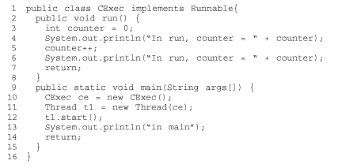

利用这些关系，并发程序的执行解释方式与图表 10 中使用的方法类似。为 SVM 增加了一些内容以支持并发：首先，线程上下文必须有一个状态，以便跟踪线程状态。由于该变量仅由 SVM 使用且在线程移动时必须更改，程序员无法直接访问。其次，就绪集和运行中的线程必须由 SVM 维护。

本节剩余部分将讨论图表 13 所示并发程序的执行。运行此程序的步骤在图表 14 中给出，并在文中讨论。正如图表 10 所示，图表 14 中的步骤包含了选择下一个运行的线程。因此，运行线程和 PC 代表了下一步将执行的情况。

1. 程序开始执行。SVM 创建 main 的堆和线程上下文，将其初始化为 null。它还创建了方法区并将 CExec 类的方法加载到方法区。最后，它创建一个 PC。由于程序仍在启动，PC 存在并可能被使用，但目前其值是未定义的。
2. SVM 在栈上推入 main 方法的激活记录。作为激活记录的一部分，创建了对 PExec 对象的引用；但此对象尚未创建，因此引用为 null。我们将使用类似于 C 的约定来表示此引用：`ce`。此时，SVM 还将进程 PC 和线程 PC 分配给 main 方法中的第一行可执行代码（第 10 行）。
3. SVM 现在执行第 10 行代码，在堆中创建一个 CExec 类的实例。`ce`引用指向堆中的该对象，SVM 更新此上下文中的 PC 和进程 PC，使其指向程序中的下一行可执行代码（第 11 行）。
4. SVM 执行第 11 行代码，在堆中创建一个 Thread 类的实例。当线程被创建时，也创建了线程的上下文，但状态是`born`，该线程尚不可执行。要真正有资格运行，线程必须处于就绪或运行状态；因此，目前只有一个线程（主线程）可以运行，且执行在主线程中继续。
5. 执行第 12 行，这把`t1`线程放入就绪队列并将`t1`队列的状态设置为就绪。此时`SVM`可以自由选择主线程或`t1`线程进行运行。在本例中，选择了`t1`线程，但对`t1`的选择完全是随机的。由于选择了`t1`，因此需要进行从主线程到`t1`线程的上下文切换。进程的`PC`被设置为`t1`线程上下文中的`PC`，而当前进程的`PC`保存在主线程的文中。最后，更新两个线程的状态。
6. 执行`t1`线程中的第 5 行，这产生了一行输出，其中部分是局部变量`counter`的值。`SVM`现在选择运行哪个线程。在本例中，再次选择了线程`t1`运行，但同样，这完全是随机的。
7. 执行`t1`线程中的第 4 行，这累加了位于线程`t1`栈内存中的局部变量`counter`。`SVM`现在选择再次运行主线程并执行上下文切换。
8. 执行主线程中的第 13 行并产生了一行输出。`SVM`选择继续在主线程中运行，将`PC`更新到第 14 行。
9. 执行第 14 行，完成了主线程的执行。该线程现在已死亡，不能再执行；然而，它也无法结束。创建另一个线程的线程被称为*父线程*（parent thread），父线程必须保持存直到所有子线程都死亡。因此，该线程被移动到死亡状态，并处于空闲状态，直到其所有子线程也死亡。现在只能运行一个线程（线程`t1`），因此`SVM`必须选择它运行。

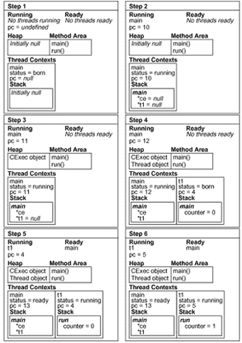

**图 14. 并发程序的执行步骤**

10. 执行线程`t1`中的第 6 行并产生了输出。`SVM`继续在线程`t1`中执行，将`PC`更新到第 7 行。
11. 执行第 7 行，完成了线程`t1`的执行。线程`t1`变为死亡状态；因为它没有子线程，它可以完成并且其上下文被删除。主线程现在没有子线程了，其上下文也被删除了。程序现在可以自由退出。

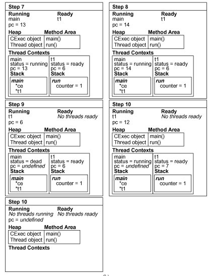

**图 14.（续）**

### 2.4.5 睡眠与阻塞

该模型足以解释一个所有线程始终处于就绪或运行状态的程序。然而，线程经常会挂起一段时间，例如当调用`Thread.sleep`或请求 I/O 时。当这种情况发生时，线程会被移动到睡眠或阻塞状态，直到导致其移动到该状态的条件被满足，如图 15 所示。当线程处于睡眠或阻塞状态时，它无法运行，因此让 CPU 在每个执行周期中检查是否运行它将浪费时间。睡眠或阻塞的线程实际上不属于就绪队列，但它们仍然需要由`SVM`处理和计数。因此，`SVM`为处于这些状态的线程创建了单独队列，如图 16 所示。这种处理挂起线程的方法稍后将用于解释 Java`wait`和`notify`方法的行为。

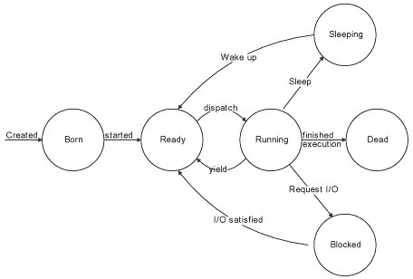

**图 15 带有睡眠和阻塞状态的状态模型**

### 2.4.6 不确定性与并发

正如程序 2.5 的输出（图 6）以及 2.4.4 节中的讨论所示，由于`SVM`（以及`JVM`和大多数并发执行环境）可以在程序执行的每一步选择运行的线程，并发程序可能会产生多个可能的有效输出。正如对程序 2.5 的讨论（图 6）所示，即使对于线程数非常少的简单程序，程序中不同的可能的执行路径数量也可能非常大。程序这种能够产生完全不受程序员控制的多种不同执行路径的属性被称为*不确定性*（nondeterminism），因为程序员无法确定语句的绝对顺序。

从未编写过并发程序的程序员可能将不熟悉程序中的不确定性行为。如果一个过程化程序运行一百万次，它将始终产生相同的答案。然而，一个运行正确的一百万次并发程序，在第一百万零一次运行时可能会产生错误。这就是不确定性的问题所在；程序员无法通过测试来证明一个程序是正确的，即使对于有限的输入子集也是如此。证明程序正确的唯一方法是执行程序中所有可能的路径，从而产生由任何可能的线程交织所产生的所有结果。虽然这在理论上是可能的，但由于线程交织的可能方式非常多，这完全是不切实际的。而且，即使这些交织方式中只有一种是无效的，也存在程序产生无效答案的可能性。要求程序对于给定的输入集始终产生正确答案的需求被称为*程序安全性*（program safety）。

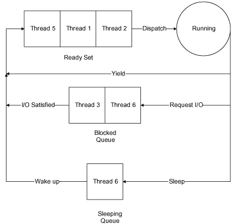

**图 16 带有睡眠和阻塞队列的 SVM**

维护程序安全性是困难的，因为随着交互线程数量的增加，问题变得更加普遍。通常在对程序进行测试时，开发的是比程序实际运行环境更有限的测试套件，因此某些问题只在程序投入生产环境时才会发生，且通常只能在生产环境中重复。不安全程序的问题是并发编程的核心问题之一，将在 2.5 节中进行详细检查。

## 2.5 程序安全性

### 2.5.1 竞态条件

正如 2.3 节所示，并发程序特有的问题源于线程之间不确定的相互作用。这些问题的核心是*竞态条件*（race condition）。当一个活动（如线程）只要能够在不受中断的情况下完成任务就能产生正确答案时，就会发生竞态条件；然而，如果另一个活动在任务过程中中断了它，产生的答案将是错误的。竞态的一个简单示例是两个线程向打印机打印报告。如果允许两个线程同时访问打印机，两份报告的数据可能会混合，显然会破坏两份报告。然而，如果一份报告在另一份开始之前结束，两份报告都将正确的。这个问题可以看作是一个打印报告的线程正在*竞争*在另一个报告开始之前完成打印。如果它成功了，就赢得了竞争，程序是正确的。如果它失败了，就输掉了竞争，两个线程都会产生错误的结果。

竞态条件的发生需要两个条件。首先，资源（此处为打印机）在两个线程之间共享。其次，线程中必须存在一条以不安全方式共享资源的执行路径（此处为两个线程同时访问打印机的能力）。如果这两个条件存在，即使问题实际上从未发生过，程序中也存在竞态条件，因为事实是问题可能会发生。即使程序员对极小的概率感到满意，该程序也是危险的，因为它是不稳定的。如果以后对程序进行了修改，改变了使得程序看起来安全的假设，就可能开始出现问题，导致程序产生错误的答案。通常这些问题更难解决，因为它们是间歇性的且无法持续重现。


这对许多程序员来说都是一个问题，因为他们有“黑客式”程序的习惯，即编写基础结构并对其进行调整、测试结果，直到它产生预期的行为。这种策略对于并发程序是无效，因为无法通过测试来证明程序的正确性。因此，如果一个并发程序无法通过测试证明它是安全的，那么如何才能证明程序是安全的呢？目前只有两种有效机制。第一种是通过归纳法证明该程序将满足程序安全所需的任何条件。第二种是使用在开发程序时已知安全的策略来开发程序，这要求对程序的实现进行仔细的规划和执行。

可以使用哪些策略来使程序变得安全？竞态条件的必要条件意味着了解决该问题的策略。一种策略是简单地不共享资源——例如，准备两台打印机，让每个线程访问自己的打印机。不共享资源的程序显然是安全的，这种策略经常被用作并发程序的一部分（例如，在 Java 事件模型中；参见第 7 章）；然而，这种方法并不总是可行。很少有计算机为每种可能的输出配备一台打印机，因此某些共享是不可避免的。

处理竞态条件的第二种策略是确保在允许另一个线程访问共享资源之前，该资源处于安全状态。以打印机为例，这意味着想要使用打印机的线程必须保证它对打印机具有独占访问权，直到它完成打印，只有那时才允许第二个线程打印。这种在资源处于不安全状态时将其隔离并锁定的策略，是编写大多数安全并发程序策略的基础，也是本节其余部分的课题。

在进行并发编程时，最经常发生竞态条件的共享资源是程序变量。下一节将展示竞态条件如何在共享变量的简单程序中发生，并展示 Java 内置的用于安全处理这些共享变量的机制。

### 2.5.2 程序中的竞态条件

就像在打印机示例一样，程序中存在竞态条件是因为多个线程尝试访问共享资源（通常是程序变量）。由于并发线程以非确定性的方式交替执行，变量可能会被改变导致产生错误的结果。例如，考虑 `Program2.6`（示例 17）。该程序简单地在两个不同的线程交换两个数字。显然，当每个线程交换它们的数字时，该程序可以产生两个正确答案，如示例 18 所示。然而，当线程交替执行且第二个线程更改了第一个线程正在使用的 `tmp` 变量的值时，该程序也可以产生两个错误答案，如示例 18 所示。

该程序能够产生这些错误结果的原因因为它是不安全的。它共享了一个资源，即 `SwapInt` 对象及其变量 `tmp`，并且以不安全的方式使用了该变量。不安全的场景是：一个线程进入 `swap` 方法，将它的 `val1` 保存到变量 `tmp` 中，然后调用 `Thread.sleep`。由于它的状态现在处于睡眠状态，SVM 选择第二个线程执行并进行上下文切换到第二个线程。第二个线程随后可以进入 `swap` 方法并覆盖 `tmp` 变量的值，从而丢失第一个线程的值。这是一个变量上的竞态条件示例。通常情况下，第一个线程会完整执行 `swap` 方法，当第二个线程进入 `swap` 方法时，`tmp` 中的值没有意义，因此程序产生正确答案。然而，如果第一个线程输掉了竞争，在第二个线程进入该方法之前没有完成 `swap` 方法，`tmp` 的值就会被改变，导致第一个线程错误地交换了值。

**示例 17. Program2.6：带有竞态条件的程序**

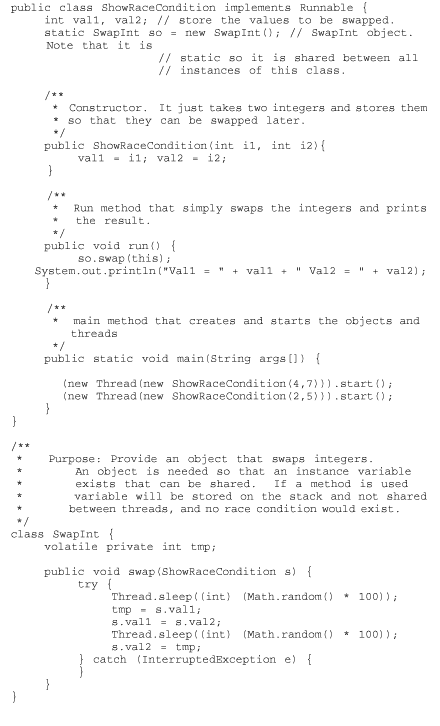

**示例 18. Program2.6 的可能输出（示例 17）**

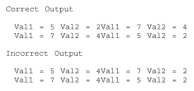

该程序不安全的原因之一是 `SwapInt` 对象是被共享的。该对象之所以共享是因为它被声明为 `static`，因此该类只有一个对象副本，且该副本被所有 `ShowRaceCondition` 对象共享。使此程序安全的一种方法是简单地移除 `static` 修饰符，为每个 `ShowRaceCondition` 对象创建一个 `SwapInt` 对象。通过在 `run` 方法内部声明 `SwapInt` 对象也可以实现相同的效果，为每个线程创建一个 `SwapInt` 对象。不共享的对象是安全的。然而，就像打印机一样，通常需要共享一个对象，因此必须开发一种能够确保数据可以被安全使用的方法。由于这个程序展示了竞态条件如何发生，它也被用于展示如何解决它。

### 2.5.3 锁对象

`Program2.6`（示例 17）中的竞态条件发生是因为两个线程可以同时在 `swap` 方法中执行。我们需要的是一种机制，在一个线程进入 `swap` 方法时对其锁定，防止其他线程进入方法，直到第一个线程完成执行。当第一个线程离开方法时，它会解锁，允许另一个线程获取锁并在方法中运行。这种解决方案在 `Program2.7` 中给出（示例 19 和 20）。`Program2.7` 由两个类组成：一个二进制信号量（如 19 中的 `Program.7a` 所示）以及一个实现了 `Program2.6` 安全解决方案的类（如 20 中的 `Program.7b` 所示，示例 17）。

**示例 19. Program2.7a：二进制信号量**

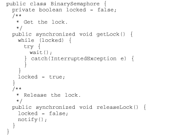

实现锁的一种方法是使用二进制信号量，例如 19（`Program.7a`）中实现的这种，稍后将证明它是正确的；但目前你应该假设这个二进制信号量确实是安全的。使用这个二进制信号量，线程调用 `getLock` 方法。如果变量 `locked` 为 `false`，则信号量未被锁定，线程通过将 `locked` 的值设置为 `true` 来获取锁。现在，如果另一个线程尝试通过调用 `getLock` 获取锁，它发现锁已被占用（即 `locked` 的值为 `true`），它必须等待锁释放后才能继续。

获取锁的线程现在可以在程序的临界区中运行。临界区是代码的一部分，其中一次只允许有一个线程执行，以确保程序的安全性。运行在临界区中的线程现在执行交换操作，因为没有其他线程可以进入这段代码，所以交换是安全的。

当线程在临界区执行完毕后，它会调用 `releaseLock` 方法，通过将 `locked` 的值设置为 `false` 并通知任何正在等待锁的线程来释放锁，告诉它们现在可以尝试获取锁并继续。暂时不要担心语法或 `synchronized`、`wait` 和 `notify` 语句实际如何工作；它们稍后会详细介绍。只需理解锁可以挂起线程直到锁释放，从而确保使用临界区的安全性。

**示例 20. Program2.7b：安全交换值的程序**

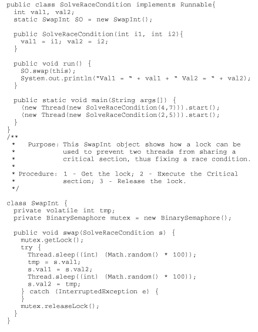

二进制信号量现在已添加到示例 17（程序 2.6）中，以生成示例 20（程序 2.7b）。请注意，唯一的区别在于，示例 20（程序 2.7b）中创建了一个名为 `mutex`（用于互斥）的锁变量作为对象的一部分，用于保护 `swap` 对象中的临界区。当线程进入 `swap` 方法时，获取 `mutex` 的锁；当线程离开 `swap` 方法时，释放锁。现在该程序显然是安全的，可以多次测试以证明它是可以运行的；然而，正如之前指出的，并发程序无法通过测试来证明其正确性。证明并发程序正确的唯一有效方法是对比该程序进行归纳法证明，我们将在下一节中对示例 20（程序 2.7b）进行该证明。

在继续之前，读者应该注意，`swap` 方法的锁与 `SwapInt` 对象相关，而不是与 `swap` 方法或 `SwapInt` 类相关。这通常会让初学并发编程的程序员感到困惑。正如此，如果 `SwapInt` 对象中的多个方法使用 `mutex` 锁，那么在任何时刻，该对象的任何方法中只能有一个线程进入。如果有多个 `SwapInt` 对象，则在任何时刻，每个线程都可以进入每个对象的 `swap` 方法。在讨论 `BinarySemaphore` 类的细节时，这一点将会变得清晰。

### 2.5.4 证明示例 20（程序 2.7b）的正确性

正如之前指出的，并发程序无法通过测试来证明其正确性；需要通过归纳法来证明程序是正确的。理解对程序进行归纳法证明的技术是非常重要的，即使这种证明很少执行，因为归纳法证明为证明并发程序的正确提供了推理依据。

对示例 20（程序 2.7b）的归纳证明开始假设 `BinarySemaphore` 对象是安全的。此外，`SwapInt` 类中使用的变量必须是私有的，这样除了通过调用 `getLock` 和 `releaseLock` 方法外，线程无法修改它们。文中说明了基础情况和归纳情况，并执行归纳步骤以证明程序确实是安全的：

- **基础情况：** 两个线程从 `run` 方法的开始开始。
- **归纳假设：** 一个线程进入 `swap` 方法，而另一个线程仍在执行进入 `swap` 方法之前的代码。由于两个线程都尚未进入 `swap` 方法，我们知道到目前为止安全的。
- **归纳步骤：** 两个线程都在 `swap` 方法之后执行，并且变量被正确地交换。

作为证明，我们做的只需证明从归纳假设到归纳步骤的所有路径都会导致一个正确的程序。假设线程 1 已经进入 `swap` 方法，情况如下：

- 线程 1 在线程 2 再次执行之前完成了 `swap` 方法的执行。因此，线程 1 在线程 2 进入 `swap` 方法之前完成，这是安全的。线程 2 在线程 1 不再使用该锁后进入 `swap` 方法，因此也是安全的。这条路径是安全的。
- 线程 1 和线程 2 交替执行，但线程 2 从未尝试进入 `swap` 方法。这条路径也是安全的。
- 线程 1 和线程 2 交替执行，但线程 2 尝试进入 `swap` 方法。线程 2 阻塞在锁上，因此线程 1 可以安全地完成，随后是线程 2。这条路径也是安全的。

证明的第二部分将证明，如果线程 2 在线程 1 之前进入 `swap` 方法，程序也是安全的，证明过程与上述相同，结果证明了示例 20（程序 2.7b）中的程序确实是安全的。

### 2.5.5 `synchronized` 修饰符

上一节的证明假设 `BinarySemaphore` 对象是安全的。接下来的两节将展示该对象确实是安全的，并解释 `wait` 和 `notify` 方法以及 `synchronized` 修饰符的工作原理。它们还展示了如何使用这些方法来实现一种特殊对象，称为 `monitor`（监视器），`BinarySemaphore` 类就是一个很好的例子。

使用锁保护程序临界区的想法非常有用，以至于 Java 使用 `synchronized` 修饰符实现了它。`synchronized` 修饰符放置代码块的开头，在本例中是整个方法。与 `Object` 类的每个实例都关联有一个二进制信号量（将称为锁）。由于 Java 中的每个对象都继承自 `Object` 类，因此每个对象都有一个锁。`synchronized` 关键字会在块开始自动插入获取对象锁的逻辑，并在块结束处插入释放锁的代码。当线程尝试进入同步代码块时，会检查对象的锁，就像在 `SwapInt` 对象中执行一样。如果锁未被占用，线程将获取锁，防止任何其他线程进入该对象的任何其他同步代码块。当线程离开块时，锁会被释放。

因此，示例 17（程序 2.6）中的竞态条件可以通过在 `swap` 方法中添加 `synchronized` 关键字来轻松解决，如示例 21（程序 2.8）所示，且不需要 `BinarySemaphore` 对象。然而，实际上实现 `BinarySemaphore` 对象有两个原因。首先，它解释了在使用 `synchronized` 修饰符时会发生什么；其次，`BinarySemaphore` 的实现可以用来演示 `wait` 和 `notify`。

在解释 `wait` 和 `notify` 之前，关于 `synchronized` 修饰符还有最后一点说明：它与一个代码块和一个对象相关联。该代码块通常是一个方法，而该对象通常是 `this` 对象。然而，代码块可以是方法的一部分，而对象可以是任何对象，而不仅仅是 `this` 对象。要指定要同步的代码块，只需在块的开始使用 `synchronized` 语句。要对 `this` 以外的对象进行同步，则将该对象作为 `synchronized` 修饰符的参数。例如，示例 13 中 `swap` 方法的同步是通过同步整个方法实现的：

**示例 21. 程序 2.8：使用 `synchronized` 修饰符的安全交换程序**

```
（安全交换程序的图像/代码表示）
```

由于同步块使用了 `this` 对象并包含了整个方法，这两个方法是效效。

### 2.5.6 `wait` 和 `notify`/`notifyAll` 方法

由于 Java 已经使用同步块为对象实现了锁定机制，因此不需要 `BinarySemaphore` 也能正确实现 `swap` 方法。但是，`BinarySemaphore` 类有趣之处在于，它展示了如何使用 `synchronized` 关键字以及 `wait` 和 `notifyAll` 方法来实现被称为 `monitor` 的结构。监视器是重要的数据结构，构成了第 3 章以及书中大部分内容的基础。`BinarySemaphore` 类是监视器的非常好的例子。

理解监视器（`monitor`）的一种简单方法是将其视为一个对象，该对象中的所有数据都是私有的，所有方法都由单个锁保护，因此在任何时刻，都只有一个线程可以在该对象的任何方法中执行。由于对象的数据是私有的，且所有访问数据的方法都是同步的，因此线程之间不可能发生意外的交互并导致竞态条件。这是使用完全同步（`complete synchronization`）的最简单的监视器类型。这种类型的对象总是线程安全的（`thread safe`），因此可以在使用线程的程序中安全地使用。

使用完全同步虽然安全，但对许多对象来说限制太大了——例如，`BinarySemaphore` 对象。因此，可以编写一种稍微复杂的监视器，它具有一个“状态”，即对象中方法可以运行的条件。在 `BinarySemaphore` 的情况下，`getLock` 方法只有在 `locked` 变量为 `false` 时才能运行。如果 `locked` 变量为 `true`，则线程必须等待该值变为 `false` 后才能继续运行该线程。这是通过调用 `wait` 方法实现的。

`wait` 方法是 `Object` 类中的一个方法。它与 `Object` 类中的 `notify` 或 `notifyAll` 方法配对。为了理解 `wait` 和 `notify` 方法如何工作，我们需要精炼上下文模型。之前我们说过 SVM 可以选择任何就绪或正在运行的上下文来执行。SVM 维护了系统中所有就绪运行的线程的列表，称为就绪集（ready set）。每个线程都关联着它的上下文，包括 `PC`。SVM 从就绪集中选择一个线程运行，并开始执行该上下文 `PC` 处的代码。在线程执行一段时间后（时间可能短到每行代码），SVM 取出正在运行的线程并将其放回就绪集。SVM 再次从就绪集中选择一个线程运行，可能是它刚刚移回列表的同一个线程，并执行该线程。这个循环一直持续，直到所有线程都完成且程序运行结束。

然而，就像线程等待 I/O 或睡眠时一样，并不是所有线程总是就绪运行的。SVM 在选择运行线程时，没有理由考虑这些线程，因为这些线程尚未就绪；因此，SVM 维护了若干集合，并在程序执行过程中在集合之间移动线程。当发生事情时（例如线程从睡眠中唤醒），SVM 将该线程从睡眠集移动到就绪集。然后，当 SVM 下次选择新线程从就绪集移动到运行状态时，该线程就可以被选中运行。

许多此类未就绪运行的线程集合都由 SVM 管理。这里感兴趣的是与对象上的 `wait` 调用相关的集合。当一个线程调用 `wait` 时，它在告诉 SVM，在对它执行 `wait` 的对象上调用 `notify` 或 `notifyAll` 方法之前，它不想再次运行。当调用 `wait` 方法时，SVM 将该线程移动到它所等待的对象的等待集，并且只有在对该对象上进行 `notify` 或 `notifyAll` 调用时，才会将该对象移回就绪集，如 Exhibit 22 所示。

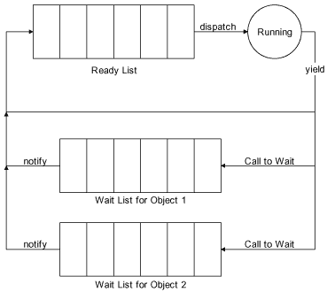

**Exhibit 22. 带有对象等待队列的 SVM**

`notify` 有两种形式：`notify` 和 `notifyAll`。`notify` 调用将任何一个线程（移动线程的选择是非确定的，而不是等待最长的那个）从该特定对象的等待集移动到就绪集。`notifyAll` 调用将该对象等待集上的所有线程移动到就绪集。正如 Chapter 3 所示，`notifyAll` 调用虽然开销更大，但使用频率会比 `notify` 调用更高。

### 2.5.7 `wait` 调用的语义

之前提到过，一个对象的任何同步方法内部只能有一个线程在执行。这个条件对于确保对象的安全性是必要的。然而，如果事实如此，那么我们在 `wait` 的语义上就会遇到问题。考虑 Exhibit 19（`Program2.7a`）中并在 Exhibit 20（`Program2.7b`）中使用的 `BinarySemaphore` 对象。线程 1 通过调用 `getLock` 进入同步块并获得 `BinarySemaphore` 对象的锁。它随后将 `locked` 变量的值设置为 `true` 并退出 `getLock` 方法，从而释放对象的锁。线程 2 然后尝试通过进入 `getLock` 方法来使用 `BinarySemaphore`。由于对象未被锁定，它可以进入该方法，但它发现变量 `locked` 为 `true`，因此执行 `wait` 方法。如果线程 2 继续持有 `BinarySemaphore` 对象的锁，那么当线程 1 稍后尝试调用 `releaseLock` 方法时，它会发现 `BinarySemaphore` 对象被锁定了，无法继续执行。这导致线程 1 无法继续（因为它无法获取线程 2 持有的 `BinarySemaphore` 对象锁），而线程 2 也无法继续，因为它正在等待 `notify` 调用，而该调用无法发生，因为它继续持有 `BinarySemaphore` 对象的锁。这被称为死锁（`deadlock`），是 2.6 节的主题。不过要注意，如果 `wait` 和 `notify` 方法真的是这样工作的，那么这个问题将是不可避免的结果。


为了使`wait`方法的语义生效，必须对其进行更改，使得在线程移动到等待集时`wait`方法释放对象的锁。在 Java 的`wait`方法中，当线程 2 调用`wait`时它会释放锁，允许线程 1 调用`releaseLock`，进而调用`notify`，允许线程 2 继续。

应该注意的是，当线程 2 再次开始运行时，它并不持有锁，因为锁在线程调用`wait`时已被释放。这可能是一个问题。如果另一个线程尝试`getLock`或`releaseLock`，`BinarySemaphore`对象不再被锁定，这个新线程可能会获得锁。如果线程 2 继续像它持有锁那样的运行，那么可能存在两个线程在同一个对象的同步块中运行的情况。当多个线程等待同一个对象并调用`notifyAll`（释放所有线程）时，也会发生这种问题。因此，为了保持锁定状态，从等待状态移动到就绪集的线程在继续运行之前必须重新获得对象锁。这确保了任何时刻一个对象的任何同步块都只有一个线程在执行。

这也解释了为什么`notify`和`notifyAll`无法保证当对象锁释放时第一个等待的线程是第一个执行。当线程唤醒时，它会被移动到就绪集。当它开始执行时，它必须尝试获取对象的锁。由于我们已经说过 SVM 允许从就绪集中选择任何线程进行执行，在线程被通知和它可以执行之间，另一个线程可能已经获得了锁。因此，`notify`和`notifyAll`无法保证哪个线程先执行并获取锁。这是程序员在 Java 中使用`wait`和`notify/notifyAll`时需要记住的一个重要点。

通过这些讨论，我们现在有了两种在`Java`中释放同步锁的方法。第一种是退出`synchronized`块，这是安全的；另一种是调用`wait`方法，这可能是不安全的。第二种替代方案是为了让`wait`和`notify`方法的语义能够正常工作而要求的；然而，如果对`wait`的调用使用不当，就会出现问题。在`synchronized`方法内部调用`wait`意味着该方法可能在不受其他线程干扰的情况下无法从头运行到结束，从而导致通过向程序中重新引入竞态条件而产生不安全行为。程序员需要小心使用`wait`调用。通常情况下，`wait`只在`synchronized`块的开始部分被调用（如第 3 章所示），或者通过使用定义非常明确且经过仔细考虑的语义（例如在第 8 章中讨论的通知对象）。

同步非常强大，但很难正确使用。如果使用不当，将导致竞态条件或死锁；因此，建议使用标准模式实现同步。在第 3 章中，`wait`调用始终在方法开头的标准前提条件块中使用。第 7 章和第 8 章展示了其他更复杂但安全的线程同步方法。如果程序员需要以非标准的方式使用同步，那么确保程序正确的唯一方法就是提供归纳证明。因此，并发程序的实现必须经过仔细考虑。

## 2.6 死锁

### 2.6.1 线程协作

并发编程中经常发生的一个问题是需要允许线程进行协作。例如，一个程序可能需要两个或多个线程轮替运行。两个线程运行但没有轮替的示例见 Exhibit 23 (Program2.9)。在程序程序中，两个线程共享一个`TurnPrinter`组件，该组件在`main`中创建，并保存在每个`UnsafeTurns`对象的实例变量中。尽管这两个线程共享了`TurnPrinter`组件，并且`TurnPrinter`组件是完全同步的，但尚未实现任何让两个线程轮替执行的协调机制，因此它们可以以任何顺序运行。需要注意的是，并发编程问题的解决方案并不总是像这里这样简单。同步。同步使对象是线程安全的（可以被线程安全使用），但并没有解决让线程轮替执行的问题。

这个问题的一个可能解决方案在 Exhibit 24 (Program2.10)中。在程序中，第一个线程进入`printTurn`方法，打印自己的回合，然后等待`notify`调用的发生。只有当第二个线程调用`printTurn`方法打印自己的回合、执行`notify`并调用`wait`时，这种情况才会发生。通过这种方式，每个线程都打印、调用`notify`并等待，从而导致线程轮替执行。

Exhibit 24 (Program2.10) 确实正确地实现了轮替，但程序从未停止运行。这个问题出现是因为，尽管`wait`和`notify`调用的次数相等，但第一个`notify`调用丢失了，因为没有空闲线程从等待集移动到就绪集。这意味着一个`wait`调用将无法与`notify`调用匹配，导致一个线程永久地留在等待集中且无法完成。这种现象被称为`deadlock`。

### 2.6.2 死锁

死锁发生在活动线程仍在系统中，但没有线程可以继续执行，导致程序无法完成执行。在 Exhibit 24 (Program2.10)的情况下，这是由于第一个`notify`在第二个线程调用`wait`之前被调用的结果。正如之前提到的，`notify`调用的仅仅是将一个线程从等待列表移动到就绪列表。如果等待集中没有线程，那么`notify`就会被直接忽略。由于第一个`notify`被忽略了，程序中的`notify`和`wait`调用之间存在不平衡，导致一个`wait`未与`notify`匹配。这意味着第二个线程将永远被留在一个它无法离开的等待集中，该线程永远无法完成。这个示例说明了在实现组件时需要小心，因为即使是简单的组件也可能使用导致死锁的锁定方案。

**Exhibit 23. Program2.9: 两个协作但未轮替的线程**

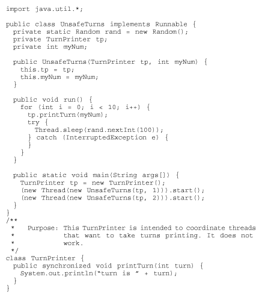

消除此程序中死锁的一种简单方法见 Exhibit 25 (Program2.11)。使用`TurnPrinter`组件的线程仅仅是识别出了`TurnPrinter`组件中的错误（额外的`wait`），并在完成组件打印后，通过在调用它的程序中放置一个`notify`来补偿它。虽然这种解决方案是正确的，但这是一种非常糟糕的编程方式。使用`TurnPrinter`组件的程序不应该为了运行而不得不去补偿组件中的编程错误。事实上，任何在正确使用时都无法产生有效结果的组件都是错误的。确保组件按照描述的功能工作，并尽可能考虑到用户可能犯的各种错误，是组件编写者的责任。

**Exhibit 24. Program2.10: 两个协作并轮替但导致死锁的线程**

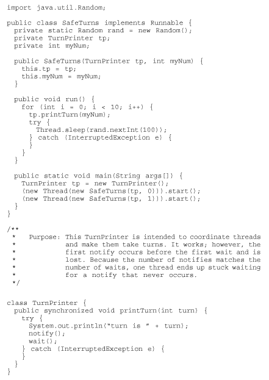

Exhibit 26 (Program2.12) 为这个问题提供了一个更合适的解决方案，因为它完全在`TurnPrinter`对象内部得到了解决。问题经常由于组件设计不当导致错误的程序的产生（在第 7 章中提供示例）。这是另一个程序应该依赖可靠原则来实现并发程序，而不是尝试通过推理程序逻辑来实现程序的原因。

**Exhibit 25. Program2.11: 错误地使用组件来补偿 TurnPrinter 组件实现中的错误**

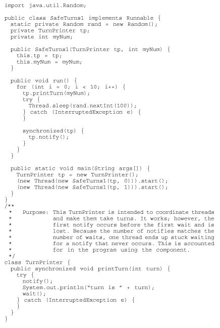

**Exhibit 26. Program2.12: 正确的 TurnPrinter 组件**

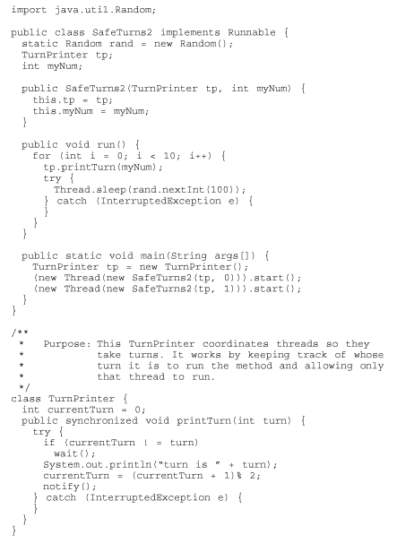

死锁不仅在设计组件时是一个问题；它也可以发生在任何并发程序中。死锁的一个简单原因是对对象锁定时使用了循环性。例如，考虑 Exhibit 27 (Program2.13)，这是一个由于竞态条件引起的死锁示例。两个线程以相反顺序锁定对象 A 和 B。如果`thread_1`能够锁定 A 和 B，它就能完成，然后`thread_2`就能锁定 B 和 A，从而避免死锁。然而，`thread_1`可能在`thread_2`之前锁定对象 A，而`thread_2`可能在`thread_1`之前锁定对象 B，这导致两个线程都无法进行，系统处于死锁状态。

**Exhibit 27. Program2.13: 循环死锁示例**

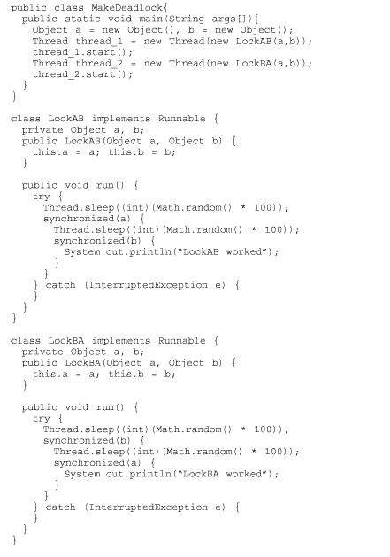

Exhibit 27 (Program2.13) 中的死锁示例可能是最常见的死锁类型。它的发生是因为资源锁定顺序的循环性。如果两个线程以相同的顺序锁定它们，死锁就不会发生。这种类型的死锁在许多系统中非常常见；例如，它在数据库管理系统中经常发生。死锁还可以以其他许多方式产生，其中一些将在后续章节中介绍。

## 2.7 结论

Java 中的线程编程涉及理解如何创建线程，以及如何使用`synchronize`关键字和`wait`、`notify`方法来控制它们。这种理解并非易事，因为线程的存在会导致程序产生非确定性行为。为了理解程序中非确定性的影响，程序员必须理解并发程序是如何执行的，以及变量等资源是否真的被共享了。理解每个线程的上下文允许程序员对这些问题进行推理。竞态条件（Race conditions）和死锁是线程程序和并发程序中可能出现的两种问题，这些问题在过程化编程中是不存在的。处理这些问题的最佳方法是使用经过充分理解且证明正确的标准组件设计。以任何方式实现解决方案的程序员需要非常小心，并应该证明程序是正确的。

## 2.8 扩展阅读

由于程序上下文的理念是异步活动（线程、进程等）在计算机上实现的核心，因此很好地理解它们对于理解并发活动的行为至关重要。本章的内容试图对这些概念提供基本的理解。关于程序栈如何使用以及其中包含什么内容的更完善的解释可以在大多数编程语言书籍中找到，例如 Sebesta 写的《编程语言概念》（Concepts of Programming Languages）[SEB99]。关于程序上下文及其如何使用的更完善的解释可以在大多数操作系统书中找到，例如 Stallings 写的第四版《操作系统》（Operating Systems）[STA01]。最后，关于一种简单计算机架构的详细解释（一种可用于理解子程序调用是如何执行的架构），可以在 Mano 写的《计算机体系结构》（Computer System Architecture）中找到 [MAN93]。关于栈和线程在 JVM 中具体实现的更深入的介绍，请参见 Lindehold 和 Yellin 写的第二版《Java 虚拟机规范》（The Java Virtual Machine Specification）[LIN99]，或 Oaks 和 Wong 写的《Java 线程》（Java Threads）[OAK97]，这两本书都对 Java 内部机制提供了良好的细节。

## 2.9 练习

1. 测试和调试并发程序比过程化程序更容易还是更难？为什么？
2. 在直接从`main`调用`run`方法的程序的`run`方法中抛出一个异常。在通过线程的`start`方法调用的`run`方法中抛出一个异常。这两个程序之间有什么区别？这对于这两种执行类型的程序栈说明了什么？你认为这个问题的答案将如何影响你编写使用线程的程序？
3. 当自动（或局部）变量在两个线程之间共享时，是否可能发生竞态条件？为什么或为什么不？考虑自动变量存储在内存中的位置。假设变量在单个方法中声明并分配。
4. 如果运行 Exhibit 6（程序 2.5）时使用三个线程而不是两个线程，所有可能的程序输出是什么？四个线程时有多少种可能的输出？五个线程时呢？如果每个线程输出三行而不是两行，结果又如何？这对于预测具有多个线程的并发程序的输出复杂性说明了什么？
5. 通过创建独立的、不共享的资源来执行交换，使 Exhibit 16（程序 2.6）变得安全。展示实现此点的两种方法。
6. Exhibit 17（程序 2.6）显示了竞态条件的存在，而 Exhibit 20（程序 2.7b）显示了该问题的解决方案。运行 Exhibit 20（程序 2.7b）100 次。答案总是正确的吗？因为 Exhibit 17（程序 2.6）在运行时偶尔失败，而 Program2.7b 没有失败，我们能说测试证明了 Exhibit 20（程序 2.7b）是正确的吗？为什么或为什么不？
7. 在`synchronized`块中间调用`wait`会发生什么？被访问的变量仍然安全吗，还是可能会发生竞态条件？为什么？
8. 你认为为什么 Java 没有指定`notify`/`notifyAll`来实现一种通知等待对象的公平（即先进先出，或 FIFO）机制？可以使用公平机制吗？如果是，你认为不实现公平机制是一个明智的决定吗？解释原因。在你的回答中考虑线程优先级的行为。
9. `synchronized`方法是锁定对象内的所有方法、该类所有对象中的某个方法，还是跨所有对象的所有方法？解释为什么或为什么不。
10. `static`方法可以是`synchronized`的吗？如果是，如何实现？如果不是，为什么？
11. Java 可以在任何代码块上同步，还是只能同步方法？你能证明做出这一决定的理由吗？
12. 如果没有指定对象，Java `synchronized`语句中使用哪个对象？如果可以指定同步，是如何实现的？方法同步（使用`synchronized`语句修改方法声明）可以指定使用的对象吗？
13. 本章给出的二进制信号量是计数信号量的一种特例。在计数信号量中，可用正数量的资源。计数信号量有两个方法：`getResource`和`releaseResource`。每调用一次`getResource`，可用资源的数量就会减 1。只要资源数量大于或等于 (0)，请求资源的线程就可以继续。然而，如果资源数量小于 0，请求资源的线程必须等待`releaseResource`调用的发生，该调用会增加可用资源的数量。实现一个计数信号量，其构造函数接受初始可用资源数。计数信号量在什么情况下有用？
14. 使用第 13 中的计数信号量实现一个二进制信号量。
15. 实现一个没有设置初始可用资源的构造函数的计数信号量。你如何在不通过构造函数设置的情况下设置资源数量？
16. 比较 Java 线程和 Ada 中的任务。两者的优缺点是什么？
17. 比较 Ada 保护类型的锁定策略与 Java 的`synchronized`块。它们的优缺点是什么？
18. 比较 C/C++ 中使用 Pthreads 的线程和信号量与 Java`synchronized`块和线程。每种实现的优缺点是什么？
19. 如果调用了`notify`或`notifyAll`，但当前没有线程在等待，会发生什么？为什么？
20. 当程序调用`Thread.sleep`时，是否保证只睡眠调用指定的时间？睡眠时间可以更长吗？睡眠时间可以更短吗？解释你的答案。
21. 假设`notifyAll`调用是公平的，即第一个等待对象的线程是第一个被移动到就绪集合的线程。当有多个线程等待时调用`notifyAll`，该线程能保证获得对象锁吗？为什么或为什么不？回答问题时考虑线程优先级。
22. 假设程序使用了优先级，并且多个线程正在等待同一个对象。当调用`notify`时，优先级最高的线程会是被通知的线程吗？通过考虑实现“选择任意线程的 notify”与“选择最高优先级线程的 notify”的复杂度对比来证明这一决定的合理性。*注意*：还要考虑`notify`与就绪集合之间的交互。
23. 以下哪些操作会导致对象锁被释放？
    - 调用`notify`
    - 调用`notifyAll`
    - 调用`yield`
    - 调用`wait`
    - 调用`Thread.sleep`
    - 退出同步块
24. 一种常见的编程错误是在未进入同步块的情况下调用`notify`或`wait`。如果你在不在同步块的情况下尝试对一个对象执行`notify`或`wait`，会产生什么错误？是运行时错误还是编译时错误？请解释该错误。
25. 图 27 (程序 2.13) 中的`TurnPrinter`对象根据第 1 章的定义是一个组件吗？`BinarySemaphore`对象也是吗？为什么或不是？
26. 线程优先使用如何影响当多个线程从对象的等待集（wait set）移动到就绪集（ready set）时，哪个线程将被执行？在使用不同优先级的线程时，Java 是否有效？
27. 解释为什么死锁在数据库管理系统中很常见。你认为死锁是可以预测并避免的吗？如果不能，你认为数据库管理系统是如何处理死死的？
28. 当没有线程处于就绪或运行状态时，可以对程序推断出什么？如果所有线程都处于等待状态呢？如果某些线程处于睡眠或阻塞状态呢？
29. 有多少种方法可以导致线程释放同步锁？
30. 对于图 28 中的程序，考虑`swap`方法中被注释掉的语句。如果取消注释，哪些语句（如果有）可能会导致竞态条件？为什么？
31. 考虑以下使用线程的程序（图 29）（线程是一个接一个运行的）。根据第 1 章的定义，该程序是并发的吗？为什么或不是？
32. 考虑以下使用线程的程序（图 30）（线程不进行同步）。根据第 1 章的定义，该程序是并发的吗？为什么或不是？

**Exhibit 28. SolveRaceConditon_2.java**

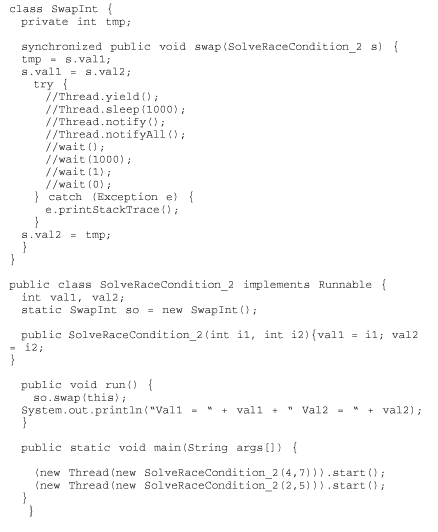

**Exhibit 29. Problem2_31**

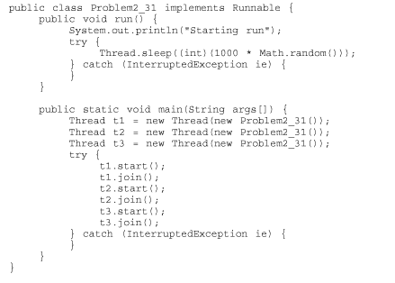

**Exhibit 30. Problem2_32**

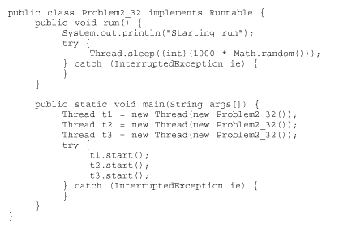

- Servlets 不是服务器中唯一使用线程的技术。像 Perl 这样最初只作为进程运行的语言现在也可以作为线程运行。
- 注意，这里特意使用 *set*（集合）一词是为了表示线程无序的。这与 [LIN99] 中使用的术语一致。操作系统教科书中更常用的术语是 *ready list*（就绪列表），但它暗示了并不一定存在的顺序。
- **在 JVM 中，程序员可以通过使用线程优先级来影响这一决策；然而，使用优先级来控制它们之间的交互是不正确的。优先级在本文讨论中没有实际的用处，因此在 SVM 中被弃用了。**

# 第 3 章：使用状态图设计和实现并发程序

## 3.1 引言


第 2 章介绍了在 Java 中处理并发的设施。在本章中，你将学习如何使用这些设施来实现问题的解决方案。本章研究的问题是模拟问题；然而，所使用的技术将适用于许多不同类型，特别是在描述并发和分布式系统中组件的行为时。第 3.3 节和第 3.4 节提供了将要使用的方法的概述。第 3.5 节将该方法应用于边界缓冲区问题，这是一个在许多操作系统教科书中常见的经典同步问题。第 3.6 节演示了被动对象实际上是组件，以及它们是如何满足第 1 章中给出的组件的五个标准的。最后，提供了一个加油站模拟的示例，展示如何使用本章的技术。

## 3.2 本章目标

读完本章后，你应该掌握：

- 如何指定一个集合（ensemble），即一组协作实现问题解决方案的对象。
- 主动对象（active object）和被动对象（passive object）之间的区别，以及为什么这两类对象的区别很重要。
- 如何实现主动对象。
- 如何使用状态图设计被动对象。
- 如何将状态图转换为可运行的 Java 对象。
- 如何定义控制对象，以及如何使用控制对象将集合中的所有对象连接起来。
- 如何使用这种方法解决具有多个不同线程的问题。
- 为什么被动对象是组件。

## 3.3 背景

第 2 章概述了 Java 实现并发的设施，以及一些并发程序特有的常见问题；然而，仅仅解释并发的机制对于许多学习并发的程序员来说是不够的。大多数程序员被教导将程序理解为过程化的实体——程序从 `main` 方法的第一行开始，按步执行整个程序，并按照逻辑顺序执行每条语句。此外，程序员被教导程序是全序的，程序的执行在语句执行的顺序上是确定性的，因此程序每次运行时都会产生完全相同的结果。因此，虽然某些程序员可能理解并发程序的行为不是过程化的，但他们并不理解如何有效地构建程序以利用并发性。这在我开始教授并发编程时变得非常明显，因为许多学生尝试编写使用 `suspend`、`stop` 和 `resume` 方法来控制线程的程序，而不是允许线程之间的交互来解决问题。

本章的目的是帮助具有过程化编程经验的程序员理解如何构建和创建并发程序。应该警告读者，这通常是一项艰巨的任务，可能需要改变人们推理程序的方式。程序员说他们无法理解本章的方法是如何运作的，他们只是按照章中列出的规则实现了程序，这并不罕见。但一旦程序运行成功，这些内容似乎就微不足道，他们就不理解为什么会在上面遇到问题。

本章介绍的技术涉及创建*集合*（ensembles），即一组相互协调以解决问题的对象集合。创建集合涉及将问题分解为两种对象：主动和被动。*主动对象*（active objects）实现在线程中运行的过程代码。*被动*（passive）或*响应*（reactive）对象除了响应主动对象的请求外不执行任何操作，它们控制主动对象之间的交互。被动对象使用状态图设计，然后机械化地转换为 Java 代码。

## 3.4 创建并发程序的步骤

本章使用的程序创建步骤有八个步骤：

1. 对要解决的问题写一个简短描述。该描述应该指导后续步骤中对对象或功能进行的任何选择。
2. 通过定义将在程序中使用的对象和关系来创建一个集合。一个通用规则是问题陈述中的名词代表对象和/或对象的属性，而动词代表动作和/或方法。然而，不要仅仅根据描述中的名词和动词来选择对象；相反，要选择解决第 1 步中所述问题的有用实体。
3. 对于每个对象，指定该对象应该是主动的（执行动作并产生事件）还是被动的（响应事件）。
4. 使用问题描述中的动词来设计活动对象，以定义对象中动作的流。活动对象的规范可以使用任何过程化设计技术，例如流程图、伪代码或活动图。对于本章中的简单问题，活动对象以伪代码的形式进行设计。
5. 使用状态图设计被动对象。在状态图中，节点是对象可能所处的状态，并由对象中的一个或多个实例变量表示。弧表示当对象处于正确状态时可以执行的方法。
6. 将活动对象实现为 Java 线程。
7. 使用第 3.7 节给出的规则将被动对象实现为监控器（monitors）。
8. 编写一个控制对象，创建所有对象的实例。

为了演示这些步骤，下一节将实现一个解决生产者/消费者问题的简单程序，并在应用于该问题时对每一步进行解释。

## 3.5 生产者/消费者问题

### 3.5.1 问题描述

生产者/消费者问题可以表述如下：创建一个具有有限数量槽位的缓冲区，用于存储生产者创建的数据。在我们的问题中，缓冲区将使用一个名为 `bounded buffer`（边界缓冲区）的循环数组来实现。生产者将简单地创建 1 到 10 的整数并将它们发送到缓冲区。缓冲区将它们存储在下一个空槽位中。消费者将从缓冲区检索这 10 个整数并将它们打印到屏幕上。缓冲区的能力只能存储三个项目，因此在消费者检索项目之前，生产者可能会创建比缓冲区能容纳更多的项目。当这种情况发生时，生产者必须等待消费者从缓冲区取走项目创建一个空槽位，然后才能发送另一个项目。同样，消费者可能会检索生产者已经创建的所有项目，此时缓冲区中没有项目可供。当这种情况发生时，消费者必须等待生产者创建另一个项目并将其添加到缓冲区后，才能继续从缓冲区检索项目。

### 3.5.2 编写问题的简短描述

首先要做的是编写一个对问题的简短描述。这一步可能是最重要的，也是最容易被忽视的一步。程序员往往在还没有充分掌握要解决的问题之前就开始设计程序。这导致创建了许多与要解决的问题没有关系的对象和方法，仅仅是因为它们在问题定义中某种程度上被提及或暗示了。在这个示例中，问题描述是显而易见的：创建一个创建数据的生产者和一个使用数据的消费者，并让他们通过边界缓冲区进行协调。

### 3.5.3 定义对象和关系

查看问题定义，我们发现名词是生产者、消费者、缓冲区以及一个具有三个槽位用于存储数据的循环数组。生产者、消费者和缓冲区是显而易见的对象，循环数组是缓冲器的属性。在这三个对象中，生产者和消费者会执行操作（生产和消费数据）并且是活动性的。缓冲区仅仅存储和检索生产者和消费者请求的数据，它是被动的。下一步是查看描述活动对象的动词。生产者被描述为创建一个数字并将其发送到缓冲区。消费者被描述为从缓冲区检索一个数字并将其打印到屏幕上。这些细节足以描述这两个对象的活动。这些对象简单地通过实现“for 循环”来发送和检索数据。缓冲区对象响应两个请求。第一个是从生产者处取一个项目并将其添加到循环数组中。第二个是从缓冲区中取一个项目并交给消费者；因此，缓冲区将有两个方法：一个 `addToBuffer` 和 `takeFromBuffer`。

### 3.5.4 设计并实现活动对象

现在实现了活动对象——生产者和消费者。生产者的伪代码简单如下：

```text
for (I = 1 to 10)
    Send an item to the buffer
```

消费者的伪代码只是生产者代码的镜像：

```text
for (I = 1 to 10)
    Get an item from the buffer
```

这些代码显示在程序 3.1 中（图 1 和 2）。请注意，在本章的所有问题中，活动对象始终是线程；因此，定义这些对象的动作是在 `run` 方法中说明的，那里是线程开始运行的地方。

关于这些对象必须额外说明一点。这两个活动对象必须共享 `BoundedBuffer` 对象，因此 `BoundedBuffer` 必须在这些对象之外创建并以某种方式传递给这些对象。这些对象的构造函数被用于完成这一点。`BoundedBuffer` 首先在控制对象中创建，然后传递给这些对象并在对象创建时被存储起来。这在第 3.5.7 节中将进一步讨论。

### 3.5.5 设计被动对象（组件）

下一步是设计被动对象——缓冲区。缓冲区有两个方法允许活动对象使用其服务。第一个方法 `addToBuffer` 允许对象向此缓冲区添加项目，第二个方法 `takeFromBuffer` 允许对象从此缓冲区移除项目。这些方法在被调用时，并不是简单地为活动对象执行任务（这像过程化语言中的函数调用通常那样）。相反，被动对象在方法的多次调用之间维持一种状态。这种状态允许它们在对象的方法被使用时维持事件的流。在生产者/消费者问题中，缓冲区可以处于三种状态之一：缓冲区可以是 `EMPTY`（空），任何槽位中都没有项目；缓冲区可以是 `FULL`（满），所有槽位都有项目；或者缓冲区可以是 `AVAILABLE`（可用），某些槽位持有数据而另一些槽位为空。

被动对象内部的流由该对象的状态控制。在生产者/消费者问题中，当对象首次创建时，对象的状态将是 `EMPTY`，因为还没有数据被添加到缓冲区。当缓冲区为 `EMPTY` 时，不允许调用 `takeFromBuffer`，因为缓冲区中没有可供移除的数据。从 `EMPTY` 状态开始，允许调用 `addToBuffer`，这会导致状态变为 `AVAILABLE`，从而允许来自 `takeFromBuffer` 和 `addToBuffer` 的调用。如果缓冲区中已经有两个项目，添加第三个项目将导致缓冲区填满，并将缓冲区的状态从 `AVAILABLE` 变为 `FULL`。`FULL` 缓冲区允许调用 `takeFromBuffer`，但不允许调用 `addToBuffer`，因为没有更多空间来存储项目了。

显而易见，尝试像上面那样使用散文来描述被动对象的行为是困难的。因为方法只能显示过程化流，被动对象中的方法不足以表示被动对象的整体设计。幸运的是，可以使用称为*状态图*的技术来设计和表示被动对象。使用状态图对被动对象建模时，状态表示为图中的节点，方法表示为状态之间的转换。图 3 显示了作为状态图的设计。读者应该遵循逻辑，并相信该设计确实符合此处提供的描述，并实现了缓冲区所需的逻辑。

状态图长期以来一直被描述程序的行为。例如，它们被用于硬件设计中以描述硬件组件的行为，并且是统一建模语言（UML）的一部分。使用状态图设计组件的方法与它们用于硬件设计或面向对象设计（OOD）的方法没有太大区别，但其实际的实现方式是不同的。关于状态图的更深入的讨论，读者应参阅本章的“延伸阅读”部分。

在图 3 的底部有两个表格描述了作为转换使用的方法。这些表格总结了关于方法的信息，并提供了状态图中未包含的额外信息。这些表格中的部分包括：

- 执行每个方法时有效的源状态。
- 方法的参数。
- 方法要完成的活动。
- 应该从该方法返回的任何数据。
- 执行该方法时触发转换的条件。

虽然转换的目标状态由状态图中的弧给出，但导致此转换的条件在图中并未显式给出，因此在这里对其进行了说明。通过此摘要，可以获得实现被动对象（passive objects）所需的所有信息，实现它们的规则将在下一节给出。

### 3.5.6 实现被动对象

对于新接触并发编程的程序员来说，实现被动对象可能是一项艰巨的任务，但如果已经有了描述被动对象的状态图，那么从状态图到对象实际工作实现的转换就是机械的。为了实现被动对象，我们使用了一种名为 `monitor`（监器）的数据结构。监器可以被看作对象，在任何时刻只有一个线程可以在任何方法内部执行。通过将对象的所有方法设置为 `synchronized` 并放置守卫（方法前提条件），可以在 Java 中创建监器，允许通过对象的状态控制方法的进入。然后可以实现后条件来建模向其他状态的转换。本节其余部分将展示如何编写方法来实现这种行为。

实现状态图的第一步是一个组合变量，这些变量对对象是私有的并代表对象的状态。在简单的情况下（如我们的生产者/消费者问题），状态由单个变量表示。定义常量来指定该状态变量的有效值。例如，在边界缓冲区中，我们可以使用以下声明定义缓冲器的状态：

```java
private static final int EMPTY = 0;
private static final int AVAILABLE = 1;
private static final int FULL = 2;

private int state = EMPTY;
```

状态图翻译的第二步涉及将方法分为代码段，这些代码段与状态图底部表格中的部分对应。每个方法具有以下内容：(1) 对应表格前两个部分的名称和参数；(2) 前提条件（或守卫），防止方法在对象处于正确状态时被执行；(3) 执行表中指定的任何活动的代码；(4) 任何后条件处理，用以检查是否因为执行了方法的结果而必须更改对象的状态；以及 (5) 返回任何指定的数据。

除了执行前提条件和后条件处理的方法部分外，方法的实现是直观的。因此，本节将更详细介绍方法的唯一部分是前提条件和后条件的处理。

前提条件（或守卫）保护方法使其在对象处于无效状态时不被执行。例如，如果缓冲区为 `EMPTY`，守卫将强制调用 `addToBuffer` 的线程等待，直到另一个线程完成 `takeFromBuffer` 的调用以创建一个空位。

所有前提条件代码都有相似的格式。这里使用的前提条件代码通用格式如下：

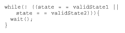

`validState1` 和 `validState2` 的值是状态图中发出的弧所在的状态，也是该方法可以执行的对象状态。如果对象处于执行此方法的正确状态，则 `while` 语句不执行，线程继续执行该方法。如果对象不处于正确状态，则执行 `wait` 语句，调用此方法的线程将挂起，释放对象供其他线程使用。要实现前提条件，程序员只需要将执行该方法的有效状态放在上面的 `if` 块中。注意前提条件的格式。当前状态将与每个有效状态进行比较，然后将这些比较通过“或（or）”逻辑连接在一起。“或”语句的结果随后会被取反。

后条件与前提条件结合工作，以确保监器保持有效状态。在后条件处理中，方法检查是否达到了某种导致对象更改为新状态的条件。如果对象没有改变状态，方法在后条件中不做任何操作。然而，如果状态发生了变化（即 `state` 变量被设置为新值），则必须调用 `notifyAll`。这样做是因为另一个线程当前可能正在等待该监器。如果状态没有改变，等待的线程就不需要检查监器的状态，因为状态不会改变，等待的线程将始终需要再次执行 `wait`。然而，如果状态发生了变化，可能等待监器的线程现在可以继续执行，因此 `notifyAll` 调用允许所有等待线程唤醒并检查监器的状态，以确定它们现在是否可以继续。

后条件的通用格式为：

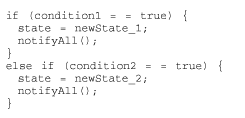

注意缺少最后的“else”条件；如果没有发生变化，则不需要通知等待线程。

给定状态图实现监器每个方法的步骤总结如下：

1. 定义一个或多个变量表示监器的状态，并可能定义常量来表示监器的每个有效状态。
2. 编写方法的声明，将 `synchronized` 关键字作为声明的一部分。
3. 使用上述过程实现方法的任何前提条件。
4. 实现实现定义的功能的代码。
5. 使用上述过程实现方法的任何后条件处理。
6. 从方法返回任何指示的数据。

使用这些规则实现缓冲区监器显示在图 4（Program3.1c）。

### 3.5.7 实现控制对象

现在程序的各个部分已经创建，需要将它们连接在一起以形成一个程序。这在一个*控制对象*中完成。控制对象是一个控制程序中所用对象的整体创建和链接的对象。它不控制单个的激活或被动对象。例如，考虑 Exhibit 5（Program3.1d）。此程序创建了被动的 `BoundedBuffer` 对象，然后为线程创建对象，通过将被动对象传递给这些激活对象的构造函数，将共享的 `BoundedBuffer` 对象注册到每个激活对象。然后为每个激活对象创建并启动线程。控制对象最有趣的特性是，它实际上并不包含任何过程性代码。该对象中的所有代码都涉及声明对象和线程或启动线程。程序的控制完全存在于激活对象的 `run` 方法中。

**展例 4. Program3.1c：`BoundedBuffer` 对象的实现**

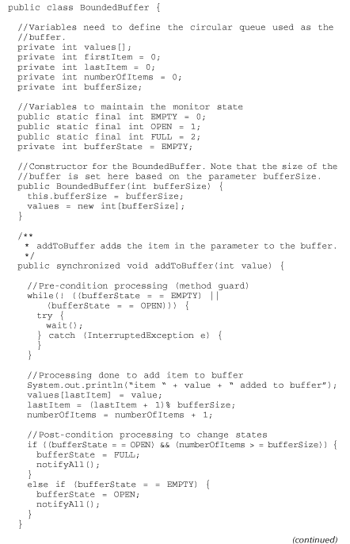

**展例 4. Program3.1c（续）**

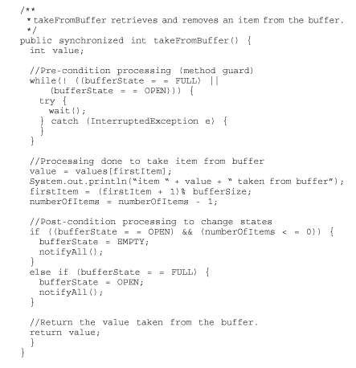

**展例 5. Program3.1d：生产者-消费者控制对象的实现**

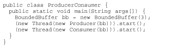

## 3.6 为什么被动对象是组件

上一个中的 `BoundedBuffer` 对象显然是一个组件，因为它为生产者和消费者线程提供服务并协调它们。在第 1 章中，给了组件的五个特征。以下查看边界缓冲区如何满足所有这些标准。

1. 边界缓冲区对象不是在生产者或消费者线程中创建的，而是在控制对象中创建的，并通过传递给线程对象的参数注册到这些对象中。
2. 边界缓冲区通过标准的方法调用程序与其他对象通信。
3. 边界缓冲区通过在边界缓冲区内部实现状态，并允许根据设计边界缓冲区时使用的状态图规则进行转换，来协调生产者和消费者线程。
4. 边界缓冲区通过第 2 章中为 `BinarySemaphore` 类描述的监视器技术来控制竞态条件。在任何时候，只有一个对象可以在任何 `BoundedBuffer` 方法内部执行。由于所有的 `wait` 调用都是预处理过程的一部分，并且在程序开始修改对象数据（对象状态和循环队列变量）后不再发生，因此缓冲器的状态是有保证的且安全的。这显示了将预处理与程序其他部分分离的优势。通常，通过推理其行为来构建被动对象的程序员往往受诱于将处理逻辑放在预处理中，但预处理中存在 `wait`。如果内部变量和状态可以在预处理中更改，那么释放对象锁会导致竞态条件且程序是不安全的。仅使用预处理来检查方法何时可以运行，可以确保等待条件不会释放锁从而导致可能的竞态条件。
5. 如果正确使用边界缓冲区组件，通过检查状态图及其属性可以很容易证明不存在死锁。该状态图具有强连通性属性；也就是说，从每个节点都可以通过某些路径到达其他任何节点。因此，不会进入激活对象将卡住的状态。死锁有两种可能：(1) 组件永久地进入满或空状态，(2) 以这种方式与其他组件一起使用，产生循环死锁局面。这两个条件都只能由使用该组件的程序错误引起（例如 `takeFromBuffer` 调用多于 `putToBuffer` 调用），因此只要使用得当，组件就是安全的。

## 3.7 加油站模拟问题

现在将在非常适合本章技术的领域实现一个使用线程的模拟问题。这里提出的问题是模拟一个加油站。3.7.1 节介绍了该问题，并在 3.7.2 节解决了它。

### 3.7.1 问题描述


要对加油站进行建模，以计算司机加油的平均时间。时间从司机开始等待加油泵开始，到汽车离开加油泵结束。模拟从 50 辆车在模拟开始后 0 到 30 秒之间随机到达加油站开始。每辆车里的司机首先检查加油泵是否可用。如果加油泵不可用，司机将等待直到加油泵可用。一旦加油泵可用，司机将车开到泵旁并关闭发动机。对于这次模拟，这需要 0.5 秒。发动机关闭后，司机将解锁并打开车门，这额外需要 0.5 秒。司机将关闭车门，这所需的时间忽略不计。司机然后走到泵旁，打开油泵并选择汽油等级。这也需要 0.5 秒。

可以选择的汽油等级有低辛烷（87 号）、中辛烷（89 号）和高辛烷（91 号），其中辛烷值是发动机辛烷值和研究辛烷值的平均值。发动机辛烷值通过在标准发动机中运行汽油计算得出，研究辛烷值通过对汽油中的成分进行加权求和计算得出。泵上的辛烷值始终是两者的平均值。

当司机打开油泵并选择汽油等级后，他将油嘴插入油箱的进油口。再次，这将需要 0.5 秒。在此模拟中，加油将需要 2.5 秒。司机然后将油嘴放回泵中（再次需要 0.5 秒），打开车门并离开泵，最后需要 0.5 秒。因此，司机在泵处总时间为 6 秒。一旦司机离开泵，加油泵就空了，另一个司机可以使用该泵。编写该加油站的模拟。

## 3.7.2 加油站模拟

这个加油站模拟具有启发性，因为它更像现实世界的问题。在这个问题中，程序员并没有得到太少的信息；相反，他们得到了太多信息，其中大部分是无关的。例如，模拟与辛烷值无关，因此关于辛烷值的整个段落都可以忽略。但其他哪些信息是重要的？

尝试在该问题上使用面向对象编程（OOP）的程序员将面临许多红鲱鱼（误导性信息）。他们会为带锁的门、油嘴和油箱创建对象，因为这些出现在问题描述中。他们可能会开始在加油泵上创建拨盘，因为他们在现实世界中看到的加油泵有显示销售了多少汽油的拨盘，或者可能会尝试解决支付问题，因为汽油不是免费的。让程序员自己发挥的话，他们可能会寻找模糊简单问题的方法，变得非常有创意。

这个问题非常简单，因为程序员只需要从给定的描述中提取几个句子片段，就能得出一个有效的问题陈述。这样做，我们发现该问题实际上可以描述为：

> 对加油站进行建模，以计算司机加油的平均时间。时间从司机开始等待加油泵开始，到汽车离开加油泵结束。模拟从 50 辆车在模拟开始后 0 到 30 秒之间随机到达加油站开始……一旦油泵空闲，司机就会将车驶入泵旁……司机在油泵处总时间为 6 秒。当司机离开加油泵时，油泵空闲，另一位司机可以使用该泵。

在现实世界中，定义实际问题很少如此简单，但它是极其重要的。程序员如果在没有先描述自己在做什么的情况下就开始创建程序，注定创建无用的对象和其他产物，只会引起混乱。

根据问题的描述，需要一个活动对象。该对象在程序中被建模为`car`（汽车）对象。`car`是活跃的，具有以下行为：它等待 0 到 30 秒之间的随机时间。然后它尝试使用油泵；当油泵空闲时，它会驶到泵旁，加油并离开油泵。为了匹配`car`对象，我们现在需要一个`pump`（油泵）对象。该对象有两个状态：油泵是`BUSY`（繁忙）或油泵是`FREE`（空闲）。油泵的状态图见图 6。这些`car`和`customer`（客户）对象的实现在`Program3.2a`和`Program3.2b`中（见图 7 和图 8）。

剩下的就是实现控制对象`GasStation`（加油站），它显示在图 9 中（`Program3.2c`）。这将创建对象、运行模拟并生成答案。请注意，必须实现某种方法，在所有汽车运行完成后通知主线程。在这种情况下，主线程与所有子线程进行“汇合”（joined）。此任务可以通过许多方式完成，本章末尾的一些问题探索了这些选项。

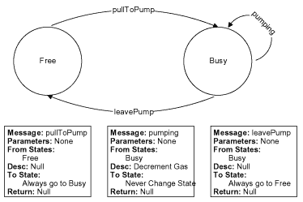

**图 6. 加油泵问题状态图**

**图 7. `Program3.2a`：汽车类**

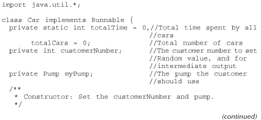

**图 7. `Program3.2a`（续）**

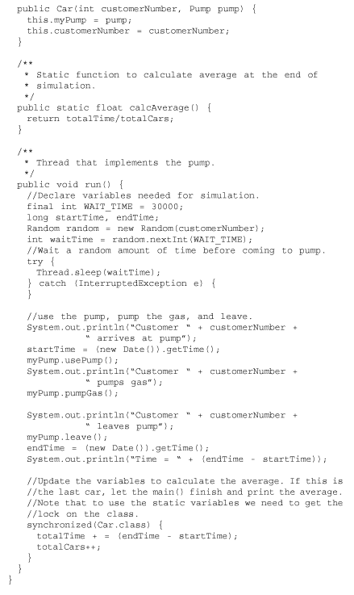

**图 8. `Program3.2b`：油泵类**

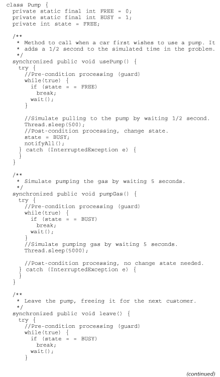

**图 8. `Program3.2b`（续）**

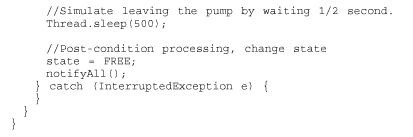

**图 9. `Program3.2c`：加油站类**

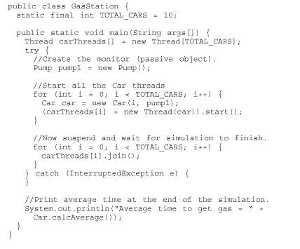

许多看到这个解决方案的程序员并不喜欢它。毕竟，汽车并不是字面意义上的在加油，而且原始问题中的许多对象都缺失了。这困扰了许多程序员，特别是刚学习面向对象编程的程序员。他们开始认为，某种方式可以在计算机中表示现实世界。现实世界有汽车、油泵、门、司机等，如果这些东西可以被抽象并放入程序中，问题就能被魔术般解决。但是，计算机没有汽车和油泵；它只有 1 和 0。你不能在计算机中表示现实世界；你只能创建它的抽象模型。当试图在计算机中表示现实世界时，问题会变得极其复杂，因为现实世界本身就是极其复杂的。现实世界的哪些部分实际上构建在抽象模型中，取决于要解决的问题、问题的边界和限制是什么，以及产生的结果是什么。这些是重要问题，而不是现实世界中可以发现（或想象存在）的对象。

## 3.8 结论

并发程序通常可以使用活动对象和被动对象有效实现。这对于许多类型的并发程序（包括分布式程序）都是如此。在这些模型中，有趣的部分是被动对象，它是一个组件。它之所以最有趣，是因为它用于实现协调，允许并发程序执行有用工作。

实现被动对象的一种非常有力的方法是使用状态图。状态图允许程序员对被动对象的行为进行推理。这些状态图可以很容易地转换为运行的 Java 程序。读者应该注意，由于语言构造结构（如同步、`wait`和`notify`），状态图可以很容易转换为 Java 对象。因此，这些对象的设计在支持监视器（monitors）设计的语言（如 Java 和 Ada）中是有意义的，但在不支持这些功能的 C/C++ 等语言中很难实现。

## 3.9 扩展阅读

状态图被用于设计计算机科学中许多不同的系统。状态图的基本理论及其在计算中的应用，可以在任何关于计算形式化模型的教科书中找到，如 [SAV98]。这些书籍将状态图作为大型计算机器的一部分，来实现有限状态机（FSA），然后使用 FSA 设计更通用的计算模型，例如随机访问计算机和图灵机。

状态图也被广泛应用于硬件设计，大多数关于计算机体系结构的书籍（例如，[MAN93]或[CAR01]）都有一节介绍如何使用状态图设计硬件。在软件设计中使用状态图可以在许多设计方法中找到，例如 Rumbaugh 等 [RUM91] 或 Booch [BOO91]，并已被纳入建模语言（UML）（见 Booch [BOO99]）。设计并发程序的状态图由许多作者提出，例如 Sanden [SAN94] 和 Magee 与 Kramer [MAG99]。

本章的状态图被实现为监视器。Hoare [HOA74] 最初引入了监视器。Java 中使用的监视器版本基于 Lampson 和 Redell [LAM80] 对此模型的扩展。使用程序保护实现监视器的方法可以在 Lea [LEA00] 中找到，许多设计书籍（特别是 [BOO91]）使用状态图来表示被动对象并将其映射到程序保护。本章使用的监视器可以很好地映射到 [ADA95] 中定义的保护类型（Protected Types），其中“when”句的使用消除了实现程序保护的必要性。

最后，本章解决的许多问题或末尾提出的问题，都是计算机科学中的经典问题（例如生产者/消费者、理发师问题、哲学家晚餐和圣诞老人模拟），可以在许多关于操作系统或并发编程的书籍中找到（例如，[STA01]）。

## 3.10 练习

1. 修改生产者/消费者问题，在活动对象（`producer`和`consumer`）向缓冲区放入物品或从缓冲区取出物品的时间之间加入随机等待。这对程序有什么影响？

2. 修改问题 1 中的生产者/消费者程序，使其具有五个生产者和一个消费者。这有多难？这对程序有什么影响？现在将缓冲区的大小改为十个物品。这对程序有何影响？创建两个消费者。程序受到什么影响？

3. 修改`BoundedBuffer`对象，使用`bufferSize`和`numberOfItems`变量之间的关系来指定对象的状态。例如，缓冲区不是有一个`FULL`状态，而是有一个`numberOfItems == bufferSize`的状态。这对于如何指定被动对象的状态说明了什么？

4. 修改加油站问题，包含两个加油泵，客户在到达加油站时选择一个加油泵，并进入该加油泵的排队队列。运行模拟，让客户随机选择加油泵。再次运行模拟，让客户能够根据每个加油泵处已经在等待的人数来选择加油泵。检查排队情况是否会影响总等待时间？客户的最大等待时间又是怎样的？

5. 该程序是一个 6 层楼内电梯的模拟程序。在这个模拟中，电梯始终在楼层之间移动，到达某一层后，如果有人在等待该层，则允许乘客上下电梯，然后离开该楼层。电梯在楼层之间移动需要`1.0`秒，当它到达顶层或底层时，它会反转方向并继续运行。50 名乘客将选择上下车的楼层。乘客会随机睡眠最多 2 分钟，然后等待电梯到达。一旦电梯到达他们要离开的楼层，他们就会上车并等待电梯到达他们的目的地楼层。当电梯到达目的地时，他们下车，这些乘客不再被纳入模拟中。

电梯的设计如下：在三类对象中，有两个对象是活动对象（电梯和乘客），有一个对象是被动对象（楼层）。由于建筑有 6 层楼，模拟中必须包含一个有 6 个楼层的数组。电梯和乘客的伪代码见展表 10，电梯的状态图见展表 11。请实现这个电梯模拟。

**展表 10. 电梯和乘客的伪代码**

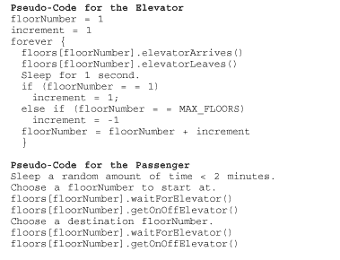

6. 是否可以安全地在展表 11 的状态图中添加一个从`Loading`状态到`Loading`状态的`waitForElevator`转换？这种变化如何影响程序的语义？

7. 展表 12 所示的楼层对象设计使用了第 5 题伪代码中描述的相同的电梯和乘客对象。请评价以下电梯设计。能发现任何问题吗？如果有，请列举它们。

8. 评价展表 13 描述和展表 14 所示的电梯设计。能发现任何问题吗？如果有，请列举它们。

9. 展表 15 所示的楼层对象设计使用了展表 13 伪代码中描述的相同的电梯和乘客对象。评价该电梯设计。能发现任何问题吗？如果有，请列举它们。

10. 修改第 5 题中的电梯模拟，使乘客更加真实。所有乘客都从 1 层进入建筑，然后随机选择楼层乘坐，直到回到 1 层并离开建筑。为了使模拟更真实，让所有乘客在早上 8:30 到 9:30 之间到达，并在下午 4:30 到 5:30 之间离开。

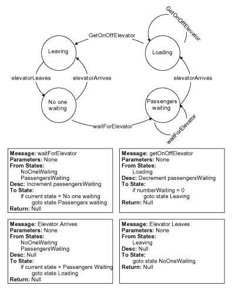

**展表 11. 第 6 题：楼层对象的状态图**

11. 修改第 5 题的设计，包含两个电梯和五部电梯。如果做得好，与两部电梯的设计相比，使用五部电梯的设计只需要更改声明和启动的电梯数量即可。

12. 理发店问题是并发领域的一个著名问题。该问题模拟了一个具有以下特征的理发店：理发店有一把椅子。如果理发师发现椅子上有客户，理发师就会为这个人剪发，这需要一些固定时间（在此模拟中为 5 秒）。来到理发店并发现椅子被占的客户可以在店内的长凳上等待。下一个使用理发师椅子的客户必须是已经在长凳上等待的客户。最后，如果客户来时发现长凳没有位置，他必须在理发店外等待，直到长凳空出来。运行一个 2 分钟内随机有 30 名客户进入的理发店模拟，并报告平均等待时间。然后运行 2 分钟内随机到达 40 名客户的模拟。结果有什么差异？

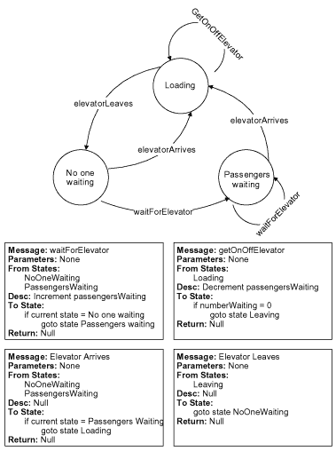

**展表 12. 第 7 题：楼层对象的状态图**

13. 运行包含两个理发师的理发店问题。模拟的结果是什么？

14. 哲学家晚餐问题是一个经典的并发问题，展示了死锁是如何发生的。该问题涉及五个正在吃中国菜的哲学家和五双可用筷子。哲学家围坐一圈，每个人左手有一双筷子，右手一把筷子（他们彼此共享筷子）。为了吃饭，每位哲学家先拿起左边的筷子，再拿起右边的筷子，吃完后放下筷子。编写该问题的模拟程序。

**展表 13. 电梯和乘客的新伪代码**

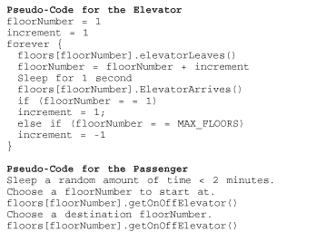

15. 哲学家晚餐是死锁的经典范例。如果所有哲学家都拿了左边的筷子，就没有人能拿到右边的，他们都会饿死。解决这个问题的一种方法是创建一个先拿起右边筷子的哲学家。修改第 9 题的模拟以实现这种无死锁的解决方案。为什么这样做避免了死锁？

16. 解决哲学家晚餐问题的另一种方法是一次只允许四位哲学家坐在桌旁，如果桌边已有四个人，则让他们等待。编写一个使用这种设计的哲学家晚餐解决方案。为什么这样做避免了死锁？

17. 通过审查状态图中的状态转换以及活动对象可能采取的操作，你认为在程序运行之前预测死锁的可能性吗？请描述一个实现此功能的算法。

18. 解释如果两个被动对象处于组合中，是如何发生死锁的。

19. 展表 16 所示的问题模拟了北极的圣诞老人。

20. 展示第 2 章中`BinarySemaphore`类的状态图。

本章的目的是涵盖 Java 中标识符（identifiers）和变量（variables）的概念。标识符与变量之间的区别，是实现运行时对象数据类型的语言（如 Smalltalk 和 Java）与那些仅在编译时使用数据类型来生成运行时可执行代码以操作这些对象的语言（如 C/C++ 和 Ada）之间最大的区别之一。这种区别有助于解释这样一个事实：尽管 Java 和 C++ 的语法相似，但在这两种语言中编程的感觉非常不同。对象在运行时的处理方式大不相同，这影响了语言中操作对象的方式。

理解 Java 如何处理对象在随后的章节中至关重要，在那些章节中，对象将通过`RMI`等工具在其他对象之间甚至在网络中传递。了解对象在编译和运行时的性质，对于理解`interface`（接口）的概念也同样重要。接口没有为对象定义任何数据或行为，仅定义了对象必须接受哪些消息。

本章首先通过展示不理解它们的区别如何导致错误的程序，来介绍标识符和变量。然后介绍 Java 如何为对象实现变量，并展示了这种方法相比于不在此变量中维护类型的语言的改进之处。随后将讨论 Java 中数组的实现，并引入对象数组的特殊情况来讨论集合类（collection class）的概念。最后，使用 Java`Vector`类来演示 Java 内置的简单集合类。

## 4.2 章节目标

当你完成本章后，你将了解以下内容：

- 变量和标识符之间的区别，以及为什么这种区别很重要（特别是在 Java 中）。
- 什么是数据类型，以及标识符和变量之间的数据类型不匹配如何导致程序错误。
- Java 如何确保原始数据类型的安全。
- Java 如何使用标签存储运行时数据类型，以及为什么这些标签是有用的。
- Java 如何管理内存以确保其被正确使用。
- 什么是容器类（container class）以及如何使用它。

## 4.3 标识符和变量

许多程序员混淆了`identifiers`（标识符）和`variables`（变量）。这可能是因为许多编程语言，特别是作为入门编程课程中使用的语言，在变量和标识符之间没有实际的区分。即使是区分了标识符和变量的入门教科书，这种区分也不足以实际应用于 Java 的对象。

因此，理解 Java 的第一步是理解标识符和变量是什么。标识符是程序源文件中标识变量的名称和关联的数据类型。除了解释型语言外，标识符通常只在程序编译时可用。变量是数据在运行时的实际实例化，或者简单来说就是存储程序中正在操作的数据值的内存。它们是两个非常不同的东西，而未能理解这种区别会阻碍程序员学习 Java，特别是 Java 中使用的对象模型。

本章的目的是阐明变量和标识符之间的这种区别。讨论从定义数据类型开始，数据类型定义了标识符和变量的属性（数据值）和行为（操作）：

**数据类型**：一组数据值以及对这些数据值的操作。

整数是一种数据类型，因为它有一组值、整数值的补码表示法，以及诸如`++`、`–`等操作。对象也是数据类型，因为它们拥有一组数据值（由对象的`instance variables`（实例变量）的值表示）以及作为这些对象实例方法的操作。

**展表 1. 程序 4.1：将变量和标识符数据类型视为相同的简单 C 程序**


标识符和变量是数据类型的实现。区别在于，标识符是包含在源代码中、由编译器在符号表中维护的数据类型的`reference`（引用），而变量是该数据类型在程序运行时在内存中的`realization`（实现）。以下是术语的定义：

**标识符**：程序源代码中变量名称。

**变量**：运行时分配的实际内存。

许多程序员混淆了这些定义并将这两个非常不同的概念结合起来，统称为变量。再次，标识符和变量之间产生混淆的原因是，在许多语言中，变量和标识符经常被视为同一概念。例如，考虑`Program4.1`（展表 1）。在该程序中，标识符`intVar`和运行时创建的变量都是相同的`int`数据类型。当编译器生成要执行的对象代码时，它知道标识符的数据类型，并生成执行加法的机器码，正确地递增变量。变量的数据类型只有在编译时（即创建操作它的代码时）才已知。但由于生成的代码对于`int`类型可以正常工作，似乎将标识符和变量视为同一种数据类型并没有区别。事实上，对于像这样简单的程序，标识符和变量之间的区别是无关的。

然而，标识符和变量之间的区别即使在简单的 C 程序如`Program4.2`（展表 2）中也会迅速变成问题。在这里，`union`语句允许编译器为变量在两种不同的数据类型之间进行选择。在该程序中，编译器生成使用整数标识符存储变量的机器码，然后生成浮点机器码来递增变量。因为整数加 1 的操作与浮点数加 1 非常不同，所以递增变量的代码是错误的，当程序运行时，会产生错误的答案。这个问题是由变量的数据类型（整数）与标识符的数据类型（浮点数）不匹配导致的，并说明了为什么始终确保数据类型匹配是重要的。

**展表 2. 程序 4.2：在 C 中对错误数据类型的操作**


标识符类型与其代表的变量类型不同的问题已延续到 C++ 中结构体和类（对象）的实例。在 C++ 中，对象的数据类型仅在编译时维护。在运行时，对象简单地变为堆中内存的引用，大部分标识信息都丢失了。因为只已知一种数据类型（来自编译器的），编译器必须生成任何操作对象的代码。因此，程序员在编译时编码的对象标识符的数据类型被用于在运行时操作对象变量。语言或程序执行模型中没有可以用来检查编译时和运行时数据类型是否匹配。

由于 C/C++ 允许使用许多其他不安全的引用机制（如指针），并且允许程序员将几乎任何数据类型的编译时标识符分配给任何对象，因此，确保变量所使用的数据类型正确是程序员的责任。因此，无法识别并区分标识符与变量之间的类型差异，许多 C/C++ 程序员简单地丢失了这种区别，将标识符和变量统称为变量。这导致直接引用内存是不安全的，而且我们没有好的办法解决这个问题。

无效内存访问问题是 Java 不允许使用联合体（union）和指针等结构的主要原因之一。Java 意识到编译时数据类型和运行时数据类型之间可能发生类型分叉，并实现了两种机制来确保编译时标识符与运行时变量之间的类型匹配。第一方法用于确保原始类型在运行时始终是正确的类型，将在第 4.4 节中解释。第二种方法对运行时对象使用了不同的存储模型，在该模型中，对象的数据类型在整个生命周期内（包括编译时运行时）都保持维护，以确保维持正确的类型（见第 4.5 节）。

## 4.4 Java 标识符和变量

Java 通过两种不同的机制来处理标识符和变量类型可能不同的情况：一种用于原始数据类型，另一种用于对象。由于这两种机制非常不同，它们在不同的章节中进行讨论。

## 4.5 原始类型

原始数据类型直接构建在 Java 虚拟机（JVM）中。例如，`int` 是一个原始类型，而 `Integer` 是封装了 `int` 原始类型的对象。你总是可以通过 Java 语言中的原始类型，因为它们以小写字母开头；例如，`float` 是原始类型，但 `Float` 是对象。

由于 Java 语言没有联合体结构或指针，原始类型标识符所引用的变量的数据类型在 Java 中不能被更改。当在原始类型的赋值语句中使用不同数据类型的变量时，总是涉及复制变量并将副本转换为正确的类型。例如，当将 `int` 变量设为 `float` 变量时，`float` 变量会被复制到另一个数据类型为 `int` 的变量中，因此引用无法改变它所代表的数据类型。而且，由于 Java 编译器和 JVM 对原始数据类型共享相同的表示方式和操作方法，它们可以约定让编译器生成操作这些变量的代码，并在编译步骤后可以安全地忘记它们的数据类型。这节省了空间，使得对原始类型的操作比操作对象更快，并且类似于 C/C++ 编译器采用的机制。

然而，这些原始类型在 Java 中是安全的，因为一旦创建，没有任何机制可以更改任何标识符或所引用变量的数据类型。因此，在 Java 中，程序员可以始终依赖标识符的数据类型与其引用的变量的数据类型是相同的这一事实。因此，对于 Java 原始类型，虽然将标识符和变量视为同一种类型严格来说是不正确的，但不区分它们不会产生严重后果；然而，Java 中确保对象安全访问的机制与原始类型的机制非常不同。

**图 3. 程序 4.3：使用数据类型为 Person 的变量引用数据类型为 Object 的对象时的编译错误**


## 4.6 对象

Java 确保对象安全的机制识别了程序源文件中的标识符与其所代表的实际运行时变量之间的差异；因此，为了正确表示数据类型，必须维护标识符（编译时）和变量（运行时）的数据类型信息。为了实现这一点，在 Java 中，每个对象都携带一个运行时数据类型标签。这仅仅是一个对程序员隐藏的数据项，其中包含有关变量实际数据类型的信息。这个运行时数据类型标签不仅保留了对象当前类型的信息，还保留了适用于该变量的任何接口或扩展（extends）句。

现在给出了一些示例程序，展示 Java 如何使用编译和运行时类型来确保程序的正确。第一个是程序 4.3（[图 3]），它说明了编译器标识符的数据类型可以与运行时变量的数据类型不同。在这个示例中，程序创建了一个类型为 `Object` 的标识符 `o1`，它引用了一个类型为 `Person` 的变量。在程序中，调用了方法 `o1.getName`。尽管运行时对象的类型是 `Person`，但编译器只知道它是一个对象；因此，对该方法的调用无法编译。

**图 4. 程序 4.4：将变量强制转换为不匹配数据类型时的运行时错误**


程序 4.4（[图 4]）说明了 Java 拥有编译时数据类型和运行时数据类型，这些信息可以用于确保编译时假设的类型是运行时实际存在的类型。在这个示例中，创建了两个标识符 `o1` 和 `o2`，它们的标识符数据类型均为 `Object`。第一个引用一个 `Person` 变量，第二个引用一个 `Car` 变量。编译器只知道标识符的数据类型是 `Object`，但运行时维护了它们的类型。

当程序运行时，它尝试将两个变量转换为 `Person`。这在第一情况下是通的，因为变量对象实际上是 `Person`。在第二种情况下失败了，因为变量不是 `Person` 而是 `Car`。当执行用于转换为 `Person` 的生成的机器码时，它意识到类型是不正确的，程序抛出运行时 `ClassCastException`。注意，错误甚至打印出了变量的真实数据类型，在本例中为 `Car`。这表明数据类型在运行时和编译时都得到了维护。

运行时数据标签的存在是 Java 的一个重要特性。虽然使用运行时数据标签并没有消除标识符和变量之间发生数据类型不匹配的可能性（像原始类型那样实现的），但它让任何不匹配变得显式化，这对程序员、编译器和 JVM 都有用。与未使用它们的系统相比，拥有运行时数据类型标签至少四个巨大的优势：

- 能够验证运行时数据类型与程序编译时预期的数据类型匹配，从而产生更安全的系统。
- 知道运行时数据类型允许虚拟机管理内存，这比让程序员来做更容易出错且更容易实现。
- 知道运行时数据类型允许对象被有效地写入其他系统或持久化存储（如磁盘或数据库）。
- 可以开发名为“集合类”（collection classes）的标准类，以安全地存储和检索对象。

这三点将在接下来的三个章节中涵盖；第 4 点是第 4.7 节的主题。

### 4.6.1 使用运行时数据类型标签产生更安全的程序

使用运行时数据类型标签的主要优点之一是，这样做由于两个原因使得程序变得更加安全：首先，在使用变量时，可以检查该变量的数据类型，以确保它匹配编译器预期的类型。如果类型不匹配，`JVM` 将立即在发生不匹配的地方抛出错误，如 Exhibit 4（`Program4.4`）所示。没有这种运行时检查的语言通常允许程序访问内存中超出当前操作变量范围的数据。

当这种情况发生时，程序通常不会立即失败，因为引用本身不是无效的，但引用对它不拥有的内存的操作是无效的。大多数情况下，这会导致程序中其他变量或方法所使用的内存被损坏。程序将继续执行，直到遇到受损坏内存影响的语句，此时程序才会失败，且通常带有一条奇怪且晦懂的消息。失败的语句本身通常是完全有效的，仅仅是因为损坏内存的存在导致了它的失败。事实上，从源程序的角度来看，失败的语句与程序内存损坏的语句之间通常没有逻辑联系。

这个问题实际上比程序直接失败要糟糕得多。如果被损坏的内存是持久性的（例如存储在文件或数据库中），那么程序的失败可能会在导致该错误的语句实际执行几天或几周后发生。这使得发现和修复此类错误变得极其困难，如果允许这些错误随时间存在，可能会产生深远的影响。

在遇到无效类型转换错误时让程序失败并保证错误不会发生，但它确实防止了允许损坏的程序继续运行带来的连锁反应。它还让错误更容易发现和修复，因为错误的原因和错误的确切位置是已知的。

运行时数据类型标签提高程序安全性的第二个原因是，它们允许程序员在遇到不匹配的数据类型时控制程序的行为。这可以通过两种方式实现：第一，程序员可以通过捕获发生的类型转换错误并对其进行处理，以与程序中的错误处理策略一致的方式来控制错误。`Java` 中的异常处理是第 6 章的主题，但一个捕获 `ClassCastException` 的简单 `try/catch` 块在 Exhibit 5 运算符来确保它们不会发生。`instanceof` 运算符检查对象的运行时数据类型标签，以确保它与第二个操作数指定的类型匹配。如果匹配则返回 `true`，否则返回 `false`。

注意，`instanceof` 不仅检查对象的类，还可以用于检查该对象的类所扩展或实现的任何父类或接口。Exhibit 6

**Exhibit 6. Program4.6: 使用 `Instanceof` 运算符在转换前检查运行时数据类型**


由于使用运行时数据类型标签强制 `Java` 程序员转换到正确的类型，`Java` 编译器也通过强制程序员在进行潜在不安全的转换时有意识地定义预期结果，来帮助确保对象的使用是正确的。

要理解什么类型的转换可能是不安全的，请考虑 `Program4.7` 中的转换（Exhibit 7）。在该程序中，`Person` 类的对象首先转换为 `Object` 类的对象。由于所有 `Person` 对象也是 `Object` 的实例，这种转换保证是 100% 安全的，因此编译器进行了到 `Object` 的隐式转换。

然而，从 `Object` 类型对象到 `Person` 或 `Car` 的转换并不总是安全的。在 Exhibit 7（`Program4.7`）中，显而易见的是对象可以是 `Person` 以外类的实例，因为它们也可以是 `Car` 类的实例。编译器强制程序员通过显式将对象转换为 `Person` 来承认这一点。由于编译器无法确保这种转换的安全性，它将确保转换合法的责任交给了程序员，而程序员通过执行显式转换承认了这一点。

最后，如果可以，`Java` 编译器将检查并确保类型转换是正确的。例如，`Java` 不会编译一个一个可能正确的转换，如 `Program4.8`（Exhibit 8）所示。在这里，无法从 `Car` 对象到 `Person` 对象进行有效的类型转换，因此编译器直接不允许该转换发生。

**Exhibit 7. Program4.7: Java 中的隐式转换和显式转换**


**Exhibit 8. Program4.8: 转换错误**


### 4.6.2 内存分配更简单更安全

使用运行时数据类型标签的第二个优势是内存可以由 `JVM` 管理，而不是程序员的责任。由于 `Java` 在运行期间保留运行时数据类型标签和类定义，JVM 知道对象是如何构造的。通过使用相对简单的垃圾回收算法，JVM 可以为对象分配和释放内存。

在没有运行时数据类型标签的语言中，组成对象的数据信息在程序编译后就会丢失。因此，创建和恢复对象使用内存的方法必须由程序员提供。让程序员控制内存的分配和释放会导致悬空指针和内存泄漏问题。让虚拟机完成这项工作可以消除这两种可能的问题。

这里使用了一个简单的链表示例来说说明实现内存管理的程序员如何创建内存泄漏和悬空指针。同一个链表示例随后被用于展示 Java 如何简单安全地处理内存的分配和释放。这个示例还证明了当程序员实现内存管理时，要做到正确是一项艰巨的任务。

**Exhibit 9. 链表中的内存泄漏**


首先，考虑内存泄漏。内存泄漏发生在程序中分配了内存，但在不再使用后没有将其返回给系统的情况。这些内存不再被使用，但无法访问，导致可用内存缓慢泄漏。这种情况在图 9 中得到了说明。

在图 9(a)中，分配了一个包含许多节点的链表。对每个后续节点的唯一访问方式是通过来自前一个节点指向后继节点的指针。如果在某个点，链表的表头不再可用（例如，引用链表头的变量离开了程序作用范围），那么所有节点都保持已分配状态，但无一可以被访问，如图 9(b)所示。

为了解决这个问题，程序员必须创建一个方法，通常称为 `destructor`（析构函数），它在变量被销毁时被调用。析构函数的作用是遍历图 9(b)中的节点列表，并调用一个释放每个节点内存的方法。这种方案带来了一些问题。首先，程序员必须正确编写析构函数的代码，这是一项艰巨的任务，如本节稍后所示。其次，显式调用析构函数通常是使用该链表的程序员的责任，而这有时会被忘记。

即使有良好的管理措施来确保程序员遵循可接受的标准，其效果也不如编译器和 `JVM` 自动强制的规则那样有效。

程序员必须处理内存管理时，发生的第二个问题是悬空指针。悬空指针发生在变量在仍被引用时被释放内存的情况下。为了了解这是如何发生的，请考虑一个存储在两个独立链表中的对象的情况，如图 10(a)所示。

如果公司中每个部门的员工都存储在一个链表中，这种情况可能会发生。如果整个部门被卖给了另一家公司，那么该部门的整个链表将被释放。然而，假设一名员工被分配到两个部门，其中一个部门离开了，而另一个留下了。在第二个部门留在公司的的员工现在会在第二个部门的链表中被引用，但为了防止内存泄漏，当第一个列表被删除时，该员工的记录已经被删除了。

员工记录被释放了，但它仍然被引用，因此这种引用被称为 `dangling reference`（悬空引用），因为它指向一个已不再存在的对象。

那么程序员应该做什么呢？如果他们在删除部门时没有释放员工的内存，就会导致内存泄漏；然而，如果他们释放了内存，第二个列表就是无效的，因为一个员工指针是一个悬空引用。这个问题的出现是因为在大多数语言中，无法轻松判断一个对象是否仍在使用，因此对程序员来说，正确处理这种情况是一项复杂的任务。

必须实现诸如引用计数之类的方案，但这同样充满了困难。希望这段讨论能让读者相信，即使对于一个有动力去谨慎完成任务的程序员来说，正确地分配和释放内存也不是一项简单的任务。

这类问题在 Java 中不会发生。在 Java 中，所有对象的数据类型信息在运行时都是维护的。这些信息可以用于重构作为对象一部分的所有变量。例如，`JVM` 知道存储在对象中的数据值是原始类型（例如 `int`）还是指向另一个对象的引用。

了解了这一点，Java 就可以构建一个所有当前活跃对象的列表。有了这些信息，Java 就可以安全地释放不再使用的对象，这被称为 `garbage collection`（垃圾回收），它为程序员提供了内存管理。


**图 10. 链表中的悬空引用**

图 11 提供了 `JVM` 如何处理垃圾回收的简短示例。当对象在程序中离开作用范围时，`JVM` 不会立即尝试回收该空间；而是允许该空间保持分配状态，如图 11(a)所示。

当 Java 用于分配新对象的内存不足时，`JVM` 开始进行垃圾回收。它首先将所有可以收集为垃圾的未引用对象标记为垃圾，如图 11(b)所示。接下来，所有当前在作用范围内的对象都会取消标记，因为它们当前正被引用。

然后，由于 Java 可以区分被引用对象和未标记对象（因为它保留了数据类型标记和对象定义），它可以继续取消标记它所引用的所有对象。它一直这样做，直到所有当前被引用的对象都取消标记。

任何留有标记的对象当前未被引用，可以作为垃圾收集，内存可以返回给系统，如图 11(c)所示。这种机制确保了内存泄漏和悬空指针不会发生。


**图 11. 使用双链表的正确内存收集**

### 4.6.3 序列化

在运行时维护数据类型信息还有另一个优势。由于 `JVM` 可以同时访问对象的数据和定义，它可以利用这些信息构建一个对象的表示，然后该表示可以从程序导出并在当前程序之外使用。

该对象然后可以很容易地写入文件或数据库，甚至通过网络发送到另一台计算机。因为这些对象被写入永久的或持久的数据存储中，这些对象被称为 `persistent objects`（持久化对象）。

为了使用这些外部数据格式，程序中的数据必须首先是可序列化的。可序列化对象可以通过两种方式持久化。第一是使用一种 Java 特有的内部格式，称为 `object stream`（对象流）；第二是使用一种人类可读的基于标准的格式，称为 `eXtensible Markup Language`（`XML`）。

关于序列化的讨论首先涵盖了什么是可序列化对象，然后讨论了输出对象流和 XML 对象的程序。

#### 4.6.3.1 可序列化接口

Java 中的可序列化对象是实现了 `java.io.Serializable` 接口的对象。该接口没有方法，因此人们可能会问这种接口的作用是什么。`Serializable` 接口仅仅是类的一个标记（称为 `tagged interface`，标记接口），`JVM` 可以通过它检查该类是否可以与对象流或 XML 对象一起使用。

需要标记是因为并不是所有对象在当前程序的上下文之外都有意义的表示。例如，一个 `FileOutputStream` 对象代表一个当前在程序中打开的文件。如果此对象被写入持久存储器并在稍后的另一个程序中使用，该文件的引用在另一个程序中将不会打开，因此它是无效的。

另一个例子是 `Graphics` 对象。`Graphics` 对象是由 `Frame` 创建的对象，允许程序员在当前窗口上绘图。如果创建 `Graphics` 对象的 `Frame` 不再存在，那么该 `Graphics` 对象就是无效的，因此 `Graphics` 对象无法被持久化。

`FileOutputStream` 和 `Graphics` 是两个不可序列化对象的示例。程序员在 Java 中创建的大多数对象只包含由可序列化对象或原始类型组成的数据；因此，创建的所有对象都可以实现 `Serializable` 接口。

JVM 会检查正在写入的对象，以确定它们是否实现了 `Serializable` 接口。如果尝试将不可序列化的对象写入到期望序列化对象的输出中（例如对象流或 `XMLEncoder`），则会产生运行时错误。


**展 12 存储在内存中的展 13（`Program4.9`）对应的 `Vector` 对象**


当并非所有数据字段都具有有效的外部表示时，创建可序列化对象还有另一种方法。程序员可以通过让对象实现`java.io.Externalizable`来为此类对象编写自己的序列化方法，或者使用 Java 关键字`transient`标记不可序列化的字段，该关键字指明该数据字段不应被写入到流中。

### 4.6.3.2 序列化数据

一旦确定对象中的数据具有外部表示，JVM 必须能够将这些数据转换为允许其写入文件或其他持久性存储区域的格式。要理解如何实现这一点，你必须首先了解程序运行时数据是如何存储在内存中的。考虑图 12，它代表了包含两个`Person`对象的`Vector`对象所使用的堆内存，如图 13（`Program4.9`）所示。注意，存储这些元素的堆内存并不是组织的，而是遵循指向所存储的每个对象的指针。这部分内存不能简单地复制，因为创建此对象时使用的程序内存几乎肯定在对象被读入时没有空闲来接收这些值。

要将这些数据写入外部源，该向量对象表示的数据必须被“扁平化”或序列化为一系列字节。对所有对象的引用必须在此扁平化表示中完成。为了做到这一点，执行序列化的对象（例如对象流）必须了解作为存储聚合对象一部分的所有对象。幸运的是，在 Java 中，这种知识是通过运行时数据类型标签获取的。组成对象的每个数据值都可以与其定义进行匹配，然后将每个被引用的对象与其定义进行匹配，直到只剩下原始类型数据。

**图 13，`Program4.9`：创建`Vector`对象的程序**


虽然在 Java 中序列化是可行的，但并非易事，如图 12 所示，它包含两个指向存储名为“Chuck”的单个对象的引用。如果只是将此对象两次写入外部流，那么当以后重构向量时，它将不再是同一个向量，因为现在它将引用两个不同的对象。序列化必须考虑到这一点。对象之间也可能相互引用，实际上在对象图中创建了一个“循环”。要查看序列化确实是如何考虑这一点的，图 13（`Program4.9`）中`Vector`对象的序列化 XML 格式示例写在图 14（`Program4.10`）中。XML 表示如图 15 所示。注意，XML 表示清楚地显示，只有一个“Chuck”对象被引用了两次。

### 4.6.3.3 写入外部数据

一旦数据被序列化，就可以被视为任何其他数据流，并从程序写入外部。例如，图 14（`Program4.10`）将`Vector`对象写入到简单的文件输出流。注意，在该程序中，整个`Vector`对象被序列化，以便其写入文件并从文件中读取。由于写入文件的是多种不同类型的对象（在此情况下是`Vector`对象和`Person`对象），JVM 必须为文件中的对象维护数据类型标签，以便对象能够被正确重构。这在 XML 中是通过使用元数据标签实现的，而在对象流中是使用内部二进制格式，这种格式比 XML 更紧凑，但人类难以阅读。

**图 14，`Program4.10`：写入图 15 XML 定义的程序**


可序列化数据不仅旨在写入文件和数据库等持久性输出目标中。由于数据具有程序外部的表示，它可以在创建它的计算机以外的计算机上使用。因此，可序列化数据是许多分布式编程方案的基础，例如 RMI（第 13 章）或其他协议，如简单对象访问协议（SOAP），甚至作为使用 socket 的简单对象。

**图 15，图 13（`Program4.9`）中`Vector`的 XML 输出**


### 4.6.4 性能考虑

如果运行时数据类型标签如此实用，为什么它们没有在 C/C++ 等语言中应用呢？原因之一是在定义这些语言时尚未使用这些标签，而且没有包含这些标签的语言无法通过后期改造来方便利用它们。此外，人们也可以认为，运行时数据类型标签的使用并非没有代价的，使用它们涉及的开销在内存和计算时间上太昂贵。然而，在讨论这些标签时，必须考虑两点。

第一点是通过运行时数据类型标签实现的程序安全性是否值得其实现成本。对于大多数经理来说，答案是肯定的。一次来自 Web 的简单缓冲区溢出黑客攻击，其成本可能远高于运行 Java 程序所需的额外硬件，而调试一个由于类型转换导致的内存损坏实例，比实现 Java 运行时检查所需的计算能力要贵得多。这些常见问题如果不使用语言内置的运行时类型检查，是无法防御的。

第二点是使用运行时数据类型标签是否比不使用它们更昂贵。这个问题很难回答，因为虽然标签会产生开销，但这些信息的存在允许 JVM 对程序进行其他情况下无法实现的优化。这些优化是否实际上能够抵消甚至超过实现和使用这些标签所需的开销，仍然是一个未解决的问题。事实可能证明，运行时数据标签确实是免费的（或几乎免费）。无论如何，对于当前代的 JIT 编译器来说，额外成本很小，且收益通常远大于成本。

## 4.7 Java 中的集合类

### 4.7.1 Java 中的数组

Java 中的数组与 C/C++ 中的数组非常不同。在 C/C++ 中，数组仅仅是指向内存块的指针，访问它们的操作是在编译时定义的。在那种方面，C/C++ 中的数组非常像原始数据类型。在 Java 中，数组具有某些使用`[]`运算符访问成员的原始支持，但不同之处在于它们更像是一等对象，并且语言中内置了一些额外的语法来操作它们。因此，在 Java 中使用数组与在 C/C++ 中使用数组不同。

任何语言中的数组都是内存中连续的一段存储区域，用于存储一组值。存储在数组中的数据类型的大小必须是固定的，以便能够直接访问数组的各个成员。由于数组中的数据必须是固定大小，因此 Java 中的数组对于原始数据类型最为有用。这之所以如此，首先是因为对于原始数据类型来说，每个数据项的大小是固定的，因此在创建数组时就可以创建实际的数据项。此外，由于数据项存储在数组中，数组对于原始数据类型非常有用，因为它们可以通过计算基地址和偏移量的普通数组寻址机制直接访问。这两个优势在对象数组中都不适用。

请注意，虽然原始数据类型数组是数据值的列表，但数组本身在很大程度上仍然表现为一个对象。例如，考虑图表 16（程序 4.11），它分配了一个原始数据类型数组（在此例中为`ints`），并使用`ObjectOutputStream`将数组写入文件。该程序展示了 Java 数组在以下方面与对象一样：

- 数组的内存（或变量）不能在声明数组标识符的同时分配。与对象一样，数组的内存必须使用`new`语句分配，并存储在堆中。
- 数组存储时带有有关数组元素数量的信息，这些信息可以在运行时访问和使用。该程序中的循环通过查询数组的`length`变量来获取其范围。对数组成员的访问会进行检查，如生成`OutOfBoundsException`所示。

**图表 16，程序 4.11：分配原始数据类型数组**


- 与对象一样，数组中的所有元素都被初始化为 0 或`null`。对于原始数据类型数组，所有元素都初始化为 0。
- 数组可以被序列化。这表明适用于其他对象的内存分配属性也适用于数组。

因此，Java 中的数组即使在存储原始数据类型时，也具有对象的属性。事实上，除了存储无法用容器类实现的原始数据类型数组外，在 Java 中使用数组而非容器类并没有多余的优势。

### 4.7.2 对象数组

在 Java 中，由于任何类（声明为`final`的类除外）都可以被重写，因此无法通过类型来保证运行时存储的对象的大小；因此无法在数组中直接存储对象。相反，Java 中的对象数组存储的是指向各个对象的引用（通常是地址），因此数组和对象必须单独分配，如图表 17（程序 4.12）所示。这使得数组对对象的有用性变小，并且意味着在存储对象集合时，通常使用如`Vector`等容器类。使用容器类将消除关于数组是否为对象的任何歧义，因为容器类本身是一等对象。

Java 中的数组既可以存储原始数据类型，也可以存储对象。对于原始数据类型，数组是一种很有用的结构；然而，对象数组的有用性较小，并在很大程度上已被 4.7.3 节介绍的容器类取代。本节解释了对象数组以及开发容器类的原因。

当分配对象数组时，只创建了对象的引用；并没有实际创建对象。要存储的实际对象必须在运行时单独分配。虽然这似乎是一个负面因素，但它允许在对象数组中存储任何类型的对象。在 Java 外的某些语言中，存储无定对象数组的一个重要问题是，编译器需要知道对象的类型，以便生成在运行时操作它所需的机器码。如果对象存储在数组中，当从数组中取出对象时，无法确定对象的类型。这可能导致许多语言不包含通用对象的类。然而，再次得益于运行时类型标签，使用对象数组是安全的，因为运行时类型标签允许在运行时识别存储的对象的类型。

**图表 17，程序 4.12：分配对象数组**


集合类（collection class）简单来说允许将不同类型对象的集合存储在单个对象中的类。它与对象数组非常相似，区别在于集合类通常包含比数组更丰富的功能。

例如，集合的一种特定类型是`Vector`类。Java 的`Vector`是一个可以根据需要动态增长的数组，以确保在添加元素时始终有空间。它还整合了额外的功能，例如允许在数组的任何位置添加元素，并允许通过对象而不是索引来操作元素。示例 19（程序 4.14）展示了使用`Vector`存储和检索对象的示例。

该程序从`Vector`类中引入了两个特殊函数。第一个函数向表中插入一条记录，并使用`Vector`的`add`方法在`Vector`的第二个组件中添加元素，这会导致`Vector`中的所有其他元素向前移动一个位置。第二个函数使用`indexOf`方法在`Vector`中查找对象，利用`Vector`的搜索能力来找到该项。

许多不同类型的集合允许集合具有特殊功能。例如，映射（maps）允许通过键（key）访问对象，而集合（sets）则确保集合中没有重复元素。许多预定义的集合类实现了这些类型的集合，并且每个类实现集合的方式都有助于解决问题。

在 Java 中使用预定义的集合类时，必须定义特定的方法。这些方法重写了`Object`类的方法（如`equals`和`hashcode`），或实现了接口（如`Comparable`）。例如，在示例 19（程序 4.14）中，`Person`类必须实现`equals`方法以允许程序正确运行。如果没有实现`equals`方法，`Vector`类将使用`Object`的`equals`方法来比较两个`Person`对象；然而，由于它们是等价但不是同一个对象，程序将无法找到该对象。

## 4.8 扩展阅读

数据类型是每本计算机科学入门读物的核心，例如 [DEI02] 或 [LEW03]。Java 中内存管理涉及的概念可以在计算机科学的多个学科中找到。例如，编程语言书籍（如 Sebesta [SEB99]）涵盖了对象的许多基本概念，以及基本垃圾回收的概述。在许多数据结构和算法书籍中（如 Aho 等人 [AHO93]）可以找到更详细的垃圾回收算法分析。

关于序列化的细节可以在 Java 序列化规范 [SUN02b] 和反射规范 [SUN02a]，以及 Java Beans 规范 [SUN96] 中找到。最后，查找 Java 中许多不同类型集合类的最佳地方是 Sun 提供的教程 [MAG02]，以及`java.util`包的 javadoc。Eckle [ECK98] 也有一个描述这些类的良好章节。

**示例 19，程序 4.14：使用`Vector`类的示例**


## 4.9 练习

1. 运行时数据类型和编译时数据类型之间有什么区别？这种区别在程序中是否有任何实际上的影响？
2. 为什么 Java 不允许指针？如果它们是不安全的，可以做什么（如果有）让它们变得安全？
3. 在什么时候（编译时还是运行时）检查接口的数据类型？
4. 给定以下代码，创建了多少个“int”基本类型？

```java
int array[] = new int[10];
```

如果数组从 int 数组改为对象数组，会创建多少个？

```java
Object array[] = new Object[10];
```

5. 编写一个程序，在 Java 数组中保存 1 到 100 的整数值。这些整数必须满足什么条件？使用对象输出流将这些值写入对象输出文件。在另一个程序中读回该`Vector`。
6. 编写一个程序，在`java.util.Vector`中保存 1 到 100 的整数值。这些整数必须满足什么条件？使用对象输出流将这些值写入对象输出文件。在另一个程序中读回该`Vector`。
7. 解释`finalize`方法是如何工作的。它是什么时候被调用的？当内存恢复时它是被调用的？
8. 考虑示例 20 中提供的四个交换方法。哪一个（如果有）可以起作用？解释每个方法的行为。
9. 对于示例 21 中的每一行编号，程序的输出是什么？解释 Java 如何调用这些方法来产生该结果。
10. 在示例 22 所示程序的每个识别位点上，哪些对象符合垃圾回收条件？为什么？
11. 持久对象（Persistent objects）是在程序外持续（继续存在）的对象。例如，写入数据库或文件的对象可以在一个程序中创建，并在另一个程序中使用。是否可以修改 JVM 来管理持久对象？考虑这些对象何时进入和离开作用域。为了让 JVM 能够处理持久对象，必须对 JVM 进行哪些类型的更改？
12. 能可以使用构造函数和`finalize`方法来实现持久对象？会有哪些问题？
13. 在 Java 中创建一个内存泄漏和悬空引用。描述这样做时的困难。
14. `instanceof`检查的是标识符还是变量？为什么？

**示例 20，交换方法**


15. 解释为什么在以下代码段中，线程被简单的取消引用并允许被回收。


16. C/C++ 模板或 Ada 泛型概念在 Java 中有用吗？如果没有，为什么？如果有，给出可以使用它们的具体实例。用法与 C/C++ 相同吗？
17. Java 中的`Serializable`接口被称为“标记”接口，因为它只是向运行时告知对象具有特定行为。在 Java API 中可以找到哪些标记接口？
18. 在示例 23 所示的程序中，如果删除`Person`类中的`equals`方法，程序无法正常运行。问题所在？为什么会发生？
19. 当尝试将不可序列化对象写入对象流时，产生运行时错误（而非编译时错误）的原因是什么？可以在编译时捕获该错误吗？如果是，难道不是在编译时捕获总是？
20. `instanceof`操作符与`Object`类的`getClass`方法之间有什么区别？它们可以互换吗？
21. 某些集合类，特别是`Vector`和`Hashtable`类，对其所有方法进行了同步。这确保了在任何时刻只有一个线程在对象内部执行，从而消除了竞态条件的可能性。所有方法都同步的对象被称为线程安全（thread safe）。

在访问`Vector`或`Hashtable`的所有元素时，使用了`Enumeration`或`Iterator`类型。考虑以下使用`Enumeration`访问`Vector`的代码段。考虑到`Vector`类是线程安全的，此代码段在并发程序中使用是安全的吗？为什么或为什么？

22. 当`Iterators`代替`Enumeration`类型时，它们是快速失败的（fail fast）。快速失败在 Java 应用程序接口（API）的任何集合类（如`Vector`、`LinkedList`等）中都有描述。快速失败是什么意思？它在并发程序中运行时，能为集合类提供保护吗？
23. 考虑以下代码段。解释为什么它是不安全的，即使`Vector`类的方法都已经是完全同步的。


24. 集合类不是同步的；相反，使用它的应用程序必须提供同步机制以确保安全。考虑下面所示问题 4.23 中程序的安全示例。其中存在哪些不必要的开销？根据对不必要开销的解释，说明为什么在集合类中省略了同步。


25. 描述一种安全访问集合类`Enumeration`或`Iterator`的方法。
26. 考虑图表 24 所示的程序。运行它的结果是什么？解释该结果。
27. 对于图表 25 所示程序中的每个编号行，说明该行是有效的，还是会导致运行时错误或编译时错误。

**图表 21，带有编号的程序**


**图表 22，垃圾回收程序**


**图表 23，`Person`类中的`Equals`方法**


**图表 24，问题 26 的程序**


**图表 25，带有编号的程序**


- `Program4.1`和`Program4.2`用 C 语言编写的。
- 这一语句经常被误解为 Java 没有指针。在运行程序时始终会使用指针。这里的点是 Java 语言不允许程序员直接访问指针。这确保了程序员在访问变量时不会对无效类型建立引用。
- 注意`instanceof`是一个运算符，类似于“+”、“–”等。它不是一个方法；因此其语法显得有些奇怪。

# 第 5 章：面向接口编程

## 5.1 引言


本章引入了 Java 接口（interface）的概念。Java 中的 `interface` 是对对象必须实现的行为的定义。一旦定义了 `interface`，就可以编写组件来利用该 `interface` 承诺的行为。这些组件可以被重复使用，因为它们可以与任何实现了该 `interface` 行为的对象工作。这种复用被我们称为泛型复用（generic reuse）。

> 注意：`interface` 不是数据类型（数据类型是数据值的集合以及对这些值进行的操作）。`interface` 仅仅是对象为了与算法、集合类或组件正常工作而必须实现的行为定义。然而，与数据类型一样，`interface` 在编译时会被检查，以确保对象对于组件来说是有效的。

接口非常重要，因为它们是许多范式的构建块，例如许多设计模式、算法复用（如泛型排序方法）、Java 集合类以及 Java 事件模型（第 7 章）。所有这些都利用接口，以便它们与多种数据类型工作。接口在许多分布式对象技术中同样重要，例如 RMI（第 13 章）、企业 Java Beans（EJB）和通用对象请求代理器架构（CORBA）。对于这些技术，编写了一种名为接口定义语言（IDL）的语言来指定接口。

本章通过两个示例介绍了接口这一主题。第一个示例创建了一种特殊的集合类，称为 `SortedPrintTable`，它存储排序后的数据并按顺序打印这些数据。该 `SortedPrintTable` 类用于存储两种不同类型的对象——`Person` 对象和 `Car` 对象，并展示了它们甚至可以存储在同一个表中。目的是证明使用接口允许程序员将数据类型与对象的行为定义隔离开。接口的第二个示例开发了一个可以用于简单算术的程序。该程序使用了一种名为表达式树（expression tree）的特殊集合类来存储算术表达式，并通过简单的中序树遍历来求解它们。这个表达式树示例在第 11 章中再次提到，那里提供了一个使用分类的替代方案。

## 5.2 本章目标

完成本章后，你将掌握：

- 如何使用 Java 接口实现组件的复用
- 如何使用 Java 接口和 `implements` 子句来实现多态性
- 如何在 Java 程序中定义和使用多个接口
- 如何使用 Java 接口实现表达式树

## 5.3 使用接口进行复用

复用（Reuse）的原则是：已经开发的某些程序部分可以应用于当前程序中的新问题，甚至可以应用于完全不同的程序。通常，当程序员考虑复用时，他们想到的是可以被复制或抽象成方法的代码，然后该方法可以应用于不同的情况。例如，复用代码最常用的方法之一是取现有的函数或对象，复制它并修改它，以解决新问题。这被称为通过复制复用（reuse by copy），可能是最常见的复用形式。这种将现有代码应用于新情况的复用在第 10 章和第 11 章中有所介绍。

另一种不常用的编程复用思考方式是编写算法、集合类和组件，以便它们能够应用于多种不同的数据类型。这些数据类型被称为泛型数据类型（generic data types），即定义了操作但未定义实际类型的数据类型。使用泛型数据类型实现的组件被称为泛型组件（generic components）。在实现泛型组件时，对象的实现细节（如对象的方法）并没有被复用；相反，算法或组件作用对象的方式被复用了。这种复用的一个简单例子是第 4 章中的 `Vector` 类，其中 `Vector` 可以存储任何对象，无论其数据类型为何。

**图表 1. Program5.1a：泛型栈的类模板**


泛型对象可以通过两种方式实现。一种是允许定义类（如集合类）使用一个虚拟占位符数据类型。该数据类型在类编译时会被替换为真实数据类型，并在编译时为该特定数据类型实际创建一个新类。Java 中不存在这种复用，因此在图表 1 中展示了一个使用 C++ 模板的示例（Program5.1a）。在该程序中，为栈集合对象定义了一个类模板。该栈将存储数据类型为 `ItemType` 的项，但定义语句 `template<class ItemType>` 告诉编译器该类型不是真实类型，而是在程序编译时会被替换的类型。

**图表 2. Program5.1b：创建两个栈模板类的主程序**


在 Exhibit 2（Program5.1b）的主方法中，模板类被用于定义两个新的 `Stack` 类，一个存储 `int`，另一个存储 `float`。当程序被编译时，编译器就像将 `Stack` 类模板中所有出现 `ItemType` 字符串的地方替换为实际类型（`int` 或 `float`），然后编译具有正确类型的新模板类。这意味着创建了两个栈类，每个对象类型对应一个类。Java 中目前不存在类似模板的机制。

编写泛型对象的另一种方法是使用接口。与模板不同，使用接口的泛型对象只定义一个组件类，但这一个类可以处理任何实现了接口的数据类型。这使得使用接口的组件类可以用于许多实际数据类型。如何实现这一点是本章后续内容的重点。

根据 Gamma 等人 [GAM95, p. 18] 的观点，“面向接口编程，而不是面向实现编程。”原因是，为适用于具有特定行为的对象而编写的组件和算法，可以用于任何实现了该行为的对象。围绕接口而非特定数据类型设计组件，允许这些组件用于各种情况，并将对象的定义与对象的实现分离，从而解耦了程序中的对象，并使程序更加健壮。

## 5.4 面向承诺编程

### 5.4.1 面向事实编程

初级程序员编写的大多数程序都是在程序所需类已完全开发的情况下开发的。我们将此称为面向事实编程（programming to a fact），因为所有对象都是“事实”；它们在编写程序时就已经存在了。例如，Exhibit 3（Program5.2）中定义的 `Person` 类在 `PersonTable` 类中被用作存储表中对象的数组类型，同时也用作 `add` 方法的参数类型，以确保只有 `Person` 对象被添加到表中。由于表中存储的所有对象都是 `Person` 对象，且所有 `Person` 对象都有一个名为 `print` 的函数，程序员可以在 `printAll` 方法中编写循环，为每个对象调用 `print` 方法。

**Exhibit 3. Program5.2：仅存储 Person 记录的 PersonTable 对象**


由于在创建 `PersonTable` 和 `Person` 对象时，所有的对象和代码都已经存在，程序员可以从程序开始到结束，跟踪每一行代码的执行过程。然而，这种优势是以牺牲灵活性为代价的。创建的表只能存储 `Person` 对象，当程序的所有内容都是专门为该程序编写且仅在该程序中使用一次时，这种做法是可以接受的。

在某个时刻，可能需要另一个表的实例，其中存储的是 `Car` 类型的对象而不是 `Person` 类型的对象。创建新程序简单且可能最常见的方法是通过复制来复用，这涉及复制旧程序并对其修改以创建一个新程序。例如，可以通过将对 `Persons` 的引用改为 `Cars` 来创建一个 `CarsTable` 程序。

虽然这种方法行得通，但它有许多缺点：

- 它导致了大量的类（以及源程序）必须被存储、跟踪和维护。
- 它容易出错，因为在修改程序以适应 `Cars` 时可能会引入错误。
- 如果以后在某个表中发现了错误，则该更改必须迁移到该表的所有其他副本中。
- 任何一个表只能存储一个类的对象（例如，要么是 `Persons`，要么是 `Cars`）；这既是缺点也是优势，正如我们以后将看到的。

泛型对象可以开发为用于多个不同的程序，并使用多种类型的对象。泛型对象执行的操作以及如何执行保持不变，但组件能够对许多不同类型的对象执行这些操作。在 `PersonTable` 的情况下，一种更具泛性的形式将允许表存储任何类型的对象，只要它们有 `print` 方法即可。

### 5.4.2 实现和使用承诺

改进复制复用的一种方法是抽象出我们想要存储的对象的行为（在本例中，是可打印的能力），并编写泛型对象，使得只要对象包含该抽象行为，就可以存储任何对象。这可以被认为是存储在表中的对象对实现某个方法做出了“承诺”，然后组件通过编写其方法来利用这些将做出的承诺，这被称为面向承诺编程（programming to a promise）。

面向承诺编程的概念通过 Program5.3 中的 `PrintTable` 类（见附录 4 到 8）进行了说明。第一步是定义承诺，即存储的对象将具有 `print` 方法。在编写 `PrintTable` 时，存储的对象的实际类尚未定义。这些对象和它们的 `print` 方法与 `PrintTable` 完全分离，只要它们承诺实现一个 `print` 方法，就可以是许多不同的实际类型。在 Java 中，定义一个方法的承诺被称为接口（interface）。用于实现 `PrintTable` 所使用的 `Printable` 承诺的 `interface` 示例在 Exhibit 4（Program5.3a）中所示。

在描述功能的动词后加上后缀“-able”通常会生成接口名称。在这里，`Printable` 意味着实现接口的对象具有 `print` 方法。这种约定适用于 Java API 中许多但并非所有的接口，例如 `Runnable` 和 `Serializable` 接口。

**Exhibit 4. Program5.3a：Printable 接口**


**Exhibit 5. Program5.3b：PrintTable 类**


`PrintTable` 类现在已经实现，如 Exhibit 5（Program5.3b）所示。它与 Exhibit 3（Program5.2）中的 `PersonTable` 几乎相同，但 `PrintTable` 不是针对特定数据类型定义的，而是针对任何 `Printable` 类型的数据类型。因此，在 Exhibit 3（Program5.2）中使用 `Person` 数据类型的地方，都使用了 `Printable` 接口。这告诉编译器强制以下规则：

**Exhibit 6. Program5.3c：存储对象的表**


- 传递给 `add` 方法的任何对象都是实现了 `Printable` 接口的类实例。
- 存储在 `printableArray` 中的对象都是实现了 `Printable` 接口的类实例。

由于存储在 `printableArray` 中的任何对象都是实现 `Printable` 的类实例，存储的对象必须承诺有一个 `print` 方法，这种承诺可以由编译器强制，正如我们以后将看到的。因此，现在可以在 `printAll` 方法中编写循环，为存储在 `printableArray` 中的每个对象调用 `print` 方法。这些对象的数据类型是什么？目前未知，只知道数据类型将是实现 `Printable` 的类。那么 `print` 方法在哪里？再次，只有在定义对象时才会知道。面向承诺过程的下一个步骤将定义这些对象。

现在可以定义存储在 `PrintTable` 中的对象了。这些对象只有两个要求：

1. 该类实现了 `Printable` 接口。
2. 类中包含一个 `print` 方法。

由于许多不同类型的对象都可以满足这些要求，因此 `PrintTable` 本身可以在许多不同的程序中使用，存储不同类型的对象。这里给出了两个示例程序。图表 6（程序 5.3c）使用 `PrintTable` 来存储 `Person` 类型的对象，而图表 7（程序 5.3d）使用它来存储 `Cars` 类型的对象。

这些接口的一个重要优势是它们确保了程序的安全性。由于编译器可以对 `PrintTable` 类进行检查，以验证它没有调用不存在的方法，因为只有在 `Printable` 接口中定义的方法才能被使用。此时不需要知道所存储对象的实际数据类型，因为 `PrintTable` 的编写是为了与 `Printable` 接口配合工作。稍后，当创建要存储的对象时，它们必须实现 `Printable` 接口，这确保了它们拥有 `print` 方法。对象的类是否实现了 `Printable` 接口，以及实现 `Printable` 接口的类是否定义了 `print` 方法，是可以由编译器检查的。

**图表 7. 程序 5.3d：存储汽车对象的表格**


### 5.4.3 关于接口的一些说明

需要注意的是，接口不定义任何数据或实现方法。如果设计要求必须定义某些数据或方法，可以使用抽象类来实现，抽象类将在第 11 章中介绍。其原因有两个：第一是实务考虑的，第二是语义上的。

Java 不允许接口定义数据或实现方法的第一个原因是，一个类可以实现多个接口。如果一个方法在多个已实现的接口中都有定义，这不会引起任何问题，因为实现接口的类只需实现该方法一次，即可满足所有接口的要求。然而，如果扩展了多个具有相同标识符的数据定义类或具有相同签名的方法实现的类，那么编译器在访问该标识符或方法时，必须有一种方法来选择指的是哪一个标识符或方法。这是允许多继承的语言中的一个复杂问题，而 Java 避免了这个问题。

在接口中定义数据或实现方法的第二个问题是语义问题。接口仅仅是一个“承诺”，承诺实现类将通过方法调用来实现某些行为。只要该类提供了有效的方法调用来满足其承诺，它就不会对该类施加任何限制，也不应该施加。接口中内置的任何功能都会迫使实现类以特定方式执行某些操作，这违反了接口仅提供承诺的原则。

接口不定义数据或实现方法的结果是尝试实例化接口没有意义。例如，以下代码是无效的：

```java
Printable p = new Printable();
p.print();
```

因为 `Printable` 没有定义 `print` 方法，而只是承诺实现 `Printable` 的对象将创建一个 `print` 方法。如果接口是可以被实例化的，那么将没有 `print` 方法可以调用。如果将“对象” `p` 添加到 `printArray` 中，那么对它的 `print` 方法的调用显然是无效的。这违反了接口保证的安全性。因此，允许接口实例化是没有意义的，而且在 Java 中是不被允许的。

这个示例展示了我们所说的“面向承诺编程”，或者更贴切地说是面向接口编程。如果我们使用接口而不是类来编写组件（在本例中，一个存储并打印对象表格的对象），它可以被任何实现该接口的对象使用。这种使用接口定义组件的原则贯穿本书的其余部分，并形成了 AWT 中使用的 Java 事件模型以及大多数分布式编程范式的基础。它还为隔离程序中的类以及产生更健壮、可复用的对象提供了基础。

## 5.5 动态多态

到目前，我们创建的所有表格都只存储了 `Car` 对象或 `Person` 对象。由于这两种对象都实现了 `Printable` 接口，那么什么能阻止我们在同一个表格中存储 `Car` 对象和 `Person` 对象呢？答案是没有任何东西阻止它，事实上这很容易实现，如图表 8（程序 5.3e）所示。运行图表 8（程序 5.3e）时，读者会注意到 `Person` 和 `Car` 对象都正确地存储在表格中并在运行时被访问。

有趣的是，当调用 `Printable` 对象的 `print` 方法时，它引用的是正确对象的 `print` 方法；`Person` 对象调用 `Person` 类中的 `print` 方法，而 `Car` 对象调用 `Car` 类中的 `print` 方法。因为程序在运行时才知道表格中每个位置将存储什么类型的对象，因此 JVM 必须在运行时确定对象类型以及要调用的正确方法，这被称为动态多态。多态（polymorphism）一词源于希腊语词 `poly`（“多”）和 `morphous`（“形式”或“形状”）。在面向对象编程（OOP）中，动态多态意味着所使用的对象以及因此调用的方法是可以改变的。

**图表 8. 程序 5.3e：同时存储人和汽车对象的表格**


这个定义存在问题，因为 `Person` 对象不再是 `Printable` 类型，因此也无法在 `PrintTable` 中使用。仅仅因为对象实现了一个方法（在本例中为 `print`）并不意味着它实现了一个接口。它还必须实现正确的接口。为了让 `Person` 对象既是 `Printable` 又是 `PrintableSortable`，应该按照如下方式定义：


这个定义告诉使用 `Printable` 接口和 `PrintableSortable` 接口的组件，该对象有一个 `print` 方法。定义一个具有多个重叠接口的类，另一种实用的方法是创建一个由其他接口组合而成的接口。例如，示例 9（程序 5.4a）显示了 `PrintableSortable` 接口的定义。在这里，`PrintableSortable` 接口是 `Printable` 和 `Sortable` 接口的组合。任何实现此 `PrintableSortable` 接口的类也都必须实现了 `Printable` 和 `Sortable` 接口。因此，现在 `Person` 类只需要实现 `PrintableSortable` 接口，就可以被需要 `Printable`、`Sortable` 或 `PrintableSortable` 接口的组件使用。


注意，接口是使用`extends`子句组合的，而不是`implements`子句。这有时会让第一次尝试从其他接口创建接口的程序员感到困惑；然而，这并不是 Java 多重继承的示例，因为接口的定义是组合的，而不是真正的扩展。此外，注意`gt`和`eq`方法接受`Sortable`类型的参数。这是使用`extends`子句定义接口的优势之一。因为`PrintableSortable`对象既是`Printable`又是`Sortable`，因此只需要使用接口的相关部分。如果`PrintableSortable`是使用`gt`、`eq`和`print`方法定义的，那么`gt`和`eq`方法将必须使用`PrintableSortable`接口，并且必须定义两个不同的`gt`和`eq`方法，一个用于`Sortables`，另一个用于`PrintableSortables`。

**示例 9. 程序 5.4a：PrintableSortable 定义**


## 5.7 实现 SortedPrintTable

现在可以使用`PrintableSortable`接口中包含的承诺来编写`SortedPrintTable`。`printAll`方法不需要更改，`delete`方法留作了一个练习题，因此只有`add`方法与`PrintTable`类不同。`PrintTable`类实现在示例 10（程序 5.4b）中。

`add`方法的代码如下。在查找插入记录的位置之前，先处理了两个特殊情况：(1) 当表为空且不需要进行比较时，记录被直接放在表的第一个位置；以及 (2) 当表满时，目前该方法简单地返回。显然，在表满时不执行任何操作是不正确的行为，但定义适当的行为需要使用异常，而异常将在第 6 章中介绍；本章中没有处理任何错误或异常。

一旦处理了特殊情况，`add`方法开始从数组末尾开始处理，并将每个项目向前移动一位，直到找到放置该项目的正确位置（这假设表中允许重复项）。插入记录的位置通过对要插入的`PrintableSortable`对象和数组中当前位置的对象使用`gt`方法来找到。只要要插入的对象大于当前数组对象，数组对象就会在列表中向下移动一位。当要插入的对象不再大于当前数组对象时，就找到了插入对象的位置，并将该对象放置在列表中。现在提出的问题是，`gt`方法是在哪里实现的？答案是，它尚未实现。`SortedPrintTable`知道存储在表中的对象和`add`方法的参数将有一个`gt`方法，但它并不知道该方法是什么。在实际对象进入表且可以查询其运行时数据类型标签以确定调用哪个方法之前，所知的仅仅是使用的任何对象都将有一个`gt`方法。最后，从列表末尾而不是列表开始寻找查找插入项目的位置似乎是违反直觉的；然而，在允许重复项的情况下，该算法平均耗时只需一半的时间，这样项目始终能被插入。

**示例 10. 程序 5.4b：PrintTable 类**


**示例 10. 程序 5.4b（续）**


## 5.8 使用 SortedPrintTable

现在，为了在`SortedPrintTable`中存储`Person`对象，`Person`类必须实现`PrintableSortable`接口（实现`gt`、`eq`和`print`方法的承诺）。这些方法必须在`Person`类中定义。这在示例 11（程序 5.4c）中完成。注意，虽然我们希望`gt`和`eq`方法传递的是`Person`记录，但接口规定了传递的对象是`Sortable`。因为`Person`对象是`Sortable`，所以参数可以是`person`，但不能保证参数是`Person`对象。它可以是任何实现`Sortable`的类型。由于我们需要将参数强制转换为`Person`对象，可能会抛出`ClassCastException`。为了防止这种情况，使用了`instanceof`操作来确保对象是`Person`；然而，如果对象不是`Person`，行为是不正确的，因为它只是返回`false`。如何正确处理这种情况将在第 6 章中演示。

`SortedPrintTable`和`PrintTable`一样可以存储任何实现`PrintableSortable`数据类型的对象。这意味着`SortedPrintTable`可以处理多态数据。正如我们之前提到的，多态在很多情况下都是好主意，`SortedPrintTable`展示了如何泛泛地使用此表；然而，这种功能是有代价的。在`SortedPrintTable`的`add`方法中，不需要强制转换`PrintableSortable`参数即可调用正确的`gt`方法，因为该方法属于对象。因此，如果参数是`Person`对象，则调用`Person gt`方法；如果参数是`Car`对象，则调用`Car gt`方法。然而，无法保证如果调用`Person gt`方法，数组中与之比较的对象是`Person`而不是`Car`。事实上，此程序中没有任何防止程序员向该表插入不是正确数据类型的对象。唯一保证的是该对象将是`PrintableSortable`并且有一个`gt`方法。`gt`方法对于接收到的参数是否能正常工作是不确定的。事实上，如果尝试在表中插入`Car`和`Person`对象，就会发生错误。这将在第 6 章中进一步讨论。为了完成`SortedPrintTable`类，必须实现`delete`方法，这意味着必须在`Person`和`Car`类的`eq`方法中放入正确的行为。这被留为一个练习题。

**示例 11. 程序 5.4c：存储 Person 对象的程序**


正如前面提到的，接口也可以用于算法，以抽象出执行算法时所操作的对象。例如，考虑使用接口来表示表达式树。表达式树是表示算术表达式的二叉树。它有两种类型的节点：内部节点是运算符，例如“+”或“–”。叶子节点是操作数，在本例中为常量。这些树可以用来表示算术等式。图 12 和图 13 是表达式树的示例。图 12 表示表达式“((5 – 3) + 1)”，图 13 表示表达式“(5 – (3 + 1))”。正如全括号表达式所推断的，这些表达式树是不同的，并且将产生不同的结果。这种树的问题在于，内部运算符节点不知道它的左或右子节点是什么类型的节点。运算符节点的子节点可以是另一个运算符节点，也可以是操作数节点。这使得树的构建和评估变得困难。

然而，如果表达式树中的每个运算符节点只需简单地调用其子节点的`evaluate`方法，并将操作结果返回给父节点，那么该节点是运算符节点还是操作数节点就不重要了。通过简单地对根节点调用`evaluate`方法即可计算等式，答案会在每个节点被评估时直接返回。问题在于，显然这种树的两种类型节点非常不同。操作数节点存储常量值且没有子节点，而运算符节点拥有一个运算符以及左右子节点（子节点可以是运算符或操作数节点）。运算符节点需要以某种方式引用其子节点，使得它们是运算符节点还是操作数节点不再重要。


**图 12. 树映射 #1**


**图 13. 树映射 #2**

此处的解决方案是意识到，运算符节点中所有的`evaluate`方法关心的仅仅是左右子节点被评估并返回答案；因此，可以创建一个接口，简单地指定节点是一个可以通过调用其`evaluate`方法进行评估的对象，而`OperatorNode`和`OperandNode`类可以实现这个接口。这个`Node`接口在图 14（程序 5.5）所示。运算符类现在定义为其左右子节点都是节点；然而，子节点的类型实际上并不重要。表达式树就可以由`OperatorNode`或`OperandNode`类型的节点构建，当调用根节点上的`evaluate`方法时，表达式树就会被处理。从根返回的值是树中所表示的算术表达式所计算的值。

**图 14. 程序 5.5：表达式树**


**图 14. 程序 5.5（续）**


## 5.10 扩展阅读

大多数关于 Java 的入门书籍都包含一个关于如何使用接口的章节（例如参见 [DIE02] 或 [LEW03]）。此外，Eckel [ECK98]、Budd [BUD00]、Flannagan [FLA02] 和 Jia [JIA00] 的书也都很好地介绍了接口、它们在 Java 中如何工作，以及在使用时可能遇到的特定问题。然而，最能体现如何使用接口的书是 [MAY99]。从未接触过二叉表达式树的读者可以在任何基础数据结构书籍中找到它们的更多信息，例如 Weiss [wei99] 或 Dale [DAL99] 的书。

## 5.11 练习

1. 如果一个类实现了接口但没有定义指定的方法会发生什么？如果它定义了方法但没有实现接口又会发生什么？

**图 15. 接口示例**


2. 识别图 15 中程序中的所有错误。这些问题发生在编译时还是运行时？

3. 解释 Java 如何通过接口实现多态性；即，当使用接口时，Java 如何确定调用正确类中的正确方法？

4. 通过包含`delete`方法，完成图 10（程序 5.4b）中`SortedPrintTable`的实现。修改图 11（程序 5.4c）程序中的`Person`类以测试你的程序。

5. 通过使用图 7（程序 5.3d）中的`Car`类实现一个汽车表，证明`SortedPrintTable`可以用于不同类型的对象。注意，你需要在`Car`类中实现`PrintableSortable`才能使其工作。

6. 虽然接口不能定义实例变量，但可以定义静态 final 变量。为什么接口允许定义静态和 final 变量？在接口中定义静态或 final 变量有哪些例子？

7. `java.lang.Comparable`接口中有哪些方法？`Comparable`接口是如何使用的？

8. 标记接口（tagged interface）是 Java 中一种没有定义方法的接口。标记接口的一个示例是`java.io.Serializable`。还有哪些标记接口的示例？为什么 Java 有标记接口？

9. 修改`ExpressionTree`程序以包含带有变量的节点。要实现变量，在`Hashtable`中存储一个`Float`类型的对象。使用命名变量的字符串作为`Hashtable`的键。现在创建一个新类型的节点`VariableNode`，它存储变量的名称，并且其`evaluate`方法查找该节点的值。

10. 写一个可以用于简单算术运算的简单计算器。该计算器还能够在等式中使用数字或变量。为了从命令行实现这一点，请读取文本行并使用`StringTokenizer`将字符串拆分为标记和分隔符（确保`StringTokenizer`设置为同样返回分隔符，且不需要在所有标记之间留留空格）。然后，假设第一个标记要么是存储结果的变量，要么是单词“output”，后者将使用`System.out`输出结果。使用计算器的简单示例如下：

```text
A1 = 2.0
B2 = 4.0 * A1
output A1 B2
```

这将产生结果：

`A1 = 2.0, B2 = 8.0`

你可以通过以下方法判断标记是运算符、数字还是变量：首先检查它是否为运算符。如果不是，再看第一个字符是否为数字（digit）。如果是，则标记是数字，否则它是变量。

11. 冒泡排序通过比较两个相邻元素，并在它们顺序不正确时进行交换来实现的。图 16 中的程序实现了一个整数数组的冒泡排序。实现冒泡排序，使其可以使用`java.lang.Comparable`接口中的`compareTo`方法。创建一个实现`java.lang.Comparable`接口的`Person`类，并实现一个包含多个`Person`对象的数组。通过按升序排序这个`Person`对象的数组来证明你的冒泡排序有效。修改`compareTo`方法使数组按降序排序。

**图 16. 为整数数组实现冒泡排序**


12. 解释为什么下面`Problem5.6`类的定义是错误的。Java 为什么要实现这种检查？


通常，通用重用是通过参数化类型实现的，例如 C++ 中的模板或 Ada 中的泛型。Java 目前还没有参数化类型，但在`JSR 14 [SUN02f]`中提出了这些类型。

在本章的后续部分中，`generic object`一术语将指代围绕接口构建的算法、集合类或组件。

Java 拥有来自`Object`类的`equals`函数，它通常被重写以检查相等性，以及一个带有`compareTo`函数的`Comparable`接口，用于比较两个对象的顺序。然而，这里选择函数是为了说明接口的行为，而不是为了遵循 Java 规范。

# 第 6 章：Java 异常

## 6.1 引言

当程序的某部分（如方法）遇到其无法正确处理的问题时，就会发生异常。这些问题并不一定是错误；它们可能是用户输入了当前方法无法处理的无效输入等情况。通常，程序员已经对这些问题做了预设，但为了保持程序中的方法尽可能通用，程序的设计使得这些问题在发生错误的方法之外进行处理。

对于普通的非并发程序，开发一种良好的异常处理策略并不是一项简单或直接的任务。在决定如何处理异常和错误时，必须做出许多决策。方法应该处理哪些问题，哪些问题应该交给调用者方法？当遇到错误时程序应该做什么？可以采用哪些策略来尝试纠正错误，程序应该尝试纠正哪些错误？这些都是棘手的问题，在开始编写程序之前应该解决，因为设计不当或实现不正确的异常处理策略可能会破坏本已实现良好的组件。开发处理和报告异常的策略，对于正确实现组件来说，与设计的中的任何其他部分一样重要。

为组件开发异常处理策略要困难得多。将异常传播到组件之外与将异常传播到普通对象之外不同，因为许多线程共享组件；因此，异常以及处理异常的操作必须与线程使用组件的各种方式保持一致。此外，异常处理是以线程为单位进行的，因此与可以使用默认异常处理机制并在抛出异常时简单退出的过程化程序不同，并发程序中未处理的异常可能导致单个线程死亡而让其他线程继续运行，导致其他线程出现安全和活跃性问题。

遗憾的是，异常处理通常是即使经验丰富的程序员也作为事后补救添加到程序或组件中的内容。当遇到问题时，程序员只是简单地做一些事情来改善局面，而很少考虑这将如何对组件最终的可用性产生影响。错误处理像编程的所有其他方面一样，是必须计划的，而不是在实现后可以临时塞进系统中的东西。

本章解释了为什么仔细考虑程序中如何进行错误处理和报告是重要的。它首先展示了一些常用且往往不健壮的错误处理策略，这些策略通常是程序员可以使用的全部手段。本章指出了这些机制的缺点，然后展示了 Java 中如何使用异常，以及它们如何应用到组件的构建中。

## 6.2 本章目标

在完成本章后，你应该能够：

- 识别几种不同类型的异常处理技术及其局限性。
- 在 Java 中使用`try-catch`块处理抛出的异常，特别是当使用多个`catch`语句和`finally`语句时。
- 理解抛出异常时堆栈回溯（unwinding the stack）的含义，并能够预测异常抛出时的行为。
- 理解 Java 异常层次结构、检查异常（checked exceptions）与未检查异常（unchecked exceptions）之间的区别，以及如何判断异常是检查的还是未检查的。
- 定义你为正在编写的组件特定的异常，并理解为什么不能总是使用预定义的异常。

## 6.3 如何错误地处理错误

实现组件的重要部分是有效处理不可避免会发生的错误。使用异常来处理运行时程序错误可能是实现错误处理策略的最佳方法。使用异常允许程序实现一种一致且灵活的错误处理策略，并且对于保持通用对象的通用性非常有用。大多数书籍似乎假设读者理解错误处理策略，以及为什么像 Java 中的`try-catch`块和异常这样的策略是强大的。这些书籍接着解释了如何在 Java 中进行异常处理。然而，大多数学生倾向于围绕“让程序运行”来构建程序，然后在问题发生时将错误处理作为事后补救粘贴进去。在较大的现实世界系统中，这是导致错误处理不一致和不恰当的配方。在这些系统中，对错误的不一致甚至不恰当的处理可能导致本已设计良好且编写良好的程序失败。正确的错误处理不能在程序完成后添加；它必须从创建之初就构建在程序中，以确保其以连贯且一致的方式实现；如果以`ad hoc`（临时）的方式完成，它可能永远不会是正确的。

为了帮助读者理解为什么 Java 语言中包含异常来正确处理错误，以及为什么正确的错误处理很重要，本章首先查看了两种处理错误的糟糕策略。这应该帮助读者理解异常处理的力量，并为理解 Java 的异常实现提供基础。本章解释了如何在 Java 中使用`try-catch`块来正确处理异常，并提供了使用异常的规则。

### 6.3.1 在错误发生时处理错误

程序员经常采用的第一种错误处理策略是在错误发生时处理它。在这种策略中，程序员在编写程序后，在测试和调试期间（甚至在后期，当程序运行时）发现了一个问题。程序员通过向程序中添加处理该错误的逻辑来纠正此问题，通常不考虑该更改对整体的影响。例如，在`Program 5.4c`中，如果存储在表中并作为参数传递给`gt`方法的对象不是`Person`对象，可能会发生`ClassCastException`。遇到此问题的程序员发现，解决这个问题最简单的方法是让方法打印错误信息并返回`false`，理由是用户已被告知了问题，如果对象类型不对，方法就应该返回`false`，因为它没有正常工作。对程序的这种修改在`Exhibit 1`（`Program6.1`）中所示。


现在，当一个错误类型的对象发送到该方法时，程序将向程序员发出一条错误信息，说明使用了错误类型的对象。这是“发生时再处理”（handle it when it occurs）策略的一个示例。程序识别出了一个问题（向`gt`方法发送了一个错误类型的对象），然后程序生成了一条错误消息，说明表格中输入了不兼容的对象类型。这种方法解决了程序员的即时问题，即向表格中插入记录的逻辑存在缺陷；只要打印此错误消息能提供有意义的结果（在本例中，允许程序员识别逻辑问题），它就是一种有效的错误处理策略。

图 1. 程序 6.1：修改`Person`类以处理`ClassCastException`


我们可以从这种策略中识别出至少三个问题。

首先，只要可能遇到此错误的人仅仅是编写程序的程序员，这条消息就能正常工作，因为产生的消息只有正在调试该程序的程序员才能理解。然而，程序的目的不是为了让程序员编写和调试代码，而是为了为最终用户解决问题。如果消息对用户来说没有意义，或者不能帮助他们决定根据消息采取什么行动，那么系统就失败了。这对于通用对象（如`SortedPrintTable`）来说尤其是一个问题。实现通用对象的程序员对使用该通用对象的应用程序一无所知；因此，几乎不可能对处理通用对象中的异常做出明智决策。异常在发生时几乎无法被处理，应该报告回调用该方法的应用程序。

其次，在`Person`类中调用此方法的`SortedPrintTable`类本意是通用的，它可以用于任意数量的程序，为什么在设计`SortedPrintTable`类时围绕接口花费了大量精力。但是，将信息写入`System.out`意味着`Person`类仅用于使用基于终端界面的程序，这破坏了对象的泛用性。如果`SortedPrintTable`现在要被一个使用 GUI 或 Web 界面的程序使用，那么该程序甚至不会向用户显示发生了错误。对于基于 Web 的程序来说，错误可能会出现在操作员的控制台上，而操作员无法识别产生错误的对象或程序。与此同时，用户没有收到任何关于程序存在任何问题的指示，他们会假设数据已正确存储在表格中。这种问题在现实世界的服务器程序中屡见不鲜，即使是经验丰富的程序员开发的所谓健壮程序也是如此。

最后，这种方式处理错误不仅没有帮助，而且是错误的。因为`compare`无法工作，且`gt`方法无法对对象的排序做出有效判断，它直接返回了`false`值。在`Person`对象的语境下，特别是对于试图快速调试程序的程序员来说，这似乎是合理的做法，但这个错误的返回值会被表格解释为新对象小于之前的对象，结果对象并没有被插入，而是简单地插入到了表格的开头。这种错误处理对于程序来说完全是不适当的，但是错误处理中“发生时处理”策略的典型代表。

一旦启动了“发生时处理”的错误处理策略，问题就会成倍增加。由于修复类型转换问题的办法错误地将数据插入到表格开头，程序员可能会决定修复`SortedPrintTable`，使其不再添加错误类型的记录。为了做到这一点，如示例 2（程序 6.2）所示修改了`add`方法，使得如果`gt`方法返回`false`，则检查`psArray`中的对象是否为`Person`对象。只有当它是`Person`对象时，才将其插入`psArray`。现在程序对于`Person`对象来说是正确的，但通用的`SortedPrintTable`不再是通用的，因为它只对`Person`对象有效。使用它的其他程序现在必须修改这个通用表格以适应它们的数据类型，而`SortedPrintTable`正在滑向一个完全依赖实现它的系统的深渊，每个实现都为实现它的每个程序编写了大量的特定代码。由于现在必须为每种新数据类型进行修改，当发生更改时，所有使用它的系统必须重新测试；否则，在实施新更改时，目前运行良好的系统可能会损坏。简之，通用的优势被完全破坏了，`SortedPrintTable`正在变成一团糟。等到首席程序员或架构师发现这个问题时，这些更改可能已经根深蒂固并嵌入，以至于该组件永远无法修复。任何认为这种场景荒谬的人可能可能当程序员的时间还不够长，没有见过多年来被几十名程序员修改过的系统。

示例 2. 程序 6.2：修改`SortedPrintTable`防止无效的`Person`对象存储在`Person`表中


这个示例表明，要实现有效的错误处理，必须在系统的初始设计中构建。糟糕的错误处理会破坏即使是设计良好的程序。下一节将介绍另一种广泛使用的基于返回错误处理方法。

### 6.3.2 使用返回值

另一种糟糕的错误处理策略使用方法的返回值来指示该方法是否执行正确。采用这种错误处理策略不仅限于学生；事实上，某些语言（如 C）依赖于这种处理错误的方法。例如，示例 3（程序 6.3）展示了典型的 C 程序如何处理打开和读取文件。在程序程序中，用户打开文件并获取一个文件句柄。如果值是非负数，则文件成功打开。程序开始从文件中读取记录，直到到达文件末尾并将每条记录打印到终端。

从这个程序可以看出，这种处理错误的策略存在问题显而易见。通常，数据值不应该有重载含义。例如，在示例 3（程序 6.3）中，`open`的返回值可以是文件句柄，也可以是文件是否正确打开的标志。这通常是有问题的。在最好的情况下，根据字段的值来区分有效和无效数据可能是困难的；在最坏的情况下，它会影响程序的含义。例如，可以更改`Person`类的`gt`方法，使得返回`0`表示对象更大，`1`表示对象相等或更小，而`-1`表示比较无效。然而，让方法返回`int`比简单地返回布尔值让函数变得不那么直观，也更难使用。

策略中没有任何规定强制程序员处理文件未正确打开的情况。事实上，在示例 3（程序 6.3）中，如果尝试使用`fgets`函数调用一个打开不当的文件，会导致错误。该错误将通过一条晦涩的信息“bus error — core dumped”（总错误——核心转储）直接关闭程序。C 语言程序员认为，一个良好的 C 程序会检查程序可能失败的所有条件，但此类错误在 C 程序中仍然频繁发生，这表明许多 C 程序员没有检查这些问题。事实是，任何管理指令、编程标准文档或代码审查都无法保证程序会检查所有可能的错误条件，甚至无法保证它会检查程序员已知且将会发生的显而易见的错误。除非错误处理由编译器或类似的机制自动化并强制执行，否则许多（如果不是大多数的话）错误将不会被检查。

示例 3. 程序 6.3：简单 C 程序中的错误处理示例


与刚才讨论的问题类似，另一种情况是：即使检查了错误，程序员也可能没有检查正确的错误。考虑示例 3（程序 6.3）中的循环`fgets`调用。在这里，程序员依赖于这样一个事实：当`fgets`调用返回空指针时，已到达文件末尾（EOF）并终止循环；然而，任何读取数据的错误都可能导致`fgets`返回空。为了找到错误的实际含义，必须检查文件的错误指示器。这通常没有被做到；事实上，许多 C/C++ 程序员甚至不知道如何检查此值。

即使妥善地检查了错误，这些错误的影响也可能导致错误向上调用堆栈传播到调用者方法，可能一直传播到程序的主方法。这意味着所有方法必须检查所有函数的返回值，以确保这些函数正常工作。确保返回值始终被设置和检查，需要一种严谨的错误处理实现方法，尽管其初衷是好的，但这种方法往往没有被执行。

通常，会产生多个错误，但它们都会导致相同的行为。例如，在一个打开许多文件的程序中，如果任何一个文件无法打开，错误处理可能会打印错误信息并停止程序。理想情况下，这应该可以在单个错误处理块中实现；然而，如果使用了返回值，则必须对每个打开文件的方法调用检查其返回值。这迫使程序员在每个打开的文件周围插入类似的代码来检查问题。这被称为微观管理错误（micromanaging an error），理想情况下应该避免这种情况。

由于在错误发生地处理错误和使用返回码存在缺点，Java 使用“try-catch”机制来实现错误处理，类似于 C++ 中的“try-catch”机制或 Ada 中的异常块（Exception blocks）。然而，与 C++ 不同（遗憾的是，它是构建在 C 之上的，并且在 try-catch 和返回值的异常处理上采用混合模式），Java 中的异常处理始终围绕使用这些 try-catch 块构建。而且，与 Ada 和 C++ 不同，Java 实现了受检异常（checked exceptions），它可以验证程序确实处理了可能发生的错误。本章的其余部分解释了 Java 如何实现异常处理。

## 6.4 Java 异常处理

本节介绍了处理 Java 异常的基本机制。异常的产生和处理通过使用 try-catch 块展示。首先展示了简单的 try-catch 块以及在 catch 块中可以采取的操作，然后讨论了 try-catch 块更复杂的行为，例如异常传播、finally 块和异常的重抛（re-throwing）。本节演示的异常处理的基本结构将用于后续关于组件设计中使用异常的讨论。

### 6.4.1 Try-Catch 块

Java 处理运行时出现问题的基本机制是尝试运行一段代码。如果它正常完成，程序将继续执行所有关联 catch 块之后的语句。然而，如果遇到问题，程序会立即抛出（throws）错误。程序查看每个嵌套的 try 块，检查是否定义了任何捕获（catch）错误的机制。如果 try 块可以捕获异常，程序将跳转到该 catch 块执行，然后继续执行所有关联 catch 块之后的下一个语句。如果 try 块没有可以处理该异常的 catch 块，它会被发送到下一个嵌套的 try 块检查是否可以处理。此过程一直持续，直到异常被捕获或异常传播到当前上下文之外（对于过程程序，这是主方法；对于线程，这是线程启动时的`run`方法）并被 Java 虚拟机（JVM）捕获，JVM 将默认打印堆栈跟踪。

这里给出了 try-catch 块的一些示例。示例 4（程序 6.4a）展示了一个正常完成的 try-catch 块。可以通过输出的消息来跟踪程序的流程。在这种情况下，程序执行了 try 块中的所有语句，因为没有遇到问题，它跳过了 catch 块并继续执行 catch 块之后的内容，最后结束程序。

示例 4. 程序 6.4a：未抛出异常的 Try-Catch 块


在示例 5（程序 6.4b）中，程序进入该块并在分母为 0 时尝试进行除法。这导致抛出一个`ArithmeticException`（具体为除以零），并被嵌套 try 块的 catch 捕获。catch 块处理了错误并打印消息，然后从此 try 块的所有 catch 块结束继续执行程序，打印出答案。请注意，try 块中抛出异常后的任何代码行都不会执行。

示例 6（程序 6.4c）显示了如果程序中未处理异常会发生什么。在这种情况下，捕获的是`ClassCastException`而不是`ArithmeticException`，所以除零错误没有被捕获。程序现在开始查找其他嵌套的 catch 块，看是否可以捕获该异常。没有，所以 Java 虚拟机最终捕获了该异常，打印出错误和堆栈跟踪。

最后，一个 try 块可以捕获多个异常，如示例 7（程序 6.4d）所示。当发生这种情况时，catch 块按照程序中出现的顺序进行评估，直到找到可以捕获该异常的一个。该 catch 块被执行，异常被重置，程序从抛出异常的 try 块的最后一个 catch 块之后继续执行。

一旦捕获了异常，你如何处理它取决于程序的整体异常处理策略。示例 8（程序 6.4e）显示了可以执行的操作的一些示例。如果程序是一个简单的学生程序，通常最好的策略是调用`printStackTrace`方法来打印异常的原因、失败的代码行以及调用时的程序堆栈。这在调试程序时非常有用；然而，如果这是一个生产环境的程序，堆栈跟踪的用将微乎其微。因为它很可能会困扰使用系统的人，而且因为它不会为修复问题提供建议，因此可能会导致担心和挫败感。此外，如果用户运行的是 GUI 界面，用户可能无法访问堆栈跟踪。在生产环境程序中，`catch`块应该为用户提供一条可以采取行动的消息，即使仅仅是拨打程序支持电话。该消息应该遵循项目已建立的关于报告错误的任何约定。如果程序员想出于调试目的查看堆栈跟踪，则应将其写入文件，用户随后可以将文件发送给程序员。

在生产环境程序中，即使将堆栈跟踪写入文件，也必须通知用户发生了什么。知道异常的类型可能就足够了，在这种情况下，执行的`catch`子句可以提供足够的信息给出一个错误消息。然而，有时`catch`子句可能用于许多不同的异常；例如，`ArithmeticException`同时捕获“除以零”和“下溢”异常。在情况下，可以通过调用异常的`toString`或`getMessage`方法获取更多关于消息的信息。从这些方法获得的信息可以给用户提供更具体的错误消息。这些方法定义在`Throwable`对象中，因此每个异常和错误都可用。只要只使用单个方法和`try-catch`块，异常处理就相对容易；然而，对于多个方法调用和`try-catch`块，情况会变得复杂，正如下一节所示。

示例 5. 程序 6.4b：处理`ArithmeticException`的 Catch 块


示例 6. 程序 6.4c：未处理的`ArithmeticException`


示例 7. 程序 6.4d：多个 Catch 语句


示例 8. 程序 6.4e：对异常可以采取的行动


### 6.4.2 异常传播：堆栈回溯

在前面的示例中，错误在发生它的块中被立即处理了，但当错误发生在`try`块内部的块中时会发生什么？在 Java 异常处理中，当异常发生在被另一个块包围的块中时，异常会向上层传递，直到找到一个可以处理该错误的`catch`块为止。这被称为异常传播。它的工作原理很重要，但细节可能会有些令人困惑。

要理解异常传播，请记住在 Java 中，一组“{ }”之间的任何内容都是一个块。因此，如果从`try`块内部内部调用一个方法，那么该方法就是`try`块中的一个闭合块。从`try`块中的方法调用的方法仍然在`try`块中。例如，在示例 9（程序 6.5）中，`f2`中`try`块中的语句`k = j/i;`也在方法`f2`的块中，而该块在方法`f1`的`try`块中，该块在方法`f1`的块中，以此此类推。

`try`块的规则是，当发生异常时，程序立即跳转到每个包围块的结尾，直到到达可以处理该异常的`try-catch`块。因此，当异常在`try`块中发生时，程序立即进入该`try`块的结尾，寻找可以处理此异常的`catch`块。如果程序没有找到合适的`catch`块，它会立即进入包围`try`块的块的结尾。它会继续这样做，直到异常在`catch`块中被处理，或者退出`main`方法。由于这些块中的一些可能是方法，看起来当异常发生时，执行了方法的立即返回，并且程序正在从方法返回。因此，这种行为被称为堆栈回溯。

其工作原理在示例 9（程序 6.5）中所示，其中异常发生在捕获它的`try`块深两层的方法调用中。在该程序中，`main`方法调用方法`f1`，而`f1`又调用方法`f2`。在方法`f2`中，发生了`ArithmeticException`（除以零）异常。当这种情况发生时，会检查第一个包围的`try`块（`f2`中的）是否可以处理该异常。因为它没有处理`ArithmeticException`，异常传播到方法`f1`中的`try`块。这个`try`块处理了异常，然后重置异常并继续执行方法中`catch`块之后的下一个语句。`ArithmeticException`的`catch`没有在`main`方法中执行，因为它在方法`f1`中已经被处理并重置了。

示例 9. 程序 6.5：异常传播


如果异常在任何`try`块中未被捕获，它将传播到 JVM，JVM 有一个隐式的`try-catch`块。如果异常传播到 JVM，默认行为是打印异常和程序跟踪，然后结束程序。

### 6.4.3 Finally 块

通常，某些代码无论是否发生异常，或者是否发生了异常以及是否被捕获，都需要执行。例如，一个使用 socket 进行网络通信的程序可能想要整洁地关闭 socket，以便远程计算机上的进程知道它正在离开。无论发生任何异常，程序都希望执行这种清理工作。处理此情况的代码不能放在`try`块的末尾，因为如果发生异常，这些代码将不会执行。它不能放在`try`块之后，因为如果异常在该`try`块中未被捕获，代码再次再次跳过。它不能放在`catch`块中，因为如果没有发生异常，代码将永远不会执行。这种情况无法通过简单使用`try-catch`块来处理；因此，使用了一个额外的块——`finally`块。

`try-catch-finally`块的工作原理是使`finally`块始终执行。示例 10（程序 6.6）显示了如何做到。如果没有发生异常，执行`finally`块。如果发生了异常并被捕获，执行`finally`块。如果发生了异常但未被捕获，执行`finally`块。即使尝试使用`return`语句来绕过`finally`块，`finally`块也会执行。`finally`块始终执行。

## 6.5 检出异常与未检查异常

在 Java 程序中，某些异常必须显式处理，而某些异常不需要显式处理。这对于不熟悉 Java 异常的程序员来说通常令人困惑。这种行为的原理是，某些异常和错误几乎总是发生，当程序员在代码中承认这种现实时，程序会变得臃肿而没有产生积极影响。然而，某些错误（例如尝试打开不存在的文件）其范围足够有限且足够重要，足以要求程序员承认它们可能会发生并为此做出准备。

## 图表 10. 程序 6.6：Finally 块


在程序员承认并专门处理`所有`错误，与仅处理有限数量的重要错误之间进行权衡，是 Java 的一个非常棒的特性。某些程序员对语言强制他们承认任何错误感到很反感，他们往往由于无知、匆忙或简单地拒绝处理错误而写出如图表 3 (`Program6.3`) 所示的程序。Java 程序比这些程序要安全得多，因为在图表 3 (`Program6.3`) 中发生的错误类型必须被显式处理或传播，或者至少必须承认其未被处理。这在图表 11 (`Program6.7`) 中显示，它展示了与图表 3 (`Program6.3`) 对应的 Java 程序。注意，打开和写入文件的异常不能在程序中简单地忽略，因此如果遇到任何问题，程序将产生正确的错误。

## 图表 11. 程序 6.7：相当于 C 示例 3 (`Program6.3`) 的 Java 程序


### 6.5.1 异常层次结构

其发生位置受到限制并在程序中被处理的异常被称为`受检异常`（checked exceptions）。不需要处理的异常称为`未检异常`（unchecked exceptions）。要理解受检和未检异常之间的区别，必须理解 Java 如何对异常和错误。图表 12 提供了 Java 中某些异常的层次图。在 Java 中，所有异常都是对象并继承自基类 `Throwable`，该类提供了如 `printStackTrace` 和 `getMessage` 等基本功能。层次结构随后被分为三类：`Error`、`RuntimeException` 和 `Exception`。下面将对这些进行更详细的描述。


## 图表 12：Java 异常层次结构

- `Errors`（错误）通常是 JVM 中程序员无法控制的问题，并可能导致程序停止运行。它们可以发生在程序的任何地方。例如，如果 JVM 因为任何原因无法满足内存请求，就会发生 `OutOfMemoryError`。这可能意味着计算机上的某个程序存在内存泄漏，系统上的所有内存已用尽，必须重启计算机；这种情况是程序员无法处理的。另一个问题是 `VerifyError`，它表示读取的 `.class` 文件存在某种内部不一致，例如无效的校验和。这可能意味着文件被黑客并插入了恶意代码，因此不应运行。

- `RuntimeExceptions`（运行时异常）是由于程序的逻辑或实现引起的问题，并可能发生在程序的任何地方。例如，当程序尝试读取或写入不在数组中的数组位置时，会发生 `ArrayIndexOutOfBoundsException`。此错误是程序未妥善处理数组索引的结果，程序员可以通过纠正代码或可能在程序的 `catch` 块中修复它。

- `Exceptions`（异常）是程序中由程序的逻辑或实现引起的问题，但通常范围受限。例如，当尝试打开一个不存在的文件时，会抛出 `FileNotFoundException`。这种类型的错误只在调用打开文件的方法时发生，因此它是由程序中的显式动作生成的，并限于 `open` 方法调用。

任何作为其他类祖类的异常或错误类都可以用于捕获异常。例如，`IOException` 是 `FileNotFoundException` 和 `EOFException` 的父类，因此可以在 `catch` 块中作为这两种异常任一的替代。此外，`Exception` 是 `IOException` 的父类，因此它可以作为任何 `IOException` 以及任何其他其为祖先类的异常的替代。因此，在创建文件时，必须捕获 `FileNotFoundException`，这可以通过 `FileNotFoundException`、`IOException` 或简单的 `Exception` 实现。

### 6.5.2 受检和未检异常

受检异常是必须被显式捕获或抛出的异常。这些异常在编译程序时会导致“异常必须显式捕获或抛出”的消息。源自类 `Error` 或 `RuntimeException` 类的错误或异常是未检的，它们不需要显式捕获或抛出。任何其他异常都必须处理。

受检异常可以通过两种方式处理。第一种是使用 `catch` 块处理异常，第二种是显式将异常传播到调用方法。图表 13 和 14 (`Program6.8` 和 `Program6.9`) 阐了这两点。在图表 13 和 14 (`Program6.8` 和 `Program6.9`) 中，`FileInputStream` 的构造函数抛出了受检异常 `FileNotFoundException`。在图表 13 (`Program6.8`) 中，该异常在封装构造类的 `try` 块中捕获。注意，由于 `FileNotFoundException` 也是 `IOException`、`Exception` 和 `Throwable`，捕获其中任何一个都会处理此异常。在图表 14 (`Program6.9`) 中，通过显式抛出 `IOException` 来处理 `FileNotFoundException`。

### 图表 13：程序 6.8：捕获受检异常


## 图表 14：程序 6.9：抛出受检异常


受检和未检异常困扰了许多程序员。如果发生了未检异常，即使被显式抛出，也不需要显式处理。图表 15 (`Program6.10`) 显示，尽管 `ArithmeticException` 被方法 `f1` 显式抛出，但在 `main` 方法中也不需要捕获。这是因为决定异常是否必须检查的不是 `throws` 子句中是否存在异常，而是异常的类型。

受检异常必须作为方法签名的一部分通过 `throws` 子句声明，因此很容易检查 Javadoc 查看哪些异常被抛出且必须处理。然而，确定异常是否需要在程序中捕获的最简单方法是编写代码并查看编译器是否生成信息，或者使用自动插入必要的 `catch` 块的集成开发环境（IDE）。

## 6.6 写异常

为了设计有效的错误处理策略，组件的实现者能够实现自己的异常。为了做到，需要了解如何创建和实现 Java 异常。本节介绍了创建和实现异常的步骤。6.6.1 节解释如何创建新异常，6.6.2 节展示如何公示异常以让其他类知道它将被抛出，6.6.3 节展示如何在运行时抛出此异常。

## 图表 15：程序 6.10：不需要处理的显式 `ArithmeticException`


### 6.6.1 编写异常类

要创建一个新异常，程序员需要做的就是创建一个自 `Exception` 的类。该类现在就可以被用作异常。然而，如果只做到这一点，那么当程序员以后尝试调用 `getMessage` 来获取有关异常的信息时，将没有设置任何消息，导致返回一个空字符串。因此，最好的方法总是定义两个构造函数：一个不接受任何参数且不设置异常消息的默认构造函数，以及一个接受 `String` 类型的消息作为参数的构造函数。此外，程序员通常还希望定义随异常一起提供的特殊信息。

例如，假设程序员想在用户输入超出预期值范围的数字时创建一个异常。可以为此异常创建一个 `NumberOutOfBoundsException`。与此异常关联的是一个变量 `Number`，它是实际输入的数字。这个 `Number` 将作为异常的一部分被存储，并在异常创建时被设置。由于这个 `Number` 是不可变的，它将只会在构造函数中被设置，并会定义一个方法来获取它的值，以便异常的使用者可以访问它。`NumberOutOfBoundsException` 在 Exhibit 16（程序 `6.11a`）中所示。注意该异常的四个构造函数，分别对应异常可能创建的四种方式。一旦创建了异常类，任何使用它的方法都必须声明它们正在使用它。

**Exhibit 16. 程序 6.11a：创建自定义异常**


### 6.6.2 声明异常

由于创建的异常自 `Exception`，因此它是一个检查异常（checked exception）。这意味着为了使用它，必须对异常进行声明，以便调用方法知道它负责处理该异常。通过方法签名中的 `throws` 子句可以声明异常。这在 Exhibit 17（程序 `6.11b`）的 `getNumber` 方法中所示。注意，程序在 `throws` 子句中声明异常并不一定真的抛出该异常。程序员可以在签名中为某个异常放置 `throws` 子句，以保留该方法在选择时抛出该异常的权利。这在接口中特别有用，因为异常可能由某些该对象的实例抛出，而其他实例则不会。

### 6.6.3 抛出异常

一旦异常被创建并声明，程序在异常发生时就需要抛出它。通过创建对象的新实例并使用 `throw` 语句可以实现这一点。Exhibit 17（程序 `6.11b`）演示了一个声明并抛出异常的完整方法，以及处理该异常的主程序。这就是创建和使用程序员定义异常的所有内容。这些异常的行为与 Java API 内置的异常完全相同，因为它们的实现方式与 Java API 中的异常相同。这很棒，因为程序员定义的类在异常处理的实现上不需要具有二等公民的地位。

**Exhibit 17. 程序 6.11b：使用 `NumberOutOfBoundsException`**


## 6.7 扩展阅读

关于异常的基础主题可以在任何基础的 Java 教科书中找到（例如，请参见 [DEI02] 或 [LEW03]）。大多数作为 Java 认证程序员考试辅导书籍的书籍（如 [HEL99]）都包含关于异常的非常好的章节。Eckel [ECK98] 对异常提供了更深入的观点，并给出了在使用它们时可能出现的异常。最后，许多网站包含关于使用异常的教程（例如，参见 [VEN98]）。

## 6.8 习题

1. 请注意，一个程序在 `throws` 子句中声明异常并不一定真的抛出该异常。程序员可以在方法签名中为某个异常放置 `throws` 子句，以保留该方法在选择时抛出该异常的权利。这在接口中特别有用，因为异常可能由某些该对象的实例抛出，而其他实例则不会。
2. 由于 `ArithmeticException` 是未检查异常，它不需要被捕获。
3. 注意，`java.util.Stack` 对象有一个 `empty` 方法，当栈上没有项时尝试 `pop` 它会抛出 `EmptyStackException`。这意味着栈上的 `pop` 操作可以通过两种方式处理。
4. 请在以下程序中，一个异常异常异常异常异常异常
5. 5。
6. 5. 5. 5...，一个异常可以抛出异常。
7. 5.4 异常异常异常异常异常异常：
   - `Exception``Exception`
   - 异常
   - `TableFullException`
   - `ObjectNotFoundException`
   - `UnmatchedTypesException`
8.
9.

Java 事件模型是处理异步活动之间通信的一种通用方式。该模型被用于实现 `Java AWT`，但也被设计为一种在异步活动（如线程）之间传递事件的通用方法。由于 Java 事件模型被设计成一个通用组件，它对于必须协调的异步活动具有广泛的适用性。由于它的设计利用了 Java 编程语言的优势，因此它与 Java 语言集成得良好，而且当与 Java 的其他设施（如 `RMI`）结合以编写分布在多台计算机上的程序（例如聊天程序、多人游戏，甚至是 Web 服务器）时，它变得特别有用。

本章将通过创建一个视觉动画器组件来解释 Java 事件模型。构建该动画器组件的过程从一个非常简单的动画程序开始，展示如何使用 `Java AWT` 和 `Swing` `Components` 实现动画。然后，这个简单的动画器被转换为一个通用组件，可以被用于处理许多不同的动画任务。该通用组件的代码经过精炼，以处理潜在的竞态和死锁条件，直到它实现了完整的 Java 事件模型；如果使用得当，该模型是安全且无死锁的。

动画器是一个通用组件的示例，因为它使用了 `Java` 接口，以便它可以与任何类型的对象工作，包括作为线程的异步活动的对象。本章还讨论了如何在过程程序中使用该动画器。将动画器应用于并发对象需要更更好地理解动画器与其他异步活动之间交互的本质，这将在第 8 章中进一步介绍。

本章介绍的 Java 事件模型在书的剩余部分中频繁出现。在运行时必须将被动对象与活动对象连接的情况下，它将证明是特别的——例如，当 `ActionListeners` 需要与 `Buttons` 关联时。当它与其他技术（在后面的章节中介绍）结合时也很有用，可以创建出用于实现并发程序的强大范式。

## 7.2 章节目标

完成本章后，你应该能够：

- 在 `Java` 中制作简单的动画。
- 解释 Java 事件模型背后的概念、它为什么重要，以及如何使用它。
- 正确地实现 Java 事件模型。
- 描述编写并发程序时可能出现的一些问题，以及如何使用 Java 事件模型等标准模型来避免这些问题。
- 解释 Java 事件模型如何在 `Java AWT` 中使用，以及 `AWT` 组件是如何工作的。
- 了解如何使用接口创建对象之间松散耦合且仅通过接口提供的服务进行交互的程序。

## 7.3 一个非常简单的动画器

*动画* 是一种通过微变图片并在终端上连续显示的技术，其速度快到让眼睛能够察觉到运动。这是解释许多主题的一种很好的方法；程序运行的结果是视觉化的，因此程序中的问题一目了然。一旦看到问题，就会更容易弄清楚为什么会发生以及如何纠正它。

本章使用动画来阐明如何实现 Java 事件模型，并为为什么这样实现它提供的原理。通过许多步骤开发一个通用的动画器组件，每一步都说明并解决上一个动画器中的问题，直到创建一个实现正确动画组件的最终动画器。Java 事件模型的权威描述在 `Java Beans Specification` [SUN96] 中给出，并可作为 Java 文档的一部分从 Sun 网站提供；这里提供的最终动画器组件遵循该规范中的规则和惯例。读者应该注意，`Java Beans Specification` 显示 `Vector` 和 `Hashtable` 类虽然是完全同步的，但并不是线程安全的。出于这个原因，可能使用 `Lists` 和 `Maps` 等 `Collection` 类更好，因为它们不会对方法施加同步惩罚。这个主题将在章末的问题中进一步探讨。

在讨论之前，需要对通用动画有一个基本的了解。计算机动画是通过使用翻牌类比来实现的。儿童的游戏卡片背面通常有图片。这些卡片有编号，且相邻卡片上的图片彼此略有不同。当卡片按顺序放置时，快速地从一张卡片翻到另一张卡片会产生运动的错觉。这种翻页图片的过程也是电影的工作原理。帧显示的速度比眼睛处理的速度快。这些离散帧上的图片从一帧到下一帧发生微变化产生了连续运动的幻觉。

计算机也可以实现同样的效果。计算机只需生成略有不同的图片并在屏幕上显示它们。如果这些图像显示得足够快，它们看起来就有连续的运动。`Program7.1`（展幅 1 到 3）是这种效果的示例。在这里，球在屏幕的左上角和右下角反复移动。因为在我们移动每一帧时，球被略微重绘，所以看起来球正在跨越屏幕移动。

**图 1. `Program7.1a`：Path 类**


**图 2. `Program7.1b`：直线 Path 类**


### 7.3.1 `Path` 类

`Program7.1`（展幅 1 到 3）是如何工作的，可以通过首先检查程序如何使用 `Path` 接口确定在何处绘制对象来解释。`Path` 接口如图 1 (`Program7.1a`) 所示。路径仅仅是一组指示要绘制对象的有序点。这些点通过调用 `hasMoreSteps` 和 `nextPosition` 方法获取。因此，每当要绘制对象时，都会查询路径以获取下一个位置。

`Path` 对象如何确定到达下一个位置并不是由接口规定的。需要实现某个真实的对象来确定实际行为。任何定义此行为并实现 `Path` 接口的对象都可以被使用。因此，路径可以是直线、样条曲线或存储在数组中的点集。路径的实际实现很容易更改。在本目录的程序中，使用了如图 2 (`Program7.1b`) 所示的直线来生成路径。`Path` 对象接收起始位置、结束位置和步数，并通过直线计算绘制对象的位置。动画的对象必须向 `Path` 提供起点和终点，以及从起点移动到终点所需的步数。然后，对象可以在循环中使用路径，通过检查路径中是否还有更多步骤，如果有，则询问路径中的下一个位置。

例如，若要在 10 步内将圆从 10,10 的位置移动到 100,100，程序可以执行以下操作：


使用路径（path）是动画中某项频繁的操作，用于计算对象在屏幕上移动时的位置。通过创建 `Path` 接口和 `StraightLinePath` 类，这种行为被抽象化了，只需要实现一次。现在，需要移动的对象可以创建一个 `Path` 对象，并允许该 `Path` 对象实现计算对象绘制位置背后的逻辑。这种方法有三个优势。首先，实现路径的逻辑不属于被动画对象的 `paint` 方法；因此，`paint` 方法更具内聚性，因为它只负责绘制对象，而不负责计算它的位置，这可以显著降低对象的复杂性，使其更易理解，并易于实现和调试。第二个优势与第一个相关。因为给定路径计算位置的能力封装在 `Path` 类内部，为被绘制对象的程序员就不需要担心路径如何计算的细节。这意味着生成路径中各点的算法只需要开发、测试和支持一次，而不需要在每个需要路径的对象中重复编写。


使用路径接口的第三个优势是，它还降低了对象与特定行为之间的紧耦合度。例如，假设在未来的某个点，应用程序不再需要直线，而必须实现一个贝塞尔函数（Bessel function）来计算绘制对象的位置。如果路径被定义为动画对象 `paint` 方法的一部分，那么为了实现这种新行为，就必须修改动画对象；因此，路径的行为与该对象紧耦合。

然而，通过使用路径接口，可以通过更改使用的路径对象类型来更改路径的定义。与其让路径成为 `StraightLinePath`，不如创建一个 `BesselPath` 对象，只需要更改实际实例化的对象即可。这种动画对象与其将使用的特定路径之间的解耦，为实现动画对象的新方法提供了更大的灵活性。

### 7.3.2 简单的动画器（A Simple Animator）

现在我们已经检查了计算绘制位置的方法，现在我们将观察 Java AWT 和 Java Swing 如何通过使用带球的简单动画器来处理绘制，如图 3（程序 7.1c）所示。该动画器由两部分组成：一个 `SimpleAnimator` 类（因为它扩展了 `JFrame`，它也是一个 `JFrame`）和一个 `Ball` 类（因为它扩展了 `JPanel`，它也是一个 `JPanel`）。讨论从描述 `JFrame` 开始，然后介绍它是如何与 `JPanel` 工作的。

**Exhibit 3. 程序 7.1c：简单动画器与球类**


**Exhibit 3. 程序 7.1c（续）**


`JFrame` 只是显示在计算机屏幕上的一个框架，负责显示在 `paint` 方法中生成的图形，并向添加到它的任何组件发送事件。例如，当一个 `JButton` 被添加到 `JFrame` 对象时，`JFrame` 负责通过调用按钮中的 `paint` 方法来显示该按钮。它还负责确保当光标在按钮内部且点击鼠标时，按钮都会收到通知，以便它可以为注册到该按钮的任何 `ActionListeners` 用 `actionPerformed` 方法（这个主题在章末结束时将会变得清晰）。

在本节中，`JFrame` 将处理的唯一事件是“重绘”（repaint）屏幕的消息，或重绘事件。

当 `JFrame` 接收到重绘事件时，它的 `paint` 方法以及所有添加到它的组件的 `paint` 方法都会被调用。当 `Frame` 需要重绘或重新显示时，就会产生重绘事件——例如当应用程序首次启动并需要绘制时，或者当屏幕调整大小时。程序员也可以通过调用 `JFrame` 对象上的 `repaint` 方法来强制触发重绘事件。

这就是 `SimpleAnimator` 类中 `paint` 方法中所做的。`SimpleAnimator` 的 `paint` 方法首先执行任何代码，睡眠 0.1 秒，然后调用 `repaint`，这会调度 `JFrame` 再次调用 `paint`。然后 `paint` 方法退出，`JFrame` 处理重绘事件并再次调用 `paint` 方法。这创建每 0.1 秒重绘一次的 `JFrame` 对象，因此可以用于实现每 0.1 秒重绘一次图像的动画。

我们现在将注意力转向 `JPanel` 对象——`Ball` 对象的行为。正如之前讨论的，`JFrame` 不仅在屏幕上绘制自己，它还扩展了 `Container`，因此它可以包含任意数量的 `Component` 对象。当为 `JFrame` 生成重绘事件时，所有添加到此 `JFrame` 的对象的 `paint` 方法也会被调用。

因为 `Ball` 类扩展了 `JPanel`，而 `JPanel` 又扩展了 `Component`，所以这个 `Ball` 对象可以被添加到 `JFrame` 中，并每 0.1 秒被调用一次 `paint` 方法。`JPanel` 的默认 `paint` 方法随后为 `Ball` 类重新定义，允许它在计算机屏幕的 `JFrame` 上绘制一个填充的椭圆（即球）。因为它在每次绘制时都会检查 `path` 变量，所以它每 0.1 秒移动球一下，产生球在屏幕上移动的外观。当它到达路径末尾时，它只需创建一个新路径来反转方向，这样球就在屏幕上来回移动。

这个 `SimpleAnimator` 是有效的，但为了让它更易用，添加一个 `ScrollBar` 来控制动画速度会很好（我们将在下一节中讨论这一点）。在开始添加控制组件之前，应该讨论该动画器的一个重要方面。

尽管看起来并非如此，`SimpleAnimator` 中的 `repaint` 调用并没有调用 `paint` 方法。如果 `repaint` 调用 `paint` 方法，它将代表一个递归调用，这种机制最终会导致程序栈溢出。这种栈溢出会发生得很快，因此 Java AWT 和 Swing 组件的设计将非常不稳定。

相反，第一章中提到的 GUI 线程会在 `JFrame` 启动时开始。该 GUI 线程只要 `JFrame` 显示就会一直运行，并在每次调度重绘事件时负责调用 `JFrame` 对象（在本例中为 `SimpleAnimator` 对象）的 `paint` 方法。因此，当从 `paint` 方法调用 `repaint` 时，会为 GUI 线程设置一个标记，告诉 GUI 线程再次调用 `paint`。然后 GUI 线程退出 `paint` 方法，发现该标记已设置，并再次调用 `paint`。

Exhibit 3 (Program7.1c) 中给动画器看起来工作正常；然而，它的速度是固定的，不重新编译程序就无法更改。Exhibit 4 (Program7.2) 显示了一个带有控制速度的滚动条和退出按钮的增强型动画器。

该程序与 Exhibit 3 (Program7.1c) 的唯一区别在于，现在 `SimpleAnimator` 构造函数中添加了控制面板，并且动画器在重绘帧之间等待的时间现在由变量 `sleepTime` 控制。当滚动条完全滑到最左侧时，滚动条将 `sleepTime` 设置为 10,000，`JFrame` 每 10 秒重绘一次。当它完全滑到最右侧时，`sleepTime` 被设置为 10，`JFrame` 每 1/100 秒重绘一次。

虽然这看起来是一个很好的改进，但当把滚动条拉到最左侧以允许每 10 秒重绘一次时，动画器表现出非常令人不安的行为。当发生这种情况时，滚动条和按钮似乎无法正确处理用户请求。

例如，如果用户将滚动条拉到最左侧，然后尝试立即将其拉到最右侧，它似乎在左侧位置“卡住”了 10 秒，然后突然移动到右侧。同样，如果将滚动条移动到最左侧并按下退出按钮，程序会等待 10 秒才退出。这几乎就像 GUI 组件的实现不当。

这揭示了仅通过观察组件的外部行为来尝试理解编程的局限性。许多程序员建立了关于组件行为的心理模型，这些模型在有限的实例中是有效的，但最终会因为理解上的错误而失败。

在这种情况下，程序员可能会认为需要修复 GUI 组件中的一个 bug，而实际上 GUI 组件实现是正确的。问题在于动画器设计中存在系统性的缺陷，只有通过重新设计才能解决。

动画器错误地使用了线程。正如第 7.3 节所述，该帧的 GUI 线程在发生重绘事件时负责 `paint` 方法。GUI 线程还负责其他事件，例如按下按钮时的 `ActionEvent` 或移动滚动条时的 `AdjustmentEvent`。

发生的情况是程序员在 `paint` 方法中放置了 `Thread.sleep` 调用，该调用挂起了当前线程（在本例中为 GUI 线程）请求的时间。当 GUI 线程进入 `paint` 方法并睡眠 10 秒时，`ActionEvent` 和 `AdjustmentEvent` 每 10 秒才处理一次，此时 GUI 线程才能运行。这实际上在事件生成和处理之间产生了长达 10 秒的延迟。

当理解这一点后，按钮和滚动条的行为就合理，但使用起来仍然非常沮丧。Exhibit 4 (Program7.2) 指出了使用 GUI 线程的一个非常重要的规则：永远不要在 GUI 线程执行任何耗费时间的操作。如睡眠或 RMI 调用在 GUI 线程运行时很少是合适的，因为它们会影响添加到 `JFrame` 的其他组件。

在 GUI 线程运行的方法数量很大，但它们的范围相对有限，所以问题并没有想象中那么大。显然，AWT 中定义的所有监听器（如 `ActionListener` 的 `actionPerformed` 或 `AdjustmentListener` 的 `adjustmentValueChanged`）都在 GUI 线程中运行。`paint` 方法在 GUI 线程中运行，“init”以及程序中的其他方法也是如此。除非正在编写 GUI 组件，否则程序员不太会在 GUI 线程中使用方法。

正如 Exhibit 4 (Program7.2) 中动画器的问题是系统性的；没有方法可以简单地修复它来使其正常工作。运行 `sleep` 和 `repaint` 的循环必须移出 GUI 线程，并创建一个专门使用 `sleep` 处理延迟的独立线程。

在下一节中，我们将实现一个改进版本的动画器，它具有控制接口，但不再有 GUI 组件无响应的问题。这种新动画器的进一步改进在于，它不再绑定到单个对象（如 `SimpleAnimator` 中的 `Ball` 对象），而是可以用于多种类型的对象。

## 7.5 实现通用动画器

Exhibit 4 (Program7.2) 中的动画器有两个基本问题。第一个是它在 GUI 线程的 `paint` 方法内部调用 `Thread.sleep`，导致按钮等 GUI 组件表现糟糕。第二个问题是动画器是针对 `Ball` 程序的。要在另一个程序中使用它，必须复制并修改以适应新程序。

开发动画器的更好方法是使用第 5 中的技术创建一个适用于多种不同类型对象的通用组件。

Exhibit 5 (Program7.4) 中展示的动画器解决了这两个问题。使其通用的更改以及添加独立线程处理延迟的更改数量有限，但涉及三个线程之间的交互，因此具有复杂性。实现控制面板的更改是 Java GUI 的直接实现；但与大多数组件一样，它们需要大量的代码。

因此，通用动画器在这里分两步开发。第一步在 Exhibit 6 (Program7.3a) 中显示并在 Exhibit 7 (Program7.3b) 中使用，实现了基础通用动画器，允许几乎任何类型的对象进行动画处理；然而，它有一个固定的延迟，如 Exhibit 2 (Program7.1b) 所示，因此不需要考虑控制面板的复杂性（见第 7.5.1 和 7.5.2 节）。

第 7.5.1 节解释了动画器的基本设计以及如何使用接口来实现通用解决方案，使动画器能够处理多个对象。第 7.5.2 节解释了现有线程如何交互以使动画器工作。

动画器的第二阶段涉及添加 `ControlPanel`。这在 Exhibit 5 (Program7.4) 中完成，并在 7.5.3 节中解释。它将允许用户控制动画速度、停止动画或单步执行。

动画器本身的更改是细微的，但实现 `ControlPanel` 需要大量的标准 Java GUI 代码，如果像 Exhibit 6 (Program7.3a) 那样呈现，细节量会令人困惑。

在 Exhibit 5 (Program7.4) 中产生的动画器相比 Exhibit 9 有很大改进，但不幸的是它还最终产品，因为在动画器中添加或删除对象时会出现竞态条件。该问题在第 7.5.4 节中解释，并在第 7.6 节中通过为动画器实现 Java 事件模型来解决。


**示例 5. 程序 7.4（续）**


**示例 5. 程序 7.4（续）**


**示例 6. 程序 7.3a：Drawable 接口**


### 7.5.1 Animator 的基本设计

要解决第一个问题是创建一个通用的动画器，它可以动画许多不同类型的对象。第 5 章显示了在 Java 中实现此点的正确方法是使用接口编写组件；然后算法或组件（在本例中为动画器）可以在任何实现该接口的对象上操作。

因此，编写通用动画器这一过程的第一步是创建一个接口。对于动画器，创建的接口将是 `Drawable`，如示例 6 (Program7.3a) 所示。它有一个方法 `draw`，该方法接受一个 `Graphics` 类型的对象作为参数。

**示例 7. 程序 7.3b：通用动画器**


**示例 7. 程序 7.3b（续）**


此 `draw` 方法的定义是通过动画器中 `paint` 方法的 `Graphic` 对象进行调用的。动画器只负责处理重绘事件并调用此 `draw` 方法。决定绘制什么以及在何处绘制是被动画对象的责任。

因此，如果 `Drawable` 实现了一个路径，并在从动画器 `paint` 方法传递的 `Graphic` 对象上根据路径给出的点绘制图像，那么它实际上将由动画器进行动画处理。

使用此 `Drawable` 接口的动画器如示例 7 (Program7.3b) 所示。该动画器与示例 4 (Program7.2) 中的动画器不同之处在于，它并非设计为单个程序的一部分来实现，而是为了在许多不同的程序中通用地使用。

基本设计是：要进行动画的对象声明它们是 `Drawable`，或者它们具有一个 `draw` 方法并且可以在动画中绘制和使用。这些对象随后使用动画器中的 `addDrawable` 方法向动画器注册。如果一个对象不再希望成为动画的一部分，则将其传递给 `removeDrawable` 方法（参见示例 8 中的步骤 1）。

随后动画器会生成重绘事件（见第 7.5.2 节）。当这些重绘事件发生时，动画器会调用所有注册对象的 `draw` 方法，并传递 `Graphic` 对象（参见示例 8 中的步骤 2）。


**示例 8. Animator 中的死锁**

动画器按如下方式实现示例 8 中的设计。动画器包含一个名为 `ElementsToDraw` 的向量，用于跟踪要用动画器绘制的对象。当调用 `addDrawable` 方法时，传递给它的 `Drawable` 对象会被添加到 `ElementsToDraw` 中（从而被添加到动画中）；当调用 `removeDrawable` 方法时，该对象会被移除（从而从动画中移除）。

每当调度重绘事件时，就会调用动画器中的 `paint` 方法，而 `paint` 方法反过来调用所有向动画器注册对象的 `draw` 方法（`ElementsToDraw` 向量中的所有对象）。每个对象在 `Graphic` 对象上绘制，结果是所有注册的对象都显示在动画器中。

`paint` 方法中允许 `Drawable` 对象在 `Graphics` 对象上绘制的部分如下所示：

```java
Enumeration e = elementsToDraw.elements();

while (e.hasMoreElements()) {
    ((Drawable) e.nextElement()).draw(g);
}
```

注意，每当调用 `paint` 时（每隔 0.1 秒），所有注册元素的 `draw` 方法都会被调用。

为了更好地理解其工作原理，请考虑使用此动画器的示例 9 (Program7.3c)。要使用该动画器，首先创建一个 `Animator` 实例，然后创建作为动画器一部分的待绘制对象并添加到动画器中。这在以下五行代码所示，这些代码实现了 Program7.3 中 `MoveObjects` 程序的核心（参见示例 6、7 和 9）：

```java
Animator animator = new Animator();
MoveBall mb = new MoveBall(animator, MoveBall.UP, 1);
animator.add(mb);
MoveRect mr = new MoveRect(animator, MoveRect.DOWN, 2);
animator.add(mr);
```

具体的类 `MoveBall` 和 `MoveRect` 实现了 `Drawable` 接口。因此，当被添加到动画器（通过 `animator.add` 方法）时，它们包含在动画器中。允许 `Drawable` 对象在 `Graphics` 对象上绘制的 `paint` 方法部分如下文所示（注：此处原文逻辑似乎有错乱，已根据语境翻译）：

（此处）

示例 9 (Program7.3c) 显示了动画器以两种方式通用。首先，动画器与类型分离，因为任何实现 `Drawable` 的对象都可以被动画器使用。Program7.3（示例 6、7 和 9）可以动画 `Ball` 和 `Rect` 对象。

其次，动画器与使用它的程序分离，因为任何程序都可以创建动画器并为其添加 `Drawable` 对象。这与示例 4 (Program7.2) 相比是一个巨大的优势，后者中动画器只能动画特定对象并在需要时修改。

#### 7.5.1 扩展 Vector 类


对于示例 7（Program 7.3b）所示的通用动画器的设计，必须考虑最后一点。某些程序员会认为`addDrawable`和`removeDrawable`方法是多余的，因为它们只是调用了`Vector`类中的`addElement`和`removeElement`方法，让动画器扩展`Vector`类更好，从而允许重用`Vector`的所有方法。然而，Java AWT 表明这并不是 AWT 实现者选择实现 AWT 组件的方式，例如带有`ActionListener`的按钮或带有`Listener`的文本字段，这应该让这些程序员怀疑为什么不。

扩展`Vector`是一个坏主意的原因在第 10 章中有更详细的讨论；但在这里指出，导致这种策略不可行的问题是，如果扩展了`Vector`类，那么`addElement`调用可以接受任何类型，而不仅仅是实现`Drawable`的类的对象。使用示例 7（Program 7.3b）中的动画器，如果程序员尝试添加一个不是`Drawable`的对象，将生成编译错误。相反，如果扩展了`Vector`类，添加非`Drawable`对象的行为直到运行时 JVM 在`paint`方法中尝试对对象进行类型转换时才会被捕获。在有选择的情况下，在编译时捕获错误总是比运行时要好，因此让动画器扩展`Vector`类是一个糟糕的解决方案。

本节详细解释了示例 7（程序 7.3b）中的动画器实际上是如何生成重绘事件并创建动画的。这只需要大约 25 行代码，但涉及到三个线程之间的协调，其中两个是隐式的，因此仔细考虑和理解这些相互作用至关重要。这三个线程是：主线程，在程序启动时启动；GUI 线程，在创建`JFrame`时启动；以及在调用动画器的`setVisible`方法时启动的线程（该线程控制重绘事件，被称为控制线程）。

`Animator`对象很短，但非常复杂，因为在某个时间点，三个线程中的每一个都可能正在执行该对象中的方法。例如，主线程在第一次创建动画器时运行`Animator`构造函数。一旦动画器创建完成，主线程通过调用`addDrawable`和`removeDrawable`方法从动画器中添加或删除对象，因此这些方法也是从主线程运行的。一旦`JFrame`创建并变为可见，GUI 线程就会运行，每当`JFrame`重绘时，GUI 线程就会调用动画器的`paint`方法。这是符合预期的，因为`paint`方法和任何监听方法总是在 GUI 线程中运行。最后，在`setVisible`方法中启动的控制线程在`Animator`对象的`run`方法中开始。由于它完全由一个调用`Thread.sleep`和`repaint`方法的无限循环组成，它始终在动画器的方法中运行。因此，在某个时间点，三个线程都在执行动画器对象中的方法。

设计中控制线程的原因是将睡眠操作从`paint`方法（即离开 GUI 线程）移动到一个完全独立的线程，从而允许 GUI 线程在控制循环睡眠时运行并处理事件。现在，当添加带有滚动条和按钮的控制面板时，动画器能够正常工作，因为控制线程正在睡眠并生成重绘事件，这允许 GUI 线程快速运行并处理来自按钮和滚动条的事件。

多个线程在动画器对象中运行这一事实可能会给那些没有仔细考虑程序线程如何相互作用的程序员带来许多问题。例如，某些程序员非常担心竞态条件，因此会自动同步对象中的所有方法。这样做会在该对象中产生立即问题，因为同步`run`方法会导致控制线程一直锁定对象，不允许 GUI 线程或主线程执行动画器中的任何调用。因此，必须仔细检查哪些方法（或方法的哪些部分）真正必须同步。正如第 7.5.4 节所示，此组件中存在竞态条件，需要添加某种形式的锁定；然而，与第 3 章中的程序不同，所需的同步必须经过更仔细的考虑并变得相当复杂。这就是为什么程序员理解所涉及的问题并选择最有效的简单方法来协调程序至关重要。

### 7.5.3 添加组件控制

现在基础动画器已经就绪，可以创建一个控制帧来执行如单步执行动画或控制动画速度等操作。由于动画器的整个控制都在`Animator`类的`run`方法中，因此可以创建一个控制器，使得`Animator`类中只有两个方法需要对程序 7.5 进行微调（示例 12 到 15）。这些修改位于构造函数和`run`方法中。控制器的实际创建放在一个名为`ControlFrame`的独立类中，除了变量`animatorStopped`和`sleepTime`之外，它与`Animator`类完全隔离。

`ControlFrame`类是一个标准的 Java GUI，因此编写它时涉及的问题与组件的创建并不相关。关于如何实现 Java GUI 的更详细说明可以在任何 Java 编程书籍中找到。`ControlFrame`的唯一结果是设置`sleepTime`和`animatorStopped`变量。`sleepTime`是动画器运行时每次调用`repaint`之间的等待时间，从而控制动画运行快慢。`animatorStopped`的工作原理是：当`animatorStopped`为真时，控制线程调用`wait`，只有当`ControlFrame`调用`notify`唤醒控制线程时，动画才会继续。这允许动画的启动、停止以及单步执行。

`Animator`类中需要做的更改如示例 5（程序 7.4）。在动画器的构造函数中创建了一个`ControlFrame`对象。此外，在`run`方法中，睡眠时间从常量变成了可以在`ControlFrame`中设置的变量。此外，添加了当`animatorStopped`变量为真时的`wait`条件；否则，`Animator`类和基础动画器设计与示例 7（程序 7.3b）中的版本保持不变。此版本的动画器与示例 7（程序 7.3b）相同的外部接口，因此示例 9（程序 7.3c）中的相同`MoveObject`程序可以在新版本的动画器中运行。

### 7.5.4 极简设计方法

动画器的设计是极简主义的，因为它只创建和传播重绘事件。它不包含绘制对象和图像所需的所有行为，这些行为对于计算和移动动画器包含的对象也不是必需的。行为的存在由`Drawable`接口保证；然而，具体如何实现这些行为取决于被绘制的对象。

通过使用接口并让对象负责画什么以及在何处，动画器允许`Drawable`对象在其`draw`方法中做任何事情，从使用圆和线条画火柴人到生成和显示复杂的图像；事实上，任何可以使用`Graphics`对象完成的操作都可以通过此动画器显示。动画器不需要扩展即可提供此功能。这使得动画器更具内聚性。

`Drawable`接口的使用还允许动画对象决定如何移动。这意味着，如果对象选择不使用路径，或者使用带有贝塞尔函数或样条曲线的复杂路径，不需要修改动画器来允许这种新的移动行为。即使是复杂的行为，如球相互碰撞或碰撞屏幕边缘，可以在动画对象中实现，而不会对动画器产生任何修改。这减少了动画器与实现它的对象之间的耦合。

这种实现动画器（animator）的极简方法使其更具凝聚性，与程序的耦合性更低。这非常重要，因为它允许使用动画器的应用程序被设计用于解决它们原本要解决的问题，而不是遵循由动画器施加的规则。事实上，在不考虑如何进行动画的情况下编写整个应用程序，也可以将动画作为一项功能添加其中，正如第 8 章中对第 3 章中的程序进行动画处理所示。动画器甚至可以在不经修改的情况下与分布在网络上的对象一起。由于对象的所有行为都是使用动画器的应用程序的一部分，而不是构建在动画器内部，因此动画器可以用于各种应用程序，使其成为比其简单设计所暗示的强大得多的组件。

这是该设计的一个重要方面。程序员往往受到诱惑，将像动画器这样的组件制作成单一的、单式的实体，实现使用该组件可以实现的所有行为。在这种情况下，这意味着动画器将不会调用被动画对象的`draw`方法，而是在动画器内部实现实现绘制对象的机制。任何其他类型的行为（例如对象如何移动或交互）也将被构建在动画器中。当这种情况发生时，就会创建大型、复杂的组件。一个简单的论点是，这些组件与使用它们的应用程序紧密耦合，因为应用程序所需的大部分行为包含在动画器中，而不是对象中。此外，动画器的凝聚性也丢失了，因为它现在必须执行调用使用对象中`draw`方法之外的许多职责。因此，一个粗略的论点会认为单式的动画器不如 Program 7.4（展图 5）中的通用动画器（generic animator）是一个好的选择。尽管如此，任何处理过试图尝试做任何事情的大型复杂系统的人，应该都能体会展图 5（Program 7.4）中给出的动画器的简单性。

不将动画器制为单一的单式实体还有许多其他优势。首先，动画器非常简单，因此更容易使用，而且它包含的错误可能更少。在使用并发时这尤为重要，因为使用并发编程可能会导致许多意想不到的后果。其次，动画器更容易被其他程序使用，因为许多行为是由用户程序提供的，而不是由动画器强制执行的，因此可以根据应用程序的约束来编写应用程序，并通过在对象中实现`draw`方法将并发作为一项独立的功能添加。最后，由于动画器仅提供最基本的功能，新功能（例如绘制创建动画器时未预想的形状或图像）不涉及修改大型、复杂的动画器，避免了由此产生的所有版本控制、调试、测试和发布问题。这允许动画器被扩展并使用到其最初设想处理的情况之外。

### 7.5.5 通用动画器中的竞态条件

展图 5（Program 7.4）中的通用动画器相比展图 4（Program 7.2）中的动画器是一个巨大的改进；然而，它仍然存在一个需要修复的问题：在从`elementsToDraw`向量中添加和删除对象，以及在`paint`方法中遍历`elementsToDraw`以调用每个对象的`draw`方法之间存在竞态条件。尽管`elementsToDraw`实例化的`Vector`类是完全同步的（运行任何修改或使用`Vector`中数据的方法的运行都将在同步块中进行），但这种竞态条件仍然存在。事实上，对`Vector`方法的每次调用都是安全的，因为`addElement`调用不能与另一个`removeElement`调用同时运行。竞态条件发生在假设`Vector`在调用之间是安全的时刻，例如当它在`paint`方法的枚举中使用时。

为了看到这种竞态条件，假设`paint`方法当前正在调用`elementsToDraw`中的每个对象。在列表中间，GUI 线程被挂起，主线程运行并从`elementsToDraw`中添加或删除一个对象。当 GUI 线程随后恢复时，添加或删除的项已经移动了`elementsToDraw`中的元素，这可能导致两个问题之一。如果元素向下移动了一个位置，那么一个`draw`方法已经被调用过的对象可能会被再次调用。如果元素向上移动了，则可能会跳过对某个对象的`draw`方法的调用。在任何一种情况下，结果都是错误的。如果使用`Iterator`而不是`Enumeration`，当这种情况发生时，程序将抛出`ConcurrentModificationException`；但是，正如`Iterator`的 API 所述，不能依赖此异常，即使可以依赖，它对帮助解决`Drawable`对象可能被绘制两次或完全不绘制的问题也没有帮助。必须修复动画器以正确处理这个问题。

一个简单的修复方法是简单地同步所有访问`elementsToDraw`向量的方法。这将要求`addDrawable`、`removeDrawable`和`paint`方法被同步，这有两个缺点。第一是`addDrawable`或`removeDrawable`调用应该是快速的，但如果从`paint`方法到`elementsToDraw`对象的`draw`方法调用很慢（例如，如果对象存在分布式计算环境中），那么`addDrawable`和`removeDrawable`方法将必须等待，导致性能低下。


**展图 10. 通用动画器的设计**

然而，更严重的问题是死锁的可能性。展图 10 显示了这种情况如何发生。假设一个名为`object_1`的`Drawable`对象存在，它有两个方法`method_1`和`draw`，这两个方法都是同步的。在程序较早之前的某点，`object_1`使用`addDrawable`方法向动画器注册，现在想通过调用`removeDrawable`将自己移除。运行`object_1`的`method_1`的线程现在拥有`object_1`的锁，并正试图获取动画器的锁。与此同时，发生了一个重绘事件，动画器中的`paint`方法正在运行。`paint`方法中的 GUI 线程现在拥有动画器的锁，并正试图获取`object_1`的`draw`方法的锁。显然，两者哪一个都无法继续，死锁发生了。

我们现在将更改`Animator`以修复 Exhibit 5（Program 7.4）中的竞态条件错误。这将通过使用 Java 事件模型（Java Event Model）中的标准模式来实现`Animator`来完成。由于 Java 事件模型是一种标准设计模式，因此可以重写动画器使其正常工作并符合其标准。大多数更改是外观上的，例如命名规范以及从组件传递到接口对象的约定；然而，处理第 7.5.4 节末尾引入的死锁条件的方法虽然简短，却是实质性的。第 7.6.1 节引入了 Java 事件模型，第 7.6.2 节展示了如何在动画器中实现它。在介绍了 Java 事件模型的工作原理后，第 7.7 节提供了对该模型的一种改进方案（称为`MultiCaster`）。

## 7.6.1 Java 事件模型

Java 事件模型是一种用于实现事件分发的标准模式。它被用于 Java AWT 中实现`Buttons`和`TextFields`等组件，将组件与处理这些组件事件的对象连接起来。大多数程序员都曾在某个时刻使用过 Java 事件模型。例如，每当向`Button`添加一个`ActionListener`时，Java 事件模型都会在该`Button`被按下时调用`actionPerformed`方法。但尽管大多数程序员都使用过 Java 事件模型，许多人并不知道它是如何工作的。本章将解释如何实现它。

Java 事件模型所示 Exhibit 11。引人注目的是图 7.1 和图 7.3 中的图是多么相似。这种相似性是有刻意的，因为 Java 事件模型的结构与 Exhibit 5（Program 7.4）中动画器调用`Drawable`对象的结构非常相似。事实上，Java 事件模型与 Exhibit 5 中的动画器之间的主要区别在于，Java 事件模型有更正式的定义，而且 Java 事件模型中向监听对象发送事件循环修复了动画器中存在的竞态条件。本节使用`JButton`类来描述 Java 事件模型的工作原理。第 7.6.2 节随后展示了如何使用它来实现动画器。

Java 事件由三部分组成：

1. 事件源（event source），根据来自外部源的刺激产生事件；
2. 监听器（listener），在事件发生时注册以接收事件；以及
3. 事件状态对象（event state object），将事件信息从事件源传递给监听器。

这种关系在 Exhibit 11 中得到了所示。

Java 事件模型的一个重要方面是对模型各个部分命名的严格规范。事件类型（例如，`JButton`的动作）构成了模型各部分名称的基础。事件源将是`JButton`，被称为`event source object`（事件源对象）。接收事件的`listener`接口必须命名为事件类型，后跟限定符“Listener”。`JButton`使用动作事件，因此监听器命名为“ActionListener”。实现监听接口的对象被称为`event listener objects`（事件监听对象）。当事件源通过调用监听器的方法向监听器发送事件时，它发送了一个包含事件信息的对象，称为`event state object`（事件状态对象）。从事件源传递到监听器对象的事件状态对象必须命名为事件类型后跟限定符“Event”——对于`JButton`来说，就是“ActionEvent”。


**Exhibit 11. Java 事件模型**

事件源（`JButton`）中添加和删除监听器的方法必须以监听器的名称命名，并带有前缀“add”和“remove”，例如`JButton`的`addActionListener`和`removeActionListener`。如果你查看 Java AWT，你会发现遵循了这些规范，并允许程序员快速识别这些类的每个用途。

`JButton`的 Java 事件模型部分在以下代码段所示。首先，如步骤 1 所示，定义了监听和事件类。

- **Step 1**：监听接口和事件对象的定义：


注意`ActionEvent`中定义了其他字段和信息，但步骤 1 中显示的信息是定义事件所需的 Basic 信息。一旦定义了监听接口和事件类，就可以编写事件源。事件源对象有两个部分。第一部分允许监听对象使用`add`和`remove`方法在源对象处注册。对于`ActionListener`，代码看起来如下：

- **Step 2**：向事件源注册对象：


注意这两个例程都是同步的，因此它们保护了对`ActionListeners` Vector 的访问。

当事件发生时（通常来自外部源），会调用事件源的`processEvent`方法。`processEvent`方法创建一个事件状态对象，并通过调用监听器中适当的方法（步骤 2）将事件发送给所有已注册的监听器。对于`JButton`，这发生在按钮内被鼠标点击时，导致 GUI 线程调用`JButton`的`processEvent`方法。执行此分发操作的代码如下所示。

- **Step 3**：分发事件：


这与动画器的 `paint` 方法非常相似，区别在于 `addActionListener` 和 `removeActionListener` 调用是同步的，并且要发送事件的向量已经过克隆。向量的克隆意义重大，因为它提供了一种确保事件分发安全且不会导致死锁的机制。

记住，分发事件的原始问题是，在分发事件期间监听器向量可能会被修改。防止向量在分发事件期间被修改的简单解决方案是同步所有访问监听器向量的方法，但这种解决方案可能会导致死锁。事实上，任何尝试同步所有方法的解决方案都永远无效。

幸运的是，尝试找到同步所有访问监听器向量的方法并不是需要解决的问题；相反，我们希望为分发函数提供一个在分发事件期间无法更改（即不可变的 `immutable`）的向量。Java 事件模型通过在变量 `v` 中创建向量的局部副本来实现这一点，该副本在方法外部无法访问（因为它在程序栈上，所以对该线程是唯一的）。该向量在方法内永远不会更改，因此是不可变的。由于该向量永远不会，它就不会导致监听器被调用两次或完全不调用。此外，此线程仅在克隆向量所需的时间内进行同步，以确保在制作副本时没有运行 `add` 或 `remove`。现在，处理事件的线程在调用监听器对象时不持有事件源对象的锁，因此不会发生循环死锁，所以解决方案是安全的。

需要注意的是，这里展示的处理事件的代码来自 `Java Beans Specification`；然而，在 `Java AWT` 中为了实现不可变监听器集合的实际解决方案与此处展示的并不。实际使用的解决方案（一个 `MultiCaster` 对象）仍然依赖于这样一个事实：用于分发事件时使用的不可变集合与添加和移除项时使用的集合是分离的，因此它是基于这里介绍的思想构建的（参见第 7.7 节）。不过，这里展示的动画器是正确的，而且更容易理解，因此在本文的剩余部分将使用它。

### 7.6.2 实现修正后的动画器组件

刚刚解释的 Java 事件模型现在被用于将动画器实现为一个遵守 Java 事件模型所有规则的组件。首先，`Drawable` 接口没有遵循标准，被重命名为 `DrawListener`。被调用的方法名称（`draw` 方法）没有问题，但它的参数必须是一个 `Event`。最后，在 Java 事件模型中定义的任何监听器都必须扩展 `java.util.EventListener` 接口；因此，创建了 `DrawListener` 接口来扩展 `java.util.EventListener`，并有一个接收 `DrawEvent` 参数的 `draw` 方法。Exhibit 12 (Program7.5a) 显示了 `DrawListener` 类。注意，`java.util.EventListener` 是一个标记接口（tag interface），不包含任何方法，就像 `Serializable` 接口一样。

**Exhibit 12. Program7.5a: DrawListener 类**


Java 事件模型的下一步是，所有事件类都必须扩展 `java.util.Event` 类，并且必须有一个接受对象作为参数并将该对象传递给其父类的构造函数。传递的对象是事件源对象，因此在创建事件时，必须用 `this` 对象作为参数调用其构造函数。在 `DrawEvent` 对象的情况下，还需要另一个变量，即 `Graphics` 对象，因此将其包含在对象中并在构造函数的参数中进行设置。由于这个 `Graphics` 对象现在是事件的一部分，因此包含了一个 `getGraphics` 方法以便在 `DrawListeners` 的 `draw` 方法中检索该对象。注意，没有包含 `setGraphics` 方法，因为 `Graphics` 对象只能在构造函数中设置，且在 `DrawEvent` 构造之后无法更改（事件对象是不可变的）。由于 `Graphic` 对象不再是 `DrawListeners` 中 `draw` 方法的参数，`draw` 方法在使用它之前必须先检索它。因此，所有 `draw` 方法的开始现在将包含检索 `Graphic` 的代码：


实现 Java 事件模型的动画器的最后修改是同步 `addDrawListener` 和 `removeDrawListener` 方法，并实现第 7.6.1 节给出的 `paint` 方法中的正确逻辑。这形成了 Program7.5 中给出的最终 Animator 代码（即 Exhibit 12 到 15）。

Exhibit 15 (Program7.5d) 使用了这个动画器。注意，它与 Exhibit 15 (Program7.5d) 相似，不同在于命名规范以及需要从事件而非参数获取 `Graphics` 对象等问题。程序员经常会被像 Java 事件模型这样的高深概念吓倒，觉得它们遥不可及；然而，如果你能理解动画器的操作原理，你就应该能够理解 Java 事件模型。

关于要添加到动画器中的对象，还有另一点需要注意。如第 8 章所示，通常需要将动画器与要动画的对象一起保存，以便它在动画运行时可以添加和移除自身。这在使用线程或其他并发编程技术时特别有用，因为此时对象负责它自己的行为。在这样做时，人们可能想允许对象在构造函数中向动画器注册自己，例如在 `MoveBall` 构造函数中：

**Exhibit 13. Program7.5b: DrawEvent 类**


此构造函数中的代码是不安全的，因为它包含竞态条件（race condition）。竞态条件的存在是因为对象在构造函数的开始处就被添加到动画器，导致 GUI 线程可能在对象的构造函数完成构造代码之前就调用该对象的 `draw` 方法。动画器可能需要的信息（例如变量的方向或 `myNumber`）在那个时刻可能尚未初始化，这可能导致程序失败。如果该类被扩展，这个问题会变得更加隐蔽，在这种情况下，子类的构造函数已经调用父类的构造函数并被添加到动画器，而子类甚至没有意识到可能的竞态条件。这种情况是非常危险的，并将导致一个通用规则：在构造函数中应避免任何可能启动或使用外部线程的操作。对于动画器来说，最好在构造函数外部将对象添加到动画器，要么在 `main` 方法中（如 Exhibit 15 Program7.5d 所示），要么在线程的 `run` 方法中。

### 7.7 事件多路器（Event Multicaster）

在 Exhibit 14 (Program7.5c) 中实现的动画器是正确的，但可以大幅优化。`vector` 的复制是一个潜在的高昂操作，而在分发方法中调用确保了它会被频繁调用。此外，使用 `vector` 需要在每次调用 `vector` 方法时获取向量对象的锁，尽管 `vector` 被封装在源对象中，因此即使不持有对象锁也是安全的。如果我们有某种方法减少 `vector` 需要被复制和处理的次数，速度将快得多。此处的关键在于记住：`vector` 被复制的原因是为了为分发方法创建一个不可变的 `vector`。因此，需要在对象从 `vector` 中添加或移除时在 `add` 和 `remove` 方法中创建不可变 `vector`，而不是在 `dispatch` 方法中（后者在每次分发事件时都会创建）。由于对象的添加和移除频率远低于分发频率，对计算机资源的潜在节省将可能是巨大的。

**Exhibit 14. Program7.5c: Animator 类**


**Exhibit 14. Program7.5c（续）**


**Exhibit 14. Program7.5c（续）**


**Exhibit 14. Program7.5c（续）**


**Exhibit 15. Program7.5d: 带有修正后动画器组件的 MoveObjects 程序**


**Exhibit 15. Program7.5d（续）**


**Exhibit 15. Program7.5d（续）**


Java AWT 中实现这种方法是通过一个名为 `AWTEventMulticaster` 的类，因此在本文讨论中，这种技术的通用应用被称为多路复用（Multicaster）。动画器中的 `DrawEventMulticaster` 示例见 Exhibit 16 (Program7.6a)，并在 Exhibit 17 (Program7.6b) 中使用。它之所以能工作，是因为 `addDrawListener` 和 `removeDrawListener` 方法不再修改 `elementsToDraw` 向量，而是在每次添加或删除元素时替换 `DrawListener` `DrawEventMulticaster`。在动画器的 `paint` 方法中创建的 `Iterator` 指向原始的 `DrawEventMulticaster` 而不是新的，因此对 `DrawListener` 变量的更改不会改变所使用的 `Iterator`，从而不会影响事件的分发。这种编程现在是安全的，并且比 Exhibit 14 (Program7.5c) 中的事件分发要高效得多。

## 7.8 延伸阅读

对于不熟悉使用 Java GUI 进行编程的读者，关于该主题有很多优秀的书籍可以参考（例如参见 [VAN01] 或 [HOR02]）。去当地书店或访问网络书店可以找到许多关于 Java GUI 编程的佳书。关于动画的更多信息，大多数 OOP 书籍（如 [BUD00]）都包含关于动画的章节。对于对 GUI 线程相关问题感兴趣的读者，Kann 的文章 [KAN01] 探讨了一些此类问题。关于 Java 事件模型和通用 Java Beans 的更多信息，Java Beans 规范 [SUN96] 可能是最好的来源。想要更具体信息的读者应该咨询例如 Englander [ENG97] 或 van der Veer [VAN97] 的书籍。关于 Java AWT 和 Java Collection 类的信息可以在 Sun 网站 [SUN02c] 上找到。

**Exhibit 16. Program7.6a: DrawEventMulticaster**


**Exhibit 17. Program7.6b: 使用 DrawEventMulticaster 的动画器**


**Exhibit 17. Program7.6b（续）**


**Exhibit 17. Program7.6b（续）**


**Exhibit 17. Program7.6b（续）**


## 7.9 习题

1. 使用 Program7.5 的动画器（Exhib 12 至 15）对诸如 `.tiff` 文件的图像进行动画处理。要实现这一点，获取 `Toolkit` 实例并使用 `Toolkit` 类的 `getImage` 方法从文件中读取图像。使用 `Graphic` 的 `drawImage` 方法将其绘制到屏幕上。
2. 使用 Program7.5 的通用动画器（Exhib 12 至 15）绘制一个人的图像。通过循环切换人在不同行走阶段的图像，创造出人走过的印象。
3. 修改 `MoveBall` 程序，使两个球在相遇时相互反弹。这将导致球 1 留在屏幕左上角，球 2 留在右下角。添加更多球并让它们相互作用。你不需要（也不应该）修改 `Animator` 来实现这一点。
4. 用归纳法证明 `ControlFrame` 中的按钮与 `Animator` 控制循环之间的交互是安全的。行为中存在哪些异常？你认为它们会影响动画器吗？
5. 修改动画器组件，如果控制帧或动画帧任一关闭，则程序退出。
6. 动画器的 `paint` 方法可能会同时运行两次吗？为什么？
7. 编写一个程序，创建两个不同的动画器以在不同的帧中为球制作动画。这两个动画是并发的吗？
8. 编写一个程序在屏幕上放置五个球并移动它们。
9. 扩展 `Path` 类，使其能够处理贝塞尔函数（Bessel functions）和样条曲线（Spline Curves）。
10. 解释为什么 Exhibit 5 (Program7.4) 中存在竞态条件。
11. 解释为什么同步 `add<Listener>`、`remove<Listener>` 和 `processEvent` 方法来消除竞态条件会导致死锁。
12. JDK1.2 引入的集合类（实现 `java.util.Collection` 的类）特别没有进行同步，因为像 `Vector` 类的同步并不能使其线程安全，还会增加开销。解释为什么 `Vector` 不是线程安全的，并根据本章示例与未同步集合相比，说明使用它产生的额外开销。
13. 解释为什么在 Java AWT 中使用 `AWTMulticaster` 而不是 Program7.5 中克隆向量的方法（Exhib 12 至 15）。是否应该始终使用多路复用器（Multicaster）？
14. 在 Program7.3（Exhib 6 至 8）中使用 `Enumeration` 和 `Iterator` 有什么区别吗？如果有，区别将如何以及何时变得明显？
15. 在 Program7.1（Exhib 1 至 3）中 `SimpleAnimator` 的 `paint` 方法中调用 `sleep` 方法的位置是否有重要？为什么？
16. 使用 `processEvent` 方法中的不可变 Listener 对象，`Listener` 在事件源中成功调用 `remove<Listener>` 后还能接收到事件吗？如何实现？
17. 以下程序是错误的，因为线程可能在构造函数完成之前就在对象中运行。为什么会发生这种情况？修改此程序以解决这个问题。


18. 通过在构造函数中启动线程创建一个竞态条件，然后在 `run` 方法和构造函数中为该对象分配实例变量。这对于在构造函数中启动线程说明了什么？
19. 将“startAnimator”方法替换为“setVisible”方法。该方法应该让动画器和控制面板显示或隐藏。当它被隐藏时，控制线程应该停止运行。
20. 使用 Exhibit 18 中的类和 AWTEventMulticaster 的文档，详细讨论 `Component` 中的方法。按钮是如何实现的？实现你自己的 `Button` 类。

**Exhibit 18. Problem 20 的程序**


> 这里的 `Component` 特指类 `java.awt.Component`，而不是通用的组件。这是书中唯一使用该术语指代这一特定类的地方。

# 第 8 章：协作同步

## 8.1 引言

同步用于协调异步活动，例如线程。到本书为止，异步活动的同步一直是针对共享的；这被称为竞争性同步（competitive synchronization），因为活动总是在竞争共享资源。然而，有时活动需要在一个在所有线程继续之前必须发生的事件上进行同步；这种同步被称为协作同步（cooperative synchronization）。本章将解释什么是协作同步以及它为什么重要，以及实现它时可能出现的一些陷阱。

在第 7 章中介绍的动画器用于直观地演示协作同步。第 7 章中所有使用动画器的示例都具有在主线程中创建的对象，然后动画器简单地调用这些对象的绘制方法。对象本身并没有在线程中运行，而是允许绘制方法在 GUI 线程中调用；因此，它们只能在 GUI 线程中实现操作，而不能独立于 GUI 线程运行。

在竞争性同步中遇到的许多相同问题也会出现在协作同步中。同步过少会导致竞态条件和活动无法正确协作，而同步过多则会导致活动发生死锁或出现性能问题。一如既往，必须小心实现恰当数量的同步以安全地解决问题，但又不能由于同步过多而导致活跃（liveness）方面的问题。

## 8.2 章节目标

完成本章后，你应该掌握以下内容：

- 协作同步与竞争性同步之间的区别
- 如果线程不进行协调会发生什么情况，以及如何使用带有 `wait` 和 `notify` 方法的同步来实现协作同步
- 为什么使用 `sleep` 时间来达到协作同步是无效的
- 在线程中使用动画器（animator）移动对象时如何防止竞态条件
- 什么是通知对象（notification object）以及如何实现它

## 8.3 协作同步与竞争性同步

程序中使用同步有两个原因：允许线程竞争资源，或者允许它们协调活动。这两个概念在第 1 章中通过制作蛋糕的例子被引入。在这种情况下，竞争性同步发生在使用共享资源（用于混合饼皮和馅料的碗）时。协作同步发生在两个或多个异步活动必须相互等待特定事件发生时。到目前为止，文中只涵盖了竞争性同步，但本章将介绍协作同步。

为了理解协作同步如何在问题中发生，我们将使用第 7 章中的动画器。用于说明协作同步的一个问题是：线程希望等待动画器完成对象移动后再继续执行。为了查看此问题是如何发生的，请考虑示例 1（程序 8.1），它实现了一个两个线程的简单动画，这两个线程等待随机的时间，然后在屏幕上移动一个球。`run` 方法中的逻辑简单地为球创建一个移动路径：如果之前是向西的，则向东移动；如果是向南，则向北，以此类推。然后线程进入 `sleep` 状态，同时 GUI 线程调用球的 `draw` 方法移动球。`draw` 方法使用在 `run` 方法中创建的 `Path` 变量来控制动画的步骤。当球到达目的地且路径没有更多步骤时，它将只需等待线程完成睡眠，然后反转方向并再次移动。

**示例 1。程序 8.1：无协调的线程动画**


**示例 1：程序 8.1（续）**


使用线程使此程序在移动之间随机睡眠一段时间，因为`sleep`可以被视为活动步骤的一部分。除非球位于线程中，否则在线程中插入随机`sleep`的行为无法轻易实现。（稍后将介绍一个使用第 3 章中加油站模拟的更复杂的示例；利用`sleep`作为问题解决方案的一部分很容易实现，因为汽车将位于不同的线程中。）

当运行此程序且球移动得很快时，示例 1（程序 8.1）中的解决方案似乎是正确的；然而，正如关于异步活动的其他所有事情一样，我们无法通过测试程序来证明它是正确的。必须小心正确地实现程序，否则结果可能不如预期。要看到这一点，运行动画并将速度控制滑到最左侧，使程序以最慢速度运行。此时，一种令人不安的行为变得显现出来：球移动了屏幕的一部分距离，突然跳到屏幕的另一侧，并向相反方向移动。

球跳到屏幕另一侧的原因是球线程在 GUI 线程完成将球移动到屏幕另一侧之前醒了。当球线程醒来时，它创建一个新的路径对象，`draw`方法现在立即使用这个新路径对象，从而将球移动到新路径开始的屏幕另一侧。这不是预期的行为。这里的问题是 GUI 线程和球线程没有协调。球线程实际上应该挂起，直到 GUI 线程完成球跨屏幕移动，然后开始它的`sleep`。

让程序的行为使得球线程在球移动完成之前不开始`sleep`，这是协作同步的一个示例。这两个线程必须某种某种进行协调。如何协调这些线程（即如何实现协作同步）是本章剩余部分的主题。一旦涵盖了这些技术，它们将在第 9 章中与已经讨论过的竞争性同步技术相结合。正如所示，结合这些技术允许开发出非常强大且可扩展的程序。

## 8.4 使用长睡眠时间协调线程

尝试修复球跨屏幕跳跃问题的一种方法是将线程中的`sleep`时间固定为某个值，该值始终大于移动球跨越屏幕可能需要的时间。例如，如果`sleep`时间大于 100 秒，那么球应该在`sleep`结束之前完成跨屏幕移动。

这个解决方案不是我曾经会想到的；它来自于观察许多学生在尝试解决此问题时的程序。即使在被给予正确的解决方法的情况下，许多学生仍会尝试通过计时线程来制作解决方案。似乎通过某种外部机制（如长睡眠）或通过启动、停止和挂起线程来控制线程是能让人感到安慰的，即使这样做会导致不可理喻且错误的程序。使用这类策略开发的解决方案几乎总是坏主意，而且很少产生正确的程序。事实上，`suspend`、`resume`、`stop`和`destroy`方法被错误使用的频率如此，以至于它们在 Java API 中已被废弃。

### 为什么使用大数值的`sleep`时间会导致程序错误？

使用大数值`sleep`值的第一个问题是，实际上无法定义一个足够大的睡眠时间。这并不像看起来那样显而易见。我曾处理过一个程序，它从服务器获取字符串并处理它们。该程序由一位程序员修改过，他不理解协作同步（cooperative synchronization），但需要从服务器查找一个字符串。他没有尝试协调线程，而是设置了一个对他来说总是有效的睡眠时间。然而，随着时间的推移，服务器变得越来越臃肿，直到这个睡眠时间偶尔被超过，导致程序出错。

由于该错误是非常间歇性的，它极难复现和发现，需要数周的调试语句、尝试与错误以及无数个不眠之夜。然而，一旦我发现了问题，要实现一个不依赖于等待足够长的正确方案就很容易了。这里的教训是：你不能通过测试并发程序来证明它是正确的；你只能证明它在给定的假设下可以工作。除非将睡眠时间设置为一个荒谬的大值，否则程序员永远无法确定外部环境不会在某一点让该值变得太小。而且，当程序开始出现由于等待时间中的错误（错误终会发生）导致的问题时，这些错误很可能很难发现。

创建大数值睡眠时间的第二个问题是，它可能不适用于该问题。例如，在动画中，睡眠时间的值可能与某些外部约束相关联，其中球的移动是模拟中平均时间总计算的一部分。增加睡眠时间会使整个模拟失效。更糟糕的情况是服务器中的一个线程使用了非常大的睡眠时间。这可能导致服务器在处理每个请求时暂停时间不恰当，就像第 7 章中的 GUI 线程中发生的那样，导致服务器的响应时间和吞吐量非常糟糕。在程序中随机睡眠几乎总是一个坏主意，特别是使用`sleep`来协调线程。

使用任意睡眠时间是一个坏主意的最后一个理由是，它甚至不能解决我们正试图解决的问题。在图表 1（程序 8.1）中的动画中，我们无法保证对象的移动会在睡眠完成之前结束。除非睡眠时间是无限的，否则始终存在非零概率使得睡眠在移动之前完成；因此，使用睡眠时间永远无法保证是正确的，并且可能会在某点产生错误。

有时，即使在硬实时编程中，也会使用统计学来证明错误的概率低到可以接受的程度，并且在无法通过其他方式解决问题时偶尔可以使用它。但是，这样做需要使用统计分析来预测程序时机规避问题的概率达到足够低的水平，这并不是一项易易的任务。此外，由于大多数类型的问题都有易于实现的正确解决方案，所有这些使用睡眠时间的技巧实际上都是没必要的。因此，根据原则，不应使用睡眠时间来协调线程。

## 8.5 使用 `wait` 和 `notify` 协调线程

第 2 章展示了对于竞争性同步，同步线程的最佳方法是使用`wait`和`notify`。这些方法也是处理协作同步的最佳方法；然而，如所示，`notify`和`wait`调用必须在`synchronized`块内部，并且决定如何实现该`synchronized`块不能以草率的方式进行。

考虑图表 2（程序 8.2），它试图通过在`Ball`对象的`run`方法（即在球线程中）放置`wait`调用，并在`Ball`对象的`draw`方法（即在 GUI 线程中）放置`notify`调用来修复协调球线程和 GUI 线程的问题。

这两个线程通过使用`path`变量协作。当 GUI 线程在`draw`方法在屏幕上移动球时，球线程在等待。当到达`path`的末尾时（它没有更多步骤了），球的移动完成，随后 GUI 线程对`Ball`对象调用`notify`，释放球线程使其继续。球线程现在可以调用`sleep`方法创建另一个`Path`对象将球移回。

由于`wait`和`notify`调用必须在`synchronized`块中，实现此点的简单方法是同步整个`run`和`draw`方法。这在图表 2（程序 8.2）中完成。现在当程序运行时，它完成了球从屏幕一端到另一端的移动，因此球线程在睡眠时球移动的问题得到了解决。球在被移动时等待，然后睡眠，这是预期的行为。

如果只有一个线程在运行，结果确实看起来是正确的。然而，当显示两个球时，结果再次变得令人不安。现在，球不是以不同的时间睡眠，而是同时在屏幕上移动。这显然是错误的行为。应用程序还有其他问题。例如，如果你尝试按下任何按钮或调整滚动条，你会发现 GUI 线程锁住了，就像在程序 7.2 中一样。显然，这不是我们想要的程序，但至少结果表明无论哪里出错也影响了 GUI 线程的运行。

问题是由于`Thread.sleep`发生在`Ball`对象的`synchronized`块中。记住，`Thread.sleep`不释放对象锁，因此如果在`synchronized`块中发生睡眠，该对象的锁在睡眠期间会被一直持有。在这种情况下，球线程在整个睡眠期间一直持有`Ball`对象的锁。

当 GUI 线程随后在进入`draw`方法时获取`Ball`对象的同步锁时，它必须等待睡眠结束、创建一个新路径并且球调用`wait`。事实上，由于 GUI 线程对两个球都调用`draw`方法，它必须等待直到两个球线程都调用`wait`。因此，当两个球都在等待时，且只有当都在等待时，GUI 线程才能移动`Ball`对象。

这解释了为什么程序中的两个球会一起移动，以及为什么 GUI 组件看起来卡住了。GUI 线程被强制等待同步锁以进入`draw`方法，而此时球线程在睡眠。

**图表 2：程序 8.2：同步 `run` 方法的线程动画**


**图表 2：程序 8.2（续）**


这个示例表明，同步整个`run`方法不是获取`Ball`对象同步锁的适当方法。我们需要的是球线程在睡眠时不持有`Ball`对象的锁。我们只有两种方法不持有同步锁：第一种是通过调用`wait`，第二种是在`synchronized`块之外运行，从而从不获取锁。第二种方法在大多数情况下是优的，并在章的其余部分中进行进一步探讨。

另一种在不改变同步块范围的情况下让示例 2（程序 8.2）运行的方法，是使用一种`wait`用的格式，该格式接受一个表示等待`notify`的毫秒数作为参数。其形式为`wait(int waitTime)`。此`wait`调用将等待`waitTime`毫秒直到`notify`发生。如果在此期间内没有发生`notify`调用，则`wait`调用将返回，仿佛已经发生了`notify`一样。与任何`wait`调用一样，它在执行时仍然会释放锁，并在再次运行之前必须重新获得锁。

示例 3（程序 8.3）使用了这种格式的`wait`方法，而不是`sleep`。使用此`wait`调用来“睡眠”会释放对`Ball`对象的锁，从而在球线程“睡眠”时允许 GUI 线程运行。虽然该程序确实可以正常工作，但这是对`wait`用的不当使用。该程序使用`wait`调用来强制球线程释放同步锁，但如果不需要该锁，那么线程为什么要获取它呢？此外，如果因为这是一个关键区域而实际上需要该锁，那么同步就被破坏了，这可能导致竞态条件。

比使用`wait`来释放同步锁好得多的方法是组织程序，使同步锁保护关键区域，并且在非关键区域内不持有同步锁。这使得程序使用的加锁变得显式，同时也让程序员更容易理解并直观其正确性。

## 8.6 带有隐性竞态条件的解决方案

如第 8.5 节所示，在 Java 中使用同步块的正确方法通常是锁定小于整个方法的范围。在尝试决定同步方法的多少部分时，程序员应该意识到，使用同步锁时会发生一种特定的动态情况。

如果锁定了对象的太多部分，可能会出现奇怪的行为（如第 8.5 节所述）、性能问题，甚至是死锁。如果锁定的范围太小，则可能会发生竞态条件。正确加锁通常至关重要，否则程序将失败。通常情况下，系统的设计是为了解决用户的问题，但同步由于至关重要，以至于有时所使用的加锁方案可能会影响系统的设计。

在示例 2（程序 8.2）的情况下，问题是`run`方法的太大部分都在同步块中；然而，`run`方法的某些部分必须同步，以便调用`wait`方法。程序员的任务是弄清楚实际上需要锁定多少内容，并且只锁定程序的那部分。

**示例 3：程序 8.3：通过调用 `wait(waitTime)` 破坏同步**


**示例 3：程序 8.3（续）**


对于示例 2（程序 8.2）中的动画线程，程序员可能会天真地认为，因为`run`方法中唯一需要锁的语句是`wait`语句，所以只有`wait`语句应该在同步块中。这种解决方案在示例 4（程序 8.4）中显示。因为示例 2（程序 8.2）中的问题所在`sleep`方法在同步锁之外，因此该方法不会产生阻塞 GUI 线程的问题。

唯一剩下的问题是示例 4（程序 8.4）是否安全。当运行此解决方案时，它的行为看起来确实是正确的，这个程序可以运行多年而没有问题。但正如反复强调的那样，你无法通过测试来证明并发程序是正确的。示例 4（程序 8.4）实际上存在竞态条件。

如果`path`对象在`run`方法调用`wait`方法之前被创建，就会发生竞态条件。GUI 线程在`draw`方法中运行，到达`path`的末尾，并向线程发送`notify`。这个`notify`将丢失，球线程将卡在`wait`上，而`notify`永远不会发生。

由于`Path`对象需要至少一个步长，因此该程序运行正确的概率极大，接近 100%。程序员可能会辩称，因为问题不太可能发生，所以竞态条件可以忽略。仅仅因为问题很少出现，并不意味着它永远不会发生。

很可能是未来该程序将由另一位程序员维护，而这位程序员并不理解`path`变量创建与`run`方法中`wait`方法调用之间的计时关系。这位程序员可能会在`path`的创建和`wait`调用之间插入一个耗时的任务，从而从根本上破坏了球线程调用`wait`与 GUI 线程调用`notify`之间的时序交互。这样做会导致`notify`在`wait`之前发生的概率大大增加，从而导致一个难以复制、更难以发现和修复的错误。

## 8.7 解决竞态条件

示例 5（程序 8.5）中的问题是，路径可以在球线程执行`wait`之前被创建。为了解决这种计时依赖，`Path`对象的创建和等待必须位于`run`方法中同一个同步块内。这确保了在执行`notify`之前`draw`方法不会运行。

这种解决方案在示例 5（程序 8.5）中显示，它是该动画的正确解决方案。这种创建`Path`对象、在`run`方法中等待以及通过在`draw`方法中调用`notify`与 GUI 线程协调的步骤可以用于任何对象。

**示例 4：程序 8.4：带有竞态条件的并发动画**


**示例 4：程序 8.4（续）**


虽然这种简单地在路径创建和`notify`方法周围放置同步块的方法可以运行，但它有些困惑，因为它涵盖了方法中相当大部分的代码。此外，锁定代码、创建路径和等待的步骤（或过程）在程序中可能会出现多次；每次都简单复制代码是耗时的且容易出错。

每当一个过程出现多次时，该过程就是抽象以重用的良好候选。由于过程被抽象了，这里的重用类型是过程重用。移动对象的步骤被抽象为一个名为`move`的方法，并对程序进行了重构以实现该`move`方法。在程序 8.7（示例 7 到 9）的`Car`类中创建了`move`方法，并用于移动汽车作为动画的一部分。

**示例 5：程序 8.5：正确的并发动画**


**示例 5：程序 8.5（续）**


为单个对象创建`move`方法很容易；但将行为抽象出来并应用到多个对象并不像创建方法那么简单。每个对象局部的变量（如`Path`）必须在`move`方法中处理，这意味着过程函数对于可重用的`move`方法来说是不够的。需要更强的方法。幸运的是，有两种方法：分类和组合。这两种方法将在第 10 章中进行解释。

在实现并发程序时，程序员可能不想在`this`对象上等待，而是出于某些原因想在另一个对象上等待。`this`对象可能带有一个无法释放的锁，或者某个对象被创建并用作协作同步的一部分，这在对象的创建和使用之间可能需要大量的代码，如示例 5（程序 8.5）中的路径对象所示。

可能有多个线程正在等待某个组件，而该组件可能想要通知特定的线程，如第 9 章中的读者/写者问题和先入先出二进制信号量问题所示的那样。泛而言之，执行`wait`和`notify`的`this`以外的对象被称为通知对象（notification object，简称 NO）。

然而，一个`NO`不仅仅是对象本身；它是安全地实现获取对象锁和在对象上进行通知所需的机制。因此，一个`NO`是要被通知的对象以及用于锁定它的模式。尽管可以使用`this`对象来通知特定的线程，但它将不会被视为一个`NO`。

如何实现`NO`相对简单，即使每一步背后的逻辑并不如此。下一节将描述如何实现`NO`，并在第 9 章中展示一些它们如何使用的示例。

### 8.8.2 实现通知对象

`NO`的实现利用了 Java 的两个属性：

- 在 Java 中，变量的局部标识符位于堆栈上，因此只能在当前上下文中（即线程）中被引用；因此，线程始终可以安全地访问仅由局部标识符引用的对象，因为它们在相应方法之外没有作用域。然而，被对象类定义部分的标识符引用的变量，其作用域是该对象中的所有方法。变量本身没有作用域（它们只是堆上的内存），但会获得引用它的标识符的作用域。因此，使用局部标识符创建的变量可以通过将其设置为定义为类部分的标识符来赋予其类作用域。这与第 4 章是一致的，该章节区分了标识符和变量，并说明了获取引用标识符作用域的变量可以用于将局部变量的作用域更改为在方法所有对象中都具有的作用域。

- 在 Java 中，对象的同步锁是在变量上的，而不是标识符上；因此，如果获取了带有局部标识符变量的锁，然后将该变量设置为对象标识符的引用，那么线程实际上接管了该对象标识符的锁。在这样做时，获取局部标识符变量的锁总是安全的，然后在对`this`对象的`synchronized`块中将该变量设置为对象标识符，从而赋予该变量一个更大、更持久的作用域。在`this`对象的`synchronized`块之外将带有局部标识符的变量设置为对象标识符通常是不安全的。


为了理解这两个属性的影响，请考虑以下简单的类。在类`NotifyLockExample`中，变量`notificationObject`在`method1`和`method2`中都被锁定了；然而，在`method1`中，创建了一个带有变量`temp`引用的对象并在该变量上获取了锁。通过后将标识符`notificationObject`设置为`temp`变量，获取了`notificationObject`的锁。在`method2`中，对变量`notificationObject`的锁是直接在`notificationObject`标识符引用的变量上获取的。如果`thread1`调用`method1`，`thread2`调用`method2`，且`thread2`先运行，在这个程序中，`thread1`和`thread2`有可能都持有似乎是`notificationObject`的锁。这是为什么呢？当我们有两个不同的对象时，`thread2`中的`notify`仅仅丢失了，因为它通知的是旧的`notificationObject`变量，而不是`thread1`正在等待的那个：这种行为可能会让某些人感到惊讶，但它是程序中使用对象的直接结果。


这种行为在之前的任何程序中都没有都没有发生过，因为使用的对象始终是`this`对象。当使用`this`对象时，引用不能设置为另一个对象，因此无法操作所持锁的对象，从而使得在`this`对象上使用锁定是安全的。这个示例应该清楚地说明，在`this`对象以外的对象上锁定本质上更具复杂。它还应该强化了为什么理解 JVM 的行为以及它是如何管理内存对所有程序员来说都是重要的，以及为什么永远不能安全地忽略它。

幸运的是，解决通知对象的问题很容易。以下模式始终实现一个安全的通知对象且易于实现：

- ■ 在调用`wait`的方法中：
  - – 创建一个任意类型的临时对象。
  - – 当准备好进行等待时，对临时对象进行同步处理。
  - – 对当前对象进行同步处理。
  - – 将一个实例对象设置为临时对象；临时对象上的锁仍然保持，但它现在有了对象作用域。
  - – 结束对当前对象的`synchronized`块，释放对当前对象的锁。
  - – 在临时（现在是实例）对象上调用`wait`。
- ■ 在调用`notify`的方法中：
  - – 对当前对象进行同步处理。
  - – 对实例对象进行同步处理。
  - – 在实例对象上调用`notify`。

这在接下来的两个方法的代码片段中所示，用于展例 6（程序 8.6）：


展例 6（程序 8.6）展示了在`Ball`程序中使用`NO`。通知对象在第 9 章中与状态图和 Java 事件模型结合，以增强这两种技术。

## 8.9 动画加油站问题

动画器可以轻松用于来自第 3 章的并发程序以及展例 5（程序 8.5）中使用的技术，如程序 8.7（展例 7 到 9）所示，用于在第 3 章中提出的并在此动画化的加油站问题。在展例 5（程序 8.5）给出的动画中做了一个更改。正如第 8.7 节所示，路径的创建和等待被抽象为一个名为`move`的单个方法。这极地减少了代码量和程序的复杂度。

为了给加油站制作动画，`Pump`类和`Car`类都变为了`DrawListeners`，以便它们可以作为动画的一部分被绘制。它们都被赋予了一个`draw`方法。由于`Pump`是被动的且永远移动，它不需要线程来运行，其`draw`方法直接从动画器调用；不需要路径。对于`Car`对象，`run`方法必须更改以产生动画效果，以便`Car`必须处理的每个主要事件都可以动画。当汽车到达时（当它第一次从睡眠中唤醒时），它被放在初始的停车位的动画中。当汽车获得`Pump`时（通过调用`usePump`），它被动画移动到加油泵并加油。完成后，它离开`Pump`并驶出屏幕，为下一辆车空出加油泵。

**展例 6. 程序 8.6：通知对象的实现**


## Exhibit 6. Program8.6（续）


## Exhibit 7. Program8.7a：Pump 类


## Exhibit 7. Program8.7a（续）


## Exhibit 8. Program8.7b：Car 类


## Exhibit 8. Program8.7b（续）


## Exhibit 8. Program8.7b（续）


## Exhibit 8. Program8.7b（续）


## Exhibit 9. Program8.7c：Gas Station 类


注意，将动画放在单独的线程中的能力允许该线程成为单个实体（在本例中汽车）行为的程序化定义。这使得编写行为描述更容易遵循，因为行为被简单地描述为每个独立对象的操作，就像第 3 章中的活动对象一样。`Car`的`run`方法遍历模拟其行为所需的步骤。允许 GUI 线程与`Car`线程协调的能力使得系统建模变得直观。这使得协作同步成为程序员工具箱中一个非常棒的补充。

## 8.10 扩展阅读

这里的主题——协作同步，在 Sebesta [SEB99] 中定义；然而，本章对该主题的详细程度在大多数书中通常不会提供。通知对象以及与死锁和其他条件相关的概念由 Hartley [HAR98] 和 Lea [LEA00] 涵盖。

### 8.11 习题

1. 使用第 8.9 节描述的方法，将第 3 章中的边界缓冲区问题动画化。
2. 选择第 3 章末尾的任何其他问题，并使用第 8.9 节描述的方法将其动画化。
3. 通过对问题 3.7、3.8 和 3.9 中的状态图进行动画处理，并运行足够的时间直到预测的异常发生，证明这些状态图是错误的。
4. 如果运行加油站模拟足够的时间，它会显示 Java 中的`wait`和`notify`是公平的。它是如何显示这一点的？这种情况经常发生吗？
5. 创建一种路径，它可以存储两个或多个直线段，并在调用`nextPosition`时顺序使用这些线段生成点。使用这种新类型的路径，通过一次调用从停车场移动到油泵。

- *注意，本章中的所有动画都使用了第 8 章开发的、存储在书中提供的 animator 包中的组件。`Animator.bat`文件将正确设置运行这些程序所需目录。*
- *有更多信息，请阅读`Thread`类的 Java API。*
- *一个示例是对动画器控制面板的修改（参见第 9 章），这要求程序员确保程序在 GUI 线程中运行时绝不会发生`wait`调用。*

# 第 9 章：结合并发技术

## 9.1 引言

到为止涵盖的每种技术，例如状态图、Java 事件和通知对象，以及竞态条件和死锁等概念，本身都是非常强大的；然而，只有当这些技术被一起使用并与其他面向对象编程（OOP）概念（如限制/confinement）相结合时，才能实现真正优雅且简单的程序设计和实现。使用其他范式难以有效实现、甚至无法实现的问题，可以很容易地分解为协作的异步活动。本章通过解决四个问题，来说明结合并发编程技术产生优雅且高效组件的一些方法。在第一次尝试理解这些解决方案时，它们看起来可能很复杂；但是，当组件与异步活动之间的交互被隔离，并将组件视为为这些异步活动提供单一连贯的服务时，程序内部的复杂性被认为比某些其他实现机制所需的要少得多。这些简单的组件可以作为构建更大、更复杂系统的基石。

本章涵盖的四个程序是：

1. **先入先出二进制信号量**，这是二进制信号量的公平实现。正如第 2 章所解释的那样，Java 中的`wait`/`notify`是不公平的（即它不一定将信号量交给等待时间最长的线程）。这种二进制信号量的实现是公平的，因为它将信号量给了等待时间最长的线程。它通过允许方法与`通知对象`工作以通知特定线程，改变了使用状态图建模组件的方式。
2. **读者/写者问题**，许多线程同时尝试读取和写入缓冲区。由于读者不修改缓冲区，因此无限数量的读者可以同时读取缓冲区，但只有一个写者可以使用缓冲区，且仅在没有读者的情况下。该解决方案利用了系统的状态图设计，以及使用了通知对象、对象限制（confinement）和完全同步对象，以确保该组件的安全实现。
3. 第 3 章中**加油站模拟**的扩展，它有多个油泵和一个等待油泵的汽车队列。该问题使用了 Java 事件模型和油泵的状态图，以及将对象传递给其他对象进行处理的能力。
4. 动画器的适当**控制器**。动画器中的控制器存在许多问题。最严重的问题是，控制面板对动画器的控制实际上是一种黑科技，将动画器与其控制器紧密耦合在一起。通过使用接口将控制器与动画器分离，并使用第 3 章](#chapter3.xhtml)的技术实现一个定义并封装了控制器所需交互的对象，解决了这个问题。

## 9.2 本章目标

完成本章后，你应该能够：

- 理解如何使用通知对象创建一个公平的组件。
- 通过使用通知对象减少被通知并从等待队列移动的线程数量来优化组件。
- 放宽同步监控器的规则，通过允许对象中有更多的并发来使组件运行更快。
- 理解限制（confinement）的概念以及如何使用它来控制组件的访问，确保即使监控中的某些方法没有同步，并发使用组件也是安全的。
- 通过使用 Java 事件模型允许组件一次只给一个且只有一个线程，创建一个线程安全的组件。
- 实现适配器以为其他组件和线程提供消息和事件的特殊处理。
- 通过接口和中间组件将一个更复杂的系统分解为几个更简单的部分。

## 9.3 先入先出二进制信号量

在第 2 章中，引入了二叉信号量来保护对象`swap`方法中的临界区域。信号量允许线程在进入方法时获取锁，在离开方法时释放锁，从而确保在任何时刻只有一个线程处于该方法中。这种锁定和解锁的方案被用于说明 Java 中`synchronized`块的行为；然而，这种信号量是不公平的，因为如果有多个线程在等待信号量，那么第一个开始等待的线程并不一定是当另一个线程释放信号量后获得该信号量的线程。这种行为反映了 Java `synchronized`语句的行为，在`synchronized`语句中也会发生同样的不公平锁现象。

信号量不公平通常不是问题。事实上，它允许信号量的实现更加简单，并能与线程优先级良好地工作，但在某些情况下，如果有一种方法可以确保线程按照它们开始等待的顺序获取信号量，那是很好的。这种信号量就是先进先出的二叉信号量（FIFOBS）。

本节使用第 3 章中引入的监控器（monitor）类型实现了这种 FIFOBS。然而，由于对象上的`notify`和`notifyAll`规则不允许系统选择给哪个线程提供信号量，因此在状态图中`notify`将使用一个通知对象，以便特定的线程（等待时间最长的线程）可以被通知。这一变化展示了如何将通知对象包含在简单的监控器中，极大增强监控器对象的能力。


**Exhibit 1. 二叉信号量状态图**

本节的其余部分通过 FIFOBS 的示例展示了如何在监控器中使用通知对象。第一步涉及为该组件设计状态图，如 Exhibit 1 所示。该组件的状态图与第 2 章中不公平信号量的状态图非常相似。这是因为信号量的基本操作保持不变。事实上，定义一个二叉信号量接口，然后简单地实例化运行时要使用的二叉信号量类型（公平或不公平）是很容易的。唯一变化的是程序中处理监控器各状态之间转换的方式。

**Exhibit 2. 程序 9.1：FIFOBS 实现**


**Exhibit 2. 程序 9.1（续）**


FIFOBS 的代码在 Exhibit 2（程序 9.1）给出。因为在锁释放时要通知特定的线程，并不是所有线程都等待监控器对象，而且状态变化时所有等待线程线程被通知去检查监控器。相反，每个线程都在一个特定对象上等待，FIFOBS 实现了这些对象的队列。当锁被释放时，FIFOBS 从队列中取出第一个对象并通知该特定对象。由于只有一个线程在该对象上等待，且该线程是等待时间最长的，因此该线程将是被通知的线程并开始运行。因此，FIFOBS 是公平的信号量。

在这个程序中，作为前提条件的对象是否处于正确状态的简单测试被一个更复杂的实现所取代，该实现允许对象在特定的通知对象上进行等待和通知。这种复杂性的原因与通知对象的格式有关。由于通知对象要求在等待通知对象之前必须释放对“this”对象（在本例中为监控器对象）的锁，因此必须进行相应安排以确保对关键数据的访问（必须在程序临界区域内发生的操作）只发生在“this”（监控器）对象的`synchronized`块中。在持有通知对象锁期间发生的操作不能被认为在临界区域内部，因为“this”对象的锁才是保护临界区域的。因此，通知对象的存在导致监控器中的临界区在检查前提条件与方法的代码及后条件部分之间被破坏。

在第 3 章中定义的监控器中，之所以这不是问题，是因为在检查监控器状态之前已经获取了监控器的锁，除非监控器处于正确状态，否则不会进行任何更改，从而允许锁持续到方法的剩余部分。如果监控器不处于正确状态，锁会被释放，但前提条件从未是程序的临界区域的一部分。有了通知对象，可以检查状态并允许线程在不持有“this”对象锁的情况下进入监控器。尝试通过稍后的`synchronized(this)`块获取锁也是不够的，因为在再次获取锁之前可能会发生竞态条件。

为了防止这种竞态条件，Exhibit 2（程序 9.1）中的 FIFOBS 以一种更*临时（ad hoc）*的方式处理关键数据。首先，如果锁未设置，线程在基本上是前提条件内部设置锁，此时仍持有对“this”对象的锁。如果锁已被另一个线程持有，当前线程将在通知对象上执行`wait`。当运行的线程尝试释放锁时，它首先检查是否有线程在等待该锁。如果是，它会通知等待线程且不将锁设置为 false，实际上是将锁转移给新线程，且不给任何其他线程获取锁的机会。如果没有线程在等待，它会将锁设置为 false，实际上是释放锁以便任何线程都能获取它。

Exhibit 2（程序 9.1）展示了如何将通知对象与简单的监控器合并；然而，它缺乏第 3 章中监控器的简单性和一致性，那里的方法都由前提条件守卫、程序代码、后条件处理和返回值组成。对于简单的情况，这种向监控器添加通知对象的临时方法并不困难，但如果能泛化出一种向监控器添加通知对象的方法就更好了。这种方法的一个示例可以在 Exhibit 3（程序 9.2）中找到。在这个程序中，创建了一个可以调用`getLock`方法的新状态。这个新状态依赖于等待该对象的线程数量。如果锁被占用或当前有任何线程在等待，该线程将被强制在通知对象的队列上等待。另一个必要的考虑是证明在释放“this”对象的锁与在`getLock`方法中重新获取锁之间不存在有害的竞态条件。这留作练习题。

正如本节所示，通知对象可以与监控对象结合以创建公平的组件。它们还可通过消除浪费的`notifyAll`方法调用来优化组件，如第 9.4 节所示。

读/写者问题是一个经典案例，展示了程序中的同步如何极大地影响程序的速度。在读/写者问题中，必须对缓冲区进行若干次读取或写入操作。显然，使缓冲区安全的一种方法是允许一次只有一个读取者或写入者进入缓冲区；然而，由于读取者不会改变缓冲区，我们没有理由限制同时访问缓冲区的读取者数量只有一个。这种情况下不存在竞态条件，允许多个读取者并发访问缓冲区可以增加程序的并发性，从而让读者更早完成任务并使程序运行得更快。另一方面，写入者会修改缓冲区，如果任何其他读取者或写入者与写入者并发访问缓冲区，就会导致竞态条件；因此，如果是写入者，则监视器（monitor）中只允许一个线程。

可以使用多种策略来优化读/写者程序。最简单的策略之一是允许读取者访问缓冲区，直到写入者请求对缓冲区写入。当写入者请求缓冲区时，允许当前使用缓冲区的读取者完成操作，但不允许新的读取者开始。当所有当前读取者完成后，写入者使用缓冲区，然后释放它以允许读者和/或写入者再次访问。请注意，这并不是最优策略，因为它只跟踪一个写入者。由于程序中最大的延迟是在允许写入者独占访问之前清除缓冲区中读取者所需的时间，因此更优的策略不仅允许一个、而且允许所有等待的写入者在重新允许读者访问之前获取缓冲区。然而，这里的策略是在缓冲区空闲时仅通知一个写入者，而更优的解决方案留给读者练习。

### 图表 3. 程序 9.2：带有前置和后置条件的备用 FIFO 实现


### 图表 3. 程序 9.2（续）


### 图表 4. 读/写者状态图


实现单写入者策略所需的状态图在图表 4 中给出。注意，`doRead` 方法没有同步，因此没有包含在状态图中。通过不对该方法进行同步，多个读取者可以并发访问该对象，但也使得 `doRead` 方法变得不安全。为了安全地访问 `doRead` 方法，它应该只在成功调用 `beginRead` 之后被调用，并在完成后始终调用 `endRead`；然而，这种策略在缓冲区对象中并没有通过任何方式强制。此外，一次写入应该由`requestWrite`后的`doWrite`方法组成，但再次，这一策略并没有被强制。

如果状态图的实现使得可以从实现程序直接访问，那么程序员就有责任按照正确的顺序调用这些方法；然而，不建议依赖程序员来一致且正确地实现某个过程，特别是当程序访问临界区域时。图表 5（程序 9.3a）实现了该解决方案的缓冲区，而图表 6（程序 9.3b）使用了该缓冲区。本节的剩余部分将介绍如何处理这种情况以确保调用是正确的，并讨论为什么解决方案的实际实现并不像第 3 章中列出的步骤那样简单。

#### 图表 5. 程序 9.3a：读/写者缓冲区实现


#### 图表 5. 程序 9.3a（续）


#### 图表 5. 程序 9.3a（续）


#### 图表 5. 程序 9.3a（续）


### 9.4.1 局限（Confinement）

为了正确实现读/写者缓冲区，读取必须始终按顺序执行`beginRead`、`doRead`以及最后的`endRead`方法。写入也必须顺序执行`requestWrite`和`doWrite`方法。如果允许程序员直接访问读/写者缓冲区，程序员必须确保始终按此顺序执行语句。

允许程序员直接访问此缓冲区最危险的部分是`doRead`方法没有同步，而是通过`beginRead`和`endRead`的调用受保护。如果程序员直接访问这个未同步的方法，程序中就会引入竞态条件的可能性；因此，此方法不应允许程序员直接访问。

保护未同步方法并确保其不被错误调用的一种方法是将缓冲区封装或隐藏在另一个实现正确行为的对象内部。当此对象无法向程序外部泄漏信息时，它被称为局限（confinement）。在图表 3（程序 9.2）中，`Buffer`类是缓冲区的外部表示；图表 4 中会有更详细的介绍，但现在只需意识到该类无法通过`Buffer`对象之外访问。因此，`HiddenBuffer`被局限在`Buffer`类中，只要`Buffer`实现正确，它就是安全的。

使用这种方案，`Buffer`类可以实现一个在`HiddenBuffer`上正确调用`beginRead`、`doRead`和`endRead`的方法，从而确保读取的语义是正确的。该方法还确保了`doRead`方法不会以不安全的方式调用，因为除了`Buffer`类外没有对象可以访问此方法。

这种局限还有另一个很好的属性。调用程序不需要知道比它想要向`Buffer`读取或写入的内容更多。正确使用`Buffer`的所有语义都包含在读写方法中，因此调用程序只需要调用简单的读或写即可让程序正确运行。这使得程序员更容易使用缓冲区，且访问缓冲区的代码也更加整洁清晰。这意味着如果开发了更有效的缓冲区锁定方案，使用缓冲区的对象只需引用这个新对象，因为所有细节都是隐藏的。

#### 图表 6. 程序 9.3b：使用读/写者缓冲区


### 9.4.2 通知对象

`HiddenBuffer`类中的另一个重要属性是使用通知对象来优化缓冲区的运行。这种优化涉及仔细决定当状态发生变化时必须通知哪些线程，并将通知限制在仅受影响的线程上。

这之所以是一个重要且可能节省大量开销的原因，是因为当调用`notify`（或者更糟的`notifyAll`）时，会有大量的线程从等待列表移动到就绪集合。在等待列表上时，这些线程是空闲的，不消耗处理器时间。而当线程被通知并移动到就绪集合时，这些线程将必须运行，这会导致每个线程都发生一次上下文切换。这些线程还必须尝试重新获取视器对象的锁，因为这是线程在调用`wait`后开始运行时的第一项活动。

这两项操作的开销都相对较高，因此调用`notify`或`notifyAll`是昂贵的。此外，如果调用的唯一可能结果是线程立即被放回等待状态，那么这就是一个昂贵且实际上不需要执行的调用。因此，只要能安全地从程序中移除`notify`或`notifyAll`调用，它就代表了相当大量的资源节省。

这在读/写问题中尤为如此，在该问题中，可能有大量的读者在等待写者完成写入，因此如果他们被通知，他们唯一的操作仅仅是回到等待状态。

读/写问题中实现的优化是通过认识这一点实现的：虽然让每个线程在视器上等待是一个正确的解决方案，但它确实会产生大量的无用开销。因此，只有在特别需要时才会对对象执行`notify`和`notifyAll`调用。在由于状态变化的结果仅有一个线程可以运行的情况下，该线程将使用通知对象被专门地通知。

这种优化可以非常有效地用于读写问题中。为了了解如何进行这种优化，我们考虑状态转换（或方法）`endRead`。如果在`HiddenBuffer`视器处于`READABLE`状态时调用了`endRead`方法，则没有到其他状态的转换，因此不需要调用`notifyAll`。

然而，如果`HiddenBuffer`视器处于`WAITING_TO_WRITE`状态，唯一能够执行的等待线程是进入`WAITING_TO_WRITE`状态的写者线程，因此当`numberOfReaders`为零时，会使用通知对象专门地通知它。因为该方法中的`notifyAll`调用会为每个需要完成读取的线程发生一次，而每个通知都可能将每个等待读取的线程移动到就绪列表，因此在潜在的上下文切换和对象锁竞争方面的开销节省将是巨大的。

接下来考虑`requestWrite`方法。首先，如果当前没有读者正在使用缓冲区（`numberOfReaders = 0`），则`Writer`线程在运行此方法时不需要等待。此外，由于该写者线程在运行时需要排他地使用缓冲区，任何可能被通知的线程都必须立即被重新睡眠，因此在移动到`WRITING`状态时不需要执行`notifyAll`。

其次，在调用`requestToWrite`后能够运行的唯一读者线程是正在执行的读者线程，因此没有正在等待的线程可以运行。在移动到`WAITING_TO_WRITE`状态时，不应该通知任何线程，执行`notifyAll`仅仅是浪费。

这个新版本的视器比直接从状态图推导出的版本更复杂；然而，如果正确实现了这种复杂性，那么性能的提升可能值得这些额外的复杂性。尽管这样做并不容易，在提高视器性能时，最好从直接派生自第 3 章规则的视器开始，然后仔细对其修改以提高性能。

记住关于编程的两个老格言：

*先做对，再做快*。

以及：

*让一个正确的程序变快，要比让一个快速的程序变正确更容易。*

通常，一个带有通知对象的视器代表了一个问题的良好解决方案，但某些更复杂的问题实现起来更加困难，甚至是不可能的。例如，编写一个线程监听两个视器以等待第一个空出的程序是困难的。在这些情况下，使用 Java 事件模型的设计要好得多，正如第 9.5 节中改进的加油站模拟所示。

## 9.5 改进的加油站模拟

在第 3 章中编写的加油站模拟具有局限性，汽车将等待的加油泵是在汽车创建时就分配的。这是因为加油泵被建模为一个视器对象。汽车必须等待泵对象在视器中移动到`FREE`状态，然后才能移动到泵。

由于一个线程不能同时在两个视器上等待，因此在开始等待之前必须分配好使用的加油泵。如果使用多个泵，汽车必须在开始等待之前决定在哪个泵上等待。实际上，多泵解决方案涉及每个泵都有的排队，汽车在等待特定的加油泵。无法创建一个单一的汽车队列并允许它们前往下一个可用的加油泵。

使用简单视器的另一个问题是 Java 的`wait`方法是不公平的，因此甚至无法确保汽车按照它们到达的顺序接受服务。这在`Program8.7`中得到了直观的说明，动画显示汽车在移动到泵之前先于其他等待时间更长的汽车。

本节介绍了如何模拟加油站，其中所有汽车都在一个单一队列中等待下一个可用的加油泵。由于`m`个加油泵匹配`n`个汽车的特殊问题，即使使用通知对象，简单的视器解决方案也不足以实现这种模拟。相反，可以使用 Java 事件模型并结合另一个被称为*适配器*（adapter）的对象来创建解决方案。

这里提供的加油站模拟仍然包含泵，其方法的调用顺序与程序 3.2 中的方法相同；然而，这些方法并不是同步的。相反，当加油泵空闲时，它将自己的引用传递给泵上的监听器。通过这种方式，泵对象的副本将被（后文所示）传递给汽车对象。由于一次只有一个汽车对象拥有泵对象的副本，因此泵的方法不需要同步。

如果加油站只有一个加油泵，或者汽车在进入加油站时被强制选择加油泵，那么汽车对象可以直接实现泵监听器；然而，由于我们有多个泵和一个汽车队列，设计中使用了一个中间对象，即`PumpManager`类的实例。

泵管理器对象的目的有两个：首先，泵管理器是泵的监听器，并监听多个泵。通过这种方式，它对加油泵进行多路复用，从而有效地允许汽车等待多个泵。泵管理器的第二个目的是实现一个通知对象，以先入先出的顺序处理汽车。

展示加油站模拟如何运行的图表见图表 7 至 9。整个程序分三个步骤运行。

在第一步（如图 7）：

**图 7. 油泵通知泵管理器其已空闲**


**图 8. 泵管理器将油泵分配给等待中的汽车**


**图 9. 汽车使用油泵，油泵在再次空闲时通知泵管理器**

在第二步（如图 8 至 15），由于泵事件是使用 Java 事件模型实现的，因此需要实现一个监听接口（图 10 [`Program9.4a`]）和一个事件对象（图 11 [`Program9.4b`]）。`Pump`、`Car`和`PumpManager`类在图 12 至 14 中实现（`Program9.4c`、`Program9.4d`和`Program9.4e`）。最后，整体控制程序`GasStation`类在图 15 中实现（`Program9.4f`）。

需要注意的是，此模拟中唯一包含线程的实例是汽车。因此，当汽车调用`leave`方法且泵向泵管理器生成事件时，泵管理器中的事件是在汽车线程中运行的。这涉及线程跨越了两个不同的被动对象。

更安全的设计是将这种深层通知隔离在单独的线程中，以防止不可预见的延迟甚至可能的死锁。如果泵管理器可以回调启动事件的汽车，这将是一个特别的问题；如果汽车中的方法是同步的（`synchronized`），则可能会发生死锁。

对于此模拟来说，这并不是问题，因为一旦事件发生，`Car`对象就完成了，且在任何方法中，汽车都不会从泵管理器或泵处调用；然而，在线程上进行这种级别的间接通常是不建议的。第 12 章中的聊天程序具有这种深层调用结构，并可能发生此类死锁。

**图 10. `Program9.4a`：`PumpListener`类**


**图 11. `Program9.4b`：`PumpEvent`类**


我们必须在这里提到关于泵管理器的另一个注意事项，这对于许多使用通知对象并返回结果的方法来说都是的。由于使用了通知对象，`getPump`方法的返回值发生在针对“this”对象的同步块（synchronized block）之外。这是非常危险的，在设置返回值时应该格外小心。

从技术上讲，此程序存在竞态条件（race condition）。例如，假设汽车 1 到达加油站，随后是汽车 2，然后油泵按照泵 1 然后是泵 2 的顺序被空闲。我们的意图是将泵 1 分给汽车 1，将泵 2 分给汽车 2；但在按照编写的代码中，可能出现汽车 1 得到泵 2 而汽车 2 得到泵 1 的情况。

这在模拟中并不是真实问题，因为泵管理器会在泵空闲时将空闲泵给汽车。然而，这确实表明由于通知对象的锁定存在竞态条件。

**图 12. `Program9.4c`：`Pump`类**


**图 12. `Program9.4c`（续）**


在这种情况下，如果分配给汽车的哪个油泵确实很重要，则必须寻找另一种解决方案。例如，可以更改通知对象以存储正确的泵，并在`Pump`的同步块中设置该泵。该泵可以在`getPump`中获取。实际实现此点的细节留作练习。

### 9.5.1 适配器（Adapters）

在`PumpManager`对象的上下文中提到了适配器的概念。适配器是组件编程中一种重要的对象类型。它本身不是一个组件，但适配器是一种改变对象“管道”（形象比喻）的对象，以便对象的行为更符合要解决的问题。

适配器有现实世界的用途，这些大部分在面向对象编程（OOP）中都有对应物。例如，在管道工程中，1/2 英管无法直接连接到 1/4 英管；必须使用适配器来改变其中一个管道的直径。适配器的另一种用途是将单个输入拆分为多个输出，如电缆分线器所实现的，它将单根电缆输入线分解为多条家里多台电视使用的线路。

适配器还可以将多个输入合并为一个输出，例如家里所有的排水口汇聚成一条通往下水道的输出线。适配器的最后一个例子是它可以接收多个输入线并进行某种过滤——例如选择其中之一，就像收音机或电视从接收到的所有不同电波或电缆频率中选择一样。

**图 13. `Program9.4d`：`Car`类**


**图 13. `Program9.4d`：`Car`类（续）**


在进一步讨论适配器之前，重要的是要意识到适配器的使用可能会导致需要解决的其他问题。例如，设计用于连接 1/2 英管和 1/4 英管的适配器还必须处理与管道直径变化引起的压力差相关的问题。电缆分线器可能需要包含一个放大器以补偿信号衰减。正如适配器在 OOP 中有对应物一样，OOP 中使用的适配器在实现时也存在必须解决的问题。

适配器（Adapters）在面向对象编程（OOP）中有许多用途，通常对应于现实世界中的适配器用法。例如，为了在新环境现有对象，可能需要将现有对象的接口方法映射到在新环境中有效的新方法上。

在这种情况下，可以创建一个独立的适配器对象，在现有对象与新环境之间提供连接，就像水路适配器连接 1/2 英角和 1/4 英角的管道一样。OOP 中适配器的另一个例子是一个单一对象，它监听从进程产生的事件，例如化学反应器上的温度控制器。

该对象可以对温度事件进行过滤，寻找温度超过某些限制的事件，然后将该事件广播（multicast）给多个监听者。这将节省时间，因为只有感兴趣的事件会被发送给所有监听者，而且温度偏差的检查可以在单个对象中只进行一次。

在加油站的示例中，油泵管理器（pump manager）就是一个适配器示例，因为它监听所有可能的油泵（充当解复用器），然后将汽车分配给油泵（充当油泵的过滤器）。这种对油泵事件使用适配器的做法非常重要，否则汽车将不得不监听所有油泵的所有事件，并在它们之间选择谁被允许对事件做出响应。

这种场景的编程将非常复杂，并导致显著的运行时开销。

**图 14. `Program9.4e`：`PumpManager`类**


**图 15. `Program9.4f`：`GasStation`类**


## 9.6 改进动画器

本章开发的最后一个程序展示了如何应用多种范式创建更有效的解决方案。在第 7 章的动画器中，控制面板作为动画器对象的一部分。这个控制面板允许动画器启动、停止和单步执行。它还允许动画加速或减速。

这是一个实用的增强，但控制面板几乎是硬编码在动画器内部的。这是显而易见的，因为控制面板必须操作动画器内部的共享变量才能使控制执行正确。良好的设计会将控制面板与动画器解耦。这里提供的示例做到了这一点。

该程序所有部分的源代码包含在`Program9.5`中（示例 16 到 23）。

**图 16. `Program9.5a`：`DrawListener`接口**


### 9.6.1 将动画器与控制面板解耦

此过程的第一步是解耦动画器和控制面板。在这样做时，创建了一个中间接口，即示例 19。

**图 18. `Program9.5c`：`ControllerAlreadyStartedException`**


**图 19. `Program9.5d`：`Controller`接口**


**图 20. `Program9.5e`：`ControllerImp`类**


**图 20. `Program9.5e`（续）**


**图 20. `Program9.5e`（续）**


`Exhibit 22`中的动画器时，这些任何重绘事件都可能导致动画器移动动画中的对象。

为了解决这个问题，`doRedraw`方法在调用时返回一个`Boolean`。此`Boolean`的目的是允许动画器确定正在处理的重绘事件是否源自动画器。如果重绘事件不是来自动画器，这一事实将记录为`DrawEvent`的一部分，然后应用程序就可以忽略在动画中实际移动对象的需要。

新的`DrawEvent`显示在`Exhibit 17`。

**图 21. `Program9.5f`（续）**


将决定如何处理非动画器生成的`DrawEvent`交给应用程序是出于多个原因。例如，应用程序可能只是为了显示对象的状态，而不是为了动画化。如果生成重绘事件时的策略是这样，应用程序可能一直希望重绘以显示其当前状态。

**Exhibit 22. Program9.5g: Animator 类**


**Exhibit 22. Program9.5g (续)**


另一个应用程序可能由于根据当前窗口的大小绘制其图标，窗口大小包含在`Graphics`对象中。因此，如果窗口上的重放事件生成了`repaint`调用，应用程序可能希望以新的大小重绘自己；然而，该重绘事件可能并没有让对象在路径上移动一步。动画器不知道应用程序的策略是什么，也不知道应用程序如何实现这些策略，因此它只是将导致事件原因的信息提供给应用程序，并让应用程序决定想做什么。

# 示例 23. 程序 9.5h：运行新动画器的并发球程序


## 示例 23. 程序 9.5h（续）


### 9.6.3 设计控制器

现在可以设计一个控制面板和控制器，来实现第 7 章中控制器的基本功能。控制器使用了第 3 章中提供的技术设计，但由于使用 GUI 线程的限制，进行了一些补充。第一个限制是 GUI 线程在物理上是一个线程，但它向控制器呈现为两个活跃对象：`animator`（动画器）和`control panel`（控制面板）。尽管它们都运行在 GUI 线程中，但将它们作为不同的活跃对象来讨论更为方便。第三个线程`control thread`（控制线程）产生如第 7 章所示的定时器重绘。这三个活跃对象的伪代码设计见示例 24。

## 示例 24. 三个活跃对象的伪代码设计


此处实现的伪代码并没有像第 3 章那样在线程中实现，因为控制源实际上并非来自线程本身。在`ControlPanel`的情况下，活跃进程是用户。在`animator`的情况下，活跃进程是响应重绘事件生成的，这些事件可能源于任何条件；然而，可以捕获这些行为并将其抽象，使其表现为相对于被动控制组件的线程。另外注意，`ControlPanel`中使用了带有`when`子句的`select`语句，以显示控制面板像一个可以从三个选项中选择一个的无限循环。`when`子句则告诉我们何时可以选择每个选项。

现在，可以设计被动对象以使其与这些活跃任务进行交互。在设计被动对象（在本例中为`controller`）时，重要的是记住，GUI 线程永远不能在监视器（monitor）中执行`wait`或任何其他可能在监视器中耗用较长时或不确定时间的操作。这给状态图带来了一些限制。从 GUI 线程调用的方法必须始终能够执行，这意味着在 GUI 线程中运行的转换必须源自每个状态（例如`doRedraw`方法），或者永远不能从给定状态被调用（例如`doStart`方法，它在逻辑上不能从`WAITING`或`MOVING`状态被调用）。实现控制器对象的状态图见示例 25。实现此新`ControllerImpl`对象的程序见示例 22（程序 9.5g），而使用该对象的`Control-Panel`所示于示例 23（程序 9.5h）。


## 示例 25. ControllerImpl 状态图

该设计引发了最后一个设计问题。如果`controller thread`正在等待且调用了`doStep`、`doStart`、`doStop`或`setWaitTime`方法，应该通知`controller thread`，以便它可以重新开始等待或响应监视器中的正确状态。如果等待时间是通过`controller thread`中的`sleep`完成的，将没有简单的方法从这些调用中唤醒该线程；因此，`sleep`调用已移动到监视器中，并通过使用带时的等待方法调用来实现。现在，`controller thread`可以正常睡眠，但如果监视器状态发生变化，它可以通过监视器中正常的`notify`或`notifyAll`调用被通知。

## 9.7 结论

本章展示了如何结合多种并发编程技术来创建更强大的组件；然而，所创建组件的强大程度仅取决于所用技术的强弱。再次强调，尝试推导这些技术是困难的，因此对于程序员来说，尽可能学习大量的并发编程、设计模式和适配器技术是符合其利益的，以便识别出何时可以有效地使用它们。

## 9.8 扩展阅读

本章提出的问题要么是经典的并发问题（读/写问题和先入先出二进制信号量问题），要么是针对本文涵盖的特定情况（加油站模拟和动画器）。经典问题可以在任何书中找到（例如，参见 [HAR98]）。本章涵盖的适配器与 Java AWT 中实现的适配器不同。这里提供的适配器在 [SUN96] 或大多数关于 Java Beans 的书籍中有介绍，如 Englander 编写的 [ENG97]。

## 9.9

1. 将先入先出二进制信号量（`FIFOBS`）扩展为计数信号量（所谓的先入先出计数信号量，或`FIFOCS`）。

2. 下面代码片段位于示例 3（程序 9.2）：

```java
if (! (locked || waiting.size() > 1))
    waitObject = null;
```

如果对象被锁定或已有对象在等待，当前线程的 wait object 将不为 null，该线程将被强制等待。在示例 3（程序 9.2）中，是否需要为了实现这个测试？如果不需要，哪个部分可以移除？

3. 证明在示例 3（程序 9.2）中释放并重新获取`this`锁会导致竞争条件。如果按照相同的设计实现`FIFOCS`，是否仍然成立？例如，考虑可能存在多个状态的情况。

4. 示例 3（程序 9.2）建议了一种泛化通知对象的方法。形式化这种方法。这样做后对状态图施加了哪些限制？

5. 使用你在问题 9.4 中开发的方法，将读写对象改为通知对象。

6. 重写读写缓冲区，使其不再具有内部类而是单个对象。这可以通过使`beginRead`、`endRead`、`doRead`、`requestWrite`和`doWrite`方法实现，使得对象的访问仅通过`read`和`write`方法。将此解决方案与独立对象的方案进行比较。

7. 修改程序 9.3（示例 5 和 6）中的读写对象，以便在处理所有读者后处理多个写入者。

8. 修改程序 9.4（示例 10 到 15）中的加油站模拟以处理三个油泵。将其修改为处理四个油泵。将其修改为处理 100 辆汽车。这些修改需要什么？

9. 什么是魔数？为什么不应该在程序中使用它们？如何规避使用魔数？

10. 在第 9.5 节的加油站模拟中指出，如果多个油泵同时释放，油泵可能不会按照释放顺序给给汽车。还提了一种将油泵与通知对象存储的解决方案。实现此解决方案。

11. 为什么程序 9.4（示例 10 到 15）中的`Pump`类方法不需要同步？在方法未同步的情况下，如何保证在多个汽车线程使用时线程是安全的？

12. 解释为什么允许一个线程运行于多个组件是一个坏主意。在油泵对象中放置一个单独的线程在油泵空闲时执行通知。解释为什么这是解决此问题的更好方案。

* 13. 完成动画器以正确地处理重绘事件。这需要修改应用程序对象。

* 14. 修改`ControlPanel`，使得如果速度控制器被重置，且超时未发生，则不自动调用`move`。

* 15. 修改加油站程序，使加油泵管理器能够在一天结束时关闭油泵。确保在关闭油泵之前，油泵处没有剩余车辆。

* 16. 修改加油站程序，使多个油泵监听器（加油泵管理器的实例）监听同一个油泵。当油泵变为空闲时，油泵会通知所有加油泵管理器。当油泵被占用时，油泵应通知所有加油泵管理器。然而，为了防止多个加油泵管理器尝试分配同一个油泵的竞态条件，加油泵管理器应先检查油泵是否已被占用。如果没有，加油泵管理器在将油泵交给下一辆汽车之前对其进行锁定。这类似于硬件的`TSET`指令。在汽车离开之前，它应该通知油泵现在是空闲的。

* 17. 使用 Java 事件模型实现读/写问题的解决方案，类似于加油站模拟中使用的方案。

* 18. 实现加油站模拟，假设油泵的使用具有优先级偏好。

* 19. 第 9.5 节讨论了涉及将油泵交给汽车的竞态条件，并建议解决方案是在通知对象中放置正确的油泵。实现该问题的解决方案。

# 第 10 章：为了重用而组织问题：公用类的重用

## 10.1 引言

本书的前九章一直关注为要在使用组件的计算机上实现的问题创建一个解决方案的框架。一旦确定了问题解决方案的框架，我们仍然必须决定如何组织在该框架内使用的部分。这涉及到如何组织程序中的数据和方法，被称为`problem decomposition`（问题分解）。分解可以包括：在方法调用之间不保存状态（过程化函数），也可以包括在方法调用之间保存状态（使用对象）。

对象可以根据`composition`（组合）或`classification`（分类）来组织。组合和分类是定义程序中所用类之间关系的技巧，允许将一个类的方法和变量作为其他类定义的一部分。在另一个对象中使用一个对象定义的部分的能力被称为`reuse`（重用），这是开发面向对象编程（OOP）的原始原因之一。

在设计程序中的对象时，类以两种方式定义和使用。第一种方式是在识别出特定问题的内在属性后，程序中的类是围绕问题规范中的实体设计的。这允许了重用，但它实际上是系统设计的一部分，因此被视为面向对象设计（OOD）（在第 11 章中介绍）。第二种方式是，类基于于问题外部的功能，因此可以在许多问题中使用；可以创建若干类以用于多个系统，或者识别出具有所需功能的现有类或方法。这些方法和对象为当前程序提供了可供利用的服务；因此，这种对象设计被称为`utility reuse`（公用重用）。公用类的示例有`Vector`或`StringTokenizer`对象，公用方法的示例有`Integer.parseInt`或`Math.random`。

本章专门涵盖公用重用。由于公用重用涉及不特定于某个问题、而是出现在各种问题中的方法、类、算法和组件，因此本章不关注设计问题中的对象；而是侧重于识别和重用跨越广泛应用程序的泛，并使这些功能通用可用。本章解释了公用重用的四种类型：拷贝重用、方法重用以及两种对象重用类型——组合和分类。本章将使用`move`方法（在第 8 章的加油站模拟中引入）详细检查两种对象重用类型，以说明每种重用类型以及如何`refactored`（重构）代码来利用重用。然后，本章对比了这两种对象重用类型，并利用内聚性和耦合的标准说明了为什么在设计公用对象的重用时，组合几乎总是优于分类。

本章最后通过检查两个组件（来自第 6 章中的动画器以及第 5 章中的`SortedPrintTable`。它也可以被用于算法（例如泛型排序算法），并经常用于组件。这已经在之前详细介绍过，在本章中不再进一步探讨。第二种重用是当现有功能被用构建块来创建其他过程或对象时。例如，一个常用方法（如`Integer.parseInt`）可能被用于将输入数据转换为`int`；vector 可能被用于 Java 事件模型的一部分来存储对象；或者一个问题特定的数据类型（如汽车）可以被许多不同的汽车类型对象定义和扩展。在每种案例中，都实现了一些基础功能，并扩展这些基础功能以创建更大的方法或对象。

在实现功能复用时，对对象进行解构有两个原因。第一个是为了查看特定于当前问题的对象和方法，提取出这些对象和方法之间的共性，并最终以允许重用以解决当前问题的方式来实现这些对象（这就是我们所说的面向对象设计，在第 11 章中有所介绍）。第二个原因是为了能够查看那些不是当前问题定义的一部分、但实际实现程序所需的对象和方法。例如，一个问题可能需要存储一组员工。虽然员工集合是特定于问题的，但存储集合的机制远比其在当前程序中的用途要常见得多。因此，可以使用并非特定于问题的对象（例如`Vector`对象）来完成存储。`Vector`对象不是当前问题的一部分，而是实现程序所必需的辅助对象。这些辅助对象和方法提供了处理常见出现任务的工具；因此，这些对象和方法被称为`工具对象`（utility 对象），这种类型的复用被称为`工具复用`（utility reuse）。工具复用是本章剩余部分的主题。

### 工具复用

工具复用主要分为两类。第一类是在程序中复用一系列语句，或一个没有状态数据的方法。在这种情况下，没有使用变量在方法调用之间存储值。该方法对当前输入数据进行计算，产生的结果仅依赖于输入参数。例如将字符串转换为数字（例如`Integer.parseInt`）或创建随机数（例如`Math.random()`）。在这些方法中，唯一被复用的是过程，或者是一系列执行实际计算的语句；因此，这种复用被称为`过程复用`（procedural reuse），它可以通过两种方式实现。第一种是在程序中找到一段基本上执行了所需操作的代码，将该代码复制到程序中的新位置，并修改代码以适应当前问题，这个过程被称为`通过复制复用`（reuse by copy）。过程复用的第二种方法是在程序中找到一段基本上执行了所需操作的代码，并使用它来创建一个方法；然后可以向该方法添加参数，以使其能够在多种不同的情况下工作。这种类型的复用被称为`方法复用`（method reuse）。由于这些方法不需要在调用之间维护数据或状态（state），因此它们通常被称为`无状态方法`（stateless methods），并在 Java 中实现为静态方法。

当在方法调用之间需要维护状态时，也会发生工具复用。例如，在`Vector`类中，当调用`add`方法时，作为参数发送的对象必须被存储，以便在随后的调用中可以访问。存储的对象代表了`Vector`对象的状态，而封装、存储和检索向量中对象所需的方法必须在这些调用之间保存并访问此状态。因此，复用必须维护状态方法的程序必须创建对象来保持该状态，因此我们把这种类型的复用称为`对象复用`（object reuse）。为了在程序中实现对象复用，必须以某种方式扩展对象，即通过分类（classification）或组合（composition）。这两种方法论几乎可以互换，但每种方法都有自己的优缺点。本章检查了这些优缺点，并就选择一种方法而非另一种方法的标准得出了结论，特别是对于工具复用。第 11 章从面向对象设计（OOD）的角度更详细地研究这个问题。

本章的剩余部分将检查复用工具，特别是关于使用组合还是分类来复用对象的问题。第 8 章中加油站模拟中引入的`move`方法被用来解释这些概念，但为了简化示例，将使用一个简单的在线程中移动球的程序。`move`方法首先通过复制以过程方式实现，然后作为方法实现。文中解释了在这种情况下使用过程复用的缺端，并创建了对象以允许`move`方法被用于多个对象。文中同时给出了一种组合方案和两种分类的解决方案，并讨论了它们的相对优点和问题。

## 10.4 在代码中寻找共性

在发生复用之前，必须首先识别程序中的共性，以便将其抽象为函数或对象。寻找程序中多次出现的共性代码，对于有经验的程序员来说是显而易见的，但出于由于某些原因，新手程序员往往无法识别这一点，他们可能会心心无虑地反复编写完全相同的代码（可能更改了变量名），一遍又一遍，而没有意识到他们刚刚在程序中两个语句之前才做过同样的事情。缺乏经验的程序员会复制程序中的代码块，而从未想过将其抽象为方法。如何开始识别代码正在反复出现并可以被抽象并不是容易教的，这似乎需要经验。然而，计算机科学领域公认的一点是，当出现共性代码时，程序员应该将这种常见行为抽象出来，并创建一个可以在程序中多次使用的单一实现。抽象这种行为可能简单到在 C 语言中编写一个子程序，也可能复杂到编写整个 Java 类。

大多数计算机科学家普遍认为，这种对常见功能的抽象是一件好事。大家也普遍认同这种情况发生得不够频繁。出于某些原因，程序员似乎往往不愿为他们的程序实现预包的解决方案，而是选择“自造轮子”解决方案。为什么会这样是计算机科学领域许多辩论、研究和推测的主题，并不是本书的合适的话题。相反，这里讨论了这些方法如何被复用。

## 10.5 通过复制复用

通过复制复用也许是实现功能复用最常见的方式。它并不是魔术；程序员在程序中找到某些实现所需行为的代码行，并将该代码块（可能根据新情况进行细微修改）复制到程序的另一个地方，甚至到另一个完全不同的程序。图 1（程序 10.1）所示的通过复制复用的示例与第 8 章中移动球的程序类似，但在这种情况下我们只有一个球。球只是设置了一条从屏幕顶部移动到屏幕底部再返回的路径。注意，等待球移动完成的代码在程序中被复制了两次，这是一个将行为抽象为函数的明显案例。

**图 1. 程序 10.1：通过复制复用**


**图 1. 程序 10.1（续）**


在图 1（程序 10.1）中，我们现在`run`方法中有两个移动球的代码副本，每个副本执行的操作大致相同。以后如果再次需要该过程，就可以再创建一个副本。这种情况会一直持续，直到这段相同的代码遍布整个程序，或者更糟糕，遍布许多程序。它的每个版本都可能经过细微修改，甚至是变量名，因此识别都可能变得困难。

这种类型的复用虽然常见，但并不是复用代码的好方法。它有许多缺点：

- ■ 每当创建一个方法的副本时，都必须对其进行管理。冗余代码副本越多，管理整个程序或系统出现的问题就越大。

- ■ 如果在复制的代码中发现 bug，必须在所有使用该代码的地方修复该 bug。这可能变成一项艰巨的任务，因为可能没有文档记录该代码被用过的所有位置。此外，由于代码在每次使用时都可能被细微修改，要找到并修复该 bug 的所有发生处可能非常困难。


- 如果程序员知道某些频繁使用的行为的存在，这些行为通常可以被有效地使用；然而，通过“复制来重用”的方式会将这些常用行为隐藏在实际的程序代码中，导致它们难以被发现和归类。因此，项目中的许多程序员并不知道某个问题已经被解决过，从而会为一个已经解决的问题重新开发解决方案。这些解决方案在有效性和效率上差异很大，而且由于它们非常不同，无法被轻易优化。通过将这些频繁使用的代码抽象为独立的方法或对象，可以更容易识别、分类、使用和优化这些方法中的行为。

- 这往往会导致程序结构不佳。复制的代码可能不是单一的函数调用，而是几十行代码，有时内部还包含复杂的逻辑、分支或循环。将其复制到一个已经复杂的程序中会使程序变得冗长，进一步模糊程序的目的和流程。能够通过单个方法调用来总结一段代码，通常有助于理解它在算法中所扮演的角色，以及该算法在整体中所起的作用。

通过“复制来重用”并不是解决重用问题的良好方案。接下来的三个章节将介绍更好的实现重用的方法，它们提供了比复制重用更优的`Reuse`特性。

## 10.6 Java 中的过程化重用

方法重用通过将若干过程化语句放入一个方法中，该方法可以在程序中的多个地方被调用。示例 2（程序 10.2）是使用方法重用实现`move`方法的示例，用于解决示例 1（程序 10.1）中的并发移动问题。定义了一个`move`方法，它对对象执行正确的锁定，从而消除了在`run`方法内部使用`synchronized`和`try`块的需求。这减少了大量的代码，使其更具读性。它还抽象了两个线程之间的协调，使得代码归类更合理，从而更具可用性。最后，它还在一个地方处实现了该代码，这样任何 bug 或优化都可以在程序中的单个方法中进行处理。

方法重用允许一组过程化语句被抽象化、实现为方法并被重用。通过更改方法的参数，可以修改实际行为以适应特定的编程问题。在`move`方法的案例中，所使用的路径是可以更改的。Java API 有许多过程化重用的例子；例如，调用`Integer.parseInt`来解析`String`以获取`int`，调用`Math.random`来获取随机数。这些方法的共同点是它们是类中的`static`方法。它们不依赖于对象，事实上也不使用任何与对象相关的联数据。它们只是简单地在程序中执行一种过程化服务。由于这些过程化方法不使用来自对象的任何数据，因此不依赖于对象的状态即可正确工作，它们有时被称为`stateless`（无状态）方法，这只是说该方法是过程化方法的另一种说法。

### 示例 2. 程序 10.2：方法重用


### 示例 2. 程序 10.2（续）


### 示例 3. 程序 10.3：球类和正方形类，各自实现自己的`move`方法


### 示例 3. 程序 10.3（续）


### 示例 3. 程序 10.3（续）


从上一段关于无状态方法的讨论中，显而易见的是目前实现的`move`方法存在问题。`move`方法不是无状态的，它不能是`static`的，因为它在`move`方法和`draw`方法的调用之间维持着状态。这种状态保留在对象的两个地方：`myPath`变量和对象的`synchronized`锁。为了让`move`方法正常工作，这两个变量都是必需的。为了理解这一点，请考虑示例 3（程序 10.3），它实现了两个不同类对象的移动：`Ball`类和`Square`类。这些类中的每一个类都必须包含自己的`move`方法，以便这两种类型的对象都能访问唯一的对象锁和`myPath`变量。无法使此方法变为`static`并供两个类共同使用，因此它真的不是无状态的。

由于`move`方法不是无状态的，它不是过程化的，因此不是方法重用的良好候选者。实现这种依赖状态的重用的唯一方法是创建对象定义，允许需要状态的方法包含在使用它的对象定义中。为了实现重用而维护状态的需求是 Java 等面向对象编程语言中的常见问题。许多对象需要维护状态。正如第 3 和 7 章所示，这对于组件总是如此，但也适用于许多工具对象。例如，`StringTokenizer`需要跟踪其解析字符串的位置，`Vector`需要跟踪当前存储的元素。当这些对象被重用时，必须找到一种方法将重用对象的状态包含在使用它的对象内部。这在面向对象编程中可以通过两种方式实现：组合或分类。第 10.7 节展示了如何使用分类来实现`move`方法的对象重用，第 10.8 节展示了使用组合实现相同的方法重用。

关于`move`方法所需的状态的最后一点：如前所述，必须维护的状态不仅由变量保留（在本例中为`myPath`变量），还涉及对象的锁。这种对对象锁的第二个依赖并不明显，因为实现它的变量是隐藏的。但正如后面所示，它影响了对象中方法的设计。

## 10.7 分类：通过扩展重用

重用需要状态数据的第一种方法是创建一个基类作为创建对象的类定义的一部分。因此，被定义的类由基类和一个`extends`基类属性的类组成，创建了一个具有基类和扩展类属性的类。实例化扩展类的对象拥有基类和扩展类的所有属性。这被称为*继承*或分类，在 Java 中通过`extends`子句实现。需要记住，当使用分类时，并不是创建两个对象（一个基类对象和一个扩展类对象），而是创建一个具有这两个对象属性的单一对象。

Exhibit 4（Program10.4a）中的`MoveController`对象是一个如何通过分类（classification）将`move`方法包含在当前对象中的示例。Exhibit 5（Program10.4b）是一个使用 Exhibit 4（Program10.4a）中`MoveController`对象的示例。在这里，`move`方法位于`MoveController`对象中。由于`ConcurrentBall`对象继承了`MoveController`对象，`MoveController`对象的所有方法和变量都变成了`ConcurrentBall`对象的一部分。因此，`MoveController`使用的`myPath`变量和对象`lock`也用于`ConcurrentBall`类的`draw`方法。由于`myPath`和对象`lock`在`MoveController`和`ConcurrentBall`之间共享，`move`方法现在有了一个可以在调用之间保留的状态。这允许`MoveController`类被任何对象扩展，并且允许`move`方法在不需要复制到这些对象的情况下被重用。

### Exhibit 4. Program10.4a：通过分类显示重用的 MoveController 工具对象


这种重用的用处是，基类（在本例中为`MoveController`类）中的每个数据项和方法在使用扩展对象时都是可用的；因此，不需要创建额外的方法来将操作委托给工具对象。这增加了基类重用的可能性。这种简单重用的潜力是许多程序员青睐分类的原因之一。

然而，在对象重用中使用分类确实有许多重大的缺点。首先，继承该基类的类必须了解并利用基类的细节。这意味着基类的行为无法被封装。当一个对象的变量都声明为私有（`private`）时，封装就会发生；对变量的访问被隐藏在对象内部，只能通过良好定义的方法进行访问。这意味着程序员不需要知道所用对象的细节，并且对象受到防止程序员意外或故意在对象中创建无效状态的保护；然而，在 Exhibit 4（Program10.4a）实现的`MoveController`情况下，编写使用`MoveController`的类的程序员必须知道它是如何工作的，并预期在`draw`方法中提供额外的代码以完成`move`方法的执行。

### Exhibit 5. Program10.4b：使用 MoveController 对象的程序


### Exhibit 5. Program10.4b（续）


由于`MoveController`对象的数据对扩展类是可见的，程序员甚至可能通过不当更改更改他们可能不应该访问的数据来破坏对象。例如，他们可以在移动中间重置路径而不执行`notify`，这可能导致程序死锁。`MoveController`类的数据可能会以一种更隐蔽的方式被误用。由于`move`方法调用了`wait`方法，对象`lock`被释放，但被释放的锁不仅仅是`MoveController`对象的锁。在这种情况下，该对象是由结合`MoveController`类和`ConcurrentBall`类创建的类实例；因此，当为该对象调用`wait`方法时，整个对象的锁都会释放。如果调用`wait`的方法本身是从`synchronized`方法调用的，那么所有`synchronized`块的对象`lock`都将释放。为了看到这一点，请考虑以下使用第 2 章中`swap`方法的代码片段：

```java

```

在这里，`swap`方法经过了同步处理（`synchronized`），以防止在使用`tmp`变量时的竞态条件。然而，如果实现`swap`方法的类继承了`MoveController`对象以获取对`move`方法的访问，那么即使`move`和`swap`方法在不同的类中，它们也使用了同一个对象。这意味着当调用`move`方法时，程序员无意中在临界区（critical section）执行了`wait`（因为`move`调用了`wait`），释放了对象的锁并在他们的程序中引入了竞态条件。这种无意的副作用表明，当使用分类扩展对象时，程序员必须理解被扩展对象的细节。更糟糕，程序员必须理解实现中隐含的内容，例如在基类中释放`synchronized`锁意味着什么。

这个`synchronized`块如何导致意外副作用的例子指出了分类的另一个问题。分类可能导致 OOP 版本的“意大利条代码”（spaghetti code）。由于变量可以在子类中被访问，对变量何时更改的控制就不再清晰了。被重写的方法可能导致程序员无法判断调用了哪个方法。可以重新定义的变量可能会导致程序员对访问了哪些变量做出错误的假设，而且程序中的继承层次越深，这些关系就可能变得越复杂。

抛开所有关于分类的问题不谈，对于工具重用，它仍然是一个比复制过程好得多的机制。而且，如果没有更好的解决方案，分类重用仍然是一个很好的解决方案；然而，对于工具重用，存在一种更好的机制：组合（composition）。

## 10.8 组合：委托重用

实现对象重用的另一种方法称为组合。组合要求我们首先创建一个完全不属于任何其他类的工具对象。然后将该工具类作为变量包含在任何封装类中。当实例化封装类时，生成的对象是由其他对象组成的，因此被称为组合。

由于这个工具类不是实现类的一部分，工具对象的数据表示与使用该类的对象是完全不同的对象。因此，工具对象与封装对象完全分离，且工具对象可以被完全封装，从而保护工具对象不受使用对象的交互。当从封装对象调用工具对象的方法时，实现了工具对象的重用，这一过程被称为委托（delegation）。

为了查看组合是如何工作的，请考虑 Exhibit 6（Program10.5a），它使用组合实现了`MoveController`，以及 Exhibit 7（Program10.5b），它是使用此`MoveController`的`ConcurrentBall`程序。在 Exhibit 7（Program10.5b）中，`ConcurrentBall`程序定义了一个变量`mc`，它是一个与`ConcurrentBall`对象完全独立的`MoveController`对象。在这种情况下，`ConcurrentBall`对象由`MoveController`对象组成，通过向`MoveController`方法委托它想要使用的行为来重用`MoveController`——在此情况下，即`move`、`hasMoreSteps`和`nextPosition`方法。

需要记住的重要点是，与分类（classification）中`MoveController`和`ConcurrentBall`共享一个对象不同，在组合（composition）中，`MoveController`对象是与`ConcurrentBall`对象不同的独立对象。变量`myPath`和对象`lock`并不与`ConcurrentBall`对象共享。这非常重要，因为它解决了分类中的许多问题。首先，避免了`wait`调用意外释放对象锁的异常，因为这里有两个锁，而被释放的锁将仅限于`MoveController`对象的锁。其次，避免了程序访问变量或需要了解工具类细节的问题，因为这些细节被完全封装在`MoveController`对象中，而使用该工具类方法的程序（即`ConcurrentBall`程序）无法访问这些细节。这极大地增强了程序的安全性。最后，避免了因重写方法和变量可能导致的“意大利面条”式代码，因为方法和变量被清晰地包含在适当的对象中，并且可以在这些对象中被引用。

然而，使用组合也会带来一些代价。第一，在分类中，一个对象可以通过一次分配完成（因为它是一个对象），但在组合中，每个对象必须单独分配，尽管与运行的整体开销相比，这种分配的开销通常很小，而且使用组合分离对象的各个部分具有某些优点，特别是当对象的某些部分可以在如`RMI`等分布式计算环境中运行时。第二个代价是，如果你在方法内部要使用工具类中的方法，必须通过代表工具类对象的变量来引用（例如，使用`mc.move`而不是简单的`move`）。如果包含类以外的其他对象需要访问工具对象的方法，则必须在包含类中创建一个单独的方法，简单地将工作委托给工具对象。这些问题表明，重用类需要稍多的代码，虽然在重用对象的能力上没有实际差异，但论点在于，所需代码量的增加可能会限制实际实现的重用量。在我看来，考虑到分类在工具重用方面的缺点，这一支持分类的理由站不住脚。

关于组合的最后一点也必须考虑。有人认为，可以通过分类实现与组合相同的重用类型。这样做是将类中的所有变量都设为私有，并将所有方法设为受保护，如 Exhibit 8（Program10.6a）所示，并在 Exhibit 9（Program10.6b）中使用。这等于`C++`中的私有继承（private inheritance）。虽然这种分类解决方案似乎与 Exhibit 6（Program10.5a）的组合解决方案等效，但存在两个区别，一个是小的，另一个非常重要。第一个区别是 Exhibit 8（Program10.6a）中的`MoveController`类要求实现它的程序必须使用 Java 允许的唯一的`extends`子句。这本身可能足以反对这种方案了，特别是在 Java 中。

第二个问题要关键得多。Exhibit 8（Program10.6a）中的分类解决方案没有解决最初在 Exhibit 4（Program10.4a）中首次出现的两个类构成一个对象的问题。例如，由于两个类构成了一个对象，Exhibit 8（Program10.6a）中的解决方案必须为同步锁添加另一个变量，因为对象的锁仍然是共享的，它们仍然是同一个对象。这表明，如果使用的实际对象是共享的（如分类所示），就无法实现一个封装良好的对象。在 Java 中，类之间总会发生对象信息的泄露。

这一切导致了一个通用规则：程序员永远不要对本质上是工具类的对象进行子类化。分类的目的是创建类型层次结构，其中对象实际上是由几个类的属性组成的，这在 Chapter 11 中有所介绍。它是对象之间“是一个”（is-a）和“有一个”（has-a）关系的本质。在用工具类时，不存在那种层次结构。说一个`Button`拥有一个`vector`与说一个`Button`是一个`Vector`一样永远有效，但这对于工具类来说毫无意义。问题不在于应用了不恰当的规则，而在于程序的设计和实现中什么方法最好。正如我们已经看到的，工具类通常应该使用组合来实现，而不是分类，因为这通常会产生更好的程序。

### Exhibit 8. Program10.6a：使用封装的新分类实现


## 10.9 通过扩展 Vector 定义 Java 事件模型

Chapter 7 中的动画器中使用的 Java 事件模型（在 Sun Java Beans 规范 [SUN96] 中定义）使用了一个工具类来存储监听器，一个`Vector`。这是通过将监听器向量作为变量包含动画器类中来实现的；因此，使用组合实现了重用。然而，可以认为，动画器是一个使用分类效果会更好的案例。例如，`addDrawListener`和`removeDrawListener`方法除了调用`vector`中的方法来委托添加和移除监听器的责任外，什么都没做。如果动画器扩展了`Vector`类，就可以直接调用`addElement`和`removeElement`方法，这些例程就不需要编写，从而节省了程序员编写这两个方法的必要性。

### Exhibit 9. Program10.6b：使用问题 10.5a 中 MoveController 的并发 Ball 程序


### Exhibit 9. Program10.6b（续）


这个论点有两个问题。第一个是动画器已经扩展了 `JPanel`，使其具有了放置在框架上的能力。这用尽了 Java 允许的单继承，这说明了为什么在 Java 中考虑一个对象继承自什么是重要的。第二个，虽然显易 `true` 扩展 `Vector` 类会节省程序员编写添加和删除方法的极少量时间，但更重要的问题是哪种设计更安全、更具扩展性。这些是使程序更有有用的品质。在 Chapter 7 中用组合开发的动画器与分类方法相比有四个优势，所有这些优势都比无需实现 `addDrawListener` 和 `removeDrawListener` 方法所节省的时间得多：

1. 在 Java 中只允许单继承，由于动画器已经扩展了 `JPanel`，因此无法通过扩展 `Vector` 类来创建动画器。这在 Java 的分类中是普遍的。由于 Java 只允许单继承，程序员需要仔细决定一个类应该继承自什么。
2. 向量对象的目的
3. 内部实现细节
4. 限制功能性

## 2. 向量对象的目的

向量中对象的目的是存储实现 `DrawListeners` 接口的对象，因为它们最终会被强制转换为 `DrawListener` 并调用它们的绘图方法。通过创建一个仅接受 `DrawListeners` 为参数的 `addDrawListener` 方法，可以保证向量中只会被存储类型为 `DrawListener` 的对象。如果程序员尝试添加任何非 `DrawListener` 的内容，编译器在编译时阶段就会产生错误；然而，如果直接使用向量的 `addElement` 方法，则可能将非 `DrawListeners` 的对象添加到向量中。这将在尝试将对象强制转换为 `DrawListener` 以调用绘图方法时，导致运行时 `ClassCastException`。

一个被广泛接受的原则是：在软件开发过程中，尽早发现问题总是最好的，因为此时修复更容易且成本更低。即使软件发布后只出现过一次由于某种逻辑允许非 `DrawListener` 对象被添加到动画器向量中的情况，修复该漏洞（bug）并重新发布软件的成本（更不用说引起的不满）也将比编写 `addDrawListener` 和 `removeDrawListener` 方法的成本高许多数量级。

## 3. 内部实现细节

动画器并没有对它的程序做出任何关于监听器存储方式的外部承诺，因此它可以更改用于定义监听器容器的类，而不对使用它的程序产生任何影响。这在 Java 事件模型中是非常重要的。Java 事件模型最初定义监听器存储在 `vector` 类中，并在处理事件时对 `vector` 进行克隆；然而，由于监听器向量在处理事件时会被克隆，但 `add` 和 `remove` 方法的调用频率较低，因此将此向量的克隆作为 `add` 和 `remove` 方法的一部分，而不是在处理事件时进行会更好。随后创建了 `EventMulticaster` 类（例如程序 7.6 中使用的 `DrawEventMulticaster` 类），并将 Java AWT 修改为使用这些 `EventMulticasters`。由于存储监听器的类是私有的，这种更改可以在不影响使用 AWT 类的程序的情况下进行。

## 4. 限制功能性

我们可能并不希望 `Vector` 类的所有功能都可用于操作监听器向量。动画器中的向量并不像在实现 `java.util` 包中的 `Stack` 类时所犯的经典错误那样是一个良好的例子。栈需要在集合中存储元素，因此 Java 中的 `Stack` 类被实现为扩展 `Vector` 类。这使得 `Vector` 类的所有方法对栈对象来说都是可见的，因此程序可以通过在栈顶以外的地方添加对象等操作来误用栈。这种糟糕的行为显示在图 10（程序 10.7）中，一个对象被添加到了栈底部。

第 10.8 节和 10.9 节提供了许多为什么使用分类来扩展本质上是工具类的类会导致糟糕设计的原因；然而，这些问题只有在程序实现后才会变得显现。我们需要一种使用基本原则来评估设计的方法，以预测设计是否可能导致类似 10.8 节和 10.9 节中的那类问题。我们将使用的原则是内聚性和耦合。

**图 10. 程序 10.7：栈对象的不当使用**


## 10.10 使用内聚和耦合评估设计

程序是一个非常复杂的逻辑谜题。如果一个程序被视为一个简单的状态机，并且允许每条语句访问每个数据项，那么程序的复杂性就是内存中每个变量可以拥有的所有可能值乘以程序中的每条语句。因此，如果一个程序有 `N` 个内存变量，每个变量有 `M` 个可能值，那么一行可以访问这些值中任何一个值的代码将产生 `N` * `M` 种可能的后果。如果我们把此乘以程序中执行的语句数（`S`），我们就得到了程序的 `N` * `M` * `S` 种可能的结果，这个数字虽然是有限的，但对于任何规模的程序来说，人类可能都无法处理。

这使得编写无法理解的程序变得非常容易。允许访问任何数据的语言（如 `C/C++`）会立即使程序达到最高级别的复杂性，这也是 Java 消除指针使用的原因之一。同样的问题在旧的 FORTRAN 程序中也存在，所有数据值都保持在一个单一公共块中，并可以在程序的任何地方被访问。结构化编程本该解决这些问题，但遗憾的是，结构化编程本身并没有限制数据的范围。曾经给我的对一个程序的精彩描述是：“这个程序的结构非常好，但它就像是被直接倒进去的一样。”

为了绕过这种无结构化数据的问题，Parnas [PAR72] 引入了封装（`encapsulation`）的概念。通过封装，如果数据隐藏在函数内部，并且只允许函数中的程序语句按定义的方式对其操作，那么数据和函数就可以被视为程序中的单一实体，从而减少每个语句可以操作的数据量，并降低程序的整体复杂性。这种封装的思想被应用于面向对象编程（OOP），表现为数据现在被封装在对象中，只有该对象的方法可以操作这些数据。如果封装是完全的，那么对象就可以被视为程序中的单一实体，而不是若干个单独的值和语句，从而显著降低了整体复杂性。

封装实现的程度如何，可以通过观察对象的内聚性和耦合性来评估。内聚和耦合在讨论第 6 节中如何处理异常时已经介绍过；在这里，这些概念被进一步发展并应用于方法和对象。方法的内聚性是指执行有限数量事情的属性，理想情况下只做一件事。如果一个方法必须实现一个以上的行为，则应该创建并使用其他对象或方法来处理这些行为。对象的内聚性要求对象代表一个实体，尽管这个实体可能由许多其他实体组成，例如汽车拥有引擎和轮胎。尽管如此，对象仍然是一个整体，即一辆汽车。耦合涉及到为了实现该对象或方法，其他方法或对象必须了解其内部细节多少。对于方法来说，耦合意味着方法将使用的数据有一条进入该方法的良定义路径。对于过程方法，这意味着除了参数之外，没有数据被发送到方法。对于属于对象的方法，部分数据可以是对象的一部分，但使用的数据是有限的，并且对其的访问是受控且作为对象状态被理解的。对于对象，耦合意味着除了通过受控的访问（如方法）之外，没有其他对象可以访问其状态（变量和数据）。这里的基本原则是：当一个对象或方法执行的事情越多时，它的内聚性就会下降；而随着它与其他对象的访问变得越交织，它的耦合性就会增加。理想情况是在提高内聚性的同时降低耦合性。这样做可以更好地隔离数据，并有望降低程序的复杂性。

此前已经表明内聚和耦合可以用于评估第 5 章中 `SortedPrintTable` 对象的错误处理。在这些对象中，当发生错误时，错误会从对象内部直接打印到终端。第 6 章建议这是一个坏主意，因为这种做法将对象锁定在了特定的执行环境中，并证明异常是处理这种情况的更好方法。内聚和耦合可以进一步解释这一点。首先，这些对象试图做两件事：处理对该对象的请求和处理该对象的错误。其次，它们与运行的环境耦合得太紧密；在这种情况下，它们依赖于程序是基于终端的这一事实。使用异常试图打破对象与环境之间的这种耦合，允许对象关注如何处理表格，而不是关注如何处理错误。

内聚和耦合不会发现错误，但它们是许多错误的根源，因此它们是判断设计是否更容易出错的良好指标。例如，展例 6（程序 10.5a）中 `MoveController` 对象的分类实现耦合更紧密，因为存在的两个类 `MoveController` 和 `ConcurrentBall` 都由同一个对象表示。这可能会导致也可能不会导致问题，但它表明分类设计中出现错误的概率比组合设计更高。事实证明确实是如此，正如在 `move` 方法中对 `wait` 的调用所示。通常情况下，使用组合的设计比使用分类的设计具有更高的内聚性和更低的耦合性。因此，如果没有其他因素影响决策（这对于工具类来说通常如此），关于使用哪种方法的决策应该始终倾向于组合。

这并不意味着永远不应该使用分类，因为这实际上取决于取决于所解决的问题。例如，Java AWT 通过扩展 `Component` 类来创建组件。在这种情况下，AWT 组件确实只是组件的类型，它们必须扩展组件才能被正确使用。外部因素也影响了设计，因为 `Component` 类在 AWT 中并不是一个工具类，因此使得分类成为 AWT 设计的最佳选择。许多 AWT 类也扩展了 `Container`，在那种情况下，分类是否是最佳设计就没那么明确了。问题 10.3 进一步探讨了这个问题。

## 10.11 结论

本章探讨了不同的重用方法。如果不需要保存状态，那么过程化重用（创建一个方法）就足够了；然而，如果为了重用必须保存状态，则需要某种形式的对象重用。对象重用意味着必须实现类定义，以便可以实例化对象来存储状态。如果对象的唯一目的是提供重用，那么该对象就称为工具对象。实现对象重用的两种方法是组合和分类。如果提供重用的对象是工具对象，那么关于如何设计对象的唯一考虑就是让对象的属性可用。如果是这样，那么组合优于分类，因为组合设计通常具有更高的内聚性和更低的耦合性。

## 10.12 扩展阅读

对象设计可以分为工具重用和面向对象设计（OOD）的想法在很大程度上基于 Coad 和 Mayfield [COA]。

## 10.13 问题

1. 为 `MoveController` 选择组合或分类。
2. 展示 AWT 组件是如何通过扩展 `Component` 创建的。
3. 讨论对于扩展 `Container` 的 AWT 类，分类是否是最佳设计。
4. 从内聚和耦合的角度比较组合和分类的使用。
5. 在工具类的背景下讨论 AWT 的设计。
6. 解释为什么在对象设计中使用“is-a”（是）或“has-a”（有一个）关系是重要的。
7. 讨论如 [10.xhtml_fn10-a] 所示，使用分类来“组合”一个对象的缺点。

# 第 11 章：面向对象设计

## 11.1 引言

书的前九章讨论了如何组织对象，第 10 章讨论了如何重用对象。第 10 章的讨论建议对于工具对象，组合始终优于分类；然而，程序中使用的对象并不是工具对象，而是代表问题定义的一部分。当对象是问题定义的一部分，应该使用组合还是分类？

组合或分类的选择通常可以通过回答“对象之间的关系是‘is-a’关系还是‘has-a’关系？”来决定。“is-a”关系总是通过分类实现，而“has-a”关系通过组合实现。这种简单的测试经常被设计人员用作判断通过组合还是分类来构建对象的金标准。本章认为，与任何简单测试一样，它的强大性不足，无法盲目应用。必须结合上下文考虑“is-a”或“has-a”测试的结果。

## 11.2 章节目标

完成本章后，你应该理解：

- “is-a”和“has-a”关系的区别以及如何实现这些关系。
- 抽象类和接口的区别。
- 如何使用分类来“组合”一个对象，以及为什么这是一个坏主意。
- 为什么不应使用分类（classification）来表示对象的状态。
- 为什么不应使用分类来表示角色（roles）。
- 如何使用组合（composition）和分类不仅扩展表示，还扩展行为。

## 11.3.3 对象的组织

抽象是从程序中提取共性、将其存储一次并进行重用的过程。一旦这些共性被提取出来，就必须找到组织它的方法以便其使用。正如第 10 章所示，如果抽象仅涉及无状态方法，则可以创建静态方法并将其添加到库类中，并在需要时调用。然而，通常情况下，共性要求在方法调用之间维持某种状态，这将需要面向对象编程（OOP）技术来维护这种状态。OOP 涉及围绕信息（数据）和行为（作用于数据的方法）来组织对象。为了组织数据和方法而创建的对象通常是围绕问题定义中存在的对象构建的，将问题定义中的对象分解为程序中的对象，因此这个过程通常被称为 `decomposition`（分解）。在第 10 章中，讨论了如何在工具类中处理这种对象状态和行为的重用。本章介绍了针对要解决的问题中表示的对象的状态和行为的重用。正如所示，这种设计更多关注表示对象以匹配其在问题定义中的用法，而不是重用的可能性，但最终结果仍然是一个提取共性并增强重用的设计。

正如第 10 章所示，对象的信息和行为可以通过两种方式组织：

1. 通过包含其他对象的实例作为变量来构建对象，这被称为 `composition`（组合）。
2. 使用 Java 的 `extends` 子句扩展某些基对象的行为来构建对象，这被称为 `classification`（分类）。

组合通常被认为是一种“拥有”（has-a）关系（见第 11.3.1 节）；组合的两种主要类型——聚合（aggregation）和关联（association）在下文中定义并插图说明。分类通常被认为是一种“是”（is-a）关系（见第 11.3.2 节），并且通常涉及使用所谓的 `abstract classes`（抽象类）。抽象类经常与接口混淆，但第 11.3.3 节演示了它们之间的不同之处。最后，第 11.3.4 节展示了如何使用分类来实现一个由其他对象的数据和方法组成的对象，这使用了本质上是“拥有”的关系，而这些应该实现为组合。第 11.3.4 节还讨论了这种方法如何导致错误的设计，以及为什么通常应该避免这种对分类的使用。

第 11.4 节探讨了为什么必须将简单的“是”与“拥有”测试审慎地应用于程序设计中。第 11.4.1 节显示，“是”关系实际上取决于要解决的问题的定义。第 11.4.2 节进一步显示，即使当对象关系是真正的“是”关系时，分类对可变对象的处理得并不好。当这种情况发生时，“是”关系实际上表示的是一种状态，这种状态使用组合存储在变量中比使用分类更合适。第 11.4.3 节建议，如果使用分类来表示角色，最好是使用组合。第 11.4.4 节指出了如果一个对象可以承担多个角色，可能会对象对象的问题，这会导致表示可能对象所需的可能类数量呈指数级增长。最后，第 11.4.5 节处理分类或组合的选择如何受到程序设计的影响。

## 11.3.1 组合：“拥有”关系

可以通过将关于对象的信息作为声明为对象类定义部分的变量来构建对象。这些变量可以是对象，也可以是原始类型。例如，汽车“拥有”一个引擎尺寸，“拥有”一个司机，“拥有”四个轮胎，“拥有”一个型号名称，并“拥有”计算 `expectedTimeToService` 的能力。该类的定义所示表 1（Program11.1a）。注意，组合关系允许对象从原始类型（用于引擎尺寸的 `float`）、其他对象（司机）、对象或原始类型的集合（轮胎数组）以及方法（`expectedTimeToService`）中构建。

在对象生命期的某处（通常是在构建时），这些值会被设置。这种构建对象的机制被称为 `composition`，因为对象是由对象和原始类型组成的。只要存在“拥有”关系，就可以使用组合。例如，一个段落至少有一个句子，句子有一个或多个单词，或者一个人有一个年龄。要使用组合构建对象，会创建一个变量来表示所需的属性，然后分配该属性的实例。

**表 1. Program11.1a：汽车类的组合示例**


**表 1. Program11.1a（续）**


值得注意的一个有趣点是，组合不仅用于由数据值表示的属性，对于需要计算的属性也可以也是可能的，在这种情况下是使用 `expectedTimeToService` 接口。由于每个汽车对象对需要进行的服务可能有不同的需求，可以创建一个简单实现此函数的类。该类的对象实例可以存储在汽车对象中，然后汽车对象中的 `expectedTimeToService` 方法可以将实际计算委托给该对象。`Delegation`（委托）是组合对象发生重用的方式，它意味着封装对象中的方法调用被封装对象的方法来执行实际计算。这种关系可以是多态的，正如汽车对象中通过接口的使用所示。

组合可以用两种方式来构建对象：聚合或关联。这些主题将在接下来的三个节中讨论。

### 11.3.1.1 聚合

聚合适用于完全封装在对象内部的对象数据。这意味着该数据项不能在对象外部更改，且该数据项仅在对象存在时存在。例如，一个汽车对象有一个引擎。引擎在汽车创建时创建，并且仅从汽车类内部进行访问。它在汽车类外部没有存在或呈现。使用聚合的一个巨大优势是，由于被聚合对象无法在封装它的对象外部被修改，因此封装对象可以控制聚合对象的任何更改。这对于监控聚合对象的任何更改或为被封装的聚合对象提供同步访问非常有用，如第 9 章中的读者/写者程序所示。

在程序中，聚合属性通常通过三种方式之一维护。前两种方法相似，并使用基本类型和不可变变量。如果配合私有标识符使用基本类型或不可变对象，则无法在这些对象的外部更改这些变量的值。Exhibit 1（Program11.1a）演示了使用 `engineSize` 和 `modelName` 标识符指定聚合属性的两种方法。`engineSize` 是基本类型，因此只能在当前对象内部引用；当它通过 `getEngineSize` 方法返回给调用程序时，它会被复制。`modelName` 是字符串的实例，因此是不可变的；它可以通过 `getModelName` 方法安全地返回。


指定聚合属性的第三种方法为每个聚合属性创建一个新对象，并将这些对象的范围限制在封装对象中。这意味着只有封装对象中的方法可以访问这些聚合对象，因此封装对象可以用来控制对这些访问访问。Exhibit 1 (Program11.1a) 通过轮胎数组说明了这一概念。当轮胎存储在`Car`对象中时，程序总是创建一个新的`Tire`对象来代表它（通过调用`clone`方法）。与使用基本类型或不可变对象不同，这里没有`getTire`方法，因为返回`Tire`的副本会破坏`Tire`对象的封装（限制），导致它可以在`Car`对象外部被更改。通过这种方式，`Car`对象使用的`Tire`对象始终属于特定的`Car`，并且在`Car`对象外部不可见。

最后，请注意所有三种类型的聚合都可以使用`setter`方法（如`setModelName`）。这不会以任何方式破坏对象的封装；然而，它可能会带来自己的问题。例如，考虑将聚合对象用作通知对象的情况。如果对象在使用`setter`方法，可能会导致一个线程等待聚合通知对象，但随后封装对象中的变量被更改了。这将导致线程等待一个被引用的对象进行调用，而该调用永远不会发生。因此，虽然使用`setter`方法没有违反聚合，但应该对其仔细考虑。

### 11.3.1.2 关联 (Association)

关联适用于可能在对象外部存在的数据。例如，存储在`vector`中的对象将在`vector`外部创建，然后添加到`vector`中。该对象稍后可以被修改，这种修改将反映在`vector`中的该对象中。因此，对象只会与`vector`关联。Exhibit 1 (Program11.1a) 通过汽车的驾驶员说明了关联。一个`Car`对象在其生命周期可能有多个`Driver`对象，而`Driver`对象通常维护在`Car`对象外部程序中。因此，`Car`的驾驶员属性可以在`Car`对象的控制之外更改。

当设计中使用关联时，它会影响并发操作。当一个对象与封装对象关联时（在这种情况下是`Driver`与`Car`关联），封装对象无法被用于确保对关联对象的同步访问。仅仅因为在`Car`的同步方法中引用了`Driver`对象，并不意味着其他通过非`Car`获取引用的线程不能更改`Driver`对象并产生竞态条件。

如所示，当与并发操作一起使用时，在聚合和关联之间选择具有重要的后果。它还会影响其他设计考量。例如，当包含对象超出范围时，聚合对象会被垃圾回收，但关联对象的状态是未知的，因为可能存在对它的其他引用。当一个对象通过某种机制创建并导出时，它的生存时间可能比创建它的对象长。同样，如果一个对象是在对象外部创建并通过某种机制导入的，调用对象对它的引用可能会防止它被垃圾回收。所有这一切都导致了一个问题：何时使用聚合，何时使用关联。通常，这种选择取决于对象在程序设计中如何被使用。

### 11.3.1.3 使用聚合和关联

何时使用聚合或关联似乎是显而易见的。例如，显而易见在建模汽车时，轮胎始终与汽车在一起，只有当它们是汽车的一部分时才感兴趣，因此应该是聚合的。汽车的驾驶员在`Car`类外部创建，应该在`Car`类外部可被修改，因此应该与汽车关联。这种设计显然是正确的，可以通过考虑汽车租车公司的建模来证明。因为每次租车时驾驶员都会更换，而且在驾驶员租车之外还必须访问驾驶员记录（用于计账单等功能），因此驾驶员必须与汽车关联（而非聚合）。同样，汽车上的轮胎只有在在汽车上时才有意义，因此代表了与汽车对象的聚合。这符合我们对建模汽车的基本直觉，即这些关系必须始终保持，而且汽车建模为具有关联的驾驶员和聚合轮胎是合理的。但是，这真的那么显而易见吗？考虑建模赛车的问题。赛车始终与特定的驾驶员关联；然而在比赛期间，汽车上的轮胎可能会被更换几次，这些轮胎在离开汽车时必须被跟踪，以确保它们不会被意外使用。在赛车的这种案例中，驾驶员是聚合项而轮胎是关联项，我们关于如何建模汽车的预设实际上并不适用。一个再强调不过的良好规则是：解决你给你的问题，而不是你想解决的问题。

### 11.3.2 分类 (Classification)：“是...”关系

分类涉及将事物放入类层次结构中。一个常见的例子是生物体的生物分类，例如：“人类‘是’哺乳动物‘是’动物‘是’生物体。”正如组合使用“拥有...”关系来构建对象一样，分类使用“是...”关系来构建对象。区别在于，在组合中，对象是其它对象的复合，这些对象作为变量包含在较大对象的定义中。在分类中，较大的对象是通过扩展其他基础对象的属性来构建的。

Java 使用`extends`子句来实现分类，该子句告诉子类保留父类的功能和数据，并在此基础上添加新功能，用新类的数据和功能扩展基类。例如，Exhibit 2 (Program11.1b) 展示了如何将 Exhibit 1 (Program11.1a) 中的`Car`类扩展为特定类型的汽车的示例。在这种情况下，我们有两种类型的汽车：SUV 和敞篷车。这两种类型都具有汽车的所有属性，但它们都扩展了这些功能以创建更具体的汽车类型。由于每个子类都继承了基类的功能，因此分类称为继承。

许多初级程序员认为，由于他们可以在子类中直接访问父类的数据和方法，因此分类设计优于组合设计。然而，首要原则始终应该是实现一个与要解决的问题一致的设计，并满足程序实现细节上可能施加的任何限制。如将所示，这种方法通常倾向于组合。

### 11.3.3 抽象类与接口

通常，分类层次结构中的基类不打算被实例化，因为不存在严格意义上的基类型实例。在生物学示例中，没有某种动物仅仅是“哺乳动物”，但有很多不同类型的动物（如狗和人类），它们都具有作为哺乳动物的特征。在 Java 中，当创建一个类仅为了表示该类所有子类型对象之间的共性时，该类被声明为抽象（abstract）。

例如，考虑 Exhibit 3 (Program11.2) 中提供的员工示例。在这里，创建基类`Employee`是为了定义所有类型员工通用的某些变量和方法，例如姓名、家属以及使用`calculatePay`方法计算周薪。计算每个员工薪水的能力是员工定义的重要部分；然而，我们有许多不同类型的员工，每种类型计算薪水的方式也不同。因此，创建一个通用员工的实例对象是不可能的。这些对象必须是特定类型的员工，因此`employee`类和`calculatePay`方法被声明为抽象的，这意味着在声明此类类型的对象之前，必须在子类中定义它们。在这种情况下，每种类型的员工（薪资制或计时制）都有自己的`calculatePay`方法以及支持其薪资类型（薪资制或计时制）所需的变量。

**Exhibit 3. Program11.2: Employee Class**


**Exhibit 3. Program11.2 (Continued)**


对`Employee`类的这种实现表明，与接口一样，使用`extends`子句的分类也是多态的。所调用的特定`calculatePay`方法在程序实际运行并选择特定对象类型之前是不定的。那么，抽象类和接口之间的区别是什么？在 C++ 中，不存在这种区别，那么 Java 为什么要引入这种区分？这种区分的第一个原因是抽象类和接口在语义上是不相同的。当某些基功能可以通过 Java 的`extends`子句扩展时，使用抽象类。这些基功能存在于变量定义或方法的实现（而非定义）中。接口没有可以扩展的功能，因为它仅仅是对象之间的一种约定，即将提供某些行为。Java 关键字`extend`和`implement`的巧妙之处在于它们让这种区别变得清晰。

这种区分的第二个原因是它使得对象处理变得更容易。在 Java 中，一个对象可以实现多个接口；但由于这些接口仅仅是约定，如果两个接口定义了相同的方法，实现类只需实现一次该方法以满足两个接口的要求。因此，不存在在使用哪种方法的困惑，因为一个方法满足了所有的接口。当在 Java 中扩展某些功能（无论是数据还是方法）时，只允许单继承，因此不会关于使用何种行为发生冲突。

然而，如果用抽象类作为接口，子类必须能够扩展（而不仅仅是实现）多个父类，即使这些抽象类仅用于实现真正的接口。这是因为抽象类可以实现变量和方法，因为语言中对这样做没有限制。由于多个父类可以定义相同的变量和方法，语言必须实现一种决定如何明确方法和变量的能力。其他问题（有些非常复杂，包括可能的继承结构）导致了处理冲突的规则，这些规则可能非常令人困惑。因此，使用抽象类定义基行为而使用接口定义对象对行为的承诺，实际上是 Java 中一个非常好的特性。它更准确地定义了所发生情况的语义，并且更容易实现和理解。

### 11.3.4 使用分类模拟组合

本节以一个关于如何在程序中使用未使用分类的示例结束。几乎每个可以用分类解决的问题都可以用组合解决，反之亦然，但这并不意味着解决方案是同等优秀的。这一点在一次课上向我明确了，当时我给了一个类似下面的设计题，让他们在课间休息时完成。该问题旨在说明组合，目标是为一个社俱乐部设计一个程序。该俱乐部应该有一个主席（是一个人）和一份成员名单，并且总部设在一个建筑里，该地址由街道地址、城市和州组成，都以字符串形式存储。每个人都应该有一个姓名（由名和姓组成）和一个年龄。我本以为这是一项简单的任务，并预见到会是与 Exhibit 4 (Program11.3) 类似的设计。

**Exhibit 4. Program11.3: Club**


当学生小组展示他们的设计时，其中一个脱颖而出，显示在 Exhibit 5 (Program11.4) 中。这个设计使用继承来收集创建社俱乐部所需的所有数据值。这让我觉得是不的。毕竟，这些关系显然是“拥有”（has-a）关系，但学生们将它们实现了“是”（is-a）关系。此外，他们创建了一个非常深的继承层次结构，我觉得很混乱。然而，无论如何讨论，无法说服哪怕一个学生 Exhibit 5 (Program11.4) 的设计比 Exhibit 4 (Program11.3) 好。他们认为分类设计允许更多的重用，并觉得深层层次更多是 Java 不允许多重继承的结果，如果允许的话，社俱乐部本就可以直接扩展`Building`类和`Person`类。

**Exhibit 5. Program11.4: Club**


当有人指出，如果应用被修改为向`person`类添加一个地址，这个示例也将受到局限时，学生们辩论说这更多是 Java 的局限性，而不是对他们设计的有效批评。在对这个问题进行长期思考后，我仍然认为分类（classification）是解决该问题的无效方案，它会导致一个更混乱且可能扩展性更差的方案；然而，这个问题在章末尾被作为一个待讨论的问题被留下了。

## 11.4 选择组合还是分类

与决定是否使用聚合（aggregation）或关联（association）一样，尝试确定使用分类还是组合（composition）并不像判断关系是“包含”（has-a）还是“是”（is-a）关系那样直观。万事如此，最好的答案是采取能够为要解决的问题产生最佳解决方案。正如之前提到的，几乎任何可以实现为“包含”关系的问题都可以实现为“是”关系，反之亦然。因此，所做的选择应该反映出最适合问题的做法。

正如在第 10 章中讨论的，使用分类的解决方案允许更容易访问基类中的底层定义，但会导致健壮性较差。因此，一个可以遵循的良好通用规则是首先观察问题以确定是否存在“是”或“包含”关系。对于“包含”关系，选择组合，因为与分类相比，组合的问题非常少。更仔细地检查“是”关系。确保选择分类不会带来隐藏的问题；如果认为不存在任何问题，则应该使用分类，因为它将为底层类提供最易的重用。

本节描述了识别分类关系中问题的五种检查方法。如果存在这些问题，使用分类可能会导致糟糕的设计。第一个检查是确保所描述的关系在所解决的问题语境下确实是一个“是”关系。第二个是确保该对象类型不是可变的（mutable），即它不能改变自己的类型。第三个检查是确保创建类是为了表示一个真实的类型（type），而不仅仅是对象的一个角色（role）。第四个检查是确保对象不能承担多个类型。最后，应该检查问题定义或程序实现中的其他约束是否会因使用分类而受到阻。

### 11.4.1 确保关系是“是”关系

对关系进行“是”和“包含”检查是有用的，因为它们非常容易理解。更大的问题是，当它们应用于问题时，它们是否通常是正确的。例如，在图 3 (程序 11.2) 所示的员工问题中，小时制员工 (`HourlyEmployee`) 显然“是”员工，因此在设计中应该使用分类。认为`HourlyEmployee`“拥有”一个员工违背了大多数设计人员的直觉和经验，因此被直接否之。然而，设计人员的直觉和经验与如何设计这个特定的程序有关吗？答案显然应该是“否”，因为应该由问题的语境来决定方法。设计师和程序员往往会将自己的世界观带入问题的解决，并根据他们的先入为主和偏见做出选择。这就是为什么这个检查如此容易被忽视，但至关重要。

例如，考虑`HourlyEmployee`和`SalariedEmployee`的示例。某些公司（一家临时就业公司）可能需要解决这样一个问题：将一定数量的员工岗位（部分小时制，部分月薪制）分配给特定项目；当员工被分配到一个岗位时，他的薪水由他所占据的岗位决定。在这个问题语境下，员工不是小时制的或月薪制的；相反，`HourlyEmployee`“拥有”一个将获得工资工作的员工。在要解决的具体问题语境下，必须克服程序员倾向于创建代表他们看待问题方式的设计偏见，以产生一个真正代表要解决问题的设计。

这说明了为什么必须仔细应用“是”和“包含”规则。设计人员需要理解要解决的问题，并且必须抛弃关于世界运作的任何先入为主的想法。如果“是”确实适用于该关系，那么下一步是确保没有其他约束建议使用组合而非分类。

### 11.4.2 确保对象类型不是可变的

一旦确定某关系关系是“是”关系，下一个检查是确保该对象类型不是可变的。当对象可以改变类型时，就会发生可变对象类型，例如当`HourlyEmployee`升为`SalariedEmployee`职位时。为了理解为什么这是一个问题，请记住实例化子类的继承对象实际上代表单个对象（内存分配），而不是对象的集合。因此，当将对象类型从`HourlyEmployee`更改为`SalariedEmployee`时，必须将对象的员工部分复制以创建一个新的`SalariedEmployee`对象，然后丢弃`HourlyEmployee`对象。取决于问题的定义以及以及应用的实现方式，这可能是问题，也可能不是，但应该被考虑。

图 3 (程序 11.2) 中给出了员工程序的分类解决方案；而组合解决方案在这里的图 6 (程序 11.5) 中给出。注意，分类解决方案的简单性在某种程度上丢失了，因为组合解决方案要求使用静态构造函数来产生正确的类型。因此，对象模型的一些优雅性丢失了，但现在可以在不丢失原始员工引用的情况下更改员工的类型。

**图 6 程序 11.5：建模员工的组合解决方案**


**图 6 程序 11.5（续）**


第三点考虑是，可变对象（mutable objects）通常用于存储对象的历史。例如，如果问题定义要求存储员工薪资类型（pay types）的历史，在员工的分类设计中，没有简单的方法可以跟踪之前的对象类型。薪资类型是对象的一部分，因此无法与对象分离。如果需要类型更改的历史记录，在设计中几乎总是需要使用组合（composition）。这并不意味着如果对象可以改变其类型，就不应该使用分类；然而，由于可能出现的问题，在考虑设计时应该格外留心。在其他条件均等的情况下，如果一个对象类型是可以更改的，应该认真考虑一种使用组合的设计。

### 11.4.3 检查类型是否仅代表一种角色

此检查方法与第 11.4.3 节中使用的非常相似。可变对象类型引起的问题通常是由于使用继承来表示对象在程序中的某种角色导致的。例如，员工的薪资类型（按小时计算或月薪制）可能不是员工的内在属性，而只是员工在程序运行期间处于某种状态。正是因为这种状态是可变的（因此，对象在程序中扮演的角色也是可变的），导致了第 11.4.2 节中员工类型的问题。当一个类型仅被用于表示对象的角色时，最好不要用类型来表示它，而是用一个状态变量。对于第 11.4.2 节中的员工案例，图 6（程序 11.5）提供了一个更好的程序设计。在这里，使用组合通过接口调用正确的`calculatePay`方法来实现`payType`状态。这个角色的问题也可以用于解释某些使用多重继承的设计，并建议替代的设计。当一个类型继承自多个基类时，就会发生多重继承。例如，考虑图 7（程序 11.6），它展示了两栖陆器（AmphibiousVehicle）的设计，它继承自陆地车辆（LandVehicle）和水上载具（WaterVehicle）（注意，这个示例在 Java 中无法编译，因为 Java 不允许多重继承）。一些程序员会认为，两栖陆器是可以在陆地上行驶的车辆和可以在水中行驶的车辆，组合这是一个自然的设计。然而，请注意`LandVehicle`和`WaterVehicle`都有一个`maxSpeed`方法。对于`AmphibiousVehicle`，应该使用哪种方法？答案显然取决于`AmphibiousVehicle`是在陆地上还是在水中，这是车辆的状态。注意到这一事实导致了图 8（程序 11.7）所示的带有显式状态的组合设计。

**图 7. 程序 11.6：使用多重继承设计的两栖陆器**


### 11.4.4 检查具有多个角色的子类


正如第 11.4.2 节和 11.4.3 节所述，如果一个对象可以改变类型，或者代表程序中可以改变的角色，就应该使用组合进行设计。当一个对象可以承担多个角色时，这种行为也会导致问题。为了说明这一点，使用了一个小镇上人们工作的例子。

在这个小镇上，人们是医生、律师、市长和程序员。为了让问题更简单，假设一旦创建了给定类型的对象，它永远不会改变。还假设一个人可以拥有多个角色。例如，市长可能也是医生。必须创建一个新类型`医生-市长（Doctor-Mayor）`来表示这种类型的对象。但是，如果市长也是律师呢？就需要创建一个`律师-市长（Lawyer-Mayor）`类型。如果律师既是医生又是市长，就需要一个`律师-市长-医生（Lawyer-Mayor-Doctor）`类。

事实上，对于这个简单的例子，必须创建 16 个不同的类。通常情况下，这类问题需要`2^*n`个不同的类，这是无法的。重点在于，即使类不代表角色且对象类型不是可变的，如果类型可以组合，系统可能需要大量的类。当这种情况发生时，最好使用组合来重写设计。

**图 8. 程序 11.7：使用组合和显式状态设计的两栖陆器**


### 11.4.5 检查与程序实现的兼容性

选择设计时的最后一个考虑因素是确保某人实际上能够实现它。这听起来可能很愚蠢，因为哪个设计师会设计一个无法实现的系统呢？对于大多数程序员来说，只需要几年的经验就能意识到，设计往往与实现是分离的，而设计师往往根据他们认为能让系统良好的感觉来做出决策。这导致在实际需要实现它们时，设计上存在严重的缺陷。

为了看到实现细节如何受到设计的负面影响，再次考虑了第 5 章、图 14（程序 5.5）中简单表达式树程序的设计；然而，在这个示例中，程序简单地获取操作符和操作数并对它们进行计算。这里的重点是`operator`对象的设计。由于`operator`在程序中可以出现多次，每个操作类型只需要创建一个实例，减少了程序需要创建的对象数量。这可以通过组合或分类来实现。两种设计的示例分别在图 9（程序 11.8）和图 10（程序 11.9）中。

如果以后决定需要将此操作类用于表达式树（如程序 5.5 所示），那么使用每个操作类型的单一实例可能会产生问题。如果设计师指定组合关系（`OperatorNode`拥有一个`operator`和两个子节点），该设计易于实现，并如程序 11.10（图 11）。然而，许多设计师会问“是/有（is-a/has-a）”问题，确定`OperatorNode`是操作符，并认为这解决了问题；然而，必须承认一个比`OperatorNode`“是”或“有”操作大得的问题。

`Operator`部分在整个程序中对于每个操作类型只有一个实例，但`OperatorNode`在树的每个操作符出现的地方都存在。因此，`Operator`和`OperatorNode`之间的关系是一对多的。当使用分类来创建对象时，这会导致逻辑矛盾。包含来自父类和子类的所有数据和方法的对象只有一个实例，但`Operator`需要该对象的一个实例，而`OperatorNode`需要该同一对象的多个实例。它不能既是一个的又是多个的，因此不能使用分类来实现`OperatorNode`类。

如此示例所示，任何需要扩展类的时候，组合（composition）几乎总是比分类（classification）更安全的选择。如`Program11.10`（Exhibit 11 和 Exhibit 12）所示，可以使用组合从 Exhibit 9（Program11.8）或 Exhibit 10（Program11.9）来创建`OperatorNode`。（注意，`Program11.10` Exhibit [11 和 12 ] 可以在无需任何更改的情况下兼容 Exhibit 9 [Program11.8] 或 Exhibit 10 [Program11.9]，但分类则无法做到。）如果在设计中尚不知道某个类的最终用途，那么使用组合几乎总是更好的，因为这将为后后的设计修改提供最大的灵活性。

## 11.5 结论

为本章写一个结论是重要的，因为这可能会让人认为，在设计对象时应该总是使用组合。如果组合或分类这两种机制中只有一种可用，那么这种说法是正确的。然而，在许多情况下，分类会导致更好的答案，而且当使用得当时，它是非常强大的。但请记住，分类很容易被误用。

在设计程序时，设计者必须仔细思考设计将如何影响实现，而不仅仅是应用诸如“is-a/has-a”测试这种简单浅的测试。设计和实现一个程序的艺术并不是一项简单的任务；如果是的话，我们就不需要程序员了。因此，任何设计的底线都是为你你需要解决的问题实现解决方案，而不是你想要解决的问题，或者你在解决真实问题时顺便创建出的解决方案。保持灵活。并不是所有问题都能通过显而易见的解决方案解决，为了出一个良好的设计可能需要多次尝试。

**Exhibit 11. Program11.10a：使用分类添加加减法运算符类**


**Exhibit 11. Program11.10a（续）**


**Exhibit 12. Program11.10b：使用...实现运算符节点**


**Exhibit 12. Program11.10b（续）**


## 11.6 分类进一步阅读

本章中的材料也构成了大多数面向对象编程（OOP）书籍的核心；因此，本章的主题将出现在大多数关于 OOP 的书中（例如，参见[COA99]或[BUD00]）。

## 11.7 练习

1. 你需要为一个银行应用程序设计账户对象。该银行的账户包含名称（string）和余额数据（float）。两种类型的账户是支票账户（checking）和储蓄账户（savings）。支票账户是带有一个当前支票号码（int）的账户，该号码是下张要开具的支票号码。储蓄账户包含一个账户数据字段和一个用于计算每月向账户增加利息金额的利率。（注意，这里只提供了数据，没有提供账户所需的方法。）

   - 对于支票账户和储蓄账户，应该使用什么种类型的设计？这两种账户显然都是“is-a”关系吗？还是都是“has-a”关系？或者一个是“is-a”关系另一个是“has-a”关系？又两者都可以使用“is-a”或“has-a”进行设计？请给出你的证明理由。
   - 分别使用分类和组合来实现该题的解决方案。给出这两种方案的优和缺点。

2. `Program11.3`和`Program11.4`为社交社团提供了两种不同的设计。讨论这两种设计。其中一个优于另一个吗？为什么？在使用这些设计中的每一种时，你预期遇到什么类型的问题？

3. `Program11.2`和`Program11.5`展示了员工对象的两种设计，一个使用组合，一个使用分类。通过向类添加一个被依赖者（dependents）的向量（vector）来修改`Employee`类的定义。被依赖者应该是`Person`类型的对象，因此编写`addDependent(Person p)`和`removeDependent(Person p)`方法来从`Employee`对象中添加和删除被依赖者。为分类和组合方案都实现这些方法。

   对于这个问题，一个员工也可以是一个被依赖者（例如，丈夫和妻子都在同一公司工作）。作为一个示例，以下伪代码在你的程序中应该是有效的。讨论每种方法的优和缺点。

   ```java
   Employee Cindy = new SalariedEmployee(“Cindy,” 2073.00f);
   Employee Roger = new HourlyEmployee(“Roger,” 12.23f, 40.00f);
   Cindy.addDependent(Roger);
   Roger.addDependent(Cindy);
   ```

4. 新的`Employee`类（添加了被依赖者）将用于一个人力资源（HR）系统。员工记录将添加到哈希表中，通过员工号进行跟踪。例如，Cindy 的员工号是 123，Roger 的是 456。作为系统的一部分，人力资源部门想知道家庭收入。通过以下伪代码实现：

   ```java
   Enumeration e = employees.elements();
   while(e.hasMoreElements()) {
       Employee emp = (Employee)e.nextElement();
       totalPay = emp.calculatePay();
       Enumeration e1 = emp.dependents.elements();
       while(e1.hasMoreElements()) {
           Object o = e1.nextElement();
       }
   }
   ```

   

   假设 Cindy 和 Roger 对象的历史如下：

   ```java
   Employee cindy = new SalariedEmployee(“Cindy,” 2073.00f);
   employees.add(“123,” cindy);
   Employee roger = new HourlyEmployee(“Roger,” 12.23f, 40.00f);
   employees.add(“456,” roger);
   cindy.addDependent(roger);
   roger.addDependent(cindy);
   roger_changeToSalaried(1073.00f);
   ```

   实现两个将员工存储在哈希表中的程序，一个使用分类分类，另一个使用组合。通过在 Roger 的薪资状态变化前后计算家庭收入，证明你写了该程序的正确解决方案。哪种方案最容易实现？

5. 13 和 14（问题 5a：Java 和问题 5b：Java）都是正确的吗？如果它们不同，为什么不同？

6. 使用关联（association）时会发生什么类型的问题（并发编程之外）？

7. 动画交换问题（见第 11.4.5 节）。

8. 使用分类设计运算符节点的问题只有一个实例。在以下两个程序中，该限制已被移除。问题 8.a 给出了节点的组合方案，问题 8.b 给出了分类方案。对于这两者，请像`Program11.10`一样实现`OperatorNode`。哪一个更容易实现？为什么？哪种设计（如果有）会迫使对已使用`Operator`类对象的程序发生更改？

9. 在这个问题中，你将对一个带有 ATM 的简单银行进行建模。该银行有两个类型的账户：支票账户和储蓄账户。这些账户都包含客户姓名、账户号码、账户余额以及一个在该账户上发生的所有交易的向量（vector）。交易是改变账户余额的操作，稍后会详细讨论。

   储蓄账户还带有一个计算每月利息的利率，而支票账户则有一个当前支票号码，即该账户的下一张支票的编号。每个账户所需的方法设计如下方的接口（interfaces）所示（你就不必在程序中使用这些接口，因为提供这些接口是为了定义你将需要的方法）。

   银行将使用任何 Java 键值映射容器对象（例如`Hashtable`）来维护一个账户数据库。键将是账户号码。当需要处理交易时，会检索该账户并对该对象应用适当的操作。（*注：*该对象不需要存回容器中，但为什么不这样做呢？）

   该银行将仅通过下面的接口进行访问。该接口允许向银行发送交易。交易代表了对账户执行的操作。账户本身不应在银行之外具有任何作用域，但银行应该处理每个账户的交易。交易将包含交易发生的时间和账户号码。

   三种类型的交易是贷方（credit）、借方（debit）或余额（balance）。贷方交易减少账户余额，借方交易增加余额，因此贷、借双方交易都需要一个金额字段。所有三种类型的交易在执行完成后都会返回账户余额。

   最后，一个或多个 ATM 向银行发送交易。ATM 不会直接访问银行，而应该通过`Bank`接口与银行通信。ATM 将向客户展示一个图形用户界面（GUI），要求输入账户号码、交易类型和金额。它将使用这些信息构建交易并将交易发送给银行。银行随后将交易传递给账户进行处理，并向 ATM 返回账户的新余额。

   注意，每个账户都应该存储在该账户上进行的所有交易。在问题中设计该银行。你可以（并且可能应该）使用 Java 对象来实现。你对哪些对象使用了分类（classification）？你对哪些对象使用了组合（composition）？哪些对象代表聚合（aggregation）与关联（association）？最后，一旦你的设计完成，请实现你的设计。

**Exhibit 13. 问题 5a：Java**


**Exhibit 14. 问题 5b：Java**


这种设计模式被称为工厂模式。当与分类类一起使用时，这些对象被称为*单例*（singletons），因为该类只有一个实例。本书的目的不是定义设计模式或对它们的使用进行评论；然而，由于这些模式在这里出现，为了方便对该领域进行进一步研究的读者，对它们进行了标识。

此设计是重量级模式（flyweight pattern）的一个示例。

# 第 12 章：Java 中的程序管理

## 12.1 引言

过多的设计师认为，如果他们已经规划了基本框架和程序将使用的对象，那么实现程序的工作就是轻而易举的；然而，一旦完成了程序的设计，工作才刚刚开始。实际上，将任何设计（即使是非常优秀且完整的设计）实现为程序，在将其匹配可能存在的非常真实的物理约束时，需要权衡。这些约束通常涉及并非所解决问题的细节，而是由于管理组成程序的文件、对象和变量之间复杂交互的需求的结果。

程序的管理与程序本身的设计是一个独立的问题。记住这一点很重要，因为管理系统的方面通常作为程序设计的一部分被添加。诸如对象应该属于哪个包，哪些类应该是最终类（final）或内部类等问题，如果处理得太早，会严重阻程序的最终实现。虽然这些问题应该在程序实现开始之前处理，但程序管理应该尽可能推迟，以免限制程序的设计方案。程序管理的一个重要方面是，正在这里，语言的力量会成为帮助或阻碍。在这里，外部工具（如集成开发环境（IDEs）和实用程序）的使用也变得非常重要。

## 12.2 本章目标

当你完成本章后，你应该理解：

- 程序管理与设计之间的区别
- 如何对程序管理工具进行分类
- 编程语言如何支持程序管理
- 如何使用 IDE 和其他实用等工具来协助程序管理
- 不同语言中如何处理程序管理问题
- 程序管理中需要考虑的问题示例

## 12.3 什么是程序管理？

当解决问题所需的功能关系和对象关系以及将要使用的对象都设计完成后，许多程序员认为设计过程已经完成，并开始实现系统。然而，实现中的一个重要部分尚未被考虑。

当创建一个代表虚拟实体（设计）的实际程序时，设计的对象必须被实现，并产生一个物理产物（程序）。创建这一物理产物的过程带来了一许多设计中不存在的实现考量——例如：命名规范；对象、方法和变量的作用域；创建程序所需的文件组织；或源代码管理和控制。

这些并不是系统设计的一部分（设计是关于系统做什么以及如何做到的）。相反，这些是关于如何管理正在的产品的问题。这些考量创建了物理基础设施，使得程序能够以一种便于程序员操纵和控制的方式得以实现。

Booch [BOO91, p. 51] 指出：“模块作为物理容器，我们在其中声明逻辑设计中的类和对象。”创建和管理模块是我们想要做的，显然也是所有程序和系统都必须做的事实。一个重要的问题是：“这些模块的创建如何影响对设计的实现？”

为了更好地理解这一点，程序的管理过程可以被视为一个二维矩阵。一个维度是形式化程度，可以分为无、非正式或正式。第二个维度是控制形式化的方式，可以是无控制，也可以通过管理行政、外部系统验证或内部系统验证来控制。

这个矩阵可以应用于每个实现属性（如命名或源代码控制），并就如何管理该属性做出选择。例如，考虑程序中的命名规范。变量的命名可以完全由程序员决定（无形式化），可以根据“最佳实践”来，但对这些最佳实践没有精确定义（非正式），或者可以为每个变量显式地定义命名规范（正式）。

为了确保遵循这些做法，只需简单告诉程序员遵循某项标准（无控制），经理可以要求定期提供代码样本进行审查（管理行政），可以对每个模块进行代码走查以识别错误的变量名（外部系统验证），或者最后，可以编写一个预处理器来自动检查每个变量名，以确保其符合标准（内部系统验证）。图 1 显示了这些选项。

在图 1 中，未标记 X 的选项组合是不可能的；例如，在没有命名规范正式定义的情况下，虽然可以在代码走查中识别出糟糕名称，但无法将寻找糟糕名称的过程自动化。

此图中的哪些选项是最好的？这取决于对特定实现属性的控制紧密程度。这并不是适用于所有属性的统一标准，也不适用于每个正在实现的任何程序中的某一个属性。显而易见的是，实现细节的控制对程序成功越重要，就越应该正式地定义它，对其施加的控制也越要严谨。

事实上，其中某些属性被认为如此重要，以至于在定义 Java 语言时，这些属性的控制被放置在语言本身；例如，所有的 Java 源代码必须存在于扩展名为`.java`的文件中。

本章的其余部分分为两节。12.4 节涵盖 Java 语言中未定义的实现属性，12.5 节讨论在 Java 中定义的实现属性。在 12.5 节中，将实现属性与 C++ 进行了比较，在 C++ 中，这些属性的定义和控制往往不那么正式，执行也不那么严谨，目的是说明为什么特定的属性要被形式化并包含在 Java 语言中。

图 1. 标准

## 12.4 Java 中未定义的实现属性

许多实现属性在 Java 中有一个通用的格式，但并没有作为语言或语言定义的一部分被强制执行。本节查看了其中一些属性——特别是命名规范、缩进样式、访问器方法、集成开发环境（IDEs）以及源代码管理系统。

### 12.4.1 命名规范


命名规范定义了程序中变量命名的标准。命名规范允许程序中的标识符与其类型建立关联。在 Java 中，通常接受类以大写字母开头，而对象（类的实例或基本数据类型的变量）以小写字母开头。这允许程序员快速识别出`Integer.parseInt()`方法是`Integer`类中的一个静态方法，而`myFrame.setSize()`方法是对象`myFrame`的一个方法。这在尝试理解程序中的代码片段时非常有用。图 2 给出了 Java 中使用的类型列表、命名规则以及每种类型命名的示例。

图 2. 标识符命名

### 12.4.2 缩进样式

缩进样式是代码在起始大括号`{`和结束大括号`}`之间的呈现方式。缩进程序的唯一正确样式对每个程序员来说应该是显而易见的；遗憾的是，程序员无法对这个唯一的正确样式达成共识。缩进样式是一个宗教问题，每个人都绝对相信自己的主张是正确的。我不会尝试将任何一种样式视为正确或错误，因为这场辩论贡献很小，但我将提供以下建议：保持一致并保持灵活性。

我所说的保持一致是指选择一种缩进样式并一如一日地使用。如果你缩进三个空格，始终缩进三个空格。如果你将起始大括号放在单独的一行，始终将起始大括号放在单独的一行。无论如何格式化内部类或`catch`子句，始终以那种方式格式化它们。没有比阅读一个缩进不一致的程序更令人恼火的。这使得阅读极其困难，并让编写它的程序员看起来不胜任。

第二点与第一点相关，保持一致且灵活。如果你需要修改一个程序员使用了“错误”缩进样式的程序，那么在对程序进行更改时采用那种样式。这对于某些读者来说将很难接受，但所有其他可能的选择都更糟。正如之前提到的，混合缩进样式会让程序变得难以阅读，除非你有一个非常通情的老板，否则花费预算重写你认为无效的缩进可能会对你的职业产生不利，特别是如果你的老板也使用“错误”的缩进样式，并且对这种用法具有同样的宗教般的执着时。

最后，在编辑器或 IDE 中进行缩进时，你应该考虑使用将制表符保存为空格的选项。原因很简单，因为大多数编辑器和 IDE 处理制表符的方式不同；当你的源代码移动到新的开发环境时，你所有精心缩进的内容都将付诸东流。

### 12.4.3 访问器方法

访问器方法在 Java 中用于设置和获取对象的属性（数据值）。它们也被称为`setters`和`getters`。在某些语言（如 C#）中，这些方法是形式化定义的，并且其用法作为语言定义的一部分被了解。在 Java 中，可以强制执行这些方法的非正式定义，特别是当对象被用作 Java Bean 时。

访问器方法作用于对象的属性——例如，`Person`类的`name`变量。该属性在对象中声明为私有标识符。为了访问此变量，定义了两个方法：一个用于设置属性，一个用于获取属性。这些方法通过给属性名称加上前缀`set`或`get`来命名；例如，考虑下面`Person`类中的`name`属性：


这是 Java 处理属性的标准方式。关于这个定义有一点需要注意。在`setName`方法中，实例标识符`name`被本地参数标识符`name`重新定义了，需要使用`this`限定符来访问正确的名称。许多程序员对在方法中重新定义实例变量的反应很大，并会强制参数使用另一个名称（例如`inputName`）；然而，重新定义实例变量名在 Java 的构造函数和访问器方法中是常见的。

### 12.4.4 集成开发环境（IDE）

IDE 是一个包含编辑器以及用于操作、编译和执行 Java 程序的特定功能的程序。典型的示例包括`Forte`、`Eclipse`、`Visual Café`或`JBuilder`。

在 Java 中，没有哪一个 IDE 被认为是标准的，因为 Java 设计时是为了与任意数量的 IDE 配合。这在某些语言中并不如此，例如`C#`被设计为与`Visual Studio`配合。

使用 IDE 时需要记住的一点是，某些 IDE 为语言提供了非标准的扩展。这些扩展通常不在语言的定义中，而是在实现细节中。例如，IDE 可能不使用标准的 Java 编译序列，而是实现行为与标准 Java 不同的项目。在没有对 IDE 必须执行的操作进行正式定义的情况下，程序员在使用 IDE 时必须格外小心，以确保通过在该环境中工作而定义的实现属性确实是程序员所需要的。

### 12.4.5 源代码控制

在解决源代码控制涉及的问题之前，任何生产项目都不算完成。如何跟踪对系统的更改？采取了哪些备份/恢复机制？如何控制对源文件的多次访问？通过什么机制来发布主版本和次版本的软件发布？

虽然有很多工具可以对这些源代码问题提供外部系统控制，但许多项目在受到负面影响之前，并没有考虑源代码控制问题。

## 12.5 Java 中定义的实现属性

虽然 Java 在实现程序的许多细节上刻意遗留了模糊性，但该语言的作者认为，某些方面重要到足以将其包含在语言定义中。本节将涉及 Java 中包含的一些实现属性。

### 12.5.1 源文件名

尽管难以置信，但程序的源代码经常丢失。产生这一现象的原因之一是没有良好的源代码控制；随着程序员在项目中来来去去，文件被移动到了错误的地方。另一个问题是程序员们嫉妒地保护他们以创造性的方式命名程序的权利，或者将它们存储在如家或其他目录中的权利。某些语言甚至允许程序员使用他们选择的任何扩展名来命名文件，或者允许在源程序内部包含任意文件。当这种情况发生时，通常只剩下运行程序时使用的可执行代码（在 Java 中为`.class`文件）。

例如，`C/C++`允许程序员在程序中包含头文件（`.h`文件），以便定义变量和函数原型；然而，`include`特性并没有限制程序员包含有效的`C/C++`文件类型。事实上，任何任意文件都可以包含在`C/C++`源程序中。要了解如何导致文件丢失，请考虑以下示例。程序员决定标准库函数应该放在命名为`lib1.std`和`lib2.std`的文件中，其中`std`表示标准定义。这些文件现在可以被包含在一个编译所有库的`C/C++`源程序中，而一个编译系统所有库的文件（名为`library.c`）看起来可能如下所示：

```c
#include <lib1.std>
#include <lib2.std>
```

这就是`library.c`所需要的全部内容，因为它包含了包含程序实际 C 源代码的两个源文件。然而，现在仅根据文件名，不熟悉项目的程序员甚至无法猜测系统的源代码存储在何处。

更糟糕的是，程序员现在可以有效地隐藏这些源文件的位置。它们不需要在当前目录中，因为这里使用的`#include`格式允许只要目录包含在`-I`命令行选项中，文件就可以存在于系统的任何位置（例如，`cc -I/usr/anywhere`）。做了这种事的程序员随后找到了另一份工作，另一个人必须理解这些内容，这几乎是一项不可能完成的任务。`C/C++`将如何存储和控制源代码的问题留在了空白，这为程序员提供了极大的灵活性，无论好坏。

为了避免这种情况，Java 的一个实现属性要求所有源文件的命名格式必须具有`.java`扩展名。此外，Java 中没有等效的`#include`语句。这迫使所有潜在的 Java 源文件都具有`.java`后缀，并更容易找到 Java 源文件。Java 的正式命名方案在内部经过了验证，因此无法被绕过。这并不意味着如果没有良好的源代码控制系统，源代码就不会丢失；它仅仅意味着程序员必须更加努力才能让程序丢失。

### 12.5.2 定义文件

每种现代编程语言中的一个问题都是定义一种机制来包含当前源文件之外的对象和方法的定义。`Ada`有一个正式定义，称为“规范”（`specification`），定义了它是如何工作的。`C/C++`有一种非正式机制，称为“头文件”（`header`，`.h`文件）。头文件背后的概念是函数和类在头文件中定义，而实现则在`C/C++`源文件中定义。在有自律且经验丰富的程序员手中，这种方法运行良好。问题是，并不是所有的程序员（事实上，不是大多数）都是自律且经验丰富的。

`C/C++`头文件依赖于程序员正确使用它们，但语言中没有任何东西强制要求名称具有`.h`后缀，程序员经常可以在命名上变得很有创造力。更糟糕的是，对于文件里应该包含什么，没有良好的规则。它们应该只包含原型和定义；实现细节不应包含在其中。然而，这种非正式的规则不仅没有被执行，在某些情况下还无法实现；例如，`#define`和内联（`inline`）方法必须在头文件中定义，以便在编译源程序时包含。这一切都导致了一种容易误用头文件并实现糟糕程序的情况。

在 Java 中，这个问题通过将定义包含在可执行文件（`.class`文件）中来解决。当程序编译时，所有方法的原型和所有结构的定义都编写并维护在`.class`文件中，因此不需要头文件或规范。

### 12.5.3 无状态方法

无状态方法是指在执行之间不维护任何数据，但仅使用当前调用的参数进行计算的方法。示例有`Integer.parseInt`或`Math.sin`。

在 Java 中，即使方法所在的类没有为它们维护任何状态，它们仍然必须作为静态方法包含在类中，并且类的名称对于解析它们的引用是必要的。由于无状态方法不需要上下文，许多语言（包括`C/C++`）允许它们作为自由方法存在。这些方法可以存在于任何作为有效`C/C++`源文件编译的文件中，并且不需要引用名称以外的内容。这使得`grep`（一种在文件中搜索字符串的 UNIX 工具）成为维护任何合理规模的`C/C++`程序的绝对必需。

### 12.5.4 `Final`类和方法

有时在实现一个类时，我们可能想限制程序员扩展类或重定义方法的能力。例如，一个不可变类可以被声明为`final`，以确保不会创建可能破坏封装并使类变得可变的子类。其中一个例子就是`String`类。

某些程序员想要扩展`String`类，以便直接调用以字符串作为参数的方法；然而，他们创建的类并不总是不可变的。正如第 11 章中指出的，使聚合数据实现线程安全的一种方法是使用不可变类；然而，这种设计破坏了封装，并可能将聚合关系转换为关联关系，从而在类被并发程序中使用该类时产生问题。

方法可能由于许多原因被声明为`final`。例如，在基类中执行核心服务的方法可以被声明为`final`，以确保它们不被重写，结果导致其行为在无意中（或恶意地）被改变。方法被声明为`final`的另一个原因是，它可能需要通过网络发送到远程计算机上执行。将方法声明为`final`可以确保类不会重写现有方法，从而防止欺骗远程程序执行不安全的代码。

### 12.5.5 内部类

内部类是定义在其他程序结构（如其他类或方法）内部的 Java 类。因为它们被定义为程序的一部分，所以它们像变量一样具有作用域。例如，内部类可以是局部的、实例的或静态的。这些类还可以具有作用域解析修饰符，例如`private`和`public`（这些作用域解析修饰符在包的节中有更详细的介绍）。

这导致了内部类有了许多有趣的用途。例如，考虑`Program11.8`（见附录 9），只有`Operator`类是允许访问的。特定的操作符类型（`AddOperator`或`SubtractOperator`）被声明为操作符内部的`private`内部类，无法在`Operator`类之外使用。同样，在`Program11.9`中（见第 11 章，附录 10），接口`Evaluator`被声明为`private`，因此实现它的类必须是`Operator`类的内部类。

作用域解析修饰符还可以用于绕过“一个`.java`源文件中只能有一个公共类”的规则。考虑附录 3（`Program12.1`），其中定义了一个`Stack`类，它可以抛出`Stack.Empty`和`Stack.Full`异常。

在标准的 Java 程序中，这些异常仅通过名称与抛出它们的`Stack`类建立非正式关联（例如，它们可能被命名为`StackEmpty`和`StackFull`）。此外，它们本身必须是公共类，因此必须包含在与`Stack`类分开的源文件中；然而，由于这些异常是公共类`Stack`的公共内部类，它们现在在形式上与`Stack`类相关联，包含在与`Stack`类相同的物理文件中，并具有内部系统验证，以确保它们被正确使用。

虽然这些使用内部类来结构化程序的用法似乎有用，但它们并不符合 Java 的标准编码规范，应该只在仔细考虑其对系统整体实现的影响后才使用。通常情况下，这种使用内部类来结构化程序的方法可能应该被避免。

**附录 3. `Program12.1`**


### 12.5.6 “制作”一个程序

那些用过`C/C++`的学生和教职员工提出的最常见问题之一是如何为编译 Java 程序创建一个`makefile`。`Make`是`C/C++`中的一个程序实用程序，它允许在文件中（通常命名为`makefile`）定义程序依赖关系。

它还确保在创建程序时，自上次制作程序以来发生更改的任何创建该程序所需的依赖项都会被重新编译，从而保持最新。例如，考虑下面的`makefile`示例：

```makefile
test.exe: test.c libs.o
cc -o test.exe test.c libs.o
libs.o: libs.c
cc -c libs.c
```

这个简单的`makefile`表明程序`test.exe`依赖另外两个文件：`test.c`和`libs.o`。如果其中任何一个发生了变化，必须重新运行命令`cc -o test.exe test.c libs.o`来重新制作`test.exe`；然而，文件`libs.o`也依赖于`libs.c`。因此，在制作`test.exe`之前，`make`程序会检查`libs.o`是否需要重新编译。

这种`makefile`实用程序在`C/C++`中极其有用，因此大多数来自`C/C++`环境的程序员都想知道如何将其用于 Java。简单的答案是，它在 Java 中没有位置，因为 Java 已经（正确地）处理了依赖关系。

`makefile`的问题在于，它再次代表了一种处理外部验证的实现问题的非正式方法。首先，我们没有关于某种语言的`makefile`中的依赖关系必须如何编码的标准。什么构成了依赖关系可能会有通用共识，但无法保证程序会遵循这些指南。更严重的问题是，程序员必须维护`makefile`中的依赖关系，而这通常是对某种不会一致执行的处方。

最后，制作程序并不需要`makefile`，否则程序员会在开发、测试、生产等环境中保留多个`makefile`。因此，程序对于特定环境的正确验证是外部适配的，并取决于程序员更新和使用正确的`makefile`。

Java 借用了 Ada 来纠正`make`工具的这些问题。从核心来看，`make`的问题在于它依赖外部因素来确保`makefile`是最新的且使用正确。然而，在理想情况下，`makefile`只是对依赖关系的一种猜测，而实际依赖存在的唯一地方是在程序的源码中。

因为程序确实包含了依赖关系，编译器可以在编译过程中构建依赖列表并确保它是正确且最新的。这是对依赖关系的正式定义，并且是可以内部验证的。依赖将在 Java 编译过程中生成并检查，Java 会自动对 Java 程序执行等于“make”。

## 12.6 包

在单独的章节中讨论包是因为它们代表了 Java 源代码的主要结构元素。许多概念，如作用域解析修饰符和使用 JAR 文件进行程序分发，都是围绕包构建的。

包在这里分为三个部分：12.6.1 节概述包，12.6.2 节讨论与包有关的作用域解析修饰符，12.6.3 节讨论程序分发以及 JAR 文件和`CLASSPATH`环境变量的使用。

### 12.6.1 什么是包？

包（Package）是程序中相关类的`.class`文件的集合，它们被一起存储和分发。例如，组成 Java AWT 的类都是`java.awt`包的一部分，而组成 Java 工具类的所有类都在`java.util`类包中。

所有包含属于某个包的类的文件必须位于同一个目录中，并且文件的第一条语句必须是`package`语句。程序所使用的所有包必须作为相对于`CLASSPATH`系统变量中包含的目录的偏移量进行引用。

通过使用类，Java 强制程序员使用标准结构来分发程序。在 Java 中，在包外部使用的类也必须声明为`public`，这强制源文件名必须与生成的`.class`文件相同。这使得管理最终的产物程序和维护程序的源代码变得更加容易。

要查看这是如何运作的，请先查看本文源码附带的`useAnimator.bat`文件，该文件在图 4（程序 12.2）中显示。在这个批文件中，`CLASSPATH`被设置为第 7 到第 9 章中使用的`animator`包的父目录。

随后，当 Java 源文件包含`"import animator"`语句时，系统会在`CLASSPATH`变量中的所有条目下搜索名为`animator`的目录。找到的第一个此类目录被认为是`animator`包，且`animator`包中的任何类都将解析为该目录中的一个公共类文件（参见图 5）。

这种组织方式也适用于`animator`的源文件。为了使程序编译，所有源文件必须位于名为`animator`的目录中，且该目录位于程序的`CLASSPATH`中。

这意味着在包外部使用的所有类的源码必须位于与类同名的文件中，并位于包含该包中所有其他文件的目录中。这意味着 Java 程序强制了顺序，使得错误地放置源代码的位置变得更加困难（但并非不可能）。

### 12.6.2 作用域修饰符

在 Java 中使用包的另一个原因是它们构成了类外部变量作用域的基础。Java 变量作用域有四种值。作用域修饰符按限制从严格到低的顺序列如下：

- `Private` — 变量的私有作用域意味着该变量、方法或内部类/接口不能在当前类之外使用。注意，普通类/接口不能声明为私有，因为它们永远无法使用。

- `Friendly` — 如果不使用作用域修饰符，友好是默认作用域。`Friendly`不是 Java 中的关键字，因此在 Java 中不能显式使用。友好作用域意味着该变量、方法、内部类/接口或类/接口可以在当前包中的任何其他类中引用。


- `Protected` — 保护作用域表示该变量、方法或内部类/接口可以在当前包或当前类的任何后代中被访问。再次注意，允许类/接口声明为保护是没有意义的。

- `Public` — 公共作用域允许变量、方法、内部类、接口或类/接口在程序的任何地方被使用。

### 12.6.3 分发源程序

包在 Java 中还有最后一个非常实用的用途，作为分发应用程序的基础。大多数 Java 应用程序被封装成 JAR 文件，这些文件本质上是 zip 文件，包含了一些关于其包含的 Java 类的额外信息。JAR 文件内部的文件存储在代表文件中包的目录中。然后将 `CLASSPATH` 环境变量设置为该 JAR 文件，程序就可以分发。这也可以适用于 applet 的代码库，并在第 13 章中配合 RMI 使用。

**图 4. 程序 12.2**


**图 4. 程序 12.2（续）**


**图 5. `useAnimator.bat`**


## 12.7 扩展阅读

本章涉及的主题大多是 Java 语言特定的，因此，介绍 Java 语言的书籍（例如，[FLA02]）将是很好的参考。

# 第 13 章：使用 RMI 进行分布式编程

## 13.1 引言

分布式程序是运行在多台计算机上的程序。这些类型的程序是并发的，因为它们的部分运行在物理上不同的 CPU 上；因此，这些系统通常可以被建模为组件，并可以使用本文描述的技术。分布式编程已经从使用诸如 Unix 到 Unix 拷贝（UUCP）和套接字等技术的非常简单机制，演变为利用编写程序时所使用的高级语言的技术。也许最好的例子就是 Java 远程方法调用（RMI），它利用 Java 接口和异常来创建分布式程序，几乎完全地隐藏了分布式程序的复杂性。

本章介绍了使用 RMI 的分布式编程。它首先给了一个简单的“HelloWorld”程序示例，涵盖了 RMI 的基础知识、如何设置一个简单的 RMI 程序以及如何让程序实际运行。然后，本章展示了如何创建对象以便在创建它们的计算机上运行，或者将其物理地传输到远程计算机并在远程系统上运行。

### 13.2 目标

当你完成本章后，你应该能够：

- 描述 RMI 的各个部分以及每个部分如何用于创建。
- 使用 RMI 实现并运行程序。
- 创建在创建地计算机上运行或被发送到远程进程执行的对象。

最终，对远程系统的实时访问变得必不可少。在早期，这意味着程序员必须创建自己的协议来访问远程系统，并在 `sockets` 等低级原语的基础上构建。虽然 `sockets` 为系统之间的数据写入提供了一种方便的方法，但它读取和写入的是简单的字节流，而处理计算机之间数据类型差异的问题（例如，如何表示浮点数以及大端与小端的问题）以及将字节流重构为有意义的程序数据，则取决于程序本身。这使得程序之间的任何实时交互的实现成本高昂，因为程序员必须处理低级原语，并编写和调试用于发送和接收数据的协议。

随着对更多网络服务的需求日益显现，用于实现网络服务的高级工具应运而生。最早的此类工具之一是`远程过程调用`（RPC），它允许计算机有效地调用（或派发）远程计算机上的函数。`RPC`内置了确保系统间传输数据正确的能力，因此程序员为了向远程系统发出请求，只需要实例化`RPC`环境，然后调用该方法，就像该方法运行在本地计算机上一样。`RPC`引擎处理了跨网络发送和接收数据协议实现的所有细节。

`RPC`的一个问题是它不支持对象，只支持方法。其他方法论，如`通用对象请求代理架构`（CORBA）或`基于 XML 的简单对象访问协议`（SOAP），被开发用于允许跨网络访问对象。Java 实现了它自己的在网络上传输和访问对象的方法，称为`远程方法调用`（RMI），它基于 Java 语言的优势来实现网络可访问的对象。

本章的其余部分将展示如何使用`RMI`实现程序，以及如何使用`RMI`在网络上访问对象。第 10.4 节简单概述了`RMI`以及`RMI`的不同部分如何跨网络通信。第 10.5 节介绍了一个简单的`HelloWorld`程序以介绍`RMI`的基本功能。第 10.6 节展示了如何使用`RMI`跨网络发送对象（迁移对象）或将对象保留在本地计算机上供远程计算机访问（非迁移对象）。文中提供了一个说明`RMI`力量的示例程序，第 12.7 节实现了一个聊天程序，展示了 Java 事件模型如何与`RMI`结合。

## 13.4 RMI 概述

使用`RMI`的目的是允许存在于远程计算机（或同一台计算机上的独立进程）中的对象能够像本地对象一样被访问。本节描述了创建`RMI`程序所涉及的过程。它首先描述了运行`RMI`程序所需的组件，然后描述了使用`RMI`运行程序的步骤。第 10.5 节提供了一个阐明这些概念的简单程序示例。


**图表 1. 组成`RMI`的组件**

最简单的`RMI`程序类型是客户端/服务器程序。客户端/服务器程序实际上是一个包含两个独立程序的程序。第一个是为客户端程序提供资源的服务器，它只在响应来自服务器的请求时运行；因此，服务器通常是一个组件。第二个是实现解决用户问题的程序的客户端程序。由于这两个部分是独立的程序，它们需要某种机制来相互传递消息。如果该机制支持跨网络进行消息传递，程序就可以分布到远程计算机上，如`RMI`所示。

使用`RMI`运行此类程序所需的五个基本组件如图表 1 所示：

1. `Server`（服务器）：一个位于远程计算机上的被动对象，等待来自客户端计算机的请求。
2. `Client`（客户端）：一个活动进程，通过使用`RMI`协议调用服务器的方法向服务器发出请求。
3. `rmiregistry`：一个允许客户端查找与其通信的服务器对象的程序。
4. `Skeleton class`（骨架类）：服务器用于处理与客户端通信的 Java 类。
5. `Stub class`（存根类）：客户端用于处理与服务器通信的 Java 类。

`RMI`如下使用这些类。首先运行`rmiregistry`；`rmiregistry`用于存储服务器对象的句柄，以便客户端检索这些句柄并开始与服务器通信。一旦`rmiregistry`运行，服务器调用`Naming.rebind`方法注册与该服务器对象名称关联的句柄。随后，`Server`对象挂起执行，等待客户端对象访问其方法之一。此过程如图表 2 所示。

当服务器运行并在`rmiregistry`中注册后，第二步是启动客户端程序并使用服务器对象的名称调用`Naming.lookup`。如果该对象的名称在`rmiregistry`中存在，则返回与该名称注册的服务器对象句柄。如图表 3 所示。当客户端拥有对象的句柄后，客户端和服务器使用`stub`和`skeleton`类进行通信（参见图表 4）。但请注意，在这种场景下，当调用服务器方法时，所有的消息都源自客户端。


**图表 2. 注册服务器对象**


**图表 3. 获取对象的句柄**


**图表 4. 客户端与服务器通信**

## 13.5 使用 RMI 实现简单程序

在使用任何新技术时，编写的第一个程序通常是简单的`HelloWorld`程序。这类程序只是向终端打印一个字符串。因为该程序没有实现任何可能问题的复杂逻辑，因此更容易确保编译和实现所需的组件存在且使用正确，并确保程序的各个部分在运行时能被正确找到。本节提供了如何在 Java 中实现简单`HelloWorld`程序的逐步说明。实现`RMI`需要的步骤为：

1. 创建用于允许对象通信的接口。
2. 编写并编译服务器类。
3. 编写并编译客户端类。
4. 在服务器上运行`rmic`为`RMI`创建`skeleton`和`stub`文件。
5. 将`stub`文件放在客户端运行的目录中。
6. 在服务器计算机上运行`rmiregistry`。
7. 运行服务器应用程序。
8. 运行客户端应用程序。

### 13.5.1 实现 RMI 接口

第 5 章介绍了接口的使用。在随后的章节中，我们强调接口允许更健壮的设计，因为它们将“对象做什么”与“对象如何实现所需的行为”抽象离开来。这在分布式计算中尤为重要。因为分布式程序运行在多台计算机上，访问远程资源的对象可能无法获得类的实际实现。接口允许根据对象的定义来访问远程对象，而不是根据其如何实现。接口提供了本地对象与远程资源之间的链接。

任何分布式架构都需要某种形式的接口；例如，`CORBA`可以用于任意数量的语言（例如`C/C++`、`Ada`），实现了一种名为接口定义语言（`IDL`）的语言，以便编写可以在所有这些语言中运行的接口。然而，`Java`相比于这些许多旧的语言，其优势在于它在语言中已经内置了接口概念，因此`RMI`简单地使用了 Java 接口语言功能。

虽然`RMI`使用的接口定义是标准的 Java 接口，但使用`RMI`远程运行的接口必须包含某些特定特性。首先，接口必须继承`java.rmi.Remote`，这只是告诉 Java 任何实现该接口的类都可以通过`RMI`远程运行。其次，任何要在远程调用的方法都需要在接口中定义，并且这些方法需要抛出`java.rmi.RemoteException`异常。必须抛出此异常的原因是，任何`RMI`都会自动处理在调用方法时可能发生的任何通信相关的异常。这允许程序员像调用本地方法一样调用远程方法，而无需担心如何确保消息被正确地发送到远程方法等问题。

#### 图 5. 程序 13.1a：`HelloWorld` 接口


运行`HelloWorld`程序所需的接口在程序 13.1a 所示（图 5）。请注意，在编译程序时，此接口（或至少是类文件）必须在客户端和服务器上都存在。

### 13.5.2 实现 RMI 服务器类

一旦实现了指定消息如何在客户端和服务器之间传递的接口，就可以编写一个服务器来实现该接口行为的服务器。该服务器类是一个普通的 Java 类，具有以下四个特征：

1. 服务器类必须继承`java.rmi.server.UnicastRemoteObject`。这是允许对象设置基础设施以响应来自远程客户端消息的必要条件。
2. 服务器类必须实现第 1 步中定义的接口，以确保当从`Client`调用`Server`时，接口中承诺的内容得以实现。
3. `Server`类的构造方法必须抛出`java.rmi.RemoteException`。此异常由`UnicastRemoteObject`的默认构造函数抛出，由于该对象的默认构造函数是自动调用的，因此此异常会传播到此方法。注意，在构造方法中捕获此异常并尝试处理是不可能的，因为 Java 强制要求显式调用父构造函数作为构造方法的第一条语句。实现`try`块会违反这一点，因此不能在对父构造函数的调用周围放置`try`块；因此，必须创建一个构造方法来抛出此异常。
4. 尽管`Server`将作为一个被动对象被调用，但它必须有一个`main`方法，通过`Naming.rebind`将对象注册到`rmiregistry`中。此主类只需要创建对象以进行注册，然后用一个名称对其进行注册。主线程可以挂起，因为对象将在调用对象方法时创建的线程中运行。

`HelloWorld`程序的`Server`类示例提供在图 6（程序 13.1b）中。关于`Server`类实现的几个细节应该强调一下。首先是`Server`类的命名约定，即与接口同名，但带有“Imp”（表示实现）后缀，这里遵循了这一约定。显然，如果为一个接口实现多个不同的服务器，就无法使用此约定。其次，尽管接口中定义的方法必须抛出`RemoteException`，但该方法的实际实现并没有抛出。原因是骨架（skeleton）和存根（stub）类中会为这些方法创建代理，这些代理方法将抛出这些异常，但由于在`Server`中定义的方法没有抛出该异常，因此没有在方法签名中包含它。

最后要看的是对`Naming.rebind`的调用。要使用此方法，必须先创建该类的对象实例，然后将对象连同名称传递给`Naming.rebind`方法。对象的名称是 URL 格式的名称，就像在浏览器窗口中输入的那些一样。在本项目定义的`Server`中，使用了除`RMI`标准端口外的端口来运行`rmiregistry`，因此计算机（`localhost`）和端口（`5012`）作为名称的一部分指定为`//localhost:5012`。字符串的其余部分是`rmiregistry`程序中与该计算机和端口关联的对象的名称。

### 13.5.3 实现 RMI 客户端类

现在应该实现与服务器进行交互的客户端类。客户端类是一个普通的 Java 类，不同在于其中一个对象——服务器对象是通过调用`Naming.lookup`从远程`rmiregistry`获取的。传递给`Naming.lookup`的名称要与服务器注册到`rmiregistry`时使用的名称匹配。返回的对象是一个允许调用服务器方法的对象实例，因此该对象在客户端计算机上强制转换为接口。`HelloWorld`程序的客户端类所示于图 7（程序 13.1c）。

#### 图 6. 程序 13.1b：`HelloWorld` 服务器类


#### 图 6. 程序 13.1b（续）


### 13.5.4 创建并发布骨架与存根文件

下一步是产生骨架和存根文件。这些文件被`RMI`用于执行数据的*序列化*（marshaling）和*反序列化*（unmarshaling）。基本上，这意味着骨架和存根文件将数据转换为可以在网络上传输的格式，然后可以还原为相应的对象。它们如何做到这一点并不重要，因为它是有效的。如果对象或基本数据类型作为参数或返回值发送到网络，它们在远程计算机上使用时将是正确的，或者会抛出一个可以被处理的异常。

为了创建骨架和存根文件，需要在`Server.class`文件上运行`rmic`程序。例如，在`HelloWorld`程序中，执行`rmic HelloWorldImp`将产生`HelloWorldImp_Skel.class`和`HelloWorld_Stub.class`文件。这些是`HelloWorld`程序的骨架和存根文件。在较新版本的`rmic`中，骨架文件直接包含在`Server.class`文件中；然而，此处所示命令会创建骨架和存根文件。

但请注意，通常 Java 中的对象是按引用传递的（实际上复制了引用，所以是按值传递，但效果是按引用）；因此，对象的值可以在方法中更改，并在方法返回到调用程序时反映在对象中。由于`RMI`无法访问远程内存，所有调用都将对象视为按值传递，这意味着复制对象本身而不仅仅是它的引用，因此在远程方法中进行的更改不会在返回到调用程序时反映在对象中。这意味着传递大型复合对象（如向量和数组）可能比类似的本地方法调用消耗更多的资源，因此在启动此类结构之前应该仔细考虑。

### 13.5.5 发布并运行程序

现在程序的所有部分都已就绪，可以分发组件并对程序进行测试和运行。这里的示例展示了如何在运行 MS Windows 的单一计算机上运行程序，但相同的原理也适用于在任何计算机上运行 RMI。首先要做的工作是创建两个目录，一个用于服务器，另一个用于客户端。服务器目录应包含`HelloWorld`接口、`HelloWorldImp`服务器，以及骨架（skeleton）和存根（stub）文件。客户端目录应包含`HelloWorld`接口、`HelloWorldClient`和存根（stub）文件。现在启动三个 DOS 命令提示符，并将其中两个的目录切换到服务器目录，另一个切换到客户端目录。在其中一个服务器目录中，输入`rmiregistry 5012`。这会启动`rmiregistry`程序并告诉它监听`5012`端口。在第二个服务器目录中，启动服务器应用程序。它应该提示你已注册到`rmiregistry`。最后，在客户端目录中运行客户端应用程序。每当你运行客户端应用程序时，服务器窗口都会出现一条消息，告诉客户端已连接到服务器。当这种情况发生时，你就获得了一个可以运行的简单 RMI 程序。下一步是查看某些使用 RMI 更大问题的方法。

## 13.6 迁移对象与非迁移对象

在描述如何在应用程序中使用 RMI 之前，RMI 中的一个重要概念是：某些对象可以跨网络传输并在远程计算机上运行，而另一些对象可以在本地计算机上运行。我将在远程计算机上运行的对象称为`迁移对象`（migrating objects），因为它们从一台计算机移动（迁移）到另一台计算机。在创建它们的计算机上运行的对象被称为`非迁移对象`（non-migrating objects），因为它们不会跨越网络移动；相反，它们由使用它们的系统远程调用。由于迁移对象必须跨越网络移动，因此必须具有一个可以在任何计算机上运行的表示，因此必须是可序列化的（serializable）。非迁移对象不需要是序列化的，但必须遵循第 12.5.2 节中讨论的创建服务器对象的规则。


`Program13.2`（图 8 至 12）和 `Program13.3`（图 13 和 14）说明了迁移对象与非迁移对象之间的区别。

在这两个程序中，都创建了一个实现 `sendMessage` 方法的服务器。该方法接收在客户端计算机上创建的 `printMessage` 对象，并通过 `sendMessage` 方法将其发送到服务器。

`Program13.2` 和 `Program13.3` 之间的区别在于，在 `Program13.2` 中，`PrintMessage` 对象是迁移对象，因此它是可序列化的并在远程服务器的进程中运行（消息将在启动服务器的 DOS 窗口中打印）。

在 `Program13.3` 中，`PrintMessage` 对象是非迁移对象。当 `PrintMessage` 对象被传递给服务器时，它继续在客户端上运行，并仅向服务器传递该 `PrintMessage` 对象的引用。因此，`PrintMessage` 对象运行在客户端上，当在服务器上调用 `print` 方法时，它将在客户端的进程中运行（消息在运行客户端的窗口中打印）。

**图 8. `Program13.2a`：服务器接口**


**图 9. `Program13.2b`：`ServerImp` 类**


**图 10. `Program13.2c`：客户端类**


**图 11. `Program13.2d`：`PrintMessage` 接口**


**图 12. `Program13.2e`：`PrintMessageImp` 类**


`图 8`（`Program13.2a`）、`图 9`（`Program13.2b`）和 `图 10`（`Program13.2c`）显示了迁移对象的 `Server` 接口、`ServerImp` 类和 `Client` 实现。这些类对于非迁移对象来说完全相同，并且不会在 `Program13.3` 中显示。

与 `HelloWorld` 程序一样，`Server` 对象简单地注册到 `rmiregistry` 并等待客户端调用其方法。

**图 13. `Program13.3a`：用于迁移对象的 `PrintMessage` 接口**


**图 14. `Program13.3b`：用于非迁移对象的 `ServerImp` 类**


`Program13.2` 和 `Program13.3` 的区别在于，`PrintMessage` 和 `PrintMessageImp` 类现在实现了使用 RMI 的基础设施。

此外，在编译这些程序时，必须在 `PrintMessageImp` 上运行 `rmic`，并且将 `PrintMessageImp_Stub.class` 文件（而不是 `PrintMessageImp.class`）复制到包含服务器的目录。这是因为 `PrintMessageImp` 类只在客户端上运行，不在服务器上运行，因此 `PrintMessageImp.class` 文件只需要存在于客户端，但存根（stub）文件必须供服务器访问以便其回调客户端。

当在服务器上调用 `print` 方法时，消息会被传回客户端，消息在运行客户端的窗口中输出。`图 13`（`Program13.3a`）和 `图 14`（`Program13.3b`）显示了迁移对象的 `PrintMessage` 接口和 `PrintMessageImp` 对象的实现。

最后一点说明，`PrintMessageImp` 对象不需要注册到 `rmiregistry`，因为 `rmiregistry` 仅用于查找对象。在这种情况下，对象是作为参数传递给服务器的，因此它是已知的，不需要在 `rmiregistry` 中查找。

实际通信并不由 `rmiregistry` 处理，因此从这个意义上说，它并不是真正的`对象请求代理 (ORB)`。通信完全在存根和骨架类中处理。

这种允许对象迁移或不迁移的行为有许多用途；例如，它可以用于创建在网络中漫游寻找可以运行它们的计算机的代理。在下一节中，迁移对象与非迁移对象的二分法将被用于实现一个简单的聊天程序。

## 13.7 聊天程序

我们现在使用 RMI 以及发送对象或对象引用的能力来编写一个简单的聊天程序。

该聊天程序允许多个用户连接到聊天服务器；当任何用户在文本框中输入文本并点击“发送”按钮时，文本将发送到服务器，然后服务器会将消息发送给当前注册在聊天服务器的所有用户。

该服务器的设计要求某些对象必须是可以迁移的（migrating），而某些是非迁移的（non-migrating）。例如，用户输入的文本字符串必须能够传输到服务器，然后传输到每个客户端；因此它必须是一个迁移对象。

然而，聊天客户端将在聊天服务器注册，但运行在客户端计算机上；因此，它将是一个非迁移对象。它还需要使用来自第 7 章的 Java 事件模型来实现服务器，并对其进行的微调以处理可能出现的死锁情况。

### 13.7.1 聊天服务器

首先介绍聊天服务器，因为它是系统的核心。此外，由于它使用接口与聊天客户端交互，它实际上是一个独立的实体，它所使用的接口设计将驱动聊天客户端的设计。

由于聊天服务器只是 Java 事件模型的实现，它仅利用三个方法来处理来自客户端的请求：添加监听器、移除监听器和处理事件。使用一个主方法来创建对象并将其注册到 `rmiregistry`。

然而，为了成为一个真正的事件程序，它还必须定义监听器和事件。此外，为了实现 RMI，必须定义远程接口。

监听器 `ChatListener` 显示在图 15（`Program13.4a`），事件 `ChatEvent` 显示在图 16（`Program13.4b`），`ChatServer` 接口显示在图 17（`Program13.4c`）。`ChatServer` 的实现显示在图 18（`Program13.4d`）。

**图 15. 程序 13.4a：`ChatListener`**


**图 16. 程序 13.4b：`ChatServer` 接口**


**图 17. 程序 13.4c：`ChatEvent`**


该实现非常简短，任何理解过第 7 章中实现的 Java 事件模型的人都能立即识别出来。

使用 `addChatListener` 和 `removeChatListener` 方法将监听器添加到服务器。服务器中处理事件的方法是 `sendChatMessage`，它接收来自客户端的消息并使用 `chatEventSent` 方法将文本发送给所有监听器，同时将消息文本放入发送的事件对象中。

**图 18. 程序 13.4d：`ChatServer`**


有趣注意的是，客户端程序从未获得服务器的副本；相反，所有要调用的方法都放在了一个接口中。

这与 Java AWT 中实现 Java 事件模型的方式不同，例如，程序将直接访问 `JButton`，而不是一个代表 `JButton` 的接口。然而，这并没有改变事件源的实现方式，而且实际上有助于将实际源与客户端程序隔离开。

服务器应该有助于说明，文中到目前为止开发的组件模型在使用新的并发机制（如分布式编程）时是适用的。

异步活动的实际实现细节（在本例中，远程计算机上的进程）以及访问对象的细节（在此处，通过骨架 skeleton 和存根 stub 文件）不会改变组件工作方式的细节。

### 13.7.2 聊天客户端

使用 13.7.1 节中聊天服务器的定义，客户端的设计旨在满足其使用的事件模型的要求。

首先，设计了一个 GUI，允许用户输入发送到服务器的消息，并查看其他用户输入的消息。开发这个 GUI 相对直观，并提供图 19（`Program13.4e`）中。

一旦设计好 GUI，必须将消息发送到服务器，以便将其转发给所有注册在服务器上的 `ChatListeners`。为了做到这一点，客户端程序必须从 `rmiregistry` 获取服务器，然后向服务器注册自己。

必须确保所有对象都运行在正确的计算机上，因此迁移对象和非迁移对象的概念非常重要。程序员记住每个对象、如何使用它以及它将在哪里运行是非常重要的。

由于客户端是用户的接口，它必须留存在用户的计算机上；因此，聊天客户端必须是一个向服务器注册的非迁移对象。

然而，发送的实际消息只是一个字符串，因此是一个发送到服务器的迁移对象。发送到每个监听器的事件再次应该是一个迁移对象，并在客户端计算机上进行解包。

这些都需要在设计中考虑。注意，部分内容是服务器事件模型的一部分。例如，`ChatListener` 接口继承了 `java.rmi.Remote`。

下表概述了为了使系统中的每个类工作而必须执行：参见表。

**图 19. 程序 13.4e：`ChatClient`**


**图 19. 程序 13.4e（继续）**


为了使此程序工作，客户端必须具有以下文件：

- `ChatListener.class`
- `ChatServer.class`
- `ChatEvent.class`
- `ChatServerImp_Stub.class`
- `ChatClient_Stub.class`
- `ChatClient_Skel.class`

并且服务器必须具有以下文件：

- `ChatServer.class`
- `ChatListener.class`
- `ChatServerImp.class`
- `ChatServerImp_Stub.class`
- `ChatServerImp_Skel.class`
- `ChatClient_Stub.class`

当这些文件准备完成后，从 `ChatServerImp` 目录运行 `rmiregistry`，然后运行 `ChatServerImp`，最后运行聊天客户端。这将正确启动聊天程序。注意，一个服务器可以使用多个客户端。

## 13.8 总结

一旦解决了创建和分布对象的细节，使用 RMI 进行分布式计算几乎与编写在单进程上运行的线程程序一样。

然而，由于分布式计算本质上是并发计算，开发分布式程序的最佳方法是使用本文介绍的组件模型。正确构建分布式程序的额外细节使得使用深思熟虑的清洁组件模型对于确保程序正确运行变得格外重要。

## 13.9 延伸阅读

关于 RMI 的权威信息来源位于 Sun Microsystems 网站 [SUN02e]。

一些优秀的书籍可以作为该站补充，例如 Pitt 等人 [PIT01]；此外，Flagan 等人 [FLA990] 和 Ayers 等人 [AYE99] 有关于 RMI 编程的优秀章节。

读者可能还会对 CORBA 感兴趣，这是一个更通用且具有工业级的分布式编程环境。关于 CORBA 的信息可以在 [OBJ02] 中找到，或者一本好书是 Vogel 和 Duddy 的 [VOG97]。

## 13.10 习

1. 解释 RMI 的每个部分。包括程序（`rmiregistry`、`rmic`）、所需的接口和类，以及产生的所有文件。解释每个程序是如何使用的。

2. 针对第 13 章中的每个程序，删除所有 `.class` 文件，只留下 `.java` 文件。重新构建程序，根据需要移动每个类文件。（*注：*你不需要移动任何 `.java` 文件；即使是接口，你也可以简单地拷贝 `.class` 文件。）解释为什么每个文件都必须移动。

3. [SUN02d] 上的网页解释了如何使用 `code base` 属性在调用远程对象时自动下载 stub 文件的 `.class` 文件。让 `HelloWorld` 程序通过 `code base` 工作，这样 stub 文件就不需要放在客户端目录中。

4. 对于聊天程序，首先弹出一个对话框，提示用户使用用户名登录。修改 `ChatEvent` 和 `sendChatMessage` 以处理用户名的包含。在显示每条消息时包含用户名。在 `ChatClient` 中添加一个选项，允许用户禁用接收来自特定用户的消息。

5. 使用第 4 题中的用户名更改，修改 `ChatServer Event Source Object` 存储 `Listeners` 的方式，使用某种类型的 map（例如 `ListMap` 或 `HashTable`）。键应该是用户名，对象对象如 `Program 13.4` 所示（图示 15 至 19）。现在创建一个管理员界面，该界面可以：

   - ■ 向特定用户发送消息。
   - ■ 将用户从聊天系统中注销。

6. 修复聊天程序中在 13.7.2 节中描述的竞态条件。

7. 使用 RMI 实现第 11.9 题中的银行和 ATM 程序。让 `Bank` 对象成为服务器，拥有一个或多个 ATM 客户端。

8. 第 9 章中的图示 10 至 15（程序 9.4）实现了一个加油站模拟，其中使用泵管理器来注册开放的泵，并在客户请求加油时将这些泵分配给客户。按照以下标准使用 RMI 将此程序分布式：

   - ■ 泵管理器是一个服务器对象。它存储泵对象，并在客户请求泵时将它们发送给客户。
   - ■ 泵对象本身是非迁移对象，因为它在包含在 `PumpEvent` 中时不会移动到另一个进程。这意味着 `PumpEvent` 中包含一个代理。为了实现这一点，泵对象应该继承 `UnicastRemoteObject`，需要运行 `rmic`，并且必须定义一个远程接口。
   - ■ 汽车对象将是进程而不是线程。你可以在另一个进程中随时启动汽车，它们将向泵管理器请求泵。注意，由于汽车现在是独立的进程，静态变量不再在汽车之间存储和共享。移动 `totalTime` 和 `totalCars` 的静态变量。

9. 使用 RMI。泵管理器是一个服务器对象。它存储泵对象，并在客户请求泵时将它们发送给客户。泵对象本身是非迁移对象，因为它在包含在 `PumpEvent` 中时不会移动到另一个进程。这意味着 `PumpEvent` 中包含一个代理。为了实现这一点，泵对象应该继承 `UnicastRemoteObject`，需要运行 `rmic`，并且必须定义一个远程接口。汽车对象将是进程而不是线程。你可以在另一个进程中随时启动汽车，它们将向泵管理器请求泵。注意，由于汽车现在是独立的进程，静态变量不再在汽车之间存储和共享。

10. 讨论 13.8 题中异步设计的优缺点。使用 `UnicastRemoteObject` 更加易于理解。

## 附录 A：关键术语

**激活记录（Activation Record）**：堆栈中每个方法的记录。

**活动类对象（Active Object）**：具有 `run()` 方法的类。

**活动（Activity）**：执行任务的一系列步骤。

**适配器（Adapter）**：允许组件以某种方式使用的接口软件。

**动画（Animation）**：在终端上快速微小变化并显示图片，以至于眼睛察觉到运动的技术。

**异步活动（Asynchronous Activity）**：当两个或多个子任务独立地或异步地执行时。

**出生（线程状态）（Born thread state）**：线程之前的初始状态。

**缓存（Cache）**：存储数据的特殊位置，通常对其他对象或程序隐藏。在计算机架构的情况下，它是无法直接操作的快速内存。

**检查异常（Checked Exception）**：编译器强制程序在 `try` 块或通过使用 `throws` 子句显式处理的异常。这些异常继承自 `Exception`。

**子线程（Child Thread）**：由当前线程启动的线程。

**分类（Classification）**：一种通过扩展对象设计的 OOP 设计方法，使用 Java 中的 `extends` 子句。分类也称为继承。

**内聚（Cohesion）**：对象或方法执行特定任务的程度，且仅执行该任务。

**通用网关接口（Common Gateway Interfaces，CGI）**：一种处理 Web 请求的方法，最初依赖于使用单独进程。

**竞争同步（Competitive Synchronization）**：当两个或多个异步活动围绕资源协调时。

**完全同步（Complete Synchronization）**：所有方法都同步且在任何方法中都没有等待的对象。

**组件（Component）**：在文中指并发组件。

**组合（Composition）**：一种 OOP 设计方法，通过使用其他对象的实例或基本类型创建对象，因此它们是其他对象的组合。

**并发（Concurrency）**：存在交互的异步活动，因此它们在执行过程的某处必须实现竞争性或协作同步。

**并发组件（Concurrent Component）**：控制两个或多个异步活动交互的被动对象。

**并发编程（Concurrent Programming）**：包含异步活动的程序，这些活动在执行期间在一个或多个点或一个或资源上同步。

**限制（Confinement）**：将对象完全封装在另一个对象内部。

**上下文切换（Context Switch）**：要执行线程之间的切换。

**控制对象（Control Object）**：用于构建并发程序中所有活动和被动对象并启动它们的对象。

- **协作同步（Cooperative Synchronization）**：两个或多个异步活动围绕某个事件进行协调。
- **耦合（Coupling）**：两个对象或方法之间的集成紧密程度。
- **临界区（Critical Section）**：程序中的一部分（例如方法），其中竞态条件的存在可能导致程序错误。
- **数据类型（Data Type）**：一组数据值以及对这些数据值的操作。
- **死亡（Dead，线程状态）**：线程运行结束但尚未被移除之前的状态。
- **死锁（Deadlock）**：一个或多个线程未完成且无法进展到完成的状态。


- **委托（Delegation）**：发生在使用组合时的情况。即封装类调用被封装类的方法，将实际实现该行为的工作委托给被封装类处理。

- **组件集（Ensembles）**：共同工作解决问题的对象集合。

- **事件（Event）**：组件通知特定异步活动发生了某些感兴趣事件的方式。

- **表达式树（Expression Tree）**：算术表达式的二叉树表示形式。

- **垃圾回收（Garbage Collection）**：Java 回收不再使用的对象内存的过程。

- **泛型组件（Generic Components）**：编写为可以与许多不同数据类型工作的组件。这在 Java 中通常通过接口实现。

- **堆（Heap）**：内存中的一部分，线程间共享，用于存储对象。

- **标识符（Identifier）**：程序源代码中变量的。

- **不可变（Immutable）**：用于描述一个值在构造时设置、且之后该值无法更改的对象。

- **Java 事件模型（Java Event Model）**：在线程之间发送事件的标准模式。它用于 Java AWT。

- **Java 虚拟机（JVM）**：用于模拟运行 Java `.class` 文件的计算机架构的程序。

- **活跃（Liveness）**：程序的一种属性，表示程序最终能够完成。

- **方法区域（Method Area）**：内存中的一部分，线程间共享，用于存储程序的可执行语句。

- **方法重用（Method Reuse）**：将通用代码抽象为一种方法，并在程序的多个地方调用。

- **监视器（Monitor）**：一种非常类似于对象的数据结构，其所有方法都是同步的，因此在该时刻只有一个线程可以执行其上的任何方法。

- **非确定性（Nondeterminism）**：并发程序的属性，表示存在多个与程序中有效部分序一致的总全序。

- **通知对象（Notification Object）**：除 `this` 对象之外的执行了 `wait` 和 `notify` 操作的对象。通常，通知对象需要程序中的某些基础设施（类似于获取和使用锁的方式）才能正确实现。

- **`notify`（方法）**：`object` 类中的方法，用于释放等待在 `notify` 调用中指定对象上的线程。

- **`notifyAll`（方法）**：`object` 类中的方法，用于释放所有等待在 `notifyAll` 调用中指定对象上的线程。

- **面向对象编程（Object Oriented Programming）**：使用支持对象的语言进行编程。

- **对象重用（Object Reuse）**：提取程序中需要维护某些状态的共性，并使用对象来维护该状态。

- **父线程（Parent Thread）**：启动当前线程的线程。

- **被动对象（Passive Object）**：用于控制活动对象之间交互的对象。因为它们只在活动对象请求服务时运行，所以这种对象通常被称为响应式对象。被动对象通常是组件。

- **过程化的（Procedural）**：串行执行（逐步）。

- **过程重用（Procedural Reuse）**：提取程序中的共性并将其放入过程方法中。

- **进程（Process）**：运行程序所需的所有线程的堆、方法区域和程序上下文。它通常指正在运行的程序。

- **程序上下文（Program Context）**：存储在内存中并用于定义线程的栈、PC 和状态。

- **程序计数器（PC）**：下一个要执行的当前指令的地址。在 SVM 中，这是一行代码，因为它不包含指令地址。

- **程序栈（Program Stack）**：用于执行方法的 FIFO 信息列表（激活记录）。它包含在程序上下文中。

- **异常的传递（Propagating an Exception）**：允许异常继续沿调用栈向上传递，直到在 `catch` 块中被捕获。

- **竞态条件（Race Condition）**：一种状态，如果线程能够在不受干扰的情况下完成临界区，则程序是正确的；但存在发生干扰的可能性，一旦发生，程序就是错误的。

- **响应式对象（Reactive Object）**：对来自活动对象的消息做出“响应”的对象。也常被称为被动对象。

- **就绪（Ready，线程状态）**：线程的一种状态，表示当 CPU 可用时线程可以运行。

- **重构（Refactoring）**：修改代码库以确保每件事都执行一次且仅执行一次。

- **重用（Reuse）**：通用代码的抽象，并将其应用于程序或程序中的多种情况。

- **拷贝重用（Reuse by Copy）**：将一段代码在程序内部或程序之间复制，并修改以适应程序的当前需求。

- **运行（Running，线程状态）**：线程的一种状态，表示该线程正在 CPU 上执行。

- **安全性（Safety）**：程序的一种属性，表示如果并发程序结束，产生的答案将是正确的。这通常意味着程序不包含竞态条件。

- **Servlet（Servlets）**：一种使用 Java 在 Web 服务器中通过线程而非进程处理来自 Web 请求的方式。

- **简单内存模型（SMM）**：SVM 使用的简单内存模型。

- **简单虚拟机（SVM）**：用于解释并发程序如何运行的简单计算机架构。

- **无状态方法（Stateless Methods）**：在多次调用之间不需要维护状态（即保留带有值的变量）的方法。

- **同步（Synchronization）**：两个或多个异步活动进行协调。

- **同步块（Synchronized Blocks）**：一次时间只能由一个方法进入（或执行）的代码块。

- **同步活动（Synchronous Activity）**：步骤顺序由单个活动决定的活动。

- **标记接口（Tagged Interface）**：一种没有方法的接口，用作运行时类型标记。

- **线程（Thread）**：执行程序上下文的结果。

- **线程安全（Thread Safe）**：在多线程环境中安全使用的对象。

- **未检查异常（Unchecked Exception）**：在程序中不需要显式处理的异常。这些异常扩展了 `Error` 或 `RunTimeException`。

- **栈回溯（Unwinding the Stack）**：一种过程，通过异常从程序栈返回，直到异常被处理。

- **工具类重用（Utility Reuse）**：对问题外部的功能的重用，因此这些功能常见于一个以上的问题。

- **变量（Variable）**：在运行时分配的实际内存。

- **`Wait`（方法）**：`Object` 类中的方法，用于挂起线程执行，直到对该对象执行 `notify` 调用。

- **Web 服务器（Web Server）**：处理来自 Web（通常来自浏览器客户端）请求的程序。

- **XML**：一种用于表示对象的、可读的分层表示语言。

## 参考文献

- [ADA95] *Ada 95 Reference Manual*（1995），ISO/IEC 8652。

- [AHO93] Aho, A., Hopcroft, J., and Ullman, J.（1983），*Data Structures and Algorithms*，Addison-Wesley，Reading, MA。

- [AYE99] Ayers, D. et al.（1999），*Java Server Programming*，Wrox Press，Birmingham, U.K.。

- [BAC98] Bacon, J.（1998），*Concurrent Systems, Operating Systems, Database and Distributed Systems: An Integrated Approach*，Addison-Wesley，Reading, MA。

- [BAR96] Barnes, J.（1996），*Programming in Ada 95*，Addison-Wesley，Reading, MA。

- [BEN90] Ben-Ari, M.（1990），*Principles of Concurrent and Distributed Programming*，Prentice Hall，New York。

- [BOO91] Booch, G.（1991），*Object-Oriented Design with Applications*，Benjamin/Cummings Publishing，New York。

- [BOO99] Booch, G., Rumbaugh, J., and Jacobson, I.（1999），*统一建模语言用户指南*，Addison-Wesley，Reading, MA。

- [BRO95] Brooks, F.（1995），*人人月神话（周年版）*，Addison-Wesley，Reading, MA。

- [BUD00] Budd, T.（2000），*用 Java 深入面向对象编程*，Addison-Wesley，Reading, MA。

- [CAR01] Carpinelli, J.（2001），*计算机系统组织与架构*，Addison-Wesley，Reading, MA。

- [COA99] Coad, P. and Mayfield, M.（1999），*Java 设计*，第 2 版，Yourdon Press，Upper Saddle River, NJ。

- [DAL99] Dale, N.（1999），*C++ Plus 数据结构*，Jones and Bartlett Publishers，Sudbury, MA。

- [DEI02] Deitel, H. and Deitel, P.（2002），*Java 编程实例*，Prentice Hall，Upper Saddle River, NJ。

- [ECK98] Eckel, B.（1998），*Java 编程*，Prentice Hall，Upper Saddle River, NJ。

- [ENG97] Englander, R.（1997），*开发 JavaBeans*，O’Reilly & Associates，Sebastopol, CA。

- [FLA99] Flanagan, D., Farley, J., Crawford, W., and Magnusson, K.（1999），*浅壳 Java 企业级编程*，O’Reilly & Associates，Sebastopol, CA。

- [FLA02] Flanagan, D.（2002），*Java 速成教程*，O’Reilly & Associates，Sebastopol, CA。

- [GAM95] Gamma, E., Helm, R., Johnson, R., and Vlissides, J.（1995），*设计模式：可重用面向对象软件的基础*，Addison-Wesley，Reading, MA。

- [GEH88] Gehani, N. and McGettrick, A.，编。（1988），*并发编程*，Addison-Wesley，Reading, MA。

- [GEH89] Gehani, N. and Roome, W.（1989），*并发 C 语言*，Silicon Press，Summit, NJ。

- [GEL92] Gelernter, D. and Carriero, N.（1992），协调语言及其意义，*Commun. ACM*，35（2），97–107。

- [HAR98] Hartley, S.（1998），*并发编程：Java 编程语言*，Oxford 大学 Press，New York。

- [HAT88] Hathorn, F.（1998），*面向操作的并发语言中的结构化并发进程与自动中间进程生成*，博士论文，乔治华盛顿大学，Washington, D.C。

- [HEL99] Heller, P. and Roberts, S.（1999），*Java 2 认证指南*，Sybex，Oakland, CA。

- [HOA74] Hoare, C.（1974），监器：一种操作系统结构化概念，*Commun. ACM*，21（8），666–777。

- [HOR02] Horton, I.（2002），*入门 Java 2 SDK*，1.4，Wrox Press, Inc。

- [JIA00] Jia, X.（2000），*使用 Java 的面向对象软件开发*，Addison-Wesley，Reading, MA。

- [KAN01] Kann, C.（2001），*不要陷入 GUI 陷阱*，*JavaPro*。

- [LAM80] Lampson, B. and Redell D.（1980），*进程与监器的经验*，*Commun. ACM*。

- [LEA97] Lea, D.（1997），*Java 并发编程：设计与模式*，Addison-Wesley，Reading, MA。

- [LEA00] Lea, D.（2000），*Java 并发编程：设计与模式*，第 2 版，Addison-Wesley，Reading, MA。

- [LEW03] Lewis, J. and Loftus, W.（2003），*Java 软件解决方案*，Addison-Wesley，Reading, MA。

- [LIN99] Lindholm, T. and Yellin, F.（1999），*Java 虚拟机*，第 2 版，Addison-Wesley，Reading, MA。

- [MAG99] Magee, J. and Kramer, J.（1999），*并发、状态与程序*，John Wiley & Sons，New York。

- [MAN93] Mano, M.（1993），*计算机架构*，第 3 版，Prentice Hall，Upper Saddle River, NJ。

- [MEY88] Meyer, B.（1988），*面向对象软件构造*，Prentice Hall，Upper Saddle River, NJ。

- [OAK97] Oaks, S. and Wong, H.（1997），*Java 线程*，O’Reilly & Associates，Cambridge, MA。

- [PAR72] Parnas, D.（1972），论模块分解的标准，*Commun. ACM*，15（9），1053–058。

- [PIT01] Pit, E., McNiff, K., and McNiff, K.（2001），*java(TM)：远程调用*，Addison-Wesley，Reading, MA。

- [RUM91] Rumbaugh, J., Blaha, M., Premerani, W., Eddy, F., and Lorensen, W.（1991），*面向对象建模与设计*，Java。

- [SAN94] Sandon, B.（1994），*用 Ada 进行软件构造*，Prentice Hall，Englewood Cliffs, NJ。

- [SAV98] Savage, J.（1998），*计算的力量*，Addison-Wesley，Reading, MA。

- [SEB99] Sebesta, R.（1999），*编程语言概念*，Addison-Wesley，Reading, MA。

- [STA01] Stallings, W.（2001），*操作系统*，第 4 版，Prentice Hall，Upper Saddle River, NJ。

- [VAN01] van der Linden, P.（2001），*Java 2*，Prentice Hall，Upper Saddle River, NJ。

- [VAN97] van der Veer, E.（1997），*Java 入门指南*，IDG Books，Foster City, CA。

- [VOG97] Vogel, A. and Duddy, K.（1997），*CORBA 编程*，John Wiley & Sons，New York。

- [WEI99] Weiss, M.（1999），*Java 数据结构与算法分析*，Addison-Wesley，Reading, MA。

## 链接

- [MAG02] MageLang Institute（2002），*集合框架入门课程*，<http://developer.java.sun.com>。

- [OBJ02] 对象管理组（2002），<http://www.omg.org>。

- [SUN96] Sun Microsystems（1996），*JavaBeans 规范*，<http://java.java.sun.com>。

- [SUN02a] Sun Microsystems（2002），*反射*，<http://developer.java.sun.com>。

- [SUN02b] Sun Microsystems（2002），*对象序列化*，<http://developer.java.sun.com>。

- [SUN02c] Sun Microsystems（2002），*Java 教程*，<http://developer.java.sun.com>。

- [SUN02d] Sun Microsystems（2002），*使用 RMI 下载动态代码*（使用 `java.rmi.server.codebase` 属性），<http://developer.java.sun.com>。


- [SUN02e] Sun Microsystems (2002), `Java 远程方法调用 (RMI)`, http://developer.java.sun.com。
- [SUN02f] Sun Microsytems (2002), `JSR 144: 为 Java 语言添加泛型`, http://www.jcp.org。

| 变量或方法 | 变量名以小写字母开头，每个新单词的首字母使用大写字母（例如：`myTextArea`）。 |
| :--- | :--- |
| 常量 | 使用全大写字母，并在每个单词之间使用下划线（`_`）（例如：`MAXIMUM_VALUE`）。 |
| 包名 | 使用全小写字母（例如：`java.util`）；记住这些名称映射到目录名称，因此包名必须能够映射目标系统上的目录名称。 |
| 必须扩展或实现的内容 | 受影响的类或接口 |
| `java.rmi.Remote` | `ChatServer`, `ChatListener` |
| `java.rmi.UnicastRemoteObject` | `ChatServerImp`, `ChatClient` |
| `java.io.serializable` | `ChatEvent` |
