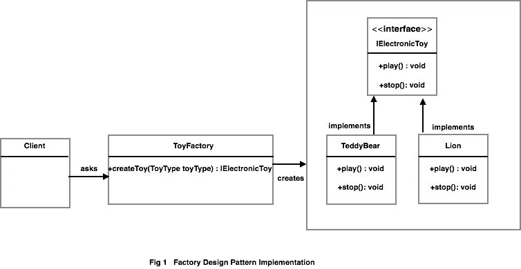
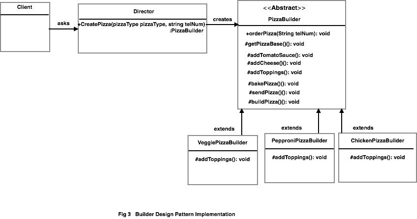
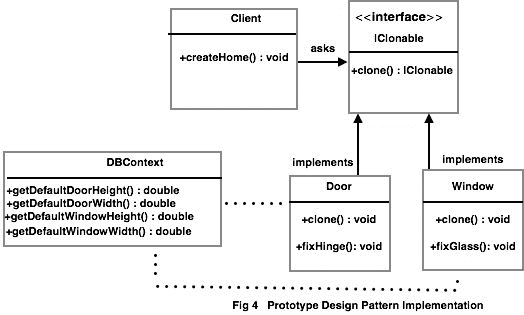

# Java 创建型模式使用指南

## 序言

我在一家跨国公司担任专业软件工程师已有 20 多年。我觉得现在是时候利用我多年来的积累，指导程序员如何编写可靠、可维护且可扩展的软件实践了。我通过惨痛教训——即先犯错误并在过程中学习——学到了许多良好的编码实践。设计模式极大地帮助了我避免重复犯这些错误。本书记录了常用的创建型设计模式，并尝试就如何通过正确的设计模式来避免软件开发中的常见陷阱提供指南。

麦肯锡在 2012 年对 5,400 个大型 IT 项目（初始预算超过 1500 万美元的项目）进行的研究显示，17% 的大型 IT 项目进展糟糕到以至于威胁到公司的生存。报告还提到，平均大型 IT 项目的预算超支 45%，时间超期 7%，而交付的价值比预测少了 56%。其中许多问题可以归因于糟糕的代码，随着代码规模的增长，这些代码变得不可维护。[帕累托法则](http://en.wikipedia.org/wiki/Pareto_principle) 指出，80% 的结果可以归于 20% 的可能原因。它也被称为 80-20 法则，适用于人类活动的几乎每一个领域。该原则也适用于软件工程，即大多数问题是由少数糟糕的编码实践造成的。通过设计模式可以消除这些实践，从而帮助工程师和公司变得更高效、更成功。

设计模式为常见的反复问题提供了经过的解决方案。当你看到一个常见的反复问题时，你会找到一个通用的、通的解决方案来解决它。这种情况发生在架构、机械、可用性和人类行为中，编程也不例外。这些解决方案在过去已经被成功尝试过。本书试图在开发者社区中提高对这些成功模式的认识。

我很早就被“四人帮”（Gang of Four）的设计模式深深吸引。我在大型项目中使用过设计模式，对代码在利用正确设计模式时所提供的重用性感到惊讶。拥有设计模式知识可以建立高水平的成熟度。装备了知识的开发者可以审视大局，并在动手之前考虑扩展性和可重用性。设计模式恰好也是软件工程师面试中最喜欢的话题之一。因此，拥有设计模式知识将赋予你优势。它将带你开启成为忍者开发者之路。

本书涵盖了创建型设计模式，创建模式使程序员能够构建编写代码来创建对象的解决方案，以保持代码的可扩展、可维护和可重用。

## 引言

设计模式为常见问题提供了易于识别和使用的 OOP（面向对象）解决方案。它们天生易于维护，因为许多人对它们都很熟悉。这与 Google 的工作方式非常相似。每个人都知道如何 Google，所以当你得到像“设计模式的作用是什么”这样的查询时，你可以很快地使用这个通用接口来解决问题。

设计模式提供了经过证明和测试的解决方案，可以大大提高整个开发者团队的效率、可靠性和生产力。

创建型设计模式核心在于类实例化的各种方式。实例化方法取决于开发者想要从代码调用者中控制什么以及控制多少。这种模式被分为类创建模式和对象创建模式。类创建模式在实例化过程中有效利用了继承，而对象创建模式则有效利用委托（delegation）来完成工作。这让你的程序在决定为特定用例需要实例化哪些对象时具有更多控制权。

在 Java 中，创建对象的方法是使用 `new` 操作符。

```java
Foo = new Foo() ; // Foo 类的实例
```

假设是你编写了 `Foo` 类并将库提供给某人使用。正如你看到的，该库的用户可以实例化任意数量的 `Foo` 类，而完全没有任何控制。此外，在这里我们硬编码了对象的实例化方式。在许多情况下，需要创建的精确对象取决于运行时行为。创建设计模式抽象了对象的创建方式。它可以使程序变得更加灵活和通用。

- **工厂方法**：它提供了一个类，根据提供的输入数据，从派生自共同抽象类的类族中决定需要实例化的对象。
- **抽象工厂**：它提供了创建多个类族实例的能力。
- **构建器**：它提供了将对象的构造与其表示分离的能力。因此，根据需要可以创建不同的表示。
- **原型**：它提供了一种通过克隆或复制现有实例创建新对象的轻量级方法。
- **单例**：它提供了通过限制为单个实例来控制可以创建实例数量的能力。

# 第一章

## 工厂

### 背景

工厂设计模式在需要从相关的类族创建类实例的场景下非常有用。例如，假设有一个生产电子玩具的工厂。所有电子玩具都有一些共同特征，比如它们都有播放和停止按钮。如果你需要一只泰迪熊，你只需要告诉工厂“嘿，给我做一个泰迪熊”，工厂就会为你制作一个并交给你。

如果你需要一只老虎，你只需要告诉工厂“嘿，给我做一只老虎”，工厂就会制作老虎并交给你。在这种情况下，用户只需传入玩具的描述，并让工厂为用户创建玩具。同一个工厂可以根据用户需求创建其他电子玩具，如狮子、狗等。

### 实现

通常，所有的类都有一个父类和一些公共函数。但每个函数在执行任务时的运作不同。此外，还有一个工厂类负责理解用户需要哪种类、实例化所需的类并返回该实例。在电子玩具工厂的示例中，所有玩具都有一个名为 `play` 的公共函数，每个玩具的播放方式不同。当泰迪熊被要求播放时，它可能会唱一首歌。当老虎被要求播放时，它可能会发出咆哮声。这种关系在下图所示。



这里 `IElectronicToy` 是一个包含两个函数（`play` 和 `stop`）的接口。它代表了每个电子玩具应该实现的合约。该合约由两个方法 `play()` 和 `stop()` 规定。`TeddyBear` 和 `Lion` 是两个实现 `IElectronicToy` 接口的类。通过重写 `play()` 和 `stop()` 方法，`TeddyBear` 和 `Lion` 分对 `play()` 和 `stop()` 方法有不同的实现。`ToyFactory` 是一个包含单一静态方法 `CreateToy(..)` 的类。该方法接受 `ToyType` 枚举，并根据 `ToyType` 的值返回 `TeddyBear` 或 `Lion`，且返回类型被强制类型转换为 `IElectronicToy`。`Client` 代表一个外部类，它调用 `ToyFactory` 类的静态方法 `createToy` 并传递适当的 `ToyType` 值。反，它获得一个 `IElectronicToy` 类型的对象，该对象在内部可能是 `TeddyBear` 或 `Lion`。

以下是实现上述类的 Java 代码。

文件：`IElectronic.java`

```java
interface IElectronicToy {
    void play();
    void stop();
}
```

文件：`TeddyBear.java`

```java
public class TeddyBear implements IElectronicToy {
    @Override
    public void play() {
        System.out.println("Grrrrrrrrrr");
    }

    @Override
    public void stop() {
        System.out.println("stopped grrrr....");
    }
}
```

文件：`Lion.java`

```java
public class Lion implements IElectronicToy {
    @Override
    public void play() {
        System.out.println("Roar");
    }

    @Override
    public void stop() {
        System.out.println("stopped roaring");
    }
}
```

文件：`ToyFactory.java`

```java
public class ToyFactory {
    public static IElectronicToy CreateToy(ToyType toyType) throws Exception {
        IElectronicToy toy = null;
        switch(toyType) {
            case TeddyBear:
                toy = new TeddyBear();
                break;
            case Lion:
                toy = new Lion();
                break;
            default:
                throw new Exception("Unknown toyType " + toyType);
        }
        return toy;
    }
}
```

文件：`ToyType.java`

```java
public enum ToyType {
    TeddyBear,
    Lion
}
```

文件：`Client.java`

```java
public class Client {
    public static void main(String args[]) {
        try {
            IElectronicToy toy = ToyFactory.CreateToy(ToyType.TeddyBear);
            toy.play();
            toy.stop();
            toy = ToyFactory.CreateToy(ToyType.Lion);
            toy.play();
            toy.stop();
        } catch (Exception ex) {
            System.out.println(ex.getMessage());
        }
    }
}
```

输出：

```text
Grrrr…….
stopped grrrr....
Roar
stopped roaring
Process finished with exit code 0
```

### 益处

**重用。** 如果我想在许多地方从一组相关的类中实例化一个类，可以在我需要的地方使用工厂类，而不需要实例化单个类。

**可单元测试性。** 我可以为工厂编写 2 个测试，以确保它在正确的条件下返回正确的类型，然后调用类只需要测试它是否调用了工厂以及随后调用了返回类上的所需方法即可。它不需要对工厂本身的实现或具体类一无所知。

**扩展性。** 当有人决定我们需要向此工厂添加一个新类（例如 `Tiger`）时，任何调用代码（无论是单元测试还是实现）都不需要被告知。我们只需要创建一个新类 `Tiger` 并扩展我们的工厂方法即可。这遵循了[开闭原则](http://www.oodesign.com/open-close-principle.html)。

如果情况需要，你甚至可以创建一个新的工厂类并使它们热插拔，例如，如果你想在测试时能够切换 `Lion` 类的开启和关闭。我很少遇到这种情况，但它非常有用。

# 第二章

## 抽象工厂

### 背景

抽象工厂设计模式比工厂模式高出一个层级的抽象。当你需要从几个相关的“族”中返回一个对象时，可以使用这种模式。

注意，与工厂模式不同，这里说的是“几个族”，而不仅仅是一个族。这正是理解抽象工厂模式的关键。因此，抽象工厂从几个工厂中返回一个工厂。

抽象工厂模式的一个经典示例是在屏幕上绘制动画对象，如猴子、山脉等。可能有几种类型的绘制系统，如 2D、3D 和 4D。每种绘制系统都能够绘制动画对象。你可以创建一个电影场景，画一只猴子从木木山上的的一棵树跳到另一棵树上。你可以通过获取一个 2D 工厂，并在 2D 中播放整个场景；或者，你可以请求 3D 工厂并在 3D 中播放整个场景。这种可插拔机制非常有用，只需请求指定的工厂而不改变其他任何内容，就可以比较相同场景在 2D、3D 或 4D 中是如何渲染的。2D、3D 和 4D 代表不同类型的绘制平台。抽象工厂模式封装了平台依赖关系并简化了使用。它还允许轻松交换平台。

### 实现

抽象工厂模式有 2 层抽象。这两个层级可以通过上述的绘制示例得到很好的说明。这里的用例是创建一个猴子在摇曳的树上跳跃的场景。我们希望有一种非常简单的方法将场景更改为 3D。第一层抽象通过使用 `IElectronicToy` 和 `ITree` 实现的。第二层抽象通过拥有 `2DDrawingFactory` 和 `3DDrawingFactory` 实现的。`Client` 通过向其传递绘制类型（2D 或 3D）来与绘制工厂进行交互。

以下是实现上述类的 Java 代码。

文件：`IElectronic.java`

```java
interface IMonkey {
    void jump();
}
```

文件：`ITree.java`

```java
interface ITree {
    void sway();
}
```

文件：`IDrawingPlatform.java`

```java
interface IDrawingPlatform {
    IMon getMonkey();
    ITree getTree();
}
```

文件：`ThreeDMonkey.java`

```java
public class ThreeDMonkey implements IMonkey {
    @Override
    public void jump() {
        System.out.println("This is 3dky jumping");
    }
}
```

文件：`TwoDMonkey.java`

```java
public class TwoDMonkey implements IMonkey {
    @Override
    public void jump() {
        System.out.println("This is 2d monkey jumping");
    }
}
```

文件：`ThreeDTree.java`

```java
public class ThreeDTree implements ITree {
    @Override
    public void sway() {
        System.out.println("This is 3d tree swaying");
    }
}
```

文件：`TwoDTree.java`

```java
public class TwoDTree implements ITree {
    @Override
    public void sway() {
        System.out.println("This is 2d tree swaying");
    }
}
```

文件：`TwoDDrawingFactory.java`

```java
public class TwoDDrawingFactory implements IDrawingPlatform {
    @Override
    public IMonkey getMonkey() {
        return new TwoDMonkey();
    }

    @Override
    public ITree getTree() {
        return new TwoDTree();
    }
}
```

文件：`ThreedDrawingFactory.java`

```java
public class ThreedDrawingFactory implements IDrawingPlatform {
    @Override
    public IMonkey getMonkey() {
        return new ThreeDMonkey();
    }

    @Override
    public ITree getTree() {
        return new ThreeDTree();
    }
}
```


```java
break;

case ThreeD:

theMonkey = new ThreeDMonkey();

break;

}

return theMonkey;

}

public ITree getTree(DrawingType dType)

{

ITree theTree = null;

switch(dType)

{

case TwoD:

theTree = new TwoDTree();

break;

case ThreeD:

theTree = new ThreeDTree();

break;
}

return theTree;

}

}
```

文件：`Client.java`


```java
public class Client {

    public static void main(String[] args) {

        DrawingPlatformFactory drawingPlatform = new DrawingPlatformFactory();

        IMonkey theMonkey = drawingPlatform.getMonkey(DrawingType.TwoD);

        ITree theTree = drawingPlatform.getTree(DrawingType.TwoD);

        // Draw 2D Scene
        drawScene(theMonkey, theTree);

        theMonkey = drawingPlatform.getMonkey(DrawingType.ThreeD);

        theTree = drawingPlatform.getTree(DrawingType.ThreeD);

        // Draw 3D Scene
        drawScene(theMonkey, theTree);
    }

    private static void drawScene(IMonkey theMonkey, ITree theTree) {

        theMonkey.jump();

        theTree.sway();
    }
}
```

输出：

这是 2d 猴子在跳

这是 2d 树在摇晃

这是 3d 猴子在跳

这是 3d 树在摇晃

## 优势

**封装性：** 抽象工厂模式将具体类完全与客户端隔离开。这允许自由地交换产品族。

**扩展性：** 抽象工厂模式是“工厂的工厂”，可以轻松地扩展以适应更多产品，例如，我们可以添加另一个子类 `FourDDrawingFactory`、`FourDMonkey` 和 `FourDTree`。客户端代码需要极少的更改。

## 第三章：构建器（Builder）

### 背景

构建器设计模式用于将对象的构建与其表示分离。相同的构建机制可以用于构建多个不同的表示。构建器工厂侧重于逐步构建对象。

考虑一个披萨店的例子。客户可以订购各种类型的披萨，如意大利腊肠披萨、至尊鸡肉披萨或素食披萨。创建每个披萨的步骤都是相同的。最终结果取决于步骤内部执行的操作。

- 订购披萨（电话/网站/去商店）
- 获取披萨饼底
- 添加番茄酱
- 添加奶酪
- 添加配料（意大利腊肠/蔬菜/鸡肉）
- 烘烤披萨
- 将披萨交给客户（外带或外送）

### 实现

这里的用例是根据客户的规格构建披萨。`PizzaBuilder` 是一个抽象类，规定了构建披萨的步骤并协调披萨的制作步骤。`VeggiePizzaBuilder`、`PizzaPepperoniBizzaBuilder` 和 `ChickenPizzaBuildera` 自 `PizzaBuilder`。它们唯一覆盖的方法是 `addToppings()`。

`VeggiePizzaBuilder` 添加西柿、青椒和洋葱等配料。`PeopporoniPizzaBuilder` 添加意大利腊肠片。`ChickenPizzaBuilder` 添加烤鸡肉配料。三种披萨的其他方法保持相同。

`Director` 类根据客户提供的 `PizzaType` 规格决定应该调用哪个 `PizzaBuilder` 类。`Client` 类代表下订单的客户。这种关系在下图所示。注意，方法前的 `+` 前缀表示公共方法，而 `#` 前缀表示受保护的方法。



以下是实现上述类的 Java 代码。

文件：`PizzaType.java`

```java
public enum PizzaType {

    Veggie,

    Pepperoni,

    Chicken
}
```

文件：`PizzaBuilder.java`

```java
public abstract class PizzaBuilder {

    protected String telNum = "";

    public void orderPizza(String telNum) {

        this.telNum = telNum;

        System.out.println("Creating pizza for " + telNum);

        buildPizza();
    }

    protected void getPizzaBase() {

        System.out.println("Getting pizza base");
    }

    protected void addTomatoSauce() {

        System.out.println("Adding tomato sauce");
    }

    protected void addCheese() {

        System.out.println("Adding cheese");
    }

    protected void bakePizza() {

        System.out.println("baking pizza. Smells great");
    }

    protected void sendPizza() {

        System.out.println("sending pizza to customer " + this.telNum);
    }

    protected void buildPizza() {

        getPizzaBase();

        addTomatoSauce();

        addCheese();

        addToppings();

        bakePizza();

        sendPizza();
    }

    protected abstract void addToppings();
}
```

文件：`VeggiePizzaBuilder.java`

```java
public class VeggiePizzaBuilder extends PizzaBuilder {

    @Override
    protected void addToppings() {

        System.out.println("Adding onions, tomators and spinach");
    }
}
```

文件：`PepporoniPizzaBuilder.java`

```java
public class PepporoniPizzaBuilder extends PizzaBuilder {

    @Override
    protected void addToppings() {

        System.out.println("Adding Pepporoni");
    }
}
```

文件：`ChickenPizzaBuilder.java`

```java
public class ChickenPizzaBuilder extends PizzaBuilder {

    @Override
    protected void addToppings() {

        System.out.println("Adding grilled checkin");
    }
}
```

文件：`Director.java`

```java
public class Director {

    public static PizzaBuilder CreatePizza(PizzaType pizzaType, String telNum) {

        PizzaBuilder pizzaBuilder = null;

        switch (pizzaType) {

            case Veggie:

                pizzaBuilder = new VeggiePizzaBuilder();

                break;

            case Pepperoni:

                pizzaBuilder = new PepporoniPizzaBuilder();

                break;

            case Chicken:

                pizzaBuilder = new ChickenPizzaBuilder();

                break;
        }

        pizzaBuilder.orderPizza(telNum);

        return pizzaBuilder;
    }
}
```

文件：`Client.java`

```java
public class Client {

    public static void main(String[] args) {

        System.out.println("******* Ordering Pepperoni Pizza *************");

        Director.CreatePizza(PizzaType.Pepperoni, "408-231-1234");

        System.out.println("******* Ordering Veggie Pizza *************");

        Director.CreatePizza(PizzaType.Veggie, "408-231-1244");
    }
}
```

输出：

******* 订购意大利腊肠披萨 *************

正在为 408-231-1234 创建披萨

获取披萨饼底

添加番茄酱

添加奶酪

添加意大利腊肠

烘烤披萨。闻气很香

正在向客户 408-231-1234 送披萨

******* 订购素食披萨 *************

正在为 408-231-1244 创建披萨

获取披萨饼底

添加番茄酱

添加奶酪

添加洋葱、西柿和菠菜

烘烤披萨。闻气很香

正在向客户 408-231-1244 送披萨

## 第四章：原型（Prototype）

### 背景

原型设计模式用于类的实例化非常耗时或复杂的情况。在这种情况下，与其每次从头创建新实例，不如创建一个实例并进行复制，根据需要进行更新。

例如，如果需要多次查询以获取员工的更多信息，更好的方法是只在内存中获取一次员工信息的结果集，为每个查询创建其副本，然后进行处理。这将防止多次访问数据库，从而减少网络开销。数据库连接往往是 SaaS 应用中有限且昂贵的资源之一。原型模式通过减少对象构建时间和数据库往返来帮助减少开销。

原型模式在创建类设计模式中是独一无二，因为它不需要类，只需要一个对象。这里的核心思想是对象可以产生与自身相似的其他对象。

如果你在计算机游戏中有一棵树，你只需克隆这棵树就可以创建很多棵树。所有现代语言（如 `Java`、`C#`）在 `System.Object` 级别提供了内置的 `clone` 函数，自定义类可以通过重写该函数来实现原型功能。

### 实现

此处的用例是客户端想要构建一栋房屋。`Home` 需要门和窗户等部件。一栋房屋的门和窗户本质上是相似的，它们在尺寸上有所不同。

`DBContext` 是一个辅助类，从数据库中获取默认宽度和高度。当 `home` 需要第一扇门时，我们可以从零创建一个基础门并将其准备好。第一扇门是通过构造函数创建的，它会调用 `DbContext.getDefaultDoorHeight()` 和 `DbContext.getDefaultDoorWidth()` 来获取门的默认宽度和高度。这是一个耗时的调用，并且需要与数据库交互往返。

当 `home` 需要另一扇门时，我们不需要从零开始，而是从第一扇门复制数据并根据需要修改其属性。`IClonable` 接口表示复制对象的能力，它仅包含 `clone()` 函数。任何需要实现复制功能的类都可以重写 `clone()` 函数并提供自己的 `clone()` 实现。

`Door` 和 `Window` 类实现了 `IClonable` 接口，从而提供了克隆能力。客户端可以调用 `door` 和 `window` 对象上的 `clone` 函数，为 `home` 创建所需的任意数量的门和窗户。当门或窗户被克隆时，我们只需创建现有对象的副本，然后根据需要进行更新。这种克隆能力避免了昂贵的数据库往返操作。

下图所示。



以下是实现上述类的 Java 代码。

文件：`DBContext.java`

```java
public class DBContext {

    public static double getDefaultDoorHeight() {
        // 模拟数据库连接值
        System.out.println("Connecting to database...");

        System.out.println("Fetching default door height...");

        // 模拟从数据库获取的值
        return 20.0;
    }

    public static double getDefaultDoorWidtht() {
        // 模拟数据库连接值
        System.out.println("Connecting to database...");

        System.out.println("Fetching default door width...");

        // 模拟从数据库获取的值
        return 10.0;
    }

    public static double getDefaultWindowHeight() {
        // 模拟数据库连接值
        System.out.println("Connecting to database...");

        System.out.println("Fetching default window height...");

        // 模拟从数据库获取的值
        return 5.0;
    }

    public static double getDefaultWindowWidth() {
        // 模拟数据库连接值
        System.out.println("Connecting to database...");

        System.out.println("Fetching default window width...");

        // 模拟从数据库获取的值
        return 6.0;
    }
}
```

文件：`IClonable.java`

```java
public interface IClonable {
    Object clone();
}
```

文件：`Door.java`

```java
public class Door implements IClonable {

    public double hingSize = 4.0;
    public double width = 0.0;
    public double height = 0.0;

    public Door() {
        this.height = DBContext.getDefaultDoorHeight();
        this.width = DBContext.getDefaultDoorWidtht();
    }

    @Override
    public Object clone() {
        Door theDoor = new Door();

        theDoor.hingSize = this.hingSize;
        theDoor.width = this.width;
        theDoor.height = this.height;

        return theDoor;
    }

    public void fixHinge() {
        System.out.println("Fixing hinge to the door");

        this.hingSize = 20.0;
    }
}
```

文件：`Window.java`

```java
public class Window implements IClonable {

    public double glassSize = 10.0;
    public double width = 0.0;
    public double height = 0.0;

    public Window() {
        this.height = DBContext.getDefaultWindowHeight();
        this.width = DBContext.getDefaultWindowWidth();
    }

    @Override
    public Object clone() {
        Window theWindow = new Window();

        theWindow.glassSize = this.glassSize;
        theWindow.width = this.width;
        theWindow.height = this.height;

        return theWindow;
    }

    public void fixGlass() {
        this.glassSize = 5.0;

        System.out.println("Fixing glass to the window");
    }
}
```

文件：`Client.java`


```java
public class Client {
    public static void main(String[] args) {
        //构建一栋有 2 扇门和 4 扇窗户的房屋
        //从零创建第一扇门
        Door door1 = new Door();
        //通过克隆第一扇门构建第二扇门
        Door door2 = (Door)door1.clone();
        door1.fixHinge();
        door2.fixHinge();
        //从零创建第一扇窗户
        Window window1 = new Window();
        //通过克隆第一扇窗户构建另外 3 扇窗户
        Window window2 = (Window)window1.clone();
        Window window3 = (Window)window1.clone();
        Window window4 = (Window)window1.clone();
        window2.fixGlass();
        window3.fixGlass();
        window4.fixGlass();
    }
}
```

输出：

```text
Connecting to database...
Fetching default door height...
Connecting to database...
Fetching default door width...
Connecting to database...
Fetching default door height...
Connecting to database...
Fetching default door width...
Fixing hinge to the door
Fixing hinge to the door
Connecting to database...
Fetching default window height...
Connecting to database...
Fetching default window width...
Connecting to database...
Fetching default window height...
Connecting to database...
Fetching default window width...
Connecting to database...
Fetching default window height...
Connecting to database...
Fetching default window width...
Connecting to database...
Fetching default window height...
Connecting to database...
Fetching default window width...
Fixing glass to the window
Fixing glass to the window
Fixing glass to the window
Fixing glass to the window
```

由于各处都需要以只读方式读取配置信息，我们只需要一个配置读取器实例。`ConfigReader` 是一个单例类。它的构造函数是私有的，因此客户端无法直接实例化它。它拥有 `getInstance()` 方法，`Client` 可以使用该方法来访问唯一的实例。`loadConfig()` 信息用于在初始化部分从文本文件中读取信息，并将其存储在内部哈希表中。一旦客户端拥有了 `ConfigReader` 实例，就可以通过传入目标键值并调用 `getValue()` 方法来获取配置键的值。`getValue()` 函数通过查找哈希表获取指定键的值并将其返回。类图如图所示。


以下是实现上述类的 Java 代码。

文件：`ConfigReader.java`

```java
import java.io.BufferedReader;
import java.io.FileNotFoundException;
import java.io.FileReader;
import java.io.IOException;
import java.util.Hashtable;

public class ConfigReader {
    private static ConfigReader _configReader = null;
    private Hashtable configTable = null;

    private ConfigReader() {
    }

    public static ConfigReader getInstance(String filePath) {
        if(_configReader == null) {
            _configReader = new ConfigReader();
            loadConfig(filePath);
        }
        return _configReader;
    }

    public static void loadConfig(String filePath) {
        System.out.println("loading config from file");
        try {
            FileReader ex = new FileReader(filePath);
            String line = null;
            BufferedReader bufferedReader = new BufferedReader(ex);
            _configReader.configTable = new Hashtable();
            while((line = bufferedReader.readLine()) != null) {
                String key = line.split("#")[0];
                String value = line.split("#")[1];
                _configReader.configTable.put(key, value);
            }
            bufferedReader.close();
        } catch (FileNotFoundException var6) {
            System.out.println("Unable to open file '" + filePath + "'");
        } catch (IOException var7) {
            System.out.println("Error reading file '" + filePath + "'");
        }
    }

    public String getValue(String key) {
        System.out.println("getting config for key " + key);
        return (String)_configReader.configTable.get(key);
    }
}
```

文件：`Client.java`

```java
import Singleton.ConfigReader;

public class Client {
    public Client() {
    }

    public static void main(String[] args) {
        ConfigReader configReader = ConfigReader.getInstance("/Users/ravindrasadaphule/config.txt");
        String dbConnectionString = configReader.getValue("DbConectionString");
        System.out.println(dbConnectionString);
    }
}
```

文件：`config.txt`

```text
DbConectionString#provider=oracle11;trusted_connection=yes
username#admin
```

输出：

```text
loading config from file
getting config for key DbConectionString
provider=oracle11;trusted_connection=yes
```

### 益处

**低内存占用：** 单例模式将一个类的实例化限制为。。它防止了用户创建多个实例，从而节省了内存。

**简单性：** 单例模式看起来非常简单。它是一种完全包含在同一个类中的模式，不需要任何其他辅助类。

## 第六章

### 总结

非常感谢阅读整本关于创建型设计模式的书。以下是所有创建型设计模式的简要总结。

- **工厂模式**用于根据提供给工厂的数据，从许多相似的类中选择并获取某个类的实例。
- **抽象工厂模式**用于获取若干相关类中的某一组。在某些情况下，它返回适用于该组类的工厂。
- **构建器模式**根据提供的数据构建多个对象以组合成一个新对象。
- **原型模式**在创建新实例的开销较大时，通过克隆现有类而不是创建新实例。
- **单例模式**是一种确保对象只有一个实例的模式，并允许全局访问该实例的模式。
