# Java 进阶之路：利用最新特性实现现代化与模块化


## 关于 Pragmatic Bookshelf

Pragmatic Bookshelf 是一家敏捷出版公司。我们之所以在这里是因为我们想要改善开发者的生活。我们通过创建由程序员为程序员编写的、及时且实用的著作来实现这一点。

我们的 Pragmatic 课程、工作坊和其他产品可以帮助你和你的团队创建更好的软件并增加乐趣。欲了解更多信息以及最新的 Pragmatic 著作，请访问我们的 [`pragprog.com`](http://pragprog.com)。

我们的电子书不包含任何数字版权管理（DRM），并且始终是无 DRM 限制的。我们开创了“测试书”概念，你可以在书籍编写期间进行购买并阅读，并向作者提供反馈，帮助为大家制作出一本更好的书。所有购买者的免费资源包括源代码下载（如适用）、勘误表和讨论论坛，所有内容均可在 `pragprog.com` 上的书籍主页获取。我们在这里是为了让你的生活变得更轻松。

### 新书公告

想要关注我们的最新著作、公告以及偶尔的特别优惠吗？只需在 [pragprog.com](https://pragprog.com) 上创建一个账户（只需电子邮件地址和密码）并勾选接收新闻邮件的选择框。你也可以在 Twitter 上关注我们 @pragprog。

### 关于电子书格式

如果你直接从 [pragprog.com](https://pragprog.com) 购买，你以一个价格获得所有可用格式的电子书。你可以通过 Dropbox 在所有设备（包括 iPhone/iPad、Android、笔记本电脑等）之间同步你的电子书。你可以在版本的有效期内获得免费更新。当然，你随时可以在需要时回来重新下载书籍。从 Amazon Kindle 商店购买的电子书受 Amazon 政策限制。Amazon 文件格式的限制会导致电子书在不同设备上的显示有所不同。欲了解更多信息，请查看我们的 [pragprog.com/#about-ebooks](https://pragprog.com/support/#about-ebooks)。要了解更多关于本书的信息并访问免费资源，请前往 [`pragprog.com/book/vscajava`](https://pragprog.com/book/vscajava)，即书籍主页。

感谢您的持续支持，

Pragmatic Bookshelf

制作本书的团队包括：Dave Thomas（出版商）、Janet Furlow（运营官）、Susannah Davidson（执行编辑）、Jacquelyn Carter（开发编辑）、Corina Lebegioara（文字编辑）、Potomac Indexing, LLC（索引）、Gilson Graphics（排版）。

如客户支持，请联系 support@pragprog.com。

国际权利，请联系 rights@pragprog.com。

# 《Java 进阶之旅》早期好评

我非常喜欢 Venkat 的演讲。你可能认为自己了解某个主题的基础知识，然后他上台，没穿鞋，没幻灯片，你学到了一些以前无法想象的、完全且且酷的新东西。每一次都是如此。这本书带给你同样的体验。如果你喜欢 Venkat 的演讲，你绝对应该读这本书。

| → | Jonatan Ivanov |
|---|---|
|  | Spring 团队软件工程师 |

Java 在过去的三十年里取得了巨大的进步，跟上所有的变化可能会让人目不应接。Venkat 再次拨开云雾，为那些寻找清晰简洁的 Java 演进指南的人提供了极具价值的资源。无论你是该语言的新手，还是已经使用了多年，这本书都会帮助到你、你的团队以及你的应用程序。

| → | Nathaniel Schutta |
|---|---|
|  | Thoughtworks 技术总监 |

Java 语言的发展以一种易读的方式呈现，并提供了足够的细节，让任何人都能开始尝试新概念。

| → | Isak Renström |
|---|---|
|  | 系统开发者 |

由于行业正经历着从 Java 8 的重大跨越，理解从 `JDK 9` 到 `JDK 24` 引入的特性至关重要。Venkat 解释了新的语法增强，引入了类型结构，描述了模块化的重要性，并鼓励我们关注即将出现的内容。如果你认真对待 Java 并想让你的代码库现代化，这本书是你书架上必不可少的。

| → | Daniel Hinojosa |
|---|---|
|  | 开发者/演讲者/导师 |

对于任何想要跟上 Java 演进的开发者来说，这都是一本棒的书。书中易懂的示例将让这些特性的变得轻而易举。

| → | Jack Frosch |
|---|---|

# 致谢

俗话说“单打之力有限……”这不仅适用于写书，也适用于养孩子。许多人慷慨地花时间帮助完善了这本书，我对每一个人都由衷地感谢。首先感谢 Java 团队辛勤的成员，感谢他们以这种意义的方式改进语言的巨大努力。

我非常幸运拥有知识丰富的评审员，他们花时间审阅了本书草稿。非常感谢 Jim Bethancourt、Don Bogardus、Alex Buckley、Jack Frosch、Daniel Hinojosa、Jonatan Ivanov、Viktor Klang、Isak Renström、Brian Sletten 和 Erik Weibust 对细节的关注、建议、纠正和建设性批评。

Alex Buckley 在帮助我落实概念方面的热情和真实兴趣让我深感谦卑并深受启发。他实际上在 Zoom 通话和电子邮件上花费了数小时进行多次审查并指导我。“感谢”这个词完全不足以表达我的感激，Alex。

当我得知 Viktor Klang 参与了 Gatherers 的实现时，我对这个主题非常感兴趣。多年来我一直钦佩他的技术敏锐度，我知道这是一个有趣且实用的功能。这本书让我有机会进一步学习并欣赏他对比 Gatherers 章节的彻底审查，提供了宝贵的见解和反馈。非常感谢你，Viktor。

说 The Pragmatic Bookshelf 最棒的人们非常理解并体贴，由于这本书的特性，为我的开发预留了所需的额外时间，这完全是轻描淡写。他们的行动，而非仅仅是言语，再次提醒了我为什么我如此喜欢与他们合作出版我的书籍。

写这本书的念头产生于我在科罗拉多州的山区徒步时。感谢我的妻子 Kavitha，自从从那次徒步中得知这件事以来，她一直是我鼓励和支持的持续源泉。

感谢那些阅读过这本书早期草稿并在过程中提供反馈和鼓励话语的人们。感谢你们在观察这本书演变过程中的耐心。

# 前言

你是否对 Java 产生了新的喜爱？如果是这样，你并不孤单。我曾抱怨 Java 已经停滞不前，它的时代结束了。Java 背后的团队以最精彩的方式证明了像我这样的唱反者是错误的——他们让 Java 变成了一门充满活力的语言。

真的，我第一次对 Java 改目一新是在该语言在 `8` 版本中引入函数式编程能力时。我甚至为此写了一本书：*Functional Programming in Java, Second Edition* Sub23。从那之后的每一个版本都变得更好、更有趣、更令人兴奋。了解我的人也知道我无法掩饰内心的激动。结果就是——你正在阅读的这本书。

我的许多客户急于接受关于 Java 模块化的培训。他们热于学习语言的进展、如何很好地使用 `records`、密封类（sealed classes）的概念、模式匹配（pattern matching）的益处等等。持续的讨论和对这类内容的持续需求，促使我投入时间和精力，详细介绍从 `9` 版本开始 Java 的这些惊人能力。

感谢阅读本书。准备好深入研究最近添加到 Java 语言中的特性吧。

## 本书包含什么？

在第 1 节 *Java 的演变* (`#f_0013.xhtml_chap.evolution`) 中，我们从一个简要介绍开始。然后，我们将 Java 的变化归分为以下几类：

- **语法糖（Syntax Sugar）**：某些特性可以归类为语法糖；`type Inference` 和 `text blocks` 让我们效率更高，但在字节码中没有痕迹。这些是纯粹的编译器级特性，不会渗透到 `JVM` 生态系统中。这些将在第 2 节 *使用类型推断* (`#f_0020.xhtml_chap.typeinference`) 和第 3 节 *通过文本块减少冗余代码* (`#f_0032.xhtml_chap.textblocks`) 中涵盖。

- **设计辅助（Design Aid）**：如 `records` 和 `sealed classes/interfaces` 等特性有助于我们设计出更好的面向对象的代码。我们将在第 4 节 *使用 Records 编程* (`#f_0042.xhtml_chap.records`) 中看到 `records` 如何帮助更好地建模数据，并在第 5 节 *使用密封类和接口设计* (`#f_0054.xhtml_chap.sealedclasses`) 中看到 `sealed classes` 如何用于更好地建模和管理继承层次结构。

- **流式表达式（Fluent Expressions）**：没有人想写冗长的代码，也没有人喜欢维护它们。Java 在流畅性上提升了一个台阶，我们可以使用 `switch` 作为表达式来写出高度表现力且更不容易出错的代码——参见第 6 节 *切换到 Switch 表达式* (`#f_0063.xhtml_chap.switch`)。我们可以更进一步，并从 `Pattern Matching` 中获益，正如你在第 7 节 *使用强大的模式匹配* (`#f_0069.xhtml_chap.patternmatching`) 中看到的那样。

- **模块化（Modularization）**：`JDK` 终于被拆分为可管理的部分，我们可以从 Java 用于模块化我们应用程序的相同技术中获益。在第 8 节 *模块化你的 Java 应用程序* (`#f_0085.xhtml_chap.creatingmodules`) 中，我们将讨论模块化的必要性以及需要采取的步骤。在第 9 节 *与模块一起工作* (`#f_0094.xhtml_chap.multiplemodules`) 中，我们将考虑与多个模块工作的实际问题。然后，在第 10 节 *使用 ServiceLoader 创建插件* (`#f_0099.xhtml_chap.serviceloader`) 中，我们将看到如何使用强大的 `ServiceLoader` 在创建插件时动态发现实现。

- **自定义函数流水线步骤（Custom Functional Pipeline Steps）**：Java 的函数式编程能力通过 `gatherers` 功能得到了显著增强。在第 11 节 *使用 Gatherers 扩展函数流水线* (`#f_0110.xhtml_chap.usinggatherers`) 中，我们将查看 `gatherers` 的意图以及如何利用 `JDK` 内的 `gatherers`。在第 12 节 *创建自定义 Gatherers* (`#f_0115.xhtml_chap.creatinggatherers`) 中，你将学习如何使用 `Gatherer` 接口在函数流水线创建自己的自定义步骤。

## 这本书是谁的？

如果你用 Java 开发应用程序并希望跟语言的变化，这本书就是为你准备的。本书假设你熟悉编程，并熟悉面向对象编程（`OOP`）以及 Java 自 `8` 版本以来可能的函数式编程概念。

如果你是一个 Java 开发者，将从书中受益最浅。

Java 最初是一门混合了面向对象编程和命令式编程风格的语言。随后，增加了函数式编程能力。许多开发者已经拥抱了语言的混合能力，结合命令式风格、函数式风格和面向对象范式来编写代码。

尽管 Java 拥有良好的面向对象（`OOP`）和函数式编程支持，但语言背后的团队并没有自满。他们投入了巨大的精力来保持语言的现代性。但他们并不是通过根据冲动、市场压力或盲目向语言中添加一组随机特性来实现这一点的。他们在评估和设定语言方向方面做得非常详尽。在考虑要添加的功能时，他们会问三个关键问题：

- 该功能对于创建企业级和复杂应用的 Java 程序员是否有用？
- 在不显著损害向后兼容性的情况下实现该功能是否可行？
- 是否可以通过一种不阻碍未来增强的方式来实现该功能？

我们在过去几年语言的稳步改进看到了这些努力的成果。

## Java 是敏捷的

看到敏捷开发付诸行动而不仅仅是听人们谈论它，确实令人耳目一新。当 Java 团队宣布新版本的语言将每六个月发布一次（即每年的 3 月和 9 月）时，这引起了巨大的怀疑。尽管结果可能会好得多，但改变是困难的。但那个发布周期是团队坚持并保持正轨的最重大、大胆的决定之一。

在过去，团队希望每两年发布一个新的 Java 版本。他们会宣布发布中包含内容的计划。语言的开发者会为这些计划的功能投入诚挚的辛勤努力。当发布时间到来时，听到我们每个人都对经理说过很多次的话：“我们快做完了”，这并不罕见。在人类的时间尺度上，那个“快完了”通常意味着“几年以后”。在知道细节之前敲定计划是瀑布式的，这也是 Java 9 之前的处理方式。

敏捷开发是反馈驱动的开发，从本质上说，它是由自适应规划引导的。这正是 Java 开发的现状。

### 快速变化

Java 每六个月发布一次，但 Java 的开发并不是按照六个月的时间线进行的。如果认为大多数对超过千万名开发者和数万家企业产生巨大影响的复杂功能可以在六个月内从头到尾开发完成，那是天真的。Java 背后最大的创新之一是意识到，不同功能的进度线不需要绑定在一个任意的发布中。

每六个月就有一班“发布列车”出发。任何功能一旦准备就绪就可以加入任何发布版本。发布中包含什么不是一成不变的。计划是灵活且基于现实的。功能的细节也不是一次性提交的。功能会以预览模式发布，然后根据来自整个社区的反馈进行修改。

频繁的发布周期使语言背后的团队、开发者以及使用 Java 的公司受益。

得益于频繁的发布周期，Java 语言背后的开发者能够以更快的速度进行创新。他们能够进行增量式发布、获取反馈、进行更改、看到自己的工作被积极使用，并向前构建新功能。他们说，没有什么比看到自己的辛勤工作立即造福用户更有激励性的。

对于该语言的用户、企业以及构建应用程序的程序员来说，现在的变化是以“小口易读”的形式提供的。他们可以更早地使用新功能，而不是等待每五年左右收到一次大版本。每六个月学习和使用一个功能，比每五年学习六个功能更简单、更高效。与过去不同，Java 开发者不再觉得在使用停滞的语言工作时被留在了语言创新的曲线之外。他们正在一个强大且充满活力的平台上进行开发。

### Java 的近期变化

自适应规划和反馈驱动，这就是今天的 Java，而且它正运行得非常出色。以下是该语言近期令人兴奋的新增——你将在书中学习的特性——它们与其最终确定的 Java 版本对应。

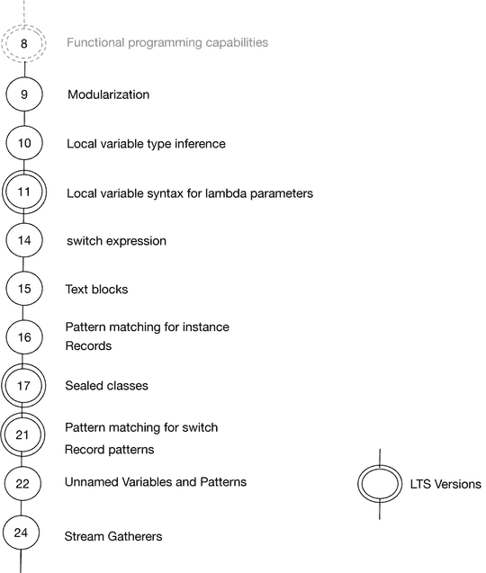

Java 8、11、17 和 21 被指定为长期支持（LTS）发布版本。Oracle 为使用 LTS 版本的客户提供首要支持和定期的更新。最初的计划是每三年指定一个版本为 LTS，但该计划改为每两年发布一个 LTS 版本。尽管并不是所有的 Java 版本都是 LTS 版本，但每一个版本在开发和发布时都具有相同的质量和对细节的关注。

你在上图中看到的大部分功能都是作为孵化项目（incubator projects）的一部分开发的，例如 Project Amber，它们用于探索和实验作为 JDK 增强提案与路线图流程（JEP）一部分提出的想法的设计和实现。一旦功能被引入 Java，它在接受作为平台官方部分之前至少会经过两轮预览。这是创新之后标准化的精彩展示。

### 从 LTS 向前迈

每六个月升级一次的能力是极佳的，但这并不会自动导致大量公司进行频繁且持续的升级。不同组织在采用 Java 新版本方面处于不同的阶段。这种滞后通常不是开发者的错，而是各种限制的结果。例如，对第三方库和框架的依赖有时会对升级产生限制。此外，部署应用程序的环境也可能会带来一些限制。某些企业还对升级到指定为 LTS 的 Java 版本之外有严格限制，以便他们能够可靠地收到安全和其他更新。

取决于你所属的公司和你正在开发的产品，你可能拥有某个 LTS 版本的经验，并渴望在此基础上进一步。这本书是为你准备的，带你从感到舒适且经验丰富的地方，走向你可以在应用程序沿 Java 新版本之旅时充分利用该语言潜力的地方。

### 与 Java 一起前进

我们讨论了 Java 发布周期策略改变的原因，以及近期版本背后的倡议和努力。Java 已经演变成敏捷开发成功的真实故事。频繁且持续的发布周期对语言的开发和用户都有益。总体而言，Java 的新功能旨在提高生产力、应用程序安全性以及我们更有效地设计和实现应用程序的能力。

在本书中，我们将深入探讨最近添加的每一个重大特性。

某些特性如类型推断（type inference）和文本块（text blocks）有助于代码更简洁。其他特性如记录（records）和密封类（sealed classes）有助于创建实现更好的面向对象（OO）设计。你可以使用模式匹配（pattern matching）等特性来减少错误，同时让代码更具表现力。

通过模块化能力，你可以管理复杂性、提高安全性并清晰地处理依赖关系。这里有很多深入的内容，我相信你已经迫待要开始了。

请确保你已经安装了 Java 24 或更高版本，准备好你的 IDE，让我们进入这些新特性。

### 注释

[[2]](#f_0016.xhtml_FNPTR-2)

[`en.wikipedia.org/wiki/Java_version_history`](https://en.wikipedia.org/wiki/Java_version_history)

[[3]](#f_0016.xhtml_FNPTR-3)

[`www.oracle.com/java/technologies/java-se-support-roadmap.html`](https://www.oracle.com/java/technologies/java-se-support-roadmap.html)

[[4]](#f_0016.xhtml_FNPTR-4)


[`openjdk.org/projects/amber/`](https://openjdk.org/projects/amber/)

# 第一部分：语法糖

> Java 中的一些特性让程序员的工作效率更高，但它们没有直接的字节码表示。它们对运行时性能没有任何影响。它们纯粹是 Java 语言的辅助，与其他大多数特性不同，它们在 JVM 级别不可供其他语言使用或交互。

> 在这一部分，我们将介绍如何从类型推断中受益。然后，我们将看到文本块如何大幅减少代码的冗余。

## 第二章：使用类型推断

Java 程序员花费了大量精力在代码中为变量和参数输入类型信息。集成开发环境（IDE）的发展已经通过在写编写代码时提供快捷方式来填充类型细节，从而减轻了工作量。尽管这节省了几个击键，但代码中仍然存在一些噪声。即使我们在实验和演进代码，代码中的类型细节也阻碍了我们快速尝试新想法的能力。在许多地方，显式声明类型的代价超过了它带来的收益。这正是类型推断大显身场的地方。

类型推断是一项特性，它告诉编译器根据上下文推算出（即推断）变量的类型。类型推断是许多静态类型语言中有的特性。一些开发者第一次在 Java 中看到它时会大叫起来：“Java 正在变成 JavaScript 了。”让我向你保证，Java 永远不会那么糟糕。

Haskell、F#、C++、C#、Kotlin 和 Scala 等静态类型语言都有类型推断，使用这些语言的程序员从中受益匪浅。大多数只使用 Java 的程序员发现很难过渡到使用类型推断，主要是因为他们习惯，或者没有接触过这项特性。这是一个我们起初可能会恐惧，但随着经验的增加会学会爱它的特性。

在本章中，你将学习如何使用以及如何从类型推断中受益，特别是从 Java 10 引入的局部变量类型推断。你将快速理解类型推断的力量以及局限性。除了研究如何使用类型推断，我们还将讨论为了充分利用这一特性的“要做”和“要不要”。启动你的 IDE，并结合示例进行练习。

### 类型推断与 Java

当参与方共享语上下文时，推断可以减少沟通中的冗余。当你听到前一天和你一起进行产品演示的同事说“昨天那个太棒了”时，你就能推断出对话是关于客户如何被你团队开发的功能所惊艳的。

你和编译器在代码中共享上下文，当编译器能够推断出你简洁的语法时，你就受益了。

像 Java 等静态类型语言在编译时进行类型检查。一些程序员认为静态类型关于输入或输入类型信息。恰恰相反，静态类型是关于类型验证，而不是类型规范。

在传统的 Java 中，我们被迫要求在代码中显式指定类型细节。随着 Java 最近的更改，我们可以在许多地方从代码中省略类型信息，让编译器来推断细节。尽管如此，编译器会验证变量的类型。任何类型的不兼容都会导致立即的编译失败——我们仍然从这种快速失败（fast fail）中受益。

通过类型推断，Java 并没有变得不那么静态。这种语言并没有请求我们的帮助，而是通过一个擅长类型验证的强大编译器，现在为我们提供了更多帮助。这种转变实际上让语言比以前更具静态特性，因为编译器确定类型比大多数程序员能够确定或愿意指定的类型要严格得多。

Java 对类型推断的支持从 Java 5 开始。我们中的许多人可能在没有意识的情况下在使用它，或者至少没有关注它。与类型推断相关的最显著的变化出现在 Java 8 和 Java 10 中。

在深入研究 Java 10 的更改之前，让我们快速回顾一下之前 Java 版本中与类型推断相关的进展。这将帮助我们看到 Java 10 的变化并不是突然或剧烈的，而是 Java 一直在这一方向稳步移动了一段时间。

### 泛型与类型见证（Type Witness）

Java 5 作为支持泛型的一部分引入了大量的类型推断。

在下面的代码中，编译器执行了相当大量工作来确定函数返回结果的类型。

`typeinference/vsca/GenericsTypeInference.java`

```java
List<String> justOne = Collections.singletonList("howdy");

List<String> nothingHere = Collections.emptyList();
```

在对 `Collections` 工具类的 `singletonList()` 方法调用中，编译器根据参数确定了返回类型。在这种情况下，左侧的部分对推断没有任何影响。

在对 `emptyList()` 方法调用中，右侧没有为编译器确定类型提供足够的上下文。在这种情况下，编译器多走了一步，查看了结果被赋值到哪里，并据此推断了类型。

或者，你可以向编译器指定一个类型见证（提示），如下面的代码段所示，编译器将再次不会使用左侧来决定类型：

`typeinference/vsca/GenericsTypeInference.java`

```java
List<Integer> nothingHereToo = Collections.<Integer>emptyList(); // 冗余类型见证
```

大多数时候，你不需要指定任何类型见证。但偶尔，编译器会报错，因为它无法推断出你完全希望的精确类型。在这种情况下，你必须介入并提供类型见证。让我们来看一个编译器需要你帮助的示例：

`typeinference/vsca/GenericsTypeWitness.java`

```java
public class GenericsTypeWitness {

    public <T> void process(Consumer<T> consumer) {}

    public static void display(int value) {}

    public static void main(String[] args) {

        GenericsTypeWitness instance = new GenericsTypeWitness();

        instance.process(input -> display(input)); // 错误

        // error:类型不兼容：Object 无法转换为 int
    }
}
```

在 lambda 表达式内部调用 `display()` 会编译失败，因为编译器将输入类型推断为 `Object`，而 `display()` 期望的是一个 `int`。参数 `input` 被推断为 `Object` 的原因是 `process()` 调用缺乏足够的上下文来推断出更具体的类型。如果我们修改 `process()` 调用并像如下所示提供一个类型证言（type witness），编译器就会满足了：

[typeinference/vsca/GenericsTypeWitness.java](http://media.pragprog.com/titles/vscajava/code/typeinference%2Fvsca%2FGenericsTypeWitness.java)

```java
instance.<Integer>process(input -> display(input));
```

你可能使用 `Generics`（泛型）多年，都没有遇到过必须提供类型证言的情况；如果是这样，你可以觉得自己很幸运。我曾参与过一个项目，我们必须大量指定类型证言，那体验并不愉快。我们真希望在该项目中能多用用类型推断，少用类型证言。有时候，你必须失去某些东西，才能体会它们有多好。

在大多数情况下，类型推断都在静默工作，我们可以写出简洁的代码。如果编译器没有报错，就不要指定类型证言。让类型推断发挥作用，不要用不必要的细节弄乱代码。

### 菱操作符的增强

Java 7 增加了一个实用的特性：菱操作符（diamond operator）。在添加之前，实例化对象时，我们必须在双方冗余地指定类型信息，如下例所示：

[typeinference/vsca/Diamond.java](http://media.pragprog.com/titles/vscajava/code/typeinference%2Fvsca%2FDiamond.java)

```java
Map<String, List<Integer>> scores = new HashMap<String, List<Integer>>();
```

想象一下必须一遍又一遍重复同样的话——这就是 Java 7 之前的艰辛生活。现在不再如此了，多亏了菱操作符：

[typeinference/vsca/Diamond.java](http://media.pragprog.com/titles/vscajava/code/typeinference%2Fvsca%2FDiamond.java)

```java
Map<String, List<Integer>> scores = new HashMap<>();
```

Java 7 的菱操作符有一个缺陷：对象创建不能使用匿名内部类。该限制在 Java 9 中被移除了，现在你可以执行以下操作：

[typeinference/vsca/Diamond.java](http://media.pragprog.com/titles/vscajava/code/typeinference%2Fvsca%2FDiamond.java)

```java
Map<String, List<Integer>> scores = new HashMap<>() {
};
```

菱操作符对于使代码简洁、丰富且易于修改非常有用。但在 Java 10 的局部变量类型推断中使用它时要小心——参阅“不要在菱操作符中使用类型推断”。

### Lambda 表达式参数的类型推断

类型推断的第一大步出现在 Java 8，当时 lambda 表达式引入了语言。

假设我们想要遍历一个集合并打印值。我们可能会忍不住写下如下代码：

[typeinference/vsca/Diamond.java](http://media.pragprog.com/titles/vscajava/code/typeinference%2Fvsca%2FDiamond.java)

```java
forEach((Integer) -> System.out.println(number))
```

在这个 lambda 表达式中，我们指定了类型为 `Integer`，但在你的想象中，如果我们遍历该集合，我们会怎么做呢？编译器有足够的上下文来确定类型。在 Java 11 中，我们可以丢弃类型信息，如下所示：

[typeinference/vsca/Diamond.java](http://media.pragprog.com/titles/vscajava/code/typeinference%2Fvsca%2FDiamond.java)

```java
forEach(number -> System.out.println(number))
```

`forEach()` 方法非常强大，但在 Java 8 中，如果我们想使用注解，有一个局限性，例如：

[typeinference/vsca/Diamond.java](http://media.pragprog.com/titles/vscajava/code/typeinference%2Fvsca%2FDiamond.java)

```java
forEach((@NotNull Integer) -> System.out.println(number))
```

这很不错，但还有更多。如果我们想在 lambda 表达式参数上使用注解，我们必须指定类型。

[typeinference/vsca/Diamond.java](http://media.pragprog.com/titles/vscajava/code/typeinference%2Fvsca%2FDiamond.java)

```java
forEach((@NotNull number) -> System.out.println(number))
```

在 Java 11 中，只要我们用 `var` 标记参数，就可以省略类型：

[typeinference/vsca/Diamond.java](http://media.pragprog.com/titles/vscajava/code/typeinference%2Fvsca%2FDiamond.java)

```java
forEach((@NotNull var number) -> System.out.println(number))
```

如果你计划使用 `var` 对 lambda 表达式参数进行类型推断，那么你必须对该 lambda 表达式的所有参数都使用它。你不能对某些参数使用 `var`，其他参数使用不带 `var` 的隐式类型推断，并对另一些参数指定类型。对于 lambda 表达式参数的类型推断，要么全有，要么全无。

偶尔，如果编译器无法正确推断类型，你将得到一个错误。这在没有足够的上下文进行正确类型推断时就会发生。如果发生这种情况，你必须二选一：提供必要的类型细节，或者修改代码以让编译器获得足够的上下文来准确推断类型。让我们来看一个说明此问题的示例，并探索这两种解决方案。

在下面的代码中，我们处理一个语言名称列表。假设我们想要按照名称长度的升序打印名称，可以使用 `Stream` 的 `sorted()` 函数和 `Comparator` 接口的 `comparing()` 静态方法。

[typeinference/vsca/LambdaTypeInferenceFail.java](http://media.pragprog.com/titles/vscajava/code/typeinference%2Fvsca%2FLambdaTypeInferenceFail.java)

```java
List<String> languages =
    List.of("Java", "Kotlin", "Scala", "Groovy", "Clojure", "JRuby");

languages.stream()
    .sorted(comparing(name -> name.length()))
    .forEach(System.out::println);
```

我们传递给 `comparing()` 方法的 lambda 表达式参数使用了类型推断。这正如我们想要的那样——简洁且编写起来省力。

现在，假设我们想要按长度降序打印名称。我们可以在 `comparing()` 方法返回的 `Comparator` 实例上调用名为 `reversed()` 的默认方法，如下所示：

```java
.sorted(comparing(name -> name.length()).reversed())

// ERROR: cannot find symbol length() on variable name of type Object
```

哎，遗憾的是，这会导致编译错误。你可能会很惊讶，为什么之前没有 `reversed()` 的代码可以运行，而这个版本却不行。让我们深入探究一下原因。

看这个调用：

```java
.sorted(comparing(name -> name.length()))
```

编译器检查了传递给 `comparing()` 的 lambda 表达式，并意识到它需要更多上下文来确定参数 `name` 的类型。它查看了 `comparing()` 结果去向，找到了 `Stream<String>.sorted(Comparator<T>)`，并确定在这种情况下 `T` 应该是 `String`。推断正确，漂亮。

在接下来的代码中，情况有所不同：

```java
.sorted(comparing(name -> name.length()).reversed())
```

编译器再次意识到它需要更多上下文来确定传递给 `comparing()` 方法的 lambda 表达式中参数 `name` 的类型。它查看了 `comparing()` 结果去向，找到了 `Comparator<T>.reversed()`。这并没有提供任何关于类型的特定细节。因此，它决定将参数类型解析为 `Object`，这并没那么用，但在这种情况下已经是它能做的最好的了。

由于编译器推断出 `name` 的类型为 `Object`，它会在传递给 `comparing()` 的 lambda 表达式内部抱怨 `name` 没有 `length()` 方法——这确实是一个事实——但这并不会让错误变得那么好受。

这是怎么回事？

我们可以使用两种方案之一来解决这个错误。

其一，我们可以背离对 lambda 参数使用类型推断的建议，为 `name` 参数提供类型信息，如下：

```java
.sorted(comparing((String name) -> name.length()).reversed())
```

如果 lambda 表达式无法被方法引用替换，那么这是一个合理的方法。如果 lambda 对参数没有做什么操作，仅仅将其传递给另一个函数，那么我们可以作为第二个方案，将其替换为方法引用，如下：

```java
.sorted(comparing(String::length).reversed())
```


方法引用为编译器提供了足够的上下文，使其意识到我们讨论的是`String`而不是`Object`，并顺着该信息继续执行。最后一个例子说明了 lambda 参数类型推断中的一个小困境。幸运的是，我们并不经常遇到这种情况，即使遇到了，我们也知道如何绕过它。不坏。

尽可能对 lambda 参数使用类型推断。如果你需要为参数使用注解，请配合`var`使用类型推断。偶尔，如果编译器报错，那么要么提供类型信息，要么使用方法引用。

### 局部变量推断

在 Java 10 之前引入的类型推断支持是为了其他功能（如泛型和 lambda 表达式）提供流畅性。Java 10 迈出了大胆的一步，将局部变量的类型推断作为一个独立的特性推出，以提高开发者的效率。有趣的是，这在开发者中引起了骚动，他们认为这个特性是很激进的——尽管对于大多数 Java 开发者来说，这在其他语言中很常见。

如果 Java 发现类型完全清晰，它就可以推断局部变量的类型。让我们通过一些示例来探索这一点。在接下来的代码中，我们为`message`提供了显式的类型信息。

```java
public static void greet() {
    String message = "hello there";
    System.out.println(message);
}
```

观察定义变量`message`的那行，非常清楚该变量的类型是`String`。你知道，编译器也知道。没必要说明显而易见。我们可以将那行改为：

```java
var message = "hello there";
```

编译器根据赋值给变量的内容判断出该变量是`String`类型，不需要我们指定类型。

你可能会想这有什么大不了。实际上，我们通过将`String`替换为`var`总共节省了三个字符。这种节省并不巨大，但考虑以下情况：

```java
HashMap<String, List<Integer>> scores = new HashMap<String, List<Integer>>();
```

这简直是“满行”的——冗长、嘈杂，而且对我们和编译器来说都有大量的冗余信息。我们可以使用类型推断让这行代码变得简洁，如下：

```java
var scores = new HashMap<String, List<Integer>>();
```

其收益远超节省的字符。它更整洁、易于阅读，最重要的是易于更改。

在之前的示例中，我们将类型推断变量初始化为声明处创建的值或实例。此外，当变量被赋值为方法调用的结果时，也可以使用类型推断，如下一个示例：

```java
var numberOfCores = Runtime.getRuntime().availableProcessors();
```

变量`numberOfCores`的类型根据`availableProcessors()`方法的返回类型推断为`int`。

类型推断对重构代码非常有帮助，例如尝试消除重复时。让我们通过示例探索这一方面。

假设我们有一个语言列表和一个 JVM 语言列表，我们根据名称长度对它们进行分组，并将名称大写存储在结果`Map`中。我们可以使用完整的类型规范编写代码，如下：

```java
List<String> languages = List.of("C++", "C", "Erlang", "Elm", "Haskell", "Ruby", "Python");

List<String> jvmLanguages = List.of("Java", "Kotlin", "Scala", "Groovy", "Clojure", "JRuby");

Map<Integer, List<String>> namesByLength = languages.stream()
  .collect(groupingBy((String name) -> name.length(),
    mapping((String name) -> name.toUpperCase(), toList())));

Map<Integer, List<String>> jvmNamesByLength = jvmLanguages.stream()
  .collect(groupingBy((String name) -> name.length(),
    mapping((String name) -> name.toUpperCase(), toList())));
```

作为重构的一部分，假设我们决定移除传递给`collect()`函数的冗余表达式。我们可以将`groupingBy()`函数调用的结果存储在变量中，并在两次`collect()`调用重用它。我们知道`collect()`接收一个`Collector`，因此我们创建的变量类型是`Collector`。但是，快，猜猜我们应该在`Collector<>`的角括号之间放置哪些具体的参数化类型。

很少有人能准确确定这一点，而那些费力的人将他们出色的脑力大量浪费在了不需要处理的事情上。很有可能，在经过一番反抗后，我们大多数人都会要求 IDE 将类型放在变量前面。我们最终得到如下代码：

```java
Collector<String, ?, Map<Integer, List<String>>> groupingCriteria =
    groupingBy((String name) -> name.length(),
    mapping((String name) -> name.toUpperCase(), toList()));

Map<Integer, List<String>> namesByLength = languages.stream()
    .collect(groupingCriteria);

Map<Integer, List<String>> jvmNamesByLength = jvmLanguages.stream()
    .collect(groupingCriteria);
```

我们在重构步骤中引入的变量`groupingCriteria`类型为`Collector<String, ?, Map<Integer, List<String>>>`。但等。类型中的`?`表示即使编译器也不在乎变得更具体。实际上，我们知道该类型是`Collector`，但知道确切的类型并不重要。我们可以通过在整段代码中使用类型推断来做得更好，好得多，如下所示：

```java
var groupingCriteria = groupingBy(String::length,
    mapping((String name) -> name.toUpperCase(), toList()));

var namesByLength = languages.stream()
    .collect(groupingCriteria);

var jvmNamesByLength = jvmLanguages.stream()
    .collect(groupingCriteria);
```

我们在所有可能的地方使用了类型推断。传递给`mapping()`函数的 lambda 表达式参数具有显式类型，因为这是编译器推断变量`groupingCriteria`类型所必需的。

使用局部变量类型推断的额外好处是，我们不需要为推断出的类型使用 import。例如，在之前的代码示例中，当我们用显式类型`Collector...`声明变量`groupingCriteria`时，我们还需要在文件顶部包含`java.util.stream.Collector`。但如果我们使用类型推断，`var`就消除了对 import 的需求，因为编译器会确定类型。

### 何时以及如何引入类型推断

类型推断可以使代码变得简洁、易读且易更改。不要畏惧使用它，但同时不要强迫你自己或你的团队使用它。“它总是最好的”或“它永远不是一个好选择”都不是正确的。在你觉得类型规范是冗余的地方使用它。给你的团队一个机会来熟悉这个想法。开始使用它的一个极佳起点是你的测试套件。一旦团队熟悉了，就开始在生产环境代码中增量地应用它。每当代码因缺少类型信息而变得难以理解时，请随时添加类型细节而不是使用类型推断。

### 在`for`和`try`中类型推断

局部变量类型推断可以用于方法内部定义的任何变量，只要该类型可以在没有任何歧义的情况下被推断出来。在之前的示例中，我们看到了直接在方法内部定义的变量类型是如何被推断的。类型推断也可以用于`for`循环和`try`块中定义的变量。

假设我们想遍历一个名称集合中的值。使用命令式的`for`循环，我们可以对循环变量使用类型推断，如下所示：

```java
for (var name : names) {
    System.out.println(name);
}
```

同样，如果我们想使用传统的`for`循环来遍历索引，我们也可以在那里使用类型推断：

```java
for (var i = 0; i < names.size(); i++) {
    System.out.println(names.get(i));
}
```

在使用`try-with-resources`语法时，可以使用类型推断来定义实现`AutoCloseable`接口的类实例引用。你可以在`for`或`try`内部使用类型推断，或者方法中几乎任何嵌套的代码体中，如下例所示：

```java
try (var resource = new Resource()) {
    var success = resource.task();
    //...
}
```

在这些每一种，变量的类型从文中都是清晰的，我们可以放心地使用类型推断。除了局部变量的类型推断外，Java 在模式匹配中解构记录（records）时也提供了类型推断——我们稍后会。

###`var`：既不是类型也不是关键字

看这段代码：

```java
var max = 1000;
```

你可能会听到新程序员说“var 是一个类型”。礼貌地打断他们，`var`不是一种类型。相反，`var`更像是对编译器的一个眨眼。让我们写一小段代码并检查编译器生成了什么。

```java
public class Typeferred {
    public static void main(String[] args) {
        var message = "hello there";
        var max = 1000;
        var instance = new Typeferred();
    }
}
```

编译代码并使用`javap`工具查看编译器生成的字节码。这里是字节码的一部分：

```text
0: ldc #7 // String hello there
2: astore_1
3: sipush 1000
6: istore_2
7: new #9 // class vsca/Typeferred
```

第一个观察：没有`var`。字节码指令`ldc`用于加载常量，在本例中是字符串 hello there。这清楚地告诉你编译器推断出`message`的类型为`String`。`sipush`（“推送短整型”指令）传递了编译器将 1000 视为短整型值。最后，最后一行显示编译器正在初始化预期类型的引用。

在字节码中没有`var`的迹象，我们知道它不是类型或类型规范。`var`也不是关键字。这是一个值得赞的、谨慎的语言设计选择。由于`var`不是关键字，它可以出现在代码的变量名中。但仅仅因为你可以这样做，并不意味着你应该这样做。以下代码是合法的且无错误编译：

```java
var PI = Math.PI;
```

```java
String var = "please don't"; //Possible, but not a good idea

// var var = "please don't"; //Also possible, but avoid

System.out.println(var); //prints: please don't
```

除非你的目的是为了困扰你的同事，否则用`var`来命名变量并不是好主意。维护这样的代码可能会让人困惑和沮丧。如果你的遗留代码中使用了`var`作为变量，除非你有充分的领域特定理由保留该名称，否则请花时间重构它们。

### 目标交集类型（Targeted Intersection Types）

编译器仅仅根据对代码的表面检查来推断类型。这种分析是严谨的，它得到的类型是该引用可能类型中的最小公分母。

为了感受类型推断的力量，让我们来看带有类型推断的变量声明：

```java
var numbers = List.of(1, 1.2, 3L);
```

我们推测该变量的类型可能是`List<Number>`。猜得不错，但我们可以通过制造错误来确定编译器到底想什么，例如：

```java
numbers.add("hello"); //ERROR
```

或者，我们也可以依赖某些 IDE 来快速确定类型。由`List.of()`函数创建的`List`是不可变的，但有一个更大的问题——我们不应该向`numbers`集合中添加`String`。让我们来看看编译器的错误：

```text
...error: incompatible types: String cannot be converted to INT#1

numbers.add("hello"); //ERROR

^

where `INT#1`,`INT#2` are 交集类型:

INT#1 `extends Number,Comparable<? extends INT#2>,Constable,ConstantDesc

INT#2 `extends Number,Comparable<?>,Constable,ConstantDesc

...
```

类型推断并没有满足于平庸的分析。它推断出`List`的参数类型为`Number`、`Comparable<? extends INT#2>`、`Constable`、`ConstantDesc`——这种类型是提供给列表的值之间的交集（或公共部分）。

看到类型分析和类型推断正在努力工作且我们可以依赖它们，这非常令人欣慰。

### 类型推断的范围（Extent of Type Inference）

我们看到了 Java 的类型推断如何竭尽全力地为局部变量寻找最合适的类型。这种努力值得赞赞，但幸运的是，编译器不会做得过度而失效。

类型推断要求在声明处的类型细节必须绝对清晰。

例如，在下面的代码中，编译器不接受对`var`的用法：

```java
var sorryNo; //ERROR

var ref = null; //ERROR

if (Math.random() > 0.5) {
    ref = "oh";
} else {
    ref = 0;
}
```

初看之下，我们可能认为这两个变量的类型可以是`Object`，但编译器并不认同：

```text
... error: cannot infer type for local variable sorryNo

var sorryNo; //ERROR

^

(cannot use 'var' on variable without initializer)

... error: cannot infer type for local variable ref

var ref = null; //ERROR

^

(variable initializer is 'null')

2 errors
```

错误信息清楚地显示了编译器遵循的规则。要使用类型推断，我们必须将变量初始化为一个空值。

此外，Java 编译器对于类型推断还有几条规则。

虽然`Scala`和`Kotlin`等语言允许在字段级进行类型推断，但 Java 不允许。

```java
public class Book {
    var name = ""; //ERROR

    public Book(String bookName) {
        name = bookName;
    }
}
```

编译器在看到字段级使用`var`时，会严厉报错：

```text
Book.java:3: error: 'var' not allowed here

var name = "";
```

尽管如此，我发现字段级的`var`令人不安。尽管`Scala`和`Kotlin`等语言允许在字段级进行类型推断，但 Java 不允许。在某些情况下，编译器会允许类型推断，但这可能并非所愿。

这种糟糕行为的原因是我们最初定义为`List<Integer>`的变量值现在变成了类型为`ArrayList<Object>`的引用——哎呀。

在使用类型推断的同时使用菱操作符（diamond operator）是没有意义的。在代码审查时请注意这一点，并修改代码以避免此类用法。

### 基类型与派生类型的类型推断

请留意局部变量将被推断为什么类型。如果你意图是使用基类类型或接口类型的引用，而右侧在编译时是派生类型，请避免使用类型推断。

这里是一个用于说明该问题的代码片段：

```java
List<Integer> numbers = new ArrayList<Integer>();
```


`numbers`变量被定义为`List<Integer>`类型，它指向一个`ArrayList<Integer>`实例。使用该引用，我们可以调用属于基类或接口的方法，但不能调用仅属于派生类的方法。例如，在`numbers`上，我们可以调用属于`List`接口的方法（如`add()`），但不能调用仅属于`ArrayList`类的方法（如`ensureCapacity()`）。

现在假设我们使用类型推断来定义`numbers`变量，如下所示：

```java
var numbers = new ArrayList<Integer>();
```

更改后，`numbers`变量具有比之前的`List<Integer>`更具体的类型`ArrayList<Integer>`。因此，与以前不同，我们现在可以使用此引用来调用`ensureCapacity()`等方法。该引用现在与类紧密耦合，而之前是通过接口进行松耦合的。这可能会在未来重构代码以使用接口的不同实现时变得更加困难。

从耦合的角度评估代码，以确保使用类型推断是合理的。

### 验证行为

如果我们决定重构代码以使用类型推断，代码的行为不应该发生变化。如果我们可能会破坏代码的行为，我们希望尽快获知——从用户那里得知这些信息是完全不可接受的。

自动化测试可以帮助验证代码在更改前后的行为是否一致。它将帮助我们关注诸如所示的情况。

有时，一个领域的糟糕设计决策可能会影响代码的另一个领域。在 Java 5 时代，人们决定在`Collections` API 中引入`remove()`方法，该方法可以接收索引或对象。在我们开始处理`Integers`集合之前，这看起来似乎没问题。让我们看看在使用类型推断时这一问题是如何加剧的。

```java
Collection<Integer> numbers = new ArrayList<Integer>(List.of(1, 2, 3));

System.out.println(numbers);

numbers.remove(1);

System.out.println(numbers);
```

我们创建一个数字集合并存储在类型为`Collection<Integer>`的引用`numbers`中。我们打印集合中的值，移除值 1，然后打印结果。输出反映了集合原始值以及移除值 1 之后的集合：

```
[1, 2, 3]

[2, 3]
```

现在，让我们对`numbers`变量使用类型推断，如下：

```java
var numbers = new ArrayList<Integer>(List.of(1, 2, 3));

System.out.println(numbers);

numbers.remove(1);

System.out.println(numbers);
```

遗憾的是，在这种情况下，`numbers`变量不再是`Collection<Integer>`类型，而是`ArrayList<Integer>`类型。如果集合库的设计没有可能导致误用的潜在缺陷，这可能不是一个问题。但在将代码更改为使用类型推断后，输出与更改之前不同：

```
[1, 2, 3]

[1, 3]
```

在这种情况下，对`remove()`调用导致删除了索引为 1 的元素，而不是值为 1 的对象。当类型从基接口变为派生类时，调用了另一个版本的`remove()`方法。这并不是类型推断的错，但我们必须验证代码在更改前后的行为是否相同，或者行为是否符合预期。验证是不可替代的。

### Lambda 表达式类型无法推断

Lambda 表达式的类型由它被赋值的函数接口决定。例如，在调用方法时，方法的参数类型决定了 Lambda 表达式是否可以作为参数传递。同样，我们可以将 Lambda 表达式赋值给函数接口类型的变量，如下一个示例所示：

```java
Runnable runnable = () -> System.out.println("You called...");

runnable.run();
```

`runnable`变量的类型是`Runnable`，这是一个函数接口。Lambda 表达式的签名与`Runnable`的`run()`方法的签名匹配，编译器乐意使用该表达式对变量进行初始化。

假设我们倾向于对`runnable`变量使用类型推断，如下所示：

```java
var runnable = () -> System.out.println("You called...");
```

在这种情况下，编译器无法确定`runnable`的类型。可能有多个函数接口（或一个没有）匹配 Lambda 表达式的签名。因此初始化将失败：

```
error: cannot infer type for local variable

var runnable = () -> System.out.println("You called...");

               ^

(lambda expression needs an explicit target-type)
```

某些 Shell 和编程语言提供了“此处文档（heredocs）”功能来处理转义字符，但在处理缩进和文本结束符时往往显得很粗糙。使用 heredocs 的程序员经常会因为不同实现方式的特殊性而感到沮丧并浪费时间。Java 演进背后的设计者借鉴了其他平台和语言中早期解决方案的经验。结果是为 Java 程序员带来了愉快的体验。

文本块（text blocks）功能在 Java 13 中引入，并在语言的几个版本中不断演进。通过文本块，我们可以轻松地编写多行文本，而无需浪费精力和时间处理杂乱的转义序列。文本流非常自然，编译器也足够智能区分代码中的缩进和文本中的缩进。编译器还能识别并省略文本中无意的末尾空格，从而消除了从代码中的文本中剔除这些空格的需求。总的来说，这种实现的智能性提升了开发者的生产力。

在本章中，我们将查看文本块解决的问题，以及如何利用这一特性在代码中嵌入原始文本、XML 和 JSON 数据。你将学习文本块的行为以及新的转义序列。在此过程中，我们还将窥探文本块在字节码层面的实现。

让我们从一个存在冗余问题的示例开始探索文本块，然后重构代码使其更具表现力且优雅。

### 从杂乱到优雅

假设你正在为一家在线零售商开发应用程序，手头的任务是创建一条将发送给用户的消息，要求他们通过填写问卷提供反馈。

目前预计消息的格式如下，但未来可能会发生变化以添加用户和特定的购买细节：

| ​� | 感谢您的购买。我们希望您有一段愉快的体验。 |
| --- | --- |
| ​� |  |
| ​� | 我们请求您花几分钟时间提供反馈。 |
| ​� |  |
| ​� | 请在 https://survey.example.com 填写问卷 |
| ​� |  |
| ​� | 如果您有任何问题或建议，请点击 https://www.example.com 上的 |
| ​� | “支持”链接。 |

在 Java 的旧版本中，你可能需要编写如下代码来创建消息：

[`textblocks/vsca/CreateMessage.java`](http://media.pragprog.com/titles/vscajava/code/textblocks%2Fvsca%2FCreateMessage.java)

```java
public static String createMessage() {
    String message = "Thank you for your purchase.";
    message += " We hope you had a pleasant experience.\n\n";
    message += "We request that you take a few minutes ";
    message += "to provide your feedback.\n\n";
    message += "Please fill out the survey at https://survey.example.com\n\n";
    message += "If you have any questions or comments, ";
    message += "please click on the \"Support\" link\n";
    message += "at https://www.example.com.\n";
    return message;
}
```

该代码使用`+=`将文本追加到`String`实例。我们可以将`message +=`替换为`+`来减少一些噪音。代码使用组合`\n`来换行，并使用转义字符在文本中包含双引号。此外，每行都必须以分号结尾，增加了杂乱感。

这是一段冗余的代码……瑟瑟发抖……为了人类文明，你会隐藏它，绝对不会展示给孩子看。我敢打赌`+=`也不是你会写在简历上的功能。我们需要更好的。幸运的是，Java 从版本 13 开始就帮我们解决了。

你可以用文本块重构这段杂乱的代码，使其变得漂亮且简洁，如下：

[`textblocks/vsca/CreateMessageConcise.java`](http://media.pragprog.com/titles/vscajava/code/textblocks%2Fvsca%2FCreateMessageConcise.java)

```java
public static String createMessage() {
    String message = """
        Thank you for your purchase.  We hope you had a pleasant experience.

        We request that you take a few minutes

        to provide your feedback.

        Please fill out the survey at https://survey.example.com

        If you have any questions or comments,

        please click on the "Support" link

        at https://www.example.com.

        """;
    return message;
}
```

重构后的版本与杂乱版本产生的输出相同，但代码更易读。创建它时，你可以从要求复制粘贴到代码中，无需费力。文本块以三个引号`"""`开始，后跟着行终止符——参见智能缩进。

在深入研究文本块之前，我们应该快速查看它们在字节码层面的实现。这有助于我们回答开发者经常关于性能、序列化和互操作性的问题。

处理文本块没有运行时影响；编译器完成了繁重的工作。我们可以通过对字节码运行`javap`工具来确认这一点。让我们查看之前方法生成的字节码：

[`textblocks/shoutput/runMessageConcise.sh.output`](http://media.pragprog.com/titles/vscajava/code/textblocks%2Fshoutput%2FrunMessageConcise.sh.output)

```
...

public static java.lang.String createMessage();

Code:

0: ldc #7 // String Thank you for your purchase.  We hope you had a pleasant experience.\n\nWe request that you take a few minutes to provide your feedback.\n\nPlease fill out the survey at https://survey.example.com\n\nIf you have any questions or comments, please click on the \"Support\" link\nat https://www.example.com.\n

...
```

如果我们快速查看`javap`工具产生的细节，会看到字节码指令加载了一个常量（`ldc`）String 值。该 String 包含了文本块中创建的数据，并为了格式正确添加了必要的转义。

没有序列化问题，因为表示形式是经典的`String`，并且旨在提供我们一直以来享有的性能优势。也没有互操作性问题，因为运行时没有文本块的概念——它们仅仅是`Strings`。

除了不再需要`+`或`+=`拼接文本外，Java 还消除了构建字符串时使用大多数转义字符的需求。让我们来看看这一功能。

### 嵌入字符串

要在字符串中嵌入双引号，我们必须使用转义字符。这将导致代码膨肿且难以维护，特别是在编写生成 XML 或 JSON 文档的代码时。文本块允许我们在字符串中自由放置单引号和双引号，从而消除了所有这些噪音。让我们通过示例来看这一功能的优势。

假设我们被要求编写代码来生成以下文本：

“国家气象局”发布了针对明天的“严重”雷暴预警。请在恶劣天气期间“储备”好你所需的必需品。

\允许广泛分发\

使用普通字符串创建此文本时，我们可能需要在代码中充斥转义字符，如下：

[`textblocks/vsca/Escapes.java`](http://media.pragprog.com/titles/vscajava/code/textblocks%2Fvsca%2FEscapes.java)

```java
String message = "The \'National Weather Service\' has issued a " +
                 "\"severe\" thunderstorm warning\nfor tomorrow. " +
                 "Please \"\"\"stock up\"\"\" on the essentials you'll need " +
                 "during\nthe adverse weather.\n\n\\Approved for general distribution\\";
```

代码应该让读者的视觉感到舒适。转义字符的噪音可能会让最渴望维护代码的程序员也望而却步。在这种情况下，修改代码需要花费大量的精力，而且你可以完全忘记直接从需求文档复制并粘贴文本到代码中。

得益于文本块（text blocks），我们可以移除之前代码中的大部分噪音。

```java
var message = """
    The 'National Weather Service' has issued a "severe" thunderstorm warning
    for tomorrow. Please """stock up"" on the essentials you'll need during
    the adverse weather.
    \Approved for general distribution""";
```

由于三个引号被用作文本块的分符，在文本中连续出现三个双引号的少数情况下，我们需要进行转义，但只需使用单个反斜杠。此外，由于反斜杠本身是转义字符，如果它出现在文本中，我们需要用另一个反斜杠对其进行转义。

如你所见，多行文本块可以处理干扰较少的原始字符串，易读、易改，并且方便从其他源复制粘贴到代码中。

多行字符串并不是 Java 特有的；它们存在于其他语言中。但 Java 的创新之处在于它是如何处理文本缩进的。让我们接着探讨。

### 智能缩进（Smart Indentations）

如果语法不连贯，将文本与代码混合对程序员来说将不是一种愉快的体验。任何嵌入文本都应该自然地随代码流动，而不是突兀显。

挑战通常源于我们可能想将文本放在函数内部、嵌套的`if`块中或多层嵌套的`for`循环中。我们为了可读性自然会对代码进行缩进，文本即使在嵌套层级中也应该随代码一起缩进。

遗憾的是，在某些支持多行字符串的语言中，将文本置于多层嵌套中需要笨拙的缩进、使用特殊字符或特殊的函数调用来对齐。幸运的是，Java 程序员不需要处理这些这些。文本块具有智能缩进功能。

让我们通过示例来检查 Java 中智能缩进的能力。

[`textblocks/vsca/SmartIndentation.java`](http://media.pragprog.com/titles/vscajava/code/textblocks%2Fvsca%2FSmartIndentation.java)

```java
public class SmartIndentation {
    public static String smartIndentation() {
        var message = """
            It is great

              when compilers care about conventions

            Makes our lives easier""";
        return message;
    }

    public static void main(String[] args) {
        System.out.println("--------");
        System.out.print(smartIndentation());
        System.out.println("--------");
    }
}
```


在这个示例中，封装在文本块中的文本出现在方法 `smartIndentation()` 内部。因此，文本的第一行像代码一样自然地缩进。而文本的第一行和第三行具有相同的缩进，第二行文本则刻意多增加了缩进。

第一行 `"It"` 之前的缩进和第三行 `"Makes"` 之前的缩进被称为**附带缩进（incidental indentation）**。第二行 `"when"` 之前额外的两个空格缩进被称为**必要缩进（essential indentation）**。当然，在第二行中，这种必要缩进紧跟在附带缩进之后。

Java 的智能缩进算法会移除每行中的任何附带缩进，并只保留必要缩进。因此，在之前的示例中，第一行和第三行文本的所有缩进都被删除了，但第二行保留了两个空格的缩进。

接下来显示的输出展示了文本在以下方面的行为：

```text
--------

It is great

  when compilers care about conventions

Makes our lives easier--------

```

尽管在文本的第一行的单词 `"It"` 之前出现了六个空格，但这些被算法认为是附带缩进并被删除了。智能缩进是非常合理的。如果你的意图与算法一致，那就没问题了。同时，如果你想改变算法推断缩进的方式，同样简单。

你可以通过将文本块分符放在最后一行的末尾（如前面的示例），来告诉算法你希望使用默认行为。如果你想改变文本块内各行的缩进，如下所示：

[textblocks/vsca/PreserveIndentation.java](http://media.pragprog.com/titles/vscajava/code/textblocks%2Fvsca%2FPreserveIndentation.java)

```java
public class PreserveIndentation {

    public static String preserveIndentation() {

        String message = """

            If you like

              you can ask the indentations

            to be preserved, unaltered, like in this example.""";

        return message;

    }

    public static void main(String[] args) {

        System.out.println("--------");

        System.out.print(preserveIndentation());

        System.out.println("--------");

    }

}
```

结束分符放置在没有缩进的地方。因此，在这个示例中，文本每行的所有缩进都被视为必要缩进并被保留。查看文本在输出中是如何缩进的：

```text
--------

If you like

  you can ask the indentations

to be preserved, unaltered, like in this example.

--------
```

尝试之前的代码；每次为分符行增加一个空格的缩进，看看它是如何改变输出中文本缩进的。

Java 编译器使用空格来表示缩进。制表符（Tabs）在不同的编辑器和平台上处理方式不同，在确定文本块内文本的缩进时可能会引起混乱。如果你从文档复制并粘贴文本，且文本包含了制表符和空格的组合，结果可能不是你预期的。

在下一个示例中，第二行看起来缩进很齐，但在该行的第一个字符之前使用的是制表符而不是空格。

[textblocks/vsca/IndentationError.java](http://media.pragprog.com/titles/vscajava/code/textblocks%2Fvsca%2FIndentationError.java)

```java
var message = """

The compiler can keep an eye

on lines like this with

indentation errors""";
```

如果我们打印 `message` 变量中的值，输出结果并不是我们希望看到的：

```text
--------

The compiler can keep an eye

on lines like this with

indentation errors

--------
```

从视觉上来说，当我们看到文本的缩进时，期望这种缩进被保留是合理的。生活中的挑战已经足够了，我们最不希望看到不可见的非打印字符干扰我们的思绪和程序的行为。为了快速识别缩进问题，Java 编译器提供了一个编译标志 `-Xlint:text-blocks`，如果文本块中出现 tab 等字符，它将产生警告。使用该标志编译之前的代码会生成以下警告：

```text
vsca/IndentationError.java:6: warning:
[text-blocks] inconsistent white space indentation
var message = """
^
1 warning
```

使用该标志，如果缩进将变得混乱，你可以获得早期的警告。如果你愿意，可以开启 `-Werror` 标志让编译器将警告视为错误，特别是对于持续集成（CI）构建而言。

到目前为止，在我们所看到的示例中，编译器一直在处理代码中的文本块。有时，你可能想要处理从文件中读取或从数据源接收的文本。如果你想在运行时从读取或接收的文本中移除偶然的缩进或转换转义字符，可以使用与编译器相同的算法。要实现这一点，请使用 `String` 类的 `stringIndent()` 和 `translateEscape()` 方法。

### 尾随空格与特殊转义

如果你从文档中复制并粘贴一段文本到代码中，你可能并不在乎尾随空格。某些编辑器可能会自动删除这些空格。无论如何，尾随空格可能会导致文本对齐问题，除非你想要它们，否则不值得费精力去保留。Java 编译器将尾随空格认为是偶然的，并默认将其移除。

如果你想让编译器保留尾随空格，请使用特殊的转义字符 `\s`。此外，如果一行文本太长，你想在代码中将其分为两行但在生成的文本中不换行，请使用反斜杠，即 `\`，这是文本块的另一个特殊转义字符。

让我们利用这些特殊转义字符，并观察尾随空格的行为。这里有一个代码示例：

[textblocks/vsca/SpecialEscapes.java](http://media.pragprog.com/titles/vscajava/code/textblocks%2Fvsca%2FSpecialEscapes.java)

```java
public class SpecialEscapes {

    public static String specialEscapes() {

        var message = """

This line has 3 spaces in the end

This one has too, but is preserved \s

This line is appended\

with the next

This is intentionally indented.""";

        return message;

    }

    public static void main(String[] args) {

        System.out.println(specialEscapes().replaceAll(" ", "~"));

    }

}
```

第一行文本末尾有三个空格——抱歉，你在代码输出中看不到它们，它们在文本块被处理时会被编译器移除。第二行也有三个尾随空格，但我们在末尾加了 `\s` 来保留它们。在第三行中，我们使用了一个 `\` 表示我们不需要在该处换行。

为了看到这些空格，我们获取 `message` 变量中的文本，并使用命令 `replaceAll(" ", "~")` 将所有出现的空格替换为“~”。对文本块中的字符串进行该后处理后的结果如下：

```text
This~line~has~3~spaces~in~the~end

This~one~has~too,~but~is~preserved~~~~

This~line~is~appendedwith~the~next

~~This~is~intentionally~indented.
```

第一行的尾随空格消失了。第二行的尾随空格被保留了。第三行和第四行被合并了。最后一行显示了我们想要保留的缩进。

接下来，让我们在本章中看到的所有内容整合起来。

### 使用文本块创建 XML 文档

在几乎任何应用程序中，以 XML 和/或 JSON 格式创建数据都是常见任务。通常，我们从数据格式开始，编写代码来生成预期的输出。如果我们必须处理许多行字符串拼接以及过度使用转义字符，这些任务可能会变得相当枯燥。让我们看看文本块如何让这些任务变得简单。

我们将使用语言名称、作者及其初始发布年份的示例来构建 XML 和 JSON 格式的数据。让我们从两个 `Map` 开始，一个以作者值为值，另一个以年份值为值；两者都以语言名为键。

[textblocks/vsca/XML.java](http://media.pragprog.com/titles/vscajava/code/textblocks%2Fvsca%2FXML.java)

```java
Map<String, String> authors = Map.of("Java", "Gosling", "Ruby", "Matsumoto", "JavaScript", "Eich");

Map<String, Integer> years = Map.of("Java", 1995, "Ruby", 1996, "JavaScript", 1995);
```

假设我们被创建一个如下结构的 XML 文档，语言名称按顺序排列：

```xml
<languages>

  <language name="Java">

    <author>Gosling</author>

    <year>1995</year>

  </language>

  <language name="JavaScript">

    <author>Eich</author>

    <year>1995</year>

  </language>

  <language name="Ruby">

    <author>Matsumoto</author>

    <year>1996</year>

  </language>

</languages>
```

在旧版本的 Java 中，我们必须使用传统的 `for` 循环和转义字符来编写代码，如下：

[textblocks/vsca/XML.java](http://media.pragprog.com/titles/vscajava/code/textblocks%2Fvsca%2FXML.java)

```java
String document = "<languages>\n";

for (String name : new TreeSet<String>(authors.keySet())) {

    document += "<language name=\"" + name + "\">\n";

    document += "<author>" + authors.get(name) + "</author>\n";

    document += "<year>" + years.get(name) + "</year>\n";

    document += "</language>\n";

}

document += "</languages>";
```

代码虽然很小，但编写并不愉快。它很难阅读，任何程序员都会希望不要被要求对其进行修改。

让我们使用文本块重写它。为了让代码更易维护，避免将文本块放在表达式中或函数调用参数中。相反，定义变量来持有文本块，并在表达式和函数调用中使用它们。

```java
var language = """

    <language name="%s">

        <author>%s</author>

        <year>%d</year>

    </language>

    """.indent(2);

var childElements = authors.keySet()

    .stream()

    .sorted()

    .map(name -> language.formatted(name, authors.get(name), years.get(name)))

    .collect(joining(""));

return """

    <languages>

    %s

    </languages>

    """.formatted(childElements);
```

在根元素 `<languages>` 中，我们拥有存在于 `Map` 中的子元素 `<language>`（每个语言一个）。我们首先将该 XML 代码段以文本块（text block）的形式存储在名为 `language` 的变量中。由于子元素在根元素内的缩进需要比每个语言文本块现有的缩进多得多，因此我们使用 `indent()` 方法将文本块进一步缩进两个空格，也就是说我们添加了额外的必要缩进。然后我们将遍历 `authors` `Map` 的键，并为每种语言生成 XML 子元素。为此使用 `Stream` API。

最后，我们将再次使用另一个文本块将子元素放入根元素中。由于 XML 元素对其属性和子元素需要不同的数据，我们将使用 `formatted()` 方法将类似 `%s` 和 `%d` 的格式符号替换为适当的值。`String` 新的 `formatted()` 实例方法等同于你可能熟悉的 `String.format()` 静态方法。

仅仅从行数来看，我们可能会认为这个使用文本块的版本更长。但与其他版本相比，代码更清晰、更容易理解、噪音更少，而且更易更改。

我们已经看到了如何使用文本块轻松地创建 XML 文档。如果要求生成 JSON 输出而不是创建 XML，文本块也很有用。让我们接下来来看一个示例。

### 使用文本块创建 JSON 输出

与其创建 XML 格式，假设我们被要求以以下格式创建数据的 JSON 表述：

```json
{

  "languages": [

    {

      "language": {

        "name": "Java",

        "author": "Gosling",

        "year": 1995

      }

    },

    {

      "language": {

        "name": "JavaScript",

        "author": "Eich",

        "year": 1995

      }

    },

    {

      "language": {

        "name": "Ruby",

        "author": "Matsumoto",

        "year": 1996

      }

    }

  ]

}
```

使用传统的字符串编写这段代码可能被视为一种残酷且不寻常的惩罚：

[textblocks/vsca/JSON.java](http://media.pragprog.com/titles/vscajava/code/textblocks%2Fvsca%2FJSON.java)

```java
var document = "{\n" + " \"languages\": [\n";

boolean first = true;

for (var name : new TreeSet<String>(authors.keySet())) {

    if(!first) {

        document += ",\n";

    }

    first = false;

    document += " {\n \"language\": {\n" +

                " \"name\": \"" + name + "\",\n" +

                " \"author\": \"" + authors.get(name) + "\",\n" +

                " \"year\": " + years.get(name) + "\n" +

                " }\n }";

}

document += "\n ]\n}";
```


仅仅从行数来看，我们可能会认为这个使用文本块的版本更长。但与其他版本相比，代码更清晰、更容易理解、噪音更少，而且更易更改。

在根元素 `<languages>` 中，我们拥有存在于 `Map` 中的子元素 `<language>`（每个语言一个）。我们首先将该 XML 代码段以文本块的形式存储在名为 `language` 的变量中。由于子元素在根元素内的缩进需要比每个语言文本块现有的缩进多得多，因此我们使用 `indent()` 方法将文本块进一步缩进两个空格，也就是说我们添加了额外的必要缩进。然后我们将遍历 `authors` `Map` 的键，并为每种语言生成 XML 子元素。为此使用 `Stream` API。

最后，我们将再次使用另一个文本块将子元素放入根元素中。由于 XML 元素对其属性和子元素需要不同的数据，我们将使用 `formatted()` 方法将类似 `%s` 和 `%d` 的格式符号替换为适当的值。`String` 新的 `formatted()` 实例方法等同于你可能熟悉的 `String.format()` 静态方法。

### 结语

这部分结束了，我们探讨了提高生产性的特性。在下一部分，我们将查看有助于设计代码的 Java 特性。记录（Records）和密封类（sealed classes）有助于面向对象的设计。

Copyright © 2025, The Pragmatic Bookshelf.

# 第 2 部分：设计辅助

> Java 以其支持面向对象编程（OOP）而闻名。可以说，它是将 OOP 引入主流的语言之一。

> Records 和密封类是添加到 Java 的两个新功能，用于增强 OOP。在用对象进行编程时，这些特性每一个都是很好的工具。我们将在本部分深入研究这两个新增功能，并看看你的面向对象设计可以从中受益。

# 第 4 章：使用 Records 编程

OOP 中的类表示抽象，重点是行为且封装良好。此外，我们还通过多态寻求扩展性，并经常使用继承来表示抽象之间的某种关系。从一开始，Java 就为这种建模提供了卓越的支持，并一直表现良好。但有时我们需要一个更简单的东西——一个表示具有少量行为的数据的对象。在最近之前，在 Java 中没有简单的方法可以实现这一点。

像 Scala 和 Kotlin 等语言提供了数据类来专门建模数据。Java 14 引入了 Records，它们是去除了令人讨厌的样板代码的数据类。它们表示不可修改的数据，尽管它们可能有方法，但主要目的是为了轻松处理数据。从这些角度来看，它们自动实现了一些常用数据操作所需的方法。通过简化数据对象的实现，Records 使处理数据变得更容易，并且代码更简洁。

在本中，你将首先学习 Records 解决的问题。然后我们将查看如何创建 Records、其功能和限制，以及如何利用它们对数据建模。最后我们将查看 Records 如何作为元组（tuples）来轻松创建简洁的代码。

## 从冗长到简洁

假设你正在开发一个需要表示地球表面位置的应用程序，并且选择使用经度和纬度对其进行建模。至少，表示一个位置我们需要两个浮点数字段。在 Java 的旧版本中，我们可能会使用类来实现，如下所示：

```java
public class Location {

    // 旧方法

    private final double latitude;

}
```

```java
public class Location {

    private final double longitude;

    public Location(double latitude, double longitude) {

        this.latitude = latitude;

        this.longitude = longitude;

    }

    public double getLatitude() {

        return latitude;

    }

    public double getLongitude() {

        return longitude;

    }

}
```

我们为 `latitude` 和 `longitude` 定义了私有字段，由于我们不打算更改它们，将它们标记为 `final`，编写了构造函数来初始化这些字段，并为字段添加了 getter 方法。感觉很有成就感，对吧？

有些开发者可能会抗议说，有了良好的 IDE，我们不需要自己写这些代码。我们可以定义字段，对类轻轻地点击右键，然后看着 IDE “吐”出剩余的代码。这确实如此，但一旦 IDE 完成工作，我们永远都要面对那些臃肿的模板代码。

无论你是自己编写了整个代码，还是让 IDE 生成了部分代码，尽管代码包含了这么多冗余内容，它仍然是不够。让我们在 `Location` 类中定义一个 `main()` 方法，创建一个 `Location` 实例，并将其打印到控制台：

```java
public static void main(String[] args) {

    var alcatraz = new Location(37.827, -122.423);

    System.out.println(alcatraz);

}
```

此代码打印的实例细节相当令人大失所：

`vsca.Location@1dbd16a6`

如果能用最小的努力看到字段的细节就太好了。在不改变我们使用类的情况下，让我们将 `Location` 从类改为 record，如下所示：

[`records/vsca/Location.java`](http://media.pragprog.com/titles/vscajava/code/records%2Fvsca%2FLocation.java)

```java
public record Location(double latitude, double longitude) {}
```

没错，就是这样……认真的。而且，是的，这就是 Java。在继续阅读之前，请擦干喜悦的泪水。

这真的是“少即是多”，正如我们从以下输出看到的，它创建了一个实例并将其打印出来：

`Location[latitude=37.827, longitude=-122.423]`

当我们打印一个 record 实例时，输出显示了字段的值。这种默认行为很有用，但正如稍后看到的，它可以被自定义。

我们不需要显式定义构造函数，因为这已经包含在 record 简洁的语法中了。当然，如果你想对数据进行某些验证或转换，可以编写自定义构造函数，正如你在 考虑使用自定义规范构造函数？ 中所示。

定义为 record 的 `Location` 有两个组件，`latitude` 和 `longitude`，具有相应的私有 `final` 字段。即使我们没有显式地将它们标记为 `final`，这些字段也是不可变的。

简洁的语法只是开始。还有更多好处。让我们深入研究一下 Records。

### 组件、字段、Getter 和元数据

让我们从查看 `Record` 的字段及其与组件之间的关系开始。然后我们将讨论编译器如何为每个组件创建 getter 方法，并查看访问 record 成员和元数据的不同方法。

尽管我们可能在 record 中定义 `static` 字段，但不允许在 record 的体内部显式定义实例字段。record 的字段源于 record 定义中列出的组件——即括号中的列表。

对于每个组件（例如 `latitude`），内部都定义了一个字段并提供了一个 getter 方法，但其名称与组件相同。与我们创建的类不同，record 不遵循 JavaBean 的 getter 方法命名规范。因此，不是 `getLatitude()`，`latitude` 组件的 getter 方法被称为 `latitude()`。

由于组件是不可变的，它们对应的字段是 `final` 的。组件/字段没有 setter。

以下是如何访问我们之前定义的 `Location` 实例的两个组件的示例：

```java
var lat = alcatraz.latitude();

var lon = alcatraz.longitude();

System.out.println(lat);

System.out.println(lon);
```

从 `Location` 实例获取的 `latitude` 和 `longitude` 的值如下：

`37.827`

`-122.423`

由于组件的访问器方法与组件名称相同，我们可以非常简洁地使用它。例如，如果我们有一个 `Locations` 集合并只想打印它们的值，我们可以写：

```java
locations.stream()

  .map(Location::latitude)

  .forEach(System::out::println);
```

Records 是特殊的类，正如我们从编译生成的字节码中看到的：

```java
public final class vsca.Location extends Record
```

检查字节码也揭示了 records 是隐式 `final` 的，因此不能扩展——它们被设计为数据载体，而不是重要的业务规则、逻辑或行为。

由于 records 是类，我们需要一种方法来区分是 record 的类和不是 record 的类。JDK 在元类 `Class` 中提供了 `isRecord()` 方法用于此目的。让我们使用该函数来检查两个类的实例：

```java
System.out.println("hello a record: " + "hello".getClass().isRecord());

System.out.println("alcatraz a record: " + alcatraz.getClass().isRecord());
```

输出显示：

`hello a record: false`

`alcatraz a record: true`

由于 record 是数据载体，JDK 通过 `Class` 的 `getRecordComponents()` 方法提供了访问 record 数据的简单方法。该方法返回 `java.lang.reflect.RecordComponent` 集合，提供了组件的许多细节。我们可以使用它来动态查询 record，如下例所示：

```java
for (RecordComponent component : alcatraz.getClass().getRecordComponents()) {

    var name = component.getName();

    var type = component.getType();

    Object value = component.getAccessor().invoke(alcatraz);

    System.out.println(type + " " + name + " has value " + value);

}
```

`getName()` 方法返回 `RecordComponent` 实例表示的组件名称（`String` 类型）。`getType()` 返回组件类型的 `Class` 元数据。`getAccessor()` 返回一个 `java.lang.reflect.Method` 实例，用于调用该方法——访问器以获取组件的值。这是之前代码片段的输出：

`double latitude has value 37.827`

`double longitude has value -122.423`

### 不可变的范围

作为数据载体的 records 用于在企业级应用程序传递数据。通常，数据从数据源（如数据库或 Web 服务）经过服务和控制器，在展示给用户之前进行转换。在此类应用程序中，通常变动数据往往会导致错误甚至可能出现并发问题。在不变动数据的情况下进行转换是更安全的方法，Records 的设计初衷也考虑了这一点。

记录中的数据并不是设计用来被变变的。本着这一精神，记录组件背后的字段都被声明为 `final`，并且这些引用无法被修改。

让我们尝试执行修改 `Location` 实例字段这一不受允许的操作：

```java
var alcatraz = new Location(37.827, -122.423);

alcatraz.latitude = 0.0;
```

这段代码将遇到来自编译器的严格错误信息：

```text
vsca/Location.java:8:

error: cannot assign a value to final variable latitude

alcatraz.latitude = 0.0;

^

1 error
```

该信息清晰地传达了该字段是 `final` 的，无法更改。记录组件的引用都在实例初始化时完成初始化，之后便无法再修改。

Java 中不可变性的范围局限于标记为 `final` 的值和引用，并且不会影响所引用的任何实例。从该语言诞生初以来一直如此，同样的规则也适用于记录组件的处理方式。要使一个记录完全完全不可变，它的所有成员也应该同样是不可变的。否则，记录仅强制执行浅层不可变性。

让我们仔细观察一下，以避免假设记录能保证不可变性的错误。假设我们有一个 `Server` 记录，它存储了企业中服务器的详细信息。

```java
public record Server(String id, StringBuilder name) { // 坏主意

    public static void main(String[] args) {

        var server1 = new Server("S1", new StringBuilder("app1"));

        System.out.println(server1);

        // 无法给 server1.id 赋值

        // 无法给 server1.name 赋值

        server1.name().append("--production");

        System.out.println(server1);

    }

}
```

`id` 组件被定义为 `String`，但 `name` 组件被定义为 `StringBuilder`。后者是一个坏主意。`id` 和 `name` 都是不可变的，因为它们被隐式地标记为 `final`。`id` 引用的值是不可变的，因为 `String` 的实例是不可变的。但 `StringBuilder` 的实例并不是不可变的，可能会发生变化。在 `main()` 方法中，尽管我们不能直接给 `id` 或 `name` 赋值，但我们正在使用 `append()` 方法更改从 `name` 引用的实例中的值。因此，由 `server1` 引用的记录实例中的值在调用 `append()` 前后是不同的，正如我们在输出中看到的：

```text
Server[id=S1, name=app1]

Server[id=S1, name=app1--production]
```

在设计记录时要加小心：

- 尽可能确保组件的类型本身是不可变的，例如 `String` 或其他记录等。
- 在创建记录的实例时，如果组件的类型是接口或抽象基类，请选择不可变的实现。例如，如果组件的类型是 `List<String>`，请选择由 `List.of()` 或 `List.copyOf()` 返回的不可变实例，而不是 `ArrayList<String>` 实例。
- 使用记录时，不要修改它的任何成员。在设计代码时，要完全明确记录的设计初衷不是为了被修改。

我们已经看到为记录组件生成的字段是如何隐式声明为 `final` 的。Java 编译器更进一步，自动为记录定义了一些方法。让我们接下来来看。

### 内置方法

在处理数据对象时，我们往往不仅仅是创建实例并访问其字段。我们可能会将数据对象作为 `Map` 的键，比较不同数据对象的相等性，并希望快速显示数据对象中包含的值。为了让数据工作更简单且不易出错，Java Records 通过自动创建几个方法提供了一种“买一送五”的优惠。你可以轻松使用这些内置方法，如果需要，也可以对它们进行重写。

当你以最原始的形式定义记录时，你会自动获得：

- 一个用于初始化每个组件字段的构造函数
- 每个组件的 getter 方法
- 一个用于显示每个组件值的 `toString()` 方法
- 一个用于基于值的比较的 `equals()` 方法
- 一个 `hashCode()` 方法，它根据组件中的值为记录实例创建一个合适的哈希值

规范构造函数（canonical constructor）是自动生成的，使得与组件对应的每个字段的初始化顺序与你在记录声明中提供的参数列表中出现的顺序相同。

对于每个组件，都会自动创建一个 getter 方法。该方法的返回类型与对应组件的类型相同。方法的名称与组件名称相同。

记录提供了一个 `toString()` 方法，它以组件名称和值的形式返回每个组件的字符串表示。

提供的 `equals()` 方法如果两个记录实例具有相同类型，且记录的每个组件都具有相等的值，则将返回 `true`。

如你所知，`hashCode()` 方法与 `equals()` 方法是密不可分的。如果类中重写了其中一个，那么另一个也需要正确实现。这些顾虑通过记录中 `hashCode()` 方法和 `equals()` 方法的默认实现被消除了。

尽管提供了这五种方法，你仍然可以重写其中任何一个以提供你自己的自定义实现。在重写方法时，确保保持返回类型和行为的一致。当然，如果你重写了 `equals()` 方法或 `hashCode()` 方法，请确保正确实现另一个方法以符合记录的预期。

让我们快速测试一下 `Location` 实例上默认提供的每个方法。

```java
var location1 = new Location(37.827, -122.423);

var location2 = new Location(37.827, -122.423);
```


```java
var location3 = new Location(27.9881, 86.9250);

System.out.println(location1.latitude());

System.out.println(location1); // 使用 toString()

System.out.println(location1.hashCode());

System.out.println(location2.hashCode());

System.out.println(location3.hashCode());

System.out.println(location1.equals(location2));

System.out.println(location1.equals(location3));
```

我们使用自动生成的规范构造函数创建了三个`Location`实例。我们使用`latitude()` getter 访问了第一个`Location`实例中的纬度值。`println()`调用内部对提供的`Location`实例调用了`toString()`。我们检查了三个实例调用`hashCode()`的结果。最后，我们对对象进行了值比较。让我们看看输出：

```text
37.827

Location[latitude=37.827, longitude=-122.423]

2126295952

2126295952

-140122403

true

false
```

`toString()`的默认实现迅速返回了记录每个组件的名称和值。前两个`Location`实例的哈希值相同，但第三个实例的值不同。这是因为前两个实例的组件值相同，而第三个实例不同。由于相同的原因，使用`equals()`方法比较前两个实例的结果为`true`，而第一个与第三个实例的比较结果为`false`。

你已经看到 Records 如何像轻量级类一样，但你可能好奇它们是否可以实现接口。答案是肯定的。让我们来看看什么情况下这样做是一个好主意。

### 实现接口

Records 既然是类，就被允许实现接口。一个 record 可以实现哪些接口当然取决于领域和应用程序。可能很难想象为什么一个 record 要实现`Runnable`或`Callable<T>`这样的接口。但可以想象，record 可以实现某些可能为数据处理提供一致性的接口。

与为类实现接口相比，为 record 实现接口并没有什么特别之处。让我们通过一个示例来确认这一点。

假设我们有一个名为`Json`的接口，它被一个模块用于生成对象的 JSON 表示。该接口只有一个方法`generateJson()`，如下：

```java
public interface Json {
    String generateJson();
}
```

我们可以轻松地演进`Location` record 以实现`Json`接口：

```java
public record Location(double latitude, double longitude) implements Json {
    @Override
    public String generateJson() {
        return """
        {
            "latitude": %g,
            "longitude": %g
        }
        """formatted(latitude, longitude);
    }
}
```

在`Location`类的`generateJson()`方法中，我们使用了文本块功能来生成 record 所承载数据的 JSON 表示。由于`Location` record 实现了`Json`接口，我们可以将`Location`的实例传递到任何期望`Json`接口实现的地方。

不要过度在 records 中实现接口。仅在合理的情况下使用它们来通过接口传达对某些数据处理操作的合规性。请记住，数据对象旨在作为数据的载体，而不是带有行为的抽象表示。

由于 records 是类，在其中实现接口很自然。但并不是所有适用于类的特性都适用于 records，而且这是有的，正如我们接下来将看到的。

### 为了大局的限制

从某种意义上说，records 是类，我们可以创建它们的实例。它们遵循正常的对象生命周期，我们可以像传递类实例一样传递它们。但从创建表示行为或业务逻辑的抽象的角度来看，records 并不像类。相反，它们是为了携带数据而高度特化的。因此，期望它们像普通类一样可扩展是没有意义的。这意味着：

- Records 不允许从任何类或其他 records 继承。
- Records 不能作为基类。

我们快速查看了从之前的版本的`Location`类生成的字节码。让我们在这里再次看一遍：

```java
public final class vsca.Location extends java.lang.Record {
```

在字节码中，代表 record `Location`的类被标记为`final`。这告诉我们，不能有任何 record 的子类，就像我们不能继承`String`类一样。从建模的角度来看，这是一个好消息——通过防止扩展能力，我们避免了在运行时将实例意外替换为与意图类型不同的实例。编译器在知道在预期 record 的地方不会有任何子类实例的情况下，可以优化代码并做出决策。

在 Java 中，类只能继承一个类。通常情况下，如果你不从另一个特定的类中继承一个类，它会自动继承自`java.lang.Object`。虽然这样写完全没用，但如果你喜欢冗余，你也可以从`java.lang.Object`继承一个类。records 在继承基类方面与类不同。

Records 自动继承自`java.lang.Record`，就像类自动继承自`java.lang.Object`一样。但类和 records 在继承角度上的处理方式的相似性到此为止。类被允许继承任何非 final 类，包括`Object`。但你不能显式地从任何内容继承 record，即使是`java.lang.Record`也不行。

假设你尝试从一个类继承 record，例如`java.lang.Record`：

```java
public record Project(String name) extends Record {}
```

编译器会感到惊讶。它并不预期看到`extends`关键字：

```text
vsca/Project.java:4: error: '{' expected

public record Project(String name) extends Record {}

^

1 error
```

从继承的角度来看，records 形成了一个相当扁平的层次结构。它们可以实现接口，但没有任何超类（除了隐式的基类`java.lang.Record`）或子类。

除了这些差异，Records 在我们编写构造函数的方式上也存在微妙的区别，正如我们接下来看到的。

### 考虑自定义规范构造函数？

Java 允许你为 Records 创建规范构造函数，但也提供了一种新的紧凑构造函数（compact constructor）——我们将看看它是什么。如果你从头编写一个新的 Record，正如你将看到的，你会想要编写一个紧凑构造函数。如果你正在将现有类重构为 Record，你可能继续保留规范构造函数，直到你有机会将其重构为紧凑构造函数。在本节中，我们将查看临时创建（或保留）自定义的规范构造函数，以及为什么我们最终可能将其转换为紧凑构造函数。

在 OOP 中，构造函数有几个不同的用途。它们对于通过参数提供的数据初始化字段非常有用。它们通常经常对数据进行验证、为字段填充默认值、清洗数据等。如果你只需要初始化与 record 组件对应的字段，则不需要编写任何构造函数。编译器负责创建规范构造函数，你可以享受自动创建构造函数而无需浪费任何精力。

如果你想验证、转换或清洗数据，你可能想要编写自己的规范构造函数。或者，你可能编写紧凑构造函数以节省一些精力。如果你想用组件以外的参数初始化 record，你可能想要编写自己的非规范构造函数。我们将`Location` record 为例，讨论不同的选项、如何选择以及如何实现这些构造函数。

在我们目前创建的 records 中，我们没有编写任何构造函数。编译器为每个 record 生成了构造函数，但除了将值设置给对应组件的字段外，它并没有做很多。在业务需求要求在 record 构建期间执行更多工作之前，这在开始可能是足够的。

假设我们刚刚从业务人员那里收到消息，我们需要对本章开始的`Location` record 进行一些更改。他们要求我们验证纬度和经度值在合理的范围内。而且，他们要求我们只将纬度值四舍五入到两位小数。看来是推出自己的自定义规范构造函数了。

为 record 编写自定义构造函数与为类编写构造函数没有太大区别。与其让编译器自动生成规范构造函数，让我们为`Location` record 实现它：

```java
public record Location(double latitude, double longitude) {
```

```java
public Location(double latitude, double longitude) {
    //not preferrable
    if (latitude < -90 || latitude > 90 || longitude < -180 || longitude > 180) {
        throw new RuntimeException("The location is out of this world");
    }

    this.latitude = Math.round(latitude * 100.0) / 100.0;
    this.longitude = longitude;
}
```

我们检查`latitude`和`longitude`参数的值是否在期望范围内，如果不在，则抛出异常。与其使用`RuntimeException`，我们也可以使用自定义的领域特定异常。如果验证通过，我们会对`latitude`参数中的值进行四舍五入，并将其保存到该实例的`latitude`字段中。另一方面，我们将`longitude`值直接保存到字段中，不进行任何转换。

这很简单，但考虑到记录（records）比类要简洁，这个构造函数比我们可能想要的要冗余一点。我们还将记录的声明中的参数列表复制到了构造函数的参数列表中。众所周知，重复会增加错误概率并降低代码维护性。Java 准备好通过紧凑构造函数（compact constructor）来消除这些焦虑。

### 优先使用紧凑构造函数

尽管 Java 允许我们创建自定义规范构造函数，但为 Record 创建更简洁的紧凑构造函数更好。如果你正在将类转换为 Record，请记住将你的规范构造函数重构为紧凑构造函数。在本节中，我们将讨论原因并查看如何创建紧凑构造函数。

可以将紧凑构造函数视为预处理器而不是构造函数。它在自动生成的规范构造函数调用之前执行。紧凑构造函数没有参数列表。记录声明行提供的参数在紧凑构造函数内部可用。由于实际构造函数尚未调用，我们无法在紧凑构造函数的任何地方访问它。使用紧凑构造函数来验证、转换和/或清洗数据，并将字段的初始化留给自动生成的规范构造函数。

让我们放弃为`Location`编写的自定义规范构造函数，改为编写紧凑构造函数。在紧凑构造函数中，我们将检查参数的值是否在期望范围内，并将参数`latitude`值改为四舍五入后的值。然而，我们不会实际设置字段。一旦我们从紧凑构造函数返回，自动生成的构造函数将介入，使用来自紧凑构造函数的转换值来初始化字段。让我们来看：

```java
public record Location(double latitude, double longitude) {
    public Location {
        if (latitude < -90 || latitude > 90 || longitude < -180 || longitude > 180) {
            throw new RuntimeException("The location is out of this world");
        }

        latitude = Math.round(latitude * 100.0) / 100.0;
    }
}
```

紧凑构造函数没有参数列表，相反，它使用记录的组件声明。此外，我们没有在紧凑构造函数内部初始化任何字段——再次，这在紧凑构造函数内部是不可见的。我们验证了参数并转换了`latitude`。此此。

将紧凑构造函数认为是创建实例的代码与完成初始化的自动生成构造函数之间的过滤器或 map 操作，可能会有所帮助。

让我们利用新版本的`Location` record，这次首先创建一个将验证失败的实例，然后创建另一个`latitude`值需要四舍五入的实例。

```java
try {
    new Location(37.827, -222.423);
} catch (RuntimeException ex) {
    System.out.println(ex);
}

var alcatraz = new Location(37.827, -122.423);
System.out.println(alcatraz);
```

根据我们编写的紧凑构造函数，第一次实例化应该失败，但第二次应该成功。此外，实例的打印输出显示`latitude`值已经过四舍五入。

`java.lang.RuntimeException: The location is out of this world`

`Location[latitude=37.83, longitude=-122.423]`（注意：根据文本上下文，我包含了预期输出）

### 创建自定义非规范构造函数

有时你可能想编写一个自定义的非规范构造函数。例如，如果你接收到的位置格式为 `"lat:lon"`的字符串，并希望方便地初始化`Location`实例，拥有这样的构造将会非常方便。让我们看看如何向记录添加非规范构造函数。

```java
public record Location(double latitude, double longitude) {
    public Location {
        if (latitude < -90 || latitude > 90 || longitude < -180 || longitude > 180) {
            throw new RuntimeException("The location is out of this world");
        }

        latitude = Math.round(latitude * 100.0) / 100.0;
    }

    public Location(String position) {
        this(
            Double.parseDouble(position.split(":")[0]),
            Double.parseDouble(position.split(":")[1])
        );
    }
}
```

非规范构造函数看起来就像我们通常编写的任何构造函数一样，但它必须作为第一语句调用规范构造函数或另一个非规范构造函数。尽管在这个示例中我们有了紧凑构造函数，但在编写非规范构造函数时，我们不需要编写规范构造函数或紧凑构造函数。

元组（tuple）是一种有限有序元素的不可变数据结构。例如，在某些支持元组的语言中，`("Tom", "Jerry")`可能是一个表示一对名称的元组。同样，`("GOOG", 122, 116, 119)`可能是一个元组，代表一个股票代码，随后跟的是该股票当日最高价、最低价和收盘价列表。

元组让编程变得更加简单。当我们需要将一组值组合在一起，但不想花费时间和精力创建一个类（class）时，元组就非常有帮助。它们提供了像类一样将不同属性分在一起的能力，但又无需创建一个功能完整的类——它们在实例化、使用和丢弃时都是非常轻量级的。

许多语言——至少提到 C#、Haskell、Python 和 Scala——都有元组。Kotlin 提供了`Pair`和`Triple`。Java（或者更准确地说`JDK`）没有元组，但我们可以使用`records`代替。Java `records` 是`JDK`缺少元组的一个良好替代方案。

正如我们目前所看到的，`records`的定义比`classes`容易得多。从这个角度来看，它们既很好又简单，并且倾向于元组的轻量级特性。像`classes`一样，一旦`records`在具有公共可见性的包中定义，就可以在应用程序任何地方复用。但如果你想在函数内部将`record`作为元组使用，你可以直接在函数中定义它，作为一个局部`record`。在这种情况下，该`record`只对定义它的方法可见，既不打算在外部使用，也无法外部使用。

让我们来看局部记录的一个用例，以及它们如何作为元组使用。

假设我们被要求获取一组股票代码的价格，并且如果价格大于 500 美元则打印它们。让我们从一个`Stocks`类开始，它有一个`simulatePrice()`方法来模拟获取特定代码的股票价格。为了本示例演示，我们通过将组成代码的字符的 ASCII 值之和加上 200 来创建一个虚假的股票价格。

```java
public class Stocks {
    public static int simulatePrice(String ticker) {
        return 200 + ticker.chars().sum();
    }
}
```


```java
public static void main(String[] args) {
    var tickers = List.of("GOOG", "MSFT", "AMZN", "INTC");
    printPricesOver500(tickers);
}
```

在`main()`方法中，我们正在使用一个尚未编写的`printPricesOver500()`方法，在我们传递给它的股票代码列表中打印出超过 500 美元的股票价格。

给定一个股票代码列表，我们可以很容易地使用函数式风格和`Stream` API 编写代码来获取价格、过滤大于 500 美元的值并打印，如下：

```java
public static void printPricesOver500(List<String> tickers) {
    tickers.stream()
        .map(ticker -> simulatePrice(ticker))
        .filter(price -> price > 500)
        .forEach(System.out::println);
}
```

`map()`函数将股票代码集合转换为价格集合，而`filter()`函数允许只有大于目标值的价格通过。最后，我们在`forEach()`方法中打印结果。让我们看看输出：

```text
514
510
504
502
```

它起作用了，但输出相当晦涩。像这样呈现原始数字不会让任何业务满意。我们需要格式化输出，使其更美观、更有意义。

然而，观察函数式流水线，我们在流水线的中间部分丢失了一些有用信息。当我们到达`filter()`方法时，我们只有价格而没有股票代码。与其只向`filter()`发送`price`，不如让`map()`函数将代码和价格作为元组同时发送。然后，`filter()`方法就可以检查价格并将符合预期的元组转发给`forEach()`方法。

由于我们是在函数式流水线的末尾打印结果，我们只需要在这个函数内部使用元组。在`printPricesOver500()`外部没有必要。一个局部`record`对于解决这个问题非常有效。

我们可以直接在`printPricesOver500()`方法中定义一个名为`Stock`的`record`。该`record`有两个组件：`ticker`和`price`。与其使用编译器提供的默认实现，不如我们可以实现一个良好的`toString()`方法，按我们想要的方式格式化输出。然后我们可以在`map()`中创建局部记录`Stock`的实例，在`filter()`中检查它的价格值，最后使用`forEach()`方法遍历这些实例。当`forEach()`调用`println()`方法打印实例时，被重写的`toString()`方法将被自动调用。让我们来实现这个计划：

```java
public static void printPricesOver500(List<String> tickers) {
    record Stock(String ticker, int price) {
        @Override
        public String toString() {
            return String.format("Ticker: %s Price: $%d", ticker, price);
        }
    }

    tickers.stream()
        .map(ticker -> new Stock(ticker, simulatePrice(ticker)))
        .filter(stock -> stock.price() > 500)
        .forEach(System.out::println);
}
```

为了满足这些需求，Java 已经引入了密封类（sealed classes）和密封接口（sealed interfaces）。标记为密封的接口或类明确规定了哪些类可以对其进行实现或扩展。这提供了一种仅允许所需成员来关闭层级结构的方法。任何进一步扩展该层级的尝试都将导致编译错误。

在本章中，我们将详细研究密封接口和类的特性、它们在使用中的限制，以及如何使用它们进行设计。

### 闭合层级的需求

在使用面向对象编程范式编写代码时，我们通常在应用程序中使用类进行抽象和建模——参见 Benjamin C. Pierce 的《*类型与编程语言*》Pie02 和 Eckel 的《*Java 思想*》Eck06。我们经常创建接口、抽象基类、实现接口并扩展其他类的类，并且当我们不希望任何人扩展这些类时，会将某些类标记为`final`。

尽管有这些丰富的特性，但在创建面向对象（OO）应用程序时，较早版本的 Java 缺乏一种功能，这种功能当代码库被他人（特别是第三方开发者）使用时可能是必要的。让我们考虑一个假设的应用程序，在该程序中我们可能限制继承层级，并讨论一些现有的传统设计方案。这将有助于我们在探索 Java 现代版本中提供的解决方案之前，很好地理解这个问题。

### 在枚举（enums）和密封类之间进行选择

与密封类一样，枚举也提供了创建闭合层级的能力。“我们应该选择枚举还是密封类呢？”这是一个合理的问题。

如果你正在设计一组固定的、预定义的常量集合，例如 JDK 的`DayOfWeek`枚举 [6]，请优先使用`enum`。作为枚举一部分的值共享相同的属性和方法。

要关闭不属于固定常量集合的类层级，请使用`sealed`。与枚举不同，作为闭合层级一部分的密封类可以具有不同的方法和属性。你还拥有将层级扩展到多个层级的灵活性。

假设某地区的交通运输部（DOT）想要为他们的交通控制系统构建一个新应用程序。该应用程序的核心是几个实体，包括表示为抽象基类的`TrafficLight`和表示为接口的`PowerSource`。交通灯的实现和使用可能受该地区流行的惯例和法律限制。因此，该部门希望严格控制可能扩展`TrafficLight`的类以及可能实现`PowerSource`的类。

为 DOT 工作的开发者计划创建一个应用程序，并同时创建一个核心库，该库将包含他们的类和接口。DOT 希望允许其他授权的应用程序能够通过插件控制交通灯。例如，他们希望允许消防部门为驶之而来的消防消防车将交叉路口的所有交通灯设为红灯。同样，警察部门、救护车运营部门、公共工程部门以及类似的授权机构可能希望对灯光的行为执行一套不同的控制。

DOT 的需求规定，他们控制派生自`TrafficLight`和`PowerSource`的类。其他应用程序可以与`TrafficLight`和`PowerSource`交互，但不被允许创建扩展或实现它们的子类。从 OOP 的角度来看，第三方应用程序可以使用`TrafficLight`和`PowerSource`的关联或聚合关系，但不应允许继承。

传统上，我们有几种方案来实现这些需求。

作为其中一种方案，我们可以在抽象类`TrafficLight`的构造函数中检查正在实例化的对象的类型。如果运行时对应的类不是库允许的类型之一，那么我们就可以抛出一个异常。这种方法至少有两个缺点。

首先，这是一种运行时失败。它并没有阻止第三方开发者扩展`TrafficLight`，但如果他们真的做了，就会在运行时失败。这种方法不会为任何开发者提供良好的体验。这种解决方案仅适用于对类和抽象类以限制其层级；它无法阻止对如`PowerSource`等接口的实现。

另一种方案可能是将`TrafficLight`的构造函数设置为私有（private）而不是公共（public）。继承自`TrafficLight`的第三方类将获得编译错误，提示它们无法访问构造函数。这比第一种方案好一点，但存在一些严重的限制。

所有的派生类都必须在与`TrafficLight`相同的包中，这给编写 DOT 应用程序的开发者带来了限制。此外，该解决方案是实现需求的迂回方法，意图并不清晰。为了解决这个问题，开发者不必编写自说明代码，而是必须编写文档。遗憾的是，这种解决方案无法帮助限制接口的层级。

作为另一种方案，我们可以考虑在多处执行`instanceof`检查，但这很繁琐，会导致代码重复，容易出错，而且是一种“失败得极其缓慢”的方法，而不是“快速失败（fast-fail）”。

一个坚定的开发者团队可能会着手设计自定义注解来约束和验证继承。这将需要定义注解、编写验证器、创建注解处理器、进行测试，并确保所有这些都能正常工作。这种方案耗费大量精力，会增加开发和维护成本，并且容易出错。

遗憾的是，这些方案对于限制继承层级都不是理想。当语言出现缺陷时，程序员会求助于黑科技（hacking）。幸运的是，Java 不再缺乏我们所需的功能，所以我们不必使用黑科技。让我们看看 Java 的密封类和接口特性如何优雅地解决这个问题。

### 使用`sealed`

从 Java 15 开始，我们可以用`sealed`关键字标记接口或类。密封接口或类隐式或显式地提供了一个派生接口或类的许可列表（permits list）。任何不在列表中的接口或类都不被允许继承该密封接口或类。

接口或类的创建者决定哪些类被允许成为继承层级的一部分。只有能够访问和修改接口或类源代码的人才能在任何时候修改层级。

由接口或类作者定义的许可列表存储在字节码的元数据中。Java 编译器在编译接口和类时会检查基础接口或类是否为密封的，如果是，则继续验证派生接口或类是否在基础接口或类的许可列表中。如果基础是密封的且派生不在许可列表中，编译将失败——快速失败。

此外，通过`sealed`清楚地表达了意图，违反时的错误信息也非常清晰。让我们通过创建上一节讨论的 DOT 应用程序的实体来观察这一切美好。

我们将`TrafficLight`抽象基类创建为密封类，并在同一个文件中定义了几个扩展自它的类：

```java
package dot.lights;

public sealed abstract class TrafficLight {
    public void turnRed() {}
    public void turnYellow() {}
    public void turnGreen() {}
    //...
}

final class VerticalTrafficLight extends TrafficLight {}

final class HorizontalTrafficLight extends TrafficLight {}
```

由于我们主要关注的是继承层次结构，在本章的讨论中，我们可以完全忽略类内部的方法。

`TrafficLight`是一个抽象基类，由于它声明为`public`，因此在包外部是可见的。这些是自 Java 诞生以来就存在的功能。这里的主要区别在于使用了`sealed`关键字。

通过将类标记为`sealed`，我们是在告诉编译器识别允许继承该类的允许类列表。但你可能会抗议说，我们并没有列出任何类。这是一个非常敏锐的观察。如果我们不提供`permits`列表，那么`sealed`类的所有子类都必须位于同一个文件中。这是默认行为，在某些限制的情况下可能非常有用。我们稍后将看到如何提供显式的`permits`列表，并将派生类保持在基类定义文件之外。

DOT（likely 交通部）目前只使用两种`TrafficLights`，但他们的工作人员未来可能会添加更多。`VerticalTrafficLight`垂直直立，顶部有一个红灯，随后是黄灯和绿灯，并继承自`TrafficLight`。同样，`HorizontalTrafficLight`（顾名思义，它是水平直立的）也继承自`TrafficLight`。

`sealed`类要求至少有一个派生类。否则，编译器将给出错误——如果你不计划拥有任何派生类，你不如将类定义为`final`。

从给定的代码中，可以看到`TrafficLight`只能有两个派生类。但为了让继承层次结构闭合，我们需要确保没有人可以扩展`VerticalTrafficLight`或`HorizontalTrafficLight`。出于此原因，我们将这两个类都标记为`final`。如果你从其中任何一个类声明中移除`final`，将得到编译错误。我们将在[子类的约束]中讨论派生类的`final`之外的其他选项。

在之前的代码中，我们使用了`sealed`类`permits`列表的默认行为。隐式地，我们告诉编译器只有继承`sealed`类且与基类位于同一文件中的类是被允许的。这很不错，但它导致了一些局限性。

如果类的大小变大，在同一个文件中拥有多个类可能并不方便。只有当类较小时，才使用此默认功能。

由于我们不能在一个文件中有多个顶层`public`类，因此不能将`VerticalTrafficLight`或`HorizontalTrafficLight`标记为`public`。因此，这两个类在包外部是不可见的。取决于我们的设计目标，这可能是特性也可能是缺陷。

如果需要从包外部访问这些类，请使用显式的`permits`列表——参阅[使用 permits 子句]。在模块化设计中，我们通常希望外部代码只使用我们的接口（或抽象基类），并且可能希望通过工厂提供对我们类的访问。在这种情况下，将派生类保持为`nonpublic`（即包私有）并不是问题。

我们可能不想允许从外部直接访问`VerticalTrafficLight`或`HorizontalTrafficLight`。将它们保持为包私有非常符合我们的需求。让我们创建一个工厂，以这种方式访问它们，使得它们从外部看只被视为`TrafficLight`：

`sealed/ex1/dot/lights/TrafficLightFactory.java`

```java
package dot.lights;

public class TrafficLightFactory {
    public static TrafficLight createVertical() {
        return new VerticalTrafficLight();
    }

    public static TrafficLight createHorizontal() {
        return new HorizontalTrafficLight();
    }
}
```

工厂的方法返回`TrafficLight`类型的引用，但实例可能是派生类中的任何一个。

在目前为止的示例中，我们将一个抽象基类标记为`sealed`。我们也可以将普通类标记为`sealed`，但由于明显的原因，我们不允许混合使用`final`和`sealed`。我们还可以将接口标记为`sealed`——参阅[子类的约束]。

除了语言语法的变化，JDK 也已经演进以支持密封类。让我们接下来来看。

### Sealed 相关的元数据

让我们写一小段代码，将目前编写的类用于 DOT。这将帮助我们验证使用`sealed`类编写的代码是否可以通过编译。该示例还将帮助我们探索 JDK 中添加密封类相关的元数据。

`sealed/ex1/dot/use/Examine.java`

```java
package dot.use;

import dot.lights.TrafficLight;
import dot.lights.TrafficLightFactory;

public class Examine {
    public static void printInfo(Class<? extends TrafficLight> klass) {
        System.out.println(klass.getSimpleName());
        System.out.println("Sealed?: " + klass.isSealed());
        System.out.println("Permitted subclasses:");

        var permittedSubclasses = klass.getPermittedSubclasses();

        if (permittedSubclasses != null) {
            for (var permitted : klass.getPermittedSubclasses()) {
                System.out.println(permitted);
            }
        }
    }

    public static void main(String[] args) {
        printInfo(TrafficLightFactory.createVertical().getClass());

        System.out.println("------------");

        printInfo(TrafficLightFactory.createHorizontal().getClass());

        System.out.println("------------");

        printInfo(TrafficLight.class);
    }
}
```


在 `main()` 方法中，我们使用工厂获取交通灯的实例。然后，我们使用元数据检查这些类以及基类。

类和接口都可以或不可以标记为 `sealed` 关键字。如果标记为 `sealed`，则需要 `permits` 列表，无论是隐式还是显式定义的。JDK 的类元数据已经更改，增加了在运行时提供这些细节的功能。

我们使用 `Class` 的 `isSealed()` 方法来查找类或接口是否密封。该调用的结果是一个简单的布尔值 `true` 或 `false`。

我们还使用另一个密封类相关的元数据函数 `getPermittedSubclasses()` 在密封时获取允许列表。然而，如果它没有密封，遗憾的是 `getPermittedSubclasses()` 方法将返回 `null`，因此我们在迭代方法调用结果之前进行检查。

运行 `Examine` 类的 `main()` 方法的输出确认了我们在 `TrafficLight.java` 文件中所做的设计选择：

| 类 | Sealed? | Permitted subclasses |
|---|---|---|
| `VerticalTrafficLight` | false | |
| `HorizontalTrafficLight` | false | |
| `TrafficLight` | true | `class dot.lights.VerticalTrafficLight`<br>`class dot.lights.HorizontalTrafficLight` |

`isSealed()` 和 `getPermittedSubclasses()` 方法会检查编译器存储在字节码中的元数据。如果你感兴趣，可以随时使用 `javap` 工具来检查这些内容，如下所示：

```bash
javap -v bin/dot/lights/TrafficLight.class
```

请确保在编译后根据 `.class` 文件在系统中的实际位置使用正确的路径。让我们查看一下 `TrafficLight` 类的字节码。以下输出显示了最后几行相关的代码：

```text
...
SourceFile: "TrafficLight.java"
PermittedSubclasses:
dot/lights/VerticalTrafficLight
dot/lights/HorizontalTrafficLight
```

基类的字节码中携带了“许可列表”（permits list），这是编译器用于允许或拒绝派生类编译的信息。

### 使用 `permits` 子句

到目前为止，在示例中，我们隐式地定义了许可列表。这要求基类的所有子类必须位于同一个文件中。

让我们看看如果我们尝试继承 `TrafficLight` 类，编译器会如何反应。假设该类与基类在同一个包中，但位于与基类不同的文件中。

对于核心库来说，一个 DOT 开发者想要添加一个新的交通信号灯类 `RailroadLight`，它继承自 `TrafficLight` 类，并决定将其创建一个名为 `RailroadLight.java` 的文件，该文件与 `TrafficLight` 类处于同一个 `dot.lights` 包中。

[`sealed/ex1/dot/lights/RailroadLight.java`](http://media.pragprog.com/titles/vscajava/code/sealed%2Fex1%2Fdot%2Lights%2FRailroadLight.java)

```java
package dot.lights;

final class RailroadLight extends TrafficLight {}
```

`RailroadLight` 类看起来与 `VerticalTrafficLight` 或 `HorizontalTrafficLight` 没有区别。它被声明为 `final` 并继承 `TrafficLight`。但与其他两个类不同，它不在基类所在的同一个文件中。由于 `TrafficLight` 使用的是隐式许可列表，只有 `VerticalTrafficLight` 和 `HorizontalTrafficLight` 是 `TrafficLight` 的许可子类。编译器不允许从 `TrafficLight` 继承 `RailroadLight`：

```text
dot/lights/RailroadLight.java:3: error: class is not allowed to extend

  sealed class: TrafficLight (as it is not listed in its permits clause)

  final class RailroadLight extends TrafficLight {}

                                 ^

  1 error
```

隐式许可列表很有用，这样如果子类与密封类或接口在同一个文件中，我们就不需要手动列出子类。但并不是列出许可子类的唯一方法。

通常情况下，将一个密封类或密封接口的所有子类都放在一个文件中是不现实的。该文件可能会变得庞大且难以维护。在同一个文件中包含多个类会让不同的开发者更难同时修改不同的类——没有人会故意为他们的同事制造“合并冲突地狱”。此外，如果我们打算将任何一个子类设为公共，而不仅仅是仅对包可见，那么由于 Java 古老的文件命名限制，我们无法将类放在一个与类名不同的文件中。对于大多数实际情况，我们希望显式地定义许可列表。

使用 `permits` 子句为密封类或密封接口定义许可子类列表（或简单地定义许可列表）。使用该子句是“全或无”的。你可以要么省略 `permits` 子句以隐式定义许可列表，要么使用 `permits` 子句显式地列出所有许可子类，即使它们中的部分或全部位于同一个文件中。请使用其中一种方法——不要只列出部分并期望编译器从当前文件中获取其余部分。

实现 `RailroadLight` 类的 DOT 开发者看到之前的错误消息感到惊讶，该消息显示该类不允许作为 `TrafficLight` 的子类。经过快速讨论，团队的架构师根据不断变化的需求同意，`TrafficLight` 应该允许 `RailroadLight` 作为子类，并且他们继续修改 `TrafficLight` 类——我喜欢这些实干派的架构师。

```java
package dot.lights;

public sealed abstract class TrafficLight
permits VerticalTrafficLight, HorizontalTrafficLight, RailroadLight {

    public void turnRed() {}

    public void turnYellow() {}

    public void turnGreen() {}

    //...
}

final class VerticalTrafficLight extends TrafficLight {}

final class HorizontalTrafficLight extends TrafficLight {}
```

`TrafficLight` 类表明 `permits` 子句中列出的三个类被允许作为直接子类。如我们所知，前两个类在同一个文件中，而 `RailroadLight` 在另一个文件中。即使 `VerticalTrafficLight` 和 `HorizontalTrafficLight` 在同一个文件中，我们仍然必须在 `permits` 子句中列出它们。否则，它们不会成为 `TrafficLight` 的许可子类。有人可能会认为这些应该被省略，但如果使用了 `permits` 子句，则要求列出它们从语言设计上来说是一项明智的决策。它是显式的，并且很容易在一个处处看到所有的子类。`permits` 子句后面跟着类列表（如果存在），应该紧跟在类体之前的 `{` 之前。如果类继承了其他类或实现了接口，请将这些细节放在 `permits` 子句之前。

在对 `TrafficLight` 类进行最后的修改后，编写 `RailroadLight` 的开发者很高兴，因为编译器不再禁止扩展 `TrafficLight`。`RailroadLight` 与 `TrafficLight` 在不同文件中，但属于同一个包。

### 子类的约束

密封类或密封接口的子类不能随心所欲地放置。我们不能像编写普通类那样声明它们。让我们看看我们必须处理的约束。

Java 对子类提出了两个主要的约束：

- 它约束了子类可以所属的包。
- 它约束了子类应该携带的声明。

这两个约束都由编译器进行验证和强制。让我们仔细查看。

### 子类的包

第一个约束是，如果基类属于未命名模块，则密封类或密封接口的子类必须与基类处于同一个包中。你将在第八章《模块化 Java 应用》中看到，如果不使用 Java 模块，类默认属于未命名模块。

假设编写 DOT 核心库 `RailroadLight` 的开发者决定将 `RailroadLight` 类从 `dot.lights` 包移动到 `dot.lights.railway` 包，并如下修改：

```java
package dot.lights.railway;

import dot.lights.TrafficLight;

public final class RailroadLight extends TrafficLight {}

// 在没有模块的情况下此更改将失败
```

由于 `RailroadLight` 现在位于 `TrafficLight` 不同的包，开发者确保将 `TrafficLight` 类的可见性设为公共，以便访问 `RailroadLight` 类。

假设开发者接着修改了 `TrafficLight.java` 文件以引入必要的导入（该导入行是文件中唯一修改的内容）：

```java
package dot.lights;

import dot.lights.railway.RailroadLight; //only line that was changed

public sealed abstract class TrafficLight
permits VerticalTrafficLight, HorizontalTrafficLight, RailroadLight {

    public void turnRed() {}

    public void turnYellow() {}

    public void turnGreen() {}

    //...
}

final class VerticalTrafficLight extends TrafficLight {}

final class HorizontalTrafficLight extends TrafficLight {}
```

编译器应该能够识别来自另一个包的 `RailroadLight`。但编译器对这一更改并不满意，并给出了报错：

```text
dot/lights/TrafficLight.java:6: error: class TrafficLight in unnamed module

cannot extend a sealed class in a different package

permits VerticalTrafficLight, HorizontalTrafficLight, RailroadLight {

^

1 error
```

在不使用 Java 模块的情况下，密封类（sealed class）或接口及其所有允许的子类位于同一个包中，尽管它们可以放在不同的文件中。

开发者想要将 `RailroadLight` 类移动到不同的包，感到很失望，再次遇到了架构师。架构师向他们保证，模块化计划正在进行中，开发者很快就能实现所需的更改，但目前应该稍作等待。

使用了 Java 模块，那么子类可以位于任何包，只要基类和子类都属于同一个模块。我们很快就会看到这一点。

### 子类的声明

Java 提出的第二个限制是针对允许的子类的声明。实现密封接口或继承密封类的子类必须标记为以下三者恰之一：`final`、`sealed` 或 `non-sealed`。

让我们使用 DOT 应用程序及其核心库来深入研究这些选项。

DOT 的开发者们正活跃地构建他们的核心库，并开始处理与接口表示的 `PowerSource` 实体相关的工作。由于处于起始阶段，他们决定将接口和子类保留在同一个文件中。一旦类开始增加，他们准备好将它们移动到不同的文件，并使用 `permits` 子句显式地声明允许的子类。

这是他们的 `PowerSource` 接口：

[`sealed/ex1/dot/power/PowerSource.java`](http://media.pragprog.com/titles/vscajava/code/sealed%2Fex1%2Fdot%2Fpower%2FPowerSource.java)

```java
package dot.power;

public sealed interface PowerSource {

    void drawEnergy();
}
```

由于 DOT 想要控制使用的特定电源，将 `PowerSource` 接口标记为密封的是合理的。按照目前的写法，代码还无法编译，因为标记为 `sealed` 的内容至少需要一个派生的接口或类。别担心，团队已准备好编写第一个实现 `PowerSource` 接口的类。

DOT 覆盖的区域既有城市也有一些农村地区，需要根据交通灯的位置来确定电源。他们的城市拥有电网提供的非常可靠的电力，因此 `ElectricGridSource` 是他们实现 `PowerSource` 接口的第一个类：

[`sealed/ex1/dot/power/PowerSource.java`](http://media.pragprog.com/titles/vscajava/code/sealed%2Fex1%2Fdot%2Fpower%2FPowerSource.java)

```java
final class ElectricGridSource implements PowerSource {

    public void drawEnergy() {}
}
```

编写 `ElectricGridSource` 类的开发者从 `PowerSource` 接口实现了它。此外，他们将类标记为 `final`，以传达没有人可以扩展 `ElectricGridSource` 类。

`final` 很好地关闭了继承层级，并确保了在继承层级的该分支中，该类无法进行进一步的扩展。这是最常见、更严格且可以说是最合理的选项。如果你不确定选择哪一个，就选这个——选它不会出错。如果有必要，你以后可以将其更改为不那么严格的。

DOT 的开发者很快发现，他们需要支持一些绿色电源，特别是在电力不可靠但有自然能源可以提取的农村地区。他们决定将 `GreenPower` 创建为一个接口，因为有多个符合条件的能量源。`GreenPower` 显然扩展了 `PowerSource`。但如果没有人能实现它，接口又有什么用呢？因此，将其声明为 `final` 是没有意义的。他们选择了第二个选项：`sealed`。

[`sealed/ex1/dot/power/PowerSource.java`](http://media.pragprog.com/titles/vscajava/code/sealed%2Fex1%2Fdot%2Fpower%2FPowerSource.java)

```java
sealed interface GreenPower extends PowerSource permits SolarPower, WindPower {}

final class SolarPower implements GreenPower {

    public void drawEnergy() {}
}

final class WindPower implements GreenPower {

    public void drawEnergy() {}
}
```


`GreenPower` 接口扩展了 `PowerSource`，并列出了允许扩展该密封接口的子类。`SolarPower` 和 `WindPower` 类实现了 `GreenPower` 接口，并被声明为 `final`，以关闭从 `PowerSource` 开始的继承层级。

`sealed` 从 `PowerSource` 开始重新打开层级，允许至少一层的扩展。根据我们目前为止的定义，`PowerSource` 可以是 `ElectricGridSource`、`SolarPower` 或 `WindPower`，不再是……至少目前是这样。

让我们在 DOT 应用核心库的背景下，思考 `non-sealed` 的一个合理用例。DOT 目前正在使用一些经过验证的动力源，但他们希望突破边界。他们目前对新的能源源有一些想法，并希望能够快速引入未经证明但具有巨大潜力的电源，并评估它们的性能。他们想将这些电源分组在 `ExperimentalPower` 下，但他们还没有一个建立的、稳定的此类电源列表。他们希望灵活地添加新的和移除现有的，而无需修改任何接口或类中的 `permits` 子句。

在 `PowerSource.java` 文件中，让我们添加一个扩展 `PowerSource` 的 `ExperimentalPower` 接口，如下：

[`sealed/ex1/dot/power/PowerSource.java`](http://media.pragprog.com/titles/vscajava/code/sealed%2Fex1%2Fdot%2Fpower%2FPowerSource.java)

```java
non-sealed interface ExperimentalPower extends PowerSource {}
```

新的 `ExperimentalPower` 接口被声明为 `non-sealed`。它仅仅表示 DOT 核心库的开发者可以随心意欲地添加派自 `ExperimentalPower` 的子类和子接口。`ExperimentalPower` 接口目前与 `PowerSource` 接口在同一个文件中，但不必如此。我们可以为 `PowerSource` 提供一个 `permits` 子句，如下：

```java
public sealed interface PowerSource
    permits ElectricGridSource, GreenPower, ExperimentalPower {
    //...
}
```

然后，`ElectricGridSource` 类、`GreenPower` 接口和 `ExperimentalPower` 可以放在各自的 `.java` 文件中，而不是与密封接口 `PowerSource` 在同一个文件中。

DOT 开发者想要尝试不同的实验性电源。为了这一点，他们进行了一些仔细的设计选择，同时没有损害关闭继承层次结构的努力。让我们仔细观察一下它是如何实现的。

`PowerSource` 只有三个直接子类/子接口。从 `PowerSource` 的继承层次结构通过三个可能分支中的两个被关闭了。

没有人可以扩展 `ElectricGridSource`，因为它是 `final` 的；该层次结构的路径是关闭的。

`GreenPower` 接口是密封的（`sealed`），只能有两个子类 `SolarPower` 和 `WindPower`。这两个类也被声明为 `final`。因此，通过 `GreenPower` 的层次结构路径也是关闭的。

唯一开放的路线是通过 `ExperimentalPower` 的层次结构路径。开发者仔细地选择将该接口设为包私有（package-private）——即在 `non-sealed` 前面没有公共声明。当他们转向使用 Java 模块时，他们可以将 `ExperimentalPower` 接口放在不同的包中，但他们不会导出该包——参见第 8 章，*Modularizing Your Java Applications*。该决策的结果是，第三方开发者无法实现 `ExperimentalPower` 接口。结果是——来自 `PowerSource` 的接口层次结构仅通过 `ExperimentalPower` 接口开放，而且只能在 DOT 核心库内部扩展。我们控制了扩展性，而不是任意的扩展性。很不错，对吧？

记住，如果一个类被标记为 `sealed`，我们应该至少有一个子类。同样，如果一个接口被标记为 `sealed`，那么最好至少有一个该接口的实现类。这个规则对于 `non-sealed` 并不存在；编译器并不坚持任何类继承自声明为 `non-sealed` 的接口，或扩展一个标记为 `non-sealed` 的类。即使我们没有实现 `ExperimentalPower` 的类，代码也可以正常编译。

让我们用一个奇特的假设示例来结束本章。DOT 最近雇用了一位年轻科学家，他从小看着《怪兽公司》（[[7]](#f_0060.xhtml_FOOTNOTE-7））长大，是毛毛怪兽 James P. Sullivan（又称 Sulley）的大粉丝。这位开发者深信 Sulley 通过从笑声收集清洁能源是有发现的，并且一直在进行实验（当然是以人道的方式）。DOT 的开发者知道这不是好笑的事，并希望快速对这个新创造进行原型设计。因此，他们立刻就开始了：

[`sealed/ex1/dot/power/LaughterPower.java`](http://media.pragprog.com/titles/vscajava/code/sealed%2Fex1%2Fdot%2Fpower%2FLaughterPower.java)

```java
package dot.power;

class LaughterPower implements ExperimentalPower {
    public void drawEnergy() {}
}
```

`LaughterPower` 实现了 `ExperimentalPower` 接口，该接口并不要求标记为 `final` 或 `sealed`，尽管可以这样做。他们没有将其设为公共，显而易见——技术和知识产权方面的考虑——并将其放在它自己的文件中。一旦架构师允许将代码移动到 Java 模块，它也可以属于不同的包。谁知道那个年轻科学家接下来还会变出什么花，但开发者已经准备好了以受控的方式扩展层次结构的能力。

通过我们过的过的假设性 DOT 项目，我们了解了密封类和密封接口的强大功能，以及它们如何帮助面向对象建模。去尝试这些代码吧。创建你自己的接口和类来扩展给定的代码。尝试不同的选项来限制继承层次结构。在你玩耍并学习的过程中，编译器会引导你前进。

### 总结

密封类和接口填补了面向对象建模中的一个空白。它们提供了限制继承的能力，使得第三方库可以使用它们，但不能继承它们。在本章和前几章中，我们看到了两个改进代码设计的特性。在下一部分，我们将查看让代码更具表现力且更流畅的设施。

表达式执行计算并将其结果返回给调用者。编写良好的表达式是纯的且幂等的，它们不会产生副作用，也不会修改任何变量。我们还可以基于一个表达式的结果来执行另一个表达式；它们的组合性极非常好。这样做的好处是代码非常简洁，更容易表达、更易于理解、更不容易出错，而且用起来通常很愉悦。

在 Java 中，`switch` 多年来一直只被用作语句（statement）。现在，除此之外，它还可以被用作表达式（expression）。这一功能在 Java 12 中引入，可以减少现有代码的规模和复杂度，并将改变我们编写新代码的方式，因此我们可以充分利用使用表达式的所有优势。

在本章中，我们将从将 `switch` 语句转换为表达式开始，讨论其益处，并深入探讨 `switch` 表达式与旧 `switch` 语句相比的不同功能和区别。本章将为下一章中等待你的更好的体验做好准备——在下一章中 `switch` 将转变为模式匹配语法。

## 从语句到表达式

让我们看看 `switch` 表达式如何提供更好的信噪比。我们将从一段使用 `if-else` 的代码开始，将其重构为 `switch` 语句，讨论为什么这样做还不够，并进一步将其转换为使用 `switch` 表达式。

在某些语言中（如 Ruby、Scala 和 Kotlin），`if` 是一个表达式。在 Java 中，`if` 是一个语句（尽管三元运算符是一个表达式）。这意味着你无法将 `if` 求值的结果赋值给变量，因为 `if` 不产生执行结果。这通常迫使我们创建一个变量并对其进行修改。

在有 `if` 的地方，可能会跟着一个 `else` 用来在 `if` 条件不满足时执行备选操作。我们写了更多的代码来区分 `if` 和 `else` 部分。

许多应用程序中的逻辑通常并不是简单的二选一情况。`if-else` 往往会变成长长的 `if-else` 语句。回回我们创建的代码，我们经常发现由于存在大量的 `if` 和 `else`，代码是如此嘈杂和混乱。至少我们得到的是相当糟糕的代码。这种代码通常是重构为 `switch` 的绝佳候选。让我们来看一个例子。

选取根据分数计算等级的常见示例，0 到 100 之间的不同值映射到 'A' 到 'F' 等级。这里有一个带有 `main()` 方法的 `Grade` 类，用于打印几个分数的等级：

```java
public class Grade {
    public static void main(String[] args) {
        List.of(59, 64, 76, 82, 89, 94, 100)
            .stream()
            .map(Grade::gradeFor)
            .forEach(System.out::println);
    }
}
```

它将每个分数转换为等级字符串并使用待编写的 `gradeFor()` 方法进行打印。我们需要实现 `gradeFor()` 方法，以便程序输出如下格式的结果：

```text
Grade for score 59 is F
Grade for score 64 is D
Grade for score 76 is C
Grade for score 82 is B
Grade for score 89 is B
Grade for score 94 is A
Grade for score 100 is A
```

如果我们使用的是旧版本的 Java，将不得不编写一系列 `if-else` 语句来实现 `gradeFor()` 方法，如下：

```java
public static String gradeFor(int score) {
    String letterGrade = "";

    if (score >= 90) {
        letterGrade = "A";
    } else if (score >= 80) {
        letterGrade = "B";
    } else if (score >= 70) {
        letterGrade = "C";
    } else if (score >= 60) {
        letterGrade = "D";
    } else {
        letterGrade = "F";
    }

    return "Grade for score %d is %s".formatted(score, letterGrade);
}
```

在有 `if` 的地方，可能会跟着一个 `else` 用来在 `if` 条件不满足时执行备选操作。我们写了更多的代码来区分 `if` 和 `else` 部分。

许多应用程序中的逻辑通常并不是简单的二选一情况。`if-else` 往往会变成长长的 `if-else` 语句。回回我们创建的代码，我们经常发现由于存在大量的 `if` 和 `else`，代码是如此嘈杂和混乱。至少我们得到的是相当糟糕的代码。这种代码通常是重构为 `switch` 的绝佳候选。让我们来看一个例子。

选取根据分数计算等级的常见示例，0 到 100 之间的不同值映射到 'A' 到 'F' 等级。这里有一个带有 `main()` 方法的 `Grade` 类，用于打印几个分数的等级：

```java
public class Grade {
    public static void main(String[] args) {
        List.of(59, 64, 76, 82, 89, 94, 100)
            .stream()
            .map(Grade::gradeFor)
            .forEach(System.out::println);
    }
}
```

它将每个分数转换为等级字符串并使用待编写的 `gradeFor()` 方法进行打印。我们需要实现 `gradeFor()` 方法，以便程序输出如下格式的结果：

```text
Grade for score 59 is F
Grade for score 64 is D
Grade for score 76 is C
Grade for score 82 is B
Grade for score 89 is B
Grade for score 94 is A
Grade for score 100 is A
```

如果我们使用的是旧版本的 Java，将不得不编写一系列 `if-else` 语句来实现 `gradeFor()` 方法，如下：

```java
public static String gradeFor(int score) {
    String letterGrade = "";

    if (score >= 90) {
        letterGrade = "A";
    } else if (score >= 80) {
        letterGrade = "B";
    } else if (score >= 70) {
        letterGrade = "C";
    } else if (score >= 60) {
        letterGrade = "D";
    } else {
        letterGrade = "F";
    }

    return "Grade for score %d is %s".formatted(score, letterGrade);
}
```

使用 `switch` 的方向是正确的。但 `switch` 语句带来了自身的一系列问题。首先，它是一个语句，因此具有副作用，例如可变性，以及我们经常被告知避免的所有代码异味。其次，必须使用 `break` 显式地控制流，程序员忘记这一点是一个很常见的错误，特别是在修改代码时。

`switch` 表达式极大改进了 `switch` 语句。它没有使用冒号分支（colon case），`switch` 表达式使用箭头分支（arrow case），每个路径都是一个表达式并且具有自动 `break` 功能。换句话说，`switch` 表达式就像一个消除了不良行为的 `switch` 语句。

让我们重构代码，将 `switch` 语句转换为 `switch` 表达式：

```java
public static String gradeFor(int score) {
    final String letterGrade = switch (Math.min(score / 10, 10)) {
        case 10 -> "A";
        case 9 -> "A";
        case 8 -> "B";
        case 7 -> "C";
        case 6 -> "D";
        default -> "F";
    };

    return "Grade for score %d is %s".formatted(score, letterGrade);
}
```

看到这些就像呼吸了一口清风。这段代码具有完美的逻辑与代码的比例。在这个示例中，你可以以任何顺序放置 `case` 情况，并将 `default` 放在最后。取决于传递作为 `switch()` 参数（括号内）的表达式的值，将取一个且仅取一个 `case` 路径。一旦路径中的表达式被求值，它将立即作为 `switch` 表达式的结果返回。你不允许在 `switch` 表达式中间放置 `break` 语句——太棒了。箭头分支（arrow case）包含标签，后面跟着一个箭头 `->`，然后如果传入的值与给定标签匹配，应该被求值的表达式。

与 `if-else` 版本和 `switch` 语句版本相比，这个版本更简洁、更短、更清晰、易于读、易于遵循、避免了可变性、没有副作用，而且用起来非常愉快。它也比其他版本更容易推理。

让我们进一步探索 `switch` 表达式的特性，以便你能够充分利用它的益处。

### 在 Case 中使用多个标签

我们仅仅触及了 `switch` 表达式的表面。当 `switch` 作为表达式使用时，在语法上有一些细微差别，更不用说它执行模式匹配的能力——参见第 7 章，使用强大的模式匹配。

为了看到 `switch` 表达式的一些其他能力，我们将使用一个掷骰子并计算分数的示例。这可能是游戏的一部分，其中根据玩家掷出的每个点数的预设分值来计算分数。

在我们接下编写的 `DiceScores` 类中，我们有一个六次骰子投掷结果的点数列表。我们将根据每个点数的“规定分数”计算六次投掷的总分。在我们开始计算每次骰子投掷得分的代码之前，让我们从 `main()` 方法开始。

[`switch/vsca/DiceScores.java`](http://media.pragprog.com/titles/vscajava/code/switch%2Fvsca%2FDiceScores.java)

```java
public class DiceScores {
```


```java
public static void main(String[] args) {
    var rolls = List.of(3, 5, 3, 4, 6, 1);

    var totalScore = rolls
        .stream()
        .mapToInt(DiceScores::scoreForAPip)
        .sum();

    var result = "Total score after rolling dice %d times is %d"
        .formatted(rolls.size(), totalScore);

    System.out.println(result);
}
```

对于来自不同骰子投掷的给定点数，我们使用`mapToInt()`函数调用`scoreForAPip()`方法来计算每个分数，然后使用`sum()`函数对其进行总和。

我们将使用 switch 表达式来实现`scoreForAPip()`方法：

`[switch/vsca/DiceScores.java](http://media.pragprog.com/titles/vscajava/code/switch%2Fvsca%2FDiceScores.java)`

```java
public static int scoreForAPip(int pip) {
    return switch (pip) {
        case 1 -> 100;
        case 2 -> 2;
        case 3 -> 3;
        case 4 -> 3;
        case 5 -> 5;
        case 6 -> 50;
        default -> 0;
    };
}
```

对于从 1 到 6 的不同有效点数值，我们返回一个分数。放在 switch 之前的返回语句将负责为相应的 case 情况返回箭头`->`右侧表达式的值。

我们知道`pip`的值将在 1 到 6 之间，但由于使用了`int`类型，传入的值可能小于 1 或大于 6。因此，如果我们不处理呈现给`switch()`的表达式的所有可能值，编译器将给我们出一个错误。编译器能检查此类错误真是太好了。我们可以提供一个`default`子句来处理`pip`的值不等于预期值之一的情况。如果此类值是不可接受的，我们可以选择在`default ->`的右侧抛出异常。或者，我们可以为分数返回一个值 0。如果我们选择了异常路径，则需要在调用端妥善地处理该异常。在这个示例中，如果`pip`的值超出预期范围，我们将简单地返回 0。

在我们重新访问代码进行重构改进之前，让我们先来看看代码的输出：

```text
Total score after rolling dice 6 times is 164
```

输出反映了代码预期的行为。很好，让我们继续。

观察代码，发现有一个微小的重复。尽管点数 3 和 4 的分数相同，但我们在两个 case 的右侧重复了相同的值——一个针对标签 3，另一个针对标签 4。与其重复，我们可以使用单个 case 来同时匹配标签 3 和 4。通常情况下，箭头分支的语法为：

`case label1, label2, label3, ... -> expression`

让我们合并点数 3 和 4 的 case：

`[switch/vsca/DiceScoresMulti.java](http://media.pragprog.com/titles/vscajava/code/switch%2Fvsca%2FDiceScoresMulti.java)`

```java
return switch (pip) {
    case 1 -> 100;
    case 2 -> 2;
    case 3, 4 -> 3;
    case 5 -> 5;
    case 6 -> 50;
    default -> 0;
};
```

已经简洁的 switch 表达式通过支持 case 中的多个标签变得更加简洁。

### 非表达式的 Case

到目前为止，箭头`->`右侧的所有内容都是表达式。如果我们需要包含语句而不是表达式怎么办？让我们接下来考虑这一点。

假设游戏板参与监控使用`scoreForAPip()`代码。他们希望监控可能的欺诈用户。作为第一步，假设他们要求我们在点值为 1（其分数最高）或值超出预期范围时记录日志。

switch 表达式中的每个 case 路径应该返回一个结果。但某些路径可能需要在返回结果之前执行一些步骤、一些语句并计算返回值。换句话说，而不是简单的表达式，某些路径可能包含复合语句。

如果箭头右侧是简单表达式或异常，则将其放在箭头后面，如下语法所示：

`case label1, label2, label3, ... -> expression;`

或：

`case label1, label2, label3, ... -> throw new RuntimeException(...);`

如果箭头右侧不是简单表达式或异常，则将其放在括号`{}`中，如下语法所示：

```java
case label1, label2, label3, ... -> {
    ...多行代码...
    ...多行代码...
}
```

对于 case 路径的多行代码情况，在块的末尾，我们希望返回块内求值的表达式的结果。起初，可能会想到`return`。但如果我们指定了`return`，那么很难确定我们的意图是从 switch 返回到函数内的控制流，还是从封装 switch 表达式的函数返回。为了避免此类混乱，switch 表达式内部不允许`return`。相反，使用`yield`来传达你想从块产生结果作为评估 switch 表达式的结果。

让我们修改`scoreForAPip()`方法中的 switch 表达式，以记录点值为 1 以及超出预期范围的 pip 值——这就是`default`路径。

```java
return switch (pip) {
    case 1 -> {
        logger.log(Level.WARNING, "high score observed");
        yield 100;
    }

    case 2 -> 2;
    case 3, 4 -> 3;
    case 5 -> 5;
    case 6 -> 50;

    default -> {
        logger.log(Level.SEVERE, "invalid roll of dice: " + pip);
        yield 0;
    }
};
```

从 2 到 6 的 case 保持不变。对于`case` 1，我们使用`{}`在该路径下放置了两行代码。同样，我们在`default`路径中也放置了两行代码，同样使用了大括号`{}`。与带有表达式的`case`末尾不同，我们没有在结束的`}`之后放置上分号（`;`）。谈到分号，你可能已经发现，在`switch()`表达式的最后一个`}`之后需要`;`，而对于`switch`语句则不需要。

除了简洁之外，`switch`表达式还为完备性提供了严格检查。我们将在接下来的讨论中通过这一点来完成本章节。

### switch 表达式的完备性

开发者之间可能会对`pip`在超出预期范围时的值以及`scoreForAPip()`中如何实现`default`路径产生辩论。它应该返回 0、记录错误消息、抛出异常，还是调用网络安全部门？

随着辩论继续，如果其中一个开发者删除了`switch`中的`default`会怎样？让我们看看在这种情况下发生什么：

```java
return switch (pip) {
    case 1 -> {
        logger.log(Level.WARNING, "high score observed");
        yield 100;
    }

    case 2 -> 2;
    case 3, 4 -> 3;
    case 5 -> 5;
    case 6 -> 50;

    // ERROR
};
```

如果我们去掉`default`，编译器将会报错，如下：

```text
...error: the switch expression does not cover all possible input values

return switch (pip) {
^

1 error
```

我们可以要么提供`default`路径，要么为所有可能的值实现`case`路径。我们并不喜欢前者，而只要`pip`的类型是`int`，后者就不是可行的方案。

我们需要重新思考设计。

骰子上的点（pips）基本上被固定为 1 到 6 值。如果骰子没有掷出正确的值，这应该在代码执行到达`scoreForAPip()`方法很久之前就得到解决。代码中出现问题是由于对`pip`的表示不当。与`pip`允许的值相比，`int`类型太宽了。我们在第 5 章“使用密封类和接口进行设计”中看到，可以使用密封类来限制允许的子类。但已经存在一种老方法可以实现类似的结果——`enum`。

我们可以将`Pip`建模为只包含预期值的`enum`，如下：

```java
public enum Pip {
    ONE, TWO, THREE, FOUR, FIVE, SIX
}
```

现在，我们可以修改`scoreForAPip()`的签名，使其接受`Pip`实例而不是`int`作为参数。在此更改之后，我们可以修改每个`case`标签，使用`Pip`枚举值而不是整数值。

在进行该更改后，我们会注意到代码中留下的`default`是相当冗余的。它的存在是为了处理超出范围的值，但我们已经为`pip`的所有可能值提供了`case`标签。我们将在“完备性检查”中详细讨论这一点。

我们可以安全地从`switch`表达式中移除`default`，编译器不会抱怨。

```java
return switch (pip) {
    case ONE -> {
        logger.log(Level.WARNING, "high score observed");
        yield 100;
    }

    case TWO -> 2;
    case THREE, FOUR -> 3;
    case FIVE -> 5;
    case SIX -> 50;
};
```

`[pattern/vsca/CheckBlank.java](http://media.pragprog.com/titles/vscajava/code/pattern%2Fvsca%2FCheckBlank.java)`

```java
public void process(CharSequence data) {
    if (data instanceof String) {
        System.out.println("The data is blank?: " + data.isBlank()); // ERROR
    }
}
```

这段代码非常直接，并且仅仅做了它需要做的事情——它在询问“给定的数据是否为 String 类型？如果是，它是否为空？”这非常合理。

但编译器并不喜欢那样，并向我们给出了错误：

```text
vsca/CheckBlank.java:7: error: cannot find symbol

System.out.println("The data is blank?: " + data.isBlank()); // ERROR
                               ^

symbol: method isBlank()
location: variable data of type CharSequence

1 error
```

它在告诉我们，在`CharSequence`类型上没有`isBlank()`函数。

想象一下你在机场遇到的一位陌生人对话，过程如下：

你：你看了最近的汤姆·克鲁斯的电影吗？  
陌生人：哦，是的，看了。  
你：你喜欢它吗？  
陌生人：你指的是喜欢什么？  
你：！！

那个陌生人变成朋友的可能性在那个一刻完全消失了，因为你正拼命忍住不想翻个白眼。唉。

就像机场的那个陌生人一样，编译器拒绝将`instanceof`的上下文传递到`if`语句分支内的下一行。相反，它坚持要求我们执行类型转换操作，如下：

```java
if (data instanceof String) {
    String str = (String) data;
    System.out.println("The data is blank?: " + str.isBlank());
}
```

在`if`语句分支内部，我们将`data`强制转换为`String`类型，并将该引用放入`str`变量中。如你所知，`data`和`str`指向同一个内存位置。区别在于`data`的类型是`CharSequence`，而引用`str`的类型是`String`。现在，我们在`str`引用上调用了`isBlank()`方法，这让编译器完全开心。

这可能会让你怀疑：是你是在为编译器工作，还是编译器在为你工作？

编译器为我们工作是很重要的，幸运的是，Java 编译器已经进化到让这种体验感觉很对。

Groovy 和 Kotlin 等语言使用一种名为**智能转换**（smart casting）的特性优雅地处理了这个问题。智能转换会自动识别变量可能属于某种特殊类型的地方，并允许你在无需显式转换的情况下在变量上调用适当的方法。

Java 在实现智能转换功能方面采取了略有不同的方法，这在 Java 中被称为**`instanceof`模式匹配**（pattern matching with instanceof）。它像 Groovy 和 Kotlin 一样消除了显式转换，但要求我们提供一个额外的变量名。让我们看看如果使用这个优雅的功能，之前的代码会发生什么变化。

```java
if (data instanceof String str) {
    System.out.println("The data is blank?: " + str.isBlank());
}
```

在`instanceof`检查之后、紧跟类型之后放置一个新的变量名（在本例中为`str`），它与当前作用范围内的任何其他变量都不冲突。在这个例子中，`data`和`str`指向内存中的同一位置，但当`instanceof`检查通过时，`data`是`CharSequence`类型的引用，而`str`是`String`类型的引用。在`if`内部，我们现在可以使用新变量`str`来调用`String`上可能存在的方法，如`isBlank()`。这种`instanceof`模式匹配消除了显式转换的需求，并使代码更加简洁。

紧随`instanceof`检查的新变量的作用域仅在通过`instanceof`检查时才会执行的代码路径中有效。在代码中，我们不能在关闭`if`分支的`}`之后使用该变量`str`。明确来说，如果存在`else`块，该变量`str`在其中不可见。

让我们在三元运算符的范围内进一步探索模式匹配变量的作用域：

```java
public String stringAndNotEmpty(CharSequence data) {
    return data instanceof String str && !str.isBlank()
        ? "yep"
        : "nope";
}
```

我们能够在`&&`运算符之后的表达式中使用`str`变量，也就是说，该表达式只有在`instanceof`通过检查时才会执行。我们还可以在`?`部分使用变量`str`（即 "yep" 出现的地方），但不能用于`:`之后的部分（即 "nope" 出现的地方）。

`instanceof`模式匹配不仅可以用于`if`操作符或三元运算符，还可以用于`switch`语句和`switch`表达式。让我们继续查看它是什么样的，以及它带来的益处。

### 使用类型匹配

在“从语句到表达式”中，我们讨论了为什么`switch`比`if-else`好。在过去，你只允许对常量进行`switch`。这种情况已经发生了显著变化。在我们深入各种功能之前，我们需要准备一些可以操作的示例。让我们创建一个`Trade`接口。

`[pattern/vsca/Trade.java](http://media.pragprog.com/titles/vscajava/code/pattern%2Fvsca%2FTrade.java)`

```java
public interface Trade {}
```

假设我们将处理不同的交易（买入、卖出等），我们需要一些数据。record 非常适合携带这种数据。让我们先创建一个 record：

`[pattern/vsca/Buy.java](http://media.pragprog.com/titles/vscajava/code/pattern%2Fvsca%2FBuy.java)`

```java
public record Buy(String ticker, int quantity) implements Trade {}
```

同样，我们可以创建一个 Sell：

`[pattern/vsca/Sell.java](http://media.pragprog.com/titles/vscajava/code/pattern%2Fvsca%2FSell.java)`

```java


```java
public record Sell(String ticker, int quantity) implements Trade {}
```

在这个例子中，我们将关注两种交易类型：买入和卖出。由于`Trade`接口可能有其他实现，我们将使用异常来表示我们正在处理这些情况。这里是用于此目的异常类：

[pattern/vsca/TradingException.java](http://media.pragprog.com/titles/vscajava/code/pattern%2Fvsca%2FTradingException.java)

```java
public class TradingException extends RuntimeException {
    public TradingException(String message) {
        super(message);
    }
}
```

一个`ProcessTrade`类有两个方法，一个处理买入操作，另一个处理卖出操作。让我们现在写它们：

[pattern/vsca/ProcessTrade.java]

```java
public class ProcessTrade {
    public static boolean performPurchase(String ticker, int quantity) {
        System.out.println("performing a purchase operation for " + ticker);
        return true;
    }

    public static boolean performSell(String ticker, int quantity) {
        System.out.println("performing a sell operation for " + ticker);
        return true;
    }
}
```

想象一下不同的交易操作不断通过线缆传输。当数据到达时，假设某个组件将其转换为`Trade`类的实例，该实例可能是`Buy`或`Sell`两个记录之一。最后，假设该组件调用了`processTrade()`方法来处理每笔交易。我们可以设计`processTrade()`方法来利用我们之前编写的两个方法。

如果`processTrade()`接收到的`Trade`实例是`Buy`的实例，我们需要调用`performPurchase()`方法。如果实例是`Sell`类型，我们需要调用`performSell()`方法。与其使用`if`和`else`，我们不如使用带有模式类型匹配能力的`switch`：

[pattern/vsca/ProcessTrade.java](http://media.pragprog.com/titles/vscajava/code/pattern%2Fvsca%2FProcessTrade.java)

```java
public static boolean processTrade(Trade trade) {
    return switch(trade) {
        case Buy buy -> performPurchase(buy.ticker(), buy.quantity());
        case Sell sell -> performSell(sell.ticker(), sell.quantity());
        default -> throw new TradingException("invalid trade");
    };
}
```

在`processTrade()`方法中，我们将给定的交易传递给`switch`并返回`switch`的结果——我们在这里将`switch`用作表达式。第一个`case`检查引用`trade`是否指向`Buy`实例。如果是，则将名为`buy`的类型为`Buy`的新引用赋值为引用`trade`。

`case Buy buy`是一种简洁的语法，它在底层执行`if(trade instanceof Buy buy)`检查——参见带`instanceof`的模式匹配。

如果第一个`case`成功，我们调用`performPurchase()`方法，并从接收到的`Buy`实例中传递`ticker`和`quantity`。相反，如果给定的`trade`匹配第二个`case`（即实例类型为`Sell`），则使用`Sell`记录中的细节调用`performSell()`操作。

在这个示例中，先放置`case Buy buy`还是先放置`case Sell sell`重要。不同路径的查找时间是常数`O(1)`，这与使用一系列`if-else`调用可能进行的评估不同（最坏情况代价为`O(n)`）。在给定的代码示例中，`case`检查的顺序是基于类型的字母顺序，但你可以选择任何你喜欢的顺序。如果顺序出现任何问题，编译器会清楚地通知你。

如果我们不在`switch`表达式中添加`default`部分，编译器会对之前的代码报错。从实践上讲，实现`Trade`接口的子类数量没有限制，编译器担心`processTrade()`方法可能会接收到`Buy`或`Sell`之外的内容。“要是你早把`Trade`标记为密封（sealed）就好了，”我听到你低声抱怨，这是一个很好的建议，但我们稍后会讨论。

如果在运行时，`Trade`实例最终不是`Buy`或`Sell`，我们准备好使用`default`选项处理它。传递给`default`右侧的表达式会抛出一个异常。我们可以在这里执行其他操作（如记录、发送警报等），以报告并处理收到的这种意外对象类型。

让我们运行一下编写的代码以确保它按预期工作，即模式匹配交付了结果：

[pattern/vsca/ProcessTrade.java](http://media.pragprog.com/titles/vscajava/code/pattern%2Fvsca%2FProcessTrade.java)

```java
public static void main(String[] args) {
    System.out.println(processTrade(new Buy("GOOG", 1000)));
    System.out.println(processTrade(new Sell("TSLA", 500)));
    System.out.println(processTrade(new Buy("AAPL", 1000)));
    System.out.println(processTrade(new Sell("AMZN", 2000)));
}
```

我们使用几个不同的交易（`Buy`和`Sell`）调用`processTrade()`方法并打印收到的结果。让我们检查代码产生的输出：

- performing a purchase operation for GOOG
- performing a sell operation for TSLA
- performing a purchase operation for AAPL
- performing a sell operation for AMZN

运行结果如描述的那样。在这个示例中，我们将`switch`作为表达式使用。Java语言为你提供了选项，但有时你可能不得不使用语句（statement）。如果你不需要返回任何结果，你将必须使用语句。在语法上，如果你决定将表达式转换为语句，只有几处区别。以下是语句版本的写法：

[pattern/vsca/ProcessTrade.java](http://media.pragprog.com/titles/vscajava/code/pattern%2Fvsca%2FProcessTrade.java)

```java
switch(trade) {
    case Buy buy:
        return performPurchase(buy.ticker(), buy.quantity());
    case Sell sell:
        return performSell(sell.ticker(), sell.quantity());
    default:
        throw new TradingException("invalid trade");
}
```

噢，当然，如果语句没有返回，请记得在这些路径的末尾放置`break`。只有在你没有选择时才使用语句。如果你可以选择并犹豫应该使用语句还是表达式，请选择表达式——参见第6章切换表达式。

让我们回到表达式形式而不是语句形式。编译器强制我们使用`default`路径，以处理`trade`可能不是`Buy`或`Sell`（我们检查的两个类型）的情况。编译器希望我们处理所有可能性，但实际上并不坚持通过`default`完成。我们还有另一种选择——被称为全类型模式。

检查`switch`表达式，传递的引用是`Trade`类型，然后我们进一步检查它是否为特殊类型`Buy`或`Sell`。如果给定的实例不是这两个类型之一，它可能是与`Trade`兼容的其他类型。（或者引用可能为`null`——我们现在忽略这一点。）对于任何扩展类`A`或实现接口`A`的类型`B`，`case A ref`被认为是全类型模式匹配。也就是说，它将匹配任何从`A`开始的继承层次结构中的实例。终极的全类型模式当然是`case Object ref`。

在编译器抱怨你没有处理所有值的情况下，你可以使用`default`或适当的全类型模式。让我们将`processTrade()`方法中的`switch`表达式改为全类型模式代替`default`：

[pattern/vsca/ProcessTrade.java](http://media.pragprog.com/titles/vscajava/code/pattern%2Fvsca%2FProcessTrade.java)

```java
return switch(trade) {
    case Buy buy -> performPurchase(buy.ticker(), buy.quantity());
    case Sell sell -> performSell(sell.ticker(), sell.quantity());
    case Object other -> throw new TradingException("invalid trade");
};
```

```java
case Buy buy -> performPurchase(buy.ticker(), buy.quantity());
case Sell sell -> performSell(sell.ticker(), sell.quantity());
case Trade unexpected -> throw new TradingException("invalid trade");
};
```

我们将`case Trade unexpected`替换了`default`，而代码的行为完全相同，至少在我们所做的示例调用中是这样。你可能会疑惑，何必如此呢？这是一个合理的想法。全类型模式（total type pattern）在处理`null`方面比`default`多了一个额外的好处——这正好引出了我们接下来要讨论的内容。

### 匹配 `null`

`null`是一种气味（smell），我们应该尽可能避免引入`null`。在运行时收到`NullPointerException`绝不是好玩的。事实上，Java在JDK 8中引入了`Optional`来减少遇到`NullPointerException`的可能性。遗憾的是，我们有时不得不处理`null`，而且在这些情况下，我们必须优雅地处理它。

升级后的`switch`模式匹配功能提供了多种处理`null`的选项：

- 你可以使用那种老办法，在遇到`null`时抛出`NullPointerException`——这是过去`switch`的默认行为，如果我们不考虑`null`，它现在依然如此。
- 你可以为`null`提供一个独立的`case`。
- 你可以将`null`处理与类型匹配模式相结合。
- 你可以使用我们在上一节中看到的全类型模式来处理它。

谁能知道处理`null`竟然会突然变得有趣——让我们探索这些每一个选项。

传统上，`switch`不处理`null`。如果它遇到`null`引用，它会因为抛出`NullPointerException`而崩溃。这是过去的行为，出于兼容性考虑，它现在仍然如此。这意味着如果你不在乎`null`，那么你编写的`switch`（无论是语句还是表达式）都会像过去一样崩溃。这是由于默认行为，你可以覆盖它，但请记住这一点。

这里是我们之前编写的`processTrade()`方法，它使用`default`来处理给定的`trade`不是两个预想类型之一的情况：

```java
public static boolean processTrade(Trade trade) {
    return switch(trade) {
        case Buy buy -> performPurchase(buy.ticker(), buy.quantity());
        case Sell sell -> performSell(sell.ticker(), sell.quantity());
        default -> throw new TradingException("invalid trade");
    };
}
```

让我们用`null`参数而不是有效的`Buy`或`Sell`实例来调用这个方法：

```java
try {
    System.out.println(processTrade(null));
} catch (Exception ex) {
    System.out.println(ex);
}
```

呃，这感觉很糟糕，抱歉。`processTrade()`函数内部的`switch`表达式并没有考虑潜在的`null`，因此落入了默认的命运：

```text
java.lang.NullPointerException
```

如果将空引用作为函数参数的概率很高，你可能希望优雅地处理`null`。幸运的是，`switch`已经扩展，可以将`null`作为一种模式来处理。将其直接放入你的`switch`中作为一种`case`选项，如下所示：

```java
public static boolean processTrade(Trade trade) {
    return switch(trade) {
        case null -> {
            System.out.println("null is a smell");
            throw new TradingException("trade was null!!!!");
        }
        case Buy buy -> performPurchase(buy.ticker(), buy.quantity());
        case Sell sell -> performSell(sell.ticker(), sell.quantity());
        default -> throw new TradingException("invalid trade");
    };
}
```

如果存在`case null`且传入的引用是`null`，`switch`就不会抛出`NullPointerException`异常。相反，它将执行处理`null`的`case`右侧的路径。在我们的示例中，我们打印了一条消息并抛出一个自定义异常。我们可以在输出中看到这一点：

```text
null is a smell
vsca.TradingException: trade was null!!!!
```

对于`null`概率很高的情况，提供独立的`case null`是好主意，但还有另一个选项可以考虑。

你可以决定将`null`处理与类型匹配模式相结合。如果你决定将`null`处理与类型匹配模式相结合，你可以像这样使用`switch`：

```java
public static boolean processTrade(Trade trade) {
    return switch(trade) {
        case Buy buy -> performPurchase(buy.ticker(), buy.quantity());
        case Sell sell -> performSell(sell.ticker(), sell.quantity());
        default -> throw new TradingException("invalid trade");
    };
}
```

在这种情况下，如果`trade`既不是`Buy`也不是`Sell`，则进入`default`路径。

### 守卫模式（Guarded Patterns）

如果你喜欢模式匹配，你会喜欢守卫模式。将守卫模式想象成一个条件。除了匹配模式外，数据还应该满足一个或多个条件。假设需求发生了变化，我们被告知购买数量超过5000，就必须触发审计。我们希望能够流畅地处理这些情况。这种方法最大的风险是，如果我们忘记处理`else`条件，将得到任何错误。


守卫模式救了急。它可以轻松处理仅在满足条件时执行计算或操作的情况。编译器会留意验证代码是否处理了满足条件的情况，以及不满足条件时的路径。

让我们修改`processTrade()`方法，以便在数量超过 5000 时触发审计：

```java
public static boolean processTrade(Trade trade) {
    return switch(trade) {
        case Buy buy when buy.quantity() > 5000 -> {
            generateAuditEventFor(buy);
            yield performPurchase(buy.ticker(), buy.quantity());
        }
        case Buy buy -> performPurchase(buy.ticker(), buy.quantity());
        case Sell sell -> performSell(sell.ticker(), sell.quantity());
        case Trade unexpected -> throw new TradingException("invalid trade");
    };
}
```

第一个`case`使用新的`when`运算符将左侧的类型模式与右侧的条件相结合。只有当由`trade`引用的实例是`Buy`类型且数量大于 5000 时，才会执行箭头右侧的表达式。否则，其他的`case`选项将进行匹配。让我们通过使用几个`Trade`实例执行`processTrade()`方法来确认守卫模式按预期工作：

```java
System.out.println(processTrade(new Buy("GOOG", 5001)));
```

```java
System.out.println(processTrade(new Sell("TSLA"), 1000)));
```

由于购买数量大于 5000，代码应该触发审计，我们可以在输出中看到这一点：

| 输出 |
|---|
| Audit request generated for Buy[ticker=GOOG, quantity=5001] |
| performing a purchase operation for GOOG |
| true |
| performing a sell operation for TSLA |
| true |

如果需要，我们可以在守卫语句（guard）中使用多个条件。在这种情况下，在第一个条件之前使用`when`运算符，并使用`&&`运算符将剩余条件与第一个条件结合。

例如，假设需求发生了变化，我们现在被要求在交易为`Sell`、数量超过 500 且代码代码为`TSLA`时进行审计。我们可以通过在类型模式之后放置多个条件来轻松地处理，如下所示：

```java
public static boolean processTrade(Trade trade) {
    return switch(trade) {
        case Buy buy when buy.quantity() > 5000 -> {
            generateAuditEventFor(buy);
            yield performPurchase(buy.ticker(), buy.quantity());
        }
        case Buy buy -> performPurchase(buy.ticker(), buy.quantity());
        case Sell sell when sell.quantity() > 500 && sell.ticker().equals("TSLA") -> {
            generateAuditEventFor(sell);
            yield performSell(sell.ticker(), sell.quantity());
        }
        case Sell sell -> performSell(sell.ticker(), sell.quantity());
        case Trade unexpected -> throw new TradingException("invalid trade");
    };
}
```

我们再次通过对`processTrade()`方法的示例调用来验证代码按预期工作：

| 输出 |
|---|
| Audit request generated for Buy[ticker=GOOG, quantity=5001] |
| performing a purchase operation for GOOG |
| true |
| Audit request generated for Sell[ticker=TSLA, quantity=1000] |
| performing a sell operation for TSLA |
| true |

你已经看到了守卫模式（guarded patterns）惊人的表达能力。在此过程中，我曾提到了编译器会检查匹配的完整性。编译器提供了两种不同类型的检查，以验证代码从模式匹配的角度来看是充分的。

让我们接下来来看这两种机制。

### 支配性检查（Dominance Check）

当我们使用模式匹配功能时，运行时会从可用分支（cases）或默认值中精确选择一条路径。被选中的路径最适合给定的数据。例如，如果我们有一个针对`Sell`的分支和一个针对`Trade`的分支，如果实例类型为`Sell`，则运行时将选择`Sell`。反之，如果实例类型为`Buy`且我们没有为它设置专门的分支，它将选择`Trade`。

此外，它在运行时并不是按照给定的顺序逐个计数的。搜索是常数时间，即`O(1)`而不是`O(n)`。这意味着，从执行和性能的角度来看，放置分支的顺序并不重要。虽然事实如此，但我们可能需要由于性能以外的其他原因来考虑顺序。

编译器不仅考虑效率，还考虑正确性和易用性。良好的编译器会在错误演变成问题之前消除它们。作为程序员，我们经常从上到下阅读代码，一步接一步。如果我们看到某个特定步骤处理了特定的匹配和/或条件，我们就不应该被强制继续往下读。

这将减轻我们的负担，因为我们不需要梳理`switch`中的所有选项。此外，如果某个分支已经处理了特定模式，那么冗余地编写另一个分支来处理该特定模式可能是一个错误。

为了易用性并消除潜在错误，编译器通过支配性（dominance）强制执行分支的逻辑顺序。如果某个分支所表达的模式已被先前的分支处理过，编译器将报告错误。

例如，如果类型模式`CharSequence`的分支在类型模式`String`的分支之前，则会被报告为错误。如果允许这样做，那么审查代码或进行调试的程序员可能会查看`CharSequence`并遵循那条路径，而没有意识到后面还有一个针对`String`的模式匹配。

让我们使用`Trade`示例来检查类型支配性：

```java
public static boolean processTrade(Trade trade) {
    return switch(trade) {
        case Buy buy -> performPurchase(buy.ticker(), buy.quantity());
        //ERROR
        case Trade unexpected -> throw new TradingException("invalid trade");
        case Sell sell -> performPurchase(sell.ticker(), buy.quantity());
    };
}
```

在上面的示例中，`Trade unexpected`分支支配了`Sell`分支。编译器明确写道：

```text
...
error: this case is dominated by a preceding case
case Sell sell -> performPurchase(sell.ticker(), buy.quantity());
^
```

如果我们将`Trade unexpected`移动到`Sell`之下，错误就会消失。

除了检查类型支配之外，编译器还检查守卫支配性（guard dominance）。例如，如果我们把一个守卫模式放在另一个守卫模式匹配之前，编译器将生成错误。让我们来看一下这种情况：

```java
public static boolean processTrade(Trade trade) {
    return switch(trade) {
        //ERROR
        case Buy when buy.quantity() > 5000 -> {
            generateAuditEventFor(buy);
            yield performPurchase(buy.ticker(), buy.quantity());
        }
        case Sell sell -> performSell(sell.ticker(), sell.quantity());
        case Trade unexpected -> throw new TradingException("invalid trade");
    }
}
```

编译器提示：

```text
...
error: this case is dominated by a preceding case
case Buy when buy.quantity() > 5000 -> {
^
...
1 error
```

在这里，我们可以再次通过交换分支来修复编译错误。

守卫支配性检查是有用的，但不要假设它保证能捕获所有可能的错误。例如，如果你在检查`buy.quantity() > 5000`之前先有一个对`buy.quantity() > 1000`的检查，那么后面的分支永远不会被执行，但编译器不会捕获到这个问题。对代码进行充分的单元测试仍然是必要的。

除了检查与支配相关的错误之外，编译器还检查完整性。让我们接下来来看。

### 完整性检查（Completeness Check）

我们之前讨论过关于`switch`表达式的完整性。如果表达式的所有可能值都没有被处理，就会得到一个错误。编译器也将该完整性检查扩展到了类型模式匹配。

假设我们没有写默认分支，并且在`processTrade()`方法中仅处理了`Buy`和`Sell`的情况，如下：

```java
public static boolean processTrade(Trade trade) {
    return switch(trade) {
        case Buy buy -> performPurchase(buy.ticker(), buy.quantity());
        case Sell sell -> performSell(sell.ticker(), sell.quantity());
    };
}
```

这非常危险。如果通过交易引用传递给`processTrade()`的实例既不是`Buy`也不是`Sell`怎么办？编译器用它敏锐的眼睛检查此类错误，并迅速报告以下内容：

```text
| | ... |
| | error: the switch expression does not cover all possible input values |
| | return switch(trade) { |
| | ^ |
| | ... |
| | 1 error |
```

编译器会主动提醒程序员代码中的潜在错误，并在问题解决之前拒绝继续执行。

我们可以通过以下三种方法之一解决这个问题：

- 我们可以包含一个默认选项——你之前见过这个。
- 我们可以使用全类型模式（total type pattern）——我们之前看到的`Trade`意外情况示例。
- 或者，正如我打赌你急待看到的那样，如果`Buy`和`Sell`是目前唯一的子类，我们可以将`Trade`设为密封接口（sealed interface）。

既然我们已经尝试了前两个选项，并且了解了它们的工作原理，让我们在这里尝试最后一种想法。

### 完整性检查与密封类/接口

由于密封层级是闭合的，如果`switch`表达式处理了密封接口或类的所有可能的子类型，那么编译器将认为该`switch`是完整的。扩展之前的示例，我们将声明`Trade`是密封的，并将`Buy`和`Sell`类添加到其`permits`子句中作为唯一允许的子类。

```java
public sealed interface Trade permits Buy, Sell {}
```

在此更改之后，我们不再需要在`switch`表达式中使用默认分支或全类型模式了。这里再次展示它，与我们在修改`Trade`接口之前的一样：

```java
public static boolean processTrade(Trade trade) {
    return switch(trade) {
        case Buy buy -> performPurchase(buy.ticker(), buy.quantity());
        case Sell sell -> performSell(sell.ticker(), sell.quantity());
    };
}
```

这一次，编译器没有意见了。它查看了`switch`并迅速确定`Trade`实例的唯一可能类型都被`case`覆盖，因此不需要默认分支或任何其他额外的`case`。

我们可以执行代码来确认输出是否符合预期：

```text
performing a purchase operation for GOOG
true
performing a sell operation for TSLA
true
performing a purchase operation for AAPL
true
performing a sell operation for AMZN
true
```

编译器能够紧密监控完整性以及程序的正确性，这太棒了。如果所有路径都被覆盖，我们就不需要放置默认分支。但你可能会问，在使用枚举和密封类时，仍然放置默认分支可以吗？这是一个非常好的问题，我们需要更深入地探讨来回答。

### 决定是否使用默认分支（default）

假设你正在使用模式匹配功能来匹配密封类的不同子类的实例。如果你有`case`标签来覆盖继承层次结构中所有可能的类型，那么就不需要默认分支。正如我们之前讨论的，如果你不提供默认分支，编译器不会有任何意见。

但你可能会想，实现`default`情况更好，还是遵循编写最少代码原则更好？简而言之，如果不需要，就不要写默认路径。

在将来，如果你修改了继承层次结构并向密封类中添加了另一个子类，那么当你重新编译带有`switch`表达式的代码时，将得到一个编译器错误。这是好事，因为错误会作为提示提醒你处理未处理的情况。此时，你可以编写适当的代码来处理新类型。这可能比人们在默认路径中提供的任何通用处理程序都要好。

存在一种可能性：在类层次结构扩展了新子类后，带有`switch`的代码可能没有重新编译。担心这种情况是可以理解的——如果是在添加新类后执行了旧的字节码怎么办？不用担心，编译器已经为你考虑了这种可能性。

如果你没有写默认分支，且编译器确定不需要，它会自动在字节码中添加一个默认分支作为保护。如果执行了此路径，将抛出一个异常。因此，如果传递给模式匹配表达式的数据是一个未被任何`case`处理的类型，你将得到运行时异常。注意到这一点，你可以修改代码为新引入的类型添加一个`case`。

让我们用一个示例验证最后这种场景。

我们将使用以下密封接口和两个允许的子类，写在名为`TimeOfDay.java`的文件中：

```java
public sealed interface TimeOfDay {}

final class Day implements TimeOfDay {}

final class Night implements TimeOfDay {}
```

现在，让我们写一个对`Day`和`Night`类使用模式匹配的方法，如下所示：

```java
public class ProcessTimeOfDay {
    public static String greet(TimeOfDay timeofDay) {
        return switch(timeofDay) {
            case Day day -> "good day";
            case Night night -> "good night";
        };
    }
}
```

我们将通过以下代码中`TimeOfDay`目前已子类来测试`greet()`方法：


```java
public class Exercise {
    public static void main(String[] args) {
        try {
            for (var subClasses : TimeOfDay.class.getPermittedclasses()) {
                var instance = (TimeOfDay) subClasses.getDeclaredConstructor().newInstance();
                System.out.println(ProcessTimeOfDay.greet(instance));
            }
        } catch (Exception ex) {
            System.out.println(ex);
        }
    }
}
```

如果我们编译所有文件并执行`Exercise`类的`main`方法，我们将得到以下输出：

```text
good day
good night
```

现在，让我们修改`TimeOfDay.java`文件，添加另一个子类，包含我最喜欢的时段：

```java
final class Dawn implements TimeOfDay {}
```

由于`TimeOfDay`接口没有`permits`子句，且新子类在同一个文件中，它现在是继承层次结构中的合法成员。假设我们只重新编译修改后的`TimeOfDay.java`文件，而不是另外两个 Java 文件。之后，如果我们执行预编译的`Exercise`类的`main`方法，我们将得到以下输出：

```text
good day
good night
java.lang.MatchException
```

编译器自动引入的默认分支在`timeOfDay`指向之前未知类`Dawn`的实例时被触发。自动生成的代码抛出一个`java.lang.MatchException`异常，我们放置的`catch`块会显示该错误。

某些检查被认为是无条件的，并且在编译时通过。例如，任何类型为`int`的变量在针对`int`、`Integer`、`Number`和`double`类型的检查中都会匹配为`true`。前三者是显而易见的：`int`是直接匹配，`Integer`是用于将`int`装箱为引用类型的包装类型，而`Number`是`Integer`的父类。但 Java 同样乐意无条件地允许从`int`到`double`的匹配，因为任何`int`值都可以转换为`double`而不会丢失数据，且这一点在编译时是已知的。其底线是，如果从一种类型到另一种类型存在安全的数据转换，则检查将通过。

某些检查被认为是精确的，如果可以在运行时确定从一种类型到另一种类型的转换可以在不丢失任何数据的情况下进行。让我们来看几个例子以掌握这一逻辑。

```java
int max = 1000;
double radium226HalfLifeYears = 1600.00;
double radium228HalfLifeYears = 6.70;
double ageOfUniverse = 13_700_000_000.00;

var isTrue = max instanceof double; // 无条件（编译时）
var isAlsoTrue = radium226HalfLifeYears instanceof int; // 精确（运行时）
var isFalse = radium228HalfLifeYears instanceof int; // 不精确（运行时）
var isAlsoFalse = ageOfUniverse instanceof int; // 不精确（运行时）
```

第一个`instanceof`检查将在编译时通过，因为如果`max`中的值转换为`double`，则不存在可能的数据丢失。第二个`instanceof`检查将在运行时通过，因为变量`radium226HalfLifeYears`中的值可以转换为`int`而不丢失任何数据——我们的小数位上只有 0，这些是可以被丢弃的。相反，第三和第四个`instanceof`检查将在运行时失败，因为如果允许转换，它们都将导致数据丢失。

当你编写类似`switch(variable) { case primitiveType p -> }`的代码时，编译器会执行变量`instanceof primitiveType`检查。因此，对于原始类型的模式匹配，适用于我们为`instanceof`检查讨论的相同逻辑。

让我们来看一个对`double`类型变量进行模式匹配的示例。首先，我们将名为`Tire`的记录和一个名为`TirePressureCheck`的类，包含一个`main()`方法，该方法调用一个使用模式匹配的`checkPressure()`方法。

```java
record Tire(double pressure) {}

public class TirePressureCheck {
    public static void main(String[] args) {
        System.out.println(checkPressure(new Tire(30.25)));
        System.out.println(checkPressure(new Tire(30.0)));
        System.out.println(checkPressure(new Tire(32.0)));
        System.out.println(checkPressure(new Tire(33.9)));
    }
}
```

`Tire`记录有一个原始类型`double`的`pressure`组件。`main()`方法使用不同压力值的`Tire`实例调用`checkPressure()`方法。我们期望`checkPressure()`方法在检查其接收到的参数的轮胎压力后提供建议。由于建议将取决于压力值——你猜得没错——我们可以对原始类型使用模式匹配。

以下是`checkPressure()`方法的代码：

```java
// method of TirePressureCheck
public static String checkPressure(Tire tire) {
    var recommendation = switch(tire.pressure()) {
        case int i when i == 32 -> "tire looks good";
        case double d when d > 32.0 -> "deflate tire a little";
        case double d -> "tire needs more air";
    };

    return "%.2f PSI, %s".formatted(tire.pressure(), recommendation);
}
```

`switch`接收压力（一个`double`）并使用三个不同的分支执行模式匹配。第一个分支在值等于 32 时，将给定的`double`匹配到带有守卫的`int`。只有当`pressure`的值可以在不丢失任何数据的情况下转换为`double`时，对`int`的模式匹配才会成功。此外，`when`子句进一步将此匹配限制为 32。

如果第一个分支没有成功，那么第二个分支将检查`pressure`的值是否大于 32。如果值不匹配前两个分支，则最后一个分支将生效。由于最后一个分支处理任何`double`值，且传递给`switch`的表达式类型为`double`，因此此`switch`是完备的。如果你尝试向此`switch`添加默认选项，编译器将会报错。

查看`main()`方法中对`checkPressure()`的调用，第一次调用传递了一个压力值为 30.25 的`Tire`。如果将其转换为`int`，将导致数据丢失，因此它不会匹配第一个分支。尽管`pressure`是`double`类型，但由于该值大于大于 32，匹配在第二个分支也会失败，并转到第三分支。

现在让我们考虑压力值为 30.0 的第二次调用。将其转换为`int`不会导致数据丢失，因此第一个分支将通过。但由于该值不等于 32，第一个分支也会失败，检查继续到其他选项。

这里有趣的情况是 32.0 的压力值。尽管它是`double`类型，得益于运行时精确转换为`int`，第一个分支在此值上将成功。最后，压力值 33.9 的处理方式与之前的压力值类似。

让我们查看输出以验证代码行为是否符合我们的逻辑：

```text
30.25 PSI, tire needs more air
30.00 PSI, tire needs more air
32.00 PSI, tire looks good
33.90 PSI, deflate tire a little
```

模式匹配的力量可能看起来有些复杂——我们可以使用常量、引用类型、原始类型以及空进行匹配。此外，当我们将模式匹配与密封类结合时，可以获得增强完备性检查的处。但这并不是全部——接下来让我们来看记录模式匹配的优雅之处。

### 在模式匹配时解构记录

在使用记录进行模式匹配时，我们可以通过解构特性使代码更加简洁。解构或去构造是结构化或构造的相反。我们不是从变量中创建对象，而是从对象中提取值创建局部变量。让我们通过回顾之前在完备性检查与密封类/接口中看到的示例，来看该特性的用例。

在下面的代码中，我们有一个`switch`表达式，用于处理实现`Trade`接口的记录实例——`Buy`和`Sell`。

```java
public static boolean processTrade(Trade trade) {
    return switch(trade) {
        case Buy buy -> performPurchase(buy.ticker(), buy.quantity());
        case Sell sell -> performSell(sell.ticker(), sell.quantity());
    };
}
```

在与分支表达式相关的路径中，我们感兴趣的是相应记录的`ticker`组件和`quantity`组件的值。然而，我们对整个记录实例感兴趣。我们不需要使用`instanceof`模式匹配来创建新引用（例如`buy`或`sell`），可以直接将`ticker`和`quantity`提取到局部变量中，如下：

```java
case Buy(String ticker, int count) -> performPurchase(ticker, count);
case Sell(String ticker, int count) -> performSell(ticker, count);
};
```

在第一个`case`中，我们没有将`trade`所引的实例绑定到一个买变量，而是定义了两个新的局部变量`ticker`和`count`。这些变量的定义顺序与它们在记录（record）中相应组件的定义顺序相对应。第一个局部变量`ticker`获得了`ticker()`组件的值。保持名称相同以避免混淆是一个好主意，但并不是强制要求的。例如，在这里，我们没有使用局部变量名`quantity`，而是定义了一个局部变量`count`来对应`Buy`的`quantity`组件。如果作用域中已经存在一个与组件同名的局部变量，那么这种提供不同名称的能力将非常有用。

在执行带有解构的`case`时，局部变量会被定义，并根据其位置接收相应组件的值。局部变量的类型与相应组件的类型匹配。此外，由于局部变量是在`case`中定义的，它们的名称不应与当前作用域中的任何现有变量冲突。我们可以直接在定义变量的`case`路径内使用这些从记录中提取值的局部变量。

Java 还支持嵌套记录的解构。例如，让我们来看一个如下定义的`DoubleTrade`记录：

```java
record DoubleTrade(Buy buy, Sell sell) {}
```

使用解构，处理`DoubleTrade`实例的`case`可以这样写：

```java
case DoubleTrade(Buy(String tkrBuy, int countBuy), Sell(String tkrSell, int countSell)) -> ...
```

在这个`case`的路径内，我们可以使用四个新定义的局部变量：`tkrBuy`、`countBuy`、`tkrSell`和`countSell`。

### 解构记录的类型推断

我们看到，解构期间提取到局部变量中的值与记录中组件的定义位置或顺序相匹配。从第 2 章使用类型推断，你知道局部变量的类型可以从上下文中推断。从 Java 22 版本开始，我们可以对解构期间定义的局部变量使用类型推断——太棒了！

让我们修改之前`processTrade()`函数中的第一个`case`，以利用类型推断：

```java
public static boolean processTrade(Trade trade) {
    return switch(trade) {
        case Buy(var ticker, var count) -> performPurchase(ticker, count);
        case Sell(String ticker, int count) -> performSell(ticker, count);
    };
}
```

在第一个`case`中我们使用了类型推断，而在第二个`case`中我们显式地提供了类型信息。如果你对领域熟悉，且变量名使得类型变得明显，那么就使用类型推断。如果你看代码感到完全困惑，那么要么指定类型，要么考虑重构代码，使类型从变量名或周围的用法变得更加明显。

### 模式匹配中的未命名变量

在使用`case`表达式处理记录时，假设你不需要记录中的一个或多个组件。但由于解构是基于组件定义的位置或顺序的，编译器会坚持你提取每一个组件。这不仅导致代码变得相当冗长，而且可能诱使程序员为他们并不打算使用的变量起一个糟糕的名字。此外，为了让情况变得更加复杂，某些代码质量工具可能会抱怨代码中存在未使用的变量。得益于 Java 22 引入的一个新特性——未命名变量——我们不必忍受这些问题了。让我们通过一个示例来看这个特性。

在下面的代码中，我们使用解构将`Buy`记录的组件提取到两个局部变量`ticker`和`count`中。

```java
case Buy(var ticker, var count) -> {
    System.out.println("Buying " + ticker);
    yield true;
}
```

从`case`表达式的主体可以看出，`ticker`被使用了但`count`没有被使用。由于`count`未被使用，我们可能会将其命名为`c`、`temp`、`ignore`、`t`或无数其他糟糕的名字。Java 现在允许我们使用一个特殊的国际通用“我不在乎”符号——下划线`_`来定义我们不计划使用的变量。

让我们修改之前的代码使用`_`：

```java
case Buy(var ticker, var _) -> {
    System.out.println("Buying " + ticker);
    yield true;
}
```

我们正在告诉编译器将`ticker`组件提取到`ticker`变量中，而不要管记录中的下一个组件。解构时可以使用多个`_`，因此根据你想要忽略的组件数量使用相应数量的`_`。例如，解构`DoubleTrade`记录时，如果我们只关心`Buy`的 ticker，我们可以这样写`case`：

```java
case DoubleTrade(Buy(var ticker, int _), Sell _) -> ...
```

在这种情况下，我们忽略了嵌入在`DoubleTrade`实例中的`Buy`实例的`quantity`组件，以及嵌入在`DoubleTrade`实例中的整个`Sell`实例。

### 总结

模式匹配将决策代码提升到了全新的流畅度。你不再局限于对常量使用`switch`。你可以对值和引用应用`switch`。`case`可以是常量、类型或`null`。此外，`case`可以包含守卫（guards）来检查处理的数据。除了流畅和方便，编译器还会自动检查正确性。通过这个强大的功能，可以在编写简洁代码的同时减少错误的概率。除了模式匹配的力量，我们还看到了它与密封类以及记录解构的相互作用。

到为止，我们看到了影响编写代码的特性。接下来，我们将查看影响如何在 Java 平台上构建和构建应用程序的特性——模块化。

## 脚注

- 8
- [`en.wikipedia.org/wiki/Steve_Rogers_(Marvel_Cinematic_Universe)`](https://en.wikipedia.org/wiki/Steve_Rogers_(Marvel_Cinematic_Universe))
- 9
- [`www.infoq.com/presentations/Null-References-The-Billion-Dollar-Mistake-Tony-Hoare/`](https://www.infoq.com/presentations/Null-References-The-Billion-Dollar-Mistake-Tony-Hoare/)

版权所有 2025, The Pragmatic Bookshelf.


创建解决方案就像良好的教养——需要大量的艰辛付出，在挣扎期间很少获得价值的认可，但（希望）结果会在多年、甚至几十年后得到赞赏。`Java` 中的模块化机制恰恰契合了这一描述。它在`Java 9`中引入，是该平台最重要的特性之一，其益处远超编程本身，延伸到了架构治理。尽管如此，该特性在行业中的采用一直相当缓慢，这在很大程度上源于对其目的和收益的误解。

模块化是企业单体系统和微服务架构中一个至关重要的架构特征。模块帮助我们从接口的角度清晰地定义子系统的边界，并提供了一种严格封装内部实现的方法。模块还帮助我们清晰地指定和管理依赖关系，从而控制应用程序的复杂性。

在`Java 8`之前，`JVM`缺乏提供这一关键架构特征的能力。从`Java 9`开始，你可以直接根据架构规范在代码中实现你的应用程序模块。架构师和团队负责人可以使用此特性来强制和治理与模块及其依赖关系相关的架构决策。

在本章中，我们首先讨论模块化对`Java`应用带来的好处。然后，我们将介绍创建模块的步骤。在此过程中，我们将讨论模块之间的交互如何作为契约进行规范，以及模块化如何实现更好的模块封装、模块间的松耦合以及对依赖关系更严格、更彻底的治理。

## Maven、Gradle 与模块化

大多数团队使用`Maven`或`Gradle`构建应用程序。`Java`的模块化特性是对这些工具的补充，而非竞争。`Maven`和`Gradle`抽象了构建和打包应用程序的任务。`Java`模块并不是构建系统的替代品。你将继续使用`Maven`和`Gradle`等工具来构建应用程序。这些工具帮助我们在构建时解决依赖关系。而`Java`模块则在编译时填补了空白，并在运行时介入。

想象一下，架构师指向一个`JAR`文件，要求团队列出依赖于该`JAR`的类或包列表，以及该`JAR`中的类所依赖的类或包。（考虑到关于安全漏洞的新闻频发，这并非我们的想象——而是成千上万个机构面临的悲现实。）在`Java 8`及之前的版本中，根本没有简单的“Java 式”答案。此外，如果架构师要求执行运行时检查来治理依赖关系，也没有简单的方法可以实现。现在`Java`具备了模块化能力，团队可以非常有信心地且敏捷地响应架构师的要求，并使应用程序更加安全。

在模块化之前，编译时存在若干构建工具无法解决的间隙。模块应该具有严格的边界。你必须清晰地指定模块内部的组件（仅供内部使用而不复用）以及供他人使用或复用的部分。不应允许他人扩展我们的包，并借此访问那些并非打算供他人使用的部分。作为开发者，你希望清晰且狭范围地指定你所依赖的内容，而不是无意中使用了从宇宙中可能下载的海量依赖项中的东西。此外，依赖“包级私有（package private）”作为封装包内部实现的工具，会导致包变得庞大且凝聚力降低。

`Java`模块解决了所有这些缺陷，帮助我们在编译时强制执行访问限制，并在运行时解决依赖关系。模块只能访问其显式要求的模块所导出的包。与过去不同，你默认情况下无法访问任何内容，而不是获得所有内容。

`Java`帮助你认真对待设计责任——`Java`模块强化了良好实践，并让陷入不良实践变得更加困难。

我们使用构建工具来定义一个`JAR`文件的组成。`Java`模块更进一步——它们定义了访问边界，将其他`JAR`可见的部分与内部部分隔离开来。换句话说，`Java`模块为你提供了更好地管理和控制你使用构建工具打包的二进制文件的能力。

你可以快速检查`JAR`文件并确定其依赖关系，无论使用何种构建工具将代码打包成该`JAR`。你可以确信，在运行时，随`JAR`执行的代码将只会获得你授予访问权限的代码。同样，你可以确定，那些你不打算使其可见的部分不会被运行在其他`JAR`文件中的代码访问，即使使用反射也是如此。这些运行时的预期超出了任何构建工具的范围，而现在它们由`Java`生态系统合理管理。

此外，模块化应用程序的益处还扩展到了具有“快速失败（fast fail）”能力的部署。过去，如果应用程序的一个或多个`JAR`文件因部署期间未被注意的错误而在生产环境中缺失，失败可能会在执行的晚阶段发生。应用程序在启动期间未执行的代码可能在用户请求或操作时被访问，如果该代码使用了缺失的类，应用程序将因`ClassNotFoundException`失败。这是非常不理想的——如果应用程序部分缺失，任何代码都不应部分执行并产生影响。幸运的是，如果我们使用`Java`模块，情况不再如此。`Java`将依赖细节作为元数据存储在`JAR`文件中，并在执行开始验证所有依赖是否到位。如果缺少必要的`JAR`，程序将在启动时以`java.lang.module.FindException`失败，而甚至不会执行`main()`方法。这使得应用程序更加健壮——快速失败胜。

你已经看到`Java`如何不与构建工具竞争。接下来，让我们看看现在 Java 模块化机制的好处。

### 模块与模块化的优势

模块是一组封装良好并设计用于复用的包。模块被实现为`JAR`文件。在过去，包被认为是类、接口、枚举等的逻辑分组，并且可以分布在多个`JAR`文件中。在模块化中，一个包被要求仅包含在一个模块内。

模块具有高凝聚力——模块内部的东西被预期在一起使用和一起修改。模块遵循复用/发布等效原则，即发布单位就是复用单位。模块的任何用户可能使用该模块的所有成员，或者一个都不使用。

模块具有定义良好的边界，通过接口进行交互，并严格强制其内部实现的封装。这为内部实现的变更提供了最大的灵活性。此外，它防止了外部代码依赖于内部实现，从而防止在内部实现发生变化时受到影响。因此，良好的模块化提升了代码的稳定性并降低了开发成本。

`Java`生态系统的模块化直接为使用`Java`的组织带来了益处。如果你的组织正在构建无服务器化应用（如 Amazon Lambdas）或微服务，那么它们就不需要在云端的生产系统中安装`JRE`。相反，它们可以使用`JLink`工具创建定制化的运行环境，仅包含运行应用程序所需的二进制文件，而舍弃其他部分。这不仅减少了应用程序的占用空间，还可以加快新实例的启动速度。我们将在“使用`jlink`进行目标化链接”中查看如何创建定制化的二进制文件。

总之，模块化通过帮助实现以下目标提供了多重益处：

- 清晰地定义子系统的边界
- 彻底封装模块或子系统的内部实现
- 在编译和运行时明确依赖关系
- 使应用程序更安全
- 轻松验证与依赖相关的架构规范
- 提供更严格的访问控制
- 创建更小、定制化的部署

接下来，让我们来看看`JDK`是如何模块化的。

### 模块化的 Java

就像我们可以对应用程序模块化一样，`JDK`也已经模块化，以为`Java`带来同样的收益。在过去，持有`JDK`运行时的`rt.jar`文件是一个巨大的包体。`JDK`是世界上最大且使用最广泛的遗留代码库之一。`rt.jar`包含了几乎所有属于`JDK`和`Java`生态系统的部分。为了能够使用其中的某些内容，我们被迫依赖于所有内容。这对于追求较小占用空间的云原生或无服务器应用程序来说并不是最佳选择。为了满足现代应用程序的需求，`Java`背后的开发者们对`JDK`进行了模块化。

作为模块化工作的一部分，`JDK`被拆分为许多模块，而对于大多数应用程序不再需要的部分已从核心中移除。你可以使用以下命令查找属于`Java`环境的模块：

```
java --list-modules
```

如果你在你的系统上运行此命令，你将看到类似下面的输出：

| 模块 |
|---|
| `java.base@24` |
| `java.compiler@24` |
| `java.datatransfer@24` |
| `java.desktop@24` |
| `java.instrument@24` |
| `...` |

输出显示了属于`JDK`的模块。`@`符号后面的数字表示你正在使用的`Java`版本。

`java.base`模块被所有模块显式或隐式地需要或使用。它包含了大多数应用程序使用的最基础包。这些是位于`java.base`模块中的包示例：`java.lang`、`java.math`、`java.util`、`java.util.concurrent`和`java.util.stream`。你可以直接使用`java.base`中任何包的代码而无需显式要求。

为了了解模块化的优势——强封装和可靠的依赖管理——我们将与几个传统的`JAR`文件一起工作，观察设计的缺陷，然后对这些`JAR`进行模块化以解决问题。

### 从遗留应用程序开始

假设我们被要求恢复一个用`Java 8`编写的旧应用程序。该应用程序向用户显示飞船的位置和占据者。随着人们对太空探索兴趣的回燃，公司预计在未来几年内会有更多的飞船在太空中漂浮。他们希望确保他们的应用程序能够以最少的代码更改轻松处理新飞船。

假设原始应用程序是由多个开发者开发的。每个开发者都关注不同的部分——他们致力于创建可扩展的代码，但并未完全实现该目标。现在，公司要求一些具有较新版本`Java`经验的实习生进行一些快速更新。他们将数据类转换为`record`，使用`List.of()`代替了`Arrays.asList()`，并进行了一些其他有用的改进，但保持了整体设计不变。

让我们查看现有设计的细节，如下所示：

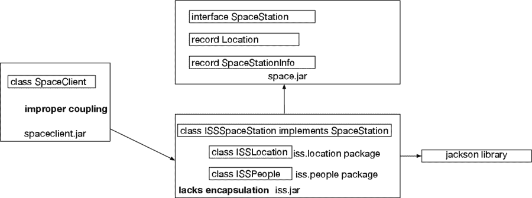

正如从图中看到的，应用程序由三个子项目组成，每个子项目由一个`JAR`表示：`space.jar`、`iss.jar`和`spaceclient.jar`。该团队使用 Maven 作为构建工具，并拥有可以运行的代码，用于获取国际空间站（ISS）的位置和占据者数据。

团队被指派改进应用程序的设计，使其能够扩展以添加新的空间站。让我们快速浏览一下这三个子项目中的现有代码。

### `space`子项目

`space`子项目通过一个接口和两个`record`提供了基础抽象。让我们先看看接口。

[creatingmodules/spaceinfov1/space/src/main/java/space/SpaceStation.java](http://media.pragprog.com/titles/vscajava/code/creatingmodules%2Fspaceinfov1%2Fspace%2Fsrc%2Fmain%2Fjava%2Fspace%2FSpaceStation.java)

```
package space;

public interface SpaceStation {
    SpaceInfo lookup();
}
```

接口提供了一个`lookup()`函数，用于返回站点信息。`lookup()`的结果是一个`SpaceInfo` record，如下所示：

[creatingmodules/spaceinfov1/space/src/main/java/space/SpaceInfo.java](http://media.pragprog.com/titles/vscajava/code/creatingmodules%2Fspaceinfov1%2Fspace%2Fsrc%2Fmain%2Fjava%2Fspace%2FSpaceInfo.java)

```java
package space;

public record SpaceInfo(Location location, List<String> occupants) {}
```

该`record`有两个组件：`Location`（它本身也是一个`record`）和一个占据者列表。`Location` record 了飞船当前所在的地球经纬度，如下：

[creatingmodules/spaceinfov1/space/src/main/java/space/Location.java](http://media.pragprog.com/titles/vscajava/code/creatingmodules%2Fspaceinfov1%2Fspace%2Fsrc%2Fmain%2Fjava%2Fspace%2FLocation.java)

```
package space;

public record Location(double latitude, double longitude) {}
```

创建此子项目的开发者初衷良好，为应用程序的其他部分创建一个可以依赖的抽象层。接下来来看`iss`子项目。

### `iss`子项目

`iss`子项目旨在关注`ISS`。编写此子项目的开发者发现并利用了提供位置和占据者详情的网络服务。

`ISSSpaceStation`类实现了`SpaceStation`接口并重写了`lookup()`方法。让我们来看看这个类的细节：

[creatingmodules/spaceinfov1/iss/src/main/java/iss/ISSSpaceStation.java](http://media.pragprog.com/titles/vscajava/code/creatingmodules%2Fspaceinfov1%2Fiss%2Fsrc%2Fmain%2Fjava%2Fiss%2FISSSpaceStation.java)

```
package iss;

public class ISSSpaceStation implements SpaceStation {
    public SpaceInfo lookup() {
        return new SpaceInfo(
            new ISSLocation().lookupLocation(),
            new ISSPeople().lookupPeople());
    }
}
```

所有处理这两个 Web 服务的代码都很好地封装在两个类中：`ISSLocation`和`ISSPeople`。`ISSSpaceStation`聚合了由这两个类提供的数据。

`ISSLocation`位置类负责了大量的性工作，即从 Web 服务获取位置并解析 JSON 响应：

[creatingmodules/spaceinfov1/iss/src/main/java/iss/location/ISSLocation.java](http://media.pragprog.com/titles/vscajava/code/creatingmodules%2Fspaceinfov1%2Fiss%2Fsrc%2Fmain%2Fjava%2Fiss%2Flocation%2FISSLocation.java)

```java
package iss.location;

public class ISSLocation {
    public Location lookupLocation() {
        //gets raw data from the iss-now URL and parses the JSON response
        //Please view the code from the book website for full listing
        //...
    }
}
```

`lookupLocation()`函数从 Web 服务获取数据，并使用 Jackson 库从 JSON 表示中解析并提取数据。

同样，`ISSPople`类也包含了获取 ISS 站内人员的代码：

[creatingmodules/spaceinfov1/iss/src/main/java/iss/people/ISSPeople.java](http://media.pragprog.com/titles/vscajava/code/creatingmodules%2Fspaceinfov1%2Fiss%2Fsrc%2Fmain%2Fjava%2Fiss%2Fpeople%2FISSPeople.java)

```java
package iss.people;

public class ISSPeople {
    public List<String> lookupPeople() {
        //gets raw data from the astros URL and parses the JSON response
        //Please view the code from the book website for full listing
        //...
    }
}
```

该子项目的开发者也做得相当不错，在他们所使用的`Java`版本允许范围内尽了最好。他们提供了一个抽象来获取数据，并将获取和解析数据的实现细节委托给位于不同包的独立类中。

让我们接下来来看最后一个子项目。

### `spaceclient`子项目

`spaceclient`子项目只有一个带有`main()`方法的类。另外两个子项目的设计者本希望该子项目的创建者能正确使用他们创建的抽象。但编写`SpaceClient`的程序员非常匆忙，并没有太关注设计意图。以下是`SpaceClient`的粗糙代码：

[creatingmodules/spaceinfov1/spaceclient/src/main/java/spaceclient/SpaceClient.java](http://media.pragprog.com/titles/vscajava/code/creatingmodules%2Fspaceinfov1%2Fspaceclient%2Fsrc%2Fmain%2Fjava%2Fspaceclient%2FSpaceClient.java)


```java
package spaceclient;

public class SpaceClient {
    public static void main(String[] args) {
        System.out.println("Please enter the space station you're interested in:");

        try(var scanner = new Scanner(System.in)) {
            var spaceStationName = scanner.nextLine();

            if(!spaceStationName.equals("ISS")) {
                System.out.println("Space station with name %s not found".formatted(
                    spaceStationName));
            } else {
                var issLocation = new ISSLocation();
                var location = issLocation.lookupLocation();

                System.out.println("Current latitude and longitude of %s: (%g, %g)".formatted(
                    spaceStationName,
                    location.latitude(),
                    location.longitude()));

                var issPeople = new ISSPeople();
                var occupants = issPeople.lookupPeople();
                System.out.println("Current occupants of %s: %s".formatted(
                    spaceStationName, String.join(", ", occupants)));
            }
        } catch (Exception ex) {
            System.out.println(ex.getMessage());
        }
    }
}
```

你可能会想，如果开发者将 `ISSLocation` 和 `ISSPeople` 类创建在与 `ISSSpaceStation` 相同的包中，并将它们标记为包级私有，那么这个问题是否就可以消除呢？遗憾的是，这仅提供了弱的封装——这些类仍然可以通过反射从外部使用——而且这使得 `ISSSpaceStation` 所属的 `iss` 包的内聚性降低。总的来说，这并不是一个好的设计。

从维护的角度来看，`SpaceClient` 类的设计是一场灾难。如果未来我们决定使用不同的 Web 服务来获取位置或居住者，我们可以为 `ISSLocation` 和 `ISSPeople` 创建替代类，并修改 `ISSSpaceStation` 以使用这些变体。但由于耦合不当，`SpaceClient` 要么会使用过时的实现，要么可能因为 `iss` 子项目本应属于内部细节的修改而被迫更改。正如我们所讨论的，这就是在 `iss` 子项目中违反开闭原则的结果。

`SpaceClient` 的设计还有另一个主要问题。在未来当有新的空间站投入使用时，代码将变得非常臃肿。理想情况下，`SpaceStation` 接口实现的创建应该被封装在一个工厂中，而客户端代码应该只使用 `SpaceStation` 接口。但目前的设计使得客户端代码与实现细节之间存在不当且紧密的耦合。可能很容易指责 `iss` 子项目的开发人员，在更大程度上指责 `spaceclient` 子项目的开发人员。但真正的罪魁祸首是缺乏清晰度，因为你无法强力封装包中的成员，也无法在代码中指定预期的用途。

上述设计是架构师的噩梦。面对这种缺乏封装和紧密耦合的情况，他们将无法安眠。接下来我们将看到模块化功能如何为架构师和程序员消除这些痛苦。

### 空间站应用程序的模块化

让我们看看模块化如何帮助解决我们刚刚讨论的设计缺陷。

我们希望强封装 `iss.jar` 文件中的代码，并消除 `spaceclient.jar` 中的代码与那些旨在供 `iss.jar` 内部使用的类之间的紧密耦合。模块化可以直接帮助我们实现这两个目标。

要创建一个模块，我们需要定义一个模块声明。模块声明定义在一个名为 `module-info.java` 的文件中。这通常保留在源码目录的顶层，即包层次结构开始的地方。然而，无论该文件放在哪里，在编译时，`module-info.class` 都应该位于 JAR 文件的顶层。Java 在那里查找模块声明（即 `module-info.class` 文件），以确定一个 JAR 是否是显式命名模块。

我们将为每个子项目定义模块声明，并清晰地指定依赖关系封装边界。从 3.0 版本开始，Maven 能够与 Java 模块协同工作。如之前提到的，我们的模块化工作是补充构建步骤而非替代构建步骤。让我们从模块化应用的步骤开始。

### `space` 子项目的模块化

让我们先从 `space` 子项目的模块化开始。

我们在 `space/src/main/java` 目录下为 `space` 子项目创建一个 `module-info.java` 文件。下图显示了 `module-info.java` 文件相对于该子项目其他源文件的位置：

| � | . |
|---|---|
|   | &#124;____iss |
|   | &#124; &#124;____... |
|   | &#124;____pom.xml |
|   | &#124;____run.sh |
|   | &#124;____spaceclient |
|   | &#124; &#124;____... |
|   | &#124;____space |
|   | &#124; &#124;____pom.xml |
|   | &#124; &#124;____src |
|   | &#124; &#124; &#124;____test |
|   | &#124; &#124; &#124; &#124;____... |
|   | &#124; &#124; &#124;____main |
|   | &#124; &#124; &#124; &#124;____java |
|   | &#124; &#124; &#124; &#124; &#124;____module-info.java |
|   | &#124; &#124; &#124; &#124; &#124; &#124;____Location.java |
|   | &#124; &#124; &#124; &#124; &#124; &#124;____SpaceStationInfo.java |
|   | &#124; &#124; &#124; &#124; &#124; &#124;____SpaceStation.java |

`module-info.java` 将指定模块名称。模块名称遵循与包名相同的命名规范。此外，模块会导出它想要提供的包。它还需要它想要使用的模块。

`module-info.java` 将指定模块名称。模块名称遵循与包名相同的命名规范。此外，模块会导出它想要提供的包。它还需要它想要使用的模块。

```java
module space {
    exports space;
}
```

### `iss` 子项目的模块化

让我们在 `iss/src/main/java` 目录下为 `iss` 子项目创建一个 `module-info.java` 文件。我们将指定模块名称，此外，我们必须指定该模块将需要什么以及将导出什么。

`iss.jar` 包含了供外部使用的 `ISSSpaceStation` 类，但它使用的两个类 `ISSLocation` 和 `ISSPeople` 仅供内部使用。我们可以在 `module-info.java` 中轻松地指定这些设计约束，如下所示：

```java
module iss.info {
    exports iss;
    requires space.base;
    requires jackson.databind;
}
```

然而，我们确实显式地需要 `jackson.databind` 模块。我们的应用程序使用了 Jackson 库的旧 JAR 包。从安全角度来看，我们应该升级到修复了高危漏洞的新版本。但如果我们决定推迟升级，你会发现 Java 足够智能，可以将这些旧的 JAR 包视为自动模块，并为我们合成必要的模块描述。默认情况下，模块名是从 JAR 文件名推断出来的，因此我们需要 `jackson.databind`——这是从 JAR 文件 `jackson-databind-2.6.7.jar` 合成的模块名。与其使用 Jackson 库的旧 JAR 包，我们也可以使用更现代的模块化版本。但在将 JAR 转换为显式命名的模块之后，将此作为一个独立的步骤处理是个好主意，以防该库的新旧版本之间存在任何兼容性问题（尽管你会发现在这种情况下并没有这些问题）。

你很快就会发现，模块化功能提供的封装是非常严密的，并且加强了我们希望在 `iss.info` 模块中实现的合约和约束。

最后，让我们把 `spaceclient` 子项目模块化。

### 模块化 `spaceclient` 子项目

作为最后一步，让我们在 `spaceclient/src/main/java` 目录下创建 `module-info.java`：

```java
module space.client {
    requires space.base;
    requires iss.info;
}
```

该文件表示 `space.client` 模块依赖 `space.base` 模块的接口和记录。它还想使用 `iss.info` 模块的成员——目前客户端正在使用 `ISSLocation` 和 `ISSPeople` 类。

让我们看看此更改将如何影响构建。再次，无需更改 Maven 构建文件中的任何内容。只需运行 `run.sh` 执行 `mvn package` 命令并观察：

```text
...
[ERROR] COMPILATION ERROR :
[INFO] -------------------------------------------------------------
[ERROR] .../SpaceClient.java:[4,11] package iss.location is not visible
(package iss.location is declared in module iss.info,
which does not export it)
[ERROR] .../SpaceClient.java:[5,11] package iss.people is not visible
(package iss.people is declared in module iss.info,
which does not export it)
[INFO] 2 errors
...
```

前两个 JAR 包 `space.jar` 和 `iss.jar` 的编译和创建顺利完成。但客户端代码的编译失败了。

来自模块代码的错误信息是极佳的，清晰度无可比拟。信息明确指出客户端不允许直接访问 `iss.location` 和 `iss.people` 包的成员。也就是说，客户端不允许使用 `ISSLocation` 类和 `ISSPeople` 类。

`iss.jar` 文件中 `iss.base` 模块的模块声明做得非常好——它清晰地定义了封装边界，并指定 `iss` 包（即 `ISSSpaceStation` 类）可以在外部使用，但无法使用 `iss.jar` 中任何其他包的成员。这种级别的封装与构建工具提供的功能是正交的；它将“什么可以使用”放在代码中，将“如何打包”放在构建工具中——这是正确的关注分离。

由于 `ISSLocation` 和 `ISSPeople` 类不可见，我们必须重构客户端代码以使用 `ISSSpaceStation` 类，从而消除不当的耦合，如下所示：

```java
public class SpaceClient {
    public static void main(String[] args) {
        System.out.println("请输入你感兴趣的空间站:");

        try(var scanner = new Scanner(System.in)) {
            var spaceStationName = scanner.nextLine();

            if(!spaceStationName.equals("ISS")) {
                System.out.println("未找到名为 %s 的空间站".formatted(
                    spaceStationName));
            } else {
                var spaceStation = new ISSSpaceStation();
                var spaceStationInfo = spaceStation.lookup();

                System.out.println("%s 的当前经纬度为: (%g, %g)".formatted(
                    spaceStationName,
                    spaceStationInfo.location().latitude(),
                    spaceStationInfo.location().longitude()));
            }
        } catch (Exception ex) {
            System.out.println(ex.getMessage());
        }
    }
}
```

模块仅可以使用它们特定需要的内容。这一约束严格地控制了在运行时可以执行哪些代码。你可以放心你的代码没有调用任何未经授权的代码段。这让你对代码的安全性具有极大的控制力。例如，在模块化 `iss` 子项目中，`iss.info` 模块的 `module-info.java` 文件需要 `space.base` 和 `jackson.databind`。此外，它隐式地需要 `java.base` 模块。`iss.info` 模块中的代码被限制只能使用这三个模块的代码。对任何其他地方代码的引用都将导致编译错误。

模块只能使用通过导出（`exports`）提供给它们的内容。模块不能在编译时或运行时绕过并访问未公开的代码。这极大地增强了你代码的封装性。你不需要担心更改你认为是模块内部的内容，因为在编译时或运行时，它对你模块外部的任何代码都是不可见的。我们亲眼看到了这一点，例如，在模块化 `spaceclient` 子项目章节的开头。`space.client` 模块编译失败，因为它内部的代码使用了未由 `iss.info` 模块导出的包中的类。我们在模块化 `iss` 子项目中看到的 `module-info.java` 文件只导出了 `iss` 包，而没有导出 `iss.location` 或 `iss.people` 包。

虽然你可以导出包，但你只能要求模块。模块无法表达对包或模块部分的依赖。这是基于“重用/发布等效原则”（Reuse/Release Equivalency Principle）。模块形成了一个凝聚单元，所有成员共同为了一个目标工作。它不应该允许将模块分成两个部分，其中一部分对某些模块感兴趣，另一部分对其他模块感兴趣。通过要求我们使用模块，模块系统的设计者提醒我们要使模块具有凝聚性并遵循单一职责原则。我们在 `space.client` 模块与 `iss.info` 模块的关系中看到了这种约束。尽管我们在模块化 `iss` 子项目中编写的 `iss.info` 模块的 `module-info.java` 导出了一个包，但在模块化 `spaceclient` 子项目中 `space.client` 模块的 `module-info.java` 要求的是模块而不是包。

在编译时，模块不允许存在循环依赖。例如，在空间站信息应用中，`iss.info` 模块依赖于 `space.base` 模块。这通过 `module-info.java` 文件中的 `requires space.base` 指定。`space.base` 模块不允许要求 `iss.info` 模块或任何反过来可能需要 `iss.info` 的模块。模块遵循无循环依赖原则（[11)），在编译时检测到的任何循环依赖将导致错误。例如，如果我们在 `space.base` 模块或 `iss.info` 模块的 `module-info.java` 文件中添加 `requires space.client`，我们将由于循环依赖而导致编译错误。

一个模块可以包含多个包。但包不允许跨多个模块划分。模块要求包必须完全包含在一个模块内。没有人可以通过增强你的包来获取其内部实现。这消除了可能通过在另一个模块中创建同名包来访问你包内部内容的可能性。这是模块增强安全性的另一种方式。作为一项实验，尝试创建一个属于 `iss` 包但位于 `space.client` 模块代码库中的类，观察 Java 编译器如何警告这种操作。

同一个模块不允许在模块路径（modulepath）中出现一次以上。如果在编译时或运行时在两个或多个文件中发现同一个模块，编译或执行将迅速带错误终止。这同时也防止了任何人增强你的模块。


在下一章节中，我们将讨论一些你将在使用模块进行编程时会发现非常有用的工具。

## 总结

模块化是一个架构方面的问题。通过 Java 的模块化能力，你可以利用 Java 编译器和 JVM 来强制模块的强封装以及模块之间的严格边界。通过这种机制，你可以让你的应用程序更安全，并轻松验证与依赖相关的架构规范。

你学习了如何定义模块，以及如何使用模块声明来定义模块导出和需要的内容。你还学习了如何使用`module-info.java`文件来清晰地指定模块之间的依赖关系。Java 在编译时和运行时都严格遵守你模块的封装边界。使用模块化机制，你可以创建更安全且能够更好地管理依赖的应用程序。

在下一章节中，我们将查看一些帮助我们有效处理模块的工具和技术。

## 脚注

[10

[`github.com/FasterXML/jackson`](https://github.com/FasterXML/jackson)

[11

Copyright © 2025, The Pragmatic Bookshelf.

# 第 9 章：使用模块

在上一章节中，你学习了模块的好处以及如何创建它们。在本章中，我们将探索模块元数据。你将学习当模块暴露其他模块的 API 时如何表达依赖关系，以及在部署模块化应用程序时如何减少足迹。

在创建企业级应用程序时，你通常会处理数百个 JAR 文件。一旦你对应用程序模块化并将依赖项升级到各自的模块化版本，你将处理数百个模块。这可能在你脑海中引起几个问题：

- 你到底如何知道某个特定模块依赖于哪些模块？
- 当你模块的用户也需要你的代码所依赖的模块时，你该如何处理这种情况？
- 如果你的代码在运行时只需要少数模块，你是否必须部署 Java 提供的所有模块？还有你的构建引用的所有第三方模块呢？

你将在本章中找到这些问题的答案。

让我们从第一个问题开始。生活中有很多奇趣的事可以好奇，但模块的依赖关系不应该是其中之一。幸运的是，正如我们很快看到的，`jar`工具已经得到了增强，可以轻松地查看模块的元数据。使用该工具，你可以立即知道一个模块依赖于什么，它向他人公开了哪些内容，以及其他模块中有哪些你可以使用的内容。此外，你还可以轻松验证只有你模块中打算提供给其他部分对外部使用是可见的。

在创建模块时，你经常从其他模块导入 API 供内部使用。假设你决定将其中一些 API（例如类、接口和枚举）作为你模块 API 的一部分。默认情况下，你模块的用户必须显式地配置对你作为 API 的一部分的每个模块的依赖。这相当是额外的工作，而且配置可能会变得混乱且难以处理。为了减轻这种痛苦，Java 提供了传递依赖（transitive dependency）选项。我们将看到如何使用此选项，以及在何时以及为什么避免它可能更好。

自 Java 在几十年前引入以来，软件开发已经取得了长足的发展。在云原生应用、无服务器计算和微服务的世界中，我们希望快速启动轻量级的服务实例，而在某些情况下，安装完整的 JRE 可能并不是理想选择。Java 提供了一种用于针对性链接的简单方法——使用`jlink`工具——这样我们就可以只为部署包含必要的二进制文件，而不是包含整个 JRE。只有模块化的应用程序才能被精简，而通过使用此工具，我们可以严格控制部署到生产环境中的二进制文件。从安全的角度来看，你可以确信生产环境中仅包含你的团队审核过的模块，没有其他任何内容可以在生产环境中被调用。

在本章中，我们首先将深入研究`jar`工具以检查模块元数据，从而查看 JAR 包依赖于哪些模块，以及它导出了哪些包供外部使用。接着，我们将深入研究传递性依赖，并查看该功能的几个引人注目的用例。我们还将讨论何时指定传递性依赖是合适的，而在何时应该避免。最后，我们将通过详细介绍如何创建用于快速方便部署的特定二进制文件来完成本章的总结。

## 探索模块元数据

在上一章中，我们讨论了模块化是一个架构问题。我们模块化和结构化应用程序的方式对于参与开发的多个人员都很重要，从程序员到 DevOps 人员再到架构师。程序员使用模块来重用代码，为此，他们需要知道不同模块暴露了什么，以及它们反过来依赖于什么。架构师希望确保模块之间的依赖符合他们设定的架构约束。架构师和 DevOps 人员都希望清楚了解系统中的真实依赖关系，当某个流行的 Java 库出现另一个安全漏洞的消息在互联网上传播时，这对他们来说尤为关键。简而言之，人们切需要快速了解模块中包含的内容、谁可以访问它，以及应用程序中实际使用了哪些模块。这些细节是模块元数据的一部分，我们有一个工具可以帮助我们轻松快速地检查这些细节。

模块的细节——它的名称、它导出的包、它所需的模块等——都作为模块元数据的一部分存储在 JAR 文件中。编译器和运行时使用这些元数据来验证并允许对模块各个各个部分的访问。你可以通过向`jar`命令工具传递`-d`选项来查询模块元数据。

如果 JAR 包具有模块描述符，则从该文件中提取细节。如果 JAR 包没有模块描述符，则 Java 可以自动合成这些细节。我们将检查一个没有模块描述符的 JAR 和一个带有模块描述符的 JAR。

在第 8 章模块 Java 应用程序中，我们创建了几个模块并使用了旧版本的 Jackson 库。让我们先检查 Jackson 库中一个 JAR 文件的模块元数据。

让我们继续处理在空间站应用程序中运行的示例。在命令行中，切换到`spaceclient/target/dependency`目录。在该目录的 JAR 文件中，你会找到`jackson-annotation-2.6.0.jar`文件。这是该库旧版本的一部分，该 JAR 不包含模块描述符。让我们对该 jar 运行带有`-d`选项的`jar`命令，如下：

```
> jar -d -f jackson-annotations-2.6.0.jar

No module descriptor found. Derived automatic module.

jackson.annotations@2.6.0 automatic
requires java.base mandated
contains com.fasterxml.jackson.annotation
```

由于 JAR 包没有模块描述符，Java 会自动合成模块细节，将该 JAR 视为自动模块。除非在清单文件中指定了自动模块名称，否则自动模块的名称将从 JAR 文件名合成。在输出中，我们可以看到模块名称被合为`jackson.annotations`，该模块需要`java.base`，并且包含包`com.fasterxml.jackson.annotation`。对于自动模块，Java 会自动要求它需要的所有模块，并导出它包含的所有包。

现在让我们检查一个显式命名的模块，即带有模块描述符的模块。

```
> jar -d -f iss-1.0.jar

iss.info jar:file:...target/dependency/iss-1.0.jar!/module-info.class
exports iss
requires jackson.databind
requires java.base mandated
requires space.base
```

我们检查了`iss-1.0.jar`文件。`jar`工具告诉我们模块名称是`iss.info`，它导出了`iss`包，并且需要三个模块：`jackson.databind`、`java.base`和`space.base`。

除了查看模块细节外，你还可以通过编程提取这些信息。这对于实现检查以验证模块之间依赖的架构约束非常有用。

模块对另一个模块的依赖可以是简单的，也可以是传递的，正如我们接下来将看到的。

## 以模块化的方式定义 API

模块的`exports`定义了模块所有者承诺支持的 API。如果一个模块的 API 暴露了它所需要的模块的类型呢？错误的做法是让模块的用户直接要求该模块所要求的每一个模块。`requires transitive`是模块所有者刻意承诺支持其所需求模块的 API 的一种合理方式。通过这种方式，模块所有者可以将其所需求模块的 API 作为其自身 API 的一部分进行支持。让我们在本节中进一步探讨这一点。

正如我们已经看到的，如果一个模块需要另一个模块，我们必须在模块描述符中指定该依赖。`requires`子句允许请求模块访问被请求模块的导出包。默认情况下，`requires`的合约到此为止——请求模块不会将访问权限传递给任何依赖它的其他模块。但在某些情况下，我们可能需要更多的活性。我们将讨论这些原因，并查看`requires transitive`如何帮助这些特殊情况。

在两种情况下，我们希望模块向需要它的其他模块暴露其所需要的模块中定义的 API。第一种是模块内部的代码作为其 API 的一部分暴露了它所需要模块的类型。另一种是我们将模块重构为更小的模块。让我们分别关注这些情况。

### 使用传递性暴露第三方类型

假设你在你的一个类中设计了一个方法，接收一个定义在第三方模块中的类型作为参数。或者在另一种情况下，假设你其中一个方法的返回类型来自第三方模块。显然，你必须使用`requires`来表达对第三方模块的依赖。但你的模块的用户呢？在这种情况下，你的类和方法的用户需要引用你的 API 暴露的类型。你的模块客户端需要同时要求你的模块以及带有你 API 暴露类型的模块吗？不，这将是错误的方法，如果我们选择这条路线，客户端的模块描述符将很快变得混乱且难以维护。通过正确的方法，在你的模块描述符中使用`requires transitive`，你可以减轻模块用户的痛苦。让我们通过示例更深入地观察此功能。

让我们再次查看来自模块化空间站应用的飞船应用。这里是`iss.info`模块的模块描述符：

```
module iss.info {
    exports iss;
    requires space.base;
    requires jackson.databind;
}
```

而这里是`space.client`模块的模块描述符：

```
module space.client {
    requires space.base;
    requires iss.info;
}
```

通过这两个描述符可以看出，`iss.info`模块和`space.client`模块都需要`space.base`模块。依赖关系如图所示：

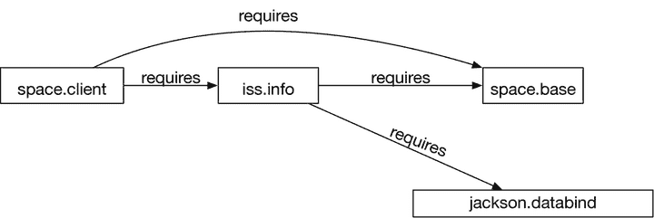

`iss.info`使用`requires`对`jackson.databind`模块进行依赖是符合逻辑的。`iss.info`模块中的代码目前使用了 Jackson 库，未来可能会选择使用其他库。它使用 Jackson 库是其内部业务，应该保持封装，没有理由让`space.client`这样的`iss.info`客户端知道这件事。

另一方面，`iss.info`模块中`ISSSpaceStation`类的`lookup()`方法返回`space.base`模块部分的`SpaceStationInfo`。为了让`iss.info`的客户端能够正确使用`lookup()`方法，它们除了需要`iss.info`模块外，还必须需要`space.base`模块。从`space.client`模块的模块描述符可以看出，这对于其客户端来说是一项不必要的额外工作。

我们可以通过更改模块描述符来消除`iss.info`客户端的这种额外负担，如下：

```
module iss.info {
    exports iss;
    requires transitive space.base;
    requires jackson.databind;
}
```

我们在表示`iss.info`模块对`space.base`模块的依赖时，将`requires`改为了`requires transitive`。现在，我们可以更改`space.client`模块的模块描述符，将对`space.base`的显式依赖转换为传递或隐式依赖，如下：

```
module space.client {
    requires iss.info;
}
```

`iss.info`的客户端不需要额外表示对`space.base`模块的依赖。得益于传递依赖，它们自动获得了该依赖。

一个模块直接依赖的另一个模块被称为“需要”该模块。如果依赖是通过传递依赖引入的，则该模块被称为“读取”该模块。在上例中，`space.client`需要`iss.info`，但正如我们在图中修改后的依赖关系所示，它读取了`space.base`：

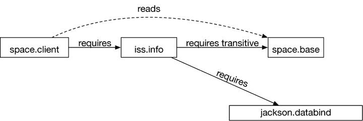

减轻客户端负担是使用`requires transitive`的一个良好理由，但重构时不破坏现有的客户端同样重要。让我们接下来来看这种场景。

### 在重构模块时使用传递依赖

假设你有一个模块，如图所示的`Module A`，其中包含几个包。你的团队意识到该模块太大、内聚性不佳、违反了“发布/重用等效原则”，并且由于不同部分的变更导致其更改过于频繁。他们决定是时候将这个大模块拆分为更小的模块了，以遵循单一职责原则并使代码更具维护性。

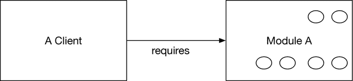

假设重构的最终结果是模块`Module 1`、`Module 2`和`Module 3`，每个模块都具有高内聚性，并包含原始`Module A`的几个包。重构后的设计所示。

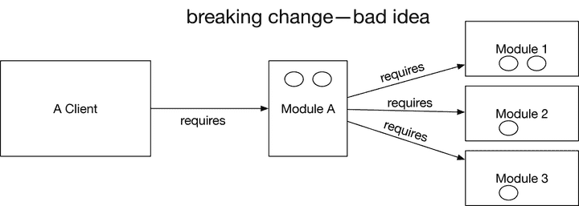

你的团队应该完全自由地进行此类重构并改进设计。但如果你不小心，就有破坏任何使用`Module A`客户端的风险。

重构后，`Module A`的模块描述符现在可以使用`requires`来表示对`Module 1`、`Module 2`和`Module 3`的依赖。但对于任何使用原本在`Module A`中现在已移动到任何较小模块中的包的客户端，编译将失败。即使`Module 1`出了它包含的包，描述符未更改的客户端也将被允许访问`Module 1`中的包，因为它需要的是`Module A`而不是`Module 1`。遗憾的是，使用`Module A`的客户端作者现在被迫更改它们的模块描述符，以添加对`Module 1`的`requires`等。此类破坏性变更不会给开发世界带来更多和平。幸运的是，有一种简单的方法可以避免这个问题。

在重构时，不要在`Module A`的模块描述符中使用`requires`，而是使用`requires transitive`，如下。

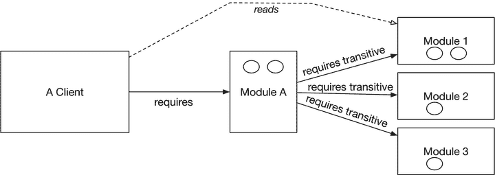

`Module A`模块描述符通过`requires transitive`表示它对拆分后的每个模块的依赖。这一小变化的结果是，使用`Module A`的现有客户端不会失败，也不需要强制更改。任何需要`Module A`的客户端也都获得了`Module A`所需传递模块的访问权限。

使用传递依赖避免破坏客户端。

接下来我们将查看一种减少体积的方法。

### 我们应该总是使用 transitive 吗？

人们可能想问是否应该总是用`requires transitive`代替`requires`？

不，并不是总是。

内部的内容应该保持内部。例如，在飞船应用中，Jackson 库被`iss.info`模块使用。该依赖应该使用`requires`而不是`requires transitive`。`iss.info`的客户端不应通过对该模块的依赖获取 Jackson 库。如果客户端恰好需要 Jackson 库，那是他们的问题，而不是`iss.info`模块设计者的考虑。此外，如果`iss.info`模块的作者未来决定使用其他库，这种更改应该是内部的，不会以任何方式影响模块客户端。

如果你的模块代码暴露了另一个模块的类型，即你的公共可见函数使用模块的类型作为参数或返回类型，则使用`requires transitive`。如果你决定拆分模块且提取出的模块中的类型对模块客户端可见，也使用`requires transitive`。如果拆分后的模块仅包含未导出的包，则仅使用`requires`而不是`requires transitive`。

## 使用 jlink 进行目标链接

如果我们的应用只使用少数模块，我们希望将安装内容精简到仅包含这些模块，而不是安装 JDK 中包含的所有模块。你可以使用`jlink`工具在不更改任何代码的情况下实现这一目标。它执行针对性链接（targeted linking），对用于部署的二进制文件进行精简。你只需指向顶层模块，工具就会将所需的模块尽可能地打包在一起。你还可以要求工具创建一个启动器（launcher），方便你轻松运行应用程序。

尽管使用`jlink`不需要更改代码，但该工具无法与自动模块（automatic modules）配合。无法使用自动模块或传统 JAR 的原因是依赖必须被明确指定；带有模块描述符（module descriptors）的式模块提供了`jlink`所依赖的可靠配置。


你的典型企业级应用会使用成百甚至上千个 `JAR` 以及多个库和框架，如 `Micronaut`、`Quarkus`、`Spring` 等。当你对代码模块化并使用依赖的这些库和框架的模块化版本时，你可以精简进入生产环境的模块。除了更小的 footprint 外，这还提供了额外的安全优势——你明确规定了哪些内容进入生产系统，只有核心部分，没有任何多余内容。

### 针对性链接

让我们使用之前模块化的飞船应用来创建一个针对性链接。

第一步，由于 `jlink` 无法使用自动模块，我们必须将 `Jackson` 库从旧版本升级到模块化版本。让我们从版本 `2.6.7` 升级到较新的版本，如 `2.18.2`。你可以看到代码仓库中 `spaceinfov5/iss/pom.xml` 的 Maven `pom` 文件反映了这一变化。

如果你愿意，可以直接从命令行使用 `jlink` 工具，但如果你在使用 `Maven` 等构建工具，将针对性链接整合到构建步骤中会更方便。`Maven` 有一个 `jlink` 插件来实现这一点。

查看 `code/multiplemodules/spaceinfov5` 目录下的 `pom.xml` 文件了解 `jlink` 插件的配置。除了此配置外，我们还创建了一个名为 `mod-jlink` 的新 Maven 模块。在这个新 Maven 模块的 `pom` 文件中，我们表达了对 `spaceclient` 模块的依赖。

针对针对性链接，`jlink` 还可以创建一个启动器来轻松启动应用程序。你可以在 Maven `pom` 文件中使用启动器属性，配合模块名称和主类配置启动器的名称，如下：

```xml
<launcher>spaceclientapp=space.client/spaceclient.SpaceClient</launcher>
```

关于该行代码用处的完整示例，请参考 `spaceinfov5` 目录下的 `pom.xml`。

跟着练习创建一个针对性链接。在命令行中，使用 `cd` 进入 `spaceinfov5` 目录并运行以下命令：

```bash
./multiplemodules/spaceinfov5/run.sh
mvn package
```

运行该命令将编译三个不同的项目并创建一个针对性链接。以下是创建的文件预览：

`mod-jlink/target/maven-jlink/default` 的内容：

```text
bin conf include legal lib release
```

`mod-jlink/target/maven-jlink/default/bin` 的内容：

```text
java keytool spaceclientapp
```

我们可以看到 `jlink` 工具创建了一个特殊的 `java`，我们将其称为珍贵的小 `java`。此外，它还创建了一个名为 `spaceclientapp` 的易于启动的二进制文件。这些针对性链接适用于执行构建的特定操作系统。你可以将这些二进制文件部署在相同的架构上、云端或独立机器上。

### 检查针对性二进制文件

让我们深入检查这些针对性二进制文件。首先，运行此命令查看作为 JDK 部分的“JRE java 中的模块数量”：

```bash
./multiplemodules/spaceinfov5/run.sh
echo "number of modules in the JRE java"
java --list-modules | wc -l
```

输出显示了 JDK 部分的模块数量：

```text
JRE java 中的模块数量

69
```

这些是 JDK 包含的所有模块，并且不包括我们应用特定需要的任何第三方模块，例如 `Jackson` databind 模块。

现在，让我们看看我们珍贵的小 `java` 包含多少模块：

```bash
./multiplemodules/spaceinfov5/run.sh
echo "number of modules in our precious little java"
mod-jlink/target/maven-jlink/default/bin/java --list-modules | wc -l
```

上一个命令的输出显示在这里：

```text
我们珍贵的小 java 中的模块数量

8
```

这少得多，但你可能好奇它们是什么。让我们使用以下命令进一步检查：

```bash
./multiplemodules/spaceinfov5/run.sh
echo "modules in our precious little java"
mod-jlink/target/maven-jlink/default/bin/java --list-modules
```

让我们看看输出：

```text
我们珍贵的小 java 中的模块

com.fasterxml.jackson.annotation@2.18.2
com.fasterxml.jackson.core@2.18.2
com.fasterxml.jackson.databind@2.18.2
iss.info
java.base@24
java.logging@24
space.base
space.client
```

我们珍贵的小 `java` 中的模块只有我们需要的：`space.client`、它需要的 `iss.info` 以及 `space.base`。此外，`Jackson` 库模块也被 `jlink` 引入了。

通过针对性链接，我们不需要在目标机器上安装 JRE。相反，我们可以部署由 `jlink` 生成的文件。让我们用以下命令执行珍贵的小 `java`：

```bash
./multiplemodules/spaceinfov5/run.sh
echo "Running the targeted java"
mod-jlink/target/maven-jlink/default/bin/java -m space.client/space.SpaceClient
```

我们指定要执行的模块名称和主类。执行结果所示：

```text
运行针对性 java

请输入你感兴趣的空间站

ISS

ISS 的当前经纬度: (50.8094, -112.415)

ISS 的当前人员: Oleg Kononenko, Nikolai Chub,
Tracy Caldwell Dyson, Matthew Dominick, Michael Barratt,
Jeanette Epps, Alexander Grebenkin, Butch Wilmore,
Sunita Williams
```

与其运行珍贵的小 `java`，我们还可以运行创建的启动器。在这种情况下，我们不需要指定模块和主类，因为创建启动器时已经提供了。这是运行启动器的命令：

```bash
./multiplemodules/spaceinfov5/run.sh
echo "Running the launcher"
mod-jlink/target/maven-jlink/default/bin/spaceclientapp
```

这种更简单的执行选项的输出所示：

```text
运行启动器

请输入你感兴趣的空间站

ISS

ISS 的当前经纬度: (50.7912, -112.560)

ISS 的当前人员: Oleg Kononenko, Nikolai Chub,
Tracy Caldwell Dyson, Matthew Dominick, Michael Barratt,
Jeanette Epps, Alexander Grebenkin, Butch Wilmore, Sunita Williams
```

`jlink` 工具提供了一个方便的构建后设施，与整个 JRE 相比，它可以创建内存占用更小的目标二进制文件。这些二进制文件是针对构建它们时的特定操作系统定制的。你可以部署这些二进制文件，而不是安装整个 JRE，并轻松地执行程序。除了减少空间占用外，由于我们能够严格控制生产环境的内容，使用 `jlink` 还可以提高应用程序的安全性。

### 结语

模块携带了自己的元数据，通过 `jar` 工具，我们可以快速轻松地检查模块的依赖关系以及它导出的包。

在构建具有多个依赖的大型应用时，`require transitive`（传递依赖）功能会非常有帮助。当被依赖模块中的类型用作调用模块公共 API 的一部分时，该功能非常有用。使用时，`require transitive` 将减轻客户端的负担，因为它们会自动获得其依赖的模块所暴露的类型的依赖。此外，在重构大型模块时，此功能是无价的。

除了方便大型企业系统外，Java 还通过提供目标链接能力关注更现代的应用程序（如微服务）。有了此功能，我们无需部署完整的 JRE，而是可以部署仅包含核心模块和二进制文件的较小包。

在下一章中，我们将查看 Java 的另一个令人兴奋的功能：动态发现嵌入在多个模块中的服务，以及这种能力对于创建插件是多么有用。

Copyright © 2025, The Pragmatic Bookshelf.

# 第 10 章：使用 `ServiceLoader` 创建插件

我们到目前看到的与模块相关的规则对于正在实现客户端/服务器架构、微服务架构或其他许多其他架构模式的人来说是有用的。但如果你正在实现插件架构，你需要一些额外的支持来将应用程序模块化。

在插件架构中，我们通常提供一组接口和一些核心功能。然后，我们允许应用程序的用户放入接口的实现。我们的应用程序预先不知道用户将提供哪些插件。这就是 `java.util` 包中 `ServiceLoader` 类的用场。

在之前的章节中，我们看到为了使用另一个模块的 API，必须在消费模块的 `module-info` 文件中显式指定依赖关系。我们看到了这种限制的架构益处。在实现插件架构时，显式指定依赖是不现实的，因为我们需要在运行时动态发现接口实现的能力。本章的重点是看如何在不损害安全或封装性的情况下实现这一目标。

在本章中，我们将查看 `ServiceLoader` 类如何提供一种惊不起的能力，能够动态引入依赖，同时安全地将代码部分相互解耦。我们将看到 `Abstract Factory Pattern`（抽象工厂模式）的应用，以及迭代和利用接口各种实现的不同方法。通过在本章中获得的知识，你可以获得使用模块的好处，同时创建出高度扩展的应用程序。

## 插件架构

Java 模块促进了流行的插件架构的。这种架构由一组核心功能、一个仓库和一个公共用户界面组成。应用程序的用户在此架构的基础上构建，并通过应用程序指定的某些已知接口提供实现或插件来扩展应用程序的功能。这些扩展可能提供基于技术的变体（例如数据如何解析或处理），和/或基于领域的变体（例如在线零售商可能想要使用的不同运输方式）。

插件架构在标准化一组通用操作的同时，提供了极大的扩展性。插件或变体可以随时引入或移除，且它们不需要更改代码、重新编译或重新部署应用程序的核心部分来适应插件的变化。插件的引入可能需要重启应用程序，也可能是无需重启的热部署部署。

Eclipse、PMD 和 Jenkins 是插件架构的一些知名实现。我们在第 8 章中看过的空间站信息应用程序可能是插件架构的一个很好的候选者。例如，我们可以将新飞船的信息提供者作为插件引入。在本章之后，你可以作为一个练习，重构该应用程序以利用你在本章中学习到的设施。

让我们让我们创建一个新应用程序，看看模块化如何促进插件架构的实现。为了跟当前的社会趋势，假设一家餐厅要求我们实现一个从餐桌点餐的应用程序。我们将关注客户可能点点饮料的一小部分。

我们被告知，由于餐厅与供应商之间的合同变化，可能会随时更改他们提供的饮料。我们显然不想在每次添加或删除一种新类型的饮料时都更改代码。

我们可以在图中构思关于点餐部分和软饮料的应用程序架构。

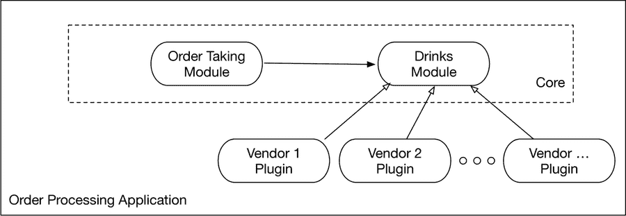

该应用程序有一个核心，核心由两个模块组成：点餐模块（Order Taking Module）和饮料模块（Drinks Module）。任意数量的插件（每个提供某种类型饮料的供应商对应一个）可能会作为额外的模块出现在应用程序中。

让我们实现这一架构概念，看看 `ServiceLoader` 如何提供动态依赖发现、松耦合以及接口到接口使用者的绑定。加满你最喜欢的饮料，开始之旅吧。我们将从饮料模块开始。

### 定义规范模块

应用程序应该向客户提供不同的饮料并让他们做出选择。不同的供应商可能提供不同的饮料，但应用程序可以抽象出一些由供应商提供的细节。这可以放入 `com.restaurants.drinks` 模块。

我们将保持代码极简，专注于关注模块的设计而非应用程序的复杂细节（如定价等）。我们将从 `Drink` 接口开始：

```java
package com.restaurants.products;

public interface Drink {
    String getName();
    int getSize();

    default String getInfo() {
        return "%s [%d]ml".formatted(getName(), getSize());
    }
}
```

在 `drinks` 目录下，我们在 `com.restaurants.products` 包中创建了 `Drink` 接口。该接口将作为供应商提供的饮料产品的基础。

接下来，我们将创建一个注解，供应商可以使用它来区分对人体损害相对较小的产品。

[`serviceloader/softdrink/drinks/com/restaurants/health/LowCalorie.java`](http://media.pragprog.com/titles/vscajava/code/serviceloader%2Fsoftdrink%2Fdrinks%2Fcom%2Frestaurants%2Fhealth%2FLowCalorie.java)

```java
package com.restaurants.health;

import java.lang.annotation.Retention;
import java.lang.annotation.RetentionPolicy;

@Retention(RetentionPolicy.RUNTIME)
public @interface LowCalorie {
}
```

该注解将在运行时被保留，正如我们稍后看到的，如果客户只想选择低热量饮料，就可以使用它。

规范模块几乎已经准备就绪，我们需要指定模块名称和导出的包。以下是该模块的 `module-info.java`：

[`serviceloader/softdrink/drinks/module-info.java`](http://media.pragprog.com/titles/vscajava/code/serviceloader%2Fsoftdrink%2Fdrinks%2Fmodule-info.java)

```java
module com.restaurants.drinks {
    exports com.restaurants.products;
    exports com.restaurants.health;
}
```

该模块命名为 `com.restaurants.drinks`，它导出了其中包含的所有包。

让我们创建一个脚本来编译代码。我们将随着示例的进展向脚本中添加内容。编译刚刚创建的模块的步骤如下：

[`serviceloader/softdrink/runbuild.sh`](http://media.pragprog.com/titles/vscajava/code/serviceloader%2Fsoftdrink%2Frunbuild.sh)

```bash
/bin/rm -rf bin
mkdir -p bin/classes
mkdir -p bin/lib
javac -d bin/classes `find drinks -name *.java`
jar -c -f bin/lib/com.restaurant.drinks.jar -C bin/classes .
/bin/rm -rf bin/classes/*
```

请运行构建并确保 `com.restaurants.drinks.jar` 已在 `build/lib` 目录下创建。

现在，让我们继续创建一个客户端模块，它也属于应用程序的核心部分。

### 创建客户端模块

我们将创建一个 `com.restaurants.orders` 模块，该模块将包含向客户提供产品并询问他们选择的代码。

让我们先来看 `TakeOrder` 类的代码，然后讨论其中的细节：

[`serviceloader/softdrink/orders/com/restaurants/process/TakeOrder.java`](http://media.pragprog.com/titles/vscajava/code/serviceloader%2Fsoftdrink%2Forders%2Fcom%2Frestaurants%2Fprocess%2FTakeOrder.java)


```java
package com.restaurants.process;

import java.util.ServiceLoader;
import com.restaurants.products.Drink;

public class TakeOrder {
    public static void main(String[] args) {
        System.out.println("We're ready to take your order");
        System.out.println("What would you like?");

        var drinks = ServiceLoader.load(Drink.class);

        for(var drink : drinks) {
            System.out.println(drink.getInfo());
        }

        System.out.println("Please choose from the above.");
    }
}
```

`ServiceLoader` 类在 Java 6 中引入，但已经过增强，与模块配合工作得非常出色。`load()` 方法将在模块路径中的所有模块中查找所提供类型的实现。我们很快就会看到使这种接线无缝且安全运行的规则。`load()` 方法返回一个提供者或代理的集合，在本示例中，它们将为它找到的每个 `Drink` 接口的实现创建一个实例。

创建此模块的下一步，我们需要为该模块在新的 `module-info.java` 文件编写模块声明。`TakeOrder` 类依赖于 `com.restaurants.drinks` 模块中的 `Drink` 接口。因此，我们必须在声明中对该模块添加 `requires`。此外，`ServiceLoader` 需要我们的确认，以确保我们确实打算引入（或接入）`Drink` 接口的实现。

Java 运行时在这里非常谨慎，以确保你调用的任何代码都无法恶意拉入运行时依赖；它希望你对引入动态依赖给出显式声明。我们可以通过使用 `uses` 子句授予该权限，告诉运行时我们允许 `ServiceLoader` 加载实现所需接口的类的实例。让我们来看看语法：

[serviceloader/softdrink/orders/module-info.java](http://media.pragprog.com/titles/vscajava/code/serviceloader%2Fsoftdrink%2Forders%2Fmodule-info.java)

```java
module com.restaurants.orders {
    requires com.restaurants.drinks;
    uses com.restaurants.products.Drink;
}
```

如果你不提供 `uses` 声明，那么对 `ServiceLoader` `load()` 方法的调用将在运行时失败。我们将 `TakeOrder` 类编译为 `com.restaurants.orders.jar`，然后执行它。以下是编译新模块的命令：

```bash
javac -d bin/classes `find orders -name *.java`
jar -c -f bin/lib/com.restaurants.orders.jar -C bin/classes .
/bin/rm -rf bin/classes
java -cp bin/lib -m com.restaurants.orders com.restaurants.process.TakeOrder
```

### 实现插件

假设餐厅找到了一个对提供可口可乐感兴趣的供应商。我们将创建一个名为 `cokevendor` 的新模块，包含两个类：`Coke` 和 `DietCoke`。让我们从 `Coke` 类开始。

[serviceloader/softdrink/cokevendor/com/cokevendor/cocacola/Coke.java](http://media.pragprog.com/titles/vscajava/code/serviceloader%2Fsoftdrink%2Fcokevendor%2Fcom%2Fokevendor%2Fcocacola%2FCoke.java)

```java
package com.cokevendor.cocacola;

import com.restaurants.products.Drink;

public class Coke implements Drink {
    public Coke() {
        System.out.println("creating " + this);
    }

    @Override
    public String getName() {
        return "Coke";
    }

    @Override
    public int getSize() {
        return 355;
    }
}
```

`Coke` 类实现了 `Drink` 接口，并为获取名称和大小的方法返回了一些细节。此外，我们还有一个构造函数，会打印正在创建的实例的细节。我们将使用这些信息来理解由 `ServiceLoader` 创建的实例的生命周期。

接下来，我们将创建一个同样实现 `Drink` 接口的 `DietCoke` 类。此外，我们还会用 `@LowCalorie` 注解标记此类，以传达与其他饮料相比，该产品的热量较低。

[serviceloader/softdrink/cokevendor/com/cokevendor/cocacola/DietCoke.java](http://media.pragprog.com/titles/vscajava/code/serviceloader%2Fsoftdrink%2Fcokevendor%2Fcom%2Fokevendor%2Fcocacola%2FDietCoke.java)

```java
package com.cokevendor.cocacola;

import com.restaurants.products.Drink;
import com.restaurants.health.LowCalorie;

@LowCalorie
public class DietCoke implements Drink {
}
```

```java
public DietCoke() {
    System.out.println("creating " + this);
    }

    @Override
    public String getName() {
        return "Diet Coke";
    }

    @Override
    public int getSize() {
        return 355;
    }
}
```

我们有两个 `Drink` 接口的实现类，但 Java 并不假设这些类应该自动提供给任何请求该接口实现的人。你可能有一个正在开发但尚未准备好在生产环境中使用的类，或者一个已经废弃但尚未删除的类。你还可能有一个用于测试目的类，而你并不打算将其用于任何实际用途。无论原因如何，Java 确保你完全控制哪些内容会被其他模块使用，哪些不应该被使用。

为此，我们使用 `provides` 子句来表示我们的模块通过某些类提供了接口的实现。该条目正如你所料到的，出现在模块的 `module-info.java` 文件中。此外，我们还需要为 `com.restaurants.drinks` 模块添加一个 `requires`。让我们看看下一页的 `module-info.java` 文件。

[serviceloader/softdrink/cokevendor/module-info.java](http://media.pragprog.com/titles/vscajava/code/serviceloader%2Fsoftdrink%2Fcokevendor%2Fmodule-info.java)

```java
module com.cokevendor {
    requires com.restaurants.drinks;

    provides com.restaurants.products.Drink with
    com.cokevendor.cocacola.Coke,
    com.cokevendor.cocacola.DietCoke;
}
```

`provides` 声明接受一个接口名称，后面紧跟 `with` 单词。之后，我们可以指定一个逗号分隔的列表，包含当前模块中一个或多个实现类的名称。

以下是编译此模块并再次执行 `TakeOrder` 类的脚本，这次在 modulepath 中包含了一个实现插件。

```bash
javac -d bin/classes -p bin/lib `find cokevendor -name *.java`
jar -c -f bin/lib/com.cokevendor.jar -C bin/classes .
/bin/rm -rf bin/classes/*

echo "Running with coke vendor"
java -p bin/lib \
-m com.restaurants.orders/com.restaurants.process.TakeOrder
```

让我们看看执行的输出：

```text
Running with coke vendor
We're ready to take your order
What would you like?
creating com.cokevendor.cocacola.Coke@7adf9f5f
Coke [355]ml
creating com.cokevendor.cocacola.DietCoke@33c7353a
Diet Coke [355]ml
Please choose from the above.
```

与之前的执行不同，这次运行带了一个 `Coke` 和一个 `DietCoke` 实例。输出还显示实例的创建是懒性的——也就是说，`ServiceLoader` 并没有为它找到的所有实现类预创建实例。相反，它根据需要创建实例。`load()` 机制像工厂一样工作，这非常接近于抽象工厂模式（Abstract Factory Pattern）的应用。

我们有一个包含两个实现类的插件。现在让我们来看看如何引入第二个插件，并在此过程中学习实现该接口的一种变体。

### 实现额外的插件

假设餐厅找到了另一个感兴趣提供百事可乐产品的供应商，并希望为客户提供更多口味选择。我们将创建另一个供应商模块，命名为 `com.pepsivendor`，包含两个类：`Pepsi` 和 `DietPepsi`。

让我们看看 `Pepsi` 类的实现：

[serviceloader/softdrink/pepsivendor/com/pepsivendor/pepsicola/Pepsi.java](http://media.pragprog.com/titles/vscajava/code/serviceloader%2Fsoftdrink%2Fpepsivendor%2Fcom%2Fpepsivendor%2Fpepsicola%2FPPepsi.java)

```java
package com.pepsivendor.pepsicola;

import com.restaurants.products.Drink;

public class Pepsi implements Drink {
    @Override
    public String getName() {
        return "Pepsi";
    }

    @Override
    public int getSize() {
        return 355;
    }
}
```

`Pepsi` 类实现了 `Drink` 接口。没有新可以观察的。让我们继续看 `DietPepsi`。

[serviceloader/softdrink/pepsivendor/com/pepsivendor/pepsicola/DietPepsi.java](http://media.pragprog.com/titles/vscajava/code/serviceloader%2Fsoftdrink%2Fpepsivendor%2Fcom%2Fpepsivendor%2Fpepsicola%2FDietPepsi.java)

```java
package com.pepsivendor.pepsicola;

import com.restaurants.products.Drink;
import com.restaurants.health.LowCalorie;

@LowCalorie
public class DietPepsi implements Drink {
    private final int size;

    public DietPepsi(int size) {
        this.size = size;
    }

    public static DietPepsi provider() {
        return new DietPepsi(300);
    }

    @Override
    public String getName() {
        return "Diet Pepsi";
    }

    @Override
    public int getSize() {
        return size;
    }
}
```

`DietPepsi` 类与我们目前看到的类不同。`ServiceLoader` 后后的机制期望实现类看到无参构造函数。如果它发现的是一个或多个带参数的构造函数，它会报错——除非我们提供替代的静态 `provider()` 方法。`provider()` 方法不接受任何参数，并像静态工厂方法一样创建类的实例。如果需要在无参构造中无法安全完成更复杂的对象创建，这种方法可能有用。

接下来，我们需要声明此模块提供了两个类作为 `Drink` 接口的实现。正如你所知，这进入该模块的 `module-info.java`：

[serviceloader/softdrink/pepsivendor/module-info.java](http://media.pragprog.com/titles/vscajava/code/serviceloader%2Fsoftdrink%2Fpepsivendor%2Fmodule-info.java)

```java
module com.pepsivendor {
    requires com.restaurants.drinks;

    provides com.restaurants.products.Drink with
    com.pepsivendor.pepsicola.Pepsi,
    com.pepsivendor.pepsicola.DietPepsi;
}
```

让我们编译这个新模块并使用两个供应商模块运行 `TakeOrder`。这里是构建新模块并执行 `main()` 方法的脚本：

```bash
javac -d bin/classes -p bin/lib `find pepsivendor -name *.java`
jar -c -f bin/lib/com.pepsivendor.jar -C bin/classes .
/bin/rm -rf bin/classes/*

echo "Running with coke and pepsi vendors"
java -p bin/lib \
-m com.restaurants.orders/com.restaurants.process.TakeOrder
```

餐厅已准备就绪为客户提供更多风味的饮料。如果有新的供应商开始为其他产品提供优厚的服务，餐厅可以在不更改任何现有代码的情况下将他们引入。他们只需为新供应商接入新模块即可运行；这就像他们提供的饮料一样甜美。

### 重新加载实现类

从我们在之前的几个节中看到的输出中，我们知道接口的提供的每个实现类的实例都是按需创建的，仅在需要时才创建。如果我们在使用实例之前跳出循环，那么就不会有创建该实例的开销。这很棒，但你可能会问，如果我们多次遍历提供的实现类会怎样呢？

让我们就这么做吧；在 `TakeOrder` 的这个修改版本中，我们将对 `load()` 的结果进行两次遍历：

```java
System.out.println("We're ready to take your order");
System.out.println("What would you like?");

var drinks = ServiceLoader.load(Drink.class);

for (var drink : drinks) {
    System.out.println(drink.getInfo());
}
System.out.println("Please choose from the above.");
System.out.println("");
System.out.println("Let's reiterate...");
for (var drink : drinks) {
    System.out.println(drink.getInfo());
}
```

就好像用户按了刷新，详情再次显示一样，我们对 `load()` 函数返回的饮料集合进行了再次遍历。让我们看看 `TakeOrder` 这个修改后的 `main()` 方法执行的输出：


```text
We're ready to take your order
What would you like?
Pepsi [355]ml
Diet Pepsi [300]ml
creating com.cokevendor.cocacola.Coke@1fb3ebeb
Coke [355]ml
creating com.cokevendor.cocacola.DietCoke@3e3abc88
Diet Coke [355]ml
Please choose from the above.

Let's reiterate...
Pepsi [355]ml
Diet Pepsi [300]ml
Coke [355]ml
Diet Coke [355]ml
```

输出显示，当我们再次遍历时，没有创建新的实现类实例——构造函数中缺失的输出传达了这一点。

这表明 `load()` 方法不仅是懒的，而且在创建实例时缓存了这些实例——这就像得到了一份喜爱的饮料的双倍量一样。

如果我们想在再次遍历时获取一个新实例呢？我们可以通过调用 `reload()` 来，如下所示：

```java
System.out.println("Let's reload and then iterate...");
drinks.reload();

for (var drink : drinks) {
    System.out.println(drink.getInfo());
}
```

输出将显示这次正在创建新的实现类实例：

```text
Let's reload and then iterate...
Pepsi [355]ml
Diet Pepsi [300]ml
creating com.cokevendor.cocacola.Coke@6ce253f1
Coke [355]ml
creating com.cokevendor.cocacola.DietCoke@53d8d10a
Diet Coke [355]ml
```

我们看到了 `ServiceLoader` 在解耦客户端代码与接口实现方面的强大。它使得应用依赖倒置原则变得更容易，同时精细地处理了实例的生命周期，同时允许我们控制如何以及何时使用依赖。

在之前的示例中，我们使用了命令式的迭代风格，但如果你是函数式编程风格的爱好者，你可能可以使用内部迭代器来遍历实现类。让我们看看你是如何做的，并看看除了代码优雅之外的额外好处。

### 函数式样式迭代

你可以轻松地使用 `stream()` 方法将命令式的循环替换为函数式样式迭代。与产生实现类实例的命令式迭代不同，函数式迭代在调用者和实现类之间引入了一层抽象。当你遍历集合时，你需要询问实现类。

让我们修改 `TakeOrder` 的 `main()` 方法以使用函数式样式：

```java
System.out.println("We're ready to take your order");
System.out.println("What would you like?");

ServiceLoader.load(Drink.class).stream()
    .map(ServiceLoader.Provider::get)
    .map(Drink::getInfo)
    .forEach(System.out::println);

System.out.println("Please choose from the above.");
System.out.println("");
```

这是该版本的输出：

```text
We're ready to take your order
What would you like?
Pepsi [355]ml
Diet Pepsi [300]ml
creating com.cokevendor.cocacola.Coke@3e3abc8
Coke [355]ml
creating com.cokevendor.cocacola.DietCoke@1b2fa
Diet Coke [355]ml
Please choose from the above.
```

函数式迭代也像命令式样式一样表现出懒初始化。这很好，但尽管函数式样式通常很优雅，但在这种情况下，命令式样式看起来更简洁。因此，问我们是否应该费精力使用 `ServiceLoader.Provider` 是一个合理的问题。

简短的回答——也是我们领域中对任何问题最著名的回答——取决于情况。如果你想要的只是实现类，那么可能不值得费这个精力。尝试两个版本并选择你喜欢的那个。如果你计划使用提供的实现类执行一些复杂处理，函数式样式可能会变得更加优雅。

函数式样式脱颖出的一个场景是我们想要处理实现类的元数据时。除了 `get()` 方法外，`ServiceLoader.Provider` 接口还有一个 `type()` 方法，它返回实现类的 `Class<T>` 元数据。我们可以用它在使用实现类之前进行额外的检查。

假设餐厅希望我们提供一个选项，只显示低热量饮料，而不是所有的饮料。如果这些信息是元数据的一部分，我们可以在创建任何实例之前进行查询。在我们的应用程序中，低热量产品被标记为 `@LowCalorie`，我们可以随时利用这些信息来满足这个新需求。

`Class<T>` 元类已经有一个 `isPresent()` 方法。我们可以将其用于 `type()` 方法的结果，以过滤出所需的提供者：

```java
System.out.println("We're ready to take your order");
System.out.println("What would you like from these calorie drinks?");

ServiceLoader.load(Drink.class).stream()
    .filter(provider -> provider.type().isAnnotationPresent(LowCalorie.class))
    .map(ServiceLoader.Provider::get)
    .map(Drink::getInfo)
    .forEach(System.out::println);

System.out.println("Please choose from the above.");
System.out.println("");
```

函数式管道中的 `filter()` 方法非常有助于消除不符合条件的实现类。代码的其他部分在选定的提供者上工作。让我们看看这段代码的输出：

|  | 我们已准备好接受您的订单 |
|---|---|
|  | 您想从这些低热量饮料中选择什么？ |
|  | 无糖可乐 [300]ml |
|  | 正在创建 `com.cokevendor.cocacola.DietCoke@4769b07b` |
|  | 无糖可乐 [355]ml |
|  | 请从以上进行选择。 |

输出显示没有创建可乐的实例，只列出了低热量产品。

模块化功能结合 `ServiceLoader` API 从设计和架构的角度带来了一些非常强大的能力。如前文提到的，你可以使用空间站信息应用程序来练习这些概念，以便能够熟练地应用它们。

### 结语

Java 模块在构建客户端-服务器架构、微服务架构或其他许多其他架构模式时提供了极大的支持。但如果你正在实现插件式架构（Plug-in architecture），你需要额外的支持来使应用程序模块化。这正是 `ServiceLoader` 类大用用场——在实现插件式架构的同时，享受 Java 模块带来的架构优势。使用 `ServiceLoader`，你可以指定模块之间的依赖关系，而不会将模块彼此紧密耦合。你还可以使用此功能在运行时动态发现应用程序的插件。模块描述符中的 `uses` 和 `provides` 子句与 `ServiceLoader` 结合使用，实现了这一能力。这些设施使得在不损害 Java 模块封装性和安全性的情况下，更容易实现插件式架构。

在下一章节中我们将看到一个名为 `gatherers` 的特性，它增强了函数式编程能力，特别是创建函数式流水线时。

### 注脚

[[12]](#f_0100.xhtml_FNPTR-12)

[`en.wikipedia.org/wiki/Plug-in_(computing)`](https://en.wikipedia.org/wiki/Plug-in_(computing))

Copyright © 2025, The Pragmatic Bookshelf.

# 第 5 部分：自定义函数式流水线步骤

> 自 Java 8 版本获得函数式编程能力以来，函数式 API 一直在不断改进，主要通过向 `Collectors` 工具类和 `Stream` 接口添加新函数来实现。gatherers 的引入不仅是最近的变化，也是一项重大变化。

> 你可以使用 gatherers 在函数式流水线中创建自定义步骤。在本部分中，你将学习 gatherers 的意图、如何使用内置的 gatherers 以及创建自己的自定义 gatherers 的方法。

## 第 11 章：使用 Gatherers 扩展函数式流水线

从 Java 8 开始，我们已经能够在 Java 中编写函数式代码了。你可以使用 `Stream` 接口的方法（如 `filter()`、`map()`、`limit()`、`forEach()` 等）通过函数式流水线转换数据。gatherers 的最新加入提升了 Java 已经很强大的函数式编程能力。

你可能想过，是否可以在函数式流水线中创建自己的步骤，以执行像 `filter()` 和 `map()` 等传统方法之外的操作。你不必再了——你可以使用 `gatherers` 特性在函数式流水线中编写你自己的自定义步骤。

如你所知，函数式流水线由三部分组成：元素源、若干个中间操作和一个终端操作。（参见 *Functional Programming in Java, Second Edition* Sub23。）在很大程度上，中间操作是无状态的，但有少数例外。另一方面，终端操作通常是有状态的。此外，中间操作是惰性求值的，它们的执行是由对终端操作的触发的。

Gatherers 允许你创建自己的中间操作，这些操作可以是无状态的也可以是有状态的，并且可以顺序或并行执行。你不再需要挣扎着将特定领域的计算映射到 `Stream` 接口少数几个方法的限制之内。Gatherers 让你能够根据应用程序的需求，在需要的范围内自定义函数式流水线。

除了能够创建自己的自定义步骤的能力外，gatherers 的最大优势之一是将某些函数作为中间操作，而这些函数过去只能作为终端操作可用。这种能力带来的好处是代码更加流畅，可以缝合到函数式流水线中。

`gatherers` API 是复杂的，为了真正理解它，我们必须循序渐进。为此，在本章中，我们将首先讨论对 gatherers 的需求以及 `Stream` 的 `gather()` 方法扮演的角色。然后，为了熟悉它，我们将查看一些可以直接使用的内置 gatherers。这将帮助你理解这一新特性，并为下一章做好过渡，在下一章中我们将深入如何在函数式流水线中创建我们自己的自定义步骤。

## 为什么我们需要 Gatherers？

从 Java 8 开始，我们使用 `Stream` 的方法（如 `filter()`、`map()` 等）构建函数式流水线。但这些不足以解决所有可能的问题。例如，`takeWhile()` 直到 Java 9 才被引入——想象一下如果没有该方法，你如何从函数式迭代的中间退出。

如果 `Stream` 的方法不足以解决你的问题，该怎么办？Gatherers 解决了这个问题，为你提供了一种在函数式流水线中创建自定义步骤的方法，以解决你的特定业务问题。让我们通过 `takeWhile()` 来仔细观察。

下图展示了一个示例数据通过函数式流水线，经过了中间操作 `filter()` 和 `mapToInt()`，最后是终端操作 `sum()`：


以下是实现该函数式流水线的 Java 代码：

[`gatherers/vsca/Pipeline.java`](http://media.pragprog.com/titles/vscajava/code/gatherers%2Fvsca%2FPipeline.java)

|  | `var result = List.of(1, 2, 5, 4, 3, 6).stream()` |
|---|---|
|  | `.filter(e -> e % 2 == 0)` |
|  | `.mapToInt(e -> e * 2)` |
|  | `.sum();` |

你可能认为 `filter()` 和 `map()` 等函数已经足够执行任何操作，但在 JDK 8 中没有直接的方法可以条件退出函数式迭代。流水线处理给定集合中的所有值，但如果我们只想处理到遇到值 3 呢？

非常需要的 `takeWhile()` 和 `dropWhile()` 方法为迭代的执行流和终止提供了更细粒的控制，它们在 Java 9 中被引入。这是修改为遇到值 3 时终止的流水线示例：

[`gatherers/vsca/Pipeline.java`](http://media.pragprog.com/titles/vscajava/code/gatherers%2Fvsca%2FPipeline.java)

|  | `var result = List.of(1, 2, 5, 4, 3, 6).stream()` |
|---|---|
|  | `.takeWhile(e -> e != 3)` |
|  | `.filter(e -> e % 2 == 0)` |
|  | `.mapToInt(e -> e * 2)` |
|  | `.sum();` |

这种代码非常优雅。`takeWhile()` 方法让我们拥有从迭代中间终止的完全控制权。现在想象今天其他情况下，你可能需要对迭代进行这种细粒度的控制，或者你想在函数式迭代的中间执行其他特殊操作——你需要其他类似于 `takeWhile()` 和 `dropWhile()` 的函数。

我们不能期望、也无法等待 JDK 来解决我们所有的问题。随着我们处理的逻辑变得复杂，我们最终需要一些 `Stream API` 中不包含的特殊中间操作。此外，我们需要的函数可能是特定领域的，因此永远不会被添加到通用的 JDK 中。我们需要一种方法通过自己的自定义操作来扩展函数式流水线。这正是 gatherers（收集器）的用途，而 `Stream` 接口的 `gather()` 方法就是创建自定义中间操作的入口。

让我们来看看新的 `gather()` 方法将如何帮助我们创建自定义的中间操作。

### 使用 gather() 方法创建自定义步骤

得益于 `Stream` 接口的新 `gather()` 方法和 `Gatherer` 接口，你可以在函数式流水线中构建出自己的自定义中间步骤，以满足特定的业务需求。让我们来看看 `gather()` 方法在函数式流水线中所扮演的角色。

### 探索 gather()

你可以将 `Stream` 接口的 `gather()` 方法理解为 `performACustomStep()`。与 `filter()` 和 `map()` 方法一样，`gather()` 方法作为函数式流水线中的中间操作存在。如你所知，`filter()` 方法有助于从集合中挑选出所需的数据，而 `map()` 方法则帮助将给定数据从一个值转换为另一个值。与这些操作不同，`gather()` 方法没有预设的操作。相反，它只是将控制权交给你，以便你可以在数据通过函数式流水线时对其执行你自己的自定义操作。

`gather()` 方法的调用可以出现在终端操作之前的函数式流水线的任何位置，如下所示所示：

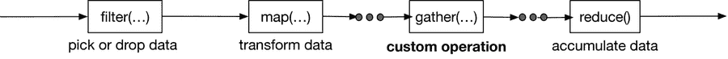

你可以在流水线中拥有零个或多个 `gather()` 调用。你可以根据如何配置作为 `gather()` 方法参数提供的 `Gatherer`，对在 `gather()` 步骤中执行的操作进行定制，使其成为为无状态的或有状态的。

`Gatherer` 执行三个不同的动作：

- 在给定的元素上执行其自定义操作。
- 将操作的结果向下推，到流水线中的下一个步骤。
- 告知流水线的上一个步骤可能还会发送更多数据进行处理。

为了提高效率，流水线中的每个步骤仅在后续步骤指示其期望接收数据时才会执行。如果下游操作指示它不再需要任何数据，则 `Gatherer` 反而会将此通信给上游操作，并期望不再被调用。我们将在下一章中深入探讨这些机制，届时我们将查看一些复杂的自定义 gatherers。

为了演示如何使用 gatherers，让我们实现一个与 `map()` 函数执行相同操作的自定义步骤。请注意，这是一个学习 gatherers 的简单练习。在实践中，你会使用 `Stream` 的 `map()` 方法，而不是重复工作去创建一个转换数据的自定义步骤……除非，你真的为“冗余部门”工作。

### 使用 gather()

让我们使用 `Stream` 接口的 `gather()` 方法，并将尚未编写的 `redundantMap()` 方法调的结果传递给它。

`gatherers/vsca/CustomMap.java`

```java
public class CustomMap {
    public static void main(String[] args) {
        List.of(1, 2, 3).stream()
            .gather(redundantMap(e -> e * 2))
            .forEach(System.out::println);
    }
}
```

`redundantMap()` 方法将返回一个 `Gatherer` 接口的实现。`gather()` 方法将在每个元素流过流水线时将其传递给 `Gatherer`。使用提供的映射函数，`Gatherer` 将通过数值翻倍来转换流入的元素。


让我们实现`redundantMap()`方法，它将接收一个映射函数并返回一个`Gatherer`接口的实现。

`gatherers/vsca/CustomMap.java`

```java
public static Gatherer<Integer, ?, Integer> redundantMap(Function<Integer, Integer> mapper) {
    return Gatherer.of((_, element, downstream) ->
        downstream.push(mapper.apply(element)));
}
```

`redundantMap()`方法使用`Gatherer`的静态辅助方法`of()`来创建`Gatherer`接口的实现。由于`of()`方法接受函数式接口，我们传递一个 lambda 表达式作为参数。lambda 的第一个参数表示状态，由于在这个示例中我们没有使用状态，我们使用下划线`_`作为未命名变量。第二个参数是流过流水线的元素，第三个参数是下游下一个步骤的引用。`Gatherer`接口的实现仅仅使用给定的映射函数转换元素并将其向下推。lambda 的隐式返回向上游传输了接收或不接收数据的请求。

上一个示例的输出与你将`.gather(redundantMap(e -> e * 2))`行替换为熟悉的`.map(e -> 2)`时预期的结果相同：

```
2
4
6
```

该示例是对 gatherer 的相当简单的实现。不要被这种易用性所误导——在下一章中，你会发现取决于你设置的复杂程度，实现 gatherers 可能会变得非常复杂。

在下一章深入创建我们自己的自定义步骤之前，让我们来看看一些内置的 gatherers。

### 使用内置 gatherers

`gather()`方法和`Gatherer`接口的引入是为了帮助我们在函数式流水线中创建自定义步骤。但一些预构建的`Gatherers`已作为示例的一部分提供。除了说明如何实现自定义步骤，这些示例还提供了如果业务需求匹配可以使用的代码。

你可以在 JDK 的`Gatherers`工具类中找到内置的 gatherers。在实现自己的 gatherer 之前，检查`Gatherers`中提供的是否足够。当你升级到 Java 的未来版本时，确保检查此工具类，因为可能会添加新的内置函数。

在本节中，我们将查看三个不同的内置 Gatherers。

### `fold()` Gatherer

内置的`fold()`gatherer 作为`reduce()`操作的等效中间操作存在。你可能会疑惑这有什么用。让我们先讨论原因，然后查看使用`fold()`gatherer。

`reduce()`方法是一个终端操作，用于累积或组合通过函数式流水线的元素，由于还原函数必须是结合性的，因此与顺序无关。例如，`reduce()`方法可以用于对流水线的元素求总。但由于它是终端操作，`reduce()`的结果是一个值，元素流过的流式在`reduce()`调用处终止。

假设我们想对`reduce()`方法的结果执行后续操作，例如，将值乘以 10 然后打印结果。由于流式在`reduce()`处终止，我们无法将最后两个步骤添加到函数式流水线，因此正如我们在下面的示例所示，代码的流畅性被破坏了。

`gatherers/vsca/Fold.java`

```java
var result = List.of(1, 2, 3, 4, 5, 6).stream()
    .filter(e -> e % 2 == 0)
```

```java
.reduce(0, Integer::sum);

var tenTimesResult = result * 10;
System.out.println(tenTimesResult);
```

上一段代码的输出是 120，它是给定集合所有偶数和的十倍。

如果`reduce()`操作是一个中间操作而不是终端操作，那么我们就可以将所有代码合并成一个优雅的函数式流水线。这时`fold()`收集器（gatherer）就派上用场了。

你可以在 JDK 的`Gatherers`工具类中找到静态方法`fold()`。该方法返回`Gatherer`接口的一个实现，并且可以将`fold()`的调用作为参数传递给`gather()`方法，就像我们在之前的示例中对`redundantMap()`方法的调用放置的那样。使用`fold()`方法可以避免破坏代码的流利性。我们可以像这样将乘法打印的步骤添加到函数式流水线中：

[`gatherers/vsca/Fold.java`](http://media.pragprog.com/titles/vscajava/code/gatherers%2Fvsca%2FFold.java)

```java
List.of(1, 2, 3, 4, 5, 6).stream()
    .filter(e -> e % 2 == 0)
    .gather(Gatherers.fold(() -> 0, Integer::sum))
    .map(e -> e * 10)
    .forEach(System.out::println);
```

我们用`gather()`方法的调用替换了`reduce()`方法的调用。对于`gather()`方法，我们传递了`fold()`方法的结果。该结果是`Gatherer`接口的一个实现。`fold()`方法本身接受两个参数：一个为合并操作提供初始值的`Supplier`，以及合并操作（在本例中是`Integer`的`sum()`方法）。

由于`gather()`是一个中间操作，因此在`Stream<T>`上执行`gather()`方法的结果是`Stream<R>`，这与`reduce()`方法的结果`R`不同。其中`T`和`R`是参数类型，分别对应提供给`fold()`或`reduce()`的函数的输入类型和输出类型。因此，我们可以继续在`gather()`的结果上调用`Stream`接口的方法，例如之前代码示例中对`map()`和`forEach()`的调用。

这个修改后版本的代码输出也是 120。但代码更加流利了；它产生的结果与之前那个更冗长的版本相同。

### `scan()`收集器

`reduce()`终端操作和`fold()`收集器的中间操作都会产生一个单一值。有时，我们可能对传递给`reduce()`或`fold()`的合并操作的每一个中间值感兴趣。这就是`scan()`收集器的目的所在。

查看之前的两个示例，`reduce()`和`fold()`的结果都是 12，即给定集合中所有偶数的总和，也就是两个示例中由`filter()`操作向下传递的值。与其接收单个值，我们不如通过使用`scan()`收集器接收合并操作的中间结果或部分结果，如下所示：

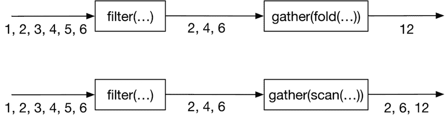

让我们修改之前的使用`fold()`的示例，让合并操作的部分结果作为元素在函数式流水线中流出。

[`gatherers/vsca/UsingScan.java`](http://media.pragprog.com/titles/vscajava/code/gatherers%2Fvsca%2FUsingScan.java)

```java
List.of(1, 2, 3, 4, 5, 6).stream()
    .filter(e -> e % 2 == 0)
    .gather(Gatherers.scan(() -> 0, Integer::sum))
    .forEach(System.out::println);
```

当元素通过流水线移动时，每次求和后的结果都会被向下传递，供我们查看或进行进一步处理。输出显示了之前代码的结果：

```
2
6
12
```

所有转换值相加的最终结果 12 位于末尾。但我们也看到了随着求和过程生成的部分值 2 和 6。

如果你想执行`reduce()`操作但希望它是作为中间操作而不是终端操作，请使用`fold()`。或者，如果你想将`reduce()`作为中间操作执行，同时能够查看并处理`reduce()`合并操作的部分结果，请使用`scan()`。

接下来，我们将看到属于`Gatherers`工具类的另外两个函数。

### 窗口收集器

`Gatherers`工具类提供了另外两个函数`windowFixed()`和`windowSliding()`，它们将元素分组到指定大小的窗口中。在深入代码之前，让我们先看下图中窗口收集器的结果是什么样的。

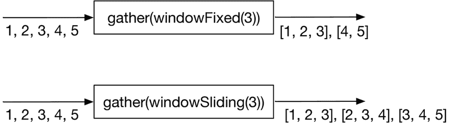

`windowFixed()`函数将元素分到指定大小的窗口中。在图中，所需大小为 3，因此第一组是 1, 2, 3。第二组是 4, 5，因为元素不足以填充第二个组。

`windowSliding()`函数使用滑动窗口进行分组。在图中，所需大小为 3，因此第一组是 1, 2, 3。第二组是 2, 3, 4。第三组是 3, 4, 5。

让我们创建一个使用`windowFixed()`收集器的示例：

[`gatherers/vsca/UsingGatherers.java`](http://media.pragprog.com/titles/vscajava/code/gatherers%2Fvsca%2FUsingGatherers.java)

```java
var numbers = List.of(1, 2, 3, 4, 5);
numbers.stream()
    .gather(Gatherers.windowFixed(3))
    .forEach(System.out::println);
```

这段代码的输出为：

```
1, 2, 3
4, 5
```

现在对同一个集合使用`windowSliding()`收集器：

```java
numbers.stream()
    .gather(Gatherers.windowSliding(3))
    .forEach(System.out::println);
```

结果为：

```
1, 2, 3
2, 3, 4
3, 4, 5
```

### 总结

你可以使用收集器功能扩展函数式流水线。收集器提供了一种在函数式流水线编写自定义中间操作的方法。这让你不再局限于使用函数式流水线中的内置操作。

在本章中，我们创建了一个相当简单的收集器，让你熟悉在函数式流水线创建自定义中间步骤的概念。此外，我们还查看了 JDK 提供的示例中的一些内置收集器，用以说明收集器的用法。掌握了这些知识后，在下一章中，我们将探讨更复杂的课题——创建我们自己的非平凡自定义收集器。

创建一个自定义收集器（gatherer）是一项非凡的任务，但如果使用得当，将会会有丰的回报。我们在上一章中讨论了对收集器的需求。你已经领略了创建自定义收集器方法，尽管只是一个模仿`map()`方法实现的简单收集器。那种实现看起来简单得具有欺骗性，但实际上，你想要实现的逻辑越复杂，代码就会越复杂。在本章中，你将深入了解如何创建和配置自定义收集器，以应对你应用程序中的挑战。

函数式流水线中的中间操作可以是无状态的（如`filter()`和`map()`的行为），也可以是有状态的（如`limit()`的行为）。此外，中间操作可能选择仅按顺序执行（如`limit()`）或进行并行执行（如`map()`）。因此，收集器作为中间操作，提供了不同的执行模式：无状态 vs. 有状态，顺序 vs. 并行。根据你正在解决的问题，你必须决定正在实现的收集器应该是无状态的还是有状态的。同样，你必须选择是支持并行执行还是仅支持顺序执行。

实现任何非凡的收集器都需要投入大量精力，因此在你动手创建自己的收集器之前，请看看 Stream API 的传统方法是否足以解决你的问题。如果收集器是最合适的选项，请检查`Gatherers`工具类是否有任何满足你需求的内置收集器。只有在最后选择时，才开始创建你自己的收集器的任务。如果你决定承担这段艰辛的旅程，本章将为你提供所需的所有细节。

给你的饮料容器装满你最喜欢的饮料，启动你的 IDE。我们已经准备好深入创建自定义收集器了。

### `gather()`方法背后的机制

让我们首先关注`gather()`方法背后的机制，以及它如何调用为其提供的`Gatherer`接口实现。了解这些基础知识对于你能够在函数式流水线中实现自己的自定义步骤至关重要。

当数据流过流水线时，`gather()`方法会将数据传递给为`gather()`方法提供的`Gatherer`接口实现。`Gatherer`执行三个不同的动作：

- 在给定元素上执行其自定义操作。
- 可选地将操作结果推向下游，即流水线中的下一个步骤。
- 通知流水线中的上游步骤可能还会发送更多数据进行处理。

为了提高效率，流水线中的每个步骤只有在后续步骤指示它期望接收数据时才会执行。如果下游操作指示它不再需要任何数据，那么`Gatherer`反而会将此信息传递给上游操作，并期望不再被调用。

为了更好地理解这一点，让我们想象我们要使用`gather()`方法自己实现`filter()`方法。由于`filter()`的工作是在元素流过流水线时选择或丢弃它们，我们为了模拟`filter()`功能而假设的`Gatherer`接口实现必须决定是否将元素推向下游。下图展示了此类收集器的行为：

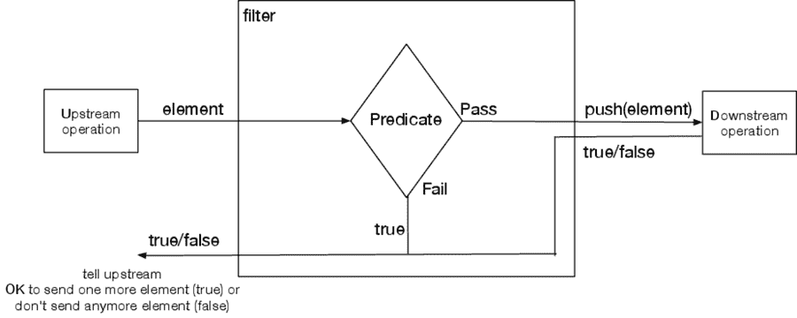

让我们拆解此收集器的操作以获得更深层次的理解：

- 收集器首先将根据参数给定的`Predicate`对流过流水线的元素进行评估。
- 如果`Predicate`测试通过，收集器将元素推向下游的下一个步骤；否则，它将简单地丢弃该元素。
- 当接收到推送调用时，下游操作如果期望更多数据将返回`true`，否则返回`false`。
- 收集器随后将来自下游`push()`用的结果返回给上游操作。
- 如果由于`Predicate`测试失败没有推送数据，则收集器将返回`true`，告诉上游操作它可以发送更多数据。
- 如果由于下游`push()`返回了`false`导致收集器向上游操作返回`false`，那么该步骤就不期望继续接收任何后续元素进行处理。

如你所见，即使是简单的收集器，函数式流水线不同阶段之间也需要大量的协调。我们可以使用以下伪代码表示模拟`filter()`的收集器行为：

```java
if (predicate.test(element)) {
    return downstream.push(element);
} else {
    return true;
}
```

为了进一步提炼这一概念，作为一项练习，想象创建一个自定义步骤来执行`map()`操作——就像我们在使用`gather()`方法创建自定义步骤中做的那样。模拟`map()`操作的收集器将获得一个映射函数，该函数将元素从一个值转换为另一个值，例如，将给定值倍倍。收集器应该对流过流水线的元素应用给定函数，并将其推向下游。此外，它应该向上游传达下游步骤是否期望更多数据。

图描述了模拟`map()`操作的假设收集器的行为。

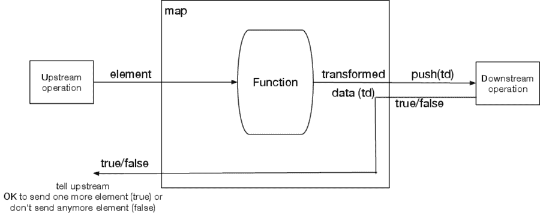

以下是此类收集器的伪代码：

```java
return downstream.push(givenMapperFunction.apply(element));
```

该伪代码显示了`Gatherer`实现使用给定的映射函数转换元素，推向下游，并通过返回语句向上游传达下游接收更多元素的意愿。

我们已经讨论了`gather()`方法背后的机制基础。重申一下，提供给`gather()`方法的`Gatherer`基本动作是执行自定义操作、可选地将数据推向下一个步骤，并向上游指示是否应该发送数据。接下来，我们将讨论你根据应用程序需求实现自定义步骤时需要选择的收集器类型。

### 收集器的类型（Flavors）

当你着创建一个收集器时，你必须根据正在解决的问题决定要实现的类型或类型。每种类型都有其的功能和复杂性。

收集器有四种类型之一：顺序无状态、顺序有状态、并行无状态或并行有状态。图显示了四种可能的类型以及每种类型收集器的行为。

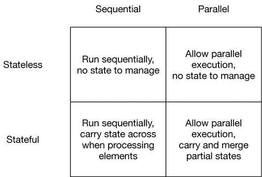

与顺序无状态收集器相比，顺序有状态收集器的复杂度稍微增加。并行有状态收集器是你实现的所有收集器中最复杂的。并行有状态收集器必须提供一个合并阶段，以合并从不同元素的并行处理产生的部分结果。你可以将其认为同步或合并阶段，部分结果在此处合并。

`Gatherer`接口的几个静态方法提供了创建不同类型收集器的便利方法。

- 你可以使用`Gatherer.ofSequential()`方法来实现按顺序执行的收集器，无论是无状态还是有状态的。
- 你可以使用`Gatherer.of()`方法的重载版本之一来实现一个允许并行执行、无状态或有状态的收集器（gatherer）。


如果 `gather()` 步骤在一个顺序执行的管道中执行，那么无论如何配置，该 `gather` 步骤都将按顺序执行。另一方面，如果 `gather()` 是作为并行流执行的一部分运行的，则取决于 gatherer 的配置，它可能会按顺序执行，也可能会并行执行。无论 gatherer 如何配置，`gather` 步骤之前和之后的步骤都会自行决定是按顺序执行还是并行执行的评估策略。

我们可以将带有 `gather` 步骤的并行流执行可视化为多道线高速公路上的交通流，如图所示：

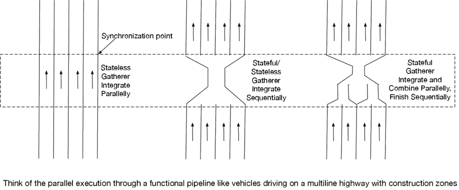

对于可以并行的无状态收集器（如图中左侧的场景所示），`gather` 步骤在顺序流水线中执行时将按顺序运行，在并行流水线中执行时将并行运行。

然而，可并行的无状态收集器会通过同步点分批向下游推送数据，以确保只有在需要时才将数据推送到下游。这避免了将并行生成的所有数据全部倾倒到下游，相反，值仅在需要时推送而不会过度，无论并行创建了多少数据。

对于需要按顺序执行的收集器，`gather` 阶段之前和之后的步骤可能会并行运行。但就像车辆必须一个接一个挤过施工区域一样，`gather` 步骤的执行将按顺序完成。

对于可以并行的有状态收集器，尽管它是有状态的，但集成（integration）和合并（combine）阶段是并行运行的以分块处理数据，然后完成阶段（finish phase）完成最终操作，将结果推送到管道中的下一个步骤。

正如从目前的讨论中可以收集（双关）的那样，在功能性流水线中实现自定义步骤之前，你必须决定应该实现哪种类型的 gatherer。然后，你必须在 `gather()` 方法、`Gatherer` 接口以及 JDK 提供的便利方法的限制内实现你自定义步骤的业务需求。

在本章的其余部分，你将了解所有这些细节。你将学习在何时实现每种类型的 gatherer，你用于创建实现的函数，以及如何实现自定义步骤。我们将查看创建顺序无状态收集器、顺序有状态收集器和可并行的无状态收集器，然后深入研究创建可并行的有状态收集器的复杂性。

请系好你的安全带——我们将从创建顺序无状态类型的 gatherer 开始。

### 创建顺序无状态收集器

如果你需要按照遇到的顺序（encountered order）处理元素，但在其他方面以独立的方式处理，请选择顺序无状态收集器。不需要在处理一个元素和下一个元素之间传递状态，这是一个很好的选择。顺序无状态收集器是最容易实现的。

### 什么是“遇到的顺序”？

流并不会对其处理的元素施加任何任意顺序。数据源可能会强制顺序；例如，列表（lists）是有序的数据集合，而集合（sets）是无序的集合。同样，功能性流水线中的某个步骤也可能强制顺序，例如按升序排列元素的 `sorted` 方法。

在功能性流水线中按遇到的顺序处理元素的步骤会尊重其所看到或遇到的元素顺序。该顺序可能由数据源或功能性流水线中的之前的步骤强制。如果数据按照特定顺序流动，那么尊重遇到的顺序的步骤将严格遵循该顺序进行处理。

`forEach` 方法是一个不关心遇到的顺序的步骤示例。如果你将 `forEach` 放在并行流的末尾，无法保证该步骤处理元素的顺序。但 `forEachOrdered` 方法是一个保留遇到的顺序的步骤示例。即使被放在并行流的末尾，`forEachOrdered` 也会按照数据源或之前步骤强制的顺序处理元素。同样，`findAny` 是一个不尊重遇到的顺序的步骤示例，而 `findFirst` 是尊重该顺序的步骤示例。

你所处理的问题的性质将帮助你决定是否需要按照严格的遇到顺序处理元素。

将无状态顺序收集器视为一个等同于终端操作 `forEachOrdered()` 的中间操作。与 `forEach()` 终端操作不同，`forEachOrdered()` 方法（同样是终端操作）会按遇到的顺序处理元素。这两者都是无状态操作。令人惊讶的是，Stream API 中没有内置的无状态顺序中间操作。如果你确实需要这样的自定义中间操作，那么 `gather()` 方法会是你的后盾。让我们考虑这样一个这种情况的例子。

`Stream` 的 `forEach()` 终端操作在功能性流水线的末尾消耗一个元素。`forEachOrdered()` 与 `forEach()` 类似但保留了遇到的顺序。等同于 `forEach()` 的中间操作是 `peek()` 方法——你可以用它在中间步骤中消耗一个元素。但没有等同于 `forEachOrdered()` 的中间操作。如果你想在中间步骤中按遇到的顺序消耗元素，没有内置方法可以实现。我们必须为此创建一个自定义步骤——让我们创建一个按遇到的顺序查看元素的顺序收集器。

你可以使用 `Gatherer.ofSequential()` 静态方法实现顺序无状态收集器。使用该方法生成的 `Gatherer` 实例应该执行其操作，将结果推送到下游，并告诉上游操作是否还可以发送更多数据。这基本上就是你需要做的一切。

让我们创建一个自定义中间步骤，用于在功能性流水线的中间消耗数据。我们将该操作命名为 `peekOrder` 收集器。与 `Stream` 的 `peek()` 不同，我们的 `peekOrder` 收集器将按遇到的顺序处理元素。我们将在本章中创建的所有收集器放在 `Gatherers` 类中。

我们首先创建一个名为 `consumePush()` 的辅助方法，以捕获收集器的核心行为。该方法将接受三个参数：要处理的元素、抽象元素自定义处理的 `Consumer`，以及指向下游步骤的引用。该方法将给定元素传递给消费者，通过调用 `push()` 将元素推送到管道中的下一个步骤，并返回该调用的真假结果。以下是 `consumePush()` 方法：

```java
private static <T> boolean consumePush(
    T element,
    Consumer<T> consumer,
    Gatherer.Downstream<?super T> downstream) {
    consumer.accept(element);
    return downstream.push(element);
}
```

我们将在自定义 `peekInOrder()` 方法的实现中使用 `consumeAndPush()` 方法，该方法返回一个 `Gatherer` 接口的实现，如下：

[gatherers/vsca/UsingGatherers.java](http://media.pragprog.com/titles/vscajava/code/gatherers%2Fvsca%2FUsingGatherers.java)

```java
public static <T> Gatherer<T, ?, T> peekInOrder(Consumer<T> consumer) {
    return Gatherer.ofSequential((_, element, downstream) ->
        consumeAndPush(element, consumer, downstream));
}
```

`Gatherer` 是一个带有三个泛型类型的通用接口：

- 第一个泛型类型表示正在处理的元素的类型。
- 第二个泛型类型用于 `Gatherer` 可选使用的状态。
- 第三个泛型类型告诉我们流水线中此步骤生成的结果的类型。

`peekInOrder()` 返回的 `Gatherer<T, ?, T>` 的第一个和第三个参数类型显示，处理元素的类型与此步骤生成的结果类型是相同的。我们对中间的参数类型使用 `?`，表示我们并不关心这个 gatherer 是否有任何状态。

我们将使用 `Gatherer` 的静态方法 `ofSequential()` 来轻松地创建一个 gatherer。正如我们讨论过的，gatherer 作为中间操作的作用是处理一个元素并（可选地）将结果推送到函数式流水线的下一步。此步骤被称为集成步骤（integration step），由于 `Integrator` 是一个函数接口，我们可以使用 lambda 表达式来创建一个集成器。该 lambda 接收三个参数：状态、正在处理的元素以及流水线中下游操作的引用。

在 `peekInOrder()` 方法的实现中，我们将一个 lambda 表达式传递给 `ofSequential()` 方法。lambda 的第一个参数表示状态。由于我们没有处理任何状态，我们可以忽略该参数，因此我们使用未命名变量 `_` 来表示它。在 lambda 内部，我们调用 `consumeAndPush()` 方法来处理给元素，然后将其推向下游。`consumeAndPush()` 的结果通过该 lambda 的隐式返回传。因此，如果下游的 `push()` 返回 `true`，则 gatherer 就会通知上游步骤它可以发送更多元素进行处理。如果下游步骤返回 `false`，则 gatherer 通知上游步骤不要再发送更多元素。

我们的最后一个任务是利用我们创建的简单顺序化无状态 gatherer。让我们在 `usePeekInOrder()` 方法内部使用 `peekInOrder()` 方法：

[gatherers/vsca/UsingGatherers.java](http://media.pragprog.com/titles/vscajava/code/gatherers%2Fvsca%2FUsingGatherers.java)

```java
public static void usePeekInOrder() {
    var numbers = List.of(10, 11, 15, 12);

    numbers.parallelStream()
        .peek(System.out::println)
        .reduce(0, Integer::sum);

    System.out.println("-----");

    numbers.parallelStream()
        .gather(peekInOrder(System.out::println))
        .reduce(0, Integer::sum);
}
```

示例说明了忽略 `Stream` 接口 `peek()` 的遇到顺序与我们创建的 `peekInOrder()` gatherer 之间的区别。我们创建了一个数字列表，并在调用 `reduce()` 之前在流水线中调用 `peek()` 方法。传递给 `peek()` 的 `Consumer` 仅仅打印通过的值。然后，在同一个列表上，我们在调用 `reduce()` 方法之前调用了 `gather()` 方法并传递了我们创建的 `peekInOrder()` gatherer。我们使用 `parallelStream()` 并行运行了每个流水线，其中一个使用 `peek()`，另一个使用 `peekInOrder()`。

调用 `usePeekInOrder()` 的输出所示：

```text
15
11
12
10
-----
10
11
15
12
```

输出的第一部分显示 `peek()` 方法以不确定的顺序打印值，这是多个线程执行流水线的结果。另一方面，第二部分显示了的 gatherer 尊重列表中元素的顺序，并以适当的顺序显示结果，尽管流水线正在并行执行。在这种情况下，`gather` 步骤是顺序执行的，以保留遇到顺序。

尽管顺序化无状态的 gatherer 是创建起来最简单的类型之一，但它们在现实中的适用性相当有限。这就是为什么其中没有内置顺序化无状态中间操作的原因之一。

### 创建顺序化有状态 Gatherers

如果你需要将某些状态从一个元素的处理传递到下一个元素，并且同时你还需要遇到顺序，请选择顺序化有状态 gatherer。

如果你检查 Stream API 中的中间操作，你会发现一些像 `filter()` 和 `map()` 这样的无状态操作。同时，你还会看到一些有状态的操作，如 `limit()`。`limit()` 方法是有状态的，因为它必须跟踪通过流水线的元素数量。

顺序化有状态的 gatherer 既可以用于顺序执行的流水线，也可以用于并行执行的流水线。当在并行流水线中执行时，在顺序化有状态 gatherer 之前和之后的步骤可能会根据自身的评估策略顺序或并行处理元素。然而，顺序化有状态 gatherer 步骤由于需要管理状态并尊重遇到顺序，将按顺序处理元素。可以将此步骤比作沙漏中连接两个球体的狭颈。沙子的流动在通过狭颈时会受到限制。同样，在流水线的并行执行期间，数据流在通过顺序化有状态 gatherer 时被限制为顺序。

要创建顺序化有状态 gatherer，你可以使用创建顺序化无状态 gatherer 时相同的 `Gatherer` 接口 `ofSequential()` 方法，但有一点不同。你不再忽略表示状态的第一个参数，而是会很好地利用它。让我们通过一个示例来探索。

`ValueWithIndex` 记录的实例将同时包含一个值和一个作为索引的位置。它的 `toString()` 方法是一个便利方法，用于打印索引以及值。

我们需要一个类来携带状态——即元素位置的计算——从一个元素的处理传递到下一个元素。由于这个状态是可变的，我们不能简单地使用 `int` 或 `Integer`。因此，我们将创建一个 `Index` 类，它包含一个用于位置的 `int`，并提供一个递增该值的方法：

[gatherers/vsca/UsingGatherers.java](http://media.pragprog.com/titles/vscajava/code/gatherers%2Fvsca%2FUsingGatherers.java)

```java
static class Index {
    private int position = 0;

    public int getAndIncrement() {
        return position++;
    }
}
```

现在，让我们使用 `mapWithIndex()` 方法实现 `Gatherer`，该方法将转换数据并返回索引以及转换后的值。`mapWithIndex()` 的返回类型将是 `Gatherer<? super T, Index, ValueWithIndex<R>>`。第一个泛型类型 `? super T` 表示正在处理的元素可能是某种泛型类型 `T` 或其基类型之一。第二个泛型类型 `Index` 传递了在元素处理之间携带的状态类型。最后，第三个泛型类型 `ValueWithIndex<R>` 为我们提供了此步骤的返回类型。

在 `mapWithIndex()` 方法内部，我们将使用 `Gatherer` 的静态方法 `ofSequential()` 来创建所需的 `Gatherer` 实例。为了跟踪索引，`ofSequential()` 方法接收初始化状态作为第一个参数。在这种情况下，我们将使用 `Index` 类的一个新实例来传递第一个索引，即初始状态为 0。`ofSequential()` 方法的第二个参数是一个 `Integrator`，它的工作是处理元素并合并状态。来看代码。

[gatherers/vsca/UsingGatherers.java](http://media.pragprog.com/titles/vscajava/code/gatherers%2Fvsca%2FUsingGatherers.java)

```java
public static <T, R> Gatherer<? super T, Index, ValueWithIndex<R>> mapWithIndex(Function<T, R> mapper) {
    return Gatherer.ofSequential(Index::new,
        (index, element, downstream) ->
            downstream.push(new ValueWithIndex<>(
                mapper.apply(element), index.getAndIncrement())));
}
```

`Integrator` 接收三个参数：由 `index` 引用的状态、元素以及下游步骤的引用。在 `Integrator` 的 lambda 表达式中，我们将一个 `ValueWithIndex` 实例推送到下游。该实例持有给定元素的转换或映射值以及 `index` 的当前值。此外，当我们传递 `index` 的当前值时，我们使用 `Index` 的 `getAndIncrement()` 方法对其进行后置递增。

观察之前的代码，可以看到顺序收集器从 `index` 的初始化状态 0 开始，并且在每个元素被 `Integrator` 处理后，索引都会逐个增加 1。因此，当为第二个元素调用 `Integrator` 时，索引将是 1 而不是 0，随后的其他元素亦然。

让我们调用我们创建的 `mapWithIndex()` 方法，并将生成的 `Gatherer` 实例作为参数传递给 `gather()` 方法调用：

[gatherers/vsca/UsingGatherers.java](http://media.pragprog.com/titles/vscajava/code/gatherers%2Fvsca%2FUsingGatherers.java)

```java
public static void useMapWithIndex() {
    List.of("Tom", "Jerry", "Tyke")
        .parallelStream() // or .stream()
        .filter(name -> name.length() > 3)
        .gather(UsingGatherers.<String, String>mapWithIndex(String::toUpperCase))
        .forEach(System.out::println);
}
```


我们从一个表示某些名称的`Strings`集合开始。过滤掉任何长度不符合要求的名称。然后，我们将名称转换为大写，同时使用我们编写的收集器为转换后的值创建一个索引。

以下是执行`useMapWithIndex()`方法的输出：

```
1: TYKE
0: JERRY
```

输出显示了元素的索引。由于代码是以并行流运行的且使用了`forEach()`，因此不能保证顺序。我们可能会先看到`0: JERRY`然后再看到`1: TYKE`。如果我们使用`forEachOrdered()`，我们将按照遇到的顺序看到它们。由于需要处理状态，有状态的收集器比无状态收集器的代码稍微复杂一点。状态是可变的，也就是说，它封装在收集器内部，并且对外部不可见。接下来，我们将查看可并行的无状态收集器。

### 创建可并行的收集器

如果你在处理元素时不需要遵循遇到的顺序，并且没有状态需要携带，那么请选择实现可并行的收集器。你可以使用`Gatherer`接口中名为`of()`的重载静态方法之一来创建可行的收集器。为了查看如何实现，让我们来看一个例子。

我们将创建一个中间步骤，即可行的收集器，它等同于`Stream`的`filter()`和终端操作`findAny()`。让我们先讨论这种步骤的好处，然后深入研究实现。

如你所知，`Stream<T>`接口`findAny()`方法将返回流中找到的任意元素的`Optional<T>`。该方法用于选取流中的一个元素。如果我们想使用函数式管道继续处理结果，必须对`findAny()`的结果调用`stream()`方法。遗憾的是，这将创建一个新流而不是在原始流上添加操作。此外，`findAny()`方法不接受谓词来限制我们想要选择的性质；通常，我们需要在函数式管道中提前使用`filter()`操作来进行选择。

如果能有一个中间操作可以同时进行过滤和查找，并在当前流上继续处理将是很好。让我们创建一个`takeAnyOneMatching()`收集器来实现这一点。

首先，让我们使用我们即将实现的`takeAnyOneMatching()`方法。这里是调用`Stream`的`gather()`方法的代码片段。

`gatherers/vsca/UsingGatherers.java`（http://media.pragprog.com/titles/vscajava/code/gatherers%2Fvsca%2FUsingGatherers.java）

```java
public static void useTakeAnyOneMatching() {
    List.of(10, 11, 15, 12, 11, 44, 67, 83, 23, 12, 34, 12, 55)
        .parallelStream() // or .stream()
        .gather(UsingGatherers.<Integer>takeAnyOneMatching(e -> e > 25))
        .map(e -> e * 10)
        .forEach(System.out::println);
}
```

在此代码中，我们将`takeAnyOneMatching()`方法的调用结果作为`gather()`方法的参数。`takeAnyOneMatching()`方法本身接受一个`Predicate`作为参数，在本例中，如果正在处理的元素大于 25，该程序将返回`true`。简而言之，在这个函数式流水线的`gather`步骤中，我们希望最多选取一个大于 25 的元素进行后续处理。

接下来，让我们来看看如何实现`takeAnyOneMatching()`方法。与其专门为`Integer`定制，不如使用泛型类型`T`将其泛化。`takeAnyOneMatching()`将接受一个`Predicate<T>`并返回一个`Gatherer`，如下：

`gatherers/vsca/UsingGatherers.java`（http://media.pragprog.com/titles/vscajava/code/gatherers%2Fvsca%2FUsingGatherers.java）

```java
public static <T> Gatherer<? super T, ?, T> takeAnyOneMatching(
    Predicate<T> predicate) {
    return Gatherer.of(
        (_, element, downstream) -> pushIfMatch(predicate, element, downstream));
}
```

再次，返回类型`Gatherer<? super T, ?, T>`的泛型类型提供了关于正在处理的元素、状态以及该步骤结果的信息。在本例中，流水线处理的元素类型是`T`或其超类。由于我们创建的是无状态的 gatherer，因此没有使用任何状态。传递给`Gatherer.of()`方法的 lambda 有三个参数：`state`（在本例中我们并不关心，因此使用了`_`）、正在处理的`element`以及流水线后续操作`downstream`的引用。如果元素满足`predicate`，`gather`步骤会将元素推送到流水线的下一个步骤；否则，元素将被忽略。我们将此责任委托给`pushIfMatch()`方法。`Integrator`的 lambda 根据`pushIfMatch()`方法的返回值来返回`true`或`false`。

现在，让我们来实现所需的最后一个函数`pushIfMatch()`：

`gatherers/vsca/UsingGatherers.java`（http://media.pragprog.com/titles/vscajava/code/gatherers%2Fvsca%2FUsingGatherers.java）

```java
private static <T> boolean pushIfMatch(Predicate<T> predicate, T element,
    Gatherer.Downstream<? super T> downstream) {
    if(predicate.test(element)) {
        downstream.push(element);
        return false;
    }
    return true;
}
```

`pushIfMatch()`方法检查元素是否通过`Predicate`的测试，如果是，则将元素推送到下游。在这种情况下，它返回`false`以告诉上游操作不要发送更多元素，因为已经找到了候选元素。如果元素不匹配，它会被丢弃——不会被推送到下游，方法返回`true`表示仍在寻找合适的元素，上游操作应该发送另一个元素。

将`downstream`的`push()`方法读作`pushIfPossible`；它是对流水线下一步的请求而非命令。将`Integrator`连接到`gather`步骤的后台逻辑可能会根据情况丢弃元素并可能将其发送到下一步。这种行为对于中间操作的正确执行至关重要，特别是当它可以并行运行时。由于流在并行运行时，`pushIfMatch()`方法将从不同的线程并行调用，因此多次调用`downstream.push()`。但由于方法在调用`push()`后返回了`false`，gatherer 的内部执行器将确保只有一个`push`请求实际上导致推送到下一步，而其他被推送的元素将被丢弃。

作为提醒，在实现`Integrator`时，请确保根据你是否希望流水线处理更多元素来适当地返回`true`或`false`。取决于你所实现的逻辑，有时可能返回`push()`调用的结果，有时可能返回`true`或`false`来传达你是否接收更多元素的决策。你应该遵循的通用规则是：如果`push()`返回`false`，则返回`false`。此外，如果你选择不再处理更多元素，无论`push()`返回什么都返回`false`。

在`main`方法内部执行`useTakeAnyOneMatching()`方法的结果：

```text
440
```

我们的`gather`步骤从流中选择了数字 44，`gather()`步骤之后的`map()`步骤将该值转换为 440。

到为止，我们看到了三种类型的 gatherer。最后一种类型——可行的有状态 gatherer 是最强大且实现最复杂的。接下来让我们看看如何创建一个。

### 创建可行的有状态 gatherer

如果你需要实现一个需要在元素处理过程中携带状态的 gatherer，并且不需要按照遇到的顺序处理元素，那么请选择可行的有状态 gatherer。这是顺序有状态 gatherer 的并行对应物，但它的实现起来要复杂得多。

为了实现一个可行的有状态 gatherer，我们将利用`Gatherer`接口的重载方法`of()`之一。在完整形态下，该方法接受四个参数。每个参数都是一个关注 gather 操作期间不同阶段的方法。这四个阶段是：

- 初始化阶段（initialization phase）
- 集成阶段（integration phase）
- 合并阶段（combine phase）
- 结束阶段（finish phase）

初始化阶段用于初始化 gather 操作可能需要的任何状态。集成阶段可以并行运行于流水线中的元素。中间阶段的结果并行地输入`combine`阶段，以便合并或合并部分结果。最后，执行`finish`阶段执行结束操作，可以将额外的元素推送到下一个阶段。

我们将首先创建一个顺序的有状态收集器（sequential stateful gatherer），然后在下一节中，将其转换为可并行的有状态收集器。这将帮助我们先实现逻辑，然后通过下一步改进代码性能。在这个示例中，我们将处理一组`Persons`集合，以年龄段为标准来选取不同的人员。首先，我们需要一个`Person`类。让我们将其实现为一个记录（record）：

`gatherers/vsca/UsingGatherers.java`（http://media.pragprog.com/titles/vscajava/code/gatherers%2Fvsca%2FUsingGatherers.java）

```java
public record Person(String name, int age) {
    public int ageGroup() {
        return age / 10 * 10;
    }
}
```

`ageGroup()`方法将告诉我们一个人是否属于 0 到 9 岁组、10 到 19 岁组等。

接下来，我们将创建一个`Persons`集合，并使用一个名为`distinctBy()`的收集器，仅在集合中保留不同年龄段的人。如果集合中的两个个人属于同一个年龄段，则其中一个会被丢弃。以下是在`Persons`集合上执行函数式流水线以仅按年龄段保留唯一元素的代码：

`gatherers/vsca/UsingGatherers.java`（http://media.pragprog.com/titles/vscajava/code/gatherers%2Fvsca%2FUsingGatherers.java）

```java
public static void useDistinctBy() {
    var people = List.of(
        new Person("Jill", 21), new Person("Jake", 8),
        new Person("Bill", 21), new Person("Nancy", 22),
        new Person("Mark", 9), new Person("Sara", 18),
        new Person("Paul", 15), new Person("Sam", 28)
    );

    people.parallelStream() // or people.stream()
        .gather(distinctBy(Person::ageGroup))
        .forEach(System.out::println);
}
```

`gather()`方法接收的参数是由尚未编写的`distinctBy()`方法返回的`Gatherer`。`distinctBy()`方法接收的参数是一个`Function`，该函数返回`Person`的某个属性，我们将该属性作为比较的标准，以判断正在处理的元素是否与流水线中已处理的所有元素不同。

我们需要实现`distinctBy()`方法。正如我们所讨论的，我们不会立即深入并行收集器的实现，而是先实现一个顺序收集器作为第一个中间步骤。

`gatherers/vsca/UsingGatherers.java`（http://media.pragprog.com/titles/vscajava/code/gatherers%2Fvsca%2FUsingGatherers.java）

```java
public static <T, C extends Comparable<C>> Gatherer<? super T, ?, T>
distinctBy(Function<T, C> criteria) {
    return Gatherer.ofSequential(HashSet<C>::new,
        (state, element, downStream) ->
            !state.add(criteria.apply(element)) || downStream.push(element));
}
```

由于这是一个有状态收集器，我们使用`ofSequential()`方法并传递一个空标准的`HashSet`标准作为第一个参数来表示初始化状态。集成器（Integrator）获取给定元素的标准并将其添加到`HashSet`中。如果`add()`方法返回`false`（因为集合已包含该元素），集成器返回`true`，表示它准备好从上游接收下一个元素。在这种情况下，由于之前见过具有相同标准的元素，该元素不会被推送到下游。相反，如果`HashSet`的`add()`方法返回`true`，则该元素的标准刚刚添加到`HashSet`中，表示这是第一次看到具有该标准的元素。因此，该元素被推送到下游，集成器返回`push()`调用的结果，该结果将为`true`或`false`。

该实现在应用于`Persons`列表时，将从给定元素中每个年龄段仅保留一个人，并丢弃任何年龄段已存在于列表中的人员。让我们执行`useDistinctBy()`方法的输出：

```text
Person[name=Jake, age=8]
Person[name=Sara, age=18]
Person[name=Bill, age=21]
Person[name=Nancy, age=22]
Person[name=Mark, age=9]
Person[name=Paul, age=15]
Person[name=Sam, age=28]
```

### 追求速度而非代码

尽管源数据有 8 个元素，但输出显示有 3 个。顺序的有状态实现为我们实现并行版本所可以使用的逻辑提供了洞察。

### 将顺序有状态收集器转换为可并行收集器

现在让我们将其转换为并行收集器，这将花费一些精力。在`gather()`方法的参数中，将`distinctBy()`更改为`distinctByParallel()`，如下：

`gatherers/vsca/UsingGatherers.java`（http://media.pragprog.com/titles/vscajava/code/gatherers%2Fvsca%2FUsingGatherers.java）

```java
.gather(distinctByParallel(Person::ageGroup))
```

可并行的有状态收集器需要四个要素：

- 初始化状态
- 更新给定元素的集成器（Integrator）
- 可以合并部分状态的合并器（Combiner）
- 可以最终处理整体状态并推送的结束器（Finisher）

为了实现`distinctByParallel()`，我们将元素的`HashSet<T>`用于状态，而不是在`distinctBy()`方法实现中使用标准的`HashSet<C>`。这是因为我们不会在集成或合并阶段向下游元素，而是将元素保存在状态中，并在结束阶段推送它们。此外，我们将`HashSet<T>`封装在`DistinctValues<T>`类中。该类将有助于很好整合操作状态的方法，并简化收集器不同阶段的 lambda 表达式。

让我们先看看代码，然后讨论细节：

```java
public static <T, C extends Comparable<C>> Gatherer<? super T, ?, T>
distinctByParallel(Function<T, C> criteria) {
    return Gatherer.of(DistinctValues<T>::new,
        (state, element, _) -> state.addIfDistinct(criteria, element),
        (state1, state2) -> state1.combineDistinct(criteria, state2),
        DistinctValues::pushEachValueDownstream);
}
```

第一个参数是`Supplier`。它创建一个包含空`HashSet<T>`的`DistinctValues<T>`实例；这作为初始化状态。


第二个参数是一个 `Integrator`，它负责向状态中添加元素，即位于 `DistinctValues<T>` 实例中的 `HashSet<T>`。只有当该元素与 `HashSet<T>` 中已有的元素不重复时，才会执行添加操作。为了确定这一点，我们使用 `addIfDistinct()` 方法。与之前的 `Integrators` 实现不同，此处的实现不会将元素推向下游。这是因为我们正在并行创建多个部分性的 `HashSet<T>`。虽然每个 `HashSet<T>` 中的元素是唯一的，但不同的 `HashSet<T>` 之间可能存在重复项。我们必须在最终将唯一元素推向下游之前，消除合并后部分集中的重复项。

第三个参数 `combiner`（合并器）负责将两个状态（即两个 `HashSet<T>` 实例）合并为一个，并仅保留唯一的元素。为此，我们使用 `combineDistinct()` 方法。

最后，第四个参数 `finisher`（完成器）会从合并后的 `HashSet<T>` 中提取元素，并将每个元素推向下游。为此，它使用了 `pushEachValueDownstream()` 方法。

保持方法的简短和模块化有助于理解代码、在出错时进行调试，并便于未来的维护。避免在任何 lambda 表达式中放置大量代码导致代码臃肿——你的同事们会默默感激你的。

让我们来看这些辅助方法。先从 `DistinctValues<T>` 类的成员 `addIfDistinct()` 方法开始：

[gatherers/vsca/UsingGatherers.java](http://media.pragprog.com/titles/vscajava/code/gatherers%2Fvsca%2FUsingGatherers.java)

```java
static class DistinctValues<T> {
    private final Set<T> distinctElements = new HashSet<>();

    public <C extends Comparable<C>> boolean addIfDistinct(Function<T, C> criteria, T element) {
        if (distinctElements.stream().noneMatch(existing ->
            criteria.apply(existing).compareTo(criteria.apply(element)) == 0)) {
            distinctElements.add(element);
        }
        return true;
    }
}
```

`addIfDistinct()` 方法使用给定的标准函数检查状态中是否已存在相似元素。如果确定该元素与状态中已有的元素不同，则将该元素添加到状态中。

现在我们来看 `combineDistinct()` 方法：

[gatherers/vsca/UsingGatherers.java](http://media.pragprog.com/titles/vscajava/code/gatherers%2Fvsca%2FUsingGatherers.java)

```java
//a method of DistinctValues<T>
public <C extends Comparable<C>> DistinctValues<T> combineDistinct(
    Function<T, C> criteria, DistinctValues<T> toCombine) {
    for (var item : toCombine.distinctElements) {
        addIfDistinct(criteria, item);
    }
    return this;
}
```

该方法将给定状态中的值合并到当前实例所属的状态中，但丢弃给定状态中存在的任何非唯一元素。该方法随后返回合并后的状态。

现在我们来看最后一个辅助方法 `pushEachValueDownstream()`：

[gatherers/vsca/UsingGatherers.java](http://media.pragprog.com/titles/vscajava/code/gatherers%2Fvsca%2FUsingGatherers.java)

```java
//a method of DistinctValues<T>
public void pushEachValueDownstream(
    Gatherer.Downstream<? super T> downstream) {
    for (var element : distinctElements) {
        if (!downstream.push(element)) {
            break;
        }
    }
}
```

该方法从完成的状态中提取每个元素并将其推向下游——这是一个至关但简单的步骤。如果下游的 `push()` 告诉我们不再有更多元素，循环将立即终止。

再次运行 `useDistinctBy()` 方法查看输出：

```
Person[name=Jake, age=8]
Person[name=Jill, age=21]
Person[name=Sara, age=18]
```

输出再次显示了唯一的元素。以及它们的顺序。

想象编写编写起来如问题描述一般的 `Java` 代码，代码具有高度的表达性、简洁、易于阅读和修改，并且降低了复杂度。得益 `Java` 的函数式编程能力，这并非幻想。本书将引导你从熟悉的命令式风格到函数式编程的实战方面，并配有大量的示例。运用你学到的技巧，将高度复杂的命令式代码转换为优雅且易于理解的函数风格代码。本版更新至 `Java` 最新版本，新增了关于错误处理、重构为函数式、数据转换以及函数式编程习惯四个章节。

Venkat Subramaniam

(274 页) ISBN: 9781680509793 $53.95

## 编程 Kotlin


程序员不仅仅在使用 `Kotlin`，他们更是爱它。即使 Google 也将其采纳为 Android 开发的一等语言。通过 `Kotlin`，你可以混合使用命令式、函数式和面向对象的编程风格，并从最适合当前问题的方法中获益。通过易于理解的示例，学习使用这种高度简洁、流畅、优雅且富有表现力的静态类型语言的特性。学习编写可维护的、高性能的 `JVM` 和 Android 应用，创建 `DSLs`，进行异步编程以及更多内容。

Venkat Subramaniam

(460 页) ISBN: 9781680506358 $51.95

## 编程 Groovy 2


`Groovy` 为你带来了两者之大成：一种灵活、高生产力、敏捷、动态的语言，运行在丰富的 `Java Platform` 框架之上。`Groovy` 保留了 `Java` 语义并扩展了 `JDK`，以为你提供真正的动态语言能力。编程 `Groovy 2` 将帮助你这位经验丰富的 `Java` 开发者学习并利用这种丰富的动态语言的最新版本。你将从 `Groovy` 的基础学习到该语言的最新进展，包括类型检查选项、尾调用和记忆化优化、编译时元编程以及用于创建 `DSLs` 的流式接口。

Venkat Subramaniam

(370 页) ISBN: 9781937785307 $35

## 工程化 Elixir 应用


开发（dev）与运维（ops）团队分离的时代已经结束——知识孤岛以及它们创造的“隔墙协作”文化是进步的敌人。作为一名工程师或开发者，你需要自信地掌控软件交付过程的每个阶段。本书引入了一种新范式 `BEAMOps`，帮助你构建、测试、部署和调试 `BEAM` 应用。创建有效的开发和部署策略；利用持续改进流水线；并确保环境完整性。将 `Docker Swarm` 等运营编排器与 `BEAM` 的分布、容错和可扩展性相结合，创建健壮可靠的应用。

Ellie Fairholm 和 Josep Giralt D'Lacoste

(458 页) ISBN: 9798888650677 $61.95

## JUnit Java 实用单元测试，第三版


经典的《使用 JUnit 进行 `Java` 实用单元测试》回归并迎来第三版，并使用更新且更易于理解的代码示例进行了精简和重写。在本版中，你将学习如何自信地创建简洁、可维护的单元测试。新章节为测试常见概念提供了示例基础，并指导如何将现代 AI 工具整合到你的开发和测试中。更新的主题包括通过开发记忆法提高测试质量、通过测试和生产代码重构提高投资回报率（ROI），以及使用测试驱动开发。

Jeff Langr

(275 页) ISBN: 9798888651032 $53.95

## 引导之星 OKRs


厌倦了扼杀创新并打击团队积极性的传统 `OKRs` 吗？`Guiding Star OKR` 框架为目标设定提供了一种令人耳新的新方法，强调目的、统一方向和适应性。畅销书 Staffan Nöteberg 炼了来自不同行业的知识，教你创建一个引人注目的“引导之星”愿景，以激励、对齐并赋能团队。学习培养内在动力，拥抱持续适应，并在当今万变的业务世界中释放战略灵活性以实现持续成功。

Staffan Nöteberg

(176 页) ISBN: 9798888651285 $42.95

## 实战事件溯源


现实是溯源的；你的大脑处理视觉、听觉、味觉、嗅觉和触觉来创建对现实的感知。软件也不同。应用程序使用输入数据流创建自己的现实，当你将这些数据解释为包含状态和上下文的事件时，一些最复杂的问题变得容易解决。揭开事件溯源背后的理论，并通过实用的编程示例发现如何将这种方法付诸。从早期开发到生产和发布，你将解锁解决棘手编程障碍的新方法。

Kevin Hoffman

(202 页) ISBN: 9798888651063 $46.95

### tmux 3


你的鼠标正在拖你的后腿。你正在处理多个终端窗口、开发工具或 shell 会话，上下文切换正在侵蚀你的效率。通过 `tmux` 掌控你的环境，这是一种键盘驱动的终端复用器，你可以根据工作流对其进行定制。在针对 `tmux 3` 的更新第三版中，你将定制、脚本化并利用 `tmux` 的独特能力，打造一个高效的终端环境，让你的手指留在键盘主键位。

Brian P. Hogan

(118 页) ISBN: 9798888651315 $35.95
