# CSS3：快速入门指南

我想将这本书献给我的父母——愿这为他们的生活带来快乐和幸福。

## 目录

### 前言

**前言** ................................................................. xiii

### 第 1 章 CSS3 简介

**第 1 章 CSS3 简介** ...................................................

#### CSS3 基础

- 什么是 CSS3? ................................................................................1
- 浏览器支持 ..............................................................................1
- CSS3 快速概述 ................................................................................1
- CSS3 类 ..............................................................................2

#### HTML5 特性

- HTML5 特性 ..............................................................................2
- HTML5 工具 .................................................................................3
- HTML5 标签 ........................................................................................3
- 新的 HTML 元素 ......................................................................3
- 语义化标记 ......................................................................3
- ARIA ................................................................................................4
- HTML5 数据 .................................................................................4
- HTML5 分组 ..............................................................................4

#### 总结

- 总结 .................................................................................5

### CSS3 媒体查询

- 什么是 CSS3 媒体查询？ ......................................................................80
- 使用 CSS3 媒体查询检测屏幕分辨率 ...............................................83
- 使用 CSS3 媒体查询检测屏幕方向 ..............................................83
- 使用简单的 JavaScript 检测方向 ...............................................85
- 使用 JavaScript 检测 3D 中的设备方向 ..................................86
- 检测屏幕宽度和高度 ...............................................................87
- 针对多种屏幕尺寸的 CSS3 媒体查询 .............................................89
- CSS 设备适配 ...................................................................................89
- 网页中资源的条件加载 ..................................................................90
- 视口元标签（viewport Meta Tag） .................................................................91
- 视口单位（Viewport Units） ........................................................................92
- CSS3 中的 `@import` 语句 ....................................................................92

#### 模块化与性能

- 模块化与性能 ...........................................................................93
- 内联与本地 CSS .......................................................................................93
- CSS 模块与本地 CSS .................................................................95
- Web 组件与本地 CSS ..........................................................95
- 有用链接 .....................................................................................................95
- 额外的代码示例 .................................................................................96
- 总结 ...........................................................................................................96

### HTML5 Canvas

- 什么是 HTML5 Canvas？ ...............................................................................98
- HTML5 Canvas 坐标系 ......................................................99
- 线段、矩形、圆形和阴影效果 ...........................101
- HTML5 Canvas 线性渐变 ................................................................106
- 水平、垂直和对角线线性渐变 ..........................106
- HTML5 Canvas 径向渐变 .................................................................110
- 使用 CSS3 选择器在 Canvas 上渲染图像 ......................................114
- 使用图案在 Canvas 上重复图像 ..............................................117
- 总结 .........................................................................................................119

### SVG

#### SVG 基础

- SVG 的基本特性 ...................................................................................122
- 在 SVG 中渲染线段和矩形 ......................................................122
- SVG 渐变 ...............................................................................124
- SVG `<pattern>` 元素 .....................................................................125
- SVG `<polygon>` 和 `<polyline>` 元素 .........................................127
- SVG `<path>` 元素 ..........................................................................128
- 贝曲线与变换 ......................................................................130
- 在 SVG 路径上渲染文本 .................................................................132
- SVG 过滤器 .....................................................................................133
- SVG 变换与渐变 .....................................................................135
- 其他 SVG 特性 ......................................................................................137
- SVG 动画效果 .........................................................................137
- SVG 与 JavaScript ...............................................138
- 使用 CSS3 和 JavaScript 在 SVG 中创建 3D 效果 ......................139

#### SVG、CSS 和 jQuery

- SVG、CSS 和 jQuery ...................................................................................139
- SVG 和 jQuery ....................................................................................140
- 使用 jQuery 创建 SVG 元素 ....................................................141
- 使用 jQuery 处理现有 SVG 元素 .....................................................142
- 用于 SVG 的 jQuery 插件 ........................................................143
- SVG 和 CSS3 的简要比较 .........................................................143
- 总结 .........................................................................................................144

x  • CSS3 快速入门

### Houdini 项目

- Houdini 项目 ..............................................................................146
- 渲染流水线 ........................................................................146

### CSS3 高级特性

#### CSS Flexbox（弹性布局）

- CSS Flexbox（弹性布局） ...........................................................................147
- Flexbox 属性汇总 .................................................................148
- 使用 Flexbox 属性的网页 ............................................................148
- 使用 Flexbox 渲染列和行 ................................................150
- Flexbox 的有用链接 ......................................................................152

#### CSS Grid 布局

- CSS Grid 布局 ............................................................................152

### 优化 HTML5 网页性能

- 优化 HTML5 网页性能 ................................................................154
- CSS 相关性能 .............................................................................155
- CSS、SVG 和 Canvas 的简要比较 ..........................................................155
- 哪个更快：CSS3/Canvas/SVG？ ...................................................156
- HTML 网页与二进制图像 ........................................................156
- 选择文件格式 ..........................................................................157
- 优化 SVG 和二进制文件 ........................................................157
- CSS 精品图（Spritesheets） ...................................................................................157
- 渲染背景图像的“模糊加载（Blur Up）”技术 ...........158
- 渐进式图像 ................................................................................158
- 网络字体 .............................................................................159
- 该做什么？ ..........................................................................159

#### Web Animation API

- Web Animation API 概览 .................................................................159
- Web Animation API 示例 ......................................................160
- 其他 JS 网页动画工具包 ..........................................................161

#### 开发者工具

- 使用 Chrome 开发者工具 ...................................................162
- 总结 .........................................................................................................164

### 移动网页设计

- 什么是良好的移动设计？ ......................................................................166
- 移动网页设计的重要方面 .....................................................166


面向触控的设计 ...............................................................166

提高用户手势的响应时间 ..............................................167

移动 Web 应用中的资源调整 ................................................168

确定移动网页的内容布局 ............................................168

HTML 网页的移动设计 ..........................................................169

移动端表单样式化概述 ...................................................169

移动端表单样式化的特定技术 .............................................170

使用 CSS 为输入字段设置不同样式 ...........................................171

为输入字段指定键盘类型 ............................................171

不同国家和语言 .....................................................172

设计相关工具和在线模式 ...................................................172

字体大小与测量单位的运用 ...........................................172

什么是 Google AMP？ ....................................................................................173

RAIL 框架 ..........................................................................174

AMP 中的样式 ........................................................................................174

HTML 元素和核心 AMP 组件的状态 ...........................174

什么是渐进式 Web 应用 (PWA)？ ..................................................175

提升 HTML5 网页性能 ................................................176

有用链接 ...................................................................................................176

总结 .........................................................................................................177

索引 ......................................................................179

# 前言

## 本书的核心价值定位是什么？

本书主要关于 CSS，以及一些与它可以结合使用的技术。事实上，书中包含了几个非 CSS 章节，包括一个关于 SVG 的章节以及一个深入探讨 HTML5 Canvas 的章节。此外，有几个章节包含可选部分，向你展示如何将 CSS 与 jQuery 结合。如果你不熟悉 jQuery，可以阅读提供其介绍的附录。另一个附录包含了对各种主题的介绍，例如 CSS 框架、SASS 和 LESS、Material Design 以及 CSSLint。

## 本书的排版格式是怎样的？

这个问题的答案非常重要，因为你需要确定书中内容有多少对你来说是有用且相关的。首先，本书不是一本 CSS 语法的参考指南，也不包含任何“速查表”（但你可能可以在网上找到后者）。虽然其格式略微类似于“食谱”风格，但此书并未提供大量用于解决许多常见任务的解决方案代码（这些任务你可能在 Stack Overflow 上就能找到）。相反，书中的代码示例旨在阐述 CSS 的一些核心特性，并辅以 CSS 中可以实现的有趣效果。尽管你可能不会使用书中所有的示例，但你将学习到各种编码技术，并可能能够利用这些技术为自己的网页打造出属于自己的变体。

## 学习本书需要具备什么知识？

最重要的先决条件是熟悉 HTML 和基础 CSS。在某些情况下（例如第 6 章中的示例），为了理解代码示例，熟悉 JavaScript 是绝对必要的。了解本书的一种方法是浏览一些代码示例，以便直观了解哪些内容对你来说是熟悉的，哪些对你来说是新颖的。如果你感到概念太多而无从从措，可能建议选择另一本书。相反，如果你觉得材料虽然很新但在你的理解范围内，可以通过阅读在线教程来填补潜在的知识空白。关于购买本书的决策过程对你来说很重要，而满意的客户对出版商和作者来说同样重要。

## 目标读者

本书旨在面向具有不同背景、年龄跨度广泛的国际读者群体。虽然许多读者知道如何读英语，但他们的母语不是英语（英语可能是他们的第二种、第三种甚至是第四种语言）。因此，本书使用了标准英语，而不是可能让那些读者感到困惑的口语化表达。正如你所知的，许多人通过不同类型的模仿来学习，包括阅读、写作或听取新材料（是的，也有一些基础视频）。本书考虑了这些因素，以便为目标读者提供一种舒适且有意义的学习体验。

## 如何从书中获得最大收益

有些人擅长从文字中学习，另一些人则擅长从示例代码（大量的）中学习，这意味着没有一种单一的风格适用于所有人。此外，有些人想从启动 HTML 网页开始，查看它们的渲染效果，然后返回代码深入细节（反之，其他人则采用相反的方法）。为了给这两类人提供有意义的内容，本书包含了混合代码示例：有些短的，有些长的，还有一些基于之前的代码示例构建的。目标是向你展示（而不是说）各种可能的视觉效果，其中一些你可能在其他任何地方找不到。这种方法对你有益，因为你可以挑选视觉效果以及创建这些视觉效果的代码。

## 本书的代码是如何测试的？

书中的代码示例已在运行 OS X 10.14 的 Macbook Pro 上的 Google Chrome 浏览器（v51 版本）中经过测试。除非另有说明，否则未使用任何特殊的浏览器特性，这意味着代码示例应该可以在其他平台的 Chrome 中运行，也可以在其他现代浏览器中运行。例外由于 SVG 本身特定特性在跨平台可用性方面的限制。尽管代码在 Macbook Pro 的几个早期版本的 Chrome 中也可以运行，但你需要在你的平台和浏览器上测试代码（特别是如果你在使用 Internet Explorer）。

另一个需要记住的是，所有对“Web Inspector”（网页检查）的引用均指 Chrome 中的 Web Inspector，它与 Safari 中的 Web Inspector 不同。如果你使用的是不同的（但仍然现代的）浏览器，你可能需要在网上查找启动 Web Inspector 的按键序列。访问此链接获取更多信息：

`http://benalman.com/projects/javascript-debug-console/`

使该代码接受与你的 HTML Web 页面其他部分同样严谨的分析。

## 为什么截图是黑白的？

黑白图像的成本比原始彩色图像低，因此包含这些图像意味着本书的售价更低。然而，彩色图像可以在随附光盘中找到，并附带了补充代码示例，这些示例在浏览器中启动时会以彩色形式渲染。

## 作者的其他相关书籍

1. HTML5 Canvas and CSS3：

   `http://www.amazon.com/HTML5-Canvas-CSS3-Graphics-Primer/dp/1936420341/`

2. jQuery, HTML5, and CSS3：

   `http://www.amazon.com/jQuery-HTML5-Mobile-Desktop-Devices/dp/1938549031/`

3. HTML5 Pocket Primer：

   `http://www.amazon.com/HTML5-Pocket-Primer-Oswald-Campesato/dp/1938549104/`

4. jQuery Pocket Primer：

   `http://www.amazon.com/dp/1938549147/`

以下开源项目包含了用于补充书中各章节内容的补充代码示例：

- `https://github.com/ocampesato/css3-graphics`
- `https://github.com/ocampesato/d3-graphics`
- `https://github.com/ocampesato/html5-graphics`
- `https://github.com/ocampesato/jquery-css3-graphics`
- `https://github.com/ocampesato/jquery-graphics`
- `https://github.com/ocampesato/react-svg-gsapi`
- `https://github.com/ocampesato/react-svg-graphics-14`
- `https://github.com/ocampesato/svg-filters-graphics`
- `https://github.com/ocampesato/svg-graphics`
- `https://github.com/ocampesato/threejs-graphics`

# 第 1 章

## HTML5 特性

本章将向你介绍 HTML5 的一些特性以及用于语义化标记的 HTML5 特定元素。你还将学习一些提供有用信息的网站，例如浏览器对 HTML5 特性的支持，并获取有关 W3C 和 WHATWG 标准小组的一些信息。

在阅读本章之前，必须解决一个问题：为什么这本 CSS3 教程会包含一个关于 HTML5 的介绍章节？首先，CSS 完全存在于网站的语境中：与 JavaScript 不同，没有所谓的“服务端” CSS。其次，有许多技术被认为是 HTML5 “伞盖”技术的一部分，它们在相关 API 的复杂性方面存在巨大差异。第三，你完全可能会遇到 JavaScript（如果你还没有遇到过的话），并且需要学习一些 JavaScript 的初级方面。事实上，当此类内容被认为相关且有用时，书中的某些章节会包含与 JavaScript 相关的部分（通常标记为“可选”）。

本章的第一部分介绍了 HTML5、浏览器支持以及两个 HTML5 工作组。第二部分描述了属于 HTML5 的技术、HTML4 与 HTML5 之间的区别、一些实用的在线工具以及特性检测。本章的第三部分向你展示了一个简单的 HTML5 网站、新的 HTML5 元素以及语义化标记。本章的最后一部分将向你介绍 WAI ARIA、实验性特性以及移动端支持。

另一个需要记住的点是，目前有多种现代浏览器可用，它们都对 HTML 和 CSS 提供了很好的支持。然而，由于空间和时间限制以及需要涵盖的主题数量，Chrome 被作为测试书中代码示例的主要浏览器。虽然书中的代码示例很可能在其他现代浏览器中运行，但你可以在此处检查浏览器是否支持某个 CSS 特性：`www.caniuse.com`。

最后，如果你决定跳过本章初始的高层级章节，名为“简单的 HTML 网站”的章节包含一个 HTML 网站示例，随后是关于其内容的描述。稍后，你显然可以回到在本章中跳过的章节。

## HTML5 是什么？

尽管这个问题看似简单，但答案并不严精确：HTML5 由多种技术组成，其中一些被正式包含在 HTML5 规范中，而另一些并不属于该规范。似乎很少有人知道 HTML5 的“定义”，也许这就是为什么 Peter Paul Koch（quirksmode 网站的创建）幽默地建议：“你现在正在使用的任何酷炫的 Web 技术……都是 HTML5。”正如你将发现的，HTML5 对不同的人意味着不同的，所以如果你无法获得一个一致的 HTML5 “定义”，也不要惊讶（如果情况真的那么简单的话！）。

然而，HTML5 也是 HTML 的最新版本，与早期版本 HTML 标记的大多数功能后兼容。除了其无需插件的架构外，HTML5 还提供了丰富的新特性：用于音频、视频和语义化标记的新标签；表单的新输入类型和验证；本地存储和会话存储；对 Canvas 中基于图形的 API 的支持；以及通信相关的技术，如服务器发送事件（SSE）和 WebSockets。上一句列出的大多数技术都在本书的范围之外，因此如果你对它们不熟悉，大不必担心。

虽然 CSS3 不是 HTML5 的一部分，但许多人认为它是网站的重要（甚至是不可或缺的）部分。事实上，CSS3 是许多视觉设计组件的核心方面。CSS3 是许多网站或应用程序的视觉方面。正如你将在第 2 到 4 章中看到的，CSS3 提供了丰富的视觉效果，包括 2D/3D 图形和动画。关于 HTML 标记，好消息是新的 HTML5 语义标记提供了关于网站更有意义的信息，你将在本章后面看到使用这些语义标记的示例。

此外，HTML 最初的设计的目标是在桌面设备以及移动设备上运行 HTML。基于 Web 的应用程序不支持推送通知。这里有一些 Android 特有的功能，如添加铃声、执行通知或更改壁纸。

另一个需要记住的点是：HTML 4.01（HTML5 的前身）规范于 1999 年引入，因此 HTML5 代表了多年来 HTML 的巨大进展，其他技术的引入也是避免的。围绕 HTML5 充满了热情。事实上，这种热情加速了 HTML 成为基于开放规范的速度。

## HTML5 的浏览器支持

基于 WebKit 的浏览器（Chrome 和 Safari）以及 Mozilla Firefox、Opera、IE10 和 Microsoft Edge 在桌面设备和移动设备上支持许多 HTML 特性。对于移动设备，一个列出移动浏览器支持的 HTML 特性（包括本章讨论过的）的良好网站在此：`http://mobilehtml5.org/`。

目前 iOS Safari 支持特性，而 Android 支持特性（也列出了其他浏览器）。另一个提供各种移动设备 HTML 相关特性测试结果的良好网站在此：`http://www.quirksmode.org/mobile/`。

上述网站由 Peter Paul Koch（通常被称为 PPK）维护，他维护着许多测试结果的网站，并发布关于 HTML5 和移动领域趋势的博客文章。

## HTML5 包含哪些技术？

以下列表包含了正式包含在 HTML5 规范中的技术组合，以及其他几种与 HTML5 频繁相关的技术：

- Canvas 2D
- CSS3
- 拖放 (DnD)
- 文件 API
- 地理定位
- 微数据
- 离线应用程序
- 服务器发送事件 (SSE)
- SVG
- Web Intents
- Web Messaging
- Web Storage
- WebSockets
- Web Workers

还有其他经常与 HTML5 关联的技术，包括 WebGL 和 XHR2 (XmlHTTPRequest Level 2)。

请记住，其中某些技术的状态可能会发生变化，因此请务必访问每个这些技术对应的 W3C 规范详情链接，以查找它们最新的状态。

## HTML4 标签与 HTML5 标签之间的差异

广义上，HTML5 与之前的 HTML 版本相比，主要体现在以下几个方面：

- 不支持某些 HTML4.x 元素
- 提供了对新元素的支持
- 简化了一些现有的元素
- 包含了对自定义属性的支持

以下是 HTML5 中的一些新元素：`<article>`、`<aside>`、`<audio>`、`<canvas>`、`<command>`、`<datalist>`、`<details>`、`<dialog>`、`<figure>`、`<footer>`、`<header>`、`<keygen>`、`<mark>`、`<meter>`、`<nav>`、`<output>`、`<progress>`、`<rp>`、`<rt>`、`<ruby>`、`<section>`、`<source>`、`<time>` 和 `<video>`。

在 HTML5 中不建议在新的工作中使用 HTML 元素（其中许多已被 CSS 样式替换）包括：

`<acronym>`、`<applet>`、`<basefont>`、`<big>`、`<center>`、`<dir>`、`<font>`、`<frame>`、`<frameset>`、`<noframes>`、`<s>`、`<strike>`、`<tt>` 和 `<u>`。

你可能已经知道新的 HTML5 `<audio>` 元素和 HTML5 `<video>` 元素了，在本章的后后部分，你将看到如何在 HTML5 网站中使用这些元素的示例。

一个重要的 HTML5 新功能是自定义数据属性，它们始终带有 `data-` 前缀。这种对自定义数据属性的支持为 HTML5 标记提供了类似于 XML 的某些功能，使得代码能够处理自定义标签及其值，并同时通过验证。

如果你需要更多细节，HTML5 和 HTML4 之间差异的完整列表可以在以下 W3C 文档中：

`http://dev.w3.org/html5/html4-differences/`

## 用于 HTML5 开发的实用在线工具

在深入探讨本章介绍的新 HTML5 元素之前，你需要了解可以帮助创建编写良好的 HTML 的在线工具。这些工具的存在是因为一个重要的事实：现代浏览器在 HTML5 特性的支持方面存在差异（包括桌面浏览器和移动浏览器）。幸运的是，像

HTML5 Features • 5


这样的工具允许你使用简单的 JavaScript 代码检测现代浏览器中对 HTML5 特性的支持。

### Modernizr

Modernizr 是一个用于各种浏览器中进行 HTML5 相关功能检测的非常有用的工具，它的主页在这里：

`http://www.modernizr.com/`

在你不可能不知道的情况下，服务器端“浏览器指纹”（browser sniffing）曾是检测你用于渲染特定网站的浏览器的流行技术，但由于浏览器中实现方式的快速变化，这种技术不再那么准确（或不那么“干净”）。事实上，大多数检查 HTML5 支持的流行网站都使用功能检测而不是浏览器指纹。

在某个时刻，你将开始在你的 HTML5 网站中使用 JavaScript（事实上，你可能已经在用了），而 Modernizr 提供了一种程序化的方法来检查不同浏览器中的许多 HTML5 和 CSS3 特性。

要使用 Modernizr，请在网站的 `<head>` 元素中包含以下代码段：

```html
<script src="modernizr.min.js" type="text/javascript">
</script>
```

以下类型的代码块说明了你可以在 HTML 页面中使用 Modernizr 的一种方法：

```javascript
if(Modernizr.canvas) {
    // canvas is available
    // do something here
} else {
    // canvas is not available
    // do something else here
}
```

与许多可以插入页面 body 之后的脚本不同，Modernizr 的设计是在页面渲染之前以及任何其他脚本之前运行的。

导航到 Modernizr 主页，你可以在那里阅读关于功能检测集的文档、教程和详细信息。

### Caniuse

以下网站（“When Can I Use . . .” 即“什么时候可以使用……”）非常有用，因为它提供了有关现代浏览器对许多 HTML5 特性支持情况的信息：

`http://www.caniuse.com`

目前该网站有两个主要标签。第一个（也是默认）标签被分为若干部分（CSS, HTML5, SVG, JS API, 以及 NOTE 6 • CSS3 入门指南 Other），每个部分包含一个技术项目列表，这些项目是链接到提供详细信息的其他网站的超链接。

该网站的第二个标签称为“tables”（表格），当你点击此标签时，你将看到一组表格中信息的表格化显示。每个表格的列是现代浏览器，行指定特性，表格中的单元格提供支持指定特性的浏览器版本号。

以下网站也提供了关于 HTML5 的非常有有用的信息：

`http://html5boilerplate.com/`

## 在 HTML 网站中使用功能检测

浏览器或 UA 指纹（UA sniffing）是指解析每个浏览器可用的用户代理（User Agent）字符串，然后使用结果来确定如何操作。然而，浏览器指纹是不可靠的，它已经被功能检测（feature detection）取代，功能检测检查浏览器中功能的可用性。功能检测可以像对待当前浏览器一样对待新浏览器，而指纹使用硬编码字符串（可能还包含正则表达式），因此每当有新浏览器可用时，必须添加新代码。

这里的四种基本方法如下：

- 检查全局对象上的属性
- 检查创建的元素
- 检查方法返回正确的值
- 检查元素保留了值

如果浏览器支持 `applicationCache`，那么它可以使用离线检测、离线缓存等功能，如下：

```javascript
if(window.applicationCache) {
    console.log("您的浏览器支持离线应用。");
} else {
    console.log("您的浏览器不支持离线应用。");
}
```

如果你的浏览器支持 `applicationCache`，那么它可以使用离线检测、离线缓存等功能。

测试元素是否保留了值的示例如下：

```javascript
var div = document.createElement('div');
div.style.cssText = "background-color:rgba(150,255,150,.5)";
if(!!~('' + div.style.backgroundColor).indexOf('rgba')){
    // 支持 rgba，在此处操作
}
```

## 一个简单的 HTML 网站

除了引入许多新的语义元素外，HTML5 还简化了一些元素，包括 `<DOCTYPE>` 声明以及 `lang` 和 `charset` 属性。列表 1.1 显示了 Sample.html，这是一个展示 HTML5 简化语法的 HTML 网站。

**列表 1.1 Sample.html**

```html
<!doctype html>
<html lang="en">
<head>
    <meta charset="utf-8">
    <title>这是 HTML5</title>
</head>
<body>
    <div id="outer"></div>
</body>
</html>
```

列表 1.1 包含一个 HTML5 `<!DOCTYPE>` 元素，其简单的结构非常直观且易于记忆，特别是与 HTML4 `<!DOCTYPE>` 元素的语法相比（尝试凭记忆构造一个！）。

这种标记是向后兼容的：它可以触发所有支持标准模式（而不是兼容模式）的器的器的模式，并告诉浏览器使用特殊的 HTML5 解析模式。

此外，`<meta>` 标签及其属性 `lang` 和 `charset` 比之前的 HTML 版本更简单。注意，HTML5 支持新语法以及旧语法，因此你现有的 HTML 页面将被 HTML5 识别。

## HTML5 新元素

本节讨论了 HTML5 中一些实用的新元素，包括语义相关元素、`<video>` 元素和 `<audio>` 元素。`<input>` 元素的新类型将在 HTML5 表单部分进行讨论（在本章稍后位置）。为了遵循书中的示例，需要对新的 HTML5 标签有基本的了解，因此如果你不需要 HTML5 元素的深入知识，可以跳过本节。

### 语义标记 HTML5 元素

HTML5 提供了用于“语义化标记”的新元素，旨在为你的 HTML5 网站提供更有意义的结构。一些

**8** • CSS3 口袋教程

这些新标签是：`<section>`、`<article>`、`<aside>`、`<nav>`、`<header>`、`<canvas>`、`<video>`、`<audio>`、`<time>`、`<figure>` 和 `<figcaption>`。

例如，HTML5 `<section>` 标签可以作为文档的“容器”，而 HTML5 `<article>` 标签非常适合表示新闻文章或博客帖子的内容。HTML5 `<header>` 标签和 HTML5 `<footer>` 标签分别代表 HTML5 `<section>` 标签的头部和页脚。HTML5 `<aside>` 标签包含与网站主要内容某种相关的信息（在性质上类似于“顺便提一下”类的注释）。

HTML5 `<nav>` 标签支持网站中文档某个部分的导航。其他新标签包括用于标记对话的 HTML5 `<dialog>` 标签，以及用于为视频或图形关联说明的 HTML5 `<figure>` 标签（这对搜索引擎很有用）。

这些标签的语义是直观的，但随着你获得开发 HTML5 网站的经验，你将学习一些更微妙的方面。语义化标记还包括 WAI-ARIA（网络无障碍倡议——可访问富内容的应用程序）。简而言之，WAI-ARIA 是一种澄清辅助技术语义的“桥接”技术。WAI-ARIA 规范描述了定义可访问用户界面元素的角色、状态和属性，这些属性在此处进行了描述（以及 HTML 元素上的 `aria-*` 属性）：

`http://dev.w3.org/html5/spec/wai-aria.html`

### Article 与 Section：它们是如何使用的？

HTML5 `<article>` 元素和 HTML5 `<section>` 元素的语义是复杂的，部分由于它们可以相互嵌套：一个 `<article>` 元素可以包含一个或多个 `<section>` 元素，而每一个 `<section>` 元素都可以包含一个或多个 `<article>` 元素。虽然可以设计一种“黑科技”来消除给定 HTML5 网站中这些元素逻辑关系的歧，但目前还没有标准的惯例。另一个因素是文档大纲算法（Document Outlining Algorithm）在创建 HTML 网站大纲时处理这两个 HTML 元素的方式，该算法在此处描述：

`http://coding.smashingmagazine.com/2011/08/16/html5-and-the-document-outlining-algorithm`

对于简单的 HTML5 网站，`<article>` 元素和 `<section>` 元素的行为将是合理的，但对于更复杂的 HTML5 网站，结果可能会产生意外（或不符合预期）。在 HTML5 网站中使用 `<section>` 和 `<article>` 元素处理内容之前，请考虑内容的逻辑关系，以确定你的 HTML5 网站的结构布局。如果存在任何可能的义，包含一个注释部分可能也有帮助，让其他人更容易理解你 HTML5 网站布局的原理。无论如何，花些时间学习这些元素以及文档大纲算法都是值得的。

HTML5 特性 • **9**

## 为什么要使用语义化标记？

在网站中使用语义化标签至少有两个理由。首先，语义化标签可以帮助你理解网站的结构和部分标记的目的。其次，使用语义化标签让你更更容易通过程序化方式定位和管理一组逻辑上相似的代码段（例如 `<nav>` 元素、`<aside>` 元素等）。第三，屏幕阅读器和搜索引擎可以使用这些标签将网站的内容与导航隔离开。这些是使用语义化标记的几个重要原因之一，你可能也能想到其他原因。

### 带有语义化标记的简单网站

列表 1.2 显示了 SemanticMarkup1.html 的内容，它说明了如何使用 HTML5 语义化标记。

**列表 1.2 SemanticMarkup1.html**

```html
<!DOCTYPE HTML>
<html>
<head>
<meta charset="utf-8">
<title>Examples of HTML5 Semantic Markup </title>
</head>
<body>
<article> <!-- start article #1 -->
<header>
<h1>An HTML5 CSS3 Canvas Graphics Primer</h1>
</header>
<header>
<aside style="font-size:larger;font-style:italic;color:red;float:right;width:150px;">
The book is available on Amazon as well as
MercLearning.
</aside>
<p>This book covers the features of HTML5 Canvas graphics and CSS3 graphics, and shows how to extend the power of CSS3 with SVG.</p>
<p>具有 HTML 和 JavaScript 基础知识的人可以获取这些材料，更高级的用户将从复杂的 CSS3 2D/3D 动画效果示例中受益。</p>
<p>Learn how to create HTML5 Web sites that use Canvas, CSS3, and SVG to render 2D shapes and Bezier curves, create linear and radial gradients, apply transforms to 2D shapes and JPG files, create animation effects, and generate 2D/3D bar charts and line graphs.</p>
<nav>
<ul>
<li><a href="http://www.amazon.ca/HTML5-Canvas-CSS3-Graphics-Primer/dp/1936420341">Amazon Link</a></li>
<li><a href="http://www.merclearning.com/titles/html5_canvas_css3_graphics.html">MercLearning Link</a></li>
</ul>
</nav>
<details>
<summary>More Details About the Book</summary>
<p>The code samples in this book run on WebKit-based browsers on desktops and tablets. A companion DVD contains all the source code and color graphics in the book.</p>
</details>
</header>
<section>
<h3>Other Books by the Author</h3>
<article> <!-- start article #2 -->
<p>Previous books include: Java Graphics Programming, Web 2.0 Fundamentals, SVG Fundamentals, and Pro Android Flash.</p>
<footer>
<p>Posted by: Oswald Campesato</p>
</footer>
<details>
<summary>More Details</summary>
<p>Contact me for detailed information information</p>
</details>
</article> <!-- end article #2 -->
<article> <!-- start article #3 -->
<p>SVCC (Silicon Valley Code Camp) is the biggest free code camp in the world, and also a great way to meet like-minded people who are interested in the latest trends in technology.</p>

</article> <!-- end article #3 -->
</section>
</article> <!-- end article #1 -->
</body>
</html>
```

列表 1.2 中的 `<body>` 标签包含一个 `<article>` 标签，该标签又包含两个 `<header>` 标签，其中第二个 `<header>` 标签包含一个 `<aside>`。列表 1.2 的后续部分包含包含三个 `<a>` 链接的 `<nav>` 元素。

图 1.1 显示了在 Chrome 浏览器中渲染 SemanticMarkup.html 的结果。

**图 1.1** Chrome 浏览器中带有语义化标记的 HTML5 网站。

## HTML5 中的自定义属性

HTML5 支持自定义属性，这实际上允许你编写 HTML5 网站并在其中存储网站或应用程序私有的自定义数据。

列表 1.3 显示了网站 CustomAttributes1.html 内容，它说明了 jQuery Mobile 可用的某些自定义属性。

**列表 1.3 CustomAttributes1.html**

```html
<!doctype html>
<html lang="en">
<head>
<meta charset="utf-8">
<title>Hello World from jQueryMobile</title>
</head>
<body>
<div id="page1" data-role="page">
<header data-role="header" data-position="fixed">
<h1>jQuery Mobile</h1>
</header>
<div class="content" data-role="content">
<h3>Content Area</h3>
</div>
<footer data-role="footer" data-position="fixed">
<h3>Fixed Footer</h3>
</footer>
</div>
</body>
</html>
```

列表 1.3 显示了 jQuery Mobile 的 HTML5 网站结构，但它是不完整的，因为它没有包含任何 jQuery JavaScript 的引用。

文件或 CSS 样式表。列表 1.3 的目的是向你展示一个简单的 jQuery Mobile 页面的布局，在这种情况下，它由一个所谓的“页面视图”（page view）以及 jQuery Mobile 中常用的自定义数据属性组成。

## HTML5 验证器

HTML5 验证器允许你测试 HTML5 网站和移动应用程序。提供许多类型的 Web 应用验证器，包括：

- HTML 验证器：测试你的 HTML 有效性
- 可访问性验证器：测试网站以确定它们被屏幕阅读器读取的程度
- 代码验证器（又称 lint）：检查你的脚本、CSS 和 API 用的准确性
- 移动端验证器：为改进移动设备的页面提供建议。它们通常也兼具模拟器的作用。

除了上述列表外，还有其他工具可以评估你网站的“友好性”，例如：

- 位于 `http://validator.w3.org/mobile` 的 W3C mobileOK Checker
- 位于 `http://ready.mobi/` 的 MobiReady


`W3C mobileOK Checker` 和 `MobiReady` 都会检查在互联网上运行的页面，然后为你提供一份关于它们在移动设备上性能的报告。

## WAI-ARIA

`WAI-ARIA`（Web Accessibility Initiative – Accessible Rich Internet Applications）是一项 W3C 规范，规定了如何增加网站（包括动态内容）以及使用 `AJAX`、`HTML`、`JavaScript` 和相关技术开发的用户界面组件的可访问性。

`WAI-ARIA` 规范定义了对可访问 Web 应用的支持，这涉及标记扩展，这些扩展通常是 `HTML5` 元素的属性。Web 开发人员可以使用这些标记扩展来获取有关屏幕阅读器和其他辅助技术的信息。

作为一个简单的例子，考虑以下来自 `ARIA` 规范的增强型 `HTML <li>` 元素的代码片段，它说明了 `role` 和 `aria-checked` 属性的使用：

```html
<li role="menuitemcheckbox" aria-checked="true">


<!-- 注意：切换图像源需要额外的脚本 -->

</li>
```

上述代码片段中的两个新属性对浏览器渲染 `<li>` 元素的方式没有影响。支持 `ARIA` 的浏览器将把特定于操作系统的可访问性信息添加到渲染的 `<li>` 元素中，并使屏幕阅读器能够以上下文的方式读出信息。

你可以在此处获取更多关于 `WAI-ARIA` 规范的信息：

- http://www.w3.org/TR/wai-aria/
- http://www.techrepublic.com/blog/webmaster/a-checklist-for-web-accessibility-issues/2626

## HTML5 以及各种工作组

`W3C`（世界维网联盟）、`WHATWG`（Web 超文本应用技术工作组）和 `DAP`（设备 API 工作组）是为本书中涵盖的 `HTML5` 和移动设备提供规范和 API 的组织。此外，`IETF`（互联网工程任务组）处理网络标准（如 `WebSockets`、`SPDY`、`CORS` 等），但不处理实际的 API，其主页位于：https://www.ietf.org/。

`W3C` 是一个由各种成员公司和组织组成的国际社区，共同开发 Web 标准。`W3C` 由 Web 发明者 Tim Berners-Lee 和首席执行官 Jaffe 指导，其主页位于：http://www.w3.org/。

提交给 `W3C` 的每个提案都要经过以下序列才能成为 `W3C` 推荐：

- 工作草案（WD）
- 候选推荐（CR）
- 建议推荐（PR）
- W3C 推荐（REC）
- 后期修订

本质上，`WHATWG` 拥有主规范，`W3C` 与其同步工作，主要是为了重新格式化以匹配其出版风格（包括将其拆分为子规范）。`WHATWG` 规范引言中更改的准确列表位于：http://www.whatwg.org/specs/web-apps/current-work/multipage/introduction.html。

接下来的链接提供了 `HTML5 API` 列表及其最新的状态更新：http://www.w3.org/TR/。

## 总结

本章向你介绍了 `HTML5` 以及与其相关的一些技术。接下来，你学习了 `HTML5` 和 `HTML4` 之间的某些差异、一些实用的工具（如 `Modernizr`）以及特性检测。然后，你看到了一个简单的 `HTML5` Web 页面示例，这引发了对新 HTML 元素和语义标记的讨论。最后，你学习了关于 `WAI-ARIA`、`W3C` 和 `WHATWG` 的知识。

# 第 2 章 CSS3 简介

本章介绍了 `CSS3` 的各个方面，例如 2D 变换、图形和动画。因此，你需要对 `CSS2` 有合理的掌握（即：如何定义 CSS 选择器、在 HTML 中选择元素的规则等）。如果你不熟悉 CSS 选择器，可以通过互联网搜索找到许多介绍性文章，之后你将对 CSS 的底层逻辑有更好的理解。

本章的第一部分从对各种 `CSS3` 特性的简要概述，例如伪选择器、伪类和属性选择。本章的第二部分包含了代码示例，说明了如何创建阴影效果、如何渲染圆角矩形，以及如何使用线性和径向渐变。本章的第三部分涵盖了 `CSS3` 变换（缩放、旋转、倾斜和平移），以及说明如何将变换应用于 `HTML` 元素的代码示例。本章的最后部分涵盖了浏览器对 `CSS3` 的支持，并简讨论了 CSS 特性的浏览器特定前缀的目的。

你可以在桌面或笔记本电脑上的任何浏览器中启动本章的代码示例；你也可以在移动设备上查看它们，只要在支持代码示例中所用 `CSS3` 特性的浏览器中启动即可。

## CSS3 浏览器支持

在我们深入研究 `CSS3` 细节之前，关于用于 `HTML` 的 `CSS3` 选择器的定义，有两个重要的细节需要了解。首先，你需要了解不同浏览器中可用的 `CSS3` 特性。确定浏览器对 `CSS3` 特性支持的最佳网站之一位于：http://caniuse.com/。

上述链接包含了许多不同浏览器 `CSS3` 支持情况的表格信息，这使得该网站的信息非常有价值。

另一个检查 `CSS3` 特性支持的高度实用的工具是 `Enhance.js`，它测试浏览器以确定它们是否支持一组基本的 `CSS` 和 `JavaScript` 属性，然后向满足测试的浏览器提供这些功能。你可以在此处下载 `Enhance.js`：https://github.com/filamentgroup/EnhanceJS。

### CSS3 特性快速概览

`CSS3` 采用模块化方法，涉及多个用于扩展现有 `CSS2` 功能以及支持新功能的规范。接下来的链接包含了由 `CSS WG`（规范和工作组在第 1 章中讨论）的所有已完成规范和草案列表，以及它们的当前状态：https://www.w3.org/Style/CSS/current-work.en.html。

总之，`CSS3` 允许你创建带有圆角阴影效果的框；使用线性和径向渐变创建丰富的图形效果；检测竖屏和横屏模式；使用媒体查询选择器检测移动设备类型；以及产生多列文本渲染和格式化。

此外，`CSS3` 允许你使用伪类、第一个或最后一个元素（`:first-child`、`:last-child`、`:first-of-type` 和 `:last-of-type`）以及属性模式匹配测试在选择器中定义复杂的节点选择规则。本章的几个章节包含了此类选择规则的示例。

### CSS3 伪类和属性选择

这个简短章节包含了一些伪类的示例，随后是展示你如何根据元素各种属性中文本字符串的相对位置来选择元素。虽然本节关注 `:nth-child()` 伪类，但你将熟悉各种其他 `CSS3` 伪类。如果你需要使用那些伪类，在本节末尾提供了一个链接，包含更多信息和说明如何使用它们的示例。

`CSS3` 支持广泛且丰富的伪类集，包括 `nth-child()`，以及一些与其语义相关的“变体”，如 `nth-of-type()`、`nth-first-of-type()`、`nth-last-of-type()` 和 `nth-last-child()`。

CSS3 简介 • 17

`CSS3` 还支持布尔选择器（也是伪类），例如空 `empty`、启用 `enabled`、禁用 `disabled` 和已勾选 `checked`，这些对于与表单相关的 `HTML` 元素非常有用。另一个伪类是 `not()`，它返回一组不符合选择标准的元素集合。

`CSS3` 使用元字符 `^`、`$` 和 `*`（后跟 `=` 符号）来匹配文本字符串的起始、终止或任意位置。如果你熟悉 Unix 实用 `grep` 和 `sed` 以及 `vi` 编辑器，那么这些元字符对你来说非常熟悉。

## CSS3 伪类

`CSS3 :nth-child()` 伪类既强大又实用，其格式如下：

`:nth-child(在此处插入关键字或线性表达式)`

以下列表提供了使用 `nth-child()` 伪类的各种示例，用于匹配 `HTML <div>` 元素（也可以替换为其他 HTML 元素）子元素的各种子集：

- `div:nth-child(1)`：匹配第一个子元素
- `div:nth-child(2)`：匹配第二个子元素
- `div:nth-child(:even)`：匹配偶数子元素
- `div:nth-child(:odd)`：匹配奇数子元素

`nth-child()` 伪类有趣且强大的之处在于它支持 `an+b` 形式的线性表达式，其中 `a` 是正整数，`b` 是非负整数，如下所示（使用 `HTML5 <div>` 元素）：

- `div:nth-child(3n)`：从位置 0 开始匹配每第三个子元素
- `div:nth-child(3n+1)`：从位置 1 开始匹配每第三个子元素
- `div:nth-child(3n+2)`：从位置 2 开始匹配每第三个子元素

## CSS3 属性选择

你可以使用各种正则表达式指定 `CSS3` 选择器来选择 `HTML` 元素，以及根据 `HTML` 元素属性的值选择 `HTML` 元素。例如，以下选择器选择了 `src` 属性以文本字符串 `Sandra` 开头的 `` 元素，然后将所选 `img` 元素的宽度属性和高度属性设置为 `100px`：

```css
img[src^="Sandra"] {
  width: 100px;
  height: 100px;
}
```

上述 `CSS3` 选择器在你想要根据图像名称（如 Sandra、Shelly、Steve 等）为图像设置不同的尺寸时非常有用。

以下 `HTML ` 元素不匹配上述选择器：

```html


```

以下选择器选择了 `src` 属性以文本字符串 `jpeg` 结尾的 `HTML ` 元素，并将所选 `img` 元素的宽度属性和高度属性设置为 `150px`：

```css
img[src$="jpeg"] {
  width: 150px;
  height: 150px;
}
```

上述 `CSS3` 选择器在你想要根据图像类型（jpg、png、jpeg 等）为图像设置不同的尺寸时非常有用。

以下选择器选择了 `src` 属性包含文本字符串 `baby` 任何位置的 `HTML ` 元素，并将所选 `HTML img` 元素的宽度属性和高度属性设置为 `200px`：

```css
img[src*="baby"] {
  width: 200px;
  height: 200px;
}
```

上述 `CSS3` 选择器在你想要根据图像的“分类”（mybaby、yourbaby、babygirl、babyboy 等）为图像设置不同的尺寸时非常有用。

如果你想了解更多可以在 `CSS3` 选择器中使用的模式（及其描述），可以在此处查看详尽列表：

http://www.w3.org/TR/css3-selectors

`CSS3 Level 4` 选择器允许你指定 `HTML` 元素的父元素。一个将某些 `CSS3` 选择器表达式转换为 `XPath` 的在线工具在此处：

http://css2xpath.appspot.com

到此本章的第一部分结束结束，下一节将深入探讨面向图形的 `CSS3` 效果，例如圆角和阴影效果。

## CSS3 阴影效果和圆角

`CSS3` 阴影效果对于创建生动的视觉效果非常有用。你可以将阴影效果应用于文本以及矩形区域。`CSS3` 还允许你轻松渲染带有圆角的矩形，因此你不需要 JPG 文件即可创建这种效果。

**注意**

CSS3 简介 • 19

### 使用 RGB 和 HSL 指定颜色

在我们深入研究 `CSS3` 有趣的功能之前，你需要知道如何表示颜色。一种方法是使用 `(R,G,B)` 三元组，代表颜色的红、绿、蓝分量。例如，三元组 `(255,0,0)`、`(255,255,0)` 和 `(0,0,255)` 分别代表红色、黄色和蓝色。指定颜色的方法包括：十六进制三元组 `(FF,0,0)` 和 `(F,0,0)`；十进制三元组 `(100%,0,0)`；字符串 `#F00`。你也可以使用 `(R,G,B,A)`，第四个分量指定透明度，这是一个从 0（透明）到 1（不透明）包含的小数。

然而，颜色还有 `HSL`（色相、饱和度和亮度）表示法，其中第一个分量是 0 到 360 之间的角度（0 度为北），另外两个分量是 0 到 100 之间的百分比。例如，`(0,100%,50%)`、`(120,100%,50%)` 和 `(240,100%,50%)` 分别代表红色、绿色和蓝色。

此外，`HSLa` 颜色模型支持 alpha/透明度值，其范围在 0（完全透明）到 1（完全不透明）之间。当 alpha 值（任何颜色模型中）小于 1 时，它可以让你“看透”重叠元素，而值为 1 则阻止你看到位于其他元素之下的元素。

书中的代码示例使用 `(R,G,B)` 和 `(R,G,B,A)` 来表示颜色，但你可以进行互联网搜索以获取有关 `HSL` 的更多信息。

## CSS3 和文本阴影效果

文本阴影效果可以使网页看起来更生动、更吸引人，许多网站在有阴影的情况下看起来更好（除非阴影让用户感到压力）。

列表 2.1 展示了 `HTML` 页面 `Shadow1.html`，说明了如何带阴影渲染文本，而列表 2.2 展示了 2.1 中引用的 `CSS` 表格 `Shadow1.css`。

***列表 2.1 Shadow1.html***

```html
<!DOCTYPE html>
<html lang="en">
<head>
<meta charset="utf-8" />
<title>CSS Shadow Example</title>
<link href="Shadow1.css" rel="stylesheet" type="text/css">
</head>
<body>
<div id="text1">第一行阴影效果</div>
<div id="text2">第二行阴影效果</div>
<div id="text3">第三行生动效果</div>
<div id="text4"></div>
<div id="text5"></div>
<div id="text6"></div>
</body>
</html>
```

列表 2.1 中的代码非常直观：它引用了 `CSS` 表格 `Shadow1.css`，该表格包含两个选择器。

***列表 2.2 Shadow1.css***

```css
#text1 {
  font-size: 24pt;
  text-shadow: 2px 4px 5px #00f;
}
#text2 {
  font-size: 32pt;
  text-shadow: 0px 1px 6px #000,
4px 5px 6px #f00;
}
/* 注意 text-shadow 定义中的多个部分 */
#text3 {
  font-size: 40pt;
  text-shadow: 0px 1px 6px #fff,
  2px 4px 4px #0ff,
  4px 5px 6px #00f,
  0px 0px 10px #444,
  0px 0px 20px #844,
  0px 0px 30px #a44,
  0px 0px 40px #f44;
}
#text4 {
  position: absolute;
  top: 200px;
  right: 200px;
  font-size: 48pt;
}
```

```css
text-shadow: 0px 1px 6px #fff,

2px 4px 4px #0ff,

4px 5px 6px #00f,

0px 0px 10px #000,

0px 0px 20px #448,

0px 0px 30px #a4a,

0px 0px 40px #fff;

transform: rotate(-90deg);

}

#text5 {

position: absolute;

left: 0px;

font-size: 48pt;

text-shadow: 2px 4px 5px #00f;

transform: rotate(-10deg);

}

#text6 {

float: left;

font-size: 48pt;

text-shadow: 2px 4px 5px #f00;

transform: rotate(-170deg);

}

/* 'transform' is explained later */

#text1:hover, #text2:hover, #text3:hover,

#text4:hover, #text5:hover, #text6:hover {

transform : scale(2) rotate(-45deg);

}
```

列表 2.2 中的第一个选择器指定了 24 的字体大小以及文本阴影，它渲染出具有蓝色背景的文本（由十六进制值 `#00f` 表示）。`text-shadow` 属性指定了（从左到右）阴影的 x 坐标、y 坐标、模糊半径和颜色。

第二个选择器指定了 32 的字体大小和红色阴影背景（`#f00`）。第三个选择器通过在 `text-shadow` 属性中指定多个组件创建了更丰富的视觉效果，这些组件是通过对不同组件中使用不同值可能产生的效果进行实验选择的。

最后的 `CSS3` 选择器会在用户悬停在六个文本字符串之一上时创建一个动画效果，动画的细节将在本章的稍后部分讨论。

图 2.1 显示了 `CSS` 样式表 `TextShadow1.css` 中的选择器与 `HTML` 页面 `TextShadow1.html` 中的 `HTML <div>` 元素匹配的结果。

***图 2.1*** CSS3 文本阴影效果。

## CSS3 和盒阴影效果

你也可以将阴影效果应用于封装文本字符串的框上，这在吸引网页特定部分的注意力方面非常有效。然而，关于过度使用的相同警告也适用于盒阴影。

`HTML` 页面 `BoxShadow1.html` 和 `BoxShadow1.css` 未在此处显示，但它们可以在配套光盘上找到，它们共同渲染出盒阴影效果。

关键属性是 `box-shadow` 属性，此处以加粗显示了适用于 Mozilla、WebKit 以及不带前缀的属性：


```css
#box1 {
  position: relative;
  top: 10px;
  width: 50%;
  height: 30px;
  font-size: 20px;
  box-shadow: 10px 10px 5px #800;
}
```

图 2.2 显示了基于 `BoxShadow1.html` 和 `BoxShadow1.css` 代码的截图。

**图 2.2** CSS3 盒阴影效果。

## CSS3 和圆角

Web 开发人员等待 CSS 中的圆角已经很久了，而 CSS3 使得渲染带有圆角的框变得非常简单。列表 2.3 显示了 HTML 页面 `RoundedCorners1.html` 的内容，它在带有圆角的框中渲染文本字符串，列表 2.4 显示了 CSS 样式表 `RoundedCorners1.css`。

**列表 2.3 `RoundedCorners1.html`**

```html
<!DOCTYPE html>
<html lang="en">
<head>
<link href="RoundedCorners1.css" rel="stylesheet" type="text/css">
</head>
<body>
<div id="outer">
<a href="#" class="anchor">圆角矩形内的文本</a>
</div>
<div id="text1">带有阴影效果的文本第一行</div>
<div id="text2">带有阴影效果的文本第二行</div>
</body>
</html>
```

列表 2.3 包含了对 `CSS` 样式表 `RoundedCorners1.css` 的引用，该样式表包含三个 CSS 选择器，分别匹配其 `id` 属性值为 `anchor`、`text1` 和 `text2` 的元素。在 `RoundedCorners1.css` 中定义的 CSS 选择器创建了视觉效果，正如你将看到的，悬停伪选择器允许你创建动画效果。

**列表 2.4 `RoundedCorners1.css`**

```css
a.anchor:hover {
  background: #00F;
}

a.anchor {
  background: #FF0;
  font-size: 24px;
  font-weight: bold;
  padding: 4px 4px;
  color: rgba(255,0,0,0.8);
  text-shadow: 0 1px 1px rgba(0,0,0,0.4);
  transition: all 2.0s ease;
  border-radius: 8px;
}
```

列表 2.4 包含选择器 `a.anchor:hover`，每当用户鼠标悬停在任何锚点元素上时，它会在两秒的间隔内将文本颜色从黄色（`#FF0`）变为蓝色（`#00F`）。

选择器 `a.anchor` 包含各种属性，指定封装 `<a>` 元素中文本的框尺寸，以及两个新属性。第一个属性指定了 `transition` 属性，我们将在稍后讨论它。第二个属性指定了 `border-radius`，其值为 `8px`，这决定了 `<a>` 元素的圆角（像素）。

图 2.3 显示了 `RoundedCorners1.css` CSS 样式表中的选择器与 `RoundedCorners1.html` HTML 页面中元素匹配的结果。

**图 2.3** CSS3 圆角效果。

## CSS3 和线性渐变

浏览器支持线性渐变，它们在两个或多个颜色之间创建渐变。线性渐变的语法为：

`background: linear-gradient([direction], colorstop1, colorstop2, ...);`

方向可以是角度（例如 `45deg`、`90deg`）或关键字（如 `to top`、`to bottom`、`to left`、`to right`、`to top right`）。

`color-stop` 由一个颜色和一个可选的位置组成。位置可以是百分比或长度。

例如：

```css
background: linear-gradient(to right, red, 0%, yellow 100%);
```

```html
<!DOCTYPE html>
<html lang="en">
<head>
<meta charset="utf-8">
<title>CSS 线性渐变</title>
<link href="LinearGradient.css" rel="stylesheet" type="text/css">
</head>
<body>
<div id="outer">
<p id="line1">带有渐变的文本</p>
<p id="line2">带有渐变的文本</p>
<p id="line3">带有渐变的文本</p>
<p id="line4">带有渐变的文本</p>
<p id="outline">带有渐变轮的文本</p>
<h3><a href="#">渐变文本</a></h3>
</div>
</body>
</html>
```

列表 2.5 包含四个 `<p>` 元素和一个 `<h3>` 元素。列表 2.5 还引用了 CSS 样式表 `LinearGradient.css`（显示在列表 2.6 中），该样式表包含匹配列表 2.5 中四个 `<p>` 元素和 `<h3>` 元素的 CSS 选择器。

**列表 2.6 `LinearGradient.css`**

```css
#line1 {
  width: 50%;
  font-size: 32px;
  background-image: linear-gradient(to bottom, #fff, #f00);
  border-radius: 4px;
}

#line2 {
  width: 50%;
  font-size: 32px;
  background-image: linear-gradient(to bottom left, #fff, #ff0);
  border-radius: 4px;
}

#line3 {
  width: 50%;
  font-size: 32px;
  background-image: linear-gradient(to bottom, #f00, #00f);
  border-radius: 4px;
}

#line4 {
  width: 50%;
  font-size: 32px;
  background-image: linear-gradient(to bottom left, #f00, #00f);
  border-radius: 4px;
}

#outline {
  font-size: 2.0em;
}
```

代码说明了如何使用线性渐变来创建视觉效果。渐变可以在不同的方向上并在各种颜色停止点应用。

**26** • CSS3 口袋入门指南

```css
font-weight: bold;
color: #fff;
text-shadow: 1px 1px 1px rgba(0,0,0,0.5);
}

h3 {
  width: 50%;
  position: relative;
  margin-top: 0;
  font-size: 32px;
  font-family: helvetica, ariel;
}

h3 a {
  position: relative;
  color: red;
  text-decoration: none;
  background-image: linear-gradient(to bottom, #fff, #f00);
}

h3:after {
  content: "This is a Line of Text";
  color: blue;
}
```

列表 2.6 中的第一个选择器为文本指定了 32 的字体大小和 4 的 `border-radius`（这会渲染出圆角）。`direction`（方向）属性为向底部，因此渐变将从上到下水平方向渲染。线性渐变从白色 `#fff` 开始，以蓝色 `#f00` 结束，如下：

```css
#line1 {
  width: 50%;
  font-size: 32px;
  background-image: linear-gradient(to bottom, #fff, #f00);
  border-radius: 4px;
}
```

如所示，第一个选择器包含两个标准属性。由于列表 2.6 中的后续三个选择器与第一个选择器相似，我们将不再讨论它们的内容。

下一个 CSS 选择器通过渲染白色文本并带有细微的黑色阴影，创建一个具有漂亮阴影效果的文本轮廓，如下：

```css
color: #fff;
text-shadow: 1px 1px 1px rgba(0,0,0,0.5);
```

列表 2.6 的最后部分包含三个影响 `<h3>` 元素及其嵌入的 `<a>` 元素渲染的选择器：`h3` 选择器指定了宽度和字体大小；`h3` 选择器指定了线性渐变；而 `h3:after` 选择器指定了文本字符串“This is a Line of Text”，该字符串显示在 HTML5 `<h3>` 元素之后（你可以使用 `h3:before` 指定显示在 HTML5 `<h3>` 元素之前的文本字符串）。还指定了其他属性，但这些是这些选择器的主要属性。

CSS3 简介 • **27**


图 2.4 显示 CSS 表格 `LinearGradient1.css` 中的选择器与 HTML 页面 `LinearGradient1.html` 匹配的结果。

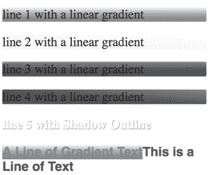

**图 2.4** CSS3 线性渐变效果。

## CSS3 径向渐变

CSS3 径向渐变比 CSS3 线性渐变更复杂，你可以使用它们创建更复杂的渐变效果。

径向渐变至少两个颜色停止点，语法如下：

```css
background: radial-gradient(shape size at position, color1, ..., last-color);
```

`shape`（形状）的默认值为 `ellipse`（椭圆）；`size`（尺寸）的默认值为 `furthest-corner`（最远角）；`position`（位置）的默认值为 `center`（中心）。

一个简单的径向渐变示例在此：

```css
background: radial-gradient(red, yellow, green);
```

前面的代码段渲染了“间距均匀”的径向渐变，这是默认行为。一个为颜色停止点指定偏移值的示例在此：

```css
background: radial-gradient(red 25%, yellow 50%, green 60%);
```

前面的代码段在径向渐变开始处 25% 的位置渲染红色，在半路处渲染黄色，在 60% 的位置渲染绿色。

HTML5 Web 页面 `RadialGradient1.html` 和 CSS 表格 `RadialGradient1.css` 未在此显示，但完整列表可以在随附光盘上找到。HTML5 代码的核心涉及此代码块：

```html
<div id="outer">
  <div id="radial3">Text3</div
  <div id="radial2">Text2</div
```

 

**光盘内容**

**28** • CSS3 口袋入门指南


```html
  <div id="radial4">Text4</div
  <div id="radial1">Text1</div
</div
```

CSS 表格 `RadialGradient1.css` 包含五个 CSS 选择器，用于匹配五个 HTML `<div>` 元素，其中一个选择器显示在此：

```css
#radial1 {
  font-size: 24px;
  width: 100px;
  height: 100px;
  position: absolute;
  top: 300px;
  left: 300px;
  background: radial-gradient(red 25%, yellow 50%, green 60%);
}
```

前面的代码段在径向渐变开始处 25% 的位置渲染红色，在半路处渲染黄色，在 60% 的位置渲染绿色。

CSS 表格 `RadialGradient1.css` 包含五个 CSS 选择器，用于匹配五个 HTML `<div>` 元素，其中一个选择器显示在此：

```css
#radial1 {
  font-size: 24px;
  width: 100px;
  height: 100px;
  position: absolute;
  top: 300px;
  left: 300px;
  background: radial-gradient(red 25%, yellow 50%, green 60%);
}
```

```css
#radial1 {
  font-size: 24px;
  width: 100px;
  height: 100px;
  position: absolute;
  top: 300px;
  left: 300px;
  background: radial-gradient(red 25%, yellow 50%, green 60%);
}
```

```css
#radial1 {
  font-size: 24px;
  width: 100px;
  height: 100px;
  position: absolute;
  top: 300px;
  left: 300px;
  background: radial-gradient(red 25%, yellow 50%, green 60%);
}
```

```css
#radial1 {
  font-size: 24px;
  width: 100px;
  height: 100px;
  position: absolute;
  top: 300px;
  left: 300px;
  background: radial-gradient(red 25%, yellow 50%, green 60%);
}
```

```css
#radial1 {
  font-size: 24px;
  width: 100px;
  height: 100px;
  position: absolute;
  top: 300px;
  left: 300px;
  background: radial-gradient(red 25%, yellow 50%, green 60%);
}
```

```css
#radial1 {
  font-size: 24px;
  width: 100px;
  height: 100px;
  position: absolute;
  top: 300px;
  left: 300px;
  background: radial-gradient(red 25%, yellow 50%, green 60%);
}
```

```css
#radial1 {
  font-size: 24px;
  width: 100px;
  height: 100px;
  position: absolute;
  top: 300px;
  left: 300px;
  background: radial-gradient(red 25%, yellow 50%, green 60%);
}
```

```css
#radial1 {
  font-size: 24px;
  width: 100px;
  height: 100px;
  position: absolute;
  top: 300px;
  left: 300px;
  background: radial-gradient(red 25%, yellow 50%, green 60%);
}
```

```css
#radial1 {
  font-size: 24px;
  width: 100px;
  height: 100px;
  position: absolute;
  top: 300px;
  left: 300px;
  background: radial-gradient(red 25%, yellow 50%, green 60%);
}
```

```css
#radial1 {
  font-size: 24px;
  width: 100px;
}
```


```css
height: 100px;

position: absolute; top: 300px; left: 300px;

background: radial-gradient(red 25%, yellow 50%, green 60%);
}
```

```css
#radial1 {
  font-size: 24px;
  width: 100px;
  height: 100px;
  position: absolute; top: 300px; left: 300px;
  background: radial-gradient(red 25%, yellow 50%, green 60%);
}
```

```css
#radial1 {
  font-size: 24px;
  width: 100px;
  height: 100px;
  position: absolute; top: 300px; left: 300px;
  background: radial-gradient(red 25%, yellow 50%, green 60%);
}
```

```css
#radial1 {
  font-size: 24px;
  width: 100px;
  height: 100px;
  position: absolute; top: 300px; left: 300px;
  background: radial-gradient(red 25%, yellow 50%, green 60%);
}
```

```css
#radial1 {
  font-size: 24px;
  width: 100px;
  height: 100px;
  position: absolute; top: 300px; left: 300px;
  background: radial-gradient(red 25%, yellow 50%, green 60%);
}
```

```css
#radial1 {
  font-size: 24px;
  width: 100px;
  height: 100px;
  position: absolute; top: 300px; left: 300px;
  background: radial-gradient(red 25%, yellow 50%, green 60%);
}
```

```css
#radial1 {
  font-size: 24px;
  width: 100px;
  height: 100px;
  position: absolute; top: 300px; left: 300px;
  background: radial-gradient(red 25%, yellow 50%, green 60%);
}
```

```css
#radial1 {
  font-size: 24px;
  width: 100px;
  height: 100px;
  position: absolute; top: 300px; left: 300px;
  background: radial-gradient(red 25%, yellow 50%, green 60%);
}
```

```css
#radial1 {
  font-size: 24px;
  width: 100px;
  height: 100px;
  position: absolute; top: 300px; left: 300px;
  background: radial-gradient(red 25%, yellow 50%, green 60%);
}
```

```css
#radial1 {
  font-size: 24px;
  width: 100px;
  height: 100px;
  position: absolute; top: 300px; left: 300px;
  background: radial-gradient(red 25%, yellow 50%, green 60%);
}
```

```css
#radial1 {
  font-size: 4px;
  width: 100px;
  height: 100px;
  position: absolute; top: 300px; left: 300px;
  background: radial-gradient(red 25%, yellow 50%, green 60%);
}
```

```css
1 {
  font-size: 4px;
  width: 100px;
  height: 100px;
  position: absolute; top: 300px; left: 300px;
  background: radial-gradient(red 25%, yellow 50%, green 60%);
}
```

列表 2.6 中的第一个选择器为文本指定了 32 的字体大小和 4 的 `border-radius`（这会渲染出圆角）。`direction` 属性为向底部，因此渐变将从上到下水平方向渲染。线性渐变从白色 `#fff` 开始，以蓝色 `#f00` 结束，如下：

```css
#line1 {
  width: 50%;
  font-size: 32px;
  background-image: linear-gradient(to bottom, #fff, #f00);
  border-radius: 4px;
}
```

如所示，第一个选择器包含两个标准属性。由于列表 2.6 中的后续三个选择器与第一个选择器相似，我们将不再讨论它们的内容。

下一个 CSS 选择器通过渲染白色文本并带有细微的黑色阴影，创建一个具有漂亮阴影效果的文本轮廓，如下：

```css
color: #fff;
text-shadow: 1px 1px 1px rgba(0,0,0,0.5);
```

列表 2.6 的最后部分包含三个影响 `<h3>` 元素及其嵌入的 `<a>` 元素渲染的选择器：`h3` 选择器指定了宽度和字体大小；`h3` 选择器指定了线性渐变；而 `h3:after` 选择器指定了文本字符串“This is a Line of Text”，该字符串显示在 HTML5 `<h3>` 元素之后（你可以使用 `h3:before` 指定显示在 HTML5 `<h3>` 元素之前的文本字符串）。还指定了其他属性，但这些是这些选择器的主要属性。

CSS3 简介 • 27


图 2.4 显示 CSS 表格 LinearGradient1.css 中的选择器与 HTML 页面 LinearGradient1.html 匹配的结果。


**图 2.4** CSS3 线性渐变效果。

## CSS3 径向渐变

CSS3 径向渐变比 CSS3 线性渐变更复杂，你可以使用它们创建更复杂的渐变效果。

径向渐变至少两个颜色停止点，其语法如下：

```css
background: radial-gradient(shape size at position, color1, ..., last-color);
```

`shape`（形状）的默认值为 `ellipse`（椭圆）；`size`（尺寸）的默认值为 `furthest-corner`（最远角）；`position`（位置）的默认值为 `center`（中心）。

一个简单的径向渐变示例在此：

```css
background: radial-gradient(red, yellow, green);
```

前面的代码段渲染了“间距均匀”的径向渐变，这是默认行为。一个为颜色停止点指定偏移值的示例在此：

```css
background: radial-gradient(red 25%, yellow 50%, green 60%);
```

前面的代码段在径向渐变开始处 25% 的位置渲染红色，在半路处渲染黄色，在 60% 的位置渲染绿色。

HTML5 Web 页面 `RadialGradient1.html` 和 CSS 表格 `RadialGradient1.css` 未在此显示，但完整列表可以在随附光盘上找到。HTML5 代码的核心涉及此代码块：

```html
<div id="outer">
  <div id="radial3">Text3</div
  <div id="radial2">Text2</div
```

 

**光盘内容**

28 • CSS3 口袋入门指南


```html
  <div id="radial4">Text4</div
  <div id="radial1">Text1</div
</div
```

CSS 表格 `RadialGradient1.css` 包含五个 CSS 选择器，用于匹配五个 HTML `<div>` 元素，其中一个选择器显示在此：

```css
#radial1 {
  font-size: 24px;
  width: 100px;
  height: 100px;
  position: absolute; top: 300px; left: 300px;
  background: radial-gradient(red 25%, yellow 50%, green 60%);
}
```

前面的代码段在径向渐变开始处 25% 的位置渲染红色，在半路处渲染黄色，在 60% 的位置渲染绿色。

CSS 表格 `RadialGradient1.css` 包含五个 CSS 选择器，用于匹配五个 HTML `<div>` 元素，其中一个选择器显示在此：

```css
#radial1 {
  font-size: 24px;
  width: 100px;
  height: 100px;
  position: absolute; top: 300px; left: 300px;
  background: radial-gradient(red 25%, yellow 50%, green 60%);
}
```

前面的代码段在径向渐变开始处 25% 的位置渲染红色，在半路处渲染黄色，在 60% 的位置渲染绿色。

CSS 表格 `RadialGradient1.css` 包含五个 CSS 选择器，用于匹配五个 HTML `<div>` 元素，其中一个选择器显示在此：

```css
#radial1 {
  font-size: 24px;
  width: 100px;
  height: 100px;
  position: absolute; top: 300px; left: 300px;
  background: radial-gradient(red 25%, yellow 50%, green 60%);
}
```

前面的代码段在径向渐变开始处 25% 的位置渲染红色，在半路处渲染黄色，在 60% 的位置渲染绿色。

CSS 表格 `RadialGradient1.css` 包含五个 CSS 选择器，用于匹配五个 HTML `<div>` 元素，其中一个选择器显示在此：

```css
#radial1 {
  font-size: 24px;
  width: 100px;
  height: 100px;
  position: absolute; top: 300px; left: 300px;
  background: radial-gradient(red 25%, yellow 50%, green 60%);
}
```

前面的代码段在径向渐变开始处 25% 的位置渲染红色，在半路处渲染黄色，在 60% 的位置渲染绿色。

CSS 表格 `RadialGradient1.css` 包含五个 CSS 选择器，用于匹配五个 HTML `<div>` 元素，其中一个选择器显示在此：

```css
#radial1 {
  font-size: 24px;
  width: 100px;
  height: 100px;
  position: absolute; top: 300px; left: 300px;
  background: radial-gradient(red 25%, yellow 50%, green 60%);
}
```

前面的代码段在径向渐变开始处 25% 的位置渲染红色，在半路处渲染黄色，在 60% 的位置渲染绿色。

CSS 表格 `RadialGradient1.css` 包含五个 CSS 选择器，用于匹配五个 HTML `<div>` 元素，其中一个选择器显示在此：

```css
#radial1 {
  font-size: 24px;
  width: 100px;
  height: 100px;
  position: absolute; top: 300px; left: 300px;
  background: radial-gradient(red 25%, yellow 50%, green 60%);
}
```

前面的代码段在径向渐变开始处 25% 的位置渲染红色，在半路处渲染黄色，在 60% 的位置渲染绿色。

CSS 表格 `RadialGradient1.css` 包含五个 CSS 选择器，用于匹配五个 HTML `<div>` 元素，其中一个选择器显示在此：

```css
#radial1 {
  font-size: 24px;
  width: 100px;
  height: 100px;
  position: absolute; top: 300px; left: 300px;
  background: radial-gradient(red 25%, yellow 50%, green 60%);
}
```

CSS3 简介 • 31


由于 `img` 选择器使用缓动函数（ease function）指定了一个一秒的间隔，缩放效果将持续一秒。尝试使用 CSS3 `scale()` 函数的不同值，以及时间间隔的不同值，以创建适合你云的动画效果。

另一个需要记住的点是，你可以同时对水平和垂直进行缩放：

```css
img {
  transition: transform 1.0s ease;
}

img.mystyle:hover {
  transform: scaleX(1.5) scaleY(0.5);
}
```

图 2.6 显示了将 CSS 样式 `Scale1.css` 中的选择器与 HTML 页面 `Scale1.html` 匹配后的结果。

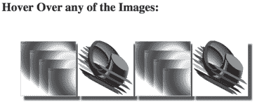

**图 2.6** 基于 CSS3 的 JPG 文件缩放效果。

## 旋转变换

CSS3 `transform` 属性允许你指定 `rotate()` 函数来创建缩放效果，其语法如下：

`rotate(someValue);`

你可以用任何数字替换 `someValue`。当 `someValue` 为正数时，顺时针旋转；当 `someValue` 为负数时，反时针旋转；且当 `someValue` 为零时，则没有旋转效果。在所有情况下，旋转效果的初始位置都是正水平轴。

配套光盘上的 HTML5 页面 `Rotate1.html` 和 CSS 样式表 `Rotate1.css` 展示了如何创建旋转效果，其示例所示：

```css
img.imageL:hover {
  transform: scale(2) rotate(-45deg);
}
```

指定 `transition` 属性的 `img` 选择器使用 ease 缓动时间函数在一秒的间隔内创建一个动画效果，如下所示：

`transition: transform 1.0s ease;`

 

**光盘内容**

32 • CSS3 快速入门

CSS3 `transform` 属性允许你指定 `skew()` 函数来创建倾斜效果，其语法如下：

`skew(xAngle, yAngle);`

你可以用任何数字替换 `xAngle` 和 `yAngle`。当 `xAngle` 和 `yAngle` 为正数时，倾斜效果为顺时针；当 `xAngle` 和 `yAngle` 为负数时，倾斜效果为反时针；且当 `xAngle` 和 `yAngle` 为零时，则没有倾斜效果。在所有情况下，倾斜效果的初始位置都是正水平轴。

配套光盘上有 HTML5 页面 `Skew1.html` 和 CSS 样式表 `Skew1.css`，它们展示了如何创建倾斜效果。包含 `img` 选择器的 CSS 样式表指定了一个 `transition` 属性，使用 ease 缓动时间函数在一秒的间隔内创建一个动画效果，如下：

`transition: transform 1.0s ease;`

还有四个选择器 `img.skewed1`、`img.skewed2`、`img.skewed3` 和 `img.skewed4`，它们分别创建具有深浅不同的红色、黄色、绿色和蓝色背景投影效果（这些你在之前的代码示例中都见过）。

选择器 `img.skewed1:hover` 指定了一个 `transform` 属性，每当用户用鼠标悬停在第一个 `` 元素上时执行倾斜效果，如下：

`transform: scale(2) skew(-10deg, -30deg);`

其他三个 CSS3 选择器也使用了 CSS 函数 `skew()` 和 `scale()` 的组合来创建不同的视觉效果。注意，第四个悬停选择器还将 `opacity` 属性设置为 0.5，这与该选择器中的其他效果并行发生。

图 2.7 显示了将 CSS 样式表 `Skew1.css` 中的选择器与 HTML 页面 `Skew1.html` 中的元素匹配后的结果。


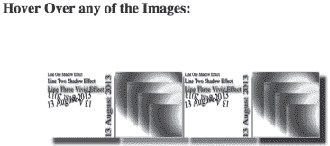

**图 2.7** 基于 CSS3 的 PNG 文件倾斜效果。

CSS3 `transform` 属性允许你指定 `translate()` 函数来创建涉及元素水平和/或垂直“位移”的效果，其语法如下：

`translate(xDirection, yDirection);`


**光盘内容**

CSS3 简介 • **33**


位移是相对于原点的，原点位于屏幕的左上角。因此，正值向右移动，负值向左移动。

配套光盘上的 HTML5 页面 `Translate1.html` 和 CSS 样式表 `Translate1.css` 展示了如何创建位移效果。位移是相对于原点的，原点位于屏幕的左上角。因此，正值向右移动，负值向左移动。示例所示：

```css
img.trans2:hover {
  transform : scale(0.5) translate(-50px, -50px);
}
```

包含 `img` 选择器的 CSS 样式表指定了一个 `transition` 属性，使用 `ease` 缓动时间函数在一秒的间隔内创建一个动画效果，如下：

`transition: transform 1.0s ease;`

还有四个选择器 `img.trans1`、`img.trans2`、`img.trans3` 和 `img.trans4`，它们分别创建深浅不同的红色、黄色、绿色和蓝色背景投影效果（这些你在之前的代码示例中都见过）。选择器 `img.trans1:hover` 指定了一个 `transform` 属性，每当用户用鼠标悬停在第一个 `` 元素上时执行缩放效果和位移效果，如下：

`transform : scale(2) translate(10px, 20px);`

图 2.8 显示了将 CSS 样式表 `Translate1.css` 中的选择器与 HTML 页面 `Translate1.html` 中的元素匹配后的结果。

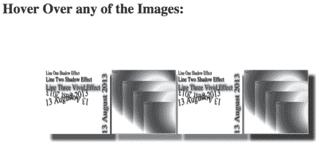

**图 2.8** PNG 文件的缩放和位移效果。

CSS3 简介 • **35**

## CSS3 属性的浏览器特定前缀

浏览器特定前缀用于在各个浏览器中处于“开发中”阶段的 CSS 属性，最终规范将舍弃这些浏览器特定的前缀。尽管现代浏览器的最新版本不再需要前缀（在本节稍后将讨论），但学习这些前缀仍然很有价值，原因有两个：

- 你可能会遇到包含浏览器特定前缀的旧代码。
- 生成 CSS 渐变的旧网站往往会生成包含不必要的浏览器特定前缀的代码。

浏览器特定前缀 `-ie-`、`-moz-` 和 `-o-` 分别对应 Internet Explorer、Firefox 和 Opera。注意，Opera 也支持 `-webkit-` 前缀，且其他浏览器也可能这样做（请查看各自网站的更新）。

作为说明，下面的代码块展示了这些前缀的示例：

```css
-ie-webkit-border-radius: 8px;

-moz-webkit-border-radius: 8px;

-o-webkit-border-radius: 8px;

border-radius: 8px;
```

在你的 CSS 选择器中，请在“通用”属性之前指定带有浏览器特定前缀的属性，当浏览器特定属性未被选中时，通用属性作为默认选择。书中的 CSS3 代码示例包含 WebKit 特定的前缀，这有助于我们保持 CSS 样式表尺寸的易于管理。

如果你需要适用于多个浏览器（包括当前版本以及旧版本）的 CSS 样式表，基本上有两种选择。一种方法是手动添加所有所需的浏览器特定前缀的 CSS3 代码，这维护起来麻烦且容易出错。另一种方法是使用 CSS 工具包或框架（将在下一章讨论），它们可以程序化生成包含所有浏览器特定前缀的 CSS3 代码。

最后，这里是带有浏览器前缀的 CSS 属性详细列表：`http://peter.sh/experiments/vendor-prefixed-css-property-overview/`。

在颜色渐变（在第 3 章讨论）的情况下，最新版本的 Chrome、Firefox、IE 10+、Opera 和 Safari 不再需要浏览器特定前缀。随着现代浏览器在功能支持方面的进化，额外的 CSS 属性将变得“无前缀”。幸运的是，以下开源项目允许你在代码中指定无前缀的属性：`http://leaverou.github.io/prefixfree/`。

前面的代码仅在必要时才插入浏览器特定前缀，减轻了手动执行此任务的繁琐性。

## 总结

在本章中，你学习了浏览器对 CSS3 的支持、浏览器特定前缀以及各种 CSS3 特性。接下来，你学习了 CSS3 伪类以及如何创建阴影效果和圆角。你还学习了 CSS3 线性渐变和径向渐变以及在线渐变生成器。此外，你看到了如何使用各种 CSS3 变换，例如缩放、旋转、倾斜和平移。最后，你学习了与性能相关的技术。

# 第 3 章

## CSS3 2D 图与动画

上一章包含了创建 CSS3 2D 图形效果的示例，而本章包含了 CSS3 2D 动画效果。注意，第 4 章将向你展示如何创建 CSS3 3D 图形和动画效果。虽然三个章节中讨论了 CSS3 的图形和动画效果，但请记住，代码示例仅作为概念的介绍，而不是对技术概念和特性的全面细节。

本章的第一部分讨论了用于创建简单动画效果的 CSS3 过渡（如发光效果和弹跳效果）。本章这部分包含代码示例，向你展示如何定义 CSS3 选择器对文本执行更复杂的效果，例如渲染多列文本。

本章的第二部分介绍了如何定义 CSS3 选择器来创建 2D 动画效果。具体而言，你将学习如何使用 CSS3 关键帧（keyframes）以及 CSS3 函数 `scale()`、`rotate()` 和 `translate()`，这些函数让你能够创建 2D 动画效果。

本章的第三部分介绍了如何创建淡入图像、旋转图像和“弹跳”效果。该部分还解释了如何为文本创建 CSS3 效果（如多列文本）。该部分还引入了 CSS 运动路径，这是一个支持类 SVG 动画效果的实验性 CSS3 特性。本章的第四部分涵盖了 CSS3 过滤器，以及可以程序化生成网页自定义过滤器的网站链接。

最后一部分涉及 jQuery 以及如何使用 jQuery 和 CSS3 创建 2D 效果。你还将学习如何使用 jQuery 和 CSS3 创建“跟随鼠标”的示例。如果你不熟悉 jQuery，可以阅读配套光盘上的 jQuery 附录。如果你不需要 jQuery（也许以后再回到这一节），可以将本章的这一部分视为可选内容。

如果你还不知道，在 HTML 页面中使用 CSS3 有若干个优点。首先，你将学习如何使用 CSS3D 创建你自己的视觉效果。其次，像 jQuery 等工具包高度依赖 CSS3 来渲染内容和创建动画效果（包括过渡）。因此，你从书中与 CSS3 相关的章节中学知识将为你提供基础，帮助你理解 jQuery 是如何实现“魔法”的，可能也会让你更容易阅读 jQuery 源码。第四，如果你使用 CSS3 而不是依赖 JavaScript 和 JPG 文件来实现图形和动画，你的代码可能会更紧凑，这对于移动设备是一个尤为重要的一点。注意，许多 CSS3D 效果强制要求硬件加速，好消息是，越来越多的移动设备支持 CSS3 的硬件加速（在某些情况下，还支持 HTML5 Canvas）。

## CSS3 变换（TRANSFORMS）

CSS3 变换包括 `scale()`、`rotate()` 和 `translate()` 函数，它们允许你修改 HTML 元素的形状。本节展示了如何使用 CSS3 创建一个立方体：

- 使用 `skew()` 函数创建左侧右面。
- 使用 `scale()` 和 `rotate()` 函数创建顶部。
- 使用线性渐变和径向渐变创建阴影。

本节中的示例包含大量的 CSS3 代码，在浏览器中运行网页查看结果将会有帮助。列表 3.1 展示了 `3DCube.html` 的内容，列表 3.2 展示了 `3DCube.css` 的内容，说明了如何在 CSS3 中模拟立方体。

### 列表 3.1 `3DCube.html`

```html
<!DOCTYPE html>
<html lang="en">
<head>
<title>CSS 3D </title>
<meta charset="utf-8" />
<link href="3DCube.css" rel="stylesheet" type="text/css">
</head>
<body>
<header>
<h1>悬停立方面：</h1>
</header>
<div id="outer">
<div id="top">文本1</div>
<div id="left">文本2</div>
<div id="right">文本3</div>
</div>
</body>
</html>
```

### 列表 3.2 `3DCube.css`

```css
/* 尺寸和位置 */
#right, #left, #top {
position:relative;
padding: 0px;
width: 200px;
height: 200px;
}
/* #left 和 #right 选择器省略 */
```

## CSS3 2D 过渡（TRANSITIONS）

CSS3 过渡以平滑的方式更改 CSS 值，并由用户手势（如鼠标点击、获取焦点或“悬停”）触发。过渡非常有用，因为你可以使用所谓的“缓动函数”（easing functions）来为 CSS 属性创建持续特定时间长度的效果，这些函数会产生不同速率的效果。例如，某些缓动函数在动画过程中以恒定速率变化，而另一些则创建非线性效果（慢-快、快-慢等）。缓动函数非常强大且有用，因为它们允许你创建真实的效果，例如观察棒棒球在空中向你飞来。

WebKit 最初开发了 CSS3 过渡，它们也可以在 Safari、Chrome（3.2 或更高版本）、Opera（10.5 或更高版本）和 Firefox（4.0 或更高版本）中使用，通过使用浏览器特定的工具包（如 jQuery 和 Prototype），这些工具支持与它们类似的过渡。创建过渡的基本语法是一个“三元组”，它指定了：

- 一个 CSS 属性。
- 持续时间（秒）。
- 过渡时间函数。

以下是一个过渡的示例：

```css
transition-property: background;
transition-duration: 0.5s;
transition-timing-function: ease;
```

幸运的是，你也可以在一行中组合这些过渡，如下所示：

```css
transition: background 0.5s ease;
```

图 3.1 一个基于 CSS3 的立方体。

CSS3 2D 图形与动画

这是一个包含这些过渡的 CSS3 选择器示例：

```css
a.foo {
  padding: 3px 6px;
  background: #f00;
  transition: background 0.5s ease;
}

a.foo:focus, a.foo:hover {
  background: #00f;
}
```

目前，过渡需要浏览器特定的前缀才能在所有浏览器中正常工作。然而，浏览器的发展速度很快，现在需要前缀的属性在未来可能不再需要前缀。访问这些网站可以查找 CSS 属性是否需要前缀：`http://shouldprefix.com/` 和 `http://caniuse.com/`。以下网站可以帮助你为 CSS 属性添加浏览器特定的前缀：`https://github.com/postcss/autoprefixer`。

这是一个为 Internet Explorer、Firefox 和 Opera 使用浏览器特定前缀指定属性示例：

```css
-ie-webkit-transition: background 0.5s ease;
-moz-webkit-transition: background 0.5s ease;
-o-webkit-transition: background 0.5s ease;
```

目前，你可以指定以下时间函数之一（使用浏览器特定前缀）：

- `Ease`
- `Ease-in`
- `Ease-out`
- `Ease-in-out`
- `Cubic-bezier`

如果这些过渡函数都不能满足你的需求，你可以使用此在线工具创建自定义函数：`www.matthewlein.com/caesar`。显示过渡时间函数比较的网站在此处：`http://www.roblapl.com/examples/bezierBuilder/`。你可以为 `transition-property` 属性指定许多值，详尽的值列表在这里：`https://developer.mozilla.org/en/CSS/CSS_transitions`。根据前面的链接，`transition-property` 属性仍处于实验阶段，该链接中还提供了浏览器兼容性表。以下网站是 CSS3 和贝塞尔曲线动画效果示例的良好来源：`https://medium.com/@EanPlatter/css3-animations-with-a-cubic-bezier-curve-ea06fc20e5c1`。

## 使用 CSS3 过渡制作立方体动画

本节中的代码示例为上一节的代码示例添加了基于悬停的动画效果。HTML 页面 `3DCube1Hover1.html` 与网页 `3DCube1.html` 几乎相同；唯一的例外是涉及对 CSS 样式表 `3DCube1Hover1.css` 的引用。列表 3.3 显示了 `3DCube1.css` 的内容，它包含了与悬停相关的 CSS3 选择器，这些选择器为立方体的面创建了动画效果。

### 列表 3.3 `3DCube1Hover1.css`

```css
#right:hover {
  transition: transform 3.0s ease;
  transform: scale(1.2) skew(-10deg, -30deg) rotate(-45deg);
}

#left:hover {
  transition: transform 2.0s ease;
  transform: scale(0.8) skew(-10deg, -30deg) rotate(-45deg);
}

#top:hover {
  transition: transform 2.0s ease;
  transform: scale(0.5) skew(-20deg, -30deg) rotate(45deg);
}
// 其余代码与 3DCube1.css 相同
```

## 使用 CSS3 关键帧（KEYFRAMES）制作动画

你目前为止看到的基于 CSS3 代码示例主要涉及静态视觉效果（但你看到了如何使用悬停选择器来创建动画效果）。下一节将讨论 CSS3 关键帧，用于创建不需要用户交互的动画效果。

CSS3 `@keyframes` 规则包含一组通过 0 到 100 之间的数字标识的选择器。你还指定了动画效果的持续时间，每个关键帧的持续时间被计算为持续时间的百分比。例如，以下 CSS3 `@keyframes` 规则定义了动画前半部分和后半部分发生的情况：

```css
@keyframes glow {
  0% {
  }
  50% {
  }
  100% {
  }
}
```

CSS3 2D 图形与动画 • **45**

如何对 PNG 文件创建“渐变”效果，并在另一个 PNG 文件上创建发光效果。

### 列表 3.5 `FadeRotateImages1.html`

```html
<!DOCTYPE html>

<html lang="en">

<head>

<title>CSS3 Fade and Rotate Images</title>

<meta charset="utf-8" />

<link href="FadingImages1.css" rel="stylesheet" type="text/css">

</head>

<body>

<div id="outer">


</div>

<div id="third">


</div>

</body>
```

列表 3.5 引用了 CSS 样式表 `FadingImages1.css`，该表包含了用于创建渐变效果和发光效果的 CSS 选择器。列表 3.5 中的第一个 HTML `<div>` 元素包含两个 `` 元素；当用户悬停在渲染后的 JPG 文件上，它会“渐变”并显示另一个 JPG 文件。第二个 HTML `<div>` 元素包含一个 `` 元素，当用户悬停在此 PNG 文件上时，CSS3 选择器将使引用的 PNG 文件绕垂直轴旋转。

### 列表 3.6 `FadeRotateImages1.css`


```css
#outer {
position: absolute; top: 20px; left: 20px;
margin: 0 auto;
}
#outer img {
position:absolute; left:0;
transition: opacity 1s ease-in-out;
}
#outer img.upper:hover {
opacity:0;
}
#third img {
position: absolute; top: 20px; left: 250px;
}
#third img:hover {
animation: rotatey 2.0s 3 ease;
}
@keyframes rotatey {
0% {
transform: rotateY(45deg);
}
50% {
transform: rotateY(90deg);
}
100% {
transform: rotateY(0);
}
}
```

我们将跳过列表 3.6 中你已经熟悉的代码细节。创建渐变效果的关键在于当用户悬停在最左侧的图像上时，将 `opacity` 值设置为 0，CSS 选择器中的那行代码在此处：

```css
#outer img.upper:hover {
opacity:0;
}
```

如你所见，这段代码示例向你展示了无需复杂的代码逻辑，通过在标记为 `rotatey` 的关键帧中调用 CSS3 函数 `rotateY()` 来创建一个围绕垂直轴旋转的效果。注意，你可以通过将 `rotateY()` 替换为 CSS3 函数 `rotateX()` 或 `rotateZ()` 来创建围绕其他两个轴的旋转效果。你甚至可以在同一个关键帧中使用这三个函数来创建 3D 效果。请注意，CSS 3D 效果将在下一章进行详细讨论。图 3.3 显示了 `FadeRotateImages1.html` 在点击左侧图像（该图像初始时与右侧图像相同）后，使用渐变效果渲染的结果。注意，桌面端用户可以悬停在任何一个图像上，在右侧图像上悬停会产生旋转效果。

***图 3.3*** CSS3 渐变和旋转效果。

**46** • CSS3 入门指南

## 使用 CSS3 关键帧创建跳动效果

上一个示例向你展示了如何创建渐变动画，本节向你展示了如何创建“跳动”动画。列表 3.7 显示了 `Bounce2.html` 的内容，列表 3.8 显示了 `Bounce2.css` 的内容，展示如何在输入框上创建跳动效果。

***列表 3.7 Bounce2.html***

```html
<!DOCTYPE html>

<html lang="en">

<head>

<title>CSS Animation</title>

<meta charset="utf-8" />

<link href="Bounce2.css" rel="stylesheet" type="text/css">

</head>

<body>

<div id="outer">

<input id="input" type="text" value="An input">

</div>

</body>

</html>
```

***列表 3.8 Bounce2.css***

```css
#outer {
position: relative; top: 50px; left: 100px;
}
@keyframes bounce {
0% {
left: 50px;
top: 100px;
background-color: #ff0000;
}
25% {
left: 100px;
top: 150px;
background-color: #ffff00;
}
50% {
left: 50px;
top: 200px;
background-color: #00ff00;
}
75% {
left: 0px;
top: 150px;
background-color: #0000ff;
}
100% {
left: 50px;
top: 100px;
background-color: #ff0000;
}
}
#input {
font-size: 24px;
border-radius: 4px;
}
#outer:hover {
animation: bounce 2.0s 4 ease;
}
```

列表 3.8 包含一个名为 `bounce` 的 `@keyframes` 规则，它指定了动画持续时间的 0%、25%、50%、75% 和 100% 时间点。每个时间点都指定了属性的 `left`、`top` 和 `background-color` 值。尽管这个 `@keyframes` 规则非常简单，但它创建了流畅的动画效果。`#input` 选择器匹配 `Bounce2.html` 中的输入框并产生圆角矩形。`#outer:hover` 选择器使用 `bounce` 关键帧创建一个持续 2 秒、重复 4 次并使用 `ease` 函数的动画效果，所示：`animation: bounce 2.0s 4 ease;`。

图 3.4 显示了 HTML 页面 `Bounce2.html` 中的动画效果快照。

***图 3.4*** CSS3 跳动动画效果。

除了 CSS3 关键帧，你还可以像下一节讨论的那样使用 CSS 路径（Motion Paths）来创建动画效果。

## CSS 路径

CSS 路径正在开发中，它们在纯 CSS3 创建复杂动画效果方面具有巨大的潜力。CSS 路径允许作者沿作者指定的路径动画任何图形对象。你通过在 CSS 选择器中指定 `motion-path` 属性来定义 CSS 路径，其值包含 `path()` 函数中的实际路径。CSS 路径支持四种属性：`motion`（`motion-path` 的简写）、`motion-offset`（在路径上的位置）、`motion-path`（用于动画的类 SVG 路径）和 `motion-rotation`（元素在路径上的方向）。

**47** • CSS3 2D 图形与动画

**48** • CSS3 入门指南

**50** • CSS3 快速入门

```html
<body>

<header>

<h1>将鼠标悬停在多列文本上：</h1>header>

</header>

<div id="outer">

<p id="line1">.</p>

<article>

<div id="columns">

<p> CSS 允许你定义选择器，以指定你在 HTML 页面中渲染元素所需的样式或方式。CSS 帮助你将 HTML 内容模块化，由于你可以将 CSS 定义放在单独的文件中，你还可以在多个 HTML 文件中重用相同的 CSS 定义。

</p>

<p> 此外，CSS 还允许你简化对 HTML 页面中元素进行所需的更新。例如，假设多个 HTML 表格元素使用一个指定为红色的 CSS 规则。如果你以后需要将颜色更改为蓝色，只需在一条 CSS 规则中进行一次更改（即将红色改为蓝色）即可实现此类更改。

</p>

<p> 如果没有 CSS 规则，你将被迫手动更新受影响的每一个 HTML 表格元素的颜色属性，这是容易出错、耗时且效率极低的。

</p>

</div>

</article>

<p id="line1">.</p>

</div>

</body>

</html>
```

列表 3.9 中的 HTML5 页面包含了语义化标签（在第一章中讨论），这些标签在几个 HTML `<p>` 元素中渲染文本。如你所示，此 HTML5 页面非常简单，多列效果定义在列表 3.10 显示的 CSS 表格 `MultiColumns1.css` 中。

***列表 3.10 MultiColumn1.css***

```css
#columns:hover {
transition: transform 3.0s ease;
transform : scale(0.5) skew(-20deg, -30deg) rotate(45deg);
}

#line1:hover {
transition: transform 3.0s ease;
transform : scale(0.5) skew(-20deg, -30deg) rotate(45deg);
background-image: linear-gradient(to bottom, #fff, #00f);
border-radius: 8px;
}

#columns {
column-count : 3;
column-gap : 80px;
column-rule : 1px solid rgb(255,255,255);
}

#line1 {
color: red;
font-size: 24px;
background-image: linear-gradient(to bottom, #fff, #f00);
border-radius: 4px;
}
```

列表 3.10 中的前两个选择器每当用户悬停在 id 属性值为 `columns` 或 `line1` 的 `<div>` 元素上时，都会创建一个动画效果。这两个选择器都使用 CSS3 函数 `scale()`、`skew()` 和 `rotate()` 在三秒钟的间隔内创建一个动画效果，如下所示：

`transition: transform 3.0s ease;`

`transform : scale(0.5) skew(-20deg, -30deg) rotate(45deg);`

第二个选择器还定义了线性渐变背景效果。

列表 3.10 中的 `#columns` 选择器包含三个布局相关的属性。`column-count` 属性为 3，因此文本以三列显示；`column-gap` 属性为 80px，因此相邻列之间有 80 像素的间隔；`column-rule` 属性指定了白色背景。

`#line1` 选择器指定了一个线性渐变，在多列文本的上方下方创建了良好的视觉效果。

图 3.5 显示了 `Multicolumn.css` 中的 CSS 选择器与 HTML 页面 `MultiColumns.html` 中的文本匹配的结果。

***图 3.5*** 多列文本。

## CSS 过滤器

过滤器效果是在对 HTML Web 页面上的元素应用图形操作时创建的内容。过滤器可以接受零或多个输入图像，并可能包含一些输入参数。输出图像显示在 HTML Web 页面中，或者可能是某些输入参数。

CSS3 2D 图形与动画 • **51**

![img/0a6af518702639b3a358cdd75f17af79_67_0.png]

```css
column-count : 3;

column-gap : 80px;

column-rule : 1px solid rgb(255,255,255);

#line1 {

color: red;

font-size: 24px;

background-image: linear-gradient(to bottom, #fff, #f00);

border-radius: 4px;

}
```

列表 3.10 中的前两个选择器每当用户悬停在 id 属性值为 `columns` 或 `line1` 的 `<div>` 元素上时，都会创建一个动画效果。这两个选择器都使用 CSS3 函数 `scale()`、`skew()` 和 `rotate()` 在三秒钟的间隔内创建一个动画效果，如下所示：

`transition: transform 3.0s ease;`

`transform : scale(0.5) skew(-20deg, -30deg) rotate(45deg);`

第二个选择器还定义了线性渐变背景效果。

列表 3.10 中的 `#columns` 选择器包含三个布局相关的属性。`column-count` 属性为 3，因此文本以三列显示；`column-gap` 属性为 80px，因此相邻列之间有 80 像素的间隔；`column-rule` 属性指定了白色背景。

`#line1` 选择器指定了一个线性渐变，在多列文本的上方下方创建了良好的视觉效果。

图 3.5 显示了 `Multicolumn.css` 中的 CSS 选择器与 HTML 页面 `MultiColumns.html` 中的文本匹配的结果。

![img/0a6af518702639b3a358cdd75f17af79_67_1.png]

***图 3.5*** 多列文本。

过滤器效果是在对 HTML Web 页面上的元素应用图形操作时创建的内容。过滤器可以接受零或多个输入图像，并可能包含一些输入参数。输出图像显示在 HTML Web 页面中，或者可能是某些输入参数。

CSS3 2D 图形与动画 • **52**

![img/0a6af518702639b3a358cdd75f17af79_67_0.png]

此外，现代浏览器支持以下：

- `filter: blur(3px);`
- `filter: grayscale(100%);`
- `filter: hue-rotate(80deg);`
- `filter: opacity(0.8);`
- `filter: sepia(80%);`
- `filter: saturate(2);`
- `filter: brightness(0.5);`
- `filter: contrast(1);`
- `filter: hue-rotate(120deg);`
- `filter: invert(0.4);`

你可以将这些过滤器应用到现有的 HTML 元素上，如下所示：

```css
img {
  filter: blur(3px);
}
```

以下链接显示了浏览器对以下支持情况：

`https://caniuse.com/css`

以下示例展示了如何：

- `$("p")` 查找 HTML 页面中所有的 `<p>` 元素
- `$("#abc")` 查找 id 属性值为 `"abc"` 的 HTML 元素
- `$(".def")` 查找 class 属性值为 `"def"` 的 HTML 元素

**54** • CSS3 入门指南

```html
<script src="http://code.jquery.com/jquery-2.0.0b1.js">

</script>

</head>

<body>

<p id="Steve">来自段落的 Hello</p>

<script>

$(document).ready(function(){

// 获取 'id' 值（等于 Steve）

var pIdValue = $("p").attr("id");

// 获取 <p> 元素中的文本

var pText = $("p").text();

console.log (pIdValue+" says "+pText);

// 更新 <p> 元素中的文本

$("p").text("来自段落的 Goodbye");

pText = $("p").text();

console.log(pIdValue+" says "+pText);

});

</script>

</body>

</html>
```

列表 3.11 使用此代码段引用了两个 jQuery 文件：

```html
<script src="http://code.jquery.com/jquery-2.0.0b1.js">

</script>
```

注意 HTML `<body>` 元素中的第一个 HTML `<script>` 元素以这一行开始：

```javascript
$(document).ready(function(){
//在此处执行某些操作
});
```

前面的结构确保了 DOM（文档对象模型）已加载到内存中，之后就可以安全地访问和操作 DOM 元素。

使用 jQuery 的 `attr()` 函数获取 HTML 元素（例如 `<p>` 元素）属性的值。例如，以下代码段查找 HTML `<p>` 元素的 `id` 属性值：

```javascript
var pIdValue = $("p").attr('id');
```

使用 jQuery 的 `text()` 函数检索 HTML 元素中的文本字符串。例如，以下代码段检索了 HTML `<p>` 元素中的文本：

```javascript
// 获取 <p> 元素中的文本

var pText = $("p").text();

console.log (pIdValue+' says '+pText);
```

CSS3 2D 图形与动画 • **55**


最后，你可以使用相同的 `text()` 函数来更新 HTML `<p>` 元素中的文本，如下所示：

```javascript
// 更新 <p> 元素中的文本

$("p").text("来自段落的 Goodbye");
```

在浏览器中启动列表 3.11 的内容并打开浏览器中提供的检查器。接下来，选择“检查元素”，并点击网页底部的“>>”符号以查看列表 3.11 中两个 `console.log()` 语句的输出。请记住，在 Chrome 中使用 Web 检查器的具体步骤与 Safari 不同，且顺序在这两个浏览器的未来版本中也可能会发生变化。

如果你不知道，可以使用 Chrome Web 检查器查看变量的内容，这对于调试非常有帮助。你可以尝试 Chrome Web 检查器的功能，并阅读关于这个优秀工具的在线教程。

## 使用 CSS3 和 jQuery 实现 2D 效果

如果你不计划在 HTML 网页中使用 jQuery，可以将本节视为可选内容，且不会影响连贯性。

列表 3.12 显示了 `JQTransforms2D1.html` 的内容，它说明了如何在 HTML 网页上的 `<div>` 元素上调用 CSS3 2D 变换。

***列表 3.12 JQTransforms2D1.html***

```html
<!DOCTYPE html>

<html lang="en">

<head>

<meta charset="utf-8" />

<title>jQuery 与 CSS 变换</title>

<link href="JQTransforms2D1.css" rel="stylesheet" type="text/css">

<script src="http://code.jquery.com/jquery-2.0.0b1.js"></script>
```


```html
<script src="http://code.jquery.com/jquery-migrate-1.1.0.js"></script>
```

```html
</head>

<body>

<h1>点击任意矩形内部：</h1>

<div id="outer">

<div id="inner1"></div>

<div id="inner2"></div>

<div id="inner3"></div>

</div>

</div>

<script>
```

**56** • CSS3 入门指南

```javascript
$(document).ready(function() {

// 每个 <div> 的代码块

$("#inner1").click(function() {

$("div").css({height: '300px',

'transform': 'scale(0.5, 0.5) skew(-10deg)'});

});

$("#inner2").click(function() {

$("div").css({height: '200px',

'width': '250px',

'transform': 'scale(0.5, 0.8) rotate(-45deg)'});

});

$("#inner3").click(function() {

$("div").css({height: '100px',

'width': '250px',

'transform': 'skew(-10deg) rotate(-45deg)'});

});

});

</script>

</body>

</html>
```

列表 3.12 在 `<head>` 中包含几个 `<script>` 元素，随后是包含一个 `<div>` 元素和一个 `<script>` 元素的 `<body>` 元素。`<div>` 元素包含列表 3.12 选择器匹配的三个 `<div>` 元素。`<script>` 元素以加粗代码开头，确保 DOM 已加载。注意所有 JavaScript 和 jQuery 代码都在此代码段中。

列表 3.12 的后续部分是处理三个嵌套 `<div>` 元素点击事件的代码。当用户点击这些 `<div>` 元素时，代码会调用 jQuery 的 `css()` 方法更新相关 `<div>` 元素的各种属性。例如，当用户点击第一个嵌套的 `<div>` 元素时，执行以下代码，对 `<div>` 元素应用 `scale()` 和 `skew()` 函数：

```javascript
$("#inner1").click(function() {"div").css({height: '300px',

'transform': 'scale(0.5, 0.5) skew(-10deg)'});
```

列表 3.13 显示了 `JQTransforms2D1.css` 的内容，其中包含了列表 3.12 中引用的 CSS3 选择器。

CSS3 2D 图形与动画 • **57**


### 列表 3.13 `JQTransforms2D1.css`

```css
#outer {

position: absolute;

left: 50px;

top: 150px;

}

#inner1 {

float: left;

background-color:#F00;

width: 200px;

height: 150px;

}

#inner2 {

float: left;

background-color:#FF0;

width: 200px;

height: 150px;

}

#inner3 {

float: left;

background-color:#00F;

width: 200px;

height: 150px;

}
```

列表 3.13 包含了四个匹配列表 3.12 中四个 `<div>` 元素的 CSS 选择器。每当用户点击相关 `<div>` 元素时，匹配每个选择器的 `<div>` 元素就会更新简单属性的值。图 3.6 显示在 Chrome 浏览器中启动 `JQTransform2D1.html` 的结果。

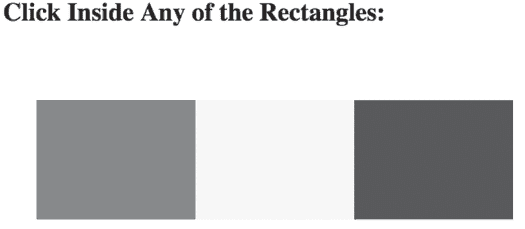

***图 3.6*** 用户点击 `<div>` 元素时应用 CSS 变换。

## 使用 CSS3 和 jQuery 实现“跟随鼠标”

列表 3.14 显示了 `JQSketchSolid1.html` 的内容，说明了如何在 HTML 网页上的 `<div>` 元素上调用 CSS3 2D 变换。

**58** • CSS3 入门指南

### 列表 3.14 `JQSketchSolid1.html`

```html
<!DOCTYPE html>

<html lang="en">

<head>

<meta charset="utf-8" />

<title>jQuery 绘图示例</title>

<script src="http://code.jquery.com/jquery-2.0.0b1.js"></script>

<script src="http://code.jquery.com/jquery-migrate-1.1.0.js"></script>

</head>

<body>

<script>

$(document).ready(function() {

var render = false; // true/false = 绘制/不绘制

var shape="", width="8px", height="8px", color="#ff0000";

$(document).mousedown(function() { render = true; });

$(document).mouseup(function() { render = false; });

$(document).mousemove(function(e) {

if(render == true) {

// 在鼠标位置创建一个矩形

shape = $('<span>').css({'position':'absolute',

'background-color':color,

'width':width,

'height':height,

top: e.pageY,

left: e.pageX});

// 将 shape 添加到 <body> 元素

$('body').append(shape);

}

});

});

</script>

</body>

</html>
```

列表 3.14 包含一个 `<script>` 元素，通过切换变量 `render` 值来处理 `mousedown` 和 `mouseup` 事件。列表 3.14 的后续部分定义了 `mousemove` 函数，当 `render` 为真时创建一个 `<span>` 元素并添加到 `<body>` 元素中，从而实现跟随鼠标的效果。

CSS3 2D 图形与动画 • 59


## 有用链接

本节包含了与本章主题相关的有用链接汇。

桌面浏览器对 HTML5 的兼容性表格在这里：http://aniuse.com/。

关于 HTML5 的大量文章在这里：http://www.html5rocks.com/en/。

致力于 CSS3 所有内容的网站在这里：http://www.CSS3.info/。

以下网站是浏览器兼容信息的优秀来源（由 Peter-Paul 维护）：http://www.quirksmode.org/。

非常好的在线工具允许你尝试许多 CSS3 功能并显示相关的 CSS3 代码，可以在 http://www.westciv.com/tools/3Dtransforms/index.html/ 获取。

处理属性特定浏览器扩展的工具包可以让你编写无前缀的 CSS3 选择器：http://ecss-tender.org/。

可以在线创建渐变并查看相关 CSS3 代码的网站：http://gradients.glrzad.com/。

关于 HTML5 和 CSS3 功能支持的另一个网站：http://html5readiness.com/。

一组使用 CSS3 的漂亮“素描”视觉效果在这里：http://drew-hoyer.com/index.html/。

## 总结

本章向你展示了如何创建发光消失效果以及如何渲染多列文本。然后你学习了如何使用 CSS3 关键帧以及 CSS3 函数 `scale()`、`rotate()` 和 `translate()`，这些让你能够创建 2D 动画效果。你学习了 CSS 运动路径（Motion Paths），这是一项支持 SVG 类动画效果的实验性 CSS3 特性。

此外，你还学习了如何将 CSS3 与 jQuery 以创建 2D 效果，正如“跟随鼠标”代码示例所示。

# 第4章 CSS3 3D 图形与动画

本章将展示如何使用 CSS3 创建具有各种 3D 图形和动画效果的 HTML 网页。然而，虽然 3D 效果比 2D 更有吸引力，但它们通常更消耗 CPU，这对于在移动设备上渲染的网页可能会产生问题。CSS3 3D 效果依赖 GPU（图形处理单元）来处理密集计算，你将学习如何确保 GPU 被调用。

此外，许多网页显示在移动设备上，因此确定 CSS3 3D 动画效果对移动设备电池寿命的影响至关重要。

本章的第一部分将向你展示如何使用 CSS3 2D 变换渲染立方体，以及在悬停（hover）事件期间创建动画效果的过渡（transitions）。本章的第二部分讨论了 3D 变换，例如平移（translate）、缩放（scale）和旋转（rotate）变换（skew 倾斜没有 3D）。该部分还讨论了如何创建 CSS3 过渡。

本章的第三部分包含 3D 动画效果的示例。

本章的第四部分将展示如何将 3D 效果与精灵图（sprites）、CSS 动画工具相结合，以及一个使用 jQuery 和 CSS 创建动画效果的可选章节（如果你需要熟悉这项技术，jQuery 附录提供了相关介绍）。

除了本章讨论的代码样本外，这里还有了一系列用于创建 CSS3 2D/3D 图形/动画效果（主要是为了趣味）的详尽代码样本：https://github.com/ocampesato/css3-graphics。

由于本章涉及 CSS3 3D 动画效果，本章的最后部分将简要讨论 GPU 及其在 HTML 中的作用，并向你展示如何确保为基于 CSS 的动画效果调用 GPU。在阅读完讨论了结合 SVG 的 CSS3 和结合 HTML5 Canvas 的 CSS3 的章节后，第 9 章将从性能角度简要比较这些技术。

## CSS3 3D 变换

通常情况下，CSS3 支持与其 2D 对应形式相应的 3D 变换；唯一的例外是 `skew`（倾斜）变换，它没有 3D 对应形式。具体而言，3D 变换包括：`translate3D`、`rotate3D`、`scale3D`、`matrix3D` 和 `perspective`（透视）。

列表 4.1 显示了 `3DTransforms.html` 的内容，说明了如何在网页中使用 CSS3 3D 变换，列表 4.2 显示了 CSS3 样式表 `ThreeD2.css` 的内容。

### 列表 4.1 `Tread2.html`

```html
<!DOCTYPE html>
<html lang="en">
<head>
<title>CSS 3D Effects Example</title>
<meta charset="utf-8" />
<link href="Threed2.css" rel="stylesheet" type="text/css">
</head>
<body>
<div id="outer">
<div id="radial1">Text1</div>
<div id="radial2">Text2</div>
</div>
</body>
</html>
```

列表 4.1 是一个简单的 HTML5 网页，它包含对 CSS3 样式表 `Threed2.css` 的引用，随其后的是一个 `<body>` 元素，该元素内包含一个 id 属性值为 `outer` 的 `<div>` 元素。同一个 `<div>` 元素有两个子 `<div>` 元素，这些元素与列表 4.2 中的某些选择器匹配。

#### 列表 4.2 `Threed2.css`

```css
#outer {
  position: relative; top: 10px; left: 0px;
}
#radial1 {
  opacity: 0.8;
  font-size: 24px;
  width: 200px;
  height: 200px;
  position: absolute; top: 0px; left: 0px;
  background: radial-gradient(
    blue 1%,
    orange 5%, yellow 40%,
    green 60%, red 80%,
    #fff
  );
  transform: rotate3d(20,30,40, 50deg) translate3d(50px,50px,50px) skew(-15deg,0);
}
#radial2 {
  opacity: 0.6;
  font-size: 24px;
  width: 200px;
  height: 200px;
  position: absolute; top: 200px; left: 200px;
  background: radial-gradient(
    red 1%,
    orange 5%, yellow 40%,
    green 60%, blue 80%,
    #fff
  );
  transform: rotate3d(1,0,0, 60deg) scale3d(1.5, 0.5, 0.75);
}
```

列表 4.2 包含两个 CSS 选择器 `#radial1` 和 `#radial2`，它们匹配列表 4.1 中具有相应 id 值的 `<div>` 元素。如你所示，这些选择器包含了 `transform` 属性，该属性指定了 CSS3 3D 函数的组合，如 `rotate3d()` 和 `translate3d()`，以及 2D 的 `skew()` 函数。

记住，CSS3 3D 变换可能不支持所有浏览器。请访问 caniuse 网站获取有关哪些浏览器支持特定 2D 或 3D 变换的信息：http://caniuse.com/#feat=transforms2d 和 http://caniuse.com/#search=css3%203d%20transforms。

## CSS3 3D 过渡（修复示例）

CSS 过渡（transition）是 CSS 属性在指定持续时间内的动画效果。CSS 过渡效果持续时间的默认值为 0。因此，除非指定 CSS 过渡的持续时间，否则不会发生过渡。

列表 4.3 显示了 `3DTransition1.html` 的内容，它使用 CSS3 过渡来响应“悬停”（hover）事件触发变换（transforms）。

### 列表 4.3 `3DTransition1.html`

```html
<!DOCTYPE html>
<html>
<head>
<meta charset="utf-8">
<title>CSS3 Transition Effect</title>
<style>
div {
  width: 150px;
  height: 150px;
  background: red;
  transition: width 2s;
}
div:hover {
  width: 300px;
}
</style>
</head>
<body>
<p>悬停在以下 div 元素上：</p>
<div></div>
</body>
</html>
```

列表 4.3 包含一个 `<style>` 元素，它包含了匹配列表 4.1 中具有相应 id 值的 `<div>` 元素的 CSS 选择器。如你所见，这些选择器包含了 `transition` 属性，该属性指定了在悬停 `<div>` 元素时触发的过渡。列表 4.3 的最后部分是一个空的 `<div>` 元素。在这种情况下，3D 过渡持续时间为 3 秒。CSS3 支持 3D 的过渡。

除了 `transition` 属性外，CSS3 还支持：

- `transition`：设置多个过渡属性的简写属性。
- `transition-delay`：指定过渡开始前的延迟。
- `transition-duration`：指定持续多长时间，如下所示：

```css
#div1 { transition: linear; }

#div2 { transition: ease; }

#div3 { transition: ease-in; }

#div4 { transition: ease-out; }

#div5 { transition: ease-in-out; }
```

浏览器对 CSS 过渡的支持：http://caniuse.com/#feat=transitions。

**66** • CSS3 快速入门


```css
color: red;
background-color: #48f;
}

p {
  font-size: 24px;
  border-radius: 4px;
  box-shadow: 0 0 24px rgba(100, 100, 100, 0.9);
}

p:hover {
  scale: 2;
  animation: rotatex 4.0s 3 ease;
}

img {
  padding: 4px;
}

img:hover {
  scale: 2;
  animation: rotatex 4.0s 3 ease;
}

@keyframes rotatex {
  0% {
    transform: rotateX(-45deg);
  }

  25% {
    transform: rotateY(90deg);
  }

  50% {
    transform: rotateX(270deg);
  }

  75% {
    transform: rotateZ(135deg);
  }

  100% {
    transform: rotateX(0);
  }
}
```

列表 4.5 从一个选择器开始，该选择器匹配类属性值为 `preferences` 的 `<div>` 元素、嵌套的 `` 元素，或嵌套的 `<p>` 元素。下一个选择器匹配顶层 `<p>` 元素，随后是一个当用户悬停在顶层 `<p>` 元素上时匹配的选择器。对于匹配 `` 元素以及 `` 元素悬停事件的选择器，也适用类似的注释。

列表 4.5 的最后部分包含一个 `@keyframes` 定义，它以 25% 为步增，在 `rotateX()` 函数中指定了不同的度数值值。运行列表 4.4 中的代码并观察所创建的效果。

如果你对 `float` 属性不熟悉（或者需要快速复），下面的链接是一篇很好的读物：`http://bitsofco.de/2015/how-floating-works`。

图 4.1 显示了悬停在列表 4.1 中的文本字符串上创建的动画效果。

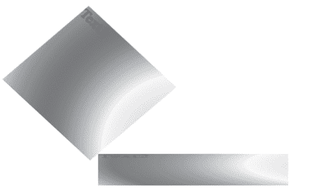

**图 4.1** 文本和 PNG 文件的动画效果。

CSS3 3D 图形与动画 • **67**


## 使用关键帧的 CSS3 3D 动画效果

在上一章中，你学习了如何使用关键帧规则创建 CSS3 2D 动画效果。你也可以通过指定 CSS3 函数（如 `scale3d()`、`rotate3d()` 和 `translate3d()`）或各种组合，通过 CSS3 关键帧规则创建 CSS3 3D 动画效果。

列表 4.6 显示了 `Anim240Flicker3DLGrad4.html` 的内容，这是一个非常简单的 HTML 页面，包含四个 HTML `<div>` 元素。在这个示例中，动画效果持续四分钟，是因为在关联的 CSS3 样式表中指定了时长。

**列表 4.6 Anim240Flicker3DLGrad4.html**

```html
<!DOCTYPE html>
<html lang="en">
<head>
<title>CSS3 Animation Example</title>
<meta charset="utf-8" />
<link href="Anim240Flicker3DLGrad4.css" rel="stylesheet" type="text/css">
</head>
<body>
<div id="outer">
<div id="linear1">Text1</div>
<div id="linear2">Text2</div>
<div id="linear3">Text3</div>
<div id="linear4">Text4</div>
</div>
</body>
</html>
```

列表 4.6 是一个非常简单的 HTML5 页面，配有相应的 CSS 选择器（显示在列表 4.7 中）。一如既常，真正的复杂性发生在包含创建动画效果代码的 CSS 选择器中。

正如你将看到的，列表 4.6 中的某些 CSS 选择器包含 CSS3 `matrix()` 函数，这需要对矩阵的了解（这超出了本书的范围）才能完全理解使用 CSS3 `matrix()` 函数创建所产生效果的原因。如果你对学习矩阵感兴趣，可以阅读这关于矩阵（在 CSS3 背景下）的介绍：`http://www.eleqtriq.com/2010/05/css-3d-matrix-transformations/`。

由于 `Anim240Flicker3DLGrad4.css` 是一个非常长的代码示例，列表 4.7 显示了代码的一部分。然而，完整的代码可以在本书的配套光盘中获得。

**列表 4.7 Anim240Flicker3DLGrad4.css**

```css
@keyframes upperLeft {
  0% {
    transform: matrix(1.5, 0.5, 0.0, 1.5, 0, 0)
  }

  10% {
    transform: translate3d(50px, 50px, 50px)
      rotate3d(50, 50, -90deg)
      skew(-15deg, 0) scale3d(1.25, 1.25, 1.25);
  }

  // 类似代码

  90% {
    transform: matrix(2.0, 0.5, 1.0, 2.0, 0, 0)
      matrix(1.5, 0.0, 0.5, 2.5, 0, 0);
  }

  95% {
    transform: translate3d(-50px, -50px, -50px)
      rotate3d(-50, -50, 120deg)
      skew(135deg, 0) scale3d(0.3, 0.4, 0.5);
  }

  96% {
    transform: matrix(0.2, 0.3, -0.5, 0.5, 100, 200)
      matrix(0.4, 0.5, 0.5, 0.2, 200, 50);
  }

  97% {
    transform: translate3d(50px, -50px, 50px)
      rotate3d(-50, -50, 120deg)
      skew(315deg, 0) scale3d(0.5, 0.4, 0.3);
  }

  98% {
    transform: matrix(0.4, 0.5, 0.5, 0.3, 200, 50)
      matrix(0.3, 0.5, -0.5, 0.4, 50, 150);
  }

  99% {
    transform: translate3d(150px, 50px, 50px)
      rotate3d(60, 80, 100, 240deg)
      skew(315deg, 0) scale3d(1.0, 0.7, 0.3);
  }

  100% {
    transform: matrix(1.0, 0.0, 0.0, 1.0, 0, 0)
      matrix(1.0, 0.5, 1.0, 1.5, 0, 0);
  }
}

// 省略代码

#linear1 {
  font-size: 96px;
  text-stroke: 8px blue;
  text-shadow: 8px 8px 8px #FF0000;
  width: 400px;
  height: 250px;
  position: relative;
  top: 0px;
  left: 0px;
  background-image: linear-gradient(
    #f00,
    orange 20%,
    yellow 40%,
    blue 60%,
    green 80%,
    #00f
  );
  border-radius: 4px;
  box-shadow: 30px 30px 30px #000;
  animation-name: lowerLeft;
  animation-duration: 240s;
}
```

CSS3 3D 图形与动画 • **69**

列表 4.7 包含一个名为 `upperLeft` 的关键帧定义，它以以下行开头：

```css
@keyframes upperLeft {
  // 百比定义放在这里
}
```

`#linear` 选择器包含了已经见过的属性，其中一个属性引用了由 `lowerLeft` 标识的关键帧，另一个指定了 240 秒时长的属性，如下：

```css
#linear1 {
  // 省略代码
  animation-name: lowerLeft;
  animation-duration: 240s;
}
```

现在你已经知道如何在选择器中引用关键帧定义，让我们来看看 `lowerLeft` 定义的细节，它包含了指定各种动画效果的 19 个元素。`lowerLeft` 的每个元素都发生在动画期间的特定阶段。例如，`lowerLeft` 中的第 8 个元素指定了值 50%，这意味着它将发生在动画效果的中点。由于 `#linear` 选择器包含一个值为 `240s` 的 `animation-duration` 属性（在列表 4.6 中**加粗**显示），这意味着动画从 HTML5 页面启动的刻起将持续四分钟。

`lowerLeft` 的第 8 个元素指定了平移、旋转、倾斜和缩放效果（都是三维的），示例所示：

```css
50% {
  transform: translate3d(250px, 250px, 250px)
    rotate3d(250px, 250px, 250px, -120deg)
    skew(-65deg, 0) scale3d(0.5, 0.5, 0.5);
}
```

动画效果按顺序发生，从平移开始，并以缩放效果结束，其他选择器也是如此。

图 4.2 显示了 CSS3 样式表 `Anim240Flicker3DLGrad4.css` 中定义的 CSS 选择器配合 HTML 页面 `Anim240Flicker3DLGrad4.html` 的初始视图。

CSS3 3D 图形与动画 • 71

浏览器必须能够使用在主机操作系统安装的显卡驱动程序，且特定机器上某个浏览器的 GPU 加速并不保证所有浏览器都支持。

网页可以包含导致 HTML 元素位置变化的 CSS 选择器。浏览器通过两种重大的操作来处理位置变化，这些操作可能会对性能产生不利影响：重绘（repainting）和重流（reflow）。重绘涉及新像素值的计算（这些计算可以卸交给 GPU 处理），而重流涉及计算 HTML 元素的新位置。

注意，某些基于 CSS 的效果（例如更改元素的透明度）如果元素位置没有变化，则需要重绘但不需要重流。

Chrome 开发者工具（DevTools）提供了一个“启用绘制绘制闪烁（Enable paint flashing）”功能来查看重绘过程：当启用此功能时，重绘区域周围会出现绿色框。GPU 通过执行所谓的“合成（compositing）”操作来处理像素值的计算，这涉及到一个或多个“合成层（composite layers）”的创建。这些层“混合在一起”以组合各种效果。你可以将合成层想象为一堆具有不同颜色像素的并行平面，并将合成过程想象为当平面叠加时每个像素最终颜色的计算。GPU 在以下情况下会创建一个单独的合成层：3D 或透视 CSS 变换、`<video>` 或 `<canvas>` 元素、CSS 过滤器，以及提取到合成层的重叠元素（例如 `z-index`）。

可以创建的合成层数量也有大小限制，因此可能会创建出耗尽 GPU 内存的动画效果。幸运的是，Chrome 开发者工具提供了“显示层边界（Show layer border）”选项，它用橙色框显示每个合成层。

需要记住的一点是，合成过程对于可以直接在 GPU 中执行的元素更改效率最高。具体而言，通过 `transform`、`opacity` 或 `filter` 对元素进行的更改可以由 GPU 直接处理。

Chrome 会开启硬件合成模式（如果支持且尚未“开启”）。Chrome 会创建一个新的层和“背表面（backing surface）”，这是一种向其中绘制图的图形上下文（也称为纹理）。背表面被上传到 GPU，有时层会共享同一个“背表面”。当层满足以下条件时，Chrome 会创建一个新的背表面：

1. 使用 3D 或透视变换 CSS 属性。
2. 被使用加速视频解码的 `<video>` 元素使用。
3. 被带有 3D 上下文或加速 2D 上下的 `<canvas>` 元素使用。
4. 其透明度使用 CSS 动画或使用动画变换。
5. 使用加速 CSS 过滤器。
6. 具有作为合成层的后代。
7. 具有一个 `z-index` 较低的兄弟元素，且该元素具有合成层（即该层是在渲染在合成层之上的？）。

### 注意：CSS 掩码与性能

CSS 掩码（CSS Mask）会产生一个新的离屏缓冲区（OSB）。接下来，GPU 首先写入到 OSB 而不是直接写入 VRAM（显存），之后将 OSB 内容复制到 VRAM。然而，移动设备上的 VRAM 相对有限且“容易被耗尽”，这会导致性能下降。请记住，CSS 圆角和投影阴影使用了掩码，这就是为什么它们可能很慢。此外，圆角和投影阴影的组合速度会更慢。

### 什么是重流和重绘？

重流（Reflow）是计算网页中元素位置的过程，而重绘（Repaint）是重新渲染网页中的像素颜色。在 CSS 中，`display: none` 会导致重流和重绘，因为它在网页中既不存在是可见的。相反，`visibility: hidden` 仍然存在，这意味着没有几何结构上的变化，因此只需要重绘。

绘制过程（浏览器合并 DOM 和 CSSOM，即 CSS 对象模型）涉及使用“Skia”通过类似 Canvas 的 API 对软件进行栅格化，输出是一组位图。接下来，将这些位图发送到 GPU，由 GPU 对它们进行合成（计算像素值）。最后，GPU 将输出渲染到屏幕上。当你想更改元素的位置时，`transform` 属性更有效，因为它直接由 GPU 处理，且不涉及重绘。另一方面，`left` 和 `top` 属性的组合会导致重流以及重绘。

### 重流和重绘产生

以下效果会导致网页中的重流和重绘：

- 滚动（scroll）和悬悬（hover）。
- 盒子阴影（box-shadow）和投影阴影。
- 浮动（floats）和表格（tables）。
- 透明度（opacity）和渐变（gradients）。
- 圆角（border-radius）。
- 透明度（transparency）和过渡（transitions）。
- 更改字体大小。
- 叶子节点：可能是微小变化。
- 根部节点：传播可能会导致许多变化。
- 添加、删除或更新 DOM。

即使是向 DOM 中添加、删除或更新元素的“常规”操作也会导致网页中的重流和重绘。因此，在网页中完全消除重流或重绘可能是不可能的：需要记住的一点是，你想要尽可能减少此类事件的数量，以免它们对性能和用户体验质量产生不利影响。

### Chrome 与布局更改

Chrome 异步“批处理（batches）”布局更改以最大化渲染性能。以下样式信息会导致同步更新：

- `OffsetTop` 和 `OffsetLeft`
- `OffsetWidth` 和 `OffsetHeight`
- `ScrollTop` 和 `clientTop`
- `Left`、`width` 和 `height`
- `GetComputedStyle()`

目标是发现并消除 JavaScript 代码更新，因为任何对节点样式信息的请求都会强制浏览器提供最新值。为了实现这一点，浏览器必须应用所有已计划更改、刷新队列并执行重流。例如，尽可能减少这种操作。

### 自动调用 GPU

当网页包含 CSS 选择器（特别是涉及变换或动画效果）时，浏览器决定何时调用 GPU。然而，并不保证 GPU 总是被调用。幸运的是，有一些技巧（有时被称为“黑科技/hacks”）可以强制调用 GPU。你可以使用 `translate3D(0,0,0)` 或 `translateZ(0)`，如下：

```css
.my {
  transform: translateZ(0);
}
```


由 Paul Irish（Google 开发者代表）提供的视频讨论了这些和其他技术：http://paulirish.com/2011/dom-html5-css-performance/。是否这些“黑科技”有时会慢？尝试在浏览器中运行此代码：http://dl.dropbox.com/u/1784821/test.html。

### `will-change` 属性

`will-change` 属性确保 GPU 被调用。Chrome 36+、Opera 24+ 和 Firefox 36+ 支持此属性。此外，Safari 正在实现，而 Microsoft Edge 在“考虑中”。关于 `will-change` 属性的更多细节可以在此处找到：http://www.sitepoint.com/introduction-css-will-change/ 和 https://dev.opera.com/articles/css-will-change/。

### 使用 jQuery 动态创建内容（可选）

本节包含一个通过 jQuery 动态创建 `<div>` 元素的示例。如果你打算阅读本节，但对 jQuery 不熟悉，请阅读第 3 章的介绍。如果你打算跳过本节，请尝试在浏览器中运行本节的代码以查看各种效果（你可能会感到惊讶）。例如：

`el.style.left = el.offsetLeft + "10";`

CSS3 3D图形与动画 • 75

```javascript
$(document).ready(function() {

  for (var angle = 0; angle < maxAngle; angle++) {

    radius = Constant * angle;

    offsetX = radius * Math.cos(angle * Math.PI / 180);

    offsetY = radius * Math.sin(angle * Math.PI / 180);

    currentX = basePointX + offsetX;

    currentY = basePointY - offsetY;

    rVal = Math.floor(255 * (angle % stripWidth) / stripWidth);

    fillColor = "rgb(" + rVal + ", 0, 0)";

    // 在当前位置创建一个椭圆

    if (angle % 20 == 0) {

      newNode = $('<div>').css({
        'position': 'absolute',
        'width': (angle % majorAxis) + 'px',
        'height': (angle % minorAxis) + 'px',
        left: currentX + 'px',
        top: currentY + 'px',
        'backgroundColor': fillColor,
        'borderRadius': '20%'
      }).toggleClass("skewAnim1");

    } else {

      newNode = $('<div>').css({
        'position': 'absolute',
        'width': majorAxis + 'px',
        'height': minorAxis + 'px',
        left: currentX + 'px',
        top: currentY + 'px',
        'backgroundSize': '240px 240px, 80px 80px',
        'backgroundColor': fillColor,
        'borderRadius': '50%'
      }).addClass("radial6 glow");

    }

    $("#outer").append(newNode);

  }

});
```

列表 4.8 包含一个 `<body>` 元素，其开头是一个 id 属性值为 “outer”的 `<div>` 元素。这个 `<div>` 元素是动态创建的 `<div>` 元素附加的地方，该操作由列表 4.8 中 `<script>` 元素中的代码执行。

`<script>` 元素初始化了一些 JavaScript 变量，然后标准的 jQuery “ready” 函数包含一个循环，该循环使用条件逻辑动态创建 `<div>` 元素，然后将它们附加到列表 4.8 中的顶级 `<div>` 元素中。

76 • CSS3 入门指南


例如，当循环变量是 20 的倍数时，会创建一个带有各种 CSS 属性的新 `<div>` 元素，如下代码块所示：

```javascript
newNode = $('<div>').css({
  'position': 'absolute',
  'width': (angle % majorAxis) + 'px',
  'height': (angle % minorAxis) + 'px',
  left: currentX + 'px',
  top: currentY + 'px',
  'backgroundColor': fillColor,
  'borderRadius': '20%'
}).toggleClass("skewAnim1");
```

条件逻辑的“else”部分动态创建另一个属性类似的 `<div>` 元素。

图 4.3 显示了在 Chrome 浏览器中运行列表 4.8 的结果。

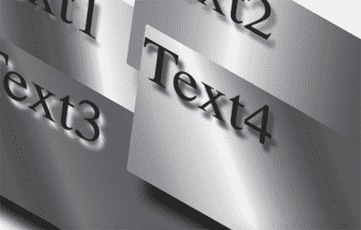

***图 4.3*** 使用 jQuery 动态创建的 `<div>` 元素。

如果你对涉及 jQuery 和 CSS3 动画效果的其他代码示例感兴趣，可以在 https://github.com/ocampesato/jquery-css3-graphics 找到大量类似的代码示例（可以称为“色块”）。

### 有用链接

除了 Google Chrome 之外，Mozilla 开发者工具有一套广泛的工具，用于分析 HTML Web 页面性能相关的瓶颈：https://www.mozilla.org/en-US/firefox/developer/。

这里有一个关于 CSS 动画硬件加速的很好的示例：http://www.sitepoint.com/introduction-to-hardware-acceleration-css-animations/。

此书中的许多 CSS3 样式表包含具有 2D/3D 动画效果的选择器，硬件加速将显著提高性能。事实上，某些平板设备不提供良好的硬件加速，而带有许多 2D 或 3D 动画效果的样式表在这些设备上几乎无法运行。

CSS3 3D图形与动画 • 77


以下链接包含了十个与性能相关的 CSS3 项目：http://stackoverflow.com/questions/7486017/css3-what-are-the-performance-best-practices。

这里有一篇关于编写更高效 CSS 选择器的文章：http://www.pubnub.com/blog/css3-performance-optimizations。

关于编写 CSS3 选择器的“最佳实践”的信息可以在这里找到：http://webdesignerwall.com/trends/css3-examples-and-best-practices 和 http://www.impressivewebs.com/css3-best-practices/。

CSS 动画的工具列表可以在 http://speckyboy.com/2015/09/09/css-animation/ 处找到。

你还可以找到其他关于 CSS3 性能、CSS3 “最佳实践”以及 HTML5 Canvas 的在线视频和教程。

### 总结

在本章中，你学习了如何创建 CSS3 3D 图形和动画效果。特别是，你学习了变换（如平移、缩放和旋转）和过渡。然后，你学习了如何编写调用 GPU 来处理密集型计算的代码。此外，你还看到了如何将 3D 效果与雪片结合，以及如何使用 jQuery 和 CSS 创建动画效果。

## 第 5 章：媒体查询与元标签

本章主要关于 CSS3 媒体查询，并涵盖了若干类型的元标签（meta tags）以及对本地 CSS 的讨论，本地 CSS 也由 Web 组件提供（在第 8 章中简要讨论）。

你将学习如何使用 CSS3 媒体查询检测移动设备的屏幕相关属性（如宽度、高度和方向）。

本章的第一部分讨论了 CSS3 媒体查询，它允许你检测设备的某些特性并根据这些设备特性渲染 HTML5 Web 页面。你将看到使用 CSS3 媒体查询根据移动设备的方向更改页面布局的示例。CSS3 媒体查询还用于响应式 Web 设计。在第 8 章中，你将学习 Bootstrap，它使用 CSS3 媒体查询作为定义移动设备不同像素宽度（由 xs、xm、md 和 lg 表示）的基础。

本章的第二部分讨论了用于移动设备的通用元标签，你还将学习如何使用 CSS3 媒体查询检测移动设备的屏幕属性（如宽度、高度）并相应地更新属性。因此，在阅读本章之前，有一个离题是关于 CSS3 的处理器。在附录中，你将学习关于处理器的，如下

80 • CSS3 入门指南


作为变量定义。然而，处理器具有局限性，在 CSS3 媒体查询中使用。一种可能的解决方案是项有趣的 CSS 自定义属性（通常称为变量），它可以克服许多处理器的局限性。在完成本章的第一部分以及关于处理器的内容后，考虑阅读以下介绍变量的文章：https://developer.mozilla.org/en-US/docs/Web/CSS/Using_CSS 和 http://openweb.eu/articles/dry-approaches-don't-repeat-yourself。

一个注意事项：CSS 变量仍处于实验性阶段，Firefox 支持，Chrome 正在开发。访问此 URL 获取更多关于 CSS 变量的信息：http://caniuse.com/#feat=css-variables。

### 什么是 CSS 查询？

CSS3 媒体查询扩展了 CSS 2.1 中引入的媒体类型功能，媒体类型将浏览器分配到屏幕、手持或打印等高级类别，以重新设置页面的打印输出。CSS 2.1 引入了媒体查询的概念，允许你条件地包含打印、屏幕等替代样式表。媒体类型规范详细列出了十种媒体类型，但浏览器只支持几种（如屏幕和打印）。例如，以下 CSS 2.1 媒体查询根据 media 属性的值条件加载样式表：

```html
<link rel="stylesheet" type="text/css" href="main.css" media="screen" />

<link rel="stylesheet" type="text/css" href="print.css" media="print" />
```

媒体查询与元标签 • 81

```css
@media screen and (min-width: 480px) {
  body {
    background-color: #0000ff;
  }
}
```

本节包含各种 CSS3 媒体查询（Media Queries），这些是非常实用的逻辑表达式，允许你检测具有不同物理属性和方向的设备应用程序。例如，通过 CSS3 媒体查询，你可以更改应用程序的尺寸和布局，使其在智能手机和平板电脑上都能正确渲染。

具体而言，你可以使用 CSS3 媒体查询来确定设备的以下特征：

- 浏览器窗口宽度和高度
- 设备宽度和高度
- 方向（横屏或竖屏）
- 宽高比
- 设备宽高比
- 分辨率

CSS3 媒体查询是布尔表达式，它们包含一个或多个“简单术语”（通过 `and`、`or` 或 `not` 连接），并评估求值结果为真或假。因此，CSS3 媒体查询代表了评估结果为真或假的条件逻辑。

例如，下面的 `<link>` 元素仅当设备为屏幕且设备最大宽度为 480px 时才加载 CSS 样式表 mystuff.css：

```html
<link rel="stylesheet" type="text/css" media="screen and (max-device-width: 480px)" href="mystuff.css"/>
```

前面的链接包含一个 `media` 属性，它指定了两个组件：媒体类型 `screen` 以及一个指定 `max-device-width` 为 480px 的查询。CSS3 媒体查询中支持的 `media` 值为 `braille`、`embossed`、`handheld`、`print`、`projection`、`screen`、`speech`、`tty` 和 `tv`。

下一个 CSS3 媒体查询检查设备的媒体类型、最大设备宽度和分辨率：

```css
@media screen and (max-device-width: 480px) and (resolution: 160dpi) {
  #innerDiv {
    float: none;
  }
}
```

**82** • CSS3 快速入门

如果上述代码段中的 CSS3 媒体查询评估为真，则嵌套的 CSS 选择器将匹配 `id` 属性值为 `innerDiv` 的 HTML 元素，并且在任何最大屏幕宽度为 480px 的设备上，其 `float` 属性将被设置为 `none`。正如你所看到的，可以创建包含复杂逻辑的紧凑 CSS3 媒体查询，这显然用，因为 CSS 没有像其他编程语言那样的 `if/then/else` 结构。

下一个 CSS3 媒体查询测试设备的媒体类型、最小设备宽度和分辨率：

```css
@media screen and (min-device-width: 481px) and (resolution: 160dpi) {
  #innerDiv {
    float: left;
  }
}
```

在前面的 CSS3 选择器中，`id` 属性值为 `innerDiv` 的 HTML 元素在任何最小屏幕宽度为 481px 的设备上，其 `float` 属性的值为 `left`。

下一个 CSS3 媒体查询在屏幕宽度于 321 到 480 之间时将 `div` 元素的宽度设置为 100px：

```css
@media screen and (min-width: 321px) and (max-width: 480px) {
  div {
    width: 100px;
  }
}
```

在接下来的代码段中，`myphone.css` 将适用于浏览器认为“手持（handheld）”的设备或屏幕宽度不超过 320px 的设备：

```html
<link rel="stylesheet" media="handheld, only screen and (max-device-width: 320px)" href="myphone.css">
```

在媒体查询中使用 “only” 关键字会导致不符合 CSS3 标准的浏览器忽略该规则。另一个例子是，下面的 `<link>` 为屏幕尺寸在 641px 到 800px 之间的屏幕加载 CSS 样式表：

```html
<link rel="stylesheet" media="only screen and (min-width: 641px) and (max-width: 800px)" href="wide.css">
```

媒体查询可以包含在内联的 `<style>` 标签中，此查询所示，它适用于竖屏模式的所有媒体类型：

```html
<style>
  @media only all and (orientation: portrait) {
    ...
  }
</style>
```


现在你已经对使用 CSS3 媒体查询可以的操作的内容有了基本了解，可以遵循下一节的代码了。

**注意**

[99]  
媒体查询与元标签 • **83**

## 检测屏幕分辨率

目前很少有针对 Android 或 iOS 设备的 CSS3 媒体查询。坦率地说，你可以使用 CSS3 媒体查询来确定分辨率（dpi）。你也可以使用 `-webkit-` 前缀来测试低分辨率和高分辨率显示器。

## 检测屏幕方向

本节中的 CSS3 媒体查询说明了如何更改设备的方向。

**86** • CSS3 入门指南

```javascript
document.getElementById("img2").style.width = "120px";

document.getElementById("img2").style.height = "300px";

break;

case 90: /* 横屏（屏幕向左倾） */

document.getElementById("img1").style.width = "200px";

document.getElementById("img1").style.height = "200px";

document.getElementById("img2").style.width = "200px";

document.getElementById("img2").style.height = "200px";

break;

case -90: /* 横屏（屏幕向右倾） */

document.getElementById("img1").style.width = "200px";

document.getElementById("img1").style.height = "200px";

document.getElementById("img2").style.width = "200px";

document.getElementById("img2").style.height = "200px";

break;

}

}

</script>

</head>

<body onload="init()">

<header>

<h2>旋转您的设备：</h2>

</header>

<div id="outer">

<div id="one">


</div>

<div id="two">


</div>

</div>

</body>
</html>
```

如你所见，与列表 5.2 相比，列表 5.3 中有更多的代码。本质上，这段代码使用 `window.orientation` 变量的值来检测移动设备的四种不同方向，并在每种情况情况下，它都使用以下类型的代码更新 PNG 文件的尺寸：

```javascript
document.getElementById("img1").style.width = "120px";

document.getElementById("img1").style.height = "300px";
```

虽然这是一个非常简单的示例，但希望这段代码能让你领略 CSS3 媒体查询（Media Queries）的能力。

## 使用 JavaScript 在 3D 中检测设备方向

上一节向你展示了如何确定设备的方向是竖屏模式还是横屏模式。此外，你还可以确定设备在 3D 空间中的位置。

设备 3D 位置的变化有三种类型：上下（z 轴）、左右（y 轴）以及顺时针和反时针（x 轴）。这些变化通过加速度计测量，你可以在 `window` 对象的 `deviceorientation` 事件中检查它们的当前值。每当移动设备移动时，该事件就会触发，并返回一个带有方向相关属性的对象。

JavaScript 代码如下：

```javascript
window.addEventListener('deviceorientation', function (o) {
  console.log(o.alpha, o.beta, o.gamma);
}, false);
```

属性 `alpha`、`beta` 和 `gamma` 这三个属性分别提供了在 z、x 和 y 轴上的旋转角度（单位为度，而不是弧度）。请记住，z 轴是垂直轴（正方向向上），x 轴指向你（负方向远离你），y 轴是从左到右的水平轴（向右为正方向）。

这三个属性的允许值如下：

- `alpha`：0 到 360（顺时针）
- `beta`：-180 到 180（朝你/远离你）
- `gamma`：-90 到 90（从左到右）

如果你想了解关于设备方向的细节，可以使用加速度计获取更精确的信息。

## 检测屏幕宽度和高度

`window` 对象支持 `resize` 事件，你可以用它来确定屏幕的宽度和高度，这反过来允许你修改 HTML5 页面中的效果。列表 5.4 显示的 `ResizeBorder.html` 说明了如何无论屏幕大小或方向保持相同的边框。

**列表 5.4 `ResizeBorder.html`**

```html
<!DOCTYPE html>
<html lang="en">
<head>
<meta charset="utf-8">
<title>调整窗口大小</title>
<style>
* {
  margin: 0px;
  padding: 0;
}

#outer {
  width: 400px;
  height: 300px;
  border: 10px solid blue;
}
</style>

<link rel="stylesheet" href="http://code.jquery.com/mobile/1.1.0.min.css">
<script src="http://code.jquery.com/jquery-2.0.0.js"></script>
<script src="http://code.jquery.com/migrate-1.1.0.js"></script>
</head>

<body onload="resizeBorder()">
<div id="outer"></div>

<script>
// 上述 CSS 选择器中的 borderWidth 等于
var borderWidth = 10;

window.onresize = function() {
  resizeBorder();
};

function resizeBorder() {
  // 如果屏幕已调整大小，则执行以下操作
  var rescaledScreenWidth = document.documentElement.clientWidth;
  var rescaledScreenHeight = document.documentElement.clientHeight;

  $("#outer").css("width", rescaledScreenWidth);
  $("#outer").css("height", rescaledScreenHeight);
}
</script>
</body>
</html>
```

列表 5.4 包含一个 `<style>` 元素，其第一个选择器将网页所有元素的内边距设置为 0px。第二个选择器指定了 10px 的蓝色边框。当你将此网页加载到浏览器中时，每当调整大时，JavaScript 函数 `resizeBorder()` 就会执行。该 JavaScript 函数通过以下代码获取浏览器的当前宽度和高度：

```javascript
var rescaledScreenWidth = document.documentElement.clientWidth;
var rescaledScreenHeight = document.documentElement.clientHeight;
```

`resizeBorder()` 中的后续两行代码设置了 id 为 `outer` 的 `div` 元素的宽度和高度，增加了 `borderWidth`。

## 用于多种屏幕尺寸的 CSS3 媒体查询

在 CSS3 媒体查询的介绍中，你看到了使用复合条件逻辑（包括 and、or、only、not）定义媒体查询的示例。如果你没有注意，可以使用媒体查询来处理手机和平板等移动设备的屏幕尺寸。这样做的示例在此：

```css
@media screen and (min-width: 321px) and (max-width: 480px) {
  div {
    width: 100px;
  }
}

@media screen and (min-width: 481px) and (max-width: 720px) {
  div {
    width: 200px;
  }
}
```

上述媒体查询对逻辑很简单：第一个媒体查询当屏幕宽度在 321 像素到 480 像素之间时，将 `div` 元素的宽度设置为 100px；第二个媒体查询当屏幕宽度在 481 像素到 720 像素之间时，将 `div` 元素的宽度设置为 200px。

以下媒体查询仅在是屏幕时，将 `div` 元素的宽度设置为 150px：

```css
@media only screen {
  div {
    width: 150px;
  }
}
```

以下媒体查询为不支持方向的设备将 `div` 元素的宽度设置为 50px：

```css
not (orientation) {
  div {
    width: 50px;
  }
}
```

正如你在本节和之前节的示例中所示，CSS3 媒体查询在表达力和直观功能方面是简单、灵活且强大的。

## CSS 设备适配

CSS 设备适配允许你使用 CSS 来指定 HTML5 页面中 viewport meta 元素的尺寸、缩放因子和方向。作为一个简单的示例，以下选择器指定了 `width` 属性和 `zoom` 属性：

```css
@viewport {
  width: device-width;
  zoom: 0.5;
}
```

你也可以将 `@viewport` 嵌入 `@media` 中（使用你已经熟悉的条件逻辑），如下例所示：

```css
@media screen and (min-width: 200px) {
  @viewport {
    width: 100px;
  }
}

@media screen and (max-width: 200px) {
  @viewport {
    width: 300px;
  }
}
```

viewport meta 元素的允许值列在此：

- `width`
- `height`
- `initial-scale`
- `minimum-scale`
- `maximum-scale`
- `user-scalable`
- `target-densityDpi`

关于 CSS 设备适配的更多信息可以在 W3C 规范中获得（正在进行中）：<http://www.w3.org/TR/css-device-adapt/>。

媒体查询与元标签 • **91**

- 一个带有背景图片的 `<div>`，如果屏幕宽度小于 600px，其背景颜色会发生改变
- 一个带有背景图片的 `<div>`，如果最小比例为 1.5，则会赋予它一个新的背景图片（使用 `min-device-pixel-ratio` 媒体查询）

请记住，之前的链接可能包含一些过时信息；但是，你仍然可以在选择的浏览器中进行相同的测试，以确定结果是否仍然有效。

另一种选项是使用 `window.matchMedia`，它是 CSS3 媒体查询的 JavaScript 替代方案。`window.matchMedia` API 列在此：<https://developer.mozilla.org/en-US/docs/Web/API/Window/matchMedia>。

这里有一篇包含 `window.matchMedia` 代码示例的文章：<https://hacks.mozilla.org/2012/06/using-window-matchmedia-to-do-media-queries-in-javascript/>.

本章的下一节将深入探讨元标签，包括一些针对移动设备的特定标签。

## 视口元标签（THE VIEWPORT META TAG）

HTML 页面在“虚拟页面”中渲染，而屏幕是进入该页面的窗口。视口元标签设置了此虚拟页面的尺寸。此外，视口元标签还控制 iOS 和 Android 上浏览器窗口的缩放。视口元标签支持以下属性：

- `Width`（宽度）：视口以像素宽度（默认为 980），范围在 200 到 10,000 之间
- `Height`（高度）：视口以像素高度。默认值根据设备的宽度和纵横比计算，范围在 223 到 10,000 之间
- `Initial-scale`（初始缩放）：应用程序的初始“缩放因子”，用户可以从该初始值开始进行放大或缩小
- `Minimum-scale`（最小缩放）：视口的最小缩放值（默认为 0.25），范围在 0 到 10.0 之间
- `Maximum-scale`（最大缩放）：视口的最大缩放值（默认为 1.6），范围在 0 到 10.0 之间
- `User-scalable`（用户可缩放）：你可以指定用户是否可以对应用程序进行放大和缩小（默认是“yes”）。将其设置为“no”以防止缩放

此外，你可以在元标签中用逗号分隔并设置多个视口选项，如下：

`<meta name="viewport" content="width=device-width, user-scalable=no">`

`target-densitydpi` 属性（在视口元标签中指定）已弃用（实际上已从 WebKit 中删除），因此建议在基于 Android 的移动应用程序中使用该属性来指定低、中、高 dpi 值。

你也可以视口标签来防止用户在移动应用程序中缩放或平移。例如：

`<meta name="viewport" content="width=device-width; initial-scale=1.0; maximum-scale=1.0; user-scalable=0;" />`

iOS 平台支持视口元标签以及 iOS 特有的元标签，其中一些在此描述：<http://developer.apple.com/library/safari/documentation/appleapplications/reference/SafariHTMLRef/Articles/MetaTags.html#//apple_ref/doc/uid/TP40008193-SW1>。

## 视口单位（Viewport Units）

视口指的是浏览器屏幕，四种视口单位如下：

- `vw`：视口宽度的百分比
- `vh`：视口高度的百分比
- `vmin`：`vw` 或 `vh` 中的较小值
- `vmax`：`vw` 或 `vh` 中的较大值

例如，1vw 是浏览器宽度的 1%，这意味着 100vw 是浏览器宽度的 100%。

以下 CSS 选择器使用 `calc()` 函数和 CSS3 媒体查询，每当 HTML 页面调整大小时时，都会计算 `font-size` 属性：

```css
html {
  font-size: 100%;

  // 每 100px 缩放 1px（从 600px 开始）
  @media (min-width: 600px) {
    font-size: calc(125% + 4 * (100vw - 600px) / 400);
  }

  // 将 font-size 设置为 24px（针对 1000px 或更宽的屏幕）
  @media (min-width: 1000px) {
    font-size: calc(150%);
  }
}
```


本章的后续部分将深入探讨元标签，包括一些针对移动设备的特定标签。

## `IMPORT` 语句（`THE IMPORT STATEMENT`）

`@import` 语句允许你导入另一个样式表。例如，假设你有以下 CSS：

`@import url("style.css");`

`@import` 语句可以导入多个样式表。

## 模块化与性能

`@import` 语句非常方便，但在使用它时需要记住两点。首先，`@import` 语句可以帮助你实现 CSS 模块化，但请记住，它也可能带来性能损失。

媒体查询与元标签 • 95

## CSS Modules 和本地 CSS

CSS Modules 提供了另一种方法（与 ReactJS 无关），通过 `local-style` 属性实现本地 CSS。CSS Modules 团队提供了一种类似于命名空间的解决方案（前一个节描述了命名空间），并对不同的文件进行单独编译，以提供不在全局命名空间中的 CSS 选择器，其主页位于：`https://github.com/css-modules`。

以下文章更深入描述了 CSS Modules：`http://glen-maddern.com/articles/css-modules` 和 `http://www.sitepoint.com/understanding-css-modules-methodology`。

## Web Components 和本地 CSS

第三种方法（与 ReactJS 无关）是 Shadow DOM，它在不同组件中强制执行本地 CSS，它在 Web Components 和 Polymer 中可用（但尚未被所有现代浏览器支持）。

在第 9 章中，你将学习 Web Components，它允许你定义包含 CSS 选择器的自定义组件，这些选择器仅在组件内部可见，从而提供了对本地 CSS 的支持。

## 有用的链接

以下链接列表虽短但非常实用，每个链接都包含极佳的信息（你也可以随时进行自己的网络搜索）。

- 以下链接包含实用的 CSS 代码段：`http://www.hongkiat.com/blog/css-snippets-for-designers`。
- 请记住，许多命名的片段（如 `box-shadow`、`text-shadow`、`border-radius` 和 `opacity`）不再需要前缀，因此你可以相应此进行更新。
- 一组使用 CSS3 的漂亮“素描风”视觉效果在这里：`http://andrew-hoyer.com/index.html`。
- 桌面和移动浏览器对 HTML5、CSS3、SVG 等内容的支持兼容性表格在这里：`http://caniuse.com`。
- 一个使用各种 CSS3 功能生成 CSS3 代码的网站在这里：`http://CSS3generator.com`。
- 一个允许你实时编辑各种 CSS3 选择器内容并查看结果的网站在这里：`http://CSS3please.com`。
- 一个处理 CSS3 属性浏览器特定扩展细节的工具包，让你编写不带前缀的 CSS3 选择器在这里：`http://css-tender.org`。
- 一个允许你在线创建渐变并查看相关 CSS3 代码的网站在这里：`http://gradients.glrzad.com`。
- 另一个关于浏览器对 HTML5 和 CSS3 功能支持信息的网站在这里：`http://html5readiness.com`。
- 关于 HTML5 的广泛文章集在这里：`http://www.html5rocks.com/en/`。
- 一个致力于所有 CSS3 相关事物的网站在这里：`http://www.CSS3.info`。
- 互联网上浏览器兼容性信息的优秀来源（由 Peter-Paul Koch 维护）可以找到：`http://www.quirksmode.org`。
- 一个非常好的在线工具，允许你尝试许多 CSS3 功能并显示相关的 CSS3 代码，在这里：`http://www.westciv.com/tools/3Dtransforms/index.html`。
- 以下是一个简要讨论 14 种 CSS 生成器的网站：`http://www.webpop.com/blog/2013/04/23/css-generators`。
- 15 跨浏览器测试工具的比较（大部分免费，部分商业）以及带有功能的表格化对比，在这里：`http://www.smashingmagazine.com/2011/08/07/a-dozen-cross-browser-testing-tools/`。

这些链接提供了丰富的信息和实用的技术，因此你很有机会找到所需的信息来为你的网站创建所需的视觉效果。

## 附加代码示例

CSS 样式表 `CSS3MediaQuery1.css` 和 HTML5 网页 `CSS3MediaQuery1.html` 演示了如何使用媒体查询在用户旋转移动设备时更改图像尺寸。

你可以使用简单的 JavaScript 代码来检测移动设备的方向变化，而无需“强制”使用 CSS3 媒体查询。HTML5 网页 `CSS3OrientationJS.html`（在随附光盘中）本质上，代码使用变量 `window.orientation` 的值来检测移动设备的不同方向，在这些情况下，PNG 文件的更新如下：

```javascript
document.getElementById("img1").style.width = "120px";
document.getElementById("img1").style.height = "300px";
```

尽管这是一个非常简单的示例，但希望这段代码让你理解 CSS3 媒体查询的能力。

## 总结

本章向你展示了如何在 HTML5 网页中使用元标签。你学习了如何使用 `@media` 指令条件地样式化各种元素。你还学习了如何根据不同的屏幕分辨率使用 CSS3 媒体查询来检测移动设备的方向，某些特定的 Android 和 iOS 设备。

# 第 6 章 CSS3 和 HTML5 CANVAS

本章提供了 CSS3 与 HTML5 Canvas 结合概述，这是一种直接在网页绘制图形的技术。HTML5 Canvas 支持渲染 2D 形状和创建动画效果的各种 API。你还将看到如何用 CSS3 样式化 `<canvas>` 元素。

你可能会好奇为什么书中包含了这一章。如果你想学习 HTML Canvas 以及相关的 JavaScript 代码，本章将给你一个合理的介绍。尽管有许多与 Canvas 和 CSS3 相关的教程，很少有结合 HTML5 Canvas 和 CSS3 图形的。

本章的第一部分展示了如何在 HTML5 Canvas 中渲染线条、矩形和圆形，以及如何将 HTML5 Canvas 与样式表结合。第二部分介绍了 HTML5 Canvas 中的线性和径向渐变，以及如何将它们应用于贝塞尔曲线的示例。第三部分包含了在 HTML Canvas 元素中渲染 PNG 文件的示例。

重要的提示：与书中其他章节不同，本章需要一些 JavaScript 知识，例如如何定义变量和函数。此外，代码示例包含了用于在 HTML 网页查找元素的 `document.getElementById()`，用于为网页添加事件监听器的 `window.addEventListener()` 以及为 HTML `<input>` 元素定义点击处理程序。诚然，本章没有讨论这些方法的细节。浏览代码示例以了解它们包含的 JavaScript 代码类型，然后你可以评估是否有信心详细阅读示例。另一个建议：运行本章的代码示例查看哪些图形效果你感兴趣，然后阅读本章的相关代码。

正如你所看到的，本章中的代码示例包含了（有时是惊人的）HTML5 Canvas、CSS3 图形和 CSS3 2D/3D 动画效果。这些代码示例为你创建自己的视觉吸引力图形效果提供了起点。

此外，本章的大部分章节从相关代码列表中使用的 API 语法开始，部分是因为代码示例包含了许多细节并阐明了多个概念。如果你在阅读完本章后探索额外的 HTML5 Canvas 图形，这里有大量的代码示例：`https://github.com/ocampato/html5-graphics`。

请记住，在编写低级 Canvas 图形代码（如本章中的代码示例）与开源项目和商业产品的可用性之间进行权衡（时间、精力、成本）是重要的。如果你不想研究创建 HTML5 Canvas 效果的所有 JavaScript 细节，有在线绘制工具可以为你生成代码。一个提供基本功能的免费工具在这里：`http://www.htmlcanvasstudio.com/`。

## 什么是 HTML5 CANVAS？

几年前，Canvas 在 OS/X 上作为一个组件工具包开始，在 Canvas 已经在 Safari 浏览器可用后，它成为了 Web 的规范，现在通常被称为 HTML5 Canvas。HTML5 Canvas 和 SVG 都允许你通过 JavaScript 在浏览器中编程渲染图形。然而，HTML5 Canvas 使用“立即模式”（immediate mode），这是一种写后即忘的渲染方法。因此，如果你想在 HTML5 Canvas 中编写一个素描程序并还想提供“撤销”功能，你必须编程地跟踪在屏幕上绘制的所有内容。另一方面，SVG 使用“保留模式”（retained mode），它涉及一个跟踪渲染对象及其它们之间关系的 DOM 结构。

如果你将要编写大量使用图形效果的 HTML 网页，你可能需要理解 HTML5 Canvas 和 SVG 在性能上的差异。你有自由专门使用一种技术，但你也可以创建包含 HTML5 Canvas、SVG 和 CSS3 混合的 HTML 网页，性能相关信息可以帮助你决定如何编写你的 HTML 网页。

尽管本章没有进一步深入探讨上述点，但你可以在这里找到 HTML5 Canvas 某些功能/优势的良好概述：`http://thinkvitamin.com/code/how-to-draw-with-html-5-canvas/`。

CSS3 和 HTML5 Canvas • 99

## HTML5 CANVAS 坐标系

回想你高中的时光，那时你学过笛卡尔坐标系通过一对数字（通常写为 `(x,y)`）来确定欧几里得平面上的任意点。第一个数字代表水平值，第二个数字代表垂直值。水平轴称为 x 轴，x 轴上的正值位于垂直轴的右侧（即向右侧）。垂直轴称为 y 轴，y 轴上的正值位于水平轴的上方。原点是 x 轴和 y 轴的交点。

HTML5 Canvas 坐标系的情况几乎相同。x 轴是水平的，正方向指向右侧。y 轴是垂直的，但正方向是*向下*，这与典型数学教科书中大多数图表的方向相反。在 HTML5 Canvas 坐标系中，原点是屏幕的左上角（而不是左下角），测量单位是像素。

作为一个简单的示例，图 6.1 显示了 HTML5 `<canvas>` 元素中的四个点。

**图 6.1** 在 HTML5 Canvas 中渲染的四个点。

如果你从原点（屏幕左上角）开始向右移动 50 像素，然后向下移动 50 像素，你将到达图 6.1 中的左上点。接下来，如果你从原点开始向右移动 200 像素并向下移动 50 像素，你将到达示例 6.1 中的右上点。同样，第二“行”中的两个点坐标为 `(50,100)` 和 `(200,100)`。注意，第一行的两个点具有相同的 y 值，因为它们距离页面顶部的距离相同；第二行的两个点也是如此。同样，左“列”中的两个点具有相同的 x 值，因为它们距离页面左边的距离相同。

现在你已经理解了 HTML5 Canvas 坐标系，让我们来看看示例 6.1 的内容，它显示了一个准备渲染 HTML5 Canvas 图形的最小 Web 页面。

100 • CSS3 入门指南

本章中的 Canvas 代码包含了示例 6.1 中显示的代码（或其变体）。

*如果你在浏览器中运行此代码，将只会看到空白屏幕。*

**示例 6.1 `Canvas.html`**

```html
<!DOCTYPE html>
<html lang="en">
<head>
<meta charset="utf-8">
<title>Canvas Example</title>
<script><!--
window.addEventListener('load', function () {

// 获取 canvas 元素
var elem = document.getElementById('myCanvas');
if (!elem || !elem.getContext) {
return;
}

// 获取 canvas 2d 上下文
var context = elem.getContext('2d');
if (!context) {
return;
}

//在此处插入自定义 Canvas 图形代码
});
// --></script>
</head>
<body>
<p>
<canvas id="myCanvas" width="300" height="300">No support for Canvas.</canvas>
</p>
</body>
</html>
```

示例 6.1 包含一个 `<head>` 元素，用于检查 Web 页面 `<body>` 内部 `<canvas>` 元素是否存在，然后从 `<canvas>` 元素获取二维上下文。如果你跳过示例 6.1 中的各种条件语句，有两行代码使我们能够获取可绘制表面的变量 `context`：

`var elem = document.getElementById('myCanvas');`

`var context = elem.getContext('2d');`

**注意**

CSS3 和 HTML5 Canvas • 101

如果你在不支持 HTML5 Canvas 的浏览器中运行示例 6.1，将显示消息“No support for Canvas.”

每当你启动 Web 页面时，都会执行加载事件期间执行的匿名 JavaScript 函数：

```javascript
<script><!--
window.addEventListener('load', function () {

// 在此处执行某些操作

});
// --></script>
```

现在你已经理解了渲染 Canvas 二维形状的底层代码，你可以专注于真正绘制某些二维形状的代码，从下一节的示例开始。

## 线、矩形、圆形和阴影效果

本节包含系列说明如何在 HTML5 Canvas 中渲染二维形状的代码示例。本节引入了许多概念，因此在深入研究代码示例之前，让我们看看本节使用的某些 HTML5 Canvas API。第 2 章描述了指定颜色的各种方法，节的内容与代码示例相关（如果你需要，可以快速回顾其内容）。

HTML5 Canvas 提供了用于渲染矩形的 `fillRect` 方法，它需要四个参数：矩形的左上顶点（由 x 坐标和 y 坐标定义）、矩形的宽度以及所需矩形的高度。`fillRect()` API 如下：

`context.fillRect(x, y, width, height);`

HTML5 Canvas 允许通过指定线段两个端点的 `(x,y)` 坐标来渲染线段。本节使用的两个 API 是 `moveTo()` 和 `lineTo()`，它们如下：

`context.moveTo(x1, y1);`

`context.lineTo(x2, y2);`

前面的代码段表示端点为 `(x1,y1)` 和 `(x2,y2)` 的线段。注意，你也可以通过以下代码段渲染相同的线段：

`context.moveTo(x2, y2);`

`context.lineTo(x1, y1);`

102 • CSS3 入门指南

投影效果提供了丰富的视觉体验，是对非阴影效果的改进。你通过向三个阴影相关的属性赋值来创建阴影效果，这些属性控制阴影的大小以及阴影的“模糊”程度，如下：

`context.shadowOffsetX = shadowX;`

`context.shadowOffsetY = shadowY;`

`context.shadowBlur = 4;`

你也可以为 `shadowColor`（它是绘制上下文的属性）分配 `(R,G,B)` 或 `(R,G,B,A)` 值，如下：

`context.shadowColor = "rgba(0,0,64,1.0)";`

示例 6.2 中的 HTML5 页面 `RandanglesShadow.html` 使用这种技术来渲染一组带有阴影效果的随机生成矩形。

**示例 6.2 `RandanglesShadow.html`**

```html
<!DOCTYPE html>
<html lang="en">
<head>
<meta charset="utf-8">
<title>Canvas Rectangles With Shadow Effects</title>
<script><!--
window.addEventListener('load', function () {

var clickCount = 0;

// 获取 canvas 元素
var elem = document.getElementById('myCanvas');
if (!elem || !elem.getContext) {
return;
}

// 获取 canvas 2d 上下文
var context = elem.getContext('2d');
if (!context) {
return;
}

var basePointX = 10;
var basePointY = 10;
var canWidth = 800;
var canHeight = 450;
var shadowX = 10;
var shadowY = 10;
var rectCount = 100;
var rectWidth = 100;
var rectHeight = 100;
var fillStyles = ['#f00', '#ff0', '#0f0', '#00f'];

// 渲染一组随机矩形
redrawCanvas = function() {

// 在绘制新矩形之前清除画布
```


`context.clearRect(0, 0, elem.width, elem.height);`

```
for(var r=0; r<rectCount; r++) {
  basePointX = canWidth*Math.random();
  basePointY = canHeight*Math.random();

  // 根据奇偶计数使用不同的 (R,G,B,A) 值交替阴影效果
  if(clickCount % 2 == 0) {
    context.shadowColor = "rgba(0,0,64,1.0)";
  } else {
    context.shadowColor = "rgba(64,0,0,1.0)";
  }

  // 指定阴影的大小以及底层阴影效果的“模糊”程度
  context.shadowOffsetX = shadowX;
  context.shadowOffsetY = shadowY;
  context.shadowBlur = 4;

  // 绘制有颜色的矩形
  colorIndex = Math.floor(basePointX)%fillStyles.length;
  context.fillStyle = fillStyles[colorIndex];
  context.fillRect(basePointX, basePointY,
    rectWidth, rectHeight);

  ++clickCount;
}
```

```
// 一组随机矩形
redrawCanvas();
});
// -->
</script>
</head>
<body>
<div>
<canvas id="myCanvas" width="800" height="450">No support
for Canvas</canvas>
</div>
</body>
</html>
```

104 • CSS3 快速入门指南

```
<div>
<input type="button" onclick="redrawCanvas();return false" value="重绘矩形" />
</div>
</body></html>
```

列表 6.2 中的 HTML5 代码首先初始化了一些 JavaScript 变量，然后定义了 JavaScript 函数 `redrawCanvas()`，该函数包含一个用于在屏幕上渲染矩形的循环。该循环计算每个矩形左上角的坐标，如下：

```
basePointX = canWidth*Math.random();
basePointY = canHeight*Math.random();
```

循环的下部分分配了背景颜色（该颜色在深蓝色和深红色阴影之间切换），然后通过指定属性 `shadowOffsetX`、`shadowOffsetY` 和 `shadowBlur` 的值来设置阴影效果，如下：

```
context.shadowOffsetX = shadowX;
context.shadowOffsetY = shadowY;
context.shadowBlur = 4;
```

每个矩形的实际渲染由以下代码完成：

```
context.fillRect(basePointX, basePointY, rectWidth, rectHeight);
```

注意，每每次点击 HTML5 Canvas 元素时，`clickCount` 变量都会递增，其值决定了将何种阴影颜色应用于随机生成的矩形。

尽管阴影效果营造了良好的视觉效果，但它们对性能也有影响。如果你需要类似阴影的效果但性能成为问题，一种替代方案是渲染一个黑色（或其他深色）背景形状，然后使用不同的颜色（带有微偏移）渲染相同的形状。

例如，你可以通过先渲染一个黑色矩形，然后在黑色矩形上方渲染一个红色矩形来为矩形创建阴影效果，如下：

```javascript
// 渲染黑色矩形
context.fillStyle = '#000';
context.fillRect(50+shadowX, 50+shadowY, 200, 100);

// 渲染红色矩形
context.fillStyle = '#f00';
context.fillRect(50, 50, 200, 100);
```

`shadowX` 和 `shadowY` 的值决定了背景“阴影”的大小，而 `shadowX` 和 `shadowY` 正负值的选择决定了黑色矩形相对于红色矩形的相对位置。

***列表 6.3 CSS3Background2.css***

```css
#myCanvas {
  position: relative; top: 0px; left: 0px;
  background-color:white;
  background-image:
    radial-gradient(red 4px, transparent 18px),
    repeating-radial-gradient(red 0px, green 4px, yellow 8px,
    blue 12px, transparent 28px,
    green 20px, red 24px,
    transparent 28px,
    transparent 32px),
    repeating-radial-gradient(red 0px, green 4px, yellow 8px,
    blue 12px, transparent 28px,
    green 20px, red 24px,
    transparent 28px,
    transparent 32px);
  background-size: 50px 60px, 70px 80px;
  background-position: 0 0;
  box-shadow: 30px 30px 30px #000;
  resize:both;
  overflow:auto;
}

#myCanvas:hover {
  position: relative; top: 0px; left: 0px;
  background-color:white;
  background-image:
    radial-gradient(red 4px, transparent 48px),
    repeating-radial-gradient(red 2px, green 4px, yellow 8px,
    blue 12px, transparent 16px,
    red 20px, blue 24px,
    transparent 28px,
    transparent 32px),
    radial-gradient(blue 8px, transparent 68px);
  background-size: 120px 120px, 4px 4px;
  background-position: 0 0;
}
```

列表 6.3 包含两个类似的 CSS3 选择器，用于渲染列表 6.3 中定义的 HTML5 `<canvas>` 元素，另一个是基于悬停的选择器，每当用户用鼠标悬停在该元素上时，就会更改 HTML5 `<canvas>` 元素的背景。`#myCanvas` 选择器定义了一个径向渐变，随后是两个重复径向渐变，它们在不同的像素位置指定了红、绿、黄、蓝的各种组合。一个关键点在于 `transparent` 的使用，它改变了渲染的连续颜色之间的间隙。

正如你在 `#myCanvas` 选择器的定义中看到的，颜色、渐变（及其类型）以及渐变颜色有许多可能的组合，还有 `background-size` 属性的值供选择。定义这些模式没有绝对的“正确”方法；请自由尝试不同的组合，你可能会创造出意外之外的愉悦结果。图 6.2 显示了一组基于列表 6.2 中 `RectanglesShadow.html` 生成的带有阴影效果的随机矩形。

## HTML5 画布渐变（Canvas）

HTML5 Canvas 提供了两种主要的颜色渐变类型（类似于 SVG 和 CSS3）：*线性渐变*和*径向渐变*。线性渐变可以进一步细分为三种类型：水平线性渐变、垂直线性渐变和对角线性渐变。因此，HTML5 Canvas 提供了让你创建美观视觉效果的渐变。

线性渐变根据 `colorStop` 定义，每个停止点包含一个小数（在 0 到 1 之间）。例如，如果你定义一个起始颜色为 `#FF0000`（红色）、结束颜色为 `#000000`（黑色）的线性渐变，那么渐变将从红色变为黑色。线性渐变允许你创建各种有趣的组合，包括水平、垂直和对角方向。其语法如下：

`context.createLinearGradient(startX, startY, endX, endY);`

HTML5 画布页面 `Rectangles1.html` 演示了如何使用该方法创建水平、垂直和对角渐变。列表 6.4 引用的 `HoverAnimation1.css` 样式表在用户悬停在该 `<canvas>` 元素上时对第一个 `<canvas>` 元素应用 2D 动画效果。`HoverAnimation2.css` 样式表以类似的方式的作用，我们在本章中省略了它们，但完整的源代码位于此处。

CSS3 和 HTML5 Canvas • **109**

```javascript
gradient1 = context2.createLinearGradient(
  currentX,
  currentY,
  currentX+rectWidth,
  currentY+rectHeight);
gradient1.addColorStop(0, '#f00');
gradient1.addColorStop(0.5,'#0f0');
gradient1.addColorStop(1, '#00f');

context2.fillStyle = gradient1;
context2.fillRect(currentX, currentY,
  rectWidth, rectHeight);

// 右下矩形：对角线线性渐变
currentX = basePointX+rectWidth;
currentY = basePointY;
//currentY = basePointY+rectHeight;
gradient1 = context2.createLinearGradient(
  currentX+rectWidth,
  currentY,
  currentX+0*rectWidth,
  currentY+rectHeight);
gradient1.addColorStop(0, '#fff');
gradient1.addColorStop(0.3,'#000');
gradient1.addColorStop(0.6,'#ff0');
gradient1.addColorStop(1, '#f00');

context2.fillStyle = gradient1;
context2.fillRect(currentX, currentY,
  rectWidth, rectHeight);

++clickCount;
basePointX += 4;
basePointY += 2;
}
// 渲染线性渐变矩形
redrawCanvas();
});
// -->
</script>
</head>
<body>
<div>
<canvas id="myCanvas" width="600" height="250">您的浏览器不支持 Canvas
alt="渲染线性渐变矩形。">
</canvas>
</div>
<div>
<canvas id="myCanvas2" width="600" height="250">您的浏览器不支持 Canvas
alt="渲染线性渐变矩形。">
</canvas>
</div>
<div>
<input type="button" onclick="redrawCanvas();return false"
value="重绘矩形" />
</div>
</body>
</html>
```

**110** • CSS3 入门指南


列表 6.4 渲染了四个带有线性渐变阴影的矩形。这些线性渐变调用了两次、三次或四次 `addColorStop()` 方法，使用了多种颜色组合（以十六进制形式表示），以便让你看到某些可能的渐变效果。

尝试不同的颜色停止点（color stop）定义值，观察这些值如何改变渲染矩形的外观。

图 6.3 显示了基于列表 6.4 中 `LGradRectangles1.html` 生成的一组带有阴影效果的随机矩形。

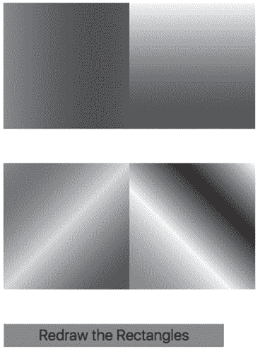

***图 6.3*** 线性渐变矩形。

## HTML5 CANVAS 径向渐变

径向颜色渐变是第二种基于 HTML5 Canvas 的颜色渐变，你可以通过 `createRadialGradient()` 方法定义径向颜色渐变，使用 `addColorStop()` 方法添加颜色值，其语法（不包含 `addColorStop()` 方法）看起来所示：

CSS3 和 HTML5 Canvas • **111**

```javascript
context.createRadialGradient(startCenterX, startCenterY,
  startRadius, endsCenterX,
  endCenterY, endRadius);
```

*径向*颜色渐变可以比作向池塘中投石时产生的涟漪效果，其中每个“波纹”的颜色都以渐变方式变化。每条波纹对应一个颜色停止点元素。例如，如果你定义了一个起始颜色为 `#FF0000`（红色）且结束颜色为 `#000000`（黑色）的径向渐变，那么生成的颜色渐变将以*径向*方式从红色变为黑色。径向渐变还可以包含多个起始/停止颜色组合。需要注意的是，径向渐变是以*线性*方式改变颜色的，但渲染的颜色是以扩展的*径向*方式绘制的。请注意，书中“径向渐变”和“径向颜色渐变”是通用的。

列表 6.5 显示了 HTML5 页面 `RGradRectangles1.html` 的内容，它使用线性和径向渐变在 HTML5 `<canvas>` 元素中渲染线段、矩形和圆形。

***列表 6.5 RGradRectangles1.html***

```html
<!DOCTYPE html>
<html lang="en">
<head>
<meta charset="utf-8">
<title>Canvas 径向渐变矩形</title>
<link href="HoverAnimation1.css" rel="stylesheet" type="text/css">
<style>
input {
  width:300px;
  font-size:24px;
  background-color:#f00;
}
</style>
<script><!--
window.addEventListener('load', function () {
  var elem = document.getElementById('myCanvas');
  if (!elem || !elem.getContext) {
    return;
  }
  var context = elem.getContext('2d');
  if (!context) {
    return;
  }
  var basePointX = 10;
  var basePointY = 10;
  var currentX = 0;
  var currentY = 0;
  var rectWidth = 200**112** • CSS3 入门指南
```


```javascript
var rectHeight = 200;
var clickCount = 0;
var gradient1;
redrawCanvas = function() {
  // 在绘制一组矩形之前清除画布
  context.clearRect(0, 0, elem.width, elem.height);
  // 左侧矩形
  currentX = basePointX;
  currentY = basePointY;
  gradient1 = context.createLinearGradient(
    currentX,
    currentY,
    currentX+rectWidth,
    currentY+rectHeight);
  gradient1.addColorStop(0, '#f00');
  gradient1.addColorStop(0.5,'#0f0');
  gradient1.addColorStop(1, '#00f');
  context.fillStyle = gradient1;
  context.fillRect(currentX, currentY,
    rectWidth, rectHeight);

  // 右下矩形
  currentX = basePointX+rectWidth;
  currentY = basePointY;
  //currentY = basePointY+rectHeight;
  gradient1 = context.createLinearGradient(
    currentX+rectWidth,
    currentY,
    currentX+0*rectWidth,
    currentY+rectHeight);
  gradient1.addColorStop(0, '#fff');
  gradient1.addColorStop(0.3,'#000');
  gradient1.addColorStop(0.6,'#ff0');
  gradient1.addColorStop(1, '#f00');
  context.fillStyle = gradient1;
  context.fillRect(currentX, currentY,
    rectWidth, rectHeight);

  ++clickCount;
  basePointX += 4;
  basePointY += 2;
}

// 渲染线性渐变矩形

redrawCanvas();
});

// --></script>

</head>

<body>
<div>
<canvas id="myCanvas" width="600" height="250">您的浏览器不支持 Canvas
alt="渲染线性渐变矩形。">
</canvas>
</div>
<div>
<input type="button" onclick="redrawCanvas();return false"
value="重绘矩形" />
</div>
</body>
</html>
```

列表 6.5 与列表 6.4 类似，仅使用了径向渐变（而不是线性渐变），该渐变以径向方式从蓝色变为红色。`addColorStop()` 方法被调用四次，以便为径向渐变添加四个“颜色停止值”。列表 6.5 还引用了 `HoverAnimation1.css`；`HoverAnimation1.css` 的完整源代码可在光盘获取。图 6.4 显示了渲染 `RGradRectangles1.html` 的结果，它创建了一组带有径向渐变的矩形。

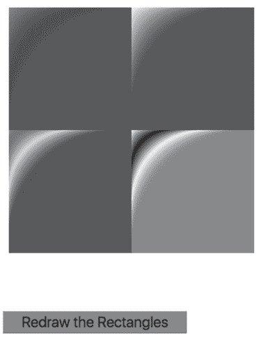

**光盘上**

## 使用 CSS 选择器在 Canvas 上渲染图像

HTML5 Canvas 支持渲染二进制图像，你还可以对 HTML5 `<canvas>` 元素应用 CSS 选择器。列表 6.7 显示了 `Image1.html` 的内容；列表 6.8 显示了 `Image1.css` 的内容，其选择器应用于列表 6.7 中的 HTML5 `<canvas>` 元素。

***列表 6.7 Image1.html***

```html
<!DOCTYPE html>
<html lang="en">
<head>
<meta charset="utf-8">
<title>HTML5 Canvas 渲染二进制图像</title>
<link href="Image1.css" rel="stylesheet" type="text/css">
<link href="HoverAnimation1.css" rel="stylesheet" type="text/css">
<script>
function renderPNG() {
```

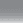

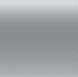

CSS3 和 HTML5 Canvas • **115**

```javascript
// 获取 canvas 元素
var elem = document.getElementById('myCanvas');

if (!elem || !elem.getContext) {
  return;
}

// 获取 canvas 的 2D 环境
var context = elem.getContext('2d');
if (!context) {
  return;
}

var basePointX = 30;
var basePointY = 30;
var rectWidth = 150;
var rectHeight = 200;
var borderX = rectWidth/2;
var borderY = rectHeight/2;
var offsetX = 20;
var offsetY = 20;
var gradientR = 60;

// 创建径向渐变:
var rGradient = context.createRadialGradient(
  basePointX+rectWidth/2,
  basePointY+rectWidth/2,
  gradientR,
  basePointX+rectWidth/2,
  basePointY+rectWidth/2,
  3*gradientR);

rGradient.addColorStop(0, '#FF0000');
rGradient.addColorStop(0.5, '#FFFF00');
rGradient.addColorStop(1, '#000044');

// 使用径向渐变的矩形背景:
context.fillStyle = rGradient;
context.fillRect(
  basePointX-offsetX,
  basePointY-offsetY,
  rectWidth+borderX+2*offsetX,
  rectHeight+borderY+2*offsetY);

// 加载 PNG
var myImage = new Image();
myImage.onload = function() {
  context.drawImage(myImage,
    basePointX,
    basePointY,
    rectWidth,
    rectHeight);
}
myImage.src = "sample1.png";
```

</script>

**116** • CSS3 基础教程

```html
<style type="text/css">
canvas {
  border: 0px solid #888;
  background: #FFF;
}
</style>
</head>

<body onload="renderPNG();">
<header>
  <h1>鼠标悬停在图像上</h1>
</header>
<div>
  <canvas id="myCanvas" width="500" height="300">不支持 Canvas</canvas>
</div>
</body>
</html>
```

`Listing 6.7` 包含了 JavaScript 代码，该代码创建了一个具有三个颜色停止点的径向渐变 `rGradient`。接下来，使用变量 `rGradient` 引用的径向渐变渲染一个矩形，随后是一段用于渲染二进制图像 `sample1.png` 的代码。`<style>` 元素中的内联 CSS 代码渲染了一个具有零宽度边框的白色背景（因此它是不可见的），但你可以修改这段 CSS 代码产生额外的效果。`<body>` 元素包含一个 `onload` 属性，其值为 `renderPNG()`，这是一个 JavaScript 函数，用于在 HTML5 `<canvas>` 元素内部渲染二进制图像。

***Listing 6.8 Image1.css***

```css
#myCanvas:hover {
  width: 500px;
  height: 300px;
  position: relative; top: 0px; left: 0px;
  background-color:white;
  background-image:
    radial-gradient(red 4px, transparent 24px),
    repeating-radial-gradient(red 1px, green 4px, yellow 8px,
    blue 12px, transparent 16px,
    red 20px, blue 24px,
    transparent 28px,
    transparent 32px);
  background-size: 30px 30px, 40px 40px;
  background-position: 0 0;
}

#myCanvas {
  width: 500px;
  height: 300px;
  position: relative; top: 0px; left: 0px;
  background-color:white;
  background-image:
    radial-gradient(black 4px, transparent 20px),
    repeating-radial-gradient(blue 1px, yellow 4px, blue 8px,
    red 12px, transparent 16px,
    red 20px, blue 24px,
    transparent 28px,
    transparent 32px);
  background-size: 30px 30px, 40px 40px;
  background-position: 0 0;
}
```


# CSS3 和 HTML5 Canvas • 117

Listing 6.8 中的第一个选择器每当用户将鼠标悬停在 HTML5 `<canvas>` 元素上时，都会显示另一种图案（基于不同的径向渐变）。Listing 6.8 中的第二个选择器将一个色彩斑的图案（同样基于径向渐变）渲染为 HTML5 `<canvas>` 元素的背景矩形。

顺便提一下，HTML5 Canvas 还支持 `clip()` 方法，它允许你以各种方式“裁剪”二进制图像。此外，你可以执行组合效果，甚至可以操作图像文件的单个像素。可以在互联网上搜索描述这些效果技术细节的文章。图 6.5 显示了具有两个径向渐变背景效果的二进制图像。

***图 6.5*** HTML5 Canvas 径向 PNG。

## 在画布上使用图案重复图像

HTML5 Canvas 提供了 `createPattern(image)` 方法，它允许你以各种方式“裁剪”二进制图像。此外，你可以执行组合效果，甚至可以操作图像文件的单个像素。可以在互联网上搜索描述这些效果技术细节的文章。图 6.5 显示了具有两个径向渐变背景效果的二进制图像。

***图 6.5*** HTML5 Canvas 径向 PNG。

抱歉，之前的翻译出现了重复错误。以下为您重新提供准确的翻译内容：

# CSS3 和 HTML5 Canvas • 115

## CSS3 基础教程

```html
<style type="text/css">
canvas {
  border: 0px solid #888;
  background: #FFF;
}
</style>
</head>
<body onload="renderPNG();">
<header>
  <h1>鼠标悬停在图像上</h1>
</header>
<div>
  <canvas id="myCanvas" width="500" height="300">不支持 Canvas</canvas>
</div>
</body>
</html>
```

Listing 6.7 包含了 JavaScript 代码，该代码创建了一个具有三个颜色停止点的径向渐变 `rGradient`。接下来，使用变量 `rGradient` 引用的径向渐变渲染一个矩形，随后是一段用于渲染二进制图像 `sample1.png` 的代码。`<style>` 元素中的内联 CSS 代码渲染了一个具有零宽度边框的白色背景（因此它是不可见的），但你可以修改这段 CSS 代码产生额外的效果。`<body>` 元素包含一个 `onload` 属性，其值为 `renderPNG()`，这是一个 JavaScript 函数，用于在 HTML5 `<canvas>` 元素内部渲染二进制图像。

***Listing 6.8 Image1.css***

（CSS 代码块保持不变，无需翻译）

# CSS3 和 HTML5 Canvas • 117

Listing 6.8 中的第一个选择器每当用户将鼠标悬停在 HTML5 `<canvas>` 元素上时，都会显示另一种图案（基于不同的径向渐变）。Listing 6.8 中的第二个选择器将一个色彩斑的图案（同样基于径向渐变）渲染为 HTML5 `<canvas>` 元素的背景矩形。

顺便提一下，HTML5 Canvas 还支持 `clip()` 方法，它允许你以各种方式“裁剪”二进制图像。此外，你可以执行组合效果，甚至可以操作图像文件的单个像素。可以在互联网上搜索描述这些效果技术细节的文章。图 6.5 显示了具有两个径向渐变背景效果的二进制图像。

***图 6.5*** HTML5 Canvas 径向 PNG。

## 在画布上使用图案重复图像

HTML5 Canvas 提供了 `createPattern(image)` 方法，它允许你以各种方式“裁剪”二进制图像。此外，你可以执行组合效果，甚至可以操作图像文件的单个像素。可以在互联网上搜索描述这些效果技术细节的文章。图 6.5 显示了具有两个径向渐变背景效果的二进制图像。

# CSS3 入门指南 • 122

## SVG 的基础特性

SVG 支持线性渐变、径向渐变、滤效果、变换（平移、缩放、倾斜和旋转）、贝塞尔曲线和动画效果。你可以通过代码创建用于渲染形状的 SVG 文档，也可以将 SVG 直接嵌入 HTML 网页中。SVG 元素被插入到网页的 DOM 中，这意味着可以对一组 SVG 元素进行跟踪/管理。SVG 的优势包括：

- 放大时边缘不会模糊/锯齿
- 方便在工具之间导入/导出格式
- 可以对 SVG 文档应用 XSL 样式表

另一方面，请记住 SVG 是冗长的，并且在程序化生成的 SVG 文档中可能难以阅读。此外，非复杂的动画效果可能会很麻烦：考虑使用 D3 来创建动画和处理鼠标相关事件。虽然本章侧重于“纯”SVG，但这里有一个带有 JavaScript 的 SVG 代码示例：`https://github.com/ocampesato/svg-graphics`。

正如你所看到的，可以通过 CSS 的 `url()` 函数将 CSS 选择器与 SVG 元素匹配，CSS3 和 SVG 的结合为你提供了一种强大的机制，可以在 CSS3 选择器中利用 SVG 的功能。事实上，你可以在同一个 HTML 网页中组合 CSS、SVG、D3 和 HTML5 Canvas 元素。

## 在 SVG 中渲染线段和矩形

本节将向你展示如何在 SVG 文档中渲染线段和矩形。作为一个简单的示例，SVG 支持使用 `<line>` 元素来渲染线段，其语法如下：

```xml
<line x1="20" y1="20" x2="100" y2="150".../>
```

SVG `<line>` 元素渲染连接两个点 `(x1,y1)` 和 `(x2,y2)` 的线段。

SVG 支持使用 `<rect>` 元素来渲染矩形，其语法如下：

```xml
<rect width="200" height="50" x="20" y="50".../>
```

SVG `<rect>` 元素渲染一个宽度和高度由 `width` 和 `height` 属性指定的矩形。矩形的左上顶点由坐标为 `(x,y)` 的点指定。

列表 7.1 显示了 `BasicShapes1.svg` 的内容，它说明了如何渲染线段和矩形。

***列表 7.1 BasicShapes1.svg***

```xml
<?xml version="1.0" encoding="iso-8859-1"?>

<!DOCTYPE svg PUBLIC "-//W3C//DTD SVG 20001102//EN" "http://www.w3.org/TR/2000/CR-SVG-20001102/DTD/svg-20001102.dtd">

<svg xmlns="http://www.w3.org/2000/svg"
     xmlns:xlink="http://www.w3.org/1999/xlink"
     width="100%" height="100%">

<g>
  <!-- 左侧图形 -->

  <line x1="20" y1="20" x2="220" y2="20" stroke="blue" stroke-width="4"/>

  <line x1="20" y1="40" x2="220" y2="40" stroke="red" stroke-width="10"/>
```


`<rect width="200" height="50" x="20" y="70" fill="red" stroke="black" stroke-width="4"/>`

`<path d="M20,150 l200,0 l0,50 l-200,0 z" fill="blue" stroke="red" stroke-width="4"/>`

`<!-- 右侧图形 -->`

`<path d="M250,20 l200,0 l-100,50 z" fill="blue" stroke="red" stroke-width="4"/>`

`<path d="M300,100 l100,0 l50,50 l-50,50 l-100,0 l-50,-50 z" fill="yellow" stroke="red" stroke-width="4"/>`

`</g>`

`</svg>`

列表 7.1 中的第一个 SVG `<line>` 元素指定了蓝色和 4 的描边宽度（即线宽），而第二个 SVG `<line>` 元素指定了红色和 10 的描边宽度。

注意，第一个 SVG `<rect>` 元素渲染的矩形与第二个 SVG `<line>` 元素看起来相同（除颜色外），这说明可以使用不同的 SVG 元素来渲染矩形（或线段）。

SVG `<path>` 元素可能是最灵活且最强大的元素，因为你可以根据其他元素的“拼接”创建任意复杂的形状。在章章的后后部分，你将看到一个如何渲染多个贝塞尔曲线的示例。

SVG `<path>` 元素包含一个指定点的 `d` 属性。例如，列表 7.1 中的第一个 SVG `<path>` 元素包含以下 `d` 值：

```
d="M20,150 l200,0 l0,50 l-200,0 z"
```

以下是 `d` 属性的解释方法：

- `M20,150`: 移动到点 `(20,150)`
- `l200,0`: 向右画 200 个单位的线
- `l0,50`: 向下画 50 个单位的线
- `l-200,0`: 向左画 200 个单位的线
- `z`: 关闭路径

需要注意的是，大写字母 (`C`, `L`, `Q`) 代表绝对位置，而小写字母 (`c`, `l`, `q`) 代表相对位置。

**126 • CSS3 入门指南**

```xml
"http://www.w3.org/TR/2000/CR-SVG-20001102/DTD/svg-20001102.dtd">
<svg xmlns="http://www.w3.org/2000/svg"
xmlns:xlink="http://www.w3.org/1999/xlink"
width="100%" height="100%">
<defs>
<pattern id="dotPattern1" width="8" height="8"
patternUnits="userSpaceOnUse">
<circle id="circle1" cx="2" cy="2" r="3"
style="fill:blue;"/>
</pattern>
<pattern id="dotPattern2" width="8" height="8"
patternUnits="userSpaceOnUse">
<rect x="0" y="0" width="4" height="4" fill="red" />
<rect x="4" y="0" width="4" height="4" fill="black" />
<rect x="0" y="4" width="4" height="4" fill="black" />
<rect x="4" y="4" width="4" height="4" fill="red" />
</pattern>
</defs>
<g id="largeCylinder" transform="translate(100,20)">
<rect x="0" y="0" width="200" height="100"
style="fill:url(#dotPattern1)"/>
<ellipse cx="100" cy="150" rx="80" ry="40"
stroke="blue" stroke-width="4"
style="fill:url(#dotPattern2)"/>
</g>
</svg>
```

列表 7.3 包含一个 SVG `<defs>` 元素，该元素包含两个 `<pattern>` 元素。第一个 `<pattern>` 元素创建了一个“点状”效果，其中每个“点”都是一个半径为 3 的蓝色圆。第二个 `<pattern>` 元素通过指定四个相同尺寸的矩形创建一个“棋盘格”图案，这些矩形在第一“行”中是红色和黑色，在第二“行”中是黑色和红色。

列表 7.3 的下一部分包含一个 SVG `<g>` 元素，它包含一个 `<rect>` 元素，其 `fill` 属性指定了第一个 `<pattern>` 元素，随后是一个 `fill` 属性指定了第二个 `<pattern>` 元素的 `<ellipse>` 元素。

图 7.3 显示了 SVG 文档 `Pattern1.svg` 中定义的矩形和椭形的渲染结果。

**SVG 基础 • 127**

![image 143_0] ![image 143_1]

***

***图 7.3*** 使用不同图案渲染的两个形状。

## SVG `<POLYGON>` 和 `<POLYLINE>` 元素

SVG `<polygon>` 元素包含一个 `polygon` 属性，在其中你可以指定表示多边形顶点的点。当你想要创建任意边的多边形时，SVG `<polygon>` 元素最为有用，你也可以使用此元素来渲染线段和矩形。

SVG `<polygon>` 元素的语法如下：

```
<polygon path="specify a list of points" fill="…" />
```

列表 7.4 显示了 `SvgCube1.svg` 的部分内容，说明了如何在 SVG 中渲染一个立方体。

***

列表 7.4 `SvgCube1.svg`***

```xml
<?xml version="1.0" encoding="iso-8859-1"?>
<!DOCTYPE svg PUBLIC "-//W3C//DTD SVG 20001102//EN"
"http://www.w3.org/TR/2000/CR-SVG-20001102/DTD/svg-20001102.dtd">
<svg xmlns="http://www.w3.org/2000/svg"
xmlns:xlink="http://www.w3.org/1999/xlink"
width="100%" height="100%">
<!-- 为了省略省略了 <defs> 元素 -->
<!-- 顶部（逆时针） -->
<polygon fill="url(#pattern1)"
points="50,50 200,50 240,30 90,30"/>
<!-- 前面 -->
<rect width="150" height="150" x="50" y="50"
fill="url(#pattern2)"/>
<!-- 右侧（逆时针） -->
<polygon fill="url(#pattern3)"
points="200,50 200,200 240,180 240,30"/>
</svg>
```

**128 • CSS3 入门指南**

![image 144_0]

列表 7.4 包含一个 SVG `<g>` 元素，它包含立方体的三个面，其中一个 `<polygon>` 元素渲染了顶部（这是一个平行四边形），一个 `<rect>` 元素渲染了正面，另一个 `<polygon>` 元素渲染了右侧面（也是一个平行四边形）。立方体的三个面是用 SVG `<defs>` 元素中定义的线性渐变和径向渐变渲染的（列表 7.4 中未显示）。

图 7.4 显示了渲染 SVG `SvgCube1.svg` 的结果。SVG `<polyline>` 元素指定一组点，表示一个或多个线段的端点，这些线段被显示为连接的线。SVG `<polyline>` 的语法与 SVG `<polygon>` 元素非常相似：

```
<polyline points="specify a list of points" fill="..." />
```

前面的代码渲染了 7.4 中的 `<rect>` 元素。`Polyline.svg` 使用三个 `<polyline>` 元素，而 `SvgCube1.svg` 使用两个 `<polygon>` 元素和一个 `<rect>` 元素来渲染立方体。

## SVG `<PATH>` 元素

SVG `<path>` 元素允许你通过 `d` 属性定义圆弧，并指定渐变效果。SVG `<path>` 元素包含一个 `d` 属性，如下：

```
<path d="specify a list of points" fill="..."
```

列表 7.5 显示了 `PathElement.svg` 的内容，说明了如何使用 `<path>` 元素来渲染圆弧。

***

列表 7.5 `PathElement.svg`***

```xml
<?xml version="1.0" encoding="iso-8859-1"?>
<!DOCTYPE svg PUBLIC "-//W3C//DTD SVG 20001102//EN">
<svg xmlns="http://www.w3.org/2000/svg"
xmlns:xlink="http://www.w3.org/1999/xlink"
width="100%" height="100%">
<defs>
<linearGradient id="pattern1"
x1="0%" y1="100%" x2="100%" y2="0%">
<stop offset="0%" stop-color="yellow"/>
<stop offset="40%" stop-color="red"/>
<stop offset="80%" stop-color="blue"/>
</linearGradient>
</defs>
<g>
<path d="M505,145 v-100 a 250,100 0 0,1 -200,100"
fill="black"/>
<path d="M500,140 v-100 a 250,100 0 0,1 -200,100"
fill="url(#pattern1)"
stroke="black" stroke-width="8"/>
<path d="M305,165 v-100 a 250,100 0 0,1 -200,100"
fill="black"/>
<path d="M300,160 v-100 a 250,100 0 0,1 -200,100"
fill="url(#pattern1)"
stroke="black" stroke-width="8"/>
</g>
</svg>
```

列表 7.5 包含一个 SVG `<defs>` 元素，定义了一个线性渐变，随后是一个包含四个 `<path>` 元素的 SVG `<g>` 元素。每个 `<path>` 元素显示一个圆弧，并为 `fill` 属性引用线性渐变。

第一个 `<path>` 元素为如下 `d` 属性定义的圆弧指定了黑色背景：

```
d="M505,145 v-100 a 250,100 0 0,1 -200,100"
```

遗憾的是，SVG 圆弧的语法并不直观，它是基于连接椭圆上两点的大弧和和小弧的概念的。这个示例仅用于说明目的，因此我们不会深入解释 SVG 中如何定义圆弧。

第二个 `<path>` 元素使用线性渐变 `pattern1` 渲染相同的圆弧，这创建了投影效果。

**SVG 基础 • 130**

![image 146_0]

图 7.5 显示了渲染文档 `PathElement.svg` 的结果。

![image 146_1]

***

***图 7.5*** SVG 圆弧。

## 贝塞尔曲线与变换

SVG 支持二次和三次贝塞尔曲线，你可以使用线性渐变或径向渐变来渲染它们。你还可以使用 `<path>` 元素连接多个贝塞尔曲线。列表 7.6 显示了 `BezierCurves1.svg` 的内容，说明了如何渲染贝塞尔曲线。注意，变换相关的效果将在本章晚些部分讨论。

SVG 基础 • **131**

```
</g>

<g transform="translate(-50,50)">

<g transform="scale(1,2)">

<path d="M 50,50 C 400,100 200,200 100,20" fill="blue" stroke="black" stroke-width="4"/>

</g>

</g>

<g transform="translate(-50,50)">

<g transform="scale(0.5, 0.5) translate(195,345)">

<path d="m20,20 C20,50 20,450 300,200 s-150,-250 200,100" fill="blue" style="stroke:#880088;stroke-width:4;"/>

</g>

<g transform="scale(0.5, 0.5) translate(185,335)">

<path d="m20,20 C20,50 20,450 300,200 s-150,-250 200,100" fill="url(#pattern2)" style="stroke:#880088;stroke-width:4;"/>

</g>

<g transform="scale(0.5, 0.5) translate(180,330)">

<path d="m20,20 C20,50 20,450 300,200 s-150,-250 200,100" fill="blue" style="stroke:#880088;stroke-width:4;"/>

</g>

<g transform="scale(0.5, 0.5) translate(170,320)">

<path d="m20,20 C20,50 20,450 300,200 s-150,-250 200,100" fill="url(#pattern2)" style="stroke:black;stroke-width:4;"/>

</g>

</g>

<g transform="scale(0.8,1) translate(380,120)">

<path d="M0,0 C200,150 400,300 20,250" fill="url(#pattern2)" style="stroke:blue;stroke-width:4;"/>

</g>

<g transform="scale(2.0,2.5) translate(150,-80)">

<path d="M200,150 C0,0 400,300 20,250" fill="url(#pattern2)" style="stroke:blue;stroke-width:4;"/>

</g>

</svg>
```

Listing 7.6 包含一个 SVG `<defs>` 元素，它定义了两个线性渐变，随后是十个 SVG `<path>` 元素，每个元素都渲染一条三次贝塞尔曲线。SVG `<path>` 元素被封装在 SVG `<g>` 元素中，其 `transform` 属性包含了 SVG `scale()` 函数或 SVG `translate()` 函数（或两者兼有）。

第一个 SVG `<g>` 元素调用 SVG `scale()` 函数来缩放 SVG `<path>` 元素中指定的三次贝塞尔曲线，如下所示：

**132** • CSS3 入门指南


```
<g transform="scale(1.5,0.5)">

<path d="m 0,50 C 400,200 200,-150 100,350" stroke="black" stroke-width="4" fill="url(#pattern1)"/>

</g>
```

之前的三次贝塞尔曲线有一个初始点 `(0,50)`，控制点为 `(400,200)` 和 `(200,-150)`，随后是第二个控制点 `(100,350)`。该贝塞尔曲线是黑色的，宽度为 4，其 `fill` 属性是 SVG `<defs>` 元素中定义的 `<linearGradient>` 元素（其 `id` 属性为 `pattern1`）中的颜色。

剩余的 SVG `<path>` 元素与第一个 SVG `<path>` 元素类似，因此不再进行描述。

图 7.6 显示了在 SVG 文档 `BezierCurves1.svg` 中定义的贝塞尔曲线的渲染结果。

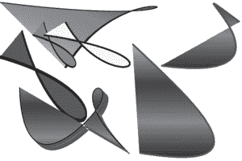

***图 7.6*** SVG 贝塞尔曲线。

## 在 SVG 路径上渲染文本

你可以创建精美的滤镜效果，并将其应用于 2D 形形以及文本字符串。

Listing 7.7 显示了文档 `TextOnQBezierPath1.svg` 的内容，它说明了如何沿着二次贝塞尔曲线的路径渲染文本字符串。

***列表 7.7 `TextOnQBezierPath1.svg`***

```
<?xml version="1.0" encoding="iso-8859-1"?>

<!DOCTYPE svg PUBLIC "-//W3C//DTD SVG 20001102//EN"

"http://www.w3.org/TR/2000/CR-SVG-20001102/DTD/svg-20001102.dtd">

<svg xmlns="http://www.w3.org/2000/svg"

xmlns:xlink="http://www.w3.org/1999/xlink"

width="100%" height="100%">

<defs>

<path id="pathDefinition" d="m0,0 Q100,0 200,200 T300,200"/>

</defs>

<g transform="translate(100,100)">

<text id="textStyle" fill="red" stroke="blue" stroke-width="2" font-size="24">

SVG 基础 • **133**
```


`Listing 7.7` 中的 SVG `<defs>` 元素包含一个定义二次贝塞尔曲线的 SVG `<path>` 元素（注意 `d` 属性中的 `Q`）。该 `<path>` 元素的 `id` 值为 `pathDefinition`，在代码后部分引用。SVG `<g>` 元素包含一个指定要渲染文本字符串的 `<text>` 元素，以及一个指定渲染路径的 SVG `<textPath>` 元素，如下所示：

```
<textPath xlink:href="#pathDefinition">
沿着二次贝塞尔曲线路径的示例文本
```

注意，SVG `<textPath>` 元素包含属性 `xlink:href`，其值为 `pathDefinition`，这也是 SVG `<defs>` 元素中定义的 SVG `<path>` 元素的 `id`。因此，文本字符串沿着二次贝塞尔曲线进行渲染，而不是水平渲染。

图 7.7 显示了 `TextOnBezierPath1.svg` 的渲染结果，它沿着二次贝塞尔曲线渲染了一个文本字符串。

**图 7.7** 二次贝塞尔曲线上的 SVG 文本。

## SVG 滤镜

SVG 支持丰富的滤镜效果，其完整解释可能很容易超过一个章节。掌握 SVG 滤镜需要一个学习过程，因为只有少数滤镜是简单的。许多滤镜非常复杂，需要非直观的输入值。事实上，可以“链”某些 SVG 滤镜：一个滤镜的输出可以是另一个滤镜的输入（某些滤镜需要两个滤镜的输出）。

正如你所料的，某些 SVG 滤镜计算量很大，会影响性能；对于移动设备，包含此类滤镜的应用程序还会影响电池寿命。

滤镜相关的 SVG 元素列表包括：

- `feBlend`
- `feColorMatrix`
- `feComponentTransfer`
- `feComposite`
- `feConvolveMatrix`
- `feDiffuseLighting`
- `feDisplacementMap`
- `feFlood`
- `feGaussianBlur`
- `feImage`
- `feMerge`
- `feMorphology`
- `feOffset`
- `feSpecularLighting`
- `feTile`
- `feTurbulence`

你可以使用滤镜效果渲染 2D 形状以及文本字符串。`Listing 7.8` 显示了 SVG 文档 `BlurFilterText1.svg` 的内容，它使用模糊滤镜渲染了一个文本字符串。

**列表 7.8 BlurFilterText1.svg**

```xml
<?xml version="1.0" encoding="iso-8859-1"?>
<!DOCTYPE svg PUBLIC "-//W3C//DTD SVG 20001102//EN"
"http://www.w3.org/TR/2000/CR-SVG-20001102/DTD/svg-20001102.dtd">
<svg xmlns="http://www.w3.org/2000/svg"
xmlns:xlink="http://www.w3.org/1999/xlink"
width="100%" height="100%">
<defs>
<filter id="blurFilter1" filterUnits="objectBoundingBox" x="0" y="0" width="100%" height="100%">
<feGaussianBlur stdDeviation="4"/>
</filter>
</defs>
<g transform="translate(50,100)">
<text id="normalText" x="0" y="0" fill="red" stroke="black" stroke-width="4" font-size="72">
Normal Text
</text>
<text id="horizontalText" x="0" y="0" fill="red" stroke="black" stroke-width="4" font-size="72">
Blurred Text
</text>
</g>
</svg>
```

`Listing 7.8` 中的 SVG `<defs>` 元素包含一个 SVG `<filter>`，它通过以下行指定了高斯模糊：

```
<feGaussianBlur stdDeviation="4"/>
```

如果你想创建更“弥散”的滤镜效果，可以指定更大的 `stdDeviation`。SVG `<g>` 元素包含的第一个 `<text>` 元素渲染普通的文本字符串，而第二个 `<text>` 元素包含一个 `filter` 属性，用于引用在 SVG `<defs>` 元素中定义的滤镜以渲染相同的文本，如下所示：

```
filter="url(#blurFilter1)"
```

图 7.8 显示了 `BlurFilterText1.svg` 的结果，它创建了一个滤镜效果。

```
<defs>
  <pattern id="dotPattern" width="8" height="8" patternUnits="userSpaceOnUse">
    <circle id="circle1" cx="2" cy="2" r="2" style="fill:red;"/>
  </pattern>
</defs>

<!-- 圆体 -->
<g id="largeCylinder" transform="translate(100,20)">
  <ellipse cx="0" cy="50" rx="20" ry="50" stroke="blue" stroke-width="4" style="fill:url(#gradientDefinition1)"/>
  <rect x="0" y="0" width="300" height="100" style="fill:url(#gradientDefinition1)"/>
  <rect x="0" y="0" width="300" height="100" style="fill:url(#dotPattern)"/>
  <ellipse cx="300" cy="50" rx="20" ry="50" stroke="blue" stroke-width="4" style="fill:yellow;"/>
</g>

<!-- 半尺寸圆体 -->
<g transform="translate(100,100) scale(.5)">
  <use xlink:href="#largeCylinder" x="0" y="0"/>
</g>

<!-- 倾斜圆体 -->
<g transform="translate(100,100) skewX(40) skewY(20)">
  <use xlink:href="#largeCylinder" x="0" y="0"/>
</g>

<!-- 旋转圆体 -->
<g transform="translate(100,100) rotate(40)">
  <use xlink:href="#largeCylinder" x="0" y="0"/>
</g>
</svg>
```

`列表 7.9` 中的 SVG `<defs>` 元素包含一个定义了线性渐变的 `<linearGradient>` 元素，其后是一个定义了自定义模式的 SVG `<pattern>` 元素，其显示如下：

```
<pattern id="dotPattern" width="8" height="8" patternUnits="userSpaceOnUse">
  <circle id="circle1" cx="2" cy="2" r="2" style="fill:red;"/>
</pattern>
```

如你所见，SVG `<pattern>` 元素包含一个 SVG `<circle>` 元素，该元素在 8x8 的矩形内以网格方式重复出现（注意 `width` 属性和 `height` 属性的值）。SVG `<pattern>` 元素有一个 `id` 属性，其值为 `dotPattern`，这是因为（正如你稍后将看到的）该元素创建了一种“点状”效果。

`列表 7.9` 包含了四个 SVG `<g>` 元素，每个元素都渲染一个引用了 SVG `<defs>` 元素中定义的 SVG `<pattern>` 元素的圆体。

`列表 7.9` 中的第一个 SVG `<g>` 元素包含两个 SVG `<ellipse>` 元素和两个 SVG `<rect>` 元素。第一个 `<ellipse>` 元素使用 SVG `<defs>` 元素中定义的线性渐变渲染了圆体的左侧“盖子”。第一个 `<rect>` 元素用线性渐变渲染了圆体的“主体”，而第二个 `<rect>` 元素则在圆体主体上渲染了“点状模式”。最后，第二个 `<ellipse>` 元素渲染了圆体的右侧“盖子”。

另外三个圆体很容易创建：它们简单地引用第一个圆体并应用变换来改变其尺寸、形状和朝向。具体而言，这三个圆体通过以下代码引用了第一个圆体：

```
<use xlink:href="#largeCylinder" x="0" y="0"/>
```

然后它们顺序应用 `scale`、`skew` 和 `rotate` 函数来渲染缩放、倾斜和旋转后的圆体。

图 7.9 显示了渲染 `TransformEffects.svg` 的结果。

**图 7.9** SVG 变换效果。

## 其他 SVG 特性

SVG 支持许多特性，本节描述了其中一些特性。请注意，引用的文件位于随书的光盘上。

### SVG 动画效果

SVG 支持动画效果，你可以在 SVG 元素的声明中指定这些效果。SVG 文档 `AnimateMultiRect1.svg` 阐述了如何用四个矩形创建一个动画效果。

```
<rect id="rect1" width="100" height="100" stroke-width="1" stroke="blue"/>
<use xlink:href="#rect1" x="0" y="0" fill="red">
  <animate attributeName="x" attributeType="XML" begin="0s" dur="4s" fill="freeze" from="0" to="400"/>
</use>
```

SVG `<g>` 元素包含一个 SVG `<use>` 元素，它对矩形执行并行动画效果。第一个 `<use>` 元素引用了 SVG `<defs>` 元素中定义的矩形，并在四秒间隔内对 `x` 属性进行动画处理。注意 `x` 属性从 `0` 变为 `400`，这使矩形水平从左向右移动。你也可以对其他的 SVG 元素制作动画，包括文本字符串。

如果你感兴趣查看如何处理缩放和平移功能，可以使用以下代码：

### SVG 和 JavaScript

除了嵌入“纯”SVG 之外，JavaScript 还允许你动态创建元素并将它们追加到 DOM 中。SVG 文档 `Ellipses1.svg` 渲染了一组椭圆：

```javascript
var svgNS = "http://www.w3.org/2000/svg";
var ellipse = document.createElementNS(svgNS, "ellipse");
ellipse.setAttribute("cx", "0");
ellipse.setAttribute("cy", "0");
ellipse.setAttribute("rx", "50");
ellipse.setAttribute("ry", "50");
ellipse.setAttribute("fill", "red");
ellipse.setAttribute("stroke", "black");
ellipse.setAttribute("stroke-width", "2");

for (var angle = 0; angle < 360; angle += 45) {
  var circle = document.createElementNS(svgNS, "circle");
  circle.setAttribute("cx", "100 + Math.cos(angle * Math.PI / 180) * 50);
  circle.setAttribute("cy", "100 + Math.sin(angle * Math.PI / 180) * 50);
  circle.setAttribute("rx", "20");
  circle.setAttribute("ry", "20");
  circle.setAttribute("fill", "blue");
  ellipse.appendChild(circle);
}
```

### 在 SVG 中创建 3D 效果

现在你应该知道，CSS3 选择器可以使用 CSS3 `url()` 函数引用 SVG 文档，这意味着你可以在 HTML 页面中包含基于 SVG 的图形效果（包括动画）。HTML 页面 `Blue3DCircle1.html` 引用了 CSS 样式 `Blue3DCircle1.css` 来渲染带有样式效果的 SVG 圆。另一个例子是 HTML5 页面 `CSS3SVGBarChart1.html` 引用了 CSS3 样式 `CSS3SVGBarChart1.css` 和 SVG 文档 `CSS3SVGBarChart1.svg`，用于渲染 SVG 圆、柱状图和彩色文本。

一个有趣的场景是在同一个 Web 页面中将 jQuery 与 SVG 和 CSS 使用，如下节所示。但是当你使用 jQuery 动态创建 SVG 元素时，需要一些额外的代码（后文所示）。如果你不使用 jQuery，可以跳过本节。如果你对 jQuery 感兴趣但还没有用过，请阅读光盘上相关的附录。

## SVG 与 jQuery

`列表 7.10` 显示了 `JQuerySVGCSSCube1.html` 的内容，它阐述了每当用户点击立方体的任何面时，如何更新基于 SVG 的立方体的填充颜色。

**列表 7.10 JQuerySVGCSSCube1.html**

```html
<!DOCTYPE html>
<html lang="en">
<head>
<meta charset="utf-8" />
<title>SVG, CSS, and jQuery Example</title>
<script src="https://cdnjs.cloudflare.com/ajax/libs/jquery/3.0.0-alpha1/jquery.js">
</script>
<style>
.newcolor {
fill: #c8f;
stroke: white;
stroke-width: 2;
}
</style>
</head>
<body>
<svg class="none" width="600" height="300">
<!-- top/front/right faces -->
<polygon fill="yellow"
points="50,50 200,50 240,30 90,30"/>
<rect width="150" height="150" x="50" y="50"
fill="red"/>
<polygon fill="blue"
points="200,50 200,200 240,180 240,30"/>
</svg>
<script>
var mysvg = $("svg > *");
$(document).ready(function() {
mysvg.on("click", function() {
mysvg.removeClass("none");
$(this).toggleClass("newcolor");
//$(this).newClass("newcolor");
});
});
</script>
</body>
</html>
```

`列表 7.10` 包含了用于渲染立方体的样板代码和熟悉的 SVG 代码。新代码是 `<script>` 元素中的 jQuery 代码块，它向你展示了如何定义一个事件处理程序，以响应对立方体任何面上的点击事件。如果你对这段代码不熟悉，请阅读配套光盘上的 jQuery 附录。

## 创建 SVG 元素与 jQuery

使用 `document.createElement()` 方法添加 SVG DOM 节点是不行的，因为需要命名空间。请使用 `createElementNS()` 方法，jQuery 会为你处理这一点。`列表 7.11` 显示了 `JQuerySVG.html` 的内容，它阐述了如何通过 jQuery 创建 SVG 椭圆并将其添加到 DOM 中。

**列表 7.11 JQuerySVG.html**


```html
<!DOCTYPE html>
<html lang="en">
<head>
<meta charset="utf-8" />
<title>An Ellipse and jQuery</title>
<script src="http://code.jquery.com/jquery-1.7.min.js">
</script>
</head>
<body>
<svg id="outersvg" width="800" height="500">
</svg>
<script>
function createSVGElemWithNS(elem)
{
return document.createElementNS('http://www.w3.org/2000/svg', elem);
}
$(document).ready(function() {
var $mySVG = $('#outersvg');
$(createSVGElemWithNS('circle'))
.attr('cx', 150)
.attr('cy', 100)
.attr('r', 50)
.attr('fill', 'none')
.attr('stroke', 'red')
.attr('stroke-width', 3)
.appendTo($mySVG);
})
</script>
</body>
</html>
```

列表 7.11 包含了样板代码和一个 `<body>` 元素，其中包含一个 `<svg>` 元素作为 SVG 元素的容器。`<body>` 元素的下一个部分是一个 `<script>` 元素，包含 JavaScript 函数 `createSVGElemWithNS`，其目的是创建一个带有 SVG 命名空间的元素。`<script>` 元素的第二个部分包含了在网页加载到内存后执行的标准 jQuery “ready” 代码块。链式调用用于在元素添加到 DOM 之前为 `<circle>` 元素赋值。如果你想查看 jQuery 和 CSS 的示例，可以在附录中找到它们。

## 现有元素与 jQuery

前一节展示了如何使用 jQuery 动态创建 SVG 元素并将其添加到 DOM 中。你也可以使用 jQuery 操作现有的 SVG 元素，而无需处理命名空间。列表 7.12 显示了 `UpdatejQuery.svg` 的内容，它阐述了如何使用 jQuery 更新 SVG `<rect>` 元素的宽属性。

***列表 7.12 `UpdatejQuery.svg`***

```xml
<?xml version="1.0" encoding="UTF-8" standalone="no"?>
<!DOCTYPE svg PUBLIC "-//W3C//DTD SVG 1.0//EN"
"http://www.w3.org/TR/2001/DTD/SVG-11.dtd">
<svg xmlns="http://www.w3.org/2000/svg"
xmlns:xlink="http://www.w3.org/1999/xlink" width="500"
height="500">
<script xlink:href="http://code.jquery.com/
jquery-2.0.0.js">
</script>
<script xlink:href="http://code.jquery.com/
jquery-1.1.0.js">
</script>
<rect id="rect1" x="50" y="50" width="200" height="50"
style="fill:red"/>
<script>
$('#rect1').attr('width', 400);
</script>
</svg>
```

列表 7.12 包含了两个引用 jQuery 相关脚本的 `<script>` 元素的样板代码。列表 7.12 中的 `<body>` 元素包含一个 `<svg>` 元素，其包含两个 `<rect>` 元素，随后是一个包含 jQuery 代码块的 `<script>` 元素。在网页加载到内存后，此代码块执行并将第一个 `<rect>` 元素的宽属性设置为 400。这个简单的代码示例向你展示了通过 jQuery 更新 SVG 元素属性有多简单。

**光盘附内容**

SVG 基础 • **143**

## SVG 的 jQuery 插件

如果你倾向于在 HTML5 网页中使用 jQuery 而不是 D3，可以通过 jQuery 插件添加 SVG 支持。例如，以下 jQuery 插件提供了一些 SVG 支持：`http://keith-wood.name/svg.html`。下面的代码块阐述了如何使用此 jQuery 插件渲染几个二维形状：

```javascript
svg.rect(50, 50, 100, 100,
{fill: 'blue', stroke: 'red', 'stroke-width': 3});
svg.line(50, 50, 100, 100,
{'stroke': 3, 'stroke-width': 3});
svg.circle(50, 50, 100, 100,
{'fill': 'red', stroke: 3, 'stroke-width': 3});
svg.ellipse(250, 250, 100, 50,
{'fill': 'red', stroke: 3, 'stroke-width': 3});
```

在前面的代码块中，JavaScript 变量 `svg` 是页面其他地方定义的 `<div>` 元素的引用。用于动画 SVG `<path>` 元素的 jQuery 插件可以在以下网站找到：`http://www.jqueryrain.com/2015/10/jquery-drawsvg-animate-svg-paths/` 以及 `http://www.justinmccandless.com/blog/Patching+jQuery’s+Lack+of+SVG+Support`.

## SVG 与 CSS3 的简单比较

本节简要总结了 SVG 和 CSS3 共同的功能，以及每种技术特有的功能。第 6 节和第 7 节包含了本节总结的一些功能代码示例。

SVG 和 CSS3 都支持以下功能：

- 线性渐变和径向渐变
- 二维图形和动画效果
- 创建矩形、圆形和椭圆形状的能力
- WAI-ARIA

SVG 支持 CSS3 不支持的功能：

- 贝塞尔曲线
- 分层对象定义
- 自定义字形
- 沿路径渲染文本
- 在 SVG 对象上定义事件监听器
- 使用 JavaScript 编程创建二维形状
- 访问基于 XML 的技术和工具

**144** • CSS3 入门指南

# 第 8 章

## 杂项主题

本章包含了多样化的主题，首先从 Houdini 的概述开始，这是一个对网页中 CSS 具有深远影响的倡议。你还将学习 Flexbox 和 Grid 布局，以及二进制图像的性能技术。此外，你还将看到 CSS3、SVG 和 HTML5 Canvas 的比较，以及 Web Animation API 和动画相关的工具包。

本章的第一部分是对 Houdini 的简要介绍，Houdini 是一个重要的工作组，目标是提供新的 API，以便在所有现代浏览器中提供一致的 CSS 行为。

本章的第二部分包含了代码示例，展示如何使用 CSS Flexbox 和 CSS Grid 布局。第三部分讨论了 HTML5 Web 页面和 CSS3 的性能改进，以及 CSS3、SVG 和 HTML5 Canvas 的比较。

本章的第四部分涵盖了优化二进制图像的性能技术，并对精灵（spritesheets）、渐模糊技术（blur-up）、渐进式图像（progressive images）和 Web 字体进行了描述。第五部分介绍了 Web Animations API 以及其他动画工具包，如 GSAP、mojo.io 和 sequence.js。

本章的最后一部分深入探讨了 Chrome 检查器的某些功能，它提供了一套非常丰富的诊断和调试能力。你将学习“计算属性”、如何对 CSS 选择器中的属性进行实时更新，以及如何收集帮助你精确定性能瓶颈的数据。在完成本节后，你能够更好地将 Chrome 检查器与其他现代浏览器支持的相应功能进行基于功能的比较。

## HOUDINI 项目

Houdini 是一个 W3C 工作组，其目标是提供一组 API，使 CSS 在所有现代浏览器中保持一致。这些 API 还将允许开发者通过访问浏览器渲染引擎的样式和布局过程来扩展 CSS。尽管 Houdini 是一个相对较新的小组，但这里有一些 Houdini 示例：`https://github.com/GoogleChrome/houdini-samples`。

正如你现在可能已经知道的，补丁填充（polyfills，如 Modernizr）是 JavaScript 工具包，用于“填补”浏览器中缺失的功能，以便其他 JavaScript 工具包能够在不同的现代浏览器中一致地运行。从本质上说，填充通过修改 DOM 来工作。

DOM 的 CSS“对应物”是 CSSOM，它是 CSS 对象模型（CSS Object Model）的缩写。遗憾的是，CSSOM 在不同浏览器之间是不一致的且缺乏关键功能。此外，“填充”CSS 比填充 DOM 更困难（而且它也是一个不完整的解决方案）。

CSSOM 的缺陷之一是它会丢弃任何无法识别的 CSS 规则或声明；因此，必须使用 DOM（特别是访问 `<style>` 和 `<link>` 元素）来填充这些规则和声明。

从本质上说，Houdini 的目标是修改浏览器的内部渲染引擎，以“规范化”（即消除现代浏览器中 CSS 的不一致行为）。

### 渲染流水线（The Rendering Pipeline）

渲染流水线涉及以下阶段（按此顺序）：

1. 解析器 (Parser)
2. DOM/CSSOM
3. 级联 (Cascade)
4. 布局 (Layout)
5. 绘制 (Paint)
6. 合成 (Composite)

前三个阶段是 CSS 属性和值 API 的组件，后三个阶段组成了单元（Worklets）。Houdini 在渲染流水线中引入了阶段 1（尚未编写）和阶段 3。阶段 1 是正确处理外部样式表的地方，也是支持 CSS 自定义扩展的地方。

Houdini 还引入了单元（worklets）的概念，它们本质上是处理注册相关操作的脚本。单元支持各种功能，如调用 JavaScript 代码的能力。

访问 Houdini 主页获取有关拟议的 Houdini API 的更多详细信息。

## CSS3 高级特性

书中的 CSS3 示例已基于 WebKit 的浏览器中经过测试，你使用浏览器特定的前缀（在第 1 章中简要讨论过）为其他浏览器插入 CSS3 代码。此外，本章中的某些代码示例在 Google Canary 中渲染，有时在 WebKit 的每日构建版本中渲染，并将进行相应说明。当本书印刷时，这些功能可能在通用 Chrome 发行版中可用。

有几个 CSS 特性处于活跃开发中，其中大多数（可能所有）在基于 WebKit 的浏览器中可用。在许多情况下，每个新 CSS 特性的 W3C 规范都是“进行中的工作”，因此在你阅读此书时，它们可能已经被修改。请检查 `www.caniuse.com` 等网站以获取你所选浏览器最新功能支持的信息。

在高级（在某些情况下是实验性的）特性中包括：

1. CSS Flexbox
2. CSS 混合 (Blending)
3. CSS 复合 (Compositing)
4. CSS 排除 (Exclusions)
5. CSS 区域 (Regions)

考虑到上述几点，这里是一些最新的 CSS3 特性列表：

- CSS Canvas 背景 (Webkit 和 FF)
- CSS 设备适配 (IE10)
- CSS 排除 (IE10)
- CSS 过滤器 (IE10 和 Webkit)
- CSS Flexbox (IE10)
- CSS Grid (IE10)
- CSS 区域 (Webkit)
- CSS 自定义过滤器 (Webkit)
- CSS 模板 (IE10)

CSS Flexbox 是列表中唯一在本章中涵盖的特性。你将在稍后看到一些示例。

### CSS FLEXBOX（弹性布局）

Flexbox 是一种单向布局概念，其中项目放置在行或列中。`flex-direction` 的默认值为 `row`，这意味着项目按从左到右、从上到下排列（即我们在页面上阅读文本的顺序）。`flex-direction` 的其他值有：

- `row-reverse`
- `column`
- `column-reverse`

Flexbox 模型还允许你扩展子元素填充剩余空间，以及缩小子元素以避免溢出。此外，你可以在同一个 HTML 页面中创建不同的 flexbox。

### Flexbox 属性集

一些不需要前缀的常用 Flexbox 属性包括：`box-align`、`box-flex`、`box-order-group`、`box-pack` 和 `flex-flow`。`box-align` 属性（以及其他 Flexbox 属性）支持 `start`、`end`、`center`、`baseline` 和 `stretch` 等值，所有这些允许你指定 flexbox 中元素的对齐方式。例如，`start` 和 `end` 分别将 flexbox 中的一组元素元素。

`box-flex` 属性允许你为 flexbox 中的元素分配更大的相对权重。`box-order-group` 属性允许你更改 flexbox 中一组元素的默认顺序。你还可以使用 `display` 属性并指定值为 `box`。

可以使用 Flexbox 属性执行额外任务：

- 使用 `order` 排列 flexbox 子元素
- 使用 `flex-basis` 定义 flexbox 子元素的尺寸
- 使用 `flex-shrink` 和 `flex-grow` 正确缩放 flexbox 子元素
- 使用 `flex-wrap` 和 `align-content` 创建网格

下一节包含一个包含上述 Flexbox 属性的 Web 页面示例。

### 带有 Flexbox 属性的 Web 页面

列表 8.1 显示了 `SimpleFlexboxWK1.html` 的内容，列表 8.2 显示了 `SimpleFlexboxWK1.css` 的内容，它们说明了如何使用本节开始列表中的 flexbox 属性。

杂杂主题 • **149**

***列表 8.1 `SimpleFlexboxWK1.html`***

```html
<!doctype html>
<html lang="en">
<head>
<meta charset="utf-8">
<title>Flexbox Layout</title>
<link rel="stylesheet" href="simpleflex1wk.css">
</head>
<body>
<div>
  <ul id="flex1">
    <li>Item11</li>
    <li>Item12</li>
    <li>Item13</li>
  </ul>
  <ul id="flex2">
    <li>Item21</li>
    <li>Item22</li>
    <li>Item23</li>
  </ul>
  <ul id="flex3">
    <li>Item31</li>
    <li>Item32</li>
    <li>Item33</li>
  </ul>
</div>
</body>
</html>
```

列表 8.1 从引用一个 CSS 样式表开始，随后是一些样板 HTML 标记。下一部分包含三个无序列表，其 `id` 属性的值分别为 `flex1`、`flex2` 和 `flex3`。每个无序列表都根据 `SimpleFlexboxWK1.css` 中匹配的选择器进行样式化。

***列表 8.2 `SimpleFlexboxWK1.css`***

```css
#flex1 {
  display: -webkit-box; width: 100%; height: 50px;
  background: #faa;
  -webkit-box-pack: center; -webkit-box-align: start;
}
#flex1 li {
  background: yellow; margin: 0 5px;
}
#flex1 li:nth-child(2) {
  -webkit-box-ordinal-group:1;
}
#flex2 {
  display: -webkit-box; width: 100%; height: 50px;
  background: #aaf;
  -webkit-box-pack: center; -webkit-box-align: center;
}
#flex2 li {
  background: red; margin: 0 5px; -webkit-box-flex:1;
}
#flex2 li:nth-child(1) {
  -webkit-box-flex; -webkit-box-ordinal-group:1;
}
#flex3 {
  display: -webkit-box; width: 100%; height: 50px;
  background: #afa;
  -webkit-box-pack: center; -webkit-box-align: right;
}
#flex3 li {
  background: #88f; margin: 0 5px; -webkit-box-flex:8;
}
#flex3 li:nth-child(1) {
  -webkit-box-flex:3; -webkit-box-ordinal-group:2;
}
```

列表 8.2 包含九个选择器，对应列表 8.1 中每个无序列表的三个选择器，你可以回顾上一节的内容，以了解列表 8.2 选择器中 flexbox 属性的解释。

## 使用 FLEXBOX 渲染列和行


列表 8.3 显示了 `Flexbox1.html` 的内容，它说明了如何通过与 flex 相关的属性将一组 HTML `<div>` 元素渲染为列，并将另一组 HTML `<div>` 元素渲染为行。

### 列表 8.3：Flexbox1.html

```html
<!DOCTYPE html>
<html lang="en">
<head>
<meta charset="utf-8">
<title>CSS3 Flexbox Examples</title>
<style>
#outer1 { display: block; }
#outer2 { display: -webkit-box; }
#outer1 > div {
  width: 200px;
  height: 50px;
  background-color: red;
  color: white;
  margin: 2px;
}
#outer2 > div {
  width: 200px;
  height : 50px;
  background-color: blue;
  color: white;
  margin: 2px;
}
</style>
</head>
<body>
<div id="outer1">
  <div>div one</div>
  <div>div two</div>
  <div>div three</div>
</div>
<div id="outer2">
  <div>div four</div>
  <div>div five</div>
  <div>div six</div>
</div>
</body>
</html>
```

列表 8.3 包含一个 `<style>` 元素，使用熟悉的 CSS 属性对 `<body>` 元素中的 `<div>` 元素进行样式化。特别是，第一个选择器将第一个 `<div>` 元素渲染为列：

`#outer1 { display: block; }`

唯一不同的是第二个选择器中与 Flexbox 相关的属性，它将第二个 `<div>` 元素渲染为行：

`#outer2 { display: -webkit-box; }`

图 8.1 显示了 MacBook 上 Chrome 浏览器中 `Flexbox1.html` 的结果。

**图 8.1** MacBook 上的 CSS Flexbox 示例。

例如，考虑以下 `<style>` 块，它指定了一个宽度为 300px 的 HTML `<div>` 元素，其中包含四个 `<button>` 元素，每个宽度 80px：

```css
#div1 {
  display: flex;
  flex-wrap: wrap;
  width: 300px;
}
button {
  flex: 80px 1;
}
```

<div id="div1">

  <button>Fresh Tomatoes</button>

  <button>Minced Garlic</button>

  <button>Fresh Ginger</button>

  <button>Olive Oil</button>

</div>

由于 HTML `<div>` 元素的宽度不足以单行容纳四个按钮，前三个按钮渲染在第一行，第四个按钮作为第二行的唯一元素渲染。此外，第一行的三个按钮从 80px 扩展到 100px，第四个按钮从 80px 扩展到 300px。这种“扩展”行为以及第四个按钮创建第二行是因为 `flex-wrap` 属性设置为“wrap”，这允许多行 flexbox。

### Flexbox 常用链接

- CSS Flexbox 规范（进行中）可见：http://www.w3.org/TR/css3-flexbox/
- 在线测试 flexbox 代码的网站：http://flexbox.help/
- Flexbox“模式”网站：https://github.com/cjenzel/flexbox-patterns/
- 使用 Flexbox 的 CSS 网格框架可见：http://1000.github.io/grid/
- 带有常用 Flexbox 相关代码片段的博客文章可见：http://kyusuf.com/post/almost-complete-guide-to-flexbox-without-flexbox

## CSS GRID 布局

CSS Grid 允许你以网格方式控制 HTML 网页元素的布局。CSS Grid 涉及 `grid` 显示模式以及使用名为 `fr`（分数）的新单位作为长度单位。你还可以使用 `px`、`em` 或 `auto` 作为单位来指定行列数。

例如，以下选择器指定了四列三行：

```css
#mydiv {
  display: grid;
  grid-columns: 2fr 1fr 1fr 2fr;
  grid-rows: 50px auto 50px;
}
```

在前面的选择器中，第一列和最后一列占据网格宽度的六分之一，而中间的两列各占网格宽度的分之一。顶部和底部行的高度均为 50px，中间行占据剩余空间。

列表 8.4 显示了 `CSSGrid1.html` 的内容，它说明了如何在 HTML 网页中显示按钮网格。

### 列表 8.4：CSSGrid1.html

```html
<!DOCTYPE HTML>
<html
<head>
<style>
.grid {
  display: grid;
  grid-columns: repeat(4, 1fr);
  grid-rows: repeat(2, auto);
}
</style>
</head>
<body>
<div class="grid">
  <header></header>
  <div class="content">
    <button id="btn1">Button1</button>
    <button id="btn2">Button2</button>
    <button id="btn3">Button3</button>
    <button id="btn4">Button4</button>
    <button id="btn5">Button5</button>
    <button id="btn6">Button6</button>
    <button id="btn7">Button7</button>
  </div>
</div>
</body>
</html>
```

## 杂题 • 155

## CSS 相关性能

CSS3 提供了精彩的功能，例如圆角，以及 2D 和 3D 图形和动画效果。然而，CSS3 特性在性能方面可能有所不同，这显然会影响 HTML5 网页的性能。

记住，你可以通过类似 `translate3D(0,0,0)` 的方法来确保设备将使用 GPU，这本质上是一个“无操作”。你也可以将 2D 变换替换为相应的 3D 变换。然而，不加区分地使用 3D 变换会导致页面重流（reflow）或页面重绘（repaint），这会对性能产生负面影响。

关于 CSS 绘制时间的优秀文章请见此处：

- http://css-tricks.com/efficiently-rendering-css/
- http://www.html5rocks.com/en/tutorials/speed/css-paint-times/
- http://stickmanventures.com/labs/demo/spinning-gears-Chrome-pre-serve-3d/#/

另一个有趣的点关于在 CSS 选择器中使用 CSS3 `translate` 与绝对定位的对比。Paul Irish 在这里对比了这些技术：http://paulirish.com/2012/why-moving-elements-with-translate-is-better-than-pos-abs-topleft/。

如果你对绘制过程的底层细节感兴趣，CSS2 定义了绘制过程的顺序，即元素在“堆叠上下文”中堆叠的顺序。这种顺序影响绘制，因为堆栈是从后到向前绘制的。块级渲染器的堆叠顺序如下：

- 背景颜色
- 背景图像
- 边框
- 子元素
- 轮廓

关于绘制过程的更详细的解释可以在以下位置找到：http://www.html5rocks.com/en/tutorials/speed/unnecessary-paints/ 和 http://www.html5rocks.com/en/tutorials/internals/howbrowserswork/。

Steve Souders 至少写了两本与性能相关的书籍，并写了许多关于性能的博客文章，他的作品绝对值得阅读。

## CSS、SVG 和 CANVAS 的简化对比

CSS3 提供了 a) 2D/3D 图形/动画，b) GPU 支持，c) 嵌入到 SVG `<defs>` 元素的能力，d) 用于动画的“缓动函数”，以及 e) 动画 HTML 元素的能力。

156 • CSS 入门

SVG 提供了 a) 2D 图形/动画，b) 部分 GPU 支持，c) 创建任意 2D 形状的能力，d) 自定义 `<pattern>`，以及 e) 通过 `<g>` 元素分组，以及“D3 中的缓动函数（但 SVG 无法动画 HTML）”。

Canvas 提供了 a) 2D 图形/动画，b) GPU 支持，c) 更新许多小对象（游戏）的能力，以及 d) 处理视频的（使用 ThreeJS/WebGL 进行 3D 动画）。

CSS3+SVG 适用于 a) 你已经有了基于 SVG 的数据 b) 你必须支持 IE6（这可以通过 Raphael 工具实现，但不能用 D3）。

CSS3+D3 适用于现代浏览器，而且对于定义事件处理程序和动画来说更容易（可能也更容易维护/增强）。

然而，请记住 CSS3+SVG 可能没有 GPU 支持（或许可以考虑结合 BackboneJS/AngularJS 等使用 D3）。

使用如下方法通过 SVG 创建 3D 动画效果的 CSS：

1. 创建一个 SVG 文档。
2. 创建一个 SVG `<defs>` 元素。
3. 创建带有 CSS3 3D 动画效果的 CSS3 选择器并将其放入 `<style>` 元素中。
4. 将 `<style>` 元素插入 `<defs>` 元素中。
5. 在 SVG 元素设置 `class` 属性，使其匹配 `<style>` 元素中的 CSS3 选择器。

注意，你也可以在 SVG 文档中引用外部 CSS 样式表。

现代浏览器支持 `<canvas>` 元素。在网页中插入 `<canvas>` 元素并在 HTML5 Canvas 使用 CSS3，然后使用 JavaScript API 创建 2D 形状，所有内容都在 `<canvas>` 元素中渲染。记住，HTML5 `<canvas>` 不提供 DOM。但是，CSS3 选择器可以匹配 HTML5 `<canvas>` 元素。这里解释如何追踪 Canvas 调用的在这里：http://www.html5rocks.com/en/tutorials/canvas/inspection/。

## 哪种更快：CSS3/Canvas/SVG？

HTML5 Canvas 在显示多边形和许多小对象时通常比 SVG 快，但 CSS3 在处理简单动画时比 Canvas 快：http://phrogz.net/tmp/image_speed.html。此外，CSS3 在渐变方面比 SVG 快，而 D3 在处理“鼠标”交互方面比 SVG 更好/更快。上述规则仅为通用指南：确保你测试/比较了网页的性能特性，特别是当你为移动设备开发时。

## 网页与二进制图像

各种因素都会不利地影响 HTML 网页的性能，包括二进制文件的下载时间。根据以下网站，平均网页大小为 2 兆字节，60% 来自图像：http://archive.org/interesting.php。可以通过多种技术改进性能，例如图像选择（在另一节中讨论）、雪位图（spritesheets）、预处理、延迟加载、缓存和 CDN。以下子节讨论选择文件格式。

如你所知，SVG 是基于向量的格式，而其他文件格式是二进制数据。尽管 SVG 有优点，但有几个与性能相关的点需要注意。尽管 SVG 有优势，但有几个与性能相关的点需要注意。首先，SVG 在浏览器中的渲染速度慢。其次，位图在移动设备上总是涉及 GPU。第三，使用工具来优化 SVG。考虑到上述几点，SVG 适用于网页。如果缩放不是需求，JPEG 适用于照片。关于文件格式的有趣描述可以在这里：https://forums.adobe.com/thread/164028/。

## 优化 SVG 和二进制文件

以下网站提供了用于优化 SVG 的命令行工具：https://earchibald.github.io/svggo/。此外，一个涉及三种不同格式图像的测试位于：http://imageoptim.com/。

## CSS 雪位图（Spritesheets）

CSS 雪位图涉及创建一个包含多个图像的单个图像。只需要一次 HTTP 请求下载雪位图，这比多次请求下载图像更高效。雪位图中的特定图像在网页中渲染。手动计算这些偏移量是一个枯燥且容易出错的过程。幸运的是，有在线工具可以生成雪位图。一个商业工具是 Zwoptex：https://zipple.com/zwoptex/。SpriteMe 是一个生成雪位图的免费工具，其主页在此：www.spritem.org。关于雪位图的最佳实践的文章在这里：http://webdesigntuts.com/articles/sprites-best-practices-。如果你需要缩放任何图像，ImageMagick 是一项出命令行工具，其主页在此：http://www.imagemagick.org/script/convert.php。

在调整大小后，你可以使用 Glue 等命令行工具创建新的雪位图：http://glue.readthedocs.org/en/latest/。在网上搜索其他工具并比较其功能以确定你的需求。

## 用于渲染背景图像的“模糊”技术

这种技术涉及初始显示一个小图像，随后调整该图像并同时应用高斯模糊过滤器（在第 2 章中讨论）。该技术的细节在此：https://css-tricks.com/the-blur-up-technique-for-loading-background-images/。该技术的示例在此：http://codepen.io/thatemil/pen/yYmak/。该技术的有趣点在于过滤器：可以使用 base64、CSS 或 SVG 定义过滤器。另一个感兴趣点是在渐进图像中使用这种技术的可能性（见下一节）。顺便提到，Facebook 工程团队在其原生应用中使用这种技术来加载封面预览。

## 渐进图像

HTML 网页加载图像的另一种技术是渐进图像。这种技术涉及下载并显示低分辨率的初始版本，然后“渐进地”下载并重新显示图像直到渲染全分辨率。有趣的是，这种技术在 2008 年就可用（可能更早），最近对渐进图像的兴趣再次上升。然而，渐进图像的采用率仍然很低。以下文章通过三种不同格式图像的测试提到了一种可能性：http://www.webperformancoday.com/2014/09/17/progressive-image-rendering-good-evil/。尽管上述文章没有定论，但有一句有趣的引言：“当像渐进 JPEG 方法那样，图像渲染是一个两个阶段的过程，当最初模糊的图像变得清晰时，认知流利度会受到抑制，大脑必须付出更多努力才能理解显示的内容。”

## 杂主题 • 159

根据前面的引言，用户对渐进式图像（progressive images）的反应可能涉及认知和主观考虑的结合。

如果你对学习传输二进制文件的四种方法感兴趣，以下链接包含了一些有趣的信息：http://blog.codinghorror.com/progressive-image-rendering/。

另一个优化 Web 页面的举措是 Google AMP（加速移动页面），它极大地限制了 Web 页面初始下载时允许的内容类型。下一章将讨论 Google AMP。

## 网络字体（Web Fonts）

浏览器在渲染 Web 页面时会下载网络字体，然后将这些字体应用于页面上的文本。你可以在这里获取网络字体集合：http://webfonts.info/。

这里是在样式表中包含网络字体的示例：

```html
<link rel='stylesheet' type='text/css'
href='http://fonts.googleapis.com/css?family=Archivo+Narrow'>
```

当网络字体从远程网站下载时，会对 HTML Web 页面的性能产生负面影响。关于网络字体性能的在线演示可以在这里：https://speakerdeck.com/bramstein/web-fonts-performance。

## 该做什么？

到目前为止可能已经清楚，并没有一种通用的公式来设计优化的 HTML Web Page。然而，有一点是明确的：在尝试各种技术后，你需要测试你的 Web 页面的性能，以确定什么对你的网站是最优的。

## Web 动画 API 概述

Web 动画可以通过多种方式实现，例如：

- `jQuery animate()`
- `requestAnimationFrame`
- GreenSock 和 Velocity
- CSS 过渡和关键帧动画
- SVG 动画
- `setTimeout/setInterval`

Web Animations 是一套统一 CSS 和 JavaScript 动画的标准。要记住的核心思想是，Web Animations 通过 JavaScript 提供基于 GPU 的动画。

Web Animations API 提供了一个动画播放器，支持以下方法和功能：

- `play()`
- `pause()`
- `finish()`
- `cancel()`
- `playState`
- `reverse()`
- `currentTime`
- `playbackRate`

**160** • CSS3 入门指南


以下代码块说明了如何创建一个带有动画的对象：

```javascript
var player = document.getElementById('toAnimate').animate([
  { transform: 'scale(1)' },
  { transform: 'scale(.6)' }
], {
  duration: 700, //milliseconds
  iterations: Infinity, //or a number
  direction: 'normal', //'alternate', 'reverse', ...
  fill: 'forwards', //'backwards', 'both', 'none', 'auto'
  delay: 10, //milliseconds
  easing: 'ease-in-out', //'linear', 'ease-in', ...
});
```

以下代码块说明了如何创建一个播放多帧的播放对象：

```javascript
var player = document.getElementById('toAnimate2').animate([
  {transform: 'scale(1)', opacity: 1, offset: 0 },
  {transform: 'scale(.5)', opacity: .5, offset: .3333},
  {transform: 'scale(.66)', opacity: .66,offset: .6666},
  {transform: 'scale(.6)', opacity: .6, offset: 1 }
], {
  duration: 700,
  easing: 'linear',
  delay: 0,
  iterations: 3,
  direction: 'alternate',
  fill: 'forwards'
});
```

下一节包含一个使用 Web Animation API 的完整代码示例。

## Web 动画 API 示例

本节包含一个使用 Web Animations API 通过 SVG 元素创建动画效果的代码示例。该示例是 GitHub 仓库的一部分：`https://github.com/ocampesato/web-animations`。

你需要安装 `bower`，然后调用 `bower install` 命令来在你的机器上设置环境。前述仓库中的 `README.md` 文件包含详细的说明。

列表 8.5 显示了 `AnimArchOvals1.html` 的内容，它说明了如何使用 Web Animation API 创建一组遵循阿基米德螺旋路径的椭圆动画效果。

***列表 8.5 AnimArchOvals1.html***

```html
<!doctype html>
<html>
<head>
<meta name="viewport" content="width=device-width">
<title>Archimedean Graphics</title>
<script src="web-animations-next.js"></script>
<link rel="import" href="components/polymer.html">
</head>
<body>
<svg id="main" width="800" height="600"></svg>
<script>
var elem = document.querySelector('#main');
var player = elem.animate([
  { transform: 'rotate(-225deg)' },
  { transform: 'scale(0.5)' },
  { transform: 'translate(300px,200px)' },
  { transform: 'scale(1)' }
], {
  duration: 2000,
  iterations: Infinity
});
</script>
</body>
</html>
```

杂杂主题 • **163**

**3.** 保存带有 CSS 修改的 CSS 表格

**4.** 在 Sources（源）标签页中加载/查看 CSS 表格

**5.** 寻找性能瓶颈

本节提供了前述列表中某些项的详细信息。现在在 Chrome 浏览器中启动 `Threed2Hover1.html`，然后导航到 View（查看）->Developer（开发者）->JavaScript Console（控制台），以 Chrome 检查器的内容。本节将讨论 Elements（元素）标签页和 Sources（源）标签页，你可以在完成本节后研究其他标签页。

图 8.3 显示了 `ChromeInspector.png` 的内容，这是启动 HTML 网页 `Threed2Hover1.html` 后 Chrome 检查器的截图。

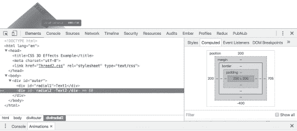

***图 8.3*** Chrome 检查器内容的示例。

点击 Elements 标签页，你将看到浏览器中当前 HTML 页面的 DOM 内容。当你展开各种元素时，注意浏览器会话的顶部如何高亮 DOM 中当前选中项的某些属性。

点击 Sources 标签页并点击 `Threed2Hover1.css` 文件以查看该文件的内容。在屏幕右侧，你将看到显示的各种标签页。点击 Computed（计算）标签页，你将看到为 DOM 中任何元素设置的属性值。对于每个 HTML 元素，计算属性的值是匹配该 HTML 元素的 CSS 选择器的“聚合”结果。

Chrome 检查器允许你添加新的 CSS 选择器，这些选择器会动态应用于当前 HTML 网页。点击 Styles（样式）标签页（位于 Computed 标签页的左侧），然后点击浏览器最右边缘的“（+）”按钮，它位于包含 Styles 标签页行下方的按钮行中。作为一个简单的示例，添加此 CSS 选择器：

```css
body {
  background-color: blue;
}
```

注意，当你输入颜色蓝色 `blue` 的字母时，Chrome 会用与当前输入字符串匹配的颜色来更新背景颜色。

**164** • CSS3 速读手册


现在点击 Timeline（时间轴）标签页，你将看到一个“Capture:”选项，它可以让你收集有关时间轴的内存信息，并在此期间截图。每当想要记录信息，点击 Elements 标签页左侧（下方）的圆圈；想要清除记录信息时，点击右侧的圆圈。尝试这些选项并进行一些记录，以便熟悉捕捉性能相关细节的细节。

## 总结

在本章中，你学习了 Project Houdini，这是一个目标是在现代浏览器中实现 CSS 一致性和扩展性的工作组。然后你学习了 FlexBox 和 Grid 布局，以及针对二进制图像的一些性能技术。接下来，你看到了 CSS3、SVG 和 HTML5 Canvas 的对比，以及如何使用 Web Animation API 的示例。此外，你学习了性能技术、雪片图（spritesheets）以及在网页中渲染二进制图像的几种技术。


# 第 9 章：移动应用设计

本章目的是为设计良好的 HTML5 移动应用提供一些指南。本章讨论了 UI 体验方面，以及如何创建具有视觉吸引力的移动 Web 应用。此外，本章涵盖了一些可以帮助你支持所需功能而不牺牲重要设计考量的的工具包。本章的某些章节涉及第 5 章中的 CSS3 媒体查询，因此在阅读本章的某些章节之前，你可能需要回顾该章的相关章节。

本章的第一部分讨论了移动隐喻的一些主要方面，它是面向触摸而非面向鼠标的。本章的第二部分深入探讨了移动表单的设计方面。本章的最后部分讨论了 Google AMP（加速移动页面）和渐进式移动应用（也由 Google 开发）。尽管 Google AMP 仍然是一项新技术，但它很重要，因为 Google AMP 支持某些 CSS 以及大多数 SVG 元素。

阅读本章时请记住以下几点。首先，本章几乎没有代码示例，因为它的重点是样式考虑。其次，本章没有深入探讨创建混合移动应用的工具包（详细讨论超出了本书的范围）。然而，PhoneGap (Cordova) 是一个非常流行的工具包，它影响了其他移动工具包。Ionic（被 IBM 收购）是一个使用 Angular 2 创建混合移动应用的工具包，并在内部也使用了 PhoneGap。网上有很多关于 PhoneGap、Ionic 和其他混合移动应用工具包的资源。

顺便提一下，PhoneGap 和 Ionic 应用确实依赖 DOM 结构，但也不使用 DOM 的移动应用开发工具包和产品。特别是 React Native

**166** • CSS3 速读手册


以及 Xamarin。

## 什么是移动设计？

本章的答案比你想象的复杂。

## 面向触摸的设计

你可能认为只需将所有与鼠标相关的事件替换为相应的触摸事件即可完成。然而，这种方法有几个限制。首先，没有悬停（hover）类型的事件。其次，当用户用手指触摸移动屏幕时，移动浏览器会在初始点击后等待约 300 毫秒，以确定用户是否执行双击。

**183**

等待，第二个手势可能是以下之一：

- **1.** 触摸释放（Touch up）
- **2.** 触摸按（Touch hold）
- **3.** 触摸移动（Touch move）
- **4.** 滑动手势

## 提高用户手势的响应时间

有几种工具包可以消除第一个事件和第二个事件之间的 300 毫秒延迟。具有良好触摸功能的第一个 JavaScript 工具包是 `fastclick.js`，它的首页在这里：`https://github.com/ftlabs/fastclick`。

移动浏览器会在初始点击后等待约 300 毫秒，以确定用户是否执行双击。由于 FastClick 消除了移动浏览器上物理触摸与触发点击事件之间的 300 毫秒延迟，移动应用程序感觉更加灵敏。

列表 9.1 显示了 HTML5 网页 `FastClick1.html` 的内容，它说明了如何在网页中使用 `fastclick.js`。

***列表 9.1 FastClick1.html***

```html
<html>
<head>
<meta charset="utf-8">
<script src='/path/to/fastclick.js'></script>
</head>
<body>
<script>
window.addEventListener('load', function() {
FastClick.attach(document.body);
}, false);
</script>
</body>
</html>
```

列表 9.1 非常直观：包含一个引用 `fastclick.js` 的 `<script>` 元素，然后添加一个事件监听器，在浏览器加载期间调用 `fastclick.js` 的 `attach()` 方法。

你也可以在使用 jQuery Mobile 的移动 Web 应用中使用 `fastclick.js`，此处提供了详细的描述：`http://forum.jquery.com/topic/how-to-remove-the-300ms-delay-when-clicking-on-a-link-in-jquery-mobile`。

## 在移动端 Web 应用中调整资源大小

检测屏幕尺寸至少有两种常用技术，这反过来与资源调整有关。第一种技术涉及使用 CSS3 媒体查询（Media Queries），为不同的屏幕宽度加载不同的 CSS 样式。第二种技术是使用 JavaScript 为不同的屏幕尺寸设置不同的 CSS 属性。

当你在移动端 Web 应用的 HTML5 Web 页面上放置资源（如 PNG 文件）时，你需要决定如何处理以下针对移动端 Web 应用的情况：

1. 从竖屏切换到横屏（或反之亦然）
2. 部署到具有不同屏幕尺寸的移动设备上
3. 调整文本字符串和文本区域的大小
4. 缩放非二进制图像（如 SVG）

每当你创建一个包含包含 PNG 文件以及其他类型资源（如嵌入 SVG 文档或 HTML5 `<canvas>` 元素）的 HTML5 Web 页面时，都需要处理上述情况。

在渲染文本字符串时，你如何确定正确的字体大小？即使你使用 `em` 作为测量单位，你也不知道特定设备的 DPI 分辨率。当然，你可以进行推测，并决定文本在手机上以 `14em` 渲染，在平板电脑（或大手机）上以 `16em` 渲染，但具有不同 DPI 的屏幕日益多样，这意味着你无法保证你的选择在所有情况下都是正确的。

对于嵌入 HTML5 Web 页面中的 SVG 文档，你可以使用以下代码段通过基于 CSS 的技术来自动调整 HTML5 Web 页面中 SVG 文档的内容：

`<div style="background-size: contain">`

关于该技术的详细描述请参阅此处：`https://developer.mozilla.org/en-US/docs/Web/CSS/background-size`。

## 确定移动端 Web 页面的内容布局

是确定 Web 页面内容的一些设计考虑：

- 为智能手机提供单列文本
- 移除多余的链接和内容
- 移除项目和侧边栏/页脚
- 避免绝对尺寸
- 将包装器宽度设置为百分比
- 将段落设置为块级显示（`display block`）

请记住，上述点是指南而非绝对规则。例如，某些智能手机在横屏模式下根据列宽可以容纳两列，许多平板电脑可以在竖屏模式下显示两列。有些人建议减少屏幕上所需的滚动量，但许多用户习惯了在移动设备上频繁滚动（尤其是智能手机）。当有疑问时，创建两个（或可能更多）布局并获取用户反馈，以确定哪种布局可能对广泛观众更有吸引力。如果你仍然无法决定哪种布局设计最符合你的需求，也许你可以从“A/B 测试”中获益，描述如下：`http://en.wikipedia.org/wiki/A/B_testing`。

## HTML Web 页面的移动端设计

为移动设备设计 HTML Web 页面有多种方法，包括“移动优先”、“仅限移动端”以及为移动应用使用独立域名。

“移动优先”方法确保 HTML Web 页面可以在移动设备上正确渲染。然而，你需要考虑移动设备之间不同的屏幕尺寸，例如智能手机、“大手机”和平板电脑。这一细节在 Android 移动设备上尤为明显（iOS 设备上较也如此）。

“仅限移动端”方法仍然要求你考虑移动设备上不同的屏幕尺寸，但在这种情况下，你不需要与笔记本电脑或台式机的 HTML Web 页面竞争。请记住，这种方法远非易事：它可能涉及客户端（或服务器）模板、本地数据存储以及由 BackboneJS 等工具包提供的高效视图-模型绑定。另一个需要考虑的点是你是否可以利用 NoSQL 数据存储，例如 MongoDB。

第三种方法是为移动端和桌面 Web 页面使用独立的域名。如果你正在开发轻量级移动 Web 应用（即托管在服务器上并由各种设备访问的 Web 页面），这种方法具有多个优势。首先，这让你的移动网站更容易被发现。其次，你可以单独为移动 URL 和桌面设备 URL 广告。第三，用户只需更改域名即可在“常规”网站和移动端网站之间切换。第四，检测移动用户的代码逻辑（然后将他们引导到独立域名）比修改 CSS 样式表更简单。

现在你已经对设计考虑因素有了了解，让我们来看表单的示例。

## 表单样化的高层视图

在渲染文本字符串时，你如何确定正确的字体大小？即使你使用 `em` 作为测量单位，你也不知道特定设备的 DPI 分辨率。当然，你可以进行推测，并决定文本在手机上以 `14em` 渲染，在平板电脑（或大手机）上以 `16em` 渲染，但具有不同 DPI 的屏幕日益多样，这意味着你无法保证你的选择在所有情况下都是正确的。

对于嵌入 HTML5 Web 页面中的 SVG 文档，你可以使用以下代码段通过基于 CSS 的技术来自动调整 HTML5 Web 页面中 SVG 文档的内容：

`<div style="background-size: contain">`

## 表单样化的特定技术

除了上一节出的的技术外，你还可以使用这些：

- 使用 CSS 为输入字段设置不同的样式
- 为输入字段提供标签（labels）
- 为输入字段指定键盘类型
- 为输入字段提供默认值
- 标识必填字段
- 在用户输入后验证每个字段
- 利用密码掩码
- 使用缩放

## 使用 CSS 以不同的样式输入字段

这涉及两个步骤。第一步是应用默认样式，然后应用你自己的样式规则。第二步是使用 `[type]` 属性选择器为输入字段应用不同样式。

作为一个特定示例，你可以使用 `-webkit-appearance` 属性移除所有输入元素的默认样式，如下：

`input, textarea, select { -webkit-appearance: none; }`

接下来，根据输入字段类型指定你自己的 CSS 样式，概述如下：

`input[type=checkbox] { /* 为复选框设置样式 */ }`

`input[type=radio] { /* 为单选框设置样式 */ }`

`input[type=textarea] { /* 为文本区域设置样式 */ }`

## 为输入字段指定键盘类型

HTML5 输入元素的 `type` 属性引入了以下新属性：

- 电子邮件地址：`type='email'`
- 网址：`type='url'`
- 电话号码：`type='tel'`

上述类型仅在移动浏览器上有效（在笔记本电脑或桌面浏览器中无反应）。以下示例展示了如何为输入字段指定不同的键盘：


```html
<form id="form1" name="form1" method="post" action="">
  <label for="name">名称:</label><input name="name" id="name" type="text" />
  <label for="email">邮箱:</label><input name="email" id="email" type="email" />
  <label for="phone">电话:</label><input name="phone" id="phone" type="tel" />
</form>
```

**172** • CSS3 入门指南

```html
<input name="submit" type="button" value="Submit" />
```

## 不同的国家和语言

在为不同的国家和语言创建应用程序时，需要注意以下几点：

- 不同国家有不同的电话格式
- 从左到右与从右到左的文本输入
- 符合文化习惯的内容

如果你打算发布支持多种语言的 Android 应用程序，以下链接提供了有用信息：`http://developer.vodafone.com/how-support-multiple-languages-android/`。

如果你打算发布支持多个国家和语言的 iOS 应用程序，Apple 在此处提供了大量信息：`https://developer.apple.com/internationalization/`。

创建国际化 iOS 移动应用程序的细节（例如如何创建额外的字符串资源）请此处：`http://www.slideshare.net/cxpartners/web-and-mobile-forms-design-userfriendly-2010-workshop/`。

## 设计相关工具和在线模式

Balsamiq 是一款在线设计工具，其主页在此：`http://www.balsamiq.com/`。

Balsamiq Mockups 是一个用于快速创建线框图（wireframes）的工具，旨在模拟在白板上手绘界面的体验。由于这些原型存储在你的电脑上，你可以快速方便地与他人分享。

另一个创建线框图的工具包是 `justinmind`，其主页在此：`http://justinmind.com`。

上述两个工具均可免费使用，并且都有视频说明如何使用它们。

两个提供设计模式集合的网站（第二个是完全针对移动端的）在此：`http://pttrns.com` 和 `http://mobile-patterns.com`。

## 字体大小和测量单位

如果你已经处理过 CSS 样式表，那么你已经熟悉了用于表示 HTML5 网页中文本字体大小的各种单位。有多种单位可用，包括 `em`、`rem`、`px`、`pt` 和 `%`。

这些单位之间的关系如下：

`1em = 12pt = 16px = 100%`

像素单位（`px`）在网页中非常常见（尤其是对于桌面电脑和笔记本电脑），它们可以根据分辨率和 DPI（每英寸点数）而变化。像素单位是虚拟屏幕像素而非物理像素。需要记住的一点是，像素单位对于视觉障碍阅读器可能无法正确缩放。

你可以将 `px` 单位用于文本、图像、边框、圆角和投影。然而，如果你正在构建一个使用相对大小的流式布局，那么对于文本使用 `em` 单位或 `%` 单位可能更好。

`em` 单位正变得越来越流行，特别是在移动设备上，因为该单位非常适合缩放网页。与 `px` 单位不同，`em` 单位相对于网页中的其父元素。将 `px` 单位视为“全局”的，而将 `em` 单位视为“本地”的可能会有所帮助。

一个实用的技巧是为 `<body>` 元素指定值 62.5%。由于 62.5% 等于分数 5/8，16px 乘以 5/8 的结果是 10px。10px 这个值是一个方便的“基准点”，可以在 CSS 选择器中在 `px` 单位和 `em` 单位之间进行快速方便的转换。例如，1.5em 是 15px，2em 是 20px，2.5em 是 25px，依此类推。如果你在进行转换时需要帮助，这里有一个在线 em 计算器：`http://riddle.pl/emcalc/` 和 `http://www.ready.mobi/launch.jsp?locale=en_EN`。

额外的有用信息在此：`http://www.w3.org/QA/Tips/font-size`。

## 什么是 Google AMP？

Google AMP 是一项旨在在移动设备上更快渲染网页的开源倡议，其主页在此：`https://www.ampproject.org/`。

初始 AMP 规范于 2015 年 10 月发布，代码示例在此：`https://github.com/ampproject/amphtml`。

加速移动端页面（Accelerated Mobile Pages）可以在任何现代浏览器或 Web view 中加载。然而，与“普通”HTML 网页相比，AMP 实施了受限的功能集，以缩短浏览器加载 AMP 的时间。此外，AMP 可以在云端缓存，这可以带来额外的速度提升。

你可以将 AMP 视为一种创建移动网页的框架，由以下部分组成：

- AMP HTML（带有 AMP 特定元素的 HTML 子集）
- AMP JS（一个不允许第三方 JavaScript 的 JavaScript 框架）
- AMP CDN（内容分发网络）

AMP 的目标之一是支持所有发布的加速移动页面。更多关于 AMP 的信息请参见以下 FAQ：`https://www.ampproject.org/docs/faqs.html`。

符合 AMP 标准的网页的某些 AMP 限制在此：

- 禁止使用开发者编写或第三方 JavaScript
- 禁止任何类型的输入元素，包括标准输入和文本区域
- 禁止使用外部样式表，且在文档头部的规则中仅允许一个小于或等于 50kb 的 `style` 标签

好消息是，Google AMP 支持 SVG 元素，也许未来还会提供额外的支持。

## RAIL 框架

RAIL 是以下基于时间的测量的缩写：

- Reaction（响应）（100ms）
- Animation（动画）（60FPS）
- Idle（空闲）（<50ms）
- Load time（加载时间）（< 1 秒）

前句中括号里的数字是目标值。上述句子中的数字是性能衡量目标。Service Workers 在现代浏览器中的可用性有助于达到 RAIL 目标。关于 Service Workers 的更多信息可见：`https://developer.mozilla.org/en-US/docs/Web/Workers_API`

## AMP 中的样式

所有样式必须出现在文档的 `<head>` 标签中，并且包含 `amp-custom` 属性。

```html
<amp-lightbox id="lightbox" class="lightbox" layout="responsive">
  <div class="lightbox-content">
    <amp-img src="https://cdn.auth0.com/website/jobs/myimage.jpg" width="2000" height="1035" layout="responsive"></amp-img>
    <p> 一段文本 </p>
  </div>
</amp-lightbox>
```

AMP 广告支持：Ad、AdSense 和 Doubleclick。参与 AMP 的公司包括 Twitter、Pinterest、WordPress.com、Chartbeat、Parsely 和 LinkedIn。

## HTML 元素的状态与核心 AMP 组件

AMP 禁止的元素包括：

- `base`、`frame`、`frameset`、`object`、`param`
- `embed`、`form`、`script`
- `input`、`textarea`、`select`、`option`，除非类型为 `application/ld+json`

允许的 HTML 元素（在某些情况下）包括：

- `button`、`link`、`style`、大多数 SVG 元素以及对样式表的支持。

内置的“核心” AMP 组件是：

- `amp-img`、`amp-audio`、`amp-video`
- `amp-pixel`、`amp-anim`、`amp-iframe`
- `amp-carousel`、`amp-lightbox`、`amp-ad`

内置组件始终在 AMP 文档中可用，并且具有 `<amp-*>` 元素。

核心/扩展 AMP 组件包括：

- `amp-img`、`amp-audio`、`amp-video`
- `amp-pixel`、`amp-anim`、`amp-iframe`
- `amp-carousel`、`amp-lightbox`、`amp-ad`
- `amp-instagram`、`amp-twitter`、`amp-youtube`

被 AMP 替换的元素包括 `img`（`amp-img`）、`video`（`amp-video`）、`audio`（`amp-audio`）和 `iframe`（`amp-iframe`）。

`<amp-img>` 元素的示例在此：

```html
<amp-img src="https://mysite/myimage.jpg" width="2000" height="1035" layout="responsive"></amp-img>
```

AMP 扩展组件涉及在 `<head>` 元素中加载 JavaScript。访问链接查看简单的 AMP 网页示例：`https://www.ampproject.org/docs/get_started/create/basic_markup.html`。

## 什么是渐进式 Web 应用（PWA）？

渐进式 Web 应用基于浏览器标签页，并使用应用外壳（app shell）模型使其具有与原生移动应用程序相似的视觉和体验。由于使用了 Service Workers，渐进式 Web 应用是响应式的（适用于任何设备尺寸）、安全的（通过 HTTPS 传输），并且始终保持最新状态。

渐进式 Web 应用执行以下步骤：

1. 注册 service worker
2. 运行在 HTTPS 上（为了防止中间人攻击这是必须）
3. 创建一个基于 JSON 的应用清单文件，其中包含有关应用的信息

**176** • CSS3 快速入门

Service Workers 由一组（Google 提供的）API 组成，用于离线访问和 Web 推送通知。清单文件包含元数据，如图标、方向等。请注意，Polymer 启动套件包含一个有效的清单文件。Android 版 Chrome 和 Android 版 Opera 允许你将应用保存到主屏幕上，这意味着它在主屏幕上看起来就像一个原生应用程序。你可以用默认方向打开应用。

一个关键点是，在不支持渐进式应用的浏览器中，该应用运行就像一个“普通”网站。一个渐进式 Web 应用清单的示例可以在这里：`https://mobiforge.com/design-development/web-app-manifests-usher-new-wave-progressive-apps-to-your-homescreen`。

## 提高 HTML5 网页性能

性能始终是一个非常重要的考虑因素，尽管详细且冗长的讨论已超出了本书的限制范围，但了解一些可用技术是有重要的：

- 将 JavaScript/CSS 文件合并为单个文件
- 使用文件压缩（最小化）
- 使用雪片图（spritesheets）
- 使用图像的 base64 编码
- 延迟 JavaScript 文件的加载

关于使用 base64 编码图像的一篇很好的博客文章在这里：`http://davidbcalhoun.com/2011/when-to-base64-encode-images-and-when-not-to?goback=%2Ede_2071438_member_234328886`。

你可以通过将 `<script>` 标签放在 Web 页面 `<body>` 元素的末尾来延迟 JavaScript 文件的加载。

你还可以探索 RequireJS，它是一个用于异步下载 JavaScript 文件（以及管理 JavaScript 依赖）的 JavaScript 工具包，它的主页在这里：`http://requirejs.org`。

Steve Souders 至少写过两本关于性能的书，并写了许多关于性能的博客文章，他的作品绝对值得阅读。

## 有用链接

以下链接对于测试移动应用很有帮助：

- `http://css3test.com/`
- `http://www.css3.info/selectors-test/`
- `http://quirksmode.org/html5/tests/video.html`
- `http://double.co.nz/video_test/`
- `http://www.terrillthompson.com/tests/html5-audio.html`

其他资源包括 `www.stackoverflow.com` 和 Paul Irish 的视频。

一个较新的网站是 HTML5 Please，它由业内知名人士共同贡献：`http://html5please.com`。

前面的网站提供了一个输入字段，你可以在其中指定 HTML5 和 CSS3 特性以确定它们是否已可以使用，并查看如何使用它们。

W3C 为 HTML 网页提供免费的在线验证服务，包括 HTML5 网页：`https://validator.w3.org/#validate_by_uri+with_options`。

前面的网站允许你验证 URL、文件或直接输入的代码。

以下网站为 HTML5 电子邮件输入字段提供了“样板”模板（以及用于 CSS 和 jQuery 的模板）：`http://favbulous.com/post/848/6-useful-web-development-boilerplates`。

## 总结

在本章中，你学习了移动环境的触摸导向隐喻，以及移动表单的设计相关方面。此外，你还看到了如何通过 `fast-click.js` 改进手势的响应时间，以及你可以使用 CSS3 查询和 JavaScript 检测移动设备的屏幕尺寸。你还学习了 Google AMP 及其对许多 SVG 元素的支持。接下来你学习了渐进式移动应用（Progressive Mobile Apps）以及性能相关细节的高级视图。

## 索引

### A

`addColorStop()` 方法，110，114

### B

Berners-Lee, Tim，13

布尔表达式，81

布尔选择器，17

弹性效果，37，42

CSS3 关键帧，47–48

浏览器，1

### C

Canvas 2D，3

笛卡尔坐标系，99

链式方法，142

`createLinearGradient()`，106

CSS3 2D 图形和动画效果，37–60

使用 jQuery 和 CSS3 的 2D 效果，55–57

`Transforms2D.css` 选择器，57

用……制作立方体，42

使用 CSS3 关键帧的动画效果，42–44

CSS3 2D 转换，40–41

带文本的 CSS3 效果，49–51

渲染多列文本，49–51

CSS3 过滤器，51–52

自定义过滤器，52

图像淡入和旋转效果，44–46

概念，53

带有四个属性的运动路径，48–49

使用 CSS3 和 jQuery 鼠标，57–58

CSS3 3D 图形和动画效果，61–77

动画和雪片图，70

文本和 PNG 文件的动画，65–66

GPU 自动调用，73–74

CSS `will-change` 属性，74

使用 jQuery 动态创建内容，74–76

HTML 页面和 GPU，73

CSS 属性，74

使用 jQuery 动态创建内容，74–76

HTML 页面和 GPU，73

CSS 属性，74

使用 jQuery 动态创建内容，74–76

HTML 页面和 GPU，73

CSS 属性，74

CSS3 2D 图形和动画效果，37–60

使用 jQuery 和 CSS3 的 2D 效果，55–57

`Transforms2D.css` 选择器，57

用……制作立方体，42

使用 CSS3 关键帧的动画效果，42–44

CSS3 2D 转换，40–41

带文本的 CSS3 效果，49–51

渲染多列文本，49–51

CSS3 过滤器，51–52

自定义过滤器，52

图像淡入和旋转效果，44–46

概念，53

带有四个属性的运动路径，48–49

使用 CSS3 和 jQuery 鼠标，57–58

CSS3 3D 图形和动画效果，61–77

动画和雪片图，70

文本和 PNG 文件的动画，65–66

GPU 自动调用，73–74

CSS `will-change` 属性，74

使用 jQuery 动态创建内容，74–76

HTML 页面和 GPU，73

CSS 属性，74

使用 jQuery 动态创建内容，74–76

HTML 页面和 GPU，73

CSS 属性，74

使用 jQuery 动态创建内容，74–76

HTML 页面和 GPU，73

CSS 属性，74

索引 • **181**

水平、垂直和对角线，106–110

线段、矩形、圆形和阴影效果，101–106

径向渐变，110–114

使用 CSS3 选择器在画布上渲染图像，114–117

使用模式在画布上重复图像，117–119

什么是（What），98

### J

Jaffe, Jeffrey，13

JavaScript，1

jQuery `css()` 方法，74

### K

Koch, Peter Paul，2

### M

微数据（Microdata），3

移动端应用，165–177

- 设计相关的工具和在线模式，172
- 不同国家和语言，172
- 良好的移动设计，166
- HTML 网页，169
- 渲染移动表单的高级技术，169–170


- 特定技术，170
- 的重要方面，166
- 检测不同的屏幕尺寸，166
- 确定 Web 页面的内容，168–169
- 提高用户手势的响应时间，167
- 在移动 Web 应用中调整资源大小，168
- 触摸式设计，166–167
- 提高 HTML5 网页性能，176
- 渐进式应用（Progressive apps），175–176
- HTML 元素和核心 AMP 组件的状态，174–175
- 为输入字段指定键盘类型，171–172
- AMP 中的样式，174
- RAIL 框架，174
- 使用 CSS 为输入字段设置不同的样式，171
- 字体字体大小和测量单位，172–173
- 移动优先策略，169
- 仅移动优先策略，169
- Modernizer，5

## N

浏览器（Navigator），6

## O

离线应用，3

## P

渐进式移动应用（Progressive Mobile Apps），165

Houdini 项目，146

渲染流水线中的阶段序列，146

## S

`SemanticMarkup1.html`，9–11

语义化标记（Semantic markup），9

- 一个简单的网站，9–11

服务器发送事件（SSE），3

显示图边框选项，71

`SpriteMe`，70

SVG，3，121–144

- CSS 和 SVG 的简要比较，143–144
- SVG 的基本功能，122
- 贝塞尔曲线和变换，130–132
- SVG 的 `scale()` 函数，132
- 过滤器，133–135
- 渐变，124–125
- jQuery 和 SVG，140–143
- 创建元素和 jQuery，141–143
- 现有元素和 jQuery，142
- 用于 SVG 的 jQuery 插件，143
- 其他功能，137–139
- 使用 JavaScript 和 CSS3 创建 3D 效果，139
- JavaScript 和 SVG，138
- SVG 动画效果，137–138
- 在 SVG 中渲染线段和矩形，122–124
- 在 SVG 中沿路径上渲染文本，132–133
- SVG `<path>` 元素，128–130
- SVG `<pattern>` 元素，125–127
- SVG `<polygon>` 元素，127
- SVG `<polyline>` 元素，128
- 变换和渐变，135–137

**182** • CSS3 入门指南

## T

`@import` 语句，92–93

- 模块化和性能，93
- `clip()` 方法，117
- `fill()` 方法，101
- `init()` 方法，118
- `modImage()` 方法，119
- React 方式或在 JS 中编写 CSS，93

## U

UA 探测（UA sniffing），6

## V

视口（Viewport），92

VRAM（显存），72

## W

W3C（万维网联盟），13

WAI-ARIA（Web 可访问性倡议 – 无障碍富交互应用程序），7–8，12–13

Web 消息（Web messaging），3

Web sockets，3

Web 存储（Web storage），3

Web workers，3

WebGL，4

窗口（Window），6

## X

XHR2，4
