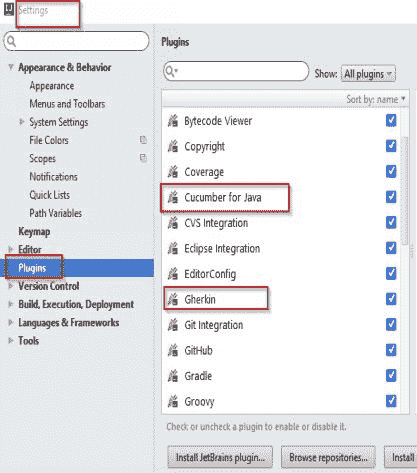
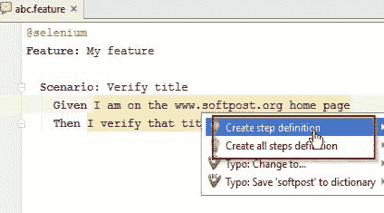
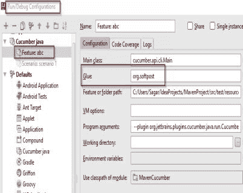
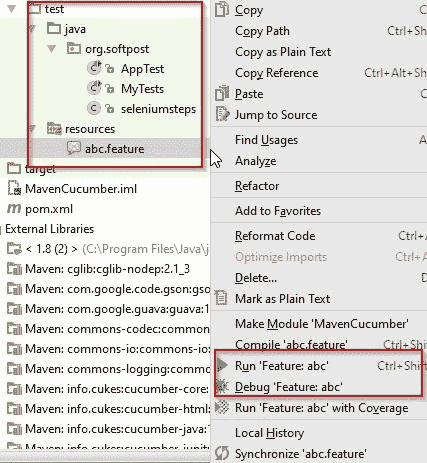
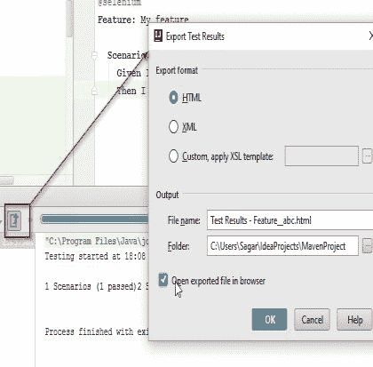
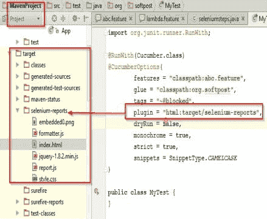
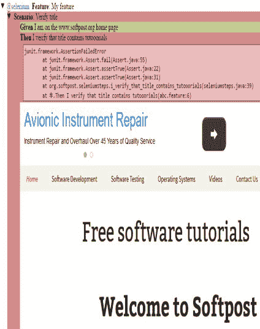
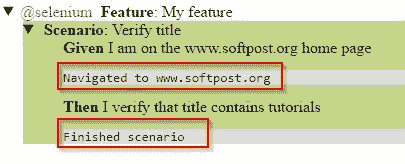

# Java Cucumber 使用指南


## 关于作者

Paul Watson 先生在 BDD 和 Cucumber 方面拥有多年经验。他曾在美国、英国、新加坡、香港、迪拜、澳大利亚和瑞士工作过大型软件项目。

他的爱好包括去新的旅游胜地旅行、看篮球、板球、足球以及学习最新的技术知识。

## 这本书是写给谁的

本书适用于软件开发人员、自动化测试人员、DevOps 以及从事 IT 项目的工程师。无论你是初学者还是经验丰富的开发者，这本书都将帮助你掌握 Cucumber 技能。

本书从 Cucumber 的介绍开始，然后深入核心概念，如在 IntelliJ IDEA 中创建项目、使用标签、插件、与 JUnit 集成、执行 Selenium 测试、使用 PicoContainer 和 Lambda 表达式。

## 序言

本书是为 Cucumber 的初学者准备的。它将帮助你理解什么是 Cucumber，以及你如何在软件项目中使用它。

在本书中，你将学习以下主题：

- 关于作者
- 这本书是写给谁的
- 序言

## 1. 简介

Cucumber 是 BDD（行为驱动开发）测试框架。

关于 Cucumber 需要的关键点有：

1. 开源 BDD 测试框架。
2. 跨平台框架。
3. 使用英语、法语、德语等多种语言通过 Gherkin 语法编写测试。
4. 我们可以使用多种编程语言编写测试，如 Ruby、JRuby、PHP、Java、Jython、Groovy、Javascript、Clojure、Gos、Lua、.Net、PHP、C++ 和 TCL。
5. 与 Jenkins 和 TeamCity 等 CI 服务器集成得非常好。
6. 报告可以以 HTML、JSON、JUnit 格式生成。
7. Capybara——测试框架——是 Cucumber 的一部分。
8. 与 Selenium、Appium、Spring、Watir、Ruby on Rails 等框架集成得非常好。

## 2. 安装 Cucumber

设置 Cucumber 非常简单。

你需要安装以下工具：

1. Java JDK
2. Java IDE——IntelliJ IDEA 或 Eclipse
3. Cucumber 库
4. 构建工具，如 Maven 或 Gradle
5. IntelliJ IDEA 插件——用于 Java 的 Gherkin 和 Cucumber

下图显示了你需要的 IntelliJ 插件。



*IntelliJ IDEA 中的 Cucumber 和 Gherkin 插件*

创建一个简单的 Maven 或 Gradle 项目并添加以下依赖。

```xml
<dependency>
  <groupId>info.cukes</groupId>
  <artifactId>cucumber-java</artifactId>
  <version>1.2.4</version>
  <scope>test</scope>
</dependency>
```

要在 Java 8 中使用 Lambda 表达式编写测试步骤，你需要添加以下依赖。

```xml
<dependency>
  <groupId>info.cukes</groupId>
  <artifactId>cucumber-java8</artifactId>
  <version>1.2.4</version>
  <scope>test</scope>
</dependency>
```

你还需要以下 JUnit 依赖将 Cucumber 与 JUnit 集成。

```xml
<dependency>
  <groupId>junit</groupId>
  <artifactId>junit</artifactId>
  <version>4.12</version>
  <scope>test</scope>
</dependency>

<dependency>
  <groupId>info.cukes</groupId>
  <artifactId>cucumber-junit</artifactId>
  <version>1.2.4</version>
  <scope>test</scope>
</dependency>
```

## 3. 使用 Gherkin 编写 feature 文件

BDD 是一种与敏捷结合的新兴开发模型。关于 BDD 的一些关键点是：

1. 最先创建的 BDD 框架。
2. 其他 BDD 框架有 Spec、Cucumber。
3. 测试是用故事或特性的纯文本编写的。
4. 使用领域特定语言（Gherkin）来编写测试。

### 什么是 Gherkin？

Gherkin 是一种用于编写 feature 文件（也称为故事）的纯文本语言，可以用英语、德语等许多语言进行实现。这意味着任何利益相关者都可以编写并理解测试。

### 关于 feature 文件的关键点

1. 每个 feature 文件可以包含一个或多个场景（scenario）和大纲（outline）。
2. 每个场景都有如 Given、When、Then 这样的步骤。

### Gherkin 中的关键字有哪些？

Gherkin 具有一些保留关键字，它们在 feature 文件的文中具有特定含义。以下是列表：

1. `Given`——用于指定场景的条件。
2. `When`——用于指定动作。
3. `And`——用于指定额外条件。
4. `Then`——用于指定动作的结果。
5. `Feature`——用于指定功能。
6. `Scenario`——用于指定场景。
7. `Outline`——场景纲要。
8. `Background`——用于指定在每个场景之前要执行的操作。
9. `""`——用于以行格式传递数据。
10. `|`——用于以表格格式传递数据。
11. `@`——用于为场景和功能标记标签。
12. `#`——用于对 feature 文件中的行进行注释。

下面的 feature 文件将让你理解 Cucumber 的大部分语法。

### 基础 feature 文件

现在让我们来看看我们在 Gherkin 中可以用的最简单的 feature 文件。

```gherkin
Feature: ATM 身份验证

当 ATM 卡插入机器时，应要求用户输入 PIN 码。

如果 PIN 码错误，应给用户显示警告消息。

如果 PIN 码正确，用户应成功通过身份验证。

Scenario: 在 ATM 输入错误的 PIN

Given 我将 ATM 卡插入机器

And 我被要求输入 PIN

When 我输入正确的 PIN

Then 我应该看到取款的选项
```

### 带有 Outline 和 Examples 关键字的示例 feature 文件

`Scenario Outline` 用于我们需要重复一组操作但使用不同数据组合的情况。例如，在下方的场景 outline 中，我们需要用不同的用户 ID 和密码组合来测试登录功能。在这些情况下，我们使用 `<VariableData>` 语法来指定变化的数据，并通过 `Examples` 关键字提供。因此，在下面的场景中，所有步骤将执行 4 次——每个用户执行一次。

```gherkin
Scenario Outline: 密码规则

Given 我们位于登录页面

When 我们输入用户 ID <ID> 和密码 <PASSWORD>

Then 登录结果应该是 <OUTCOME>

Examples:

| ID | PASSWORD | OUTCOME |

| :--- | :--- | :--- |

| Sagar | 128$9# | Fail |

| Amol | 98sjdg | PASS |

| Shaun | jslsh9 | PASS |

| Ben | KON() | FAIL |
```

### 带有 Background 的示例 feature 文件

`Background` 关键字用于在执行每个场景（scenario）之前执行某些数量的步骤。例如，假设你希望在执行每个场景之前清除浏览器 cookie，那么我们可以使用 `Background` 关键字配合清除 cookie 的步骤。

### 向步骤传递输入数据

每个场景可以包含多个步骤（step），而每个步骤都是用户操作。一个步骤类似于系统中的某个特定操作。某些步骤可能需要输入数据进行处理。我们可以通过以下 3 种方式将输入传递给步骤：

1. 内联变量（In-line Variables）
2. 多行字符串
3. 表格

### 使用标签（tags）对场景和特性分组

在 Gherkin 中，我们使用标签将相似的场景和特性分组。`@` 符号用于标记场景和特性。

## 4. 向 Java 项目中添加 Cucumber 依赖

要使用 Cucumber 编写测试，我们需要添加 2 种类型的依赖：

1. `cucumber-java`
2. `junit`

如果你使用 Maven 构建管理系统，可以在 `POM.XML` 中使用下面的 XML 块：

```xml
<dependency>
  <groupId>info.cukes</groupId>
  <artifactId>cucumber-java</artifactId>
  <version>1.2.4</version>
</dependency>

<dependency>
  <groupId>junit</groupId>
  <artifactId>junit</artifactId>
  <version>4.12</version>
  <scope>test</scope>
</dependency>
```

## 5. Cucumber 测试

### 5.1 编写第一个 Cucumber 测试

只需按照以下步骤在 IntelliJ IDEA 中编写第一个 Cucumber 测试：

1. 创建一个 Maven 项目。
2. 在 Test Resources 目录下添加包含场景的 feature 文件。
3. 添加 Cucumber 的 Maven 依赖。
4. 编写步骤定义（step definitions）并从 feature 文件执行测试。

这是我们创建并放入 Test Resources 文件夹的 feature 文件。

```gherkin
@selenium
Feature: My feature

  Scenario: Verify title
    Given I am on the www.softpost.org home page
    Then I verify that title contains tutorials
```

注意，我们还没有为上述 feature 文件中的步骤添加步骤定义。当你执行 feature 文件时，你将看到下面的错误。

你可以使用下面的代码片段（snippets）实现缺失的步骤：

```java
@Given("^^I am on the www\\.softpost\\.org home page$")
public void i_am_on_the_www_softpost_org_home_page() throws Throwable {
    // 在此处编写代码将上面的短语转换为具体的动作
    throw new PendingException();
}

@Then("^^I verify that title contains tutorials$")
public void i_verify_that_title_contains_tutorials() throws Throwable {
    // 在此处编写代码将上面的短语转换为具体的动作
    throw new PendingException();
}
```

```text
Undefined step: Given I am on the www.softpost.org home page

Undefined step: Then I verify that title contains tutorials
```

### 编写步骤定义

你可以复制上面的方法片段并在内部编写你自己的代码。或者，如果你在 IntelliJ IDEA 中安装了 Cucumber for Java 和 Gherkin 插件，你可以通过在 Feature 文件中的步骤上按 Alt+Enter，如下所示创建步骤定义。



*在 IntelliJ IDEA 中创建 Cucumber 步骤定义*

这是带有步骤定义的类。

```java
package org.softpost;

import cucumber.api.java.After;
import cucumber.api.java.Before;
import cucumber.api.java.en.Given;
import cucumber.api.java.en.Then;
import junit.framework.Assert;
import org.openqa.selenium.WebDriver;
import org.openqa.selenium.firefox.FirefoxDriver;

/**
***** 由 Sagar 于 12-07-2016 创建。
*/
@SuppressWarnings("ALL")
public class seleniumsteps {
    WebDriver driver;

    @Before
    public void launchBrowser() {
        driver = new FirefoxDriver();
    }

    @Given("^^I am on the www\\.softpost\\.org home page$")
    public void i_am_on_the_www_softpost_org_home_page() throws Throwable {
        driver.get("http://www.softpost.org");
    }

    @Then("^^I verify that title contains tutorials$")
    public void i_verify_that_title_contains_tutorials() throws Throwable {
        Assert.assertTrue(driver.getTitle().toLowerCase().contains("tutorials"));
    }

    @After
    public void killBrowser() {
        driver.close();
        driver.quit();
    }
}
```

编写步骤定义后，你可以像下面所示为 feature 文件创建运行配置（run configuration）。注意，Glue 属性非常重要。你应该在 Glue 中指定包含步骤定义的包名。



*Glue 属性很重要*

在 feature 文件上点击右键并运行，如下所示。



*运行 feature 文件*

当你执行 feature 文件时，你将看到如下所示的错误。



*在 IntelliJ IDEA 中执行*

你可以像下面所示查看 Cucumber 的执行报告。


*在 IntelliJ IDEA 中查看执行*

如果一切正常，测试将成功运行。


*Cucumber 报告*

## 6. 使用 JUnit 执行测试

要使用 JUnit 注解编写测试，我们需要下面的依赖。

```xml
<dependency>
  <groupId>junit</groupId>
  <artifactId>junit</artifactId>
  <version>4.12</version>
  <scope>test</scope>
</dependency>
```

运行该类后，Cucumber 会在 `target/reports` 生成报告。

```java
package org.softpost;

import cucumber.junit.Cucumber;
import cucumber.junit.CucumberOptions;
import org.junit.runner.RunWith;

@RunWith(Cucumber.class)
@CucumberOptions(
    features = "classpath:feature",
    glue = "org.softpost",
    plugin = "html:target/reports"
)
public class MyTests {
}
```

## 7. Cucumber 选项

在执行场景时，我们可以传递下面的各种选项：

1. `features`——特性的路径。
2. `glue`——步骤定义的路径。
3. `dryRun`——用于检查所有步骤是否已定义。
4. `monochrome`——控制输出的可读性。
5. `strict`——设置为 `false` 时未定义的步骤将被跳过。
6. `plugin`——`json`、`html`、`pretty`。
7. `snippets`——样式可以是 `CamelCase` 或下划线。

这是一个显示所有选项的示例类。


```java
package org.softpost;

import cucumber.junit.Cucumber;
import cucumber.junit.CucumberOptions;
import org.junit.runner.RunWith;

@RunWith(Cucumber.class)
@CucumberOptions(
    features = "classpath:feature",
    glue = "org.softpost",
    plugin = "html:target/reports",
    dryRun = false,
    monochrome = true,
    strict = true,
    snippets = "CamelCase"
)
public class MyTests {
}
```

## 8. 过滤场景

### 8.1 标记场景

我们可以在`feature`文件中使用`@`符号标记场景，如下示例所示。注意，我们也可以通过在`feature`文件开头编写标签来标记所有的场景。我们也可以为同一个场景关联多个标签。在下面的示例中，我们为场景标记了 4 个标签：`selenium`、`regression`、`sanity`和`critical`。

```gherkin
@selenium
Feature: My feature

  @regression@sanity@critical
  Scenario: Verify softpost title
    Given I am on the www.softpost.org home page
    Then I verify that title contains tutorials

  @sanity
  Scenario: Verify yahoo title
    Given I am on the www.yahoo.com home page
    Then I verify that title contains tutorials
```

我们还可以将`@Before`和`@After`方法与带有特定名称的场景绑定。例如，下面的`before`方法将只在标记为`selenium`的场景之前执行。

```java
@Before("@selenium")
public void beforeMethod() {
    // 代码
}
```

现在看下面的测试类（Test Class）。执行该测试类后，只有第一个场景会被执行，因为该场景被标记了`@sanity`和`@regression`。

```java
package org.softpost;

import cucumber.api.CucumberOptions;
import cucumber.api.SnippetType;
import cucumber.api.junit.Cucumber;
import org.junit.runner.RunWith;

@RunWith(Cucumber.class)
@CucumberOptions(
  features = "classpath:abc.feature",
  glue = "classpath:org.softpost",
  tags = {"@sanity", "@regression"},
  plugin = "html:target/selenium-reports",
  dryRun = false,
  monochrome = true,
  strict = true,
  snippets = SnippetType.CAMELCASE
)
public class MyTest {
}
```

现在看下面的测试类。执行该测试类后，两个场景都将被执行，因为它们都标记了`@sanity`标签。

```java
package org.softpost;

import cucumber.api.CucumberOptions;
import cucumber.api.SnippetType;
import cucumber.api.junit.Cucumber;
import org.junit.runner.RunWith;

@RunWith(Cucumber.class)
@CucumberOptions(
  features = "classpath:abc.feature",
  glue = "classpath:org.softpost",
  tags = {"@sanity,@regression"},
  plugin = "html:target/selenium-reports",
  dryRun = false,
  monochrome = true,
  strict = true,
  snippets = SnippetType.CAMELCASE
)
public class MyTest {
}
```

现在看下面的测试类。执行该测试类后，没有任何场景会被执行，因为标签以`~`带有前缀。

```java
package org.softpost;

import cucumber.api.CucumberOptions;
import cucumber.api.junit.Cucumber;
import org.junit.runner.RunWith;

@RunWith(Cucumber.class)
@CucumberOptions(
  features = "classpath:abc.feature",
  glue = "classpath:org.softpost",
  tags = {"~@sanity"},
  plugin = "html:target/selenium-reports"
)
public class MyTest {
}
```

### 8.2 使用`name`选项

我们可以通过匹配典型模式的名称来执行特定的场景。例如，考虑下面的特性文件（feature file）。

```gherkin
@selenium
Feature: My feature

@regression @sanity @critical
Scenario: Verify softpost title
  Given I am on the www.softpost.org home page
  Then I verify that title contains tutorials

@sanity
Scenario: Verify yahoo title
  Given I am on the www.yahoo.com home page
  Then I verify that title contains tutorials
```

为了只执行名称包含`"softpost"`的场景，我们可以使用下面的测试类。注意，我们也可以使用正则表达式来指定场景名称的值。

```java
package org.softpost;

import cucumber.api.CucumberOptions;
import cucumber.api.junit.Cucumber;
import org.junit.runner.RunWith;

@RunWith(Cucumber.class)
@CucumberOptions(
  features = "classpath:abc.feature",
  glue = "classpath:org.softpost",
  name = {"softpost"},
  plugin = "html:target/selenium-reports"
)
public class MyTest {
}
```

## 9. 向步骤（steps）传递参数

我们可以像下面的场景所示，从特性文件中将参数传递给步骤方法。在下面的场景中，我们在`Given`步骤中传递了网站名称。传递参数的主要优势是我们可以在不同的场景中使用不同的参数复用同一个步骤方法。

```gherkin
@selenium
Feature: Simple feature

Scenario: Test web title
  Given I am on "www.yahoo.com" page
  Then I verify that the title is "yahoo"

Scenario: Test web title
  Given I am on "www.softpost.org" page
  Then I verify that the title is "tutorials"
```

这里是上述步骤的步骤定义（step definitions）。注意，两个场景通过不同的参数复用了相同的步骤定义。

```java
package org.softpost;

import com.google.common.primitives.Bytes;
import cucumber.api.Scenario;
import cucumber.api.java.After;
import cucumber.api.java.Before;
import cucumber.api.java.en.Given;
import cucumber.api.java.en.Then;
import org.junit.framework.Assert;
import org.openqa.selenium.OutputType;
import org.openqa.selenium.TakesScreenshot;
import org.openqa.selenium.WebDriver;
import org.openqa.selenium.firefox.FirefoxDriver;

public class seleniumsteps {
  WebDriver driver;
  Scenario scenario;

  @Before("@selenium")
  public void launchBrowser(Scenario scenario) {
    driver = new FirefoxDriver();
    this.scenario = scenario;
    System.out.println("Executing scenario " + scenario.getName());
  }

  @After("@selenium")
  public void killBrowser() {
    scenario.write("Finished scenario");

    if (scenario.isFailed()) {
      scenario.embed(
          ((TakesScreenshot) driver).getScreenshotAs(OutputType.BYTES),
          "image/png"
      );
    }

    driver.close();
    driver.quit();
  }

  @Given("^I am on \"([^\"]*)\" page$")
  public void i_am_on_page(String arg1) throws Throwable {
    driver.get("http://" + arg1);
  }

  @Then("^I verify that the title is \"([^\"]*)\\$\"")
  public void i_verify_that_the_title_is(String arg1) throws Throwable {
    Assert.assertTrue(driver.getTitle().contains(arg1));
  }
}
```

## 10. 向步骤传递数据表格

### 10.1 键值数据表（Datatable）

我们可以像下面所示传递带有键和值的数据表格。

```gherkin
Feature: Simple datatable

Scenario: Test web title
  Given I am on home page of site
  And I submit the form with below
    | name    | sagar  |
    | id      | 989    |
    | address | mumbai |
  Then I see that form is successful
```

这里是上述步骤的步骤定义。注意我们是如何转换表格的。

```java
package org.softpost;

import cucumber.api.DataTable;
import cucumber.api.java.en.Given;
import cucumber.api.java.en.Then;
import java.util.List;
import java.util.Map;

/**
 * Created by Sagar on 13-07-2016
 */
public class DatatableSteps {
  @Given("^I am on home page of site$")
  public void i_am_on_page_of_site() {
    System.out.println("Navigate to home page");
  }

  @Given("^I submit the form with below$")
  public void i_submit_the_form_with_below(DataTable arg1) throws Throwable {
    Map<String, String> m = arg1.asMap(String.class, String.class);
    System.out.println("Filling with data");

    for (String k : m.keySet()) {
      System.out.println("Key->" + k + " Value->" + m.get(k));
    }
  }

  @Then("^I see that form is successful$")
  public void i_see_that_form_is_successful() throws Throwable {
    System.out.println("Verify form message");
  }
}
```

这里是执行文件的输出：

```text
Navigate home page
Filling data
Key->name Value->sagar
Key->id Value->989
Key->address Value->mumbai
Verify form message

Scenarios (1 passed)
Steps (3 passed)
0.525s
```

### 10.2 Cucumber 中的多列数据表

现在让我们看看如何在 Cucumber 中传递具有多列的数据表。

```gherkin
Feature: Multiple column table

Scenario: Create student records
  Given We have below list of students
    | name   | id    | address |
    | sagar  | 28834 | Brisbane |
    | watson | 38829 | London  |
    | paul   | 34223 | Chicago |
```

现在看下面的`Student`类。该类与数据表格映射。

```java
package org.softpost;

/**
 * Created by Sagar on 13-07-2016
 */
public class Student {
  private String name;
  private String address;
  private int id;

  public Student(String name, int id, String address) {
    this.name = name;
    this.id = id;
    this.address = address;
  }

  public void printStudent() {
    System.out.println("\nStudent->" + name + ", " + id + ", " + address);
  }
}
```

这里是步骤定义类。注意我们是如何将数据表转换为学生对象列表的。

```java
import cucumber.api.DataTable;
import cucumber.api.java.en.Given;
import cucumber.api.java.en.Then;
import java.util.List;
import java.util.Map;

/**
 * Created by Sagar on 13-07-2016.
 */
public class DatatableSteps {
  @Given("^We have below list of students$")
  public void we_have_below_list_of_students(DataTable arg1) throws Throwable {
    List<Student> students = arg1.asList(Student.class);

    for (Student s : students) {
      s.printStudent();
    }
  }
}
```

这里是上述代码的输出。

```text
Testing started at 19:48…

Student -> sagar, 288345, Brisbane
```


`Student -> watson, 38829, London`

`Student -> paul, 34223, Chicago`

`1 Scenarios (1 passed)`

`1 Steps (1 passed)`

`0m0.635s`

## 11. Feature 文件变体

### 11.1 Scenario Background（场景背景）

有时，我们需要在同一个 feature 文件的每个场景（scenario）执行之前执行某些步骤。Background 允许你在多个场景之间复用相同的步骤。例如，为了测试某些功能，我们可能需要在每个场景执行之前对记录进行过滤。因此，我们可以将过滤记录所需的步骤放在 Background 内部。这些步骤会在同一个 feature 文件中的每个场景执行时被重复执行。

在下方的 feature 文件中，我们在背景中有一个步骤（`Given I filter some records`）。该步骤将在此 feature 文件的每个场景执行之前执行。

Feature: 简单的背景功能

  Background: 在每个场景执行前执行

    Given 我过滤了一些记录

    Scenario: 验证删除功能

      Given 我点击第一条记录的删除按钮

      Then 我验证该记录已从表格中删除

    Scenario: 验证更新功能

      Given 我点击第一条记录的更新按钮

      Then 我验证该记录在新窗口中打开，并且我们可以对其进行修改

这里是步骤定义类。

```java
package org.softpost;

import cucumber.api.java.en.Given;
import cucumber.api.java.en.Then;

/**
***** Created by Sagar on 13-07-2016.
 */
public class backgroundsteps {

    @Given("^I filter some records$")
    public void i_filter_some_records() throws Throwable {
        System.out.println("\n\nBackground - Filtering some records\n");
    }

    @Given("^I click on the delete button of the first record$")
    public void i_click_on_the_delete_button_of_the_first_record() throws Throwable {
        System.out.println("Click delete button\n");
    }

    @Then("^I verify that record is removed from the table$")
    public void i_verify_that_record_is_removed_from_the_table() throws Throwable {
        System.out.println("Verify deleted record\n");
    }

    @Given("^I click on update button of the first record$")
    public void i_click_on_update_button_of_the_first_record() throws Throwable {
        System.out.println("Click update button\n");
    }

    @Then("^I verify that record opens in new window and we can modify it$")
    public void i_verify_that_record_opens_in_new_window_and_we_can_modify_it() throws Throwable {
        System.out.println("Verify modified record\n");
    }

}
```

这里是上述 feature 文件执行的输出。

Background - Filtering some records

Click delete button

Verify deleted record

Background - Filtering some records

Click update button

Verify modified record

`2 Scenarios (2 passed)`

`6 Steps (6 passed)`

`0m0.578s`

### 11.2 Scenario outline（场景大纲）

有时，我们需要使用不同的测试数据执行相同的场景。在这种情况下，我们可以使用名为 scenario outline 的概念。在下方的示例中，相同的场景将执行两次。第一次使用 99 和 100；第二次使用 11 和 200。

Feature: 大纲功能

  Scenario Outline: 数字的加法

    When 我相加整数 `<i1>` 和 `<i2>`

    Then 我看到结果为 `<sum>`

    Examples:

      | i1 | i2 | sum |

      | 99 | 100 | 199 |

      | 11 | 200 | 211 |

这里是步骤定义类。

```java
package org.softpost;

import cucumber.api.java.en.Then;
import cucumber.api.java.en.When;
import org.junit.Assert;

/**
***** Created by Sagar on 13-07-2016.
 */
public class outlinesteps {
    int result = 0;

    @When("^add integers (d+) and (d+)$")
    public void add_integers_and(int arg1, int arg2) throws Throwable {
        result = arg1 + arg2;
        System.out.println("Adding " + arg1 + " and " + arg2 + "\n");
    }

    @Then("^see the result as (d+)$")
    public void see_the_result_as(int arg1) throws Throwable {
        Assert.assertEquals(result, arg1);
    }
}
```

这里是上述 feature 文件执行的输出。

Testing started at 19:18…

Adding 99 and 100

Adding 11 and 200

`2 Scenarios (2 passed)`

`4 Steps (4 passed)`

`0m0.59s`

## 12. 在 Cucumber 中运行多个文件

我们可以像下面所示在多个文件中执行场景。注意，要执行所有文件，我们使用操作符。

```java
package org.softpost;

import cucumber.api.junit.CucumberOptions;
import org.junit.runner.RunWith;

@RunWith(Cucumber.class)
@CucumberOptions(
    features = {"feature","outline.feature"},
    glue = {"softpost"},
    plugin = {"html:target/cucumber-reports"}
)
public class MultipleTest {
}
```

这里是执行后生成的 HTML 报告。

## 13. 使用 PicoContainer 共享 driver 实例

在 Selenium 自动化中，我们创建一个 `driver` 实例。但我们可以通过两种方式在不同的步骤类中使用同一个 `driver`：

1. 通过创建静态字段
2. 使用 PicoContainer（依赖注入）

第一种方法非常简单。只需创建一个带有静态字段的类即可。现在让我们来看看如何使用依赖注入共享 `driver`。对于这一点，你需要下面的依赖项。

```xml
<dependency>
    <groupId>org.selenium</groupId>
    <artifactId>selenium-java</artifactId>
    <version>2.42.2</version>
</dependency>

<dependency>
    <groupId>info.cukes</groupId>
    <artifactId>picocontainer</artifactId>
    <version>1.2</version>
    <scope>test</scope>
</dependency>
```

接下来，我们需要创建一个类，并在其中如示例所示创建 `driver`。注意我们只实例化一次 `driver`。我们得到了 `getDriver()` 方法来获取 `driver`。

```java
package org.softpost;

import cucumber.api.java.After;
import cucumber.api.java.Before;
import org.openqa.selenium.WebDriver;
import org.openqa.selenium.firefox.FirefoxDriver;

public class SharedClass {

    private static boolean startBrowser = false;
    private WebDriver driver;
    public String title = "";

    @Before("@sharedselenium")
    public void init() throws Exception {
        if (!startBrowser) {
            driver = new FirefoxDriver();
            // 如果要在每个场景后停止启动浏览器，将下方变量赋值为 true
            startBrowser = false;
        }
    }

    public WebDriver getDriver() {
        return driver;
    }

    @After("@sharedselenium")
    public void cleanUp() {
        driver.close();
        driver.quit();
    }
}
```

## 14. Cucumber 中的报告

### 14.1 嵌入截图

在进行 Selenium 自动化项目时，我们经常需要在测试失败时进行截图。Selenium API 通过 `takesScreenshot` 接口提供了截图的方法。

Cucumber 允许你将该截图嵌入 Cucumber 报告中。以下是简单的代码。

```java
@After("@selenium")
public void killBrowser(Scenario scenario) {
    if (scenario.isFailed()) {
        scenario.embed(((TakesScreenshot)driver).getScreenshotAs(OutputType.BYTES), "image/png");
    }
    driver.close();
    driver.quit();
}
```

下面的图片显示了在 Maven 项目中查找 HTML 报告的位置。



Maven 项目中的 Cucumber 报告位置

这里是显示已捕截图的示例 HTML 报告。



在 Cucumber 报告中嵌入截图

### 14.2 写入 Cucumber HTML 报告

我们可以使用 `Scenario` 类的 `write` 方法写入 Cucumber HTML 报告。下面的步骤定义类说明了如何写入 HTML 报告。请注意我们是如何将 `scenario` 对象传递给 `Before` 方法的。

```java
package org.softpost;

import com.google.common.primitives.Bytes;
import cucumber.api.Scenario;
import cucumber.api.java.After;
import cucumber.api.java.Before;
import cucumber.api.java.en.Given;
import cucumber.api.java.en.Then;
import junit.framework.Assert;
import org.openqa.selenium.OutputType;
import org.openqa.selenium.TakesScreenshot;
import org.openqa.selenium.WebDriver;
import org.openqa.selenium.firefox.FirefoxDriver;

/**
 * Created by Sagar on 12-07-2016.
 */
@SuppressWarnings("ALL")
public class seleniumsteps {

    WebDriver driver;
    Scenario scenario;

    @Before("@selenium")
    public void launchBrowser(Scenario scenario) {
        driver = new FirefoxDriver();
        this.scenario = scenario;
    }

    @Given("^I am on_the_www\.softpost\.org_home_page$")
    public void i_am_on_the_www_softpost_org_home_page() throws Throwable {
        driver.get("http://www.softpost.org");
        scenario.write("Navigated to www.softpost.org");
    }

    @Then("^I verify_that_title_contains_tutorials$")
    public void i_verify_that_title_contains_tutorials() throws Throwable {
        Assert.assertTrue(driver.getTitle().toLowerCase().contains("tutorials"));
    }

    @Then("^I verify_that_title_contains_tutooorials$")
    public void i_verify_that_title_contains_tutooorials() throws Throwable {
        Assert.assertTrue(driver.getTitle().toLowerCase().contains("tutooorials"));
    }

    @After("@selenium")
    public void killBrowser() {
        scenario.write("Finished scenario");
        if (scenario.isFailed()) {
            scenario.embed(((TakesScreenshot)driver).getScreenshotAs(OutputType.BYTES), "image/png");
        }
        driver.close();
        driver.quit();
    }
}
```

这里是示例 HTML 报告。



写入 Cucumber HTML 报告

## 15. 使用 Lambda 表达式的 Cucumber

### 15.1 在 Java 8 中使用 Lambda 表达式 Cucumber 依赖

Java 8 引入了 Lambda 表达式。Cucumber 允许你使用 Lambda 表达式编写步骤定义。你需要添加以下依赖来使用 Lambda 表达式编写测试。

```xml
<dependency>
    <groupId>info.cukes</groupId>
    <artifactId>cucumber-java8</artifactId>
    <version>1.2.4</version>
    <scope>test</scope>
</dependency>
```

确保 JDK 版本为 `1.8.0_51`。否则你将获得下面的错误。


异常信息：

```text
Exception in thread "main" cucumber.runtime.CucumberException: Failed to instantiate class …….CucumberException: java.lang.IllegalArgumentException: Wrong type at constant pool index
```

### 15.2 使用 Lambda 表达式的 Cucumber 测试

现在让我们使用 Lambda 表达式编写示例步骤定义。这里是示例的 feature 文件：

```gherkin
Feature: Lambda feature
Scenario: Verify sum
  Given I add 1 and 2
  Then I verify that sum is 3
```

这里是使用 Lambda 表达式编写步骤定义的示例测试类。注意，`StepClass` 必须实现 `cucumber.api.java8.En` 接口，且步骤方法应该位于测试类的构造函数内部。你还需要确保 Java 语言级别为 `1.8`。

```java
package org.softpost;

import cucumber.api.java8.En;

public class StepClass8 implements En {

    public StepClass8() {
        Given("^I add 1 and 2$", () -> {
            System.out.println("Adding 1 and 2");
        });

        Then("^I verify that sum is 3$", () -> {
            System.out.println("Checking that sum is 3");
        });
    }
}
```

如果你使用 Maven，可以使用 `POM.XML` 中的以下 XML 部分来指定 Java 语言级别：

```xml
<build>
    <plugins>
        <plugin>
            <groupId>org.apache.maven.plugins</groupId>
            <artifactId>maven-compiler-plugin</artifactId>
            <version>2.3.2</version>
            <configuration>
                <source>1.8</source>
                <target>1.8</target>
                <encoding>UTF-8</encoding>
            </configuration>
        </plugin>
    </plugins>
</build>
```
