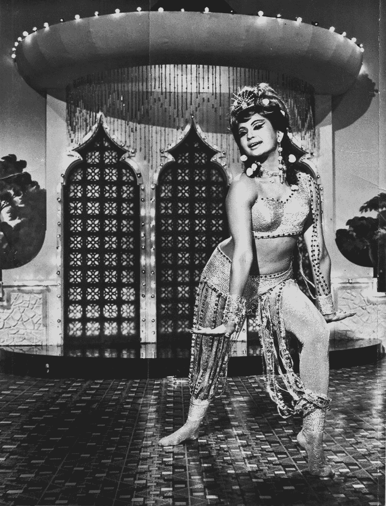
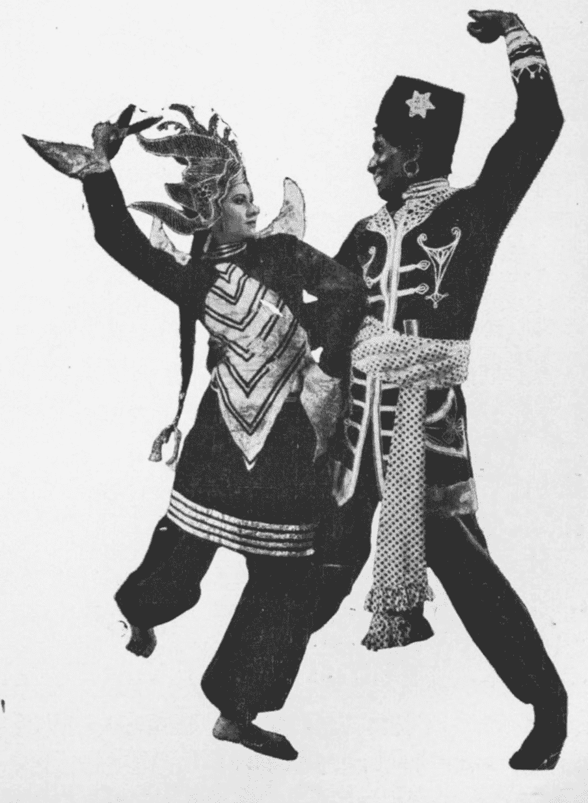
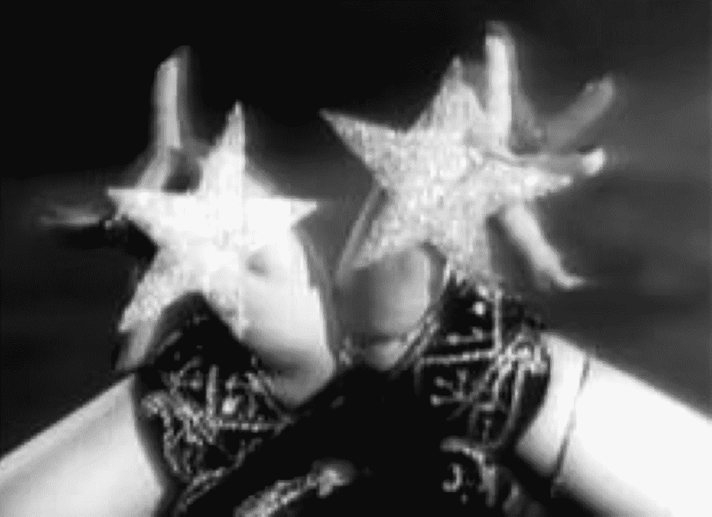

# 舞动的女性：编排印地流行电影的躯体历史

第一章的一部分曾出版于《印度电影中歌舞的演变：一种针对印度电影歌舞片段的舞蹈音乐学方法建议》（*The Evolution of Song and Dance in Hindi Cinema*），由 Ajay Gehlawat 和 Rajinder Dudrah 编，Routledge，2019。

*献给卡玛拉，谨表感谢*

## 关于辅助网站

`www.oup.com/us/dancingwomen`

牛津大学创建了一个密码保护的网站，以配合《舞动的女性：印度电影中身体历史的编舞》。该网站包含了书中讨论的许多舞蹈片段的短视频。

鼓励读者在阅读每一章时参考此资源。在线提供的示例将在文中用牛津大学符号标出。

## 致谢

正如穿梭在这些页面跳舞的女性一样，这本书也有许多我深表感激的共同编舞者。在开始一本强调协作与劳动的书籍时，通过感谢参与这段旅程的众多导师、朋友和家庭成员提供的知识和情感支持，是再恰当不过的。该项目作为博士论文的早期，很大程度上得益于我那支强大的全女性论文委员会，成员包括 Neepa Majumdar、Marcia Landy、Lucy Fischer 和 Ranjani Mazumdar。这些女性主义电影研究领域奠基性人物——关于女星、通情剧以及通过电影阅读历史的工作——极大地影响了本书的方法论。在我的许多写作和教学中，我都能感受到他们的身影，正如屏幕上编舞者的影子一样。Neepa Majumdar 作为论文导师和对学生不懈的支持者，树立了让学术工作充满回报且植根于日常关怀与团结政治的知识慷慨。我无法要求更好的导师了。

在博士论文之后的生活中，这本书从与电影、舞蹈和音乐学者的对话中受益匪浅。Davesh Soneji 关于南印度舞蹈和音乐的充满活力的研究，挖掘了世袭表演者的劳动与技艺，并揭示了产生单一“古典”表演文化的复杂种姓和宗教政治，对于我将本书从对舞后的研究重新配置为对印度电影中舞动女性的更广泛探索至关重要。

斯坦福大学艺术与艺术史系是一个充满支持且友好的专业家园。与 Jean Ma、Pavle Levi、Karla Oeler、Alexander Nemerov、Bissera Pentcheva、Marci Kwon、Shane Denson 以及系里的教职员工对话，印语电影音乐为我的童年和家乡注入了贯穿始终的背景——萨盖尔（Saigal）、塔拉特·哈穆德（Talat Mahmood）、吉塔·杜特（Geeta Dutt）和拉塔·曼吉斯卡尔（Lata Mangeshkar）的作品。他的电影气息渗透了本书的许多部分。

西 Cyril，我过去十五年多次冒险中不知疲的伴侣，印语电影与流行文化的百科全书，不知疲竭的激励者与批判者，勤勉地为我们保持着真实——“非常硬”（bhot hard）。感谢你那一个又一个小时的肚子大笑、激烈的争论，以及那种讽刺与情感交织的独特结合。现在，准备迎接下一个项目的艰辛吧！

我将这本书献给我的第一个母亲，卡玛拉（Kamala）。在她去世后的三十年里，我不断感受到她那无畏而强大的存在，她的卡纳塔克式（Carnatic）和印度斯坦斯坦式（Hindustani）歌声在空中回荡，她那不安分的智力被捕捉在许多笔记本中紧迫的文字里。这是献给她的，也是献给她的母亲，我的 `paati`（外婆），拉克希米（Lakshmi）——这是一个卓越、不传统的女性世系，她们从未真正融入，也教会了我们不要融入。

## 舞蹈、身体与奇观

舞蹈段落以 `mridangam`（中鼓鼓）的特写开场，镜头拉远，展示了三位卡纳塔克音乐家正在演奏打击乐¹。镜头切换到女演员维杰扬蒂蒂马拉（Vyjayanthimala）执行 `namaskaram`（礼拜）的长镜头，这是巴里拉塔纳姆舞（Bharatanatyam）剧目中的开场致意动作，随后是一系列动态剪辑的特写，展示了她的脚部动作、`mukhaja-abhhinaya`（面部表情）和 `hasta mudras`（手势）²。

随着她的移动，她调动摄像机，从她充满活力的巴里拉塔纳姆舞步追踪到印语电影最喜爱的“妖妇”（vamp）海伦（Helen），她穿着紧胸衣、短裙、连裤袜和高跟鞋表演着她标志性的“卡巴蕾”舞步³。当这两个女舞者都蔑视由尚米·卡普尔尔（Shammi Kapoor）饰演的电影英雄时，他摇晃着他的猫王斯式大盖头，唱道：“`Muqabla humse na karo`”（“不要跟我竞争”），他的手臂摇摆，头部疯狂地抖动（见 `img/d3101073a89f0747f7eca6e948673baf_10_0.png` 视频 00.01）。

这场孟买电影当时最著名的三位舞者演员之间闪耀的舞蹈对决，是《王子》（`Prince`, Lekh Tandon, 1969）的核心吸引点。它对电影编舞创新的技术奇观、令人惊叹的服装和场景设计，以及一系列音乐和舞蹈风格的呈现，让我们关注到支撑流行印语电影舞蹈制作与接收的技艺、劳动力和愉悦等问题。

虽然电影的叙事为了呈现这段舞蹈段落经历了许多扭曲，但当我们把注意力从情节转向身体表演，转向舞蹈所需的肉身能力和长期训练，转向尖叫的身体所激活的观众欲望时，我们可能会发现，当维杰扬蒂蒂马拉、尚米·卡普尔和海伦共同出现在屏幕上时（见图 I.1），奇观*就是*叙事。

借鉴简·德斯蒙德（Jane Desmond）对舞动身体“作为意义铭刻的基石、执行的工具以及不断创造与再创造的媒介”的讨论⁴，我们可以将维杰扬蒂蒂马拉、尚米·卡普尔和海伦的身体视为书写者与被书写者，视为生物、历史、技术相互关联的物质化。

海伦柔软扭曲的躯干、灵活的嘴和张开的双腿，维杰扬蒂蒂马拉画着黑色眼线的大眼睛、笔直的站姿，以及她受过巴里拉塔纳姆训练的身体那清晰的 `mudras`（规范手势），以及卡普尔似乎未经编舞的、肢体随性的，揭示了每位表演者积累的身体经验。这些经验被训练成特定的举止风格，在每个身体中沉积了层层手势。

亨利·列斐伏（Henri Lefebvre）指出：“手势系统体现了意识形态并将其与实践。通过手势，意识形态逃离了纯抽象并执行动作。”⁵

海伦的卡巴蕾和维杰扬蒂蒂马拉的“古典”舞蹈节目带有印度亚次大陆表演艺术悠久历史和性别表演性的痕迹，折叠了 20 世纪 30 年代混合的“东方舞蹈”、孟买电影中的英印裔舞女，以及 20 世纪 40、50 年代通过对传统表演者的有意边缘化而出现的新晋“古典”舞者（关于“古典”类别的产生在第 3 和第 4 章中详细讨论）。

`img/d3101073a89f0747f7eca6e948673baf_11_0` **图 I.1.** 《王子》（Lekh Tandon, 1969）中的海伦、尚米·卡普尔、维杰扬蒂蒂马拉。*来源：*屏幕截图。

## 舞蹈的手势历史

舞蹈段落调动了一段手势历史，不仅是他们自身星光身体及其产生的历史，还包括流行印语电影对其他表演传统的借用。维杰扬蒂蒂马拉的巴里拉塔纳姆舞和随行的卡纳塔克音乐家是对这位南印度女演员在泰米尔电影早期职业的致敬，而她的卡塔克（`Kathak`）舞让我们联想到穆斯林名妓。

海伦的卡巴蕾和维杰扬蒂蒂马拉的“古典”舞蹈节目带有表演艺术悠久历史和性别表演性的痕迹，折叠了 20 世纪 30 年代混合的“东方舞蹈”的构图、孟买电影中的英印裔舞女，以及在 20 世纪 40、50 年代通过对有意边缘化传统表演者而出现的新晋“古典”舞者（关于“古典”类别的产生在第 3 和第 4 章中详细讨论）。

通过对身体及其构成要素的表演，电影舞蹈研究促使我们思考那些产生屏幕上表演身体的众多身体，我将其称为“`编舞音乐身体`”（`choreomusicking body`），它是由屏幕上的舞者，以及幕后的编舞师、配唱歌手、音乐家、导演、摄影师、剪辑师以及舞台和服装设计师等众多人员构成的复合体。

当我们把注意力转移到产生舞蹈片段这种电影肉体吸引力的物质实践上时，我们开始对歌舞片段提出完全不同的问题。例如，我们会询问配唱歌手 Mohammed Rafi（拉拉菲）、Lata Mangeshkar（拉塔）和 Asha Bhosle 是否以特定的方式处理他们的声音，以对应卡普尔（Kapoor）、维杰亚万蒂玛拉（Vyjayanthimala）和海伦（Helen）惊人的舞姿身体（正如第一章通过 `舞蹈音乐化`（dance musicalization）的舞音乐学框架所考察的那样）。

我们也开始关注屏幕舞者与幕后编舞师之间的互动。例如，海伦和她的“舞蹈大师”赫尔曼·本杰明（Herman Benjamin）和 P. L. 拉杰（P. L. Raj）从哪些电影、舞台和社交舞蹈来源汲取灵感，为她的这一段编排了华丽且混合的“西方”舞蹈动作？舞蹈形式的选择是否也受海伦对用她在全球旅行中购买的织物、羽毛、蕾丝等材料拼凑其闪耀服装的偏好的影响？

当我们考察动作词汇的谱系时，也追溯了孟买电影业舞蹈训练的非正式网络。德夫拉杰·彼得·刘易斯（Devraj Peter Lewis），改名 P. L. 拉杰——他曾是海伦在其突破性的独舞片段中的伴舞，在经历了多年的伴舞生涯之后，参与了“`Mera naam chin chin choo`”（《霍尔赫拉大桥》，夏克提·萨曼塔导演，1958 年）——后来为海伦编排了她最著名的歌厅舞表演，同时也创作了 20 世纪 60 年代尚米·卡普尔（Shammi Kapoor）标志性的舞蹈词汇。（13）

反过来，P. L. 拉杰在英印裔编舞师罗伯特（Robert）和托尼（Tony，改名为苏里亚·库马尔和克里希纳·库马尔）下学习，他们是由印德裔东方舞者阿兹里（Azurie）引入业界的（参见彩色插页——图像 1）。对舞蹈编舞和表演的工业历史的关注，挖掘了各种被忽视的人物在制作印度电影特定的声音、视觉和动感吸引力方面的贡献。

## 舞蹈劳动与观众性

对“`Muqabla humse na karo`”以舞蹈为中心的分析促使我们询问，三位舞者是共同排练还是分别练习；维杰亚万蒂玛拉和海伦的动作是否与她们各自的编舞师戈皮·克里希纳（Gopi Krishna）、P. L. 拉杰和赫尔曼·本杰明分别排练的；在舞蹈在屏幕上显得毫不费力之前，进行了多少天的编舞和排练？

将注意力从歌舞片段所承担的意识形态功能——这种功能一直主导着好莱坞音乐剧和印度流行电影的研究——转移到研究这些吸引力所需的工业实践、训练、排练和人员上，产生了一种关于劳动力、物质性和生产经济的不同历史和理论化。

在屏幕舞蹈片段中，我们看不到相机和舞者位置的地板标记，看不到摄影棚灯光下的汗水，也看不到换装的时间。然而，对电影舞蹈奇观制作的密切关注促使了对身体、表面、空间和时间接口的探索，这反过来推动了通过其情感、物质性以及唤起观众欲望和愉悦的策略，对流行印语电影构图的考察。

维杰亚万蒂玛拉在提到“`Muqabla humse na karo`”时说：“它配合得太完美了，让你的脚趾都蜷了，”（14），强调了我们与印语电影歌舞片段强烈的身体参与，这产生了一种具身且动感的观众性。

舞蹈片段的过剩美学与流行电影超越平凡和日常限制的承诺相契合，正如艾琳·布拉尼根（Erin Brannigan）所指出的，它演绎了“人类身体技艺和游戏的潜力，”（15），其过剩的身体能量产生了位于身体中心的观众反应（起鸡皮疙瘩、抖脚、打响手指等）。

## 可见性、主体性与抹除

在不同历史时期被边缘化的形象包括：被噤声的低阶层传统表演者，如 `tawaif`s（艺妓）和 `devadasi`s（神庙、宫廷及沙龙舞者）；(20) 主要存在于舞蹈舞段中、且在电影叙事以及行业对女星地位的记录中被抹除的电影蛇油形象（vamp）；很少因舞星的舞蹈表演而获得署名的幕后编舞；以及大量在舞蹈舞星身后表演的、无名的“背景伴舞演员”。这些舞蹈舞段的空间实践凸显了舞星相对于其统一“背景”身体的独特性形象（`figure`）。

然而，本书对 19 世纪和 20 世纪这些各种舞蹈人物的细致历史关注，开始打破二元对立前景与背景、星光与阴影的关系，转而强调了舞蹈女性在可见性和主体性上交替变化的多变特质。

我们并没有重复那种惯常描绘的表演精英地位显赫及其最终衰落或边缘化的线性轨迹——包括 `devadasi`s 和 `tawaif`s、英印裔及其他欧亚裔演员、东方舞者、像 Helen 这样的蛇油形象，或像 Saroj Khan 这样的编舞——显而易见的是，如果不引用所有其他舞蹈女性，就无法讲述舞蹈女主角的故事。

英印伴舞 Edwina Lyons 在她的回忆录中记得，她的姐姐 Philomena 的“腿在几部电影中被用作了 Madhubala 的腿”，而且那位星曾“亲自去找她并[感谢]了她”。(21)

在《情迷》（`Pakeezah`, Kamal Amrohi, 1972）的最后一段舞蹈舞段“`Teer-e-nazar dekhenge`”中，Meena Kumari 在碎玻璃上跳的 `Kathak` 节奏步法是由她的舞蹈替身 Padma Khanna 完成的（见视频 00.02）。

在这些实例中，银幕舞蹈女性的形象字面上完全折叠在各种、不同编码的舞蹈身体的肢体、躯干和手势中。Helen 和 Vyjayanthimala 共同编舞了“`Muqabla humse na karo`”的多样化魅力。

此外，通过分析 Vyjayanthimala 与传统 `Bharatanatyam` 舞蹈导师 `nattuvanar` V. S. Muthuswami Pillai，或由她引入孟买电影业的受过 `Kathak` 训练的 Hiralal 和 Sohanlal 等编舞的互动，构建其作为古典舞蹈演员的明星文本，为电影舞蹈舞段制作中涉及的劳动提供了更丰富的描述。

编舞的职业生涯通常比舞星长，这一身份预示了行业实践与逻辑的长久存在。Madhuri Dixit 被认为标志了 20 世纪 80、90 年代印语电影舞蹈语言的重大转变。当我们把她震撼的舞蹈动作读作她那天才编舞替身 Saroj Khan 所构思的熟练模仿时，我们开始构建一种由许多身体组成的肉身历史（corporeal history），在这种历史中，主体性和作者权分散在许多被认可或未被察觉的表演者身上。

## 结语：舞蹈女性的网络

将这些舞蹈女性放在一起阅读，产生了一部充斥着叛逆与离题的历史，这些离题往往在舞蹈女主角的身体内部蔓延。它叙述了一个被认可的线性历史，但也揭示了始终与公开表演女性相关的叛乱历史。

《Dancing Women》并没有对 20 世纪印度的舞蹈女性提出简单的颠覆或抵抗假设，而是探索了权力如何在不同历史时刻、在多个代理人之间转移和循环——在 `devadasi` 与婆罗门改革者之间、`tawaif` 与电影导演之间、舞蹈演员与编舞之间、女主角与蛇油形象之间。

在不断变化的表演语域移动中，舞蹈女性产生了一个由主体性、顺从、可见性和抹除组成的移动场域。镜像舞蹈女性的流动性，她们的历史也拒绝稳定性，跨越了多种交织的关于性别存在与运动的陈述。

通过在后续章节中将 Azurie 与 Sadhona Bose、Waheeda Rehman 与 Vyjayanthimala、Madhuri Dixit 与 Saroj Khan 并列，并频繁对 Balasaraswati、Rukmini Devi Arundale、Fearless Nadia、Cuckoo、Helen、Sridevi 以及各种编舞和助理编舞进行离题，本书强调了这些舞蹈女性的表演储备如何在多样的表现中相互折叠。这些形式包含了她们之前及周围舞蹈女性的显性和隐性痕迹。

通过追踪电影舞蹈的手势谱系，产生了一种完全不同的孟买电影乃至南亚洲文化现代性叙事。这种叙事是通过一个由卓越舞蹈女性组成的网络、从多个地点共同创造的肉身历史。

在她的书《Dancefilm》一书中，Erin Brannigan 指出电影研究与舞蹈研究之间需要更多对话：

> “舞蹈理论提供了对运动身体及其产生和表达意义能力的理解，这对于处理电影类型和其他舞蹈电影（dancefilm）类别特别有用。”(22)

演员的肉身特殊性，即 Brannigan 所描述的他们的“理念图”（ideography），定义了不仅是该表演者的手势参数，也定义了他们出演电影的特征，鼓励我们将电影视为一个动觉场，该场域通过动员运动身体以特定的方式驱动观众。从肉身角度阅读电影改变了我们对表演、空间组织和劳动网络的理论化。

舞蹈学者 Sally Ness 表示：“当我想到舞者时，我想到的是他们的身体，”并阐述道：

> “[在舞蹈中，心灵的‘我’可以是多变的，并可能以无限的方式占据某个人，将第一人称的权威投入到不同的身体部位，或同时投入到任何数量的时空关系中的身体中]。”(24)

当我们通过运动和舞蹈的视角考虑电影表演时，表演剧被重构为一种编舞现象。对劳动的、运动的身体深厚物质性的关注，为表演理论注入了肉身临场（corporeal presence）。

在流行印度电影的案例中，虽然常被认为表演是有自我意识的，而非由表演者完全沉浸角色的现实主义目标驱动，但舞蹈理论对于理解这些表演传统如何在一种融合了呈现性与再现性风格的电影中发展至关重要，在这种电影中，演员需要穿过多种表演模式：自然与非自然、透明与不透明、个体化与神话化。

在第四章中，为了解析对 Vyjayanthimala 表演的反应，我转向《Natya Shastra》和《Abhinaya Darpana》等表演著作，以追溯对具身的文化理论化。(25) 在不抹除这一文本传统的复杂历史或将早期表演传统本质化的情况下，人们可以找到与其互动的方式，利用其揭示某些表演的文化和社会态度的诠释潜力，特别是当我们阅读这些文本通过 `devadasi`、`tawaif`、舞蹈演员、编舞、背景伴舞、真人秀参与者等不断演变的具身知识转化而的美学时。

印度美学著作中通过一系列动作产生情感的界定，为印度电影中受过舞蹈训练的演员提供了基于肉身的表演与接收惯例的线索，尽管这种影响可能是间接的。

流行电影，乃至电影叙事内容和情感架构的整体结构。维杰雅万蒂玛拉（Vyjayanthimala）在20世纪40年代接受了近期文本化的巴拉那塔亚姆（Bharatanatyam）训练，她运用这种舞蹈训练的语言来描述自己的电影表演经验：

> “我从没有受过任何剧场训练。舞蹈是我成为一名演员成长过程中最重要的组成部分。舞蹈包含了大量的 `bhava`（心境）和 `abhinaya`（情感表达）。”^(26)

她的同时代瓦希达·雷赫曼（Waheeda Rehman）将她闻名的情感表达能力归功于对巴拉那塔亚姆的训练，并回想起导演古鲁·达特（Guru Dutt）的评价：

> “她在《渴望》（`Pyaasa`）中的首歌跳得很好，是因为她是一个舞者。她知道如何给出沉默的表情。”^(27)

虽然本文特别关注印度女舞演员，但一个围绕运动身体构建的概念框架可以扩展到其他电影和其他受运动支撑的各种身体，无论是杂技、歌杂剧、喜剧还是体育类运动。

对印地电影歌舞片段的研究很大程度上集中在音乐、场调度、音乐片段与叙事的关系上，并将歌舞序列视为一个整体。^(28) 《舞动的女性》（`Dancing Women`）对舞蹈身体的展示与调动的关注，为印地电影歌舞片段的理论化提供了新模型。

它提出了较少针对歌舞复合形式提出的问题，例如：舞演员如何影响电影叙事以及为他们创作的音乐？我们在观看舞蹈片段和歌曲序列时的观影参与有何区别？女舞演员银幕上的流动性和星光身份的构建方式与那些不以长舞闻名的演员相比有何不同？

这些探问为分析劳动、生产经济、电影文化记忆和品味层级生成了新的框架。在第一章中，我概述了一个以身体为中心的歌舞片段分类法，并通过一种舞蹈音乐学（choreomusicological）方法——将音乐和舞蹈视为处于相互暗示或占有的状态——提出，对于某些著名的舞演员来说，理想的舞蹈词汇先于并影响歌曲的概念化。

我将这一过程称为舞蹈音乐化（dance musicalization），这一提议表明，舞演员的加入可能会改变流行印地电影中的音乐创作，使其响应他们的舞蹈技巧和身体举止。因此，舞演员影响了作曲家的选择、配音歌手、歌词、广义的音乐影响（西方、印度、古典、民俗等）、音乐作品的结构（旋律、节奏、人声和乐器、独唱和合唱部分），并通过这些因素影响了创作音乐的情感构图12。

与此相关，我提出了一个多身体的舞蹈音乐身体（multi-bodied choreomusicking body）的概念，它不仅让我们关注银幕表演者的姿态语库，还让我们关注幕外的音乐制作、美术指导、服装、妆造和其他行业实践。

每一章都关注女舞演员的出现如何为技术变革提供动力（例如，在2世纪50年代初，只有歌舞片段是彩色拍摄的）、生产创新（摄影、化妆和服装、布景和道具、剪辑）以及对某些行业人员（作曲家、配音歌手、编舞师）重要性的强调。

虽然书中考虑的一些电影在概念化时是为了“开发”女舞演员的舞蹈技巧，但这些女性表演者反过来通过创作反映其表演身体力量的叙事夺回了电影创作权，并定义了不受男性欲望和意图完全限制的电影表征机制。

这些舞动的女性提出的是，我们不能用单一的视角来解读她们，性别和奇观的产生是以复杂的、多感官的方式发生的。通过分析女演员如何利用电影技术来捕捉其运动身体，并使舞蹈片段成为形式创新的最大场所——一种“技术奇观”（techno-spectacle），《舞动的女性》要求重新思考电影研究中的奇观。

与其将女演员技术奇观的解读限于意识形态怀疑框架（涉及男性凝视、工业剥削等），一种基于身体的批判性目光注意到这些技术奇观如何运作以产生快乐，决定了我们看电影时身体的举止，并往往成为我们对某些电影的唯一记忆。

舞蹈和音乐并非电影叙事无关的干扰，而是技术奇观电影场域的核心，其中东方舞蹈奇观、妓女电影和舞蹈忧情剧特别被设计用于展示新技术，包括彩色胶片、特效以及摄影和剪辑的创新。

对制作这种离散的流行电影形式不同部分的劳动组织的关注，以及在第二章中对电影舞蹈空间配置的关注，表明舞蹈身体不仅是一个生物对象，而且是一种感知和表达的模式，作为与空间和物体相遇的场所，产生了一个主主体性、表面和感觉之间的折皱系统。

电影、音乐和舞蹈的媒介理论化（intermedial theorizations）帮助我们理解13视听折皱的产生以及我们的反应，表演实践将它们的物质性和强度结合在一起。

这种媒介阅读实践的方法论意义不仅限于分析电影中的音乐序列。它能让我们注意到演员手势的动觉表达，也可以注意到体现在生产构型中的摄影动作和其他姿态（gestures）中。

将舞蹈身体视为印地电影符号实践的编写并被其编写，推动了孟买行业女性身体的新历史，这种历史是关系性的，跨越种姓、阶级、宗教和地区。

身体历史打破了运动的线性叙事——从沙龙到舞台再到银幕——以及表演者与编舞师、女主角与反女角之间的层级。对萨达纳·波斯（Sadhana Bose）、阿迪（Ardie）和维杰雅万蒂玛拉职业生涯的描述，必须考虑到她们在银幕和舞台之间不断的移动，以及在不同历史节点赋予她们的尊重。

我们遵循的不是一个接一个僵化的媒体历史，而是居住这些媒介的身体。萨罗杰·汗（Saroj Khan）在孟买电影界持续六十多年的职业生涯，或者马杜丽·迪克斯（Madhuri Dixit）作为女主角、插曲舞者和真人秀明星的三十多年职业生涯，提醒我们舞蹈女性在调动各种媒体以展示其身体表现力和强度方面的力量。

身体历史本质上是未完成的历史。毕竟，运动的身体是滑动的，而具身化（embodiment）是对表演传统的一种复杂居住模式，不会留下清晰的文本或档案痕迹。

因此，《舞动的女性》提供了一个暂时的、填补了空白的历史，邀请了其他身体形式的补充或反向档案，这些身体动摇了这种叙事，并以自己的动作进入这场身体历史的编舞之中。

在印度电影中，对这些新流动性的回应通过跳舞的女性得以具象化。

作为投入于动作探索与展示的艺术形式，电影与舞蹈有着长期的互动历史。电影从诞生之初就吸纳了舞蹈。在《迪克斯森实验声片》（William K. L. Dickson, 1894年）和《舞者安娜贝尔》（William K. L. Dickson, William Heise, 1895年）等电影中，爱迪生制造公司利用舞者向首次观看的观众展示了电影对动作奇观展示的倾向（参见  视频 00.03）。

对运动共同投入确保了早期电影与舞蹈之间一种“自发的跨媒介性”，在电影诞生的第一个十年里，传统或异域舞蹈频繁出现。^(29) 洛朗·吉多（Laurent Guido）将电影的出现置于对身体运动高度关注的审美与科学语境中：

> “舞蹈，正如体育运动和体操一样，在20世纪初作为一种协调的身体运动组织方式而出现。人们认为，通过物理表演引发运动的肌肉模仿将使[电影]观众置于一种不可抗拒的韵律魔咒之下。”^(30)

舞蹈连同杂技和其他身体展示形式，被用于展示电影这一新媒介蕴含的巨大动感潜力。

道格拉斯·罗森伯格（Douglas Rosenberg）通过讨论舞蹈与摄影机建筑独特性之间的关系，阐述了19世纪末和20世纪初的埃德华·穆布里奇（Eadweard Muybridge）、托马斯·爱迪生、卢米埃兄弟、埃蒂·朱尔·马雷（Etienne-Jules Marey）以及托马斯·艾金斯（Thomas Eakins）等人主要关注光学技术捕捉的运动身体的现象学。^(31)

由于爱迪生的相机是静止并固定在三脚架上的，他雇用舞者来为画面提供运动。罗森伯格指出：

> “电影中对编舞的视觉化强化了我们所见证确实是时间的流逝。这种将舞蹈作为节拍器以证明电影真实性的具体用法，是舞蹈与运动影像之间关系的最早化身。”^(32)

尼尔·安德鲁（Nell Andrew）和汤姆·甘宁（Tom Gunning）讨论了早期电影对洛伊·富勒（Loie Fuller）蛇形舞的着迷，这种舞蹈使得安德鲁所谓的“蛇形电影”成为可能，在1894年至1910年间制作了三十多部此类电影，^(33) 它展示了二维与三维、运动与静止之间的转换，而这正是甘宁所说的沉迷于运动与节奏的“吸引力电影”的基础。

在印度，早期电影的标题如《波斯之花中的舞蹈场景》（Hiralal Sen, 1898年）、《阿拉巴巴的舞蹈》（Hiralal Sen的译名，Hiralal Sen, 1903年）和《印度纳契舞女之舞》（Elphinston Bioscope, 1906年）暗示了人们对在胶片上捕捉舞蹈有类似的兴趣，尽管这些电影已不复存在。

在《哈里希尚德拉王》（D. G. Phalke, 1917年）中——这是 D. G. Phalke 1913年同名电影的存世重拍，被认为是第一部印度叙事电影——我们看到了虔诚歌唱与舞蹈的实例；而 D. G. Phalke 后期的电影《兰卡·达哈》（1917年）和《卡利雅·马尔丹》（1919年）则包含了更复杂的舞蹈，并源自民间舞蹈形式。

在《兰卡·达哈》的存世片段中，我们看到阿苏拉（魔鬼）女性手持长矛围绕被绑走的悉塔舞蹈，而《卡利雅·马尔丹》则包含了多次舞蹈场景。在克里希纳吹笛的情节中，男孩们在树旁跳跃，女性（装扮成女性的男演员）用棍棒表演 `raas` 风格的舞蹈（参见  视频 00.04）。

这些早期无声电影中的集体舞借鉴了民间舞蹈语言，产生了一种社区感。虽然这些电影没有幸存，但有报道显示1920年代的电影中存在舞蹈片段和舞女角色，如《黑暗之光》（《爱的影像》，Sisir Bhaduri, Naresh Mitra, 1922年）、《虔诚的妻子》（《人类情感》，J. J. Madan, 1922年）、《舞女塔拉拉》（Jyotish Banerjee, 1922年）和《卡里扬·哈吉纳》（《卡里扬的宝藏》，Baburao Painter, 1925年）。^(34)

最近找回的《比瓦曼加尔》（Rustomji Dhotiwala, 1919年）片段为电影与音乐及舞蹈表演的互动提供了令人惊叹的瞥。展示电影妓女主角钦塔塔马尼（Chintamani，由人气女演员 Gohar 小姐饰演）的长长沙龙序列包括一段坐姿歌曲表演（图 I.2），随后是她的舞蹈。

精心设计的画面将 Gohar 小姐置于她的音乐家和赞赏的观众中心，产生了阿努普塔玛·卡普塞（Anupama Kapse）所谓的“听觉图像”，强调手势、面部表情和身体动作，以捕捉“印度先例的音乐模式（或旋律）。”^(35) 即使我们听不到音乐，这段序列也清晰地随着歌舞表演的动态能量而震动。

当我们看到晚期无声电影《迪勒·吉加尔》（《勇敢的心》，G. Pawar, 1931年）时——这是少数幸存的无声电影之一——我们注意到电影与音乐及舞蹈表演的互动，通过雇用舞者来为画面提供运动（参见  视频 00.05）。

在克里希纳吹笛的情节中，男孩们在树旁跳跃，女性（装扮成女性的男演员）用棍棒表演 `raas` 风格的舞蹈。

作为投入于动作探索与展示的艺术形式，电影与舞蹈有着长期的互动历史。电影从诞生之初就吸纳了舞蹈。在《迪克斯森实验声片》（William K. L. Dickson，1894年）和《舞者安娜贝尔》（William K. L. Dickson，William Heise，1895年）等电影中，爱迪生制造公司利用舞者向首次观看的观众展示了电影对动作奇观展示的倾向（参见  视频 00.03）。对运动共同投入确保了早期电影与舞蹈之间一种“自发的跨媒介性”，在电影诞生的第一个十年里，传统或异域舞蹈频繁出现。^(29)

洛朗·吉多（Laurent Guido）将电影的出现置于对身体运动高度关注的审美与科学语境中：

> “舞蹈，正如体育运动和体操一样，在20世纪初作为一种协调的身体运动组织方式而出现。人们认为，通过物理表演引发运动的肌肉模仿将使[电影]观众置于一种不可抗拒的韵律魔咒之下。”^(30)

舞蹈连同杂技和其他身体展示形式，被用来展示电影这一新媒介蕴含的巨大动感潜力。道格拉斯·罗森伯格（Douglas Rosenberg）通过讨论舞蹈与摄影机建筑独特性之间的关系，阐述了19世纪末和20世纪初的德华·穆布里奇（Eadweard Muybridge）、托马斯·爱迪生、卢米埃兄弟、埃蒂·朱尔·马雷（Etienne-Jules Marey）以及托马斯·艾金斯（Thomas Eakins）等人主要关注光学技术捕捉的运动身体的现象学。

由于爱迪生的相机是静止并固定在三脚架上的，他雇用舞者来为画面提供运动。罗森伯格指出：

> “电影中对编舞的视觉化强化了我们所见证确实是时间的流逝。这种将舞蹈作为节拍器以证明电影真实性的具体用法，是舞蹈与运动影像之间关系的最早化身。”^(32)

## 印度早期电影中的舞蹈

在印度，早期电影的标题如《波斯之花中的舞蹈场景》（Hiralal Sen，1898年）、《阿拉巴巴的舞蹈》（Hiralal Sen，1903年）和《印度纳契舞女之舞》（Elphinston Bioscope，1906年）暗示了人们对在胶片上捕捉舞蹈有类似的兴趣，尽管这些电影已不复存在。

在《哈里希尚德拉王》（D. G. Phalke，1917年）中——这是D. G. Phalke 1913年同名电影的存世重拍，被认为是第一部印度叙事电影——我们看到了虔诚歌唱与舞蹈的实例；而D. G. Phalke后期的电影《兰卡·达哈》（1917年）和《卡利雅·马尔丹》（1919年）则包含了更复杂的舞蹈，并源自民间舞蹈形式。

在《兰卡·达哈》的存世片段中，我们看到`阿苏拉`（魔鬼）女性手持长矛围绕被绑走的悉塔舞蹈，而《卡利雅·马尔丹》则包含了多次舞蹈场景。在克里希纳吹笛的情节中，男孩们在树旁跳跃，女性（装扮成女性的男演员）用棍棒表演`raas`风格的舞蹈（参见  视频 00.04）。

这些早期无声电影中的集体舞借鉴了民间舞蹈语言，产生了一种社区感。虽然这些电影没有幸存，但有报道显示1920年代的电影中存在舞蹈片段和舞女角色，如《黑暗之光》（《爱的影像》，Sisir Bhaduri，Naresh Mitra，1922年）、《虔诚的妻子》（《人类情感》，J. J. Madan，1922年）、《舞女塔拉拉》（Jyotish Banerjee，1922年）和《卡里扬·哈吉纳》（《卡里扬的宝藏》，Baburao Painter，1925年）。^(34)

最近找回的《比瓦曼加尔》（Rustomji Dhotiwala，1919年）片段为电影与音乐及舞蹈表演的互动提供了令人惊叹的瞥。展示电影妓女主角钦塔塔马尼（Chintamani，由人气女演员Gohar小姐饰演）的长长沙龙序列包括一段坐姿歌曲表演（图I.2），随后是她的舞蹈。

精心设计的画面将Gohar小姐置于她的音乐家和赞赏的观众中心，产生了阿努普塔玛·卡普塞（Anupama Kapse）所谓的“听觉图像”，强调手势、面部表情和身体动作，以捕捉“印度先例的音乐模式（或旋律）。”^(35) 即使我们听不到音乐，这段序列也清晰地随着歌舞表演的动态能量而震动。

当我们看到晚期无声电影《迪勒·吉加尔》（《勇敢的心》，G. Pawar，1931年）时——这是少数幸存的无声电影之一——我们注意到电影与音乐及舞蹈表演的互动，通过雇用舞者来为画面提供运动（参见  视频 00.05）。

（注：原文后续存在大量重复段落，译文已进行去重处理。）

“麦克风。一旦她从歌唱转向舞蹈，她就变得更加完全灵活了。”^(40) 在有声电影中这种静态的歌舞序列，与在《Ayodhyecha Raja》发布一前的无声电影《Diler Jigar》中Saranga灵动的舞蹈形成对比，凸显了新音响技术对舞蹈身体施加的限制。

## 回放系统与印度流行电影舞蹈

随着1935年回放系统的引入——即歌曲开始预录，并在演员对着镜头“对口型”朗读歌词时回放——印度的流行电影舞蹈开始形成其轮廓。^(41)

回放系统作为印度电影及其具象表征中的一项重要技术和文化现象，从两个方面影响了电影舞蹈。听觉轨道和视觉轨道的分离让演员具有更大的活动活性，最终使得制作排场复杂的舞蹈段落成为可能。^(42)

此外，到20世纪40年代，它还实现了表演与歌唱的分离，使得一组幕外回放歌唱演员（直到20世纪40年代后期仍被称为“幽灵声”）成为一系列演员的声音，其中一些人因其舞蹈能力而成名。

正如麦克林（McLean）指出的，在好莱坞，音乐明星必须遵循两个对立的体制，“一个关注明星声音的产生，另一个则致力于产生一个理想化的明星身体来模仿这种产生”，^(43) 这可能为朱迪·加兰（Judy Garland）这样的明星产生破碎的文本，她深受完美歌声与完美舞蹈身体的双重视听理想之苦。

而在印度的流行电影中，回放唱允许了尼帕·马朱姆达（Neepa Majumdar）所描述的双重明星文本的构建，这种文本是通过回放歌手的声音和多个演员的身体相结合产生的。^(44)

西卡·金（Shikha Jhingan）讨论了回放技术如何有助于听觉和视觉明星独立但相关的构建：

> “因为回放歌手花费了大量时间排练歌曲，处理发音、表情、呼吸和歌曲要求的音质”，而屏幕上的演员则将录制的歌曲作为参考，根据预录声音的表达语调来抒发情感。^(45)

金指出：

> “女星现在可以更多地关注她的妆容和外貌，而不必担心‘`sur`’（音准）。”^(46)

在接下来的章节中，对20世纪30年代到1990年代女性明星构建过程中对舞蹈的关注，将让我们注意到当银幕女演员也是著名舞者时，双重明星文本的显著差异。与屏幕上的舞蹈身体相结合，回放歌手的人格可能会被动员来削弱或加强女性身体及其附属意义的展示。

第一章讨论了舞蹈身体如何要求不同类型的歌曲和声部，指出了双重明星文本以及银幕内外女性存在感的构建发生了变化。

## 印地电影舞蹈的文化来源与现代性

与印地电影形式的其他元素（包括情节剧、喜剧、音乐和动作序列）一样，电影舞蹈吸用了19世纪末和20世纪初流行的各种流行文化形式。这一时期的流行剧场形式——`Nautanki`、帕西剧（Parsi theater）和`Tamasha`，以及民间形式`Jatra`——都包含了浪漫、情节剧、喜剧序列和歌舞表演的结合。^(47)

此外，各种地区民间舞蹈形式，如`Bhangra`、`Raas Lila`、`Lavani`、`Ghoomar`、`Garba`和`Dandiya`等，都激发了流行印地电影的舞蹈语言。对印地电影舞蹈最常见的两种古典舞蹈影响来自北印`Kathak`和南印`Bharatanatyam`。

通过重写古典和民间舞蹈的内容、风格和意图，以及通过对各种当地和外国动作词汇的改编，电影舞蹈表达了新的情感语调，以响应20世纪30年代日益增长的电影观众。

外国舞蹈形式如肚皮舞、华尔兹、恰恰恰、扭扭舞和摇摆舞在20世纪30年代到60年代的印地电影舞蹈中广泛出现，迪斯科贯穿20世纪70年代和80年代，而90年代后的宝莱坞则融入了爵士、嘻哈、萨尔萨等元素。^(48)

好莱坞音乐剧对印度的流行电影舞蹈产生了重大影响，印地电影中的歌舞序列体现了对其的一系列借鉴和偏离。

印地电影舞蹈精巧且忙碌的异质性使其成为一种深刻的现代舞蹈形式，反驳了关于印度缺乏现代舞蹈的说法。然而，印地电影舞蹈借鉴的杂乱以及其对舞蹈形式的所谓腐败引发了各种评论者的各种反应。

在《印度有声片 1931–1956》中（由印度电影联合会出版，以纪念印度有声片诞生二十五周年），文化复兴者E·克里希纳·艾耶（E. Krishna Iyer）是将`devadasi`舞蹈形式`Sadirattam`绅士化为“古典”舞蹈形式`Bharatanatyam`的关键人物，他抱怨在对音乐和舞蹈的使用上：

> “屏幕腐蚀了甚至俗化了大众的口味……用异域的、混合的或其他类型的艺术来款他们，而对民族传统几乎不加顾会。”^(49)

在同一份出版物中，著名的`Kathak`舞者西塔拉·德维（Sitara Devi）从20世纪30年代中期到40年代中期在印地电影中跳了一系列“混合型”节目开始她的职业生涯，她评价道：

> 在电影里……舞蹈，尤其是古典派的，几乎没有表现。任何类型的臀部动作都被当作舞蹈……我们的编舞师将 Rambha [*原文如此] 和桑巴与我们古典形式扭曲的“`Mudras`”（手势或面部表情）混合。有时电影中的舞蹈段落变得很难分类。它既不像古典，也不像民间。^(50)

与古典舞蹈一贯不逊的比较是电影舞蹈评论接受中的一个经常性特征。在1957年流行电影杂志`Filmfare`的一期中，一位作者指出：

> “古典舞蹈就像纯数学，例如微积分，而电影舞蹈就像‘二加二等于四’这种简单命题。”^(51)

值得注意的是，对电影舞蹈混合性及其对大众影响的焦虑，在20世纪50年代和60年代的新闻论述中最为显著，当时将舞蹈形式规范化的动力处于巅峰。

在1952年`Filmfare`的一题为《西方舞蹈形式腐败我们的电影》的文章中，古典舞者萨蒂亚瓦蒂（Satyavaty）斥道：

> “看一眼我们电影中展示的舞蹈之一，就足以让理智的人感到极度厌恶并退缩。”^(52)

这种在“理智的人”（即古典舞蹈的`rasika`或知情观众）与流民化电影观众之间的具象表征分裂，助长了精英文化阶级的构建，并在这些关键几十年在公共领域产生了味觉的等级制度。

莫汉·科卡尔（Mohan Khokar）是一位舞蹈学者，他通过关于印度古典和民间舞蹈形式的书籍，成为教育新公民了解其文化遗产教学计划的核心人物。他对电影舞蹈指出：

> “舞蹈的风格很少是古典的；大多数时候是光鲜和廉价的混合物，往往倾向于低俗。事实上，印度电影中的舞蹈被与缺乏目标和某种廉价趣味联系在一起，在俗语被称为‘`filmi`’（电影味）。”^(53)

## 舞蹈在电影叙事中的地位

对印度电影舞蹈的另一种回应围绕着舞蹈在电影叙事中的地位：

> “在电影中，舞蹈仅仅是‘插曲’。它们本是为了推动故事发展（尽管很少做到这一点），但主要本质是出于票房考虑，对画面进行点缀。因此，作为一种点缀，电影舞蹈首要吸引视觉。它必须是诱惑的、壮观的且动作快速的。……电影舞蹈取悦眼目，刺激大脑，并很快被遗忘。”^(54)

作者在此列举了一组关于电影舞蹈的描述词，这些词汇流传至今——作为对主要叙事的华丽分散，作为为了视觉愉悦而招募身体，以及一种主要指向商业成功的、易遗忘的低级艺术形式。

由于银幕女性舞者占据主导，对电影舞蹈的讨论通常也围绕着性、性别规范和身体文化的问题展开。在1966年题为《电影中的舞蹈：噱头还是必要》的文章中，作者总结了对流行娱乐领域标志性的风格多元化的焦虑，以及女主角在该系统中的参与情况：

> “在大多数电影中，被要求跳舞的是女主角自己。……舞蹈通常是从印度舞蹈和西方舞蹈中随机挑选的动作的重组——几乎与女主角角色的尊严和目的格不入。……一个严肃的电影制作者必须理解，女主角并不仅仅是一个表演者。”^(55)

关于流行电影舞蹈的论述强调了精英与大众、体面与不体面之间紧张的关系，凸显了国家机器对同质化的追求，以及流行文化形式的激进异质性。

《舞动的女性》（`Dancing Women`）通过在多个相互交叉的框架内对印度电影舞蹈进行理论化和历史化，分析了这些围绕性别、女性流动性和公共呈现的话语构型。本书立足于对女性表演者技能、训练、劳动以及电影—社会构图的细致阅读，参考性别与体面性之间不断变化的关系来解读这些“明星文本”，将它们与对历史变化做出反应的舞蹈和表演理论相结合进行理论化，并将它们置于国家轨迹和某些文化制度化模式中进行历史化，例如，通过对反`舞娘`（`nautch`）运动的讨论（第3章）、国立戏剧学院（`Sangeet Natak Akademi`）等组织的建立（第4章）以及20世纪90年代的经济放宽（第5章）。

## 全书结构

前两章概述了后三章将用于对特定舞者—演员进行分析的概念框架。

### 第1章：舞蹈与歌目

在第1章中，一种以舞蹈为中心的歌目分类法，以及对舞蹈如何赋予主体性（agency）和作者权的讨论，引发了对“歌曲画面化”（`song picturization`）一词的重新思考，该词暗示了歌曲具有设定银幕图像议程的主导地位。

相反，我认为在某些舞蹈目或著名的舞演员中，可能存在一种相反的“舞蹈音乐化”（`dance musicalization`）过程，即所需的舞蹈词汇先于并影响歌曲的创作。

这种对既定生产和作者权逻辑的打破，促进了多身体“舞蹈音乐剧身体”（`choreomusicking body`）的概念化，将我们的注意力转向许多为制作歌曲和舞蹈目而劳作的幕内外身体，并从根本上改变了对流行印度电影中叙事和奇观的意识形态解读。

本章运用舞蹈音乐理论、舞演员对音乐创作的影响性历史描述，以及观众对歌舞合体的反响，为理论化印度电影歌舞场次提出了新模型。

### 第2章：身体、空间与运动

第2章建立了一个“身体—空间—运动”框架，研究舞蹈空间、所使用的动作词汇以及由此产生的明星身体构建，以参与关于电影再现和性别生产的更广泛讨论。

该框架被用于揭示印度电影歌舞厅（cabaret）恋物空间背后的生产过程，这是一种“公共亲密的建筑”，其空间和编舞操作引发了强烈的感官刺激，观众体验了一系列视觉、听觉、触觉和味觉的影响。

通过关注以舞蹈之星海伦（Helen）为主角的歌舞曲目，本章讨论了产生基础设施、身体和空间特定碰撞的电影—编舞实践，使歌舞厅的媒介感官成为一个极具实验性的电影和表演空间。

本章还利用“身体—空间—运动”框架，分析了印度电影舞蹈与印度古典及民间舞蹈形式的关系。借用《舞论》（`Natya Shastra`）和《表演镜》（`Abhinaya Darpana`）等印度典籍中复杂的舞蹈动作词汇，我将舞动的女性身体解构为三大类——面部、躯干和肢体。

这些`身体区域`（`body zones`）根据其组成部分的使用以及特定历史时刻手势表达的社会内涵，能够产生表达。

### 第3章：阿祖莉与萨达多纳·博塞

第3章关注20世纪30—1940年代曾经成名、如今被遗忘的舞星阿祖莉（Azurie）和萨达多纳·博塞（Sadhona Bose），以挖掘一段密集的、交叉的早期舞蹈全球史，这段历史包含了鲁斯·圣·丹尼斯（Ruth St. Denis）、拉宾德拉纳特·泰戈尔（Rabindranath Tagore）、乌代·尚卡尔（Uday Shankar）和鲁克米尼·德维·阿伦代尔（Rukmini Devi Arundale）等东方舞者。

将博塞（孟加拉语“淑女”`bhadramila`）和阿祖莉（一位印德裔“舞女”）定位为新流动性的共同编舞，为国际化网络提供了光。

20世纪30年代和40年代是研究围绕所谓古典舞蹈形式复兴的舞蹈话语构型的关键时期，这涉及高种姓、上层阶级表演者对传统表演者（如神女`devadasi`和艺妓`tawaif`）文化实践的挪用。

将博塞和阿祖莉的表演身体放在一起阅读，打破了新一代表演者对舞蹈的单一叙述。在对全球娱乐经济循环的充满活力且高技艺的制作和参与中，阿祖莉和博塞利用舞蹈在这一殖民后期时期编排了新的流动性。

### 第4章：维杰扬蒂·马马拉拉与瓦希达·雷赫曼

第4章关注20世纪50和60年代两位接受过婆罗那塔亚舞（`Bharatanatyam`）训练的明星——泰米尔印度教徒维杰扬蒂·马马拉拉（Vyjayanthimala）和泰米尔穆斯林女性瓦希达·雷赫曼（Waheeda Rehman），分析了电影舞蹈与新独立的印度国家的关系，通过国立戏剧学院（`Sangeet Natak Akademi`）、共和国日阅游和其他定义标准的机制，对被分类为“古典”和“民间”舞蹈形式进行经典化和边缘化。

新经梵语化的婆罗那塔亚舞与新接触接受这种舞蹈形式训练的南印度女演员的印度电影行业之间的碰撞，在语言和宗教线上产生了某些关于理想女性化的身体和表达图谱：维杰扬蒂·马马拉拉被塑造成一位出色的舞者，她需要证明自己的演技能力和全印吸引力；而瓦希达·雷赫曼则是一位“天生”的印度电影演员。

通过研究舞蹈训练如何影响表演剧目，本章关注了动作、手势和身体举止，以改变我们对精湛和技术的理解，提出了一种基于运动的电影表演分析，赋予了动力表演和观赏价值。

这种对20世纪50和60年代电影舞蹈的描述，同样充斥着许多为舞蹈奇观而劳作的幕外身体，包括舞监（`nattuvanar`）、助理编舞等。

构成庞大舞蹈音乐剧（choreomusicking）群体的伴舞们正投入到制作节目中。里曼（Rehman）和维杰扬蒂玛拉（Vyjayanthimala）最宏大的舞蹈段落表达了他们作为受过训练的舞者的表演欲望，尽管在电影叙事中，这些壮观的序列揭示了公共表演与理想女性化构建之间持续的紧张关系。

这些一线女星为舞蹈主角的电影显示了一种我称之为`舞蹈改革通情剧`（melodrama of dance reform）的类型倾向；这种倾向像20世纪40年代萨多纳·博斯（Sadhona Bose）的“舞蹈社交活动”一样，将舞蹈奇观与“社会问题”电影相结合，在此过程中产生了充满了对女性性、身体动作和经济独立的渴望与焦虑的电影构图。

通过将舞蹈叙事化为一种工作，这些电影利用了`devi`（妻子）与`bai`（妓/妓女）的二元对立来协商舞者的形象，这个形象既是快乐也是危险的来源，是迷恋也是厌恶的根源。

迪莉西特（Madhuri Dixit）以她充满活力且欲望的舞蹈，以及她臭名昭著的“`jhatkas`和`matkas`”（胸部律动、臀部和腰部起伏），作为20世纪80年代末和90年代领先的印语电影女星，开启了放荡女妖形象与羞涩女主角形象的巩固，引发了审查争议，并为印语电影女主角带来了一套全新的动作词汇。迪莉西特的动作带有引领她成名的编舞师萨罗杰·汗（Saroj Khan）不可磨灭的印记。汗从20世纪50年代的伴舞转变为60、70年代的助理编舞，再到80年代至今的独立且知名的编舞师，她的躯体构成了孟买电影在舞蹈表演和编舞方面工业实践的一个卓越的、具象的档案。第五章深入探讨了汗与迪莉西特对新风格动作的共同舞，将编舞视为一种传输与转换的档案-身体系统，该系统阐述了身体文化、工业系统和劳动力网络。对训练、排练和合作的关注凸显了他们共同编舞中产生新身体技术的创作过程，这两位女性通过在电影、真人秀舞蹈节目和网络平台上丰富的媒介职业，继续构建着这些技术。

通过来自孟加拉邦（萨多纳·博斯）、泰米尔纳德德邦（维杰扬蒂玛拉拉和里曼）和马哈拉哈特拉邦（迪莉西特）的女性，我们可以理解区域逻辑以及它们如何影响所谓的“全印度”印语电影的形式和语汇。此书对这些表演者的关注有助于绘制印语电影舞蹈的关键时刻地图：20世纪30年代和40年代，此时声音的引入开启了持久的歌舞词汇，古典舞蹈被中产阶级和上层阶级从业者挪用；20世纪50年代和60年代，期间，新独立的国家将舞蹈形式规范化，同时以舞者为主角的电影揭示了反复的紧张关系，阐明了女性舞者和电影演员在国家想象中脆弱的地位；以及20世纪90年代女主角新动作词汇的开启，这标志着“羞涩女主角–淫秽女妖”二元性的崩溃，并引发了愤怒、延长的审查斗争以及对国家标志性女性的疯狂挽救策略。对舞蹈实践和动作词汇的监管往往标志着对女性在公共领域的可见性、流动性和参与的态度和焦虑，这使得分析女主角在电影叙事中的地位，以及女演员在公共话语中的地位成为可能。将舞蹈引入印语电影女主角的表演曲目中反复产生了破碎的叙事、分裂的角色和双重的人格。通过对谱系和职业历史、训练和劳动的关注，本书书将这种形式上的破碎和双重视为一种方法论的邀请，以产生一种关于孟买电影业女性劳动的不同叙事，这种叙事以印语电影舞蹈女性职业生涯中的实验、合作和精通为中心。

在一个孟买昏暗的傍晚，我与父亲坐在一起，听着他亲自挑选的他喜欢的男声配唱歌曲磁带合集：“塔拉特·马哈穆德（Talat Mahmood）的热金曲”。¹再次当他最喜爱的歌曲之一来自《苏贾塔》（Sujata, Bimal Roy, 1959）的“`Jalte hain jiske liye`”响起时，他表达了这首深情的盖扎尔（ghazal）通过平庸的电话媒介传输的懊恼。他焦躁地埋怨马哈穆德最优秀的歌曲之一被“浪费”在了当时的演员桑尼尔·达特（Sunil Dutt）身上，带着他的微笑：“噢，只有迪利普·库马（Dilip Kumar）才能在那首歌中给予塔拉特公正”（见 [img/d3...]）。

迪莉西特以她充满活力且欲望的舞蹈，以及她臭名昭著的“`jhatkas`和`matkas`”（胸部律动、臀部和腰部起伏），作为20世纪80年代末和90年代领先的印语电影女星，开启了放荡女妖形象与羞涩女主角形象的巩固，引发了审查争议，并为印语电影女主角带来了一套全新的动作词汇。迪莉西特的动作带有引领她成名的编舞师萨罗杰·汗（Saroj Khan）不可磨灭的印记。汗从20世纪50年代的伴舞转变为60、70年代的助理编舞，再到80年代至今的独立且知名的编舞师，她的躯体构成了孟买电影在舞蹈表演和编舞方面工业实践的一个卓越的、具象的档案。第五章深入探讨了汗与迪莉西特对新风格动作的共同舞，将编舞视为一种传输与转换的档案-身体系统，该系统阐述了身体文化、工业系统和劳动力网络。对训练、排练和合作的关注凸显了他们共同编舞中产生新身体技术的创作过程，这两位女性通过在电影、真人秀舞蹈节目和网络平台上丰富的媒介职业，继续构建着这些技术。

通过孟加拉邦（萨多纳·博斯）、泰米尔纳德德邦（维杰扬蒂玛拉拉和里曼）和马哈拉哈特拉邦（迪莉西特）的女性，我们可以理解区域逻辑以及它们如何影响所谓的“全印度”印语电影的形式和语汇。此书对这些表演者的关注有助于绘制印语电影舞蹈的关键时刻地图：20世纪30年代和40年代，此时声音的引入开启了持久的歌舞词汇，古典舞蹈被中产阶级和上层阶级从业者挪用；20世纪50年代和60年代，期间，新独立的国家将舞蹈形式规范化，同时以舞者为主角的电影揭示了反复的紧张关系，阐明了女性舞者和电影演员在国家想象中脆弱的地位；以及20世纪90年代女主角新动作词汇的开启，这标志着“羞涩女主角–淫秽女妖”二元性的崩溃，并引发了愤怒、延长的审查斗争以及对国家标志性女性的疯狂挽救策略。对舞蹈实践和动作词汇的监管往往标志着对女性在公共领域的可见性、流动性和参与的态度和焦虑，这使得分析女主角在电影叙事中的地位，以及女演员在公共话语中的地位成为可能。将舞蹈引入印语电影女主角的表演曲目中反复产生了破碎的叙事、分裂的角色和双重的人格。通过对谱系和职业历史、训练和劳动的关注，本书书将这种形式上的破碎和双重视为一种方法论的邀请，以产生一种关于孟买电影业女性劳动的不同叙事，这种叙事以印语电影舞蹈女性职业生涯中的实验、合作和精通为中心。在一个孟买昏暗的傍晚，我与父亲坐在一起，听着他亲自挑选的他喜欢的男声配唱歌曲磁带合集：“塔拉特·马哈穆德（Talat Mahmood）的热金曲。”¹再次当他最喜爱的歌曲之一来自《苏贾塔》（Sujata, Bimal Roy, 1959）的“`Jalte hain jiske liye`”响起时，他表达了这首深情的盖扎尔（ghazal）通过平庸的电话媒介传输的懊恼。他焦躁地埋怨马哈穆德最优秀的歌曲之一被“浪费”在了当时的演员桑尼尔·达特（Sunil Dutt）身上，带着他的微笑：“噢，只有迪利普·库马（Dilip Kumar）才能在那首歌中给予塔拉特公正”（见 [img/d3...]）。

迪莉西特以她充满活力且欲望的舞蹈，以及她臭名昭著的“`jhatkas`和`matkas`”（胸部律动、臀部和腰部起伏），作为20世纪80年代末和90年代领先的印语电影女星，开启了放荡女妖形象与羞涩女主角形象的巩固，引发了审查争议，并为印语电影女主角带来了一套全新的动作词汇。迪莉西特的动作带有引领她成名的编舞师萨罗杰·汗（Saroj Khan）不可磨灭的印记。汗从20世纪50年代的伴舞转变为60、70年代的助理编舞，再到80年代至今的独立且知名的编舞师，她的躯体构成了孟买电影在舞蹈表演和编舞方面工业实践的一个卓越的、具象的档案。第五章深入探讨了汗与迪莉西特对新风格动作的共同舞，将编舞视为一种传输与转换的档案-身体系统，该系统阐述了身体文化、工业系统和劳动力网络。对训练、排练和合作的关注凸显了他们共同编舞中产生新身体技术的创作过程，这两位女性通过在电影、真人秀舞蹈节目和网络平台上丰富的媒介职业，继续构建着这些技术。

在一个孟买昏暗的傍晚，我与父亲坐在一起，听着他亲自挑选的他喜欢的男声配唱歌曲磁带合集：“塔拉特·马哈穆德（Talat Mahmood）的热金曲。”¹再次当他最喜爱的歌曲之一来自《苏贾塔》（Sujata, Bimal Roy, 1959）的“`Jalte hain jiske liye`”响起时，他表达了这首深情的盖扎尔（ghazal）通过平庸的电话媒介传输的懊恼。他焦躁地埋怨马哈穆德最优秀的歌曲之一被“浪费”在了当时的演员桑尼尔·达特（Sunil Dutt）身上，带着他的微笑：“噢，只有迪利普·库马（Dilip Kumar）才能在那首歌中给予塔拉特公正”（见 [img/d3...]).

在一个孟买昏暗的傍晚，我与父亲坐在一起，听着他亲自挑选的他喜欢的男声配唱歌曲磁带合集：“塔拉特·马哈穆德（Talat Mahmood）的热金曲。”¹再次当他最喜爱的歌曲之一来自《苏贾塔》（Sujata, Bimal Roy, 1959）的“`Jalte hain jiske liye`”响起时，他表达了这首深情的盖扎尔（ghazal）通过平庸的电话媒介传输的懊恼。他焦躁地埋怨马哈穆德最优秀的歌曲之一被“浪费”在了当时的演员桑尼尔·达特（Sunil Dutt）身上，带着他的微笑：“噢，只有迪利普·库马（Dilip Kumar）才能在那首歌中给予塔拉特公正”（见 [img/d3...]).

在一个孟买昏暗的傍晚，我与父亲坐在一起，听着他亲自挑选的他喜欢的男声配唱歌曲磁带合集：“塔拉特·马哈穆德（Talat Mahmood）的热金曲。”¹再次当他最喜爱的歌曲之一来自《苏贾塔》（Sujata, Bimal Roy, 1959）的“`Jalte hain jiske liye`”响起时，他表达了这首深情的盖扎尔（ghazal）通过平庸的电话媒介传输的懊恼。他焦躁地埋怨马哈穆德最优秀的歌曲之一被“浪费”在了当时的演员桑尼尔·达特（Sunil Dutt）身上，带着他的微笑：“噢，只有迪利普·库马（Dilip Kumar）才能在那首歌中给予塔拉特公正”（见 [img/d3...]).

在一个孟买昏暗的傍晚，我与父亲坐在一起，听着他亲自挑选的他喜欢的男声配唱歌曲磁带合集：“塔拉特·马哈穆德（Talat Mahmood）的热金曲。”¹再次……（在《宝石大盗者》（Jewel Thief, 1967）中的`baat`，在1993年《大反派》（Khal Nayak）中的“内内衣后面有什么”（`Choli ke peeche kya hai`）以及在2007年《重回巅峰》（Om Shanti Om）中的“痛苦迪斯斯科”（`Dard-disco`）。

尽管学者们一直将歌曲画面化视为歌舞片段制作的核心实践，但本章提出了另一种替代模式——*舞蹈音乐化*（dance musicalization）——以解决舞者演员出现在电影或音乐剧中时在制作和接收方面的差异。通过对舞蹈身体的展示和调动的关注，我要求重新审视歌曲画面化（song picturization），这个术语在印语电影制作和该行业研究中通常指的是先录制歌曲然后“添加”视觉效果的做法。虽然“歌曲画面化”暗示歌曲是图像的主导因素，但在某些舞蹈段落或著名舞者演员的情况下，可能存在一种相反的过程，即所需的动作词汇先于并影响了歌曲的创作。

对好莱坞歌剧电影的研究将该类型分为“后台歌剧”（backstage musicals）和“整合型歌剧”（integrated musicals）。后台歌剧围绕音乐表演的呈现或戏剧的构建，主角通常是职业娱乐人员。音乐片段串联出现，往往是独立的奇观，与其嵌入的叙事之间只有松散的联系，或者根本没有联系。相比之下，在整合型歌剧中，片段被织入叙事之中，并由情节发展和人物心理所驱动。表演者通过歌舞向彼此或观众表达情感，而没有自意识地引用表演情境。⁴

流行的印语电影（宝莱坞）既受到好莱坞歌剧的影响，在类型配置上又与其有显著不同。鉴于流行印电影的发展成为一种多类型的*马萨拉*（masala）形式，歌舞场落成为社会情感剧、历史片、恐怖片、战争片和黑帮电影，以及亚属大陆特有的神话和虔诚电影中众多吸引点之一。事实上，在浸淫着音乐和舞蹈的流行电影中，歌剧这一类型并不独立存在。因此，印语电影歌舞片段的语法及其与叙事其他部分的关系并不总是与好莱坞歌剧片段相似。这使得对好莱坞歌剧的研究虽有用，但对于讨论印语电影的歌舞并不完全充分。例如，与好莱坞歌剧采用后台或整合形式不同，印语电影并没有投入精力在将歌舞片段插入电影叙事的合理化上。通过将后台和整合型歌剧的表演模式（即在这种二元论中，分别指对歌舞技能的强调或对内心状态的表达）转化为印语电影的表达模式，我提出了一种基于动作的歌舞片段分类法，旨在探讨歌舞身体如何深刻地决定了流行印度电影的组织形式和呈现方式。⁵

关于印度电影歌舞片段的广泛且至关重要的研究侧重于音乐、场调度以及歌舞片段与叙事的关系。⁶安娜·莫康（Anna Morcom）在对印语电影歌曲的分析中指出，有些歌曲是“*显性的*情境化的，在音频维度上缺乏连贯性，而另一些则更具*隐性性*情境化，单独存在良好，与电影结合也很好”。⁷虽然莫康的分类法有助于思考歌曲片段在电影叙事之外作为电视、CD和YouTube等在线平台上的独立片段的地位，但其重点在于歌舞片段的听觉、语义和背景维度，以及音乐片段向叙事的整合。

莉塔·戈帕兰（Litha Gopalan）针对马尼·拉特南（Mani Ratnam）的电影对歌舞片段进行了详尽的分类，概述了导演利用音乐片段来处理空间和时间连续性的五种方式。戈帕兰识别了通过在歌曲空间内的多个叙事空间推进叙事来调节空间断裂的歌舞片段，以及那些压缩或平滑叙事中各种事件或时间转变的片段。第三类被她称为“印度后台歌剧”，其特征是有叙事内观众，表演时间与现实时间的重合将片段织入叙事。第四类和第五类涉及音乐片段向叙事的整合，某些片段被刻意与叙事联系，而另一些则作为叙事外序列，突然中断其空间连续性。⁸考虑到戈帕兰对电影“中断”的关注，以及拉特南对叙事与歌舞整合问题的自觉参与，这种分类法强调了相对于叙事空间和时间对错时歌舞片段的管理。

桑吉塔·戈帕兰（Sangita Gopal）在评论印语电影中歌曲片段的功能时认为，音乐片段是平衡流行印语电影所面临的愉悦与教育功能双重需求的关键装置。戈帕兰关注浪漫中的伴侣，认为歌舞片段允许表达被叙事所禁止的欲望，叙事禁止并削减了某些享受模式。⁹当叙事迎合传统需求时，歌舞片段为这对夫妇提供了主权和自主的移动性，尽管是暂时的。她指出，“这对夫妇在扩展家庭/社区内部的*叙事性*重新定位是意识形态闭合的标志”，但“在浪漫双唱中伴侣的成功核心以及歌舞对更大文化的入侵，预示了印语电影的社会效力”。^(10) 因此，印语电影通过这种伴侣的双重表述——在叙事和歌舞片段中——不仅是为了顺当前和主导利益，也为了分别暗示新兴的形成。

在一篇关于电影音乐和舞蹈的文章中，戈帕兰和比斯瓦鲁普·森（Biswarup Sen）详细阐述了这些新兴形成，认为歌舞片段“设定了叙事无法描述的现代性情景，……构想了未编码进文本的行为和表现方式，……记录了电影散文无法记录的新奇冲击，并且……提供了任何角色或声音都无法言说的*享乐*（jouissance）或喜悦性释放的可能”。^(11) 戈帕兰和森的分析对叙事（家庭和惯俗的空间）与歌舞片段（一种更具进性和“现代”的自由表达可以爆发）之间的文本分叉提供了细致的审视。

虽然在理论化流行印语电影的形式特征并将其与叙事的意识形态构建联系起来具有极大价值，但大多数关于歌舞片段的讨论主要侧重于片段的听觉维度（即歌曲及其在公共领域的传播），以及视觉场调度元素，如异域景观、奢华的服装等。12本章采用了并调整了这些各种分类法，但特别寻求证明，由*舞蹈*塑造的屏幕身体配置对于理解流行印语电影的意识形态计划和观众愉悦至关重要。关注舞蹈（包括对动作词汇、音乐、明星身体、场调度、摄影和剪辑的考虑）是必要的，因为往往是歌舞片段中舞蹈身体的行为与叙事中表演身体的构建和呈现是不协调的。例如，在叙事中表演身体具有特定的价值，但在电影的舞蹈和“动作”片段中（直到1990年代通常对应电影中的男女演员），同一个身体以不同的方式被调度和展示。表演机制（包括表情和身体动作）发生了显著变化，接收模式也是如此。

## 起舞的女性

观众突然对肢体、躯干及其在空间中的运动产生了更多的关注。这种明星身体的内在性——将身体视为身体，而非叙事角色的载体——使得舞蹈片段和动作序列成为构建某些明星身体偶像性的核心手段。^(13)对舞蹈的特别关注，凸显了叙事片段与歌舞片段在*动作*上的差异（叙事中的行走/坐下/站立等，对比歌舞片段中的摇晃、“绕树奔跑”以及其他形式的舞蹈），*空间*上的差异（例如，现实空间与虚幻空间，或叙事空间与叙事之外的瑞士阿尔卑斯山之远游），以及*身体*上的差异（叙事主角与独立的舞蹈表演者，包括伴舞女郎、“场面女孩”、背景舞者等）。^(14)因此，对舞蹈的关注扩展了前一节讨论的分类法，它不仅处理了歌舞整合进叙事空间和时间的问题，还核心地参与了明星、性别、技艺和劳动力等问题。

尽管任何分类尝试都可能被解读为产生了稳定且固定的类别，但这种分类法的意图并非将通常流动的音乐片段固化为限制性的分类，而是通过勾勒一些常见且反复的模式，帮助阐明流行印度电影的制作逻辑和观赏愉悦。

这种分类法鼓励（例如）仔细分析印度电影在不同类型的歌舞片段中构建的各种空间，对这些空间的感性和经济投入，以及通过各种表演展示类别对这些空间进行的性别化处理。它还能够通过仔细检查各种可能被或不被视为舞蹈的身体动作，对电影舞蹈进行敏锐关注。事实上，这种分类是由以下问题驱动的：在印度电影中什么被视为舞蹈？谁在跳？怎么跳？舞蹈发生的空间是什么？

在基础层面上，这种分类法区分了“歌曲片段”和“歌舞片段”，前者完全不包含舞蹈，而后者可能包含各种可以描述为舞蹈的动作。歌曲片段可以进一步分类为“背景歌曲”和“对口型歌曲”。在“背景”歌曲片段中，没有屏幕上的角色唱歌。即使它在性质上是非叙事的，由于其在听觉上作为独立歌曲的地位以及在视觉上作为音乐间奏的处理，它也与背景音乐保持分离。背景歌曲的一个例子是穆斯林妓女电影《Pakeezah》（Kamal Amrohi, 1972）中的“`Chalo dildar chalo`”（来吧，我的爱人）（见 [img/d3101073a89f0747f7eca6e948673baf_41_0.png video 01.02）。这是电影中唯一没有舞蹈的歌曲，但同样的是，它并非由主角萨利姆（Salim）或萨比珍（Sahibjaan）一人演唱，这暗示了作为妓女主角的萨比珍（Meena Kumari）从她所逃离的表演体制，并传达了他们共同的内心世界和婚姻幸福。据传，歌曲之所以以这种方式拍摄，是因为在电影拍摄的十四年中，女主角米娜·库马里的健康恶化且外貌发生了变化，这指向了表演身体在决定孟买电影魅力构建中的核心地位。印度电影中的许多虔诚歌曲也被构建为“背景”片段，以暗示信徒的集体主体性以及他们对无处不在的隐形上帝的诉求。一个例子是《Roop Ki Rani Choron Ka Raja》（H. S. Rawail, 1961）中的`bhajan`（印度虔诚歌曲）“`Aa ja re`”（来吧，主啊），这是另一部由瓦希达·雷赫曼（Waheeda Rehman）主演的涉及妓女的电影中唯一的“背景歌曲”（见 [img/d3101073a89f0747f7eca6e948673baf_41_0.png video 01.03）。

在“对口型”歌曲片段中，一个或多个屏幕角色的嘴唇动作与预录的歌曲同步，但这些角色并没有以可以描述为舞蹈的方式移动，即他们的动作没有严格且持续地与歌曲节奏保持协调。“`Jalte hain jiske liye`”的开头示例展示了静止的阿希尔（Sunil Dutt）对着塔拉特·马哈穆德（Talat Mahmood）演唱的歌曲对口。虽然片段中的角色可能坐着、站着、躺着或走，这些通常不被特征化为舞蹈的动作，如果与歌曲节奏同步，也可以变得像舞蹈。同一时期的另一个例子是《Daag》（Amiya Chakravarty, 1952）中的“`Ae mere dil kahin aur chal`”（噢我的心，让我们去别处），其中尚卡尔和迪立库马（Dilip Kumar）随着歌词大步。这让我们进入了歌舞片段的类别。

我建议将歌舞分为两个大子类：`制作片段`（production number）和`叙事片段`（narrative number），两者都包含了可以被指定舞蹈的动作。叙事片段顾名思义，是整合进叙事空间时间的歌曲，但也核心地参与了明星、性别、技艺和劳动力的问题。

尽管任何分类尝试都可能被解读为产生了稳定且固定的类别，但这种分类法的意图并非将通常流动的音乐片段固化为限制性的分类，而是通过勾勒一些常见且反复的模式，帮助阐明流行印度电影的制作逻辑和观赏愉悦。

这种分类法鼓励（例如）仔细分析印度电影在不同类型的歌舞片段中构建的各种空间，对这些空间的感性和经济投入，以及通过各种表演展示类别对这些空间进行的性别化处理。它还能够通过仔细检查各种可能被或不被视为舞蹈的身体动作，对电影舞蹈进行敏锐关注。事实上，这种分类是由以下问题驱动的：在印度电影中什么被视为舞蹈？谁在跳？怎么跳？舞蹈发生的空间是什么？

在基础层面上，这种分类法区分了“歌曲片段”和“歌舞片段”，前者完全不包含舞蹈，而后者可能包含各种可以描述为舞蹈的动作。歌曲片段可以进一步分类为“背景歌曲”和“对口型歌曲”。

在“背景”歌曲片段中，没有屏幕上的角色唱歌。即使它在性质上是非叙事的，由于其在听觉上作为独立歌曲的地位以及在视觉上作为音乐间奏的处理，它与背景音乐保持分离。背景歌曲的一个例子是穆斯林妓女电影《Pakeezah》（Kamal Amrohi, 1972）中的“`Chalo dildar chalo`”（来吧，我的爱人）。这是电影中唯一没有舞蹈的歌曲，但同样的是，它并非由主角萨利姆（Salim）或萨比珍（Sahibjaan）一人演唱，这暗示了作为妓女主角的萨比珍（Meena Kumari）从她所逃离的表演体制，并传达了他们共同的内心世界和婚姻幸福。据传，歌曲之所以以这种方式拍摄，是因为在电影拍摄的十四年中，女主角米娜·库马里的健康恶化且外貌发生了变化，这指向了表演身体在决定孟买电影魅力构建中的核心地位。

印度电影中的许多虔诚歌曲也被构建为“背景”片段，以暗示信徒的集体主体性以及他们对无处不在的隐形上帝的诉求。一个例子是《Roop Ki Rani Choron Ka Raja》（H. S. Rawail, 1961）中的`bhajan`（印度虔诚歌曲）“`Aa ja re`”（来吧，主啊），这是另一部由瓦希达·雷赫曼（Waheeda Rehman）主演的涉及妓女的电影中唯一的“背景歌曲”。

在“对口型”歌曲片段中，一个或多个屏幕角色的嘴唇动作与预录的歌曲同步，但这些角色并没有以可以描述为舞蹈的方式移动，即他们的动作没有严格且持续地与歌曲节奏保持协调。“`Jalte hain jiske liye`”的开头示例展示了静止的阿希尔（Sunil Dutt）对着塔拉特·马哈穆德（Talat Mahmood）演唱的歌曲对口。虽然片段中的角色可能坐着、站着、躺着或走，这些通常不被特征化为舞蹈的动作，如果与歌曲节奏同步，也可以变得像舞蹈。同一时期的另一个例子是《Daag》（Amiya Chakravarty, 1952）中的“`Ae mere dil kahin aur chal`”（噢我的心，让我们去别处），其中尚卡尔和迪立库马（Dilip Kumar）随着歌词大步。这让我们进入了歌舞片段的类别。

在“对口型”歌曲片段中，一个或多个屏幕角色的嘴唇动作与预录的歌曲同步，但这些角色并没有以可以描述为舞蹈的方式移动，即他们的动作没有严格且持续地与歌曲节奏保持协调。“`Jalte hain jiske liye`”的开头示例展示了静止的阿希尔（Sunil Dutt）对着塔拉特·马哈穆德（Talat Mahmood）演唱的歌曲对口。虽然片段中的角色可能坐着、站着、躺着或走，这些通常不被特征化为舞蹈的动作，如果与歌曲节奏同步，也可以变得像舞蹈。同一时期的另一个例子是《Daag》（Amiya Chakravarty, 1952）中的“`Ae mere dil kahin aur chal`”（噢我的心，让我们去别处），其中尚卡尔和迪立库马（Dilip Kumar）随着歌词大步。这让我们进入了歌舞片段的类别。

## 起舞的女性

观众突然对肢体、躯干及其在空间中的运动产生了更多的关注。这种明星身体的内在性——将身体视为身体，而非叙事角色的载体——使得舞蹈片段和动作序列成为构建某些明星身体偶像性的核心手段。^(13)

对舞蹈的特别关注，凸显了叙事片段与歌舞片段在`动作`上的差异（叙事中的行走、坐下、站立等，对比歌舞片段中的摇晃、“绕树奔跑”以及其他形式的舞蹈），`空间`上的差异（例如，现实空间与虚幻空间，或叙事空间与叙事之外的瑞士阿尔卑斯山之远游），以及`身体`上的差异（叙事主角与独立的舞蹈表演者，包括伴舞女郎、“场面女孩”、背景舞者等）。^(14)

因此，对舞蹈的关注扩展了前一节讨论的分类法，它不仅处理了歌舞整合进叙事空间和时间的问题，还核心地参与了明星、性别、技艺和劳动力等问题。

尽管任何分类尝试都可能被解读为产生了稳定且固定的类别，但这种分类法的意图并非将通常流动的音乐片段固化为限制性的分类，而是通过勾勒一些常见且反复的模式，帮助阐明流行印度电影的制作逻辑和观赏愉悦。

这种分类法鼓励（例如）仔细分析印度电影在不同类型的歌舞片段中构建的各种空间，对这些空间的感性和经济投入，以及通过各种表演展示类别对这些空间进行的性别化处理。它还通过仔细检查各种可能被或不被视为舞蹈的身体动作，对电影舞蹈进行敏锐关注。事实上，这种分类是由以下问题驱动的：在印度电影中什么被视为舞蹈？谁在跳？怎么跳？舞蹈发生的空间是什么？

在基础层面上，这种分类法区分了“歌曲片段”和“歌舞片段”，前者完全不包含舞蹈，而后者可能包含各种可以描述为舞蹈的动作。歌曲片段可以进一步分类为“背景歌曲”和“对口型歌曲”。

在“背景”歌曲片段中，没有屏幕上的角色唱歌。即使它在性质上是非叙事的，由于其在听觉上作为独立歌曲的地位以及在视觉上作为音乐间奏的处理，它与背景音乐保持分离。背景歌曲的一个例子是穆斯林妓女电影《Pakeezah》（Kamal Amrohi, 1972）中的“`Chalo dildar chalo`”（来吧，我的爱人）。这是电影中唯一没有舞蹈的歌曲，但同样的是，它并非由主角萨利姆（Salim）或萨比珍（Sahibjaan）一人演唱，这暗示了作为妓女主角的萨比珍（Meena Kumari）从她所逃离的表演体制，并传达了他们共同的内心世界和婚姻幸福。据传，歌曲之所以以这种方式拍摄，是因为在电影拍摄的十四月中，女主角米娜·库马里的健康恶化且外貌发生了变化，这指向了表演身体在决定孟买电影魅力构建中的核心地位。

印度电影中的许多虔诚歌曲也被构建为“背景”片段，以暗示信徒的集体主体性以及他们对无处不在的隐形上帝的诉求。一个例子是《Roop Ki Rani Choron Ka Raja》（H. S. Rawail, 1961）中的`bhajan`（印度虔诚歌曲）“`Aa ja re`”（来吧，主啊），这是另一部由瓦希达·雷赫曼（Waheeda Rehman）主演的涉及妓女的电影中唯一的“背景歌曲”。

我建议将歌舞分为两个大子类：`制作片段`（production number）和`叙事片段`（narrative number），两者都包含了可以被指定舞蹈的动作。叙事片段顾名思义，是整合进叙事空间时间的歌曲，但也核心地参与了明星、性别、技艺和劳动力的问题。

## 舞动的女性

他的身体的能量与运动以完全视觉化的奇观形式重新定义了叙事空间。他的歌舞片段产生了一种非叙事的、戏外的压力。”^(18)

制作曲目（production number）将观众的参与从对叙事的投入转变为对身体及其运动的直观享受。与叙事性片段不同，在制作曲目中，舞蹈是`显然`经过编排的，通常面向内部观众进行正面的呈现，并以与歌曲旋律和节奏严格且持续协调的独特动作为特征。制作曲目可能包含在街道、舞台、卧室等公共或私密空间进行的舞蹈。

与叙事性片段自封闭的世界相比，另一个区别点是制作曲目中的`注视`模式，表演者显式地邀请并往往回馈内部及外部观众的目光，公开地将这种类型的歌舞序列编码为表演和奇观。事实上，正是这种注视模式（通过摄像机、角色和观众），即使在表演空间是私密的情况下，也将一段歌舞序列标记为制作曲目，正如下一节对制作曲目“`Main kya karoon Ram, mujhe buddha mil gaya`”（`Sangam`，Raj Kapoor，1964）的讨论所示。

在制作曲目中发生了最壮观的舞蹈能力展示，而且歌舞不仅限于围绕异性恋婚姻的内部情感的外部表现。就像好莱坞音乐剧中的巴斯比伯克片段一样，印度电影的制作曲目被标记为一种编码奇观，通常作为叙事中的一个封闭单元，并停止故事的向前推进。^(19)

制作曲目通过舞蹈产生的戏剧性变化的动作词汇所创造的视听框架系统，以及歌舞序列中从语言到歌曲的转换，与叙事明显区别开。在`Kathputli`的高潮制作曲目中，女主角 Pushpa 在剧院舞台上伴着精细编舞的歌曲“`Bol ri kathputli dori kaun sang baandhe`”（“告诉我，噢木偶，是谁在牵着你的线”）跳着舞（见视频 01.05）。与她在叙事性片段“`Manzil wahi hai pyaar ki`”中松散的编舞动作相比，在这里我们感受到了 Vyjayanthimala 舞蹈才华和数十年训练的全部力量，她表演了一段壮观的受`卡塔卡`启发的动作。^(20)

制作曲目的共同点是面对内部观众的表演、舞蹈身体的正面呈现，以及频繁对摄像头的直接呼应，这一切让超越演员扮演的叙事性虚构角色的明星人格可见。托马斯·谢策（Thomas Schatz）观察到，在表演曲目时，音乐明星通常“将他们的身份从剧中的演员转向直接面对观众的娱乐者。”^(21)

正是这种正面的呼应和对舞蹈表演的强调，使得制作曲目能够对舞星的存在进行显式认可。出于多种原因，我将这种歌舞序列称为`制作`（production）片段。首先，作为电影中制作最奢华的亮点，它凸显了歌舞序列制作的经济学，以及对这些独立片段的大量资金投入，这些片段需要创建独立的空间、服装，甚至是表演身体（见图 1.2 来自《Guide》的制作剧照）。

例如，传闻宝莱坞顶流明星沙鲁鲁·汗（Shah Rukh Khan）不得不经过严格的身体训练才能练出六块肌，这是制作曲目“`Dard-e-disco`”的核心且被恋化的特征，但在电影其他部分并未展示。

另一方面，“`制作`”（production）一词揭示了这种音乐序列的显式构建性质，它与叙事性片段不同，它并不试图融入故事，而是将注意力引向不同空间、时间和表演顺序的显性化制作。《印度电影百科全书》对`Kathputli`的条目——“一部由 Vyjayanthimala 主演的电影，由松散连接在一起的昂贵舞台舞蹈序列组成”^(22)——反映了当舞星和制作曲目成为主要吸引点时，叙事组织上的差异。

事实上，当舞星的存在引发一系列制作曲目时，电影的叙事会被深度动摇，有时导致令人愉悦的、断断续续的、蹒跚的叙事，例如 50 年代 Vyjayanthimala 与 Kishore Kumar 的系列舞蹈喜剧中，或者可能导致对后台的近似。

### 舞动的女性

舞蹈序列经常出现在以舞者为主角的电影中。书中讨论的时期的一些例子包括：名妓因德拉尼（Sadhona Bose）在《宫廷舞者》（Raj Nartaki）中受`曼普尔`（Manipuri）风格启发的宫廷舞（宫廷舞者，Modhu Bose, 1941）^(29)；舞台舞者吉米（Mithun Chakraborty）在《迪斯科舞者》（Disco Dancer）中对着录制音乐排练他的迪斯科动作（B. Subhash, 1982）；背景舞者米莉（Urmila Matondkar）在海滩上伴随着节奏感强的《色彩》（`Rangeela`）电影原配乐进行扭动（`Rangeela`/彩色，Ram Gopal Varma, 1995）；以及两位专业舞者尼莎（Karisma Kapoor）和普贾雅（Madhuri Dixit）在《心迷狂》（Dil toh Pagal Hai, Yash Chopra, 1997）中激烈的“舞蹈对决”。^(30)

正如这一分类法和引用的例子所示，当我们从纯歌曲序列转到纯舞蹈序列时，表演身体的举止和构型会发生显著变化。舞蹈动作及其展示模式成为印语电影表演性别化的核心机制。

在印语电影中，当我们从歌曲序列转向歌舞表演（production number）和纯舞蹈序列时，男性表演者的出现急剧减少。虽然印语电影中的男女对唱通常以核心异性恋夫妇为主角，但歌舞表演的展示和表演模式通常将其设定为女性表演的空间。事实上，除少数例外外，直到20世纪90年代，歌舞表演一直是女性表演者的领域。^(31)

在劳拉·穆尔维（Laura Mulvey）对男性凝视的经典定义性讨论中，主流流行电影强调了女性的“被看性”，将女性特质与奇观等同，并实际上将“她被观看的方式构建进了奇观本身”。^(32)在流行的印语电影中，歌舞表演一直是将女性身体作为男性欲望符号展示的主要舞台。

事实上，某些女性角色的构建纯粹是为了作为奇观的代理，通过歌舞表演展示出来。这些关键例子是反派女（vamp）和当代的俗女（item girl），这些只出现在歌舞表演中的女性表演者，在不作告别的情况下退出叙事中的边缘角色，或者为了明确主角对女主角的欲望而被舍弃。

反派女和俗女在叙事段落中没有位置，因为她们处于主角社交圈层之外，她们唯一的角色就是公共表演者。相反，（通常是男性的）喜剧配角可能会出现在叙事段落中，因为他是叙事的活跃参与者，也是角色间社会关系的活跃参与者。

出于这些原因，虽然舞蹈对于印语电影女演员来说是一个理想的甚至是必要的属性，但直到最近，这并不是男演员的要求，这凸显了通过舞蹈来展示和奇观化女性身体的倾向。^(33)

这种现象之所以成为常态，从电影影评人帕塔·查特吉（Partha Chatterjee）对旧时代的怀念中可见，在那个时代，英雄们不会进行他在1990年代后的戈文达（Govinda）等演员身上感到反感的剧烈俯伏扭动：

> 在过去的日子里，舞蹈并不被视为一种男性的追求，像上一代的迪利普·库马尔（Dilip Kumar）、德夫·阿南德（Dev Anand）和莫蒂拉尔（Motilal）这样的人，会对他们在电影中仅仅为了他们所演绎的歌曲伴奏几个基础动作的这种暗示表示异议。^(34)

换句话说，男演员可能出现在歌曲序列和对舞蹈要求极低或“基础”的叙事段落中，但尤其是歌舞表演，是女性表演者的专属领域。

与好莱坞歌剧电影不同，弗雷德·阿斯泰尔（Fred Astaire）和吉恩·凯利（Gene Kelly）等男性表演者的星地位几乎完全归功于专门为展示他们的舞蹈技巧而设计的歌舞表演；在流行的印语电影中，舞蹈对于女性女星文本的构建至关重要。

事实上，舞蹈通常是女性表演者流动性的合法化形式，而动作或打斗序列通常为男性表演者履行这一功能。这两种“吸引力”都涉及精心编排的动作，但它们沿着叙事的异恋常态轨迹进行性别化。

因此，动作要求（通常是）男主角展示力量、高贵、敏捷和肌肉线条，而舞蹈则成为（通常是）女主角通过其舞蹈技巧展示必要的女性特质——美感、优雅和性吸引力的手段。

在考虑到这些规则当然有例外的情况下，这种基于动作的分类法证明了，对舞蹈的聚焦分析为理解印语电影歌舞序列的物质和再现历史提供了见解。研究这些序列中的空间和身体对于理解男性和女性明星地位的不同叙事和历史至关重要。^(35)

作为男女表演编道的一个说明例，请考虑《激情》（Tezaab, N. Chandra, 1988）中男女主角的登场。在一种电影银幕上的明星登场是经过精心编排的电影文化中，这种俗称为“入场”（entry）的差异指向了对男性表演的不同投入。

虽然女主角莫希尼（Madhuri Dixit）在《一二三》（`Ek do teen`）歌舞表演中标志着她在电影中的登场，引发了观众的剧烈掌声，但男主角蒙纳（Anil Kapoor）的登场则通过黑色电影和黑帮电影的类型代码进行风格化。

当她轻盈地走上舞台上的线性坡道时，他漫步在城市街道上并受到致意和。我们最初只看到他身体的侧影——他迈开的双脚、强壮的手、闪烁的刀，以及他在开始一段引发观众掌声的有力对白时的脸。^(36)

这种性别化的登场——英雄通过动作元素，女主角通过歌舞吸引力——设定了他们在电影剩余时间里的表演空间和态度，她在专业舞台上摇动的臀部和舞动的肢体，与他在街道上的肌肉躯干和战斗肢体形成了性别化的对应。

因此，舞蹈和动作序列允许高度戏剧化的性别表演，这两种奇观模式都通过动作的动态呈现引发了感官上的兴奋和愉悦。

虽然歌舞片段被许多学者理论化为一种中断和吸引力（Gopalan, Gopal, and Moorti），但对舞蹈的关注揭示了某些类型的歌舞片段（例如制作场面）在中断或吸引力方面的功能与其他类型（如叙事性曲目或不含舞蹈成分的歌曲序列）不同。

叙事性曲目和歌曲序列往往更紧密地融入叙事及其或或同质的时间之中；而制作场面为了其感官上的吸引力而中断叙事，则占据了不同的时空，抽离到一种异质的奇观时间。

在学术界和流行电影评论中，曾提到观众在歌舞片段期间会出去吃零食或抽烟。^(38) 然而，由于制作场面的视觉吸引力超过了其在叙事中的功能，它提供了异质的愉悦，这往往促使观众反复观看该电影或该特定的歌舞片段，尤其是在近几十年的电视和在线流媒体服务上。如前所述，舞蹈片段对身体的编舞方式与叙事的其他部分不同，通过独舞表演者炫目的技巧、通过群舞产生的群体愉悦感或通过双人舞产生的伴侣感，产生重复的吸引力，引发并回应了各种观众欲望。^(39) 一个例子——源自20世纪80年代和90年代的泰米尔语和泰卢固语电影——是包含了舞蹈女演员丝绸·史密塔（Silk Smitha）极具诱惑力的舞蹈，这些片段保证能吸引观众反复观看。在这种情况下，舞蹈产生了一种与片段相关的刺激和参与的异质时间，这种时间与叙事的观众投入是完全分开的，且往往更具吸引力。舞蹈片段特定吸引力的另一个完全不同的例子，体现在观众对维雅安蒂马拉拉（Vyjayanthimala）、帕德米尼（Padmini）和肖伯哈纳（Shobhana）等演员在泰米尔语、印地语和马拉雅姆语电影中的半古典电影舞蹈表演感兴趣。^(40)

对舞蹈的专门研究还展示了歌曲序列与歌舞片段（特别是制作场面）在观众参与上的差异。后者，观众可能会反复`观看`片段，而不仅仅是听它，因为主要的吸引力往往是舞蹈的视觉元素。而在对电影歌曲的反复`聆听`中，观众会熟悉音乐总监、配唱和歌词作者的风格；对舞蹈片段的反复`观看`则将注意力集中在屏幕上的表演者以及幕后编舞、艺术总监和服装设计师身上。这揭示了电影制作者和观众在歌曲序列和舞蹈片段中投入的不同。印地语电影的异质化生产模式在这一点上体现为从电影进度和预算中为歌舞片段拍摄预留的时间和资金，以及对特定歌手、音乐作曲家、明星和编舞的任命。^(41)

这在当代宝莱坞的“歌舞曲目”（item number）中尤为明显，特定的编舞可能会由于其对该形式的专业知识，被要求设计并通常只指导该歌舞曲目，并招募一名“歌舞女”（根据电影预算，是一位女星或低阶表演者）对其身体进行特定的部署，其特征是印地语口语中称为`jhatkas`和`matkas`的动作，即躯干的剧烈抖动和腰部的摇摆。

更广泛地说，电影舞蹈通过表演者到观众的肢体感染产生了一种参与性的观影模式。维维安·索伯查克（Vivian Sobchack）对“电影感主体”的表述认为，电影是“身体上可理解的”，因此电影体验的意义“不在于我身体的侧面，而是因为我的身体”，^(42) 这为电影舞蹈的动感接收提供了身体基础。苏珊·福斯特（Susan Foster）阐述了动感共情的概念，即“感知模拟动作，观众在看舞蹈时，实际上在跟着跳舞”。^(43) 观众的身体与屏幕身体的动作产生共情，与表演者一起跳舞，也与电影的手势一起舞。我们对舞蹈曲目的躯体反应不仅限于屏幕表演者的肢体语言，还包括电影音乐、摄影、剪辑和场调的电影编舞运作。珍特·阿兹海德-兰斯代尔（Janet Adshead-Lansdale）讨论了表演者和观众共同创造“舞蹈文本”，其中“读者不是……固定客体的寄生虫，吸取它的生命，而是移动文本的共同创造者，为其注入新生命”。^(44) 将舞者和观众的身体都视为运动的、可移动的、受影响并影响的，使得对表演和接收的理论化具有身体主体性，并反驳了许多电影观众描述中的单向逻辑。

舞蹈曲目在表演者和观众之间产生了一种互惠且亲密的主体性。电影舞蹈观众采用具身的、共情的手势解读，正如第5章讨论，这在当代电视舞蹈竞赛节目中呈现出明显的模仿和适应特征，在这些节目中，观众兼表演者创作了萨罗杰·汗（Saroj Khan）和马杜丽·迪克斯特（Madhuri Dixit）标志性动作的精湛再创作，等等等。

## 舞蹈音乐化与编舞的身体

- 萨罗杰·汗和马杜丽·迪克斯特标志性动作的精湛再创作，等等

在根据舞蹈的有无对音乐序列进行分类时，本书提出的分类法指向了舞蹈曲目的语义和符号内容上的差异（包括对外部世界的引用、泛指性的表达、用于节奏的重复人声音）与歌曲序列之间的差异（个人情感的表达、内在性、对爱人/后代/神的呼唤等），但同样重要的是，它揭示了舞蹈曲目（基于节奏的、打击性的、带有舞者合唱部分）与歌曲序列在`音乐`结构和声音质量上的区别（基于旋律的通常配曲较少、以独唱或双唱为主）。这些差异指向了舞蹈和音乐中的时间和动机结构，使得叙事性曲目对旋律和歌词的强调履行了表达内心感受的功能，而制作场面对节奏、更快速度和延伸器乐部分的强调则允许了`nrtta`（即“纯舞”）的展示。音乐结构的质量和屏幕身体的行为紧密交织并校准，以产生每种音乐曲目的情感属性。

区分歌曲序列和舞蹈曲目使得“歌曲拍摄”这一术语变得复杂。格雷戈·布斯（Gregory Booth）将该术语描述为“印度媒体常用以指代为歌曲添加视觉图像的过程以及产生的成果”。^(45) 尼帕·马朱达尔（Neepa Majumdar）指出，使用“歌曲拍摄”来描述歌曲序列的制作，“显示出一种倾向于根据歌曲设定的条款定义图像。”^(46) 在对印地语电影歌曲序列的分析中，布斯、马朱达尔和理查·迪尔（Richard Dyer）指出，由于“歌曲拍摄”一词表明歌曲是先录制后“拍摄”，这暗示了歌曲的主导地位，它为视觉设定了议程。^(47)

在美国歌剧的背景下，里克·阿尔特曼（Rick Altman）强调了该类型电影反转他所谓的经典好莱坞电影“正常”图像-声音等级制度的能力，认为在音乐曲目中，声音产生了图像内的运动，而图像变成了节奏和旋律从属于声音，引导着舞者的动作以及剪辑决策。(^(48)

图像-声音层级的形式化反转被认为产生了叙事与奇观的意识形态反转，音乐和舞蹈学者将其解读为具有解放潜力的时刻。对于桑吉塔·戈帕尔（Sangita Gopal）来说，“歌曲视觉化”（`song picturization`）这一说法不仅反转了图像相对于声音的主地位，也反转了叙事相对于声配的主地位：“被赋予了将歌曲唤起的世界视觉化的任务，电影叙事必须创造出‘情境’，让歌曲插入其中并视觉化。因此，歌曲并非源于故事世界，而是被故事世界所`吸收`。”^(49) 麦林（McLean）在讨论《吉尔达》（查尔斯·维多导演，1946）和《特立尼达之恋》（文森特·谢尔曼导演，1952）中丽塔·海沃的舞蹈片段时认为，歌舞片段中歌曲相对于叙事的主地位允许了舞蹈的介入，这反过来让女性身体能够以自己选择的语汇发声：“歌舞片段是……穆尔维所说的‘无人区’，一种既不同于叙事也不同于纯奇观的体制。因为在音乐统治的地方，舞蹈可以进入，通过……运动身体的‘维度化力量’来赋予被动、静止、不活跃的女性形象以活力。”^(50) 虽然歌舞片段对叙事的干扰力量确实允许了因果驱动型叙事和性别表演霸权结构的激进断裂，但更深入地考察假设的歌曲视觉化过程，会提醒我们关注音乐与舞蹈、图像与声音之间复杂的运作关系。在《当代印度电影中的音乐：记忆、声音、身份》书中，杰森·贝斯特-琼斯（Jayson Beaster-Jones）和娜塔莉·萨拉辛（Natalie Sarrazin）指出：“许多印度电影学者在分析歌曲片段的视觉化时，对音乐特征的分析极少。”^(51) 通过对舞蹈的关注，其目的是更仔细地观察音乐特征，同时也考察舞蹈不仅存在于图像领域，还通过其与拍和节奏的关系存在于声音领域。

虽然歌曲视觉化的程序逻辑可能适用于大多数非舞蹈歌曲片段和叙事性歌舞片段（例如，先录制一段浪漫双唱，然后由导演、编舞、摄影师等人决定角色在歌曲播放时在屏幕上该做什么），但对于许多突出舞蹈动作的制作片段，为该片段规划的动作词汇影响了待录制的歌曲类型。因此，在由维贾扬蒂·迪马拉拉（Vyjayanthimala）或玛杜丽·迪迪特（Madhuri Dixit）等优秀舞蹈女星主演的电影前期阶段，电影制作人员经常决定包含一个或多个强调舞蹈的制作片段来展示这些女演员的才华，这反过来促使他们委托创作匹配所需动作的歌曲。关于舞蹈女星的电视节目《Baaje Payal》中，电影制人兼导演莫汉·库马尔（Mohan Kumar）叹道：“如果我们不在一两个舞蹈中挖掘（`sic`）迪马拉拉的潜力（这是她的长项），那是我们的`badnaseebi`（愚蠢），”而另一位制人兼导演J·奥姆普卡什（J. Omprakash）评价维贾扬蒂·迪马拉拉时说：“对于制人来说，有一位会舞蹈的演员是太棒了，因为音乐好得多，而且舞蹈的视觉化充满了优雅。”^(52) 加入舞蹈女星后电影`音乐`的提升表明，舞蹈词汇显著影响了电影的音乐，通常需要更强的节奏结构来配合舞蹈。

例如，考虑电影《新德里》（莫汉·塞加尔导演，1956），该片由维贾扬蒂·迪马拉拉饰演专业舞者，创造了许多叙事情境来展示女演员过人的舞蹈技巧。她跳舞的歌曲突出了节奏和速度等特征，并包含了较长的非人声器乐部分，以补充表演中的“纯舞”片段。正如南印度音乐和舞蹈教授贾纳基·德维（Janaki Devi）所言，维贾扬蒂·迪马拉拉表演了婆罗多舞（`Bharatanatyam`）剧目中的`allaripu`项目，采用打击乐器伴奏和`sollukattu`或节奏念诵。在电影后期，泰米尔语的贾纳基·德维饰演莫希尼（Mohini），一个来自北方旁遮普邦的女孩，这可以被读为跨区域的南北双重角色。无疑，当该女演员是维贾扬蒂·迪马拉拉时，这种角色扮演的一个关键方面是表演该州的舞蹈，在此例中是民俗舞蹈形式`Gidda`。通过将维贾扬蒂·迪马拉拉描造成一个受过南印度婆罗多舞训练、也能熟练表演`Gidda`剧烈动作的舞者，电影通过舞蹈（通过近期被封的“古典”和“民间”形式）以及伴随的音乐强化了其国家整合的核心信息。推测迪马拉拉能够信服地表演这两种舞蹈的能力促成了旁遮普和纳德（Nadu）音乐语言的引入并非夸张。

在评价好莱坞弗雷·阿斯泰尔（Fred Astaire）与金··罗杰斯（Ginger Rogers）系列舞蹈电影时，史蒂文·科汉（Steven Cohan）观察到，通常由欧文·柏林（Irving Berlin）创作的配乐是为了展示特定的舞蹈动作：“阿斯泰尔在独舞中，两位明星在挑战舞中，阿斯泰尔在特色舞中，两位明星在浪漫双唱中，两位明星在奇新舞中。”^(53) 瑞克·阿尔特曼（Rick Altman）观察这些片段时说：“这种模式变得如此公式化，以至于《顶帽》（`Top Hat`）确立了一套在整个系列中很少变化的常规。”^(54) 界定以动作为中心的分类法的功能之一确实是为了指出歌曲片段和歌舞片段在具身观众性方面的差异，每者都产生自己的观众行为和情感强度。

虽然20世纪50年代的领先女演员如纳尔吉斯（Nargis）、米娜·库马里（Meena Kumari）和努丹（Nutan）确实有专门为展示而设计的女性为中心的电影

由于其特殊的技能，这位女演员在表演中行使了不同性质的创作权，这种技能产生了一种独特的表演模式，改变了奇观与叙事之间的关系。回到制片人J·奥姆普卡什（J. Omprakash）的断言——即与维杰扬蒂马哈拉（Vyjayanthimala）这样的女演员合作会提升电影音乐的水平——我们可以推断，像《Kathputli》中的“`Bakad bam bam baaje damru`”（鼓声响着 bakad bam bam）以及《Madhumati》（比马尔·罗伊，1958年）中的“`Chad gayo paapi bichua`”（一只蝎子爬在我身上）这样充满活力、节奏感强且基于民歌的歌曲，是为了展示女演员华丽的舞蹈技巧而创作的。某些情况下，电影的存在仅仅是为了庆祝这位女演员的技艺。《阿姆帕利》（Amrapali，1966年）导演莱克·塔登（Lekh Tandon）承认，在该片中维杰扬蒂马哈拉饰演了同名的印度教妓女：“我拍《阿姆帕利》完全是因为维杰扬蒂马哈拉是如此伟大的舞者，以及编舞师戈皮·克希纳（Gopi Krishna）。没有他们，我根本不会拍这部电影。”^(56) 这部电影带有维杰扬蒂马哈拉的个人印记，特色一系列令人惊叹的制作片段，旨在展示她的古典舞蹈技巧，这正是电影存在的意义（见彩色插页——图2）。影评（如对《Nagin》（Nandlal Jaswantlal，1954年）的评论）重申，许多维杰扬蒂马哈拉电影中的叙事仅仅是她华丽舞蹈的脚手架：“`Nagin`的故事更像是一个薄弱的借口，用来串联由曼妙的维杰扬蒂马哈拉演唱的一系列旋律优美的赫曼特·库马尔（Hemant Kumar）[歌曲]。她在银幕上有八首精彩的拉塔（Lata）独唱要呈现——每一首都是热门歌曲。”^(57) 显然，《Nagin》的吸引力似乎在于其音乐和舞蹈，文中仅提到了音乐作曲、配唱歌手和女演员，这暗示了这三者运作之间存在着强大的联系。事实上，音乐和舞蹈对这部电影至关重要，以至于“最后四首歌（两卷音乐高潮）是用彩色[拍摄]的。”^(58) 在这种情况下，女演员的存在为技术变革提供了动力（例如，只有歌舞片段采用彩色拍摄）、制作创新（摄影、妆造和服装、布景和道具、剪辑）、某些行业人员（音乐作曲、配唱歌手、编舞）的重要性，以及通过“舞蹈音乐化”的概念，我认为决定了为电影创作的音乐类型。

艾琳·布宁南（Erin Branningan）指出，丽·海沃（Rita Hayworth）是少数几个在强调舞蹈而非歌曲的片段担任主角的女星之一，而且在与斯泰尔（Astaire）合作之后的歌剧中，她的独唱多于双唱。^(59) 正是因为由于一位特定的女演员，舞蹈变得比歌曲更重要，独唱比双唱重要，这相应地改变了异性配角的表达方式。在典型的以男性为中心的叙事中，拉维·瓦苏德万（Ravi Vasudevan）称为“元叙事单元”的歌曲、舞蹈和喜剧片段，创造了与中心叙事平行的快乐，^(60)但在以女性为中心的舞蹈电影中，歌舞片段这一元叙事单元，特别是那些明确邀请观众视线聚焦于舞蹈身体的制作片段，深度地使叙事工作变得复杂化。正如前面提到的，《印度电影百科全书》（Encyclopedia of Indian Cinema）将《Kathputli》描述为“维杰扬蒂马哈拉的载体”，由一系列松散的、舞台制作昂贵的舞蹈片段组成。^(61) 电影的叙事结构确实是为了服务维杰扬蒂马哈拉精彩的制作片段，而试图解决她的角色普斯帕（Pushpa）、她的丈夫希夫拉拉吉（Shivraj）与剧院导演洛克纳斯（Loknath）之间误解的尝试显得心不从心。电影最后几分钟被贴上了传统的“圆满结局”。然而，这仍然是一个明显软弱的尝试，旨在消除无法接受的冲突和欲望——尤其是普斯帕对公开表演以及对洛克纳斯的渴望——这些欲望完全超出了这一草率的解决范围。这部电影缺乏对印度家庭苦情剧叙事需求（包括异性恋爱情）的投入，揭示了其核心投入在于展示其女主角的舞蹈能力。事实上，电影仅包含了一个浪漫叙事片段（`Manzil wahi hai pyaar ki`，此前已讨论过），该片段暗示了普斯帕与洛克纳斯之间萌芽的浪漫从未在电影中得到追求。因此，在那些推崇像维杰扬蒂马哈拉这样的女演员的电影中，舞蹈片段这一元叙事单元“脱离了叙事的业务”，^(62) 拒绝整合到以男性为中心的剧情的常规要求中，并为流行电影叙事开启了其他构型的观赏和表演性快乐，包括一种截然不同的听觉景观。

尚米·卡普尔（Shammi Kapoor）——这位“摇摆感官”，也是20世纪60年代少数几个跳舞英雄之一——讲述了一个关于在电影《克什米尔之花》（Kashmir Ki Kali）（Shakti Samanta，1964年）中录制歌曲“`Tareef karoon kya uski`”（我该如何赞美她）的轶事，当时配唱歌手穆罕默德·拉菲（Mohammed Rafi）担心重复第一行的副歌太多。“我向拉菲展示了我将如何歌唱，我说每当它出现时，我会在手势中找到不同的方式。并告诉他用同样的方式唱。”^(63) 卡普尔的轶事指向了女演员拥有的对身体及其个人剧目的专门知识。这种身体知识延伸到对歌舞片段中声音的特殊投入。谢里尔·多斯（Sherril Dodds）和苏珊·C·库克（Susan C. Cook）使用“声音身体”一词来理论化音乐与舞蹈之间的内在关系：“音乐或舞蹈都没有占据一个决定或主导另一个的位置，这是我们研究的基础。相反，我们构想了一种通过音乐与舞蹈之间的相互交换而产生的意义流动。”^(64) 对运动和发声身体实践的关注，让我们意识到舞蹈身体在音乐的创作、传输和接收中的工具作用。编舞音乐学（Choreomusicology）是一个结合编舞学和音乐学的合成词，为研究支撑歌舞片段的编舞音乐关系提供了一个有用的理论框架。与其采用传统的平行与对位二元对法，编舞音乐学家建议将音乐和舞蹈视为一种复合形式，其中两个感官平面被认为处于相互暗示或相互占有的状态。^(65) 让我们转向《Kathputli》中的制作片段“`Bakad bam bam baaje damru`”（鼓声响着 bakad bam），以确定编舞音乐分析可以提供什么见解（见图1.3）。在该片段中，维杰扬蒂马哈拉仿佛表演了一个舞蹈双重角色：在器乐伴奏下扮演引导雨水的孔雀的纯舞（`nrtta`）或装饰性手势元素；并在她跳舞乡村女孩的角色中，对口著名的配唱歌手拉塔·曼格什尔（Lata Mangeshkar）的声音，展示表现性的舞舞（`nritya`）和戏舞（`natya`）元素。在片段的第三个镜头中，是一个维杰扬蒂马哈拉跳舞雀角色的远景，器乐伴以两次击声开始，她随之高抬起一只脚（模仿`mayurigati`即雀步），随后音乐转变为更清脆的桑琴（`santoor`琴）声，她做了一个圆周躯旋转（改进后的`bhramari`），然后跳跃停下（`utplavana`），音乐也随之停顿。^(66)

## 舞动的女性

在对舞蹈音乐学（choreomusicology）的讨论中，斯特芬尼·乔丹（Stephanie Jordan）探讨了舞蹈和身体如何通过身体参与来影响音乐体验和对音乐的思考。她指出：“节奏是这两种艺术形式之间直接的接触点。作为一种现象，它终究可以通过眼睛和耳朵进入。”^(67)

在“`Bakad bam bam baaje damru`”中，节奏确实通过乐器配器（弦乐、鼓、`santoor`琴）从听觉进入，但同样通过维杰亚安蒂马拉拉（Vyjayanthimala）跳跃、旋转的身体和断续的颈部动作视觉呈现。事实上，整个由器乐伴奏的开场部分展示了她对`巴里塔纳朱舞`（Bharatanatyam）动作词汇的熟练运用，并特别突出了`nrtta`（纯舞）表现所需的要素，这些包括`angasuddha`（线条呈现的清晰与稳固）、`tala suddha`（节奏拍的精确性）、`lasya`（优雅）和`tandava`（足部和其他手势的活力、力量与速度）。

**图 1.3.** 维杰亚安蒂马拉在《`Kathputli`中》（Amiya Chakravarty, Nitin Bose, 1957）。

*来源：* 屏幕截图。

## 舞蹈音乐化与舞蹈音乐化的身体

53

*`tala suddha`*，即相对于节拍或时间的精确性，是考虑舞蹈音乐学节奏的关键。舞者兼学者肖巴纳·杰亚辛格（Shobana Jeyasingh）评论道：“通过足部，可以用一种极其细微且详尽的方式构建时间，使得在某种程度上，舞蹈就是音乐的打击乐结构。”^(68) 事实上，作为“声音之躯”，跳动的身体在进行打击性足部动作、击掌、跳跃等运动时，最显式地产生音乐。

在“*`Bakad bam bam baaje damru`*”的第九个镜头中，维杰亚安蒂马拉完成了她的第二次登场——这次是作为村花——镜头是她脚部的特写。音乐从之前部分的弦乐和打击乐变为流丽的笛子主旋律，我们看到村花的脚轻盈地向前迈步，然后用力击地四次，有力地加强了与笛子汇合的打击乐（*`damru`*/鼓）。足部动作的变化与乐器配器融合在一起，事实上，正是脚部击地面凸显或让我们*听见*了歌曲中提到的*`damru`*鼓声。

但舞者不仅是拥有足部和跳跃的音乐创造者；产生声音并不总是接触表面。手势也有其听觉维度，通过与空间的互动产生。像横扫式摄像机移动或慢动作等“电影编舞”也会产生听觉效果。^(69)

“*`Bakad bam bam baaje damru`*”接下来的三个镜头在这一点上具有启发性。从村花脚部的特写开始，当听觉上的*`damru`*/鼓声和视觉上的脚击出现时（仿佛在呼应图像和声音的快速节奏），镜头缓慢向上倾斜变为高角度远景，捕捉了维杰亚安蒂马拉的整个舞蹈身体。音乐、舞蹈和摄影运动交织在一起。

随着笛子主导的旋律的发展（一种循环的音乐运动），维杰亚安蒂马拉头部向侧转，并随着节拍绕躯干旋转手臂四圈。她的圆形舞蹈动作似乎作为这场舞蹈音乐学“三宫恋”中的第三个参与者，节奏地带动摄像机向上旋转。只有当摄像在高角度位置稳定并静止后，她才变换舞步。

最后，当我们到达歌唱的*`mukhda`*（或开头歌句）时，在歌曲开始后一个不寻常的一分钟半时间点（这强调了这一表演节目旨在展示维杰亚安蒂马拉*`nrtta`*技巧的目的），音乐、舞蹈和电影摄影的融合再次显而易见：在一个略低的角度镜头中，村花随着歌曲中“*`bam bam bam`*”的节奏律律起，并通过*`mudras`*（手印）或手势表现出*`damru`*（鼓）的击动以及*`mayur`*（孔雀）之舞。

诸如“*`bam bam bam`*”和“*`jhan jhanake ghunghroo`*”（脚铛声）之类的拟声歌词反映了舞蹈目中交织的舞蹈音乐基础，它们履行了*巴里塔纳朱舞*中*`nattuvangam`*（金属小��器）和*`sollukattu`*的功能，为*`nrtta`*部分设定节奏；或者是*卡塔克舞*（Kathak）中执行节奏足部动作（*`tatkar`*）时对应的口念*`bols`*。这些拟声歌词与舞蹈音乐化的过程是一致的，因为它们指向了舞蹈目语言创作的特殊性。^(70)

对“*`Bakad bam bam baaje damru`*”的舞蹈音乐学分析鼓励我们认为音乐和舞蹈不仅是“呼应与响应”，而是彼此以及与电影装置深度融合。这一表演节目开头的镜头说明了舞蹈动作如何重复脉冲和节奏等关键音乐结构和元素，以及音乐句法如何通过舞蹈手势得到加强。

采用这种舞蹈音乐学方法，我们可以借用*`song picturization`*（歌曲画面化）这一术语，以反映舞蹈将音乐*视觉化*的权力。在许多情况下，这使得视听参与方式发生了反转，使我们开始*看*见音乐并*听*到舞蹈。“这不是你能够独立了解的音乐，你必须结合舞蹈来了解它，”舞者实践者兼理论家杰德·鲍威尔·索托梅尔（Jade Power Sotomayor）关于墨西哥Son Jarocho民间形式评论道。^(71)任何上过Zumba课程或随加勒比soca音乐跳舞的人都能看出音乐是如何考虑到舞者而创作的，随着舞者跳跃、流汗、旋转的身体而加速、减速和停顿，这种身体*激活*了音乐。

## 舞动的女性

...

对“*`Bakad bam bam baaje damru`*”的舞蹈音乐学分析鼓励我们认为音乐和舞蹈不仅是“呼应与响应”，而是彼此以及与电影装置深度融合。这一表演节目开头的镜头说明了舞蹈动作如何重复脉冲和节奏等关键音乐结构和元素，以及音乐句法如何通过舞蹈手势得到加强。

采用这种舞蹈音乐学方法，我们可以借用*`song picturization`*（歌曲画面化）这一术语，以反映舞蹈将音乐*视觉化*的权力。在许多情况下，这使得视听参与方式发生了反转，使我们开始*看*见音乐并*听*到舞蹈。“这不是你能够独立了解的音乐，你必须结合舞蹈来了解它，”舞者实践者兼理论家杰德·鲍威尔·索托梅尔（Jade Power Sotomayor）关于墨西哥Son Jarocho民间形式评论道。^(71)任何上过Zumba课程或随加勒比soca音乐跳舞的人都能看出音乐是如何考虑到舞者而创作的，随着舞者跳跃、流汗、旋转的身体而加速、减速和停顿，这种身体*激活*了音乐。

## 舞蹈音乐化与舞蹈音乐化的身体

马修·拉海姆（Matthew Rahaim）在他对手势和声音的研究中，使用了*`musicking body`*（音乐化身体）这一术语来理解活过来的身体……（文本继续）

## 舞动的女性

“完美，”（76）暗示了一个紧密交织的“音乐化”身体，其中，曼格什卡尔（Mangeshkar）认为她的声音与努丹（Nutan）未跳舞身体的沉静形成了完美的互补。这种声音与身体的同质性在曼格什卡尔对维杰亚安蒂玛拉（Vyjayanthimala）的评语中并不十分明显：“[她]在电影中表演了大多数以舞蹈为主的角色，并用她的演技技巧补充了舞蹈。……她的舞蹈技巧以及我在电影《*`Kathputli`*》、《*`Nayi Dilli`*》和《*`Madhumati`*》中的歌曲，深受观众的高度推崇。”（77）

曼格什卡尔将她的声音与维杰亚安蒂玛拉的舞动身体分开，将舞蹈与表演分开（参见第 4 章对这种构影响了许多对维杰亚安蒂玛拉电影评论的二元对立关系的讨论——她是一位“严肃的演员”还仅仅是一个“舞星”？）（78）

这种做法促使我们去审视这些表演类别之间*音乐*价值的等级制度：歌曲序列和叙事性片段被认为在音乐上优于制作性（production numbers）吗？这种等级制度我们在印度古典音乐的世界中并不陌生，在那里，音乐会音乐比伴舞音乐更受重视（类似于西方语境下的音乐会对比芭蕾舞）。在这里还要考虑到业界对曼格什卡尔甜美的“叙事性片段声音”相比其姐姐阿莎·博斯斯莱（Asha Bhosle）华丽的“制作性声音”具有更高的地位。

## 舞剧分析

舞剧分析（choreomusical analysis）允许我们以不同的方式讲述故事。希西卡·金甘（Shikha Jhingan）指出，配唱让银幕明星们能够“通过一个清晰的参照物——即录制的歌曲，来完善他们的表演，利用歌手脱离肉体的声音来增强自己的表演，根据预录声音的音调和表达区域抒发情感。”（79）

舞剧分析方法提出了一种反向提问：配唱歌手是基于屏幕上的身体来演唱的吗？屏幕表演者的姿态语库如何影响歌手的音乐表演？印度电影最喜爱的反派海伦（Helen）那极具表现力的身体，是否促使配唱歌手阿莎·博斯莱在对海伦那些巴洛克式制作歌曲的演唱中加入了颤抖的笑声和低语的叹息？

到为止，这一直被视为通过放荡的反派、端庄的女主角和虔诚的配唱歌手等形象对女性特质模式的文化表达。（80）然而，一种赋予舞者女演员的“发声身体”与产生音乐的身体同等重要性的舞剧分析，阐明了例如，通过经过训练的舞者身体、专长节奏和声的配唱歌手，以及让歌曲具有可跳舞性的作曲家和音乐家，使原本被贬低的舞者反派形象鲜活起来时，在声音和身体上所需的技巧、才华、胜任能力和运动范围。

## 舞蹈的音乐化与舞剧化身体

对印度电影歌舞序列的理论化必须考虑到通过音乐与舞蹈、配唱歌手与银幕身体之间的舞剧式交换所产生的表达组合（*`combinatoire`*），并承认舞蹈作为一种视觉化手段的独特性。

分析手势、声音和音乐如何共同作用以具象化旋律思想，允许研究歌舞序列的方法趋向多元百化，这些方法可能公正地对待我们在听歌曲（在没有视频的情况下——在收音机或手机上）、单独观看歌舞序列、作为电影叙事的一部分观看它们、仅仅听歌曲，或随之跳舞/与其一起跳舞时产生的多种情感反应。

业界观察、观众推测和舞剧分析方法的结合，成了我的建议，即在我们对歌舞序列的讨论中加入*舞蹈音乐化*（dance musicalization），这样我们就可以超越歌曲视觉化过程所暗示的单向逻辑，开始理解在这些壮观吸引物的组装和接收过程中调动的多种逻辑。

《舞动的女性》。Usha Iyer, Oxford University Press (2020). © Oxford University Press.

DOI: `10.1093/oso/9780190938734.001.0001`.

1971年电影《大队》（*`Caravan`*，纳西尔·胡赛因执导）中最令人难忘的音乐片段仍然是“*`Piya tu ab toh aa ja`*”。这段片段为阿莎·博斯莱赢得了最佳女性配唱歌手电影花奖，展现了一个华丽、多平面的舞台，并被誉为舞者女演员海伦编排最复杂的歌舞厅舞段之一，“*`Piya tu ab toh aa ja`*”的电影编排证明了创造制作性歌曲的舞剧化身体的技巧和技艺（见 `img/d3101073a89f0747f7eca6e948673baf_66_0.png` video 02.01）。

当海伦的角色莫妮卡（Monika）听到爱人的呼唤时，她从萎靡中起身，随着音乐得分中醇厚节奏部分的节拍抚摸脸部和头发，摄像与她同步向后移动。海伦的角色莫妮卡听到爱人的呼唤时，她从萎靡中起身，随着音乐得分中醇厚节奏部分的节拍抚摸她的脸部和头发，摄像与她同步向后移动。海伦的角色莫妮卡听到爱人的呼唤时，她从萎靡中起身，随着音乐得分中醇厚节奏部分的节拍抚摸她的脸部和头发，摄像与她同步向后移动。海伦的角色莫妮卡听到爱人的呼唤时，她从萎靡中起身，随着音乐得分中醇厚节奏部分的节拍抚摸她的脸部和头发，摄像与她同步向后移动。海伦的角色莫妮卡听到爱人的呼唤时，她从萎靡中起身，随着音乐得分中醇厚节奏部分的节拍抚摸她的脸部和头发，摄像与她同步向后移动。海伦的角色莫妮卡听到爱人的呼唤时，她从萎靡中起身，随着音乐得分中醇厚节奏部分的节拍抚摸她的脸部和头发，摄像与她同步向后移动。海伦的角色莫妮卡听到爱人的呼唤时，她从萎靡中起身，随着音乐得分中醇厚节奏部分的节拍抚摸她的脸部和头发，摄像与她同步向后移动。海伦的角色莫妮卡听到爱人的呼唤时，她从萎靡中起身，随着音乐得分中醇厚节奏部分的节拍抚摸她的脸部和头发，摄像与她同步向后移动。海伦的角色莫妮卡听到爱人的呼唤时，她从萎靡中起身，随着音乐得分中醇厚节奏部分的节拍抚摸她的脸部和头发，摄像与她同步向后移动。60

## 舞动的女性

在片段开头几秒钟内，我们看到、听到并*感受*到了“歌舞厅组合”的脉动节奏，摄像滑行、俯冲和爬行，产生了我们所说的“身体的音乐”。配唱歌手阿莎·博斯莱沙哑的叹息和重呼吸，音乐家R.D.伯尔曼得分的快节奏和高节奏密度产生了我们所说的定义身体。正如表演理论学家指出的，身体通常能够在时空中移动，通过*有意识地*跳舞完成了身体对其时间和空间维度的发现。”³

虽然所有动作都是表演性的，但舞蹈的姿态和动作将空间构造成了显著的特征。

例如，在叙事性歌曲中，浪漫情侣不仅仅是走过郁香花田或芥末花田（这是20世纪80年代和90年代印语电影歌舞片段中浪漫邂逅的首选空间），而是他们轻快的漫步、对花朵及彼此的抚摸，或者从相反方向跑过田野并倒在对方怀中，都揭示了与空间不同的关系——这种关系将田野转化为一个浪漫表演的空间。

同样，一段由穿着色彩鲜艳的 *`Bhangra`* 民俗舞者伴随主角、在旁遮普平原上跳一段看似自发的活舞的序列，动用了民俗舞，将该地点转化为国家的隐喻。⁴ 表演者身体的动作词汇改变了他们所利用空间的功能。在这些例子中，地点不仅通过其物理属性（红郁香花、金色的芥末花等）被标记为奇观空间，同样很大程度上通过表演者的身体、服装和动作。

舞蹈与空间、动作与环境之间交织的关系，在印语电影为了排演舞蹈而利用的空间中是显而易见的。这些空间包括专业表演空间，如舞台、王室宫廷、*`kotha`*（伊斯兰世界的 *`tawaif`* 或妓女表演空间）、寺庙和夜总会等，以及看似自发的表演空间，如婚礼现场、迪厅、卧室、山顶和田野。⁵

对这些空间的思考引发了许多问题：这些空间如何影响在其中进行的舞蹈类型？同时，这些电影空间又是通过这些舞蹈词汇被定义的？换句话说，表演者、动作词汇与表演空间之间是什么关系？

在《空间的生产》中，列斐伏（Lefebvre）提出了一个核心观点：每个社会（以及其中的每种生产模式）都构建了自己的空间。他在这一对空间的分析中概述了三类：空间实践、空间的表征和表征空间。

空间的表征可能被科学家、规划师、社会工程师等概念化为一种语言符号系统，而表征空间则是通过其相关的图像和符号被直接*生活*出来的，并倾向于非语言符号系统。⁶ 更具体地关于表演空间，他指出剧场空间意味着对空间的表征，因为场景空间对应于特定的空间构想（他提供了古典戏剧和伊莉莎白剧剧的例子），同时也意味着通过戏剧行动本身建立的表征空间。⁷

将电影舞蹈视为一种通过特定的姿态规范和音乐、动作、剪辑等节奏产生其自身空间和空间实践的生产模式，我们可以将这种空间的表征理解为电影导演、编舞师、艺术指导、服装设计师、摄影师和剪辑师等人的概念化。

同时，表征空间通过舞者的姿态词汇以及这些空间内其他各种居民的活动而变得生动。摄影师的移动拍摄、编舞师在镜头外的动作演示、剪辑师手指对镜头的剪切，共同协调成一种通过电影舞蹈制作劳动产生的空间编排。

虽然被概念化为舞蹈表演空间的制片厂地板或室外拍摄地是电影业为了利润而设计的“抽象空间”，但通过编舞师和表演者舞蹈身体的使用，它也变成了一个以特定方式居住的表征空间⁸。

列斐伏指出，表征空间“是活的：它在说话。……它拥抱了激情、行动和生活情境的场所。”⁹ 如果将印语电影歌舞片段视为一种表征空间，它的空间逻辑和实践阐明了孟买电影行业表征的动态历史。

例如，印语电影舞蹈中的空间代码——主角（通常是电影明星）位于前景，而“群众演员”或背景舞者位于背景——创造了一个身体和空间的层级，决定了观众视线的落点，即使耳朵能从无差的合声中分辨出主旋律。相机和灯光有助于产生这些可见性和存在感的架构。

列斐伏提醒我们，“充斥着想象和符号元素的”表征空间源于历史——源于民族的历史，以及属于该民族的每个人的历史。”^(10) 关于古典舞和民俗舞的章节试图揭示产生印语电影歌舞片段空间实践的重叠文化历史。

正如对印语电影中特定舞蹈空间的讨论将变得的那样，不仅是表演空间，表演者之间的空间——在通常为异性恋的舞蹈伴侣之间，以及在领舞与背景舞者之间——都暗示了孟买电影构建性别化身体的文化、审美和工业。

## 跳舞的女性

孟买电影构建性别化身体的逻辑。研究这些空间提供了一种叙述历史的方式，可以这么说。对于列斐伏来说，关注空间产生了一种观察历史的新方法：“历史不仅要涵盖这些空间的起源，尤其要涵盖它们的相互联系、扭曲、位移、相互作用以及特定的生产模式。”^(11)

下一节对歌曲《`Ek do teen`》（出自电影 *`Tezaab`*，N. 钱德拉执导，1988年）的制作过程的分析，展示了人们如何描绘理想女性特质的构象。

但首先，为了详细阐述空间实践是如何作为身体的基石但又是通过身体构建的，让我们考虑空间、身体和动作之间互为生产的关系。身体及其姿态是列斐伏空间理论化的核心：“每个活着的身体都是空间，并拥有自己的空间：它在空间中产生自身，同时也产生了该空间。”^(12)

虽然舞蹈空间的轮廓影响了其中身体的举止和肢体努力，但空间也被身体的姿态反向重新刻画，这些姿态调动各种物体进行表达，并汇出一系列影响空间的感官。因此，虽然空间是“一个作用于并通过身体作用的动态力场，”^(13) 同样，某些表演者的身体决定了在流行印语电影中流通的空间。

例如，像萨多纳·波斯（Sadhona Bose）和维杰亚扬蒂玛拉（Vyjayanthimala）等明星著名的舞蹈身体，引发了特定的叙事情境和电影空间。诸如《阿拉巴巴》（Alibaba，Modhu Bose，1937）和《舞者库库》（Kumkum the Dancer，Modhu Bose，1940）等电影被构想为舞蹈剧，大部分预算被用于艺术指导，以突出她舞蹈身体的核心吸引力。

在《阿拉巴巴》精彩的结尾舞蹈歌目中，波斯复杂的、混合的编舞需要建造一个复杂的布景来框定她的表演（见视频 02.02）。五座华丽的拱门形成了表演空间的背景，通向两组弧形楼梯，对称地框住了舞者的入场，随后他们在喷泉前表演，喷出的水与其起伏的动作在视觉上交织（见图 2.1）。

地板设计也结合了舞者脑海中构思着舞蹈，交替的格纹与圆形瓷砖图案创造出引人入胜的视觉几何图形，整个空间体奇观通过多个俯视镜头捕捉到。

在《Raj Nartaki》中，电影的焦点是波斯（Bose）的寺庙和宫廷舞蹈序列。为了展示其舞星在*曼尼普尔*（Manipuri）形式中的训练情况，电影需要建造描绘寺庙和宫廷的布景，这是该舞蹈形式表演的传统空间（见图2.2）。

另一位舞星维杰亚安蒂玛拉（Vyjayanthimala）在多部电影中饰演职业舞者，与波斯一样，这位舞女演员的出现使得必须产出某些空间——如*`kotha`*（妓院）、王室宫廷和专业舞台——这些空间强调了明星的舞蹈技巧。^(14)

《印度电影百科全书》在提到维杰亚安蒂玛拉职业时指出，每一部有她的电影几乎总有一段唤起“古典艺术”联想的强制舞蹈序列。…… . . . 这种伪古典风格…… . . . 是日历画版的阿朱拉塔壁画和坦久尔玻璃画的电影等价物，接管了由拉维·瓦尔马（Ravi Varma）开发的宽臀丰胸美女形象。^(15)

维杰亚安蒂玛拉在南印度古典舞蹈形式*巴罗塔纳姆*（Bharatanatyam）的训练显著影响了电影叙事，特别是她电影中的服装和舞蹈段落的场调度。

她舞蹈的身体使南印度视觉元素在印地语电影中成为常态，例如*`gopuram`*（寺庙雕刻精美的入口圆顶），被用作《Ladki》（M. V. Raman, 1953）和《新德里》（Mohan Segal, 1956）等电影中舞台舞蹈的背景。

拉维·瓦尔马风格的日历画图像学导致了在她的许多古装剧剧中，建造了华丽的塑像和石膏凹槽柱，她在这些之中执行她的半古典舞蹈动作，其文化来源及其电影呈现被折叠在流行商业电影的杂乱交织之中。^(16)

这些例子说明了舞星身体对流行印地语电影中电影空间物质构建的影响，更广泛地说，说明了身体、文化形式与空间之间的联系，它们反映了彼此重叠的历史。

在对建筑作为编舞中一种居住力量的分析中，专业编舞家卡罗·布朗（Carol Brown）认为“身体的物质性与空间的物质性相契合”，^(17)这使得身体、空间与建筑之间形成了一个矩阵式的关系。布朗将这种空间体场描述为“舞蹈主体与作为遭遇的编舞中展开的空间之间一个共同共生的越界阈限”。^(18)

将编舞视为身体与人造物、表演者与观众之间关系的矩阵，我们或许可以通过检查身体与空间的折叠，来分析20世纪90年代印地语电影中女性舞蹈身体的新表达，特别是明星马杜胡里·迪克斯特（Madhuri Dixit）新构建的舞蹈身体（如第五章讨论的，通过`Saroj Khan`的编舞进行了“重塑”），以及为1988年电影《Tezaab》中极其受欢迎的歌目“`Ek do teen`”制作的舞台坡空间。这段舞蹈目通常被视为身体与人造物、表演者与观众之间的矩阵（等等，重复了）身体与人造物、表演者与观众之间的关系。

**图 2.1.** 选自《阿拉巴》（Modhu Bose, 1937）歌词本。

*来源：*印度国家电影档案。

**图 2.2.** 选自《宫廷舞》（Modhu Bose, 1941）歌词本。

*来源：*印度国家电影档案。

## 舞者

“以及建筑。”(24)接下来的章节将关注`kotha`（妓院）和歌乐部夜俱乐部的舞蹈建筑，以揭示潜藏在空间中的社会关系，以便通过电影舞蹈，我们可以审视孟买电影对其社会空间时间的建构。“每一个社会空间都有历史，”正如列斐伏（Lefebvre）所言；25)社会的脚本沉积在其上，而揭示这段历史需要解构社会活动在空间上留下的不确定痕迹。对于列斐伏而言，像公路和机场等“重复空间”是重复手势的结果。(26)

印度电影中重复的舞蹈空间，如`kotha`和歌乐部，产了并被伊斯兰文化下的`tawaif`（舞姬）和西方化媚女（vamp）的手势所产出和塑造，她们的身体既是主体也是产物，生成并响应着电影舞蹈的空间-身体逻辑。

妓院电影中如`kotha`（沙龙）的空间，或是从20世纪50年代到80年代后期媚女放情放靡跳舞的夜俱乐部-歌乐部，其历史告诉我们许多关于印度电影表征体制中所使用的身体类型和动作词汇。维娜·塔尔瓦·奥尔登堡（Veena Talwar Oldenburg）在她对勒克瑙`tawaif`的民族志研究中，将`kotha`为一个居住地、家庭以及音乐训练与表演的场所。(27)

电影中的`kotha`通常被描绘为妓院，某些妓院电影中文化活力的音乐、舞蹈和诗歌空间。伊拉·巴斯卡（Ira Bhaskar）和理查德·伦（Richard Allen）这样描述妓院的空间：

进行`mujra`活动的`mehfil`（聚会）空间是妓院电影类型的核心。它既是一个建筑环境、一个社会空间，一个表演空间，歌舞的奇观以及这一奇观的电影呈现在其中融为一体，电影内观众提供的娱乐与电影本身的娱乐以复杂的方式互动。(28)

`kotha`空间举办了`mehfil`活动，付费的观众（几乎全是男性）坐在房间的三侧，音乐家坐在第四侧，而女性`tawaif`或妓女在中间跳舞。(29)`tawaif`的舞蹈身体、她的手势和动作词汇属于并确实由这种建筑环境的特征以及该空间内身体的安排所定义。`tawaif`通常在中心方形或矩形空间内跳舞，以坐、立、卧等姿态进行表演，通过眼神、手部动作以及向他们跳舞来轮流吸引男性观众的每位成员（参见彩色插图——图4）。

在《纯情》（`Pakeezah`，卡马尔·阿姆罗希，1972年）这一穆斯林妓女电影的杰出范例中，舞蹈主角萨希布贾扬（由米娜·库马里饰饰）在一系列设定在`kotha`空间内的制作场目中出现。其中两首歌曲——“`Thade rahiyo`”和“`Chalte chalte`”发生在`Gulabi Mahal`（玫瑰府），这是一座奢华的`kotha`，是身体、空间和动作复杂折叠的难忘瞬间（参见彩色插图——图5）。

在“`Thade rahiyo`”中，萨希布贾扬利用她的`Kathak`（卡塔克）动作词汇细腻地穿过`Gulabi Mahal`的整个空间，从前面的宏伟喷泉到后方的凹水池（参见 视频 02.04）。舞蹈的电影编舞将伊斯兰`tawaif`精湛舞蹈的华丽奇观与装饰丰富的`kotha`的曲线拱门、华丽的柱子、鲜艳的波斯地毯以及巴洛克水晶吊灯交织在一起。

电影中的`tawaif`很少被表现在这个空间之外跳舞，而`kotha`内部的表演空间除了安置`tawaif`的舞蹈外，也很少被描写。美丽的“公共”女性身体和`kotha`的封建空间仅为了彼此而产生并为彼此存在。

事实上，《纯情》中没有任何叙事性场目发生在`kotha`中，萨希布贾扬在任何一个场目中未使用`Kathak`动作词汇。例如，在叙事性场目“`Mausam hai aashikaana`”中，萨希布贾扬并没有在`kotha`静止的水池和室内空间穿着精美的丝绸和优雅的珠宝跳舞，而是在自由流河边的帐篷旁，穿着护林员萨利姆的`lungi`（男性围裙）和衬衫徘徊。这个叙事性场目描绘了私人浪漫的空间和举止，而`kotha`的空间和`mujra`的词汇产生了`tawaif`的身体。

舞蹈的电影编舞将伊斯兰`tawaif`精湛舞蹈的华丽奇观与装饰丰富的`kotha`的曲线拱门、华丽的柱子、鲜艳的波斯地毯以及巴洛克水晶吊灯交织在一起。电影中的`tawaif`很少被表现在这个空间之外跳舞，而`kotha`内部的表演空间除了安置`tawaif`的舞蹈外，也很少被描写。美丽的“公共”女性身体和`kotha`的封建空间仅为了彼此而产生并为彼此存在。

事实上，《纯情》中没有任何叙事性场目发生在`kotha`中，萨希布贾扬在任何一个场目中未使用`Kathak`动作词汇。例如，在叙事性场目“`Mausam hai aashikaana`”中，萨希布贾扬并没有在`kotha`静止的水池和室内空间穿着精美的丝绸和优雅的珠宝跳舞，而是在自由河边的帐篷旁，穿着护林员萨利姆的`lungi`（男性围裙）和衬衫徘徊。这个叙事性场目描绘了私人浪漫的空间和举止，而`kotha`的空间和`mujra`的词汇产生了`tawaif`的身体。

舞蹈的电影编舞将伊斯兰`tawaif`精湛舞蹈的华丽奇观与装饰丰富的`kotha`的曲线拱门、华丽的柱子、鲜艳的波斯地毯以及巴洛克水晶吊灯交织在一起。电影中的`tawaif`很少被表现在这个空间之外跳舞，而`kotha`内部的表演空间除了安置`tawaif`的舞蹈外，也很少被描写。美丽的“公共”女性身体和`kotha`的封建空间仅为了彼此而产生并为彼此存在。

事实上，《纯情》中没有任何叙事性场目发生在`kotha`中，萨希布贾扬在任何一个场目中未使用`Kathak`动作词汇。例如，在叙事性场目“`Mausam hai aashikaana`”中，萨希布贾扬并没有在`kotha`静止的水池和室内空间穿着精美的丝绸和优雅的珠宝跳舞，而是在自由河边的帐篷旁，穿着护林员萨利姆的`lungi`（男性围裙）和衬衫徘徊。这个叙事性场目描绘了私人浪漫的空间和举止，而`kotha`的空间和`mujra`的词汇产生了`tawaif`的身体。

舞蹈的电影编舞将伊斯兰`tawaif`精湛舞蹈的华丽奇观与装饰丰富的`kotha`的曲线拱门、华丽的柱子、鲜艳的波斯地毯以及巴洛克水晶吊灯交织在一起。

摄像移动、艺术指导和舞蹈编舞的空间、时间和表达功能产生了身体与建筑的相互建构，使我们能够感知视觉之外的空间性，并理解产生制作场目感知的复杂网络。

关于舞蹈形式本身，妓院电影和电影`mujra`汲取了`Kathak`历史及其传承者的特定叙事。在对`Kathak`历史的讨论中，莫汉·科卡（Mohan Khokar）认为，直到世纪，舞蹈形式的主要艺术家一直是男性，他们经常在寺庙和一些“本土”邦国的宫廷（假设他指的是非莫卧儿宫廷）跳舞。而女性舞者是`nachwali`或`nautch`女孩，她们表演一种他认为低俗的`Kathak`版本：

这种舞蹈传统始于莫卧儿时期，当时从波斯大量进口舞女，为了那些享乐的统治者和他们的奉承者。女孩们开始表演属于自己的`Kathak`——这种风格在保留艺术基本优雅的同时，剥夺了许多尊严并转向感官主义。最终，`nautch`女孩的舞蹈与情欲和淫秽联系在一起，舞者被归类为失足女性。(30)

随着19世纪后期发起的`nautch`运动，`kotha`的没收

## 编排公共亲密性的架构

受1857年印度民族起义以及20世纪初封建秩序衰落的影响，许多`kotha`（妓院）确实变成了妓院，这反过来也改变了`mujra`（舞）的形式。在流行印语电影中，`Kathak`（卡塔克）词汇最常规的使用是在交女情感剧剧中，这指向了`tawaif`（名妓）舞动的身体、`kotha`空间与悲剧性情节剧这种类型形式之间构性的编织，产生了一种女性表演`Kathak`的特定历史。

在20世纪50年代和60年代古典舞蹈形式规范化的过程中，`Bharatanatyam`（婆罗多）在其谱系上被构建为纯粹的印度教形式，而`Kathak`作为印度宫廷和寺庙舞蹈形式，其谱系更为复杂，被莫卧儿引入的波斯舞女所“污染”。(31)受赞誉的`Kathak`舞者肖瓦纳·纳拉扬（Shovana Narayan）对流行印语电影中这两种舞蹈形式的表现差异表示感叹：“多年来，很容易通过一个被错误认同为 Kathak 的‘mujra’来描绘放荡，并用 Bharatanatyam 来描绘任何宗教性内容。”(32)

一个空间-身体框架揭示了流行印语电影如何通过舞蹈人物和舞蹈空间的相互连接、扭曲和位移，呈现出这些接收的表演文化历史。

与`tawaif-kotha-mujra`矩阵类似，印语电影中反派女性的“歌舞”表演证明了表演性身体与空间的紧密折叠。从20世纪50年代到80年代，歌舞厅是印语电影的标准场所和表演剧目之一。正如兰贾尼·马祖姆尔（Ranjani Mazumdar）描述的那样，“这是一个充满赌徒、黑帮和走私者的非法景观，以及女性性性的过度且危险的展示，”(33)歌舞厅是一个虚拟空间，主要存在于想象中，作为反派女性舞蹈的场所——一个挑衅的、西方化的地板，也被歌舞厅。

使用同一个词来描述空间和由这种色欲运动词汇编码的舞蹈，证明了它们的重叠，并且很难确定是夜店-歌舞厅空间先被构思的，随后创造了与其道德和审美编码相称的舞动身体；还是由于50年代反派女性（如Cuckoo和Helen）所发展的运动词汇，使得必须有常规性地包含一个能够容纳这种物理运动新色欲语调的空间（见图2.3）。

歌舞厅的空间也受到孟买黑色电影空间的影响，其特征是烟雾缭绕的黑暗地下室、深邃的阴影和诡的氛围，以及女人在歌舞片段中感性波动的运动词汇，例如“`Tadbeer se bigdi hui taqdeer bana le`”（电影《Baazi》，Guru Dutt, 1951）和“`Aaiye meherbaan`”（电影《Howrah Bridge》，Shakti Samanta, 1958）。

歌舞厅的身体-空间-运动矩阵由特定的配音歌手和一种西方的、通常受布鲁斯和爵士启发的配乐在听觉上产生。吉塔·杜特（Geeta Dutt）和阿莎·博斯莱（Asha Bhosle）慵懒而迷人的声音，分别补充了演员在“`Tadbeer se bigdi hui`”和“`Aaiye meherbaan`”中吉塔·巴利（Geeta Bali）和马杜布哈拉（Madhubala）的慵懒运动词汇。在随后的十年里，阿莎·博斯莱沙哑且欢快的嗓音使她成为反派女性事实上的声音。

*鸣谢：*屏幕截图。

让我们回到`Helen`和`Bhosle`的歌舞厅曲目“`Piya tu ab toh aaja`”，来考察电影过程是如何通过各种编舞操作被书写的。在讨论本章的开头片段之后，我们得知`Helen`正在为大量的观众（包括电影女主角苏尼塔·帕雷克，Asha Parekh）表演这段歌舞厅，她在整个曲目中静止不动，字面上被石化了。

另一方面，反派女性道德上的“松弛感”，可以说，将相机本身松弛了进入迷幻的运动。歌舞厅的空间也受到孟买黑色电影空间的影响，其特征是烟雾缭绕的黑暗地下室、深邃的阴影和诡谲的氛围，以及女人在歌舞片段中感性波动的运动词汇，例如“`Tadbeer se bigdi hui taqdeer bana le`”（电影《Baazi》，Guru Dutt, 1951）和“`Aaiye meherbaan`”（电影《Howrah Bridge》，Shakti Samanta, 1958）。

歌舞厅的身体-空间-运动矩阵由特定的配音歌手和一种西方的、通常受布鲁斯和爵士启发的配乐在听觉上产生。吉塔·杜特和阿莎·博斯莱慵懒而迷人的声音，分别补充了演员吉塔·巴利和马杜布哈拉在“`Tadbeer se bigdi hui`”和“`Aaiye meherbaan`”中慵懒运动词汇。随后的十年里，阿莎·博斯莱沙哑且欢快的嗓音使她成为反派女性事实上的声音。

让我们回到`Helen`和`Bhosle`的歌舞厅曲目“`Piya tu ab toh aaja`”，来考察电影过程是如何通过各种编舞操作被书写的。在讨论本章的开头片段之后，我们得知`Helen`正在为大量的观众（包括电影女主角苏尼塔·帕雷克，Asha Parekh）表演这段歌舞厅，她在整个曲目中静止不动，字面上被石化了。

另一方面，反派女性道德上的“松弛感”，可以说，将相机本身松弛了进入迷幻的运动。在与记者`Khalid`的采访中，`Helen`提到：“每个女孩都应该和拿着机的男人调情，而不是英雄或导演。如果她让摄影师觉得被需要，她就会看起来很漂亮，从而超越女主角。”(34)这种对舞蹈女性与摄影师之间关系的优先，揭示了歌舞厅组装的表现逻辑，`Helen`常规地利用电影基础设施，如摄像车、彩色胶片和滑道。

标志着歌曲下一段的过渡，她跳到地板上，将相机拉近，通过在水平维度表演她的蜿蜒波动，与垂直平面（物理和道德上的）正直的女主角形成鲜明对比。通过其径向几何形状和对空间的多维构图，歌舞厅的编舞在我们身上产生了眩晕的、丰满的肉体反应。(35)

事实上，这种地板工作作为歌舞厅语法的常规特征，取代了舞台的视角效果，并强调了观众与表演者分离的各种印语歌舞片段。歌舞厅的动觉空间允许并确实由反派女性环绕着建筑特征（如桌子和吧台顶部）产生，更不用说观众成员——在这里把手放在男人的大腿上，在那里在桌子上放比基尼腿（见图2.4）。

在电影《Talaash》（O. P. Raihan, 1969）闪烁的歌舞厅曲目“`Kar le pyaar`”中，`Helen`身着鸵毛、比基尼的身体在观众中旋转，将空间操控为她舞蹈的可塑材料（见视频05）。抚摸和爱抚人们、椅子、地板，`Helen`通过舞蹈表演空间实践，生成了歌舞厅身体、空间与运动之间的矩阵关系。

在歌舞厅一词中隐含的舞蹈与空间的重叠中，`Helen`的运动词汇产生并由其带有反射滑板和栏杆的夜店表演空间产生。她的舞蹈要求包含多个维度的不连续空间，这些空间通过深度触觉、震动和动觉编舞被电影化呈现。

`Helen`在二战期间字面上跨越了军事化的印度边界，在40年代进入孟买电影业，比喻地充当了跨边界的挑衅者，通过歌舞厅产生了一个充满活力的公共空间，不受调节的亲密性得到了表达。鉴于内部观众对歌舞厅情感地理的积极参与，以及与表演者同步的姿势库——无论是点头、抖脚，还是因为靠近反派女性的身体过剩而流汗——可见歌舞厅的编舞为表演者和观众生成了一种独特的物理性组织。

然而，我们很少认同同

## 舞动的女性

76

并非主角分心的目光（这种目光正追寻反派或某种剧情驱动的紧迫需求）。相反，我们可能会与这些男性主角一起来到夜乐场，但随后在这个由电影编舞的欲望领域中自由漂浮，即便相机脱离了任何角色的视角，占据了天花板、地板、物体底部等视点，产生了一系列对于夜乐场组合的情感力量至关重要的感知关系。

夜乐场进一步复杂了我们视线的动员，因为女妖女（vamp）经常采用双重凝视模式——既看向内部观众，也通过直视摄像头直接回应我们的视线。在这些直视期间，相机通常处于剧烈的运动中，执行360度平移或同步的跟踪和缩放镜头，强烈地激发了我们的感知-情感接收。

斯科特·里奇德（Scott Richmond）在分析萨姆·雷米的《蜘蛛侠》系列电影时指出，这些电影中复杂的相机动作编舞使我们“不再处于蜘蛛侠/彼得的位置，而更像一个舞伴，处于一种超级英雄的双人舞中。”^(38)但他继续说道，我们被呈现为被动的舞伴，完全没有控制权，以意想不到的方式被甩来甩去，并且可能非常这种迷失感。^(39)

就像《蜘蛛侠》和其他基于超凡运动能力的超级英雄电影一样，夜乐场组合——凭借其极具流动性的舞者女性和摄影术——暂时打破了我们常的感知和本体感觉的自我掌控。在屏幕上舞动的身体、相机以及“被移动”的观众的流动性中，我们确定了舞蹈学者所谓的“动觉共情”（kinesthetic empathy）的三重产物，即感知不仅植根于眼睛，而且植根于整个身体。^(40)

通过身体与技术的结合，夜乐场的电影编舞贡献了身处我们无法到达之地的认识论幻想——那个奇幻的印语电影夜店内。

1954 年黑色电影《出租车司机》的导演切坦·阿南德（Chetan Anand）曾在一个流行杂志上受到批评，因为它创造了一个现实的空间，一个为诱人的俱乐部舞者角色西尔维（Sylvie）准备的夜乐场：

> 如果全印度有这样一家餐厅，我们希望切坦·阿南德告诉我们地址，因为我们比城市的出租车司机更需要放松。^(41)

海伦的私人设计师曼尼·拉比迪（Mani Rabadi）评论道：“我一生中从未见过夜乐场——我以前都是靠想象创作的。”^(42)

印语电影夜乐场在许多方面是一个虚拟空间，通过现实与想象空间的结合产生（见图 2.5）。通过镜子的隐喻来援福柯对“异质本土”（heterotopia）的讨论——镜子既是一个乌托邦，反映了一个让人们看到自己的虚拟虚拟之地，也是一个异质本土，因为它是一个真实的物体^(43)——我们可以将夜乐场（带有斜道、秋千、滑梯和所有水平的扭动）视为一个反场所，一个动员并解构了舞台、时尚 T 台、游乐场、卧室等“真实空间”的异质本土。

难怪 1960 年代的印语电影《女主角》（heroine）在表演夜乐场节目时，它位于由卧室转变为夜乐场的地方，正如《爱》（`Sangam`，Raj Kapoor, 1965）中的“`Buddha mil gaya`”所示。伊莉莎白·格罗斯（Elizabeth Grosz）认为“可能空间的界限就是可能的身体模式的界限。”^(44) 通过她舞动的身体，女妖（尤其是海伦）产生并居住了夜乐场的异质空间，该空间动员了不兼容的空间，产生了印语电影中这些脉动的公共亲密建筑。

*来源：* 截图。

将印语电影舞蹈描述为印度古典和民间舞蹈形式的混合是一种常见现象，但本节将仔细检查这些舞蹈文化对印语电影舞蹈的影响、这些舞蹈形式在屏幕上的呈现，以及舞蹈美学论文为电影舞蹈研究提供的分析工具。

本节并非在建立古典、民间和电影舞蹈类别之间的起源和派生轨迹（这些类别在 20 世纪中叶的定义充满争议，见第 3 和 4 章），而是谱系方法强调了同时性的层次，以便人们通过手势、标记和痕迹来联系这些类别。

虽然印语电影舞蹈与印度古典舞蹈形式具有不同的美学和情感目标，但《舞论》（`Natya Shastra`）和《表演镜》（`Abhinaya Darpana`）等著作中对舞动身体编码的详细记录，为印语电影中动作词汇的研究提供了有用的方法途径。^(45)

我们并非将这些文本视为被动的舞伴，完全没有控制权，以意想不到的方式被甩来甩去，并且可能非常这种迷失感。^(39) 就像《蜘蛛侠》和其他基于超凡运动能力的超级英雄电影一样，夜乐场组合——凭借其极具流动性的舞者女性和摄影术——暂时打破了我们常的感知和本体感觉的自我掌控。

在屏幕上舞动的身体、相机以及“被移动”的观众的流动性中，我们确定了舞蹈学者所谓的“动觉共情”的三重产物，即感知不仅植根于眼睛，而且植根于整个身体。^(40) 通过身体与技术的结合，夜乐场的电影编舞贡献了身处我们无法到达之地的认识论幻想——那个奇幻的印语电影夜店内。

1954 年黑色电影《出租车司机》的导演切坦·阿南德曾在一个流行杂志上受到批评，因为它创造了一个现实的空间，一个为诱人的俱乐部舞者角色西尔维（Sylvie）准备的夜乐场：

> 如果全印度有这样一家餐厅，我们希望切坦·阿南德告诉我们地址，因为我们比城市的出租车司机更需要放松。^(41)

海伦的私人设计师曼尼·拉比迪（Mani Rabadi）评论道：“我一生中从未见过夜乐场——我以前都是靠想象创作的。”^(42)

印语电影夜乐场在许多方面是一个虚拟空间，通过现实与想象空间的结合产生（见图 2.5）。通过镜子的隐喻来援福柯对“异质本土”的讨论——镜子既是一个乌托邦，反映了一个让人们看到自己的虚拟虚拟之地，也是一个异质本土，因为它是一个真实的物体^(43)——我们可以将夜乐场（带有斜道、秋千、滑梯和所有水平的扭动）视为一个反场所，一个动员并解构了舞台、时尚 T 台、游乐场、卧室等“真实空间”的异质本土。

难怪 1960 年代的印语电影《女主角》（heroine）在表演夜乐场节目时，它位于由卧室转变为夜乐场的地方，正如《爱》（`Sangam`，Raj Kapoor, 1965）中的“`Buddha mil gaya`”所示。伊莉莎白·格罗斯（Elizabeth Grosz）认为“可能空间的界限就是可能的身体模式的界限。”^(44) 通过她舞动的身体，女妖（尤其是海伦）产生并居住了夜乐场的异质空间，该空间动员了不兼容的空间，产生了印语电影中这些脉动的公共亲密建筑。

*来源：* 截图。

在20世纪50年代这一时期，在古典舞蹈与民间舞蹈形式之间建立审美等级对于像桑吉特纳塔阿卡米（Sangeet Natak Akademi）这样的文化机构至关重要（该机构只有在像 `Odissi` 等舞蹈形式展现出长期的文本和梵语化谱源时才会将其规范化，并边缘化了传统的 `mahari` 表者）。

瓦齐西亚扬（Vatsyayan）等舞蹈历史学家从手势的角度界定了这种差异。她在提到 `lokadharmi`（民间性）传统时指出：

> 古典舞者通过一系列动作和手势来描述动物或鸟类，而民间舞者则通过鸟类的一两个特征性动作直接变成鸟类……古典舞蹈风格中使用的手部和大量的肢体手势语言在所有部落和民间舞蹈中几乎不存在。^(52)

印地电影舞蹈在借用和挪用上显得肆放无忌，同样调动了古典舞蹈的 `mudras`（手印）、民间舞蹈以及其他的动作词汇。

例如，在《木偶戏》（`Kathputli`，Amiya Chakrabarty, Nitin Bose, 1957）的“半古典”舞曲“`Bakad bam bam baaje damru`”中，接受过 `Bharatanatyam` 的维贾扬蒂马拉（Vyjayanthimala）换了两身服装——孔雀和乡村女孩来塑造歌曲中的两个角色，并挪用了来自多个来源的手势词汇（参见  视频 01.09）。

这种混合的“半古典”风格借鉴了古典舞蹈的动作和手势，但通过降低其规范性，使其以一种流行的语言呈现出来。在她的舞蹈“双角”中，维贾扬蒂马拉呼应了瓦齐西亚扬对民间舞蹈词汇的描述，通过模拟鸟类的实际动作来描绘孔雀，例如颈部的前后运动、尾巴的展开以及在空中的跳跃和旋转。

编舞轻率地将这些动作与古典舞蹈手势混合在一起，如 `mayura hasta mudra`（孔雀手印）和 `pralokitam drishti mudra`（眼球在侧面快速移动的眼部动作）。

鉴于其受众面之广，印地电影灵活而巧妙地创造了各种舞蹈形式的无缝合体，而没有严格遵循其中任何一种形式的传统。因此，虽然歌舞片段经常使用古典舞蹈手势（尤其是当舞者在叙事中是古典舞蹈专家级人物时），但在后复兴时期印度古典舞蹈中强制要求的手势与意义之间的严格对应，并不是这些混合电影舞蹈描绘的特征。

相反，这种风格是通过服装（通常是 `amrapali` 服装的某种变体）、^(53)化妆以及特定的身体规范被识别为“古典”的，例如 `Bharatanatyam` 典型的颈部拉伸，或来自 `Kathak` 词汇的身体旋转 `chakkars`（身体旋转）。

因此，电影舞蹈的特征在于风格识别（将某些阵法视为“古典”，另一些视为“民间”等），而不是严格遵守其所借用的舞蹈形式的代码和规范。

## 舞动身体的空间与时间

研究舞动身体所采取的姿态以及身体在各种舞蹈形式中对空间的占据，对于分析印地电影舞蹈具有启发意义。

大多数印度古典舞蹈形式的特征是沿着直线、对角线、八字形和螺旋线在空间中进行规范化的运动。例如，复兴时期上阶层规范化的 `Bharatanatyam` 的独特之处在于它沿着直线或三角形定义空间中的运动。

这反过来创造了一种动作词汇，其特征是头部的侧向运动、下肢沿直线或标记虚拟三角形两侧的下肢运动，以及上肢跟随下肢运动或在下肢覆盖的空间内编织圆形图案。

`Kathak` 像印度细画一样，只在直线上构空间，这导致了其动作词汇中对空间的前后处理。^(54) 相比之下，`Odissi` 的动作模式显然是圆形的，`minadandi` 动作（字面意思是像鱼一样覆盖空间）是通过腿部半圆旋转覆盖空间的最常用技术。被称为 `gheras` 的动作以圆、半圆和同心圆覆盖空间。^(55)

古典舞蹈形式中足部、膝、躯干、颈、头、手臂、手腕等的高度规范化动作产生了与空间和时间的特殊关系，古典舞蹈身体的雕塑姿态源于舞者努力达到一种能够传达永恒之感的完美姿势。

瓦齐西亚扬观察到，在印度古典舞蹈中，“人体被构想成一个可以沿中心中轴线平均划分的质量。进一步的运动取决于偏离该中轴线的偏性质。”^(56)

例如，在 `Kathak` 中，躯干运动仅通过肩线角度的变化产生，一个肩膀的下压另一个肩膀的抬起创造了标志性的 `kasak masak` 动作。

在 `Bharatanatyam` 中，“舞者从完美的平衡姿态中出来，在给定的时间周期内执行一系列抽象动作。”^(57) 在这种舞蹈形式中，躯干从不分为上部或下部。

编舞师萨杰·汗（Saroj Khan）对海玛·马拉里尼（Hema Malini）接受过 `Baratyam` 训练的身体评价道：

> 我和 Hemaji 编了一段 `tandav` [一个激烈的舞蹈目]。她是一个才华横溢的舞者，但跳舞很僵硬，尽管现在她变得开朗了。有一天我在《Dharmatma》中协助 P. Raj，我们正在拍摄歌曲 `Meri galiyon se logon ki yaari badh gayi`。她必须完成一个她因为 Bharat Natyam 训练而无法完成的动作。(58)

通过其多元的借用，印地电影舞蹈成为了一个充满实验的重要空间，不同的手势系统通过一种杂杂逻辑混合在一起，产生具有情感冲击力的编舞。

电影编舞并非仅仅将风格堆在一起，而是仔细考虑 `bhava`（情感）和 `rasa`（审美）的要求，调动不同舞蹈风格的词汇来产生特定的 `rasa`。

例如，在《木偶戏》中，虽然展示维贾扬蒂马拉古典舞蹈训练的片段使用了更常用的 `Kathak` 和 `Bharatanatyam` 动作词汇，但 `Kathakali` 舞蹈形式——以其外展的手腿、固定而有力的躯干和戏剧性的脉动眼部动作——被用于表现她角色在最后一个片段中愤怒且激情的痛苦。^(59)

## 舞蹈动作与表演类别

向旁观者传达叙事或思想，这包含了 `abhinaya`（表情），通过 `mukhaja` 或面部（涉及眉毛、眼睑、眼球、鼻子、嘴唇、下巴和嘴的动作）以及 `sarira` 或身体（使用主要肢体以及头部、胸部、腰部、臀部、大腿、手和脚的动作）。

`Natya` 是一个更广泛的戏剧相关类别，其中同时利用了 `nrtta`（纯舞）和 `nritya`（表现舞），此外，通过使用口语和其他舞台规范引入了戏剧元素。^(60)

这些类别也有助于解析印语电影中不同类型的舞蹈，其中某些曲目明确包含展示舞者动作技巧的片段，而另一些则展示了表演者对面部表情的熟练。

歌曲的 `antara`（间歌）和 `mukhda`（主歌）通常由 `nritya` 和 `natya` 形成为主，舞蹈动作伴随着面部表情以传达歌曲的语义含义。^(61) 通常穿插这些部分的乐器间奏经常以 `nrtta` 或纯舞为特征，强调身体动作。

此外，制作曲目（production numbers）更关注 `nrtta`，因为歌曲的歌词内容没有舞蹈动作重要。^(62) 相反，叙事性曲目更有可能包含 `nritya` 和 `natya` 的元素，因为它们旨在推进叙事。

舞蹈身体的不同部分被应用于 `nrtta`、`nritya` 和 `natya` 的表演类别中。《舞剧论》（`Natya Shastra`）展示了令人眼花缭乱动作和表情，通过各种身体单位构建而成。

它详细描述了多达八十种部动作，由头、眼睛、鼻子、脸颊、嘴、下唇和下巴产生。眼睛动作被编码为三十六种眼神，它们利用了眉毛、眼睑、睫毛、眼球和瞳孔。

同样，对于手、手臂、胸部、侧面、腹部、腰、大腿、小腿和脚的使用提供了特定指令，以产生不同类型的步态、跳跃、蹦和身体旋转动作。^(63)

本着流行印语电影随性挪用的精神，我将这一详尽的词汇改编，将印语电影中的舞蹈女性身体解构为三个大类：面部、躯干和肢体。

这些“身体区域”每一个根据其组成部分的部署以及这些手势表达的社会内涵，能够进行各种表达。

## 跳舞的女性

在对《表演之镜》（`Abhinaya Darpana`）关于舞蹈中面部功能描述注释中，Khokar 指出：

> 舞者的脸部成为响应歌曲歌词及其充满情感色彩的音乐释放而涌出的瞬时情感和激情的载体；眼睛、眉毛、嘴、嘴唇和脸颊都变成了强有力的暗示和渗透工具。^(64)

Vatsyayan 对面部和躯干评论道：

> 小肢体的动作，特别是 `mukhaja` [面部]动作，如眉毛、眼球、眼睑、下巴、鼻子、嘴唇等，与 `abhinaya` [表情]有关。另一方面，大腿、腰部、侧面和胸部的动作主要被作为 `nritta` 技术进行讨论。^(65)

因此，面部通常被认为表达并记录情感，而肢体和躯干则定义了身体与空间的关系。

我提出的三部分结构——包括面部、躯干和肢体——有助于分析表演女性身体的构建方式，以及电影舞蹈与其他舞蹈形式的关系。

在印语电影舞蹈中，最常用的面部特征是眼睛和嘴唇，而躯干动作侧重于胸部、腰和臀部。如前提到的，例如肢体或单个手指的动作并没有像古典舞蹈形式那样被严格编码，而是在每次折衷的挪用中创造了动感模式和特定语境的意义。

这些身体区域每一个也相互作用，产生各种的情感，补充或抵消了某些动作的暗示。

例如，在第 5 章中，我讨论了 Madhuri Dixit 著名的“纯真”微笑如何减弱了她从妖女（vamp）那里挪用的、具有暗示性的躯干动作。

虽然妖女的脸部由于她色情的眼神、咬唇等行为被标记为淫邪，但 Dix 的微笑传达了女主角应有的属性——纯真、脆弱和非威胁性的性。

在第 4 章讨论的电影《萨德纳》（`Sadhna`）中，受 `婆罗底奴亚舞` 训练的 Vyjayanthimala 饰演了一个“粗俗”的妓女 Champabai，那段所谓的淫俗的 `mujra` 舞蹈曲目“`Kaho ji tum kya kya khareedoge, yahan toh har cheez bikti hai`”（告诉我先生们你们想买什么，这里什么都卖）通过舞者演员充满活力的跳跃和腾跃而变得平淡。

这些跳跃展示了她的步法，但没有传达任何关于妓女的调媚娇态，这通常通过挑眉毛和斜视来交流。

舞蹈评论家和历史学家 V. A. K. Ranga Rao 赞同通过 Vyjayanthimala 的动作和摄像位置对这首制作曲目的“调调”：

> 考虑到它是设定在妓院里的，这本可以是一次淫邪的搭讪。通过摄像角度（没有乳沟）、动作（没有起伏和剧动）和她的表情，这只是一个邀请过来玩乐的直接邀请。^(66)

对步法而非躯干的强调，以及对用于诱惑的手势的回避，确保了像 Vyjayanthimala 这样体面的舞者演员可以表演 `mujra` 曲目而不受指责（使曲目变得平淡且几乎被遗忘）。

85

Adrienne McLean 在讨论 Judy Garland 时问道：

> 身体的哪些部分（被）说话和表演，在什么语境下？身体的哪些部分重复了已置于身体之上的话语意义？什么样的身体训练和能力产生了什么样的效果？^(67)

舞蹈是流行电影表现逻辑中的一个关键媒介，受阶级、性别和区域身份的影响。

在第 3 章详细讨论的《舞姬》（`Raj Nartaki`, 1942）中，舞者主角的宫舞包括一系列对 `hasta mudras`（手势）的聚焦，用曼尼普尔词汇呈现。

印度美学和感知理论将 `drishti`（看）与 `rupa`（形式）和 `nama`（命名）联系起来。^(68) 在古典舞蹈形式中，舞者可能利用眼睛动作将观众的注意力引导至动作或身体部位，在这个纯舞曲目中，摄像机通过特写采取了这种聚焦目光，引导观众辨别每个手势的形式和名称。

通过对手手势的聚焦，这一序列体现了电影向观众教授绅族化舞蹈形式手势语言的教学计划。

McLean 对身体训练和能力的引用引起了我们对产生完美屏幕舞蹈身体的工作的关注。使用“身体区域”框架解构舞蹈身体，可以为构建舞蹈明星身体的身体部位组装提供见解。

例如，在英裔印度背景舞者 Edwina Lyons 的回忆中，作者提到 Edwina 的姐姐 Philomena 的腿在几部电影中被用作 Madhubala 的腿，女星“[亲自]来到她那里并[感谢]了她。”^(69)

英裔印度背景舞者的腿说话并表演了某种国际化的身份，并取代了那位害羞的、可能训练没那么良好的舞蹈女星的腿，后者的屏幕形象呈现为各种训练程度、阶级和种族身体的复合。

在《纯情者》（`Pakeezah`）的最后一个制作曲目“`Teer-E Nazar Dekhenge`”中，妓女 Sahibjaan 在碎玻璃上跳舞，在她表演复杂的 `tatkar`（节奏步法）的白布上留下了血迹。这种舞蹈技巧的血腥展示旨在传达她对爱人嫁给他人的绝望。

86

## 舞动的女性

与其自身形象不同的女性。值得注意的是，扮演 Sahibjaan 的演员米纳纳·库马里（Meena Kumari）并非受过训练的 `Kathak` 舞者，她发现这一部分的舞步很难完成。

受过训练的 `Kathak` 舞者帕德玛·康纳纳（Padma Khanna）担任了足部特写镜头的替身。替身和血迹暗示了舞蹈身体的物质性，以及为了呈现这一歌舞目的盛景而所需的训练、排练和特效。

在大多数印地电影歌舞剧中，舞蹈身体的标准布局特征是：由一个或多个位于中心位置的舞者（通常是女主角/反派或主要的浪漫夫妇）以及一组“背景或伴舞”组成。

这些背景舞者通常穿着相同的服装，但这些服装总是与主舞者的服装有所区别。他们也表演相同的动作，有时与中心表演者同步，有时又与中心表演者更具观赏性的动作区分开来。

事实上，正如名称所示，“背景”伴舞者的主要功能是提供一个 `基底`，从而使中心舞者的 `形象` 脱颖而出。这类似于音乐中的“图形背景”关系，其中合唱的作用是突出个体声部。

在印地电影的歌舞序列中，这种关系通过创造一个统一的服装、手势和动作背景来实现，从而使主舞者处于前景。

由于他们作为歌舞目空间架构的元素存在，背景舞者并不像主舞者那样被道德编码（例如被标记为反派或女主角），而是作为奇观的匿名维护者。

因此，并不意外，我们很少在特写镜头中看到他们；他们舞蹈身体的中景和远景产生了一个抽象的、动态背景，舞蹈主角的戏剧性在这一背景上上演。

这种类型的群体编舞不仅受到百老汇和好莱坞整齐队列歌舞女传统的影响，还受到印度古典和民间舞蹈传统的影响。例如，《舞剧剧论》（`Natya Shastra`）描述了各种群体阵型，如 `gulma`（舞者构成的闭合簇）、`srinkhala`（舞者手拉手形成的链条）、`latabandha`（舞者互相环绕手臂形成的藤蔓植物般的阵型）^(70)，这些在许多印地电影歌舞序列中都有体现。

虽然在舞台表演的歌舞目中，背景舞者的作用是通过同步动作来增强奇观，但在许多舞台外的歌舞目以及叙事性歌舞目中，他们通常会伴随浪漫夫妇一起跳舞，所有人都在循环、野餐、派对、庆祝婚礼等。在这里，除了上述角色外，背景舞者还创造了一种社区感，构成了家庭和朋友的网络，英雄和女主角在这些网络中跳社交舞。通过他们的集体呈现，背景舞者在各种歌舞序列中产生了一种社区感，实际上是民间性。

从舞蹈的角度来看，背景舞者在编舞中的安排、手势词汇和功能深受民间舞蹈惯俗的影响。中心表演者和背景舞者各自的个体和集体构图，类似于占据舞台中心展示高超动作的个体化古典舞者，以及通常在匹配服装中表演相同动作的民间舞者。

瓦茨西亚扬（Vatsyayan）指出：“与古典舞蹈相比，”在民间舞蹈中，“动作词汇被限制在少数几种程式化的肌肉运动上，不允许个体的变异或即兴。即兴可能会在某些节奏模式的整体中发生，但不会通过单个舞者新动作的演变来实现。”^(71)

同样，在印地电影舞蹈构型中，中心表演者表演最壮观的动作并往往像在即兴，而对于背景舞者来说，重点在于相同和重复。此外，正如“整套 `mukhaj abhinaya`（面部拟拟）——这种古典形式的显著特征——在民间形式中是最小的”^(72)，在电影舞蹈中也是如此。中心舞者可以展示一系列脸部表情，但背景舞者主要只执行涉及躯干和肢体的物理动作，以便通过他们节奏同步的动作构建出一个空间。

因此，背景舞者主要出现在歌舞序列的器乐间奏中，而在歌律性的、吟唱的部分，焦点集中在明星们身上，那里歌声与身体、歌曲与舞蹈结合在一起。类似于器乐间奏“填充”歌曲的功能，背景舞者被雇用来填充歌舞目的空间。

在 `kotha`（艺院）和夜总馆空间表演的歌舞目，通常会将显性正在演唱歌曲的音乐人置于前景，而他们在叙事性歌舞目和歌曲序列中被呈现为幕后劳动力而隐形。夜总会目中陪伴 `tawaif`（舞姬）的印度斯坦音乐人和西方乐队的可见性，使这些地方成为致力于制作音乐娱乐的公共空间和躯体。

事实上，正如伴舞者爱德维纳·莱昂斯（Edwina Lyons，见图 2.6）的经历证明的那样，只有特定类型的舞动的女性进入电影行业，将她们塑造为这一时期“公共”女性。最早引入这些背景舞者构成变化的人之一是导演兼编舞法拉汗（Farah Khan），她是第一批：

> 受过华尔兹、摇摆、拉格节奏和爵士乐训练的混血身体，一直是：

我坚持舞团中的舞者应该保持身材线条。让四十岁的人扮演大学生毫无意义。因此，我把年轻人带进了舞团。自然地，相比之下，女演员也必须看起来很好。这也与印度的变化有关。现在有更多的人健身和去健身房……拥有结好的身材是一件乐事。^(76)

这些“闪耀印度”中灵盈的新生舞者们完美协调的动作，偶然地契合了克拉考尔（Kracauer）的观察结果：“一个忽视形式差异的系统将自动导致民族特征的模糊，并产生可以在全球任何地方被同等雇用的工人阶级。”^(77)

在接下来的章节中，我们将遇到一系列背景舞者——从 20 世纪 30 年代和 40 年代高种姓的萨德霍纳·博斯（Sadhona Bose）和莫杜·博斯（Modhu Bose）的剧团“加尔各答业余剧者”中的种姓 `bhadramahila`（淑女）舞者，到 50 年代和 60 年代像埃德维纳（Edwina）这样的英印裔背景舞者。80 年代和 90 年代在马杜里·迪拉克特（Madhuri Dixit）身后表演的背景舞者，讲述了这一时期印度经济政策的剧烈转变。

虽然在 1988 年，一群杂乱的工人阶级青年艺术家在《`Ek do teen`》中迪拉克特的背影中跳舞；但到 1997 年，《Dil toh Pagal Hai》（雅什·乔普拉执导）中的舞蹈片段已挤满了同样灵盈、身穿连体衣、受过健身训练的学生，他们来自编舞大师希亚马克·达瓦（Shiamak Davar）的现代舞蹈学院，这是印度首批此类机构。因此，对被忽视的背景舞者“星光背后”身体的关注，阐明了正在转变的身体文化、不断变化的电影生产经济以及资本逻辑的转移。

## 3 Azurie 与萨德霍纳·博斯作为 20 世纪 30 年代和 40 年代新流动性的共同编舞

《宫舞》（`Court Dancer`，莫杜·博斯，1941）因作为“第一部在印度完全制作并带有英语对白的印度电影”而受到赞誉。¹该片还以印地语和孟加拉语发行——名为《`Raj Nartaki`》，这部华丽的三语作品被誉为 Wadia 电影公司（Wadia Movietone）迄今为止最具野心的电影（图 3.1）。

通过这部“面向欧洲观众的东方情主义古典舞蹈电影”，²制片厂创始人 J. B. H. 瓦迪试图改变 Wadia 电影公司的形象，该公司在此之前主要制作诸如《猎人女》（`Hunterwali`，霍米·瓦迪，1935）、《边疆邮差小姐》（`Miss Frontier Mail`，霍米·瓦迪，1936）和《钻石皇后》（`Diamond Queen`，霍米·瓦迪，1940）等电影。

这些动作片在工人阶级“大众”中极受欢迎，但几乎被媒体视为低级文化产品而完全忽视。《宫舞》的设计初衷是通过其高制作价值、对印度“古典舞蹈”的展示，以及广受好评的孟加拉舞女演员萨德霍纳·博斯来改变这一切。

萨德霍纳是一个娇小、受过古典训练的舞者，她的明星形象被认为与 Wadia 动作片中活泼、肌肉发达、出生于澳大利亚的英希裔“无畏的迪亚”（Fearless Nadia）形成了鲜明对比。1941 年，当印度文化的民族主义重构正热烈进行时，这位在文化上有所追求的 J. B. H. 瓦迪选择在其声望项目中展示“古典”印度舞蹈并不意外。

在一个改革主义话语汲取各种文化形式的时期，新构建的古典舞蹈语汇不仅自身变得体面，也为戏剧和电影等其他公共表演领域带来了体面。这对孟加拉演员—导演夫妇——萨德霍纳和莫杜·博斯——他们已经在他们的“舞蹈社交”剧《`Abhinaya`》（莫杜·博斯，1938）和《舞者库姆库》（`Kumkum the Dancer`，莫杜·博斯，1940）中结合了社会情感剧和东方情主义古典舞蹈的类型语法——为《宫舞》带来了跨电影、戏剧和舞蹈的跨媒体专业知识。

萨德霍纳·博斯为电影带来了古典舞蹈的文化资本和她上阶层、高种姓 `bhadramahila`³的明星形象。

研究 J. B. H. 瓦迪为何选择一部东方情主义舞蹈电影作为他的声望项目，并让萨德霍纳·博斯作为这部围绕妓女对王子的悲剧爱情的大预算三语作品的面孔，能够探索 20 世纪 30 年代和 40 年代舞蹈与电影话语之间的关系。博斯是一个电影女演员的显著范例。

1988 年，一群杂乱的工人阶级青年艺术家在《`Ek do teen`》中迪拉克特的背影中跳舞；但到 1997 年，《Dil toh Pagal Hai》（雅什·乔普拉执导）中的舞蹈片段已挤满了同样灵盈、身穿连体衣、受过健身训练的学生，他们来自编舞大师希亚马克·达瓦的现代舞蹈学院，这是印度首批此类机构。因此，对被忽视的背景舞者“星光背后”身体的关注，阐明了正在转变的身体文化、不断变化的电影生产经济以及资本逻辑的转移。

作为一名性符号和英语—孟加拉语—乌尔都语杂志专栏作家，Azurie 为印度/印度教舞蹈以及后来的巴基斯坦/穆斯林舞蹈形式争取尊重和资助。她帮助我们推进南亚洲电影与舞蹈中女性身体的新历史——这种跨越种姓、阶级、宗教和地区通过关系构建的身体史。

20 世纪 30 年代是电影舞蹈研究的关键时刻，正如马杜贾·穆克吉（Madhuja Mukherjee）指出的，“电影歌曲变成了一个独立的奇观‘歌舞’单元。”^(12) 学者研究了到 20 世纪 30 年代中期，电影音乐如何通过广播和留声机获得了独立的生存空间。^(13)

从歌曲序列到歌舞单元的转变值得进一步关注。关注舞蹈揭示了演员银幕动作的显著变化、电影叙事中奇观吸引力的组织方式，以及影响摄影、美术指导、编舞和剪辑的新兴电影编舞实践。随着 1935 年片中配唱的引入，音乐与舞蹈逐渐脱钩，允许银幕上产生更大的流动性。

作为 20 世纪 30 年代中期起各类大制作节目的表演者和编舞，Bose 和 Azurie 是这些电影身体转变的关键人物。她们是艺术先驱，通过对空间、动作词汇、服装以及流行电影舞蹈整体“视觉风格（look）”的概念化，贡献了一种新的电影与舞蹈语言，并确实贡献了一种新出现的大众文化。

在对这一时期演员和歌星研究的基础上，本章对舞者女演员的关注，将女性身体的流动性和可见性问题推向了中心。对动作和舞蹈的分析深刻地使关于性别的社会分析具身体化，包括这一时期及更早时期关于公共与私有界限的修辞，强调了女性、舞蹈与现代性之间的关系，将舞蹈置于 20 世纪 30 年代社会发展的边缘，而是置于“女性问题”的核心。(14)

本章利用她们少数现存的电影、歌曲小册、海报、报纸和杂志文章、印刷广告以及 Bose 的自传《`Shilpir Atmakatha`》（《艺术家的自传》），对这两个舞者女性的职业生涯进行了研究，以考察该时期女性对电影和舞蹈的参与。^(15)

20 世纪 30 年代和 40 年代也是研究舞蹈话语构形成的关键时期，其中包括所谓的古典舞蹈形式的复兴，这涉及到高种姓、高阶级表演者对神庙女（`devadasis`）和艺姬（`tawaifs`）等传统表演者文化实践的吸收。(16)

虽然关于这一时期表演艺术规范化的研究非常丰富（这一时期以强烈的政治和文化民族主义精神为标志）^(17)，但在对话中加入民族主义对舞蹈作为一种关键文化形式的挪用如何转化为银幕是非常重要的。对性别、阶级、种姓和宗教的考量，对于理解现在什么样的舞蹈被认可为体面的至关重要，这反过来决定了什么样的舞蹈身体能够获得电影明星地位。

例如，Bose 的精英社会背景和古典舞蹈训练使她成为 20 世纪 30 年代和 40 年代女性明星显著转变的一部分，因为新兴资产阶级和文化民族主义的要求，将早期的、主要来自穆斯林妓女传统或英印裔社区的电影女演员判定为不体面或“不够印度”。^(18)

然而，Bose 作为舞者的主要身份却以非常独特的方式影响了她的明星地位。通过将 Bose 和 Azurie 的表演身体和职业结合阅读，我旨在打破关于新城市阶级表演者对电影舞蹈的冲动和争议的单一叙述。

作为自己编排并表演自己的舞蹈，并决定这些舞蹈发生的听觉和视觉语境的舞者兼编舞，这两位女性都重新分配并重新性别化了通常由男性主导的创作角色。随着她们表演能量在电影、音乐舞蹈和戏剧（通过她们野心勃勃的舞剧）中扩散，这两位女性作为跨媒介艺术家脱颖而出，致力于彻底探索舞蹈如何跨各种新旧媒体平台被动。

Azurie 和 Bose 充当了追踪融入舞者—女演员身份的多重形象的节点，将她们放在一起阅读，挑战了英雄与女妖（vamp）的二元形象、淑女（`bhadramahila`）与性诱惑者的二元形象、社会情感剧中的“文化女性”与市井电影（`bazaar` cinema）中的舞女、神庙女或艺姬与古典舞者、舞者与编舞的二元对立。

事实上，研究这些曾经闻名、如今被遗忘的舞星，挖掘了 20 世纪早期关于舞蹈和跳舞女性论述的稠密、交叉的全球历史，其特征是鲁斯·圣·丹尼斯（Ruth St. Denis）、首席芭蕾舞演员安娜·帕夫洛娃（Anna Pavlova）、亚大陆文化改革者拉宾德拉纳特·泰戈尔（Rabindranath Tagore）、乌代·沙卡（Uday Shankar）和鲁克米尼·德维·阿伦代尔（Rukmini Devi Arundale）等人。

通过在全球娱乐经济中充满活力且技巧丰富的制作与参与，Azurie 和 Bose 引导舞蹈在这一后殖民时期共同编织了新的流动性。

## 殖民现代性的

Sadhona Bose（1914—1973）出身于加尔各答一个富裕的孟加拉家庭。她的父亲 Saral Chandra 是一位律师，是 Keshab Sen 的四子，后者是梵教（Brahmo Samaj）的创始人。她的母亲 Nirmala Sen 是缅甸（现缅甸）第一行政官 P. C. Sen 的女儿。她的两个姐姐分别嫁给了科奇比哈尔（Cooch Behar）和卡普尔塔拉（Kapurthala）的皇室。

Bose 家族对艺姬或对女性专业表演音乐（尤其是舞蹈）的态度在当时并不罕见，并反映了 20 世纪早期公共话语中舞蹈的地位。根据她的家庭背景，Bose 接受了多元化的教育，就读于仁爱学校（Loreto Convent），并在 Sangeet Sangha 和 Sangeet Sammilani 等机构学习音乐和舞蹈。她向 Tarakanath Bagchi 学习卡塔克舞（Kathak），向 Guru Senarikumar 学习曼尼普尔（Manipuri）舞蹈。她是著名的汤姆里（Thumri）专家 Girijankar Chakrabarti 的学生，并学习了钢琴。后来在 20 世纪 30 年代，她还向电影作曲家萨钦·德·伯曼（Sachin Dev Burman）学习音乐。^(20)

尽管 Bose 和她的姐姐 Nilina（后来以 Naina Devi 成为著名的汤姆里专家）学习了汤姆里并学习了舞蹈，但这些并不是为了追求职业。Naina Devi 回忆道：

> 然而，将舞蹈或音乐作为职业是不可能的。为了不影响我寻找好姻缘的机会，甚至 Mejdi（Sadhona）直到我结婚后才成为职业演员，即便如此，我的父母仍然强烈反对她的决定。^(21)

此外，尽管该家族慷慨赞助艺术，但他们避免与传统的女性表演者接触。Naina Devi 报告说：

> 家里总是充满音乐。我的兄弟们会组织顶级男歌手的聚会（mehfil），如 Girija Babu（Girijankar Chakrabarti）和 Enayet Khan 等，但没有一个艺姬。^(22)

对于中产阶级女性，舞蹈伴随着与传统上既能唱又能跳舞的妓女之间不可动摇的联系。即使在北印度的印度斯坦音乐传统中，某些形式也比其他形式更受青睐。

到 20 世纪 20 年代，像 V. D. Paluskar 和 V. N. Bhatkande 这样的音乐学者正对口头传播的印度斯坦音乐实践进行文本化，但正如 Nita Kumar 和 Vidya Rao 所指出的，这种文本化过程是以牺牲妓女所演唱的 `Thumri` 和 `Kajri` 等音乐形式为代价的。(23)

Bhatkande 指责他所谓的“轻古典”音乐形式淫秽，并将其归于“不识字的穆斯林歌手”以及他们对“精神性”梵文传统的无知。(24) 马修·拉海姆（Matthew Rahaim）在他对印度斯坦音乐中手势和声音的研究中指出，Bhatkande 等学者在系统化和论述印度斯坦音乐时，其方式完全忽略了肢体表达。

在这一段声音与身体脱节的时期，男、女歌手都采用“较小”的手势，以免引起对身体的注意。(25)

从1882年开始，英国政府在许多印度改革者的支持下，发起了反`纳舞`（nautch）运动，旨在废除传统的舞女，如`塔瓦伊夫`（tawaifs）和`德瓦达西`（devadasis）。这些女性进行公开表演，而在反`纳舞`活动者看来，她们的艺术仅仅是卖淫的借口。(26)

如Soneji所解释，这些从19世纪中期开始的社会改革运动，旨在将职业舞女从其世袭的社会、仪式和审美表演实践中驱逐，试图根据其非婚姻的性倾向将她们的生活方式犯罪化。(27) 1894年，由“旁遮普纯洁协会”（Punjab Purity Association）出版的一份名为《关于纳舞问题的意见》的小册（这是英国纯洁运动赞助的用于改革国内外道德的众多“社会纯洁协会”之一）展示了资产阶级如何试图“去芜存菁”，将歌曲视为宝石，将舞蹈视为污土。(28)

意义在于，这份小册还包含了萨多纳·波斯（Sadhona Bose）的社会改革者祖父凯萨布·钱德拉·森（Keshab Chandra Sen）对纳舞的看法：

> 纳女是一个丑陋的女人……在她眼中是地狱。她的胸中充满了巨大的毒海。在她美丽的腰肢周围住着地狱的复仇。她的手挥舞着无形的匕首，随时准备刺向挡路且疏忽或故意的受害者。她的奉承是印度的毁灭。哀哉！她的微笑是印度的死亡。(29)

## 舞女

鉴于对舞蹈的蔑视，森的孙女如何在四十年后成为一名著名的公开表演者？《宫廷舞》（`Court Dancer`）手册将波描述为“年轻、美丽且充满活力，出身高贵，具有文化和社会成就……她那著名的祖父的进步本能已经在萨多纳多才的艺术艺中得到了丰丰的回响。”

在这一时期话语发生了怎样的转变，使得一个来自凯萨布·钱德拉·森自己上层孟加拉家庭的女孩，能够学习如`卡塔克`（Kathak）等舞蹈形式和`图姆里`（Thumri）等音乐形式，而这些形式在19世纪直到20世纪早期一直是`塔瓦伊夫`的领域？

到20世纪20年代，像E. Krishna Iyer（艾·艾耶尔）这样的文化复兴者开始反对反`纳舞`运动，并开始“恢复”南印度`德瓦达西`表演的`萨迪拉塔姆`（Sadirattam）等舞蹈形式。

然而，为了让这些舞蹈形式被资产阶级赞助者接受，像Iyer这样的改革者必须接受反`纳舞`活动者的部分要求——即删除与这些形式相关的社会习俗和仪式，只保留“纯艺术”。马德拉斯的律师Iyer曾试图为世袭的`德瓦达西`争取观众，但在失败后，他开始自己学习萨迪拉塔姆，并在1926年向马德拉斯的文化精英阶层将其作为`巴哈拉塔纳亚姆`（Bharatanatyam）舞蹈形式呈现出来。(30)

同一年，在1926年1月8日至5月9日之间，由露丝·圣丹尼斯（Ruth St. Denis）和泰德·尚（Ted Shawn）成立的Denishawn舞蹈团在印度表演了100多场舞蹈音乐。丹尼斯被誉为美国现代舞的先驱，表演了一系列受“印度主题”启发的作品，如《纳舞》（`The Nautch`）、《黑金纱丽之舞》（`The Dance of the Black and Gold Sari`）、《眼镜蛇》（`The Cobras`）、《瑜伽师》和《拉达》。

正如标题所示，这些作品将印度描绘为一个充满舞女、蛇术人和精神神秘主义的土地。(31) 据报道，丹尼斯的表演重新激发了她的资产阶级印度观众对自身舞蹈形式的兴趣和自豪。例如，舞蹈评论家沃尔特·泰里（Walter Terry）声称，丹尼斯的“非正统印度舞蹈帮助重新激发了大陆对其舞蹈形式的兴趣。据报道，丹尼斯的表演重新激发了她的资产阶级印度观众对自身舞蹈形式的兴趣和自豪。这……

`纳舞`舞者。“东方舞蹈，”正如乔恩·埃德曼（Joan Erdman）解释的，最初是欧洲人和美国人用来描述主题、内容、情绪、配乐或意图上属于东方的芭蕾舞蹈。(34)注意的是，舞蹈是对东方着迷的关键元素，因为它调动了对东方时尚、纺品和艺术的兴趣。

事实上，在20世纪20年代，东方舞蹈引起了人们对异域动作、华丽服装、流畅线条、崇高奉献或奇特音乐的期待。(35)

著名的芭蕾舞演员安娜·帕洛娃（Anna Pavlova）一年后在1927年访问了印度。在20世纪20年代，她编排了一部名为《东方印象》（`Oriental Impressions`）的作品，其中包括印度主题的作品，如《克里希纳》和《印度婚礼》。这些作品由一位年轻的印度艺术学生共同表演，他后来成为了现代舞的全球偶像，乌代·尚卡（Uday Shankar）。

除了帕洛娃在1922年将他引入舞蹈世界之外，她在1927年访问印度期间直接启发了印度舞蹈界的两位关键人物。她鼓励神智会的教师妻子鲁克米尼·德维·阿伦德尔（Rukmini Devi Arundale）学习并公开表演`巴哈拉塔纳亚姆`，还敦促名媛莱尔·索基（Le Sokhey）学习`卡塔克`。索基以“梅杜莎·梅纳卡”（Madame Menaka）的艺名，继续在全球范围内推广了`卡塔克`舞。(36)

与此同时，在1930年，马德拉斯立法会通过了一项法案，“免除”`德瓦达西`对寺庙的服务，这在实际上剥夺了寺庙舞者曾经的地位、财务独立和财产继承权。这种舞蹈与`德瓦达西`的脱离是为了消除公开舞蹈的污名，并鼓励中产和上层家庭的非`德瓦达西`女性学习舞蹈。

与Bhatkande和Paluskar将印度斯坦音乐化的使命类似，阿伦德尔对`萨迪拉塔姆`进行了重构，将其重新定义为`巴哈拉塔纳亚姆`，“《纳蒂雅座经》（Natya Shastra）中最纯粹、最‘真实’的传统舞蹈，有效地将舞蹈的重心转向了文本。”(37)

在意识到`纳舞`之外没有所谓的“古典”印度音乐或舞蹈后，这些属于印度教资产阶级的改革者转向了如《纳蒂雅座经》等古代和中世纪梵文文献，以投影一种连续的“体面”民族文化形式，这一过程被后来的学者称为“梵文化”。(38)

例如，在阐述`巴哈拉塔纳亚姆`的运动时，阿伦德尔剥离了萨迪拉塔姆的……

……淡化了许多被认为令人反感的`sringara`（情爱）元素，并强调了该形式中`bhakti`（虔诚）元素。她对`devadasi`（神女）舞蹈语言中那种宗教虔诚与性欲望交织特征的反感，在这次采访中显而易见：

> “`Sringara`并非感官享受。它也意味着一种伟大的爱，例如《吉特歌颂颂》（Gita Govindam）中所描绘的拉达对克里希纳的爱……所以，如果有人说我反对`sringara`，我只能说这种推论是错误的。但我确实反对某些类型的`padams`（舞蹈曲目类别）。我从一位`vidwan`（学者）那里学了古老的`padam` <tamaraksha〉，其中包含了许多描绘远离恋人的忧伤`nayika`（女主角）的`sanchari bhavas`（动态情感表现）。^(39) 她不仅描述了她的爱，还描述了身体接触的全过程，而且是通过手势来实现！对我来说，描绘这些东西是不可想象的。一位著名人士给了我关于`sanchari bhava`的书。当我读它时只感到恶心。^(40)”

`devadasi`的表演节目包括优雅的诗歌阐释、细腻的比喻和复杂的姿势词汇，其中包括五十多种`rati mudras`（爱情手印或手势），用于描绘各种类型的性结合。(41)

Davesh Soneji在对`devasi`的权威研究中指出，20世纪中叶所谓的舞蹈复兴应该从新的审美阶层体系来理解，即“马德拉斯精英阶层对特定品味习惯的培养”。(42) 这些人现在宣布`devadasi`的舞蹈是性露的、随意的、“非古典的”、“审美贫乏且道德可疑的”，(43) 与新构建的`Bharatanatyam`（婆罗舞）形成对比。

正如我们在本章后面看到的，这些二元对立影响了关于电影舞蹈的论述，特别是Bose和Azurie的明星文本，这些文本交织在传统与现代、古典与情爱舞蹈，以及女舞者与舞妓形象的二元论中。

对真实的舞者、其训练、劳动和遗产的更深入考察，挑战了僵化的历史学，并帮助我们更深地参与到在特定历史背景下塑造的认同中。

例如，Avanti Meduri警告不要将舞蹈复兴的历史描述为“两个源于不同种姓和阶级背景的女性之间的斗争：‘婆罗门教的Rukmini Devi和神女Devadasi T. Balasasaraswati’。”(44)

相反，通过对这两位先驱参与跨地区、全球现代性的研究，她邀请我们思考这两个女性如何共同承担起被重塑的传统的负担，“这种负担并非源于自我的稳定核心，而是源于印度民族主义和国际东方主义的制度与政治背景的偶然性，而他们是在这些背景下发言、写作和跳舞的。”(45)

当考虑到舞蹈阶级化过程中运作的许多看似相互冲突的文化协商时，这一时期“传统-现代性”社会变革模式的局限性变得非常明显。

例如，Arundale等人物将`Sadirattam`变为`Bharatanatyam`，这是受到民族主义、改革主义和全球泛神论目标驱动的，旨在构建“一种具有性别特征的中产阶级体面，同时是上种姓的、婆罗门的、现代的且在感知上是西化的。”(46)

因此，尽管接受过西方芭蕾训练的Arundale试图“清洗”`Sadirattam`的情爱元素，但她同时也“现代化”了`Bharatanatyam`的服装，创造出更精炼的轮廓，允许更大的动作自由。

正如Uttara Asha Coorlawala所指出的，将舞蹈形式“梵化”不仅涉及将其与更老的梵文文献联系起来并重新发现或重新发明其方法论，还通过调整其服装、剧目和技术以适应城市审美来“精炼”舞蹈形式。(47)

然而，正如Soneji所证明的，`devadasi`的曲目在合成异质的舞蹈和音乐体裁时已经具有不可否认的现代性，例如基于爱尔兰行军乐队旋律的`nottusvaram`（“音符”歌）、波斯戏剧，以及到20世纪40年代的流行泰米卢语电影歌曲。(48)

虽然他们的混合实践大胆地产生并参与了萌芽中的文化现代性，但现代公民主体的出现潜力“只能被中产阶级女性获得，她们通过为了民族主义目的重新改造这些形式，动员了它们的灵活性和‘现代性’，而不是那些被国家定性为堕落、尴尬过去之陈旧象征的`devadasi`们。”(49)

与文化改革背后的民族主义动力一致，20世纪30年代和40年代许多舞蹈形式的梵化不仅边缘化了像`devadasi`和`tawaif`（艺妓）这样的传统女性表演者，还导致在官方和学术叙述中抹去了西方东方舞蹈舞蹈的影响。

正如Erdman所认为的，通过挖掘古代文献来为现在建立理论，他们发明了一种使舞蹈脱离其起源的新传统。(50)

## 孟加拉的舞蹈改革

在孟加拉的Bose家附近，20世纪20年代初，Rabindranath Tagore在Santinetan的课程中引入了舞蹈。1919年，在前往曼尼普尔地区的旅行期间，Tagore看到了一场`Manipuri`（曼尼普尔舞）表演，并评论道：“他终于找到了印度正在消亡舞蹈的解决方案。”(51)

他邀请来自Agartala的`Manipuri`舞者在Viswa Bharati教学。然而，为了避免在课程中引入舞蹈的批评，课程没有公开，以免让Santinetan的居民发现。(52)

在20世纪20年代和30年代，Tagore邀请了各种民间和古典舞蹈从业者来到Viswa Bharati，例如介绍了来自索拉哈特拉的“铲舞”、古吉拉特的`Garba`、喀拉拉邦的`Kathakali`、`Kaikuttali`和`Kallammuli`、斯里兰卡的康提舞、俄罗斯芭蕾、英语社交舞，以及`Raye-Beshey`和Jaari等孟加拉民间舞蹈。(53)

这种对舞蹈形式的折衷包纳入符合Tagore改变印度舞蹈地位并将其重新引入“体面社会”的愿望：

> “舞蹈是每个国家表演艺术课程的一部分，被视为表达情感的媒介。仅仅因为它从我们的体面社会中消失了，我们就认为我们不再拥有它。”(54)

1936年，Arundale在马德拉斯创立了Kalakshetra基金，体面的年轻女孩首次聚集在那里学习舞蹈。

舞蹈日益成为他剧作中的重要元素，正如他从`gitanatya`（歌剧）转向`Rabindra Nritya Natya`（拉宾德舞蹈剧）——包含舞蹈、歌曲和器乐的戏剧。他舞蹈剧中的混合舞蹈形式`Rabindra Nritya`具有源自多种印度和东南亚舞蹈传统的风格语言，例如`Kathakali`、`Manipuri`、爪哇和巴厘舞蹈形式，以及斯里兰卡的康提舞。(55)

Tagore转向舞蹈，Esha Niyogi De认为，

与其对民族主义性政治的批判相契合。1933年至1939年间，戈壁（Tagore）创作了著名的舞剧《Tasher Desh》、《Chitrangada》、《Chandalika》和《Shyama》，这些剧目将女性描绘为欲望的自主主体，特别是通过将欲望的身体描绘为舞蹈的身体——“一种在完全公开的场合尊严地移动和自我表达的身体”，打破了“体面（高种姓/高阶层）家庭生活的民族主义和父权理想”。(57)

戈壁最初将舞蹈引入“体面社会”，随后将其重塑为一种表达女性欲望的反帝国主义表达，这指向了围绕古典舞蹈形式“复兴”的复杂且矛盾的动力，以及支撑20世纪初印度女性可见性政治的种姓、阶级和性别紧张且不稳定的领域。

## 乌达伊·尚卡尔与现代舞台

大约同一时期，20世纪30年代，另一位孟加拉人乌达伊·尚卡尔（Uday Shankar）了他的舞蹈剧目——“乌达伊·尚卡尔印度舞者与音乐家公司”，并广泛巡演欧洲和美国。

尚卡尔被誉为现代印度舞蹈的鼻祖。他的剧目由片段式的“主题”舞蹈组成，结合了古典和民间舞蹈形式的姿态与手势，以及他在印度旅行期间看到的寺庙壁画和雕塑。

鉴于他在20世纪30年代和40年代的观众主要是西方人，尚卡尔学会了展示各种短节目，通过避免使用复杂的`hasta-mudras`（手印）让这些观众能够理解，因为这些手势在许多印度舞蹈的动作词汇中具有非常特定的编码含义。(58)

他还将将大多数舞蹈形式中复杂的步法替换为简单的垫步和跳跃动作。(59) 此外，熟悉当地舞蹈词汇的印度观众会因细微变化的短语和情感的重述感到愉悦，且舞蹈表演通常持续许多个漫长的夜晚；而尚卡尔则通过具有短促、重复舞蹈动作的片段式舞蹈来吸引其欧洲和美国观众的注意力。

由于他从雕塑和绘画中获得灵感，他的芭蕾通常以静态的姿态和场景为特征（见图3.2）。

与圣丹尼斯（St. Denis）、帕夫洛娃（Pavlova）等人的东方舞蹈一样，尚卡尔的国际成功很大程度上归于他能够“决定欧洲观众对东方舞蹈的注意力跨、他们对优雅或奇异服装和珠宝的依赖以符合他们对时尚的兴趣、他们对奇异满足期待的需求，以及对感官和浪漫的浓厚兴趣”。(60)

他对各种动作词汇的借鉴以及为城市西方观众进行的重构，使尚卡尔成为20世纪30年代后期直至40年代印度舞台和屏幕编舞的关键人物。

例如，在他933年的印度巡演期间，当尚卡尔向印度观众展示他的剧目时，据报道观众被这种“舞台舞蹈”的制作所吸引，在此之前他们只有在丹尼肖公司（Denishawn Company）等外国表演者访问印度时才见过。(61)

此前，舞蹈表演在皇宫、寺庙或私人沙龙中进行，而尚卡尔是首批将其改编到现代舞台的印度表演者之一。尼尼拉贾纳·巴塔查尔雅（Nilanjana Bhattacharjya）在她对他的音乐和舞蹈混合创新的研究中，“舞蹈领域整合了尚卡尔对视觉艺术、舞台设计、特效和表演的兴趣。”(62)

正就像20世纪前二十年，唱片机的新录音技术需要对印度音乐形式进行某种格式调整一样，在舞台和屏幕上呈现舞蹈显著改变了舞蹈形式的持续时间和动作词汇。

我们不能忘记，推广这些新音乐格式并将它们从`mehfil`和`mejuvani`私人聚会的沙龙空间带入更广泛的中产阶级大众的先驱们，是`tawaif`s（舞姬）和`devadasi`s（神妓）。(63)

**图3.2。** 出自《Kalpana》歌词本（乌达伊·尚卡尔，1948年）。

*鸣谢：*印度国家电影档案馆。

## 舞动的女性

...-化的舞蹈技术、缩短至三至七分钟的片段时长以及对视觉奇观的关注。当我们考虑“东方舞者”、“古典舞者”和“传统表演者”这些类别如何在复杂的谱系中交织在一起时，我们注意到在这一时期及更早时期，公共空间中女性存在的多种实例化是如何相互折叠的。

博斯（Bose）和阿祖里（Azurie）冒险的混合动作词汇的多元表演谱系打破了女性公共表演的线性叙事，并深刻丰富了阐述殖民现代性时的女性劳动和主体性历史。

同样地，我们可以追溯对电影舞蹈的多重影响网络，电影舞蹈通常像这一时期的舞台舞蹈一样，呈现简化的舞蹈技术、缩短至三至七分钟的片段时长以及对视觉奇观的关注。

当我们考虑“东方舞者”、“古典舞者”和“传统表演者”这些类别如何在复杂的谱系中交织在一起时，我们注意到在这一时期及更早时期，公共空间中女性存在的多种实例化是如何相互折叠的。为博斯和阿祖里冒险的混合动作词汇的多元表演谱系打破了女性公共表演的线性叙事，并深刻丰富了阐述殖民现代性时的女性劳动和主体性历史。

`bhadramahila`（字面意思是礼貌的女士，但更多是指受教育的精英）在俗语中被称为`bhadralok`。

## 20世纪早期舞蹈与体面性

...-化的20世纪早期舞蹈[的]，其特征是体面性话语，其中在文化民族主义精神的推动下，`bhadralok`或受过教育的城市孟加拉人被敦促……

参与并以此改进这些形式。(72) 中心在于清除剧院和电影院中“低级出身”的人员，包括来自穆斯林名妓传统的`拜姬`（`baijee`）女演员，正如杂志上的这篇评论文章所示：

> “我希望受过教育的、文明社会能用他们的品味以及节制而优美的举止和行为来努力这种艺术形式（电影）的提升。”(73)

C.A.P.在1936年转为专业化，这在其成立九年后，并最终按照莫杜·波斯（Modhu Bose）最初的计划命名为“加尔各答艺术玩家”（Calcutta Art Players）。图3.3展示了在次年上映的电影《阿里巴巴》中与C.A.P.演员在一起的萨多纳·波斯（Sadhona Bose）。

像许多C.A.P.演员一样，萨多纳·森（Sadhona Sen，萨多纳·波斯的婚前）被允许在公益慈善业余表演中演出。她在十六岁时在莫杜·波斯的1930年剧《达利娅》（`Daliya`）中演出。他们于同年结婚。

这对夫妇在接后的二十年里作为一个团队工作，制作了戏剧、电影和舞蹈剧。在她的自传中，萨多纳·波斯对围绕女性表演和舞蹈的充满张力的社会论述评论道：

> 这不像现在这样，戏剧在社会上并不是一件被接受或受人尊敬的事。……至于淑女们（`bhadramahilas`），无论是出于职业还是爱好进入剧院，那是被严格禁止的。……在许多不尊重中，以失去我们的名誉为代价，听到来自正统家庭和当地大部分平面版物媒体的许多负面言论，我们必须坚持上舞台的决定。(74)

*图片来源：*印度国家电影档案馆。

由于波斯仅在她丈夫的戏剧和电影中工作（直到1943年她主演了查图布杰·多舍希（Chaturbhuj Doshi）的电影《尚卡·帕尔瓦蒂》，这被莫杜·波斯视为背叛并导致了夫妻间的分离），因此当时对舞蹈演员女演员的普遍反对得到了一定的缓解。这还导致一些评论家将她的星光完全归功于莫杜·波斯：“怀疑年轻的萨多纳·森……如果不是遇到了莫杜·波斯，她是否会成为她今天这样伟大的艺术家……在正常情况下，萨多纳·森本会点缀某位领先政治家或官员的家庭。”(75) 在选择舞蹈演员-女演员-编舞-服装设计师的职业时，波斯标志着淑女（`bhadramahila`）建构的转变——从一个受过音乐和舞蹈等文化形式训练、但注定于生活的受教育女性，转变为一个专业的、公共表演者，后者定义了电影舞蹈以及舞蹈剧等形式的演变。

除了在古典舞蹈和音乐方面的训练，以及与莫杜·波斯和 C.A.P. 的合作外，萨多纳·波斯与泰戈尔（Tagore）、尚卡尔（Shankar）和帕洛娃（Pavlova）的交往使她处于重塑印度舞蹈形式运动的中心，这在她自己的表演和编舞中显而易见。1930年，波斯在莫杜·波斯执导的泰戈尔小说《达利娅》剧场版中饰演女主角。她提到曾受泰戈尔的指导：“在排练这部戏期间，拉宾德拉纳特·泰戈尔本人教我表演。我在他在乔拉桑科（Jorasanko）的家里接受这些课程。……我非常幸运，泰戈尔对我的表演如此满意，以至于他来看来看每一场演出。”(76)

在自传早期，波斯还提到了她与帕洛娃的相遇，帕洛娃在帝国剧院看了波斯剧《阿里巴巴》的表演，并邀请她参加她的芭蕾《克里希纳与拉达》的演出。表演从未发生，波斯称之为她“最大的不幸”。(77) 波斯还引用了《国家人报》（`The Statesman`）对她的舞蹈剧《奥马尔·海亚姆》的评论，将她与帕洛娃相提：“萨多纳·波斯现在在皇家剧院上演的芭蕾是自帕洛娃访问我们以来在德里看到的最美的。在色彩、构图和动作上，它堪比俄罗斯芭蕾的最佳水平。”(78)

波斯在加尔各与乌代·尚卡尔和他的法国舞伴西姆基夫人（Madame Simkie）是密友。(79) 早些，尚卡尔曾试图说服波斯的父母让她加入他的剧团。但当他们坚持要求她有监护人陪同时，他拒绝了，因为他当时预算紧张，无法负担在剧团中增加一个人。波斯描述此为她生活中除帕洛娃项目取消后的第二大大挫折。(80)

尚卡尔对波斯电影和舞蹈剧的影响也通过提米尔·巴兰（Timir Baran）感受到，巴兰是20世纪30年代尚卡尔剧团的一位重要音乐家，莫杜·波斯电影《舞者库姆库》和《宫廷舞者》的作曲师，也是萨多纳·波斯舞台芭蕾的长期合作伙伴。作为著名萨罗琴演奏者乌斯塔·阿拉鲁丁·汗（Ustad Allauddin Khan）的弟子，巴兰在音乐中展现了与波斯舞蹈中相同的折衷主义，在他的乐队中引入了小提琴和吉他，并从中东形式中获得灵感。在20世纪30和40年代——舞蹈运动尚未像50年代那样规范化的时期，波斯在电影和舞台编舞及服装设计中引入了古典舞蹈形式的元素，如曼尼普（`Manipuri`）、尼里雅（`Nritya`）、西方芭蕾以及中东形式。波斯将自己的作品描述为“新古典芭蕾”，其根源于传统但与时代接轨。(82) 作为西方芭蕾的崇拜者，她主张印度舞者不应盲目模仿西方舞蹈(83) 而是应遵循印度的原则。(84) 这种对传统和现代的共同诉求，可以放在当时民族主义修辞的背景下理解，即创造一个拥抱现代的古老文明。

## 淑女进入电影

内哈·马朱达尔（Neha Majumdar）、罗西·托马斯（Rosie Thomas）以及考希克·波维克（Kaushik Bhowick）等人勾勒了从20年代到50年代孟买电影女性星光的历史。(85) 在这一历史中考虑萨多纳·波斯的形象——印度电影女演员从穆斯林名妓到“文化化”女士的转变——阐明了与屏幕舞蹈女性相关的特定紧张关系。1927年成立的印度电影委员会（ICC）与监管、改革和教育的议程有关，揭示了当时对印度电影女演员的态度，包括：“除少数例外（主要在孟加拉），演员和女優并非来自文化阶层。主要招募自舞女孩阶层。出身更好的印度女性不从事电影表演。”86) 共同言说影响了电影表演和舞蹈，特别是流行的诺奇（`nautch`）形式，这在 ICC 大多数资产阶级人士的声明中显而易见。(87) 例如，旁遮普电影审查委员会成员迪万·巴哈杜尔·拉贾·纳伦德拉纳（Diwan Bahadur Raja Narendranath）观察到，电影正在取代诺奇成为男性的娱乐。(88) 波维克讨论了在20年代和30年代初国际化巴扎电影背景下，将电影与诺奇相类比是多么容易，这种电影是东方幻想、帕斯托乌尔语剧式浪漫情节和好莱坞特技场景的混合，通过舞蹈凸显了女主角的异域魅力。(89) 有声电影的转型以及电影行业希望在资产阶级民族主义模式下创造一个更容易被接受的形象，导致了资产阶级“文化女士”的出现，她是“将电影引入文化精英关注的标杆”，其教育地位被强调是为了使电影演员与民族运动中的女性新角色保持一致。(90)

1939年加语杂志《深意》（`Deepali`）的新年刊登了一个名为“印度四位受过教育的贵族电影星”的专题，列萨多纳·波斯、德维卡·拉尼（Devika Rani）、莉拉·迪赛（Leela Desai）和查雅·德比（Chhaya Debi）是照片中的演员（参见彩色插页——图6）。该专题中最大的图像是萨多纳·波斯，她身着端庄的纱丽，点着宾蒂（`bindi`，额头点），赋予了她明显的印度外貌，与她在处电影《阿里巴巴》（莫杜·波斯，1937）中的阿拉伯舞女孩形象完全不同。

## 殖民现代性的肉身化

本文讨论了1939年《印度插图周》（Illustrated Weekly of India）杂志上关于电影人物的系列，该系列积极将女演员重构为“印度女性”（`Bharatiya naris`），即印度女性受尊敬的偶像。到那时，表演已被编码为一种可以接受的职业工作，“这种‘开拓者’式的高种印度教女性必须通过教育并付出巨大努力才能从事。”(9-91) 有的是，Ramamurthy 讨论的这一系列照片还了 Sadhona Bose 和 Devika Rani，两人都被拍到正在看书。Bose 的简介包含了她著名家族的细节，并将其描述为“作为舞者拥有赢得来的声誉”。(92) 这种职业化的公开舞者的新形象——作为舞者（danseuse）而非舞女（dancing girl），与早期的职业妓形象保持着尊重的距离；Bose 被描绘为从“印度”舞蹈形式曼尼普尔（`Manipuri`）、卡塔卡利（`Kathakali`）和卡塔（`Kathak`）中汲取灵感，而非来自穆斯林妓女的 `mujra` 舞蹈剧目。

20世纪30年代电影改革的主要领域之一是银幕舞蹈。虽然早期有声片被营销为“全说、唱、跳”的电影，但日益占据主导且相互交织的体面和社会改革话语导致了对舞蹈（以及另一种银幕感官形式——接吻）的经常谴责。例如，在杂志专栏中，Vishwambhar Prasad（“Premi Visharad”）认为，当时的流行电影因为有舞蹈和接吻，变得不适合女性、儿童和受尊敬的社会。(93) 电影《扎金》（Ezra Mir, 1932）从放映网络撤出——这部电影包含了86次接吻，以及无声片时代顶级女星之一 Zubeida 认为具有骨舞的舞蹈片段——这引发了向自我审查的转变，电影行业非正式但有效地禁止了口对口吻，并确保舞蹈片段被显著去除了其色情内涵。然而，银幕舞蹈与女性性欲的联系并非那么容易摆脱，正如1935年《电影月刊》（Moving Picture Monthly）中的这篇社论所暗示：“席卷美国电影的‘纯洁’运动在印度并没有引起任何骚动。除了舞蹈续集（[*sic*]）外，印度电影没有这种‘邪恶’。”(94) 作为印度电影中唯一的“邪恶”，舞蹈与20世纪30年代中后期电影行业的民族主义和教育目标相冲突。与之相关的是，将电影作为道德自我完善工具的这一新冲动，要求从电影女演员身上消除所有伊斯兰教妓女的迹象，这包括将穆斯林表演者的名字改为印度教名字。(95) Modhu Bose 讲述了他为第一部有声电影《塞莉玛》（Selima，1935）选择女主角的过程：

> 在寻找了很久女主角后，我们从法伊扎巴德（Faizabad）选择了一个女孩。……我给她命名为“Madhavi”。她的母亲是一个舞女（nautch girl），但她在亲戚家里在一个不同的环境中长大。她的母亲不希望她继承母亲的职业，所以 Madhavi 的步态、动作和移动方式与舞女完全不同。(96)

在这部电影之后，Modhu Bose 无需再费心以“淑女”（`bhadramahila`）模式重新命名或重拍他的女演员，因为他的妻子 Sadhona Bose（后来在他大部分其他电影中担任女主角）已经符合这一描述。Sadhona Bose 的戏剧和电影分别被宣传为新古典芭蕾和电影芭蕾，在名称和语汇上将它们与任何与 `nautch` 的联系隔离开来。由于于她对印度舞蹈形式的专业知识和高种姓背景，Bose 被视为本土传统精髓的象征，尽管她自由地借用了非印度舞蹈形式和服装传统。事实上，在她的整个职业生涯，尽管她对舞蹈语言进行了大胆实验，Bose 仍被赞扬为维护传统，因此被很容易吸收到主流的民族主义话语中。在自传的一部分，她通过舞蹈将自己投射为一个社会改革者。在描述与 Madhu Bose 和 C.A.P 的印度巡演时，她说：“我们带着为印度观众提供舞蹈剧的使命离开了家。”(97) 在20世纪20年代和30年代初的流行电影类型中，舞蹈被视为借口；而在20世纪30年代后期和40年代由 Bose 父创造的“舞蹈”类型则利用“古典”舞蹈作为向大众教育文化遗产以及作为社交娱乐的媒介。

### Azurie：舞女与舞蹈专栏

1936年，孟加语电影期刊《Chitrapji》发表了关于中产阶级女性是否应该跳舞的系列文章。(98) 一读者回答道：“如果一个女人在卧室里随心移动手脚，这不是问题，因为没人看到。但如果同一个女人在男性面前装扮并表演，我们不能说些什么吗？女性的终极目标是成为妻子和母亲；暗示她想当舞者是谎言。”(99) 当年早些时候，杂志发表了一篇由最近在孟加语电影《电影世界》（Debaki Bose，1936）中出的舞者女演员 Srimati Azurie 撰写的。题为《舞蹈为何被忽视》的文章指出：“舞蹈是印度自己的财富。但的是，现在的公民心中对舞蹈几乎没有任何尊重。”(100) “为了制作票房，制片人通过迎合廉价口味在舞蹈上做出妥协。但遗憾的是，承担这些制片人之责的是舞者，”作者写道。(101) 以舞者身份在孟买电影行业出道出演了多部电影——《姐妹》（Bhen ka Prem，J. K. Nanda（见图3.4)),《欲望》（Katl-e-Aam，Arolkar, Rele）、《神的审判》（Judgment of Allah，Mehboob）、《Chandrasena》（V. Shantaram）和《Balatiya》（Ramani）这位被多次命名为 Miss Azurie、Azurie、Srimati Azurie 和 Madam Azurie 的专栏作家，带我们在20世纪30年代和40年代的印度电影中经历了一段相当不同但交叉的舞蹈之旅。Anna Marie Ezekiel（1907/1916），后更名为 Azurie，于1907年或1916年（对此存在争论）出生于班加罗尔，有一个德国犹太裔父亲和一个印度教婆罗门母亲（她的种姓地位在 Azurie 的记载中被凸显）。

**图3.4。** 在《姐妹》（Bhen ka Prem，J. K. Nanda，1935）的歌集中的 Azurie。*来源：* 印度电影档案馆。

外科医生 Ezekiel 是一位严厉的纪律者，反对“东方舞蹈”。Anna 反而被鼓励去学芭蕾和弹钢琴。但她的心留在了她偷偷去看电影时所观看的“东方”舞蹈上。(102) 他们搬到孟买后，著名的穆斯林改革者 Atiya Ezekiel 鼓励青少年 Anna 学习印度古典舞蹈（一些记载中提到了舞蹈形式 Bharatanatyam、曼尼普尔（Manipuri）和卡塔（Kathak））。(103) Anna 作为舞者的身份是由 Ezekiel“三艺圈”的一位访客进一步塑造的，这位土耳其作家兼政治活动家 Khalida Adeeb Khanum 将 Anna 改名为 Azurie。据传称，当 Khanum 听到 Anna 以“某个‘Devi’”作为前缀时，她皱眉并宣布：“名字应该是 Azurie 而不是 Devi！”引用了 Amir Khusrau 对由神话雕塑家 Aziz 雕刻的女神像神圣之美的比喻。(104) 虽然印度教多数派压力被理解为影响了这一时期穆斯林、犹太人和英属印度人演员的名字变更，但 Azurie 电影前的更名指向了不同的穆斯林国际主义文化矩阵。(105) 孟买电影行业保留这个名字表明，Anna 的新伊斯兰名字实际上被认为符合她舞女的身份，这让人想起了20世纪20年代和30年代初市集电影中那些“异域风情”舞女。(106) Rosie Thomas 在该时期指出：“色情艺术的底层身体——歌舞厅和舞女（`nautch`）——为印度无声电影的许多女星提供了可能。”(107) 在0世纪30年代和40年代，印度教式的命名只有在构建资产阶级、有教养的女主角时才需要，对于像 Azurie 这样的欧亚舞女来说并非必要的装饰。例如，在《欲望》（Katl-e-Aam，Arolkar, Rele，1935）的歌集中，作为电影中的舞女，Azurie 保留了她的名字，而女主角犹太女星 Esther Victoria Abraham 则以她的印度教艺名 Pramila 出现，反映了银幕内外女性身份和表演层次的复杂塑造。图3.5 展示了由著名的新剧院（New Theaters）电影人 Debaki Bose 执导的电影世界》（Sonar Sansar）歌集中的图像。它涵盖了通过 Azurie 的舞女形象对电影女性气的许多复杂构建。通过模仿她身后海报上的西方芭蕾舞演员，Azurie 在这张图像中体现了她的多种形象，她不经意间掀起的长裙（ghagra）下露出的双腿让我们想起了她的芭蕾训练，标记了她的欧亚混合血统，以及市集舞女的长久历史。即使电影已不存在，这些图像中肢体的排列、服装和舞蹈姿态是生动地暗示了这一时期女舞者和女演员所经历的种种转型。

在被片场发现并被要求“端着锅为某场戏摇动[她的]臀部”(108)后，阿兹瑞里（Azurie）从1935年到1947年开始在电影中经常以舞女的身份出现。她在 IMDb 和《印度电影百科全书》（`The Encyclopedia of Indian Cinema`）上的作品列表仅记录了据报道她跳过的五十部电影中的一小部分。一些宣传材料和报纸报道称其作品数量高达200至300部。(109) 我对阿兹瑞里漫长职业的重建很大程度上得益于20世纪30年代和40年代的歌词小册，以及当今的在线粉丝博客。我觉得这值得注意，因为这两者都是粉丝文化的场所，其动力源于深层的观众欲望，即在电影放映结束很久之后仍希望保留其电影的痕迹。事实上，由于粉丝与明星、名人之间那种强烈的、充满肉体感的关系，他们对于肉身历史的产生至关重要。

**图 3.5。** 出自《索纳世界》（`Sonar Sansar`，Debaki Bose, 1936）的歌词小册。

*来源：* 贾达普尔大学媒体实验室。

### 舞者

某些粉丝博客对阿兹瑞里（以及其他人，如1950年代的伴舞埃德维纳·莱昂斯 Edwina Lyons）的狂热痴迷，有时成为了她这类女舞者唯一的档案，否则，她们在大众娱乐领域女性先驱的官方叙述中会被边缘化。

为了找回印度电影那些转瞬即逝的肉身历史，我们必须转向舞女居住——事实上是统治——的地方：即作为这些奇观图腾视觉档案的宣传材料，以及记录了电影其他叙事部分未曾出现的身体的歌舞片段。

《巴尔哈蒂》（`Bal Hatiya`，Ram Daryani, 1935）的歌词小册中阿兹瑞里饰演一个无名的“寺庙舞者”，但包含了一张整页的剧照，这让我第一次惊瞥了这位舞者-演员-编舞师（图 3.6）。我对阿兹瑞里及其对20世纪30年代和40年代孟买电影贡献的搜索，其特点是这种文本、叙事的抹除与视觉过剩的并存。在一本接又一本的小册中，阿兹瑞里被列为没有角色名字的普通舞者，在电影剧情中未被提及，但她在图像中却爆发了奇观式的超可见性。尽管她这一时期的大多数电影已经失传，但这些歌词小册表明，这位德裔印度人犹太教-印度教徒安娜·玛丽·格伊泽洛（Anna Marie Gueizelor）的存在存在电影的奇观想象中，存在于音乐片段中，而非其对情节和角色的文本表述中。另一方面，萨多纳·博斯（Sadhona Bose）作为一名高种姓、高阶级的印度教女星，统治了这两者，事实上让叙事围绕着她的舞蹈技巧旋转（见彩色插图——图像7）。通过带有大量花字体装饰的精致照片剪贴、同一部电影的多个以她明星价值为标题的小册封面设计，以及丰富的全彩色复制品，这些小册将博斯呈现为一系列叙事中的核心吸引力和作者性存在，而舞蹈是这种吸引力的核心元素。

阿兹瑞里在她少数幸存的歌舞片段中，字面意义上是一个影子人物，出自《钱德拉塞纳》（`Chandrasena`，V. Shantaram, 1935），画面中她的剪影形象在鼓皮上跳舞（见视频 03.02）。这段音乐片段在歌手-演员拉贾尼（Rajani）脸部的中景特写（捕捉她的歌唱表演）与阿兹瑞里及四名伴舞随歌曲击鼓的远景之间切换。通过其分离的歌舞女性，该片段产生了女性奇观的听觉和视觉范式。阿兹瑞里的剪影形象象征了舞女这种同时被物欲化又被隐化的形式。该电影备受赞的导演 V·尚塔尔姆（V. Shantaram）曾使用女性影子作为他著名的普拉哈特电影公司（Prabhat Film Company）的标志，据报道他曾说：“给我一个像阿兹瑞里那样身材的女孩，我会给你任何东西。”(110)

**图 3.6。** 《巴尔哈蒂》（`Bal Hatiya`，Ram Daryani, 1935）歌词小册中的阿兹瑞里。

*来源：* 印度国家电影档案馆。

阿兹瑞里舞蹈身体的剪影线条使她能够作为妓女、天女舞者、奇观女性气质图腾被神话化，同时抹去了她具体的姓名、混血出身以及获得混合舞蹈风格的细节。早期对“舞女”和“性符号”范畴的融合，在她身体被持续的色欲化中显而易见。“安内特（Annette）穿着最大胆的服装，直接舞进男人妇女的心里——这些事是每个角落、每个圈子都在讨论的话题，”一位记者评论道。据报道，她在《帕尔瓦纳》（`Parwana`，J. K. Nanda, 1947）中伴随歌曲“Saiyaan”的一段舞蹈曾被认为太粗俗，并从电影中删去。(112)

与记者对她身体、服装和舞蹈的屏息报道并行的，还有阿兹瑞里自己的报纸和杂志专栏，这些专栏在多个方面表达了强硬的反抗。事实上，让阿兹瑞里特别引人注目的是，她在20世纪30年代撰写关于舞蹈的专栏，积极调解在舞蹈、电影以及后来的舞台领域成为一名女性表演者的意义，并产生不同的人格。

在她1935年的专栏《舞蹈，神圣艺术》中，她主张印度人赋予舞蹈应有的尊重，呼应了像E·克里希纳·艾耶（E. Krishna Iyer）、鲁克米尼·阿伦代尔（Rukmini Arundale）等致力于文化复兴的学者。在1936年进入电影行业后（她与德巴基·博斯（Debaki Bose）合作），她在孟加拉语《特奇》（*Chitra*）上写了专栏。

阿兹瑞里对新行业和文化背景的协商体现在她对婚姻头衔“西里蒂”（Srimati）的采用、随文章的温和图像，以及对西方化舞者的否认中。她在文章中指出：

> “如今许多电影制作人通过进口西方舞蹈和廉价刺激来妥协。这侮辱了我们的本土形式，并导致了舞蹈艺术的丧失。”

阿兹瑞里的专栏与他人的写作之间存在一种说明性的差异。在1943年《印度电影》（*Film India*）的一篇题为“巴布拉奥踢印度舞者！”（Baburao Patel Kicks Indian Dancers！）的文章中，愤怒的编辑将博斯描述为一位技术完美的舞者：

> “萨多纳（Sadhona）可能是唯一接近我理想的人。她拥有足够的技巧让舞蹈爱好者着迷，拥有足够的优雅，拥有甜美的面容，此外，还有一些能让观众满足的东西。”（114）

他继续对更大胆的阿兹瑞里赞叹：

> “噢，那个女孩！她是一个世界舞蹈的联盟。如果有一天她开始在[电影]中跳舞，我不会感到惊讶的。”(115)

## 殖民现代性的肉身化

这里显现的是真实性与异域情调分别与艺术（博斯的“舞蹈”）和大众娱乐（阿兹瑞里的低成本电影片段）的关联，但帕特尔严厉的言论也关注了20世纪30、40年代转型期东方舞蹈在舞台和银幕的不同地位。

1937年孟加拉杂志《迪帕利》（*Deepali*）上一个关于舞蹈的专题报道包含了西里蒂·阿兹瑞里的照片，以及乌戴·尚卡尔（Uday Shankar）、纳塔拉杰·瓦希（Nataraj Vashi）、梅纳卡（Madame Menaka）和拉姆·戈帕（Ram Gopal）等著名舞者。这里展示的姿态、手势和服装反映了这一时期流行的舞蹈语言，不仅以政治和文化民族主义为特征，还以疯狂的国际主义为特征，正如文中提到的国际地点所示。

正如我们后来看到的，阿兹瑞里在20世纪40年代后期带着旅行团回东方舞蹈界。在著名的东方舞者中，混血的阿兹瑞里是唯一以流动舞女身份出现在电影中的，她的多重身份是跨舞台与屏幕、东方舞蹈与市井电影、欧亚混合与伊斯兰风格形式的载体。

她在更早提到的《罗达-克里希纳》舞蹈中的伴侣是一位混血印裔舞者-编舞师托尼（Tony，改名克里希纳·库马尔（Krishna Kumar）），由阿兹瑞里训练。这对舞伴也曾在20世纪40年代的多部电影的音乐片段中出现，作为《新世界》（*Naya Sansar*，N. R. Acharya, 1941）、《结合》（*Sanjog*，A. R. Kardar, 1943）和《拉坦》（*Rattan*，M. Sadiq, 1944）的舞伴，并作为《我的世界》（*Meri Duniya*，Mazhar Khan, 1942）和《记忆》（*Yaad*，Mazhar Khan, 1942）的共同编舞。

## 舞女

（参见视频 03.03）。虽然 Karan Dewan 和 Swaran Lata 这两位影星在歌曲中获得了特写，并在孟买电影史上占有一席之地，但通过这位舞女来叙述电影的“身体历史”，将我们的注意力引向了其他方面。

例如，我们了解到 Azurie 训练了她充满活力的舞伴 Krishna Kumar 及其他的兄弟 Robert（改名为 Surya Kumar），使他们掌握了电影舞蹈和编舞，“从孤儿院收养他们，并一直训练直到他们成为完美的舞者。”(117)

这兄弟俩随后在《*Awaara*》（Raj Kapoor, 1951）、《*Pyaasa*》（Guru Dutt, 1957）、《*Nau Do Gyarah*》（Vijay Anand, 1957）等电影中编排了难忘的舞蹈片段，将 Azurie 的手势遗产带入了20世纪50年代以后的大预算电影中。(118)

我们还知道，在《Rattan》上映两年前，Azurie 将该电影的音乐家 Naushad Ali 介绍给了制片兼导演 A. R. Kardar，让 Naushad 在 Kardar 的《*Nai Duniya*》（1942）中首次获得了独立音乐导演的机会。她在一次采访中回忆道：

> “当 Kardar 想让我为他的电影编舞时，我告诉他想要一个新的音乐导演，并推荐了 Naushad……他通过了测试，Naushad 就此诞生了。”(119)

虽然在印地电影的官方史书中，Naushad 的职业备受推崇，而 Azurie 则被遗忘了，但重建一种基于编舞、节奏、以及对新舞步需要新类型音乐的需求的“身体历史”，挖掘了这些被掩盖的人物在制作印度电影特定的听觉和视觉吸引力方面的贡献。

在这样的历史中，Azurie 成为这段舞蹈与电影动荡时期的有力大使，这得益于她跨越文化、地区、种族的界限——字面意义上将她的舞蹈身体穿梭于舞台、屏幕、文字之间，并从孟买到孟加拉，再到泰米尔纳德邦，最后在1947年到达分治后的巴基斯坦。(120)

但让我们先回到 Sadhona Bose 在20世纪30年代和40年代的身体动作。

## 《阿拉丁》：东方奇观的士绅化

Sadhona Bose 在 Modhu Bose 的孟加拉语电影《*Alibaba*》（1937）中首次登荧。她曾在1934年的舞台版中表演过同一个角色——那个活泼的侍女 Marjina。舞台版和电影版都由 C.A.P. 演员演出。

Modhu Bose 的《*Alibaba*》延续了各种印度语言对《天方一夜》中故事的改编传统，讲述了一个木工偶然发现一个装满被盗宝物的洞穴的故事。(121) 然而，在他的版本中，同名英雄 Alibaba 只是一个配角，而 Sadhona Bose 饰演的 Marjina 才是电影的主角。

甚至《Alibaba》的歌单也以 Bose 的 Marjina 为主，其仅有的两页彩色插图突出了她（参见彩色插图——图8）。她戴着受柬埔寨高棉古典舞蹈启发的精致银冠，庄严的侧脸由银色的翼状肩章衬托。她占据了《Alibaba》歌单的最后一页，宛如墨夜中明亮的月亮，而一个矮小的 Alibaba 在右下角蹒跚而行。

文字和视觉上，这份歌单向1937年的观众宣告了一个新星的到来。在随后的大多数电影中，Bose 一直担任主角，叙事设计旨在展示她的歌舞专长。

在《Alibaba》中，Bose 在电影14个音乐片段中表演了10个，其中有两个歌曲片段展示了她的声乐训练，有两个配乐的“纯舞”片段，其余则是融入叙事并通过歌舞扩展情节的叙事片段。(122)

在这些片段中，Bose 边唱边跳，使用了孔雀羽帚和装饰性金属鞭等道具，并利用长弯曲的楼梯等场景进行了大幅度的舞蹈动作。

电影中的第一个叙事片段是著名的 Abdullah-Marjina 场次，“*Chhi Chhi Etta Janjal*”（“噢！真是一堆垃圾”）（参见  视频 03.04）。《印度电影百科书》描述这一特定片段为“长期为电影音乐片树立了标准”。(123)

早期的歌舞片段采用更多静态构图，产生正面的、如画卷般的场景，而《印度电影百科书》描述这一特定片段为“长期为电影音乐片树立了标准”。(123)

## 殖民现代性的肉身化

来自《一千夜一夜》故事的表演，玛尔吉娜（Marjina）在阿里巴巴和盗贼首领面前跳了匕首舞，在表演结束时刺杀了首领并保护了她的主人（参见  视频03.06）。

该片段的舞台设计再次凸显了波（Bose）对其编舞的完整视觉。五个华丽的拱门形成了背景，两段蜿蜒的楼梯为舞者提供了入口，随后他们在喷泉前表演（见第2章图2.1）。

玛尔吉娜穿着一套奇幻的混合服装，由哈莱姆裤、一件带有耀丽几何图案的长衬衫、银色肩章和一个复杂的皇冠组成（见图3.7）。同样，她的动作词汇也受到了高棉和斯里兰卡*坎迪*（Kandy）舞的影响。在一部以波的歌舞表演为主的电影中，这是一个恰如其壮大的结局，结合了她独特的动作词汇、混合服装和奢华舞台的吸引力。

**图3.7。** 选自《阿里巴巴》歌词本（莫杜·波，1937年）。

*鸣谢：* 印度国家电影档案馆。

## 舞女

波斯夫妇借鉴了国际东方舞蹈词汇、乌尔都语的*qissa-dastaan*（故事-传奇）叙事传统、帕西斯剧院、新兴的“古典”印度舞蹈形式以及好莱坞，他们参与了标志着20世纪20年代和30年代东方主义风格印度电影的国际化现代性，但他们坚决保持了高雅格调，并运用古典主义的话语来强调他们与低俗东方幻想类型的区别。

托马斯（Thomas）指出，例如，莫杜·波（Modhu Bose）的《阿里巴巴》“广受赞誉，被认为比瓦迪的伊斯兰风格电影更‘受尊敬’，尽管它显然更模仿好莱坞（以及西方戏剧），而且与本土传统的直接联系较少。”^(128)

根据当时对该电影的一篇评论，“她[波]指导并表演的舞蹈几乎没有印度舞蹈的痕迹，但我们非常喜欢它们。”^(129)

萨多纳·波（Sadhona Bose）作为来自富有布拉赫莫（Brahmo）家族的古典舞者的声望、莫杜·波作为C.A.P.公司导演（拥有*士阶级*bhadralok演员）的身份，以及他们的戏剧电影面向中产阶级观众的整体定位，使他们成为比低俗东方舞蹈和电影从业者更正宗的印度人。

正是这种“受尊敬的东方主义”促使 J. B. H. 瓦迪（Wadia）邀请波夫妇参与他的国际声誉项目《宫廷女》（*Court Dancer*）。

## 宫廷女：通过东方舞蹈社交实现的文化民族主义

《宫廷女》是由美国哥伦比亚影业在美国发行的第一部英语印度电影，旨在为印度电影业带来声誉。该电影的三本制作精美的宣传小册子（每种发行的语言一本）是早期为了在西方推广印度电影和文化而产生的宣传材料案例（参见彩色插页——图像9）。

英语小册子包含了 J. B. H. 瓦迪在电影首映式上的演讲，他在其中提到，《宫廷女》“将作为印度通往整个英语世界的使者，因为它将贡献自己的力量，消除关于我们这个伟大国家落后的神话。”^(130)

值得注意的是，小册子将瓦迪的愿景和萨多纳·波的舞蹈资历作为这项昂贵项目的基础，并包含了制片人和舞演员（被描述为“博学多才”）的生平，以及一个标题为“《宫廷女》中的舞蹈目”的章节，由 K. A. 奇丹巴拉姆（Chidambaram）撰写。

除了马克斯·穆勒（Max Müller）等印度学者关于艺术和哲学的摘录外，小册还包含了摄影机和设备的照片，仿佛为了将新兴的印度电影业作为遗产的一部分，并展示舞蹈作为一种传统技术吸引力。

电影对舞蹈的中心投入体现在传统舞蹈导师的参与中：来自喀拉拉的杰亚尚卡（卡拉曼达姆/Kalamandalam，马拉雅拉姆语诗人瓦拉托尔（Vallathol）的艺术派别）、来自曼尼普尔的导师拉杰库马尔（Rajkumar），以及音乐家提米尔·巴兰（Timir Baran）从加尔各答运往孟买，由于莫杜·波说，瓦迪电影片（Movietone）并没有自己的管乐团。”^(132)

《宫廷女》对英语语言、古典舞蹈和一位华丽的士阶级女性（bhadramila）明星的动员标志着电影对“现代”民族主义的追求，其中舞蹈等文化形式成为民族定义的特征——作为一种文化宣传，《宫廷女》是送给国家的礼物。

## 殖民现代性的肉身化

《宫廷女》中的三个舞蹈目展示了改革派叙事、舞蹈词汇、动作变幻和创新编舞的迷人融合。

直到后来我们才看到更具感官的宫廷舞蹈，她必须作为职业义务来表演，而《拉斯西拉》（Raas Lila）被呈现为她“真实”自我的表达。在壮观的宫廷舞蹈中，与许多舞者信徒民主占据的《拉斯西拉》社区空间不同，宫廷的建筑特征被用来凸显伊拉吉娜的舞体。

在序列的开头镜头，她进入宫廷的宏大场景被框在两个精美拱门之间的长楼梯上。镜头位于楼梯底部，低角镜头强调了场景的规模。

## 舞女

祭司被伊拉吉娜的舞蹈打动，正准备祝福她，这时国王干预并揭露她是宫廷女，圣人惊恐地退缩。他的反应反映了纯洁寺庙女与腐败宫廷女之间的分化，这种区分在殖民时期的反舞女运动（anti-nautch movement）中具有动力，并在当代对大多数印度舞蹈的描述中被自然化，例如著名的卡拉克谢特拉训练的提舞舞蕾莉拉·萨姆森（Leela Samson）的断言：

> “直到20世纪初，舞蹈仍然是寺庙仪式的重要部分。然而，在英国统治期间，一个衰落时期开始了。神庙女（Devadasis）开始在王子的宫廷和富地主的家中跳舞。舞蹈的宗教意义被遗忘了。寺庙女变成了宫廷女，通常声名狼藉。”^(134)

虽然在殖民时期之前就有大量关于宫廷女的记录，但将舞蹈形式的“衰落”完全归咎于英国，指向了20世纪许多舞蹈研究中反复的民族主义冲动——即构建一个被英国干预所破坏的连续“印度”传统。

## 殖民现代性的具身化

“我们每个镜头都拍了三次。”^(135)

在这场宫廷舞中，印德拉尼（Indrani）的服装比*Raas Lila*传统的曼尼普尔服装更具混合性。这段舞蹈序列的亮点是一系列印德拉尼手部的特写，旨在强调某些经典的*hasta mudras*（手印）或手势（参见图3.9，参见  视频 03.08）。

在他的自传中，莫杜·波斯（Modhu Bose）评论道：

> “理解印度的古典舞蹈，需要对每种形式的技术、手印（mudra）等有深入的了解。如果观众不懂手印和动作的含义，他们就无法获得表演带来的完整快乐。”^(136)

波斯夫妇将这一系列特写作为一种教学工具，向电影的预期观众——外国观众和印度城市上阶层进行教育，而当时印度古典舞蹈形式正是在这些群体中流行起来的。

除了这种特效序列和精心的电影编舞等形式创新外，波斯夫妇还承担了电影改革者的教育角色，通过创造一种我称为“舞蹈社会”（*dance social*）的新体裁，重塑了围绕女性舞蹈的叙述。

**图3.9。** 《宫廷舞》（*Court Dancer*，莫杜·波斯，1941）剧照，显示了叠加在印德拉尼手指上的星星，用以解释手势的含义。

*来源：* 屏幕截图。

## 舞女

根据关于萨多纳·波斯（Sadhona Bose）电影的可用信息，可以得知她至少在三部电影中扮演过舞演员的角色：《表演》（*Abhinaya*，莫杜·波斯，1938）、《舞者库库姆》（*Kumkum the Dancer*，莫杜·波斯，1940）和《宫廷舞》（*Court Dancer*，莫杜·波斯，1941）。

虽然这些电影的标题（*abhinaya* 在梵语中意为“表达”，尤其是通过舞蹈表达）宣称舞蹈是其主要吸引点，但这些电影中调动的叙事和体裁陈规指向了波斯夫妇对女性公共表演舞蹈问题的持续关注。

从《表演》的歌词本中可以看出，萨多纳·波斯扮演了曼尼莎·乔杜里（Manisha Chowdhury），一位“现代女性”，“她是孟加拉小姐”选美比赛的冠军。当她得知丈夫爱着另一个女人时，她离开了家，并以德比·印德拉尼（Debi Indrani）的名字成为著名的剧演员。

电影以曼尼莎/印德拉尼放弃她的丈夫告终，让他能与怀孕的情人结婚。在《舞者库库姆》中，波斯扮演了同名女主角，一个乡村女孩。她通过在剧团担任舞者维持艰难的生计，为她身为工会的父亲的入狱报仇。

波斯在《宫廷舞》中也扮演了一位牺牲性的女主角，该片讲述了王子与宫廷舞者之间不幸的爱情悲剧，后者的职业没有得到应有的尊重。《宫廷舞》以印德拉尼服毒自杀结束，以保护她的王子和曼尼普尔邦。

在所有三部电影中，波斯的舞者女主角都具有双重身份——在《表演》中既是家庭主妇曼尼莎和舞演员德比·印德拉尼；在《库库姆》中是贫穷的乡村女孩和通过排戏为父亲报仇的富儿媳；以及作为*Raas Lila*的精神舞者和《宫廷舞》中感性的宫廷舞者。(137)

这种双重性揭示了围绕女性舞者构建电影叙事的紧张关系，舞者需要通过被描绘成被迫跳舞或为了更高的目标而跳舞从其职业中解脱。这些电影声称将舞蹈更多视为个人和精神表达的工具，而非娱乐的媒介。

我在这些电影中发现出一种体裁倾向，我称之为“舞蹈社会”，这是由于壮观的舞蹈序列与情节剧式的叙事形式相结合，这种形式通过舞者女主角的形象，阐述了社会与个人、公共与私密，以及传统与现代配置之间不断变化的关系。

“社会”作为一种印度流行电影特有的体裁模式，通常被认为是一种改革性体裁，侧重于当代爱情、婚姻和家庭生活的呈现。其主题焦点是继承的封建价值观与社会变革力量之间的冲突。

正如理查德·艾伦（Richard Allen）和伊拉·巴斯卡尔（Ira Bhaskar）指出的，这种冲突“通常围绕女主角展开，她是一个承载传统价值的美德形象，但也是被她被迫维护的传统所剥削的受害者。”^(138)

波斯夫妇反复将悲剧演员描绘为社会正统中高尚、受同情的受害者，这在形式和意图上与20世纪30年代社会电影的女主角相似，例如《库库》（*Kunku*，V. Shantaram，1937）和《男人》（*Aadmi*，V. Shantaram，1939），他们挑战中产阶级的正统并不可避免地遭遇悲剧性的命运。

然而，作为舞者女主角，萨多纳·波斯的角色将女性舞蹈的吸引力以及围绕中产阶级女性舞蹈训练的当代改革辩论推向了前方。

拉维·瓦苏德瓦万（Ravi Vasudevan）指出，“大量的社会电影致力于对印度社会进行批判并建立变革议程。”^(139)

《宫廷舞》的歌词本包含了这样的请求：

> “如果终极的牺牲能在这个充满偏见的世界赢得一点同情，这部电影的意义就没有白费。”

从20世纪30年代到60年代，流行电影中宫廷舞者的反复形象必须在反*nautch*和舞蹈复兴运动的背景下来解读，这些历史或“时代”电影……

## 舞蹈社会

“社会”作为一种印度流行电影特有的体裁模式，通常被认为是一种改革性体裁，侧重于当代爱情、婚姻和家庭生活的呈现。其主题焦点是继承的封建价值观与社会变革力量之间的冲突。正如理查德·艾伦和伊拉·巴斯卡尔指出的，这种冲突“通常围绕女主角展开，她是一个承载传统价值的美德形象，但也是被她被迫维护的传统所剥削的受害者。”^(138)

波斯夫妇反复将悲剧演员描绘为社会正统中高尚、受同情的受害者，这在形式和意图上与20世纪30年代社会电影的女主角相似，例如《库库》（*Kunku*，V. Shantaram，1937）和《男人》（*Aadmi*，V. Shantaram，1939），他们挑战中产阶级的正统并不可避免地遭遇悲剧性的命运。然而，作为舞者女主角，萨多纳·波斯的角色将女性舞蹈的吸引力以及围绕中产阶级女性舞蹈训练的当代改革辩论推向了前方。

拉维·瓦苏德瓦万指出，“大量的社会电影致力于对印度社会进行批判并建立变革议程。《宫廷舞》的歌词本包含了这样的请求：‘如果终极的牺牲能在这个充满偏见的世界赢得一点同情，这部电影的意义就没有白费。’”

从20世纪30年代到60年代，流行电影中宫廷舞者的反复形象必须在反`nautch`和舞蹈复兴运动的背景下来解读，这些历史或“时代”电影……

130

“社会”作为一种印度流行电影特有的体裁模式，通常被认为是一种改革性体裁，侧重于当代爱情、婚姻和家庭生活的呈现。其主题焦点是继承的封建价值观与社会变革力量之间的冲突。正如理查德·艾伦和伊拉·巴斯卡尔指出的，这种冲突“通常围绕女主角展开，她是一个承载传统价值的美德形象，但也是被她被迫维护的传统所剥削的受害者。”^(138)

波斯夫妇反复将悲剧演员描绘为社会正统中高尚、受同情的受害者，这在形式和意图上与20世纪30年代社会电影的女主角相似，例如《库库》（*Kunku*，V. Shantaram，1937）和《男人》（*Aadmi*，V. Shantaram，1939），他们挑战中产阶级的正统并不可避免地遭遇悲剧性的命运。然而，作为舞者女主角，萨多纳·波斯的角色将女性舞蹈的吸引力以及围绕中产阶级女性舞蹈训练的当代改革辩论推向了前方。

拉维·瓦苏德瓦万指出，“大量的社会电影致力于对印度社会进行批判并建立变革议程。《宫廷舞》的歌词本包含了这样的请求：‘如果终极的牺牲能在这个充满偏见的世界赢得一点同情，这部电影的意义就没有白费。’”

从20世纪30年代到60年代，流行电影中宫廷舞者的反复形象必须在反`nautch`和舞蹈复兴运动的背景下来解读，这些历史或“时代”电影……

131

20世纪20年代和30年代的市场电影也有许多女性舞，但重点不在于主观体验或情感，而在于她们跳舞的身体。通过将目光转向内部并将女性女性的生活叙事化，波斯的电影宣告了一种新体裁和一种新明星。

当像动作片或冒险片等旧体裁（通常包含舞蹈序列）被认为是由外部目标驱动时，波斯的电影通过现实主义悲剧和情节剧的陈规显式地阐述了舞者女主角的心理。这符合中产阶级对“严肃”电影的偏好，正如一位评论家所说，即使没有所谓的“严肃哲学”电影的空间，出路也是制作具有“感人的悲剧剧情或社会缺陷”的电影。”^(140)

利用“社会”的陈规（瓦苏德瓦万将其称为现代性体裁，^(141)）以及印度中产阶级青睐的体裁，波斯夫妇阐述了一种现代民族主义的舞蹈叙述，它不是作为大众观众的诱饵，而是作为社会改革的工具，特别是针对舞演员形象。

情节剧形式使得激进的社会信息与强烈的情感升华相结合，^(142) 这与华丽的舞台舞蹈奇观（参见图3.10）相结合，对舞者女主角产生了深层的动感共情。(143)

阿努帕玛

**图3.10.** 《舞者库库姆》（*Kumkum the Dancer*，莫杜·波斯，1940）歌词本中的壮观制作场面。

*来源：* 印度国家电影档案馆。

## 殖民现代性的肉身化

131

Kapse指出社会性是一种“电影式的力场，一种表达转变、修改和创新的模式，这种模式推动了情感剧在新的电影环境中扎根。”(144)

波斯家族的舞蹈社交活动巧妙地结合了沙龙舞会的吸引力、华丽的服装与布景设计、文学声望以及社会情感剧，重新构筑了跳舞女性的电影呈现，这种呈现将在后后的几十年里通过妓女和宫廷舞者电影不断回响。

Neepa Majumdar认为，20世纪40年代，特别是二战后的时期，以明星制度的崛起为标志，这导致人们更加强调明星作为一种类型：“故事从属于星光文本，而星光文本不仅仅是构成最终电影文本的几个异质元素之一，而是与音乐一起，成为组织和结构化其他一切内容的主导元素。”(145)

Sadhona Bose通过其20世纪30年代后期以舞蹈为核心的星光文本创作了舞蹈社交剧的类型语法，预示了这种转变。她作为某种舞者的演员的主体性使她能够塑造为她编写的故事。

事实上，据说著名的孟加拉剧作家 Manmatha Ray 专门为 Bose 创作了《舞者库库姆》（*Kumkum the Dancer*），(146) 他还是剧《王后》（`Rajnati`）的作者，由 Bose 和 C.A.P. 在舞台上表演，并被改编为《王后》（`Raj Nartaki`）和《宫廷舞者》（`Court Dancer`）。

Kathryn Hansen 在讨论20世纪初帕西剧从“感官剧”向社会剧（印地语和古吉拉语中的` s`amsara khel`或`samajik natak`）的转型时指出：“社会性流通的重要代理是为电影公司工作的剧作家，他们将自己的舞台作品改编成剧本。”(147)

这些社会剧也“果断地将女性角色置于中心，其标题通常由女性的名字组成，”(148) 我们在 Bose 的舞蹈社交剧中看到了这种回响，包括《库库姆》、《米纳克希》（*Meenakshi*，Modhu Bose，1942）和《王后》。

Bose 的舞蹈身体对其电影叙事的影响在《印度电影百科全书》的这些描述中显而易见：

- [*舞者库库姆*]：“一部理想化贫穷的舞蹈电影，主要为了展示 Sadhona Bose 的才华”(149)；
- [*尚卡·帕尔瓦提*]：“一部以舞蹈为基础的神话剧凸显了 Bose 的舞蹈才华”(150)；
- [*宫廷舞者*]：“设定在封建时代的曼尼普尔，可能是为了展示 Bose 在该地区著名的古典舞蹈形式的能力。”(151)

这种观点——无论电影是像《库库姆》这样的社会剧，还是像《尚卡·帕尔瓦提》这样的神话剧，或是像《宫廷舞者》这样的古装剧，其类型语法都是为 Bose 核心舞蹈明星服务的——在 Bose 电影的大多数评论中反复出现，例如这段对《舞者库库姆》的评论：

132

### 会跳舞的女性

Sadhona Bose 可能是令印度舞蹈爱好者观众最着迷的人格，她是即将上映的 Sagar Movietone 影片《舞者库库姆》的明星、灵魂、实体和灵感。……这部电影的制作是为了为这位伟大且以其独特方式的孟加拉艺术家提供表达载体，她的舞蹈确实是精致优雅和迷人美感的奇迹。(152)

类型、叙事、地点、电影空间、音乐、服装和妆容在 Bose 的电影中成为“载体”，将她的明星属性推向前沿。正如早些对舞蹈音乐化的讨论所见，跳舞的明星在很大程度上决定了他们将要表演的音乐作品。

Sadhona Bose 与 Timir Baran 在戏剧、电影以及她后来的舞蹈剧中的合作，证明了她的舞蹈身体对其表演语境听觉景观的影响。作为作者，演员施加了不同于导演或其他剧职人员的力量。通过使用她（他）特定的身体、手势词汇和表情范围，明星创造了特定的叙事、电影空间和神话。

虽然 Modhu Bose 在创造舞蹈社交剧类型方面也发挥了关键作用，但 Sadhona Bose 作为舞者的身体技能以及她对“淑女”（`bhadramahila`）舞蹈身体的构建，调动了20世纪30年代和40年代的一种电影组合，巧妙地将电影舞蹈的奇观吸引与文化民族主义的话语融合在一起。

## 跳舞女性的国际化流动

Sadhona 和 Modhu Bose 制作了三部多语言电影——孟加拉语和印地语的《库库姆》、《米纳克希》，以及涵盖两种印度语言和英语的《宫廷舞者》——将他们国际化的舞蹈社交带给了各地的观众。

在《米纳克希》（1942）制作期间，Sadhona Bose 有力地宣告了自己的明星力量。这部电影由声誉卓著的新 Theatres 制作，原本应该由当时的顶级男星 K. L. Saigal 主演。

在《宫廷舞者》之后，Sadhona Bose 的合同包含了条款：在片头字幕中，她的名字将单独出现在不同的标题卡上。Saigal 要求将他的名字也加入 Bose 的标题卡上，即使字号小一点，但她拒绝了。Modhu Bose 描述：

133

现代性的肉身化

她执意于合同不有任何改变。New Theatres 的 B. N. Sircar 听完并表示：“当 Bose 夫人拒绝后，我无能为力。工作将按照合同进行。如果 Saigal 不同意，我们必须换掉他。”这就是 Najmul Hossain 在最后时刻获得角色的原因。(153)

这一事件让我们感受到了 Bose 的自信，特别是在出演了精品制作《宫廷舞者》之后。然而，《米纳克希》并没有获得非常友好的评论，这篇电影评论可能暗示了观众口味从舞蹈电影向社会剧的转变，后者在短短几年内成为了印度的定义类型：

“那个把第一个舞者引入银幕的男人似乎对我们的行业造成了最大的伤害。因为如果在一个电影里请一位舞者，导演就忘记了讲故事，只让他的女孩跳舞。为了支持这一说法，可以看到由 Sadhona Bose、Leela Desai 和 Sitara 主演的电影。”(154)

到了40年代中期，评论中提到的所有三个女演员职业的衰落，表明了舞蹈电影在综合社会剧出现后的消亡，后者试图将歌舞片段更无缝地整合到核心叙事中。(155)

舞蹈电影对其女主角舞蹈技能的肆无忌惮庆祝产生了一种完全不同的星光文本，在这种文本中，舞蹈不仅仅是这些女主角演技天赋的额外资产(156)，而是她们人气和明星地位的基石。(157)

Bose 自身的星光文本在这一时期经历了剧性的变化。1942年，她与一位非 Modhu Bose 的导演签署了她的第一部电影。在1943年《尚卡·帕尔瓦提》（Chaturbuj Doshi 导演）上映后，她离开了 Modhu Bose 的公寓，搬进了孟买繁华的 Marine Drive 地区自己的公寓，导致了他们的分离。

Modhu Bose 回忆道，表面问题在于他对 Sadhona Bose 经常沉溺的响亮音乐和通宵派对提出了反对。(158) 他的自传结尾的一个长章节详述了这一时期，并揭示了他们作为夫妻、导演与明星的关系。他将自己投影为她星光文本的建筑师：

“从她只有13岁开始，她在舞台和银幕上取得的所有成功都在我的指导下。……可能现在 Sadhana 觉得无论她拍什么电影都会火，仅仅是因为她，”(159)

接着他表达了对电影中女性演员的普遍看法：

134

舞动的女性

> [女演员]在家庭与事业之间失去平衡的原因是她们日益增长的自尊心和经济独立……。她[这位女星]觉得听取任何人的建议都会伤害她的自尊并轻视她。这预示了她的灭亡。曾经幸福的`sansar`[家庭/家室]破灭了。任性变成了一种生活方式，她陷入了疯狂的深渊……。根据我多年的经验，我得出的结论是，想要将表演——尤其是电影表演——作为职业的人无法维持一个`sansar`。^(160)

鲍斯（Bose）从20世纪20年代致力于将名门望女女孩引入剧院和电影的热忱使命转变为这种态度，充分说明了“士绅阶级”（`bhadralok`）对女性参与公共领域所获得的心理和财务独立的焦虑。

尽管萨多纳（Sadhona）和莫杜·鲍斯（Modhu Bose）几年后和解，并共同拍摄了两部电影（1953年的《诗意》和1954年的《维克拉姆与乌尔瓦希》），但这一插曲暴露了“士绅女性”（`bhadramahila`）从其导演丈夫手中夺取独立时持续的怨恨，并将我们的注意力引向娱乐领域女性先驱声音产生和流传的社会历史背景。

对鲍斯个人生活的思考，包括她早期对舞蹈和表演事业的坚持、她与莫杜·鲍斯的婚姻及后的离异、关于奢华派对和私生活生活的传闻，以及后期贫困和拮据的生活，揭示了她对当代性别规范的顽强抵抗，同时也揭示了舞者个人生活与其与政治公共世界之间特定的交织关系。

20世纪40年代中期，萨多纳·鲍斯根据孟加拉饥荒创作了一部名为《饥饿》（*Bhookh*）的芭蕾，作为第一部处理当代主题的印度舞蹈芭蕾，它开辟了先河。^(161)

《饥饿》开启了芭蕾创作的新趋势，在20世纪40年代和50年代初，鲍斯创作并参与了如《自由的诞生》、《如今在何方》、《神圣之源》、《奉献》和《阿旃塔》等舞蹈芭蕾。^(162)

尽管有关于她这些年酗酒和生活放荡的描述，但印度复兴小组和新时代舞者等新的舞蹈芭蕾团体仍主动接触她，指出她作为一名开路者舞者兼编舞的明星文本和职业形象具有韧性。^(163)

在同一时期，阿祖里（Azurie）的职业也展现了跨媒体和地区的流动性。据报道，她在1947年左右嫁给一名穆斯林海军官，并在分区后不久搬到了巴基斯坦。为了开启关于舞蹈在新成立的伊斯兰国家巴基斯坦地位的辩论，她在拉尔尔平第开了第一所“古典舞蹈学院”，尽管遭到当地教法士（`maulvis`）的暴力反对。^(164)

在20世纪50年代巴基斯坦报纸的专栏中，她协商了伊斯兰国家新形成的文化政策，在那里，舞蹈是一个棘手的问题，因为它引发了与被掩盖的印度过去连续性的幽影。^(165) 阿祖里灵活地应对了对舞蹈以及女性参与公共领域的态度，发展出一种后分区的修辞，塑造一种纯伊斯兰的舞蹈谱系：

> 我花了十年时间研究定居在巴基斯坦的各个部落。建立新舞蹈的最佳平台是从各种民间舞蹈中提取出带有穆斯林种族描述和完整性的元素，并将其应用于我们现在的思维心境中。这将是巴基斯坦的新舞蹈。我已经将[其]命名为“Pak Raks”（纯舞）。^(166)

很快，阿祖里成为卡拉奇巴基斯坦-美国文化中心的创始成员，以及伊斯兰堡国家艺术委员会的委员。据报道，诗人法兹·艾哈哈迈德·法兹（Faiz Ahmed Faiz）曾对她说：“你的哀悼者会发现即使你的坟墓也是空的，因为你会从那里走出来跳舞。”^(167)

她的流动性引起了对新边界渗透性的关注，她在1958年往返孟买，只为在印地语电影《渴望》（*Bahaana*，M. Kumar，1960）中表演。

对新兴的巴基斯坦电影业感到失望，指责电影“没有剧情、没有剧本、导演糟糕”，^(168) 她退出了影坛，开始带着舞团国际巡演，并在新加坡、马来西亚、澳大利亚、非洲和英国巡演成功。

在巴基斯坦媒体上，她声称“并不太喜欢婆罗塔那舞（Bharat Natya），与起源于瓦吉德·阿里·沙穆斯林宫廷的卡塔克相比，它是纯粹的寺庙舞蹈”。^(169) 然而，她在伦敦的演出节目宣布了一场“融合三种技法的七种舞蹈——卡塔克、曼尼普里和婆罗塔那”的回顾。

正如旁遮普-乌尔都语电影一样，拉维·瓦苏德万（Ravi Vasudevan）认为其连续性是“民族国家对亚大陆和亲缘关系理想完整性所造成的断裂的反作用”。

135

## 殖民现代性的身体化

在《边界与边缘：印度分区中的女性》中，里图·梅农（Ritu Menon）和坎姆拉·巴哈辛（Kamla Bhasin）提出了一个重要问题：“女性有国家吗？”^(170) 她们对分区的女性主义史学讨论了女性是如何被排除在主体之外的。

对于阿祖里这样的舞者女性，同样的问题促使我们考虑阿祖里跨越边界跳舞的身体的内在国际主义，作为一个文化实践的身体载体。齐亚·哈克（Zia-Haq）于1977年实施戒严，解散艺术委员会，禁止女性跳“不伊斯兰”的舞蹈，她在最后二十年一直在拉尔尔平的车站学校教舞蹈。

跨边界，在加尔各答，20世纪60年代和70年代初，萨多纳·鲍斯在家里开设舞蹈班，并在1973年去世前被任命为加尔各答星级剧场的舞蹈教练。两位舞者的学生据报道并不知道自己的老师是著名的明星。

正如许多舞蹈、音乐和电影领域的女性先驱，包括高哈尔·詹（Gauhar Jaan）、苏洛钱纳（Sulochana）、米娜·肖里（Meena Shorey）等人一样，这两位女性据报道都在贫困中度过了最后的生活。然而，正如其他人所指出的，这些著名表演者贫困终死的叙事被策略性地用作道德沦丧的警告，并掩盖了这些艺术家自我塑造的创造行为和非凡的韧性。^(172)

在下一章中，我们将在鲍斯和阿祖里叙事的警告性电影（如《萨德纳》（*Sadhna*，B. R. Chopra，1958）以及电影《指南》（*Guide*，Vijay Anand，1965）和《第三种马》（*Teesri Kasam*，Basu Bhattacharya，1966）的主角身上找到回响，他们坚定地坚持舞蹈事业，反映了这些先驱在社会和想象领域的地位，反映了作为话语人物和一系列社会的舞者女性。

在职业生涯的不同阶段被描述为印度的帕夫洛娃（正如拉姆·戈帕尔被称为“印度的尼金斯基”一样），鲍斯和阿祖里利用她们在舞蹈表演和编舞、服装舞台设计、撰写舞蹈专栏和自传方面的技能，勤勉地将自己塑造为参与国际化跨国舞蹈网络的舞者女性，这个网络与新成立印度和巴基斯坦的国家主义现代化项目产生了重要的交汇。

## 殖民现代性的肉身化

### 移动的遗产

将阿祖里（Azurie）和波斯（Bose）定位为20世纪30年代和40年代新移动性的共同编舞者，这提醒了我们去关注舞蹈身体的物质历史，以及劳动、抵抗、名声与抹除的交织叙事。

虽然19世纪和20世纪印度次大陆表演女性的历史往往描绘了一个不同群体从兴起到最终衰落的线性轨迹，包括`德达西`（`devadasis`）和`塔瓦伊夫`（`tawaifs`）、英印裔及其他欧亚裔女演员以及东方舞者，但阿祖里和波斯的舞蹈身体和构图以多样的形式将这些表演剧目折叠在一起，产生了一种手势谱系，其中包含了她们之前的表演女性的显性与隐性痕迹。

例如，阿祖里可以被读为20世纪20年代和30年代初英印裔、欧亚裔女英雄的遗迹，而这一形象随着声片的到来而消失了。作为一名仅在歌舞表演中出现的舞女，正如40年代和50年代随后的其他混血舞女——库库和海伦——一样，她在电影中没有重要的对词戏。

但她的舞蹈身体无疑是雄辩的，释放出壮观的能量，改变了印地语电影的呈现逻辑。如果我们追踪电影舞者从阿祖里（以及她之前的谢扎迪·贝姆 `Shehzadi Begum`）到库库（由阿祖里训练）再到海伦（由库库训练）的谱系，我们便写了一个关于孟买电影乃至南亚文化现代性的完全不同的叙事，这是一种通过这些卓越女女孩相互织的网络产生的肉身历史。(173)

同样，尽管像德维卡·拉尼（Devika Rani）和波斯等高种姓印度教女演员被宣布为印度大使，她们在英语印度电影中的成功被视为提升了“外国人眼中印度银幕的声望”(174)，但将婆罗门阶级的波斯和高加索的“无畏的纳迪亚”（Fearless Nadia）放在一起阅读，动员了对殖民时期后期现代印度女性的肉身分析。这两位女演员被塑造成代表霍米（Homi）和瓦迪亚（J. B. H. Wadia）对民族主义计划冲突愿景的人物。(175)作为瓦迪亚特技电影中的动作英雄，纳迪亚成为了流行的民族主义偶像，象征着印度的力量与权力；而波斯通过她在舞蹈中的身体技巧，象征着印度的“文化”。作为移动的模式，舞蹈和动作序列是构建波斯和纳迪亚星光身体作为国家文化与权力符号的核心装置，这允许性别、种族与民族主义之间存在矛盾且不连续的关系占据主。

## 舞女

正如乔·凯莉（Joan Kelly）所指，女性史具有双重目标：将女性带回历史，并将我们的历史还给女性。(176) 作为女性参与表演艺术重大变革的作者，阿祖里和波斯必须在体面与谴责的界线上不断行走。她们在现代性与国家身份、国际主义与传统的范式交汇点构建职业，展示了这一时期性别、国家与文化类别之间复杂且动态的相互作用。

政治变迁和印度、巴基斯坦新国家的形成显著改变了20世纪40年代末和50年代初的表演格局。拉马穆尔蒂（Ramamurthy）指出，国际主义的“新女性”在30年代末就从印度电影中消失了，因为她被认为“不适合培养文化民族主义这一重要任务”(177)。索内吉（Soneji）观察到，到40年代，“舞蹈的美学和政治已经落入非德达西女性手中”(178)。随着50年代初舞蹈形式的系统化、梵文教化以及基于文本的经典化进程——当时印度政府建立了诸如音乐舞蹈戏剧国立学院（Sangeet Natak Akademi）等文化机构——由乌代亚·尚卡尔（Uday Shankar）、拉姆·戈帕尔（Ram Gopal）等人开发的东方舞蹈形式被边缘化了，充其量被视为“半古典”，最坏被视为非正统的杂交。尽管在50年代，波斯和阿祖里从电影转向舞剧和国际巡演，在那里她们经常作为东方舞者被推广和接待，产出各种舞蹈风格的混合体；而新一代舞演员进入了孟买电影业，她们接受了近期被经典化且更严格规范的`婆罗塔那姆舞`（Bharatanatyam）和`卡塔克舞`（Kathak）等舞蹈形式的训练。30年代和40年代的电影舞蹈仍是音乐、布景、服装设计以及电影舞蹈创新的狂热实验场所，旨在在屏幕上捕捉新的移动性。

*Dancing Women.* Usha Iyer, Oxford University Press (2020). © Oxford University Press. DOI: 10.1093/oso/9780190938734.001.0001.

## 从歌厅舞曲到舞蹈改革的通俗剧

### 50年代和60年代舞女演员被折叠的肉身历史

1962年的电影《维迪亚博士》（`Dr. Vidya`，Rajendra Bhatia导演）今天已鲜为人知，除了印地电影两位最著名的舞者——海伦（Helen）和维杰亚·马拉拉（Vyjayimala）之间那场精彩的对舞（见4.1节）。虽然这种双重框架在表面上可以被读为重现了流行电影中沿着“放荡女妖——端庄女主角”划分的女性构图二元论，但这两个女性对彼此技巧所流露出的愉悦，以及屏幕空间和时间的平等分配，强调了她们对这一段歌目编舞的共同影响。

通过这种强调女性劳动力、技能和能动性的对立性视角来审视，这场对舞变成了对舞女移动性的庆典，而非仅仅局限于冲突与差异。在维杰亚·马拉拉的自传《纽带》（`Bonding: A Memoir`）中，她表达了对海伦的尊重：“她在镜头前的表演是值得赞的。作为一个舞者，我想说我和她合作过、跳过舞。我们合作过几部电影，相处得非常好。她是业内少数真正跟我合得来的人。”在一次电视节目中，海伦对她的舞伴赞不绝口：“我最喜欢的舞演员是维杰亚·马拉拉。我很幸运能和她合作、跳过舞。”

女性的服装色调交替，海伦的浅色上衣和深色裙子与维杰亚·马拉拉的深色套装和白色纱裙形成对比。作为传统的代表，维杰亚·马拉拉佩戴着改良的`婆罗塔那姆舞`风格头饰，但这里并非“西方”与国家认可的“印度”风格之间的常规对决，我们看到的是维杰亚·马拉拉采纳了海伦的动作语言，包括张开的手指和双腿、旋转的臀部以及高跳跃。两位表演者都获得了很长的器乐段落来展示动作，她们在空中跃起、在地面上舒展、扭转身体并进行360度旋转。一系列电影舞蹈技巧——低角度拍摄捕捉这对舞者、高角度拍摄捕捉他们的地面动作、在达到技巧高潮时使用倾斜角度、频繁切换到赞叹的观众，以及对舞台灯光的运用——被组织起来，描绘她们在占据空间和划定表演领域时那人心魄的移动性。

**图 4.1。** 《维迪亚博士》（1962年）中的海伦与维杰亚·马拉拉。

*版权归属：* 屏幕截图。

## 从歌歌舞表演到舞蹈改革的连续剧

141

“与她合作过三四部电影。”² 舞蹈对决是舞者之间建立纽带的主要场所，他们经过强化训练的身体共同投入对自身独特运动能力的赞美。作为一种罕见的平化姿态，`Dr. Vidya` 的片头字幕将这两位舞者置于同一张标题卡上，上面写着：“Vyjayanthimala, Manoj Kumar, 以及 Helen。”Helen 和 Vyjayanthimala 分别于 1951 年在孟买电影业出道，分别是通过《Awara》（Raj Kapoor, 1951）和《Bahar》（M. V. Raman）。这两位女性都来自外部——Helen 来自来自仰光，Vyjayanthimala 来自马德拉斯——她们为孟买电影带来了后来定义了印地语电影舞蹈的动作词汇。在她的首几部电影如《Shabistan》（Bibhuti Mitra, 1951）和《Awara》中，以及在随后的许多多年里，Helen 一直是一名伴舞，经常在另一位欧亚裔舞者 Cuckoo 的阴影下工作，是 Cuckoo 将她引入了这个行业。从 1958 年开始，凭借欢快的表演曲目“`Mera naam Chin Chin Chu`”（《Howrah Bridge》，Shakti Samanta），她声名并在后的二十五年里成为主要的舞者兼反女（vamp）。Vyjayanthimala 接受过 `Bharatanatyam` 训练，最初被印地语电影业贬低为来自南方的演技潜力有限的舞者，直到她 1955 年的电影《Devdas》（Bimal Roy）。尽管没有消除根据种姓-阶级特权将每位表演者划分其中的不平等财务和代表性等级，但她们的共同点是，她们作为舞者的主要身份需要印地语电影叙事和行业为她们的舞蹈身体腾出空间。这些身体通常被对立地编码，但目睹 Helen 和 Vyjayanthimala 同一起跳舞，激活了对孟买电影逻辑和生产经济的另一种视角，这种视角在很大程度上是由移动、跳舞的女性驱动的。她们的舞蹈身体展示了跨越反女和主角形象的生产经济的连续性，例如在服装设计方面，这是电影舞者制作的一个核心方面。服装设计师 Bhanu Athaiya 在这一时期最著名的两个设计是：她为 Helen 在《Teesri Manzil》（Vijay Anand, 1966）中的曲目“`O Haseena Zulfanwaali`”设计的弗拉明舞装，以及她为 Vyjayanthimala 在同年奢华的妓女电影《Amrapali》（Lekh Tandon, 1966）中的表演曲目“`Neel Gagan Ki Chhaon Mein`”设计的标志性 `amrapali` 服装（见彩色插页——图 10 和 11）。

正如第 1 章讨论，将表演曲目视为多身体“编舞音乐化身体”的产物，使我们的注意力不仅关注屏幕上表演者的手势语库，还关注幕后的音乐制作、摄影、剪辑和其他工业实践。`Dr. Vidya` 的制片人 Mohan Segal 曾是《New Delhi》（1956）的导演（该片由 Vyjayanthimala 了精彩的表演曲目），他在阿尔莫拉的 Uday Shankar 印度文化中心学习舞蹈，并在 Prithviraj Kapoor 的 Prithvi 剧院担任演员和编舞。在他的电影《New Delhi》中，他引入了一位全新的、相当寻常的服装设计师，后来也负责 `Dr. Vidya` 的服装设计——Smt. Yadugiri Devi，Vyjayanthimala 的祖母，这位舞星评价道：“她做了对我正确的事，引导了我的职业生涯。她还为我的许多早期电影设计了服装。她明白什么穿在我身上好看。”³ 这位一直陪着孙女在片场以保护她免受电影业剥削行为侵害的祖母也开始参与该行业，在此期间为其他三部电影设计了服装：《Kath Putli》（Nitin Bose, Amiya Chakrabarty, 1957）、《Madhumati》（Bimal Roy, 1958）和《Aas ka Panchhi》（Mohan Kumar, 1961）。

Vyjayanthimala 母亲 Vasundhara Devi 的母亲曾在泰米语电影《Mangama Sabatham》（T. G. Raghavanchari, 1943）中跳过迷人的卡门·米兰达式风格的舞蹈，Yadugiri Devi 是构建 Vyjayanthimala 明星文本的关键人物，将其塑造为无可争议的受尊敬的、高等级 `Bharatanatyam` 舞者和演员，勤勉地消除了关于这位演员妓女出身的任何传言，转而强调她在著名 `nattuvanars`（舞蹈老师）下的训练。⁴ 她不仅在这场舞蹈对决中设计了 Helen 的飘逸长裙和 Vyjayanthimala 的修身混合式服装，还负责为孟买电影业引入了该曲目的编舞，即舞蹈总监 B. Sohanlal。Yadugiri Devi 将接受过 `Kathak` 训练的 Sohanlal 和他的兄弟 B. Hiralal 从班加罗尔带到孟买，以便在舞者的第一部电影《Nagin》（Jaswantlal, 1954）中训练 Vyjayanthimala……

142 舞者

身体挖掘了工业实践的深层且相互关联的故事。150

## 舞动的女性

Vyjayanthimala、Yadugiri Devi、Sohanlal、Saroj Khan、Geeta Dutt 和 Asha Bhosle 等许多人——挖掘了`devadasi`（神庙舞女）、`tawaif`（妓女）、`nattuvanar`（舞蹈导师）、`Kathak gharana`（卡塔克舞流派）以及欧亚裔舞者的各种表演遗产。这些遗产通过这些许多表演主体，将他们关于音乐、舞蹈、戏剧和电影的具化手势知识结合在一起，影响了大众印语电影。

20 世纪 50 年代和 60 年代，印语电影在多个场所呈现了舞蹈。这是一个叙事性歌曲急剧发展的时期，浪漫独舞和双人舞注入了极大的流动性，它们往往移动到户外空间。这也是一个充斥着歌厅表演和`mujra`（传统的女子舞）的时代，充满了伊斯兰风格妓女电影、神话式的印度宫廷舞者电影，以及以舞者为主角的社会通俗剧电影。事实上，这一时期的电影跳动着关于如何对待舞动的女性的问题，既包括虚构角色，也包括表演这些角色的现实演员。从反派女郎的歌厅表演（其语汇在 50 年代规范化，并在 60 年代成为电影发行商的强制性要求），到妓女电影（这种电影“成为女性表演天才的载体”，并汇聚了当时的顶尖女演员），以及当女主角是舞者演员时占据了大量制作性曲目的社会通俗剧，我们见证了围绕舞动女性这一形象的各种博弈——这是一个危险与快乐的来源，也是厌恶与迷的来源。^(13) 本章探讨了不同种姓、宗教和阶级背景的舞者演员如何共同编排 20 世纪 50 年代和 60 年代孟买电影的舞蹈景观。

## Sangeet Natak Akademi 电影与舞蹈研讨会

1966 年发表在《Filmfare》杂志上的一篇名为《电影中的舞蹈：噱头还是必要》的文章宣布：

> “在 50 年代脱颖而出的演员中，有一些优秀的古典舞舞者——Vyjayanthimala、Padmini 和 Waheeda Rehman。……这种将舞蹈从反派女郎提升到女主角的‘提升’产生了一个良好的结果——舞蹈的质量提高了，并开始被认真对待。除少数例外外，现在电影中的舞蹈不再那么粗俗了（因为女主角可能不愿表演挑逗的歌厅曲目）。^(14)”

### 从歌厅表演到舞蹈改革的通俗剧

在 20 世纪 50 年代和 60 年代，Vyjayanthimala、Padmini、Kamala Laxman 及其他少数演员的古典舞蹈训练被经常引用，用以强调这些早期受过 `Bharatanatyam`（婆罗拉塔尼亚姆舞）训练的非`devadasi` 上层阶级女性对电影舞蹈的绅士化影响。Hari Krishnan 对 `Bharatanatyam` 的“胶片古典主义”的细致描述提醒了我们，这些演员如何让 `Bharatanatyam` 成为舞台和银幕上既流行又古典的艺术形式。他指出：“[`Bharatanatyam`] 古典主义的持续性标志不仅产生在国家资产阶级想象的封闭空间内，而且通过它在胶片时代诞生时与大众文化的互动而产生。”^(15)

M. S. S. Pandian 认为，泰米尔语文化精英在 20 世纪 30 年代通过部署古典与非古典等二元对立来与电影新媒介接触，将 `Bharatanatyam` 和 `Carnatic`（卡纳塔）音乐（他们将其授权为高文化）与 Company Drama（公司戏）和 `Therukoothu`（民间街头剧）等低文化形式进行对比。^(16) Pandian 引用了文化评论家 Muktha Seenivasan 对 20 世纪 50 年代和 60 年代泰米尔电影中上层舞者演员——Kumari Kamala、Vyjayanthimala 和 Travancore 姐妹（Padmini, Lalita, Ragini）的赞誉，认为这开启了泰米尔电影舞蹈“惊人的进步”。^(17) 和其他许多评论家一样，Seenivasan 抹杀了在泰米尔语电影中处于编舞和表演前沿的 `devadasi` 女性的劳动。Davesh Soneji 观察到，虽然“几乎所有泰米尔电影最早的女女星——T. R. Rajakumari、Sayi-Subbulakshmi、S. P. L. Dhanalakshmi、N. Rajalakshmi、Tiruvelveli Papa 等——都来自 `devadasi` 家庭”，但随着 20 世纪 40 年代和 50 年代舞蹈和电影的资产阶级化，“来自 `devadasi` 家庭的女性在电影世界中无法‘立足’，正如她们在新的舞蹈世界中无法这样做的那样。”^(18)

研究这一时期孟买电影中的舞蹈，需要审查 20 世纪 50 年代后殖民印度国家建立的文化机构。这些机构有意识地抹除了传统表演女性作为表演艺术奠基者、保护者和实践者的历史，并重建了一个经过梵语特化的“古典”传统，以将舞蹈引入上层阶级的体面范畴。

1953 年 1 月，印度联邦教育部设立了 Sangeet Natak Akademi，这是一个国家性的舞蹈、戏剧和音乐学院（直到 1961 年才纳入电影）。^(19) 根据该机构 1953–1954 年的首份年度报告，鉴于此前的王室对艺术的赞助突然停止或正在迅速消失，此类组织的必要性变得尤为紧迫。在这种背景下，由于舞蹈和电影在 20 世纪 40 年代和 50 年代的资产阶级化，“来自 `devadasi` 家庭的女性在电影世界中无法‘立足’，正如她们在新的舞蹈世界中无法这样做的那样。”^(18)（注：此处原文逻辑似乎有重复，已按原文内容翻译）

（注：此处原文段落似乎存在逻辑重复或排版问题，翻译已尽可能忠于原文结构）

[注：由于提供的英文原文在后部分段落存在明显的逻辑重复或句子断裂，译文已严格按照原文行逐进行对应翻译。]

148

舞动的女性

例如，他为具有鲜明印度特色的电影音乐构成辩了辩护：“当我们的音乐走向外国时，那个国家应该将其识别为某种印度事物，而不是其自身音乐的一部分……我热爱西方音乐，但作为`西方音乐`。我仍然坚持，我们的音乐必须保留其作为印度的特征。”^(29) 比斯瓦（Biswas）在贬低非印度音乐的吸入的同时，也赞扬了印度音乐形式中的混合性，将流行的电影音乐称为“民歌与古典音乐之间完美婚姻的结晶……这在今天已让整个印度产生了音乐意识。”^(30) 他在演讲结束时宣布：“一种理想的电影音乐在呈现其真实本色时，将是一次美丽的融合，并呈现出新印度新音乐的新面貌。”^(31) 比斯瓦对电影音乐具有国家文化地位的主张，是对该十年国家在全印度广播电台（AIR）禁止电影音乐的强有力反击。从1952年开始，信息与广播部长B·V·凯斯卡尔（B. V. Keskar）因电影音乐的混合性，特别是其对西方乐器的使用“挑战了国家文化政策的目标”，而在国家所有广播电台上禁止了电影音乐^(32)。与此相关的是，政府在1954年还发布了一项法令，从全印度广播电台驱逐任何“私生活成为公共丑闻”的女性表演者^(33)，旨在防止政府对`拜姬`（baijis）、`塔瓦芙`（tawaifs）和德瓦达西（devadasis）等传统表演者的资助。在全印度广播电台禁令期间，电影业将印度音乐传统传承给普通民众视为其文化项目。印地语和马拉拉语电影女演员杜加·科特（Durga Khote）在电影研讨会上对电影舞蹈提出了类似的主张：

> 受电影启发的人们对节奏和舞蹈的意识催生了许多舞蹈学院。事实上，如果没有电影演员，巴拉塔纳亚姆（Bharat Natyam）、卡塔卡利舞（Kathakali）、马尼普尔舞（Manipuri）和卡塔克舞（Kathak）永远无法离开它们所属省份的边界并成为印度文化的一部分。通过电影这一媒介，正是电影演员将这些艺术带进了人们的家中^(34)

科特对电影舞蹈和舞者演员的教学作用的主张被证明是具有争议的，引起了研讨会上其他一些人的分歧。例如，来自让·雷诺瓦电影《河流》（1951）的孟加拉语女演员苏普拉瓦·穆克吉（Suprova Mookerji）对科特的主张提出了尖锐的反驳：

> 在将艺术带给大众的过程中，我们往往降低了他们的口味，因为电影在舞蹈和音乐方面树立的榜样并不总是健康。允许我说，巴拉塔纳亚姆、卡塔卡利舞、马尼普尔舞和其他民间舞形式，尽管受到电影的影响，仍然生存了下来，甚至在技术上取得了进步。事实上，很少有人会通过电影来寻求其正确的解读^(35)

当古典舞蹈形式刚刚开始被经典化时，它们的动作词汇正被匆忙地僵化，以将传统的低种姓表演者与新的高种姓表演者分开，将银幕与舞台隔离开，并将舞蹈形式与其混合的、多变的起源隔离开。开创自己复合现代印度舞蹈风格的乌代·尚卡尔（Uday Shankar）在研讨会上对流行的电影舞蹈提出了尖锐的批评：

关于古典舞蹈，令我痛苦的是，随着在电影中引入舞蹈的兴趣增加，古典舞蹈的缓慢衰落正将其阴影笼罩在艺术本身，并将在短时间内对我们的古典舞蹈造成巨大伤害。我甚至可以称之为“电影古典舞蹈”，而不是承认它代表真实的舞蹈^(36)。

尚卡尔后来被古典纯主义者批评为“展示了来自欧洲的东方舞蹈，不完全印度，也绝不真实”^(37)。他是理解从1930年代到1950年代和1960年代，为了适应变化的国家现代性话语而变化的文化遗产建构的关键人物。

在尼赫鲁的共和国日阅兵之前，尚卡尔1948年的电影《幻想》（`Kalpana`）试图通过注入民族主义意图的古典与民歌舞蹈形式的混合，创造出一种多样但相互联系的印度国家感（见彩色插页——图像12）。舞蹈是电影制作一个具有多样且包容的印度文化传统的民俗的核心。

在电影的一个片段中，主角乌代扬的文化学院（以尚卡尔于1939年在阿尔莫拉建立的乌代·尚卡尔印度文化中心为原型）组织了“春节”（`Vasanta Utsav`，或“印度春天”），邀请来自全印度和亚洲的代表展示他们的舞蹈。这个节日占据了超过四十五分钟的时长，作为通过舞蹈对国家的壮丽展示（见）。

149

## 从歌舞厅到舞蹈改革的情剧

150

## 舞动的女性

固定体现新国家理想的文化形式的动力，也为电影舞蹈的“真实性”设定了标准。民族主义、国家资助以及上层阶级和种姓的赞助过程，选择性地使某些区域艺术形式成为“国家性的”，因此成为“古典的”^(44)。

首批被定为古典的舞蹈形式中，巴拉塔纳亚姆（`Bharatanatyam`）获得了作为印度遗产象征的国家地位，被用于在舞台、印刷品和银幕上视觉化国家。然而，将一种南印度舞蹈形式纳入所谓的全印度印地语-乌尔语电影，改变了跳舞女主角的构图，暴露了“国家”与“区域”文化及身体话语建构中的裂痕。我将在其他地方讨论维杰雅蒂玛拉（`Vyjayanthimala`）1950年代的电影与国家的关系。

## 从歌厅舞曲到舞蹈改革的剧情剧

151

以及银幕`Bharatanatyam`的次国家政治、马德拉斯（`Madras`）与孟买电影厂之间的互动，电影工业与其对生产国家文化产品的追求之间日益建立的等级制度（45），我们在此考虑印度电影如何处理维贾雅安蒂玛拉（`Vyjayanthimala`）和瓦希达·雷赫曼（`Waheeda Rehman`）经过`Bharatanatyam`训练的身体。

### 古典舞与印度电影女主

维贾雅安蒂玛拉从八岁就开始在`Guru Vazhuvoor Ramiah Pillai`的指导下学习`Bharatanatyam`，后者也是`Kamala Laxman`的老师；随后，她又拜师了在`Arundale`的`Kalakshetra`基金会教学的`Guru Dandayudapani Pillai`。正是在她的一次`Bharatanatyam`演出会上，马德拉斯电影制厂`AVM Productions`的创始人`A. V. Meiyappa Chettiar`以及电影导演`M. V. Raman`发现了她，并邀请她出演了电影《Vazhkai》（`A. V. Meiyappa Chettiar, 1949`）（46）。

瓦希达·雷赫曼是一位地区专员女儿，她在`Tiruchandoor Meenaxi Sundaram Pillai`的指导下训练，后者最初因为她是穆斯林而拒绝教她。她引用老师的话说：“她无法表达我们的`varnams`[音乐作曲]。她将如何完成`abhinaya`[表情]？”并补充道：“此后他看了我的命盘，意识到我将成为他的最后一个学生。”（47）。

这两位舞旦演员都受过备受尊敬的`nattuvanars`训练，这些人是`devadasi`（神庙女）社区的男性成员，他们重新塑造了身份，成为城市精英的舞蹈老师和电影编舞。

虽然马德拉斯精英阶层对新口味习惯的培养要求让`devadasi`在舞台和电影中变得隐形，但这些表演社区的男性成员感到“有必要发展一种与与其显赫的女性成员无关的‘封闭式’父系传统……”（48），他们重新重塑为`Isai Velalar`阶层，或“音乐的耕种者”。

在20世纪初产生这种新的阶层划分，使这些男性能够作为音乐传统的世袭者，以及过去“正统”舞蹈大师的发展出一种小众职业（49）。在20世纪40年代，许多`nattuvanar`从公司戏（Company Drama）转型到电影界，并在巩固音乐和舞蹈作为泰米尔电影的核心奇观吸引方面发挥了决定性作用（50）。

作为编舞，他们仍然是幕后的影子人物，推动了新一代银幕舞者，尽管他们自己社区的女性及其`Sadir`动作词汇已从屏幕上被抹除。

152

## 舞者

维贾雅安蒂玛拉在泰米尔语和印地语电影中许多基于`Bharatanatyam`的舞蹈是由`nattuvanar`导师编舞的，包括`V. S. Muthuswami Pillai`、`Vazhuvoor Ramaiah Pillai`和`Dandayudapani Pillai`。

在英国独立前后的这段时期，马德拉斯电影制厂`AVM Productions`包含了受`Bharatanatyam`影响的舞蹈表演，配以著名卡纳塔克（`Carnatic`）歌手歌唱的爱国歌曲。

`Swarnavel Eswaran Pillai`讨论了制厂主`A. V. Meiyappan`如何在《Nam Iruvar》（`A. V. Meiyappan, 1947`）将社会改革家`Subramania Bharathiar`的诗歌、传奇卡纳塔克歌手`D. K. Pattammal`、`nattuvanar Vazhuvoor Ramaiah Pillai`的编舞以及`Kamala Laxman`充满活力的`Bharatanatyam`技能结合在一起，以利用1947年初对自由的民族主义热忱（51）。

维贾雅安蒂玛拉的第一部电影《Vazhkai》在《Nam Iruvar》两年后上映，`Meiyappan`重复了这一策略，舞蹈目“`Bharata samuthayam vaagai`”由`Bharathiar`创作，`Pattamal`演唱。

她穿着不同的服装：军事风格的马裤、泰米尔式半纱，以及印度国大风格的`khadi`服装和甘地帽。这位13岁的维贾雅安蒂玛拉在未统一印度地图的背景前行进并跳舞（见视频 0.03）。

在电影早期，她角色的富有父亲鼓励她参加舞蹈表演：“在我那个时代，舞蹈（`natyam`）只在庙（`kovil`）发生。现在，所有的女孩出生就戴着脚铃。”她热烈地同意：“家里没有跳舞的地方。”

通过接受`Bharatanatyam`训练，并结合马术和其他体育运动的富有现代女孩，维贾雅安蒂玛拉的早期电影如《Vazhkai》和《Penn》（`M. V. Raman, 1953`）显示了`Bharatanatyam`作为现代女性理想特征的地位。

具体而言，在文化中心（`kalandras`）和寺庙表演（`sabhas`）中上演的泰米尔电影，显示了维贾雅安蒂玛拉在印地语电影中的`Bharatanatyam`成为……

160

## 从歌厅舞曲到舞蹈改革的剧情剧

153

（注：提供的OCR文本在最后几页变得非常重复且混乱。我根据提供的文本逻辑流重新清理了重复的部分。）

## 舞者女性

`bhayi`（参见视频 04.04）。在同一段落中，婆罗纳塔舞（`Bharatanatyam`）与卡塔克舞（`Kathak`）的并存，以及`Muthuswami Pillai`与`Hiralal`编舞特征的证明了维杰万蒂玛拉（`Vyjayanthimala`）舞蹈身体的体力劳动，将动作词汇与其代表性的服装、舞台设计、编舞和人员融合在一起。

为了超越她作为南印度舞旦演员的身份，她必须证明自己对婆罗纳塔舞以外舞蹈形式的精通，以及她非舞蹈的表演能力。

在《新德里》（`New Delhi`）的后部分，泰米尔语剧贾纳基·德维饰演来自旁遮普女孩莫妮，她随着歌曲“`Tum sang preet lagai`”表演了民间舞蹈吉达（`Gidda`）。在这段震撼人心的舞蹈表演之前，莫妮/贾纳基告诉她的叔叔：“你看不出舞台上跳的是一个泰米尔人。”

维杰万蒂玛拉对古典的、几何感的阿里里普普（`alarippu`）剧目和希拉拉尔编舞的充满劲的吉达民间舞动作的熟练表演，使她的身体成为古典与民间舞蹈二元对立、北方与南方文化及语言分界和解的平台，强化了电影关于民族融合的信息，同时在文本外赞誉她为国家性的印地语电影演员，而不仅仅是区域性的南印度演员（参见视频 04.05）。

同样，在《初见之颜》（`Pehli Jhalak`，`M. V. Raman, 1955`）中，维杰万蒂玛拉饰演的角色德维（`Devi`）表演了多种舞蹈形式，从卡塔克舞到马哈拉施特拉的民间舞蹈形式拉瓦尼（`Lavani`）。

在制作场目“`Na maro najariya ke baan`”中，维杰万蒂玛拉表演了天界恋人罗达和奎师纳的双人“舞蹈双重角色”，并以一组报纸标题的剪辑结束。这些标题用押韵的方式宣布：“马德拉斯为德维疯狂”，“加尔各答为德维痴狂”，“艾格拉为德维鼓掌（*原文如此*）”，“德里被德维惊艳”，投影了这位舞蹈之星维杰万蒂玛拉跨越文化中心的国家号召。

意义上，直到她在《德夫达斯》（`Devdas`）和《萨德纳》（`Sadhna`，`B. R. Chopra, 1958`）中饰演跳卡塔克舞的妓女（`tawaif`），才被视为“严肃”的印地语电影演员。这两部电影都由孟买业内人士制作和导演，与她早期的南印度作品不同。

这部乌尔都语-印地语妓女电影在讲述一个妓女通过异性婚姻寻求体面的典型悲剧性叙事时，与泰米尔语古装剧相比具有不同的道德轨迹和与舞蹈的关系。^(56)

在维杰万蒂玛拉饰演卡塔克舞妓女的三部电影中——《德夫达斯》、《萨德纳》和《斗争》（`Sunghursh`，`H. S. Rawail, 1968`）——她最终从职业表演的生活中被“拯救”出来。

而在她在20世纪50年代主演的所有印地语但在马德拉斯制片厂制作的“轻喜剧”以及泰米尔语古装剧中，她的角色则不必放弃舞蹈，这指向了马德拉斯和孟买电影行业之间的类型差异。

同样在泰米尔纳德邦接受过`nattuvanars`训练，并在泰卢固语电影《过去的日子》（`Rojulu Marayi`，`Tapi Chanakya, 1955`）中仅出现在一个制作场目中出道的泰米尔穆斯林女性瓦希达·雷曼（`Waheeda Rehman`），在孟买电影行业面临着与维杰万蒂玛拉相反的境地——作为南印度受过婆罗纳塔舞训练的舞者的身份被抹除。

她回忆起她在第二部印地语电影《渴望》（`Pyaasa`，`Guru Dutt, 1957`）中饰演高贵妓女古拉博（`Gulabo`）一角的深远影响：“因为《渴望》是一个如此严肃、戏剧性的角色，人们只认为我是一个演员而不是舞者，很长一段时间内我都没有得到舞蹈的角色。”^(57)

事实上，直到20世纪60年代，在她表演生涯后期，雷曼才在《皇后与强盗之王》（`Roop ki Rani Choron ka Raja`，`H. S. Rawail, 1961`）、《让我活吧》（`Mujhe Jeene Do`，`Moni Bhattacharjee, 1963`）、《指南》（`Guide`，`Vijay Anand, 1965`）和《第三种情感》（`Teesri Kasam`，`Basu Bhattacharya, 1966`）等电影中扮演了舞者主角（参见图 4.2）。

她在印地语电影行业的早期职业以叙事角色而非制作场目为主，她的表演力（`abhinaya`，即面部表情）经常受到赞誉。例如，将她引入孟买电影界的导演古鲁·达特（`Guru Dutt`）对他在电影《渴望》（1957）中歌曲“`Jaane kya tune kahi`”中的表演评价道：“她把歌跳得很好是因为她是一个舞者。她知道如何给出无声表情。”^(58)

与维杰万蒂玛拉不同，后者20世纪50年代的婆罗纳塔舞制作场目被视为“正统”并由纳图瓦纳编舞，雷曼主要与`Hiralal`和`Sohanlal`等编舞师合作，他们开发了婆罗纳塔舞、卡塔克舞和民间舞蹈的混合体。

此外，维杰万蒂玛拉继续在婆罗纳塔舞领域从事平行的职业，这明显影响了她的电影明星形象，而雷曼的职业并没有带有同样的“古典”内涵。

“许多人不知道我是受过训练的舞者，因为他们觉得我表现得不像舞者，”她在一次采访中提到，这表明作为婆罗纳塔舞舞者的身份并不符合预期。^(59)

她回忆道，当她十五岁时和姐姐一起表演婆罗纳塔舞，著名政治家`C. Rajagopal`评论道：“尽管你是穆斯林人，但你跳得令人惊讶。”这在马德拉斯电影行业中，这种婆罗纳塔舞的身体要求被视为对南印度演员身份的阐述。

如果我们通过制作场目而非她的表演来阅读雷曼的明星地位，诸如《渴望》（`Pyaasa`）、《纸花》（`Kaagaz ke Phool`，`Guru Dutt, 1959`）、《玫瑰与虎》（`Reshma aur Shera`，`Sunil Dutt, 1971`）、《沉默》（`Khamoshi`，`Asit Sen, 1970`），在她父亲去世后，为了补贴家庭财务并为患病的母亲提供治疗，十七岁的雷曼最终接受了她的许多邀约，在泰卢固语电影《过去的日子》（`Rojulu Marayi`）中表演热门歌曲“`Yeruva sagaaro ranno chinanna`”。^(61)

收获的制作场目是在电影几乎完成后加入的，并成为了一个大热门（参见视频 04.06）。歌曲-舞蹈景观的加入是一种间歇性的做法，预示了当代宝莱坞更具强制节目。

雷曼对这种舞蹈的描述说明了她作为舞蹈吸引力的早期形成：“那个时代，观众知道会在屏幕前投硬币表示赞赏。我们被告诉电影结束后，人们会要求放映员重放一遍。”^(62)

“`Yeruvaaka sagaaro`”曾为一部被搁置的电影作曲，本应由著名的舞者卡玛拉·拉克什曼（`Kamala Laxman`）拍摄。^(63)

库契普迪舞者兼编舞维达塔·贾加纳塔·萨玛（`Vedantam Jagannatha Sarma`）在她的和姐姐的表演期间注意到了瓦希达·雷曼，并将她推荐给了《过去的日子》的制片人。(64)

作为电影成功100天庆祝活动的主宾，古鲁·达特邀请这位年轻舞者出演他的下一部印地语电影《`C.I.D.`》（`Raj Khosla, 1956`）。

与维杰万蒂玛拉一样，舞蹈引导雷曼进入影坛，“舞台和屏幕对我们这样的女性不再是禁忌，”雷曼在一次私人采访中告诉我，讨论了她从舞台婆罗纳塔舞到混合舞蹈的转变：“古典舞蹈训练为你的身体提供了基础训练，让学习其他舞蹈变得容易得多。”^(65)

雷曼迅速掌握了电影表演所需的各种身体习惯，并在同年通过泰卢固语冒险片《杰亚辛姆》（`Jayasimha`，`D. Yoganand, 1955`）作为演员出道。

她作为舞者的身份意味着她的角色主要围绕多个制作场目构思，其中包括基于婆罗纳塔舞的“`Nadireyi gadichene`”，这是她职业生涯在屏幕上表演的最“传统”的婆罗纳塔舞，由库契普迪大师维姆帕蒂·萨塔姆（`Vempati Satyam`）编舞（参见视频 04.07）。

在她南方的下一部也是最后的电影中，雷曼再次仅出现在冒险导向的奇观制作场目中。她在那段东方化的、《千夜谭》风格的混合舞蹈歌曲“`Salaam babu`”中，让人想起了十九年前萨德纳·波斯在《阿拉巴巴》（`Alibaba`，`Modhu Bose, 1937`）中的舞蹈，他们的舞蹈身体产生了一种不同的电影奇观谱系。^(66)

如第三章所讨论的，阿拉巴巴的故事和更广义的千千夜谭在各种印度电影行业中有着很长的改编屏幕的历史，其东方美学（通过想象的波斯-伊斯兰式的华丽广义定义）是完美的。

158

## 舞女

这里是技术奇观电影化呈现的场所。这些东方奇观被用来展示新技术，包括彩色胶片、特效、机内拍摄和剪辑技巧，以及东方舞女的吸引力。

《`Alibabavum 40 Thirudargalum`》包含了另一段东方舞蹈——由舞伴组合`Sayi Subbulakshmi`表演的“`Naama aaduvadhum`”，以及惊心动魄的动作片段来展示其`Gevacolor`胶片。

维雅安蒂玛拉（`Vyjayanthimala`）的舞蹈片段也是20世纪50年代电影人展示昂贵胶片的关键。“我的第一个彩色片段是在《`Nagin`》中梦境戏里当时被称为‘`Geva Colour`’的部分，”她回忆道。(67)

音乐和舞蹈对《`Nagin`》来说至关重要，以至于“最后四首歌（两卷胶片的音乐性高潮）是用彩色拍摄的”。^(68)

在维雅安蒂玛拉1957年的电影《`Aasha`》（`M. V. Raman`）中，只有歌曲和舞蹈片段是用`Gevacolor`和`Technicolor`拍摄的。

更广泛地说，妓女电影和关于宫廷舞者的时代剧，如《`Amrapali`》和《`Chitralekha`》（`Kidar Sharma, 1964`），被视为新彩色胶片的典范展示，此外还有摄影、妆造、服装、布景道具、音乐和剪辑方面的制作创新。

这种舞女演员——从`J. B. H. Wadia`华丽舞蹈电影《`The Court Dancer`》（1941）中的萨多纳·波斯（`Sadhona Bose`），到`V. Shantaram`的《`Chandrasena`》（1935）中的`Azurie`，再到《`Nagin`》中的维雅安蒂玛拉，再到为她特身打造的无数个夜总会场景中（如《`Teesri Manzil`》（`Vijay Anand, 1966`）中的海伦（`Helen`），以及《`Alibabavum 40 Thirudargalum`》中的瓦希达·雷赫曼（`Waheeda Rehman`）——是编排这些变化和塑造技术奇观新格局的关键人物。

雷赫曼最初的三部电影庆祝了她在民间舞、`婆罗多尼舞`（`Bharatanatyam`）和东方舞蹈方面的多才，这使我们想象如果她留在南方，在泰卢固语和泰米尔语电影行业工作，她的职业生涯会是什么样，这些行业推崇不同的电影奇观逻辑以及受过`婆罗多尼舞`训练的表演者在其中的地位。它们也提醒我们，流浪舞女与女主角之间从未真正遥远，而且舞女演员在银幕上展示自己的技艺感到非常快乐。《Guide》（1965）的导演维杰·阿南德（Vijay Anand）片中雷赫曼饰演古典舞者并包含了复杂的制作片段，他评论道：“瓦希达·雷赫曼的举止有一种只有舞者才有的优雅。但世界和她自己都忘了她是一个舞者。我意识到她需要舞者的角色，因此有了《Guide》。”^(69) 雷赫曼回忆道：“当《Guide》找到我时，我告诉德夫（Dev Anand），如果你愿意的话，可以删掉我的台词，但不要剪掉我的舞蹈片段。”^(70) 这里显而易见的是雷赫曼重回舞蹈过去的愿望，这种愿望被中间十年由男性作者执导的、充满歌曲片段和叙事数字的社会忧情剧所掩盖。当她被塑造成领先的印地语-乌尔固语演员时，被遗忘的是她的身体训练和她的南印度血统。她在《Guide》中对舞蹈的深刻渴望反映在她的角色罗西（Rosie）身上，罗西渴望回到舞蹈的生活。

在 R. K. 纳拉扬小说的著名印地语电影版中，罗西的母亲是一个`德瓦达西`（`devadasi`，在电影中更多被描成妓院的“老妈妈”），她阻止女儿从事职业舞蹈，为了确保她过体面的生活，将她嫁给了考古学家马可（Kishore Sahu），后者禁止她跳舞。在乌台浦尔的旅行中，罗西请求导游拉朱（Dev Anand）带她去一个吹蛇术人的聚居地，那里表演着“`naag-nritya`”（蛇舞）。镜头到一个女蛇术师（`saperan`）伴着蛇术师吹奏的风管乐器`been`跳舞。在一系列将两个舞女联系在一起的画面中，我们看到在跳舞的女蛇术师脚铃叮当声中，罗西入迷的目光。她立刻被引入舞蹈，就像本章开头的例子“`Aye hai dilruba`”一样，在这里也是如此，两个女人的眼中只有彼此，而拉朱被遗落在背景中。两人都穿着火红色的衣服，罗西和女蛇术师在舞蹈中摆动、穿行，这种舞蹈就像她们所指的眼镜起起的颈一样既危险又兴奋。^(71) 她们在民间和古典动作交织的旋律震颤中狂欢旋转，模糊了仪式性民间舞者（女蛇术师）、被禁止的`德瓦达西`（罗西）以及渴望跳舞的受过`婆罗多尼舞`训练的演员（雷赫曼）之间的界限。这种“纯舞”反映在她的角色罗西身上，罗西渴望回到舞蹈的生活。

## 舞女

### 技术奇观与舞蹈表演

这里是技术奇观电影化呈现的场所。这些东方奇观被用来展示新技术，包括彩色胶片、特特效、机内拍摄和剪辑技巧，以及东方舞女的吸引力。《Alibabavum 40 Thirudargalum》包含了另一段东方舞蹈——由舞伴组合 Sayi Subbulakshmi 表演的“`Naama aaduvadhum`”，以及惊心动魄的动作片段来展示其 Gevacolor 胶片。维雅安蒂玛拉（Vyjayanthimala）的舞蹈片段也是20 世纪 50 年代电影人展示昂贵胶片的关键。“我的第一个彩色片段是在《Nagin》中梦境戏里当时被称为‘Geva Colour’的部分，”她回忆道。(67) 音乐和舞蹈对《Nagin》来说至关重要，以至于“最后四首歌（两卷胶片的音乐性高潮）是用彩色拍摄的”。^(68) 在维雅安蒂玛拉1957 年的电影《Aasha》（M. V. Raman）中，只有歌曲和舞蹈片段是用 Gevacolor 和 Technicolor 拍摄的。更广泛地说，妓女电影和关于宫廷舞者的时代剧，如《Amrapali》和《Chitralekha》（Kidar Sharma, 1964），被视为新彩色胶片的典范展示，此外还有摄影、妆造、服装、布景道具、音乐和剪辑方面的制作创新。这种舞女演员——从 J. B. H. Wadia 华丽舞蹈电影《The Court Dancer》（1941）中的萨多纳·波斯（Sadhona Bose），到 V. Shantaram 的《Chandrasena》（1935）中的 Azurie，再到《Nagin》中的维雅安蒂玛拉，再到为她特身打造的无数个夜总会场景中（如《Teesri Manzil》（Vijay Anand, 1966）中的海伦（Helen），以及《Alibabavum 40 Thirudargalum》中的瓦希达·雷赫曼（Waheeda Rehman）——是编排这些变化和塑造技术奇观新格局的关键人物。

雷赫曼最初的三部电影庆祝了她在民间舞、`婆罗多尼舞`（`Bharatanatyam`）和东方舞蹈方面的多才，这使我们想象如果她留在南方，在泰卢固语和泰米尔语电影行业工作，她的职业生涯会什么样，这些行业推崇不同的电影奇观逻辑以及受过`婆罗多尼舞`训练的表演者在其中的地位。它们也提醒我们，流浪舞女与女主角之间从未真正遥远，而且舞女演员在银幕上展示自己的技艺感到非常快乐。《Guide》（1965）的导演维杰·阿南德（Vijay Anand）片中雷赫曼饰演古典舞者并包含了复杂的制作片段，他评论道：“瓦希达·雷赫曼的举止有一种只有舞者才有的优雅。但世界和她自己都忘了她是一个舞者。我意识到她需要舞者的角色，因此有了《Guide》。”^(69) 雷赫曼回忆道：“当《Guide》找到我时，我告诉德夫（Dev Anand），如果你愿意的话，可以删掉我的台词，但不要剪掉我的舞蹈片段。”^(70) 这里显而易见的是雷赫曼重回舞蹈过去的愿望，这种愿望被中间十年由男性作者执导的、充满歌曲片段和叙事数字的社会忧情剧所掩盖。当她被塑造成领先的印地语-乌尔固语演员时，被遗忘的是她的身体训练和她的南印度血统。她在《Guide》中对舞蹈的深刻渴望反映在她的角色罗西（Rosie）身上，罗西渴望回到舞蹈的生活。

### 从歌歌舞曲到舞蹈改革的剧情剧

这一场场节目。雷曼（Rehman）回忆起她经历过的艰苦排练：

希拉拉尔（Hiralal）打断了我的骨头。我们在达达尔（Dadar）的一个录音棚里早晨五点到八点之间排练。然后我回家洗个澡，再去另一个片场拍摄一些对白戏份。从那里直接回到舞蹈排练场，我们一直工作到晚上10点或11点。天哪！这简直要了我的命。我好几天都没法走路……因为我所有的肌肉疼得厉害。(75)

值得注意的是，雷曼的舞伴希希拉（Sheela）曾是希拉拉尔的助理编舞。维杰·阿南德（Vijay Anand）评价道，她是如此灵活且优雅，以至于他告诉雷曼通过观察她来寻找灵感。(76) 虽然我们很少听到孟买电影工业技术人员的叙述，但人们可以想象，希希拉在蛇舞舞中可能付出了多少劳动：协助希拉拉尔构思舞蹈动作，在雷曼去其他片场拍摄“对白戏份”时替她表演，排练她自己的舞蹈部分，为电影中其他华丽的节目训练伴舞，以及许多其他任务。雷曼回忆道，希希拉“非常优秀且优雅。我告诉她去成为一名独舞演员。但她有自己的逻辑，她说：‘我得不到多少独舞机会，但作为助理我可以拍十部电影。’”(77) 希拉拉尔兄弟索汉拉尔（Sohanlal）的助手萨罗杰·汗（Saroj Khan）可能也有类似的理由从伴舞转变为助理编舞。在《指南》（`Guide`）上映同一年，希希拉在预算低得多的《泰山降临德里》（`Tarzan Comes to Delhi`, Kedar Kapoor, 1965）中担任助理编舞和演员。该片由由摔跤手转型演员的达拉·辛格（Dara Singh）主演，并符合B级片毫不掩饰的舞蹈与动作卖点特点，汇聚了大量女性，包括贝拉·波斯（Bela Bose）、拉克希米·查雅（Laxmi Chaaya）、海伦（Helen）和穆姆塔兹（Mumtaz）。像希希拉这类人的职业生涯表明，关于印地电影不同类型和制作成本中“舞蹈女性”的历史仍许多未被书写，更不用说那些为了舞台上呈现舞蹈奇观而劳作的众多身体。《指南》中的蛇舞揭示了庞大的舞蹈协作群体在制作节目时所付出的劳动，这同时也核心地反映了所呈现的舞蹈女性的表演欲望。在《指南》发布后两年，被视为“歌曲视觉化专家”(78)的维杰·阿南德在《珠宝大盗案》（`Jewel Thief`, 1967）中执导了另一个壮观的节目——“`Hothon mein aisi baat`”（参见视频 04.10）。这段完整的段落

## 舞蹈女性

通过一个长镜头拍摄完成，这支复杂的舞蹈目是一项电影编舞壮举，其特点是大量伴舞的不断移动、一位击鼓的英雄（德夫·阿南德 Dev Anand）、不断移动的相机，而在这一切的中心，是一个耀眼的舞者维杰亚南蒂玛拉（Vyjayanthimala），她在自传中描述了拍摄现场：“我的天，考虑到素材的长度，这简直太令人振奋了。这感觉很有成就感，因为在一个镜头里，我必须涵盖这么多内容，这需要大量的`dum`（体力）。作为一名受过训练的舞者，我并没有气喘。(79) 萨罗杰·汗回忆了维杰亚南蒂玛拉在该节目中的表演：“她在移动的推车上跳舞。她在没有抱怨的情况下完成了十七个高难度镜头。”(80) 维亚南蒂玛拉将环形轨道周围复杂的编舞归功于索汉拉尔，她也将将自己的电影舞蹈表演归功于她的古典舞蹈训练以及长期面对观众表演的经历。她对日常行程的描述揭示了维持电影与舞蹈双线职业并付出的劳动：

我每天早上九点左右出门，在片场一直待到晚上六、七点。当我回家时，几乎没有时间喝口热的，我就开始我的舞蹈练习……排练持续到深夜，雅加玛（Yagamma，维杰亚南蒂玛拉的祖母）会将玫瑰水洒在我的手上，以免我睡着。我甚至会在镜头间隙在化妆室练习，瓦雅（Vadyar）会时时来到片场。(81) 雷曼和维杰亚南蒂玛拉将古典舞蹈视为一种训练形式的讨论指出，排练舞蹈动作比雷曼所谓的“对白戏份”需要的时间多得多（更不用说与编舞、音乐家、导演、摄影师等人的交流），这提醒了我们在构建节目的情感架构时所付出的巨大劳动，以及受过舞蹈训练的演员在设计这些奇观中的核心作用。

## 迈向电影表演的身体语言

从歌歌舞曲到舞蹈改革的剧情剧

在探讨舞蹈在维杰亚南蒂玛拉和雷赫曼等女影星地位构建中的作用时，我遇到了表演与舞蹈类别的常规二分法（这在好莱坞和其他电影行业同样陌生）：更严肃、静止、看似向内看的表演者被誉为真正的演员，即雷赫曼被塑造的那种；而更灵活、看似向外看的表演者则被贬低为做作或戏剧化的。例如，在她早期的“舞蹈电影”中，维杰亚南蒂玛拉被“随口排斥为‘舞星’。”(82) 研究舞蹈训练如何影响表演，是将我们的目光转向动作、手势和身体举止。

将注意力转向舞蹈相关的表演叙述可以改变我们对劳动、技巧和技术的理解，即使在非舞蹈序列中也是如此。通过对舞者维杰亚南蒂玛拉的关注，本节提出，当我们并列而非对立地解读舞蹈与表演时，会对理论产生更大的影响，从而重构主要建立在心理现实主义、透明度和以脸为中心的表演标准。

在20世纪50年代，维杰亚南蒂玛拉在以舞蹈为中心的电影中表演，这让她赢得了“演技能力平平舞者”的名声。在她的回忆录中，她回忆道：“在《情债》（`Devdas`, 1955）出现之前，评论界一直强调我是舞者而不是演员。但在电影上映后，我收到了极评价……我获得了口碑并进入了主流。”(83) 她将这种“从舞者到情感演员的蜕变”归功于著名大师比马尔·罗伊（Bimal Roy）的能力，他能够识别出舞者脸部在无数手印（`mudras`）间转瞬即逝的情绪（`havas`）。”(84) 与其说复制舞蹈与表演、移动与情感表达之间的叙述性划分，我在这里建议，当我们把主要重心从现实主义的、语言驱动的、以脸为中心的情感表达转移，当我们认真对待不仅位于脸部（评价“好演技”最受推崇的表达领域）而是遍布全身的表演——舞动的腿、交叉的手、旋转的躯干、情感的颈头部——我们能够在动作和手势的物理中定位表演的密度和流动性，使我们的评估标准对表演身体通过动作产生和表达意义的能力变得敏锐。舞蹈学者莎莉·内斯（Sally Ness）断言：“当我想到舞者时，我想到的是他们的身体，”并阐述道，“在舞蹈中，内心的‘我’可以是多变的，并以无限方式占据这个人，将第一人称的权威赋予不同的身体部位，或在任何时空关系中同时赋予整个身体。”](85) 当我们转向舞蹈

## 舞者

为了对电影表演建立理论，我们或许也可以宣布：“当我想到演员时，我想的是他们的身体。”

在《重构屏幕表演》（`Reframing Screen Performance`）中，辛西娅·巴隆（Cynthia Baron）和莎隆·玛·卡尼基（Sharon Marie Carnicke）指出，“揭示演员身体控制力的表演可以阐明作为表演基础的训练，”^(86) 我将其推演，以考虑训练产生完全表现力身体的舞女演员是如何揭示电影表演的身体基础的。巴隆和卡尼基还讨论了“要求演员扮演多个角色的刻画，特别凸显了在单部作品中对表演选择和组合背后的技能。”^(87)在流行的印地语电影中，舞女演员由于其舞蹈身体产生的双重表演语域，经常扮演多个角色，平衡了要求“透明性”表演的更具写实性的叙事片段（这种表演维持了刻画的幻觉，且不会引起人们对演员技巧的过度关注）以及令人叹为观目的节目；在后者中，由于严格的身体训练产出的卓越技能，她们作为舞蹈明星的不透明性变得显而易见。(88) 舞女演员的复合身份说明了写在她们身体上的双重表演机制，而她们反过来又重写了这些机制。当接受某些舞蹈和戏剧模式的训练时（真实性处于次要地位），电影演员为电影带入了一种非自然主义表演的具身惯习。

关于流行印度电影中特定的表演模式，科里·克里克姆（Corey Creekmur）指出，这种表演“通常是自我意识的并被明确承认，而不是由表演者完全沉浸于角色和叙事的写实目标所驱动的，而这种目标在西方电影观众在评价演员时通常会赢得赞誉。”^(89) 尽管这被视为常态，但舞蹈理论对于理解为什么这些表演传统会在流行的印地语电影中发展起来至关重要。这种电影将调剧、写实主义、史诗、音乐和舞蹈的叙事代码与表演代码极其异常地融合，要求演员穿过广泛的表演模式：自然主义与非自然主义、透明与不透明、个别化与神话化。

虽然流行印度电影的异质性、全能性形式在过去的二十年中一直是学术研究的重要课题，并被追溯到早期的戏剧传统，如`nautanki`、`jatra`、帕西剧院（Parsi Theater）等，以理解这种多样化形式所需的表演模式，我们还需要转向具身的理论化，我将在这里关注以舞蹈和戏剧为中心的理论化。“每当演员表演时，他或她就在隐含地执行一种表演‘理论’，”菲利普·扎里利（Phillip Zarrilli）观察道，他是一位接受过南印度武术卡里帕亚图（Kalarippayattu）训练的演员兼导演，他阐述道，这种理论受到“关于身心关系、‘自我’的本质、情感/感受以及表演背景的特定文化假设的影响……可以定位于一系列历史、社会文化和美学/戏剧背景之中。”^(90) 学者兼实践者阿尼娅·查特吉亚（Ananya Chatterjea）在她对印度古典舞蹈训练实践的详尽描述中指出，“（印度）舞者从未学会从肌肉力量、重心转移、能量操纵或寻找自己的中心来思考，”^(91) 而是通过`angasuddhi`（肢体纯洁）和`saustabha`（身体线条纯洁）等原则来吸收这些原则，正如《那蒂亚法斯特》（`Natya Shastra`）和《表演镜》（`Abhinaya Darpana`）等表演论文中所述的那样。(92) 正如第3章和第4章讨论，这种文本传统的采用在印度次大陆的殖民和后殖民时期具有了复杂的历史。然而，这些文本在这里具有结构性意义，因为它们具有解释学的潜力，可以揭示某些表演谱系，特别是对于高种姓和阶级的表演者，如维贾雅万蒂玛拉（Vyjayanthimala）和雷赫曼（Rehman）等人，他们接受了近期文本化的古典舞蹈形式的训练。(93) 维贾雅万蒂玛拉利用这种舞蹈训练的语言来描述她自己的电影表演经验，强调了电影表演与其他身体实践的关系：“是我的舞蹈提升了我并推动我走向顶端。没有什么是技巧性的；我从未接受过任何戏剧训练……舞蹈是我成为一名演员过程中最关键的。舞蹈是如此多的`bhava`（情感）和`abhinaya`（情感表达）。”^(94)

《表演镜》（`Abhinaya Darpana`）这样编绘了“舞蹈的进程”（`natya-krama`）：歌曲应保持在喉部；其意义必须通过手表现；情感（`bhava`）必须通过眼神表现；节奏（`tala`）由脚标记。无论手移动哪里，眼神就跟随哪里；眼神看向哪里，心就跟随哪里；心去哪里，情感就跟随哪里；情感所在之处，就有韵（`rasa`）。^(95)

这种通过一系列动作产生情感（在《那蒂亚法斯特》中也被描述为`sāttvikabhāva` [心生理反应]）的界定是核心。

### 从歌舞表演到舞蹈改革的调剧

为电影带入了这些表演和接收的惯例。当舞女演员将这些舞蹈惯例带入电影时，她们从根本上改变了流行电影中调剧式的表演模式。正是舞蹈的结尾，实现了对限制女性运动的父权制下女性痛苦调剧的复杂、多层次呈现（无论是从身体举止还是从走出家庭空间）。这种通过舞蹈构建电影的情感架构，有助于解释为什么舞女演员（包括其他印地语电影演员，如萨多纳、瓦希达达·雷赫曼、帕德米尼、玛杜丽·迪迪特、斯里德维等）必然与不跳或未接受舞蹈训练的演员拥有不同的表演技巧。这使得表演评估超越了自然主义和写实主义（许多印地语电影评论员所采用的标准），转向了完全不同的表演以及塑造角色情感的方法。

正如第2章所示，许多印度古典舞蹈形式的手势系统使个体舞者能够承担不同的角色，从而通过手势表达“一系列抽象的人类情境和体验。”^(98) 同一个古典舞者可能代表赋权

## 从歌舞表演到舞蹈改革的歌剧

以及诱惑、宗教与感官、戏剧技巧与人类情感、男性与女性、主导与从属地位。”^(99)

接受过舞蹈训练的演员通过其肢体化呈现多样奇异性的能力，带来了这种身份的倍增，从根本上改变了印语电影的呈现逻辑。在20世纪50年代的每一部“舞蹈电影”中，维杰安蒂玛拉（Vyjayanthimala）都扮演了多个舞蹈角色，经常通过反装同时扮演男性和女性角色。^(100) 她回忆起舞蹈如何为模仿各种角色提供训练：“或许这就是为什么表演对我来说是自然而然的，因为在我的巴拉塔纳亚姆表演中，我连续塑造不同的角色。所以，我在情感表达方面没有任何问题。”^(101)

在一种贯穿她整个职业生涯的典型表演构图中，在电影《Ladki》（M. V. Raman, 1953）的“`Mere watan se accha koi watan nahi hai`”中，十七岁的维杰安蒂玛拉的舞蹈身体在舞台上呈现出多角的增殖。她扮演了一个男性鼓手和一个来自印度东北部的女舞者并肩跳舞，还有来自国家不同地区的舞者。此外，这首歌还包含了她舞蹈身体和面部表情的多次叠加。

在同一部电影的另一个舞蹈舞目“`Na maro najariya ke baan`”中，维杰安蒂玛拉表演了天界恋人拉达和奎希纳的“舞蹈双重角色”。当她同时扮演了羞涩的拉达和多情的奎希纳时，她卓越的肢体语言在屏幕上再次被放大。^(102) 这种舞蹈伪装的实例在维杰安蒂玛拉的表演目中随处可见，不仅展示了她的表演多才性，还清空了舞蹈舞目中的男性存在，从而彻底改变了她电影中女主角的构图——这些女性不再仅仅通过唱歌跳舞来表达以异性恋爱情为核心的内在情感，而是作为受过训练的专业舞者，展示她们华丽的艺术成就。

值得注意的是，在后期强调其“表演”能力而非其标志性的、夸张舞蹈舞目的“严肃”电影中，维杰安蒂玛拉对叙事的控制力下降了，因为她的表演技巧被吸收并驯化到了以男性为中心的叙事的常规轨迹中。^(103) 当她从20世纪50年代舞蹈电影的“戏剧性”（其有时的功能类似于好莱坞的后台音乐剧）^(104) 转向社会歌剧的写实语调时，她不再像以前那样有力地掌控全局，她舞蹈身体的狂欢过度被英雄目标驱动的更具“整合性”的叙事限制。^(105)

## 舞动的女性

通过舞蹈身体理论化表演，阐明了特定的动作词汇如何产生特定类型的电影叙事、类型和行业。这可以扩展到更广泛的屏幕表演身体理论，即关注动作词汇、身体训练、表演者的个人惯习（idiogests）、演员穿梭于不同叙事段落时身体举止语调的变化，以及电影与其他表演传统的关系。^(106)

当维杰安蒂玛拉运用`abhinaya`（表现）来演绎一系列人类和非人类主体性——雨、河、孔雀、蛇、雷、闪电、花、神与女神，以及像《Kathputli》中普什帕那样受压迫的表演性女性时——她的演员身体被赋予了体现多尺度模态的能力，范围从个人经历到宇宙栖居不等。

尽管叙事的紧迫性将普什帕塑造成一个顺随着他人的调子跳舞的木偶，用写实主义歌剧的语调对女性受压地位进行寓言化，当这通过舞蹈表达出来时，从叙事框架中爆发出的却是维杰安蒂玛拉对多种表演模式的灵巧编舞。在一个舞者演员的身体里，木偶变成了老练、指挥性的傀儡师。这就是为什么当我们思考舞者女演员时，无法不去思考她们身体。

## 舞蹈改革的歌剧

从她们的作品集中显而易见的是，维杰安蒂玛拉和瓦希达·雷赫曼（Waheeda Rehman）的舞蹈身体在两类电影中尤为突出：毫不掩饰的舞蹈电影（雷赫曼在南方的舞女角色，以及维杰安蒂玛拉在50年代的“轻娱乐片”），以及我所描述的舞蹈改革歌剧。

与流动的舞女——库库、海伦、Laxmi Chaaya等——不同，当像维杰安蒂玛拉、瓦希达·雷赫曼和帕德米尼（Padmini）这样的女主角作为孟买电影的一线演员出现时，改革叙事不可避免地围绕她们的舞蹈身体被编写。

值得注意的是，在整个50年代，维杰安蒂玛拉和帕德米尼在马德拉斯电影行业拥有繁荣的平行职业生涯，她们在流行的泰米尔语和泰卢固语电影中盛行的神话剧和时代剧中跳舞，不受改革叙事骨架的束缚。从20世纪40年代中期，社会歌剧在孟买电影中获得的更高声望与其改革驱动的叙事以及其绅族化的人员有关，这通过第三章讨论的“舞蹈社交”得到了传达。

## 从歌舞表演到舞蹈改革的歌剧

20世纪50年代和60年代的舞蹈改革歌剧试图将舞蹈盛景与阐述新兴国家中“体面”公民身份的“社会问题”电影相结合，在此过程中产生了充满了围绕女性性、身体运动和经济独立的愿景与焦虑的电影构图。

在对20世纪30年代到50年代印度电影女性明星地位的研究中，尼帕·马朱姆达（Neepa Majumdar）观察到：“公共表演的内涵，因此是视觉可用性，是女星、舞台演员和妓女所共有的，这使得她们在公众想象中占据了一个相似的空间，这个空间在道德上被定义为与妻的家庭空间相对对立。”^(107)

舞者演员，无论是扮演女主角还是反派，在表演目中都表现出色，这些表演目通常作为公共奇观进行舞台化，与叙事舞目或歌曲序列中的私人情感表达不同。表演目的动作词汇和公共舞台化在家庭歌剧中占据着一个不安的位置，因为它让女主角的视觉可用性变得更加明显。

扮演这些角色的演员，其受过舞蹈训练的身体要求剧本编写那些能够展示她们壮丽动作能力的角色，这反过来意味着她们的角色往往超越了浪漫情人、妻子和母亲的标准角色，而这些女性的表演技巧本应被限制在歌曲序列和叙事舞目中。

这些舞蹈改革歌剧可以从叙事和叙事外的角度视为对女性明星地位的评论。在叙事内部，电影通过塑造受赞誉的舞台演员、著名的古典舞者和著名的妓女作为主角，将女性明星地位叙事化。^(108) 这些电影与当代女性明星工业经济结构的叙事外互动，可以理解为其作为维杰安蒂玛拉、瓦希达·雷赫曼、帕德米尼、拉吉尼（Ragini）等著名舞者女演员的“展示窗”或“载体”，她们通过舞蹈创作了自己所出演的舞蹈电影的空间、动作和叙事轨迹。

## 舞女

舞者演员在经济和文化上的主体性，与将她的舞蹈描绘为在强制劳动、性压迫和社会孤立等悲剧境遇下进行的表演的叙事之间的差异，产生了舞蹈改革通俗剧特有的张力。

在此期间，公共、职业舞蹈与如`tawaif`（艺妓）和`devadasi`（神女）等传统舞女之间的联系尚未完全切断，这在许多舞蹈改革的通俗剧中表现为职业舞者、名妓和妓女类别之间的交织，她们都被描绘为`bazaar`（市井）女性，而非家庭女性。

许多历史学家和电影学者将19世纪和20世纪关于印度现代性的话语与理想女性特模式的构建联系起来。最著名的是帕尔塔·查特吉（Partha Chatterjee）在《女性问题的民族主义解决》一文中指出，印度民族主义话语是由保护国家精神精髓的需求驱动的，而这种精髓寄托于女性和家庭形象之中。“家庭是表达国家文化精神特质的主要场所，女性必须承担保护和培养这种特质的主要责任。”^(109)

一个围绕内/外、`ghar` / `bahir`（家/世界）、女/男以及精神/物质构建的性别二对立体系因此塑造了民族主义计划。为了成为国家价值观的理想化仓库，女性必须通过一种结合了传统（印度教）习俗教导和现代教育的教学体制进行重塑和不断重新发明。

对印度女性定义的焦虑从根本上取决于私密/公共的划分，这种划分将理想的印度教女性与英国`memsahib`（夫人）隔离开，也与下阶级的“公共”女性隔离开，其中首是妓女、舞女和名妓。(110) 兰尼·马祖姆达（Ranjani Mazumdar）描述了这种女性建构在殖民意识形态和中产阶级民族主义参与殖民主义中的双重位置，如何复制了街头女性视为唯一公共女性的西方隐喻。(111)

以维杰雅安蒂玛拉（Vyjayanthimala）和雷赫曼（Rehman）为主角的电影，如《德尔达斯》（`Devdas`）、《木偶戏》（`Kathputli`）、《萨德纳》（`Sadhna`）、《斗争》（`Sunghursh`）、《女王与盗贼》（`Roop Ki Rani Choron Ka Raja`）、《让我生存》（`Mujhe Jeene Do`）、《第三次承诺》（`Teesri Kasam`）和《指南》（`Guide`），代表了民族阶级计划的变化，旨在将职业舞者（无论是`tawaif`、`devadasi`还是`nautanki`表演者）转化为不跳舞的妻子。

在将舞蹈视为“工作”时，这些电影利用了`ghar`（家）与`bazaar`（家以及拥有舞女和其他恶习的市井公共空间）、私密与公共的二对立，来叙述舞女主角从`bai`（妓女）到`devi`（妻子，市井女性到体面的家庭女性）的转变（或这种转变的不可能），应对了新独立国家在恢复传统舞蹈形式的同时边缘化或绅化其原始女性表演者的文化使命。

这些电影叙事的核心冲突产生于两种职业之间的分裂——公共舞者和居家主妇，这种冲突在形式和叙事层面都是显而易见的。对这种表征的焦虑体现在表演片段和叙事片段的组织、公共与私密空间（`kotha`/家、舞台/卧室等）、服装风格、妆容和动作词汇上，事实上，甚至体现在舞女女主角频繁出现的双重名字中，例如：Rosie/Nalini（《Guide》）、Rajni/Champabai（《Sadhna》）、Kamla/Kaminidevi（《Payal》，Joseph Taliath, 1957）、Munni/Laila-e-Aasman（《Sunghursh》）、Pakeezah/Sahibjan（《Pakeezah》，Kamal Amrohi, 1972）、Jyoti/Jugni（《Namkeen》，Gulzar, 1982）等。

家庭的私密名称与`kotha`或舞台的公共职业名称之间的对比，指向了这些叙事被迫构出的纯洁与腐败的双重表征。(113) 舞蹈改革通俗剧向舞女社会和心理转变的驱动涉及一个重命名的过程——从基督徒Rosie到印度教徒Nalini，从贪廉的Champabai到虔诚的Rajni，从Hira Bai到Hira Devi（《第三次承诺》）。

在此期间，职业古典歌手和舞者也通过重命名或在名字中加上“devi”来重塑了他们的公众形象。正如Coorlawala指出的：“与鲁克米尼·德维·阿伦代尔同步，`dasi`（仆人）蜕变为`devi`（女神），那个时期的几位舞者采用了‘Devi’这一称号。”^(114)

《Sadhna》是B. R.乔普拉1958年的“社会问题”电影，体现了舞蹈改革通俗剧中一种特定的教育倾向，将`tawaif`/名妓文化视为一种社会恶，并提出通过婚姻和单夫制进行改革。

苏米塔·查克拉沃蒂（Sumita Chakravarty）指出：“像《Sadhna》和更早的《Ami》（1939）这样的电影描绘了妓女从堕落女性到体面的轨迹。在这种‘拯救’的情景中，不幸的女性被拯救并结婚了。通过从`kotha`（沙龙）中开头的`mujra`表演片段到家庭这一神圣空间中结尾的`bhajan`（赞美歌）的移动，《Sadhna》为建立拥有理想的不跳舞儿媳的规范印度教家庭提供了一个示意叙事。”

## 从歌舞厅表演到舞蹈改革的正剧

一位在电影中出现就标志着对舞蹈表演投入了大量资金的女演员，《Sadhna》在总共六段音乐场景中仅包含了两个制作舞目。为了电影的社会改革议程，即使是那两段`mujra`（舞妓舞）舞蹈，也对`tawaif`（妓女）文化具有自我反思的批判性。

第一首歌曲“`Kaho ji tum kya kya khareedoge, yahan toh har cheez bikti hai`”（告诉我先生们，你们想买什么，这里什么都卖）中，Champabai欢快地舞地列举了她擅长的金钱交易；而在第二首曲中，“`Aise waise thikanon pe jaana bura hai`”（经常去那些地方——如`kotha`（妓院）——是有害的）”，她列述了访问`kotha`的男人将面临的财务、婚姻和其他种种苦恼。

这两个制作舞目相对不受欢迎（与Vyjayanthimala在20世纪50年代和60年代的其他舞蹈舞目相比），可能归因于它们对`kotha`的危险而非快乐进行了道德伪善的表述。这部社会问题电影的意图显而易见，缺乏了贯穿于电影`kotha`的那种危险与欲望的交织。

值得注意的是，为了认可她的演技能力，Vyjayanthimala凭借此片获得了她的首届宝莱坞影后奖，这巩固了该片作为一部严肃社会剧的地位，证明了其女主角在其闻名的舞蹈造诣之外的能力。然而，它并没有像她那些以舞蹈为中心的电影那样广为人知，这表明观众的审美口味并不一定符合改革叙事，而舞蹈改革正剧的快乐以非常复杂的方式映射到叙事与奇观的关系中。

在《Kathputli》上映一年后的《Kathputli》中，Vyjayanthimala饰演的舞者角色Pushpa宣称：“`Main stage ki mallika ke bajai ghar ki rani banoongi`”（我要做家庭的女王，而不是舞台上的女皇）。然而，电影并没有遵循这一前提，而是展示了这位舞蹈明星的一系列精彩的制作舞目（在本书的多个章节中都有讨论），被描述为一部“Vyjayanthimala的载体”，由“舞台华丽的舞蹈片段松散地连接在一起”（120）组成，类似于好莱坞致力于举办表演的后台歌舞剧。

《Kathputli》分散的魅力可以被视为《Sadhna》教条主义的对立，为我们提供了另一种舞蹈改革正剧的模式，它在没有吸收舞蹈快乐的情况下，产生了一幅不同的女性美德与技艺图谱。

在关于 20 世纪 50 年代流行印度电影模式的文章中，Ravi Vasudevan 概述了女主角的功能满足男性主体的各种需求，从性满足到恢复道德秩序。(121) 根据 Vasudevan 的观点，叙事及其代理英雄通常产生简单的滋养型女性形象，有时也会产生更“活跃”的人物，如《Devdas》中的`tawaif`（Vyjayanthimala 饰演）Chandramukhi，或《Pyaasa》中的妓女（Rehman 饰演）Gulabo。然而，后这些人物通过英雄（以及相关的家庭代理人，如他的母亲或家人）的影响，从市井中不洁的居民转变为纯洁的照顾者。在这个方案中，女性的功能是恢复身份并规范化家庭关系。然而，当情节围绕女性欲望组织时，流行电影中意义产生过程中固有的不稳定性就变得格外显著。“这种被开启的越界是不可容忍的，而希望看到沟通不畅得到解决和恢复常的压力被优先考虑。”(122)

《Kathputli》展现了三种女性气质模式：承担职业舞蹈劳动的 Pushpa，被 Pushpa 努力送去大学并并为中产阶级婚姻市场做准备的她的妹妹，以及第三位由传奇的 `Bharatanatyam` 舞蹈家 Kamala Laxman 饰演的女性，她的角色类似于老式的职业舞女女性模式。Kamala Laxman 的角色是神曲舞（item dancer）的早期实例——她的制作舞目纯粹是诱惑和奇观的，而不具备 Pushpa 正剧式舞蹈舞目那样的情感层次（如上一节讨论的最后一个制作舞目——“Bol ri kathputli”）。

许多妓女电影和舞蹈改革正剧都戏剧化了从传统表演者的母系家庭到新界定的核心家庭或夫妇家庭的异性父权制空间的转变，以及与之相关的深层创伤。《Kathputli》的戏剧力量源于女主角对家庭和舞台的投入，并围绕身体和情感劳动的问题展开。Pushpa 跳舞以支持她的妹妹、丈夫和导演兼导师，在耀目的舞目之间，她通过歌曲序列抚养她的女儿和导师的儿子。电影表现出对确保和培养异性浪漫的叙事需求的缺乏投入，在试图解决 Pushpa、她的丈夫 Shivraj 和她的导演兼导师之间的沟通不畅时显得明显心不从心。电影最后几分钟加上传统的结局，Shivraj 带着女儿回来，将 Pushpa 拥回家庭。然而，这仍然是消除冲突和欲望（特别是表演欲望）的明显弱尝试。

175

## 舞蹈女性

虽然《Sadhna》的社会改革计划与仁慈民族主义的意识形态一致，这种意识形态试图将边缘纳入主流(126)，但通过拒绝被同化，Hirabai 用他传统的家庭方案危及了纯真村民的情感经济。在对勒克纳维 `tawaif` 的描述中，Veena Talwar Oldenburg 观察到，“妓女必须放弃并取代的是‘正常’女性的和社会性制度”，方法是采用一种带给他们渴望的自由且不产生束缚的生活方式。(124) 她将 `tawaif` 比作男性的苦行者，反抗主妇的舞台。(125)

Waheeda Rehman 在《Guide》和《Teesri Kasam》中表现了舞蹈女性作为正剧女主角的复杂性，在这些电影中，女主角（分别为 Rosie 和 Hirabai）由于其持续的越界（表现为拒绝婚姻和家庭生活）而是一个矛盾的人物。这两部电影中的男性主体（分别为 Raju 和 Hiraman）陷入了深度的困惑和幻灭中，因为女性主体没有进入叙事为他们标记的位置——通过婚姻从 `bai`（妓）变为 `devi`（女神）。

在《Teesri Kasam》中，电影标题的第三承诺指的是 Hiraman 决心不再运输 `nautanki`（乡村戏）团的 `bai`，而前两个解决方案是不运走私货物和非法竹子，所有这些货物都被描绘为纯真者的腐蚀。在《Guide》中，作为国家现代性的代理、鼓励 Rosie 追求舞蹈事业的推动者人物 Raju，对他对传统男性主体角色的放弃感到遗憾：“我本应该娶你的，但并没有让你成为我家中的女神，而是决定先让你成为世界的女王。”尽管电影描绘了职业舞者从 `devadasi` 社区向古典转型的国家-文化叙事。

176

## 舞女

舞蹈台，(127) 拉朱（Raju）的忧虑产生了共鸣，例如在第三章中讨论过的莫杜·波斯（Modhu Bose），他在导演生涯的末尾总结道，这位电影演员（在此案例中是他的妻子萨多纳·波斯，Sadhona Bose）永远无法投身家庭生活。这些跳舞的通剧女主角反映了与女性表演者（内外）相关的焦虑，这些焦虑延伸到了 20 世纪 50 年代和 60 年代。

马朱姆达（Majumdar）认为，对 30 年代电影文化地位的矛盾态度使得“明星地位与制作制片厂的关系呈现女性化”，从而产生了“电影、明星、女性气质与国家之间隐含的等效性”。(128)

## 结论：`Bai` 与 `Devi` 的交叠历史

对 20 世纪 50 年代和 60 年代舞蹈电影及舞女演员的分析，揭示了公共表演与理想女性气质构建之间持续且不断重塑的张力。虽然舞蹈改革的通俗剧表达了对舞女参与公共领域的持续焦虑，但像维杰雅蒂马拉拉（Vyjayanthimala）和瓦希达·雷曼（Waheeda Rehman）等舞女演员的明星文本旨在净化舞女的形象，并延伸到女女星。关于女性公共表演的体面话语定义了 20 世纪上半叶围绕舞蹈和电影表演的大部分讨论，这些通过这一时期电影中的舞女得到了叙事化，表现为名誉与尊重、责备与崇敬之间的反复摇摆。

女性公共表演者是社会电影构图分析中的一个重要人物，因为她对诱惑者和家庭女神等传统女性角色的扮演以及她显而易见的伪装，撕破了这些角色凝聚性和固定性的幻象，事实上也打破了它们的二元构建。(129) 对女性角色的反复分裂可以被视为遏制那种被视为这些角色之间恐怖滑动的努力的一部分——即舞者、`bai` 与好妻子、`devi` 之间的关系，它们保持着一种带有相互焦虑和欲望标记的复杂关系。

虽然反舞运动（anti-`nautch` movement）的改革和复兴动力试图将上阶级妻子与神女（`devadasi`）进行鲜明对比，阿姆里特·西里尼瓦桑（Amrit Srinivasan）追溯了早期 `sumangali`（已婚女性）与 `nityasumangali`（神女，与当地神灵结婚，永不守寡）之间的平行之处，以及在泰米尔神学教义和仪式服务中两位女神的共存：`svakiyanayika`（内部或家庭）和 `parakiyanayika`（外部或公共）。正如她所指出的，维多利亚时代的反舞运动理想无法消化这种概念上的等效性，“在地区的泰米尔理解中，成为私人家庭主妇或职业的神之妻子对于教派女性来说都是平行且合法的生活选择，尽管后者是一条更受限、更困难的道路，作为补偿提供了教育、艺术成就、财富和名的机会。”(130)

在《第三次情感》（`Teesri Kasam`）中，当希拉拜（Hirabai）犹豫希拉曼（Hiraman）的结婚建议（这意味着要离开 `nautanki` 舞台）时，她思考：“`Kahin aisa na ho ki Hira devi ko koi chahnewala na ho aur Hirabai ko koi dekhnewala na ho`”（万如果没有人爱希拉·女神[妻子]，也没有人看希拉·拜[舞台演员]怎么办？），表达了对名声、家庭、体面以及作为一名大众期待的演员继续从事职业生活的复杂欲望（她最终选择了后者）。

即使《修持》（`Sadhna`）的高潮是维杰雅蒂马拉饰演的钱帕拜（Champabai）跨越了进入印度教家庭的门槛，伊斯兰教舞女（`tawaif`）的影子也投射在这个门槛上。市场（`bazaar`）离家近，随时准备再次容纳舞女。奥登堡（Oldenburg）在勒克瑙进行民族志调查期间，遇到了许多再次经营舞女职业的已婚女性。

177

## 从歌舞表演到舞蹈改革通俗剧

180

## 舞女

185

186

## 舞女

# 明星光环背后是什么 `Ke Peeche Kya Hai`

一种新动作风格的共同编舞，在舞者演员、编舞者和观众的身体之间及之中产生了身体的形成与转化。这两位女性舞者跨越三十，共同创作了21部电影，承载了她们高超舞艺的身体印记，以及她们为印度电影女主角构建新手势词汇所付出的持续努力；这种词汇爆发在她们著名的歌舞片段之外，使其整个电影作品都成为了一种编舞现象.³

## 表演女性之间流动的亲密性

尽管我分析了舞蹈在迪克斯特（Dixit）明星文本制作中的作用，以及它对围绕她的舞蹈身体编织的叙事的影响，但在这里，我重点关注电影身体、空间和动作的共同编舞过程。⁴ 电影舞蹈的身体历史不能仅通过明星来书写。编舞者、导师、`nattuvanars`（舞蹈大师）、`Kathak` 导师以及英印混血社交舞，都是产生舞蹈身体栖居场所的核心。

萨罗杰·汗（Saroj Khan）从在《影子》（`Parchhaiyan`, V. Shantaram, 1952）中担任童星（名 Shyama）开始，在包括许多其他电影内的《霍尔拉大桥》（`Howrah Bridge`, Shakti Samanta, 1958）中担任十岁的伴舞（见图 5.2），在14岁时在《维迪亚博士》（`Dr. Vidya`, Rajendra Bhatia, 1962）中成为 Sohanlal 的助理编舞，凭借《我的名字 Geeta》（`Geeta Mera Naam`, Sadhana Shivdasani, 1974）开启了作为独立编舞的生涯，促成了1989年首届电影电影奖编舞奖的设立，现在已成为活跃于电视舞蹈节目的明星编舞。

她的职业跨越了孟买的媒体历史，从黑白胶片到彩色和数字技术，从大屏幕到小屏幕。她在孟买电影行业长达六十年的职业生涯为从维杰安蒂玛拉（Vyjayanthimala）到赫玛·马林里尼（Hema Malini）、斯里德维（Sridevi）、玛杜丽·迪克斯特（Madhuri Dixit）以及卡丽娜·卡普尔（Kareena Kapoor）等众多女性舞者留下了编舞签名。事实上，她的编舞作为不同手势体制和动作词汇的动态库，充当印度电影工业实践和再现系统的身体档案。许多表演她动作的舞者演员是她手势印记的载体，尤其是那些根据自己的训练和技巧，能够在屏幕上完全转化出来的人。这里的证据是编舞者与屏幕上舞者之间、助理编舞与伴舞之间的创意能量网络，他们都通过动作创造了意义。

182

## 女性女性

汗与80年代末和90年代最受推崇的两位舞者演员——玛杜丽·迪克斯特（Madhuri Dixit）和斯里德维（Sridevi）重新定义了编舞风格，改变了歌舞片段表演的空间，并对女主角的服装和化妆引入了激进的变化。⁵ 她们动员了以往反派（vamp）的性感动作词汇，为女主角产生了一种新的身体存在，感性颤抖，大胆且充满肉欲色彩。

每一个邀请迪克斯特或斯里德维参与歌舞片段的电影空间都被她们的舞蹈和汗的编舞力量所转化。空旷的被斯里德维和迪克斯特分别在“`I love you`”（`Mr. India`, Shekhar Kapur, 1987）（视频 05.02）和“`Dhak dhak karne laga`”（`Beta`, Indra Kumar, 1992）（视频 05.03）等舞蹈片段中惊人地激活了。英雄被描绘为一个旁观者，成为她们表达性欲舞蹈时目目口呆、沉默的观众。

相反，这些歌舞片段可以被读为编舞者与舞蹈女主角之间的亲密对话，后者花费数日构思和排练动作，确定哪些步骤效果最好，什么面料最有效地凸显她们起伏的身体，或者什么样的上衣能最大程度地展示她们起伏的胸部，同时保护她们免受审查委员会道德监管的影响。她们灵活地走在性感与受审的女性动作、A级与B级电影、U（全级）与A（成人级）分级之间的界线上。这一时期对女性表演的规范化是由这三位女性舞者的劳动编舞的。她们之间，产生了一种女性化的图谱，持续定义着……（此处重复内容省略）

**图 5.2.** 萨罗杰·汗在《霍尔拉大桥》（1958）中担任伴舞。致谢：屏幕截图。

183

## 明星光环背后 `Ke Peeche Kya Hai`

她们之间，产生了一种女性化的图谱，持续定义着宝莱坞女性舞者的符号，包括插唱曲（item numbers）、情欲化的……（此处重复内容省略）

184

## 女性女性

将电影的成功归功于迪克斯特的片段在女演员的职业生涯中司空常。莫妮卡·梅塔（Monika Mehta）对迪克斯特的评价道：“通过她精彩的舞蹈，她以一种挑战英雄的方式掌控空间。”

在对她的采访中，迪克斯特回忆道，尽管从八岁就开始了 Kathak 古典舞蹈训练，但在最初几年在电影舞蹈方面一直很挣扎。然后萨罗杰（Saroj ji）来了。她说我要为《特扎巴》（`Tezaab`）进行大量的排练。在拍摄“`Ek do teen`”时，我有了那个‘啊！’时刻。对我来说就像一间教室。我学会了如何为镜头跳舞。我从未想过这种舞蹈会如此困难，”迪克斯特说道⁸

她们在《北方达克辛》（`Uttar Dakshin`, Prabhat Khanna, 1987）中合作时，汗指示迪克斯特为他们的下一部电影《特扎巴》学习宝莱坞的表演实践，解释说，与迪克斯特在舞台上正面呈现的 Kathak 表演不同，在电影舞蹈中，她需要不断意识到摄影的位置和动作，自信地看向镜头，并从一个地板标记移动到下一个。“那首歌帮助我理解了电影舞蹈的本质。我从未想过这种舞蹈会如此困难，”迪克斯特说道。⁹

在尼迪·图里（Nidhi Tuli）的纪录片《萨罗杰·汗故事》（`The Saroj Khan Story`, 2012）中，《特扎巴》的导演 N·钱德拉（N. Chandra）回忆道，他向汗和她的团队描述他想要一种“狂野的舞蹈”，让电影中的观众“兴奋地撕掉衣服”。¹¹ 汗编排了舞蹈并在迪克斯特开始排练之前邀请钱德拉定稿。“当我看到动作本身时，我就信她抓住了重点，”钱德拉欢呼道¹²

这花了十六天的艰苦排练和七天的拍摄，其中包括最后一次连续二十四小时的拍摄，以制作出“`Ek do teen`”的舞蹈盛宴（见彩色插页——图14）。¹³ 汗已经在行业工作了几十年，而迪克斯特的表演生涯经历了四年的平淡，直到有了这支歌舞片段，凭借其欢快的旋律和灵动有力的动作，将她们分别推向了编舞和女演员的明星地位。

## 成名背后的 `Ke Peeche Kya Hai`

舞蹈成为了迪克斯特（Dixit）成名的标志元素。她回忆道，“`Ek do teen`”这首歌扭转了她的命运：“每个制片人都想让他在他的电影里跳一段舞。. . . . . . 我们在为《Tridev》拍摄一首歌。当时有三个女演员。索南姆（Sonam）是更大的星，所以让她站在中心位置。但一旦《Ek Do Teen》走红，制片人就改变了我们的位置。我站在了中心。”^(14) 迪克斯特将一直是20世纪90年代女星的中心，并与汗（Khan）共同编，为印地电影女主角创作了一套全新的肢体行为准则。

## 排练与训练作为舞蹈身体的技术

审视训练和排练的过程，揭示了在关于技能和才华的话语中被掩盖的劳动，而这些话语恰恰影响了对迪克斯特和汗在随后五年中共同成功的讨论。这些过程也阐明了编舞师在创作不同时期流行印地电影动作词汇中的核心作用，而这种词汇通常被认为是通过一系列独特的明星姿态和演员的个人技能产生的。

第四章中对瓦希达达·雷赫曼（Waheeda Rehman）在《Guide》（Vijay Anand, 1965）蛇舞中表演的讨论，论证了整个由编舞和音乐团队、化妆师、导演、摄影师、剪辑师等组成的“舞蹈音乐化身体”，是如何努力产出屏幕上的舞蹈身体的。

正如维贾亚·阿南德（Vijay Anand）指示雷赫曼观察助理编舞师谢拉（Sheela）以寻求灵感一样，导演苏巴什·盖伊（Subhash Ghai）也对这位新星迪克斯特给出的建议是：“我告诉马杜杜里，当你不知道该做什么时，就仔细观察萨罗杰[汗]，并尽力地模仿她。如果你能做到她动作的70%，你就会成为一个非常大的明星。而且她很漂亮，有一张极其完美的脸。那是她的巨大优势。否则，萨罗杰·汗在任何时候都是更好的舞舞者。”^(15)

这种将成功的屏幕舞者视为屏幕外编舞师专家模仿者的刻画，在许多关于汗和迪克斯特的描述中被反复提到。N·钱德拉（N. Chandra）回忆马杜杜里如何不停地练习，“不仅完善了她的胯部标志性动作，还完善了她的表情，正如萨罗杰女士演示的那样，一个月里的每天表情都不一样。”^(16)

汗本人回忆起这位成为她最著名徒弟的女演员时说：“马杜里·迪克斯特就像我的影子。她还是个孩子的时候就来找我了。我们成了朋友，之后我们几乎在她所有的电影中一起工作。”^(17)

这些描述并没有将屏幕外的编舞师视为屏幕上舞蹈明星的影子人物，而是强调了编舞师的专业性，他们在创作、训练、排练，以及日益增加的歌舞片段指导过程中处于核心和中心位置。

舞蹈排练（就像动作戏的排练一样）构成了片场内一个独立的空间，拥有不同的制作逻辑、独立的制作负责人（电影的编舞师而非导演），以及一组参与特定吸引点（即歌舞片段）制作的工人（背景舞、服装设计师、美术指导等）。因此，它是编写孟买电影肢体历史的主要场所，而这些历史往往被明星和导演驱动的描述所忽略。

达雅尼塔·辛格（Dayanita Singh）的“Masterji”系列准确捕捉到了劳动身体的浓厚感，长时间的前期排练产生了屏幕表演中精炼、凝练的。汗对迪克斯特不疲倦地练习舞蹈动作直到正确的渴望表示赞誉有加：“我不认为我能找到另一个马杜里了。如今，女演员在排练时会摆臭脸，但马杜杜里会加倍努力。”^(18)

她记得拍摄他们热门作品《Anjaam》（Rahul Rawail, 1994）中的经典舞曲“`Chane ke khet mein`”的场景，当时一个必须在一个镜头中完成的复杂动作在拍摄了十五次后仍然很难执行。“马杜里感到有些沮丧，或者说是累了，走进了她的面包车。我们都在外面等，期待她的回复，比如. . . .‘让我们把片段分成两半’或者‘给我一些简单的步骤’等等。但这个女孩，马杜杜里，出来时看起来精神很焕，说‘我们开始吧’，结果第一个镜头就拍好了，”汗评论道，注意到她最喜欢的学生不会让她的古鲁（`guruji`，老师）丢脸。^(19)

在如今有志演员所训练的宝莱坞舞蹈课程和工作室广泛出现之前（迪克斯特和汗本人现在已在其中拥有商业利益），迪克斯特作为行业的新人，是从她的编舞导师那里获得了电影舞蹈训练的。^(20) 他们的合作被描述为传统的 `guru`（老师）和 `shishya`（徒弟）关系。

188

## 舞者

可以将汗（Khan）看作迪克斯特（Dixit）的影子，或者将迪克斯特看作对其编舞者动作的精湛模仿；这些共同编舞者鼓励我们思考技术是在身体`之间`流动的，而非从一个传递给另一个。这种演员与编舞者之间创意劳动的循环，支撑了本书的目标：强调关系网络，并论证女性舞者在创造幕内和幕外新型移动形式方面的协作劳动。

尼帕·马朱姆达（Neepa Majumdar）勾勒了“双星型文本”的框架，该文本是由屏幕上女演员的身体和配音歌手的场外声音共同产生的。(23) 于汗的编舞在构建迪克斯特星型文本中的无处不在，人们可以构想出一种双星型文本，它将汗的编舞造诣与迪克斯特的表演技巧结合在一起。迪克斯特的身体是汗编舞愿景的完美载体；这位跳舞的女主角和凭借`Ek do teen`成名的编舞者，共同构思了流行印语电影中一种全新的女性运动词汇。

汗强调了电影舞蹈与音乐创作之间的“舞乐逻辑”，她在提到与迪克斯特的合作时说：

> 她是编舞者的乐事。我在每首歌中都为她预留了一段音乐，让她在其中独舞，镜头保持稳定，没有推拉、没有缩放或任何动作。这是为了让人们看到这个女孩跳得有多好，而且镜头没有任何切断。

参见 .(24)

配音歌手阿尔卡·亚格尼克（Alka Yagnik）为迪克斯特大部分歌舞片段配音，包括`Ek do teen`和`Choli ke peeche`（电影《Khal Nayak》，Subhash Ghai, 1993），她对演员在屏幕上的声音表演评价道：

> 她融入了如此多的情感，让我一直觉得我在歌曲中投入的所有表情都是合理的。事实上，她往往能表现得更好。我喜欢看到她把我的歌曲演绎出来。

(25) 亚格尼克的声乐创新（从她的成名曲歌曲`Ek do teen`开始）、汗对迪克斯特运动词汇的训练和电影编舞关注，以及演员自身的技能和劳动，共同产生了一个舞者女主角的新形象，这种形象是通过多位表演女性的声音和身体协作构建的。

## 通过编舞重塑身体

在`Ek do teen`之后，迪克斯特与汗的合作产生了许多热门作品，包括许多制作舞目，如`Humko aaj kal hai intezaar`（电影《Sailaab》，Deepak Balraj Vij, 1990）、`Dhak dhak karne laga`（电影《Beta》，Indra Kumar, 1992）以及`Choli ke peeche`，这些作品定义了他们共同创造的运动词汇，其特征是围绕胸部起伏、骨盆挺髋和臀部摇摆构建的记忆动作（hook steps）。

汗-迪克斯特组合的作者身份之所以如此显而易见，是因为他们在每首歌中都有围绕特定身体区域开发记忆动作的技巧。(26) 第二章开发的“身体-空间-运动”框架提醒我们，汗和迪克斯特如何在`Ek do teen`中利用舞台坡道在空间空间开发新动作，在`Humko aaj kal hai intezaar`中通过扭曲的臀部和腰部波动重塑传统的`Koli`民舞，标记了`Dhak dhak`和`Choli ke peeche`的胸部律动，以及在`Chane ke khet mein`中的转肩（参见 

汗评价迪克斯特时说：

> 在我编舞过的许多演员中，她是唯一一个可以和我进行实验的人。我给了她许多奇怪的舞步，但她完成得非常从容，毫无抱怨。

(28) 另一方面，当迪克斯特与 Chinni Prakash、Shiamak Davar 或 Prabhudeva 等男性编舞者合作时，她的舞蹈从未像与汗合作时那样具有色情色彩，她的运动词汇也未像与汗合作时那样按身体区域划分。在《`PPukar`》（Rajkumar Santoshi, 2000）和《`Dil Toh Pagal Hai`》（Yash Chopra, 1997）等电影中，重点在于她高超的动作能力以及受过 Kathak 舞蹈训练的优雅。

在汗编舞的制作舞目中被激活的迪克斯特身体区域的能量远超电影本身的身体矩阵，往往作为观众电影中最感官体验和记忆的时刻留在他们脑海中。要重演迪克斯特-汗制作舞目的动作，需要粉丝（一种新的参与性粉丝模式）与特定的身体部位接触，学习，并从自己的身体中塑造出那些作为他们识别标志的胸部律动和臀部摇摆。

190

卡里姆·库布钱尼（Kareem Khubchandani）指出，“两位女演员职业生涯的巅峰预示并重合了编舞在电影行业内的兴起。”(31) 的，正是由于汗对斯里德维的壮丽制作……

## 成名背后是什么（`Ke Peeche Kya Hai`）

191

数字，《印度先生》中的“`I love you`”和“`Hawa Hawai`”，“蛇”（`Nagina`）中的“`Main teri dushman`”（Harmesh Malhotra 1986），以及迪西特（Dixit）那首标志性的歌曲“`Ek do teen`”变得显而易见。凭借八项电影城花舞蹈奖和三项国家电影奖最佳舞蹈奖，她对印度流行舞蹈的印记不言而喻。

她凭借“`Ek do teen`”获得的第一个奖项，将编舞劳动的描述从“舞蹈大师”（dance master）转变为“编舞”（choreographer）。在汗（Khan）和其他宝莱坞编舞因其标志性的动作词汇获得关注之前，舞蹈大师完全是一个幕后人物，在电影演职员表中仅有转瞬即逝的提及。舞蹈大师训练明星的身体，让他们占据了灯光焦点。

虽然“舞蹈大师”这一称谓是指训练演员掌握动作的组员，但“编舞”暗示了更宽的范畴，即想象和构思舞蹈，通常对其进行指导，并根据第一章提出的舞蹈音乐化论点，与音乐和导演团队合作，对电影的音乐也进行概念化处理。在汗这里，编舞被认作是将舞蹈表演雕刻成一种独立的运动模态，重新定义了明星和粉丝身体的轮廓。

## 20世纪90年代女性气质的新图谱

汗对迪西特舞蹈曲目的创作以及对整个表演曲目的设计，在20世纪80年代末和90年代初产生了新的女性气质图谱。这一时期被广泛讨论，认为标志着印度进入了经济监管和全球化的时代。鲁帕尔·奥扎（Rupal Oza）阐述了全球化引发的“关于印度身份认同的争议性论”是如何特别刻画在女性身上的。^(32)

这一时期被认为产生了一种新的女性形象，其特征是性上的开放，这引发了许多关于女性呈现的争议，始于1993年在德里高等法院提交的一份请愿书，要求从电影《恶棍》（`Khal Nayak`）中删除迪西特与汗合作的表演曲目“`Choli ke peeche kya hai`?”（胸罩里面是什么？），随后对其他带有双关含义的歌曲发起了类似的审查尝试。

奥扎还引用了1994年由国家妇女委员会等机构对卫星和电缆电视公司提起的请愿书；1996年围绕在班加罗尔举办的世界小姐选美活动引发的抗议；1997年印度教右翼对 M. F. 侯赛因（Hussain）裸体萨拉斯沃蒂画作提出的刑事控诉；以及1998年对孟买舞蹈酒吧夜俱乐部的搜查，以及对女性酒吧舞者在晚上8:30之后工作的禁令。^(33)

对电影女星在杂志上摆出“半裸”姿态的愤怒、对好莱坞演员理查德·基尔（Richard Gere）在慈善活动中吻印度电影女星希尔帕·谢蒂蒂（Shilpa Shetty）的骚动，以及最明显的、针对“`Choli ke peeche kya hai`”发起的长期审查斗争，反映了这些在日益媒介化的公共领域中流传的新女性气质形象所带来的深度不安。

迪西特对她在“`Ek do teen`”中表演的回忆是“释放抑制”话语的一部分，这种话语主导了当代编舞和女星如何反击对其开发出一种丑闻的新舞蹈词汇的指控：

> `Tezaab`对我来说是一部关于释放抑制的重要电影。……我我知道我是一个很好的舞者，但每当我从屏幕上看自己时，总觉得我没有发挥出最佳。我在克制。……萨罗吉女士（Saroj-ji）向我介绍了电影的语言——如何在动作中摇摆身体并微笑。

^(34) 迪西特在“`Ek do teen`”中的服装和舞蹈词汇在当时被认为具有挑衅性，而该曲目通常被视为印度电影女星一种新型表演美学的标志。

桑吉塔·戈帕尔（Sangita Gopal）观察到，“迪西特在这一及随后的舞蹈曲目中的`jhatkas`和`matkas`（身体的剧烈起伏和摇摆），彻底模糊了自70年代以来一直进行的英雄（印度）女主角与妖精（西方）之间的区别。”^(35)

在“`Ek do teen`”中，与以往端正的印度电影女主角舞蹈不同，迪西特的舞蹈动作通常是相对于她跳舞的舞台在水平面上编排的；她在舞台地板上爬行、扭动、前后攀爬。在一段器乐间隙，低角度镜头捕捉到迪西特跪在地上，向后仰着，穿着短的亮片裙子奏响萨克斯风——摄影、服装以及躯干和肢体的安排显然借用了妖精的呈现史（见 img/d3101073a89f0747feca6e948673baf_198_0.png video 0）。由汗编舞的特定动作——胸部的起伏和臀部的摇摆——成为了一种新型表演美学的标志。

192

### 舞蹈女性

## 成名背后是什么（`Ke Peeche Kya Hai`）

193

电影行业为印度电影提供了一个完美的偶像，来彰显“[印度女性的]西方化………… . . . . . . . . . . . . . . . . . . . . . . . . . . . . . . . . . . . . . . . . . . . . . . . . . . . . . . . . . . . . . . . . . . . . . . . . . . . . . . . . . . . . . . . . . . . . . . . . . . . . . . . . . . . . . . . . . . . . . . . . . . . . . . . . . . . . . . . . . . . . . . . . . . . . . . . . . . . . . . . . . . . . . . . . . . . . . . . . . . . . . . . . . . . . . . . . . . . . . . . . . . . . . . . . . . . . . . . . . . . . . . . . . . . . . . . . . . . . . . . . . . . . . . . . . . . . . . . . . . . . . . . . . . . . . . . . . . . . . . . . . . . . . . . . . . . . . . . . . . . . . . . . . . . . . . . . . . . . . . . . . . . . . . . . . . . . . . . . . . . . . . . . . . . . . . . . . . . . . . . . . . . . . . . . . . . . . . . . . . . . . . . . . . . . . . . . . . . . . . . . . . . . . . . . . . . . . . . . . . . . . . . . . . . . . . . . . . . . . . . . . . . . . . . . . . . . . . . . . . . . . . . . . . . . . . . . . . . . . . . . . . . . . . . . . . . . . . . . . . . . . . . . . . . . . . . . . . . . . . . . . . . . . . . . . . . . . . . . . . . . . . . . . . . . . . . . . . . . . . . . . . . . . . . . . . . . . . . . . . . . . . . . . . . . . . . . . . . . . . . . . . . . . . . . . . . . . . . . . . . . . . . . . . . . . . . . . . . . . . . . . . . . . . . . . . . . . . . . . . . . . . . . . . . . . . . . . . . . . . . . . . . . . . . . . . . . . . . . . . . . . . . . . . . . . . . . . . . . . . . . . . . . . . . . . . . . . . . . . . . . . . . . . . . . . . . . . . . . . . . . . . . . . . . . . . . . . . . . . . . . . . . . . . . . . . . . . . . . . . . . . . . . . . . . . . . . . . . . . . . . . . . . . . . . . . . . . . . . . . . . . . . . . . . . . . . . . . . . . . . . . . . . . . . . . . . . . . . . . . . . . . . . . . . . . . . . . . . . . . . . . . . . . . . . . . . . . . . . . . . . . . . . . . . . . . . . . . . . . . . . . . . . . . . . . . . . . . . . . . . . . . . . . . . . . . . . . . . . . . . . . . . . . . . . . . . . . . . . . . . . . . . . . . . . . . . . . . . . . . . . . . . . . . . . . . . . . . . . . . . . . . . . . . . . . . . . . . . . . . . . . . . . . . . . . . . . . . . . . . . . . . . . . . . . . . . . . . . . . . . . . . . . . . . . . . . . . . . . . . . . . . . . . . . . . . . . . . . . . . . . . . . . . . . . . . . . . . . . . . . . . . . . . . . . . . . . . . . . . . . . . . . . . . . . . . . . . . . . . . . . . . . . . . . . . . . . . . . . . . . . . . . . . . . . . . . . . . . . . . . . . . . . . . . . . . . . . . . . . . . . . . . . . . . . . . . . . . . . . . . . . . . . . . . . . . . . . . . . . . . . . . . . . . . . . . . . . . . . . . . . . . . . . . . . . . . . . . . . . . . . . . . . . . . . . . . . . . . . . . . . . . . . . . . . . . . . . . . . . . . . . . . . . . . . . . . . . . . . . . . . . . . . . . . . . . . . . . . . . . . . . . . . . . . . . . . . . . . . . . . . . . . . . . . . . . . . . . . . . . . . . . . . . . . . . . . . . . . . . . . . . . . . . . . . . . . . . . . . . . . . . . . . . . . . . . . . . . . . . . . . . . . . . . . . . . . . . . . . . . . . . . . . . . . . . . . . . . . . . . . . . . . . . . . . . . . . . . . . . . . . . . . . . . . . . . . . . . . . . . . . . . . . . . . . . . . . . . . . . . . . . . . . . . . . . . . . . . . . . . . . . . . . . . . . . . . . . . . . . . . . . . . . . . . . . . . . . . . . . . . . . . . . . . . . . . . . . . . . . . . . . . . . . . . . . . . . . . . . . . . . . . . . . . . . . . . . . . . . . . . . . . . . . . . . . . . . . . . . . . . . . . . . . . . . . . . . . . . . . . . . . . . . . . . . . . . . . . . . . . . . . . . . . . . . . . . . . . . . . . . . . . . . . . . . . . . . . . . . . . . . . . . . . . . . . . . . . . . . . . . . . . . . . . . . . . . . . . . . . . . . . . . . . . . . . . . . . . . . . . . . . . . . . . . . . . . . . . . . . . . . . . . . . . . . . . . . . . . . . . . . . . . . . . . . . . . . . . . . . . . . . . . . . . . . . . . . . . . . . . . . . . . . . . . . . . . . . . . . . . . . . . . . . . . . . . . . . . . . . . . . . . . . . . . . . . . . . . . . . . . . . . . . . . . . . . . . . . . . . . . . . . . . . . . . . . . . . . . . . . . . . . . . . . . . . . . . . . . . . . . . . . . . . . . . . . . . . . . . . . . . . . . . . . . . . . . . . . . . . . . . . . . . . . . . . . . . . . . . . . . . . . . . . . . . . . . . . . . . . . . . . . . . . . . . . . . . . . . . . . . . . . . . . . . . . . . . . . . . . . . . . . . . . . . . . . . . . . . . . . . . . . . . . . . . . . . . . . . . . . . . . . . . . . . . . . . . . . . . . . . . . . . . . . . . . . . . . . . . . . . . . . . . . . . . . . . . . . . . . . . . . . . . . . . . . . . . . . . . . . . . . . . . . . . . . . . . . . . . . . . . . . . . . . . . . . . . . . . . . . . . . . . . . . . . . . . . . . . . . . . . . . . . . . . . . . . . . . . . . . . . . . . . . . . . . . . . . . . . . . . . . . . . . . . . . . . . . . . . . . . . . . . . . . . . . . . . . . . . . . . . . . . . . . . . . . . . . . . . . . . . . . . . . . . . . . . . . . . . . . . . . . . . . . . . . . . . . . . . . . . . . . . . . . . . . . . . . . . . . . . . . . . . . . . . . . . . . . . . . . . . . . . . . . . . . . . . . . . . . . . . . . . . . . . . . . . . . . . . . . . . . . . . . . . . . . . . . . . . . . . . . . . . . . . . . . . . . . . . . . . . . . . . . . . . . . . . . . . . . . . . . . . . . . . . . . . . . . . . . . . . . . . . . . . . . . . . . . . . . . . . . . . . . . . . . . . . . . . . . . . . . . . . . . . . . . . . . . . . . . . . . . . . . . . . . . . . . . . . . . . . . . . . . . . . . . . . . . . . . . . . . . . . . . . . . . . . . . . . . . . . . . . . . . . . . . . . . . . . . . . . . . . . . . . . . . . . . . . . . . . . . . . . . . . . . . . . . . . . . . . . . . . . . . . . . . . . . . . . . . . . . . . . . . . . . . . . . . . . . . . . . . . . . . . . . . . . . . . . . . . . . . . . . . . . . . . . . . . . . . . . . . . . . . . . . . . . . . . . . . . . . . . . . . . . . . . . . . . . . . . . . . . . . . . . . . . . . . . . . . . . . . . . . . . . . . . . . . . . . . . . . . . . . . . . . . . . . . . . . . . . . . . . . . . . . . . . . . . . . . . . . . . . . . . . . . . . . . . . . . . . . . . . . . . . . . . . . . . . . . . . . . . . . . . . . . . . . . . . . . . . . . . . . . . . . . . . . . . . . . . . . . . . . . . . . . . . . . . . . . . . . . . . . . . . . . . . . . . . . . . . . . . . . . . . . . . . . . . . . . . . . . . . . . . . . . . . . . . . . . . . . . . . . . . . . . . . . . . . . . . . . . . . . . . . . . . . . . . . . . . . . . . . . . . . . . . . . . . . . . . . . . . . . . . . . . . . . . . . . . . . . . . . . . . . . . . . . . . . . . . . . . . . . . . . . . . . . . . . . . . . . . . . . . . . . . . . . . . . . . . . . . . . . . . . . . . . . . . . . . . . . . . . . . . . . . . . . . . . . . . . . . . . . . . . . . . . . . . . . . . . . . . . . . . . . . . . . . . . . . . . . . . . . . . . . . . . . . . . . . . . . . . . . . . . . . . . . . . . . . . . . . . . . . . . . . . . . . . . . . . . . . . . . . . . . . . . . . . . . . . . . . . . . . . . . . . . . . . . . . . . . . . . . . . . . . . . . . . . . . . . . . . . . . . . . . . . . . . . . . . . . . . . . . . . . . . . . . . . . . . . . . . . . . . . . . . . . . . . . . . . . . . . . . . . . . . . . . . . . . . . . . . . . . . . . . . . . . . . . . . . . . . . . . . . . . . . . . . . . . . . . . . . . . . . . . . . . . . . . . . . . . . . . . . . . . . . . . . . . . . . . . . . . . . . . . . . . . . . . . . . . . . . . . . . . . . . . . . . . . . . . . . . . . . . . . . . . . . . . . . . . . . . . . . . . . . . . . . . . . . . . . . . . . . . . . . . . . . . . . . . . . . . . . . . . . . . . . . . . . . . . . . . . . . . . . . . . . . . . . . . . . . . . . . . . . . . . . . . . . . . . . . . . . . . . . . . . . . . . . . . . . . . . . . . . . . . . . . . . . . . . . . . . . . . . . . . . . . . . . . . . . . . . . . . . . . . . . . . . . . . . . . . . . . . . . . . . . . . . . . . . . . . . . . . . . . . . . . . . . . . . . . . . . . . . . . . . . . . . . . . . . . . . . . . . . . . . . . . . . . . . . . . . . . . . . . . . . . . . . . . . . . . . . . . . . . . . . . . . . . . . . . . . . . . . . . . . . . . . . . . . . . . . . . . . . . . . . . . . . . . . . . . . . . . . . . . . . . . . . . . . . . . . . . . . . . . . . . . . . . . . . . . . . . . . . . . . . . . . . . . . . . . . . . . . . . . . . . . . . . . . . . . . . . . . . . . . . . . . . . . . . . . . . . . . . . . . . . . . . . . . . . . . . . . . . . . . . . . . . . . . . . . . . . . . . . . . . . . . . . . . . . . . . . . . . . . . . . . . . . . . . . . . . . . . . . . . . . . . . . . . . . . . . . . . . . . . . . . . . . . . . . . . . . . . . . . . . . . . . . . . . . . . . . . . . . . . . . . . . . . . . . . . . . . . . . . . . . . . . . . . . . . . . . . . . . . . . . . . . . . . . . . . . . . . . . . . . . . . . . . . . . . . . . . . . . . . . . . . . . . . . . . . . . . . . . . . . . . . . . . . . . . . . . . . . . . . . . . . . . . . . . . . . . . . . . . . . . . . . . . . . . . . . . . . . . . . . . . . . . . . . . . . . . . . . . . . . . . . . . . . . . . . . . . . . . . . . . . . . . . . . . . . . . . . . . . . . . . . . . . . . . . . . . . . . . . . . . . . . . . . . . . . . . . . . . . . . . . . . . . . . . . . . . . . . . . . . . . . . . . . . . . . . . . . . . . . . . . . . . . . . . . . . . . . . . . . . . . . . . . . . . . . . . . . . . . . . . . . . . . . . . . . . . . . . . . . . . . . . . . . . . . . . . . . . . . . . . . . . . . . . . . . . . . . . . . . . . . . . . . . . . . . . . . . . . . . . . . . . . . . . . . . . . . . . . . . . . . . . . . . . . . . . . . . . . . . . . . . . . . . . . . . . . . . . . . . . . . . . . . . . . . . . . . . . . . . . . . . . . . . . . . . . . . . . . . . . . . . . . . . . . . . . . . . . . . . . . . . . . . . . . . . . . . . . . . . . . . . . . . . . . . . . . . . . . . . . . . . . . . . . . . . . . . . . . . . . . . . . . . . . . . . . . . . . . . . . . . . . . . . . . . . . . . . . . . . . . . . . . . . . . . . . . . . . . . . . . . . . . . . . . . . . . . . . . . . . . . . . . . . . . . . . . . . . . . . . . . . . . . . . . . . . . . . . . . . . . . . . . . . . . . . . . . . . . . . . . . . . . . . . . . . . . . . . . . . . . . . . . . . . . . . . . . . . . . . . . . . . . . . . . . . . . . . . . . . . . . . . . . . . . . . . . . . . . . . . . . . . . . . . . . . . . . . . . . . . . . . . . . . . . . . . . . . . . . . . . . . . . . . . . . . . . . . . . . . . . . . . . . . . . . . . . . . . . . . . . . . . . . . . . . . . . . . . . . . . . . . . . . . . . . . . . . . . . . . . . . . . . . . . . . . . . . . . . . . . . . . . . . . . . . . . . . . . . . . . . . . . . . . . . . . . . . . . . . . . . . . . . . . . . . . . . . . . . . . . . . . . . . . . . . . . . . . . . . . . . . . . . . . . . . . . . . . . . . . . . . . . . . . . . . . . . . . . . . . . . . . . . . . . . . . . . . . . . . . . . . . . . . . . . . . . . . . . . . . . . . . . . . . . . . . . . . . . . . . . . . . . . . . . . . . . . . . . . . . . . . . . . . . . . . . . . . . . . . . . . . . . . . . . . . . . . . . . . . . . . . . . . . . . . . . . . . . . . . . . . . . . . . . . . . . . . . . . . . . . . . . . . . . . . . . . . . . . . . . . . . . . . . . . . . . . . . . . . . . . . . . . . . . . . . . . . . . . . . . . . . . . . . . . . . . . . . . . . . . . . . . . . . . . . . . . . . . . . . . . . . . . . . . . . . . . . . . . . . . . . . . . . . . . . . . . . . . . . . . . . . . . . . . . . . . . . . . . . . . . . . . . . . . . . . . . . . . . . . . . . . . . . . . . . . . . . . . . . . . . . . . . . . . . . . . . . . . . . . . . . . . . . . . . . . . . . . . . . . . . . . . . . . . . . . . . . . . . . . . . . . . . . . . . . . . . . . . . . . . . . . . . . . . . . . . . . . . . . . . . . . . . . . . . . . . . . . . . . . . . . . . . . . . . . . . . . . . . . . . . . . . . . . . . . . . . . . . . . . . . . . . . . . . . . . . . . . . . . . . . . . . . . . . . . . . . . . . . . . . . . . . . . . . . . . . . . . . . . . . . . . . . . . . . . . . . . . . . . . . . . . . . . . . . . . . . . . . . . . . . . . . . . . . . . . . . . . . . . . . . . . . . . . . . . . . . . . . . . . . . . . . . . . . . . . . . . . . . . . . . . . . . . . . . . . . . . . . . . . . . . . . . . . . . . . . . . . . . . . . . . . . . . . . . . . . . . . . . . . . . . . . . . . . . . . . . . . . . . . . . . . . . . . . . . . . . . . . . . . . . . . . . . . . . . . . . . . . . . . . . . . . . . . . . . . . . . . . . . . . . . . . . . . . . . . . . . . . . . . . . . . . . . . . . . . . . . . . . . . . . . . . . . . . . . . . . . . . . . . . . . . . . . . . . . . . . . . . . . . . . . . . . . . . . . . . . . . . . . . . . . . . . . . . . . . . . . . . . . . . . . . . . . . . . . . . . . . . . . . . . . . . . . . . . . . . . . . . . . . . . . . . . . . . . . . . . . . . . . . . . . . . . . . . . . . . . . . . . . . . . . . . . . . . . . . . . . . . . . . . . . . . . . . . . . . . . . . . . . . . . . . . . . . . . . . . . . . . . . . . . . . . . . . . . . . . . . . . . . . . . . . . . . . . . . . . . . . . . . . . . . . . . . . . . . . . . . . . . . . . . . . . . . . . . . . . . . . . . . . . . . . . . . . . . . . . . . . . . . . . . . . . . . . . . . . . . . . . . . . . . . . . . . . . . . . . . . . . . . . . . . . . . . . . . . . . . . . . . . . . . . . . . . . . . . . . . . . . . . . . . . . . . . . . . . . . . . . . . . . . . . . . . . . . . . . . . . . . . . . . . . . . . . . . . . . . . . . . . . . . . . . . . . . . . . . . . . . . . . . . . . . . . . . . . . . . . . . . . . . . . . . . . . . . . . . . . . . . . . . . . . . . . . . . . . . . . . . . . . . . . . . . . . . . . . . . . . . . . . . . . . . . . . . . . . . . . . . . . . . . . . . . . . . . . . . . . . . . . . . . . . . . . . . . . . . . . . . . . . . . . . . . . . . . . . . . . . . . . . . . . . . . . . . . . . . . . . . . . . . . . . . . . . . . . . . . . . . . . . . . . . . . . . . . . . . . . . . . . . . . . . . . . . . . . . . . . . . . . . . . . . . . . . . . . . . . . . . . . . . . . . . . . . . . . . . . . . . . . . . . . . . . . . . . . . . . . . . . . . . . . . . . . . . . . . . . . . . . . . . . . . . . . . . . . . . . . . . . . . . . . . . . . . . . . . . . . . . . . . . . . . . . . . . . . . . . . . . . . . . . . . . . . . . . . . . . . . . . . . . . . . . . . . . . . . . . . . . . . . . . . . . . . . . . . . . . . . . . . . . . . . . . . . . . . . . . . . . . . . . . . . . . . . . . . . . . . . . . . . . . . . . . . . . . . . . . . . . . . . . . . . . . . . . . . . . . . . . . . . . . . . . . . . . . . . . . . . . . . . . . . . . . . . . . . . . . . . . . . . . . . . . . . . . . . . . . . . . . . . . . . . . . . . . . . . . . . . . . . . . . . . . . . . . . . . . . . . . . . . . . . . . . . . . . . . . . . . . . . . . . . . . . . . . . . . . . . . . . . . . . . . . . . . . . . . . . . . . . . . . . . . . . . . . . . . . . . . . . . . . . . . . . . . . . . . . . . . . . . . . . . . . . . . . . . . . . . . . . . . . . . . . . . . . . . . . . . . . . . . . . . . . . . . . . . . . . . . . . . . . . . . . . . . . . . . . . . . . . . . . . . . . . . . . . . . . . . . . . . . . . . . . . . . . . . . . . . . . . . . . . . . . . . . . . . . . . . . . . . . . . . . . . . . . . . . . . . . . . . . . . . . . . . . . . . . . . . . . . . . . . . . . . . . . . . . . . . . . . . . . . . . . . . . . . . . . . . . . . . . . . . . . . . . . . . . . . . . . . . . . . . . . . . . . . . . . . . . . . . . . . . . . . . . . . . . . . . . . . . . . . . . . . . . . . . . . . . . . . . . . . . . . . . . . . . . . . . . . . . . . . . . . . . . . . . . . . . . . . . . . . . . . . . . . . . . . . . . . . . . . . . . . . . . . . . . . . . . . . . . . . . . . . . . . . . . . . . . . . . . . . . . . . . . . . . . . . . . . . . . . . . . . . . . . . . . . . . . . . . . . . . . . . . . . . . . . . . . . . . . . . . . . . . . . . . . . . . . . . . . . . . . . . . . . . . . . . . . . . . . . . . . . . . . . . . . . . . . . . . . . . . . . . . . . . . . . . . . . . . . . . . . . . . . . . . . . . . . . . . . . . . . . . . . . . . . . . . . . . . . . . . . . . . . . . . . . . . . . . . . . . . . . . . . . . . . . . . . . . . . . . . . . . . . . . . . . . . . . . . . . . . . . . . . . . . . . . . . . . . . . . . . . . . . . . . . . . . . . . . . . . . . . . . . . . . . . . . . . . . . . . . . . . . . . . . . . . . . . . . . . . . . . . . . . . . . . . . . . . . . . . . . . . . . . . . . . . . . . . . . . . . . . . . . . . . . . . . . . . . . . . . . . . . . . . . . . . . . . . . . . . . . . . . . . . . . . . . . . . . . . . . . . . . . . . . . . . . . . . . . . . . . . . . . . . . . . . . . . . . . . . . . . . . . . . . . . . . . . . . . . . . . . . . . . . . . . . . . . . . . . . . . . . . . . . . . . . . . . . . . . . . . . . . . . . . . . . . . . . . . . . . . . . . . . . . . . . . . . . . . . . . . . . . . . . . . . . . . . . . . . . . . . . . . . . . . . . . . . . . . . . . . . . . . . . . . . . . . . . . . . . . . . . . . . . . . . . . . . . . . . . . . . . . . . . . . . . . . . . . . . . . . . . . . . . . . . . . . . . . . . . . . . . . . . . . . . . . . . . . . . . . . . . . . . . . . . . . . . . . . . . . . . . . . . . . . . . . . . . . . . . . . . . . . . . . . . . . . . . . . . . . . . . . . . . . . . . . . . . . . . . . . . . . . . . . . . . . . . . . . . . . . . . . . . . . . . . . . . . . . . . . . . . . . . . . . . . . . . . . . . . . . . . . . . . . . . . . . . . . . . . . . . . . . . . . . . . . . . . . . . . . . . . . . . . . . . . . . . . . . . . . . . . . . . . . . . . . . . . . . . . . . . . . . . . . . . . . . . . . . . . . . . . . . . . . . . . . . . . . . . . . . . . . . . . . . . . . . . . . . . . . . . . . . . . . . . . . . . . . . . . . . . . . . . . . . . . . . . . . . . . . . . . . . . . . . . . . . . . . . . . . . . . . . . . . . . . . . . . . . . . . . . . . . . . . . . . . . . . . . . . . . . . . . . . . . . . . . . . . . . . . . . . . . . . . . . . . . . . . . . . . . . . . . . . . . . . . . . . . . . . . . . . . . . . . . . . . . . . . . . . . . . . . . . . . . . . . . . . . . . . . . . . . . . . . . . . . . . . . . . . . . . . . . . . . . . . . . . . . . . . . . . . . . . . . . . . . . . . . . . . . . . . . . . . . . . . . . . . . . . . . . . . . . . . . . . . . . . . . . . . . . . . . . . . . . . . . . . . . . . . . . . . . . . . . . . . . . . . . . . . . . . . . . . . . . . . . . . . . . . . . . . . . . . . . . . . . . . . . . . . . . . . . . . . . . . . . . . . . . . . . . . . . . . . . . . . . . . . . . . . . . . . . . . . . . . . . . . . . . . . . . . . . . . . . . . . . . . . . . . . . . . . . . . . . . . . . . . . . . . . . . . . . . . . . . . . . . . . . . . . . . . . . . . . . . . . . . . . . . . . . . . . . . . . . . . . . . . . . . . . . . . . . . . . . . . . . . . . . . . . . . . . . . . . . . . . . . . . . . . . . . . . . . . . . . . . . . . . . . . . . . . . . . . . . . . . . . . . . . . . . . . . . . . . . . . . . . . . . . . . . . . . . . . . . . . . . . . . . . . . . . . . . . . . . . . . . . . . . . . . . . . . . . . . . . . . . . . . . . . . . . . . . . . . . . . . . . . . . . . . . . . . . . . . . . . . . . . . . . . . . . . . . . . . . . . . . . . . . . . . . . . . . . . . . . . . . . . . . . . . . . . . . . . . . . . . . . . . . . . . . . . . . . . . . . . . . . . . . . . . . . . . . . . . . . . . . . . . . . . . . . . . . . . . . . . . . . . . . . . . . . . . . . . . . . . . . . . . . . . . . . . . . . . . . . . . . . . . . . . . . . . . . . . . . . . . . . . . . . . . . . . . . . . . . . . . . . . . . . . . . . . . . . . . . . . . . . . . . . . . . . . . . . . . . . . . . . . . . . . . . . . . . . . . . . . . . . . . . . . . . . . . . . . . . . . . . . . . . . . . . . . . . . . . . . . . . . . . . . . . . . . . . . . . . . . . . . . . . . . . . . . . . . . . . . . . . . . . . . . . . . . . . . . . . . . . . . . . . . . . . . . . . . . . . . . . . . . . . . . . . . . . . . . . . . . . . . . . . . . . . . . . . . . . . . . . . . . . . . . . . . . . . . . . . . . . . . . . . . . . . . . . . . . . . . . . . . . . . . . . . . . . . . . . . . . . . . . . . . . . . . . . . . . . . . . . . . . . . . . . . . . . . . . . . . . . . . . . . . . . . . . . . . . . . . . . . . . . . . . . . . . . . . . . . . . . . . . . . . . . . . . . . . . . . . . . . . . . . . . . . . . . . . . . . . . . . . . . . . . . . . . . . . . . . . . . . . . . . . . . . . . . . . . . . . . . . . . . . . . . . . . . . . . . . . . . . . . . . . . . . . . . . . . . . . . . . . . . . . . . . . . . . . . . . . . . . . . . . . . . . . . . . . . . . . . . . . . . . . . . . . . . . . . . . . . . . . . . . . . . . . . . . . . . . . . . . . . . . . . . . . . . . . . . . . . . . . . . . . . . . . . . . . . . . . . . . . . . . . . . . . . . . . . . . . . . . . . . . . . . . . . . . . . . . . . . . . . . . . . . . . . . . . . . . . . . . . . . . . . . . . . . . . . . . . . . . . . . . . . . . . . . . . . . . . . . . . . . . . . . . . . . . . . . . . . . . . . . . . . . . . . . . . . . . . . . . . . . . . . . . . . . . . . . . . . . . . . . . . . . . . . . . . . . . . . . . . . . . . . . . . . . . . . . . . . . . . . . . . . . . . . . . . . . . . . . . . . . . . . . . . . . . . . . . . . . . . . . . . . . . . . . . . . . . . . . . . . . . . . . . . . . . . . . . . . . . . . . . . . . . . . . . . . . . . . . . . . . . . . . . . . . . . . . . . . . . . . . . . . . . . . . . . . . . . . . . . . . . . . . . . . . . . . . . . . . . . . . . . . . . . . . . . . . . . . . . . . . . . . . . . . . . . . . . . . . . . . . . . . . . . . . . . . . . . . . . . . . . . . . . . . . . . . . . . . . . . . . . . . . . . . . . . . . . . . . . . . . . . . . . . . . . . . . . . . . . . . . . . . . . . . . . . . . . . . . . . . . . . . . . . . . . . . . . . . . . . . . . . . . . . . . . . . . . . . . . . . . . . . . . . . . . . . . . . . . . . . . . . . . . . . . . . . . . . . . . . . . . . . . . . . . . . . . . . . . . . . . . . . . . . . . . . . . . . . . . . . . . . . . . . . . . . . . . . . . . . . . . . . . . . . . . . . . . . . . . . . . . . . . . . . . . . . . . . . . . . . . . . . . . . . . . . . . . . . . . . . . . . . . . . . . . . . . . . . . . . . . . . . . . . . . . . . . . . . . . . . . . . . . . . . . . . . . . . . . . . . . . . . . . . . . . . . . . . . . . . . . . . . . . . . . . . . . . . . . . . . . . . . . . . . . . . . . . . . . . . . . . . . . . . . . . . . . . . . . . . . . . . . . . . . . . . . . . . . . . . . . . . . . . . . . . . . . . . . . . . . . . . . . . . . . . . . . . . . . . . . . . . . . . . . . . . . . . . . . . . . . . . . . . . . . . . . . . . . . . . . . . . . . . . . . . . . . . . . . . . . . . . . . . . . . . . . . . . . . . . . . . . . . . . . . . . . . . . . . . . . . . . . . . . . . . . . . . . . . . . . . . . . . . . . . . . . . . . . . . . . . . . . . . . . . . . . . . . . . . . . . . . . . . . . . . . . . . . . . . . . . . . . . . . . . . . . . . . . . . . . . . . . . . . . . . . . . . . . . . . . . . . . . . . . . . . . . . . . . . . . . . . . . . . . . . . . . . . . . . . . . . . . . . . . . . . . . . . . . . . . . . . . . . . . . . . . . . . . . . . . . . . . . . . . . . . . . . . . . . . . . . . . . . . . . . . . . . . . . . . . . . . . . . . . . . . . . . . . . . . . . . . . . . . . . . . . . . . . . . . . . . . . . . . . . . . . . . . . . . . . . . . . . . . . . . . . . . . . . . . . . . . . . . . . . . . . . . . . . . . . . . . . . . . . . . . . . . . . . . . . . . . . . . . . . . . . . . . . . . . . . . . . . . . . . . . . . . . . . . . . . . . . . . . . . . . . . . . . . . . . . . . . . . . . . . . . . . . . . . . . . . . . . . . . . . . . . . . . . . . . . . . . . . . . . . . . . . . . . . . . . . . . . . . . . . . . . . . . . . . . . . . . . . . . . . . . . . . . . . . . . . . . . . . . . . . . . . . . . . . . . . . . . . . . . . . . . . . . . . . . . . . . . . . . . . . . . . . . . . . . . . . . . . . . . . . . . . . . . . . . . . . . . . . . . . . . . . . . . . . . . . . . . . . . . . . . . . . . . . . . . . . . . . . . . . . . . . . . . . . . . . . . . . . . . . . . . . . . . . . . . . . . . . . . . . . . . . . . . . . . . . . . . . . . . . . . . . . . . . . . . . . . . . . . . . . . . . . . . . . . . . . . . . . . . . . . . . . . . . . . . . . . . . . . . . . . . . . . . . . . . . . . . . . . . . . . . . . . . . . . . . . . . . . . . . . . . . . . . . . . . . . . . . . . . . . . . . . . . . . . . . . . . . . . . . . . . . . . . . . . . . . . . . . . . . . . . . . . . . . . . . . . . . . . . . . . . . . . . . . . . . . . . . . . . . . . . . . . . . . . . . . . . . . . . . . . . . . . . . . . . . . . . . . . . . . . . . . . . . . . . . . . . . . . . . . . . . . . . . . . . . . . . . . . . . . . . . . . . . . . . . . . . . . . . . . . . . . . . . . . . . . . . . . . . . . . . . . . . . . . . . . . . . . . . . . . . . . . . . . . . . . . . . . . . . . . . . . . . . . . . . . . . . . . . . . . . . . . . . . . . . . . . . . . . . . . . . . . . . . . . . . . . . . . . . . . . . . . . . . . . . . . . . . . . . . . . . . . . . . . . . . . . . . . . . . . . . . . . . . . . . . . . . . . . . . . . . . . . . . . . . . . . . . . . . . . . . . . . . . . . . . . . . . . . . . . . . . . . . . . . . . . . . . . . . . . . . . . . . . . . . . . . . . . . . . . . . . . . . . . . . . . . . . . . . . . . . . . . . . . . . . . . . . . . . . . . . . . . . . . . . . . . . . . . . . . . . . . . . . . . . . . . . . . . . . . . . . . . . . . . . . . . . . . . . . . . . . . . . . . . . . . . . . . . . . . . . . . . . . . . . . . . . . . . . . . . . . . . . . . . . . . . . . . . . . . . . . . . . . . . . . . . . . . . . . . . . . . . . . . . . . . . . . . . . . . . . . . . . . . . . . . . . . . . . . . . . . . . . . . . . . . . . . . . . . . . . . . . . . . . . . . . . . . . . . . . . . . . . . . . . . . . . . . . . . . . . . . . . . . . . . . . . . . . . . . . . . . . . . . . . . . . . . . . . . . . . . . . . . . . . . . . . . . . . . . . . . . . . . . . . . . . . . . . . . . . . . . . . . . . . . . . . . . . . . . . . . . . . . . . . . . . . . . . . . . . . . . . . . . . . . . . . . . . . . . . . . . . . . . . . . . . . . . . . . . . . . . . . . . . . . . . . . . . . . . . . . . . . . . . . . . . . . . . . . . . . . . . . . . . . . . . . . . . . . . . . . . . . . . . . . . . . . . . . . . . . . . . . . . . . . . . . . . . . . . . . . . . . . . . . . . . . . . . . . . . . . . . . . . . . . . . . . . . . . . . . . . . . . . . . . . . . . . . . . . . . . . . . . . . . . . . . . . . . . . . . . . . . . . . . . . . . . . . . . . . . . . . . . . . . . . . . . . . . . . . . . . . . . . . . . . . . . . . . . . . . . . . . . . . . . . . . . . . . . . . . . . . . . . . . . . . . . . . . . . . . . . . . . . . . . . . . . . . . . . . . . . . . . . . . . . . . . . . . . . . . . . . . . . . . . . . . . . . . . . . . . . . . . . . . . . . . . . . . . . . . . . . . . . . . . . . . . . . . . . . . . . . . . . . . . . . . . . . . . . . . . . . . . . . . . . . . . . . . . . . . . . . . . . . . . . . . . . . . . . . . . . . . . . . . . . . . . . . . . . . . . . . . . . . . . . . . . . . . . . . . . . . . . . . . . . . . . . . . . . . . . . . . . . . . . . . . . . . . . . . . . . . . . . . . . . . . . . . . . . . . . . . . . . . . . . . . . . . . . . . . . . . . . . . . . . . . . . . . . . . . . . . . . . . . . . . . . . . . . . . . . . . . . . . . . . . . . . . . . . . . . . . . . . . . . . . . . . . . . . . . . . . . . . . . . . . . . . . . . . . . . . . . . . . . . . . . . . . . . . . . . . . . . . . . . . . . . . . . . . . . . . . . . . . . . . . . . . . . . . . . . . . . . . . . . . . . . . . . . . . . . . . . . . . . . . . . . . . . . . . . . . . . . . . . . . . . . . . . . . . . . . . . . . . . . . . . . . . . . . . . . . . . . . . . . . . . . . . . . . . . . . . . . . . . . . . . . . . . . . . . . . . . . . . . . . . . . . . . . . . . . . . . . . . . . . . . . . . . . . . . . . . . . . . . . . . . . . . . . . . . . . . . . . . . . . . . . . . . . . . . . . . . . . . . . . . . . . . . . . . . . . . . . . . . . . . . . . . . . . . . . . . . . . . . . . . . . . . . . . . . . . . . . . . . . . . . . . . . . . . . . . . . . . . . . . . . . . . . . . . . . . . . . . . . . . . . . . . . . . . . . . . . . . . . . . . . . . . . . . . . . . . . . . . . . . . . . . . . . . . . . . . . . . . . . . . . . . . . . . . . . . . . . . . . . . . . . . . . . . . . . . . . . . . . . . . . . . . . . . . . . . . . . . . . . . . . . . . . . . . . . . . . . . . . . . . . . . . . . . . . . . . . . . . . . . . . . . . . . . . . . . . . . . . . . . . . . . . . . . . . . . . . . . . . . . . . . . . . . . . . . . . . . . . . . . . . . . . . . . . . . . . . . . . . . . . . . . . . . . . . . . . . . . . . . . . . . . . . . . . . . . . . . . . . . . . . . . . . . . . . . . . . . . . . . . . . . . . . . . . . . . . . . . . . . . . . . . . . . . . . . . . . . . . . . . . . . . . . . . . . . . . . . . . . . . . . . . . . . . . . . . . . . . . . . . . . . . . . . . . . . . . . . . . . . . . . . . . . . . . . . . . . . . . . . . . . . . . . . . . . . . . . . . . . . . . . . . . . . . . . . . . . . . . . . . . . . . . . . . . . . . . . . . . . . . . . . . . . . . . . . . . . . . . . . . . . . . . . . . . . . . . . . . . . . . . . . . . . . . . . . . . . . . . . . . . . . . . . . . . . . . . . . . . . . . . . . . . . . . . . . . . . . . . . . . . . . . . . . . . . . . . . . . . . . . . . . . . . . . . . . . . . . . . . . . . . . . . . . . . . . . . . . . . . . . . . . . . . . . . . . . . . . . . . . . . . . . . . . . . . . . . . . . . . . . . . . . . . . . . . . . . . . . . . . . . . . . . . . . . . . . . . . . . . . . . . . . . . . . . . . . . . . . . . . . . . . . . . . . . . . . . . . . . . . . . . . . . . . . . . . . . . . . . . . . . . . . . . . . . . . . . . . . . . . . . . . . . . . . . . . . . . . . . . . . . . . . . . . . . . . . . . . . . . . . . . . . . . . . . . . . . . . . . . . . . . . . . . . . . . . . . . . . . . . . . . . . . . . . . . . . . . . . . . . . . . . . . . . . . . . . . . . . . . . . . . . . . . . . . . . . . . . . . . . . . . . . . . . . . . . . . . . . . . . . . . . . . . . . . . . . . . . . . . . . . . . . . . . . . . . . . . . . . . . . . . . . . . . . . . . . . . . . . . . . . . . . . . . . . . . . . . . . . . . . . . . . . . . . . . . . . . . . . . . . . . . . . . . . . . . . . . . . . . . . . . . . . . . . . . . . . . . . . . . . . . . . . . . . . . . . . . . . . . . . . . . . . . . . . . . . . . . . . . . . . . . . . . . . . . . . . . . . . . . . . . . . . . . . . . . . . . . . . . . . . . . . . . . . . . . . . . . . . . . . . . . . . . . . . . . . . . . . . . . . . . . . . . . . . . . . . . . . . . . . . . . . . . . . . . . . . . . . . . . . . . . . . . . . . . . . . . . . . . . . . . . . . . . . . . . . . . . . . . . . . . . . . . . . . . . . . . . . . . . . . . . . . . . . . . . . . . . . . . . . . . . . . . . . . . . . . . . . . . . . . . . . . . . . . . . . . . . . . . . . . . . . . . . . . . . . . . . . . . . . . . . . . . . . . . . . . . . . . . . . . . . . . . . . . . . . . . . . . . . . . . . . . . . . . . . . . . . . . . . . . . . . . . . . . . . . . . . . . . . . . . . . . . . . . . . . . . . . . . . . . . . . . . . . . . . . . . . . . . . . . . . . . . . . . . . . . . . . . . . . . . . . . . . . . . . . . . . . . . . . . . . . . . . . . . . . . . . . . . . . . . . . . . . . . . . . . . . . . . . . . . . . . . . . . . . . . . . . . . . . . . . . . . . . . . . . . . . . . . . . . . . . . . . . . . . . . . . . . . . . . . . . . . . . . . . . . . . . . . . . . . . . . . . . . . . . . . . . . . . . . . . . . . . . . . . . . . . . . . . . . . . . . . . . . . . . . . . . . . . . . . . . . . . . . . . . . . . . . . . . . . . . . . . . . . . . . . . . . . . . . . . . . . . . . . . . . . . . . . . . . . . . . . . . . . . . . . . . . . . . . . . . . . . . . . . . . . . . . . . . . . . . . . . . . . . . . . . . . . . . . . . . . . . . . . . . . . . . . . . . . . . . . . . . . . . . . . . . . . . . . . . . . . . . . . . . . . . . . . . . . . . . . . . . . . . . . . . . . . . . . . . . . . . . . . . . . . . . . . . . . . . . . . . . . . . . . . . . . . . . . . . . . . . . . . . . . . . . . . . . . . . . . . . . . . . . . . . . . . . . . . . . . . . . . . . . . . . . . . . . . . . . . . . . . . . . . . . . . . . . . . . . . . . . . . . . . . . . . . . . . . . . . . . . . . . . . . . . . . . . . . . . . . . . . . . . . . . . . . . . . . . . . . . . . . . . . . . . . . . . . . . . . . . . . . . . . . . . . . . . . . . . . . . . . . . . . . . . . . . . . . . . . . . . . . . . . . . . . . . . . . . . . . . . . . . . . . . . . . . . . . . . . . . . . . . . . . . . . . . . . . . . . . . . . . . . . . . . . . . . . . . . . . . . . . . . . . . . . . . . . . . . . . . . . . . . . . . . . . . . . . . . . . . . . . . . . . . . . . . . . . . . . . . . . . . . . . . . . . . . . . . . . . . . . . . . . . . . . . . . . . . . . . . . . . . . . . . . . . . . . . . . . . . . . . . . . . . . . . . . . . . . . . . . . . . . . . . . . . . . . . . . . . . . . . . . . . . . . . . . . . . . . . . . . . . . . . . . . . . . . . . . . . . . . . . . . . . . . . . . . . . . . . . . . . . . . . . . . . . . . . . . . . . . . . . . . . . . . . . . . . . . . . . . . . . . . . . . . . . . . . . . . . . . . . . . . . . . . . . . . . . . . . . . . . . . . . . . . . . . . . . . . . . . . . . . . . . . . . . . . . . . . . . . . . . . . . . . . . . . . . . . . . . . . . . . . . . . . . . . . . . . . . . . . . . . . . . . . . . . . . . . . . . . . . . . . . . . . . . . . . . . . . . . . . . . . . . . . . . . . . . . . . . . . . . . . . . . . . . . . . . . . . . . . . . . . . . . . . . . . . . . . . . . . . . . . . . . . . . . . . . . . . . . . . . . . . . . . . . . . . . . . . . . . . . . . . . . . . . . . . . . . . . . . . . . . . . . . . . . . . . . . . . . . . . . . . . . . . . . . . . . . . . . . . . . . . . . . . . . . . . . . . . . . . . . . . . . . . . . . . . . . . . . . . . . . . . . . . . . . . . . . . . . . . . . . . . . . . . . . . . . . . . . . . . . . . . . . . . . . . . . . . . . . . . . . . . . . . . . . . . . . . . . . . . . . . . . . . . . . . . . . . . . . . . . . . . . . . . . . . . . . . . . . . . . . . . . . . . . . . . . . . . . . . . . . . . . . . . . . . . . . . . . . . . . . . . . . . . . . . . . . . . . . . . . . . . . . . . . . . . . . . . . . . . . . . . . . . . . . . . . . . . . . . . . . . . . . . . . . . . . . . . . . . . . . . . . . . . . . . . . . . . . . . . . . . . . . . . . . . . . . . . . . . . . . . . . . . . . . . . . . . . . . . . . . . . . . . . . . . . . . . . . . . . . . . . . . . . . . . . . . . . . . . . . . . . . . . . . . . . . . . . . . . . . . . . . . . . . . . . . . . . . . . . . . . . . . . . . . . . . . . . . . . . . . . . . . . . . . . . . . . . . . . . . . . . . . . . . . . . . . . . . . . . . . . . . . . . . . . . . . . . . . . . . . . . . . . . . . . . . . . . . . . . . . . . . . . . . . . . . . . . . . . . . . . . . . . . . . . . . . . . . . . . . . . . . . . . . . . . . . . . . . . . . . . . . . . . . . . . . . . . . . . . . . . . . . . . . . . . . . . . . . . . . . . . . . . . . . . . . . . . . . . . . . . . . . . . . . . . . . . . . . . . . . . . . . . . . . . . . . . . . . . . . . . . . . . . . . . . . . . . . . . . . . . . . . . . . . . . . . . . . . . . . . . . . . . . . . . . . . . . . . . . . . . . . . . . . . . . . . . . . . . . . . . . . . . . . . . . . . . . . . . . . . . . . . . . . . . . . . . . . . . . . . . . . . . . . . . . . . . . . . . . . . . . . . . . . . . . . . . . . . . . . . . . . . . . . . . . . . . . . . . . . . . . . . . . . . . . . . . . . . . . . . . . . . . . . . . . . . . . . . . . . . . . . . . . . . . . . . . . . . . . . . . . . . . . . . . . . . . . . . . . . . . . . . . . . . . . . . . . . . . . . . . . . . . . . . . . . . . . . . . . . . . . . . . . . . . . . . . . . . . . . . . . . . . . . . . . . . . . . . . . . . . . . . . . . . . . . . . . . . . . . . . . . . . . . . . . . . . . . . . . . . . . . . . . . . . . . . . . . . . . . . . . . . . . . . . . . . . . . . . . . . . . . . . . . . . . . . . . . . . . . . . . . . . . . . . . . . . . . . . . . . . . . . . . . . . . . . . . . . . . . . . . . . . . . . . . . . . . . . . . . . . . . . . . . . . . . . . . . . . . . . . . . . . . . . . . . . . . . . . . . . . . . . . . . . . . . . . . . . . . . . . . . . . . . . . . . . . . . . . . . . . . . . . . . . . . . . . . . . . . . . . . . . . . . . . . . . . . . . . . . . . . . . . . . . . . . . . . . . . . . . . . . . . . . . . . . . . . . . . . . . . . . . . . . . . . . . . . . . . . . . . . . . . . . . . . . . . . . . . . . . . . . . . . . . . . . . . . . . . . . . . . . . . . . . . . . . . . . . . . . . . . . . . . . . . . . . . . . . . . . . . . . . . . . . . . . . . . . . . . . . . . . . . . . . . . . . . . . . . . . . . . . . . . . . . . . . . . . . . . . . . . . . . . . . . . . . . . . . . . . . . . . . . . . . . . . . . . . . . . . . . . . . . . . . . . . . . . . . . . . . . . . . . . . . . . . . . . . . . . . . . . . . . . . . . . . . . . . . . . . . . . . . . . . . . . . . . . . . . . . . . . . . . . . . . . . . . . . . . . . . . . . . . . . . . . . . . . . . . . . . . . . . . . . . . . . . . . . . . . . . . . . . . . . . . . . . . . . . . . . . . . . . . . . . . . . . . . . . . . . . . . . . . . . . . . . . . . . . . . . . . . . . . . . . . . . . . . . . . . . . . . . . . . . . . . . . . . . . . . . . . . . . . . . . . . . . . . . . . . . . . . . . . . . . . . . . . . . . . . . . . . . . . . . . . . . . . . . . . . . . . . . . . . . . . . . . . . . . . . . . . . . . . . . . . . . . . . . . . . . . . . . . . . . . . . . . . . . . . . . . . . . . . . . . . . . . . . . . . . . . . . . . . . . . . . . . . . . . . . . . . . . . . . . . . . . . . . . . . . .

## 构建欲望的新地理

. . . . . . . . . . . . . . . . . . . . . . . . . . . . . . . . . . . . . . . . . . . . . . . . . . . . . . . . . . . . . . . . . . . . . . . . . . . . . . . . . . . . . . . . . . . . . . . . . . . . . . . . . . . . . . . . . . . . . . . . . . . . . . . . . . . . . . . . . . . . . . . . . . . . . . . . . . . . . . . . . . . . . . . . . . . . . . . . . . . . . . . . . . . . . . . . . . . . . . . . . . . . . . . . . . . . . . . . . . . . . . . . . . . . . . . . . . . . . . . . . . . . . . . . . . . . . . . . . . . . . . . . . . . . . . . . . . . . . . . . . . . . . . . . . . . . . . . . . . . . . . . . . . . . . . . . . . . . . . . . . . . . . . . . . . . . . . . . . . . . . . . . . . . . . . . . . . . . . . . . . . . . . . . . . . . . . . . . . . . . . . . . . . . . . . . . . . . . . . . . . . . . . . . . . . . . . . . . . . . . . . . . . . . . . . . . . . . . . . . . . . . . . . . . . . . . . . . . . . . . . . . . . . . . . . . . . . . . . . . . . . . . . . . . . . . . . . . . . . . . . . . . . . . . . . . . . . . . . . . . . . . . . . . . . . . . . . . . . . . . . . . . . . . . . . . . . . . . . . . . . . . . . . . . . . . . . . . . . . . . . . . . . . . . . . . . . . . . . . . . . . . . . . . . . . . . . . . . . . . . . . . . . . . . . . . . . . . . . . . . . . . . . . . . . . . . . . . . . . . . . . . . . . . . . . . . . . . . . . . . . . . . . . . . . . . . . . . . . . . . . . . . . . . . . . . . . . . . . . . . . . . . . . . . . . . . . . . . . . . . . . . . . . . . . . . . . . . . . . . . . . . . . . . . . . . . . . . . . . . . . . . . . . . . . . . . . . . . . . . . . . . . . . . . . . . . . . . . . . . . . . . . . . . . . . . . . . . . . . . . . . . . . . . . . . . . . . . . . . . . . . . . . . . . . . . . . . . . . . . . . . . . . . . . . . . . . . . . . . . . . . . . . . . . . . . . . . . . . . . . . . . . . . . . . . . . . . . . . . . . . . . . . . . . . . . . . . . . . . . . . . . . . . . . . . . . . . . . . . . . . . . . . . . . . . . . . . . . . . . . . . . . . . . . . . . . . . . . . . . . . . . . . . . . . . . . . . . . . . . . . . . . . . . . . . . . . . . . . . . . . . . . . . . . . . . . . . . . . . . . . . . . . . . . . . . . . . . . . . . . . . . . . . . . . . . . . . . . . . . . . . . . . . . . . . . . . . . . . . . . . . . . . . . . . . . . . . . . . . . . . . . . . . . . . . . . . . . . . . . . . . . . . . . . . . . . . . . . . . . . . . . . . . . . . . . . . . . . . . . . . . . . . . . . . . . . . . . . . . . . . . . . . . . . . . . . . . . . . . . . . . . . . . . . . . . . . . . . . . . . . . . . . . . . . . . . . . . . . . . . . . . . . . . . . . . . . . . . . . . . . . . . . . . . . . . . . . . . . . . . . . . . . . . . . . . . . . . . . . . . . . . . . . . . . . . . . . . . . . . . . . . . . . . . . . . . . . . . . . . . . . . . . . . . . . . . . . . . . . . . . . . . . . . . . . . . . . . . . . . . . . . . . . . . . . . . . . . . . . . . . . . . . . . . . . . . . . . . . . . . . . . . . . . . . . . . . . . . . . . . . . . . . . . . . . . . . . . . . . . . . . . . . . . . . . . . . . . . . . . . . . . . . . . . . . . . . . . . . . . . . . . . . . . . . . . . . . . . . . . . . . . . . . . . . . . . . . . . . . . . . . . . . . . . . . . . . . . . . . . . . . . . . . . . . . . . . . . . . . . . . . . . . . . . . . . . . . . . . . . . . . . . . . . . . . . . . . . . . . . . . . . . . . . . . . . . . . . . . . . . . . . . . . . . . . . . . . . . . . . . . . . . . . . . . . . . . . . . . . . . . . . . . . . . . . . . . . . . . . . . . . . . . . . . . . . . . . . . . . . . . . . . . . . . . . . . . . . . . . . . . . . . . . . . . . . . . . . . . . . . . . . . . . . . . . . . . . . . . . . . . . . . . . . . . . . . . . . . . . . . . . . . . . . . . . . . . . . . . . . . . . . . . . . . . . . . . . . . . . . . . . . . . . . . . . . . . . . . . . . . . . . . . . . . . . . . . . . . . . . . . . . . . . . . . . . . . . . . . . . . . . . . . . . . . . . . . . . . . . . . . . . . . . . . . . . . . . . . . . . . . . . . . . . . . . . . . . . . . . . . . . . . . . . . . . . . . . . . . . . . . . . . . . . . . . . . . . . . . . . . . . . . . . . . . . . . . . . . . . . . . . . . . . . . . . . . . . . . . . . . . . . . . . . . . . . . . . . . . . . . . . . . . . . . . . . . . . . . . . . . . . . . . . . . . . . . . . . . . . . . . . . . . . . . . . . . . . . . . . . . . . . . . . . . . . . . . . . . . . . . . . . . . . . . . . . . . . . . . . . . . . . . . . . . . . . . . . . . . . . . . . . . . . . . . . . . . . . . . . . . . . . . . . . . . . . . . . . . . . . . . . . . . . . . . . . . . . . . . . . . . . . . . . . . . . . . . . . . . . . . . . . . . . . . . . . . . . . . . . . . . . . . . . . . . . . . . . . . . . . . . . . . . . . . . . . . . . . . . . . . . . . . . . . . . . . . . . . . . . . . . . . . . . . . . . . . . . . . . . . . . . . . . . . . . . . . . . . . . . . . . . . . . . . . . . . . . . . . . . . . . . . . . . . . . . . . . . . . . . . . . . . . . . . . . . . . . . . . . . . . . . . . . . . . . . . . . . . . . . . . . . . . . . . . . . . . . . . . . . . . . . . . . . . . . . . . . . . . . . . . . . . . . . . . . . . . . . . . . . . . . . . . . . . . . . . . . . . . . . . . . . . . . . . . . . . . . . . . . . . . . . . . . . . . . . . . . . . . . . . . . . . . . . . . . . . . . . . . . . . . . . . . . . . . . . . . . . . . . . . . . . . . . . . . . . . . . . . . . . . . . . . . . . . . . . . . . . . . . . . . . . . . . . . . . . . . . . . . . . . . . . . . . . . . . . . . . . . . . . . . . . . . . . . . . . . . . . . . . . . . . . . . . . . . . . . . . . . . . . . . . . . . . . . . . . . . . . . . . . . . . . . . . . . . . . . . . . . . . . . . . . . . . . . . . . . . . . . . . . . . . . . . . . . . . . . . . . . . . . . . . . . . . . . . . . . . . . . . . . . . . . . . . . . . . . . . . . . . . . . . . . . . . . . . . . . . . . . . . . . . . . . . . . . . . . . . . . . . . . . . . . . . . . . . . . . . . . . . . . . . . . . . . . . . . . . . . . . . . . . . . . . . . . . . . . . . . . . . . . . . . . . . . . . . . . . . . . . . . . . . . . . . . . . . . . . . . . . . . . . . . . . . . . . . . . . . . . . . . . . . . . . . . . . . . . . . . . . . . . . . . . . . . . . . . . . . . . . . . . . . . . . . . . . . . . . . . . . . . . . . . . . . . . . . . . . . . . . . . . . . . . . . . . . . . . . . . . . . . . . . . . . . . . . . . . . . . . . . . . . . . . . . . . . . . . . . . . . . . . . . . . . . . . . . . . . . . . . . . . . . . . . . . . . . . . . . . . . . . . . . . . . . . . . . . . . . . . . . . . . . . . . . . . . . . . . . . . . . . . . . . . . . . . . . . . . . . . . . . . . . . . . . . . . . . . . . . . . . . . . . . . . . . . . . . . . . . . . . . . . . . . . . . . . . . . . . . . . . . . . . . . . . . . . . . . . . . . . . . . . . . . . . . . . . . . . . . . . . . . . . . . . . . . . . . . . . . . . . . . . . . . . . . . . . . . . . . . . . . . . . . . . . . . . . . . . . . . . . . . . . . . . . . . . . . . . . . . . . . . . . . . . . . . . . . . . . . . . . . . . . . . . . . . . . . . . . . . . . . . . . . . . . . . . . . . . . . . . . . . . . . . . . . . . . . . . . . . . . . . . . . . . . . . . . . . . . . . . . . . . . . . . . . . . . . . . . . . . . . . . . . . . . . . . . . . . . . . . . . . . . . . . . . . . . . . . . . . . . . . . . . . . . . . . . . . . . . . . . . . . . . . . . . . . . . . . . . . . . . . . . . . . . . . . . . . . . . . . . . . . . . . . . . . . . . . . . . . . . . . . . . . . . . . . . . . . . . . . . . . . . . . . . . . . . . . . . . . . . . . . . . . . . . . . . . . . . . . . . . . . . . . . . . . . . . . . . . . . . . . . . . . . . . . . . . . . . . . . . . . . . . . . . . . . . . . . . . . . . . . . . . . . . . . . . . . . . . . . . . . . . . . . . . . . . . . . . . . . . . . . . . . . . . . . . . . . . . . . . . . . . . . . . . . . . . . . . . . . . . . . . . . . . . . . . . . . . . . . . . . . . . . . . . . . . . . . . . . . . . . . . . . . . . . . . . . . . . . . . . . . . . . . . . . . . . . . . . . . . . . . . . . . . . . . . . . . . . . . . . . . . . . . . . . . . . . . . . . . . . . . . . . . . . . . . . . . . . . . . . . . . . . . . . . . . . . . . . . . . . . . . . . . . . . . . . . . . . . . . . . . . . . . . . . . . . . . . . . . . . . . . . . . . . . . . . . . . . . . . . . . . . . . . . . . . . . . . . . . . . . . . . . . . . . . . . . . . . . . . . . . . . . . . . . . . . . . . . . . . . . . . . . . . . . . . . . . . . . . . . . . . . . . . . . . . . . . . . . . . . . . . . . . . . . . . . . . . . . . . . . . . . . . . . . . . . . . . . . . . . . . . . . . . . . . . . . . . . . . . . . . . . . . . . . . . . . . . . . . . . . . . . . . . . . . . . . . . . . . . . . . . . . . . . . . . . . . . . . . . . . . . . . . . . . . . . . . . . . . . . . . . . . . . . . . . . . . . . . . . . . . . . . . . . . . . . . . . . . . . . . . . . . . . . . . . . . . . . . . . . . . . . . . . . . . . . . . . . . . . . . . . . . . . . . . . . . . . . . . . . . . . . . . . . . . . . . . . . . . . . . . . . . . . . . . . . . . . . . . . . . . . . . . . . . . . . . . . . . . . . . . . . . . . . . . . . . . . . . . . . . . . . . . . . . . . . . . . . . . . . . . . . . . . . . . . . . . . . . . . . . . . . . . . . . . . . . . . . . . . . . . . . . . . . . . . . . . . . . . . . . . . . . . . . . . . . . . . . . . . . . . . . . . . . . . . . . . . . . . . . . . . . . . . . . . . . . . . . . . . . . . . . . . . . . . . . . . . . . . . . . . . . . . . . . . . . . . . . . . . . . . . . . . . . . . . . . . . . . . . . . . . . . . . . . . . . . . . . . . . . . . . . . . . . . . . . . . . . . . . . . . . . . . . . . . . . . . . . . . . . . . . . . . . . . . . . . . . . . . . . . . . . . . . . . . . . . . . . . . . . . . . . . . . . . . . . . . . . . . . . . . . . . . . . . . . . . . . . . . . . . . . . . . . . . . . . . . . . . . . . . . . . . . . . . . . . . . . . . . . . . . . . . . . . . . . . . . . . . . . . . . . . . . . . . . . . . . . . . . . . . . . . . . . . . . . . . . . . . . . . . . . . . . . . . . . . . . . . . . . . . . . . . . . . . . . . . . . . . . . . . . . . . . . . . . . . . . . . . . . . . . . . . . . . . . . . . . . . . . . . . . . . . . . . . . . . . . . . . . . . . . . . . . . . . . . . . . . . . . . . . . . . . . . . . . . . . . . . . . . . . . . . . . . . . . . . . . . . . . . . . . . . . . . . . . . . . . . . . . . . . . . . . . . . . . . . . . . . . . . . . . . . . . . . . . . . . . . . . . . . . . . . . . . . . . . . . . . . . . . . . . . . . . . . . . . . . . . . . . . . . . . . . . . . . . . . . . . . . . . .

“到了90年代，”兰贾尼·马祖姆尔（Ranjani Mazumdar）引用迪西特挑衅性的舞蹈曲目观察道，“早先在民族想象中如此珍贵的二元对立划分已经失效了。女主角现在通过一种以公开展示欲望和全新的性话语为特征占据了妖精的空间，这威胁了旧的边界。”^(40)

考虑到90年代印度电影如何努力限制以迪西特为代表的新女主角形象的颠覆潜力，揭示了这一时期关于女性身体及其屏幕呈现的斗争。一种关键的呈现策略，特别是在迪西特的案例中，是脸部和身体雇佣了两套不同的表演机制。在她的表演曲目中，躯干动作集中在胸部、臀部和

194

### 舞动的女性

腰部，而眼睛和嘴唇主要标记了面部表情。像20世纪70年代印度影星拉杰德拉·库马尔（Rajendra Kumar）对迪克斯特（Dixit）动作词汇的这类评论比比皆是：

> 她的舞蹈并不廉价。她非常有气质。

41) 这种优雅的气质归功于她对卡塔舞（`Kathak`）的训练以及通过面部表情运用表演（`abhinaya`）的技巧。另一位印度影星里希·卡普尔（Rishi Kapoor）评论道：

> 她将动作技巧与极丰富的表情结合在一起。她知道自己微笑时就赢得了人心。

42) 事实上，必须对迪克斯特的微笑特别提及，这被视为她明星魅力的光点之一。在一次采访中，萨罗杰·汗（Saroj Khan）评价这位女演员时说：

> 玛杜·迪克斯特是一个每个动作都做得很正确的演员，她的动作很到位，她在正确的时间微笑。

43) 与而反女（vamp）的面部表情以暗示性的眼神和咬唇为特征，迪克斯特和汗则确保了迪克斯特的微笑是纯洁的、出现在“正确的时间”，这样她著名的微笑就淡化了她对反女式躯干动作的运用。

在一篇关于印度电影音乐和舞蹈的文章中，电影记者帕塔·查特吉（Partha Chatterjee）对20世纪90年代的歌舞场面一向持严厉批评态度，他对迪克斯特写道：“玛杜丽的纯真、脆弱和少女般的性欲，随着她随着《`Ek do teen`》中空洞的歌词不断滑动、扭动、蠕行和摇晃而流露出来。”44) 尽管查特吉列出的所有动作指的反女的躯干和肢体动作，但是迪克斯特的微笑向他传达了女主角应有的属性——纯真、脆弱以及一种非威胁性的少女般的性欲。

另一个让迪克斯特的制作场面脱颖而出的元素是她的幽默面部表情。即使她在《`Ek do teen`》中风情万种地摇曳滑动，她也对观众做出鬼脸并幽稽地眨眼。迪克斯特的幽默时机让她的表演——即使在粗俗的制作场面中——也显得自然而自如。在与她的采访中，迪克斯特提到：“萨罗杰姐（Sarojji）擅长将身体动作与可爱的面部表情结合起来。对于《`Akhiyan milaon`》这首歌，她坚持对我的面部表情进行特写，那些表情既有趣又可爱。当镜头离得这么近且你投入情感时，你就会与观众建立联系，抓住他们。在那之后，他们就属于你了。”45) 迪克斯特的脸中和了她躯干扭转的暗示，她纯真的微笑取代了反女那种心得意的冷笑。

从叙事上来说，她那个时期的电影强调女主角对在制作场面中跳舞的反感。例如，《`Tezaab`》将迪克斯特的莫希尼（Mohini）描绘成一个不情意的公共表演者。在迪克斯特饰演专业舞者的三部电影中——《`Tezaab`》、《`Sangeet`》（K. Vishwanath, 1992）和《`Devdas`》（Sanjay Leela Bhansali, 2002）——为付费观众跳舞被描绘为一种不可指指的行为，是她的角色需要摆脱的。女主角表演制作场面的另一种情况是出于责任感。例如，在《`Khal Nayak`》中，甘达（迪克斯特）安排“`Choli ke peeche kya hai?`”场面是为了抓住反派巴鲁（Ballu），并拯救她未婚夫拉姆（Ram）的声誉。46) 虽然为了确保电影的流行和成功，预算和拍摄计划大部分分配给了汗-迪克斯特的制作场面，但剧本为女主角的放荡舞蹈赋予了非常单薄的动机。

改变舞蹈呈现的空间是适应20世纪90年代色情制作场面的另一种策略。在私人空间（例如卧室）进行性显露的舞蹈表演，将其置于夫妻性的话语体系中，这与将反女的表演身体公开展示给付费观众完全不同。反女被排除在家庭空间之外，但迪克斯特在家庭聚会上会自由表演如“`Chane ke khet mein`”（《`Anjaam`》）这样的制作场面。另一种是，性大胆的制作场面可以在舞台上表演，确保叙事与表演之间清晰的界限。47)

## 成名背后的秘密（`Ke Peeche Kya Hai`）

### 1970年代

在变装表演中，她专注注视着，以便在音乐剧表演中复制这些性密亲密的姿态。作为“大师”（Masterji）的汗（Khan）处于行动中心，指挥着明星、伴舞、导演和剧组人员。桑桑杰·莱拉·班沙利（Sanjay Leela Bhansali）在其部大预算电影《德达斯》（`Devdas`）中注意到了迪西特（Dixit）作为一名妓女的编舞。当萨罗吉（Saroj ji）进入舞台并做出那个动作时，人们口哨并鼓掌，“每一个“动作”是不同的……演员们很难捕捉她的细微之处。对我而言，她就像一所学校，教会了如何拍摄舞蹈。在这一基于卡塔克舞（`Kathak`）的表演目中，迪西特通过实验舞者与相机之间的前景与背景关系，让班沙利学会了空间的动态化。汗强调了这一时期印度电影中身体性的、手势性的编舞历史。

在《英雄》（`Khal Nayak`）的静止画面中，我们看到迪西特在排练一种“胸衣背后”的动作，汗在她的身后指挥着她，而电影导演苏哈什·盖伊（Subhash Ghai）站在汗身后看着她设计复杂的动作。通过她的编舞，汗成为了一种核心创作者力量，身体和空间的雕塑者，为歌曲与舞蹈序列的创作——乃至整部电影——创造了条件。

将焦点从关于“胸衣背后”（`Choli ke peeche`）的审查争议转移开，迪西特指出这是她最喜欢的舞蹈目，汗包含了所有的民俗舞蹈动作，以及在长裙（`lehenga`）中的转动动作。“我会告诉她，打开你的衣橱，把这些动作释放出来。这些是从印度舞蹈大师（`maharathis`）身上学到的宝藏。”她拥有这些动作（见 . © Oxford University Press. DOI: 10.1093/oso/97801938734.001.0001

### 结语：印度电影、舞蹈与音乐的跨媒介史

在《胆：追逐再次开始》（`Don: The Chase Begins Again`, Farhan Akhtar, 2006）中——这是对1978年电影《胆》（`Don`, Chandra Barot）的重拍版——一线女星卡丽娜·卡普尔（Kareina Kapoor）在歌曲“我这颗恋爱疯狂的心”（`Yeh mera dil pyaar ka deewana`）的表演目中“特别登场”，通过性性的抖动诱惑同名的大佬，并为她的未婚夫死于他手的仇复仇（见 ![](img/d3101073a89f0747feca6e948673baf_205_0.png）视频06.01）。1978年的原版中，这段丰满的表演目是由印度电影的女派海伦（Helen）表演的。在两部电影中，角色卡米尼都在表演目结束后被大佬杀害，因此角色局限于这段舞蹈。用女星取代女派标志着两部电影之间二十八年的变化，特别是在印度电影舞蹈和女性明星的制作与接收方面。虽然两个版本的电影主角由那一代最受欢迎的演员饰演——1978年的阿米塔布·巴坎汉（Amitabh Bachchan）和2006年的沙鲁鲁·汗（Shah Rukh Khan），但我们在当代宝莱坞女星的形象中探测到了重大转变。马杜丽·迪西特（Madhuri Dixit）大胆的表演目标志着1990年代女主角与女派界限的打破，但正如第五章所示，这并不是容易的转型，并引发了关于屏幕身体展示的各种斗争。

## 结语

为了总结现状，并指出关注电影舞蹈所开启的进一步探索领域，我简要讨论了女主角作为“歌舞女”（`item girl`）角色的演变、通过舞蹈体现的宝莱坞互文性、真人舞蹈选秀节目中显现的参与式粉丝文化新模式，以及本书对电影舞蹈的持续关注如何产生了一种关于电影、舞蹈与音乐的跨媒介历史。

## 从制作场目到“片人曲”（Item Number）

区分当代宝莱坞电影与早期流行印地语电影模式的主要标志之一是“片人曲”（`item number`）。大众普遍认为这种形式是由《心中》（`Dil Se`，马尼·拉特南，1998）中的歌舞片段“`Chaiyya chaiyya`”开创的。片人曲是一种与电影叙事完全无关的制作场目，主要目的是展示挑逗的舞蹈动作和穿着清凉的身体（通常是女性，即“歌舞女”）。片人曲借鉴了如《幻影》（Tamasha）、《戏戏》（Nautanki）等流行剧场传统，以及城市“酒吧舞”文化，其构建往往类似于音乐录影带。² 斯林·雷赫曼（Nasreen Rehman）对片人曲与叙事其他部分的分离指出：“身体与片人曲脱离了胶片载体，作为待售的自主商品，在性欲望与消费的混合幻象中循环。”³ 片人曲标志着印地语电影中舞蹈的新经济模式，它是一个独立的景观，其特征是身体、空间、动作词汇和技术技巧，而这些都与叙事的其他部分无关。⁴ 例如，作为片人曲核心的女性表演者，“歌舞女”很少出现在叙事的其他部分中。与“反女”（`vamp`）不同，反女通常与反派联系在一起，她的夜总会表演和制作场目有时会被整合进叙事并推动情节发展；而歌舞女纯粹是奇观的媒介，缺乏叙事目的。因此，定义“反女-女主角”二元对立的道德准则并不适用于歌舞女和当代宝莱坞女主角。这种舞蹈身体与道德准则的分离指向了宝莱坞电影的奇观经济，在这种模式下，身体——通常在拍摄片人曲之前通过整形手术或极端的健身计划，以及通过布景、服装、摄影和剪辑进行重构——被呈现为一种物质化新消费模式的商品。

旧的制作场目与当代片人曲之间的差异，在这两种形式的舞蹈电影化构建中得到了体现。片人曲的重点与其说是歌舞女的舞蹈技巧，不如说是她的“性吸引力”，它产生了一种由感官姿势所定义的动作词汇，并将核心关注点放在旋转的躯干上。在舞蹈已成为男女明星先决条件的电影文化中，宝莱坞舞蹈身体的奇观是通过多种手段制造的，而不仅仅是通过表演者的技巧。20 世纪 40 年代 50 年代的演员希雅玛（Shyama）对那个时期与现在的舞蹈拍摄差异评论道：“我们以前一镜就能跳整个主歌（`mukhda`）和副歌（`antara`）。现在，演员做一个动作就切掉，仅仅是动一下头，就切掉。”⁵ 希雅玛的观察强调了形体舞蹈（舞蹈主要通过舞蹈人物的身体产生）与通过摄影、剪辑和特效对舞蹈进行机械化构建之间的区别。20 世纪 90 年代著名的编舞师萨洛·汗（Saroj Khan）对当代编舞评价道：“整个原始素材被带到剪辑台上，歌曲在那里被组合在一起。我们以前根据动作安排摄像角度；现在你可以选择任何你喜欢的角度。老师已经没什么可以做的。”⁶

最初，歌舞女像反女一样，是选自被认为阶层较低的表演者；诸如伊莎·科普尼卡尔（Isha Koppikar）、阿米丽塔·阿罗拉（Amrita Arora）、拉基·萨万特（Rakhi Sawant）、科埃纳·米特拉（Koena Mitra）、内加尔·汗（Negar Khan）等“女星”，要么在大预算电影中作为歌舞女出现，要么在低预算的多人电影中担任主角。2005 年的电影《邦提与巴布布里》（`Bunty aur Babli`，沙德·阿里执导），宝莱坞顶级女星艾西瓦里亚·莱（Aishwarya Rai）在片表演了片人曲“`Kajra re`”，预示着一线女星参与片人曲。卡普尔（Kapoor）在《侠》中对海伦（Helen）夜总会歌曲的翻演绎也是这种现象的一部分。最近，谢鲁克·汗（Shah Rukh Khan）、赫瑞克·罗森（Hritik Roshan）和约翰·亚伯拉哈姆（John Abraham）等顶级男星也参与了片人曲。一线影星参与片人曲指向了明星特质的新构型，即明星的`身体`而非在表演序列中激发的表现属性成为了明星的定义特征，而舞蹈变成了展示这种理想身体的主要工具。⁷ 明星经济学依然存在，因为这些顶级影星领着高额报酬，以展示他们舞蹈身体的奇观。因此，虽然卡普尔在《侠》中可能采纳反女的动作词汇，但“反女-女主角”的二元对立以另一种形式持续存在，体现在凝视她扭动的明星身体与海伦的身体之间的价格差异上。

## 通过舞蹈对电影过去的致敬

卡普尔在“这是我的心”（`Yeh mera dil`）中对海伦舞蹈的再创作，是宝莱坞缅怀过去的一种模式——通过电影翻拍和对旧版歌舞片段的复制。另一种与过去的互文性形式是通过由早期舞蹈风格、音乐和场场调度（mise-en-scène）拼贴而成的歌舞片段。例如，《想要的想法》（`Dil Chahta Hai`，法尔汉·阿克塔尔执导，2001）中的歌舞片段“`Woh ladki hai kahan`”，利用了一系列与流行电影相关的手势、服装和地点来定义并划分印地语电影的时代。该片段通过不断转换的动作词汇暗示了不同的电影时代，这些词汇从 50 年代受爵士乐影响的动作，过渡到 70 年代马杜丽·迪迪克（Madhuri Dixit）的集体舞蹈，再到 80 年代和 90 年代，舞蹈成为重构电影历史的首要工具。同样，《和平年代》中的制作场目“`Dhoom tana`”（`Om Shanti Om`，法拉哈·汗，2007）利用了 60 年代和 70 年代的素材。在《我们终再见》（`Phir milenge chalte chalte`，`Rab Ne Di Jodi`，阿迪蒂亚·卡普尔执导，2008）中，谢鲁克·汗作为电影主角，跨越了不同时代的时空，包括 50 年代的德夫·阿南德（Dev Anand）和尚米·卡普尔（Shammi Kapoor）、70 年代的拉杰什·坎纳纳（Rajesh Khanna）以及 80 年代的里希·卡普尔（Rishi Kapoor）。在这个幻想世界里，舞蹈与宝莱坞的群星共舞，舞蹈成为一种表达欲望的媒介。在《和平年代》中“疯狂疯狂”（`Deewangi deewangi`，`Om Shanti Om`）的华丽制作场目中，舞蹈再次成为宝莱坞定义明星特质的方式。这种对奇观的参与不再是尴尬，而是对身份的自信的宣告。通过舞蹈，被歌颂的是关于服装、手势、舞蹈动作、布景和道具的身体电影历史。例如，乌姆米拉·马东德卡（Urmila Matondkar）、希尔帕·谢蒂（Shilpa Shetty）和普里扬卡·乔普拉（Priyanka Chopra）等演员在《狂野》（`Rangeela`，拉姆·戈帕尔·维玛执导，1995）、《学校》（`Shool`，E. 尼瓦执导，1999）和《骗子》（`Bluffmaster`，罗汉·西比执导，2005）中重新演绎了这些感官动作。值得注意的是，当代影星中并没有人与碧莎·巴斯（Bipasha Basu）扮演努丹（Nutan）、卡卓（Kajol）扮演纳吉斯（Nargis）、索纳丽·库尔卡尼（Sonali Kulkarni）扮演马杜丽·迪迪克等过去的明星具有相似之处，但通过舞蹈、服装和妆容建立了一种相似性。

## 明星与粉丝的新舞

最初，歌舞女像反女一样，是选自被认为阶层较低的表演者；诸如伊莎·科普尼卡尔（Isha Koppikar）、阿米丽塔·阿罗拉（Amrita Arora）、拉基·萨万特（Rakhi Sawant）、科埃纳·米特拉（Koena Mitra）、内加尔·汗（Negar Khan）等“女星”，要么在大预算电影中作为歌舞女出现，要么在低预算的多人电影中担任主角。2005 年的电影《邦提与巴布布里》（`Bunty aur Babli`，沙德·阿里执导），宝莱坞顶级女星艾西瓦里亚·莱（Aishwarya Rai）在片中表演了片人曲“`Kajra re`”，预示着一线女星参与片人曲。卡普尔在《侠》（`Don`）中对海伦（Helen）夜总会歌曲的翻也是这种现象的一部分。最近，谢鲁克·汗（Shah Rukh Khan）、赫瑞克·罗森（Hritik Roshan）和约翰·亚伯拉哈姆（John Abraham）等顶级男星也参与了片人曲。一线影星参与片人曲指向了明星特质的新构型，即明星的`身体`而非在表演序列中激发的表现属性成为了明星的定义特征，而舞蹈变成了展示这种理想身体的主要工具。⁷ 明星经济学依然存在，因为这些顶级影星领着高额报酬，以展示他们舞蹈身体的奇观。因此，虽然卡普尔在《侠》中可能采纳反女的动作词汇，但“反女-女主角”的二元对立以另一种形式持续存在，体现在凝视她扭动的明星身体与海伦的身体之间的价格差异上。

### 明星与粉丝的新编舞

通过歌舞的互文性，宝莱坞旨在创造一种躯体怀旧，熟悉的手势会触发对过去文化仪式的身体记忆（例如在过道间跳舞、模仿偶像标志标志动作等）。舞蹈是电影工业构建明星和粉丝的关键元素，通过记忆时代性的动作来重构电影历史。宝莱坞在各种新旧媒体平台上围绕舞蹈产生了一个真正的产业。除了电影中的舞蹈外，明星们还出现在电视节目、在线“舞蹈学院”、颁奖典礼、大量海外和当地观众的“世界巡演”，以及婚礼和富人的私人活动中。马朱姆（Majumdar）讨论了20 世纪 30 年代，“明星的身份主要是基于声音而非身体构建的”，因此“所有主要演员的演技能力都被包含音乐能力”。之后的几十年里，电影明星被分为幕外配音演员的声音和幕内演员的身体（并不总是舞蹈）。

## 结语

在音乐片段中），自 20 世纪 90 年代中期以来，强调舞蹈的大场面成为大多数热门印语电影的常态，跳舞已成为演员走向成名的关键因素。在一个舞蹈技能构成巨星身份重要组成部分的行业中，如今任何有抱负的演员都需要接受过舞蹈训练，这种训练通常是在各国及各地涌现的众多“宝莱坞舞蹈”学校中获得的。

舞蹈在宝莱坞美学中的主体地位也导致了编舞师可见度的提高。在20世纪80年代之前，与音乐作曲完全不同，编舞师或舞蹈大师在印语电影观众中是一个为人知的人物，除了受过卡塔克（`Kathak`）训练的希拉拉尔（Hiralal）、索汉·拉尔（Sohanlal）和戈皮·克里希纳（Gopi Krishna）等人。由萨罗杰·汗（Saroj Khan）编舞、马杜丽·迪迪特（Madhuri Dixit）主演的壮丽制作场面“`Ek do teen`”重新定义了电影舞蹈，以至于像汗、钦尼·普拉卡什（Chinni Prakash）、希马克·达瓦尔（Shiamak Davar）、法拉·汗（Farah Khan）等印语电影编舞师从20世纪90年代起便家喻户晓。

正如第5章讨论，“`Ek do teen`”充满活力、奔放自由的舞蹈词汇为印语电影女主角定义了新的表演范式，使编舞师成为异质生产模式中的关键人物，并确保了以舞蹈为中心的制作成为热门印语电影的主流。今天，导演、编舞师和音乐作曲合作完成歌曲视觉化和舞蹈音乐化的过程。鉴于宝莱坞对舞台奇观的投入，以及歌舞片段在该项目中的核心作用，编舞师是至关重要的团队成员，他们通常不仅安排舞蹈动作，还指导整个歌舞片段，确保场面调度、摄影和剪辑都为这部宝莱坞大预算歌舞盛宴的制作做出贡献。

宝莱坞最成功的编舞师和导演之一的法拉·汗（Farah Khan）描述了编舞歌舞片段的过程：

> 当我编舞时，整个作品都是我的。首先，我尝试理解歌曲如何融入电影的情境或插曲片段（item）。我会与导演讨论它。是的，并且考虑到演员。期望男或女演员做他们做不到的事情没有意义……然后，我与布景设计师、服装师合作。并指导那个片段。它就像电影内部的一部四到五分钟的短片……在他们的电影中间，他们[导演们]可以休息四五天，因为由我指导整个序列。⁹

汗与布景、服装设计师和其他电影制作人员的合作，让我们想起了“舞蹈音乐身体”（choreomusicking body）的劳作，以及电影舞蹈如何作为特定类型的身体、动作和空间产生的更大复杂影响系统的一部分，在宝莱坞，这些元素旨在凸显了这种电影的跨国诉求和议题。

同时，当代印度的粉丝文化日益通过电视上的歌舞竞赛来体现。有无数围绕参与式粉丝活动设计的真人秀，如《Boogie Woogie》（索尼娱乐台）、《Dance India Dance》（Zee电视）、《Nach Baliye》（星级电视台）和《Jhalak Dikhhla Jaa》（Colors频道），这些节目涵盖了全国青年的整个光谱——从城市文青青年到农村追求者——他们竞争谁能最贴近特定明星的舞蹈风格，或表演某个特定制作场面的标志性舞蹈动作。

在与这些粉丝舞蹈表演的对话中，宝莱坞的舞蹈片段通常包含“记忆点动作”（hook steps），这些动作随后在这些电视节目、迪斯科厅、婚礼上，以及最近在TikTok等视频分享社交网络上被群体性地复制。当代的电影粉丝文化日益通过基于对电影表演性知识的模仿来体现。虽然早期的粉丝文化表达集中在收集电影纪念品、装扮成明星或模仿他/她的神态上，但这些私人的体现化行为已被一个致力于将“粉丝群体作为体现”的行业兴起所掩盖。

这种由新媒体生成的、针对城市、国际化和农村观众的具有占有性的粉丝文化，与更大的愿景和流动性经济相联系。参与者需要某种程度上熟悉印度古典和民间舞蹈形式，以及嘻哈、接触即兴、萨萨（salsa）、卡波埃拉（capoeira）等，并在宝莱坞明星评委的监视下创造混合词汇，其中包括像迪迪特和米图恩·秋帕博尔迪（Mithun Chakraborty）这样的舞蹈明星，以及像萨罗杰·汗、法拉·汗、维比哈维·梅尔尚（Vaibhavi Merchant）等明星编舞师。

在一个媒介化的粉丝文化中，舞蹈形式通过TRPs（衡量节目收视率的目标收视点）和观众投票获得验证，舞蹈在“乡村舞蹈”、“节日舞蹈”和“地区舞蹈”等宽泛的类别下表演，热门印语电影舞蹈的混合性比以往任何时候都更加凸显和庆祝，因为这些竞争的舞蹈身体正卷入新的跨国接收和消费循环。^(10)

## 结语

### 南亚电影、音乐与舞蹈的跨媒介历史

对南亚电影的历史和理论叙述关注了电影与视觉艺术在表征逻辑、观众视角组织以及对大众观众诉求方面的关系。(11) 同样，电影制作和表演实践主要被追溯到戏剧，包括`nautanki`、`jatra`和帕尔西剧（Parsi Theater）等。(12)《舞动的妇女》（`Dancing Women`）展示了以舞蹈和音乐为中心的框架如何扩展我们对电影空间组织的分析。我在此总结了该书对舞蹈和音乐的关注如何产生了一种肉身体的、丰富的跨媒介的电影史，其中表演女性扮演了决定性的作用。

当我们考虑到`devadasis`（神女）、`tawaifs`（舞妓）和`baijis`（艺妓）是最早的电影演员时，我们将这些创始电影人员的劳作史与音乐舞蹈形式的“梵语化”历史、这些表演女性在新界定的“古典”音乐舞蹈舞台上的边缘化历史联系起来。她们从20世纪20年代到50年代，并通过其后代和门徒延续至今，将这些表演历史和身体训练带入电影。这些表演女性及其社区的遗传性实践延续到了他们参与的电影行业中，促使我们研究电影中的性别化劳工，其男性音乐家和编舞师，以及女性歌手和舞者（后者通常源于母系的`tawaif`和`devadasi`社区）。

因此，我们追溯了男性`nattuvanars`（舞蹈老师）复杂的谱系，他们从寺庙、宫廷和私人沙龙的舞蹈老师和音乐家的角色，转变为米尔纳语和泰卢固语电影早期决定性的音乐作曲家和编舞师。

同样，我们将广誉的印语电影影视声带拉塔·孟格斯尔（Lata Mangeshkar）和阿莎·布斯迪（Asha Bhosle）的职业生涯，与其来自代的`kalavant`职业女性表演者家族联系起来。将她们放在这个“`devadasi`散居地”中（其中包括著名的印度斯坦音乐唱家莫古拜·库迪克（Mogubai Kurdik）、凯萨巴比·凯尔卡（Kesarbai Kerkar）和基肖里·阿蒙卡尔（Kishori Amonkar）），模糊了古典与流行的界限，邀请我们更加关注训练、表演和迁移的背景。^(13)

## 结语

将电影人员的谱系追溯到早期的表演社区，促使我们审视他们带入电影的习语，包括歌唱风格、动作词汇、师徒制（`guru-shishya`传统——对于维杰雅万蒂玛拉、帕德米尼等人来说，这种传统是从古典舞蹈班传承到电影制片厂的，拥有相同的`nattuvanar`导师）、排练（`riyaaz`）或训练实践，以及他们如何面对并塑造电影制作实践，包括排练、合作、即兴创作，以及借鉴自早期的职业文化并与之产生碰撞的新型“职业化”文化。解释劳动力、培训和协作的身体史，挖掘了从多种表演和视觉文化中涌现的电影工业实践与网络深层且关联的记录。

在阅读音乐和舞蹈历史的同时阅读电影历史，改变了我们围绕电影所构建的“传统-现代性”论题的参照坐标。例如，当我们追溯十八、十九世纪宫廷和沙龙音乐舞蹈曲目中复杂的文化协商时，这些曲目融合了印度教、伊斯兰教、英国及其他殖民存在与影响。这一时期的`devadasi`曲目综合了异质的舞蹈和音乐流派，如对爱尔兰军乐队旋律改编的`nottusvaram`（“音符”歌曲）、帕斯剧院，以及20世纪40年代流行的泰卢固语电影歌曲^(14)。当南方制片厂制作第一部声片时，这些正是他们运用的曲目。

同样，研究西方东方舞者（如露丝·圣·丹尼斯、安娜·帕夫洛娃、西姆基夫人、拉吉尼·德维、拉梅里、Stella Bloch等）对印度电影编、服装和化妆的影响，将极大丰富电影与舞蹈的跨媒介史，因为其中许多舞者在20世纪初就根据摄像机的关系开发了舞台舞蹈曲目。

最明显的是，当我们关注歌舞表演时，研究19世纪末到20世纪初表演语境变化给音乐和舞蹈带来的转型就变得迫关重要，包括为了留声机而缩短歌曲、为了麦克风调整声乐表演，以及为了欧美和印度中阶级观众而缩短和简化舞蹈动作。这种跨媒介的协调产生了一种更丰富、更厚实的历史，讲述了音乐和舞蹈如何参与并产生新兴大众文化形式——电影的语言。

将注意力从流行电影语法中叙事与奇观分化所实现的意识形态工作（这主导了对好莱坞和印度流行电影的研究），转向研究舞蹈、动作、恐怖等“吸引力”奇观所需的工业实践和人员，从而产生了一部关于劳动力、物质性和生产经济的不同历史和理论化。

将电影视为表演传统史的一部分，其图景、技术和实践揭示了其丰富的跨媒介联系，产生了身体的、姿态的、内心的历史。通过对屏幕舞蹈制作劳动的物质史、强调协作的理论框架（如“音乐舞身体”`choreomusicking body`和“舞蹈音乐化”`dance musicalization`）、基于《舞剧论》（`Natya Shastra`）和《表演论》（`Abhinaya Darpana`）等著作的体现化审美方法，以及对舞蹈驱动的“奇观”的形式分析，《舞者：印地电影的身体史》提供了一部多样化、纹理丰富的电影、舞蹈和音乐史。

这种跨媒介叙述将电影与其他表演文化联系，并将美学、物质实践和技术融入其中，叙述了姿态和动作的历史，反过来揭示了社会史的姿态和动作。电影是更大身体实践体系的一部分，书中塑造的舞者奠定了屏幕内外身体的劳动力、技能和技艺。

## 引言

1. 卡纳塔克音乐（Carnatic music）是印度古典音乐的两大类之一，通常与南印度相关（另一类是北印度印度斯坦音乐）。`mridangam`是一种在卡纳塔克音乐合奏中提供节奏伴的打击乐器。

2. 婆罗多提舞（Bharatanatyam）是一种南印度舞蹈形式，是最早被国立音乐戏剧学院（Sangeet Natak Akademi）定为“古典”的舞蹈之一。除了丰富的姿态词汇外，婆罗多提舞的特点还是`aramandi`（半蹲）姿态，以及在给定时间周期内执行几何动作。

3. 从20世纪50年代到80年代，印地语电影将女性形象分裂为：纯洁的女主角和公开跳舞的妖艳女（vamp）。女主角与妖艳女之间美与恶的分布，也标志着东/西、传统/现代、妻/妓的道德二元对，这通过角色名字、服装、所处空间，尤其是通过其舞蹈来体现。女主角通常表现出克制谦虚的动作，而妖艳女则在酒吧和夜俱乐部表演放荡的歌舞。

4. Jane C. Desmond，“Embodying Difference: Issues in Dance and Cultural Studies,”`Cultural Critique`26 (1993): 59.

5. Henri Lefebvre,`The Production of Space`, trans. Donald Nicholson-Smith (Oxford: Blackwell, 1991), 215.

6. 卡塔提克舞（Kathak）是一种北印度舞蹈形式，是国立音乐戏剧学院（Sangeet Natak Akademi）定为“古典”的八种之一。穆斯林妓女电影描写了一个处于伊斯兰背景下的妓女。参见 Ira Bhaskar 和 Richard Allen 的`Islamic Cultures of Bombay Cinema` (Delhi: Tulika Books, 2009)中关于孟买电影中各种类型妓女电影的讨论。

7. 有更多关于卡普尔作为“印度猫尔维斯”的自我塑造，请参见 Amit Rai，“An American Raj in Filmistan: Images of Elvis in Indian Cinema”。

8. 将注意力从流行电影语法中叙事与奇观分化所实现的意识形态工作（这主导了对好莱坞和印度流行电影的研究），转向研究舞蹈、动作、恐怖等“吸引力”奇观所需的工业实践和人员，从而产生了一部关于劳动力、物质性和生产经济的不同历史和理论化。(注：此处原文逻辑与结语重复，此处按要求翻译)

9. 关于这种现代性，参见 Nell Andrew，“The Medium Is a Muscle: Abstraction in Early Film, Dance, Painting,” in`Film, Art, New Media`, ed. Angela Dalle Vacche (London: Palgrave Macmillan, 2012), 57–77。

10. 关于这种二元对立，参见 Adrienne McLean，“Feeling and Kinesics,”`Film Quarterly`55, no. 3 (2002): 13。

11. 在其围绕早期电影对动作和节奏痴迷的“吸引力电影”框架讨论中，Tom Gunning引用了包括早期电影在内的露丝·富勒的蛇舞，这些舞蹈在1894年至1910年间拍摄了30部电影。关于吸引力的更多信息，参见 Tom Gunning，“The Cinema of Attractions,” in`Early Cinema: Space, Frame, Narrative`, ed. Thomas Elsaesser (London: BFI, 1990), 50–62; Tom Gunning，“Loie Fuller and the Art of Motion: Body, Light, and the Origins of Cinema,” in`Camera Obscura, Camera Lucida: Essays in Honor of Annette Michelson`, ed. Richard Allen and Malcolm Turvey (Amsterdam: Amsterdam University Press, 2003), 75–90。

12. 在一次采访中，Helen断言了她的作者身份：“你可以说我是把剧场舞和肚皮舞带入印度电影的人，[f]在多年来，我一直穿着裸露的身体](http://in.movies.yahoo.com/interview-detail/151/interview-Helen)。”

13. 维杰雅万蒂玛拉的混合风格婆罗多提舞在“Muqabla humse”中可以被读为对服装的引用，参见`Neel gagan ki chaon` (Amrapali)。

14. Bali 和 Sabharwal,`Bonding…: A Memoir` (New Delhi: Stellar, 2007), 57.

15. Erin Brannigan,`Dancefilm: Choreography and the Moving Image` (New York: Oxford University Press, 2011), 72.

16. 关于流行印度电影中歌舞片段作为“吸引力”和“中断”的讨论，参见 Lalitha Gopalan,`Cinema of Interruptions: Action Genres in Contemporary Indian Cinema` (London: BFI, 2002); Sangita Gopal 和 Sujata Moorti，“Introduction,”`Global Bollywood: Travels of Hindi Song and Dance` (Minneapolis: University of Minnesota Press, 2008), 1–60。

## 注释

211

- “从神到凡”，见《黑威尔印度电影指南》（`The Blackwell Companion to Indian Cinema`），Neepa Majumdar，Ranjani Mazumdar编（Wiley-Blackwell），即将出版。

18. 第3章和第4章将探讨舞者形象在20世纪的民族主义叙述中如何呈现，特别涉及了`ghar`/`bahir`（家/世界）、内在/外以及精神/物质的二元对立，帕塔·查特吉（Partha Chatterjee）等人讨论过，“民族主义对女性问题的解决”，见《重塑女性：殖民历史论文集》（`Recasting Women, Essays in Colonial History`），Kumkum Sangari和Sudesh Vaid编（新德里：Kali for Women），233–253。

19. 萨纳·博塞（Sadhona Bose）接受过东印度古典舞蹈`Manipuri`和北印度舞蹈`Kathak`的训练，而南印度女星维杰扬蒂马瓦拉（Vyjayanthimala）和瓦希达·里赫曼（Waheeda Rehman）则学习过婆拉塔纳亚姆（`Bharatanatyam`）。玛杜丽·迪迪克斯特（Madhuri Dixit）接受过`Kathak`训练。在每一章中，我讨论了她们古典舞蹈训练在构建这些舞者女演员“明星文本”中的意义。阿祖里（Azurie）、萨罗杰·汗（Saroj Khan）和海伦（Helen）与其合作过的电影编舞接受过婆拉塔纳亚姆和卡塔克的训练。

20. 德瓦达西（`Devadasis`）主要在南印度，塔瓦芙（`tawaifs`）主要在北印度，是在各种空间和背景下表演的妓，包括寺庙、宫廷和私人沙龙。索内吉（Soneji）指出，“devadasi”一词“被用来指代大量的女性群体，这些群体通常被英语短语如‘神圣妓’或‘神庙舞者’所涵盖，而是将她们描述为‘不断变化的殖民性经济中的职业艺术家’”，见戴维什·索内吉，《未完成的手势：南印度的德瓦达西、记忆与现代性》（`Unfinished Gestures: Devadasis, Memory, and Modernity in South India`）（芝加哥：芝加哥大学出版社，2012），6。

21. 苏吉特·辛（Surjit Singh），《爱迪娜：黄金时代无名的宝莱坞舞者》（`Edwina: An Unsung Bollywood Dancer of the Golden Era`）（无出版：Professor Toofaani, 2015），57。

22. 布兰根（Brannigan），《舞蹈电影：编舞与影像》（`Dancefilm: Choreography and the Moving Image`），7。

23. 布兰根，《舞蹈电影：编舞与影像》（`Dancefilm: Choreography and the Moving Image`），142。

24. 莎莉·安·内斯（Sally Ann Ness），《身体、运动与文化：菲律宾社区中的动觉与视觉象征》（`Body, Movement, and Culture: Kinesthetic and Visual Symbolism in a Philippine Community`）（费城：宾夕法尼亚大学出版社，1992），6。

25. 楠迪凯斯瓦拉（Nandikesvara），《手势之镜：楠迪凯斯瓦拉的阿比尼亚达尔帕》（The Mirror of Gesture: Being the Abhinaya Darpana of Nandikesvara）（马萨诸塞州：哈佛大学出版社，1917）。楠迪凯斯瓦拉的晚期梵文文本于公元10世纪至13世纪之间。《舞剧》（Natya Shastra）定于公元前200年至公元200年之间。作者归于圣者巴拉塔（Bharata），但学者认为它是当时生产实践集体知识的综合。《舞剧》是一部关于古代梵语剧场表演模式的百科全书著作，包括对话、音乐和舞蹈。它详细研究了与表演、唱歌和舞蹈相关的方面，包括理想的剧院、韵律、措辞、语调、角色类型、服装和妆容、情感情绪的表达、每个肢体的动作、时间和空间的惯例，甚至是批评和评估的标准。

26. 巴利（Bali）和萨巴尔瓦尔（Sabharwal），《纽带》（Bonding），45。

27. 纳斯林·穆尼·卡比尔（Nasreen Munni Kabir），《与瓦希达·里赫曼的对话》（Conversations with Waheeda Rehman）（新德里：企鹅出版社，2014），38。

## 注释

212

28. 关于印地电影中舞蹈片段和表演者特殊性的较少讨论，可见帕罗米塔·沃赫拉（Paromita Vohra），“身体流：宝莱坞舞蹈从身体到身体的运动”（“Bodily Fluid: The Movement of Bollywood Dance from Body to Body”），见《倾、停、移：印度的舞蹈生态》（Tilt Pause Shift: Dance Ecologies in India），安妮·E·切里（Anita E. Cherian）编（新德里：Tulika Books and Gati Dance Forum，2016），183–195。

29. 洛朗·吉多（Laurent Guido），“节奏身体/电影：早期电影文化中吸引力的舞蹈”（“Rhythmic Bodies/ Movies: Dance as Attraction in Early Film Culture”），见《重装吸引电影》（The Cinema of Attractions Reloaded），旺达·斯特劳文（Wanda Strauven）编（阿姆斯特丹：阿姆斯特丹大学出版社，2006），143。

30. 吉多，“节奏身体/电影：早期电影文化中吸引力的舞蹈”（“Rhythmic Bodies/ Movies: Dance as Attraction in Early Film Culture”），139。

31. 道拉斯·罗森堡（Douglas Rosenberg），《银幕：铭刻转瞬即逝的影像》（Screendance: Inscribing the Ephemeral Image）（纽约：牛津出版社，2012），39。

32. 罗森堡，《银幕》（Screendance），41。

33. 安德鲁（Andrew），“媒介即肌肉：早期电影、舞蹈、绘画中的抽象”（“The Medium Is a Muscle: Abstraction in Early Film, Dance, Painting”），58。

34. 桑吉塔·戈帕（Sangita Gopal）和苏贾塔·穆尔蒂（Sujata Moorti）编，《全球宝莱坞：印地歌曲与舞蹈的旅程》（Global Bollywood: Travels of Hindi Song and Dance）（明尼阿波利：明尼苏达大学出版社，2008），25。

35. 阿努普塔玛·卡普斯（Anupama Kapse），“作为方法的忧剧法”（Melodrama as Method），《Framework》第54卷第2期（2013年秋季）：149。

36. 苏里什·查布里亚（Suresh Chabria），《亚洲之光：印度默片电影1912–1934》（Light of Asia: Indian Silent Cinema 1912–1934）（新德里：Niyogi Books；浦纳：印度国家电影档案馆，2013），49。

37. 《电影王国》（Filmland），1931年6月，15。

38. 戈帕和穆尔蒂编，《全球宝莱坞：印地歌曲与舞蹈的旅程》（Global Bollywood: Travels of Hindi Song and Dance），19；帕拉拉比·查克拉沃蒂（Pallabi Chakravorty），《变革之钟：印度的卡塔克舞、女性与现代性》（Bells of Change: Kathak Dance, Women and Modernity in India）（加尔各答：Seagull Books，2008），110；Booth，“早期印度电影中声音与影像的同步性与连续性”（Synchronicity and Continuity of Sound and Image in Early Indian Cinema），《南亚洲流行文化》第15卷第2–3期（2017）：109–122。

39. 沙希坎·基尼卡尔（Shashikant Kinikar）编，《纳沙德笔记》（Notes of Naushad）（孟买：2004），56。

40. Booth，“早期印度电影中声音与影像的同步性与连续性”（Synchronicity and Continuity of Sound and Image in Early Indian Cinema），115。

41. 希西哈·杰恩（Shikha Jain）指出，关于印度电影配唱的起源有多种说法。音乐作曲家萨拉斯沃蒂·德维（Saraswati Devi）被认为在《青春风》（Jawani ki Hawa，1934）中引入了演唱，当时瓦希达·里赫曼因为嗓子问题无法唱歌：“我让麦克风对着我。”另一方面，作曲家 R. Jain 则声称在《阳光》（Dhoop，1935）中引入了演唱。希西哈·杰恩：http://www.indiasemin.com/2009/598/shikha_jain.html。

42. 戈帕和穆尔蒂编，《全球宝莱坞》（Global Bollywood），25。

43. 麦林（McLean），《感觉》（Feeling and the Body），7。

44. 尼帕·马久姆达（Neepa Majumdar），《渴望高贵的女性：印度的明星与电影》（Cultured Ladies Only!: Female Stardom and Cinema in India, 1930s–1950s）（乌尔巴纳：伊利诺伊大学出版社，2009），173。

45. 希西哈·杰恩，“歌手与合唱”（The Singer, and the Chorus）。

46. 希西哈·杰恩，“歌手与合唱”（The Singer, and the Chorus）。

47. 戈帕和穆尔蒂编，《全球宝莱坞》（Global Bollywood）；维马尔，《全球化印度的流行文化》（Popular Culture in Globalised India）（伦敦：Routledge，2009）。

48. 玛达瓦·普拉萨德（Madhava Prasad），《所谓的宝莱坞》（This Thing Called Bollywood），《研讨》（Seminar，2003）：17–20。

49. 值得注意的是，“严肃”印度电影通常将舞蹈视为非现实的干扰，并确实通过歌曲舞蹈片段与大众电影区分开来。当包含这些片段时，它们是场内真实的，例如在《角色》（Bhumika，Shyam Benegal，1977）中，这是一个关于著名女演员的传记；或者在《Jait Re》（Jabbar Patel，1977）中，该片参与了描绘底层阶级的“发展现实主义”计划，并在其中包含了“部落”舞蹈。

219

# 第1章

1. 在孟买电影业，由配唱歌手唱歌，然后由银幕演员对口型。市售的电影歌曲合辑可以按配唱歌手、银幕明星、音乐作曲、年代或主题进行分类（例如，“70年代的浪漫金曲”、“拉塔·曼格什卡的迷人旋律”等）。

2. 尼帕·马久姆达，《渴望高贵的女性：印度的明星与电影》（Cultured Ladies Only!: Female Stardom and Cinema in India, 1930s–1950s）（乌尔巴纳：伊利诺伊大学出版社，2009），191。

3. 见 Gregory Booth，“印地电影歌曲中的宗教、八卦、叙事惯例与意义的构建”（Religion, Gossip, Narrative Conventions and the Construction of Meaning in Hindi Film Songs），《流行音乐》第19卷（2000）：125–146；Richard Dyer，《歌曲的空间：电影中歌曲的使用》（In the Space of a Song: The Uses of Song in Film）（Abingdon，UK；New York：Routledge，2012）；Majumdar，《渴望高贵的女性：印度的明星与电影》（Cultured Ladies Only!: Female Stardom and Cinema in India, 1930s–1950s）。

4. 见 Rick·阿尔特曼（Rick Altman），《美国歌舞片》（The American Film Musical）（Bloomington：印第安纳大学出版社，1987）；史蒂·科汉（Steven Cohan），“女性化”歌舞男：弗雷

## 注释

“好莱坞音乐剧中的阿斯特与男性气质奇观，”收于《审视男性：探索好莱坞电影中的男性气质》，Steven Cohan 和 Ina Rae Hark 编（纽约：Routledge，1993），46–69页；Jane Feuer，《好莱坞音乐剧》（布卢明顿：印第安纳大学出版社，1993）；Barry Langford，《电影类型：好莱坞之外》（爱丁堡：爱丁堡大学出版社，2005）。

5. 见 Rick Altman，《美国电影音乐剧》（布卢明顿：印第安纳大学出版社，1987）；Steven Cohan，“‘女性化’歌舞男者：弗雷德·阿斯特与好莱坞音乐剧中的男性气质奇观，”，收于《审视男性：探索好莱坞电影中的男性气质》，Steven Cohan 和 Ina Rae Hark 编（纽约：Routledge，1993），46–69页；Jane Feuer，《好莱坞音乐剧》（布卢明顿：印第安纳大学出版社，1993）；Barry Langford，《电影类型：好莱坞之外》（爱丁堡：爱丁堡大学出版社，2005）。

6. Sangita Gopal，《变位法：新宝莱坞电影中的婚姻与形式》（芝加哥：芝加哥大学出版社，2011）；Lalitha Gopalan，《中断的电影：当代印度电影中的动作类型》（伦敦：BFI，2002）；Anna Morcom，“电影歌曲与宝莱坞在南亚及以外的文化协同，”收于《超越宝莱坞边界：印语电影的多种》，Rachel Dwyer 和 Jerry Pinto 编（新德里；纽约：牛津大学出版社，2011）。

7. Morcom，“电影歌曲与文化协同”，162页。

8. Gopalan，《中断的电影》，129–135页。

9. Gopal，《变位法》，39页。

10. Gopal，《变位法》，39页。

11. Sangita Gopal 和 Biswarup Sen，“内部与外部：宝莱坞电影中的歌舞”，《宝莱坞读者》，Rajinder Dudrah 和 Jigna Desai 编（英国伯克斯郡梅登海德；纽约：麦格荷尔：开放大学出版社，2008），147页。

12. 大多数歌曲片段的研究（例如 Arnold、Booth、Chandavarkar、Dutta、Morcom、Mukherjee 和 Ranade 等）都集中在音乐上。

13. 人只需考虑到健壮的萨尔曼·汗在动作序列中通过露胸动作展示他的巨星体魄，或者受过婆罗拉塔纳姆舞训练的舞者兼女演员 Vyjayanthimala，就能意识到这些以身体为中心的片段在构建特定类型的明星文本和电影叙事中的重要性。

14. “性女孩”（Item girl）是一个新闻术语，指一种近期宝莱坞舞蹈子类型（性歌目）中的女性表演者，这种表演与叙事无关，纯粹作为一种奇观吸引而被插入。

15. Nasreen Munni Kabir，《与瓦希达·雷赫曼的对话》（新德里：印度企鹅书店，2014），153页。

16. Ravi Vasudevan，“通俗模式与商业印语电影：关于电影历史、叙事与表演的笔记”，《Screen》第30卷，第3期（1989）：45页。

17. 叙事片段的其他示例包括：《Chandralekha》中（T. R. Rajakumari 饰）在与王子英雄首次相遇后，在树旁随着歌曲“*Saanjh savera*”（“黄昏与晨明”）摇曳（S. S. Vasan，1948）；Amit（阿米塔布布·坎汉 饰）和 Chandni（Rekha 饰）在郁金花田间漫步并演唱“*Dekha ek khwaab toh yeh silsile hue*”（“正如我在梦中见过的这一切”，《Silsila》，Yash Chopra，1981）；以及 Ganga（Madhuri Dixit 饰）在“*Der se aana*”（“你来晚了”）中责备她的情人（《Khalnayak》《Villain》，Subhash Ghai，1993）。

18. Cohan，“‘女性化’歌舞男者”，48页。

19. Patricia Mellencamp，“性经济：1933年的捞金女，”收于《好莱坞音乐剧，电影读者》，Steven Cohan 编（伦敦；纽约：Routledge，2002），72页。

20. *卡塔卡利*（Kathakali）是一种南印度古典舞蹈形式，起源于现在被称为喀拉拉邦的地区，是八种被认可的古典舞蹈形式之一。它主要由男性表演，他们的面部彩和服装指示着他们所代表的神话或史诗人物。

21. Thomas Schatz，《好莱坞类型：公式、电影制作与制厂系统》（纽约：随机屋，1981），217页。

22. Ashish Rajadhyaksha 和 Paul Willemen，《印度电影百科全书》（伦敦：英国电影学院，1999），350页。

23. Vyjayanthimala-Kishore Kumar 舞蹈喜剧包括《Ladki》（V. Raman，1953）、《Miss Mala》（Jayant Desai，1954）、《Pehli Jhalak》（V. Raman，1955）、《Aasha》（V. Raman，1957）和《New Delhi》（Mohan Segal，1956）。“Devdas”之类的电影如“Naya Daur”、“Sadhana”、“Madhumati”。

24. Gopal 和 Sen，“内部与外部”，152页。

25. Gopal 和 Sen，“内部与外部”，152页。

26. 在她对好莱坞音乐剧的研究中，Jane Feuer 讨论了道具舞蹈，这是许多音乐剧中被称为“拼贴”（bricolage）或“凑弄”的独舞，像 Astaire 或 Kelly 这样的表演者在现场利用手头物品制作道具，尽管该片段有精心设计的编舞产生了一种自发的印象；见 Feuer，《好莱坞音乐剧》，5–6页。

27. 在文本传统，借鉴《Natya Shastra》和《Abhinaya Darpana》等著作，自1940年代以来由民族主义者、舞蹈教师和编舞师使用的 *nritta* 指“纯舞蹈”动作，其不是向观众传达特定意义，而是通过 *abhaya* 或表达来展示舞者的技巧。在 *natya* 中，*nritta* 和 *nritya* 均被利用，此外，通过语言和其他舞台惯引入了戏剧元素（Khokar，1984）。

28. Kalpana Ram，“成为‘Rasikas’：印度中产阶级现代性的音乐、舞蹈审美与国家性，《Royal Anthropological Institute》第17卷，第1期（2011），164页。

29. *曼普尔*（Manipuri）舞蹈是来自东北部曼普尔州的认可古典舞蹈形式，主要描绘宗教主题，特别是 Krishna 和 Radha 的 Lila。

30. 在某些歌舞片段中，*nritta* 或“纯舞蹈”部分可以用来传达情感并推进叙事。例如，当 Sahibjaan（Meena Kumari 饰）在《Pakeezah》最后的歌舞片段中破碎的玻璃灯上跳舞时，“*Teer-e-Nazar*”，她复杂的步法或卡塔克词汇中身体最重要的部分——*tatkar*，成为她 *tawaif* 情感的深层表达指标。

31. 从1940年代到1990年代，少数男性演员如 Master Bhagwan、Gopi Krishna（出演过舞蹈电影的古典舞者）、Shammi Kapoor、阿米塔布·坎汉和 Jeetendra 在电影中跳舞，即使在那里也大多在双人片段中。另一方面，在此时期之前和之后的大多数演员表演了各种类型的独舞片段，展示了舞蹈技巧和专业知识。1980年代的迪斯科传奇 Mithun Chakraborty 是少数以类似演员的方式被奇观化的男性演员之一。目前的宝莱坞时代看到这些片段现在也为 Hrithik Roshan、Shah Rukh Khan 等男星编舞。然而，即使现在“性女孩”激增，男性表演者的对应物，即“性男孩”（item boys），并不是宝莱坞电影的常规特征。

32. Laura Mulvey，“视觉愉悦与叙事电影，”收于《电影理论与批判：导读》，Leo Braudy 和 Marshall Cohen 编（纽约：牛津大学出版社，1999），837页。

33. 印度语电影片段中男性演员的缺失（特别是在1950年代和1960年代），通过经常出现穿女装（en traverseie）并在异性恋舞对中扮演男性伴侣的女性舞者来凸显。例子包括 Sitara Devi 在《Mother India》（Mehboob Khan，1957）中饰演活泼的男性民舞；Minoo Mumtaz 在《Naya Daur》（B. R. Chopra，1957）中跳旁遮普民俗舞蹈形式 *Bhangra*；以及 Cuckoo 在《Mujhe Jeene Do》（Moni Bhattacharjee，1963）中的 *nautanki* 表演。

34. Partha Chatterjee，“舞蹈，”收于《心灵框架》，Aruna Vasudev 编（新德里：UBS，1995），197页。

35. 关于流行电影中男性舞蹈的考察，见 Usha Iyer，“手势的谱系：从 Bhagwan 到 Bachchan 的喜剧男性舞蹈，”收于《Blackwell 印度电影指南》，Neepa Majumdar 和 Ranjani Mazumdar 编（Wiley-Blackwell，待出版）。

36. 这种性别化的登场模式在20世纪80年代后期开始变化，例如巨星 Aamir Khan 在《Qayamat se Qayamat Tak》（从复兴到复兴，Mansoor Khan，1988）中通过歌曲片段`Papa kehte hain`（“父亲说”）完成首次登场。这部电影与《Tezaab》于同年发行，通常被认为在经历了近十五年的动作导向型义警电影后，回归了充满歌舞的爱情故事。在这个新时代，男性演员开始跳得比前者多得多，但片段继续由女性表演者主导。

37. Marc O’Day，“运动中的美：性别、奇观与动作女郎电影，”收于《动作与冒险电影》，Yvonne Tasker 编（Oxon：Routledge，2004），212页。

38. 此处添加 Gopalan 19。瓦希达·雷赫曼引用导演古达特的话：“在我们行内，我们把观众觉得无聊的歌曲称为‘香烟歌’——那是人们离开剧院出去抽烟的时刻”（见 Kabir，《与瓦希达·雷赫曼的对话》，47页）。

## 注释

39. 印地电影的许多吸引力或中断点在于其对表演身体的具体运用。虽然我讨论了身体在舞蹈序列中是如何变化的，但喜剧片段通常源于身体元素，例如喜剧手势，如凯什托·穆克希（Keshto Mukherjee）醉酒眨眼，或约翰尼·利弗（Johnny Lever）夸张的面部和身体扭曲。舞蹈序列、喜剧插曲和动作片段都是以身体为中心的表演模式，独立于叙事的表演体系之外。

40. 半古典舞蹈在风格和手势表达上处于古典舞蹈与流行舞蹈之间。它借鉴了古典舞蹈的动作和手势，但通过使其更加简单且不受严格的规范化，以流行的语言呈现出来。`巴罗塔纳姆姆`（Bharatanatyam）“舞蹈芭蕾”和`拉宾德里舞舞`（Rabindra Nritya，拉宾德纳·泰戈在20世纪30年代构思的一种舞蹈形式）是半古典舞蹈的例子，印地电影中的“古典舞蹈”序列也是如此，这些序列通常由过古典舞蹈训练的女演员主演，如萨多纳·博斯（Sadhona Bose）、维杰亚万蒂马拉（Vyjayantimala）、瓦希达·雷赫曼（Waheeda Rehman）、赫玛·马拉里尼（Hema Malini）、杰亚普拉达（Jayaprada）等。

41. 马德瓦·普拉萨德（Madhava Prasad）使用“异质制造形式”一词来解释，与好莱坞的序列生产形式不同，在印地电影工业中，电影的各种元素是由专家制作然后进行组装的；参见《印地电影意识形态：历史构建》（Ideology of the Hindi Film: A Historical Construction, New Delhi: Oxford University Press, 1998），42–45。歌舞片段通常由专家单独制作，包括音乐总监和音乐团队，以及舞蹈指导及其团队。

42. 维维安·索伯查克（Vivian Sobchack），*肉欲思想：体现与运动影像文化*（Carnal Thoughts: Embodiment and Moving Image Culture, Berkeley: University of California Press, 2004），60，68。

43. 苏珊·福斯特（Susan Foster），*编舞共情：表演中的动感*（Choreographing Empathy: Kinesthesia in Performance, New York: Routledge, 2010），123。

44. 珍妮特·阿兹黑-兰斯代尔（Janet Adshead-Lansdale），*舞蹈文本：解释中的互文性*（Dancing Texts: Intertextuality in Interpretation, London: Dance Books, 1999），21。

45. 布斯（Booth），“宗教、八卦、叙事惯与印地电影歌曲意义的构建”（Religion, Gossip, Narrative Conventions and the Construction of Meaning in Hindi Film Songs），143。

46. 马朱姆达（Majumdar），*只要有教养的女性！：1930-1950年代印度的女性明星与电影*（Wanted Cultured Ladies Only!: Female Stardom and Cinema in India, 1930s–1950s），180。

47. 迪尔（Dyer），*在歌曲空间*（In the Space of a Song），43。

48. 瑞克·阿尔特曼（Rick Altman），*美国电影音乐剧*（The American Film Musical, Bloomington: Indiana University Press, 1987），230。

49. 桑吉塔·戈帕尔（Sangita Gopal），“可听的过去，或新宝莱坞电影中歌舞片段的残留”（The Audible Past, or What Remains of the Song-Sequence in New Bollywood Cinema），*New Literary History* 46, no. 4 (2015): 809。

50. 阿德里安·L·麦克林（Adrienne L. McLean），“我只是做我所热爱的并热爱我所做的”：‘黑色电影’与音乐女性（‘It’s Only That I Do What I Love and Love What I Do’: ‘Film Noir’ and the Musical Woman），*Cinema Journal* 33, no. 1 (1993): 5。

51. 杰森·贝斯塔尔-琼斯（Jason Beaster-Jones）和娜塔莉·萨拉齐（Natalie Sarrazin）编，《当代印度电影中的音乐：记忆、声音、身份》（Music in Contemporary Indian Film: Memory, Voice, Identity, London: Taylor & Francis, 2016），8。

52. *Baaje Payal*，关于维杰亚万蒂马拉剧集（Doordarshan, 2002）。电视节目。

53. 科汉（Cohan），“对‘歌舞郎’的‘女性化’”（‘Feminizing’ the Song-and-Dance Man），9。

54. 阿尔特曼（Altman），*美国电影音乐剧*（The American Film Musical），164。

55. 布斯（Booth），“宗教、八卦、叙事惯与印地电影歌曲意义的构建”（Religion, Gossip, Narrative Conventions and the Construction of Meaning in Hindi Film Songs），143。

56. *Baaje Payal*，关于维杰亚万蒂马拉剧集（Doordarshan, 2002）。电视节目。

57. 迪尼什·拉赫贾（Dinesh Raheja），“维杰亚万蒂马拉：宝莱坞的舞后”（Vyjayanthimala: Bollywood’s Dancing Queen），rediff.com，2002年。2013年5月15日，<https://www.rediff.com/movies/2002/may/06dinesh.htm>。

58. V. A. K. 兰加·拉奥（V. A. K. Ranga Rao），“她为银幕带来了光彩”（She Brought Lustre to the Silver Screen），*Sruti* 314（2010年11月）：32。

59. 艾琳·布尼根（Erin Brannigan），*舞蹈电影：编舞与运动影像*（Dancefilm: Choreography and the Moving Image, New York: Oxford University Press, 2011），150。

60. 瓦苏德万（Vasudevan），“通俗模式与商业化印地电影”（The Melodramatic Mode and the Commercial Hindi Cinema），50。

61. 拉贾德亚克沙（Rajadhyaksha）和威莱曼（Willemen），*印度电影百科全书*（Encyclopedia of Indian Cinema），350。

62. 瓦苏德万（Vasudevan），“通俗模式与商业化印地电影”（The Melodramatic Mode and the Commercial Hindi Cinema），50。

63. 阿希什·拉贾德亚克沙（Ashish Rajadhyaksha），*吉希尔·库马尔的哀与乐*（The Sad and the Glad of Kishore Kumar, Mumbai: Research for Cinema Studies, 1988），59。

64. 苏珊·C·库克（Susan C. Cook）和谢莉尔·多斯（Sherril Dodds）编，《声音之躯：流行音乐与舞蹈》（Bodies of Sound: Popular Music and Dance, London: Routledge, 2016），1。

65. 斯蒂芬·乔丹（Stephanie Jordan），*运动音乐：20世纪舞蹈与音乐的对话*（Moving Music: Dialogues with Music in Twentieth-Century Dance, London: Dance Books, 2000），47。

66. 这些描述舞蹈动作的梵语术语来自20世纪规范的古典词汇，该词汇汲取了《舞剧论》（Natya Shastra）、《表演论》（Abhinayadarpana）以及其他论著。

67. 乔丹（Jordan），*运动音乐*（Moving Music），52。

68. 肖巴纳·杰雅辛（Shobana Jeyasing），“离开东方”（Getting Off the Orient），见《Routledge舞蹈读者》（The Routledge Dance Reader, Alexandra Carter and Janet Shea, London: Routledge, 2010），186。

69. 艾琳·布尼根（Erin Brannigan）使用“电影摄影”（cineography）一词来分析电影技术如何产生新的舞蹈实践：“电影中的各种动作是通过电影过程产生的，可以是任何性质的：身体部位、人群或视觉细节，并可能受到自然元素或技术操纵的驱动。正是这些动作构成了电影表演”（ix）。

70. 拟声词短语如`payal ki chan`（脚链声）、`kangne ki khan`（手镯碰撞声）出现在印地电影歌舞片段中，还有`dola re dola`（身体的摇摆）。

71. 杰·权力（Jade Power Sottom），“移动的边界与说话的身体”（Moving Borders and Speaking Bodies），斯坦福舞蹈研究会议，2016。

72. 马修·拉姆（Matthew Rahaim），*音乐化身体：印度音乐中的动作与声音*（Musicking Bodies: Gesture and Voice in Hindustani Music, Middletown, CT: Wesley University Press, 2012），xi。

73. 参见马朱姆达（Majumdar），*只要有教养的女性！：1930-1950年代印度的女性明星与电影*（Wanted Cultured Ladies Only!: Female Stardom and Cinema in India, 1930s–1950s）；桑杰·斯里里瓦瓦（Sanjay Srivastava），“五计划时期的声音与空间”（Voice and Space in Time of Five Plans），*Economic and Political Weekly*（2004）：219–228。

74. 纳米塔·乔希（Namrata Joshi），“努坦”（Nutan），见《印度电影》（Women in Indian Film, ed. Nasreenni Kabir, Delhi: Zubaan Books, 2008），14。

75. 纳米塔·乔希（Namrata Joshi），“努坦”（Nutan），见《印度电影》（Women in Indian Film, ed. Nasreenni Kabir, Delhi: Zubaan Books, 2008），14。

76. “PIX：拉塔·曼格什尔关于努坦、穆塔兹和马杜里”（PIX: Lata Mangeshkar on Nutan, Mumtaz, Madhuri），rediff.com，2012年12月31日，<https://www.rediff.com/movies/report/slide-show-1-latamangeshkar-on-nutan-madhuri/2012231.htm>（2015年8月22访问）。

77. “PIX：拉塔·曼格什尔关于努坦、穆塔兹和马杜里”（PIX: Lata Mangeshkar on Nutan, Mumtaz, Madhuri），rediff.com，2012年12月31日，<https://www.rediff.com/movies/report/slide-show-1-latamangeshkar-on-nutan-madhuri/2012231.htm>（2015年8月22访问）。

78. 《明星与风格》（Star and Style）关于该女演员职业的专题反映了这种偏见：“在《德达斯》（Devdas）之后，出现了《新时代》（Naya Daur）、《萨达纳》（Sadhana）、《马杜姆蒂》（Madhumati）和《信息》（Paigham）等电影，塑造了不再被轻率视为‘舞星’的女主角”（‘维杰亚万蒂马拉’，见《明星与风格》，1966年6月15日，5）。

79. 希尔哈·辛甘（Shikha Jhingan），“歌手、明星与合唱”（The Singer, the Star and the Chorus），India-Seminar，2009，doi: <http://www.indiaseminar.com/2009/598/598_shhika_jhingan.html>。

80. 关于听觉和屏幕女性化，以及如何通过拉塔·曼格什尔的幕外形象进行协商，参见马朱姆达（Majumdar），*只要有教养的女性！*（Wanted Cultured Ladies Only!, 2009）；兰贾尼·马朱姆达（Ranjani Mazumdar），*孟买电影：城市档案*（Bombay Cinema: An Archive of the City, University of Minnesota Press, 2007）；莫妮卡·梅塔（Monika Mehta），*孟买电影中的审查与性爱*（Censorship and Sexuality in Bombay Cinema, University of Texas Press, 2012）；阿努斯塔普·巴苏（Anustup Basu），“让千艘战船出发的面孔：印地电影中的海伦与公共女性化”（The Face that Launched a Thousand Ships: Helen and Public Femininity in Hindi Film），*印度电影的构型*（Figurations in Indian Film, Palgrave Macmillan, 2013）；阿杰·格尔拉瓦特（Ajay Gehlawat），*21世纪的宝莱坞*（Twenty-first Century Bollywood, Routledge, 2015）。

## 第二章

1. 关于微编舞的讨论，参见艾琳·布尼根（Erin Brannigan），*舞蹈电影：编舞与运动影像*（Dancefilm: Choreography and the Moving Image, New York: Oxford University Press, 2011），39–61。

2. *穆杰拉*（mujra）传统上是瓦提芙（tawaif）/妓女按照卡塔克（Kathak）风格进行的舞蹈表演。它是印地电影中常见的制作片段模式。

3. 佩奇·菲莱兰（Peggy Phelan），“舞蹈与癫症史”（Dance and the History of Hysteria），见《身体性：身体、知识、文化、权力》（Corporealities: Body, Knowledge, Culture, Power, Susan Leigh Foster 编，London: Routledge, 1996），92。

4. *旁格拉*（Bhangra）是一种主要由男性表演的强劲旁遮普民间舞。

5. 在关于瓦提芙（tawaif）的论文中，穆库尔·凯萨万（Mukul Kesavan）创造了“伊斯兰化”（Islamicate）一词，“不是直接指伊斯兰教本身，而是指历史上与伊斯兰和穆斯林相关的社会和文化复合，无论是在穆斯林内部，还是在非穆斯林中发现的”（246）。穆库尔·凯萨万，“乌尔德语、奥瓦德与瓦提芙：印地电影的伊斯兰化根源”（Urdu, Awadh and the Twaif: the Islamicate Roots of Hindi Film），见《身份构建：性别、社区与国家》（Forging Identities: Gender, Communities and the State, Faisal Fatehali Devji 和 Zoya Hasan 编，New Delhi: Kali for Women, 1994）。

74. 纳米塔·乔希（Namrata Joshi），“努坦”（Nutan），见《印度电影》（Women in Indian Film, Nasreenni Kabir 编，Delhi: Zubaan Books, 2008），14。

75. 纳米塔·乔希（Namrata Joshi），“努坦”（Nutan），见《印度电影》（Women in Indian Film，Nasreenni Kabir 编，Delhi: Zubaan Books，2008），14。

76. “PIX：拉塔·曼格什尔关于努坦、穆塔兹和马杜里”（PIX: Lata Mangeshkar on Nutan, Mumtaz, Madhuri），`rediff.com`，2012 年 12 月 31 日，<https://www.rediff.com/movies/report/slide-show-1-latamangeshkar-on-nutan-madhuri/2012231.htm>（2015 年 8 月 22 日访问）。

77. “PIX：拉塔·曼格什尔关于努坦、穆塔兹和马杜里”（PIX: Lata Mangeshkar on Nutan, Mumtaz, Madhuri），`rediff.com`，2012 年 12 月 31 日，<https://www.rediff.com/movies/report/slide-show-1-latamangeshkar-on-nutan-madhuri/2012231.htm>（2015 年 8 月 22 日访问）。

220

## 注释

6. Henri Lefebvre，《空间的生产》（The Production of Space），Donald Nicholson-Smith 译（牛津：Blackwell，1991 年），38。

7. Lefebvre，《空间的生产》，188。

8. 关于印度电影中电影化空间的权威理论化以及一种空间电影史学的框架，请参阅 Priya Jaikumar，《历史之所在：作为影像化空间的印度》（Where Histories Reside: India as Filmed Space）（Durham, NC: Duke University Press，2019）。

9. Lefebvre，《空间的生产》，42。

10. Lefebvre，《空间的生产》，41。

11. Lefebvre，《空间的生产》，42。

12. Lefebvre，《空间的生产》，170。

13. Carol Brown，“创造空间，诉说空间，”收于《罗特莱德舞蹈研究读者读物》（The Routledge Dance Studies Reader），Alexandra Carter 和 Janet O’Shea 编（牛津；纽约：Routledge，2010），59。

14. 维杰安蒂玛拉（Vyjayanthimala）饰演职业舞者的电影包括《德夫·达斯》（Devdas，Bimal Roy，1955 年）、《新德里》（New Delhi，Mohan Segal，1956 年）、《木偶》（Kathputli，Amiya Chakrabarty，Nitin Bose，1957 年）、《萨德纳》（Sadhna，B. R. Chopra，1958 年）、《阿姆拉帕莉》（Amrapali，Lekh Tandon，1966 年）和《宝石盗贼》（Jewel Thief，Vijay Anand，1967 年）。

15. Ashish Rajadhyaksha 和 Paul Willemen，《印度电影百科》（Encyclopedia of Indian Cinema）（伦敦：英国电影学会，1999 年），238。

16. 半古典舞是印地电影舞蹈中“古典舞”表现的典型代表，在风格和手势表达上介于古典舞和流行舞之间。它从古典舞中借用动作和手势，但通过使其去严格规范化并更易于表演，从而用流行的语言进行呈现。

17. Brown，“创造空间，诉说空间”，70。

18. Brown，“创造空间，诉说空间”，59。

19. Ranjani Mazumdar，《孟买电影：城市档案》（Bombay Cinema: Archive of the City）（Delhi：Permanent Black，2007），88。

20. Alexandra Carter 和 Janet O’Shea 编，《罗特莱德舞蹈研究读者读物》（The Routledge Dance Studies Reader）（牛津；纽约：Routledge，2010），19。

21. Lefebvre，《空间的生产》，59。

22. 关于孟买的舞女和舞蹈酒吧的讨论，请参阅 Anna Morcom，《印度舞蹈的非法世界：排斥文化》（Illicit Worlds of Indian Dance: Cultures of Exclusion）（伦敦：C. Hurst，2013），142–170。

23. Lefebvre，《空间的生产》，95。

24. Brown，“创造空间，诉说空间”，58，65。

25. Lefebvre，《空间的生产》，110。

26. Lefebvre，《空间的生产》，75。

27. Veena Talwar Oldenburg，“生活方式作为抵抗：勒克瑙妓女的案例，”收于《竞争权力：南亚的抵抗与日常社会关系》（Contesting Power: Resistance and Everyday Social Relations in South Asia），Douglas E. Haynes 和 Gyan Prakash 编（Berkeley：加州大学出版社，1991），48。

28. Richard Allen 和 Ira Bhaskar，《孟买电影的伊斯兰教文化》（Islamicate Cultures of Bombay Cinema）（Delhi：Tulika，2009），49。

29. 这个空间里唯一的女性形象通常是一位年长的 `tawaif`（高级妓女），她现在是妓院（`kotha`）的所有者或“妈妈”。这位年长女性可以被视为年轻 `tawaif` 表演的编舞师，穆吉拉（`mujra`）长期历史的代表以及其知识的库。

30. Ashish Mohan Khokar，《印度古典舞传统》（Traditions of Indian Classical Dance）（Delhi：Clarion Books，1984），134。

31. Khokar，《印度古典舞传统》，134。

32. Shovana Narayan，“卡塔克舞：戏剧与节奏的帝国遗产，”`Qrius`，2016 年 6 月 20 日，doi: <https://qrius.com/kathak-hindi-cinema/>。

33. Mazumdar，《孟买电影》，86。

34. Khalid Mohamed，“回望歌蕾女王海伦的人生，正值她 77 岁生日之际，”`The Quint`，2015 年 11 月 20 日，doi: <https://www.thequint.com/voices/blogs/looking-back-at-the-life-of-cabaret-queen-helen-as-she-turns-77>。

35. Scott Richmond 分析了萨姆·雷米《蜘蛛侠》系列电影中镜头运动产生的类似情感。请参阅 Scott C. Richmond，“身体的过度轻盈，或如何看待超级英雄：眩晕、认同与蜘蛛侠，”`Discourse` 34，no. 1（2012），130。

36. Lefebvre，《空间的生产》，58。

37. Daniel Morgan，“我们在何处？运动与视角问题，”`New Review of Film and Television` 14，no. 2（2016）。

38. Scott C. Richmond，“身体的过度轻盈，或如何看待超级英雄：眩晕、认同与蜘蛛侠，”`Discourse` 34，no. 1（2012），130。

39. Richmond，“身体的过度轻盈”，130。

40. Susan Foster，“编舞共情：表演中的动感”（Choreographing Empathy: Kinesthesia in Performance）（New York：Routledge，2010）。“观众观看舞蹈时实际上也在跟着舞，”她探讨了这种动感共情的潜力（Choreographing Empathy），123。

41. `Filmindia`，1954 年 5 月，81。

42. Clare M. Wilkinson-Weber，《宝莱坞：印地语服装的制作与意义》（Fashioning Bollywood: The Making and Meaning of Hindi Costume）（伦敦：Routledge，2013），93。

43. Michel Foucault，“他，”Jay Miskowie 译，`Diacritics` 16，no. 1（1988），26。

44. Elizabeth Grosz，《外部建筑：虚拟与真实空间》（Architecture from the Outside: Essays on Virtual and Real Space）（Cambridge, MA: MIT Press，2001），33。

45. 《剧论》（Natya Shastra）于公元前 200 年至公元 200 年之间。作者归于圣者婆罗塔，但学者认为它是当时创作实践的综合。Nandikesvara 的晚期梵文于公元 1000 年至 1300 年之间。

46. 如第三章详述，19 世纪末 20 世纪初，上层阶级的社会改革者转向古代和中世纪的梵文文献，以投影一种“体面”的文化传统，这一过程被后来的学者称为“梵文化”。更多关于对 `tawaifs` 和 `devadasis` 等传统表演者的边缘化，以及《表演论》（Abhinaya Darpana）等文献的复兴，请参见 Davesh Soneji，《未竟的手势：南印度的舞女、记忆与现代性》（Unfinished Gestures: Devadasis, Memory, and Modernity in South India）（Chicago: University of Chicago Press，2011）和 Avanti Meduri，《女性、国家、表现：舞女及其舞蹈的缝合史》（Woman, Nation, Representation: The Sutured History of Devadasi and her Dance，博士论文，纽约大学，1996）。

47. Ananda Coomaraswamy，“引言，”收于《Nandikesvara 的表演之镜》（The Mirror of Gesture: Being the Abhinaya Darpana of Nandikesvara）（Cambridge, MA: Harvard University Press，1917），7。

48. 参阅 Hari Krishnan，《电影古典：早期泰米尔电影与现代婆罗舞的形成》（Celluloid Classicism: Early Tamil Cinema and the Making of Modern Bharatanyam）（Middletown: Wesleyan University Press，2019）；Ruth Vanita，《与国家舞：孟买电影中的妓女》（Dancing with the Nation: Courtesans in Bombay Cinema）（USA: Bloomsbury Publishing，2018）；Davesh Soneji，《未竟的手势：南印度的舞女、记忆与现代性》（Chicago: University of Chicago Press，2012）；Anjali Arondekar，“可靠幽灵的缺失：性欲、史学、与南亚，”`Differences` 25，no. 3（2014）。

49. Khokar，《印度古典舞传统》，59。

50. Kapila Vatsayan，《印度古典舞》（Indian Classical Dance）（New Delhi：印度政府信息与广播部出版司，1974），18。

51. Uttara Asha Coorlawala，“达显（观照）与表演：男性凝视的替代方案，”`Dance Research Journal` 28，no. 1（1996），24。

52. Kapila Vatsayan，《印度民俗舞传统》（Traditions of Indian Folk Dance）（Delhi：Clarion Books，1987），374。

53. “阿姆拉帕莉”（`amrapali`）服装以维杰安蒂玛拉在电影《阿姆拉帕莉》（Amrapali，Lekh Tandon，1966 年）中的造型命名，她在片中饰演同名的印度妓女。它成为了印地语电影舞蹈中默认的婆罗舞或有时甚至是“古典舞”服装。该服装包括一件短紧上衣、一条紧紧缠绕在腿上的半透明纱丽，并舍弃了 `pallo`（遮住上衣和腰部的纱丽布料）。这比当代“传统的”婆罗舞服装更能显露舞蹈身体的线条。

54. Vatsayayan，《印度古典舞》，88。

55. Vatsayayan，《印度古典舞》，61。

56. Vatsayayan，《印度古典舞》，24。

57. Krishna Sahai，《舞蹈的故事：婆罗舞》（The Story of a Dance: Bharatanyam）（New Delhi: Indialog，2003），155。

58. Patsy Nair，“萨罗·汗：演员们现在不喜欢和我合作了，”`Rediff.com`，2012 年 3 月 29 日，<https://www.rediff.com/movies/slide-show/slide-show-1-interview-with-choreographer-saroj-khan/20120329.htm>。

59. 详见第四章对该表演目的详细讨论，并借此对舞蹈和表演进行考察。

60. Khokar，《印度古典舞传统》，58。

61. 在印地语电影歌曲中，开头段被称为 `mukhda`。它是乐曲的引入和主句，就像西方音乐中的副歌一样，在每一个后续段落之后重复。构成歌曲主体的每一个此类段落都被称为 `antara`。

62. 例如，“Bakad bam bam baaje damru”、“Ek do teen”和“Dard-e-Disco”等节目，以节奏感为主而非歌词的复杂性。

63. Khokar，《印度古典舞传统》，61。

64. Khokar，《印度古典舞传统》，78。

## 注释

65. Vatsyayan，《印度古典舞》，15。

66. V. A. K. Ranga Rao，“她为银幕带来了光彩”，`Sruti` 314（2010 年 11 月），34。

67. Adrienne McLean，“情感与电影记录的身体：朱迪·加兰与痛苦的肢体语言”，`Film Quarterly` 55，no. 3（2002），13。

68. Coorlawala，“达显与表演”，19。

69. Surjit Singh，《Edwina：黄金时代无名的宝莱坞舞者》（n.p.：Professor Toofaani，2015），57。

70. Vatsyayan，《印度古典舞》，17。

71. Vatsyayan，《印度民间舞蹈传统》，374。

72. Vatsyayan，《印度民间舞蹈传统》，374。

73. Singh，《Edwina》，21。

74. Singh，《Edwina》，21。

75. Siegfried Kracauer，“大众装饰”，收录于《大众装饰：魏玛随笔》（马萨诸塞剑；伦敦：哈佛大学出版社，1995），76–78。

76. Nasreen Rehman 与 Farah Khan，“孟买电影中的舞蹈”，`Marg` 64，no. 4（2013 年 6 月），76。

77. Kracauer，“大众装饰”，78。“闪耀印度”是一个旨在体现经济乐观主义的营销口号，由印度右翼政党印度人民党于 2004 年采用。

## 第三章

1. 摘自电影片头字幕的文字，在广告、歌词本、采访等宣传材料中也得到了强调。

2. Rosie Thomas，“不完全是（珍珠）·怀特：无畏的纳迪亚，特技女王”，收录于《宝莱坞：跨国视角下的印度流行电影》，Kaur Reminder 和 Ajay J. Sinha 编（伦敦：Sage，2005），49。

3. 孟加拉语中对体面的资产阶级女性的称呼。

4. Leela Desai 和 Sitara 是这一时期其他著名的歌舞演员。我在这里关注萨多纳·博斯（Sadhona Bose），是因为她的明星文本深受舞蹈影响，因为她所有的电影都以舞蹈为中心，媒体评论主要关注她的舞蹈，而且她作为一名职业舞者和编舞还拥有着平行的舞台生涯。

5. 博斯的电影作品包括《阿拉宝》（Alibaba）（Modhu Bose，1937）、《表演》（Abhinaya）（Modhu Bose，1938）、《舞者库库姆》（Kumkum the Dancer）（Modhu Bose，1940）、《宫廷舞者》（Court Dancer）（Modhu Bose，1941）、《米纳克希》（Meenakshi）（Modhu Bose，1942）、《尚卡尔与帕尔瓦蒂》（Shankar Parvati）（Chaturbhuj Doshi，1943）、《信使》（Paigam）（Gyan Dutt，1943）、《毒女》（Vish-Kanya）（Kidar Sharma，1943）、《博拉·尚卡尔》（Bhola Shankar）（Vishram Bedekar，1951）、《辛申纳基布布拉布》（Shin Shinaki Boobla Boo）（P. L. Santoshi，1952）、《最后的诗》（Shesher Kabita）（Modhu Bose，1953）以及《维克拉姆与乌尔瓦西》（Vikram Urvashi）（Modhu Bose，1954）。

6. 由于这一时期的电影存世很少，我使用了歌词本和媒体广告等副文本材料来编写这些关于电影舞蹈及女性参与其中的“身体史”。歌词本在这一时期制作廉价且极受欢迎，是电影宣传的关键工具。它们包含了剧情梗概、演职员表、歌词、剧照以及即将上映电影的广告。

7. 关于歌表演（`production number`）的描述，请参见第一章中详细列出的歌舞片段分类法。

8. 从电影职职表以及萨多纳·博斯和莫杜·博斯的自传可以清楚看出，萨多纳·博斯至少在四部电影中负责编舞和服装设计——《阿拉宝》（Alibaba）（Modhu Bose, 1937）、《表演》（Abhinaya）（Modhu Bose, 1938）、《舞者库库姆》（Kumkum the Dancer）（Modhu Bose, 1940）以及《宫廷舞者》（Court Dancer）——尽管她对编舞、服装设计和艺术指导的影响可能延伸到了她的大部分电影。

9. S. Richard, “Azurie,” *Dances on the Footpath*（博客），2013年5月24日，<https://roughinhere.wordpress.com/2013/05/24/azurie/>.

10. Kaushik Bhowmick, “孟买电影业的兴起，1913–1936”（博士论文，牛津大学，2001）。

11. Rosie Thomas, “依然的魔力：1950年代B级电影幻想的阿拉丁丁洞”，*Tasveer Ghar*（网站），Christiane Brosius、Sumathi Ramasummy 和 Yousuf Saeed 编，<http://www.tasveerghar.net/essay/still-aladdin-movie-fantasy.html>。

12. Madhu Mukherjee 编，《听觉电影，口头文化：声音时代的电影论文》（加尔各答：Jadavpur大学出版社，2012），49。

13. Alison Arnold, “印度的流行歌曲：一种市场折衷主义的案例”，*Popular Music* 7, no. 2（1988）：177–188；Mukherjee 编，《听觉电影，口头文化：声音时代的电影论文》；Peter Manuel, *磁带文化：印度的流行音乐与技术*（马萨诸塞：芝加哥大学出版社，1993）。

14. Partha Chatterjee 在其著名的论文“民族主义女性问题的解决”中讨论了19世纪孟加拉社会改革中的女性问题，以及社会地位与民族主义的关系。参见 Partha Chatterjee, “民族主义女性问题的解决”，收录于 *重塑女性：印度历史论文*，Kumkum Sangari 和 Suresh Vaid 编（新布伦斯克：罗格斯大学出版社，1990），233–253。

15. 莫杜·博斯和萨多纳·博斯自传标题中的性别反转值得注意：莫杜·博斯的 *Aamar Jeiban*（我的生活）是一部回忆录；萨多纳的第三人称标题 *Shilpir Atmakatha*（艺术家的自传）强调了她作为艺术家的生活和工作。重要的是，她用英语写的自传，而不是孟加拉语。

16. *Devadasis* 主要分布于印度南部，而 *tawaifs* 主要在印度北部，是在寺庙、宫廷和私人沙龙表演的艺妓。Soneji指出，*devadasi* 一词被用来索引大量被英语翻译为“神圣妓女”或“寺庙舞者”的群体；Davesh Soneji, *Unfinished Gestures: Devadasis, Memory, and Modernity*（芝加哥：芝加哥大学出版社，2012），6。

17. 关于该时期音乐和舞蹈形式的形式化，参见 Soneji 2012；Amanda J. Weidman, *Singing the Classical, Voicing the Modern: Postcolonial Politics of Music in South India*（杜伦：杜克大学出版社，2006）；Hari Krishnan, *Celluloid Classicism: Early Tamil Cinema and the Making of Modern Bharatanyam*（马萨诸塞：威斯康星大学出版社，2019）；Pallabi Chakraborty, *Bells of Change: Kathak Dance, Women and Modernity in India*（加尔各答：Seagull Books, 2008）；Anne-Marie Gaston, *Bharata Natyam: From Temple to Theatre*（新德里：Manohar Publishers，1996）；Avanti Meduri, *Woman, Nation, Representation: The Sutured History of the Devadasi and her Dance*（博士论文，纽约大学，1996）；Janet O'shea, *At Home in the World: Bharata Natyam on the Global Stage*（马萨诸塞：威斯康星大学出版社，2007）；A. Srinivasan 1984；Maciszewski 2007；Veena Talwar Oldenburg, “作为反抗的生活方式：勒克瑙艺妓的案例”，收录于 *Contesting Power: Resistance and Everyday Social Relations in South Asia*，Douglas E. Haynes 和 Gyan Prakash 编（伯克利：加州大学出版社，1991）；Vidya Rao, “Thumri and Thumri Singers: Changes in Style and Lifestyle,” 收录于 *Cultural Reorientation in Modern India*，Indu Banga 和 Jaidev 编（西里：印度高级研究院，1996），等许多学者。

18. Neepa Majumdar, *只要有教养的女性！：1930-1950年代印度的女明星与电影*（厄尔巴纳：伊利诺伊大学出版社，2009）；Thomas, “不完全是（珍珠）·怀特：无畏的纳迪亚，特技女王”，35–69。

19. 由 Raja Ram Mohan Roy 和 Debendranath Tagore 于1828年创立的 Brahmo Samaj 发起了社会和宗教改革，侧重于通过教育解放妇女以及废除彩礼制度。它还主张废除种姓制度。在对印度教进行改革的建议中，Keshab Chandra Sen 的“印度 Brahmo Samaj”包含了基督教的方面，而其社会运动则侧重于女性教育和反对童婚。

20. Sadhana Bose, *Shilpir Atmakatha*（加尔各答：Pratibhas，2012），10–35。

21. Vidya Rao, *Heart to Heart: Remembering Naina Devi*（新德里：Harper Collins，2011），38。

22. Rao, *Heart to Heart: Remembering Naina Devi*，39。

23. Nita Kumar, *瓦拉纳斯的工匠：流行文化与身份，1896–1980*（普林斯顿：普林斯顿大学出版社，1988），149；Rao, “Thumri and Thumri Singers: Changes in Style and Lifestyle,” 301。

24. Rao, “Thumri and Thumri Singers: Changes in Style and Lifestyle,” 301。

25. Matthew Rahaim, *Musicking Bodies: Gesture and Voice in Hindustani Music*（马萨诸塞：威斯康星大学出版社，2012），28–29。

26. *Nautch* 是印地语中舞蹈一词 *naach* 的英语发音和音译。Nautch 带有贬义，专门用来指 *tawaifs* 和 *devadasis* 的舞蹈。

27. Soneji, *Unfinished Gestures*，3。

28. Kaushik Bhowmick, “‘区分宝石与泥土：早期孟买电影中的性性、宗教与明星效应”（演讲，沃瑞奇大学，2011）。

## 注释

29. Pran Nevile，《印度纳契女：舞者、歌手、玩伴》（德里：Ravi Kumar，1996），第168页。在同一时期，Soneji 指出，如 Raghupati Venkataratnam Naidu 等人物曾向南印度精英男性索要“纯洁誓言”，承诺不再观看或赞助“纳契”（nautch）表演（Soneji，《未完成的手势》，第120页），而 Sachdeva Jha 则记录了北印度改革主义种姓协会和纯洁社对由 *tawaif*（传统艺妓）领导的表演的禁止；Shweta Sachdeva Jha，“电影史的框架：《乌姆劳奥·贾尼姆》与《帕基扎莎》中的塔瓦夫”，收于《印度电影叙事》，Manju Jain 编（德里：Primus Books，2009），第326–336页。

30. Uttara Asha Coorlawala，“梵文化的身体”，《舞蹈研究期刊》36卷，第2期（2004）：第52页。

31. Pallabi Chakravorty，《变革之铃：印度的塔卡克舞、女性与现代性》（芝加哥：芝加哥大学出版社，2008），第110页。

32. Uttara Asha Coorlawala，“露丝·斯·丹尼斯与印度的舞蹈复兴”，《舞蹈年史》15卷，第2期（1992）：第123页。

33. Priya Srinivasan，“烟雾下的身体，或香烟海报背后的秘密：挖掘美国现代舞中的动感连接”，《舞蹈论说》4卷，第1期（2007）：第7–8页。

34. Joan L. Erdman，“舞蹈话语：重新审视‘东方舞蹈’的历史”，收录于《流动的词汇——重写舞蹈》，Gay Morris 编（伦敦：Routledge，1996），第288页。

35. Erdman，“舞蹈话语：重新审视‘东方舞蹈’的历史”，第288页。

36. Coorlawala，“露丝·斯·丹尼斯与印度的舞蹈复兴”，第134页。

37. Coorlawala，“露丝·斯·丹尼斯与印度的舞蹈复兴”，第134页。

38. Urmimala Sarkar Munsi，“另一个时代，另一个空间”，收于《舞蹈事务：在印度的表演》，Pallabi Chakravorty 和 Nilanjana Gupta 编（伦敦：Dance Books，2009），第62页；Uttara Asha Coorlawala，“古典与现代印度舞蹈：概述、标准与编舞分析”（博士论文，纽约大学，1994），第57页。

39. 《那提耶沙沙斯特》（Natya Shastra）描述了三类 *情感*（bhavas）或情绪状态：八种 *主性情感*（sthayee）或支配情绪（如爱情、悲伤、愤怒等），三十三 *随性情感*（sanchari）或临时/瞬时情绪，这些情绪构成了 *主性情感* 的基础（例如怀疑、羞涩、情欲、嫉妒），以及无数种 *性性情感*（sattvika bhavas）或情感的身体表达（通过汗水、泪水等）。Anupa Pande，《印度那提耶沙沙斯特的历史与文化研究》（焦台浦：Kusumanjali Prakashan，1996），第313页。在 Arundale 的叙述背景下，显然她是在反对具有显性暗示的 *随性情感*。

40. Gowri Ramnarayan，“鲁克米尼·德维：对美的追求——人物传记”，《Sruti》8卷（1984）：第23页。

41. Soneji，《未完成的手势》，第105页。

42. Soneji，《未完成的手势》，第24页。

43. Soneji，《未完成的手势》，第25页。

44. Avanti Meduri，“作为全球舞蹈的婆罗塔纳舞：研究、教学与实践中的某些问题”，《舞蹈研究期刊》36卷，第2期（2004年冬季），第23页。

45. Meduri，“作为全球舞蹈的婆罗塔纳舞”，第21页。

46. Kalpana Ram，“台下舞蹈：泰米尔纳德邦的民族主义与其‘少数实践’”，收于《舞蹈事务》，Pallabi Chakravorty 和 Nilanjana Gupta 编（Routledge India，2012），第5页。

47. Coorlawala，《古典与现代印度舞蹈》，第59页。

48. Soneji，《未完成的手势》，第11页。

49. Soneji，《未完成的手势》，第187页。

50. Erdman，“舞蹈话语”，第293页。

51. 引用自 Kimiko Ohtani，“‘婆罗塔纳舞’，印度的舞蹈的重生”，《匈牙利科学院音乐学院》33卷，第4期（1991）：第302页。

52. *Khol*（霍尔）是一种双头鼓。Shantide Ghosh，《古鲁德夫·宾德拉纳与现代舞蹈》（加尔各答：Ananda，2000），第41–42页。

53. Ghosh，《古鲁德夫·宾德拉纳与现代舞蹈》，第20页。

54. Ghosh，《古鲁德夫·宾德拉纳与现代舞蹈》，第11、16–17、44–45页。

55. Ghosh，《古鲁德夫·宾德拉纳与现代舞蹈》。

56. Mandakanta Bose，“印度的现代性与泰戈的舞蹈”，《多伦多大学期刊》77卷，第4期（2008）：第108页。

57. Esha Niyogi De，“帝国、愿景与舞蹈的触碰”，收于《牛津舞蹈研究手册》，Douglas Rosenberg 编（2016年6月），第447页，<https://www.oxfordhandbooks.com/view/10.1093/oxfordhb/978019981601.001.0001/oxfordhb-978019981601>。

58. Fernau Hall，“缅怀乌达·尚卡”，《舞蹈年史》7卷，第3期（1984–1985）：第331页。

59. Hall，“缅怀乌达·尚卡”，第343页。

60. Joan L. Erdman，“作为翻译的表演：乌达·尚卡”，《戏剧评论》31卷，第1期（1987）：第76页。

61. 引用自 Joan L. Erdman，“谁记得乌达·尚卡”（2011），<https://www.azureedge.net/new-site/uday-ankar>。

62. Nilanjana Chatterjee，“作为全球舞蹈的婆罗塔纳舞：南亚的某些问题”，《亚洲研究》2卷，第4期（2011）：第486页。

63. Shweta Sachdeva Jha，“《乌姆劳奥·贾尼姆》与《帕基扎莎》中的塔瓦夫”，收于《印度电影叙事》，Manju Jain 编（德里：Primus Books，2009），第326–336页。

64. Urmimala Sarkar Munsi，“另一个时代，另一个空间”，收于《舞蹈事务：在印度的表演》，Pallabi Chakravorty 和 Nilanjana Gupta 编（伦敦：Dance Books，2009），第62页；Uttara Asha Coorlawala，“古典与现代印度舞蹈：概述、标准与编舞分析”（博士论文，纽约大学，1994），第57页。

39. 《那提耶沙沙斯特》描述了三类 *情感*（bhavas）或情绪状态：八种 *主性情感*（sthayee）或支配情绪（如爱情、悲伤、愤怒等），三十三 *随性情感*（sanchari）或临时/瞬时情绪，这些情绪构成了 *主性情感* 的基础（例如怀疑、羞涩、情欲、嫉妒），以及无数种 *性性情感*（sattvika bhavas）或情感的身体表达（通过汗水、泪水等）。Anupa Pande，《印度那提耶沙沙沙斯特的历史与文化研究》（焦台浦：Kusumanjali Prakashan，1996），第313页。在 Arundale 的叙述背景下，显然她是在反对具有显性暗示的 *随性情感*。

40. Gowri Ramnarayan，“鲁克米尼·德维：对美的追求——人物传记”，《Sruti》8卷（1984）：第23页。

41. Soneji，《未完成的手势》，第105页。

42. Soneji，《未完成的手势》，第24页。

43. Soneji，《未完成的手势》，第25页。

44. Avanti Meduri，“作为全球舞蹈的婆罗塔纳舞：研究、教学与实践中的某些问题”，《舞蹈研究期刊》36卷，第2期（2004年冬季），第23页。

45. Meduri，“作为全球舞蹈的婆罗塔纳舞”，第21页。

46. Kalpana Ram，“台下舞蹈：泰米尔纳德邦的民族主义与其‘少数实践’”，收于《舞蹈事务》，Pallabi Chakravorty 和 Nilanjana Gupta 编（Routledge India，2012），第5页。

47. Coorlawala，《古典与现代印度舞蹈》，第59页。

48. Soneji，《未完成的手势》，第11页。

49. Soneji，《未完成的手势》，第187页。

50. Erdman，“舞蹈话语”，第293页。

51. 引用自 Kimiko Ohtani，“‘婆罗塔纳舞’，印度的舞蹈的重生”，《匈牙利科学院音乐学院》33卷，第4期（1991）：第302页。

52. *Khol* 是一种双头鼓。Shantide Ghosh，《古鲁德夫·宾德拉纳与现代舞蹈》（加尔各答：Ananda，2000），第41–42页。

53. Ghosh，《古鲁德夫·宾德拉纳与现代舞蹈》，第20页。

54. Ghosh，《古鲁德夫·宾德拉纳与现代舞蹈》，第11、16–17、44–45页。

55. Ghosh，《古鲁德夫·宾德拉纳与现代舞蹈》。

56. Mandakanta Bose，“印度的现代性与泰戈的舞蹈”，《多伦多大学期刊》77卷，第4期（2008）：第108页。

57. Esha Niyogi De，“帝国、愿景与舞蹈的触碰”，收于《牛津舞蹈研究手册》，Douglas Rosenberg 编（2016年6月），第447页，<https://www.oxfordhandbooks.com/view/10.1093/oxfordhb/978019981601.001.0001/oxfordhb-978019981601>。

58. Fernau Hall，“缅怀乌达·尚卡”，《舞蹈年史》7卷，第3期（1984–1985）：第331页。

59. Hall，“缅怀乌达·尚卡”，第343页。

60. Joan L. Erdman，“作为翻译的表演：乌达·尚卡”，《戏剧评论》31卷，第1期（1987）：第76页。

61. 引用自 Joan L. Erdman，“谁记得乌达·尚卡”（2011），<https://www.azureedge.net/new-site/uday-ankar>。

62. Nilanjana Chatterjee，“作为全球舞蹈的婆罗塔纳舞：南亚的某些问题”，《亚洲研究》2卷，第4期（2011），第486页。

63. Shweta Sachdeva Jha，“《乌姆劳奥·贾尼姆》与《帕基扎莎》中的塔瓦夫”，收于《印度电影叙事》，Manju Jain 编（德里：Primus Books，2009），第326–336页。

64. Urmimala Sarkar Munsi，“另一个时代，另一个空间”，收于《舞蹈事务：在印度的表演》，Pallabi Chakravorty 和 Nilanjana Gupta 编（伦敦：Dance Books，2009），第62页；Uttara Asha Coorlawala，“古典与现代印度舞蹈：概述、标准与编舞分析”（博士论文，纽约大学，1994），第57页。

39. 《那提耶沙沙斯特》描述了三类*情感*（`bhavas`）或情绪状态：八种*主性情感*（`sthayee`）或支配情绪（如爱情、悲伤、愤怒等），三十三种*随性情感*（`sanchari`）或临时/瞬时情绪，这些情绪构成了*主性情感*的基础（例如怀疑、羞涩、情欲、嫉妒），以及无数种*性情感*（`sattvika bhavas`）或情感的身体表达（通过汗水、泪水等）。Anupa Pande，《印度那提耶沙沙斯特的历史与文化研究》（焦台浦：Kusumanjali Prakashan，1996），第313页。在 Arundale 的叙述背景下，显然她是在反对具有显性暗示的*随性情感*。

40. Gowri Ramnarayan，“鲁克米尼·德维：对美的追求——人物传记”，《Sruti》8卷（1984）：第23页。

41. Soneji，《未完成的手势》，第105页。

42. Soneji，《未完成的手势》，第24页。

43. Soneji，《未完成的手势》，第25页。

44. Avanti Meduri，“作为全球舞蹈的婆罗塔纳舞：研究、教学与实践中的某些问题”，《舞蹈研究期刊》36卷，第2期（2004年冬季），第23页。

45. Meduri，“作为全球舞蹈的婆罗塔纳舞”，第21页。

46. Kalpana Ram，“台下舞蹈：泰米尔纳德邦的民族主义与其‘少数实践’”，收于《舞蹈事务》，Pallabi Chakravorty 和 Nilanjana Gupta 编（Routledge India，2012），第5页。

47. Coorlawala，《古典与现代印度舞蹈》，第59页。

48. Soneji，《未完成的手势》，第11页。

49. Soneji，《未完成的手势》，第187页。

50. Erdman，“舞蹈话语”，第293页。

51. 引用自 Kimiko Ohtani，“‘婆罗塔纳舞’，印度的舞蹈的重生”，《匈牙利科学院音乐学院》33卷，第4期（1991）：第302页。

52. `Khol` 是一种双头鼓。Shantide Ghosh，《古鲁德夫·宾德拉纳与现代舞蹈》（加尔各答：Ananda，2000），第41–42页。

53. Ghosh，《古鲁德夫·宾德拉纳与现代舞蹈》，第20页。

54. Ghosh，《古鲁德夫·宾德拉纳与现代舞蹈》，第11、16–17、44–45页。

55. Ghosh，《古鲁德夫·宾德拉纳与现代舞蹈》。

56. Mandakanta Bose，“印度的现代性与泰戈的舞蹈”，《多伦多大学期刊》77卷，第4期（2008）：第108页。

57. Esha Niyogi De，“帝国、愿景与舞蹈的触碰”，收于《牛津舞蹈研究手册》，Douglas Rosenberg 编（2016年6月），第447页，<https://www.oxfordhandbooks.com/view/10.1093/oxfordhb/978019981601.001.0001/oxfordhb-978019981601>。

58. Fernau Hall，“缅怀乌达·尚卡”，《舞蹈年史》7卷，第3期（1984–1985），第331页。

59. Hall，“缅怀乌达·尚卡”，第343页。

## 注释

### 229

82. Bose, *Shilpir Atmakatha*, 64. “新古典”（neo-classical）一词在印度舞蹈研究中具有多种含义。波斯（Bose）用它来指代一种“现代的”、混合型的古典舞蹈形式，可以说是一种新的古典舞蹈；但像瓦齐西亚扬（Vatsyayan）这样的舞蹈学者则将印度古典舞统称为“新古典”而非“古典”，以解释20世纪对这些形式的挪用和重构。

从这一观点来看，“新古典”一词承认这些形式都经过了“重构或重建，以适应某种模型……以迎合一套为西方表演模型而建立的规范，以及梵式的审美要求”；Sarkar Munsi, “Another Time, Another Space,” 34。

83. Bose, *Shilpir Atmakatha*, 15.

84. Bose, *Shilpir Atmakatha*, 68.

85. Majumdar, *Wanted Cultured Ladies Only!: Female Stardom and Cinema in India, 1930s–1950s*; Thomas, *Bombay before Bollywood: Film City Fantasies*; Bhowmick, “The Emergence of the Bombay Film Industry, 1913–1936.”

86. Indian Cinematograph Committee, *Report of the Indian Cinematograph Committee 1927–28* (Calcutta: Government of India Central Publication Branch, 1928), 33.

如前所述，在孟加拉，曾有一种鼓励孟加拉绅族阶层（`bhadralok`）参与半专业剧团（如莫杜·波斯的 C.A.P.）的趋势，许多剧团后来在有声时代制作了文学作品的电影改编。鲍姆斯克（Bhowmick）指出：“这一时期进入孟加拉电影的导演和演员几乎来自专长现实主义戏剧的业余舞台”；Bhowmick, “The Emergence of the Bombay Film Industry, 1913–1936,” 126。

87. 关于印度电影委员会（ICC）及其对电影女演员态度的更多信息，请参见 Priya Jaikumar, *Cinema at the End of Empire: A Politics of Transition in Britain and India* (Durham, NC: Duke University Press, 2006); 以及 Babli Sinha, “Entertaining the Raj: Cinema and the Cultural Intersections of Britain, the United States, and India in the Early Twentieth Century” (PhD dissertation, University of Chicago, 2006).

88. Indian Cinematograph Committee, *Indian Cinematograph Committee 1927–1928: Evidence*, Volumes I and II (Calcutta: Government of India Central Publication Branch, 1928), 139.

89. Bhowmick, “‘Separating the Gem from the Dirt’: Sexuality, Religion and Stardom in Early Bombay Cinema,” 6.

90. Majumdar, *Wanted Cultured Ladies Only!: Female Stardom and Cinema in India, 1930s–1950s*, 9–10.

91. Priti Ramamurthy, “All-Consuming Nationalism: The Indian Modern Girl in the 1920s and 1930s,” in *The Modern Girl Around the World: Consumption, Modernity, and Globalization*, ed. Alys Eve Weinbaum et al. (Durham, NC: Duke University Press, 2008), 168.

92. Ramamurthy, “All-Consuming Nationalism: The Indian Modern Girl in the 1920s and 1930s,” 168.

93. Vishwanbhar Prasad, “Savaak Chitrapaton mein Gayan ka Chunao,” *Chitrapat* 11 (September 1932), 7.

### 230

## 注释

94. Sruti Bandopadhyay, “Tradition and Change: Dance Dramas of Bengal,” in *Time and Space in Asian Context: Contemporary Dance in Asia*, ed. Urmimala Sarkar Munsi (World Dance Alliance, 2005), 28.

95. 穆库尔·凯萨万（Mukul Kesavan）在他关于 `tawaif`（妓）的文章中创造了“伊斯兰化的”（Islamicate）一词，它并非直接指伊斯兰教本身，而是指“在历史上与伊斯兰教及穆斯林相关的社会文化复合体，无论是在穆斯林内部，还是出现在非穆斯林中”；Mukul Kesavan, “Urdu, Awadh and the Tawaif: The Islamicate Roots of Hindi Cinema,” in *Forging Identities: Gender, Communities and the State in India*, ed. Zoya Hasan (Boulder, CO: Westview, 1994), 246。”我在这里使用这个术语，是因为许多北印度妓（例如马尔卡·简和她的女儿高哈尔·简）采用了穆斯林名字，将自己重塑为 `tawaifs`；Jha, “Eurasian Women as Tawa’if Singers and Recording Artists: Entertainment and Identity-Making in Colonial India.” 另参见 Rosie Thomas 对该词与《一千零一夜》印度电影改编版之间关系的讨论。“伊斯兰化的”一词在此处指代“构建了一个与伊斯兰教相关的历史文化复合体的奇幻幻想的刻板传统”（Thomas, *Bombay before Bollywood: Film City Fantasies*, 59）。

96. Bose, *Amar Jeiban*, 215.

97. Bose, *Shilpir Atmakatha*, 36.

98. *Chitrapanj* 10 (5), 1936.

99. *Chitrapanj* 11, no. 5 (1936): 535；引自 Mukherjee, *Wide Screen*. Mukherjee, “When Was the ‘Studio Era’ in Bengal: Transformations and Configurations during the 1930s,” *Wide Screen* 8, no. 1 (2019)。

100. Smati Joshi, “Why Dance Neglected,” *Chitrapanj* 6, no. 6 (1936)。孟加拉语翻译均由 Pritha Chakrabarti 完成。

101. Joshi, “Why Dance Neglected.”

102. Marjorie Husain, “Madame Azorie’s Decades of Dancing,” in *Madame Azorie: An Album of the Dancing Queen*, ed. Kishvar Joshi (Karachi: Pakistan National Council of Arts, 1995), 25–28.

103. Joshi, *Madame Azorie: An Album of the Dancing Queen*, 30.

104. Azmat Ansari, “Tribute to a Great Dancer,” in *Madame Azorie: An Album of the Dancing Queen*, 32–33.

105. 关于演员的更名，参见 Sarkar Munsi “Another Time, Another Space,” 77；Ravi Vasudevan, “Shifting Codes, Dissolving Identities: The Hindi Film of the 1950s as Popular Culture,” *Journal of Arts & Ideas* 23–24 (1993)。

106. 萨奇德瓦·哈（Sachdeva Jha）讨论了两个欧亚裔女性马尔卡·简和她的女儿高哈尔·简如何改变名字、宗教和生活方式，在19世纪末和20世纪初将自己重造成成功的`tawaif`歌手和演员。Azorie可以被视为这种在殖民现代性时期混血女性身份构建谱系的一部分。

107. Thomas, *Bombay before Bollywood: Film City Fanties*, 162.

108. Ali Peter John, “Azorie Danced as if Possessed,” *Screen* (February 29, 1980), 17.

231

## 注释

109. 除了在许多电影中跳舞（其中许多未注明舞者名单）外，Azorie还曾担任 *Naya Sansar*（N. R. Acharya, 1941）、*Meri Duniya*（Mazhar Khan, 1942）、*Yaad*（Mazhar Khan, 1942）、*Pannadai*（Ram Daryani, 1945）和 *Parwana*（J. K. Nanda, 1947）的编舞。

110. John, “Azorie Danced as if Possessed,” 17.

111. John, “Azorie Danced as if Possessed,” 17.

112. Surjit Singh, *Azorie: An Unsung Bollywood Dancer of the Golden Era* (n.p.: Professor Toofani, 2015), 16.

113. *Chitrapanj* 6, no. 9 (1936).

114. Sushila Rani, “Baburao Patel Kicks Indian Dancers About!” *FilmIndia* (May 1943): 37.

115. Rani, “Baburao Patel Kicks Indian Dancers About!” 37.

116. *Deepali*, Saradiya Puja Special Issue (September–October 1938), 200。梅纳卡（Madame Menaka）作为首批非`tawaif`卡塔练习者之一，被认为是30年代将受贬视的`nautch`舞转化为受尊敬的古典舞蹈形式——卡塔的关键人物。拉姆·戈帕（Ram Gopal）是一位著名的现代印度舞者和编舞，他像乌达·尚卡（Uday Shankar）一样，将印度古典舞蹈与芭蕾舞剧相结合。

117. John, “Azorie Danced as if Possessed,” 17；Singh, *Azorie: An Unsung Bollywood Dancer of the Golden Era*, 50。

118. Krishna Kumar, Surya Kumar 以及乌达·尚卡之前的舞伴 Simkie 编了《Awara》中的歌舞，其中包括华丽的梦境片段，这表明了东方舞者网络如何将能量从舞台带到屏幕，并在50年代及以后留在孟买各地。

119. John, “Azorie Danced as if Possessed,” 17.

120. 我能找到的 Azorie 在泰米尔电影中跳舞的唯一提及是在 Swarnavel Eswaran 对作家 Kalki 的讨论。Eswaran 提到在对泰米语电影《Bhakta Kuselar》（K. Subramaniam, 1936）的评论中，Kalki 赞了“Azorie小姐类似卡塔利式的舞蹈，但批评了其语境，因为 Balaramar 角色似乎是为了被插入故事而为舞蹈制造了（不必要的）局面”。引自 Swarnavel Eswaran, “Kalki alias Karnatakam: Tamil Cinema’s First Critic,” *Aran International e-Journal of Tamil Research*, January 23, 2020, https://www.aranejournal.com/article/5875.

121. 阿里老鼠故事的印度电影改编包括：*Ali Baba and the Forty Thieves*（Hiralal Sen, 1903–1904）、*Alibaba Chalis Chor deAlibaba and Forty Thieves*（B. P. Mishra, 1927）、*Ali Baba and Forty Thieves*（J. J. Madan, 1932）、*Ali Baba*（Mehboob Khan, 1940）、*Alibaba and the Forty Thieves*（Homi Wadia, 1954）、*Marjina Abdulla*（Dinen Gupta, 1973）以及 *Alibaba aur 40 Chor*（Alibaba and Forty Thieves, Latif Faiziyev and Umesh Mehra, 1980）。

122. 关于歌舞片段、叙事性、制作性和纯舞蹈片段区别的详情，请参见第一章中歌舞片段的分类。

123. Rajadhyaksha and Willemen, *Encyclopedia of Indian Cinema*, 270.

## 注释

124. Samik Bandyopadhyay 编，*印度电影：30年代以来的当代认知*（Jamshedpur: Celluloid Chapter, 1993），76。

125. Rajadhyaksha 和 Willemen，《印度电影百科全书》，270。

126. Bose，《*Aamar Jeeban*》，226。

127. 参阅 Thomas，《宝莱坞之前的孟买：电影城的幻影》，第 31–65 页，深入探讨早期印度电影对《一千一夜谭》故事的改编，以及其中体现的东方主义的多种变体。

128. Thomas，《宝莱坞之前的孟买：电影城的幻影》，64。

129. 《阿里巴巴评论》，《德什》（*Desh*）第20期（1937年2月），5。

130. 《宫廷舞》（1941）歌词小册。

131. Bose，《*Shilpir Atmakatha*》，46。

132. Bose，《*Aamar Jeeban*》，49。

133. 《宫廷舞评论》，《电影印度》（*filmindia*）（1941年10月），18。值得注意的是，尽管《宫廷舞》的三个语言版本仅勉够收回成本，但它成功进入了电影杂志的版面；相比之下，财务上成功的 Wadia 动作特技电影却未受关注（Majumdar，《*Wanted: Cultured Ladies Only*》，107）。

134. Leela Samson，《喜悦的节奏：印度古典舞蹈》（新德里：Lustre Press, 1987），30。

135. Bose，《*Aamar Jeeban*》，50。

136. Bose，《*Aamar Jeeban*》，312。

137. “拉斯·莉拉”（*Raas Lila*）是一种各种古典和民间舞蹈形式中的虔诚舞蹈，描绘了神灵奎希纳、他的情人拉达以及来自维里达瓦凡的“戈皮”（*Gopis*，牧女）们的舞蹈，那里是奎希纳长大的地方。在《宫廷舞》中，Bose 以经典的“曼尼普尔”风格表演了“拉斯·莉拉”，奎希纳和拉达的塑像从神庙房间里被出来，放置在“拉斯曼达利”（*rasamandali*，舞蹈圆形区域）中央。

138. Richard Allen 和 Ira Bhaskar，《孟买电影的伊斯兰教文化》（德里：Tulika, 2009），65。

139. Ravi Vasudevan，《通俗剧观众：印度电影的电影形式与观众》（Raniket: Permanent Black, 2010），103。

140. 《电影王国》（*Filmland*）（1933年5月13日），19。

141. Vasudevan，《通俗剧观众》，141。

142. Kathryn Hansen，“映射通俗剧：全球剧场循环、帕西剧场与社会的兴起”，载于《BioScope：南亚洲屏幕研究》第7卷第1期（2016）：66。Hansen 在讨论帕西剧场时，提到了 Betab 在 1901 年创作的剧本《*Qatl-e-Nazir*》，该剧基于拉合尔一名名妓被谋杀的真实事件。显然，这名名妓既是讨论社会和道德改革的关键人物，也是制作“感官刺激剧”的产物。Hansen，“映射通俗剧”，65。

143. Susan Foster，《编舞共情：表演中的动感》（纽约：Routledge, 2010）。Foster 指出，“观看舞蹈的观众从字面上正在随之起舞，”随后她探讨了这种动感共情的潜力（123）。

144. Anupama Kapse，“舞蹈社会：作为方法的通俗剧”，载于《*Framework*》第54卷第2期（2013年秋季），150。

145. Majumdar，《*Wanted Cultured Ladies Only!*：1930-1950年代印度的女性巨星与电影》，131。

146. 《迷人的萨多纳·波斯领衔……》，载于《镜报》（*The Mirror*）第3卷第40期（1940年2月25日）。

147. Hansen，“映射通俗剧：全球剧场循环、帕西剧场与社会的兴起”，65。

148. Hansen，“映射通俗剧：全球剧场循环、帕西剧场与社会的兴起”，64。

149. Rajadhyaksha 和 Willemen，《印度电影百科全书》，266。

150. Rajadhyaksha 和 Willemen，《印度电影百科全书》，280。

151. Rajadhyaksha 和 Willemen，《印度电影百科全书》，272。

152. 《迷人的萨多纳·波斯领衔……》。

153. Bose，《*Aamar Jeeban*》，292。

154. 《新剧院消失的米纳克希》，载于《电影印度》（*filmIndia*）（1943年1月），79。

155. Leela Desai 在《比迪帕蒂》（*Bidyapati*，Bedekar, 1937）中扮演过“神女”（*devadasi*），在《纳恰基基》（*Nachaki*，Bose, 1940）中扮演过名妓 Roopkumari。她的最后一部电影是《纳拉亚扬》（*Narayan*，Vishayak, 1943）。Sitara 在 1950 年代后的几部电影中饰演客串，她在孟买电影界舞者的黄金期结束于《普尔》（*Phool*，Asif, 1944）和《巴迪》（*Badi*，1945）。

156. 《新剧院的米纳克希》，载于《电影印度》（*filmIndia*）（1943年1月），79。

157. Bose 后期电影的歌词小册——《米纳克希》（*Meenakshi*，Bose, 1942）、《消息》（*Paigam*，Sureindra, 1943）、《最后的诗》（*Shesher Kabita*，Bose, 1953）——揭示了 Bose 星星身份的变化。当她转向更传统的通俗剧时，剧照中缺乏舞蹈姿态或具有明显的装饰性，这表明这些电影可能更多地进入了女性通俗剧的结构。

158. Bose，《*Aamar Jeeban*》，300。

159. Bose，《*Aamar Jeeban*》，301。

160. Bose，《*Aamar Jeeban*》，318。

161. Ashish Mohan Khokar，“约格·苏德：真正的舞蹈王子”，载于 Narthaki.com（2009年3月31日）；Sruti Bandopadhyay，“传统与变革：孟加拉的舞蹈剧”，载于《亚洲背景下的时间与空间》，Urmimala Sarkar 编（加尔各答：World Dance Alliance, 2005），131。

162. Khokar，《印度古典与民间舞蹈》，223。

163. Mohan Khokar，“约格·苏德：真正的舞蹈王子”。毛维（*Maulvis*）是清真寺的古经老师。Saleem Asmi，“舞后的的回忆”，载于《舞后的专辑》（*Madame Azurie: An Album of the Dancing Queen*），42。

164. Ferial Amal Aslam，“编舞巴基斯坦：纯洁之地中被排除的历史”（博士论文，加州大学洛杉矶分校，2012），99。

165. Azurie，“舞蹈：旧与新”，载于《文民军事报》（*The Civil and Military Gazette*，1959年1月11日），重印于《舞后的专辑》（*Madame Azurie: An Album of the Dancing Queen*），20。

166. Ansari，“巨大的舞者”，31。

167. Husain，“舞后的舞蹈十年”，28。

168. Ansari，“巨大的舞者”，34。

169. Ravi S. Vasudevan，“电影观众的地理：印度电影的区域与全球历史”，载于《影像杂志》（*Journal of the Moving Image*）第9期（2010），107。

170. Ritu Menon 和 Kamla Bhasin，《边界：印度分治时期的女性》（新布鲁斯维克新泽西州：罗格大学出版社，1998），251。

171. Soneji，《未完成的手势》，224–225；Amelia Maciszewski，“文本、旋律与面孔：关于社会边缘化的北印度音乐人”，载于《二十世纪音乐》（*Twentieth-Century Music*）第3卷第1期（2007）：132–133；Sachdeva Jha，“作为舞妓歌手和录音者的欧亚女性”，284；Salma Siddique，“米娜·肖里：分治时代的滑稽”，载于《BioScope：南亚洲屏幕研究》第6卷第1期（2015），48。

172. Shehzadi Begum 是无声电影导演、制片兼演员 Fatma Begum 的女儿，电影星 Zubeida 的姐姐，在《阿布尔·哈桑》（*Abul Hasan*，1931）到《阿达》（*Adhar*，1945）的许多电影中被标注为“舞者”。

173. Ramamurthy，“全方位民族主义：1920-1930 年代印度的现代女孩”，168。

174. Thomas，“并非（珍珠）怀特：无畏的纳迪亚，动作特技之王”，49–50。

175. Joan Kelly-Gadol，“性别社会关系：女性历史的方法论启示”，载于《文化与社会女性杂志》（*Signs: Journal of Women in Culture and Society*）第1卷第4期（1976）：809。

176. Ramamurthy，“全方位民族主义：1920-1930 年代印度的现代女孩”，166。

177. Soneji，《未完成的手势》，72。

## 第四章

1. Vyjayanthimala Bali 和 Jyoti Sabharwal，《连接……》：回忆录（新德里：Stellar, 2007），102。

2. 《响铃》（*Baaje Payal*），“响铃：维杰安蒂玛集”。印度电视台（Doordarshan），新德里，1998。

3. K. Pradeep，“舞蹈与维杰安蒂玛”（2011年11月），https://www.thehindu.com/features/metroplus/dance-and-vyjayanthimala/article2591559.ece。

4. `Nattuvanars` 是 `Sadir` 传统中的世袭男性音乐家和编舞，他们在复兴时期把自己重新塑造为婆罗拉多亚舞（`Bharatanatyam`）导师。在自传中，维杰安蒂玛极力强调 Yadugiri Devi 是她生活的主要影响，而不是她的母亲——母亲在维杰安蒂玛青少年时期为了一个情人抛弃了家庭（Bali 和 Sabharwal，《*Bonding*》，31–32）。在对泰卢固语电影舞蹈的研究中，Rumya Putcha 讨论了包括维杰安蒂玛在内的许多舞者演员背后被抹除的名妓背景。

## 注释

这段文字涉及与泰卢语舞蹈演员 L. 维杰亚拉克什米（Vijji）的访谈：

“我曾一度提到过，对于许多舞蹈学者（包括我在内）来说，像维杰万蒂玛拉（Vyjayanthimala）和拉贾苏洛恰纳（Rajasulochana）这样的电影演员出生于世袭表演——她们的母亲是妓女。”

Vijji 毫不犹豫地纠正了我：

“但赢得她们声望或电影角色的并非她们从母亲或祖母那里接受的训练。这些女性在导师（`gurus`）的指导下，对许多不同的音乐和舞蹈风格接受了多年的严格训练，这与她们是否能追溯到妓女社区无关。”

这体现了更广泛的产业转型，即舞蹈女演员试图抹除妓女家族历史，转而强调在著名舞曲导师（`nattuvanars`）指导下的训练谱系。（Rumya Putcha, “电影现代性与世界公民身份：独立后印度电影的情感经济，”发表于《南亚年度会议论文》，威斯康星大学马迪逊分校，2018年10月12日。）

5. *Baaje Payal*。“Baaje Payal：维杰万蒂玛拉集。”新德里电视台（Doordarshan），1998年。

6. Hiralal 的孙女维比维·梅钱（Vaibhavi Merchant）是一位著名的当代编舞师。

7. 关于维杰万蒂玛拉和其他马德拉斯电影界人员对孟买电影贡献的更多信息，请参见 Iyer，“将《婆罗纳提舞》带入孟买电影——维杰万蒂玛拉与20世纪50年代泰语-印地语电影业的互动，”收于《印度的工业网络与电影：明星、移动的地理与倍增的媒体》，Madhuja Mukherjee 和 Monika Mehta 编（纽约：Routledge，即将出版）。

8. 关于萨罗杰·汗（Saroj Khan）的扩展讨论请参见第5章。

9. Nidhi Tuli，《萨罗杰·汗的故事》，DVD（新德里：PBST 和印度电影分部，2012年）。

10. 参见 Neepa Majumdar，《只要受过教育的女士！：1930-1950年代印度的女星与电影》（厄尔巴纳：伊利诺伊大学出版社，2009年）；以及 Sanjay Srivastava，“五计划计划时期的声音、性别与空间：拉塔·曼格什瓦尔的思想，《经济与政治周刊》39卷，第20期（2004年）：2019–2028。

11. 从20世纪50年代到90年代，大多数女主角歌曲由拉塔·曼格什瓦尔演唱，而她那嗓音性媚的姐姐阿莎·博斯德莱（Asha Bhosle）则经常为反派女性演唱。

12. Anjali Arondekar，“在可靠幽灵缺失的情况下：性、史学、南亚，《差异》25卷，第3期（2014年）：100。

13. Chakravarty 对妓女电影（展示女演员舞蹈和表演技巧的主要舞蹈电影子类型之一）指出，它“作为女性表演天赋的载体出现。纳尔吉斯（Nargis）、米娜·库马里（Meena Kumari）、维杰万蒂玛拉、苏奇特拉·森（Suchitra Sen）和夏尔米拉·塔戈尔（Sharmila Tagore）这些顶级演员都在职业生涯巅峰时期担剧了这些角色”（Sumita Chakravarty，《印度流行电影中的民族认同（1947–1987）》（奥斯汀：德克萨斯大学出版社，1993年），275。

14. Vijay N. Shankar，“电影中的舞蹈：噱头还是必要，《电影快报》15期（1966年4月）：23–24。

15. Hari Krishnan，《胶片经典主义：早期泰米语电影与现代婆罗纳提舞的形成》（康涅狄格州中部敦：威斯学院大学出版社，2019年），159。

16. M. S. S. Pandian，“泰米尔文化精英与电影：论证概要，《经济与政治周刊》31卷，第15期（1996年）：950。

17. Pandian，“泰米尔文化精英与电影”，954。

18. Davesh Soneji，《未完成的手势：南印度的德瓦达西、记忆与现代性》（芝加哥：芝加哥大学出版社，2011年），22。

19. 同一年成立的旨在“促进国家文化统一”的另外两个学院是 Sahitya Akademi（文学学院）和 Lalit Kala Akademi（纯艺术学院，包括视觉艺术）；《音乐与戏剧学院1958–59财年度报告》（新德里：Sangeet Natak Akademi，1959年），1–2。

20. 《音乐与戏剧学院1953–54财年度报告》（新德里：Sangeet Natak Akademi，1954年），1。

21. 《音乐与戏剧学院1958–59财年度报告》（新德里：Sangeet Natak Akademi，1959年），2。

22. 《音乐与戏剧学院1958–59财年度报告》，12–15。

23. Jyotindra Jain，“印度的共和国阅兵：恢复身份，构建国家，《艺术杂志：Marg》59卷，第2期（2007年）：52。

24. Jain，“印度的共和国阅兵：恢复身份，构建国家”，53。

25. Govind Vidyarthi，“共和国节舞蹈，《Sangeet Natak》（1969年4月）：82。

26. Kapila Vatsyayan，《印度传统》（德里：Clarion Books，1987年）；Mohan Khokar，《舞蹈的光彩》（新德里：Himalayan Books，1985年）。

27. 示例可以在《母亲》（Mother India，Mehboob Khan，1957年）、《Naya Daur》（B. R. Chopra，1957年）、《Madhumati》（Bimal Roy，1958年）和《Ganga Jamuna》（Nitin Bose，1961年）中找到。

28. Arundhathi Subramaniam，“电影中的舞蹈，”收于《印度舞蹈的新方向》，Sunil Kothari 编（孟买：Marg Publications，2003年），135。

29. R. M. Ray 编，《印度电影回顾》（新德里：Sangeet Natak Akademi，2009年），169。

30. Ray，《印度电影回顾》，170。

31. Ray，《印度电影回顾》，180。

32. Shikha Jhingan，“重塑‘古典’身体：1950年代的孟买电影，《BioScope》2卷，第2期（2011年）：159。

33. Qureshi, Regula Burckhardt。“女性主体性与父系限制：20世纪印度的德瓦达西。《妓女的艺术：跨文化视角》（2006年），312。

34. Ray，《印度电影回顾》，183。

35. Ray，《印度电影回顾》，185。

36. Ray，《印度电影回顾》，238。

37. Joan L. Erdman，“舞蹈话语：反思‘东方舞蹈’的历史，”收于《移动——重写舞蹈》，Gay Morris 编（伦敦：Routledge，1996年），295。

38. Nilanjana Bhattacharjya，“与国家的有效距离：Uday Shankar 与舞蹈的定义，《南亚历史与文化》2卷，第4期（2011年10月）：491。

39. “献给舞蹈的人生……维杰万蒂玛拉，《Samudhra》8卷，第6期（2010年4月）：5。

40. Randor Guy，“她通过舞蹈成星，《印度报》，2002年1月7日。<https://www.archive.org/web/20071105220853/http://hindunnet.com/mp/2002/01/07/stories/200201070010200.htm>（访问于2013年5月15日）。

41. Uttara Asha Coorlawala，“梵化的身体，《舞蹈期刊》36卷，第2期（2004年）：57。

42. “银幕上的卡玛拉，《Sruti》48期（1988年）：32。

43. Krishnan，《胶片经典主义》，139。

44. Purnima Shah，“她们跳舞的地方：赞助者、机构、空间：印度的国家赞助：对‘地区’与‘国家’的采纳，《舞蹈编年》25卷，第1期（2002年）：125–141。

45. Iyer，“将《婆罗纳提舞》带入孟买电影。”

46. Krishnan，《胶片经典主义》，155。

47. *Baaje Payal*。“Baaje Payal：海达·雷曼（Waheeda Rehman）集。”新德里电视台。1998年。

48. Amrit Srinivasan，“寺庙‘交易’与社区改革：南印度泰米纳德德德瓦达西的民族志、历史和文本背景研究”（博士论文，剑桥大学，1984年），201。

49. Soneji，《未完成的手势：南印度的德瓦达西、记忆与现代性》，143。

50. Theodore S. Baskaran，《蛇之眼：泰米语电影简介》（钦奈：Westland，2013年），39。

51. Swarnavel Eswaran Pillai，《马德拉斯影厂：泰米语电影中的叙事与意识形态》（新德里：SAGE Publications India，2015年），112。

52. 参见 Krishnan，《胶片经典主义》，155–157，讨论维杰万蒂玛拉在南印度婆罗纳提舞重构中的地位，以及其书的第三章关于婆罗纳提舞与资产阶级民族主义的讨论。

53. Bali and Sabharwal，《Bonding》，45。

54. S. Janaki，“维杰万蒂玛拉·巴利：一段精彩的自我发现之旅，《Sruti》31期（2010年8月）：10。

## 注释

61. Kabir, *Conversations with Waheeda Rehman*, 1–4。

62. Kabir, *Conversations with Waheeda Rehman*, 2。

63. M. L. Narasimham, “Rojulu Maaraayi (1955),” *The Hindu*, 2014年7月31日, <https://www.thehindu.com/features/friday-review/rojulu-maaraayi-1955/article6268472.ece>。

64. 库奇普迪（Kuchipudi）是一种南印度古典舞蹈形式，被认为起源于现今印度安得尔普拉什邦一个名为库奇普迪的村庄。

65. Waheeda Rehman，Usha Iyer 采访，印度，孟买，2013年6月15日。

66. 关于波斯（Bose）的更多信息，请参阅第3章。

67. Shakti Salgaokar 和 Blessy Chettiar, “为什么 Vyjayanthimala 对如今的女主角‘无话可说’，” *DNA*, 2011年9月26日, <https://www.dnaindia.com/entertainment/report-why-vyjayanthimala-has-nothing-to-say-about-today-s-heroines-1591825>。

68. V. A. K. Ranga Rao, “她为银幕增添了光，” *Sruti* 314 (2010年11月): 32。

69. *Baaje Payal*, “Baaje Payal: 关于 Waheeda Rehman 的集。” Doordarshan。新德里，1998年。

70. Waheeda Rehman，Usha Iyer 采访，印度，孟买，2013年6月15日。

71. 在与我的采访中，Rehman 评论了电影服装设计师 Bhanu Athaiya 对尤其是舞蹈片段服装的设计表现出了多大的兴趣。

72. 有关歌曲和舞蹈片段的分类，请参阅第1章。

73. Kabir, *Conversations with Waheeda Rehman*, 150–151。

74. Kabir, *Conversations with Waheeda Rehman*, 153。

75. Kabir, *Conversations with Waheeda Rehman*, 149。

76. *Baaje Payal*, “Baaje Payal: 关于 Waheeda Rehman 的集。”关于编舞与舞者关系的详细讨论，请参阅第5章。

77. Kabir, *Conversations with Waheeda Rehman*, 150。

78. Waheeda Rehman，Usha Iyer 采访，印度，孟买，2013年6月15日。

79. Bali and Sabharwal, *Bonding*, 101。

80. Rajul Hegde, “挑选宝莱坞最爱的舞后，” *rediff Movies*, 2010年11月17日, <https://www.rediff.com/movies/slideshow/slideshow-1-saroj-khan-on-her-favourite-bollywood-dancers/20101117.htm#5>。

81. Bali and Sabharwal, *Bonding*, 67。

82. “Vyjayanthimala，” *Star and Style*, 1966年6月15日, 5。

83. Bali and Sabharwal, *Bonding*, 77。

84. Bali and Sabharwal, *Bonding*, 72。

85. Sally Ann Ness, *身体、运动与文化：菲律宾社区中的动觉与视觉象征*（费城：宾夕法尼亚大学出版社，1992），6。

86. Cynthia Baron and Sharon Marie Carnicke, *Reframing Screen Performance*（安娜阿堡：密歇根大学出版社，2008），185。

67. Baron and Carnicke, *Reframing Screen Performance*, 185。

88. Baron 和 Carnicke 区分了透明和不透明的表演元素，指出欧美表演规范中当代的现实主义和自然主义形式要求透明的表演，其中“演员不透明的身体和声音成为故事虚拟境界的载体。”参见 Baron and Carnicke, *Reframing Screen Performance*, 182–183。

89. Corey Creekmur, “*Mughal-e-Azam*中的 Madhubala，”收于 *Close-Up：伟大的电影表演*，第2卷：*International*，Kyle Stevens 和 Murray Pomerance 编（爱丁堡：爱丁堡大学出版社，2018），163。

90. Phillip B. Zarrilli, 编，《Acting (Re)considered：理论与实践指南》（纽约：Routledge，2005），3。

91. Ananya Chatterjea, “印度古典舞蹈训练：一个案例研究，” *Asian Theatre Journal* 13, no. 1 (1996): 75。

92. 《Natya Shastra》（舞剧论）的年代定于公元前200年到公元200年之间。作者归于圣者巴哈拉塔（Bharata），但学者们认为它是当时生产实践集体知识的综合。

93. 有关舞蹈形式的“梵语化”以及《Natya Shastra》和《Abhinaya Darpana》等文本复兴的讨论，请参阅第3章。到20世纪40年代和50年代，这些论文在中产和上层阶级女性的舞蹈训练中被明确引用，包括 Vyjayanthimala、Waheeda Rehman 等演员，因此具有此处意义。

94. Bali and Sabharwal, *Bonding*, 45。

95. Nandikesvara. *The Mirror of Gesture, Being Abhinaya Darpana*, Ananda Coomaraswamy 和 Gopalaayya 译（新德里：Munshiram Manoharlal，1970），17。

96. *Kathakali*（卡塔卡利）是印度舞蹈形式之一，主要由男性表演，其面部彩和服装表明了他们代表的神话或史诗人物。

97. 在表演的美学理论中，*rasa*（字面意思为味道）指的是戏剧的情感核心。著名的著作《Natya Shastra》描述了表演中可以传达的八种 `rasa`：欲、喜、悲、怒、恐、厌恶和惊。更多信息参见 Sheldon Pollock, *A Rasa Reader: Classical Aesthetics*（纽约：哥伦比亚大学出版社，2016）。

98. Kapila Vatsayan, *Indian Dance*（新德里：信息广播部，1974），18。

99. Coorlaw, “Darshan 与 Abhinaya，”24。

100. 这些包括 *Bahar*（M. V. Raman，1951）、*Ladki*（M. V. Raman，1953）、*Pehli Jhalak*（M. V. Raman，1955）、*New Delhi*（Mohan Segal，1956）、*Kathputli*，以及 *Aasha*（M. V. Raman，1957）。

101. Bali and Sabharwal, *Bonding*, 45。

102. 这种舞蹈表演的双重性也出现在 Sandhya 和 Padmini 等演员身上。在庆祝洒红节的《Navrang》（V. Shantaram，1959）“Arre ja hat（走开，调皮鬼）”中，Sandhya 正面呈现女性舞者，背部穿着男性舞者的服装，在两个身份之间切换。受过婆罗多姆训练的 Padmini 在《Payal》（Joseph Thali Jr.，1957）的“Piya milan ko chali（Radhika 去见爱人）”中扮演男女情人，这两个片段展示了演员化身角色的能力。

103. 其中一些电影包括 *Sadhna*（B. R. Chopra，1958）、*Gunga Jumna*（Nitin Bose，1962），以及她凭借《Sangam》（Raj Kapoor，1965）获得了主要的演技奖。

104. Vyjayanthimala 以舞蹈中心的喜剧包括 *Bahar* (M. V. Raman, 1951)、*Ladki* (M. V. Raman, 1953)、*Miss Mala* (Jayant Desai, 1954)、*Pehli Jhalak* (M. V. Raman, 1955)、*Aasha* (M. V. Raman, 1957)，以及 *New Delhi* (Mohan Segal, 1956)。

105. Lesley Stern 将乐于展示技艺的表演者描述为戏剧性的（histionic）。她将戏剧性表演追溯到使用“具有有限预设词汇的程式化常规动作”的早期传统，并将戏剧性电影追溯到与戏剧和歌剧的接触（282–283）。Lesley Stern, “出戏：作为戏剧文本的喜剧，”收于 *Falling for You: Essays on Cinema and Performance*, Lesley Stern 和 George Kouvaros 编（香槟：伊利诺伊大学出版社，1999）。

106. Erin Brannigan 将表演者的姿态描述为他们的肢体语言，这种身体特性不仅定义了表演者本身，也定义了他们出演电影的整体特征。参见 Brannigan, *Dance: Choreography and the Moving Image*, 142。

107. Majumdar, *Wanted Cultured Ladies!: Female Stardom and Cinema in India, 1930s–1950s*, 14。

108. 值得注意的是，与女性作为主要代理人的舞蹈视听盛宴不同，听觉成名往往通过男主角进行叙事化。20世纪50年代和60年代出现了一系列关于古典歌手（均为男性）的电影，包括 *Baiju Bawra* (Vijay Bhatt, 1952)、*Basant Bahar* (Raja Nawathe, 1956)、*Kohinoor* (S. U. Sunny, 1960)，以及 *Sangeet Samrat Tansen* (S. N. Tripathi, 1962)。V. Shantaram 的 *Jhanak Jhanak Payal Baje*（Tinkling of the Anklets，1955）由受过古典训练的舞者兼编舞 Gopi Krishna 出演，是该时期关注男性舞者的少数电影之一。

109. Partha Chatterjee, “1989年民族主义对女性问题的解决，”收于 *Recasting Women, Essays in Colonial History*, Kumkum Sangari 和 Sudesh Vaid 编（新德里：Kali for Women，1989），243。

110. 在与印度庙相关的印度古典舞蹈背景下，这些舞蹈被视为“内在精神核心的密集仓库”。Kalpana Ram 引用了 Chatterjee 的论点，指出“中产阶级女性在维护和完善此类舞蹈传统中发挥了异常显著的作用”，其手段是清除舞蹈中的情色元素并边缘化传统舞者；Kalpana Ram, “幻肢肢：南印度舞蹈与移民对女性身体的重构，” *Journal of Intercultural Studies* 26, no. 1–2 (2005): 130–131。

111. Ranjani Mazumdar, *Bombay Cinema: Archive of the City*（德里：Permanent Black，2007），82。Shweta Sachdeva Jha 讨论了殖民印度根据社交准则对私人和公共空间的划分，其中“体面的女性并不与与其没有关系的男性交往……只有妓女会在公共场合与男性社交。因此，tawa’if（舞姬）是一个“公共”女性，因为她在公共空间招待与她没有关系的男性”；Shweta Sachdeva Jha，“Frames of Cinematic History: The Tawa’if in Umrao Jan and Pakeezah，”收于 *Narratives of Indian Cinema*，Manju Jain 编（Delhi: Primus Books，2009），177。Anna Morcom 同样指出，公共女性舞蹈与婚姻和名望是不兼容的，因为这些舞者与由父亲和丈夫组成的传统父权圈子之外的男性接触；Anna Morcom, *Illicit Worlds of Indian Dance: Cultures of Exclusion*（London: C. Hurst，2013），14。

112. *Nautanki*（纳坦）是一种北印度民间舞蹈和戏剧表演传统。在印地电影中，*nautanki* 常被简化为一种通用的民间舞蹈表演，且通常带有露骨色彩。

113. 这种分裂的一种叙事变体是双重角色，演员通过两个角色来演绎“好女孩/坏女孩”的二元对。例如，在 *Anhonee* (K. A. Abbas, 1952) 中，纳格吉斯（Nargis）扮演妓姬 Mohini 和她善良的姐姐 Roop（这两个名字分别意为“诱惑者”和“美丽”）；而在 *Raat aur Din* (Satyen Bose, 1967) 中，她扮演了精神分裂的家庭妇女 Varuna，她的分身 Peggy 在晚上是一名酒吧舞女。在 *Mausam* (Gulzar, 1976) 中，演员莎米拉·塔戈尔（Sharmila Tagore）扮演了纯村女孩 Chanda 和她的妓姬女儿 Kajli。在第 5 章中，我讨论了 *Sangeet* (K. Vishwanath, 1992) 中好舞与坏舞、以及美德与不道德的分裂，该片中马杜丽·迪克西特（Madhuri Dixit）同时扮演了受过古典舞蹈训练的 Nirmala 和她的女儿——*nautanki* 表演者 Sangeeta。

114. Coorlawala, “The Sanskritized Body,” 57。

115. Chakravarty, *National Identity in Indian Popular Cinema (1947–1987)*, 274。

116. 虽然在 *Sadhna* 中 Champabai 并不是穆斯林，但电影中 *tawaif*（舞姬）和 *kotha*（妓院）的形象无可避免地带有伊斯兰色彩，因为它追溯到了勒克瑙（Lucknow）和奥瓦德（Awadh）等由穆斯林统治者统治的王国的文化传统。

117. Janaki Nair, *Women and Law in Colonial India: A Social History*（Delhi: Kali for Women，联合 National Law School of India University, Bangalore，1996 年），166。

118. Soneji, *Unfinished Gestures: Devadasis, Memory, and Modernity in South India*, 20。

119. Soneji, *Unfinished Gestures: Devadasis, Memory, and Modernity in South India*, 113。

120. Ashish Rajadhyaksha and Paul Willemen, *Encyclopedia of Indian Cinema*（London: British Film Institute，1999），350。

121. Ravi Vasudevan, “The Melodramatic Mode and the Commercial Hindi Cinema: Notes on Film History, Narrative, and Performance,” *Screen* 30, no. 3 (1989): 50。

122. Vasudevan, “The Melodramatic Mode and the Commercial Hindi Cinema: Notes on Film History, Narrative, and Performance,” 50。

123. Vasudevan, “The Melodramatic Mode and the Commercial Hindi Cinema: Notes on Film History, Narrative, and Performance,” 50。

124. Veena Talwar Oldenburg, “Lifestyle as Resistance: The Case of the Courtesans of Lucknow，”收于 *Contesting Power: Resistance and Everyday Social Relations in South Asia*，Douglas E. Haynes and Gyan Prakash 编（Berkeley: University of California Press，1991），48。

125. Oldenburg, “Lifestyle as Resistance: The Case of the Courtesans of Lucknow,” 47。

126. Chakravarty, *National Identity in Indian Popular Cinema (1947–1987)*, 304。

127. Chakravarty 注意到，电影捕捉到了独立后时代的特定精神内核，当时的流行印地电影为人们提供了“电影作为一种能够将享誉的国家艺术传统带给更广泛大众的媒介的幻想”；Chakravarty, *National Identity in Indian Popular Cinema (1947–1987)*, 46。Sangita Shresthova 对电影中 Rosie 的两个歌场舞段中古典与民间舞蹈形式的拼贴观察到：“导演选择在几种风格之间进行切换，而不是关注 Rosie 在某一特定地区性舞蹈形式上的精通，这种做法试图赋予女主角一种全印度的身份，这一特征被学者们识别为独立后初期电影中一个反复出现的特征”；Sangita Shresthova, “Dancing to an Indian Beat: ‘Dola’ Goes Diasporic Heart，”收于 *Global Bollywood: Travels of Hindi Song and Dance*，Sangita Gopal and Sujata Moorty 编（Minneapolis: University of Minnesota Press，2008），249。

128. Majumdar, *Wanted Cultured Only!: Stardom and Cinema in India, 1930s–1950s*, 10。

129. 电影中的 *tawaifs* 在 *Sadhna*、*Roop Ki Rani Ka Raja* 和 *Sungh* 等电影中反复伪装成新娘。虽然这些伪装在叙事中是为了评论女性无法获得家庭幸福，但也揭示了作为妻子、女儿和母亲的表演性。

130. Amrit Srinivasan, “Why Sad,” http://www.india.com/2015/676/amrit_srinivasan

131. Oldenburg, “Lifestyle as Resistance: The Case of the Courtesans of Lucknow,” 27–28。

## 第 5 章

- Dayanita Singh, “Saroj Khan to the Stars,” *Live Mint*, 2017年12月9日，https://www.livemint.com/Leisure/IQfn0yFZIg4QBzM/Saroj-Khan-Masterji.

- Khan-Dixit 的合作跨了 *Awara Baap* (Sohanlal Kanwar, 1985)、*Dayavan* (Feroz Khan, 1988)、*Ram Lakhan* (Subhash Ghai, 1989)、*Tridev* (Rajiv Rai, 1989)、*Dil* (Indra Kumar, 1990)、*Sailab* (Deepak Balraaj Vij, 1990)、*Thanedaar* (Raj Sippy, 1990)、*Beta* (Indra Kumar, 1992)、*Khal Nayak* (Subhash Ghai, 1993)、*Sahibaan* (Ramesh Talwar, 1993)、*Anjaam* (Rahul Rawail, 1994)、*Raja* (Indra Kumar, 1995)、*Rajkumar* (Pankaj Parashar, 1996)、*Prem Granth* (Rajiv Kapoor, 1996)、*Koyla* (Rakesh Roshan, 1997)、*Wajood* (N. Chandra, 1998)、*Gaja Gamini* (M. F. Husain, 2000)、*Devdas* (Sanjay Leela Bhansali, 2002)、*Gulaab Gang* (Soumik Sen, 2014)，以及最近的 *Kalank* (Abhishek Varman, 2019)。

4. Iyer, “Stardom Ke Peeche Kya Hai?/ What Is behind the Stardom? Madhuri Dixit, the Production Number, and the Construction of Female Star Text in 1990s Hindi Cinema,” *Camera Obscura: Feminism, Culture, and Media Studies* 30, no. 3 (9) (2015): 129–159。

5. Saroj Khan 为 Sridevi 在 *Janbaaz* (Feroz Khan, 1986)、*Nagina* (Harmesh Malhotra, 1986)、*Mr. India* (Shekhar Kapur, 1987)、*Chandni* (Yash Chopra, 1989)、*Chaalbaaz* (Pankaj Parashar, 1989)、*Nigahen* (Harmesh Malhotra, 1989)、*Lamhe* (Yash Chopra, 1991)、*Khuda Gawah* (Mukul Anand, 1992)，以及 *Roop ki Rani Choron ka Raja* (Satish Kaushik, 1993) 中编舞了精彩舞蹈。

6. 虽然 Sridevi 是定义80年代和90年代舞蹈表演的核心人物，但本章重点关注 Khan-Dixit 组合，因为他们经常被认为是合作者，合作了更多电影，并在最近几十年在电视上拥有相似的职业轨迹。此外，舞蹈在构建 Sridevi 星光形象中扮演的角色与 Dixit 略有不同。由于 Sridevi 的许多早期印地电影（*Himmatwala* [K. Raghavendra Rao, 1983]、*Tohfa* [K. Raghavendra Rao, 1984] 等）都是南印度电影的翻拍，在这一时期，更露骨的舞蹈是表演的一部分，她在表演和动作方面被视为局外人。此外，喜剧在 Sridevi 的星光形象中扮演的角色比 Dixit 的显著得多，她许多著名的舞蹈段落如“Hawa Hawai”（*Mr. India*, Shekhar Kapur, 1987）和“Yeh ladki”（*Chaalbaaz*, Pankaj Parashar, 1989）塑造了她不同的舞蹈形象。值得注意的是，与 Dixit 的“回归”电影 *Aaja Nachle* (Anil, 2007) 不同，Sridevi 在 *English Vlish* (Gauri Shinde, 2012) 中回归演技并非以舞蹈为中心，她也没有参加电视上的舞蹈节目。

7. Monika Mehta, *Censorship and Sexuality in Bombay Cinema*（Austin: University of Texas Press，2011），160。

8. Madhuri Dixit, Usha Iyer 采访，Mumbai, India, 2013年6月27日。

9. Madhuri Dixit, Usha Iyer 采访，Mumbai, India, 2013年6月27日。

10. *Baaje Payal*, “Baaje Payal: Episode on Madhuri Dixit.” Doordarshan, New Delhi。

11. Nidhi Tuli, *The Saroj Khan Story* (PSBT India, 2012)。

12. Tuli, *The Saroj Khan Story*。

## 注释

17. Rajul Hegde，“挑选宝莱坞最爱的舞舞皇后，”Rediff.com, 2010年11月17日，https://www.rediff.com/movies/slide-show/slide-show-1-saroj-khan-on-her-favourite-bollywood-dancers/20101117.htm#3

18. Jaskiran Kapoor，“大大师Ji，”*The Indian Express*, 2009年5月4日，http://archive.indianexpress.com/news/the-grand-masterji/454030/0

19. http://madhurimagic.weebly.com/on-madhuri.html

20. 关于迪克斯特（Dixit）作为舞蹈导师和真人秀评员的当代角色讨论，请见 Iyer，“Stardom Ke Peeche Kya Hai?,” *Camera Obscura*，以及 Nandana Bose，《Madhuri Dixit》（伦敦：Bloomsbury出版社，2019）。

21. Tuli，《萨罗杰·汗的故事》（The Saroj Khan Story）。

22. Ananya Chatterjea，“印度古典舞蹈训练：案例研究，” *Asian Theatre Journal* 13, no. 1 (1996): 79。

23. Neepa Majumdar，“只要受过教育的女性！：1930年代至1950年代印度的女性女星与电影”（厄尔巴纳：伊利诺伊大学出版社，2009），173。

24. Stuti Agarwal，“玛杜迪里依然完美：萨罗杰·汗，” *Times of India*，2013年5月22日。

25. `http://madhurimagic.weebly.com/on-madhuri.html`

26. 参见第2章关于身体区域和“身体-空间-运动”框架的讨论。

27. 在她作为独立编舞师的第一部电影《Jo Jeeta Wohi Sikandar》（Mansoor Khan, 1992）中，法拉·汗（Farah Khan）创造了一套标志性的语言，其中歌曲“Pehla nasha”中演员阿米尔·汗（Aamir Khan）的慢动作跳跃将这位年轻情圣的身体展示为视觉和触觉愉悦的场所。当他在茶园中缓缓升起，因初恋的颤动而神情饱满时，他的身体被编排得孤独、壮丽且引人注目的目光。这种对男性身体的编舞在《Om Shanti Om》（Farah Khan, 2007）中华丽的舞曲“Dard-e-disco”中被显著放大，其中包括她在对沙鲁克·汗（Shah Rukh Khan）动作的编舞中对特定身体区域的关注。

28. Hegde，“挑选宝莱坞最爱的舞皇后。”

29. Kunal Guha，“编舞师萨罗杰·汗：看到我的Tamma Tamma被毁令人失望，” *Ahmedabad Mirror*，2017年12月10日，`https://ahabadmirror.indiatimes.com/others/sunday-read/choreographer-saroj-khan-disappointed-to-see-my-tamma-tamma-go-to-dogs/articleshow/62001506.cms?utm_source=contentofinterest&utm_medium=text&utm_campaign=cppst`（访问于2018年3月25日）。

30. Madhuri Dixit，Usha Iyer 访谈，印度，孟买，2013年6月27日。

31. Kareem Khubchandani，“舞池上的蛇：宝莱坞、手势与性别，” *The Velvet Light Trap* 77 (2016): 69–85, 74。关于以下内容的深入讨论，请见 Khubchandani：处于印度经济自由化边缘的迪克斯特（Dixit）和斯里德维（Sridevi）的女星地位、编舞师的兴起，以及这两个舞蹈女星的动作如何在各种身体和性身份中流传，特别是在美国和印度的 *desi* 同性恋舞俱乐部中。

32. Rupal Oza，“新自由主义印度的制造：民族主义、性别与全球化的悖论”（纽约：Routledge出版社，2012），2。

33. Oza，《新自由主义印度的制造》，156。

34. 引用自 Bhawana Somaaya, Jigna Kothari 和 Supriya Mandangarli，“Madhuri Dixit：我真的拍过那些电影吗？，” Rediff.com，2012年5月17日，`www.rediff.com/movies/slide-show/slide-show-1-birthday-special-revisiting-madhuri-dixit/20120515.htm#1`

35. Sangita Gopal，《变奏曲：新宝莱坞电影中的婚姻与形式》（芝加哥：芝加哥大学出版社，2011），41。

36. Oza，《新自由主义印度的制造》，31。

37. Rajeswari Sunder Rajan，“真实与想象中的女性：性别、文化与后殖民主义”（纽约：Routledge出版社，2003），131。

38. Bose，《Madhuri Dixit》。

39. Madhuri Dixit，Usha Iyer 访谈，印度，孟买，2013年6月27日。

40. Mazumdar，《孟买电影》，90。

41. “Baaje Payal：玛杜迪里剧集，”1998。

42. “Baaje Payal：玛杜迪里剧集，”1998。

43. Patsy Nair，“萨罗杰·汗：现在的女演员不想和我一起工作，” Rediff.com，2012年3月29日，`https://www.rediff.com/movies/slide-show/slide-show-1-interview-with-choreographer-saroj/20120329.htm`。

44. Partha Chatterjee，“一点歌舞，”载于 *Frames of Mind*，Aruna Vasudev 编（新德里：UBS，1995），215。

45. Madhuri Dixit，Usha Iyer 访谈，印度，孟买，2013年6月27日。

46. 关于叙事如何试图抑制这一舞段的性张力，请见 Mehta，《Censorship and Sexuality》。

47. 迪克斯特（Dixit）许多最著名的作品——包括“Ek do teen”，“Hum aaj kal hai intezar”，“Main tum तुम्हारी hoon”（Sangeet中），“Main Kolapur se aayi hoon”（Anjaam中）以及“Que sera sera”——占据很大数量。

48. 这种对男性身体的编舞在“Dhak karne”和“Main Kolapur se aayi”（Koyla, 1997）。

49. 这种对男性身体的编舞在《Om Shanti Om》（Farah Khan, 2007）中华丽的舞曲“Dard-e-disco”中被显著放大，其中包括她在对沙鲁克·汗（Shah Rukh Khan）动作的编舞中对特定身体区域的关注。

50. Hegde，“挑选宝莱坞最爱的舞皇后。”

51. 关于身体区域和“身体-空间-运动”框架的讨论，请见第2章。

52. 见……Tuli，《萨罗杰·汗的故事》。

53. `http://madhurimagic.weebly.com/on-madhuri.html`

54. Tuli，《萨罗杰·汗的故事》。

55. Adrienne McLean，“只要受过教育的女性！：1930年代至1950年代印度的女性女星与电影”（厄尔巴纳：伊利诺伊大学出版社，2009），173。

56. Mehta，《Censorship and Sexuality》。

57. Mulvey，“Visual Pleasure and Narrative”。

58. Mehta，《Censorship and Sexuality》。

59. McLean，《Being Ritaworth》。

60. Lepecki，“Body as Archive: Afterlives of Dances，” *Dance Research Journal* 42, no. 2 (2010): 28–48, 37。

61.

## 结语

1. 宝莱坞舞蹈派对、DJ之夜、舞台表演以及遍布欧洲、美国和其他地区的舞蹈课程，证明了宝莱坞舞蹈的盛行。

2. *Tamasha* 是一种来自马哈拉施特拉邦的民间戏剧形式，将对话与 *Lavani* 舞蹈交织在一起，后者以色情主题和感官动作为特征。舞厅舞是指在城市和半城市中心通过宝莱坞热门歌曲表演的色情舞蹈，*Tamasha* 的观众主要是男性。关于舞厅舞者，更多信息请见 Morcom，《Illicit Worlds of Indian Dance: Cultures of Exclusion》。

3. Nasreen Rehman 与 Farah Khan，“舞蹈，” *Marg* 64, no. 4 (2013): 65–77, 66。

4. 关于热门舞曲制作生态的详尽描述，请见 Silpa Mukherjee，“Behind the Green Door: Unpacking the Item Number，” *BioScope* 9, no. 2 (2019): 1–25。

5. Nidhi Tuli，《萨罗杰·汗的故事》（PSBT India, 2012）。

## 注释

247

10. Debanjali Biswas. 〈是谁在跳舞？〉收于《舞蹈的马赛克：舞蹈混合性问题》，Mohd Anis Md Nor 编。（吉隆坡：马来亚大学文化中心与国家文化与艺术部，2012年），194, 197。

11. 详见 Ashish Rajadhyaksha 关于 *darshan*（神见）、正面性、舞台美学、Ravi Varma、D. G. Phalke 以及世纪末流行视觉文化的讨论，《菲尔克时代：传统形式与现代技术的冲突》，收于《审视现代性：印度的文化与殖民主义》，Tejaswini Niranjana, P Sudhir 和 Vivek Dhareshwar 编（加尔各答：Seagull Books，1993年），47–82；Ravi Vasudevan，《印度电影中的剧性公共电影形式与观众》（新德里：Permanent Black，2010年）；Kajri Jain，《集市中的神：印度历法艺术的经济学》（北卡罗来纳州杜克：杜克大学出版社，2007年）。

12. 详见 Sangita Gopal 和 Sujata Moorti 编，《全球宝莱坞：印地歌曲与舞蹈之旅》（明尼阿波利斯：明尼苏达大学出版社，2008年），25；Kathryn Hansen，“映射戏剧性：全球剧场循环、帕尔西剧场与社会的兴起，” *BioScope* 第7卷，第1期（2016年）：1–30；Madhuja Mukherjee，“歌曲与音乐的建筑：宝莱坞的声标，一种流行形式及其新兴文本，” *Screen Sound* 第3卷（2012年）：13。

13. Anjali Arondekar，“在可靠幽灵缺席的情况下：性、史学、南亚，” *差异（Differences）* 第25卷，第3期（2014年）：100。

14. Davesh Soneji，《未完成的手势：南印度的德瓦达西、记忆与现代性》（芝加哥：芝加哥大学出版社，2012年），11。

## 词汇表

250

***antara*** 见 *mukhda*。

***bai*** 或 ***baiji***：北印度对职业女性音乐家和舞者的通用称呼，她们通常是受到王室赞助的妓女。

***Bhangra***：一种主要由男性表演的强劲旁遮普民间舞。

***Bharatanatyam***：一种南印度古典舞蹈形式，是首批被桑吉特·纳塔克·阿德米（音乐、舞蹈与戏剧国家学院）定格为“古典”的舞蹈之一。除了丰富的手势词汇外，*Bharatanatyam* 的特点是 *araimandi*（半蹲）姿态以及在特定周期内执行几何动作。

**Bollywood（宝莱坞）**：根据 Madhava Prasad 和 Ashish Rajadhyaksha 对该术语的描述，本书中的宝莱坞代表了一种从20世纪90年代开始发展的特定流行印地电影模式，其特征包括：家庭剧性冲突、大预算、壮观的歌舞片段、经常住在印度以外的角色、对跨国品牌名称的自觉展示，以及对海外散居观众明确的关注。紧随1991年印度经济放宽之后，宝莱坞引发了一个更大的娱乐产业，现在包括电视、音乐、广告、时尚和新媒体。

***devi***：Sanskrit语/印地语 *devi* 的字面英文意思是“女神”。然而，它更广泛地指代贤淑、受尊敬且通常已婚的女性。

**item girl（歌舞女）**：在被称为“item numbers”的舞蹈片段中的女性表演者，这些片段与叙事无关，纯粹作为观性的吸引点被插入。

***Kathak（卡塔克）***：一种北印度古典舞蹈形式，是桑吉特·纳塔克·阿德米定格为“古典”的八种舞蹈形式之一。除了丰富的手势词汇外，它的标志是复杂的步法和身体旋转。

***Kathakali（卡塔卡利）***：一种在喀拉拉邦表演的南印度古典舞蹈形式，也是八种定格古典舞蹈形式之一。它主要由男性表演，并采用特定的服装和妆造代码来描绘神话人物。

***Koli（科利）***：马哈拉施特拉邦渔业社区表演的民间舞蹈形式。

***kotha***：伊斯兰化 *tawaif*（妓女）的表演空间；*kotha* 是一种沙龙，在流行印地电影中具有特定的建筑特征，并表现为表演者与观众之间的特定组织形式。

***Lavani（拉瓦尼）***：来自马哈拉施特拉邦的民间舞蹈形式，其特征是情色主题和感性的动作。

***Manipuri（曼尼普里）***：一种来自东北部曼尼普尔邦的定格古典舞蹈形式，主要描绘宗教主题，尤其是 *Raas Lila*（克里希纳与拉达之舞）。

***Mehfil（梅菲尔）***：在小而私密的观众面前进行的诗歌、音乐或舞蹈表演。

***Mohiniattam（莫希尼亚姆）***：字面翻译为“女人的舞”，*Mohiniattam* 是来自喀拉拉邦的古典舞蹈形式，主要由女性表演，以流畅、优雅的动作为特色。

***Mujra（穆杰拉）***：在 *kotha* 空间内由 *tawaif* 进行基于 *Kathak* 的舞蹈表演。这种形式在19世纪由莫卧儿和其他贵族创造并流行。

***mukhda*** 和 ***antara***：在印地歌曲中，开头的第一节是介绍性短句，就像西方音乐中的副歌一样，在每个诗节后重复。每个诗节被称为 *antara*。*mukhda* 和 *antara* 由一个或多个角色演唱，并经常穿插乐器段。

***nattuvan***：*Bharatanatyam* 舞蹈的男性导师、指挥和编舞。

***nautanki（诺特基）***：一种北印度民间舞蹈和戏剧传统。在印地电影中，*nautanki* 被简化为一种民间舞蹈表演，具有风俗性质。

***nautch***：*naach* 的英语化发音和转写。带有贬义意，特指 *tawaif*s* 和 *devadasis*。

***Odissi（奥里西）***：源自印度东奥里萨邦的定格古典舞蹈形式。

***Tamasha（塔马沙）***：来自马哈拉施特拉邦的民间戏剧形式，与 *Lavani* 穿插对话，其特征是情色主题和感性的动作。

***Thumri（苏姆里）***：一种北印度 Hindustani 半古典类别，其中浪漫或宗教作品配以音乐进行。在19世纪，Thumri 主要由妓女演唱，并伴有舞蹈。

**vamp（反派女/妖妇）**：从20世纪50年代到80年代，电影中与女主角相比、经济权力和社会认可度较低的女性形象。*vamps*（如 Helen、Kalpana Iyer、Bindu、Aruna Irani 和 Jayshree 等）充当了黑帮成员的角色，她们的参与通常是赌场/酒吧的“歌乐场”表演，其特征是不受约束的，并因此具有“印度性”。

*aadmi*（1939），128–29, 171–72。

*asha*（1957），157–58。

*abhinaya*，1, 9–11, 82–83, 86–87, 155–56, 168, 193–94，见“面部表情与动作”。

*Abhinaya*（1938），91–92, 128。

*Abhinaya Darpana*（表演论文），9–11, 22, 78–79, 82–85, 164–65, 239。

*Abodh*（1984），183。

Abraham, Esther Victoria, 114–15。

Abraham, John, 201–2。

acting, kinesics of，162–68。

acting/dancing binaries, 162–68，见“女演员”。

Adshead-Lansdale, Janet, 44–45。

*Affair in Trinidad*（1952），46。

### affect

- *Abhinaya Darpana* on，165–66。
- body-space-movement framework and，67。
- body zones and，83–86。
- cabaret numbers and，74–75。
- dance musicalization and，11–12, 28, 143–44。
- dance training and，9–11, as embodied phenomena，12–13, 46–47, 129–31。
- narrative numbers and，35。
- participatory spectatorship and，44–45。

Ajoorie, Srimati。见 Azurie。

*alankara*（装饰），39–40。

Ali, Naushad, 17–18, 119–20。

*Alibaba*（1937），63–64, 64f, 92–93, 120–24, 123f, 129–31。

*Alibabavum 40 Thirargalum*（1956），157–58。

Allen, Richard, 68, 128–29。

All India Radio, 147–48。

Altman, Rick, 45–46。

Aman, Zeenat, 189–90。

Ankar, Kishori, 206。

*Amrapali*（1966），48–49, 140–41, 157–58, 210, 222。

Anand, Chetan, 76–77。

Anand, Dev, 202–3。

Anand, Vijay, 74–75, 158–59, 161。

Arondekar, Anjali, 143–44。

art cinema, 213n55。

### Arundale, Rukmini Devi

- dance reform and，94–95, 99–101, 118–19。
- “devi” renaming and，170–71。
- gestural genealogies and，23。

`Kalakshetra Foundation` of, 105, 146–47, 151.

Astaire, Fred, 35–36, 41–42, 47–48.

Athaiya, Bhanu, 140–41.

## authorship

Azurie and, 136.

Bose and, 93–94, 136.

# Index

*为了数字用户的方便，跨两页的索引词条（例如 52–53）有时只出现在其中一页上。*

254

# 索引

- 舞者-演员，48–50
- 海伦（Helen）和，210n10
- Khan 和 Dixit 和，187–88, 196–97
- 星形体（star bodies）和，46–47, 64–65
- 维雅（Jayanthimala）和，48–49, 166–67
- `AVM` 制作公司，152
- *Awara* (1951)，72*f*, 140–41, 231n118
- “*Aye hai dilruba*，”143–44, 176
- *Ayodhyecha Raja* (1932)，17–18
- 阿兹里（Azurie），7–8, 13–14
  - 创作身份和，136
  - 在《Bal Hatiya》中，117*f*
  - 在《Bhen ka Prem》中，113*f*
  - 职业生涯和明星文本，93–94, 112–19, 134–36
  - 在《Chandrasena》中，116–18, 157–58
  - 作为舞蹈专栏作家，118–19
  - 动作词汇谱系和，4–5, 230n106
  - 以及印巴分区后的舞蹈倡导，134–36
  - 在《Sonar Sansar》中，115*f*
  - 奇观和，116–18
  - 跨国民族主义和，23, 119–20
- 贝宾（Parveen Babi），189–90
- 巴强汉（Amitabh Bachchan），199–200, 210–11n17, 216n31
  - 背景舞者和空间实践，86–90, 116–18, 122–23, 147, 179–80
  - 背景歌曲，32–33
  - 幕后音乐剧，29–30
- *bai* 与 *devi*，162–68, 171–72
- *baijis*（舞妓女者），88–89, 147–48, 206
- “*Bakad bam bam baaje damru*，”48–49, 51–54, 80–81
- *Bal Hatiya* (1935)，116, 117*f*
- 提米尔（Timir Baran），124–25, 132
- 集市电影（bazaar cinema），93–94, 114–15, 119–20, 129–31
- 贝斯特-琼斯（Jayson Beaster-Jones）：*Music in Contemporary Indian Film*，46
  - 节拍与节奏
  - 与《Alibaba》和，121–22
  - 舞蹈音乐学和，51–54
  - 在“*Piya tu ab toh aa ja*”中，60
  - 歌曲拍摄和，46
- 谢扎迪（Shehzadi Begum），137, 234n173
  - 肚子舞，1–3, 19, 82, 93–94, 210n10
- 赫尔曼（Herman Benjamin），4–6, 88*f*
- *bhadralok*（上流阶层），105–7, 124, 134, 227n65, 228n73
- *bhadramahila*（淑女）
  - 与《Court Dancer》和，124–25
  - “舞蹈社交”体裁和，129–31, 132
  - 财务独立和，134
  - 体面话语和，105–9
  - 歌曲小本和，116
- 宝万（Master Bhagwan），211n17, 216n31
  - *bhakti*（虔奉）舞蹈元素，99–100, 125–26
- *Bhangra*（旁遮拉舞），19, 60–61, 219n4
- 桑贾杰·莱拉·班沙利（Sanjay Leela Bhansali），196–97
- *Bharatanatyam*（婆罗舞），209n2, 211n19
  - 与 Azurie 和，135
  - 身体编码，80–82
  - 电影舞蹈的影响，19
  - 绅士化和，78–79, 99–101, 145, 146–47, 152
  - 与帕夫洛娃（Pavolova）和，99
  - 与赫曼（Waheeda Rehman）和，146–47, 151, 155–56
  - 节奏和，53–54
  - 与泰米尔语电影和，236n15
  - 训练，105, 145
  - 与维雅（Jayanthimala）和，9–11, 23–24, 35, 46–47, 51–52, 64–65, 78–79, 141–43, 149, 153, 155–56
- 伊拉拉（Ira Bhaskar），68, 128–29
- V. N. Bhatkande，96–97
- 尼兰贾纳（Nilanjana Bhattacharaya），103–5
  - *bhava*（情感），82, 164–65, 另见影响，83–86
  - 身体-空间-动作框架，22
  - 身体区域，22
  - 表演二元立，162–63
- 阿尼尔（Anil Biswas），147–48, 206
- 考希克（Kaushik Bhimick），109–10, 229n86
  - *Bilangal*（1919），15, 16*f*
  - 身体-空间-动作框架，22
  - 歌舞表演，71–77
  - 古典与民间舞蹈，78–83
  - `kotha` 空间，69
  - 与 Khan 和 Dixit 和，188–90, 198
  - 宝莱坞，239n100
  - 背景舞者，89
  - 特写舞，199–202
  - 男性舞者，216n31
  - 对空间肉体的影响，60
  - 明星效应和粉丝，203–5, 246
- 格雷高里（Gregory Booth），17–18, 45–46
- 德巴基（Debaki Bose），114–15
  - 与 *Alibaba* 和，120–22
  - 与加尔答答业余戏剧（Calcutta Amateur Players），90
  - 与《Court Dancer》和，91–92, 126–27
  - 萨多纳（Sadhona）的明星效应，132–34, 175–76
  - 社会改革话语，111–12
  - 关于瓦迪亚电影（Wadia Movie），124–25
  - 萨多纳（Sadhona Bose），7–8
  - 背景，96, 98
  - 身体-空间-动作框架，63–64
  - 阶级，91–93, 94–95, 110–11, 137–38
  - “舞蹈社交”体裁，128–32
  - 女性流动性，132–35, 137
  - 电影表演
- *Abhinaya* (1938)，91–92, 128
- *Alibaba*，120–24, 157–58
- *Court Dancer*，39–40, 91–93, 98, 124–26, 128, 133, 157–58
- 库库姆（Kumkum the Dancer），63–64, 91–92, 128, 130*f*, 131–32
- *Shankar Parvati*，108, 131, 133
- *Kathak*（卡塔克舞），96, 98, 110–11
- *Manipuri*（曼尼尔舞），63–64, 96, 110–11
  - 民族主义，112, 136, 137–38
  - 作为先驱，94–95
  - 体面话语，78–79, 110–11, 112, 137–38
- *Shipir Atmakatha* (*Autobiography of an Artist*），94, 118–19, 224n15
  - 歌曲小本，116
  - 明星文本，91–93, 94–95, 120–21, 122, 129–32, 133–35, 136, 223n4, 233n157
  - 跨国民族主义，23
- 婆拉门教（Brahmo Samaj），96, 227n65, 229n19
- 艾琳（Erin Brigan），5–6, 9–11, 49–50, 218
- 卡罗尔（Carol Brown），65–66, 67–68
- *Bunty aur Babli* (2005)，66–67, 201–2
- R. D. 伯曼（R. D. Burman），60
- 萨辛·德·伯曼（Sachin Dev Burman），55–56, 96
  - 歌舞表演，22, 59–60, 68–69, 70–77, 88–89, 144
- 加尔答答业余戏剧（C.A.P.），90, 112, 120–21, 131
  - 与 *Alibaba* 和，120–21, 122–23
  - 歌舞表演，126–27
  - 与《Court Dancer》和，91–92
  - 关于 *kotha*，139
  - `kotha` 空间，69
  - *Chhi* (1971)，59
  - 卡纳提音乐，145
  - 亚历山德拉·卡特（Alexandra Carter），66–67
  - 焦虑，71–72
  - 阶级，91–93, 94–95, 110–11, 137–38
  - “舞蹈社交”体裁，128–32
  - 女性流动性，132–35, 137
  - 电影表演
- 萨多纳（Sadhona）的明星效应，132–34, 175–76
- 萨多纳（Sadhona Bose），7–8
  - 背景，96, 98
  - 身体-空间-动作框架，63–64
  - 阶级，91–93, 94–95, 110–11, 137–38
- 查德拉（Chandra），94–95
- 查特拉维（Chakravorty），110–11
- 查德拉·帕特萨（Chandra Partha），141–152
- 查德拉·帕特萨（Chandra Paranya），164–65
- 查德拉·帕特萨（Chandra Partha），184–86
- 查德拉·帕特萨（Chandra Partha），209–210
- 查德拉·帕特萨（Chandra Partha），222–223
- 查德拉·帕特萨（Chandra Partha），241–242
- 查德拉·帕特萨（Chandra Partha），254–255
- 查德拉·帕特萨（Chandra Partha），271–272
- 查德拉·帕特萨（Chandra Partha），289–290
- 查德拉·帕特萨（Chandra Partha），305–306
- 查德拉·帕特萨（Chandra Partha），316–317
- 查德拉·帕特萨（Chandra Partha），333–334
- 查德拉·帕特萨（Chandra Partha），351–352
- 查德拉·帕特萨（Chandra Partha），367–368
- 查德拉·帕特萨（Chandra Partha），383–384
- 查德拉·帕特萨（Chandra Partha），401–402
- 查德拉·帕特萨（Chandra Partha），419–420
- 查德拉·帕特萨（Chandra Partha），435–436
- 查德拉·帕特萨（Chandra Partha），453–454
- 查德拉·帕特萨（Chandra Partha），469–470
- 查德拉·帕特萨（Chandra Partha），485–486
- 查德拉·帕特萨（Chandra Partha），503–504
- 查德拉·帕特萨（Chandra Partha），519–520
- 查德拉·帕特萨（Chandra Partha），535–536
- 查德拉·帕特萨（Chandra Partha），553–554
- 查德拉·帕特萨（Chandra Partha），569–570
- 查德拉·帕特萨（Chandra Partha），585–586
- 查德拉·帕特萨（Chandra Partha），603–604
- 查德拉·帕特萨（Chandra Partha），619–620
- 查德拉·帕特萨（Chandra Partha），635–636
- 查德拉·帕特萨（Chandra Partha），653–654
- 查德拉·帕特萨（Chandra Partha），669–670
- 查德拉·帕特萨（Chandra Partha），685–686
- 查德拉·帕特萨（Chandra Partha），703–704
- 查德拉·帕特萨（Chandra Partha），719–720
- 查德拉·帕特萨（Chandra Partha），735–736
- 查德拉·帕特萨（Chandra Partha），753–754
- 查德拉·帕特萨（Chandra Partha），769–770
- 查德拉·帕特萨（Chandra Partha），785–786
- 查德拉·帕特萨（Chandra Partha），803–804
- 查德拉·帕特萨（Chandra Partha），819–820
- 查德拉·帕特萨（Chandra Partha），835–836
- 查德拉·帕特萨（Chandra Partha），853–854
- 查德拉·帕特萨（Chandra Partha），869–870
- 查德拉·帕特萨（Chandra Partha），885–886
- 查德拉·帕特萨（Chandra Partha），903–904
- 查德拉·帕特萨（Chandra Partha），919–920
- 查德拉·帕特萨（Chandra Partha），935–936
- 查德拉·帕特萨（Chandra Partha），953–954
- 查德拉·帕特萨（Chandra Partha），969–970
- 查德拉·帕特萨（Chandra Partha），985–986

# 索引

257

- 曼尼普语（*Manipuri*），39–40, 63–64, 85, 125–26, 232n137
- 泰戈尔（Tagore）及，131
- 妓女电影，68–71, 111, 144, 209n6, 235n13, 237n56
- 布谷谷（Cuckoo），71–72, 72*f*, 137, 140–41, 216n33
- 《Daag》（1952），33–34
- 《印度舞蹈之旅》（Dance India Dance，电视节目），205
- 舞蹈音乐化（dance musicalization），4–5
  - 影响及，11–12, 28, 143–44
  - 与宝莱坞（Bollywood）及，204
  - 通过肉体历史，208
  - 定义，11–12, 22, 46–47
  - 多感官影响及，143–44
  - 制作场目及，46–48
  - 明星文本及，132
- 舞者女演员，6–7
  - 演技/舞蹈的二元对立及，164, 165–66
  - 作者身份及，48–50
  - *bai*（女孩）/ *devi*（女神）之间的紧张关系，176
  - 舞蹈音乐学（choreomusicology）及，50–52, 55–57
  - 与舞蹈音乐化及，22, 28, 46–47, 48–50
  - 与“舞蹈社交”（dance social）流派及，128–31, 133
  - 绅士化，78–79, 105–9, 129–31
  - 汗（Khan）及，181–83
  - 舞蹈改革的忧剧性，168–70
  - 受影响的制作模式，46–47, 48–49, 140–41
  - 纯舞蹈序列及，39–40
  - 被改变的表征逻辑，165–67
  - 发声的身体，56–57
  - 与南印度身份及，153–54
  - 空间生产及，64–65
  - 训练，138, 165–66
- “舞蹈社交”流派，128–32
  - 与鲍斯（Bose）及，92–93, 112, 126–27
  - 世界主义流动性及，132–36
  - 与《宫廷舞者》（Court Dancer）及，124–27
  - 舞蹈改革的忧剧性，168–70
- 舞动的身体
  - 背景舞者及，86, 90
  - 身体-空间-运动框架，60–61, 63–64
  - 舞蹈音乐学及，50–55, 56–57
  - 经典形式及，81
  - 与舞蹈音乐化及，47–48
  - 物质性，85–86
  - 被叙事模式中断，31–32, 131
  - 参与式观众性，44–45
  - 制作场目及，35–38
  - 歌曲拍摄化，28
- 舞动的文本，44–45
- 跳舞的女性。*另阅*女性流动性
  - 影响及，160
  - 作为奇观主体，40–41
  - 作为背景舞者，88–89
  - 身体区域，83
  - 之间的共同编舞，140–41
  - 世界主义及，132–36
  - 卡塔克（Kathak）历史及，70–71
  - 劳动及，161
  - 公共 vs. 私有领域及，168–70, 176, 240–41n111
  - 社会改革话语及，114–15, 129–31, 168–70, 176

- 空间配置，38–39, 65–66, 67
- 丹迪亚（Dandiya），19
- 埃莎·尼约吉·德（De, Esha Niyogi），102–3
- 查雅·德比（Debi, Chhaya），110–11
- 丹尼肖恩舞团（Denishawn Dance Company），98–99, 103–5
- 莉拉·德赛（Desai, Leela），110–11, 233n155
- 简·德斯蒙德（Desmond, Jane），1–3
- 德瓦达西（`devadasis`），211n20, 224n16
  - 舞蹈音乐的身体，143–44
  - 边缘化，7–8, 96–97, 99, 100–1, 145, 147–48, 151, 206
  - 舞蹈改革的忧剧性，170
  - 与纳图瓦纳尔（`nattuvanars`）及，151
  - 表演节目，100–1, 207
  - 上层阶挪用，19–20, 23, 70–71, 98–99, 103–5, 126, 152
- 《戴达斯》（Devdas, 1955），140–41, 173–75, 194–95, 196–97
- 贾纳基·德维（Devi, Janaki），46–47, 153–54
- 纳雅纳·德维（Devi, Naina），96
- 拉吉尼·德维（Devi, Ragini），207
- 斯塔拉·德维（Devi, Sitara），19–20, 216n33
- 瓦松达拉·德维（Devi, Vasundhara），141–43, 234–35
- 雅德吉里·德维（Devi, Yadugiri），141–44, 234–35n
- “Dhak karne”，182–83, 188–89, 192–93, 195, 196–97
- 迪克森实验电影（`Dickson Experimental Film`，1894），14–15
- 《想要》（Dil Chahta Hai，2001），202
- 《心心》（Dil Jigar，1931），15–18
- 《心疯了吗》（Dil Toh Pagal Hai，1997），189–90
- 迪斯科舞者（Disco Dancer，1982），39–40
- 玛杜丽·迪西特（Dixit, Madhuri），7–8
  - 背景舞者及，90
  - 与汗（Khan）的共同编舞，8–9, 24, 179–83, 184, 185–88, 193–94
  - 面部表情，84–85
  - `Abodh`，183
  - “内衣下面有什么”（Choli ke peeche hai），27–28, 194–95, 177–98
  - “三个”（Ek do teen），42, 65–67, 183–85, 192, 204
  - 《你是谁》（Hum Aap Hain Kaun），192–93
  - 纳雅克（`Nayak`），194–95
  - 与卡塔克（Kathak）及，193–94, 211n19
  - “大师”系列，179–81, 180f
  - 媒体动员，13–14, 205
  - 观众性，44–45
  - 谢丽尔·奥兹（Odds, Sherril），50–51
  - 家庭。另阅家庭
  - 《大哥》（Don，1978），199–200, 202
  - 《大哥：再次追踪》（Don: The Chase Again，2006），199–200, 202
  - 《维迪亚博士》（Dr. Vidya，1962），139–44, 140f, 181–82
- 洁妮塔·迪西特（Dutt, Geeta），71–72, 143–44
- 古鲁·迪西特（Dutt, Guru），9–11, 155–57, 216n38
- 桑杰伊·迪西特（Dutt, Sanjay），196–97
- 桑尼尔·迪西特（Dutt, Sunil），33
- 理查德·迪尔（Dyer, Richard），45–46
  - 经济去监管，21, 198, 239n100
- 爱迪生制造公司（Edison Manufacturing Company），14–15
- 剪辑
  - 与阿里巴巴（Alibaba）及，120–21, 122–23
  - 美国电影音乐剧，45–46
  - 身体-空间-运动框架，61–62
  - 制作场目，201
  - 奇观，31–32
  - 观众性，44–45
  - “三个”
  - 背景舞者，90
  - 与迪西特及，183–85, 192, 194
  - 性别空间，42, 62–63
  - 空间-肉体矩阵，65–66
  - 反派形象化，65–67, 192
- 具身化与演技，164–66
- 乔安·埃德曼（Erdman, Joan），98–99, 100–1
  - 演技/舞蹈的二元对立，162–63
  - 背景舞者，86–87
  - 经典舞蹈及，82–85
  - 舞动的身体，31–32
  - 与迪西特及，193–94
  - 叙事场目，35
  - 在“你来吧”（Piya tu ab aa ja），59
  - 与雷赫曼（Rehman）及，155–56
- 艾哈迈德·法兹（Faiz, Faiz Ahmed），135
- 无畏的纳迪亚（Fearless Nadia），91–92, 137–38
- 焦虑，24–25
- 阿曼（Aman）及，119–20, 134–37
- 巴巴比（Babi）及，189–90
  - 与迪西特及，182–83, 190, 192, 195, 96
  - 全球化，191–92
- 电影，215n26
- 电影舞蹈。另阅印度舞蹈；特定的实验，82
- 被叙事模式中断，31–32, 46
- 参与式观众性，44–45
- 空间-肉体形成，65–68
- 民俗舞
  - 背景舞者，86–87
  - 身体-空间-运动框架，60–61, 62–63, 78–83
  - 印度电影的表征，80–81, 147
- 共和国日巡游，146–47
- 梵语化及，79–80, 102–3
- 米歇尔·福柯（Foucault, Michel），76–77
- 洛伊·富勒（Fuller, Loie），14–15, 210n16
- 阿提雅·拉哈明（Rahamin, Atiya），112–14
- 茱迪·加兰（Garland, Judy），18–19, 85
- 加尔巴（Garba），19
- 歌舞场目，75–76
- 叙事场目，35–36, 38–39
- 作者身份，94–95
- 对电影舞蹈的批判态度，21
- 舞蹈中心视角，31–32
- 二元对立，170–71
- 制作场目，36–38
- 听觉维度，53–54
- 阿兹瑞（Azurie）及，119–20, 137
- 身体-空间-运动框架，60–61, 62–63, 78–83, 86–87, 166–67, 207
- 共同编舞，9
- 阅读方法，9–12
- 叙事场目，34–35
- 纳图瓦纳尔（`nattuvanars`）及，151
- 演出节目，100–1, 207
- 上层阶级挪用，19–20, 23, 70–71, 98–99, 103–5, 126, 152

## 索引

- “Ek do teen”与，42, 65–67
- 舞蹈改革的通俗剧，168–70, 175–76
- 空间配置，38–39, 62–63, 67
- 异质异，76–77
- `Himmatwala` (1983)，182–83
- 印地电影。另参见歌舞片段
- 表演传统与，164–65
- 审美发展，29
- 对……舞蹈的态度，19–25
- `bhadramahila` 的入行，109–12
- 身体对……的中心地位，32–33
- 电影中的古典舞蹈表现，80–81, 85, 151–62, 165–66
- 电影中的女性女星文本，41–42
- 异质化生产模式，43–44
- 电影中的体面话语，109–12, 116
- 音乐戏剧学院（Sangeet Natak Akademi）研讨会，147–48
- 梵文教化与，78–79
- 南印度舞蹈身体与，153–54
- 电影中的舞蹈舞台空间，61
- 印度斯坦斯坦音乐，54–55, 96–97, 99, 143–44
- Hiralal, B.，8–9, 141–43, 147, 153–54, 155–56, 160, 161, 186–87
- 好莱坞
  - `Alibaba` 与，124
  - 电影中的女性奇观，40–41
  - 电影中的群体编舞，86–87
  - 影响印地电影的，19, 88–89, 124
  - 电影中的男舞者，41–42
  - 播译系统与，18–19
  - 电影中的歌舞片段，29, 45–46, 47–48
  - 有声电影与，17–18
- “Hothon mein aisi baat”，27–28, 46–47, 161–62
- 家庭与家政
  - 电影中的 `bai`/`devi` 紧张关系，176
  - 舞女与，168–70, 176, 240–41n111
  - 在舞蹈改革的通俗剧剧中，171–76
  - 民族主义与，170
- `Hum Aapke Hain Kaun` (1994)，192–93
- “Humko aaj kal hai intezaar”，188–89, 196–97
- Hussain, M. F.，191–92
- 自发性（idiogest），9–11
- 图像-声音层级，45–46, 55–56
- 印度电影委员会（ICC），109–10
- 整合式音乐剧，29
- 跨媒介历史，206–8
- `Isai Velalar` 种姓，151
- 伊斯兰与舞蹈血统，134–36, 151, 155–56，另参见妓女（tawaifs）
- 伊斯兰化，230n95, 241n16
- 舞女（item girls），40–41, 43–44, 200, 201–2, 214n14
- 舞段（item numbers）
  - 宝莱坞，200–2
  - 定义，43–44
  - 与 Dixit 合作，182–83
  - 先驱，156–57
- Iyer, E. Krishna，19–20, 98–99, 118–19
- Jain, Jyotindra，146–47
- `Jatra`，19, 164–65
- `Jayasimha` (1955)，157–58
- Jeetendra，210–11n17, 216n31
- `Jewel Thief` (1967)，74–75, 161–62
- Jeyasing, Shobana，53–54
- Jha, Sachdeva，226n29, 228n73, 240–41n111
- `Jhalak Dikhhla`（电视节目），205
- 与，24, 43–44, 179–80
- Jhingan, Shikha，18–19, 56–57, 212n41
- Jordan, Stephanie，51–52
- `Kaikuttali`，102–3
- Kalakshetra 基金会，100–1, 105, 146–47, 151
- `Kalarippattu`，164–65
- `Kaliya Mardan` (1919)，15
- Kamala, Kumari，145，另参见 Kamala 女主角
- `Kanya` 舞蹈，102–3, 122–23
- Kapoor, Anil，42
- Kapoor, Kareena，199–200, 201–2
- Kapoor, Karisma，39–40
- Kapoor, Prithviraj，141–43
- Kapoor, Raj，38–39, 202–3
- Kapoor, Rishi，193–94
- Kapoor, Shammi，1–3, 50–51, 202–3, 211n17, 216n31
- Kapoor, Upama，15, 130–31
- `Kashmir Ki Kali` (1964)，50–51
- `Kathak`，209n6, 211n19
  - 规范化，80–82
  - 与 Bose，96, 98, 110–11
  - 与 Dixit，193–94, 211n19
  - 绅士化，146
  - 与 Rehman，155–56
  - 节奏与，53–54
  - 与 Vyjayanthimala，153–55, 239n96
- `Kathakali`，82, 102–3, 146, 165–66
  - 古典与民间舞蹈动作，82
  - 作为舞蹈改革的通俗剧，173–75
  - 服装设计，141–43
  - 叙事性舞段，35
  - 制作舞段，35–36
  - 与 Vyjayanthimala，36–38, 43, 51–54, 80–81
- Kelly, Gene，41–42
- Kerala Kalamandalam，124–25
- Kerkar, Kesarbai，206
- Keskar, B. V.，147–48
- `Khal Nayak` (1993)，194–95, 196–97
- Khan, Aamir，244n27
- Khan, Farah，89–90, 204, 205, 244n27
- Khan, Raju，186–87
- Khan, Saroj，7–8
  - 创作身份，196–97
  - 职业，181–83, 182f, 190–91
  - 共同编舞与 Dixit，8–9, 24, 179–83, 184, 185–88, 193–94
  - `Devdas` 与，196–97
  - “Ek do teen”与，184–85, 204
  - 关于舞段，201
  - 关于 Malini 的 `Bharatanatyam` 训练，81–82
  - “Masterji”系列，179–81, 180
  - 媒体动员，13–14, 198, 205
  - 与 Sohanlal，141–43
  - 观众身份，44–45
  - 关于 Vyjayanthimala，161–62
- Khan, Shah Rukh，27–28, 36–38, 199–200, 201
- Khanna, Padma，8–9, 85–86
- Khanna, Rajesh，202–3
- Khanum, Khalida Adeeb，112–14
- Khokar, Mohan，20, 79, 84–85, 147
- Khote, Durga，148
- Khubchandani, Kareem，190–91
- 电影表演学，162–68
- 身体共情，44–45, 75–76, 232n43
- 亲吻，111
- 公共建筑，67–71
- 背景舞者，88–89
- 历史叙事，70–71
- 舞蹈改革的通俗剧，170–73
- Kraauer, Siegfried：“Ornament”，89, 90
- Krishna, Gopi，5–6, 48–49, 147, 216n31
- Krishnan, Hari，236
- `Kuchipudi`，238n64
- Kumar, Dilip，33–34
- Kumar, Hemant，48–49
- Krishna 与 Surya，119–20
- Kumari, Meena，8–9, 32–33, 48–49, 69–85, 85–86
- `The Dancer` (1940)，63–64, 91–92, 128f, 131–32
- Kurdikar, Mogubai，206
- Laban, Rudolf，67–68
- 身体-空间动作，61–62
- 音乐化身体，11–12, 23–24, 143–44, 153–54
- 古典舞蹈复兴，100–1, 103–5
- 身体历史，12–13, 206
- 在 `Dr. Vidya` 的共同编舞中，140–41, 143–44
- 与 Dixit 共同 Dixit，179–81, 187–88
- 与 Rehman，160–61
- 空间-身体矩阵，67, 69–70
- 与 Vyjayanthimala，161–62
- `Ladki` (1953)，64–65, 166–67
- `lasya`，51–52, 159–60
- `Lavani`，19, 154–55
- Laxman, Kamala，145, 146–47, 151, 152, 153, 173–75
- Lefebvre, Henri，1–3, 61–63, 66–67, 74–75
- Lepecki, André，198
- Lewis, Devraj Peter。另参见 Raj, P. L.
- 口型同步歌曲，32–33
- `lokadharmi`，79–80
- Lyons, Edwina，8–9, 85–86, 88f, 88–89, 90
- Madhubala，71–72, 85–86
- `Madhumati` (1958)，48–49, 55–56, 141–43, 219n78
- Mahapatra, Kelucharan，79
- Maharaj, Lacchu，147
- Mahmood, Talat，27–28, 33
- Majumdar, Neepa，18–19, 45–46, 109–10, 131, 168–70, 187–88, 203–4
- 男主角与演员跳舞与表演，41–42, 210–11n17, 216n31, 216n33
- 与 Khan，182–83
- 在歌舞片段中，40–41
- `Tezaab` 与，42, 184
- Malini, Hema，81–82

- `Mangeshkar, Lata`, 4–5, 51–52, 55–56, 143–44, 206, 235n12
- *Manipuri*, 211n19
- `Azurie` 与，135
- 与 `Bose`，63–64, 96, 110–11
- 在 *Court Dancer* 中，39–40, 63–64, 85, 125–26, 232n137
- 绅士化，146
- 与 `Tagore`，102–03
- `Matondkar, Urmila`, 39–40, 202–03
- `Majumdar, Ranjani`, 65–66, 71–72, 170, 193–94
- `McLean, Adrienne`, 3–4, 18–19, 46, 85–86, 197–98
- `Meduri, Avanti`, 100–1
- `Mehta, Monika`, 184, 197–98
- `Menaka, Madame`, 119–20, 231n16
- `Merchant, Vaibhavi`, 186–87, 205, 235n6
- 场调度 mise-en-scène，122–23
- 奇观与，31–32
- 观众身份，44–45
- 混合种族表演者，88–89, 116–18, 119–20, 137, 230n106
- 流动性。*另参见* 女性流动
- 身体历史，137–38, 207
- *Court Dancer* 与，129–31
- “舞蹈社交”类型，128–29
- 女性身份模型，170, 192–93
- 民族主义与，124–25, 136, 149
- 歌舞片段与，30–31
- 制作模式，89–90
- 舞者演员的影响，46–47, 48–49, 140–41
- 在印地电影对比好莱坞，217n41
- 空间构建，61–62, 67
- `Morcom, Anna`, 29–30, 240–41n111
- `Morgan, Daniel`, 75–76
- 动作词汇，13–14
- *Alibaba* 与，122–23
- 歌蕾舞舞段，71–73
- 审查，24–25
- 舞蹈音乐学，54–55
- 来自古典与民间舞蹈，79, 80–82, 83–85, 86–87
- 舞蹈复兴，99–105
- “Ek do teen”与，65–67
- `Helen` 与，140–41
- 舞段，201, 202–03
- 在 `Khan` 和 `Dixit` 的共同编舞中，24, 180–82, 187–91
- *kotha* 空间，68–69
- 舞蹈改革的通俗剧，168–70
- 通过产生的叙事，168
- *Natya Sastra* 与，9–11, 82–83
- 制作舞段，35–36
- `Shankar` 与，103–5
- 歌曲选择的影响，46–47
- 空间改变，60–62
- 文本规范化，82–83
- 与 `Vyjayanthimala`，140–41, 152, 153–54
- *mudras*。*另参见* 手势与手势谱系；手印（*hasta mudras*）
- *mujra*, 60, 66–67, 68, 69–71, 84–85, 110–11, 144, 172–73, 219n2
- *mukhaja abhinaya*。*另参见* `abhinaya`；面表情与动作
- `Mukherjee, Madhuja`, 94
- `Mulvey, Laura`, 40–41, 46, 197–98, 245–246n55
- “Muqabla humse na karo，”1–7, 210n11
- 音乐作曲-舞蹈音乐学，50–52, 54–56
- 舞蹈对的影响，11–12, 22, 28, 143–44, 153–54
- 广播对的影响，94
- `Sangeet Akademi` 研讨会，147–48
- 音乐化身体，54–56
- 穆斯林国际主义，114–15
- 穆斯林妓女电影，69–70
- `Nach Baliye`（电视节目），205
- *Nagin* (1956), 43, 48–49
- *Nam Iruvar* (1942), 146–47, 152
- `Nandikesvara`, 78–79
- `Narayan, R. K.`, 159
- `Narayan, Shovana`, 70–71

## 目录

### 民族主义（nationalism）

- `Aziz` 和，119–20, 136
- *Bharatanatyam* 舞蹈，78–79
- 身体-空间-运动框架与，60–61
- `Bose` 和，112, 136, 137–38
- 古典舞蹈规范化与，94–95, 100–1, 105, 145–47
- 《宫廷舞者》（*Court Dancer*）与，91–92, 124–25, 126
- “舞蹈社交”（dance social）流派与，124–27, 132
- 其中的印度教多数主义，114–15
- `Sangeet Akademi` 研讨会，144–51
- `Shankar` 和，149
- `Tagore` 和，102–3
- `Vyjayanthimala` 和，153–54
- 女性身份与家庭在，170, 171–72, 224n14
- *nattuvanar* 导师，149, 151–52, 155–56, 206, 234–35n4

### *natya*, 82–83

### *natyadharmi*, 79

### 《Natya Sastra》（表演论著）

- 作者身份身份，211n25, 221n45, 239n92
- *Bharatanatyam* 舞蹈与，99
- 身体区域与，22, 83
- 古典舞蹈规范化与，78–79, 146, 239n93
- 舞蹈训练与，164–65
- 关于情感，226n39
- 关于群体阵型，86–87
- 运动词汇与，9–11, 82–83
- 关于 *rasas*（味），239n97
- 关于体面话语与，99–100

### *Nautanki*, 19, 164–65, 176, 200, 241n112

### *nautch*（舞），70–71, 78–79, 97, 98–100, 109–10, 225n26，*另见*

- 反 *nautch* 运动
- 尼赫鲁，贾瓦哈拉尔（`Nehru, Jawaharlal`），146–47
- 新古典，229n82
- `Ness, Sally`, 9–11, 162–63

### 《新德里》（*New Delhi*）(1956), 43, 46–47, 48–49, 64–65, 141–43, 153–54

### *nottusvaram*, 100–1, 207

### *nritya*, 83

### *nrtta*, 39–40, 45, 51–54, 82–83, 84–85, 215–16n30

- `Nutan`, 48–49, 55–56

### *Odissi* 舞蹈，79, 80, 81

### `Oldenburg, Veena Talwar`, 68, 175–76

### `Omprakash, J.`, 46–47, 48–49

### 《寂静咏》（*Om Shanti Om*）(2007), 27–28, 36–38, 202–3, 244n27

- 东方舞蹈，98–99, 103–5, 119–20, 138, 149, 207, 231n118
- `O’Shea, Janet`, 66–67
- `Oza, Rupal`, 191–93
- `Padmini`, 145, 149, 239–40n102

### 《情孽》（*Pakeezah*）(1972), 8–9, 32–33, 69, 85–86, 215–16n30

- 巴基斯坦，分治后，134–36, 138
- `Paluskar, V. D.`, 96–97
- `Pandian, M. S. S.`, 145
- 帕斯西剧，19, 100–1, 109–10, 124, 131, 164–65, 207
- 分治，134–36, 138

### 《飞舞》（*Parwana*）(1947), 116–18

- `Patel, Baburao`, 118–19, 124–25
- `Pattammal, D. K.`, 152
- `Pavlova, Anna`, 23, 94–95, 99, 207
- `Pawar, Lalita`, 15–17
- 《女儿》（*Penn*）(1953), 152
- `Phalke, D. G.`, 15
- `Fhelan, Peggy`, 60–61
- `Pillai, Dandayani`, 151, 152
- `Pillai, Swarnelsaran`, 152
- `Pillai, Tiruchandur`, 151
- `Pillai, V. S. Muthwami`, 8–9, 152, 153–54
- `Pillai, Vazhoo Ramiah`, 151, 152
- 播带歌手与播带系统。*另见*
- 舞蹈的出现，17–19, 212
- 歌舞厅表演，71–72
- 编舞与，54–57, 143–44
- 舞蹈音乐化，28, 46–47
- 舞蹈改革正剧，172–73
- 节奏与，121–22
- 歌曲-舞蹈序列与，30–31, 32
- `Pramila`, 114–15
- `Prakash, Chinni`, 186–87
- `Prasad, Madhava`, 239n100, 217
- `Prasad, Vishwambar`, 111
- *Prem Granth* (1996), 179–80, 180
- 《王子》（*Prince*）(1969), 1
- 预播带制作。*另见* 制作模式
- 制作歌曲，165–66
- 情感建筑与，66–67（等待，页面流）
- *阿里巴巴* 与，122–23
- `Aziz` 和，137
- 背景演员与，86–89
- 身体-空间-运动框架，61
- 编舞与，54, 141–43, 161, 162
- 古典与民俗舞蹈定义，33–34, 35–38
- 舞蹈音乐化，46–48
- 凝视在，35–36
- 影像-声音，45–46
- `Khan` 和 `Dixit`，182–83, 188–89, 197–98
- *kotha* 空间与，69–70
- 舞蹈改革正剧，168–70, 175–76
- 在 *nrtta*，45
- 空间配置，38–39
- 观众身份，43–45
- `Vyjayanthimala` 和，155–56, 166–67
- 公共舞蹈。*另见* 公共亲密
- `Bose` 和，128, 134
- 歌舞厅组合与，71–77
- “舞蹈社交”流派与，128–29
- 舞蹈改革正剧，168–71, 176
- 制作歌曲，40–41
- 体面话语与，94, 110–11, 176
- 污名，99
- 《Pukar》(200)，189–90
- 旁遮普纯洁协会，97
- 纯舞序列，39–40, 45, 54, 120–21, 122–23, 159–61
- `Putcha, Rumya`, 234–35n4
- 《渴望》（*Pyaasa*）(1957), 155–56, 173–75
- *Raas Lila*, 19, 232n137
- 《夜晚与白天》（*Raat aur Din*）(1952), 241n113
- `Rabadi, Mani`, 76–77
- `Rabindra Nritya Natya`, 102–3
- `Rafi, Mohammed`, 4–5, 50–51
- `Rahaim, Matthew`, 54–55, 96–97
- `Rai, Aishwarya`, 66–67, 201–2
- `Raj, P. L.`, 4–6
- `Rajadhyaksha, Ashish`, 239n100
- `Rajagopalachari, C.`, 155–56
- 《哈里什钱德拉》（*Raja Harishchandra*）(1917), 15
- `Rajkumar, Senarik`, 96, 124–25
- 《皇家舞女》（*Raj Nartaki*）(1941)。见《宫廷舞者》(1941)
- `Ram, Kalpana`, 240n110
- `Ramamurthy, Priti`, 110–11, 138
- `Ramchandra, C.`, 55–56
- `Rani, Devika`, 110–11, 137–38
- 《Range》(1995), 39–40, 82, 239n97
- `Rao, V. A.`, 84–85
- `Rao, Vidya`, 96–97
- `Ratnam, Mani`, 29–30
- 《藤子》（*Rattan*）(1944), 119–20
- `Ray, Manmatha`, 131
- 现实节目，182–83, 189–90, 203–4
- 区域性，24–25, 146–47, 153–54
- 接收。*另见* 观众身份与训练
- “两个”与，184–85
- `Rehman` 和，9–11, 156–57, 160–61
- `Rehman, Nasreen`, 200
- `Rehman, Waheeda`, 7–8, 23–24
- 职业，156–61
- 电影表演，155–56, 158–61, 175–76, 185–86
- *Thirudalum*, 157–58
- *Muhje Jeene Do*, 155–56
- *Teesri Kasam*, 155–56, 175–76
- “Yeruvaaka saaga chinnanna,” 156–57
- 叙事歌曲，33–34
- 体面话语与，149
- 梵语化，78–79
- 南印度身份，155–56, 158–59
- 表现空间，61–63
- 体面话语，210n10
- *阿里巴巴* 与，124
- `Aziz` 和，112–14, 118–20, 137–38
- *bhadramahila* 与，105–9
- 身体-空间-运动框架与，67
- `Bose` 和，78–79, 110–11, 112, 137–38
- 古典舞蹈，78–79, 84–85, 91–93, 94–95, 99–105
- 宫廷舞者与，124–27
- 对电影的批判态度，19–21
- “舞蹈社交”流派与，129–31
- `Dixit` 和，192–93
- 舞蹈改革正剧，168–70
- 演唱与，96–97
- `Vyjayanthimala` 和，141–43, 145, 149
- `Richmond, Scott`, 75–76
- `Rogers, Ginger`, 47–48

### 浪漫双人

- 身体-空间-运动框架为，60–61, 62–63
- 舞者-演员的影响，49–50
- 私密空间，38–39
- 表现政权，119–20
- 《Roop Ki Rani Chor Ka Raja》(1961), 32–33
- `Rosenberg, Douglas`, 14–15
- `Roshan, Hritik`, 201–2
- `Roy, Bimal`, 162–63
- 《Sadhna》(1958), 43, 84–85, 171–73
- *Sadirattam*, 19–20, 98–99, 100–1
- `Sahni, Balraj`, 35
- `Saigal, K. L.`, 132
- `St. Denis, Ruth`, 23, 94–95, 98–99, 207
- `Samson, Leela`, 125–26
- 《Sangam》(1964), 38–39, 76–77
- 《Sangeet》(1992), 21, 23–24, 80, 138–144–51
- `Sangeet Natak Akademi`, 89–90
- 梵语化，78–79, 99–101, 138, 145
- `Sarma, Vedantam Jagannatha`, 156–57
- `Satyam, Vempati`, 157–58
- `Subbulakshmi`, 157–58
- `Schatz, Thomas`, 36–38
- `Segal, Mohan`, 141–43
- 半古典舞蹈，217n40, 220n16, 237n55
- `Sen, Biswarup`, 30–31, 38–39
- `Sen, Keshab Chandra`, 96, 97
- `Sen, Saral`, 96
- `Sen, Sadhona`。*另见* `Bose, Sadhona`

### 性（sexuality）

- 反 *nautch* 运动与，97, 99–100
- `Aziz` 和，116–18
- `Dixit` 和，84–85, 194–95
- 女主角/反女角二元对与，193–94
- 体面话语与，168–70
- `Tagore` 和，102–3
- 《Shabistan》(1951), 151
- 梵语化，78–79
- 播带歌曲，144–51
- 预-播带制作。*另见* 观众身份与训练
- 舞蹈的出现，17–19
- 歌舞厅表演，71–72
- 歌舞厅组合与，71–77
- “舞蹈社交”流派与，128–29
- 舞蹈改革正剧，168–71, 176
- 制作歌曲，40–41
- 体面话语与，94, 110–11, 176
- 污名，99
- 《Pukar》(200)，189–90
- 旁遮普纯洁协会，97
- 纯舞序列，39–40, 45, 54, 120–21, 122–23, 159–61
- `Putcha, Rumya`, 234–35n4

## 索引

### 观众性与观众参与

- 歌厅舞曲目和，74–76
- 古典舞蹈和，39–40
- 舞蹈身体对的影响，27–28, 31–32, 43–45, 46–47
- 汗（`Khan`）的编舞和，189–90
- *kotha*（窑）空间和，69–70
- 制作节目和，35–36
- 表征空间和，62–63

- 躯体参与于, 44–45
- 斯里德维（Sridevi）, 182–83, 190–91, 243n6
- `sringara`（情爱）, 99–100
- 斯里尼瓦桑，阿米特（Amrit Srinivasan）, 176
- 斯里尼瓦桑，普里雅（Priya Srinivasan）, 98–99
- 明星身体, 22
  - 作者身份和, 46–47, 64–65
  - 劳动和, 85–86
  - 奇观和, 31–32
- 明星化与明星文本
  - 听觉表演者的, 240n108
  - 阿兹瑞里（Azurie）和, 93–94, 112–19, 134–36
  - 宝莱坞的, 202–5
  - 鲍斯（Bose）和, 91–93, 94–95, 120–21, 122, 129–32, 133–35, 136, 223n4, 233n157
  - 以舞蹈为中心的视角，于, 31–32, 43
  - 迪克斯特（Dixit）和, 189–90
  - 粉丝文化和, 115–16
  - 浴室曲（item numbers）和, 201–2
  - 劳动和, 7–9
  - 制作节目和, 36–38
  - 雷曼（Rehman）和, 156–57, 176
  - 维杰雅蒂玛拉（Vyjayanthimala）和, 141–43, 155–56, 176
  - 与妻子/家庭的对立, 132–34, 168–70
- 斯特恩，莱斯（Lesley Stern）, 240n105
- 斯苏布拉马尼姆，阿鲁恩达提（Arundhathi Subramaniam）, 147
- 《苏贾塔》（1959）, 27–28, 33, 54
- 摇摆舞, 19
- 泰戈尔，拉宾德纳（Rabindranath Tagore）, 23, 94–95, 102–3, 105, 228n73
- 《塔拉什》（1969）, 73–74
- `tala suddha`（纯净节奏）, 51–54
- 《塔马莎》（Tamasha）, 19, 200, 246n2
- 泰米尔语和泰卢固语电影, 23–24, 145, 151–52, 153–54, 158–59, 168–70, 236n15
- `tandava`（神舞）, 51–52, 159–60
- 坦登，莱克（Lek Tandon）, 48–49
- `tatkar`（踏步）, 53–54, 85–86
- `tawaif`（窑姬）, 211n20, 224n16
- 舞乐化身体（choreomusicking body）和, 143–44
  - 绅士化, 23, 103–5
  - 与 `kotha` 空间和, 68–69, 70–71
  - 边缘化, 7–8, 96–97, 100–1, 147–48, 206
  - 舞蹈改革的忧剧化和, 170
  - 空间形成的, 66–67, 88–89
  - 上层阶级的挪用, 70–71
  - 与维杰雅蒂蒂玛拉和, 154–55
- 技术
  - 《宫廷舞者》（Court Dancer）和, 124–25
  - 舞演员对的影响, 12, 48–49
  - 电影音乐和, 94
  - 作为表演语境, 207–8
  - 回放系统和, 17–19
  - 奇观和, 157–58
  - 技术奇观, 12
- 《第三种情感》（Teesri Kasam,1966）, 136, 155–56, 175–76
- 《第三目标》（Teesri Manzil,1966）, 157–58
- 泰卢固语电影。参见 泰米尔语和泰卢固语电影
- 《火焰》（Tezaab,1988）, 42, 194–95, 另见“`Ek do teen`”
- `Therukoothu`（民间街术）, 145
- 托马斯，罗西（Rosie Thomas）, 109–10, 114–15
- `Thumri`（汤姆里）, 96–97, 98
- 提勒女孩（Tiller Girls）, 89
- 特拉凡坎尔姐妹花（Travancore sisters）, 145
- 提里，尼迪（Nidhi Tuli）, 184
- `Uttar Dakshin`（1987）, 53–54
  - 歌厅舞和, 71–77
  - 舞乐化方法, 55–56
  - `Vidya`（维迪亚）和, 94
  - 与 `Ek do teen` 和, 65–67
  - 浴室曲（item）和, 201–2
  - 与汗（Khan）和, 182–83, 190–91
  - 与 `kotha` 和, 68–70
  - 舞蹈改革的忧剧化和, 176
  - 空间构型, 62–63
  - 瓦希，拉维（Ravi Vashi）, 34–35, 49–50, 128–32, 133–35, 136, 223n4
- 维迪亚蒂，戈文德（Govind Vidyarthi）, 147
- `Vazhkai`（1949）, 151–52
- 维斯瓦，巴拉蒂（Viswa Bharati）, 79–82
- `Bharatnatyam`（婆罗多舞）和, 9–11, 23–24, 35–36, 43, 84–85, 176
  - 身体-空间框架, 63–65
  - 古典/民间的二元性, 53–54
  - 舞蹈化, 46–49
  - 舞蹈训练, 9–11
  - 阿莎（Aasha）的电影表演, 157–58
- 《德夫达》（Devdas）, 154–55, 162–63, 173–75
- 《珠宝盗》（Jewel Theif）, 161–62
- `Kathpali`（木偶）, 35, 38–39, 43, 51–54, 80–81, 165–66, 173–75
- `Kathputli`（木偶）, 173–75
- `Ladki`（女孩）, 166–67, 1–7, 8–9, 210n1
- `Nagin`（蛇舞）, 157–58
- `Neel Gagan Ki Chhaon Mein`, 140–41
- 新德里（New Delhi）, 46–47, 153–54
- 《一眼》（Pehli Jhalak）, 154–55
- `Sadhna`（修行）, 84–85, 154–55, 171–73
- 《交汇》（Sangam）, 38–39
  - 曼格斯卡（Mangeshkar）和, 55–56
  - 舞蹈改革的忧剧化和, 168–75
  - 南印度身份和, 153–55
  - 技艺, 43, 48–49
- 《Sunghursh》（斗争）, 154–55
- 维杰雅蒂蒂玛拉（Vyjayanthimala）, 7–8, 13–14, 141–43, 155–56, 176
- 瓦迪，霍米（Homi Wadia）, 93–94
- 瓦迪，J. B. H.（J. B. H. Wadia）, 91–93, 124–25, 137–38
- 华尔兹, 19
- 雅格尼，阿尔卡（Alka Yagnik）, 187–88
- 《扎里娜》（Zarina,1932）, 111
