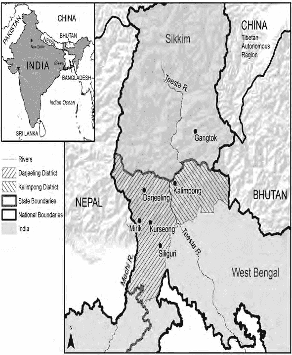
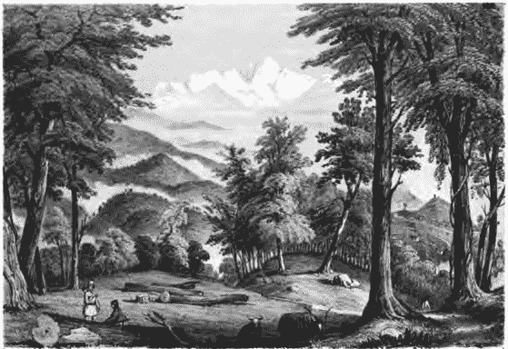
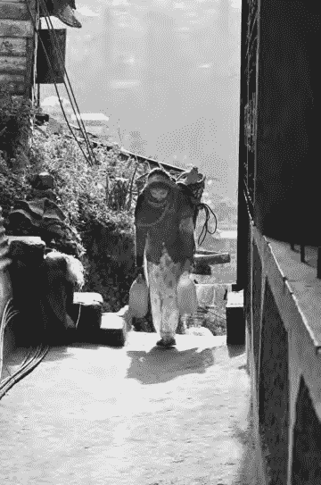
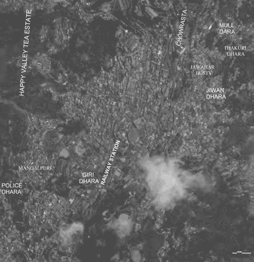
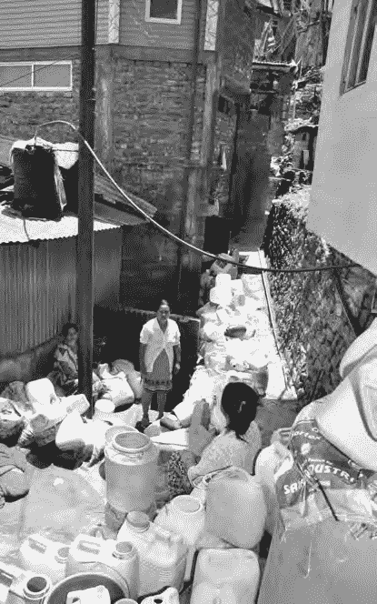

# 重新审视大吉岭：历史、政治与环境

## 重新审视达贾岭

### 达贾岭及周边地图

## 重新审视达贾岭

*历史、政治、环境*

*编辑：*

Townsend Middleton

*以及*

Sara Shneiderman

1

作者已主张其精神权利。

### 达贾岭及周边地图

*致达贾岭的人民*

## 致谢

《重新审视达贾岭》是无数对话和贡献的结晶，其中许多内容超出了本书的范围。构成本书的个人作者无疑将向影响他们各自章节的许多人表达谢意。但作为编辑，我们代表所有人向达贾岭的人民表示最最初也最深心的感谢，没有他们，这本书就不可能完成。到最后，我们希望这本书被视为我们对记录达贾岭这一宏大项目的一小贡献。

该项目起源于编辑、作者以及达贾岭地区其他人士的一系列讨论。2015年10月，我们在威斯康星州马迪逊聚集了该社区的许多成员参加为期一天的工作坊——威斯康星大学南亚年度会议的组织者热情主持了这次研讨会。我们从讨论员 Bengt G. Karlsson 和 Arjun Guneratne 的参与中受益匪，他们阅读并对所有工作论文发表了评论。尽管他们可能没有列为作者，但他们的见解仍本书的核心。

在编辑本书期间，我们对所属机构的支持表示感谢——对于 Sara Shneiderman，感谢来自不列哥比亚大学（UBC 人类学系）、公共政策与全球事务学院、彼得·沃尔高等研究学院；对于 Townsend Middleton，感谢来自北卡罗来纳大学教堂山分校（人类类学系）。

我们还想感谢编辑助理 Zoë Johnson 的巨大贡献，她在担任 UBC 大四本科生期间承担了这一项目，并在前往牛津大学攻读发展硕士（MPhil）之前完成了它。她在幕后不勤的工作成功地将这手手稿整合在一起，塑造了其整体轮廓，并确保了在没有她的情况下无法实现的质量水平。

此类项目会以各种方式融入我们的个人和职业生活。Townsend Middleton 向所有支持他生活各项项目（包括本书）的家人和朋友表示特别谢意——并向他的妻子 Esmaili 感谢，她在20世纪90年代末就先于他来到达贾岭，并在随后在那里进行了许多合作研究。

## 缩写与术语

- `ABMS`：全印度马格尔工会
- `AIGL`：全印度古尔哈联盟
- `AITBA`：全印度塔姆族佛教协会
- `ASER`：年度教育状况报告
- `BGP`：印度古尔哈政党
- `BJP`：印度人民党
- `BLTS`：兄弟之子塔米人社会
- `CBI`：印度中央调查局
- `CPI`：印度共产党
- `CPI(M)`：印度共产党（马克思主义）
- `CPRM`：印度革命马克思主义共产党
- `CRPF`：中央预备警察
- `DGHC`：达贾岭古尔哈山区委员会
- `DTMTC`：达贾岭茶管理培训中心
- `EIC`：东印度公司

### 缩写与缩略语

xvi

- `FLO`：国际公平贸易标签组织
- `GDNS`：戈尔卡杜哈救济协会（Gorkha Dukha Niwarak Sammelan）
- `GJM`：戈尔卡新生解放阵线
- `GLO`：戈尔卡兰解放组织
- `GLP`：戈尔卡兰人员
- `GNLF`：戈尔卡国家解放前线
- `GNLF(C)`：戈尔卡国家解放前线（C.K. Pradhan派）
- `GTA`：戈尔卡兰领土行政区
- `HPSU`：大岭山民社会联盟
- `INC`：印度国大党
- `JAP`：人民运动党
- `MGNREGA`：《圣马·甘地国家农村就业保障法》
- `MSB`：曼加尔印度联盟
- `NBU`：北孟加尔大学
- `NGO`：非政府组织
- `NITM`：国家茶叶管理学院
- `OBC`：其他落后阶级
- `PMGSY`：总总理乡村道路计划
- `SC`：计划性种姓
- `SHG`：自助小组
- `SKS`：萨努农民协会（小农组织）
- `ST`：计划性部落
- `TB`：结核
- `TMC`：特里纳穆大会
- `TRA`：茶叶研究协会

### 关于语言的说明

尼泊尔语是达季岭的通用语，因此它是这些文章中最经常遇到的非英语语言。然而，读者在正文的不同部分也会发现源自印地语语、孟加拉语和莱普恰语的词汇。这种多样性凸显了达季岭复杂的民族—语言构成。虽然有几种正式的系统用于尼泊尔语和其他南亚语言的转写，这些系统依赖于重音符号或使用诸如“aa”或“chh”之类的双字母，但我们选择以简化的形式呈现非英语术语，以便非专业读者理解（并在此向这些语言的母语者和学者深表歉意）。所有的非英语术语均采用斜体，但专有名词、地名以及已被英语吸收的术语（如“coolie”）除外。我们努力在全书中保持语言使用的一致性，但在某些情况下，作者对同一个单词或概念可能会采取略有不同的方法，我们允许每位作者尽可能保持自己的风格。书末附有词表以供参考。

### 语言说明

xviii

## 引言

### 重新思考达季岭

Sara Shneiderman 与 Townsend Middleton

达季岭在南亚想象中占据着特殊的地位。凭借其喜马拉雅的山景、郁郁的茶园和凉爽的山间空气，达季岭成为了英国人完美的山地山区——一个与下方平原印度其他地区完全不同的地方，一个逃避帝国著名炎热的港所。对“山女王”的浪漫依然延续，每年有成千上万的国内外游客涌入该地区，品尝闻名世界的茶，沉浸在殖民怀旧中，并窥仰巨大的珠穆峰。

达季岭的声誉现在已经全球，其茶叶在全球市场上价格高昂，其遗产继续影响着好莱坞和宝莱坞的幻想。然而，这些浪漫的影像只讲述了达季岭故事。这本书提供了新的视角，旨在挑战并最终重新思考 Sara Shneiderman 和 Townsend Middleton，《引言：重新思考达季岭》，载于《重新思考达季岭：历史、政治、环境》，Townsend Middleton 和 Sara Shneiderman 编，牛津大学出版社（2018）。© 牛津大学出版社。DOI：`10.1093/oso/978019483556.0001`

sara shiderman 与 townsend middleton

2

达季岭的理解正在迅速变化，新一代研究者从欧洲、北美和印度的不同视角审视它。这本书汇集了来自这些地区的研究者，为达季岭的历史、政治和环境提供新的见解。达季岭的传奇地位在后殖民想象中正被重新思考。我们努力在全书中保持语言使用的一致性，但在某些情况下，作者对同一个单词或概念可能会采取略有不同的方法，我们允许每位作者尽可能保持自己的风格。书末附有词表以供参考。

*引言*

3

本书的目标是：首先，通过当代社会科学和人文的视角，挑战并最终重新思考达季岭的传奇地位；其次，思考达季岭告诉了我们什么。

达季岭的地理位置非常特殊。尽管它是西孟加邦的一部分，但,,,,,,,,

莎拉·斯尼德曼（Sara Shneiderman）与汤森德·米德尔顿（Townsend Middleton）

生态学与基于身份的政治。至关重要的是，本书的贡献为我们揭示了处于“主流”印度边缘的人是如何经历所有这些现象的。此外，这些来自大吉岭的观点深入探讨了后殖民领土的塑造、后殖民公民的困境，以及社会运动、治理与经济转型之间的交织，这些因素已定义了印度及其以外边缘的生活。因此，大吉岭成为一个替代性的——且具有批判性生产力的场所，通过它，我们可以参与到现代南亚及广阔后殖民世界上一系列备关注的问题。事实上，本书的项目之一是将大吉岭引入后殖民思维，并反过来探索这种批判性传统能教我们关于今天大吉岭的什么。

通过重新审视大吉岭，本书并非想要讲述该地区及其人民的*唯一*定性故事，而是通过各种视角和声音来挑战主流的叙事。秉持后殖民批判的精神，文章拥抱了跨学科合作的可能性。我们非常荣幸，本书的贡献者中包括人类学家、发展实践者、地理学家、历史学家和政治科学家，以及那些将自己定义为跨学科领域、桥接社会科学与文化、环境和文学研究的学者。读者将发现，同一个地方通过几种不同的方法论途径得到了探索，并通过一系列学科分析框架进行了进一步的折射。章节不是按学科分组，而是按主题分为三个部分：*异常之史*、*政治与社会运动*以及*环境与劳动*。在每个部分中，读者将发现对一组共同问题的多种处理方法——这些方法通常在生产性的张力中发展——它们共同从新的角度阐明了大吉岭。通过这些多样化的投入，我们勇于对这个经常被浪漫化的地区及其人民的传奇与严酷现实进行多维度的参与。我们希望，通过这种方式重新审视大吉岭的过去与现在，也能帮助为其未来开辟新的途径。为了随后的分析奠定基础，我们从该地区及其人民的简史开始。

## 殖民时期的大吉岭

> 注：此处原文标题为 Colonial Darjeeling，译文已对应。

大吉岭山地曾是南亚洲历史上的十字路口。受区域力量兴衰的影响，大吉岭的边界及其定义边界的领土主张随着时间的推移而不断变化。作为一个地缘政治边疆——既具有战略意义又十分敏感——这从前殖民时期到后殖民现状一直影响其在南亚背景下的地位。在18世纪的大部分时间里，梅河和提斯坦河之间（见扉页地图）的领土被西里姆的锡王（Chogyal）声称。该世纪最后几十年，尼泊尔向东的军事扩张使该地区落入尼泊尔戈哈帝国的控制。与此同时，提斯坦河以东的地区仍然属于不丹。尼泊尔对大吉岭的统治结束于1815年，当时在英尼战争（1814–16年）结束后，英国根据《塞戈瓦利条约》或称《苏加乌利条约》（1815年）以及随后的《塔塔利亚条约》（1817年），强制尼泊尔将该领土归还给西里姆。如果这标志着英国对该地区领土干涉的开始，那么不久后，帝国就开始对该地区及其人民提出更直接的诉求。

关于大吉岭殖民起源的故事已数不胜数。1829年，乔治·洛伊德上尉（Captain George Lloyd）和 J.W. 格兰特经过大吉岭，途中解决西里姆与尼泊尔之间的边界争议。该地点当时被当地莱恰人称为 *Dorje-ling*，意为“雷霆之地”。`Dorje-ling` 的月形山脊在洛伊德看来是一个作为山地疗养院的理想位置，殖民官员可以在此躲避下方平原的热热。洛伊德将其愿景传达给了印度总督威廉·本廷勋爵（Lord William Bentinck），后者同意 `Dorje–ling` 将成为一个极好的疗养院和监控喜马拉雅边疆的战略性军事哨所。印度副测量总监 J.D. 赫伯特上尉随后于1830年2月和3月访问了大吉岭进行实地勘测并表示赞同。为了推进该计划，1835年，英国东印度公司（`EIC`）通过一份官方《赠地证书》（1835年）从西里姆获得了一块约24 × 6英里的土地。凭借这片土地的租赁权，英国开始着将这片表面上“无人居住”的山地转变为一个真正的山地度假地。东印度公司于1839年任命 A. 坎贝尔博士（Dr A. Campbell）为大吉岭的首任主管，并认为该领土为“非管制地区”，因此赋予他根据其认为意愿开发山区的深远权力。英国统治的前几十年带来了重大的基础设施和环境变革，森林被开垦，道路被修建，英国小屋被兴建以满足英国人的需求。`Dorje–ling` 这道“实际上无人居住”的山脊因此开始向一个殖民地山地度假地快速蜕变。这些转型需要劳动力——这远超当地居民（主要是莱恰人和林布人）所能提供的。因此，英国从西里姆、不丹和尼泊尔招募工人，承诺提供工资、住所，并让他们脱离邻国生活中标志性的压迫性税收和劳役制度。成千上万的人涌入大吉岭，标志着深刻的人口变化的开始，这永远改变了山地的民族格局。在本书的贡献中，米德尔顿（Middleton）和沙玛（Sharma）从历史角度详细描述了这些流动模式，以及他们在法律和代表方面的一些挑战。虽然迁移是山地度假地形成的不可或缺的一部分，但也导致了东印度公司与其喜马拉雅邻国之间的紧张，邻国反对这些对人力资源的帝国主义侵害。英国与西里姆的关系在19世纪40年代不断恶化，并在1849年坎贝尔和著名植物学家兼探险家约瑟·胡克（Joseph Hooker）所谓的绑架事件达到顶峰。坎贝尔和胡克在无意外的情况下被释放，但英国利用这次冲突在1850年永久兼并了梅河和提斯坦河之间的地区。英国在19世纪60年代进一步扩张到该地区，通过英丹战争（1864–65年）及随后的《辛努拉条约》（1865年），将坎林青浦和提斯坦河以东的土地并入英国控制。至此，通常提到的大吉岭山地诞生了：该区域大致对应于现今的大吉岭和坎林青浦行政区。

英国对达季岭的“发现”已成为该地区历史学研究中的常便饭。但如果认为达季岭的历史始于殖民统治的到来，那是误导性的。在英国人到达之前，达季岭山脉（特别是卡林彭通 Kalimpong）一直是跨喜马拉雅贸易网络中的主要节点点，来自尼泊尔、西金姆、西藏、不不丹及更远地区的货物和商人穿过该地区，并时时将其作为家园。(14) 殖殖民时期的主权是充满争议且处于流变中的。正如历史学家凯特琳·华纳（Catherine Warner）所指出的，当地人口在不同时期向不同的权力交纳贡品，并在策略上与之建立了同盟关系。(15) 然而，英国统治实际上对该地区进行了重新领土化。随着新的主权主张落实在该地区及其人民身上，划分英属印度与尼泊尔、西金姆和不不丹的边界变得硬化。(16) 随着英国人和其他人对该地区的流动性人口提出主张，当时究竟谁住在达季岭这个问题成了一个关注点和长期不确定的问题。这种模糊性一直持续今天。早期的殖民记录声称，该地区由当地的莱普恰人（Lepcha）、林布人（Limbu）和布提亚人（Bhutia）稀疏居住。这些殖民人口统计充其量是不完整的。考虑到定义整个前殖民时期地区的贸易、迁移和主权的交织，当地人口可能比英国人记录的更具异质且数量更多。许多当地作家和历史学家主张达季岭所有说尼泊尔语的人们都具有土著性。这些修正主义历史与不同族裔对印度的权利和归属感主张紧密相关，正如尼尔兰伯·切特里（Nilamber Chhetri）在本本书的贡献中所述的那样。尽管在识别确定证据方面存在挑战，但这些主张应在背景中被理解为对归属感的重要断言。虽然无法验证不同群体迁移的确切日期和路线，但很清楚的是，英国殖民统治引发了进入该地区的大移民，并随之产生了持久的人口结构转型。

茶被证明具有决定性作用。19世纪40年代的实验证明茶在达季岭的山区生长良好。到19世纪50年代，欧洲投资者开始收购并把大片土地转变为茶园，这些茶园在今天已成为达季岭的标志。为了满足这一新兴产业对大量劳动力的需求，英国人向邻近的西金姆、不不丹特别是尼泊尔招募苦力来照料这种全球性现金作物。该产业在19世纪50年代和60年代期间迅速扩张。达季岭随后转变为一个不仅是殖民疗养地，也是资本主义生产场所。(17) 到1870年，已有56家茶园雇佣了约8,000名工人。到1900年，已有100多家茶园，估计雇佣了64,000名工人——几乎所有人在殖民记录中都被归类为“尼泊尔人”。(18) 然而，其他数据表明，殖民记录未能考虑到出生在达季岭的人与从尼泊尔新迁入的人之间的差异。在由高流动性塑造的多重身份背景下，这种对公民身份清晰度的缺乏仍然是当代身份政治的关键向量，下文将进行详细探讨。

这些经济和生态发展引发了达季岭文化景观的随之转型。随着来自喜马拉雅各地的各种族裔成员在这一新兴的山地车站找到工作，新来者带来了他们自己的语言、习俗和宗教实践。这些是该地区特征族裔多元化的基石。这些族裔的定居者在他们的喜马拉雅遗产中找到了共同点，尼泊尔语很快成为（并仍然是）达季岭的通用语。随着几代的更替，由于不同族裔成员的混合和通婚，他们祖先许多离散的语言和宗教实践让位了新的混合文化形式。今天，塔姆族（Tamang）、古隆贡族（Gurung）、纽瓦族（Newar）等群体的许多社区成员不再说祖先和尼泊尔同代的语言，而是在说和学习尼泊尔语、英语、印地语和孟加拉语中长大的。(19) 但语言和习俗流失的地方，获得了新的团结形式和文化认同。过去两个世纪这种文化流失、混合和民族形成的动态产生了达季岭独特的多元文化身份，并使山山成为喜马拉雅国际主义的独特场所。(20)

(14) Harris et al. (2016).

(15) Warner (2014).

(16) Warner (2014).

(17) 关于茶业史，见 Besky (2013); Bhowmik (1996, 2016); Chatterjee (2001).

(18) Besky (2013: 53); Kennedy (1996: 188–190).

(19) Turin (2014).

(20) Sharma this volume (2016).

尽管说尼泊尔语的人口成了多数，他们仍面临着艰难的处境。一方面，英国官员和种植园主用权利、住房和安全的承诺来诱骗定居者；另一方面，英国官员否认定居者在印度的公民身份和归属感。随着英国统治在20世纪中期的结束，达季岭的人们发现自己处于日益困难的境地。

## 独立后的政治与地缘政治

在政治上，这个故事是相似的。随着独立的印度寻求与其南亚邻国以及北方竞争对手中国建立自己的地位，该地区的地缘政治重要性具有了新的价值。达卓岭作为通尼泊尔、东巴基斯坦（1971年变为孟加拉国）、不丹、锡金姆、缅甸（缅甸）以及当然中国的门户，这确保了它将一直是政府审查和大量军事力量存在的对象。1947年的分治以及东巴基斯坦的划分进一步加剧了该地区的地缘政治意义——即开辟了被称为“西里里走廊”（Siliguri Corridor）的狭窄领土，将印度的“本土”与其民族迥异的东北部连接起来。达卓岭因此成为不仅是南亚乃至整个亚洲的边疆和十字路口，并成为印度的国家安全热点，这直接和间接地影响了当地的政治状况。1950年的《印尼友好条约》在两国之间建立了开放边界，但使尼泊尔语者难以获得完全作为印度人的身份认同。自独立以来，达卓岭在领土上一直属于西孟加尔邦，并完全受该邦的行政控制。在很大一段时期里，西孟加尔邦维持着世界上持续最长的民选共产主义政府。尽管印度共产党（马克思主义）（`CPI(M)`）对受压迫人民有所承诺，但该政权为达卓岭人民带来他们渴望和应得的自治及经济流动性方面进展甚微。由于 `CPI(M)` 代表西孟加尔邦政府，达卓岭争取自治的政治动员往往与反共力量结盟，考虑到占尼泊尔人口很大比例的种植园工人的阶级地位，这显然是一个悖论。Swatahsiddha Sarkar 和 Babika Khawas 在本书的贡献中探讨了这些阶级问题。

后殖民生活的条件点燃了达卓岭人民的一系列政治诉求。到20世纪70年代，山区的各种尼泊尔语族社区已汇聚成了一个强大的多民族社区，并越来越多地使用“戈尔卡”（Gorkha）这一族群名称。在此期间，具有尼泊尔背景的人们不断受到不安的提醒，意识到自己在印度处岌的地位。1967年米佐拉姆、1979年阿萨姆邦和梅格拉亚邦以及1980年曼尼普尔针对尼泊尔语者的种族清洗活动，粗暴地强调了尼泊尔语者在整个印度面临的日常歧视。20世纪90年代初，成上万名尼泊尔语公民从不丹尔逃离，以应对紧邻达卓岭的佛教王国内所谓的种族清洗，这进一步加剧了该地区的紧张局势。

这些事件使达卓岭人民产生了一种不安感，这种不安感持续侵扰并驱动着山区的社会政治生活。为了应对长期存在的偏见气候，全印度尼泊尔语委员会于1972年开始了一场争取尼泊尔语成为印度国语的长期斗争。这场全印范围运动在达卓岭拥有深厚的活动主义根基，但在整个70年代，在为印度数百万尼泊尔语语者争取语言承认方面一直处于挣扎。1979年，时任印度总理莫拉拉吉·德赛（Morarji Desai）公开宣布尼泊尔语是“外人在印度说的外语”，加剧了戈尔卡人的挫败感。鉴于上述充满焦虑的历史，德赛的言论触动了达卓岭痛苦的神经。

在整个70年代和80年代初，诸如`AIGL`和`Pranta Parishad`等地方政治组织详述了种族自治的诉求，但无济于事。在上述针对东北部尼泊尔人的种族暴力事件，以及持续将达卓岭人民边缘化到民族国家字面和比意义上的角落的各种结构性暴力的推动下，人们越来越感觉到，达卓岭的戈尔卡人需要一个属于自己的地方。1986年，一个新政党——戈尔卡兰民族解放阵线（`GNLF`）发起了一场在印度境内建立独立的“戈尔卡兰”邦的暴力斗争。

在`GNLF`富有魅力的领导人苏巴什·吉辛格（Subash Ghisingh）的带领下，戈尔卡兰运动的逻辑非常清晰：首先，达卓岭人民要求在印度境内拥有自己的国家，免受西孟加尔邦的压迫；其次，尽管达卓岭的戈尔卡人被贴上“局外人”和“外国人”的标签，但他们是忠诚的印度人。一个拥有他们自身族群名称的邦将因此在民族国家中确立他们的合法地位。正如吉辛格说：

> “我们这些与尼泊尔无关的印度尼泊尔人不断被误认为是‘尼泊尔人’，即外国国家尼泊尔的公民。但如果有戈尔卡兰，我们作为印度人的身份、作为属于一个印度国家的身份……将变得清晰明了。”

为了戈尔卡兰而拿起武器，戈尔卡人寻求以独立国家公民的身份，按照自己的条款离开西孟加尔邦进入印度。此外，种族自治似乎能为被压迫的历史提供补偿。

20世纪80年代的戈尔卡兰运动持续了三年（1986–88年）。被称为`bandhs`（大罢工）的全社会罢工、无休止的抗议以及针对政府准军事部队（中央预备警察部队）的零星暴力瘫痪了山区的生活。这场地方民族主义运动导致了估计297人死亡和1164间房屋被毁。公众对这场运动的记忆被集市上出现的斩首颅、被夷平的房屋、亲人的失踪以及其他创伤所困扰。

但最终，吉辛格、西孟加尔邦和印度中央政府达成了一个妥协性的行政上安排，即达卓岭戈尔卡山地委员会（`DGHC`，1988年建立）：这是山区一种新形式的政府例外。在这种安排下，达卓岭获得了有限的自治权，但该地区仍归西孟加尔邦政府管。

表面上，`DGHC`的安排回应了戈尔卡人对自治的诉求（从而回答了“种族问题”），同时保留了对这一地缘政治战略区域既有的主权指挥链（从而考虑了“安全视角”）。吉辛格和`GNLF`在接下来的二十年里控制了`DGHC`，但该安排最终变成了一个没有牙齿的实体，迅速引来了各方的怨恨。

尽管失败了，戈尔卡兰运动让达卓岭进入了国家视野，使其成为一个“喜马拉雅山天堂”之外的存在。此外，它在山区确立了一种独特的政治文化轮廓，这种文化充满了对印度权利、承认和自治的得不到回应且周期性的波动诉求。地方民族主义的愿望在未来的几年里将以多种形式呈现。

## 承认的替代路径

在80年代运动之后，达卓岭的许多公民寻求在印度获得权利和承认的替代路径。受世界范围内原住民运动激发的启发，构成大戈尔卡复合实体的各个民族群体动员争取被承认为印度的“计划族部落”（Scheduled Tribes, `ST`）——这种身份在印度享有平权行动的福利，在印度通常被称为“配额”（reservations）。

如果说这些“部落”运动利用了全球原住民斗争领域，它们也是更区域性——特别是喜马拉雅民族动员网络不可分割的一部分。2090年代与尼泊尔争取原住民权利的`janajati`运动的联系具有塑造意义。在尼泊尔，国际发展机构的相对较强存在鼓励了民族活动家通过1993年联合国原住民年等倡议与全球原住民话语接轨——这些思想进一步流到了达卓岭。

当古隆族、坦族、汤米族等群体在尼泊尔印度教王国努力以克服其历史性的边缘化时，达卓岭的同族者从尼泊尔的`janajati`运动中借鉴了策略、信息和灵感，为印度的身份政治增加了新的轮廓。

但根据后殖民国家的规定，在印度，寻求的身份并非`janajati`、“原住民”或“种族”。相反，这些运动将通过“部落”（tribe）这一称谓进行。坦族和林布社区在90年代初一直是争取`ST`地位的先驱，其他社区也随其后。到21世纪，对`ST`地位的追求变成了跨越山区的全民族现象，每一个尚未成为`ST`的主要民族群体都申请了部落地位。

达卓岭的四个社区（不第、列帕恰、夏尔帕和约莫族）自1950年以来一直享有`ST`地位。坦族和林布在2003年获得了`ST`地位。

*引言*

15

向部落政治的转向与民族复兴计划的重启相吻合，正如 Nilamber Chhetri 在本书中所述的那样。这些社区与其在尼泊尔的 `janajati`（土著）同胞合作，发起了旨在恢复祖先“丢失”的语言和文化实践的倡议。通过搜集人类学文献并向尼泊尔派遣研究小组，这些发现深化了这些群体的民族意识，并既成为民族重生的素材，也成为这些群体向国家申请部落承认的依据。

这种“部落转向”标志着达卓竹林政治的深刻变化——实际上，它将民族动员的旗帜从从0世纪80年代的戈尔哈（Gorkha）转向了20世纪90年代和21世纪初的“部落”。(38)

成为部落的的计算在2005年变得更加复杂，当时`Ghisingh`和全体民族解放联盟（`GNLF`）试图根据印度宪法的“第六附表”（Sixth Schedule）将达卓竹林打造为一个“部落地区”。该条款最初是为印度东北部的部落社区设计的，将提供符合条件的自治权以及特殊的领土和文化权利。

2005年底，`Ghisingh`、西孟拉普邦和中央政府签署了《和解备忘录》，宣布在山区引入第六附表地位。因此，对计划部落（`ST`）地位与第六附表自治的追求之间产生了协同。事实上，在2005年至2007年间，成为部落是当时的常态。

事后回来看，第六附表的建议从一开始就受到了限制。根据人口普查统计数据，当时只有32%的达卓竹林被承认为部落，这很难达到第六附表地位的宪法标准。(39) 此外，拟议“部落地区”的管辖范围并不 way——治理结构也是如此。第六附表地区应当包含传统的部落政治结构，但由于达卓竹林没有一套统一公认的此类结构，它如何作为一个“部落地区”进行治理仍然不确定。这些怀疑开始消磨公众的热情。

正那时，一场意料之外的风波席罩了达卓竹林。2007年，达卓竹林自己的 `Prashant Tamang` 赢得了热门全国真人秀《印度偶像》（*Indian Idol*）。

(38) 更广泛的背景请见 Middleton (2015);Middleton and Shneiderman (2008); Shneiderman and Turin (2006); Shneiderman (2015)。

(39) 在2017年中撰稿时，申请`ST`地位的申请仍处于悬而未决状态，尽管自2014年 `Narendra Modi` 任印度总理以来，这一方面曾出现过几次活跃，他曾表示将解决这些长期存在的问题。

`sara shneiderman and townsend middleton`

16 电视节目，《印度偶像》。

`Prashant` 的夺冠之路引发了达卓竹林人民以及整个南亚尼泊尔语使用者的强烈自豪之情。然而，当 `Tamang` 喜得“印度偶像”称号的欢乐转变为愤怒，因为新德里的一位电台 DJ 对 `Prashant` 的种族发表了歧视性言论。

随后在西利古里（Siliguri，该地区平原地区最重要的经济中心）发生了暴乱，导致数百名 `Tamang` 支持者被困在地区法院内，躲避窗外投掷物品的孟加拉语暴徒。最终，不得不出动军队来释放他们。《印度偶像》的这一波涵盖了各种情感，为尼泊尔语使用者提供了一个再熟悉不过的提醒：他们在印度处境不稳定的地位。

结果，这成为了一个转折点。在几天之内，`GNLF` 那个受人喜爱又令人畏惧的手下——`Bimal Gurung`——建立了一个新政党——戈尔哈人民阵线（`GJM`），要求建立一个独立的戈尔哈兰（Gorkhaland）邦。公众受到近期一系列事件的影响而精疲力竭，纷纷涌向 `Gurung` 的新党。`GJM` 在2008年夺取政，推翻了 `Ghisingh` 和 `GNLF`，并将反对派赶出山区。在 `Gurung` 的铁腕领导下，`GJM` 在短短几代人中发起了第二次戈尔哈兰运动。

`GJM` 宣布这次第二次戈尔哈兰运动是一场非暴力的甘地式斗争，但该党强硬的手段很快显露出来。党间暴力、恐吓和胁迫是他们权力的不可或缺的一部分。最初获得压倒性民意支持的、充满魅力的 `Bimal Gurung` 许诺戈尔哈兰或死亡。但随着多年斗争的持续，`GJM` 的努力收效甚寥。

像 `AIGL` 的 `Madan Tamang` 这样的反对派领袖指责 `GJM` 违背承诺，特别是当斗争似乎又要导向另一个妥协方案时，那个方案看起来可疑地像 `DGHC`（后者在1988年结束了第一次戈尔哈兰运动）。这是因为这两种行政安排都将个人权力交给了当时的领导人（先是 `Ghisingh`，后是 `Gurung`），而缺乏对普通公民产生广泛积极影响的实质性经济或政治改革。

随着他们的失败显而易见，`GJM` 打压了反对派。为了防止民主集会，`GJM` 暴徒在2010年5月21日袭击了 `Madan Tamang` 及其政党，在光天化日之下杀害了他。这可能是与 Mona Chettri 在本书中描述的“粗暴政治文化”相关的最臭名昭著的事件。这次暗杀震惊了达卓竹林，让许多人反感。

[第31页]

*引言*

17 `GJM`，以及 `Bimal Gurung`。(40) Middleton (2018)。

在2017年撰稿时，此案尚未结案，像一朵乌云笼罩在山区之上。

与此同时，戈尔哈兰运动起起伏伏。2012年，`GJM` 确实同意了一个名为“戈尔哈兰领土管理机构”（`GTA`）的妥协方案，但这再次提供了有限的自治，并随后遭到了失望。`GJM` 利用地方管理和资源通过庇护关系巩固了权力。

利用第二次戈尔哈兰运动带来的失望（正如 Bethany Lacina 和 Miriam Wenner 在本书中在不同政治时刻的所阐明的那样），反对政党如人民斗争党（`JAP`）、`GNLF`、`AIGL` 以及西孟拉普邦的特民国大会（`TMC`）已取得了重大的政治进展。

2017年，戈尔哈兰运动以意想不到的势头卷起。6月，由于特民国大会首席部长 `Mamata Banerjee` 声称孟加拉语将成为达卓竹林学校的必修课，`GJM` 的抗议遭到了警方暴力，导致街头多人死亡。国家的暴力激化了戈尔哈兰运动的新阶段，并迅速席卷整个地区，团结了跨政治光谱的人们和党。

政府向该地区派遣了额外的中央储备警察（`CRPF`）并实施了互联网封锁，但斗争以自80年代以来所未有的强度震撼着政坛。随后的104天持续罢工瘫了经济和日常生活，导致了宵禁、粮食短缺和巨大的痛苦。

但最终，2017年的戈尔哈兰运动几乎毫无收获。当斗争在2017年9月结束时，`GJM` 创始人 `Bimal Gurung` 已经下台，被通缉逮捕，并成为大规模搜捕的目标。与此同时，2017年9月20日，`Mamata Banerjee` 安插了更为温和的 `GJM` 领导人 `Binoy`。

莎拉·斯尼德曼和汤森德·米尔顿

18

`Tamang`作为重组后的戈尔卡兰领土当局（Gorkhaland Territorial Administration）的主席，实际上建立了一个调整后的现状，这可能更有利西孟加尔邦的利益。在夏季的斗争之后，这被证明是一剂难下苦药。即便在本书出版之际，达季岭的人们仍在努力适应2017年戈尔卡兰运动带来的令人迷措的后果。

这种丘陵地区亚国家主义动荡的反复出现与波动，强有力地强调了与达季岭当代政治文化（以及支撑其基础的、往往令人不安的历史）进行持续接触的必要性。戈尔卡兰仍然是终极的政治目标，但在近期经历的斗争和连续的失望中，许多人对实现这一目标的现有途径产生了怀疑。

这些近期的斗争是在印度范围内前所未有的社会经济转型背景下展开的。自20世纪90年代以来，印度的经济自由化改写了次大陆社会经济流动性的剧本。然而，当印度拥抱新自由主义改革和全球化时，达季岭的人们在很大程度上发现自己被局限在外，看着加速的国家主流进程。

在国内，正如德巴拉蒂·森（Debarati Sen）在本书的贡献中所解释的，茶行业与其地方政府及NGO的纠葛占据了当地经济。无论是受过教育还是未受教育的人，就业机会都寥寥无几。正如莎拉·贝斯（Sarah Besky）的章节深刻证明的，面对这些状况，尽管达季岭的对家有强烈的归属感，他们现在认为未来在别处。

但当说尼泊尔语的人前往孟加拉罗、加尔各答和新德里等地寻找教育和工作时，他们面临着困扰他们几代的熟悉的种族歧视和社会经济排斥。因此，印度的新自由主义推进只会加剧了达季岭及其人民的边缘化。

达季岭的许多困扰源于殖民时代基础设施的衰落，特别是该地区不足的汽车道路和过时的供水系统，正如乔金娜·德鲁（Georgina Drew）和罗尚·雷（Roshan Rai）在本书中探究的那样。虽然这些古朴的殖民地装饰一直是达季岭吸引游客魅力的一部分——正如鲁恩·贝尼克（Rune Bennike）在本书的贡献中所强调的商品化景观——但对于依赖这些资源维持日常生活计和福祉的居民来说，耐心已经被耗尽。

近年来，交通呈指数级增长，因为私车已成为自由化后印度中产阶级渴望的标志。新的高层建筑遮挡了达季岭曾经闻名的风景。同时，它们进一步加重了稀缺资源地的负担。这些新的城市化形式以及它们带来的资源短缺，与农村对达季岭茶园剥削性做法的长期关注构成了鲜明的对比，而这些剥削性做法在每一波戈尔卡兰运动中都发挥了重要作用。

与前述描述的争取自治和承认的历史性斗争并列，这些当代问题需要新的分析方法，积极探索政治经济与文化政治之间的关系。本集中的几位作者承担了这一紧迫任务，重点关注文化、政治、基础设施和资源管理之间的接合与断裂——在过去，更迫切是在现在。

## 重新审视达季岭

在这些条件下，我们认为现在是对比达季岭的过去、现在和未来进行批判性重新考虑的时候。无疑，达季岭是一个特别的地方——一个拥有卓越美丽、独特文化、精妙茶叶及其他的一切的地方这些真实和想象中的特质被证明塑造了我们今天所知的达季岭。

然而，在重新思考这一遗产时，挑战并不是完全消除达季岭的传奇，而是承认这种田园诗式的框架如何塑造了山间的生活，但同时也未能捕捉到它的活力和困难。只要达季岭的传奇继续在丘陵上投下长长的阴影，对这座“山中之皇”的后殖民浪漫将继续模糊和阻碍对该地区的理解——更重要的是，那些视这里为家的人的前景。

通过这样构思，重新审视达季岭的项目既是一项知识也是一项政治项目；它召唤了远超本书之外的众多声音。接下来的观点为未来的对话提供了一些素材，坦卡·苏巴（Tanka Subba）的后记将这些对话的显现轮廓带了焦点，以供未来考虑，同时他既赞扬也批评了这些贡献。

通过追溯达季岭后殖民传奇的阴影并照亮另一种生活，我们希望这些论文可以帮助根据自己的标准为重新审视达季岭开辟出一个空间。事实上，本书的编写基于一种可能性：重新审视达季岭的过去和现在可能随着时间的推移成为重构其未来的关键一步。

莎拉·斯尼德曼和汤森德·米尔顿

20

这里介绍的文章建立在几条知识生产和学术谱系之上，我们认为这些都是任何当代达季岭研究提议的基础。

- 第一是人口普查数据以及其他殖民学者-行政官（如乔治·格里尔森（George Grierson）和布莱恩·霍顿·霍奇森（Brian Houghton Hodgson））撰写的著作的遗产。无论我们是否乐意，正是这些早期的计数文本为我们构建达季岭的历史知识提供了起点，这一主题最近被凯瑟琳·华纳（Catherine Warner）等学者以令人兴奋的方式进行处理，并在米尔顿、贝尼克和沙尔马的贡献中得到了进一步的探讨。

- 第二是20世纪上半叶在达季岭活跃的文学领域，由帕拉斯马尼·普拉丹（Parasmani Pradhan）和I.B·雷（I.B. Rai）等尼泊尔作家创作关于尼泊尔身份的作品，正如普拉蒂乌什·翁塔（Pratyoush Onta）、迈克尔·哈特（Michael Hutt）和罗德里克·查默斯（Roderick Chalmers）等当代学者记录的那样。这项学术为探索达季岭、尼泊尔和喜马拉雅地区之间的文化社会政治联系建立了一个平台。

- 第三是同时期的藏语文学创作，代表作是20世纪20至60年代间出版于加林贡的月刊《西藏镜报》（Tibet Mirror），以及随后西方学者基于达季岭地区研究出版的、持续的藏学文献。最近的《跨文化研究》（Transcultural Studies）关于达季岭和加林贡的特刊最贴近这一传统。

- 第四是关于茶和农业关系的政治经济学研究，这种研究在20世纪60年代开始动力，主要是受马克思主义科学训练的印度学者将该地区视为一个既容易又“遥远”的田野调查地。达季岭邻近纳萨巴里（印度纳萨尔派毛泽主义运动的发源地），这有助于该地区的丘陵成为考察阶级、劳动力、性别、本土性和社会提升问题的替代关注焦点。在书中，贝斯和森在这一丰富的遗产的基础上进行了构建。

- 第五是对戈尔卡兰运动的研究。或许以苏巴的《族群、国家与发展：达季岭戈尔卡兰运动案例研究》（1992）为最佳代表，随着运动的不断重组，这种流派自然需要不断的更新，并且有更多近期的相关研究，包括贝塔尼·拉西纳（Bethany Lacina）最近的专著（2017）以及拉西纳和温纳在此书中的贡献。

- 第六是位于当地的学者（如苏巴、A.C·辛哈和马亨德拉·拉玛）在几部专著和论文书中出版的关于文化政治和归属感的著作。这项学术也启发了最近的项

## 引言

……本书的贡献者的专著，包括 Mona Chettri (2017)、Townsend Middleton (2015) 和 Sara Shneiderman (2015)，这些观点在 Nilamber Chhetri 本处的贡献中也得到了延续。

第七，我们感谢近期关于西金姆（Sikkim）研究的兴起，作者包括 Vibha Arora、Anna Balikci-Denjongpa、Mabel Gergan、Saul Mullard 和 Mélanie Vandenhelsken。我们认为这是与大吉岭研究相关的、且重要的文献体系，感兴趣的读者在阅读本书时应当一并参考。

尽管西金姆融入印度政治体系的轨迹与大吉岭地区截然不同——后者被植根于西孟加尔邦——但这两个地区的历史是交织在一起的，必须结合起来理解。第八，也是最后，我们认为这本书促进了大吉岭研究与印度东北部研究之间正在进行的对话。由于西里古里走廊提供了通往东北部的关键通道，大吉岭与定义东北部这一研究区域的历史和当代议题存在着一种挑发性的关系。`Sanjib Baruah`、`Sanjoy Hazarika`、`Duncan McDuie–Ra`、`Bengt Karlsson` 等人的开创性著作为思考大吉岭与东北部之间的运作联系、相似性以及差异提供了比较手段。这种比较性工作是一个更广泛努力的一部分，旨在重新思考大吉岭在印度、南亚以及更广泛的后殖民世界的地位。

## 本书大纲

然而，我们主要关注大吉岭自身的特质。第一部分是《例外的历史》（`Histories of Exception`），为读者提供了三个历史视角，解释了使大吉岭成为今日的领土、法律和表述方面的特殊性。这需要将大吉岭置于更广泛的殖民例外模式中，同时分离出那些区分大吉岭与其他例外空间的因素，无论是阿萨姆的茶区还是遍布整个次大陆的各种殖民“山地站”。(41) `Townsend Middleton` 从殖民治理、种植园主资本与劳动力流动之间的关系入手，证明了大吉岭如何为了资本主义剥削的目的被刻意地造成一个例外空间。

`Rune Bennike` 进一步发展这些观点，展示了大吉岭随后如何通过一系列表述手段被商品化为一个旅游空间，这些手段掩盖了构建其上的被剥削劳动的现实，以便将大吉岭山丘描绘成供殖民和印度平原居民的完美“避暑胜”。`Jayeeta Sharma` 在劳动力、流动和国际主义的考虑中增加了一个交叉性的敏感视角，探索了关于大吉岭空间生产的多种底层阶级视角。

第二部分《政治与社会运动》（`Politics and Social Movements`）在这些历史基础的基础上，针对大吉岭持续政治转型背后的种族、阶级和动员等挑战性当代动态进行了五项探讨。`Bethany Lacina` 将对选举政治比较研究的见解应用于戈尔卡哈兰运动（`Gorkhaland Movement`），通过追溯三位来自不同历史阶段的重要领袖的政治传记：`Deoprakash Rai`、`Subash Ghisingh` 和 `Bimal Gurung`。`Miriam Wenner` 考虑了政治活动如何经常“伪装”成社会工作，并从关注戈尔卡哈兰特殊性以及政治科学理论化广泛背景的视角，思考了其对动员的影响。`Mona Chettri` 利用了关于庇护和腐败的南亚区域文学，思考了尽管发生了所谓的意识形态转变，但“流氓”文化——执行暴力政权的年轻政党干部——如何仍然是政治格局中一个持续的特征。从主流政党领域转向平行但结构不同的种族政治世界，`Nilamber Chettri` 探索了大吉岭种族协会的多样历史，提供了一项历时研究，追踪了社区如何应对外部政治环境以塑造它们的自我表述和种族动员策略。最后，`Swatahsiddha Sarkar` 和 `Babika Khawas` 通过回顾已故先驱学者 `Kumar Pradhan` 的作品，将“阶级问题”重新引入大吉岭研究，他致力于提供一个理解尼泊尔民族认同形成与阶级形成之间关系的模型。

第三也是最后一部分《环境与劳动力》（`Environments and Labour`）展示了前两部分详述的例外历史和长期政治动员浪潮，如何通过生计和资源管理的日常体验影响大吉岭的当代公民。`Sarah Besky` 展示了“培训”如何是一个充满大吉岭定居与归属感挑战的政治空间，她通过对大吉岭茶管理培训中心的民族志证明了这一点。`Georgina Drew` 和 `Roshan Rai` 从水管理的视角处理排斥问题，调查了当地社会组织如何让如今许多大吉岭居民能够更好地获得这些关键资源。最后，`Debarati Sen` 展示了女性茶园工人如何从事日常创业，以弥合“公平贸易”等全球话语与当地工会政治之间的差距。

总而言之，这些章节从新颖且挑发性的视角重新审视了大吉岭。每篇文章都以某种方式与其他文章呼应；我们鼓励读者深入阅读所有章节，即使你在阅读此合集时对某个特定主题已有兴趣。如果不理解文化政治，我们就无法理解资源管理；如果不理解领土化的历史，我们就无法理解当代选举政治。这些只是跨越章节显现出来的一些联系示例，揭示了大吉岭是一个多维的场所，既是古老又是新的，既偏远又中心，既农村又是城市，既是放松也是剥削的场所等等。大吉岭的复杂性超过了任何单一作者或书籍所提供的范围，但我们希望详细重新考虑这个地方将证明对于学者、政策制定者和公民来说都是及时且富有成效的尝试。

(41) `Kennedy (1996)`。

## 历史：差异、资本与大吉岭例外

2011年7月18日，印度中央政府、西孟加尔邦政府和大吉岭执政党（`Gorkha Janamukti Morcha`，简称 `GJM`）签署了一协议协议建立戈尔卡哈兰地区管理局（`GTA`）——一个大吉岭丘的半自治管理机构。

我非常感谢编辑 `Sara Shneiderman`、本书的其他作者以及书中两位评审员对本章提供的帮助反馈。`Eklavya Pradhan` 和 `Jason Cons` 对这项工作也起了关键作用——当然，还有我在山地和档案库的朋友和合作伙伴。这项工作的不同部分得到了美国学术学会、杜克大学、IIE-富布莱特以及北卡罗来纳大学教堂希尔分校的支持。所有的缺陷由我本人承担。

汤森德·米德顿

28

一场自2008年以来一直持续的次民族主义动荡——这是几代人以来追求戈尔卡兰（`Gorkhaland`）独立国家的第二次运动。自2012年成立以来，临时的戈尔人委员会（`GTA`）很大程度上未能满足戈尔族人对印度长期自治的渴望。

在政治上，它运作为一个单党制的临时治理体制，其自治的政策和辖权不断受到地方、州和联邦政府的重新协商和操纵。这种*临时治理*的状态——借用伊丽莎白·邓恩（`Elizabeth Dunn`）的常用术语¹——在山区并不新奇。即兴且特殊的治理形式深植于该地区的过去。从19世纪30年代开始，由于英国官员被赋予了“全权委托”（`carte blanche`）将大吉岭打造为完美的山地疗养院，该地区性地被视为独立的——并且很大程度上“凌于”整个印度的纷争之外。

在殖民时期，大吉岭一直被免于标准的治理规则，首先作为“非规管地区”（`Non-Regulated Area`）治理，随后在1874年成为“计划地区”（`Scheduled District`），1919年成为“落后地区”（`Backward Tract`），并在1935年成为“部分排除地区”（`Partially Excluded Area`）。这种特殊性的遗产随后被延伸到一系列后殖民的配置中，包括：大吉岭戈尔卡山地委员会（1988年至2012年间）；将大吉岭变为第六附表下“部落地区”的失败尝试（2005–2007年）；以及最近建立的戈尔人委员会（`GTA`，2012年至今）。临时设立和特殊安排是山区治理的特征，使得大吉岭的历史“从头到尾”都是例外。

在本文中，我退一步思考，这种特殊性的历史如何既*标记*了大吉岭，又*造就*了它作为一个与众之外的地方。诚然：大吉岭的殖民历史符合更广泛的例外模式，这种模式延伸到了其他“边疆”、“落后”和/或族裔独特的地区——包括东北部的产茶区。然而，即使在这一宏大的殖民例外模式中，大吉岭作为一个特殊空间的历史产物在特定方式上也是独特的。与尼泊尔、不不丹和锡姆的邻近是大吉岭独特特征的一部分，其与加尔各答的距离也是如此。正如 `Bennike` 和 `Sharma` 在后续章节（本卷）中讨论的，这些地理环境使得大吉岭同时成为：一个具有地缘战略意义的“边疆”；喜马拉雅国际主义的中心；以及游客关注和殖民旅行的关键场所。这些元素构成了使大吉岭成为特殊空间的历史力量——它与殖民印度其他的特殊空间既相似又不同。

¹ 邓恩在格鲁吉亚的人道主义援助背景下发展了这一概念。见 `Dunn (2012: 2)`。

### 未被记载的历史

我的分析重点关注该地区历史中三个关键元素的相互作用：殖民治理、种植园资本和劳动力。在整个殖民时代，英国印度政府与大吉岭茶业之间的关系绝非稳定——它们受到明显的勾结、紧张和重新协商时期的影响。但这些关系塑造了大吉岭的生活，并使山区变得特殊。重新思考大吉岭的特殊性，本章利用19世纪的殖民档案，审视治理、资本和劳动力不断变化的安排，这些安排使该地区成为帝国资本主义的堡垒，并成为在心态上（即便非物质上）永远与印度其他地区隔绝的地方。

毫无疑问，大吉岭的特殊地位很大程度上归功于其地缘位置、其凉爽雾缭绕的喜马拉雅景观以及肥沃的土地。但在沉溺于这些浪漫的框架时，我们不应低估英国官员和种植主通过战略性实践，为了他们个人的利益以及更广泛的英国帝国利益而*造就*了大吉岭的不同。通过对山区主流历史学的反向阅读，我在这里探索大吉岭的特殊性，并非其喜马拉雅环境的“自然”结果，而是一种特定的差异与资本计算的终局，这种计算永远地改变了山区的生活。

在这方面，大吉岭提供了一个敏锐的视角，用以研究整个次大陆帝国资本主义扩张的更广泛范式。特别感兴趣的是英国行动者（特别是种植主）利用差异（种族、地理、行政或其他）来推进资本利益的策略。有时，这是与殖民政府共同完成的。但在其他情况下，种植园资本的目标与英国帝国的目标显然是冲突的。因此，如果我们想要理解塑造这一及其他殖民空间的治理与资本的相互作用，将这些记录区分开来至关重要。如果我们想要深入阅读工人如何为了自己的目的去协商——或许是操纵——大吉岭资本与差异的特殊地形，这同样至关重要。

在这些动态中，大吉岭既体现了更广泛的帝国模式，又要求根据自身的标准进行分析。在这里，值得将大吉岭的发展与印度东北部的其他“土著”、“边疆”、“落后”和/或产茶地区进行联系和对比。从这些地区如何被治理、劳动力如何进入市场、业务如何受到监管，以及大吉岭与阿姆（`Assam`）、卡查（`Cachar`）和西莱特（`Sylhet`）等地之间的连续性和对比来看，为在更广泛的帝国背景下定位大吉岭提供了关键参考。这些比较展示了它与其他“边疆”、“山地”地区之间耐人味的相似性，但也揭示了显著的差异，这些差异将大吉岭推向了独特的领域。

审视大吉岭长期的特殊性是这一尝试的重要第一步。要问的问题不是大吉岭是否特殊，而是什么——以及是谁让该地区变得如此不同、独特或特殊。为了这一目的，随后的历史批判旨在阐明大吉岭成为后殖民想象中如此特殊形象的那些未被讲述的过程。这需要思考大吉岭与特殊空间在历史上的相似性，以及它形成的差异。以这种方式面对这种原创性的遗产，对于理解大吉岭的过去和现在是必不可少的——或许对于重新想象它的未来也是如此。

### 临时治理的起源

英国在大吉岭的“发现”是一个被反复讲述的历史。乔治·洛德（`George Lloyd`）上尉和詹··格兰特（`J. W. Grant`）到达“大吉岭”并宣布这条月形山脊是殖民地山地疗养院的理想位置的故事，充满了经典发现叙事的元素：无无畏的旅行者偶然发现了一片荒凉无人的土地；立下领土主张；赢得羞涩“落后”当地人的心；并根据殖民者的文明设计成功地改造了土地和人民。大吉岭的这一“发现”在这里不需要进一步的庆祝。然而，这些胜利的历史引发了关于大吉岭究竟是如何成为备受赞誉的“山岭”的问题。例如，治理、资本和劳动的条件使得这些维多利亚设计得以实现？问题不在大吉岭变成了英国人的某种殖民乌托邦，而是如何实现的。

在英国于1835年通过备受争议的《授予契约》（`Deed of Grant`）从锡姆获得大吉岭后不久，将大吉岭改造为山地疗养院的任务被交给了 `坎贝尔（A. Campbell）` 博士。坎贝尔此前担任英国驻尼泊尔公使助理，因此他

*未竟的历史*

31

坎贝尔对喜马拉雅山并不陌生。1838年，坎贝尔负责这个新成立的山地站，并于1839年成为达吉岭的第一任总监——这一职位他担任了之后的二十年。² 赋予坎贝尔及其助理纳皮尔中尉的权力是极其惊人的。从技术上说，达吉岭是一个“非管制地区”，这意味着它可以根据其特殊需求和情况进行管理。³ 1839年起草的指南模糊地指示坎贝尔遵循“政府法律法规的精神”。⁴ 但实际上，这种安排赋予了坎贝尔近乎完全的权力，让他按照自己的意愿发展达吉岭。在这个职位上，坎贝尔承担了广泛的责任，包括：土地分配、与邻国外交、劳动力招募、税收、法律和警察管理、主持刑事和民事法庭，以及监督地区的基础设施和发展。坎贝尔的能力没有被忽视。1854年的一份报告解释道：

> “整个地区的管理自1838年首次割让以来，一直由现任总监坎贝尔博士负责。在他接管时，整个片山区还没有二十户家庭；而现在这部分已有10,000人口……总监完全没有得力；整个山站的进展以及疗养院建立的成功，完全仅归功于他个人的努力。” ⁵

一个人能行使如此广泛的权力，预示了使达吉岭快速变革的政府背景。值得注意的是，并不是坎贝尔从洛德上尉手中接管了复杂的行政机构

² 关于坎贝尔早期的活动，请参阅（`India, Foreign`，1839年9月19日, 167–68 P.C.),（`India, Foreign`，1839年10月9日, 97–98 P.C.）；（`India, Foreign`，1840年10月26日, 113–115 P.C.），（`Hodgson Collection, Vol. 9/9/47`）。为了简洁并便于进一步查询，我通过索索号引用了档案来源。

³ 另见 `Besky (2013: 43)`；`Subba (1889a, 1992)`；`Warner (2014)`。

⁴ “关于达吉岭山站所属山地建筑位置分配和土地授予的规则，以及该地区管理规则，于1839年9月4日通过，自公布之日起生效”，可见于（`India, IOR, 1854, v/23/94, [17]`）。引用的短语来自库奇比哈尔专员在1869年对1839–69年间达吉岭的审查。（`Bengal, Judicial, Proc 1870年12月1–13日`）。

⁵ (`India, IOR, 1854, v/23/94[17]`)。

汤森·米德顿

32

适用于达吉岭，但恰恰是由于这种权力的*缺失*。在整个19世纪40年代和50年代，官方报告都赞扬了坎贝尔在这一特殊安排下取得的成就——甚至将达吉岭的治理结构比作“对私人庄园的管理”，并额外拥有征税的益处。⁶ 坎贝尔权力的合法性是成疑的。事实上，人们对其基础提出了质疑。1854年的一报告将这种担忧表述为：“可以肯定，复杂的权利问题将会出现，总监管辖权的合法性将成为法律讨论的主题：因此，最好通过一项立法法案，界定总监的权力。” ⁷

根据这项审查，坎贝尔统治的根据是薄弱的，需要加固。然而，这些官僚体系的忧虑被轻易掩盖在他那些辉煌的成就之下。

从所有记录来看，19世纪40年代和50年代的变革是深远的。随着道路和平房的建立，英国殖民者开始意识到该山地站的恢复功能和经济潜力。⁸ 投资者获得了大片的土地。到19世纪50年代中期，种植者们正忙于建立茶园，这些茶园将成为达吉岭的标志性产业。在记录这些发展时，殖民档案对于那些土地和生活遭受这些变化的当地住民几乎没有见之甚少。然而，官方记录所说明的是一种放任式特权政府（`laissez faire adhocracy`）的起源，为重大的资本扩张奠定了基础。

治理与私人资本之间的勾结在土地分配问题上尤为突出。坎贝尔行使所有权和分配土地的权力，单方面将大量原住民土地和公用地转换为欧洲投资者的私有财产。⁹ 这种原始积累手段预示了坎宁勋爵1861年的《出售荒地决议》，该决议在全印度范围内建立了法律程序，将指定的“荒地”转换为私有财产。¹⁰⁰⁰ 殖民法将“荒地”定义为无人居住的

⁶ (`India, IOR, 1854, v/23/94`)。

⁷ (`India, IOR, 1854, v/23/94`)。

⁸ `Kennedy (1996)`。

⁹ `1839`。

一旦被指定为“荒地”，殖民国家就可以将该领土出售或租给私人使用。对于英国利益而言，原始积累的益处是双的：第一，私有化使这些土地进入纳税范围，使达吉岭产生收入；第二，大块私有财产的形成为资本主义铺了舞台——尤其是茶园驱动的经济。

*未竟的历史*

33

未开发的，因此是不产生税收的土地。出售“荒地”与达吉岭是“无人居住”的叙述完美契合——这两者都方便地抹杀了当地农民的存在。

随后对土地分配的审查（在坎贝尔任期后的19世纪70年代进行）揭露了对“荒地”定义的泛泛滥用。坎贝尔及其继任者 `B. Morton` 宣布为“未开发”的许多土地实际上一直有当地农民。

审查随后得出结论，达吉岭的大部分土地“越过佃户（`ryots`）被出售”，这一过程剥夺了当地人民的土地和权利。

随着官员和规划者将达吉岭私有化——并将居民排除在历史记录之外——征收和原始积累随之产生了他们所需的从属状态。

¹¹ （`Annual Report on the Police of the Darjeeling Division`，`India, IOR, 1861, V/24/525`）。

¹² 当土地越过佃户头部出售时，佃户被允许离开出售土地、接受租赁，或在某些情况下成为园里的工人。（`Lands Sold Over the Heads of Ryots in the Darjeeling District`，`Bengal, Revenue, Head, WL, Coll. 6, Proc 1873年8月14–15日`）。

¹³ 关于该地区殖民前的轮耕制度，请参阅 `Warner (2014)`。

¹⁴ 例如，1873年孟加政府的一项名为《达吉岭地区荒地非法出售》的决议解释道：“达吉岭地区有一种习惯，在论及旧赠地时，说人们是在‘赠与做出之后’才来的。”

汤森德·米德顿

34

随后，达季岭的任何进一步“荒地”销售均被禁令。但到那时，损害已大体造成。达季岭大部分优质土地现在已落入种植主手中。土地的私有化——特别是“荒地”——因此成为一种机制，坎贝尔和一少数英国利益集团通过这种机制，有效地将达季岭转交给一个新兴的种植主阶级，他们与后者有着显而易见的利益。这种土地分配制度标志着殖民治理与种植主资本之间历史性的勾结，这种关系将决定未来几十年达季岭的命运。重要的是，这种勾结并非通过对荒野土地英雄式的发现和驯服，而是通过特殊的行政安排实现的，这些安排赋予了达季岭早期领导者——即坎贝尔——实现英国帝国设计的广泛权威。正如后来愈发清晰的，建立一个殖民乌托邦需要大量的不成文规定和不成文的生活。

### 劳动力招募与策略性非正式化

将达季岭建成山地站需要大量的劳动力——远超当地人口所能提供的数量。坎贝尔在英国人到达时认为达季岭地区“几乎无人居住”，转而向邻的西金姆、不丹和尼泊尔寻求所需的劳动力。(14) 坎贝尔在这些邻国看到了可能有利于英国的条件——其中包括奴隶制、强迫（`begari`）劳动制度和压迫性的税收方案。(15) 这些推力因素，加上达季岭工资劳动和自由的吸引，促进了劳动力的大规模涌入。但这种劳动力迁移带来了许多法律问题。与东北部的茶行业劳动力来自印度本土不同，达季岭劳动力池的跨国因素引发了一系列不同的担忧。邻国政府拒绝批准向达季岭迁移。在19世纪的尼泊尔、西金姆和不丹，臣民被视为主权的财产，因此必须纳税并履行国家义务劳动。(16) 因此，英国达季岭不仅是国家忠诚和收入的竞争者，而且关键的是，还是劳动力的竞争者。1841年，坎贝尔写信总督解释道：

> “总督会议很容易发现，几乎所有定居在达季岭的山民根据习俗都可以由我们的邻国向我们索要。同样明显的是，如果承认此类主张的正当性，英国政府许多情况下将直接纵容奴隶制，在这些情况下……它将不公正地干涉所有人本应和平诚实采纳新法律作为自己的权利。”(17)

坎贝尔的信描绘了一个奇特的自由主义困境：要么通过鼓励这种具有政治争议的迁移模式来满足达季岭的劳动力需求，要么顺从压迫政权并纵容奴隶制。考虑到他的自由主义信念和对劳动力的需求，坎贝尔在整个19世纪40年代和50年代暗中地鼓励劳工从西金姆、不丹和尼泊尔迁移，用他的话说，“为许多新移民和定居者提供了大量的缓解和援助”。(18)

随着19世纪50年代达季岭茶产业的出现，对劳动的需求大幅增加。茶园从整个地区的社区招募劳工。但尼泊尔很快成为主要来源，数千人已准备好并愿意前往达季岭开始新生活。对于英国人来说，尼泊尔不仅在产出的工人数量上是最佳的，在质量上也是如此。(19) 涌入边界的古隆人、雷斯人、塔姆族人和其他族群被认为特别适应达季岭的山区气候。英国人发现了一个理想的劳动力池。

## 不成文的历史

### 注释

35

(14) (India, `Foreign`, 1841年6月28日, 135–6FC)。

汤森德·米德顿

36

(15) 关于这些推拉因素，请参见 Chatterjee (2001: 65–80); Holmberg et al. (1999); Hutt (1997: 109–13); Shneiderman (2015: 110–15); Subba (1989, 1992: 39–44); Subba and Sinha (2003: 14–17); Whelpton (2005: 50–5).

(16) (India, `Foreign`, 1841年6月28日, 135–6FC); (India, `Foreign`, 1858年12月31日, 2522–6FC)。关于 `begari` 劳动，参见 Warner (2014)。关于税收，参见 Shneiderman (2015: 111–12)。

(17) (India, Foreign, 1841年6月28日, 135–6FC).

(18) (India, Foreign, 1841年6月28日, 135–6FC).

(19) (India, Foreign, 1881年3月, 3––... [重复数字]) 的定居者。尼泊尔政府允许在尼泊尔其他地方招募古尔族士兵，但反对向达季岭迁移。事实上，尼泊尔国家要求移民立即返回，承诺对难民特赦，否则将拒绝未来入境。

(20) (India, Foreign, 1858年12月31日, 2522–6FC).

(21) Middleton (2013a, 2013c).

(22) (Bengal, Judicial, 1868年8月, Proc 200); (India, Foreign, 1868年8月, 219–20, Political, A).

(23) (India, Foreign, 1854年12月29日, 22–34SC); (India, Foreign, 1859年12月30日, 1431–1446FC/SUP); (Bengal, Political, 1864年11月, 27–8).

(24) (India, Foreign, 1868年8月, 219–20, 404–5, Political, A); (India, Foreign, 1869年2月, 9, Political, A); (India, Foreign, 1878年3月, 1–8, Political, A); (India, Foreign, 1864年1月, 222–3, Political, A); (India, Foreign, 1866年7月, 63, Political, A); (Bengal, Judicial, 1868年8月, 206–9).

## 未被记载的历史

1873年的一份政府报告指出，“尼泊尔人口的增长是种植园主对未来劳动力能获得的最好保障。”(25) 如果事实如此，那么英国人是如何规避移民的法律困境以满足他们对这种理想劳动力的需求的？

英国人依靠非正式劳动力招募者（被称为 `sardars`）将劳动力带到大吉岭。这在很大程度上符合整个殖民时期印度的劳动力招募模式，即非正式招募者（`sardars`）是各类行业（包括种植园和其他行业）不可或缺的一部分。然而，大吉岭的 `sardari` 系统具有独特的形态，特别是涉及跨国迁移、合法性和监管问题（这一点我稍后会详述）。与在次大陆其他地区运作的 `sardars` 相似，这些当地招募者利用他们的族群纽带、当地知识和文化熟悉度来散布关于更好生活的消息，以此吸引劳动力。(26) 直到今天，人们还能听到关于穆加兰（Mugalan，当时对印度的称呼）茶树上长着“黄金”的民歌。(27) 一般而言，`sardars` 组织了苦力队伍，将他们带过边界，送到需要劳动力的特定庄园。然而，他们的作用不仅仅是将劳动力运送到市场。`sardars` 在种植园系统中占据了关键位置。通过与种植园主紧密合作，这些当地代理既供应又管理劳动力。(28) 对于苦力来说，`sardars` 是与主主的联系人，也是园内的社区领袖，协调工人的物质和文化需求。作为劳动力与管理之间的中间人，`sardars` 是整个系统的枢纽。

`sardari` 系统是大吉岭历史中一个很大程度上未被讲述的章节。`sardars` 不仅负责十九世纪涌入大吉岭的数万劳工，还帮助塑造了一个初生的文化景观。种植园主意识到一个优秀 `sardar` 的价值，便委托器青的 `sardars` 向其庄园内的劳工发放房屋和小块块土地。很快，小村社区开始围绕 `sardars` 发展起来，他们成为了这些苦力村的 `de facto` 首领。

(25) (Bengal, Revenue, Head, WL, Coll. 6, Proc 14–15, August, 1873).

(26) 关于 `sardari` 劳动力招募，另见 Besky (2013: 56, 74–7); Bhowmik (2016); Middleton (2013a: 612), (2013c: 17); (2015: 36).

(27) Hutt (1998); Shneiderman (2015: 113).

(28) 正如 Warner 所言，`sardari` 系统类似于该地区先存在的首领和客户-赞主关系 (2014: 27–31)。

由于 `sardars` 倾向于从自己的族群内部招募，这些苦力村通常具有明显的族群特征——因此获得了如古隆布斯蒂（Gurung Busti）和塔曼布斯蒂（Tamang Busti）这样的名称。因此，`sardars` 在大吉岭种植园随处可见的斑块族群地理方面有很大责任。直到今天，这些茶园仍保留着丰富的口述历史，记录了 `sardars` 在塑造丘地日常生活方面所起的关键性作用。

对于英国人来说，`sardars` 还有其他用途。通过将跨国移动人体的脏活儿丢给这些当地行动者，种植园主和殖民官员撇清了对这种劳动力迁移的可疑合法性的责任。此外，`sardari` 系统实际上可以自我运行，几乎不需要资本投入。随着非正式招募者供应和管理劳动力，政府的监管既被需要也不被欢迎。监管只会引起人们对一个对他们利益至关重要但在法律上充其量也存在问题的劳动力招募系统的关注。因此，整个系统在一个准法律领域内运行，这规避了对正式文件、记录和正式监管的需求。总而言之：该系统之所以有效，*恰恰是因为它是记录之外的*。只要一直保持这样，`sardari` 劳动力招募将一直是丘地资本主义的枢纽——也是其历史上一个具有战略意义的未记载章节。(29) 就像土地一样，劳动力方面也是如此，大吉岭的行政安排——涉及到操作性的监管*缺失*——为种植园资本提供了肥沃的土壤。

### 阿萨姆的对比

印度其他地区的情况看起来相似但也有不同。`sardari` 劳动力招募对整个英属印度的行业起着至关重要的作用——特别是东北部的茶区。(30) 然而，与大吉岭的 `sardari` 系统保持着战略性的非正式和不受监管不同，阿萨姆、卡查尔（Cachar）和西莱特（Sylhet）等地的 `sardari` 招募成为日益增长的监管关注对象。到1960年代初，与非正式招募相关的滥用已成为印度劳动力迁移的普遍现象。小那格（Chota Nagpur）和桑塔尔帕尔加纳（Santal-Parganas）内陆地区不仅是东北部，也是毛里求斯、英属圭亚那、特立尼达及更远殖民地的苦力主要来源。`sardars` 服务于多个行业，在将土著从家园带到阿萨姆的茶园以及加尔答港方面起着作用，在那里他们被塞进开往整个英国帝国从事奴役的船只。然而，由于缺乏监管，`sardari` 动力很容易受到滥用。`sardars` 经常在雇用条款甚至目的地上误导苦力。对于前往东北部的苦力来说，旅途中是危险的，因为一群苦力会从一个 `sardar` 转交给另一个 `sardar`，最终到达工作地。由于缺乏身份识别、证明和保障，苦力与种植园主之间缺乏正式合同。`sardars` 的狡诈是一把双刃剑。对苦力权利和福祉的侵害是显而易见的。但不受监管的招募也给种植园主带来了问题。这种缺乏监管的招募对资本家来说意味着他们需要特定类型的劳动力。在这个市场中——正如 Ghosh 所述——这种不受监管的招募导致了劳动力数量的碎片化问题。

(29) 这解释了为什么大吉岭信息的相对匮乏，对比阿萨姆、卡查尔和西莱特。

(30) Ghosh (1999); Sen (2010).

(31) Ghosh (1999).

(32) 完整标题是“移民保护、医疗检查与移民”。见 (Bengal, General, Emigration, Proc 20, 1861), (Bengal, General, Emigration, Proc of 1864), (Bengal, General, Emigration, Proc 69–73, August, 1865)。

(33) 尽管对尼泊尔的干预是不可能的，保护官员还是承认尼泊尔是一个来源。(Bengal, General, Emigration, Proc 40–61, June 1865)。

保护官员在整个阿萨姆巡视种植园，以确保：

- 苦力得到了合理的报酬；
- 他们是自愿迁移的；
- 工作条件是人道的。

根据这些职责，保护官员充当了苦力的维护者。然而，该职位的设立也通过稳定进入市场的劳动力数量服务于种植园资本。随后制定了更广泛的法律，将招募者正式纳入国家监管范围。针对阿萨姆、卡查尔和西莱特的苦力合同也继之后。

(34) (Bengal, Financial, Emigration, Proc 13–20, February, 1865); (Bengal, Financial, Emigration, Proc 40–61)。

随着政府对劳动力招募地下世界的兴趣日益增加，两个主题变得格外突出：身份识别和健康。(35) 旅途中苦力的身份识别将有助于维护和保护其个人权利。沿途的医疗将确保他们的身体健康。但这些对苦力身体认识论和医学化的监管兴趣具有附加目的。它们回答了对英国两个极具价值的问题：

1. 种植园主和其他资本家如何知道他们雇用的是*谁*？
2. 他们如何保证苦力的体力——以及劳动力能力？

接下来的二十年（60-80年代）的监管措施完善了对苦力身份和健康的关注。(36) 劳动力迁移路线设立了检查站和站点以建立苦力的身份。当苦力到达这些哨所时，他们的人类学特征（种姓/部落、原籍地区等）被记录在官方账本，并获得了证明身份的证明，使其能够进入正式

(35) (Bengal, Financial, Emigration, Proc 72, August, 1865).

(36) 一般而言，见期间总部门的内陆迁移记录。更具体地，见关于阿萨姆苦力贸易的议会报告（India, Parliamentary Papers, IOR, V/50/357, 1867); (Bengal, Financial, Emigration, Proc 34, April, 1868); (Bengal, Financial, Emigration, Proc 21–3, November, 1870); (Bengal, General, Emigration, Proc, B63, November, 1871); (Bengal, General, Emigration, Proc 58–9, December, 1871); (Bengal, General, Emigration, Proc, B90–3, February, 1876).

## 不记载的历史

41

一旦他们到达目的地，就会与种植主签订合同。(37) 这些身份识别措施还辅以健康检查，政府医疗检查员通过检查判断个人是否“适合劳动”。(38) 那些身体不健康的人被留在了仓库。被认为体格健壮的人则允许继续前进。

这些监管机制自然地减缓了劳动力的供应。没多久，阿萨姆的种植主们就开始抱怨了。(39) 种植主们将保护官的监管干预称为“对茶区劳动力供应的强有力阻碍和反对”。(40) 种植主们进一步认为，迁移路线上的监管困扰会传回阿迪瓦西（`adivasi`）后方，从而导致“不会使他们（[苦力]）来源的地区对前往茶产省的迁移倾向更易被接受”。(41) 种植主的投诉展示了监管的双重性。

一方面，这些规定确保了工人的权利并为资本家提供了稳定的劳动力供应。对于茶行业而言，对特定类型的苦力进行准确识别和评估其健康状况被认为是至关重要的。正如一位种植主在19世纪80年代（在这些监管机制实施几年后）反思的那样：“当然，我不寻求像过去那样的苦力了，但只要你给我送来皮肤健康、胸腔宽阔且没有水肿倾向的人，我很满意。”(42)

另一方面，监管限制阻碍了种植主资本本身的运作。它们通过形式化一个赖于非正式性的劳动力供应链来实现这一点。阅读这些投诉，人们能感受到一种资本精英阶级想要“既要又要”。这种对监管的既呼吁又抵制的矛盾诉求，成为这一时期种植主与政府之间矛盾往来的显著特征。因此，东北部种植主资本与殖民治理之间的紧张关系由此产生。

(37) (Bengal, Financial, Emigration, Proc 13–20, 1865年2月); (Bengal, Financial, Emigration, Proc 69–73, 1865年8月); (Bengal, General, Emigration, File 43, Proc 34–6, 1878年3月); (Bengal, General, Emigration, File 43, Proc 10–22, 1878年4月); (Bengal, General, Emigration, File 93, Proc 1–6, 1878年9月); (Bengal, General, Inland Emigration, File 29, Proc 1, 1879年4月); (Bengal, General, Inland Emigration, Proc All, 1880年11月); (‘The Labour Districts Emigration Act’, Bengal, General, Inland Emigration, Proc All, 1881年2月); (Bengal, General, Inland Emigration, File 36, Proc 1, 1885年12月)。

townsend middleton 42 (注：正文接脚注之后)

(38) (Bengal, Financial, Emigration, Proc 34, 1868年4月).

(39) (Bengal, Financial, Inland Emigration, Proc 103–4, 1865年11月).

(40) (‘Letter from Jardine, Skinner and Co’ in Bengal, Financial, Inland Emigration, Proc 103–4, 1865年11月); 其他投诉见 (Bengal, General, Emigration, Proc, B63 1871年11月); (Bengal, General, Emigration, Proc 58–9, 1871年12月).

(41) (Bengal, General, Emigration, Proc 103–4, 1865年11月).

(42) (‘Letter from James Bining to Government of Bengal’, Bengal, General, Inland Emigration, 36, Proc 1, 1885年12月).

### 特殊地带

阿萨姆治理、种植主资本与劳动力之间这些日益监管化的关系，与达卓岭（Darjeeling）有什么关系？几乎毫无关系。而这恰恰是我们看到达卓岭与东北部茶产区之间有趣的地方。从表面上看，阿萨姆的茶行业与达卓岭有许多共同点。(43) 在这两个地区，种植园经济在19世纪都引入了显著的环境和文化变化。对劳力的巨大需求引发了迁移，深刻地改变了两个地区的人口结构。而 `sardari`（包工制）劳招招对这些转型至关重要。然而，一旦涉及到监管，阿萨姆与达卓岭之间的相似性就结束了。

与阿萨姆及东北部其他地区不同，达卓岭的 `sardari` 系统方便地排除在监管之外。在劳动力招募方面，达卓岭完全不在监管地图上。（参见图1.1，达卓岭完全没有出现。如果它出现，将位于右上角标题后方。）

这并非偶然。这种“特殊地带”而是政府与达卓岭种植主之间长期勾结的结果——而且日益成为对监管入侵山区的积极抵御。

由于达卓岭紧邻阿萨姆，劳动力招募的地理区域不可避免地存在重叠。杜尔（Dooars）、贾尔帕古里（Jalpaiguri）和泰莱（Terai）通常成为自然的监管区。随着招募者进入山区，达卓岭[不受监管]的状态依然存在。

（43）关于阿萨姆茶行业的研究非常详尽。见 Behal (2006)；Sharma (2009)；Bhattacharya (2011)；Chatterjee (2013)；Nag (2000)；Subba (1989)。

## 未记载的历史

45

在19世纪的后几十年里，英国帝国在东北部、缅甸、毛里求斯、加勒比殖民地等地的劳动力需求迫使他们开拓新的劳动力招募领域。现在，随着招募者渗透进他们珍视的领土，大吉岭（Darjeeling）逐渐“进入地图”。

种植园主们试图规避劳动力竞争的努力，最终遭遇了一股不可阻挡的力量——英属印度政府本身。几十年来，英属印度军队从尼泊尔招募士兵来填补著名的古尔卡兵团的人员。在1857年起义后，尼泊尔那些“勇敢”的“武士民族”证明了他们的勇气和忠诚，英国人大幅扩大了古尔卡兵团。(48) 这给古尔卡兵团位于尼泊尔中部和部的传统招募地造成了压力。随着古隆族（Gurungs）、马加尔族（Magars）等人的家园失去了有能力且愿意服役的人员，招募者向东进入了雷伊族（Rais）、林布族（Limbus）等人的领地——换句话说，就是大吉岭进入了种植园主的招募地。(49) 进一步的竞争来自阿萨姆和缅甸警察，他们也渴望从这些地区招募尼泊尔人充实。(50) 为了方便从尼泊尔的移民（可能也是为了开发当地资源），19世纪90年代初，在大吉岭建立了一个古尔卡招募中心。(51) 这意味着潜在和实际的茶工可以比以前更容易成为士兵和警察。(52)

种植园主向政府提出了严苦的哀求，要求停止这种入侵，并保护让大吉岭茶产业繁荣的独特劳动力条件。一份来自1890年的种植园主备忘录该备忘录将行业对私有劳动力的依赖描述到了近乎存亡的高度：

> “对于我们大吉岭的地区来说，保留所有当地劳动力对于我们茶园的发展至关重要……来自平原的进口劳动力并不会繁衍，也不会留在这里。我们完全依赖这些山丘的本土劳动力。最近，来自卡查尔（Cachar）的招募干扰了这一点，如果这种情况持续下去，这些山区的茶产业将成为过去。”(53)

从各种表现，从大吉岭招募民事和军事劳动力正在造成损害。大吉岭副专员确认，在当年的两个月内，仅在缅甸服役就有1000多名劳工被招募走，而他正竭尽全力停止从茶园进行招募。(54) 这可能是一次徒劳的努力。

种植园主在19世纪90年代反复阐述了他们的诉求。他们反对在山中工作的“掠夺性招募者”，主张将他们的茶工招募为警察和军队，以及在东北部从事茶工工作，正导致他们的劳动力池流失并产生有害影响。(55) 他们援引资本利益的差异，呼吁政府承认并保护大吉岭独特的劳动力市场。这需要对“特殊性”进行细致的谈判，其中种植园主必然将大吉岭描描述为与东北部既相似但在运作上不同的地区——你可以说，是更广泛的“特殊空间”模式中的一个例外。引人深味的是，阿萨姆在这些保护诉求中提供了一个富有成效的对比：

> “因此可以认为，阿萨姆种植园主和大吉岭种植园主地位之间的唯一区别在于，前者为他的进口茶工支付的工资稍多，并且有明确法律的保护；尽管后者不受劳动法保护，但他已经付了费的私人茶园上的劳动力人口是他自己的，并且没有为任何招募者的光顾提供开放的市场。”(56)

无论如何，从大吉岭招募民事和军事劳动力确实付出了代价。大吉岭副专员确认，在当年的两个月内，仅在缅甸服役就有1000多名劳工被招募走，而他正竭尽全力停止从茶园进行招募。(54) 这可能是一次徒劳的努力。

种植园主在19世纪90年代反复阐述了他们的诉求。他们反对在山中工作的“掠夺性招募者”，主张将他们的茶工招募为警察和军队，以及在东北部从事茶工工作，正导致他们的劳动力池流失并产生有害影响。(55) 他们援引资本利益的差异，呼吁政府承认并保护大吉岭独特的劳动力市场。这需要对“特殊性”进行细致的谈判，其中种植园主必然将大吉岭描述为与东北部既相似但在运作上不同的地区——你可以说，是更广泛的“特殊空间”模式中的一个例外。引人深味的是，阿萨姆在这些保护诉求中提供了一个富有成效的对比：

> “因此可以认为，阿萨姆种植园主和大吉岭种植园主地位之间的唯一区别在于，前者为他的进口茶工支付的工资稍多，并且有明确法律的保护；尽管后者不受劳动法保护，但他已经付了费的私人茶园上的劳动力人口是他自己的，并且没有为任何招募者的光顾提供开放的市场。”(56)

### 注释

- （46）Albert Smallwood（Lloyd and Company 种植主）的话见（Bengal, General, Emigration, Proc, B90–3, 1876年2月）。
- （47）（Bengal, General, Colonial Emigration, B, 1–4, 1888年7月）；关于1881年的内容，Bengal, General, Colonial Emigration, File 20, Proc 17–18, 1883年8月）。
- （48）Besky (2013: 76)；Des Chene (1991: 123)；Hunter (1896 [1991]: 259–60)。
- （49）（India, Foreign, Political, A, Proc 141–158, July 1880）；（India, Foreign, July, 1886, 818–43, Sec E）。
- （50）See Imdad Hussain’s (2003) work on the recruitment of Gorkha soldiers and police to India’s North–East.
- （51）Onta (1996b)。这是戈拉克布（Gorakhpur）招募站的替代方案。见（India, Foreign, Political, A, Proc 141–158, July 1880）；（India, Foreign, September 1887, 113–20, Sec E）；（India, Foreign, August 1893, 52, Part B, Ext）。
- （52）通过大吉岭军事兵源站招募警察的行为于1893年停止。（India, Foreign, August 1893, 52, Part B, Ext）英国对尼泊尔“武士民族”的偏爱意味着并非所有尼泊尔人都有资格服古尔卡——只有那些被英国分类为属于“武士民族”的人才符合（参见 Shneiderman 2015: 12）。
- （53）（Bengal, General, Inland Emig, 1r/1, Proc B, 1891）。
- （54）（Bengal, General, Inland Emig, 1r/1, Proc B, 1891）。
- （55）（Bengal, General, Emigration, 1r/2, 1898, 1 October 1898）；（Bengal, General, Emigration, 1r/2, Proc B）。
- （56）（Bengal, General, Emigration, 1r/2, 15–20, 1899）。（Bengal, General, Emigration, 1r/2, 29, 1899）。
- （57）（Bengal, General, Inland Emig, 1r/1, Proc B）。

## 未记载的历史

47

注意种植园主如何将他们的庄园描述为类似于阿萨姆的领地，但在运作上是不同的。正如逻辑所言，大吉岭的茶园既不是开放的，也不受保护。种植园主的诉求结果参差不齐。殖民官员承认，大吉岭遭受了大量招募行为的损害。(57)

在大吉岭的招募官员爱登上尉（Captain Eden）甚至确保：

> “我非常确定，从尼泊尔招募的那些在茶园服役过的人是属于种植园主的，因此我不会损害这些种植园主的利益。”(58)

解决方案并非那么简单。那么，政府还是私营的招募者如何防止大吉岭的劳工流失呢？身份的身份识别问题在大吉岭变成了一个关注焦点。为了身份识别的需要，在大吉岭连续两周接受测试的茶工将获得证书并离开。(59)

在这个话题上，我感谢 Pratyoush Onta 关于《古尔卡作为士兵与警察》的精彩文章，他引用了许多相同的档案来源。（Onta, Kathmandu Post, 22 September 1996, p. 2）。

这些措施似乎对阻止茶工流出山区的作用微乎其微。在整个19世纪90年代，种植园主就劳工流失问题多次申诉。他们进一步声称，该行业无法与其他地区的更高工资进行竞争。孟加尔政府承认了他们的担忧，但也指出了另一种替代方案：对大吉岭茶产业进行全面监管。A.W. Paul 在提交给首席的报告中提出了这一威胁/选择：

> “但关于失去劳工的这个问题，最好询问他们的种植园主协会，他们是否希望获得《阿萨姆茶工法》的好处，是否准备好承担相应的责任；换句话说，他们是否希望将阿萨姆法引入大吉岭和朱尔帕古里（Julpaiguri）地区……我不认为他们愿意。”(60)

Paul 的倾向正如我们所看到的，是有历史依据的。大吉岭的种植园主到目前很大程度上规避了阿萨姆的规定。但现在，随着政府采取了立场，种植园主的狡诈已被揭穿。他们无法兼得。如果种植园主希望政府保障他们的劳动力供应，他们就必须承担监管而来的劳工福利责任。

## 未被写的历史

49

对大jeeling劳动力池的关注。在这场政府与私人资本的激战斗争中，园主们所享有的特殊地位只能维持到此。到19世纪末，信息已经很明确：园主资本并不凌驾于帝国更广泛的需求之上。尽管早期园主资本与殖民治理的勾曾以形成性的方式塑造了大jeeling，但现在政府正让园主们回到本位。

园主们意识到他们的成功取决于保持大jeeling的特殊性，因此继续为大jeeling的特殊地位进行游说。随后的几十年里，他们在这一努力上很大程度上取得了成功。然而，到世纪末，大jeeling特殊性的基础——以及其内部的差异与资本的构成性关系——已经发生了深刻的变化。

## 重新审视例外性

通过对殖民时期追踪大jeeling的例外性可以发现，治理与资本之间的关系是塑造性的，但并非稳定的。对大jeeling行政安排的简要回顾，说明了整个次南大陆殖民统治逻辑中更广泛的转变。正如许多历史学家所证明的那样，1857/58年的起义标志着英国在印度统治结构和技术的关键转折。(62) 随着英国政府从东印度公司接管控制权，加强和规范整个殖民地的法治成为首要任务。第一步是清查英国领土各个角落实际执行的是哪些规则和条例。大jeeling的这种“特权式管理”（adhocracy）很快成为关注的焦点。坎贝尔（Campbell）的放任管理使得这些山地区经历了令人瞩目的变革，以至于在1864年，大jeeling被加冕孟加拉总辖的夏都。但管理这些山地（或未被管理）的任意条款，违背了英属印度政府对标准化的要求。直到19世纪70年代，大jeeling仍以各种方式作为“非管制地区”进行管理，将这些山地标记为脱离了殖民法律标准操作程序的地方。(63)

大jeeling在这方面并非孤例。英属印度的领土领地是由许多不同管理的区域组成的拼贴，其中许多区域与大jeeling有着相似的临时设计。尽管如此，19世纪70年代，英属印度政府致力于标准化其例外形式——最终制定了1874年《计划地区法》（Scheduled Districts Act）。该法案划定了特殊地区，这些地区由于其地缘政治、经济和/或民族状况，受到比印度其他地区不同的治理。(64)

当政府官员衡量1874年法案适用于各种边疆及其他管理区域的潜力时，问题出现了：大jeeling是否应该被纳入这一官方的例外范畴。在政府的要求下，当地官员忙于重建山地区的行政谱系。他们的质询描绘了一幅大jeeling现有特权式管理的生动画面。当地官员坚持，任何试图记录实际执行法律清单的尝试都不可避免地是“不确定且严重错误的”——甚至是“臆猜”。(65) 最终，大jeeling在1874年正式成为一个“计划地区”。然而，对于大jeeling实际应用了哪些法律和法规，仍然存在巨大的困惑。撇开这些困惑，大jeeling的特殊地位现在已经制度化，因此被纳入了更广泛的殖民治理和主权范围。大jeeling将不再自给自足。相反——引用政治哲学家卡尔·施密特（Carl Schmitt）的逻辑——其例外性的条款现在将由英属印度政府的主权力量决定。(66)

1874年的《计划地区法》为大jeeling随后在1919年命名为“落后地区”（Backward Tract）以及1935年命名为“部分排除地区”（Partially Excluded Area）设定了先例。每一个分类时刻都有重大谈判参与——首先是通过与蒙塔-切尔姆福改革（Montague–Chelmsford Reforms）相关的审查，产生了1919年的落后地区命名；其次是十年后与西蒙委员会（Simon Commission）相关的审查。(67)

在这些审议中，大jeeling的民族差异问题成为了焦点——山民协会（Hillmen’s Association）和大jeeling园主协会（Darjeeling Planters Association）共同认为，大jeeling足够特殊，足以获得特殊地位。对于山民协会来说，最终目标是建立他们自己的自治政府。园主们则有其他打算。维持大jeeling的特殊地位意味着园主们可以免受监管，并拥有一个行使权力的封闭政治领土。保持大jeeling的独立是——也将一直是——对生意有好处。

通过动员他们的财政和政治资本，园主们实现了他们的目标。大jeeling在1919年被宣布为落后地区，在1935年成为部分排除地区。正如大jeeling历史上经常发生的情况，当地人对自治的诉求在这些格局中被便利地忽略了。殖民例外的遗产已经延续到了后殖民时代。而且在整个过程中一直让园主们受益。

从特权式管理的起源，到其特殊地位，再到后殖民时期设立的大jeeling-戈尔卡山地委员会（1988年–2012年）和领土行政区（2012年至今），追踪大jeeling的例外性，园主资本的影响不容忽视。至关重要的是，在大jeeling的历史的任何时候（这包括最近的追求次国家自治的运动），这一资本主义精英的权力和财产从未真正受到挑战。鉴于现有的历史模式，也许现在是时候对园主现有的权力和勾结影响进行重新审视了。

等等，例外空间的产生是更广泛的殖民例外模式有机的一部分。在这方面，大jeeling与印度东北部的对比揭示了重要的相似性，但也存在了显著的差异，这些差异可以帮助我们在各种例外状态及其对现状的长期影响之间进行调节。与其他山地以及如阿萨姆等其他茶区的连续性具有重要的启示意义。

## 对现状的启示

19世纪治理、园主资本和劳动力历史对于理解今天的大jeeling具有重要的启示。首先，它挑战我们去承认大jeeling的独特之处，但也要从背景中欣赏它的例外性。与阿萨姆的对比——特别是在劳动力和监管方面——也揭示了使大jeeling在战略上与其他空间不同的参与者和环境。正如我们看到的，差异与资本在山地区达成了一种特殊而脆弱的平衡。

## 未记写的历史

53

动荡中，戈尔人解放联盟（Gorkha Janamukti Morcha）在恢复戈尔人劳动在山地历史中的优先地位方面值得感谢。归结底，是**他们的**劳动、**他们**的手和**他们的**身体造成了达吉岭。人类学家莎拉·贝斯基（Sarah Besky）有力地证明了戈尔人的情感劳动如何推动了对归属和领土的有力主张——这最直观地体现在建立独立的戈尔兰（Gorkhaland）的要求上。(70) 这些底层声音对主流的山地历史提出了及时的挑战，为以自己的方式重新接触达吉岭提供了一种前景良好的方法。

然而，任何自下而上的历史都无法忽视劳动力进入市场并为特定殖民精英阶层创造价值的广泛资本主义背景。在这方面，关于种植园劳动的底层历史要求对园主资本进行相应的批判。虽然后者显然是我本文的研究课题，但我尝试进行这一分析，是希望它也能为那些在达吉岭历史中被如此方便地忽略的戈尔人劳动者的历史与声音开辟出一个空间。

因此，结果是具有政治意义的史学综合。将底层历史与更正统的马克思主义方法相结合，我们可以重新提问：构成达吉岭的力量是什么？以何种方式？对谁有长期利益？又产生了哪些持久的影响和情感影响？提出这些问题意味着从批判性角度理解，这种“例外遗产”如何继续影响着山地生活和政治的可能性与不可能。本着这种精神，重新审视19世纪的治理、园主资本和劳动的历史，可能是未来几年思考有意义的自治前景的重要一步。

### 注释

- （70）Besky (2013)。

# 《夏季之地》

## 游客视角下的达吉岭

鲁恩·贝尼克（Rune Bennike）

21

2011年5月，我在达吉岭进行博士学位野外考察的最后一天，也是马丹·塔姆格（Madan Tamang）在达吉岭中心公共空间之一遇害的一周年。塔姆格是执政的戈尔贾民族联盟（GJM）的公开批评者，当天举行的纪念活动提醒了达吉岭作为故乡所所处的残酷地点政治与归属感。马丹·塔姆格纪念碑是一座不起眼的建筑。在达吉岭的过去一个月里，我甚至没有注意到它，但今天它挂满了花环和佛教围巾。聚集了20到30人的小群人：朋友、亲属、记者以及不少警察。在人群中，一个金发游客的身影脱颖而出。他胆畏地注视着这一景象。对我来说，他那天的出现说明了达吉岭令人困惑的特性，这也是本章要探讨的：在同一地点，悠闲的旅游商品化与激烈的政治竞争并存。

次年，当我处理来自达吉岭的野外资料时，宝莱坞热门电影《巴比》（Barfi!）在全球范围内首映。¹ 这部电影被誉为达吉岭的“品牌大使”，背景设定在20世纪70年代，远在暴力戈尔兰运动爆发之前。² 作为其幽默爱情故事的背景，电影大量使用了达吉岭的旅游遗产地：达吉岭喜马拉雅铁路、旧园主俱乐部等等。用导演阿努拉格·巴苏（Anurag Basu）的话说，《巴比》“捕捉到了达吉岭的真实精神”。³ 在一次历史性的转折中，这部极度成功的电影将达吉岭的“真实精神”定格在了戈尔兰运动打破这种“殖民浪漫主义的魔咒”⁴并迫使达吉岭“进入印度独立后的国家意识”之前。⁴

在本章中，我感兴趣的是这种商品化形式的历史。如果说前一章避开了达吉岭的浪漫化叙述，以探索构建达吉岭的治理、资本和劳动的历史，本章则将浪漫化叙述本身作为研究对象。在这里，《巴比》只是一个当代的例子。作为主要的早期旅游胜地和全球营销奢华红茶的参考点，商品化的达吉岭自19世纪中叶以来就被广泛观察、呈现和流传。

但对于达吉岭作为一个地方的产生，这意味着什么呢？达吉岭在历史上是如何成为一个“夏季之地”的：一个更多由风景而非居民定义的景观；一个你访问的地方而非你归属的地方；如果你愿意，它是一种消费品。当达吉岭的商品化化身——茶叶和旅游——接管了全球对该地区的想象时，达吉岭作为一个地方会变成什么？商品化又是如何影响以达吉岭为舞台的归属感和自治政治的？

¹ IMDB (2012)。

² Banerjee (2012)。

³ Banerjee (2012)，强调为我。

⁴ Lama (2006)。

追问这些问题，本章剩余部分探讨了“游客视角”在产生达吉岭过程中的殖民起源和历史持续性——即使在暴力竞争的背景下也是如此。本主要基于对大量殖民和当代文献的文本分析，并辅以2011年州选举期间在达吉岭的一个月的野外考察。在此基础上，它调查了游客视角的如画感感知和阶级特征，并为这种视角对归属政治所产生的结果提供了间接证据。

## 游客视角下的达吉岭

从全球范围内来看，达吉岭是一个早期旅游目的地。约翰·乌里（John Urry）的开创性著作《游客视角》（The Tourist Gaze）指出1840年是现代旅游业发展的分水岭。包括其他因素在内，它将1840年视为分水岭。乌里将相机的发明、第一个假期的组织以及第一条铁路的引入计算在内，并认为：“这是集体旅行、对旅行的渴望和摄影复制技术成为核心组成部分的时刻。”⁵

如果这确实是现代性，它并没有排除殖民地。事实上，达吉岭处于现代旅游的前沿。喜马拉雅铁路于1881年开通，比欧洲的第一条铁路（维特瑙-里吉）仅晚了十年；⁶ 在19世纪70年代，达吉岭已成为萨缪尔·伯恩（Samuel Bourne）摄影的对象，被记录在英国的视觉档案中⁷；像它的其他竞争地一样，迅速产生了大量的旅游指南。

⁵ Urry (2001)。

⁶ Gyr (2010)。

⁷ Rayner (2009)。

通过如画绘画、旅游指南甚至政府文件，达吉岭的叙事和图像在“发现”后不久开始流传。正如旅游指南一样，它们告诉读者哪些旅游景点值得去。⁸ 旅游指南充满了关于交通、食物和住宿的建议。换句话说，这些材料对于达吉岭的接触和体验是核心性的。⁹

⁸ Gyr (2010)。

⁹ Urry (2001 : 148)。

### 旅游视角与地方生产

在本章中，我认为这种旅游观察不仅是一种消费地方的方式，而且——在其全球化的媒介形式下——是一种远距离的地方产生形式。⁰ 受福柯医学视角概念的影响，乌里将游客视角概念化为一种特定的观察方式，其出现与现代旅游的发展密切相关。¹

就像诊所的实证科学视角一样，游客视角是视觉的——一种主要通过视觉组织的社会实践。从19世纪初开始，整个旅游业尤其是观光，因此都将视觉感觉置于其实践的核心。² 从地方产生的角度来看，这是重要的。现代旅游实践的视觉特征使得全球范围内日益“贪婪地生产和‘消费’地方”，不仅通过肉体旅行，还通过更远距离、更媒介化的虚拟和想象旅游。³

⁰ Lefebvre (1991); Cresswell (2004); Rojek (1997)。

¹ Urry (2001 : 145)。

² Urry (2001 : 145, 4); Adler (1989)。

³ Urry (2001 : 141)。

⁴ Augé (2008 : 26)。

如果我们承认旅游消费是现代地方生产的一部分，那么这些地方会变成什么？如果“游客视角”在达吉岭“进入全球秩序”的反思性过程中发挥了核心作用，那么这对达吉岭意味着什么？

马塞尔·奥热（Marc Augé）在其《超现代性导论》中认为，现代的远距离观察对某些地方产生了一种“虚假的熟悉”，一种通过图像媒介的、全球性的而非当地的地方感。结合达吉岭，我提出了一个不同的视角。

奥热（Augé）认为，这种远距离的、中介的场所感并不一定被视为一种“虚假”的熟悉。

首先，奥热所强调的虚假性依赖于对地点的远距离观察与他所说的“人类学场所”之间的区别——后者是指由于身处此地而产生的真实体验。受海德格尔“栖居”（dwelling）概念的启发，后者的场所感在现象学文献中得到了详尽的阐述，但将其与“虚假”场所感划清清晰的界限似乎存在问题，特别是在处理全球化运作的旅游胜地时。

事实上，旅游研究已经记录了先前的、中介的场所感对访问地点的实际体验的显著影响。例如，对澳大利亚昆士兰州游客的一项研究表明，“对地的实际体验[并未]显著影响”游客已通过旅游业所建立的对该地点的场所感。¹⁵ 虽然作为游客体验一个地方显然与长期居住有所不同，但认为存在一种完全未经过中介的场所体验似乎是不可能的。

其次，由于本章最终关注的是关于场所的集体政治斗争，我认为即使是“虚假”的场所感在政治上也是重要的。由于像戈尔哈运动（Gorkhaland Movement）这样的政治斗争运作于个人经验范围之外，它们必然涉及泛泛化的表征或观察方式。

在这里，广泛共享的场所感尽管与对场所的近距离体验可能存在失调，反而变得更加重要。事实上，全球化的“游客式”场所感可能超越当地体验，从而创造出一个在某种程度上脱离当地的场所政治空间。正如我在下文中详细描述的那样，达季岭（Darjeeling）的历史说明了这一点。

### 规训凝视：作为“避暑之地”的达季岭

本章的主标题取自1907年重印版的《达季岭县志》（District Gazetteer）。¹⁶ 尽管《县志》曾是英国统治印度的行政基石，为被统治地区提供了集中的“国家可读性”（state legibility），¹⁷ 但其重印版《避暑之地》（A Summer Place）为该文件定了一个非常不同的基调。

重印版的封面将《县志》比作“美酒”，将其呈现为殖民官员L.S.S. O’Malley“心血之作”的结晶。重印版还为《县志》增加了一个名为《避暑之地》的序言。在序言中，作者将达季岭完全描述为一个旅游地：一个“珍贵的避暑之地”，人们可以在那里“休息一下”，“逃离那个疯狂的世界”，那个世界里的人“痴迷于金钱和可以购买及消费以满足我们无尽胃欲的物质商品”。¹⁸

尽管访问达季岭因此被构定为对物主义痴迷的背离，但该地本身恰恰表现为一个旅游消费的对象：“那片神奇魔药的土地”，游客可以正像吞下该地区闻名的茶一样将其狼而尽。¹⁹

尽管这种商品化的旅游休闲对政府文件的侵入引人注目，但并非绝无先例。从19世纪中叶开始，达季岭成为了一系列政府文件、历史文献和旅游指南的对象。这些不同文件之间的重叠非常引人注目。不同来源之间的章节往往是逐字抄的；殖民官僚对土地和人口的细致分类，反复与对旅行者的建议（即看什么、去哪里吃）结合在一起。

换句话说，这些文件反复代表了游客凝视与集权政府（无论是殖民政府还是国家政府）凝视之间的融合。这种融合的结果是对具有关系性和阶级性的凝视进行权威性的规训，将达季岭塑造为一个供闲暇访问的风景胜地，而非一个归属之地。在下文中我将详细分析这种凝视。

#### 风景景观与如画之人

众所周知，英国自1830年代起在印度建立的山地度假地，如何提供了表面上“熟悉”且“空旷”的空间，使得当代欧洲的如画美学得以被植入。²⁰ 由于很大程度上受到英国山丘家乡景观的对比启发，山地度假地的英国居民在视觉和叙述上都以一种怀旧而浪漫的光色彩呈现了这种景观。

一系列物理干预措施，从砍伐森林到建造欧式风格的小小屋，进一步将景观塑造成了符合这种意象的样貌。²¹ 在达季岭，大片森林被砍伐，让位于了“茶园”。²² 1866年种植茶的面积为1万英亩，到1905年已扩大到5万英亩以上。²³

尼泊尔移民的艰辛劳动与英国人观察景观的方式——围绕当代“如画与崇高”的美学而构建——相结合，将“丛林”变成了“花园”，将“山峦”变成了“丘陵”。²⁴ 在这些物理干预的支持下，游客凝视被强烈指向这一风景景观，而非达季岭的居民。

例如，《如画的印度》（Picturesque India）指出：“达季岭生活在喜马拉雅山脉的核心地带，在康青齐峰的阴影下。巨山填满了舒适的英国酒店‘伍德兰’（Woodlands）的窗户，酒店坐落在一个小山的山上，该山的高度仅是斯诺登山或洛蒙德湖的两倍。”²⁵

通过与威尔士和苏格兰乡村家乡般的山丘进行类比，达季岭在这里被置于与康青齐峰伟大的清晰对比中——后者是一种只有通过“舒适的酒店”窗户才能欣赏的崇高存在。这种对如画风景的偏好掩盖了居住的概念。

旅游指南和政府文件在布局中反复展示了这种偏好。随处可见，关于地质、植物和动物的章节位于关于人的章节之前。此外，当描述达季岭的居民时，他们本身被视为景观的一部分。

鲁恩·贝尼克（rune bennike）曾是英国人在印度建立山地度假站和疗养的潜在场所。

回到加尔加答后，他提交了一份报告，这份报告反映了早期的游客视角。与大多数后来的叙述一样，赫伯特的报告结构像是一本日记，记录了他在该地区的行程。他的叙述并没有对该地区进行概括性的制图，而是通过叙述的旅游结构强调了探索、发现和原始旅游的感。³⁰

在对他经过的环境的科学观察交织在一起，赫伯特恼恼地评论了“平原居民对乡村风景的魅力完全不感冒”，并感叹随从人员总是“错失或在极具自然美感的景致面前停然而止”。³¹ 即使在在达加尔岭兼并之前的官方政府报告中，我们因此看到了一种阶级化的、以景观为导向的、关系的游客视角的轮廓，这种视角很快就成了观察达加尔岭的典型方式。

正如上述引自伦敦制作的流行旅游指南《如画的印度》（Picturesque India）的文字所示，这种“旅游”结构在随后的达加尔岭指南中反复出现。毫无疑问，达加尔岭是一个人们从加尔加答到达的地方。

随着达加尔岭喜马拉雅铁路的开通，达加尔岭的历史和指南无不地以从加尔加答到达加尔岭的火车之旅作为开头。《纽曼达加尔岭指南》（Newman’s Guide to Darjeeling）的第一几行明确指出：“前往达加尔岭的旅行者，无论是为了健康还是为了休闲，都在下午4点左右离开东孟加尔邦国铁路的塞尔达终点站。”³²

同样，E.C. 杜齐的《达加尔岭地区简史》（A Concise History of the Darjeeling District）以描述达加尔岭从加尔加答交通便利性的开头，将旅行时间从“两周的大部分”缩短到“不足19小时”，随后对“旅程”进行了详尽的回顾。³³

通过这些叙述，达加尔岭通过其与加尔加答的通达性以及关系——以及通过加尔加答与更广泛世界的关系——被反复地建构。达加尔岭并不是一个独立存在的地方，而是从外部通达性的角度被界定的。

虽然这可以被解释为针对读者的引导材料的功能性结果（旅行者需要知道如何到达），但这种视角的关系性比这深得多。在印度分治及随后的印度各邦重组的背景下，关于达加尔岭的多次领土决定反复地将达加尔岭置于相对于加尔加答的关系位置上，从而在行政实践中复制了游客视角的关系性。

在分治期间，达加尔岭的居民几乎被隔离在谈判之外，尽管这一时期也出现了许多关于领土重新划分和各种形式地方自治的建议。³⁴ 英国对该地区的分治计划是基于孟加拉立法议会通过（严重有限的）印度参与。在这里，在250名成员中，只有两名是从达加尔岭选出的。³⁵

因此，当主要政党正忙于确保他们的核心选民基础——且不确定边界线最终将如何划分时——达加尔岭的角色被降低为“一个闪耀的奖品”：一个被等同于生产“几乎全印度最好的茶叶”的地区，因此是“新邦的重要收入来源”，而不是其自身谈判的一部分。³⁶

由于达加尔岭被七项“非穆斯林”提案中的六项所主张，还被穆斯林联盟主张（该联盟甚至在1947年8月14日至18日在达加尔岭市政厅上方升起了巴基斯坦旗），它因此被重构为加尔加答的后院。

分治后，达加尔岭在行政上成为西孟加拉邦的一部分，但在领土上，很大程度上与该邦的其他地区隔离开。³⁷ 因此，在1956年各邦重组委员会考虑达加尔岭地区的未来地位时，从加尔加答的通达性再次成为行政视角的中心，这本身复制了游客视角的关系性。³⁸

总的来说，重组问题被描述为一个在现有的比哈尔邦和西孟加拉邦之间谈判领土需求的问题，以便让“大陆”西孟加拉邦能够进入并控制分治后纳入该邦的北部地区。使该邦成为“一个完整且整合的单位”的主要问题，显然是从加尔加答的关系视角来看的。因为“总督辖北部地区从加尔加答的通达性已经降低”。

### 阶级：劳动与休闲

旅游是一种休闲活动，它预设了它的对立面，即受监管和有组织的劳动。它是工作和休闲如何组织为“现代”社会中独立且受监管的社会实践领域的表现形式之一。事实上，作为一个游客是“现代性”的定义特征之一…… 约翰·乌里，《游客视角》（The Tourist Gaze）

在观察和访问达加尔岭时涉及的关系性并不是中性的。如果正如乌里在上述引言中所暗示的，游客视角依赖于劳动与休闲之间的“现代”区别，那么达加尔岭落在这种区别的哪一边就显而易见了。

在指南材料的游客视角中，达加尔岭呈现出一个“卓越的特权阶景观”：一个为来自平原的富裕游客预留的地方。⁴¹ 例如，E.C. 杜齐1922年的《达加尔岭地区简史》的前几行写道：“在这些艰辛的日子里，生存斗争将人们束缚在办公桌前，或让他们受困于平原酷热天气下的柜台后，只要提到达加尔岭，就会想起那个最后一个但太短的周末，在那个周末里，人们尽可能地挤压了尽可能多的快乐。”⁴²

杜齐所面对的观众在这里由一个享有特权的男性代表，他被束缚在办公桌或柜台的白领工作中。

鲁尼·本尼克（rune bennike）

民族-空间感。⁴⁹ 喜马拉雅山一直被认为是宗教朝圣的圣地，但在他们的著作中，喜马拉雅山被重塑为自然美景而非超自然力量。正如英国殖民人一样，上绅阶级（bhadralok）也将自己塑造成“世俗的过客”，为了休闲闲暇而造访喜马拉雅山。

结果，他们的阶级焦虑加剧了在独立后的孟加拉邦地区对殖民统治者那种带有占有欲的“准东方主义”目光的复制。⁵⁰ 尽管英国殖民者与孟加拉邦上绅阶级之间的种族差异得到了克服，但殖民背景下的阶级等级制度被维持了下来。

## 夏日之地的归属政治

由于强调达吉岭（Darjeeling）是一个适合闲暇访问和视觉消费的旅游目的地，“游客目光”遮盖了居住与归属的含义。这种目光围绕着休闲旅游而非劳动的概念展开，忽视了大量的尼泊尔劳动力移民，正是他们提供的体力投入，将达吉岭从第一批殖民访问者描述的“森林之脊”，转变为一个既风景如画又具有生产力的景观。⁵¹

因此，游客目光强化了“印度尼泊尔人”复杂的政治处地。⁵² 在归属主张通常通过地方性根植性概念被合法化的时代，大多数达吉岭居民的迁移历史很快被视为一种负担。⁵³

因此，正如汤森德·米德尔顿（Townsend Middleton）所说，达吉岭的归属政治是由一种持续的、内在的焦虑驱动，并在多个变化的化身中以分发式的爆发展开。⁵⁴ 本章的最后一部分并没有直接观察这些分发式的爆发，而是追溯了反复作为其背景的“正常性”概念：游客目光中风景如画且和谐的达吉岭，提供了一个基础，使得戈尔兰运动（Gorkhaland Movement）多个化身中的激烈政治运动可以被视为例外——即，不符合我们所知的达吉岭的特征。

⁵¹ Bennike (2017)。

⁵² Sinha and Subba (2003); Subba et al. (2009)。

⁵³ Baviskar (2006); Li (2000); Middleton (2013a, 2015); Rycroft and Dasgupta (2011); Shneiderman (2009, 2015); Shneiderman and Turin (2006)。

⁵⁴ Middleton (2013a)。

# 《夏日之地》

## “达吉岭的不宁”：第一次戈尔兰运动

20世纪80年代中期，西孟加拉邦政府发布的一份“信息文件”在第一次戈尔兰运动的高潮期间在山地区广泛流传，它声称：“西孟加拉邦和平的喜马拉雅地区以尼泊尔人为主体，很大程度上以其茶园和风景秀丽闻名，是该国主要的旅游景点。”^(55) 随后，同一份出版物继续强调，“在最近发生的事情之前”，每个人都“和平友好地生活”，而且“达吉岭山区的氛围与该邦其他地区社区和谐的优秀传统一致”。^(56)

与这种坚持达吉岭即使在地方性动荡中也是一个和谐与美景之地的观点相呼应，其他政府文件反复将发生的暴力描述为达吉岭领地之外的事物，认为这仅仅是由戈尔兰民族解放阵线（GNLF）的“反民族主义”和“分裂主义”煽动的推动，并受“外国势力”“无形之手”的挑唆。^(57) 就像电影《误读》（Barfi!）一样，这些文件将“真实的”达吉岭置于游客形象中，将正在进行的运动视为例外。

该时期的新闻报道同样在美景与和谐的“正常性”背景下将正在发生的事件戏剧化。其中一篇标题恰其题为“达吉岭的不宁”的文章以以下段落开头：

> 尼泊尔人用他们无与伦比的方式给自己起了一个绝妙的词——“Kunni”，意思是：“我不知道，我懒得去查。”作者愿打赌他最漂亮的丝绸库塔，如果有人（由于 GNLF 的封路）来到达吉岭455多个茶园中的任何一个茶丛，并询问那里敏锐的尼泊尔人这些喧闹和愤怒到底是为了什么，得到的将是一个简洁的“Kunni”。因此，一个极其叹为观止且宁静的山景如何变得动荡，无疑是一个复杂且矛盾的故事。^(58)

当西孟加拉邦政府的“信息文件”在坚持社区和谐的同时方便地试图抹除阶级差异时，在这里，记者声称要披着“他最漂亮的丝绸库塔”并“降临”茶丛中的尼泊尔劳工的阶级观念是不易忽视的。正如殖民时代的导游一样，新闻报道强化了劳工居民与访问该地区的休闲阶级之间的差异，同时将后者对达吉岭的感受——“一个极其叹为观止且宁静的山景”定位为其“正常性”的定义。再次，休闲游客的移动目光被置于居住体验之上。

即使是戈尔兰运动自身的叙述和视觉形象在呈现达吉岭另一种归属感方面进展也不大。正如米德尔顿所言，吉辛格（Ghisingh）的演说、采访和策划的实践似乎旨在滋养一种归属焦虑并利用其能量，而不是推广一种替代的达吉岭“戈尔兰”愿景。^(59)

---

在遍布市中心的灯柱、长椅、扶手和墙面装饰上。这些在墙壁和店面上的大量标志明确表明，戈尔卡兰（Gorkhaland）现在拼写为 GJM。

然而，尽管人们明显关注如何将 GJM 和戈尔卡兰议程作为一种实性的东西呈现在达里岭镇的公共空间供大家看到，但戈尔卡兰仍然是难以捉的。政治议程首要关注的是*谁*代表戈尔卡兰，其次是*为什么*戈尔卡兰是一个合理的诉求。而戈尔卡兰*究竟是什么*，仍然未得到解决。正如 Lisa Wedeen 分析的阿萨德教派（Asad cult），此时在达里岭等地上演的公共景观似乎完全是为了产生顺从性而设计的。^(63) 尽管 GJM 似乎无处不在，但报纸报道和公共演讲充满了焦虑的尝试，试图从山丘中驱逐旧领袖苏巴什·格辛格（Subash Ghisingh）的幽灵。在选举结果公布前一天，比马尔·古龙格（Bimal Gurung）在接受采访中强调，格辛格的“山丘签证”将在选举后过期。^(64) 这种报复的威胁只是轻微地掩饰。正如古龙格在早前的采访中所说，“普通人不会让他留在山丘哪怕一天。选举进程结束后，安保肯定会放宽。到时候我们就看着了。”^(65) 即使在胜利集会期间——在 GJM 以巨大优势胜利且格辛格离开山丘之后——在全城响响的口号仍然关于格辛格，关于他是如何“腐烂”的以及他“应该被扔进水坝”。

虽然 2011 年春季戈尔卡兰的公共景观完全关乎*谁*在控制，但 GJM 的出版物则高度关注*为什么*。从这个意义上说，GJM 的话语与格辛格的并没有太大区别——它们都关乎一个被拒绝承认的身份的不确定性。GJM 的一份核心出版物，小册《为什么是戈尔卡兰》（*Why Gorkhaland*），实际上复用了 1986 年 GNLF（戈尔卡民族解放联盟）一份出版物的标题。该小册呈现了一份 2008 年 9 月提交给印度内政部的《戈尔卡兰的辩护》（*The Case for Gorkhaland*）文件的简版和修订版，旨在准备 GJM 与西孟加尔邦政府及联邦政府之间的“三方会谈”。通过这些出版物来寻找戈尔卡兰是什么，会导致一个奇特的倒置论：戈尔卡兰很大程度上被提出的解决国家承认问题的务实政治方案，而不是一个地方归属感和自治问题。

《戈尔卡兰的辩护》认为，“戈尔卡兰是生活在全印度的的一千多万印度戈尔卡人的梦想”，他们的“诉求由于历史和地理原因，被迫地位于现今的西孟加尔邦”。^(66) 换句话说，这里呈现的驱动戈尔卡兰运动的达里岭地区作为一处地的特定特性，而是更广泛的国家承认问题，这些问题可能——由于某种任意的历史原因——通过对该地区的领土干预来解决。在这种背景下，戈尔卡兰被明确地描述为一个“地区”——一个通用的行政空间——而不是一个地方。《为什么是戈尔卡兰？》简单地指出：“拟议的戈尔卡兰邦总面积包括现今达里岭县和北贾尔帕古里县相邻的杜阿斯（Dooars）地区，约为 6459 平方公里。根据 2001 年的人口普查，拟议戈尔卡兰邦的总人口约为 300 万……达里岭县位于北纬 26°31’至 27°13’ 之间，东经 87°89’至 88°53’ 之间。^(67)

最后，当这一空间偶尔被更详细地描述时，GJM 的出版物再次回收了达里岭现有的旅游形象。《为什么是戈尔卡兰》指出：“达里岭广为‘山女王’，是一个旅游天堂。达里岭生产世界著名的茶叶，被称为‘茶中香槟’，为国家赚取大量外汇……达里岭还以其‘小火车’闻名，该火车已被联合国教科文组织授予国际遗产地位。”^(68) 在这里，即使是戈尔卡兰运动的一份核心文件，也毫无批判性地利用了现成的旅游词汇库来描述达里岭。在视觉上，^(63) Lisa Wedeen 将“阿萨德教派”描述为“一种基于顺从而非合法性的统治策略”。这种顺从很大程度上是通过符号的视觉编排和公共仪式的感官编排在一个宏大的“奇观”中实现的，这种景观以一种方式纪律参与者，“既象征了又为政治服从做了准备”，戏剧化了“通过提供执行顺从的机会来展示权力，从而创造了一种所有人参与但极少数人真正相信的伪装政治”。Wedeen (1999 : 6, 19)。^(64) Chhetri (2011)。^(65) Bagchi (2012)。

## 结论：商品化与归属感

在本章中，我试图理解游客的达里岭。^(69) Besky (2015)。^(70) Besky (2013)。^(71) 参见本卷中的 Drew and Rai；Mell and Sturzaker (2014)；Ganguly–Scrase and Scrase (2015)。^(72) 参见 Off Road Adventure (2016)。‘戈尔卡兰地区管理局旅游部官方视频’。Youtube 视频，3:59。发布于 5 月 3 日。https://www.youtube.com/watch?v=20kMQ2rdtZs；另见 GTA (2012)。‘达里岭旅游’http://www.gtatourism.com/。GTA旅游政策和投资数据可从 http://www.gta–darjeeling.org/node/165 获取。^(73) Gupta, Aparajita (2009)。‘大茶：品味戈尔卡兰的味道。’《印度时报》，2 月 3 日。

---

# 喜马拉雅达季岭与劳动与流动的山地史

**Jayeeta Sharma**

达季岭这座山地小镇，本意为大都市精英提供一种类似于英国温泉疗养小镇和阿尔卑斯度假胜地的殖民式高海拔替代品。在东喜马拉雅边境的山栖息地建立殖民定居点，创造了许多——往往意料之外的机会，将新来者吸收到种植、传教、军事、商业、家政和探险事业中，为生计和文化变创造了新的现代主义和流动的可能性。

我要感谢编辑 Townsend Middleton 和 Sara Shneiderman，本书的合著者和评审员，以及达季岭、卡林彭通（Kalimpong）和与这些地方相关的许多人，他们慷慨地提供了热情、时间和个人历史。这项研究的部分内容得到了加拿大社会科学与人文研究委员会、康纳特基金（Connaught Fund）、副校长研究基金以及多伦多大学历史与文化系的支持。所有的不足均由我本人承担。

Jayeeta Sharma, 《喜马拉雅达季岭与劳动与流动的山地史》。载于：《重新审视达季岭：历史、政治、环境》。Townsend Middleton 和 Sara Shneiderman 编，牛津大学出版社（2018）。© Oxford University Press。DOI: 10.1093/oso/9780199483556.003.0004

本章考察了劳动阶级主体的历史轨迹和社会行动，他们在将英国印度帝国山地边界的达季岭构建为一个充满活力的流通与企业空间方面发挥了至关重要的作用。

通过探索达季岭的劳动生活史如何超越其殖民起源（即当地人被构想为仅仅是欧洲需求的辅助者），本章追了这些劳动主体通过与种植园、学校、传教站和远征等帝国机构的互动并超越这些互动所实现的主动性（agency）。尽管在解释这些底层阶级协商其生活的过程在很大程度上极不透明，但本章试图问题化并找回喜马拉雅主体的劳动记录碎片，这些人的声音、名字和面孔在传统的殖民城市主义和流动性档案中，即便出现，也只是转瞬即逝的。

## 殖民定居点与列恰人的自然观

1830年，J.D. Herbert 上尉被从加尔答派往锡金，旨在评估一个偏远喜马拉雅山村作为东印度公司殖民山地小镇的潜力，他对他赖以抵达山地目的地的当地导游表示赞赏。他的导游是荣族（Rong），他们的首选名称源于短语 *mutanchi rong kup rum kup*，即“雪峰之子”，或列恰人（Lepcha）。这些山峰中最高的是干城真齐玛峰（藏语名称 Kangs–chen–mdzod–nga 的音译），也被称为 Kongchen Kongchlo（大石），其积雪孕育了荣人的祖先 Fudongthing 和 Nazong Nyu。在殖民档案中，“列恰人”这个名称最初是来自尼泊尔的邻居赋予的贬义词。Herbert 并不对其负面含义不予理会，他赞扬列恰人是一个独特的山地民族，“在道德和体能上与平原的人们完全不同……他们允许自己与波提人或西藏人是同一类人……在各方面与印度人（Hindoostanee）完全相反。”

在他看来，构成列恰人“差异”的道德和体质特质正是他们适用于殖民需求的原因。Herbert 宣称：“这些人的性格特别适合与欧洲人合作改善国家……而没有那些在平原上每一步都阻碍我们改进努力的偏见。”这里的关键特质是他们对自然恩赐的多样化掌控能力。“仅凭一把长长的直刀，列恰人就能在极短的时间内自己盖好房子。如果我们在路上渴了，列恰人会立即准备好一个用竹子……或大叶子制成的水杯。”

与其与自然的紧密联系相一致，列恰人渴望生活并死在白雪皑皑的干城真齐玛峰脚下，那座山峰毗邻着他们神话中的乐土 Mayel Lyang。英国统治下的达季岭同样拥有这片壮丽的景色，但对于其殖民官员来说，干城真齐玛峰引发了截然不同的情感。与大多数喜马拉雅居民不同，后浪漫主义时期的欧美价值观看重山脉并非因为其象征或崇拜关联，而是为了其美感或规模。对于涌入这个新山地小镇的大多数欧美人来说，这个喜马拉雅定居点是人类征胜自然的有力象征。他们从那些山脉的居民身上寻找类似的胜利。而对于居民来说，他们往往有其他的想法和愿望，并试图在殖民体制的限制和达季岭的城市形态内实现这些想法。

在达季岭的早期，英国人面临着在高海拔空间内成功动员城市基础设施和人力的挑战，据报道在殖民定居点建立之初那里居民不足一百人。Herbert 上尉将当地近乎荒废的状态归因于此前有一千列恰人逃离了锡金国王的宗主，前往尼泊尔寻求庇护。

> 他们的首领 Eklatok（其兄弟是 Barrajeet Kazee，后者的妻子和孩子被锡金国王杀害）一直一直在戈尔卡人（Goorkhalee）领地寻求保护，并在那里获得了一个定居点。然而，像所有山民一样，他们渴望回到故乡的山谷……在达季岭建立疗养院的第一步将是邀请这些人回到家乡。

他预见到一旦关于英国达季岭提供的安全保障的消息传开，那些列恰人就会回来。1839年期间，此类列恰居民包括 Pattho、Leebo 和 Sunam，他们定居在 Tukvar、Dongji 和 Malbai，带着家人离开了锡金国王、其大臣（Dewan）和首领管辖。这位英国官员报告，只有 51 名男性和 37 名女性对殖民提议做出了回应。与 Herbert 乐观预测不同，大多数列恰人即便对寻求工作表示接受，对建设基础设施所需的艰苦体力劳动也表现出不感兴趣。他们青睐的生活方式是将采集、狩猎和轮耕相结合，在他们认为合适的地方之间移动。这种移动让土壤恢复肥力，并让耕种者逃避统治者在三年后征收的税税。然而，日益货币化的殖民经济使得仅靠轮耕和采集来维持维持计的生计成为了一项挑战。这也是许多列恰人寻求临时工资任务的主要原因，正如英国植物学家约瑟夫·胡克在 1848 年至 1851 年间前往达季岭追求其科学名声和成功时，邱皇家植物园园长威廉·胡克爵士从他儿子那里收到了从印度经过三个月航行幸存的 21 篮兰花、杜鹃和其他喜马拉雅植物标本。这些是那次考察的收获，英国政府为那次考察提供了少量资金支持。

在威廉爵的推动下，胡克（Hooker junior）得到了资助。吉姆·恩德斯比（Jim Endersby）指出，前往远地区考察对于有志的科学人士来说是一个成功且快速的策略，让他们能够发表独特的观察结果，并获得超越国内同侪的专业声誉。^(11) 这一机会对约瑟夫·胡克（Joseph Hooker）来说尤为重要，他缺乏许多同代人所享有的私人财富，而他渴望一条获得科学声望的捷径，这可能增加他成为下一任邱植物园（Kew）院长的胜算。

印度总督奥克兰勋爵（Lord Auckland）这样的大人物也对胡克穿越印度和尼泊尔的行程提供了建议，加尔各答植物园的园长休·法尔克纳（Hugh Falconer）也是如此。他们都建议这个新的山地站是一个必不可少的停靠点，“旅行者或自然学家未踏足之地”。^(12) 1848年3月4日，胡克写给他的朋友查尔斯·达尔文（Charles Darwin），他正为后者即将出版的《物种起源》（*Origin of Species*）提供宝贵的观察数据，“达令位于锡金马拉雅雅，尼泊尔和不丹之间，是一个雨水充沛、植物丰富的站点，我希望在那里呆几个月。”^(13) 胡克被宏伟的景观震撼了，那是一个由当时被认为是世界最高峰的岗青章峰（Kanchenjunga）主导的世界。他对主人——行政官员兼民族学家布莱恩·霍奇森（Brian Hodgson）的退休住所布莱恩斯通（Bryanstone）的景色赞不绝口。

> 岗青章峰（距离45英里）是醒目的焦点，从一片连绵的森林山丘中升起，比观察者水平高21000英尺；与此同时，视线沿着雪线延伸至地平线以下，进入山中一个深7000英尺的狭谷，那里大甘际河（Great Rungeet）泛着白沫，像一条银线穿过热带森林。^(14)

后来，一位艺术家将这一景观刻入他1854年巨著《喜马拉雅日记》（*Himalayan Journals*）的石版扉页。图中在白雪雪峰的背景下，描绘了几个莱普恰人（Lepchas）的形象，胡克称他们为“达岭（Dorjiling）的重要人物，（他们）从事着各种户外工作……以其诚实、作为搬运工和登山者的力量以及作为伐木人的技艺而闻名”（图3.1）。^(15)

^(11) Endersby (2008a, 2008b).
^(12) Hooker (2002 [1854]: 3).
^(13) Hooker, J.D. 1848. J.D. Hooker to Charles Darwin, 4 March. Letter From University of Cambridge, Darwin Correspondence Project. http://www.darwinproject.ac.uk/entry–1158 (accessed 30 April 2013).
^(14) Hooker (2002 [1854]: 52).
^(15) Hooker (2002 [1854]: 54).

在探长阿奇德·坎贝尔（Archibald Campbell）的帮助下，胡克雇佣了莱普恰人在达令岭的森林山坡采集并保存植物标本，工资从每月8到20先令不等，约合3至5卢比。（16）这位不知疲倦的植物学家诠释了莱普恰人对欧美雇主起的讽刺性称呼——`mik thuk`，意为“那些用眼睛戳戳的人”。（17）胡克在观察植物标本和地形时，目光也审视着他的莱普恰员工。菲利克斯·德莱弗（Felix Driver）写道，维多利亚时代的探索叙事通过对当地采集者效能的详尽描述，增强了维多利亚读者的信任，尽管他们被仅仅视为收集自然知识的人类工具。（18）胡克由此写道：

> “这些（采集者）要么随我外出考察，要么独自进入丛林采集植物，而我忙于绘图、解剖和贴标签：而保存工作则落到莱普恰人身上，他们经过简单培训，在持续监督下，成了优秀的植物标干燥员。”

(16) 从1816年大铸币改革直到第一次世界大战，印度卢比兑英镑的汇率为4.80卢比兑1英镑，或10先令兑1卢比。由于20先令兑1英镑，这些采集者中薪水最高的与搬运工相当。

(17) Foning (1987: 71).

(18) Driver (2015: 13).

**图3.1** “从霍奇森先生的小屋望岗青章峰”，由W. Taylor素描

*来源*：《喜马拉雅日记》，1。可访问于<https://archive.org/details/darwin-online_1854_Himalayan_A945.1>（accessed March 19, 2018）。

`jayeeta sharma`

80

(19) Hooker (2002 [1854]: 49).

(20) Hooker (2002 [1854]: 72).

(21) Hooker (1849).

(22) Hooker (2002 [1854]: 50).

## 循环劳动

胡克惊讶地发现达令不仅在建筑上繁忙，在当地人方面同样活跃。（22）Hooker (2002 [1854]: 50）。

Jayeeta Sharma

男人们必须步行，但我们这些女性却被抬上了海拔8600英尺的大吉尔。直到1895年，当世界运输委员会对大吉尔进行调查时，其摄影师威廉·亨利·杰克逊（William Henry Jackson）记录了在大吉尔接送精英阶层的轿式担椅（dandee chairs），以及由发动机载着他们登上山山的奇特“玩具火车”。喜马拉雅的劳工移民渴望在山区铁路工作，但在最初的几年里，他们往往满足于挑担轿子。

在19世纪60年代和70年代，随着道路和铁路等新交通基础设施改善了山地驿站与平原的连通，劳工男性能够进入家庭服务领域，担任厨师、管家、马夫、挑担夫和守卫，这些工作提供的工资比挑夫工更高，且也不那么劳累。旅游指南显示，在大吉尔发展的早期，家庭家务工资大约为每月8卢比，到1862–78年间上升到10–12卢比。但这些机会几乎完全限于男性。女性的职业范围较窄，主要担任扫地工和奶妈（ayah nursemaids），工资在每月5–8卢比之间。与那些家庭可能会因技能而竞争的男性的高端家务工作相比，女性劳工的报酬在多年间变化不小。对于许多欧美访客来说，一件令他们震惊且感到兴奋的事是，大吉尔街道上女性挑担夫极高的可见度。像美国环球家詹姆斯·里卡尔顿（James Ricalton）拍摄的劳工女性挑担夫的立体照片等图像，进一步凸显了这些边疆人民的异质感，以及他们劳动所构成的帝国空间的异域风情（图3.3）。

种族变成了与性别同样关键的决定因素，因为雇主们试图根据基于归因种族和国家出身的物化文化和生物特征，对一个流动的下层无产阶级进行区分和纪律约束。胡（Hooker）的第二次采集考察——那次跨越西金姆和东尼泊尔到达西藏边境的三个月行程——构成了一个早期的测试案例。在信中，他向威廉爵士描述了“前往雪地之行的准备工作”包括与“一群杂杂的土著”面谈——他们有着不同的部落、肤色和职业，人们很少见到其中任何一种，更少见到他们全部聚在一起”。在此前在大吉尔周边直到龙吉特河的行动中，他雇佣了列恰人（Lepcha）采集者，他们生活在熟悉的环境中，几乎不需要承担重负载。但对于他的下一次旅行，胡需要为整个团队准备长期三个月的物资，以便去往甘青齐珠玛峰的东侧翼。

在竞争工作机会的杂杂人群中，坎贝尔（Campbell）建议他不要雇用尼泊尔移民作为挑担夫，以免这些“逃亡者”劳工在他们过去的故土遇到麻烦。雇佣来自低海拔地区的劳工是不可能的。他被告知，列恰人“不喜欢在西金姆以外的地方工作，特别是在像尼泊尔这样一个好战的国家，而且（不）适合雪地地区”。最后，坎贝尔代表他召集了14名体格健壮的“居住在多尔吉林（Dorjiling）的不丹逃亡者，他们习惯在各种海拔旅行，除了害怕回到他们抛弃的奴隶之地或罪犯之地，什么都不畏惧：他们极其强大，尽管极度难以驯服，但通常会为了钱而良好地工作和表现”。在领队尼布（Nimbu）的带领下，胡得到保证，这支将以现金工资和大米为报，在山区地形上轻松携带80磅负载。

分析殖民民族志如何以及为何刻画这些“不丹”劳工是非常重要的，在档案中其他地方这些人被称为Bhootea、Bhotiya或Butia。在一项对西藏边境世界的研究中，范斯潘根（van Spengen）将他们描述为跨文化商人，将牦牛和羊的季节性放牧与夏季耕作相结合。冬季迁徙期间，这些说西藏方言的人携带大量的羊毛、皮草、黄油和盐，在喜马拉雅山脉定期的露天市场交换平原地区人的谷物和糖。胡在坎贝尔的敦促下雇用他们，说明了在喜马拉雅统治几年后，殖民官员已经相信，布提亚人（Butia）对旅行的准备以及对携带负载的熟悉，使他们成为挑轿夫、季节性道路建设者、负载者、马骡操作员等户外劳动工作的理想人。一个重要因素是，布提亚人对定居生活和城市化的陌生，使他们比列恰人更容易接受低工资。旅游指南作者哈索恩（Hathorn）和艾弗里（Avery）等观察者的证据证明，户外工资处于最低端且往往停滞。殖民描述（尤其是官方出版物）强调列恰人是害羞内敛的自然之子。明信片和其他视觉描绘将他们设定为喜马拉雅异域风情的如画代表，吸引了世界各地的游客大吉尔。胡对一个敏捷的列恰人“背着140磅重量（当他穿过水面上方的一座窄桥时）”感到惊叹。但这种赞美与他的观点并列：“任由他们发展，懒惰是他们挥之不罪孽；他们厌恶任何固定工作”。

档案中很少出现挑战刻板印象的、原始列恰人的证据。例如，胡的财务书记员为考察做出的贡献，他那“字迹工整清晰的手”维持着账目。令人惊讶的是，胡大量的著作中甚至没有提到过这位员工。只有当语言学家R.K.斯普里格（R.K. Sprigg）在邱园文件中发现一份列出胡考察费用的列恰语文献时，这位列恰书记员才从阴影中出现。无法应对变化世界的喜马拉雅人民的形象固化为官方正统，尽管列恰人与尼泊尔人一起从事城市室内工作，与布提亚人一起参加考察。当施拉格维特兄弟（Schlagweit brothers）在1854–58年进行科学探索时，同行的还有达隆（Dablong，一个曾与胡一起过的布提亚人）以及查吉（Chagi，一个列恰人），两人都在大吉尔被雇。讽刺的是，由列恰族作家亚瑟·福宁（Arthur Foning）编写的第一本英文书籍，在试图通过自然维护他们独特遗产的同时，承认了自己的民族是一个“正在灭绝的种族”。

### 山地驿站劳工

在约瑟夫·胡访问后的几年，列恰人采集者寻找兰花和杜鹃的森林山坡正转变为具有浪漫名称的茶园。作为民用茶园主主回到大吉尔的军官哈索恩上尉（Captain Hathorn）描述了在1863年（在他第一次驻扎九年后），“火和斧头扫清了树木和藤蔓，为茶腾出了空间”。胡曾瞥过生长在里邦（Leebong）优美林地脊地上以及坎贝尔的花园里的茶植物，那是罗伯特·福特（Robert Fortune）等植物猎人走私引入英国领土的中国种子后代。那些中国植物的后代在1856年为第一个商业种植园定了基础。几十年后，一位园主指出：“茶叶叶制出精美且醇味的茶，而茶园能获得最高价格”。

Jayeeta Sharma

86

“这里（除一个例外）全是中国的茶园。”(41) 这种茶叶叶被移植到达季岭的土壤中，在喜马拉雅劳动力的培育下，变为了著名的达季岭茶。(42)

一旦达季岭及其周边地区的计工机会广为人知，推力和拉力因素的共同促进了劳动力沿多孔的喜马拉雅边境的流动。许多移民说藏族-缅语系语言，他们是不识字的村民，逃离了尼泊尔东部山山区艰难的农业经济和半封建的剥削。他们家乡的地形让他们获得了“帕里”（Pahari）的标签（源自`pahar`，意为山）。迈克尔·哈特（Michael Hutt）描述了尼泊尔农民——这些奴隶、无地者、赋税过重者或债累累——如何长期在“Mugalan”（字面意思是印度，即莫卧儿之地）寻找更好的前景。(43) 到19世纪70年代，威廉·亨特（William Hunter）估计，达季岭地区人口的34.1%出生于尼泊尔。(44) 当我们读到伴随此类迁移的困难时，推拉形势的规模是显而易见的。一位移民回忆道：“你不是横跨尼泊尔东部的荒野。你是在爬行、穿行，翻越陡峭的山脊，穿过丛林山谷，跨过湍流，走在几乎看不的小径上。”(45)

从19世纪60年代起，由于清理森林以及作物种植、采摘和收获的需求，茶园劳动力需求迅速扩张。1895年，达季岭茶公司联合主席、苏格兰种植主乔治·克里斯蒂森（George Christison）估计，该地区的175个茶园雇佣了7万名工人，大多数人来自尼泊尔。(46) 毫无疑问，许多人听过过这种民俗格言：“达季岭会照顾我。”(47) 然而，这还不是一支永久性的、甚至是稳定的劳动力。对这种流动模式不满的茶园经理指责茶工逃回尼泊尔是为了赖避高贷者的债务。(48) 事实上，他们的劳动力包含了许多在农田闲耕的冬季渴望赚取茶园工资的农民，但在春天逃回家乡种地时却毫无愧疚。

(41) *一位种植主的达季岭茶笔记* (1888: 8)。

(42) Besky (2013).

(43) Hutt (1998).

(44) Hunter (1876: 85).

(45) Norgay and Ullman (1955: 17).

(46) Christison (1895–6).

(47) Gibbs (1943).

(48) *一位种植主的达季岭茶笔记* (1888: 70–2)。

*喜马拉雅达季岭与山区劳动与流动史*

87

孟加拉任总督S.C.贝利（Sir S.C. Bayley）评论说，当他在达季岭度夏时，他不得不不断处理种植主的苦恼——工人为了从军生涯而放弃他们。1890年在达季岭开设的古尔喀征兵站，直到1904年共招募了不少于27,428名古尔喀人参加战斗并执行边境道路建设等和平任务。(49) 尽管国家试图实施严格检查以便军队征兵官筛选掉逃工的茶工，茶园仍面临着不断的逃工问题。(50)

殖民时期达季岭对尼泊尔底层阶级的吸引力在民间是通过其茶叶茶业被感知的，有一句流行的尼泊尔俗语翻译为“钱长在茶树上”。(51) 但一旦他们加入茶园，工人就意识到其提供的社会和经济流动性是有限的，因为晋升仅限于少数几个监工职位。相比之下，古尔喀士兵的工作多或是永久的，它拥有土地授予的前景，提供养老金和福利，并拥有较高的地位。家庭中的顶尖管家赚得可能比士兵多，但不能享受同样的退休福利和获得土地的机会。然而，有两个重要的限制限制了军事所提供的流动可能性。

首先，只有男性才能成为士兵这一事实加剧了残酷的性别现实，即更好的劳动机会排除了女性。底层女性对茶园就业表面上的忠诚并非源于某种内在的性别倾向，很大程度上源于缺乏选择、由于育儿责任导致的既定相对流动性，以及女性被排除在高端家务之外。其次，成功的古尔喀申请者被认为属于那些英国人认为是“武勇民族”的群体，即来自尼泊尔山区的马加族（Magar）、古隆族（Gurung）、林布族（Limbu）和雷族（Rai）。由胡克的随从布莱恩·霍奇森（Brian Hodgson）最初理论化的，……

(49) Morris (1933: 130–1).

(50) Bayley (1895–6).

(51) Golay (2006).

88

构成武勇民族的特质被胡克的随从布莱恩·霍奇森全面修正了。(52) 霍奇森的手册出版于1890年，也就是古尔喀征兵开启的同年。征兵人员要求直接从尼泊尔到达，而不是实际上居住在……

jayeeta sharma

90

定期的圣经学习小组激励了几位毕业生皈依，尽管遭到了亲属和同族人的强烈反对。第一位尼泊尔皈依者是师范毕业生比姆达尔·德万（Bhimdal Dewan），他后来担任边境小镇 Sukhia Pokhari 的警司。另一位早期皈依者是苏克曼·林布（Sukhman Limbu），他在卡林彭当一名教士，并在不幸去世前自愿带领一项进入不丹的开拓使命。

最著名的师范毕业生和皈依者是甘纳普拉萨德·普丹（Gangaprasad Pradhan）。这位来自加德满山地的纽瓦尔人，他对尼泊尔语的掌握程度超过了大多数同龄劳动者，后人在接受师范教育后，通过传教士的资助从事教师或村庄教士等体面工作。

甘纳普拉萨德拥有足够的社会资本，在担任过教师、圣经翻译员和教士后，他于1901年被选获得极高荣誉，成为来自喜马拉雅社区的首位牧师。甘纳普拉萨德通过长期致力于达季岭的戈尔哈出版社（Gorkha Press），在新兴的尼泊尔印刷界留下了印记，他在那里编写并出版了大量书籍和小册，包括圣经的合译。（57）

甘纳普拉萨德和苏克曼等人所体现的城市流动性，对于帕哈里人（Paharis）和莱恰人（Lepchas）来说是一种新的吸引模式，他们愿意为了传教士资助、现代教育和印刷文化带来的潜在收益，去承受与家庭及种族网络疏离的风险。然而，其范围不应被夸大。达季岭的大多数皈依者在当地教育和教会结构中维持生计，担任教师、教士，并在医疗部门设立后担任卫生工作者。基督教身份无法弥越与白人或混血社会之间的种族、阶级和文化鸿沟，尽管它将他们与佛教、印度教和泛灵论者群体隔离开来。传教士的资助允许维持基本生计和某种程度的阶级流动，但不足以进入殖民官僚机构中高于最低的文员职位。

正如达季岭政治经济的其他地区一样，男性是传教流动性的主要受益者，尽管苏格兰长老教会非常重视女性教育的促进。这种灵感源于他们成长背景中的苏格兰教区，在那里，底层女性（和男性）获得的比在英国更好的基础教育机会。然而，传教士士对女性教育的努力受到那个时代性别预期的影响，其目标是为当地会众培养未来的妻子和母亲，特别是作为受过传教培训的年轻男子的理想帮手。在1873年建立于达季岭的传教士女学校，奖项仅颁发给针织、缝纫、品行和烹饪方面的优秀者，而不是像男学校那样奖励识字和算术能力。直到20世纪初，达季岭基督教社区才出现了一少数女教士和教师，该社区整体规模从1880年的130人增长到1900年的2,500人，并到1945年的超过14,000人。（58）

### 攀登劳动与山地流动

在19世纪中期，约瑟夫·胡樱（Joseph Hooker）是一位罕见的英国访客，得益于他的主人布莱恩·霍奇森（Brian Hodgson）在尼泊尔的人脉，他获得了皇室许可前往尼泊尔东部寻找植物。这是一种特殊的待遇，因为在欧洲列强迫他们改变之前，喜马拉雅统治者认为对欧洲代表关闭边疆是最好的之举。这对达季岭非常有利，直到它成为运动爱好者的主要出发点，这些者发现他们的阿尔卑斯攀登活动可以很好地转化为在该山地周围的喜马拉雅峰。

除了采集者、厨师、管家和挑夫的标准登山需求外，这种新型远征在达季岭创造了对高海拔挑夫和向日益增长的需求。最初，英国登山者聘请瑞士和意大利的阿尔卑斯专家协助他们的喜马拉雅远征，但他们价格昂贵且缺乏当地知识。（59）相反，聚集在伦敦皇家地理学会以及随后在达季岭的喜马拉雅俱乐部周围的登山爱好者们，尝试使用本土版的阿尔卑斯劳动力，尽管围绕登山运动的新兴帝国主义和民族主义热潮将欧美对山的兴趣转向了新发现的世界最高峰——珠穆玛峰。他们在喜马拉雅移民中筛选，寻找那些能够满足征服世界最高峰远征劳动预期的人员。

由于许多登山者是英国军官，他们首先关注喜马拉雅招兵的才华是自然的。范西特（Vansittart）的修订版提供了相关信息：天赋是士兵像战斗能力一样的内在特征。（60）布鲁斯将军（General Bruce）对此自居。在他的回忆录《喜马拉雅游者》（*Himalayan Wanderer*）中，他讲述了1907年的远征旨在将古尔招兵转变为现代运动员。（61）但布鲁斯后来认为，他们可以克服的没有限制，特别是广为人知的1921年珠穆玛峰远征。（62）无论是因为训练还是因为他们备受推崇的高海拔生物适应，夏尔帕挑夫在1921年珠穆玛峰远征中表现出色。（63）1921年后，形成了一个公认的殖民准则：喜马拉雅攀登远征中高技能、高风险且相对丰厚的劳动工作属于夏尔帕人。（64）高调的珠穆玛峰登山者提供了类似于“这就是夏尔帕挑夫”的广泛媒体宣传，使得英国公众对“夏尔帕”这个名字的熟悉程度就像熟悉“古尔”（Gur）一样。

(57) ‘Reports of thejeeling Mission,, to Supporters 22 February 1876: iii.’ Adam Matthew, *Himalayan Mission Papers*, Reel 26.

(58) Perry (1997); Nepal Church History Project Archives (1896–2007). Yale University Library, *Yale Divinity School Library*, Record Group No. 215.

(59) Hansen (1999).

(60) Vansittart (1890).

(61) Bruce (1934).

(62) Bruce (1934).

(63) Kellas (1917).

(64) Cameron (1984: 154).

(65) Cameron (1984: 154).

(66) Oppitz (1974: 1–2).

(67) West (1989).

(68) ‘Mount Everest Expedition’ (1921).

(69) See Ortner (1999).

(70) *The Scotsman* (1924). ‘Expedition. General Bruce Reports All Well.’ Edinburgh: Johnston Publishing, Apr 16. From ProQuest Historical Newspapers, The Scotsman (1817–1950) accessed 1 July 2016.

jayeeta Sharma

94

……在索鲁-昆布地区（Solu–Khumbu）自生经济中赋能“小”夏尔人的权利现状。(71) 这使得他们中幸运的人利用在达季岭季节性获得的现金，通过拥有土地和牦牛来建立稳固的经济基础和受尊敬的社会地位，并得到了宗教赞助的支撑。(72) 在这些登山劳动机会出现之前，在雇主眼中，夏尔人与其他布提亚（Bhutia）群体、甚至与其他的尼泊尔劳工没有区别。而现在，他们按名字被寻觅。像年轻的丹增·诺尔盖（Tenzing Norgay）这样的夏尔人儿童在索鲁-昆布地区长大，看着成年人背着盐和羊毛运到远远的达季岭，深受关于夏尔人陪伴他们直云霄之山的“chilingna”白人的故事启发。(73)

一方面，将夏尔人男性“发现”为尊崇的高海拔劳动者，确实使其他喜马拉雅族群（无论是莱普恰人 Lepchas、尼泊尔人或其他布提亚人）处于劣势。登山机构的生物学逻辑崇拜最高峰上的夏尔人男性身体，这意味着其他人（包括夏尔人女性）被贬放到山山较低处利润更低、风险更小的工作。另一方面，也可以认为，登山的流行意味着来自达季岭的远征劳动有了更多工资机会。

在夏尔人男性中，殖民机构意识地培养了差异化。喜马拉雅俱乐部（Himalayan Club）作为喜马拉雅登山的官方守门人的殖民机构，在向远征中表现突出的背夫授予梦以求的徽章和津贴时，创建了一个名为“老虎”（Tigers）的精英类别。其中一位“老虎”——夏尔人丹增·诺尔盖，在1953年登上世界最高峰后，成为了达季岭最著名的公民。在此之前，他在达季岭作为一名普通的劳工移民度过了几十年。诺尔盖18岁时，与村里的其他12名男女一起穿越了危险的山区，到达了应许诺之地——达季岭。在那里，他用破烂衣服换了送奶工雇主赠送的尼泊尔风格服装，并剪掉了夏尔人风格的辫子，以显得不那么土气。然而，他并没有意识到剪头发是他通往登山背夫愿景中的一步失误。诺尔盖后来回忆道：“这在达季岭没问题，但对于远征来说很糟糕，因为他们认为我是尼泊尔人，而他们只想要夏尔人。”(74) 由于他的外表不再是夏尔人的，当他申请1933年英国珠穆峰远征时，喜马拉雅俱乐部拒绝了他。

在1933年被拒绝后，诺尔盖回到了平凡的劳动工作，回到索鲁-昆布运盐去西藏，并加入了重建圣保罗学校礼堂的工队。两年后，当他申请加入埃里克·希普（Eric Shipton）的新珠穆峰远征队时，他确保自己符合英国招募者对纯正夏尔人的想象。讽刺的是，这涉及到穿着西式套装。(75) 诺尔盖在被录用时欣喜若狂，因为“远征的工资每天12安纳，雪线以上每天增加到1卢比；所以如果我去，赚的钱会比以前任何时候都多。(76) 诺尔盖和他的夏尔人登山社区住在达季岭的通松（Toong Soong）和布提亚村（Bhutia Busti），并与其他喜马拉雅邻居在一起。对于成功的夏尔人登山者来说，野心一方面围绕教育子女，另一方面围绕在索鲁-昆布购买牦牛和土地的积累。在达季岭的城市和殖民空间生活，日常文化规范发生了变化；例如，加奶糖的印度茶变成了他们的主食，而藏茶则留给特殊的仪式场合。诺尔盖回忆起，在达季岭的生活让像他这样的夏尔人家庭每年在藏历新年庆祝期间能多次吃上喜爱的猪肉包子（momo），他们还经常用印度式肉咖喱搭配这种美味。随着新获得的印度国籍，这些登山夏尔人加入了其他喜马拉雅居民，他们声称尼泊尔语、多民族的帕哈里（Pahari）身份以及达季岭的空间为自己。

扩张且多元化的殖民经济强化了达季岭地区与周边喜马拉雅边境的历史和地理联系，并大大增加了被这个山地和殖民机构吸引的新移民数量。登山机构的生物学逻辑崇拜最高峰上的夏尔人男性身体，这意味着其他人（包括夏尔人女性）被贬放到山较低处利润更低、风险更小的工作。另一方面，也可以认为，登山的流行意味着来自达季岭的远征劳动有了更多工资机会。

## 选举竞争与戈尔卡兰运动

101

人口比例比孟加尔还要高。³ 全印度戈尔卡联盟（AIGL）还动过过大吉岭、锡金，甚至是阿萨姆应该成为尼泊尔一部分的想法。然而，无论是 AIGL 还是山人协会（Hillmen’s Association）的愿景都没有实现。在独立后，大吉岭被纳入西孟加尔邦，并未获得任何特殊的自治权。

随着独立后许多欧洲人离开大吉岭，山人协会迅速衰落。在1956年印度各邦的全国重组期间，AIGL 要求大吉岭成为一个独立的邦或中央直辖区。⁴ AIGL 在提出这些要求时与印度共产党（CPI）结盟。这些政党在工会运动中拥有共同起源，印度共产党的平台支持民族主义运动，理由是它们是从封建社会向资产阶级社会向社会主义社会进步的一部分。⁵ 然而，大吉的要求遭到了西孟加尔邦政府的反对，该政府由印度国大党（INC）控制，该党也是新德里的执政党。大吉岭在邦重组过程中被忽略了。

### 迪奥普拉卡什·赖时代

尽管遭遇了这一挫折，AIGL 作为作为戈尔卡政治的发声筒继续保持着政治影响力。AIGL 的领导层在20世纪50年代后期也得到了巩固。1955年一次激烈的罢工导致政党分裂。AIGL 的活动派占据了上风，并从党中开除了他们在西孟加尔邦立法议会的三名代表。在1957年的邦立法选举中，这些被开除成员以独立人身份参选，其中两人失去了席位。在大吉岭三个选区中最重要的——以大吉岭镇为中心的选区——AIGL 的新候选人迪奥普拉卡什·赖（Deoprakash Rai）险胜败了现任者和印度共产党候选人（见表4.1）。他“随后获得了来自大吉岭的全印度戈尔卡联盟不可战胜的地区领袖地位”。⁶ 赖在随后的六次选举中赢得了该席位，平均胜票差为17%。赖还曾担任邦内阁部长。

³ Thapa (1997)。

⁴ Sarkar and Bhaumik (2000: 27)。

⁵ Prakash (1973)。

⁶ Bomjan (2008: 112)。

102

贝塔尼·拉西纳（bethany lacina）

赖的政治霸时代是大吉岭自治动员有限的时期。1956年后，AIGL 的重心转向了在全印度推广尼泊尔语。⁷ 该党还缩减了对大吉岭的要求，通过了在西孟加拉邦内自治的决议，而非此前对建邦或中央直辖的要求。即使在赖曾担任内阁成员的邦政府时期，自治方面的进展也微乎其微。1976年成立了大吉岭山区发展委员会，但仅在发展规划中被赋予了咨询角色。⁸ 尽管缺乏自治权的让步，AIGL 并没有升级其要求或战术。它的动员仅仅是向新德里或加尔各答提交定期备忘录。D.S. Bomjan 认为，AIGL 还致力于边缘化那些威胁要更有力地追求大吉岭自治的新兴政治势力。在 AIGL 内部，赖同样镇压了异见：“那些敢于挑战他风格的领导人……像被扔在沙上的鱼”。⁹

赖为他的继任者建立了一个模式：随着他本人职位稳定性的巩固，他的政党减少了为大吉岭争取领土自治的努力。这种模式在后来的两位领导人——苏巴什·格辛（Subash Ghisingh）和比马尔·古鲁格（Bimal Gurung）身上变得更加明显。虽然本章对这三位领导人进行了对比，但值得强调，在赖的 AIGL 时期，政治生活比之后更具多元化。像印度共产党（马克思主义）（CPI[M]）以及在 AIGL 执政期间在大吉岭运作的公民社会组织在20世纪80年代大部分清出了山区。

### 政治竞争与建邦要求

1981年，迪奥普拉卡什·赖去世。他去世后，AIGL 陷入内部混乱。大吉岭和库尔西松选区的1982年邦立法选举中，每一场的票数差距均小于1%，是这些席位独立以来竞争最激烈的选举（表4.1）。AIGL 的动摇为大吉岭自治的新一代捍卫者创造了政治机会。这一政治真空最终由戈尔卡民族解放阵线（GNLF）填补，该阵线由苏巴什·格辛领导，他曾服过兵役，也是一位广受欢迎的作家。GNLF 在与 AIGL、其他新兴戈尔卡政党以及当时西孟加拉邦执政党——印度共产党（马克思主义）大吉岭分部的斗争中取得了胜利。这场斗争涉及对自治要求的不断升级以及与中央政府的对抗，还有内部的暴力。

⁷ Bhandari (2003: 112); Chakrabarty (2005: 181)。

⁸ Chakrabarty (2005: 183)。

⁹ Bomjan (2008: 89)。

103

1980–81年间，包括 GNLF 在内的四个地方政党要求大吉岭成为一个联邦制邦，这超越了 AIGL 要求在孟加拉邦内自治的要求。GNLF 还通过在戈尔卡动员中引入一系列新问题赢得了公众关注。该政党要求废除尼泊尔与印度之间1950年的《印尼和平友好条约》，并声称（错误地）该条约损害了戈尔卡人作为印度公民的法律地位。十 格辛甚至谈到了分裂，声称大吉岭是英国东印度公司古老条约下的无主之地。十一 GNLF 还通过封锁木材运输、总罢工、选举抵制等战术升级了大吉岭的自治运动。

104

贝塔尼·拉西纳（bethany lacina）

政党日益承认 GNLF 为大吉岭运动的领袖。

### 大吉岭的自治

1987年1月，西孟加拉邦首席部长乔蒂·巴苏（Jyoti Basu）和印度总理拉吉夫·甘地（Rajiv Gandhi）开始与 GNLF 谈判。这两位领导人似乎认为格辛会还价。他们提给格辛一个自治县；他则要求更大的管辖范围和更多的资金控制。中央敦促加尔各答做出更多让步，担心延迟会引发大规模暴力。1988年，一份三方协议规定了大吉岭戈尔卡委员会（DGHC）的条款。DGHC 是涵盖地区、村庄和市镇的最高机构，拥有发展资金和经济规划的权力。新委员会没有警察或立法权力，但带来了大量中央发展资金的注入。在1988年的协议中，GNLF 正式放弃了建立戈尔卡兰邦的要求，并同意交出武器以换战斗员的安置。

协议条款及其实施方式似乎旨在压制大吉岭的政治竞争。DGHC 的选举由政治任命者而非选举委员会监督。在1989年的委员会选举中，GNLF 在28个席位中获得了26席。在第二次和第三次 DGHC 选举中，GNLF 对候选人的恐吓和投票违规未受到挑战。1991年至2006年间，GNLF 候选人还赢了大吉岭山区所有的邦议会席位，平均票差约为30%（见表4.1）。

格辛利用 DGHC 建立了一个不受新德里和加尔各答干扰的庞大赞助网络。Chakrabarty 描述了 DGHC 的切实影响是 GNLF 权力的集中：主席和执行委员成员享有西孟加拉邦部长们享有的带红灯汽车、吉普车等所有待遇。

## 选举竞争与戈尔卡兰运动

“孟加拉邦及其他地区。委员会被视为该地区的治理机构，控制着大部分部门……人们倾向于将 DGHC 与 GNLF（戈尔卡民族解放联盟）等同起来。”(19)

这种在政治上的主导地位让 GNLF 能够将所有政府资源集中在其权力之下。该政党解散或规避了 DGHC 以下的政府层级，甚至包括水平监管机构，如该地区的学校服务委员会（School Service Commission）。DGHC 的最后一次外部审计是在 1992 年进行的，州政府和中央政府都没有选择追究这一失败。会议也曾连续多年暂停，违反了创建 DGHC 的法律，且没有中央或州政府的干预。(20)

**表 4.1：1951–2016 年来自戈尔卡选区的西孟加拉邦州议会选举竞争性情况**

| 年份 | 大吉岭庄园/获胜者 | 分差 (%) | 库尔塞尔松获胜者 | 库塞尔松分差 (%) | 卡林彭获胜者 | 卡林彭分差 (%) |
| :--- | :--- | :--- | :--- | :--- | :--- | :--- |
| 1951 | AIGL/INC | 22 | CPI | 20 | AIGL/INC | 44 |
| 1957 | AIGL | 1.1 | 独立 | 16 | CPI | 6.0 |
| 1962 | AIGL | 24 | AIGL | 20 | CPI | 0.60 |
| 1967 | AIGL | 19 | INC | 10 | AIGL | 6.7 |
| 1969 | AIGL | 15 | AIGL | 15 | AIGL | 17 |
| 1971 | AIGL | 18 | AIGL | 12 | CPM | 0.86 |
| 1972 | AIGL | 17 | INC | 5.1 | AIGL | 1.5 |
| 1977 | AIGL | 11 | AIGL | 15 | INC | 3.6 |
| 1982† | CPM | 0.53 | AIGL | 32 | CPM | 0.47 |
| 1987† | CPM | 84 | CPI | 84 | CPM | 55 |
| 1991 | GNLF | 14 | GNLF | 39 | GNLF | 15 |
| 1996 | GNLF | 25 | GNLF | 67 | GNLF | 17 |
| 2001 | GNLF | 43 | GNLF | 28 | GNLF | 30 |
| 2006 | GNLF | 20 | GNLF | 25 | GNLF | 28 |
| 2011 | GJM | 69 | GJM | 81 | GJM | 60 |
| 2016 | GJM | 31 | GJM | 8.3 | GJM | 21 |

† 被 GNLF 抵制。

*来源*：数据来自印度选举委员会，《普通选举结果与统计数据》，<http://eci.nic.in/eci_main1/ElectionStatistics.aspx>。

### 捍卫吉辛格（Ghisingh）的权力

辛格确实向中央和州政府提出过定期要求，通过指出其管辖范围和预算上的漏洞来反驳对 DGHC 的批评。1994 年，辛格向最高法院申请，要求根据 1950 年《印尼条约》重新审视大吉岭的地位；1998 年，他将该条约提交了国际法院。(21) 这些姿态结合了修辞上的华丽，但引起新德里或考尔加塔警觉的机会极小。辛格发起新群众运动的威胁导致了 DGHC 功能和资金的微小扩张。(22)

虽然辛格呼吁自治，但他同时也致力于保护自己的政治霸权。这种紧迫性意味着要消灭那些试图通过更激进的大吉岭自治要求来反超他的政治对手。1989 年，在辛格同意用建立 DGHC 代替戈尔卡建国运动后，竞争性政党的领导人惨遭杀害。另一个挑战辛格权力的竞争者 C.K. Pradhan 在威胁重新发起建国运动后于 2002 年被杀。州政府也协同工作，通过逮捕其他新出的政治家来确保辛格的政治主导地位。

新德里和考尔加塔仍然致力于辛格的政治生存，担心如果辛格倒台，会导致无政府状态或出现更极端的领导层。新的戈尔卡领导层将升级对大吉岭自治的要求。(23) 州政府多次顺辛格关于推迟 2004 年 DGHC 选举的要求。最终，考尔加塔允许辛格完全控制 DGHC 的资源，解散了委员会并任命辛格为其看守人。

辛格暂停 DGHC 选举的理由是委员会需要被列入印度宪法的“第六附”（Sixth Schedule），这是一份部落委员会名单。新德里和考尔加塔都对此表示接受。2005 年，一项将委员会纳入第六附的计划公布，并承诺为 DGHC 提供 15 亿卢比的资金。然而，第六附的实施并未立即生效。

### 辛格的下台

| 2001 | GNLF | 43 | GNLF | 28 | GNLF | 30 |
|---|---|---:|---|---:|---|---:|
| 2006 | GNLF | 20 | GNLF | 25 | GNLF | 28 |
| 2011 | GJM | 69 | GJM | 81 | GJM | 60 |
| 2016 | GJM | 31 | GJM | 8.3 | GJM | 21 |

† 被 GNLF 抵制。

*来源*：数据来自印度选举委员会，《普通选举结果与统计数据》，http://eci.nic.in/eci_main1/ElectionStatistics.aspx。

### 捍卫辛格（Ghisingh）的权力

辛格确实向中央和州政府提出过定期要求，通过指出其管辖范围和预算上的漏洞来反驳对 DGHC 的批评。1994 年，辛格向最高法院申请，要求根据 1950 年《印尼条约》重新审视大吉岭的地位；1998 年，他将该条约提交了国际法院。(21) 这些姿态结合了修辞上的华丽，但引起新德里或考尔加塔警觉的机会极小。辛格发起新群众运动的威胁导致了 DGHC 功能和资金的微小扩张。(22)

虽然辛格呼吁自治，但他同时也致力于保护自己的政治霸权。这种紧迫性意味着要消灭那些试图通过更激进的大吉岭自治要求来反超他的政治对手。1989 年，在辛格同意用建立 DGHC 代替戈尔卡建国运动后，竞争性政党的领导人惨遭杀害。另一个挑战辛格权力的竞争者 C.K. Pradhan 在威胁重新发起建国运动后于 2002 年被杀。州政府也协同工作，通过逮捕其他新出的政治家来确保辛格的政治主导地位。

新德里和考尔加塔仍然致力于辛格的政治生存，担心如果辛格倒台，会导致无政府状态或出现更极端的领导层。新的戈尔卡领导层将升级对大吉岭自治的要求。(23) 州政府多次顺辛格关于推迟 2004 年 DGHC 选举的要求。最终，考尔加塔允许辛格完全控制 DGHC 的资源，解散了委员会并任命辛格为其看守人。

辛格暂停 DGHC 选举的理由是委员会需要被列入印度宪法的“第六附”（Sixth Schedule），这是一份部落委员会名单。新德里和考尔加塔都对此表示接受。2005 年，一项将委员会纳入第六附的计划公布，并承诺为 DGHC 提供 15 亿卢比的资金。然而，第六附的实施并未立即生效。

### 辛格的下台

## 选举竞争与戈尔卡兰运动

109

Bethany Gacina

（马克思主义者）。“山区根本没有进行选举的氛围。由于戈尔卡民族联盟（GJM）的持续威胁，我们被迫撤回了候选人，”达卓界地区代理秘书吉贝什·萨卡尔（Jibesh Sarkar）说道。（26）

加尔各的新执政党特民大会（TMC）也撤回了其候选人。尽管存在所谓的违规行为，西孟加拉邦首席部长和内部长仍参加了 GTA（戈尔卡自治区）的就职仪式，比马尔·古龙（Bimal Gurung）成为新任首席执行官。部长宣介绍了政府承诺未来三年内向 GTA 提供 2 亿卢比的发展资金，并补充说“如果发展需要更多资金，我们会给你们”，（27），首席部长曼纳塔·班纳吉（Mamata Banerjee）也承诺对大学和医院进行翻新作为回应。

### 选举压力与不稳定的联盟

GJM 在 2012 年与特民大会（TMC）达成的休战，其性质与上世纪 90 年代戈尔卡民族联盟（GNLF）与印度共产党马克思主义中心（CPI(M））之间的默契交易相似。古龙像之前的吉辛格（Ghisingh）一样，拥有获得州和中央财政资源的重要渠道，并在面对针对戈尔卡反对者采取的反民主和暴力措施时表现出宽容。作为交换，GJM 接受了 GTA，搁置了要求达卓从西孟加拉邦分离的呼（至少是暂时性的）。

另一方面，GJM 与 TMC 的合作在 2011 年至 2016 年的第一个任期内出现了反复。在 2014 年大选中，GJM 支持印度人民党（BJP）的国家立法会候选人，而非 TMC 提名。在 2016 年州选举之前，曾在 2011 年以 GJM 身份当选库尔瑟松议员（MLA）的哈卡·巴哈杜·切特里（Harka Bahadur Chettri）退出该党。他宣布了新的人民运动党（Jana Andolan Party），并声称 TMC 承诺创建一个独立于达卓的卡林彭贡行政区。TMC 除了与切特里结盟外，还在达卓和卡林彭贡竞选了自己的候选人。然而，GJM 在三个议会席位中均获得了压胜（见表 4.1）。

(26) Singh, Shiv Sahay (2012). “非 GJM 政党今日抵制 GTA 就职仪式，《印度人报》，8 月 4 日。

(27) 印度亚洲新闻社 (2012). “戈尔卡领土行政成员就职，《印度时报》，8 月 4 日。

110

随着 TMC 在 2016 年夏天开始第二个任期，GJM/TMC 之间的关系非常动荡。GJM 在州选举中的胜利击败了 TMC 绕过古龙政党的尝试。然而，由于 GJM 持续依赖州政府向 GTA 拨付收入，其地位被削弱了。此外，BJP 中央政府已发出信号，不愿立即建立戈尔卡兰邦，这限制了 GJM 对加尔各答的筹码。

值得记住的是，吉辛格与 CPI(M) 的关系结合了相互敌对和不情愿的合作。随着吉辛格和 CPI(M) 各自试图改善双方在“保护换稳定”协议中的利益，这种关系在一次小危机到另一个小危机之间波动。尽管如此，这种默契联盟足够稳固，让 GNLF 执政了多年。GJM 和 TMC 可能同样能够维持一种不安的休战，既让 GJM 保持政权，又确保了达卓自治的动员处于搁置状态。该联盟面临的挑战之一是，TMC 目前并不像吉辛格执政时那样明确地统治西孟加拉邦政治。其他政党包括 CPI(M) 和 BJP 正在拉拢 GJM 的支持，并能为 GJM 提供与更高级政府的联系。对与 GJM 建立联盟感兴趣的多党局面为 GJM-TMC 的关系引入了不稳定性。同时，全州的政治竞争意味着 TMC 有动力直接参与达卓的选举政治，而不是将阵地让给 GJM。为此，TMC 为山区越来越多的族裔设立了发展委员会。这些委员会的获批以及随之而来的州资源，创造了通往 TMC 的直接赞助渠道，这有助于该党在山区取得重大进展。根据这一策略，TMC 在 2016 年宣布为三个说尼泊尔语的表述种姓（Kami、Damai 和 Sarki）设立发展委员会。与创建卡林彭贡区的计划一样，发展委员会具有成为 GTA 制度性制衡的潜力。通过委员会引导资源，TMC 可以建立绕过 GJM 的联盟。不出所料，GJM 的回应是威胁要重新启动建邦运动。（28）2017 年，当 TMC 在市政选举中与 GNLF 结盟时，GJM-TMC 的休战显得更加脆弱。

(28) Singh, Shiv Sahay (2016). “在达卓，曼纳塔押注身份政治，《印度人报》，7 月 19 日。

121

选举竞争与戈尔卡兰运动

111

2017 年夏天，为了西孟加拉邦首席部长曼纳塔·班纳吉的访问，军队被部署到了达卓。对于近期任何可能的改变来说，这是一个不祥的发展。

### 达卓精英与戈尔卡兰运动

本章描述了达卓政治结构上的基本连续性。自治要求在意外事件取代政治执政者后有所升级：如雷（Rai）的去世、吉辛格在 2006-07 年的失误等。这种对政治系统的冲击为挑战者通过重新燃对达卓更大自治的需求来赢得追随创造了空间。相反，当执政者在选举上稳固时，他们推动自治要求的动力就会减少。国家和州政府都容忍达卓自治机构的反民主特征，恰恰是因为政治竞争低迷的时期往往没有激进的自治运动。

关于戈尔卡兰的评论经常强调了赋予自治要求力量的民怨：身份问题、社会和经济权力，在印度政治中的不安全感。将民怨转化为群众行动（罢工、游行、抵制税甚至暴力）一直由政党主导，尽管期间曾出现并失败的全党联盟和公民社会前线。政党提供了战术优势，例如通过影响议会选举在新德获得筹码。然而，显而易见，这并没有达卓及周边尼泊尔语者的生活带来多少物质改善。

(29) 见本卷中的 Wenner。

112

这些失败使观察者谴责达卓的政治阶层。这种结论可能是实至名归，但它除了等待更好的领导者或完全放弃政治之外，没有提供任何解决方案。本章表明，当选举竞争放缓时，达卓的政治精英对情绪的反应迟钝。在最近的当地选举中，选举竞争的减少并非自然结果，而是恐吓和违规行为的产物。

## 德行运动与肮脏政治

### 达贾岭的伪装艺术

Miriam Wenner *

感觉像是一场大风暴即来的序兆。这是 2012 年 4 月 4 日，我坐在从西里古里（Siliguri）到库尔松（Kurseong）路上一个小集市的朋友商店里。原本平静的村庄异常繁忙，无数游客来参加一场“世界和平祈福仪式”，该活动是由达贾岭的执政党——戈尔卡人民解放阵线（GJM）组织的。尽管活动名称听起来很美好，但我的朋友们清楚，这次活动的目的是为了阻止戈尔卡民族解放阵线（GNLF）的预定会议，而后者是 GJM 的宿敌。那些鲜艳的新党旗，在象征意义上强调了 GJM 对该地的主权主张。

*我非常感谢 Townsend Middleton 对本文初稿给出的详尽且诚实的评审意见，这鼓励了我摆脱早期的概念束缚。同时也非常感谢 Nicolas Martin 的重要投入，并感谢 Townsend 和 Sara Shneiderman 让这个项目成为现实。*

Miriam Wenner, *Virtuous Movements and Dirty Politics: The Art of Camouflage in Darjeeling*. In: *Darjeeling Reconsidered: Histories, Politics, Environments*. Edited by Townsend Middleton and Sara Shneiderman, Oxford University Press (2018). © Oxford University Press. DOI: 10.1093/oso/9780199483556.003.0006

我的朋友对两个党派发生冲突的恐惧在第二天应验了：当一辆载着 GNLF 活动分子的小型货车试图接近预定地点时，被一群男子围住并拦截，他们击并摇晃车辆，迫使货车逃离。与此同时，在仅 200 米外，一位祭司在祈福活动的帐篷下举行仪式，神圣的吟唱在数百名参与者占据的场地上回荡。当我把刚才观察到的暴力现场向一位分地区 GJM 领导人对质时，他坚持认为祈福仪式是为了“避免动荡，在这个地区创造和平”，并指责 GNLF 制造了干扰。另一方面，我的朋友 Nirman 和 Sachin，¹他们是当地的 GJM 领导，他们对使用暴力的行为表示厌恶。

两人都是 GJM 的创始成员，并承担了某些风险在村里建立了 GJM。Sachin 是一位 20 多岁的活动家，他曾在 2008 年参加过前往阿萨姆边境的为期数周的 *pad yatra*（徒步行）。尽管他最初坚信 GJM 有实现戈尔卡兰（Gorkhaland）的能力，但他现在遗憾地得出结论：“戈尔卡兰不是一个为了钱的运动，但领导们把它变成了一个为了钱的运动。”

当地领导人 Nirman 甚至通过贷款来支付组织 GJM 公开会的开支。当被问及为什么在提出批评后仍留在党内时，他犹豫地承认自己希望获得某种“回馈”。在 GJM 的“和平祈福”成功阻碍了 GNLF 的预定计划几个月后，Sachin 和 Nirman 确实通过 GJM 获得了一些小合同工作，这表明他们的支持得到了回报。

Sachin 和 Nirman 的陈述令我困惑。在谈话中，他们似乎都对建立戈尔卡兰独立邦的救赎愿景深信不疑。Sachin 特别认为，只有戈尔卡兰才能保证他们拥有“印度身份”，并为该地区带来发展。他们都对此前的执政党 GNLF 及其领导 Subash Ghisingh 感到厌恶，指责他们利用戈尔卡兰的需求来取私利。2007 年，他们加入了 GJM，因为他们相信其主席 Bimal Gurung 有能力也有意愿实现他们戈尔卡兰的梦想。然而，这种情感上的热情现在似乎与对回报的理性且务实的预期形成了对比。

¹ 为了保密，本文使用了化名。

戈尔卡兰是否真的变成了一个为了钱的运动，正如 Sachin 所说？或者更广泛地说，一种“无处不在的工具主义”²是否取代了其他的道德价值？³ 运动的意义意味着什么？

我提议将 Sachin 和 Nirman 的陈述解读为对南亚美德、不道德与政治之间关系的深层担忧。在南亚，就像其他地方一样，将某事贴上政治标签往往意味着认为它是讨价、欺诈、排挤和制人的手段。⁴ 政治通常被认为是“肮脏的”⁵，一个由自私、腐败和操纵引导的不道德领域，而这与参与、代表和集体利益等社会公德形成对比。⁶

但尽管许多研究认为，在实际政治实践中，许多人会对自己的道德价值做出妥协，有时是为了“自私地追求利益”⁷或是因为他们觉得犯罪政治家更能“办事”，⁸但道德行为理想依然存在。这使得政治成为一个可能的领域，并体现在道德价值中，与利益存在紧张关系。⁹ 在印度，政党从社会运动中产生的情况并不罕见。著名的例子是贾尔坎德解放阵线（Jharkhand Mukti Morcha）。Kothari 对社会运动与政党的区分反映了这种公共领域的划分。Kothari 对“草根运动”的理想化观点¹⁴，我提议在达贾岭，道德政治的理想被包含在一种区别于政党的“真正”戈尔卡兰运动想象中。重要的是，在达贾岭，对戈尔卡兰的承诺不仅仅是一个道德问题。相反，戈尔卡兰的梦想涉及到国家归属感和对美好生活的渴望等生存问题。戈尔卡兰既是一种世界观、一种计划，也是一种乌托邦¹⁵。因此，许多人期望他们的领导能*真诚地*为自治而战。然而，他们参与斗争的决定取决于对领导人剥取私利的恐惧¹⁶。在这种背景下，对“政治”的指控涉及为了个人利益而“出卖”需求。

*德行的运动与肮脏政治*

117

政府。然而，许多人也期望他们的领导人分享他们所拥有的财富，正如在本章开头引用的 Sachin 和 Nirman 的陈述中清晰表现的那样。

因此，运动领导人需要同时满足福利分配和实现戈尔卡兰德（Gorkhaland）这双重需求——这些要求的实现可能会导致冲突，因为前者要求与作为发展资金提供者的政府保持良好关系，而后者则要求与国家进行对抗，以避免背上“被收买”的声名。因此，GJM 的领导人不得不参与“双重交易”（17），这是杰弗里（Jeffrey）用来描述北印度学生领袖矛盾行为的术语，他们一方面通过抗议腐败来动员支持，同时又通过政治影响力获利。

但是，当他们对个人利益的所谓渴望以及交付实质性物资（如赞助）的需求迫使他们参与“政治”时，从而使道德与不道德原则之间的矛盾变得显性化，领导人他们又是如何处理的呢？在杰弗里的用例中，他们通过委婉语、否认或混淆来证明其双重交易的合理。其他研究显示，“坏”政客通过动员道德原则作为参考框架试图表现得很“好”。例如，Vaishnav、Jaffrelot 和 Michelutti 观察到北印度的 *goondas*（暴徒）将自己描造成支持受压者的“罗宾汉德”。（18）而且那些参与腐败的人经常将自己呈现为“社会工作者”。（19）此此，我认为，隐藏参与“肮脏”政治的主要策略是我所称的*伪装术*，或者将政治掩盖为“德行”。因此，伪装是关于模糊什么是“政治的”以及什么不是“政治的”之间的界限。（20）伪装涉及对代表性工作以及对事件和行为意义的（重新）定义。

(17) Jeffrey (2010 : 135)。

(18) Jaffrelot (2002); Michelutti (2007); Vaishnav (2012).

(19) Berenschot (2011); Piliavsky (2014); Price and Ruud (2010).

(20) 这在某种程度上类似于 Povinelli 引入伪装的方式，将其称为“遮蔽实践”或“使本应可见的……物体无法与周围环境区分的隐匿模式”（2011: 78）。Povinelli 将承认、间谍和伪装识别为晚期自由主义治理差异和处理其合法性危机的三模式。与此相反，我关注的是政治领导人如何操纵某些行为和实践被归类为“政治的”的方式，以及他们的潜在追随者如何看待这些尝试。

miriam wenner

118

使事件和行为看起来在道德上是正确的。例如，上述描述的“和平祭”（peace-puja）是为了将对政敌对手的暴力镇压伪装成一次建立和平的尝试，同时避免与政府当局对抗。

更具体地说，我关注的是 GJM 在成立后，如何建立“肮脏政治”与道德上“纯洁”的戈尔卡兰德运动之间的界限，同时构建一个作为国家主权要求的、投入且德行的促进者的声誉。正如我将展示的那样，政治领导人提到两种不同的身份。这些是 (a) 反对国家的激进社会运动的身份，以及 (b) 偶尔推广的关注社会福利和发展的负责任政党的身份。遵循 Basu 的观点（他展示了政党有时可以在这些身份之间切换，作为选举动员的策略），我证明了 GJM 也根据特定情况利用了这两种身份。（21）

我想通过探索美德理想如何体现在政治领导人的行为中，以及道德与不道德的含义在国家主权运动内部政治合法性斗争中如何被使用和争夺，来补充概述的关于道德与政治之间关系的讨论。道德与不道德之间的界限不断受到争议。模糊两者的界限本身就是一种政治行为。

为了证实我的观点，我引用了 GJM 主席 Bimal Gurung 在 2007 年至 2013 年间的一些公开演讲。我将这些演讲与大众支持基础的变化以及对 GJM 的舆论描述结合起来。在最后部分，我对国家主权运动得出了一些一般性结论，认为它们是美德理想与现实政治中感知到的不道德领域碰撞并交织的场所，而两者之间的界限随后并持续地重新谈判。

### 在运动中伪装“政治”

为了理解美德和不道德领域如何体现在 GJM 的政治表演中，我们必须问：GJM 如何……(21) Basu (2001)。这并不是要掩盖 GJM 使用暴力手段镇压对手以重申其权威的事实（见 M. Chettri，本书）。在这里，我关注的是 GJM 如何合法化（而非强制）它建立自己为“道德”政治的德行促进者。

*德行的运动与肮脏政治*

119

对该党的批评主要集中在暴力上。在 GJM 宣布一项关于新自治权区（GTA）的协议后，这些批评加剧了。

miriam wenner

120

2007年10月，大吉岭市场（Darjeeling bazaar）的车站并没有挤满在停车位上穿梭的吉普和巴士。相反，超过两万人在为 Gurung 大声欢呼。他是那个敢于挑战所谓的“山地之王”（Ghisingh）并宣布戈尔卡兰德运动的人。

当时，Bimal Gurung 穿着绿色服装，头戴尼泊尔帽（`topi`），披着围巾（`khat`），早已是 Ghisingh 之前的“肌肉人物”，令人们感到恐惧。当他第一次提出这一观点时，他受到了观众的热烈响应。Gurung 将 Ghisingh 的行为贬低为 `kutniti`（大吉岭的一种用于描述基于腐败、欺骗和领导人自我扩张的肮脏政治的术语），并宣布戈尔卡兰的声音再次响亮。

针对“领导人正在出卖”的民间认知，他指控 GNLF 领导人为了特权将他们的“母亲”（读：大吉岭的山脉）卖给了西孟加拉政府：

> 他们（GNLF 领导人）很快忘记了土地和人民（`jati`）……我们的兄弟姐妹很清醒……这就是为什么你们再用钱买不到他们。因为他们热爱母亲，热爱土地。（23）

与 GNLF 的暴力不同，由 Gurung 新发起的 GJM 运动将是“民主的”且“非暴力的”。他要求其他地方政党为了运动放弃权力斗争，这增加了他将戈尔卡兰要求从政治领域剥离的尝试。

（22）我感谢 Middleton 分享他 2007 年 10 月演讲的录音，并帮助我描述了。

（23）Gurung (2007)。

示例摘自 2007 年至 2013 年间 Gurung 的以下公开演讲：

- 2007 年 10 月 7 日在大吉岭广场举行的 GJM 会议；
- 2008 年 5 月 7 日在西里阿里（Siliguri）的公开会议；
- 2010 年 5 月 30 日在北点（North Point）的公开会议；
- 2011 年 7 月 21 日在大吉岭站（Darjeelingasta）的会议；
- 2012 年 6 月 14 日在大吉岭体育俱乐部（Darjeeling Gymkhana）的抗议会议；
- 2013 年 8 月的录音庆祝活动。

## 纯洁的运动与肮脏的政治

斗争的同时，他呼吁团结：

> 我在此宣布这不是党旗，而是种姓（`jati`）的旗。所以你们所有人放下手中的[政党]旗帜，来到这面旗帜下……我们将获得戈尔卡兰（Gorkhaland）……等明天我们得到了戈尔卡兰，你们就可以举起那些旗了。（24）

2008年5月在西里古里举行的另一场群众会上，Gurung 重申了他对运动领导权的声张。他在《吉经》和圣经上宣誓，Gurung 承诺不“背叛”人民，并将戈尔哈民主联盟（GJM）确立为自治诉求的（唯一）真实代表。

> 政党为了获得选举支持而背叛了戈尔哈人，但 GJM 是戈尔卡兰的声音。（25）

在这一新运动中，逻辑变成了：“有意识”的人应该站在顶端，以确保领导人不会背叛。Gurung 演讲前后播放的忧郁戈尔卡兰歌曲增强了情感氛围。演讲期间，他在舞台上挥舞着巨大的 GJM 旗帜，配合着歌曲的节奏。

这种对戈尔卡兰权术（`kutniti`）的“净化”，伴随着其前追随者（现已转投 GJM）对旧政权 GNLF 领导人采取的、有时是暴力的驱逐，以及对 GNLF 领土标记（如旗帜）的替换。(26)

类似于一场针对政府的人民运动，GJM 对抗了西孟加尔政府（当时由印度共产党马克思主义者中心 CPI[M] 领导）。该政府过去20年一直支持 Ghisingh。激烈的街头抗议、无限期总罢工、对公共办公室和 GNLF 领导人住宅的围攻（`gheraos`），以及游行（`pad yatras`），补充了不交税款等其他形式的公民不合作运动。

因此，从修辞和实践上来说，Gurung 成为了一个将戈尔卡兰从肮脏的政党政治手中拯救出来，并从 GNLF 手中救出“母亲”达尔吉林的领袖。Gurung 看起来像是一个新运动中强大、慷慨、诚实且不妥协的领袖；这个运动是透明且属于人民的。群众的支持和情感上的热情表明，这场运动确实为承载被沉默的戈尔卡兰希望提供了一个期待已久的平台。

GJM 像波浪一样席卷了达尔吉林的山丘。数百人前往 Gurung 处，向他宣誓效忠。他们带着新党的旗帜回到村庄，像 Nirman 那样建立分部。最终，在2008年2月，西孟加尔政府向巨大的抗议屈服了，决定要求 Ghisingh 辞去 DGHC 看管人的职务。在7月份抗议演变为暴力后，Ghisingh 逃往平原，从而完成了 GJM 的接管。(27)

到那时，GJM 已获得唯一受政府认可的谈判伙伴的地位，这一事实最终导致了更广泛运动中其他地方政党的边缘化。(28)

## 2008年至2010年——失败、否认与欺骗

GJM 在达尔吉林的疯狂开端、Ghisingh 的下台，以及戈尔卡兰诉求从政党政治和私人追求手中似乎获得的解脱，推高了那些相信戈尔卡兰将解决他们所有身份和发展相关问题之人的期望。从政治中解放出来的戈尔卡兰再次变得值得积极支持。并不意外，2009年，受 GJM 支持的 BJP 候选人以高分优势在达尔吉林赢得了全国选举。但为了维持强烈的抗议并让他们在加尔各答和德里听到自己的声音，Gurung 必须做出成绩。

然而，几轮三方谈判未能就实现自治州取得任何重大进展。Gurung 承诺在2010年3月10日前实现戈尔卡兰，否则他将“自杀”，但这一承诺并未实现。相反，政党开始谈判所谓的“过渡安排”，即另一个取代 DGHC 的自治委员会。实现戈尔卡兰的失败，加之日益干扰公共生活和商业的激烈抗议，威胁要削弱 GJM 领导的运动。

GJM 最激烈的批评者之一是全印度戈尔哈联盟（AIGL）主席马丹·塔芒（Madan Tamang）。Tamang 不支持 GJM，他指责 GJM 腐败和欺骗。他坚持认为，只有“集体领导”才能确保领导人不会再次将戈尔卡兰当作“乞丐碗”，从政府那里获取个人利益。

无视 GJM 的威胁，2010年5月21日早晨，当他正准备在达尔吉林镇中心一个地点进行公开演讲时，他被一群 GJM 活动分子袭击了。其中一人在其他民众沉默的见证下，用长剑杀死了 Tamang。(29) 政党高层成员辞职。此前在卡林普宗（Kalimpong）的 Gurung 只能在警察的保护下重新进入达尔吉林。

为了重新确认其领导地位、其对“非暴力”的承诺，并将自己呈现为戈尔卡兰的唯一竞争者，在 Tamang 被杀10天后，GJM 在达尔吉林镇北部边缘组织了一场大型群众大会，Gurung 的据点就在那里。

会场的布置让人想起了2008年5月在西里古里的会议。那里贴满了 GJM 的旗帜，讲台上的一面巨大横幅标榜着“我们要戈尔卡兰”。数百名随从者随着一首感性歌曲《我们的共同目标是戈尔卡兰》的节奏挥舞着 GJM 旗帜。与此同时，Gurung 在舞台上挥舞着巨大的 GJM 旗帜，配合着歌曲的节奏。

## 德行的运动与肮脏政治

## 2011年至2012年——伪装的艺术

仅依靠民族主义意识形态不足以维持这种动员。政党支持者的各种说法表明，他们期望领导人能分享他们预想的财富。事实上，许多人赞扬他们的“大哥”（`dajyu`）Gurung 发放资金，并期望通过政党获得工作。(35)

资金还用于支付 GLP 的工资——即上述拥有约13,000名成员的准警察力量(36)——以及示威期间的交通和食物费用。此外，自2008年以来，像 DGHC 和村委会（`gram panchayats`）这样的中央发展机构缺乏任何选举机构，这导致它们在某种程度上失灵。(37)

在通过 DGHC 管理公共资金20年后，人们渴望发展。这种情绪在2009年5月变得尤为突出，当时“艾拉”气旋对山丘造成了大规模破坏性影响，政府向 DGHC 提供了2亿卢比的紧急资金。

为了维持他们作为关心选民福利的慷慨“社会工作者”的形象，GJM 需要回应这些需求。最简单的方法是填补 Ghisingh 下台后留下的政府真空，利用 DGHC 剩余的资金，并参与其他发展计划，如“总理乡村道路计划”（`PMGSY`）和“圣雄甘地国家农村就业保障法”（`MGNREGA`）。(38)

然而，这样做使 GJM 面临着被视为依赖政府的风险。不出意外，根据一位内部人士的说法，Gurung 最初拒绝了西孟加拉邦政府提出的非正式运营 DGHC 的秘密提议。然而，在2012年4月，一位分区主席向我解释说，提供道路、水和改善经济状况对于维持党确实是必要的。

正如政党工作人员经常说的那样，“所有发展都通过政党。”这表达了 GJM 获得了引导 DGHC 项目的权力。但尽管那些与高层领导没有密切关系的人抱怨被排除在这些福利之外，一些竞争对手政党的成员（特别是来自 CPRM 的成员）声称他们并不想要这种赞助。

在他们看来，政府资助的“发展”与戈尔卡兰（Gorkhaland）无法兼得。他们指责 GJM 只是西孟加尔邦政府的“经纪人”（`dalal`），利用对戈尔卡兰的需求作为“乞丐碗”来获取国家资源。这种对政府的依赖导致了自治议程的衰落。因此，对他们来说，GJM 提供的发展证明了戈尔卡兰已卷入了肮脏政治。

此外，比马尔·Gurung 意识到这种双重交易可能被解释为与 GJM 反对西孟加尔邦政府的运动相矛盾。因此，Gurung 否认了他对 DGHC 的权力：

> 我没有“权力”[Engl.]来开具支票、下发工单或分配工作。我的工作是告诉别人。哪里有痛苦——“在那里盖房子”。谁生病了——“给药”。(39)

同时，Gurung 继续投入他作为“社会工作者”的声誉，并在人道主义原则指导下，而非工具性的选举政治，公正地帮助穷人。(40)

这种在对戈尔族人关怀态度中表达的道德原则，在 GJM 为 GTA 协议辩护时也凸显了出来。2011年7月18日，在 TMC 于2011年西孟加尔邦议会选举后取代 CPI(M) 进入政府仅两个月后，GJM 签署了一份关于建立新自治委员会——GTA，以取代 DGHC 的三方协议。

三天后，GJM 在十字路（Chowrasta）举行了盛大的群众庆祝活动。数百名穿着尼泊尔服装的追随者，这次 Gurung 本人没有穿民族服装，随着尼泊尔民歌和传统的 `panche baja` 节奏拍掌跳舞。(41)

在圣雄·甘地的照片前完成了强制性的祭祀仪式后，Gurung 和总书记 Giri 向人们分发糖果。当 Gurung 在舞台上跳舞时，一些女性高兴地欢呼。Gurung 像摇滚明星一样受到推崇。

在演讲中，领导们将 GTA 视为一种“发展”该地区的方式，同时保持他们对戈尔卡兰的承诺。GJM 总书记 Giri 在宣布协议备忘录时强调，它承认了 GJM 戈尔卡兰的目标，然后读出了 GTA 将完成的长项目清单。

Gurung 随后将人民运动与 GTA 建立了直接联系，并将其作为对支持的“礼物”。与此同时，他强调 GJM 在作为人民与国家之间“中间人”的地位上拥有运营委员会的权力：

> 这份大礼物不仅是为了比马尔·Gurung 一个人的，它应该是属于所有人的……我们只是在那里提供，进行供养。但你们在这里是为了使用它……我们为人民工作。无论有什么问题，请分享；那里有党办公室。

这种对 GJM 福利功能的隐含引用，通过 Gurung 作为“所有戈尔族人的父亲”的自我呈现得到了强调。为了反驳关于 GTA 协议标志着戈尔卡兰运动结束的怀疑，Gurung 将 GTA 描述为“最终的”，并将委员会辩护为运行一个州、提供发展和创造就业机会的“试验”。

## 德行的运动与肮脏的政治

在执政党与政府之间，那是权术（`kutniti`）之海中一艘沉没的船。

## 2013年——回到对抗？

到2013年春天（约一年后），当我再次回到大吉岭（Darjeeling）时，GJM 的绿、白、黄三色与 TMC 的橙、白、绿交相辉映，甚至 GNLF 的绿色也公开了。要求戈尔卡兰（Gorkhaland）的涂鸦已失去了大部分的色彩，在许多地方，GJM 的旗帜也失去了此前的光泽。戈尔卡兰的运动似乎正在消退。

向 TMC 和 GNLF 等其他政党的倒戈现象表明，最初支持 GJM 的许多人已经失去了实现戈尔卡兰的希望。正如其中一位新的 TMC 领导人讽刺地向我解释道：

> 我们仍然想要戈尔卡兰。但目前，不会有戈尔卡兰了。所以我决定从政治中获取一些利益。

对建州希望的破灭，使得加入反戈尔卡兰政党来寻求个人财富变得合理化。其他人仅仅是厌倦了 GJM 的腐败、自知的自我扩张以及暴力的镇压。

当我遇到本章开头提到的 GJM 领导人 Nirman 时，他似乎更加失望了：

> 党就像一盆泥水。它不干净，它是肮脏的……`rajniti` [政治] 不是花园，而是一个泥岛。对于像我们这样的人来说，政治中没有我们的位置。（46）

他在 GTA（大吉岭治理区）获得职位的希望并未实现。他在2014年全国大选之前离开了政党，支持知识分子和独立候选人 M.P. Lama。

2013年6月一位朋友的另一个描述总结了当时的心态。像许多人一样，他将批评包装在“出卖”和“讨价还价”中。反映该运动自成立以来发生的情况，他解释道：

> 慢慢地，运动变成了一种收入来源。

他继续批评承包商与领导人之间的勾结：

> 需要发展和政府的资金。承包商开始贿赂领导人……所以领导人被出卖了。运动被金钱摧毁了。

像许多人一样，他认为“讨价还价”也涉及 Madan Tamang 谋杀案，政府利用此案对 GJM 领导人施加压力，其中许多人出现在谋杀起诉书中，包括 Gurung。反映保持戈尔卡兰免受政治干扰的需求，他得出结论：

> 他们搞运动的方式错了。它变成了印度政治中的一个游戏，

并估计：

> 戈尔卡兰只有20%真正是为了戈尔卡兰。相反，它像是一个乞丐碗。

（46）Nirman (2013)，访谈，6月。

然而，中央层面的一项进展突然中断了 GJM 的衰落——至少是短期内。2013年7月，由大党领导的国民政府宣布将满足建立特伦甘纳邦（Telangana state）的要求，该邦将从安得拉邦划分出来。

在此之前，联盟（Morcha）经常声称，如果特伦甘纳邦成为现实，中央政府也必须满足戈尔卡兰的要求。这是一个面子和最后信誉的问题。与印度其他要求建州的团体一样，GJM 的反应是重新发起强有力的群众抗议，包括2013年8月为期一个月的总罢工，这让大吉岭陷入了停滞。

为了证明自己的承诺，Gurung 辞去了 GTA 首席执行官。这是另一次离开党政治领域的尝试吗？随后，其他山地政党（CPRM、AIGL）和戈尔卡联盟（BGP）——他们将 Gurung 辞职作为加入运动的条件——动员了支持者。(47)

他们与 GJM 一起成立了戈尔卡联合行动委员会（GJAC）。对于大吉岭的许多人来说，这使得 GJM 再次号召抗议变得合法，似乎是建州所需的已久的“团结”。许多开始怀疑 GJM 对戈尔卡兰承诺的人重新加入了运动，这次是由于激进手段。一名 GJM 青年活动家为了自治事业自焚。这一点以及抗议大会巨大的人数，强调了戈尔卡兰诉求持续的情感潜力。

Gurung 在重返运动领导人角色后显得似乎更有信心，他在多次采访中强调了对这一事业的承诺。针对法院的一份判决——该判决通过将正在进行的罢工称为“非法”，证明了西孟加尔邦政府对抗议者的武力回应——他强调道：

> 目前的运动……不再是 GJM 的运动，它变成了一场群众运动。人们自发走上街头举行抗议，实现他们对戈尔卡兰的需求。这种群众运动是警察和军队无法阻止的。

（47）BGP 被描述为一个在国家层面为所有印度戈尔卡人权利而战的非政治组织。它在大吉岭没有强大的根基。

西孟加尔邦政府以武力回应。在向大吉岭部署了数个中央预备警察部队（`CRPF`）后，数百名 GJM 支持者和领导人，包括当选议员，被捕。Gurung 排除了与州政府的任何谈判，并承诺：

> 这次，我们不会让我们的运动半途而废。在中央政府接受要求之前，我们不会停止……我们并不完全在乎 GTA。我们的目标是戈尔卡兰。（48）

（48）Gurung 排除了与州政府进行任何谈判的可能性，并重申了 GJM 对戈尔卡兰的目标。

到2013年春天（约一年后），当我再次回到大吉次岭（Darjeeling）时，GJM 的绿、白、黄三色与 TMC（国大联盟）的橙、白、绿交相辉映，甚至 GNLF 的绿色也公开了。要求戈尔卡兰（Gorkhaland）的涂鸦已失去了大部分的色彩，在许多地方，GJM 的旗帜也失去了此前的光泽。戈尔卡兰的运动似乎正在消退。

向 TMC 和 GNLF 等其他政党的倒戈现象表明，最初支持 GJM 的许多人已经失去了实现戈尔卡兰的希望。正如其中一位新的 TMC 领导人讽刺地向我解释道：“我们仍然想要戈尔卡兰。但目前，不会有戈尔卡兰了。所以我决定从政治中获取一些利益。”对建州希望的破灭，使得加入反戈尔卡兰政党来寻求个人财富变得合理化。其他人仅仅是厌倦了 GJM 的腐败、自知的自我扩张以及暴力的镇压。

当我遇到本章开头提到的 GJM 领导人尼尔曼（Nirman）时，他似乎更加失望了：“党就像一盆泥水。它不干净，它是肮脏的……`rajniti` [政治] 不是花园，而是一个泥岛。对于像我们这样的人来说，政治中没有我们的位置。”（46）他在 GTA 获得职位的希望并未实现。他在2014年全国大选之前离开了政党，支持知识分子和独立候选人 M.P. Lama。

2013年6月的一位朋友的另一个描述总结了当时的心态。像许多人一样，他将他的批评包装在“出卖”和“讨价还价”中。反映该运动自成立以来发生的情况，他解释道：“慢慢地，运动变成了一种收入来源。”他继续批评承包商与领导人之间的勾结：“需要发展和政府的资金。承包商开始贿赂领导人……所以领导人被出卖了。运动被金钱摧毁了。”

像许多人一样，他认为“讨价还价”也涉及 Madan Tamang 谋杀案，政府利用此案对 GJM 领导人施加压力，其中许多人出现在谋杀起诉书中（包括古鲁格 Gurung）。反映保持戈尔卡兰免受政治干扰的需求，他得出结论：“他们搞运动的方式错了。它变成了印度政治中的一个游戏，”并估计“戈尔卡兰只有20%真正是为了戈尔卡兰。相反，它像是一个乞丐碗。”

（46）Nirman (2013)，访谈，6月。

然而，中央层面的一项进展突然中断了 GJM 的衰落——至少是短期内。2013年7月，`由大党领导的国民政府`宣布将满足建立特伦甘纳邦（Telangana state）的要求，该邦将从安得拉普拉邦划分出来。在此之前，联盟（Morcha）经常声称，如果特伦甘纳成为现实，中央政府也必须满足戈尔卡兰的要求。这是一个面子和最后信誉的问题。

与印度其他要求建州的团体一样，GJM 的反应是重新发起强有力的群众抗议，包括2013年8月为期一个月的总罢，这让大吉次岭陷入了停滞。

为了证明自己的承诺，古鲁格辞去了 GTA 首席执行官。这是另一次离开党政治领域的尝试吗？随后，其他山地政党（CPRM、AIGL）和戈尔卡联盟（BGP）（47）——他们将古鲁格辞职作为加入运动的条件——动员了支持者。他们与 GJM 一起成立了戈尔卡联合行动委员会（GJAC）。

对于大吉次岭的许多人来说，这使得 GJM 再次号召抗议变得合法，似乎是建州所需的已久的“团结”。许多开始怀疑 GJM 对戈尔卡兰承诺的人重新加入了运动，这次是由于激进手段。一名 GJM 青年活动家为了自治事业自焚。这一点以及抗议大会巨大的人数，强调了戈尔卡兰诉求持续的情感潜力。

古鲁格在重返运动领导人角色后显得似乎要更有信心，他在多次采访中强调了对这一事业的承诺。针对法院的一份判决（该判决通过将正在进行的罢称为“非法”，证明了西孟加拉邦政府对抗议者的武力回应），他强调道：“目前的运动……不再是 GJM 的运动，它变成了一场群众运动。人们自发走上街头举行抗议，实现他们对戈尔卡兰的需求。这种群众运动是警察和军队无法阻止的。”

（47）BGP 描述为一个在国家层面为所有印度戈尔卡人权利而战的非政治组织。它在大吉次岭没有强大的根基。古鲁格排除了与州政府进行任何谈判的可能性，他承诺：“这次，我们不会让我们的运动半途而废。在中央政府接受要求之前，我们不会停止……我们并不完全在乎 GTA。我们的目标是戈尔卡兰。”（48）

西孟加拉邦政府以武力回应。在向大吉次岭部署了数个中央预备警察部队（CRPF）后，数百名支持者 GJM 领导人（包括当选议员）被捕。古鲁格排除了与州政府的任何谈判，他承诺：“这次，我们不会让我们的运动半途而废。在中央政府接受要求之前，我们不会停止……我们并不完全在乎 GTA。我们的目标是戈尔卡兰。”（48）

（注：原文后续存在大量重复段落，译文已去重处理。）

## 道德运动与肮脏政治

通过在修辞上将戈尔卡兰（Gorkhaland）去政治化并将其描绘为社会运动，GJM 主席对达卓岭地区关于道德与不道德政治的普遍假设做回应，并重新建立了这些理想主义的边界。与此同时，他试图模糊此类边界，以便在底层追随者多重需求和上层国家压力环境下扩大回旋空间。

这种对边界的同步强化与模糊最终导致了他的路线出现矛盾。在这种背景下，那些以参与“社会工作”的关怀政党为掩护的赞助承诺，可以被视为补偿其跨越不道德界限的尝试，从而有助于扩大“对游戏肮脏程度的容忍度”。^(55) 是否跨越了不可接受的边界，则取决于个人的判断。

在达卓岭，到目前为止，GJM 未能实现戈尔卡兰，未能满足追随者对物质利益日益的需求。人们日益认为，在斗争过程中只有领导层变得越来越富有，而且该党依靠暴力手段维持其统治地位，这表明对于许多人来说，GJM 已经跨越了接受与不可接受之间的边界。

虽然人们最初将 GJM 等同于戈尔卡兰和这起运动，但现在许多人将 GJM 等同于肮脏政治（或称 `kutniti`），并因此愿意批评 GJM 如何引导这起运动，甚至声称其领导人出卖了戈尔卡兰。

然而，GJM 对获取国家政府资金的垄断，为那些依赖赞助维持生的人带来了一个棘手的问题：从 GJM 的赞助中获益、在运动领域表达个人私利、并借此尽可能地利用该系统，这种做法在道德上是否恰当？^(56)

虽然 CPRM 的成员决定放弃获得赞助，因为他们认为这与他们实现戈尔卡兰的目标相冲突，但其他像 Sachin 和 Nirman 这样的人，则感到被迫在自己的道德原则上做出妥协。可能，他们留在政党的理由表明，伪装对于追随者来说，是一种掩盖个人道德越界的策略，对于政治领导人来说同样如此。

^(55) Alm (2006 : 103)。

^(56) cf. Fuller and Harriss (2000), Wenner (2018)。

^(57) cf. Wenner (2015)。

^(58) See, Chhetri in this volume。

## 达卓岭的流氓

### 丘陵地区的政治与后后

#### Mona Chettri

I

2015 年 9 月，我正在提斯塔巴扎尔（Teesta Bazar）附近的一个定居点与社区成员进行小组访谈，他们是受提斯塔三号低坝水电站主体建设影响的群体。这时，一大群男人决定要加入对话。他们一一到，我们关于该地区盛行的“`dhamki` 政治”（即在听证会和会议期间的威胁政治）的话戛然而止。我的受访者开始谈论由于大坝导致的补偿方案和生计损失，如下。

* 作者感谢 Townsend Middleton 和 Frank Conway 对论文初稿提出的评审意见，并感谢 Dilip Kumar Chettri、Rinchu Doma Dukpa、Amode Yonzone 和 Deoashish Mothey 在实地提供的见解与帮助。

Mona Chettri, The Rowdies of Darjeeling: Politics and Underdevelopment in the Hills. In: Darjeeling Reconsidered: Histories, Politics, Environments. Edited by Townsend Middleton and Sara Shneiderman, Oxford University Press (2018). © Oxford University Press. DOI: 10.1093/oso/978019483556.003

我后来得知，其中一些人是当地某政党的成员，该政党在压制对大坝的反对方面起了关键作用。当地政党将流氓带到听证会上，确保没有与会者提问。尽管这些人很早已改变了他们的政治联盟，但他们仍留有危险流氓的声声。

在达卓岭使用的尼泊尔语方言中，`rowdies` 或 `rowdy`¹ 指的是一种介于黑手党和地混之间的人，他们不是职业犯罪犯，而是通常在政治领导人的指使下倾向犯罪的个人。达卓岭的 `rowdies` 一词与印地语词汇 `goon` 是同义词。

无论是为了 GJM、GNLF 甚至 TMC，流氓都是确保领导人指令执行的步兵。流氓的任务包括组织政治集会、参加听证会、执行罢工以及代表其政党征收 `chanda`（税）等。他们经常出现在政治游行中，流氓在达卓岭社会政治历史中的持续存在，迫使我们对该地区政治经济两个重要且相互相关的方面进行评估。

首先，流氓对于任何政党的成功都是至关重要的。他们是所代表政党的延伸，并经常代表该党执行命令。虽然他们在政党和社区之间担任调解角色，但他们仍然是政治下层，在政党的政治决策过程中没有实际的话语。这说明了丘陵地区的政治结构和权力分配。

其次，他们在社会边缘的持续存在也要求我们审查社会经济的停滞，这种停滞使得这一政治阶级得以扩散，暴力成为走出贫困的道路。因此，流氓现象有助于我们分析丘陵地区盛行的政治结构和泛滥的贫困，这些因素协同作用，强化并延续了暴力的政治文化。

¹ 受访者在谈话中无论指代的流氓人数多少，都使用复数形式 `rowdies`。本文中，我采用了惯用的单复数用法。注意：为了保护受访者身份，已使用化名。

## 达季里岭的流氓

本章通过达季里岭的“流氓”（`rowdies`）评估了该地区的政治文化。这些底层政治人物体现了一种本能的、男性化的政治形式，这种形式既代表了发展型国家的失败，也代表了达季里岭持续的贫困和政治不平等。

第一部分将南亚政治的犯罪化置于背景中，达季里岭的流氓可能正处于其中。第二部分讨论了流氓从孤立的“社区罗宾汉式”人物向政治“肌肉头脑”的演变，这反映了山地政治的犯罪化。第三部分分析了贫困与发展落后的恶性循环，这使得成为流氓成为克服经济障碍的一种途径。结论部分利用流氓现象，将发展落后与暴力政治文化这两个相互影响的问题置于背景中进行讨论。

## 南亚的政治与犯罪

政治与犯罪之间的关系是一个历史遗留问题，并且在世界许多地区仍然普遍存在。在南亚语境下，现代国家创造了政治空间和机会，允许犯罪与政治之间共生关系的滋生；尽管对犯罪者的具体角色或网络尚不完全清楚，但人们认为犯罪者的数量正在增加。

丑闻和诈骗已变得司空见惯，电视节目通过不断向大众播发“突发新闻”频繁揭露这些现象。犯罪与政治之间的关系也成为了讽刺的主题，在宝莱坞电影和电视节目中被多次复制，以至于现在有一种普遍认为，没有哪个职业政治家是“干净”的。

多年来，犯罪与政治之间关系的性质和程度变得更加显而易见，特别是通过知名犯罪分子作为选举候选人的参与。这种现象得到了政党、机构以及有权影响重要政策变化的强大人士的推动。

国家（无论是中央国家还是地区国家）是分配公共商品服务的关键代理。正因如此，人们有巨大的动力通过金钱或武力来赢得选举。激烈的选举竞争创造了新的赞助主义和客户主义形式，催生了法外经济资源，并增加了政客的犯罪率。

基层动员和选举是任何运作良好的民主制度最重要的方面，这反过来又为不同的政治联盟和权谋创造了空间。然而，印度民主的深化导致了政治权威模式的逐渐转变，并允许肌肉政治的泛滥。

政治犯罪化的加剧可以认为是：一方面是现代国家未能触及其贫困公民，另一方面是国家与社会之间日益流动的界限。犯罪分子和帮派在政治领域的日益存在和积极参与，象征着印度政治和民主的衰败。

这可以被理解为印度政治、经济和社会断裂的症状，表现为法律规则的破坏、任用、官僚腐败、失业以及由恐惧和暴力驱动的选举过程。

政治与犯罪通过复杂的网络相关，这通常会导致当地的“地痞”（`goonda`）或肌肉头。权威模式的改变产生了一种“`dada`（老大）文化”，特别是在贫困地区，在那里，男性化、果断且暴力的文化被视为领导力的标志和地方权威的基础。

在当代语境下，被认为没有地痞武力的支持，赢得选举是不可能的。政治犯罪化也在增加，因为政客不仅需要金钱，还需要地痞、老大和流氓来获取或榨取钱财、实施选举欺诈，并通过展示武力来维护自己的实力。

另一方面，地痞需要政治人物来保护他们免受法律侵害。因此，犯罪与政治处于一种共生关系中。腐败、暴力与制度权威之间的这种亲密关系自20世纪70年代初一直是地区政治经济的一个特征，特别是在紧急状态之后；这一时期见证了政党对经济和社会的操纵和支配地位上升。

90年代的经济自由化为腐败和犯罪渗透国家的社会、政治和法律机构创造了新途径。

在关于犯罪的话语中，地痞、流氓和老大被视为公民的对立面。他们反过来又成为了制度性腐败和犯罪的当地面孔。公民的模范维护权利和义务，而地痞代表了[破坏者/他者]……

### 大吉岭的流氓

维持并有时甚至强制执行网络的能力。政治领袖可能没有亲身参与犯罪和暴力活动，但大多数时候，他们中的大多数人都会控制着自己的私人流氓团伙。

政治的犯罪化要求领导人必须拥有“强硬的名声”以及被证明过的行使暴力的能力。这两种政治家长期以来备受推崇的力量结合——保护与提供。^(18) 这种特质在历史上一直是大吉岭山地领导人的典型代表。

他们作为硬汉或领导者的历史，在当地通过流氓被制度化了。流氓通过他们的体能、暴力倾向以及——可能最重要的是——他们的政治关系，在社区中获得权力，这些关系使他们免受任何严重后果的侵害。

例如，2011年，针对 GJM 领导人比马尔·古鲁格（Bimal Gurung）发布了两张可保释和两张不可保释逮捕令。他获得了预审保释，这为他参加2012年的地方选举扫清了道路。

申请预审保释迅速成为许多在犯罪案件中被通缉的 GJM 活动者的法律出路。这允许他们参与竞选过程，如拉票、组织会议等。^(19)

流氓的激增和他们享有的法外特权是对法治的嘲弄。他们是发展国家失败的象征，也是地方政治的本质，这种政治深陷于等级制度、庇护和暴力之中。

这是一种不稳定、自我维持的关系，由数十年的不发达、不平等以及一个日益奖励最强者（而强者不一定是最勇敢的）的制度所滋养。

根据 Ganguly–Scrase 的观点，^(20) 大吉岭有三个不同的中产阶级层次：老中产阶级（知识分子、商人、公务员）、志向型中产阶级（自由化后受过教育、成功就业）和新中产阶级（一个通过政治关系或其他腐败手段获得财富的第一代子阶级）。

因此，政治庇护是人们希望获得国家资源最重要的方式之一。^(21) 山区还有一种普遍情绪，认为只有那些有钱、有力量的人才能出头，这使得正如^(18) Michelutti (2014: 284) 所言，参与这些网络成为一种必然要求。

^(19) Express News Service (2011). ‘比马尔·古鲁格获得预审保释’. *The Indian Express*, 三月26日。

^(20) Ganguly-Scrase and Scrase (2015: 248)。

^(21) Chettri (2014)。

### 莫娜·切特里

政治庇护对流氓来说至关重要，因为这是一个可以开发的资源，用以获得政治保护和/或与分配发展合同的当地议员保持紧密联系。

并非所有流氓都能成功从他们的政治关系中榨取好处或合同，但正如后续章节将讨论的那样，政治正迅速成为一个跳板，可以将那些在野心、残暴和鲁莽之间平衡良好的年轻人推入犯罪生活。^(23)

在1986年的戈尔卡兰德运动中，主要是来自附近 `kaman`（茶园）和农村地区的流氓以戈尔卡兰德的名义实施了暴力。^(24)

2007–8年，流氓再次参与，但这次他们处于确保公众服从 GJM 政治指令的前沿。第二次戈尔卡兰德运动与1986年的运动有显著不同，其特征是所谓的支持反对国家的非暴力的、甘地式的抵抗策略。

然而，在2007年的运动中，关于勇敢和牺牲的政治修辞（带有象征性暴力的基调）并未改变。^(25) 运动中存在和平示威、封锁道路、前往杜阿尔（Dooars）的徒步游（`pady yatra`）以及强调戈尔卡文化的活动，而这些活动在当时受到了尤其是西里古里和杜阿尔平原暴力事件的困扰。

在山上，人们普遍认为参加公共会议和其他活动是强制性的，且参与情况受到当地 `samaj`^(26) 和/或当地流氓的监控。在整个运动期间（2007–11年），针对个人或某些政治派别成员的暴力或至少是暴力的威胁成为该运动的永久性特征。

这种趋势在运动结束后仍然存在。它仍然是山地政治的标志。^(27)

^(22) Scrase, Ganguly–Scrase, and Deuchar (2016: 109); Wenner (2015)。

^(23) Rudd (2014: 322)。

^(24) Subba (1989b)。

^(25) Chettri (2013)。

^(26) `Samaj` 是地方性的社区机构，在地区的社会和政治活动中发挥着重要作用。Samaj 也可以基于种族和种姓群体。另见本卷中的 Drew and Rai Chhetri。

^(27) 犯罪和相关的暴力并非大吉岭所有，但其使用方式的显性性和法外特权使其与邻近的锡金姆区分开来，那里此类行为的频率和强度非常有限。

### 流氓的演变

苏尼尔坐在卡林彭贡（Kalimpong）站附近一家狭窄的茶馆里坐在我的对面。他说话很轻，人很友好，额头长黄色提拉克（tika）显示了他的宗教倾向。^(28)

我们谈论了他繁忙的日程，几乎完全由社区活动组成。他必须帮助某人入学，送另一个人去医院，然后参加由某个新政党组织的会议。

社会工作者苏尼尔在他的朋友圈里也被称为1986年运动的“头号流氓”；他声称那已经过去了。大多数领先政党都找过他，让他在潘查拉（Panchara）拉票，那里是卡林彭最贫困的地区之一。

我问他最终会支持哪个政党，他回答说：“哪个党有钱”。他笑着当作一个玩笑，说他第二天要在他的社区组织一次会议，以就他们共同支持哪个政党达成共识。

DGHC 和 GTA 的形成并没有彻底改变大吉岭山地的政治和社会经济地位。苏尼尔觉得对于像他这样的人来说什么都没有改变。政治家来来去；他和他的人民仍然生活在贫困和肮脏中，正如之前的几代人一样。

然而讽刺的是，他认为选举是给社区带来一些变化的机会。虽然社区发展可能仍然遥远的目标，但像1986年、2007–8年的戈尔卡兰德运动以及2016年州选举这样的政治干预，为苏尼尔和许多像他这样的人提供了狭小的空间，让他们终于发现了从政党中获得资金利益，或通过党的支持在获得工作、合同等方面间接获益的前景。

因此，选举是流氓最忙的时期，是他们证明自己并获得政治上主恩惠的时候，而上主正处于最谦卑、顺从和富有社区精神的状态。

政党和政治家并不一定就更广泛的意识形态问题与选民接触，这是南亚政治的一个特征，选民票是基于种姓、宗教、地区的狭隘主张或对发展的模糊承诺建立的。根源性的贫困和政府失能可能在塑造方面起到决定性作用。

^(28) Sunil (2016), pers. comm., 三月14日。

mona chettri

144

人们的政治观点。短期利益（如现金/援助或进入广泛的政治庇护网络）可能会影响他们的选举选择。达吉尔岭山山区也是如此，在西孟加拉邦政府、DGHC 以及现在的 GTA 管理下，那里的公共基础设施（除 MGNREGA 计划下的设施）和人力资源开发扩张非常有限。

因此，选举往往变成一场由民族主义夸张言词和发展承诺构成的华丽装秀。虽然 TMC 承诺通过建立族裔发展委员会为山区带来更多发展，但 GJM 和其他政党则承诺通过建立戈尔哈兰（Gorkhaland）来实现这一目标。

候选人和选民的政治参与，与其说是关于政治意识形态，不如说是为了寻找获取进入山区的极有限资源的最佳手段。GJM 仍然是最大的政党，但对 GJM 的幻灭是显而易见的，这既体现在曼莫塔·班纳吉领导的 TMC 在山区取得的成功渗透，也体现在人民运动党（Jan Andolan Party）等小型地方政党的激增，该党是由 GJM 的前知识分子哈尔卡·巴哈杜·切特里（Harka Bahadur Chettri）和阿马尔·拉玛（Amar Lama）于 2016 年成立。

这些政党的成功在于其影响选者的能力，其中最重要的居住在农村和 `kaman` 地区的人。他们成功的关键在于能够吸引并支持尽可能多的流氓（rowdies）。流氓与其他各种“党人员”、“青年”和“活动人士”，通常被政党用在政治集会上展示实力，以动员基层支持，并在必要时进行威胁和参与暴力活动。例如，2008 年，在愤怒、热情和政治压力的交织下，在 GJM 的指示下，达吉岭引入了一项名为“着装规范”的政治指令，并在“党人员”的监视下强制执行。根据这项新规定，在为期一个月的达善节（Dasain）和排灯节（Diwali）节日期间，每个人都必须穿上族服装。虽然一些人真诚地欢迎 GJM 的这一举措，但 GJM 妇女组织（GJM Nari Morcha）和戈尔哈兰警察（GLP，后更名为 Gorkha Personnel，这是一支由 GJM 控制的流氓组成的当地警察部队）的道德警察也凸显了文化政治的强制性，因为不服从会在公共场所招致身体羞辱和攻击。^(29) 尽管穿着民族服装的游行和街头^(29) Middleton，《达吉岭的流氓》表演受到了公众的热烈反响，但这一切都在 GLP 的管辖下进行，GLP 负责寻找对 GJM 版民族主义持有不满的作恶分子和反对者。不同政党的涌现为更多流氓吸收到政治体系中留了空间。许多年轻人（主要是男孩）进入现有的流氓文化，是基于对通过政治隶属获得未来前景的“希望”（asha，希望）。新流氓依赖流氓层级中较高的人士来发放资金和开发工程合同。

对流氓的政治收编是一个可以追溯到 1986 年动乱的现象。1986 年之前的大多数著名的流氓已已去世，但他们的事迹仍是社区记忆的一部分。达吉岭的一位老人提卡·雷（Tika Rai）带着敬畏和着迷的情绪讲述了他与流氓的经历。^(30) 就像今天的流氓一样，老辈们（他这样称呼他们）来自达吉岭市边缘的 `kaman` 和其他经济贫困地区。他们独自经营自己的地盘，通过单打的暴力行为（主要针对警察）以及对所生活社区某种形式的贡献（无论是物质还是精神）来获得声誉。那时，成为流氓是男性气概、自豪和荣誉的体现，但也是迫不得已为。它是穷人的生存策略。

并不是每个人都能成功地成为流氓，但那些成功的人获得了随心所欲骚扰和剥他人的许可证；尽管如此，这些老辈中的大多数人贫穷且无名地死去。1986 年之前，达吉岭仅仅是一个依靠西孟加拉政府发放的施舍维持的新殖民主义落后地区。那时，该地区并没有像近年来通过 DGHC 和 GTA 获得那么多资金流。1986 年的动乱证明它是达吉岭山区流氓历史和未来轨迹的转折点。正是在这段时期，许多流氓获得了危险的名声，从而获得了一个经济保障的未来。

1986 年的暴力动乱在山区的集体记忆中留下了不可磨灭的伤痕。几乎每个家庭都有关于创伤经历的故事，不仅有 CRPF（中央储备警察部队）带来的恐惧和暴力，还有不同^(30) 政治党派尼泊尔人之间的残忍暴力。Tika Rai (2016), pers. comm., 22 March.

mona chettri

146

另一个[的]政治党派。当地记者萨拉夫·雷（Saurav Rai）关于 1986 年未出版回忆录的摘说明了卡林彭贡（Kalimpong）盛行的恐惧和暴力氛围：我记得人们以前会出来，只要 CRPF 一开始，每个人就会逃跑。

mona chettri

148

他带着自己的一小拨流氓随身走动。他不再需要付诸实际暴力；他的名声已经远扬。当地商人和承包商之间存在一种默契的共识，即必须将其利润的某几个比例留给他，如果不支付，可能会导致他们的业务运营和建筑工程遭到持续干扰——更不用说，这会对他们的人身安全造成威胁。

流氓可以被视为那些在日益加剧的经济差距下挣扎的人们愤怒和挫败的公开表现。对于这些流氓来说，对盛行的经济不平等的愤怒以及对社会地位低下的感，是通过公开展示张扬、男子气概和暴力来宣泄的。流氓无法也无法永远维持他们暴力的形象（尤其是当他们开始变老或组建家庭时）；而且并非所有人都能成功地转型到任何其他同样丰厚的职业道路。然而，仍有相当一部分流氓现在是受人尊敬的承包商和房地产中介。他们的转变本质上为年轻的新兵成员了希望，即这是逃离贫困与绝望泥潭的一种可能途径。

## 恶性循环

2012年《教育状况年度报告》显示，达令岭6至14岁的学生中有0.7%处于“未在校”状态。(34)到2014年，这一数字上升到2.4%，这意味着约有45,000儿童没有参与小学教育和/或任何形式的教育，这一因素将严重抑制他们未来的生活机会。在入学的学生中，大多数人就读政府学校，那里的教学标准和整体质量低得惊人。对于大多数人来说，进入标准的私立学校的机会受到高昂学费、“捐款”和其他成本的阻碍。在茶园上工作以及种植橘子、生姜等经济作物传统上是那些没受教育者的安全网，但近期茶园的衰落和关闭，加之低工资以及“百日工”计划。

^(34) 术语“未在校”指的是那些已经辍学或未入学的学生。根据2011年的人口普查，达令地区的总人口为1,846,823人。对所有可用ASER报告的调查显示，男性辍学率高于女性（西孟加尔邦人口普查局，2011年）。

*达令岭的流氓*

149

自20世纪70年代初以来，农村城乡流动激增，大量茶工和农民移到了城市地区。(35) 此外，来自 `kamans` 社区的年轻妇女（尤其是那些离城镇近的人）对在种植园里工作并不感兴趣。近期零售和移动手机行业的蓬勃在达令岭和锡金姆邦创造了大量的就业机会，我这些年来遇到并交谈过的许多年轻人都渴望承担这些工作。其他人则尝试做司机、杂工、导游和其他其他选择。许多人甚至愿意迁往更远的地方以寻找更好的机会。尽管如此，达令岭仍有大量年轻人失业和漂泊。由于缺乏教育、就业机会和可迁移技能，对许多人来说，加入政党是他们唯一的选择。

政党及其领导层深知 `kamans` 社区和农村地区作为选民票仓的重要性。达令岭和卡林蓬贡地区散布着数百个村庄，但只有少数城镇。竞选需要金钱、时间和人力。在这里，流动的青年群体（尤其是来自 `kamans` 社区的青年）很容易成为“政党活动家”，在竞选期间，他们获得食物、金钱、免费交通，并在与其他政党的流氓发生冲突时获得警察保护。对某些人来说，成为流氓也是维持他们毒瘾和酒精瘾的一种。当我寻找可能的受访者时，我的许多关键知情人问我是否想采访毒瘾者。他们说，当流氓几乎与毒瘾者是同义词。所有的毒瘾和酒精瘾者不必都是流氓，但根据许多当地受访者的说法，大多数流氓都是毒瘾者。

虽然担任政党活动家的这些益处可能是短暂的，但政治参与还有另一个维度——对未来的希望（asha），表现为通过他们在政党内部的人脉和熟人获得的金钱或开发性合同工作。Prem体现了这种“希望之政治”。他住在一个森林村庄，大部分时间都花在附近的河里钓鱼和游泳。(36)

^(35) Brown (2015: 266); 另见 Besky (2008); Bhowmik (1996)。

^(36) Prem (2015), 个人访谈，7月25日。

mona chettri

150

像他的大多数朋友一样，Prem是一个初中辍学生，曾在不同的建筑项目中担任过日薪工。然而，这些项目的完成让他、他的朋友以及许多人陷入了失业状态。由于没有教育或工作技能，Prem尝试通过偶尔出现的零工来为家庭贡献收入。除此之外，他非常规律地参加政治集会、会议和其他活动。他的参与行为在物质利益上并没有太多体现，但他说这样做是希望未来获得某些切实的回报。对于Prem和他的朋友来说，成为流氓并不意味着持续的公开暴力，而意味着在政党需要时愿意诉诸暴力。这些前提确保了他们作为流氓的成功，并让他们更容易动员支持、在竞选期间进行封锁。政治参与局限于这些活动和流氓，没有他们，政党将在实际决策过程中失去话语权。Prem和他的朋友意识到，如果他们政治活跃并支持正确的政党，获得开发项目合同的机会将比保持中立更大。无论是达令岭委员会（GTA）还是西孟加拉邦政府批准的开发项目，都是根据当地政党代表的推荐分配给“青年小组”的（主要由男性组成）。根据项目规模，可以重新分配给更小的小组。在这些项目上工作的人俗称为 `peti`（小）承包商。在这个小承包商的世界里生存和成功需要政治影响力，以及能够证明自己作为流氓对政党有用。这个小承包商的世界由政党阶层严格控制，最终流到像Prem这样的人手中的资金仅占总分配资金的极小比例。

流氓以及他们深陷贫困和依赖的恶性循环，充分说明了达令岭丘陵的发展状况。流氓现象只是笼罩达令岭丘陵几代的病态的一种暴力症状。几十年来对英国殖民政府后对西孟加拉邦政府的经济和政治顺从，对人们的集体意识产生了影响（见本卷第一部分的文章）。这种状况因地区发展的停滞而进一步恶化。

## 达济岭的流氓

151

以及当地经济，这为山地区数以千计的失业和就业不足的人们并未提供新的途径。

茶叶业仍然是最大的雇主主。它基于极高的固定土地劳动力比例，每公顷有3.5名工人，达济岭总人口约70%的生计直接或间接地依赖于茶叶业。(37) 然而，由于茶园的关闭和茶叶产量的下降，茶园已无法产生额外的就业机会。(38)

达济岭大部分人处于失业状态并生活贫困（农村地区为19.66%，城市地区为15.21%）。(39) 虽然通常情况下政府工作很难找，但高级行政职位由来自印度民政局和西孟加拉邦民政局的官员担任，这些官员通常从全国不同地区招募。除少数少数部落（ST）和表种族（SC）候选人外，很少有非孟加拉尔人担任公务员或占据政府高位。(40) 达济岭被营销为“山地之王”，但旅游业仅限于极小区域，从而限制了其对当地就业的影响。西孟加拉邦旅游发展局的大多数员工和几乎所有高层官员都是孟加拉尔人；当地人通常担任摄影师、司机和导游。(41) 茶叶阻碍了许多其他工业的实验与发展。(42) 与此同时，对木材和水资源等其他自然资源的开发（特别是州对水电的发电）(37) Datta (2010)。(38) 另见 Besky 和 Sen，本卷。(39) 这种发展和基础设施的缺乏必须结合西孟加拉邦整体的的背景进行分析，由于过度工会化和糟糕的劳动关系，西孟加拉邦是一个表现平庸州。在西孟加尔邦内部，很大一部分地区经济相对落后，在人力资源开发方面也不够先进。对各项指标（教育、健康）的比较分析显示，达济岭的情况优于纳迪（Nadia）甚至贾尔帕古里（Jalpaiguri）等地区。这包括六个北部地区（包括达济岭）、三个西部地区以及南部的孙德班斯（Sunderbans）（西孟加拉邦政府发展与规划部2004）。(40) Bomjan (2008)。(41) Subba (1989b: 312)。(42) Tirkey (2005)。

152

monachettri 破坏了地震敏感地区的环境，并造成了严重的生态破坏。

国家的缺位在达济岭镇演变成的组织化混乱中表现得最为明显，(43) 在那里，缺水问题现在很大程度上由“水流氓”（water rowdies）处理，他们通过非法接水并收费来确保住户的供水。(44) 这里没有可靠的医疗服务，而且明显缺乏市政规划。关于贫困、肮脏和迁徙的故事，加上关于戈尔哈人（Gorkhas）在战场上勇敢和为祖国牺牲的政治辞令，几十年来一直一如既。這些流氓代表了这一切，甚至更多。他们代表了机会的匮乏、治理与政治变化的缺失，以及拥有者与从未拥有过的人之间日益扩大的差距。就像老一辈一样，是生存迫使年轻一代走向流氓主义，因为这为他们提供了一条可能的路径，通过这条路径他们可以绕过由于教育程度低、经济地位和社会和社会地位等指标所强加的行政障碍。因此，成为冷酷的流氓有助于掩盖他们面临的社会问题，也掩盖了经济问题。

- 流氓是达济岭山地现实政治的工具——是更大政治系统的一个小部分，该系统奖励暴力和犯罪。这种文化也部分借鉴了围绕战场勇敢所构建的戈尔哈认同的话语，从而使暴力成为日常政治中内在的组成部分。作为政治竞选的执行者和政治活动的门面，流氓缺乏比例的政治主体性，因为他们受到其政治上级规则和要求的束缚。他们必须在一个极度等级森严政治结构中生存并工作，进步的可能性取决于他们愿意投入的暴力程度。这也导致了关于在代表性民主的名义下，政治参与、主体性和民意支持是如何制造的非常重要的问题。推动个人成为流氓的主要动机之一是该地区历史性的落后和随之而来的贫困。增长的渴望被压制。(43) Ganguly-Scrase 和 Scrase (2015)。(44) 另见 Drew 和 Rai，本卷。

153

## 成为之之路

由于社会不同阶层之间不断扩大的社会经济差距。通过流氓主义路径参与复杂的赞助网络，被许多人视为唯一的出路。在过去的几十年里，山地区发生了许多变化，但许多地方保持如初。虽然1986年以前和1986年后的需求已经发生转移，但在可预见的未来似乎没有中断。

164

## 成为之之路

### 族裔协会与轨迹

### 达济岭的族群政治

155

作为戈尔哈人（Gorkha）的身份被达济岭的族裔群体用来界定他们的主要诉求。不幸的是，他们的许多记录已经丢失。尽管如此，达济岭这些族裔诉求的起源可以追溯到殖民治理的客观化过程和计数模式 [Appadurai (1993); Cohn (1987); Dirks (2001); Kaviraj (1992); Sundar (2000)]。在印度，殖民时期构建的类别在后殖民时期被复制，这表明了这些时代的人类学话语与治理技术之间持续的联系 [Asad (1973); Cohn (1987, 1996); Dirks (2001, 2004); Dudley–Jenkins (2003); Pels and Salemink (2000); Uberoi, Sundar, and Deshpande (2008)]。

殖民和后殖民时期的治理体系——特别是那些关注少数承认、平权行动和自治的体系——为不同的族裔群体提供了机会¹。随着时间的推移，这些对差异的治理塑造了族裔动员和主体性。从“戈尔哈”到“部落”（tribal）政治的最新转变（在本卷引言中概述）反映了山地区族群政治的动态变化。它们也揭示了边缘少数群体参与印度后殖民国家时的创新和日益增长的需求。通过对20世纪以来达济岭认同术语的纵向观察，本章探讨了山地区的族群政治能教导我们关于泛南亚认同、异质性和地方政治的可能性。文章认为，近期对地区自治和ST承认的需求，与对作为印度民族国家完全公民的权利和归属感的追求密切相关。为了理解达济岭族裔诉求的轨迹，我们必须分析从殖民民向公民的转变。在整个研究过程中，我对他们的友和敏锐深表感谢。

¹从这一视角来看，达济岭这些族裔诉求的起源可以追溯到殖民治理的客观化过程和计数模式 [Appadurai (1993); Cohn (1987); Dirks (2001); Kaviraj (1992); Sundar (2000)]。在印度，殖民时期构建的类别在后殖民时期被复制，这表明了这些时代的人类学话语与治理技术之间持续的联系 [Asad (1973); Cohn (1987, 1996); Dirks (2001, 2004); Dudley–Jenkins (2003); Pels and Salemink (2000); Uberoi, Sundar, and Deshpande (2008)]。

165

DOI: 10.1093/oso/978019483556.003

尼拉姆伯·切特里

后殖民时代的印度。在殖民时期，主体身份的特征是与国家的间接接触。在后殖民时期，正式公民身份和实质性公民权利都日益受到更广泛的文化权利话语的影响。² 自由主义的公民理想要求同质，而全球原住民权利运动则以“差异”概念为前提阐述了文化权利。大岭的案例凸显了这些动态，对承认和自治的持续诉求本质上是通过文化排他性和差异的术语来构建的，这些诉求以各种形式构成了对建立明确国家归属感的永恒追求。

本章在讨论山地早期的族裔协会时，将尝试为大岭提供一种基于身份的诉求的替代性历史——这种历史丰富了但也挑战了戈尔哈兰（Gorkhaland）斗争的标准谱系。我首先考察了20世纪初早期族裔政治身份锻造的历史过程。通过利用档案材料和口述史，我随后绘制了20世纪中叶族裔协会的兴起与演变。这一时期，我们看到两条截然不同的身份政治轨迹成型。第一条涉及集体*山民/戈尔哈（Hillmen/Gorkha）*社区的代表性和政治诉求。第二条则体现在一系列代表个人族群（如曼加尔 Mangars、古隆 Gurungs、林布 Limbus、哈 Khas）的族裔协会中，主要关注各自成员的社会福利和文化保护。

20世纪初以来，族裔协会很大程度上反映了大岭民社会的关注点；这些问题后来被提出公开政治诉求的组织和政党所采用。随后的几年，源自政治和民事领域的关注发生了汇合，从而产生了山地族裔诉求的混合性质。因此，我们需要关注民事与政治领域的汇合点。这有助于我们注意到族裔诉求的复杂轨迹，并从分析角度将这些斗争视为超越生存策略——它们既是从国家获取生计的方式，也是重新定义人们在印度地位和身份的方式。³

² Jayal (1999)。

³ Gudavarthy (2013: 22)。

## 归属与成为追求

穿越复杂的区域，大岭现有的族裔政治凸显了政治与民事社会的综合。正如我将论证的，大岭族裔政治的最新化身反映了成为并属于该地区及民族国家的情感强大混合。这些主观和情感性的族裔身份产生了强有力的动员，并改变了组成成员的族裔自我。作为这些运动的主要组织者，族裔协会——及其随时间的演变——表达了对在国家登记册中确认自身地位，并确保作为公民的权利和权益的永恒追求。

## 归属的命名法：早期迭代

正如本书的开篇章节所示，英国殖民主义重新定义了大岭地区的轮廓，并在很大程度上确立了其居民融入英属印度的条款。⁴ 大岭被纳入殖民矩阵，作为一个模糊的空间，其特征是种植园经济、被塑造为健康复的场所，以及在边疆地区的战略性地缘政治地位。在这些特殊情况下，20世纪初出现了各种族裔组织，以帮助山地尼泊尔-印度人社区锻造集体身份，并借此要求该地区的专属地位。构成这一集体族裔身份的三个方面至关重要：

1. 形成文化和社会组织以表达集体诉求；
2. 锻造族群之间的联系以构建一个集体族裔标签；
3. 以与孟加拉其他地区的文化差异为由，要求大岭独立的行政机构。

归属与成为的问题在大岭尼泊尔语社区的巩固中发挥了重要作用。由于命名问题本质上与国籍问题挂钩，许多名称被用来指代山地新兴的尼泊尔语社区。

从一开始起，尼泊尔语就成为大岭尼泊尔血源民族归属的首要符号。这种语言⁴作为大岭的通用语，并将当地成员带入一个更广泛的尼泊尔语种社区——这一前景因1820年福尔特·威廉学院（Fort William College）⁵提供的尼泊尔语课程而加强，以及传教士在开发尼泊尔语课程方面所发挥的作用而增强。在1911年获得阿拉哈巴大学和1918年获得加尔答大学的认可后，尼泊尔语获得了“文化资本”的地位。随着学校引入尼泊尔语教学，该社区对世界及其在世界中位置的想象得到了大幅扩展。⁶

随着尼泊尔语的增长，居住山地的各族群之间产生了一种共同感。在整个20世纪，集体尼泊尔身份逐渐凸显了曼加尔、古隆、哈、林布等社区的离散且排他的身份。⁷ 由于`jati unnati`（种姓/族裔提升）本质上与尼泊尔语的发展相关联，大岭早期的文学人物强调了大岭各尼泊尔语族裔群体之间的统一性。为了巩固和标准化尼泊尔语，诸如“尼泊尔文学大会”（`Nepali Sahitya Sammelan`）等组织早在1924年5月25日就成立了。

如果归属问题与关于命名的辩论联系在一起，那么在印度这种新兴的泛尼泊尔身份究竟称为什么什么？在`J.M. Ayton`于1820年发表第一本《尼泊尔语语法》后，用“尼泊尔人”（`Nepali`）称呼哈人变得流行；随后欧洲人出版了一系列语法文本，如`A. Turnbull`在1888年出版的《尼泊尔语语法与词汇》，以及`R.L. Turner`在1931年出版的《尼泊尔语比较与民族学字典》。`Dahal (2011: 29)`。

## 相关注释材料

⁴ 大岭被纳入殖民矩阵，作为一个模糊的空间，其特征是种植园经济、被塑造为健康复的场所，以及在边疆地区的战略性地缘政治地位。在这些特殊情况下，20世纪初出现了各种族裔组织，以帮助山地尼泊尔-印度人社区锻造集体身份，并借此要求该地区的专属地位。构成这一集体族裔身份的三个方面至关重要：

1. 形成文化和社会组织以表达集体诉求；
2. 锻造族群之间的联系以构建一个集体族裔标签；
3. 以与孟加拉其他地区的文化差异为由，要求大岭独立的行政机构。

归属与成为的问题在大岭尼泊尔语社区的巩固中发挥了重要作用。由于命名问题本质上与国籍问题挂钩，许多名称被用来指代山地新兴的尼泊尔语社区。

从一开始起，尼泊尔语就成为大岭尼泊尔血源民族归属的首要符号。这种语言⁴作为大岭的通用语，并将当地成员带入一个更广泛的尼泊尔语种社区——这一前景因1820年福尔特·威廉学院（Fort William College）⁵提供的尼泊尔语课程而加强，以及传教士在开发尼泊尔语课程方面所发挥的作用而增强。在1911年获得阿拉哈巴大学和1918年获得加尔答大学的认可后，尼泊尔语获得了“文化资本”的地位。随着学校引入尼泊尔语教学，该社区对世界及其在世界中位置的想象得到了大幅扩展。⁶

随着尼泊尔语的增长，居住山地的各族群之间产生了一种共同感。在整个20世纪，集体尼泊尔身份逐渐凸显了曼加尔、古隆、哈、林布等社区的离散且排他的身份。⁷ 由于`jati unnati`（种姓/族裔提升）本质上与尼泊尔语的发展相关联，大岭早期的文学人物强调了大岭各尼泊尔语族裔群体之间的统一性。为了巩固和标准化尼泊尔语，诸如“尼泊尔文学大会”（`Nepali Sahitya Sammelan`）等组织早在1924年5月25日就成立了。

如果归属问题与关于命名的辩论联系在一起，那么在印度这种新兴的泛尼泊尔身份究竟称为什么什么？用“尼泊尔人”（`Nepali`）称呼哈人变得流行，在`J.M. Ayton`于1820年发表第一本《尼泊尔语语法》后；随后欧洲人出版了一系列语法文本，如`A. Turnbull`在1888年出版的《尼泊尔语语法与词汇》，以及`R.L. Turner`在1931年出版的《尼泊尔语比较与民族学字典》。`Dahal (2011: 29)`。

⁴ 大岭被纳入殖民矩阵，作为一个模糊的空间，其特征是种植园经济、被塑造为健康复的场所，以及在边疆地区的战略性地缘政治地位。在这些特殊情况下，20世纪初出现了各种族裔组织，以帮助山地尼泊尔-印度人社区锻造集体身份，并借此要求该地区的专属地位。构成这一集体族裔身份的三个方面至关重要：

1. 形成文化和社会组织以表达集体诉求；
2. 锻造族群之间的联系以构建一个集体族裔标签；
3. 以与孟加拉其他地区的文化差异为由，要求大岭独立的行政机构。

归属与成为的问题在大岭尼泊尔语社区的巩固中发挥了重要作用。由于命名问题本质上与国籍问题挂钩，许多名称被用来指代山地新兴的尼泊尔语社区。

从一开始起，尼泊尔语就成为大岭尼泊尔血源民族归属的首要符号。这种语言⁴作为大岭的通用语，并将当地成员带入一个更广泛的尼泊尔语种社区——这一前景因1820年福尔特·威廉学院（Fort William College）⁵提供的尼泊尔语课程而加强，以及传教士在开发尼泊尔语课程方面所发挥的作用而增强。在1911年获得阿拉哈巴大学和1918年获得加尔答大学的认可后，尼泊尔语获得了“文化资本”的地位。随着学校引入尼泊尔语教学，该社区对世界及其在世界中位置的想象得到了大幅扩展。⁶

随着尼泊尔语的增长，居住山地的各族群之间产生了一种共同感。在整个20世纪，集体尼泊尔身份逐渐凸显了曼加尔、古隆、哈、林布等社区的离散且排他的身份。⁷ 由于`jati unnati`（种姓/族裔提升）本质上与尼泊尔语的发展相关联，大岭早期的文学人物强调了大岭各尼泊尔语族裔群体之间的统一性。为了巩固和标准化尼泊尔语，诸如“尼泊尔文学大会”（`Nepali Sahitya Sammelan`）等组织早在1924年5月25日就成立了。

如果归属问题与关于命名的辩论联系在一起，那么在印度这种新兴的泛尼泊尔身份究竟称为什么什么？用“尼泊尔人”（`Nepali`）称呼哈人变得流行，在`J.M. Ayton`于1820年发表第一本《尼泊尔语语法》后；随后欧洲人出版了一系列语法文本，如`A. Turnbull`在1888年出版的《尼泊尔语语法与词汇》，以及`R.L. Turner`在1931年出版的《尼泊尔语比较与民族学字典》。`Dahal (2011: 29)`。

⁴ 大岭被纳入殖民矩阵，作为一个模糊的空间，其特征是种植园经济、被塑造为健康复的场所，以及在边疆地区的战略性地缘政治地位。在这些特殊情况下，20世纪初出现了各种族裔组织，以帮助山地尼泊尔-印度人社区锻造集体身份，并借此要求该地区的专属地位。构成这一集体族裔身份的三个方面至关重要：

1. 形成文化和社会组织以表达集体诉求；
2. 锻造族群之间的联系以构建一个集体族裔标签；
3. 以与孟加拉其他地区的文化差异为由，要求大岭独立的行政机构。

归属与成为的问题在大岭尼泊尔语社区的巩固中发挥了重要作用。由于命名问题本质上与国籍问题挂钩，许多名称被用来指代山地新兴的尼泊尔语社区。

从一开始起，尼泊尔语就成为大岭尼泊尔血源民族归属的首要符号。这种语言⁴作为大岭的通用语，并将当地成员带入一个更广泛的尼泊尔语种社区——这一前景因1820年福尔特·威廉学院（Fort William College）⁵提供的尼泊尔语课程而加强，以及传教士在开发尼泊尔语课程方面所发挥的作用而增强。在1911年获得阿拉哈巴大学和1918年获得加尔答大学的认可后，尼泊尔语获得了“文化资本”的地位。随着学校引入尼泊尔语教学，该社区对世界及其在世界中位置的想象得到了大幅扩展。⁶

随着尼泊尔语的增长，居住山地的各族群之间产生了一种共同感。在整个20世纪，集体尼泊尔身份逐渐凸显了曼加尔、古隆、哈、林布等社区的离散且排他的身份。⁷ 由于`jati unnati`（种姓/族裔提升）本质上与尼泊尔语的发展相关联，大岭早期的文学人物强调了大岭各尼泊尔语族裔群体之间的统一性。为了巩固和标准化尼泊尔语，诸如“尼泊尔文学大会”（`Nepali Sahitya Sammelan`）等组织早在1924年5月25日就成立了。

如果归属问题与关于命名的辩论联系在一起，那么在印度这种新兴的泛尼泊尔身份究竟称为什么什么？用“尼泊尔人”（`Nepali`）称呼哈人变得流行，在`J.M. Ayton`于1820年发表第一本《尼泊尔语语法》后；随后欧洲人出版了一系列语法文本，如`A. Turnbull`在1888年出版的《尼泊尔语语法与词汇》，以及`R.L. Turner`在1931年出版的《尼泊尔语比较与民族学字典》。`Dahal (2011: 29)`。

⁴ 大岭被纳入殖民矩阵，作为一个模糊的空间，其特征是种植园经济、被塑造为健康复的场所，以及在边疆地区的战略性地缘政治地位。在这些特殊情况下，20世纪初出现了各种族裔组织，以帮助山地尼泊尔-印度人社区锻造集体身份，并借此要求该地区的专属地位。构成这一集体族裔身份的三个方面至关重要：

1. 形成文化和社会组织以表达集体诉求；
2. 锻造族群之间的联系以构建一个集体族裔标签；
3. 以与孟加拉其他地区的文化差异为由，要求大岭独立的行政机构。

归属与成为的问题在大岭尼泊尔语社区的巩固中发挥了重要作用。由于命名问题本质上与国籍问题挂钩，许多名称被用来指代山地新兴的尼泊尔语社区。

从一开始起，尼泊尔语就成为大岭尼泊尔血源民族归属的首要符号。这种语言⁴作为大岭的通用语，并将当地成员带入一个更广泛的尼泊尔语种社区——这一前景因1820年福尔特·威廉学院（Fort William College）⁵提供的尼泊尔语课程而加强，以及传教士在开发尼泊尔语课程方面所发挥的作用而增强。在1911年获得阿拉哈巴大学和1918年获得加尔答大学的认可后，尼泊尔语获得了“文化资本”的地位。随着学校引入尼泊尔语教学，该社区对世界及其在世界中位置的想象得到了大幅扩展。⁶

随着尼泊尔语的增长，居住山地的各族群之间产生了一种共同感。在整个20世纪，集体尼泊尔身份逐渐凸显了曼加尔、古隆、哈、林布等社区的离散且排他的身份。⁷ 由于`jati unnati`（种姓/族裔提升）本质上与尼泊尔语的发展相关联，大岭早期的文学人物强调了大岭各尼泊尔语族裔群体之间的统一性。为了巩固和标准化尼泊尔语，诸如“尼泊尔文学大会”（`Nepali Sahitya Sammelan`）等组织早在1924年5月25日就成立了。

如果归属问题与关于命名的辩论联系在一起，那么在印度这种新兴的泛尼泊尔身份究竟称为什么什么？用“尼泊尔人”（`Nepali`）称呼哈人变得流行，在`J.M. Ayton`于1820年发表第一本《尼泊尔语语法》后；随后欧洲人出版了一系列语法文本，如`A. Turnbull`在1888年出版的《尼泊尔语语法与词汇》，以及`R.L. Turner`在1931年出版的《尼泊尔语比较与民族学字典》。`Dahal (2011: 29)`。

⁴ 大岭被纳入殖民矩阵，作为一个模糊的空间，其特征是种植园经济、被塑造为健康复的场所，以及在边疆地区的战略性地缘政治地位。在这些特殊情况下，20世纪初出现了各种族裔组织，以帮助山地尼泊尔-印度人社区锻造集体身份，并借此要求该地区的专属地位。构成这一集体族裔身份的三个方面至关重要：

1. 形成文化和社会组织以表达集体诉求；
2. 锻造族群之间的联系以构建一个集体族裔标签；
3. 以与孟加拉其他地区的文化差异为由，要求大岭独立的行政机构。

归属与成为的问题在大岭尼泊尔语社区的巩固中发挥了重要作用。由于命名问题本质上与国籍问题挂钩，许多名称被用来指代山地新兴的尼泊尔语社区。

从一开始起，尼泊尔语就成为大岭尼泊尔血源民族归属的首要符号。这种语言⁴作为大岭的通用语，并将当地成员带入一个更广泛的尼泊尔语种社区——这一前景因1820年福尔特·威廉学院（Fort William College）⁵提供的尼泊尔语课程而加强，以及传教士在开发尼泊尔语课程方面所发挥的作用而增强。在1911年获得阿拉哈巴大学和1918年获得加尔答大学的认可后，尼泊尔语获得了“文化资本”的地位。随着学校引入尼泊尔语教学，该社区对世界及其在世界中位置的想象得到了大幅扩展。⁶

随着尼泊尔语的增长，居住山地的各族群之间产生了一种共同感。在整个20世纪，集体尼泊尔身份逐渐凸显了曼加尔、古隆、哈、林布等社区的离散且排他的身份。⁷ 由于`jati unnati`（种姓/族裔提升）本质上与尼泊尔语的发展相关联，大岭早期的文学人物强调了大岭各尼泊尔语族裔群体之间的统一性。为了巩固和标准化尼泊尔语，诸如“尼泊尔文学大会”（`Nepali Sahitya Sammelan`）等组织早在1924年5月25日就成立了。

如果归属问题与关于命名的辩论联系在一起，那么在印度这种新兴的泛尼泊尔身份究竟称为什么什么？用“尼泊尔人”（`Nepali`）称呼哈人变得流行，在`J.M. Ayton`于1820年发表第一本《尼泊尔语语法》后；随后欧洲人出版了一系列语法文本，如`A. Turnbull`在1888年出版的《尼泊尔语语法与词汇》，以及`R.L. Turner`在1931年出版的《尼泊尔语比较与民族学字典》。`Dahal (2011: 29)`。

## 尼泊尔青年协会

### nilamber chhetri

在其成立初期，其任务是处理无人认领的尸体并举行死亡仪式。(15) 尼泊尔青年协会（GDNS）还发起了针对贫困人口的社会提升运动，并为学生启动了奖学金计划。GDNS 试图通过尼泊尔剧这一独特媒介与大众接触。他们在不同地点派演戏剧，并在定居在达界岭的群体中促进了文化意识。(16)

当“尼泊尔人”（`Nepali`）或“戈尔卡”（`Gorkha`）身份的称呼在文化领域日益普及时，达界岭定居群体的政治声音则是通过“山地人”（`Hillmen`）身份进行构建和表达的。顺着这一思路，在1907年《印度委员会法案》前夕，一些“山地领导人”首次提出了在达界岭建立独立行政机构的需求。(17) 为达界岭县建立独立行政单位的需求，在随后的几年由`S.W. Laden La`领导的山地协会（`Hillmen’s Association`）提出，他是山地自治的坚定倡导者。(18)

山地协会提交的备忘录为达界岭跨族裔关系的演变提供了见解。山地协会提交的第一份要求建立独立行政单位的备忘录论了山地的三个社区，即莱普恰人（Lepchas）、布提亚（Butias）和尼泊尔人，他们都被归类在“山民”这一标签下。(19) 有趣的是，1914年成立了喜马拉雅娱乐协会（Himalayan Amusement Association）。后两个组织于1915年合并，并更名为“喜马拉雅与儿童进步协会”。GDNS 则于1932年6月3日由 Dhanbir Mukhia、Harka Dhaj Lama、Jitbahadur Khadka、Manbahadur Mukhiya 和 Lalu Pradhan 建立。除了社会福利活动外，它在促进山地教育方面也发挥了重要作用。为此，他们在达界岭建立了许多公共图书馆，如戈尔卡人民图书馆（Gorkha Jana Pustakalaya）和马诺维德图书馆（Manovinod Pustakalaya）。Bomjan (2008 : 49)。

(15) Pradhan (2012 : 33–5) Shneiderman (2015: 141).

(16) 有关 GDNS 派演戏剧的更多细节，请参见 Pradhan (1982) 和 Rai (1984)。

(17) Subba (1992 : 76).

(18) Rhodes and Rhodes (2006 : 4)。

(19) 见 Moktan (2004 : 90–2) 中提交给西孟拉邦政府首席秘书的日期为1917年11月8日的山地协会备忘录。

## 归属与成就的追求

达界岭种植主协会（Darjeeling Planters Association）和欧洲协会（European Association）在1919年蒙塔古奇-切尔姆福德改革（Montague–Chelmsford Reforms）前夕，呼应了在达界岭建立独立行政单位的需求。这些协会支持这一要求，因为他们希望确保自己在茶园的利益，并使山地免受日益增长的民族主义运动的影响。(20) 然而，这些要求遭到了卡林贡委员会（Kalimpong Samiti）等组织的抵制，他们担心达界岭被排除在1919年的改革之外会导致该地区的持续落后。(21)

尽管如此，将达界岭从孟加邦剔除的在随后的几年获得了支持，山地协会在1920年提交的第二份备忘录证明了这一点。(22) 在蒙民委员会（Simon Commission）前夕，山地协会向政府提出了类似的要求。这篇备忘录很有趣，因为它仅为居住和定居在英属印的戈尔卡人辩护。备忘录将所有山地社区归入“戈尔卡”（Gorkha）这一通用类别。(23)

山地协会内部关于族群问题的分歧通过该协会提交的备忘录显而易见。(24) 从历时追踪来看，这些需求表明：

(20) Nag (2007 : 210)。

(21) 由 Sardar Bahadur Bhidal Dewan 领导的卡林贡委员会以及 Sir P.M. Pradhan 领导的人民协会反对将达界岭从孟加邦分离。参见 Middleton (2013c : 17); (2015 : 38)。

(22) 见山地协会提交给英国印度大臣德华·蒙塔古（Edwin Montague）日期为1920年2月11日的备忘录。来源：Rhodes and Rhodes (2006 : 81–3)。

(23) 见山地协会于1930年10月25日提交给印度大臣 Samuel Hoare 士的备忘录。备忘录的八点指出：“戈尔卡人口占多数地位的达界岭县应从孟加邦剔除，并被视为独立的行政单位。”来源：Moktan (2004 : 93–5)。

(24) 例如，山地协会第9号备忘录指出，“达界岭县应通过建立由行政长领导并由执行委员会协助的独立行政单位，完全从孟加邦剔除”，该备忘录提交给西孟拉邦政府首席秘书 Samuel Hoare，日期为1934年8月6日（Moktan 2004 : 96–8）。

戈尔卡身份正在从一个集体标签转变为一个仅代表山地尼泊尔语族族的排他性类别。殖民治理技术也加剧了尼泊尔人与布提亚人之间日益增长的裂痕。戈尔卡身份的转变使得尼泊尔人、布提亚人和莱普恰人之间的冲突更加明显。（注此处对应原文意为：戈尔卡身份的转变导致了尼泊尔人、布提亚人和莱普恰人之间的冲突。例如，1931年的普查将格隆族人、曼加尔人、哈族人、达米人、林姆人、坎米尔人、雅卡瓦人、萨尔基人和加尔蒂人等归类为“戈尔卡部落”。）

达界岭定居群体的政治声音则是通过“山地人”身份进行构建和表达。达界岭定居的群体中促进了文化意识。戈尔卡身份正在从一个集体标签转变为一个仅代表山地尼泊尔语族族的排他性类别。殖民治理技术也加剧了尼泊尔人与布提亚人之间日益增长的裂痕。例如，1931年的普查将格隆族人、曼加尔人、哈族人、达米人、林姆人、坎米尔人、雅卡瓦人、萨尔基人和加尔蒂人等归类为“戈尔卡部落”。

戈尔卡身份的转变导致了尼泊尔人、布提亚人和莱普恰人之间的冲突。

25) 1943年成立了达旺兄弟同盟（BLTS），在1945年创办了达旺族光明小学。(28) 族裔领袖的证言暗示当时存在一个活跃的林姆族裔组织。林姆人的首次会议“Tum Yakthung Hang Chumlung”（国王会议）于1925年7月26日在卡林贡的 Dungra Bust 举行，由 Sardar Maita Singh Theig 主持。1938年举行了第二次集会，在 Sardar Maita Singh Theig 和 Lal Singh Subba（退休警司）的慷慨捐助下，他们还在1938年创办了一所名为“Zambuk 纪念集会”的学校，以传授莱布语和文字（见图7.1）。

试图将布提亚人、林姆人和雅卡瓦人统一在基拉特族群旗帜下的协调努力在随后的几年得到了尝试。(29) 1976年12月25日在卡林贡召开了一次会议，导致了“全基拉特集会”（Sarva Kirat Chumlung）的形成。根据卡林贡 Pudung Busty 林姆人协会主席 R.B. Subba 的说法，该委员会由林姆族和布提亚莱士人组成，集会被视为重振古代基拉提（Kirati）身份。然而，该组织内部随后出现了分歧，因为坎布·莱人（Khambu Rais）认为委员会的运作受到了林布人（Limbus）的支配。他们对该组织使用林布语名称“Chumlung”也表示反对。不和的主要原因是西里朱（Sirijunga）文字以及这两个群体之间的文化差异。（30）由于这些分歧，林布人组建了名为 Yakthung Shong Chumpho 的自己的组织，该组织在1994年更名为 Yakthung Song Choomvo。

这种排他的族裔活动也由卡萨人（Khas）等团体进行，他们在尼泊尔社区中被视为 *thulo jat*（上层阶级）。当代卡萨人领袖证实，他们名为“戈尔卡义者协会”（Gorkha Hitkari Sammelan）的协会成立于1942–43年（见图7.2和7.3）。该协会组织了 `bhajan mandali`（祈祷会议）、为成人办了学校，并在1945年分发了名为 `Kamal Patrika` 和 `Neupane` 的手抄本杂志。

该协会的主要关注点是保护卡萨群体的文化和传统。该协会名称在成立后的几十年里经历了多次变更。名称的变化也反映了该组织方法和目标的转变。该协会成立时命名为“戈尔卡义者协会”（1942–45年）。后来更名为“斯里义者协会”（Sri Hitkari Sammelan，1945年起）、“义者达加哈里协会”（Hitkari Tagadhari Sammelan,1989年）、“卡萨巴胡恩义者协会”（Khas Bahun Hitkari Sammelan,1991–92年）、“戈尔卡卡萨义者协会”（Gorkha Khas Hitkari Sammelan,1992–93年），最终更名为“卡萨印度义者协会”（Khas Bharatiya Hitkari Sammelan,1995年至今）。与塔芒人（Tamangs）和林布人的协会不同，该协会不仅关注卡萨-巴胡恩群体。根据卡萨印度义者协会一位著名的卡萨人领袖的说法，他们的协会过去由一种整体方法指导，主要关注为达季岭的落后群体提供教育。鉴于这种整体性的关注，该组织的成员身份对所有群体开放，协会在形成初期服务于民事目标。然而，由于20世纪90年代初达季岭其他族裔协会的出现，这一切都改变了。（31）

与塔芒人、林布人和卡萨人类似，照片证据也显示了20世纪中期达季岭曼格尔社会（Mangar Samaj）的存在。这更多像是一个种姓协会，没有参与任何政治活动。（32）这个早期的曼格尔协会在后的几十年里变得不活跃；只有在1994年曼格尔人获得其他落后阶级（OBC）地位时，才有了复兴该协会的坚定行动。

### 图7.1

位于卡林崇宗（Kalimpong）的 Nisham Heem（学校）Zambuk 学校，1938年由卡林崇宗 Dunga Busty 的 Tum Yakthung Hang Chumglung（国王委员会）建立。

*来源*：卡林崇宗 Yakthung Song Choomvo 办公室。

(30) 根据 R.B. Subba 的说法，该组织内部摩擦的主要根源是西里朱文字。林布人将西里朱文字视为林布人的文字，而坎布·莱人则希望它被承认为基拉提文字。R.B. Subba（卡林崇宗 Pudung Busty Limbu Samiti 主席）（2014），个人访谈，2014年1月14日。

### 图7.2

达季岭（Darjeeling）戈尔卡义者协会的成员（1942–43年间拍摄的照片）。

*来源*：在达季岭的 Khas Bharatiya Hitkari Sammelan 办公室通过实地调查收集。

### 图7.3

在卡林崇宗由曼格帕（Mangpas，坎布人的传统宗教专家）领的基拉提·坎布·莱人游行，要求为其群体争取部落地位。

*来源*：研究人员于2014年1月1日实地调查期间拍摄的照片。

## 早期族裔协会与文化保护

在广泛的戈尔卡集体形成的背景下，许多族裔群体成立了自己的协会。(26) 这些早期的族裔协会并非为了从国家获得利益，而是关注成员的文化保护和福利。这些族裔协会的存在了关于达界岭公众在殖民时期的性质的问题。具体而言，新兴的公众的出现不仅受到阶级和性别的影响，还受到族裔的影响。这些族裔协会的活动表明了成员群体中增强的族裔意识。

25) Porter (1933)。

26) 参见 Pradhan (2004), Shneiderman (2015)。

在我的实地调查过程中，我收集了这些族裔协会的历史，以理解他们如何挑战戈尔卡民族形成的传统叙事。照片和口述记录证明了达界岭在20世纪20年代和30年代就有许多族裔协会。口述记录表明，达界岭成立最早的族裔协会之一是1922-23年的曼旺族。(27) 同样，比斯瓦基玛协会早在1924年就成立了。

(27) 同样 Rhodes and Rhodes [(2006 ): 84–5] 报道了1929年4月20日在 Lower Beechwood 庄园开放了一座由达界岭曼旺佛教协会建造的曼旺佛庙（Gomba）。

这种排他的族裔活动也由卡萨人（Khas）等团体进行，他们在尼泊尔社区中被视为 *thulo jat*（上层阶级）。当代卡萨人领袖证实，他们名为“戈尔卡义者协会”（Gorkha Hitkari Sammelan）的协会成立于1942–43年（见图7.2和7.3）。该协会组织了 `bhajan mandali`（祈祷会议）、为成人办了学校，并在1945年分发了名为 `Kamal Patrika` 和 `Neupane` 的手抄本杂志。

从上述讨论中我们可以看到，过去许多族裔群体拥有运作良好的族裔协会。尽管这些协会在随后的几十年里进入了沉眠，但它们之前的存在为目前在印度努力争取被承认为部落成员（ST）的群体提供了符号资本。虽然关于达季岭这些早期族裔协会的信息和文献证据相当匮乏，但这些协会的存在凸显了族裔政治复杂且动态性的历史。

(31) R.B. Raya（卡萨印度义者协会主席）（2014），个人访谈（采访），3月3日。

(32) Bhanu Thapa（卡林崇宗 Akhil Bharatiya Mangar Sangh 总秘书）（2014），个人访谈（采访），2月8日；T.B. Thapa（2014），个人访谈（采访），2月26日。

## 归属与蜕变的追求

169

当其他人建立新的协会以利用所提供的平权行动优势时。整个20世纪90年代，族裔协会日益增加，根据其独特的文化认同要求被承认作为落后地区（OBC），随后被承认作为计划部落（ST）（见表7.1）。（39）

这些争取部落地位的运动标志着对20世纪80年代古尔卡人主导政治的重大转变。经济自由化的影响也推动了这些对平权行动的追求，因为达贾尔岭及其他边缘群体试图在印度的新经济秩序中寻求立足点。（40）2003年将林布人（Limbus）和塔姆族人（Tamangs）承认为了部落，这增加了达贾尔岭其他未获承认社区的渴望，GNLF 领袖苏巴什·格辛格（Subash Ghisingh）要求将达贾尔岭纳入印度《第六附表》范围也是如此。根据印度宪法第244(2)条和第275(1)条的规定，印度东北某些以部落人口为主的地区已被宣布为“部落地区”，并由自治委员会进行管理。

为了加强达贾尔岭成为《第六附表》“部落地区”的诉求，格辛格反复要求将所有古尔卡群体纳入部落（ST）名录。这些对部落自治的呼声引发了达贾尔岭的族裔政治，并进一步推动了各个社区争取部落承认的动员（见本卷引言）。

### 表 7.1 达贾尔岭当代族裔协会

| 族裔协会名称 | 成立年份 |
| :--- | :--- |
| Kirati Khambu Rai Sanskritik Sansthan | 1994 |
| Akhil Bharatiya Gurung* (*Tamu) Bodha Sangathan | 1992 |
| Tamu Choj Dhi | 1992 |
| Tamu* (*Gurung*) *Kalyan Sangathan | 1999 |
| Akhil Bharatiya Mangar Sangh | 2002 |
| Mangar Samaj Darjeeling | 1939 |
| Lafa Mangar Sangh | 1992 |
| Mangar Sangh Bharat | 2006 |
| All India Kirat Yakkha* (*Dewan) Chhumma | 2003 |
| Bharatiya Thami Welfare Association | 1990 |
| Akhil Bharatiya Newar Sangathan | 1993 |
| Gorkha Yogi (Jogi) Kalyan Sangh | 2007–08 |
| Khas Janjati Mahasangh | 2014 |
| Khas Bharatiya Hitkari Sammelan | 1995 |
| Bharatiya Sunuwar (Mukhia/Koich) Samaj | 1992 |
| Bhujel Kalyan (Welfare) Association | 1994 |

*来源*：由作者编译。

(39) Middleton (2011, 2015) ; Shneiderman (2009, 2015) ; Shneiderman and Turin (2006)。

(40) 见 Middleton (2015)。

170

nilamber chhetri

这些对部落承认和自治的相互关联的需求，相应地受到亚次大陆特定的后殖民治理技术的结构化——特别是那些为了治理少数族裔而建立的系统。随着“部落”这一类别获得了新的社会生命，“族裔更新”和“族裔转换”（借用纳格尔的术语）已成为达贾尔岭族裔政治的关键动态。（41）对于达贾尔岭渴望成为部落的族群来说，这种更新包括对文化符号和形象的选择性采纳和积极部署，以呈现其部落文化和生活方式的真实表征。在这方面，目前对部落地位的需求可以被视为印度政体内部更广泛模式的症状，也是全球范围内关于本土性话语的兴起——米德顿称之为“族裔当代”（ethno-contemporary）的汇合。（42）鉴于当地和更长远的历史，这些需求也表达了达贾尔岭人民对维护其国家归属感以及向国家索取公民权利的长期追求。

重要的是，这些争取部落承认的运动带有强烈的文化倾向。与20世纪20年代和30年代的族裔协会（前文讨论过）一样，如今的族裔协会关注对其成员的文化保护和社会福利。但与他们的殖民时代前驱不同，这些族裔协会在表述离的族裔（或“部落”）身份时具有明确的政治性。因此，族裔协会提出的诸多需求反映了公民社会关注（由早期族裔协会提出）与塑造了长期次地方自治要求的更具政治性的社会导向安排之间的结合。

这些成为部落的斗争受到国家和全球关于本土权利、社会正义和政治赋权话语的影响。它们可以被描述为帕塔·查特吉所说的“被治者的政治”，旨在“赋予人口一种（43）的”

(41) Nagel (1995 : 948) ; 还有 Karlsson (2013 : 34)。

(42) Middleton (2015 : 19)。

## 归属与蜕变的追求

道德属性。在当地，这些关于“成为”和“权利”的运动是通过地方权力结构进行中介的。然而，朱迪斯·巴特勒提醒我们，“服从”是主体所假设的一种权力，这种假设构成了该主体的蜕变。（46）服从与归属和蜕变都密不可分。族裔通过在法律和政治话语中将自己转化为部落主体，来维护他们的权利并向国家要求待遇。

### 差异政治

达贾尔岭的部落主义话语产生了一个身份与他者性同时产生的空间。这引发了复杂的差异政治，对涉及的族裔和整个古尔卡社区产生了意之外的社会后果。尽管达贾尔岭的部落政治受到平权行动结构的塑造，但这些族裔政治运动也表明了对过去文化和传统的深层渴望。为了族裔权利和更新，寻求地位的社区通过恢复其历史谱系和振兴传统实践来维护他们的身份。文化在这些社区的符号性重建中占据了中心位置。（47）更新和承认的文化要求要求族裔成员采纳“真实的实践”，从而在日常生活中表演族裔自我的“真实性”。（48）再次，命名问题成为一个核心关注。族裔采用了排他性和“真实的”标签，例如将德万人称为`Yakkhas`、孙努瓦人称为`Koich`、将古鲁格人称为`Tamu`、将巴赫曼、切特里和萨尼西人称为`Khas`，以及其他此类标签。在这里，达贾尔岭的承认需求是围绕二十一世纪的后殖民治理而构建的。这里的服从与其说是由外部权力强加的，不如说是通过人们的追求产生的。

(43) Chatterjee (2004 : 57) ; Middleton (2015 : 32)。

(44) Chatterjee (2004)。

(45) Foucault (1978 : 85)。

(46) Butler (1997 : 11)。

(47) Cohen (1985)。

(48) 见 Briggs (1996) ; Middleton (2015), Shneiderman (2015)。

## 归属与成为的追求

通过消除与其他群体的联系，族裔协会进一步试图通过仪式活动等各种象征手段来培养一种排他性的部落认同。在确认自身部落自我的过程中，各族群竭力详述并标准化他们的葬礼、命名仪式、成年礼、祖先崇拜习俗以及婚礼仪式。这些仪式的细节通过族裔协会出版的小册和期刊进行充分的传达。在这些重新定义族族我的斗争中，新的元素被加入到群体的文化库中，随后被提用来证实他们对部落承认的需求。如果这些文化复兴的过程加强了社区对国家的诉求，那么他者性和真实性的必然要求也在族裔协会内部制造了分歧，导致了分裂组织的形成。

这种分裂的首要证据在20世纪90年代初的塔曼族（Tamangs）族裔协会内部显现出来。在曼达尔委员会（Mandal Commission）之后，当像全印度塔曼佛教协会（AITBA）这样的组织呼吁放弃印度教习俗并停止庆祝`Dasain`和`Tihar`等节假日时，内部冲突开始出现。然而，一些塔曼人反对这一提议。除了宗教实践外，文化的其他方面也成为塔曼人之间分歧的来源。`OBC`（落后阶层）与`ST`（表部落）承认的问题加剧了协会内部的紧张局势，最终导致在1994年形成了名为“塔曼佛教`Gedung`”（`Tamang Buddhist Gedung`）的分裂组织。一位`Gedung`领领道：

> “对塔曼文化和传统的许多方面的分歧在组织内部已经长期存在，但塔曼人内部形成分裂组织的主要原因是对`OBC`地位问题的分歧。`AITBA`拒绝了`OBC`地位，而`Gedung`则欢迎了这一建议。”

(49) 塔曼佛教`Gedung` (2014)，个人访谈（采访），4月13日。

随着部落运动在20世纪90年代和21世纪初在丘山地区蔓延，这种分裂组织的形成成为族裔协会的常态。对于古戎族（Gurungs）来说，分裂取决于宗教归属问题。正如一位资深古戎族领袖向我解释的那样：

> “因为达季岭的古戎人遵循不同的宗教，古戎人的早期组织并没有将宗教作为其认同的主要标志；相反，关注是将古戎人团结在一个共同的旗帜下。然而，特别是在1992年全印度古戎（塔姆）佛教协会（`Akhil Bharatiya Gurung (Tamu) Buddhist Sangathan`）成立后，宗教成为定义古戎认同的核心。该协会的领袖们明确表示，所有古戎人必须将自己的宗教写为佛教徒，否则将遭到协会的抵制。”

`Saran Gurung`在采访过程中强调了达季岭古戎协会的轨迹，他提到一个名为塔姆·乔·迪（`Tamu Choj Dhi`）的早期古戎人协会在库瑟翁（`Kurseong`）建立。另一个类似的名为`Tamu Choj Dhi, Tamu (Gurung) Kalyan Sangathan`的古戎人协会也于1997年在达季岭成立。该协会的建立基于一个世俗的愿景，其明确目标是将无论宗教信仰如何的所有古戎人带到一个集体平台。

然而，在随后的几年里，古戎人世俗协会与佛教协会之间的分歧日益扩大。在政府拒绝古戎人获得`ST`地位的申请后，成立了一个名为“古戎（塔姆）佛教协会”（`Gurung (Tamu) Buddhists’ Association`）的活跃组织。该组织声，古戎人未能获得`ST`承认的唯一原因是印度教在其社会宗教实践中的影响。他们认为，只有让佛教成为古戎人的唯一宗教，他们才能获得`ST`地位。根据`Saran Gurung`的，当西孟拉少数发展公司开始为宗教少数群体提供学金时，古戎人内部的分歧进一步升级。他这样说道：

> “当此类计划在山区启动时，古戎（塔姆）佛教协会声称他们在山区启动了该计划，为了获得利益，所有古戎人都应该将自己的宗教写为佛教徒。然而，一个人不能晚上作为一个印度教徒、邦教徒或基督教古戎人睡觉，第二天早上醒来却变成了佛教徒。”

(50) `Saran Gurung`（`Tamu Choj Dhi/Tamu (Gurung) Kalyan Sangathan`秘书长）2014，个人访谈（采访），2月28日。

印度政府对`ST`地位要求的拒绝也在其他族裔协会内部播下了不和。这在哈斯人（Khas）的案例中最为明显，在他们的建议被印度总登记员拒绝后，哈斯人内部出现了分裂组织。2014年，哈斯人内部一个名为`Khas Kalyankari Mahasangh`（后更名为`Khas Janajati Mahasangh`）的新兴派，直接将他们的失败与将巴胡门（Bahuns，哈斯人）纳入其中联系起来。`Khas Janajati Mahasangh`的秘书解释道：

> 哈斯人是宗教的追随者，而不是哈斯的类别。同样，尼泊尔语被许多人视为哈斯语，但哈斯人有自己被称为`Khas`的文字。婆罗门并属于哈斯人。”

(51) `Sachin Khas`（`Khas Janajati Mahasangh`秘书，达季岭）(2014)，个人访谈（采访），3月4日。

(52) 2005年6月20日在`GDNS Hall`召开了一次会议，以解决`Akhil Bharatiya Samaj`与`Mangar Lafa`之间的分歧。

山区。在与这些条件的对话中演变，族裔和身份证明是流动的类别，不断被各种社会政治需求、欲望和机遇所塑造和重塑。各种构筑社区提出的诉求范围凸显了民族政治和特定治理技术的本质，这些技术被重新利用并部署为斗争的资源。在当前情况下，对“部落”等殖民类别的继承和重新加工产生了多种可能性和争议。在对真实遗产、文化和宗教的各种诉求中，族裔协会因此变成了一个谈判的混合空间。

自20世纪初以来，族裔认同及其附属协会在山区的社会政治转型中发挥了关键作用。族裔协会提出了导向公民社会的关注点，如文化遗产保护和公民福利。在广泛的政治转型之后，这些公民社会的关注点被吸收到大规模的政治运动中。在这些跨族族的运动期间，排他性的族裔协会遭遇了严重挫折并随着时间推移而缩小，随后以新的形式重新出现。目前对族裔认同和`ST`要求的表述说明了旧的族裔保护关注和归属追求如何在文化权利和宪法条款范围内被重构和重新利用。

因此，达季岭的身份政治由此出现在公民社会与政治社会的交汇点。这种公民与政治关注之间的界面代表了山区政治不断变化的轮廓，并凸显了成为和归属于民族国家的永恒追求。通过受政治影响并围绕宪法条款构建其需求，族裔协会试图重塑认同，并利用印度少数民族所获得的利益。目前对`ST`承认的需求代表了身份政治的新型话语，在这种话语中，法律和公民权利的问题有时在更广泛的地区自治要求之内、有时在之外被重新定义。我们从这些不断变化的形式中看到了达季岭众多参与者对后殖民归属和成为的可能性与限制的解读、谈判和阐述。

## 阶级分析在理解达卓岭尼泊尔民族身份中的前景

### 与库马·普拉丹（Kumar Pradhan）著作与思想的对话

`Swatahsiddha Sarkar` 和 `Babika Khawas`

尼外的尼泊尔人已成为社会科学研究日益增长的热题，受到了国内外跨领域学者的关注。¹ 然而，与尼泊尔民族认同相关的阶级问题尚未得到充分讨论。主要在已故的达卓岭历史学家库马·普拉丹的作品中，尼泊尔民族认同形成的阶级问题才获得了一些关注。本章基于普拉丹的作品，试图阐明与印度尼泊尔民族认同形成相关的阶级问题。

然而，本章的目的不仅在于赞扬普拉丹在其尼泊尔语和英语四部主要著作中对阶级分析的参与，更要在尼泊尔离散的背景下对其思想进行批判性的参与并注入活力。² 具体而言，本章将评估普拉丹如何在理论上构思阶级问题，并尝试将阶级分析应用于理解达卓岭山地背景下尼泊尔民族认同的形成。简而言之，我们希望展示为什么以及普普拉丹及其既具有启发性又充满神秘色彩的作品应当被视为达卓岭研究中关键的思想者和文本。

普拉丹探索了广义上的东部喜马拉雅地区特别是达卓岭的局部和区域社会历史。他从博士论文开始其学术之旅——该论文产生了了他的代表作《戈廓人征服》（*The Gorkha Conquests*）³——这种探索持续在他编辑尼泊尔语报纸的过程中（首先是1996年至2008年的《Sunchari》，然后是尼泊尔`Martin Chautari`机构的《Himalaya Darpan》，他们对我们更大尝试的关于库马·普拉丹研究的早期版本分享了见解和有用建议）。从个人角度而言，我们感谢普尔尼玛·普拉丹（`Purnima Pradhan`）夫人、甘亨德拉·普拉丹（`Gahendra Pradhan`）和马纳萨·普拉丹（`Manasa Pradhan`，已故库马·普拉丹的妻儿女），感谢他们抽出时间并愉快地接待我们多次造访他们的住所。本章是对已故库马·普拉丹学术成就的致敬，我们将其呈现给广泛的读者。

从2008年直到2013年去世。充分体现普拉丹的贡献需要详尽的研究，这在本文中是不可能的。相反，我们将普拉丹的贡献定位为任何关于印度尼泊尔民族认同形成的当代讨论的必经起点。过去一个世纪达卓岭社区历史的总体转型和复兴可以看作是普拉丹的对话。⁴ 普拉丹的《第一山》（*Pahilo Pahar*）⁵ 和《达卓岭的尼泊尔民族》（*Darjeeling Ma Nepali Jati*）……⁶ 有效设定了本次回顾的议程。在接下来的章节，我们试图挖掘普拉丹文本中包含的主要分析线索。

### 达卓岭人的独特性

普拉丹对达卓岭尼泊尔人民族认同形成历史的处理，与他早期围绕尼泊尔国家建设严肃性问题的干预相共鸣。在《第一山》中，他阐述了“尼泊尔人”（*Nepali*）一词三个独特含义：

- 第一，“尼泊尔人”意味着一种语言。
- 第二，“尼泊尔人”意味着说尼泊尔语的人以及尼泊尔公民。
- 第三，他将“尼泊尔人”作为一个民族的符号，该民族成员不受任何国家政治边界的限制。

他在所有文本中使用“尼泊尔人”一词指的是一种文化取向，但或许是普拉丹首次对这种标签对印度尼泊尔人意味着什么进行了批判性评估。他认为，印度的尼泊尔国籍并不是民族问题，因为在达卓岭将这些不同的“族”（*janajati*，或族群）整合进尼泊尔民族认同的形成是在文化和语言层面上完成的。普拉丹的贡献提供了线索，一方面关于如何对达卓岭的社会历史进行这种批判性阅读，另一方面关于如何对社区进行社会想象。

---

**脚注**

本章所涉及的库马·普拉丹的四部主要著作包括：《第一山》（*Pahilo Pahar*，1982）、《阿甘姆·辛格·吉里诗中的民族思想》（*Agam Singh Giri ko Kabita Ma Jatiya Bhabna*，2005 / 1982）、《戈廓人征服》（*Gorkha Conquests*，1991）以及《达卓岭的尼泊尔民族与族群认知的新高度》（*Darjeeling Ma Nepali Jati Ra Janajatiya Chinari Ka Naya Udaan Haru*，2005）。有关普拉丹主要著作的详细列表，见`Sarkar (2014)`。

¹ 在新兴的达卓岭研究领域做出实质性贡献的学者中，几位也是本书的贡献者——`Subba (1992)`;`Subba and Sinha (2016)`;`Hutt (1997)`;`Chalmers (2004)`;`Booth (2011)`;`Chettri (2013)`;`Shneiderman (2015)`;`Middleton (2015)`以及`Sharma (2016b)`。

³ `Pradhan (1991)`。

⁴ 参见本卷`N. Chettri`的关于社区历史及其相关性的讨论。

⁵ `Pradhan (1982)`。

⁶ `Pradhan (2005 [1982])`。

⁷ `Pradhan (1982 : 4)`。

⁸ `Pradhan (2005 [1982])`。

⁹ `Pradhan (2005 [1982] : 3)`。

¹⁰ `Hutt (1997 : 102)`。

¹¹ `Subba (2008)`；`Subba and Sinha (2016)`；`Gellner (2013)`。

¹² `Pradhan (2005 [1982])`。

## 阶级分析的前提

因此，他认为`pravasi`（非长期居民）一词的使用和流行会不必要地复杂印度-尼泊尔人的身份构建过程。（13）这也许就是为什么他警告我们，不要像西方学术界那样不加区分地使用“国家”、“国籍”和“民族主义”等术语。我们认为，普拉丹（`Pradhan`）的思想和作品引发了对国家（文化）和国家（政治）崩溃的彻底批判——这种理解与`Prasenjit Duara`、`Andreas Wimmer`以及`Nina Glick Schiller`的论点产生了共鸣。（15）事实上，在印度存在尼泊尔国家的问题本身就质疑——如果说不是消灭——民族国家工程的单一语言基础。这再次帮助我们理解了为什么普拉丹谴责任何与印度-尼泊尔人相关的离散倾向是如此显而易见的，尽管通过`Mauri Prakriya`模型已经讨论了在印度成为被承认的国籍的历程。

### 尼泊尔民族的无产阶基础

在概述了达卓岭（`Darjeeling`）背景下“尼泊尔人”一词的含义和内涵后，普拉丹将分析转向寻找民族问题的源，并特别提到了达卓岭。在解释这一现象时，普拉丹为我们了一个了一个线索，认为增强山地异质社区之间民族团结感的主要因果因素是阶级概念。他认为语言是解释达卓岭尼泊尔民族问题的“第二”重要因果因素。

在寻找19世纪后期达卓岭民族意识的产生时，普拉丹认为，几乎所有定居在山区的尼泊尔人都是无产阶级（*sarvahara varga*），因为他们大多数人来自工人阶级背景。因此，尼泊尔人内部的阶级剥削和强迫几乎没有形成。19世纪后期，达卓岭的尼泊尔社会在其阶层中并没有出现显著的资本家或地主（*jamindar*）；尽管一个中产阶级正在萌芽。

根据普拉丹的观点，统治阶与被统治阶级的观念在山地尼泊尔社会中并没有形成，本质是因为达卓岭的外来殖民统治者统治着他们两者。英国人是`swatahsiddha sarkar`和`babika khawas`，包括茶园在内的一切的所有者。他们占据了所有高级职位。即使政府和非政府机构的基层职位也由非尼泊尔的平原人填充，而比哈尔人和拉贾斯坦人主导了山地的小型商业部门（例如木工、裁缝、鞋匠等）。达卓岭的尼泊尔人处于经济剥削的变迁变化之中，因为他们只能负担得起出售自己的劳动力。（16）

### 没有中产阶级的民族形成

普拉丹意识到，中产阶级在世界其他地方具有至关重要的意义，在那些地方，民族形成过程发生在社会急剧变化的时刻，旧的（封建）传统已无法完成其设计的任务。（17）他还指出，马克思主义历史学家对印度民族主义的解释（118）是如何受到此类论点影响的。事实上，普拉丹认为，关于民族形成的社会变化和转型历史已经通过马克思主义给出了最有说服力的解释。

但普拉丹认为，盲目应用马克思主义解释不能产生任何真实的历史分析。这恰恰是因为他坚持认为，达卓岭尼泊尔人的民族身份形成不能被视为封建主义或资本主义的直接产物。早期的尼泊尔人在尼泊尔受到过封建剥削，在到达达卓岭后他们必须面对殖民资本主义剥削。（19）尽管如此，如果得出这种情况类似于马克思主义历史学家所描述的情况将是天真的。在达卓岭，剥削的性质和程度与尼泊尔不同，而且几乎没有逃避这种剥削的可能性。营房和城镇有`sipahi`（军团）和`mazdoors`（计工者），村庄有农民，金鸡树和茶园有种植园工人，但那里没有本土资本家，甚至在达卓岭中产阶级的崛起也微乎其微。普拉丹所说的达卓岭民族身份的起源并非事实上的，而是一个无产阶级。

等等，普拉丹认为，19 世纪达卓岭的尼泊尔社会在很大程度上是工人阶级的。事实上，阶级概念更多是文化性的而非经济性的。

### 阶级的文化挪用

普拉丹的阶级概念更多是文化性的而非经济性的。阶级经验更多体现在那些接触到殖民现代性变迁（通过教育、通信、科技、白领职业、城市化和市场的快速传播而来）和阶级的人的思想、传统、语言和习俗中。将经济和文化关注相结合，普拉丹的阶级分析因此成为了一种审查和理解的手段。

## 阶级分析的意义

185

作为山地人——或者让我们说，在达吉岭历史上的尼泊尔人——的体验。

## 社会阶级、权力与流动性封闭：阶级与种族的交织

惊讶的是，`Pradhan` 所持的理论立场与社会阶级分析者所维持的立场之间有很多相似之处。(25)在许多方面，`Pradhan` 的分析呼应了马歇尔（Marshall）的观点，马歇尔认为阶级的客观性不在于区分阶级的标准，而在于它所产生的社会关系，其主观性在于相互意识认同的基本需求。(26) 从这个意义上说，`Pradhan` 对尼泊尔民族阶级基础的强调，从根本上意味着权力关系的重要性。我们认为，正如发展了阶级新韦伯主义解释的帕金（Parkin）一样，(27) `Pradhan` 似乎认为阶级关系产生市场能力，而阶级关系实际上是由帕金所谓的“流动性封闭”（mobility closure）过程维持的。通过解读 `Pradhan` 作品中的言外之意，我们可以主张，他的论点可以纳入新韦伯主义的阶级表述中。`Pradhan` 坚持社区意识而非阶级意识在达吉岭的社会历史中占据堡地，这暗示了一个理论命题。我们通过论证来探讨这一理论立场：具有不同市场能力的群体之间的流动性封闭越大（即个体流动性越低，或个体获取当地资源位中可用机会越少），社会阶级就越容易形成一种社区主义的裂痕。哈特（Hutt）也注意到达吉岭经济领域存在此类流动性封闭现象。(28) 最终，流动性限制使得阶级-社区凝聚力更有可能。值得注意的是，在 `Pradhan` 的分析中，印度尼泊尔人通过流动性封闭的社会过程 `swatahsiddha sarkar` 和 `babika khawas` 形成了阶级-社区纽带，将阶级间差异投影为一种权力关系，而阶级内部差异则被社区团结所取代。这与帕金所称的“夺取性封闭”（usurpationary closure）相共鸣，他此指的是“被排除者试图获得更多资源的集体尝试”。(29)正如社会阶级理论者一样，对 `Pradhan` 来说，阶级的本质不在于导致某种待遇的品质或财产，而在于同伴如何对待他，以及他如何回报他们。通过这种方式，`Pradhan` 显示了阶级间差异如何为国家形成所需的“我们”与“他们”的差异提供余地，这可能防止了阶级内部差异产生比国家统一更重要的意义。

这种方法帮助我们理解 `Pradhan` 解析得令人信服的理论问题：阶级与文化边界之间的重叠。再次回到核心问题：这种阶级与文化的重叠如何帮助解释达吉岭尼泊尔民族的阶级基础？让我们回顾一下。简而言之，来自尼泊尔原住民（`Nepali janajati`）(30）背景的手工劳动者相对于巴布（`babus`）和其他平原人（其中大多数人属于小资产阶级）），其阶级利益如何在种族“我们”与“他们”的术语中体现，并进一步促进民族情感的产生？事实上，`Pradhan` 对“我们”与“他们”综合症的强调意味着存在“文化分工”的情况，(31)，在这种情况下，来自尼泊尔的人被极度地归为工人阶级。他们受到平原人的普遍蔑视，特别是孟加尔巴布人的蔑视，因为他们拥有不同的（大都市）文化并占据了所有可用的高地位职业。这有助于在被贬低到社会分层体系底部的文化多样化群体中创造出共同利益。`Pradhan` 认为，来自尼泊尔的不同社区背景的人们民族认同动员根源，社区与“他者”之间持续经济隔离的产物，以及与之相关的文化表达使得这两组人差异化地享受到这种有回报的地位。这就是阶级与文化问题重叠的方式。

(25) 社会阶级分析通过像 T. H. Marshall (1934)、Milton M. Gordon (1949)、Llewellyn Gross (1949)、J. H. Goldthorpe (1987) 等一系列美国社会科学家的著作而繁荣起来，他们用韦伯式的色彩扩展了马克思的阶级分析，并将其引向了他们所谓的“社会阶级”这一更具包容性类别的方向。

(26) Marshall (1934: 61)。

(27) Parkin (1972; 1979)。

(28) Hutt (1997: 119)。

(29) Parkin (1979: 45)。

(30) 有趣的是，他对 `janajati` 一词的偏好在他后期的著作（2005）中更为显著，但在早期的著作（[`Gorkha Conquest` (1991)、`A History of Nepali Literature` (1984)]）中，他主要使用“蒙古人”一词，并在地方使用 `Kirata` 来表示他后来称为 `janajati` 的群体。

(31) 此处使用的文化分工概念遵循 Michael Hechter (1978)。通过“文化分工”，Hechter 指的是客观文化差异叠加在阶级界线上的分层系统。高地位职业倾向于留给共享大都市文化的人，而属于本土群体的人则聚集在底部。

## 对 Pradhan 主张的批判

综上所述，上述主张构成了 `Pradhan` 论点的核心，这显著地重新构建了尼泊尔人阶级形成的问题。然而，`Pradhan` 的文本提供了一个比一套告诫更系统的阶级形成替代理论，而这些告诫的价值很大程度上取决于它们在特定辩论中的地位。`Pradhan` 敦促我们避免枯燥的形式主义，并时刻意识到阶级之间可能存在矛盾，但同一阶级的成员未必一定。事实上，`Pradhan` 隐含地假设了他似乎在否定的阶级理论的本质正确性。他犹豫于宽泛使用 `sarvahara varga`（无产阶级）一词来泛指园园（茶和金鸡树）工人、农民、劳动者甚至是士兵（`sipahis`）。在 `Pradhan` 的处理中，“无产阶级”与其说是一个概念，不如说是一个指示术。这就是为什么对无产阶级作为历史力量的，或者无产阶级发展为阶级的阶段——这些都是马克思主义阶级分析的关键问题——在 `Pradhan` 本优秀的叙述中难以追溯。

`swatahsiddha sarkar` and `babika khawas`

188

此外，他坚持认为大吉岭的尼泊尔社会内部并不存在阶级划分，这似乎是一种过度的评估。至少从20世纪初开始（甚至更早），在大吉岭的历史中就可以追寻到富裕尼泊尔人的足迹。(32) 一些人甚至追溯到了由土地所有者阶级以及退休军队和警察官员所代表的贵族元素。(33) 事实上，如果照单接受普拉丹对大吉岭尼泊尔人之间缺乏内部阶级差异的强调，对于进一步的分析将是一个削弱性的——特别是当我们希望理解20世纪大吉岭山丘显性阶级差异的兴起时。

大吉岭的历史表明，理论主张与实际实践之间存在巨大差异，这可以从普拉丹称为 `sarvahara varga`（精英阶级）的尼泊尔人之间的矛盾中追溯。矛盾的机制不仅存在于两个极端——统治阶级和被统治阶级之间，也存在于大吉岭多样化人口的多个指涉之间，最重要的是种族和性别。大吉岭 `sarvahara varga` 的所有内部矛盾并非都表现为一个群体对另一个群体的剥削——性别关系的背景除外——但它们在公共领域的共享空间中确实是划分的。士兵（`sipahis`）、`kanya`/`kaiya`s（商人）甚至 `sardars`（劳工代理人）的社会经济经历，与工资劳动者、苦力（种植园工人）或 `bhariya`s（挑夫）的经历要广泛得多。他们的利益不能简化为他们的阶级地位。尽管在当时大吉岭的社会关系中，阶级内部的经济剥削并不显著，但他们许多社区内部关系的日益增长的社会和文化鸿沟是不可避免的。同样，种植园的女工与利用她们劳动的生产资料所有者存在剥削关系，同时也利用其男性同伴的劳动。然而，对于女性来说，剥削在家庭领域增加了一倍，因为她们在那里也受到男性的剥削。(34)

普拉丹通过产生于生产资料所有权的主要矛盾以及其赋予的关系来看待阶级。关于生产资料所有权的主要矛盾揭示了基于工资或收入能力的剥削关系。然而，产生于生产资料控制关系（管理层与员工）的剥削往往在性别方面跨越了阶级轨迹。同样，对劳动力过程的控制（职业职业的封闭、薪资职位和工资收入类别的限制）可能以文化或种族的形式表现出来。普拉丹成功暗示了这些可能性，但未能解决性别在固化男女现有分歧方面的影响。种植园中性别化劳工剥削形式的深远主地位，产生了一个女工阶级，她们的剥削和辛劳远大于其男性同伴，尽管他们构成了普拉丹所说的 `sarvahara varga`。

有趣的是，尽管普拉丹频繁使用诸如 `sarvahara varga`、`vargiya swartha`（阶级利益）、`sramajibi`（工人阶级）、`samanti byavastha ko soshan`（封建剥削）和 `punjibadi vargiya swartha`（资本主义阶级利益）等术语，但在他的任何文本中，都没有阐明大吉岭山丘农村社会结构的划分。与资本和劳动力之间分离非常明显的种植园不同，山丘的农村阶级结构受到亲缘关系、局部（邻里意义）(35) 和劳动力交换结构的影响，一方面产生了一个不平等和剥削的体系，另一方面产生了相互的尊重与合作。研究表明，要将大吉岭山丘的土著农民类别——`mandal`（村长）、`pattadar`（地主）、`adhiar`（分成农）以及各种形式的农业劳工（如 `pakhure`、`khetala` 或 `gothala`）划分为清晰的阶级群体是非常困难的。(36) 在这种紧密的农村关系网络中，阶级、文化和社区问题的纠葛本为从农村社会形成的视角理解尼泊尔国家认同提供一个全新的分析框架。遗憾的是，在普拉丹的学术努力中缺失了这一点。

另一个关键方面，普拉丹在他对大吉岭尼泊尔社会的阶级分析中未能充分考虑的，是种姓制度结构及其不平等元素。尼泊尔盛行的旧种姓制度结构在大吉岭的背景下经历了一个转型期，这是普拉丹本人持有的观点。然而，这种转型不能被视为一个完整的工程，因为种姓对于大吉岭的尼泊尔人来说仍然是一个社会现实——即使不是一个普遍的问题。

`swatahsiddha sarkar` and `babika khawas`

190

大吉岭。普拉丹认为服装、武器甚至 `topi`（典型的尼泊尔大帽）是重要的标志，但他否定了——或至少大大淡化了种姓或宗教与阶级具有同等的重要性。他非常清楚地表示，他不认同种姓制度显著影响了大吉岭形成过程的论点。除了尼瓦尔人（Newars）之外，所有被称为 `matwalis` 的社区都缺乏复杂的种姓制度。上层种姓霸权的缺失、`matwalis` 在人数上的优势地位、跨种姓和社区内婚姻的案例，以及19世纪后半叶大吉岭宗教改革运动的出现，共同促成了一个相对不受种姓习俗约束的社会的形成。普拉丹过度强调宗教教派阻止了种姓制度增长这一事实需要被批判性地对待。这些视角的改革热情——一方面是基督教，另一方面是像乔斯尼和雅摩那教这样的印度改革教派——以及随后在大吉岭的传播主要局限于其皈宗策略。总体而言，大吉岭的社会系统包含多种信仰，但并非以牺牲印度为代价。我们的观点是，普拉丹通过叙述多种宗教教派，实际上暗示了社会系统层面的差异。(37) 普拉丹将乔斯尼教的起源追溯到18世纪中叶，因为大多数最早一代反叛诗人（如迪里尔·达、萨西德尔）是普里特纳拉扬·沙的同代人。乔斯尼思想的基础涉及对无性神（`niruna`——无属性的神）崇拜的高哲学。与基督教类似，它是一种反对种姓制度、精神知识商业化以及婆罗门教印度许多其他恶习的反对偶像的教条，参见 Pradhan (1991:171)。乔斯尼教派在大吉岭的传播始于圣金迪尔·达（Jnandil Das）的到来，他于1878出生于尼泊尔东伊姆县菲卡尔村的一个乌帕迪亚婆罗门家庭（Sharma 2020: 60）。(38) 与乔斯尼教类似，雅摩那教（这一1875年在印度由大师达亚南德·拉斯瓦蒂发起的著名的印度教改革运动）在19世纪末在大吉岭也十分活跃。大吉岭第一位雅摩那教徒迪卢瑟辛·莱在1882年雅摩那教在大吉岭成立之初就加入了其中（Pradhan 1984: 49）。值得注意的是，普拉丹本人出身于一个雅摩那教家庭。

## 阶级分析的意义：尼泊尔与达吉岭之间

191

尼泊尔与达吉岭之间。他注意到了种姓制度的重要性，以此展示了种姓如何具有不同的表达方式，以及它对达吉岭尼泊尔国家认同形成的影响，并不像阶级和语言等因素那样强烈。事实上，对普拉丹（Pradhan）研究中这些疏漏的关注，可能会丰富后殖民时代尼泊尔身份问题的阶级分析。

总而言之，普拉丹对尼泊尔国家认同形成的阐释中对“阶级”的引用，可以被视为一种方法论的陈述和研究计划。当我们衡量他在概念、理论假设和命题方面的贡献时，这一陈述似乎是合理的。我们认为，在他关于这一问题的写作中，普拉丹始终与其“唯名论”版本和“现实主义”版本的阶级共同阐述了阶级。(39) 他从阶级的“唯名论”版本开始，试图通过对应一组事实，来识别不同的阶级，而不是针对现实中的任何特定现象。从这个意义上说，阶级对他来说变成了一种实用的工具，用于根据某些标准对不同的人口进行分类，从而为他的历史叙述提供了理论精确性。这种阶级的唯名论观点甚至导致他忽略了山地社会中实际存在的阶级内部差异的历史性。在将阶级的“现实主义”构想置于尼泊尔国家认同形成的历史时，他将阶级视为一种通过社会关系产生的历史现象，而不仅仅是一种结构或统计总和。这种关系的实现涉及生活、行动和苦难的经历。从根结底说，国家认同形成的理论讨论不能保持纯粹的历时性和经验性。国家认同的形成也不能完全归因于早期工业资本主义的结构性动态。普拉丹在这方面的意义在于，他在唯名论和现实主义阶级概念上的历史历程，这两种概念都阐明并神秘化了他在达吉岭尼泊尔国家形成中的立场。(39) 唯名论和现实主义阶级分析的概念源自熊彼特。详见熊彼特 (1951 : 105)。

## 将普拉丹置于他的生活与时代

一个思想者的学术成就需要根据其成长、成熟和做出贡献的相应历史条件来判断。我们的阅读显示，普拉丹试图强调以下两者之间的差距：

本质上可知的过去与一种强加的、往往是任意构建的现状呈现（这在各种试图诋毁印度裔尼泊尔人是尼泊尔人的当代著作和公开声明中得到了证明）。(40) 他那个时代关于达吉岭的非尼泊尔人写作(41) 倾向于忽视这种差距的特征。相比之下，普拉丹的贡献是对达吉岭尼泊尔人作为印度社区的独特性的事实和经验痕迹的评论。他的评论反驳了贬低的流行投影，在那种投影中尼泊尔人仅仅被理解为尼泊尔社区，在印度几乎没有没有锚点。在这些背景下理解普拉丹至关重要。

对于普拉丹和达吉岭的许多其他人来说，这些事情是非常具个人色彩的。在历史的所有阶段，尼泊尔人都来自现在被承认为现代民族国家尼泊尔的喜马拉雅地区。普拉丹的父亲马尼克拉尔（Maniklal）于20世纪20年代后期到达达吉岭，这似乎给了普拉丹更强的印度人感，因为他的家族在印度的历史可以追溯到印度国家形成之前。这反映在他各种各种学术和大众著作中（其中一些我们在本章中讨论过），也体现在他与语言运动相关的政治活动中，以及他对印度境内建立戈尔卡家园问题的温和民主立场上。普拉丹是当地普兰塔帕里里沙（Pranta Parishad）党的赞助人，后来政治上加入了印度国大会。(42) 显然，普拉丹的

193

学术研究并非产生于真空，不受其个人经历、政治关切和意识形态倾向的影响。(40) 参考，例如 D.P. Kar 著的《戈尔坎兰运动：秘密入侵》（2009），在书中，作为主要社会活动团体“民意”（Janachetana）的主席，他声称来自尼泊尔的尼泊尔移民发生了巨大的渗透（“入侵”），他们现在加强了对民族家园的要求。除了其他因素外，这本书设定了一个特定的议程，旨在损害印度裔尼泊尔人作为尼泊尔公民的形象，并排除了戈尔卡身份运动作为一个非问题的可能性，或者将其变成“非法移民”的问题，即他们秘密入侵印度领土。

(41) 如 Misra (1986)、Chakrabarty (1988)、Dasgupta (1988) 和 Datta (1991) 对达吉岭的研究，是一些与普拉丹自己的贡献同时期的作品。

(42) 正如在对 Purnima Pradhan 夫人（已故 Kumar Pradhan 先生之妻）的个人访谈中确认的那样，普拉丹非常支持在印度建立戈尔卡家园的观点。然而，他强烈反对实现这一目标的暴力路径。他曾多次邀请加入 GNLF，但他总是拒绝此类提议，转而维持他作为苏巴什·格辛格（Subash Ghisingh）批评者的形象，后者是当时 DGHC 的首席建筑师。

203

阶级分析的

学术研究并非产生于真空，或不受其个人经历、政治关切和意识形态倾向的影响。这种悖论（我们倾向于在某种意义上将其称为政治）体现在普拉丹在20世纪70年代尝试用尼泊尔语编写若干学校级教材中——这是一个没有科学类教材的时期。(43) 普拉丹的政治倾向通过他不断尝试追踪锡金姆许多地区的尼泊尔人定居点变得清晰。在这些书中，他将读者的注意力吸引达吉岭`Magarjung`或`Nagri`等地的早期痕迹上。(44) 此外，他自己声称写了关于锡金姆尼泊尔人的历史。他还强调了锡金姆国王与林布人的姻缘，以及马尔卡人在十七、十八世纪锡金姆的存在。(45)

他的第一本九级历史教材于1974年出版，随后出版了六至十级的尼泊尔语历史教材。这些教材的重印本和新版本一直出版到2008年。通过这种方式，普拉丹开创了应对尼泊尔语学校级教材需求的运动。同时，通过用尼泊尔语编写印度历史，他在尼泊尔语争取（印度）宪法承认的运动时期，实际上加速了尼泊尔语的印度化进程。普拉丹正试图让人们知道达吉岭裔尼泊尔人出生和行为上都是印度人。

普拉丹强调的炸弹袭击是为了摧毁他在普拉丹纳（Pradhan Nagar）的报社办公室。据称袭击是由`GNLF`的暴徒实施的，因为《Sunchari Samachar》已成为反对格辛格执政的流行发声筒。参加了20世纪70年代后期在达吉岭举行的、反对当时总理莫拉尔吉·德赛（Morarji Desai）歧视性声明的公开集会。（作者于2017年5月12日进行的访谈。）

(44) Pradhan (1982)。

(45) 他在20世纪70年代初以一篇名为《Darjeelingko Nepali Jati: Euta Aitihasik Adhyan》（达吉岭的尼泊尔族：历史解读）的文章的形式开始编写达吉岭的历史，该文章于1973年完成。后来他将这篇文章作为其著作《Pahilo Pahar》（1982）的第一章发表。

`swatahsiddha sarkar and babika khawas`

194

我们认为，关于达吉岭尼泊尔国家形成的阶级问题，是一种试图将这些个人政治偏好顺应其关注达吉岭唯物主义和经验主义历史的学术工作的尝试。

在结论部分，普拉丹（Pradhan）的作品中存在某种值得考虑的政治性——即他试图促使人们接受一种可能性：不同的利益、传统、甚至民族可以在共同统治下的一个领土单位内共存。领土单位（如民族国家）之所以被构建出来——是因为习俗、传统、征服、谈判还是地理环境——这些原因本身并无关紧要。更重要的是在这些单位内部产生的独特且复杂的社会结构。

我们认为，普拉丹的大多数著作都呼吁对国家和民族主义的差异真理保持宽容——这些真理以一种方式质疑了国家时间和认同的线性历史，从而将国家历史从民族国家的历史中解救出来。(46)

将国家与民族认同等同于单一语言/单一文化基础的倾向在西方可能具有认识论价值，但对于理解东方国家形成的复杂性来说是不够的。我们相信，正如普拉丹所阐述的，这种揭示表明他在达吉岭尼泊尔国家形成以及更广泛的历史和当代背景下的民族问题讨论中，具有持续的相关性。

(46) 参见 Duara (1995)。

## 次国家职业

### 达吉岭茶业管理培训中心的一年

Sarah Besky*

2008年7月4日，一群20多岁的男子坐在达吉岭繁华集市某处办公套间外外的混凝土露台上。他们被一家关于新管理培训学院的广告所吸引。该广告于前一天登在当地的尼泊尔语报纸上。退休的印度-尼泊尔（或称“戈尔卡”，Gorkha）茶园经理们，在来自当地政党、西孟加尔邦政府办公室以及附近大学的一众戈尔卡要员的支持下，正在组建达吉岭茶业管理培训中心（`DTMTC`）。

*资金由富布莱特-霍斯博士论文海外研究计划、安德鲁·W·梅隆基金会、美国学术学会理事、密歇根学者协会和布朗大学提供。所有错误均由本人承担。*

Sarah Besky, *Subnational Occupations: A Year in the Life of the Darjeeling Tea Management Training Centre*. 载于：*Darjeeling Reconsidered: Histories, Politics, Environments*. 由 Townsend Middleton 和 Sara Shneiderman 编，牛津大学出版社（2018）。© Oxford University Press。DOI: 10.1093/oso/9780199483556.003.0010

`sarah besky`

198

在达吉岭，有很多私立经营的培训机构，从计算机编程到英语口音矫正课程，甚至还有当地的空乘员培训计划。但`DTMTC`与众不同。

许多其他机构的目标是培训尼泊尔人从事那些他们被认为在某些方面上具有特定种族倾向的职业。自英国殖民时期以来，在印度的尼泊尔人被定性为适合石工、园艺和保姆等低级服务性工作。¹ 例如，常见的种族刻板印象包括认为尼泊尔人说英语的口音不明显。尼泊尔男子一贯被描绘既勇敢又体格强壮，长期以来被引导入伍从事体力劳动。同时，尼泊尔女性在流行话语中被描绘为异常迷人且具有性吸引，被推向家政服务和酒店业。在`DTMTC`开办时，达吉岭大多数职业培训机构都集中在这些类工作中，延续了种族划分和排斥。`DTMTC`的明确目的是纠正这种长期的种族歧视和标签化。该学院将培养戈尔卡（特别是男性）成为茶园经理。

达吉岭茶以轻盈的口感和麝香味而闻名世界。专业品鉴师坚持认为，茶提供的独特感官体验与其生长地理位置有关。茶树（以及茶农）在整个印度也作为宝莱坞电影的背景而闻名。在印度国内，茶园无论在意识形态还是物质上都是一个独立的空间。

199

*次国家职业*

达吉岭茶每磅可以卖数百美元，但采摘、加工和包装茶叶的工人每天仅赚取320卢比比。自19世纪60年代开始以来，尼泊尔人主导了劳动力，但他们超越体力劳动取得进步的能力一直受到严重限制。在殖民时期，茶园雇用的是英国经理（以及程度较小的孟加尔人、旁遮普人或其他非尼泊尔人）。¹ 参见 Newman & Company (1900: 66–91)。

过去150年来，茶园的生产模式几乎没有变化。这种贫困和歧视的历史支撑了一个长期运动，即将达吉岭从西孟加拉邦分离，并在印度联邦建立一个新的戈尔卡兰（Gorkhaland）邦。该运动既寻求消除政治不平等，又积极反击将达吉岭的尼泊尔人描绘成异域外人而非合法居民的种族刻板印象。

学生们聚在一起，紧张地聊天，而内部正在进行`DTMTC`的正式开幕演讲。他们知道演讲者将讲述的故事。他们将谈论无论茶园内还是外，对于数量增加的拥有高中或大学学历的年轻人来说，很少有技术性的工作。`DTMTC`将响应`GJM`日益增长的需求，`GJM`是当地领先的政党，主张在印度联邦内建立一个独立的戈尔卡兰联邦邦，为达吉岭政客所所谓的“受过教育的失业者”创造就业。

当我在仪式外与他们交谈时，学生们并没有将参加`DTMTC`的决定置于戈尔卡兰运动公开的政治辞令内。相反，他们将自己描述为失业并正在寻找工作。管理培训提供了可转化、模块化且可比的知识，将让他们找到工作。反过来，工作将使他们能够成为印度向上流动的公民，但但不一定是戈尔卡兰的公民。

莎拉·贝斯

200

将次区域认同与教育联系起来的想法在达吉尔岭并非新事。事实上，这种源于当地且适合当地的教育理念长期以来达吉尔岭政治的核心。这一理念可以追溯到20世纪60年代，当时尼泊尔语运动者正努力使尼泊尔语成为政府和教育背景下受认可的州官方语言。然而，最近，戈尔卡政治家倾向于将该地区受过教育的青年描述为不听话且需要管教的。在这方面，达吉尔岭的情况与印度其他地区不同——在那些地区，次区域主体性与教育紧密相关；² 也与尼泊尔不同，后者的学生政治活动非常活跃。³

在整个印度，次区域斗争始终是基于不发达而阐述的。新成立的乌塔坎德邦和特伦甘纳邦就是很好的例子。然而，在戈尔兰运动（Gorkhaland Movement）中，失业、不稳定性性和资源分配问题一直让位于基于身份认同（无论是种族、部落还是戈尔卡身份）的权利之后。正如我下文描述的，达吉岭茶管理培训中心（`DTMTC`）试图调节运动内部经济发展愿景与种族认同愿景之间的紧张关系。

为了`DTMTC`成功，教师和学生都必须找到一种方法，将自己既视为潜在的管理者又是自豪的戈尔卡人。在`DTMTC`运营的一年里，这两个主体位置被证明是很难同时占据的，甚至是不可能的。在下文中，我将该学院的故事置于印度茶叶管理的更广泛的历史中。

对针对准种植园管理者的殖民时期文献的分析揭示了关于茶叶管理如何融入政治以及谁应该占据管理职位的深层紧张关系。我通过对`DTMTC`的开学、课程，以及最重要的是`DTMTC`教师与学生之间一系列火药味十足的交流民族观察，将这些紧张关系追踪至今。这些课堂辩论强调了受过教育的失业者对同样问题的长期关注——管理如何融入政治，以及谁应该占据管理职位。

`DTMTC`的学生们出生并成长在20世纪80年代中期第一次大型戈尔兰骚乱与2007年底开始的第二次骚乱之间的那些年间²。这些年轻人经常在`GJM`的言辞中被描绘为领土主权的主要受益者，但正如`DTMTC`的案例突出的，他们也是对该运动改变潜力最可能怀疑的一群人。学生必须调和戈尔兰与作为一种教育流派的管理培训之间的空间脱节。他们必须弄清楚如何既是一个重视领土固定的基于种族认同的地区性运动的主体，又是一个重视流动性而非身份的职业和管理培训国家趋势的主体。

学生对培训的愿景要求对政治进行抑制，而教师的愿景则认为培训本身就具有政治性。正如马泰伊·坎迪亚（Matei Candea）所主张的，教育具有非政治价值的主张不仅仅是市场或发展话语反政治的表现。⁴ 在坎迪亚对科西岛教育的描述中，那些在其他地方认同为科西民族主义者的教师坚持教室是非政治空间。而在达吉尔岭，相反，是学生在抵抗教育的政治化。我在`DTMTC`遇到的受过教育的失业者相信戈尔兰的理念，但他们对其在自己生活中产生意义变化的潜力并不那么信服。`GJM`的言辞将争取戈尔兰的斗争描述为一个可能需要几代人才能实现的长期目标，以及一场青年可能需要牺牲多年生活的革命。另一方面，管理培训将学生导向了简·盖耶尔（Jane Guyer）所说的“近未来”。⁵ 在整个印度，寻求管理培训的学生考虑的不是遥远的政治地平，而是为了在公司和社会阶层层级中晋升而所需的月度、每周和每年的经济规划以及个人纪律。管理培训是规划近未来的一步。在`DTMTC`，最终是学生——而非教师——必须调调和这些时间效性。⁶

² Singh (2015)。

³ Snellinger (2006)。另见 Jeffrey, Jeffrey, and Jeffrey (2008)。

⁴ Candea (2011); Ferguson (1990)。

⁵ Guyer (2007)。

⁶ Jeffrey (2010)。

*次区域职业*

201

莎拉·贝斯

202

## 正确的男人？还是正确的培训？

成立`DTMTC`的一个核心理由是达吉尔岭管理层中非戈尔卡人的持续统治。这种统治地位得到了位于达吉尔岭之外的管理培训中心的促进——事实上，是由其支撑的。当`DTMTC`开办时，此类中心已经在阿萨姆农业大学、北孟加拉大学和国立茶叶管理学院运营。这些中心的建立是印度茶叶史上一个较晚的发展。

在20世纪90年代中期之前，获得种植园经理的工作既关乎磨练人际关系和礼仪，也关乎掌握技术技能。茶叶管理在一个封闭的、类行会式的专家圈子里，朱莉娅·伊利亚查（Julia Elyachar）借鉴迈克尔·波兰尼（Michael Polanyi）的作品称为“内隐性”。培训承诺将内隐性知识显性化——将其包装并分发给任何渴望它的人，无论背景、语言或种族如何。

从19世纪初开始，茶园在阿萨姆、西北省，以及随后的达吉尔岭、杜阿尔（Dooars）和印度南部建立。到19世纪30年代，书籍在英国和殖民地印度流传，这些书籍不仅揭秘了从繁殖到精加工的茶叶过程，还试图吸引欧洲人进入茶叶行业。这些书籍中，茶叶管理被描述为一种社会和经济流动的手段。这些书籍中，茶叶管理被描述为一种社会和经济流动的手段。这些书籍中，茶叶管理被描述为一种社会和经济流动的手段。这些书籍中，茶叶管理被描述为一种。

对于那些（在）拥有适中资金、并渴望去英国旅行的、具有海军倾向的人士来说，茶叶管理被描述为一种社会和经济流动的手段。这些书籍中，茶叶管理被描述为一种社会和经济流动的手段。这些书籍中，茶叶管理被描述为一种社会和经济流动的手段。

⁷ Elyachar (2012)。

⁸ 见 Sharma (2011)。另见 Middleton 关于阿萨姆的论述。

⁹ McGowan (1860)。

*次区域职业*

203

除了关于茶叶种植的技术挑战（从气候、海拔到土壤、劳动成本），这些文献还向潜在的欧洲人描述了作为职业道路的可行性¹¹。事实上，这些手册的作者几乎完全将茶叶种植构想为自我提升，不仅在经济上，而且在今天学者可能称为“文化资本”的方面。¹⁷ 前茶园主萨缪尔·贝尔登（Samuel Baildon）广泛指出：

要获得成功，需要的不是财富，而是品格。茶叶种植最适合那些能够不仅在经济上，而且在今天学者可能称为“文化资本”的方面提升自己的人。亚历山大·麦格戈（Alexander McGowan）是一位在19世纪中期在西北地区服役的军医，他将茶叶种植描绘为：

¹ 一这种本身令人愉快的职业，不涉及繁重的体力劳动，只有对维持健康至关重要的足够运动，并且其丰厚程度足以报答早年的焦虑；相比于其他作物可能出现的许多问题，[种植可以提供]充裕的休闲时间，甚至……允许长期的离开¹。

许多早期的手册描述了茶区的欧洲社会生活，包括社交俱乐部和住宅配备，这让管理者能够维护和磨练他们的英国礼仪，甚至比在英国时还要高¹。

⁰ 见 *Tea Cultivation* (1865); *Papers on Tea Factories* (1854); *Notes on Tea* (1888); *Tea Cyclopaedia* (1881)。

¹¹ Baildon (1882)。

¹² *Tea Cultivation* (1865: 23)。

¹³ Newman & Co. (1900: 29–30)。

莎拉·贝斯基

204

流传的《印度茶业：财务与劳动力回顾，以及资本家与助理指南》解释道：“现在，当然至关重要的一点是，只有合适的人才能成为茶园主，这既是为了他们自己，也是为了整个行业。”¹⁸

Baildon 概述了人物和性格的分类，以及每类人对这种生活方式的适应程度。他极其详尽地描述了这种生活方式，以便读者能够判断自己是否是过这种生活的合适人选。¹⁹ 他用一整章的内容描述了自己占据大脑时间的能力，“尽管我可能并不具备所有可以消遣闲暇的——乐器、颜料盒、绘画用具等。”²⁰

Baildon 此处的目的是为了防范伴随殖民冒险叙事的浪漫主义。诚然，经理在所派驻的茶园之外可能有社交生活，但考虑到工作的要求和需要往返的距离，这种生活是零星的。而回到欧洲家乡的旅行更是寥寥。考虑到这一点，他解释道：“所有考虑离开家前往印度的人，都应该认真考虑一个事实，*主要是*：离开家园唯一可能的补偿是钱。为了这些钱，他们必须放弃几乎一切让学者感到生活愉悦的事物。”²¹

放弃一切。因为他们的闲暇将是参与那些定义了英治时期英国社会生活的封闭式社会机构和活动。殖民时期印度的茶业管理关乎阶层流动。对音乐、礼仪和艺术美德的预先欣赏，是进入在茶区提供仿英国生活的俱乐部和会所的前提条件。正是在像达卓令茶园主俱乐部（Darjeeling Planters’ Club）这样的环境中，具有向上流动性的年轻经理可以展示他们的礼仪，并分享关于茶叶种植技术和经济流程的知识。内隐知识是在俱乐部和家庭派对中传递的。

随着行业在1947年印度独立之前的几年不断增长，新一批茶叶种植书籍进入市场。这批书籍旨在揭示并规范化那些被封在茶园主俱乐部等空间里的管理秘密。²² 到20世纪初，当印度茶业处于巅峰时期时，全印范围内经理和助理经理（几乎全是白人男性）的数量大幅增加。随着这种扩张，产生了将行业内隐知识显性化的需求。茶园主频繁在不同地区之间移动。一个人可能在阿萨姆开始，随后在喀拉拉邦或斯里兰卡找到更丰厚的职位。

这些流动性强的经理是第二波茶叶种植文献的目标受众。虽然 McGowan 和 Baildon 等人的早期文献主要以对焚烧森林和在蚊帐下阅读场景的生动叙事性描述为主，但这第二波茶叶种植手册采取了更具科学性的语调，致力于使茶叶栽培技术——包括修剪、种植、施肥和病虫害管理——不仅显性化，而且在空间上具有可比性。²³ 这些书中充满了关于一系列程序性关注问题的列表和图表，涉及数字（从温度数据到工资）、时机（修剪、种植和采摘）以及投入（尿素肥、灌溉和劳动力时间）。²⁴

这些文本中的许多是由从事过农学研究的专家撰写的，最著名的是半政府性质的茶业研究协会（`TRA`），其主要部门位于阿萨姆的乔哈特（Jorhat）。`TRA`至今仍然存在，对茶叶栽培的田间试验已进行了100多年。²⁵ `TRA`的研究和出版旨在支持经理在岗位之间的流动……

（第212页脚注）

¹⁸ Baildon (1882: 39)。

¹⁹ Baildon (1882: 39)。

²⁰ Baildon (1882: 41)。

²¹ Baildon (1882: 42)。

## 次国家级职业

205

在全印各茶园之间以及

²² 到19世纪80年代后期，McGowan和早期作家所描述的创业型土地收购让位于了企业化的茶园景观（配备了社交俱乐部、高尔夫球场和宽敞的经理别墅）。随着这种转变，创业型茶园主被整合进了一个等级森严的管理结构中，其中有一个经理（通常被称为茶园主）和一个或多个（取决于茶园规模）助理经理。这种组织模式一直持续至今。今天，达卓令有87个茶园，每个茶园都有一个首席经理和若干助理经理，负责监督田间、办公室或工厂（或大型茶园上的这些部分）。

²³ 这些后期书籍实际上可以分为两类。除了技术性操作指南外，还出版了一系列由退休茶园主撰写的回录。这些书籍的目的与其说是为了激励新茶园主，不如说是利用英国读者对英治时期生活怀旧故事的渴望。见：Fraser (1994)。

²⁴ See Bald (1903); Johnson (1953); Ukers (1935)。

²⁵ Banerjee (1993); Hajra (2001); Singh (2005)。

214

莎拉·贝斯基

206

……殖民地。在基于`TRA`研究的手册中，经理并不是特殊的人，而是任何愿意接受培训的人。事实上，随着英国茶园主在20世纪50年代、60年代被印度经理取代，手册中对管理的规范可以被视为一种民主化趋势。管理学如何从内隐知识转变为技术培训领域，并不仅限于茶业。事实上，阿萨姆农业大学、北孟加拉大学等地的茶业管理学院成立远晚于其他机构。尽管20世纪90年代以来管理中心激增，但茶业并未脱离那个种族、礼仪、语言和文化资本重要的过去。事实上，如果`TRA`等机构开发的培训手册使管理成为一种科学或技术技能，它们也为管理成为民族主义的焦点创造了空间。`MTC`的课程模仿其他培训机构，也被设计为一个培养和庆祝民族认同的空间。`DTMTC`的章程的一个核心原则是，达卓令茶园的合适人也必须是戈尔族。

## 地方职业

达卓岭（`Darjeeling`）的高级公务员、教授、政治家和企业家。他们还包括`DTMTC`的教师职员工。其中一位是一位退休的工厂经理，他负责教授簿记课程。另一位仍在特蒂斯塔河东岸一处偏远种植园担任工厂经理，他在休长期病假期间会教授关于制造的课程。第三位是退休的现场经理，他负责讲解植物生物学和病虫害知识，包括如何处理枯害以及妥善施用农药。校长是一位退休的助理经理，他曾在尼泊尔边境经营过一处偏远的小型园林。除了领导`DTMTC`之外，他还开设了一门关于修剪和种植茶树的课程。

在开场演辞中，校长描述了`DTMTC`的起源和目标。他先对达卓岭茶园的现状进行了一番严厉的批评，随后解释了他和同事们打算如何解决这些问题：

> 我们之所以在达卓岭建立这样一个茶叶管理学院是迫切的，因为自1820年以来……种植和栽培一直由我们的祖先独立完成。但我们的人仍然是工人，而他们[非尼泊尔人]仍然占据着行政职务。今天，我们大多数[尼泊尔人]的兄弟姐妹都受过教育了。他们都是胜任的……如果我们在这里开设这样的学院，这些年轻人就能获得机会。

听众深表同情。`DTMTC`的校长和其他教师都成功地升为了助理经理（`chota sahibs`[小老爷们]），但他们中没有能升到总经理（`burra sahib`[大老爷们]）的职位。

尽管如此，`DTMTC`的员工都取得了非凡的成功。当我后来采访他们时，我问他们是如何接受培训的。他们都坚称自己是通过纪律和努力进入管理阶层的。这是一次选拔机会。他们申请了。他们被录取了。从某种意义上说，老师们暗示他们是从事管理工作的合适人选。他们磨炼了言谈、举止和礼仪，使他们能够克服系统性的种族歧视，这种歧视曾将大多数其他尼泊尔人排除在管理层之外。

当这些人在20世纪70年代和80年代寻求工作时，茶叶管理学院并不存在。他们通过利用人际关系和经济资本，使自己进入交流隐性知识的空间——如种植园主俱乐部（`Planters’ Club`）和当地私立学院——从而学习如何管理种植园。（26）尽管取得了这些成功，外地人仍然占据着大部分管理职位。今天告诉我，外地人的成功并非因为文化资本，而是因为正式的培训。他们想通过`DTMTC`做的是为戈尔卡（`Gorkha`）青年提供这样的培训。通过在达卓岭而非在西里里古里（`Siliguri`）、阿萨姆（`Assam`）或加尔各答这样做，他们可以证明合适的人也可以是戈尔卡人。

校长的演讲之后是其他客座的一系列演讲，他们有些来自茶叶行业，有些来自其他地方——但他们都是戈尔卡人。一种修辞模式呼之欲出。正如殖民时期的茶叶手册在19世纪末到20世纪初从个人胜利的轶事故事转变为技术性大纲一样，`DTMTC`的每场开幕演讲也从个人化转向了技术化。

每个人都从讲述自己的经历开始，讲述关于毅力如何让他们成功的故事。他们的决心根植于他们的戈尔卡身份认同。戈尔卡人勇敢、机敏且富于资源，但这还不够。为了戈尔卡运动的利益——也为了达卓岭的茶叶产业，这种根植于族群身份认同的纪律和决心必须与技术培训相结合。

开幕式上唯一的女性演讲者曾是一名高级地区官员，也是戈尔卡民族运动（`GJM`）女性分部的活跃成员。她特别言辞激烈地强调，在茶园上寻求工作的戈尔卡人正被外地人边缘化。

> 我们从父母那里学到的基础知识，他们连这些甚至没有。他们只有学位。

她所指的学位并非语言或科学科学的学士或硕士学位。这些学位是来自茶叶管理学院的。她继续说道，茶园是达卓岭的核心，`DTMTC`将让它们生存下去。这群新的戈尔卡经理由于在达卓岭长大，将理解种植茶叶的特殊需求。她和许多其他演讲者都重复了这一观点。

`DTMTC`的一个前提是，戈尔卡人不仅拥有勇气和奉献，还拥有自己关于如何栽培的隐性知识。她进一步扩大这一论点，解释说戈尔卡人不仅对何时修剪、何时采摘和何时施肥有天生的感觉，对种植园工人的处境也有深刻的理解。这种理解将是只有戈尔卡经理才拥有的特质。

虽然这位官员将`DTMTC`视为让戈尔卡青年留在达卓岭茶园的手段，但并非所有在开幕活动的嘉宾都认同这种关于管理培训空间局限性的愿景。例如，达卓岭政府学院的一位前教授利用种植园历史来认为，`DTMTC`的成功可能在于它能够为戈尔卡兰（`Gorkaland`）受过教育的失业人员不仅提供高薪高职形式的经济流动性，还提供地理上的流动性。

诚然，毕业生将成为达卓岭种植园优秀的茶叶经理，但管理培训带来的可能性是广阔的。他将`DTMTC`的新一批培训学员与他们的英国先辈相对比：

> 正如那些老爷们通过离开英国家园而牺牲生命一样，我们的年轻人也必须做出牺牲……不仅是在这里，在阿萨姆。他们也可以经营塔塔公司。

对于这位教授来说，将经济发展与族民族主义联系起来的一部分是……

## 次国家级职业

211

到10月份那节课时，学生们开始经常抱怨达卓岭茶叶管理学院（`DTMTC`）缺乏实践教育。他们告诉老师们，讨论在陡峭山坡种植茶可能面临平原或阿萨姆（`Assam`）地区手册中未触及的挑战，这固然很好，但为了理解这些差异，学生需要被允许进入实地。作为回应，老师告诉学生他们不需要实践培训。毕竟，他们是在茶丛间嬉戏中长大的。正如一位老师所建议的，如果他们想知道如何采摘或修剪，可以去问他们的妈妈。

在这些关于理论与实践、农学与具身认知之间关系的辩论中，戈尔哈人（`Gorkha`）主体性的培养与管理层主体性的培养之间的不和谐变得显而易见。茶叶管理是一种在工作中学习最好的东西，还是说可以通过书籍归纳并在标准模块中教授的离散技能？（27）

在某些时刻，`DTMTC`的课程似乎过于僵化，且过度顺从茶叶委员会（`TRA`）通告中列出的技术。在另一些时候，它似乎过度依赖于关于戈尔哈人与达卓岭茶园之间深层联系的模糊想法。

学生在`DTMTC`完成一年的学习将如何被潜在雇主认可？他们的工作在达卓岭之外是否会获得认可？如果学生确实在达卓岭茶园获得了工作，他们会被视为经理，还是戈尔哈人经理？

对于学生来说，这些日益增长的担忧在`GJM`领导层在学年初提出的一个未实现的承诺中具象化了。当他们入学时，学生得到保证政党会帮助`DTMTC`获得附属关系。学生们合理地将“附属”理解为获得大学或其他技术培训机构的认证。对于学生来说，附属将增加培训转化为就业的机会。他们推论，要被认可为受过培训的经理，一个人需要获得认证机构颁发的证书。

尽管政党出了承诺，但`DTMTC`的目的从未被学校领导完全解决。对于某些人来说，附属意味着：

> （27）两个女学生被`DTMTC`录取，但她们很快发现老师们并不认为她们在茶叶管理领域有未来。她们（以及我）不断被灌输一种说法，即她们可以成为茶园工厂的茶样评审师。2008年11月交第二笔学费时，她们便不再出现了。

— Sarah Besky

就像在开学典礼上谈论伦理价值的官僚一样，`DTMTC`的任务是领土开发。在达卓岭中心建立一个茶叶管理培训中心本身就是一种强大的安置形式。它能防止受过教育的失业者去别处寻找工作。此外，戈尔哈经理会更深地关注改善政党基层成员的低级茶工的生活。

对于其他人，比如那位在开学典礼上谈论戈尔哈人需要离开家为运动做出牺牲的教授来说，`DTMTC`的任务是国家级和次国家级的认可。该中心的目的是将戈尔哈人推向达卓岭之外茶园的管理阶层。

随着学期的进行，这个关于`DTMTC`最终目的——以及发展与认可之间关系的未决辩论，围绕着“附属”问题凝聚在一起。在课内外，许多老师开始谈论附属关系并非与另一所高等教育机构的接轨，而是与`GJM`本身的接轨。

如果`DTMTC`附属外大学，它就必须招收达卓岭以外的学生。`DTMTC`的领土和发展主义任务禁止了这种包容。即使是那些支持寻求附属的人也看到了风险。一方面，如果被国家茶叶管理学院（`NITM`）、北孟加拉大学（`NBU`）或阿萨姆农业大学等机构拒绝附属，将引发对学院合法性的质疑。另一方面，如果获得附属关系，老师们会发现自己被隶属于另一个机构的官僚体系。他们面临的风险是不被认可为管理培训体系中的教师，而是作为戈尔哈教师。

正如`Candea`对科西嘉案例的研究一样，教育中政治界限的问题在课堂辩论中以表演的形式呈现。（28）到11月，`DTMTC`的讲座穿插的不只有关于`TRA`专家编写的理论如何与达卓岭茶园工人实践冲突的问题，还有小组讨论，在这些讨论中，附属、安置和认可交替地具有政治和技术意义。（29）

（28）`Candea (2011)`。

（29）关于达卓岭背景下的认可，参见`Bagchi (2012)`；`Middleton (2015)`；`Sarkar (2013, 2016)`；`Shneiderman (2015)`；`Wenner (2013, 2015)`。

221

## 次国家级职业

213

在其中一次典型的辩论中，校长回答了学生关于`DTMTC`是否有附属关系的问题，学生必须通过课程才能获得证书。学生们对成绩并不满意，他们要求保证：据称颁发给任何通过培训的人的证书在行业内将具有意义，而且这种证书在他们的职业生涯中将继续具有意义。

另一位`DTMTC`老师对证书问题的回答是让学生去问经理们的证书在哪里：

> 它们是从哪里获得的？他们的教育背景是什么？

学生们清楚`DTMTC`的老师没有证书。他们知道印度大部分经理也没有。但时代变了。学生正进入一个证书对于获得工作至关重要的世界。随着老经理年龄增长退休，他们将被持有培训证书的经理取代。由于新的机会不仅出现在达卓岭，还出现在全印度，这些证书以及它们所证明的培训必须是通用的。

— 莎拉·贝斯基（`sarah besky`）

### 地理位置与政治归属

对老师来说，`DTMTC`的地理位置意义重大。他坚称，在达卓岭（`Darjeeling`）殖民地中心的罗伊别墅（`Roy Villa`）将戈尔族人培养成经理是至关重要的。虽然学生的假设情景关乎一个人的职业生涯，以在公司获得薪资服务的周、月、年来衡量，但校长的反假设方法触及了更遥远的时间跨度。（30）

没有人确切知道戈尔人何时能获得独立的国家。从一个时间维度来看，学生隶属于一套管理培训体系，在这个体系中，证书是经济和地理迁移的通行证；从另一个维度来看，他们隶属于一场社会运动，在这场运动中，扎根于当地既是一种伦理立场，也是一种政治立场。

> 但是老师，必须有一种关系的，一个学生说道。
>
> 这种关系叫什么`affiliation`？校长问道。
>
> 是这样的。假设你们和阿萨姆[农业大学]有关联。如果我们和阿萨姆有关联，那么我们必须遵守他们的条款和条件。我们必须按照他们的教学大纲运行我们的课程，我们必须按照他们的假期工作。但我们主要的问题在这里，达卓岭。在达卓岭的茶园里。

只要`GJM`掌政，与党的关系可能有好处，但学生们目睹了一个政客和一个政党——苏巴什·吉辛（`Subash Ghisingh`）和`GNLF`——被下台。他们对`GJM`的持久性缺乏信心。

随着`GJM`在2008年和2009年期间加强争取独立国家的运动，`DTMTC`的老师们加倍了与政党联系的愿望。在同一时期，`GJM`放弃了像`DTMTC`这样具体的开发计划，转而支持更具象征意义的项目，例如为期一个月的文化活动：通过舞蹈和歌曲表演戈尔族特色，以此向印度其他地区证明达卓岭及其人民是不同的，因此理应拥有自己的国家。(31)

几周后，在乔拉斯斯塔（`Chowrasta`）为期一个月的普者庆祝活动高峰，居民被要求穿着传统服装（`daura suruwal`和`chaubandi choli`）时，一名学生问道：

> 如果政党换了怎么办——

校长打断了他：

> 不管哪个政党上台，茶园依然在那里。茶园永远在那里。政党又能怎么说呢？

另一个学生插话道：

> 老师，可以说政党无法影响任何事情。

校长回答道：

> 我们必须说服所有人……一个地方的人应该在同一个地方就业。我们可以告诉老板把我们的人安置进茶园。我们可以说他们必须把我们80%的人安置进茶园。如果我们不能反抗他们，我们就会成为压迫者并且成为被压迫者……我们必须面对这一点，因为我们的父母在工作，而我们没有为他们做任何事情。即使当我们有能力做事情时，我们也什么都不做。

在这次交流中，学生与老师之间的代际差异变成了关于政治在教育中作用的分歧。学生认为政治关联充其量是无效的，而老师则认为在教室里压制政治等同于对父母的背叛。

校长吐露道：

> 有个学生刚来我说：“老师，我在呼叫中心找了份工作，所以我走了。”

他停顿了一下。

> 你们明白吗？因为他对自己的未来没有信心。

他继续说道：

> 像你们这样的孩子接受过训练后，必须反抗。你们必须带来革命……你们不能只是在那里等着是否能找到工作。我完全取决于你们。如果你们都变得懒散，认为自己找不到工作并失去希望，那么你们将无立可足。你们都应该有胆气。你们都在接受训练。茶园就在这里，我们必须把外人赶出去。带着这种决心，如果你们努力学习，事情就可能发生。

这暂时终止了讨论。校长将入呼叫中心就业——以英语发音培训以及可能的附属大学的学位为支撑——描述为一种投降。一个年轻人对稳定薪水和微小经济利益的近期关注，同时也意味着对遥远未来领土主权承诺的缺乏。(32)

校长继续说道：无论是否有证书……

（32）`Guyer (2007)`。

224

— 莎拉·贝斯基

## 后续重复段落

DTMTC位于达卓岭殖民地中心的罗伊别墅，这对老师来说意义重大，因为这是`DTMTC`的物理位置。他坚称，在达卓岭殖民地中心的罗伊别墅将戈尔族人培养成经理是至关重要的。虽然学生的假设情景关乎一个人的职业生涯，以在公司获得薪资服务的周、月、年来衡量，但校长的反假设方法触及了更遥远的时间跨度。(30)

没有人确切知道戈尔人何时能获得独立的国家。从一个时间维度来看，学生隶属于一套管理培训体系，在这个体系中，证书是经济和地理迁移的通行证；从另一个维度来看，他们隶属于一场社会运动，在这场运动中，扎根于当地既是一种伦理立场，也是一种政治立场。

> 但是老师，必须有一种关系的，一个学生说道。
>
> 这种关系叫什么`affiliation`？校长问道。
>
> 是这样的。假设你们和阿萨姆[农业大学]有关联。如果我们和阿萨姆有关联，那么我们必须遵守他们的条款和条件。我们必须按照他们的教学大纲运行我们的课程，我们必须按照他们的假期工作。但我们主要的问题在这里，达卓岭。在达卓岭的茶园里。

只要`GJM`掌政，与党的关系可能有好处，但学生们目睹了一个政客和一个政党——苏巴什·吉辛（`Subash Ghisingh`）和`GNLF`——被下台。他们对`GJM`的持久性缺乏信心。

随着`GJM`在2008年和2009年期间加强争取独立国家的运动，`DTMTC`的老师们加倍了与政党联系的愿望。在同一时期，`GJM`放弃了像`DTMTC`这样具体的开发计划，转而支持更具象征意义的项目，例如为期一个月的文化活动：通过舞蹈和歌曲表演戈尔族特色，以此向印度其他地区证明达卓岭及其人民是不同的，因此理应拥有自己的国家。(31)

几周后，在乔拉斯斯塔（`Chowrasta`）为期一个月的普者庆祝活动高峰，居民被要求穿着传统服装（`daura suruwal`和`chaubandi choli`）时，一名学生问道：

> 如果政党换了怎么办——

校长打断了他：

> 不管哪个政党上台，茶园依然在那里。茶园永远在那里。政党又能怎么说呢？

另一个学生插话道：

> 老师，可以说政党无法影响任何事情。

校长回答道：

> 我们必须说服所有人……一个地方的人应该在同一个地方就业。我们可以告诉老板把我们的人安置进茶园。我们可以说他们必须把我们80%的人安置进茶园。如果我们不能反抗他们，我们就会成为压迫者并且成为被压迫者……我们必须面对这一点，因为我们的父母在工作，而我们没有为他们做任何事情。即使当我们有能力做事情时，我们也什么都不做。

在这次交流中，学生与老师之间的代际差异变成了关于政治在教育中作用的分歧。学生认为政治关联充其量是无效的，而老师则认为在教室里压制政治等同于对父母的背叛。

校长吐露道：

> 有个学生刚来我说：“老师，我在呼叫中心找了份工作，所以我走了。”

他停顿了一下。

> 你们明白吗？因为他对自己的未来没有信心。

他继续说道：

> 像你们这样的孩子接受过训练后，必须反抗。你们必须带来革命……你们不能只是在那里等着是否能找到工作。我完全取决于你们。如果你们都变得懒散，认为自己找不到工作并失去希望，那么你们将无立可足。你们都应该有胆气。你们都在接受训练。茶园就在这里，我们必须把外人赶出去。带着这种决心，如果你们努力学习，事情就可能发生。

这暂时终止了讨论。校长将入呼叫中心就业——以英语发音培训以及可能的附属大学的学位为支撑——描述为一种投降。一个年轻人对稳定薪水和微小经济利益的近期关注，同时也意味着对遥远未来领土主权承诺的缺乏。(32)

校长继续说道：无论是否有证书……

（32）`Guyer (2007)`。

只要`GJM`掌政，与党的关系可能有好处，但学生们目睹了一个政客和一个政党——苏巴什·吉辛（`Subash Ghisingh`）和`GNLF`——被下台。他们对`GJM`的持久性缺乏信心。随着`GJM`在2008年和2009年期间加强争取独立国家的运动，`DTMTC`的老师们加倍了与政党联系的愿。在同一时期，`GJM`放弃了像`DTMTC`这样具体的开发计划，转而支持更具象征意义的项目，例如为期一个月的文化活动：通过舞蹈和歌曲表演戈尔族特色，以此向印度其他地区证明达卓岭及其人民是不同的，因此理应拥有自己的国家。(31)

几周后，在乔拉斯斯塔（`Chowrasta`）为期一个月的普者庆祝活动高峰，居民被要求穿着传统服装（`daura suruwal`和`chaubandi choli`），一名学生针对性地：“如果政党换了怎么办——”校长打断了他：“不管哪个政党上台，茶园依然在那里。茶园永远在那里。政党又能怎么说呢？”另一个学生插话道：“老师，可以说政党无法影响任何事情。”校长回答道：

我们必须说服所有人……一个地方的人应该在同一个地方就业。我们可以告诉老板把我们的人安置进茶园。我们可以说他们必须把我们80%的人安置进茶园。如果我们不能反抗他们，我们就会成为压迫者并且成为被压迫者……我们必须面对这一点，因为我们的父母在工作，而我们没有为他们做任何事情。即使当我们有能力做事情时，我们也什么都不做。

莎拉·贝基

218

揭示曾存在于行会和社交俱乐部中的默会知识，对于这种个人吸引力并没有产生太大改变。正如基于特定性别、种族或特质的管理一样，基于培训的管理通过地理灵活性产生了个体的经济流动性，而非对特定地点的承诺。(33) 通过这种方式，管理很容易被视为对次国家级运动的破坏。最终，`DTMTC`让学生陷入了这种双重困境：在培训与默会知识之间、在发展与认可之间，以及在经济与认同之间。尽管`DTMTC`最终失败了，但其学生如何面对这种困境的故事可以为大吉岭政治与印度植根于殖民的种植园经济及其自由化的国家经济之间的联系提供见解。

(33) `Elyachar (2012)`。

## 断裂中的连结

### 水资源斗争、社会结构与大吉岭

### 排斥性地理学

Georgina Drew 和 Roshan P. Rai

对于在印度夏季酷暑访问大吉岭的游客来说，进入这座昔山地疗胜地的凉爽气候一定是一种解脱。那里有季风雨滋润的郁郁葱葱的山景。Georgina Drew 和 Roshan P. Rai 对`Jawahar Busty`、`Mul Dara`和`Mangalpuri`的`samaj`（社区）成员表示感谢。感谢他们的慷慨和富有启发性的管理，也感谢他们欢迎我们进入家中。我们还感谢大吉岭市政，特别是水务部，该部门的工作人员让我们洞察了大吉岭水资源管理的复杂动态。来自加尔答大学的 Lakpa Tamang 通过对大吉岭泉水的界定和测绘加深了我们的工作。Georgina 同样对澳大利亚研究委员会（`DE160101178`）的支持表示感谢。

`Georgina Drew and Roshan P. Rai, Connection amidst Disconnection: Water Struggles, Social Structures, and Geographies of Exclusion in Darjeeling. In: Darjeeling Reconsidered: Histories, Politics, Environments. Edited by Townsend Middleton and Sara Shneiderman, Oxford University Press (2018). © Oxford University Press. DOI: 10.1093/oso/9780199483556.003.0011`

georgina drew and roshan p. rai

220

当游客离开平原干旱的土地时，被季风雨滋润的绿意可能令他们的感官感到慰藉。但对于新到达的人来说，在办理酒店入住后，看到大堂或浴室里贴的一张告示着“严重缺水”的牌子，也可能觉得很奇怪。这种告示往往伴随着一条请客人们节约用水的请求。对于这样的游客，心中可能会产生一个疑问：情况到底有多糟糕？当人们在大吉岭四处走动时，能看到水在管道和自然泉水中流动，这种困惑可能会因此变上加厉。本章试图部分解释这一非常基础的问题。它强调了城镇中那些感受到资源匮乏的区域，以及为应对大吉岭水资源获取挑战而涌出的社会应对措施。

如果你读过关于印度或南亚水资源压力的任何内容，你可能认为自己已经知道了讨论中将要提到的。许多读者可能意识到，该世界地区的水资源获取是不均衡的，那些获取条件更好的人往往来自社会经济地位较高的阶层。(1) 确实如此。然而，如果你选择继续了解这在大吉岭的具体运作情况，我们将分享关于该山地疗胜地水资源获取不公问题的意想不到的转折。我们将解释为什么即使在大吉岭水资源压力的整体背景下，某些特定的人也没有争取更好的市政供水。我们还将分享水文特征的特殊性，以及被称为`samaj`的社会结构的独特性，正是这些结构使这些居民能够采取这种奇奇的立场。`samaj`是社区组织，通常由居住在相近的多族居民组成。这些邻里小组提供了支持网络，帮助缓解各种资源脆弱性和经济困境，以及伴随出生、婚礼和葬礼等生命周期事件相关的冲击。

为了解释大吉岭水资源获取的细微差别，我们需要研究与“连结”和“断裂”主题相关的几个问题。在下文中，我们讨论了谁与市政用水连接，谁没有连接，以及与市政供水的物理断裂如何促进了导致生产性适应的社会亲和力。我们还阐明了这些社会联系的局限性，以及由于大吉岭经验的特殊性，我们所强调的案例具有难以推广。在这一(1)讨论的末尾，我们还对排斥性地理学与我们案例研究的相关性提供了见解。我们的观点是，排斥性地理在大吉岭仍然存在，但像`samaj`等社会结构以某种方式平衡了这种趋势，创造了包容性地理。其目的是展示大吉岭如何成为印度面临的更广泛挑战的象征，同时也让社会团体的力量。

## 断裂中的连结

221

(1) `Lahiri–Dutt (2006)`；`O’Leary (2016)`；`Sultana (2009, 2010, 2011)`；`Truelove (2011)`。

(2) 后续的论点基于混合方法。作为合著者，我们参与了从2011年、2013年、2014年和2016年的研究。

(3) 人口数量。仅从1981年到2011年，大吉岭的人口就增加了一倍。到2011年，人口普查数据显示，大吉岭的人数为120,000。鉴于这座如画山地疗胜地持续的吸引力，完全有理由认为这个数字还会继续增加。除了常人口，还有200,000流动人口。

(4) 水缺口估计为每天130万加仑。（`Water Works Department n.d.`）。

(5) 印度人口普查 (2011)。

(6) 湖泊划分为北湖和南湖。1910年建成北湖可以容纳200万加仑。1932年建成南湖可以容纳130万加仑。（`Water Works Department n.d.`）。

(7) 雨集中在5月至9月的季风季节，雨水流经大吉岭陡峭的山坡。

## 市政连接与殖民遗留

georgina drew and roshan p. rai

222

人们竭力节水、减少消耗并避免浪费。大吉岭赖以的水管理系统仍然是英国人的。为了进一步解释，我们分享了大吉岭水资源管理的简史。该水管理系统设计于世纪交替时期。在20世纪30年代确定时，它最初是为10,000到20,000人服务的。在那个时代这可能是一个合适的模型，但该系统一直难以适应人口的增长。

大吉岭供水系统依赖于英国人建造的水库，位于大吉岭上游15公里的辛切野生动物保护区。该系统已达到极限。构成该水库的两个湖泊的设计是为了储存3300万加仑水，这些水由26口泉水和平均3000毫米的雨量持续补给。根据市政部门的数据，大吉岭的供水系统包括35公里从辛切湖输水的管道，以及83公里城镇内布水的管道。该系统由大吉岭市政管理，依赖重力设计，使水通过一系列管道、过滤房和两个配水箱进入城镇。

## 断绝中的连接

市政当局。一份公共报告指出，95%的现有管道和阀门是在1930年之前铺设的。这套系统急需维修、振兴和改进。达尔岭镇市（`Darjeeling Municipality`）水务部2012年的一份报告清楚地说明了这一点。他们指出：“过去没有进行过任何工作来更换旧管道或漏水的阀门。”⁸ 缺乏维护是水水在整个供应和分配链中泛处漏的原因之一。根据2014年初接受访谈的水务部的一名水利工程师介绍，从申切尔湖（`Senchel lakes`）向镇上输水中的损失约占总供量的30–35%。该员工评论说，分配主干线内可能再次损失等量的水。这意味着，在城镇65–70%的水资源容量到达分配点后，还有30–35%的供水流失。

当来自申切尔的水到达镇上时，它将遵循一个优先考虑殖民时期达尔岭定居模式的分配网络。这一定居区位于山顶，现在是达尔岭最令人青睐且最昂贵的土地。随着离开这个中心枢纽，山坡地区的标志是收入日益低的居民的定居点。这些贫困居民获得市政用水的机会要少得多。这一事实让人想起其他人的研究，他们曾有力有力地论证水是权力差异的载体和象征。⁹ 这一观察在历史上是准确的，因为至少从印度的殖民经历时期以来，水务工程一直是用于维持霸权文化和社会政治模式模式的重要工程工具。^(10)

市政供水网络的低效和不公是达尔岭日常生活的显性特征。漫走在镇上时，人们经常能看到装有几十根管道的大型束，这些管道旨在为那些幸运地拥有自来水的人供水。这些水可以来自主分配干线，也可以来自接入达尔岭众多泉水中的任何一个。然而，散落在达尔岭各处的束中的管道并非都是供单一家庭使用的，因为其中一些管道通往共享水的社区。这种视觉结果呈现出令人印象深刻的结状结构，^(11)，特别是当看到地面上无数水管与头顶悬挂的无数电线相结合时。

考虑到这些观察，我们认为存在生态因素影响了达尔岭的水压力，但从很大程度上，供水不足的问题在某种程度上是一场人为制造的危机。(12) 尽管如此，我们断言，现有的资源管理体系加剧了有水者与无水者之间的裂痕（图 10.1）。这种裂痕反映了达尔岭发展的整体轨迹。^(13)

**图 10.1** 一名达尔岭居民在走过水管时手提水桶

*来源*：Georgina Drew 摄影（2014年1月）。

正是在这种人为制造的水压力危机背景下，达尔岭的“乡村社会”或`gau samaj`发挥了重要的调节作用。为了方便起见，从以后我们将简单地称其`samaj`。

## 市政断绝与 Samaj 的影响

达尔岭的`samaj`是地理上聚集的集体。这些集体通常是多族族的，且基于居住模式而非共同的文化或宗教实践。(14) 鉴于离散人口和达尔岭定居模式的异质性^(15)，`samaj`往往是亲缘和族裔网络的代名词。(16) 话虽如此，仅凭居住并不足以确保对`samaj`的所属。一个社区可能有一个`samaj`，但并非所有邻居在官方意义上属于它。相反，人们在筛选过程完成并缴纳成员费后加入`samaj`。一旦一个人属于一个`samaj`，他/她就有权获得紧急援助以及大量的社会支持。在某种意义上，它们类似于一种非正式保险系统，同时也充当安全网。成员认为，该系统同时为成员提供了“自力更生”，而非依赖市政或州政府治理。

`samaj`的一个核心概念是他们提供`kalyan`，这个词可以翻译为“福利”。人们每当被问起时，加入`samaj`是因为它提供了一个“无形结构”，可以缓冲与日常生活相关的风险和不安全感。通过收取每月缴费（通常每位成员约100卢比），`samaj`拥有一池资源，在需要时（如医疗紧急情况、婚礼和灾难）进行分配。需要时，这些资金以一次性拨款或贷款的形式发放。例如，在某些`samaj`中，每个成员可能会向经历过医疗紧急情况或死亡创伤的家庭额外提供20–50卢比。汇集后，这些资金有助于支付医院费用以及与葬礼可能相关的高昂成本。

对我们的讨论很重要的是，`samaj`还为他们的成员争取基本保障。在以前的定居点中，`samaj`在获取和管理市政未提供的水资源方面尤为活跃。泉水在他们的策略中占据重要地位。在本章中，我们重点介绍了三个深度参与为其成员确保水资源的`samaj`。它们是`Muldara`、`Jawahar Busti`和`Mangalpuri`（图 10.2）。

**图 10.2** `Muldara`、`Jawahar Busti`和`Mangalpuri`在达尔岭的地图

*来源*：Georgina Drew。

前两个位于东部，靠近达尔岭标志性的聚集地`Chowasta`。第三个位于西南部，位于`Chowrasta`下方。

我们提到的三个`samaj`在不同程度上与市政供水相连。(17) 然而，在所有情况下，`samaj`成员对市政水的质量持有高度批评态度。虽然成员们并不总是了解水是如何管理的，例如在2016年与`Jawahar Busti`的成员进行小组讨论时，他们使用了“生锈”、“浑浊”和“臭臭”等一系列词来描述。这些描述让人们感到厌恶。相比之下，他们享用的泉水通常被描述为“甜的”且“好喝”。

`Jawahar Busti`与市政水之间有着不断变化的关系。自20世纪60年代以来，该聚居地被称为，意为“随心所欲的社区”。这个名称主要用于非规划居住区。现在，`Jawahar Busti`的75%被划为市政区，而剩下的25%属于农村地区。随着1997年合并，`Jawahar Busti`的居民开始缴纳`dhuri`税。(19) 这是一种临时土地税，直到最后的

---

⁸ `Darjeeling Waterworks Department (2012)`。

⁹ `Donahue and Johnston (1998)`；`Swynged (2004)`。

^(10) `Chapman and Thompson (1995)`；`Drew (2015)`；`Gilmartin (1994)`；`Stone (1984)`；`Whitcombe (1972)`。

^(11) 将其标记为结状结构是指了`Deleuze`和`Guattari (1988)`在哲学上详细讨论的可见和不可见网络。

^(12) 这一观察基于`Barbara Rose Johnston (2005)`的工作。她的工作鼓励我们思考水压力管理失败的特征，而非简单的总量问题。

^(13) 旅游业和适应快速城市迁移的需求推动了达尔岭的景观。

^(14) `Scrase and Ganguly (2015)`。

^(15) `Shne (2015: xv–vi)`；也见本卷。

^(16) 由于这种聚集，经常可以看到不同族族的成员参与达尔岭的文化或宗教生命周期 (`Shne 2015`)。

^(17) `Jawahar Busti`和`Mangalpuri`获得不同程度的市政供水，而`Muldara`几乎没有。

^(18) 这被一个生动讲述关于2008年申切尔湖自杀的故事所加强。在事件发生后三天内，市政当局在不告知公众冲洗原因的情况下，向所有水龙头持续供水。当人们发现他们在发现遗体后清理湖泊时，发现自己消耗了污染资源而感到愤怒。

^(19) `Dhuri`是尼泊尔语，指你上方的东西（例如头顶的屋顶）。它也指家庭单位，特别是写成`ghardhuri`时。

georgina drew and roshan p. rai

所有权。`Jawahar Busti`的居民在合并后与政府谈判了一条市政水管线和七个水栓。尽管有这些规定，与我们交过的`Jawahar Busti`社区（`samaj`）领导人并未认为加入市政当局有太大益处。这只是比他们没有这些设施时多出了几个水栓；市政供水的水质很差；而且他们并不一定乐意缴纳`dhuri`税（地界税）。在2016年4月最后与社区成员的会面时，他们的临时解决方案是尝试游说市政官员改善服务。

`Mangalpuri`社区的经历进一步削弱了人们的预期，即成为市政当局的一员就能带来更好的水质和水安全。`Mangalpuri`社区位于大吉岭火车站向下步行一小路程，至少从20世纪70年代起就一直是市政的一部分。社区居民声称，长期以来一直是地区政客重要的选民库。拥有1,400名选民，他们的人数确实庞大，足以影响竞争胶着的选举，尤其是市政专员的选举。为了争取他们所在社区的选票，政客们经常做出几乎不会实现的承诺。一位女性对此苦涩地评论道：“上面永远是上面，低处永远是低处。”她的观点是，尽管在市政当局内部包容方面做出了表演性的努力，但`Mangalpuri`社区的成员似乎与通往镇上行政和政治中心的高地发生的事情无关。作为这个脱节的“低处”的一部分，`Mangalpuri`社区的成员经常被遗忘。

其他`Mangalpuri`居民也呼应了这一说法，他们作为市政的一部分几乎没有获得益处。除了投票权，唯一的规定就是一根通向他们居住区的单水管。每位成员都贡献了自己的资金（每人约300卢比），以便在社区内建立五个分发水点。从每个水点，一个家庭每周可以获得10到20升市政用水。他们抱怨说，这些水是黄色的、有臭味的，甚至不适合洗衣服。事实上，他们他们曾威胁要退出市政当局，以抗议他们遭受的糟糕待遇。有人开玩笑说，如果他们不再是市政的一部分，他们就不必缴纳`dhuri`税，也不再作为大吉岭市政政治的棋子。此外，如果他们属于村委会（`panchayat`）系统，他们就能获得政府资助的农村生计计划，以及储水和管道连接的规定。

## 脱节中的联系

当我们坐在`Mangalpuri`中心一个涂着靛蓝色漆的小房间里，与四位男士（后来又加入了三位女士）在一起时，这些其中的中的被告知了我们。一张尼泊尔王室的老照片（显然是在2001年屠杀发生几个月或几年前拍摄的）挂在电线上，旁边是一张穿军服男人的肖像和几束塑料花，所有的都装在框里。说话最多的是我们聚会场所的房屋主人。当我们看着他桌上堆着等待取取的其他`Mangalpuri`居民的信件时，他开玩笑说自己也兼任了事实上的邮差。他家临路的位置以及其他社区成员缺乏准确的地址，意味着他的房子是一个理想的接收点。这位被我们称为`Naveen`的男人长篇大论了加入社区的益处，强调了我们之前提到的许多观点。他还评论了个人对社区贡献质量“如何影响人们对你去世的反应”。正如他开玩笑解释的那样，一个人通过社区帮助他人的努力，影响了人们在你去世时是感到悲伤，还是在听到消息后点头并满意地说“那真好”。

和其他人一样，纳文强调，尽管曼加尔普里居民被包含在市政当局的边界内，但他们并没能从那些本应提供服务的市政机构那里获得任何“益处”。为了获得更好的规定，他们曾与那些竞选独立的戈尔卡兰（Gorkhaland）联邦邦的人进行过短暂接触。特别是，他们会见了大吉岭地区委员会（`DGHC`）的主席苏巴什·格辛格（Subash Ghisingh），请求帮助获得更多设施和永久土地权。

作为回应，他们得到了一封简短的回复，称社区的所有问题将在“戈尔卡兰到来时”得到解决。由于这些特定市政机构和 `DGHC` 权威拒绝提供帮助，纳文感叹道：“我们感觉像在自己的土地上的难民。”随着时间的推移，这种被困在更大政治博弈中的边缘人口的感觉，通过地方行政内部的变动、内部纠纷以及第二次戈尔卡兰运动的启动而变得具体。

2007 年，在格辛格的位置被他的二副比马尔·古隆（Bimal Gurung）取代后，`DGHC` 失去了动力，后者建立了 `GJM`（在本书其他部分有讨论）。`DGHC` 最终于 2012 年被解散，并被另一个半自治机构 `GTA`（大吉岭山区）取代。^(20)

^(20) 参见 Besky (2013); Chettri (2013: 299); Shneiderman (2015: 25–6)。

对于我们交谈过的社区领导人来说，这些政治转向意味着他们的日常关切——包括对水的担忧——在更广泛的权力斗争中被忽视了。当被问及戈尔卡兰的承诺仍然承载他们的希望时，最初得到的回复是房间里所有人发出的会心微笑。随后的口头回应是，政党太多了，没有真正的统一来促进这种发展。

相反，对戈尔卡兰的要求已变成了政党的“乞讨碗”。这些陈述隐含着一种断言：对戈尔卡兰进一步煽动的威胁现在主要用于获取特定计划（并可能是特定个人）的资金。换句话说，他们将戈尔卡兰作为获取资金的杠杆，而不是实现独立的国家。无论这种评估是否准确，这种印象反映了对政党以及大吉岭政治的普遍怀疑。

*Georgina Drew and Roshan P. Rai*

## 社会联系与社区影响

作为自述的“普通人”，曼加尔普里社区成员努力尽可能避开政治。相反，他们专注于维护建立的泉水水泵系统，该系统按轮流、隔日的方式将水分配给社区的每个家庭。

两名员工精确地维护着这套系统，每月领取 2500 卢比，负责水泵和分配网络。该计划是成功的，社区经常收到其他人的加入申请，以便从该系统中受益。那些被社区认为主要目标是获取更多水（而非更多社交联系）的新成员申请被无限期搁置。

尽管如此，在需要时他们经常帮助邻居，即使这些人不是社区成员。这种帮助的意愿延伸到了其他社区。当附近的社区面临危机时，曼加尔普里社区的成员经常分享物资或提供捐赠。

^(21) 使用“半自治”一词描述 `GTA`，是因为它拥有行政、执行和财政权力，但没有立法权。

在位于 Chowrasta 正下方的一处主泉旁举行的一场自发焦点小组会议上，三位女性和三位男性解释说，邻近社区（`samaj`）的经历已成为他们接入自来水网的警示之鉴。

例如，两个相邻的社区最近都接通了市政自来水，但这些连接花费了近一年的时间才实现，并为该社区及其成员带来了新的费用。任何想要不仅仅是市政自来水龙头接入的人——例如，家里入通管道连接——也必须支付 35,000 卢比的固定费用。

与采集泉水的低维护成本和低费用要求相比，市政供水似乎是没必要的。与我们交谈的一些女性甚至声称，取水之行提供了日常锻炼的机会和见到邻居的机会。主要的缺点是个人能收集的水量有限。由于个人负重能力的限制和取水规定，一个社区成员一次只能取 30 升水。

与与市政部门相关的资源提供质量问题形成对比，我们的受访者对他们共同实现的成就感到自豪。对于这些人许多人来说，社区的努力不仅仅是帮助人们获得资源；它们还了强大的社会凝聚力。这体现在彼此之间的连接感上，以及对所属社区的归属感上。

无论是在 Jawahar Busti、Mangalpuri 还是 Muldara，人们最经常提到的与水有关的定期互动是他们与社区建立稳固联系的来源。这有务实的原因。虽然婚礼、葬礼和紧急情况是偶然性事件，但水资源管理是一项日常活动。成员们在社区管理的泉水源和公共水栓处获取水资源时，日复地见到彼此。^(22)

在邻居生病或忙碌的日子里，社区成员可能会互相帮助取水。他们甚至可能帮助对方背着 20 到 30 升重的重水走上山坡。人们在试图解释他们强烈的社区归属感时，指出的正是这些平凡的情谊之举。

^(22) Muldara 等地地的成员还会相互监督，以确保他们只取自己应有的份额。当他们看到其他人违反规则时，可能会选择公开指责他们。如果这样做不起作用，他们可能会将此事提交给社区领导层并要求惩罚。

*Georgina Drew 和 Roshan P. Rai*

当然，社区成员之所以强调日常的取水行为也可能是因为那是我们的研究课题，也是我们反复强调的调查重点。反思起来，很可能是一系列归属关系和社会互动共同促进了归属感。

因此，除了资源共享和资源管理这一显著组成部分外，社区归属的一些其他方面也值得注意。这些包括关于社区成员如何看待自我的陈述，以及他人如何看待他们，特别是当处于社会经济地位较低的社区时。对这些因素进行更深入的观察有助于进一步解释社区的复杂性以及它们在达吉岭（Darjeeling）所扮演的角色。

## 社区归属感与身份认同的新层次

在焦点小组会议上被问及身份认同感时，受访者声称，他们最认同的身份是社区成员，而非达吉岭的居民。

作为这一说点的证明，几位受访者坚持认为，他们对社区的归属感与他们对特定种姓、族群或宗教的亲近感一样强烈。例如，Mangalpuri 社区的一名穆斯林男性表示，他对自己其他社区成员的连接感，与其他相同信仰的达吉岭居民的连接感一样强。

正如 Jawahar Busti 的另一位男性所说，当他离开该地区时，可能会告诉别人他来自达吉岭；但在地区内，他会使用地理标识和社区归属来确定自己与其他人的关系。

对于某些人来说，这些情感可能还反映了强烈的阶级团结感，因为社区是通常具有相似社会经济地位的居民的地理聚集地。阶级比其他种姓、亲属或族群指标更重要的观点，是 Liechty 等学者认为正发生于加德满都（Kathmandu）等地的现象。^(23)

Brown 等人注意到达吉岭也存在可能类似的趋势。他们断言，阶级归属现在已变得如此显著，以至于在他们的研究期间，“没有人介意自己是尼泊尔人、孟加拉人还是马尔瓦里人。”^(24)

^(23) Liechty (2002)。

^(24) Brown, Ganguly–Scrase (2016: 12)。

对于上述关于社区重要性的陈述，有三点值得注意。

第一，许多关于亲近感的评论是在其他社区成员在场的情况下给出的，此类断言可能具有表演元素。

第二，许多社区自 20 世纪 70 年代以来一直存在，因此几十年的时间让共同实践和共同认同得以固化。Holland 和 Lave 等学者认为，身份认同是由历史机构（包括社会和政府结构）与帮助人们理解自己是谁以及属于何处的生活经历之间的交汇而塑造的。^(25)

产生的认同形成很少是单一的；人们可以表述其身份的多个组成部分，这些部分可能随地点和时间而异。毕竟，一个人身份的某些方面会根据其所处的环境、地点和同伴而变得更加突出（例如当他们在家里、学校、工作场所或宗教组织中时）。

第三点与第二点有关。它包括这样观点：对特定阶级、族群或宗教派别的归属观念对于居民如何看待自己和邻居仍然具有重要性和影响。

例如，达吉岭的共同作者 Rai 将他的社区归属、他的 Rai 裔和他的天主教信仰联系在一起。在任何特定时刻，他身份认同中最突出的部分取决于他所处的语境。

因此，将观点引回到社区，我们并不认为一个人在处于社区地理边界内时经常断言的首要身份是其社区归属感到意外。

值得注意的是，这种亲近感并非不带有 Middleton 在对达吉岭政治生活的具身和情感维度的研究中概述的“焦虑归属感（anxious belongings）”。^(26) 换句话说，社区内部的归属感并不总是稳定的，而社区成员之间互动关系的主流情感，是以一种贬低低阶层达吉岭居民、特别是最近从农村地区迁移过来的人的资本惯性。

^(26) Middleton (2013a)。

*Georgina Drew and Roshan P. Rai*

至于整个大吉岭地区的情况可能会有所不同。贾瓦哈布斯蒂（Jawahar Busti）社区成员暗示了这一点。

在一次小组会议上，四位访谈者最初直言不讳对他们作为一个凝聚集体的组织方式感到自豪。男士反复用英语单词称呼他们的社区为“strong”（强大的），并表示他们能够有效地向行政人员和政治家游说。

他们还详细阐述了管理社区内泉水和市政用水的细致规则和制度。他们的系统包括在几个源头附近公布的分配时段，对泉水进行家庭轮流使用。他们还负责泉水的维护，其中有三处公共泉水（另两处是私有的）。

正是由于他们付出了巨大努力并实现了高度的社会组织，他们才沮丧地评论道，当他们被纳入市政范围时，市政最终将他们标记为“slum”（贫民窟）。这里使用了英语词汇，而不是尼泊尔语或孟加尔语翻译。他们发现这种命名法令人不悦。

当被问及被归类为贫民窟是什么感受时，一位访谈者宣布道：“那儿很臭”。在这个例子中，我们看到精心构建的自我价值表达被一个外部强加的标签所扰乱，这个标签测试了社区自豪感的强度，并可能影响对市政当局的归属感。

## 资源匮乏与社会脆弱性

尽管社区在为成员获取水源方面付出了令人瞩目的努力，但问题仍然存在，并可能继续增加。

首先，对于一些社区成员来说，采集泉水所需的能量、体能和时间是巨大的。贾瓦哈布斯蒂的女性指向一个源头周围排成长队的塑料容器指出，即使泉水距离家至少有五分钟路程，他们每天通常需要花费一到两个小时来取水（图 10.3）。

在 3 月到 5 月的旱季，由于水流量减少，这种情况尤为严重。在贾瓦哈布斯蒂和穆尔达拉，访谈者同样表示，走到泉水的路程与装满容器并将其背上山所需的时间相比完全不算什么。

对于住在顶部、距离乔拉斯塔（Chowrasta）触手可及但仍没有自来水的人来说，取水时间太大了。一位有两个孩子、职业身份为律师和兼职店主的访谈者坦言，他每月支付 600 卢比让别人把泉水送到他家门口。

在考虑这些问题时，依赖泉水的两个主要优点是对水质优的感知，以及水可以在社区内进行高效分配的事实。

目前对泉水的依赖是适应性的，但大吉岭的发展性质意味着，从长远来看，泉水可能不是居民可以完全依赖的来源。这有许多原因。

第一是迹象表明，泉水容易与大吉岭许多泉水旁排水沟流的废物和污水发生交叉污染。在泉水沿线的脆弱位点也可能发生污染。

*来源*：Georgina Drew 摄影（2016 年 4 月）。

神秘疾病正在增加。在芒加尔普里（Mangalpuri），在 2015 年诊断出 5 例癌症和 10 例结核病（TB）后，居民们开始担心他们的泉水安全。

结核病病例已经治愈——社区帮助确保了那些患有结核病的人获得药物并按时用药——但对环境状况影响整体公共健康的担忧依然存在。

发展是另一个引发对泉水长期可行性担忧的关键问题。过去的大量开发发生在泉水上方。但随着城镇的不断扩张，建筑在靠近山下的泉水处开始涌现。

在我们上次访问穆尔达拉时，一房子正在距离社区成员主源头仅 100 英尺的地方建造。建筑工地的泥土正流向污水沟，人们担心挖掘地基可能会移动地下通道，从而使泉水陷入危险。

与这些开发实践并行的还有人为灾害和自然灾害的威胁。山上的开发活动对土地造成了压力，如果不遵守必要的指南，就会增加山滑坡的概率。

由于这种联系，居民们长篇地谈论他们对山滑坡的恐惧。穆尔达拉社区成员指向他们泉水上方一片裸露且森林被砍伐的土地，解释了他们担心下一次季风来临时会被山滑坡埋没。

我们的访谈者特别坚决认为发展速度太快，采取的预防措施不够。一位社区成员宣布该城镇过度拥挤，他担心建筑可能在一击中倒塌。

住在贾瓦哈布斯蒂底部的一位女性大声质问如果发生地震会怎样。随这些事件发生的媒体影像以令人震惊的细节展示了他们的脆弱性。2015 年尼泊尔地震在大吉岭有所震，2011 年附近锡金姆（Sikkim）的地震也是如此。

除了这些担忧，还担心随着绿地覆盖的消失以及气候的持续变化，泉水的丰富程度将受到损害。

在穆尔达拉过去的 20 年里，泉流量显著缓慢。以前泉水可以填满一根 4 英寸的管道，现在几乎只能填满一根 1 英寸的管道。以前，居民几乎瞬间装满一个 10–15 升的容器。现在需要五分钟。

随着流量下降，排队变得越来越长。这给时间安排带来了压力，使取水过程变得更加困难和艰辛。为了强调这一点的重要性，必须意识到花费取水的时间就是无法用于其他重要任务的时间。

例如，男性和女性可能会经历家庭收入能力的下降，而学生则失去了学习时间。

在任何领域中运作的排除或包容程度都会随时间而变化。

众所周知，排除性的地理会产生卑弃感（abjection）。(29)

阿南德（Anand）的工作展示了当孟买贫民窟的居民无法获得充足的水源时，卑弃感——即被排斥和异类感的情绪——是如何产生的。(30) 虽然我们不会至于去否定卑弃感的普遍性，但关于大吉岭“社区”（`samaj`）的数据削弱了我们仅关注这种情绪来结束这一讨论的能力。其背后的原因既是生物物理意义的，也是社会性的。

在生物物理方面，这些社区所享有的泉水被认为是洁净、优质且甜美的。与疑点重重的殖民遗产——市政自来水相比，后者要优得多；后者在肉眼看来不那么纯净，口感更粗糙，并且可能携带不受欢迎的细菌和重金属。

虽然没有获得市政自来水的低收入大吉岭居民可能并不拥有与接入水网的人们同类型的“水力公民身份”(31)，但他们获得的泉水水高且数量充足，有助于抵消这种身份可能引发的卑弃感。

在社会方面，社区创造了手段，使人们能够建立相互联系，这种方式直接对市政设施的不足和先前的排除做出回应。这创造了我们的受访者描述为强有力的社会纽带。

这种亲近感和团结感通过社区创造的结构被锻造，并在日常的取水和管理实践中每天不断重构。尽管对于市政对待社区的方式（包括将其标记为贫民窟）存在着敌意和愤怒，但因此，重申一下，可能产生的卑弃感被社会包容的情绪所缓解了。

这些亲近感层层地交织在与“戈尔哈兰德运动”（Gorkhaland Movement）不同程度的关联中，该运动研究了来自不同背景、且彼此以及与大吉岭山丘有着长期联系的人们，如何通过集体努力塑造出一种共同的区域认同。(32)

为了结束讨论，我们再次强调，我们关于连接与断绝情绪并存的发现之所以可能，是因为大吉岭社区的韧性，以及他们自我提供基本需求（如水）的能力。

^(29) Sibley (1995: 8)。

^(30) Anand (2012)。

^(31) Anand (2011: 545)。

^(32) Chettri (2013)。

社区的植入性和特定区域属性使其能够独特地应对城镇及其周边出现的水资源斗争。他们采取的方式赋予了那些通过几十年迁移到大吉岭（这一原本居住稀疏的）的多语言多民族人口的能力。

换句话说，大吉岭“断绝中的连接”的故事展示了，在这个后殖民定居点，资源斗争的经历是如何与一个种族、文化和宗教异质的人群的过去及当代定居模式紧密相连的。

尽管如此，我们以一种谨慎的态度赞赏这种独特性。如果环境敏感型泉水的存续可行性下降，或者社区的凝聚力恶化，那么未来的调查可能会支持更强烈地倾向于通过排除性地理所创造的卑弃关系的观点。

此类研究可能会呼应对德里(33)、孟买(34)和加德满都(35)排斥性城市水生态系统的洞察。在资源基础或社会韧性水平恶化之前，由于“社区”等关键支持网络的普遍存在，大吉岭的经验仍然是独特且难以泛化的。

(33) Baviskar (2011); O’Leary (2016)。

(34) Anand (2011, 2012)。

(35) Rademacher (2011)。

# 11 女性、公平贸易茶与大吉岭农村的日常创业精神

Debarati Sen

一个纤指尖灵捷的尼泊尔种植园工人的标志形象，占据了维持人们对大吉岭经济生活流行想象的性别化刻板印象地位。这些关于女性劳动和经济生活的性别化刻板印象隐藏的比它们展现的要多。

*我感谢《女性主义研究》杂志允许我使用 2014 年发表在期刊上的该章节版本的材料。感谢肯尼索州立大学人文与科学学院提供的启动资金，这使得近年来在大吉岭的后续研究成为可能。我在大吉岭的大部分研究受益于 Wenner Gren 基金会个人研究资助（编号 7495）和 NSF DDIG 资助（编号 0612860）。非常感谢本书编辑以及该合集中匿名评审员的相应反馈。*

`Debarati Sen, Women, Fair Trade Tea, and Everyday Entrepreneurialism in Rural Darjeeling. In: Darjeeling Reconsidered: Histories, Politics, Environments. Edited by Townsend Middleton and Sara Shneiderman, Oxford University Press (2018). © Oxford University Press. DOI: 10.1093/oso/978019483556.003.001`

一个纤指尖灵捷的尼泊尔种植园工人的标志形象，占据了维持人们对大吉岭经济生活流行想象的性别化刻板印象地位。这些关于女性劳动和经济生活的性别化刻板印象隐藏的比它们展现的要多。

本章的目标是拓宽我们对女性日常生活的理解。理解大吉岭农村女性所做的——他们的日常创业精神——对于维持家庭至关重要（图 11.1）。

**图 11.1 种植园的多样化种植与单一种植的对比**

*来源：作者摄影*

这种工作也是具有政治性的（图 11.1 对大吉岭女性的潜力。¹ `Darjeeling La Prerana (2003)`。

与公平贸易接触，理解其潜力并对其采取行动。在大吉岭对有机女性进行民族志工作期间，我经常面临关于公平贸易的意义和物质性的困难问题。

女性小农户逐渐意识到有机茶的流行。我经常与像普ma 这样的参加了她所在的合作社 `Sanu Krishak Sanha`

（SKS）或小农组织的女性交流。普ma以及其他类似的女性对这些跨国企业的潜力持有深度怀疑。每当我向普ma展示带有她这类女性笑脸的公平贸易材料时，她总是这样评论：

> “又一个！你知道那个茶包上那个微笑的女人不是我们。知道世界各地的人如此关心我们真好，但为什么是现在？当我们没有路、没有人给我们贷款、当我们只吃剩饭时，这些人在哪里？”

普ma讽刺性的回应对公平贸易运动的赋能指令提供了有力的批判，这些指令管理生产者社区的合作社并对小农的政治生活产生特定影响。这也是对公平贸易维持其合法性的虚拟性的一种斥责。²

这种尖锐的反思以及“公平贸易”与`swaccha vyapar`（公平贸易的尼泊语表达，意为“透明业务”）的并置，逐渐向我揭示了全球公平贸易预期受益者如何在他们的本土身份斗争中理解公平贸易的价值。当地 NGO 和访问的公平贸易人士在信息说明会上使用`swaccha vyapar`一词，大吉岭居民也已将其作为一种表达他们对公平贸易理解的方式。正如本章其余部分所示，使用`swaccha vyapar`不仅仅是英语术语的尼泊语翻译。这一术语被定位为对全球贸易意图的批判。

² Sen (2016); West (2012).

## 女性、公平贸易茶与日常创业精神

作为一种基于贸易的跨国社会正义运动，公平贸易（Fair Trade）的核心宗旨是赋能边缘化生产者，确保他们参与社区内的关键决策机构，并广泛促进社会正义，³其核心关注女性赋能。⁴这是一种替代经济体系，但它区别于“自由贸易”之处在于，它要求通过这一贸易体系来衡量和管理社会正义的运作。⁵公平贸易的倡者和积极消费者相信，跨国买卖公平贸易茶可以通过向生产者社区引入新资源和治理机制来实现这些目标。公平贸易产品标签是基于贸易的正义工作的证明与承诺。

在关于公平贸易的抽象全球话语中，尚未被探索的是：跨国正义体制的主体（在本例中为达及尔岭农村的小农女性茶农）如何理解并围绕公平贸易这类表面上合乎的跨国正义体制的治理实践进行动员。具体而言，在他们特定的身份（家庭主妇和精明的创业者）以及在自身社区中关于性别资源获取的争端历史背景下，他们如何理解并参与公平贸易？将这些与公平贸易的批判性谈判场所理解为性别化导航的案例，并作为对全球化与其当地父权制交织的批判是至关重要的。⁶通过对达及尔岭农村公平贸易运营及其对茶农合作社影响的长期民族志研究，我认为，公平贸易的干预可能会无意中加强生产者社区中的父权制/性别权力关系，但小农女性茶农也会创造性地利用特定的公平贸易干预来捍卫自己的优先事项，并打破公平贸易与其社区内男性主导的共谋。围绕公平贸易的性别竞争也是对这些所谓“可持续性”运动的批判，这些运动未能解决女性过经济满意且受尊重生活的日常能力。⁷

³ Dolan (2010); Moberg and Lyon (2010).

⁴ Lyon (2008).

⁵ Sen and Majumder (2011).

⁶ Sharma (2008).

⁷ Sen (2017).

正如我将通过民族志方法证明的那样，在日常对话中公平贸易与`swaccha vyapar`（清洁贸易）反复并列是一种修辞策略，小农女性茶农通过这种策略表达了公平贸易在促进其特定经济追求方面的缺陷，而这些追求是在此前参与小额贷款等其他跨国正义体制时培养的。更重要的是，女性对公平贸易中“公平”的具境化阅读是通过一种本地化的、性别化的政治经济进行过滤的；在这种经济中，她们必须努力为自己的日常劳动和创业活动赢得尊重和认可，这在男性经济机会萎缩的背景下，对她们家庭和社区的生存至关重要。正如我后文详细提到的，女性的创业活动涉及非法销售茶叶以及出售农场的酒精、牛奶和其他农产品，这些活动是通过小额贷款资助的。对她们来说，只有当“公平贸易”能帮助她们通过女性专属的创业尊严地满足家庭需求，并允许她们减轻当地中间商的支配时（这些中间商已成为社区中跨国市场正义体制的虚拟代理人），公平贸易”才能变为`swaccha vyapar`。

近年来，女性主义学者对赋能策略保持了健康的怀疑。⁸更值得批判性女性主义审查的是，在自身社区中反对性别资源不平等的农村女性，如何策略性地围绕公平贸易等跨国正义体制进行动员。我认为女性对公平贸易的批判集中于其利用她们的形象在西方市场销售茶叶，却让她们的劳动和斗争无人认可。⁹因此，茶叶包装和海报上那些女性快乐采茶的图像掩盖了正义交付实际过程中的男性主导。为了挑战这种不透明性，女性使用了`swaccha vyapar`这个词组，这至少在修辞上强调了她们的工作，并挑战了贬低其劳动和创业的男性主导。为了反对其被呈现的方式，她们寻求自我呈现。`swaccha vyapar`的修辞通过将女性对劳动认可和尊重的斗争与资源竞争联系起来，将话语争端与实际争端联系在一起。我的发现基于我在2004年至2015年间在达及尔岭进行的民族志研究。

⁸ 关于对自由主义赋能策略的女性主义批判，请参见 Grewal and Kaplan (1994); Kabeer (1999); Karim (2011); Rankin (2004), Spivak (1993)。

⁹ Chatterjee (2001)。

我对一组核心小农女性茶农的经济和社交生活进行了密切的参与性观察，并采访了许多与她们相关的男性和女性。为了进一步界定这些围绕公平贸易的批判性性别争端，我首先阐明了公平贸易与当地父权制的逐渐交织，然后展示了女性反抗这种交织的方式，这帮助发展出一种“经济的本土化计算”`^(10)`——一种从资源和认可的日常斗争视角对公平贸易进行的性别化评估。

## 达及尔岭小农茶生产与公平贸易的兴起

小农茶种植在种植园外相当常见。但部分种植已变为有机是一项近期的进展，并在20世纪90年代中期偶然发现的。SKS成员曾是一个种植园的一部分，该种植园在印度独立后不久被遗弃。种植园工人变得像难民一样蹲在国家土地上，没有任何正当的经济前景。多年的茶叶单一种作物使得他们的土地不适合自给自足农业，导致一些农民拔掉了茶树。绝望的种植园工人从事非法木材贸易，在达及尔岭镇寻找工作，或迁移到印度其他地方。然而，这些家庭中的女性采摘茶叶、手工揉制并干燥，然后卖给当地茶商。有时她们还会冒着艰险（20公里）前往达及尔岭镇，将这种干违茶卖给当地茶店，以获得比当地中间商提供的更高的价格。如下所示（图11.2）显示了茶如何在家庭中加工。由于这种茶仍被达及尔岭协会定为“非法”。`^(11)`

然而，自90年代以来全球茶叶市场的关键转型——特别是对有机和公平贸易认证茶日益增长的需求——让达及尔岭的非种植园茶生产进入了视野。达及尔岭茶种植园被迫在90年代采用有机茶生产，并放弃了殖民后印度政府推广的化学品密集型农业。

转向有机方法和放弃化学肥料导致每座种植园的总产量平均下降了30%。`^(12)`

在公平贸易出现和有机茶热潮之前，当地非政府组织开展了救援和发展工作，通过多种方式干预帮助这些边缘化的茶生产者，鼓励他们建立合作社并探索畜牧业和其他经济活动。本研究中女性所属的合作社形成于90年代中期，但直到2007年左右才在政府注册。感知到公平贸易联盟对小茶生产者的经济潜力，一家非政府组织帮助她们正式注册了合作社，以便她们能与种植园进行更好的议价。

**图11.2 女性茶农在厨房里手工揉茶**

*来源*：作者摄影。

`^(10)` Ramamurthy (2011).

`^(11)` Darjeeling Laden Road Prerana (2003b).

`^(12)` Bisen and Singh (2012).

### 女性、公平贸易茶与日常创业主义

小农合作社负担不起昂贵的茶叶加工设备，他们不得不将原叶卖给种植园。非政府组织（NGOs）介入其中，以确保合作社卖给种植园的原茶能获得竞争性价格。他们还制定了保护措施，防止种植园以自己的品牌销售小农种植的茶叶，而是强制他们协助加工茶叶，并作为合作社生产的产品进行营销。合作社额外的公平贸易认证确保了与种植园的良好合同，并由国际公平贸易标签组织（FLO）进行监控，这是一个负责全球公平贸易运营的贸易和治理方面的跨国监管机构。目前在大贾尔岭，有两个正式的茶叶合作社代表着住在种植园之外的小农茶生产者，其中一个是本文的研究对象。`^(13)`

由于农村地区经济机会极度匮乏，当地男性中间人和茶农户的男性成员察觉到公平贸易的到来是一个重要的经济机会。在合作社正式化的过程中，他们占据了重要地位，尽管实际的生产工作大部分由女性完成。当地非政府组织不得不依靠这些家长男性，因为他们识字，并拥有经营组织的技能。SKS的女性农民意识到自己在有机茶生产和公平贸易认证过程中的价值，但同时也感到一种失落，因为男性社区成员和当地中间人开始主导新成立的SKS并最终控制了茶叶利润。这种对自我价值的认识导致女性与男性主导的茶农合作社作斗，抗议其未能承认她们在维持地区有机茶生产的努力。

随着公平贸易的溢价资金开始流入合作社，小农女性茶农意识到她们正在积累的资源是无法接触的，因为这些资金被投入到了不涉及女性的社区发展项目中。女性认为公平贸易并非`swaccha vyapar`（公平贸易），这是暗示她们在自己的合作社内部被剥夺权利的一种。`swaccha vyapar`也是对其社区内部现在主导合作社事务的中间人的批判。因此，`swaccha vyapar`是公平贸易哲学的一种创造且有力的迭代，它反映了一种性别意识，即男性合作社负责人、来自村里的男性商人和男性公平贸易官员控制着公平贸易网络。`^(13)` Thapa (2012)。

#### debarati sen

女性在日常谈话中不断讨论公平贸易的含义，因为茶叶合作社目前的运作模式与她们经营自己业务的愿景（即`thulo yojana`）相悖。`thulo yojana`是小农女性茶农的一个理想计划，她们也属于自救小组并获得基于小额贷款的贷款。`thulo yojana`是`swaccha vyapar`的组成部分，因为它质疑了SKS照旧常常的做法及其性别影响。在1997年建立牛奶贸易合作社后，成立了一个女性分部，以便她们能够集体获得政府关于母婴和生殖健康的资源。后来，随着小额贷款的到来，女性部为自救小组的形成提供了结构，通过这些小组获得贷款。当我2004年开始研究时，女性部的成员主要参与小额信贷，并以我后文详细描述的方式协助合作社。

女性分部制定了`thulo yojana`，为了开始开展自己的组织化业务，销售除茶叶以外的所有产品，而茶叶的贸易现在被男性垄断。女性哀息公平贸易合作社的成功并没有直接帮助到她们。公平贸易与`swaccha vyapar`的并置是小农女性茶农使用的一种修辞策略，用以使维持家庭和维持有机茶生产（尽管是无意中）的这种不稳定劳动形式变得可见。此外，女性的无偿劳动对于运行公平贸易计划至关重要，包括管理有机标准的内部控制，以及帮助开展有机农业培训，这些培训维持了合作社的公平贸易认证，而这反过来又是合作社进入全球公平贸易财务资源的入场券。

尽管大贾尔岭的小农在茶叶行业处于边缘地位，但她们的土地所有和农业实践——与低级体力劳动如苦力`kam`（苦力或种植园劳动）相比——塑造了小农茶农家庭的身份。她们认为自己比种植园工人更有自由。本研究中的小农女性茶农也强调了这种区别，正如Piya Chatterjee指出的，种植园工作被认为是低微的，种植园女性被视为放荡的。`^(14)` Chatterjee (2001)。

小农女性茶农自我身份为从事自己农场工作的主妇，以及她们获得的小额贷款，塑造了她们作为“主妇企业家”的主体性。正如我将在下一节中证明的，这是她们评估公平贸易意义的视角。`swaccha vyapar`和`thulo yojana`的表达是质疑业务身份与主妇身份分离的一种方式。

### 中间人、性别化的工作

女性在日常谈话中不断讨论公平贸易的含义，因为茶叶合作社目前的运作模式与她们经营自己业务的愿景（即`thulo yojana`）相悖。`thulo yojana`是小农女性茶农的一个理想计划，她们也属于自救小组并获得基于小额贷款的贷款。

- 认为公平贸易并非`swaccha vyapar`是一种暗示她们在自己的合作社内部被剥夺权利的一种方式。`swaccha vyapar`也是对其社区内部现在主导合作社事务的中间人的批判。因此，`swaccha vyapar`是公平贸易哲学的一种创造且有力的迭代，它反映了一种性别意识，即男性合作社负责人、来自村里的男性商人和男性公平贸易官员控制着公平贸易网络。

女性在日常谈话中不断讨论公平贸易的含义，因为茶叶合作社目前的运作模式与她们经营自己业务的愿景相悖（即`thulo yojana`）。`thulo yojana`是小农女性茶农的一个理想计划，她们也属于自救小组并获得基于小额贷款的贷款。`thulo yojana`是`swaccha vyapar`的组成部分，因为它质疑了SKS照旧常常的做法及其性别影响。在1997年建立牛奶贸易合作社后，成立了一个女性分部，以便她们能够集体获得政府关于母婴和生殖健康的资源。后来，随着小额贷款的到来，女性部为自救小组的形成提供了结构，通过这些小组获得贷款。当我2004年开始研究时，女性部的成员主要参与小额信贷，并以我后文详细描述的方式协助合作社。

女性分部制定了`thulo yojana`，为了开始开展自己的组织化业务，销售除茶叶以外的所有产品，而茶叶的贸易现在被男性垄断。女性哀息公平贸易合作社的成功并没有直接帮助到她们。公平贸易与`swaccha vyapar`的并置是小农女性茶农使用的一种修辞策略，用以使维持家庭和维持有机茶生产（尽管是无意中）的这种不稳定劳动形式变得可见。此外，女性的无偿劳动对于运行公平贸易计划至关重要，包括管理有机标准的内部控制，以及帮助开展有机农业培训，这些培训维持了合作社的公平贸易认证，而这反过来又是合作社进入全球公平贸易财务资源的入场券。

尽管大贾尔岭的小农在茶叶行业处于边缘地位，但她们的土地所有和农业实践——与低级体力劳动如苦力`kam`（苦力或种植园劳动）相比——塑造了小农茶农家庭的身份。她们认为自己比种植园工人更有自由。本研究中的小农女性茶农也强调了这种区别，正如Piya Chatterjee指出的，种植园工作被认为是低微的，种植园女性被视为放荡的。`^(14)`

小农女性茶农自我身份为从事自己农场工作的主妇，以及她们获得的小额贷款，塑造了她们作为“主妇企业家”的主体性。正如我将在下一节中证明的，这是她们评估公平贸易意义的视角。`swaccha vyapar`和`thulo yojana`的表达是质疑业务身份与主妇身份分离的一种方式。

### 中间人、性别化的工作

为什么我们是主妇？

现在我们尝试做生意，我们变得不同了吗？

- a) 中间人在城镇有良好的产品销售关系
- b) 中间人有往城镇的交通工具
- c) 中间人因为缺钱是必要的
- d) 中间人为村子带回必需品

`^(15)` 关于该地区的经理更多信息，请参见Middleton的章节。

## 女性、公平贸易茶叶与日常创业

妇女会的成员们感到很高兴，因为董事会告诉村民，这笔资金将用于发展。妇女会的领导人申请了10,500卢比（不到资金的百分之五）作为农产品业务的启动资金，以此作为向银行贷款并承担债务负担的替代。许多小农女性茶农将这笔钱描述为她们代表合作社所做工作的合理回报。合作社立即拒绝了这一请求，这引起了女性们的愤怒。正如Binu所解释的那样：

> “你知道，在我们要求分配公平贸易组织（FLO）的资金之前，一切都很顺利；不知怎么，我们变成了所有人的敌人。我们甚至无法想象男人们会露出真面目，而且会有如此大的敌意。过去几年里，我们一直在从银行获得个人贷款并总是还钱。毕竟，我们经常会收到运行自助组（SHGs）的 NGO 和政府官员的建议和鼓励，告诉我们如何自力更生并学习新技能。当我们卖`raksi`（米酒）和`bidi`（香烟）时没关系，但当我们想办一家大企业时，这就是不受接受的。当我们向合作社的男性施压要求提供一些 FLO 资金时，他们立刻问我们：‘你们是谁，你们的身份是什么？离开合作社，你们小组什么都不是，你们为什么要要求分得资金？如果我们把钱投入到整个社区，你们都会受益，你们有什么特别的？女性也从我们茶叶增长中受益，不是吗？’我回答说，女性是采摘季节提供劳动的人，你们才有了这笔钱，我们将用这笔钱来学习新技能。说实话，我们必须让这项业务成功，向这些男人们证明我们可以做到他们能做的事情；否则，他们会再次嘲笑我们。”

Binu进一步解释说，如果妇女会解散加入主合作社，那么女性永远无法为这项独立的业务获得任何资金。合作社的中间人绝不会允许女性获得独立的资金来创业，他们辩称花费在整个社区的资金将造福所有人。像Binu这样的妇女会成员感到自豪，因为她们保留了自己的小组，而且男性的董事会由于她们的决心而不得不处理“观察性行动”。这是一个关键时刻，女性觉得他们对合作社不愿与他们分享任何货币资源的行为获得了一些补偿。

#### 德巴拉蒂·森（debarati sen）

通过开展公平贸易培训，她们知道公平贸易支持女性的收入获取。当妇女会提出这项涉及其他农产品的业务计划时，中间人与妇女会成员之间爆发了公开的敌意。中间人诋毁了妇女会成员，利用现有的性别意识形态来损害女性的声誉。他们散布谣言，说小农女性茶农正变得像市场小贩或种植园女，而这些身份被视为`bathi`。

要理解大吉尔浦相互竞争的性别意识形态，就必须理解这些羞辱行为对女性自我认同的影响。小农女性茶农特别倾向于将自己与种植园工人区分开来，后者因为计件劳动和对空闲活动缺乏控制权，在社会地位上被认为较低。女性和她们的家庭很自豪地说：

> “‘我们的女儿、姐姐和妻子不去打`hajira`（计工工资）。’”

这种基于性别的道德区分具有阿萨姆邦和北孟加拉茶叶行业过去劳动力招聘实践赋予的特殊意义。正如Jayeeta Sharma和Piya Chatterjee所指出的，性化和种族化的标签伴随着种植园劳工招聘，这些招聘主要发生在印度中东部的部落群体中。(16) 然而后殖民时期，特定产茶社区的身份政治出现了分歧，体现在他们如何根据这些种族化和性化的种植园历史来定位自己。在大吉尔浦，种植园女工人也被污名化为性不道德和酗酒者。

这些特定的刻板印象塑造了一个具有性别的道德领域。在这个领域中，不在种植园工作但住在附近的女性——这里讨论的小农女性茶农——将自己与种植园工人及其家人区分开，尽管她们同样种植茶叶。因为在尼泊印度教家庭中，女性退出正式劳动力市场标志着向上流动，这些小农女性茶农将自己认同为主妇，并参与社会流动的实践。

女性茶农也意识到这种身份认定的局限性。尽管她们有创业活动，但仍被视为无法进行组织业务的主妇，因此如前所述，她们被拒绝了公平贸易的资源。这些性别意识形态的空间表现也对她们为家庭获取资源的能力造成了严重限制，因为中间人利用这些意识形态修辞来约束女性。

(16) Chatterjee (2001) and Sharma (2011)。

在日常家务中，小农女性茶农表现得像顺从的主妇或好姐姐，总是请求准许才离开……（此处原文重复乱码）……女性被限制在……这些茶农们决心要回答……去市场。（正如我在下一节中展示的，茶农们决心要捍卫妇女会。）

## 从辩论到竞争公平贸易

尽管公平贸易的目标是创造新自由主义发展的更好替代方案，但它依赖于技术理性，人们根据“赋权”来衡量自己。小农女性茶农以公平贸易检查员年度访问的形式遇到了这些计划。每个竞争认证的社区都必须通过检查。像`FLO`这样的国际公平贸易监测组织也会派遣检查员来检查生产者组织是否是以民主方式运行的。取决于合作社成员的表现，`FLO`检查员决定了生产者组织是否可以继续接收发展资金。

2006 年 12 月，我有机会见证了这样一次检查，以及成员在准备检查时合作社内部的动态。在检查之前的几天里，男性合作社成员忙于整理茶叶销售记录和合作社预算。妇女会成员被分配告知合作社成员家庭关于公平贸易意义和益处的任务，因为合作社负责人希望确保合作社成员能够回答有关有机生产的基本问题。女性们还被负责清洁和装饰合作社办公室，并为检查员准备食物。

检查员大部分时间都和合作社董事会在一起。我在检查后不久采访了员，并见证了他与男性及一些女性合作社成员的互动。在采访期间，他对这些女性发表了值得注意的评论：

*检查员*：大吉尔浦的女性比印度其他地区的女性“进取”得多，那里的社会更具有父权。

*DS*：你为什么认为这里的女性更进取呢？

*检查员*：至少你来检查时，能看到她们坐在会议上，她们甚至能正确地回答我的问题。她们更“自由”。

检查员关于女性茶农自由的评论令我震惊，考虑到他在大吉尔浦共待了两天，在合作社待了六小时，且大部分时间都在男性董事成员交谈。

## 女性、公平贸易茶叶与日常创业

此外，这名检查员来自新德里，不会说当地尼泊尔语；他与合作社成员的大多数对话是用印地语进行的，而大多数合作社成员并不理解印地语。尽管如此，在例行检查期间，公平贸易检查员仍对这个男性主导的合作社中，小农女性茶农的意识和热情印象深刻。

上述的“妇女分”是由男性合作社成员的亲属的小农女性茶农组成的。妇女分的运作层次低于合作社。合作社董事会会对合作社的运营以及合作社社区内的茶叶管理做出重大决策。妇女分成员参与微信贷，并通过为重大活动烹饪、举办培训等活动协助合作社。检查员察觉到了这种等级制度。他希望小农女性茶农解散妇女分，并以更多人数加入董事会。检查员认为，女性已经准备好接受“更多的赋权”，并且应该是合作社的主要成员。

在我们的谈话中，检查员提到达吉尔岭不像印度其他地区那样男尊女，这从人口统计事实上得到了证实——即达吉尔岭的人口比例比印度其他地方高——也就是说人口中女性更多。他在市场上观察到许多女性所有的企业。此外，当地女性并没有像印度其他地区的女性那样遵守严格的`purdah`（面纱）规范。因此，他假设小农女性茶农会欢迎他的“公平贸易”指令，认为这能确保他们在社区中拥有更多的政治地位，并确保公平贸易资源的更公平分配，例如给予每个认证社区的年度公平贸易溢价金。因此，他使用了“前卫”一词，暗示女性在达吉尔岭更加先进。

相比之下，妇女分的成员并不赞同公平贸易指令。在我的参与观察中，我收集到了女性通常与“赋权”联系的术语，如`aghi badnu`（前进/进步）、`bato dekhaunu`（指明方向）、`swaccha vyapar garnu`（进行诚实/透明/公平的交易）、`thulo yojana banaunu`（制定大计划/大生意）以及`baliyo hunu`（变得强大）。所有这些短语都引发了基于平等的赋权概念，并暗示了特定的经济行动。加入合作社的治理机构从未与这些概念联系起来，也不被视为一种赋权。

我纳奇为什么加入治理机构的建议对妇女分来说并不理想。为什么他们不想采取这一可能具有赋权的行动并放弃她们的女性小组？当她们明知这种反抗检查员的指令可能导致失去认证并随后导致其社区失去公平贸易资金时，女性通过集体反抗检查员的指令想要实现什么？

通过他们的坚持，女性希望公开展示她们对董事会以及该社区内公平贸易运作问题模式的失望。这是一种公开表达她们对公平贸易是否能打破合作社中间人垄断并确保社区交易透明的质疑的方式。这从他们不断将“公平贸易”与`swaccha vyapar`（诚实交易）进行对比中可见出来。

最终，合作社的公平贸易认证和资金并没有因为妇女分的反抗而被撤销。合作社的认证被赋予了“观察身份”，并警告要处理合作社内部的问题，特别是妇女分的问题。合作社获得“观察行动”而非完全的“通过”，这一事实让妇女分成员感到高兴。这对他们来说是一次象征性的胜利。

Binu 进一步解释说，如果妇女分解散并加入主合作社，女性将永远无法从这项独立业务中获得资金。合作社的中间人绝不会允许女性获得独立的资金份额来创业，他们辩称花费在整个社区的资金将造福所有人。像 Binu 这样的妇女分成员感到自豪，因为她们保留了自己的小组，而且男性董事会因为她们的决心而不得不应对“观察行动”。这是一个关键时刻。女性觉得她们对合作社不愿与她们分享任何货币资源的行为得到了某种补偿。

Binu 详细说明道：

> “我们参加各种培训是为了让我们前进。那么，当我们现在可以获得一些真正的培训来提升自己时，为什么不现在给我们钱呢？如果他们想让我们进入合作社董事会，那是没问题的，但我们真的想有自己的组织。我们女性有`laj`（谦虚、羞耻），我们可以互相支持，即使只有我们五个人。我知道合作社的男人一定对检查员的建议欣喜若狂，因为这是他们消除我们存在的方式，这样合作社就再也不与我们分钱了。当秘书最终把钱给我们时，事情已经变得很僵了，但他告诉我们，这是我们最后一次满足我们的要求了。”

妇女分的其他女性也认为 Binu 对公平贸易指令的解读是男性合作社董事会成员与检查员之间的勾结。她们将公平贸易指令解释为消除妇女分的最后一步，以报她们对公平贸易溢价金的要求，而男性主导的合作社董事会希望垄断这笔钱。

她们认为，加入董事会的建议是中间人保留在合作社中话语权的一种，因为董事会上的几个女性很容易被封口。那几个女性董事会成员会根据女性自己认同的当地荣誉和谦逊准则，犹豫是否要为自己发声。合作社社区的女性心中有一场更大的战斗。她们担心解散妇女分并加入合作社领导层可能会导致中间人收编她们的商业计划，破坏她们抵抗男性主导的集体空间，并让她们蒙羞。

妇女分表面上似乎与公平贸易在合作社内赋权女性的目标相悖，但实际上代表了女性对社区层面经济公正的集体诉求。小农女性茶农理解，合作社的成功对于获得良好的茶叶价格和社区的总体发展很重要。但她们也认为公平贸易认证的合作社是她们创业活动的障碍。因此，她们将合作社标记为歧视她们的男性领域。

我并不是认为`FLO`的赋权愿景本质上是去政治化的，因为检查员确实承认社区内部的等级制度。然而，他的指令是基于数量平等的自由现代主义理想，而没有考虑到赋权的背景。因此，他认为在合作社治理机构中拥有“更多”女性存在是重要的，这未能考虑到这种存在的有效性是存疑的。

通过研究这些女性如何在规划自己的赋权和社区参与计划时质疑公平贸易的去政治倾向，揭示了印度农村女性新兴集体自我治理形式的意义。

debarati sen

258

但与市场背道而驰。(18) 近年来，女性主义学者利用跨国女性主义框架来分析新兴的全球道德市场及其特定表现。(19) 女性主义人类学家和其他社会科学家一直关注围绕跨国正义体制的问题，以及当地行动者将他们的斗争与这些承诺联系起来的可能性。(20)

翁爱华（Aihwa Ong）让我们关注现代正义体制的运作机制、正义主体在自身斗争中所处的特殊位置，以及这些现代正义方案运作的微妙之处。在评价跨国领域蓬勃的正义倡议时，她写道：

> “日益多元的多边体系——跨国公司、宗教组织、联合国机构和其他非政府组织——正在干预并处理受虐、赤裸且有缺陷的身体所面临的特定、具体的实际的问题。对被排除人类的非国家管理是一种新兴的跨国现象，尽管其具有不连续性、碎片性和偶然性。”(21)

翁将这些由非国家机构运行的新型正义体制定性为新的“技术-伦理体制”，试图为全球范围内道德上值得但被排除的人群带来正义。(22) 公平贸易的努力与“技术-伦理体制”的相似之处在于，它们制定了赋能边缘化生产者的技术指导方案。

公平贸易标签代表了质量、可持续的农产品，以及理解并并在公平贸易准则内工作的、治理良好的人们。这种标签反过来又让具有社会意识的消费者放心，边缘化的生产者社区正在享受公平贸易带来的物质利益（如社会发展溢价），并以以民主的方式运作。因此，认证过程变成了对生产者社区现有不平等现象的一种“技术性修复（technical fix）”。

我将翁的逻辑进一步推向，指出女性生产者如何在借用这些“技术-伦理体制”的同时，又拒绝了这些体制的某些元素，以在当地社区中获得关注，而所有各方都在公平贸易认证机构内工作。对认证周围具有性别色彩的文化政治进行民族志式的关注(23)，也填补了公平贸易认证跨学科文献中的一个重大空白，提供了一个更细致的视角来理解技术-伦理体制的更广泛目标如何在地方层面转化或未能转化，以及这种转化是如何具有性别特征的。

(18) Klenk (2004); Moodie (2008); Subramaniam (2006); Sharma (2008)。

(19) Chowdhury (2011)。

(20) Merry (2006)。

(21) Ong (2006: 24)。

(22) Ong (2006: 24–5)。

(23) Mutersbaugh and Lyon (2010); Mutersbaugh et al. (2005: 381–8)。

## 女性、公平贸易茶与日常创业主义

259

通过公共争端（如前所述的与合作社董事会的争端）以及通过家庭层面的对话（详见我的书籍《日常可持续性》，2017年），女性们意识地提醒社区成员和像我这样的对话者，她们的劳动对于维持家庭和社区至关重要。这些提醒是对那些创业型女性所遭受的羞辱行为的回应，也是她们获取资源并获得日常创业工作认可的关键策略。

2015年冬天，我回到这一地区，看到女性创业呈现出新的面貌。在与合作社经历了多次磨难和斗争后，女性分最活跃的成员形成了“Makhmali SHG”（自助小组），向游客和镇民出售手工艺品、农产品，甚至是违法的干茶。对于这12名女性来说，生意经营良好，她们计划根据自己的储蓄获取当地银行或村委会（`panchayat`）的贷款。

我问比努（Binu），为什么叫 Makhmali？她迅速抓住我的手，带我来到屋外，指着一丛名为 Makhmali 的紫色花丛。Makhmali 花看起来脆弱，但忍受了冬天的严酷，在春天到来之前为花园增添了色彩和魅力。比努强调的重点是美、耐力和生存。

“我们找不到更合适的名字了，”她说，“它就像我们的野心和工作，生存了合作社的指令。”

对生产者社区中具有性别色彩的冲突的民族志细节围绕公平贸易的事件，为我们提供了一个机会，不仅让我们理解当地对公平贸易的基于地区的解读，还能窥见女性集体治理的新兴模式，这些模式正旨在赋予女性更多声音的基于市场的“进步性”贸易倡议进行批判性对话。

正如本章所示，女性正在利用机会将自己融入公平贸易全球历史，并扩展其静态的赋能框架。因此，她们将公平贸易与`swaccha vyapar`（清洁贸易）并置的努力，是对证明公平贸易价值框架局限性的错位尝试。

debarati sen

260

围绕公平贸易的性别资源斗争，为女性通过重新政治化公平贸易规则来实现自己的梦想开启了空间。女性分向其社区公开提醒，女性拒绝将自己局限于狭隘的赋能框架之内。或许更为关键的是，女性利用以往与市场化项目（如小信贷）接触的知识，将公平贸易解读为一场正义运动。对公平贸易指令的创造性参与，是她们限制男性对其生活经济控制并减少对小信贷依赖的一种方式。

对市场中农村女性运动的理解必须承认她们对发展的复杂愿望(24)，她们通过质疑跨国公平贸易运动的指令来共同推进这些愿望。尽管西方消费者活动人士希望全球贸易发生进步性的变革，但这些反思性的愿望通过技术检查进行转化，而检查保留了公平贸易认证社区中更大的程序性不平等。

在达黎的农村地区，女性并不相信公平贸易能够消除中间商——这是公平贸易的核心目标之一——检查员并没有意识到这一点，因为他是从技术性和、结果导向的角度来看待局的。

(24) 类似的论述请见 Klenk (2004); Sen 2017; Grewal and Kaplan (1994); Ramamurthy (2003, 2011).

## 女性、公平贸易茶与日常创业主义

261

通过毫无意义的“赋能修复”来实现`swaccha vyapar`……本章因此阐明了达黎农村女性的集体主体性(25)如何在基于市场的生产系统中涌现，以及她们如何应对不平等现象。

(25) 见 Naples and Desai (2002); Purkayastha and Subramaniam (2004).

## 后记

### Tanka Subba

由于我认识本书的许多贡献者，为《重新审视大吉岭》（*Darjeeling Reconsidered*）撰写后记让我不可自拔。这本书之所以独特有几个原因：首先，它关注的是一个地方而非人或社会，这是大多数人类学家和社会学家习惯做的。其次，贡献者都是年轻且有可途的学者。事实上，他们都属于我之后的一代。第三，本书的各个章节之间具有叙事上的连贯性。因此，能参与这本书既是一种乐幸，也是一种骄傲。但以我的性格，我也无法克制自己对书中的某些主张持保留态度。

这本书的出版对于大吉岭及其研究来说是恰当其时的。在过去的四年半里，我住在锡金姆，我敏锐地察觉到国家和国际焦点正从大吉岭转向锡金姆。今天，大吉岭的领导人来到锡金姆会见来自新德里的访问贵宾。

在过去的四十年里，几乎每个领域都取得了瞩目的成就，无论是教育、文化、环境、艺术、音乐，还是社会福利措施，这让生活在锡金姆的大吉岭人感到自卑——就像大约四十年前锡金姆人面对大吉岭人时的感受一样。如果对研究锡金姆感兴趣的印度和外国学者人数可以参考，那么这本书可能是对大吉岭的最后致敬。如果对外国人甚至印度人访问锡金姆某些地区的限制没有这么多，学术焦点早已完全从大吉岭转移到了锡金姆。

对我来说，这本论文集引发了我许多问题。阅读书中的殖民主义批判，人们不禁要问：殖民主义对大吉岭来说难道一切都是坏的吗？毕竟，我们今天出行的绝大多数道路和桥梁难道不都是由他们建造的吗？大吉岭最好的学校和医院不都是由殖民统治者建立的吗？作为本书重点的茶园，难道不也是由他们建立的吗？有时我在想，在1947年我们独立后，除了道路拥堵、水资源短缺、污秽、无规划的城市增长等问题，我们为大吉岭增添了什么？独立后我们我们是否为大吉岭做过哪怕一件好事？

因此，当《重新审视大吉岭》对殖民统治采取其立场时，我想知道作者们对殖民统治者是否公平。对付那些不在场无法自我辩护的人总是容易的。如果贡献者是那些带有“民族主义”——或者读作“印度教徒民权主义”（Hindutva）——品牌的历史学家，我将不会感到惊讶。然而，我确实有些惊讶，即使是这群没有亲历和经历过独立印度阵痛的新一代学者，在某种程度上对殖民主义的批判甚至比那些生活在殖民时代的人。

相关的，本书提出了关于殖民与后殖民时代之间连续性的重要问题，这在各个章节中得到了承认，尽管没有人们所希望的那样有力。这种连续性在茶园中比在例如卡林普通（Kalimpong）等农业地区更为明显，而卡林普通对于这些以大吉岭本身为核心的文章来说仍处于某种边缘地位。事实上，如果本书的目标之一是将广义意义上的“大吉岭山丘”引入后殖民研究，那么卡林普通独特的历史就为从内部区分化这种对话提供了一个重要手段。

在进行这样的对话时，值得质疑所谓的大吉岭后殖民建构在多大程度上真的是后殖民的。后殖民理论的分析吸引力令人兴奋——特别是对年轻一代来说——但存在过度沉溺的风险。但这些作者所做的一切真的是后殖民的吗？

这样一个例子就是对大吉岭水利和道路殖民基础设施的考虑，我们都知道它们已经失败了，就像大吉岭对游客的吸引力一样。三十年前，我对大吉岭旅游做过一项小研究，我可以很有信地说，这种吸引力取决于国际游客的阶级和国籍，游客的目光往往在云雾缭绕的松树之外。

对于某些游客来说，大吉岭并不是真正的目的地，而是一个商务会议场所，他们为了此特意远赴大吉岭，忍受管理不善的狭窄道路、交通拥堵以及其他随逐年加剧的挑战。对于许多国内游客来说，吸引他们的是位于锡金姆但从大吉岭清晰可见的康青峰（Mount Kanchendzonga）景观。

本书对山地身份与政治之间的相互作用提供了独特的视角——包括戈尔人（Gorkha）、部落或其他群体。虽然确实有大约十个社区正致力于争取承认为“计划部落”（Scheduled Tribes）而重新发现自己的部落性，但必须同时记住，戈尔族问题没有被掩埋，也没有被置后。

GJM的领导人在会见新德里贵宾之前提出的最常见要求是：承认上述社区对ST身份的要求、建立一个独立的戈尔兰（Gorkhaland）邦以及建立一所国立大学——但不一定按这些优先级排序。虽然ST地位的要求可能在不久将来实现，但大吉岭的政治阶层必须对后两项要求做出比迄今多多的共同努力。

这从GJM领导人身上很难预到，因为他们本人已在前反对派领袖马丹·塔芒（Madan Tamang）谋杀案中被起诉（即被指控），而且西加尔邦州还有反复无常的政治领导。

书的编辑者认为：

> “只要大吉岭的传奇继续在山丘投下长长的阴影，与这座‘山地之王’的后殖民浪漫将继续掩盖并阻碍人们理解这一——”

一直将大吉岭视为殖民地的西加尔邦政府的愿景和关注。在当地，即使是吉辛（Ghising）和古隆（Gurung）也所作为无几。在过去的四十年左右，该地区的森林在开发公司下消失了。茶园的数量减少到世纪初的一半。但我认为，如果大吉岭想要复兴，其人民需要利用大吉岭这个品牌名来实现他们的目标。

本书汇集了困扰今日大吉岭尼泊尔人的三个主要问题：历史、政治和环境。

从历史上看，最让大吉岭尼泊尔人痛苦的是被称为移民，更糟糕的是被称为外国人。但我认为，大吉岭的尼泊尔人长期以来防御性太强了，竭力说服印度人他们是随土地来的，自《摩诃婆罗多》和《罗摩衍那》时代起就在那里，他们是基拉塔人（该地区史前时期已知最早的居民）——等等。他们还试图提及在印度独立运动或保卫边境时牺牲的大量尼泊尔人。其他人则想提醒同胞，印度国歌的旋律是由尼泊尔人创作的，首届国家电视的主曲也是尼泊尔人创作的，等等。

今天还有一小部分人可能厌倦了上述论调，说：“是的，我们的祖先来自尼泊尔。那又怎样？如果我们是印度公民，我们就应该被这样对待。”这流露出自信，是这新一代受过良好教育、旅行经验丰富的大吉岭尼泊尔人的特征。历史无疑很重要，因为它与他们的公民身份和权利相关，但创造一种反向叙述（无论多么微弱）同样重要，特别是当他们被反复告知几天前才从尼泊尔过来时。

正是大多数印度人的这种认知，让人们思考，如果他们获得了戈尔兰邦，他们的身份认同问题是否会得到解决。运动的支持者们当然认为如此，但大吉岭的其他人仍持有怀疑。

Tanka Subba

266

在印度的其他地区，尼泊尔语使用者几乎遍布印度的每一个邦。达贾尔岭和锡金姆的尼泊尔人只要待在这个地区内，就不必担心这个问题，因为任何头脑正常的人都不会问他们是否来自尼泊尔国。但在印度的其他地区，他们往往不得不面对这个问题，而且通常方式微妙。对于达贾尔岭的人来说，了解他们的印度同胞对他们国家认同的假设往往是痛苦而易的，但这恰恰是让他们感到痛苦和愤怒，并激励他们为自己的国家认同问题寻求一个明确的答案。

获得明确的国家认同是一个短期内不太可能解决的问题。成立“赋权人士小组”（EPG）来审查1950年的《印尼和平友好条约》，或许与其说是2014年纳伦德拉·莫迪总理首次访问尼泊尔时对尼泊尔领导人的一种让步，而不是对这两个友好国家之间形势变化的承认。

通常情况下，是尼泊尔人民，特别是在毛主义领导人普什帕·卡马尔·达哈尔（别名“普昌达”）的领导下，称其为不平等条约。在1988年至2008年统治达贾尔岭二十年的`GNLF`领导人吉里辛格也谴责了条约的第六条和第七条，几十年前阿萨姆邦的一些一些尔卡卡组织也是这样做的。然而，在印度的任何方面都没有对废除或修订该条约提出过一致且强烈的诉求。

达贾尔岭的大多数尼泊尔人甚至不知道《印尼和平友好条约》的内容，更不用说他们想在条约中改变什么。重要的是，条约的任何改变都可能显著改变他们未来的公民身份和国籍问题。这当然是一个大胆的猜测，因为`EPG`甚至不会咨询利益相关者，而达贾尔岭的尼泊尔人和居住在尼泊尔的印度裔尼泊尔人是平等的权利主张者。

存在三种可能性：

1. 第一，条约将维持现状，在这种情况下，达贾尔岭尼泊尔人的地位不会发生变化。
2. 第二，条约可能会废除，在这种情况下，达贾尔岭的尼泊尔人在脱离尼泊尔方面的意愿将可能获益；但在尼泊尔寄宿学校和酒店工作的达贾尔岭尼泊尔人，或者在印度各采矿和建筑工地工作的尼泊尔劳工会发生什么，尚不清楚。
3. 第三，修订条约以规范印度和尼泊尔之间的人口流动，这可以通过某些公民文件的协助在边境实施。考虑到漫长且开放的边境，最后一种方案可能是最理想的，但也最具挑战性。

## 后记

267

与孟加拉国、巴基斯坦和缅甸建立边境的想法与与尼泊尔建立边境是不同的。印度永远不会支持这一想法，因为将尼泊尔推向中国并不符合其国家战略利益。印度意识到尼泊尔存在亲华元素，以及中国为了更好地与尼泊尔建立联系所做的努力。

但现在是时候印度停止认为高大的冰川山在中文和尼泊尔之间创造了不可逾越的自然屏障了。印度也应该停止依赖尼泊尔与印度之间古老而深刻的历史、文化、宗教和语言联系，因为当真正的政治介入时，这些联系就会化为乌有，正如2015年底尼泊尔封锁后发生的那样。莫迪总理曾是尼泊尔最大的英雄，在封锁后变成了那里最大的反派。

因此，我觉得尼泊尔国家认同问题将困扰达贾尔岭人民的时间将比他们想象的要长得多。我不认为建立一个独立的戈尔兰（`Gorkhaland`）邦会对他们有很大帮助。每当以及无论何时与当地多数人口发生民族冲突并被迫离开时，他们会被告诉去戈尔兰，而不是去尼泊尔（正如现在经常发生），就像他们在20世纪80年代离开印度东北部地区以及20世纪90年代离开不丹一样。

他们中的某些人，也许是那些缺道德的人，将执掌戈尔兰邦的权力，为自己积累财富，并像西孟加拉邦那样延续大多数人的落后状态。

那么，达贾尔岭的尼泊尔人为了自己的未来应该做些什么？戈尔兰之路无疑是`GJM`及其支持者将采取的道路。第六计划之路由`GNLF`吹捧，但`GNLF`目前没有任何可靠的领导人。

一些人也建议采取联邦地之路，但达贾尔岭的政治领袖看不到在这种制度下他们如何保持相关性。与锡金姆合并无疑是一个好主意，但这是可能的，因为锡金姆永远不会同意。政府可能会建立更多的地区和发展委员会，但这种头痛式的方法无法解决达贾尔岭复杂的问题。

同样，如果没有西里古里（`Siliguri`），达贾尔岭的未来是黯的。如果正如州政府最近宣布的，孟加拉语成为达贾尔岭山区的强制语言，达贾尔岭可能甚至无法保护自己的通用语尼泊尔语。正是孟加拉的这种语言民族主义导致了印度独立后阿萨姆邦分裂为几个邦。

因此，如果阿萨姆的语言民族主义导致了达贾尔岭，那么功劳应归西孟加拉邦现任首席部长马塔·贝纳吉。从这个意义上说，实际上更是如此，她掌握着达贾尔岭尼泊尔人的未来。

Tanka Subba

268

276

## 词表

B = 孟加拉语；H = 印地语；L = 莱普恰语；N = 尼泊尔语

- `aat`（N）：勇气
- `adhiar`（N）：佃农
- `afno manche`（N）：自己的人
- `aghi badnu`（N）：进步
- `artha`（N）：经济学
- `asha`（N）：望
- `ayo`（N）：来了
- `baliyo hunu`（N）：变强
- `bandh`（N）：总工
- `bato dekhaunu`（N）：指路
- `begari`（N，H）：苦役
- `babu`（B）[见 `bhadralok`]：绅士
- `bhajan mandali`：祈祷小组
- `bhariya`（N）：挑夫
- `bidi`（N）：烟草
- `burra sahib`（H）：大（头）经理
- `chanda`（N）：税、捐款
- `chota sahib`（H）：小（助理）经理
- `chaubandi choli`（N）：尼泊尔妇女传统上衣
- `coolie kam`（N）：体力或园林劳动
- `coolie`（N）：园林工人
- `dada`（N）：俚语“大哥”；“大老板”或权威
- `dajyu`（N）：哥哥
- `dalal`（N）：经纪
- `daura suruwal`（N）：尼泊尔男子传统服装
- `dhamki`（N）：威胁
- `dharma`（N）：道德准则；宗教
- `dhuri`（N）：家庭
- `ekrupta`（N）：统一
- `gau samaj`（N）：村民社会（居住组织）
- `gherao`（B；H）：围困；包围
- `goonda`（H）：流氓；黑帮
- `gothala`（N）：牧羊人
- `gram panchayat`（H）：地方治理单位
- `hazira`（H）：工资劳动
- `jamindar`（H；N）：地主
- `janajati`（N）：民族群体
- `jati`（N）：社区
- `jati unnati`（N）：社区振兴
- `Josmani`：一种宗教运动
- `kalyan`（N）：福利
- `kaman`（N）：茶园
- `kamila prakriya`（N）：蚂蚁的方式
- `kamila`（N）：蚂蚁
- `kanya/kaiyas`（N）：来自平原商人；高贷者

## 术汇表

术汇表 271

- `khata`（T）：藏族丝绸围
- `khetala`（N）：农工
- `kutniti`（N）：肮脏政治
- `lathi`（N，H）：警察警棍
- `laj`（N）：谦虚，羞耻
- `mandal`（N）：村长
- `matwali`（N）：饮酒者
- `mauri prakriya`（N）：蜜蜂
- `mauri`（N）：蜜蜂
- `mazdoor`（H）：计薪劳动者
- `mik thuk`（L）：“用眼睛戳人的人”
- `mlechha`（N）：野蛮人
- `mouza`（H）：一个行政单位；一个 `mouza` 包含若干个 `gram panchayat`（村议会）
- `mutanchi rong kup rum kup`（L）：“雪峰之子”（莱布恰人的自称）
- `pad yatra`（N）：徒步旅行；即政治朝圣
- `pakhure`（N）：农工
- `panchayat`（H；N）：印度的地方治理制度
- `panche baja`（N）：传统尼泊尔乡村乐队，由五名演奏者组成，配备鼓、����、民间喇号和民间双管
- `pattadar`（H）：房主
- `peti`（N）：琐碎的
- `pravasi`（H）：非居民
- `punjibadi vargiya swartha`（N）：资本主义阶级利益
- `rajniti`（N）：政治
- `raksi`（N）：自酿米酒
- `Ramrajya`（N）：史诗《罗摩衍那》中罗摩王的统治时代；仁慈统治者对人民或臣民的家长式控制
- `rowdy, rowdies`（N）：流氓分子，暴徒
- `ryot`：殖民对本土耕种者的术语
- `samaj`（N）：社区组织
- `samanti byavastha ko soshan`（N）：封建剥削
- `sardar`（H；N）：劳动代理人；监工

术汇表 272

- `sarvahara varga`（N）：无产阶级
- `sipahi`（H；N）：军团，部队
- `sramajibi`（N）：工人阶级
- `swaccha vyapar`（N）：清洁/透明/公平的生意
- `thulo jat`（N）：上阶层
- `thulo yojana`（N）：大计划，大生意
- `tika`（N）：涂在额头上的、作为宗教供奉的彩色粉末
- `topi`（N）：传统尼泊尔男士帽
- `vargiya swartha`（N）：阶级利益

## 参考文献

参考文献 274

Abrams, Philip. 1988. “论研究的困难。《历史社会学杂志》，1:58–89。”

“珠穆朗玛远征”。1921。《地理杂志》，58（1）：56–8。

Adler, Judith. 1989. “观光的起源。《旅游纪事》，16（1）：7–29。”

Aguiar, Marian. 2011. 《现代性：印度的铁路与文化》。明尼阿波利斯大学出版社。

Alexander, Jeffrey C. 2011. 《表演与权力》。剑桥出版社。

Alm, Björn. 2006. “无私的领袖：泰米尔纳德邦的一个乡村”。博士论文。斯德哥尔摩大学。

Anand, Nikhil. 2011. “供水政治。《文化人类学》，26（4）：542–64。”

2012. “市政断层：关于城市基础设施。《民族志》，13：487–509。”

Appadurai, Arjun. 1993. “殖民想象中的数量”。Carol A. Breckenridge 和 Peter Van der Veer 编，《东方主义与后殖民困境：南亚洲视角》，第314–39页。新德里：牛津大学出版社。

Asad, Talal（编）。1973. 《殖民遭遇》。伦敦：伊塔卡出版社。

Augé, Marc. 2008. 《非地方：超现代性人类学简介》。纽约：Verso。

Avery, Mary. 1878. 《云端之达的岭及其周边：历史与描述》。加尔加答：W. Newman 公司。

Bagchi, Romit. 2012. 《戈尔哈兰：国家性的危机》。新德里：SAGE。

Baildon, Samuel. 1882. 《印度茶业：财务与劳动的资本家指南》。伦敦：W.H. Allen 公司。

Bald, Claud. 1903. 《印度茶：其文化与制造：种植教科书》。加尔加答：Spink 公司。

Banerjee, Abhijit, Pranab Bardhan, Kaushik Basu, Mrinal Datta. 2002. “西孟拉邦的经济改革策略。《经济政治周刊》，37（41）：420–8。”

Banerjee, Amitav. 2012. “作为达的岭的品牌。《印度时报》。”

Banerjee, Barun. 1993. 《茶的生产与加工》。新德里：IBH 出版社。

Banerjee, Mukul. 2011. “作为共同。《社会研究》，78（1）：75–99。”

Banerjee, Sandeep. 2014. “并非完全如此：塞缪尔·伯恩与喜马拉雅景观。《维多利亚文学与文化》，42（3）：351–68。”

Banerjee, Sandeep and Subho Basu. 2015. “神圣的世俗化，想象国家空间：1856–1901年孟加拉游记中的喜马拉雅。《现代亚洲研究》，49（3）：609–49。”

Banerji, Sumanta. 1986. “戈尔哈兰运动。《经济政治周刊》，21：77–81。”

Basu, Amrita. 2001. “印度民族主义的辩证法”。Atul Kohli 编，《印度民主的成功》，第163–89页。剑桥：普林顿出版社。

Baviskar, Amita. 2006. “‘本土”的政治”。B.G. Karlsson 和 Tanka Bahadur Subba 编，《印度的本土性》，第33–50页。

2011. “视觉所见：德里想象中的雅穆纳河。《经济政治周刊》，46（50）：45–53。”

Bayley, S. 1895–6. “达的岭的茶种植。《艺术学会杂志》，44：645。”

Behal, Rana P. 2006. “殖民统治下阿萨姆茶园的权力结构、纪律与劳动力。《国际社会史评论》，51（4）：143–72。”

Bennike, Rune. 2017. “边疆认证：达的岭的土地、劳动与休闲治理。《南亚洲：南亚研究杂志》，40（2）：256–71。”

参考文献 275

Bentley, J. 2015. “莱布恰人中的仪式与协商的归属：跨国喜马拉雅社区的文化、神圣景观、领土与民族政治行动”。博士博士论文。苏黎世大学，苏黎世。

Berenschot, Ward. 2011. “论贡达族在印度政治中的用处：古吉拉特某地区的‘金钱权力’与‘武力’。《南亚洲：南亚研究杂志》，34（2）：255–75。”

Besky, Sarah. 2008. “茶园公平吗？公平贸易茶园的悖论与可能。《工作人类学评论》，29（1）：1–9。”

2013. 《达的岭的区别：劳动与公正》。伯克利加州大学出版社。

2015. “继承山地。《边缘》。”

Bhandari, P.L. 2003. “印度东北尼泊尔社区的演变与增长”。Awadhesh Coomar Sinha 和 Tanka Bahadur Subba 编，《东北尼泊尔人：寻找身份的社区》，第106–23页。新德里：Indus。

Bhattacharya, Nandini. 2012. 《传染与飞地：殖民时期的热医学》。利物浦：利物浦出版社。

Bhowmik, Sharit Kumar. 1981. “西孟拉邦茶园的招募与迁移政策。《文化研究所公告》，15（1–2）：22–33。”

1996. “西孟拉邦茶园工人”。Sarit Kumar Bhowmik, Virginius Xaxa 和 M.A Kalam 编，《印度的茶园劳工》，第43–80页。新德里：弗里德希·埃伯特基金会。

2016. “西孟拉邦茶园的部落动力：迁移与定居问题”。Meena Radhakrishna 编，《第一公民：印度的亚洲、部落与原住民》，新德里：牛津大学出版社。

Bisen, J.S. and A.K. Singh. 2012. “无机向有机种植实践对达的岭茶产量的影响：案例研究。《印度园艺杂志》，69（2）：288–91。”

Biswas, Kumud Ranjan. 2001. “夏季胜地”。西孟拉政府编，《L.S.S. O’Malley 著西孟拉县志：达的岭》，第V–XVII页。加尔加答：西孟拉政府。

Biswas, Sanjay and Barun Roy. 2003. 《落蝉：达的岭未被记载的历史》。达的岭：Barun Roy。

Boer, Liekel. 2011. 《达的岭的永恒泉水：社区保护保护调查》。达的岭：阿肖卡生态与环境研究信。

Bomjan, D.S. 2008. 《新殖民统治下的达的岭–杜阿尔人民与地方》。达的岭：Bikash Jana Sahitya Kendra。

Bomjan, Pemba. 2008. 《Gorkha Dukha Niwarak Sammelan ko Sthapana: Etihasik Paksha》。《`Khoji`》，3（6）：46–50。

Booth, Chelsea L. 2011. 《这些被剥夺了这个国家的人：尼泊裔印度人的语言与归属政治》。博士学位论文，新泽西州立立塔格斯大学。

Bourdieu, Pierre（布尔迪厄）。1977. 《实践理论大纲》。由 Richard Nice 译。剑桥：剑桥大学出版社。

———。1984. 《区分：对品味判断的社会批判》。由 Richard Nice 译。伦敦：Routledge。

———。1986. “资本的形式”。收于 J. Richardson（编），《教育社会学理论与研究手册》，第241–58页。康涅狄格州西特波：Greenwood。

———。1991. 《语言与符号权力》。由 Gino Raymond 和 Matthew Adamson 译。英国：Polity Press。

Brass, Paul R. 1990. 《独立以来的印度政治》。剑桥：剑桥大学出版社。

Breckenridge, Carol Appadurai, 与 Peter van der Veer. 1993 《东方主义与后殖民困境：对南亚的透视》。费城：宾夕法尼亚大学出版社。

Briggs, Charles. 1996. “关于传统发明研究中话语权威的政治”。《文化人类学》，11 (4): 435–69。

Brown, Trent. 2015. “印度达卓林的青年流动性与城乡紧张关系”。《南亚：南亚研究杂志》，32 (2): 263–75。

Brown, Trent, Ruchira Ganguly–Scrase, 与 Timothy J. Scrase. 2016. “印度达卓林的城市化、农村流动与新阶级关系”。《批判亚洲研究》，48 (2): 235–56。

Bruce, C.G. 1934 《喜马拉雅流浪者》。伦敦：Alexander Maclehose & Co.

Butler, Judith（巴特勒）.1997 《权力的心理生活：主体性理论》。加州州斯坦福：斯坦福大学出版社。

Byrne, Sarah 与 Bart Klem. 2015. “战后转型中的合法性构建：尼泊尔和斯里兰卡‘正常’政治的回归？”《Geoforum》，66: 224–33。

Caine, William Sproston. 1891 《风景印度：欧洲旅行者手册》。伦敦：G. Routledge & Sons。

Cameron, Ian. 1984 《神灵之山》。伦敦：Century。

Candea, Matei. 2011. “我们对宇宙的分类”：在政治人类学中为非政治性留空间。《当代人类学》，52 (3): 309–34。

Caplan, Lionel. 1995a 《武士绅士：西方想象中的‘古尔卡人’》。纽约：Berghahn Books。

———. 1995b. “武士古尔卡：关于种族的军事话语的持续”。收于 Peter Robb (编)，《南亚的种族概念》，第 260–81 页。新德里：牛津出版社。

Chakrabarti, Dyutis. 1988. “戈尔卡兰：隔离政治的演变”。特别讲座-10。北孟加拉邦大学：喜马拉雅研究中心。

Chakrabarty, Subhas Ranjan. 2005. “自由下的沉默：达卓林山地民主的奇异故事”。收于 Ranabir Samaddar (编)，《自治的政治》，第 173–95 页。新德里：SAGE。

Chalmers, Rhoderick. 2003a. “对 Ekrupta（统一）的追求：达卓林尼泊尔社区的统一、一致与界定”。收于 A.C. Sinha 和 T.B. Subba (编)，《印度东北部的尼泊尔人：寻找印度身份的社区》，第 339–59 页。新德里：Indus。

———. 2003b. “我们尼泊尔人”：1914–1940年印度语言、文学与尼泊尔公共领域的形成。博士学位论文。伦敦大学亚洲及非洲研究学院 (SOAS)。

———. 2009. “教育、机构以及20世纪早期印度尼泊尔公共生活的精英层构建与界定”。收于 T.B. Subba, A.C. Sinha, G.S. Nepal, 和 D.R. Nepal (编)，《印度尼泊尔人：问题与视角》，第 109–47 页。新德里：Concept Publishing Company。

Chandra, Bipan. 2002 [1993] 《印度民族主义论文集》。新德里：Hans Publications Pvt Ltd.

Chandra, Kanchan. 2004 《为何民族政党成功：印度的庇护主义与种族计数》。剑桥：大学出版社。

Chapman, Graham, 与 Michael Thompson (编). 1995 《水与恒河河谷可持续发展的追求》。纽约：Mansell。

Chatterjee, Partha（查特特吉）.2004 《被统治者的政治：对世界上大多数地区政治的反思》。

———. 2008. “印度的经济转型”。《经济周报》，43: 53–62。

Chatterjee, Piya. 2001 《茶的政治：后殖民时代的民主》。纽约：Duke University Press。

———. 2007. “在治理性边界内运作的权利：全球资本”。收于 A. Cabezas (编)，《帝国的剥夺》，第 57–72 页。

Chatterji, Joya. 1999 《社区的建构：殖民地与民族认同》。新德里：牛津出版社。

Chowdhury, Ellora. 2011 《划分的利益：孟加拉与民族认同》。奥巴：SUNY Press。

Christison, G.W. 1895–6. “达卓林的茶种植”。《艺术协会杂志》，44: 623–44.

Clifford, James（詹姆斯·克里福德）.1997 《路径：上世纪的旅行与翻译》。剑桥：哈佛大学出版社。

Cohen, Anthony P. 1985 《符号社区》。伦敦：Ellis Horwood。

Cohn, Bernard S. 1987 《历史学家中的人类学家及论文》。新德里：牛津出版社。

———. 1996 《殖民主义及其形式：印度的英国人》。新泽西普林斯顿：普林斯顿大学出版社。

Coombe, Rosemary J. 2007 “治理边界的权利工作”。《人类学》，49 (2): 284–9。

Cosgrove, Denis E. 1984 《社会形成与符号景观》。伦敦：Croom Helm。

Cowan, Jane K, Marie–Bénicte Dembour, 与 Richard Wilson (编). 2001 《文化与权利：人类学视角》。剑桥：剑桥大学出版社。

———. 2006 “文化之后的文化与权利”。《美国人类学家》，108 (1): 9–24。

Cresswell, Tim. 2004 《地方：简短介绍》。马尔登：Blackwell。

Crick, Bernard. 2007 《捍卫政治》。第一版亚洲版，伦敦：Continuum。

Dahal, Narbahadur. 2011 《甘纳·普拉萨·普拉丹》。新德里：文学学院。

Darjeeling Ladenla Road Prana. 2003a 《达卓林和锡金的地区与问题概况》。由 Mashqura Fareedi 和 Pasang Dorjee Lepcha 编写的报告。达卓林：区域社区发展中心。

Darjeeling Ladenla Road Prana. 2003b 《小农有机茶与 Sanjukta 合作社：达卓林山地的案例研究》。由 Navin Tamang 撰写的会议论文。达卓林：区域社区发展中心。

Chehetri, Nilamber. 2016 《重塑过去：反对孟加拉性别暴力的女性组织》。《亚洲身份》，在线发布于6月27。

Chettri, Mona. 2014 《解读民主：达卓林山地的民族政治诉求》。阿姆斯特丹：大学出版社。

## 参考文献

Dasgupta, Atis . 1999. 《达杰岭的族群问题与自治运动。》社会科学家, 27 (11–12): 47–68.

Dasgupta, Manas . 1988. 《达杰岭的戈尔卡兰运动：某些政治与经济维度。》特别讲座，第9期，北孟加尔大学喜马拉雅研究中心（印度）。

Datta, Prabhat . 1991. 《西孟加尔邦的戈尔卡兰运动。》印度政治科学杂志, 52 (2): 225–41.

Datta, Tarun Kumar . 2010. 建立与起源和传统相关的质量标志的优势、限制与关键成功因素：以印度达杰岭茶为例. 印度管理学院，加尔加答：联合国粮食及农业组织。

de Certeau, Michel . 1984. 《日常生活实践。》伯克利：加利州大学出版社。

Deleuze, Gilles and Félix Guattari . 1988. 《千千高原：资本主义与精神分裂》。Brian Massumi 译。明尼阿波利：明尼苏达达大学出版社。

Denjongpa, Anna Balikci . 2002. 《康青甘农章：洛霍普人对西锡姆山神的世俗与佛教认知。》西藏学学报, 2 (1): 5–37.

Des Chene, Mary . 1991. 《帝国的遗迹：戈尔卡人文化史，1815–1987。》博士论文。斯坦福大学。

——— . 1999. 《英属印民时期的军事民族志。》南亚研究, 19 (2): 121–35.

Desai, A.R. 1991 [1948]. 《印度民族主义的社会背景。》孟买：Popular Prakashan出版社。

西孟加尔邦政府发展与规划部 . 2004. 《西孟加尔邦人类发展报告。》加尔加答：西孟加尔邦政府。`http://hdr.undp.org/sites/default/files/india_west_bengal_2004_en.pdf`.

Dhakal, Rajendra . 2009. 《归属的渴望：等待中的身份。》收于 D.R. Nepal , G.S. Nepal , A.C Sinha 和 T.B. Subba (编)，《印度尼泊尔人：新视角。》，第148–67页。新德里：Concept出版社。

西孟加尔邦人口普查局 . 2011. 《达杰岭县人口普查手册。》德里：印度人口普查。访问 `http://www.censusindia.gov.in/2011census/dchb/1901_PART_B_DCHB_DARJILING.pdfbh`。

Dirks, Nicholas B. 2001. 《种的思想：殖民主义与现代印度的塑造。》普林斯顿，新泽西州：普林斯顿大学出版社。

———. 2004. 《民族志国家。》收于 Saurabh Dube (编)，《后殖民时代的通过：印度的当代历史写作。》，第70–88页。新德里：牛津大学出版社。

Dixit, Kanak Mani . 2003. 《大尼泊尔的的神话建构。》收于 Awadhesh Coomar Sinha 和 Tanka Bahadur Subba (编)，《印度东北部的尼泊尔人：寻找印度身份的社群。》，第321–38页。新德里：Indus出版社。

Dolan, C.S. 2010. 《虚拟道德：公平贸易在肯尼亚茶园的主流化。》地理论坛, 41: 33–43.

Dolan, Catherine S. 2008. 《在发展的迷雾中：肯尼亚茶园的公平贸易。》全球全球化, 5 (2): 305–18.

Donahue, John , and Barbara Rose Johnston . 1998. 《水、文化与权力：全球背景下的地方斗争。》华盛顿特区：岛屿出版社。

Dowler, Lorraine , Josephine Carubia , and Bonj Szczygiel . 2005. 《性别与景观：重新协商道德与空间。》伦敦：Routledge出版社。

Dozey, E.C. 1922. 《1835年以来达杰岭县简史，附西锡姆及该地区完整旅游行程单等（第二版）。》加尔加答：N. Mukherjee 出版。

Driver, Felix . 2015. 《中介人与探索档案。》收于 Shino Konishi , Maria Nugent 和 Tiffany Shellam (编)，《原住民中介人。》，第1–10页。堪培拉：澳洲国立大学出版社。访问 `http://press.anu.edu.au/publications/aboriginal–history–monographs/indigenous–intermediaries/download`（访问于2016年1月1日）。

Duara, Prasenjit . 1995. 《从国家手中拯救历史：对现代中国叙事的质疑。》芝加哥：芝加哥大学出版社。

Dudley-Jenkins, Laura . 2003. 《印度的身份与认同。》纽约：Routledge出版社。

Dumont, L. 1980. 《等级等级人：种姓制度及其影响。》芝加哥：芝加哥大学出版社。

Duncan, James S. and Nancy Duncan . 2001. 《景观的审美化。》美国地理学家协会杂志, 91 (2): 387–409.

——— . 2004. 《特权的景观。》纽约：Routledge出版社。

Dunn, Elizabeth. 2012. 《人道主义的混沌：印度的行政管理。》人类性, 3 (1):23.

Dutt, Kant . 1981. 《移民与发展：尼泊尔人。》经济周报, 16:105–3.

Elyachar, Julia . 2012. 《新自由主义之前（及之后）的发展：西锡姆山神的认知。》文化人类学, 27:76–96.

Endersby, Jim . 2008a. 《约瑟夫·霍克斯：植物学家。》生物科学, 33:163–9.

——— . 2008b. 《帝国自然：约瑟夫·霍克斯。》芝加哥：芝加哥大学出版社。

Ferguson, James . 1990. 《政治机器：去政治化的行政管理。》芝加哥：芝加哥大学出版社。

Fielder, C.H. . 1987. 《茶叶种植。》艺术协会, 18:291–92.

Foucault, M. 1978. 《性史：第一卷。》纽约：Vintage出版社。

Fraser, W.M. . 1935. 《茶园主的记忆。》戈尔卡人的回忆。加尔加答：Thacker, Spink & Co Ltd。

Fuller, C. and V. Bénéï (编). 2000. 《现代印度的国家。》伦敦：Hurst出版社。

Fuller, C.J. and John Harriss . 2000. 《印度的人类学。》收于 C.J. Fuller 和 Véronique Bénéï (编)，《现代印度的国家。》，第1–30页。新德里：Social Science出版社。

Ganguly-Scrase, Ruchira , and Timothy J. Scrase . 2015. 《重塑达杰岭：遗产的政治。》南亚研究, 38 (2):246–62.

Gellner, David . 2007. 《种姓、族群与不平等。》经济周报, 42(20):18–3.

——— . 2013. 《战士、工人和农民：19世纪以来的戈尔卡离散人口。》收于 Joya Chatterjee 和 David Washbrook (编)，《南亚离散人口手册》。》，第136–50页。纽约：Routledge出版社。

Gerke, Barbara . 2012. 《长寿与非常死亡：达杰岭山区藏族人的长寿观念与实践。》莱登：Brill学术出版社。

Ghosh, Kaushik . 1999. 《原住民性的市场：殖民契约劳动市场中的原始主义与种族分类。》收于 Gautam Bhadra , Gyan Prakash 和 Susie Tharu (编)，《底层研究X》。》，第8–48页。新德里：牛津大学出版社。

——— . 2006. 《全球流与地方性：贾坎克的本土性、局部与跨国领域。》文化人类学, 21 (4):501–34.

Gibbs, H.R.K. . 1943. 《戈尔卡士兵。》加尔加答：Thacker, Spink & Co Ltd。

Gilmartin, David . 1994. 《科学帝国与帝国科学：殖民主义与印度河流域的灌溉技术。》亚洲研究杂志, 53 (4):1127–49.

GJM . 2008. 《建立戈尔卡兰的理由：从达杰岭县和杜阿尔建立一个新邦。》在印度政府、西孟加尔邦政府与戈尔卡民主运动组织三方会议上提交，新德里，2008年9月8日。达杰岭：戈尔卡民主运动组织。

——— . 2009. 《为何要戈尔卡兰？》达杰岭：戈尔卡民主运动组织中央委员会。

Golay, Bidhan . 2006. 《重新思考戈尔卡身份：话语、霸权与历史的帝国。》南亚的和平与民主, 2 (1–2):23–49.

——— . 2009. 《重新思考戈尔卡身份。》收于 Tanka B. Subba , A.C Sinha , G.S. Nepal , and D.R. Nepal (编), 《印度尼泊尔尔人：问题与视角》, pp. 73–94. 新德里：Concept Publishing.

Goldthorpe, J.H. (与 Llewellyn, C. 和 Payne, C. 合作) 1987. 《现代英国的社会流动与阶级结构》。第二版。Oxford:Clarendon Press。

Goldthorpe, John M. , and Gordon Marshall . 1992. “级分析的光明未来：对近期批评的回应。”社会学, 26 (3): 381–400.

Gooptu, Nandini . 2007. ‘经济自由化、工作与民主：卡尔加答的工业衰落与城市政治。’经济与政治周刊, 42 (21): 1922–33.

Gordon, Milton . 1949. ‘美国社会学中的社会阶级。’美国社会学杂志, 55 (3): 262–8.

Goswami, Manu . 2004. 《生产印度：从殖民经济到国家空间》。芝加哥：芝加哥大学出版社。

西孟拉拉邦政府信息局 (编). 1986. 《戈尔哈运动：问题：一份信息文件》。加尔答：西孟拉拉邦政府。

Grewal, Inderpal and Caren Kaplan (编). 1994. 《分散的霸权：后现代性与跨国女性主义实践》。明尼阿波利斯：明尼苏达大学出版社。

Gross, Llewellyn. 1949. ‘社会学研究中阶级概念的使用。’美国社会学杂志, 54 (5): 409–421.

Gudavarthy, Ajay . 2013. 《后公民社会的政治：印度政治运动的当代史》。新德里：SAGE。

Gupta, Akhil . 1999. 《后殖民发展：现代印度形成中的农业》。德里：牛津大学出版社。

Gupta, Akhil and James Ferguson (编). 2001. 《文化、权力、地方：批判性人类学的探索》。达勒姆：杜克大学出版社。

Gupta, Akhil and James Ferguson. 1992. “超越文化：空间、身份与差异的政治”，*文化人类学*，7: 6–23。

———. 2002. “空间化国家：迈向新自由主义治理的民族志。” *美国民族学家*，29 (4): 981–1002。

Gupta, Akhil and Aradhana Sharma (编). 2006. *国家人类学：读者读*。Oxford: Blackwell。

Gupta, Akhil and Kalyanakrishnan Sivaramakrishnan (编). 2011. *自由化后的印度国家：跨学科视角*。伦敦：Routledge。

Gurung, Bimal. 2007. 演讲。大吉岭主要集市的摩托车亭，10月7日。

Gurung, Bimal. 2008. 演讲。西里古里群众大会，5月7日。

Guyer, Jane. 2007. “预言与近期：关于宏观经济、福音派和断点时间的思考。” *美国民族学家*，34 (3): 409–21。

Gyr, Ueli. 2010. “通往现代性之路上的旅游结构历史。” *欧洲历史在线 (EGO)*。可自`http://www.ieg–ego.eu/gyru–2010–en`。

Hajra, N. Ghosh. 2001. *茶种植：综合论著*。勒克瑙：国际图书发行。

Hangen, Susan. 2010. *尼泊尔民族政治的兴起*。伦敦：Routledge。

Hansen, Peter. 1999. “伙伴、向导与夏尔巴。” 收于 Jas Elsner 和 Joan–Pau Rubies (编), *旅行与愿景：迈向文化史*，pp. 210–31。伦敦：Reaktion。

Hansen, Peter. 2013. *现代人的巅峰：启蒙运动后的登山运动*。马萨诸塞州剑桥市：哈佛大学出版社。

Hansen, Thomas Blom, and Finn Stepputat. 2006. “重新审视主权。” *人类学年度评论*，35: 295–315。

Hansen, Thomas Blom. 2001. *暴力的代价：后殖民时代孟买的命名与身份*。普林斯顿：普林斯顿大学出版社。

Hansen, Thomas Bloom and Finn Stepputat (编). 2001. *想象的国家：后殖民国家的民族志探索*。达勒姆：杜克大学出版社。

Harris, Tina. 2013. *地理上的偏离：西藏贸易、全球交易*。雅典：佐治亚大学出版社。

Harris, Tina, Amy Holmes–Tagchungdarpa, Jayeeta Sharma, and Markus Viebeck. 2016. “全球性相遇，地方性。大吉岭、卡林彭通和喜马拉雅山的关联性历史——引言。” *跨文化研究*，12 (1): 43–53。

Hathorn, J.G. 1863. *大吉岭手册：关于茶叶种植与生产的简要笔记以及无主土地销售规则*。加尔答：Lepage。

Hechter, Michael. 1978. “群体形成与劳动力分工。” *美国社会学杂志*，84 (2): 293–318。

Herbert, J.D. 1830. *大吉岭报告：喜金姆山区的地方，提议作为疗养院或健康*。加尔答：Baptist Mission。

———. 2000 [1830]. “前往喜金姆山区的细节：关于大吉岭的记述。” 收于 Fred Pinn (编.), *旅行*。巴斯：Pagoda Press。

Hermanns, Fr. 1954. *喜马拉雅人与西藏人：喜马拉雅南部与西藏问题*。孟买：Examiner。

Hetherington, F.A. 1994. *茶园主的日记*。苏塞：Book Guild。

Hodgson, Brian. 1847. *关于科奇族和迪姆族*。

———. 1880. *关于印度主题的杂文*。伦敦：Turner。

Höfer, Andreas. 1979. *尼泊尔的阶级等级与国家*。丹：Himalayan Books。

Holland, Dorothy, and Jean Lave. 2001. “引言。” Dorothy and Jean Lave (编), *历史：持久的斗争、亲密实践*，pp. 3–36。圣菲：School of American Research。

Holmberg, David, Kathryn March, and Suryaman Tamang. 1999. “底层生产。” *尼泊尔历史与社会*，4 (1): 64。

Hooker, J.D. 1849. *喜金姆山的杜鹃：在该国新发现的杜鹃*。伦敦：Reeve。

———. 2002 [1854]. *喜马拉雅日志*。可自`http://www.hudsonress.net/hudsonress.org/html/library–travel/Hooker,JD–HimalayanJournals.pdf`。

Hunter, William Wilson. 1876. *孟加拉统计报告 X卷：大吉岭和贾尔古里地区以及库奇哈尔邦*。伦敦：Turner。

———. 1896 [1991]. *布莱恩·霍奇森*。新德里：Educational Services。

Hussain, Imdad. 2003. “士兵与定居者：戈尔哈人的招募。” 收于 Tanka B. Subba and A.C. Sinha (编), *东北印度*，pp. 67–105。新德里：Indus。

Hutt, Michael. 1997. “没有尼泊尔：对南亚离散者的反。” 收于 David Gellner, Joanna Pfaff–Czarnecka and John Whelpton (编), *印度教王国的民族主义与民族：尼泊尔文化的政治*，pp. 101–44。阿姆斯特丹：Harwood Academic Publishers。

———. 1998. “前往印度和不丹的尼泊尔文学表述。” *南亚研究*，18 (2): 195–214。

———. 2003. *不称公民：文化、国家身份与来自不丹的难民*。伦敦：牛津大学出版社。

Jaffrelot, Christophe. 2002. “印度民主：法治的审判。” *印度评论*，1 (1): 77–121。

Jayal, N.G. 1999. *民主与国家：当代印度的福利、世俗主义与发展*。新德里：牛津大学出版社。

Jeffrey, Craig. 2010. *消时光：印度的青年、阶级与等待的政治*。斯坦福：斯坦福大学出版社。

Jeffrey, Craig, Patricia Jeffrey, and Roger Jeffrey. 2008. *没有自由的学位？北印度的教育、男性气质与失业*。斯坦福：斯坦福大学出版社。

Johnson, Reginald. 1953. *约翰逊的茶园主笔记本：茶叶种植、制茶、品鉴、庄园记账与会计的完整最新指南*。圣克鲁斯：Santa Cruz Press。

Johnston, Barbara Rose. 2005. “水的商品化与人为稀缺的人性维度。” 收于 Linda Whiteford, and Scott Whiteford (编), *全球化、水与健康：稀缺时期的资源管理*，pp. 133–52。圣菲：School of American Research Advanced Seminar Series。

Joshi, Deepa. 2014. “女性主义团结？大吉岭喜马拉雅的女性、水与政治。” *山区研究与发展*，34 (3): 243–55。

Kabeer, Naila. 1999. “资源、主体性、成就：对女性赋权衡量的反思。” *发展与变化*，30: 435–64。

Kaplan, Caren. 1996. *旅行的问题：后现代话语*。达勒姆：杜克大学出版社。

Kar, D.P. 2009. *戈尔哈运动：一场秘密的入侵*。西里古里：Janachetana。

Karim, Lamia. 2011. *微金融及其不满：孟加拉国的女性与债债*。明尼阿波利斯：明尼苏达大学出版社。

Karlsson, B.G. 2013. “类别的社会生活：优惠行动与原住民轨迹。” *焦点：全球与历史人类学*，65: 33–41。

Kaviraj, Sudipta. 1992. “印度的想象机构。” 收于 Partha Chatterjee 和 Gyanendra Pandey (编), *底层研究 VII卷*，pp. 1–39。新德里：牛津大学出版社。

Kellas, A.M. 1917. “对登上更高喜马拉雅的探量。” *地理杂志*，49 (1): 26–46。

Kennedy, Dane Keith. 1996. *魔法山：英国殖民统治下的山地*。伯克利：加州大学出版社。

Kenny, Judith T. 1995. “气候、种族与帝国权威：印度英国山地的象征性景观。” *美国地理学家学报*，85 (4): 694–714。

Khilnani, Sunil. 1997. *印度的思想*。哈蒙德斯沃：Penguin Books。

Klenk, Rebecca M. 2004. “谁是发达女性？库马万发展话语中的女性范畴。” *发展与变化*，35: 57–78。

Kothari, Rajni. 1985. “非政党政治过程。” *Praxis International*，3: 333–49。

Kulick, Don. 1993. “地狱来的英雄：一个巴布亚新亚亚村‘流氓主义’的表述。” *今日人类学*，9 (3): 9–14。

## 参考文献

Kumar, Anup. 2011. *小国家的形成：乌特拉坎运动中的民粹主义社会动员与印地语媒体*。新德里：Orient Blackswan。

Lacina, Bethany. 2009. “印度东北部的政治稳定性问题：地方民族独裁与法治。” *《亚洲调查》*，49 (6): 998–1020。

———. 2014. “印度的稳定区隔国家。” *《民族政治》*，13 (1): 13–27。

———. 2017. *竞争性的权利主张：印度联邦制下的民族暴力与领土自治*。安诺伯堡，密歇根州：密歇根大学出版社。

Lahiri-Dutt, Kuntala (编). 2006. *流动的纽带：关于性别与水的观点*。加尔答：Stree Publishers。

Lal, S. 1987. *印度：当前的政派政治（亦涉及戈卡兰德和米佐协议）*。新德里：Election Archives。

Lama, Mahendra P. (编). 1996. *戈卡兰德运动：身份的追寻*。达卓岭：达卓岭戈尔卡山地委员会信息与文化事务部。

Lama, Niraj. 2006. “依然是山地独裁者。” *《喜马拉雅南亚洲》*，7月，67–9。

Lefebvre, Henri. 1991. *空间的生产*。唐纳德·尼尔森-史密译。牛津津：Blackwell。

Li, Tania Murray. 2000. “在印度尼西亚阐述本土身份：资源政治与部落空缺。” *《社会与历史比较研究》*，42 (1): 149–79。

Liechty, Mark. 2002. *适宜的现代：在新消费社会中塑造中产阶级文化*。普林斯顿：普林斯顿出版社。

Longley, P.R.H. 1969. *茶主萨希：印度东北部一位茶园主的生活与冒险*。奥克兰：Tonson Publishing House。

Ludden, David. 1993. “东方主义经验主义：殖民知识的转型。” 收录于 Carol A. Breckenridge 和 Peter van der Veer (编), *《东方主义与后殖民困境》*，第 250–78 页。费城：宾夕法尼亚大学出版社。

Lynch, Caitrin. 2007. *朱基女孩，好女孩：斯里兰卡全球服装业中的性别与文化政治*。伊塔卡加：康奈尔大学出版社。

Lyon, Sarah. 2008. “危地马拉拉的公平贸易咖啡与人权。” *《消费者政策期刊》*，30: 241–61。

Mahajan, Gurpreet. 1998. *身份与权利：印度自由民主主义的侧面*。新德里：Oxford。

Manor, James. 2002. “印国家变迁，社会变迁。” *《南亚：南亚研究杂志》*，25 (2): 231–56。

Marshall, T.H. 1934. “社会阶级：初步分析。” *《社会学评论》*，26 (1): 55–76。

Marx, 卡尔. 1978. “资本论。” 收录于 Robert C Tucker (编), *《马克思恩恩格斯选读》*，第 294–442 页。纽约：W.W. Norton and Company。

McDuie-Ra Duncan. 2016. *新印度的边疆城市：从边界到门户*。阿姆斯特丹：阿姆斯特丹大学出版社。

McGowan, Alexander. 1860. *喜马拉雅山外的种茶业*。伦敦：Smith, Elder, and Company。

McGranahan, Carole. 2010. *被中断的历史：西藏、CIA 与对被遗忘战争的记忆*。杜伦：杜克大学出版社。

Mehta, Uday Singh. 1999. *自由主义与帝国*。芝加哥：芝加哥大学出版社。

Mell, Ian C. 和 John Sturzaker. 2014. “资源受限区域的可持续城市发展：印度达卓岭的案例研究。” *《国际城市可持续发展杂志》*，6 (1): 65–88。

Merry, Sally. 2006. *人权与性别暴力*。芝加哥：芝加哥大学出版社。

Metcalf, Thomas R. 1995. *拉杰治期间的意识形态*。剑桥：剑桥大学出版社。

Michelutti, Lucia. 2014. “北印度的没有国王的王权。” 收录于 Anastasia Piliavsky (编), *《南亚作为政治的赞助》*，第 288–302 页。剑桥：剑桥大学出版社。

Michelutti, Lucia. 2007. “民主的本土化：北印度的政治参与与大众政治。” *《皇家人类学学会期刊》*，13: 639–56。

———. 2010. “与（身体）政治搏斗：理解北印度的‘古恩达’政治风格。” 收录于 Pamela Price 和 Arelsen Ruud (编), *《印度的权力与影响：领主与队长》*，第 44–69 页。新德里：Routledge。

Middleton, Townsend. 2010. “超越承认：达卓岭的民族志、归属感与民族主体的塑造。” 博士论文。康奈尔大学。

———. 2011. “跨越国家民族志的界面：重新思考多文化背景下的主体。” *《美国民族志》*，25 (2): 231–56。

———. 2013a. “焦虑的归属感：达卓岭的多文化与归属政治。” *《美国民族志》*，38 (4): 608–21。

———. 2013b. “身份的焦虑：国家边界与归属感。” *《政治地理学》*，35 (Special Issue): 14–24。

———. 2015. *边界之生命：国家与民族政治*。斯坦福：斯坦福出版社。

———. 2018. “被杀死的生命：社会意象中的‘古恩达’政治。” *《社会文化》*，30: 85–12。

Middleton, Townsend 和 Sara Shneiderman. 2008. “公平贸易：尼泊尔的政治。” *《经济与政治周刊》*，43: 39–45。

Misra, B.P. 1986. “茶园主在创造戈卡兰德需求中的作用。” *《主流》*，25 (7): 15–20。

Mitchell, Don. 1996. *土地的谎言：移民工人与景观*。明尼阿波利斯：明尼苏达大学出版社。

Moodie, Megan. 2008. “进入信贷：女性赋权的文化。” *《美国民族志》*，35 (3): 454–65。

Morris, C.G. 1933. *戈尔卡人*。新德里：印度政府出版。

Mullard, Saul. 2011. *开启的土地：国家形成与西西姆的历史的历史*。莱顿：Brill。

Mutersbaugh, Tad 和 Sarah Lyon. 2010. “透明度与伦理商品网络中的民主。” *《地理论坛》*，41: 27–32。

Mutersbaugh, Tad, Daniel Klooster, Mary Renard 和 Philip Taylor. 2005. “认证农村空间：认证产品与乡村治理。” *《乡村研究杂志》*，21 (4): 381–8。

Nag, Dipak Kumar. 2000. *茶园工人的政治文化*。加尔答：Minerva Associates。

Nag, Soumen. 2007. “茶园主在创造戈卡兰德需求中的作用。” 收录于 Sailen Debnath (编), *《1947年以来北孟加尔的社会与政治局势》*，第 207–18 页。西里：N.L. Publishers。

Nagel, Joane. 1994. “构建民族：民族身份与文化的创造与重塑。” *《社会问题》*，41: 152–76。

———. 1995. “美国印第人的民族复兴：政治与身份复兴。” *《美国社会学评论》*，60 (6): 947–65。

Nanda, Sugata. 2010. “构建犯罪：‘古恩达’社会意象的政治。” *《社会科学家》*，38 (3–4): 37–54。

Naples, Nancy 和 Manisha Desai (编). 2002. *女性行动主义与全球化：连接地方斗争与跨国政治*。纽约：Routledge。

Newman & Company. 1900. *达卓岭及周边指南：历史与描述，以及对邻近山地民族习俗习俗的概述*。伦敦：W.H. Allen and Company。

Norgay, Tenzing 和 James Ramsay Ullman. 1955. *雪山之*。纽约：Putnam。

*一位茶园主对达卓岭茶的笔记*。1888。加尔答：军事孤儿出版社。

## 参考文献

O’Leary, Heather. 2016. ‘在停滞与富裕之间：重新阐释德里的水资源贫困与家庭流动。’ *社会与自然资源*, 29 (6): 639–53。

O’Malley, L.L.S. 1907. *孟加拉地区公报：大吉岭*。加尔加塔：孟加拉秘书处书店，印度文官。

———. 2001 [1907]. *孟加拉地区公报：大吉岭*。加尔加塔：西孟加拉政府。

王爱华. 2006. *作为例外的新自由主义：公民与主权的变异*。Durham：杜克大学出版社。

Onta, Pratyoush. 1996a. ‘在英属印度创造一个勇敢的尼泊尔国家：种姓（Jati）改良的修辞、对班努巴塔的重新发现以及比尔历史的写作。’ *尼泊尔历史与社会研究*, 1 (1): 37–76。

———. 1996b. ‘勇敢的政治：尼泊尔民族主义史。’ 博士论文。宾夕法尼亚大学。

———. 2006. ‘1990年后尼泊尔阿迪瓦西族（Adivasi Janajati）运动的增长。’ *尼泊尔历史与社会研究*, 11 (2): 303–54。

Oppitz, Michael. 1974. ‘神话与事实：重新考虑关于夏尔帕人家族历史的数据。’ *凯莱拉山*, 1: 1–2。

Ortner, Sherry. 1989. *高级宗教：夏尔帕佛教的文化与政治史*。普林斯顿：普林斯顿大学出版社。

———. 1999. *珠穆朗山的生死*。普林斯顿：普林斯顿大学出版社。

Panikkar, K.N. 2001 [1995]. *文化、意识形态、霸权：殖民印度的知识分子与社会意识*。新德里：Tulika。

*库马翁和古尔瓦尔茶厂与种植园的报告*。1854. 阿格拉：Secundra 孤儿出版社。

Pardo, Italo. 2000. ‘引言：正当性的道德：责任、权威与信任之间的相互作用。’ 在 Italo Pardo（编），*正当性的道德：在代理制与系统之间*，第 1–26 页。纽约：Berghahn 图书。

Parkin, Frank. 1972. *阶级不平等与政治秩序*。伦敦：Paladin。

———. 1974. ‘阶级形成中社会封闭的策略。’ 在 Frank Parkin（编），*阶级结构的社会分析*，第 1–18 页。伦敦：Tavistock。

———. 1979. *马克思主义与阶级理论*。伦敦：Tavistock。

Parry, Jonathan P. 2000. ‘“腐败危机”与“印度的理念”。’ 在 Italo Pardo（编），*正当性的道德：在代理制与系统之间*，第 27–56 页。纽约：Berghahn 图书。

Pels, Peter and Oscar Salemink（编）. 2000. *殖民主体：人类学实证史论文集*。安纳堡：密歇根大学出版社。

Perry, Cindy. 1997. *世界上的尼泊尔人*。加德曼都：Ekta Books。

Piliavsky, Anastasia and Tommaso Sbriccoli. 2016. ‘北印度 Goonda Raj（强权者的统治）中效能的伦理。’ *英国皇家人类学协会杂志*, 22: 1–19。

Piliavsky, Anastasia. 2014. ‘引言。’ 在 Anastasia Piliawsky（编），*南亚作为政治的庇助（Patronage）*，第 1–38 页。剑桥：剑桥大学出版社。

Pokharel, Madhav. 2009. ‘尼泊尔语的起源与发展。’ 在 A.C. Sinha 和 T.B. Subba（编），*印度尼泊尔人：问题与视角*，第 325–38 页。新德里：Concept 出版公司。

Porter, E.A. 1933. *1931年印度人口普查摘录，第五卷：孟加拉与锡金姆第一部分——报告*。加尔加塔：中央出版分支。

Povinelli, Elizabeth A. 2002. *承认的狡计：原住民的异质性与澳大利亚多元文化的形成*。Durham：杜克大学出版社。

———. 2011. *遗弃的经济学：晚期自由主义下的社会归属与持久*。Durham：杜克大学出版社。

Pradhan, Alina. 2012. ‘大吉岭喜马拉雅山的语言运动：特别参考莱普恰（Lepcha）语言。’ *今日之语言*, 12: 3。

Pradhan, Kumar. 1982. *第一波（Pahilo Prahar）*。大吉岭：Sajha Prakashan。

———. 1984. *尼泊尔文学史*。新德里：Sahitya 学院。

———. 1991. *戈尔哈人的征服：尼泊尔的过程与结果，特别参考东部*。加尔加塔：牛津大学出版社。

———. 2004. ‘大吉岭的尼泊尔语。’ 在 *Darjeelingma Nepali Jati* 与 *Gorkhaland 运动*，第 109–33 页。西里甘：Purnima。

Pradhan, Sandeep. 2012. *大吉岭的 Gorkhaland 运动*。新德里：Concept 出版公司。

Prakash, Kumar. 1973. *印度的语言政治*。伦敦：Longman。

Price, Pamela. 2007. ‘社会封闭的策略。’ 在 Pamela Price 和 Javier Guerrero（编），*印度的民族志（Ethnography）*，第 88–109 页。纽约：Springer。

Price, Pamela and Arild Ruud. 2010. ‘引言。’ 在 Pamela Price 和 Arild Ruud（编），*南亚作为政治的庇助（Patronage）*，第 1–38 页。剑桥：剑桥大学出版社。

Purkaytha, Bandana. 2004. *社会变革中的民族政治*。伦敦：John 出版。

Rademacher, Anne. 2011. *边疆人：喜马拉雅的风景*。Durham：杜克大学出版社。

Rai, Dhruba Jyoti. 1984. *大吉岭的 Gorkhaland 运动*。西里甘：Sajha Prakashan。

Priti. 2003. ‘全球化商品链中的种族问题。’ *人类学研究*, 18 (4): 52。

Ramamurthy, Priti. 2011. ‘重构种族：全球化的语境。’ *环境与规划*, 43 (5): 103–55。

Ramsden, A. 1945. *阿萨姆种植者与猎人*。加尔加塔：印度共产党（马克）。

Ricalton, James. 1900. *通过立体摄影机看印度*。纽约：Underwood。访问网址：https://archive.org/details/indiathroughoscope/（访问于2016年6月1日）。

Rojek, Chris. 1997. ‘索引、旅游与景观的社会构建。’ 在 Chris Rojek 和 John Urry（编），*旅游文化：旅游与理论的变异*，第 52–74 页。伦敦：Routledge。

Rose, Leo E. 1994. ‘东北部的尼泊尔社区。’ *种族研究报告*, 12 (1): 103–20。

Rose, Nikolas. 1992. ‘超越国家的权力：政府的难题。’ *英国社会学杂志*, 43 (2): 173–205。

Ruud, Arild Engelsen. 2000. ‘谈论政治：一个孟加尔乡村的视角。’ 在 C.J. Fuller 和 Véronique Bénéï（编），*现代印度的日常国家与社会*，第 115–36 页。新德里：Social Science Press。

Ruud, Arild Engelsen. 2014. ‘孟加拉的政治欺凌者。’ 在 Anastasia Piliasky（编），*南亚作为政治的庇助（Patronage）*，第 305–25 页。剑桥：剑桥大学出版社。

Rycroft, Daniel J. and Sangeeta Dasgupta. 2011. *印度的归属政治：成为阿迪瓦西*。纽约：Routledge。

Samanta, Amiya K. 2000. *戈尔哈兰运动：民族分裂主义的研究*。新德里：A.P.H. 出版。

Sanchez, Andrew. 2012. ‘质疑成功：城市印度的剥夺与犯罪企业家。’ *人类学批判*, 32 (4): 435–57。

Sarkar, Dilip Kumar, and Dhruba Jyoti Bhaumik. 2000. *赋能大吉岭山地：大吉岭戈尔哈山委员会的经验*。德里：Indian Publishers Distributors。

## 参考文献

Sarkar, Sumit. 1973. *孟加尔的斯瓦西运动*。新德里：People’s Publishing House。

Sarkar, Swatahsiddha. 2008. 〈达贾尔岭山丘的服装、差异与异议。〉《南亚洲公民网络》。可访问于 http://www.sacw.net/article442.html。

———. 2010. 〈达贾尔岭山丘的土地问题与民族问题。〉《农村社会科学杂志》，25 (2): 81–121。

———. 2013. *戈尔哈兰运动：关于民族冲突与国家回应的研究*。新德里：Concept Publishing House。

———. 2014. 〈讣告：库马尔·普拉丹（1937–2013）。〉《喜马拉雅：尼泊尔与喜马拉雅研究协会期刊》，34 (1): 137–41。

———. 2016. 〈如何（不）撰写山地历史：戈尔哈兰与特伦甘纳并不相似。〉《经济政治周报》，51 (5): 94–5。

Schmitt, Carl. 1985. *政治神学：关于主权概念的四个*。G. Schwab 译。芝加哥：芝加哥大学出版社。

Schumpeter, Joseph. 1951. *帝国主义与社会阶级*。纽约：Augustus M. Kelley。

Scott, James C. 1998. *像国家一样视视：某些改善人类状况的计划是如何失败的*。新亥哈文：耶尔大学出版社。

Scrase, Timothy, Mario Rutten, Ruchira Ganguly-Scrase, and Trent Brown. 2015. 〈超越大都市——印度的区域全球化与城镇发展：引言。〉《南亚洲：南亚洲研究期刊》，38 (2): 216–29。

Scrase, Timothy, Ruchira Ganguly-Scrase, and Andrew Deuchar. 2016. 〈当代达贾尔的青年男性、教育与民族。〉《南亚洲研究》，36 (10): 98–114。

Sen, Debarati. 2014. 〈公平贸易对比 Swaccha Vyāpār：印度达贾尔的女性活动主义与跨国正义政程。〉《女性主义研究》，40 (2): 444–72。

———. 2016. 〈有效的团结吗？在跨国实践共同体参与并见证公平贸易与女性赋权。〉《行动中的人类学》，23 (2): 13–18。

———. 2017. *日常的可持续性：达贾尔的性别正义与公平贸易茶*。奥尔巴尼：纽约州立大学出版社。

Sen, Debarati and Sarasij Majumder. 2011. 〈农产品物的公平贸易与公平贸易认证：承诺、陷阱与可能性。〉《环境与社会：研究进展》，2: 29–47。

Sen, Samita. 2010. 〈商业招募与非正式中介：关于阿萨姆茶园 Sardari 制度的辩论，1860–1900。〉《现代亚洲研究》，44 (1): 3–28。

Sharma, Aradhana. 2008. *赋权的逻辑：新自由主义印度的发展、性别与治理*。兰汉：Lexington Books。

## 参考文献

Sharma, Janaklal. 2020 v.s. *Josmani Santa Parampara ra Sahitya*。拉利特普尔：Sajha Prakashan。

Sharma, Jayeeta. 2009. 〈“懒惰”土著、苦力劳工与阿萨姆茶业。〉《现代亚洲研究》，43 (6): 1287–1324。

———. 2011. *帝国的花园：阿萨姆与现代印度的形成*。杜伦：杜克大学出版社。

———. 2016a. 〈一个被劳作过的空间：达贾尔与东部喜马拉雅周边的流动生活与跨文化流通。〉《跨文化研究》，12 (1): 54–85。

———. 2016b. 〈生产喜马拉雅达贾尔：流动的人们与山地遭遇。〉《喜马拉雅：尼泊尔与喜马拉雅研究协会期刊》，35 (2): 87–101。

Shneiderman, Sara. 2009. 〈民族（预）留：比较尼泊尔与印度的 Thangmi 民族活动主义。〉收录于 David N. Gellner（编），*南亚洲的民族活动主义与公民社会*，第 115–41 页。新德里：SAGE。

———. 2013. 〈发展边缘化文化：尼泊尔目前的分类时刻。〉《Focal——全球与历史人类学杂志期刊》，65: 42–55。

———. 2015. *民族的仪式：尼泊尔与印度之间的 Thangmi 身份*。费城：宾夕法尼亚大学出版社。

Shneiderman, Sara and Mark Turin. 2006. 〈寻找部落：达贾尔岭与西金姆的民族政治。〉《喜马拉雅》，18 (5): 54–8。

Sibley, David. 1995. *排斥的地理：西方的社会与差异*。纽约：Routledge。

Shrestha, Ananda. 2003. 〈达贾尔岭。〉《尼泊尔时报》，15–29。

Singh, I.D. 2005. *茶园主的喜马拉雅文化*。德：NB。

Singh, Prerna. 2015. 〈跨国家主义与国家的发展。〉《世界政治》，67 (3): 506–62。

Sinha, Awadhesh. 2003. 〈尼泊尔人的身份与安全。〉收录于 Awadhesh Coomar Sinha 和 Tanka Bahadur Subba（编），*东北部的尼泊尔人：寻找印度身份的社区*，第 360–77 页。新德里：Indus。

Sinha, Suvadip. 2013. 〈本土男性气概与空间。〉《南亚洲研究》，5 (2): 131–45。

Snelling, Amanda. 2006. 〈殖民主义到后殖民主义。〉《政治与法律评论》，29 (2): 35–64。

Sokerfeld, Martin. 2005. 〈危险水域中的生存。〉《亚洲研究杂志》，64: 93–74。

## 参考文献

Sonntag, Selma. 1999. 〈印度的自治地区：挑战自由国家。〉《替代方案》，24 (3): 415–34。

Spencer, Jonathan. 2007. *南亚民主与暴力*。剑桥：剑桥大学出版社。

Spivak, Gayatri Chakrabarti. 1993. *外部的教学*。纽约：Routledge。

Sprigg, R.K. 1982. 〈Lepcha 语言与西金姆的三百年。〉《亚洲学会杂志》，2 (4): 16–31。

———. 1998. 〈流动的印度尼泊尔人。〉《Achuley 双语杂志》，2 (3): 5。

国家重组委员会. 1955. *报告*。印度：SRC。

Stone, Ian. 1984. *英国印度的运河灌溉*。纽约：剑桥大学出版社。

Subba, T.B. 1985. *达贾尔岭的农业关系*。德里：ISPC。

———. 1986. 〈西金姆的农业关系与发展。〉发表于东北印度农村发展国家研讨会，加尔加塔：IIM Campus，5月10日。

———. 1989a. *山地社会的动态*。德里：Mittal。

———. 1989b. 〈达贾尔岭旅游的社会后果。〉收录于 S.C. Singh（编），*旅游对山区环境的影响*，第 305–14 页。米特：Research Publications。

———. 1992. *民族、国家与发展：戈尔哈兰运动的案例研究*。新德里：Vikas Publishing House。

———. 2003. 〈东北部的尼泊尔人：政治诉求与民族。〉收录于 Awadhesh Coomar Sinha 和 Tanka Bahadur Subba（编），*东北部的尼泊尔人：寻找印度身份的社区*，第 54–66 页。新德里：Indus。

———. 2008. 〈印度的流动尼泊尔人：一篇人类学论文。〉《民族学杂志》，133: 213–32。

Subba, T.B., A.C. Sinha, G.S. Nepal, and D.R. Nepal（编）. 2009. *印度尼泊尔人：议题与视角*。新德里：Concept Publishing Company。

Subba, T.B., and A.C. Sinha（编）. 2003. *东北部的尼泊尔人*。新德里：Indus。

———. 2016. *全球化世界下的尼泊尔流散社区*。新德里：Routledge。

Subramaniam, M. 2006. *女性正式组织的力量：印度的性别、种姓与阶级*。兰汉：Lexington Books。

Sultana, Farhana. 2009. 〈流动的生命：孟加拉的主体性、水与性别。〉《性别、地点与文化》，16 (4): 427–44。

———. 2010. 〈在危险的水域中生活：洪水与灾害的性别化脆弱性与体验。〉《环境危害害》，9 (1): 43–53。

———. 2011. ‘为水受苦，因水受苦：资源获取、控制与冲突的情感地理学。’ *Geoforum*, 42 (2): 163–72。

Sundar, Nandini. 1997. *被统治者与主权者：巴斯塔尔的人类学史（1854–1996）*。New Delhi：Oxford University Press。

———. 2000. ‘种姓作为人口普分类：对社会学的影响。’ *Current Sociology*, 48 (3): 111–26。

Swyngedouw, Eric. 2004. *社会权力与水的城市化：权力的流动*. New York: Oxford University Press.

Talukdar, Shashwati. 2010. ‘将山脉描绘为山丘：山地明信片及其讲述的故事.’ Tasveer Ghar: 南亚流行视觉文化数字档案`http://tasveerghar.net/cmsdesk/essay/102/`.

*茶树栽培*. 1865. 加尔加答: 军事孤儿出版社.

Thapa, Namrata. 2012. *西孟加拉茶园工的就业状况与人类发展: NRPPD 讨论论文 11*, 第41–2页.`http://www.cds.edu/wpcontent/uploads/2012/11/NRPPD11.pdf`. 访问于2013年3月11日.

Thapa, Rudraman. 1997. ‘阿萨姆尼泊尔身份运动.’ 收于 Girin Phukon 和 Nikunjalata Dutta (编), *印度东北部的身份政治与国家建设*, 第165–78页. 丹佛: International Academic.

*苏格兰士人*. 1924. ‘探险。布鲁斯将军报告一切安好.’ 爱丁堡: Johnston 出版社，4月16日. 出自 ProQuest 历史报，《苏格兰士人 (1817–1950)》(访问于2016年7月1日)。

*茶叶百科全书：关于茶、茶科学、病害、土壤和肥料、栽培、建筑、制造及附带茶叶统计的文章*. 1882. 伦敦: W.B. Whittingham & Co.

Thompson, E. P. 1991 [1963]. *英国英国工人阶级的形成*. 多伦多: 企鹅图书书.

Tillin, Louise. 2013. *重绘印度：新州及其政治起源*. 伦敦: Hurst & 公司.

Tillyris, D. 2016. ‘在标准“脏手”理论之后：走向政治中“脏手”的动态阐述.’ *伦理理论与道德实践*, 19 (1): 161–75.`https://doi.org/10.1007/s10677–015–9604–6`.

Timsina, S.R. 1992. *印度的尼泊尔社区*. 德里: Manak 出版有限公司.

Tirkey, Prem Lal. 2005. ‘印度达吉林岭县的茶园：独立后期的地理生态与社会经济影响.’ 博士论文. 马尼托巴大学.

Truelove, Yaffa. 2011. ‘通过女性主义政治生态学框架(重新)概念化印度德里的水不平等.’ *Geoforum*, 42 (2): 143–52.

Turin, Mark. 2014. ‘母语与语言能力：喜马拉雅山区语言归属感的演变政治学.’ 收于 Gérard Toffoli Pfaff-Czarnecka (编), *面对全球化的喜马拉雅山区：归属感与自我的政治*, 第372–96页. 新德里: SAGE.

Uberoi, Patricia, Nandini Sundar, and Satish Deshpande (编). 2008. *东方的人类学：印度社会学与人类学的奠基者*. 牛津: Seagull Books.

Ukers, William. 1935. *关于茶的一切：第1和第2卷*. 纽约: 茶咖啡贸易杂志公司.

Urry, John. 2001. *游客仰视：第二版*. 伦敦: SAGE.

Vaishnav, Milan. 2012. ‘金钱与“肌肉”的价值：关于印度犯罪、选举与民主的论文.’ 博士论文. 哥伦比亚大学.

van Beek, Martijn. 2000. ‘超越认同崇拜：拉达克的“社区性”冲突与自治的局限.’ *文化人类学*, 15 (4): 529–69.

van Schendel, Willem. 2005. *孟加拉边疆：南亚超越国家与民族*. 伦敦: Anthem.

van Spengen, Wim. 1992. *西藏边界世界：贸易与贸易者的地理历史分析*. 伦敦: Kegan Paul International.

Vandenhelsken, Mélanie, and G. Karlsson. 2015. ‘印度东北部流动的依附：引言.’ *亚洲族群*, 17 (3): 330–9.

Vansitt, 中校. 1890. *古尔卡人笔记：关于其国家、历史、阶级等的简述*. 加尔加答: 政府印刷监督局.

Viebeck, Markus, 编 2017. *喜马拉雅边界地区的跨文化遭遇：作为“接触地带”的卡林彭*. 海德堡: 大学出版社.

W. Newman & Co. 1900. *达吉岭及周边指南*. 加尔加答: W. Newman.

Walzer, M. 1973. ‘政治行动：脏手的问题.’ *哲学与事务*, 2 (1): 160–80.

Warner, Catherine. 2014. ‘流动的主体：1830–1856年达吉岭的种植者与国家.’ *喜马拉雅研究*, 34 (1): 35.

Wedeen, Lisa. 1999. *统治的模糊性：政治、修辞与符号*. 芝加哥大学出版社.

Wenner, Miriam. 2013. ‘通过再生产原则挑战国家：达吉岭地区自治与国家归属之间的诉求.’ *亚洲民族学*, 72 (2): 199–220.

———. 2015. ‘通过庇护实现合法化？达吉岭的政治控制.’ *Geoforum*, 66: 234–43.

Wenner, M. (2018): ‘坏还是好？达吉岭的冲突.’ *当代亚洲研究*, 26 (1): 2–17.

West, John B. 1989. ‘A.M. Kelly：先驱与登山者.’ *阿尔卑斯期刊*, 94: 207–13.

West, Paige. 2012. *从现代生产到想象：咖啡的世界*. 杜伦: 杜克大学出版社.

Whelpton, John. 2005. *尼泊尔史*. 剑桥: 剑桥大学出版社.

Whitcombe, Elizabeth. 1972. *印度北部的状况*. 伯克利: 加州大学出版社.

Wimmer, Andreas and Nina Glick Schiller. 2002. ‘方法论的民族主义及其超越：国家建设、迁移与社会科学.’ *全球网络*, 2 (4): 301–34.

Young, Martin. 1999. ‘游客地地的社会构建.’ *澳大利亚地理学家*, 30 (3): 373–89.

Zivkovic, Tanya. 2013. *西藏佛教中的死亡与轮回：身体之间*. 伦敦: Routledge.

## 索引

- Aad, Monrad 92
- Aad, Rubenson 92
- 1873年第8法案 43
- 官僚统治 28, 30–3, 32, 49–51
- *adivasi*（土著）工人 39, *另参见* 苦力；工人；员工
- 行政体制 13, 140, 157, 160
- 平权行动 14, 134, 155, 168–9, 171–2
- *Agam Singh Giriko Kavitama Jatiya Bhavana* 180
- 主动性 75, 105, 152, 261
- 动员 13–14, 16–17, 53, 66–7, 69, 106, 122, 125, 128, 130–3, 140, 142–3, 145–7; 20世纪80年代 14, 17; 死亡 13; Ghising和106, 120; GJM和16, 53, 121, 126, 128, 130–1; GNLF的12, 67; 以及政府131; 以及GTA协议127; 以及暴力17, 145
- 农业的/农业制 44, 189, 202, 206, 212, 214, 245, 248, 250, 263
- 天文学 210–11, *另参见* 栽培
- 全印度古隆族（Tamu）组织 174
- 全印度芒加尔协会 166, 169, 175
- 全印度古尔哈联盟 (AIGL) 10, 12, 16–17, 68, 100–3, 108, 123–4, 146, 167; 101的活动分支; 自治诉求 103
- 全印度塔芒族佛教协会 (ITBA) 173
- 异质 68, 155, 172–3
- 替代 2, 4, 14, 20, 35, 48, 68, 156, 187, 243, 251; 针对动员的14; 针对强制政权的的9; 针对压迫性等级的9
- Anderson, Benedict 65
- 英不丹战争 (1864–5) 6
- 英尼战争 (1814–16) 5
- 英籍本土精英 65
- 反共主义力量 11
- 政治 201
- Anurag, Jyoti 65, 104
- 焦虑 12, 36, 68, 73, 234
- 档案 27, 36, 72, 75
- Arora, Vibha 21
- 雅利教 190
- 阿萨德 11, 27
- 后地宣言 (1919) 28, 50–1
- Bahadur, Bhim 89
- Bahuns族 172, 175
- Baildon, Samuel 203–5
- Baliki-Denjong, Anna 21
- Banerjee, Mamata 17, 69, 109–11, 144
- 孟加拉（东巴基斯坦）11, 267
- *Barfi* 55, 67
- Baruah, Sanjib 21
- Basu, Anurag 55
- Bayley, S.C. 87
- 归属 7, 9, 12, 53–6, 66, 68–9, 71–3, 155–8, 167–8, 170–2, 231–4
- 孟加拉语 8, 10, 151, 198, 232, 267; 强制性语言17
- 孟加拉人 10
- 孟加拉罗 18
- Benjoree 77
- Bennike, Rune 18, 20, 22, 28, 54–73
- 丁宁, William, 爵 5
- Besky, Sarah 18, 20, 65–6, 197–218
- *bhadralok*（精英阶层）65; 作为世俗移居者66
- 兄弟拉克尼泊尔社会 (BLTS) 163
- 赞美曼德里 166
- 印度古尔哈帕党 (BGP) 130
- 印度人民党 (BJP) 110, 122
- 印度尼泊尔人 159
- Bhargoli 159
- Bharpali 159
- 不不丹逃亡者 83
- Bhotia/Bhotiya/Bhootea 7, 9–10, 84–5, 92, 94, 96, 100, 160, 162, 168; 负载能力的84
- Bhujels 175
- 不不丹 5–8, 11, 28, 34–5, 89–90, 267; 种族清洗在11; 工人来自84
- 古尔卡布斯 95

## 索引

300

- Biharis 182
- Binoy, Tamang 18
- Binu 250–1, 256, 259
- 生物政治 254
- Biswakarma Samaj 163
- Bomjan, D.S. 102
- 边界 4–5, 7, 11, 35, 37–8, 63, 68–9, 87, 89–90, 96, 265–7
- Bourne, Samuel 56
- 勇气 92, 142, 152, 159
- 英国帝国/统治 1, 5, 7, 10, 29–30, 39, 45, 49; 大吉岭的发现 7, 30; 劳动需求 45; 茶园园主 10
- 英属圭亚那 39
- Bruce, Charles 92
- 官僚机构 138, 212; 殖民 59, 90, 缅甸。*参见* 缅甸 (Burma)
- 商人 10, 141
- Butler, Judith 172
- Cachar 30, 38, 40, 43, 46
- Caine, William Sproston 61
- 加尔加答 5, 28, 61–2, 64, 75–6, 80; 殖民首都 61; 前往大吉岭 61; Herbert 62; 港口 39。*另见* 加尔各塔
- Campbell, A. 5–6, 30–6, 79, 83–5; 作为大吉岭的第一任经理 5; 自由放任的管理 49
- 伪装（艺术） 117–34
- Campbelliae, R. 80
- Candea, Matei 201, 212
- 资本/资本主义 30, 38, 51, 182; 自由市场 48
- 资本家 40–1, 181, 183, 204。*另见* 茶园园主
- 加勒比海殖民地 45
- 卡特路 80
- 《戈尔卡兰的诉求》 71
- 经济作物 8, 148, *另见* 茶；茶园；茶叶茶工业
- 种姓/种姓制度 40, 162, 184, 190, 232; 农业剥削与 9; 协会 166; Bahuns 人与 175; 以及阶级 232; 以及分类 107; 以及改宗 90; 公平贸易与 249; 上层阶级的霸权 190; 以及不平等 189; 跨种姓婚姻 190; Khas 作为上层 164; 以及传教士赞助 90; Pradhan 在 187, 190–1; 结构 189; 以及选票池 143
- 人口普 15, 20, 71, 148, 162, 167, 222
- 中央调查局 (CBI) 124, 146
- 中央预警警察部队 (CRPF) 13, 17, 131, 145–6
- 中心（新德里） 105, 131
- Chagi 85
- Chakrabarty, Subhas Ranjan 104
- Chalmers, Rhoderick 20
- “茶中香槟” 71
- *chanda*（税收） 136
- Chatterjee, Partha 170
- Chatterjee, Piya 248, 252
- Chettri, Harka Bahadur 109, 144
- Chettri, Mona 16, 21, 22, 135–53
- Chhetri 134, 172, 175
- Chhetri, Nilamber 7, 15, 21, 154–76
- “chilingna” 94
- 中国（茶）叶 85–6, *另见* 大吉岭茶
- 中国 11, 85, 267
- 锡金纳王 5
- 小特塔加普尔 38
- Chowrasta 127–8, 214, 227, 231, 234
- 基督教社区 91
- 基督教 190
- Christison, George 86
- Chumlung 163–4
- 苏格兰教会，东喜马拉雅传教团 89
- 金鸡树 44, 182–3, 187
- 公民 4, 8, 10, 95, 156, 159, 167, 170, 176, 179, 265–6
- 民间社会 102, 111, 156–7, 168, 170, 176 (*另见*, 族裔协会）102, 168; 阶级 20, 64–6, 162, 184; 英语本土精英 65; Park 在 185; 极化 183–4; 殖民主义 157, 202, 263; 殖民法律 32; 殖民遗产，以及 Lepcha 人 75–80; 市政连接 221–5; 殖民城市 75; 商品 55–6, 72; 以及属于 72
- 印度共产党（马克思主义）[CPI(M)] 11, 101–3, 108, 121, 126; 革命马克思主义共产党 (CPRM) 108, 126, 130, 133
- 《大吉岭地区简史》 64, 117, 237。*另见* 动议 129; 散户 36–8, 40, 46–8, 248; 合作社区 255, 257; 小农的 246–7, *另见* 小地主 115–17, 119–20, 123, 138; 以及社会工作者 117
- 腐败 22, 137–41, 147, 152; 以及国际主义 8, 22, 28; 犯罪 37–8; 种植 44, 60, 77, 84, 203, 205–6, 211, 245; 文化：征用与权利 8, 168, 15, 171, 176; 海关 8, 184
- Dablong 85
- Dahal, Pushpa Kamal (Prachanda) 266
- Dalhousie, R. 80
- 水坝 70, 135–6
- Damai 110, 162
- 舞蹈，Jackson 在 81–2
- 大吉岭志 65
- 大吉岭戈尔卡山委员会 (DGHC) 13, 16, 28, 51, 69, 104–6, 108, 125–6, 140, 143–5, 229
- 大吉岭山区 4, 6–7, 22, 27, 43–4, 67, 120–1, 140–1, 143–6, 150, 189
- 大吉岭山区发展委员会 102
- 大吉岭喜马拉雅铁路 55–6, 62
- *大吉岭尼泊尔族* 179–80
- 大吉岭市政府 221–3
- 大吉岭园主协会 161
- 大吉岭茶 48, 86, 198, 245
- 大吉岭茶协会 245
- 大吉岭茶公司 86
- 大吉岭茶管理中心 (DTMTC) 23, 197–202, 206–12, 214, 216–18; 附属与认可 210–16; 课程 211; 任务 212; 员工 207; 教师 210, 213–14
- Darwin, Charles 78
- Das, Dhirajil 190
- 授予契约 (1835) 5, 30
- 民主 17, 124, 138, 152
- Desai, Morarji 12, 193
- 开发 126–8, 130, 150, 235–6; 公平贸易基金 250; TMC 承诺 144; 计划 125
- 发展资金 104, 117; 中心的承诺 109
- “Devra Naach” 175
- Dewan, Bhimdal 90
- 国内领域 188
- Dongdo 77
- Dooars 42, 71, 108, 142, 202, 210
- Dorji, Sunam 77
- Dozey, E.C. 62, 64–5
- Drew, Georgina 18, 23, 219–39
- Driver, Felix 79
- 毒品 149

- Duara, Prasenjit 181
- Dunn, Elizabeth 28
- 尼泊尔达巴 36
- 东印度公司 (EIC) 5–6, 49, 75；教育 184, 200–1；年报 148；状态 90；缺乏传教士 49–50, 152；政治 201, 211–12；次国家级认可 200
- 东喜马拉雅传教团 89
- 经济转型 2, 4
- 选举 69–70, 103, 106–9, 112, 138, 143–4, 150, 228；立法 101, 102, 198；委员会 104, 106；地方 108, 141；国家 109, 129；国家 109, 143；大吉岭级 112
- 选举政治 2–3, 110, 126；菁层 53, 65, 74, 82, 111, 171
- Elyachar, Julia 202
- 帝国 1, 5, 29, 39, 45, 49, 52, 56, 75；世代 127
- 赋权群体 (EPG) 266
- 赋权 170, 242, 244, 253–5, 257, 259–61
- 权利 155, 157, 172
- 创业精神 23, 240–1, 243, 245, 249, 251, 255, 257
- 环境 62, 72, 152, 263, 265
- 族裔协会 22, 154–7, 162–3, 166–71, 173–6；以及文化保护 162–8
- 族裔/种姓 185–7；自治 9, 12–13；清洗 38；群体 7–8, 14, 38, 110, 131, 155–8, 162–3, 166–8, 172–3, 180, 232–3；认同 154, 157, 175–6, 206, 208；动员 14–15, 22, 155；暴力 12
- 《族裔、国家与发展》 20
- 族起源 163
- 当代族裔 170
- 族民族主义 206
- 民族表演 171
- 族裔政治 154–5, 157, 166, 168, 170–1, 175–6
- 欧美 76, 79, 82, 91, 93
- 欧洲协会 161
- 欧洲投资者 7, 32
- 欧洲动员 100
- 珠穆峰探险 93, 95
- 异常/特殊性 3–4, 21–2, 25, 27–30, 42, 46, 48–53, 86, 131
- 例外 13, 29, 42–51
- 排除 9, 23, 87, 126, 161, 198, 219, 221, 237–9；女性 87；地理 237–9；社会经济 18
- 探险 75, 78, 80, 82, 85, 91–6
- 剥削 9, 22–3, 86, 132, 151, 181–4
- 引渡 36
- 公平贸易 23, 242–5, 247, 249, 250, 251, 253, 255, 257, 259, 260, 262, 266
- Falconer, Hugh 78
- Fortune, Robert 85
- 前线 1, 5, 11, 28, 30, 39, 49, 52, 56, 75
- 世代 127
- Gopal 89
- `Gorkha Bharat Jivan` 159
- 《戈尔卡征服》 178
- 戈尔卡苦难消除大会 (GDNS) 159–60
- 戈尔卡帝国 5
- 戈尔卡福利大会 164；前往斯里福利大会 166
- 戈尔卡认同 152, 159–60, 162, 167, 208
- 戈尔卡人民民书馆 160
- 戈尔卡解放阵线 (GJM) 16–17, 27, 69–71, 73, 107–10, 113–14, 118–19, 121–31, 133, 144–7, 214；活动家 107, 123, 141, 216；与新德里和加尔各塔的协议 108；以及 de65

## 索引

304

- 竞争 108；腐败 129
- 对戈尔卡兰 (`Gorkhaland`) 的垄断 124, 133；执政 107–9；17, 107, 111 的抗议；70–1 的出版物；以及第二次运动 69–72；签署三方协议 126；州权要求 128；与 TMC 的关系 110–11；由 113 组织的“世界和平普祭 (`puja`)”；208 的女性部门
- 戈尔卡哈斯希特卡里大会 (`Gorkha Khas Hitkari Sammelan`) 166
- 戈尔卡委员会 (`Gorkha Samiti`) 159
- 戈尔卡世界 (`Gorkha Sansar`) 159
- 戈尔卡人（`Gorkhas`）11, 12–13, 17–18, 53, 68–72, 99–100, 114–17, 119–24, 126–33, 199, 201, 211, 217, 229–30, 267；指印度裔的尼泊尔人 159；劳工 53；经理 208–9, 211–12；净化 120–2
- 戈尔卡兰联合行动委员会 (GJAC) 130–1
- 戈尔卡兰/戈尔卡兰运动 (`Gorkhaland/Gorkhaland Movement`) 10–13, 16–20, 22, 55, 58, 66–9, 71, 100, 199–200, 216–17；议程 69–70；煽动 127, 131, 142, 168, 201；12, 71, 99–101, 114, 120 的要求；暴力爆发 55；道德上“纯洁”的 118；动员 103；政治 100–1, 107, 200；州权要求 103–4
- 戈尔卡兰民族解放战 (GNLF) 12–13, 15–17, 67, 70, 103–5, 107, 110–11, 114, 120–1, 129, 266–7
- 戈尔卡兰人员/戈尔卡兰警察 (GLP) 144, 216
- 戈尔卡兰领地区 (GTA) 17, 27–8, 51, 73, 108–10, 112, 119, 126–9, 131, 140, 143–5；119, 126–8, 132 的协议；119 的庆祝；108, 128 的选举
- 戈尔卡人 (`Gorkhali`) 159
- 戈尔卡快报 (`Gorkhe Khabar Kagat`) 159
- 治理 4, 15, 28–30, 32, 42, 49, 52–3, 55, 140, 152, 162
- 《尼泊尔语语法（Grammar of the Nepalese Language）》 158
- Grant, J.W. 5, 30
- 基层：动员 138；运动 116
- 大甘吉特 (Great Rungeet) 78
- Grierson, George 20
- 廓尔喀特军兵团 (`Gurkha Regiment`) 45, 87–8, 92；72, 88, 92–3 的士兵
- 廓尔人/戈尔卡人 (`Gurkhas/Goorkhas`) 87–8, 92–3, 96, 172；45, 87–8 的招募中心，*另见*廓尔喀军兵团
- 鲁贡族（Tamu）佛教徒协会 (`Gurung (Tamu) Buddhists’ Association`) 174
- 鲁贡布斯蒂 (`Gurung Busti`) 38
- Gurung, Bimal 16–17, 22, 69–70, 100, 102, 107–9, 114, 118, 120, 126–7, 141, 146
- Gurung, Saran 174
- 鲁贡族 (`Gurungs`) 8, 14, 16, 35, 45, 69–70, 87, 109, 119–31, 146, 172；身份 174
- Guyer, Jane 201
- Hathorn, Captain 85
- Hazarika, Sanjoy 21
- 健康 40–1, 43, 62, 157
- Herbert, J.D. 5, 61, 75–6
- 遗产 8, 11, 55, 71–2, 85, 162–3, 176
- 丘民社会联盟 (HPSU) 9–10, 162, 167
- 社会 176, 184, 191
- 山站 5, 30, 34, 52, 56, 59, 74, 219–20；劳工 85–8；疗养院 5, 30；“山民” 162；身份 160, 167
- “山民/戈尔卡”社区 155–6
- 山民协会 9, 51, 100–1, 160；备忘录 178
- 喜雅兰进步 (`Himalayan Advancement`) 160
- 喜马拉雅俱乐部 91, 94–5
- 喜马拉雅：世界主义 8, 28；探险 91（*另见*珠穆峰）；期刊 78（*另见*）；地区 2, 13, 20, 67, 192
- 喜马拉雅镜 (`Himalaya Darpan`) 178
- 喜马拉雅游者 (`Himalayan Wanderer`) 92
- 印地语 8, 255
- 印度教 (`Hindutva`) 263
- 哈卡里大会 (`Hitkari Sammelan`) 175
- 哈卡里塔达里大会 (`Hitkari Tagadhari Sammelan`) 166
- Hodgson, Brian 20, 87, 91
- Hodgson, R. 80
- Hooker, Joseph 6, 77–80, 82–5, 91；采集标本 79–80；探险费用 85；人力 76（*另见*劳工）
- Hooker, Sir William 77
- Hunter, William 86
- Hutt, Michael 20, 86, 180
- 混合性 2
- 水力 151
- 识别 39–40, 209；苦力 41
- 身份/身份标识 12, 14, 40, 47, 70, 111, 118, 155–6, 176–7, 232–3, 248；政治 4；集体 10, 155, 157；文化 8, 169；民族 154, 157, 175–6, 206, 208（*另见*文化研究）；形成 22, 178–80, 182–3, 190–1, 233；廓尔喀士兵 88；鲁贡族 174；“山民” 160, 167；印度 114；印度尼泊尔人 178；基拉提 163–4；动员 186；多元文化 178, 183, 187, 191, 265–7；尼泊尔人 22, 177–80, 183, 187, 189–91, 267；“尼泊尔”或“戈尔卡” 20, 152, 158–60, 162, 167, 184, 187, 191, 208；帕哈里 95；泛尼泊尔 158；政治 4, 8, 14, 110, 155–6, 176, 252；Pradhan 关于民族 179；Prakriya 模式 180；认可 200；地区 238；社会 (`samaj`) 233；“部落” 170–1, 173
- 身份：形成 179–80, 233；政治 4, 14, 110, 155–6, 176, 252
- 不道德 115–16, 118, 133–4, 252
- 帝国/帝国主义 29–30, 34, 52, 82, 91–2, 96；侵占 6；机构 75；东部边界 74
- 独立 10–11, 55, 65–6, 101–2, 167–8, 204, 245, 263
- 印度民官体系 151
- 印度国民大会 (INC) 101, 192–3
- 印度尼泊尔人 180–1, 184, 192；身份 20, 39, 46, 66, 75, 162, 170
- 土著运动 2, 14, 156, 170
- 1950年印尼和平与友好条约 11, 68, 103, 106, 266
- 不平等 2, 137, 141, 189
- 基础设施 18–19, 31, 76–7, 89, 144, 222, 264
- 内部殖民主义 3, 139
- 缩进 186, 191；阶级剥削 181；社区内部 188；阶级关系 32（*另见*资本/资本主义）；地主 (`jamindar`) 181
- Jackson, William Henry 82
- 贾帕盖里 (Jalpaiguri) 42, 48
- 人民运动党 (JAP) 17, 109, 134
- 贾瓦哈布斯蒂 (Jawahar Busti) 232
- 种族 (`janajati`) 运动 14, 180；种进步 (`jati unnati`) 158
- 贾瓦哈布斯蒂社会 (`Jawahar Busti samaj`) 226–8, 231–2, 234–6
- Jeffrey, Craig 117
- 乔吉人 (`Jogis`) 169, 175
- Jorden, Captain 89
- 乔哈特 (Jorhat) 205
- 乔斯马尼教 (`Josmani cult`)，Pradhan 关于 190
- 正义 179, 243–4, 257
- 卡林崇 (Kalimpong) 6–7, 20, 88–90, 107, 109, 123, 134, 146, 163–4, 263；地区 110
- 卡林崇委员会 (Kalimpong Samiti) 161
- 福利 (`kalyan`) 225
- 卡马尔帕报 (`Kamal Patrika`) 166
- Kamans 110, 162
- 卡米模式 (`kamila prakriya`) 180
- 坎青朗加/坎青隆加/康青加 1, 60, 72, 75–6, 78–9, 83, 264
- Karlsson, Bengt 21
- Kellas, Alexander 92–3
- 喀拉拉邦 (Kerala) 205
- 论文 85
- Khadka, Jitbahadur 160
- Khambus 163
- 卡罗斯塔 (Kharosta) 156, 158, 162, 164, 172, 174–5
- 哈斯巴巴尼哈卡里大会 166
- 哈斯巴巴尼哈卡里大会 166, 169
- 哈斯巴巴尼卡扬里大会 (Khas Kalyankari Mahasang) 166；哈斯巴巴尼种族大会 (Khas Janajati Mahasang) 175
- Khawas, Babika 11, 22, 77–94
- 钦钦 (Kinchin) 80
- 基拉特/基拉塔 180, 265
- Koich 172
- 加尔各答 18, 104, 124, 146, 199, 208（*另见*加尔各
- 库尔松 (Kurseong) 102, 107, 109, 113, 174
- 制度 (`niti`) 120–1, 129, 133
- 劳工/苦力 8, 20–3, 29–31, 34–48, 52–3, 61, 64–6, 80–6, 89, 92, 133–4, 144, 151, 156, 157, 158, 160, 162, 164, 174, 176, 183, 187, 190–1, 192, 205–7, 212, 217–18, 228, 232–38, 244, 251–3, 266
- Lacina, Bethany 17, 20, 22, 99–112
- La, S.W. 160
- Lama, Amar 144
- Lama, Harka Dhwaj 160
- Lama, M.P. Mahendra 20
- 土地：分配 31–3；荒地 6, 8, 18, 22, 29, 37, 55, 59–61, 64, 198–9；语言 8, 15, 157, 179, 181, 184, 190–1, 202, 206, 192；尼泊尔 200
- Leeboo 77
- Lefebvre, Henri 81
- 法合法 32, 37–8, 118, 132, 134, 212, 242
- 闲暇/休闲 55, 59, 64–6, 68, 74, 204, 252
- 莱普恰语 85
- Lepchas 5–7, 9–10, 75–7, 79–80, 83–5, 88–90, 94, 96, 100, 131, 160, 162, 168
- 植物采集者 3, 18, 139, 141, 169
- 经济 3, 18, 139, 169
- 鲁布姆语 163
- 鲁布姆人 6–7, 14, 45, 87, 90, 156, 158, 162–4, 166–7, 169, 193
- 鲁布瓦万（Limbuwan）州运动 69；有限自治 13, 17；识字率 89, 91
- Lloyd, George 5, 30
- 背运工 84, 93
- 奢侈茶 55
- Lyang, Mayel 76
- Macarlane, Reverend William 89
- 马加尔族 45, 87, 193
- 圣圣甘迪农村就业保障法 (MGNREGA) 125, 144, 149
- Majhi 175
- Malbaus 77
- Malla 175
- 马加尔联盟 (Mangar Sangh Bharat) 175
- 管理 19, 23, 37, 189, 198, 200, 202, 205–7, 212, 217–18, 238；法律与警察 31；资源 19, 22–3, 232；茶 200, 202, 204, 211, 255；水 23, 221–2, 231, 237
- 经理 86, 197–200, 202–14, 216–17
- 曼德尔委员会 (Mandal Commission) 168, 173
- 曼加普里社会 (`Mangalpuri samaj`) 226, 228, 230, 232
- 马加尔社会 (Mangar Samaj) 166
- 马加尔人 156, 158, 162, 166；协会 175
- 曼尼拉尔 192
- 曼普尔，尼泊尔语在 11
- 曼维诺德书馆 160
- 曼帕里布斯蒂 227
- 边缘化 14, 18, 122
- Marshall, T.H. 185
- 马瓦尔人 10, 232
- 马克思主义 20, 53, 81, 182, 187
- 阳刚气质 145, 147–8
- 大众动员 100
- 物质性 227, 242

## 索引

308

- 中央政府与西孟加拉邦的结算备忘录 15
- 微额贷款 248, 250, 255, 260
- 米谢卢鲁蒂，卢西亚 (Michelutti, Lucia) 117
- 微额贷款计划 250
- 中产阶级 141, 182–3

- 中间人 247, 249–53, 256–7, 260
- 米尔顿，汤森 (Middleton, Townsend) 6, 20–1, 1–53, 82, 86, 162, 170–1
- 移民 86, 162；喜马拉雅 86
- 迁移 2, 6–7, 34–8, 40–1, 66, 88, 152, 225, 239；跨国 37
- 军事 5, 11, 44, 46, 48, 75, 85, 87, 92–3, 103, 131
- 军事劳工 46，*另参见* 劳工；古尔夏团
- 米努 (Minu) 249–50
- 传教士：与女性教育 91；作为受益者的男性 90；赞助 90；学校 89
- 传教/传教区 75, 81, 90, 96
- 流性 22, 65, 75, 77, 81, 185, 203, 217；模式 6
- 现代性 56, 184
- 莫迪 (Modi) 267
- 莫莫饺子 95
- 高利贷者 86, 184
- 蒙塔哥-切尔姆斯福德改革 161
- 道德：警察执法 144；政治 119；原则 117, 126, 133
- 延期 34
- 莫尔恰 (Morcha) 130, 134。*另参见* 戈尔族解放运动 (Gorkha Janamukti Morcha)
- 莫顿，B.W. 33
- 山地铁路 82，*另参见* 达吉岭喜马拉雅铁路
- 登山运动（攀岩） 91–5
- 运动，在118中伪装“政治”
- 穆加兰（尼泊尔语中对印度的称呼）9, 37, 86
- 穆基亚，丹比尔 (Mukhia, Dhanbir) 160
- 穆基亚，曼巴哈杜 160
- 穆拉德，索尔 (Mullard, Saul) 21
- 孟买 238–9
- 穆斯林联盟 63
- `mutanchi rong kup rum kup` 75
- 缅甸（缅甸）11, 45–6, 267
- 奇难杂症 236
- `Nari Morcha` 144
- 国家茶叶管理学院 (NITM) 202, 212
- 民族主义 181–2, 194；种族/民族 145, 206；尼泊尔 180
- 国籍 157, 181, 194, 264, 266
- 土著社区 33，*另参见* 原住民性
- 纳文 (Naveen) 229
- 纳萨尔巴里 (Naxalbari) 20
- 纳萨卡尔特运动 20
- 纳松纽 (Nazong Nyu) 75
- `NEBULA` 10, 162
- 新自由主义 18
- 尼泊尔 5–9, 11, 28, 34–5, 93；军队征兵和 45；267的封锁；迁自 8；军事扩张 5；267中的亲华元素；对达吉岭的统治 5
- *尼泊尔语语法与词汇* 158
- 尼泊尔语 8, 95, 102, 157–8, 175, 179；课程设置 158；作为印度官方语言 12
- 尼泊尔人/尼泊尔人/尼泊尔人/戈尔族 3, 7–12, 36–7, 87–90, 94–5, 110, 127, 157–60, 162, 177–81, 183, 185–94, 265–7；顶部 190；苦力 36；在达吉岭 179, 182–3, 199, 266；离散社区 178, 180；针对的种族暴力 12；在印度 159, 187, 198；作为 `mlechhas`（外民）184；移民 60, 83；在米佐拉姆 11
- 国家/国籍 180–3, 185–6, 191, 194；民族认同 22, 177–81, 183, 187, 189–91, 267；相对于非尼泊尔认同 184；人口 37；农民 86；承认 9；代表权 9；特定的种姓作为 110；说这种语言的人 9–12, 16, 18；社交 3；女性 198
- 瓦尔 (Newars) 8, 88, 90, 162, 180
- NGO 倡议 18, 241–2, 246–7, 250–1
- 尼布 (Nimbu) 83
- 尼曼 (Nirman) 114–15, 117, 122, 129, 133
- 纪念 Choomlung 163
- 尼维迪塔，西斯特 (Nivedita) 210
- 非管制地区 28, 31, 49
- 非戈尔族人抗议者 107
- 非尼泊尔人 198, 207
- 非暴力 123–4, 132
- 纳盖，廷津 (Ngay, Tenzing) 94–5
- 北孟加大学 (NBU) 202, 206, 212
- 东北 2, 11–12, 15, 21, 28–9, 34, 38–9, 42, 45–6, 52, 169
- 东北委员会 3
- *戈尔族注记* 88
- 奥马利，L.S. (O’Malley, L.S.) 59
- 有机的 112, 242, 245–8, 250, 254
- 压迫 12–13
- 口述史 38, 88, 156
- 其他落后阶级 (OBCs) 166, 169, 173
- 奥特纳，谢丽 (Ortner, Sherry) 93
- `yatra`（朝圣之旅）114, 142
- `Pahari`（山人）86；多民族认同 95
- 巴基斯坦 10–11, 63, 267
- 潘查特制度 125, 228, 259
- 尼泊尔语 10, 158
- 帕比尔 (Parbir) 92
- 帕金，弗兰克 (Parkin, Frank) 185–6
- 帕里，乔纳森 P (Parry, Jonathan P.) 106, 116, 132
- 部分地区 28, 50, 51
- 部分地区 (1935) 53 和达吉岭居民 63
- 分治 63–4；1947年的 11
- 政活动家 149；政治 22, 116, 121–2, 130, 132
- 父权制 241, 243, 245, 247, 254–5, 260
- 赞助 17, 22, 90, 94, 104, 110, 115, 126, 132–3, 140–2
- 帕托 (Pattho) 77
- 保罗，A.W. (Paul, A.W.) 48
- `peace-puja`（和平祭）114, 118
- 达吉岭人 9–12, 16, 18, 170, 263, 266–7
- 摄影 56, 151, 163, 165–6
- 身体健康 41
- *如画的印度* 60, 62
- 平原人 182, 184, 186
- 种植园劳工 38, 248；下层史 53
- 种植园 36–7, 40, 43, 75, 187–9, 198–9, 204–7, 209, 212–13, 216–17, 245–7
- 园主 9, 29, 32, 34, 36–49, 51–2, 85, 89, 205；资本 21, 29, 34, 38, 42, 48–9, 51–3；特殊地位和 51；诱骗工人 9；私有化达吉岭 33；以及干预 41
- 园主协会 48
- 园主俱乐部 55, 205, 208
- 波兰尼，米歇尔 (Polanyi, Michael) 202
- 政治的：阶级 111, 136, 140, 264；文化 13, 16, 18, 136–7；经济 19–20, 90, 136, 138, 217, 244；政 103, 106, 111, 116, 118, 121, 136–7, 143–7, 149–50, 156, 230；社会 170–1, 176
- 政治 100, 107, 200, 218；差异 137–42
- 肮脏 117–18, 120, 126, 133
- 运动 118–29
- 后殖民的 1–5, 10–11, 19, 21, 51, 154–6, 167–8, 172, 263
- 贫困 136–7, 143, 147–8, 150–3, 199
- 权力 185–7
- 普拉丹，C.K. (Pradhan, C.K.) 106
- 普拉丹，甘普萨德 (Pradhan, Gangprasad) 89–90
- 普拉丹，库马尔 (Pradhan, Kumar) 22, 106, 177–82, 184–94
- 普拉丹，拉卢 (Pradhan, Lalu) 160
- 普拉丹，马萨 (Pradhan, Manasa) 178, 159
- 普拉丹，普尔尼玛 (Pradhan, Purnima) 178, 193
- 普兰塔帕里沙德 (Pranta Parishad) 12, 167, 192–3
- 普拉西（移民）`pravasi` 181，*另参见* 离散社区
- 无产阶级 181, 184
- 抗议 13, 103, 122, 228
- 公共基金 89
- 公共会议 119, 142
- 公共部 227
- 普东布布斯蒂委员会 (Pudung Busty Samiti) 163
- `punjibadi vargiya swartha`（种姓主义利益）189
- “山地女王”1, 19, 30, 52, 71, 151, 264
- 种族 75, 82, 206；歧视 18, 198
- 赖 35, 45, 87, 101–2, 147, 233
- 赖，德普拉什 (Rai, Deoprakash) 22, 100–2, 111
- 赖，I.B. (Rai, I.B.) 20
- 赖，米兰 (Rai, Milan) 147
- 赖，罗申 (Rai, Roshan) 18, 23, 221, 219–39
- 赖，索拉夫 (Rai, Saurav) 146
- 赖 (Rais) 35, 45, 163–4，*另参见* 坎布族
- 拉贾斯坦 182
- 马克里希纳教团 (Ramakrishna Mission) 216
- 现实政治 2, 118, 134, 152
- 承认 13–14, 19, 155, 168–73, 176, 200–1, 209–10, 212, 216–18, 244–5, 259, 264
- 需求 156, 169, 176
- 针对部落 (ST) 的诉求 168, 176
- 否认 70；林布人和塔姆族作为部落 169
- 语言的 12；少数 155；运动 134；国家的 71；尼泊尔语的 158；国家的 15
- 招募/招募者 34, 37–40, 42, 44–7, 52, 84, 87–8, 92, 95, 148, 252（*另参见* 中间人；*sardari* 系统）
- 与相关的滥用 38；非正式的 37–8；不当 39
- 印度总登记 175
- 监管 31, 37–44, 48–9, 51–2, 234
- 宗教的 143, 267；信仰 174；教义 190；教派 190；遵循 233；少数群体 174；组织 258；赞助 94；朝圣 66
- 实践 8, 173–4, 225；法理原则 116；改革运动 190
- 代表制民主 152
- 预留 142
- 荒地出售决议 32
- 资源管理 19, 23, 224, 232
- 需求 2, 5, 9, 10, 15, 33, 34, 39, 41, 51, 52, 56, 60, 66, 71, 75, 77, 80, 81, 82, 83, 85, 87, 89, 90, 91, 92, 94, 96, 100, 101, 103, 105, 107, 110, 111, 115, 117, 118, 121, 125, 127, 128, 130, 131, 132, 133, 134, 136, 138, 139, 140, 141, 142, 143, 144, 145, 146, 147, 148, 149, 150, 151, 152, 153, 154, 155, 156, 157, 158, 159, 160, 161, 162, 163, 164, 165, 166, 167, 168, 169, 170, 171, 172, 173, 174, 175, 176, 177, 178, 179, 180, 181, 182, 183, 184, 185, 186, 187, 188, 189, 190, 191, 192, 193, 194, 195, 196, 197, 198, 199, 200, 201, 202, 203, 204, 205, 206, 207, 208, 209, 210, 211, 212, 213, 214, 215, 216, 217, 218, 219, 220, 221, 222, 223, 224, 225, 226, 227, 228, 229, 230, 231, 232, 233, 234, 235, 236, 237, 238, 239, 240, 241, 242, 243, 244, 245, 246, 247, 248, 249, 250, 251, 252, 253, 254, 255, 256, 257, 258, 259, 260, 261, 262, 263, 264, 265, 266, 267, 268, 269, 270, 271, 272, 273, 274, 275, 276, 277, 278, 279, 280, 281, 282, 283, 284, 285, 286, 287, 288, 289, 290, 291, 292, 293, 294, 295, 296, 297, 298, 299, 300, 301, 302, 303, 304, 305, 306, 307, 308, 309, 310, 311
- 权利 2, 5, 9, 10, 15, 33, 34, 39, 41, 51, 52, 56, 60, 71, 75, 77, 80, 81, 82, 83, 85, 87, 89, 90, 91, 92, 94, 96, 100, 101, 103, 105, 107, 110, 111, 115, 117, 118, 121, 125, 127, 128, 129, 130, 131, 132, 133, 134, 136, 138, 139, 140, 141, 142, 143, 144, 145, 146, 147, 148, 149, 150, 151, 152, 153, 154, 155, 156, 157, 158, 159, 160, 161, 162, 163, 164, 165, 166, 167, 168, 169, 170, 171, 172, 173, 174, 175, 176, 177, 178, 179, 180, 181, 182, 183, 184, 185, 186, 187, 188, 189, 190, 191, 192, 193, 194, 195, 196, 197, 198, 199, 200, 201, 202, 203, 204, 205, 206, 207, 208, 209, 210, 211, 212, 213, 214, 215, 216, 217, 218, 219, 220, 221, 222, 223, 224, 225, 226, 227, 228, 229, 230, 231, 232, 233, 234, 235, 236, 237, 238, 239, 240, 241, 242, 243, 244, 245, 246, 247, 248, 249, 250, 251, 252, 253, 254, 255, 256, 257, 258, 259, 260, 261, 262, 263, 264, 265, 266, 267, 268, 269, 270, 271, 272, 273, 274, 275, 276, 277, 278, 279, 280, 281, 282, 283, 284, 285, 286, 287, 288, 289, 290, 291, 292, 293, 294, 295, 296, 297, 298, 299, 300, 301, 302, 303, 304, 305, 306, 307, 308, 309, 310, 311

- 仪式 2, 5, 9, 10, 15, 33, 34, 39, 41, 51, 52, 56, 60, 66, 71, 75, 77, 80, 81, 82, 83, 85, 87, 89, 90, 91, 92, 94, 96, 100, 101, 103, 105, 107, 110, 111, 115, 117, 118, 121, 125, 127, 128, 129, 130, 131, 132, 133, 134, 136, 138, 139, 140, 141, 142, 143, 144, 145, 146, 147, 148, 149, 150, 151, 152, 153, 154, 155, 156, 157, 158, 159, 160, 161, 162, 163, 164, 165, 166, 167, 168, 169, 170, 171, 172, 173, 174, 175, 176, 177, 178, 179, 180, 181, 182, 183, 184, 185, 186, 187, 188, 189, 190, 191, 192, 193, 194, 195, 196, 197, 198, 199, 200, 201, 202, 203, 204, 205, 206, 207, 208, 209, 210, 211, 212, 213, 214, 215, 216, 217, 218, 219, 220, 221, 222, 223, 224, 225, 226, 227, 228, 229, 230, 231, 232, 233, 234, 235, 236, 237, 238, 239, 240, 241, 242, 243, 244, 245, 246, 247, 248, 249, 250, 251, 252, 253, 254, 255, 256, 257, 258, 259, 260, 261, 262, 263, 264, 265, 266, 267, 268, 269, 270, 271, 272, 273, 274, 275, 276, 277, 278, 279, 280, 281, 282, 283, 284, 285, 286, 287, 288, 289, 290, 291, 292, 293, 294, 295, 296, 297, 298, 299, 300, 301, 302, 303, 304, 305, 306, 307, 308, 309, 310, 311

## 索引

312

- 锡古里 2, 11, 16, 21, 113, 119, 121, 123, 142, 208, 267
- 锡古里走廊 2, 11, 21
- Singh, Jaswanth 123
- Sinha, A.C. 20
- Sintam 77
- 希里朱朱文字 164
- 第六 Schedule 15, 28, 69, 106–7, 169–70, 267；部族地区 170
- 奴隶 34
- 贫民窟 234
- 小农场 242–5, 247–55, 257
- 社会：阶级 185–7；正义 170, 243；运动 4, 22, 116, 133, 214；提升 20；工人 117, 125–6, 143
- 团结 8, 103, 238
- 索鲁-昆布 94–5；经济 94
- 主权 7, 50
- 演讲（政治） 68, 70, 118–19, 121, 123–4, 127, 199, 202, 207–9
- Sprigg, R.K. 85
- `sramajibi`（劳动者）189
- 圣保罗学校教堂 95
- 国家/国家地位 15, 47, 63–4, 99–105, 108, 110–11, 116–19, 121–2, 124–31, 150–2, 170–3, 265, 267；国家地位要求 102, 116, 131
- 邦界重组委员会 63–4
- 罢工（`bandhs`）13, 69, 通用 103, 107, 121
- 下层阶 22, 33, 52–3, 75, 80–2, 87, 90, 136–7, 171；女性作为 87, 90
- Subba, Lal Singh 163
- Subba, R.B. 163
- Subba, Tanka 19, 20, 262–8
- 主体/主体性/主体化/隶属 4, 156, 171–2
- 地方民族主义 2, 13, 18, 28, 51, 67, 155, 167, 170, 200, 212
- Sukhia Pokhari 90
- Sukhman 90
- 夏胜地 58–66
- `‘A Summer Place’` 58–9
- `Sunchari Samachar`（快报）193
- Sunil 143, 146–7
- Sunuwar 162, 180
- 宗主 77
- `swaccha vyapar`（合法贸易）242, 244, 247–9, 255–6, 259, 261
- 锡莱特 30, 38, 40
- 隐性知识 202, 204–8, 218
- Tamang Busti 38
- Tamang, Binoy 17
- Tamang, Madan 16, 54, 69, 108, 123, 129, 146；刺杀 16–17, 108, 146
- Tamang, Nicole，被捕 108
- Tamang, Prashant 15–16
- 塔曼族（Tamangs）8, 14, 16, 35, 54, 123–4, 162–3, 166–7, 169, 173, 180
- Tamu（古隆族）Kalyan Sangathan/Tamu Choj Dhi 174
- Tamu 172
- `Tarun Gorkah`（青年戈尔克报）159
- 抵税 103, 107, 111
- 税收计划 9, 34
- 茶 7, 73；中国植物 85；苦力 60；种植 60, 205；经济 20, 33；企业 87；家庭加工被视为非法 245；产区 29–30, 38, 52；管理 200, 202, 204, 211, 255；种植 202–3, 210–11；工人 86–7, 198, 212
- 茶园 7, 32, 35, 47, 60, 67, 103, 148, 161, 182, 198–9, 202–3, 208–9；`kamans`（劳工）以及 8, 86，另见工人；招募；`sardari` 制度
- 茶产业 2, 10, 29, 34–5, 41–2, 45–6, 151, 198–9, 205–6, 208
- 印度茶协会（TRA）205–6, 210；材料
- 提斯塔河 5–6, 68, 207
- 特伦甘纳 130, 200
- 泰莱（Terai）42–4, 108
- 地区 4–5, 11, 33, 45, 49, 51–3, 76, 80, 85, 89
- 部族发展委员会
- 部族：地区 15, 28, 69, 169–70；运动 14, 171, 173；政治 15, 155, 172；承认 15, 170, 173
- 部族主义 168, 171–2（另见民族/族群）
- 特林纳国民党（TMC）17, 69, 109–10, 126, 128–9, 136, 144
- 特立尼达 39
- 三方会谈 71
- 结核病 236
- Tukvar 77
- Turnbull, A. 158
- 非正式就业 151
- 失业 138, 151, 200
- 联合国国际住民年 14
- 城市 19, 23, 69, 75–7, 84–5, 90, 95, 143, 145, 149, 151；城市基础设施 76–7
- 乌里，John 72
- 游客视角的概念化 57
- 瓦坎邦 200
- Vaishnav 117
- van Spengen, Wim 84
- Vandenhelsken, Mélanie 21
- Vansittart, Eden 47, 88
- `vargiya swartha`（阶级利益）189
- 村庄 34, 37–8, 47, 86, 88–90, 94, 104, 113–16, 149, 249
- 暴力 13, 24, 31, 34, 45, 51, 53, 63, 67, 70, 72, 76, 80, 82, 85, 89, 93, 95, 101, 103, 109, 110, 113, 114, 117, 120, 123, 125, 127, 130, 131, 136, 138, 141, 143, 144, 145, 147, 149, 150, 151, 152, 156, 159, 162, 164, 167, 168, 169, 170, 172, 173, 174, 176, 179, 181, 182, 183, 184, 187, 189, 190, 199, 200, 201, 202, 203, 204, 205, 206, 207, 208, 209, 210, 211, 212, 213, 214, 215, 216, 217, 218, 219, 220, 221, 222, 223, 224, 225, 226, 227, 228, 229, 230, 231, 232, 233, 234, 235, 236, 237, 238, 239, 240, 241, 242, 243, 244, 245, 246, 247, 248, 249, 250, 251, 252, 253, 254, 255, 256, 257, 258, 259, 260, 261, 262, 263, 264, 265, 266, 267, 268, 269, 270, 271, 272, 273, 274, 275, 276, 277, 278, 279, 280, 281, 282, 283, 284, 285, 286, 287, 288, 289, 290, 291, 292, 293, 294, 295, 296, 297, 298, 299, 300, 301, 302, 303, 304, 305, 306, 307, 308, 309, 310, 311, 312, 313, 314, 315, 316, 317, 318, 319, 320, 321, 322, 323, 324, 325, 326, 327, 328, 329, 330, 331, 332, 333, 334, 335, 336, 337, 338, 339, 340, 341, 342, 343, 344, 345, 346, 347, 348, 349, 350, 351, 352, 353, 354, 355, 356, 357, 358, 359, 360, 361, 362, 363, 364, 365, 366, 367, 368, 369, 370, 371, 372, 373, 374, 375, 376, 377, 378, 379, 380, 381, 382, 383, 384, 385, 386, 387, 388, 389, 390, 391, 392, 393, 394, 395, 396, 397, 398, 399, 400, 401, 402, 403, 404, 405, 406, 407, 408, 409, 410, 411, 412, 413, 414, 415, 416, 417, 418, 419, 420, 421, 422, 423, 424, 425, 426, 427, 428, 429, 430, 431, 432, 433, 434, 435, 436, 437, 438, 439, 440, 441, 442, 443, 444, 445, 446, 447, 448, 449, 450, 451, 452, 453, 454, 455, 456, 457, 458, 459, 460, 461, 462, 463, 464, 465, 466, 467, 468, 469, 470, 471, 472, 473, 474, 475, 476, 477, 478, 479, 480, 481, 482, 483, 484, 485, 486, 487, 488, 489, 490, 491, 492, 493, 494, 495, 496, 497, 498, 499, 500, 501, 502, 503, 504, 505, 506, 507, 508, 509, 510, 511, 512, 513, 514, 515, 516, 517, 518, 519, 520, 521, 522, 523, 524, 525, 526, 527, 528, 529, 530, 531, 532, 533, 534, 535, 536, 537, 538, 539, 540, 541, 542, 543, 544, 545, 546, 547, 548, 549, 550, 551, 552, 553, 554, 555, 556, 557, 558, 559, 560, 561, 562, 563, 564, 565, 566, 567, 568, 569, 570, 571, 572, 573, 574, 575, 576, 577, 578, 579, 580, 581, 582, 583, 584, 585, 586, 587, 588, 589, 590, 591, 592, 593, 594, 595, 596, 597, 598, 599, 600, 601, 602, 603, 604, 605, 606, 607, 608, 609, 610, 611, 612, 613, 614, 615, 616, 617, 618, 619, 620, 621, 622, 623, 624, 625, 626, 627, 628, 629, 630, 631, 632, 633, 634, 635, 636, 637, 638, 639, 640, 641, 642, 643, 644, 645, 646, 647, 648, 649, 650, 651, 652, 653, 654, 655, 656, 657, 658, 659, 660, 661, 662, 663, 664, 665, 666, 667, 668, 669, 670, 671, 672, 673, 674, 675, 676, 677, 678, 679, 680, 681, 682, 683, 684, 685, 686, 687, 688, 689, 690, 691, 692, 693, 694, 695, 696, 697, 698, 699, 700, 701, 702, 703, 704, 705, 706, 707, 708, 709, 710, 711, 712, 713, 714, 715, 716, 717, 718, 719, 720, 721, 722, 723, 724, 725, 726, 727, 728, 729, 730, 731, 732, 733, 734, 735, 736, 737, 738, 739, 740, 741, 742, 743, 744, 745, 746, 747, 748, 749, 750, 751, 752, 753, 754, 755, 756, 757, 758, 759, 760, 761, 762, 763, 764, 765, 766, 767, 768, 769, 770, 771, 772, 773, 774, 775, 776, 777, 778, 779, 780, 781, 782, 783, 784, 785, 786, 787, 788, 789, 790, 791, 792, 793, 794, 795, 796, 797, 798, 799, 800, 801, 802, 803, 804, 805, 806, 807, 808, 809, 810, 811, 812, 813, 814, 815, 816, 817, 818, 819, 820, 821, 822, 823, 824, 825, 826, 827, 828, 829, 830, 831, 832, 833, 834, 835, 836, 837, 838, 839, 840, 841, 842, 843, 844, 845, 846, 847, 848, 849, 850, 851, 852, 853, 854, 855, 856, 857, 858, 859, 860, 861, 862, 863, 864, 865, 866, 867, 868, 869, 870, 871, 872, 873, 874, 875, 876, 877, 878, 879, 880, 881, 882, 883, 884, 885, 886, 887, 888, 889, 890, 891, 892, 893, 894, 895, 896, 897, 898, 899, 900, 901, 902, 903, 904, 905, 906, 907, 908, 909, 910, 911, 912, 913, 914, 915, 916, 917, 918, 919, 920, 921, 922, 923, 924, 925, 926, 927, 928, 929, 930, 931, 932, 933, 934, 935, 936, 937, 938, 939, 940, 941, 942, 943, 944, 945, 946, 947, 948, 949, 950, 951, 952, 953, 954, 955, 956, 957, 958, 959, 960, 961, 962, 963, 964, 965, 966, 967, 968, 969, 970, 971, 972, 973, 974, 975, 976, 977, 978, 979, 980, 981, 982, 983, 984, 985, 986, 987, 988, 989, 990, 991, 992, 993, 994, 995, 996, 997, 998, 999, 1000

- Urry, John 56, 64, 72；游客视角的概念化 57
- 乌塔拉邦 200
- Vaishnav 117
- van Spengen, Wim 84
- Vandenhelsken, Mélanie 21
- `vargiya swartha`（阶级利益）189
- 村庄 34, 37–8, 47, 86, 88–90, 94, 104, 113–16, 149, 249
