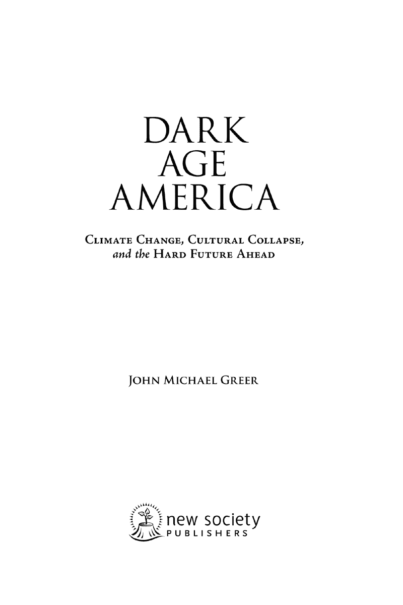
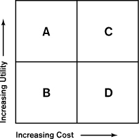
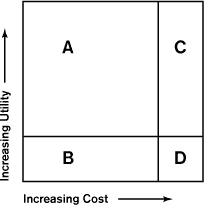

# 黑暗时代的美国：气候变化、文化崩溃与严峻的未来

## 对《黑暗时代的美国》的赞誉

这是一本揭示下一个黑暗时代清晰流向和冷酷必然性的佳作。它是一个丰富、发人启发、深思熟虑且基于现实的愿景，尽管令人恐惧；它信息详尽且周全，并以积极的内在精神呈现，并偶尔闪烁着希望的可能光芒。如果你在思考并忧虑近远未来，你一定要看看这本书。

—— 杰里·曼德（Jerry Mander），作者，《消除电视的四个种理由》和《资本主义论文集：过时系统的致命缺陷》作者，以及国际全球化论坛创始人兼总监。

格里尔的《黑暗时代的美国》对于那些选择关注传承而非痴迷于长寿的婴儿潮一代来说，是必备的教育和动力。我们已经经历了石油巅峰、债务巅峰、舒适巅峰、自我中心巅峰和狭隘巅峰。现在，让我们成为孙辈们会为之骄傲的祖先吧。

—— 康妮·巴洛（Connie Barlow），科学作家，Torreya Guardians 和 TheGreatStory.org 创始人。

约翰·迈克尔·格里尔（John Michael Greer）是一位代表“现实”发声的现代先知。《黑暗时代的美国》借鉴了格里尔对历史模式和节奏的丰富知识，产生了基于我们对生态学、经济学、系统科学和人性最佳证据理解的见解。其结果是一部具有非凡清晰度和深刻骨髓智慧的作品，对于我们这些混乱的时代至关重要。

—— 迈克尔·道德牧师（Rev. Michael Dowd），作者，《感谢上帝进化》以及“未来正召唤我们走向伟大”节目的主持。

如果我们文明的未来轨迹遵循与之前文明所设定的相似模式，那么约翰·迈克尔·格里尔的新书或许给了我们目前能获得的最好的未来视野。他对即将到来的大崩解的思考植根于对历史广泛而深的知识：即使你对未来持有不同意见，你也能从他对相关人类过去的调查中获益匪浅。

—— 理查德·海因伯格（Richard Heinberg），作者，《增长的终结》。

《黑暗时代的美国》有力且令人信服地论证了工业文明不可避免的衰落及其在未来五个世纪内的影响。尽管人类心理可能仍在坚守某种虚假的“大转折”或“这次会不同”的幻想，但格里尔证明，从生态、政治、经济和技术角度来看，这种衰落不仅是不可避免的，而且正在进行中。终结如何展开，以及我们物种的成员能否幸存，很可能取决于我们现在做出的选择。按部就班的维持并不是选项。

—— 卡罗琳·贝克（Carolyn Baker）博士，作者，《生态末日之中的爱》和《有意识的崩溃》作者。

无论你是刚刚发现，还是早就知道全球化消费文化是一艘沉没之船，当一位礼貌的管家来到你的船舱，提议引导你前往救生艇，然后悠闲地聊天，缓解你的恐惧，引导你穿过闪烁着荧光灯的金属走廊，向你描述一旦救生艇到达安全港口，让你的生活重回正轨可能需要的所有知识。《黑暗时代的美国》是约翰·迈克尔·格里尔最出色的作品。他没有留任何情面，对自己的预测也是如此。慢慢读它，坐在舒适的椅子上，手里拿着一杯你最喜爱的热饮品。

—— 阿尔伯特·贝茨斯（Albert Bates），作者，《后石油生存指南与食谱：生物炭方案》以及《巴黎协定》作者。

文明并没有卖得很好。那些自诩宇宙的主宰想要数十亿消费者、生产力提高、增长和利润。作为回报，他们提供开放的边界、华丽的小物件、各种彩色性别的性别平等以及太空探索的白日梦。但并没有买单者；人们想要的是九小时睡眠、乡村的夏天、家人朋友在身边，以及有人来买他们的芜根。黑暗时代将将来临，但别担心。正如格里尔解释的，这完全正常——只是需要适应。黑暗时代是补觉的好时机。

—— 德米特里·奥尔洛（Dmitry Orlov），作者，《重塑崩溃》和《崩溃的五个阶段》作者。

《黑暗时代的美国》是对地球未来五个世纪生活的一份勇敢、深思、及时且研究充分的预言。约翰运用了对过去文明如何瓦解的透彻知识，对复杂系统如何运作（以及何时失效）的欣赏，以及对人类在危机中如何表现的理解——这些危机并非突然且短暂的，而是渐进的、不均匀的、深刻且持久的。无论你的倾向处于政治光谱的哪个位置，这部理智推理、发人启发且重要的著作将挑战你的思维方式，并促使采取有用的准备行动。

—— 戴夫·波拉德（Dave Pollard），作者，《如何拯救世界》。

**New Society Publishers 的使命是**出版从根本上有助于建立可持续且公正社会的书籍，并以对环境影响最小的方式实现这一愿景。

## 关于作者

## 关于出版社的说明

# 1 工业文明的觉醒

自从科学家开始警告在有限的星球上追求无限增长具有不可避免的后果以来已经过去了四十多年¹。从那时，随着增长的限制在我们未来的地平线上变得愈发清晰可见，一个奇特的悖论上演了。我们越接近这些限制，它们对我们日常生活的影响就越大，而我们目前的轨迹越清晰地指向通往困难未来的墙壁，工业世界的大多数人似乎越无法想象任何除了推动现有秩序直到崩盘之外的替代方案。

这在许多活动人士社区的角落里与最不思救药的企业董事会一样真实。对于如今的许多环保主义者来说，再生能源并不是他们应该自己生产的东西，除非他们足够富有，负担得起那些成为两岸郊区社区最新身份象征的屋顶光伏系统。它绝不是他们应该节约的东西。相反，它是公用事业和政府应当尽快生产的，以便美国人的人均能源消耗能够保持在欧洲平均水平的三倍，以及中国平均水平的二十倍。

活动人士群体中出现的这种对变化的热忱，很大程度上集中在某种改变世界的事件上。然而，事实是，我们现在面临着改变世界事件的严重短缺。对此有充分的理由，正如也有同样充分（尽管未必同样）的理由解释了为什么许多人将所有的希望都寄托在某种改变世界的事件上。治疗师们喜欢指出，如果你总是做你一直做的事，你就总是得到你一直得到的结果；最近这已成为了一句陈词滥调（尽管它确实是一个事实）：做同样的事情并期望得到不同的结果，是疯狂的一个良好定义。

试图寻找方法规避这种严酷但不可逃避的逻辑的尝试，正是驱动关于 `2012 年` 的预言性狂热的动力，也是驱动更广泛的末日幻觉的动力：如果改变生活方式的前景让你感到恐惧，但面对现有生活方式后果的想法同样让你感到恐惧，那么白日梦某种外力会出现并为你改变一切，就可以成为一种避免思考为你亲手创造的未来的方便方式。不幸的是，那种白日梦已经比那些可能真正产生影响的建设性行动常见得多。

这一硬性事实几乎保证了一个在任何可以想象的定义下都比现在糟糕得多的未来。这里的困难在于，对美好未来前景的信仰已深深植根于我们每个人心中，以至于试图反对它，就像试图告诉一个中世纪农民，拥有所有圣徒和天使的天堂不再存在了。对明天将比今天更好、可以更好、或者至少应该比今天更好的希望，已经刻在了现代世界的集体想象的基因里。在那份信仰的背后，是三百年工业扩张所带来的巨大惯性，它通过变现地球廉价且易获取的部分化石燃料储备，换取了一段极端的富裕时期，这种富裕程度以至于今天美国的垃圾收集员拥有的东西是工业革命开启之前的皇帝们都无法获得的。

那个奢华的时代深刻地重塑了——从我们这个时代之前之后人类生活的现实来看，一个更贴切的词可能是“扭曲”——人们现在对你所说出的几乎任何事情的思考方式。特别是，它让我们对提供我们生活基本背景的生态现实视而不见。它让我们几乎所有人都在认为，例如，无限的指数级增长是可能的、正常的且好的；因此，即使无限指数级增长的灾难性后果像海浪冲击沙堡一样接接一个地击中我们的社会，现在的绝大多数人仍然在一种幻想的基础上构建他们的未来愿景，即认为由增长引起的问题可以通过更多的增长来解决。

我们从三个世纪不可持续增长中继承的这种扭曲思维，即使在许多认为自己正在反抗这种增长的人中，也全方位地爆发。无疑，政治光谱上任何一点的活动人士几代以来都在对未来即将面临的恐怖进行夸张的言藻辞，但他们总是提供一条出路——采纳他们恰好在推动任何议程——而这直接通向一个光明的新明天，在那个明天，当下的硬性限制似乎不再适用了。（顺便说，如果从今天活动人士的言辞中去掉“从这种迫在眉睫的灾难口中拯救更美好未来的唯一途径”这种陈腐的滥调，在大多数情况下将所剩无下了。）

尽管如此，我们被许诺的光明的新明天并不会到来。这是工业社会与行星生物圈不可动动的限制之间正在发生的碰撞带给我们的坏消息。石油产量高峰、全球变暖以及世界各地汇聚的所有其他危机都是同一个根源的表现：在有限的星球上实现无限增长是不可能的。它们是警告信号，告诉我们已经进入了完全的超支——一种生态学家熟悉的状态，即一个物种超过了支撑它的资源基础³——它们还告诉我们，增长不仅将停止；它将发生反转，这种反转将持续，直到我们的人口、资源使用和废物产生下降到受损的行星生态系统可以长期维持的水平。

这种苦涩的结果在我们进入超支之前集体采取了果断行动，是可以避免的。我们没有这样做，而在这个节点，机会窗口已经牢牢关闭。目前提出的所有应对我们行星超支症状的建议都假设（无论是含蓄还是明确）情况并非如此，而且我们拥有随随的时间。这些建议是徒劳无功，如果其中任何一项被实施——而且其中某些很可能被实施，一旦今天的自满让位给明天的严峻恐慌——投入其中的资源也将化为乌有。

因此我认为是时候追求一个不同且更具挑战性的项目了。如果我们还有时间时做了正确的事，我们本可以拥有更好的未来，但我们没有。既然既如此，我们可以期待什么样的未来呢？在研究中，对那种未来有一个标准术语。那个术语是“黑暗时代”。

标签实际上追溯到以前。特伦提乌·瓦罗（Terentius Varro）被认为是那个时代博学的学者，他将已知的分为三个时代：有记录的历史时代；在此之前，是口头流传的传说时代；在此之前，是无所知的黑暗时代。这是一个简单的划分，但异常地有用。即使在那些文字尚存的黑暗时代，记录往往极其稀少且毫无帮助，当记录再次出现时，它们往往充斥着大量的传说和神话。在黑暗时代，集体记忆的线断了，目标丢失了，必须从任何可用材料重新开始。

这种黑暗时代在人类历史上是一种反复现象，其发生过程具有惊人的相似性。历史学家阿诺德·托因比（Arnold Toynbee）在其宏大的十二卷著作《历史研究》（A Study of History）中——这是关于历史循环最全面的研究——详尽探讨了这种奇特的平行性。他指出，在上升阶段，每个文明倾向于不仅与其邻居，而且与历史上所有其他文明区分。它的政治和宗教机构、艺术建筑以及日常生活的所有其他细节都形成了独特的形态，以至于在接近成熟时，只需一眼它的某个作品通常就能识别其来源。

然而，一旦过了顶点开始了漫长的下行路，那种分化的模式就发生了反转，起初缓慢，然后速度不断加快。一种奇特的同质化正在发生：独特的特征消失了，共同的模式取而代之。这并不是一次性发生的，不同的文化形式以不同的速度失去独特的轮，但文明在衰落的轨迹上走得越远，就越像其他衰落中的文明。

现代工业社会，特别是但不限于这里，正显示出一个走向终结的文明的所有典型症状。

## 通往历史垃圾堆的道路

正如证据所示，如果我们已经踏上了那条熟悉的衰落与没落的轨迹，那么我们完全可能将这种下行之路的标准特征映射到我们现状的细节中，并对呈在我们眼前的未来轮廓得出一个相当准确的判断。

请注意，历史中可以被预判的部分是宏观趋势和整体模式，而不是那些构成历史进程的、具体发生的特定事件。施加在晚期工业化美国身上的压力在政治、经济和社会的日常现实中如何演变，将取决于个人选择与纯粹的倒霉运气之间通常的相互作用。尽管如此，这些宏观趋势和整体模式本身就值得追踪，而且某些看起来似乎属于不可预测领域的事情——例如，边境地区的政治和军事动态，或者帝国社会的政治阶层、与其日益被剥夺权利的底层阶级以及边疆人民之间的关系——在历史上的一个又一个案例遵循着可预测的模式，并表现出种种迹象，表明这一次也将如此。

事实上，我所建议的是，在非常真实的意义上，提前勾勒出未来五个世纪左右北美历史的轮廓是可能的。这是一个宏大的主张，我非常清楚，至少部分读者的立即反应将是断然否定这种可能性。我想鼓励那些产生这种反应的人试着保持开放的态度。

这一主张预设了过去的教训对我们的未来确实具有某种关联。这在如今是一个具有争议的提议，但在我看来，这种争议更多地反映了我们这个时代的流行愚蠢，而非地上的事实。当今美国的人习惯于使用诸如“但这次不同！”之类的阻碍思维的借口来保护自己，免受从历史中学习任何东西——这种习惯无疑对他们当下的身心健康有奇效，尽管这几乎保证了他们在时间道路上不远后的地方会与一堵由痛苦和失败构成的砖墙迎头相撞。

我计划用于追踪未来五个世纪历史的资源之一，是环境科学的最新水平，这其中包含了关于人为气候变化的大量实证证据和研究。我知道有些人人认为这具有争议，而且当然，某些利益丰厚的企业集团投入了大量资金来说服人们这是有争议的，但我对该主题的所有观点都进行了广泛阅读，那些反对认真对待人为气候变化的论点在我看来是虚伪的。我在这里也不打算辩论这个问题——对此的场所多得是。虽然我提议用古气候学的证据来对目前基于模型的气候变化和海平面上升估计进行补充，但那些坚持认为将大气视为温室气体排出的下水道完全没有问题的人，将对我所说的一切感到高兴。

我还提议讨论工业文明的衰落与没落，而不试图粉饰这一过程中更严酷的维度，这又会触动另一拨人的神经。关注新闻的人无疑已经注意到，那些坚称“情况不会那么糟糕的”、“真的不会那么糟”的绝望尝试正开始出现；每当关于未来的直言不讳穿透我们社会用来盲目自己自身行为后果的集体神话迷雾时，由于我们社会正利用这种集体神话来掩盖其对自己行为后果的无视，这些尝试就会显现出来。那些敢于使用“衰落”或“黑暗时代”等词汇的人，可以准备好被批评者指责，批评者真诚地坚持认为这种语言太消极了，我们当然正面临向一种不同社会的转型，但不应用这种令人丧失力量的词汇来描述，诸诸如此，贯穿了如今特权阶层中如此流行的强制乐观主义的整个词汇。

那种话可能令人安慰，但毫无用处。文明的崩溃并不是一个愉快的愿景——而这正是我们所讨论的：工业文明的衰落与没落、穿过黑暗时代的漫长过程，以及将在我们废墟上建立的继承社会的初步萌动。这是一个文明生命周期结束的方式，而我们的文明正以此方式结束。

这在实践中意味着，工业世界的人喜欢对未来做的大多数熟悉假设，在未来的几十年和几个世纪里将被颠倒过来。如今到处宣扬的、支持某种拯救我们免于自身行为后果的各种“大转折”的辞令，理所当然地假设美国的大多数人——或者，天佑我们，整个工业世界——能够并且将围绕一套被广泛接受的价值观和一份一致的行动计划团结起来，将工业文明从环绕它的不断上升的危机螺旋中拯救出来。我的读者可能已经注意到事情似乎正在朝着相反的方向发展，历史表明他们是完全正确的。

事实上，衰落与没落的标准现象之一，就是集体共识的破灭，这种共识赋予了一个不断发展的社会共同行动以完成任何事情的能力。政治阶层与人口其余部分之间的分裂——如果你愿意，完全可以称它们为“1%”和“99%”——仅仅是遍布每一个衰落文明的裂缝中最可见的，它将文明破碎成一个由异见碎片组成的疯狂拼贴画，这些碎片追求着竞争的理想和议程。这个过程也有一个可预测的终点：当政治阶层日益怪异的行为失去了它曾经从社会其他部分获得的任何尊重和忠诚，而大众放弃了对所属社会政治机构的信任时，来自政治阶层外的魅力领袖将填补真空，暴力成为权力的常态裁者，而法治在不被完全放弃时就变成了一种礼貌的虚。

衰落社会的经济领域由于不同的原因经历着平行的碎片化。在经济扩张时代，工人阶级的劳动产生的利润足以涵盖上层结构的成本，无论这个上层结构是由古埃及的法老和祭司组成，还是晚期工业美国的官僚和投资银行家组成。随着扩张让收缩，商品服务的生产不再产生曾经那样的利润，但那些权力取决于上层结构的政治阶层成员，意料之中不愿失去他们的特权地位，并且他们有以他人的代价来养活自己。可靠的结果是对生产性经济活动的挤压，导致衰落文明陷入一次又一次爆发性的金融危机，并最终粉碎其生产最基本商品和服务的能力。

作为回应，人们开始完全退出经济主流，因为在经济边缘挣扎生存，比在一个日益对他们不利的系统中过日要不徒劳得多。税收的增加、政府服务的减少，以及富人对公共物品的系统性私有化，竞争使得越来越多的人与既定秩序疏远，而为了弥补萎缩的税收而进行的货币贬值使得越来越多的经济活动进入完全不涉及货币的交换形式。

总之，这些政治碎片化和经济崩溃的模式结合在一起，将一个失败文明的政治阶层推向了历史大门的、臉臉出走的之旅。

## 社会其余部分的消极服从

政治制度的崩溃剥夺了政治阶层的任何合法性主张；经济系统的崩溃限制了它收买那些它已无法激励的人的忠诚的能力；控制杠杆的失效剥夺了其成员仅拥有的实际权力；而此时，他们发现自己不得不与那些从社会底层恰恰崛起的魅力领袖们竞争追随者。这种终局，在大多数情况下，发生在政治阶层试图雇佣那些被剥夺权利的兴起领袖作为控制其他民众的武力来源，并惨痛地发现，真正行使权力的是那些拿着武器的人，而不是那些自认为在下达命令的人。

政治阶层的内部崩溃，其影响远超社会高层人员的简单更替。之前提到的政治和社会碎片化，同样有力地适用于人类生活中那些较难触及的维度——它的思想和理想、它的信仰和价值观以及文化实践。当一个文明向衰落期倾斜时，它的教育和文化机构、它的艺术、文学、科学、哲学和宗教都将与其政治阶层联系在一起；这并非偶然，因为政治阶层通常会为了自己摇摇欲坠的权威和影响力，竭尽全力地利用这一切。反之，对于政治阶层之外的人来说，这个文明的高级文化变得陌生且令人憎恶，而当政治阶层没落时，它为其服务的文化资源也随之消失。

有时，这些资源中的某些会被亚文化为了自己的目的而营救，正如基督教修道士修女为了上帝更大的荣耀而营救了古希腊和罗马哲学及科学的一部分。然而，这并非定数，即使这种情况发生，营救者也会根据自己的理由进行挑拣——例如，中世纪早期西方古希腊天文学的幸存，仅仅是因为教会需要知道计算复活节的日期。在没有此类动机的情况下，损失可能是毁灭性的：在庞大的罗马音乐语库中，幸存的只有一首播放时间约二十五秒的旋律片段；历史上的例子表明，即使是识字这种简单的技巧，在文明崩溃期间也可能遗失，并在几个世纪后才不得不从其他地方重新引入。

所有这些转型都影响着衰落文明的人类生态——即每个人类社会赖以维持日常生存与自然界之间的基本关系。大多数文明非常清楚必须做什么才能保持表土不流失、灌溉水流顺、收获到来，以及人类与环境互动保持稳定状态的所有细节。问题始终在于，当经济增长结束、收缩开始、中央政府执行其法令的能力开始瓦解时，如何满足所需的成本。这种以牺牲其他一切为代价供养上层结构的习惯，对环境的影响与其对工人阶级的影响同样剧烈：正当工资降到饥饿水平并持续下跌时，基础设施必要投资的资金、作物轮作所需的休耕期以及维持农业系统可持续运行的其他投入都全被削了。

结果是，表土流失，农业后地退化为沙漠或沼泽，关键基础设施由于恶意的忽视而崩溃，土地支撑人类生命的能力开始了衰落末期特征性的连锁下降——因此，人口也随之下降，因为归根结底人口数量是一个依赖变量，而不是独立变量。

人口的增长或减少并不是因为人们某天突然决定生多或少孩子；它们受到生态极限的限制。在一个扩张的文明中，随着财富和资源基础的增加，人口也随之扩张，因为人们负担得起更多的孩子，而且每年出生的孩子中有更多的人能够获得让他们活到育龄年龄的营养和基础医疗。当增长让位于衰落时，由于单纯的人口惯性，人口通常会继续增长一代左右，然后开始下降。

这些后果可以在每一个崩溃文明的历史中找到踪源。随着农村经济在更广泛的经济衰退的基础上由于农业失败而内部崩溃，越来越多比例的人口集中在城市贫民窟，随着公共卫生措施的崩溃，这些地方变成了传染疾病的温床。因此，流行病是衰落文明历史上的共同特征，当然，战争和饥荒也是重要因素；但贫困、营养不良、拥挤和压力对死亡率施加的持续向上压力造成了更大的代价。当死亡人数超过出生人数时，人口进入了可能持续几个世纪的下降时期。在一个文明崩溃后，该地区的人口仅相当于崩溃前峰值数值的百分之一的情况，远非罕见。

将这些模式结合在一起，沿着它们通常的一到三个世纪的螺旋式衰落过程下去，你就得到了黑暗时代社会的标准图景：一片大部分荒凉的乡村，散落着细小的村庄，那里有不识字且贫困的自给农民农民挣扎着试图让枯竭的表土恢复肥力。他们的政府由地方军阀的个人统治组成，军阀抽取每年收获的一部分，以换取对掠夺者的保护，并在任何方便的树荫下施加粗暴的司法。他们的文学由诗歌组成，伴随着简单乐器的声音被深情背诵和吟唱，回忆着一个消失时代的伟大事迹，而这些诗歌也包含了他们对历史的所有认知。他们的医疗由草药、小微手术和咒语组成——好吧，我让你们自己去想象吧。至于过去的遗产？这里有某一个黑暗时代的一位匿名诗人对前一个文明所说的一些话：

> 彼时大厅金碧辉煌，浴场随处可见，  
> 屋脊高耸入云，喧闹欲聋，  
> 许多酒厅溢满了欢愉  
> 直到强大的命运推翻了一切。  
>
> 大杀戮是如此惨烈，瘟疫降临，  
> 死亡带走了所有英勇的男子。他们的城墙被摧毁，殿堂倒塌，  
> 城市腐朽了；建造它的人  
> 以及瓦片从这座石拱上落下。

盎格鲁-撒克诗歌的粉丝会认出这是出自《废墟》（The Ruin）的片段。如果历史进程遵循其正常模式，在四或五个世纪后，我们将会为我们城市的废墟吟唱这样的诗歌。我们将如何到达那里，以及在途中可能发生什么，将是本书的主题。

## 2 生态后果

正如现实世界中的每一个过程一样，历史的形成部分取决于环境压力，部分取决于其内部子系统以及与周围其他生态系统之间的相互作用。这并不是一种常见的观点；如今大多数历史写作将人类置于画面中心，将自然世界视为一个所谓的静态背景，而少数观点则走向另一个极端，将自然灾害视为这一或那重大历史变革的唯一原因。这两种方法似乎都不特别有用。由于我们的文明在过去的几个世纪竭力不吸取教训，因此在未来几年里将付出惨痛代价，自然世界并不是人类历史的静态背景。它是一个活跃且不断变化的存在，会对人类行为做出复杂的回应。

人类社会与其自然环境一样活跃且同样变化莫测，并对自然的作用以复杂的方式做出反应。沿着这些线条，行动与相互作用的舞蹈产生的奇异循环，很难用传统的线性思维工具来追踪，但它们是系统理论的基石，也是生态学中所有将生态系统而非个体生物视为基本单位的分支的核心。

展示这种观点如何运作的最简单方法就是观察它的运行过程，恰恰如此，系统方法异常清晰地阐释了塑造未来五个世纪北美历史的最重要因素之一。我脑子里想的这个因素就是气候。

现在，这显然也是一个政治上的“烫手山芋”，因为工业世界的绝大多数人不愿面对一个冷酷的事实：如果他们想生活在一个气候和生态都稳定的星球上，他们就无法继续享受目前的生活方式。地球频繁刷新热量新纪录并不重要，重要的是那条传闻中的、绕过加拿大和阿拉斯加顶部的西北航道——自有记载以来一直被冰雪封塞——如今每年夏天都是开水域，并已成为从欧洲到亚洲东岸商业航运日益重要的航线。¹

每当地球日益混乱的天气在几个地方吐出反常的寒冷天气时，你都能听到高薪受雇的企业托口和热情的业余爱好者们异，声嘶力竭地坚称，这证明了人为引起的气候变化是无稽的。

在这些反应不仅仅是宣传的范围内，它说明有太多的人忘记了，复杂系统中的变化并不遵循我们目前的思维习惯所偏好的那种优美直线。一个简单的实验可以帮助展示复杂系统在现实世界中如何反应，并在这个过程中让我们更容易理解未来几十年内我们可能见到的那些气候现象。

下一次你使用浴缸时，关掉龙头后，等水静止。将手慢慢轻轻地伸入水中，使你对水的扰动尽可能小。然后，以类似于蜗牛移动的速度在水下穿过手，观察并感受水如何适应这种运动，它轻柔地绕着你的手流动。

一旦你对此有了清晰的感受，就逐渐增加手移动的速度。当你超过某个速度阈值后，水的运动将呈现出可见的波浪——手前的波浪、身后伴随水节奏性起伏的尾迹，以及延伸到浴缸边缘的波纹。你的手移动得越快，波浪就越大，它们相互碰撞时产生的干涉图样就越明显。

继续增加手的速度。你会越过第二个阈值，波浪的节奏将瓦解为湍流：水会在你的手周围翻腾、溅射和喷洒，混乱的水流会在浴缸侧面剧烈冲撞。如果你坚持下去，可以把相当一部分浴水洒到浴室的地板上，但这并非实验所必须的！一旦你充分感受了第二个阈值之湍流与该阈值之下震荡之间的区别，就把手从水中取出，观察发生了什么：湍流平息为波纹，波浪收缩，最终——在几分钟后——水又恢复了静止。

这种同样的反应序列可以在每一个复杂系统中追溯，主宰着系统对周围各种扰动的反应。只要这种变化保持在强度和速度的某一阈值以下——这个阈值对于每个系统和每种变化都不同——系统就会平稳地反应，通过最小调整来维持自身的内部平衡。一旦超过了那个阈值，各种震荡会遍布整个系统，随着扰动的增强而变得越来越极端，直到它通过第二个阈值，系统的震荡坍缩为湍流和混沌。换句话说，当混沌行为在震荡系统中出现时，这意味着真正的麻烦可能已经上门了。

换句话说，如果全球温度是沿着一条优美的直线增长的，我们不必那么担心，因为从这一事实可以清楚地看出，地球气候系统的韧性足以应对正在发生的变化。一旦事物开始震荡，并在两个方向上偏离正常状况，这说明韧性的界限正在显现，整个行星气候出现混沌变异的可能就在不远的前方。我们可以通过记住每个系统都是由子系统以及子系统的子系统组成的，来很大程度上微调警告信号；根据一般的经验法则，系统越小，它在应对扰动水平上升时，就越容易从局部调整变为震荡，再变为湍流。事实上，局部气候足够敏感，以至于普通的季节变化就能产生轻微的湍流，这就是为什么天气如此难以预测。区域气候更为稳定，它们通常会经历各种波浪状震荡：季节循环是一个周期，但还有可以在区域范围内追踪的多年和数十年的循环。这就是为什么剧烈的气候模式比它们通常获得的关注更多。

我通常不是托马斯·弗里德曼的粉丝，但他的一句警告击中了要害，他警告说我们对气候变化需要担忧的不是全球变暖，而是“全球怪异”（global weirding）。全球温度的线性变化将是严酷的，但在某种程度上，可以将北半球的作物带向北移动，南半球的作物带向南移动。如果你不知道下一个季节是暖是冷、是湿是干、是短是长——饥荒将变得难以避免，对已经紧张的全球经济产生的连锁影响更会雪上加霜。由于上述原因，目前看来这是未来一两个世纪最可能的状况。

在理论上，如果世界各国停止将天空视为倾倒温室气体的下水道，某些情况是可以避免的。在实践中——好吧，这些现实比最坏情况所假设的要灵活得多。这里有两个特别需要追踪的因素，它们都源于净能量——化石燃料到达终端消费者时的能量含量与将其送到那里所需的能量输入之间的差异。

第一个因素简单来说，如果提取、加工和运输化石碳沉积物所需的能量大于终端用户通过燃烧它所获得的能量，那么这些化石碳就会留在地下。这里的典型例子是页岩岩，它是美国西部及其他地区四年来热情能源项目的梦魇。绿色河流页岩及其同类物中锁存着巨大的能量，但每一次试图打开这个饼罐的尝试都失败于一个冷酷的事实：如果将一切考虑在内，从页岩中提取干岩所需的能量大于你燃烧干岩所获得的能量。³

第二个因素更为微妙，且破坏性大得多。随着净能量丰富的化石燃料储层耗尽，并必须被净能量更低的储层所取代，工业社会可用的总能源供应中，有越来越大比例必须从所有其他经济用途转移到维持能量流动的过程中。因此，仅仅指向高产的总能源产量并坚称万事无忧是不够的。这里也必须应用净能量逻辑：必须将能源资源开采、加工和分发过程中消耗掉的总能源输入从总能源产量中减去，才能真实地感知有多少能量可以为经济的其余部分提供动力——请记住，经济的其余部分正是产生财富的地方，让个人、社区和国家最初能够负担得起化石燃料。

换句话说，在最后一个物理上可开发的化石燃料储层耗尽之前，化石燃料的开采就会停止，因为它已经变成了能量汇，而不是能量源。此外，在达到后一点很久之前，全球和国家经济将不再能够产生足够的财富来应对化石燃料开采不断上升的能源成本。需求破坏（Demand destruction，这是经济学家对那些买不起某种产品的人停止使用它的过程的称呼）在这里与原料的物理枯竭同样重要；当经济在储备量枯竭和生产能源成本上升的双重负担下摇摇欲坠时，随着快速的地位下降成为大多数人的常态，碳足迹将将不由自主地萎缩。将这些因素与“全球异常化”（global weirding）本身的经济影响结合起来，你就能对那些已经在我们周围集结并在未来几十年内以极端果决手段终结化石燃料经济的力量有一个良好的初步估算。

这对北美洲未来气候意味着什么，很难详细预测，但从轮廓上并不难追踪。从现在到21世纪末（可能更久），我们可以预见到气候混沌，其地理范围和集体影响将不断加速，直到二氧化碳排放开始下降几十年后——这是由于温室气体进入大气层与其影响最终达到顶峰之间存在滞后时间。此后随着排放速度放缓，动荡将逐渐平息，在那之后的一段时间——具体是什么时候谁也说不，但2300年是一个很不错的推测——全球气候将稳定在一个“新常态”中，这种状态对我们的标准来说完全不正常。除非人类或自然出现进一步的意外，否则这种“新常态”将持续到自然循环吸收足够的额外二氧化碳为止——这一过程将需要数千年才能完成。

对“新常态”的形状进行合理的推测是可能的，因为在过去的百万年里，北美的古气候学显示出了一种相当可靠的模式。⁴ 总的来说，北美洲越冷，该大陆西部半部分的降水量就越大。例如，在最近的冰期期间，现在沙漠化西南部的降水量是如此大，以至于产生了一系列巨大的雨水湖（pluvial lakes），并在现今大部分内山松丛和仙人掌地区支撑了相对丰富的草原和森林生态系统。从一个事实中可以观察到这种差异程度：18,000年前，即上一个冰期处于鼎盛时期，死亡谷（Death Valley）曾是一个被松林环绕的闪闪发光的湖泊。相比之下，北美洲越温暖，大陆西部半部分就越干燥，干旱效应会向东延伸非常远。

例如，在最近一次冰期结束后，世界进入了现在被称为“全新世气候最盛期”（Holocene Climatic Optimum）的时期。这个术语对于这个大陆来说至少是一个误称，因为那时北美大部分地区的状况只对沙蚤和吉拉角蜥（Gila monsters）是理想的。几十年来，学术界一直在争论，使用所谓“最盛期”的另一个名称“间热期”（Hypsithermal），是全球范围内都比现在热，还是仅仅在某些地区更热。目前的观点倾向于后者，但这种差异实际上对我们考虑的问题并没有多大影响：来自广泛来源的证据表明，间热期北美的温度显著比现在高得多，因此这一时期为该大陆在更温暖的世界中可能面临的条件提供了一个相当良好的初步估算。

为了理解北美气候的长期变化，重要的是记住，降水量作为局部生态系统的决定因素，远比温度重要得多。平均而言，如果一个特定地区的年降水量超过约40英寸，无论温度如何，它通常都能支持某种森林；如果年降水量在40英寸到10英寸之间，通常的生态系统是草原，或者在极地地区是苔藓和地衣；如果每年少于10英寸，你就会沙漠，无论它是像撒哈拉那样炎热，还是像塔克拉玛干沙漠那样寒冷。⁵ 在间热期，随着西部的干旱，高草草原一直横跨中西部延伸到宾夕法尼亚州西部，大平原的大部分地区都是沙漠，并带有沙丘。

在一个化石燃料供应充足的世界里，通过诸如权宜之计（例如每年从地下含水层或遥远的集水盆抽取数十加仑的水在沙漠和最干燥的草原种植作物）是可以忽视此类担忧的。然而，随着化石燃料供应的终结，人类定居点的形状将再次成为年降水量的函数，正如1900年以前地球上任何地方一样。如果间热期是一个有效的模型（这似乎是最可能的），从内华达山脉和喀斯凯德山脉开始，向东跨越大盆地和洛基山脉到达大平原，并向南穿过墨西哥大部分内陆的北美大部分地区都将如此。

气候并不是决定人类定居的唯一因素。但另外两个关键因素也将塑造北美的未来环境——海平面上升和今天对核废物处理的致命遗留。我们将逐一个进行讨论。

冰期的完成需要数千年的时间，漫长的冰期被短短得多的间冰期所打破。我们正在接近当前间冰期的终点，据估计目前的冰期可能还有大约百万年的时间；其结果之一是，在未来几千年后的某个时刻，我们几乎可以预见到冰川将再次穿越北美大陆向南推进。

与此同时，我们仍然拥有覆盖南极和格陵兰岛的大陆冰盖，以及世界各个角落山脉中存在大量的终年冰雪。这对于间冰期来说是正常的，但对于地球历史的大部分时间来说却完全不正常。冰期与间冰期之间的交替对地球的气候和生态产生了广泛的影响，但最显而易见的影响来自于一个简单的事实：形成大陆冰盖所需的所有冻水必须来自某处，而这个星球上唯一的来源就是海洋。随着冰川的积累并扩散到陆地，海平面随之下降；1.8万年前，当最近一次冰期达到顶峰时，海平面比今天低了400多英尺，游牧部落猎人可以直接走到大西洋东北部。随之发生的事情为我们的未来提供了许多教训。

过去曾有一种共识，认为冰河时代的开始和结束都是缓慢的，似乎有充分理由认为其开始是相当渐进的，但最近一次冰期的结束却包含了突发变化的时期。正如前面提到的，1.8万年前，冰盖处于顶峰；大约1.6万年前，全球气候开始变暖，推动冰川开始缓慢退缩。大约14,700年前，温暖的伯林期（Bölling phase）到来，冰盖退缩了数百英里；根据多项研究，西南极冰盖在此时完全崩溃了。

伯林期在约600年后让位于老德尔亚斯期（Older Dryas）冷期，导致冰川退缩停滞。又过了几个世纪后，老德尔亚斯期让一个新的温暖期——阿勒罗德期（Alleröd），导致冰盖剧烈回缩，使全球海平面升高了数百英尺。随后出现了一个新的冷期，即严寒的小德尔亚斯期（Younger Dryas），使温度回到了冰期的低水平，低温足以让西南极冰盖重新建立，并在北半球大部分地区恢复苔原环境。冰芯测量显示，温度下降得非常快，仅用了几十年甚至更短。仅仅一千年后，大约在公元前9600年，北方林期（Boreal phase）到来，带来了更为壮观的变化。根据格陵兰岛冰芯的氧同位素测量，全球温度在不到十年的时间内飙升了7°C，导致剩余的冰盖发生快速崩溃，并使海平面飙升。

在接下来的几千年里，地球的冰雪覆盖缩减到目前的水平，海平面也比现在高出一点；从公元前6000年开始的逐渐冷却趋势使这两者都回到了工业时代初期的状态。

科学家们仍不确定北方林期开始时惊人温度飙升的原因，但一种被广泛接受的理论是由于海洋变暖和多年冻土融化导致的大规模甲烷释放。海底含有大量被封锁在不稳定甲烷水化物中的甲烷；多年冻土含有同样大量的死植物，这些植物在低温下没有腐烂，而当多年冻土融化时，这些植物就会腐烂并释放更多甲烷。

甲烷是一种比二氧化碳强得多的温室气体，但它的寿命也短得多——一旦释放到大气中，甲烷会相对迅速分解为二氧化碳和水，估计平均寿命为十年左右——因此，它可能是格陵兰岛冰芯中可以追溯到的那种突发冲击的合理驱动因素。

如果确实是这样造成的，当然，可以说我们正处于上路途中，因为甲烷已经在从北极洋和西伯利亚多年冻土中以惊人的数量释放出来。在人类工业向大气中排放二氧化碳的基础上，甲烷的激增将很好地在全球范围内产生“全球异常化（global weirding）”。与此同时，世界上剩余的三块冰盖中的两个——西南极冰盖和格陵兰冰盖——已经因温度升高而变得不稳定。这两块冰盖加含有的水量足以让全球海平面上升约50英尺，而未来一个世纪内可能的人为二氧化碳排放量足以导致这两者的崩溃和完全融化。当然，所有这些水不会一夜之间涌入世界海洋，很大程度上取决于融化的速度有多快。

近期政府间气候变化委员会（IPCC）报告中包含的海平面上升预测假设冰川融化是一个缓慢的线性过程。作为基准这是恰当的，但古气候学的证据显示，冰盖的崩溃是相对突然的爆发式融化，产生所谓的“海洋脉冲（marine pulses）”，可以通过各种指标在全球范围内追踪。此外，在地质学意义上的“相对突然”对于人类的一生来说是缓慢的；像格陵兰或西南极这样中等冰盖的崩溃可能需要五到六个世纪，而大多数东岸和西岸的港口将面临严重的洪水。

到目前为止，至少东南极冰仅显示出微小变化，似乎仍有理由认为还需要百万年才会彻底消失；其结果之一是，在未来几千年后的某个时刻，我们几乎可以预见到冰川将再次穿越北美大陆向南推进。

衰落过程本身就固含了一些困难。首先，随着时间的推移，进行必要工作所需的资源变得越来越稀缺。其次，随着时间的推移，对于需要做什么的不确定性变得越来越大。

这种结果可以在每种文明的衰落中得到追踪。起初，失败的系统会被某些成功所取代，但替换过程带来的经济影响会成为日益沉重的负担，而新系统永远无法像旧系统全盛时期那样运作良好。随着过程持续，成本不断攀升，收益变得越来越不可靠；越来越多，稀缺的资源最终被浪费了，因为形势太不确定，无法将它们分配到最需要的地方。一年一年过去，决策者必须弄清楚日益枯竭的资源储备中有有多少可以投入生产性用途，又有多少必须留作危机管理，而那个时代原始的不确定性保证了这些决定往往会出错。最终，可用资源的下降曲线与不确定性的上升曲线相交，产生了一场失控的危机，而一个社区、一个经济部门或整个文明的残余会在这种冲击下分崩离析。

预测这在未来大约一个世纪内将如何演变并不困难。正如我所建议的，如果我们预计未来几年某一时，格陵兰岛和西南极冰盖的崩解将引发全球融水脉冲，那么海平面的首次向上跃升无疑将遭遇某些地区防洪措施的宏伟计划以及其他地区住房和经济活动的搬迁。这些计划中的一些可能会实施，尽管对于受混乱气候和多种因素影响已承受严重压力的全球经济而言，全球性沿海洪灾带来的原始经济影响不会让这变得容易。一些沿海城市将蜷缩在匆忙建成或扩大的堤坝后；另一些则将放弃低洼地区，并尝试向更高处重建；还有一些则将简单地沉没并被部分或全部遗弃——所有这些选择都给整个社会造成了成本。

此后，当海平面仅缓慢上升时，维持防洪措施以及将脆弱的基础设施替换为高地新设施的成本将成为一种不受欢迎负担，而今天驱动气候变化否定论的同样的短视号召在那时无疑也会找到许多听众。当海平面飙升时，防洪措施和迁移项目将面临日益严峻的测试，其中一些将不可失败。成本增加和不确定性增加的双重螺旋将产生其通常的影响，粉碎一个失败社会应对其面临的挑战的能力。

如果人类按照他们往常所做，最可能发生的情况是北美港口城市将继续尝试维持常态，直到这种做法完全失去经济意义之后很久。海平面上升得越快，这种反应就越早转变为其反面，人们将开始大量逃离海岸，为自己和自己的家人寻找安全感。我的工作推测是，黑暗时代的美国东岸和西岸人口将比现在稀疏得多，社区将集中在那些土地远高于海平面且靠近海洋的地区。墨西哥湾沿岸极少土地高出海平面，因此海侵将迅速吞噬大片地区，那里可能在海平面停止上升之前几乎被遗弃。

这些因素导致了大陆经济和政治地理的转变，这将具有相当大的意义。在海平面快速变化的时期，维持沿海港口的海上贸易基础设施是一场注定失败的斗争；没有港口基础设施，海上贸易仍然可能，但很少在经济上可行；这意味着与海洋有良好通航连接的内陆水道将比现在具有更大的重要性。在北美，其中最至关的是圣罗伦斯水路、哈德逊河-伊利运河与大大湖的连接，以及一旦目前的密西西比三角洲淹没上升的海平面之下，任何位于更内陆并取代新奥尔良的港口——巴顿鲁日由于其位置和位于海平面以上的高度，是一个很可能的候选者。即使在黑暗时代，海上贸易也是生活的正常部分，这意味着上述水道将成为北美大陆大部分地区的经济、政治和战略关键。

由人为气候变化引发的海平面上升上升只是一个更广泛模式的局部，这种模式是当今的行动对明天环境的影响。文明在衰落时通常会留下一个受损的环境，而我们的文明表现出每一个迹象来遵循这种令人熟悉的模式。然而，一个文明留下的生态损害的性质和程度取决于两个因素，一个是显而易见的，另一个没那么明显。明显的因素源于文明在其全盛时期部署的技术性质；不那么明显的因素取决于在所讨论的文明采用这些技术之前，这些技术已经经历了多少次同样的兴衰循环。

后一个因素中包含着一个重要的教训。人类技术在时间轨迹上的起点几乎总是作为环境灾难，寻找一个标记有 X 的地方，它们不可避免地会找到那里，然后通过几个世纪或数千年的苦涩经验磨掉粗糙的边缘。当我们的物种首次开发出让狩猎队能够击杀大型野生动物的技术时，结果是大规模屠杀和整个巨型动物物种的灭绝，随后是饥荒和痛苦；重复同样的循环几十次，你就会获得大多数狩猎采集社会在历史时期所维持的精妙生态平衡。与此，早期农业带来了表层土流失和生存失败的丰收，并伴随着其较不可靠的粮食产量，而这种经历的惨痛教训推动了更可持续农业系统的出现——这一过程在我们这一代通过产生土壤而非消耗土壤的有机农业方法得以完成。

如果我们能依靠化肥来弥补损失，那足够糟糕了，但到`2150年`，那不再是一个选项：整个化肥领域都是由不可再生资源制成的——天然气是硝酸肥的主要原料，磷矿石是磷肥原料，以此类推——而这些资源都在迅速枯竭。

由于不当农业实践导致的表层土流失实际上是文明崩溃的一个相当常见的因素。例如，希腊周围海域的海床沉积芯显示，在迈锡尼文明末期，由于表层土的快速侵蚀，沉积物沉积出现了一个峰值，罗马帝国后期也出现了一个峰值。^(12) 如果几千年后的考古学家进行同样的测试，他们将在墨西哥湾底部发现另一层被侵蚀的表层土，那是一个农业系统的遗产——这套系统将季度利润置于首位，忽视了可能为后孙保护土壤的微小改变。

之前提到的有机农业方法对解决这个问题可能非常有帮助，因为这些方法包含了保护现有表层土以及以远快于自然速度的速度重建枯竭土壤的技术。然而，要产生任何影响，这些方法必须在大规模范围内部署，并在未来的艰难岁月中流传。缺乏这些，即使在气候变化导致的荒漠化尚未使农业变得不再可能的地区，今天北美农带的很大一部分可能在未来的数几个世纪或数千年内无法支持作物生长。最终，那些让被冰川刮光的土地重新恢复土壤的缓慢过程，也将对工业农业剥离表层土的土地产生同样的作用，但“最终”来得并不快，无法让我们的后代免于许多饥饿的日子。

全球海洋正以不同的调调奏着同样的曲，因此我的读者可以期待在不久的将来，品尝到他们一生吃过的最后一块海鲜。^(13) 如果进行保守管理，世界鱼类资源可以无限产生巨大的产量，但它们并没有得到保守管理。在尝试监管的地方，政治和经济压力不断将捕捞限制推高至可持续水平之上，而且，作弊无处不在，被抓到的惩罚仅仅是经营成本的另一个部分。渔场接一个地的崩溃，为了喂养七十亿饥饿的人口而进行的日益疯狂的斗争，不太可能让任何完好的资源得以长久。

更糟糕的是，这一切正发生在我们人类集体生态愚蠢的其他方面冲击的海洋中。全球气候变化通过增加大气中的二氧化碳含量，正在使海洋酸化，并导致海洋食物链发生剧烈变化。这些变化涉及赢者也涉及输者；当钙壳硅藻和珊瑚遭受种群下降时，对酸碱平衡变化不那么敏感的海藻和其他形式的藻类，则在水体增加的`CO2`中蓬勃生长^(14)——但以海藻和藻类为食的鱼与以硅藻和珊瑚为食的鱼不同，由此产生的变化正让海洋生态系统发生剧烈波动。

在靠近岸的地方，人类工业和农业的毒性排放物也加剧了麻烦。考虑到所有因素，深海对大多数咸水生物来说资源匮乏。绝大多数海洋生命在距离陆地数百英里的范围内繁衍，那里的河流、涌升区等提供了丰富的营养物质。我们已经看到毒性物质在海洋食物链中向上富集的严重问题，除非水岸社区以极度审心的态度应对海平面上升，将每一个毒性化学源移出水域，否则这个问题只会变得越来越糟糕。不同物种对这种或那种毒素的反应不同；即使在去工业化的北美最毒的河口，也将出现并繁衍某种水生生态系统，但这些生态系统不太可能产生任何人类适用的食物，而且尝试这样做可能对人的健康没有特别好处。

从长远来看，那也会自我修复。生物富集的毒素最终将埋葬在海底的泥沙中，为远未来的考古学家提供又一个有趣的数据点；食物链和生态系统将重组，形式可能与现在完全不同。水温的变化，以及潜在洋流模式的变化，将使熟悉的物种相互接触，而在孤立避难所生存过去工业化时代的生物将扩张到它们以前的。这些是生态系统适应大规模冲击的正常阶段。尽管如此，这些更新过程需要时间，在我们海洋恢复生物丰富之前，面前的去工业化黑暗时代早已过去。

荒芜的土地和空空的海洋并不是我们留给后代的唯一痛苦遗产。其中之一最近引起了相当关注——确切地说，是从`2011年3月11日`开始，当时福岛第一核灾难发生。核能对现代思想产生一种奇异的磁力，将其引向一个方向的极端；关于其能为未来提供电力的极不现实的主张，与关于其将灭绝的极不现实的主张形成了微妙的平衡。在这些极端之间寻找出路并不总是易事。然而，在这两种情况下，通过查阅记录的事实，很容易消除一些困惑。例如，地球上没有任何一个国家能够在没有巨额补贴的情况下启动或维持核能。换句话说，核能从未自给自足；如果没有政府持续的拨款，它在逻辑上就不足以吸引私人投资。事实证明是，自短短`70年前`原子时代开启以来，已经发生了相当多的灾难性核事故，特别是在前苏联，但不仅限于那里。^(15) 因此，当反应堆熔化，或者管理不当的废物储存设施发生火并向乡村散发放射性烟雾时，其后果并不是秘密。结果是一场异常危险的工业事故，与水水电坝突然倒塌或导致毒气体飘向人口密集区的化学工厂爆炸相当；它与这些者的主要区别在于，核事故留下的污染在从天空落下后多年内仍然具有危险性。目前北美地区分布着`69个`正在运行的核电厂，其中有`127个`反应堆；还有`48个`研究性反应堆，大多数比核电厂反应堆更小且不易发生熔毁。完全合理地预测，这种情况将发生在`175个`反应堆中的某些身上。在一个受气候变化、资源枯竭、经济崩溃、政治和社会动荡影响的世界中

混乱、人口的大规模迁移，以及文明衰落覆灭和黑暗时代来临的其他正常特征，恶签迟早会被抽中，而严重的核灾难将将会发生。这并不能证明某些人所主张的，即每一个反应堆都会发生灾难性的熔毁，每一处废燃料储存设施都会发生火灾，以此类推——尽管当然，那种说法确实让辞藻更具色彩。

在现实世界中，我们面对的并不是那种会让所有灯光瞬间熄灭的突然崩塌。某些国家、地区以及区域内部的局部地区会比其他地区滑得更快，或者被刻意牺牲，以便让某种资源被用在其他地方。只要政府还保留着某种权力，防止核设施加入不断增加的灾难名单将是他们议程中的重中之重；关闭不再安全的反应堆是他们完全可以做到的一步，将废燃料棒从池中取出并将其放置在某个直接受威胁程度较低的地方也是同样可以做的。

可以肯定的是，我们在衰落覆灭的弧线上越走得越远，这些拆除作业就会越偏离最优方案。我很容易就能想象，燃料棒被定罪犯或政治囚犯从池中取出，装在平底火车车上，运往不断扩张的西部沙漠的某个荒凉角落，一个接一个倾倒在沙漠土壤中挖掘的沟里，然后覆盖上几米泥土，任由天力侵。。早晚放射性核素将会泄漏出来，那个荒凉之地将变得更加荒凉，成为一个充满传闻和传说的地方，在那里的人去不再回来。

与此同时，那些即使没有以这种草率方式也没有关闭的反应堆和废燃料池将成为另一种略有不同的死区的焦点。这些设施本身将被封锁数千年，而烟雾和尘埃留下的无形足迹将危险几个世纪。沉积和侵蚀的变幻测是无法预测的；在切尔诺贝利或某些不出名的苏联核事故的风下游地区，一片长满杂草的旧农田可能相对安全，而步行`15分钟`的另一块地可能仍会让盖格计数器以远超安全的速率咯咯作响。在这里，我想象着杆子上的牛骨头，或类似的传统标记，警告着不留神的人他们正站在被诅咒土地的边缘。

必须记住，去工业化后的北美并非所有被诅咒的土地都是核事故的结果。这个大陆上已经有些区域受到有毒污染物的严重污染，是那些不那么发光的毒物，以至于任何试图在当地种植食物或饮用水的人都注定会有短暂的生命和悲惨的死亡。随着工业系统向终点螺旋，而那些尚未被彻底掏空的环保措施在为了让系统多维持一小刻的疯狂追求中被抛之脑后，泄漏和其他工业事故很可能变得比现在常见得多。

有些用于土壤和生态系统的生物修复方法可以利用极非常简单的技术来完成——例如，在组织中富集毒金属的植物，以便它们可以被运往不危险的地方，以及分解有机毒素的真菌——但如果它们想要产生任何作用，就必须在巨大的社会变革和同样巨大的艰困斗争中被保存并部署。缺乏这些（在目前看来，这是一个巨大的赌博），未来的北美将遍布着出生缺陷成为导致婴儿死亡常见原因的区域，而且很难看到四十岁以上的人身上没有癌症的典型迹象。

事实中存在着苦涩的讽刺：癌症在一个半世纪前是一种相对罕见的疾病——儿童癌症是如此罕见，个案会被记录在医学期刊上——现在它已成为工业社会的标志性疾病，其发生率和死亡人数随着我们盲目地向环境倾倒化学毒素和放射性废物而同步增加。归根结底，癌症是什么？一种不受控生长的疾病。

我有时在想，我们去工业化世界的后代是否会理解这种讽刺。无论如何，我不怀疑他们对我们留给他们的苦涩遗产会有他们自己的看法。当他们回想起`20世纪`和`21世纪初`的人们时，是那些人给他们留下了贫瘠的土壤和遭受破坏的渔场、混乱的气候和上升的海平面、被污染的土地和水、令他们生活痛苦的出生缺陷和癌症，他们将如何记得我们？我想我知道。我想我们将成为他们传说中的兽魔人和纳戒环（灵灵），他们神话中的集体撒旦，那个为了以牺牲未来为代价享受极度奢华生活而蹂躏地球及其上万物的远古种族。他们把我们记忆为邪恶的化身——从他们的角度来看，这种判断绝非易于质疑。

上一章讨论的三种环境变化——气候急剧变暖变干燥的生态影响、海平面上升导致沿海地区泛滥，以及美国工业界公然无脑地倾倒持久性放射性和化学毒素所带来的长期后果——都涉及对北美大陆的变化，这些变化将贯穿整个到来的去工业化黑暗时代，并将有助于塑造在我们的废墟中兴起的继任文化的历史。

在未来的几千年时间里，北美的人们将不得不与大幅扩张的沙漠、比现在向内陆移动许多英里的海岸线，以及由于土壤和水中的核或化学废物导致人类无法定居的死区作斗。

农业可以适应各种气候变化，而一些使农业方法适应去工业化时代变化气候的极具前景的尝试已经在进行中`¹`。尽管如此，在后化石时代，能够进行类似于熟悉的耕作农业的区域范围相当有限。这些区域集中在东海岸，从新海岸延伸到阿拉勒加亚山脉和大湖地区，以及密西西比盆地东半部的河谷。

中西部草原将支持放牧业，而新墨西哥湾周围的热带丛林带在土壤有机会恢复后将适用于热带园艺。广阔的内陆沙漠将支撑少数人口，就像现在的撒哈拉沙漠内陆地区那样，而太平洋岸的狭窄土地的宜居程度与目前非洲北岸相似。与此同时，在这些所有区域，无论是肥沃还是荒芜，将存在被核或化学毒素污染的死区，无人可以居住。

那些主导当代思想很大一部分的保守叙事。`²` 这些剧本沿着通常的路线有所不同：也就是说，伪自由主义的剧本是善意但无效的，而伪保守主义的剧本是可行但邪恶的。

因此，伪自由主义的剧本坚持人口过度是一个可怕的问题，我们应该对此采取行动，而我们应该采取的措施都是无效的、不会生效的，而且在过去的十年里被反复尝试，却对局面没有产生丝毫影响。伪保守主义的剧本则坚持人口过度是一个可怕的问题，但仅仅是因为那些……呃，肤色不对的人正在导致人口过度，而且这种人口过度发生在我们……呃，*我们的*国家：也就是说，人口过度意味着移民，而移民意味着向种族冲突的火焰上泼一桶汽油，这样它就能比任何时候更有活力地在撕裂一个垂死的文明时发挥其标准本领的作用。

人口过度和移民政策并不是一回事。人口消缩和整个人类的大规模迁移也不是一回事，罗马帝国后黑暗时代的德国历史学家为这些衰落和崩溃时期的对应现象起了一个整洁的词汇`völkerwanderung`，意为“民族迁徙”。基于此，辩论中伪保守主义一方，以及当今美国移民政策中通常未被提到的现实，以及未来终将到来的更大、更令人不安的大规模迁移和种族形成的现实，将在本章稍后部分进行介绍。现在，我想谈论人口过度本身，因此就是谈论辩论中伪自由主义一方，以及等待在未来的人口消缩的严酷现实。

这一切需要被放在适当的语境中。`1962年`，也就是我出生的那一年，地球上有大约`35亿`人类。今天，我们超过了`70亿`。人口数量这种惊人的增长在将今天的工业世界推向如今所处困境方面发挥了巨大且毁灭性的作用。在所有推动我们走向丑陋未来的力量中，人口过度的原始压力以及随之而来的巨大且不断增长的需求是最重要的因素之一。

这一点显而易见。如何处理它是另一回事了。你仍然会听到人们坚持认为，说服人们自愿限制生育的活动应该起作用，但此类活动在我出生前的几十年就已经一直在持续，而且人口数量无论如何增加了一倍多。如果一种策略在每次尝试时都失败了，那么坚持我们应该再试一次并不是实用的建议。这不仅适用于上述活动，也适用于所有其他在过去的几十年里反复尝试并同样反复失败的旨在减缓或停止人口增长的建议。

现如今，关于人口过度限制这一主题的许多充满希望的言论已重新聚焦在所谓的“人口转型（`demographic transition`）”上：这一过程在当今大多数工业国家的人口历史中可见可见，即当人们的收入和获取资源的途径超过某一水平时，他们开始自愿减少生殖率。这是一个真实的效应，尽管其原因远非不明确。这里的问题仅仅在于，要让世界上足够多的人口拥有引发全球人口转型所必需收入和获取资源的途径，其资源基础根本就不存在。

就此而言，随着化石燃料和如星系般的其他不可再生资源以不一的速度向枯竭的斜坡滑动，对于工业国家的人来说，维持他们熟悉的生活标准变得日益困难。值得注意的是，在那些阶层向下最明显的国家，这并没有导致其人口增长出现突然的向上飙升。换句话说，人口转型并不会反向发生，这指向了一个关键事实，在关于人口过度的讨论中，这一事实并没有必然得到它应有的重视。

主导现代人口统计史的人类数量巨大激增完全是工业时代的现象。其他历史时期也经历过适度的人口增长，但没有达到同等规模，而且当生态限制开始发挥作用时，这些增长就迅速逆转了。无论驱动人口激增的具体因素和力量是什么，可以相当把握地认为，根本原因是工业文明中存在的一个在任何其他人类社会中都没有发挥过重要作用的因素：对大量体外能量（`extrasomatic energy`）的开发——即不是来自人类或动物肌肉的能量。将全球人均能量增加的曲线与全球人口数量曲线放在一起，两者的移动几乎完全同步：因此可以说人类像酵母一样，对能量获取的增加以生殖率的增加作为反应。

这是否意味着在可预见的未来，我们不得不应对全球飙升的人口问题？不，资源开采的硬性行星限制正是原因所在。如果没有化石燃料对农业提供的巨大能量补贴，生产足够支持`7亿`人的食品是不可能的。我们在`2008年`和`2009年`看到了后果的预演，当时石油价格飙升导致食品价格随之飙升，世界上许多人发现自己正拼命以任何条件获取足够的食物。随之而来的暴乱和革命抢占了头条新闻，但在同一时期发生的另一个转变更值得关注：许多第三世界国家的出生率明显下降，并从那时起继续呈下降趋势。`³`

同样的现象在其他地方也可见可见。自苏联崩溃以来，大多数前苏联加盟共和国的活产出生率、预期寿命以及大多数大多数其他公共卫生指标均急剧下降，而死亡率则远高于出生率并保持在这一水平。`⁴` 就此而言，自`2008年`金融危机以来，美国的出生率急剧下降；如今，移民是美国人口没有出现显著下降的唯一原因。

让我们通过一个思想实验来探讨这一点。在家人、朋友、同事以及你日常活动中遇到的其他人中，你可能认识大约`一百人`。在事态发展的正常过程中，每隔一段时间，其中某个人就会去世——取决于你所认识的人的年龄和社会地位，这种情况可能每年发生一次、每两年一次，或者任何你频率。花点时间回想一下你社交圈中最近的一次去世，以及那之前的一次，这有助于为后续的思想实验提供背景。

现在想象一下，从今天起，在你认识的这一百人中，每年都会多死一个——即比你原本预期的死亡人数多死一个，而出生率保持不变。想象一下这种死亡率的微小增长影响了你认识的人。某一年，你的一位老亲戚在某个早晨没有醒来；第二天，你上班路上常去的咖啡店的一位咖啡师死于癌症；第三年，一位同事的孩子患了医生无法治愈的感染，以此类推。这种变化明显吗？诚然如此，但并不是世界末日；你参加的葬礼比平时稍微多几场，和新咖啡师结了朋友，然后继续生活，直到那些额外死亡中的某一个发生在你身上。

现在将这个过程外推出去。（那些具备必要数学技能的读者应该花时间自己去算一下这些数字。）在三个世纪里，在出生率不变的情况下，粗死亡率每年增加1%，就足以让人口减少到原始水平的百分之五。不需要发生巨大的灾难；在传统的“四马骑士”中，战争、饥荒和瘟疫可以坐在一起喝啤酒、玩扑克。而第四位骑士，以粗死亡率微小变化的形式出现，他凭一己之力就能完成工作。

现在想象同样的情景，只不过是你的社交圈中每年有额外三个人死亡，而不是一个。那会明显得多，但看起来仍然不像世界末日——至少在你开始算账之前是如此。在出生率不变的情况下，粗死亡率每年增加3%，就足以在一个世纪内让人口减少到原始水平的百分之五。在全球范围内来看，如果世界人口在2030年达到80亿的峰值，这种规模的下降将导致到2130年地球上仅剩4亿人。

在现实世界中，情况并不像刚才提供的思想实验那样简单或顺利。出生率受到复杂压力的影响，并根据人口所面临的特定压力上下波动，即使婴儿和儿童死亡率的微小增加也会产生不成比例的影响，因为它在潜在的繁殖对在能够繁殖之前就从人口中移除了他们。与此同时，人口的下降很少像思想实验所暗示的那样。至于另外三位骑士，他们往往会隔一段时间就对扑克游戏感到无聊，然后骑出去，给那个拿着镰刀的人在收割上提供一些帮助。战争、饥荒和瘟疫是文明衰落和覆灭中的常见事件，而工业世界的黄昏很可能分到他们一杯羹。

因此，这可能不是每年都多死一、两个或三个人的问题。相反，某一年，战争爆发了，镇上大部分年轻人被征兵了，其中一半的人装在尸袋回来。又一年，在经历了一连串的歉收和粮食短缺后，流感袭来，许多在更好条件下本可以挺过去的人，仅仅因为轻微的营养不良而无法生存。又一年，一种病毒由于气候变化和生态系统破坏从其热带家园逃逸进入了小镇，15%的人口在八个月可怕的时光里死亡。这就是历史上人口下降发生的方式。

以罗马世界的黄昏为例（这是我们将在后续章节中反复引用的例子），持续的人口收缩叠加了内战、野族人入侵、经济危机、饥荒和瘟疫。总人口的下降在不同地区之间差异显著，但即使是东帝国相对稳定的地区似乎也损失了大约百分之五的人，而西帝国的一些地区遭受了更为惨重的损失——特别是英国，从一个富庶、人口且很大程度上城市化的省变成了一片死寂的城市废墟和零星的小型自足农民村庄的土地，在那里即使是轮制陶器这样简单的技术也成了失传的艺术。

经典的低地玛雅人是同样情况的另一个很好的例子。在气候变化和表层土壤流失的打击下，玛雅核心地带经历了一场持续一个半世纪的连锁崩溃，最终人口水平可能仅为末古典时期初的百分之五，大多数伟大的玛雅城市迅速变成了空空废墟，被侵入的丛林覆盖。那些看过热带植物掩埋蒂卡（Tikal）和科潘（Copan）金字塔照片的读者，可能会发现想象几个世纪后亚特兰大（Atlanta）和奥斯汀（Austin）废墟中的类似场景会有帮助。这就是当城市化社会在文明衰落覆灭期间遭受严重人口损失时会发生的事情。

反过来，这也是任何对黑暗时代美国的现实预测中必须考虑的因素：几个世纪后居住在北美的人将比现在少得多。由于化石燃料资源的枯竭、气候变化、海平面上升和化学污染，这片大陆根本无法支撑这么多人口。根据最新数据，目前总数约为4.7亿——加拿大3500万，美国3.14亿，墨西哥1.21亿。根据我能找到的数字，大约占百分之五——比如2000万到2500万——可能是人口崩溃最终触底时的中位估值。

现在，当然这2000万到2500万人不会均匀分布在整个大陆。会出现巨大的区域——例如，气候变化使大平原南部大盆地和索诺拉沙漠变成几乎没有生命的荒地——在那里人口密度将像今天撒哈拉最荒凉的地区一样稀少。会有其他地区——例如五大湖地区和曾经佛罗里达州现在的浅海沿岸——在那里人口密度在黑暗时代标准下相对密集，如果它们正好位于防御良好的位置，中等规模的城镇甚至可能繁荣。西部草原的游牧牧民，以及在去工业化北美不同生态系统中产生的其他人类生态系统，都将逐渐稳定在一个或多个平衡的人口水平，出生和死亡相互抵消，资源的消耗保持在可持续生产水平或以下。对于那些没有由于大量的不可再生能源优势而暂时忽视了生存困难的人类社会来说，这就是发生的情况。

到这里就开始变得棘手了。人口收缩的机制非常简单，正如上面所示，它们在历史时间尺度上可以产生巨大的影响，但对个体生命尺度并没有产生灾难性的影响。这一原理同样适用于黑暗时代美国人口学的后半部分：即当工业文明成为模糊记忆时，在大片大陆上新兴文化中，大规模迁移和民族形成所起的作用。

认为几个世纪后北美的人口可能只有现在的百分之五是一容易的。讨论究竟是谁的后代将组成这百分之五则是另一回事了——是的，我知道提出这个问题通常是引发激烈争论的好方法。

在这种“谁对谁做了什么”的修辞中，这种话往往发挥了其惯常的作用，掩盖了其他所有声音。

当然，讨论并从过去五个世纪左右的北美历史中，某些群体对其他群体施加的虐待中学习是有意义的。然而，这类讨论对本书的主题贡献甚微，因为历史或许是道德教训的来源，但它本身并非一种道德现象。回顾过去，可以清楚地看到，谁赢了、谁输了、谁最终统治了社会，而谁最终被同一个社会奴役或灭绝，这并非取决于道德美德或某项事业的正义性，而是取决于军事、政治和经济实力这些粗俗的实用主义因素。无疑，我们的大多数人宁愿生活在一个并非那样运作的世界里，但我们确实身处此地；面对一个对我们的道德信仰完全漠不关心的宇宙，道德仍然是一个个人选择的问题——你的和我的。

因此，我们可以理所当然认为，正如目前划分北美的边界是通过武力或武力威胁建立的一样，这些边界的消解并被新的分界线取代也将以同样的方式发生。就此而言，可以很有把握的是，在我们陨落后出现的继任文化中，其种族或其他方面的社会划分，其建立和执行的手段绝不比当今北美国家向不同社会和种族阶层分配财富和特权的方式更公正或公平。再次，生活在一个事实并非如此的世界里固然令人愉快，但我们并非生活在那里。

对于任何对这些观点感到被冒犯或不安的读者，我深表歉意。为了理解文明衰落的方式——更确切地说，我们文明正在衰落的方式——关键在于必须超越这种信念：即历史有义务对良好行为给予奖励，对反面给予惩罚，或者反之亦然。在我们未来的若干年、几十年甚至几个世纪里，随着工业文明的崩塌，许多全心信认为自己的事业正确且正义的人终将会死去，而且并不缺少那些残忍、仇恨、卑鄙的个人，他们会爬上权力顶端——至少是一段时间内。黑暗时代的一个可靠特征是，在它们持续期间，权力顶端是一个非常危险的地方。

鉴于北美如今的状况，许多人在考虑到我刚刚描绘的未来时，开始思考种族冲突的可能性，特别是在美国，但不仅限于此。这是一个值得讨论的问题，不仅是因为那些显而易见的原因。种族之间的冲突往往是文明末期的一大问题，原因我们稍后会讨论，但它也有一个有趣的特点：它是自性的——传统的种族划分在黑暗时代无法生存的。在一个政治瓦解、经济崩溃、社会动荡、人口崩溃和大规模迁移的时代，维持种族划分的因素不会长久。取而代之的是，新的种族出现了。黑暗时代是国家诞生的熔炉，这是历史的常识。

因此我们有三个阶段，它们在不同程度上相互重叠：种族冲突阶段、种族消解阶段和种族形成阶段。让我们逐一来看。

## 种族冲突阶段

种族冲突阶段是文明衰落中不可分割的经济收缩的影响之一。正如滴漏理论学派经济学家过去所坚持的那样，“潮涨百船升”，那么潮落的影响要具差异化得多，因为衰落社会中的每个群体都会尽力让衰落的成本尽可能落在别人身上。⁷由于每个群体获得财富和特权的机会精确决定了它们对这一过程的影响力，因此衰落的成本和负担向下渗透，并有力地落在金字塔底端的人身上，是衰落与覆灭的常数之一。

这升温了各各的敌意：种族之间、地区之间、政治和宗教划分之间，凡你能想到的都有。由于财富和权力最高层级以下的所有人都失去了一些他们预期中的东西，而且人性倾向于关注自己失去的东西，而不是保留的东西与比你更惨的人所将就的东西之间的差异，因此每个人都感到愤愤，每个人都将他人改善自身境遇的任何尝试视为威胁。这绝非完全不准确——如果蛋糕在变小，任何获取更大切片的尝试都必须以他人的利益为代价——但这进一步助长了冲突的火焰，帮助推动局势向不可避免的爆炸发展。

这一过程中一个非常常见且有趣的特征是，种族紧张局势的增加往往与种族整合的过程并行。例如，一个世纪前的美国，按种族划分社会并不像今天这样简单。该国大部分地区的最高阶层并非仅仅是白人，而是圣公会的白人男性，他们的祖先在革命战争之前从欧洲西北部来到这里。爱尔兰人排在德国人之后，意大利人之前，后者看不起犹太人，以此类推一直排到最底端，底端取决于地区由非裔美国人或美国原住民占据。此外，在任何给定的种族内部，都存在着深刻的社会划分，那是层级森严的宏观世界的微缩模型。性别差异和其他许多其他断裂线与上述种族划分相结合，使得1916年的美国社会变得像地球上任何文化一样，充斥着复杂的种姓制度。

这些许多划分的部分消解，不可避免地导致了剩余划分的僵化。这也是一种常见的模式：考虑罗马公民权的扩张方式，从罗马城本身扩大到其统治的越来越大的群体，直到最后每个成年男性都是罗马公民。与此并行的是主要划分的僵化，一方面是自由人与奴隶，另一方面是帝国边界外的野蛮人，再是罗马盛时期宽容的宗教所分裂的各个教派之间。那种情况的结果与我们相同：针对阶梯上一级或下级人的传统嫉妒让位于新的忠诚和仇恨，将日益增加的人群聚合成具有爆炸性的群体。

这种方式与衰落和覆灭的标准机制如何交织，将是本书贯穿的主题。然而，关键在于，一个被上述描绘的日益严重的划分所分裂的社会，在面对外部压力或严重危机时是非常不利的。“分而治之，”罗马人在权力世纪里常说：分裂他们的敌人并逐一击破，是他们建立帝国的基本策略。但在衰落过程中，是罗马社会本身在进行分裂，沿着每一条裂缝线自我撕裂，罗马因此也被征服。这对于衰落的文明来说是常态，而我们现在正处于同样的道路上。

同样混乱的重塑在罗马帝国崩溃的边界另一侧也屡见不鲜。例如，不列颠尼亚省长期以来一直被划分为具有不同宗教和文化传统的各个族群。在罗马崩溃和撒克人入侵的背景下，逃往西部山区的幸存者遗忘了旧的划分，并开始以一个新名字称呼自己：`Combrogi`，在古布鲁顿语中意为“同胞”。⁹ 如今这个词变成了 `Cymry`，是威尔士人自称为他们的名字。并非所有成为 `Combrogi` 的人祖先上都是英国人——在反对撒克人的战争中，一位著名的威尔士首领曾是一个名叫西奥多里克的西哥特人。(10) 对岸的所有人也不是撒克人——入侵者的领袖之一是一个名叫卡拉多克·阿·库诺里克斯的布鲁顿人，即《盎格洛-撒克人编史》中的“`Cynric`之子`Cerdic`”。(11)

在罗马帝国末年，每一个政治、经济、社会和种族表现都被投入进一个“搅拌机”中，其效率之高怎么强调都不为过。我最喜欢的关于那个时代原始混乱的例子是另一位撒克人领袖奥多西（Odoacer）的卓越职业。他是匈王汗一位将军之子，但在汗王死后，参与了撒克人对不列颠的袭击。4世纪60年代某时候，当布鲁顿人和撒克人之间的斗争基本陷入僵局时，奥多西决定去别寻找更好的猎物，并带领一支撒克人船队登陆了法国西部的卢尔河口。(12) 在接下来的十年左右时间，他很大程度上与法兰克国王希尔德里克结盟，并在那里与罗马人、哥特人和布列顿人战斗。

当撒克人在卢尔河的据点最终被打破时，奥多西带着残余部队加入了希尔德里克发往意大利的进攻。关于那次远征的命运没有记录存世，但显然结果并不乐观。奥多西随后在没有军队的情况下出现在了现在的奥地利（当时是诺里库姆省）。他只花了很短的时间就从那里发现的混杂蛮族战士中招募了一批追随者，并在476年再次进军意大利，推翻了最近夺取该半岛控制权的同样混杂的蛮族人。

当时的西罗马皇帝，凯撒的继承者和半个世界的名义领主，是一个名叫罗穆卢斯·奥古斯图斯（`Romulus Augustulus`）的男孩。讽刺的是，他也是匈汗希腊秘书的儿子，而那曾是奥多西父亲的盟友。这可能就是为什么奥多西没有照常做法把这个男孩杀掉，而是基本上告诉罗马最后一位皇帝去玩耍吧。这种仁慈是不寻常的，而且后续的一位蛮族军阀也没有重复这种行为；十四年后，奥多西被东哥特人国王西奥多里克的命令杀害，后者继而取代了罗马帝国尸骸的临时主人。

在那些同样的年份里，冒险家（或说不幸的佣兵）并不是参与这种在后罗马世界开展的重武装之旅的唯一群体。整个国家都在做同样的事情。我这里那些一直在关注北美气候失控的读者可能会感兴趣地知道，中亚洲的严重干旱可能是启动这一过程的触发因素，迫使游牧部落为了生存而逃离传统的草原领土。无论这是否是促使匈人行动的原因，匈人的西迁徙都迫使其他蛮族人进一步向西逃亡以保命，由此引发的一系列多米骨牌效应在创造像奥多西这样的人物兴起与衰落的混乱局面中起了巨大作用。这些迁徙的规模之大，达到了这样一个程度：在罗马开始倒塌之前，许多今天西班牙人的祖先还生活在现在的乌克兰。

在那之后呢？迁徙减缓并最终停止了；军阀变成了国王；而发现自己处于某个某种程度上稳定的王国的人们，开始了一个漫慢的过程：一群来自罗马世界遥远角落的、难民、蛮族入侵者和退伍军人构成的随机组合，逐渐变成了一个国家的第一版草稿。例如，曾经的不列颠尼亚省变成了七个撒克王国和数量不等的凯尔特王国；随后开始了缓慢的战争与融合过程，英国、苏格兰、威尔士和康沃尔沃尔便从这个过程中逐渐显现出来。在其他地方，同样的过程以不同的速度进行；新的国家、语言、族群应运而生。民族的熔炉已经停止沸腾，欧洲的历史平复到了一种稍微不那么疯狂的节奏。

我将后罗马时代的欧洲作为一个方便且记录详实的例子，但每当一个文明衰落时，类似的变革都是随处可见的。崩溃文明的地理区域越小、越孤立，大规模迁徙就越不可能——古代中国、美索不达米亚和墨西哥有很多此类迁徙，而古典玛雅和平安时代日本的崩溃则缺乏这种流浪族群——但故事的其余部分是社会崩溃时常见的标准特征。北美既不小也不孤立，因此可以肯定的是，在未来的几个世纪里，我们将在这里看到一个相当完的常规过程版本。

这在实践中意味着什么？首先，这意味着沿着种族、文化、宗教、政治、地区和社会界限而不断升级的冲突螺旋，在未来的几十年里将在北美生活中发挥着越来越重要的作用。我这里那些一直在关注事件（尤其是美国，但不仅限于此）的读者可能已经看到这种螺旋正在启动。随着前几轮经济收缩开始发作，每一个你所熟悉的群体的标准反应都是试图从别人身上发泄。听听当今政治争论中的谩骂——贪婪的富人、无所事事的穷人等等——注意其中有多少指控是认为本属于某一群人的财富正被另一群人不公平地占据。当这些启动时（原因我们稍后讨论），政府和其他社会的其他机构将分崩离析。作为回应，现有的忠诚关系开始瓦解，战队形成的正常过程将进入加速状态。在这样的时代，像匈汗这样强大且有才华的领袖可以将许多竞争性派系统一成一股力量，但在这种阶段这些事情并没有永久性；一旦军阀去世、年老或运气耗尽，曾经短暂统一的力量将尔反相杀，使大陆再次陷入混乱。

还会有大规模迁徙，而且极有可能，直到气候恢复到某种看似稳定且海平面上升到它们可能到达的高度之前，脆弱地区的人们将被某种形式的非自然灾害迫离开家园，而那种可能使匈人冲入东欧的同样的生存渴望，将派遣新的难民潮横跨这片土地。结果是，五个世纪后，完全可能密西西河上游的大多数人都是巴西祖裔，而哈德逊湾地区的居民唱着关于淹没的佛罗里达失落家园，而源自英语的语言可能只在从新英格兰到冰川融化的格陵兰的一个地区使用。完全不排除可能有人称自己是美国总统（尽管那时它可能被读为`Presden of Meriga`），或者诸类的，正如查理大曼和他的继承者们自称罗马皇帝一样。

罗马。正如俗语所说，神圣罗马帝国既不是神圣的，也不是罗马的，更不是一个帝国；在那个未来，那时的机构或国家可能与其今天的同名对应实体几乎毫无关系——而且那个时代肯定会有一些在今天无法类比的民族和族群。

当我们深入进入种族冲突阶段时，这些观点中的一个影响可能值得在此注意。亲爱的读者，无论你属于哪个族群，无论它在当今世界是处于特权还是弱势，当这个大陆的工业文明陷入眼前的去工业化黑暗时代时，它几乎可以确定将不再作为一个整体存在。你身上那些穿过几个世纪的死亡和残酷的达尔文选择而生存下来的基因，将与来自世界上许多其他国家和角落的基因混合，而且可以肯定的是，携带这些基因的人不会用你所称的任何标签来称呼自己。当一个文明像我们现在这样衰落时，情况通常就是这样。

## 衰落文明政治制度的命运

衰落文明政治制度的命运受一种意料之外的动态机制支配。在精英阶层之外（他们通常拥有比衰落文明其他居民不同且惨惨得多的命运），人们由于人类行为或事件压力而被迫用文明换取野蛮的情况其实是出奇地罕见的。总的来说，当这种选择到来时，大多数人已经准备好进行这种交换了。而且，他们通常有非常充分的理由这样做。

让我们从回顾一些基础知识开始。文明的崩溃有一个出奇地简单的基础：资本的维护成本与满足这些成本的可用资源之间的不匹配。这里的“资本”是指最广义的词，包含了文明投入财富的所有领域：建筑、道路、帝国扩张、城市基础设施、信息资源、经过培训的人员或任何此类物品。每种资本都必须进行维护，随着文明增加资本存量，维护成本会稳步上升，直到文明所拥有的资源基础不再满足维护成本。

解决由此产生的危机的唯一方法是停止对某些资本的维护，使其维护成本降为零，这样任何锁定在资本中的有用资源就可以被用于其他用途。由于人类本性，资本向浪费的转化通常不会以冷静、理性的方式进行。相反，王国倾覆了，城市被掠了，统治精英被嚎叫的暴民撕成碎片，此类此类。如果一个文明依赖可再生资源，那么每一轮资本毁灭之后都会回到相对稳定，过程会重新开始。中国帝国的历史就是这种产生的循环在实践中如何运作的极佳例子。

然而，如果一个文明在基本功能上依赖不可再生资源，那么放弃某些资本只能在维护成本危机中获得短暂的喘息。一旦不可再生资源基础跨过枯竭节点，此后每年用于满足剩余维护成本的资源就越来越少，结果就是历史中我们熟悉的“阶梯式”衰落和崩塌模式：每一次危机都导致一轮资本毁灭，导致新的稳定，而随着资源基础进一步下降，这种稳定再次引发危机。在这里，由于人类本性，这个过程并不是以冷静、理性的方式进行的。这里的区别仅仅在于，王国不断倾覆，城市不断被掠夺，统治精英以愈发新颖且色彩丰富的方式一个接一个地被杀害，直到收缩进行到足够程度，剩余的资本可以由现有的可再生资源存量来支撑。

这就是“分解性崩溃”（`catabolic collapse`）理论的简述。我鼓励那些对该理论细节有疑问的人去读原始论文，该论文作为我的书籍《长期的衰落》（`The Long Descent`）的附录发表。我想在这里做的是更深入地探讨该理论的社会影响。

如今经常听到人们坚持认为我们的社会被分为两个且仅两个阶级：一个获得系统所有利益的精英阶级，以及承担所有负担的所有其他人。在我们的社会以及任何其他人类社会中，现实要微妙得多。当然，利益确实向财富和特权的阶梯上层移动，而负担则被推向底部，但在大多数情况下（非常包括我们的社会在内），你必须顺着梯子向下走很长一段，才能找到完全没有获得收益的人。

诚然，存在过少数人类社会，大多数人从系统中获得的收益仅能让他们继续工作直到累死。美国和加勒比海岛早期种植园奴隶制发展的时期，当一个奴隶从购买到死亡的平均寿命不到十年，就属于这一类，其他几个地方也是如此——例如红色高棉统治下的柬埔寨。这些都是特例；当非技术劳动力成本下降到接近零，或者巨大的利润或意识形态考量使得劳动者的命运对主人完全不在时，这些情况就会出现。在任何其他条件下，这种安排都是不合效益的。对精英来说，很大程度上让劳动阶层从系统中获得足够生存和抚养家庭的报酬更有利，并利用这些奖励激励他们去做比仅仅躲避监视者鞭子所要求的更多事情。例如，这产生了标准的农民经济，其中农村穷人通过劳动力和农产品份额支付给地主，以获得耕地的使用权。

这种安排多得许多，劳动阶层负责工作，统治阶层允许他们接触生产性资本，结果在两个阶级之间进行分配，其比例允许统治阶层变得富有，而劳动阶层能够过日子。如果这听起来很熟悉，那应该是的。在劳动力、资本和生产的分配方面，如今职场市场的最新产与古埃及地主与其种植和收割农田的农民之间的安排并无区别。

社会变得越复杂，划分它的阶级制度就越错综，在这个基本方案上运作的变化也越多样化。一个简单的社会可能通过四个阶级就能维持——日本模式（它将社会分为武士、农民、工人和商人）就是一个极佳的例子。相比之下，一个处于长期扩张时代末期的稳定社会可能有数百或数千个不同的阶级，每个阶级都有其生态位。在任何情况下，每个阶级都代表了获得收益与被征负担之间的特定平衡，而且在一个完全依赖可再生资源的稳定经济中，这种系统可以完好地持续很久。

然而，如果考虑到分解性崩溃的过程，一个原本稳定的系统就会变成一个级联不不稳定性的源泉。在这里需要掌握的一点是，社会阶层是上述广义上资本的一种形式。与分解性崩溃模型中包含的其他资本形式一样，社会阶层促进了商品服务的生产和分配，它们拥有必须满足的维护成本。如果维护成本无法满足，就像任何形式的资本一样，社会阶层会转化为浪费；它们停止履行其经济功能，并变得可供回收。

这听起来非常直白。但在这里，一常一样，是人为因素将其从一个简单的等式变成了历史的原材料。当文明资本的维护成本开始向危机点积聚时，偷工减料变得司空，恶意的忽视成为常态。然而，在各种形式的资本中，某些资本对社会阶层中某一个一点的人的好处比对其他层次的人更多。当维护预算短缺时，人们通常试图保护直接令他们受益的资本形式，并将削减推给那些令他人受益的资本形式。由于任何个人影响资源去向的能力精确地取决于该人在社会阶层中的位置，这意味着令阶梯底部的人受益的资本形式首先被削减。

现在，当然，这不是你今天从美国人那里听到的，也不是你在任何接近分解性崩溃的社会中听到的。正如已经提到的，当收缩开始时，人们倾向于更加关注他们正在失去的任何东西。

相比之下，他人遭受的损失要惨得多。那些大声力竭地反对为穷人提供福利，却又严厉要求维持医疗保险和社会养老金资金不受损害的美国中产阶级，就是这种类型的典型例子；同样，其他美国中产阶级也是如此，他们指责所谓的“百分之一”那些显然荒谬的过度行为，却刻意忽略了他们与处于阶梯更低位置的人之间在财富和特权上存在的巨大差异。

在争夺萎缩蛋糕切片的斗争中，这种事情是不可避免的。³ 然而，撇开不可避免的党派辞令不谈，一个走向分解性崩溃阴影的社会，是一个越来越多的人从现有社会秩序中获得收益越来越少的社会，同时他们被要求承担衰败系统日益增加的成本。对于那些回报极少或没有回报的人来说，社会资本的维护成本迅速变成一种无法忍受的负担；随着衰败系统所提供的可用收益日益成为社会阶层高层的特权，这种负担就变成了一个具有爆炸性的政治事实。

任何社会的生存都取决于大多数人的被动顺从和很大少数人的积极支持。这少数人——且称他们为“监管阶层”——是运作社会阶层机制的人：官僚、媒体人员、警察、士兵以及负责维护社会秩序的其他职能人员。他们并非源自统治精英；很大程度上，他们来自他们被要求控制的同一个阶层。如果他们从现有秩序中获得的利益发生波动，如果他们承担的负担份额增加得太明显，或者他们发现其他理由与监管阶层之外的人结成同盟以反对统治精英，那么统治精英就可以做好面对“要么战斗并流亡，要么惨死”这一严酷选择的准备了。维护成本与可用资源之间的不匹配，反过来使得某些此类事件的演变得极其难以避免。

## 统治精英面临的选择

面对此类危机的统治精英至少有三个选择。

### 第一种选择：忽视局面

第一种，也是迄今为止最容易的一种，就是忽视这种局面。在短期内，这实际上是最经济的选项，因为其对稀缺资源投入最少，而且不需要对脆弱的社会和政治系统进行潜在危险的干涉。唯一的缺点是，一旦短期结束，它几乎预示了统治精英成员将面临一个可怕的命运，而在许多情况下，这个论点并不像人们想象的那样有说服力。人们总是很容易找到一种坚持事态会有所不同的意识形态，而且由于统治精英成员通常与他们所统治社会中那些不愉现实隔绝，因此对他们来说，说服自己恰好选中的任何意识形态的有效性通常同样容易。法国革命前几年法国贵族的行为在这一背景下值得借鉴。

### 第二种选择：加强镇压

第二种选择是试图通过加强镇压来弥救局面。这是最昂贵的选项，而且通常比第一种更没效果，但热衷于长皮靴的统治精英往往经常掉入镇压的陷阱。让镇压成为一个糟糕选择的原因是，它对解决其试图压制的问题根源无济于事。此外，它极大地增加了社会阶层的维护成本——秘密警察、监控设备、监狱营之类的东西并不便宜——而且它在强制最低公约数式的被动服从的同时，在很大程度上阻碍了精英之外的人积极参与拯救社会的事业。对东欧共产独裁政命运的调查，是破除“拥有足够间谍和士兵的精英可以无限执政”这一幻觉的良药。

### 第三种选择：牺牲部分特权

这就剩下第三种选择，它要求统治精英牺牲部分特权和优待，以便处于社会阶梯更低位置的人仍有充分理由支持现有的社会秩序。这并不常见，但确实发生过。它发生在最近的20世纪30年代的美国，当时富兰克林·罗斯福领导了变革，使美国免于同一时代许多其他失败民主国家发生的法西斯夺权或内战。罗斯福及其极富阶层中的盟友意识到，相当适度的改革就足以说服大多数美国人，支持系统所获得的收益比推翻它所获得的要多。几个创造就业的项目和减债措施，几个福利计划，以及前一个高层金融时代最厚颜无耻的诈骗者的几次被公开带走（perp walks），就足以阻止社会阶层的瓦解，并恢复一种足够强大的集体团结感，这种力量足以让美国在随后的十年中度过了一场世界大战。

当然，罗斯福及其盟友拥有巨大的优势，这是今天任何同类项目都无法复制的。尽管在1933年，美国经济受到金融体系崩溃和国际贸易急剧下降的制约，但仍然拥有世界上最大、生产最高的工业工厂，以及世界上最丰富的石油、煤炭和许多其他天然资源储量。五年后，在里根时代，这些工业工厂在场受短期利益追求驱动的外包狂热中被遗弃，而今天，美国土地曾大量提供的几乎每种资源都被开采和抽干了。这意味着，在当前条件下，任何模仿罗斯福成就的尝试将面临更陡峭的障碍，而且要求统治精英放弃比罗斯福时代多得多的特权和优待。

我可能是错的，我不认为这次甚至会尝试这种选择。目前，构成美国统治精英的相互竞争的权力圈子似乎致力于采取我提出的前两个选项之间的折中方案。国内警察力量的军事化，以及两大政党以同样热情实施的民权侵权螺旋，都处于镇压的一侧。与此同时，尽管有这些指向镇压的姿态，美国政界和金融家的总体态度似乎是，为他们提供权力和财富的系统不会发生任何真正糟糕的事情。

他们错了，在这个节点上，可以很有把握地预测，他们中的许多人将因为这个错误而死。

## 从帝国到碎片化秩序

例如，在集权官僚制国家生命末期，普遍存在对现实的冷漠疏离。此外，军阀有充分的务实理由去保护那些为他的桌提供面包和肉的农民；而且支持他及其随从者以相对简朴的野蛮王权风格生活的成本，远低于维持后期罗马帝国后期官僚体制那繁复复杂性所带来的巨大经济负担。这就是为什么罗马帝国晚期的农民和农业奴隶如此平静地接受了罗马的崩溃，以及它被一个由许多小王国拼而成的碎片所取代。这不仅仅是换了主人那么简单——因为在很多情况下，新主人的负担比老主人要轻得多。

我们可以预见，随着美国进入自身的衰落与覆灭轨迹，北美也将经历许多相似的过程。不过，在追踪这一过程可能的运作方式之前，有必要理清一些常见的误区，这要求我们审视精英阶层自我毁灭的方式。

## 精英阶层的自我毁灭

在当前对我们文明未来的推测中，一个长期存在的陈词滥调围绕着这样一个观点：当前的财富和影响力的持有者将在事物崩塌之际，更牢固地巩固自己的地位。因此，讨论精英阶层在文明衰落和覆灭过程中往往发生什么，并观察这对于我们文明遵循熟悉的道路时工业世界精英阶层的命运有何说明，是很有价值的。

可能需要事先说明，我们谈论的不是大卫·伊克（David Icke）偏执妄想中纠缠的邪恶外星蜥，亦不是安·兰德（Ayn Rand）那些阴郁小说和伪哲学咆哮中扮演平行角色的“伪尼采式”超人。我们所讨论的其实要简单得多，我所有的读者在自己的生活中都经历过。每一类社会灵长类动物都有一个内部核心成员，他们比其他成员有更多机会接触控制资源，对群体做出的决策更有影响力。个人如何进入这一核心并在面对竞争对手时维持地位，在不同的社会灵长类动物之间各不相同——狒狒通过暴力支持的威胁展示来解决此类问题，教会妇女则通过社交手段和八卦做同样的事，以此类推——但效果是相同的：少数人进入核心，其余则被排除在外。这一过程在经过多次放大后，产生了一个文明的统治精英。

我不知道会在狒族群中领导模式变化的规律，但在人类中，个人获得精英地位的方式随时间推移存在可预测的转变。当机构是新生且相对脆弱时，一个有才华且野心勃勃的外人很容易通过欺骗和欺凌进入精英层。随着任何机构变得越来越老，且在其角色中的地位越发稳固，这种可能性就消失了。相反，在成熟的机构中发生的是，精英群的现有成员从候选人池中选出那些被允许晋升精英的个人。刚才提到的教会妇女就是这一过程运作的良好例子。如果我的读者中有正在寻找论文题目的社会学博士候选，我鼓励他们考虑加入当地教会，追踪那些负责大部分社会功能的年长妇女如何培养自己的接班人，并排除那些他们认为不胜任该职位的人。

这一过程是世界上工业化国家统治精英选择其新成员的微缩版。在那里，就像教会妇女一样，基本上有两种进入途径。你可以出生于核心圈成员的家庭，如果你没有偏离轨道太离谱，你也可以指望以后自己在核心圈占有一席之地。或者，你可以通过对核心圈保持适当的顺从和支持从外部打入，满足他们的所有期望，并符合他们的观点和决策，直到精英的高级成员开始将你视为初级成员，而初级成员必须以平等的身份对待你。正如提到的，你可以在当地教会看到这一过程的运作——你也可以在美国生活中权力和特权的最核心圈中看到它的运作。

在美国，顶尖大学是后一种过程模式以其所有可疑的华丽脱颖出的地方。在这些大学，每年秋季，富裕和权势家族的孩子都会来到这里，开始传统的四年成年礼。对他们来说，想要失败几乎需要某种超人类的努力。如果他们不喜欢听讲座，可以雇佣贫穷的同学作为“记笔记员”来替他们代劳。如果他们不想写论文，同样的原理也适用，而那些贫穷的同学完全准备好提供帮助，因为这可以作为通往行政助理、撰稿人或类似职业生涯的第一步。大学生活的其他要求可以通过同样的方式满足，而大学不可避免地视而不见，因为他们知道可以指望得到一笔慷慨的捐赠。

我的读者中读过托马斯·曼（Thomas Mann）小说并记得《皇室成员》（*Royal Highness*）的人已经熟悉这里的门道。没读过的人可能想回一下乔治·W·布什（George W. Bush）的教育。所有的正式要求都满足了，每一个礼貌姿态都到位了——毕业证书、商业或政界的声望职位，或者其他此类——大部分内容由一个模特就能很好地完成，只要有这样一个模特站在旁边即可。至于那些贫穷的同学，他们是上述第二类途径的追随者，那些从外部打入精英层的人。他们每年秋季也来到这些顶尖大学，但他们并不是因为父母是谁而到达那里的。他们从小学起就把每个空闲时间都投入到目标之中。他们上正确的课，获得正确的成绩，参加正确的运动，追求正确的课外活动，并按小时排练入学面试。他们聪慧、诚恳、幽默、平易近人，因为他们知道为了达到想去的地方，他们必须是这样。剥开这层光鲜的外表，你会发现一个由于无法达到预期而感到恐惧的焦虑从者，而且这种恐惧是合理的——事实上他们大多数人都会失败做到这一点，并且永远不知道为什么以及如何。一旦进入春藤盟或同等水平的大学，除非他们刻意避开，否则几乎可以保证及格分和学位。然而，他们大多数人会被挤到商业、政府或某个专业领域的中级岗位。只有少数幸运的人会引起拥有精英背景的人的注意，并被轻轻推离他们的常规轨道，进入一个可以进一步晋升的地方。无论那个由你代写考卷的富孩子是否中了你，并安排在他毕业后的第一份工作中聘用你做他的行政助理，还是一个朋友的朋友的父亲在某个社交场合遇到你、与你聊天，随后让那个朋友的朋友随口提一句你可能考虑某位参议员或议员的工作——这并不取决于你知道什么，而取决于你认识谁，更不用说你如何精确地符合那些能够给予或剥夺你极力渴望的奖赏者的社交和智力预期。

这就是当今美国精英招募新成员的方式。

*在同样条件下*（Mutatis mutandis），这是每一个稳定且长久社会的治理精英招募新成员的方式。这种程序具有显著的优势，而且不仅仅对于精英而言。最重要的是，它提供了稳定性。随着时间的推移，任何以这种方式自我选择的精英都会逐渐趋近于成熟贵族的标准模型：其核心由一群和蔼的执行者组成，外围环绕着一圈刻板的顺从者——这些人是地球上最不可能干扰社会秩序既定宁静的人。就像深海帆船的铅压舵一样，他们的惯性变成了一种稳定的力量，只有最猛烈的风暴才能将其翻覆。

然而，不可避免的是，这种优势也伴随着某些缺点，其中两个对我们的课题尤为重要。

### 稳定性与惯性

第一，在危机时期，稳定性和惯性未必是好事。特别是，如果一个由上述描述的精英治理的社会，其生存恰好取决于与周围社会、自然界（或两者）之间某种不可持续的关系，那么成熟精英的铅重负担会让必要的改变变得不可能，直到任何改变都变得毫无意义。我所勾勒的这种筛选过程最一致的结果之一，就是消除了被选者任何原创性思维的倾向。创造力在理论上可能备受赞誉，但在这样一个系统中，所谓的创造力仅仅表现为将某些被接受的传统常识，比任何人都尚未达到的程度再非常谨慎地向前推那么一小步。

在剧变时代，那种限制是致命的。

### 对无懈可击的信仰

更致命的是我所想到的另一个缺点，即此类精英有一种奇特且持续的习惯：对自己的无懈战胜充满盲目信仰。一个精英阶层执政越久，其权力和财富的制度变得越威严、正式且古老，精英成员似乎越容易忘记，他们的祖先是通过某种或多或少公开的掠夺行为确立这一地位的，而他们自己也可能通过同样的手段被剥夺。因此，精英们可以说会“低估”恰恰是那些对他们阶级及其制度生存构成生存威胁的危机和冲突源，恰恰是因为他们无法想象任何事物都可能对这些东西构成生存威胁。

讽刺的是（而且是很有层次的讽刺），同样的信念在精英圈之外往往与在圈内一样普遍。无懈战胜的幻觉，即认为现有秩序对除最表面变化之外的任何变化都免疫的信念，在任何成熟社会中往往无处不在，并一直固定在那里，直到一切发生变化、现有秩序被永远扫清的一刻。这种幻觉的强度往往与其所适用的社会秩序的真实状况毫无关系。举两个明显的例子来说，1789年的法国和1917年的俄罗斯，都是脆弱的、崩塌的、东拼西凑的残骸，等待着那股将它们推入遗忘的推力，它们在不久后都收到了这种推力，但在当时几乎没有人看到那些显而易见的漏洞。在两种情况下，即使是推下那一推的城市暴民，在看到整个局面如此轻易地崩塌时，也目瞪口呆地站在那里。

无懈战胜的幻觉远是成熟执政精英最重要的资产，因为它阻碍了内部蓄意的政权更迭尝试。社会中的每一个人，无论是在精英内部还是，都认为现有秩序已经如此牢牢地锁在位置，只有最末日级的事件才能动摇它的统治力。在这种背景下，大多数活动家要么向富人的桌上乞要残羹，要么满足于对他们并不真正认为能伤害的系统做出徒劳的敌意姿，而精英成员则继续走他们和蔼的路，从一个本可以避免的灾难跌撞到另一个，深信自己的地位是不可避免的，并全然心不在意一种可能性——这种可能性通常迟早会变成现实——他们自己的行动可能正在锯掉他们坐着的那根古老而脆弱的树枝。

亲爱的读者，如果这听起来对你不熟悉，你绝对需要多出去走走。正如已经暗示的那样，当代美国财富和权力持有者的行为是成熟精英变得老态的教科书级案例。每一轮肆无忌惮的金融欺诈，每一场可以避免的经济衰退，都会增加一个已经脆弱、崩塌且东拼西凑的系统在压力下裂开的概率，打开一扇机遇，让敌对外国势力和国内民粹煽动者不吝利用。

此类考量会促使所谓的现状捍卫者限制对无价值金融纸币的制造吗？你一定是在开玩笑。在对自身无懈可击的安全感中，他们漫步在那条导致过去社会中许多同类人被剥夺或灭亡的熟悉路上。

## 权力与制度框架的不匹配

影响统治精英晚年的老态化绝不是导致他们最终命运的唯一因素。另一个同样重要的因素是，一个时代的权力与从那个时代继承的制度框架之间的不匹配。这听起来非常抽象，而且确实如此。你沿着梯子爬得越高，它就越变得抽象。成熟文明中的权力是非常抽象的，而且它完全被浪费了，因为权力的本质排除了任何一个主导性中心的出现。

通过精英阶级的视角看世界，很容易看出它是如何运作的。精英阶层的成员之间相互竞争以增加自己的财富和影响力，并结成联盟来对抗对手。在每一个复杂到足以产生精英阶层的人类社会中，结果都是一个由争斗的派系组成的精英阶，他们嫉妒地抵制任何进一步集权的尝试。在危机时期，至少在老态出现之前，这种抵抗是可以克服的，但在动荡较少的时期，个人或派系试图控制整个系统的任何尝试都会面临其余精英的联合反对。

精英派系之间持续的防御姿态产生的结果之一是，随着社会的成熟，权力倾向于从个人转向制度。官僚系统接管了越来越多的政治、经济和文化事务管理，而引导官僚工作的政策缓慢硬化，直到它们变得像重力法则一样不再可能改变。除了对现有社会秩序的其他益处外，这种习惯——我们大可以称之为政策固化——限制了一个野心勃勃的个人将对单一官僚机构的控制转化为针对其对手武器的可能性。

我们的文明对这一切也不例外。

## 适应新环境

要让一个根深蒂固的官僚机构在面对变化的情况时放下其僵化的政策通常是非常困难，以至于让旧系统维持现状，同时将其所有重要功能重定向到另一个面向新政策的新设官僚机构往往要容易得多。如果情况再次发生，同样的程序就会重复，产生出像层蛋糕一样的官僚组织层，它们理论上都是为了做同样的事情而存在的。

考虑到许多例子中的一个，多年美国外交政策责任的转移。从官方上说，务部负责外交事务。在实践中，对外交政策的直接控制权在几十年前已移交给国家安全委员会的人员，最近又转移到了分配给总统办公室的顾问集团。在每种情况下，驱动转变的动力都是旧机构对一组政策和程序的固守，而这些政策和程序已不再符合外交领域的需求——在务部的案例中，是老式外交的惯常观念；在国家安全委员会的情况下，是冷战时期的两极权力政治——但由于制度框架中政策僵化的巨大惯性，这些机构无法从相关的官僚体系中被移除。

由此产生的分层系统对现有秩序来说并非没有实际优势。拥有许多官僚机构比单一官僚机构提供了更多稳定性，因为实际上负责某项或某项政府职能的人，通常需要获得曾经承担过该责任的机构或机构高层官员的正式批准。即使这些官员已经没有正式方式来阻止他们不喜欢的政策，精英政治的个人和情境性质也意味着通常存在非正式的选择。此外，由于某些曾为重要机构（如美国务部）的头衔领导赋予的是声望而非权力，这成为了发给主要政治竞争中落败者的一份很好的慰藉奖，成为一个停放关系网广的无能之人的场所，或者诸此类此。

这种分层过程的一个问题源于本章已经提到的点：维护这种华丽形式的资本的开销并不小。在一个成熟的文明中，可用资源和经济产出的很大一部分最终被某些机构消耗掉了，这些机构除了维持自身的生存以及高层职员的薪水和声望外，不再具有任何实际功能。这种无生产性资本的维护成本成为社会的巨大负担并不罕见，至于这种负担本身就会引发一场危机——例如，这就是引发法国大革命的主要动力之一。尽管如此，我想花点时间关注另一个问题，即权力的制度化和官僚机构的倍增对那些据称运行系统并从中获益丰厚的精英产生了什么影响。

大革命前几年的法国是一个极佳的例子，约翰·肯尼迪·加尔布莱（John Kenneth Galbraith）在他那本带有标志性讽刺幽默的实用著作《满足文化》（The Culture of Contentment）中讨论过这个例子。1789年以前法国统治精英的角色由今天美国担任相同位置的人的等效人物占据：“剑术贵族”，即旧的封建贵族，他们的角色与今天美国继承财富持有者的角色大致相同；以及“长袍贵族”，他们的地位归功于教育、政治职位和擅于社交攀爬的天赋，因此他们的角色与此时此地成功的常春藤盟毕业生大致相同。这两个精英阶级之间不断相互斗争，并且同样不断地与自己的同类人竞争财富、影响力和地位。

那时法国精英双方最引人注目的特征之一，就是这两个群体实际上对公共事务的管理（或者说对他们自己巨额财富的管理）参与得极少。当时的大贵族庄园是微缩的官僚社会，由封建仆人和中产阶级经理组成的层级统治；而当时热门的新金融创新——股市市场，让那些希望以一种不那么传统色彩的形式持有财富的人可以忽视业务所有权中利润之外的每一个部分。那些在政府、教会和其他权力场所担任职位的上层阶级成员，因此体面地主持着那些完全可以在没有他们的情况下运作的机构。

成熟文明的精英阶级几乎总是寻求建立这种安排，这完全可以理解。要认出这种状态的吸引力——财富和影响力的持有者获得其职位带来的所有优势，并且尽可能少地忍受其不便——是很容易的。尽管如此，这种吸引力也是一种死亡愿望，因为那些真正工作的人通常不会花太长时间就会发现，在这种情况下，统治阶级已变得完全寄生，而且如果对权力的头衔持有者发生某种适当的终结事件，社会将继续运行得很好。

这就是为什么现代历史上的大多数革命发生在这些国家：在这些国家，统治精英遵循了自己的偏好，将其所有职责交给了下属。在美国革命的案例中，英国贵族曾直接参与殖民事务。一旦他们让殖民者自行管理事务，后者只需要很短的时间就能意识到他们唯一要失去的是独立。在法国革命和俄罗斯革命的案例中，发生了非常相似的事情：实际运行的中产阶级意识到贵族阶层已变得可以抛弃，并迅速抛弃了他们。刚才提到的危机是这一过程中的一个重要因素。在正常情况下，一个拥有纯粹统治精英的社会可以凭借纯惯性无限地蹒跚下去。通常需要一场危机——英国1775年对殖民抗议的军事反应、1789年法国政府的有效破产、1917年俄罗斯政府的彻底军事失败，或诸此类——才能说服那些实际操纵的人，他们的最佳利益不再属于他们以前的主人。一旦危机来临，权威结构的瓦解可能会以惊人的速度发生，而前统治精英很少能对此采取任何行动。他们所做过的、也只会做的都是向顺从的下属下指令。当找不到这些下属时，或者（更常见的情况）那些本该由下属传递指令的人不再感兴趣听从时，精英就没有办法了。

这里需要理解的关键点是，权力总是情境的。一个有权力的人是指能够在特定环境下、使用特定手段、对特定群体行使特定类型权力的人，因此一个人在一个环境中可能非常有权力，而在另一个环境中可能完全无能。这种使得成熟社会的精英阶级在权力完全崩溃时变得脆弱的因素是，他们几乎总是忘记这一不受欢迎的事实。世袭贵族特别容易陷入这种陷阱，认为自己在社会中的地位是衡量其自身统治能力的准确标准，但对于那些从下属阶层进入精英阶级的人来说，将自己的晋升视为天赋优越的证明也很常见。这种思维对于精英来说是自然的，但一旦他们接受了它，他们就完了。

当执行权力的机制可以预期保持现状时，精英失去对其权力的情境性和偶然性的认知就已经足够危险了——正如1776年的美国殖民地、1789年的法国和1917年的俄罗斯那样。如果权力的机制本身发生变动，情况会变得危险得多。这可能由于任何原因引起，但对本书主题最重要的原因是衰落文明的分解性崩溃，在这种崩溃中，现有的权力机制因无法负担其维护成本而解体。

这给统治阶层带来了至少两个挑战，一个是显而易见的，另一个则不那么明显。显而易见的挑战是，权力机制的任何恶化都会限制精英阶层为剩余机制提供资金的能力，因为很大一部分权力始终消耗在支付权力的维护成本上。例如，在罗马衰落时期，帝国面临的关键问题恰恰在于：庞大的帝国政治和军事行政系统成本超过了帝国收入所能承受，但该系统的削弱使得其他系统所依赖的收入收集变得更加困难，并迫使更多的可用资金投入危机管理中。⁶ 结果，年复一年，道路、堡垒以及罗马权力的其他基础设施在推迟维护和恶性忽视的负担下沉没，每一次崩溃的后果都变得愈发严重，因为当危机结束后，国库中已经没有足够的资金来重建了。

这是显而易见的问题。更微妙的是，随着传统行权力机制的衰败，权力的性质也发生了变化。正如前面提到的，成熟文明中的权力是非常抽象的，负责社会阶层顶端管理权力的这些人之所以能处于那些位置，正是因为他们能够通过成熟文明为提供的复杂机器来管理抽象权力。然而，随着机制的崩溃，权力突然不再是抽象的，而那些操纵抽象权力的技能与允许行使具体权力的技能几乎没有任何共同之处。

晚期罗马是另一个很好的例子。在那里，像其他成熟文明一样，统治阶层在最高且最不可触及的末端对复杂的社会控制机制握着稳固的控制。每个帝国行政机构的内部圈——有时包括皇帝本人，有时则将其视为傀儡——可以依靠庞大、多层的民事和军事官僚体系来执行他们的命令。他们大程度上是敏锐、冷酷、受过良好教育的男士，受过帝国行政错综复杂的理论训练，面向大局，并且他们的权力——事实上是生存——完全取决于下属的服从以及罗马系统本身的持久性。

随着帝国的解体，取代他们的人除了冷酷之外，不具备上述任何特征。那些瓜分罗马权力尸体的野蛮族军领拥有一套完全不同的技能和特征：原始的身体勇气、在战士职业上的高水平素养，以及那种能够吸引拥有许多其他选择的人产生合作和服从的魅力。他们的权力是具体的、个人的，并且惊人地独立于制度形式。这就是为什么之前提到过职业卓越的奥多塞（Odoacer）独自出现在一个边境省份，从随机的野蛮战士中拼凑出一支军队，并迅速带领他们征服了意大利。

晚期罗马精英中只有极少数人能像奥多塞及其同类人一样行使权力，他们是证明规则的例外。他们中最伟大的人物弗拉维乌斯·埃提斯（Flavius Aetius）青少年时期曾在西哥特人和匈奴人的王室宫廷担任多年质子，并在那里接受了实践教育，而不是在罗马学校。从所有实际角度来看，他是一个出生于罗马的野蛮族军领，玩起游戏来和他那个时代的任何其他军领一样出色。他的弱点都在边境的罗马一侧，那里的罗马社会机构仍然对权力保持着指甲般的控制，因此——在为了罗马的生存击败西哥特人、法兰克人、卢森堡人和匈族汗提拉的大军后——他被他效忠的皇帝暗杀了。

快进约两千年，很容易看出这种通过政治复杂性崩溃导致精英灭绝的模式很可能在北美再次发生。我们社会的统治阶层就像罗马帝国晚期的精英一样，非常擅长操纵和寄生于极其复杂的官僚机器，这台机器的组件包括政府、企业、大学等许多机构。这就是他们要做的；这是他们知道如何做的；这也是他们所有的培训和经验为他们所准备的。因此，他们的地位完全等同于1789年之前的法国贵族，但他们面临着额外的困难：其权力所依赖的巨大机制的维护成本是他们的文明已无法负担的。随着机器失效，他们的权力也随之崩塌。

他们也没有特别准备好转变为一种完全不同的行权力方式。想象一下，为了让这个过程产生意义，我们需要后退一步，重新审视之前讨论过的一些观点，当时我讨论了成熟文明中常见的复杂层级是如何瓦解为更大、更不稳定的群体，其中新的忠诚和仇恨很容易汇聚到爆炸性的强度。美国比任何例子都好。一个世纪前，正如已经提到的，这个国家的种族主义者费尽心区分不同等级的白人身份，盎格鲁逊血统处于白人定义的顶端，其他人则归入一个复杂的“较不白”类别方案中。在整个20世纪，这些类别坍缩为少数几个抽象的族群——白人、黑人、西班牙裔、亚洲人——并可以预见到随着我们的进展会进一步崩溃，直到只剩下两个类别，而这两个类别不取决于族裔，而完全取决于对权力机器的获取能力。

阿诺德·托因比（Arnold Toynbee）将这两个类别称为“支配性少数”和“内部无产阶级”。⁷ 支配少数是处于最后阶段的文明的统治精英，这群人不是通过种族、文化、宗教或意识形态联系在一起的，而完全是因为他们成功地爬上了社会阶梯的权力位置，或是守住了祖先继承的位置。托因比在支配性少数与尚未开始衰落的文明统治精英（他称之为创造少数）之间划了清晰界限。区别在于，创造少数尚未经历影响精英的衰老过程，他们仍然记得自己对社会阶层更低位置者忠诚的依赖。支配性少数，或者用我的术语来说就是衰老的精英，已经失去了对这种记忆，他们要求并强制服从，因为他们不再能激发尊重。

衰落文明中的其他所有人都属于第二类别，即内部无产阶级。

内部无产阶级除了与政治权力的关系外，没有什么可以团结它：它由所有一无所有的人组成。面对这一事实，其他的社会划分逐渐消失了。社会阶层是资本的形式，像任何形式的资本一样，它们拥有维护成本，这些成本是以影响力和财富的形式支付的。一个人在社会阶层中的地位越高，获得影响力和财富的机会就越多；这是他们与系统合作并对处于更下层的人执行其规范所的回报。

然而，随着资源枯竭，一个衰落中的文明不得不开始削减其维护成本时，报酬也随之削减。显而易见的是，一个人最初在梯子上的位置越高，他们对谁的报酬被削减的影响力就越大，这可靠地导致了“不是我的”。相比之下，你掉得越深，人们就越可能吃亏头吃。

尽管如此，在文明真正彻底瓦解之前，这个过程通常有一个底线，大约在维持生命所需的最低水平。少数少数不幸的人会被推到这个线以下，但通常情况下，当极穷的人仅能维持生存的食物时，维持社会秩序更容易。因此，社会阶层从底部开始瓦解，因为低层阶梯上越来越多的人被推向了底层，抹去了那些曾经将他们与最低阶层区分开来的社会区别。

这种情况发生在整个社会中，也发生在种姓制度的每一个大类划分中——在美国，那就是那些主要的族裔划分。例如，过去将白人美国人分为复杂阶层阵列的许多种相对白人程度的深浅，现在几乎完全被一扫而光了。

你必须爬到梯子很高的地方，才能找到根据其后裔身份与其他白人美国人区分开来的白人美国人。在梯子更低的地方，意大利、爱尔兰和波兰裔的美国人——曾是拥有自己的教会、街区和机构的被严格定义的阶层——现在往往理而当然之地认为自己是白人，而不再加任何额外说明。

同样的过程在美国社会的其他主要族裔划分中也以不同程度启动，它甚至开始溶解那些在日益增长的极穷大众之间的划分。对于最后这一过程，我有某种“第一排观众”席的位置，因为我住在北部中部阿拉拉契山脉一个旧磨坊镇的廉租区边缘，购物和其他杂事经常需要我步行穿过这个社区。我走过推着婴儿车的夫妇，路过在后院或空地上玩耍的孩子，在走廊上聚在一起的邻居，而且如今大多数时候，这些群体中的人并不都拥有相同的肤色。进入城市昂贵的地区，你不会看到这种现象；种姓制度的溶解还没有延伸到梯子那么高的地方——目前还没有。

这是一个崩溃文明中的常态。无论早晚，无论你开始时拥有的种姓制度多么复杂，你最终都会得到一个按照汤因印比（Toynbee）勾勒出的路线划分的社会，主导少数仅由其对权力和财富的接触定义，而内部无产阶级仅由其排除在这些东西之外而被定义。在今天的北美，我们还没有那一步。在社会的这两个最终划分之间仍然存在各种中间阶层，但正如鲍勃·迪伦（Bob Dylan）很久以前唱的那样，你不必成为气象预报员就知道风从哪个方向吹。

这种转变的政治影响值得关注。成熟文明的统治精英实际上并不行使权力；相反，他们向其直接下属下达总体指令，由下属将其传递给金字塔更下方的人。在这个过程中，总体指令变成了具体的命令，最终传给普通的工人阶级（Joes and Janes），由他们实际上执行反对潜在竞争对手、反叛者和异见人士维持现状的工作。一个尚未昏迷的治理精英知道他们必须让监视阶级的成员保持快乐，并为此向他们提供相应的福利和特权。然而，随着种姓制度因资源无法满足维护成本而开始瓦解，监视阶层底部的薪水和福利被削减，越来越多维持系统的工作被分配给薪水低、培训差、动力不足的临时工，他们的忠诚对象并不一定是他们所谓的主人。

你可能认为，即使是失智的精英也应该具备基本的常识，能注意到失去那些维持精英权力的人的忠诚是一个致命的错误。但在实践中，主导精英世界与内部无产阶级世界之间的脱节很快变得完全彻底，前者可能完全深信一切良好，而后者却知非如此。因此，主导少数与内部无产阶级之间开启的鸿沟从下面看比从上面看容易得多。如果任其发展，这个鸿沟可能会不断扩大，直到主导少数也坠入其中。

然而，历史中有一个有趣的规律，尽管这个过程几乎从不任由其运行到最后。相反，另一系列事件通常会接管它，并对主导少数产生同样的后果。

要理解这一点，有必要包含汤因印比分析的另一个维度，并看看衰落文明边界之外正在发生什么。文明通过掠夺邻居而繁荣。这种机制可能是入侵和赤裸裸的掠夺，是以武力威胁为后盾的贡赋要求，是使财富集中在帝国中心的不平衡交换体系，但在每种情况下，过程都是一样的：文明的心地带最终被贫困的边疆地区所包围，并根据那个时代的运输技术进行扩展。在古代玛雅人的案例中，边疆只延伸了有限的距离；在古罗马的情况下，它向北延伸到波罗的海，向东延伸到帕提亚；在现代工业社会的情况下，边疆包含了整个第三世界。

无论边疆有多大，其居民在文明的衰落和覆灭中扮演着独特的角色。汤因印比称他们外部无产阶级。随着文明的成熟，他们的劳动提供了维持文明及其主导精英生存的日益增加的财富，但他们基本上没有得到任何回报，而且他们敏锐地意识到了这一点。在这里，维护成本仍然是关键问题。当主导少数无法负担维持其傀儡君主坐在王位上的补贴和定期远征，并试图廉价地维持边界和平时，他们不可避免地催化了导致自身覆灭的社会形式的诞生。

历史学家称之为帮（warband）：一群唯一交易就是暴力的年轻人，聚集在一个位富有魅力的领袖周围。当主导少数或其宠物君主失去控制时，战帮在文明的边疆兴起，此后它们在相互以及与范围内的任何现有或潜在竞争对手的持续斗争中，经历了残酷的达尔文式进化过程。一旦它们开始形成，衰落中的文明似乎无法偏离这一演化过程。战帮产生于混乱；它们的活动增加了混乱；而任何通过武力平息边疆的尝试只会滋养这种混乱。在早期，战帮通过任何付钱的暴力活动来支付费用，从武装抢劫到走私以及雇佣兵服务。随着它们的增长，跨界袭击是下一步，而随着文明瓦解和迁徙时代的开始，战帮成为粉碎国家并将他们散布到地图各处的尖兵。

战帮的形成过程本身就足以推翻一个文明。然而，很多时候，衰落文明的主导少数会朝着同一个方向猛地推一把。

内部无产阶级变得日益扩大。记住，那些曾经为统治少数派负责人群控制等工作的监管阶层正变得越来越不可靠，因为他们的士气和效率正受到持续预算削减的冲击；而曾经将他们与他们应当控制的人们隔离开的社会障碍，如果还没有完全让位，也已经开始瓦解。对于一个担心自己控制内部无产阶级能力、无法再依靠自己的监管阶层、而且迫切需要某些东西来分散边境战群注意力的统治少数派来说，显而易见的选择是什么？

他们当然是雇佣那些战群。

这正是促使罗马不列颠暴君沃尔提格恩（Vortigern）雇佣萨克逊军领亨格斯特（Hengist）和他三艘满载重武装的朋友，在军团撤离后协助大不列颠维持和平的原因。^(11) 这导致了日本的无冕之君藤原家族，在平安时代的末期，从遥远且半野蛮的关东平原雇佣了粗俗的武士来维持和平。^(12) 这就是为什么许多其他统治精英做出了显而易见、逻辑合理且致命的选择：雇佣他们自己的替代者，并将实际的行政权力交给他们。

后者是本章所考察的所有政治趋势共同汇聚的时刻。社会阶级的瓦解、统治精英的衰老以及制度的僵化，都导致了“刀剑之时”——即那些自认为仍在统治一个文明的人，以痛苦的方式发现（有时是极其痛苦的方式）——有效的权力已经转移到了新的、更强有力的手中。那些试图抵抗这种转移的精英很少有人能幸过这一过程。那些迅速适应新局面的人可能会暂时获得繁荣，但仅当他们操纵旧系统残余部分的能力使他们对新的领主变得有用时如此。随着曾经由官僚机构治理的复杂社会瓦变为一个由军阀个人统治的简单得多的社会，这种技能组合并不一定能长久维持。

在某些情况下——亨格斯特就是一个例子——军阀任由旧制度一次性崩塌，从城市文明向原始封建农村社会的转型最多在几代人内就完成了。在另一些情况下——例如源氏族的武士，他们在平安时代末期的激烈斗争中脱颖而出——军阀们尽力维持现有的社会秩序，却被拖入了与他们前辈遭遇的同一种代谢陷阱。在一个异常复杂的案例中——例如罗马帝国后的意大利——一个接一个的军阀可以夺取一个早已灭亡帝国制度结构的残余，尝试经营一段时间，然后被另一个拥有相同议程的人取代，每一次变化都让人们在通往将广场变成羊场的漫长阶梯上又向下走了一步。

然而，无论如何，这个过程最终将走向结束。正如大迁徙时代的幸存者最终在他们所到达的地方定居下来一样，那些在黑暗时代政治与战争的残酷达尔文环境中生存下来的军阀，早晚会成为政治和军事人物，而且他们所控制的某些领土将产生足够的政治和经济凝聚力，以便在夺取这些领土的军阀死后仍能作为单位存在。这就是新国家开始形成的方式。

当这些过程导致工业化北美的政治瓦解结束时，该大陆能够支持农业的地区将分裂成数百个小国家，其中一些对更广泛的政体有名义上的效忠，而另一些将完全独立。在农业地区之外，只要人类可能居住的地方，将出现更具部落性质的模式，正如它们过去一次又一次发生过的那样。此，漫长的整合过程将开始，随着去工业化的黑暗时代过去，继任社会开始在工业时代的废墟上进行重建。

前一章所探讨的政治转型在经济领域也可以找到详细的追溯。事实上，可以有一个强有力的论点：经济维度是两者中更重要的，而使衰落文明的精英与新兴黑暗时代崛起的战群相互对峙的政治斗争，反映了经济领域更深层次的转变。无论事实是否如此——在某种意义上，这仅仅是侧重点的不同——为了理解我们面前的轨迹，就必须理解衰落与崩溃的经济学。

理解这一轨迹的较有效方法之一，是约瑟夫·泰因特（Joseph Tainter）几年前在他的著作《复杂社会的崩溃》（The Collapse of Complex Societies）中勾勒出的。虽然我在其他其他撰写文章中对泰因特分析的某些细节持有异议，但他提供的崩溃总体模型是合理的，值得在这里进行总结。

泰因特从收益递减规律开始：这一规则适用于范围惊广的人类事务，即你对任何一个项目投入的越多（从任何意义上说），每单位额外投资所带来的额外回报就越小。这种效应开始发挥作用的点被称为收益递减点。越过该点是一个更具威胁的里程碑，边际收益点：即额外投资的成本与其产生的收益相等的点。在该点之后是负收益领域，即额外投资的收益低于其成本，而这种差距随着每一次增加而扩大。

无论如何，这个过程最终将终结。在有限星球上实现无限经济增长的尝试是收益递减规律生效的极佳案例。在必要的前提下（我们稍后会详细讨论这一点），早期阶段的经济增长产生的收益超过了成本。但一旦过了收益递减点，进一步的增长从纯粹财务角度来看带来的收益越来越少。更广泛的福利衡量无法跟上经济扩张，最终边际收益点到来，进一步的增长会让情况变得更加糟糕。主流经济学家如今将鲁斯所谓的“损耗”（illth，是的，那是财富的对立面）的这些增量推入“外部性”范畴，让那些不需要面对这些问题的人普遍忽视它们。如果增长持续足够久，损耗的产生将淹没财富的产生，我们最终会处于目前所处的境地，即增长驱动的社会和环境“外部性”超过了持续增长带来的收益。这就是我们困境的本质：增长的成本比增长更快，并最终迫使工业经济屈膝。

外部性在掩盖今日社会真实成本方面的作用几乎无法夸大。例如，有人指出，如果当今世界最大的二十个行业必须对环境造成的损害付费，它们无法收支，更不用盈利了。如今的常识对这种说法的解释是，让这些行业承担施加在其他人身上的成本是不公平的——毕竟他们有权以别人的代价来牟利，对吗？这无疑是北达科他州页岩公司的态度，他们提议免受州倾倒放射性废物的规定，因为遵守规定对他们来说太贵了。页岩行业外化的成本迟早会由他人支付，随着页岩废物中的放射性核进入食物链并开始引发癌症集群，这当然不是任何业内人士或媒体感兴趣讨论的话。观察这类事情，你就能看到工业社会的根基正在产生裂缝。外部化成本并不会因此消失；无论如何，它们终将会被支付，而那些没有公司负负债表上的成本仍然影响着经济。

## 让全球经济陷入困境

那些让企业假装其外部化成本消失于无形之会计手段，并不能改变这一阴惨的预后。相反，那种认为外部性无关紧要的假象只会让处于危机中的社会更难识别其问题的真实根源。我开始认为，这就是目前那些经济学家潜伏在灌木丛中的不不洁之地所激烈争议的背后未曾提及的背景：关于长期停滞的辩论。⁵

### 长期停滞

这是一个直到最近才被提及的概念，即全球经济可能陷入一个缓慢、无增长甚至负增长的泥潭，并为此停留多年。仍有许多经济学家坚持认为这种情况不会发生，考虑到自2009年以来全球经济基本上处于这种状态，这其实挺滑稽的。（事实上，我的粗略计算表明，如果你从全球GDP中减去由衍生品及类似的金融游戏制造的幻幻数字财富，全球非金融商品和服务的产量实际上从2008年住房危机爆发之前就开始下降了。）

即使在那些承认发生这种情况确实可能发生的人中，对于这种现象如何发生以及为何发生，也没有共识。如果有任何主流经济学家在听，我有一个假设要提出：长期停滞最重要的原因是外部性对经济日益增加的影响。那种不诚实的宏观经济会计手段，让经济学家认为外部化成本因为没有记入任何人的账本就消失了，但这实际上并没有让它们消失。相反，它们变成了整个经济中未被承认的负担，像一股以飓风之势吹向经济增长的无感阻力。

因此，北达科他州的水压岩公司坚持认为他们应该被允许外部化更多成本以维持利润率，这其中包含着深刻的讽刺。如果我是的，外部化成本的堆积正是导致全球经济活动持续放缓的原因，这种放缓导致了大宗商品价格下跌，迫使许多国家的利率降至零或以下，并复活了通货萧条的幽灵。因此，这些水压岩公司想要应对油价崩溃（长期停滞的结果）——通过是更多更多导致长期停滞的行为。说这不太可能有好结果，是严重低估了情况。

这种对收益递减和未被提及的外部性的意识，是约瑟夫·泰因特（Joseph Tainter）对崩溃本质探索的起点。他的核心洞解是，同样的规则适用于社会复杂性。当一个社会开始增加社会复杂性的层次时——例如，扩大分工的范围、建立层级制度以集中决策等——最初的几轮在额外财富以及应对其他社会和自然界挑战的能力方面会有丰厚的回报。然而，这里同样存在收益递减点，在此之后，社会复杂性的额外投入所带来的收益变得越来越少，并且存在一个边际收益为零的点，之后复杂性的每一分增量都会损害社会的财富和韧性。

接下来发生的事情带有一种尖锐的讽刺。处于危机中的社会会可靠地通过做他们所擅长的来回应。在复杂社会的情况下，他们所擅长的等同于增加新的复杂性层次；毕竟，这过去一直是有效的。我在上一章中提到过这在政治术上是如何运作的。同样的事情发生在集体生活的其他每个领域——经济、文化、知识等列表等等。但是，如果过度的复杂性是困扰社会问题的根源，当其领导人继续增加更多复杂性来解决这些问题，然后将额外的问题视为不应被考虑的外部性时，会发生什么呢？

任何想不出答案的读者可能会发现看看最近的窗外很有用。泰因特的理论是否为当代社会提供了有用的描述——无论其价值如何——它确实适用于当代社会。在美国在这里，我们早已过了对复杂性的额外投资能产生任何收益的界点，但制造进一步复杂性的速度仍在持续，使问题变得更加糟糕。

我们可以将这一过程描述为中介化：在生产者和消费者之间插入人员、职业和机构。中介化与生态演替之间存在有趣的相似之处——荒地被一波波殖民的过程，每一波都形成一个比前一个更稳定的生态系统。正如生态系统从一个阶段移动到下一个阶段时倾向于产生更复杂的食物网一样，工业文明将中介化推向任何以往都未达到的极端。

这也是约瑟夫·泰因特在《复杂社会的崩溃》中讨论的过度复杂性的教科书级案例，但工业文明对不可再生能源资源的依赖使得整个局面处于一个不同甚至更令人不安的光线下。一方面，在一个已经由于过度复杂性而处于崩溃边缘的社会中继续增加复杂性，几乎保证了在不远的将来复杂性将迅速下降——而且，这也不可能以一种整齐、洁净、有序的方式展开。另一方面，能源资源的持续枯竭以及从这一不可避免的自然过程中演变出的净能量下降，意味着未来几年人均能源将会减少。根据怀特定律（White’s law）——人类生态学的基本规则之一——经济发展是人均能源的函数。

这意味着工业社会维持当前复杂性水平（或类似水平）的能力，将在不遥的未来将会消失。

为了理清这一事实的影响，从大局出发出发是值得的。在任何人类社会中，无论是狩猎-采集者部落、一个工业化民族国家，还是其他任何形式，人们都会将能量投入原材料，以生产商品和服务。这就是我们所说的“经济”（economy）一词的含义。任何经济能够生产的商品和服务都严格限于其所能获取的能源和原材料。

生态学家称为“利比希最小限制律”（Liebig’s law of the minimum）的原则在此处适用：特定物种或生态系统在特定地点和时间所产出的任何东西，都取决于最短缺的那种资源。大多数人在考虑非人类世界时都能理解这一点，因为显而易见，植物无法利用额外的阳光来补偿水资源的短缺，而缺磷的土壤也无法通过增加额外的硝酸盐来解决。但当你把同样的逻辑应用于人类社会时，思维的齿轮就会卡住，因为我们被告诉过无数次一种资源总是可以替代另一种资源，以至于大多数人对此不加思考就深信不疑。

然而，这里发生的情况比目前的术语所反映的要微妙得多。观察那些进入经济学教科书资源替代案例，你会发现发生的情况是：一个使用较少能量处理稀缺材料的资源提取过程，被另一个消耗更多能量但使用更丰富材料的过程所取代了。例如，二世纪重塑钢铁工业从优质铁矿石向低级铁矿（taconite）的转变，之所以可能，是因为可以将不断增加的高浓度能量投入冶炼过程中，而又不会让产生的铁对市场来说变得过于昂贵。

这种及类似示例所提出的观点适用于所有的工业社会。在这些社会中，通常情况下，集中能量是限制性资源。只要有充足且价格低廉的集中能量供应，通过从海水中提取溶解矿物质或粉碎普通岩石来获得每百万分之一的这种或那种有用元素，就可能为技术性社会提供原材料。由于缺乏那种荒谬巨大的能源供应，获取集中能量便成了利比希法则产生强力作用之处。

阐述这一观点的另一种方法是，思考一名工人使用一套良好的手工工具每天能制造多少特定产品，并将其与同一名工人使用连续几代工厂设备能制造的相同产品进行比较——从19世纪末的蒸汽驱动和带送式动力工具，一直到今天的计算机控制铣床和流水线机器人。这种区别可以最清楚地表现在直接和间接应用于制造过程的能量量——这不仅是贯制造过程中驱动工具的能量，还包括用于制造和维护工具的能量、支持制造和维护所需设施的能量，以及贯穿涉及制造过程整个系统的能量。

特立经济学家E.F.舒马赫（E. F. Schumacher）指出，配备工作场所的人均成本是主流经济思想不可避免地忽视的众多关键因素之一。⁷这种成本通常以财务术语表示，但在我们称之为钱的抽象代币背后，是真实的能量成本，表现为配备和维护工作场所过程中必须消耗的商品和服务。如果你有剩余的能量，那就不是问题；反之，你实际上对于复杂性较低的技术反而更好：即舒马赫所谓的“中间技术”，以及三十年前我研究“绿色魔法”时所在的运动所称的“适宜技术”。

配备工作场所的人均成本反过来也具有政治维度——舒马赫并没有忽视这一点，尽管几乎所有其他经济学家都假装它不存在。配备工作场所的成本越高，工人就越无法自己创业，那么极富人对经济生产和就业供应的控制力就越大。正如泰因特（Tainter）指出的，社会复杂性与社会等级制度正相关；因此，复杂性在工作场所及其他地方的功能之一就是维持现有的社会等级秩序。

然而，舒马赫的论点集中在他那个时代的第三世界国家，这些国家几乎没有任何制造能力。它们大多数曾是欧洲帝国的殖民地，被分配了生产原材料和从帝国中心购买制品的角色，作为财富泵的一部分，这种泵将他们陷入痛苦的贫困，同时让他们的帝国主主保持富有。他专注于建议客户国家如何建立自己的经济，并从前主主的政治控制中挣脱，那些前主主通常太渴望进口高科技工厂，而这些工厂不可避免地由他们的上层阶级控制。当你的经济转向巨大的集中能量过剩且能源供应开始短缺时，情况会变得更有挑战性。这就是我们今天所处的处境。

即使只是更换工厂设备的问题，也将是一个巨大的挑战，因为所有这些机器——更不用说制造、维护、供应它们以及将其产品整合到更广泛经济中的基础设施——都属于沉没成本，受社会心理学家所谓的“一致性谬误”（Concord fallacy）的影响，即坚信继续向一个失败的项目投入金钱比止损并做其他事情浪费浪费。真正的问题在于，这不仅仅是工厂设备的问题；整个经济从根本上被结构为使用海量的集中能量，自现代初期以来投入到其中的一切在不同程度上都被看作是沉没成本。

将这些趋势加在一起，你就得到了一个经济激进简化的配方，这是对“衰落”的一种更委婉的说法。劳动力中大多数人与商品生产之间只有间接联系的状态，用詹姆斯·霍华德·康斯特勒（James Howard Kunstler）的话说，“没有未来的安排”。⁹这种安排的瓦解，以及回到大多数人为了自己、家庭和邻居的需求生产商品和服务的状态，将是未来几个世纪的大经济趋势。

将这些项目从国家和全球资产负债表中减去，结果就是一个处于收缩状态的经济。长期失业人数无法解决的增长、影响到美国基础设施最关键要素的恶性忽视泛滥，以及所有缺乏生产性财富获取的阶层中收入和生活水平的持续下降，以及许多其他因素，都在讲述着同一个故事。因此，所有工作依赖于中间环节的人——从企业食物链一直到顶层办公室的高管们——日益担心那些试图进行“去中间环节化”的人数，即直接从生产者那里购买食品、医疗保健和其他和服务，这一点也不令人意外。

他们的担心是完全理性的。实体经济收缩的结果之一是，金融及其他领域的中间环节成本不仅是飞速涨，而是直接冲入了平流层，并将近地轨道作为下一个逻辑停靠站。医疗保健再次再次是最明显的例子之一。例如，在美国的大部分地区，为了某种普通的健康状况去看针灸师，费用通常少于100美元；而如果你为了同一种症状去看西医医生（MD），算上实验室检查和其他费用，能控制在1000美元以下就已经是走运了——而且你通常可以指望针灸师提供三四分钟的个人关注，而对比忙碌且心不在焉的西医医生只有五到十分钟。因此，越来越多的美国人背弃官方认可的医疗保健行业，转而寻求替代医疗，这并不奇怪。

如果一个普通的西医医生能提供与针灸师相同条款的医疗服务，他们可能也会同样乐意，而这些条款恰好是百年前每种医疗服务的标准。然而，就现状而言，医生们依赖于现有的系统；他们与同行的地位，甚至他们行医的法律权利，取决于他们是否愿意遵循中间环节的规则——当然，事实也如此，针灸师通常并不像美国许多医生那样拿高入六位数薪水。一百年前，美国医生的平均收入只比美国平均水管工高出不了多少。从那时起，美国医疗体系发生的许多变化，都是公开地意图改变这一事实的。

一百年前，当美国处于其帝国主义扩张扩张的早期阶段时，那是国家能够负担得起的。同样，所有其他营利模式、中间环节以及旨在使各种经济部门收益最大化的其他手段在当时都是可行的，因为增长型经济为此类项目提供了充足的余地。随着增长经济学在20世纪最后一个季度让位于停滞经济学，这些事情变得相当沉重。随着停滞让位于收缩，过度复杂性带来的负面收益与不可再生资源枯竭的影响相结合时，这种负担正迅速超过美国经济或更广泛社会所能承受的范围。

无论以何种方式，结果都将是“去中间环节化”：目前存在于商品和服务生产者消费者之间的复杂关系和机构的瓦解，并被维护成本低得多的东西所取代。然而，“以何种方式”涵盖了非常广泛的范围，要准确预测当前系统在美国（或者在任何其他地方）将如何崩解，绝非易事。

如果一场重大危机粉了美国经济系统的某些核心要素——例如金融部门——并迫使整个经济围绕不那么抽象、更具地方性的交换系统进行重组，去中间环节化可能会发生得。它也可能缓慢发生，随着越来越多的人再也无法参与中间化的经济，不得不从下而上构建自己的本地化经济，而不断收缩的富人圈在未来很长一段时间将继续使用当前系统的某种等物。它可能在不同的地理区域以不同的速度发生——例如，城市及其郊区可能在农村地区放弃中间化经济后很久仍维持着它的运行，或者发生此类情况。

如今许多人喜欢期待这种转型，而且这并非无故。复杂性早已越过了美国经济负面收益的界点，这在美国社会的其他大多数方面也是如此，而广泛经济活动中去中间环节化的出现，无疑将导致我们集体生活许多方面的显著改善。尽管如此，这并不全都是美好的玫瑰和负担得起的医疗保健。使如今这种荒谬复杂经济成为可能的极均奢侈能源消耗率，也让数百万美国人能够在办公室和其他相对舒适的环境中工作，而不是手里拿着铲子站在齐腰肥的猪粪中；它还让他们能够获得目前所谓的正常收入，而不是在那些经济没有因廉价能源临时过剩而通胀到破点的社会中常常的维持生存水平。

全盛时期的文明一旦开始衰落，其复杂程度就超出了该文明自身能够维持的能力。

当代工业文明用于构建其经济生活的制度和习惯，构成了一个被称为“市场”的、由所谓的自愿交易构成的错综领域。当美国仍在与苏联争斗时，这种现象几乎总是被重新表述为“自由市场”；这个形容词在意识形态分子中仍有一定的使用率，但在很大程度上其他地方已经淡出主流视野了。这是一件好事，至少从诚实说话的角度来看如此，因为所谓的“自由”市场根本不是那么回事。它在至少两个关键意义上是不自由的：第一，它是强制性的；其次，它是昂贵的。

阿纳托尔·法兰西曾曾幽默地评论道：“法律以其威严的平等，禁止富人和穷人一律躺在桥下睡觉、在街上乞讨或偷面包。”^(11) 与此类似，在现代工业世界中，实际上没有人被强制参与市场经济。那些想要退出的人完全可以自由地寻找其他方式来解决温饱、衣食、住房以及其他生活必需品的问题；而市场之外的所有选择，如果不是被密不透风的法律禁止包围，就是被法律条文或粗暴力量直接消灭，这一事实仅仅是让生活如此有趣的微小细节之一。

从历史角度来看，人与之间处理商品和服务交换数不胜数。然而，在现代工业社会中，除了偶尔可见的旧传统遗迹外，只有一种方式：以雇主选择的任何条件将某种形式的劳动换取金钱，然后以卖家选择的任何条件将金钱换取商品和服务，这是唯一的游戏规则。这两种交易中没有任何“自由”可言，除了上述那种在水沟里饿死的自由之外。当然，你在社会阶层中的位置越高，这种交换条件的负担通常就越轻——在这里和在其他地方都是，特权有其优势——但除非你恰好继承了财富，或者能找到其他寄生于市场经济而不必出售自己劳动的方法，否则只要你想吃就得参与。

此外，你对市场的参与并不廉价。你进行的每项交易，无论是售卖劳动力还是用收益购买商品和服务，都发生在一个经过中介化处理的系统中。因此，在大多数情况下，你无法直接将劳动力卖给想要购买它或产品的人。相反，你被要求将劳动力卖给雇主，再由雇主将其或产品卖给他人，给你部分收益，并吞下剩下的部分。许多人排队等待分得你劳动价值的份额：银行家、房东、政府官员，名单长此不穷。当你用金钱换取商品和服务时，同样的原理也适用；你为了自己的目的能保留多少劳动价值视具体情况而定，但它总是少于总和，有时甚至少得多。

卡尔·马克思通过指出这些事实并给予它们应有的重视，为政治经济学做出了宝贵的贡献，而这还是遭遭了当时及现在都主导经济思想的现状拥护者们的野蛮反对。^(12) 针对（不）自由市场泛处存在的问题，他提出的解决方案则是另一回事了。与他同代的大多数欧洲知识分子一样，马克思被黑格尔哲学那沼泽气体般的荧光所迷住，他追随着黑格尔那冗长且虚幻的足迹，进入了一个循环论证和虚假预言的泥潭，他残存的追随者中很少有人能从中脱身。

马克思正是从黑格尔那里获得了一个引入胜但错误的观点，即历史由一系列阶段组成，朝着一个预定的方向向某个尽可能完美的状态移动：请注意，这一观点也被弗朗西斯·福山曾用来论证他对第一任布什政府那荒谬的愿景，认为那是人类历史的辉煌成就。^(13)（借用老式的欧洲政治术语来说，分为右黑格尔主义者和左黑格尔主义者；福山是前者的例子，马克思是后者的。）我把此类主张以及建立在其基础上的理论留给真正的信徒，连同那些同样看似可信的主张，如奇点、升天以及查尔斯·傅立叶的幻幻幻想——他相信一旦有足够的人采用他的社会政治理论，海洋就会变成柠檬水。但历史本身所展示的是完全不同的东西。

正如所提到的，历史表明，文明鼎盛时期出现的复杂系统在回落的途中不可避免地会被废弃。市场经济就是这些复杂系统之一。并非所有文明都有市场经济——某些文明发展出其他方式来处理在拥有不同社会阶层和职业专长的社会中分配商品服务的复杂过程——但那些建立了市场经济的文明，不可避免地会在其中充入与其经济整体复杂性所能承受的最多中介。

当衰落开始、维持现有复杂性成为一个问题时，麻烦才真正开始。

在某些条件下，中介化可以造福生产性经济，但在复杂社会中，越来越多的中介化等同于寻找操纵系统的方法，而不对任何人提供任何实际利益。一个巅峰后的复杂社会通常会产生一个巨大的非生产性中介负担，支撑在一个日益脆弱的基础之上。

所有的中介者，无论其功能多么寄生，都期望按照他们习惯的风格被维持，而且由于他们通常比支持他们的生产者和消费者更有影响力，他们通常可以切断饲槽。然而，经济收缩使得在萎缩的真实财富供应下维持常态变得困难。

因此，中介最终与商品服务的实际生产者和消费者竞争。由于他们通常有政府和制度的支持，通常情况下是中介赢得了竞争。

要观察这一过程的发生并不难，只需走一走我居住的旧砖厂镇的主街即可。在这里，正如今天美国成千上万个其他城镇一样，市中心到处是空置的店面，以及适合任何你想到的其他活动的空建筑。

有许多想要工作的人；工资和福利预期很低；也有许多人们如果有机会就会购买的商品和服务。然而，店面依然空空，劳动者依然失业，商品和服务依然无法获得。

在这个镇，或美国的任何其他地方做生意，中介们都会蜂拥而来排在你面前伸手要钱。地方、州和联邦官僚都想分一杯羹。银行家、房东、建筑公司，以及长名单上吸食其他企业的企业也是如此，而且由于某项法律或规定要求支付他们的份额，这些企业是无法被淘汰的。

产生的负担对于大多数生意来说太重了。因此，生意无法启动，那些已经启动的生意通常在短期内倒闭。当一个高度中介化的市场经济直面衰落的严酷现实时，这就是通常的结果。

理论上，可以通过强制去中介化来应对随之产生的危机，从而拯救市场经济。在实践中，这通常不是一个选项，因为去中介化需要将许多影响力的经济和政治部门从他们习惯的饲槽中拉出来。

更多时候，衰落的拥有高度中介化市场的社会对上述危机的应对方式是迫使商品和服务的买双方去参与市场。他们不惜以经济生存为代价也要参与市场，以便让某种业务常态的假象得以维持。

例如，晚期的罗马帝国就通过了法律，要求每个罗马男性公民必须从事与其父亲相同的职业，无论他们通过这种方式能否生存。^(14)

这也是如前提到的，为什么现在有许多美国司法管辖区都在打击那些试图在企业经济之外买卖食品、医疗保健等物品的人。

在罗马的案例中，试图保持市场经济完全通过中介运作的尝试最终彻底杀死了市场经济本身；而在罗马帝国后的世界大大部分地区——有趣的是，这在拜占庭帝国的大部分地区如此，在蛮族统治的西方也是如此——古罗马世界复杂的以货币为中介的市场经济消失了，过了几个世纪后，类似的东西再次出现。^(15)

## 封建制度

取代它的，总是那些取代没落文明的复杂经济系统时所出现的东西：一套系统性地将中介从经济活动中剔除，并代之以一套旨在阻止任何钻机取行为的个人承诺；也就是说，封建制度。

如今这最后一个词周围笼绕着足够的困惑，以至于这里可能需要一个具体的例子。因此，我将从我小时候喜欢的一本书里借用一个小角色，向你们介绍斯内尔（Snell）之子希格（Higg）。

他的名字完全可以叫密欧、中万、德瓦达塔、Hāz、迪奥克、贝尔-纳西尔-阿帕尔、门图-特普，或者十几个其他名字中的任何一个，因为在社会崩溃后演化出的封建制度在世界各地各个时代都极其相似，但我们暂称他为希格。

如果这个名字没让你产生什么线索，希格是一个农民——他会带有些自豪地告诉你，是一个自由农民，**而不是**单纯的农奴。他的父亲不久前死于那个时代被称为“精灵中风”的疾病（在我们时代缩短为“中风”），他穿着两件羊毛外衣中最好的来到当地男爵的法庭，参加封建制度核心的仪式。

这是一场在见证人面前进行的口头契约：在这种情况下，见证人包括男爵、村祭、几位担任男爵顾问的老年骑士，以及一群村长，他们能以不识字者中学者特有的那种口头精确性，记住当地习惯法的每一个细节。

希格将手放在男爵的手之间，在祭司可能需要的指导下重复传统的效忠誓言；男爵用同样正式的辞藻回答，两人终身被束缚在从属与领主的关系中。

这在实践中的意义绝非含糊。作为男爵的人，希格拥有终身权居住在他父亲的房屋中并使用花园和猪圈；在村庄农田中精确指定的某部分土地耕作；在村庄公地上放牧一头奶牛和一只小牛、一头牛和十二只羊；在十四个指定的圣日里，从村庄北部的森林收集他单次背负所能带回的木柴，但只能是树枝和掉落的木头；每年从溪流近岸的兔穴中捕捉两打成年兔子，严禁从磨坊池塘对岸的兔穴中捕捉任何兔子；作为对他曾祖父曾在一次野猪猎杀中为男爵曾祖父提供服务的报答，在每年的圣埃塞尔弗里特日（St. Ethelfrith）当天，从晨钟第一声到晚钟最后声之间，带走冲上溪流横跨堰坝的任何东西。

为了换这些福利，希格必须承担一套同样具体的义务。在播种和收获季节，他将在男爵的田以及他自己和邻居的田里劳动；他的儿子将和其他村畜群一起照料男爵的牲畜和牲羊；他每年收获时要交出十分之一的作物以支持村教堂；他每年要为男爵提供三周的无偿劳动力，或在旧庄园大厅旁拔而起的巨大石质主楼上进行劳作。

如果男爵去打仗，无论是去对邻近领地发动袭击，还是去应召远方伦敦镇那位半神话生物——国王的征召，希格都要穿上皮背心，戴上旧铁头盔，带上粗壮的刀和他在那十四个圣日里通常用于砍木的木钩刀，在田间跟随男爵长达四十天。

所有这些福利和义务都是不可商榷的。希格的所有父祖自远古以来一直按照这些条款持有土地，他的每个邻居也从男爵那里获得了某些类似的封建权利，以换取类似的义务。

希格听说过市场。有一个市场每年圣奥德丽日（St. Audrey’s day）在距离27英里的国王小镇诺伯里（Norbury）举行，但他从未去过那里，一生中可能永远都不会离开家那么远。

他也知道钱，甚至见过一枚便士币，但他的一生都不会参与任何受供需关系支配的交易。直到几个世纪后，当封建经济开始崩溃，中介再次开始介入生产者和消费者之间时，改变才会发生——而这正是重点所在。

换句话说，有充分理由解释为什么中世纪经济理论关注“义价”（价格并非由供需决定），以及为什么中世纪实践包含了一系列精心设计的措施，以防止供需影响工资或任何其他事物。^(16)

同样充分的理由解释了为什么在中世纪，高利贷款被视为一种极其严重的罪，以至于但丁在《地狱》中将其置于第七层的底部，在杀手人和异教徒之后，^(17) 叛徒则在第九层。

> **注：** 我很清楚封建制度确实有其负面影响——它是等级森严的、残暴的，且普遍是不公正的。读者，你所居住的系统也是如此。值得注意的是，平均农民的工作时间比你少，休息也更多。
>
> 中世纪社会还看重稳定，或者用今天的经济学家所说的停滞，而不是增长和技术进步。这是好是坏，可能要在遥远的未来才能决定，届时我们可以对我们的长期后果与希格的制度进行比较。

一个完全发展的封建制度需要几个世纪才能形成。然而，一旦一个衰落文明的人们意识到他们所生活的经济系统对他们不利，并损害了他们社会偶然产生的任何中介阶层的利益，封建制度的最初萌芽就会开始显现。

## 货币与中介

在刚才勾勒出的封建经济与我们大多数人今天生活的市场经济之间的所有区别中，最让人感到措手不从的是，中世纪日常生活中几乎完全没有货币。

货币对于当今的经济观念来说如此核心，以至于在如今没有钱的生活几乎是不可思议的。事实是——当然，这是一个事实——绝大多数人类社会（包括复杂的文明）在没有任何种货币的情况下也能过得很好，而这一点在我们的集体想象中几乎没有引起关注。

我认为，这种奇特盲目的源头之一，是学校里呈现货币逻辑的方式。我那些上过《经济学 101》课程的读者无疑会记得，当提到这个问题时，教科书中不可避免会出现那种叙事。

假设有一位牙齿不好的养猪农户，但村里唯一的牙医是犹太人，所以这位农户不能简单地用猪排和培肉换取牙科治疗。物物交换可能是一个选择，但根据通常的教科书叙事，这最终需要某种复杂的多方交易：

农户把猪肉给给木工，木工为汽车修理工盖一个车库，修理工修理发型师的车，最后事情又回到了牙医那里。相比之下，一旦货币出现，农户向所有人售卖培肉和猪排，用所得支付牙医的费用，每个人都开开心心的。对吧？

嗯，也许吧。让我们在这里停顿一下，看看这个小故事中硬编码的预设。

首先，这种叙事假设**参与者具有单一且僵化界定的经济角色**：养猪农户只能养猪，牙医只能看牙，以此类推。

此外，它还假设**参与者无法预判需求并适应需求**：尽管他知道镇上唯一的牙医是犹太人，但农户不能采取合逻辑的做法，开始兼职为逾越节饲养小羊，或者之类的。

最后，这种叙事假设**参与者只能通过市场交换进行经济互动**：满足商品和服务的需求没有其他选择，除了供需关系驱动的市场交易外，没有其他方式安排人之间的交换。

即使在现代工业社会，这三个预设也很少成立。例如，我恰好认识几个养猪户，他们中没有人是过度专业化到至于对经济交换的贡献仅限于猪肉产品；蔬菜、新鲜鸡蛋、鹿肉、私酒以及许多其他东西也可以进入方程式。

就此而言，工业农业那种怪的集约养殖场之外，经营多种作物和牲畜的混合农场比单作农场更具韧性，因此在那些没有将所有经济活动推入货币经济这一铁板的社会中，这种农场要常见得多。

至于上述的第二点，供需规律在物物交换经济中与在货币经济中同样有效，成功的参与者总是在寻找相对于潜在需求而言短缺的商品或服务，从而可以进行优势性的交换。传统村落经济倾向于完美地生产出村民需要和想要的那种商品和服务组合，这并非偶然。

最后，当然，有许多方法可以在不参与市场交换的情况下处理商品和服务的分配。

家庭经济（人们生产自己消费的商品和服务）是大多数人类社会经济活动的基础，直到一个多世纪以前，它仍然占着美国生产的大部分经济价值。

礼品经济（社区成员将其过剩生产物送给同一社区的其他成员，并期待礼物得到回馈）非常普遍；上述描述的封建经济也是如此，它系统性地将市场力量排除在经济领域之外。

还有其他的，多得是，而且它们每一个完全不需要货币。

因此，货币背后的逻辑显然并不是教科书故事所声称的那样。这并不意味着它完全没有逻辑。相反，这意味着没有人愿意讨论货币实际上是要做什么的。

幸运的是，我们已经讨论了相关问题，所以我可以用一句话来总结这个问题：货币的作用在于让中介变得容易。

在货币经济中，中介非常容易，因为——正如我们从个人经验了解的那样——中介可以只需对他们声称提供的任何服务收取费用，然后用这些费用换取他们恰需要的任何商品和服务。

相比之下，想象一个想要插入到养猪农户和牙医之间的无货币交易中并从中抽成的中介人所面临的困境。

我们假设两人达成的安排是：农户每年饲养足够的小羊让镇上所有的犹太家庭都能举行正式的逾越节晚宴，牙医负责农户及其的牙科需求，而犹太社区的其他家庭则通过小羊与牙医达成交易。

## 抽象价值

近几十年来，中介作用无处不在。资金流向哪里，中介就跟到哪里：这是政治经济学中不愿谈及的现实。

政治经济学是亚当·斯密真正创立的科学，但它却被掏空、填充并挂在墙上——也就是说，变成了当代的经济学这种伪科学——这仅仅是因为人们痛苦地意识到，一旦他们开始讨论政治权力与经济财富之间联系的潜在影响时，会引发何种麻烦。

然而，上述这种转移过程还有另一面，它与金钱经济既要求又强化的思维习惯有关。整个货币系统的核心是“抽象价值”的概念，即认为商品和服务共用一种被称为“价值”的共同客观属性，这种属性可以根据价格这一单一维度的标准进行衡量。

这是一个极其复杂的概念，因此在这里需要对其进行剖析。哲学家通常承认事实与价值之间存在至关重要的区别；区分它们的方法有很多，但对我们目前的目的而言，重要的是：事实是集体的，而价值是个体的。

考虑“昨晚这里下雨了”这句话。根据对“这里”和“昨晚”的公认定义，这是一个关于事实的陈述——在这种情况下，事实是：昨晚在我居住的城镇，所有站在室外抬头望天的人脸上都落了雨滴。

从字的严格意义上说，事实是客观的——也就是说，它们处理的是感知对象的属性，如雨滴和夜晚。

相比之下，价值是主观的——也就是说，它们处理的是感知主体的属性，例如抬头看天空并注意到脸湿了的人。

一个人对雨感到恼怒，另一个人感到愉悦，还有一个人则完全无所谓，而这些价值判断是不可还原的个人行为；并不是雨本身令人恼怒、愉快或无所谓，而是这些个体受到了这些方式的影响。

这些个人估值也并不容易在不发生剧烈扭曲的情况下，沿着线性刻度进行分类。人类对价值的体验是丰富多维的；即使在英语这样描述情感的词汇相对匮乏的语言中，在讨论正面评价时也有数不胜数的含义可用，而负面评价也至少同样多。

从人类经验这一浩瀚宇宙中，抽象价值的概念提取出了单一变量——“你愿意付多少钱？”——并将答案简化为一个以美元、分或当地等值货币为单位的数字刻度。

像任何其他还原性的抽象行为一样，它有其用处，但任何此类行为的收益都必须与其还原性思维模式产生的盲点进行权衡，而这种诱发的盲目的后果要么必须被防范，要么必须付出代价。后者比前者常见得多，而且这无疑是现代工业社会热烈选择的选项。

那些想要亲眼看到上述盲目全面爆发的读者，只需要转向我们当代任何一位流行的“丰饶派”经济理论学家即可。

他们天真而愚蠢地坚持认为资源枯竭不可能是一个问题，因为投入额外资金不可避免会产生新的供应——顺便说一下，这种逻辑正出现在那句著名的格言中：“我不可能透支的，我还有支票！”——这种逻辑恰恰源于我们刚才讨论的定性价值向定量价格的扁平化。

将每种价值都还原为纯粹价格的习惯在金钱经济中是有利可图的，因为它便于人们忽视任何可能阻碍交易获利的变量。遗憾的是，它忽略了一个微小但至关重要的事实：物理法则和生态法则优于经济学法则，它们既无法被贿赂也无法被买通。

## 囤积黄金

当代对抽象价值的痴迷不仅限于经济学家和相信他们的人，这种痴迷所可能带来的灾难性后果也非仅限于此。

我在这里特指那些已经意识到工业文明正在其衰落的坡道上加速的人，但他们对此的反应是试图找到某种方法，现在尽可能多地积累抽象价值，以便将来可以使用。在大多数情况下，黄金在那种策略中起着核心作用，尽管也有各种其他不那么受欢迎的载体在类似的计划中扮演着主角角色。

现在，当然，在像我们这样的消费社会中，即使是工业文明的覆灭也会被迅速转化为另一个购物的理由，这也许是不可避免的。

尽管如此，这里还有另一个困难，即这种策略在过去几年里，其他文明的末期已经被尝试过多次。有大量的历史证据可以用来观察这种方法运作得有多好。

简短来说？别去那里。

碰巧的是，例如，在中世纪早期欧洲的史诗和歌曲中，有几部涉及了罗马帝国灭亡后几年历史事件的作品：《尼伯龙根之歌》、《贝奥武夫》、北欧史诗最古老的阶层以及其他一些。

现在，当然，所有这些最初都是口头传统，最终在它们记录的事件发生几个世纪后以书面形式出现，当时它们的编写者没有办法核实事实；它们也包含了大量的民间故事和神话，正如一般的口头传统那样。

尽管如此，它们描述了已被现存记录和考古证据证实的事件和社会习俗，为我们提供了进入黑暗时代生活体验的最佳视角之一。

贵金属在那个时代的政治经济中发挥了重要作用——这并不稀奇，因为罗马世界拥有贵金属货币，而且由于银行尚未发明，便携的金银物品是罗马世界富裕阶层存放个人财富最常见的方式。

当西帝国在公元五世纪陷落，其市场经济瓦解时，囤积贵金属成为标准做法，乡村庄园（当时的末日之地）到处出现。

当考古学家挖掘那些庄园时，他们经常发现证据，证明它们在帝国灭亡时被掠夺和焚毁了，而且相当经常，带着金属探测器的爱好者会在附近的某处发现埋藏的贵金属，这生动地提醒了人们，那笔财富实际上为主人提供了多少收益。

这就是从所有老传说中听到的同样故事：当宝藏出现时，会有很多人面临死亡。

例如，《沃尔松格之歌》和《尼伯龙根之歌》是同一个故事的不同版本，基于对罗马落后一个世纪莱茵河谷事件的模糊记忆。^(19)

这些事件的主要情节引擎是一堆典型的宝藏，它通过杀戮、折磨、报复和消灭整个王朝的方式在手中传递。

就此而言，当贝奥武夫在杀死巨龙后死去，他的族人发现巨龙守护着一份宝藏时，他们高兴吗？完全不高兴；他们理所当然地认为每个国家的国王和战士都会来杀掉他们——而事实也确实如此。^(20)

这就是黑暗时代社会的常态。

因此，在黑暗时代边缘囤积黄金的问题，仅仅是更广泛的中介作用问题的另一个维度，如果说是更极端的话。

值得记住，黄金不是财富；它仅仅是一种耐用的货币形式，因此与每种形式货币一样，它是对他人产生的真实财富（即商品和服务）主张的任意符号。

如果商品和服务不可得，地下室里装满金币无法改变这一事实；而如果可以得到，如果每个拥有黄金的人都在竞争有限的供应，那黄金买到的东西将远不如今天的价值。

更重要的是，在法治崩溃的社会中，抽象价值符号还有另一个缺点：它们吸引暴力，就像苍蝇吸引死鼠一样。

事实上，我一直认为，对囤积黄金的痴迷最好的证明是，大多数自认为正在为社会崩溃做准备的人，并没有真正想清楚这个问题，也没有考虑到碎片停止动弹后的状况。

假设工业文明崩溃了，无论快慢，而你有黄金。在这种情况下，你要么在崩溃后花掉它购买商品和服务，也可以不花。

如果你花掉，周围的人很快就会知道你拥有黄金；法治不再阻止人们杀死你并夺走黄金，而且是采取最符合《尼伯龙根之歌》（`Nibelungenlied`）风格的方式；而且迟早你会耗尽黄金。

如果你不花，这些黄金对你又有什么用呢？

这种适用《尼伯龙根之歌》法则的时代——例如，武装团伙从一个毁灭性的据点转移到另一个据点，消灭躲在那里的人，依靠发现的东西过活一段时间，然后前往下一个地方；或者地方政府搜捕被认为拥有黄金的家属并对其进行折磨直到死亡，从孩子开始，直到有人屈服——是黑暗时代的一个共同阶段。

这是一个自我终结的阶段，因为迟早，贵金属或其他抽象财富载体的可用供应将分散在各个军阀的可用供应量中，变得非常稀薄。

这可能需要一到两个世纪的时间，我们才能到达盎格-撒克逊诗歌《海行者》中所纪念的那个阶段：

*Nearon nú cyingas ne cáseras, ne goldgiefan swylce iú wáeron*

（不再有国王或皇帝，不再有像以前那样的赏金者了）。^(21)

那是事情开始稳定、上述描绘的那种封建安排开始显现的时期。此时，金钱和市场在大多数人的生活中作用微乎其微，劳动力和土地成为一个新的、贫困但相对稳定的社会的基石，在这个社会中，法治再次成为现实。

从那里开始，经济复杂性的缓慢增长将像过去那样进行，并最终将北美从去工业化的黑暗时代带入其彼岸可能出现的任何新经济安排中。

## 文明衰落与知识项目

任何人类社会都喜欢认为其核心文化和知识项目（无论这些是什么）都是人类存在的终极意义和全部。

当每个社会通过衰落和没落的正常过程完成其跨时代轨迹时，其知识分子也继之面临令人沮丧的经历：目睁睁看着这些项目失败，背叛了那些他们深情寄予的希望。

不低估这种经历的毁灭性力量至关重要。

欧里庇得斯的戏剧为古希腊思想者的绝望提供了有力的证词。当他们将世界还原为理性秩序的宏大计划在竞争意识形态和残酷战争的混沌中瓦解时，他们感到了这种绝望。

快进大部分千年，奥古斯丁的《上帝之城》解剖了罗马知识分子在他们法治下实现和平文明世界梦想失败时所感受到的类似绝望。

再跳过一个多世纪，基督教世界想象中的统一体崩塌为相互争斗的教派和交战民族的混团，这对各类的文化产物产生了类似的影响，正如中世纪向宗教改革时代过渡一样。无疑，当一世纪后的人们评估 21 世纪的遗产时，他们将毫不从我们的艺术和文学中追溯到类似的绝望基调，这源于科学技术未能实现自弗朗西斯·培根时代以来被强加身上的关于永恒进步的弥世主式幻想。

有几个原因导致此类项目如此可靠地失败。首先，当然，成熟社会知识分子的宏大设计通常预设了获得该社会为其特权阶层提供的类型和规模的资源。当一个知识项目的资源需求无法再满足时，无论它如果继续追求会有多用已经不再重要，更不用说它与某人对人类存在意义和目的的观点有多契合了。

此外，当一个社会开始在标有“衰落与没落”的滑梯上开启单行道，其发现和分配资源的能力开始动摇时，它的优先事项必然会转移。分诊变成日常常态，而那些通常可以获得资金的项目最终会运气不佳，以便更迫切的需求尽可能获得可用的资源基础。一个社会的核心知识项目往往比其他更务实的问题早得多面临这种命运。当野蛮人就在门下时，本可以用于支付哲学学院费用的资金往往会被花去雇佣士兵。

现代科学作为当代工业世界的核心知识项目，以及技术复杂性作为其核心文化项目，面临着与其他文明的相应项目相同的两种脆弱性。是的，我知道这是一个有争议的观点，但我认为它是顺于这两项项目性质的必然结果。

科学研究就像生活中的大多数事情一样，遵循收益递减规律；在实践中，这意味着在任何领域进行的研究越多，平均上为了下一轮发现所需的投资就越大。想一看 19 世纪末用于探测电子的廉价得荒谬的硬件，与为了探测希格斯玻色子而必须建造的昂贵惊人的设施之间的区别；我指的就是研究成本效益比的这种转变。

一个资源充足、经济繁荣的文明可以负担得起不断上升的研究成本，并打赌新发现价值足以涵盖成本。一个面临资源短缺和经济收缩的文明则不能。如果物理学新发现的成本继续沿着让我们希格斯玻色子产生数十亿欧元价格标签的曲线增长——例如，下一轮实验或之后的实验——很容易上升到：在一个资源枯竭、经济动荡和环境代价的时代，没有任何国家能够为该项目留出资源。

此外，即使理论上可以留出资源，还有许多其他项目在请求，远无法确定另一轮物理学研究是最佳选择。

技术复杂化项目更容易受到相同的影响。虽然进步的坚定信者倾向于将新技术视为旧技术的替代，但实际上更常见的情况是新技术叠加在旧技术之上。以许多例子中的美国交通网为例，航线、公路、铁路、当地道路和可航水道都在在使用，反映了该大陆从殖民时代到现在的大部分历史。很大程度上，交通方式越新，维护和运营就越昂贵，近年来提出的奇特交通方案也不例外。

现在加上经济收缩和资源短缺。技术结构中最复杂、最昂贵的部分往往也是最有声望、最具政治影响力的，因此从负担不起的复杂性中逐步退出的逻辑策略——例如，关闭机场并用收益弥补几十年来恶意忽视对国家铁路网的影响——很少或从根本不是政治上可行的选择。

随着收缩加速，可用资源将变为通过一种政治混战的方式进行分配，在这种混战中，对未来的理性战略没有任何重要作用。在这样的环境下，新的技术项目还能获得过去那样的充足资金吗？让我们宽容地说，这不太可能。

以及他们在非专业群体中的支持者目前的行为，几乎确保了在资源分配时，科学与技术将处于劣势。

必须记住，科学与技术是一项社会事业。它们并非在某个隔离于人类集体生活世俗现实的抽象空间内自行发生。实验室、研究所和大学系部都是社会建构，由更广泛的社会资助和支持。这种资助和支持并非偶然发生；它的存在是因为科学界之外的人们相信，科学家和工程师的努力对社会其他部分的益处，在某种程度上超过了其付出的成本。

从历史角度来看，只有在少数情况下，科学研究之类的活动才能获得像今天这样占社会总预算的巨大份额¹.。直到一百年前，科学界获得的支持也仅是目前所获得比例的一小部分；数量有限且资源有限的大学职位提供了科学界获得的大部分机构支持，而技术进步在很大程度上取决于个人发明者在业余时间自掏腰包资助自己的项目——想想莱特兄弟，他们就在自行车店等客户的间隙，开展了导致第一架成功飞机问生的研究，而且没有获得任何研究资助。

科学研究和技术进步从一种狂热边缘文化的兼职活动，转变为如今这种获得大规模资助的机构化过程，这发生在 20 世纪。许多因素驱动了这一转型，但关键因素之一是科学家、工程师以及科学技术赞助者和宣传者的成功努力，他们论证了科学技术是社会中向善的力量，并创造了未来某日将扩展到所有人的益处。

在二战结束后的繁荣时期，要做出这种论证可能比以往任何时候都更容易，但它需要大量的工作——不仅仅是宣传，还包括科学家和工程师与公众互动以及解决公众顾虑的方式上发生的实际改变——才能克服公众对科学技术的警惕，正是这种警惕，让“疯狂科学家”成为当时大众媒体中的典型形象。

如今，那种让最新工业产品能够进入大多数美国家庭的经济慷慨日益成为一个被遗忘的记忆，这让那些主张科学技术是向善力量的人生活变得更加困难。尽管如此，还有另一个因素，即机构化科学技术的支持者越来越无法以任何说服普通公众的方式来证明这一论点。

这里有一个通俗例子。我有一个朋友患有严重的哮喘。她当时服用四种哮喘药物，每种药物都伴随着一系列可怕的副作用，这些药物在多程度上控制了哮喘，但并没有治愈它。在持续多年之后，她偶然发现她患的另一个健康问题与饮食过敏有关，于是从饮食中去除了过敏食物，结果惊讶而喜悦地发现她的哮喘也消失了。

在没有哮喘症状的一年后，她去看了医生，医生对她在此期间没有来接受哮喘治疗感到很惊讶。她解释了发生的情况。医生承认，那种过敏作为导致严重哮喘的原因是众所周知的。当她问医生为什么没有告诉她，以便她做出知情的决策时，她得到的唯一回复是，我引用一下，“我们更倾向于对那种疾病进行药物治疗。”

我认识的大多数人至少都有这样一个关于他们与医疗行业互动的故事，在这些故事中，行业的便利和利润优先于患者的健康。相当多的人已经停止去看医生了，因为他们接受的药物带来的副作用确实比他们去看病时的病情还要严重。

由于如今的主流医疗行业将其宣传建立在对其科学依据的宣称之上，公众对主流工业医学日益增长的不安会蔓延到整个科学领域。就此而言，每当某种技术似乎在伤害人们时，可以肯定会有一个穿白大褂、拥有显赫头衔的人出现在媒体上，坚称一切正常。有时，那个穿白大褂的人是正确的，但由于一切并非完全正常的情况发生得足够频繁，以至于人们曾经对科学专家的信任如今变得明显稀薄。

公众对科学家的信任还因为其他几个原因遭受了打击。其中最尴尬的之一是，在当前的气候辩论中，一方将关于气候变化的科学意见的变幻莫测从我们的集体记忆中抹除了。我可能在这里有必要说明的是，我发现支持灾难性人为气候变化的论点比反对它的论点要有力得多，而且已经在我的书书中，以及本书的之前的章节中，反复讨论过我们文明对大气的虐待可能导致的后果。

事实仍然是，在我青少年时期，即 20 世纪 70 年代和 80 年代，科学界在未来气候问题上仍然存在着尖锐的分歧，很大数量的专家认为进入新的冰期是有可能的。

我鼓励任何怀疑这一主张的人跳过喧嚣，获取以下书籍的副本，这些书籍记录了这一事实：尼格尔·卡尔德的《天气机器》、E. C. 皮埃卢的《冰河时代之后》，以及温斯德·乔尔尔顿的《冰河》，后者是《时代》杂志《地球星球》系列的一部分。（还有许多其他书籍，但这些在二手市场上仍然很容易获得）。

这些作者绝非无名之辈。尼格尔·卡尔德是一位备受尊敬的科学作家和媒体人物，而 E. C. 皮埃卢仍然是最受尊敬的加拿大生态学家之一。温斯德·乔尔尔顿在科学作家的食物链中地位没有那么高，但《地球星球》系列中的所有卷都是在咨询了公认专家的情况下编写的，并总结了出版当时地球科学的状态。

由于某些科幻作家一直是指责那些记得即将到来的冰期警告的人的最激烈人物，我鼓励那些持有怀疑的读者去买几波尔·安德森的《世界冬天》和罗伯特·西尔伯格的《大冰冻时代》，这两本书都设定在冰河时代的未来。

我的年轻读者可能不记得这些作者；记得他们的人会知道，他们他们都是受尊敬、有才华的科幻作家，密切关注当时的科学思想，并描写了以冰河时代定义的未来。这些书确实存在。我仍然拥有其中大部分的副本。

我的读者如果花时间寻找并阅读这些书，将在每本非虚构书中发现一个深思熟虑的认为地球即将进入新冰期的论点，并在每部小说中发现一个设定在冰河时代的生动故事。这些论点被证明是错误的，毫无疑问。这些论点是由合格专家提出的，当时关于气候变化的证据比现在要模糊得多，而后来收集的更完整的证据解决了这个问题；但这些论点和书籍确实存在。

在一个可以令人不悦地指出上述那种直白伪造行为的时代，维护（科学）正变得日益困难。

在所有这一切之上，无神论运动对涉及科学的公众辩论产生了影响。我急于说明，我认识不少无神论者，其中绝大多数都是善良、富有同情心的人，他们对于信仰没有被周围的人认同这一事实并不感到困难。遗憾的是，那些成功占据公众关注的无神论者，很少能用这些词来描述。

我的大多数读者对那些如今经常声称代表无神论发声的冷嘲热凌者们感到疲惫的熟悉；我可以向你们保证，作为一名处于少数信仰的公众人物，我听过他们言论的次数远超出了我的忍受范围。

请注意，由此引发的争议在当代文化中呈现的方式，确实带着某种苦涩的幽默。即使是死硬的无神论者也开始注意到，每当理查德·道金斯开口时，就有几十个人决定给上帝第二次机会。

尽管如此，那些“愤怒的无神论者”群体的可疑行为对本章主题的影响，至少不亚于它们对大众宗教领域的影响。今天许多无神论者声称科学唯主义支持他们的信仰，无神论运动中许多显赫的人物中也有相当比例的人兼任科学家或科学教育者的正职。结果，在公众看来，这些人、他们的信仰以及他们的行为与整个科学领域是完全冲突的。

所有这些因素的影响最好通过一个简单的思想实验来探讨。亲爱的读者，设比你是一个普通的美国公民。在过去的一个月里，你听到一位科学专家坚称，某种最新的时尚的心脏药是安全有效的，而你的两个酒友向你详细描述了这种药物给他们带来的可怕副作用，而且你认识的三个人因为其他同样被宣为安全有效的药物的副作用去世了。

你听到另一位科学专家指责针灸是彻头的伪科学，而你在伊拉克弄伤了背的杰夫叔叔在接受三次针灸后获得的缓解，比他接受六年的常规治疗还要多。你又听到另一位科学专家再次声称，在 20 世纪 70 年代没有人说过世界正走向一个新的冰河时代，而你在高中时读过和我我一样的书，你知道那位专家要么是信息误导，要么是在撒谎。

最后，你遭到了另一位上述提到的那种冷嘲热凌者式无神论者的谩骂，他用在大多数其他语境下会被视为仇恨言论的词汇诋低你的宗教信仰，并利用科学的威望来为自己的观点辩护并为自己的行为开脱。

鉴于这一切，你还会投票给这样一个候选人吗？他声称为了保持实验室和大学科学部门的全额资金，你必须接受生活水平的下降。

不，我不是这么想的。

从微观来看，这就是当我们进入工业文明终局时，科学所面临的危机，正如类似的危机也曾挑战过希腊哲学、罗马法学和中世纪神学在各自社会终局时的局面。当一个社会将其核心智力或文化项目之一分配给一个专家群体时，这些专家需要思考——并深入思考——他们的言行对那些该社区之外的人会产生什么影响。

当社会仍处于扩张阶段时，这已经足够重要；但当它越过历史巅峰并开始漫长的下行路时，这变成了一种绝对的必要——但这种必要性往往是相关专家们在太晚之前永远无法意识到的。

由于上述列出的所有原因，随着“长期的下降”（The Long Descent）在我们周围加速，科学作为一种活的传统不太可能在其现有的制度框架内生存。它绝不是一定能够生存。尽管科学是人类未来最好希望的这种抽象信念，即使这种信念比目前持有得更广泛，对于上述描述的、由腐败、伪造和滥用行为引发的大众反感后果，也提供不了什么保护，尤其是当这种反感加上了困扰任何文明暮年核心智力项目的严酷经济现实时。

宗教在文化衰落期间的复兴，是通往前几个黑暗时代之前的历史常态，它在工业社会的历史轨迹中可能采取许多形式；在此时，我认为这极有可能包含了对科学和复杂技术的极大敌意。

为了理解即将到来的黑暗时代科学科技的命运，重要的是记住，这些事物作为社会现象发挥作用并填充社会角色，其方式与过去文明的智力活动有许多共同点。这并不意味着某些后现代理论者所主张的那样，科学和技术是纯粹的社会现象；两者都必须考虑自然世界，因此具有一个超越社会的重要维度。

话虽如此，社会维度也存在，由于人类是社会性哺乳，这一维度对科学科技在这个社会或任何其他人类社会中的运作方式有着巨大影响。

从社会角度来看，当代工业社会的科学家和工程师能够利用物质和能量完成工作，其实并不那么相关，因为这些群体在各自社会中都被赋予了特定的社会角色——自然的解释者。无论是巴比伦的占星祭、印度的导师、中国的文人还是新几内亚的村老，都因履行这一角色而被赋予了特权。因此，对填充这一共同角色的不同人群进行精确且な对比是有可能的。

这种练习是值得的，因为它有助于区分源于对物质和能量巨大能力的现代科学科技，与源于社会权力常态的现代科学科技之间绝无意义的区别。更重要的是，由于现代科技在之前的衰落时代并不，但特权知识阶层确实存在，识别出今天科学家、工程师和科技进步推动者的共同特征，将更容易预测未来几十年甚至几个世纪科学科技的命运。

具体的例子比任何泛化都更有用，所以让我们考虑罗马世界衰落时期哲学的命运。

我们称为古典哲学的非凡智力冒险始于公元前 585 年左右的爱奥尼亚希腊殖民城市，当时米勒的泰勒斯首次对宇宙提出了逻辑而非神话的解释，并从那里经历了三个大阶段。

第一阶段是所谓的“前苏拉图派”时期，关注自然界，他们提出的和试图回答的问题可以多少总结为“什么是存在的？”他们的失败和不平的成功引导了第二阶段（从苏格拉底、柏拉图、亚里士多德一直到古学院及其竞争对手），将注意力转向不同的问题，这些问题可以同样简洁地总结为：“我们如何知道什么是存在的？”

焦点再次转移到一系列问题和尝试性的答案，其核心在于：“基于我们对既有世界的认知，我们应当如何生活？”

这个问题驱动了古典哲学的最后一个伟大时代，即伊壁学派、斯多葛学派和新柏拉图主义者的时代。起初，这些学派和其他学派进行了活跃且影响深远的辩论，但随着罗马世界在未解决问题的负担下走向终结，哲学家们开始彼此封闭。

辩论仍在继续，但它们日益紧地集中在各个派别内部狭窄的技术问题上。更重要的是，派别本身也封闭了；纯粹的斯多葛学派、亚里士多德派和伊壁学派哲学逐渐不再流行。到了公元四世纪，融合了其他所有学派碎片的新柏拉图主义实际上已处于孤立状态，成为泰勒斯在十世纪前开启的漫长斗争中最后一个幸存的学派。

现在，我必须承认自己对新柏拉图主义者有强烈的个人偏好。正是从普鲁提诺和普洛丁（分别是古典新柏拉图主义第一和最后一位伟大人物）那里，我首次领悟了哲学的意义以及它能实现什么。

尽管它存在许多问题——正如所有对世界的哲学阐述一样——新柏拉图主义对我来说仍然具有某种直觉上的合理性，这是其他哲学所无法比拟的。此外，在最后几年捍卫古典新柏拉图主义的男女是具有巨大智力和人格尊严的人，他们致力于在面对不容和迫害时宣告他们所知的真理，而这种迫害最终导致了他们中许多人的生命。⁴

一个尴尬的事实是，古典哲学像现代科学一样，是一种社会现象，并履行了特定的社会角色。最后的新柏拉图主义综合的知识力量及其最后支持者的个人美德，必须与其对一个深陷困扰的社会秩序盲目支持相平衡。

在古典哲学的漫长历史上，似乎从未有人想过，关于公正本质的辩论可以合理地涉及例如奴隶伦理。此外，尽管在公元前四世纪，像苏格拉这样的石匠都能参与雅典的哲学辩论，但哲学的制度化意味着，到古典柏拉图主义的最后几年，其实践被限于那些拥有充足收入和闲暇的人，其价值观不可避免地与其实践者的社会阶层联系得越来越紧密。

正是这一点导致了那个时代底层阶级对哲学的激烈抵斥。奴隶和城市贫民构成了整个罗马帝国的大多数人口，他们从社会的智成就中几乎没有获得任何益处。对于他们来说，在一个等级森严且日益失调的世界里，新柏拉图主义思想的微妙之处与社会金字塔底端日益艰难的生活现实无关。

这是一个重要原因——还有其他原因，其中一些将在后面的章节中讨论——这也是为什么他们许多人转向帝国东边缘的一种新兴宗教运动寻求慰藉。这是一个被蔑视的教派，他们声称上帝以普通木工之子的身份生在地球，并通过他的生死传递了一种让贫穷和受压者高于富人和受过良好教育者的拯救之路。

基督教正是作为一种履行特定社会角色的社会现象吸引了帝国政府的迫害；正是由于基督教作为社会现象的意义，帝国政府在君士坦时期发生了大转弯，将这一新宗教纳入其保护之下。

像之前和之后的许多独裁者一样，君士坦清楚地意识到，对其地位和权力的真正威胁来自他自身阶层的其他成员——在他的例子中，是罗马世界的贵族精英——他看到可以通过与底层阶级领袖建立便利联盟，来削弱这些威胁并对抗潜在的竞争对手。这就是《米兰敕令》的政治潜文本，它使基督教在整个帝国合法化并获得了皇室赞助。

罗马晚期的贵族阶层与其今天的同类人一样，通过一套相互关联的制度体系行使权力，而外人士被小心地排除在外，并且他们对中央政府保持着刺人的独立性。到四世纪，官僚制帝国国家与拥有地方权力基础和地方忠诚的贵族阶层之间的紧张关系正向爆发点发展。因此，基督教的兴起为君士坦及其继承者提供了一个非凡的机会。

支撑贵族权力的大多数机构与异教宗教有关。地方元老院、神庙祭司阶层、哲学学校和其他精英文化元素通常涉及源自传统信仰的职责。一个打击这些机构的宗教借口看起来与其他任何理由一样充分，而基督徒底层阶级提供了另一个实用的特征：能够对贵族秩序的显赫捍卫者实施恐怖暴力行为的暴民。

这就是为什么，例如在公元 415 年，一群基督徒暴民在新柏拉图主义哲学家希帕提亚从亚历山大学院授课回家途中，将她从马车上拖下，用棍打死她，用锋利的牡蛎壳（当时的廉价口袋刀）从她的骨头上割下肉，并将血淋淋的肉块烧成灰烬。

导致希帕提亚毁灭的不仅是因为她对旧哲学传统的维护，还因为她与亚历山大贵族阶层的联系。她惨的遭遇既是底层对精英的报复，也是宗教迫害行为。她绝非这种双重动机驱动的暴力唯一受害者。正是由于这种压力，当皇帝查士丁在 529 年下关闭最后的学院时，古典哲学传统已基本死亡。

当一种知识传统与社会精英的制度、意识形态和利益联系过于紧密时，就会发生这种事情。如果精英倒台，传统也会随之倒塌——如果对其他人来说针对精英变得有利，那么这种传统就可以变成一个方便的目标，特别是当它成功地疏远了该精英之外的大多数人口时。

现代科学对这种局势的转变为极其脆弱。曾有一段时期，科学研究和技术发展的利益经常惠及穷人以及特权阶，但那个时代早已过去。如今，研发的利益沿着社会阶梯向上移动，而成本和负面后果则向下移动。

例如，几乎所有被自动化、全球化和计算机革命消除的工作以前都是从市场底部聘佣的，而取代它们的是少数需要更广泛（且更昂贵）教育的职位。同样，近几十年美国医疗保健的变化不成比例地惠及了特权阶，而让大多数其他人遭受了低于标准的护理，且价格高到医疗账单已成为当今美国破产的首要原因。⁵

进步的推动者们口头上不断说着科学是人类命运的关键，这固然很好，但穷人通过痛苦的经验知道，那种被推销的命运并不属于他们。对于穷人来说，进步意味着工作更少、薪水更低、条件更差，意味着政府实施的监控和非人性暴力增加（而这些政府对民权概念的兴趣越来越小），意味着由于环境退化和工业废水导致的疾病发率上升，以及从远处窥见的无穷无尽的、华丽广告的科技衍生小玩意、福利和特权，而他们永远无法拥有。在穷人和对现代科学的任何欣赏之间，隔着一面由失败的学校、缺乏资金的图书馆、被剥夺的机会以及系统性地利用科学技术为了利益他人而牺牲他们所构成的墙。值得注意的是，这样一面墙是磨牡蛎壳的良好表面。

看来，在为时已晚之前不太可能采取任何重大行动来改变局面，因为那时改变将无法产生任何意义的影响。除非发生戏剧性的财富分配、公共教育的开展、公共图书馆等基础社会设施的资助以及许多其他方面，现代工业世界的底层阶级可能会对科学作为我们文化中的一种社会现象变得越来越幻灭，并转而——正如他们在罗马世界及许多其他文明中的对应者所做的那样——转向边缘的传统，这些传统与现代科学文化所代表的一切形成鲜明对立。一旦这一过程开始，只需等待那些资助科学、定义其价值并为了公关目的而操纵科学的企业精英阶层变得足够脆弱，以至于某个其他权力中心决定将其铲除，并将机构化科学作为一个方便的攻击点。

从由此产生的残骸中拯救任何东西都将是一项艰巨的任务。尽管如此，上述讨论的历史相似性提供了一定程度的希望。古典哲学在晚年关注点的缩小意味着，当，当棒和炮弹出动时，曾经作为哲学运动一部分的大量知识不再被该运动所认同，其中很大一部分被基督教神职人员和修道士迅速吸收，认为对教会有用。这就是古典天文学、音乐理论和农学等领域进入黑暗时代基督教修道院和女道院教学课程的途径。更重要的是，一旦贵族阶层的权力被打破，一个经过仔细清洗的新柏拉图主义哲学版本进入了基督教，在今天的某些教派中它仍然是一个活跃的存在。

随着即将来临的去工业化黑暗时代越来越近，类似的情况很可能再次发生。无疑，今天科学的捍卫者正竭力将一系列科学观点推出门外。受到这种对待的科学与未受这种对待的科学之间存在着有趣的区别：一方面，那些被抛弃的是那些关注自然系统观察而非控制人工系统的科学；另一方面，任何对无限技术扩张的可能或正当性提出怀疑的科学，都可以预料自己将在很快之后在门外的黑暗中瑟瑟发抖。

因此，完全可能，观测性科学如果能挤过由于资金和声誉流失而造成的瓶颈，将能够在去工业化未来中，取代现代科学理性主义的任何智力传统中找到新家园。像生态学这样的异见科学（它一直对操纵性科学的幻想提出挑战性问题）可能会发现自己被未来的知识文化热烈拥抱，而这种文化完全毫不困难地识别出那些幻想的徒劳。尽管如此，要保护在这些领域中学到的知识仍然需要一些艰苦的——而且当炮弹的锐刃转向现代科学时，要不被卷入冲突，还需要比常更多的谨慎和纯粹的好运气。

已经讨论的所有因素都导致了 C. P. 斯斯诺在其著名著作《两种文化》中讨论的科学与人类文化其他部分之间日益扩大的鸿沟。自斯斯诺时代以来，这道鸿沟已经开阔得得多，它对未来的影响值得在这里讨论，尤其是因为即使在那些接受当代科学思想所呈现的宇宙愿景的人中，它也开始变得无法忽视了。

这里的驱动力是科学运作的方式与科学家希望大众接受其主张的方式之间的极度不匹配。在研究人员内部，当下的结论至少在理论上是开放接受持续挑战的，但仅限于科学内部。普通大众并不被邀请参与这些挑战。恰恰相反，他们被认为应该将最新的权威声明视为纯粹的真理，即使这与六个月前的权威声明相矛盾。

科学的权威声明确实会经常自相矛盾，这一点正如已经提到的，对于任何记得过去多不饱和脂肪曾被认为对身体健康而所有胆固醇都是有害的人来说都是显而易见的——但对于任何在科学界之外科学家抛出最新权威声明时提到这一点的人，可怜他们吧。这种反应是如其所料且适得其反的：普通公民怎么竟对这个话题发表意见！

现在，当然，科学家可能不想面对来自那些没有相关领域训练的人的持续挑战。事实仍然是，期望人们盲目相信科学家所说的任何事情并不是一种长寿的策略；迟早已经到来。

还有另一个更黑暗的原因解释了为什么这类问题现在变得越来越普遍。我在这里指的是最近揭露的，受政府委托提供饮食建议的科学家一直在从糖业行业接受各种形式的回扣。这并不是什么新鲜事，特别是在那些科学涉及巨额资金的科学分支：医学、药理学和营养学。当一个科学家站在讲台上对药物的安全性或效力之类的发表声明时，科学界之外的人提出的第一个问题是“谁在付他钱？”

如果这个问题是因为诽毁性的传言或敌对宣传而被问起，那已经够糟糕了。不幸的是，它之所以被提出是因为上述科学家的行为并没有特别异常。如今，在任何科学进入商业的领域，科学研究日益仅仅成为营销的另一个维度。从有影响力的研究人员被付钱在可疑研究上签名以赋予其不应有的信誉，到系统性地隐藏不支持其主张的“离群”数据，科学的腐败是一个持续的现实，而且科学界现有的保护措施未能有效反制这一点。

科学家在很大程度上将科学伦理视为内部事务。在内部人士看来是一个可以管理并自行解决的问题，从外部看却像是一个自诩精英的阶层的制度化腐败，这个阶层的成员互相掩护，且对无人负责。顺便说，这种观点在特定案例中有多不准确，有多少诚实的男女者在实验台前工作，或者大学管理层和企业赞助者对科学家施加的压力有多大，这些并不重要。这些都没有进入外部的视角，而从长远来看，外部的视角才是重要的。

这在如今已是一个越来越常见的故事，这里还可以添加许多其他案例。然而，我想表达的观点是，显而易见的是，那些倾向于用药物治疗的医生从未考虑过诊室以外的视角。我无法得知是何种外部压力和个人缺陷的结合，导致那位医生向我的朋友隐瞒了更廉价的治愈方法，而是让她继续使用昂贵、无效且伴随一系列毒性副作用的药物；但从诊室墙外来看，这显然是对医学界可能尚存的任何伦理的冷酷背叛——而且，外面的视角才是最重要的。

这种视角之所以重要，是因为机构科学之所以拥有今天今日的权威和声望，仅仅是因为有足够多的科学界之外的人接受了它能够阐述自然真理的声称。考虑到种种因素，在几年前，科学家们并没有那样的权威或声望，而且没有任何自然法则或社会法律能保证他们永远拥有这两者。每一位宁愿用药而非治愈的医生，每一位将利益冲突视为业务常态的另一个细节的研究人员，每一位用愤怒的语气坚持认为没有某某领域博士学位的人无权质疑为什么本周的声明应该比刚刚被推翻的声明更严肃对待的科学家——我们甚至不必提到制药领域其他其他日益严重且日益公开的公开科学欺诈问题——他们都在加速那一天的到来：届大众对现代科学的严肃对待，将不再像今天对学术哲学那样被看重。

那一天可能并不遥远。在那些拒绝某一领域科学权威的反文化加速兴起中，这本该是被传达的信息，但它却太少被阅读了。正如`Salon`⁹上的一篇深度的文章所指出的，这种权威危机正是为诸如气候变化否定者和“反疫苗运动者”（越来越多拒绝让孩子接种疫苗的父母）这类运动提供了信誉。如今，许多人当科学界的官方声音说出这种或那种观点时，他们的反应是问道：“我们为什么要相信你们？”——而其中太多的的人并没有得到一个能解决他们疑虑的直接回答。

来自不同领域的一点个人经验可能与此相关。在 20 世纪 80 年代后期和 90 年代初，住在西雅图时，我花了大量时间收集有关幽灵和其他超自然现象的当地民俗。我这样做并非出于某种特定的信仰，或者说出于某种特定的不信；相反，我是在寻求普吉特海湾（Puget Sound）地区的神话景观，即从这片土地上的人经验中产生的信仰与想象景观，并关注我当时希望开启的小说写作职业。

当我进行这项研究时，只要该地区任何地方报告超自然事件，我通常很快就能听到消息。在这个过程中，我目证了一系列非凡事件，它们像坏掉的唱片一样反复出现的次数我多数不清。

无论目到的现象是天空中异常的光点、森林里一个七英高的长毛双足动物、一位恰好去世的亲戚造访，还是其他的，一旦目证者公开，很快就会接发生两件事。第一件事是一个自认为怀疑者的到达，通常是 CSICOP（超自然主张科学调查委员会）的成员，他们用蔑视和傲慢的态度对待目证者，对可能发生的情况做出教条式的断言，并用欺凌和言语辱待回应任何异议。发生的另一件事是来自当地超自然现象信徒组织之一的调查员到达，他们总是友好且支持的，仔细倾听目证者的叙述，并严肃对待该事件。我让你们猜猜目证者通常接受哪种提出的解释，更不用说他或她经常加入哪个组织了。

同样的进程以更大、更危险的规模，塑造着美国社会一个广泛且日益增长的领域对科学的态度。注意，与气候否定主义不同，反疫苗运动并非由数十亿美元的资助资金推动，但它正在获得越来越多的关注。其原因既简单又令人痛苦：父母们在质问医生和科学家：“我如何知道你们想要放入我孩子体内的这种物质是安全的？”——而他们得到的答案并没有给他们提供所需的安全感。

在这里可能必要指出，我并不是反疫苗运动的粉丝。由于流行病在在我们面前的未来中可能起着巨大的作用，我曾仔细研究过反疫苗运动的论点，它们完全没有说服我。从证据中可以看出，疫苗在大多数情况下确实能提供对危险疾病的保护。虽然有些孩子受到疫苗副作用的伤害，但每种医疗程序都是如此，而且副作用造成的代价比接疫苗时代这些疾病导致的每年死亡人数少几个数量级。反疫苗运动者关于疫苗会导致自闭症的说法也站不住脚；自闭症谱的流行病学简单并不支持这一点。

也就是说，我不认同反疫苗运动。同样，我对热力学和大气化学非常熟悉，以至于当气候变化否定者坚持认为向大气中排放数十亿吨二氧化碳无法改变其蓄热能力时，他们是在胡说八道（`smoking their shorts`）。我保留了童年对古生物学的兴趣，并从那时学习了足够的遗传学，能够跟进进化生物学与所谓的“创造科学”之间的辩论，我坚定地站在达尔文的一边。我对科学理论的某些领域持有怀疑，但许多科学家也是如此。

也就是说，我不认同反疫苗者、气候否定者或创造论者，但我理解他们为何拒绝科学的权威，这不仅仅是因为他们是无知的蠢货。是因为他们看到了太多的外面的视角。我并不确定科学界是否愿意进行这种严厉的审视。这是可能的。长期以来自认为怀疑者和“愤怒的无神论者”中常见的傲慢欺凌，最近变成了一种忧郁和防御性的语调，仿佛他们开始意识到，对不同意见的人发表仇恨言论可能并不是赢得他们心的最佳方式。

尽管如此，为了让这种反思在科学界中取得任何进展，科学界中的许多人必须重新思考他们处理公众关系的方式，当科学、技术和医学造成伤害时。

这种视角还有一个维度，而且是一个严酷得多的维度。对当代科学意见最重要的外部人士中，包括一些尚未出生的人：我们的后代。对于后代来说，最可能的未来是，今天科学和技术留下的负担远大于其带来的利益。

人为引起的气候变化；失去了大部分表层土壤、自然资源和生态系统；充斥着我们时代大量生产却又懒得安全储存的放射性及化学垃圾——而今天大多数的先进技术将早已锈化为一堆废铁，因为运行它们所需的廉价且丰富的能源和其他不可再生资源，在我们时代已经被耗尽了。

生活在那样未来的人不太可能记得，曾有极少数科学家签署过请愿书并写过立场文件来抗议其中的某些事情。他们更可能想起那些关于永恒进步和无限富有的乌托邦式幻梦，这些幻梦曾鼓励科学界的许多其他人告诉自己，这些事情其实并不重要——而且如果他们恰好想起了那些幻梦，他们的反应也不会好看看。

今天的科学，就像每个时代的其他人类机构一样，以通常的比例将高尚的理想与卑劣的动机结合在一起，对他们来说完全毫无意义。

除非很快就会发生剧烈变化，否则他们从外部观察的视角可能会将现代科学——从科学革命的第一个灰色黎明，直到最后一个实验室被愤怒的暴民洗劫并焚毁的火光午夜——视为对被诅咒力量的邪恶玩弄，这种玩弄最终为一个腐败而傲慢的时代招致了应得的报应。

只要科学的支持者和宣传者忽视这种外部视角，并对他们自己维护科学的方式如何滋养了那些反科学的势力视而不见，那么这种观点更有可能成为去工业化黑暗时代的默认信仰体系，而不是今天许多人所珍爱的、关于永恒科学进步的舒适幻想。

## 7 技术的黄昏

前一章可能是不可避免的，它讨论了当代科学如何将自己献祭在企业贪婪和制度傲慢的祭坛之上，这会让至少一些读者相信我一定仇恨科学。这更为讽刺的是，因为该主张中所涉及的拙劣逻辑，也支撑了乔治·W·布什那著名而愚蠢的坚持，即穆斯林世界对美国愤怒是因为“他们恨恶我们的自由”。

事实上，许多穆斯林对美国产生的敌意是基于对美国外交政策特定行为的特定不满。这些不满是否合理，我不打算在这里讨论。这里相关的点是，不满是存在的；它们涉及美国政府的可识别行为；而如果坚持认为这种敌意是针对一个抽象概念，这仅仅是布什像他的继任者一样试图规避对美国中东及其他穆斯林世界政策手段、目的和连锁失败的任何讨论的手段之一。

同样，坚持认为对当代科学如何向经济和政治利益出卖自己提出尖锐问题的人，或者注意到科学主流声音对现实的声称与他们自身生活体验之间存在差距的人仅仅是“仇恨科学”，这很方便的。

这种回避性策略使得人们很容易忽视对目前实践中科学更具问题性的维度的质疑。这并不是一种长久之的策略。通过坚持问题不存在来应对不断上升的问题螺旋，并谴责那些持异议的人，是历史上最糟糕的选择之一。尽管如此，衰落文明中的知识分子也往往试图通过这种注定失败的方法来加固他们摇摇欲坠的社会声望和特权基础。

“他们只是仇恨科学”这一主张背后整个修辞策略的核心，是一种模糊处理，它将“科学”视为一个单一的整体，而不是它实际上是一个复杂的、相当杂乱的由研究领域、探究方法以及关于自然不同部门如何运作的理论组成的杂烩。例如，一方面对某种最新、被过度营销且研究存疑的药物所做出的声称，与另一方面天文学、进化生物学或农学的事实之间，并没有特定的关联；而且人们可以很容易地发现，无法对那种药物以及向她推销药物的医生产生盲目信任，同时又能享受通过望远镜观察星空的漫长夜晚，沉浸在达尔文《物种起源》中优雅的散文和更优雅的逻辑中，或者在后院里就堆肥作为土壤改良剂的有效性进行对照实验。

说这样的人“仇恨科学”，是从有意义的论述堕落为停止思考的噪音。

这种坚持科学是一个单一整体、不接受就放弃的习惯，与另一种等同且同样伪善的坚持并列，即认为存在名为“技术”的单一事物，反对这一所谓统一体中的任何单一部分都等同于拒绝一切，并且你不被允许在技术之间进行挑选——你必须全接受或全拒绝。我经常经常遇到这种胡说。例如，我对拥有手机没有兴趣，从没抽出时间玩过电子游戏，并且对真正的纸质打印的书籍有足够强烈的喜爱，以至于我对电子书产生过非是偶然的思考。我很少向那些不知道的人提到这些事实，因为这是一个显而易见的结论：如果我说了，有人会问我是否仇恨技术。恰相反，我喜欢计算尺，热爱火车旅行，并珍视一张业余级无线电执照。所有这些事情都意味着对特定技术的积极投入，并且确实对它们的喜爱，但如果我在回应“我必须仇恨技术”的主张时提到这些点，我得到的反应从完全无法理解不等。

在那些做出这种观点的人脑子里，“技术”显然并不是字典所定义的意思。在某种程度上，当然，它等同于企业和营销公司想让你们本周购买的任何组合，但远不止于。像“科学”一词一样，“技术”变成了一个流行词，承载着海量的情感、文化和（小声说）政治含义。它与强烈的情感、庞大且模糊的抽象，以及坦率的神话意象紧密交织，以至于许多使用这个词的人无法解释他们的意思——而且如果你要求他们尝试时，他们会生气。

将复数形式的各种技术之巨大多样性，扁化为一种由非理性情感守护的单一整体形状，在任何情况下都是有问题的。当一个依赖于竭命开发不可再生资源的文明正面临着有限星球不可逾越的极限时，资源枯竭和污染正在激烈赛跑，看哪一个会先让工业项目走向终结时，对我们时代困境的理智反应必须从识别在资源受限和受污染环境中仍可行的技术方案开始，然后用我们所剩的有限资源，将尽可能多的关键基础设施转移到这些方案上。我们对技术的集体思维被未经审视的情感，如此扰乱，以至于无论现在这种这样的项目有多必要，它仍然是不可想象的。

尽管事与愿违，想象中的“技术”单一整体终将会崩溃，因为不同技术的资源需求差异巨大，而它们对现有社会秩序的重要性差异也同样巨大。随着资源枯竭和经济收缩加紧对工业世界的束缚，现存和拟议技术的储备在一个由两个轴定义的连续体中进行技术分类：一方面是技术的效用，另一方面是其在现实（即非财务）意义上的成本。一张图表可能有助于展示其运作方式。

这是对技术决策框架的一个非常简化的表述。每种效用，从维持生存的需求到时尚的随心所欲，都被归类为一类并在纵轴上进行衡量；而每种非财务成本，从能源、材料一直到诸如机会成本等无形资产，都被归类为一类并在横轴上进行衡量。当然，在实际分析中，这些变量会被拆分并分别考虑。像这样更具示意性的框架视图，其意义在于它能让人们更容易掌握基本概念。

图中中间交叉的垂直线和水平线同样是对复杂现实的抽象。水平线代表了两种技术之间的边界：一类是效用足够值得建造和维护的（线以上），另一类是效用太小不值得费力的（线以下）。垂直线代表了负担得起的技术与负担不起的技术之间的边界。在现实世界中，这些并不是锐利的边界，而是过渡地带，其中交织着复杂的往复反馈循环，但再次强调，这是一个宽泛的概念模型。

线的交叉点将整个技术范围分为四类，我有些不新奇地用字母表的前四个字母对它们进行了标记。

- A 类由既负担得起又实用的东西组成，例如室内下水道。
- B 类由既负担得起又没用的东西组成，例如给鸡用的电热内裤。
- C 类由实用但负担不起的工具组成，例如从低地球轨道进行的全球 30 分钟披萨交付。
- D 类作为集合的补充，由既无用又负担不起的东西组成，例如在火星上建造一里高里的查德·尼克松像。

现在，当然，水平线和垂直线并不是固定的；它们会从一个社会到另一个社会、从一个历史时期到另一个历史时期，事实上从一个社区、家庭或个人发生变化。（对我而言，手机属于 B 类，紧挨着电热鸡内裤；其他人无疑会将它们放在图表的其他地方。）尽管如此，每个社会对于哪些内容属于哪一类都有广泛的普遍共识，这种共识受到社会政治阶层的影响很大，但并非完全受其控制。这种共识引导着他们对资助或取消资助技术的集体决策。

随着工业革命的到来，两条线相对于之前的位置发生了大幅偏移，如第二个图表所示。显然，廉价且丰富的能源洪流让世界工业国家获得了无与伦比的丰富资源，这使得负担得起与负担不起之间的分界线向图表的右侧移动了很多。随着化石燃料的投入，许多以前文明渴望但负担不起的事物从 C 类转到了 A 类。这在我的博客以及石油峰值博客圈的其他地方已经过过详细的讨论。

不那么明显的是，实用与无用之间的分界线也向图表的底部移动了许多，将许多物品从 B 类移到了 A 类。要理解这一点，必须掌握“技术组合”（technological suites）的概念。技术组合是一组相互依赖并共同工作以实现共同目标的技术。想想汽车与石油钻探之间的关系，计算机芯片与制造它们所需的洁净室过滤系统之间的关系，或者商业客机与地面控制雷达之间的关系。

连接每对技术的联系是它们属于同一个技术组合。如果你想拥有这套组合，你必须让该组合中的所有元素都到位，或者准备好用其他可以实现相同目的元素来替换任何缺失的元素。

为了我们目前的分析目的，可以将技术组合的组件技术分为三类非常粗略的类别。

- 有“接口技术”（interface technologies），即终端用户与之交互的东西——在刚才列出的三个例子中，就是私家汽车、个人电脑以及飞往你任何目的地的商业航班。
- 有“支持技术”（support technologies），即生产、维护和运行输出技术所需的工具；它们构成了技术组合中绝大多数的技术——考虑从原材料制造汽车、维护它、为其燃料、为其提供行驶的道路等所需的惊人技术范围。
- 某些接口技术和大多数支持技术可以根据需要用其他技术替换，但这两类中的某些是无法替换的；我们可以将无法替换的放入第三类，即“瓶颈技术”（bottleneck technologies），其原因将变得明朗。

这与图表相关的点在于，如果商业化旅行不再可行，大多数支持技术将失去价值，因为属于其中的支持技术不再被需要。即使它们足够便宜而留在垂直线的左侧，但不再有足够的效用来保持在水平线之上，它们就会掉入 B 类。这是技术被弃的一种方式。同样可能的是某些仍然具有充分效用的东西在现实财富方面的成本太高，无法在萎缩的社会中成为选择，并滑过边界进入 类 类。最后，一种仍然负担得起且处于能够满足真实需求的技术组合中的技术也可能从 A 类跌入其他类别。这种可能是是因为不同技术之间的成本差异是性质上的，而不仅仅是数量上的。如果你制造比特类需要少量的乌ob钛，而全球少数的乌ob钛矿停止了生产——无论是因为矿产耗尽还是由于其他原因（环境、政治、经济、文化等）——你都无法再制造比特类。如果可以用其他东西替代比特类，这只是一种困难；如果用乌ob钛制造的比特类是实现某些目的唯一的方法，或者是使这些目的在经济上可行的唯一途径，那完全是另一种且更具挑战性的困难。

必须做的是投入大量的廉价能源、飙升的技术复杂性，以及一系列遍及全球甚至更远的供应链和资源链，这样矿石质量的下降就完全不是问题。

只有当你无法获得你所想要的大量廉价能源、技术复杂性和复杂的供应链时，这种逻辑才变得无法维持。一旦达到这一点，瓶颈就会成为生活中不可避免的特征。正如前面暗示的那样，瓶颈在本质上并不一定是技术性的——对于特定技术套件至关重要的瓶颈技术可能完全可行，但由于其他原因而无法触及——但无论是什么产生了这些瓶颈，它们都会在技术衰落的过程中投入一张荒乱牌，塑造了一个文明走向终结的最后几年，以及随之而来的黑暗时代的最初几个世纪。

这里需要记住的关键点是：某一项瓶颈技术，如果因为任何原因变得失效，可能会导致整个技术套件失效，并危及直接受其影响的其他技术套件。

考虑古罗马帝国后期陶瓷业的衰落。罗马的陶瓷业运营规模在没有大量廉价充足能源的情况下，已经尽可能接近工业化规模；在盛产高质量粘土的各地，地区工厂大量生产陶瓷制品，并通过罗马道路和海路将其分销到帝国的偏远角落及海外。因此，支持罗马器皿和屋瓦的技术套件包含了运输技术，而事实证明这正是瓶颈：随着长途运输的消失，巨大的陶瓷工厂无法再销售其产品，它们纷纷关门，并带走了其技术套件中所有无法被快速重新利用的元素¹。

同样的过程影响了许多其他在罗马世界中起着重要作用的技术，就此而言，也影响了历史上每一个其他文明的衰落与灭亡。其最终结果最好被描述为技术碎片化：原本一个或多个整合的整体技术系统（由许多或多程度上顺畅地协同工作的技术套件组成），现在变成了一堆互不连接的技术套件杂烩，其中几乎所有的套件与其衰落前的状态相比都大幅简化了，许多通过拼凑来利用仍然有效的技术套件碎片，而这些碎片的其他部分在遭遇某一个或多个瓶颈时并未幸存。在某些条件允许的地方，相对先进的技术套件在创造它们的文明灭亡后仍能保持运行状态——考虑那些在罗马陷落一千年后仍通过精心维护的罗马引水桥获得水的中世纪城市——而其他系统在远简单的水平上运行，其他地区和社区则依靠更简单的技术套件生存。

这一切对于我们这些恰好生活在一个处于衰落与灭亡曲线中的文明中的来说，具有直接的实践意义。在这样一个时代，如上所述，一项关键任务是识别出在衰落后仍然可行的技术套件，并将尽可能多的关键基础设施转变为对这些套件的依赖，而不是依赖那些无法在衰落的套件。从上面的图表来看，这涉及到识别那些在线条停止向左上方移动后仍处于 A 类别的技术套件，找出如何绕过任何可能瘫痪它们的瓶颈技术，并将必要的知识在可能使用它的人群中传播起来，以确保信息获取本身不会成为另一个瓶颈。

那种分析、分拣和抢救工作是我们时代最必要的任务之一，特别是对于那些希望看到可行的技术在我们文明终结后生存下来的人来说，而这种工作正被那种坚持对技术唯一可能的积极态度就是盲目信仰的思想所积极阻碍。对于讽刺的热衷者来说，很难想象比这更奇趣的景观了。

上述对技术的盲目信仰在当今文化中产生了许多奇特的效应，但最奇怪的之一是，一旦人们确信某事是未来的潮流，这种对负面影响的盲目就会压制我们时代的集体想象力。警告信号有多少个或有多明显，或者同一部廉价的戏码上演了多少次，都完全无关紧要。一旦某个闪亮的新花样被接受为进步不可挡的进程中下一个辉煌步骤，大多数人就失去了想象“未来的潮流可能只是像波浪通常所做那样”的能力：即兴起、破碎并流回大海，在身后留下下一堆散落在沙滩上的碎片。

恰好，我正生长在这样一个暂时的未来潮流中，在 20 世纪 60 年代的西雅图图南部郊区，那里每三个养家者中就有一个在为波音公司工作。所说的潮流是超音速运输机，简称 SST：一种飞行速度超过音速的喷气式客机，可以缩短长行的时长。SST 的必然性在当地是一种信仰，而不仅仅是因为波音正在制造一架；一个英法财团领导着协和客（Concorde），苏联正在研制 Tu-144，但波音 207 预计是其中最大、最强的一架，一架拥有 300 座位的翼机，将让超音速飞行成为现实。在 207 甚至还没有某种现实之前，你就可以在大雅图大地区的每家模型店买到这种飞机的模型模型，甚至附带有美航（Pan Am）的贴纸。

到了 1971 年，水枯了。面临资金问题。这恰好发生在美国经济整体，特别是臭名的具有周期性的航空业正处于低迷时期。当时波音公司是西雅图最大的雇主，当他们大规模裁员时，结果导致了一场具有传奇严重性的局部萧条。在那个时代，你会听到许多人坚称，美国错过了下一次航空热潮，等协和客机和 Tu-144 遍遍运客时，国会将会愧地低头。当然，事实并非如此；Tu-144 仅进行了几次商业飞行后就因为安全原因被停飞，而协和客机坚持了很久，它是技术上的胜利，却是经济上的累赘，直到最后一架飞机在 2003 年退役。

同样的逻辑可能完全适用于当前这一轮中最被大肆吹嘘的未来潮流——互联网。这种比较可能看起来很不可思议，但当年 SST 的支持者如果有人将互联网与例如飞飞艇（Zeppelin）相比（这也是另一个被证明在经济上微不足道的未来潮流），他们也会这么说。诚然，互联网目前没有获得公开的政府补贴，它也比 SST 复杂得多；如果说有什么的话，它可能被比作整个航空旅行系统，而我们目前还拥有它。尽管如此，有充分的理由认为，互联网像 SST 一样，在经济上并不真正合理。它正被一套具有明显烟雾色彩的金融把戏所支撑，而当这些手段消失时（它们终将消失），互联网作为流行文化如此核心的一部分也将随之消失。

这里可能需要重复强调，此的原因是经济性的，而非技术性的。我的读者中那些像我一样尝试过讨论在经济收缩和环境反噬时代将影响互联网的严峻经济现实的人，应该已经注意到，几乎所有人都更想谈论技术可行性的问题。那些问题与此无关。无疑，在一个处于“长途下行”（Long Descent）另一侧的社会中，在技术上实现类似互联网的东西是可能的，但这并不重要。重要的是，互联网必须涵盖其运营成本，而且它还要与互联网目前所做的事情的其他方式进行竞争。

让我感到苦涩好笑的是，有许多人似乎忘记了互联网实际上并没有做很多新颖的事。在互联网出现很久以前，人们就在阅读新闻、发表文章和故事、在陌生的社区里穿行、与朋友分享猫咪照片、从遥远的商店订购产品送货上门、看别人的裸体照片、向毫无防备的接收者发送充满仇恨的匿名信息，并做着他们今天在互联网上所做的几乎所有事情。目前，在互联网上做这些事情比替代方案更便宜、更方便，而这正是互联网如此流行的原因。如果情况发生了变化——如果互联网变得比其他选项更昂贵、更不方便——它目前的流行将无法持续。

让我们从成本看起。可能需要指出的是，每月互联网服务的价格并不是互联网整体成本的合理衡量标准。和数据中心工作的人聊天，你会听到每天都有卡车停在装货平台，卸下一板又一板全新的硬盘和其他组件，用以替换那些在当天就会烧毁的设备。你会听到足以轻松覆盖一个小城市用电费的电费账单。你还会听到许多其他成本。运行数据中心费用并不廉，那里有成千上万个数据中心，而且它们只是我们被称为互联网的庞大基础设施的一部分——从许多衡量标准来看，它是人类历史上最庞大的技术工程。

你每月的互联网服务费只涵盖了互联网成本的一小部分。剩下的部分从哪里来？这取决于我们在讨论网的哪部分。基础结构由互联网服务提供商（ISP）出资，他们从你的月费中收回部分成本，部分从大用户支付的高额费用中收回，部分来自广告。内容提供者通过广告、付费服务费、商品和服务的销售、将个人数据打包出售给广告商和政府机构，以及来自投资者和贷款的新资金的混合模式来满足其成本。ISP 通常在这些交易中获得微薄利润，但许多内容提供者并没有。例如，亚马逊可能是地球上最大的零售商，其现金流在最近几年飙升，但其开支也以同样的速度增长，它很少盈利。许多其他内容提供者公司，包括像 Twitter 这样的大型公司，多年来巨额亏损。

它们是如何维持经营的？巨额投资资金和极廉债务的结合。这在一个新行业初期的几十年里非常常见，尽管在联储部近零利率政策的影响下，这变得容易得多。梦想着购买“下一个微软”股票的投资者为互联网初创公司提供风险投资，银行为既有公司提供信贷额度，股票和债券市场抢购互联网企业产生的各种证券，而所有这些钱都用来支付账单了。对于投资者来说，这是一个合理的赌博；他们非常清楚，他们资助的许多公司会在几年内倒闭，但那少数没有倒闭的公司，要么会被在线世界的某个巨头以虚高的价格收购，要么会会出盈利方法并自己变成巨头。

但请注意，这个过程对普通互联网用户有一个意想不到的益处：许多服务是免费提供的，因为风险资本投资者和信贷额度目前正在买单。在如今，增加页面浏览量和点击率对于一家互联网公司的未来来说，比盈利重要得多，因此通常的商业计划是向公众提供大量的免费赠品，而不必担心财务问题。这对于现在的互联网用户来说非常方便，但它助长“互联网零成本”的幻觉。

正如之前提到的，这种现象在一个行业初期的几十年里非常常见。随着行业成熟，市场变得饱和，初创公司变得风险性倍增，风险资本流向更肥沃的草地。一旦这种情况发生，主导行业的公司就必须按照老办法维持经营，即通过盈利，这意味着收取市场所承受的最高价格，将目前免费的服务变现，并将服务削减到客户能够忍受的最低水平。这是商业常态，意味着绝大多数非商业内容的终结，而正是这些内容让互联网在目前的流行文化中占据了如此重要的角色。换句话说，互联网预计将遵循成熟行业的正常轨迹，变得越来越昂贵、越来越不方便，并越来越关注于每年赚快钱。政府已经开始对互联网销售征税，随着资金紧张的官员开始考虑互联网的未来，对互联网的征税只会增加。

接着是日益阴暗的在线犯罪、间谍和战争的世界，这有望朝着同样的方向有力推动。我认为大多数人开始意识到，在线犯罪是少数几个只需要原始智慧就能生存的犯罪领域，正如俗语所说，像强匪一样。结果，在未来，互联网看起来可能不像信息公路，而更像那些连劫匪都不单独走的阴暗城市街道。在线间谍活动和战争的趋势更难追踪，但两者都可能成为互联网的沉重负担。在线犯罪、间谍和战争不会杀死互联网，就像行业的成熟不会那样。相反，它们将导致一个未来：在线的成本往往大于收益，互联网在很大程度上是被忍受而非享受。它们有助于推动不可避免的离网回潮。这是一个总是会发生且总是让最新技术的追随者措手不及的事情：在其寿命几十年后，人们开始意识到他们更喜欢老的技术，非常感谢，并回流。离网回潮已经开始，并将随着时间的推移变得越来越明显，使得许多关于互联网未来的断言看起来像 1950 年代那些坚持未来每家餐厅都将是汽车餐院的文章一样荒谬。诚然，在电影黄金时代之后现场剧院的复兴并没有结束电影，汽车出现后自行车的复兴也没有让汽车消失。同样，对线下实践和技术的兴趣复兴也不会让互联网消失。它只是加速前卫文化从日益荒凉、单调、不安全且受公司和政府控制的互联网转向替代场所。这不会杀死互联网，尽管它会在上面刻下一块标记着碑的愿那些聚集在今日网络文化周围的、更浅薄的幻想在墓中安息。

在其他条件都相同的情况下，事实上，没有任何理由互联网在未来几年内不能保持其目前的轨道运行。在这种情况下，它将失去大部分让它受到当今先锋派青睐的特征，变成又一种中心化的、受监管的、空洞的大众媒体，充斥着企业广告和低级内容，直到濒临崩溃，而异见声音和另类文化被排斥在外，或被挤到无人问津的角落。毕竟，这正是当今工业文明中信息技术的常态轨迹；正如当年的收音机和电视经历的那样，早期那些华丽而宏大的宣言最终让位给了每种媒体成熟形态后那种粗俗的商业现实。

但当然，并非所有其他条件都是同等的。

收音机和电视，与其他大多数定义了现代工业社会生活的熟悉技术一样，是在扩张的经济中诞生并走向成熟的。相比之下，互联网诞生于石油时代最后的最后大狂欢——20世纪的最后几十年。在那段时期，世界工业化国家消耗了本可以缓解向可持续性过渡的石油储备，转而将它们挥霍在最后一次过度的炫耀性消费盛宴中。而互联网如今正经历着在经济收缩和生态反噬时代的初期走向成熟。

不断上涨的价格、下降的服务质量以及一个日益成熟的行业持续的货币化，加之网络犯罪日益沉重的负担以及对互联网文化不可避免的反弹，将在这样一个时期冲击互联网：此时全球经济已不再拥有曾经那样的余地，而以目前任何形式运行互联网的巨额成本，将不得不从一个有着许多其他需求的真实财富池中提取。更有重要的是，这些其他需求中，相当一部分将比为消费者提供一种方便的方式向朋友发送猫咪片的需求要紧迫得多。这种严酷的现实将增加互联网服务货币化的压力，并为那些选择通过其他方式发送猫咪片的人提供激励。

正如上述提到的，这里至关的一点是：互联网仅仅是人们在第一个网站上线之前很久就在做的事情的一种更廉价、更方便的方式，而现在之所以更便宜、更方便，很大一部分原因在于互联网用户正受到资助互联网行业的投资者和风险投资者的补贴。不过，这并不是互联网依赖的唯一补贴。与工业社会的其余部分一样，它还受到化石燃料形式的五亿年集中太阳能的补贴。随着这些能源的枯竭，维持互联网的巨大能量、劳动力、原材料、工业产品和其他形式财富的投入将变得越来越昂贵，而在随之而来的竞争中，不需要相同投入的传播猫咪片的方式将繁荣。

还存在规模的至关重要的问题。大多数互联网以前的通信和信息技术在规模缩减方面表现非常好。一个规模相对较小的社区可以拥有自己的公共图书馆、自己的小型出版社、自己的报纸和一家运行本地节目的无线电台，而且可以想象，即使人类其他部分突然从地图上消失，他们仍然可以保持所有这些设施的运作和有用。互联网技术并没有这种优势。

互联网粉丝对网络的可扩展性赞之有加，但只有当你忽略了维持其受欢迎内容供应所需的服务器农场集群，以及供应其对硬件无尽胃口的采矿场和工厂群岛时，这种分析才有意义。将这些因素考虑在内，只有当你有一个现代全球经济作为支撑时，互联网才是合理的。任何称职的业爱好者都能在地下工作坊里用易获得的原材料制造出简单的无线电收发器，而印刷媒体所需的 14 世纪印刷机和卡片索引技术对于当地规模的制造甚至更容易实现；尝试在相同条件下制造内存芯片或中央处理器吧。

在没有现代全球经济支撑的情况下，互联网是无法实现的。简单的无线电收发器可以由任何称职的业爱好者在地下工作坊里用易获得的原材料制造出，而印刷媒体所需的 14 世纪印刷机和卡片索引技术对于当地规模的制造甚至更容易实现；尝试在相同条件下制造内存芯片或中央处理器吧。

在没有现代全球经济支撑的情况下，互联网是无法实现的。简单的无线电收发器可以由任何称职的业余爱好者在地下工作坊里用易获得的原材料制造出，而印刷媒体所需的14世纪印刷机和卡片索引技术对于当地规模的制造甚至更容易实现；尝试在相同条件下制造内存芯片或中央处理器吧。

愿那些聚集在今日网络文化周围的、更浅薄的幻想在墓中安息。

在其他条件都相同的情况下，事实上，没有任何理由互联网在未来几年内不能保持其目前的轨道运行。在这种情况下，它将失去大部分让它受到当今先锋派青睐的特征，变成又一种中心化的、受监管的、空洞的大众媒体，充斥着企业广告和低级内容，直到濒临崩溃，而异见声音和另类文化被排斥在外，或被挤到无人问津的角落。毕竟，这正是当今工业文明中信息技术的常态轨迹；正如当年的收音机和电视经历的那样，早期那些华丽而宏大的宣言最终让位给了每种媒体成熟形态后那种粗俗的商业现实。

但当然，并非所有其他条件都是同等的。

收音机和电视，与其他大多数定义了现代工业社会生活的熟悉技术一样，是在扩张的经济中诞生并走向成熟的。相比之下，互联网诞生于石油时代的最后狂欢——20世纪的最后几十年。在那段时期，世界工业化国家消耗了本可以缓解向可持续性过渡的石油储备，转而将它们挥霍在最后一次过度的炫耀性消费盛宴中。而互联网如今正经历着在经济收缩和生态反噬时代的初期走向成熟。

不断上涨的价格、下降的服务质量以及一个日益成熟的行业持续的货币化，加之网络犯罪日益沉重的负担以及对互联网文化不可避免的反弹，将在这样一个时期冲击互联网：此时全球经济已不再拥有曾经那样的余地，而以目前任何形式运行互联网的巨额成本，将不得不从一个有着许多其他需求的真实财富池中提取。更有重要的是，这些其他需求中，相当一部分将比为消费者提供一种方便的方式向朋友发送猫咪片的需求要紧迫得多。这种严酷的现实将增加互联网服务货币化的压力，并为那些选择通过其他方式发送猫咪片的人提供激励。

正如上述提到的，这里至关重要的一点是：互联网仅仅是人们在第一个网站上线之前很久就在做的事情的一种更廉价、更方便的方式，而现在之所以更便宜、更方便，很大一部分原因在于互联网用户正受到资助互联网行业的投资者和风险投资者的补贴。不过，这并不是互联网依赖的唯一补贴。与工业社会的其余部分一样，它还受到化石燃料形式的五亿年集中太阳能的补贴。随着这些能源的枯竭，维持互联网的巨大能量、劳动力、原材料、工业产品和其他形式财富的投入将变得越来越昂贵，而在随之而来的竞争中，不需要相同投入的传播猫咪片的方式将繁荣。

还存在规模的至关重要的问题。大多数互联网以前的通信和信息技术在规模缩减方面表现非常好。一个规模相对较小的社区可以拥有自己的公共图书馆、自己的小型出版社、自己的报纸和一家运行本地节目的无线电台，而且可以想象，即使人类其他部分突然从地图上消失，他们仍然可以保持所有这些设施的运作和有用。互联网技术并没有这种优势。

互联网粉丝对网络的可扩展性赞之有加，但只有当你忽略了维持其受欢迎内容所需的服务器农场集群，以及供应其对硬件无尽胃口的采矿场和工厂群岛时，这种分析才有意义。将这些因素考虑在内，只有当你有一个现代全球经济作为支撑时，互联网才是合理的。简单的无线电收发器可以由任何称职的业余爱好者在地下工作坊里用易获得的原材料制造出，而印刷媒体所需的14世纪印刷机和卡片索引技术对于当地规模的制造甚至更容易实现；尝试在相同条件下制造内存芯片或中央处理器吧。

美国经济已经完成了其长期的转型，从一个生产商品和服务的制造经济转变为一个主要生产无法偿还欠条的泡沫经济。

如今，那些曾通过税收支撑起早先扩张城市系统的中产阶级家庭早已移出了市。剩下的居民中大多数是穷人，而美国财富向极富阶层转移并从其他人身上流出的持续再分配，已导致城市贫困人口的收入下降到许多人再也无法负担水费和电费的地步。底特律和巴尔的摩的市政公用事业对政治压力足够敏感，以至于大规模的停电停水被推迟了，但这两座城市政治气候的变化正在结束这种延迟；水费一直在上涨，越来越多的人无法支付，其结果既在预料之中，又残酷无情。

关于底特律和巴尔的摩停供的辩论遵循了通常的模式：一方沉溺于抨击穷人的言辞中，而另一方则哀哀地坚持获得公用事业是一项人权。双方似乎都不愿意讨论形成这些争议的更宏观的背景。这一宏大背景有两个方面，至于哪一个更具威胁性，目前还无定论。

第一个方面是美国经济未能从任何意义上从2008年金融危机中恢复。当然，从奥巴马开始的政客们一直在为了所谓的“我们正处于复苏中”这一点而加班加点地进行政治作秀。我邀请任何信了这些言辞的读者尝试以下这个简单的实验：去你最喜欢的网络搜索引擎，查一下2009年至2014年间，页岩开采业每年为美国国内总值贡献了多少。现在，从那每年的美国GDP中减去那个数字，看看自从房地产泡沫破裂以来，经济的其他部分实际增长了多少。

如果你花时间去做这件事，你会发现美国经济的其余部分在过去的五年里一直是平躺在地上气喘吁吁。让这更具问题的是，我们听了许多关于页岩开采热潮的消息，但它从未真正成为其推广者所声称的那种改变规则的能源革命。它只是在过去二十年左右，很大程度上取代了该国建设性经济活动的系列投机泡沫中的又一个。

此外，这并不是目前正在吹大的唯一泡沫，甚至可能不是最大的。我们还有一个第二个科技股泡沫，亏损的互联网公司在烧光数百万美元风险资金的同时，在股市上积累着荒谬的估值；我们还有一个学生贷款泡沫，数十亿永远无法偿还的贷款被打包、包装并出售给投资者，就像十年前的那些无证明贷款一样；汽车贷款也面临着同样的待遇；许多城市地区的房地产市场再次冻结，因为投资者正涌入另一轮经过华丽营销的房产投资——好吧，我可以写上很久。完全有可能，如果将所有泡沫活动都从过去五年的GDP中减去，结果将显示出一个处于自由落体状态的经济。

当然，如果你花时间查看那些没有被美国政府为了公关目的而进行系统性操纵的经济统计数据，确实会产生这种印象。美国的长期失业人数处于历史高位；道路、桥梁和其他基础设施正在分崩；对美国公共健康的衡量——这通常被认为是人口真实经济状况的良好指标——远低于其他工业国家，正朝着第三世界水平发展；被遗弃的购物场遍布景观，而主要零售商接连宣布一又一轮关店。这些不是在经济扩张时期、甚至在相对稳定时期会看到的东西；它们是衰落的标志。

底特律和巴尔的摩的公用事业停供是同一广泛的经济崩溃过程的进一步症状。正如媒体评论人士自报道曝光以来一直坚持的那样，公用事业经常因未付账单而被关停。同样真实的是，一次切断2万或3万人的水供应几乎是前所未有的。请注意，这两座城市几十年来一直有大量负担不起水费的贫困人口。

所以，你面临着收入下降与食物、租金和公用事业等成本上升的对立。在导致的冲突中，总会有东西发生崩溃，而对于许多底特律人和巴尔的摩人来说，首先崩溃的是按时支付账单的能力。预计随着越来越多的社会底层美国人发现自己处于同样的境地，同样的故事将在全国范围内上演。

然而，尽管在媒体中听不到这些声音（但如果你知道去哪里看并且愿意这样做，它们是显而易见的），收入金字塔底部以上的人也在失去阵地，被推向经济上的“非人”状态。从中产阶级开始，每个人都在失去阵地。

当然，这个过程在阶级梯上并没有比上中产阶级高出多少。人们反复指出，在过去的四十年左右，美国的财富分配已变得越来越失衡，前20%的收入占了越来越大的份额，而是以牺牲其他所有人为代价。这是导致上述冲突的一个重要因素。社会激进边缘的一些思想者（这是目前美国唯一可以讨论此类问题的地方）认为，富裕阶层原始的贪婪是导致许多阶梯更低端的人被推得更远的唯一原因。

那种替罪羊式的言辞总是令人慰藉，因为它提供了一个承诺——理论上可以，尽管实践中可能并非——对这种局面是可以采取措施的。逻辑是，只要能把那些偷钱的富人排在方便的砖墙前，并按照老办法从等式中移除，底特律和巴尔的摩的人就能付得起水费了！我怀疑，随着时间的推移，越来越多的美国人发现他们对熟悉的舒适和必需品正在流失，我们会越来越多听到此类主张。

他们不惜一切，让自己成为美国富人近几十年来所做的这类活动的绝佳目标。

约翰·肯尼迪·加尔布雷（John Kenneth Galbraith）将当前的美国政治和经济精英与革命前夕的法国贵族等同，这一观点比他在1992年的《满足的文化》（`The Culture of Contentment`）中写下它时还要真实得多。那些不顾后果的奢侈、对最后一点丝毫贵族义务（`noblesse oblige`）的随意蔑视、对个人利益和私人恩怨的痴迷追求，而完全不考虑潜在的后果，那种平庸地无法意识到贵族的权力、特权、财富和纯粹的生存取决于那个系统，而贵族们自己正通过其行为动摇这个系统——这一切都真实可见，甚至还伴随着规模大到几乎可以与凡尔赛宫媲美的、价格昂贵的豪宅。在1789年发挥过如此重要作用的城市暴民，在我写下这些文字时正在为他们的表演做热身。要完成这幅画面，只剩下几辆板车和一台断头台了，而它们无疑会按时到来。

正如前文提到的，美国精英的衰老是当今美国的一个巨大政治事实。尽管如此，这并非起作用的唯一因素。前几代美国富人并不费力就意识到，他们的权力、繁荣和生存取决于其他人口是否愿意忍受他们的胡作非为。在美国历史上，精英集团已经曾多次与民粹主义力量结盟，推行了极大地削弱富裕精英权力的改革，因为他们意识到，另一种选择是社会爆炸，这对于精英权力所赖以的系统来说更具破坏性。

我想，目前占据美国政治和经济金字塔高层的人，可能只是比杰克逊时代、进步主义时代和新政时代的同类人要愚蠢得多。尽管如此，至少还有另一种解释可用，而且是前面提到的两个具有威胁性的背景问题中的第二个。

直到19世纪，通过管道入户供日常使用的淡水完全是少数极富裕且技术水平高的社会中极富人的炫耀。将脏水和人类排泄物排出室外的下水道管也属于同一类别。这并不是因为没人知道管道工程是如何工作的——例如，罗马人就有称职的管道工，而且在帝国时代的罗马豪宅里可以找到水龙头和冲水马桶。这些东西没有出现在每座罗马房屋中的，是经济原因，而非技术原因。

在那个经济问题背后隐藏着一个生态现实。正如已经提到的，怀特定律指出，经济发展是人均能量的函数。对于工业时代之前的社会来说，罗马帝国拥有惊人的人均能量可以消耗；对地中海盆地农业经济的控制；来自阳光、水和风的适度投入；以及由罗马军事力量扩张支撑的繁荣奴隶贸易，都提升了罗马社会在经济和技术上自我发展的能力。这就是为什么富有的罗马人在夏天有自来水和冰饮，而他们几世纪前古希腊的同类人却两者一无所有。

化石燃料为工业文明提供了比以往任何人类文明所拥有的多几个数量级的能量供应：这种供应是如此巨大，以至于在工业革命后人口的大规模扩张之后，差异依然巨大。但正如前文提到的，这幅看似乐观的图景中存在两个困难。首先，化石燃料是有限的、不可再生的资源；无论在试图掩盖这一点时使用了多少花言巧语，燃烧的每一桶油、每一吨煤或每立方英尺天然气都让世界向没有任何经济开采储量的石油、煤炭或天然气的终点走近了一步。

这就是第一个陷阱。第二个陷阱更为微妙，且危险得多。石油、煤炭和天然气不会听令跳出地面。它们必须经过开采和加工，这需要能量。化石燃料行业的公司出于明显的经济原因，总是针对开采和加工成本更低的矿床。然而，这意味着随着时间的推移，石油、煤炭和天然气产出中越来越大部分必须重新投入到石油、煤炭和天然气的开采和加工中——这留给所有其他用途的越来越少。这就是最近日益收紧美国经济的枷锁。大页岩气热潮，在某种程度上如果它仅仅是另一个针对傻瓜钱包的投机噱头，它试图通过开采成本昂贵得多的石油，来弥补美国传统油田持续衰退。事实上，页岩气热潮的核心公司即使在油价超过每桶100美元时从未盈利，这让人感觉到开采页岩油的成本是有多么高昂。尽管如此，开采的财务成本是开采能量成本的指标——即为了从边际岩源中获取出一点额外的石油而必须投入的能量以及能量产物的数量。

再次，开采能量所需的能量不能用于任何其他用途。它对那种使经济发展成为可能的能量盈余没有贡献。随着能源行业本身每年从中分得的越来越多，其他经济活动就失去了部分燃料。这就是美国基础设施分崩离析的核心原因，底特律和巴尔的摩的美国人面临着向没有电力或自来水的第三世界条件的转变。我怀疑，就我个人而言，寄给这些城市成千上万贫困家庭的通知是工业文明本身终结方式的一个良好范本。它不会突然发生；在未来的几十年里，仍然会有人可以使用今天所谓的日常生活必需品和舒适设施；只是在这个不断缩小的圈子之外，非人的数量将持续增加。

正如书前面提到的，衰老精英与内部无产阶级（生活在失败文明边界内但得不到任何服务的人）之间的断裂线最终会变成一个吞噬剩余部分的深渊。

## 文化的消解

到目前追踪的所有交织危机——环境灾难、人口崩溃、政治经济制度的崩溃、科学技术的失败——都有另一种影响，这种影响聚焦于文化。社会学家对于文化是什么和不是什么争论不断，多年来提出了各种竞争性的定义。然而，为了探索的目的，一个相对简单的定义是最有用的：文化是一套叙事、概念和对世界的解释，使得一个特定的社会对于居住其中的人们是有意义的。也就是说，文化是社会的内在维度，是定义了并被其外在表现的物质结构所定义的心理结构。

广义来说，一种文化如果能够成功在其环境背景下为社会赋予意义和方向，它就是有生命的。当它未能做到这一点时，它就失败了。许多人类学研究都描绘了当文化无法适应变化的情况时会发生什么；简而言之，结果绝不会太好，而且很容易堕入人性丑陋的极端。这与此书的主题具有令人不安的关联性，因为当今北美的主要文化正表现出许多上述的适应失败的迹象，而根植于当今工业社会的强大力量正稳步地将它们推向了那个不受欢迎的方向。

在很大程度上，即使是当今北美社会的特权阶层也发现他们的生活毫无意义，而我们的文化所提供的用来解释其经历的故事根本无法胜任这项任务。此外，我们文化标记为“更先进”、“更进步”等的产品和生活方式，在满足人类需求方面，往往比它们所取代的所谓原始的产品和生活方式更令人满意且效率低下。在某种并不被人认可的范围内，如今的技术在系统性地未能满足某些人类需求，这种失败并非因为缺乏复杂性，而是因为过度复杂。因此，我们时代技术复杂性的巅峰也可以被描述为意义的巅峰。

我想花时间来拆解这个短语。在最通用的意义上，技术可以分为两大类，我们可以分别称之为“工具”（`tools`）和“假体”（`prosthetics`）。两者的区别在于功能。工具扩展了人类潜力，使人们能够做他们原本无法做的事情。另一方面，假体取代了人类潜力，做了一些在正常情况下人们完全可以自己完成的事情。如今关于技术的大多数讨论都集中在工具上，但塑造现代工业社会生活的绝大多数技术不是工具，而是假体。

当然，假体具有明确的价值。考虑一下假肢，这是作为“技术即假体”这一概念模型的最典型的事物。如果你在事故中掉了一条腿，那么拥有一条假腿是非常值得的；它替代了你不再拥有的普通人类潜力，并让你能够做到其他人用自己的腿就能做的事情。然而，想象一下，如果某个精明的营销人员说服人们切掉腿，以便装上假腿。进一步想象，如果假腿的广告变得如此无处不在且如此成功，以至于几乎每个人都认为人的腿是无可救药的过时且丑陋的，他们就会急着去截肢，以便能用着假腿行走。

那么，当然，假肢的制造商也会进行同样的营销，接着是性玩具的制造商。不久后你就会拥有这样一个社会：其中大多数人都是装有假肢和橡胶生殖器的被四肢截残者，他们花费所有时间谈论他们使用假体所能做到的奇妙事情。只有在深夜最黑暗的时刻，当电视关掉时，其中一些人才可能会想，为什么某种难以定义的麻木感会渗透进他们与他人以及与世界的所有互动中。

从非常真实的意义上说，这就是现代工业社会重塑和扭曲其特权阶层生活的方式。采取任何人类活动，无论多么卑微或深远，某个精明的营销人员都找到了一种在人和活动之间插入某种技术的方法，这种中介模式远超单纯的财务。你不能简单地烤面包——这是一种简单、居家、愉快的活动，人们几千年来一直用手和一些简单的手工工具自己完成。不，你必须有一台面包机，向里面倒进预包装的混合物和一些液体，按下按钮，然后站在那里无聊无赖地看着它为你工作，除非你完全将这项任务外包给面包店，得到如今这种充当面包的、工业挤出的半干硬产品。

当然，面包机制造商和面包店向那些无知的大众推销他们的产品，理由是坚持认为没有人有时间自己烤面包了。伊万·伊利奇（Ivan Illich）很久以前在《能量与公平》（`Energy and Equity`）中指出了这里的逻辑谬误，使用面包机或从面包店购买之所以更快，仅仅当你不计算为了支付这些费用、为它供电、为其提供昂贵的预包装混合物、维修它、清洁它等等而必须花费的时间。伊利奇的重点是汽车而非面包机。他指出，如果你把美国人平均一年的行驶距离，除以支付汽车、燃料、维护、保险等费用所需赚钱的总时间，加上所有通过各种方式照顾汽车所消耗的时间，美国汽车的平均速度约为每小时3.5英里：也就是说，这个速度与普通人的步行速度差不多。

亲爱的读者，如果这让你想起了书中之前提到的外部性（`externalities`）概念，那它确实如此。技术节省时间和劳力的说法似乎只有在你忽略了一系列外部性时才是合理的。在这种情况下，你投入到获取支付技术所需的资金、以及应对该技术任何要求、维护需求和副作用上所花费的时间，是一个重要的外部性，它在讨论技术价值时被刻意排除了。你是否注意到，你生活中引入的“节省时间的技术”越多，你的空闲时间就越少？这就是为什么——这也是为什么平均中世纪农民工作时间更短，休息日更多，而且保留的劳动价值比例比你高得多。

不过，假体技术还在外化其他东西。当你使用面包机时，到底在做什么？首先，你并不是在烤面包。是机器在做。你向机器里倒进预包装混合物和一些水，关上盖子，按下按钮，然后去做些别的事。好吧，但你所做的这些“别的事”到底是什么？在如今的工业社会中，你可能会使用另一件技术，这意味着你实际上什么也都没有做。是机器在为你做某事。你可以按下那个按钮然后离开，但再次，你打算用你的时间做什么？用另一台机器吗？

互联网是一个信息丰富的环境。实际上，它恰恰相反。你从中获得的只是通过数字瓶颈挤出的、变成屏幕上微小彩色图片的极其狭窄的言语、视觉和听觉信息流。

体验这种感觉的最好方法是进行“媒体断食”（media fast）——在这一期间，你故意切断与所有电子媒体的联系一周或更长时间，最好在一个安静的自然环境中。如果你这样做，你会发现可能需要两三天，甚至更久，你的神经系统才能从数字瓶颈的狭窄影响中恢复足够的力量，从而开始接触环绕在你周围的感官信息和感官快乐海洋。此外，只有在那里你才能开始思考自己的想法，做自己的梦，而不是仅仅复述那些小彩色图片告诉你的东西。

20世纪60年代的一个激进法国哲学家运动——情境主义者——认为现代工业社会基本上是一个将人们的人类能力交给工业机器，再将这些能力的仿品以高价卖回给他们的计划。¹ 这在当时是一项实用的分析，而现在更有用处，因为现实与表象之间的差距已经比以前更加剧烈了。如今，推销给人们的往往不是某种人类能力的仿品，而是它的一种抽象表征，一个与其所代表的对象仅有最基本的符号性联系的任意标记。

这就是为什么我认为认为美国人是唯物主义者是极其错误的原因之一。可以说，美国人是世界上最不唯物主义的人。任何真正的唯物主义者——任何对实际物理物质及其感官和审美品质没有极少欣赏的人——无法忍受美国建筑环境和消费经济中那种廉价的塑料粘腻感哪怕一秒钟。

美国人根本不在乎物质。他们乐意购买你所能想象的最丑陋、最不舒服、制作粗劣且价格离谱的消费者产品，只要他们被说这些产品象征着他们想要的某种抽象品质，比如快乐、自由、性愉悦或之类的。

然后，他们在深夜最黑暗的时刻（当电视关掉时）疑惑，为什么所有本该让他们感到快乐和满足的东西似乎永远没能做到这一点。当然，这也有原因的，因为快乐和满足的人不会为了追求快乐和满足而不断疯狂地购买产品。

尽管如此，那些彩色小画面不断向他们展示那些快乐和满足的人的形象，因为他们狂饮着正确品牌的无味碳泡糖水，付了钱买了正确品牌、制作粗劣的半一次性衣物，并继续观看那些彩色小画面：最后这一点比一切都重要。“明天再播”是每个媒体机构销售的最重要的产品，他们每天的每一分钟、在每一个停顿点和关键点都在推销它。

换句话说，在我那种关于自愿截肢者急于为最新型号的假肢支付现金的幻想，与现代工业社会生活的现实之间，区别仅仅在于施加在此时此地人们身上的改变具有较不永久性。要让人们切断自己的想象力，比说服他们切断肢体容易得多。幸运的是，扭转这种手术也要容易得多。

反过来，让这比通常情况下更重要的是，这一切正发生在一个与其生存基础的现实完全脱节的社会中，这个社会依靠账目技巧和纯粹的幻想来支撑一种信念：即它正走向历史中那个经常用过的堆肥桶以外的地方。心灵和想象的外化在维持那种幻象方面，起着与成本外化同样重要的作用——而心灵和想象外化的那颗冰冷的机械心脏，正是这里讨论的中介模式，即将技术假肢插入到个体与世界之间的空间之中。

尽管，技术并不是唯一进入那个脆弱空间的事物。抽象概念具有相同的功能。在这两种情况下，那种插入过程都始于纯粹的需要——人类使用抽象概念理解世界的方式，与他们使用工具塑造世界非常相似，许多被视为人类特质的东西都可以追溯到这两种根深蒂固的习惯中的一种——但当这些过程不再被用于适应现实，而是用于逃避现实时，它们就会变成病态的。

让我们从基础知识开始。世界各地的人类都使用抽象类别和表示这些类别的词汇作为手段，用来抓住那些混乱的经验包。我们做这件事的频率之高、自动程度，远比我们大多数人意识到的要得多。只有在特殊情况下——例如半夜在陌生的房间里醒来，发现周围模糊的“某些东西”需要相当的时间才能聚合成普通的家具——大脑在将感觉碎片数据组装成我们经验的对象时的作用才会显现出来。²

例如，当你看一棵树时，常识是认为这棵树就坐在那里，而你的眼睛和大脑只是被动地接收它的图像，这就像认为太阳绕地球运行是常识一样。事实上，感官物理学研究很久以前就表明，发生的情况是你会获得大量的感官数据（绿色、线条、形状、高对比度、低对比度），并形成一个可以通过其他感官形式验证的模式：以树为例，通过走过去并触碰来确认树干确实在视觉所说的位置。

微光与天际交织，但它向他们诉说，通过记忆和古老的传说，关于高耸而遥远的山脉。⁴

当你读完这段文字时，可能很清楚地感受到佛罗多·巴金和他的朋友从汤姆·波波迪尔房子后的山丘向东望去时看到的景象。我在抄写这句话时也是如此，绝大多数读过那段文字的人也是如此——但没有两个人看到的图像是相同的，因为我们每个人看到的图像都是由我们自己的记忆经验碎片复合而成的。

对我而言，脑海中浮出的图像一直深受我成长的西雅图郊区向东远望的景色的影响，越过起伏的地形，望向凯斯德山脉那冷峻白顶的山脊。我可以肯定，托尔金本人在写这句话时，脑海中的景色并不是那样。我怀疑他想的是跨越西米德兰斯看向威尔士山脉的景色，我从未见过那样的景色，我在想，对于一个对山脊和山脉的认知源于对乌拉尔山、安第斯山或澳大利亚大分水岭童年记忆的人来说，读到那段文字会是什么体验。

这就是文学通过抽象的中介，将读者带回即时体验的方式之一。如果我真的有机会站在西米德兰斯的一座山上向威尔士山脉望去，托尔金的文字将与我同在，指引我关注景色中我可能不会注意到的某些方面，正如这些文字塑造了我对华盛顿州山丘和山脉的童年感知。

这与印象派在不同媒介上实现的技巧相同：通过用中介的形式呈现（字面上的“重新呈现”）即时性，来扩展体验的可能性。

现在想一想当同样的过程被现代技术劫持并用于营销目的时会发生什么。这就是广告所做的，更广泛地说，大众媒体所做的。想想那些以“我爱死了”为口号营销产品的快餐公司，配有所有那些人在吞下某种人工调味和上色的加工伪食品块时，流露出高潮后快感而叹息的图像。

他们真的爱它吗？当然不。他们是拿钱表演“爱它”动作的拙劣演员，这样这些意象就能植入你的大脑，淹没你对那种“并不爱它”之体验的回忆。这种操作的目标是让你远离即时体验，让你困在抽象的迷雾中，以便让一种故意扭曲的中介取而代之。

顺便说，你可以通过文学和绘画做到这一点。你可以通过任何形式的中介做到这一点，但在现代视觉媒介上要有效得多，因为后者短路了回到即时体验的旅程。你看到那人在吃了一口味道平淡的面饼包和毫无味道的灰色神秘肉饼后，向后靠去并发出了快感的叹息，你一遍又一遍、又一遍地看到它。

如果你像大多数美国人一样，每天花四五个小时盯着玻璃屏幕上的彩色小图像发呆，那么你对世界的总体验中，很大一部分是由这类事物组成的：对即时体验的扭曲模仿，旨在让你以即时体验无法证实的逻辑去思考世界。

通过现代大众媒体将人类思想和想象外化，这并不缺乏问题特征，但我在这里想谈的一点是：它滋养了当今现代工业社会中无处不在的习惯——即通过操纵抽象来使其隐形，以此应对严重的危机。

这种事情在那些走向历史大门的文明中屡见不鲜，但现代视觉媒体在当下使其成为了更严重的问题。后者充当了想象的假体，一种用电机械设备取代人类大脑正常图像生成功能的装置。此外，你并不控制这种假体想象。政府和公司控制着它，并利用它来塑造你的思想和行为，而这些方式并不一定符合你的利益。

假体想象对我们时代危机的影响无论如何强调都不为过。例如，我想知道，我的读者中有多少注意到，在讨论技术未来时，对科幻电影和电视的引用已变得如此无处不在。我刚才最喜欢的例子是“复制器”（replicator），这是《星际迷航》大众媒体系列中的一个方便的小道具：你走向它并点某东西，复制器就会凭空变出你想要的东西。

很难找到比这更好的比来描述当今工业社会特权阶层的人是如何喜欢看待消费经济的了。也很难找到任何比消费经济现实更遥远的东西。复制器是外化化的终极幻梦：它没有供应链，没有工厂，没有烟囱，没有毒废物，只有你任何时候想要的任何产品。

这可能不是巧合，每当我与那些认为3D打印机是万能解决方案的人聊天时，他们不可避免地会将《星际迷航》的复制器拖入讨论。

3D打印机不是复制器。它们的供应链和制造成本包括烟囱、排水管、毒废物倾倒场、血汗工厂和由奴隶劳动运作的露天矿场，而其广泛采用的社会影响将包括另一波大规模的技术性失业——记住，只有在经济宣传的虚构世界里，因自动化而失去工作的人才会在其他领域自动获得新工作。

在我们实际居住的即时世界里，这已变得极其罕见。然而，只要人们透过脑中充满《星际迷航》复制器的小图像来观察3D打印机，那些外化的生态和社会成本对他们来说将是隐形的。

这反过来定义了人类思想和想象外化的问题所在：无论你如何疯狂地操纵抽象，即时世界依然是它的样子，它仍然会击中你。外化某物并不会让它消失。它只是保证你无法及时看到它，从而除了承受正面直击之外不做任何事。

一个通过各种外化和中介模式将所有问题推到视线之外的文化，注定了这些问题将无法解决。剩下的问题是，当外化文化最终崩溃时，什么将取代它，什么样的叙事会吸引那些终于意识到自己并不爱它、也从未爱过的人。

关于可能在即将到来的黑暗时代塑造意义的叙事，一个异常清晰的视角出现在1997年的一则新闻中，关于佛罗里达州达德县无浪儿童之间流传的秘密。⁵这些不是普通的儿童故事：它们是形成中的神话，是来自流行宗教和民俗图像的拼贴，这些图像从原始语境中被撕下，被压入一种残酷的新现实愿景。

根据达德县无浪儿童的说法，上帝失踪了。魔鬼攻占了天堂，从那时就未出现过。基督的母亲杀死了她的儿子，并变成了恐怖的血玛丽，一个从没有眼睛的眼窝里流血并寻找孩子的噩梦生物。反对她的是来自海洋的神秘灵魂，她化身为蓝色皮肤的女性，可以保护知道她秘密名字的孩子。

在任何意义上都无法被描述。他们生活的条件与第三世界最危险的地区无异，生活被贫困、饥饿、药物滥用、家庭破碎、持续的不确定性以及随机降临的致命暴力所定义。如果正如威廉·吉布森（William Gibson）所暗示，未来已经开启，只是分布不均，那么他们就是某种未来的不自愿早期采用者，而这种未来是很少有人愿意去思考的。⁶

毕竟，那些激发了“秘密故事”的变革，在文明陷入黑暗时代的过程中存在着令人不安的相似之处。一次又一次，在一个又一个文明的黄昏中，某些东西切断了连接过去与现在的纽带，让整个文明积累的知识化为遗忘。

这种传递的失败可以在大德县（Dade County）那些无家的儿童身上看到，他们在深夜里彼此低语着怪异的故事。

阿诺德·汤恩比（Arnold Toynbee）的思想在书中被反复引用，他认为使一个崛起文明能够运作最重要的因素是“模仿”（mimesis）——这是人类普遍的习惯，即人们模仿他们仰慕的人的行为和态度。⁷只要一个文明的政治阶层能够激发下层人的仰慕和喜爱，这个文明就能繁荣，因为模仿所产生的共同价值观和目标感可以防止竞争性的阶级利益压力将其撕裂。

反之，文明的失败是因为其政治阶层失去了激发模仿的能力，而这又是因为精英成员变得过于热于维护自己的权力和特权，以至于他们不再妥善地解决社会所面临的问题。随着这些问题失控，政治阶层失去了感召的能力，转而寻求统治能力。

这反过来又驱动内部无产阶级兴起的力量之一，即日益愤闷的下层阶级，他们仍然为政治阶层提供炮灰和劳动力，但不再从那些发号施令的人看到任何值得仰慕或效仿的东西。

用经过汤恩比分析而变得敏锐的眼光去读1960年以前的美国报纸或发行量杂志，可能是一种不安的经历。那个时代的大多数报纸包含一个被称为“社会版面”的专栏，记录富裕阶层的社交和商业活动，而社会金字塔底端的人们带着一种迷般的嫉妒阅读这些内容。

政商界的既有人物受到某种在今天媒体中找不到的排他性尊重，即使是那些希望挤开这位政客或那位商人的的人，也很少梦想过比自己填补相同职位更激进的事。现在呢？眼看着政客、商人和名人因某些糟糕的丑闻而垮台，已是这个国家最受欢迎的观赏运动。

这就是模仿崩溃时发生的情况。无法感召的失败对政治阶层来说具有灾难性的后果——当人们寻求政治位的唯一动力是对权力和金钱的渴望时，你基本上注定了你将获得的领导者只有那种主宰当今美国及其他地区政坛的无能之徒——但我想稍微关注一下光谱另一端的影响。

政治阶层未能激发社会其他部分的模仿，这并不意味着模仿消失了。模仿的习惯在人类中与在其他社会灵长类动物中一样是普遍。问题变成了：什么将激发内部无产阶级的模仿？他们将把什么作为他们选择和生活的模板？

这是一个关键问题，因为取决于模仿的不仅仅是社会凝聚力。社会集体知识的生存——即我之前提到的连接过去与现在的纽带——也取决于与俱生的模仿习惯。

在大多数人类社会中，儿童通过模仿父母、年长兄胞等人学习关于世界的大部分知识，在这个过程中，社会的技能和知识基础传递给每一代新人。像我们这样复杂的社会以不那么直接的方式做同样的事情，但原理仍然相同。

在过去，是什么激励了这么多年轻人摆弄化学实验箱？大多数情况下是模仿——想要变得像真正的科学家，做出真正的发现的渴望，在那些有很大比例年轻人可以预期长大成为真正科学家的时代，这种渴望是合理的。

这种情况仍然发生，但现在变得越来越少见，而且对于那些属于美国社会迅速扩张的下层阶级的人来说，那种可能通向科学事业的模仿甚至不是一个选项。大德县流浪收容所的许多孩子无法活到成年，他们对此很清楚。

那些设法躲避流弹和公共卫生崩溃影响的人，很大程度上将度过在这个国家贫穷社区中充当学校的破旧、拥挤的仓库设施里的日子，那里也许每个高中毕业班中有一半数的人在功能上是文盲的。甚至在全球经济开始解体之前，他们获得任何体面工作的机会本就不好，更不用说现在的这些机会了。

当模仿特权阶级提供的榜样变成死胡同时，换句话说，人们找到了其他模仿的榜样。我信，这是当代美国科学声誉崩塌的核心因素之一，科学家和科学教育者经常对此哀叹，并在之前的章节中已从不同的角度对其进行了分析。

例如，尼尔·德格拉斯·泰姆森（Neil DeGrasse Tyson）可能会对科学的辉煌赞叹不已，但这些辉煌对于蜷缩在迈阿密某个落后郊区废弃房子里的孩子们来说究竟能提供什么呢？他们主要关注的是找到足够的食物，并避开当地毒毒派之间最新的领土争夺。

一种全新的且不受欢迎的生存状态，在这里，进步与繁荣无异于一个冷笑话，模仿的失败——正如过去那些没落的文明一样——将成为一种巨大的社会力量。

如果按照惯常模式，将会出现这样一个阶段：成功的毒品帮派领袖，即我们衰落时期的野蛮战争集团，将吸引到曾存在于阿提拉、阿拉里克、格塞尔里克及其同类身上的那种摇滚明星般的魅力。这一过程的早期痕迹已经可见。

正如第四世纪的罗马年轻人采纳了西哥特人的服饰和举止一样，看到郊区中产阶级白人家庭的孩子模仿内城黑帮成员的着装和文化也并不稀奇。

从过去的例子来看，最终这种特定的模仿可能会比目前延伸得远得多。当内部无产阶级反抗失败的主导少数，并与外部无产阶级结成联盟——那些生活在没落文明边界之外的人，他们被排除在福利之外，却负担了其许多成本，并最终会将文明的尸体撕成血碎片——时，文明就完成了从衰落到覆灭的残酷转变。

我们的文明尚未到来这一时刻，而它究竟何时到来绝非一个简单的问题，但对于那些知道该听什么并愿意倾听的人来说，它临近的初声低语已清晰可闻。

然而，魅力型军阀时代是一个过渡时期，而非一种持久的现实。那个时代最色彩斑斓的人物，在大众想象力的运作下被重塑，成为后世民间记忆和史诗歌的焦点；东哥特人国王狄奥斯多里库变成了迪特里希·冯·伯恩，而军事领袖阿尔图里乌斯变成了宫廷的亚瑟王，与吉尔伽美什、阿尔朱那、阿基琉斯、源义以及他们的许多同类人物并列。

在作为浪漫传奇英雄的新形态中，他们作为模仿对象发挥着重要作用，但这种作用往往局限于特定阶层，并在汲取其他来源的更广泛模仿模式中找到一席。

至于那些其他来源呢？我们所拥有的证据——因为它们出现的早期阶段很少有详尽记载——表明，它们始于深夜里低语的怪故事，这些故事刻意地贬低一个垂死文明最基本的图像和假设，以便在一个这些图像和假设已不再解释的世界中找到意义。

两千年前，回到一个熟悉且有用的例子，古典希腊罗马世界想象自己安稳地坐在历史的顶峰。那种文化中的宗教信徒歌颂那些将原始混沌化为永恒秩序的神灵，并对宇宙行使冷静统治的神灵。

那些拒绝传统宗教而转向理性主义的人——这类人并不缺少，正如今天并不缺少，因为这是每个文明生命中一个共同的阶段——用世俗术语重写了同样的故事，援用各种秩序哲学原则来填充奥林匹斯众神的角色。政治思想家以同样的术语定义历史，罗马帝国代表了“最伟大最全的朱庇比特”。这是一种非常令人慰的思考世界的方式，如果你恰好是那些从现有社会秩序中获益的日益缩小的圈子中的一员。

然而，对于那些构成罗马帝国内部无产阶级核心的人来说，即奴隶和城市贫民，那种思维方式没有传达任何意义，也没有提供任何希望。

罗马世界覆灭后幸存的碎片证据表明，黑暗中低语着许多不同的故事，但这些故事越来越多地围绕一个单一叙事展开：一个故事，其中创造万物的神降临化为人人行走在地上，被罗马法庭判为普通罪犯，被钉在十字架上并挂在那里死去。

这不是你从生活在繁荣的、具有哲学素养的古典社会中的人们所预期的世界观，但罗马世界的内部无产阶级越来越不符合描述。他们是后罗马未来的非自愿早期接纳者，他们需要能够为那些由贫困、残暴不公、不确定性和暴力定义的生命赋予意义的故事。

这就是他们在基督教中发现的，基督教否定了希腊-罗马文化最基本的假设，以便为那些罗马世界提供的利益最少的人的生存经验赋予价值。

这是每个崩溃文明的内部无产阶级在任何可能成为未来黑暗时代信仰核心的故事中发现的。这是古王国最后几年的埃及人通过放弃官方的霍鲁斯崇拜，转而崇拜奥西里斯发现的，奥西里斯化为人人行走在地上并遭受了惨忍的死亡；这是古普塔王朝黄昏时代的许多印度人以及汉朝之后的许多中国人通过拒绝他们的传统信仰，转而崇畏佛所发现的，佛离开了皇室生活，靠乞食生活并寻找一种永远离开世间苦难的方法。

这些以及更多类似的例子，激发了那些文明官方信仰已成为闭卷之书的人们的模仿，他们……

魅力型军阀时代，尽管是一个过渡时期，而非一种持久的现实。那个时代最色彩斑斓的人物，在大众想象力的运作下被重塑，成为后世民间记忆和史诗歌的焦点；东哥特人国王狄奥斯里库变成了迪特里希·冯·伯恩，而军事领袖阿尔图里乌斯变成了宫廷的亚瑟王，与吉尔伽美什、阿尔朱那、阿基琉斯、源义以及他们的许多同类人物并列。

在作为浪漫传奇英雄的新形态中，他们作为模仿对象发挥着重要作用，但这种作用往往局限于特定阶层，并在汲取其他来源的更广泛模仿模式中找到一席。

那些其他来源呢？我们所拥有的证据——因为它们出现的早期阶段很少有详尽记载——表明，它们始于深夜里低语的怪故事，这些故事刻意地贬低一个垂死文明最基本的图像和假设，以便在一个这些图像和假设已不再解释的世界中找到意义。

两千年前，回到一个熟悉且有用的例子，古典希腊罗马世界想象自己安稳地坐在历史的顶峰。那种文化中的宗教信徒歌颂那些将原始混沌化为永恒秩序的神灵，并对宇宙行使冷静统治的神灵。

那些拒绝传统宗教而转向理性主义的人——这类人并不缺少，正如今天并不缺少，因为这是每个文明生命中一个共同的阶段——用世俗术语重写了同样的故事，援用各种秩序哲学原则来填充奥林匹斯众神的角色。这是一种非常令人的思考世界的方式，如果你恰好是那些从现有社会秩序中获益的日益缩小的圈子中的一员。

然而，对于那些构成罗马帝国内部无产阶级核心的人来说，即奴隶和城市贫民，那种思维方式没有传达任何意义，也没有提供任何希望。罗马世界覆灭后幸存的碎片证据表明，黑暗中低语着许多不同的故事，但这些故事越来越多地围绕一个单一叙事展开：一个故事，其中创造万物的神降临化为人人行走在地上，被罗马法庭判为普通罪犯，被钉在十字架上并挂在那里死去。这不是你从生活在繁荣的、具有哲学素养的古典社会中的人们所预期的世界观，但罗马世界的内部无产阶级越来越不符合描述。他们是后罗马未来的非自愿早期接纳者，他们需要能够为那些由贫困、残暴不公、不确定性和暴力定义的生命赋予意义的故事。这就是他们在基督教中发现的，基督教否定了希腊-罗马文化最基本的假设，以便为那些罗马世界提供的利益最少的人的生存经验赋予价值。

这是每个崩溃文明的内部无产阶级在任何可能成为未来黑暗时代信仰核心的故事中发现的。这是古王国最后几年的埃及人通过放弃官方的霍鲁斯崇拜，转而崇拜奥西里斯发现的，奥西里斯化为人人行走在地上并遭受了惨忍的死亡；这是古普塔王朝黄昏时代的许多印度人以及汉朝之后的许多中国人通过拒绝他们的传统信仰，转而崇畏佛所发现的，佛离开了皇室生活，靠乞食生活并寻找一种永远离开世间苦难的方法。这些以及更多类似的例子，激发了那些文明官方信仰已成为闭卷之书的人们的模仿，他们

# 9 通往复兴的之路

前八章涵盖的所有点都指向一个坚定的结论：随着工业文明的终结，我们所熟悉的一切将随之而去。这不需要任何特殊的天才或预见，只需要意识到如果某物是不可持续的，它早将不是。当然，这就是问题所在，因为目前不可持续的是那些曾被视为常的能量和资源密集型习惯。

我应该事先说明的是，这里的“我们”指的不是某些外貌出众的电影英雄，他们恰好拥有无限的资源和一大袋不可思议的发明。我指的不是某种摆脱了所有大国末日都会出现的衰败的美国政府，并准备将其一切投入到对可持续未来的追求中。我指的也不是来自半人马座座的灰色外星人、艾琳·兰德小说中的正脸强奸，或其他其他可以指望会降临救援我们的所谓优越生物的来源。

这是我们自身愚蠢的后果。它们并不属于这场对话；此时此刻参与其中的唯一人，只有这本书的作者和读者。

刚才提出的这个问题之所以带有一种讽刺意味，原因之一是，有相当多的人正在用比我宏大得多的辞藻做出几乎相同的主张。我指的是，如今在社会政治光谱的各个点上，被推销的各种形式的“大转型”的提议。我怀疑，在接下来的几个月和几年里，我们将听到更多这类言论，因为工业时代的稳步瓦解正促使那些想要维持现状生活方式的人坚持认为，他们既能拥有这个星球，又能吃掉它。

上述宏大计划背后的部分动力是直接的财务因素。驱动我们目前不愿面对正面临的未来的原因之一，实际上是许多人恐慌地认为，他们必须找到某种方法来继续维持今天的生活方式。然而，另一部分是一群规模较小但更务实的人群意识到，这种恐慌的信念可以转化为一种销售推销。在证明本·富兰克林关于傻子和金钱的那句谚言的古老过程中，有许多事物被投入了其中：水力压裂（“fracking”）油页岩、焦油砂、燃料乙醇、生物柴以及大规模风电，它们的推销者都吸走了政府补贴和私人投资的一份份额。

现在这些这些大部分已败下阵来，公众视野中可能会出现一场疯狂的争夺，试图用某种其他能源未来的幻影来取代它们。核能工业无疑也会列席。核能是现代经济生活中最耐用的补贴垃圾桶之一，核能工业不得不变得非常擅长从政府的奶嘴上吸吮，因为否则核能从经济上是不可行的；正如前面提到的，地球上没有任何一个国家能够在没有大规模持续政府补贴的情况下创建或维持核能计划。无疑，我们还将听到许多对核聚变、卫星太阳能以及其他高端“空头软件”的欢呼助威。

尽管如此，我怀疑下一个巨大的能源泡沫可能来自来自绿色领域。在过去的几年里，不乏这类主张，认为再生资源可以无缝接替化石燃料的后续，并保持当今特权中产阶级的生活方式不变。那些主往往充满了热情和造假的数据，却缺乏意义的评估，但同样的习惯并没有阻缓任何之前泡沫的发展。因此，我们可以预见到新一轮主张浪潮，称太阳能必须是可持续的，因为标签价格下降了，以及类似的逻辑谬误。按照同样的逻辑，如果你可以通过`eBay`上出售可爱的猫咪照片来支付每月的`ISP`账单，那么互联网也是可持续的。在这两种情况下，矿山、工厂、供应链、电网等蔓延且几乎完全由化石燃料驱动的设施都被排除在方程式之外，仿佛这些东西是不需要考虑在内的：这种对整个系统的盲目在当今文化中无处不在，是典型的。

换句话说，一种能源技术仅仅是绿色是不够的；它还必须好用。可以很安全地假设，在接下来的几年里，这一点将以各种创意的方式被反复粉饰掩盖。那个几乎没有人愿意面对的观点其实简单：如果某事是不可持续的，早晚它就不会维持；而在这种情况下，不可持续的不仅仅是化石燃料的生产和消费，而是我们从化石燃料中极其丰富且高度集中的能源供应所实现的生活方式。

如果你的生活方式是问题的一部分，你就无法成为解决方案的一部分。我知道这些话保证会让环保版的“豪华轿自由主义者”们倒吸凉气，紧紧抓住他们的珍珠或古驰领带（随你挑），但事实就是如此；真的这么简单。这句格言至少有两个需要被认真对待的理由：一方面，如果你在日益增强的经济和环境逆风中固守一种不可持续的生活方式，你可能无法抽出金钱、空闲时间或任何你贡献解决方案所需的资源；另一方面，如果你在情感和财务上都投入维持一种不可持续的生活方式，你可能会将保护这种生活方式置于可能更重要的事情之上，例如为后代留住一个宜居的星球。

放弃不可持续的生活方式是唯一需要做的吗？当然不是。然而，我想建议，它是试金石，或者可以用你们的话，是一个界限，划分了那些可能真正产生作用的选择与那些几乎注定毫无处的选择。在考虑我们作为个人面临的选择时，这是很有用的；在考虑我们未来几个月和几年将面临的集体选择时，它至少同样有用，甚至更有用，其中包括许多已经准备以各种方式利用这场危机的密集宣传活动、运动和组织。这里很可能使用的一个缩写词是`LESS`，代表“更少的能量、物质和刺激”（Less Energy, Stuff, and Stimulation）。这是对从目前的不可持续向可行方式转变所需的变化的方便总结。值得花时间进一步解读这个缩写词，看看它意味着什么。

“更少的能量”似乎是显而易见的，但其中涉及的不仅仅关掉不需要的灯和给窗门做密封——尽管诚然，这些是很好的起点。现代社会消耗的能量很大一部分被间接用于生产、供应和运输货物和服务；一个所谓的“绿色”科技设备，如果是由石油基塑料和从第三国露天矿场开采的奇异金属制成的，然后跨越半个地球运到你购买它的空调购物场，其碳足迹很容易大于某个以较低效率实现相同功能的简单物品。要对能源问题产生任何意义，必须克服对整个系统的盲目。

“更少的物质”在表面上同样直接，但在其影响上同样微妙。现在，当然，与其无关的是我们是地球历史上第一个必须创建一个整个存储设施行业，来存放那些放不进比历史上任何房子都大的物品的文明。尽管如此，“物质”包含的内容远比你衣柜和储物锁里的多。它还包括基础设施——即工业世界特权阶层日常生活大部分活动所依赖的、难以想象的各种技术系统。这些基础设施之所以成为可能，是因为我们物种短暂从化石燃料中获得的廉价且丰富的能量。随着世界上剩余化石燃料供应进一步枯竭，它创造的基础设施陷入了加速的维护延迟和恶意忽视的恶性循环；你对剩余部分的依赖越小，你对系统进一步退化的脆弱性就越小，剩下的资源就可以更多分给真正需要的人。

“更少的刺激”似乎是这个缩写词中最不重要的部分，但在许多方面，它是最关键的一点。如今工业世界的大多数人用电子噪音洪流淹没他们的神经系统。正如前面提到的，这很大一部分其公开目的是通过经济和政治利益操纵他们的思想和情感。很大一部分也有这种效果，仅仅通过淹没任何不符合近期日益狭窄的思想隧道视野的交流渠道。

## 工业社会

如果你曾注意到如今所谓的“思考”在很大程度上只是对媒体碎片化言的盲目反刍，亲爱的读者，这就是原因。通过媒体——任何媒体——传出来的东西，不可避免地是根据他人的议程被预先咀嚼和消化的过的。那些有兴趣思考自己的想法并做出自己的决定，而不是像羊群一样保持完全一致地随大流的人，可能想要记住这一点。

可能需要说明的是，我们中很少有人能够处于一次性完全投入到**更少生活**（`LESS`）的状态，尽管同样相关的是，我们最终都会在不情愿的情况下被迫步入那个境地，而且取决于经济崩溃的速度，对我们中的某些人来说，那个时间可能比其他人要早得多。除了这种阴暗的可能之外，“更少”并不一定意味着“完全没有”——起初绝非如此；至少对于那些没有被卷入崩溃的人来说，可能还有时间向一个能源匮乏、资源稀缺的未来进行渐进过渡。尽管如此，我想建议，任何对我们时代危机所提出的应对方案，如果不是从**更少**开始，就根本不是严肃的。

正如前面提到的，我预计在未来的几个几年里，将看到许多非严肃的建议。那些将维持舒适生活方式置于其他目标之前的人，无疑毫无困难地就能想出充满热情的辞藻和现成的数字来支持他们的观点。在不遥远的将来，某样东西又会被被奉为拯救我们所有人的闪亮新技术奇迹，或者更准确地说，那将为工业世界的特权阶层提供一套新的借口，让他们能够多维持一段时间他们目前生活方式的假象。提到那些曾占据过那种神圣但不可避免的临时地位的事物清单不断增加，你就可以指听到他们不是忙碌的沉默，就是令人沮丧的解释，说明为什么“这次真的不一样”。

我们中可能并没有多少人能够跳过那些非严肃的建议，对当务之行的“技术救世主”提出必要但不受欢迎的问题，并在还有时间按部就班地这样做时拥抱**更少生活**。但我深信，那些管理这些事情的人，将是那些在未来几年危机年的彼岸对未来面貌产生影响的人。放弃那种维持不可持续之物物的徒劳斗争，投入可能在该事业上浪费的时间、金钱和其他资源，去做一些不那么注定失败的事，那么即使在现在正降临在我们身上的这段混乱而灾难的时期，仍有很多事情可以做了。

在**更少生活**之外，可选的路径迅速分歧，再次出现了许多严肃的选择和更多非严肃的选择。例如，许多人只对那些能让他们继续享受不久前那种荒谬的奢华生活的答案感兴趣，而那种奢华仅仅是工业世界特权阶层的一种普通生活方式。对于这样的人，我无话可说。那些生活方式之所以成为可能，是因为世界工业国家在短短几个世纪内燃烧了五亿年的储存阳光，并将那场消费主义狂宴的大部分利益给了他们比例较小的人群；现在，易于获取的化石燃料储备正在枯竭，派对结束了。

是的，我很清楚这是一个具有争议的陈述。任何在公开场合说这样的话的人都可以准备定期受到激烈的指责，指责事实并非如此，认为太阳能或核聚变或永动或某些东西将允许工业世界的特权阶层继续过他们所习惯的高生活。由于如今打印机墨水不再流行，互联网上有许多电子受到了不便，在宣称这项或那种技术一定能让舒适的人保持舒适，无论物理、地质或经济学定律怎么说。当然，在油价飙升的时代能够维持经营的唯一替代能源，是那些依靠巨额政府补贴来支付运营成本的项目。同样，这些替代方案还接收了来自化石燃料的巨大的“能源补贴”，这使得它们看起来比实际情况要经济得多。这些反思对于那些权利感让少少生活变得不可思议的人来说没有任何分量。

我很高兴地说，有相当多的人已经离开了那种无效的态度，他们掌握了我们时代危机的严重性，并准备接受不受欢迎的变化，以为我们的后代确保一个可以生存的未来。他们想知道我们如何让现代文明从目前的坠落中恢复过来，并将其延续到未来的几个世纪。我也没有他们的答案，因为在游戏的这个阶段，这不是一个选项。我们早已过了可以避免、甚至在大规模上缓解衰落和崩溃的节点。

十年前，一个由罗伯特·希尔斯（Robert Hirsch）领导并由部资助的团队发布了一项研究，概述了在化石燃料达到巅峰并进入平台期之前需要完成哪些工作。我知道，这里有一种讽讽刺：2005年——即这项研究发表的一年——也是石油产量达到平台期的一年；转型必须在二十年前就开始。简要概述他们发现的结果（这是一项漫长且措辞严谨的研究）：为了避免大规模的动荡，转型必须在1985年开始——恰好是那时，而且考虑到政治气候，可能已经太晚了。尽管如此，这也会比我们得到的要好得多，在我们得到的情况下，政治家们在过去的十一年里一直认为我们不需要担心水压压、油砂或其他其他来源会拯救我们。在现在，在本该开始的节点三十年后，谈论某种宏大的转型固然很好，但那种可能性的时代已经过去了。我们本可以选择那条路，但我们没有，而在事实发生三十年后坚持我们改变了主意并想要一个与我们选择不同的未来，不太可能产生任何影响。

那么这留下了哪些选项呢？在北美许多人的脑海中，反射性想到的选项涉及在偏远的农村地区购买土地并以传统方式建立自给自足的家园。当然，热衷于这个选项的人中，许多从未种过比盆栽牵牛花更有要求的植物，对农耕和畜牧业复杂且高要求的艺术一无所知，而且并不具备在没有化石燃料助力的情况下处理艰苦劳动所需的强健体魄。因此可以推断出，在大多数情况下，前往乡村只是一个慰藉的日梦，用来分散人们对我们这个崩溃时代所面临的日益严峻前景的注意力。

一群未经训练的郊区前居民通过他们自己的劳动实际上能生产的商品和服务。

从理论上讲，那种重新评估的过程仍然是开放的。但在实践中，考虑到目前正逼向工业社会的、不断加剧的复合危机螺旋式上升，我远不能确定对于还没有拥有自己那片农村农田的人来说，这是否还是一个选项。如果你已经在那里了，那么有充分的理由去追求那个让你到达那里的策略。如果你获取必要物产、设备和技能的计划目前进展顺利，你可能还有机会成功，但你可能得抓紧时间了。另一方面，亲爱的读者，如果你的乡村避难所仍然停留在白日梦和善意的阶段，那么想对此做些什么几乎为时太晚了，而你现在所在的地方，可能就是当危机的巨浪涌来并没过头顶时，你所处的地方。

既然如此，除了躲在床底下希望终结相对不痛苦之外，还有其他选择吗？事实恰恰是有的。

要理解这些选择，必须明白的一是：在现实世界中（与好莱坞式的灾难幻象不同），衰落和崩溃的影响并不是均匀的。它们在空间和时间上的强度各异，并在不同的时间以不同的方式影响着衰落文明的特定系统。如果你在错误的时间出现在错误的地方，并依赖错误的系统来支持你，那么你的机会并不大；但承受崩溃主要冲击的地点、时间和系统并不是随机的。在某种程度上，这些是可以预见的，而且其中一些是可以避免的。

这里有一个显见的例子。现在，如果你的生计依赖于水力压裂行业、油砂行业或任何为这些行业提供服务的辅助行业，那么你在收入完好的情况下度过未来几年的机会微乎其微。在我写下这些文字时，裁员和破产已经开始，并预计在未来几年将加速。²那些行业中见证过早期繁荣与衰退的人知道这一点，他们许多人正在偿还债务，处理可能存在的任何未完成的事务，并确保在底部崩塌时有钱加一箱汽油或买一张回家的机票。而那些行业中没有这种经验指导他们、并且深信没有什么坏事会发生在自己身上的人并没有在做这些事情，并且在轮到他们时，很可能会陷入痛苦的世界。

他们并不是现在采取此类措施的唯一获益者。北美大多数的银行和金融业一直从各种可疑的水力压裂相关投机获得的膨胀利润中高飞，范围从垃圾债券到衍生品，再到如体积产量支付等异类金融物种。现在，那只下金蛋的鹅在用过的水力压裂液池塘里向上漂浮，好日子戛然而止，这意味着对于那些能保住工作的初级银行家、经纪人和销售人员来说，收入大幅减少，而对于那些没保住工作的人来说，前景更加黯淡。

他们在宰肉板上还有许多同伴。美国整个零售业已经陷入了困境，大型超市为生存而挣扎，购物中心被遗弃，而未来预示着更多类似的情况，只是根据地区和无数其他因素的影响程度而异。现在就做好硬着陆准备的人比那些没有准备的人成功的概率大得多，而那些现在有机会跳到更稳定事物上的人，最好尽早采取跳跃。

另一个例子，第二章涵盖的气候变化与近期未来的形状高度相关。从过去几年气候变幻中学到的一点是，至少北美正完全按照古气候数据所暗示的那种方式发生变化——也就是说，与过去一千万到两百万年温暖时期的情况大同小异。简而言之，南部和山地西部地区在严酷的旱灾中被烤得干裂；东部大平原、中西部和南部大部分地区正受到极不稳定气候的影响，干燥的干旱年与潮湿的湿雨年交替出现；而阿拉契亚山脉及向东的地区一直有着不稳定的温度但可靠的降水。将你的自给策略与这些气候变化对齐，如果你有时间和资源进行搬迁，你就能知道该去哪里。

当然，这一切都假设我们所面临的问题，与其通往历史堆肥的其它文明所面临的危机有更多共同点，而不是与如今经常被推销为近期未来愿景的末日幻想有更多共同点。这种说法并不缺，即声称事实并非如此，称我刚刚说的一切都是浪费口舌，因为某种巨大而可怕的“某物”很快就会降临全世界，像压虫子一样把我们压扁。这种说法从不缺。与此同时，所有世界注定要结束的日期都平安无事地过去了，而又不可避免的灾难接连一个又一个没有发生意外，但那种认为这种情况将会发生的执着并没有没有松减的迹象。现在，当然，我已经指出过，对于未来并没有什么可做的。

而且，近期历史中也不乏引导这类行动的例子。我鼓励我的读者记得和他们坐一坐，喝点什么觉得合适的饮料，问问眼睁睁目看着和平世界瓦解为混乱是什么感觉。我参与过此类对话，也读过许多超出记忆范围的历史危机。

尽管有规则存在，仍有水手从绳索上坠落身，但作为一般原则，它运作得相当不错。

我想提议，在我们这一时代的危机中，同样的规则可能也值得追求。在未来的几年里，我们许多人将面临与20世纪上半叶许多人在灾难中所遭遇的同样的为了生存的挣扎。我们中的一些将无法幸存，另一些人将不得不在纯粹的生存与他们生命中珍视其他一切之间面对可怕的抉择。然而并非每个人都会落入这两类之一，许多设法避开这些类别的人将有机会将时间和精力投入到更宏大的图中。

具体哪些项目会属于后一类，将因人而异，其原因是无法还原的个人因素。我深信，亲爱的读者，在绝望时期，有很多事情会激励你采取行动，但对我来说却毫无波澜；当然，反之亦亦然。在我们所讨论的这种危机时期，起作用的是这类个人因素，而不是我们可能在这里辩论的那种抽象考量。我还鼓励读者自己去思考这个问题：在工业文明的残骸中，你愿意努力完成、捍卫或保留什么？

在考虑这些时，我鼓励我的读者将 20 世纪初的创伤岁月作为即将降临我们的模型。1914 年第一波大解体来临时在世的人们，面对的不是四十年的持续灾难，而一系列各种类型的危机，这些危机之间隔着相对平静的时期，期间可以进行某种程度的恢复。很有可能，北美这里的第一轮麻烦将是一场严重的经济危机；在道路不远的某个点，我们老化的政治阶层与贫困且分裂的群众之间巨大的鸿沟将预示着常态化政治的崩溃，并陷入国内动乱，或者旧民主国家自我毁灭的其他标准方式之一。正如已经提到的，还有许多其他事情压在我们身上——但在经过一段时间后，情况将再次稳定。

那时，就是时候清理残骸了，看看拯救了什么，哪些可以恢复，并从那里继续。但首先，我们必须度过一段艰难的时期，对于那些被教导认为历史有某种义务给予他们想要的未来的人来说，这可能是非常具有挑战性的事情。只有超越那种过度发展的权利得感，才可能规划一个值得拥有的未来。

随着我们周围向去工业化黑暗时代的坠落加速，没有什么比屈从绝望更容易了——而且没有什么比这更毫无意义了。我们这些今天还活着的人面临着极其艰巨的任务：应对工业文明衰落和覆灭的后果，并尽可能保存过去几个世纪最优秀的成就，以便它们能够缓冲这种坠落并丰富远未来的人类社会。这并不容易。那怎样？同样的挑战以前面对过很多次，而且通常是以相对成功的方式应对的。

诚然，目前案例的情况在某些方面确实比过去的同类情况更为困难，但应对这些情况的可用工具和知识基础几乎是不可比拟的大得多。总而言之，考虑到更大的挑战和更多的资源，或许可以公平地认为，我们时代的挑战与其他衰落和覆灭时期相当。唯一仍然有待解决的问题是，在意识到危机迫在眉的人中，有多少人会挺身迎接挑战，又有有多少人会失败。

在那些选择后一种方案的人中，有些人正特意向世界提前宣布这一事实。我在这里指的是大量的人，他们对不欢迎的未来到来的唯一反应就是希望在它到来之前死去。他们中的一些人对此非常直率，这至少具有诚实的美德。更多的人则用各种方便的逃避来掩盖这种选择的残酷，坚持认为我们很快都会死于某种全球性灾难，而这种观点是目前最流行的说法之一。

我承认对未来几年这种情况如何发展带有一种病态的奇奇。例如，我已经怀疑了一段时间，婴儿潮一代在离去前会完成最后一次媒体驱动的狂热，而那代用浣熊皮帽和呼啦环标记童年、用爱心珠和披头头士热魔标记青春的一代人，将以一种自杀派的狂热终终——参与者在高中时期喜爱的旋律中怀旧，然后用伏特加冲药片，并互相把塑料袋套在头上。尽管如此，我想知道，一旦其他所有选择都相继消失，会有多少人会产生主意。在他们最终实现愿望之前，我们可能会看到一些真正诡异的运动，一些真正破坏性的运动。当然，还有许多其他选择。其中最有前景的之一是我描述为“先崩溃并避免盲目跟风”的策略：在还有时间的时候领先于趋势，而在中产阶级美国人认为无法离开的极小部分能源和资源基础上，完全有可能过上体面且相当舒适的生活。

商品和服务的生产在短期内可能维持现状，但我愈发清晰地意识到事实并非如此。

清楚我们在这里讨论的究竟是什么至关重要。人类一直必须生产商品和服务来维持生存，并维持家庭和社区的运转；这一点不会改变。然而，在非工业社会中，大多数工作由消费自己劳动成果的个人完成，其余的大部分产品则由生产者直接出售或以物易物的方式给消费者。工业世界与众不同之处在于，出现了一个第三方——雇主，他把自己介入了这一过程，通过雇佣人们来生产商品和服务，然后将这些商品和服务售卖给买家。

这就是现代意义上的“就业”。大多数人认为，被雇主雇佣，以获得固定的薪水或工资，去生产雇主随后卖给他人的商品和服务，这是一种常态，也是自然而然。然而，这种状态在我们周围已经开始崩溃，因为让这种就业在经济上变得可行的盈余正在消失。

让这种局面变得更具挑战性的是，在现代工业世界中，很少有人实际上是通过将能量投入原材料来为消费者生产商品和服务，更不用说为自己生产了。如今绝大多数员工，特别是那些拥有高社会地位所带来的财富和影响力的人，并没有在这样做。高管、经纪人、银行家、顾问、分析师、销售人员——好吧，我还可以写好几页——整个曾被称为“白领工作”的领域，都是由车间底层管理所有高能耗机器的工人（Joes and Janes）通过生产商品和服务支撑的。整个庞大的金融迷宫也是如此，大批政府官僚——包括地方、州和联邦级——也是如此，他们管理、监管或监督着经济活动的各个方面。

正如早些章节中提到的，所有这些中间人完全可以理解，他们和车间底层的普通工人一样，都同样想保住自己的工作；然而，那些让这种极其复杂的设施能够建立在为消费者生产商品和服务之上的能量盈余正在消失。结果是，每个人都在拼命斗争，以确保对方先丢工作。这是一场他们最终都将失败的斗争——随着支持如此剧烈中介行为所需的能量盈余枯竭，整个建立在较高但极不稳定的支撑之上的系统也会随之崩塌——因此，只要这个系统仍然存在，被雇主雇佣、领取定期工资或薪水、并获得工作和场所来生产雇主随后卖给他人的商品和服务，将变得越来越稀有，且回报率越来越低。

这种转型早已进行得很充分。除了少数行业之外，我刚才所描述的那种意义上为雇主工作的人中，很少能在当今的北美经济中获益。大多数员工的福利正在被削减，工作条件正在恶化，时间被缩短，薪水因各种手段被降低，而裁员的威胁时刻悬在他们头顶。这一切并非偶然，也并非仅仅是极富阶层贪婪的结果，尽管承认北美社会金字塔顶端的管理层掠夺性文化确实让情况比本该如此糟糕得多。

我认识的现在正在获益的人，是那些为了自己而生产商品和服务，并直接向他人提供商品和服务，而不需要雇主来提供工作、场所和定期工资或薪水的人。这些人中的不得不避开当前法律和监管系统的雷达，因为在该系统中工作的人正试图通过为那些尝试摆脱他们中介的人制造困难，来保住自己的工作。另一些人可以更公开地做事。他们都尽可能地避开了本应属于员工工作生活中的许多基础设施服务——例如，他们大多数人不在大学接受培训，因为如今美国的学术产业只是另一个掠夺性的商业部门，正试图通过将他人推向深渊来维持自己；同样的原因，他们也没有去银行获取流动资金。他们利用自己的劳动、自己的智慧以及与潜在客户的个人关系，寻找一个利基市场，在其中赚取他们需要或想要的金钱（或以物易物获得商品）。

我想建议，这就是未来的趋势——不仅是因为这是非工业社会经济生活通常的运作方式，在这些社会中，劳动力中绝大多数人直接为自己和自己的客户生产商品和服务。支持所有那些管理、治理等人员的盈余是非工业社会所不具备的奢侈品。从最务实的经济意义上说，现在崩溃并避开竞争，意味着要在一个垂死的经济模型将你拖垮之前跳出来，并在还有机会度过学习曲线最糟糕阶段时，在新兴的非正式经济中找到脚点。

按照一个垂死经济的规则行事并不是一种具有高成功率或长寿命的策略。我的那些仍处于通常意义上就业状态读者可能会选择坚持这种日益稀有的地位，但对他们来说，假设这种安排会无限持续是不明智的；利用现有的资金和其他资源获取培训、工具和技能，以寻求其他生存之道可能是一个明智的策略。那些已经陷入就业经济不断扩大的裂缝中的读者，在很多情况下将面临更艰难的局面；对于他们来说，关键要求是在获得食物、住所和其他生活用品的同时，应对可能需要的任何学习曲线。

我们现在困境的另一个关键方面（尽管这常被忽视）是，我们的大多数技术对长期适应性非常差。当今工业社会使用的大多数技术直接或间接地依赖于不可再生资源，从大局来看，这些资源不会存在多久。那些无法改造为使用可再生能源、或一旦考虑可再生能源成本就不具备效益的技术，将在未来的几十年甚至几个世纪内消失，对人类生活产生深远影响。

从这个角度来看，意识到物种已经成功开发了一些耐用技术是令人欣慰的。尽管现代原始主义批评者如何声称，农业能够成为其中之一。东亚的稻田、叙利亚的小麦地以及希腊和意大利的橄榄林和葡萄园，仅举几个例子，它们在数千年里证明了自身的持续性，并且在今天这种愚蠢不可持续的石石农业成为尚未演变的语言的历史书籍中的脚注之后，它们很可能依然可行。

还有其他例子。尽管，有一个特殊的例子对我未来的希望起着重要作用，不仅是因为我每天都在与它打交道：书籍技术。我书架上的一卷就可以作为一个很好的例子。它是《源源记》的英文译，这是世界上第一部也是最伟小说之一。它由日本贵族女性紫式部在十一世纪初为她的朋友圈撰写，将她对宫廷生活的冷峻反思与对世事无常的情感交织在一起。

随后将他送回权力顶端，这一切发生得没有一丝暴力的色彩。

这显得尤为引人注目，因为紫式所生活的社会正处于走向暴力的衰落和覆灭的途中。她的一生标志着日本历史学家所谓的“平安时代”的巅峰。在接后的一个半世纪里，日本经济陷入了崩溃，公共秩序在暴力升级的螺旋上升中瓦解，政府失去了对省份的控制，而新兴的武士阶级正是在那里形成。从1156年开始的内战粉碎了平安时代最后的残余，将日本推入了为期四个半世纪的黑暗时代。

在那些岁月里，无数文化瑰宝消失于无形，但《源物记》并未落网。书籍的优点之一在于只要制作得当，它们极其耐用；另一个优点是它们作为战利品的价值很小，因此当掠夺者路过时，它们往往会被遗留。这两项优势都对紫式的小说产生了影响，几代僧侣和尼女的付出的努力也是如此，他们为自己的文化所做的，正如几个世纪前黑暗时代欧洲的同类人所做的一样。

我的书架上并非唯一一本在文明覆灭中完好如初的书。一多半架的希腊哲学和数学躲在爱尔兰修道院和阿拉伯图书馆中，而罗马沦为废墟，游牧民族在废墟上争斗；来自希腊和罗马的文学作品也是如此，其中几部——我想到了荷马——在希腊和罗马之前的黑暗时代就问世了，因此获得了额外的加分。另一架书架上的中国经典经历的经历远于此。中国文明拥有巨大的生命力，但其政治体系往往是脆弱的，像老子的《道德经》这样经验丰富的幸存者，已经经过了六个以上的衰落与覆灭的周期。

然而，所有书中的老祖之仅与希腊经典并列。《吉尔伽梅斯史诗》最早于五千多年前由苏美尔一位被遗忘的诗人创作，苏美尔是人类目前能发现的最古老的文字文明。它并不是大多数人在学校里读的内容，这很讽刺，因为《吉尔伽梅斯史诗》正是我们现今最需要阅读的故事：一个关于局限性的故事。当他第一次进入故事时，吉尔伽梅斯与虚构人物源氏相比简直天差地远。他拥有超人类的力量和与之匹配的自尊，让野人柯康看起来像个软弱的胆小鬼，但他的自尊使他开启了一段历经爱、失去和对人类处境毁灭性对抗的长途旅程，这段经历让他的傲慢几乎无一完存。这是一个在今天非常值得、甚至特别值得读的故事。

令人惊讶的是（至少对我而言是），我今天可以从书架上拿起那本书，读入一个五千年前就曾让读者痴迷的故事。苏美尔的珍贵文物几乎无无无存。五千年是一个漫长的时间，尤其是在一个文明兴起衰落比其他任何地方都多的角落。这就是我所说的书籍作为信息存储和传输技术的耐用性。尽管单本书会随着时间推移而损坏，但制造它们的成本很低，复制除了时间外几乎没有成本，而且它们对复制错误的忍受能力惊人。与今天的数据存储方法不同（极少数错误就可能导致数据无法挽救地损坏），书籍即使在抄本布满了抄写错误时，依然可以传递其意义。

这一切直接关系到我们面前面临的去工业化黑暗时代的形态。我们的时代无疑会给遥远的未来留下它的遗产，但正如已经指出的，其中大多数是无益的。另一方面，在我们积极的成就中，最有可能传给五千年后后裔的，是那些写在书里的东西。

因此，我想建议，书籍以及生产和保护书籍的技术，完全值得在我们面前面临的漫长衰落中，在需要保护的有用物品清单上占据一个靠前的位置。我希望依靠公共图书馆是行得通的，但这些备受尊敬的机构在过去的几十年里一直处于不利境地，而现在美国大多数州和地方政府面临的严峻财政困境对它们的生存并没有好兆。像许多其他有价值的东西一样，书籍技术可能必须由个人和当地志愿者团体利用他们自己的时间和及有限的资源来拯救。

这最终可能归结为用笔和墨水在手工纸上抄写书籍，但可能还有另一种可行的方案。字模印刷技术足够制作和维护——14世纪在欧洲引发通信革命的印刷机完全是用手工工具建造的——而且它带来了在一名优秀的抄写员制作一份书的时间生产一千份副本的力量。有了印刷机，像殖民时期美国那样的书籍文化——包括当地书店、向任何愿意支付适廉订阅费的人开放的图书馆，以及私人藏书——就变得触手可及，至少在维持某种水平稳定和公共秩序的地区如此。在互联网下载时代，这似乎并不起什么，但它远好于黑暗时代的欧洲，那时大多数人只能指望度过一生，而完全不需要翻过一本书的页。

当然，这一原则不仅限于书籍。这里建议的这种去中心化的书籍生存方法是一个可以适用于许多其他事物的模板。有五点可能帮助此类项目的想法进入脑海：

- 第一，至关重要的是记住，我们的困境绝非独特。那种认为现代社会是命运的宠儿、因此免受文明共同命运的幻想必须被抛弃。认为现代社会是所有可能世界中最糟糕、并应得灾难性命运的误导性幻想同样需要被放下。

- 第二，过去提供的教训之一是，文明的覆灭是一个缓慢且不均匀的过程。我们中的任何人都都不会在某个早晨（几周、几个月或几年后）醒来发现自己生活在黑暗时代；最有效的策略将旨在混迹过去，试图应对每一个出现的衰落阶段，并做好进行多次修正的准备。灵活性将比意识形态更有用，而适应将是一项基本技能。

- 第三，过去提供的另一个教训是，漫长的下行之路并不容易。正如每个时代的每个社会一样，我们的未来当然会有幸福和成就的机会，而且无疑会有巨大的收益来抵消不可避免的损失，特别是对于那些渴望更简单节奏生活的人来说。然而，损失将是可怕的；至关重要的是不要粉饰它们，尽管这种诱惑非常真实，也不要忽视任何文明缓慢死亡中不可避免的人类悲剧。

- 第四，未来的严酷维度可以通过个人、家庭和社区可以实现的准备和行动来减轻，并促进积极并非所有的衰落和覆灭都是平等的；在过去的许多失败的文明中，少数愿意投入建设性行动的人对结果产生了巨大影响，而不仅仅是短期。今天同样的选择也是开启的；唯一的问题在于是否有人愿意接受挑战。

- 第五，虽然这本书试图勾勒我们面前的去工业化黑暗时代最可能的整体轮廓，但我们对其中的许多细节只能推测。制定详细的计划和预测不太可能奏效。

面对无从预测的未来，确定性或许是某种慰藉，但正是这种不可预测性使得任何计划——无论多么聪明或流行——充其量只是一个模糊的指导来源。共识也不是什么有用的指南；历史的另一个教训是：在每一个时代，人们对未来的共识观点始终是错误的。相反，群体和个人通过刻意培养多样化甚至是冲突的方法，可以最大程度地让最全面的工具包传到等待中的未来手中。

这一切意味着，面对未来时，我们远比时尚界认为的要无助得多。虽然在进入即将到来的去工业化黑暗时代的过程中，许多损失是不可避免的，但过去的证据表明，跨越黑暗时代并走向彼岸所需的保护科学、知识和文化遗产的努力是个人完全可以及的——从历史来看，从过去选择到达黑暗时代彼岸的遗产，将对决定随后的文艺复兴形态起到至关重要的作用。

而且文艺复兴将会到来。这是历史教会关于黑暗时代的最后一个秘密：像文明一样，它们是暂时的现象。像文明一样，它们会改变环境，直到允许它们产生的条件不再允许它们继续存在。罗马的衰落最终导致了文艺复兴欧洲的兴起，迈锡尼希腊的衰落导致了古典希腊的兴起，平安时代日本的落导致了德川日本的兴起，以此类推贯穿了历史漫长的文明兴衰史诗。

完全同样，现代工业社会的衰落（在北美及其他地区）最终将导致远未来继任社会的兴起，即那些在我们的废墟上建立的文化和文明。那些继任社会的人在通往文艺复兴的道路上带了什么，他们学到的教训以及他们准备好交付的技术和文化创造——这些至少在部分取决于我们现在所出的选择。

1.

2.

3.

4.

5.

6.

1.

2.

3.

4.

5.

6

7

8.

**末记**

**第一章：工业文明的余波**

1. 关于此主题的文献极其丰富。详见 Meadows 等人 1973 和 Catton 1980 以获取良好概述。

2. Greer 2011。

3. Catton 1980, pp. 126–142.

4. Censorinus 1900, p. 30.

5. Toynbee 1939c., pp. 321–326.

6. Crossley-Holland 1984, pp. 59–60 提供了完整的翻译。

**第二章：生态后果**

1. Than 2015。

2. Friedman 2007。

3. Anderson (未注明日期)。

4. 见 Pielou 1991 获取有用的总结。

5. Mullins 1985, p. 20。

6. 见 Gamble and Soffer 1990 获取全球性调查。

7. 我在以下总结使用了 Pielou 1991 和 Straus 等人 1996。

8. Alley 2000。

9. 见包括许多其他在内的，Holthaus 2015 和 Oskin 2014。

10. Weaver 2003。

11. Moore 2007, p. 99。

12. Fuchs et al. 2004。

13. Dean 2006。

14. Jarlett 2013。

15. Mahaey 2014。

**第三章：人口统计后果**

1. Lengnick 2015。

2. 我坚持使用这个前缀，因为如今所谓的政治思想与几十年前人们所理解的自由主义或保守主义毫无关系。

3. Fengler 2014。

4. Chamie and Mirkin 2014。

5. Grant 1990。

6. Webster 2002。

7. Blumberg 1980。

8. Thompson 1999。

9. Morris 1973, p. 98。

10. Morris 1973, pp. 126–132.

11. Morris 1973, pp. 103–104.

12. Morris 1973, pp. 91–92.

**第四章：政治瓦解**

1. Greer 2008, pp. 225–240.

2. Souyri 2003。

3. 见 Blumberg 1980 详细讨论。

4. 例如，Icke 2004。

5. Toynbee 1939a, pp. 133–244.

6. Grant 1990。

7. Toynbee 1939b, pp. 35–193.

8. 我在 Greer 2014 中详细讨论过这一点。

9. Toynbee 1939b, pp. 141–337.

10. Toynbee 1954, pp. 12–44.

11. Morris 1973, pp. 56–62.

12. Friday 2004.

**第五章：经济崩溃**

1. Ruskin 1967。

2. Roberts 2015。

3. Scheyder 2015。

4. Turner and Alexander 2014。

5. Rines 2015。

6. Greer 2009, pp. 19–36.

7. Schumacher 1973, pp. 171–190.

8. Weatherhead 1979。

**第五章：文献回顾**

9. Kunstler 2007。

10. Elgin 1981 是最流行的。

11. France 1994, p. 118.

12. Marx 1952, pp. 85–111.

13. 我坚持使用这个前缀，因为现在的政治思想与几十年前人们理解的自由主义或保守主义毫无关系。

14. Morris 1973, pp. 429–430.

15. de River 1958.

16. Dante 1954, pp. 107–108.

17. Abraham 1972。

18. Ha 1964 分别是良好的翻译。

19. Tolkien 2014, pp. 100–103.

20. Crossley-Holland 1984, pp. 53–56.

**第六章：科学的自杀**

1. Chuvin 2015。

2. The World 1999 是关于大陆漂移的良好描述。

3. 例如，Latour 1979。

4. Mahaey 2013 是一部编写良好的历史。

5. James 1959。

6. Gorn 2015。

7. 见包括其他研究，2009。

8. Alexander 2015。

**第七章：技术的黄昏**

1. Ward 2005。

2. The Rise 2014。

3. The 2013。

4. The 2013。

5. The 2013。

6. The 2013。

7. The 2013。

8. The 2013。

9. The 2013。

10. The 2013。

11. The 2013。

12. The 2013。

**第八章：文化的消解**

1. Toynbee 1939a, pp. 133–244.

2. Toynbee 1939b, pp. 35–193.

3. Toynbee 1954, pp. 12–44.

4. Morris 1973, pp. 56–62.

5. Friday 2004.

6. Ruskin 1967.

7. Roberts 2015.

8. Scheyder 2015.

9. Turner and Alexander 2014.

10. Rines 2015.

11. Greer 2009, pp. 19–36.

12. Schumacher 1973, pp. 171–190.

13. Weatherhead 1979.

14. Kunstler 2007.

15. Elgin 1981 是最流行的。

16. France 1994, p. 118.

17. Marx 1952, pp. 85–111.

18. Morris 1973, pp. 429–430.

19. de River 1958.

20. Dante 1954, pp. 107–108.

21. Abraham 1972.

22. Ha 1964 分别是良好的翻译。

23. Tolkien 2014, pp. 100–103.

24. Crossley-Holland 1984, pp. 53–56.

**第九章：文艺复兴之路**

1. Chuvin 2015.

2. The World 1999 是关于大陆漂移的良好描述。

3. 例如，Latour 1979。

4. Mahaey 2013 是一部编写良好的历史。

5. James 1959.

6. Gorn 2015.

7. 见包括其他研究，2009。

8. Alexander 2015.

**参考文献**

- Abraham, Arthur, “The Natal,” *International Journal of Historical Studies*, vol. 5 (1972), pp. 94–98.

- Alley, Richard B., *Overshoot: The Ecological Basis of Revolutionary Change* (Urbana, IL: University of Illinois Books, 2000).

- Anderson, Kevin, “Hypocrites in the air: Should climate change lead by example?” kevinanderson.info/blog/hypocrites-in-the-air-should-climate-change-by-example/, undated, accessed 23 December 2015.

- Blumberg, Paul, *Inequality in an Age of Decline* (New York: Oxford University Press, 1980).

- Calder, Nigel, *The Weather Machine* (New York: Viking, 1974).

- Catton, William R., Jr., *Overshoot: The Ecological Basis of Revolutionary Change* (Urbana, IL: University of Illinois Books, 1980).

- Censorinus, *The Natal Day*, trans. William Maude (New York: Cambridge Encyclopedia Company, 1900).

- Chamie, Joseph, and Barry Mirkin, “Russian Demographics: The Perfect Storm,” *YaleGlobal*, 11 December 2014, yalelobal.yale.edu/content/russian-demographics-perfect-storm, accessed 23 December 2015.

- Chew, Sing C., *World Ecological Degradation* (Walnut Creek, CA: Altamira Press, 2001).

- Chorlton, Windsor, *Ice Ages* (New York: Time Life Books, 1983).

- Chuvin, Pierre, *A Chronicle of the Last Pagans* (Cambridge, MA: Harvard University Press, 1990).

- Crossley-Holland, Kevin, ed., *The Anglo-Saxon World: An Anthology* (Oxford: Oxford University Press, 1984).

- Dante Alighieri, *The Inferno*, trans. John Ciardi (New York: Mentor Books, 1954).

- Dale, Daniel, “Baltimore, Detroit threaten thousands with water shut-off,” *The Star*, thestar.com/news/world/2015/04/22/baltimore-detroit-threaten-thousands-with-water-shut-off.html, accessed 5 December 2015.

- Dean, Cornelia, “Study Sees ‘Global Collapse’ of Fish Species,” *New York Times*, 3 November 2006, nytimes.com/2006/11/03/03sh.html, accessed 23 December 2015.

- 德波尔，居（Guy Debord），*景观社会*（伦敦：Black & Red，1970）。

- 德·鲁弗，雷蒙德（de Roover, Raymond），“公正价格的概念”，《经济历史杂志》，第18卷第4期（1958年12月），第418–434页。

- 迪扎，约翰（John Dizard），“美国页岩是一个出人意料的无利奇迹”，“金融时报》，2013年10月11日，ft.com/cms/s/0/3e56228a-2ce4-11e3-8281-00144feab7de.html，访问于2015年12月25日。

- 多姆霍夫，格格·威廉（G. William Domhoff），“财富、收入与权力”，《谁统治美国？》，2013年2月，www2.ucsc.edu/whorulesamerica/power/wealth.html，访问于2015年12月25日。

- 多伊，威廉（William Doyle），*法国大革命的起源*（纽约：牛津大学出版社，1999）。

- 爱德华兹，琳达（Lynda Edwards），“迈阿密的神话”，“迈阿密新时代》，1997年6月5日，miamewtimes.com/1997-06-05/news/myths-over-miami/，访问于2015年12月23日。

- 埃尔金，杜恩（Duane Elgin），*自愿的简约*（纽约：Harper，1981）。

- 法内利，丹尼埃尔（Daniele Fanelli），“有多少科学家伪造和歪改研究？基于调查数据的系统性综述与元分析”，“PLoS ONE》，第4卷第5期，2009年。

- 芬格勒，沃尔夫冈（Wolfgang Fengler），“人口增长的快速放缓”，“未来发展》，2014年9月9日，blogs.worldbank.org/futuredevelopment/rapid-slowdown-population-growth，访问于2015年12月25日。

- 芬奇，R. G.（译），*沃尔丰松歌*/*沃尔丰松之德的史诗*（伦敦：Nelson，1965）。

- 法国，阿纳托尔（Anatole France），*红百合花*（巴黎：Calman-Levy，1894）。

- 周五，卡尔（Karl Friday），*早期中世纪早期日本的武士、战争与国家*（伦敦：Routledge，2004）。

- 弗里德曼，托马斯（Thomas Friedman），*世界是炎热、扁平且拥挤的*（纽约：Farrar, Strauss, & Giroux，2008）。

- ———，“我们一直在等待的人”，“纽约时报》，2007年12月2日，nytimes.com/2007/12/02/opinion/02friedman.html?_r=0，访问于2015年12月23日。

- 福克斯，M.，朗格，A. 以及 瓦格纳，G. A.，“基于光年代测定的希腊伯罗奔尼塞东北部弗留俄斯盆地全新世土壤侵蚀史”，“全新世纪》，第14卷第3期（2004），第334–345页。

- 福山，弗朗西斯（Francis Fukuyama），“历史的终结？”《国家利益》，1989年夏季。

- 盖尔布莱特，约翰·肯尼斯（John Kenneth Galbraith），*满足的文化*（波士：Houghton Mifflin Co.，1992）。

- 甘比，C. 以及 索费尔，O.（编），*18,000年前的世界：高纬度地区*（伦敦：Unwin Hyman，1990）。

- 戈纳尔，乔纳森（Jonathan Gornall），“糖：编织影响之网”，“英国医学杂志》，2015年2月11日，sciencedaily.com/releases/2015/02/150211204055.htm，访问于2015年12月25日。

- 格兰特，迈克尔（Michael Grant），*罗马帝国的衰落：重新评估*（纽约：Colliers，1990）。

- 格里尔，约翰·迈克尔（John Michael Greer），*非启示录*（旧金山：Cleis Press,2011）。

- ———，《衰落与覆灭：21世纪美国帝国的终结与民主的未来*（不哥布罗拉岛，BC：New Society，2014）。

- ———，《长长的下降：工业文明终结的用户指南*（不哥布罗拉岛，BC：New Society，2008）。

- ———，《生态技术未来：愿景一个后峰值世界*（不哥布罗拉岛，BC：New Society，2009）。

- 哈托，A. T.（译），*尼伯龙根之歌*（伦敦：Penguin，1964）。

- 海因伯格，理查德（Richard Heinberg），*蛇油：水力压岩对丰的虚假承诺如何危害我们的未来*（圣罗莎，加州：Post Carbon Institute，2013）。

- 希尔施，罗伯特·L.（Robert L. Hirsch），贝兹德克，罗杰（Roger Bezdek）以及 温德林，罗伯特（Robert Wendling），*世界石油产量的高峰：影响、缓解与风险管理*（华盛顿特区：美国能源部，2005）。

- 霍尔特斯，埃里克（Eric Holthaus），“无法回头点：气候变化的噩梦已经来临”，“滚石杂志》，2015年8月5日，rollingstone.com/politics/news/the-point-of-no-return-climate-change-nightmares-are-already-here-20150805，访问于2015年12月25日。

- 艾克，大卫（David Icke），*真理将使你自由*（赖德：Bridge of Light，2004）。

- 伊里希，伊万（Ivan Illich），*能源与公平*（纽约：Harper & Row，1974）。

- 詹克，阿特（Art Jahnke），“谁为科学买单？”《BU今日》，bu.edu/research/funding-for-scientific/，访问于2015年12月25日。

- 贾莱特，哈丽特（Harriet Jarlett），“尽管海洋酸化，钙石藻依然繁茂”，“地球在线》，2013年5月21日，planetearth.nerc.ac.uk/news/story.aspx?id=1465，访问于2015年12月23日。

- 约翰逊，沃伦（Warren Johnson），*节俭*（鲍尔德，科：Shambhala，1978）。

- 琼斯，A. H.（Jones, A. H.），“过度征税与罗马帝国的衰落”，“古代》，第33期（1959），第39–49。

- 卡夫卡，弗兰茨（Franz Kafka），*城堡*（纽约：Alfred A. Knopf，1968）。

- 科滕，大卫（David Korten），*大转型*（旧金山：Berrett-Koehler，2006）。

- 康斯特勒，詹姆斯·霍华德（Kunstler, James Howard），其他的安排”，“奥里恩》，2007年1月，https://orionmagazine.org/article/making-otherangements/，访问于2015年12月25日。

- 库兹韦尔，雷（Kurzweil, Ray），*奇点临近*（纽约：Viking，2005）。

- 伦尼克，劳拉（Lengnick, Laura），*韧性农业：适应变化的气候*不哥布罗拉岛，BC：New Society，2015）。

- 马哈耶，詹姆斯（Mahaey, James），*原子事故：熔毁与灾难*不哥布罗拉岛，BC：New Society，2014）。

- 马根，丹（Mangan, Dan），“美国的财富：比你想象的还要糟”，“财富》，2014年10月31日，fortune.com/2014/10/31/inequality-，访问于2015年12月25日。

- 马克思，卡尔（Karl Marx），*资本论》，萨缪尔·爱德华译（芝加哥：Benton，1952）。

- 马修斯，克里斯（Matthews, Chris），财富不平等：比你想象的还要糟”，“财富》，2014年10月31日，fortune.com/2014/10/31/inequality-，访问于2015年12月25日。

- 梅多斯，唐（Meadows, Don），兰德斯，乔根（Jorgen Randers）以及 威廉·B·三世（William B. III），*增长极限*（纽约：Universe，1972）。

- 摩尔，盖里·S。（Moore, Gary S.），*与地球共》，第三版（纽约：CRC Press，2007）。

- Morris，约翰（Morris, John），*世界史*（纽约：St. Martin’s Press，1992）。

- 穆林，丽塔（Mullins, Rita），*时间的编辑*（纽约：Time Life，1985）。

- 奥希尔，安德鲁（O’Hehir, Andrew），反疫苗者不是敌人：科学与权威的危机”，“Salon》，2015年2月7日，salon.com/2015/02/07/antivaxxers-，访问于2015年12月25日。

- 奥雷克斯，纳奥米（Oreskes, Naomi），*拒绝气候漂移*（牛津：Oxford University Press，1999）。

- 奥斯金，贝基（Oskin, Becky），“南极冰盖开始灾难性崩溃”，“科学日报》，2014年5月12日，livescience.com/45534-west-antarctica-starts.html，访问于2015年12月25日。

- 皮尔卢，E. C。（Pielou, E. C.），*冰河时代：生命回归冰川美国*（芝加哥：University of Chicago Press，1991）。

- 庞廷，克莱夫（Ponting, Clive），*世界史*（纽约：St. Martin’s Press，1992）。

- 引用调查，“未来已来临”，2012年1月24日，quoteinvestigator.com/2012/01/24/future-has-arrived/，访问于2015年12月25日。

- 瑞恩，萨缪尔（Rines, Samuel），“长期停滞：全球经济的悲惨命运？”，《国家利益》，2015年9月11日，nationalinterest.org/feature/secular-stagnation-the-dismal-fate-the-global-economy-13819，访问于2015年12月23日。

Roberts, David, “If the World’s Top Industries Paid for the Natural Capital They Use, None Would Be Profitable,” *Grist*, `grist.org/business-technology/none-of-the-worlds-top-industries-would-be-profitable-if-they-paid-for-the-natural-capital-they-use/`, accessed 5 December 2015.

Ruskin, John, *Last*, (Lincoln, Nebraska: University of Nebraska Press, 1967).

Scheyder, Ernest, “North Dakota: Oil Producers Aim to Reduce Radioactive Waste Bill,” *Reuters*, `reuters.com/article/2015/01/28/us-usa-north-dakota-waste-idUSBN0L11Z420150128`, accessed 5 December 2015.

Schumacher, E. F., *Small Is Beautiful: Economics As If People Mattered* (New York: Perennial Library, 1973).

Science Daily, “Survey Reveals Network of Connections Between Public Health Scientists and the Sugar Industry,” `sciencedaily.com/releases/2015/02/150211204055.htm`, accessed 5 December 2015.

Sider, Alison, “Shale Companies That Drove the Oil Boom Struggle to Survive,” *Wall Street Journal*, 23 September 2015, `wsj.com/articles/fracking-arms-that-drove-oil-boom-struggle-to-survive-1443053791`, accessed 25 December 2015.

Silverberg, Robert, *The Time of the Great Freeze* (New York: Holt, Rinehart & Winston, 1964).

Snow, C. P., *The Two Cultures and the Scientific Revolution* (New York: Cambridge University Press, 1959).

Souyri, P. F., *The World Turned Upside Down: Medieval Japanese Society* (New York: Columbia University Press, 2003).

Straus, Lawrence G., B. V. Eriksen, Jon M. Erlandsen, and David R. Yesner, *Humans at the End of the Ice Age: The Archaeology of the Pleistocene-Holocene Transition* (New York: Plenum Press, 1996).

Tainter, Joseph, *The Collapse of Complex Societies* (Cambridge: Cambridge University Press, 1988).

Than, Ker, “Arctic Meltdown Opens Fabled Northwest Passage,” *Live Science*, `livescience.com/1884-arctic-meltdown-opens-fabled-northwest-passage.html`, accessed 23 December 2015.

Thompson, E. A., *The Huns* (Oxford: Blackwell, 1999).

Thomson, Belinda, *Impressionism: Origins, Practice, Reception* (London: Thames & Hudson, 2000).

Tolkien, J. R. R., *Beowulf: A Translation and Commentary* (Boston: Houghton Harcourt, 2014).

———, *The Fellowship of the Ring* (New York: Ballantine Books, 1965).

Toynbee, Arnold, *A Study of History, Vol. 4: The Breakdowns of Civilizations* (London: Oxford University Press, 1939); cited as Toynbee 1939a.

———, *A Study of History, Vol. 5: The Disintegrations of Civilizations* (London: Oxford University Press, 1939); cited as Toynbee 1939b.

———, *A Study of History, Vol. 6: The Disintegrations of Civilizations, Continued* (London: Oxford University Press, 1939); cited as Toynbee 1939c.

———, *A Study of History, Vol. 8: Heroic Ages, and Contacts Between Civilizations in Space* (London: Oxford University Press, 1954).

Turner, Graham, and Kathy Alexander, “Limits to Growth Was Right. New Research Shows We’re Nearing Collapse,” *The Guardian*, `theguardian.com/commentisfree/2014/sep/02/limits-to-growth-was-right-new-research-shows-were-nearing-collapse`, accessed 5 December 2015.

Ward-Perkins, Bryan, *The Fall of Rome and the End of Civilization* (Oxford: Oxford University Press, 2005).

Weatherhead, Peter, “Do Sparrows Commit the ‘Concorde Fallacy’?” *Behavioral Psychology and Sociobiology, 5* (4), pp. 373–381.

Weaver, Andrew J., et al., “Meltwater Pulse 1A from Antarctica as a Trigger of the Alleröd-Bölling Warm Interval,” *Science*, vol. 299 no. 5613 (14 March 2003), pp. 1709–13.

Webster, David, *The Fall of the Ancient Maya* (London: Thames and Hudson, 2002).

Wiener-Bronner, Danielle, “Report Shows Cyber Crime Is on the Rise,” *The Wire*, 22 April 2014, `thewire.com/technology/2014/04/report-shows-cyber-espionage-is-on-the-rise/361024/`, accessed 25 December 2015.

Woolgar, Steve, and Bruno Latour, *Laboratory Life: The Construction of Scientific Facts* (Princeton, New Jersey: Princeton University Press, 1979).

## 索引

- 抽象概念，183–187，189
- 抽象价值，118–119，121
- *冰冰之后*，128–129
- 农业，11，12，30–31，39–40，43，89，220。*另参见* 宅民生活；表层土。
- 阿勒厄德（Alleröd），24–25
- 美国革命，77–78
- 安德森（Kevin Anderson），19
- 人类气候变化，7，16–18，23，128
- 反疫苗者，143，144，145
- 适宜技术，99
- 艺术与文学，123–124。*按姓名另参见*。
- 《历史研究》，5
- 无神论运动，130，131，145
- 阿提拉（Attila），52，55–56
- 奥古斯丁（Augustine），123
- 巴尔的摩（Baltimore），168，169，171，172
- 银行与金融，209–210
- 物物交换经济，114，115，116
- 《贝奥武夫》，120，121
- 生物修复，37
- 出生率，43–47。*另参见* 人口。
- 波音（Boeing），159–160
- 书，作为技术，220–223
- 北时代，25
- 瓶颈技术，155，156，157
- 英国，46，53，78，117
- 不列颠尼亚（Britannia），52，54，87
- 英国殖民主义，77–78，117
- 泡沫活动，美国，169，170，201–202
- 官僚体系，74，76，80，81
- 布什（George W.），149
- 商业模式，美国，171–172
- 卡尔德（Nigel Calder），128，129
- 加利福尼亚，27
- 癌症，37–38
- 资本维护成本，59–60，62，76。*另参见* 社会资本。
- 二氧化碳（`CO2`），25–26，33
- 等级，51，61–62，84。*另参见* 封建制度。
- 代谢性崩溃，60–63，79
- 中亚，52，54
- 魅力型领袖，8，10，12，52，55–56，80，194–195
- 图表，以及技术，152–156
- 廉价能源，97，104，156–157，193。*另参见* 图表。
- 柴德（Child），53
- 温德莎（Windsor），129
- 基督教，135–137，138–139，145，195–196
- 《上帝之城》，123
- 阶级，社会，60–61，63。*另参见* 等级；精英阶层；社会分层。
- 气候，北美，18，20–23，210。*另参见* 旱灾。
- 崩溃，10，12，17，32，36，55，59，78，80，209，213，215–216。*另参见* 代谢性崩溃；泰特（Joseph Tainter）。
- 《复杂社会的崩溃》，91，97
- 集体知识，191–192
- 殖民化，99–100，133，208。*另参见* 英国殖民主义。
- 集中能源，98–99，100
- 协和式（Concorde），159，160
- 协和式谬误，100
- 冲突，55，72，86。*另参见* 种族冲突。
- 康斯坦丁（Constantine），136
- 单位工人成本，工作场所，99
- 创意少数派，83
- 危机，经济系统，103
- 危机管理，211–213
- 文化产物，123–124
- 文化资源，10–11
- 文化，社会，177，178
- 《知足文化》，76，173
- 贫困文化，171
- 戴德县（Dade County）。*另参见* 流浪儿童。
- 黑暗时代，特征，4–5，12–13
- 死亡率，12，43，44–46
- 衰落与崩溃，基础，59–60
- 精英阶层，67–82
- 模式，4–6，8–10，12，28，44，49–52，84，124，223–224
- 去工业化黑暗时代，34，37，40，48，57，104–105，147，168，214–215
- 需求破坏，20
- 人口转型，42
- 人口减少，44
- 底特律（Detroit），168，169，171，172，176
- 收益递减，91，92，94，95，104，124
- 去中介化，101，103
- 主导阶级，71，82
- 生态系统，210。*另参见* 气候。
- 环境破坏，92，93，110
- 生态演替，96
- 经济收缩，1，11，50，55，63
- 经济增长，92，93
- 经济停滞，102
- 能源系统，21，23，34，37，96，104，105，112，174，176，199，202，207
- 人均能源，42，43，96，97，103，104，156，216，219
- 能源技术，202，206
- 《吉尔伽美什史》，195，221–222
- 种族冲突，49，51，57
- 种族巩固，51，57
- 种族划分，51，52，84
- 种族起源，41，48
- 欧里庇得（Euripides），123
- 外部性，92，93，180
- 外部化，精神，183，187，189
- 外部无产阶级，86，194
- 封建制度，62，110–113，122
- 弗维乌斯·阿提留（Flavius Aetius），81
- 佛罗里达（Florida），27，56
- 外交政策，美国，75，149
- 化石燃料，19，20，22，25，31，97，174，175，199，202，207
- 水压压裂（fracking），92，93，94，170，175，209–210
- 法国，安纳托利亚，105–106
- 法国大革命，64，72，76，77，78，173
- 弗雷德曼（Thomas Friedman），18
- 藤原家族（Fujiwara family），87–88
- 福山（Francis Fukuyama），107
- 盖尔布雷思（John Kenneth Galbraith），76，173
- 物物交换经济，115，116
- 全球融水脉冲，26
- 全球异常化，18，20，26
- 格陵兰，24，25，26，28，56
- 墨西哥湾沿岸，22，27，29，47
- 医疗体系，美国，95，96，101，102，131，137
- 替代性的，101，102，131，142
- 黑格尔，格奥尔格，107
- 平安时代的日本，55，87–88，220–221，225
- 亨格斯特，87，88
- 希格的故事，110–112
- 希尔斯，罗伯特，207
- 历史
  - 时代的历史，4–5
  - 获得的教训，223–225
  - 个人财富积聚，120–122
- 全世气候候期。*参见* 间热期。
- 流浪儿童，秘密故事，189–190
- 农场定居，208–209
- 哈德逊湾，56
- 人类生态学，11–12
- 匈人，52，54
- 希帕提亚，136–137
- 间热期，21，22
- *冰时代*，129
- 冰期，23–24，129
- 冰盖，23，24–25，26
- 伊里希，伊万，180
- 贫病（illth），92
- 无不可敌的幻觉，72–73
- 想象力，2，113，159，183，187–188，189
- 模仿。*参见* 拟模仿（mimesis）。
- 直接经验，186–187
- 移民政策，41，43
- 印象派，184，185
- 工业，163，165。*另参见* 名称。
- 通货膨胀，104，162，172
- 信息技术，165，166。*另参见* 互联网。
- 基础设施，27–230
- 制度框架，73–79
- 知识项目，123–124
- 利率，94，162
- 接口技术，154–155
- 间冰期，23–24
- 中间技术，99
- 中间性。*另参见* 营销。
- 在市场中，106–107，108–109，113–119，217
- 与社会复杂性，95–97，101–102
- 内部无产阶级，82，83，84，85，87，176，191，194，195–196
- 互联网，160–168，170，181
- 互联网服务提供商（`ISPs`），162
- 非自愿的简单性，104
- 钢铁工业，98
- 日本，62。*另参见* 平安时代的日本；《源源物》
- 干酪质页岩，19
- 昆斯特勒，詹姆斯·霍华德，100
- 劳动阶级，61，85，100–101，104，106
- `LESS`（少能量、少消费和少刺激），203–205
- 李比希最小限制要素定律，97–98
- 生活方式，199，201，202–206，215
- *增长的极限*，43，93
- 文学，4，12–13，185–186，187
- 本地食物，101
- 本地化经济，9，101，103，115–116，166，167
- *漫长的下降*，60
- 海侵，27。*另参见* 海平面。
- 海上贸易，29–30
- 市场，the，105–110
- 市场经济，104–106
- 营销，79–181，104，141，187
- 马尔克斯，卡尔，107
- 大众媒体，187–188
- 大迁移，41，55，56，89
- 唯物主义，182
- 玛雅，46–47，55，86

# 索引

- 媒体断食，181
- 医疗行业，127–128
- 中世纪社会，62, 113, 120
- 甲烷，25, 26
- 中西部，22, 40, 48, 210
- 米兰科维奇循环，23–24
- 拟模仿（`mimesis`），190–193, 194–195, 196
- 源氏，88
- 少数民族，50, 63。*另参见* 统治少数民族；阶级。
- 上新世，23
- 密西西比河地区，30, 39, 56
- 金钱经济，113–119
- 穆斯林，149
- 迈锡文明，32, 225
- 负收益，92, 103, 104
- 新柏拉图主义，134–135, 139
- 净能量，19–20, 97
- 新奥尔良，27, 30
- 新石器时代，120–122
- 非工业社会，218–219
- 不可再生资源，60, 97。*另参见* 化石燃料。
- 核事故，35–37
- 核电能，34–37, 201
- 海洋食物链，33–34。*另参见* 墨西哥湾；海平面。
- 海洋，53–54, 80, 82
- 石油价格，94, 175, 206
- 百分之一，the，9, 63
- 在线犯罪，163–164
- 人口过剩，40–43
- 农民经济，61
- 贵阶级，136
- 哲学，古典的，133–135, 138–139。*另参见* 宗教；无神论运动。
- 普丁，E. C.，128–129
- *地球行星*，129
- 更新世，23
- 政治碎片化，8–10
- 污染物，37。*另参见* 温室气体。
- 穷人。*另参见* 劳动阶级。
- 罗马帝国，66–67, 135–136, 195–196
  - 与科学，137–138
  - 在社会秩序中，83–84, 137–138
  - 在美国，169, 171, 172
- 人口，11–12, 40–49
- 后罗马欧洲，41, 54, 55, 88, 109–110, 120
- 权力与力量，48–49
  - 在成熟文明中，73–80
  - 与社会阶层，62–65, 82–83
- 贵金属，119, 120
- 假体与技术，178–183, 187–188
- 种族主义，82
- 雨量，22–23
- 里根时代，66
- 宗教，132, 195, 196。*另参见* 无神论运动；基督教；异教。
- 文艺复兴，225
- 可再生资源，60, 201–202
- 复制者，188–189
- 压迫，由精英阶层，64, 66
- 生殖运动，41–42
- 零售业，210
- 罗马帝国，66–67, 79, 80–81, 86, 120, 133–134。*另参见* 贵阶级。
  - 与农业，32
  - 陶瓷工业，157–158
  - 人均能量，174
  - 内部无产阶级，195–196
- 罗马路斯·奥古斯都，53–54
- 鲁斯金，约翰，92
- 俄罗斯革命，72, 78
- 萨克拉门，47
- *沙龙*，143
- 撒克逊人，53, 54
- 舒马赫，E. F.，99–100
- 科学
  - 与商业利益，140–141
  - 作为一个整体，150
  - 与公众，129–130, 139–140, 145–146, 192
  - 社会角色，132–133
- 科学伦理，140–142
- 科学研究与资源，124–127, 131–132, 193
- “航海员”，122
- 海平面，24–25, 26–30
- 世俗停滞，93–94
- 老年精英，73, 83, 85
- 情境主义者，181–182
- 斯诺，C. P.，139
- 社会资本，62–63
- 社会复杂性，94–97, 99
- 社会阶层，62–65, 82–85, 99, 106
- 苏格拉底，135
- 太阳能，202
- 西南部，22, 40, 48, 210
- 苏联，35, 43
- 沉没成本，96, 100
- 超音速运输 (SST)，159–160
- 供需关系，112, 114
- 支持技术，154–156
- 方法，19–20
- 泰特，马库斯·特伦提乌斯，91, 94
- 转型，104, 194, 200–201
- 价值观与事实，118–119
- 愿愿简单性，104
- 沃根，87
- 战争部落，55–56, 86–89
- 疫苗。*参见* 反疫苗运动者。
- 弗拉维乌·奥古提乌斯，74
- 水资源，168, 169, 171, 172
- 水温，34
- 财富分配，49, 55, 60–61, 66, 86, 138, 172, 193, 194, 195
- 墨西哥湾岸，22, 27, 29, 47
- 格陵兰，24, 25, 26, 28, 56
- 冰河期，25
- 零边际收益，92, 95

## 关于作者

约翰·迈克尔·格里尔（JOHN MICHAEL GREER）是思想学家、工业社会未来最具影响力的作者之一，撰写广泛阅读的博客“Archdruid Report”。他对可持续问题的关注可以追溯到20世纪80年代，当时他参与了适当技术运动，并获得了保护大师的认证。他出版了三十多关于生态、历史和自然灵性的书籍，包括《漫长的下降》、《生态技术未来》、《自然的财富》和《进步之后》。他与妻子萨拉住在阿拉契亚山脉的坎德伯市。

## 负责任的数字阅读指南

大多数读者都明白，购买在100%再生、古森林友好纸张上印刷的书，比购买原生木材纸张书籍更环保。同样，我们对电子阅读设备的选择也可以帮助减少电子阅读对环境的影响。

## 问题与资源

在下次购买电子产品之前，了解哪些公司在环境和社会责任方面的评分最高。在制造您的设备或采购原材料时，是否尊重了人权？生产电子产品或组件的国家环境标准如何？您的手机、平板电脑或电子阅读器所使用的矿产是否为冲突矿？以下是一些帮助您获取更多信息的资源：

- 绿色电子产品指南
- 冲突矿产：为刚果带来希望
- 奴隶足迹
- 负责任地回收旧电子产品

根据联合国环境规划署，全球每年产生 2000 万至 5000 万吨电子垃圾，占所有城市固体垃圾的 5% 以上。

电子产品中的毒化学物质（如铅、镉和汞）会随着时间的推移渗透到土壤中或释放到大气中，影响附近的社区和环境。

以下链接将帮助你负责任地回收电子设备：

- [Electronics Take Back Canada - Recycle My Electronics]
- [United States - E-cycling central]

当然，最环保的方案是尽可能延长你设备的使用寿命。如果你决定升级，请考虑将旧设备留给他人使用。

如果你喜欢这本书，你可能也会喜欢其他**构建新社会的书籍 (BOOKS TO BUILD A NEW SOCIETY)**

我们的书籍为想要改变世界的人提供了积极的解决方案。我们专注于：

- 气候变化
- 有意识的社区保护与生态学
- 文化批判教育与育儿
- 能源
- 食品与园艺、健康与福祉
- 现代自给自足生活与农业
- 新经济
- 进进领导力
- 韧性与社会责任
- 可持续建筑与设计

*如需 NSP 的完整书籍列表，请拨打 1-800-567-6772 或访问我们的网站：www.newsociety.com*
