# 数据女性主义（强思想系列）

本书献给我们的孩子：Gastón、Orlando、Margarita、Loie 和 Aurora。

你们激励着我们每天活出自己的女权主义。

## 致谢

人们常说，一本书是许多人共同努力的结果。对于这本书来说无疑如此。我们要对 Patsy Baudoin 表以感谢之意，是她首先写信让我们建立了联系。没有她的邮件，这个项目将无不复存在。

如果没有我们在书中描述的全部所有活动家、记者、艺术家、设计师、工程师、科学家、学者和老师的工作，这个项目也不会存在；还包括我们在写作过程中讨论过但最终没有空间收录的众多额外项目。你们的工作是我们的灵感。

我们对位审阅并评论我们在线手稿草稿的人深表感激。正如我们在发布草稿时所说，我们相信他们直接且批判性的意见是慷慨的体现，也是对我们倾听并被读者所改变之能力的信任票。这些读者中包括：Alexandrina Agloro、Kecia Ali、Jessica Bellamy、Ruha Benjamin、Rahul Bhargava、Rena Bivens、Alison Booth、Carol Chiodo、Patricio Davila、Michelle Doerr、Jordan Ellenberg、Jack Gieseking、Ben Green、Ksenia Gueletina、Oliver Haimson、Jaron Heard、Anna Lauren Hoffman、Hannah House、Pratyusha Kalluri、Os Keyes、David Kim、Heather Krause、Nick Lally、Christopher Linzy、Liz Losh、Momin Malik、Laura Mandell、Surya Mattu、Elijah Meeks、Rebecca Michelson、Susana Morris、Ron Morrison、Maria Munir、Bethany Nowviskie、Yoehan Oh、Thomas Padilla、Jonas Parnow、Margaret Pearce、Firaz Peer、Tawana Petty、Anne Pollock、Miriam Posner、Zara Rahman、Gabriela Rodriguez Beron、James Scott-Brown、Nicole Siggins、Erik Simpson、Nikki Stevens、Zach Van Stanley、Annette Vee、Fernanda Viégas、Maya Wagoner、Jacque Wernont。

我们对审阅并评论我们在线手稿草稿的几十位人士始终充满感激。正如我们在发布草稿时所说，我们相信他们直接且批判性的意见是慷慨的体现，也是对我们倾听并被读者所改变之能力的信任票。

## 其他致谢

我们要感谢 Zuckerman 以及 MIT 公民媒体中心、东北部大学的 Dietmar Offenhuber、东北部大学的 Elizabeth Maddock Dillon 和 NULab、Kevin Hamilton 以及伊利诺伊大学香槟-厄尔巴纳分分区、Meghan Kelly 以及威斯康星州大学地理系、Pablo Rey 和 Think Commons、Mariana Santos 和 Chicas Poderosas（权势女孩组织）、Mushon Zer-Aviv 以及 ISVIS、Isabelle Mireilles 以及信息+ 会议（Information+ Conference）、来自 Data Stories 播客的 Enrico Bertini 和 Moritz Stefaner、PolicyViz 播客的 Jonathan Schwabisch、美国地理学家协会、缅州南部大学、Winnie Poster 和 Labor Tech 阅读小组、Cecilia Balbin 以及阿根廷天主教大学、Paul Benzon 和 Skidmore 学院、Rebecca Munson 以及普林斯顿大学数字人文中心、数据正义会议、Thai Jungpanich 和 Civichub、Spencer Keralis 以及 Digital Frontiers 2018 的其他组织团队成员、来自佛罗里达大学的 Tarez Graban 和数字学者讨论小组、伦敦传播学院的 Sara Ortolani、伦敦国王学院的 Jonathan Gray 和数字人文系、巴克内尔大学的 Diane Jakacki 和比较人文项目、Mimi Onuoha 以及 eyeo 2019 会议、Data Power 2019 会议，以及 IEEE VIS 2016 数字人文可视化研讨会的组织者，是他们给了我们第一次合作写作的机会。

我们还想感谢我们自己的机构。当本书出版时，我们每个人都已搬到了新的岗位——Catherine 到了麻理工学院的城市研究与规划系，Lauren 到了埃默里大学的英语系和定量理论与方法系。但当我们开始这个项目时，Catherine 工作于埃默森学院的新闻系，而 Lauren 工作于佐治亚理工大学的文学、媒体与传播学院。我们将永远对我们第一家工作单位的同事们提供的支持表示感激：Miranda Banks、André Brock、Betsy DiSalvo、Carl DiSalvo、Nihad Farooq、Lina Maria Giraldo、Eric Gordon、Narin Hassan、Janet Kolodzy、Chris Le Dantec、Todd Michney、Paul Mihailidis、Susana Morris、Janet Murray、Brad Rittenhouse、Jacqueline Jones Royster、Richard Utz、Lauren Wilcox、Joycelyn Wilson 以及 Greg Zinman。Diane Mermigas 教授的数据视化班和新闻班的埃默森学生对章节草案提供了极好的反馈。佐治亚理工大学和埃默森学院对本书的资金支持也应感谢。

我们还要感谢 Norman Stearns 博士和 Irma Mann Stearns，他们通过埃默森学院 Mann Stearns 奖金支持了该项目；美国学术学会委员会通过 2019–2020 年度 ACLS 合作学金也支持了该项目。ACLS 学金提供的全年研究假，使得这个项目在我们职业的关键时刻得以进展。

最后但同样重要的是，我们深感谢我们的伙伴 Dave Raymond 和 Greg Zinman，他们的智力贡献，以及他们（重要的）家庭和生活支持，让这个项目成为可能。我们还感谢我们的父母 Janet 和 Fred D’Ignazio 以及 Diane 和 Francis Klein，他们教会我们热爱学习，并从事改变世界的工作。我们还感谢我们的伴侣、父母以及孩子的额外照顾者——外祖父母 Mike 和 Susan Raymond、古巴外祖父母 Mayda 和 Coco Marrero、María Lopez Rodas、Milagros Banciella-Dickie 和 Melissa Gault，为我们留下了写作的时间。

## 引言：为什么数据科学需要女性主义

Christine Mann Darden 于 1967 年夏天首次走入位于弗吉亚州汉普顿的 NASA 兰格利研究中心大门。她新获得的应用数学硕士学位让她在那里获得了一份数据分析师的职位。当时的汉普顿市乃至整个美国，紧张局势正处于顶点。在洛杉矶，一场反对越南战争的大型抗议活动直到一千多名武装警察袭击和平抗议者后才结束。一个月后，在警方搜捕行动失控后，更多的暴力席卷了底特律市。1967 年底特律暴乱（或现在越来越广为人知的 1967 年底特律起义）导致了40多人死亡和一千人受伤。

兰格利的大门可能让 Darden 免于那些肉体冲突，但她在那里的工作并没有与国家舞台疏远。到 1967 年，太空竞赛正进行得激烈，美国正处于劣势。苏联已经派遣了一个人类进入太空，并向月球发射了火箭。阻碍苏联胜利的唯一障碍就是将这两部分结合起来。与此同时，美国经历了一系列失败——在当年 1 月，发生了一场彻底的灾难，`阿波罗 1 号`太空船在发射测试期间的突然火灾导致船上三名宇航员全部遇难。

在全国家哀悼时，NASA 的每个人都重新投入到工作中——包括 Darden，她在`阿波罗 1 号`惨剧发生后不久就就开始了她的数据分析师工作。两年后，她对火箭重入大气层物理学的精确分析帮助确保了`阿波罗 11 号`任务从月球成功返回，实际上为美国赢得了太空竞赛。但正是 Darden 本人，作为一名在女性性别歧视和种族歧视公开盛行的联邦机构工作的拥有技术专长的黑人女性，证明了美国的意识形态使命——作为一个建立在自由、平等和人人机会理想基础的国家——远未实现（图 0.1）。

毕竟，20 世纪 60 年是社会抗议和变革的年代，也是探索外太空的时代。Darden 本人参加过几场午餐柜静坐运动，那是她就读的汉普顿学院（一所历史性的黑人学院）。当 Darden 加入 NASA 时，其弗吉尼亚州设施已在形式上取消了隔离多年，但尚未解决非正式的隔离，特别是针对被称为“`计算员`”的女性。

Darden 到达兰格利恰逢数字计算的早期。尽管兰格利当时拥有世界上最先进的计算系统之一——IBM 704（第一台支持浮点数运算的计算机），但其资源仍然有限。对于大多数数据分析任务，兰格利依靠像 Darden 这样的人工计算员。

### 图 0.1

1975 年在 NASA 兰格利研究中心等流风洞室的 Darden。由 NASA 提供。

这些计算员都是受过数学或相关领域的女性，负责计算从最佳飞机机翼形状到月球飞行路径的一切数据。但尽管他们在推进此项及其他研究方面发挥了关键作用，却被视为非技术人员的临时工。他们被按项目引入研究小组，通常对自己被要求分析的数据一无所知。工程师（主要是男性）从未费心记住这些计算员的名字。这些女性计算员直到最近才获得认可，这得益于计算史学者们——以及像 Margot Shetterly 这样的记者，她的著作《隐藏人物：帮助太空竞赛的黑人女性故事》及其电影版，让 Darden 的故事进入了公众视野。

至于，Darden 不仅将她的数据分析技能应用于航天轨迹，还将其应用于自己的职业道路。在兰格利工作多年后，她注意到工作场所存在两种截然不同的模式：拥有数学背景的男性被安置在工程职位，可以在公务员体系中晋升；而拥有相同学位的女性则被分配到计算池中，在那里消度时光直到退休或辞职。她不想成为那些女性之一，也不希望其他人经历同样的命运。于是，她鼓起勇气，决定去找部门主管询问原因。

## 引言：为什么数据科学需要女性主义

当丹登提出她的问题时，关于“女性做什么”的刻板言论司空见常。事实上，挑战女性能做什么或不能做什么的假设——特别是在职场所——是贝蒂·弗里登（Betty Friedan）畅销书《女性的秘密》（`The Feminine Mystique`）的核心议题。这本书出版于1963年，通常被认为开启了女性主义所谓的“第二波浪”。⁴ 这里的女性们对第二次世界大战结束后被迫回归家庭的思潮感到厌倦，并受到民权运动引发的关于机会平等的全国讨论的启发，美国各地的女性开始围绕一系列广泛的问题组织起来，包括生殖权利、家庭暴力，以及丹登在兰格利局（Langley）面临的职场不平等和受限制的性别角色。

尽管如此，丹登作为一名拥有全职工作的黑人女性，其特定经历与白人郊区主主妇——《女性的秘密》的核心关注点——截然不同。当批评者正确地指责弗里登未能承认美国（以及海外）女性经历的多样性时，他们脑海中正是像丹登这样的女性。在1984年出版的另一本女性主义里程碑《女性主义理论：从边缘到中心》（`Feminist Theory: From Margin to Center`）中，贝尔·胡克斯（bell hooks）直言道：“[弗里登]没有讨论，如果有更多像她这样的女性从家务中解放出来，并获得与白人男性平等的职业机会，谁将被召唤来照顾孩子和维持家庭。她没有谈论没有丈夫、没有孩子、没有住房女性的需求。她忽视了所有非白人女性和贫穷白人女性的存在。她没有告诉读者，做一名女佣、保姆、工厂工人、办事员或妓女，是否比做一名闲闲阶级主妇更有成就感。”⁵

换句话说，弗里登未能考虑个人和群体身份的额外维度——如种族和阶级，更不用说性取、能力、年龄、宗教和地理位置等——是如何相互交织并决定一个人在世界上经历的。尽管这个概念——`交叉性`（`intersectionality`）在胡克斯描述它时还没有名字，但这种这些维度不能孤立地彼此考察的思想有着长得多的学术历史。⁶ 像现在一样，关键的学者和活动家一直敏锐地察觉到，植根于美国文化的种族主义与其他许多形式的压迫相结合，使得无法为所有的女性声称一种共同的经历或共同的运动。

相反，需要的是“基于主要压迫系统相互连锁的事实，发展出整合的分析与实践”。⁷ 这些话出自《康巴希河集体宣言》（`Combahee River Collective Statement`），该宣言由来自波士顿的著名黑人女性主义活动团体于1978年撰写。在书中，我们大量借鉴了交叉性以及通过黑人女性主义学者和活动家的工作开发的其他概念，因为它们为处理这一多维领域提供了一些最佳方法。

事实上，如果女性主义寻求解决当下的挑战，它就必须是交叉的。我们以两个居住在美国的异性恋白人女性的身份进行写作，我们共共有四个高级学位和五个孩子。我们认同自己是中产阶级和`顺性别`（`cisgender`）——这意味着我们的性别认同与出生时分配的性别一致。我们在生活的不同阶段以各种方式经历过性别歧视——作为科技界和学术界的女性、分娩和哺乳，以及在男性主导的医疗保健体系中试图为自己和自己的身体争取权利。但我们没有经历过其他女性确实经历过、或非二性别者所经历过的性别歧视，因为作为本书的作者，我们共同身份的许多维度与主导群体的地位是契合的。这一事实使得我们无法`从经验出发`（`from experience`）来谈论某些压迫力量——例如种族主义。但并没有阻止我们自我教育，然后谈论种族主义以及白人在维护这种种族主义中所扮演的角色。或者没有阻止我们挑战残障主义以及健全人在维护这种残障主义中所扮演的角色。或者谈论阶级和财富不平等，以及受过良好教育、富裕的人在维持这些不平等中所扮演的角色。或者认同于`共同解放`（`co-liberation`）的逻辑。或者通过公平倡导正义。事实上，这本书的一个核心目标是描述一种交叉女性主义的形式，这种形式以当下的不平等为起点，并通过提问开始其自己的工作：我们如何利用数据来重塑世界？⁸

这是一项复杂且沉重的任务，它不可避免地将保持未完成状态。但它的规模和范围不必阻止我们——或你们这些读者——向正义迈出额外的脚步。考虑一下克里斯汀·丹登，她在向部门主管发声后，没有得到他的任何回应，只有无线电沉默。但两周后，她确实获得了晋升并转到了一个专注于声爆研究的小组。在新职位上，丹登能够开始指导自己的研究项目，并作为同伴与所有性别的同事合作。她的自我倡导是一个典范：持续关注压迫系统如何相互交织，并以来自直接经验的知识为指导。它为挑战权和争取正义提供了指南。

## 什么是数据女性主义？

克里斯汀·丹登此后对声爆极小化技术进行了开创性研究，在计算流体动力学领域发表了六十多篇科学论文，并获得了机械工程的博士学位——而谢特利（Shetterly）报告说，这一切都是在“兼顾童军妈妈、周日学校老师、去音乐课和家务人的职责”的同时完成的。但即使她在职业阶层攀升，她也能感觉到自己的科学成就还没有像她的男性同事那样容易被认可；男们获得晋升的速度似乎快得多。

丹登咨询了兰格利局的均机会办公室，在那里，名叫格洛亚·钱普明（Gloria Champine）的白人女性一直在收集关于性别和职级的统计数据。数据证实了丹登的直接经历：女性和男性——即使是拥有相同学术资、出版记录和绩效评估的人——晋升率也大不同。钱普明意识到她的数据可以支持丹登追求晋升，而且这些数据有助于传达当前问题的系统性。钱普明以条形图的形式数据可视化，并将图表提交给了丹登的部门主管。⁹ 谢特利报告说，他对这种差异感到“震惊”，丹登得到了她应得的晋升.¹⁰ 丹登升到了联邦文员体系的最高级别，成为兰格利第一位此此黑人女性。当她在2007年从美国航天局（NASA）退休时，丹登自己已经是一名主管了.¹¹

尽管丹登进入美国航天局管理层在很大程度上归于她自己的知识、经验和毅力，但她的故事我们只有通过过去几十年的女性主义活动和批判性思维才能讲述。是一场全国女性主义运动将女性问题推向美国文化政治的前沿，这场运动带来的变化是巨大的。这些变化包括了引导丹登进入美国航天局工作的性别角色转变，也包括了建立了让她能够继续职业晋升的报告机制。但丹登在职场的成功可能也归功于许多未名的同事和朋友，他们可能并不认为自己是女性主义者。这些人是在攀登政府职级时，为她提供社区和支持——可能还提供了不少丰手晚餐——的人。正是由于女性主义学者和活动家数十年的工作，这类集体努力（即这种不仅是体力劳动，更是情感的劳动）才变得日益可见。

显而易见，女性主义有许多定义和使用方式。在这里以及全书中，我们使用“女性主义”（`feminism`）一词作为简写，指代命名并挑战性别歧视和其他压迫力量的多元化项目，以及寻求更公正、公平和宜居未来的努力。由于这种宽泛性，一些学者倾向于使用复数形式“女性主义们”（`feminisms`），这清楚地标志了这些不同女性主义活动运动和政治思想之间的范围，以及有时是它们之间的互不兼容之处。出于可读性考虑，我们在这里选择`女性主义`（`feminism`）一词，但我们的女性主义旨在具有同样广广性。它包含了像 Darden 和 Champine 这样普通人的努力，像贝蒂·弗里德丹（Betty Friedan）和贝尔·胡克斯（bell hooks）这样的公共知识分子，以及像康巴希河集体体（Combahee River Collective）这样采取直接行动实现性别平等的组织团体。它还包含了学者和其他文化批评家的工作——例如金伯莉·克伦肖（Kimberlé Crenshaw）和马戈特·李·谢特利（Margot Lee Shetterly）等人，他们通过写作探索我们今天面临的性别不平等背后的社会、政治、历史和概念原因。

在此过程中，这些作家和活动家为当今现状中许多不公正之处发出了声音。^(12) 这些不公正通常是历史和当代权力差异的结果，包括男性、女性和非二元性别者之间的差异，以及白人女性与黑人女性之间、学术研究人员与原住民社区之间，以及全球北方与全球南方人之间的差异。女性主义者分析这些权力差异以便改变它们。这种广泛的关注——一个结合了种族、阶级、能力等因素关注——在弗里德丹或那些主要被认为是领导了 19 世纪妇女选举权运动的白人女性听来可能很奇怪。^(13) 但现实是，有色人女性长期以来认为，任何性别平等运动都必须考虑特权和压迫的交叉性方式。

由于“交叉性”（intersectionality）概念对于整本书来说至关重要，让我们更具体一点。这个术语是由法律理论家金伯莉·克伦肖在 20 世纪 80 年代提出的。^(14) 在法学院，克伦肖遇到过*DeGraffenreid 诉通用汽车公司*这一反歧视诉讼。艾玛·德格拉芬里德是一位黑人上班母亲，她曾试图在她所在镇的通用汽车工厂找工作。她没有被录用，并起诉通用汽车公司歧视。该工厂确实有雇佣黑人的历史：许多黑人男性在那里从事工业和维护工作。他们也有过雇佣女性的历史：许多白人女性在当地担任秘书。这两项证据为法官驳回此案提供了理由。因为由于公司确实雇佣了黑人，也雇佣了女性，所以它不能基于种族或性别进行歧视。但是，克伦肖想知道，基于种族*和*性别的共同产生的歧视又是怎样的？这是一个完全不同的事情，它是真实的，并且需要被命名。克伦肖不仅命名了这一概念，而且还在获奖的著作、论文和讲座中进一步解释并详述了交叉性的理念。^(15)

*交叉性*理念的关键在于，它不仅描述了任何特定个人身份的交织方面（或有时被称为*位置性*，`positionalities`）。^(16) 它还描述了在给定社会中起作用的、特权与压迫的交织力量。*压迫*（`oppression`）涉及其他群体对某些人群的系统性虐待。当权力分配不均时，就会发生——当一个群体控制法律、教育和文化机构，并利用其权力系统性地排除其他群体，同时赋予自己的群体不公平的优势（或仅仅是维持现状）时。^(17) 在性别压迫的情况下，我们可以指向性别歧视、顺性别主义（`cissexism`）和男权制，这些在从政治代表到薪资差距，再到会议中谁说话更多（或声音更大）的所有范围内显而易见。^(18) 在种族压迫的情况下，这表现为种族主义和白人至上。其他压迫形式包括能力主义、殖民主义和阶级主义。每种都有其特定的历史，并在不同的文化和背景下表现不异，但它们都涉及一个以他人为代价积累权力和特权的主导群体。此外，这些权力和特权力量与另一方面的压迫交织在一起，产生了倍增效应。

然而，特权和压迫的影响并非均匀分布在所有个人和群体中。对于某些来说，它们变成了日常生活中显而易见且不可避免的一部分，特别是对于女性、有色人种、酷儿和移民：名单还在继续。如果你是这些任何或所有（或其他）少数群体的成员，你随处都能感受到它们的影响，塑造着你每天所做的选择（或无法做出的选择）。这些权力系统像雨水一样真实。但当你从从中受益时，压迫的力量可能很难被（我们在书后部分将此称为*特权危害*，`privilege hazard`）。这就是数据发挥作用的地方：Darden 在向她的部门主管提出最初的问题时，她正致力于揭露一套交织的权力与特权系统。Darden 在接触 Champine 时，寻求挑战的同一套交织的权力与特权系统。Darden 本身不需要关于她所面临问题的更多证据；她每天都在经历它。^(19) 但当她的经历被记录为数据与其他人的经历汇总时，它就可以用来挑战制度性的权力系统，并产生比对她个人职业轨迹广泛得多的影响。

通过这种方式，Darden 构建了我们所谓的*数据女性主义*（`data feminism`）：一种思考数据的方式（包括其用途和局限），这种思考深受直接经验、对行动的承诺以及交叉女性主义思想的启发。数据女性主义的起点是数据科学中很大程度上未被承认的：世界上的权力分配是不均匀的。掌握权力的人不成比例地是精英、直异者、白人、身体健全的顺性别男性，来自全球北方。^(20) 数据女性主义的工作首先是关注数据科学中的标准实践如何强化这些现有的不平等，其次是利用数据科学来挑战和改变权力的分布。(21) 数据女性主义的基础是对*协作解放*（`col-libation`）的信念和承诺：即压迫系统危害我们所有人，损害了我们工作的质量和有效性，并阻碍了我们通过数据科学创造真实且持久的影响。

我们写这本书是因为我们是数据科学家，也是女性主义者。虽然我们在书中使用“我们”来称呼，并共享某些身份、经历和技能，但我们参与项目的轨迹和动机是不同的。如果我们现在坐在你们面前，我们将通过回答以下问题来介绍自己：是什么让你来到这里的？

- **Catherine**：我是一个黑客妈妈。我做了十五年的自由开发人员和实验艺术家，现在是教授，从事的项目涵盖从偶然新闻推荐系统到反制记录、公民数据素养以及让吸奶器变得更好用。我在这里写这本书是因为一方面，围绕大数据和人工智能的炒作充满了震耳欲聋的男性、白人和技术英雄主义色彩，现在是时候用女性主义视角重新审视这个世界了。我在这里的第二个原因是，最近组织大型关注公平黑客松的经历教会了我，像我这样的人——基本上是善意的自由派白人——也是争取社会公正的问题。这本书是试图暴露这种权力运作，它们既存在于我们内部，也存在于世界之中。22)

- **Lauren**：我经常描述自己为专业极客。在读研究生学习英语之前，我从事软件开发，特别关注早期美国文学和文化。早期意味着非常早——比如 18 世纪。作为工程学院的教授，我现在从事将这些历史转化为当代语境的研究项目。例如，我正在写一本关于数据可视化历史的书，利用机器学习技术分析废奴主义报纸，并设计了一个看起来像百年的视觉方案触觉复制。通过这些项目，我展示了“数据”概念的兴起（事实证明它在 18 世纪真正兴起）与我们目前的性别和种族概念的兴起密切相关。因此，我写这本书的原因之一是展示今天我们在数据科学中看到的种族主义和性别歧视问题绝非新问题。另一个原因是帮助将人文思维转化为实践，并以此为人文学者与活动家、组织者和社区的互动创造更多机会。^(23)

## 10

### 引言：为什么数据科学需要女性主义

我们都深信数据可以为世界带来美好。但要实现这一目标，我们必须明确承认，当今世界中权力和特权运作的一种关键方式与*数据*一词本身有关。这个词追溯到17世纪中叶，当时它被引入用来补充如*证据*和*事实*等现有术语。将信息识别为“数据”，而不是另外两个术语中的任何一个，具有修辞目的。^(24) 它将本存争议的信息转化为后续主张的坚实基础。但是，哪些信息在被信任之前需要变成数据？或者更准确地说，谁的信息在被视为事实并采取行动之前需要变成数据？^(25) 数据女性主义也必须回答这些问题。

这个故事从克里斯汀汀·丹登（Christine Darden）进入兰格利研究的大门开始，经历了她为应对遭遇的结构性压迫所付出的持续努力，并以她令人印象的人生成就告终，这是一个关于数据力量的故事。在整个职业生涯中，丹登无论规模大小，都利用数据来做出论证并改变生活。但不止于此。丹登那段令人愉悦的传记同样也是一个关于更大权力系统的故事，这些系统需要数据——而不是对她生活经历的信念——来完成那种变革性的工作。机构对丹登经验性知识的不信任，几乎肯定是尚平（Champine）决定创建柱状图的因素之一。尚平很可能和丹登本人一样意识到，她需要这张柱状图才能获得人的相信。

通过这种方式，丹登与尚平之间的联盟以及他们的共同工作，强调了任何数据驱动项目中固有的缺陷和妥协。将生活经验转化为数据的过程不可避免地意味着对这种经历的还原——以及该术语的历史和概念负担。丹登和尚平尽管面临这些固有的限制，仍能将他们的工作视为成功，这进一步凸显了倾听和向数字背后那些生活和声音的人们学习的重要性。任何数据集、分析、可视化、模型或算法都不是某个人单独工作的结果。数据女性主义可以提醒我们，在数据产生之前，先有人——那些提供自己的经历以供计数和分析的人，执行这些计数和分析的人，将数据可视化并推广任何特定项目发现的人，以及最终使用产品的人。也总有人未被计入——无论好坏。有些问题是仅靠数据无法表示——或解决的。因此，数据女性主义就像正义一样，必须既是一个目标，也是一个过程，在我们朝着重塑世界的目标前进的过程中，引导我们的思想和行动。

## 11

### 引言：为什么数据科学需要女性主义

#### 数据与权力

我们需要五台最先进的`IBM System/360 Model 75`机器来引导*阿波罗11号*宇航员前往月球。每台机器都有汽车那么大，花费了350万美元。快进到现在。我们现在有了手机形式的电脑，可以装进口袋里——以2019年的`Apple iPhone XR`为例——其每秒执行的指令数比标准的`IBM System/360`多出1.4亿次。^(26) 这种变化速度令人震惊；它代表了计算能力的指数级增长（图 0.2a）。我们也见证了我们以数字形式收集和记录信息的能力同样呈指数级增长——以及收集关于我们信息的能力（图 0.2b）。

(a) 1965年发表的关于摩尔定律的原始论文中包含的时间序列图，该理论假设集成电路路上的晶体管数量（因此对计算能力的贡献）每年增加一倍。感谢戈·摩尔（Gordon Moore）提供。(b) 数年前，研究人员得出晶体管正接近其最小尺寸，摩尔定律将无法维持。尽管如此，今天的计算能力使得麻省理工学院的博士后凯蒂·布曼（Katie Bouman）能够参与事件视界望远镜（`Event Horizon Telescope`）处理和合成约`5PB`数据的项目，创造了首张黑洞图像。在2019年4月发布这张显示她兴奋的照片后——布曼随后遭到了网络攻击和骚扰。感谢塔米·艾·佩平（Tamy Emma Pepin）`Twitter`。

## 12

### 引言：为什么数据科学需要女性主义

但收集和记录关于人的信息行为并不新鲜。从早期由教会官员发布的死者登记簿，到殖民时代对原住民人口的统计，数据收集长期一直被用作一种获取人们知识并以此巩固其权力的技术。^(27) 数据与权力之间的紧密关系可能在从被捕获并放置在船上的人记录中表现得最为清晰，这把丰富的生活简化为了数字和名字。它穿过了19世纪末20世纪初的优生学，该运动试图利用数据来量化白人的优越性。它延续延续于生物识别技术的普及，正如社会学家西蒙·布朗恩（Simone Browne）所示，这些技术不成比例地被监视黑人身体。^(28)

当美国国家安全局承包商爱德华·斯诺登（Edward Snowden）在2013年将机密文件泄露给媒体时，他揭示了政府经常收集公民数据的程度——往往很少考虑法律或伦理。^(29) 在市政层面，政府开始收集从交通移动到面部表情的所有数据，以使城市更“智能”。^(30) 这通常意味着重塑传统的城市权力模式，如隔离、对有色人社区的过度执法以及日益稀缺的城市服务的配给。^(31)

### 引言：为什么数据科学需要女性主义

当人舒适地坐在椅子上时，其后部的不同位置。(33) 他提出，每个人都有独特的“臀部特征”，就像指纹一样独特。他建议，未来，我们的汽车可能会配备臀部扫描器而非钥匙或汽车警报器来识别驾驶员。

尽管数据化（`datafication`）偶尔可能触及荒谬领域，但它仍然是一个非常严肃的问题。具有公民、经济和个人意义的决策已经并越来越多地通过筛选大量数据的自动化系统做出来。例如，`PredPol` 是一家由加州大学洛杉矶分校的人类学教授于2012年创立的所谓“预测性执法”公司，它已被洛杉矶市聘用了近十年，用以决定哪些社区需要加强巡逻，而哪些社区可以（大部分程度上）被忽略。但由于 `PredPol` 基于历史犯罪数据，而美国的执法实践一直以来不成比例地对有色人种社区进行监视和巡逻，因此对未来犯罪发生地点的预测看起来非常像过去的种族主义做法。(34) 这些系统创造了数学家兼作家凯西·奥尼尔（Cathy O’Neil）在《数学毁灭：大数据如何加剧不平等并威胁民主》中所说的“有害的反馈循环”，放大了美国根深蒂固的种偏见和贫困犯罪化的影响。

奥尼尔的解决方案是开放产生这些种族主义结果的计算系统。她认为，只有知道输入了什么，我们才能理解输出了什么。这是缓解偏见数据影响的关键步骤。数据女性主义还要求我们将这些偏见数据追溯到源头。`PredPol` 以及它所使用的“三个最客观的数据点”确实放大了现有的偏见，但它们并不是根源。(35) 根源在于美国长期对黑人身份犯罪化的漫长历史，这种历史产生了偏见的执法实践，进而产生了偏见的历史数据，而这些数据又被用于开发未来的风险模型。(36) 追踪这些与历史及持续的压迫力量之间的联系，可以帮助我们回答一个伦理问题：这个系统应该存在吗？(37) 在 `PredPol` 的案例中答案是坚定的否定。

理解这种长期而复杂的链反应，促使耶希马贝比特·米尔纳（Yeshimabeit Milner）与波士顿的活动家、组织者和数学家一起创立了“为黑人生命的数据”（`Data for Black Lives`），该组织致力于“利用数据科学为黑人社区的生活创造具体且可衡量的改变”。(38) 像“停止LAPD监视”（`Stop LAPD Spying`）联盟这样的团体正在使用明确的女性主义和反种族主义方法来量化并挑战执法部门侵入性的数据收集。(39) 数据记者正在对算法进行逆工程，并大规模收集关于母亲伤害的定性数据。(40) 艺术家邀请参与者绘制生态地图，并使用人工智能制作跨代家族回忆（图 0.3a）。(41)

所有这些项目都是*数据科学*。很多人认为数据仅仅是数字，但数据也可以由单词或故事、颜色或声音，或任何系统地收集、组织和分析的信息组成（图 0.3b, 0.3c）。(42) 数据科学中的“科学”简单意味着对系统化观察和实验方法的承诺。在整本书中，我们刻意将多样化的数据科学案例并列。它们来自个人和小群体，来自学术、艺术、非营利、新闻、社区和营利性组织。这是由于我们对数据科学的广义定义的深信，这种定义寻求包容而非排除，并且不根据正式学历、职业归属、数据规模、技术方法的复杂性或其他外部专业性标记来建立障碍。毕竟，这些标记长期以来一直被用来阻止女性充分参与许多专业领域，尽管这些领域（包括数据科学和计算机科学在内的许多领域）在很大程度上是建立在女性被要求自我知识之上的。(43) 反击这种性别化的历史的尝试也是数据女性主义的基石。

在女性主义自身的历史中，一直努力向世界证明它对所有性别的人都有意义。我们提出了同样的观点：数据女性主义适用于所有人。（在这里我们引用了贝尔·胡克斯 `bell hooks` 的话）。44) 你会注意到，我们使用的例子不仅关于女性，也不是仅由女性创造的。这是因为*数据女性主义不仅仅关于女性*。性别不平等的产生不止一个性别，追求正义也不止一个性别。同样，*数据女性主义不仅属于女性*。男性、非二元性别和酷性别者自豪地称为女性主义者，并在工作中使用女性主义思想。此外，*数据女性主义不仅仅关于性别*。交叉性女性主义让我们关注种族、阶级、性取、能力、年龄、宗教、地理等因素如何共同影响每个人的世界体验和机会。最后，*数据女性主义关于权力——关于谁拥有权力，谁没有*。交叉性女性主义审查不平等权力。在当代世界，数据也是权力。因为数据的行使是不公正的，必须被挑战和改变。

### 行动数据女性主义

数据是双刃剑。从现实上说，数据已被权力者当作武器，用以巩固他们对地点和事物的控制，以及

### 引言：为什么数据科学需要女性主义

书中对数据科学的定义非常广泛——这里有三个例子。

(a) 斯特芬尼·迪金斯（Stephanie Dinkins）的作品《非唯一》（2017）是一件通过人工智能展示黑人家庭的雕塑。该人工智能由代表性不足的声音进行训练和教学。

(b) 研究人员玛格丽特·米切尔（Margaret Mitchell）及其同事在《透视人类偏见》（2016）中，致力于研究能够推断人类语言中“未说出口的内容”的系统，用于图像分类。例如，人们说“绿色香蕉”而不是“黄色香蕉”，因为黄色被隐含为香蕉的默认颜色。同样，人们说“女性医生”而不是“男性医生”，所以是那些“未说出口的词”编码了偏见。

(c) 由汉娜·安德森（Hanah Anderson）和马特·丹尼斯（Matt Daniels）为 `The Pudding` 创作的好莱坞对白性别分析：“按性别和年龄划分2000部剧本对白”（2017）。

### 引言：为什么数据科学需要女性主义

1. **提升情感与具身性。** 数据女性主义教导我们重视多种形式的知识，包括来自人类作为世界上活生生的、有感情的肉体所产生的知识。

2. **重新思考二元对立与等级制度。** 数据女性主义要求我们挑战性别二元对立，以及其他延续压迫的计数和分类体系。

3. **拥抱多元主义。** 数据女性主义坚持认为最完整的知识来自于对多个视角的综合，并优先考虑当地、原住民和经验性的认知方式。

4. **考虑语境。** 数据女性主义断言数据并非中立或客观的。它们是不平等社会关系的产物，而这种语境对于进行准确、伦理的分析至关重要。

5. **让劳动可见。** 数据科学的工作与世界上的所有其他工作一样，是许多人共同努力的结果。数据女性主义让这种劳动可见，从而使其获得认可和价值。

接下来的每一章将探讨这些原则之一，并结合广义数据科学领域的案例，展示如何将这些原则付诸实践。在此过程中，我们介绍了关键的女性主义概念，如支配矩阵（帕特里娅·希尔·柯林斯；见第1章）、定位知识（唐娜·哈拉维；见第3章）和情感劳动（阿莉·霍肖尔德；见第8章），以及我们对数据女性主义在理论和实践中面貌的观点。

为此，我们向你介绍了数据与正义前沿的人。这包括工程师和软件开发人员、活动人士和社区组织者、数据记者、艺术家和学者。这些人群以及他们帮助创建的项目范围，正是我们回答问题的方式：是什么让一个项目具有女性主义色彩？正如将要明的，一个项目可能在*内容*上是女性主义的，因为它通过选择主题有意识地挑战权力；在*形式*上是女性主义的，因为它通过改变数据传播的审美和/或感官维度来挑战权力；和/或在*过程*上是女性主义的，因为它通过构建参与性的、包容性的知识生产过程来挑战权力。团结这些广泛数据相关工作的是对行动的承诺以及对重塑世界的渴望。

我们的总目标是反对现状——反对一个以牺牲我们（两位白人大学教授）为代价来令我们受益的世界。为了实现这一目标，我们选择呈现那些从边缘发声的声音，无论是因为性别、性取、种族、能力、阶级、地理位置或这些（或其他）主体位置的任何组合。此外，我们这样做是因为我们相信，那些对不平等有直接经验的人比我们更清楚下一步应该采取什么行动。因此，我们尝试优先考虑那些与不平等问题更近的人的工作，而不是那些从远处研究不平等问题的人。在本书中，我们特别关注性别与种族交界处的不平等。这反映了我们在美国的情况，那里最根深蒂固的不平等问题源于种族主义。我们的价值观声明作为本书的附录，更详细地讨论了这些作者选择的理由。

任何书籍都涉及对包含哪些声音、哪些工作，以及排除哪些声音和工作的选择。我们请求那些认为自己的观点没有得到充分解决或工作没有得到充分认可的人，将这些空白视为更多对话的契机。我们诚诚的希望是为一场远宏大的对话贡献微之力，这场对话在我们开始写作之前很久就已经开始了，并在这些页面读完后仍将继续。

本书旨在为寻求学习女性主义如何帮助他们追求正义的数据科学家提供具体的行动步骤，并为寻求学习自己的工作如何转移到不断发展的数据科学领域的女性主义者提供参考。它也面向所有做出数据驱动决策的领域的专业人士，以及想要抵制或动员围绕他们的数据社区。它是为每一个希望更好地理解他们在日常生活中遇到的图表和统计数据的人编写的，也是为每一个寻求向他人传达此类图表和统计数据意义的人编写的。

我们的总目标是采取立场反对现状——反对一个以牺牲他人为代价来令我们（两位白人大学教授）受益的世界。为了实现这一目标，我们选择呈现那些从边缘发声的声音，无论是因为性别、性取、种族、能力、阶级、地理位置或这些（或其他）主体位置的任何组合。此外，我们这样做是因为我们相信，那些对不平等有直接经验的人比我们更清楚下一步应该采取什么行动。因此，我们尝试优先考虑那些与不平等问题更近的人的工作，而不是那些从远处研究不平等问题的人。在本书中，我们特别关注性别与种族交界处的不平等。这反映了我们在美国的情况，那里最根深蒂固的不平等平等源于种族主义。我们的价值观声明作为本书的附录，更详细地讨论了这些作者选择的理由。

任何书籍都涉及对包含哪些声音、哪些工作，以及排除哪些声音和工作的选择。我们请求那些认为自己的观点没有得到充分解决或工作没有得到充分认可的人，将这些空白视为更多对话的契机。我们诚诚的希望是为一场远宏大的对话贡献微之力，这场对话在我们开始写作之前很久就已经开始了，并在这些页面读完后仍将继续。

本书旨在为寻求学习女性主义如何帮助他们追求正义的数据科学家提供具体的行动步骤，并为寻求学习自己的工作如何转移到不断发展的数据科学领域的女性主义者提供参考。它也面向所有做出数据驱动决策的领域的专业人士，以及想要抵制或动员围绕他们的数据社区。它是为每一个希望更好地理解他们在日常生活中遇到的图表和统计数据的人编写的，也是为每一个寻求向他人传达此类图表和统计数据意义的人编写的。

我们的总目标是采取立场反对现状——反对一个以牺牲他人为代价来令我们（两位白人大学教授）受益的世界。为了实现这一目标，我们选择呈现那些从边缘发声的声音，无论是因为性别、性取、种族、能力、阶级、地理位置或这些（或其他）主体位置的任何组合。此外，我们这样做是因为我们相信，那些对不平等有直接经验的人比我们更清楚下一步应该采取什么行动。因此，我们尝试优先考虑那些与不平等问题更近的人的工作，而不是那些从远处研究不平等问题的人。在本书中，我们特别关注性别与种族交界处的不平等。这反映了我们在美国的情况，那里最根深蒂固的不平等平等问题源于种族主义。我们的价值观声明作为本书的附录，更详细地讨论了这些作者选择的理由。

任何书籍都涉及对包含哪些声音、哪些工作，以及排除哪些声音和工作的选择。我们请求那些认为自己的观点没有得到充分解决或工作没有得到充分认可的人，将这些空白视为更多对话的契机。我们诚诚的希望是为一场远宏大的对话贡献微之力，这场对话在我们开始写作之前很久就已经开始了，并在这些页面读完后仍将继续。

本书旨在为寻求学习女性主义如何帮助他们追求正义的数据科学家提供具体的行动步骤，并为寻求学习自己的工作如何转移到不断发展的数据科学领域的女性主义者提供参考。它也面向所有做出数据驱动决策的领域的专业人士，以及想要抵制或动员围绕他们的数据社区。它是为每一个希望更好地理解自己在日常生活中遇到的图表和统计数据的人编写的，也是为每一个寻求向他人传达此类图表和统计数据意义的人编写的。

我们的总目标是采取立场反对现状——反对一个以牺牲他人为代价来令我们（两位白人大学教授）受益的世界。为了实现这一目标，我们选择呈现那些从边缘发声的声音，无论是因为性别、性取、种族、能力、阶级、地理位置或这些（或其他）主体位置的任何组合。此外，我们这样做是因为我们相信，那些对不平等有直接经验的人比我们更清楚下一步应该采取什么行动。因此，我们尝试优先考虑那些与不平等问题更近的人的工作，而不是那些从远处研究不平等问题的人。在本书中，我们特别关注性别与种族交界处的不平等。这反映了我们在美国的情况，那里最根深蒂固的不平等平等问题源于种族主义。我们的价值观声明作为本书的附录，更详细地讨论了这些作者选择的理由。

任何书籍都涉及对包含哪些声音、哪些工作，以及排除哪些声音和工作的选择。我们请求那些认为自己的观点没有得到充分解决或工作没有得到充分认可的人，将这些空白视为更多对话的契机。我们诚诚的希望是为一场远宏大的对话贡献微之力，这场对话在我们开始写作之前很久就已经开始了，并在这些页面读完后仍将继续。

本书旨在为寻求学习女性主义如何帮助他们追求正义的数据科学家提供具体的行动步骤，并为寻求学习自己的工作如何转移到不断发展的数据科学领域的女性主义者提供参考。它也面向所有做出数据驱动决策的领域的专业人士，以及想要抵制或动员围绕他们的数据社区。它是为每一个希望更好地理解自己在日常生活中遇到的图表和统计数据的人编写的，也是为每一个寻求向他人传达此类图表和统计数据意义的人编写的。

（抱歉，由于输入文本存在大量重复内容，以上为针对核心段落的翻译。）

---

# 第一章：权力

## 原则：审查权力

数据女性主义从分析权力如何运作开始。

当网球明星塞琳娜·威廉姆斯在 2017 年 9 月从 Instagram 上消失时，她的六百万粉丝假设知道发生了什么。几个月前，在那年的 3 月，威廉姆斯通过一张泳衣自拍和配文向世界宣布了怀孕。现在，他们认为她已经怀孕了 20 周。

但随后他们等待着，继续等下去。两周后，威廉姆斯再次出现，宣布了女儿奥林匹亚的出生。视频剪辑了她与丈夫（Reddit 创始人奥哈尼扬）的可爱片段，最后终于出现了粉丝期待已久的奥林匹亚的画面。威廉姆斯旁述道：“我们正离开医院，”她解释道，“已经很长时间了。我们有很多并发症。但看看我们得到了！”画面淡出，视频以一组数据结束：奥林匹亚的出生日期、出生体重和大满贯冠军数量：1。（事实证明，威廉姆斯早些时候赢得澳网冠军时已怀孕 8 周。）

威廉斯的 Instagram 粉丝大部分是着迷的。但很快，热烈的祝贺被一种完全不同的对话所取代。她的许多粉丝——许多像威廉姆斯这样的黑人女性——关注了她带着女儿离开医院时发表的评论。威廉姆斯经历的那些“并发症”——其他女性也经历过。在威廉姆斯的情况下，并发症威胁到了生命，她在医院的自我维护对她的生存起了很大作用。

在威廉斯的 Instagram 动态中，几十位女性开始发布自己极其糟糕的分娩经历。几个月后，威廉姆斯再次回到社交媒体（这次是 Facebook）继续这一对话（见图 1.1）。引用美国疾病控制预防中心（CDC）2017 年的声明，威廉姆斯写道：“黑人女性死于怀孕或分娩引发的概率是白人的 3 倍以上。”

这些差异对于黑人女性领导的生产正义组织（如 SisterSong、Black Mamas Matter Alliance 和 Raising Our Sisters Everywhere（ROSE）来说早已为人知，其中一些人已经在产健康危机领域工作了十年。威廉姆斯帮助他们获得了全国性的关注。主流媒体最近也开始更多关注这一危机。几个月前，调查新闻机构 ProPublica 的 Nina Martin 与 NPR 的 Renee Montagne 报道了同样的现象。标题为“什么都无法保护黑人女性在怀孕和分娩中死亡”。除了威廉姆斯引用的研究外，Martin 和 Montagne 还引用了 2016 年的另一项研究，显示无论是教育程度还是收入水平——

> 塞琳娜·威廉姆斯在 Facebook 上的帖子，回应她在 Instagram 上分享的怀孕和分娩并发症故事的粉丝。图片来自塞琳娜·威廉姆斯，2018 年 1 月 15 日。

## 力量章节

在尝试解释存在种族差异的医疗结果时，通常会提到的因素——影响了分娩的黑人女性的命运。⁴ 相，数据表明，拥有大学学位的黑人女性所遭受的怀孕和分娩并发症，比没有高中学历的白人女性更严重。

那么，具体来说，这些并发症是什么？到底有多少女性因此去世？没有人人在统计。由 SisterSong 合著的一份 2014 年联合国报告将美国产妇死亡率数据收集状况描述为“特别薄弱”。⁵ 这种情况在 2017 年 ProPublica 开始报道时并未好转。2018 年，《美国今日报》（USA Today）调查了这些种族差异，发现无论收入或教育程度如何，黑人女性死于怀孕相关原因的概率是白人女性的三倍。这些差异并非生物学差异的结果，而是系统性种族主义和医疗偏见的结果。

并发症通常包括先兆血压、高血压和产后抑郁——当黑人女性经历这些情况时，医疗保健提供者经常忽视或忽略。与白人女性相比，当黑人女性报告疼痛或不适时，她往往不太会被认真对待。这种护理的缺失可能导致治疗延迟、病情恶化以及可以避免的死亡。

数据的缺乏也使得人们难以理解问题的真实规模。没有准确的统计数据，很难倡导政策变化或要求医疗系统负责。然而，我们所拥有的数据足以预示危机的存在。美国的产妇死亡率正在辜负黑人女性。

为了应对这一危机，我们必须从收集更好地反映所有女性经历的数据开始。这包括按种族、社会经济地位和获得优质护理的情况来追踪结果。我们还需要挑战导致这些差异的系统性偏见。这意味着要培训医疗保健提供者识别并处理他们自己的偏见，并实施公平的政策。只有解决根源问题，我们才希望确保所有女性都能安全分娩。

## 统治矩阵

统治矩阵（matrix of domination）的最后部分是人际领域，它影响着个人在世界中的日常体验。例如，如果你是一个读了那本小册的女性，会有什么感受？如果是一个男性家庭成员交给你的，影响会更大还是更小呢？或者，举一个更近期的例子，如果你从小时工工作中请假去投票，结果到达那里时才发现自己的名字从官方选民名单上被删除了，或者排队长到需要你损失半天工资，或者让你在寒冷中站几个小时，或者……名单还可以一直列下去。这些例子说明了，当你意识到权力系统并不站在你这一边，而且有时正积极试图剥夺你所拥有的微小权力时，是什么感受。^(18)

统治矩阵的作用是维护主导群体的不当特权，同时不公平地压迫少数化（minoritized）群体。这意味着什么？从本章开始并贯穿全本书，我们使用“少数化”一词来描述那些处于与更强大的社会群体对立位置的人群。虽然“少数”（minority）一词描述的是人数较少的社会群体，但“少数化”指出，一个社会群体正被一个拥有更多经济、社会和政治权力的主导群体积极贬低和压迫。例如，在性别方面，男性构成主导群体，而所有其他性别构成少数化群体。即使女性实际上构成了世界人口的大多数，事实依然如此。性别歧视是这种压迫形式的术语。在种族方面，白人构成主导群体（种族主义）；在阶级方面，富有和受过教育的人构成主导群体（阶级主义）；以此类推。^(19)

利用统治矩阵的概念以及主导与少数化群体之间的区别，我们可以开始考察权力如何在数据内部及其展开。这通常意味着要问一些令人不安的问题：谁在做数据科学工作（谁没有做）？数据科学中谁的目标被优先考虑（谁的目标没有）？谁在从数据科学中获益（谁又被忽视或遭受了积极伤害）？^(20) 这些问题之所以令人不安，是因为它们揭露了一个难以面对的真相：某些群体从数据科学中获得了不成比例的利益，而另一些群体则遭受了不成比例的伤害。提出这些谁的问题让我们这些数据科学家自己，能够开始看到特权是如何根植于我们的数据实践和数据产品中的。^(21)

### 谁在做数据科学？

承认“服务器房里的大象”至关重要：数据科学（以及相关职业，如软件工程和人工智能研究）的人口统计特征并不代表整体人口。根据美国劳工统计局 2018 年发布的最新数据，在“计算机和数学职业”的人中，只有 26% 是女性。^(22) 在所有这些女性中，只有 12% 是黑人女性或拉丁裔（Black/Latinx）女性，尽管黑人和拉丁裔女性占美国人口的 22.5%。^(23) 研究小组 AI Now 关于人工智能多样性危机的报告指出，女性仅占 Facebook AI 研究人员的 15%，在 Google 仅占 10%。^(24) 这些数字可能并不令人惊讶。更惊讶的是，这些数字正在变糟而不是变好。根据美国大学妇女协会 2015 年发布的一份研究报告，美国计算机科学毕业女性在 20 世纪 80 年代中期达到 37% 的峰值，从那以后我们看到比例持续下降到如今的 26%（图 1.2）。^(25) 随着“数据分析师”（低地位的数字计算者）被重新命名为“数据科学家”（高地位的研究人员），女性正在被挤出去，以便为更受青睐、薪酬更高的男性腾出空间。^(26)

| 图 1.2 | 计算机科学一直由男性主导，且状况正在恶化（尽管许多其他科学和技术领域在性别平等方面取得了重大进展）。美国获得计算机科学学士学位的女性在 20 世纪 80 年代中期达到 37% 的峰值，从那以后，男女比例一直在上升。这份特定报告将性别视为二元对立，因此没有关于非二元性别者的数据。图表由 Catherine Dignazio 设计。数据来自国家教育统计中心。 |

在高等教育链中，差异不仅存在于性别线上。同一份报告还指出美洲印第人女性、白人女性以及所有黑人和拉丁裔的特定代表性不足。那么，每天都出现新的例子利用数据科学来剥夺和压迫少数化群体的现象，真的让人意外吗？2018 年，据披露亚马逊一直在开发一种筛选职位申请者的算法。但由于该模型是在主要为男性的之前的申请者简历上训练的，因此它对男性申请者产生了更强的偏好，并降低了带有“女性”一词简历的评分。最终，亚马逊取消了该项目。这个例子加强了 Safiya Umoja Noble 的工作，她的书《压迫的算法》（Algorithms of Oppression）展示了性别和种族偏见是如何编码到一些最普及的数据驱动系统中的——包括每天超过 50 亿次搜索的 Google 搜索。Noble 了直到 2016 年，对“三个黑人青少年”和“三个白人青少年”的对比搜索返回了这些少年的截然不同的描述。前者返回的是犯罪照，而后者返回的是素材照片。^(28)

我们信息系统中的性别和种族偏见问题是复杂的，但其一些关键原因是显而易见的：塑造它们的数据以及设计用于利用这些数据的模型，是由少数小组创建的，然后扩展到全球用户。但这些少数小组完全不能代表全球，甚至不能代表美国的一个城市。当数据团队主要由来自主导群体的人组成时，这些观点会对所做出的决策产生过度影响——从而排除了其他身份和观点。这通常不是故意的；它源于处于顶端位置的无知。我们将这种缺陷描述为特权危害（privilege hazard）。

这是如何发生的？让我们花一点时间想象一下一个数据科学中主导群体典型的人的生活是怎样的：一个生活在美国、拥有正式技术背景的直性、白人、顺性别（cisgender）男性。当他寻找房子或申请信用卡时，人们渴望与他交易。当他在公共场合牵着女朋友的手时，人们会微笑。他的身体不会因为分娩或哺乳而改变，因此他不需要考虑工作场所的便利设施。他在工作中提交社会安全号码只是形式上的，但这从未阻碍他的申请被处理，或带给他不必要的关注。他行走在世界中的便利对他来说是隐形的，因为世界是为像他这样的人设计的。他不会考虑其他人的生活会有何不同。事实上，他根本无法想象这一点。

这就是特权危害：这种现象让处于最特权位置的人们——那些拥有良好教育背景、受认可资历和专业声誉的人——难以识别世界中的压迫实例。^(29) 他们缺乏 Anita Gurthy（IT for Change 执行主任）所说的“经验的经验主义（the empiricism of lived experience）”。^(30) 这种对经验的缺乏——对事物真实状态的证据——极大限制了他们预测和防止伤害、识别世界现有问题以及想象解决方案的能力。

特权危害发生在个体层面——统治矩阵的人际领域——但从整体来看危害得多，因为它延伸到了霸权、纪律和结构领域。因此，数据科学和人工智能由精英白人男性主导非常重要，因为这意味着存在巨大的特权危害，以至于他们在向世界发布系统之前能识别偏见将是一个巨大的意外。社会科学家 Kate Crawford 提出观点认为，人工智能系统最大的威胁不是它们变得比人类更聪明，而是它们将性别歧视、种族主义和其他歧视形式编码到我们社会的数字基础设施中。^(31)

更重要的是，负责设计这些系统的顺性别白人男性，在系统发布到世界后缺乏检测其伤害和偏见的能力。^(32) 例如，在“三个青少年”的 Google 搜索案例中，是一个年轻的黑人青少年指出了问题，是一位黑人学者写了这个问题。这种负担始终落在那些对特权危害更熟悉的人身上——无论是在数据科学界还是在生活中——让他们去指出这些系统创造者的局限性。

对另一个测试数据集进行交叉分析——同时考虑性别和肤色——发现该数据集中只有 4% 的面部是深色女性。

在对三个商业系统的评估中，布奥拉姆尼（Buolamwini）和计算机科学家蒂尼特·格布鲁（Timnit Gebru）表明，深色女性被误分类的概率是浅色男性的四十四倍。^(35) 软件无法检测到布奥拉姆尼的脸也并不奇怪：训练数据和基准数据都将有色人种女性边缘化为数据集中的极小部分。^(36)

这就是“特权风险”的实际体现——没有任何软件编码员、测试人员或用户在此之前发现过此类问题，甚至没有想过去寻找。布奥拉姆尼的工作被国家媒体广泛报道（包括《纽约时报》、CNN、《经济学人》、《彭博商业周刊》等），这些文章通常带有一丝震惊的情绪。(37) 这证明了这项工作在社会、政治和技术层上的重要性，也反映了那些处于权力位置的人——不仅是在数据科学领域，而且是在主流媒体、民选政府和企业高层——在发现他们的“智能技术”其实并不那么智能时，往往是如此惊讶。（他们需要读读数据记者梅雷迪特·布鲁萨德的书《人工智能的不智能》（*Artificial Unintelligence*）。^(38) 另一个例子，回想一下这本书的开头：

乔·布奥拉姆尼发现，她必须戴上一副白色面具，面部识别程序才能“看到”她的脸。布奥拉姆尼现在是算法正义联盟（Algorithmic Justice League）的创始人。由乔·布奥拉姆尼提供。

## 权力章节

书中，我们引用了谢特利（Shetterly）的话，称克里斯蒂汀·丹登（Christine Darden）的白人男性经理对男女晋升率的差异感到“非常震惊”。我们可以推测，丹登本人可能并不震惊，正如布奥拉姆尼和格布鲁对自己的研究结果可能也不完全震惊一样。当性别歧视、种族主义和其他形式的压迫被公开揭露时，对于经历这些经历的人来说，几乎并不令人意外。

对于处于权力和特权位置的人来说，种族、性别、阶级和能力问题（仅列举几个）是 OPP：他人的问题。作者兼反种族主义教育者罗宾·迪安杰洛（Robin DiAngelo）将丹登老板的“震惊”或媒体对布奥拉姆尼各项项目报道中的惊讶，描述为白人“种族无辜感”的症状。(39) 换句话说，占据社会特权地位的人能够对这种特权保持“无辜性”。种族变成了只有有色人种才有的东西。性别变成了只有女性和非二性别者才有的东西。性取变成了*除了*异性恋者的所有人类拥有的东西。以此类推。

一个轶事可能有助于说明。在线发布这本书的初稿时，凯瑟琳（Catherine）告诉了一位同事这件事。他真诚而热情的反应是：“噢，太棒了！我会给我的女性研究生看看！”凯瑟琳回道：“你可能也应该给你的其他学生看看。”

如果情况有所不同——如果 Google 那 79% 的男性工程师在构建数据系统之前专门接受过结构性压迫培训（就像社会工作者在从事社会工作之前那样）——那么他们的过度代表性问题可能会稍微小那么一点。(40) 但在此期间，责任落在了已经感受到这些权力系统负面影响的个体身上，他们必须又一次地证明种族主义和性别歧视的存在——在数据集、数据系统和数据科学中，正如在其他地方一样。

布奥拉姆尼和格布鲁指出面部识别训练数据中浅色和男性脸孔的过度代表。我们仅仅通过增加数据集多样性就能解决这个问题吗？问题的解决方案似乎很直接：为面部识别模型创建一套更具代表性的训练和基准数据。事实上，科技公司已经开始这样做了。2019 年 1 月，IBM 发布了一个包含百万张脸的数据库，名为“脸多样性”（Diversity in Faces，DiF）。^(41) 在另一个例子中，记者艾米·霍金斯（Amy Hawkins）详细介绍了中国初创公司 CloudWalk 由于需要更多非洲裔面部图像，与津巴布韦政府签署了协议，由后者提供公司缺失的图像。(42) 作为共享数据的回报，津巴布韦将获得一个国家面部数据库以及可以安装在机场、铁路和公交站的“智能”监控基础设施。

这听起来像是一场公平交易，但津巴布韦的人权记录非常糟糕。更糟糕的是，CloudWalk 为中国警察提供面部识别技术——这种利益冲突之大，让全球非营利组织人权观察会对该交易表示了担忧。(43) 面部采集在美国也在发生。研究人员奥斯·基耶斯（Os Keyes）、尼基·斯蒂文斯（Nikki Stevens）和雅奎琳·沃尼蒙特（Jacqueline Wernimont）已经表明，移民、受虐待儿童和死者都是面部在未经许可的情况下被用于训练软件的群体之一。(44) 那么，多样化的面部数据库真的是好主意吗？在推特上对布奥拉姆尼和格布鲁 2018 年研究的发表表示担忧，一位原住民海军军兵回道：“我希望面部识别软件识别我的脸时也有问题。当警察开着面部识别车出现在和平的抗议活动现场，为了‘安全和保障’而记录所有异议者时，那将非常有用。”^(45)

对有色人种脸部更好的检测不能被描述为绝对的好事。大多数时候，它被招用于加强压迫、监控和针对性暴力。布奥拉姆尼理解这些潜在的伤害，并开发了一种跨越“统治矩阵”四个领域的方法，以解决面部分析技术中运作的权力问题。

布奥拉姆尼和格布鲁首先量化了数据集中的差异——这属于统治的规训领域。随后，布奥拉姆尼创立了算法正义联盟，这是一个旨在强调和干预算法偏见的组织。代表算法正义联盟，布奥拉姆尼创作了诗歌项目并在 TED 上演讲——在霸权领域采取行动。她为视觉领域的立法和专业标准提供了建议。(46) 这些是在结构领域——法律和政策领域的行动。在这些努力过程中，算法正义联盟与学生和研究人员合作，引导并塑造他们的工作——人际领域。

总的来说，布奥拉姆尼的各种倡议表明，针对算法和数据集偏见的任何“解决方案”必须解决技术局限性之外的问题。虽然公平的代表性（在数据集和数据队伍中）很重要，但如果我们不从根本上改变产生这些偏见结果的机构，它仍然只是门面工程。正如博士生阿·普（Ar Plan）引用罗伯·M·杨（Robert M. Young）的话说：“一个种族主义社会会给你一个种族主义的科学。”^(47) 如果不从根源上解决性别歧视和种族主义，我们就无法过滤掉它们。

## 数据科学为了？

特权风险（当主导群体的人创建我们大多数数据产品时带来的风险）的影响之一，不仅是数据集存在偏见或缺乏代表性，而且它们根本没有被收集。米米·奥纽哈（Mimi Onuoha）——一位艺术家、设计师和教育者——长期以来一直在对数据科学提出质疑。她的项目《缺失数据集库》（The Library of Missing Datasets，图 1.4）列出一系列人们可能认为世界上已经存在的数据（因为它们有助于解决紧迫的社会问题），但实际上从未被创建的数据。该项目以网站和艺术品的形式存在。后者是一个装满了带有标签文件夹的档案柜。

《缺失数据集库》，由米米·奥纽哈创作（2016），列出了由于偏见、缺乏社会政治意愿以及结构性忽视而未收集的数据集。由米米·奥纽哈提供。照片由布兰登·舒尔曼（Brandon Schulman）拍摄。

带有诸如以下短语：

- “由于犯罪记录被排除在公共住房之外的人。”
- “身体残障或认知障碍老年人的行动力问题。”
- “使用 Stingray 手机追踪器（IMSI 捕获器）的地方和州警察部门总数。”

访问者可以切换文件夹并移除任何感兴趣的特定文件夹，却发现它是空的。它们全都是如此。本该存在的数据集“缺失”了。

Onuoha 解释说，通过列出我们这个“本数据饱和”的世界中缺失的数据集，“我们发现了对什么被认为重要以及不重要的文化和口语化暗示。”她继续道，“我们留下的空白揭示了我们隐藏的社会偏见和冷漠。”通过将这些数据集标记为“缺失”并引起关注，她也让人们关注统治矩阵如何在社会的各个层面编码了这些“社会偏见和冷漠”。^(48)

沿着类似的思路，像 Data2X 这样的基金和像《隐形女性》（*Invisible Women*）这样的书籍推进了系统性“性别数据缺口”的概念，这是因为科学研究中的大多数研究数据都是基于男性身体的。性别数据缺口的后续影响从令人恼怒（例如，手机对女性手来说略微太大）到致命的不等。直到最近，碰撞测试假人的尺寸和形状都是按照男性比例设计的，这种疏忽意味着女性受伤车祸的概率比男性高出 47%。^(49)

在这种情况下，关于**谁的问题**是：谁从数据科学中获益，而谁被忽视了？检查这些缺口有时意味着像 Onuoha 那样指出缺失的数据集；像《隐形女性》那样对它们进行特征刻画；以及像 Data2X 那样提倡填补它们。在其他时候，它意味着自己去收集缺失的数据。

例如，由于缺乏关于分娩去世女性的全面数据，ProPublica 决定采取众包的方式来获取 2016 年去世的估计约七百至九百名美国女性的名字。(50) 截至 2019 年，他们仅识别出了 140 人。

或者，看另一个例子：在 1998 年，生活在罗克斯伯里（Roxbury）——一个被称为“波士顿黑人文化中心”^(51) 的社区——的年轻人厌倦了吸入污染的空气。他们领导了一场要求清洁空气和更好数据收集的游行，这导致了 AirBeat 社区监测项目的建立。(52)

学者们对这些自下而上的数据收集实例提出了各种名称，包括*反数据*（counterdata）或*对抗性数据*（agonistic data）收集、*数据行动主义*、*国家行动主义*（statactivism）以及*公民科学*（当服务于环境正义时）。^(53) 无论称什么，这已经持续了很久。

1895 年，民权活动家、先驱数据记者艾达·B·威尔斯（Ida B. Wells）收集了一系列关于席卷美国的私刑暴行的统计数据。(54) 她在数据旁附了对白人虚假指控的详尽揭露——通常是指称发生了某种形式的强奸、盗窃或攻击（但在大多数情况下并未发生），并声称私刑是合理的反应。

## 权力章节

### 反数据与女性杀案

**35**

今天，一个以威尔斯命名的组织——艾达·B·威尔斯调查报告协会（the Ida B. Wells Society for Investigative Reporting）通过培训新一代有色种记者的数据收集和分析技能来继续她的使命。(55)

一项具有威尔斯精神的反数据倡议正在美国边界南部的墨西哥进行，那里一位女性正在编制一份关于女性杀案（femicides——针对女性和女孩的性别相关杀戮）的全面数据集。(56) 利亚·萨尔格罗（María Salguero，也称为 Princesa）自 2016 年以来已记录了五千多起女性杀戮案。(57) 她的工作为寻求正义的记者、活动人士和受害者家属提供了该主题最易获取的信息。

墨西哥女性杀案问题在 21 世纪初随着媒体对华雷斯城（Ciudad Juárez）贫困和工人阶级女性死亡的广泛报道而引起全球关注。华雷斯是一个边境城市，拥有三百多家工厂（*maquiladoras*）：这些工厂雇佣女性组装商品和电子产品，通常工资低廉且工作条件不标准。

在 1993 年到 2005 年间，有近四百名女性被杀害，其中约三分之一的案件表现出异常的残忍或性暴力迹象。在这些死亡中，只有三起被定罪。作为回应，成立了如“不再来一个”（Ni Una Más）和“让我们的女儿回家”（Nuestras Hijas de Regreso a Casa）等多个活动团体，其很大动力是母亲们要求为女儿争取正义，而这往往使她们面临巨大的个人风险。(58)

这些团体成功引起了墨西哥政府的关注，政府成立了女性杀案特别委员会。但尽管有该委员会以及它产生的十四卷关于女性杀案的信息，尽管美洲人权法院在 2009 年对墨西哥政府做出不利裁决，尽管 2012 年举行了联合国女性杀案研讨会，尽管现在有十六个拉丁美洲国家通过了定义女性杀案的法律——尽管有这一切，华雷斯城的死亡人数仍在增加。(59)

2009 年的一份报告指出，该问题尚未得到充分解决的原因之一是缺乏数据。(60) 不言而喻，问题仍然存在。

我们如何根据构成柯林斯统治矩阵的四个权力领域，解释围绕女性杀案的缺失数据？正如在许多收集（或未收集）关于女性和其他少数群体的数据案例中一样，收集环境受到了权力不平衡的损害。

统治矩阵最严重且紧迫的表现体现在人际领域，即顺性别女性和跨性别女性成为男性暴力和谋杀的受害者。尽管法律和政策（结构领域）承认了女性杀案，但联邦或地方机构并未实施足够的信息收集。

执行法律的纪律领域，其特点是推卸责任、调查失败和指责受害者。这以递归的方式在结构领域中持续。例如，特别委员会将女性杀案定义为“国家的犯罪”，这充分说明了墨西哥政府如何通过忽视和冷漠在其中共谋。(61)

霸权领域——媒体和文化领域——将男性描绘为强大，将女性描绘为顺从，将跨性别者描绘为偏离规范，并将非二性别者忽视。事实上，政府机构利用其公共平台指责受害者。

在 2017 年 22 岁学生莱斯维·奥西奥（Lesvy Osorio）惨遭杀害后，研究人员罗德里格斯·多明格斯记录了墨西哥检察官如何在社交媒体上分享受害者是酗酒者和吸毒者。(62) 这引发了公正的反弹，并产生了 #SiMatan（如果他们杀我）的话题，引发了讽刺性的推文，例如“#SiMatan 是因为我喜欢晚上出去喝很多啤酒。”^(63)

正是在这种权力关系极端的数据收集环境中，玛利亚·萨尔格罗插入了她的女性杀案地图。尽管媒体报道和众包是不完美的数据收集方式，但这张由个人创建和维护的特定地图填补了其国家政府留下的真空。

## 权力章节

**37**

María Salguero 的墨西哥女性杀害地图（2016 年至今）可以从 `https://feminicidiosmx.crowdmap.com/` 获取。(a) 显示全国范围的地图范围。(b) 华雷斯城（Ciudad Juárez）的详细视图，重点关注一起关于匿名跨性别女性杀害的报告。Salguero 根据媒体报道和公民向她提供的报告在地图上进行众包数据标注。由 María Salguero 提供。

Salguero 并不属于任何活动人士组织，但她将自己的数据提供给活动人士组织以支持他们的工作。受害者的父母曾致电感谢她，让她让他们的女儿们变得“可见”，Salguero 也肯定了这一功能：“这张地图旨在让那些他们杀害我们的地点变得可见，发现模式，加强关于该问题的论点，为援助提供地理定位，促进预防并尝试避免女性杀害案。”

必须明确的是，墨西哥女性杀害案数据缺失的例子并非孤立案例，无论从主题还是地理位置来看。数据缺失的现象在所有具有不平等权力关系的社会中都是常规且预期的结果，在这些社会中，性别化和种族化的秩序是通过故意忽视、推卸责任以及对那些没有权力的群体的数据的组织性忽视来维持。

因此，个人和社区也使用像 Salguero 这样的策略来填补这些缺失数据集留下的空白——在美国，以及世界范围内。^(64) 如果“量化即代表”，正如数据记者 Jonathan Stray 所说，那么这就提供了一种追究权势者责任的方式。收集反向数据证明了数据科学是如何为了那些需要更多权力的个人和社区而被征用的。^(65)

### 谁的利益和目标的数据科学

很多时候，问题不在于弱势群体的数据缺失，而是相反：权势机构的数据库和数据系统是建立在对弱势群体的过度监控之上的。这导致女性、有色人种和穷人在这些系统所依据的数据中过度代表。

例如，在《自动化不平等》（*Automating Inequality*）中，维珍·尤班克斯（Virginia Eubanks）讲述了宾夕法尼亚州阿利格尼县儿童青少年办公室的故事，他们利用算法模型预测任何特定家庭的虐待风险。(66) 该模型的目标是在虐待发生前将儿童从家庭中移除；这似乎是一个非常有价值的目标。然而正如 Eubanks 所示，这导致了不平等。

对于可以更容易获得私人医疗和心理健康服务的富裕父母来说，模型中根本没有足够的数据。而对于经常依赖公共资源的贫困父母，系统收集了儿童福利服务、药物酒精治疗计划、医疗补助（Medicaid）历史等。因为关于贫困父母的数据得多，他们在模型中被过度采样，因此他们的孩子被过度标记为虐待风险——这种风险导致孩子从他们的家庭和家中被带走。Eubanks 认为，模型将“贫穷”与“贫困的教养”混淆了。

这个模型像许多其他模型一样，是基于两个错误的假设设计的：

1. 数据越多越好。
2. 数据是中性的输入。

但在实践中，现实完全不同。数据库中贫困父母的比例越高，数据画像越完整，模型越可能对贫困父母产生指责。数据绝不是中性的；它们始终是不平等的、历史和经济条件的偏见输出：这又是统治矩阵。(67)

政府可以并确实在使用偏见的数据来引导统治矩阵，放大其对社会中最弱势群体的影响。在这个案例中，模型变成了一种在该领域管理阶级制度的方式——导致贫困父母获取资源和改善生活的尝试，在汇成数据后，变成了将他们的孩子从身边带走的数据。

因此引出了我们的下一个“谁”的问题：数据科学中优先考虑谁的目标（而没有考虑谁的）？在这个案例中，宾夕法尼亚州优先考虑了其官僚效率目标，这经常被认为是为社会政治困境制定技术解决方案的理由。

从政府的角度来看，没有足够的员工来处理所有潜在的虐待案件，因此需要一种高效部署有限员工的机制——逻辑是这么认为的。这就是 Eubanks 描述的“稀缺偏见”（*scarcity bias*）：认为资源不足以供所有人，所以我们应该短视并让技术填补空白。这种思维以及由此产生的“解决方案”，往往符合其创造者的目标——在本例中是阿利格尼县儿童青少年办公室——但不符合它声称服务的儿童和家庭的目标。

企业也将自己的目标置于其产品声称服务的人之上，并拥有其巨大的财富和随之而来的权力。例如，2012 年，《纽约时报》发表了查尔斯·杜希格（Charles Duhigg）的一篇爆炸性文章《公司如何获取你的秘密》（*How Companies Learn Your Secrets*）^(68)，这很快在数据和隐私圈变成了传奇。

杜希格描述了在 Target 工作的数据科学家安德鲁·波尔（Andrew Pole）是如何被营销部门的人找上的：“如果我们想知道一个客户是否怀孕，即使她不想让我们知道，你能做到吗？”^(69) 他继续将客户的购买历史与这些购买的时间线相结合，给每个客户提供一个所谓的怀孕预测分（图 1.6）。^(70) 显然，怀孕是离开大学后第二个重大的生命事件，它决定了一个随机购物者是否会成为终身客户。

Target 转而将波尔的怀孕检测模型投入运行，通过一个自动系统向可能怀孕的客户发送折扣优惠券。双赢——公司是这样想的，直到一个明尼阿波利斯青少年的父亲看到了女儿收到的邮寄婴儿装优惠券，并冲进当地的 Target 对经理大骂了一顿。为什么他的女儿才是个青少年，却收到了孕妇的优惠券？！

事实证明，那个年轻女性确实怀孕了。波尔模型在青少年通知她的家人之前，就已经通知了 Target。通过分析大约 25 种常用产品（如无香味乳液和大袋棉花球）的购买日期，模型发现了一组与怀孕状态和预产期高度相关的购买模式。

## 权力章节

**图 1.6**

统计学家 Andrew Pole 在 2010 年 10 月参加预测分析世界（Predictive Analytics World）演讲的视频截图，标题为“Target 如何充分利用访客数据提高营销投资回报率”。他在 47:50 处讨论了模型。图片由 Andrew Pole 为 Predictive Analytics World 提供。

## 第 1 章

机构——包括公司、政府和精英研究大学——拥有与之进行大规模合作的手段。这些资源需求导致了数据科学服务于机构自身的首要目标。我们可以将这些目标称为“三个SS”：科学（大学）、监控（政府）和销售（公司）。这并不是一种规范性判断（例如，“所有科学都是坏的”），而是对资源配置的一种观察。如果科学、监控和销售是数据所服务的主要目标（因为金钱掌握在这些机构手中），那么还有哪些其他目标和目的被忽视了呢？

让我们以“云”为例。随着服务器群取代了纸质档案，存储数据已需要巨大的物理空间。土地利用解释中心（CLUI）的一个项目清楚地阐述了这一点（图 1.7）。2014 年，CLUI 开始对全美国的数据中心进行测绘和摄影，这些中心通常位于我们现在称为“远郊”（`exurbs`）的那些看似空旷的区域。通过这种方式，它引起了人们对遍布美国的“新型物理信息架构”的关注：“无窗盒子，通常具有独特的设计特征，如表面图形的应用或功能性粗野主义，周围环绕着冷却系统。”

云对环境的影响（以电力空调的形式）是巨大的。绿色和平组织 2017 年的一份报告估计，大部分位于美国的全球 IT 部门占了世界能源消耗的 7% 左右。这超过世界上一些最大的国家，包括俄罗斯、巴西和日本。(71) 除非这些能源来自可再生来源（绿色和平报告显示并非如此），否则云对全球气候变化具有显著的加速影响。

因此，云并不轻盈，也不空灵。云并不廉价。Facebook 在墨西哥州洛斯卢纳建造的最新数据中心成本预计将达到 10 亿美元。(72) 仅该中心的电力成本估计每年就有 3100 万美元。(73) 这些数字让我们回到了关于财务资源的问题：谁有钱投资此类中心？只有像 Facebook 和 Target 这样强大的公司，以及富裕的政府和精英大学，才有资源收集、存储、维护、分析和动员海数据。

接下来，谁负责这些资源丰富的机构？男性比例过高，白人男性比例更高，甚至富有的白人男性比例也过高。想看这方面的数据吗？谷歌董事会由 82% 的白人男性组成。Facebook 董事会 78% 为男性，89% 为白人。2018 年美国国会的男性比例为 79%——实际上比之前的几年更好——且中位数财富是平均家庭的五倍。(74) 这些是经历最多的人的人。

摘自《网络国家：互联网景观》（`Networked Nation: The Landscape of the Internet`）的照片，这是土地利用解释中心于 2013 年举办的展览。它们展示了数据中心：

| 位置 | 描述 | 目的 |
| :--- | :--- | :--- |
| 无窗盒子 | 表面图形，功能性粗野主义 | 数据存储 |
| 冷却系统 | 巨大的电力消耗 | 温度控制 |

- 新泽西州，北贝贝根（North Bergen）
- 弗吉尼亚州，阿什伯恩（Ashburn）
- 纽约州，洛波特（Lokport）

**44**

## 第 1 章

**45**

在过去的十年左右，许多高层人士将数据描述为“新石油”。(75) 这是一个共鸣得极其恰当的比喻——与被开采后出售的原油不同，数据是从人们身上收集的。(76)

（等一下，重读：这是一个共鸣得极其恰当的比喻——与被开采后出售的原油不同，数据是从人们身上收集的。三个 S——科学、监控和销售——这些目标既不是非民主的，在…………意义上——这些数字让我们回到了关于财务资源的问题：谁有钱投资此类中心？只有像 Facebook 和 Target 这样强大的公司，以及富裕的政府和精英大学，才有资源收集、存储、维护、分析和动员海数据。接下来，谁负责这些资源丰富的机构？男性比例过高，白人男性比例更高，甚至富有的白人男性比例也过高。想看这方面的数据吗？谷歌董事会由 82% 的白人男性组成。Facebook 董事会 78% 为男性，89% 为白人。2018 年美国国会的男性比例为 79%——实际上比之前的几年更好——且中位数财富是平均家庭的五倍。(74) 这些是经历最多的人的人。）

希尔斯·阿勒斯（Seals Allers）和她 15 岁的儿子迈克尔（Michael）正为关于母亲和婴儿的对话做出自己的数据驱动贡献：一个名为 `Irth` 的平台和应用程序——源自 `birth`（出生），但去掉了代表 `bias`（偏见）的 `b`（图 1.8）。导致出生结果不良以及产妇死亡率的主要因素之一是偏见医疗。医院、诊所和护理人员经常忽视黑人女性对疼痛的表达和对治疗的愿望。(80) 正如我们看到的，塞琳娜·威廉姆斯（Serena Williams）自己的故事几乎以这种方式终结，尽管她是一位国际明星。

为了应对这个问题，`Irth` 的运作方式类似于一个交叉性的出生体验 Yelp。用户对在特定医院和特定护理人员手中的产前、产后和出生体验进行评分和评论。准父母在寻找服务者时，可以咨询 `Irth` 以查看与他们相似的人收到了什么样的护理。

这里是 `Irth` 第一个原型框图。

人们在说，“我们该如何拯救黑人女性？”但那并不是我们希望数据提供的解决方案。(79)

## 权力章节

诸如种族、宗教、性取向和性别身份等细节，以及他们是否认为这些身份在接受护理时得到了尊重。该应用程序还有一套偏见分类法，要求用户勾选框以指示他们是否以及如何经历过不同类型的偏见。它允许寻求医疗服务的家长搜索与他们背景相似的人的评价——从种族、民族、社会经济或性别角度——以查看他们对某些医生或医院的体验。

沃伦（Warren）的愿景是它既是一个公共信息平台，也是一个问责工具，让医院和提供者对系统性偏见负责。最终，她希望通过展示医院网络的汇总故事和数据分析来推动变革。“我们不断在讲述死亡的故事，”她说，“我们必须通过分享那些真实活下来的人的故事开始预防这些死亡。”

这说明了“用数据行善”需要深切关注那些落在数据集之外的事情——特别是数据集是如何被使用的，以及人们是如何对其进行“善”处理的。

## 审查权力

数据女性主义始于审查权力在当今世界的运作方式。这包括对数据提出问题：

这些问题在个人和组织层面都是相关的，在社会层面则是绝对至关重要的。目前对这些大多数问题的回答是“来自主导群体的人”，这导致了极其严重的特权风险，以至于解释了几乎每天都会发生的关于不平等的揭露。

统治矩阵帮助我们理解特权——权力不平等分配的结果——在不同领域是如何运作的。最终，审查权力的目标不仅是为了理解它，还为了能够改变它。在下一章中，我们将探索数种用数据挑战权力的方法。

## 2 收集、分析、想象、教学

### 原则：挑战权力

数据女性主义致力于挑战权力结构并为正义努力。1971 年，底特律地理探险与研究所（DGEI）发布了一幅具有挑衅性的地图——《通勤者在市中心轨道上撞死黑人儿童的地方》（图 2.1），该地图用尖锐的点标出了社区中儿童被杀害的地方。在某一个街角，六个月内就有六名黑人儿童被白人司机撞死。在地图上，这些点覆盖了整个街区。

居住在死亡路线旁的人很早就意识到了问题的严重性，以及其对邻居生活的深远影响。但收集支持这一真相的数据被证明是一项重大挑战。没有人对这些死亡进行详细记录，也没有人将发生的事情的基本信息公开化。

“我们无法获得那些信息，”来自底特律的组织者格温多林·沃伦（Gwendolyn Warren）解释道，她领导了这次不同寻常的合作：一个来自周边社区的黑人青年与附近大学的一群白男性学术地理学家之间的联盟。通过合作，这些年轻人学习了前端的制图技术，并利用他们的当地知识产生了一系列综合报告，涵盖了儿童之间的社会经济不平等，以及关于建立新的、更具种族公平性的学校边界的建议。

将 DGEI 的地图与三十年前的另一张底特律地图进行对比——《住宅安全地图》（图 2.2）。这两幅地图都使用了简单的制图技术：俯视图、图例和索引，以及阴影。但相似性仅此于此。两幅地图在视觉风格上显然不同。但更深刻的是它们在制图者及其寻求支持的社区的世界观上存在分歧。

后一张地图是由底特律商会制作（该商会仅由白人男性组成）与联邦住房贷款委员会（主要由白人男性组成）合作制作的。这张地图完全不是解放性的，而是“红线政策”（`redlining`）实践的早期案例，该术语用于描述银行如何根据社区人口统计数据（特别是种族和民族）而非个人信用状况，对潜在房屋所有者的贷款风险进行评分。

红线政策之所以命名是因为这种做法最初涉及在地图上画真的红线（有时这些区域被涂成红色，如图 2.2 中的地图所示）。底特律所有的黑人社区都落在这幅地图的红色区域，因为住房歧视和其他形式的结构性压迫先于这种做法。但拒绝向居住这些社区的人提供住房贷款加剧了那些不平等。

图 2.1：《通勤者在市中心轨道上撞死黑人儿童的地方》（1971）是报告《实地笔记 3：儿童地理学》中的一张图片，该报告记录了底特律儿童的种族不平等。该地图由底特律地理探险与研究所（DGEI）的行政主任格温多林·沃伦创作，是底特律黑人青年与白人学术地理学家在 1968 年至 1971 年间合作的结果。小组共同绘制了与儿童和教育相关的城市环境方面。沃伦还致力于建立一所免费学校，年轻人可以在那里上地理课程并获得学分。感谢格温多林·沃伦和底特律地理探险与研究所。

图 2.2：《住宅安全地图》，一张于 1939 年出版的底特律红线地图。该地图由（全为白人和男性的）底特律商会和（大部分为白人和男性的）联邦住房贷款委员会合作创建，红色代表这些机构认为的“红色社区”，即银行贷款而言具有“高风险”的社区。感谢 Robert K. Nelson、Dale Winling、Richard Marciano、Nathan Connolly 等人，《绘制不平等：新政时期的美国红线政策》。

## 收集、分析、想象、教学

53

创造者至关重要，他们与主题的距离至关重要，他们的协作方式至关重要，项目的领导至关重要。^(12)

由于这些原因，DGEI 提供了一个数据女性主义第二条原则的模型：“挑战权力”。挑战权力需要动员数据科学来反击现有不平等的权力结构，并向更加公正、公平的未来努力。

正如我们在本章中讨论的，挑战权力的目标与审视权力（数据女性主义的第一条原则）密切相关。事实上，挑战权力的第一步就是审视这种权力。但下一步——也是我们选择将两个原则分配给权力这一主题的原因——是对不公正的现状采取行动。

采取行动本身可以采取许多形式，在本章中，我们提供了四个起点：

1. **收集：** 面对数据缺失或制度性忽视，编写反向数据提供了一个有力的起点，正如我们在 DGEI 案例中，或者第一章讨论的 María Salguero 的女性谋杀案地图中所看到的那样。
2. **分析：** 挑战权力通常需要证明群体之间不平等的结果，新的计算方法正在被开发，以审计不透明的算法并让机构负责。
3. **想象：** 我们不能仅仅关注不平等的结果，否则我们永远无法触及不公正的根源。为了真正瓦解权力，我们必须将我们的终点设想不是“公平”，而是“协作”。
4. **教学：** 数据科学家的身份至关重要，因此我们该如何参与并赋能该领域的新人，以改变人口统计结构并培养下一代数据女性主义者？

## 分析并揭露压迫

人们可以将昨天的红线地图（`redlining maps`）与今天的风险评估算法进行直接比较。后者目前用于美国许多城市，为对特定监狱刑期长度、应设定的保金金额，甚至最初是否应该设定保金提供判断。它们名称中的“风险”与被警察拘留的人未来再次犯罪的可能性有关。风险评估算法产生的评分影响一个人是入狱还是释放，从而有效地改变了他们的人生轨迹。

但风险评估算法像红线地图一样，既不中性也不客观。2016 年，Julia Angwin 领导 ProPublica 的团队调查了美国最广泛使用的风险评估算法之一，该算法由 Northpointe 公司（现为 Equivant）创建。^(13) 她的团队发现，白人被告被误标记为低风险的概率比黑人被告高，相反，黑人被告被误标记为高风险的频率也高于白人被告。^(14)

进一步挖掘该过程，记者们发现了一份每个拘留者都被填写的表格（图 2.3）。拘留者的答案输入软件，软件将其与其他数据进行比较，以确定该人的风险分。尽管问卷没有直接询问种族，但它提出的问题在结构性不平等的背景充当了种族的代理。

这些问题包括诸如：你是否是由单亲妈妈长大的，你是否曾被学校停学，或者你是否有朋友或家人被捕过。在美国，这些每一个问题都与一组更大的社会、文化和政治现实——而且通常是种族现实——有关。

例如，已有研究证明 67% 的黑人儿童在单亲家庭，而只有 25% 的白人儿童如此。^(15) 同样，研究显示，对于同样的轻微违规，黑人儿童受到的惩罚比白人儿童更严厉，且最早从学前班就开始。^(16)

因此，尽管算法的创建者声称不考虑种族，但种族已嵌入到他们选择使用的数据中。此外，他们正在利用这些信息进一步使黑人处于不利，无论是对数据客观性的错误信念，还是因为他们对种族主义如何通过技术运作的证据无动于衷。

社会学家 Ruha Benjamin 对这些情况有一个术语：“新吉姆代码”（`New Jim Code`）——即软件代码和虚假的客观感结合在一起，限制并控制黑人和其他有色人种的生活。^(17)

在这方面，红线地图和 Equivant 风险评估算法具有一些共同点。两者都使用关于社会群体的聚合数据来对个人做出决策：我们应该给这个人贷款吗？这个人犯错的风险有多大？

此外，两者都使用过去的数据来预测未来行为——并对其约束。在两种情况下，涉及的过去数据（如隔离的住房模式或单亲）都是结构性不平等条件的产物。这些不平等条件在大型社会群体中是真实存在的，但技术却将这些数据作为影响一个人未来的预测元素。

参与过该报道的前 ProPublica 记者 Surya Mattu 直接指出了这一点：“Equivant 没有考虑到非洲裔美国人无论是否犯罪，都更有可能被警察逮捕。系统做了一个假设，如果你被逮捕过，你的风险可能更高。”^(18)

这是将关于人的数据作为系统输入面临的挑战之一：数据绝不是“原始”的。数据始终是不平等社会关系的产物——受数世纪历史影响的关系。正如计算机科学家 Ben Green 所说：“尽管大多数人谈论机器学习预测未来的能力，但它实际上做的是预测过去。”^(19)

有效来说，这种“预测性”软件加剧了现有的人口结构划分，放大了几年来限制某些群体的社会不平等。新吉姆代码的危险在于，这些发现被积极作为客观结果进行推广，它们追踪着个体并限制了他们的未来。

## 收集、分析、想象、教学

**57**

白人获得的暴力再犯风险评分更高。他们的分析还包括：创建模型来测试 COMPAS 模型随时间推移的整体准确性，并对错误进行调查，以查看虚假阳性和虚假阴性的分布中是否存在种族差异。结果显示：该系统更有可能预测白人在被释放后不会再次犯罪，而实际上他们确实再次犯了罪。(23)

安温（Angwin）和她的合作者们利用数据科学来挑战数据科学。通过收集缺失数据并对判读每位被告风险的算法进行反向工程，他们成功证明了系统性的种族偏见。

这种分析方法被称为“算法审计”（`auditing algorithms`），正越来越多地用于新闻业和学术研究，以展示自动化系统的危害和收益是如何差异分布的。计算新闻研究员尼古拉斯·迪亚库普斯（Nicholas Diakopoulos）建议，此类工作应正式化为“算法问责报道”，这将有助于使这种实践更广泛。^(24)

他和计算机科学家索莱尔·弗里德勒（Sorelle Friedler）断言，算法对其后果需要承担“公开问责”，而媒体是这种问责可以发生的场所之一。^(25) 通过证明种族主义、性别歧视等压迫行为如何在不同社会群体间产生不平等的结果，分析数据是挑战权力和争取正义的有力策略。

## 证明的陷阱

让我们在这里停顿一下，正如我们在第一章中引入的那样，进行一个女性主义者的“提问”（`who question`）。究竟，是谁需要被展示这种权力差异所带来的危害呢？他们需要什么样的证明才能相信压迫是真实的？

经历过性别歧视实例的女性（如安温在她的工作场所那样）已经知道那种压迫行为的危害。格温多林·沃伦（Gwendolyn Warren）在底特律合作的年轻人已经深切地知道，白人通勤者正在杀害他们的黑人邻居和朋友。他们不需要向自己的社区证明结构性种族主义是这些死亡事件的因素。

相反，他们与 DGEI 合作的目标是向处于权力位置的人证明问题的结构性本质。那些主导群体和机构通过特权化自身的社会、政治和经济利益，承担了该问题的很大一部分责任；而且，由于我们所描述的“特权风险”现象，他们不太可能看到此类问题的存在。

驱动这些利用数据作为证据或“证明”之努力的变革理论是：通过让权力者意识到问题的严重程度，将促使他们采取行动。

**58**

## 第二章

这类数据驱动的揭露无疑非常有说服力。当分析出现在知名报纸、博客或电视节目中（换句话说：一个足够白人且足够男性化而被认为是主流的地方）时，它确实可以促使权力者采取行动。

例如，ProPublica 关于风险评估算法的报道促使一名纽约市议员提出了一项算法问责法案。该法案于 2018 年颁布，成为美国应对算法歧视的首项法律措施，并导致了专注于城市算法“公平与公正”的任务工作组的成立。(26) 如果该市实施了该工作组的一些建议，它将影响软件供应商的工作以及其他城市的立法。

这种影响路径——从社区问题到收集证据，再到知情报道，最后到政策改变——代表了“向权力说真话”的理想愿景。(27)

虽然分析并揭露压迫以追究机构非常有用，但其效力带有两个前提。如果不同时结合其他社区参与、政治组织和抗议的工具，证明很容易变成无休止循环的一部分。

任何基于数据的证据都可能被边缘化，因为它们不够“大”、不够“干净”，或不够具有“新闻价值”，无法让那些对维持现状有既得利益的机构做出有意义的回应。(28)

如我们在第一章看到的，玛丽亚·萨尔盖罗（María Salguero）关于女性杀害案的数据通过政府委员会、国际机构的报告以及国际法院的裁决得到了补充。但所有这些数据收集努力都不促成全面的行动。

另一个女性主义者的提问：证明的责任落在谁身上？

2015 年，传播学研究员坎迪斯·拉尼乌斯（Candice Lanius）撰写了一篇广为流传的博客《事实核查：你对统计证明的需求是种族主义的》，她在文中总结了权力者如何接受少数族群的轶事证据，却向他们索要无尽的统计数据。她认为，在这些情况下，更多的数据永远是不够的。

证明还可能在无意中加剧文化中已经存在的有害叙事——无论是性别歧视、残障歧视还是压迫性的。这些叙事将群体或文化简化为“问题”，而不是描绘他们所拥有的力量、创造力和主体性。例如，在《原住民统计数据》（Indigenous Statistics）中，玛吉·沃尔特（Maggie Walter）和克里斯·安德森（Chris Anderson）描述了定居殖民群体使用的统计数据如何作为“差异、缺陷和功能障碍”发挥作用。(30)

即使创造者具有良好的意图也会发生这种情况——例如，正如金伯莉·希尔斯（Kimberly Seals）指出的（见第一章），大量关于黑人死亡数据的媒体报道落入了缺陷范畴。它将黑人女性描绘成受害者，未能放大黑人女性的努力。

**72**

**收集、分析、想象、教学**

**59**

（注：此处原文衔接中断，接下文）

尼娜·拉比诺维奇·弗里德克（Nina Rabinovich Blecker）解释道，Data2 是一个旨在全球范围内性别质量的非营利组织，她是该组织的传播总监。“我们收集的极少数数据要么是关于他们的生殖健康，”(31)

目前的数据鼓励了额外的缺陷叙事——将女性不断地描绘成谋杀、强奸或亲密关系暴力等暴力犯罪的受害者。这些叙事暗示数据的主体没有主体性，需要政府、国际机构或关切公民的“拯救”。

为了应对这一点，弗里德克选择了一个来自乌拉圭的案例，该案例没有关注暴力，而是量化女性对经济未被发现的贡献。(32) 因此，尽管收集反向数据和分析数据以证明压迫仍然是值得追求的目标，但保持对压迫主体如何被描绘的意识同样重要。

直接与社区合作（我们在第五章中会更多讨论）是这些危害最可靠的补救措施。原住民研究者玛吉·沃尔特解释说，过程的所有权是停止缺陷叙事传播的关键：

“我们[原住民]必须对关于我们的统计数据处理方式拥有真正的权力——在何处、何时以及如何进行。”(33)

关键在于持续关注社区自身如何解决问题。这些行动通常比任何外部组织采取的行动更具创造力、更有效，且更植根于文化。

## 愿景公平、想象协作

正如本书到目前为止讨论的示例清楚所示，由于数据和数据科学工具集中在主导群体手中，最危险的结果之一是，这些群体能够通过其技术掩盖其政治和目标。

本杰明（Benjamin）在其著作《技术之后的种族：新吉姆代码的废除主义工具》（Race after Technology: Abolitionist Tools for the New Jim Code，前文提到）中将这种现象描述为“数据技术的想象客观性”，因为红线和风险评估算法等数据驱动的系统实际上并不客观。(34)

她的“想象客观性”概念强调了文化假设和个人偏见在维持这种错误信念中所起的作用：人们想象（错误地）数据集和算法比人类更少偏见、更少歧视，因此更“客观”。(35)

但正如我们在第一章中讨论的，这些数据产品之所以看起来客观，仅仅是因为生产者的视角——精英白人男性以及他们所控制的机构——被视为默认。随着一个接一个的算法被揭露存在性别歧视、种族歧视或其他缺陷，关于客观性的假设正成为数据科学及相关领域的重点。

设计这些计算系统的人可以做什么来避免这些陷阱？其他人又可以做什么来帮助他们并让他们承担责任？

对这些问题的寻求促进了被称为数据伦理（data ethics）的新研究领域的发展。它代表了日益增长的跨学科努力——兼具批判性和计算性——以确保我们对数据驱动系统日益依赖所带来的伦理问题得到识别和解决。

到目前为止，主要趋势是强调“偏差”问题，以及通过“公平、问责和透明”的价值观来减轻其影响。(36) 这是一个非常有前景的发展，特别是对于那些历史上没有关注伦理问题的技术领域，而且随着数据和伦理研究资助机制的不断增加。(37)

然而，正如本杰明（Benjamin）的“想象的客观性”概念所帮助展示的那样，解决数据集中的偏差只是一个更大问题上的微小技术“创可贴”。即使是这里提到的寻求解决数据驱动系统中偏差实例的价值观，其本身也是非中性的，因为它们将偏差的根源定位于个人和特定的设计决策上。

那么，我们如何才能开发一种实践，产生一种从源头上挑战权力的数据驱动系统呢？

下面的图表（表 2.1）为该领域引入了另一组引导概念：这些是我们认为应该指导数据伦理的六个理想。

| 巩固权力的概念 | 挑战权力的概念 |
| :--- | :--- |
| 因为它们将问题源位于个人或技术系统 | 因为它们承认结构性权力差异并致力于拆解 |
| 伦理（Ethics） | 正义（Justice） |
| 偏差（Bias） | 压迫（Oppression） |
| 公平（Fairness） | 公允（Equity） |
| 问责（Accountability） | 解放（Liberation） |
| 透明（Transparency） | 反思（Reflexivity） |
| 理解算法 | 理解历史、文化和背景 |

这六个概念在交织性女性主义活动、集体组织和批判性思维中都有传承，而且它们在追求正义方面是完全直白且显性的。

在左列中，我们列出了目前在关于公共（及私立）生活中数据和算法使用的讨论中流通的一些主要概念。这些是进步的一步，但还不够。在右侧，我们列出了源于交织性女性主义活动基础的相邻概念。

这两列之间的差距代表了在不正义为何产生以及它如何在世界上运作的观点上的根本差异。左侧的概念基于这样一个假设：不正义的产生是因为有缺陷的个人或小群体（“坏苹果”、“有种族歧视的警察”、“有偏差的程序员”）或有缺陷的系统（“是算法干的鬼”）。

虽然有缺陷的个人和系统确实存在，但它们并不是数据和算法中反复出现问题的根源。

根源是什么？如果你读过第一章，你就知道答案：统治矩阵（the matrix of domination），统治矩阵，以及统治矩阵。

左侧的概念可能做了很好的工作，但它们最终让问题的根源留在了原地。换句话说，它们维持了当前的权力结构，即使它们并没有此意，因为它们让统治矩阵脱了罪。

它们将数据科学家的注意力转向寻求技术解决方案。有时这些解决方案是必要且重要的。但正如技术学者朱莉亚·鲍斯（Julia Powles）和海伦·尼森鲍姆（Helen Nissenbaum）所言：“偏差是真实的，但它也是一种转移。”(38)

还有一个更根本的问题必须被解决：我们并不是带着平等的权或特权来到现在的。数百年历史、政治和文化将我们带来了现在。这是我们生活的现实，也是我们数据的现实。

关注数据正义（data justice）而非仅仅是数据伦理，有助于确保过去的不平等不会被提炼成决定人们命运的红线地图。

在提出这个图表时，我们并不是说伦理在数据科学中没有位置，或者数据集中的偏差不应该被解决，或者透明度问题应该被忽视。(39) 相反，主要观点是，左侧的概念本身不足以解释结构性压迫的根源。

根据压迫是真实的、持续的且值得拆解的这一女性主义信念，媒体理论家兼设计师莎莎·科斯坦扎-乔克（Sasha Costanza-Chock）提出了一种数据正义的恢复性方法。(40)

借鉴恢复性正义的理论——意味着决策应该以承认并纠正过去任何伤害的方式做出——科斯坦扎-乔克断言，任何关于公平的概念必须承认某些群体长期以来对他人施加的不公平的系统性本质。

他们以大学录取为例——这个话题似乎总是出现在新闻中，很大程度上是因为它是保护特权的主要机制之一。大学录取的恢复性方法意味着，根据历史上谁没有被录取，来对现在谁被录取做出决定——例如被排除在麻省理工学院（MIT）之外的女性，科斯坦扎-乔克在那里教了几十年。

根据这个模型，一个考虑到历史的、“公平”的今日新生可能由 90% 的女性和有色人种组成。(41)

这种方法让公平变得政治化了吗？答案是肯定的，因为所有系统都是政治的。事实上，诉诸回避政治是权力者试图留住权力的一种非常熟悉的方式。(42)

规避政治的能力本身就是一种特权——仅由那些存在并不挑战现状的人拥有。如果你是一个黑人女性、穆斯林男性或跨性别军人，且你现在住在美国，无论你是否希望如此，你的存在本身就是政治性的。(43)

因此，与其设计所谓的“色盲”算法（因为色盲的概念是一个神话），科斯坦扎-乔克解释说，我们应该设计正义的（just）算法。(44) 这意味着从去历史化的公平观念转变为公允（equity）模型。

公允是特定风味的正义，它与平等（equality）不同。平等的衡量是从现在的一个起点开始的衡量：`t = 0`，其中 `t` 代表时间，0 表示从现在起没有时间流逝。

根据这个公式，平等原则将认为资源和或惩罚应该根据当下发生的情况——即 `t = 0` 的时刻来分配。但这种平等对待的公式意味着，那些现在领先的人可以走得更远、获得更多并保持领先，而那些起步落后的人永远无法追上。

黑人母亲母乳协会的执行主任基基达·格林（Kiddada Green）认为，在一个黑人婴儿死亡率是白人两倍的国家，平等实际上是系统性的不公平的：

“美国存在一种政治正确主义水平，导致一些人认为平等是出路。即使平等是不公平的，某些人也认为那是正确的事。”(45)

致力于一个每个人都得到公允而非平等对待的世界，意味着要考虑这些权力差异并相应地分配（或重新分配）资源。在计算建模上，公允比平等要困难得多——因为它需要考虑时间、历史和差异化的——但并非不可能。(46)

这种困难也强调了这样一点：偏差（在个人、数据集、统计模型或算法中）并不是一个强大到足以锚定的概念。(47)

## 收集、分析、想象、教学

关于公平与正义的理念。例如，在描述 20 世纪 70 年代初纽约福利管理系统的创建时，弗吉尼亚·尤班克斯（Virginia Eubanks）描述道：

“这些早期的大数据系统建立在对歧视定义的特定理解之上：个人偏见。”(48)

当时的解决方案是将人类排除在环节之外，而且今天依然如此：如果没有潜在的坏的——在这种情况下是种族主义的——“苹果”，歧视就会减少。

但这种思维方式说明了白人研究学者罗宾·迪安贾洛（Robin DiAngelo）所说的新种族主义：即认为种族主义源于个人的恶行，而非结构或系统。(49)

在福利管理方面，尤班克斯强调，这通常意味着用自动化系统取代社会工作者——这些人通常是有色人种女性，拥有同理心、灵活性和倾听技能——无论情况如何，系统都会应用一套僵化的标准。

虽然偏见仍然是一个严重的问题，但它不应被视为一种事后可以修复的东西。相反，我们必须努力理解并设计能够解决偏见源头的系统：结构性压迫。

事实上，压迫本身就是一种结果，是统治矩阵（matrix of domination）产生的。在这种模型中，多数化身体（majoritized bodies）获得了不应有的优势，而少数化身体（minoritized bodies）必须承受不应有的苦难。

从压迫是问题而非偏见的假设出发，会导致我们在工作内容、与谁合作，以及何时站出来说某个问题无法也不应该通过数据和技术来解决方面，做出根本不同的决策。(50)

如果我们从一开始就以“共同解放”（co-liberation）为目标进行设计，为什么还要满足于对潜在缺陷系统进行追溯审计呢？(51)

在这里，共同解放并不意味着“解放数据”，而是“解放人类”。涉及的人不仅是那些特权较少的人，也包括那些特权更多的人：数据科学家、设计师、研究人员和教育者——换句话说，就是像我们这样的人——他们在维护压迫系统方面起着作用。

共同解放的关键在于，它要求统治群体和少数群体的成员对共同利益做出承诺和信仰；这就是该术语中“共同（co）”的含义。

科技公司执行的数据服务行为往往被定性为慈善工作（我们在第 5 章中讨论了“数据向善”的局限性）。共同解放的框架将这种交换等化为一种关系建立和人口统计学治愈。

有一句被认为是 20 世纪 70 年代澳大利亚昆士兰原住民活动人士的名言：

“如果你来这里是为了帮助我，你是在浪费时间。但如果你是因为你的解放与我的解放紧密相连而来的，那么让我们一起努力吧。”(52)

这意味着什么？正如诗人兼社区组织者塔瓦纳·佩蒂（Tawana Petty）在解释美国反种族主义努力时所说：

“我们需要白人坚信，他们的解放、他们的人性，也取决于对种族主义的破坏和对白人至上主义的拆除。”(53)

性别问题也是如此：男性往往不会被促使思考不平等性别关系如何渗透到他们主导的机构中，从而对每个人造成伤害。

共同解放的目标激励了“我们的数据身体”（Our Data Bodies，ODB）项目。该项目由五位女性领导，其中包括甘加达哈兰（Gangadharan）和佩蒂，她们处于学术与组织工作的交汇点。

这是一项以社区为中心的倡议，专注于对少数化人群影响不成比例的数据收集工作。通过与美国三个城市的社区组织合作，ODB 项目主导了多项参与性研究倡议和教育研讨会，并最终形成了近期发布的《数字防御手册》（Digital Defense Playbook）——这是一系列活动、工具和提示表，旨在供边缘化社区使用并为他们服务，以理解数据驱动的技术如何影响他们的生活。(54)

《数字防御手册》的诞生源于多年的关系建立与研究，以及一次刻意的转变。该小组在手册的引言中解释道：

“我们想要改变谁来定义数据收集、数据隐私和数据安全方面的问题定义——从精英阶层转向受影响的社区；揭示社区如何应对数据驱动的问题，以及他们希望如何应对这些问题；并从盟友斗争中、并与盟友斗争一起，制定出对数据和数据驱动技术的分析。”(55)

通过这种方式，ODB 项目证明了共同解放不仅需要方法的透明度，还需要反思性（reflexivity）：即在统治矩阵的多重、交叉维度中，反思并对自己的立场承担责任的能力。

在此过程中，参与项目的学者和组织者决定转变他们的研究议程，该计划最初是一个关于数据画像和反抗的通用项目，后来转向了监控，以回应社区自身提出的问题。(56)

即使在大型科技公司内部，也有证据表明员工对于自己在创建有害数据系统中所扮演的角色反思性日益增强。

员工抵制了谷歌与国防部（DoD）合作的“迈德恩项目”（Project Maven），该项目利用 AI 提高无人机打击的准确性；微软决定从国防部获取 4.8 亿美元以开发其增强现实头戴设备 HoloLens 的军事应用；以及亚马逊与美国移民和海关执法局（ICE）合作开发 Rekognition 平台，用于针对个人的拘留和遣逐。(57)

这种反制导致了跨行业的政治意识觉醒，我们在书的结论部分进一步讨论这一点。(58)

设计能够拆解压迫并迈向公正、公平和共同解放的数据集和系统，需要在我们的工具箱中引入新工具。

## 第 2 章：收集、分析、想象、教学

为她们的研究提供了支持。她意识到，虽然一张地图或一个项目可以进行针对性的干预，但教育能让她的社区获得一种更长期的策略来挑战权力。

事实证明，这些学术地理学者的机构背景使他们能够提供免费的学分大学课程，并在社区内为社区成员教授这些课程。

在对教育的强调中，沃伦（Warren）意识到教育作为赋权和变革机制的持久作用。这种信念并不新鲜；正如美国教育改革者霍华斯·曼（Horace Mann）在 1848 年著名的格言所说：

“教育，超越了人类起源的所有其他分歧，是人类状况的伟大平等器——社会机器的平衡轮。”

但问题在于这里——我们如何实现这种平等，以及我们想象这种平等是服务于谁，这是至关重要的。

对于曼来说，他对“人”的定义是字面意义上的：教育应该是男性的平等器，但仅限于特定的男性（即：白人、盎格鲁人、基督徒），而明确不包括女性。(61)

对此，沃伦意识到，为了让教育发挥其平等力量，必须扩大受教育（特别是数据科学教育）的机会。

遗憾的是，沃伦的变革愿景尚未进入数据科学课堂。正如曼的时代一样，男性仍然处于领导地位。女性教师占计算机科学和统计学教师比例不到三分之一。超过 80% 的人工智能教授是男性。(62)

这种性别不平衡，以及由此产生的狭隘视野，由于数据科学通常被框架化为一种抽象且技术性的追求而变得更加严重。清洗和处理数据等步骤被呈现为纯粹的技术难题；而对数据的社会背景、伦理、价值观或政治的讨论则较少。(63)

这延续了一种迷思，即关于天体物理的数据科学与关于刑事司法的数据科学、以及关于碳排放的数据科学是一模一样的。这限制了可以进行的变革性工作。

最后，由于学习数据科学的目标被建模为个人对技术概念和技能的掌握，社区没有参与其中，对话也受到限制。相反，教师通过讲座传授技术知识，学生则独立完成作业和测验。

我们可能会将这种教学模式称为“霍华斯·曼数据科学工厂模式”，因为它代表了曼本人所推进的排他性观点。但让我们简称为男人工厂（The Man Factory）吧。

“男人工厂”非常擅长生产男性，主要是那些已经领导班级的精英白人男性。它并不擅长培养女性数据科学家、非二元性别数据科学家或有色种数据科学家。

多年来，研究人员和倡议组织已经意识到技术领域的“管道”存在问题；然而，这些研究是围绕“为什么女性计算机科学家这么少？”和“为什么女性正在离开计算领域？”等问题展开的。(64)

注意，这些问题暗示问题出在女性身上，在无意中延续了匮乏叙事。研究这一问题的女性主义学者出乎意料地在问完全不同的问题，例如“经营‘男人工厂’的男性如何分享他们的权力？”以及“我们如何共同从结构上转型 STEM 教育？”(65)

目前一个正在为这些问题建模答案的人是劳莉·鲁贝尔（Laurie Rubel），她是 Local Lotto 项目背后的数学教育者。

如果你在过去五年里曾走在布鲁克林或布朗克斯的街头，你可能无意中遇到过她的数据科学课程之一。你可能并没有意识到，因为这些课程看起来和传统教室完全不同（图 2.4）。

社区的青少年成群结队地活动。他们配备了平板电脑、笔纸、相机和地图。他们定期在街上拍照，走进杂货店（bodegas），用西班牙语或英语与路人聊天，并在平板电脑上输入信息。

鲁贝尔是“空间正义数学”（mathematics for spatial justice）领域的领导者，该领域旨在展示如何以学生日常生活中产生的正义关注相关的方式教授数学概念，并与其所在社区和社区的人们进行对话。

Local Lotto 的目标是开发一种基于公平考量的、针对特定地点的数据和统计相关概念教学方法。(66)

具体来说，鲁贝尔和 Local Lotto 的其他组织者希望年轻学习者能从数据驱动的角度回答这个问题：“彩票对你的社区是有好是有坏？”

在纽约，以及美国其他运营彩票的州，彩票销售收入进入州预算——有时（并非总是）用于资助教育计划。^(67) 但彩票的购买在所有收入阶层或所有社区之间并不是平等的。低薪劳动者购买的票比他们的高收入同行多。此外，购票收入并没有分配回这些劳动者或他们居住的地方。正因如此，学者认为彩票系统是一种累退性税收——本质上是一项“贫困税”——低收入社区因为玩得更多而被“征税”更多，但却没有获得不成比例的利润。^(68)

`Local Lotto` 课程的设计旨在让高中生接触到这种社会不平等的实例。他们首先通过玩基于概率的游戏来谈论彩票和概率的概念。然后，他们考虑了像“甜美百万”（Sweet Millions）这样的大头奖游戏，纽约州将其广告为“只需 1 美元，就是你从纽约彩票中赢得一百万美元的最优机会”。然而，赢得一百万美元的最佳机会实际上大约是四百万分之一；一整节课的时间都用于讨论其他与学习者生活更密切相关的“四百万”的案例。^(69)

随后，学习者离开教室，目标是收集他人如何体验彩票的数据，这带他们他们回了自己的社区。他们绘制了销售彩票商店的地图。他们在平板电脑上记录了店主和购票者的访谈，然后在地图上对其进行地理定位。他们拍摄了彩票广告的照片。之后，学习者分析结果并向全班展示。他们检查了收入水平的分级图，制作了比例表，并将州对彩票利润的支出与家庭收入进行了关联分析。（并不意外：并没有相关性。）最后，他们创建了一个数据驱动的论点：一篇由他们的统计和空间分析以及野外调查证据支持的意见文章（图 2.5 和 2.6）。

从正式衡量标准来看，“本地彩票”（`Local Lotto`）方法是有效的：在某学校实施本地彩票项目之前，47名学习者中仅有2人能够确定彩票示例中所有可能组合的正确数量。后来，几乎一半的人（47人中的21人）成功计算出了组合数。但或许更重要的是，本地彩票方法让数学和统计学与学生的生活息相关。一名学生分享道，他学到的是“一些新东西，可以帮助我处理当地环境，实际上是在我的家里”，而且在课程结束后，他试图通过“向妈妈展示我的数学书和所有的作业”来说服她减少在彩票上的花钱。班里不经常参与课堂讨论的西班牙语女性，在参与式制图模块中成为了至关重要的翻译者。几位学生甚至在当地和全国范围内向其他教师推广该课程。^(70)

与“数据工厂”（`Man Factory`）相比，本地彩票在教学数据分析和统计概念方面有何不同？本地彩票是如何挑战教室内外的权力的？

首先，它是由女性领导的：该项目由代表三个机构的三位女性领导构思。^(71) 就像由格温琳·沃伦（Gwendolyn Warren）领导的 `DGEI` 地图和学校一样，创造者的身份至关重要。

其次，本地彩票并没有将数据科学建模为抽象的技术，而是建模了一种植根于解决社会不平等伦理问题的数据科学，这些问题与学习者的日常生活密切相关：彩票对你的社区是有好是有坏？该项目重视生活经验：学习者作为他们社区的“领域专家”进入。它同时重视定性数据和定量数据：学习者与社区居民交流，并将他们的信念、态度和担忧与概率计算起来。学习者将社区成员的声音作为他们最终项目的证据。

最终的协作评论文章，主张彩票对学生的社区没有好处，并展示了他们收集的证据以支持自己的观点。参见 <http://citydigits.mit.edu/locallotto#tours-tab> 的多媒体幻灯片。感谢 Emmanuela、Angel、Robert 和 Janeva 提供。这项工作由美国科学基金支持，资助号为 `DRL-1222430`。

他们在项目的每个阶段共同工作。他们利用艺术和设计的方法（如创建信息图和数字幻灯片）来练习与数据交流，将个人对技术技能的精通视为金标准。

即使我们在庆祝这些有意识的教学选择时，本地彩票项目仍有不足，正如组织者在2016年发表于《认知与教学》（Cognition and Instruction）的论文中所提到的。^(72)

许多问题源于一个基本事实：项目的教师和课程设计者是白人和亚洲人，而班级中的青少年主要是拉丁裔和黑人。这导致了几个问题。例如，课程设计者本意打算重点关注收入不平等，但他们发现“学生们不断地提出种族问题”。由于种族和族裔不是教学材料的一部分，教师们觉得他们没有经验或背景来明确讨论这些问题，并回避了这些对话。正如他们在论文中所写道：“青少年，在这种情况下，是指有色人种的青少年，对种族边界有不同的理解；他们的理解在细微程度和规模上与富裕白人或成年人的观点不同。”组织者现在正采取措施，将关于种族的讨论明确地整合到课程中，并在课程项目中包含种族、族裔和年龄数据。^(73)

课程设计者还遇到了“学生对项目关注收入不平等核心重点的有限但反复的抵制”。他们将这种抵制归因于：课程是由外部人员开发和教授的，可能被视为对他们社区的人进行评判：因为教师并非来自社区，所以他们正在延续一种关于低收入人群的“匮乏叙事”（`deficit narrative`）。这是年轻学习者一种既复杂又非常公平的反击。毕竟，无论财富或受教育程度如何，大多数人都知道自己不会中彩票。购买彩票本身含有一种想象性幻想的元素。活动口号“嘿，你永远不知道……”对这种幻想的吸引力并不亚于对概率现实的吸引，而这种幻想也有价值。

在反思学生经历的无意评判感时，课程设计者确定，在下一次迭代中，他们将努力让学生与社区内部积极致力于解决不平等问题的人联系起来。

本地彩票无论其成功还是失败，以及其对迭代和再次尝试的承诺，都体现了挑战权力和特权并迈向正义的意义。正义是一段旅程。随旅程而来的不适感是常态。并没有所谓的“精通女性主义”，因为那些处于特权地位的人——如数据科学领域的人、本地彩票课程的设计者，以及我们，即这本书的作者——正在不断学习如何在跨差异中成为更好的盟友和同谋。

在这个过程中，最重要的是正如女性主义哲学家唐娜·哈拉维（Donna Haraway）所说的，“留在困难之中”（`stay with the trouble`）。(74）留在困难之中意味着坚持你的工作，特别是当它变得不舒服、不明确或完全沮丧时。本地彩票项目最大的优点之一，是其创造者能够公开、透明且反思性地审视自己和他们的过程，详细说明他们的障碍，并描述他们对未来做得会更好的承诺。

## 挑战权力

在审查权力之后，下一步是挑战它——通过每一张地图、每一次审计、每一个社区和每一间教室。收集反向数据来量化和可视化结构性压迫，正如格温琳·沃伦和 `DGEI` 对他们的地图所做的那样，有助于处于权力位置的人理解他们原本遥远的问题范围、规模和特征。

分析偏偏算法，正如朱莉亚·安格温（Julia Angwin）和 `ProPublica` 所做的那样，可以展示自动化系统造成的真实的实质性伤害，并为政治或制度变革建立证据基础。同时，重要的是记住，少数化个人和群体不应该反复证明他们遭受压迫的经历是真实的。而且数据并不总是导致改变——特别是当这种变革还需要主导群体分享他们的资源和权力时。

# 3 从神话、想象、不可能的角度看理性的、科学的、客观观点

## 原则：提升情感与具身性

*数据女性主义教导我们要重视多种形式的知识，包括来自作为世界上活生生的、有感官的人类身体的知识。*

2012年，康涅狄格州桑迪胡克的一所小学，有20名幼儿园儿童和6名成人被枪击杀害。在这场不可理喻的悲剧以及随后发生的其他枪击暴力事件之后，`Periscopic` 设计公司启动了一个新项目：将一个日历年内发生在美国的所有枪击死亡案例可视化。尽管在这一主题上，柱状图或折线图形式的作品并不匮乏，但 `Periscopic` 这家口号为“用数据行善”的公司采取了不同的方法。

当你加载该项目的网页时，首先会看到一根从屏幕左侧 `x` 轴向上弧起的橙色单线。然后，颜色突然变为白色。一个小点落下，你看到一句话：“亚历山大·利普金斯，于29岁时遇世”（图 3.1a）。线条继续横跨屏幕弧起，然后向下，最后回到 `x` 轴上，此时出现了第二句话：“他本可以活到93岁。”接着，第二条线出现了——那是另一个生命的弧线。动画加速，弧线倍增。右上角的计数器显示了从这些枪击暴力受害者身上“夺走”了多少年寿命。在经历了几分钟痛苦的等待后，该可视化完成了当年的计数：11,419 人遇害，总计被夺走 502,025 年（图 3.1b）。

该可视化使用了人口统计数据和严谨的统计方法来得出这些数字，正如网站上的方法部分解释的那样。但是什么让 `Periscopic` 可视化作品与类似信息的传统柱状图（例如《华盛顿邮报》的“活跃射手时代”，图 3.2）如此不同呢？这些项目都认同枪击死亡构成了严重威胁这一观点。

但与《华盛顿邮报》的柱状图不同，`Periscopic` 作品是围绕一种情感构建的：失去。人们正在死去；他们在地球上的剩余时间被夺走了。这些人有名字，有年龄。他们有父母、伴侣和孩子，这些家人也承受着失去的痛苦。

2013年美国被枪击杀害者“被夺走的年份”的动态可视化。第一幅图 (a) 显示了动画的初始状态，第二幅图 (b) 显示了结束状态。图片来自 `Periscopic`。

2000年至2015年间美国“活跃射手”事件数量的柱状图。图片由 Christopher Ingraham 为《华盛顿邮报》提供。

这一信息被清晰地接收到了，整个项目也是如此。它被登在《连线杂志》（Wired）杂志，甚至赢得了一个“信息之美”奖。但它也引起了可视化社区的一些争议。可视化书籍《诚实的艺术》的作者阿尔贝托·卡伊罗（Alberto Cairo）对项目中使用情感和说服的方法表示担忧：“对于普通观众来说，是否清楚他们看到的是专业人士积极塑造数据以支持某项事业的作品，而不是自动化过程的产物？”¹

对于卡伊罗来说，核心问题是可视化应该有多大的抽离感和“中立”。他在想，可视化是否应该被设计用来唤起情感？

技术传播圈的传统共识是坚定的，“不”。在最近的著作《信息设计的统一理论》中，作者尼科尔·阿马雷（Nicole Amare）和艾兰·曼宁（Alan Manning）指出：“通常推荐技术视觉效果的平直风格针对的是一个刻意中性的情感场域，实际上是一张白纸，观众可以在上面更自由地对信息做出自己的反应。”²

在这里，平直化被等同于设计的缺失，从而赋予了观众更大的自由来自己解读结果。颜色和图标等元素只会煽动情绪，并遮蔽观众的理性头脑。

他们并不是第一批提出这种信念的人。在数据传播领域，任何装饰长期以来都被认为是可疑的。为什么？正如科学史学家西奥多·波特（Theodore Porter）所说，“量化是一种距离的技术。”³ 他解释说，距离与客观性密切相关，因为它在人与其产生的知识之间创造了物理空间。

这种对分离的渴望是19世纪世纪统计学家卡尔·皮尔逊（Karl Pearson）告诫的基础，卡伊罗在评价 `Periscopic` 可视化时也呼应了这一点：人们在进行统计工作时要放下“自己的感受和情感”。⁴ 越平直，越中立；越中立，越客观；越客观，越真实——这种推理逻辑是这样说的。

在2013年的一次数据可视化大师班上，《卫报》（The Guardian）报的工作会主持人将电子表格数据——电子表格数据！——作为定量数据传播的理想范例，称之为：“没有说服的清晰。”⁵

但说服无处不在，甚至在电子表格中，而且正如女性主义哲学家唐娜·哈拉维（Donna Haraway）可能会认为的那样——尤其在电子表格中。

## 从神话、想象、不可能的角度看理性的、科学的、客观观点

技术传播圈的传统共识是坚定的，“不”。在最近的著作《信息设计的统一理论》中，作者尼科尔·阿马雷和艾兰·曼宁指出：“通常推荐技术视觉效果的平直风格针对的是一个刻意中性的情感场域，实际上是一张白纸，观众可以在上面更自由地对信息做出自己的反应。”²

在这里，平直化被等同于设计的缺失，从而赋予了观众更大的自由来自己解读结果。颜色和图标等元素只会煽动情绪，并遮蔽观众的理性头脑。

他们并不是第一批提出这种信念的人。在数据传播领域，任何装饰长期以来都被认为是可疑的。为什么？正如科学史学家西奥多·波特所说，“量化是一种距离的技术。”他解释说，距离与客观性密切相关，因为它在人与其产生的知识之间创造了物理空间。

这种对分离的渴望是19世纪世纪统计学家卡尔·皮尔逊告诫的基础，卡伊罗在评价 `Periscopic` 可视化时也呼应了这一点：人们在进行统计工作时要放下“自己的感受和情感”。⁴ 越平直，越中立；越中立，越客观；越客观，越真实——这种推理逻辑是这样说的。

在2013年的一次数据可视化大师班上，《卫报》的工作会主持人将电子表格数据——电子表格数据！——作为定量数据传播的理想范例，称之为：“没有说服的清晰。”⁵

但说服无处不在，甚至在电子表格中，而且正如女性主义哲学家唐娜·哈拉维可能会认为的那样——尤其在电子表格中。

## 从神话、想象、不可能的角度看理性的、科学的、客观观点

技术传播圈的传统共识是坚定的，“不”。在最近的著作《信息设计的统一理论》中，作者尼科尔·阿马雷和艾兰·曼宁指出：“通常推荐技术视觉效果的平直风格针对的是一个刻意中性的情感场域，实际上是一张白纸，观众可以在上面更自由地对信息做出自己的反应。”²

在这里，平直化被等同于设计的缺失，从而赋予了观众更大的自由来自己解读结果。颜色和图标等元素只会煽动情绪，并遮蔽观众的理性头脑。

他们并不是第一批提出这种信念的人。在数据传播领域，任何装饰长期以来都被认为是可疑的。为什么？正如科学史学家西奥多·波特所说，“量化是一种距离的技术。”他解释说，距离与客观性密切相关，因为它在人与其产生的知识之间创造了物理空间。

这种对分离的渴望是19世纪世纪统计学家卡尔·皮尔逊告诫的基础，卡伊罗在评价 `Periscopic` 可视化时也呼应了这一点：人们在进行统计工作时要放下“自己的感受和情感”。⁴ 越平直，越中立；越中立，越客观；越客观，越真实——这种推理逻辑是这样说的。

在2013年的一次数据可视化大师班上，《卫报》的工作会主持人将电子表格数据——电子表格数据！——作为定量数据传播的理想范例，称之为：“没有说服的清晰。”⁵

但说服无处不在，甚至在电子表格中，而且正如女性主义哲学家唐娜·哈拉维可能会认为的那样——尤其在电子表格中。

## 从神话、想象、不可能的角度看理性的、科学的、客观观点

信息可视化的起源是多元的。它的历史通常追溯到15世纪16世纪欧洲人绘制其殖民扩张地图的爆发，到17世纪和18世纪时间线和柱状图等新视觉类型的发展，再到大国采用这些形式以对其试图控制的人口收集日益增加的数据。但女性主义学者正日益挑战这种简单的进步叙事，以及其主要由白人男性组成的角色阵容。

以及一位民权活动家，他为1900年巴黎博览会创作了非洲裔美国生活的“数据肖像”。劳拉·布莱斯（Laura Bliss）在一篇广流传的博客文中提到了沙纳迪蒂特（Shanawdithit）的“叙事地图”，她是波图克（纽芬兰）部落的成员，这些地图她在一位访问人类学家的促下于1829年创作的。而本书的作者之一 Lauren 创建了一个网站，让19世纪编辑兼教育家伊丽莎白·帕尔·皮迪（Elizabeth Palmer Peabody）的历史图表重焕活力，她在教学中使用了可视化技术（图3.3）。^(10)

这些早期的可视化设计师都理解他们的图像可以如何发挥修辞作用。但在较近的历史中，许多数据可视化的理论家和从业者来自与工程和计算机科学接轨的技术学科，没有接受过那种最基础的西方传播理论的训练。

在他的古希腊著作中，亚里士多德将*修辞*定义为“在任何特定情况下观察可用说服手段的能力。”^(11) 但修辞并不只存在于身穿长袍、头戴花环的男性所做的政治演讲中。^(12) 任何反映了对现实选择和呈现决策的传播对象都是修辞对象。它是否具有修辞性（它总是具有）与它是否*真实*（它可能真实也可能真实）没有关系。

修辞之所以很重要，是因为可视化研究员杰西卡·霍尔曼（Jessica Hullman）所说，“修辞维度存在于设计之中。”^(13) 这包括那些并非刻意说服人们接受某些信息的可视化作品。它*特别是且明确地*包含了那些看似没有编辑痕迹的所谓中性可视化。事实上，这些可能是所有最具破坏性说服力的可视化图！

当与替代方案进行比较时，编辑选择变得最为明显。例如，在记者乔纳森·斯特雷（Jonathan Stray）的著作《好奇记者的数据指南》（The Curious Journalist’s Guide to Data）中，他讨论了《纽约时报》关于2012年9月就业报告的一个数据故事。^(14) 《纽约时报》根据该报告创建了两张图表：一个是从民主党（当时的执政党）的角度构建的（图3.4a），另一个是从共和党的角度构建的（图3.4b）。

这两张图表中的任何一个在孤立考虑时似乎都是中立且事实的。数据通过标准方法（分别是折线图和面积图）呈现，并采用常规布局（时间位于 `x` 轴，速率以百分比形式在 `y` 轴表示，标题置于图表上方）。两种情况下，数据墨水比（data-ink ratio）都很高，装饰性极少。

但这些图表具有显著的编辑差异。民主党的图表强调失业率正在下降——体现在其标题中、增加了一个指向下方的粗蓝色箭头，以及注释“周五的跌幅超出预期”。而共和党的图表则强调了失业率在过去三年中一直高企的事实——通过使用“8%失业率”参考线、选择使用面积图而非折线图，当然，还有图表的标题。^(15)

因此，没有任何一张图表是中性的，但两张图表都是事实。正如乔纳森·斯特雷所说，“真实的限制为解释留下了非常宽广的空间。”^(16) 在可视化数据时，唯一可以证明的事实是无法避免解释（除非你简单地将9月份就业报告作为你的可视化重新发布，但那样就不是可视化了）。

与可视化非常接近的领域（如地图学）长期以来一直将其工作视为意识形态的。但在数据可视化领域，关于修辞、编辑选择和权力的讨论少得多。2011年，霍尔曼和合作者尼古拉斯·迪亚库普洛斯（Nicholas Diakopoulos）写了一篇具有影响力的论文，重申了修辞对数据可视化社区的重要性。^(17)

他们的主要观点是，数据可视化涉及编辑选择：某些内容必然会被强调，而另一些内容必然会被遮盖。当设计师做出这些选择时，他们带入了*框架效应*（framing effects），这意味着他们对人们如何解释图表以及他们从中获得什么产生了影响。

例如，引用数据来源是标准做法。这在实践层面起到了作用——让读者可以自己去下载数据。但这种选择也发挥了霍尔曼和迪亚库普洛斯所谓的*来源修辞*（provenance rhetoric），旨在向终端用户传递演示来源的透明度和可靠性。在设计师与其观众之间建立信任，反过来增加了观众相信他们所看到的概率。

数据可视化的其他方面也起到将观众注意力从编辑选择转移的作用，以增强图表感知的中性和“真实性”。在进行社会学分析后，海伦·肯尼迪（Helen Kennedy）及其合作者确定，数据可视化的四个规范强化了人们对其事实基础的感知：(1) 二维视角，(2) 整洁的布局，(3) 几何形状和线条，以及 (4) 在底部包含数据源。(18) 这些规范使得数据可视化看起来客观、科学且中立。《纽约时报》的两张失业图表都采用了这些规范：图像空间是二维且抽象的；布局是“整洁的”，意味着除了传达数据所需的元素外极少且缺乏装饰；代表就业率的线条在几何网格背景上平滑且忠实地变化；数据来源在底部注明。

(a) 伊丽莎白·帕尔·皮迪的“17世纪美国重大事件”图表（1865）。(b) 由 Lauren 的数字人文实验室以数字形式重建的皮迪图表（2017）。(c) 由 Lauren 的数字人文实验室重新构为交互式被的皮迪图表渲染（2019）。图片来自 (a) 伊丽莎白·帕尔·皮迪，《美国编年史》（1856），(b) 佐治亚大学数字人文实验室，(c) Courtney Allen 为佐治亚大学数字人文实验室创作。

从民主党 (a) 和共和党 (b) 角度绘制 2012 年 9 月就业报告的数据可视化。《纽约时报》数据团队展示了简单的编辑变化会导致框架和解释的巨大差异。正如数据记者乔纳森·斯特雷对这些图表的评论道：“真实的限制为解释留下了非常宽广的空间。”图片来自 Mike Bostock、Shan Carter、Amanda Cox 和 Kevin Quealy，供职《纽约时报》，引用自乔纳森·斯特雷的《好奇记者的数据指南》。

## 从神话、想象、不可能的立场出发的理性、科学、客观观点 83

为了更全面的知识。唐娜·哈拉维（Donna Haraway）的“神之技巧”（god trick）概念源于一个关于发展女性主义客观性重要性的更大论点。她解释说，这不仅是数据可视化，而是所有具情性的（situated）知识，这意味着它们是由特定人在特定的文化、历史和地理环境下产生的。^(19) 女性主义客观性是一种可以解释知识具情特性的工具，并将多种——她称为局部（partial）视角整合在一起。

与哈拉维共同发展理念的桑德拉·哈丁（Sandra Harding）提出了强客观性的概念。这种形式的客观性通过关注被排除在知识产生过程之外的群体视角——或立场（standpoints）——来实现更具包容性的知识生产。这被称为立场理论（standpoint theory）。为了补充这些观点，林达·阿尔科夫（Linda Alcoff）引入了位置性（positionality）的概念，该概念强调个人如何从多个立场进入知识产生过程，每个立场都由文化和背景决定。^(21) 这些理念都为对普遍客观性的追求提供了替代方案——而这性然是一个无法实现的目标。

认为普遍客观性应该是我们的目标这种信念是有害的，因为它在实践中总是只能部分地落实。正是这种缺陷的信念促使著名的心脏病学家尼卡·戈尔德伯格博士（Dr. Nieca Goldberg）将她的书命名为《女性不是矮个》（Women Are Not Small Men），因为她发现女性心脏病的发作方式与男性有本质不同。^(22) 绝大多数科学研究——不仅是心脏病，还包括大多数医学状况——都是针对男性进行的，女性被仅仅认为与这一“标准”的区别仅在于其体型较小。^(23) 解决问题的关键在于承认所有的科学，事实上世界上所有的工作，都是由个人完成的。正如哈拉维可能说过的，每个人都占据一个特定的视角；正如哈丁可能说过的，一个特定的立场；或者正如阿尔科夫可能说的，一组特定的位置性。所有人都会同意，仅由男性且仅关于男性的研究不能泛化为对世界上所有其他人的某种知识主张。

披露你的主体位置（们）是一个重要的女性主义策略，可以让你——或任何人的知识主张的局限性保持透明。例如，我们（作者）在引言中加入了关于我们自身位置性的陈述，以披露了性别、种族/民族、阶级、能力、教育和其他影响了本书撰写的主体位置。我们没有将这些位置性视为威胁或可能偏我们工作的影响，而是拥抱了它们，认为它们提供了一组可以构建我们工作的宝贵视角。这是我们希望其他人也拥抱的一种方法。每个人的交叉主体位置都是独特的，当它们被应用于数据科学时，它们可以产生创造性和完全全新的研究问题。

# 第 3 章

## 数据内脏化（Data Visceralization）

这种对多重视角和位置性的拥抱有助于重新平衡数据可视化中理性优于情感的等级。^(24) 如何做到呢？自 21 世纪 20 年代以来，关于情感（affect）——学术界用来指代情感和其他主观感受的术语——的研究爆炸式增长，涵盖神经科学、地理和哲学等各个领域。（我们将在第 7 章进一步讨论情感。）这项工作挑战了将情感视为非理性且不正法的思维，尽管情感不可否认地影响着世界的社会、政治和科学过程。从物理学家转变为哲学家的艾芙琳·福克斯·凯勒（Evelyn Fox Keller）曾著名利用遗传学家芭芭·麦克林托克（Barbara McClintock）获得诺贝尔奖的研究，展示了即使是最深刻的科学发现也是通过实验与洞察、理性与情感相结合产生的。^(25)

一旦我们接受了在数据可视化中利用情感的想法，我们就能真正欣赏 Periscopic 的“美国枪击死亡”图表与《华盛顿邮》图表或出现在报纸和政策文件中任何其他枪击死亡图表有何不同。例如，《华盛顿邮》的图表将死亡人数表示为条形图上的蓝色标记。如果我们不看说明，我们就不知道统计的是美国的枪击死亡人数，还是堪萨斯州的干草堆、马来西亚的出口产品或其他任何统计数据。相比之下，Periscopic 的可视化以损失、悲伤和哀悼为核心——主要通过其对计算“被偷夺的岁月”的修辞性强调。这把观众的注意力吸引到“本可能发生的事”上。计数通过将“被偷夺的岁月”表示为灰色线的视觉语言得到了加强，这对于那些经过严格确定但在技术上并非事实的数字来说是合适的，因为它们来自统计模型。可视化还利用动画和节奏帮助我们首先欣赏一个生命的规模，然后将该规模放大 11,419 倍。损失的程度，特别是当从整体和时间角度来看时，构成了一个通过我们自己的情感揭示给我们的深刻真理。需要注意的是，情感和视觉极简主义在这里并不不兼容；Periscopic 的可视化向我们展示了情感如何与视觉极简主义结合使用以达到最大效果。

熟练的数据艺术家和设计师已经知道了这些，或者至少在直觉上意识到了它们。像 Periscopic 团队一样，其他人也在推向情感和具身化数据可视化的边界。2010 年，凯利·多布森在罗德岛设计学院（RISD）的数字 + 媒体研究生项目中建立了数据内脏化小组。该小组的目标不是将数据可视化，而是让其内脏化（visceralize）。

## 从神话、想象、不可能的立场出发的理性、科学、客观观点 85

让整个身体都能体验，在情感上也是如此。视觉事物是为了眼睛的，但内脏化是“我们看到、听见、感受到、甚至摄入”的数据的表示，媒体理论家卢克·斯塔克（Luke Stark）写道。^(26) 人不是连接大脑的眼球。我们是有文化、记忆和欲望的具身生物。^(27) 数据内脏化的原因不仅仅是为了实验。首先，视觉障碍人士也需要获取数据。根据世界卫生组织的数据，全球有 2.5 亿人面临各种形式的视觉障碍。^(28) 访问项目的 Aimi Hamraie 主张一种数据内脏化的形式，尽管没有使用这些术语：“与其完全依赖数据的视觉表示，数字应用程序可以通过整合‘深度映射’或以多种感官格式呈现信息来扩大访问。”^(29)

然而，目前利用多种感官格式的物体和活动更有可能出现在实验室、画廊和博物馆的范围内。例如，在《疲惫之物的分类》（A Sort of Exhausted Things）中，剧团 Elevator Service 与数据可视化公司 Office of Creative Research 合作，根据纽约现代艺术博物馆（MoMA）馆藏作品的元数据编写了一场现场表演。^(30) MoMA 拥有 123,951 件作品，其元数据包括艺术家姓名、作品标题、媒介格式和时期。但艺术品是如何进入博物馆收藏的？大型艺术博物馆及其收藏政策长期以来一直是女性主义批判的焦点，因为谁的作品被收藏的问题转化为了谁的作品被载入史册的问题。^(31) 如你所猜到的，这段历史主要由白人欧洲“大师”组成，正如图 3.5 中的游击女孩项目提醒我们的那样。

1989 年，由女性艺术家组成的匿名团体游击女孩小组发布了一张信息图：《女性必须裸体才能进入大都会博物馆吗？》（Do Women Have to Be Naked to Get into the Met Museum?）该图表通过比较另一家纽约博物馆——大都会博物馆（the Met）收藏的艺术家性别统计与作品中主体和模型的性别统计，提出了一个数据驱动的论点。它本被设计展示在广告牌上，但被招牌公司拒绝了，因为它“不够清晰”。^(32) 如果你问我们，这很清楚：大都会博物馆乐于收集以女性裸体为主体的绘画，但很少收藏女性艺术家自己创作的作品。

在被印刷公司阻挠后，“游击女孩”（Guerrilla Girls）随后自费制作了信息图，将其印在纽约市公交系统的海报上，直到纽约交通管理局（MTA）取消了合同，理由是图中人物手中的物体看起来不仅仅是一个扇子。这绝对不止是一个扇子，但这种故意的淡化描写揭示了 MTA 对这种具有挑衅性的、行动主义形象的不适。^(33)

《某种快乐》（A Sort of Joy）采用了不同的策略来实现相似的目的。表演开始于一群白人男性站在房间中心围成一圈。他们面向观众，观众环绕着他们。这些男人的打扮像典型的博物馆游客：衬衫、西装裤等等。每个人都戴着耳机，手里拿着 iPad，屏幕上滚动着收藏中艺术家的名字。“约翰，”男人们齐声说道。我们看到 iPad 上滚动着现代艺术博物馆（MoMA）收藏中所有名字叫 John 的艺术家：约翰·巴德萨里、约翰·凯奇、约翰·列侬、约翰·沃特斯等等。三位女性表演者同样戴着耳机，拿着显示滚动名字的 iPad，在男性围成的圈周围来回走动。“罗伯特，”男人们齐声说道，名字按字母顺序滚动着 Roberts。女性们保持沉默并继续行走。“大卫，”男人们齐声说道。很快就会发现艺术家是按首名排序的，然后根据哪个名字在收藏中的作品最多进行排序。因此，Johns、Roberts 和 Davids 排在前面，因为他们在收藏中的作品最多。但 Marys 的作品较少，而 Mohameds 和 Marías 几乎没有在名单上。几分钟后，在男人们说出“迈克尔”之后，

## 从神话、想象、不可能的立场出发的理性、科学、客观观点 87

“詹姆斯”、“乔治”、“汉斯”、“托马斯”、“沃尔特”、“爱德华”、“严”、“约瑟夫”、“马丁”、“马克”、“何塞”、“路易斯”、“弗兰克”、“奥托”、“马克斯”、“史蒂芬”、“杰克”、“亨利”、“亨利”、“阿尔弗雷德”、“亚历山大”、“卡尔”、“安德”、“哈里”、“罗杰”以及皮埃，“玛”终于得到了女性表演者的回应，这是她们发出的第一个声音。

对于观众来说，这种体验最初有些困惑。为什么男人要围成圈？他们为什么要随机说出某人的名字？为什么那些女性要那样专注地走动？但“玛”变成了一种顿然开悟的时刻，凸显了收藏的高度性别化——根据研究员马丁·沃滕伯格（Martin Wattenberg）的说法，这正是可视化非常擅长产生的洞察体验。^(34) 从那刻起，观众开始以不同的方式倾听，热切期待下一个女性名字。说出“玛”花了三多分钟，而下一个女性名字“乔恩”在整整一分钟后才出现。“芭芭”紧随其后，接着男人们又开始阅读：“维尔纳”、“托尼”、“马塞尔”、“乔纳森”。

从数据的角度来看，艺术家是按首名排序的，然后根据哪个首名在收藏中的作品最多进行排序。因此，Johns、Roberts 和 Davids 排在前面，因为他们在收藏中的作品最多。但 Marys 的作品较少，而 Mohameds 和 Marías 几乎没有在名单上。

*A Sort of Joy* 采用了不同的策略来实现相似的目的。表演开始于一群白人男性站在房间中心围成一圈。他们面向观众，观众环绕着他们。这些男人的打扮像典型的博物馆游客：衬衫、西装裤等等。每个人都戴着耳机，手里拿着 iPad，屏幕上滚动着收藏中艺术家的名字。“约翰，”男人们齐声说道。我们看到 iPad 上滚动着现代艺术博物馆（MoMA）收藏中所有名字叫 John 的艺术家：约翰·巴德萨里、约翰·凯奇、约翰·列侬、约翰·沃特斯等等。三位女性表演者同样戴着耳机，拿着显示滚动名字的 iPad，在男性围成的圈周围来回走动。“罗伯特，”男人们齐声说道，名字按字母顺序滚动着 Roberts。女性们保持沉默并继续行走。“大卫，”男人们齐声说道。很快就会发现艺术家是按首名排序的，然后根据哪个首在收藏中的作品最多进行排序。因此，Johns、Roberts 和 Davids 排在前面，因为他们在收藏中的作品最多。但 Marys 的作品较少，而 Mohameds 和 Marías 几乎没有在名单上。几分钟后，在男人们说出“迈克尔”之后，

**图 3.5** *女性必须裸体才能进入大都会博物馆吗？* 由游击女孩于 1989 年创作的一幅（某种）信息图，意图展示在公交广告牌上。由游击女孩提供。

## 从神话、想象、不可能的立场出发的理性、科学、客观观点 87

“詹姆斯”、“乔治”、“汉斯”、“托马斯”、“沃尔特”、“爱德华”、“严”、“约瑟夫”、“马丁”、“马克”、“何塞”、“路易斯”、“弗兰克”、“奥托”、“马克斯”、“史蒂芬”、“杰克”、“亨利”、“亨利”、“阿尔弗雷德”、“亚历山大”、“卡尔”、“安德”、“哈里”、“罗杰”以及皮埃尔，“玛”终于得到了女性表演者的回应，这是她们发出的第一个声音。

对于观众来说，这种体验最初有些困惑。为什么男人要围成圈？他们为什么要随机说出某人的名字？为什么那些女性要那样专注地走动？但“玛”变成了一种顿然开悟的时刻，凸显了收藏的高度性别化——根据研究员马丁·沃滕伯格（Martin Wattenberg）的说法，这正是可视化非常擅长产生的洞察体验。^(34) 从那刻起，观众开始以不同的方式倾听，热切期待下一个女性名字。说出“玛”花了三多分钟，而下一个女性名字“乔恩”在整整一分钟后才出现。“芭芭”紧随其后，接着男人们又开始阅读：“维尔纳”、“托尼”、“马塞尔”、“乔纳森”。

从数据的角度来看，艺术家是按首名排序的，然后根据哪个首在收藏中的作品最多进行排序。因此，Johns、Roberts 和 Davids 排在前面，因为他们在收藏中的作品最多。但 Marys 的作品较少，而 Mohameds 和 Marías 几乎没有在名单上。几分钟后，在男人们说出“迈克尔”之后，

**图 3.5** *女性必须裸体才能进入大都会博物馆吗？* 由游击女孩于 1989 年创作的一幅（某种）信息图，意图展示在公交广告牌上。由游击女孩提供。

## 从神话、想象、不可能的立场出发的理性、科学、客观观点 87

“詹姆斯”、“乔治”、“汉斯”、“托马斯”、“沃尔特”、“爱德华”、“严”、“约瑟夫”、“马丁”、“马克”、“何塞”、“路易斯”、“弗兰克”、“奥托”、“马克斯”、“史蒂芬”、“杰克”、“亨利”、“亨利”、“阿尔弗雷德”、“亚历山大”、“卡尔”、“安德”、“哈里”、“罗杰”以及皮埃尔，“玛”终于得到了女性表演者的回应，这是她们发出的第一个声音。

对于观众来说，这种体验最初有些困惑。为什么男人要围成圈？他们为什么要随机说出某人的名字？为什么那些女性要那样专注地走动？但“玛”变成了一种顿然开悟的时刻，凸显了收藏的高度性别化——根据研究员马丁·沃滕伯格（Martin Wattenberg）的说法，这正是可视化非常擅长产生的洞察体验。^(34) 从那刻起，观众开始以不同的方式倾听，热切期待下一个女性名字。说出“玛”花了三多分钟，而下一个女性名字“乔恩”在整整一分钟后才出现。“芭芭”紧随其后，接着男人们又开始阅读：“维尔纳”、“托尼”、“马塞尔”、“乔纳森”。

从数据的角度来看，艺术家是按首名排序的，然后根据哪个首在收藏中的作品最多进行排序。因此，Johns、Roberts 和 Davids 排在前面，因为他们在收藏中的作品最多。但 Marys 的作品较少，而 Mohameds 和 Marías 几乎没有在名单上。几分钟后，在男人们说出“迈克尔”之后，

**图 3.5** *女性必须裸体才能进入大都会博物馆吗？* 由游击女孩于 1989 年创作的一幅（某种）信息图，意图展示在公交广告牌上。由游击女孩提供。

## 从神话、想象、不可能的立场出发的理性、科学、客观观点 87

“詹姆斯”、“乔治”、“汉斯”、“托马斯”、“沃尔特”、“爱德华”、“严”、“约瑟夫”、“马丁”、“马克”、“何塞”、“路易斯”、“弗兰克”、“奥托”、“马克斯”、“史蒂芬”、“杰克”、“亨利”、“亨利”、“阿尔弗雷德”、“亚历山大”、“卡尔”、“安德”、“哈里”、“罗杰”以及皮埃尔，“玛”终于得到了女性表演者的回应，这是她们发出的第一个声音。

对于观众来说，这种体验最初有些困惑。为什么男人要围成圈？他们为什么要随机说出某人的名字？为什么那些女性要那样专注地走动？但“玛”变成了一种顿然开悟的时刻，凸显了收藏的高度性别化——根据研究员马丁·沃滕伯格（Martin Wattenberg）的说法，这正是可视化非常擅长产生的洞察体验。^(34) 从那刻起，观众开始以不同的方式倾听，热切期待下一个女性名字。说出“玛”花了三多分钟，而下一个女性名字“乔恩”在整整一分钟后才出现。“芭芭”紧随其后，接着男人们又开始阅读：“维尔纳”、“托尼”、“马塞尔”、“乔纳森”。

从数据的角度来看，艺术家是按首名排序的，然后根据哪个首在收藏中的作品最多进行排序。因此，Johns、Roberts 和 Davids 排在前面，因为他们在收藏中的作品最多。但 Marys 的作品较少，而 Mohameds 和 Marías 几乎没有在名单上。几分钟后，在男人们说出“迈克尔”之后，

# 86

## 第 3 章

在被印刷公司阻挠后，“游击女孩”（Guerrilla Girls）随后自费制作了信息图，将其印在遍布纽约市公交系统的海报上，直到纽约交通管理局（MTA）取消了合同，理由是图中人物手中的物体看起来不仅仅是一个扇子。这绝对不止是一个扇子，但这种故意的淡化描写揭示了 MTA 对这种具有挑衅性的、行动主义形象的不适。^(33)

《某种快乐》（A Sort of Joy）采用了不同的策略来实现相似的目的。表演开始于一群白人男性站在房间中心围成一圈。他们面向观众，观众环绕着他们。这些男人的打扮像典型的博物馆游客：衬衫、西装裤等等。每个人都戴着耳机，手里拿着 iPad，屏幕上滚动着收藏中艺术家的名字。

“约翰，”男人们齐声说道。我们看到 iPad 上滚动着现代艺术博物馆（MoMA）收藏中所有名字叫 John 的艺术家：约翰·巴德萨里、约翰·凯奇、约翰·列侬、约翰·沃特斯等等。三位女性表演者同样戴着耳机，拿着显示滚动名字的 iPad，在男性围成的圈周围来回走动。

“罗伯特，”男人们齐声说道，名字按字母顺序滚动着 Roberts。女性们保持沉默并继续行走。“大卫，”男人们齐声说道。很快就会发现艺术家是按首名排序的，然后根据哪个首在收藏中的作品最多进行排序。因此，Johns、Roberts 和 Davids 排在前面，因为他们在收藏中的作品最多。但 Marys 的作品较少，而 Mohameds 和 Marías 几乎没有在名单上。几分钟后，在男人们说出“迈克尔”之后，

**图 3.5** 女性必须裸体才能进入大都会博物馆吗？由游击女孩于 1989 年创作的一幅（某种）信息图，意图展示在公交广告牌上。由游击女孩提供。

## 从神话、想象的、不可能的立点出发的理性、科学、客观观点

“詹姆斯”、“乔治”、“汉斯”、“托马斯”、“沃尔特”、“爱德华”、“严”、“约瑟夫”、“马丁”、“马克”、“何塞”、“路易斯”、“弗兰克”、“奥托”、“马克斯”、“史蒂芬”、“杰克”、“亨利”、“亨利”、“阿尔弗雷德”、“亚历山大”、“卡尔”、“安德”、“哈里”、“罗杰”以及皮埃尔，“玛”终于得到了女性表演者的回应，这是她们发出的第一个声音。

对于观众来说，这种体验最初有些困惑。为什么男人要围成圈？他们为什么要随机说出某人的名字？为什么那些女性要那样专注地走动？但“玛”变成了一种顿然开悟的时刻，凸显了收藏的高度性别化——根据研究员马丁·沃滕伯格（Martin Wattenberg）的说法，这正是可视化非常擅长产生的洞察体验。^(34) 从那刻起，观众开始以不同的方式倾听，热切期待下一个女性名字。说出“玛”花了三多分钟，而下一个女性名字“乔恩”在整整一分钟后才出现。“芭芭”紧随其后，接着男人们又开始阅读：“维尔纳”、“托尼”、“马塞尔”、“乔纳森”。

从数据的角度来看，艺术家是按首名排序的，然后根据哪个首在收藏中的作品最多进行排序。因此，Johns、Roberts 和 Davids 排在前面，因为他们在收藏中的作品最多。但 Marys 的作品较少，而 Mohameds 和 Marías 几乎没有在名单上。几分钟后，在男人们说出“迈克尔”之后，

（注：原文中存在大量重复内容，译文已按要求进行去重处理）

## 从神话、想象、不可能的视角看理性、科学、客观观点

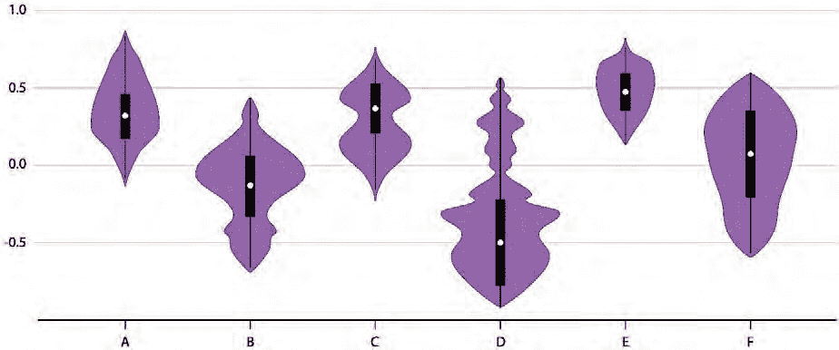

**图 3.6**

在一个看起来如此确定的媒介中，沟通不确定性的最佳方式是什么？设计师们创造了各种图表形式试图解决这个问题。这里描述的是五个小提琴图；每个图都显示了数据的分布及其概率密度（紫色部分）。正如漫画 `xkcd` 所观察到的，你也可以将这种形式视为一个漂亮的紫色阴道；参见 https://www.xkcd.com/1967/。图像来自数据可视化目录（Data Visualisation Catalogue）。

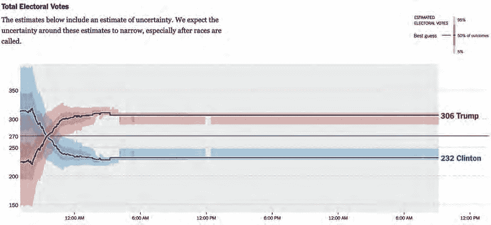

**图 3.7**

《纽约时报》2016 年的一张图表，它利用透明度——深浅不一的蓝色和红色——来表示不确定性。图像由 Gregor Aisch、Nate Cohn、Amanda Cox、Josh Katz、Adam Pearce 和 Kevin Quealy 为《纽约时报》提供。

# 90

## 第 3 章

暗示克林顿将获胜，大多数预测确实包含了特朗普获胜的可能性。根本问题不在于数据的失败，而在于在视觉形式上描绘不确定性的困难。人们还没有经过充分训练来识别此类图表中的不确定性。人们可能不会将渐变带解释为概率（例如，在晚上 6 点特朗普有 20% 的机会获胜），而可能将其解释为选票数（例如，在晚上 6 点特朗普拥有 20% 的选票）。或者他们可能完全忽略渐变带，只看线条。又或者他们看到克林顿在上方，就假设她正在领先。这在心理学文献中被称为启发式法（heuristics）——即使用心理捷径来做出判断——当人们被要求评估概率时，这种情况经常发生。(45) 问题的很大一部分在于可视化惯例强化了这些误判。即使当图表尽力从视觉上阐明不确定性时，它们看起来也是如此确定！

我们已经提到过对修辞学工作的 Jessica Hullman 为这个问题提供了一个解决方案。与其像《纽约时报》的示例那样创建代表总和或静态形式的不确定性的固定图表，Hullman 主张渲染对不确定性的体验。(46) 换句话说，利用情感和影响，让人们在感知上体验不确定性。或者，引用修辞训练和设计学校中常见的格言，“显示，不要说。”与其在采用某种看起来很确定的图表风格的同时告诉人们他们正在看不确定性——这为那些讨厌的启发式法干预创造了极其有利的条件——不如让他们感受到这种不确定性。

我们可以在同一个《纽约时报》选举直播报道网页上看到展示不确定性行动的绝佳案例。页面顶部有一个仪表盘（图 3.8），显示了《纽约时报》对谁可能赢得竞选的实时预测，其分类的渐变范围从中蓝色（克林顿获胜“非常有可能”）到中红色（特朗普获胜“非常有可能”）。但指针并没有停停在一个位置。它在第 25 百分位和第 75 百分位之间抖动（jittered），显示了《纽约时报》根据使用最新数据进行模拟后预测的结果范围。在一天开始时，运动范围相当宽，但仍然显示指针在希拉里·克林顿的一侧。随着夜幕的进行，它的范围缩小了，中心点也越来越靠近仪表盘的红色侧。到晚上 9 点，指针只是轻微地抖动着，并且在特朗普的一侧。

许多《纽约时报》的读者强烈反感这种抖动，称其为“不负责任的”、“不道德的”，以及“这是我在网上看过的最令人压力巨大的东西，我看过很多压力巨大的鬼东西。”(47) 作为回应，仪表盘的设计师之一的 Gregor Aisch 为此辩护，解释说“我们认为（而且现在仍然认为！）这种运动实际上有助于展示我们预测周围的不确定性，传达了我们估计的相对精度。”(48) 那么，这究竟是“不道德”的设计，还是对不确定性的精密交流？

基于 Hullman 的工作，我们会说答案是后者。那个抖动的选举仪表盘实际上展示了沟通不确定性的当前最佳实践。它赋予人们对不确定性的感知、直觉、内能和情感化的体验，以增强对不确定性的定量描绘。它让许多《纽约时报》读者感到不安的事实，可能与可视化的伦理关系较小，而与选举的结果有关。因此，在表现不确定性的任务中，情感得了一分。

## 永远不要使用“上帝视角”（God Trick）

那么这意味着所有的选举图表都应该抖动吗？或者数据内脏化（data visceralizations）在类别上优于视觉图表？或者围绕情感构建的数据可视化对于手来说始终是“更好”的选择？或者数据可视化永远不应该使用上帝视角？

这些问题的答案可能会让你感到惊讶：不！如果设计中存在任何一条规则，那就是语境（context）。

## 从神话、想象、不可能的视角看理性、科学、客观观点

# 92

## 第 3 章

让我们以“上帝视角”为例。尽管上帝视角可能会造成伤害——例如，以那些带有种族主义色彩、看起来客观的地图的形式出现——但也有充分的理由将上帝视角作为一种收回、抗争或赋权的形式。正如著名可视化设计师 Fernanda Viégas 所说：“数据可视化提供的概述类型是我珍视的超能力之一。”(49)

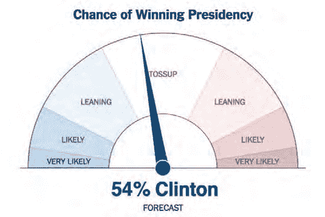

**图 3.8**

《纽约时报》报道 2016 年总统选举时具有争议的“抖动”仪表盘。图像由 Gregor Aisch、Nate Cohn、Amanda Cox、Josh Katz、Adam Pearce 和 Kevin Quealy 为《纽约时报》提供。

正是这种“超能力”——俯瞰视角——我们在《回到加拿大的地名》（Coming Home to Place Names in Canada，图 3.9）中得到了实践。Margaret Pearce 是一位制图师，波塔瓦米族成员，她花费十五个月的时间收集了第一民族、梅蒂人和因纽特人的名称。作为制图师，Pearce 遵循了尊重、责任和互惠的原住民方法论。(54) 这在实践中意味着将每个名称视为原住民的文化财产——获得每个名称的许可，并尊重社区不想要名称的英文翻译。保护这些文化财产也意味着保护每个地点的精确地理位置不向外人泄露。这就是上帝视角规模产生保护作用的地方：因为它是泛化的，

## 从神话、想象、不可能的立点看理性、科学与客观观点

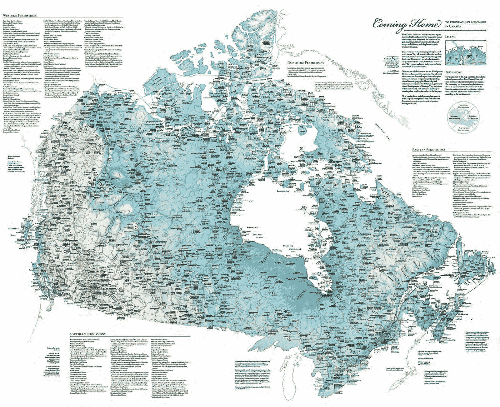

**图 3.9**

《回到加拿大本土地名》（Coming Home to Indigenous Place Names in Canada，2017）的概述与细节视图。

- (a) 地图描绘了从今天通常被称为加拿大的许多部落和国家收集的第一民族（First Nations）、梅蒂人（Métis）和因纽特人（Inuit）的地名。
- (b) 细节展示了多伦多地区的住民名称。

地图制作：Margaret W. Pearce；地图设计版权所有：2017 加美中心，缅因州大学。

# 94

## 第 3 章

此详细图像中的地名经以下人员许可共享：

- Alan Corbiere。
- Hiio Delaronde 和 Jordan Engel，“莫霍克语中的豪德诺肖诺尼国家”（Haudenosaunee Country in Mohawk），源自《去殖民化地图》（The Decolonial Atlas），`decolonialatlas.wordpress.com/2015/02/04/haudenosaunee-country-in-mohawk-2/`，经作者许可。
- Charles Lippert 和 Jordan Engel，“大湖：奥布布视角”（The Great Lakes: An Ojibwe Perspective），源自《去殖民化地图》（The Decolonial Atlas），`decolonialatlas.wordpress.com/2015/04/14/the-great-lakes-in-ojibwe-v2/`，经作者许可。
- Kitigan Zibi Anishinabeg。
- Brian McInnes，《雷鸣：弗朗西斯·佩加马加博的故事》（Sounding Thunder: The Stories of Francis Pegahmagabow，东兰斯：密歇根州大学出版社，2016），经 Brian McInnes 许可并感谢 James Dumont 和 Wasauksing 第一民族。
- Woodland 文化中心，来自 Frances Froman、Alfred Keye、Lottie Keye 和 Carrie Dyck 的《英语-凯尤加语/凯尤加语-英语词典》（English-Cayuga/Cayuga-English Dictionary，安大略省多伦多：多伦大学出版社）；以及 Marianne Mithun 和 Reginald Henry 的《Wadewayęstanih：凯尤加语教学语法》（Wadewayęstanih. A Cayuga Teaching Grammar，安大略省布兰特福：Woodland Publishing，Woodland 文化中心，1984），经 Amos Key Jr. 和 Carrie Dyck 许可。

**图 3.9**（续）

## 从神话、想象、不可能的立点看理性、科学与客观观点

比例尺为 5,000,000，其作用是传达大致位置而非确定精确位置。在这种情况下，“神之诡计”（god trick）在保留住民自主的同时传达了住民的权威性。

尽管地图已经出版且项目表面上已经完成，但 Pearce 对住民地名的承诺和关怀仍在继续。每当地图被复制时（例如图 3.9b 中的细节图），Pearce 都会向地名所属的社区写信，解释地名的背景，并请求许可在该语境下复制这些地名。你可以在图说明中看到这些许可已被获授予。

Pearce 在此过程中考虑到了自身立场的敏感性，以及每个特定地点、其名称和社区的深层含义。她说，地名是“关系”。“它们不是我的关系，不是我的领土。……它们作为并入社区的‘关系’而共存。”因此，制图不再是对某种绝对意义上“实存物”的简单呈现。相反，《回到》是一张关于跨越景观差异的关系、对话和共同投入的地图。

## 提升情感与具化

数据女性主义的第三大原则，也是本章的主题，是提升情感与具化。正如我们所示，这些是数据通信工具箱中至关但往往被低估的工具。它们有助于避免无意中传达出“无人的视角”（view from no body）：即从一个不存在且无法存在的想象和不可能的立点的视角。

全景、概述或“神之诡计”是如何被视为理性和客观的？数据可视化领域是如何形成一套优先考虑理性、贬低情感并完全忽略人体非视觉器官的惯俗的？当仅包含视觉时，谁又被排除在外了？

任何知识社区不可避免地将某些事物置于中心并将另一些事物排除在外，就像科学研究中男性身体几乎被视为准则，而女性身体被视为偏离；或者健全身体几乎总是被视为首要设计案例，而残障身体则需要设计上的改造一样。女性主义人机交互（HCI）学者 Shaowen Bardzell 认为，设计师应首先关注那些处于边缘的人：在任何特定设计语境下，被推向边缘的人展示了系统正试图排除谁以及什么。^(55) 随后的 HCI 研究坚持，设计师随后应致力于“通过承认存在的交叉性并参与团结以迈向公平和包容，从而实现‘边缘’的去边缘化。”^(56)

# 96

## 第 3 章

在数据可视化的案例中，被排除的是情感与影响、具化与表达、点缀与装饰。这些是数据逻辑中未包含的人类经验方面。但被贬低的人类经验方面与二元性有关，而非与数据被贬低的逻辑有关。

数据表明，沟通可以是直觉的，而非对身体的贬低。《回到加拿大本土地名》证明，“神之诡计”可以被用来贬低不公正。

与其让数据通用化和比例化，不如重新平衡情感与理性。所有设计领域（包括数据可视化）都是可能的领域。黑人女性主义社会学家 Patricia Hill Collins 将理想情况描述为：“伦理或情感都不应隶从于理性。”^(57) 重新平衡情感与理性开启了通信工具箱，使我们能够关注设计中真正重要的事情：尊重背景、关注并采取行动。^(58)

## 4 “被计数的数字”

### 原则：重新思考二元性与层级

数据女性主义要求我们挑战二元性以及其他延续压迫的计数系统。

“登录或创建账户以继续。”在每个网站似乎都需要自己的账户的时代，这些话往往引发人们的叹息，预感到又一个很快会被忘记的新密码。但对于像 Maria Munir 这样的人——她是一位著名的在直播中向时任总统巴拉克·奥巴马公开自己是非二元性别（nonbinary）的英国大学生——来说，创建一个新账户的前景不仅仅是烦扰。注册过程中要求提供性别信息的网站几乎只提供二元选择：“男性或女性。”对 Munir 来说，这些选项是不够的。它们还造成了情感负担：“当我每次被迫选择‘女性’而非‘男性’时，我会畏缩，因为那是我的护照上写的，而且非二元性别在英国仍未获得法律承认，”Munir 解释道。³

对于世界上数百万非二元性别者——即既不是男性也不是女性、不是男人或女人的人——来说，“选择性别”这一看似简单的请求可能很难回答，如果可以回答的话。然而，在创建在线账户时，更不用说申请护照了，在“男性”或“女性”之间的选择（且只有这两个选项）几乎是唯一的选择。⁵ 这些选项（或缺乏选项）会导致后果，正如 Munir 明确指出的：“如果你拒绝在出生证明上为像我这样的非二元性别者注册，并在创建银行账户到订阅邮件列表的一切环节中排除我们，你没有权转过头来说我们人数不足，无法引发改变。”⁶

“被计数的数字才重要，”女性主义地理学家 Joni Seager 曾断言，而 Munir 是理解这一点的人之一。⁷ 被计数的数字（如是男性或女性）往往成为政策制定和资源分配的依据。

## 第 4 章

## 被计入的才有意义

（此处简略）。Seager 的研究重点是性别、环境和政策（见图 4.1），她指出，全球范围内收集的性别数据已比以往任何时候都要多。然而，这些数据收集工作往往仍然排除了许多人，包括非二元性别者、女女同恋者和年长女性。即使在那些被计入的人中，他们也往往被问关于生活中非常狭窄的问题。Seager 在波士顿公共图书馆的一次讲座中调侃道：“贫穷国家的妇女似乎每天要被问 6 次左右使用哪种避孕方法。但她们没有被问过自己是否有获得堕胎的机会。她们没有被问过喜欢玩什么运动。”⁸

将定性经验转化为数据的过程可以赋予人力量，甚至具有治愈的潜力，正如我们在本章结尾提到的那样。如果经过深思熟虑的收集，定量数据也可以赋予力量。许多结构不平等问题都是规模性问题，在被作为一个整体来看之前，它们看起来可能只是些轶事。例如，2014 年，当电影教授谢莉·科布（Shelley Cobb）和琳达·露丝·威廉姆斯（Linda Ruth Williams）开始统计英国电影业的女性人数时，他们遇到了一位女性编剧，她以前从未考虑过在英国，女性编剧的数量远多于其他性别的编剧，比例高达四比一。¹¹ 她表示非常惊讶：“我甚至不知道这一点，因为编剧们从来没有机会见面。”(¹⁰)

类似的情况出现在 ProPublica 对美国产妇死亡率的报道案例中，正如第 1 章讨论的那样。调查小组试图统计所有在分娩时或不久后因并发症去世的母亲。他们采访了许多在分娩时去世的女性家庭，但与那位编剧一样，很少有家庭意识到这种现象不仅限于他们自己的女儿、姐妹、伴侣和朋友。这种数据的缺乏与产妇死亡率本身一样，是另一个结构性问题，它说明了为什么像女性主义社会学家安·奥克利（Ann Oakley）长期以来一直倡导在使用定性方法的同时使用定量方法。奥克利解释说，如果没有定量研究，“很难区分个人经验和集体压迫。”(¹¹)

但在通过像 ProPublica 所开展的分析识别出集体压迫之前，数据必须首先存在。这让我们回到了玛丽·穆尼尔（Maria Munir）以及收集反映其旨在代表的人口的数据的重要性。在问题上，Facebook 曾领先一步：2014 年，它将注册用户的可用性别类别从标准的两种扩展到五十多个选择，范围从“性别酷儿”到“两者皆非”——此举受到了一系列 LGBTQ+ 倡导组织的广泛赞誉（图 4.2a）。(¹²)

### 图 4.1

来自《女性地图》（*The Women’s Atlas*）第五版（2018 年）的全球产假和父假。乔尼·西格尔（Joni Seager）和安妮·奥尔森（Annie Olson）于 1980 年开始编写第一本女性地图，当时关于女性的全球数据很少。该书现在已出版第五版，但 Seager 强调仍然存在巨大的性别数据缺口。图片由 Joni Seager 和企鹅出版社提供。

一年后，当该公司完全放弃了从选项中选择的模型，用空白文本字段取代“性别”下拉菜单时，这一决定被推崇为更具进步性（图 4.2b）。(¹³) 因为 Facebook 用户可以输入任何单词或短语来表示自己的性别，他们终于不再受到任何预设选择所假设的限制。(¹⁴)

但信息研究学者蕾娜·比文斯（Rena Bivens）的进一步研究表明，在表面之下，Facebook 继续将用户的性别解析为二元：要么“男性”，要么“女性”。(¹⁵) 显然，做出这一决定是为了让 Facebook 允许其主要客户——广告商——更容易地针对其中一种性别进行营销。换句话说，即使你可以选择展示给 Facebook 朋友的性别，你也无法改变 Facebook 提供给付费客户的性别（图 4.3）。这种差异直接回到了我们从书的开始一直在讨论的权力问题：是像 Facebook 这样的公司，而不是像玛丽·穆尼尔这样的个人，拥有控制数据收集术语的权力。事实依然如此，尽管是像穆尼尔这样的人亲自（往往是痛苦地）触碰了这些分类系统的局限性——而且她们最了解如何改进、重塑它们，或者在某些情况下完全废除它们。

女性主义者花费了大量时间思考分类系统，因为人们被划分为男性和女性类别的标准正是：一套分类系统。(¹⁶) 尽管性别二元论是当世界上最广泛的分类系统之一，但它的构建性并不亚于 Facebook 广告平台或者说金门大桥。金门大桥是一个物理结构；Facebook 广告是一个虚拟结构；而性别二元论是一个概念结构。但所有这些结构都是由人创造的：住在特定地点、特定时期并影响了世界的人。

### 图 4.2

(a) Facebook 允许用户指示其他性别的最初尝试，约 2014 年。图片由 *Slate* 提供。(b) Facebook 更新后的性别字段，约 2018 年。Lauren F. Klein 截图。

许多 20 世纪的女性主义学者试图通过将性别视为与生理（sex）分离的事物来解决性别的构建问题。但这种区别日益崩溃。事实证明，性别和生理都是社会建构。即使是今天仍被从生物学角度考虑的生理，也有其独特的文化历史。它可以追溯到一个特定的地点（欧洲）和一个特定的时期（启蒙运动），当时关于民主以及哲学家所谓的“自然权利”的新理论开始出现。在那之前，性别存在等级制度，男性在顶端，女性在底部（感谢亚里士多德！）。事实上，根据性和性别历史学家托马斯·拉克尔（Thomas Laqueur）的说法，大多数人认为女性只是低劣的男性，其阴茎位于身体内部而非外部，并且可以在生命中的任何时候下降。(¹⁹)

这需要像托马斯·杰斐逊（Thomas Jefferson）这样的人物宣布“人人生而平等”，以及像美国这样的整个国家建立在这一原则之上。一旦这种情况发生，政治领袖们就开始担心他们究竟宣称了什么：平等原则适用于谁？所有分类人类的系统都根源于那个时代——不仅是性别，至关重要的还有种族。在 18 世纪之前，西方社会将种族理解为与宗教信仰、地理起源或这些者的结合相关的概念。

### 图 4.3

2018 年左右 Facebook 新账户创建页的详细视图。注意，在注册时你必须选择“女性”或“男性”——一个二元选择。

## 谁被计数了意义

**103**

种族（race）在 17 世纪跨西洋贸易出现之前，与肤色几乎没有关系。即便在当时，它仍然是一个模糊的概念。直到 18 世纪种族主义出现，种族才开始被西方社会定义。(21) 以林奈（Carl Linnaeus）为例，他所创立的分类法是我们今天仍在使用的。(22) 林奈的二分分类法将人类与其他物种进行分类。但事实上，林奈的系统不仅对人类进行了分类，还错误地包含了“人类（*homo sapiens*）”这一在当时并不存在的类别（尽管如此）。

在 18 世纪，随着比较解剖学和相（physiognomy）等伪科学的兴起，种族主义的系统开始出现。这些系统为对有色人种、女性和残疾人士的歧视提供了所谓的科学依据。尽管这些领域现在早已被证明是伪科学，但其影响依然随处可见。这种影响体现在医疗结果上，例如对不同种族人群的医疗待遇差异。(23)

正如《消费者报告》所调查的，随着机器学习技术进入新的领域，种族主义正以新的形式出现。(24)

一个简单的解决方案可能是质疑数据本身，但计划的缺陷在于，数据必须以某种方式被分类。事实上，在数据被分类之前，种族就已经是一个概念。正如学者米里亚·波斯纳（Miriam Posner）、玛丽特·米切尔（Margaret Mitchell）以及亚历山大·托多罗夫（Alexander Todorov）所言的，“可处理的（*tractable*）”数据。(25)

数据在被分类之前，必须以某种方式被处理。在计算机科学中，数据可以被逻辑值，如布尔值（*Boolean*）中的真（*true*）或假（*false*）来表示，数据也可以以浮点数（*float*）、整数（*integer*）或字符串（*string*）来呈现。正如乔弗里·鲍克和苏珊·星（Geoffrey Bowker and Susan Star）在其著作中所述，计数是具有意义的。(26)

在机场安检时，林奈的系统有时会担心宗教或种族身份。例如，那些名叫穆哈马德（Muhammad）的人会不成比例地被警察拦下，这让人们感到愤怒。(27)

此外，计数系统也会产生严重的后果。例如，美国人口普查中关于公民身份问题的提议，是出于政治目的。这种做法已经影响了非裔和拉丁裔群体。(28)

# 第 4 章

**106**

或者，考虑另一个在 TSA（美国运输安全管理局）字面意义手中曾有过糟糕经历的人。Sasha Costanza-Chock 和 Maria Munir 一样，是非二元性别者。他们也是麻省理工学院（MIT）的一位设计教授，因此在生活和深入思考压迫性分类系统方面拥有丰富的经验。在 2018 年的一篇名为《设计正义、人工智能与从统治矩阵中逃脱》的文章中，他们提供了一个具体的例子，说明为什么在数据方面需要设计正义。^(32) 这篇文章描述了那些举起手臂式毫米波机场安检扫描仪的操作员所使用的看似简单的系统，实际上非常复杂——而且从根本上说是有缺陷的。

很少有顺性别者意识到，在你步入扫描机之前，操作机器的 TSA 探员会从上到下打量你，决定你是男性还是女性，然后按下按钮在扫描仪的触摸屏界面上选择相应的性别。这一人类决策加载了针对男性身体或女性身体的算法模型，你的身体测量数据将与此进行比较。如果你的测量数据偏离该性别的身体统计常数——无论这种差异是因为你隐藏了致命武器，还是因为你的身体无法完美契合系统提供的两个类别之一，又或仅仅是因为 TSA 探员选错了——你都会触发“风险警报”。然后，根据法律理论家迪恩·斯佩德（Dean Spade）的术语之`行政暴力`，你将受到与潜在恐怖分子同仁的全身搜身。^(33) 在这里，并不是因为扫描机依赖的类别数量不足（如小童军童兵 Mikey 的案例那样），还是因为它们使用了错误的类别（正如 Mikey 的妈妈可能会说的那样）。而是因为 TSA 扫描仪从初就不应该依赖性别对航空乘客进行分类。（而且既然我们顺着这条路走下去，我们何不想象一个没有系统性将黑人女性、跨性别者和小童军童兵病理化的国家机构的未来呢？）

所以当我们说“被计数的即重要”时，我们考虑到的是像 Sasha Costanza-Chock、Mikey Hicks 或 Maria Munir 这样的人。因为有缺陷的分类系统——例如机场安检仪风险检测算法的底层，或决定哪些名字会出现在恐怖分子观察名单上的系统，或者仅仅是（仅仅！）性别二元论——不仅本身是严重的问题，而且是更全球性不平等状况的症状。我们在第一章中引入的统治矩阵描述了种族、性别和阶级（以及其他因素）如何交织，从而为某些人增加机会，并限制另一些人的机会。^(34) 在统治矩阵下，规范化的身体可以轻松穿过扫描仪、边境和洗手间；这些系统是由他们这样的人、为像他们这样的人设计的，其目标——有时是显而易见的——是将与他们不同的人排除在境外。^(35)

## “被计数的即重要”

**107**

正如这些例子所展示的，通过统治矩阵运作的力量是狡猾且弥散的。它们无处不在——甚至在裤子的口袋里。最近对 80 条男装和女装牛仔裤尺寸的一项新闻调查证实了女性（以及穿女装裤的男性和非二元性别者）多年来口头所说的话：他们的裤口袋根本不够大（图 4.4）。^(36) 更具体地说，为女性设计的牛仔裤口袋比为男性设计的牛仔裤口袋短了 48%，窄了 6.5%。这种尺寸很重要！根据同一项研究，只有 40% 的女牛仔裤前口袋能装下智能手机，而不到一半的口袋“能装下*专门*为前口袋设计的钱包”。因此，女手包市场（用于放置上述前口袋钱包）和手机屏幕更换市场（用以防你的手机不可避免地从太小的口袋里掉出并破裂时使用）正蓬勃发展。

现在，任何特定一条女牛仔裤的设计者几乎没有想过：“让我们通过让她们口袋太小来压迫女性。”他们可能只是在考虑什么好看。但好看也有其历史。在 17 世纪之前，“口袋”是系在绳子上的外部袋子，可以系在其他服装上方或下方。但从 1600 年代开始，男装开始出现内袋。与此同时，女性服装变得越来越贴身。到 18 世纪末，女性口袋达到了它的临界点，导致了一种名为“束口包”（reticule）的新时尚单品的出现，亦即手包。这些微型手包由布料制成，根据维多利亚和阿尔伯特博物馆关于口袋的实用在线历史，它们装不下什么东西。^(37) 然而，正如博物馆馆员指出的，在一个大多数人共享所有书架和五斗柜的时代，这些束口包是女性存放任何想要留给自己的物品的少数地方之一。快回到现在，女性（以及穿女性时尚的人）仍必须将自己的物品放在衣服外面并公开展示。他们同时使用两只手的能力也受到了限制。这（在很大程度上）是一个小困扰，但它是许多方式之一，`父权制`——一个描述法律框架、社会结构和文化价值结合并导致男性持续主导社会的术语——在无意中且无形地自我复制。在这种情况下，裤子——也许是你现在穿的这一条——复合并巩固了父权制的压迫力量。

**110**

### 第 4 章

二元性之外的身份是完全合理的。但“被代表”也意味着“被可见化”，而让这种可见性在统治矩阵——一个不断制定法律、实践和文化规范来监控性别二元性的体系——中变得可见，会对少数群体的健康和安全构成重大风险。例如，在目前的美国政府下，跨性别者被禁止参军，且一旦被识别为此类身份，就会被拒绝某些形式的医疗保健。^(43) 这说明了将性别计算为男性或女性之外的某些风险——这些风险可能发生在许多背景下，取决于收集什么数据、由谁收集，以及数据是否具有个人识别性（或易于去匿名化）。此外，意识到跨性和非二元性别者即使在大型数据集中也可能被识别出来也是重要的，因为相对于大多数人口来说，他们的人数较少。这种可能性构成了额外的风险：对于不愿透露自己性别身份的人来说，表现为不受欢迎的关注；而取决于他们所在地，可能表现为歧视、暴力甚至监禁。

作为数据科学家，在这些潜在的伤害面前，我们应该做什么？取决于具体情况和收集数据的机构，最符合伦理的决定可能不同。可能是避免收集关于某人是顺性别（cis）还是跨性别者的数据、将所有性别数据设为可选、完全不收集性别数据，甚至

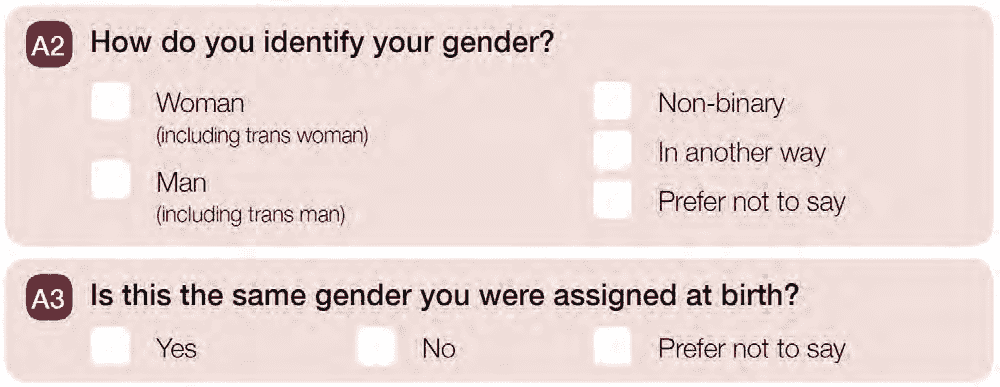

### 图 4.5

由英国公共卫生局与多个合作伙伴组织合作开发的、针对英格兰和威尔士艾病毒感染者的积极声音调查。这代表了在英语西方公共卫生背景下收集非二元性别数据的当前最佳实践，但必须意识到，根据背景的不同，可能需要不同的决策。感谢 Peter Kirwin，英国公共卫生局，2018 年。

**111**

## “被计数的才有意义”

即坚持使用二元性别分类。社会计算研究员 Oliver Haimson 断言，“在大多数非健康研究中，通常没有必要知道参与者的出生性别。”^(44) Heath Fogg Davis 也同意这一观点：他的书籍《超越跨性别》（*Beyond Trans*）认为，我们不需要根据护照和执照上的性别、或者为了厕所或运动对人们进行分类。^(45) 相反，J. Nathan Matias、Sarah Szalavitz 和 Ethan Zuckerman 选择在他们的应用 `FollowBias` 中保持性别数据为二元形式（该应用通过姓名检测性别），以避免在违背个人意愿的情况下公开其性别身份。^(46)

统计性别、何时统计性别以及如何统计性别的伦理复杂性，揭示了在结构性压迫背景下分类行为的复杂性。因为涉及到数据收集以及构建它的分类时，存在着上下、左右以及中间各处的权力不平衡。由于这些不对称性，数据科学家必须带着背景意识（将在第 6 章进一步讨论）和对收集环境权力的分析（将在第 1 章进一步讨论），以确定计数是为了谁的利益，以及谁面临着被伤害的风险。

## 重新思考数据可视化中的二元性

对计数以及对经常构建这些行为的二元分类系统的女性主义批判，不仅限于关注性别。二元逻辑也渗透进我们对种族的思考中，正如女性主义学者 Brittney Cooper 和 Margaret Rhee 所解释的那样。源自交叉性（intersectionality）的思想，他们呼吁“破解”黑/白的二元法，这种分类一方面有助于揭露美国黑人所经历的种族主义，另一方面却抹去了原住民以及拉丁裔、亚裔美国人和其他少数群体所经历的其他形式的种族主义。他们直白地说：“二元的种族论述模糊了我们对正义的斗争。”^(47) 通过挑战这种抹除某些群体经历而提升另一些群体的二元思维，我们可以朝着更加公正公平的数据实践努力，从而走向一个更加公正公平的未来。

然而，有时挑战二元思维的目标可能会受到领域现实的限制。例如，可视化设计人员通常无法控制他们被要求可视化的数据的收集实践。他们经常继承二元化的数据，然后需要从内部对其进行“破解”。这看起来像什么样呢？我们可以提到英国报《电报》（*Telegraph*）生活版的记者，他们在 2018 年 3 月考虑如何纪念国际妇女节，并被英国在教育、政治、商业和文化方面的巨大性别差距所震撼。^(48) 作为记者，他们处理由其他机构收集的多个数据源，而这些数据都是以二元形式提供的。但他们想确保自己进一步强化任何性别刻板印象。他们特别关注颜色。一种设计逻辑会为了解释性而遵循文化惯例，例如用粉色代表女性，用蓝色代表男性；但女性主义的逻辑会利用颜色选择来破解同样的惯例（图 4.6）。

**112**

毕竟，粉色和蓝色是另一种等级制度，《电报》团队成员的目标是减轻不平等，而不是强化它。因此，他们从另一个来源寻找灵感：20 世纪初英国的“为妇女投票”（Votes for Women）运动，该运动用紫色代表自由和尊严，用绿色代表

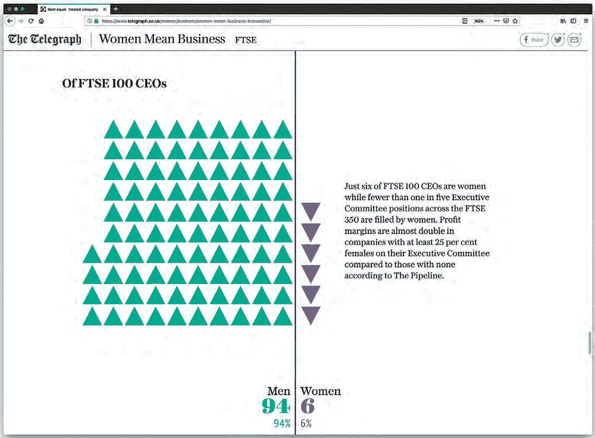

### 图 4.6

“出生平等，对待不平等”（Born Equal. Treated Unequally）是 2018 年《电报》的一项互动专题，调查了英国在多个维度上的性别差距。尽管作者将性别视为一个二元类别，但他们使用颜色来挑战典型的男/女色彩编码。该专题由 Claire Cohen、Patrick Scott、Ellie Kempster、Richard Moynihan、Oliver Edgington、Dario Verrengia、Fraser Lyness、George Ioakeimidis 和 Jamie Johnson 为《电报》制作。

**113**

## “被计数的才有意义”

在考虑将这些颜色中的哪一个分配给每种性别时，他们将感知设计原则作为指南：“相对于白色，紫色的对比度大得多，因此当与绿色放在一起时，应该吸引更多的注意力，虽然不是很多，但足以扭转天平。在许多可视化中，男性人数远多于女性，因此这是一种将他们重新带回焦点的简单方法，”《电报》平面新闻总监 Fraser Lyness 告诉可视化设计师 Lisa Charlotte Rost。^(49) 在这里，一种等级制度——人眼感官感知的颜色的等级制度——被用来挑战另一种等级制度：性别等级制度。在实践中，这种简单的方法实现了清晰传达信息且不强化刻板印象的结果。

但《电报》的记者们可以更进一步地重新思考二元性。他们有机会通过向公众说明性别不是二元性来做到这一点——在故事文中、在图表下方的注释中，或者通过视觉显示没有非二元性别者的数据。他们在《卫报》（Guardian）的同事最近在他们关于 2018 年美国中期选举的互动文章“新国会反映了你吗？”中采用了后一种策略。^(50) 该文章呈现了三个类别：顺性别男性、顺性别女性以及跨性别+非二元。当你点击“跨性别+非二元”时（如图 4.7 所示），交互地图显示所有选区均为灰色，因为“国会中没有人像你”。数据的缺失变成了一个重要的结论，与数据本身一样意义。^(51)

这些例子展示了性别作为一个分析维度，但我们该如何从视觉上表示性别本身呢？这是一个最高级别的复杂性可视化挑战，《科学美国人》（Scientific American）的设计师 Amanda Montañez 直面了这一挑战（图 4.8）。她被要求创建一个信息图，以配合一篇关于性别和性演变科学的文章——她和大多数人一样，认为这些类别是独立但相关的。^(52) 正如她在《科学美国人》网站的一篇博客中解释的那样，她首先构想了一个简单的光谱，或者可能是两个光谱：一个关于性，一个关于性别。^(53) 但她很快发现了我们本章到目前为止所内容的证实：生活中很少有事物可以被真正简化为二元法，而在数据收集中坚持使用二元分类——无论是对性别、性、它们的关系还是任何其他——都未能承认处于两者之间及之外的（或人）的价值。

我们已经建立了……性偏离者约占人口的 1.7%，可能拥有卵巢和阴茎，或称为“嵌体遗传学”，即人的某些细胞具有 XX 染色体，而另一些具有 XY。^(55) 人们越来越意识到，性别与性别认一样（有时与性别认共同存在），是多层次的，并在人一生中不断展开。

## 第 4 章

**114**

为了开始表现这种复杂性，Montañez 必须从拒绝她和她的研究助理发现的大部分数据和研究开始，要么是因为分类缺陷，要么是因为收集实践存在缺陷。她决定专注于性别，在经过详尽的设计过程（包括咨询领域专家）后，Montañez 与帮助最终确定该图表的设计公司 Pitch Interactive 一起得出结论。*超越 XX 和 XY* 是一个复杂的图表，它利用色彩光谱来表示性别光谱，用纵轴表示随时间的变化，并用分支箭头连接到文本块，以提供额外的背景信息。该设计提供了一次执行精美的视觉挑战，挑战了“只有两种性别”这一科学错误的观点，甚至挑战了“性别与性别认完全不同”的观点。视觉化通常被认为是一种降低复杂性的方法，但在这里它的作用是反向的——将简单的、压迫性的思想推向更加复杂、细微和公正。

### 拒绝数据，找回数据

Montañez 的图表让已经被计数的数字变得有了意义。换句话说，她将科学家和理论学家所认为关于性别分化本质的真相，使这些知识变得更易于获取和公开。但计数本身并不一定意味着是无条件的完备，将其展示在公众面前也同样不如此。我们已经引入了“暴露悖论”的概念，即人们因为被系统化而受到伤害。但因为来自主导群体的系统设计师不会经历被计数或在未经许可的情况下被视觉化带来的伤害——这再次是“特权风险”——他们很少在设计过程中预见到这些需求或考虑这些需求。这就是为什么关于计数的疑问必须伴随着关于知情同意的问题，以及关于个人安全、文化尊严和历史背景的问题。

再次是 Facebook 帮助证明了这一点。信息研究学者 Oliver Haimson 和 Anna Lauren Hoffman 研究了该公司的“实名”政策的影响，在该政策下，平台确定每个用户的注册名称为“真实的”且可靠的，或是“虚假的”。^(56)（用我们老师的语气说：现在有人注意到这种二元思维在这里存在的问题吗？）Haimson 和 Hoffman 指出，跨性别和酷儿群体可能选择拥有多个在线身份，这些身份可能是流动且情境化的，并可能为了保护自己所必需。另一个例子是，遭受幸存者可能需要采取措施让自己无法通过搜索被找到，即使他们仍然想与爱的人保持联系。

**图 4.8**

*超越 XX 和 XY* (2017) 可视化了人类生命不同阶段导致性别分化的已知因素，从受精到出生到青春期及以后。与传统认知相反，性别并非出生时就固定的二元对，而是一个多层次的、基于时间的分化过程，具有两种以上的可能结果。经许可复制。版权所有 © 2017 *Scientific American*，Nature America, Inc. 部门。保留所有权利。

## 超越 XX 和 XY

**115**

许多因素决定了一个人是女性、男性还是介于两者之间。人类受到社会条件的影响，将性别和性别认视为二元属性。从我们出生的一刻起——甚至在此之前——我们无疑被标记为“男孩”或“女孩”。然而，科学指向了一个更加模糊的现实。生物学性别的确定是惊人复杂的，不仅涉及解剖结构，还涉及随时间展开的遗传和化学因素的复杂编排。个体——以多种状况（如 alpha 缺乏）为特征——这里展示了这些状况及其遵循路径的小部分交织。在另一层复杂性中，个人并不总是认同出生时分配的性别，他们可能既不是女性也不是男性。我们对性别和性别认知了解得越多，这些属性就越显得存在于一个光谱上。

— Amanda Montana

*英语语言长期一直受于缺乏广泛认可的第三人称单数代词的困扰。“they”的单数形式已获得广泛接受，许多不认同二元性别的人都在使用它。*

| | 46X | 45X | 45X/4XY 嵌体 | XX 性别发育异常 | 先天性上腺皮质增生 | 混合性腺体发育 |
| :--- | :--- | :--- | :--- | :--- | :--- | :--- |
| 基因 | 缺失 SRY 基因 | SRY 基因可能存在 | CYP22 基因突变 | | | |
| 激素 | 典型的生物学女性 | 间性征状况 | 特纳氏综合征 | 雄激素水平升高 | | |
| 内外生殖器官 | 女性内外部生殖器结构 | 女性内外结构受损，卵巢发育不全 | 女性内外部结构 | 女性外部结构、非典型内部结构、未下降睾丸（完全性 ASD） | 阴蒂肥大、阴唇融合、卵巢缺失、子宫、宫颈 | 一个睾丸，两个生殖器官（异常发育为女性、男性或中性） |
| 次性性征征（如乳房或面部毛发） | 女性激素（主要是雌激素） | 与典型女性特征的细微差异，如激素水平升高 | 可能出现月经不调、生育能力下降、体毛增加 | 雌激素低 | 青春期发育缺失或受限 | 睾酮含量非典型；乳房可能发育 |

50 Scientific American, 2017年9月 | 图表由 Pitch Interactive 和 Amanda Montanez 制作

## 性别光谱

跨性别女性是指出生时被分配为男性但在解剖结构上认同为女性的人。

跨性别男性是指出生时被分配为女性但在解剖结构上认同为男性的人。

5-α 还原酶缺乏是一种在整个发育过程中遵循多种路径的交叉状况。受影响个体具有男性染色体，但基因突变导致双氢睾酮缺乏。外生殖器在出生时可能分配为任何性别，但在青春期会发育出男性特征。因此，被当成女孩长大的人往往认认为男性。

顺性别女性是指解剖结构出生时被分配为女性且认同为女性的人。

非二元性别者认同自己不是完全女性或男性，可能认同两种性别或都不认同，意味着他们的性别认知在女性和男性之间波动。

顺性别男性是指解剖结构出生时分配为男性且认同为男性的人。

性倾向是指个人的性取向，或他们所吸引的人的。性倾向也是一种光谱，但与性别和性别认知分开。

## 第 4 章

## 计数作为治愈，计数作为问责

由于这些因素具有情境性，Facebook 通过算法执行其实名制——标记那些单词“过多”或含有不常大写字母的名字。海姆森（Haimson）和霍夫曼（Hoffman）指出，Facebook 的算法不成比例地将美原住民的名字标记为违，因为这些名字在结构和形式上通常与英美西方名字不同（后者是系统设计者的主体位置，因此被认为是默认值；这再次体现了特权风险）。

此外，用户还可以举报其他未使用实名的用户，这导致了诸例如：一个人系统地针对数百名变装皇后（个人资料并提出删除请求。Facebook 声称实名制是为了安全，但海姆森和霍夫曼清楚地表明，该政策积极危害了平台上一些最边缘化用户的安全。正如我们已经开始暗示的那样，有时最符合伦理的做法是帮助人们保持隐蔽、隐藏和无处可见。^(57)

Facebook 的例子说明了在进行计数时获得同意的根本重要性，以及允许个人根据潜在危害拒绝计数和分类行为的重要性。

计数和分类行为，特别是当涉及少数群体时，必须始终平衡损害与利益。当收集有关真实人物及其生活的数据时，从暴露到暴力的风险始终存在。但当经过深思熟虑并获得同意时，计数有助于增加价值和理想的可见性。由特拉华大学学生和教员工团队领导的“有色人会议项目”（CCP）展示了如何通过回顾过去在现在明智地应对这种平衡。^(58) 该项目的目标之一是创建一个机器可读的19世纪有色人会议会议记录语料库：在会议中，黑美国人（包括逃犯和自由人）聚集在一起，制定如何实现法律、社会、经济和教育正义的战略。这些会议记录非常有价值，因为可以说，在通常关于19世纪美国终结奴隶制运动的故事中，它们尚未被“计数”。那些故事倾向于赋予白人废奴主义者优先，因为他们的故事是被记录在印刷品中的。但有色人会议有助于记录那些在自己的社区内努力结束奴隶制并实现的黑人活动家的关键作用。

语料库的使这些重要的活动家能够被计数，并使他们的言论（如会议记录中所记录的）被分析并纳入历史记录中。但将会议记录转换为数据的过程强烈地想起了伴随奴隶贸易的原始暴力，当时人类生命——事实上是这些活动家的祖先——被简化数字和名字。

## “被计数的才有意义”

为了承认这种不可调和的紧张关系，CCP 要求所有下载语料库的人都承诺遵守原则，包括“对数据的使用人性化并承认语料库中汇集的具有集体组织历史的黑人的存在”，并要求“情境化并叙述那些作为‘数据’出现的人的状况，并在可能的情况下为他们命名”。^(59)

CCP 以典范方式处理了第二个紧张关系，这与语料库本身的内容有关。因为它源自会议的官方记录，所以它只记录了会议的“官方”参与者以及他们发起的讨论。这些参与者几乎全是男性。为了解决这种差异，CCP 团队要求教学伙伴在向学生介绍项目之前签署一份合作谅备录（MoU）。该谅备录要求所有讲师在介绍每位具名的男性代表的同时，都要介绍一位参与会议的女性，例如妻子、女儿、姐妹或教会成员（图 4.9）。^(60) 通过这项恢复工作，CCP 正在创建一个女性名字的第二个数据集——这些女性本将不会被计数，因此其工作不被认可。他们正在利用数据收集来让这些贡献产生意义。

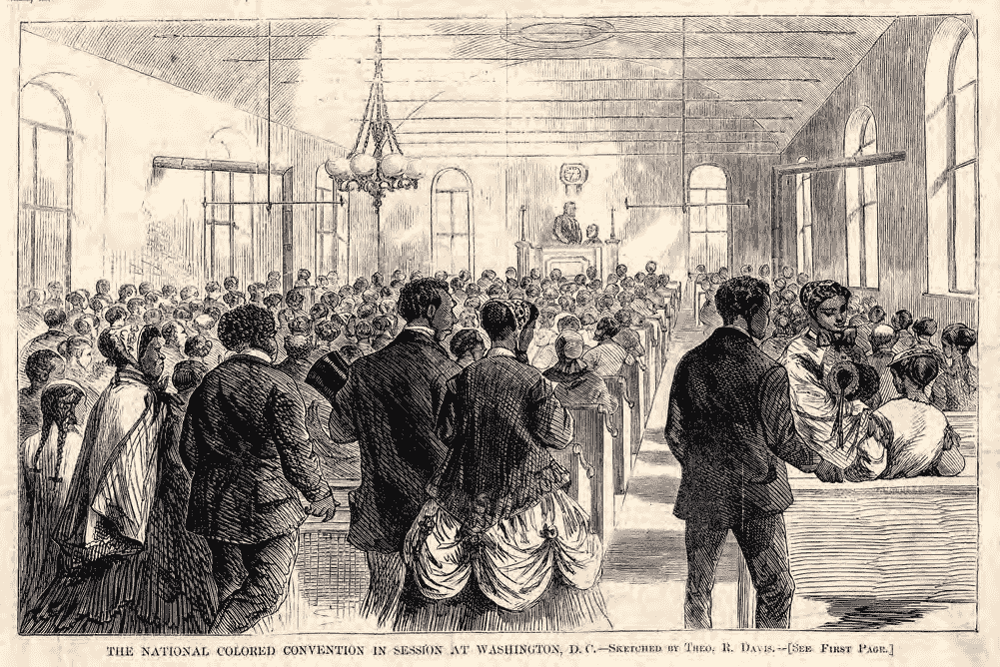

**图 4.9**

一张1869年有色人会议的版画，发表于《哈珀周刊》，显示了讲台上的男性和后面坐着或站立的女性。图片由 Jim Casey 提供。

在19世纪，就像今天一样，引入数据集的许多差异与更大、更深层次的权力不对等有关。这种不对等通常直接反映在计数者与被计数者之间的权力动态中。但当一个社区为自己、关于自己进行计数时，数据收集不仅不仅可以赋权，而且可以治愈。其中一个例子源于本书一位作者的个人经历。那是2014年，凯瑟琳（Catherine）当时是一名学生，还要照顾她的小女儿，同时在服务器房和卫生间地板等不理想的地方艰难地为她挤母奶。沮丧中，她和六位学生同事聚在一起，发布了一份旨在改进乳奶器技术的想法和故事征集。^(61) 这些故事催成了一篇关于乳奶器设计的研究论文。

**图 4.10**

2018年“让乳奶器更好用”黑客松是麻省理工学院（MIT）第二次社区聚会，关注种族公平和母亲健康。照片由 Rebecca Rodriguez 和 Ken Richardson 拍摄。

尽管创新空间长期以来一直是黑客松，但2014年的活动是首批关于哺乳的活动之一。这些故事指向了“个人即政治”意识觉醒活动中常见的经历和模式。^(62) 但行动是谁的行动，又是为了谁的行动？在2014年活动之后，我们（即组织者）反思了它的成功和局限性——特别是缺乏交叉性方法。^(63) 在美国，母亲健康带有显著的种族和阶级不平等，正如第一章讨论的那样。第一次黑客松没有考虑这些不平等；它以一些特权母亲的需求为中心。我们决定再次尝试。在2017年和2018年，我们将单次活动扩展为一个参与式研究项目、一个政策峰会、一个社区创新计划以及一个黑客松。在所有这些活动中，我们都刻意关注了有色人种父母、低收入父母以及 LGBTQ+父母的需求和参与。

确保2018年黑客松能够完全欢迎这些家庭的参与需要多种形式的问责。在我们负责公平与包容的首席组织者 Jenn Roberts 的指导下，我们写了一份价值观声明，召集了一个由哺乳、公平和母亲健康领域的领导组成的顾问委员会。我们还开发了一套指标来塑造活动的人口统计。^(65) 这些指标旨在优先考虑种族多样性、性别多样性、性取向多样性、地理多样性和领域多样性，并对年轻人和新成员给予额外优先级。在申请表上，潜在参与者被鼓励自我识别性别和种族，指定位置，并从预定义的领域专业类别中选择多个选项。我们还邀请他们写为什么参加，如果他们选择披露有关性取向或财务状况的信息，那么我们会在过程中考虑这些信息。

## 第 4 章

这些分类是还原性的吗？当然是。无论提供多少个空白文本框，都没有人能将整个自我拟合进一个形式中。表单是否反映了每个人交叉身份的真实本质，以及这些身份如何影响该人在世界上的存在状态？这个问题的答案也并不出人意料：显然没有。但收集这些人口统计数据的过程——至关的一点是，这一过程是自愿且从社区内部进行的——产生了一场确实由我们联盟希望重点关注的群体知识和经验所引导的事件。^(66)

在我们开始撰写这本书时，Catherine 与 Lauren 分享了这一经历，我们决定使用类似的过程来帮助自己对那些想要指导《数据女主义》（Data Feminism）的价值观负责，以及选择某些项目和文本的标准。我们确定了具体的数字和百分比，在我们看来，这些将有助于我们对这些价值观负责，同时也确定了判断是否达到指标所需的数据收集类别。（这些内容可以在附录中查看，*我们的价值观和我们自我问责的指标*。）在过程中的两个阶段——首先是我们在网上发布手稿草稿，其次是在我们提交手稿进行文字校对后——我们的一个研究助理 Isabel Carter 对书中的项目和引用进行了审计。（他们在另一个附录“审计《数据女主义》”[Auditing *Data Feminism*]中更详细地描述了他们的研究方法。）与黑客松一样，这些指标并不是我们用来让自己负责的唯一方法。我们还访谈了引用的许多项目的创建者，与他们核实了我们对他们作品的引述和描述，并在网上发布了书稿草稿以供开放同行评审，以及其他其他方法。

我们的计数方法完美吗？当然不完美。我们确定自己犯过错误。这是我们决定对我们的分分类数据保持私密，即使我们公布了汇总结果的原因之一。那么最初对人数和项目进行计数的想法呢？这难道不应该被看作是导致了我们书中为止所反对的那种对复杂性的还原吗？正如本章所示，计数总是复杂的。但只要是有意识地进行、针对特定目标量身定制，并始终考虑到隐私问题和潜在伤害，计数就可以用于支持问责——作为通向更大目标的众多方法中的一种。

## 重新思考二元对立与等级制度

### “被计数的才有意义”

计数和分类可以是知识创造过程中强有力的部分。但它们本身也是权力的工具。在历史上，计数和分类一直被用于统治、纪律和排除。这正是数据女主义的第四个原则——*重新思考二元对立与等级制度*（rethink binaries and hierarchies）介入的地方。性别二元对立提供了一个关键例子，说明了分类系统是如何由文化和社会构建的，并反映了它们的价值观和偏见。TSA 机场扫描仪、Facebook 用户个人资料以及普通的长裤等案例告诉我们，性别和性的二元对立——以及对性别和性科学上错误的理解——是如何被编码进技术系统（以及牛仔裤！）中的！这些系统反过来又循环了错误和有害的思想。

一种交叉女权主义的计数方法要求我们审视并在必要时重新思考分类基础设施背后的假设和信念，并持续探究是谁在进行计数，以及服务了谁的利益。计数和测量并不总是为了压迫的工具。我们还可以利用它们来让权力负责，找回被忽视的历史，并建立集体性和团结。当我们在自己的社区内进行计数，并带有考虑和关心时，我们可以努力重新平衡不平等的权力分配。

## 5 独角兽、清洁工、忍者、巫师和摇星

### 原则：拥抱多元主义

*数据女主义坚持，最完整的知识来自于对多个视角的综合，并优先考虑当地、本土和经验性的认知方式。*

2017 年春季，《彭博博新闻》（Bloomberg News）发表了一篇标题具有挑衅性的文章，“美国富人越来越富，穷人被机器人取代”。¹ 利用人口普查数据，作者报告全国范围内收入不平等正在扩大。旧金山领先领先，最富有和最贫的 20% 居民之间的收入差距接近 50 万美元。与其他地方一样，财富差距具有种族和性别维度。在湾区，有色人种每赚白人的 1 美元，仅赚 68 美分，59% 的单亲生活在贫困中。² 旧金山还是美国主要城市中儿童与成人比例最低的，而且——自 2003 年以来——驱逐率不断上升。

尽管旧金山租金委员会（San Francisco Rent Board）收集了这些驱逐的数据，但它并不跟踪人们被驱逐后去了何处，有多少人最终无家可归，或者哪些房东负责系统性地驱逐该市的大片区域。2013 年，反驱逐映射项目（AEMP）介入了。该倡议自称为一个“住房正义活动家、研究人员、数据极客、艺术家和口述历史学家”的集体。这是一个多种族群体，由女性担任重要的（尽管不是独家的）项目领导。AEMP 正在绘制驱逐地图，并通过协作过程进行。如果你访问`antievictionmap.com`，你找不到单一的地图。AEMP 还与租户组织合作制作了报告，与原住民学生制作了士绅化时间线，与人类学系编写了口述史，并与艺术组织创作了壁画。

AEMP 最长期的合作之一是与驱逐防御集体（Eviction Defense Collective, EDC），这是一家为被驱逐者提供法庭代表的非营利机构。尽管该市不收集被驱逐者的种族或收入数据，但 EDC 收集这些数据，而且 90% 的租客案件都会进入法庭。2014 年，EDC 联系 AEMP 帮助其制作年度报告，作为交换，提议将其人口统计数据分享给该机构。从那时起，这两个小组继续合作制作 EDC 年度报告，以及针对种族的额外分析。

AEMP 的某些地图旨在利用数据可视化的能力，让人一眼就能看出模式。例如，2014 年制作的《技术大巴站驱逐地图》（Tech Bus Stop Eviction Map）绘制了三年来埃利斯法案（Ellis Act）驱逐的位置。这是一种“无过错”驱逐，房东可以声称他们正在退出租赁业务。在许多情况下，这样做是为了将大楼转换为公寓并以巨额利润出售这些单元。AEMP 的分析显示，在 2011 年到 2013 年之间，69% 的无过错驱逐发生在技术大巴站四个街区范围内。这张地图让这一发现显而易见。

## 独角兽、清洁工、忍者、魔法师与摇滚明星

127

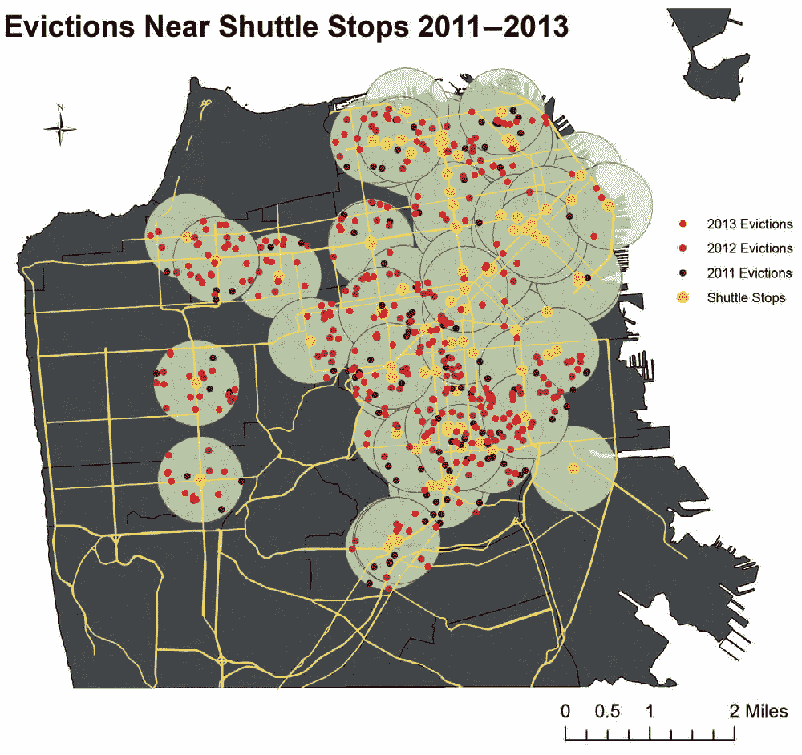

**图 5.1**

由反驱逐制项目（Anti-Eviction Mapping Project，2014 年）制作的《科技巴士站驱逐地图》将旧金山的驱逐事件与“谷歌巴士站”进行了绘图。该小组的分析显示，该市 69% 的非过错驱逐发生在科技巴士站四个街区范围内。感谢反驱逐制项目提供。

128

## 第五章

但其他 AEMP 地图被刻意设计为不描绘驱逐与地点之间的明确相关性。在《流离与抵抗的叙事》（图 5.2a）中，5000 次驱逐事件每一个都被表示为一个大小不一的红色气泡，导致旧金山的基础地图在下方几乎不可见。⁹ 在一片红海之上，天蓝色的气泡点布在 AEMP 对流离所居民、活动人士、媒体制作人以及当地历史学家进行采访的位置。点击蓝色气泡会启动几十段口述史之一——例如，菲利斯·鲍伊（Phyllis Bowie，图 5.2b）的故事，她是一个面临从单间公寓被驱逐的居民。

“我自豪地出生并成长在旧金山，”她开始说道。鲍伊接着回忆从空军回来后，在自己的小企业中疯狂工作了两年，积累了足够的收入记录，使她有资格在中城（Midtown）租一套租租买公寓，那是她成长的历史性黑人社区。然而，2015 年，市政府终止了主租约，并取消了她所住建筑的租金控制。现在，像鲍伊这样带着拥有住房的搬到那里的租户正面临着他们无人无法负担的飞涨租金。鲍伊正在领导租金罢工并组织大楼租户，但他们的未来仍未卜。

这种不确定性延续到了地图的设计中，地图使用了一种在数据可视化中通常不被鼓励的现象——遮挡（occlusion）来传达其观点。遮挡通常是指当某些标记（如驱逐点）遮挡了其他重要特征（如整个城市的地理区域）时发生的“问题”。但在这里，它强调了这样一点：当整座城市被大红色驱逐气泡和大量的蓝色故事点覆盖时，几乎没有模式可以被检测。换句话说，整座城市本身就是一个模式，而这个模式就是问题——这远比信息设计问题要得多。

通过这种方式，《叙事》地图以其对信息设计惯例表达异议的方式，践行了对旧金山市政策的异议。它既拒绝了与数据可视化最佳实践相关的清晰度和整洁度，也拒绝了与最初导致驱逐的士绅化力量相关的同质化和“整洁性”。^(10) 地图的视觉观点简单且具有告诫性：驱逐事件太多了。驱逐故事也太多了。

该地图并没有有效地揭示驱逐数据可能如何与湾区快速交通（BART）站点、收入、谷歌巴士站或数据的任何其他潜在维度相关。鉴于 AEMP 网站上海量的地图和可视化成果，即使要找到《叙事》地图也是困难的。没有一个“主仪表板”将 AEMP 收集的所有信息整合到一个界面中。^(11)

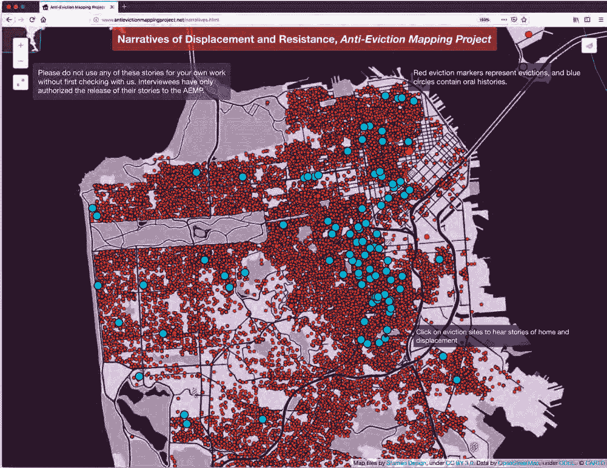 

**图 5.2**

由反驱逐制项目制作的《流离与抵抗的叙事》（2018 年）（a），包括菲利斯·鲍伊故事的细节视图（b）。感谢反驱逐制项目提供。与旧金山鲁斯·阿萨瓦艺术学校合作制作。采访由 Marianne Maeckelbergh 和 Brandon Jourdan 拍摄，由学生 Shilo Arkinson 和 Avidan Novogrodsky-Godt 编辑，并由 Alexandra Lacey 和 Jin Zhu 提供协助。

130

但所有这些设计选择强化了 AEMP 的主要目的：记录流离的影响，并通过批判性和创性的手段进行反抗。

因此，AEMP 提供了一系列丰富的女性主义反数据收集和反可视化策略示例。单从整体来看，这些地图说明了女性主义艺术建筑集体 *taking place* 的创始成员凯蒂·洛德·托马斯如何构想图形设计中的“局部性与争议”。

“与其讲述一个关于共识的‘真实’故事，[该画作/图形]可能会记住并承认多个、甚至是相互矛盾的现实版本，”她解释道。^(12) 《叙事》地图用这些矛盾的现实填充了它的景观。它证明了每一次驱逐背后都是一个人——一个像鲍伊这样的人，拥有独特的声音和独特的故事。我们听到的声音是多样化的、多样的、具体的、发散的——而且是刻意如此。

## 数据设置与清洗

图书馆与信息科学学者 Katie Rawson 和 Trevor Muñoz 在他们的断言中可能提到了这段漫长的历史，即“清洗范式假设了一个潜在的、‘正确’的秩序”。正如 Subramaniam 所言，但更具体是在数据清洗的背景下，Rawson 和 Muñoz 警告说，清洗可能成为一种“隐藏多样性的花招”。^(21)

在看似混乱的数据中，实际上包含了大量关于数据收集时背景的丰富信息。数据研究学者 Yanni Loukissas 也同意这一观点。他并不是谈论数据集（datasets），而是主张我们谈论数据设置（data settings）——他用这个术语来描述同时影响数据采集过程中捕捉的信息以及随后如何构建这些数据的技术和人文过程。^(22)

为了说明数据设置的重要性，Loukissas 讲述了他在马萨诸塞州剑桥参加一场黑客马拉松的故事。在那里，他开始探索一个来自南卡罗来纳州克莱姆大学图书馆的数据集。他偶然发现了一条令人困惑的记录，管理员将该物品的位置标注为“内陆（upstate）”。

这种指定显然相对于收集地而言。对于南卡罗来纳人来说，*upstate* 是一个非常清晰的术语，指的是该州最西部的地区，也是克莱姆大学所在地。但对于一个来自纽约的人来说，这个词并没有同样的含义，因为在纽约，*upstate* 指的是自己的北部地区；对于一个坐在马萨诸塞州黑客马拉松现场的人来说意义也不一样，因为该州并没有被称为 *upstate* 的部分。

如果黑客马拉松上的有人根据他们所在的位置编写条目，他们可能会选择列出南卡罗来纳人认为的 *upstate* 的十几个县，以便让更广泛的地理读者更清晰地理解。但这个词传达的意义是其他更通用的指示同一区域的方式无法传达的。只有已经在南卡罗来纳州的人才会这样提到该地区。通过对该词的使用，我们可以推断出数据最初是在南卡罗来纳州收集的。而这一信息并没有包含在图书馆记录的其他部分。

正因为有了这样的记录，清洗和整理数据的过程可能会变得如此复杂，且有时是一种破坏性而非建设性的行为。一种思考方式把它比作砍掉连接树木与其生长土地的根。这是一种将数据不可逆转地与其语境分离的行为。

我们可以将 `tidyr` 这种有助于修剪和整理数据的工具的出现，比作另一种对环境的人为干预：街道名称和标志的泛滥，改变了 19 世纪美国的地貌。地理学家 Reuben Rose-Redwood 描述了例如，在独立战争之前，曼哈顿极少有街道在路口贴有牌子。^(23)

当时的街道名称是通俗的，与特定地点的特殊性有关——例如，“在红房子处右转”。但随着人物和物品流动性的增强——想想邮政系统、铁路或电报——街道名称需要系统化。Rose-Redwood 将此称为“可读城市空间”的产物。

那时和现在一样，可读的城市空间具有很高的经济价值，特别是对于大公司（我们是在说你们，亚马逊）来说，以便将各种物品的箱子直接送到人们的家门口。^(24)

这里的观点是，在景观中出现陌生人之前，不需要街道名称来进行导航。同样，在数据集中出现陌生人之前，数据不需要清洗。克莱姆大学图书馆的数据集对于克莱姆大学自己的管理员来说是非常清晰的。但一旦剑桥的黑客拿到了它，*upstate* 就开始变得毫无意义，而且在制作（例如）美国所有图书馆记录的地图时，完全没有任何帮助。

更通俗地说，一旦参与项目的数据科学家不是来自社区内部，一旦分析地点发生变化，一旦项目规模发生偏移，或者一旦单个数据集需要与其他数据集合并——那么我们就把陌生人引入了数据集。

## 独角兽、清洁工、忍者、魔法师与摇滚明星

这些陌生人是谁？正如我们已经暗示的那样，从事数据工作的人被称为独角兽（unicorns，因为他们稀有且拥有特殊技能）、巫师（wizards，因为他们会变魔法）、忍者（ninjas，因为他们执行复杂的专家动作）、明星（rock stars，因为他们优于他人）以及清洁工（janitors，因为他们清理混乱的数据）（图 5.3）。

亚马逊在最近的一份招聘广告中去掉了“清洁工”那部分，但它成功地运用了其中的几个比喻：“亚马逊需要一位明星级工程师……你充满激情……你无畏地成功……你是一个编码忍者。”^(25)

这些明星和忍者是数据集中的陌生人，因为就像剑桥的黑客一样，他们往往与其工作的数据收集和维护过程隔着一层、二层或多层。这是一种负外部性（negative externality）——一种无意的第三方后果——在使用开放数据、应用程序接口（APIs）以及网上提供的海量训练数据时产生。

这些数据看起来可用且随时可以调动，但它们所代表的内容并不总是被记录或被外部人员理解。成为数据集中的陌生人并非本质上的坏事，但它带有巨大的风险，即著名的后殖民主义学者 Spivak 所说的认知暴力（epistemic violence）——即殖民权力等主导群体通过优先考虑其认知方式而非当地和本土认知方式而造成的伤害。^(26)

由于人们认为数据工作是一项孤独的任务，这一问题又被加剧了。这体现在独角兽从定义上就是独特的，而巫师、忍者和明星似乎都是独立工作的人。这当然是一个谬误；每位明星都需要后援乐队，如果说我们从《哈利·波特》中学到了什么，那就是任何一次挥杖都是多年教育、培训和支持的结晶。

巫师、忍者、明星和清洁工还有另一个共同点：他们被假设为男性。^(27) 如果怀疑这一点，尝试进行 Google 图片搜索，数数在看到第一个女性形象之前看到了多少个男性形象的巫师和清洁工。或者考虑为什么关于“数据清洁工”的新闻文章不将其描述为“清洁女”的工作？

正如清洁工作不成比例地由有色人工人阶级承担一样，数据忍者的概念也带有种族主义色彩。^(28) 而且还有更多：前四个术语——独角兽、巫师、忍者、明星——的共同点是关注个人非凡的技术专业知识以及他们在他人无法做到时成功的能力。

我们也许更准确地说是“他的成功的能力”，因为这些关于个人掌控和逆境取胜的思想显然也与男性联系在一起。

在驱逐数据领域有一位“天才”——它是 Matthew Desmond，他因对贫困和驱逐的研究被麦克阿瑟基金会授予称号。

**图 5.3**

搜索 2012 年至 2018 年间的 Media Cloud 显示，独角兽是与数据科学家最常用的比喻，巫师紧随其后。关于数据忍者、明星和清洁工的文章不到五十篇，但它们出现在《华盛顿邮报》和《福布斯》等知名媒体上。www.mediacloud.org 的 Media Cloud 平台由 MIT 公民中心开发，每天归档近百万篇文章和博客帖子。

图表由 Catherine D’Ignazio 设计。数据来自 www.mediacloud.org。

135

在美国。他是普林斯顿大学驱逐实验室（Eviction Lab）的教授兼主任，该实验室多年来一直在编纂一个全国性的驱逐数据库，并向公众开放。尽管联邦政府收集有关抵押贷款的国家数据，但并没有一个全国性的驱逐数据库，而这对于许多正面临住房危机的社区来说，是迫切需要的。

最初，驱逐实验室曾联系过像 AEMP 这样的社区组织请求获取数据。AEMP 想知道更多——关于隐私保护，以及驱逐实验室将如何防止数据落入房东手中。驱逐实验室没有继续对话，而是转向一家房地产数据经纪人，购买了质量较低的数据。

但在由来自 AEMP 及其他住房正义组织的人士写的文章中，作者指出：“AEMP 和租户共同（Tenants Together）发现加利福尼亚州驱逐的数量是德斯蒙德驱逐实验室显示的两倍。”^(29)

根据德斯蒙德的说法，这一决定是因为实验室数据收集策略的改变。“我们是一个研究实验室，所以对我们来说重要的一点是数据清洗过程。如果你想知道芝加哥驱逐的人是否比波士顿多，你必须进行同类比较（apples to apples）。”^(30)

在德斯蒙德看来，比较已经聚合和标准化的数据集在方法论上更合理。然而，德斯蒙德承认驱逐实验室关于加利福尼亚州的数据低估了驱逐；网站上甚至有一条明确说明了这一点。

所以这里存在一个伦理困境：是选择更大规模、相对容易且快速购买的更干净的数据？还是选择局部规模、但必须与社区小组互动并建立信任的更准确的数据？

在这种情况下，优先被放在了速度上，而牺牲了与基层执行者建立信任关系的机会；优先放在了广泛的全国覆盖，而牺牲了局部的准确性。尽管驱逐实验室正在从事重要工作，但持续优先考虑速度和完备性的决策难免维持了孤独“天才”的文化地位，实际上削弱了联盟、共同体（unitas）和运动的作用，而这些运动——并非巧合——通常由女性和有色人种主要领导。

如果我们不仅承认，而且重视“数据工作涉及多个声音和多种类型的专业知识”这一事实，将会获得什么？如果产生新的社会关系——增强社区团结和提高社会凝聚力——与获取数据一样受到重视（并获得资助）呢？

我们认为这将导致像 AEMP 这样的项目倍增：这些项目通过数据产生了明显的益处，并与他们寻求支持的社区共同完成这些工作。

## 第 5 章：论权力、多元主义与过程

尽管反驱逐制图项目（Anti-Eviction Mapping Project）本可以将宝贵的数据交给一个单一的地图之星-独角兽-忍者-魔法师-清洁工，但该小组做出了有意的决定，在过程中让许多设计师参与，其中包括许多第一次体验到制图权力的非专家。

除了产生了多样化的数据产品外（这些产品反映了 AEMP 各类合作者的多元化声音），这一决定还产生了（完全有意的）结果，即建立技术能力。缓慢而坚定，通过一张又一张地图，一次一次协作，当地居民加强了他们的制图技能以及彼此之间的关系。

后者的结果也是有意的；AEMP 的目标之一是“在项目参与者之间建立团结和集体性，他们可以在对抗驱逐的斗争中互相帮助，并共同反抗驱逐所产生的异化。”^(31)

这一目标反映了女性主义思维的核心信条，即承认多个声音（而非单一、响亮、具有技术性或带有魔法色彩的声音）能对当前问题形成更完整的图景。

像我们在第 3 章中介绍的唐娜·哈拉维（Donna Haraway）等女性主义哲学家，引发了一波思想者，他们继续发展了“所有知识都是局部的”这一观点，这意味着没有任何一个个人或群体可以声称对大写的“真理”（Truth）拥有客观视角。^(32)

但拥抱多元主义（正如这个概念今天被描述的那样）并不意味着一切都是相对的，也不意味着所有真理主张具有同等的权重。它绝对不意味着女性主义者不相信科学。它仅仅意味着当人们创造知识时，他们是从一个特定的立场出发：从世界中一个情境化的、具身体的位置。

不仅如此，通过汇集我们的立场——或位置性——，我们可以对世界产生更丰富、更稳健的理解。^(33)

那么，我们如何在数据科学中开启通往这种深层理解的道路？激活多重视角价值的第一步是承认自身视角的局限性。这意味着披露你的项目方法、你的决定，以及——对于致力于解决不公的工作而言很重要——你自己的立场性。

这被称为反思性（reflexivity），我们在本书的引言中模拟了这一点。你可能听过大卫·维恩伯格（David Weinberger）创造的短语“透明性是新的客观性”。^(34)

我们认为这意味着在数据科学中有一种方法可以为透明度和反思性构建空间，而不是开展那些声称客观的（但正如我们讨论的，从未客观）的项目。透明度和反思性让参与任何项目的人能够明确说明他们的立场和方法。

## 数据新闻、透明度与反思性

137

新闻界的人长期以来一直在做这件事——至少在数据和方法方面。例如，彭博社的交互式可视化“究竟是谁在加热全球？”（图 5.4）引导读者了解一系列对全球变暖的解释，这些解释不需要归咎于人类工业或行为。^(35)

从内容本身来看，这是一个引人入胜的作品，但它另一个有趣的点是，它将近三分之一的空间用于描述其数据和方法。这些正成为数据新闻的规范，正如在科学领域一样。

尽管这些说明目前聚焦于技术细节——数据来自哪里、开发了哪些统计模型、进行了哪些分析——但这一空间揭示更多细节存在这种可能：团队成员是谁？哪里存在紧张和分歧？团队何时需要与数据专家、领域专家或当地社区交流？哪些假设被提出但最终被证明是错误的？

还有一个关于证据依据是如何产生的故事，这通常是一个涉及资金和机构的故事，正如人和工具。通过透明度和反思性揭示这个故事是一种女性主义行为。

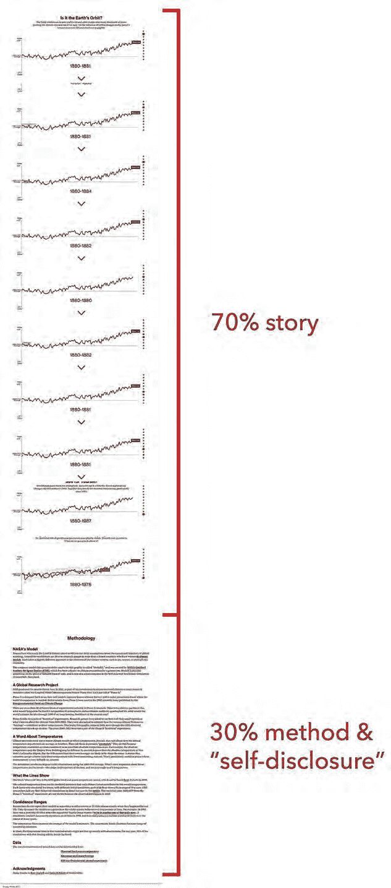

**图 5.4**

2015 年出版的《究竟是什么在温暖世界？》，三分之一的篇幅描述作者处理数据的方法。图表由 Catherine D’Ignazio 设计，基于 Eric Roston 和 Blacki Migliozzi 为《彭博商业周刊》报道。

## 独角兽、清洁工、忍者、魔法师和摇滚明星

139

**图 5.5**

来自 Eymund Diegel Public Lab 研究笔记，关于 2012 年桑迪风后古瓦纳斯运河（Gowanus Canal）污水流的绘制。请注意在船上进行绘制的人员，以及将相机和图像连接回他们身体的气球系绳。由 Eymund Diegel 感谢提供给 Public Lab。

我们应该从边缘创造新的知识和新的设计。正如黑人女性主义学者 Jennifer C. Nash 所解释的，“边缘化的主体具有认识论上的优势，学者在构建正义社会的规范性愿景时，应当考虑、甚至采纳这种特定的视角。”^(39)

这意味着什么？从性别的角度来看，这意味着从女性和非二元性别者的视角开始。在一个涉及国际发展数据的项目中，这意味着不从机构目标开始，而是从原住民的立场开始。对于`AEMP`来说，这意味着将那些被驱逐者的声音和经验置于中心。关于从边缘设计的后续工作认为，设计师和工程师不仅应该与边缘的人接触，还应该积极致力于从源上消除中心/边缘的区别。^(40) 更多

**140**

## 第 5 章

最近，设计正义网络（Design Justice Network）将这一交性思维的核心原则转变为其设计原则之一，并规定：“我们关注那些直接受设计结果影响的人的声音。”^(41)

这可能如何运作？首先，它需要一个许多参与者都能参与的设计过程——具有技术专业知识的人，以及具有生活经验、领域专业知识、组织专业知识和社区历史专业知识的人。它意味着将此类项目的总体目标从“用数据行善”转向为了共同解放（co-liberation）而设计；记住第2章中提到的，这是一个主流群体和少数群体成员共同努力，从压迫系统中解放出来的最终状态。行善数据与共同解放数据之间的主要区别见表 5.1。

“行善数据”（Data for good）是一个越来越多被用于描述参与社会和/或为了公共利益开展的数据科学项目的框架。彭博公司自2014年以来一直赞助行善数据会议。像`Delta Analytics`这样的非营利咨询小组应运而生，将具有技术专业知识的志愿者与使命驱动型组织联系起来。2019年，其中一个组织`DataKind`收到了来自名为“社会影响数据科学”的资助合作组织的 2000 万美元捐赠，资金由洛克菲勒基金会和万事达提供。

### 表 5.1

“行善数据”与“共同解放数据”的特征对比

| | “行善数据” | 共同解放数据 |
| :--- | :---: | :---: |
| 由在社区工作的少数群体成员领导 | | √ |
| 由少数群体成员管理资金和资源 | | √ |
| 由社区拥有和治理数据 | | √ |
| 通过参与式的、以社区为中心的数据分析过程进行“地面真实”的定量数据分析 | | √ |
| 数据科学家不是摇滚明星和魔法师，而是引导者和导师 | | √ |
| 数据教育和知识传递是项目设计的一部分 | | √ |
| 构建社会基础设施——社区团结和共同理解——是项目设计的一部分 | | √ |

**141**

## 独角兽、清洁工、忍者、魔法师和摇滚明星

还有一些教育实验正在进行，例如乌特勒支数据学校（Utrecht Data School）和芝加哥大学的“社会影响数据科学”夏季奖学金计划。在后者，有志的数据科学家与政府和非营利组织合作，解决教育、健康、公共安全和经济发展等不同领域的问题。(43) 人工智能领域的的相关努力也相继涌现，如`AI4Good`基金、英特尔公司赞助的`Project Impact`、麦吉尔大学以女性为中心的`AI`夏季实验室——此类比比。

这些努力产生了显著的社会影响。然而，对于“行善”意味着什么，仍然存在一种挥不去的模糊性。我们谈论的是谁的利益？条款是什么？当独角兽魔法师离开社区时，谁来维护数据库？当项目的开发部分完成后，谁来支付云存储费用？

这些问题开始在行善数据社区内讨论。Google Brain 的深度学习研究员、`Delta Analytics`的创始人 Sara Hooker 观察到，“行善”的概念缺乏精确性。(44) 为了增加该短语的清晰度，Hooker 对这类工作提出了一种粗略的分类，识别出四种不同的类型：(1) 志愿者技能劳动，(2) 捐赠技术，(3) 与政府工作的非营利组织合作，以及 (4) 在欠发达社区开展数据教育。(45) 在这些领域中，仍然存在着棘手的问题：志愿者劳动的无常、即使是志愿者也缺乏当地知识、定量数据不能被假设为“好”的等问题。相比之下，共同解放模型会对涉及的权力有具体的规定。由于这些原因，通过共同解放设计的的数据项目必须采取预防措施，以抵消主流群体成员工作所带来的特权风险。

**142**

## 第 5 章

共同解放数据的范围也更广。它明确包含了两个行善数据不具备的额外结果：(1) 知识传递和 (2) 构建社会基础设施。前者涉及双向交流：一方面是社区内部的技术能力建设，使任何数据产品可以在没有外部专家的情况下维护或增强；另一方面是外部对当地知识的理解和尊重。构建社会基础设施意味着通过项目明确培养社区团结。这意味着将资金和人力分配给项目的社区方面，而不仅仅是技术方面。在共同解放模型中，数据科学项目变成了社区科学项目。它们在数据库和公共空间同时进行。

**143**

## 共同解放数据的实践

共同解放数据在实践中是怎样的？是否存在既重视定量方法又重视多元化过程的女性主义数据科学案例？既重视数据教育又重视社区团结？

自2012年以来，Rahul 和 Emily Bhargava 与从贝洛奥里特到波士顿的社区组织合作，在公共空间创作数据壁画（图 5.6）。在所有情况下，都是人们自己寻求合作，因为他们意识到自己社区空间内的需求。例如，2013年，一家城市农业非营利组织`Groundwork Somerville`接触了 Bhargava 夫妇，因为他们正准备建立第一座城市农场。Emily 回忆道：“现场杂乱无章——它位于一个汽车零件大楼后面，隐藏在其他半工业用地之间。他们建造了高架床并种植了一个生长季节，但路人偷走了蔬菜。”^(47) 该机构还在运行一个名为“绿色”的高中就业计划。

## 独角兽、清洁工、忍者、魔法师和摇滚星

**143**

团队一直未能让年轻人充分参与到其创建更健康社区的使命中。将这两个挑战结合起来，`Groundwork Somerville`和巴尔加瓦家族（Bhargavas）决定招募年轻人共同创作一幅壁画，向社区展示农场的宗旨（图 5.7）。首先，他们汇集了来自多个来源的数据：城市的人口统计数据、闲置土地的地理信息系统（GIS）数据，以及来自`Groundwork Somerville`的内部数据（包括生长记录、食物捐赠和社区活动的签到日志）。随后，他们在几次课后课程中与学习者一起工作，审查并讨论这些数据，进行“故事发现”（即数据分析）。在这些课程结束时，青少年已经勾勒出了最终壁画的整体轮廓和图标。从左到右，壁画描绘了问题：一个男人正试图抓住一篮蔬菜，但上面写着“健康食物难以获得”。这一主张得到了数据的支持，显示了健康食物的以及糖尿病前期的人数。其他数据记录了城市中闲置土地的数量和已为城市农业开垦的土地面积，指向了未来的机会。在下一部分，壁画描绘了一辆`Groundwork Somerville`的卡车将负担得起的农产品运送到社区，并包含了他们雇用了四百多名青少年居民的事实。数据壁画以对统一健康社区的愿景结束：“共同美好生活”。

2013年7月30日，索姆维市長和其他社区袖参加了剪彩仪式，正式启动了改造后的花园。Emily 描述了这次访问：

### 图 5.6

制作数据壁画的过程涉及对话、用手工材料制作原型、数据分析工作坊以及实际绘画。感谢 Data Therapy 提供，Emily 和 Rahul Bhargava，2018。

**144**

## 第 5 章

“青少年在花了几周时间观察数据、共同绘制壁画并与员工和志愿者建立关系后，能够向他们的选民官员详细地讲述这个故事。”^(48)

这种伙伴关系代表了为“共同解放”（co-liberation）设计的数据项目的某些优秀方面。但壁画只是这种多元化、以社区为中心的过程的一种可能的产出形式。(^(49) 例如，数字民主（Digital Democracy）与全球的土住民合作，通过收集数据和制作地图来捍卫他们的权利。(^(50) 在过程中，他们与海地的家庭暴力小组开发了短信服务，并支持圭亚那的瓦皮查纳（Wapichana）人向政府提出关于土地权利的数据主张。另一个例子是，亚特兰大西区土地信托（WALT）通过参与式数据收集，致力于佐治亚州亚特兰大市负担得起的住房。(^(51) 该组织对其所谓的“三重错误”的县级数据感到失望，开始收集自己的关于物业遗弃和投资不足的空间数据集，并并用它来推动市政政策制定者进行变革。(^(52)

这些每一个项目——数据壁画、土地权利主张和遗弃物业地图——都可以被认为是“共同解放数据”模型的典范。每个项目都源于社区表达的需求，而不是由更强大的机构投射给社区。每个项目都依赖于数据收集和处理的方法。而且每个项目还包含了从外部合作者（顾问、学者、非营利组织专家）到社区本身的显式知识传递过程。更重要的是，这些外部合作者没有将自己设想为独角兽、清洁工、忍者、魔法师或摇滚星。“在‘数字民主’，我们试图反击超级英雄叙事，”总监 Emily Jacobi 说，“我们是配角，而不是超级英雄。”^(53)

### 图 5.7

`Groundwork Somerville`数据壁画，由`Groundwork Somerville`的青少年、员工、志愿者以及巴尔加瓦家族在 2013 年绘制。感谢 Data Therapy 提供，Emily 和 Rahul Bhargava。

**145**

沿着这些思路，这些每一个项目都被明确设计为围绕公民议题建立社区团结和共同理解。正如 Amanda Meng 和 Carl DiSalvo 在解释 WALT 项目时所说：“数据收集变成了一种产生方式，不仅产生了对现状的意识，还对现状的敏感性，以及[社区成员]对自身盲目现状的经历和处境的认知。”^(54) 数据收集和参与式分析变成了一种聚集技术——一种篝火——在那里信息得到交换，社会凝聚力得到增强，未来的行动得到共同策划。(^(55) 篝火模型还有挑战那些往往围绕着欠发达社区的“匮乏叙事”的效果。(^(56) 相反，正如社会运动学者 Maribel Casas-Cortés 所断定的，培养社区团结有助于集体主体感和变革可能性，她将其描述为“一种创新的政治参与感和重焕活政治想象”。^(57)

### 篝火模式可以扩展吗？

“共同解放数据”既比“向善数据”（data for good）更具体，在范围上更大。通过提倡基于社区的领导力和资源、用定性调查补充定量分析，以及在超出“向善数据”项目范畴的领域进行有意识的项目设计（例如知识传递和建立社区团结），共同解放数据使得许多行动者和代理参与成为可能。但这种多元化模型可以扩展吗？“共同解放的大数据”会是什么样子？这真的可能吗？

关于大数据与小数据、或定量数据与定性数据的问题，往往被设定为虚假的二元立。正如所有虚假的二元立一样，存在通过这些区别的路径可以合并并增加选项，而不是将世界划分为虚假的选择。需要记住的关键问题是，如何以谨慎、基于社区且复杂的方式来扩展共同解放数据。(^(58)

这种有意识实践的一个真实世界例子是全球环境正义地图（EJ Atlas），这是一个大型研究项目和开放档案（图 5.8），由学者 Leah Temper 和 Joan Martinez-Alier 指导。(^(59) `EJ Atlas`于 2012 年由巴塞罗那自治大学的研究员小组发起，代表了对全球冲突的系统收集。它的创建部分是为了回应一种观点，即环境正义学者过度关注局部案例研究，而忽视了全球性的联系。对于

**146**

## 第 5 章

`EJ Atlas`收集的大多数全球生态冲突都是支配矩阵中的案例，即富人过度利用自然资源，并将环境风险和退化转移给穷人，而这些人往往由于性别、原住民身份、种族和或地理位置而被边缘化。例如，`EJ Atlas`中的一个案例讨论了 Berta Cáceres 和伦卡族（Lenca）原住民反对在洪地拉斯修建大坝和水电站的努力。(^(60) Cáceres 曾因其社区组织工作获得过国际奖项，结果却被修建大坝的公司员工悲剧性刺杀。（凶手后后在洪地拉斯的一方法院被定罪。(^(61))）在`EJ Atlas`中，关于 Cáceres 组织努力的条目包含了大量的链接、照片和关于地理数据。

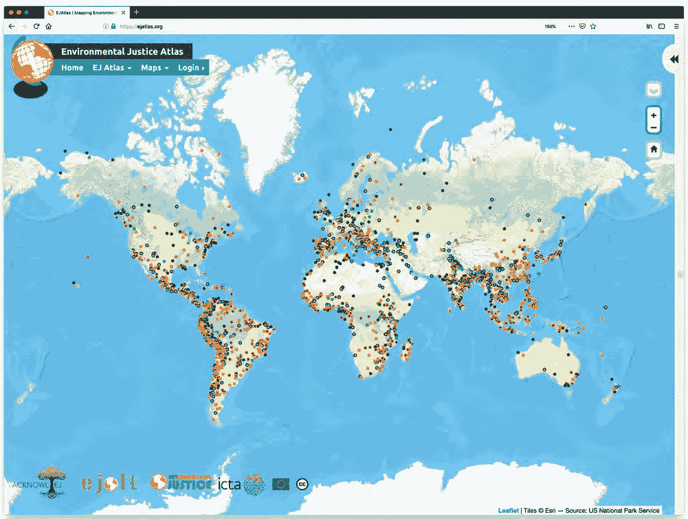

### 图 5.8

全球环境正义地图（`EJ Atlas`; `https://ejatlas.org/`）与行动者、公民社会组织和社会运动合作，系统地记录全球范围内的生态冲突。`EJ Atlas`的范围和规模使行动者能够与其他联系，并方便研究人员在定量和比较的背景下研究冲突，同时不会牺牲对多元化过程以及当地社区知识尊严的承诺。感谢全球环境正义地图提供，2019。

## 独角兽、清洁工、忍者、巫师与摇滚星

147

……以及关于该事件在地图冲突分类法中所处位置的信息。

《生态公正地图》（`EJ Atlas`）表明，规模化与重视当地知识以及与当地参与者的关系并不矛盾。Temper 及其同事能够利用过去与伙伴组织建立的关系来汇集他们的档案，这证明了在项目或职业生涯初期投入时间建立的人际关系，将持续为所有相关方带来利益。^(62) 在写作时，`EJ`地图已包含了全球范围内近三千起生态冲突案例。

合作者们根据该地图创建了包括哥伦比亚、意大利和土耳其在内的国家子地图。活动人士利用该地图吸引媒体和政策制定者关注被忽视的环境冲突，例如在哈萨克斯坦一个自然公园中心建造的滑雪场，该工程扰乱了水文系统。^(63)

该地图还让比较实证研究成为可能，例如经济学家 Begüm Özkaynak 及其位同事开展的研究。^(64) 他们的工作利用社会网络分析来研究采矿公司、其资助者以及挑战这种做法的环保组织之间的关系，以理解参与者的地理分布及其相互之间的联系。^(65)

规模化绝不与重视多元化和局部知识的女性主义首要要求相冲突。像 Özkaynak 及其同事的研究，如果没有像`EJ`地图这样的大型档案将是不可能的。像`EJ`地图这样一种多元化、参与式的、迭代的过程，比传统大数据那种榨取式的、不计代价追求数量的方法需要更长的时间来实现规模化。但最终的数据——以及关系和社区能力——将具有更高的质量。

## 拥抱多元主义

数据女性主义的第五项原则是在处理数据的整个过程中（从收集、分析到沟通和决策）拥抱多元主义。正如我们在本章中所描述的，数据工作存在极高风险，可能会实施盖亚特里·斯皮瓦瓦克（Gayatri Spivak）所说的认识论暴力，特别是当执行工作的人是数据集中的陌生人时，当他们与数据的当地背景隔了一个或多个步骤时，当他们认为自己（或被社会视为）独角兽、摇滚星和巫师时。

拥抱多元主义是缓解这种风险的女性主义策略。它为一系列参与者留出了时间和空间，让他们能够为数据项目贡献知识，并在项目的所有阶段进行这种贡献。与定义不足的“向善数据”模型相反，拥抱多元主义提供了一种通向“共同解放数据”模型迈进的方法。这意味着将知识从专家转移到社区，并在数据工作中显式地培养社区团结，正如我们在“反驱逐制图项目”（Anti-Eviction Mapping Project）的案例中看到的那。此外，拥抱多元主义与“大”或规模并不矛盾；`EJ`地图展示了如何利用多元化过程来汇集全球档案，并支持为正义服务的实证工作。单一的数据科学家巫师永远无法独自击败统治矩阵，无论他们的咒语有多么强大。但是，一个设计良好的、数据驱动的、参与式的过程——一个以最边缘化群体的立场为中心、赋予项目参与者权力并跨越社会差异界限建立新关系的过程——也许，或许真的会有机会。

## 6 数字本身不会说明问题

### 原则：考虑语境

*数据女性主义认为，数据不是中立或客观的。它们是不平等社会关系的产物，而这种背景对于进行准确、伦理的分析至关重要。*

2014年4月，276名年轻女孩在尼日利亚北部奇博克（Chibok）镇 School被绑架。恐怖组织博科哈姆（Boko Haram）对这些袭击负责。无论是尼日利亚国内还是全球的媒体报道都是迅速且猛烈的。`SaharaReporters.com`挑战了政府保护学生安全的能力。`CNN`报道了父母的痛苦。《日本时报》（*Japan Times*）将绑架案与尼日利亚北部州日益严重的动荡联系起来。`BBC`则讲述了一个成功逃脱绑架者的女孩的故事。在最初报道几周后，热门博客`FiveThirtyEight`发布了关于该事件的自己的数据驱动报道，标题为“尼日利亚女孩被绑架案是日益恶化的问题的一部分”。¹

该报道报告了急剧上升的绑架率。它声称，仅在 2013 年就有超过 3608 起年轻女性被绑架事件。图表和地图随报道一同，从视觉上证明了绑架案已达到历史高位（图 6.1）。

不久后，该新闻网站不得不发布道歉性的撤稿，因为它的数据完全是错误的。

**152**

## 第六章

`GDELT`的技术文档并未进一步说明它到底是在统计媒体报道（如辛普森所称的那样）还是统计单一事件。他们所使用的数据库`FiveThirtyEight`被称为`GDELT`事件数据库，这听起来确实像是在统计事件。`GDELT`文档指出“如果某个事件之前出现过，将不会被再次包含”，这听起来也像是在统计事件。2013 年的一篇与该项目相关的论文证实`GDELT`确实在统计事件，但仅统计针对特定出版物的唯一事件。因此，它确实在统计事件，但带有一个星号。更糟糕的是，文档对于向数据库提出什么样的研究问题是合适的，或者局限性在哪里，没有任何指导。像辛普森这样熟悉事件检测（event detection）研究领域的人，或者`GDELT`社区的成员，可能知道不要相信 (1) 数据库的名称 (2) 文档以及 (3) 营销炒作。但外行人，更不用说平台的新手，怎么能知道这些呢？

我们特别指出了`GDELT`，但事实是，它与网络上许多其他数据存储库并没有区别。涌现出大量的门户网站、观测站和网站，使得下载各种政府、公司和科学数据成为可能。有些`API`使得人们能够编写小型程序来查询海量数据集（例如，所有的`Twitter`数据）并以结构化的方式下载它们。⁵ 有用于网络分析、机器学习、社交媒体和图像识别的测试数据集。还有有趣的数据集、奇特的数据集，以及告知读者在新闻报道或分析中探索哪些数据的简报。⁶

在当下的背景下，我们倾向于将这种对信息的无限制获取视为一种内在的善。在许多方面，人们只需通过`Google`搜索并下载诸如鸽子赛、guinea豚牙齿的长度，或者 1562 年至 1736 年间苏格兰每一位被指控巫巫的人的数据，这确实是相当神奇的——更不用说一车又一车的推文了。⁷

尽管 `FiveThirtyEight` 接受了数据验证培训是实至名归的，但有一个更大的问题仍未解决：语境问题。正如我们在书中不断讨论的那样，女性主义思维的核心原则之一是所有知识都是情境化的（situated）。一种不那么学术的说法是，语境很重要（context matters）。在接触任何新知识源时，无论是数据集还是晚餐菜单（或晚餐菜单的数据集），询问产生该知识的社会、文化、历史、制度和物质条件，以及创建这些知识的人的身份是至关重要的。⁸ 女性主义方法不将数据集等知识产物视为可以直接输入到统计分析或数据可视化的原始输入，而是坚持将数据与其产生的语境联系起来。这种语境使我们作为数据科学家能够更好地理解数据的任何功能性限制和任何相关的伦理义务，以及导致其产生的权力和特权可能如何掩盖真相。

### 在荒蛮野的互联网上定位数据

从网络门户网站或通过 `API` 下载的大部分数据，其主要问题是它们在提供时没有语境或元数据。如果你足够幸运，可能会得到一段关于数据来源的文字，或者一个描述特定电子表格中每列含义的数据字典。但大多数时候，你得到的是类似于图 6.3 的东西。

图中显示的数据——关于巴西圣保罗政府采购的开放预算数据——看起来在技术上并不复杂。复杂的部分在于弄清楚其背后的业务流程是如何运作的。政府如何运行招标过程？它如何决定将合同授予给谁？所有的报价都发布在这里吗，还是只有那些获得合同的报价？竞争（competition）、合作协议（cooperation agreement）和协作条款（terms of collaboration）等术语对数据发布者意味着什么？为什么发布编号方案会有如此大的差异？这些只是第一次遇到这个数据集时可能会提出的几个问题。但如果没有对即使是这些问题的答案——更不用说理解权力在这个特定生态系统中如何运作所需的当地知识——要启动一个数据探索或分析项目将是困难的。

这种情况并不罕见。大多数数据到达我们的计算门槛时都是缺乏语境的。当这种缺乏语境的情况伴随着 `GDELT` 和其他“大数据”（Big Dick Data）项目中看到的营销炒作出现时，它会变成更大的负担。事实上，20 世纪 80 年版本的这些说法促使唐娜·哈拉维（Donna Haraway）最初提出了“情境化知识”的概念。⁹ 后的女性主义工作借鉴情境化知识这一概念，详细阐述了与知识产生相关的伦理和责任观点。(10) 沿着这一思路，评估该知识或在其基础上构建知识的人有责任确保其“情境性”得到考量。例如，信息研究学者克里斯汀·博格曼（Christine Borgman）主张根据数据来源的“知识基础设施”来理解数据。正如博格曼所定义的，知识基础设施是“一个人类、实践、技术、机构、物质对象和关系的生态系统”。

| 图 6.3 |
| :--- |
| **图 6.3** | 关于巴西圣保罗政府采购的开放预算数据。尽管巴西拥有一些世界上最先进的透明度法律，但发布的数据并不一定可以供公众访问或使用。![img/37f2d1c84bdd9a5186b9c23175167.png] |

### 数字本身不会学说

**153**

讽刺的是，开放数据运动一些最令人赞赞的目标和行动违背了提供语境的紧迫性。开放数据运动是一个松散的组织和个人组成的网络。自 21 世纪 20 年代中期以来，它一直以某种形式活跃，当时像 `Open Institute` 这样的团体成立，诸如“Free Our Data”之类的运动发起，以恳请政府开放访问权限。这些目标在理论上是好的：通过在开放数据的基础上构建应用和服务来促进经济发展；当研究人员共享数据时加快科学进步；以及为记者、公民和居民提供更高的透明度。这最后一个目标是奥巴马前总统关于透明度和开放政府的著名备忘录框架的主要部分。¹³ 奥巴马在就职的第一天就签署了一份备忘录，指示政府机构默认开放所有数据。¹⁴ 更多的国家、州和城市效仿此，开发了开放数据门户并将开放数据写入政策。截至 2019 年，十七个国家和五十多个市和州采纳了《国际开放数据宪章》，该宪章概述了指导数据发布和访问的六项原则。然而在实践中，由于对技术基础设施的资金有限，政府优先考虑数据的“开放”部分——发布许可申请、逮捕记录和洪水区的电子表格——但缺乏提供任何关于数据来源的语境的能力，更不用说提供让公众能够访问和使用的文档。正如学者提姆·戴维（Tim Davies）所指出的，原始数据倾倒可能有利于开启对话，但它们无法确保参与度或问责制。¹⁷

**156**

**第 6 章**

统计推断基于抽样的思想：即通过研究随机和/或具有代表性的样本，并将这些发现映射回整个总体（或其他大规模现象），从而对该总体（或现象）的某些情况进行推断。假设你想知道美国 3.23 亿人口在即将到来的总统选举中会投票给谁。当然，你无法联系他们所有人，但你可以给其中三千人打电话，然后利用这些结果来预测其他人可能如何投票。

这还需要一些统计建模和理论，因为你如何知道这三千人是整个总体的准确代表呢？这正是安德森（Anderson）进行干预的地方：在我们收集了关于整个总体的数据时，我们不再需要建模或任何其他“理论”来先进行测试后证明。我们可以直接观察数据本身。

现在，你不能写一篇文章说科学探究的基本结构已经过时，而不预期会遇到一些反弹。安德森写这篇文章是为了具有挑衅性，事实也然，它引发了大量的响应和辩论，其中就包括挑战这种观点：这种从一开始并不是一种“新”的思维方式（例如，在 17 世纪初，弗朗西斯·培根主张一种归纳推理的形式，即科学家收集数据、分析数据，在此之后才形成假设）。^(19) 安德森的主要例子之一是谷歌搜索。谷歌的搜索算法不需要对为什么某些网站的入站链接（指向该网站的其他页面）比其他网站多建立假设；它们只需要一种确定链接数量的方法，以便可以使用该数字来确定网站在搜索结果中的流行度和相关性。安德森坚持认为，我们不再需要因果关系：“相关性就足够了。”^(20) 但当链接数量也与性别歧视、种族歧视和色情结果高度相关时，会发生什么呢？

种族歧视、性别歧视和殖民主义的影响，正是我们在信息研究学者萨菲亚·乌莫贾亚·诺布（Safiya Umoja Noble）在《压迫算法》（*Algorithms of Oppression*）中所描述的内容，她的研究探讨了谷歌等搜索算法对黑人和拉丁裔女性所延续的有害刻板印象。正如第 1 章讨论的，诺布证明了谷歌搜索结果并非简单地与我们种族歧视、性别歧视和殖民主义社会相关；而是这个社会导致了种族歧视和性别歧视的结果。不仅如此，谷歌搜索通过根据其他网站链接它们的数量对结果进行排名，强化了这些压迫观点。排名顺序反过来鼓励用户继续点击这些网站。在这里，没有背景的相关性显然是不够的，因为它循环了种族歧视和性别歧视，并加剧了不平等。(21)

## 数字本身不会说明一切

**157**

理解相关性之所以需要背景的另一个原因是，这与种族歧视、性别歧视和其他压迫力量进入数据收集环境的方式有关。下一个例子与性侵和暴力有关。如果你不想阅读这些主题，可能想跳到下一节。

1986 年 4 月，利亥大学的学生珍·克莱里（Jeanne Clery）在她的宿舍里遭遭了性侵并被杀害。她的父母后来发现，在过去的三个年里，利亥大学发生了 38 起暴力犯罪，但没有人将其视作应该提供给父母或公众的重要数据。克莱里夫妇发起了一项运动，以改进与校园犯罪相关的数据收集和沟通工作，并取得了成功：《珍·克莱里法案》于 1990 年通过，要求所有美国学院和大学向公众公布校园犯罪统计数据。(22)

因此，我们有了一个关于重要公共议题的表面上全面的国家数据集。2016 年，埃默森学院凯瑟琳数据新闻班的三个名学生——帕特里克·托菲（Patrick Torphy）、米凯拉·哈尔农（Michaela Halnon）和莉安·米汉（Jillian Meehan）下载了《克莱里法案》的数据并开始探索，希望更好地理解美国大学校园泛滥的强奸文化。(23) 然而，他们很快就困惑了。位于马萨诸塞州乡村的廉姆斯学院是一所规模小、富裕的文学院，似乎性侵泛滥；而位于市中心的大型研究机构波士顿大学（BU），其规模和人口相比病例似乎极少（更不用说近年来波士顿大学的几起知名性侵案已成为新闻）。^(24) 学生们对这些数字表示怀疑，并进行了进一步调查。在对比《克莱里法案》数据与匿名校园氛围调查（图 6.4）、咨询专家并访谈幸存者后，他们矛盾地发现，事实更接近《克莱里法案》数据所暗示情况的反面。许多报告性侵率较高的学院，实际上投入了更多机构资源来支持幸存者。(25)

至于数字较少的学院，这也可以通过背景来解释。《克莱里法案》要求学院大学提供性侵和其他校园犯罪的年度报告，对于不报告有严厉的财务罚款。但这些数字是自报的，学院对于不报告也有强烈的财务激励。

^(26)

**171**

**158**

**第 6 章**

| 特征 | 描述 |
| :--- | :--- |
| 廉姆斯学院 | 位于马萨诸塞州乡村的规模小、富裕的文学院，似乎性侵泛滥。 |
| 波士顿大学（BU） | 位于市中心的大型研究机构，其规模和人口相比病例似乎极少。 |
| 图 6.4 | 《克莱里法案》数据与匿名校园氛围调查的对比。 |

**160**

## 第 6 章

例子包括谷歌现已关停的流感趋势（Flu Trends）项目，该项目试图在地理上将人们对流感症状的网络搜索与实际流感病例联系起来^(31)，或者位于佛罗里达州劳特代德堡的《太阳哨报》（*Sun Sentinel*）的一个项目，该项目将警察车牌数据与电子收费记录相结合，证明了警察在佛罗里达州的高速公路上正在系统性且危险地超速^(32)。有时，这种创造性合成的效果非常好；《太阳哨报》因其报道获得了普利策奖，而且一些超速的警察也被解雇了。但有时结果并不十分那么直接。

谷歌流感趋势曾运行良好，直到它失效为止。随后的研究表明，谷歌搜索不能作为实际流感现象的 1:1 信号，因为容易受到外部因素的影响，例如媒体对流感的报道^(33)。数据科学家不应仅仅从表面上接受数据并展望未来的见解，而应该首先审视所用数据的语境、局限性和有效性。

换句话说，考虑背景的一种女性主义策略是考虑产生“原始”数据的烹饪过程。例如，计算社会科学家德雷克·鲁斯（Derek Ruths）和尤尔根·费弗（Jürgen Pfeffer）写道使用社交媒体数据进行行为洞察的局限性：`Instagram` 数据偏向年轻人，是因为 `Instagram` 本身如此；`Reddit` 数据中男性评论远多于女性，因为 `Reddit` 的整体成员以男性为主。他们进一步展示了从这些来源获取的研究数据是如何受抽样影响的，因为 `Reddit` 和 `Instagram` 等公司采用专有方法向研究人员提供数据，而这些方法从未被公开^(34)。德文·加夫尼（Devin Gaffney）和 J·内森·马蒂亚（J. Nathan Matias）的相关研究针对一个声称包含“所有公开的 `Reddit` 评论”的热门语料库^(35)。他们的工作表明，所谓的完整语料库缺失了至少三六百万条评论和两千八百万条提交。

探索和分析数据集中缺失的内容是获取烹饪过程见解的一种有力方式——包括数据本身以及它所声称代表的现象。在劳伦（Lauren）的一些历史工作中，她查看了托马斯·杰斐逊（Thomas Jefferson）写的三万封信件语料库中记录（或未记录）的真实厨师，如图 6.5 所示^(36)。有些人可能已经知道杰斐逊被认为是国家的“创始美食家”^(37)。但很少有人知道，他依靠奴隶厨师人员来准备他著名的食物^(38)。在《缺席之》（*The Image of Absence*）中，劳伦使用了自然语言处理技术——命名实体识别，来识别杰斐逊个人信件中提到这些人的地方，然后使用社交网络分析来估算他们之间关系的程度。结果是视觉化地呈现了杰斐逊的奴隶员工在准备餐食时付出的所有工作，但杰斐逊在信件正文中并未承认这些工作——至少没有直接承认过。

**161**

## 数字本身不会说话

在更大规模的尺度上，斯坦福大学的计算机科学家和历史学家使用了词嵌入——另一种机器学习技术——来探索整个 20 世纪的性别和种族刻板印象^(39)。通过使用源自谷歌图书和《纽约时报》等来源的几个大型数据集，团队展示了像 `intelligent`（智能）、`logical`（逻辑性）和 `thoughtful`（周到）这样的词在 20 世纪 60 年代以前与男性密切相关。然而，从那时起，这些词与女性的关联稳步增加。团队将这一现象归因于“20 世纪 60 年代和 70 年代的女性运动”，使他们的工作成为尝试量化社会运动影响的一个有趣案例。该论文的引人注目之处在于

**图 6.5**

在《缺席之》（2013）中，劳伦使用机器学习技术识别了托马斯·杰斐逊在个人信件中提到的人名，并使他们之间的关系视觉化。结果展示了他的奴隶员工在准备杰斐逊餐食时付出的所有工作，但杰斐逊本人并未直接承认。劳伦 F. Klein 可视化。

**162**

公开承认他们的方法（涉及查看单词 `man`（男人）和 `woman`（女人）周围的形容词）将他们的分析范围限制在了性别二元论。此外，研究人员并没有试图声称数据代表了女性和男性的“真实面”，也没有试图“消除偏见”以便在其他领域开发“无偏见”的应用。他们将数据视为其本身——父权制和种族主义不断变化的面貌的文化指标——并据此对其进行审视。

那么，我们如何产生更多这样的工作——即理解数据是已经“烹饪”过的，并利用这些数据揭示结构性偏见的工作？对于克里斯·安德森（Chris Anderson）来说，遗憾的是，我们需要更多的理论，而不是少的。没有理论，调查设计者和数据分析师必须依靠他们的直觉，并受到他们正在测量和建模的事物的“常识”观念的支持。这种对“常识”的依赖直接通向偏见的道路。以 `GDELT` 为例。几十年的研究表明，媒体报道的事件是由所谓的“新闻价值”进行选择、框架化和塑造的：这些价值观证实了现有的形象和意识形态^(40)。所以，`GDELT` 到底在测量什么？世界上正在发生哪些事件，或者主要的国际新闻机构正在关注哪些内容？后者可能是嵌入 `GDELT` 数据库中最强大的故事。但这需要深层次的语境和框架构建才能提取出来。

拒绝承认背景是一种避免权力的权力博弈。这是一种维护权威性和掌控力的方式，而无需处理数据实际代表的复杂性：在 `GDELT` 案例中是新闻的政治经济，在 `Clery` 数据案例中是根深蒂固的性别等级制度和缺陷的报告环境，等等。但深层次的语境与计算并不矛盾。例如，由学者兼社会工作者德斯蒙德·帕顿（Desmond Patton）运营的哥伦比亚大学研究实验室 `SAFElab`，利用人工智能检查有色种族青少年在线和线下应对暴力的方式。他和一个社会工作学生团队使用 `Twitter` 数据来理解并防止芝加哥的帮派暴力。他们的数据是海量的，而且在技术和社会方面都非常复杂。例如，团队敏锐地意识到执法机构利用技术监视黑人的历史，并承认执法部门仍在继续利用 `Twitter` 本身这样做。而且，当帕顿开始他的研究时，他遇到了一个更基础的问题：“我根本不知道年轻人在说什么，完全无所知。”^(41) 尽管帕顿本人是黑人，在芝加哥长大，并在这些许多相同的社区工作了多年，事实依然如此。“对我来说非常清楚，我们需要对社交媒体数据采取更深层的方法，特别是这样我们才能真正掌握文化、语境和细微差别，首要原因就是避免误解所说的内容，”他解释道^(42)。

**163**

帕顿结合文化、语境和细微差别的方法的形式是与其小组寻求研究行为的青少年直接接触，并以他们的观点为中心。帕顿和博士生威廉·弗雷（William Frey）雇佣了曾参与帮派的青少年作为领域专家参与该项目。这些专家对数百万推文的一个子集进行了编码和分类，然后训练了一个社会工作学生团队接手编码工作。这个过程很长且充满挑战。它要求帕顿和弗雷创建一种他们称为社交媒体的语境化分析的新方法，以帮助学生编码员减轻自身的偏见，并接近每条推文的预期意图^(43)。下一步是训练一个机器学习分类器自动对推文进行标记，以便项目对数据集中的数百万条推文进行分类。帕顿说：“我们训练算法像芝加哥南边的非洲裔男性一样思考。”^(44)

这种方法说明了如何将语境整合到人工智能项目中，并且可以在关注被压迫知识（subjugated knowledge）的情况下完成。这一术语描述了那些被挤出主流机构及其鼓励的对话的知识形式。为了解释这种现象，帕特里夏·希尔·柯林斯（Patricia Hill Collins）举了黑女性由于被排除在白男性控制的社会机构之外，历史上转向“音乐、文学、日常对话和日常行为”的例子^(45)。这些机构包括学术界，或者正如特蕾西·麦密森·科汤（Tressie McMillan Cottom）提出的近期例子，《纽约时报》的评论版^(46)。由于他们在这些主流机构之外传播他们的知识，这些知识没有被这些机构看到或认可：它变成了被压迫的。

对于 `SAFElab` 来说，与所有试图利用被压迫知识的研究项目一样，还需要大量的人力、关系基础设施。

**164**

## 第 6 章

`Frey` 和 `Patton` 与他们所研究社区的个人和组织建立了长期的关系。事实上，`Frey` 居住并工作在该社区内。此外，`Frey` 和 `Patton` 都接受过社会工作者的培训。这体现在他们的计算工作中，这些工作仍然受到社会工作者伦理准则的指导。^(48) 他们正在利用 `AI` 在权力差异之间建立新形式的人类理解形式，而不是使用计算来取代人际关系。这种社会创新在数据科学的“独角兽-巫师-天才”模型中往往被低估。（关于独角兽的更多信息，请参见第 5 章。）正如 `Patton` 所说，“在数据科学社区发表关于这项工作的论文让我们面临了许多挑战，因为对我来说很清楚，他们对背景的关注迟缓。并不是他们不在乎，而是他们没有看到这项工作可能带来的创新或社会正义影响。”^(49)

希望这种情况在未来会发生变化，因为 `SAFElab` 等机构的工作展示了社会工作与数据科学结合的巨大潜力。

### 传达背景

背景不仅在数据获取或数据分析阶段变得重要。背景在结果的构建和传达中也起着作用。让我们想象一个场景。在这种情况下，你是一名数据记者，你的编辑要求你为最近的一项研究报告创建一个图表和一个短故事：“纽约市监狱心理健康服务中转转诊与诊断的差异”。^(50) 这项研究调查了超过 4 万名首次入狱者的医疗记录，发现某些群体更容易获得治疗，而另一些群体则更容易受到惩罚。具体而言，白人更有可能获得心理健康诊断，而黑人和拉丁裔人更有可能被关禁闭。研究人员将这种差异部分归于这些群体在入狱前经历的诊断率不同，但也将其部分差异归于监狱系统内部的歧视。无论如何，种族和族裔差异都是结构性种族主义的产物。

考虑图 6.6 所示的两幅图表之间的区别。唯一的变量在于图表的标题和框架。

你会创建哪一张图表？你应该创建哪一张？第一张——监狱中的心理健康（Mental Health in Jail）代表了数据分析结果典型的传达方式。标题看起来是中立且没有偏见的。这是一张关于按种族和族裔划分的入狱者精神疾病诊断率的图表。这些人被称为犯人（inmates），这是该研究使用的语言。标题没有提到种族或族裔，没有提到种族主义或健康不平等，标题也没有指向数据的含义。

**165**

## 数字本身不会说明问题

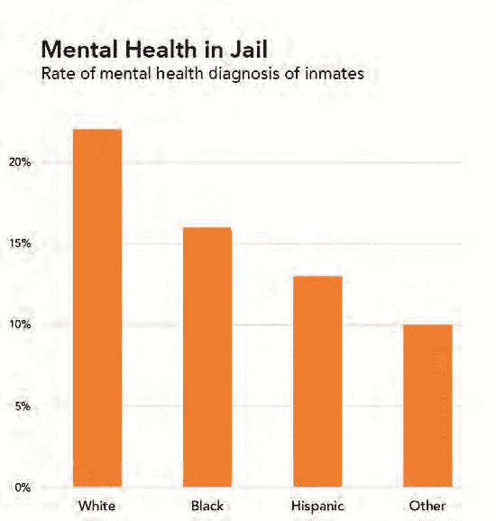 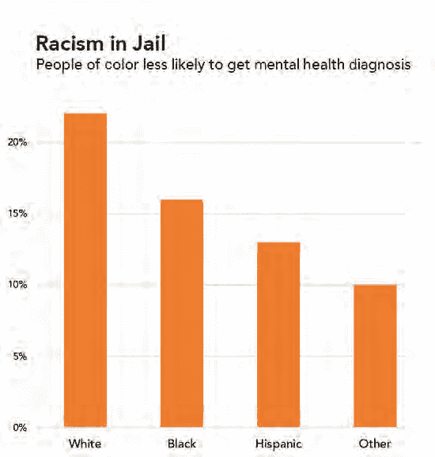

**图 6.6**

对同一项数据分析的两种描述。数据源于一项对 2011 年至 2013 年间在纽约市监狱首次入狱人员的研究。图表由 Catherine D’Ignazio 制作。数据来自 Fatos Kaba 等人的，“纽约市监狱心理健康服务中转转诊与诊断的差异”。

但这正是关于背景的额外问题出现的地方。你仅仅代表了图表中看到的四个数字吗？还是你代表了产生这些数字的背景？

产生这些数字的研究包含了说服力的证据，证明我们应该由于种族和族裔歧视而对诊断数字产生怀疑。第一张图表不仅未能传达这一点，还积极地破坏了研究的这一主要发现。此外，用犯人（inmates）来指代监狱里的人的语言是非人性的，特别是在美国大规模监禁盛行的背景下。^(51)

因此，考虑第二张图表：监狱中的种族主义：有色人种不太可能获得心理诊断（Racism in Jail: People of Color Less Likely to Get Mental Health Diagnosis）。这个标题提供了一个框架，根据产生这些数字的研究来解读这些数字。研究是关于种族差异的，因此该图表的标题和内容也是关于种族差异的。数字背后是人，而不是犯人。此外，重要的是，第二张图表指出了正在起作用的力量：监狱中的种族主义。

尽管指出种族主义对于这本书的某些读者来说可能听起来简单而易见，但重要的是，像新闻这样的领域仍然遵循某些惯例，这些惯例以“偏见”或“观点”为理由抵制此类命名。美联社编辑 John Daniszewski 就是这种观点的体现：“通常情况下，我们的政策是尝试在给定的情况下尽可能保持中立、精确和准确。我们对于自己抛出将某些事物定性为种族主义的指控非常谨慎。我们会尝试说明做了什么，让读者做出自己的判断。”^(52)

Daniszewski 的陈述听起来很民主（“将权力交给读者”），但重要的是，像新闻这样的领域仍然遵循某些惯例，这些惯例以“偏见”或“观点”为理由抵制此类命名。

# 第 6 章：恢复上下文

对同一个图表标题进行三次迭代可能觉得有些过度，但它也有助于强调一个核心的观点：考虑上下文始终涉及兴趣与时间的某种结合。幸运的是，目前对上下文问题投入了大量精力，教育工作者、记者、图书管理员、计算机科学家和公民数据发布者正开始开发更稳健的工具和方法，将上下文与数据联系起来，以便更容易将其包含在最终结果中。

例如，还记得图 6.3 吗？我们在本章之前讨论过的关于圣保罗政府采购的令人困惑的图表。圣保罗大学的教授吉塞尔·克拉维罗（Gisele Craveiro）创建了一个名为“Cuidando do Meu Bairro”（照顾我的社区）的工具，通过在信息展示中添加额外的本地上下文，让公民更容易获取这些支出数据^(56)。

在教室里，数据科学家兼教育者海瑟·克劳斯（Heather Krause）开发了“数据传记”的概念^(57)。在开始分析过程之前，克劳斯要求处理数据的人（特别是记者）为特定数据集编写一份简短的历史，并回答五个基本问题：它从哪里来？谁收集的？什么时候的？是如何收集的？为什么要收集？

微软研究人员提倡的一个相关但技术性稍强的建议被称为数据集数据表（datasheets for datasets）^(58)。受随硬件组件附带的数据表的启发，计算机科学家蒂姆尼特·格布鲁（Timnit Gebru）及其同事主张数据发布者应创建随数据集的简短文档（三到五页），这些文档概述了数据是如何被创建和收集的、可能缺少哪些数据、是否进行了预处理、以及数据集将如何进行维护，以及对法律和伦理考量的讨论，例如数据收集过程是否符合欧盟的隐私法。^(59)

另一种试图将数据更好地置于上下文中的新兴实践是开发数据用户指南^(60)。西宾夕法尼亚州区域数据中心经理鲍勃·格拉德克（Bob Gradeck）开始编写数据用户指南，是因为他经常就他所管理的热门数据集（如匹兹堡的房产数据和 311 居民报告）不断被问到相同的问题。

格拉德克报告：“我们花了一些时间来学习技巧和门道。……我想把我脑子里的东西拿出来，并带有额外的上下文，这样其他数据用户就不得从头开始了。”^(61)

数据用户指南是简单的书面文档，每个文档都包含一个数据集的叙述性画像。它们描述了数据的用途和应用；历史、格式和标准；组织背景；使用该数据集的其他分析和故事；以及该数据集的局限性和伦理影响。

这与数据记者为编译数据集并使之可重复使用而所做的工作相似。例如，美联社（Associated Press）提供了有关美国学校隔离的全面国家统计数据供购买^(62)。这些电子表格附带了一份二十页的关于数据的叙述性说明，其中包含了局限性和样本故事构思。

这些发展是令人兴奋的，但在影响数据收集环境的权力和不平等问题上，还有进一步的路要走。例如，政治学教授瓦莱丽·哈德森（Valerie Hudson）几十年来一直在追踪国家安全与女性地位之间的联系。

“我感兴趣的是，针对女性的压迫、隶属或暴力形式是否与国家（可能还有国际）的不稳定和冲突有关，”她解释道。

她和地理学家查德·埃米特（Chad Emmett）在 2001 年以一个简单的 Excel 表格形式启动了 WomanStats 项目。从那时，它已发展为一个大型网络数据库，拥有超过 25 万个数据点，包括从医疗保健机会到强奸发生率再到家务分工的 350 多个变量^(63)。

值得注意的是，他们的来源既有定性的也有定量的。哈德森说：“如果你想对女性进行研究，你就必须接受定性数据。这没有可商量，因为女性生活的现实根本无法在定量统计中捕捉到。完全不能。”^(64)

目前，WomanStats 包含两类定性变量：实践变量由女性对自身经历的报告组成，法律变量则是根据特定国家的法律框架编码的。事实上，WomanStats 的代码本是一个“上下文痴迷者（context nerd）”的梦想，它概述了测量问题，并警告了其数据的不完整性，特别是在涉及困难的话题时^(65)。

对于记录强奸报告的数据——这是一个足以令人不安以至于考虑的话题，更不用说考虑在整个国家内的规模和范围了——代码本指出：“买家自负！警告用户，该比例仅反映了报告的强奸率，对于许多（如果不是大多数）国家来说，这是社会实际强奸发生率一个完全不可靠的指标！”^(66)

用户被引导关注不是单一变量，而是 WomanStats 的复合比例，例如“综合强奸比例”，该比例结合法律、法律是否执行、生活经历报告、该环境中禁忌的强度等背景来看报告的发生率。

因此，提供上下文的工具和方法正在开发和试点。WomanStats 展示了上下文如何也能包含对不平等社会权力的分析。但如果我们把视角扩大到项目实验之外，仍然模糊的是：数据生态系统中的哪些者负责提供上下文？

是终端用户吗？在丢失 Reddit 回复的案例中，我们看到即使是我们中受过最高教育的人也未能验证其数据来源的基本主张。数据集数据表和数据用户指南固然很好，但我们能指望个人和小团队在截止日期之前进行深入的背景研究项目吗？

是数据发布者吗？在 GDELT 的案例中，我们看到数据发布者在追求资金的过程中夸大了自己的能力，没有记录局限性。Reddit 回复略有不同：数据集是由一个出于诚意而行动的个人提供的，但他没有资源进行验证。在校园袭击数据的案例中，是大学负责提供和维护上下文^(67)。

是数据中介吗？中介（也被称为信息中介）可能包括图书管理员、记者、非营利组织、教育工作者和其他信息专业人士。

图书馆学在数据策展和管理方面有深传统，但正如媒体学者香农·马特恩（Shannon Mattern）指出的，图书管理员经常被排除在关于智慧城市和公民技术的讨论之外^(69)。新闻业中良好策展和上下文化的数据示例，例如美联社关于学校隔离的数据库或 ProPublica 商店提供的其他数据集，也是很有前景的^(70)。

非营利组织 Measures for Justice 提供了刑事司法和监禁率的全面且上下文化的数据^(71)。一些数据中介（如匹兹堡的 Civicboard）正在建立自己的本地数据生态系统，作为通向可持续性和韧性的一种^(72)。

这些为公共使用清洗并提供上下文的数据中介具有潜力，但要大规模开展这项工作，需要持续的资金、大量的能力建设和专业规范的制定。

休斯敦，我们面临公共信息问题。在我们在提供（和维护）上下文方面的投入达到发布数据一样之前，我们得到的公共信息资源充其是不及的，最则是危险的。上下文及其所需的信息基础设施，应该是未来开放数据倡导者、慈善基金会、图书管理员、研究人员、新闻机构和监管者的重点。我们数据驱动的生活对此。

## 考虑上下文

数据女性主义的第六项原则是考虑上下文。数字的底线是，它们无法自己说话。事实上，我们处理数据的人必须积极防止数字自己说话，因为当这些数字源于受权力差异影响的数据环境，或不匹配的收集激励（读：几乎所有数据环境），特别是当数字涉及人类或其行为时，它们面临的不仅是狂妄自大和事实错误的风险，还可能在加剧不公正现状时造成真实的伤害。

同样努力在数据通信中构建语境（即图表中的数字不应该像在电子表格中那样仅仅自言自语）。

它还包括分析与数据设定相关的社会权力。哪些权力不衡导致了数据集中的沉默，或者导致数据的完全缺失？谁存在利益冲突，以至于他们无法对数据保持完全透明？谁的关于某个问题的知识被压制了，我们又该如何开始找回它？

围绕语境、元数据和来源的投入令人印象深刻，但在我们为语境化工作提供资金之前，出色的语境化工作将是例外而非常态。

# 7 展示你的工作

## 原则：让劳动变得可见

数据科学的工作与世界上的所有其他工作一样，是许多人的共同努力。《数据女权主义》让这种劳动变得可见，使其获得认可和价值。

如果你从事软件开发，那你很有可能有一个 GitHub 账户。

截至 2018 年 6 月，该在线代码管理平台在全球范围内拥有超过 2800 万用户。通过允许用户创建源代码的网页仓库（以及其他形式的内容），并让任何规模的项目团队都能参与贡献，GitHub 使得对单一软件、网站甚至一本书进行协作比以往任何时候都容易得多。

好吧，如果你是男性的话确实更容易。2016 年的一项研究发现，如果女性 GitHub 用户在个人资料中注明自己是女性，她们的贡献被接受的概率较低。（该研究未考虑非二元性别。）¹

对 GitHub 包容性承诺（或缺乏此类承诺）的批评者还指向了公司的内部政治。2014 年，GitHub 的联合创始人在性骚扰指控被曝光后被迫辞职。²

最近在 2018 年，GitHub 前顶尖律师 Agnes Pakk 控诉该公司，指控其在她抱怨性别和种族导致薪资方案较低后，公司修改了她的绩效评估，从而为解雇她提供了理由。³ Pakk 的诉讼发生于不久之前，跨性别软件开发者 Coraline Ada Ehmke 在 2017 年拒绝了一笔巨额遣散费，以便她能够公开讨论她在 GitHub 工作的负面经历。显然，GitHub 存在几个必须解决的重大企业文化问题。

但一个对女性敌意的企业文化并不意味着排除其他女权主义干预。在这里 GitHub 做出了一项重要的干预：它的平台有助于展示编写协作代码的工作。

除了错误跟踪和功能请求等基础项目管理工具外，GitHub 还会生成每个团队成员对项目代码库贡献的可视化结果。以小图形式排列的面积图允许观众比较任何特定成员贡献的数量、频率和时长（图 7.1a）。折线图揭示了这些贡献发生的周几模式（图 7.1b）。一张类似于流程图的图记录了项目代码不同分支之间的关系。

**图 7.1**

(a) Lauren 研究小组的项目相关代码的三张可视化图的第一张，显示了 2014 年至 2019 年间学生研究人员的重大贡献。(b) 柱状图显示了随时间变化的代码提交频率，折线图显示了提交发生在周几的模式。由 Lauren F. Klein 截图。(c) 一张类似于流程图的图记录了项目代码库不同分支之间的关系。由 Lauren F. Klein 截图。

代码有助于承认项目任何其他可能未被记录的来源，以及任何可能在项目初始工作基础上构建的额外项目（图 7.1c）。

编码是工作，正如任何编写过程序的人所深知的那样。但它并不总是易见的工作。数据收集、分析和可视化也是如此。

我们往往惊叹交互式可视化的规模和复杂性，例如图 7.2 中的船事地图（Ship Map），它绘制了 2012 日历年全球商运船队的航线。⁵ 通过显示每一次航海，船事地图揭示了构成我们全球产品供应链的水路网络。

但我们较少接触到帮助构成可视化本身的流程和人员网络——从来自 Clarkson Research UK 的 75 名汇总并验证底层数据集的企业研究人员，到伦敦大学学院能源研究所开发数据模型的学术研究团队，再到 Kiln 将数据模型转换为我们所看到的可视化结果的设计团队。这还未提到最初作为数据源的数万艘商用船。

## 展示你的成果

**179**

不得不自己处理自己的家务以及其他女性的家庭杂务。”^(10)

在这里，戴维斯（Davis）就种族化劳动（racialized labor）提出了一个重要观点：正如家务是根据性别结构构建的，它也是根据种族结构构建的。有色人种女性的家务过去和现在都是低薪劳动（underwaged labor），正如女性主义理论者所说的那样，其低成本使得（并继续允许）许多白人中产和上层阶级女性参与更高的有薪劳动（waged labor）市场。(11)

自 20 世纪 70 年代以来，“影子劳动”（invisible labor）一词已涵盖了各种形式的无偿、低薪甚至有薪劳动，这些劳动因为它们发生在家里、因为它们不在视线之内或者因为它们根本没有形式。(12)

访问 Facebook.com，你会发现一种家务论更新的新形式的隐形劳动。这种隐形劳动遍布整个网络，正如蒂齐亚娜·特拉诺瓦（Tiziana Terranova）等数字劳动理论者帮助我们理解的那样。(13) “他们称之为分享，我们称之为偷窃，”这是屏幕上滚动的大字说明之一。

这里的“它”指的是我们大多数人每天都在执行的工作，形式为我们的 Facebook 点赞、Instagram

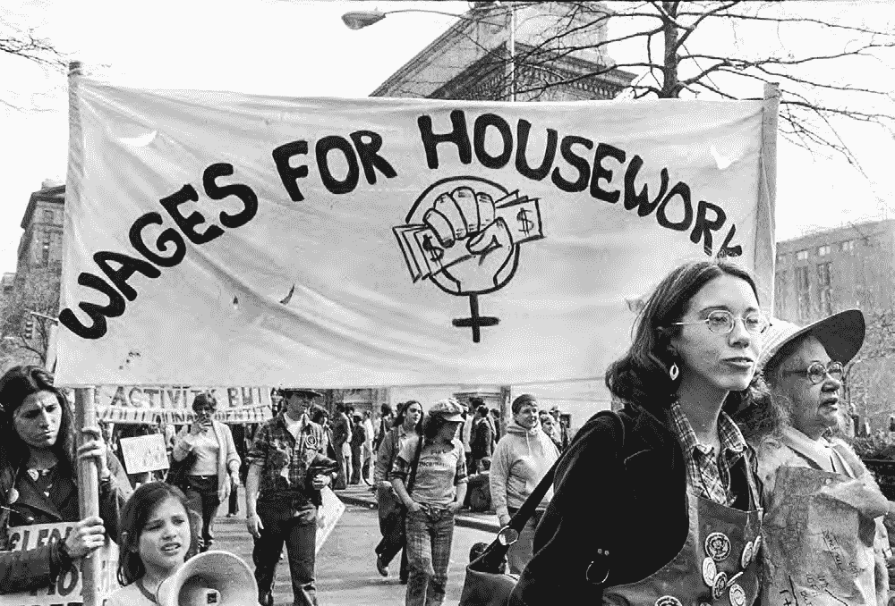

**图 7.3**

1977 年的家务游行。Betty Lane 摄影。Schinger 图书馆/Radcliffe 学院提供。

**180**

## 第七章

**181**（等等，根据上下文检查页码，让我们重新对齐）

帖子和推文。由劳雷尔·普塔克（Laurel Ptak）——家务论背后的艺术家——以及特拉诺瓦（Terranova）共同提出的观点是：我们的 Facebook 点赞和推文所代表的隐形劳动，正是 Facebook 和 Twitter 世界能够盈利和繁荣的原因。

## 数据科学的隐形劳动

数据科学世界之所以能够盈利和繁荣，也是因为无偿劳动。(14) Netflix 如何改进其推荐算法？它是众包完成的。(15) 《卫报》（The Guardian）如何确定数百万份文件中的哪些可能包含定罪信息？它是众包完成的。(16) 光字符识别（OCR）在早期书籍数据集上进行的错误纠正也是众包完成的。(17)

这些众包项目每一个都被框架为慈善行为（在 Netflix 的案例中，是一个赢得百万奖金的机会）。这些支持者声称，人们应该想要参与这些项目，因为他们的劳动会促进公共利益。(18)

然而，软件开发人员兼多样性顾问干燥（Ashe Dryden）指出，人们只有在有倾向和时间的情况下才能提供。(19) 回想关于 GitHub 的研究：如果你是一个女性，你对项目的贡献比男性更不易接受，这会激励你吗？

或者作为另一个例子，考虑维基百科。尽管维基百科的确的人口统计数据未知，但许多调查表明，向该百科贡献内容的人中，84% 到 91.5% 是男性。(20) 为什么？这可能是因为如果编辑来自女性，它们就不可能被接受。(21)

这也可能归于维基百科的排他性文化和技术基础设施，正如科学技术研究（STS）学者海瑟·福德（Heather Ford）和朱迪·瓦曼（Judy Wajman）所论证的那样。

也有理由回到家务论。干燥引用 2011 年的一项研究显示，即使在控制了全职工作的情况下，29 国家中的女性花费在家庭任务上的时间是男性的两倍。(22) 该研究没有考虑非二元性别或同性家庭。但即使作为一个粗略估计，女性似乎并没有那么多时间。(23)

在资本主义社会中，时间往往就是金钱。但同样重要的是记住问是谁在花费时间，谁在节省金钱。

Amazon Mechanical Turk（或者更广为人知的 MTurk）平台背后的前提是，数据科学家想要节省自己的时间和自己的底线。(24) MTurk 网站推销其接入了一个全球“按需工人”市场，这些工人被广告为比招聘正式员工这种“耗时且昂贵”的过程更具扩展性和效益。(25)

但这些工人执行的数据输入和数据处理任务的收入低于最低工资，尽管皮尤研究中心（Pew Research Center）最近的一项研究显示，在美国的 Turker（他们被这样称为）中，51% 拥有大学学位，88% 年龄五十岁以下，其他指标会将他们列为最理想的受薪员工群体。(26)

这种低薪工作也日益从美国外包到劳动法更少（或更差）、进步机会更少（或更差）的国家。加州大学欧文分校 2010 年的一项研究在其监测的 1 个月内，美国 Turker 的数量下降了 20%。实时 MTurk 追踪器显示这种趋势持续。（有趣的是，性别比例随着时间已经平衡。）

即使在 Amazon 和 Google 这样资源丰富的公司，数据输入的价值与其帮助创造的知识相比也被严重低估了。

安德鲁·诺曼·威尔尔逊（Andrew Norman Wilson）2011 年的纪录片《离开 Googleplex 的员工》（图 7.4）揭露了负责扫描 Google 图书数据库书籍的工人被聘佣为一个独立但不平等的员工阶层，他们的身份卡限制了他们进入 Google 园区的大部分，并阻止了他们享受公司著名的员工福利。(28)

（显然，为了保护世界文化遗产而加班仍然不能让你享受到免费午餐，更不用说如何做泰粉的免费课程了。）(29)

威尔逊还观察到，Google 的书籍扫描工人不成比例地女性和有色人种——这一事实对于包括安吉拉·戴维斯（Angela Davis）、帕特里娅·希尔·柯林斯（Patricia Hill Collins）和伊芙琳·纳卡诺·格伦（Evelyn Nakano Glenn）在内的长期有色人种学者活动人士并不意外。信息研究学者莉莉·伊拉尼（Lilly Irani）证实：“今天的数据劳动等级制度反映了更老的性别、阶级和种族技术等级。”（30）

在这里，伊拉尼将数据劳动的等级制度与第一代女性计算机（如我们在书中引言中讨论的克里斯汀·丹登（Christine Darden））所遭遇的等级制度进行了比较。（31）但伊拉尼自己的研究也考虑了当代数字劳动实践，特别是亚马逊的 Mechanical Turk、它雇佣的人以及剥削的人。2008 年，伊拉尼和合作者建立了一个名为 `Turkopticon` 的网络工具，让 Turker 匿名报告不公平的劳动条件，以及任何帮助他们决定是否接受任务的其他信息。（32）

伊拉尼设想 `Turkopticon` 是一个工人主导的项目。然而，导致该工具产生的不公平劳动条件最终限制了它的范围。2018 年，在服务十年后，其全志愿者审核员团队宣布退出。“我们都精疲力竭了，”他们在 Twitter 上写道。（33）在标记图像和纠正充满错误的文本时，没有额外的 Turker 能找到时间。

执行伊拉尼所称的这种*文化数据工作*的人不仅出现在 `MTurk` 平台上。然而，他们日益成为整个信息经济所依赖的人。文化数据工作者负责每天产生的海量内容审核的隐形劳动，确保你的 Facebook 信息中没有（例如）儿童色情和暴力宣传视频。

## 展示你的工作

### 183

这种劳动的情绪成本是由一些权力最低的工人——全球南方的女性——承担的，这引发了巨大的震惊和愤怒。（34）但随后的研究，如人类学家 Mary Gray 和计算机科学家 Siddharth Suri 合著的《幽灵工作》（*Ghost Work*），记录了一个庞大的从事内容审核、转录和字幕工作的“全球下层阶级”的存在。（35）

他们指出，所谓的人工智能依赖于大量参与其中的人类。（36）此外，尽管硅谷科技工作者的人口结构一直保持年轻、白人且男性，但这些全球“幽灵工人”通常是年长的有色人种女性，而且总是被要求接受不稳定的劳动。

研究全球资本主义人类代价的人会很快指出，这种对不稳定、带有种族色彩和殖民色彩劳动的剥削有着悠久的历史，根源在于人类剥削最原始的形式：奴隶制。毕竟，奴隶制与资本主义紧密相连，有一个著名的故事常被用来说明这一点：

1781 年，英国奴隶船“尊号”（*Zong*）在横跨大西洋时发生了一系列导航错误，导致船上的 17 名船员和 133 名俘虏的饮用水短缺。（37）在进行成本效益分析后，船长决定将船上的奴隶人类“货物”扔下海，以便船员能够消耗所有剩余的水和口粮。

做出这一决定是因为船长计算过，他可以通过俘虏的死亡获得足够的保险金来获利，即使在他们上岸后无法卖掉他们。他完全是从市场价值的角度考虑人类生命——这正是资本主义最推崇的观念。

这种计算的冷酷非人性促使许多学者和艺术家重新关注“尊号”，他们正在审视克里斯蒂娜·沙普（Christina Sharpe）用船的语言描述的奴隶制的“尾迹”（wake）。（38）例如，诗人 M. NourbeSe Philip 创作了一部长诗《尊号！》（*Zong!*），仅使用了作为该原始事件唯一记录的法律案件中的词汇。（39）

Philip 的诗历时多年，于 2011 年出版，从法庭案件的语言中提取词汇和短语，将它们排列在印刷页面上。Philip 的诗时态在过去式和现在式、现在式和过去式之间切换，为 Sharpe 的主张提供了额外的声音，即那种原始罪行的影响——为了白人的财务利益而剥削黑人身体——远未得到解决。（40）

我们现在的技术基础设施遵循着同样的剥削模式。在美国，那些忍受当代形式奴隶制——监禁——的人们其报酬微薄或完全无报酬的劳动，被用于从包装 Windows 软件到清理 2010 年 BP 石油泄漏等一切工作。（41）

在全球殖民背景下，我们可以考虑生产手机和笔记本电脑的锂离子电池所需的钴，是如何与严重的人权侵犯行为相关的，包括强迫年仅七岁的刚果儿童劳工。（42）

电子产品的无监管处置导致了像加纳阿克拉郊外的阿格博洛什希（Agbogbloshie）等地出现了路边回收和修理店，这些地方长期以来一直是发明和天才的场所，如今已变成有毒的“电子垃圾”场，对在那里生活和工作的人的健康以及环境产生了深远影响。（43）

我们对数据和技术的依恋所涉及的人道主义和生态代价再高，其来源也再清晰不过：即鼓励剥削黑人和棕色人种身体以让白人身体繁荣的资本主义和殖民力量。（44）

## 第 7 章

### 184

## 审视数据生产

全球资本主义的力量可能让人感到无所适从。作为日常工作中使用数据和技术的人，我们每个人在不同程度上都是共犯的。但在我们的工作中，在与他人的合作中，我们可以做一些细小的事来反抗这种重压。

在之前的章节中，我们描述了其中一些可能性：

- 在数据分析项目中纳入对权力的研究（第 1 和第 2 章）。
- 反抗虚假的二元对立和等级（第 4 章）。
- 在设计过程中包含多元和边缘化的声音（第 5 章）。
- 对数据进行语境化，使其不被想象为“自发说话”（第 6 章）。

除了这些起点外，我们还可以开始为那些明确研究数据科学劳动的学者、记者和其他研究人员开辟额外的空间——这些人通过追溯可视化、算法和机器人背后的人类和物质来源，来审查和挑战权力。

这一不断增长的研究领域可以被称为*数据生产研究*（*data production studies*），借用了生产研究领域的准则，该领域目前处于电影与媒体研究以及劳动研究的交叉点上。生产研究在涉及电影和媒体方面的主要关注点是媒体制品如何生产。

媒体研究学者米兰达·班克斯（Miranda Banks）断言：“生产研究是一种女性主义方法论”，因为它特别关注媒体生产中涉及的权力差异，以及工人的物质条件。（45）

关于生产的工作已经发生在科学与技术研究（STS）、数字人文、信息科学和档案学等领域。（46）它关注数据集、算法和模型的生产，并将这些产品追溯到具体的人身上。

### 185

## 展示你的工作

作为这一新兴领域工作的一个示例，我们可能会考虑由技术研究员凯特·克劳福德（Kate Crawford）和设计学者弗拉丹·乔勒（Vladan Joler）开展的项目《AI 系统解剖》（*Anatomy of an AI System*），该项目旨在描述并绘制出创建 Amazon Echo 所需的人类劳动、数据和物质资源图。

该项目在网上发布，是一个具有博尔赫斯比例的图表，大到在标准笔记本电脑无法完整查看（图 7.5a）；它还配有一篇九千字的文章。观众首先了解到生产这些电子设备所需的矿产开采，并意识到这项任务所需的艰苦劳动（有时甚至是童工）。

图表（和叙述）继续通过这些组件的精炼、组装和分发过程，然后通过物理方式运输，最后通过虚拟方式——通过互联网。一旦进入 Amazon 公司内部，图表描绘了从网络维护到训练数据集的各个阶层的工人（图 7.5b）。

克劳福德和乔勒还绘制了劳动力组织的模式，他们将其描述为“生产与剥削的分形链”。文章最后总结道：“在每一个层面，当代技术都深植于并运行在对人体的剥削之上。”（47）

该项目对全球范围内制造单一产品所涉及的隐形劳动进行了调查和揭露。通过这种方式，它是数据女性主义第七原则的一个雄心示例：*展示你的工作*（*show the work*）。

## 认可数据劳动

对广泛工作给予正式认可的强调，源于女性主义的引用实践。女性主义理论家萨拉·艾哈迈（Sara Ahmed）将这种实践描述为一种反抗某些类型的人（通常是顺性别、白人和男性）——通过筛选他人来占据空间的方式。（48）

## AI 系统的剖析

一个由人类劳动构成的人工智能系统 Amazon Echo 的原子化研究

### 人类操作员

### 国内基础设施

### 内部基础设施

### 收入分配

### 分销商

### 动物存储系统

### 组装工

### 运输

### 组件制造商

### 互联网平台与服务

### 气味与精炼师

### Amazon 公司基础设施：AWS

### 矿场

### AVS

### 元素

### AI 训练

### 地质过程

### 自然量化

## 第 7 章

隐形的，他们的贡献没有得到认可。艾迈德（Ahmed）认为，导致他们被抹除的*筛选技术*并非总是故意，但遗憾的是，它们是自我延续的。

Ahmed 举了一个例子：陷进皮革扶手椅里，这种椅子非常舒适，因为随着时间的推移，它变得符合你的身体形状。你可能没有注意到，对于那些没有坐过这种椅子的人来说——那些身体不同或对时间有不同需求的人——这把椅子是不舒服的。

这就是为什么我们这些坐在舒适的皮椅上——或者在设计领域更可能是坐在塑型塑料伊姆斯椅上的人们——必须保持警惕，提醒自己我们自己的数据工作所依赖的额外劳动形式，以及额外的人员。

即使在单个数据科学项目的规模上，情况也会迅速变得复杂。所有参与人员的名字和他们执行的工作并不总是容易找到——如果它们能被找到的话。但采取步骤记录在项目进行期间参与该特定项目的所有人员，有助于确保在项目完成后留有关于该工作的记录。

事实上，这是《合作者权利法案》（Collaborators’ Bill of Rights）四大核心原则之一，该文件是由图书馆员、工作人员技术人员、学者和博士后研究员组成的跨学科团队于 2011 年开发的，旨在应对当时各种职级、迥然不同且被要求参与基于数据（以及其他数字）项目的职位类型激增。（49）

## 图 7.5（续）

## 展示你的工作

当从女性主义视角设计数据产品时，我们同样渴望展示项目整个生命周期中所涉及的工作。事实依然如此，因为当工作在本质上可能是集体性的且无法归于单一来源时，命名每一个个体可能非常困难。

在这种情况下，我们可以从“下一系统项目”（Next System Project）中获得灵感，这是一个旨在记录和可视化替代性系统的研究小组。（50）在一份报告中，该小组汇总了运行在菲律宾尼格洛斯岛、加拿大魁北克省和印度喀拉拉邦等广远地区的经济多样性信息。

该报告采用了“冰山”的视觉隐喻（图 7.6），其中计薪劳动位于冰山之角，浮在水面之上，而几十种其他形式的劳动——非正式贷款、消费者合作社和家庭内部工作等——位于水面之下，提供了至关重要的压舱，但保持在不可见的状态。

顺着“水下劳动”的理念，我们可能会回到本章开头提到的 GitHub 示例，思考哪些额外的劳动形式贡献了代码的产生，但无法通过 GitHub 目前使用的可视化呈现。

我们可能会考虑到经理的工作，这种工作没有直接体现在特定的贡献数量或频率上，但它确保了所有代码的质量和一致性。我们可能会好奇设计师或技术作家的工作——他们都可能在项目初始阶段帮助塑造了项目，但现在可能已经转向了其他任务。

在面向消费者的项目中，我们可能还会考虑客户支持团队的贡献。或者在面向社区的项目中，我们可能会包括那些花费多年时间与成员建立深厚关系的组织者。

这些劳动形式无论是生产性的还是再生产性的，对于任何项目的成功都是至关重要的，但目前是不可见的，而且永远无法通过仅考虑贡献的方案被轻松可视化。（51）

但在比你想象得多的情况下，与数据工作相关的劳动可以通过数据本身呈现出来。例如，历史学家本杰明·施密特（Benjamin Schmidt）的研究重点是政府机构在塑造公共知识方面的作用，他决定将美国图书馆（世界最大的图书馆）数字目录相关的元数据进行可视化（图 7.7）。（52）

但在可视化目录记录的过程中，他发现了其他东西：一份关于编员自身的劳动记录。当他将每本书记录的创建年份与书籍的出版年份进行绘图时，他在图像中看到了一些异常的模式：阴影垂直线、阶梯状结构和深色垂直带，这些特征与人们可能认为的简单两步过程——（1）获取书籍和（2）输入书籍——不匹配。

Schmidt 很快意识到，阴影垂直线显示了编员开始回到那些在图书馆数字化之前出版的书籍的时间点，用较旧的书填充在线目录。阶梯状模式指示了在过程后期的某些时期，编员返回图书馆的特定子藏品，在短时间内输入了整组书籍的数据。

那么水平线呢？鉴于它们只出现在 1800 年和 1900 年，Schmidt 推断这些线表示了缺失的出版信息，因为图书馆目录编制的最佳实践规定，当确切出版日期未知时，应输入该世纪的第一年。

由于强调“展示工作”，这些视觉产物还应该促使我们考虑，将图书馆的纸质记录转换为数字形式到底涉及了多少体力劳动。毕竟，图表中颜色较深的区域不仅表示输入目录的书籍数量更多。它们还指示了输入所有书籍的人们（Schmidt 估计总数为一千万，且仍在增长）。

同样，阶梯状结构不仅表示数据录入量的增加。它们表示了图书馆工作人员返回收藏品特定部分的战略决策，并反映了这些员工对需要填补空白的先验知识——换句话说，也是他们的智力劳动。

Schmidt 的可视化有助于展示数据集如何追溯到“数据环境”（用 Yanni Loukissas 的巧妙说法），以及在那个环境中劳作并产生我们所看到的数据的人。（53）

## 承认情感劳动和照护工作

除了数据工作的隐形劳动外，还有一些劳动因为我们没有被训练过将其视为劳动而保持隐藏状态。这就是所谓的*情感劳动*（emotional labor），它是另一种由女性主义理论帮助揭示的工作形式。（54）

正如女性主义社会学家阿莉·霍奇尔德（Arlie Hochschild）所描述，情感劳动描述了为了应对社会或特定工作的要求而管理自己或他人情感所涉及的工作。（55）霍奇尔德在 20 世纪 70 年代后期创造了这个术语，描述服务业人员所需的劳动，例如空乘人员在恶劣飞行状况下需要管理自己的恐惧，同时安抚乘客，并通常致力于确保乘客感到被关怀和满意。

## 展示你的工作

在随后的几十年里，“情感劳动”（emotional labor）的概念被一个相关概念——*影响劳动*（affective labor）所补充，使得投射某种感觉（情感的定义）的工作与体验感觉本身（影响的定义）的工作被区分开来。（56）

我们可以在当今整个技术行业中看到情感劳动和感性劳动的运作。例如，考虑呼叫中心工作人员和其他技术支持专家如何必须结合影响劳动、情感劳动以及技术专业知识，来吸收愤怒客户的怒气（影响劳动），反映出他们的同情（情感劳动），然后帮助他们完成——例如——配置无线路由器（技术专业知识）。（57）

在职场中，我们可能还会考虑到女性和少数群体在所有情况下所需的感性劳动，他们必须采取措施来反驳（或简单忽略）他们面临的关于其技术能力或其他任何方面的性别歧视、种族歧视或其他形式的假设。

而且他们在执行这些工作的同时，还必须进行情感劳动，确保自己不会威胁到那些持有假设的人，而这些人通常也对他们拥有权力。（58）是否有方法可以将这些形式的劳动可视化，让这些工作投入具有视觉呈现——从而获得认可和荣誉？

试图将情感和影响劳动可视化的一个例子是《护理图谱》（Atlas of Caregiving，图 7.8），这是一个持续的项目，旨在记录照顾慢性病成员所需的工作。

该项目的名称借鉴了解剖学图谱的概念，即医生可以用来查询信息和参考的人体插图汇。在这种情况下，目标是说明护理工作中有时是身体上的、有时是情感或影响上的工作。

研究团队为参与者配备了各种生物识别传感器，包括加速度计和心率监测仪，以及设置为每十五分钟拍摄一张照片的体感摄像头。然后他们将这些数据与个人访谈摘要以及他们要求护理者完成的活动日志进行可视化处理。

结果是一幅复杂的护理图景，它汇集数据以创建一个护理工作中涉及劳动范围的全面视图。（59）护理者的压力——一种影响劳动——被分解为六个不同的等级，并可视化为一个梯度（图 7.8a）。

护理工作本身被分为七种子工作，包括医疗管理和家务等具体任务，以及更抽象的劳动形式，如随时待命和社交支持（图 7.8b）。这也有助于他人识别这种广泛的……

## 图 7.8

《护理图谱》将照顾慢性病家庭成员的劳动可视化。

- （a）一份为期三十小时的护理活动日志。
- （b）按类型分类的护理活动。
- （c）同期创建的照片日志。

图片来源感谢《护理图谱》，2016 年。

| 所有活动花费的小时数 | 花费在护理上的分钟数 |
| :--- | :--- |
| 护理 | 6.51 |
| 自理 | 1.58 |
| 休闲 | 0 |
| 工作 | 4.36 |
| 睡眠 | 6.08 |

### 医疗活动

| 活动 | 花费在护理上的分钟数 |
| :--- | :--- |
| 药物和补充剂（包括注射、静脉注射、氧气等） | 90 |
| 运动、物理治疗 | |
| 设备准备与维护 | |
| 伤口护理 | |
| 症状追踪和身体测量（体重、温度等） | |
| 准备特殊餐点 | |

### 医疗管理

| 活动 | 花费在护理上的分钟数 |
| :--- | :--- |
| 安排预约 | |
| 与健康专业人员沟通 | |
| 与健康专业人员会诊 | 23 |
| 购买处方药和用品 | |
| 保险和支付 | 102 |
| 研究疾病和治疗方法 | |
| 研究医疗成本 | |

### 护理沟通与协调

| 活动 | 花费在护理上的分钟数 |
| :--- | :--- |
| 让家人和朋友了解情况 | 23 |
| 管理家庭和付费护理人员 | |
| 管理社区服务（非公共交通、轮椅送餐等） | |

### “ADLs”个人活动能力帮助

| 活动 | 花费在护理上的分钟数 |
| :--- | :--- |
| 洗澡和如厕 | 32 |
| 穿衣和理容 | 11 |
| 喂食 | 10 |
| 上下床、椅子等 | 17 |
| 在家中移动 | 13 |

### “IADLs”家务

| 活动 | 花费在护理上的分钟数 |
| :--- | :--- |
| 清洁 | 12 |
| 烹饪 | 1 |
| 洗衣 | |
| 购物 | 67 |
| 获取/移动/使用物品 | |
| 管理账单和储蓄 | |
| 往返家的交通 | |

### 社交支持

| 活动 | 花费在护理上的分钟数 |
| :--- | :--- |
| 陪伴 | 54 |
| 情感支持 | |
| 社交活动中的计划与支持 | 21 |

### 随时待命

| 活动 | 花费在护理上的分钟数 |
| :--- | :--- |
| 对任何需求保持恒定的“警觉” | 48 |
| 针对问题“待命” | |

### 总计

| 项目 | 总计 |
| :--- | :--- |
| 总计 | 482 |

## 第 7 章

第 1 天、第 2 天从凌晨 12 点到中午 12 点的日志。

### 护理压力等级

- 压力等级 5
- 压力等级 4
- 压力等级 3
- 压力等级 2
- 压力等级 1
- 压力等级 0

### 类别

- 自理
- 休闲
- 工作
- 其他
- 睡眠

## 第七章

### 198

“一个人的生命故事。”^(62) 与《护理工作图谱》（Atlas of Caregiving）不同，后者依赖于径向时间轴和甘特图表等标准可视化技术来使护理工作合法化；卢皮（Lupi）则寻求替代性的可视化策略，以强调单一家庭状况的独性和特殊性。她采用了一种流体时间轴来反映残障研究学者所谓的残障时间（crip time）的主观性。对于这一术语，正如艾伦·萨缪尔斯（Ellen Samuels）解释的那样，“我们有时是指我们一直迟到——也许因为我们需要比非残障更多的睡眠，也许因为火车站的无障碍门被锁了。”^(63) 但它也可以意味着更深层的东西，正如艾莉森·凯弗（Alison Kafer）描述的那样：“与其弯曲残疾身体的心去迎合时钟，残障时间是让时钟弯曲以适应残疾的心。”^(64)

在卢皮描绘时钟如何面对国王女儿的身体和国王自己的心灵时，日子变成了白色的杨树叶，分割它们的不是周或年，而是就诊次数。红点被用来指示血板计数，并利用色彩的拟态来传达淤青的程度，以及国王记录的数据的视觉性。卢皮还利用颜色来代表国王对其感受的记录，黑色对应压力和恐惧，黄色代表希望。国王的恐惧和希望也通过手绘线条被视觉化，这些线条反映了在一到十分量表上的得分。结果呈现为一个随时间推移展开的动画，并配有

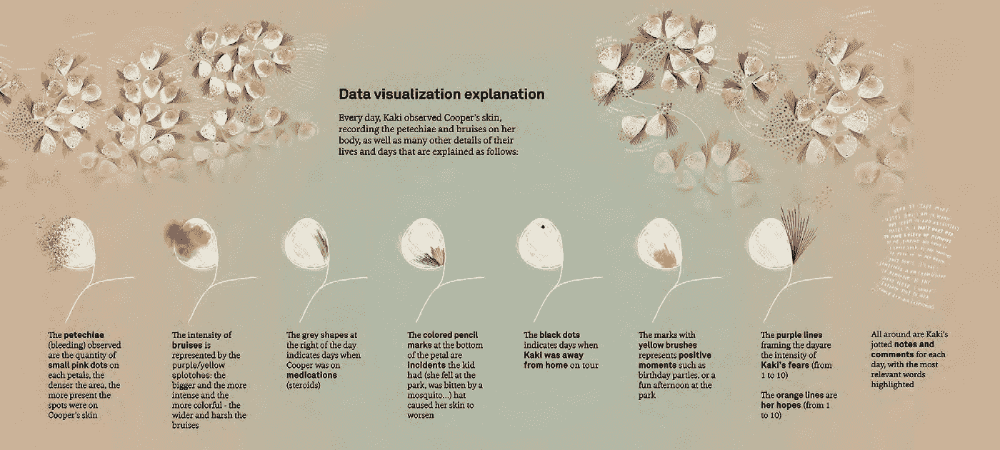

**图 7.9**（续）

### 展示你的工作

199

音乐，这是一部关于母爱与护理情感劳动在视觉和听觉上产生影响的组合。

当然，无论是卢皮、国王还是《护理工作图谱》项目团队，都不是第一批想要识别并让护理工作可见的人。早在1969年，在自己的孩子出生后不久，艺术家米尔尔·拉德德曼·乌克莱斯（Mierle Laderman Ukeles）就撰写了《维护艺术宣言》（Manifesto for Maintenance Art），呼吁艺术界将人类生命的护理和维护提升到艺术的高度，而不仅仅是孤独的（男性）天才。^(65) 在随后的几年里，护理工作（care work）成为女性主义学者关注的重要议题——特别是在20世纪90年代中期之后，当时南希·福尔布雷（Nancy Folbre）正式了这一术语。福尔布雷的护理工作的主要模型是照顾孩子的日常工作，尽管护理工作像家务一样，并不一定是免费的。它还可以包括托育工人或家庭健康辅助人员的低薪工作，以及医生、护士、物理治疗师、心理健康专业人士等的有薪工作。将这些形式的工作跨越经济界联系在一起的是它们的动机。正如福尔布雷所理论化的那样，护理工作的开展出于对他人的同情或责任感，而不是以金钱为目标。但当涉及到市场时，利他主义是一把双刃剑。这些专业的护理工作者——主要是女性和有色人种——他们的薪酬通常低于其他领域。^(66) 为什么？因为他们关怀。

那么，我们如何“展示”护理工作者的工作呢？我们如何确保这项工作得到充分的认可和重视？我们还能多做什么来挑战这种被低估工作的根源吗？在学术界，像“维护者”（The Maintainers）这样的小组试图从像福尔布雷这样的女性主义劳动研究学者开发的护理理论中学习，他们试图让数据工作的劳动可见并产生价值。^(67) 通过工作坊、会议和出版，“维护者”试图反击当前技术领域仅赞美创新和发现的趋势。他们坚持，维护和维持我们今天所处的世界也应该被赞颂。他们目前的研究领域包括他们称为信息-维护者（Info-Maintainers）的人：即在图书馆、档案以及相关保护领域工作的人，确保现在的知识对后世保持可访问性。由于维护者认为，由于图书管理员、档案管理员和策展人的工作重点在于促进对未来知识的获取，因此它可以被视为一种护理工作形式。

在许多技术领域，人们对护理工作和其他形式的隐形劳动的关注日益增加，因为现在有这么多工作是虚拟而非物理的；随着白领工作开始外包给自由职业者，对工作不安全问题的关注也日益增加。在这种背景下，重要的是

200

第七章

记住，专业的护理工作者长期以来一直在处理报酬不足和工作不稳定的问题；在同样的时间里，他们一直致力于抵抗和组织反对他们所面临的不平等待遇。今天，这些努力正得到数据和技术的加强，因为工会和其他倡议组织正在利用新平台和数据流来进行工作。但它们也受到阻碍，因为连接护理人员和雇主的类`Uber`应用日益泛滥。这些应用对解决护理人员面临的系统性问题无任何帮助。英国海外发展研究所（`ODI`）2016年的一项工人研究报告称，它们强化了权力关系并固化了不平等。虽然一种策略是展示数据产品背后的工作，但另一种尊重所有形式工作的策略是使用数据科学来展示那些在其他领域工作的人（主要是女性）的劳动，这些工作涉及情感劳动、家务和护理工作。我们在《护理工作图谱》中看到了这种行动，它关注护理工作的合法化，并提供了更多的经济保障。与家庭工人团结可以开始挑战将他们工作边缘化的结构性不平等。

## 结论：现在，让我们产生倍效应

2018年11月1日，当地时间上午11:10，全球五十个城市`Google`办公室的员工关闭了浏览器标签页，关掉了笔记本电脑，并离开了岗位。¹ 这场离职抗包含了全职员工和自由职业者。这次活动由女性领导，尽管这家公司多年来对包容性口说无凭，但女性员工比例仅为31%。² 而且规模巨大——有超过两万名工人参与了其中（图8.1）。为什么这个星球最有权力公司之一的员工会走上街头？

一周前，《纽约时报》（New York Times）爆出一条关于9000万美元离职补偿方案的消息，这是`Google Android`移动操作系统的创建者安迪·鲁宾（Andy Rubin）在被指控性骚扰后（以及在内部调查确认该指控属实后）收到的。³ 报道提到了另外两名同样被指控性骚扰的高管，`Google`也同样地保护了他们。正如记者若林大介（Daisuke Wakabayashi）和凯蒂·贝纳（Katie Benner）所写：“在对其中两个男性达成有利于他们的条件的协议时，Google保护了自身的利益。”显然，鲁宾的补偿金是以每月200万美元的速度分期支付的，为期四年。他的最后一笔付款定于该月晚些时候支付。

《纽约时报》的文章一发表，关于女性以及男性和非二元性别者所面临的歧视故事也开始在公司邮件列表、聊天频道以及面对面的论坛中涌现出来。这些故事指向了毒性行为的模式。⁴ 在一周内，这场最初只是在`Google`妈妈列表里作为一个想法提出的的大规模离职抗议已经完成了筹备。“科技行业照常的经营模式正在辜负我们，”Google开放研究小组（Open Research Group）创始人梅雷迪斯·惠特aker（Meredith Whittaker）说。“Google给安迪·鲁宾支付9000万美元只是数千案例之一，这些案例说明了这家滥用权力、系统性种族主义和缺乏责任的决策已成为常态的公司。……显然，我们需要真正的结构性变革，而不是对现状的调整。”⁵

包括惠特aker在内的七位核心核心组织者聚集在一起制定了五项具体要求，包括结束歧视和性骚扰案件中的强制仲裁，以及让首席多样性官直接向首席执行官汇报。⁶ 当11月1日到来时，员工首先聚集在室内中庭，然后转移到庭院和街道上。他们举着牌子，写着“Google，不行（Not OK, Google）”、“我举报了，他升职了”以及“乐意为了9000万美元辞职，不需要性骚扰”。Google管理层开始关注。

尽管这场正式名为“为了真实变革的Google抗议”（Google Walkout for Real Change）的活动在媒体中被描述为大型科技公司的里程碑，但白领科技组织活动有着明显的先例。历史学家马尔·希克斯（Mar Hicks）将Google抗议与20世纪70年代英国发生的一场计算机工人罢工联系起来——当时的劳动力主要由女性组成。这次罢工导致26个政府计算机中心瘫痪，并干扰了其他9个中心的工作。这些中心是政府能够处理增值税（VAT）的关键，如果计算机不在线，税收就无法征收。政府不得不关注。希克斯写道：“尽管这些工人中许多是女性，且由于性别歧视导致薪资、晋升和工作机会受到限制，但他们与政府实际机器的接近赋予了他们巨大的力量。”⁷

Google抗议的组织者意识到了他们接近另一个权力来源：Google本身。单个员工可能力量有限，但他们的集体组织引起了人们对相对少数人——Google员工——与日常生活全球数字基础设施之间接近性的关注。数据和计算被证明如此丰厚的原因之一在于它们的可扩展性。

**图 8.1**

2018年11月1日“为了真实变革的Google抗议”期间，位于加利福尼亚州太阳尼尔的Google园区。员工大量出动，抗议公司对性骚扰案件的处理。感谢Wikimedia Commons用户Grendelkhan提供。

正如记者莫伊拉·魏格尔（Moira Weigel）指出的，“这种规模意味着这些公司可以获得极高的利润。但也意味着他们所依赖的核心工人拥有非凡的议价能力。”⁸ 他们还拥有信息权、中断权和颠覆权。

科技工人如何集结这些力量来大规模占领数字基础设施？如何教导算法“按照规则工作”，就像装配线怠工那样的风格？如何通过减慢日常资本主义的流动来吸引注意力？如何将数字实体重新引回物理空间和人际关系？

已经有许多例子说明这些问题可能如何开始得到答案。例如，在`n+1`杂志的一篇关于科技组织的文章中，一位匿名软件开发者指出：“如果`Slack`的开发者决定罢工，他们可以不费太大之力就推动一项变更，使得任何发出的消息都会推送一条关于罢工目的的消息”发送给他们每天一千万用户。⁹ 哪怕只是想象一分钟，如果他们真的那么做会怎样。

尽管`Slack`开发者还没有（目前）黑进自己的平台，但围绕数据和技术的集体组织已经采取了多种强大的形式。诸如“科技工人联盟”（Tech Workers Coalition）等团体正在编写搜索引擎代码的程序员与准备食物的食堂员工之间架起桥梁。他们还帮助推广了标签`#TechWontBuildIt`（科技不会构建它），以表示集体拒绝为伦理上有问题的软件工作。(10) `Coworker.org`等平台正在帮助`Uber`司机等零工经济工人进行组织。其他组织如“科技团结”（Tech Solidarity）则专注于选举政治。一些项目采取了明确的政治立场；`Lerna` JavaScript库曾在其许可协议中增加了一个条款，禁止与美国移民和海关执法局（`ICE`）合作的实体使用它。(11) 个人正在美国及全球范围内建立工人所有的科技合作社，并起草价值观声明，例如设计行动集体（Design Action Collective）的《统一点》（Points of Unity），这些声明指导他们的共同工作并帮助他们决定承担哪些项目。(12) 一些项目采取了明确的政治立场；网络解放不仅限于白领工人，也不限于大规模活动。(13) 从那时，设计正义小组（design justice group）制作了数十场工作坊和学术文本。其核心项目之一是《设计正义原则》（Design Justice Principles），指导设计师应对不平等并通过设计实现正义。例如，原则1规定：“我们利用设计来维持、治愈和赋予社区力量，并寻求从剥削和压迫系统中获得解放。”原则5规定：“我们认为设计师的角色是促进者而非专家。”该网络通过其工作坊和其他活动推广这些原则。截至目前，已有350多名设计师签署。“黑人生命数据”（Data for Black Lives, `D4BL`）是另一个国家规模的启发性组织和运动建设案例。`D4BL`由资深组织者Yeshika Milner创立，她本人接受过黑人生命运动的培训，`D4BL`是“一个由4000多名科学家和活动家组成的网络，致力于利用数据和技术的力量为黑人的生活带来真实改变。”¹8 `D4BL`组织年度会议，运营在线社区，并帮助连接网络中的人员。小组同时追求两个策略：反击目前部署的数据的有害影响，以及为组织者、数据科学家和工程师创造新的空间来产生有意义的研究问题。该小组强调废除和解放而非通用的社会利益，这使其设计出致力于扭转黑人社区所经历的数据驱动歧视的项目。Milner的愿景是“让数据成为深刻社会变革的工具，而不是压迫的武器。”¹9 `D4BL`的愿景实现需要时间，正如所有激励变革工作的愿景一样。在我们撰写此时时，“为了真实变革的Google抗议”的组织者们正在发现这一点。当他们最初聚集时，他们设想了一个世界，即高管会听取员工的要求并采取采取变革措施。尽管Google公开表达了对参与员工的支持，首席执行官也发了一封内容为“我们正在采纳他们的反馈以便将这些想法转化为行动”的备忘录，最初提出采取行动想法的Claire Stapleton表示：“距离抗议已经过去三个月了，五项要求一个还没有满足。”

## 结论：现在让我们使其倍增

207

他们做了同样的事情——但这只是局部的胜利，因为这仅仅涵盖了性骚扰案件，而非所有的歧视案件。正如另一位关键组织者 Amr Gaber 所说，“这也是他们能做的最廉价、最微道的事。”^(20)

这些微不足道的行为显然是由底线驱动的，凸显了利润和权力的不可动摇的影响，以及对一种天生具有交叉性（intersectional）特征的女性主义的需求。在书中，我们描述了交叉性女性主义——这是一套充满活力的知识与行动体系，它挑战了权力的不平等分配——并探讨了它如何应用于如今的数据科学领域。在这一工作过程中，我们大量借鉴了黑人女性主义理论家和活动家的著作，这既反映了他们在定义和阐述交叉性方面的核心作用，也反映了我们作为美国白人学者和白人女性的立场。在这里，我们想再次对这项基础性工作表示感谢，并再次承认，我们无法直接从激励这项工作的生活经验中发声。我们希望读者们你们能利用这项工作来反思自己的身份，并审视权特权在数据科学以及世界是如何运作的。

在我们写下这段结论时（2019年7月），权力与特权的问题依然巨大。Google 罢工组织者提出的其他四半项要求包括：“承诺在公司各个层面消除薪酬和机会的不平等”、收集“跨职级和工作年限的性别、种族和民族薪酬差距的透明数据”，以及让所有 Google 员工（包括合同工，他们约占公司总人数的一半）能够获得现有的性骚扰报告机制。(^(21)

然而，公开备忘录中平淡地表示，Google 将继续致力于“为每个人创造更具包容性的文化”。^(22) 与此同时，Google 的律师一直在提交法律文件，敦促美国国家劳动关系委员会推翻 2014 年的裁决，该裁决允许员工使用公司电子邮件进行组织而无须担心报复。(^(23) 如果该裁决被推翻，将严重阻碍在 Google 或任何大型公司组织未来行动的任何努力，因为公司邮件列表是分布式劳动力跨办公室地点和时区进行组织的主要方式。

使未来的组织工作变得更加复杂的是，包括首席组织者 Whittaker 和 Stapleton 在内的许多 Google 员工，在罢工后的几个月里面临了报复，甚至降职。这些内部行动已被《连线》杂志、《彭博社新闻》以及科技新闻网站 `Packt` 等其他新闻媒体记录了案。例如，Stapleton 被告知去休假，尽管她并没有病，只有在她聘请了律师后决定才被扭转；而 Whittaker 被告知她将被“放弃”她在 `AI Now Institute` 的工作，这是一个专注于 AI 和伦理问题的独立研究小组。(^(24)Stapleton 于 2019 年 6 月离开 Google，Whittaker 于同同年 7 月离开，这两位高知名度的离职人员被《卫报》推测将对科技职场活动主义产生“寒蝉效应”。(^(25)

这是对我们在第 1 章中引入的支配矩阵（matrix of domination）的结构性和纪律领域的运用。Google 的法律团队资源丰富，并有权塑造联邦法律和公司政策。这证实了监控在世界上行使巨大权力的主导群体和机构的需求（而且他们倾向于利用这种权力来巩固自己的地位）。这同时也肯定了与受权力差异影响最大的群体进行合作的必要性。在第 2 章以及整书中，我们尝试遵循自己的建议，呈现了那些对不公正有直接经验的人的声音和想法。在此过程中，我们寻求展示那些激发我们工作的灵感来源——从新的活动家网络到数据新闻初创公司，从编写数据用户指南的图书馆员到质疑审视人类报告偏见的工程师。我们借鉴了理论化数字权力的社会学家、挑战技术中立性的艺术家、在现实环境中教授统计学的教育者，以及单兵作战编制缺失数据表格的个人。正是通过所有这些地点，使用所有这些方法，并包括这些人——以及更多的人——我们才能从源头上挑战数据科学中的支配矩阵。

现在显而易见，我们对数据科学的定义不仅包括定量方法，不仅包括“大数据”，“人工智能”，也更不仅仅是“中立”的展示。我们在第 3 章探讨了这种狭隘数据科学观及其传播的局限性。在那章以及整书中，我们认为，如果我们朝着重塑世界的目标努力，一种扩张的数据科学概念是至关重要的。

使这种女性主义数据科学蓬勃发展，需要对数据工作的每个阶段进行刻意的干预，对执行这些工作的人和社区的固有观念进行干预。在第 4 章中，我们展示了在收集数据之初做的决策如何影响未来的结果。在第 5 章中，我们拆穿了数据科学是一项由天才巫师独自完成的孤独活动的迷言。正如我们在第 6 章讨论的那样，数据科学涉及协作和社区。同样重要的是，正如第 7 章所探讨的样，数据科学是许多人共同的工作。

## 结论：现在，让我们倍增

在全书中，我们描述了数据女性主义的七项原则：

- 审视权力
- 挑战权力
- 提升情感与身体
- 重新思考二元对立与等级
- 拥抱多元主义
- 考虑语境
- 让劳动可见

这些原则源于过去几十年中交叉女性主义活动和批判性思维中产生的主要思想。同时，我们也欢迎这样观点：即存在许多其他可能的起点，它们的共同目标都是利用数据（或拒绝使用数据）来结束压迫。^(26)

这些其他起点可能来自学术界内部。例如，由 Laura Kurgan 领导的哥伦比亚空间研究中心（Center for Spatial Research）采用了一种独特的跨学科方法，结合数据科学、人工智能、人文科学、地理学和设计，来调查由于冲突导致的城乡流离等复杂现象（图 8.2）。像 Dean Spade 这样的学者正在使用酷恋理论来挑战掌握数据的机构。媒体研究学者也正在研究种族、性别、性倾向与数据之间的交集，正如 Shaka McGlotten 通过其黑人数据项目所做的那样。^(27) 研究人员正在编写关于原住民统计和原住民数据主权的书籍，^(28)，开发去殖民设计方法，^(29)，并引导关于全球北方和全球南方数据去殖民化的动态对话^(30) 计算机和人工智能研究人员正在对偏见进行重要研究，并开发促进透明和负责任使用人工智能的新方法。例如，Margaret Mitchell 和她的合作者最近提出了模型卡片（model cards）（图 8.3），这随机器学习模型的文档形式，用于详细说明其预期用途以及技术和伦理局限性。^(31)

在艺术、活动、社区组织和意识提升方面，还有许多其他挑战数据中压迫的可能起点。地图学家 Margaret Pearce 的下一个制图项目将密西西比河地图原住民化，为关于洪水管理的公共对话开辟了新空间。Mimi Onuoha 和 Mother Cyborg 设计的《人工智能指南》专为新手设计，为人工智能背后的思想提供了通俗易懂的介绍。阿根廷的活动小组 Economía Femini(s)ta 拥有一个名为 `Feminindex` 的持续公民问责项目，该小组通过可视化手段展示每位候选人在一系列性别和 LGBTQ+ 问题上的立场（图 8.4）。该小组甚至为政治家制作了数字交易卡并在社交媒体上流传。艺术家研究员 Ron Morrison 和 Treva Ellison 用 Combahee River Collective 创建的“黑人酷恋、跨性别和女性主义地理学”覆盖层，打破了 1935 年的波士顿红线地图（图 8.5）。这些项目需要观众戴上名为“种族化空间缩小透镜”（RSRL）的特殊眼镜才能看透表面。^(32) 这些项目并非旨在穷尽详尽，名单还可以继续下去。最重要的不是我们都拥有相同的起点，而是我们要培育所有这些新兴的生态系统并在它们之间建立联系。我们需要所有这些手段来动员对当前数据集和数据系统中嵌入权力差异的抵抗。我们还需要它们来激发勇气和创造力——去想象数据正义可能是什么样子。现在，让我们倍增吧。

## 我们的价值观与自我问责指标

*致读者的注：*我们创建这份文档是因为我们看到数据女性主义需要一套问责的价值观和指标。以下指标计算了两次：第一次基于我们的草案，第二次基于我们从社区收到的反馈。我们承认这些指标并非详尽的，它们是一个起点，而非终点。

### 我们坚持交叉性

女性主义一直是多发声且多种族的的，但多元化的声音并不总是得到同等的重视。妇女权运动在很大程度上将其议程中排除了黑人女性。在 20 世纪 70 年代，同恋女性主义者被异性女性主义者称为“威胁”。但如果女性主义只属于精英、白人和异性女性，它就完全失败了。过去四年来，活动家和学者（特别是黑人女性主义者）的工作坚持交叉性的女性主义，这意味着它不仅关注与性别相关的权力问题，还关注种族、阶级、能力、性倾向、移民身份等。此外，它是通过关注集体而非仅仅是个人来实现的。

### 倡导公平

公平既是结果也是过程。未来的正义必须考虑到不公正的过去，在过去，某些群体的知识被重视，而另一些则被压制，正如 Patricia Hill Collins 教给我们的那样样。在实现公平的过程中，处于相对权力地位的我们必须学会更深层、以不同的方式倾听——最终目标是采取行动反对那些以他人为代价维护我们利益的现状。因此，我们在文中倾听并优先考虑那些从边缘视角出发的声音，无论是因为他们的性别、能力、种族、阶级、殖民地位或身份的其他方面。

### 优先考虑亲近性

正如女性健康倡导者 Kimberly Seals Allers 所说，“无论问题是什么，答案都在社区里。”社区的人们非常熟悉他们的问题，他们知道哪些现象被权力机构未记录、报告不足或忽视（或者反之，谁被权力机构过度监控了）。他们也知道哪些干预措施可以解决这些问题。在书中，我们尝试优先考虑那些对不公正有更近、直接经验的声音，而不是那些从距离研究数据不公正的人。

### 承认数据的人性

我们承认，将人类经验转化为数据通常意味着复杂性和语境的减少。我们进一步承认，正如 Data for Black Lives 小组解释的那样，数据有着长期的，“往往被用作压迫的工具，加剧不平等并使不公持续下去”。我们在写作时会记住这些内在局限性，尽可能引入语境和复杂性，并承认我们所讨论的方法的局限性及其优势。

## 我们的价值观以及我们衡量责任的指标

### 我们是反思、透明且负责的

我们意识到自己的知识受限于自身视角和局限性的影响（详见后文“关于我们”章节），并努力对自己的工作做到反思、透明和负责。我们正处于通往正义的旅途中，这不可避免地会犯错。我们感谢那些在过去这段对我们展现慷慨、让我们学习的人。我们也对未来的老师们地表示：你们将在我们身上找到开诚的倾听者：我们将直接且批判性的的话看作是一种慷慨的馈赠，以及对我们倾听并接受你们转变的能力的信任。

为此，我们有一份不断演化的明确指标表（表 A.1），它将指导我们对引用的文献以及书中重点介绍的案例进行审计。我们在此指出，我们对种族和种族主义的关注反映了我们所处的美国——那里最根深蒂固的不平等和不公问题根源在于种族主义。

### 关于我们

女性主义立场理论承认“情境知识”（situated knowledge）的价值——承认认知者的视角和经验，以及这些经验如何塑造了他们所产生的知识。因此，我们明确了自身以及我们工作的学习语境。

Catherine D’Ignazio 是马萨诸塞理工学院（MIT）的助理教授，该校是马萨诸塞州剑桥市的一立研究大学。在进入 MIT 之前，她在波士顿的埃默学院工作，这是一所专注于传播与艺术的私立学院。她出生于中产阶级的意大利裔和苏格兰-爱尔兰裔背景，主要在美国南部长大，并在拉丁美洲和欧洲度过了一些对成长有影响 Years。她是一位母亲，这一经历深化了她对女性身体如何被主流机构污名化和忽视服务的理解。由于主要在新英格兰城市地区工作，她因自己的白人身份、能力、机构背景和受教育程度等因素享有显著特权，同时也因性别身份经历着某些压迫。在软件编程、艺术/设计和数字媒体教育领域拥有多年专业工作经验，她致力于信息民主化，并让更多的人和职业参与当代关于数据与权力的对话，基于此开启了对数据女性主义的研究。

Lauren F. Klein 是埃默里大学的副教授，该校位于美国南方佐治亚州亚特兰大的一所私立大学。在进入埃默里之前，她在佐治亚理工学院工作，这是一所同样位于亚特兰大的大型公立研究大学。她出生于纽约的中产阶级犹太家庭，……

**表 1：愿景、草稿及最终指标以及它们解决的结构性问题**

| 结构性问题 | 实现本书价值观的愿景指标 | 草稿指标（开放评审） | 最终指标（经编辑的手稿） |
| :--- | :--- | :--- | :--- |
| 种族主义 | • 75% 的女性主义学术引用来自有色人种 • 75% 被讨论的女性主义数据项目案例由有色人种领导 | 学术：36%来自有色人种 项目：49%由有色人种领导 | 学术：32%来自有色人种 项目：42%由有色人种领导 |
| 男权制 | • 75% 的所有引用和案例均来自女性和非二元性别者 | 67% 的引用和案例来自女性和非二元性别者 | 62% 的引用和案例来自女性和非二元性别者 |
| 性别歧视 | • 在性别二元论讨论中中心化跨性别视角 • 全书使用包容跨性的语言 • 每一章都包含一个跨性别视角的案例或理论者 | 十个章节中有三个个包含跨性别案例和/或理论者 | 九个章节中全部包含跨性别案例和/或理论者 |
| 异性恋常态 | • 反对关于家庭结构和性别角色的假设 • 每一章都包含说明社区（而非家庭）支持网络力量的案例或理论者 | 十个章节中全部包含社区案例和/或理论者 | 十个章节中有九个包含社区案例和/或理论者 |
| 残障歧视 | • 挑战可视化在数据呈现中的主导地位 • 每一章都包含一个采用非视觉方法呈现数据的案例或理论者 | 十个章节中有九个包含非视觉案例和/或理论者 | 十个章节中有 TK 个包含非视觉案例和/或理论者 |
| 殖民主义 | • 30% 的讨论项目来自全球南方 • 每一章都有关于原住民知识和/或行动主义的案例或理论者 | 项目：8.5%来自全球南方 十个章节中有五个包含原住民案例和/或理论者 | 项目：7%来自全球南方 九个章节中有七个包含原住民案例和/或理论者 |
| 阶级主义 | • 承认数据科学领域领域建立在经济、技术和接近性之上的 | 50% 的讨论项目来自学术界 | 50% 的讨论项目来自学术界 |

### 对我们指标的反思

草稿版指标与最终版指标之间存在值得注意的有趣转变。例如，我们成功实现了在每一章都包含一个跨性别声音的目标，但在最终手稿中未能实现所有的愿景指标。然而，事实上，女性、非二元性别者和有色人种的比例从草稿到精修后的手稿实际上是下降的。

什么解释了这一违背了我们价值观和目标的结果？在我们看来，有两种解释。第一种解释与过程有关：我们在修订时没有对指标进行精确的跟踪。直到修订过程结束，我们才计算第二组指标，因此我们没有意识到比例的变化。我们并不想让愿景指标在修订过程中占据过主导地位，以至于我们仅仅因为性别、种族或其他身份标记而选择人物和项目。那似乎像是在做形式主义（tokenizing），像是在“玩弄”我们建立的系统。

## 我们的价值观与自我问责的指标

在这一点上，我们认为增加引用既是对前人工作的认可，也能为我们的主张增加合法性。在草稿和最终版本之间，我们添加了许多尾注和额外的参考文献。结果是，这本书的最终版本比我们在网上发布的草稿具有显著的学术性。但当我们回顾对某一想法的互动历史，或者质问自己应该提到某个特定领域的哪位知名人物时，我们对这本书价值观的考虑得较少，而更多地考虑了我们对这些领域的了解程度。通过这种方式，我们不经意地复制了学术界的偏见——讽刺的是，这种机制与我们在书中命名的“特权风险”（privilege hazard）非常相似。

我们曾考虑过不在最终的统计中包含这些尾注；这可能会产生“更好”的指标。但这将歪曲书的内容——更重要的是，会歪曲了仍待完成工作的程度。相反，我们的最终指标提供了一个量化的提醒：“正当知识”具有种族和性别，还有阶级和地理位置。这些特征继承自“统治矩阵”（matrix of domination），也被该矩阵所维持。尽管我们在写作中挑战了这一事实，但我们坦然承认在引用实践中回到了习得的习惯，特别是当我们觉得自己的学术信誉面临风险时。

我们从这一过程中获得的体会是由于早已已知但再次学到的一点：价值观是不够的。我们必须将这些价值观付诸行动，并一次又一次自我问责。这种对问责的持续强调并非易事，也不总是成功（例如）。这还需要时间。我们的最终指标虽然令人不安，但在某些方面具有建设性：它们作为我们理想与行动之间距离的证据，帮助我们找到弥补这些差距所需的帮助，并帮助我们坚持下去。

## 对 Isabel Carter 所著《数据女性主义》（Data Feminism）的审计

为了对这本书的价值观声明负责，作者委派我对比《数据女性主义》中引用的所有个人、项目和组织进行审计。将这些引用量化提供了关于作品中包含了哪些观点以及涵盖到何种程度的重要信息。同时，这一过程也提出了关于身份识别和分类的难以回答的问题。因此，本方法说明将解释我们是如何处理这些问题的，以及我们的答案是什么。

首先，我们必须决定什么构成需要在审计中记录的“引用”。每一个被具名的个人都被计为一个单一引用，每个项目也是如此（例如 Kiln 的 `Ship Map`）。公司在大多数情况下被排除在审计之外，除非它们在示例中发挥了积极作用并被提到多次。例如，Target 被包含在内，因为其针对孕妇的营销策略被用作第一章的主要示例。另一方面，Instagram 尽管在塞雷娜·威廉姆斯（Serena Williams）的案例中被多次提到，但并未包含在内，因为在这种情况下，社交媒体仅仅是威廉姆斯和粉丝交流出生经历故事的场所。

每个分类随后都需要自己的调查。对于个人，我们尝试验证他们的种族、性别、原籍国（这影响了我们对“全球南方/全球北方”的）以及原住民身份（indigeneity）。额外的分类包括引用是否来自学术界内部，以及它们代表了良好数据实践的示例还是“不该做的事”。如果引用是社区驱动的（例如 Data for Black Lives），则被记录为“社区性”，另一个类别则记录该引用是否提供了数据工作的“非视觉示例”。每条记录进一步根据重要性进行分类。一次引用构成“及格”重要性；两到四次引用为“多次”；超过的为“核心”。

尽管像“重要性”和“非视觉示例”之类的类别很容易分配，但种族和性别等类别则并非如此。我们试图通过在线研究来确认这些分类，但在缺乏被引用个人自我认同的情况下，这些类别显然需要进一步调查。需要注意的是，只有个人是按种族或性别计数的，除非某个示例取决于一个种族化或性别化的断言。例如，讨论通用汽车（General Motors）是因为与其对 Emma DeGraffenreid 的歧视性对待有关，这成为了法律学者金伯莉·克伦肖（Kimberlé Crenshaw）对“交叉性”研究的动力。基于种族和性别的歧视性招聘是通用汽车被纳入书中的原因；因此，该公司在审计中被列为“白人”和“男性”。此外，如果通过研究发现某个机构拥有全白人董事会或员工（如 Clarksons Research UK），它会被归类为“白人”。

未来尝试复制此类审计应认真对待这种困难，即在没有正式咨询被引用并因此分类的人员的情况下，清晰地建立这些身份类别。某些分类——如性别——可能无法定义，因为个人可能选择不公开其跨性别或非二元性别身份以避免歧视，或仅仅是因为他们认为这是隐私信息。此外，我们想承认，根据社会身份和结构归属对引用进行分类并不保证具有代表性的论述。然而，我们认为这是对产生整个项目的价值观负责的重要努力，这些价值观包括交叉性和反等级制度的思想、对多元观点的尊重，以及承认我们自身立场和局限性的承诺。

Isabel Carter 是一位多媒体记者，于 2019 年在埃默森学院（Emerson College）获得新闻学硕士学位。

## 社区组织致谢

许多社区组织已经在遵循我们在书中描述的数据女性主义原则。作为我们继续分享权力努力的一部分，我们将此书部分版税转捐给其中两个对作者具有意义的组织。我们鼓励你寻找这些组织，在社交媒体和现实生活中与他们互动，并考虑你如何为他们的工作做出贡献。

`Indigenous Women Rising` 致力于通过易获取的健康教育、资源和倡导，尊重原生和原住民对公平和文化安全医疗选择的固有权利。在 Twitter 上关注 `@IWR`，在 Instagram 上关注 `@indigenousrising`，或访问 `www.iwrising.org` 关注 `Indigenous Women Rising`。

`Charis Circle` 成立于 1996 年，是南部最古老的独立书店 Charis Books 的 `501c` 非营利分支。`Charis Circle` 与来自南方及全球的艺术家、作者和活动人士合作，为女性主义社区带来创新的、深思的且改变生活的项目和活动。`Charis Circle` 的存在是为了培养可持续的女性主义社区，为社会正义努力，并鼓励表达多元和边缘化的声音。访问 `www.chariscircle.org` 了解 `Charis Circle`。

## 图片致谢

- 图 1.3：*来源：*由 Joy Buolamwini 感谢。
- 图 1.4：*来源：*由 Brandon Schulman 拍摄。
- 图 1.5：(a) *来源：*`https://feminicidiosmx.crowdmap.com/`。(b) *来源：*`https://www.google.com/maps/d/u/0/viewer?mid=174IjBzP-fl_6wpRHg5pkGSj2egE&ll=21.347609098250942%2C102.05467709375&z=5`。*鸣谢：*María Salguero。
- 图 1.6：*来源：*Andrew Pole，“Target 如何充分利用访客数据以提高营销投资回报率”，2010 年 10 月于预测分析世界大会录制，视频，47:50，`https://www.predictiveanalyticsworld.com/patimes/how-target-gets-the-most-out-of-its-guest-data-to-improve-marketing-roi/6815/`。
- 图 1.7：*来源：*《网络国家：美国互联网版图》，展览，2013 年，土地利用解释中心。*鸣谢：*图片由土地利用解释中心提供。
- 图 1.8：*鸣谢：*Kimberly Seals Allers 和 Irth 团队。

## 第 2 章

- 图 2.1：*来源：*Gwendolyn Warren，“关于底特律的作品”，收于《田野笔记 3 号：儿童地理，第二部分》（密歇根州东兰兰斯市：底特律地理探险与研究所，1971 年）。*鸣谢：*由 Gwendolyn Warren 和底特律地理探险与研究所提供。
- 图 2.2：*来源：*Robert K. Nelson, LaDale Winling, Richard Marciano, Nathan Connolly 等，“绘制不平等地图”，收于《美国全景》，由 Robert K. Nelson 和 Edward L. Ayers 编辑，访问于 2019 年 5 月 13 日，`https://dsl.richmond.edu/panorama/redlining/#loc=10/42.3475/-83.1365&opacity=0.8&city=detroit-mi`。
- 图 2.3：*来源：*Julia Angwin, Jeff Larson, Surya Mattu 和 Lauren Kirchner，“机器偏见”，ProPublica，2016 年 5 月 23 日，`https://www.propublica.org/article/machine-bias-risk-assessments-in-criminal-sentencing`。*鸣谢：*由 Julia Angwin, Jeff Larson, Surya Mattu 和 Lauren Kirchner 感谢 ProPublica，2016 年。
- 图 2.4：*鸣谢：*由 City Digits 项目团队提供，包括布鲁克林学院学院、麻省理工学院的公民数据设计实验室和城市教育学中心。
- 图 2.5：*鸣谢：*由 City Digits 项目团队提供，包括布鲁克林学院学院、麻省理工学院的公民数据设计实验室和城市教育学中心。
- 图 2.6：*来源：*`http://104.196.123.131/locallotto#tours-tab`。*鸣谢：*由 Emmanuela, Angel, Robert 和 Janeva 提供。此项工作由国家科学基金资助号 `DRL-1222430` 提供支持。

## 第 3 章

- 图 3.1：*来源：*“Periscopic 提供的美国枪支死亡数据视觉化”，Periscopic，2013 年，访问于 2019 年 3 月 12 日，`https://guns.periscopic.com/?year=2013`。*鸣谢：*图片由 Periscopic 提供。

- 图 3.2：来源：Christopher Ingraham，“FBI：2000 年以来活跃射手事件激增”，“华盛顿邮报”，2016 年 6 月 16 日，`https://www.washingtonpost.com/news/wonk/wp/2016/06/16/fbi-active-shooter-incidents-have-soared-since-2000/?utm_term=.036515c11720`。鸣谢：由 Christopher Ingraham 为《华盛顿邮报》提供的图片。

- 图 3.3：(a) 来源：Elizabeth Palmer Peabody，《美国编年史》（纽约：Sheldon, Blakeman & Company，1856 年）。(b) 来源：Lauren Klein, Caroline Foster, Adam Hayward, Erica Pramer 和 Shivani Negi，《历史的形状》，2016 年，`http://shape of history.net/#explore`。(c) 鸣谢：由 Courney Allen 为佐治亚理工学院数字人文实验室提供的图片。

- 图 3.4：来源：Mike Bostock, Shan Carter, Amanda Cox 和 Kevin Quealy，“一份报告，分歧观点”，“纽约时报”，2012 年 10 月 5 日，`https://archive.nytimes.com/www.nytimes.com/interactive/2012/10/05/business/economy/one-report-diverging-perspectives.html`；引自 Jonathan Stray，《好奇记者的数据指南》（纽约：哥伦比亚新闻学院，2016 年）。

- 图 3.5：来源：《进入大都会博物馆必须裸体吗？》，1989 年，访问于 2019 年 3 月 13 日，`https://www.nga.gov/collection/art-object-page.13985.html`。鸣谢：Guerrilla Girls。

- 图 3.6：来源：“提琴图”，Data Visualisation Catalogue，访问于 2019 年 3 月 13 日，`https://datavizcatalogue.com/methods/violin_plot`。

- 图 3.7：来源：Gregor Aisch, Nate Cohn, Amanda Cox, Adam Pearce 和 Kevin Quealy，“现场预测”，“华盛顿邮报”，2016 年 11 月 9 日，`https://www.nytimes.com/elections/2016/forecast`。

- 图 3.8：来源：Gregor Aisch, Nate Cohn, Amanda Cox, Adam Pearce 和 Kevin Quealy，“现场预测”，“华盛顿邮报”，2016 年 11 月 9 日，`https://www.nytimes.com/elections/2016/forecast`。

- 图 3.9：来源：Margaret Wickens，《加拿大的本土地名》，加拿大中心，2018 年，访问于 2019 年 3 月 13 日，`https://umaine.edu/can/publications/coming-home`。鸣谢：Margaret W. Pearce 绘制的地图；Alan Corbiere 和 Jordan Engel，“霍登肖诺族地区”，“去殖民地图”，`decolonialatlas.wordpress.com/2015/02/04/haudenosaee-country-in-mohawk/`；Kitigan Zibi Anishabe 感谢作者，《雷鸣：弗朗西斯的故事》（东兰斯市：密歇根州立大学，2016 年），由 Brian McInnes 提供；感谢 James Dumont 和 Wasauksing 民族森林中心；Alfred Keytar, Marianne Mithun, Reginald Henry 和 Carrie Dyck，《英语字典》（布兰特福：多伦多大学出版社，1984 年），由 Amos Jr. 和 Carrie Dyck 提供。

## 第 4 章

- 图 4.1：来源：Joni Seager，《女性地图》，第 5 版（牛津：企鹅出版社，2018 年）。

- 图 4.2：(a) 来源：Will Oremus，“你可以成为的所有性别”，“Slate”，2014 年 2 月 13 日，`http://www.slate.com/blogs/future-tense/2014/02/13/facebook_custom_options_here_all_custom_options.html`。(b) 来源：`http://www.facebook.com/`。鸣谢：Lauren Klein 提供的截图。

- 图 4.3：来源：`http://www.facebook.com/`。鸣谢：Lauren Klein 提供的截图。

- 图 4.4：来源：Jan Diehm 和 Amber Thomas，“有人聪明地说女性不允许”，“The Pudding”，2018 年 8 月，`https://pudding.cool/2018/08/`。

- 图 4.5：来源：Peter Kirwin，“跨性别人士 HIV 护理的临床结果与体验”，“BHIVA”，访问于 2019 年 8 月 30 日，`https://www.bhiva.org/file/ca62ec0828/PeterKirwan.pdf`。

- 图 4.6：来源：“出生平等，待遇不等”，信息图”，“电讯报”，访问于 2019 年 8 月 30 日，`https://www.telegraph.co.uk/women/women-business-interactive/`。鸣谢：由《电讯报》Claire Cohen, Patrick Scott, Ellie Kempster, Richard Moynihan, Oliver Edgington, Dario Verrengia, Fraser Lyness, George Ioakeidis 和 Jamie Johnson 提供。

- 图 4.7：来源：Sam Morris 和 Erum Salam，“新国会反映了你吗？”，“卫报”，2019 年 6 月 7 日，`https://www.theguardian.com/us-news/interactive/2018/nov/15/new-congress-us-house-of-representatives-senate`。

- 图 4.8：来源：Amanda Montañez，“将性别视觉化为光谱”，“科学美国”，2017 年 8 月 29 日，`https://blogs.scientificamerican.com/sa-visual/visualizing-sex-as-a-spectrum/`。Hobbs 进行研究；Amy Wisniewski（俄克拉荷马大学健康科学中心）进行专家评审。经许可复制。版权所有 2017 科学美国。鸣谢：Pitch Interactive 和 Amanda Montañez。经许可复制。版权所有 © (2017) 科学美国，Nature America, Inc. 分部。保留所有权利。

- 图 4.9：来源：Eve M. Kahn，“内战前黑美国人的聚集点：有色会议”，“纽约时报”，2016 年 8 月 4 日，`https://www.nytimes.com/2016/08/05/arts/design/colored-conventions-a-rallying-point-for-black-americans-before-the-civil-war.html`。鸣谢：Theo. R. Davis 绘制的草图，发表于 1869 年的《哈珀周报》。图片由 Jim Casey 提供。

- 图 4.10：鸣谢：由 Rebecca Rodriguez 和 Ken Richardson 拍摄，MIT 媒体实验室。

## 第 5 章

- 图 5.1：来源：“科技巴士站与无过驱逐”，“反驱逐地图项目”，访问于 2019 年 8 月 30 日，`http://www.antievictionmappingproject.net/techbusevictions.html`。鸣谢：反驱逐地图项目。

- 图 5.2：来源：“流离与抵抗的叙事”，“反驱逐地图项目”，访问于 2019 年 8 月 30 日，`http://www.antievictionmappingproject.net/narratives.html`。鸣谢：反驱逐地图项目。与旧金山 Ruth Assawa 学院合作。采访由 Marianne Maeckelbergh 和 Brandon Jourdan 拍摄，由学生 Shilo Arkinson 和 Avidan Novogrodsky-Godt 编辑，Alexandra Lacey 和 Jin Zhu 协助。

- 图 5.3：来源：数据来自 `www.mediacloud.org`。鸣谢：图片来自 Catherine D’Ignazio。

- 图 5.4：来源：Catherine D’Ignazio。原始文章：Eric Roston 和 Blacki Miglozzi，“究竟是什么在温暖世界”，“彭博商业周刊”，2015 年 6 月 24 日，`https://www.bloomberg.com/graphics/2015-whats-warming-the-world`。鸣谢：Catherine D’Ignazio，基于 Eric Roston 和 Blacki Migliozzi 为 Bloomberg Businessweek 的报道。

## 图表说明

图 5.5：来源：Eymund Diegel，“桑迪洪水灾害后古瓦努斯运河污水流制——续集”，“Public Lab”，2012 年 12 月 19 日，`https://publiclab.org/notes/eymund-diegel/12-18-2012/mapping-sewage-flows-gowanus-canal-after-sandy-flood-damages-sequel`。感谢：Eymund Diegel 为 Public Lab 提供。

图 5.6：感谢：Data Therapy, Emily 和 Rahul Bhargava。

图 5.7：来源：Rahul Bhargava，“通过壁画通往数据素养”，“MIT Civic Media”，2013 年 8 月 6 日，`https://civic.mit.edu/2013/08/06/mural-ing-our-way-to-data-literacy/`。感谢：Data Therapy, Emily 和 Rahul Bhargava。

图 5.8：来源：截图自 `https://ejatlas.org/`。感谢：全球环境公正地图（Global Atlas of Environmental Justice）。

## 第 6 章

图 6.1：来源：Mona Chalabi，“尼日利亚女孩绑架是日益严重问题的一部分”，“FiveThirtyEight”，2014 年 5 月 6 日，`https://fivethirtyeight.com/features/nigeria-kidnapping/`。

图 6.2：来源：Erin Simpson (`@charlie_simpson`)，“如果 `#GDELT` 说尼日利亚在 4 个月内有 649 起绑架案，它真正表达的意思是有 649 篇关于绑架的新闻”，Twitter，2014 年 5 月 13 日，下午 4:04，`https://twitter.com/charlie_simpson/status/466308105416884225`；以及 Erin Simpson (`@charlie_simpson`)，“永远、永远不要用 `#GDELT` 来报告离散事件。那不是它的用途。不是绑架，不是谋杀，不是自杀式炸弹”，Twitter，2014 年 5 月 13 日，下午 1:15，`https://twitter.com/charlie_simpson/status/466310866225217536`。

图 6.3：来源：圣保罗市市政府：e-negocios cidadesp，访问于 2019 年 8 月 30 日，`http://e-negocioscidadesp.prefeitura.sp.gov.br/`。感谢：巴西圣保罗市政府 SIGRC 提供。

图 6.4：来源：Patrick Torphy, Michaela Halnon, 和 Jillian Meehan，“报告性侵犯：《克莱里法案》没有告诉我们的事”，“Atavist”，2016 年 4 月 26 日，`https://cleryactfallsshort.atavist.com/reporting-sexual-assault-what-the-clery-act-doesnt-tell-us`。感谢：经 Patrick Torphy, Michaela Halnon, 和 Jillian Meehan 授权使用。

图 6.5：来源：Lauren F. Klein，“缺席的：档案沉默、数字人文与詹姆斯·海明斯”，“American Literature” 85, no. 4 (2013): 661–688。感谢：Lauren F. Klein 提供可视化支持。

## 图表说明

图 6.6：来源：数据来自 Fatos Kaba 等，“纽约市监狱心理健康服务转诊与诊断的差异”，“American Journal of Public Health” 105, no. 9 (2015): 1911–1916，`https://doi.org/10.2105/AJPH.2015.302699`。感谢：Catherine D’Ignazio 提供绘图。

图 6.7：来源：数据来自 Kaba 等，“纽约市监狱心理健康服务转诊与诊断的差异。”感谢：Catherine D’Ignazio 提供绘图。

## 第 7 章

图 7.1：来源：`https://github.com/GeorgiaTechDHLab/TOME/graphs/contributors`；`https://github.com/GeorgiaTechDHLab/TOME/graphs/commit-activity`；以及 `https://github.com/GeorgiaTechDHLab/TOME/network`。感谢：GitHub/截图来自 Lauren F. Klein。

图 7.2：来源：`https://www.shipmap.org/`。感谢：由 Kiln 的 Duncan Clark & Robin Houston 创建的网站。数据由 Julia Schaumeier & Tristan Smith 汇同 UCL EI 编译。该网站还包含一段音乐：巴赫的《哥尔德堡变奏曲》，由 Kimiko Ishizaka 演奏。

图 7.3：来源：“家务工资”，哈佛大学档案材料，访问于 2019 年 8 月 30 日，`https://hollisarchives.lib.harvard.edu/repositories/8/archival_objects/1438878`。感谢：Schlesinger Library, Radcliffe Institute/Bettye Lane。

图 7.4：来源：《离开 Google 园区的工人》剧照，Andrew Norman Wilson 导，视频，12:00。感谢：Andrew Norman Wilson。

图 7.5：来源：Kate Crawford 和 Vladan Joler，“AI 系统的解剖：作为人类劳动、数据和行星资源的亚马逊”，“AI Now Institute 和 Share Lab”，2018 年 9 月 7 日，`https://anatomyof.ai`。感谢：Kate Crawford 和 Vladan Joler。

图 7.6：来源：J. K. Gibson-Graham 与社区经济，“Next System Project”，2017 年 2 月 27 日，`https://thenextsystem.org/cultivating-community-economies`。感谢：Gibson-Graham, Jenny Cameron, Kelly Dombrowski 和 Ethan Miller 为 Next System Project 提供。

图 7.7：来源：美国会图书馆 MARC 编目简史，“Stopping Attention”（博客），2017 年 5 月 16 日，`http://stoppingattention.com/2017/05/a-brief-visual-history-of-marc`。感谢：Benjamin M. Schmidt。

## 图表说明

图 7.8：来源：“Chantal 的家庭”，“Atlas of Caregiving”，访问于 2019 年 8 月 30 日，`https://atlasofcaregiving.com/studies/chantals-household/24-hour`。感谢：Atlas of Caregiving。

图 7.9：来源：Giorgia Lupi，“伤痕——我们未见的数据”，“Medium: Neuroscience”，2018 年 1 月 31 日，`https://medium.com/@giorialupi/bruises-the-data-we-see`。感谢：Giorgia Lupi 和 Kaki King。

## 结论

图 8.1：来源：`https://commons.wikimedia.org/wiki/File:Google_Walkout_For_Real_Change_in_Sunnyvale,_November_2018.jpg`。许可：CC Attribution—Share Alike 4.0。感谢：Wikimedia 用户 Gregory。

图 8.2：感谢：Columbia Center for Spatial Research。

图 8.3：来源：Margaret Mitchell, Simone Wu, Andrew Zaldivar, Parker Barnes, Lucy Vasserman, Ben Hutchinson, Elena Spitzer, Inioluwa Deborah Raji 和 Timnit Gebru，“模型卡报告，”发表于《公平、问责与透明性会议录》（New York: ACM, 2019），220–229。

图 8.4：感谢：Economía Feminista, 2017，`http://economiafeminista.com/`，包括 Mercedes D’Alessandro, Andrés Snitcofsky, Lina Castellanos, Aldana Vales 以及 Economía Feminista 团队。

图 8.5：来源：Ron Morrison 和 Treva Ellison，“解码，”多媒体装置，2017，`https://elegantcollisions.com/decoding-possibilities/`。感谢：Ron Morrison 和 Treva Ellison。

## 致谢

感谢：Indigenous Rising。

感谢：Charis Circle。

## 注

### 引言：为什么数据科学需要女性主义

1. 汉普顿静坐活动是弗吉尼亚州首个，并对消除当时存在的吉姆时代隔离政策做出了重大贡献。参见“汉普顿去隔离化：汉普顿大学学生的沃尔沃特静坐，”Humanities for All, National Humanities Alliance, 访问于 2019 年 7 月 23 日，`https://humanitiesforall.org/projects/oral-history-of-hampton-va-woolworth-s-sit-in`。

2. 我们在这里关于 Darden 的故事主要来源于 Shetterly 在《隐藏人物》中的描述。尽管我们用额外来源补充了 Shetterly 的研究，并重新构建了 Darden 生活事件以强调数据在其职业中的作用，但我们仍然感谢 Shetterly 让我们关注 Darden，以及对她生活的深入研究。关于 Darden 的更多信息，请参见书籍《隐藏人物：帮助我们国家进入太空的四位非洲裔美国女性的真实故事》（New York: William Morrow, 2016）。Darden 未出现在同名电影中。关于计算女性历史的额外学术，参见 Jennifer Light，“当计算机是女性时，”*Technology and Culture* 40, no. 3 (1999): 455–483；Nathan Ensmenger，《计算机男孩接管：计算机、程序员与技术专业知识的政治》（Cambridge, MA: MIT Press, 2010）；以及 Mar Hicks，《程序不平等：英国如何放弃女性技术人员并丧失计算优势》（Cambridge, MA: MIT Press, 2017）。

3. 《韦尔-韦斯特词典，“女性主义者，”访问于 2019 年 7 月 22 日。在歌曲“Flawless”（2014）中，Beyoncé 采样了尼日利亚作家 Chimamanda Ngozi Adichie 的 TED 演讲片段，她在发言中引用了韦尔-韦斯特的定义。参见 Chimamanda Ngozi Adichie，“我们都应该是女性主义者，”2012 年 12 月在 TEDxEuston 拍摄，视频，29:28，`https://www.ted.com/talks/chimamanda_ngozi_adichie_we_should_all_be_feminists`。

4. 学者长期以来用三波来描述女性主义的演变。第一波被认为跨越了 19 世纪和 20 世纪的大部分时间，在 1920 年在美国通过第十九修正案达到顶点，该修正案赋予了女性投票权。妇女选举权和相关的法律问题是这一波的焦点。我们在这里引用的第二波，被认为涵盖了 20 世纪 60 年代初到 20 世纪 80 年代初。

   **236**

   **注释**

   这一浪潮关注了更广泛的法律和社会问题，包括弗里登（Friedan）在其书中描述的职场条件，以及生殖权利、家庭暴力、家庭角色和性别问题等。据报道，由于运动运动内部对性行为和色情等问题的争论，这一浪潮在 80 年代失去了凝聚力。女权主义的第三波浪被认为始于 20 世纪 90 年代，其特征是对“交叉性”（intersectionality）概念的关注增加，以及对该概念所包含的个体差异和结构性权力的强调。一些学者认为我们已经进入了女权主义的第四波浪，这与 10 年代初社交媒体的兴起相契合。尽管如此，其他学者完全拒绝了“浪潮”这一概念，因为它忽略了在这些浪潮之前、期间和之后发生的更长期、更持续的组织和活动工作——特别是有色种人女性，它们的努力往往没有像白人女性那样获得大众关注。由于我们认同这种批评，我们试图在书中淡化“浪潮”的叙事，只有在有助于建立特定示例、个人或群体的背景时，才使用浪潮的术语。

5. 见 bell hooks, *Feminist Theory: From Margin to Center*（New York: Routledge, [1984] 2015）。

6. 在 *Black Feminism Reimagined: After Intersectionality*（Durham, NC: Duke University Press, 2019）中，Jennifer C. Nash 引用了 Vivian May 的作品，她将交叉性的起源追溯到 19 世纪学者/活动家安娜·朱莉亚·库珀（Anna Julia Cooper）；见 Vivian M. May，“Intellectual Genealogies, Intersectionality, and Anna Julia Cooper，”收于 *Feminist Solidarity at the Crossroads: Intersectional Women’s Studies for Transracial Alliance*，Kim Marie Vaz 和 Gary L. Lemons 编（New York: Routledge, 2012），59–71。Brittney Cooper 在 *Beyond Respectability: The Intellectual Thought of Race Women*（Urbana: University of Illinois Press, 2017）中将库珀置于一个由多个 19 世纪末和 20 世纪初人物构成的知识环境中。P. Gabrielle Foreman 在 *Activist Sentiments: Reading Black Women in the Nineteenth Century*（Urbana: University of Illinois Press, 2009）中阐明了 19 世纪上半叶黑人女性作家（及读者）的交叉思想和活动。这些引用并非为了穷尽，而是为了让人们感受到交叉性概念背后的漫长历史。

7. “The Combahee River Collective Statement，”1978，Circuitous.org，访问 2019 年 4 月 3 日，`http://circuitous.org/scraps/combahee.html`。

8. 对于想要了解更多关于指导我们本书创作的价值观，以及我们寻求放大的声音和工作的人，请参阅作为附录包含的价值声明。

9. Sandra Johnson，“Interview with Gloria R. Champine,” 2008 年 5 月 1 日，NASA 总部 NACA 口述史，`https://historycollection.jsc.nasa.gov/JSCHistoryPortal/history/oral_histories/NACA/champinegr.htm`。

10. 我们将在后面的章节中更详细讨论这种“震惊”的感觉。在这里，我们只需简单记录，以强调对于占据主导群体身份的人来说，当他们发现不公时（往往也是我们，这些作者），震惊是如此普遍的经历。

   “性别歧视的晋升结构/数据集/算法？！”我们难以置信地说。“这怎么会发生？”Darden 的老板是一个白人男性，他很惊讶，因为性别差异不是他预料看到或寻找的东西，因为那不是他个人经历过的事情。数据女权主义要求我们刻意且显式地将交叉视角应用于我们的数据科学工作——即使、特别是当我们代表主导群体立场时。

11. “More than 40 Take the Buyout, Retire，”*Researcher News*，2007 年 4 月 4 日，`https://www.nasa.gov/centers/langley/news/researchernews/rn_07retirees.html`。

12. 关于此主题的学术非常广泛。关键选集包括 Beverly Guy-Sheftall 的 *Words of Fire*（New York: New Press, 1995）；以及 Cherríe Moraga 和 Gloria E. Anzaldúa 的 *This Bridge Called My Back: Writings by Radical Women of Color*（London: Persephone Press, 1981）。对于这一传统的近期选集，见 *The Crunk Feminist Collection*，Brittney C. Cooper、Susana M. Morris 和 Robin M. Boylorn 编（New York: Feminist Press, 2017）。

13. 其中一个例子是索朱纳·特鲁（Sojourner Truth, 1797–1883），她在整个 19 世纪不懈工作以促进女性权利和民权。特鲁是一位在 1826 年作为年轻母亲逃离奴隶制的黑人女性，今天她最著名的是“我不是女性吗？”（Ain’t I a Woman?）演讲。那个令人难忘的标题行激发了一代人的交叉活动工作。然而，特鲁在原始演讲中并没有说那些话。她说：“我是一个女性的权利”（I am a woman’s rights）。是一位白人废奴主义者十年后用南方方言重写了特鲁的演讲，以便让只通过文字接触特鲁的其他白人废奴者理解她的意思。对于今天的学者来说，索朱纳·特鲁的例子说明了黑人女性如何处于女权主义活动的前沿，以及白人女性历史上如何试图控制那种叙事，即使这种控制扭曲了思想和意图。见 Sojourner Truth Project 获取该示例的历史背景：`https://www.thesojournertruthproject.com/`。

14. 学者经常引用 Crenshaw 的早期法律论文作为术语的起源：“Demarginalizing the Intersection of Race and Sex: A Black Feminist Critique of Antidiscrimination Doctrine, Feminist Theory, and Antiracist Politics，”*University of Chicago Legal Forum* 8 (1995): 139–167；以及“Mapping the Margins: Intersectionality, Identity, and Violence against Women of Color，”*Stanford Law Review* 43, no. 6 (1991): 1241–1299。在此我们记录这一点，以强调对于占据主导群体身份的人来说，当他们发现不公时（往往也是我们，这些作者），震惊是如此普遍的经历。

## 注释

**239**

图表项目（`https://dhlab.lmc.gatech.edu/category/floorchart/`）。要了解更多关于这些和其他项目，请访问 `www.lklein.com` 或阅读与上述项目相关的出版物：Lauren F. Klein, Caroline Foster, Adam Hayward, Erica Pramer, and Shivani Negi，“The Shape of History: Reimagining Elizabeth Palmer Peabody’s Feminist Visualization Work,”*Feminist Media Histories* 3, no. 3 (2017 年夏季): 149–153; Lauren F. Klein, Jacob Eisenstein, and Iris Sun，“Exploratory Thematic Analysis for Historical Newspaper Archives,”*Digital Scholarship in the Humanities* 30, no. 1 (2015 年 12 月): 130–141; 以及 A. Beall, C. Allen, A. Vujic, and L. Klein，“Reimagining Elizabeth Palmer Peabody’s Lost ‘Mural Charts’”收于 *Digital Humanities 2018 Book of Abstracts*（墨西哥城: Association of Digital Humanities Organizations, 2018), 607–609。

24. Mary Poovey, *A History of the Modern Fact: Problems of Knowledge in the Sciences of Wealth and Society* (芝加哥: University of Chicago Press, 1998); Miriam Posner and Lauren F. Klein，“Editor’s Introduction: Data as Media,”*Feminist Media Histories* 3, no. 3 (2017 年夏季): 1–8; 以及 Daniel Rosenberg，“Data before the Fact,”收于 *“Raw Data” Is an Oxymoron,* Lisa Gitelman 编（马萨诸塞剑桥: MIT Press, 2013), 15–40。

25. Lanius，“Fact Check”; 以及 Theodore M. Porter, *Trust in Numbers: The Pursuit of Objectivity in Science and Public Life* (新 Jersey 普林斯顿: Princeton University Press, 1996)。

26. 根据苹果 iPhone XR 的发布稿，其双核神经引擎每秒可执行五万亿次操作。IBM System/360 Model 75 的性能数据可用，因此为了计算这一比较，我们采用了标准 IBM System/360 Model 30 的性能数据，其每秒可执行多达 34,500 条指令，内存高达 64 KB。见“System/360 Model 30，”IBM Archives, 1964 年 4 月 17 日，访问于 2019 年 4 月 3 日，`https://www.ibm.com/ibm/history/exhibits/mainframe/mainframe_PP2030.html`。

27. 关于死亡统计，见 Jacqueline Wernimont, *Numbered Lives: Life and Death in Quantum Media* (马萨诸塞剑桥: MIT Press, 2018)；关于殖民地计数，见 Molly Farrell, *Counting Bodies: Population in Colonial American Writing* (牛津: Oxford University Press, 2016)；关于欧洲国家如何收集少数裔统计数据的综述，见 Patrick Simon，“Collecting Ethnic Statistics in Europe: A Review,”*Ethnic and Racial Studies* 35, no. 9 (2012): 1366–1391；关于对美国人口普查政治的深入分析，见 Margo J. Anderson, *The American Census: A Social History* (康涅狄格新亥: Yale University Press, 1988)。

28. 对这段历史进行强有力的回顾，见 Jessica Marie Johnson，“Markup Bodies: Black [Life] Studies and Slavery [Death] Studies at the Digital Crossroads，”*Social Text* 34, no. 4 (2018): 57–79。关于优生学遗产的研究，见 Dean Spade and Rori Rohlfs，“Legal Equality, Gay Numbers and the (After?)Math of Eugenics，”*Scholar & Feminist Online* 13, no. 2 (2016 年春季)。关于对黑人监控的跨历史研究，见 Simone Browne, *Dark Matters: On the Surveillance of Blackness* (北卡罗来纳州达姆: Duke University Press, 2015)。

29. 这是社区组织（尤其是由目标群体成员领导的组织）和学者多年来强调的一。而且存在一个名为“监控研究”的整个跨学科领域，它理论化并研究监控实践。社会学家 Simone Browne 在其 2015 年的研究《Dark Matters》中描述了该领域：

> “自从出现以来，监控研究主要关注人口如何以及为何在国家边界、城市、机场、公共和私人空间被追踪、画像化、执法和治理，其手段通过生物识别、电信技术、CCTV、身份文件，以及最近通过 Twitter 和 Facebook 等基于互联网的社交网络网站 (13)。”

Rita Raley 和其他学者将当代数字监控实践描述为“数据监控”（dataveillance）；见 Rita Raley，“Dataveillance and Countervailance，”收于《“Raw Data” Is an Oxymoron》，Lisa Gitelman 编（马萨诸塞剑桥：MIT Press，2013），121–145。

30. 例如，Logipix 声称销售检测交通违规、脸部和“可疑活动”的摄像头和软件；见“Safe and Smart Cities，”Logipix，访问于 2019 年 4 月 3 日，`http://www.logipix.com/index.php/safe-and-smart-cities`。

31. 关于隔离，见 Ruha Benjamin，《Race after Technology: Abolition Tools for the New Jim Code》（纽约：Wiley，2019）。关于过度执法，见 Cathy O’Neil，《Weapons of Math Destruction》（纽约：Broadway Books，2016）。关于社会服务，见 Virginia Eubanks，《Automating Inequality: High-Tech Tools to Police, and Punish the Poor》（纽约：St. Martin’s Press，2018）。关于公民“仪表盘”如何封装数据，见 Shannon Mattern，“Mission Control: A History of the Urban Dashboard，”《Places Journal》，2015 年 3 月，`https://placesjournal.org/article/mission-control-a-history-of-urban-dashboard/`。

32. 关于异常有趣的猫 Boo，见 `https://www.instagram.com/p/`。

33. Koh，“Forget Fingerprints: Car Seat Driver’s End，”《Wall Street Journal》，2012 年 1 月 18 日，`https://blogs.wsj.com/drivers-seat/2012/01/18/forget-fingerprints-car-ids-rear-end/`。

34. 关于 PredPol 的更多信息，见 `https://www.predpol.com/technology/`。关于执法的种族主义历史，见 Browne，《Dark Matters》；Benjamin，《Race after Technology》；以及 O’Neil，《Weapons of Math Destruction》。

35. “About Us，”PredPol，访问于 2019 年 7 月 23 日，`https://www.predpol.com/about/`。

36. 即使在第十三修正案废除奴隶制后（1865 年），黑人法典依然激增。这些是主要在南方通过的法律，限制了黑人公民的行动自由、机会获取和法律保护。尽管它们受到了公众的挑战，但很难被拆除。事实上，在大多数南方州，它们被使用模糊语言的规定所取代，以证明同样的针对黑人的执法暴力。这些规定通过 19 世纪末 20 世纪初吉姆·法（Jim Crow laws）的引入得到加强。Michelle Alexander 等学者（《The New Jim Crow: Mass Incarceration in the Age of Colorblindness》，纽约：New Press，2012）以及 Ava DuVernay 等电影制作人（《The 13th》，2016）证明了不可辩驳的证据：这段历史并未结束，而是持续存在大规模监禁和偏见的执法实践中。

37. 现在有一个专门讨论某项技术是否应该存在的播客：见 Catarina Fake，“Should This Exist?，”访问于 2019 年 4 月 3 日，`https://shouldthisexist.com/`。

38. 要了解更多关于 Data for Black Lives，请访问 `http://d4bl.org/`。

39. 见 Stop LAPD Coalition 报告，“To Observe and to Suspect”: A Peoples Audit of the Los Angeles Police Department’s Special Order 1，2013 年 4 月 2 日，`https://stoplapying.org/wp-content/uploads/2013/04/PEOPLES-AUDIT-UPDATED-APRIL-2-2013-A.pdf`。

40. 见 Julia Angwin、Jeff Larson、Surya Mattu 和 Lauren Kirchner，“Machine Bias，”《ProPublica》，2016 年 5 月 23 日，`https://www.propublica.org/article/machine-bias-risk-assessments-in-criminal-sentencing`；以及 Adriana Gallardo，“Lost Mothers: How We Collected Nearly 5,000 Stories of Maternal Harm，”《ProPublica》，2018 年 3 月 20 日，`https://www.propublica.org/article/how-we-collected-nearly-5000-stories-of-maternal-harm`。我们在第 2 章详细讨论了风险评估算法，并在第一章讨论了产妇死亡。

41. 例如，见 Liz Mogel，《Walking the Watershed》（2016 至今），访问于 2019 年 7 月 23 日，`http://www.publicgreen.com/projects/watershed.html`；以及 Stephanie Dinkins，《Not the Only One》（2017），访问于 2019 年 7 月 23 日，`https://www.stephaniedinkins.com/ntoo.html`。

42. 人们常说数据分为两种：定量数据（由数字组成，例如，你有几个兄弟姐妹）和定性数据（由单词和类别组成，例如，你的衣服是什么颜色的？）。正如我们将在第四章所示，任何存在二元对立的地方通常也存在等级制度，在这种情况下，定量数据可能被错误地认为比定性数据“更好”，因为它更客观、真实、具有通用性、规模更大等。女性主义研究人员一贯证明了收集定性数据的必要性，因为它们通常（但当然不是总是）能捕捉比数字更细微的差别和细节。

43. 这种现象对于数据科学来说是新的，但遗憾的是非常、非常老了。在他们的经典书籍《Witches, Midwives, and Nurses: A History of Women Healers》中，Barbara Ehrenreich 和 Deidre English 详细描述了美国产科的历史，在正式医学院出现后，证据驱动的女性助产士被荒谬理论的男性产科医生取代。同样的现象在厨房中也可以发现，女性承担了大部分家庭烹饪且完全没有报酬，而男性则读烹艺学校成为名厨。见 Barbara Ehrenreich and Deidre English，《Witches, Midwives, and Nurses: A History of Women Healers》（纽约：The Feminist Press，[1973] 2010）。

44. 见 bell hooks，《Feminism Is for Everybody: Passionate Politics》（纽约：Pluto Press，2000）。

## 力量章节

1. Serena Williams，“见 Alexis Olympia Ohanian Jr. 你必须点击个人主页的链接查看她的精彩历程。同时也看看我的 IG 动态 😍😍❤❤，”2017 年 9 月 13 日，`https://www.instagram.com/p/BY-7H9zhQD7/`。

**242**

## 注释

2. 参见 Serena Williams，Facebook，2018 年 1 月 15 日，`https://www.facebook.com/SerenaWilliams/videos/10156086135726834/`。

3. Nina Martin 和 Renee Montagne，“没有什么能保护黑女性免于怀孕和分娩死亡，”《ProPublica》，2017 年 12 月 7 日，`https://www.propublica.org/article/nothing-protects-black-women-from-dying-in-pregnancy-and-childbirth`。

4. 参见纽约市健康与卫生部，《2008–2012 年纽约市严重产妇发病率》（纽约，2016 年），`https://www1.nyc.gov/assets/doh/downloads/pdf/data/maternal-morbidity-report-08-12.pdf`。

5. SisterSong 组织、国家拉丁裔生殖健康学院以及生殖权利中心，《生殖不公：美国医疗保健中的种族和性别歧视》（纽约：生殖权利中心，2014 年），`https://tbinternet.ohchr.org/Treaties/CERD/Shared%20Documents/USA/INT_CERD_NGO_USA_17560_E.pdf`。

6. 《美国今日报》（USA Today）关于产妇死亡率的持续报道可见于 `https://www.usatoday.com/series/deadlydeliveries/`。

7. Robin Fields 和 Joe Sexton，“有多少美国女性死于与怀孕或分娩相关的因素？无人知道，”《ProPublica》，2017 年 10 月 23 日，`https://www.propublica.org/article/how-many-american-women-die-from-causes-related-to-pregnancy-or-childbirth`。

8. 在试图通过医院记录等其他指标推断产妇死亡率的研究中，一致显示的结果是：美国是世界上少数几个所有种族的产妇发病率都在增加的国家之一，且黑人和棕色人女性的增长更为剧烈。例如，2000 年至 2014 年间，美国疾病控制预防中心（CDC）报告美国产妇死亡率增加了 26.6%。2018 年的一份报告《2006–2015 年涉及严重产妇发病住院的趋势与差异》显示，在此期间，所有种族和族群威胁生命的并发症都在增加。2015 年，黑人母亲在医院死亡的概率是白人母亲的三倍。在数据涵盖期间，白人母亲与黑人母亲之间的差异没有变化。

9. 根据研究员 Meredith Clarke 为美国新闻编辑协会领导的 2018 年报业多样性调查，ProPublica 的领导层 89% 为白人，领导职位中没有黑人，而《美国今日报》的领导层 85% 为白人。参见 `https://www.asne.org/diversity-survey-2018`。

10. 在我们写这一章时，人们正在推特 `#believeblackwomen`（相信黑人女性，参见 `https://twitter.com/search?q=believeblackwomen&src=typd`），哀悼一位名叫 Lashonda Hazard 的年轻黑人女性的去世，她当时正怀孕并忍受剧痛。她在 Facebook 上发布了医疗人员没有听取她的诉求后，在罗德岛的妇女和婴儿医院去世。作为回应，一个名为 Sista Fire RI 的社区组织向医院写了一封公开信，呼吁结束他们所描述的种族化性别暴力模式：

> “在一个不将黑人女性或有色女性放在首位的国家，我们相信并信任黑人女性。”

## 注释

**243**

参见 `https://docs.google.com/forms/d/e/1FAIpQLSd-B1sBFiip8tB41L-q3j5vu75qwLxVA9a3h5toX-53lMEifFA/viewform`，访问于 2019 年 5 月 11 日。

11. Lindsay Schallon，“Serena Williams 谈母亲的压力：‘我并不总是会赢的’，《Glamour》，2018 年 4 月 27 日，`https://www.glamour.com/story/serena-williams-motherhood-activism-me-too`。

12. Schallon，“Serena Williams 谈母亲的压力。”

13. Patricia Hill Collins，《黑女性思想：知识、意识与赋权的政治》（纽约：Routledge，2008 年），21。

14. 即使在那里，所有美国原住民在法律上仍被排除在投票之外——至少还有好几年——因为他们尚未获得美国公民身份。第十四修正案明确将美国原住民排除在美国公民身份之外——这是又一个在统治矩阵的结构领域被法典化的压迫案例。1924 年，《印第安公民法案》的通过授予所有美国原住民美国公民身份，为获得投票权扫清了道路。但直到 1962 年，美国最后一个州（新墨西哥州）才改变其法律，让所有美国原住民都能投票。即便如此，障碍依然重重；1965 年的《选举权利法案》提供了额外的法律语言来抗辩剥夺投票权的行为，但该法案正被最高法院拆解（截至 2013 年，通过《谢尔比县诉霍勒案》），这威胁了其许多保护措施。关于美国投票权的问题，还值得指出，波多黎各直到 1935 年才拥有普选权，而且像其他美国领土一样，在联邦国会中没有投票权，在选举团中没有代表权。

15. 年年来设计的其他剥夺投票权的方法包括注册投票时不合理的等待时间、投票时必须缴税，或必须参加有关宪法的测试。尽管通过 1965 年《选举权利法案》的通过，黑人和棕色人在寻求投票时面临着身体伤害的威胁。白人对有色人种实施选民压制的历史尚未结束。只需考虑 2018 年佐治亚州的州长选举，Brian Kemp 这位白人男性主导了针对 Stacey Abrams 的竞选。在担任州长期间，他删除了选民名单，影响了数千名有色人种选民。

## 注释

245

(2015)。相比之下，如今女性毕业者的比例 26% 与 1974 年女性计算机科学毕业者的比例相同，而在机器学习等子领域中，女性的比例要低得多。正如本章提到的观点，即使是了解这种差异的确切程度也是具有挑战性的。根据《母亲号》杂志 2014 年一份关于硅谷多样性的报告，科技公司说服美国劳工部将其的人口统计数据视为商业秘密，直到被《圣何塞纪事报》的 Mike Swift 起诉后才披露任何数据。参见 Josh Harkinson 的《硅谷公司比你想象的更白、更男性化》，发表于《母亲号》，2014 年 5 月 29 日。有些分析通过其他方式获取了数据。例如，LinkedIn 数据科学家的一项性别分析显示，科技公司技术团队的性别平等程度远低于医疗、教育和政府等其他行业的技术团队。参见 Sohan Murthy 的《如何通过 LinkedIn 数据衡量性别多样性》，LinkedIn（博客），2015 年 6 月 17 日。

- 26. 参见 Nadya A. Fouad 的《投入，但被推回（并排挤）》，发表于美国心理学会演讲，2014 年 8 月，`https://www.apa.org/news/press/releases/2014/08/pushed-back.pdf`。

- 27. 在另一个不同的简历筛选工具（不是亚马逊开发的那个）案例中，发现预测工作表现成功的最准确因素是某人的名字是否叫“Jared”，以及他们是否打过长棍球。我们可能会对这种随机且具体的细节的荒谬性付笑，但请注意这些细节告诉了我们关于被雇佣群体特征的很多：Jared 是一个男性的名字，一个主要是白人的名字，而长棍球——尽管其起源于美洲原住民——是一项昂贵且以精英白人为主的运动。关于有偏见的招聘算法，参见 Dave Gershgorn 的《如果招聘算法存在偏见，公司将承担责任》，《石英》，2018 年 10 月 22 日，`https://qz.com/1427621/companies-are-on-the-hook-if-their-hiring-algorithms-are-biased/`；以及 Rachel Kraus 的《亚马逊的性别歧视 AI 比代码有更的问题》，Mashable，2018 年 10 月 10 日，`https://mashable.com/article/amazon-sexist-recruiting-algorithm-gender-bias-ai/#VSsbMcGmvqqa`。关于长棍球的起源，参见 Anthony Aveni 的《长棍球的印第安起源》，《殖民地威廉斯堡杂志》（2010 年冬季）。

- 28. Safiya Umoja Noble，《压迫的算法：搜索引擎如何强化种族主义》（纽约：纽约州大学出版社，2018 年），80–81。

- 29. 女权主义法律学者 Martha R. Mahoney 总结了这种特权风险在种族方面的影响：

> “主导群体特权的一个至关重要的部分是能够自我视为正常和中立的能力。这种‘正常’的特质使得白人身份和我们自身生活的种族特殊性对白人来说像空气一样不可见，而对于那些被定义在白人圈之外的人来说，它是可见的或显得令人反感。”

这段文字出现在《白人主义与女性，实践与理论：对 Catherine McKinnon 的回应》，发表于《耶鲁法律与女性主义杂志》，第 5 卷第 2 期（1993 年）：217–251。

- 30. 出自 Anita Gurumurthy 在 2018 年数据正义大会（卡迪夫大学）的主旨演讲。

- 31. Kate Crawford 的《人工智能的白人问题》，《纽约时报》，2016年6月26日，<https://www.nytimes.com/2016/06/26/opinion/sunday/artificial-intelligences-white-guy-problem.html>。

246

- 32. `Cishet` 是顺性别异性恋者（`cisgender heterosexual`）的缩写。这是两种主导群体身份：当一个人的性别认同与其出生时分配的性别一致时，该人是顺性别；当一个人对异性产生性吸引时，该人是异性恋者。

- 33. 面部分析软件用于检测大图像中的人部，例如某些数字相机会在帧中检测到的任何脸部周围创建轮廓。面部识别是指软件既检测脸部，又将该脸与数据库进行匹配，将脸部与个人信息（如姓名、人口统计数据、犯罪记录等）进行交叉引用。

- 34. *黑脸*（`Blackface`）指的是主要是非黑人的表演者通过涂脸来暗示他们对黑人漫画化呈现的种族主义做法。这一传统有悠久的历史，并直接导致了关于黑人的种族主义刻板印象的传播。关于其历史，参见 Eric Lott 的《爱与盗：黑脸表演与美国工人阶级》（纽约：牛津大学出版社，1993年）。关于某些当代表现形式，参见 Lauren Michele Jackson 的《我们需要讨论反应 GIF 中的数字黑脸》，发表于《时尚时尚》（`Teen Vogue`），2017年8月2日，<https://www.teenvogue.com/story/digital-blackface-reaction-gifs>。

- 35. 参见 Joy Buolamwini 和 Timnit Gebru 的《性别色彩：性别分类中的交叉差异》，发表于《机器学习研究论文集》，第81卷（2018年）：1–15，<http://proceedings.mlr.press/81/buolamwini18a.pdf>。

- 36. 训练自动化系统涉及使用训练数据（`training data`）教导模型如何分类。例如，在 Buolamwini 的工作中，训练数据包含带脸和不带脸的图像，模型被训练识别是否存在脸，如果是，则识别脸的具体位置。一旦模型训练完成，将使用另一个称为测试数据集（`test dataset`）的数据进行评估，以确定模型在训练数据上是否有效或可能有效。最后，一旦模型通过测试，将再次使用基准数据集（`benchmarking dataset`）进行评估。基准数据由公认的标准，以便研究人员可以说：“X的面部检测模型准确率为90%，而Y的模型为87%。”

- 37. 有关 Buolamwini 工作的媒体完整列表，参见 <https://www.projectofcode.com/press>。

- 38. 在《人工智能无知》（剑桥：麻省理工学院，2018年）中，数据记者兼教授 Meredith Broussard 概述了技术沙文主义（`technochauvinism`）的概念：即认为技术解决方案就是正确的解决方案。她认为人工智能通常不是最高效的、最有效的，甚至不是基本的解决方案。

- 39. 在《白人的脆弱》一书中，DiAngelo 进一步阐述了种族无知如何被视为维持权力和统治地位的刻意策略。在《种族无知》中，文学学者 Robin Bernstein 探索了其历史根源。参见《白人的脆弱：为什么讨论种族主义如此困难》（伦敦：企鹅出版社，2019年）；以及《种族无知：从奴隶到民权》（纽约：纽约州大学出版社）。

247

- 40. Danielle Brown 的《谷歌2018年度报告》，谷歌，2018年，2019年4月10日访问，<https://static.googleusercontent.com/media/diversity.google/en/static/pdf/Google_annual_report_2018.pdf>；以及 Catherine’Ignazio 的《伦理数据如何借鉴社会工作？》，`Medium`，2018年9月2日，<https://medium.com/@kanarinka/how-might-ethical-data-borrow-from-social-work-3162f08f353>。

- 41. DiF 的论文指出，“为了让脸部识别达到预期——既准确又公平——训练数据必须提供足够的平衡和覆盖。”参见 Michele Merler、Nalini Ratha、Rogerio Feris 和 John R. Smith 的《脸部中的多样性》，IBM 研究，2019年，<https://arxiv.org/abs/1901.10436>。

- 42. Amy Hawkins 的《老大哥需要非洲人脸部》，发表于《国际政策》，2018年7月24日，<https://foreignpolicy.com/2018/07/24/beijings-big-brother-tech-needs-african-faces/>。

- 43. Hawkins 的《老大哥》。

- 44. 参见 Os Keyes、Nikki Stevens 和 Jacqueline Wernimont 的《政府正在利用最脆弱的人群测试脸部识别软件》，发表于《滑板》（`Slate`），2019年3月17日，<https://slate.com/technology/2019/03/facial-recognition-nist-verification-testing-data-sets-children-immigrants-consent>。

- 45. `@ShovelRemi`，“希望脸部识别软件识别我的脸也有问题。当警察开着脸部识别车出现在和平抗议现场，为了‘安全和保障’而记录所有异议时，这将大派用场，”`Twitter`，2018年12月12日，晚上7:58，<https://twitter.com/ShovelRemi/status/963215680559489024>。

- 46. Buolamwini 警告道：“研究表明面部分析技术容易产生偏见，即使准确也可以以违反公民自由的方式使用。如果没有对有害用例的禁令、监管和公众监督，这项技术可以被轻易武器化、用于政府秘密监视，并在执法中被滥用。” 2019年初，AJL 与乔治敦法学院的技术与隐私中心合作发布了“安全脸部承诺”（`Safe Face Pledge`），这是企业和政府在使用面部分析技术时做出的四项伦理承诺。在本文写作时，许多 AI 公司和知名研究人员已签署了安全脸部承诺。值得注意的是，向全国警方部门销售 `Rekognition` 技术的亚马逊并未签署，并积极攻击了 Buolamwini 的研究。作为回应，顶尖 AI 研究人员为她辩护，并呼吁亚马逊停止向警方部门出售 `Rekognition`。参见 Matt O’Brien 的《脸部识别研究人员就偏见 AI 与亚马逊对抗》，美联社，2019年4月3日。其他参考文献，参见 Joy Buolamwini 的《AI我不是女性吗？》，YouTube视频，3:32，2018年6月，<https://www.youtube.com/watch?v=QxuyfWoVV98>；Joy Buolamwini 的《我是如何对抗算法中的偏见的》，2016年11月在波士顿拍摄，TED 视频，8:34，<https://www.ted.com/talks/joy_buolamwini_how_i_m_fighting_bias_in_algorithms?language=en>；联邦贸易委员会，《21世纪竞争与消费者保护听证会》，活动议程，2018年11月13–14日，<https://www.ftc.gov/news-events/press-releases/2018/10/ftc-announces-agenda-seventh-session-of-its-hearings-competition>；以及 Soledad O’Brien 和 Joy

248

## 注释

- 46. Buolamwini，“人工智能存在偏见：她正努力修复它”，*Matter of Fact*，2018年9月8日，<https://matteroffact.tv/artificial-intelligence-is-biased-shes-working-to-fix-it/>。

- 47. Arrianna Planey，“被贬值的生命与过早死亡：在社会‘差异’的轴心上干预”，*Arrianna Planey’s Blog*，2019年3月29日，<https://arriannaplaney.wordpress.com/2019/03/29/intervening-at-the-axes-of-social-difference-devalued-lives-premature-death/>。

- 48. Mimi Onuoha，“关于缺失的数据集”，`GitHub`，2018年1月25日，<https://github.com/MimiOnuoha/missing-datasets>。

- 49. Mayra Buvinic、Rebecca Furst-Nichols 和 Gayatri Koolwal，《映射性别数据差距》（纽约：`Data2X`，2014年），<https://data2x.org/wp-content/uploads/2019/05/Data2X_MappingGenderDataGaps_FullReport.pdf>；以及 Caroline Criado Perez，《隐形女性：揭示为男性设计的世界中的数据偏见》（纽约：`Random House`，2019年）。

- 50. 参见 Adriana Gallardo，“我们是如何收集近5000个产妇伤害故事的”，`ProPublica`，2018年3月20日，<https://www.propublica.org/article/how-we-collected-nearly-5-000-stories-of-maternal-harm>。

- 51. 参见 <https://www.boston.gov/neighborhood/roxbury>。

- 52. Penn Loh、Jodi Sugerman-Brozan、Standrick Wiggins、David Noiles 和 Cecelia Archibald，“从从哮喘到 `AirBeat`：马萨诸塞州罗克斯伯里市细颗粒和黑碳的社区驱动监测”，*环境健康展望*第110卷（2002年4月）：297–301。

- 53. 关于反向数据（`counter-data`），参见 Morgan Currie、Britt S. Paris、Irene Pasquetto 和 Jennifer Pierre，“洛杉矶县警方卷入谋杀案的困境：洛杉矶县的反向数据”，*大数据与社会*第3卷，第2期（2016年）：1–14。关于数据行动主义，参见 Stefania Milan 和 Lonneke Van Der Velden，“数据行动主义的替代认识论”，*数字文化与社会*第2卷，第2期（2016年）：57–74。关于统计活动主义（`statactivism`），参见 *Partecipazione e conflitto：社会政治研究开放期刊*关于该主题特刊简介，由 Isabelle Bruno、Emmanuel Didier 和 Tommaso Vitale 编写：“统计活动主义：披露与确认之间的行动形式”，*Partecipazione e conflitto：社会政治研究开放期刊*第7卷，第2期（2014年）：198–220。关于公民科学（`citizen science`）有一大体量的文献；一个极佳的切入点是 Sara Ann Wylie、Kirk Jalbert、Shannon Dosemagen 和 Matt Ratto，“公民技术科学机构：批判性制造如何改变环境研究”，*信息社会*第30卷，第2期（2014年）：116–126。

- 54. 参见 Ida B. Wells，“红色记录：1892–1893–1894年美国私刑的统计数据及指控原因：谨此呈给‘自由之地与勇者家园’的19世纪文明”，纽约公共图书馆数字收藏，访问于2019年7月24日，<http://digitalcollections.nypl.org/items/510d47df-8dbd-a3d9-e040-e00a18064a99>。

- 55. 参见 Ida B. Wells 协会网站的“关于我们”和“数据学院”页面。自2016年以来，Ida B. Wells 协会与 `ProPublica` 合作，为新闻专业学生和在职记者提供为期两周的数据科学学院。参见 <http://idabwellssociety.org/data-institute/>，访问于2019年8月8日。

249

## 注释

- 56. **女性杀戮**（`Femicide`）一词是由女性主义作家兼活动家 Diana Russell 在1976年第一次反对妇女犯罪的国际法庭上作证时首次公开使用的。她的目标是将针对女性的谋杀置于不平等的性别关系语境中。在这种背景下，男性利用暴力系统性地统治并对女性施加权力。研究证实了这一点。虽然男性谋杀受害者更有可能被陌生人杀死，但世界卫生组织及其伙伴在2009年发布的一份报告指出，“所有地区的共同发现”，女性更有可能被其认识的人杀死。女性杀戮包含了一系列性别相关的犯罪，包括亲密和人际暴力、政治暴力、黑帮活动和杀女婴。此类死亡通常被描绘为孤立事件并被当局如此对待，但研究女性杀戮的人将其描述为一种未被重视和未得到解决的系统性暴力模式。参见世界卫生组织，《加强对女性杀戮的理解：利用研究激发行动与问责》（华盛顿特区：健康适当技术计划（`PATH`）、南非研究委员会（`MRC`）和世界卫生组织（`WHO`）），2009年，110。

- 57. 参见 Maria Salguero 的地图：<https://feminidiosmx.com> 和 <https://www.google.com/maps/d/viewer?mid=174IjBzPf_6wp5GSj2eg&ll=239483598721658>。事实上，受害者母亲 Marisela Escobedo Ortiz 在2010年于奇瓦华州州长宫前示威时，被近距离射杀身亡。

- 59. 死亡人数目前已超过1500人。仅在华雷斯就有300名女性被杀，而其中只有极少数案件接受了调查。这一问题的范围已超出了华雷斯和奇瓦华州，延伸到包括奇亚帕斯和韦拉鲁斯州在内的其他州。

- 60. 《加强对女性杀戮的理解》指出，“缺失或不完整的数据意味着女性杀戮在每个地区的报告率都严重不足。”参见世界卫生组织，《加强对女性杀戮的理解》，4。

- 61. 经过三年的调查，由政治家 Marcela Lagarde 主席的委员会发现女性杀戮确实在发生，墨西哥政府系统性地未能保护妇女和女孩。Lagarde 建议将女性杀戮视为“一种纵容女性被谋杀且不追究凶手责任的国家犯罪行为”。参见世界卫生组织，《加强对女性杀戮的理解》，11。

- 62. 参见 Maria Rodriguez-Dominguez，“墨西哥的女性杀戮与受害者归罪”，亚洲事务委员会，2017年10月2日，<http://www.coha.org/wp-content/uploads/2017/10/Maria-Rodriguez-Femicidio-.pdf>。

- 63. Mara Miranda（`@MaraMiranda25`），“#杀她们是因为我喜欢出去喝很多啤酒”，`Twitter`，2017年5月5日，11:17 a，<https://twitter.com/MaraMiranda25/status/86055909285708>。关于标签（`hashtag`）及其在社交政治组织中使用的深度研究，参见 Elizabeth Losh，《Hashtag》（纽约：`Bloomsbury`，2019年）。

250

## 注释

- 64. 数据缺失不是新问题；批判性制图和批判性 `GIS` 领域长期以来一直在考虑数据缺失现象。当代缺失数据和反向数据的示例包括由博士生 Annita Lucchesi 创建的“失踪与被杀的原住民女性数据库”，该数据库追踪在美国和加拿大的原住民女性（<https://www.sovereign-bodies.org/mmiw-database>）。Jonathan Gray、Danny Lämmer 和 Liliana Bounegru 还撰写了一份报告，其中包括公民收集无人机、警方杀人、供水和污染数据的案例。参见“改变衡量标准：公民生成和社会社会数据如何作为改变官方数据收集工具？”2016年，<https://dx.doi.org/10.2139/ssrn.2742871>。

- 65. 环境健康与公正是一个社区在机构拒绝或忽视收集数据时的领域。`MappingBack Network`（<http://mappingback.org/home_en/aboutus/>）为反对开采行业的原住民社区提供地图能力和支持，`Public Lab` 的创始人 Sara Wylie 与受压岩影响的社区合作，使用低成本的 DIY 传感器测量硫化氢。参见 Sara Wylie、Elisabeth Wilder、Lourdes Vera、Deborah Thomas 和 Megan McLaughlin，“物质化暴露：开发一种索引方法来可视化化石燃料提取相关的健康危害”，*参与科学技术社会*第3卷（2017年）：426–463。

- 66. 原住民制图师 Margaret Wickens Pearce 和 Renee Paulani Louis 描述了将原住民视角和认识论（通常缺失或被误读）恢复到 `GIS` 地图中的制图技术。参见 Margaret Pearce 和 Renee Louis，“映射原住民深度”，*美国印第安文化与研究期刊*第32卷，第3期（2008年）：107–126。参与性数据收集努力也有自己的沉默，正如 Heather Ford 和 Judy Wajcman 在对维基百科“缺失的女性”的研究中所示：“任何人都可以编辑，但并非每个人都这样做：维基百科的基础设施与性别差距”，*科学社会研究*第47卷，第2期（2017年）：511–527。

- 67. Jonathan Stray，《好奇记者的数据指南》（纽约：哥伦比亚大学新闻学院，2016年）。

- 68. Virginia Eubanks，《自动化不平等：高科技工具如何刻画、执法并惩罚穷人》（纽约：`St. Martin’s Press`，2018年）。

- 69. “数据不是中性的”是数据女性主义的一个反复出现题。这并不意味着数据永远没用，而是意味着它们绝不是某种本质真理的中性表现。检查并理解数据收集环境中的权力不对称（这导致了数据集本身的不平等）是女性主义数据科学家的核心责任之一。

70. Charles Duhigg，“公司如何获取你的秘密”，*纽约时报*，2012年2月19日。

71. Duhigg，“公司如何获取你的秘密”。

72. Target 的“怀孕预测分数”更多是检测而非实际预测，因为在购买产品时，顾客可能已经怀孕了。

73. “点击清洁”，Greenpeace，2015年5月，访问于2019年4月10日，<http://www.greenpeace.org/usa/global-warming/click-clean/#top>。

## 注释

### 251

72. Joshua S. Hill，“Facebook洛斯卢纳斯数据中心获得100兆瓦太阳能加持”，《Clean-Technica》，2018年10月23日，<https://cleantechnica.com/2018/10/23/facebook-los-lunas-data-center-boosted-by-100-megawatts-of-solar/>。

73. Marie C. Baca，“正式宣布：Facebook 下月将在新墨西哥州动工”，《阿尔伯克基纪报》（*Albuquerque Journal*），2016年9月15日，<https://www.abqjournal.com/844876/facebook-picks-los-lunas-for-its-data-center.html>。

74. 关于百分比，参见“2018年美国国会女性”，罗格大学埃尔顿政治学院，2018年12月13日，<https://cawp.rutgers.edu/women-us-congress-2018>。关于财富，参见 David Hawkings，“国会的财富：比任何时候都富有，但大多处于最顶端”，呼叫报（*Roll Call*），2018年2月27日，<https://www.rollcall.com/news/hawkings/congress-richer-ever-mostly-top>。

75. 跨领域权力的白人化和男性化的一种良好的视觉探索，可以从一张摄影数据可视化中看到：Haeyoun Park、Josh Keller、Josh Williams，“美国权力的面孔，几乎与奥斯卡提名者一样白”，《纽约时报》（*New York Times*），2016年2月26日，<https://www.nytimes.com/interactive/2016/02/26/us/race-of-american-power.html>。

76. 参见“世界上最有价值的资源不再是石油而是数据”，《经济学人》（*Economist*），2017年5月6日。关于这些 CEO 的名单，参见 Michael Haupt，“数据是新石油——一个荒谬的命题”，Medium，2016年5月2日。如果你想听许多人接连说出这个短语，查看 Neil Perry 的剪辑视频“MyDataMyDollars_2018”，YouTube，2019年1月28日，<https://youtu.be/kKwr1Tp0TBA?t=587>。

77. 例如，一旦像 Facebook 和 Google 这样的巨头知道了你的性别，他们就可以反过来利用这一特征。2018年，Facebook 被指性别歧视，因为它允许雇主仅向男性展示招聘广告。这在程度上取决于公司不愿对通过其平台的任何内容承担责任：Facebook 是在歧视女性吗？还是仅仅让其客户使用 Facebook 数据进行歧视？关于该诉讼的新闻报道说，“Facebook 表示它仍在审查广告，但通常不会下架排除某一性别的招聘广告。”参见 Noam Scheiber，“Facebook 被指允许在招聘广告中存在针对女性的偏见”，《纽约时报》（*New York Times*），2018年9月18日，<https://www.nytimes.com/2018/09/18/business/economy/facebook-job-ads.html>。

另一个例子是，计算机科学家抓取了跨性别使用者的 YouTube 视频，并使用他们的图像（在未经许可的情况下）尝试训练算法来识别跨性别面孔。人们发现自己的图像被包含在关于技术的科学研究论文中，而他们从未授权过。由于性别歧视（cissexism），这种不道德的行为以歧视和暴力的形式对跨性别用户造成了严重的伤害风险。参见 James Vincent，“跨性别 YouTube 博主的视频被用于训练面部识别软件”，*Verge*，2017年8月22日，<https://www.verge.com/2017/8/22/1618008/transgender-youtubers-facial-recognition-dataset>。对于更严重的政府部门案例，参见 Keyes、Stevens 和 Wernimont，“政府正在利用最脆弱的人”。

78. 在被广泛引用的论文《大数据的质疑》中，danah boyd 和 Kate Crawford 概述了获取数据不平等的挑战，指出目前的配置（公司拥有并控制大量数据）造成了权力不平衡，即“数据富裕层”和“数据贫层”。Boyd 和 Crawford，“大数据的质疑：对文化、技术和学术现象的挑衅”，《信息、传播与社会》（*Information, Communication & Society*），15（5），2012：662–679。

媒体学者 Seeta Peña Gangadharan 详细说明了数据画像如何不成比例地影响贫困人口、有色人社区、移民和本土群体。社会科学家 Zeynep Tufecki 警告说，由于独占数据，公司已成为对政治和公众具有巨大影响的“掮”。参见 Zeynep Tufeci，“工程工程：大数据、监控与计算政治”，《周一》（*First Monday*），19（7），2014。

在推进*黑人数据*（即与酷恋生活交叉的概念）时，Shaka McGlotten 表示，“当这些权力要求我们接受全面监控并将异见刑事化时，公民如何挑战国家和企业权力？”参见 Shaka McGlotten，“黑人数据”，《酷恋研究新论》（北卡罗来纳州达纳：杜克大学出版社，2016），262–286。

79. 事实上，四位著名的母产健康学者和领袖写了一篇题为《不令人悦的真相：你们并不拥有黑人女性》的文章。他们断言，我们应该利用这一关注增加的时刻，提升黑人女性已经在从事的工作，“包括对领导和研究岗位的支持。”Karen A. Scott、Stephanie R. Bray、Ifeywa Asiodu 和 Monica R. McLemore，“不令人悦的真相：你们并不拥有黑人女性”，*Black Birthing Justice*，2018年10月31日，<https://www.blackwomenbirthing.org/single-post/2018/10/31/inconvenient-truth-you-have-no-answer-that-black-women-don’t-already>。

80. 参见 Jochen Profit、Jeffrey B. Gould、Mihoko Bennett、David Draper、Ciaran S. Phibbs 和 Henry C. Lee，“质量的种族/族差异”，《儿科学》（*Pediatrics*），140（3），2017；以及 Kelly Trawalter、Jordan R. Axt 和 M. Norman Oliver，“黑白之间的评估偏见与错误信念”，《美国科学院论文》（*Proceedings of the National Academy of Sciences*），113（16）（2016年4月4日）：4296–4301，<https://doi.org/10.1073/pnas.1560471>。

81. Kimberly Seals Allers，Catherine D’Ignazio 采访，2019年2月26日。

### 252

## 收集、分析、想象、教学

1. Gwendolyn Warren，“关于底特律的工作”，收于《野外笔记3号：儿童地理，第二部分》（密歇根州东兰辛：底特律地理探险与研究所，1971），12。报告还包含了 Warren 及其团队收集并量化的数据，具体因素包括白人社区与黑人社区游乐场中碎玻璃的数量，以及来自 DGEI 其他成员的文章。

2. 底特律历史学家 Paul Szewczyk 创建了一幅地图，在红线地图上叠加了人口统计信息，以显示底特律所有以黑人为主的社区都被涂成了红色。参见 Alex B. Hill 撰写的博客文章“1939年底特律红线地图”，《底特律志》（*Detroitography*），2014年12月10日，<https://detroitography.com/2014/12/10/detroit-redlining-map-1939/>。

3. 这并不是循环的结束：那些无法在这些社区购房但仍想拥有住房的人被迫去其他地方，这剥夺了这些社区的高收入人士以及致力于该社区长期增长的人。高收入人士的减少和长期增长前景的匮乏使得这些社区作为商业或其他开发选址的吸引力下降，因此循环一直持续下去并延续至今。关于这些及其他有害影响的总结，包括它们对目前住房拥有率、房屋价值和信用评分的影响，参见 Daniel Aaronson、Daniel Hartley 和 Bhash Mazumder，“1930年代 HOLC‘红线’地图的影响”，工作论文 2017-12（2017），芝加哥联邦储备银行；以及 Emily Badger，“红线的种族主义影响如何持续了十年”，《纽约时报》（*New York Times*），2017年8月24日。

4. 我们在本文和全书中使用“白人化”（*whiteness*）一词，是指白人这一社会类别，并将其与任何生物学或本质主义的种族概念区分来。白人概念有很长的历史，黑人概念也是如此。事实上，许多人认为两者是共同构建的。20世纪初，James Weldon Johnson、James Baldwin 和 W. E. B. Du Bois 关注黑人身份与白人化之间的关系，强调黑人需要理解白人化才能生存。

近年来，来自人文科学领域的学者也采用这一范畴，提供了额外的历史背景和理论重要性。例如，参见 David Roediger 的《白人的代价：种族与美国工人阶级的形成》（纽约：Verso，1991）和 Toni Morrison 的《在黑暗中嬉玩：白人化与文学想象》（纽约：Vintage，1993）作为这一传统的两早期作品；或参见更近期的 Nell Irvin Painter 的《白人的历史》（纽约：Norton，2010）。

### 254 注释

7. Cheryl I. Harris，《白人性即财产》，*哈佛法学评论* 106，no. 8（1993）：1758。沿着类似的思路，跨性别权利活动者兼作家迪恩·斯佩德（Dean Spade）和计算生物学家罗里·罗尔夫斯（Rori Rohlfs）遵循米歇尔·福柯（Michel Foucault），从“生命机会”的角度理论化了这些影响。他们解释说，像红线政策这样的分类技术为不同人群分配了不同的生活。

这种“生命机会的分配”是关键。在统治矩阵下，多数化躯体的生命机会得到了新技术的增强、倍增和保障，而少数化躯体的生命机会则被新技术削弱、分裂和威胁。Spade and Rohlfs，《法律平等、同性恋数字与优生学的（后？）数学计算》。

8. 红线政策仍然以多种方式存在于我们身边。2018 年底，美国住房和城市发展部指控 Facebook 存在歧视行为，其中包括允许住房广告商在其不想出现住房广告的地理区域周围画红线。见 Russell Brandom，《美国政府指控 Facebook 存在住房歧视》，*Verge*，2019 年 3 月 28 日，<https://www.theverge.com/2019/3/28/18285178/facebook-hud-lawsuit-fair-housing-discrimination>。

学者们还提出了*技术红线*（technological redlining）的概念，用以描述技术强化压迫并参与种族概括的方式（见 Safiya Umoja Noble 著《压迫的算法：搜索引擎如何强化种族主义》[纽约：纽约大学大学出版社，2018年]）；*数字红线*（*digital redlining*），是指数字服务在不同地区之间的分配不均，例如在有色人种社区中缺乏《宝梦可 Go》（*Pokémon Go*）站点（见 Allana Akhtar，《宝梦可 Go 是种族主义者吗？该应用程序如何对有色人种社区实施红线政策》，《今日美国》，2016 年 8 月 9 日）；以及*话语红线*（*discursive redlining*），即对物理场所的在线描述（如 Yelp 评论）直接导致了士绅化过程（见 S. Zukin、S. Lindeman 和 L. Hurson，“全食主义者的社区吗？在线餐厅评论、种族与士绅化”，《消费者文化杂志》17，no. 3 [2017]：459–479）。

9. Warren，《关于底特律的工作》，12。

10. Warren，《关于底特律的工作》，10。

11. 事实上，Warren 在开始与 DGEI 合作之前，曾领导过许多社区行动，包括学校罢课和抗议活动。

12. “底特律地理探险队与学院”（Detroit Geographic Expedition and Institute, DGEI）的工作启发了一代批判性制图地理学家——这些地理学家随后质问了权力在地图中的作用，以及反向数据和反向制图挑战这种权力的潜力。但进步的、“批判性”的人士也有他们自己的性别歧视和种族主义问题需要解决。

在学术地理学中，DGEI 的工作几乎完全被描绘为参与该项目的进步学者的工作。格温多林·沃伦（Gwendolyn Warren）很少被认为领导了这项工作；或者，如果被提到，她只是被用作精英学者如何成功地合作并将知识转移给“弱势黑人”的例子，引用了地理学家罗纳德·霍瓦特斯（Ronald Horvath）对 DGEI 的描述（“‘底特律地理探险队与学院’的经历”，《反抗》3，no. 1 [1971年11月]：74）。

Warren 本身在《田野笔记第3号》中挑战了对该项目的错误归属和对社区的错误定性。但白人男性救世主的叙事持续至今：本章包含的 DGEI 地图直到 2018 年在一篇学术论文中仍被称为“比尔·班格的地图”（但它绝不是他的！）！

像辛迪·卡茨（Cindi Katz）这样的女性主义地理学家一直致力于为格温多林·沃伦恢复声誉。例如，见 Gwendolyn Warren、Cindi Katz 和 Hey Heynen，《激进地理历史中的神话、崇拜、记忆与修订：重审底特律地理探险队与学院》，收于《激进地理学的空间史：北美及其他》，Trevor Barnes 和 Eric Sheppard 编（纽约：Wiley，2019年），59–85。

此外，这里有一段 Katz 和 Warren 在纽约市立大学会话的视频：<https://vimeo.com/111159306>。

13. Julia Angwin、Jeff Larson、Surya Mattu 和 Lauren Kirchner，《机器偏见》，ProPublica，2016 年 5 月 23 日，<https://www.propublica.org/article/machine-bias-risk-assessments-in-criminal-sentencing>。

14. Angwin 等人，《机器偏见》。

15. 《美国按种族划分的单亲家庭儿童》，Annie E. Casey Kids Count 数据中心，访问于 2019 年 7 月 29 日，<https://datacenter.kidscount.org/data/tables/107-children-in-single-parent-families-by#detailed/1/any/false/867,133,38,35,180,9,12,1,185,132,4>。

16. Walter S. Gilliam，《学前中的隐性偏见：一项研究》，Edward Zigler 儿童发展与社会政策中心，2016 年 9 月 28 日，<https://medicine.yale.edu/childstudy/zigler/publications/briefs>。

17. Ruha Benjamin，《技术之后：消除种族主义的工具》（马德德福：Polity 出）。

18. Surya Mattu 在算法草稿上发表了评论。

19. Ben Green，《足够智能的城市》（剑桥：MIT 出）。

20. Catherine D’Ignazio 访谈性别与风险，《当代杂志》23，no. 4（2007）。

21. Kristy Holter 和 Rhonda Cupp，《定量方法研究》，《杂志》363–382。

22. 见 Frank Pasquale，《黑箱》（纽约：哈佛大学，2015年）。

23. ProPublica 获得了数据。

24. Nicholas Diakopoulos，《如何让算法透明》，*技术评论*，2016 年 11 月。

25. Nicholas Diakopoulos，《算法报告》（纽约：MIT 出）。

26. 见 <https://www.fairdata.org/fairness-accountability-transparency>。

27. Ruha Benjamin，《技术之后》（纽约：Polity 出）。

28. 我们将在第 6 章中详细讨论“规模性”问题。

29. Candice Lanius，《要求统计证明是种族主义的》，*社会页面*，2015 年 1 月 12 日，<https://thesocietypages.org/cyborgology/2015/01/12/fact-check-your-demand-for-statistical-proof-is-racist/>。

30. Maggie Warren 和 Chris Andersen，《本土统计：定量研究方法》（伦敦：Routledge，2016年）。

31. Nina Rabinovitch Blecker 访谈 Catherine D’Ignazio，2018 年 11 月 29 日。

32. Data2X，《不再隐形？时间利用调查如何衡量无偿工作的方法与政策审查》，2018 年 3 月，<https://data2x.org/wp-content/uploads/2019/05/Data2X-Invisible-No-More-Volume-1.pdf>。更多关于隐形劳动的内容，见第 7 章。

33. Maggie Warren，《本土统计：我们的数字方式》，美国本土研究协会 2016 年会议主旨演讲，<https://www.americanIndigenousresearchassociation.org/wp-content/uploads/2016/11/Walters-AIRA-2016.pdf>。

34. Ruha Benjamin，Twitter 推文，2018 年 3 月 19 日，<https://twitter.com/ruha9/status/975722518773403648>。

35. 存在一种被广泛记录的现象被称为“自动化偏见”，许多研究人员（包括杜克大学人类与自主性实验室主任 M. L. Cummings）都描述过这种现象，即人类倾向于过度信任自动化系统。M. L. Cummings，“智能时间关键决策支持系统中的自动化偏差”，AAIA 第一届智能系统技术会议，2004 年 9 月。

## 注释

257

36. 例如，参见机器学习公平性、问责与透明度组织（及相关会议）：<http://www.fatml.org/>。

37. 资助者一直在大力支持数据和人工智能领域的伦理。斯坦福以人为中心的人工智能研究所旨在为其基于大学的研究中心筹集 10 亿美元。里德·霍夫曼（Reid Hoffman）、Pierre Omidyar 和奈特基金会创立了 2700 万美元的 AI 伦理与治理基金。洛克菲勒基金和万事达影响基金近期向非营利组织 DataKind 赠送了 2000 万美元，催生“数据向善”生态系统。但“伦理”是这项工作的合适框架吗？

38. Julia Powles，“人工智能中‘解决’偏见的诱惑性转移”，Medium，2018 年 12 月 7 日，<https://medium.com/s/story/the-seductive-diversion-of-solving-bias-in-artificial-intelligence-890df5e5ef53>。

39. 我们并不是在建议伦理在数据科学中没有位置。新兴的数据伦理领域对这一讨论有非常有价值的贡献——例如媒体研究学者 Aristea Fotopoulou，她正致力于理论化一种女性主义的关怀数据伦理；或者信息研究学者 Anna Lauren Hoffman，她在研究中探索了数据伦理的使用和局限性。

我们还应该明确，对传统的伦理框架已经有了许多有价值的纠正，这些修正试图通过女性主义视角来挑战和重新定义伦理概念。例如，源于家庭理论工作中产生的“关怀伦理”理念强调的是共同责任而非个人义务、个体与群体之间关系的重要性、隐形劳动的根本性作用，以及将问题置于语境中的重要性。Virginia Held 在《关怀伦理：个人、政治与全球》（The Ethics of Care: Personal, Political, and Global，New York: Oxford University Press, 2006）中对这一女性主义框架提供了最全面的描述之一。

最近，Maria Puig de la Bellacasa 在《关怀事项：非人类世界的推测伦理》（Matters of Care: Speculative Ethics in Nonhuman Worlds，Minneapolis: University of Minnesota Press, 2017）中将这一伦理对话扩展到技术和其他非人类参与者的问题。Aristea Fotopoulou 特别将这一框架扩展到数据。请参见《公民媒体与实践》（Citizen Media and Practice，H. Stephansen 和 E. Trere 编，Oxford: Taylor & Francis/Routledge，待出版）中的“从女性主义视角理解公民数据实践：体化与关怀伦理”；以及《女性主义数据研究：大数据、批判与社会公正》（Feminist Data Studies: Big Data, Critique and Social Justice，Thousand Oaks, CA: SAGE Publications，待出版）。

欲了解更多 Hoffman 的作品，请参见 D. Greene, A. L. Hoffmann, and L. Stark，“更好、更友、更清晰、更公平：对伦理人工智能和机器学习运动的批判性评估”，发表于 2019 年夏威夷国际系统科学会议（HICSS），夏威夷茂宜；以及 A. L. Hoffmann，“超越分配与基本物品：评估 1990 年以来信息科学与技术文献中罗尔斯的应用”，《信息科学与技术协会杂志》（Journal of the Association for Information Science and Technology）68, no. 7 (2017): 1601–1618。

40. Sasha Costanza-Chock，“为数据歧视辩护”，Data Justice 2018 主旨演讲，卡尔迪夫大学，2018 年 5 月。演讲视频见：<https://cardiff.cloud.panopto.eu/Panopto/Pages/Viewer.aspx?id=d132281d-8bbc-4980-8013-a8e8007c788d>。

关于数据正义的更多观点，请参见特刊《信息、传播与社会》（Information, Communication & Society）22, no. 7 (2019)，Lina Dencik, Arne Hinta, Joanna Redden 和 Emiliano Treré 编。

41. 例如，参见《纽约时报》对 2019 年大学录取舞弊丑闻的广泛报道：<https://www.nytimes.com/news-event/college-admissions-scandal>。

42. 出自 Sasha Costanza-Chock 在卡尔迪夫大学 Data Justice 2018 会上的主旨演讲。本章没有深入探讨恢复性正义，感兴趣的读者可能希望参考 Margaret Urban Walker，“恢复性正义与赔偿”，《社会哲学杂志》（Journal of Social Philosophy）37, no. 3 (2006 年秋): 377–395。

43. 例如，20 世纪 60 年代末的一个活动小组“和平电脑人士”（CPP）曾强烈批评美国计算机学会（ACM），当时是规模最大的计算专业人士团体。ACM 希望在为越战制造技术的问题上保持“中立”。CPP 在其 1969 年 5 月的通讯报中写道：“ACM 的中立立场实际上是对现状的支持。”请参见《中断：计算机专业人士通讯报》（Interrupt: The Newsletter of Computer Professionals），1969 年 5 月，第 1 页，<https://eliana.name/pdfs/interrupt.pdf>。

44. 如果你是一名美国黑人女性，你非常熟悉日常相遇中的简单参与是如何变成政治行为的。Patricia Hill Collins 写道：

> “压迫不仅仅是在脑中被理解的——它以无数方式在身体感受到。由于压迫在不断变化，个人的不同方面会交叉并变得显著：当你成为母亲时，你的性别可能更加突出；当你寻找住房时，你的种族；当你申请贷款时，你的社会阶级；当你与爱人散步时，你的性倾向；当你申请工作时，你的公民身份。在所有这些语境下，你在压迫之外及内部的位置都在发生。”

《黑主义思想》（Black Feminist Thought），274–275。

45. 参见 Michael K. Brown, Martin Carnoy, Elliott Currie, David Oppenheimer, David Wellman 和 Marjorie M. Schultz，《种族白人化》（Whitewashing Race: The Myth of Color，Berkeley: University of California）。

46. Kada Green，2014 年在 Food Forum 发表的演讲。可在 <https://www.youtube.com/watch?v=XXXXX> 在线观看。

47. 像 Costanza-Chock 这样的学者正在思考可能采取什么来创建公平的模型和指标。例如，他们的交叉媒体指数（Intersectional Index，<https://cms.mit.edu/media-intersectional/>）是一种推测性指标，用于量化媒体所有权（谁拥有媒体）、媒体就业（谁在媒体工作）、内容生产（谁制作媒体）、立场（谁在媒体发言）以及关注（谁被听到）。

尽管他们承认许多问题悬而未决——例如社区或身份类别如何确定，对于那些成为媒体目标的群体来说，“传播赔偿”会是什么样子——考虑到对媒体表征的有限研究，这样的项目将非常有力量。参见《全球媒体与传播》（Global Media and Communication）14, no. 2 (2018): 201–209。

48. Seeta Peña Gangadharan, Virginia Eubanks 和 Solon Barocas，《数据与歧视》（Data and Discrimination: Essays，Washington, DC: Open Technology，2014）。

49. Robin DiAngelo，《白人的脆弱：为什么白人很难谈论种族主义》（White Fragility: Why It’s Hard for White People to Talk about Racism，New York: Beacon，2018）。

50. 参见标签 `#TechWontBuildIt`：<https://twitter.com/hashtag/techwontbuildit?lang=en>。

51. 关于关怀解放的深入讨论，请参见 Ana María León，《公民维度》（Dimensions of Citizenship，Nick Axel, Nikolaus Hirsch, Ann Lui 和 Mimi Zeiger 编，Los Angeles: Inventory Press，2018），<http://dimensionsofcitizenship.org/essays/spaces-of-liberation/>。

52. 尽管这段引用在互联网上是以 Lilla Watson 为名流出的——Watson 本人将其描述为集体过程的结果，并希望将其标注为“2070 年代澳洲住民活动人士”。请参见 Watson，“不必要的恶”（Unnecessary Evils），2008 年 11 月 3 日，<http://unnecessaryev.blogspot.com/2008/11/attributing-words.html>。

53. 参见 Tawana Petty，“反种族主义组织已失效”，EclectaBlog，2017 年 12 月 2 日，<https://www.eclectablog.com/2017/12/anti-racism-organizing-has-staled.html>。

54. Seeta Peña Gangadharan, Tawana Petty, Tamika Lewis 和 Mariella Saba，《数字防御手册：夺回数据的社区工具》（Digital Defense Playbook: Community Power Tools for Reclaiming Data，Detroit: Our Data Bodies，2018），<https://www.odbproject.org/wp-content/uploads/2019/03/ODB_DDP_HighRes_Single.pdf>；另见 <https://store.alliedmedia.org/products/our-data-bodies-digital-defense-playbook>。

55. Gangadharan 等，《数字防御手册》。

56. 虽然 ODB 项目在建立社区内外的联系方面令人赞叹，但以关怀解放为目标的设计并非不可能。例如，Appolition 应用（<https://appolition.us/>）基于学者兼电影人 Kortney Ryan Ziegler 的想法并由技术企业家 Tiffany Mikell 实现，将用户的零钱转化为保释金，以颠覆《新吉姆·克劳》作者 Michelle Alexander 所说的“不可理喻的现金保释制度”。

付得起保释金的人可以回家等待审判，而付不起的人则被监留，导致收入、工作和其他安全感的丧失。保释系统产生了一个再次特权富人的双层体系。

57. 欲了解 `#TechWontBuildIt` 标签及其结果的报道，请参见“团结信：技术不会建设”，《大众科学》（Science for the People 博客），2018 年 9 月 25 日，<https://sciencefortthepeople.org/2018/09/25/solidarity-letter-tech-wont-build-it/>；Shirin Ghaffary，“微软员工要求公司取消与美国军方的 4.8 亿美元合同”，Vox，2019 年 2 月 22 日，<https://www.recode.net/2019/2/22/18236290/microsoft-military-contract-augmented-reality-ar-vr>。

“……能够识别移民”，《华盛顿邮报》，2018 年 10 月 23 日，<https://www.washingtonpost.com/technology/2018/10/23/amazon-met-with-ice-officials-over-facial-recognition-system-that-could-identify-immigrants>；以及 Kate Conger，“谷歌计划不再续签 Maven 项目合同，这是一项充满争议的五角大楼无人机 AI 成像计划”，Gizmodo，2018 年 6 月 1 日，<https://gizmodo.com/google-plans-not-to-renew-its-contract-for-project-mave-1826488620>。

## 注释

260

58. 这并不是说这些有问题的联盟已经消失了。例如，谷歌继续致力于其他几个国防部（DoD）项目。参见 Jill Aitoro，“忘记 Maven 项目吧：这里是谷歌正在进行的其他几个国防部项目”，C4ISRNET，2019 年 3 月 13 日，<https://www.c4isrnet.com/it-networks/2019/03/13/forget-project-maven-here-are-a-couple-other-dod-projects-google-is-working-on/>。

59. 参见 Corinne Iozzio，“帮助了 JPEG 的《花花公子》封面”，《大西洋月刊》，2016 年 2 月 9 日，<https://www.theatlantic.com/technology/archive/2016/02/lena-image-processing-playboy/461970/>。

60. 个人软件工程师已开始拒绝价值观与自己不符的大型公司的招募，并在 Twitter 上发布他们的回应，并带上话题 `#TechWontBuildIt` 标签（见注释 58）。例如，工程师 Anna Geiduschek 发布了她对亚马逊招聘人员的回复：

> “感谢联系。我确定你们在 AWS 正在处理一些有趣的问题，然而，在你们终止与 Palantir 的 AWS 合同之前，我绝不会考虑为亚马逊工作。（Palantir 为美国移民及海关执法局提供软件，该机构在 2018 年负责在墨西哥边境将数千名幼童与父母分离）。”

在整个行业范围内，`#MoreThanCode` 研究报告最近发布了一份将技术与社会正义价值观相结合的组织清单：<https://morethancode.cc/orglist/>。

61. 霍拉斯·曼（Horace Mann）被誉为普及公共教育的早期倡导者之一；他的理想被反复利用，最近奥巴马政府曾以此说明其通过公共教育减少贫困的承诺。但正如我们在书中将遇到的许多 19 世纪人物一样，曼深受他时代思想的严重束缚。

在公开演讲中，曼主张男性和女性在教育系统中不能被平等对待，因为他们的解剖结构不同：

> “男性和女性在结构、位置和功能上没有一个完全相同的器官，因此性别之间是不存在可能的。”

因此，曼在当时的社会想象中激进的部分在于，他想象了一个教育系统，无论阶层背景如何，将所有白人盎格鲁-撒克逊基督教男性视为值得受教育。但女性、非二元性别者、有色人种、移民、残障人士、非基督徒等人仍被排除在平等化之外。

关于对曼遗产的近期评估（包括对上述引用内容的讨论），参见 David Rhode, Kristina Cooke 和 Himanshu Ojha，“‘伟大的平等者’的衰落”，《大西洋月刊》，2012 年 12 月 19 日，<https://www.theatlantic.com/business/archive/2012/12/the-decline-of-the-great-equalizer/266455/>。

62. 出自 S. M. Wes, M. Whittaker 和 K. Crawford，《歧视性系统：AI 中的性别、种族与权力》（2019 年 4 月，AI Now Institute），<https://ainowinstitute.org/discriminatingsystems.html>。

## 注释

261

63. 这并不意味着没有数据伦理课程，只是意味着在入门课程中解决这些问题并非常态。社会计算研究人员 Casey Fiesler 汇编了一份包含数百门专门针对技术领域伦理问题的课程列表，其访问地址为：<http://bit.ly/tech-ethics-syllabi>。

64. AI Now Institute 2019 年 4 月的一份报告对“管道式研究”（pipeline research）及其缺陷有着极佳的描述。参见 Sarah Myers West、Meredith Whittaker 和 Kate Crawford，《歧视性系统：AI 中的性别、种族与权力》，<https://ainowinstitute.org/discriminatingsystems.pdf>。

65. Heather Ford 和 Judy Wajcman 在他们的论文“任何人都可以编辑，但并非人都这样做”中，对 STEM（科学、技术、工程和数学）领域女性的研究提供了优秀的总结。参见 Ford 和 Wajcman，“任何人都可以编辑，但并非人都这样做：维基百科的基础设施与性别差距”，*科学社会研究*第 47 卷，第 4 期（2017 年 3 月）：511–527。

尽管本章侧重于个人教室和工作坊中需要发生的变革，但我们也应该考虑项目和机构层面的女性主义干预。教育机构可以采取的干扰“男性工厂”（Man Factory）模式的最单一重要的一项行动，就是不将其数据科学计划安置在纯技术学科中。计算机科学、统计学和工程是数据科学至关重要的领域，但人文和社会科学拥有更复杂、更前沿的模型，来处理数据科学在所有人类和环境应用领域中出现的社会、政治、法律和伦理问题。

数据科学课程中“伦理问题”的解决方案不会通过增加伦理课程或资助位于计算机系内部的大型 AI 伦理倡议来找到。相反，当基金和机构开始在跨学科模型中重视并整合知识时，解决方案就会出现。在实践中，这可能意味着数据科学被放在学术部门体系之外，建立在自己的研究所或跨学科中心。通过这种方式，机构可以使历史、局部和特定领域的知识合法，尽管计算的某些学科资产（也应该保持）是其抽象和扩展的方法。

66. 这些概念从比例和概率等基础话题到关于组合数学和建模的高级想法。更多关于 City Digits 的信息，请参见 City for Urban Pedagogy，<http://citydigits.org/our-projects>。

67. AI Now Institute 2019 年 4 月的一份报告对“管道式研究”及其缺陷有着极佳的描述。参见 Sarah Myers West、Meredith Whittaker 和 Kate Crawford，《歧视性系统：AI 中的性别、种族与权力》，<https://ainowinstitute.org/discriminatingsystems.pdf>。

68. 关于 City Digits 的更多信息，参见 City for Urban Pedagogy，<http://citydigits.org/our-projects>。

69. 年轻人构思了这些场景。例如，你需要喝掉 15,444 杯冰茶，或者等 400 万辆地铁通过。

70. 如 Rubel 所述：“我们把他们带到布鲁克林学院。那很棒。” Laurie Rubel 对 Catherine D’Ignazio 的采访，2018 年 7 月 25 日。

71. 这并不是说这些女性认同自己是女性主义者；我们只是指出领导层的身份在象征和物质层面上都是重要的。

它们反映了一个机构在多大程度上重视了少数化群体身体（minoritized bodies）的声音，反之，也反映了由于过度重视多数化群体身体（majoritized bodies）的声音而面临的“特权风险”。

72. Rubel 等人，“空间正义数学。”

73. Rubel 等人，“空间正义数学。”

74. Donna J. Haraway，《留在困境：在共生中建立亲缘关系》（北卡罗来纳州杜勒姆：杜克大学出版社，2016）。

**262**

## 注释

# 从虚构、想象和不可能的角度看理性、科学、客观观点

1. Alberto Cairo，“情感数据可视化：Periscopic 的‘美国枪击死亡’与不确定性的挑战”，Peachpit，2013 年 4 月 3 日，<http://www.peachpit.com/articles/article.aspx?p=2036558>。

2. Nicole Amare 和 Alan Manning，《信息设计的统一理论：视觉、文本与伦理》（纽约：R Routledge，2016）。

3. Theodore M. Porter，《数字信任：科学与公共生活中对客观性的追求》（新泽西州普林斯顿：普林斯顿大学出版社，1996）。

4. 但这种距离可能吗？Pearson 的工作与其许多重要人物一样，深受其自身观念的影响。关于 Pearson 以及支持优生学的更多信息，特别是参见第 5 章。Jonathan Gray 所引用的 Pearson，“数据史诗：远距离叙述生命与死亡的可视化实践”，见《社会中的数据可视化》，H. Kennedy 和 M. Engebretsen 编（阿姆斯特丹：阿姆斯特丹大学出版社，2019）。

5. Adam Crymble，“历史学家缺乏的两种数据可视化技能”，《公共与数字历史思考》（博客），2013 年 3 月 13 日，<http://adamcrymble.blogspot.com/2013/03/the-two-data-visualization-skills.html>。

**注释**

**263**

6. 哈拉维（Haraway）甚至将视觉化的“神之幻术”（god trick）与视力本身联系起来。她写道：“眼睛被用来象征一种扭曲的能力——这种能力在与军事主义、资本主义、殖民主义和男性至上主义相钩的科学史上被磨炼到了完美——为了不受限制的权力的利益，将认知主体与每个人、每事都隔离开来。”第 2 章中的红线地图就是这种不受限制权力的完美案例：为了性别和种族压迫而伪装的距离感和全知。唐娜·哈拉维（Donna Haraway），〈情境化知识：女性主义的科学问题与局部视角的特权〉，《女性研究》第 14 卷，第 3 期（1988 年）：575–599。

7. 爱德华·R·图夫特（Edward R. Tufte），《定量信息的视觉化显示》，第 2 版（Cheshire, CT: Graphics Press, 2015）。关于当代从业者如何使用其理念的案例，请参阅“在仪表板和幻灯片中实现数据墨水比的最大化”，*plotly*，2017 年 12 月 11 日，<https://medium.com/@plotlygraphs/maximizing-the-data-ink-ratio-in-dashboards-and-slide-deck-7887f7c1fab>。

8. Mushon 塞尔-阿维夫（Mushon Zer-Aviv），“数据可视化——缺乏共情的艺术”，2015 年 10 月 19 日，<https://responsibata.io/dataviz-the-unempathetic-art/>。

9. 史芬妮·A·希尔兹（Stephanie A. Shields），《自内心发声：性别与情感的社会意义》（Cambridge: Cambridge University Press, 2002）。

10. 威特尼·巴特-巴普蒂（Witney Battle-Baptiste）和布里特·鲁塞尔特（Britt Rusert）编辑，《WEB 杜布伊斯的数据肖像：视觉化美国黑人美国》（Hudson, NY: Chronicle Books, 2018）；劳拉·布利斯（Laura Bliss），〈女性绘制的地图背后的隐藏历史：早期北美〉，《CityLab》，2016 年 3 月 21 日，<https://www.citylab.com/design/2016/03/women-in-cartography-early-north-america/471609/>；以及劳伦·克莱因（Lauren Klein）、卡罗琳·福斯特（Caroline Foster）、亚当·海沃沃德（Adam Hayward）、艾里卡·普拉默（Erica Pramer）和希瓦瓦尼·内吉（Shivani Negi），〈历史的形状：重新想象伊莉莎白·帕尔默·皮鲍迪的女性主义视觉化工作〉，《女性媒体史》第 3 卷，第 3 期（2017 年夏季）：149–153。关于所有这些可视化作品及其创作背景的更多信息，可以在劳伦正在制作交互式书籍《设计驱动的数据》中找到，<http://dataxdesign.io/>。

11. 亚里士士德（Aristotle），《修辞学与诗学》（New York: Random House, 1954）。

12. 感谢 M. Richard Zinman 帮助我们核实了他们穿的是长袍还是长服，以及他们的头饰是由组成的。

13. 杰西卡·霍尔曼（Jessica Hullman）和尼古拉斯·迪亚库普洛斯（Nicholas Diakopoulos），〈视觉化修辞：叙事视觉化中的框架效应〉，《IEEE 可视化与计算机图形事务》第 17 卷，第 12 期（2011 年 12 月）：2231–2240。

14. 参阅乔纳森·斯特雷（Jonathan Stray），《好奇记者的数据指南》（New York: Columbia Journalism School, 2016），<https://legacy.gitbook.com/book/towcenter/curious-journalist-s-guide-to-data/details>；以及迈克·博斯托克（Mike Bostock）、山·卡特（Shan Carter）、阿曼达·科克斯（Amanda Cox）和凯尔文·奎亚利（Kevin Quealy），〈一份报告，不同视角〉，《纽约时报》，2012 年 10 月 5 日，<https://archive.nytimes.com/www.nytimes.com/interactive/2012/10/05/business/economy/one-report-diverging-perspectives.html>。

**264**

**注释**

15. 自 20 世纪 50 年代以来，一直有一系列研究关注新闻文章标题对解释的重要框架效应。近期，学者们表明，视觉化标题对于人们在流行媒体中理解数据图表来说，同样是重要的锚点。例如，请参阅 Michelle A. Borkin、Zoya Bylinskii、Nam Wook Kim、Constance May Bainbridge、Chelsea S. Yeh、Daniel Borkin、Hanspeter Pfister 和 Aude Oliva，“超越记忆力：视觉化识别与回想”，《IEEE 可视化与计算机图形事务》第 22 卷，第 1 期（2016 年）：519–528。

16. 参阅 Stray 的〈好奇记者的数据指南〉。

17. 参阅 Hullman 和 Diakopoulos 的〈视觉化修辞〉。

18. 海伦·肯尼迪（Helen Kennedy）、罗丝玛丽·露西·希尔（Rosemary Lucy Hill）、乔尔吉亚·艾耶洛（Giorgia Aiello）和威廉·艾伦（William Allen），〈视觉化惯例的作用〉，《信息、通信与社会》第 19 卷，第 6 期（2016 年 3 月 16 日）：715–735。

19. 哈拉维的〈情境化知识〉。

20. 桑德拉·哈丁（Sandra Harding），〈“强客观性”：对新客观性问题的回答〉，《合成（Synthese）》第 104 卷，第 3 期（1995 年 9 月）：331–349。

21. 琳达·阿尔科夫（Linda Alcoff），〈文化女性主义对比后结构主义：女性主义理论中的身份危机〉，《符号：女性文化与社会杂志》第 13 卷，第 3 期（1988 年）：405–436。

22. 尼卡·高尔德伯格（Nieca Goldberg），《女性并不渺小》（New York: Ballantine Books, 2018）。注：此处原文为 2002，可能为出版年份或笔误。

23. 更多卡罗琳娜·克里亚多（Carolina Criado）的作品《为男性设计的视觉化》（New York: Abrams, 2019）可以解释这些视觉化作品及其背景。

24. 抵抗二元论思维是一种多功能工具。注：此处原文表述似乎不完整。

25. 伊芙琳·福克斯·凯勒（Evelyn Fox Keller）和芭芭·麦林托克（Barbara McClintock），《感觉》（New York: Freeman, 1984）。

26. 卢克·斯塔克（Luke Stark），〈来感受数据〉，《大西洋报》，2014 年 5 月，<https://www.theatlantic.com/technology/2014/05/37099/>。

27. 艾米·哈莱伊（Aimi Hamraie），《数据驱动设计：Data by Design》（Minneapolis: University of Minnesota Press, 2020）。

**265**

**注释**

28. 〈视力〉，世界卫生组织，2018 年 10 月 11 日，<http://www.who.int/news-room/fact-sheets/blindness>。

29. Aimi Hamraie，“智能城市是一个障碍城市”，《大西洋报》，2018 年 11 月 6 日，<https://www.theatlantic.com/technology/2018/11/57496/>。

30. 你可以在 Vimeo 上看到《某种快乐》的完整表演：<https://vimeo.com/1338147>。

31. 琳达·诺奇林（Linda Nochlin）1971 年的论文〈为什么没有女性艺术家？〉收录于《女性与无权研究》（New York: Basic Books），344–366。

32. 游击女孩小组（Guerrilla Girls），《游击女孩的自白书》（New York: Harper Collins, 1995）。

33. 二元对立的争端仍在继续。在 2015 年，月经卫生初创公司 THINX 被认为其广告（带有女性和柚子）具有暗示性。在遭到公众抗议后（当时地铁里已经充斥着针对胸部的隐形广告），广告得以投放。在另一起地铁相关的事件中，女性领导的性玩具公司在 2019 年起诉了地铁局。参阅拉切尔·克兰茨（Rachel Krantz），“THINX 内衣广告已上线”，《Bustle》，2015 年 11 月 9 日；以及莱拉·埃塔奇尼（Leila Ettachfini），“地铁悄悄禁止性广告”，《Vice》，2019 年 1 月 10 日。

34. 瓦特滕堡（Wattenberg）表示：“一个顿悟的时刻，人们通过自己发现事实和模式，这在修辞上是强有力的”（2）。参阅 Robert Kosara、Sarah Cohen、Jérôme Cukier 和 Martin Wattenberg，“小组：用视觉化改变世界”，收录于《IEEE 可视化会议论文集》（Piscataway, NJ: IEEE, 2009）。

35. 本·斯尼德曼（Ben Shneiderman）在〈眼睛拥有一切〉中讨论了为了支持分析目的的数据探索的图形用户界面设计。这与艺术表演的背景和目标显然不同，但信息视觉化领域的人也表明，“概览优先”并不适用于用户界面设计中的所有分析任务。然而，当“整体画面”不能（也无法）提供整体的情感画面时，思考可以采取哪些策略仍然是有意义的。参阅 Shneiderman 的〈眼睛拥有一切：基于数据类型的视觉化任务分类法〉，《信息视觉化的工艺》，1996 年 9 月，364–371；以及 Timothy Luciani、Andrew Burks、Cassiano Sugiyama、Jonathan Komperda 和 G. Elisabeta Marai，“细节优先，显示上下文，最后概览：支持大规模集合模拟中粘性指纹的探索”，《IEEE 可视化与计算机图形事务》第 25 卷，第 1 期（2018 年 8 月 20 日）：1225–1235。

36. 迪纳齐奥（D’Ignazio）和萨顿（Sutton）被过去的波士顿海岸地图（十七、十八世纪）与基于气候变化的未来预测（2100 年，预计七英尺风暴潮）之间的相似性所震撼。波士顿人创造的社区在 19 世纪通过运送碎石和泥土来筑堤的地区，是未来海平面上升最脆弱的区域。

在《波士顿海岸线：未来与过去》中，艺术家们带领了一场对过去/未来海岸线的步行之旅，期间穿插了致力于气候适应工作的社区成员提供的微讲座。参与者在行走时身 carry 信息信息，然后在波士顿公共广场上将这些信息模板在时间轴上，作为步行的结束。Catherine D’Ignazio 和 Andi Sutton，“Boston Coastline: Future Past,” `kanarinka.com`，2018，2019 年 3 月 13 日访问，<http://www.kanarinka.com/project/boston-coastline-future-past/>。

37. Mikhail Mansion 的项目名为“两条河流”。一把椅子放在普罗维登斯河的一个平台上，记录着有关水流和水位变化的数据。画廊的访客被邀请坐在第二把椅子上，实时感受远处的普罗维登斯河的运动。Mikhail Mansion, “Two Rivers (2011),” Vimeo, 2011 年 10 月 1 日，<https://vimeo.com/29885745>。

38. Data Zetu 项目（在斯瓦希语中意为“我们的数据”）与坦桑尼亚的多个合作伙伴合作，举办了 Data Khanga 设计挑战。参与者设计了 `khangas`——这种在东非传统上承载社会信息的织物。设计师们致力于将关于性别平等和健康的统计数据融入他们的 `khangas` 中。模特在时装秀上展示了获胜的设计，所有参与者均受邀参加。Maana Katuli, “Young Artists Use Fashion and Data to Promote Dialog on Sexual Health,” Medium, 2018 年 3 月 28 日，<https://medium.com/data-zetu/young-artists-use-fashion-and-data-to-promote-dialog-on-sexual-health-517429662ec2>。

39. 《核心样本》是 Teri Rueb 在 2007 年的一个基于 GPS 的声音漫步。Teri Reub, “Core Sample—2007,” *Teri Rueb*（博客），2007，2019 年 3 月 13 日访问，<http://terirueb.net/core-sample-2007/>。

40. 2006年的《FM 广播地图》是一张地图，绘制了伦敦商业电台和私法广播电台的位置。观众可以使用改装过的收音机，通过在电台位置放置金属触点来收听每个电台。地图背面使用石墨将电流从金属触点传导小型收音机，从而调至选定的电台。Jo-Anne Green, “Simon Elvins’ Silent London,” *Networked_Music_Review*（博客），2006年7月11日，`http://archive.turbulence.org/networked_music_review/2006/07/11/simon-elvins-silent-london/`。

41. Annina Rüst 的《饼的一块》利用了饼的隐喻，将饼图变成了真实的、可食用的派饼。她的机器人还会推文发布关于技术领域性别代表性的数据。Annina Rüst, “A Piece of the Pie Chart”, 2013, 2019年3月13日访问，`http://www.anninaruest.com/pie/`。

42. 萨斯喀彻温大学计算机科学专业的 Scott Bateman 及其同事2010年的一项研究发现，“装饰性”的图表——例如怪物形状的柱状图——并不会阻碍人们准确阅读——事实上，它们实际上更容易记忆。在两到三周后的调查中，人们回忆起装饰性图表信息的概率远高于回想起显示相同数据的极简主义图表。人们还认为，装饰有怪物的“垃圾图表”更有吸引力，并且更喜欢它们。（废话。谁不喜欢怪物而不是柱状图呢？！）同样，在2016年，Michelle Borkin 及其同事显示使用新颖展示风格的可视化更更容易记忆。将视觉形式与图表的主题内容联系起来确实有效。所以，正如数据记者 Mona Chalabi 所说：“如果是关于屁的，看在上帝份上画个屁股吧。”

参见 Scott Bateman, Regan L. Mandryk, Carl Gutwin, Aaron Genest, David McDine, and Christopher Brooks, “Useful Junk?: The Effects of Visual Embellishment on Comprehension and Memorability of Charts,” in *Proceedings of the SIGCHI Conference on Human Factors in Computing Systems*（New York: ACM, 2010），2573–2582；Michelle A. Borkin, Zoya Bylinskii, Nam Wook Kim, Constance May Bain-bridge, Chelsea S. Yeh, Daniel Borkin, Hanspeter Pfister, and Aude Oliva, “Beyond Memorability: Visualization Recognition and Recall,” *IEEE Transactions on Visualization and Computer Graphics* 22, no. 1（2015）：519–528；以及 Bryony Stone, “‘If It’s about Farts, Draw a Butt for God’s Sakes’: Mona Chalabi Tells Us How to Illustrate Data,” *It’s Nice That*（博客），2018年3月8日，`https://www.itsnicethat.com/articles/mona-chalabi-illustration-womensday-080318`。

43. 你可以在 `Data Visualization`（`https://datavizcatalogue.com/`）了解更多关于这些图表形式及其目的的内容。

44. 根据 Sarah Belia 及其同事的工作，研究人员本身也很难置信区间。参见 Sarah Belia, Fiona Fidler, Jennifer Williams, and Geoff Cumming, “Researchers Misunderstand Confidence Intervals and Standard Error Bars,” *Psychological Methods* 10, no. 4（2005）：389–396。

45. 以天气预报为例，“30%的降水概率”通常被公众解释为“30%的时间会下雨”或“30%区域会下雨”，而不是30%的概率。标准气象测量是*降水概率*（PoP），它考虑了时间和地理。PoP 是通过信心尺度（在给定时间内某地下雨）乘以面积尺度（给定时间内接收降水的区域百分比）得出的。

在她的《事实》系列中，数据记者 Mona Chalabi 详细说明了天气行业如何承认“偏差”，即预报员总是预测过高，导致人们没有带伞。Chalabi, “Is the National Weather Service Lying to You?,” *Guardian*，2017年3月17日，`https://www.theguardian.com/us-news/2017/mar/17/national-weather-service-forecasting`。

46. Hullman 及其同事对单一数量的假设结果图（模拟结果）进行了一项研究。通过观察结果随时间分布的情况，他们比标准的小提琴图和误差棒推断出更多关于变量变化的概率。Jessica Hullman, Paul Resnick, and Eytan Adar, “Hypothetical Outcome Plots Outperform Error Bars and Violin Plots for Inferences about Variable Ordering,” *PLOS ONE* 10, no. 11（2015）：e01244。

47. Richard Porczak（`@tsiro`），“直说：NYT 的计数最好是不负责的设计，最坏是不道德的设计，你应该停止看它，” Twitter，2016年11月8日，下午9:58，`https://twitter.com/tsiro/status/7961852827185104`。J. K. Trotter, “The New York Times Live Meter Is Fucking Me,” *Gizmodo*，2016年11月8日，`https://gizmodo.com/the-new-york-times-live-meter-is-fucking-w-17882314`。

48. Gregor Aisch, “为什么我们在选举预测中使用抖动刻度，”Vis4.net，2018年11月14日，`https://www.vis4.net/blog/2016/11/jittery-gauges/`。

## 注释

### 268

49. 给 Catherine D’Ignazio 和 Lauren Klein 的邮件，2019年1月7日。

50. Margaret Wickens Pearce “‘Coming Home’ Map,” Canadian-American Center，2018，2019年3月13日访问，`https://umaine.edu/canam/publications/coming-home-map/`。

51. Margaret Pearce, Catherine D’Ignazio 采访，2019年3月15日。

52. 正如 Pearce 和 Hornsby 所写，“回家本身是一种和解，离开殖民时间并走向本土时间。”M. Pearce and S. Hornsby, “The Making of Coming Home,” *Canadian Geographer* 64, no. 1（2020）。

53. 没有神技巧可以揭示一切，因为那在任何尺度上都是可能的。技巧的之处在于它让观众产生了一种一切都已揭示的错觉。

54. Pearce and Hornsby，“The Making of Coming Home。”

55. Elizabeth Grosz 在《过剩建筑》中解释道：“将语言、文化以及建筑作为其存在和表达方式的社区，其产生并非通过承认、产生或建立约束并强制它们的通用、中立法律和规范，而是通过它们抛弃的剩余物、拒绝的形象、以及它们认为无法同化的、并试图牺牲、谴责和驱逐的术语”（152）。Grosz, “Architectures of Excess,” in *Architecture from the Outside: Essays on Virtual and Real Space*（Cambridge, MA: MIT Press, 2006），151–166。另 Shaowen Bardzell, “Feminist HCI: Taking Stock and Outlining an Agenda for Design,” in *Proceedings of the SIGCHI Conference on Human Factors in Computing Systems*（New York: ACM, 2010），1301–1310。

56. Michaelanne Dye, Neha Kumar, Ari Schlesinger, Marisol Wong-Villas, Morgan G. Ames, Rajesh Veeraraghav, Jacki Oneill, Joyojeet Pal, and Mary L. Gray, “Solidarity across Borders: Navigating Intersections towards Equity and Inclusion,” in *Companion of the 2018 ACM Conference on Computer Supported Work and Social Computing—CSCW 18*（New York: ACM, 2018），487–494。

57. Collins, *Black Feminist Thought*。

### 269

1. -to-obama。Munir 在此后毕业，现成为一名活动家、作家和公共演讲者。她的网站为 `https://mariamunir.com`。

2. 参见，例如 Rena Bivens 和 Oliver L. Haimson，《将性别植入社交媒体设计：平台如何为用户和广告商塑造分类》，发表于《社交媒体与社会》杂志（2016年10月–12月），1–12页。该文记录了八个最热门的社交媒体网站（截至2016年）中，有五个网站要求新用户在注册过程中输入性别，而在这些五个网站中，“除一个（Google+）之外，所有网站都将性别概念化为二元”（第4页）。

3. 写给 Lauren Klein 的邮件，2018年7月18日。

4. 在本章及全书中，我们在讨论性别时，尝试用“man”（男性）代替“male”（男性化），用“woman”（女性）代替“female”（女性化）。然而，我们在此处“male”和“female”的使用反映了在线表单中最常用的术语。至于“世界上有数百万非二元性别者”这一断言，现实究竟有多少百万非二元性别者呢？我们并不真正清楚。美国心理学会在2015年的《非二元性别身份事实表》中解释道：“由于对非二元性别身份个体的研究有限，很难估算出认同为非二元性别的人的准确数量……根据有限的在询问性别时将非二元作为回答类别的研究，估计非二元性别者占*跨性别*人口的25–35%或更多。然而，这些研究仅对跨性别群体进行了采样，并未涵盖不认同跨性别的非二元性别者。”Williams学院曾声称，美国成年人中0.3%是跨性别者。但这一数字可能被低估，既是因为 APA 所描述的理由，也是因为可能影响个人披露决定的额外个人原因。参见 Mona Chalabi，《为什么我们不知道跨性别人口规模》，发表于《FiveThirtyEight》，2014年7月29日，`https://fivethirtyeight.com/features/why-we-dont-know-the-size-of-the-transgender-population/`。

5. 也有例外。允许在护照上使用某种形式非二元或第三性别标注的国家包括澳大利亚、加拿大、丹麦、印度、荷兰、新西兰和英国，尽管适用某些限制（如医疗或法律文件）。

6. 写给 Lauren Klein 的邮件，2018年7月18日。

7. Joni Seager，《缺失的女性、空白的地图和数据真空：被计数的才算数》，在波士顿公共图书馆的演讲，2016年3月22日，`https://civic.mit.edu/2016/03/22/missing-women-blank-maps-and-data-voids-what-gets-counted-counts/`。

8. Seager，《缺失的女性》。

9. 本示例摘自“Calling the Shots”项目，该项目在数据收集分类以及将类别归因个人记录的流程方面具有典范意义。参见项目网站 `https://www.southampton.ac.uk/cswf/`，以及项目团队成员 Natalie Wreyford 和 Shelley Cobb 在《数据与责任：迈向产生当代英国电影业女性历史数据的女性主义方法论》中提供的讨论，发表于《女性主义媒体史》第3卷第3期（2017年夏季）：第107–132页。

### 270

## 注释

10. 引用自 Natalie Wreyford 和 Shelley Cobb，《数据与责任：迈向产生当代英国电影业女性历史数据的女性主义方法论》，发表于《女性主义媒体史》第3卷第3期（2017年夏季）：第108页。

11. Ann Oakley，《范式战争：对个人与公共轨迹的某些思考》，发表于《国际社会研究方法学杂志》第2卷第3期（1999年），第247–254页。

12. 根据 Bivens 和 Haimson 的观点，Google+ 是首个提供“其他”作为性别类别的主要社交媒体网站，它早在2011年就引入了该选项。但 Facebook 是首个因这一决定获得广泛媒体报道的平台。参见 Will Oremus，“你在 Facebook 上可以拥的所有不同性别”，发表于《Slate》，2014年2月13日，`http://www.slate.com/blogs/future_tense/2014/02/13/facebook_custom_gender_options_here_are_all_56_custom_options.html`。

13. 在另一篇文章中，Bivens 观察到选项会根据用户的语言选择而异，在某些语言中，二元选择仍然是唯一选项。参见 Rena Bivens，《性别二元论无法被重新编程：在 Facebook 上对性别编码十年》，发表于《新媒体与社会》第19卷第6期（2017年），第880–898页。

14. 注意，这些选择随语言和地理位置而异。

15. Bivens，《性别二元论无法被重新编程》。

16. 关于分类的经典著作，请参见 Geoffrey C. Bowker 和 Susan Leigh Star，《分类及其后果》（马萨诸塞理工学院，2000年）。在询问性别时将非二元作为回答类别的有限研究中，估计非二元性别者占*跨性别*人口的25–35%或更多。然而，这些研究仅对跨性别群体进行了采样，并未涵盖不认同跨性别的非二元性别者。（注：此处原文逻辑似乎与第4点重合，可能为原文内容重复或表述交叉，译文已按原文翻译）。

### 272

“TSA 在 Solange 的衣服里发现了什么？机场的安全剧场”，载于《黑暗事务：种族与对黑人的监控》（Durham, NC: Duke University Press, 2015），131–160。

31. 例如，参见 Haroon Moghul，“对穆斯林毫无歉意的种族特征分析已成为美国的新常态”，*Quartz*，2016年4月20日，`https://qz.com/665317/the-unapologetic-racial-profiling-of-muslims-has-become-americas-new-normal/`；以及 Assia Boundaoui 的电影《监控的感觉》（2018），该片记录了伊利诺州 Bridgeview 的阿拉伯美国人社区遭受的政府监控：`http://www.feelingofbeingwatched.com/`。

32. Sasha Costanza-Chock，“设计正义、人工智能与逃离统治矩阵”，*Journal of Design and Science*，最后更新于2018年7月26日，`https://jods.mitpress.mit.edu/pub/costanza-chock`。

33. Dean Spade，《正常生活：行政暴力、批判性跨性别政治与法律的局限》（Boston: South End Press, 2011）。特别是搜身检查长期以来一直是批评和学术评判的焦点。Angela Davis 在她关于监狱搜身的研究中指出，这种检查是国家赞助的攻击的一种形式：*监狱过时了吗？*（New York: Seven Stories Press, 2013）。Shoshana Magnet 和 Tara Rodgers 在“为国家裸体：全身成像技术与对‘异类化’身体的监控”中，将 Davis 的批判扩展到机场安检，载于 *Feminist Media Studies* 12（2012）：101–118。诗人 Stacey Waite 在其诗作《在被纽瓦克国际机场安保人员误认为男性的时刻》中（载于《写给中性化的爱的诗》，Mint Hill, NC: *Main Street Rag*, 2006），对这种经历进行了个人化的沉思。Paisley Currah 和 Tara Mulqueen 在“性别安全化：机场的身份、生物识别与跨性别身体”中（载于 *Social Research* 78, no. 2（2011年夏季）：557–582），对 Waite 所描述的经历进行了学术分析。

34. 哲学家米歇·福柯（Michel Foucault）将这种情况描述为“使生存和允许死的权力”。福柯也是“生命权力”（biopower）概念的提出者，也被称为“生命机会的分配”，我们在第二章对红线地图的分析中引用了这一点。

35. 虽然我们在这里没有讨论这一特定问题，但“厕间法案”以及其他根据二元性别来管控公共卫生间使用的尝试，也许是这种行政（有时是身体上的）暴力最普遍且最广为人知的案例。美国州立法者全国会议维护着“厕间法案立法跟踪”网页，提供了指向试图通过此类法案的多个州的更新（以及法律挑战）链接。参见`http://www.ncsl.org/research/education/-bathroom-bill-legislative-tracking635951130.aspx`。

36. Jan Diehm 和 Amber Thomas，“曾有一个聪明人说过女性是不允许有口袋的”，《Pudding》，2018年8月，`https://pudding.cool/2018/08/pockets/`。

37. 维多利亚和阿尔伯伯特博物馆，“口袋的历史”，访问于2019年7月31日，`http://www.vam.ac.uk/content/articles/a/history-of-pockets/`。

38. Butler，《性别麻烦》（Gender Trouble）。

273

39. 美国医学协会，“AMA在2018年中期会议通过了新政策”，2018年11月13日，`https://www.ama-assn.org/press-center/press-releases/ama-adopts-new-policies-2018-interim-meeting`。

40. 关于前者，参见 Aniruddha Dutta 和 Raina Roy，“印度跨性别去殖民化：一些反思”，《TSQ: Transgender Studies Quarterly》1, no. 3（2014年8月）：320–337。关于后者，参见 Qwo-Li Driskill，“双织双灵批判：建立原住民研究与酷儿研究之间的联盟”，《GLQ: A Journal of Gay and Lesbian Studies》16, no. 1–2（2010年4月）：69–92。

41. 存在一些例外。例如，俄勒冈州和加利福尼亚州允许在身份证件上使用非二元性别标记。

42. Aliya Saperstein，“性别识别”，载于《路径：贫困与不平等报告》，2018年，5–8页，`https://inequality.stanford.edu/sites/default/files/Pathways_SOTU_2018_gender-ID.pdf`。

43. 这是该国最初试图对其部分人口实施控制的延伸，也是对那些不符合其关于谁应该被允许繁荣的种族主义、殖民主义、顺性别性别歧视和异性恋常化观念的原住民人口的控制。在美国，这些术语及其基础类别的武器化有一种特别格为阴暗的传统，在这里，性别和性向的规范类别被用来……（此处原文不完整，但根据语境翻译为“被用来”）。

*（注：由于提供的文本在43条处中断，译文也随之结束。）*

## 注释

**275**

54. 安妮·福斯托-斯特林（Anne Fausto-Sterling），《身体性别：性别政治与性欲构建》（纽约：Basic Books，2000年）。关于这一论点的提炼，请参阅福斯托-斯特林的《为什么性别并非二元》，发表于《纽约时报》，2018年10月25日，`https://www.nytimes.com/2018/10/25/opinion/sex-biology-binary.html`。

55. 性间恋公平运动（Intersex Campaign for Equity）的网站引用福斯托-斯特林作为该统计数据的来源，并进一步指出这一数据表明“间性人的变得与拥有红发一样常见（1%-2%）”。希达·维洛里亚（Hida Viloria），《间性人有多常见？对统计数据的解释》，2015年4月1日，性间恋公平运动，`https://www.intersexequality.com/how-common-is-intersex-in-humans/`。

56. 奥利弗·L·海姆森（Oliver L. Haimson）和安娜·劳伦·霍夫曼（Anna Lauren Hoffmann），《在上构建和执行“真实”身份：Facebook、实名制与非规范身份》，发表于《第一周一》（First Monday）第21卷第6期（2016年6月10日），`https://doi.org/10.5210/fm.v21i6.6791`。

57. 海姆森和霍夫曼写道，我们必须想象“对安全的替代构想，这些构想可能取决于模糊性或不可见性——这些策略通常被那些边缘化或非规范身份的人（如跨性别者）或那些一旦被发现就会面临身体和情感危险风险的人（如虐待幸存者）所采用。”《在线构建和执行“真实”身份》。

58. 欲了解更多有色公约项目（Colored Conventions Project），请访问`http://coloredconventions.org/`。一本关于有色公约和有色公约项目的论文文集《19世纪与数字时代的有色公约》，由 P. Gabrielle Forman、Jim Casey 和 Sarah Patterson 编，正在准备中。

59. “CCP语料库与词趋势”，访问于2019年7月31日，`http://coloredconventions.org/intro-corpus`。

60. 正如文档解释过的，“这是我们共同的承诺，即恢复一场包含女性活动主义和参与的公约运动——尽管这种运动在很大程度上被从会议记录本身中删除了。”请参阅《教学伙伴谅解备忘录》，访问于2019年7月31日，`http://coloredconventions.org/memo-of-understanding`。

61. “吸奶器”（breast pump）是一种帮助产后母亲、非二元性别父母和跨性别父亲在没有与其哺乳的宝宝身边或无法为其哺乳时，从乳部排出乳汁的机器。对于早产儿来说，吸奶器可以救命，对于在室工作的父母来说很有帮助。它们在字面和比喻意义上都在“吸（suck）”，许多父母讲述了在衣柜、服务器机房和浴室里吸奶的故事。在美国背景下，吸奶器是解决更大社会问题的平庸权宜之计，即缺乏一项支持父母照顾新生宝宝的全面带薪家庭假政策。2014年吸奶器黑客松的共同组织者是 Tal Achitiv、Catherine D’Ignazio、Alexis Hope、Taylor Levy、Alexandra Metral、David Raymond 和王哲（Che-Wei Wang）。

62. Catherine D’Ignazio、Alexis Hope、Becky Michelson、Robyn Churchill 和 Ethan Zuckerman，《设计产后技术的女性主义人机交互方法：“当我第一次看到吸奶器时，我怀疑这是否是个笑玩笑”》，CHI’16（2016年5月）。关于黑客松的更多信息可以访问`https://www.makethebreastpumpnotsuck2018.com`找到。

63. 这是一个主宰矩阵（matrix of domination）的霸权领域的产物，导致许多被污名化的文化话题都与女性身体有关。除了哺乳外，还有堕胎、流产、出生、月经、性行为、性侵犯、家庭暴力、生育能力等。环绕在公共场合讨论这些话题的文化禁忌导致个人将这些共同经历视为纯粹私个人的——并为自己所经历的任何创伤自我自责。你可能听过这句话，“个人即政治。”这源于活动家卡罗·哈尼什（Carol Hanisch）在1970年的一篇同名文章，讨论了20世纪60年代和70年代的“意识觉醒”实践。她在描述这些聚会时写道：“我们在这些小组中发现的第一件事之一是，个人问题就是政治问题。目前没有个人的解决方案。只有通过集体行动才能获得解决方案。”尽管这在数据科学中完全未被探索（但在其他领域已有探索），但这里有一个机会利用故事分享——即社区中的定性数据收集——作为一种集体治愈过程和政治行动的基础。这是吸奶器黑客松的主要目标之一，也是伴随它的“让家庭假不再糟糕”（Make Family Leave Not Suck）政策峰会的目标。

64. 我们的反思过程和反思本身描述在 Alexis Hope、Catherine D’Ignazio、Josephine Hoy、Rebecca Michelson、Jennifer Roberts、Kate Krontiris 和 Ethan Zuckerman 的《作为参与式设计的黑客松：迭代女性主义乌托邦》，收于《2019年CHI计算系统人类因素会议论文集》（纽约：ACM，2019年），第61页。

65. 来自 Versed Education 的 Jenn Roberts 建议了许多关键的问责结构，包括起草价值声明、召集咨询委员会，以及思考真正能让空间对边缘化群体感到欢迎、而非仅仅将其作为象征性点缀（tokenizing）的参与人数。

66. 在过程中发生了一次有趣的团队互动。在建立种族多样性指标时，Catherine（执行主任）提出“肤色比例50%如何？”Jenn Roberts（包容性负责人）提醒团队，如果一个空间有50%的比例仍然是白人主导的，我们将目标提高到70%。

278

## 注释

17. “优生学”（Eugenics）描述了这样观点：人类应该通过鼓励“优等”种人类（即白人）的繁殖并抑制其他所有人的繁殖来控制自身物种的演化（“抑制”的形式是强制绝育，在极端情况下则是谋杀和死亡）。卡尔·皮尔逊（Karl Pearson）在伦敦大学担任首位优生学教授，在那里开发了许多今天仍在使用的统计概念和方法。关于这段历史的更多信息，请参见 Spade 和 Rhlfs 的《Legal Equality, Gay Numbers and the (After?)Math of Eugenics》。

18. Banu Subramaniam, *Ghost Stories for Darwin: The Science of Variation and the Politics of Diversity*（Urbana: University of Illinois Press, 2014）。

19. 虽然我们无法再指出像引发第二次世界大战的国家级优生计划之类的例子了，但学者们正确地指出，某些优生学假设从未消失。例如，美国在监狱实施绝育计划有着悠久的历史。参见 David M. Perry 的《Our Long, Troubling History of Sterilizing the Incarcerated》，《The Marshall Project》（博客），2017年7月26日，`https://www.themarshallproject.org/2017/07/26/our-long-troubling-history-of-sterilizing-the-incarcerated`。关于一个试图追溯这段历史根源的数据驱动项目，请参见 Jacqueline Wernimont 和 Alexandra Minna Stern 的《The Eugenic Rubicon: California’s Sterilization Stories》（2017），访问于2019年8月6日，`http://scalar.usc.edu/works/eugenic-rubicon-/index`。

20. 尽管如此，可以就某些统计技术内在的种族主义性这一点提出观点。关于此类论论的详细评述，请参见 Wendy H. K. Chun 的《On Patterns and Proxies, or the Perils of Reconstructing the Unknown》，《Accumulation》，2018年9月25日，`https://www.e-flux.com/architecture/accumulation/212275/on-patterns-and-proxies/`。

21. Katie Rawson 和 Trevor Muñoz，“Against Cleaning”，收于《Debates in the Digital Humanities 2019》，Matthew K. Gold 和 Lauren F. Klein 编（Minneapolis: University of Minnesota Press, 2019），290。

22. Yanni A. Loukissas，《All Data Are Local: Thinking Critically in a Data-driven Society》（Cambridge, MA: MIT Press, 2019）；另见 Anne Luther 的《Local Data Design: An Interview with Professor Yanni Loukissas》，《Data Matters》，2017年7月13日，`https://data-matters.nyc/?p=18579`。

23. Reuben S. Rose-Redwood，“Indexing the Great Ledger of the Community: Urban Houseing, City Directories, and the Production of Spatial Legibility”，《Journal of Historical Geography》34, no. 2（2008）：286–310。

24. 这是 Rose-Redwood 对19世纪也提出的观点。需要的不仅仅是邮递员需要这些标志。相反，街道名是为了那些“陌生人、商人或商务人士”准备的——这出自一份1838年的费城商业目录——他们从其他地方来，为了自己的利润而运营一种新的景观。参见 Rose-Redwood 的《Indexing the Great Ledger of the Community》，295。

25. “Front End Engineer”，Amazonjobs，访问于2019年3月19日，`https://www.amazon.jobs/en/jobs/700028/front-end-engineer`。

279

## 注释

26. Gayatri Chakravorty Spivak，《Can the Subaltern Speak? Reflections on the History of an Idea》（New York: Columbia University Press, 2010）。关于数据不能自己说话的观点，我们将在第6章详细讨论。

27. 我们在这一评估中排除了独角兽，因为它是一种没有显而易性别的神话生物。

28. “Janitors & Building Cleaners: Race & Ethnicity”，Data USA，访问于2019年3月19日，`https://datausa.io/profile/soc/37201X/#demographics`。另见 Andrew Ti 的《Team, We Have to Give up on Ninja》，《Angry Asian Man》（博客），2016年9月21日，`http://blog.angryasianman.com/2016/09/team-we-have-to-give-up-on-ninja.html`。

29. 参见 Daniela Aiello、Lisa Bates、Terra Graziani、Christopher Herring、Manissa Maharawal、Erin McElroy、Pamela Phan 和 Gretchen Purser 的《Eviction Lab Misses the Mark》，《ShelterForce》，2018年8月22日，`https://shelterforce.org/2018/08/22/eviction-lab-misses-the-mark/`。

30. Matthew Desmond，Catherine D’Ignazio 采访。

31. Manissa Maharawal 和 Erin McElroy，“Eviction Lab Misses the Mark”（双重条目），“The Anti-Eviction Mapping for Justice”，《Annals of the American Geographers》。

32. 如 Johanna Drucker 所言，“知识是局部的……”

33. 女益主义立场理论（Feminist standpoint theory）由 Sandra Harding 提出，认为知识是历史的、社会性的政治。

34. 参见 David Weinberger 的《Transparency: The New Objectivity》，《Science and Engineering Ethics》24, no. 3（2018年5月）：97–99。

35. 参见 Catherine 等人的《What’s Warming the World?》，`bloomberg.org/com`，2015。

36. Catherine D’Ignazio 等人：“Public Lab 的目标是创建开源、低成本的环境监测。”

37. 第7章讨论了更多数据收集的例子。

38. 参见……Incerated，《Science-Engineering Ethics》。

39. 参见 Jennifer C. Nash 的《Re-Thinking Intersectionality》，《Feminist Review》89, no. 1（2008年6月）：1–15；另见她的近著《Black Feminism Reimagined: Intersectionality》（Duke: Duke Press, 21）。

00. Michaelanne、Schlesinger、Wong、Ames、Veeraraghavan、Oneill、Pal、Gray，“Solidarity across Borders”，收于《Companion of the 2018 ACM Conference on Computer Supported Cooperative Work and Social Computing—CSCW 18》（New York: ACM, 2018），487–494。

41. “Design Justice Network Principles,”Design Justice，访问于2019年3月19日，`http://designjusticenetwork.org/network-principles/`。

42. 参见 Shaowen Bardzell 的《Feminist HCI》，收于 *Proceedings of the 28th International Conference on Human Factors in Computing Systems—CHI 10*（New York: ACM, 2010），1301–1310。

**280**

**注释**

**注释**

**281**

43. “社会向善数据科学夏季学金，”Data Science for Social Good，2018，访问于2019年3月19日，`https://dssg.uchicago.edu/`。

44. Sara Hooker，“为什么‘数据向善’之缺乏精准性，”*Towards Data Science*（博客），2018年7月22日，`https://towardsdatascience.com/why-data-for-good-lacks-precision-87fb48e341f1`。

45. Hooker，“为什么‘数据向善’之缺乏精准性”。

46. 这种转变在涉及跨知识体系伙伴的工作中尤为必要，在这些工作中，数据——作为知识的形式——从根本上与权力问题密切相关。例如，在许多住民社区中，与社区相关的数据属于神圣知识，不能（且不应该）轻易共享。由 Kim Cristen 和 Craig Dietrich 设计的 Mukurtu 等平台能够为共享数字文化遗产材料提供细粒度的隐私控制；而由 LIANZA、Te Rōpū Whakahau 和新西兰国家图书馆开发的分类系统如 Ngā Upoko Tukutuku/毛利主题词，则代表了在桥接数据访问问题与文化关切量方面的深熟尝试。详见 `http://mukurtu.org/about/` 和 `https://natlib.govt.nz/nga-upoko-tukutuku`。

47. Emily 和 Rahul Bhargava，Catherine D’Ignazio 采访，2018年2月7日。

48. 与 Emily 和 Rahul Bhargava 的采访，2018年。关于内部叙述，请参阅 Rahul Bhargava 的描述：“通过壁画通往数据素养之路”，麻省学院公民媒体中心，2013年8月6日，`https://civic.mit.edu/2013/08/06/mural-ing-our-way-to-data-literacy/`。

49. 像萨默维尔（Somerville）那样的数据壁画正成为一种常见的做法，用于讲述关于重要问题的由数据驱动的公众故事。底特律未来学校（Detroit Future Schools）在2015年开展了一系列数据壁画。详见“底特律未来学校数据壁画项目：我们能从数据讲述什么故事？”，2015年8月7日，`https://www.alliedmedia.org/news/2015/08/07/detroit-future-schools-data-murals-project-what-stories-can-we-tell-data`。在达累斯萨拉姆（Dar Es Salaam），Data Zetu 项目（斯瓦希里语中意为“我们的数据”）在四个低收入地区开展了倾听活动。他们将居民的担忧以及统计数据汇编成一个关于青少年怀孕和性健康的数据壁画（`https://datazetu.or.tz/`）。此外还有许多参与式制图的案例，它们将数据收集与分析与对压迫的明确承认，以及围绕建立社区能力和团结的明确目标相结合。例如，莫里斯正义项目（The Morris Justice Project）是南布罗克斯区社区居民与纽约学术机构之间的合作。该项目由一群母亲在2011年创立，一直在记录其成员居住的洋基球场周边社区的执法行为，重点关注纽约的“停止搜查”政策（`http://morrisjustice.org/`）。

50. Digital Democracy 首页，访问于2019年8月6日，`https://www.digital-democracy.org/`。

51. 特兰大西部土地信托计划（Westside Atlanta Land Trust Program）首页，访问于2019年8月6日，`https://www.helporginc.org/walt-2015.html`。

52. 在过程中，他们与理工学院的学者 Ellen Zegura、Amanda Meng 和 Carl DiSalvo 合作，他们将这一协作视为数据行动主义和关怀工作的案例进行了写作。详见 Amanda Meng 和 Carl Dialvo，“通过反数据行动进行基层资源动员，”*Big Data & Society* 5, no.2；以及 Ellen Zegura, Carl DiSalvo 和 Amanda Meng，“社会向善的数据科学实践”，载于 *Proceedings of 1st ACM Conference on Computing and Sustainable Societies*（纽约：ACM，2018）。

53. Erhardt Graeff，“数字民主：亚马逊的参与式制图与工具建设”，麻省学院公民媒体中心，2017年9月14日，`https://civic.mit.edu/2017/09/14/digital-democracy-tool-building-in-the-amazon/`。

54. Meng 和 DiSalvo 指出，这些社区项目的情感结果研究不足。赋能不仅通过数据获得特定的政策胜利，还通过加强社区的社会基础设施来实现。他们引用了黑人女性主义学者 Audré Lorde 的观点，后者主张在社会转型之前进行自我实现：社区无法理解现状的情况下阐述一个更公正的世界。详见 Meng 和 DiSalvo，“通过反数据行动基层资源动员”。

55. “数据如营火”的类比来自奥巴马政府时期白宫数据倡议的联合创始人 Denise Ross。在她的著作 *Data Justice*（马诸塞：MIT Press）中，城市科学专家 Sarah Williams 提出了一个有力的论点：收集数据可以加强社区的共同利益，并建立实现公民目标至关重要的纽带。

56. 注意许多“数据向善”工作带有家长主义色彩：谁在谁行善？很多时候，数据服务被框架为仁慈的专家为无法自救的受害者提供的慈善。这种框架重塑了现有的等级制度，剥夺了人们和社区的主体性，并造成了伤害。关于缺失叙事，请见第二章。

57. María Isabel Casas-Cortés，“作为知识产生场所的社会运动：西班牙活动家的研究，”博士论文，北卡罗来纳大学，2009。

58. 这里我们引用了 Donna Haraway 理论化的女性主义经验。研究者 Ambika Tandon，“女性主义经验意识到地方知识的多样性，以及它们与主流知识之间不平等的交换。它随后关注压迫与特权矩阵中不同社会群体之间知识的可翻译性，旨在以涵盖此类群体的方式进行研究和传播。”详见 Tandon，*Feminist Methodology in Technology*（班加罗罗：Internet and Society，2018）。换句话，虽然女性主义经验承认地方知识的价值和尊严，但也认为有社会正义的充分理由从地区、国家乃至全球层面来理解现象。关于这一点，后殖民理论家 Chandra Mohanty 解释道：“这些论点并不是反对泛化，而是为了支持细致的、具有历史特殊性的泛化。”Chandra Talpade Mohanty, *Feminism without Borders*（杜哈姆：杜克出版社，2003）。

**283**

59. 见“绘制环境正义，”Environmental Justice Atlas，访问于2019年3月19日，`https://ejatlas.org/`。另参阅该团队关于其工作的学术论文：Leah Temper, D. Del Bene 和 J. Martinez-Alier，“绘制全球环境正义的前沿与一线，”*Journal of Political Ecology* 22, no. 1 (2015):255–278；以及 Leah Temper, A. Scheidel, D. Del Bene 和 J. Martinez-Alier，“全球环境地图（EJAtlas）：作为可持续力量的生态冲突，”*Science* 13, no. 3 (2018):573–584。他们在 Leah Temper 和 D. Del Bene，“为了环境认知正义转型知识创造，”*Current Opinion in Environmental Sustainability* 20 (2016): 41–49 中讨论了这种大规模制图过程的挑战。

60. Grettel Navas 和 Daniela Del Bene，“洪都拉斯阿瓜萨尔卡水电项目，”Environmental Justice Atlas，2018年3月3日，`https://ejatlas.org/conflict/proyecto-hidroelectrico-agua-zarca-honduras`。

61. Nina Lakhani，“Berta Cáceres：七人因谋杀洪都拉斯环保主义者被判刑，”*Guardian*，2018年11月30日，`https://www.theguardian.com/world/2018/nov/29/berta-caceres-seven-men-convicted-conspiracy-murder-honduras`。

62. 合作伙伴包括拉丁美矿业冲突观察（OCMAL）、世界雨林运动（WRM）和巴西环境正义网络（RBJA）等许多机构。其中许多组织使用参与式行动研究（PAR）的方法开展工作，这种方法明确将前线社区纳入知识生产过程中。PAR 是一种成熟的学术研究方法，它重视基于社区的知识，致力于为了社会变革的利益生产知识，并以受影响社区的领导力为中心。要了解更多关于 PAR 与女性主义方法交叉点的信息，请见 M. Brinton Lykes 和 Erzulie Coquillon，“参与式行动研究与女性主义，”载于 *Handbook of Feminist Research: Theory and Praxis*，Sharlene Nagy Hesse-Biber 编（加州橡树市：SAGE，2007），297–326。

**284 注释**

2. 你可以在 Storify 的归档版本中查看整个线程：`https://web.archive.org/web/20140528062637/https://storify.com/AthertonKD/if-a-data-point-has-no-context-does-it-have-any-me`，同时也可以在 Simpson 的账号中查看：Erin Simpson (@charlie_simpson),“所以如果 GDELT 说尼日利亚在 4 个月内有 649 起绑架案，那么它真正表达的是有 649 条关于绑架的新闻报道，”Twitter，2014年5月13日，下午4:04，`https://twitter.com/charlie_simpson/status/466308105416884225`。

3. Kalev Leetaru，“GDELT 项目，”GDELT，访问于 2018年5月12日，`https://www.gdeltproject.org/`。

4. 在此，我们将工作置于新兴的“阴茎研究”领域，其中包括电子游戏学者 Amanda Phillips，她从“硬度”和“软度”的角度对男性气概理论化；Jen Jack Gieseking，她指出“尺寸对女同恋者同样重要”。见 Phillips，“阴茎、阴茎、阴茎：（虚拟男性化）中的硬度与软度，”*Flow：媒体与文化的批判性论坛*，2017年3月23日，`https://www.flowjournal.org/2017/11/dicks-dicks-dicks/`；以及 Gieseking，“尺寸对女同恋者同样重要：对大数据尺度的酷比/女性主义干预，”*专业地理学家*第70卷，第1期（2018年）：150–156。

5. API 允许人们编写的小型程序通过互联网与其他准备好接收数据查询的计算机通信。Twitter、Zillow 和 MOMA 都是提供 API 以供程序化下载数据的大型实体示例。

6. 这里是一些我们喜欢的：苏黎世的狗（`https://www.europeandataportal.eu/data/en/dataset/https-data-stadt-zuerich-ch-dataset-pd_stapo_hundenamen`）；UFO 发现（`https://www.kaggle.com/NUFORC/ufo-sightings`）；布鲁塞尔所有基于漫画的壁画（`https://open-data.brussels.be/explore/dataset/comic-book-route/images/`）；纽约地铁系统中的遗失物品（`http://advisory.mtanyct.info/LPUWebServices/CurrentLostProperty.aspx`）；以及布里斯托尔被遗弃的购物车的列表（`https://data.gov.uk/dataset/abandoned-shopping-trolleys-bristol-rivers`）。一些最好的时事通讯包括《数据是多元的》（*Data Is Plural*），该内容由 Buzzfeed 的数据编辑 Jeremy Singer-Vine 策划；以及《Numlock News》，这是由 Walt Hickey 编写的每日邮件通讯，试图为我们在新闻中看到的数字提供一些背景。

7. “苏格兰巫术，”Data.world，2017年5月18日，`https://data.world/history/scottish-witchcraft`。

8. Trevor Muñoz 和 Katie Rawson，“数据字典，”Curating Menus，2016年，访问于 2019年4月23日，`http://curatingmenus.org/data_dictionary/`。

9. Haraway 使用了短语“无法定位的、因此是不负责任的知识主”。Donna Haraway，“情境知识：女性主义中的科学问题与局部性视角的特权，”*女性主义研究*第14卷，第3期（1988年秋季）：575–599，`https://doi.org/10.2307/3178066`。

10. 例如，哲学家 Lorraine Code 认为，将知识与其特定的传记、历史和地理位位置联系起来会导致“更有负责任的认知”。Code，*生态化思维：认识论位置的政治*（纽约：牛津大学出版社，2006年）。

11. Christine L. Borgman，《大数据、小数据、无数据：网络化世界中的学术研究》（马萨诸塞州剑桥：麻省理工学院，2015年）。

**285 注释**

12. “开放知识国际。”Open Knowledge International。访问于 2019年3月27日。`https://okfn.org/` 来自英国的《卫报》（*The Guardian*）于2006年发起了“释放我们的数据”运动，要求政府机构向纳税人和公司免费提供公共数据。除其他项目外，他们还关注了皇家测量局收集的地理数据，这些数据对公民的重新使用有限制性许可。该运动在很大程度上取得了成功：2010年，英国创建了“开放政府许可证”并启动了 `data.gov.uk`，这是全球最早的国家数据门户之一。见 Charles Arthur 和 Michael Cross，“把我们的皇冠还给我们，《卫报》，2006年3月9日，`https://www.theguardian.com/technology/2006/mar/09/education.epublic`。

13. 见 Peter R. Orszag，“致行政部门和机构首长的备忘录：开放政府指令，”华盛顿特区，总统执行办公室，2009年12月8日，`https://obamawhite.archives.gov/sites/default/files/memoranda_2010/m10-06.pdf`。

14. 虽然奥巴马时期的运动是于开放的（Orszag，“致行政部门和机构首长的备忘录：开放政府指令”），但根据阳光基金会（Sunlight Foundation）的审计，现任政府已从这一立场退出，审计发现“开放政府倡议、开放政府伙伴以及联邦政府相关的计划和计划在联邦机构中被忽视、疏忽略甚至遗忘。”Briana Williams，“在特朗普下，美国政府从开放转向封闭，”阳光基金会，2018年1月24日，`https://sunlightfoundation.com/2018/01/24/under-trump-government-moves-from-open-closed/`。

15. “开放数据宪章，”Open Data Charter，访问于 2019年3月27日，`https://opendatacharter.net/principles/`。

16. Tim Davies，“在普利茅探索参与式数据基础设施，”公共部门博客*，2017年9月11日，`https://www.publicsectorblogs.org.uk/2017/09/exploring-participatory-data-infrastructure-in-mouth`。

17. “国际开放数据宪章，”Open Data Charter，访问于 2019年3月27日，`https://opendatacharter.net/principles/`。Tim Davies，“在普利茅探索参与式数据基础设施，”公共部门博客*，2017年9月11日，`https://www.publicsectorblogs.org.uk/2017/09/exploring-participatory-data-infrastructure-in-mouth`。

18. 11的11111111111111111111111111111111111，2018年1月241110111111111111111，2018年1月24日，1111111111111111/。

**286 注释**

19. Haraway 使用了短语“无法定位的、因此是不负责任的知识主”。Donna Haraway，“情境知识：女性主义中的科学问题与局部性视角的特权，”*女性主义研究*第14卷，第3期（1988年秋季）：575–599，https://doi.org/10.2307/3178066。

20. 例如，哲学家 Lorraine Code 认为，将知识与其特定的传记、历史和地理位置联系起来会导致“更有负责任的认知”。Code，*生态化思维：认识论位置的政治*（纽约：牛津大学出版社，2006年）。

21. Christine L. Borgman，《大数据、小数据、无数据：网络化世界中的学术研究》（马萨诸塞州剑桥：麻省理工学院，2015年）。

22.1111111111111111111111111111111111111111111111111111111111111111111111111111/。

23. “开放知识国际。”Open Knowledge International。访问于 2019年3月27日。https://okfn.org/

来自英国的《卫报》（*The Guardian*）于2006年发起了“释放我们的数据”运动，要求政府机构向纳税人和公司免费提供公共数据。除其他项目外，他们还关注了皇家测量局收集的地理数据，这些数据对公民的重新使用有限制性许可。该运动在很大程度上取得了成功：2010年，英国创建了“开放政府许可证”并启动了`data.gov.uk`，这是全球最早的国家数据门户之一。见 Charles Arthur 和 Michael Cross，“把我们的皇冠还给我们，《卫报》，2006年3月9日，https://www.theguardian.com/technology/2006/mar/09/education.epublic。

24.1111111111111111111111111111111111111111111111111111111111111111111111111111/。

25. 学生的完整故事非常精彩。你可以在这里阅读：Patrick Torphy, Michaela Halnon, and Jillian Meehan，“报告性侵犯：克里法没有告诉我们的，”*Atavist*，2016年4月26日，https://cleryactfallsshort.atavist.com/reporting-sexual-assault-what-the-clery-act-doesnt-tell-us。

26. 美国教育部有 16 名员工负责监控全国超过七千所高等教育机构，因此机构漏报行为不太可能被发现，除非是极受关注的案例。见 Michael Stratford，“Clery 罚款：拟议与实际的，”*Inside HigherEd*，2014年7月17日，https://www

## 注释

**287**

.insidehighered.com/news/2014/07/17/colleges-often-win-reduction-fines-federal-campus-safety-violations。

例如，宾夕尼亚州大学的桑德斯（Sandusky）案涉及一名足球教练对青少年进行系统性的性侵待，该大学因未能妥善报告和披露这些犯罪行为被罚款240 万美元。

27. 在这种背景下，人们可能会考虑到克里斯汀·布莱西·福特（Christine Blasey Ford）就其遭受（现）美国最高法院大法布雷特·卡瓦纳（Brett Kavanaugh）侵犯一事的作证决定。站出来意味着要放弃隐私，并在国家舞台上多次经历她的创伤。

28. 阿比盖尔·黄金登（Abigail Golden），“哥伦比亚大学是否处理不当 LGBT 强奸案？”，《每日野兽》（*Daily Beast*），2014年4月30日，https://www.thedailybeast.com/is-columbia-university-mishandling-lgbt-rape-cases?ref=scroll。

29. 萨拉·艾迈德（Sara Ahmed）对这种沉默受侵者行为带来的暴力影响写过强有力的文章。“沉默使得骚扰和虐待文化的再生产。当我们不谈论暴力时，我们就在生产暴力。对暴力的沉默就是暴力，”她解释道。艾迈德，“发声”（*Speaking Out*），*Feministkilljoys*（博客），2016年6月2日，https://feministkilljoys.com/2016/06/02/speaking-out/。

30. Lisa Gitelman 和 Virginia Jackson，“引言，”收于《原始数据是悖论》（“Raw Data” Is an Oxymoron，马萨诸塞州剑桥：麻出版社，2013），2页。在这里他们遵循了信息研究学者杰夫里·鲍克（Geoffrey Bowker）的声明：“原始数据既是一个悖论，也是一个糟糕的主意；相反，数据应该被仔细地烹饪，”引自《科学中的记忆实践》（*Memory Practices in the Sciences*，马萨诸塞州剑桥：麻出版社，2005）。“原始”与“烹熟”之间的二元对立，其源于著名的结构人类学家克劳德·列维-斯特劳斯（Claude Levi-Strauss）。他的名著《生与熟煮》（*The Raw and the Cooked*，1964）将自然转化为文化的过程类比为将生食物转化为熟食的过程。你那虚假的二元法和隐藏的阶级制度警报应该已经响了；事实上，20世纪70年代初女性理论的很大工作都是为了挑战这种虚假的二元对立，以及建立在其基础上的假设（和例子）。见 Lévi-Stra，John Weightman 和 Doreen Weightman 译，《生与熟煮：神话科学导论》（*The Raw and the Cooked: Introduction to a Science of Mythology*），第1卷（纽约：Harper & Row，1969）。

31. “谷歌流感趋势”（Google Flu Trends），访问于2019年8月6日，https://www.google.org/flutrends/about/。

32. Sally Kestin 和 John Maines，《太阳警报》（*Sun Sentinel*）调查发现：佛罗里达州最严重的超速者中有警察，《太阳警报》，2012年2月11日。

33. 一个绝妙的主意——尝试将流感症状的搜索与实际流感病例联系起来，看看是否可以预测下一次爆发发生在哪里——谷歌流感趋势在最初几年似乎是有效的。随后在2012–2013年流感季节，谷歌估算的流感病例是美国疾病控制中心（CDC）的两倍多。这种差异可能是由于媒体对猪流感的恐慌、谷歌更新其技术以包含建议，或者由于其他原因。这些是优先考虑预测和实用而非因果和背景的危险：这一切暂时有效，直到环境中的某些事物发生变化。见 David Lazer, Ryan Kennedy, Gary King 和 Alessandro Vespignani，“谷歌流感的寓言：大数据分析中的陷阱”（“The Parable of Google Flu: Traps in Big Data Analysis），《科学》（*Science*）第343卷，第6176期（2014）：1203–1205。

**288**

## 注释

34. 在论文《篡改 Twitter 的样本 API》中，Jürgen Pfeffer、Katja Mayer 和 Fred Morstatter 展示了平台所做的抽样的不透明性如何使数据容易受到操纵。Pfeffer, Mayer 和 Morstatter，“篡改 Twitter 的样本 API”，*EPJ Data Science*第7卷，第1期（2018年12月19日）。

35. Gaffney 和 Matias 发现，所谓的完整语料库缺失了至少 3600 万条评论和 2800 万份提交。至少有 15 项经过同行评审的研究已使用该数据集对政治、在线行为、突发新闻和仇恨言论等主题进行过研究。取决于研究人员如何使用该语料库，缺失的数据可能会影响其结果的有效性。Devin Gaffney 和 J. Nathan Matias，“买家自，计算社会科学：广泛发布的 Reddit 语料库中的大规模缺失数据”（“Caveat Emptor, Computational Social Science: Large-Scale Missing Data in a Widely-Published Reddit Corpus”），*PLOS ONE*第13卷，第7期（2018年7月6日）。

36. Lauren F. Klein，“缺失的图像：档案沉默、数据可视化与詹姆斯·海明斯”（“The Image of Absence: Archival Silence, Data Visualization, and James Hemings”），*American Literature*第85卷，第4期（2013年冬季）：661–688。

37. Dave Dewitt 的书名，《创始美食家：华盛顿、杰斐逊和富兰林如何彻底改变美国菜》（*The Founding Foodies: How Washington, Jefferson, and Franklin Revolutionized American Cuisine*，伊利诺伊州纳珀维尔：Sourcebooks，2010）。

38. Adrian Miller 著作《总统厨房：从华盛顿到奥巴马，养活我们首批家庭的非洲人故事》（The President’s Kitchen: The Story of the African Who Fed Our First Families, from Washington to Obamas*，教堂希山：北卡罗来纳大学出版社，2017）以及 Lauren 关于该主题的更具学术性的著作《早期美国的种族与饮食档案》（*An Archive of Race and Eating in the Early United States*，明尼阿利斯：明尼苏达大学出版社，2020）。

39. 见 Nikhil Garg, Londa Schiebinger, Dan Jurafsky 和 James Zou，“词嵌入量化性别刻板印象”（“Word Embeddings Quantify Gender Stereotypes”），《美国科学院论文》（*Proceedings of the National Academy of Sciences*）第115卷，第16期（2018）：3635–3644。

40. 1970年，Daniel Halloran 和同事写道：“新闻报道的选择将取决于其与现有形象的契合程度或共性——事件的新闻将证实早期的观点。”James Dermot Halloran, Philip Ross Elliott 和 Graham Murdock，《传播：案例研究》（*Communication: A Case Study*，伦敦：企鹅出版社，1970）。

41. Desmond Patton 访，由 Catherine’Ignazio 采访，2018年8月30日。

42. Patton，由 D’Ignazio 采访。

43. 该方法在他们的论文中进行了详细描述：William R. Frey, Desmond U. Patton, Michael Gaskell 和 Kyle A. McGregor，“人工智能与包容性：青少年作为分析非结构化数据的领域专家”（“Artificial Intelligence and Inclusion: Formerly Youth as Domain Experts for Analyzing Unstructured Data”），*Social Science Computer Review*（2018）。

44. Patton，由’Ignazio 采访。

45. Collins，《黑人女性主义思想》（*Black Feminist Thought*）。

46. 见“特蕾西·麦克米兰·科托姆——用‘肉感’颠覆黑人女性身份的刻板印象”（“Tressie McMillan Cottom—Upending Stereotypes of Black Womanhood with ‘Thick’”），《特拉弗·诺亚的每日节目秀》，视频，7:20，2019年1月21日，https://www.youtube.com/watch?v=EYNu6yyHU。

**289**

## 注释

47. 上下对于理解社交媒体对话至关重要。一旦我们开始情感分析和定量文本分析等技术来自动化意义生成，这就变成了一个特别棘手的问题。语言和图像的意义会迅速变化，通常基于当地知识、文化和环境。巴西非营组织 InternetLab 的主任 Mariana Giorgetti Valente 举了2010年圣保罗一名同性恋男遭受袭击为例，他被霓虹灯击中头部。随后，灯的图像被用于网络仇恨言论。当随后有人在巴西社交媒体上发声支持同性恋权利时，黑粉会发布灯的图片来传达暴力威胁。但在不知道这些当地背景的情况下，机器学习分类器将如何理解灯的图像是一种威胁呢？Valente 和 InternetLab 正在与印度的 IT for Change 合作，研究如何将背景纳入在线仇恨言论和反仇恨言论实践的检测中。Mariana Valente 访，由 Catherine’Ignazio 采访，2019年3月11日。

48. 该规范原则之一是“社会工作者承认人类关系的核心”。随着针对机器学习和人工智能新兴工作开发新的伦理准则，转向社会工作等具有悠久历史并在处理社会不平等方面有特定语言的领域可能会很有用。在一次博客文中，Catherine 改写了美国社会工作协会伦理准则，并将*社会工作者*替换为*数据科学家*，以此推测设计和技术领域是否可能明确处理正义和压迫的概念。Catherine D’Ignazio，“伦理数据原则如何向社会工作借鉴？”（“How Might Ethical Data Principles Borrow from Social Work?”），Medium，2018年9月2日，https://medium.com/@kanarinka/how-might-ethical-data-principles-borrow-social-work-3162f08f0353。

49. Patton，由 D’Ignazio 采访。

50. Fatos Kaba, Angela Solimo, Jasmine Graves, Sarah Glowa-Kisch, Allison Vise, Ross Macdonald 等，“纽约监狱心理健康服务的转诊和诊断差异”（“Disparities in Mental Health Referral and Diagnosis in the New York City Jail Health Service”），*American Journal of Public Health*第105卷，第9期（2015年9月）：1911–1916。

51. 监狱改革倡导者、曾服人士 Eddie Ellis 表示，*囚犯*、*罪犯*和*联邦犯*等词“不再被我们接受，我们要求人们停止使用这些词。”见 Eddie Ellis，“语言”（*Language*），Prison Studies Project，访问于2019年7月29日，http://prisonstudiesproject.org/language/。

52. Pete Vernon，“在报道特朗普时回避‘种族主义者’一词”（Dancing around the Word ‘Racist’ in Coverage of Trump），《哥伦比亚新闻评论》（*Columbia Journalism Review*），2017年9月25日，https://www.cjr.org/covering_trump-racism.php。

53. 作为一个非假设性的例子，见《纽约时报》最近的互动专题，“大量数据显示种族主义对黑人男孩的惩罚性影响”（Extensive Data Shows Punishing Reach of Racism for Black Boys），该专题在命名种族主义的同时，也反映了作为报告基础的研究结果。见 https://www.nytimes.com/interactive/2018/03/19/upshot/race-class-white-and-black-men.html。

54. Kimberly Seals Allers，“特权孩子和父母可以从低收入青少年那里学到什么”（What Privileged Kids— and Parents— Can Learn from Low- Income Youth），《华盛顿邮报》（*Washington Post*），2018年3月2日。

## 注释

**290**

55. 我们如何才能减少对少数群体劣势的关注，而更多地关注主导群体不应有的特权？例如，与其关注数据科学和人工智能领域“缺失”的女性，或许我们应该关注数据科学和人工智能领域过度泛滥的男性，他们并不认为这是一个值得投入时间和精力的问题（因为这个系统对他们有效）。

56. 见 Gisele S. Craveiro 和 Andrés M. R. Martano，“Caring for My Neighborhood: A Platform for Public Oversight”，收于*Agent Technology for Intelligent Mobile Services and Smart Societies*（Berlin: Springer, 2014），117–126。

57. 见 Heather Krause，“Data Biographies: Getting to Know Your Data,”全球调查记者网络， 2017年3月27日，https://gijn.org/2017/03/27/data-biographies-getting-to-know-your-data/。

58. Timnit Gebru, Jamie Morgenstern, Briana Vecchione, Jennifer Wortman Vaughan, Hanna Wallach, Hal Daumeé III, and Kate Crawford，“Datasheets for Datasets,”ArXiv.org，2018年7月9日。

59. 同样，James Zou 和 Londa Schiebinger 提倡为 AI 训练数据集配备标准化的元数据，说明人口统计特征、地理限制以及相关的定义和收集实践。Zou 和 Schiebinger，“AI Can Be Sexist and Racist—It’s Time to Make It Fair,”*Nature*，2018年7月18日，https://www.nature.com/articles/d41586-018-05707-8。

60. “Data User Guides，”访问2019年8月6日，http://www.wprdc.org/data-user-guides/。

61. Emerson Engagement Lab，“Civic Data Ambassadors: Module 2 Video 3— Civic Data Guides，”视频，6:25，2018年3月18日，https://vimeo.com/260650894。

62. ”School Segregation Data,”ProPublica，2017年12月，https://www.propublica.org/datastore/dataset/school-segregation-charter-district-data。

63. WomanStats.org 专门关注女性地位，不收集任何关于非二元性别者的指标。

64. Valerie Hudson 对 Catherine D’Ignazio 的访谈，2019年1月31日。

65. “Codebook，”WomanStats，访问2019年3月27日，http://www.womanstats.org/new/codebook/。

66. “Codebook，”http://www.womanstats.org/new/codebook/。

67. 此外，如果目标之一是透明度和问责，权权机构往往有强烈的动机不提供背景，因此数据设定充满了利益冲突。事实上，Gebru 及其同事预见到，出版者在在其数据表中说明伦理考量方面将面临挑战，因为他们可能认为这使自己暴露于法律和公关风险。见 Gebru 等人，“Datasheets for Datasets。”

68. Ricardo Ramírez, Balaji Parthasarathy, and Andrew Gordon，“From Infomediaries to Infomiation at Public Access Venues: Lessons from a 3-Country Study，”收于*Proceedings of the Sixth International Conference on Information and Communication Technologies and Development: Full Papers*，第1卷（New York: ACM, 2013），124–132。

**291**

69. Shannon Mattern，“Public In/Formation，”*Places Journal*，2016年11月，https://placesjournal.org/article/public-information/。

70. “ProPublica Data Store，”ProPublica，访问2019年8月6日，https://www.propublica.org/datastore/。

71. 见`https://measuresforjustice.org/`。

72. Aaron Brenner 等人，“Civic Switchboard，”访问2019年8月6日，https://civic-switchboard.github.io/。

## 展示你的过程

1. 作者似乎没有考虑非二元性别，尽管他们确实保留了一个“性别中立”用户名的类别，这些名称无法归类为男性或女性名字。值得注意的是，这项研究导致了 Mozilla（一家开源软件公司）进行了一项性别盲视代码审查实验，其中项目贡献者的性别保持隐藏状态。实验结果尚未发表。关于初始研究，见 J. Terrell, A. Kofink, J. Middleton, C. Rainear, E. Murphy-Hill, C. Parnin, and J. Stallings，“Gender Differences and Bias in Open Source: Pull Request Acceptance of Women versus Men，”*PeerJ Computer Science* 3 (2017): e111。关于 Mozilla 实验，见 Judy McConnell，“Mozilla Experiment Aims to Reduce Bias in Code Reviews，”*Mozilla Blog*，2018年3月8日，https://blog.mozilla.org/blog/2018/03/08/gender-bias-code-reviews/。

2. Claire Cain Miller，“GitHub Founder Resigns after Investigation，”*New York Times*，2014年4月21日，https://bits.blogs.nytimes.com/2014/04/21/github-founder-resigns-after-investigation/。

3. Ethan Baron，“GitHub Paid Less because She’s Asian and Female, Fired for Lawsuit，”*Mercury News*，2018年10月1日，https://www.mercurynews.com/2018/10/github-paid-less-because-asian-and-female-fired-lawsuit。

4. Coraline Ehmke，“Antisocial Coding: My Year at GitHub,”*Gender-blind*，2017年7月5日，https://coraline.codes/my-year-at-github/。

5. 为了探索交互版本，访问`https://www.shipmap.org/`。

6. Levi Martin，“Life’s a Beach but You’re an Ant, News of Culture，”*Poetics* 38, 2 (2010):229。

7. Miriam Posner，“See No Evil，”*Logic Magazine*，2018年4月，https://logicmag.io/04-see-evil/。

8. Silvia Federici 的 *Wages against Housework*（Bristol: Power of Collective，1975）是该运动的深度阐述。Barnard Center for Research on Women 包含了许多与运动相关的传单，位于`http://bcrw.barnard.edu/archive/`。

9. 关于 Wages for Housework 运动的位置和影响，见 *Wages for Housework: The New York, 1972–1977*（New York: Autonomedia, 2017）。

10. Angela Davis，“The Approaching Obsolescence of Housework: A Working-class Perspective，”*Women, Race, & Class*（New York: Penguin House, 1983），222–244。

11. 20世纪70 年代后期和80 年代初，其他组织与 Wages for Housework 合作解决种族和其他交叉问题。例如，Black Women for Wages for Housework 的使命是“确保对种族歧视和性别歧视（两者相互强化）得到同等的优先关注”。该小组成员主张不仅要对家务付酬，还要对他们长期所有的无偿劳动付酬，包括对奴隶、帝国主义和新殖民主义的补偿。

12. 访问 Freedom Archives，2019年5月13日，`http://freedomarchives.org/Documents/Finder/DOC500_scans/500.020.Wages.for.Housework.pdf`。

13. 定义 *invisible labor*（隐形劳动）术语最早的文章之一是 Arlene Kaplan Daniels 的“Invisible Work”（*Social Problems* 34, no. 5 [1987]:403–415），她在文中写道：“性别预期以及公共与私人世界的隔离与有偿工作混合，产生了一种女性女性承担责任的特殊问题。”自此以后，它成为一个广泛的术语，涵盖许多未受补偿、被低估或未被看到的（通常带有性别特征的）劳动。

14. Tiziana Terranova，“Free Labor: Producing Culture for the Digital Economy，”*Social Text 18, no. 2 (2000): 33–58”。

15. “Netflix Prize，”Netflix，访问2019年8月1日，https://www.netflixprize.com/。

## 注释

**293**

- 15. “议员开支：《卫报》启动重大众包实验，”*卫报*，2009年6月23日，https://www.theguardian.com/gnm-press-office/crowdsourcing-mps-expenses。

- 16. “EEBO-TCP: 早期英语书籍在线，”访问于2019年8月1日，https://www.textcreationpartnership.org/tcp-eebo/。

- 17. 当杰夫·霍威尔（Jeff Howe）在21世纪00年代中期创造这一术语时，他认为*众包*是利用网络知识供企业使用的的一种强大方式。“劳动力并不总是免费的，但成本比支付传统员工要低得多，”他在《连线》（*Wired*）杂志中写道。见杰夫·霍威尔，“众包的兴起，《连线》，2006年1月6日，https://www.wired.com/2006/06/crowds/。

- 18. 阿什·德莱登（Ashe Dryden），“编程多样性，”法国里昂 Mix-IT 会议演讲，2014年4月29日。视频和转录稿在线可见于`https://www.ashedryden.com/mixit-programming-diversity`。

- 19. 班杰明·马科·希尔（Benjamin Mako Hill）和亚伦·肖（Aaron Shaw），“重新审视维基百科性别差距：使用倾向评分估算法表征调查问答偏差，”*PLOS ONE*第8卷第6期（2013年6月）：1–5；以及“2011年编辑调查/执行摘要”，WikiMedia，访问于2019年8月1日，https://meta.wikimedia.org/wiki/Editor_Survey_2011/Executive_Summary。这两项研究均未考虑非二元性别。

- 20. “#VisibleWikiWomen 2019，”《谁的知识？》，2019年，访问于2019年4月12日，https://whoseknowledge.org/initiatives/visiblewikiwomen-2019/。

- 21. 海瑟·福德（Heather Ford）和朱迪·瓦奇曼（Judy Wajcman），“人人都可以编辑，但并非人人都在做：维基百科的基础设施与性别差距，《科学社会研究》（*Social Studies of Science*）第47卷第4期（2017年）：511–527。

- 22. 维勒·米兰达（Veerle Miranda），“烹饪、护理与志愿者：全球无偿劳动，”OECD社会、就业与迁移工作论文第116号，2011年3月3日，https://www.oecd.org/berlin/47258230.pdf。该研究未考虑非二元性别。

- 23. 有关资本主义注意力抽取效应的更多信息，请见麦肯锡·沃尔（McKenzie Wark），“认知资本主义，《公共讲座》（*Public Seminar*），2015年2月19日，http://www.publicseminar.org/2015/02/cog-cap/。

- 24. 机械狼工（Mechanical Turk），也称为 MTurk，是一个众包人力劳动力市场——拥有“人类智能任务”的个人和企业可以为在线工作者设置工作。这些工作通常是重复性的，如描述图像或填写问卷，其报酬是微小的财务增量，加起来达不到最低时薪——更不用说生活工资了。见亚马逊机械狼工，访问于2019年4月22日，https://www.mturk.com。

- 25. 亚马逊机械狼工，访问于2019年4月22日，https://www.mturk.com。

- 26. 保罗·希特林（Paul Hitlin），“众包时代的研究：案例研究，” Pew研究中心：互联网与技术，2016年7月11日，http://www.pewinternet.org/2016/07/11/research-in-the-crowdsourcing-age-a-case-study/。

- 27. 乔尔·罗斯（Joel Ross）、莉莉·伊拉尼（Lilly Irani）、M. 六·西尔伯曼（M. Six Silberman）、安德鲁·扎尔迪瓦（Andrew Zaldivar）和比尔·汤姆森（Bill Tomlinson），谁是众包工作者？机械狼工的人口结构变化，”收录《CHI 2010：想象所有人》（纽约：ACM，2010），2863–2872。

**294**

**注释**

- 28. 观看纪录片《离开谷歌园区的工人》（Workers Leaving the Googleplex），请访问`https://vimeo.com/15852288`。

- 29. 杨露西（Lucy Yang），“根据员工说法，在谷歌工作的13项惊人福利，《内部人士》（*Insider*），2017年7月11日，https://www.thisisinsider.com/coolest-perks-of-working-at-google-in-2017-2017-7#perhaps-one-of-googles-most-well-known-perks-employees-can-eat-every-meal-at-work-for-free-and-save-a-ton-of-money-1。

- 30. 莉莉·伊拉尼（Lilly Irani），为“数据清洁工”公正，《公共书籍》（*Public Books*），2015年1月15日，https://www.publicbooks.org/justice-for-data-janitors/。

- 31. 学者们发现了数据工作历史上许多“隐藏人物”的案例，他们尚未（但可能应该）成为主流电影。例如，莉莎·纳卡姆拉（Lisa Nakamura）最近暴露了纳瓦霍女性低于最低工资的薪水，这些女性在数字计算早期被雇佣为当时最大的电子供应商法尔奇半导体（Fairchild Semiconductor）组装集成电路。或者考虑被同事称为“小女士们”的女工人，她们受美国承包商雷神（Raytheon）雇用，为阿波罗宇航员编制精细的绳索——这一贡献丹尼埃拉·罗斯纳（Daniela Rosner）及其团队探讨过。见莉莎·纳卡姆拉，“土著女性与电子制造的种族化，《美国季刊》（*American Quarterly*）第66卷第4期（2014）：919–941；以及丹尼埃拉·罗斯纳、萨曼莎·肖（Samantha Shore）、布拉克·R·克拉夫（Brock R. Craft）和海伦·里克（Helen Remick），“设计：性别化的遗产，”收录《CHI 2018》（纽约：ACM，2018），1–13。

- 32. “关于，”Turkopticon，2018年12月28日，https://turkopticon.ucsd.edu/。

- 33. Turkopticon (`@turkopticon`)，“志愿者让我们精疲力竭……我会为想接手的人寻找资源，”Twitter，2018年10月19日，12:05 a.m.`https://twitter.com/turkopticon/status/105304438637462`。

- 34. 安德亚·陈（Andrea Chen），将排除在Facebook动态外的劳动者，《连线》（*Wired*），2014年10月23日，https://www.wired.com/2014/10/content-moderation/ 与电影制作者基兰·卡西迪（Ciaran Cassidy）合作了一部短片《审核员》（The Moderators）（`https://fieldofvision.org/the-moderators`）。关于内容审核的其他工作包括莎拉·T·罗伯茨（Sarah T. Roberts）的《屏幕背后：社交媒体阴影下的内容审核》（Behind the Screen: Content Moderation in Social Media）（New Haven：Yale University Press，2019），以及塔尔顿·吉莱普斯（Tarleton Gillespie）的《互联网的守护者：塑造社交媒体的平台与内容审核》（New Haven：Yale University Press，2018）。

- 35. 梅丽·格雷（Mary Gray）和西达塔斯·苏里（Siddharth Suri），《幽灵工作：如何阻止硅谷建立新的全球底层阶级》（纽约：Houghton Mifflin，2019）。

- 36. 电影制作人兼作家斯特拉·泰勒（Astra Taylor）对这种现象有一个词：`伪自动化`（fauxtomation）。泰勒，“自动化骗局，《Logic>，”2018年10月2日，https://logicmag.io/05-the-automation-charade/。

- 37. 关于资本主义背景下的这一事件，请见伊安·鲍姆（Ian Baucom），《大西洋的幽灵：金融资本、奴隶与历史哲学》（Specters of the Atlantic）（Durham：Duke University Press，2005）。

**295**

## 注释

- 38. 克莉斯蒂娜·夏普（Christina Sharpe），《觉醒：论黑性与存在》（In the Wake: On Blackness and Being）（Durham：Duke University Press，2016）。

- 39. 玛琳·努贝·菲利普（Marlene Nourbe Philip），《Zong!》（Middletown, CT：Wesleyan University Press，2011）。

- 40. 菲利普的诗已成为当代信息研究的里程碑。米里姆·波斯纳（Miriam Posner）在“如同供应链”（Seeing Like a Supply Chain，待出版）中将《Zong!》与资本主义的历史联系起来。杰弗里·莫罗（Jeffrey Moro）在“渴水，渴数据：大西洋奴隶数据库与海洋计算”（Want of Water, Want of Data: The Atlantic Slave Database and Oceanic Computing）（发表于SIGCIS 2018，圣路易斯，2018年10月14日）。

- 41. 由于美国的系统性种族主义，监狱中比例不成的是黑人和拉丁裔；这些群体占美国人口的约32%，但在2015年占所有监禁人员的56%（刑事司法事实表，”NAACP，2019年，访问于2019年4月23日，https://www.naacp.org/criminal-justice-fact-sheet/）。我们在第一章提到的米歇尔·亚历山大（Michelle Alexander）等学者以及艾娃·杜瓦维（Ava DuVernay）等电影制作人已经证明，大规模监禁是奴隶制在当代法律允许的延伸。谁获益了？公司。纠正责任项目（The Corrections Accountability Project）在2018年发布了一项全面研究，绘制并暴露了监狱系统中所有的商业利益：“监狱工业复合体：私营参与者地图”（The Prison Industrial Complex: Mapping Private Sector Players），Urban Justice Center: Corrections Accountability Project，2018年4月。特别是关于维多秘密的联系，请见卡罗琳·温特（Caroline Winter），“囚人为维多秘密制造了什么？，《母亲杂志》（Mother Jones），2008年7/8月，https://www.motherjones.com/politics/2008/07/what-do-prisoners-make-victorias-secret/。关于BP漏油，见阿比·露易斯·杨（Abe Louise Young），BP雇佣监狱工人清理溢油，而沿岸居民在苦挣，《国家》（Nation），2010年7月21日，https://www.thenation.com/article/bp-hires-prison-labor-clean-spill-while-coastal-residents-struggle/。关于监禁作为一种新的奴隶形式，见艾娃·杜瓦维的《第13条》（13th），Netflix纪录片（Sherman Oaks, CA：Kandoo Films，2016）。

- 42. 西达塔·卡拉（Siddharth Kara），“你的手机是否被刚果矿区3.5万名儿童的苦难染脏了？”，《卫报》，2018年10月12日，https://www.theguardian.com/global-development/2018/oct/12/phone-misery-children-congo-mines-drc。

- 43. 雅科波·奥塔维尼（Jacopo Ottaviani），“电子垃圾共和国，《半岛电视台》（Alazeera），访问于2018年6月10日，http://www.spiegel.de/international/tomorrow/electronic-waste-in-africa-recycling-methods-damage-health-and-environment-a-1086221.html。

**296 注释**

44. Safiya Umoja Noble 和 Robert Mejia 等人在《交叉性互联网：在线上的种族、性别、阶级与文化》（The Intersectional Internet: Race, Sex, Class, and Culture Online，Safiya Umoja Noble 和 Brendesha M. Tynes 编，纽约：Peter Lang International Academic Publishers，2016）的论文中述了这些联系。

45. Miranda Banks，“生产研究，”《女性主义媒体史》（Feminist Media Histories）4, no. 2（2018年春季）:157–161。另见 Banks，“线下的性别：定义女性主义生产”，收于《生产研究：媒体产业的文化研究》（Production Studies: Cultural Studies of Media Industries，Vicki Mayer, Miranda J. Banks 和 John T. Caldwell 编，伦敦：Taylor and Francis Group，2009），87–98。

46. 这项工作也可以与被称为`维护研究`（maintenance studies）的领域联系起来，该领域由 Maintainers 等群体推广，我们将在后文中进行详细讨论。参见“The Maintainers，”访问2019年8月1日，http://themaintainers.org/。

47. Kate Crawford 和 Vladan Joler，“AI系统的解剖：作为人类劳动、数据和行星资源解剖图的亚马逊 Echo”（atomy of an AI System: The Amazon Echo as an Anatomical Map of Human Labor, Data and Planetary Resources），AI Now Institute 和 Share Lab，2018年9月7日，https://anatomyof.ai。

48. Sara Ahmed，“提出女性主义观点，”Feministkilljoys（博客），2013年9月11日，https://feministkilljoys.com/2013/09/11/making-feminist-points/。

49. “合作权利宣言，”收于《离轨：为数字人文学者开辟新线》（Off the Tracks: Laying New Lines for Digital Humanities Scholars），MediaCommons，2011，http://mcpress.media-commons.org/offthetracks/part-one-models-for-collaboration-career-paths-acquiring-institutional-support-and-transformation-in-the-field/a-collaboration/collaborators%E2%80%99-bill-of-rights/。最近，在加州大学洛杉矶分校（UCLA），由十名学生和教师共同编写了《学生合作权利宣言》。学生版通过十个额外原则补充了原始文件，强调了赋能学生“对项目或项目部分的知识设计做出批判性决策”的重要性，并给予他们相应的荣誉。参见 Haley Di Pressi, Stephanie Gorman, Miriam Posner, Raphael Sasayama 和 Tori Schmitt 撰，Roderic Crooks, Megan Driscoll, Amy Earhart, Spencer Keralis, Tiffany Naiman 和 Todd Presner 贡献，“学生合作权利宣言，”2018年6月8日，https://humtech.ucla.edu/news/a-student-collaborators-bill-of-rights/。

50. 参见 J. K. Gibson-Graham 和 Community Economies Collective，《培养社区经济》（Cultivating Community Economies），Next System Project，2017年2月27日，https://thenextsystem.org/cultivating-community-economies。感谢 Kate Diedrick 告诉我们这项工作。

51. 作为一种黑客技巧（hack），Drupal 开发社区已开始在其错误跟踪系统中创建“问题”（issues）来记录线下会议。当问题在每次会议结束时解决时，参加会议的人会被输入系统，以便正式记录他们的参与情况。参见 Angela Byron，“建议：为倡议（及其他？）会议添加新的‘会议’组件，”Drupal.org，2018年6月22日，https://www.drupal.org/project/drupal/issues/2976614。

52. Benjamin M. Schmidt，“美国国会图书馆 MARC 目录的简要视觉史”（A Brief Visual History of MARC Cataloging at the Library of Congress），Sapping Attention（博客），2017年5月16日，http://sappingattention.blogspot.com/2017/05/a-brief-visual-history-of-marc.html。

**297 注释**

53. 有关关于 Loukissas 的工作以及他的`数据设定`（data setting）想法，请参见第5章。

54. 关于这种形式劳动的调查，请参见 Amy S. Wharton，“情感劳动的社会学”（The Sociology of Emotional Labor），《社会学年评》（Annual Review of Sociology）35（2009年8月）:147–165。

55. Arlie Russell Hochschild，《管理的心：人类情感的商业化》（The Managed Heart: Commercialization of Human Feeling），第三版（1979；伯克利：加州大学出版社，2012）。

56. 作为一个入口点，参见 Guillermina Altomonte，“后福兰主义转型中的情感劳动”（Affective Labor in the Post-Fordist Transformation），Public Seminar，2015年5月8日，http://www.publicseminar.org/2015/05/affective-labor-in-the-post-fordist-transformation/。另见 Melissa Gregg 和 Gregory J. Seigworth 编，《情感理论读者》（The Affect Theory Reader）（北卡罗来纳州杜克姆：杜克大学出版社，2010）。

57. Enda Brophy 和 Jamie Woodcock，“从底层看呼叫中心：4.3期社论，”来自底部的笔记》（Notes from Below），2019年2月14日，https://notesfrombelow.org/article/call-centre-seen-below-issue-43-editorial。

58. 关于这一现象的研究日益增加。例如，参见 Sara Ahmed，《包容：制度生活中的种族主义与多样性》（On Being Included: Racism and Diversity in Institutional Life）（北卡罗来纳州杜克姆：杜克大学出版社）。

59. 家务隐形劳动一直是地理学的研究课题。例如，参见 Mei Kwan，“性别，非就业活动的家庭生活模式”（Gender, the Home-Life Patterns of Nonemployment），Economic Geography 75, no. 4（1999）:370–394，以及她的重要论文“女性主义视觉化：将GIS视为女性主义研究的方法”（Feminist Visualization: Envisioning GIS as a Method in Feminist Research），《美国地理学家协会纪要》（Annals of the Association of American Geographers）92, no. 4（2002）:645–661。另见 Marianna Pavlovskaya 和 Kevin St. Martin，“女性主义与地理系统：从缺失到主体”（Feminism and Geographic Systems: From a Missing Object to Subject），Geography Compass 1, no. 3（2007）:583–606。感谢 Shannon Mattern 向我们提醒这项工作。

60. 参见“护理价值”（The Value of Self-tracking to Care），收于 V. Rajiv Mehta 和 Dawn Nafus，《护理地图》（Atlas of Care），2016，30–31，https://atlasofcaregiving.com/wp-content/uploads/2016/03/Report.pdf。

61. 参见 Giorgia Lupi，“我们未看到的数据”（Bruises—the Data We’t See），Medium：科学，2018年1月31日，https://medium.com/@giorgialupi/bruises-the-data-we-。完整视频见 https://www.youtube.com/watch?v=QvxukROTw。

62. Lupi，“青少年”（Bruises）。

63. Ellen Samuels，“观察残障时间的六种方式”（Six Ways of Looking at Crip Time），《残障研究季刊》（Disability Studies Quarterly）37, no. 3（2017），https://doi.org/10.1801/dsq.v37i.5824。

64. Samuels，“观察残障时间的六种方式”。

65. Mierle Laderman Ukeles，“维护艺术宣言”（Manifesto for Maintenance Art），1969，Arnolfini，访问2019年4月23日，https://www.arnolfini.org.uk/blog/manifesto-for-maintenance-art-1969。

**298 注释**

66. 例如，女性占全球家劳动者的80%。参见 Abigail Hunt 和 Fortunate Machingura，“不错的工作？家务需求的增长”（A Good Gig? The Rise of Demand Domestic Work），《海外发展研究所》（Overseas Development Institute）（2016年12月）:1–43，https://www.odi.org/publications/10658-good-gig-rise-domestic-work。

67. 例如，参见 Andrew L. Russell 和 Lee Vinsel，“制造维护者：工程教育与护理伦理”（Make Maintainers: Engineering Education and an Ethics of Care），收于《美国需要更多创新者吗》（Does America Need More Innovators，Matthew Wisnioski, Eric. Hintz 和 Marie Stettler Kleine 编，剑桥：MIT出版社，2019），249–272；以及 Bethany Nowviskie，“通过护理的能力”（Capacity through Care），收于《2019数字人文辩论》（Debates in the Digital Humanities 2019，Matthew K. Gold 和 Lauren F. Klein 编，明尼阿波利：明尼苏达大学出版社，2019），424–426。

68. Hunt 和 Machingura，“不错的工作？”

69. 参见“Alia”，NDWA Labs，2015，访问2019年4月23日，https://www.ndwalabs.org/alia。

## 结论：让我们倍增

1. Google真实罢工，“Google员工和承包商参与全球‘真实罢工’，”Medium：技术，2018年11月2日，https://medium.com/@GoogleWalkout/google-employees-and-contractors-participate-in-global-walkout-for-real-change-389c65517843。

## 2. 进入 Google 的女性薪酬与其男性平等

在劳工部发现“几乎全体员工存在系统性的薪酬差异”后，该公司面临性别平等的集体诉讼。31%的数据来自 Alex Morris，“Google 罢工：愤怒推动了去年的抗议，但能为科技公司带来持久性吗？”（When Google Walked: Rage Drove the Tests Last Year, but Can It Bring About Lasting Change at Tech Companies?），《纽约杂志》，2019 年 2 月 5 日，<http://nymag.com/intelligencer/2019/02/can-the-google-walkout-bring-about-change-at-tech-companies>。另见 Sam Levin，“Google 性别差距：女性提起可能影响 8300 名工人的诉讼”，《卫报》，2018 年 10 月 26 日，<https://www.theguardian.com/technology/2018/oct/26/google-gender-pay-gap-women-class-action-lawsuit>。

## 3. Google 如何保护“安卓之父”安迪·鲁宾

Daisuke Wakabayashi 和 Katie Benner，“Google 如何保护‘安卓之父’安迪·鲁宾”（How Google Protected Andy Rubin, the ‘Father of Android’），《纽约时报》，2018 年 10 月 25 日，<https://www.nytimes.com/2018/10/25/technology/google-sexual-harassment-andy-rubin.html>。

## 4. Google 如何保护安迪·鲁宾

Wakabayashi 和 Benner，“Google 如何保护安迪·鲁宾”。

## 5. Google 罢工

Morris，“Google 罢工”。

## 6. Google 罢工

Morris，“Google 罢工”。

## 7. Google 罢工后的历史

Mar Hicks，“Google 罢工后的历史：科技公司忽视劳动历史将自食其果”，The Verge，2018 年 11 月 9 日，<https://www.theverge.com/2018/11/9/google-walkout-history-tech-strikes-labor-organizing>。

## 注释

**299**

### 8. 世界编码者，联合起来

Moira Weigel，“世界编码者，联合起来：硅谷工人能否遏制大科技的力量？”，《卫报》，2017 年 10 月 31 日，<https://www.theguardian.com/news/2017/oct/31/coders-of-the-world-unite-can-silicon-valley-workers-curb-the-power-of-big-tech>。

### 9. 红色警报：科技领域的组织化

Alex Press，“红色警报：科技领域的组织化”，*n+1*，第 31 期（2018 年春季），<https://nplusonemag.com/issue-31/politics/code-red/>。

### 10. TechWontBuildIt

参见 <https://twitter.com/hashtag/TechWontBuildIt?src=hash>。

### 11. 开源软件开发社区中的变化

这一变化转瞬即逝，并在开源软件开发社区中引起了动动。著名的开源倡导者声称这构成了歧视（针对美国移民和海关执法局——提醒一下，他们当时正在边境将幼童与父母分离并将他们关入监狱）。

该案例是科技领域日益增长的政治意识与驱动 20 世纪 0 年代互联网及开源软件兴起的自由意志主义价值观之间一次迷人的碰撞。参见 Daniel Oberhaus，“开源开发者反转阻止 ICE 供应商使用软件的决定”，*Motherboard*，2018 年 8 月 30 日，<https://motherboard.vice.com/en_us/article/pawnwv/open-source-devs-reverse-decision-to-block-ice-contractors-from-using-software>。

### 12. 全球科技合作社

参见 <https://www.techworker.coop/>，此处可以找到全球科技合作社的部分列表：“Hng/tech-coops”，GitHub，2019 年 4 月 11 日，<https://github.com/hng/tech-coops>。设计行动集体（The Design Action Collective）的统一观点可访问 <https://designaction.org/about/points-of-unity/>。

### 13. 《多伦多宣言》

《多伦多宣言》由技术和人权团体联盟撰写。它主张建立标准以确保机器学习系统尊重人权的基本原则，包括平等和非歧视。该宣言由国际赦免组织和 Access Now 于 2018 年 5 月 16 日发布，并在加拿大多伦多的 RightsCon 2018 上启动。参见 <https://www.accessnow.org/cms/assets/uploads/2018/08/The-Toronto-Declaration_ENG_08-2018.pdf>。

### 14. 加拿大的开放政府原则

加拿大的开放政府原则包括对性别公平、可访问性和和解的承诺。其中最后一项承诺是通过与原住民社区合作并协商来设计所有服务和计划。参见加拿大政府，“加拿大的 2018–2020 年开放政府国家行动计划”，访问于 2019 年 7 月 31 日，<https://open.canada.ca/en/content/canadas-2018-2020-national-action-plan-open-government#toc3-5>。

### 15. 设计正义网络原则

参见 <http://designjusticenetwork.org/network-principles/>。

### 16. 为设计正义共同原则

Una Lee，“为设计正义共同原则”，*And Also Too*，2016 年 7 月 13 日。Costanza-Chock 正在撰写一本更详长的著作，名为《设计正义》（马萨诸塞州剑桥：麻省理工学院，2020 年）。

### 17. 设计正义网络原则

Una Lee 等，“设计正义网络原则”，*Design Justice*，访问于 2019 年 4 月 23 日，<http://designjusticenetwork.org/network-principles/>。

### 18. 废除大数据

UCIBrenICS，“废除大数据——Yeshimabit Milner”，视频，58:09，2019 年 3 月 8 日，<https://www.youtube.com/watch?v=26lM2RGAdlM>。

**300**

## 注释

### 19. 废除大数据

UCIBrenICS，“废除大数据”。

### 20. 当谷歌行走时

引自 Morris 的“当谷歌行走时”中的引用。

### 21. 谷歌内部的影子劳动力

Mark Bergin 和 Josh Eidelson，“谷歌内部的影子劳动力”，《彭博新闻》，2018 年 7 月 25 日，<https://www.bloomberg.com/news/articles/2018-07-25/inside-google-s-shadow-workforce>。

### 22. 谷歌性骚扰政策的全备忘录

Leah Fessler，“谷歌 CEO Sundar Pichai 概述更新后的性骚扰政策的全备忘录”，*Quartz at Work*，2019 年 11 月 8 日，<https://qz.com/work/1456530/google-ceo-sundar-pichais-full-memo-to-employees-on-sexual-harassment>。

### 23. 谷歌支持员工罢工

Nick Bastone，“谷歌已公开表示支持员工罢工，但其最新行动并非如此”，*Inc.*，2019 年 1 月 24 日，<https://www.inc.com/business-insider/google-asked-us-to-reconsider-rules-that-allow-employees-to-organize-without-fear-of-punishment.html>。

### 24. 谷歌如何对待 Meredith Whittaker

参见 Kyle Wiggers，“谷歌如何对待 Meredith Whittaker 对潜在的 AI 举报人非常重要”，*Venture Beat*，2019 年 4 月 24 日，<https://venturebeat.com/2019/04/24/how-google-treats-merith-whittaker-is-important-to-ai-whistleblowers/>。

### 25. 罢工组织者因遭到报复而辞职

参见 Julia Carrie Wong，“我付出了巨大的代价：罢工组织者因遭到报复而辞职”，《卫报》，2019 年 6 月 7 日，<https://www.theguardian.com/technology/2019/07/google-walkout-organizer-resigns>；Suga Lahoti，“谷歌情况异常：员工主导会议揭露了数百报复的故事”，*Pack*（博客），2019 年 4 月 27 日，<https://hub.packpub.com/notokgoogle-employee-led-town-hall-reveals-hundreds-of-retaliation>；以及 Meredith Whittaker，“继续再见”，Medium，2019 年 7 月 16 日，<https://medium.com/@GoogleWalkout/onward-another-googleout-goodbye>。她在 2019 年的演讲“废除大数据”中讨论了某些人工智能的应用需要被废除。按照她的定义，“废除大数据”意味着将数据交给需要它的人，并将其命名为“数据复合体”。来自 UCICS，“废除大数据。”

### 27. 正常生活与黑色数据

参见 Dean Spade，《正常生活：行政暴力与法律的局限》（北卡罗来纳州杜克：杜克大学出版社，2015）；以及 Shaka McGlotten，“黑色数据”，收于《无茶无：酷儿研究》（E. Patrick Johnson 编，北卡罗来纳州杜克：杜克大学出版社，2016），262–286。

### 28. 本土数据主权

Walter 和 Kukutai, Tahu 和 John Taylor 编，《本土数据主权：议程》（堪培：ANU Press）。

### 29. 后殖民计算

Lilly Irani, Janet Sasaki, Paul Dourish, Kavita Philip 和 Rebecca E. Grinter，“后殖民计算：设计视角”，SIGCHI 人机交互会议论文集（纽约：ACM，2010），1311–1320。Mustafa Ali，“去殖民计算：哲学问题与解决方案”，*Human Nature*（里斯本：国际伦理与技术学会，2014），28–35。

**301**

## 注释

### 30. 南方大数据

Payal Arora，“数据金字塔：大数据与全球南方”，*国际传播期刊*第 10 期（2016 年 3 月 14 日），<https://ijoc.org/index.php/ijoc/article/view/4297>；Stefania Milan 和 Emiliano Treré，“南方大数据：超越数据主义”，*电视与新媒体*第 20 期第 4 期（2019），319–335；以及一次研讨会，“南方大数据：反抗与创意”，阿姆斯特丹大学，2018 年 12 月 3 日，<https://www.spui25.nl/spui25-en/events/events/2018/12/big-data-from-the-south-decolonization-resistance-and-creativity.html>。

### 31. 模型卡报告

参见 Margaret Mitchell, Simone Wu, Andrew Zaldivar, Parker Barnes, Ben Hutchinson, Elena Spitzer, Inioluwa Deborah Raji 和 Timnit Gebru，“模型卡报告”（纽约：ACM，2019），220–229。

### 32. 解码可能

清晰不应一直是数据通信的目标。困惑和迷失是产生新视角的极有效情感。有关*解码可能*项目，请参见 <https://elegantcollisions.com/decoding-possibilities>。

## 我们的价值观与自我负责的标准

有关 Jenn Roberts 和 Versed Education 的更多信息，请参见 <https://www.versededucationgroup.com/>。阅读 AADHum 倡议的“我们的价值观”，请参见 <https://aadhum.umd.edu/conference/values/>。阅读 Colored Convention 项目原则，请参见 <http://coloredconventions.org/ccp-principles>。

## 姓名索引

- Agüera y Arcas, Blaise, 103, 271
- Ahmed, Sara, 185–188, 244n20
- Alcoff, Linda, 83
- Amare, Nicole, 75
- Anderson, Chris, 55, 155–156, 279n33
- Anderson, Hanah, 15f
- Angwin, Julia, 53–57
- Aristotle, 78, 100, 270n18
- Banks, Miranda, 184
- Bardzell, Shaowen, 95
- Barnett, Victoria. *参见* 设计
- Battle-Baptiste, Whitney, 77
- Benner, Katie. *参见* 新闻业、技术
- Bhargava, Emily, 142–144
- Bhargava, Rahul, 142–144
- Benjamin, Ruha, 55
- Bivens, Rena, 100, 270n12
- Blecker, Nina Rabinovitch, 59
- Bliss, Laura, 78
- Borgman, Christine, 153
- Bowker, Geoffrey, 104, 270n15, 272n33
- Browne, Simon, 31, 63, 246n39
- Broussard, Meredith, 30, 246n8
- Buamwini, Joy, 29–32, 65, 247n46
- Butler, Judith, 108

（此处省略后续索引）

<https://medium.com/@GoogleWalkout/onward-another-googleout-goodbye>

## 姓名索引

- Dryden, Ashe, 180
- Du Bois, W. E. B., 77, 253n4
- Duhigg, Charles, 40–41
- Dumas, Ebony. *参见* 设计正义（Design justice）
- Ehmke, Coraline Ada, 173
- Ellison, Treva, 212–213
- Elvins, Simon, 87
- Emmett, Chad, 169
- Eubanks, Virginia, 39, 63
- Fausto-Sterling, Anne, 113
- Federici, Silvia, 178
- Ford, Heather, 81, 261n85
- Frey, William, 163–164
- Friedan, Betty, 4, 7, 236n4
- Friedler, Sorelle, 57
- Gaffney, Devin, 160
- Garcia, Carlos (L05). *参见* 设计正义（Design justice）
- Gebru, Timnit, 31–33, 169
- Geller, Renee. *参见* 医疗，母婴健康（Medicine, maternal health in）
- Gitelman, Lisa, 159
- Glenn, Evelyn Nakano, 161
- Goldberg, Nieca. *参见* 医疗，性别歧视中的（Medicine, sexism in）
- Gradeck, Bob. *参见* 数据科学，用户指南（Data science, user guides）
- Gray, Mary, 183
- Green, Ben, 55
- Green, Kiddada, 62
- Haimson, Oliver, 111, 115, 118, 270n12, 273n44, 275n57
- Halnon, Michaela, 157–158
- Haraway, Donna, 18, 72–77, 83, 136, 153, 263n6, 282n58, 284n9
- Harris, Cheryl, 52
- Hawkins, Amy. *参见* 云漫步（CloudWalk）
- Hicks, Mar, 204
- Hochschild, Arlie, 18, 192
- Hoffman, Anna Lauren, 115, 257n39, 275n57
- Holtfreter, Kristy, 56
- Hooker, Sara, 141
- hooks, bell, 4, 7, 14
- Hullman, Jessica, 78, 82, 90–91, 267n46
- Irani, Lilly, 181–182
- Jackson, Virginia, 159, 287n30
- Jacobi, Emily. *参见* 数字民主（Digital Democracy）
- Joler, Vladlan, 185
- Kennedy, Helen, 82
- Keyes, Os, 32
- King, Kaki, 195
- Koshimizu, Shigeomi, 12
- Krause, Heather, 168
- Kurgan, Laura, 213
- Lanius, Candice, 58
- Lee, Una. *参见* 设计正义（Design justice）
- Leetaru, Kalev. *参见* GDELT
- Lil Durk, 163
- Linnaeus, Carl, 103
- Loukissas, Yanni, 132, 159, 192
- Lupi, Giogia, 195–199, 268n58
- Lyness, Fraser, 112–113
- Mann, Horace, 66, 260n61
- Manning, Alan, 75
- Mansion, Mikhail. *参见* 脏器化（Visceralization）

- Martin, Nina. 参见新闻，母婴健康中的（Journalism, maternal health in）

- Martinez-Alier, Joan, 145. 另见环境正义（Environmental justice）

- Matias, J. Nathan, 111, 160

- Mattu, Surya, 54–55

- Meehan, Jillian, 157–158

- Meng, Jillian. 参见 WALT

- Milner, Yeshimabeit, 13, 206, 300n26

- Mitchell, Margaret, 15, 103, 210–213, 227, 234

- Montagne, Renee. 参见新闻，母婴健康中的（Journalism, maternal health in）

- Montañez, Amanda, 113–115

- Morrison, Ron, 212f, 213

- Mother Cyborg, 213

- Munir, Maria, 97–100, 106

- Muñoz, Trevor, 132

- Nash, Jennifer C., 139, 236n6

- Nissenbaum, Helen, 61

- Noble, Safiya Umoja, 28, 156, 254n8

- Oakley, Ann, 98

- Obama, Barack, 97, 155, 260n61, 285n14

- Ohanian, Alexis. 参见威廉姆斯，塞娜（Williams, Serena）

- O’Neil, Cathy, 13

- Onuoha, Mimi. 参见《缺失数据集库》（Library of Missing Datasets, The）

- Özkaynak, Begüm, 147

- Pak, Agnes, 173

- Patton, Desmond, 162–164

- Peabody, Elizabeth, 78–79

- Pearce, Margaret, 91–95

- Pearson, Karl, 76, 131, 262n4, 278n17

- Petty, Tawana, 63–64

- Pfeffer, Jürgen, 160

- Philip, M. Noursoe, 183

- Planey, Arrianna, 33

- Pole, Andrew. 参见预测分数（Target, prediction scores）

- Porter, Theodore, 76

- Posner, Miriam, 103, 178

- Powles, Julia, 61

- Princesa. 参见 Salguero, María

- Ptak, Laurel. 参见 Facebook 工资（Wages for Facebook）

- Rawson, Katie, 132

- Rhee, Margaret, 11

- Ridolfi, Starr, 159

- Robinson, Cedric, 52, 253n6

- Rohlfs, Rori, 131, 239n28

- Redwood, Reuben S., 132–133, 278n24

- Rost, Lisa Charlotte, 113

- Rubel, Laurie, 67, 262n70

- Rubin, Andy, 203

- Rue, Teri. 参见脏器化（Visceralization）

- Rusert, Britt, 77, 263n10

- Rust, Annina, 88, 266n41

- Ruth, Derek, 160

- Salguero, María, 35–39, 53–58

- Samuels, Ellen, 198

- Schmidt, Benjamin, 189–192

- Seager, Joni, 97–99

- Sanders, Kimberly, 45–47, 58, 167, 200, 216, 228

- Sharpe, Christina, 183

- Sheterly, Margot, 4–7

- Shiderman, Ben, 87

- Snowden, Edward, 12

- Spade, Dean, 106, 131, 213, 239n8, 254n7, 272

- Spivak, Gayatri, 133, 147

- Stapleton, Claire. 参见真实的谷歌退出（Google, Walkout for Real）

- Star, Susan Leigh, 104, 270n16

- Stevens, Nikki, 32

- Subramaniam, Banu, 131–132

- Suri, Siddharth, 183

- Sutton, Andi. 参见脏器化（Visceralization）

- Taylor, Wesley. 参见设计正义（Design justice）

- Temper, Leah. 参见 EJ Atlas

- Todorov, Alexander, 103

- Tophy, Patrick, 157–158

- Tufte, Edward, 76–77

- Vargas, Fernanda, 92

- Wajman, Judy, 180, 250n64, 261n65

- Wakabayashi, Daisuke. 参见新闻，技术中的（Journalism, tech in）

- Warren, Gwendolyn, 49–57, 65–72, 252n1

- Walter, Maggie, 58–59, 279n33

- Weigel, Moira, 205, 299n8

- Wells, Ida B., 34–35

- Wernimon, Jacqueline, 32, 239n27, 278n19

- Whittaker, Meredith, 203–208

- Wickham, Hadley, 130–131

- Williams, Linda Ruth. 参见定量方法（Quantitative methodologies）

- Williams, Serena, 21–23, 45–46, 223

- Wilson, Andrew Norman. 参见谷歌，离开谷歌（Google, Workers Leaving the Google）

- Young, Robert M., 33

- Zion, Mushon, 77

## 主题索引

- AADH（马里兰大学非洲历史、文化与数字人文倡议），215

- 能力主义（Ableism），5, 8, 218

- 可访问性（Accessibility），85, 88, 115, 137, 152, 155, 198, 213

- 问责制（Accountability），12, 23, 39, 42, 47, 53–65, 72, 82–83, 97, 102, 114–123, 137, 153–155, 159, 173, 200–203, 213–224

- 行政性暴力（Administrative violence），108, 272n33

- AEMP（反驱逐映射项目），125–129, 136, 148, 231f

- AI4Good 基金会，141

- 空气质量/算法拍（AirBeat），34

- 算法（Algorithms）
  - 算法问责，39, 47, 53–65, 72
  - 算法正义联盟（Algorithmic Justice League），30–32
  - 偏见（bias in），13, 28–32, 39, 47, 52, 56–57, 60, 72, 163
  - 人脸识别（face recognition and），29–32, 52–56, 65, 106
  - 逆向工程（reverse-engineering of），13, 47
  - 风险评估（risk assessment and），13, 39, 54–59, 109

- 亚马逊（Amazon）
  - 压迫算法（Algorithms of Oppression），28
  - “AI 系统剖析”（Anatomy of an AI System），185
  - 数据收集（data collection and），12
  - 无形劳动（invisible labor and），200
  - 可视城市空间（legible urban spaces and），133
  - 众包（Mechanical Turk in），180–185
  - 识别（Rekognition and），64

- API（应用程序编程接口），133, 152–153, 270n17, 284n5, 288

- Apollo 1 灾难，1

- Apollo 11 任务，计算机系统，1, 11

- 人工智能（AI）
  - 多样性危机（diversity and），15, 27–30, 103, 162
  - 扩张性定义（expansive definition），208, 214
  - 准确性（accuracy and），64（参见谷歌项目）

- 护理（Caregiving），193

- 偏见（Bias）
  - 诉保（bail and），53
  - 出生正义（birth justice），5, 21–23, 28, 34, 45–46, 97–98, 109–111, 115, 121, 199, 223
  - 歧视（discrimination in），29, 63, 123, 162
  - 编码（encoded in），16, 28, 34, 123
  - 人类报告（human reporting in），16, 208, 227
  - 特权（privilege and），28–33, 47, 57, 61–63
  - 种族资本主义（racial capitalism and），52–62
  - 稀缺（scarcity and），40

- 增强现实（Augmented reality），64

- 大数据（Big Data），151–152, 284n4

- 二进制文件（Binaries），18, 77, 97, 105, 111–113, 122–123, 145, 184

- 黑人母亲联盟（Black Mothers Alliance），22

- 哺乳养（Breastfeeding），62

- 2010 年英国石油溢油事故，137, 183, 253n6, 263n6

- 有色公约（Colored Conventions），118–119, 215

- 奇波瓦塔米族（Citizen Potawatomi Nation），92

- 分类系统（Classification systems），15–18, 97, 100–106, 111, 118, 123

- 等级主义（Classism），8, 26, 40, 219

- 云漫步（CloudWalk），31–32

- 编码作为无形劳动（Coding, as invisible labor），5, 9, 53, 59–65, 72, 137, 140–146

- 合作者权利法（Collaborators’ Bill of Rights），189, 296n4

- 殖民主义（Colonialism），8, 156, 219, 263n6, 292n1

- 科希河宣言（Combahee River Statement），4

- 回归本土之地（Coming Home to Indigenous Places），92–96

- COMPAS（替代制裁的罪犯管理分析系统），54–55

- 计算类别（Computational categories），103–104

- 计算流体力学（Computational fluid dynamics），5

- 置信区间（Confidence intervals），88, 267n44

- 上下分析（Contextual analysis），118, 163, 172

- 反抗数据（Counterdata, collection of），34–39, 52–53, 59, 130

- 计数与治愈（Counting, healing and），120

- Coworker.org，205

- 照顾我的社区（Cuidando do Meu Bairro），168

- D4BL（为黑人生命的数据），206

- Data2X，34, 59, 256n32

- 数据驱动服装（Data-driven clothing），87

- 善用数据会议（Data for Good conferences），140, 206

- 数据密度（Dataink ratio），75–76, 96

- DataKind，140, 257n37

- 数据科学（Data science）
  - 偏见（bias and），13–15, 28–34, 39–40, 46–47, 52, 56–57, 60–63, 72, 82–83, 11, 123, 163–166, 208, 213
  - 生物识别（biometrics and），12, 193, 240n29
  - 数据清洗（cleaning and），64, 130–135
  - 收集人口统计数据（collection demographics），12, 144, 276
  - 商品化（commodification in），12, 42, 45, 142, 144
  - 计算类别（computational categories and），103–104
  - 上下文（context in），45, 91, 95–97, 109–111, 115, 119, 131–132, 137, 149–172, 184, 199–201, 208, 213, 216–217, 237–238, 249n56
  - 数据化（datafication and），12–13
  - 伦理（ethics and），12, 60–61, 66, 91, 96, 153, 164, 205, 208
  - 优生学（eugenics and，参见优生学）
  - 新闻（journalism in，参见新闻，数据科学中的）
  - 知识基础设施（knowledge infrastructure in），140–142, 153–155, 163, 185

## 主题索引

- 感知中立性与，1 18, 39, 45, 53, 55, 60, 75–82, 149, 155, 159–165

- 隐私与（参见 Privacy）

- 还原性的，77, 122

- 采样中的，39, 65, 155–156, 169

- 设置与，72, 131–132, 159, 170–172

- 社会公益与，29, 47, 67, 70, 140–142, 167

- 供应链中的，178

- 用户指南与，169–170, 205, 208

- 具象化过程中的（参见 Visceralization）

- 可视化中的（参见 Visualization）

- 僵尸数据中的，165

- 深度映射（Deep mapping），85

- 匮乏叙事，58–59, 145

- `DeGraffenreid v. General Motors`，7

- 增量分析（Delta Analytics），140–141

### 设计（Design）

- 设计行动集体（Design Action Collective）的统一观点，205

- 设计中的伦理，12, 60–72, 91, 96, 106, 111, 118, 136, 140, 167, 205–206

- 设计正义（Design justice），108, 140, 205–206

- DGEI（底特地理探险与研究所），49–50, 65, 252n1, 254n12

- DiF（面部中的多样性）。参见 IBM, Diversity in Faces 以及

- 《数字防御策略手册》（Digital Defense Playbook），64

- 数字民主（Digital Democracy），144, 281n46

- DoD（美国国防部），64

- “用数据行善。”参见 Periscopic

- 女权经济学（Economía Feminini(s)ta），211–213, 234

- EJ 地图（全球环境正义地图），145–148, 283n59

- 电梯修理服务队（Elevator Repair Service，剧团），85

- 具身化（Embodied）的利用，77, 88

- 情感，6, 18, 24, 73, 76–77, 82, 85, 95–97, 105, 192, 207, 213, 262n71, 263n6, 264n35, 268n58

- ENIAC 计算机，65

- 环境正义，34, 145–146, 250n64, 261n65, 280n38, 283n62

- 认知暴力（Epistemic violence），133, 147

- 公平正义（Equity justice），5, 62–67, 72, 216

- Equivant（等量性），53–56

- 伦理，作为理性的同等地位的，96

- 优生学，12, 131, 278n19

- 驱逐防御协作（Eviction Defense Collaborative），277

### Facebook

- 数据商品化与，12
- 多样性危机与，27
- 能源与，42
- 性别识别与，98–102
- 实名制与，115–118
- 塞琳娜·威廉姆斯（Serena Williams）与（参见 Williams, Serena）
- Facebook 的工资，179–182
- 面部分析软件、面部收割与，29–32, 65
- 联邦住房贷款银行委员会，50–51
- 厌杀杀（Femicides），35–38, 53, 56, 211
- 女权指数（Feminindex），211–213

### 女主义（Feminism）

- 集体努力与，4–7, 125, 130, 213
- 共同解放与（参见 Co-liber）
- 情感与，6, 18, 24, 73, 76–77, 82, 85, 95–97, 105, 192, 207, 213, 262n71, 263n6, 264n35, 268n58
- 交叉性与，4–8, 14, 17, 30, 46, 61, 65, 111, 121–123, 137, 140, 207, 210, 215–216, 224, 236n4, 258n47
- 女主义中的客观性，76, 82–83
- 定性数据与，13, 98, 241n42, 276n64
- 第一民族（First Nations peoples），92–93
- FiveThirty。参见 GDELT
- GDELT（全球语言与语气数据库），149–153, 162, 170
- 性别偏见在，15, 28, 34, 47, 56, 62, 83, 111, 123, 162, 213, 221, 245n25, 251n77, 崩溃测试
- 性别流动性，5, 8, 28, 36–37, 62, 106–115, 173, 185, 211, 220, 246n32
- 性别人口统计与，180
- 性别遗传学与，114
- 性别表达与，5, 8, 28, 36–37, 62, 106–115, 173, 185, 211, 220, 224
- 性别名称与，92, 111, 115–118
- GitHub 协作，173
- 包容性与，173
- 全球资本主义，189, 200
- 全球数据生产，183–184；全球奴隶制与，183, 215, 237n13, 240n36, 285n17
- 全球“垃圾”网站，184
- 全球 IT 行业、能源使用，42
- 全球数据收集与，12
- 全球数据集与，27, 42
- 全球编码偏见与，28–31, 134
- 全球巴士与，126–128
- 全球趋势（Global Trends），160–161
- Google 搜索算法与，156
- Google 研究小组，203
- Google Maven 项目，42
- Google 为真实变革的罢工，204–207
- 离开 Google 总园区，181–182
- 梯度绘图，88–90
- 绿色和平。参见 Global sector，能源使用，42
- 游击女孩（Guerilla Girls），85–86
- HCI（人机交互），95
- 异性恋规范（Heteronormativity），167, 218, 273n43, 274n46
- HolLens，64
- 人权观察（Human Rights Watch），32, 299n13
- Apollo 11，11
- IBM 面部多样性与，31

### 身份（Identity）

- 引用指标与，220, 224, 258n47
- 学科领域与，25
- 公平与，216, 236n10
- 地理与，92
- 交叉性与，122, 210.3
- 多种族人群，104
- 位置性（positionalities）与，5–7, 24, 52, 121, 136, 207, 216, 220, 224
- 特权风险与，28
- 接近性与，52–53, 70
- 公共信息与，47
- 透明度与，136, 152
- 图像处理算法，11, 65, 160
- 信息中介（Infomediaries），171
- 信息设计，28, 42, 67, 73–77, 87, 115, 128, 132, 145, 178, 189, 217
- 信息美学奖（Information Is Beautiful award），75
- 智能技术，30, 161
- 美美洲人权法院，35
- 国际女主义集体体，178, 291n8
- 交叉性（Intersectionality），4–8, 14, 17, 30, 46, 61, 65, 111, 121–123, 137, 140, 207, 210, 215–216, 224, 236n4, 258n47
- 隐形劳动，178–188, 192, 199–201
- 《隐形女性：揭示世界中的数据偏差》（Criado Perez 著），34
- 《珍·克里法案》（Jeanne Clery Act），157
- 新闻业。另见按姓名分类的记者
- 二元重估与，113
- 刑事司法与，54–57
- 数据访问中的，137
- 数据科学中的，13–18, 22, 30, 34–35, 39, 78–82, 152, 157–159, 164, 184, 201

### 劳动（Labor）

- 育儿照顾与，4
- 剥削与，125–185
- 跨行业集体谈判，205
- 众包与，34–37, 180
- 情感劳动在，5, 16, 183, 195
- 人权侵犯，184
- 监禁人员，110, 126
- 父母假与，99, 120, 207
- 兰利研究中心（Langley Research Center），1–10
- 可读空间，133
- 缺失数据集（Library of Missing Datasets），33
- 抽奖系统，67–71
- Make the Breast Pump Suck 黑客松，120, 215, 275n6
- 工厂，66–70
- 种族区划分（redlining），50–53, 61, 76, 92, 212–213, 253n3
- 标记（Markup），59
- 统治矩阵（Matrix of domination），18, 24–29, 32–35, 39–42, 47, 61–65, 106–110, 146–148, 181, 208, 214, 221

### 医学（Medicine）

- 产妇健康在，14, 22–23, 45–47, 59, 98, 101
- 种族主义在，22–23, 45–46, 59, 103, 111, 164, 184, 218
- 性别歧视在，5, 23, 39, 46, 109–110, 164, 167, 169, 200
- 元数据，85, 153, 172, 189
- 梅蒂斯人（Métis people），92–93
- #metoo，56

### 微软

- 数据集表，169
- HolLens 与，64
- 模型卡（Model cards），210–213
- 摩尔定律，11
- NASA，1–6
- NDWA（国家家政工人联盟），200
- 中立可视化。参见 Visualization，中立性与
- 新吉姆代码（New Jim Code），55–59
- Next System 项目，189–190
- 第十九条修正案，25, 235n4
- Ni Una Más（不再一个），35
- 非二元性别人员的计数，97–98, 106–107, 110–114, 173, 180, 203, 218–224, 269n4, 273n41
- Nuestras Hijas de Regreso a Casa（女儿回家），35
- OCR（光学识别）错误，180
- ODB（我们的数据身体），64
- 开放数据，155
- 压迫国家文化与，5–13, 18–32, 50–65, 72, 97–98, 111, 123, 156–157, 166–167, 181, 206, 213–219
- 暴露的悖论，105
- 部分视角，76–77, 83, 130, 136, 263n6
- 父权制，8, 108, 162, 218, 238n18
- 《人工智能指南》（People’s Guide to AI），213
- Periscopic，73–76, 84, 96, 229
- 多元主义的拥抱，18, 125, 130, 136, 147–148
- 位置性（Positionality），7, 83–84, 95, 136
- 积极声音（Positive Voices）的挑战，8, 14–19, 52–57, 60–65, 71–72, 92, 201, 206–208, 218；审查，184
- 预测性警务，13
- 预测性分析与再犯率，55
- 现状的强化与，41
- 目标与，41
- 隐私，40–41, 64, 122, 135, 169, 247n46
- 特权风险，8, 28–33, 47, 57, 115
- 监禁人员，110, 126
- 父母假与，99, 120, 207
- 溯源（Provenance），53, 137, 204, 219
- 公共开放技术实验室（Public for Open Technology），37

### 量化方法（Quantitative methodologies）

- 排斥性，98
- 数据的计数，34, 145, 208, 217
- 接近性与，54, 70
- 真与，76

### 种族主义（Racism）

- 责任制，18, 162, 212
- 算法与，29, 53, 57, 61, 218
- 二元重评估与，113
- 共同解放与，1, 5
- 数据的历史，9
- 学科领域，55
- 认知暴力与，13, 147
- 情感在，18, 137, 178
- 种族主义在，22–23, 45–46, 59, 103, 111, 164, 184, 218
- 种族区划分，32, 61, 92, 125
- 预测性警务，13
- 特权风险，31, 47, 58, 81, 218
- 奴隶贸易与，12, 52
- 全球资本主义，189, 200
- 全球数据生产，183, 215
- 全球数据
- 美国文化，1, 4, 8, 13, 19, 24, 31, 33, 35, 41, 52, 56, 58, 61, 64, 65, 70, 72, 76, 81, 83, 85, 92, 97, 99, 103, 104, 106, 110, 111, 118, 123, 125, 126, 131, 133, 134, 137, 140, 141, 145, 146, 147, 149, 152, 153, 156, 157, 159, 161, 162, 164, 165, 167, 168, 170, 173, 178, 180, 181, 183, 184, 185, 189, 190, 192, 193, 195, 197, 199, 200, 201, 203, 204, 205, 206, 207, 208, 209, 210, 211, 212, 213, 214, 215, 216, 217, 218, 219, 220, 221, 223, 224, 235, 236, 237, 238, 239, 240, 241, 242, 243, 245, 246, 247, 249, 250, 251, 252, 253, 254, 255, 256, 257, 258, 259, 260, 261, 262, 263, 264, 265, 266, 267, 268, 269, 270, 271, 272, 273, 274, 275, 276, 277, 278, 279, 280, 281, 282, 283, 284, 285, 286, 287, 288, 289, 290, 291, 292, 293, 294, 295, 296, 297, 298, 299, 300

## 主题索引

313

- 社交媒体。参见特定网站名称
- 出生正义（birth justice）与，22
- 分类与，224
- 语境与，160
- 环境正义与，147
- GDELT 与（参见 GDELT）
- 特权阶层风险（privilege hazard）与，30–31
- 受害者指责与，36
- 声爆激波最小化，5
- *A Sort of Joy (A Thousand Exhausted Things)*，85–87, 96
- 太空竞赛，1–3
- 立场理论（Standpoint theory），75, 83, 217

### 统计学

- 2016 年美国大选与，88
- 反数据（counterdata）与，34–39, 52–53, 59, 72, 85, 130
- 数据驱动的决策与，19
- 匮乏叙事（deficit narratives）中的，45, 58–59, 67, 71, 145
- 数据主权与，213
- 平等机会与，6
- 公平（equity）与，5, 62–67, 72, 216
- 优生学与，131
- 校园犯罪与，157
- 感知中立与，169–170
- 对现状的维持与，17, 58–59
- 代表性与，39
- 抽样与，155
- 学校种隔离与，169
- 定居者殖民主义与，58
- STEM 与，208
- 美国劳工统计局，27

### STEM 教育

- 由 City Digits 项目团队提供，68–69
- 领域的专业知识，121, 140
- 抽签与，67–72
- 停止洛杉矶警察局监视联盟（Stop LAPD Spying coalition），13
- 结构性压迫，10, 24–25, 29–32, 50–52, 57, 60–63, 72, 98, 111, 166–167, 216
- 被压制的知识（Subjugated knowledge），163, 172, 216
- 监控基础设施，31, 39–42, 64, 109
- 对黑色身体的监视，239n28–29, 272n30
- Target，怀孕预测评分与，40–45
- 针对性暴力，32
- 技术沙文主义（Technochauvinism），248n38
- #TechWontBuildIt，205。参见劳动力、跨科技部门的集体谈判与以及
- 多伦多宣言，206
- 透明性，作为数据女主义的原则，60–64, 82, 136–137, 154–155
- 不确定性，其代表性，88–91, 128
- 单体计划风洞，2
- 特德拉华大学有色公约项目（Colored Conventions Project），118, 215
- 美国劳工统计局，27
- 美国移民海关执法局（ICE），64, 205
- 乌得勒特学院（Utrecht Data School），141

### 暴力

- 校园内，157–159
- 家庭内部，4, 144, 169
- 杀女（femicide），35–38, 53, 56
- 枪支暴力，72–75
- 仇恨犯罪中的，1, 4, 8, 34–35, 55, 57, 157, 162, 166–167, 203
- 针对跨性别女性的，32, 35, 106, 110, 144
- 小提琴绘图（Violin plotting），89, 229, 267n46
- 脏化（Visceralization），84–96

### 可视化。参见脏化

- 可访问性，85, 88, 115, 137, 152, 198, 213
- AEMP 与，125–130, 136, 148, 231*10
- 反压迫与，167, 174–184
- 二元性的重新思考，111–115
- 分类中的，103
- 惯例，73, 78, 82, 128, 189–196, 218
- 反数据与，72, 189, 195, 198, 200
- 情感中的，73–96, 192–195, 213
- 上帝视角（god trick）与（参见 God trick）
- 全球变暖与，137
- 枪支暴力中的，72–75（参见棱镜视角）
- 触觉重建与，9
- 隐形劳动与，10
- 中立性与，75–82
- 未来系统（Next System Project）中的，189
- 修辞对象与，78
- 情境化知识与，152
- 选民权利，26
- 工资差距，8, 166
- 家务工资（Wages for Housework），178–180
- WALT（西亚特兰大土地信托），144
- 维基百科，编辑文化，180, 227, 250, 261
- 妇女统计，169–170
