# 数据挖掘：实用机器学习工具与技术 (Morgan Kaufmann 数据管理系统系列)

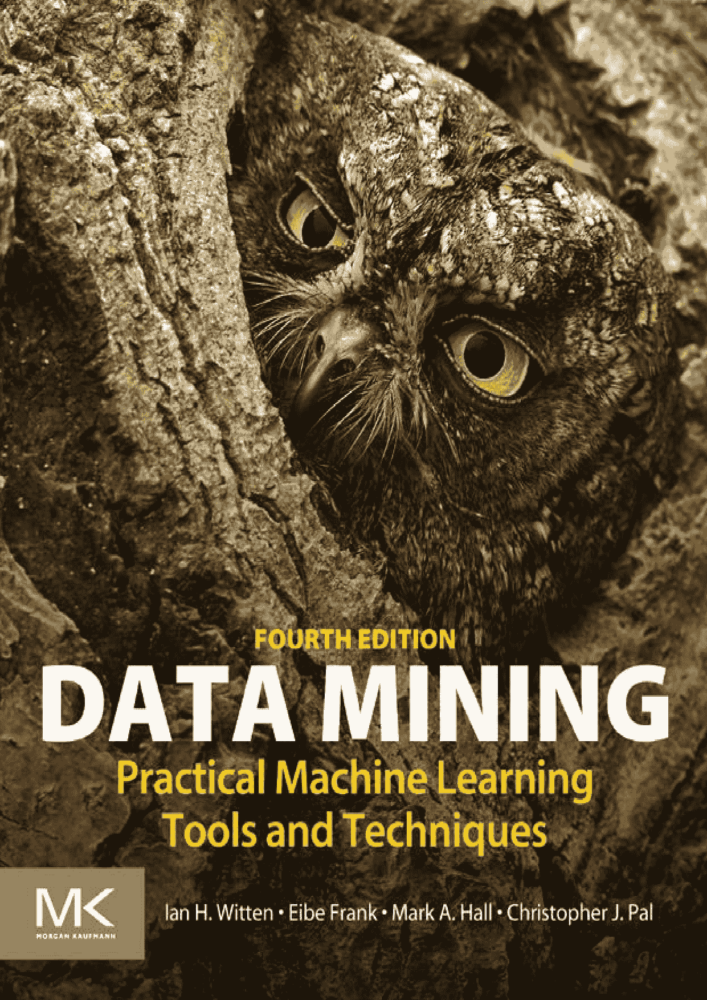

Ian H. Witten

*新西兰哈密尔顿，怀卡托大学*

Eibe Frank

*新西兰哈密尔顿，怀卡托大学*

Mark A. Hall

*新西兰哈密尔顿，怀卡托大学*

Christopher J. Pal

*加拿大魁北克省，蒙特利尔，蒙特利尔理工大学*


2

- 2.5 进一步阅读与参考文献注释
- 6.4 Weka 实现
- 9.7 条件概率模型
- 11.2 多实例学习

索引

- 图2.1 实例空间。

## 前言

计算与通信的融合产生了一个以信息为养分的社会。然而，大多数信息仍以原始形式存在：即数据。如果说*数据*被描述为记录的事实，那么*信息*就是支撑数据底层的模式或预期。数据库中锁着海量的信息——这些信息可能重要，但尚未被发现或表述。我们的使命就是将它们呈现出来。

数据挖掘是从数据中提取隐含的、此前未知的且潜在有用的信息。其核心思想是构建计算机程序，自动筛选数据库以寻找规律或模式。如果发现了强模式，它们很可能会推广，从而对未来数据做出准确预测。当然，问题也会存在。许多模式将是平庸且乏味的；另一些将是虚假的，取决于所用特定数据集中的偶然巧合。而且真实数据是不完美的：部分内容会乱码，部分会缺失。发现的任何东西都是不精确的：每个规则都有例外，且存在任何规则无法涵盖的情况。算法需要足够健壮，以应对不完美的数据，并提取出不精确但有效的规律。

机器学习为数据挖掘提供了技术基础。它用于从数据库的原始数据中提取信息——即理想情况下，以易于理解的形式表达并可用于各种目的。这个过程是一个抽象的过程：获取数据及其所有缺陷，并推断其底层的任何结构。本书介绍了机器学习的工具和技术，这些技术被用于实际数据挖掘中，以发现并在可能的情况下描述数据中的结构性模式。

正如任何备受商业高度关注的新兴技术一样，机器学习的使用在技术（有时是大众）媒体中充斥着大量的炒作。夸张的报告称，通过将学习算法释放到海量数据中，可以揭示各种秘密。但机器学习中并没有魔法，没有隐藏的力量，也没有炼金术。相反，有一套可识别的简单且实用的技术，它们通常可以从原始数据中提取有用信息。本书描述了这些技术并展示了它们的工作原理。

在许多应用中，机器学习使得从示例中获取结构描述成为可能。这类描述可以用于预测、解释和理解。一些数据挖掘应用侧重于预测：根据描述过去发生过的数据，预测新情况下会发生什么，通常通过猜测新示例的分类。但我们同样——也许更——感兴趣的是应用，其“学习”的结果是对结构的实际描述，并可用于分类示例。这种结构性描述不仅支持解释和理解，还支持预测。根据我们的经验，在大多数实际数据挖掘中，用户获得的洞察是最具价值的；事实上，这是机器学习优于经典统计建模的主要优势之一。

本书解释了多种机器学习方法。其中一些出于教学目的：旨在清晰解释基本思想如何运作的简单方案。另一些是实用的：当今应用中的真实系统。许多是现代的，且在过去几年内开发的。

为了说明书中的观点，我们创建了一个全面的软件资源。它被称为怀卡托知识分析环境（简称 WEKA¹），以 Java 源代码的形式在 `www.cs.waikato.ac.nz/ml/weka` 提供。它是书中涵盖的大多数技术的一种完整、工业级实现。它包含了说明性代码和机器学习方法的运行实现。它提供了最简单技术的简洁、精简的实现，旨在帮助对涉及机制的理解。它还提供了一个工作站，包含了许多流行学习方案的完整、运行且最先进的实现，可用于实际数据挖掘或研究。最后，它包含一个 Java 类库形式的框架，支持使用嵌入机器学习的应用，甚至支持新学习方案的实现。

本书的目标是介绍用于数据挖掘的机器学习工具和技术。在阅读本书后，你将理解这些技术是什么，并体会它们的优势和适用性。如果你想对自己的数据进行实验，可以轻松地通过 WEKA 软件来实现。但 WEKA 绝不是唯一的选择。例如，免费提供的统计计算环境 R 包含了许多机器学习算法。Python 语言的追随者可以关注名为 *scikit-learn* 的流行库。用于分布式计算的现代“大数据”框架（如 Apache Spark）也包含了对机器学习的支持。在实践中部署机器学习有海量的选择。本书讨论了基础学习算法，而不涉及特定软件的实现细节。在适当的情况下，我们会指出所讨论的算法可以在 WEKA 软件中找到。我们还简要介绍了其他用于高维数据所谓“深度学习”的机器学习软件。然而，大多数针对软件的信息被放在了附录中。

本书跨越了技术认知与实际应用之间的鸿沟。要有效地应用学习技术，你需要了解它们是如何运作的。本书的分层组织使其既适合对掌握基础感兴趣的读者，也适合希望获得更深入处理及完整技术细节的读者。我们认为，机器学习的消费者需要了解他们所使用的算法是如何工作的。经常观察到，数据模型的好坏取决于解释它们的人，而这个人需要对模型是如何产生的有所了解，以体会技术的优势和局限性。然而，并不是所有用户都需要深入理解算法的细微细节。我们通过在不同详尽程度上描述机器学习方法来解决这个问题。本书分为两个部分。第一部分是数据挖掘机器学习导论。读者将通过阅读前三章学习基本思想（即最高层级）。第一章“这到底关于什么？”通过示例描述了机器学习是什么，以及它可以在哪里使用。

它还提供了实际的实践应用。第2章“输入：概念、实例、属性”和第3章“输出：知识表示”涵盖了涉及的各种输入和输出——或*知识表示*。不同类型的输出决定了不同的算法风格，第4章“算法：基本方法”描述了机器学习的基本方法，并进行了简化以易于理解。在这里，涉及的原理在各种算法中传达，而不涉及复杂的细节或棘手的实现问题。要在机器学习技术在特定数据挖掘问题上的应用上取得进展，能够衡量自己的执行水平至关重要。第5章“可信度：评估所学内容”可以不分顺序阅读，使读者能够评估从机器学习获得的结果，并解决性能评估中涉及的有时复杂的问题。

第二部分介绍了用于数据挖掘的高级机器学习技术。在最底层、最详细的层面，第6章“树与规则”和第7章“扩展基于实例和线性模型”赤裸地揭示了实现一系列机器学习算法的细节问题，包括为了这些算法在实践中良好运行所需的复杂性（但省略了少数算法所需的深奥数学机制）。

尽管许多读者可能想忽略这些详细信息，但在这一层面，机器学习方案的完整工作实现是被写的。第8章“数据转换”描述了与机器学习输入输出工程化相关的实际主题——例如属性的选择和离散化。第9章“概率方法”和第10章“深度学习”分别对机器学习和深度学习的概率方法进行了严谨介绍。第11章“超越监督和无监督学习”关注了半监督学习和多实例学习，而第12章“集成学习”涵盖了结合不同学习技术输出的“集成学习”技术。第13章“前进：应用及展望”展望了未来。

本书描述了实际机器学习中使用的大多数方法。然而，它没有涵盖强化学习，因为它很少应用于实际数据挖掘中；也没有涵盖遗传算法方法，因为这些实际上只是优化技术，并不特指机器学习；同样没有关系学习（relational learning）和归纳逻辑编程，因为它们在主流数据挖掘应用中并不常用。

附录涵盖了理解第9章“概率方法”和第10章“深度学习”中材料所需的某些数学背景。另一个附录介绍了 WEKA 数据挖掘工作台，它提供了第一部分和第二部分所描述的大多数思想的实现。我们这样做是为了将概念材料与如何使用的实际方面清晰地分开。第一部分和第二部分每章的末尾都有指向相关 WEKA 算法的指针。你可以忽略它们，在阅读时查看，或者如果你急于开始分析数据且不想被算法如何工作的技术细节所困扰，也可以直接跳到 WEKA 相关材料。

## 更新与修订内容

我们在1999年完成了本书第一版的编写，第二版和第三版分别于2005年和2011年完成，现在，在2016年5月，我们正在润色第四版。过去的几十年里事情发生了巨大的变化！虽然材料的核心内容保持不变，但我们充分利用机会更新它并添加新材料，结果书籍的规模增加了一倍，以反映所发生的变化。当然，也有需要修复的错误，这些错误是我们公开的勘误文件中积累的（可以通过书籍主页 `http://www.cs.waikato.ac.nz/ml/weka/book.html` 获取）。

## 第二版

本书第二版的主要变化是在书末增加了一个独立的部分，其中包含了所有关于 WEKA 机器学习工作台的材料。这使得书的主部分可以独立于工作台而存在。当时，WEKA 作为第一版中广泛使用且受欢迎的功能，刚刚以交互式图形用户界面的形式——或者说是三个独立的交互式界面——获得了全新的面貌，这使其变得更容易使用。主要的界面是“探索器”（Explorer），它通过菜单选择和表单填写访问 WEKA 的所有功能。其他是知识流（Knowledge Flow）界面，它允许你为流式数据处理设计配置；以及实验器（Experimenter），通过你可以设置自动化实验，在数据集上用不同的参数设置运行选定的机器学习算法，收集性能统计数据并对结果进行显著性检验。这些界面降低了成为机器学习从业者的门槛，第二版包含了对如何使用它们的完整描述。

它还包含了许多我们在此简要提到的新材料。我们扩展了关于规则学习和代价敏感评估的章节。应大众需求，我们添加了关于神经网络的信息：感知器和与之密切相关的 Winnow 算法；多层感知器和反向传播算法。还包含了逻辑回归。我们描述了如何同时使用核感知器和径向基函数网络来实现非线性决策边界，并包含了用于回归的支持向量机。根据读者的要求以及 WEKA 在这方面的新功能，我们加入了一个关于贝叶斯网络的新章节，描述了如何基于这些网络学习分类器，以及如何使用 AD 树 高效地实现它们。

过去的5年（1999–2004年）人们对文本挖掘表现了极大兴趣，这反映在 WEKA 中引入的字符串属性、用于文档分类的多项贝叶斯以及文本转换中。我们还描述了用于搜索实例空间的高效数据结构：用于高效寻找最近邻和加速基于距离的聚类的 *k*D 树和球形树（ball trees）。我们描述了新的属性选择方案，如划分搜索和支持向量机的使用；组合模型的新方法，如加法回归、加法逻辑回归、逻辑模型树和选项树。我们还涵盖了使用未标记数据来改进分类的最新进展，包括共同训练（cotraining）和共同-EM 方法。

## 第三版

对于第三版，我们对第二版进行了彻底编辑并使其与时同步，包含了大量的新方法和算法。WEKA 和本书是紧密结合的——WEKA 中的几乎所有内容都在书中得到了涵盖。我们还增加了多得文献引用，参考文献的数量几乎是第一版的三倍。

除了变得远比易用之外，WEKA 在过去的十年中发生了脱乎覆地的变化，并在数据挖掘能力上极大成熟。它整合了无与伦比的机器学习算法及相关技术。这种增长部分受到该领域近期进展的刺激，部分是由用户引导和需求驱动的。这使我们处于一种地位：我们对数据挖掘的实际用户想要什么非常了解，并在决定书中包含哪些内容时利用了这些经验。

以下是第三版中添加材料的几个亮点。包含了一个关于网络挖掘的章节，并在伦理部分，讨论了个人如何经常从所谓的匿名数据中被“重新识别”。其他新增内容包括：多实例学习技术、关于交互式代价效益分析的新材料、代价复杂度剪枝、使用扩展前缀树在主内存中存储数据集压缩版本的高级关联规则算法、核岭回归、随机梯度下降和层次聚类方法。我们添加了新的数据转换：部分最小二乘回归、水库采样、单类学习、将多分类问题分解为嵌套二分类集成，以及校准类别概率。我们添加了关于集成学习技术的新信息：随机化 vs. 袋法（bagging），以及旋转森林。还增加了关于数据流学习和网络挖掘的新章节。

## 第四版

本书第四版的主要驱动力之一是希望对深度学习主题添加全面的材料，这一新进展本质上是由于图像和语音处理等领域真正海量数据资源的出现，以及包括服务器集群和图形处理器在内的真正海量计算资源的可用性而实现的。然而，深度学习技术很大程度上基于理论与实践的强大结合。而且我们还收到了其他请求，要求我们包含更多、更严谨的理论材料。这迫使我们重新思考理论在书中的作用。我们下定决心增加了两个新的以理论为向的章节。第10章“深度学习”涵盖了深度学习本身，及其

前文的第 9 章“概率方法”对概率方法给出了原则性的理论阐述，这对于理解许多其他新算法至关重要。我们意识到，许多读者可能不想消化所有的这些理论，因此我们向他们保证，书的其余部分特意留在了通浅得多的数学水平。但这些额外的理论基础为那些渴望理解来自研究领域快速发展技术的读者提供了一些关键材料。

WEKA 的发展非常迅速。它现在提供了多种触达并整合其他语言和系统的方法，例如流行的 R 统计计算语言、用于分布式计算的 Spark 和 Hadoop 框架、用于脚本的 Python 和 Groovy 语言，以及面向流学习的 MOA 系统——这仅是其中几个。我们意识到，在印刷书籍中记录这样一个全面且快速演变的系统是不可能的，也许也不是符合理想的，因此我们创建了一系列开放在线课程——*使用 Weka 进行数据挖掘*、*进阶的 Weka 数据挖掘*以及*使用 Weka 进行高级数据挖掘*，以配合本书（详见：`https://weka.waikato.ac.nz`）。

第四版包含了许多其他更新和补充，以及多得参考文献。但到此为止了：请亲身投入并眼验吧。

## 致谢

撰写致辞总是是最愉快的部分！许多人帮助过我们，我们非常珍惜这个感谢他们的机会。这本书源于新西兰怀卡托大学（University of Waikato）计算机科学系的机器学习研究项目。在项目的早期阶段，我们受到了学术教职人员的慷慨鼓励和帮助：John Cleary、Sally Jo Cunningham、Matt Humphrey、Lyn Hunt、Bob McQueen、Lloyd Smith 和 Tony Smith。我们从后来加入的员工成员的互动中受益良浅：Michael Mayo 和 Robert Durrant。特别感谢 Geoff Holmes，他领导了项目多年；以及 Bernhard Pfahringer，他对 WEKA 软件的许多许多不同方面都投入了巨大的精力。所有在这里工作过机器学习项目的人都为我们的思考做出了贡献：我们特别感谢早期的学生 Steve Garner、Stuart Inglis 和 Craig Nevill-Manning，感谢他们在成功尚不确定、情况更加困难的最初帮助我们让项目启动。

阐述书中理念的 WEKA 系统是其至关重要的组成部分。它由作者构，主要由 Eibe Frank、Mark Hall、Peter Reutemann 和 Len Trigg 设计并实现，但怀卡托大学机器学习实验室的许多人也做出了重大贡献。自本书第一版以来，WEKA 团队已大幅扩张：贡献者之多，我们无法妥善地感谢每一个人。我们感谢 Chris Beckham 为 WEKA 贡献了多个包；感谢 Remco Bouckaert 他的贝叶斯网络包及许多其他贡献；感谢 Lin Dong 对多实例学习方法的实现；Dale Fletcher 在许多与数据库相关的方面的贡献；Kurt Driessens 他的高斯过程回归实现；James Foulds 在多实例过滤方面的工作；Anna Huang 在信息瓶颈聚类方面的工作；Martin Gütlein 在特征选择方面的工作；Kathryn Hempstalk 她的单类分类器；Ashraf Kibriya 和 Richard Kirkby 出了不胜枚举的贡献；Nikhil Kishore 他的弹性网回归实现；Niels Landwehr 的逻辑模型树；Chi-Chung Lau 为 Knowledge Flow 接口创建了所有图标；Abdelaziz Mahoui 实现了 K*；Jonathan Miles 他的内核过滤实现；Stefan Mutter 的关联规则挖掘；Malcolm Ware 的众多杂项贡献；Haijian Shi 他的树学习器实现；Marc Sumner 在加速逻辑模型树方面的工作；Tony Voyle 的最小中位数平方回归；Yong Wang 的 Pace 回归和 M5' 的原始实现；Benjamin Weber 对 WEKA 解析模块的伟大统一；以及 Xin Xu 他的多实例学习包 *JRip*、逻辑回归及许多其他贡献。我们诚挚地感谢所有这些人的辛勤工作，也感谢来自我们怀卡托小组之外的许多向 WEKA 做出贡献的贡献士。

由于我们身处南半球一个偏远（但非常漂亮）的角落，我们非常感谢访问我们系的客人，他们在担任我们的“鸣筒”和帮助我们完善思维方面发挥了至关重要的作用。我们特别想提到 Rob Holte、Carl Gutwin 和 Russell Beale，他们每个人都来过我们几个月；David Aha，尽管他只来了几天，但是在项目早期且脆弱的阶段来的，他的热情和鼓励提供了极大的帮助；还有 Kai Ming Ting，他与我们一起就书中的许多课题工作了 2 年，并帮助我们进入了机器学习的主流。最近的访问者包括 Arie Ben-David、Carla Brodley、Gregory Butler、Stefan Kramer、Johannes Schneider、Jan van Rijn 和 Michalis Vlachos，以及许多其他在我们部门做过演讲的人。我们特别感谢 Albert Bifet，他对第三版的草案提供了详细的反馈——我们已采纳了大部分内容。怀卡托大学的学生在项目开发发挥了重要作用。他们中的许多人在上述 WEKA 贡献者列表中，但也通过其他方式做出了贡献。在早期，Jamie Littin 致力于下推规则和关系学习。Brent ...（注：原文此处有大量 OCR 重复内容，已清理）。

机器学习课程，我们对这些学生进行了实验。第二版的部分内容是在阿尔伯塔省南部的莱布治大学访问期间完成的，此次访问得到了加拿大信息科学卓越研究小组（Canada’s Informatics Circle of Research Excellence）的支持。

最后，也是最重要，我们要感谢我们的家人和伴侣。Pam、Anna 和 Nikki 都深知家里有个作者的后果（“又来了！”），但还是让 Ian 继续写这本书。Julie 一直非常支持，即使当 Eibe 必须在机器学习实验室挑夜战时，Immo 和 Ollig 也提供了精彩的消遣。

Bernadette 也非常支持，她不知何何地将 Charlotte、Luke、Zach、Kyle 和 Francesca 的组合噪音输出控制在让 Mark 能够精力集中的水平。我们分别来自加拿大、英国、德国、爱尔兰、新西兰和萨摩亚：新西兰将我们聚集在一起，并为这项工作提供了一个理想、甚至是诗意的场所。


仅存在于新西兰岛屿的，`weka`（读音与“麦加”押韵）是一种具有好奇心的不会飞行鸟。

## 关于什么

### 摘要

本书介绍了用于数据挖掘的机器学习技术。我们首先解释人们所说的数据挖掘和机器学习，给出一些简单的机器学习问题（包括分类和预测任务），以说明涉及的输入和输出。为了证明机器学习在实际应用中的广泛适用性，我们继续对多个领域进行简要回顾。

机器学习与统计学研究密切相关，接下来我们将讨论这两个领域之间的联系。它与人工智能领域，特别是搜索技术也密切相关，我们专门有一个章节来研究这种关系。我们最后通过讨论在实践中应用数据挖掘时涉及的伦理问题作为结束。

### 关键词

机器学习；数据挖掘；分类；预测；数据挖掘应用；机器学习与统计；泛化作为搜索

### 章大纲

1.1 数据挖掘与机器学习 4

- 描述模式 6
- 机器学习 7
- 数据挖掘 9

1.2 简单示例：天气问题和其他 9

- 天气问题 10
- 接触镜：理想化问题 12
- 鸢尾：经典数据集 14
- CPU 性能：引入预测 16
- 劳动谈判：更真实的示例 16
- 大豆分类：经典机器学习成功 19

1.3 领域应用 21

- 网络挖掘 21
- 涉及判断的决策 22
- 筛选 23
- 预测 24
- 营销与销售 26
- 其他应用 27

1.4 数据挖掘过程 28

1.5 机器学习与统计 30

1.6 泛化作为搜索 31

- 枚举概念空间 32
- 偏置 33

1.7 数据挖掘与伦理 35

- 识别 36
- 使用个人信息 37
- 更广泛的问题 38

1.8 延伸阅读和参考文献 38

体外受精涉及从女性卵巢中收集几个卵子，在配体或提供的精子受精后，产生几个胚胎。其中一些被选择并转移到女性子宫。问题是选择“最好”的胚胎——最有可能存活的那些。选择基于大约 60 个记录特征——形态、卵细胞、精子样本。特征的数量巨大，胚胎学家难以同时评估它们并与关键结果相关起来。在英国的一个项目中，机器学习被研究为利用胚胎的历史记录作为训练数据进行选择的技术。

每年，新西兰的奶牛场主都必须做出艰难的商业决策：保留哪些牛，哪些卖到宰宰场。通常，在挤奶季节结束时，奶牛中五分之一的牛会被淘汰。每只牛的繁殖和产奶历史影响这一决策。其他因素包括年龄（牛接近其生产年限结束）、健康问题、难产史、不良的性情（踢人或跳围栏）以及在下一个季节没有怀孕。多年来，每只牛都记录了大约 700 个属性。机器学习被研究为一种确定农场主考虑因素的方法——不是为了自动化决策，而是为了将他们的技能和经验传给他人。

生死。从欧洲到对极。家庭与商业。机器学习是一种从数据中挖掘知识的新兴新兴技术，许多人开始认真对待这项技术。

## 1.1 数据挖掘与机器学习

我们被数据淹没了。世界上、我们生活中的数据量似乎在不断增加——而且看不到头。无处不在的计算机让保存我们以前会丢弃的东西变得太容易。廉价的磁盘和在线存储让推迟如何处理这些东西的决定变得太容易——我们只需增加内存并保留一切。无处不在的电子设备记录了我们的决策、我们在超市的选择、我们的财务习惯、我们的出入。我们滑动着世界，每一次滑动都是数据库中的一条记录。万维网用信息淹没了我们；同时，我们做的每一个选择都被记录了。而且这些只是个人选择：它们在商业和工业领域有无数对应物。我们都能见证`数据的产生`与`我们从中获得的收益`之间日益扩大的差距。大公司利用了这一机会，但解锁这种潜能所需的工具——我们在书中描述的工具——是所有人可用的。隐藏在所有这些数据中是信息，潜在的有用信息，我们很少将其明确化或利用。

本书是关于在数据中寻找模式的。这并没有什么新意。自从人类活动开始，人们一直在从数据中寻找模式。猎人寻找动物迁移行为的模式，农民寻找作物生长的模式，政治家寻找选民意见的模式，爱人寻找伴侣回应的模式。科学家的工作（就像婴儿一样）是理解数据，发现支配物理世界运作方式的模式，并将它们封装在理论中，这些理论可以用于预测新情况下会发生什么。创业者的工作是识别机会，即可以转化为盈利性业务的行为模式，并利用它们。

在`数据挖掘`中，数据以电子形式存储，搜索是由计算机自动化的（或至少是增强的）。即使这也不特别新。经济学家、统计学家、预测师和通信工程师长期以来一直认为数据中的模式可以被自动寻找、识别、验证并用于预测。新奇的是在数据中寻找模式的机会呈现出惊人的增长。近年来数据库（如关于客户选择等日常活动的数据库）的性增长将数据挖掘推向新业务技术的前沿。据估计，世界数据库中存储的数据量每 20 个月翻一倍，尽管在任何定量上很难证明这一数字，但我们都能在感性上感受到这种增长速度。

分析后的数据是一项价值巨大的资源。它能够带来新的见解、更好的决策，并且在商业环境中产生竞争优势。

数据挖掘旨在通过分析数据库中已存在的数据来解决问题。以一个经典的例子来说，假设是在竞争激烈的市场中客户忠诚度难以判定的问题。一个包含客户选择和客户档案的数据库是解决这个问题的关键。通过分析以前客户的行为模式，可以识别出那些可能更换产品的人和那些可能保持忠诚的人的显著特征。一旦发现了这些特征，就可以利用它们来识别当前可能流失的现有客户。可以针对这一群体进行特殊处理，而这种处理对于整个客户群来说成本又太高了。更积极地说，可以使用相同的技术来识别那些可能对企业提供的其他服务（他们目前尚未体验的服务）感兴趣的客户，针对他们提供特别优惠以推广该服务。在当今竞争高度激烈、以客户为中心、以服务为导向的经济中，数据是推动业务增长的原材料。

数据挖掘被定义为在数据中发现模式的过程。该过程必须是自动的或（通常情况下是）半自动的。发现的模式必须是有意义的，即能够带来某种优势——例如，经济优势。数据总是以大量的形式存在。

那么这些模式是如何表达的呢？有用的模式允许我们对新数据做出非凡的预测。模式的表达有两种极端：一种是其内部实际上无法理解的“黑箱”，另一种是其构造方式揭示了模式结构的“透明箱”。我们假设这两种者都能做出良好的预测。区别在于，所挖掘的模式是否以一种可以检查、推理并用于指导未来决策的结构形式表示。我们将此类模式称为`结构性`模式（structural），因为它们以显式的方式捕捉了决策结构。换句话说，它们有助于解释有关数据的某些信息。

本书的大部分内容是关于在数据中寻找和描述结构性模式的技术，但在某些应用中，黑箱方法更为合适，因为它们具有更高的预测准确性，我们也涵盖了这些情况。我们涵盖的许多技术都是在一个被称为`机器学习`的领域内发展起来。

### 描述结构性模式

`结构性模式`是指什么？你如何描述它们？输入又是什么形式的？我们将通过说明而不是尝试给出正式且最终是空洞的定义来回答这些问题。本章后面会有很多例子，但让我们现在来看一个，以便对我们正在讨论的内容有一个感觉。

看看表1中的隐形眼镜数据。这提供了配镜师可能希望开具软性隐形眼镜、硬性隐形眼镜或完全不需要的情况；我们稍后会详细说明每个特征的含义。表中的每一行都是一个示例。这些信息的结构性描述可能如下：

### 表 1

| 年龄 | 散光 | 生产率 | 建议 |
| :--- | :--- | :--- | :--- |
| 年轻 | 无 | 减少 | 软性 |
| 年轻 | 无 | 高 | 无 |
| 年轻 | 有 | 减少 | 无 |
| 年轻 | 有 | 高 | 软性 |
| 老年 | 无 | 减少 | 无 |
| 老年 | 无 | 高 | 软性 |
| 老年 | 有 | 减少 | 软性 |
| 老年 | 有 | 高 | 无 |

结构性描述并不非要以规则的形式出现，例如决策树（指定了需要执行的决策序列以及最终建议）就是另一种表达方式。这个例子非常简单。首先，表格代表了所有可能值的组合。共有8行，代表了年龄、散光和生产率的3种可能值（2×2×2）。规则并没有从数据中泛化；它们只是对数据进行了总结。在大多数学习情况下，作为输入的示例集远不完整，工作的一部分就是泛化到其他新示例中。你可以想象省略表格中的某些行，这些行可以通过泛化来正确填充。其次，示例中的所有特征都指定了值。现实中的数据集通常包含某些示例，由于某些原因某些特征的值是未知的——例如，未测量或丢失丢失。第三，上述规则正确地分类了示例。

## 机器学习

现在我们对输入和输出有了一些了解，让我们转向机器学习。到底什么是学习？`机器学习`又是什么？这些都是哲学问题，我们将在书中不会过多关注哲学；我们的重点坚定地放在实践上。然而，在卷起袖子研究机器学习之前，花几分钟考虑一下基本问题是值得的，只需看看它们有多棘手。我们的字典将“学习”定义为：

- 通过学习、经验或教学获得知识；
- 通过信息或观察变得觉察；
- 记入记忆；
- 获知、确定；
- 接受指导。

这些含义在谈论计算机时存在一些缺。。对于前两个，几乎不可能测试是否已经实现了学习。你如何知道机器是否已经“获得了”某事的知识？你可能无法问它问题；即使可以，你测试的也不是它的学习能力，而是它回答问题的能力。你如何知道它是否已经“觉察”了某事？计算机是否具有意识或知觉是一个迫切的哲学问题。至于后三个含义，虽然我们可以看到它们在人类术语中代表了什么，但仅仅是“记入记忆”和“接受指导”似乎远未达到我们所说的机器学习的意思。它们太被动了，而且我们知道计算机认为这些任务是微不足道的。相反，我们感兴趣的是在新情况下性能的提高，或至少是性能的潜力。你可以通过机械记忆来“记住某事”或“获知某事”，但却无法将新知识应用到新情况中。你可以接受指导但从中从中任何益处。

之前我们从操作角度定义了数据挖掘，即在大量数据中自动或半自动地发现模式的过程——并且这些模式必须是有用的。学习也可以以同样的方式制定一个操作定义。当事物改变其行为，使其在未来表现得更好时，这种学习该如何？这把学习与`性能`而非`知识`联系起来。你可以通过观察行为并与过去的行为进行比较来测试学习。这是一种客观得多的定义，并且似乎满意得多。

但仍然存在一个问题。学习是一个相当难以捉摸的概念。许多事物改变其行为的方式使其在未来表现得更好，但我们并不想说它们实际上*学习*了。一个很好的例子是舒适的软拖鞋。它*学习*了你脚的形状吗？它确实改变了它的行为，使其作为拖鞋时表现得更好！但我们很难想把这称为*学习*。在日常语言中，我们经常使用“训练”一词来表示一种无意识的学习。我们训练动物甚至植物，尽管谈论像拖鞋这样在任何意义上都不是活的物体时，使用“训练”一词可能稍显牵强。但学习是不同的。学习意味着思考。学习意味着目的。会学习的东西必须是有意图地去做的。这就是为什么我们不会说葡萄园里的藤蔓学会了绕着架子生长——我们会说它被*训练*了。没有目的的学习仅仅是训练。或者更直接点说，在学习中，目的是学习者的；而在训练中，目的是老师的。因此，仔细检查后发现，操作性的、以性能为导向的学习第二种定义在谈论计算机时也有它自己的问题。要判断某物是否真的学习了，你需要看它是否有意图，是否有任何目的参与。这使得该概念应用于机器时变得毫无意义，因为人工制品是否能有目的地地行为尚不清楚。关于*真正*含义的哲学讨论……

“学习”，正如对“意图”或“目的”的*真正*含义的讨论一样，充满了困难。即使是法庭也发现意图是难以且难以把握的。

## 数据挖掘

幸运的是，本书中解释的这类学习技术并没有带来这些概念性问题——它们被称为“机器学习”，但并没有真正对学习的本质是什么预设任何特定的哲学立场。数据挖掘是一项实用的课题，涉及的是实际意义上的学习，而非理论意义上的。我们感兴趣的是寻找数据中模式的技巧，这些模式可以提供洞察力，或能够实现快速、准确的决策。数据将以一组示例的形式出现——例如，改变了忠诚度的客户示例，或者可以开具某种类型隐形眼镜的情况。输出则以对新示例进行预测的形式呈现——预测特定客户是否会转换，或者预测在给定情况下将开具何种类型的镜片。

许多学习技术都在寻找所学习内容的结构化描述，这些描述可能会变得非常复杂，通常以规则集的形式表示，例如之前描述的规则或本章稍后描述的决策树。因为这些描述可以被人类理解，所以它们的作用是解释学习了什么，换句话说，就是解释新预测的依据。经验表明，在机器学习应用于数据挖掘许多场景中，获得的显式知识结构（即结构化描述）至少与在新示例上表现良好的能力一样。人们经常使用数据挖掘来获取知识，而不仅仅是预测。如果你能做到，从数据中获取知识听起来确实是个好主意。要发现如何做到，请继续阅读

## 1.2 简单示例：天气问题和其他

我们在书中将大量的示例，考虑到本书完全是关于从示例学习的，这似乎特别合适！有几个标准数据集是我们反复提到的。不同的数据集往往倾向于暴露新的问题和挑战，在考虑学习方法时，脑中有各种问题是非常有趣且具有启发性的。事实上，处理不同数据集的需求是如此重要，以至于已经收集了一个包含 100 多个示例问题的语料库，以便在同一组问题上对不同的算法进行测试和比较。

本节中的插图都是不切实际的简单。机器学习的应用涉及成千上万、数十万甚至数百万个案例。但在解释算法的作用以及它们如何工作时，我们需要简单的示例，让我们能够捕捉问题的本质，同时又小到在每个细节上都易于理解。我们将在整本书中使用本节的插图，它们的意图是“学术性”的，即帮助我们理解发生了什么。学习技术的一些实际实地应用将在 1.3 节中讨论，更多内容将在章节末尾*进阶阅读*部分提到的书籍中涵盖。

实际现实数据集的另一个问题是它们通常是私有的。没有人会与你分享他们的客户和产品选择数据库，以便你理解他们数据挖掘应用的细节及其工作原理。企业数据是一项宝贵的资产，随着书中描述的这类机器学习技术的发展，其价值已经极地增长。然而，我们在这里关注的是理解这些方法是如何工作的，理解它们的细节，以便我们追踪它们在实际数据上的运行。这就是为什么我们的插图是简单的。但它们并不是*浅薄化*的：它们展示了真实数据集的特征。

## 天气问题

天气问题是一个微型数据集，我们将反复使用它来说明机器学习方法。它完全是虚构的，据涉及适合玩某些指定游戏的条件。通常，数据集中的示例由特征（或*属性*）的值来表征，这些值衡量了示例的不同方面。在这种情况下，有四个属性：*天气*（outlook）、*温度*（temperature）、*湿度*（humidity）和*风力*（windy）。结果是是否玩。

在表 1.2 所示的最简单形式中，所有四个属性的值都是符号化类别而非数字。天气可以是*晴天*、*阴*或*下雨*；温度可以是*热*、*温和*或*冷*；湿度可以是*高*或*正常*；风力可以是*有*或*无*。这创建了 36 种可能的组合（3×3×2×2=36），其中 14 种存在于输入示例集中。

### 表 1.2：天气数据

| 天气 | 温度 | 湿度 | 风力 | 玩？ |
| :--- | :--- | :--- | :--- | :--- |
| 晴天 | 热 | 高 | 无 | 否 |
| 晴天 | 热 | 正常 | 无 | 是 |
| 晴天 | 热 | 正常 | 有 | 否 |
| 晴天 | 温和 | 高 | 无 | 否 |
| 晴天 | 温和 | 正常 | 无 | 是 |
| 晴天 | 温和 | 正常 | 有 | 否 |
| 晴天 | 冷 | 高 | 无 | 否 |
| 晴天 | 冷 | 正常 | 无 | 是 |
| 晴天 | 冷 | 正常 | 有 | 否 |
| 阴 | 热 | 高 | 无 | 是 |
| 阴 | 热 | 正常 | 无 | 是 |
| 阴 | 热 | 正常 | 有 | 是 |
| 阴 | 温和 | 高 | 无 | 是 |
| 阴 | 温和 | 正常 | 无 | 是 |
| 阴 | 温和 | 正常 | 有 | 是 |
| 阴 | 冷 | 高 | 无 | 是 |
| 阴 | 冷 | 正常 | 无 | 是 |
| 阴 | 冷 | 正常 | 有 | 是 |
| 雨 | 热 | 高 | 无 | 否 |
| 雨 | 热 | 正常 | 无 | 否 |
| 雨 | 热 | 正常 | 有 | 否 |
| 雨 | 温和 | 高 | 无 | 否 |
| 雨 | 温和 | 正常 | 无 | 否 |
| 雨 | 温和 | 正常 | 有 | 否 |
| 雨 | 冷 | 高 | 无 | 否 |
| 雨 | 冷 | 正常 | 无 | 否 |
| 雨 | 冷 | 正常 | 有 | 否 |

从这些信息中学习的一组规则——不一定是非常好的规则——可能像这样：

- 如果`天气=晴天且 湿度=高`则`玩=否`
- 如果`天气=下雨 且 风力=有`则`玩=否`
- 如果`天气=阴`则`玩=是`
- 如果`湿度=正常`则`玩=是`
- 如果以上条件都不满足则`玩=是`

这些规则的含义是按顺序解释的：第一条；然后如果不适用，再看第二条；以此此类推。意在按顺序解释的规则集被称为`决策列表`（decision list）。作为决策列表解释时，这些规则正确地分类了表格中的所有示例，而如果脱离语境单独看，某些规则是不正确的。例如，规则`如果 湿度=正常则玩=是`这条规则弄错了其中一个示例（检查是哪一个）。一组规则的意义取决于如何解释它们。

正如 1.3 所示的稍微复杂的形式，规则必须包含不等式，而不是等式。这意味着在某些情况下涉及到数值，这被称为`数值问题`。

### 表 1.3：天气数据（带数值属性）

| 天气 | 温度 | 湿度 | 风力 | 玩？ |
| :--- | :--- | :--- | :--- | :--- |
| 晴天 | 热 | 高 | 无 | 否 |
| 晴天 | 热 | 正常 | 无 | 是 |
| 晴天 | 热 | 正常 | 有 | 否 |
| 晴天 | 温和 | 高 | 无 | 否 |
| 晴天 | 温和 | 正常 | 无 | 是 |
| 晴天 | 温和 | 正常 | 有 | 否 |
| 晴天 | 冷 | 高 | 无 | 否 |
| 晴天 | 冷 | 正常 | 无 | 是 |
| 晴天 | 冷 | 正常 | 有 | 否 |
| 阴 | 热 | 高 | 无 | 是 |
| 阴 | 热 | 正常 | 无 | 是 |
| 阴 | 热 | 正常 | 有 | 是 |
| 阴 | 温和 | 高 | 无 | 是 |
| 阴 | 温和 | 正常 | 无 | 是 |
| 阴 | 温和 | 正常 | 有 | 是 |
| 阴 | 冷 | 高 | 无 | 是 |
| 阴 | 冷 | 正常 | 无 | 是 |
| 阴 | 冷 | 正常 | 有 | 是 |
| 雨 | 热 | 高 | 无 | 否 |
| 雨 | 热 | 正常 | 无 | 否 |
| 雨 | 热 | 正常 | 有 | 否 |
| 雨 | 温和 | 高 | 无 | 否 |
| 雨 | 温和 | 正常 | 无 | 否 |
| 雨 | 温和 | 正常 | 有 | 否 |


# 1.1 简单示例：天气问题和其他

我们在书中将使用大量的示例，考虑到本书完全是关于从示例学习的，这似乎特别合适！有几个标准数据集是我们反复提到的。不同的数据集往往倾向于暴露新的问题和挑战，在考虑学习方法时，脑中有各种问题是非常有趣且具有启发性的。事实上，处理不同数据集的需求是如此重要，以至于已经收集了一个包含 100 多个示例问题的语料库，以便在同一组问题上对不同的算法进行测试和比较。

本节中的插图都是不切实际的简单。机器学习的应用涉及成千上万、数十万甚至数百万个案例。但在解释算法的作用以及它们如何工作时，我们需要简单的示例，让我们能够捕捉问题的本质，同时又小到在每个细节上都易于理解。我们将在整本书中使用本节的插图，它们的意图是“学术性”的，即帮助我们理解发生了什么。学习技术的一些实际实地应用将在 1.3 节中讨论，更多内容将在章节末尾进阶部分提到的书籍中涵盖。

实际现实数据集的另一个问题是它们通常是私有的。没有人会与你分享他们的客户和产品选择数据库，以便你理解他们数据挖掘应用的细节及其工作原理。企业数据是一项宝贵的资产，随着书中描述的这类机器学习技术的发展，其价值已经极地增长。然而，我们在这里关注的是理解这些方法是如何工作的，理解它们的细节，以便我们追踪它们在实际数据上的运行。这就是为什么我们的插图是简单的。但它们并不是*浅薄化*的：它们展示了真实数据集的特征。

## 天气问题

天气问题是一个微型数据集，我们将反复使用它来说明机器学习方法。它完全是虚构的，据涉及适合玩某些指定游戏的条件。通常，数据集中的示例由特征（或*属性*）的值来表征，这些值衡量了示例的不同方面。在这种情况下，有四个属性：*天气*、*温度*、*湿度*和*风力*。结果是是否玩。

在表 1.2 所示的最简单形式中，所有四个属性的值都是符号化类别而非数字。天气可以是*晴天*、*阴*或*下雨*；温度可以是*热*、*温和*或*冷*；湿度可以是*高*或*正常*；风力可以是*有*或*无*。这创建了 36 种可能的组合（3×3×2×2=36），其中 14 种存在于输入示例集中。

**表 1.2：天气数据**

| 天气 | 温度 | 湿度 | 风力 | 玩？ |
| :--- | :--- | :--- | :--- | :--- |
| 晴天 | 热 | 高 | 无 | 否 |
| 晴天 | 热 | 正常 | 无 | 是 |
| 晴天 | 热 | 正常 | 有 | 否 |
| 晴天 | 温和 | 高 | 无 | 否 |
| 晴天 | 温和 | 正常 | 无 | 是 |
| 晴天 | 温和 | 正常 | 有 | 否 |
| 晴天 | 冷 | 高 | 无 | 否 |
| 晴天 | 冷 | 正常 | 无 | 是 |
| 晴天 | 冷 | 正常 | 有 | 否 |
| 阴 | 热 | 高 | 无 | 是 |
| 阴 | 热 | 正常 | 无 | 是 |
| 阴 | 热 | 正常 | 有 | 是 |
| 阴 | 温和 | 高 | 无 | 是 |
| 阴 | 温和 | 正常 | 无 | 是 |
| 阴 | 温和 | 正常 | 有 | 是 |
| 阴 | 冷 | 高 | 无 | 是 |
| 阴 | 冷 | 正常 | 无 | 是 |
| 阴 | 冷 | 正常 | 有 | 是 |
| 雨 | 热 | 高 | 无 | 否 |
| 雨 | 热 | 正常 | 无 | 否 |
| 雨 | 热 | 正常 | 有 | 否 |
| 雨 | 温和 | 高 | 无 | 否 |
| 雨 | 温和 | 正常 | 无 | 否 |
| 雨 | 温和 | 正常 | 有 | 否 |
| 雨 | 冷 | 高 | 无 | 否 |
| 雨 | 冷 | 正常 | 无 | 否 |
| 雨 | 冷 | 正常 | 有 | 否 |

从这些信息中学习的一组规则——不一定是非常好的规则——可能像这样：

- 如果天气=晴天且 湿度=高则玩=否
- 如果天气=下雨 且 风力=有则玩=否
- 如果天气=阴则玩=是
- 如果 湿度=正常则玩=是
- 如果以上条件都不满足则玩=是

这些规则的含义是按顺序解释的：第一条；然后如果不适用，再看第二条；以此此类推。意在按顺序解释的规则集被称为*决策列表*。作为决策列表解释时，这些规则正确地分类了表格中的所有示例，而如果脱离语境单独看，某些规则是不正确的。例如，规则*如果 湿度=正常则玩=是* 这条规则弄错了其中一个示例（检查是哪一个）。一组规则的意义取决于如何解释它们。

正如 1.3 所示的稍微复杂的形式，规则必须包含不等式，而不是等式。这意味着在某些情况下涉及到数值，这被称为*数值问题*——因为并不是所有属性都是数值。这种形式被称为*混合属性问题*。

### 表 1.3：天气数据（带数值属性）

| 天气 | 温度 | 湿度 | 风力 | 玩？ |
| :--- | :--- | :--- | :--- | :--- |
| 晴天 | 热 | 高 | 无 | 否 |
| 晴天 | 热 | 正常 | 无 | 是 |
| 晴天 | 热 | 正常 | 有 | 否 |
| 晴天 | 温和 | 高 | 无 | 否 |
| 晴天 | 温和 | 正常 | 无 | 是 |
| 晴天 | 温和 | 正常 | 有 | 否 |
| 晴天 | 冷 | 高 | 无 | 否 |
| 晴天 | 冷 | 正常 | 无 | 是 |
| 晴天 | 冷 | 正常 | 有 | 否 |
| 阴 | 热 | 高 | 无 | 是 |
| 阴 | 热 | 正常 | 无 | 是 |
| 阴 | 热 | 正常 | 有 | 是 |
| 阴 | 温和 | 高 | 无 | 是 |
| 阴 | 温和 | 正常 | 无 | 是 |
| 阴 | 温和 | 正常 | 有 | 是 |
| 阴 | 冷 | 高 | 无 | 是 |
| 阴 | 冷 | 正常 | 无 | 是 |
| 阴 | 冷 | 正常 | 有 | 是 |
| 雨 | 热 | 高 | 无 | 否 |
| 雨 | 热 | 正常 | 无 | 否 |
| 雨 | 热 | 正常 | 有 | 否 |
| 雨 | 温和 | 高 | 无 | 否 |
| 雨 | 温和 | 正常 | 无 | 否 |
| 雨 | 温和 | 正常 | 有 | 否 |
| 雨 | 冷 | 高 | 无 | 否 |
| 雨 | 冷 | 正常 | 无 | 否 |
| 雨 | 冷 | 正常 | 有 | 否 |

现在之前提到的第一条规则的形式如下：

- 如果天气=晴天且 湿度>80则玩=否

这种稍微复杂的形式如 1.3 所示，涉及到数值，而不是等式。

## 隐形眼镜：更复杂的符号化问题

你可能在好奇是否存在更小且效果同样良好的规则集。如果是的话，使用更小的规则集是否会更好？如果是的话，为什么呢？这些正是我们在书中将讨论的问题。由于这些示例构成了问题空间的完整集合，因此这些规则无非是总结了所有给定信息，以一种不同且更简洁的方式将其表达出来。尽管这不涉及任何泛化，但这通常是一件非常有用的事情！人们经常使用机器学习技术来洞察其数据的结构，而不是为了对新案例进行预测。事实上，机器学习领域一个著名且成功的研究方向始于尝试将一个包含可能的象棋终局及其结果的海数据库压缩到合理大小的数据结构中。这项工程选择的数据结构不是规则集，而是一棵决策树。

图 1.2 展示了决策树形式的隐形眼镜数据结构化描述，对于许多目的而言，它是规则的更简洁、更易懂的表示方法，并且具有更易可视化的优势。（然而，这棵决策树与图 1.1 中给出的规则集相反——错误地分类了两个示例。）树首先要求对*泪水产生率*进行测试，前两个分支对应两种可能的结果。如果*泪水产生率**减少*（左分支），结果是*无*。如果它是*正常*（右分支），则进行第二次测试，这次是针对*散光*。最后，无论测试结果如何，都会到达树的一个叶节点，从而决定该案例的隐形眼镜建议。关于机器学习方案的输出什么是最自然且易理解的格式，我们将在第 3 章“输出：知识表示”中回到这个问题。

## 鸢花：经典的数值数据集

鸢花数据集可以追溯到卓越统计学家 R.A. Fisher 在 20 世纪 30 年代的开创性工作，它可能是机器学习领域最著名的数据集，包含了三种植物的各 50 个示例：*藻鸢花*（Iris setosa）、*变色鸢花*（Iris versicolor）和*原生鸢花*（Iris virginica）。它节录于表 1.4。共有四个属性：*花萼长度*、*花萼宽度*、*花瓣长度*和*花瓣宽度*（均以厘米测量）。与之前的数据不同，所有属性的值均为数值。

**表 1.4 鸢花数据**

| 属性 | 值 |
| :--- | :--- |
| 花萼长度 | 数值 |
| 花萼宽度 | 数值 |
| 花瓣长度 | 数值 |
| 花瓣宽度 | 数值 |

从该数据集中可能学习到以下规则：

- 如果 花瓣长度 < 2.45 则是 Iris-setosa
- 如果 花萼宽度 < 2.10 则是 Iris-versicolor
- 如果 花萼宽度 < 2.45 且 花瓣长度 < 4.55 则是 Iris-versicolor
- 如果 花萼宽度 < 2.95 且 花瓣宽度 < 1.35 则是 Iris-versicolor
- 如果 花瓣长度 ≥ 2.45 且 花瓣长度 < 4.45 则是 Iris-versicolor
- 如果 花萼长度 ≥ 5.85 且 花瓣长度 < 4.75 则是 Iris-versicolor
- 如果 花萼宽度 < 2.55 且 花瓣长度 < 4.95 且 花瓣宽度 < 1.55 则是 Iris-versicolor
- 如果 花瓣长度 ≥ 2.45 且 花瓣长度 < 4.95 且 花瓣宽度 < 1.55 则是 Iris-versicolor
- 如果 花萼长度 ≥ 6.55 且 花瓣长度 < 5.05 则是 Iris-versicolor
- 如果 花萼宽度 < 2.75 且 花瓣宽度 < 1.65 且 花萼长度 < 6.05 则是 Iris-versicolor
- 如果 花萼长度 ≥ 5.85 且 花萼长度 < 5.95 且 花瓣长度 < 4.85 则是 Iris-versicolor
- 如果 花瓣长度 ≥ 5.15 则是 Iris-virginica
- 如果 花瓣宽度 ≥ 1.85 则是 Iris-virginica
- 如果 花瓣宽度 ≥ 1.75 且 花萼宽度 < 3.05 则是 Iris-virginica
- 如果 花瓣长度 ≥ 4.95 且 花瓣宽度 < 1.55 则是 Iris-virginica

这些规则非常繁琐，我们将在第 3 章“输出：知识表示”中看到如何用更紧凑的规则表达相同的信息。

## CPU：引入数值预测

尽管鸢花数据集涉及数值属性，但结果——鸢花的类型——是一个类别，而不是数值。表 1.5 显示了一些结果和属性均为数值的数据。它涉及基于若干相关属性的计算机处理能力的相对性能：每行代表 209 种不同计算机配置之一。

**表 1.5 CPU 性能数据**

| 配置 | 性能 |
| :--- | :--- |
| 1 | ... |
| 2 ... 209 | ... |

处理连续预测的经典方法是将结果写成带有适当权重的属性值的线性和，例如：

（缩写变量名在表格的第二行给出）。这被称为*线性回归*方程，确定权重的过程称为*线性回归*，这是统计学中著名的程序，我们将在第 4 章“算法：基本方法”中进行回顾。基础回归方法无法发现非线性关系，但存在变体——我们将在书后的部分遇到它们。在第 3 章“输出：知识表示”中，这通常是一件非常有用的事情！

## 大豆：一个更真实的示例

**表 1.7：大豆数据**

以下是从这些数据中学到的两个示例规则：

如果叶片状态=正常且茎部状况=异常且茎部溃疡在土壤线以下且溃疡病变颜色=棕色

则诊断为枯病根

如果叶片畸形=不存在且茎部状况=异常且茎部溃疡在土壤线以下且溃疡病变颜色=棕色

则诊断为枯病根

这些规则很好地说明了先验知识（通常称为*领域知识*）在机器学习中的潜在作用，因为事实上，这两个描述之间的唯一区别在于*叶片状态是**正常*与*叶片畸形不存在*。现在，在这个领域，如果叶片状态正常，那么叶片畸形必然不存在，因此这些条件中的一个恰好是另一个的特例。所以，如果第一条规则成立，第二条规则必然成立。第二条规则唯一起作用的时候是当叶片畸形不存在但叶片状态*不是*正常时，即叶片出现了畸形以外的其他问题。这从粗读这些规则中显然是不直观的。

20 世纪 70 年代后期对该问题的研究发现，这些诊断规则可以通过机器学习算法从约 300 个训练示例中生成，其他其他疾病类别的规则。这些训练示例是从案例语库中精心挑选的，它们彼此非常不同——在示例空间中“相隔很远”。同时，对做出诊断的植物病理学家进行了采访，并将他的专业知识转化为了诊断规则。惊讶的是，计算机生成的规则在剩余的测试用例上优于专家推导的规则。它们给出正确疾病首名的概率为 97.5%，而专家推导的规则仅为 72%。此外，学习算法不仅发现了优于合作专家的规则，而且这位专家本人对此印象如此深刻，据说他甚至采纳了发现的规则来取代了自己的规则！

## 1.3 领域化应用

我们开头介绍的示例是推测性的研究项目，而不是生产系统。而且上面的大多数插图都是玩具问题：它们被刻意选择得很小，以便我们在书的后面用它们来演示算法。真正的干货在哪里？这里是一些已经投入实际使用的机器学习应用。

作为领域化应用，接下来的示例往往强调在性能场景中使用学习，在这些场景中，重点在于在新示例上表现良好的能力。这本书还描述了利用学习系统从数据中推断出的决策结构中获取知识。我们认为，这种技术用途与做出高性能预测同样重要。尽管如此，它在领域化应用中的表现往往相对较少，因为当使用学习技术来获取洞察时，其结果通常不是一个作为应用独立运行的系统。尽管如此，在下方的三个示例中，决策结构的可理解性是该应用成功采用的关键特征。

### Web 挖掘

在万维网上挖掘信息是一个巨大的应用领域。搜索引擎公司检查网页中的超链接，以为每个网页和网站计算出一个“声誉”值。字典将*声誉*定义为“通过成功或影响获得的高地位”。一种名为 PageRank 的指标由 Google 创始人引入，也被其他搜索引擎开发者以各种形式使用，它试图衡量网页的地位。链接你网站的页面越多，它的声誉就越高。如果链接入的页面本身具有高声誉，那么声誉就会更大。这个定义听起来是循环的，但它是可以工作的。搜索引擎使用 PageRank（以及其他方法）在显示你的搜索结果之前对网页进行排序。


搜索引擎处理网页排名问题的另一种方法是使用基于示例查询训练集的机器学习——这些训练集包含包含查询中术语的文档，以及人类对这些文档与该查询相关性的人工判断。然后，学习算法分析这些训练数据，并得出一种预测任何文档和查询的相关性判断的方法。

对于每份文档，都会计算一组取决于查询术语的特征值——例如它是否出现在`<title>`标签中、它是否出现在文档的 URL 中、它在文档本身出现的频率，以及它在指向该文档的超链接锚点文本中出现的频率。对于多术语查询，特征包括两个不同术语在文档中相邻出现的频率等。可能的特征有许多：用于学习排名的典型算法通常会使用成百上千种特征。

搜索引擎之会挖掘 Web 的内容。它们还挖掘你查询的内容——即你搜索的术语——以选择你可能感兴趣的广告。他们有强烈的动机要准确做到这一点，因为只有当用户点击他们的链接时，他们才能从广告商那里获得报酬。搜索引擎公司挖掘你的点击行为，因为了解你点击了哪些结果可以用于改进下次搜索。

在线书商挖掘购买数据库以提供诸如“购买了这本书的人也买了这些”之类的推荐；同样，他们有强烈的动机向你提供吸引人的、个性化的选择。电影网站根据你之前的选择和其他人的选择推荐电影：如果他们提供的推荐能让客户不断回到他们的网站，他们就赢了。

还有社交网络和其他个人数据。我们生活在一个自我揭的时代：人们在博客和推文中分享他们内心深处的想法，照片，音乐和电影喜好，对书籍、软件、小设备和酒店的看法，以及他们的社交生活。他们可能认为自己是在匿名或化名地这样做，但往往是错误的（见第 1.6 节）。通过挖掘 Web 来赚钱具有巨大的商业利益。

### 涉及判断的决策

当你申请贷款时，必须填写一份问卷，提供相关的财务和个人信息。这些信息被贷款公司作为决定是否借钱给你的判断依据。此类决策通常分两个阶段进行：首先，使用统计方法确定明确的“接受”和“拒绝”案例。剩余的边缘案例更为困难，需要人类判断。

例如，一家贷款公司使用统计决策程序根据问卷提供的信息计算一个数值参数。如果该参数超过预设阈值，则接受申请人；如果低于第二个阈值，则拒绝。这涵盖了 90% 的情况，剩下的 10% 被转交给贷款官员做出决定。

然而，在检查申请人是否真的偿还了贷款的历史数据时发现，在获准贷款的边缘申请人中，有一半实际上违约了。虽然简单拒绝边缘客户可能很有诱惑，但信贷行业专业人士指出，如果能可靠地确定他们的未来还款能力，那么这些客户恰恰应该是争取的对象；他们往往是信贷机构的活跃客户，因为他们的财务状况处于长期的波动状态。在厌恶坏账的公司会计师观点和不愿意拒绝业务源的销售高管观点之间，必须达成一个合适的折中。

引入机器学习。输入是 1000 个边缘案例的训练示例，这些案例已发放贷款，并注明了借款人最终是还清了还是违约。对于每个训练示例，从问卷中提取了约 20 个属性，如年龄、现任雇主年限、现居住地年限、银行来年限以及拥有的其他信用卡。

使用了机器学习程序生成了一小部分分类规则，这些规则对一个独立选择的测试集中在三分之二的边界案例做出了正确预测。这些规则不仅提高了贷款决策的成功率，公司还发现它们非常有吸引力，因为它们可以用来向申请人解释决策背后的原因。尽管该项目是一个探索性项目，开发工作量较小，但该贷款公司显然对结果非常满意，这些规则被立即投入了使用。

## 图像筛选

自卫星技术早期以来，环境科学家一直试图从卫星图像中检测油污，以便对生态灾难提供早期警报并震慑非法倾倒。雷达卫星提供了无论天气如何都能全天监控海域的机会。油污在图像中呈现黑暗区域，其大小和形状随天气和海况演变。然而，局部天气状况（如大风）也会导致类似的黑暗区域。检测油污是一项昂贵的人工过程，需要经过训练的人员对图像中的每个区域进行评估。

目前已开发出危险检测系统，用于筛选图像以供后续的人工处理。该系统旨在向全球范围内的各种用户（政府机构和公司），他们具有不同的目标、应用和地理区域，因此它需要针对个人情况进行高度定制。机器学习允许系统在用户提供的溢油和非溢油示例上进行训练，并允许用户控制未检测到的溢油和误报之间的权衡。与其他机器学习应用（生成一个分类器然后部署到现场）不同，这里被部署的是学习方案本身。

输入是来自雷达卫星的一组原始像素图像，输出是一组小得多的图像，并用彩色边界标记了可能的油污。首先，应用标准的图像处理操作来归一化图像。然后，识别出可疑的黑暗区域。从每个区域提取几十个属性，表征其大小、形状、面积、强度、锐度、边界的锯齿度、与其他区域的接近程度，以及区域周围背景的信息。最后，对生成的属性向量应用标准的学习技术。（另一种方法是不省略显式的特征提取步骤，而是使用第 10 章“深度学习”中讨论的深度学习方法。）

过程中遇到了一些有趣的问题。一个是训练数据的稀缺。幸运的是，油污非常罕见，人工分类的成本极高。另一个是问题的不平衡性：在训练数据中的许多黑暗区域中，只有极小一部分是真实的油污。第三点是示例自然地成批分组，从每张图像提取的区域形成一个批次，且背景特征在不同批次之间变化。最后，性能任务是作为一个过滤器，必须为用户提供一种方便的方法来改变误报率。

## 负荷预测

在电力供应行业，尽可能早地确定未来的电力需求至关重要。如果对每小时、每天、每月、每季和每年最大最小负荷进行准确估计，公用公司可以在设置运行备用、维护计划和燃料库存管理等领域节省大量成本。

一个自动负荷预测助手已在一个主要电力供应商处运行了十多年，提前 2 天生成小时预测。第一步是使用过去 15 年收集的数据手动创建一个复杂的负荷模型。该模型包含三个部分：年度基负荷、年度负荷周期性以及假日影响。

为了对基负荷进行归一化，对过去每年的数据进行标准化，从每小时的读取中减去该年的平均负荷，并除以全年的标准差。电负荷在三个基本频率上显示周期性：日（清晨使用最低，中午和下午达到峰值）、周（周末需求较低）以及季节（冬季和夏季因供暖制冷需求增加而产生年度循环）。

感恩节、圣诞节和元旦等主要假日显示出与正常负荷的显著差异，通过对过去 15 年该日的小时负荷取平均值分别建模。较小的官方假日（如哥伦布日）被归类为学校假期，并被处理为正常日模式的偏移。所有这些影响都通过将一年的负荷重构为典型日序列、将假日置于正确位置、并对负荷进行反归一化以考虑整体增长来实现。

到为止，该负荷模型是静态的，根据历史数据手动构建，并隐含地假设全年处于“正常”气候条件。最后一步是通过寻找与当前情况最相似的前一天天气，并使用那天的历史信息作为预测。预测被视为对静态负荷模型的加性修正。为了防止离群值的影响，定位最相似的八天并对它们的叠加修正取平均。

建立了一个数据库，包含 15 年历史记录中每小时三个当地气象中心的温度、湿度、风速和云量数据，以及实际负荷与静态模型预测负荷之间的差异。通过线性回归分析确定这些观测值对负荷的相对影响，并应用系数来加权用于定位最相似日的距离函数。

所得系统的性能与经过训练的人工预测师相同，但速度快得多——生成预测仅需几秒钟而不是几小时。人工操作员可以分析预测对天气的敏感性。

## 诊断

诊断是专家系统的应用领域之一。尽管专家系统中使用的手工规则通常表现良好，但在手动制定规则耗时耗力的情况下，机器学习可能非常有用。

电动机和发电机等机电设备的预防性维护可以防止中断工业流程的故障。技术人员定期检查每个设备，测量各点的振动以确定设备是否需要维修。

某化工厂使用 1000 多种不同的设备，从小泵到大型涡轮发电机，这些设备以前由一位拥有 20 年经验的人类专家进行诊断。故障通过测量不同位置的振动并使用傅里叶分析检查基本旋转速度每个谐波处的能量来识别。由于测量和记录程序的局限性，这些信息噪声很大，专家可以通过研究这些信息得出诊断。

现有六百个故障案例，每个案例包含一组测量值以及专家的诊断，代表了 20 年的经验。其中一半由于各种原因不理想而必须丢弃；其余部分用作训练示例。

目标不是确定是否存在故障，而是在存在故障的情况下诊断故障的类型。因此，没有必要在训练集中包含无故障案例。测量的属性属于较低层次，必须通过中间概念（即基本属性的函数）进行增强，这些概念是与专家协商后定义的，并体现了某些领域知识。

派生的属性通过归纳算法产生了一组诊断规则。最初，专家对这些规则并不满意，因为他无法将这些规则与自己的知识和经验联系起来。对于他来说，仅仅的统计证据本身并不能提供充分解释。在生成满意的规则之前，必须使用更多的背景知识。

尽管生成的规则相当复杂，但专家喜欢它们，因为他可以根据自己的机械知识对其进行合释。他对三分之一的规则与他自己使用的规则重合感到高兴，并从其他一些规则中获得新见解感到快乐。性能测试表明，学习到的规则略优于之前从专家处获取的手工规则，这一结果在随后化工厂的使用中得到了证实。有趣的是，系统投入使用并不是因为其性能良好，而是因为领域专家认可了所学到的规则。

## 营销与销售

数据挖掘最活跃的应用领域之一就是营销与销售。

在这些领域，公司拥有海量的精确记录数据，这些数据可能具有极高的价值。在这些应用中，预测本身就是核心关注点：决策形成的结构往往完全无关紧。

我们已经提到过客户忠诚度无常的问题，以及检测可能流失的客户的挑战，以便通过提供特殊待遇将他们重新挽回。银行在利用机器学习进行信用评估方面取得了成功，因此是数据挖掘技术的早期采用者。

现在，数据挖掘被用于通过检测个人银行业模式的变化来减少客户流失，这些变化可能预示着客户将更换银行，甚至是生活的改变——例如搬到另一个城市——这可能导致选择不同的银行。例如，它可能会揭出一组流失率高于平均水平的客户，他们大部分在电话响应缓慢的非工作时间通过电话办理业务。

数据挖掘可以确定哪些群体适用于新服务，例如一组盈利且可靠的客户，他们除了 11 月和 12 月之外很少提取信用卡预支现金，因为在那段时间，他们愿意支付高昂的利率来度过假期。

在另一个领域，移动手机公司通过检测可能从新服务的行为模式来对抗流失，并投放此类服务以留住客户群。专门为留住现有客户提供的激励可能非常昂贵，而成功的数据挖掘允许他们精确地针对那些可能产生最大收益的客户。

购物篮分析是使用关联技术来寻找交易中往往同时出现的物品组合，例如超市结账数据。对于许多零售商来说，这是可用于数据挖掘的唯一销售信息来源。

例如，对结账数据的自动分析可能会发现，买啤酒的客户也会买薯片，这一发现对于超市运营商来说可能具有重大意义（尽管这是一个很显而易见的发现，可能不需要数据挖掘就能发现）。

或者可能会发现，在周四客户经常一起购买尿布和啤酒，这个结果最初令人惊讶，但反思后发现是有有合理的，因为年轻父母在为周末在家中做准备。

此类信息可以用于许多用途：规划商店布局、将特殊折扣限制在一组通常一起购买的物品中的某一件、当其中一件被单独出售时提供匹配产品的优惠券等。

识别个人客户的销售历史具有巨大的附加价值。折扣卡或“忠诚”卡让零售商能够识别每位客户进行的所有购买。这些个人数据比折扣的现金价值价值得多。

识别个人客户不仅允许对购买模式进行历史分析，还允许向潜在客户邮寄精确针对的特价优惠——或者可以在结账时实时打印个性化优惠券，供下次去买菜时使用。

超市希望你觉得，尽管我们可能生活在一个价格不可避免上涨的世界里，但价格并没有针对你个人增长得那么快，因为个性化优惠券提供的廉价让你囤购那些通常不会买的东西变得具有吸引力。

直接营销是数据挖掘的另一个热门领域。批量邮邮件促销活动非常昂贵，而且响应率低——但利润丰厚。任何有助于集中促销活动、在较小样本中获得相同或几乎相同响应的方法都是有价值的。

市售的包含基于邮政编码描述社区特征的人口统计信息的数据库，可以与现有客户的信息进行相关分析，以预测什么样的人可能会购买哪些物品。这种模型可以在对首次邮寄获得的信息上进行测试，即人们寄回回执卡或拨打`800`电话获取更多信息，以预测可能的未来客户。

与购物中心零售商不同，直邮……（等一下，检查文本流）

## 其他应用

机器学习有无数其他应用。我们简要提到几个，以说明所做工作的广度。

在科学领域，有许多应用。在生物学中，机器学习用于帮助识别新基因组中的数千个基因。在生物医学中，它通过分析不仅是药物的化学性质还有其三维结构来预测药物活性。这加速了药物发现并降低了成本。

在天文学中，机器学习已用于为肉眼无法看到的暗天体开发全自动分类系统。在化学中，它被用于从磁共振谱预测某些化合物的结构。

在所有这些应用中，机器学习技术达到了足以或超越人类的水平（或者我们说技能？）。在涉及持续监控的情况下，自动化特别受欢迎，这项工作对人类来说既耗时又极其枯燥。

生态应用包括之前提到的溢油监控。其他一些应用的影响较小——例如，机器学习根据历史选择预测电视节目偏好，并建议观众可用频道。还有一些可能挽救生命。监护室患者可以被监测，以检测无法用昼夜律、药物等解释的变量变化，并在时发出警报。

最后，在一个依赖脆弱的网络化计算机系统并日益关注网络安全的世界上，机器学习被用于通过识别异常模式来检测入侵。

### 数据挖掘过程

本书介绍数据挖掘的机器学习技术：这是实际数据挖掘应用的技术核心。在业务背景下成功实施这些技术，需要对书中未涵盖无法涵盖的重要方面进行理解。

图中显示了由`CRISP-DM`模型定义的数据挖掘项目生命周期。在应用数据挖掘之前，你需要了解通过实施它想要什么。这是“业务理解”阶段：调查业务目标和需求，决定是否可以使用数据挖掘来满足这些需求，并确定可以收集哪些数据来构建可部署的模型。

在下一个阶段“数据理解”，建立并研究初始数据集以查看其是否适合进一步处理。如果数据质量差，可能需要根据更严格的标准收集新数据。在这一阶段获得的数据洞察也引发对业务背景的重新考虑——也许应用数据挖掘的目标需要重新审查？

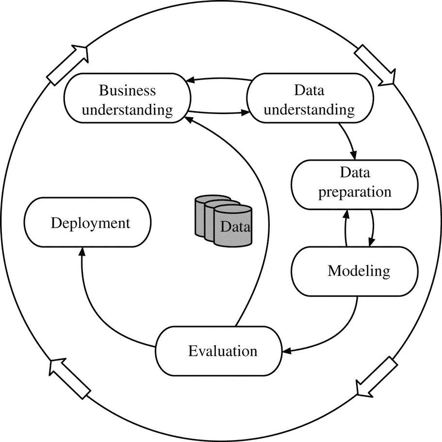

**图 1.4** 数据挖掘项目的生命周期。

接下来的三个步骤——数据准备、建模和评估——是本书所涉及的内容。准备涉及对原始数据进行预处理，以便机器学习算法能够产生模型——理想情况下，即数据中隐含信息的结构化描述。

预处理也可能包括模型构建活动，因为许多预处理工具会构建一个数据的内部模型来对其进行转换。事实上，数据准备和建模通常是手手并行的。迭代几乎总是是必要的：建模过程中获得的结果会提供新的见解，从而影响预处理技术的选择。

任何成功的数据挖掘应用中的下一个阶段——其重要性无论如何强调都不为过——是评估。从数据中推断出的结构化描述是否具有预测价值，还是说它们仅仅反映了虚假的规律性？

本书解释了许多估计由机器学习构建的模型之预测性能的技术。如果评估步骤显示模型效果很差，你可能需要重新考虑整个项目，并返回业务理解步骤，以识别更具成果的业务目标或数据收集途径。

另一方面，如果模型的准确率足够高，下一步就是将其投入到实践中。这通常涉及将其集成到更大的软件系统中，因此模型需要交给项目的软件工程师。在这一阶段，建模技术的实现细节至关重要。例如，为了将模型嵌入软件系统，可能需要用不同的编程语言对其进行重新实现。

## 1.5 机器学习与统计学

机器学习和统计学之间有什么区别？愤世嫉俗者冷冷地看着这一领域商业兴趣（以及炒作）的爆发，将数据挖掘等同于统计学加上营销。

事实上，你不应该在机器学习和统计学之间寻找分界线，因为存在一个连续体——而且是多维的——数据分析技术。一些技术源于标准统计学课程中教授的技能，另一些则与从计算机科学产生的机器学习联系得更紧密。

从历史角度看，两者有着截然不同的传统。如果被迫指出一个单一的侧重点差异，可能是统计学更关注假设检验，而机器学习则更关注将泛化过程表述为对可能假设的搜索。但这是一种极大的简化：统计学远不止是假设检验，而许多机器学习技术根本不涉及任何搜索。

在过去，机器学习和统计学中并行发展出了非常相似的方案。一个是决策树归纳。20 世纪 80 年代中期，加州大学的四位统计学家出版了一本关于分类与回归树的书，而在整个 70 年代和 80 年代初，一位著名的澳大利亚机器学习研究人员 J. Ross Quinlan 正在开发一种从示例推断分类树的系统。

这两个独立项目产生了从示例生成树的非常相似的方案，研究人员直到很久以后才注意到彼此的工作。另一个出现类似方法的领域涉及使用近邻方法进行分类。这些是标准的统计技术，被机器学习研究人员广泛采纳，既为了提高分类性能，也为了提高计算过程的效率。我们将在第 4 章“算法：基本方法”中检查决策树归纳和近邻方法。

但现在这两种视角已经汇合了。我们在书中将检查的技术包含了大量的统计思维。从一开始，在构建和完善初始示例集时，标准的统计方法就适用了：数据可视化、属性选择、丢弃离群值等。

许多学习算法在构建规则或树时使用统计检验，并对那些“过拟合”的模型进行修正，即这些模型过度依赖于产生它们时使用的特定示例的细节（我们已经在图 1.3 针对劳工谈判问题的两个决策树中看过了这方面的例子）。

统计检验被用于验证机器学习模型和评估机器学习算法。在我们对数据挖掘实用技术的学习中，我们将学习大量的统计学知识。

## 1.6 泛化作为搜索

可视化学习问题的一种方法（也是将其与统计方法区分开来的一种方法）是想象在可能的概念描述空间中搜索一个能够拟合数据的描述。虽然将泛化视为搜索是思考机器学习的一个强大概念工具，但它对于理解本书中描述的实际方案来说并非必须的。这就是为什么这一节被标记为可选，如页边的灰色条条所示。

为了明确起见，假设概念描述——学习的结果——被表示为规则，如第 1.2 节中天气问题给出的那些规则（尽管其他概念描述语言同样有效）。假设我们列出所有可能的规则集，然后寻找满足给定示例集的规则。

这是一项巨大的工作吗？是的。是一项无限的工作吗？乍一看似乎如此，因为规则的数量没有限制。但实际上，可能的规则集是有限的。

首先注意，每条规则的大小都不会超过一个固定的最大值，每个属性最多有一个术项：对于表 1.2 中的天气数据，这总共有四项。因为可能的规则的数量是有限的，所以可能的规则集的数量也是有限的，尽管极其巨大。

然而，我们很难对包含大量规则的集合感兴趣。事实上，我们很难对规则数量多于示例数量的集合感兴趣，因为很难想象每个示例需要一个以上的规则。所以，如果我们把考虑限制在小于该数量的规则集上，问题就解决了。

使用近邻方法被机器学习研究人员广泛采纳，既为了提高分类性能，也为了提高计算过程的效率。我们将在第 4 章“算法：基本方法”中检查决策树归纳和近邻方法。


**图 1.4** 数据挖掘项目的生命周期。

接下来的三个步骤——数据准备、建模和评估——是本书所涉及的内容。准备涉及对原始数据进行预处理，以便机器学习算法能够产生模型——理想情况下，即数据中隐含信息的结构化描述。预处理也可能包括模型构建活动，因为许多预处理工具会构建一个数据的内部模型来对其进行转换。事实上，数据准备和建模通常是并行的。迭代几乎总是必要的：建模过程中获得的结果会提供新的见解，从而影响预处理技术的选择。

任何成功的数据挖掘应用中的下一个阶段——其重要性无论如何强调都不为过——是评估。从数据中推断出的结构化描述是否具有预测价值，还是说它们仅仅反映了虚假的规律性？本书解释了许多估计由机器学习构建的模型之预测性能的技术。如果评估步骤显示模型效果很差，你可能需要重新考虑整个项目，并返回业务理解步骤，以识别更具成果的业务目标或数据收集途径。另一方面，如果模型的准确率足够高，下一步就是将其投入到实践中。这通常涉及将其集成到更大的软件系统中，因此模型需要交给项目的软件工程师。在这一阶段，建模技术的实现细节至关重要。例如，为了将模型嵌入软件系统，可能需要用不同的编程语言对其进行重新实现。

## 1.5 机器学习与统计学

机器学习和统计学之间有什么区别？愤世嫉俗者冷冷地看着这一领域商业兴趣（以及炒作）的爆发，将数据挖掘等同于统计学加上营销。事实上，你不应该在机器学习和统计学之间寻找分界线，因为存在一个连续体——而且是多维的——数据分析技术。一些技术源于标准统计学课程中教授的技能，另一些则从科学产生的机器学习联系得更紧密。从历史角度看，两者有着截然不同的传统。如果被迫指出一个单一的侧重点差异，可能是统计学更关注假设检验，而机器学习则更关注将泛化过程表述为对可能假设的搜索。但这是一种极大的简化：统计学远不止是假设检验，而许多机器学习技术根本不涉及任何搜索。

在过去，机器学习和统计学中并行发展出了非常相似的方案。一个是决策树归纳。20 世纪 80 年代中期，加州大学的四位统计学家出版了一本关于*分类与回归树*的书，而在整个 70 年代和 80 年代初，一位著名的澳大利亚机器学习研究人员 J. Ross Quinlan 正在开发一种从示例推断分类树的系统。这两个独立项目产生了从示例生成树的非常相似的方案，研究人员直到很久以后才注意到彼此的工作。另一个出现类似方法的领域涉及使用近邻方法进行分类。这些是标准的统计技术，被机器学习研究人员广泛采纳，既为了提高分类性能，也为了提高计算过程的效率。我们将在第 4 章“算法：基本方法”中检查决策树归纳和近邻方法。

但现在这两种视角已经汇合了。我们在书中将检查的技术包含了大量的统计思维。从一开始，在构建和完善初始示例集时，标准的统计方法就适用了：数据可视化、属性选择、丢弃离群值等。许多学习算法在构建规则或树时使用统计检验，并对那些“过拟合”的模型进行修正，即这些模型过度依赖于产生它们时使用的特定示例的细节（我们已经在图 1.3 针对劳工谈判问题的两个决策树中看过了这方面的例子）。统计检验被用于验证机器学习模型和评估机器学习算法。在我们对数据挖掘实用技术的学习中，我们将学习大量的统计学知识。

## 1.6 泛化作为搜索

可视化学习问题的一种方法（也是将其与统计方法区分开来的一种方法）是想象在可能的概念描述空间中搜索一个能够拟合数据的描述。虽然将泛化视为搜索是思考机器学习的一个强大概念工具，但它对于理解本书中描述的实际方案来说并非必须的。这就是为什么这一节被标记为*可选*，如页边的灰色条条所示。

为了明确起见，假设*概念描述*——学习的结果——被表示为规则，如第 1.2 节中天气问题给出的那些规则（尽管其他概念描述语言同样有效）。假设我们列出所有可能的规则集，然后寻找满足给定示例集的规则。这是一项巨大的工作吗？是的。是一项*无限*的工作吗？乍一看似乎如此，因为规则的数量没有限制。但实际上，可能的规则集是有限的。首先注意，每条规则的大小都不会超过一个固定的最大值，每个属性最多有一个术项：对于表 1.2 中的天气数据，这总共有四项。因为可能的规则的数量是有限的，所以可能的规则*集*的数量也是有限的，尽管极其巨大。然而，我们很难对包含大量规则的集合感兴趣。事实上，我们很难对规则数量多于示例数量的集合感兴趣，因为很难想象每个示例需要一个以上的规则。所以，如果我们把考虑限制在小于该数量的规则集上，问题就解决了。

通用性，或者它是否对可以学习的概念施加了限制。如果你考虑所有可能的示例集合，那么一个概念实际上只是将其划分为若干子集。在天气的例子中，如果你列举所有可能的天气条件，*play*（玩）概念就是可能天气条件的一个子集。“通用型”语言是指能够表达所有可能的示例子集的语言。在实践中，可能示例的集合通常是巨大的，从这个角度来看，我们的观点是理论性的，而非实践性的。

如果概念描述语言允许包含逻辑*或*（or）的陈述，即*析取*（以及逻辑*与*（and），即*合取*），那么任何子集都可以被表示出来。如果描述语言是基于规则的，可以通过使用单独规则来实现析取。例如，一种可能的概念表示方法就是列举示例：

- `If outlook=overcast and temperature=hot and humidity=high and windy=false then play=yes`
- `If outlook=rainy and temperature=mild and humidity=high and windy=false then play=yes`
- `If outlook=rainy and temperature=cool and humidity=normal and windy=false then play=yes`
- `If outlook=overcast and temperature=cool and humidity=normal and windy=true then play=yes`
- `…`
- `If none of the above then play=no`

这并不是一个特别启发性的概念描述：它仅仅记录了观察到的正示例，并假设所有其他示例都是负示例。每个正示例都有其自己的规则，而该概念就是这些规则的析取。或者，你也可以想象为每个负示例建立单独的规则——这同样是一个无趣的概念。无论哪种情况，概念描述都没有进行任何泛化；它仅仅是记录了原始数据。

另一方面，如果*不*允许析取，某些可能的概念（示例集合）可能完全无法被表示。在这种情况下，机器学习方案可能无法获得良好的性能。

另一种语言偏差是来自于对所用特定领域的知识。例如，某些属性值的特定组合可能永远不会发生。如果一个属性暗示了另一个属性，就会出现这种情况。我们在考虑上述大豆问题的规则时就看到过这样一个例子。那么，考虑涉及冗余或不可能的属性值组合的概念是毫无意义的。领域知识可以用来缩小搜索空间，但这可能需要专门的技巧。知识就是力量：少即是多，即使是一个微小的提示也能大幅减少搜索空间。

### 搜索偏差

在现实的数据挖掘问题中，有许多符合数据的替代概念描述，问题在于根据某些标准（通常是简单性）找到“最佳”的一个。我们在统计学意义上使用*拟合*（fit）一词；我们寻求能够很好拟合数据的最佳描述。此外，搜索整个空间并保证找到描述确实是最好的在计算上通常是不可行的。因此，搜索过程是启发式的，无法对最终结果的优性提供任何保证。这为偏差留下了大量空间：不同的搜索启发式方法以不同的方式偏置搜索。

例如，学习算法可能会对规则采用“贪婪”搜索，尝试在每个阶段寻找最佳规则并将其添加到规则集中。然而，最佳的一对规则可能并不是那两个被单独认为最好的两个规则。或者在构建决策树时，在早期阶段使用特定属性进行划分的承诺，从以后来看，考虑到该节点下方树的发展情况，可能是不经仔细考虑的。为了解决这些问题，可以使用*束搜索*（beam search），在这种情况下，不做出不可撤销的承诺，而是并行追求一组若干活跃的替代方案——其数量为*束宽*（beam width）。这会极大地增加学习算法，但具有避免与贪婪搜索相关的近视问题的潜力。当然，如果束宽不够大，可能仍然会近视。还有更复杂的搜索策略有助于克服这个问题。

一种更通用、层次更高的搜索偏差涉及搜索是从一个通用描述开始并对其进行完善，还是从一个特定示例开始并将其泛化。前者被称为*从通用到特殊*（general-to-specific）搜索偏差，后者是*从特殊到通用*（specific-to-general）偏差。许多学习算法采用前者策略，从空决策树或非常通用的规则开始，并将其特化以拟合示例。然而，反向方向操作也是完全可能的。基于实例的方法从一个特定示例开始，看它如何泛化以覆盖同类中的其他附近的示例。

### 避免过拟合偏差

避免过拟合偏差通常是另一种搜索偏差。但由于它解决的是相当特殊的问题，我们对其单独处理。回想之前提到的析取问题。问题在于，如果允许析取，仅仅总结数据的无用概念描述就会变得可能；而如果禁止它，某些概念是不可学习的。为了解决这个问题，通常从最简单的概念描述开始并向更复杂的描述搜索概念空间：最简单优先排序（simplest-first ordering）。这使得搜索倾向于简单的概念描述。

使用最简单优先并在找到足够复杂的概念描述时停止是避免过拟合的良好方法。它有时被称为*前剪枝*（forward pruning）或*预剪枝*（prepruning），因为复杂的描述在到达之前就被修剪掉了。另一种方法*后剪枝*（backward pruning）或*后期剪枝*（postpruning）也是可行的。在这里，我们首先找到一个很好地符合数据的描述，然后将其修剪为同样符合数据的简单描述。这听起来并没有那么冗余：得到简单理论的最佳方法通常是找到一个复杂的然后将其简化。前剪枝和后剪枝都是避免过拟合偏差的一种方法。

总之，虽然作为搜索的泛化是思考学习问题的好方法，但偏差是实践中使其可行的唯一途径。不同的学习算法对应于使用不同偏差搜索的概念描述空间。这正是其趣味所在：不同的描述语言和偏差对某些问题效果良好，对另一些问题效果糟糕。没有通用的“最佳”学习方法——正如每个老师所知的那样！

## 1.7 数据挖掘与伦理

使用数据——特别是关于人的数据——进行数据挖掘具有严重的伦理影响，数据挖掘技术的从业者必须以负责任的方式行动，意识到围绕他们特定应用的各种伦理问题。

当应用到人身上时，数据挖掘经常被用于歧视——谁获得贷款，谁获得特价优惠等等。某些类型的歧视——种族、性别、宗教等——不仅是不符合伦理的，而且是非法的。然而，情况是复杂的：一切取决于应用。将性别和种族信息用于医疗诊断无疑是符合伦理的，但在挖掘贷款还款行为时使用相同信息则不然。即使丢弃了敏感信息，仍然存在构建依赖于某些变量模型的风险，这些变量被证明可以是种族或性别特征的替代品。例如，人们经常居住在与特定族群认同相关的地区，因此使用邮政编码存在构建基于种族的模型的风险——即使种族信息已从数据中被明确排除。

### 重识别

对所谓的“重识别”（reidentification）技术的研究为数据匿名化的困难提供了清醒的见解。事实证明，例如，超过 85% 的美国人仅通过公开记录中的三条信息即可被识别出来：五位邮政编码、出生日期（包括年份）和性别。不知道邮政编码？超过一半的美国人可以从只有城市、出生日期和性别中被识别出来。当马萨诸塞州在 20 世纪 90 年代发布了一份汇总每位州员工医院记录的医疗记录时，州长公开保证，这些记录已通过删除姓名、地址和社会安全号等所有识别信息进行了匿名化处理。他惊讶地在邮件中收到了自己的健康记录（其中包括诊断结果和处方）。

关于公司出于善意发布所谓的匿名数据，结果发现许多个人可以被轻易识别的故事层出不穷。2006 年，一家互联网服务公司向研究社区发布了 2000 万用户的搜索记录。这些记录通过删除所有个人信息进行了匿名化处理——至少该公司是这么认为的。但很快，《纽约时报》的记者们就能识别出用户编号 4417749 对应的真实人物（在公开她的身份之前，他们征得了她的许可）。他们通过分析她使用的搜索词做到了，这些词包含了对家乡园艺师的查询，以及几个与她姓相同的人的查询，记者将这些信息与公共数据库联系了起来。

两个月后，在线电影租赁服务 Netflix 发布了 1 亿条电影评分（1 到 5 分）及其日期记录。令他们惊讶的是，识别数据库中的人员并以此发现他们评价过的所有电影其实非常容易。例如，如果你知道数据库中某人大约在什么时候（正负 2 周）对六部电影进行了评分，以及具体的评分值，你就能识别出数据库中 99% 的人。仅知道两部电影及其评分和日期（正负 3 天），就能识别出近 70% 的人。仅凭关于你朋友（或敌人）的一点信息，你就能确定他们在 Netflix 上评价过的所有电影。

这个教训是，如果你真的从数据库中删除了所有可能的识别信息，你可能有用的东西都不留下了。

### 使用个人信息

人们公认的是，在人们决定提供个人信息之前，需要知道这些信息将如何被使用、用于什么目的、将采取哪些步骤来保护其机密性和完整性、提供或保留这些信息的后果是什么，以及他们可能拥有的任何救济权利。每当收集此类信息时，都应该告知个人这些情况——不要用法律条文式的小字，而要用他们能理解的通俗语言直白地说明。

数据挖掘技术的潜在用途意味着，数据仓库的使用方式可能远超出最初收集数据时的设想。这产生了一个严重的问题：有必要确定收集数据的条件以及可能用于什么目的。数据所有权是否赋予了以最初记录时声称以外的其他方式使用它的权利？显然，在明确收集的个人数据情况下，并没有这样。但通常情况下，情况是复杂的。

数据挖掘会产生许多令人惊讶的发现。例如，据报道，法国领先的消费者团体之一发现，开红汽车的人更容易发生汽车贷款违约。这种“发现”的地位如何？它基于什么信息？这些信息是在什么条件下收集的？以何种方式使用它是符合伦理的？显然，保险公司的业务是根据刻板印象对人进行歧视——年轻男性支付高额汽车保费——但此类刻板印象并非完全基于统计相关性；它们还利用了关于世界的常识性知识。上述发现是说明了选择红汽车的人的某种特征，还是应该作为无关项而被丢弃，这是一个基于对世界认知的人类判断，而非纯粹的统计标准。

在面对数据时，重要的是询问谁被允许访问它、为了什么目的收集它，以及从中得出什么结论是合法的。伦理维度为从事实际数据挖掘的人提出了棘手的问题。有必要考虑处理此类数据的社区规范，这些标准可能经过了数十年或几个世纪的演变，但信息专家可能并不知晓。例如，你知道在图书馆社区中，读者的隐私是一项被严密保护的权利是理所当然的吗？如果你给大学图书馆打电话询问谁借了某本教科书，他们不会告诉你。这防止了学生面临来自愤怒教授的压力，被迫交出一本她为最新的资助申请中急需的书。它还禁止了对大学伦理委员会主席的休闲阅读口味进行调查。那些构建数字图书馆的人可能没有意识到这些敏感性，并可能会整合数据挖掘系统，通过分析和比较个人的阅读习惯来推荐新书——甚至可能将结果卖给出版社。

### 更广泛的问题

除了数据使用的社区标准外，从数据中得出结论时还必须遵循逻辑和科学标准。如果得出了结论（例如红车车主的信用风险更大），除非有纯统计以外的论据支持，否则需要加上免责说明。重点在于，数据挖掘只是整个过程中的一个工具：是人们获取结果以及其他知识，并决定采取什么行动。

数据挖掘引发了另一个问题，这实际上是一个关于社会资源投入用途的政治问题。我们之前提到过数据挖掘在购物篮分析中的应用，通过分析超市结账记录来检测人们购买物品之间的关联性。产生的信息应该被如何使用？超市经理是应该把啤酒和薯片放在一起以方便购物者，还是把它们放远一点，让他们的购物变得不方便，以最大化他们在商店停留的时间，从而增加他们被进一步购买的可能性？经理是否应该将最贵、利润最高的纸尿布移到啤酒旁边，增加对忙碌父亲的销售额？

当然，如果 `data` 被定义为记录事实，那么 `information` 就是模式，而 `knowledge` 是期望的积累，`wisdom` 则是附加的价值。正如我们在本书开始时看到的，数据挖掘是某些深刻的问题。这种技术是我们需要认真对待的。

## 1.8 进一步阅读和文献注释

为了不破坏正文流，所有的参考文献都收集在章节末尾。与本书内容相关的论文、书籍和其他资源列在这一节。开头提到的体外婴儿研究是在牛津计算实验室进行的，而关于屠宰的研究是在新西兰怀卡托大学计算机系进行的。

*挖掘应用与协作问题解决*（Lavrac et al., 2004）。


“尿布与啤酒”的故事是一个广为人知的传奇。根据伦敦《金融时报》（1996 年 2 月 7 日）的一篇文章，“人们经常引用的数据挖掘所能取得的例子，是某大型美国超市连锁店，他们发现许多客户在某品牌婴儿尿布（尿裤）和某品牌啤酒之间存在强关联性。大多数购买尿布的客户也买了啤酒。世界上最优秀的假设者也难以提出这种组合，但数据挖掘显示了这种关联的存在，该零售店通过将货架上的产品靠得更近利用了这一点。”然而，这似乎只是一个传说；Power (2002) 追溯了它的历史。

Shearer (2000) 讨论了数据挖掘过程，包括图 1.4 所示的数据挖掘行业标准流程（CRISP-DM）。

第 1.5 节提到的《分类与回归树》由 Breiman、Friedman、Olshen 和 Stone (1984) 编写，而 Quinlan (1993) 独立推导但类似的方案则在一系列论文中描述，这些论文最终汇集成书。

第一本关于数据挖掘的书出现在 1991 年（Piatetsky-Shapiro & Frawley, 1991）——20 世纪 80 年代数据库知识发现研讨会的论文集。此后，同一团队的另一部书也出现了（Fayyad, Piatetsky-Shapiro, Smyth, & Uthurusamy, 1996），源自 1994 年的一次研讨会。随后出现了一批以业务为导向的数据挖掘书籍，主要关注如何投入实践的各个方面，而对所用方法的底层技术描述较为浅显。它们是应用和灵感的宝贵来源。

例如，来自欧洲系统和数据库咨询公司 Syllogic 的 Adriaans 和 Zantige (1996) 是对数据挖掘的早期介绍。来自一家位于宾夕法尼亚州、专门从事数据仓库和数据挖掘公司的 Berry 和 Linoff (1997)，为营销、销售和客户支持的数据挖掘技术提供了非常优秀且充满案例的回顾。Cabena、Hadjinian、Stadler、Verhees 和 Zanasi (1998) 由来自五个国际 IBM 实验室的人员编写，通过许多真实应用案例概述了数据挖掘过程。

Dhar 和 Stein (1997) 从业务角度提供了数据挖掘视角，并对涉及的许多技术进行了粗略的普及性回顾。Groth (1998) 在数据挖掘软件提供商工作，对数据挖掘进行了简要介绍，然后对数据挖掘软件产品进行了相当广泛的回顾；书中包含一个带有其公司产品演示版的 CD-ROM。Weiss 和 Indurkhya (1998) 研究了用于从所谓的“大数据”中进行预测的各种统计技术。

Han、Kamber 和 Pei (2011) 从数据库的角度涵盖了数据挖掘，重点关注大型企业数据库中的知识发现；他们还讨论了复杂类型数据的挖掘。Hand、Manilla 和 Smyth (2001) 由一组在领域内备受尊敬的国际作者编写了一本关于数据挖掘的跨学科书籍。最后，Nisbet、Elder 和 Miner (2009) 编写了一部统计分析和数据挖掘应用的综合手册。

另一方面，机器学习书籍往往是适用于大学课程的学术文本，而非实用指南。Mitchell (1997) 编写了一本优秀的书籍，涵盖了许多机器学习技术，包括其中一些——特别是遗传算法和强化学习——这些在此并未涵盖。Langley (1996) 提供了另一本良好教材。尽管之前提到的 Quinlan (1993) 的书籍集中于特定的学习算法 `C4.5`，我们将在第 4 和 4 章中详细介绍。

## 第 2 章：输入

### 摘要

机器学习需要一些可以学习的东西：数据。本章解释了需要什么样的结构，并建立了将要使用的术语。首先，我们解释了从数据中学习的含义，并描述了将考虑的机器学习类型：分类学习、关联学习、聚类和数值预测。

我们继续解释可以提供哪些类型的示例进行学习。“示例”是通过属性描述的，我们继续回顾所使用的属性类型。本章的最后部分描述了数据应用中最耗精力的部分：为学习准备数据。我们讨论了随书的 Weka 机器学习工作台使用的属性关系格式，并处理了稀疏数据、属性类型选择、不准确和缺失以及通过可视化了解数据等问题。

### 章节大纲

- 2.1 什么是概念？
- 2.2 示例中包含什么？
- 2.3 属性中包含什么？
- 2.4 准备输入
- 2.5 延伸阅读和参考文献

也就是说，理想情况下，它应该是*可理解的*，即它可以被理解、讨论和争论；并且是*可操作的*，因为它可以应用于实际案例。第 2.1 节解释了不同类型学习问题之间的区别，这些区别在实际数据挖掘中非常具体且重要。

学习者获得的信息以一组*实例*（instances）的形式存在。在第 1 章“这到底是关于什么的”的插图中，每个实例都是所学习概念的单个、独立的示例。当然，你可能想学习很多东西，但其原始数据无法表示为单个、独立的实例。也许背景知识应该作为输入的一部分被考虑在内。也许原始数据是一个无法分割成单个实例的聚合体。也许它是一个单一的序列（例如时间序列），无法被有意义地切分。

本书介绍的是简单、实用的数据挖掘方法，我们关注的是信息可以以单个示例形式提供的情况。不过，我们确实引入了一个稍微复杂的场景，其中用于学习的示例包含多个实例。

每个实例的特征由其属性的值刻画，这些属性衡量了实例的不同方面。属性有许多不同类型，尽管典型的机器学习方案只处理数值型和*名义型*（或类别型）属性。

最后，我们审视了为数据挖掘准备输入的问题，并引入了一种简单的格式——即本书配套的 Weka 系统所使用的格式——将输入信息表示为文本文件。

## 2.1 什么是概念？

数据挖掘应用中通常出现四种基本上不同的学习风格。

在*分类学习*中，学习方案被给定一组分类过的示例，并期望它从中学习一种分类未见示例的方法。在*关联学习*中，寻求的是特征之间的任何关联，而不仅仅是预测特定*类别*值的关联。在*聚类分析*中，寻求的是属于同一类的示例组。在*数值预测*中，要预测的结果不是离散的类别，而是一个数值量。

无论涉及何种类型的学习，我们都将要学习的内容称为*概念*（concept），将学习方案产生的输出称为*概念描述*（concept description）。

第 1 章“这到底是关于什么的”中的大多数示例都是分类问题。天气数据（表 1.2 和表 1.3）展示了一组日期，并对每一天给出了是否玩游戏的决策。问题是学习如何将新日期分类为“玩”或“不玩”。

给定隐形眼镜数据（表 1.1），问题是学习如何为新患者确定镜片建议——更确切地说，由于数据中存在所有可能的属性组合，问题是学习一种总结给定数据的方法。

对于鸢尾花（表 1.4），问题是在给定其花萼长度、宽度以及花瓣长度和宽度的情况下，学习如何确定一朵新的鸢尾花是*水仙*（setosa）、*变色*（versicolor）还是*毛鸢*（virginica）。

对于劳工谈判数据（表 1.6），问题是根据其持续时间、第一、二、三年的工资增长、生活成本调整等，来确定新合同是否可以接受。

我们在全书中假设每个示例都属于一个且仅一个类别。然而，确实存在一些分类场景，其中单个示例可能属于多个类别。在技术术语中，这些被称为“多标签实例”。处理此类情况的一种简单方法是将它们视为几个不同的分类问题，每个可能的类别对应一个问题，其中问题是确定实例是否属于该类别。

分类学习有时被称为*监督式*学习，因为在某种意义上，该方案是在监督下运行的，通过为每个训练示例提供实际结果——“玩”或“不玩”的判断、隐形眼镜建议、鸢尾花的类型、劳工合同的可接受性。这种结果被称为示例的*类别*。

分类学习的成功与可以通过在独立的测试数据集上尝试学习到的概念描述来判断，这些数据集的真实分类是已知的，但并未提供给机器。测试数据上的成功率提供了关于概念学习得好程度的客观衡量标准。在许多实际数据挖掘应用中，成功更多是主观地衡量的，取决于学习到的描述（如规则或决策树）对人类用户的可接受程度。

第 1 章“这到底是关于什么的”中的大多数示例同样适用于关联学习，在关联学习中没有指定的类别。在这里，问题是发现数据中任何“有趣”的结构。第 1.2 节给出了一些关于天气数据的关联规则。

关联规则与分类规则有两点不同：它们可以“预测”任何属性，而不仅仅是类别，而且它们可以同时预测多个属性的值。由于关联规则远多于分类规则，挑战在于避免被它们淹没。

出于这个原因，关联规则通常仅限于适用于特定最小数量示例（例如数据集的 80%）且具有高于特定最小准确率水平（例如 95% 准确）的规则。即便如此，通常有很多规则，必须手动检查以确定它们是否具有意义。关联规则通常只涉及非数值属性：因此你通常不会在鸢尾花集中寻找关联规则。

当没有指定的类别时，使用聚类分析将看起来自然聚集的项目进行分组。想象一个省略了鸢尾花类型的数据版本，如表 2.1 所示。那么这 150 个实例很可能落入对应三种鸢尾花类型的自然簇。

挑战是找到这些簇并将实例分配给它们——并能够将新实例分配到这些簇中。可能一种或多种鸢尾花类型自然分裂成亚类型，在这种情况下，数据将表现出三个以上的自然簇。

聚类的成功通常是主观地衡量的，取决于结果对人类用户看起来有多有用。之后可能会有第二步分类学习，在其中学习规则以对如何将新实例放入簇中给出可理解的描述。

**表 2.1**

**作为聚类问题的鸢尾花数据**

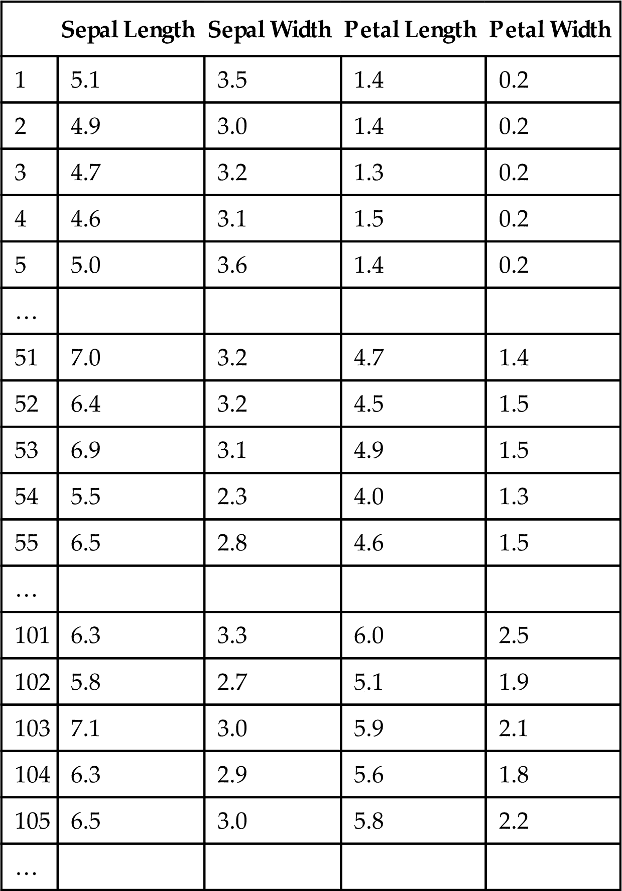

数值预测是分类学习的一种变体，其结果是数值而非类别。CPU 性能问题就是一个例子。另一个例子（见表 2.2）是天气数据的一个版本，其中预测的不是“玩”或“不玩”，而是玩的时间（分钟）。

对于数值预测问题，与其他机器学习情况一样，新实例的预测值往往不如学习到的描述结构感兴趣，这种结构通过重要属性是什么以及它们与数值结果的关系来表示。

**表 2.2**

**带有数值类别的天气数据**

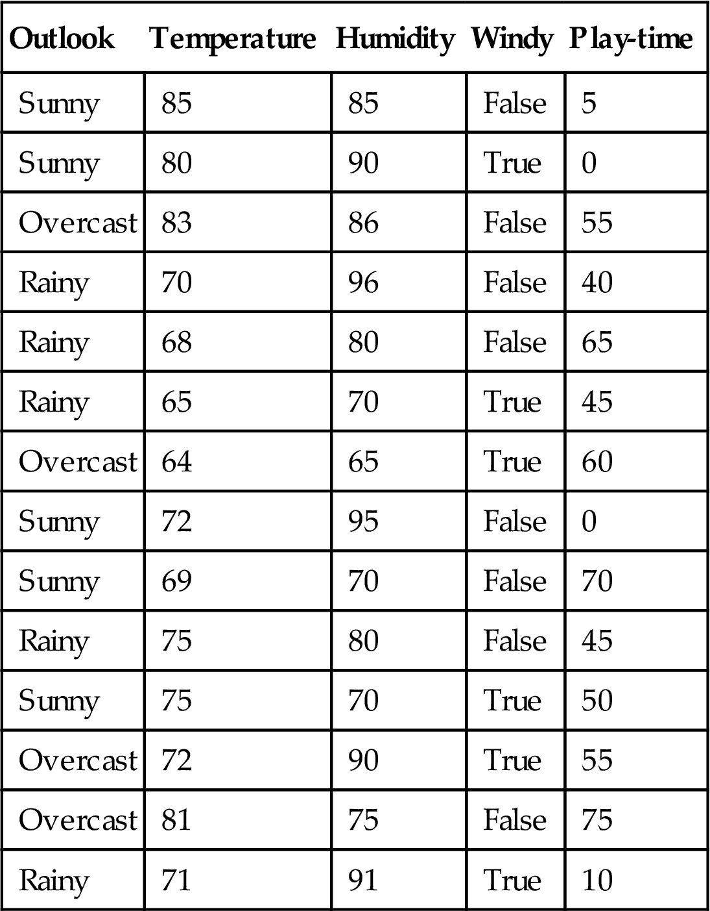

## 2.2 示例包含什么？

机器学习方案的输入是一组实例。这些实例是要进行分类、关联或聚类的对象。尽管到目前为止我们称它们为*示例*（examples），但从此起我们将通常使用更准确的术语*实例*（instances）来指代输入。

在标准情况下，每个实例都是所学习概念的单个、独立的示例。实例的特征由一组属性的值刻画。在第 1 章“这到底是关于什么的”中的所有样本数据集（天气、隐形眼镜、鸢尾花和劳工谈判问题）都是如此。

每个数据集被表示为实例与属性的矩阵，这在数据库术语中是一个单一关系，或*扁平文件*（flat file）。

### 关系

将输入数据表示为一组独立的实例是目前实际数据挖掘中最常见的情况。然而，这是一种相当限制的问题建模方式，值得花时间回顾一下原因。

问题通常涉及对象之间的关系，而不是分离、独立的实例。假设一个具体情况，给定一个家谱，我们想学习“姐妹”这个概念。想象你自己的家谱，将你的亲属（以及他们的性别）放在节点上。这棵树是学习过程的输入，连同一组人物对以及关于他们是否为姐妹的指示。

图 2.1 显示了家谱的一部分，下方是两个表格，每个表都以略有不同的方式定义了姐妹关系。表格第三列中的“是”意味着第二列的人是第一列人的姐妹（这只是我们在设置这个示例时做的一个任意决定）。

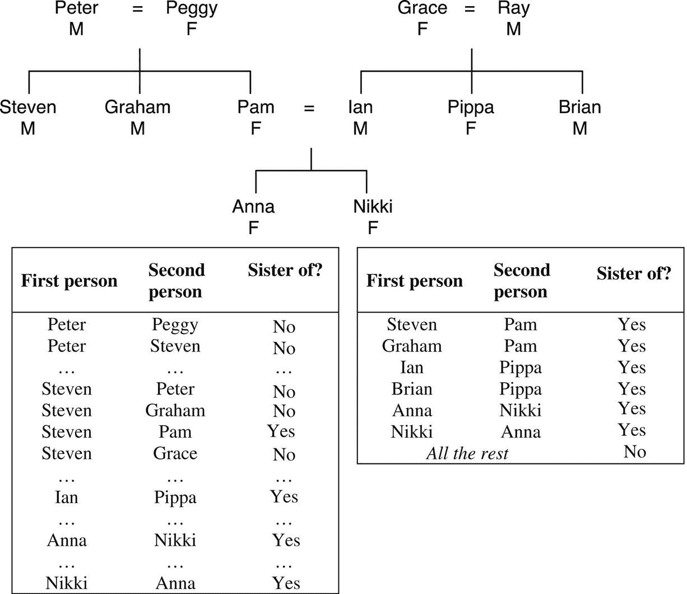

**图 2.1** 家谱和表示*姐妹关系*的两种方式。

首先注意到的是左侧表格的第三列中有很多“否”——因为总共有 12 个人，总共有 `12 × 12 = 144` 组人物，而大多数人物组合并不是姐妹。

右侧表格提供了相同的信息，但仅记录了正例，并假设所有其他均为负例。这种仅指定正例并假设其余均为负例的常规假设的想法被称为*闭世界假设*（*closed world assumption*）。它在理论研究中经常被假设；但在现实问题中可能并不适用。

如果没有族谱本身，图 2.1 中的两个表格都毫无用处。这棵树也可以以表格的形式表示，表 2.3 显示了其中一部分。

现在该问题用两个关系来表示。但这些表格并不包含独立的实例集，因为*姐妹关系*（*sister-of*）关系 `Name`、`Parent1` 和 `Parent2` 列中的值指的是族谱关系中的行。我们可以通过将这两张表合并为表 2.4 中的单表，将它们变成一个实例集。

**表 2.3**

**族谱**

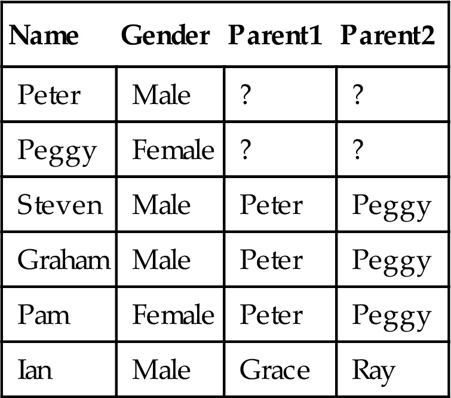

**表 2.4**

**姐妹关系**

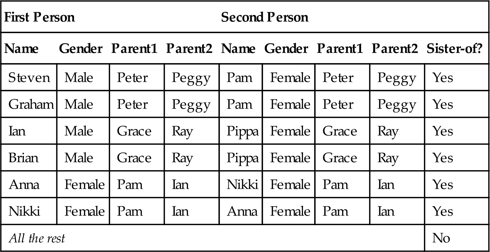

我们终于成功将原始关系问题转换成了实例的形式，每个实例都是待学习概念的个体的、独立的示例。当然，这些实例并不是真正独立的——表格的不同行之间存在大量关系！——但就“姐妹关系”这一概念而言，它们是相互独立的。

正如我们在第 3.6 节中看到的，大多数机器学习方案在处理这类数据时仍然会遇到困难，但至少问题已经重构成了正确的格式。姐妹关系的一个简单规则是：

```text
如果第二个人的性别 = 女性
且第一个人的 parent1 = 第二个人的 parent1
那么 姐妹关系 = 是。
```

这个示例展示了你如何将树中不同节点之间的关系提取并重构为一组独立实例。在数据库术语中，你取两个关系并将它们合并为一个，这种扁平化过程在技术上被称为*反范式化*（*denormalization*）。

对于任何（有限的）关系集，这种操作总是可能的，但反范式化可能会产生需要聚合才能形成独立实例的行集。

表 2.4 的结构可以用于描述两个人之间的任何关系——祖孙关系、远隔二代的表亲关系等。更多人之间的关系需要更大的表格。未预先指定最大人数的关系构成了一个更严重的问题。

如果我们想学习*核心家庭*（*nuclear family*，父母及其子女）的概念，所涉及的人数取决于最大核心家庭的大小，尽管我们可以推测一个合理的最大值（10 个？20 个？），但实际数量只能通过扫描族谱本身来找到。

尽管如此，给定一组有限的关系集，我们至少在原则上可以形成一个新的“超关系”，其中包含人的*每种*组合都拥有一行，这足以表达人与人之间的任何关系，无论涉及多少人。然而，计算和存储成本将是无法接受的。

反范式化的另一个问题是，它会在数据中产生明显的规律，这些规律完全是虚假的，实际上仅仅是原始数据库结构的反映。

例如，想象一个超市数据库，包含一个客户及其购买商品的关系、一个产品及其供应商的关系，以及一个供应商及其地址的关系。对这进行反范式化将产生一个扁平文件，其中每个实例都包含客户、产品、供应商和供应商地址。

寻求数据库结构的数据库挖掘工具可能会发现：买啤酒的客户也买薯片，这一发现从超市经理的角度来看可能是有重大意义的。然而，它也可能发现可以从供应商精确预测出供应商地址——这一“发现”完全不会给超市经理留下任何印象。这一事实在扁平文件中伪装成重大发现，但它显式存在于原始数据库结构中。

许多抽象计算问题涉及非有限的关系，尽管任何实际的输入示例集必须是有限的。如*祖先关系*（*ancestor-of*）的概念涉及通过树的任意长度的路径，尽管人类以及由此产生的族谱可能是有限的（尽管规模庞大），但许多人工问题产生的数据确实是无限的。

尽管这听起来很深奥，但这种情况在列表处理和逻辑编程等领域是常态，并在机器学习的一个称为*归纳逻辑编程*（*inductive logic programming*）的子学科中得到了解决。

计算机科学家通常使用递归来处理可能的示例数量为无限的情况。例如：

```text
如果 person1 是 person2 的父母
那么 person1 是 person2 的祖先

如果 person1 是 person2 的父母
且 person2 是 person3 的祖先
那么 person1 是 person3 的祖先
```

这是对*祖先*的一个简单的递归定义，无论两个人之间的关系多么疏远都有效。归纳逻辑编程的技术可以从像表 2.5 这样的有限实例集中学习到此类递归规则。

**表 2.5**

**另一种关系**

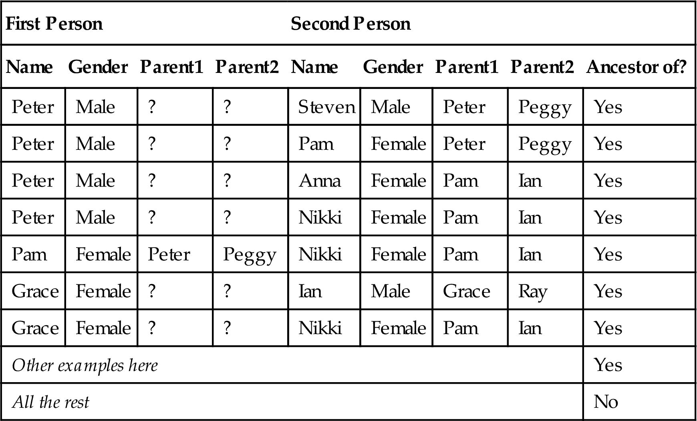

然而，这些技术的真正缺点是它们不能很好地处理噪声数据，而且往往速度缓慢，以至于在小型人工数据集之外都无法使用。本书没有涵盖这些内容。

### 其他示例类型

正如我们所看到的，通用关系面临着巨大挑战，本书将不再处理它们。结构化示例（如图和树）可以被视为关系的特例，这些关系通过根据其结构提取局部或全局特征并将其表示为属性，通常映射为独立实例。

同样，项目序列可以通过描述它们或其单个项目（使用由属性表示的固定属性集合）来处理。通常，大多数实际的数据挖掘问题可以非常有效地表示为一组实例，每个实例都是待学习概念的示例。

在某些情况下，不是单个实例是概念的示例，而是每个单独示例由一组由相同属性描述的实例组成。这种“多实例”设置在化学中自然存在，其中一个分子拥有多个原子。其目标是根据这些实例的属性对分子进行分类。

幸运的是，大多数实际的数据挖掘问题可以非常有效地表示为一组实例，每个实例都是待学习概念的示例。

（注：由于提供的原始待翻译文本中最后两段内容完全重复，此处已按照要求完整翻译。）

## 2.3 属性中包含什么？

属性可以是*定性的*。数值属性（有时被称为*连续*属性）衡量的是数字——无论是实数还是整数。

需要注意的是，在该语境下，*连续*这一术语经常被误用：整数值的属性在数学意义上显然不是连续的。定性属性在预先定义的有限可能集合中取值，有时被称为*分类*的。但还存在其他可能性。统计学书籍通常会引入“测量水平”，例如*定性*、*序数*、*区间*和*比例*。

定性属性的值是不同的符号。值本身仅作为标签或名称——因此，*定性*（nominal）一词源于拉丁语中的“名称”。

例如，在天气数据中，*展望*（outlook）属性的值为*晴天*、*多云*和*下雨*。这三者之间不隐含任何关系——没有顺序或距离度量。将这些值相加、相乘，甚至比较它们的大小显然没有意义。

使用此类属性的规则只能测试相等或不相等，例如：

```text
outlook: 晴天 → 否
多云 → 是
下雨 → 是
```

序数属性使得对类别进行排序成为可能。然而，尽管有*顺序*的概念，但没有*距离*的概念。

例如，在天气数据中，*温度*属性的值为*热*、*温*和*凉*。这些是有序的。无论你说*热 > 温 > 凉*还是*热 < 温 < 凉*都只是约定俗成的——只要保持一致，使用哪种并不重要。重要的是*温*位于另外两个之间。

虽然比较两个值是有意义的，但将它们相加或相减是没有意义的——*热*与*温*之间的差异无法与*温*与*凉*之间的差异进行比较。

使用此类属性的规则可能涉及比较，例如：

```text
temperature = 热 → 否
temperature < 热 → 是
```


注意，定性属性和序数属性之间的区别并不总是直观且显而易见的。事实上，我们上面使用的定性属性示例“展望”并不完全清晰：你可能会认为这三个值确实有顺序——随着天气从好转为坏，“多云”在“晴天”和“下雨”之间处于介于状态。

区间量值的值不仅是有序的，而且是以固定且相等的单位衡量的。一个很好的例子是温度，以度（例如华氏度）表示，而不是由凉、温、热所隐含的非数值标度表示。讨论两个温度之间的差异（例如 46°C 和 48°C）并将其与另外两个温度（例如 22°C 和 24°C）之间的差异进行比较是完全有意义的。另一个例子是日期。你可以讨论 1939 年和 1945 年之间的差异（6 年），甚至是 1939 年和 1945 年的平均值（1942 年），但考虑 1939 年和 1945 年的总和（3884）或 1939 年的三倍（5817）则没有太大意义，因为起点 0 年是完全任意的——事实上，它在历史过程中已经改变了多次。（孩子们有时会想，公元 300 年在公元 300 年叫什么）。

比例量值是指其测量方案本质上定义了零点的。例如，测量从一个物体到另一个对象的距离时，物体与其自身的距离形成了一个自然的零。比例量值被视为实数：允许任何数学运算。讨论三倍的距离，甚至将一个距离乘以另一个距离以得到面积，显然是有意义的。

然而，是否存在一个“本质”定义的零点取决于我们的科学知识——它是相对于文化的。例如，丹尼尔·华伦并不知道温度有更低的下限，他的标度是一个等距标度。然而，现在我们认为温度是基于绝对零的比例标度。自某些文化定义的零点（如 ad 0）开始的年份测量不是比例标度；自大爆炸以来的年份则是。即使是金钱的零点——我们通常很乐意说某件东西的价格是另一件的两倍——对于我们这些不断超出信用卡额度的人来说，可能并不完全清晰。

许多实用的数据挖掘系统仅适应这四种测量水平中的两种：定性和序数。定性属性有时被称为“分类的”、“枚举的”或“离散的”。“枚举”是计算机科学中表示分类数据类型的标准术语；然而，该术语的严格定义——即与自然数建立一一对应关系——暗示了顺序，而这在机器学习语境下是被专门排除的。“离散”也带有顺序的含义，因为你经常会将连续的数值离散化。序数属性通常被编码为“数值”数据，或者可能是“连续”数据，但没有数学连续性的暗示。定性标度的一个特例是“二分法”，它只有两个成员——通常标记为“真”和“假”，或者天气数据中的“是”和“否”。此类属性有时被称为“布尔”的。

机器学习系统可以使用关于属性的许多其他信息。例如，维度考虑可以用于限制搜索在维度上正确的表达式或比较中。循环顺序可能会影响考虑的测试类型。例如，在时间语境下，对“天”属性的测试可能涉及明天、前一天、下个工作日、下周的同一天。偏序，即泛化或特化关系，在实际情况中经常发生。此类信息通常被称为“元数据”，关于数据的数据。然而，用于数据挖掘的许多实际方案很少能够考虑元数据，尽管这些能力在未来可能会迅速发展。

## 2.4 准备输入

为数据挖掘调查准备输入通常消耗了整个数据挖掘过程中投入的大部分精力。虽然此书并不是真的关于数据准备的问题，但我们希望让你对涉及的问题有一个直观，以便你能理解其复杂性。之后，我们查看一种特定的输入文件格式——属性-关系文件格式（ARFF），它用于附录 B 中描述的 Weka 系统。然后，我们考虑将数据集转换为此类格式时出现的问题，因为有一些简单的实际点需要注意。惨痛的经历表明，真实数据的质量往往低得令人失望，仔细的检查——这一过程已被称为“数据清洗”——会带来丰厚的回报。

### 收集数据

在开始处理数据挖掘问题时，首先需要将所有数据汇集到一个集合。我们在描述家谱树示例时解释了关系数据去规范化的必要性。尽管它说明了基本问题，但这个自包含的示例并不能真正传达过程的具体情况。在真实的业务应用程序中，需要从不同部门收集数据。例如，在项营销研究中，需要来自销售部门、账单部门和客户服务部门的数据。

例如，自动挤奶机每天记录两次——必须进行聚合。同样，当电信公司研究客户行为时，原始通话数据并没有多大用：数据必须聚合到客户级别。但你是想要按月还是按季度的使用量，以及是滞后几个月或几个季度？选择正确的聚合类型和级别通常对于成功至关重要。

由于涉及许多不同的问题，你不能期望第一次就能做好。这就是为什么数据组装、集成、清洗、聚合和通用准备花费很长时间的原因。

## ARFF 格式

我们现在查看表示数据集的标准方法，称为“ARFF 文件”。我们描述普通版本，但也有一个名为 XRFF 的版本，正如名称所示，它使用 XML 标记语言提供 ARFF 头部和实例信息。

图 2.2 显示了表 1.3 中天气数据的 ARFF 文件，这是包含某些数值特征的版本。以 `%` 符号头的行是注释。文件开头注释之后是关系名称（`weather`）以及一个定义属性的块（`outlook`、`temperature`、`humidity`、`windy`、`play?`）。名义属性后面是它们可以取的值的值集，括在花括号中。值可以包含空格；如果是，则必须放在引号内。数值值后面跟着关键字 `numeric`。

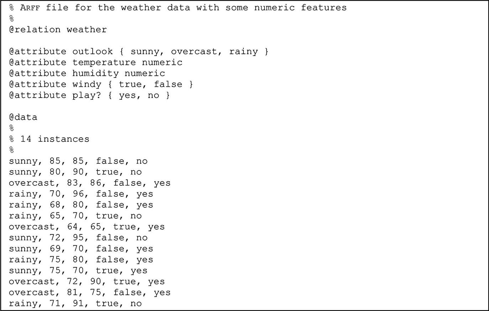

**图 2.2** 天气数据的 ARFF 文件。

虽然天气问题是从其他属性的值预测类别值 `play?`，但数据文件中并没有任何方式区分类别属性。ARFF 格式仅提供了一个数据集；它没有指定哪一个属性是应该预测的属性。这意味着同一个文件可以用于研究从其他属性预测每个属性的效果如何，或者用于发现关联规则，或者用于聚类。

属性定义之后是 `@data` 行，它标志着数据集中实例的开始。实例每行一个，每个属性的值依次出现，并用逗号分隔。如果某个值缺失，则用单个问号表示（此数据集中没有缺失值）。ARFF 文件中的属性规范允许对数据集进行检查，以确保包含所有属性的合法值，读取 ARFF 文件的程序会自动执行这种检查。

除了天气数据示例的名义属性和数值属性外，ARFF 格式还有另外三种属性类型：字符串属性、日期属性和关系值属性。字符串属性的值是文本的。假设你有一个想要称为 `description` 的字符串属性。在定义属性的块中，它的指定如下：

```text
@attribute description string
```

那么，在实例数据中，包含任何放在引号内的字符字符串（若要在你的字符串中包含引号，请使用标准约定在每个引号前加一个反斜杠“\”）。字符串内部存储在字符串表中，并用它们在表中的地址表示。因此，两个包含相同字符的字符串将具有相同的值。

字符串属性的值可以长——甚至是一整篇文档。为了将字符串属性用于文本挖掘，必须能够对它们进行操作。例如，一个字符串属性可以转换为许多数值属性，字符串中的每个单词对应一个数值属性，其值是该单词出现的次数。这些转换在 8.3 节中描述。

日期属性是具有特殊格式的字符串，引入方式如下：

```text
@attribute today date
```

（用于名为 `today` 的属性）。Weka 使用 ISO-8601 组合日期和时间格式 `yyyy-MM-dd’T’HH:mm:ss`，其中年份为四位，月份和日期各为两位，然后是字母 `T`，后面是小时、分钟和秒各为两位的。¹。在文件的数据部分，日期指定为日期和时间对应的字符串表示，例如 `2004-04-03T12:00:00\`。尽管它们是以字符串形式指定的，但在读取输入文件时日期会被转换为数值形式。日期也可以在内部转换为不同的格式，因此你可以在数据文件中拥有绝对时间戳，并使用转换为一天中的时间或星期几的形式来检测周期性行为。

关系值属性与其他类型不同，因为它们允许在 ARFF 格式中表示多实例问题。关系属性的值是一组独立的实例。该属性用名称和类型 `relational` 定义，后面跟着一个嵌套的属性块，该块给出了引用实例的结构。例如，一个名为 `bag` 的关系值属性，其值是一个与天气数据结构相同但没有 `play` 属性的数据集，可以这样指定：

```text
@attribute bag relational

@attribute outlook {sunny, overcast, rainy}

@attribute temperature numeric

@attribute humidity numeric

@attribute windy {true, false}

@end bag
```

`@end bag` 表示嵌套属性块的结束。图 2.3 显示了基于天气数据的多实例问题的 ARFF 文件。在这种情况下，每个示例由一个标识符值、来自原始天气数据的两个连续实例以及类标签组成。属性的每个值都是一个字符串，封装了两个用 `\n` 字符分隔的天气实例（该字符代表嵌入的换行）。这可能对于一个持续 2 天的游戏是合适的。类似的数据集可能用于持续天数不确定的的游戏（例如，一级板球需要 3–5 天）。但注意，在多实例学习中，实例给出的“顺序”通常被认为是不重要的。算法可能会学到，如果某一天没有下雨且至少一天是晴天，就可以打板球，但并不是它只能在特定的天气事件序列中进行。

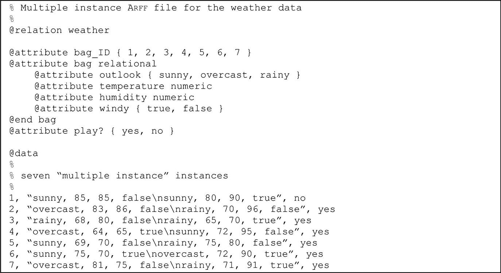

**图 2.3** 天气数据的多实例 ARFF 文件。

## 稀疏数据

有时，对于大多数实例，大多数属性的值为 0。例如，市场购物篮数据记录了超市客户的购买情况。无论购物规模有多大，客户购买从未超过商店提供的商品的一小部分。市场购物篮数据包含了客户购买的每种商品数量，对于库存中的几乎所有商品，这个值都是 0。数据文件可以看是一个矩阵，其行和列代表客户和库存物品，该矩阵是“稀疏的”——几乎所有的元素都是 0。另一个例子出现在文本挖掘中，实例是文档。在这里，列和行代表文档和单词，数字表示特定单词在特定文档中出现的次数。大多数文档的词汇量很小，所以大多数条目都是 0。

显式表示稀疏矩阵的每个元素可能是不实际的。与其按顺序表示每个值，如下：

```text
0, X, 0, 0, 0, 0, Y, 0, 0, 0, “class A”

0, 0, 0, W, 0, 0, 0, 0, 0, 0, “class B”
```

可以通过属性编号显式地识别非零属性并说明它们的值：

```text
{1 X, 6 Y, 10 “class A”}

{3 W, 10 “class B”}
```

每个实例都括在大括号中，包含每个非零属性的索引号（索引从 0 开始）及其值。稀疏数据文件具有相同的 `@relation` 和 `@attribute` 标签，后面跟着一个 `@data` 行，但数据部分是不同的，包含像之前那样的括号内规范。注意，被省略的值为 0——它们不是“缺失”值！如果某个值未知，必须显式地用问号表示。

## 属性类型

ARFF 格式适应了两种基本数据类型：名义和数值。字符串属性和日期属性在实际上分别是名义和数值的，尽管在使用之前，字符串通常会被转换为数值形式（如词向量）。关系值属性包含具有基本属性（如数值和名义属性）的独立实例集。两种基本类型的解释取决于所使用的学习方案。例如，许多方案将数值属性视为序尺度，并仅使用小于和大于对这些值之间进行比较。然而，某些方法将它们视为比例标度并使用距离计算。在将它们用于数据挖掘之前，你需要了解机器学习方案的工作原理。

如果一个学习方案将数值属性处理为在比例标度上测量的，就会出现归一化问题。属性通常被归一化到一个固定范围内——通常是从 0 到 1——方法是将所有值除以遇到的最大值，或者通过减去最小值并除以最大值与最小值之间的范围来实现。另一种归一化技术是计算属性值的统计平均值和标准差，从每个值减去平均值，然后将结果除以标准差。这个过程被称为统计变量的“标准化”（standardizing），结果是一组均值为零、标准差为一的值。

某些学习方案——例如基于实例和回归的方法——仅处理比例标度，因为它们根据属性值计算两个实例之间的“距离”。如果实际标度是序次的，则必须定义一个数值距离函数。实现此点的方法之一是使用二级距离：如果两个值不同则为 1，相同则为 0。通过这种距离函数，任何名义数量都可以视为数值。然而，这是一种相当粗糙的技术，掩盖了实例之间真实的变化程度。另一种可能性是为每个名义属性生成多个合成二值属性：我们将在 7.3 节查看树在数值预测中的应用时回到这一点。

有时，名义属性和数值标度之间存在真实的映射关系。例如，邮政编码指示了可以用地理坐标表示的区域；电话号码的前几位也可能如此，这取决于你住在哪里。学生证号的前两位数字可能是她首次入学的年份。

在实际数据集中包含被编码为整数的名义值是非常常见的。例如，整数标识符可能被用作“零件号”（part number）等属性的代码，但此类整数并不打算用于小于或大于的比较。如果是如此，指定该属性是名义的而非数值的是非常重要的。

将序次属性处理为名义属性是完全可能的。事实上，某些机器学习方案只处理名义元素。例如，在隐形眼镜问题中，年龄属性被视为名义的，生成的规则包括这些：

- 如果年龄 = 年轻且散光 = 无且泪水分泌率 = 正常，则推荐 = 软性
- 如果年龄 = 预老视且散光 = 无且泪水分泌率 = 正常，则推荐 = 软性

但事实上，这样指定的年龄实际上是一个序次属性，对于以下情况成立：年轻 < 预老视 < 老视。

如果它被视为序次的，这两条规则可以合并为一条：

- 如果年龄 ≤ 预老视且散光 = 无且泪水分泌率 = 正常，则推荐 = 软性

这是表达相同意思的一种更紧凑、因此更满意的方式。

## 缺失值

实践中遇到的大多数数据集（如表 1.6 中的劳动谈判数据）包含缺失值。缺失值通常通过超出范围的条目来指示；例如在通常只有正数的数值字段中的负数（例如 −1），或者在通常永远不为 0 的数值字段中的 0。对于名义属性，缺失值可能由空格或破折号指示。有时会区分不同类型的缺失值（例如未知 vs. 未记录 vs. 无关），并可能用不同的负整数（−1、−2 等）来表示。

你必须仔细考虑缺失值的意义。它们可能由于多种原因出现，例如测量设备故障、数据收集过程中实验设计的变化，以及几个相似但不完全相同的数据集的汇总。调查中的受访者可能会拒绝回答某些问题，如年龄或收入。在考古研究中，头骨等标本可能会损坏，导致某些变量无法测量。在生物研究中，植物或动物可能在所有变量被测量之前死亡。

这些情况对于所考虑的示例“意味着”什么？头骨损坏本身是否具有某些意义，还是仅仅是因为某些随机事件？植物的早死对案例是否有影响？

大多数机器学习方案都隐含着这样一个假设，即某个实例的属性值缺失这一事实并没有特殊意义：该值仅仅是未知。然而，属性值未知可能有充分的——也许根据可用证据做出了不进行某些特定测试的决定——这可能会传达关于该实例的某些信息，而不仅仅是值缺失本身。如果是如此，那么将“未测试”（not tested）记录为该属性的另一个可能值，或者作为数据集中的另一个属性，会更合适。如前面的示例所示，只有熟悉数据的人才能对特定值的缺失是否具有额外意义或是否应该简单地编码为普通缺失值做出明智的判断。当然，如果似乎有几种类型的缺失值，这从表面上是某些需要调查的情况发生的证据。

如果缺失值意味着操作员决定不进行某项测量，那么它传达的信息可能比值未知这一事实多得多。例如，分析医学数据库的人注意到，在某些情况下，仅根据医生决定进行的测试（无论测试结果如何）就可以进行诊断。那么，只需要记录哪些值是“缺失”的，就可以完成完整的诊断——实际值可以完全忽略！

## 不准确的值

仔细检查数据挖掘文件以发现异常属性和属性值是非常重要的。用于挖掘的数据几乎肯定不是为了该目的而专门收集的。在最初收集时，许多字段可能并不重要，并被留空或未勾选。只要不影响数据的原始目的，就没有动力去纠正它。然而，当同一个数据库被用于挖掘时，错误和遗漏突然开始变得意义重大。例如，银行并不真的需要知道客户的年龄，因此它们的数据库可能包含许多缺失或错误的值。但年龄在挖掘出的规则中可能是非常重要的特征。

数据集中的拼写错误显然会导致错误的值。通常，名义属性的值拼写错误，为该属性创建了额外的可能值。或者这并不是拼写错误，而是同一事物的不同名称，例如百事可乐和 Pepsi Cola。显然，ARFF 等定义格式的目的是允许对数据文件进行内部性检查。然而，原始数据文件中发生的错误通常会在转换到用于数据挖掘的文件过程中保留；因此，应该仔细检查每个属性所采取的可能值列表。

数值值中的拼写或测量错误通常会导致离群值，可以通过一次绘制一个变量的图来检测。错误值通常显著偏离剩余值中显见的模式。然而，不准确的值有时很难发现，特别是在缺乏专业领域知识的情况下。

重复数据是另一个错误来源。如果数据文件中的某些实例存在重复，大多数机器学习工具将产生不同的结果，因为重复增加了它们对结果的影响。

人们在向数据库输入个人数据时经常会故意犯错。他们可能会微调街道名称的拼写，以试图识别他们提供的信息是否会被卖给充扰他们垃圾邮件的广告公司。如果他们以前被拒绝过保险，在申请保险时可能会调整其名字的拼写。僵化的计算机数据输入系统通常会施加限制，需要想象力的通变方法。一个故事讲述了一个外国人在美国租车。由于来自国外，他没有邮政编码；然而计算机坚持要求有一个；在迫不得已的情况下，操作员建议他使用租车代理的邮政编码。如果这是常见做法，未来的数据挖掘项目可能会注意到某类客户显然与代理机构住在同一个地区！同样，超市收银员在客户没有提供会员卡时，有时会使用自己的常客积分卡，这样做是为了让客户获得本无法享有的折扣，或者仅仅是为了在收银员的账户中累积积分。只有对所发生的情况有深层次的语义理解，才能解释这类系统性的数据错误。

最后，数据会过时。许多项目会随着情况的变化而改变。例如，邮件列表中的项目——名称、地址、电话号码等——经常变化。你需要考虑你正在挖掘的数据是否仍然是。

## 不平衡数据

在分类方案的实际应用中，往往会出现某一类别的比例远高于其他类别的情况。例如，在预测爱尔兰的天气时，预测明天是“下雨天”而不是“晴天”是相当安全的。给定一个以这两个值形成类属性的数据集，其中其他属性包含与预测相关的信息，那么无论属性值如何，只要预测为“下雨”都能获得极高的准确率。事实上，要得出一个数值上更准确的预测可能非常困难。（更严重的例子是第 1.3 节中的图像筛选问题：在训练数据的许多黑暗区域中，只有极小一部分是真正的油膜——幸运的是）。

假设无论其他属性值如何，如果对每个实例都预测相同的类别值，其准确率（假设）为 99%。很难想象更复杂的规则能做得更好。确实，可能有更好的方法来预测少数类结果，但这些方法不可避免地会在某些多数类结果的案例上产生错误。在 1% 的少数类结果案例中获得更好预测所带来的优势，几乎肯定会被为 99% 的多数类结果案例牺牲哪怕一点点准确率的代价所抵消。


始终预测多数类结果很少能关于数据提供任何有趣的信息。问题在于，通过正确预测比例来衡量的原始准确率并不一定是成功的最佳标准。在实践中，两种类型的错误可能涉及不同的成本。如果可以采取预防措施，那么预测了一场并未发生的核能灾难（或死亡）的成本可能是严重的，但如果真的发生了核能灾难（或死亡）而没有被预测到，其代价将要大得多。我们将在本书的后续部分考虑成本敏感评估、分类和学习。

## 了解你的数据

了解你的数据是不可替代的。显示名义属性值分布直方图、以及数值属性值图表（可能经过排序或简单地相对于实例编号绘图）的简单工具非常有帮助。这些数据的图形可视化有助于识别离群值，这些值可能代表数据文件中的错误——或者是表示异常情况的晦涩约定，例如将缺失的年份视为`9999`或缺失的重量视为`-1 kg`，而没有人告诉你。需要咨询领域专家来解释异常、缺失值、代表类别而非数值数量的整数的意义等。一个属性相对于另一个属性、或每个属性相对于类值的两两对比图可以提供极大的启示。

数据清洗是一个耗时且耗力的过程，但对于成功的数据挖掘来说是绝对必要的。面对大型数据集，人们往往会放弃——他们怎么可能检查这一切？相反，你应该采样几个实例并仔细检查它们。你会对自己的发现感到惊讶。花时间查看你的数据总是值得的。

## 2.5 参考文献和文献注释

Pyle (1999) 为数据挖掘的数据准备提供了详尽的指南。数据仓库及其引发的问题引起了极大关注。Kimball 和 Ross (2002) 是我们所知的对这些内容最好的介绍。Cabena 等人 (1998) 估计数据准备占据了数据挖掘应用中 60% 的精力，他们详细阐述了其中涉及的问题。

处理有限和无限关系的归纳逻辑编程领域由 Bergadano 和 Gunetti (1996) 涵盖。属性的各种“测量水平”由 Stevens (1946) 引入，并在 SPSS 等统计软件包的手册（Nie, Hull, Jenkins, Steinbrenner, & Bent, 1970）中有很好的描述。

在原始且相当特定的意义上的多实例学习设置，以及激发该方法的药物活性预测问题，是由 Dietterich, Lathrop 和 Lozano-Perez (1997) 引入的。第 2.1 节开头提到的多标签实例问题是一个完全不同的设置；Read, Pfahringer, Holmes 和 Frank (2009) 讨论了使用标准分类算法解决该问题的一些方法。

¹Weka 包含一种机制，通过在属性定义中包含特殊字符串来定义日期属性具有不同的格式。

# 第 3 章：输出

## 知识表示

### 摘要

在检查了机器学习的输入后，我们开始回顾可以生成的输出类型。我们首先讨论决策表，这可能是知识表示的最基本形式，然后考虑如线性回归所产生的线性模型。接下来，我们解释决策树，这是经典机器学习中使用最广泛的知识表示类型，最后查看规则集，这是一种受欢迎的替代方案。我们考虑了分类规则、关联规则和带有异常的规则。我们简要进入归纳逻辑编程的领域，它允许产生比本书涵盖的实际学习技术更复杂的规则。在规则之后，我们讨论了基于实例的学习和矩形泛化。最后一节涵盖了聚类技术生成的输出类型：平簇和层次图。

### 关键词

决策表；决策树；分类规则；关联规则；归纳逻辑编程；基于实例的学习；矩形泛化；簇；层次图

### 章节目录

| 章节 | 页码 |
|---|---:|
| 3.1 表格 | 68 |
| 3.2 线性模型 | 68 |
| 3.3 树 | 70 |
| 3.4 规则 | 75 |
| 分类规则 | 75 |
| 关联规则 | 79 |
| 带有异常的规则 | 80 |
| 更具表现力的规则 | 82 |
| 3.5 基于实例的表示 | 84 |
| 3.6 簇 | 87 |
| 3.7 参考文献和文献注释 | 88 |

本书中的许多技术对数据中的结构化模式产生了容易理解的描述。在研究这些技术如何工作之前，我们必须看到结构化模式是如何表示的。表示机器学习可以发现的模式有许多不同的方式，每种方式都决定了可以使用什么样的技术从数据推断出该输出结构。一旦你理解了输出是如何表示的，你就向理解它是如何生成的迈出了一大步。

我们在第 1 章“这一切是什么”中看到了许多机器学习的例子。在这些案例中，输出以决策树和分类规则的形式出现，这是许多机器学习方法使用的基础知识表示样式。“知识”这个词对于决策树或规则集合来说真的太隆重了，我们使用它时，并不是要暗示这些结构与我们脑海中携带的“真正”的知识相竞争：我们只是需要一个词来指代学习方法产生的结构。有更复杂的规则种类，允许指定异常，并且能够表示不同实例的属性值之间的关系。

某些问题具有数值类别，并且——正如在第 1 章“这到底是怎么回事？”中提到的那样——处理这类问题的经典方法是使用线性模型。线性模型也可以用于处理二分类。此外，还可以为数值预测开发特殊形式的树。基于实例的表示法侧重于实例本身，而不是控制其属性值的规则。最后，某些学习方案会生成实例聚类。这些不同的知识表示方法对应于第 2 章介绍的不同类型的学习问题：输入、概念、实例、属性。

## 3.1 表格

表示机器学习输出的最简单、最原始的方法是使其与输入相同——即一个表格。例如，表 1.2 是一个用于天气数据的决策表：你只需要查找适当条件来决定是否进行运动。数值预测也可以使用完全相同的过程——在这种情况下，这种结构有时被称为“回归表”。不那么简单的是创建决策表或回归表可能涉及选择某些属性。如果温度与决策无关，那么一个缺少该属性的较小、压缩的表格将是更好的指南。当然，问题在于如何在不影响最终决策的情况下决定省略哪些属性。属性选择将在第 8 章“数据转换”中讨论。

## 3.2 线性模型

另一种简单的表示风格是“线性模型”，其输出只是属性值的总和，只不过在相加之前对每个属性应用了权重。技巧在于找到良好的权重值——使得模型的输出与预期输出相匹配。在这里，输出和输入（属性值）都是数值。统计学家使用“回归”一词来描述预测数值数量的过程，而“线性回归模型”是这种模型的另一种术语。遗憾的是，这与“回归”一词的普通用法（回到之前的状态）并没有联系。

线性模型在二维空间中最容易可视化，它们等同于通过一组数据点画一条直线。图 3.1 显示了用于第 1 章“这到底是怎么回事？”中描述的 CPU 性能数据（表 1.5）的直线，其中仅使用`cache`属性作为输入。类别属性`performance`显示在纵轴上，`cache`在横轴上：两者都是数值。直线代表了“最佳拟合”预测方程：

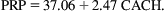

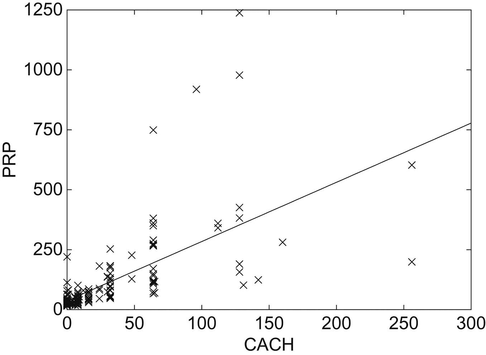

**图 3.1** 用于 CPU 性能数据的线性回归函数。

给定一个测试实例，可以通过将观测到的`cache`值代入此表达式来获得`performance`值。在这里，表达式包含一个常数“偏置”项（37.06）和一个`cache`属性的权重（2.47）。当然，线性模型可以扩展到单个属性之外——技巧在于为每个属性的权重和偏置项找到合适的值，它们共同对训练数据产生良好的拟合。

线性模型也可以应用于二分类问题。在这种情况下，模型产生的线分隔了两个类别：它定义了决策从一个类别值变为另一个类别值的地方。这样的线通常被称为“决策边界”。图 3.2 显示了鸢花数据的决策边界，用于区分`Iris setosas`和`Iris versicolors`。在这种情况下，数据使用两个输入属性——花瓣长度和花瓣宽度进行绘制，定义决策边界的直线是这两个属性的函数。位于线上的点由以下方程给出：

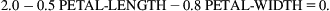

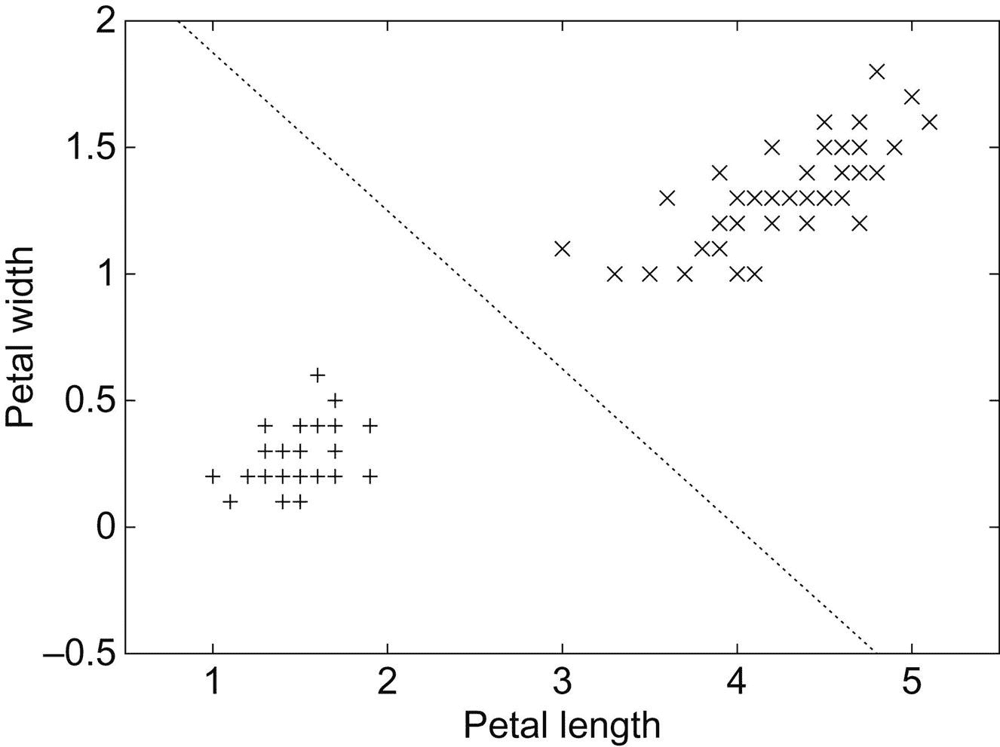

**图 3.2** 分隔`Iris setosas`和`Iris versicolors`的线性决策边界。

与之前一样，给定测试实例，通过将相关属性的观测值代入表达式来产生预测。但在这里我们检查结果，如果大于等于 0（在这种情况下为`Iris setosa`），则预测一类；如果小于 0，则预测另一类。同样，模型可以扩展到多个属性，在这种情况下，边界变为实例空间中的高维平面或“超平面”。任务是找到权重值，使得训练数据被超平面正确分类。

在图 3.1 和图 3.2 中，通过改变线的位置和方向（即改变权重），可以获得对数据的不同拟合。图 3.1 的权重是通过名为“最小二乘线性回归”的方法找到的；图 3.2 的权重是通过感知机训练规则找到的。两种方法在第 4 章“算法：基本方法”中都有描述。

## 3.3 树

从一组独立实例中学习的问题采用“分治”方法，自然地引出了一种被称为“决策树”的表示风格。我们已经见过决策树的一些例子，例如隐形眼镜（图 1.2）和劳资谈判（图 1.3）数据集。决策树中的节点涉及测试特定属性。通常，测试将属性值与常数比较。叶节点给出适用于所有到达该叶节点的分类，或者一组分类，或者对所有可能的分类的概率分布。对未知实例进行分类时，根据连续节点中测试属性的值沿树向下路由，当到达叶节点时，根据叶节点分配的类别对实例进行分类。

如果节点测试的属性是类名的，子节点通常是该属性可能值的数量。在这种情况下，由于每个可能值都有一个分支，相同的属性不会在树的下游再次测试。有时属性值是数值的，节点处的测试将属性值与常数比较。如果值大于常量，实例沿一个分支向下移动；否则沿另一个分支向下移动。

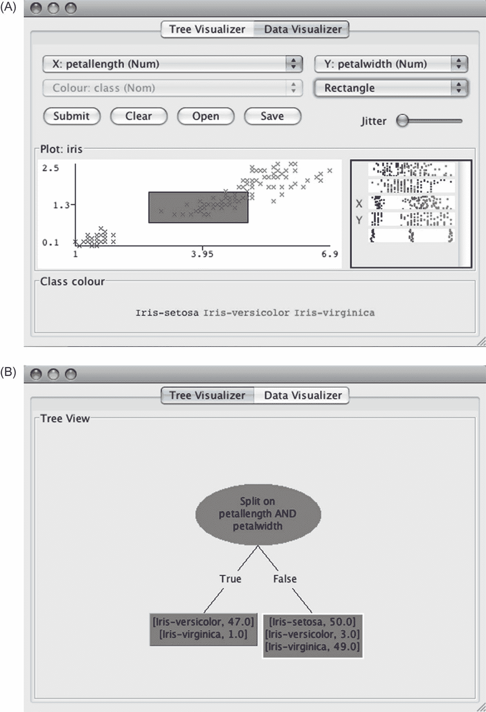

**图 3.3** 交互式构建决策树：(A) 创建一个包含`petallength`（花长度）和`petalwidth`（花宽）的矩形测试；(B) 生成的（未完成）决策树。

我们观察过的决策树类型旨在预测类别而非数值数量。当预测数值数量时（例如表 1.5 中的 CPU 性能数据），可以使用相同的树，但每个叶子节点将包含一个数值，该数值是该叶子所属的所有训练集中值的平均值。由于预测的是数值数量，因此叶子节点带有平均数值的决策树被称为“回归树”。

图 3.4A 显示了 CPU 性能数据的回归方程，图 3.4B 显示了回归树。树的叶子节点是数字，代表到达该叶子的实例的平均结果。这棵树比回归方程大得多且复杂得多，如果我们计算预测与实际 CPU 性能测量值之间误差绝对值的平均值，结果证明树的误差显著小于回归方程。回归树更准确，因为简单的线性模型无法很好地表示此问题中的数据。然而，由于树的规模巨大，它非常冗余且难以解释。

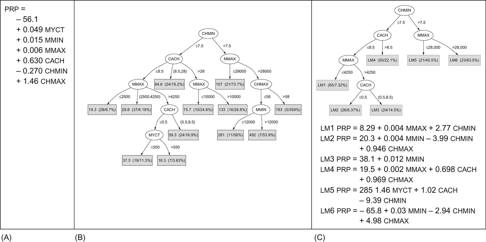

**图 3.4** CPU 性能数据的模型：(A) 线性回归；(B) 回归树；(C) 模型树。

可以将回归方程与回归树结合。图 3.4C 是一棵叶子节点包含线性表达式（即回归方程）而非单个预测值的树。这被称为“模型树”。图 3.4C 包含了属于六个叶节点的六个线性模型，标记为 LM1 到 LM6。模型树通过线性“补丁”来近似连续函数，这比线性回归或回归树更高级的表示方法。尽管模型树比回归树小且更易理解，但其在训练数据上的平均误差值较低。（然而，我们将在第 5 节“信度：评估所学内容”中看到，计算训练集上的平均误差通常不是评估模型性能的良好方法。）

## 3.4 规则

规则是决策树的一种流行替代方案，我们已经看到了天气、隐形眼镜、鸢尾花和大豆类数据集的示例。规则的“前件”（antecedent）或先决条件是一系列测试，就像决策树节点上的测试一样；而“后件”（consequent）或结论给出了适用于该规则覆盖的实例的一个或多个类别，或者给出了类别的概率分布。通常，先决条件是通过逻辑“与”（AND）连接在一起的，如果规则要触发，所有测试必须通过。然而，在某些规则公式中，先决条件是通用逻辑表达式而非简单的逻辑与。我们通常认为单个规则实际上是逻辑“或”（OR）连接在一起的：如果适用任何一条，其结论中给出的类别（或概率分布）就会应用于该实例。然而，当多个具有不同结论的规则同时适用就会冲突；我们稍后会回到这个问题。

### 分类规则

直接从决策树上读取一组分类规则是很容易的。每个叶子节点生成一条规则。规则的前件包含了从根节点到该叶节点路径上每个节点的条件，规则的后件是叶子节点分配的类别。这种程序产生的规则是没有歧义的，因为它们的执行顺序无关。然而，通常直接从决策树上读取的规则比必要的复杂得多，而且从树派生的规则通常会经过修剪以删除冗余测试。

由于决策树无法容易表达一组不同规则之间蕴含的析取关系，将一组通用规则转换为树并不十分直观。一个很好的例子是规则具有相同结构但不同属性时，例如：

- 如果`a`和`b`则`x`
- 如果`c`和`d`则`x`

这时有必要打破对称性并为根节点选择单一测试。例如，如果选择了`a`，则第二条规则实际上在树中必须重复两次，如图 3.5 所示。这被称为“复制子树问题”（replicated subtree problem）。

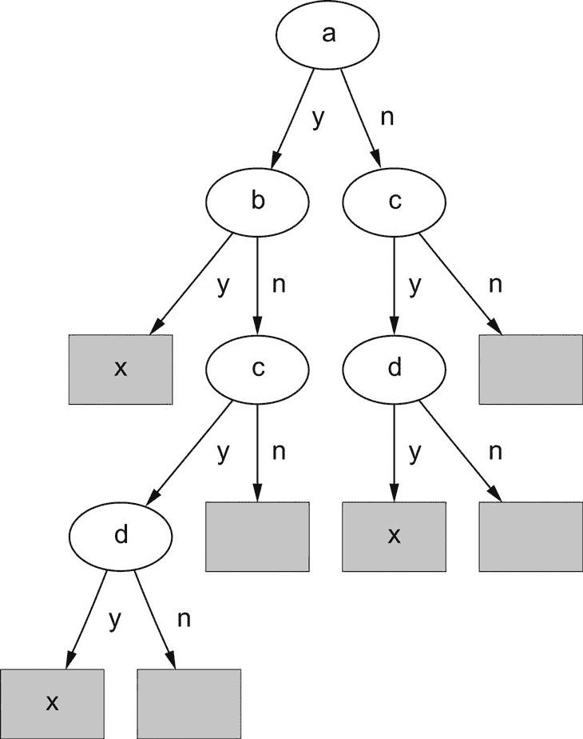

**图 3.5** 简单析取关系的决策树。

复制子树问题非常重要，值得再看几个例子。图 3.6 左侧的图表显示了一个异或（exclusive-or）函数，当`x = 1`或`y = 1`但不同同时成立时，输出为`a`。要将其转换为树，你必须首先对一个属性进行分割，导致如中间所示的结构。相比之下，规则可以如右侧所示，忠实地反映问题相对于属性的真实对称性。

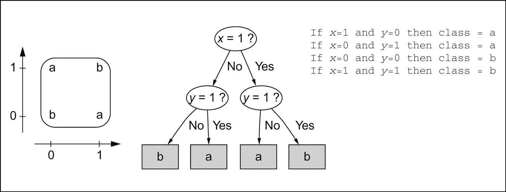

**图 3.6** 异或问题。

以直观的方式对析取式做出贡献。不幸的是，它仅适用于布尔结果，并且需要闭世界假设，而这些限制在许多实际情况下是不切实际的。生成规则的机器学习算法在多分类情况下不可避免地会产生有序的规则集，这牺牲了任何模块化的可能性，因为执行顺序是关键的。

### 关联规则

关联规则与分类规则没有区别，由于它们可以预测任何属性，而不仅仅是类别，这使得它们具有预测属性组合的自由。此外，关联规则并不旨在像分类规则那样作为一个集合一起使用。不同的关联规则表达了数据集底层的不同规律，并且它们通常预测不同的内容。

由于即使从一个微小的数据集中也可以推导出许多不同的关联规则，因此兴趣限于那些适用于合理数量的实例、并且在所应用的实例上具有合理准确率的规则。关联规则的“覆盖率”（coverage）是其预测正确的实例数量——这通常被称为“支持度”（support）。它的“准确率”（accuracy）——通常被称为“置信度”（confidence）——是预测正确的实例数量，表示为其所应用所有实例的比例。

例如，对于规则：

> 如果`温度 = 凉爽`且`湿度 = 正常`

覆盖率是既凉爽又有正常湿度的天数（表 1.2 数据中的 4 天），准确率是凉爽天气中正常湿度的比例（在这种情况下为 100%）。通常会指定最小覆盖率和准确率值，并且只寻找覆盖率和准确率至少达到这些指定最小值的规则。例如，在天气数据中，有 58 条规则的覆盖率和准确率至少分别为 2 和 95%。（将覆盖率指定为实例总数的百分比可能更方便。）

预测多个结果的关联规则必须非常仔细地解释。例如，对于表 1.2 中的天气数据，我们看到了这条规则：

> 如果`风 = 无`且`不玩`，则`展望 = 晴朗`且`湿度 = 高`

这并不仅仅是两个独立规则的简写表达式：

> 如果`风 = 无`且`不玩`，则`展望 = 晴朗`
>
> 如果`风 = 无`且`不玩`，则`湿度 = 高`

它确实意味着这些规则超过了最小覆盖率和准确率数字——但它还意味着更多内容。原始规则意味着，无风、不玩、天气晴朗且湿度高的示例数量，至少等于指定的最小覆盖率数字。它还意味着此类天数占无风、不玩天数的比例至少等于指定的最小准确率数字。这意味着规则：

> 如果`湿度 = 高`且`风 = 无`且`不玩`，则`展望 = 晴朗`

也成立，因为它与原始规则具有相同的覆盖率，而且它的准确率必须至少与原始规则一样高，因为高湿度、无风、不玩的天数必然少于无风、不玩的天数——这使得准确率更高。

正如我们所看到的，特定的关联规则之间存在关系：某些规则意味着其他规则。为了减少产生的规则数量，在几条规则相关的情况下，只向用户展示最强的一条是有意义的。在上面的示例中，应该只打印第一条规则。

## 带有异常的规则

回到分类规则，自然的扩展是允许它们具有“异常”（exceptions）。这样，可以通过表达现有规则的异常来对规则集进行增量修改，而不是重新设计整个集合。例如，考虑之前描述的鸢花问题。假设发现了一种具有表 3.1 所示尺寸的新花，专家宣布它是“水毛仙花”（*I. setosa*）的一个实例。如果这种花通过第 1 章《这一切是为了什么》中给出的规则进行分类，对于这个问题，它会被其中两条规则误分类：

**表 3.1：一种新的鸢花**

| 花瓣长度 | 花瓣宽度 | 分类 |
|---|---|---|
| ≥ 2.45 且 < 4.45 | - | 狭尾鸢花（*Iris versicolor*） |
| ≥ 2.45 且 < 4.95 | < 1.55 | 狭尾鸢花（*Iris versicolor*） |

这些规则需要修改，以便正确处理新实例。然而，仅仅更改这些规则中属性-值测试的边界可能不够，因为用于创建规则集的实例随后可能会被误分类。修复规则集并不听起来那么简单。

与其更改现有规则中的测试，还可能咨询专家来解释为什么新花违反了它们，给出可以仅用于扩展相关规则的解释。例如，这两条规则中的第一条将新的“水毛仙花”误分类为“狭尾鸢花”（*I. versicolor*）属的实例。与其改变规则中任何不等式的边界，可以根据其他属性设置一个异常：


如果`花瓣长度 ≥ 2.45`且`花瓣长度 < 4.45`，则`狭尾鸢花`，**除非**`花瓣宽度 < 1.0`。

这条规则说是，如果一朵花的花瓣长度在 2.45 到 4.45 cm 之间，它就是`狭尾鸢花`，**除非**它的花瓣宽度小于 1.0。

我们假设默认值和早期发生的测试比后来的异常适用范围更广。如果这对于该领域确实如此，并且用户可以看到它是合理的，那么用（常见的）规则和（稀有的）异常来表达将比另一种逻辑上等价的结构更容易理解。

**表 3.2：形状问题的训练数据**

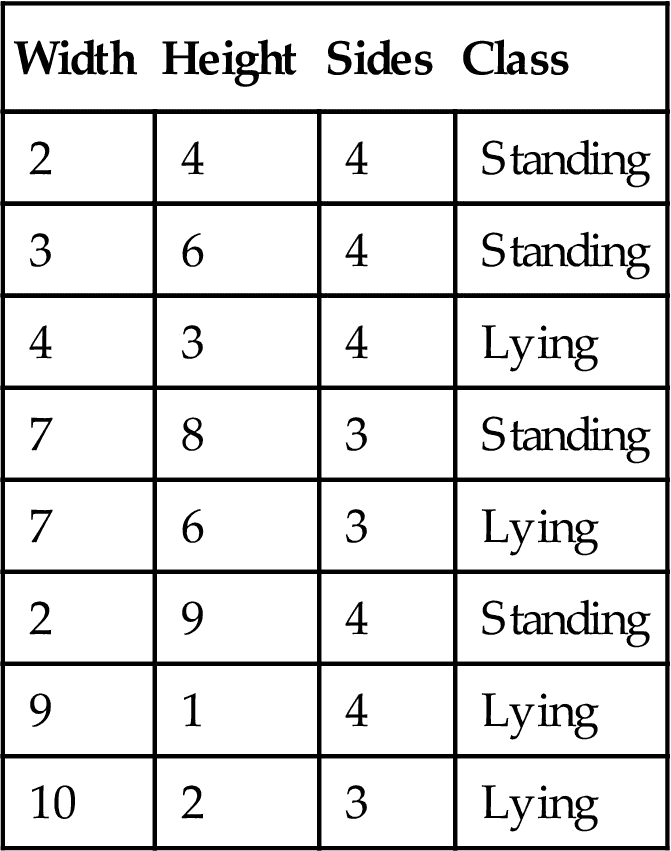

针对这些数据可能会产生常规规则集如下：

```text
if width ≥ 3.5 and height < 7.0 then lying

if height ≥ 3.5 then standing
```

如果你好奇的话，选择 3.5 作为`width`（宽度）的断分点是因为它位于最薄的卧放块（宽度为 4）和高度小于 7 的最宽直立块（宽度为 3）之间的正中间。同样，选择 7.0 作为`height`（高度）的断分点，是因为它位于最高的卧放块（高度为 6）和宽度大于 3.5 的最短直立块（高度为 8）之间的正中间。将数值阈值放置在定义概念边界的值的正中间是一种常见的做法。

尽管这两条规则在给出的示例上运行良好，但它们并不理想。许多新方块将无法被任何一条规则分类（例如，宽度为 1 高度为 2 的方块），而且很容易设计出许多规则无法适应的合法方块。

分类这八个方块的人可能会注意到“直立块是那些高度大于宽度的块”。这条规则没有将属性值与常量进行比较，而是将属性之间相互比较：

```text
if width > height then lying

if height > width then standing
```

`height`和`width`属性的实际值并不重要：只需要两者的比较结果即可。

许多机器学习方案不考虑属性之间的关系，因为这样做的成本很大。纠正这一问题的方法之一是添加额外的次要属性，说明两个主属性是否相等，或者如果它们是数值，则给出它们之间的差值。例如，我们可以为表 3.2 添加一个二值属性`is width < height?`（宽度是否小于高度？）。这类属性通常作为数据工程过程的一部分被添加。

通过一个看似很小的增强，知识表示的表达力就可以极大地扩展。技巧是以一种使实例的作用显化的方式来表达规则：

```text
if width(block) > height(block) then lying(block)

if height(block) > width(block) then standing(block)
```

虽然这看起来不是多大的扩展，但如果实例可以分解为部分，它就有意义。例如，如果一个`tower`（塔）是一堆叠放在一起的方块，那么塔最顶部的块是直立的这一事实可以这样表示：

```text
if height(tower.top) > width(tower.top) then standing(tower.top)
```

在这里，`tower.top` 用于指最顶部的块。到此为止，还没有什么收获。但如果`tower.rest`指塔的其余部分，那么塔**完全**由直立块组成的这一事实可以通过以下规则表示：

```text
if height(tower.top) > width(tower.top) and standing(tower.rest) then standing(tower)
```

看似微小的条件`standing(tower.rest)`的添加是一个递归表达式，它只有在塔的其余部分由直立块组成时才为真。这将通过对相同规则的递归应用来测试。当然，有必要添加进一步的规则来确保递归能够正确地“触底”，例如：

```text
if tower = empty then standing(tower.top)
```

像这样的规则集被称为*逻辑程序*（logic programs），机器学习的这一领域被称为*归纳逻辑编程*（inductive logic programming）。我们在这本书中不再进一步处理它。

## 3.5 基于实例的表示

最简单的学习形式是纯记忆，或者说*死记硬背*（rote learning）。一旦记住了一组训练实例，当遇到新实例时，就在内存中搜索与新实例最相似的训练实例。唯一的问题是如何解释“相似”：我们稍后会解释。然而，首先注意，这是一种从实例集中提取的“知识”的完全不同的表示方式：只需存储实例本身，并通过将类别未知的新实例与已知类别的现有实例联系起来来操作。与其尝试创建规则，不如直接从示例本身入手。这被称为*基于实例的*（instance-based）学习。在某种意义上，所有其他学习方法也是“基于实例的”，因为我们总是从一组实例作为初始训练信息开始的。但基于实例的知识表示使用实例本身来表示所学的内容，而不是推导出规则集或决策树并将其存储起来。

在基于实例的学习中，所有的实际工作都发生在分类新实例时，而不是在处理训练集时。从意义上说，这种方法与我们看到的其他方法的区别在于“学习”发生的时间。基于实例的学习是惰性的（lazy），尽可能地推迟实际工作，而其他方法是积极的（eager），一旦看到数据就会产生泛化。在基于实例的分类中，每个新实例都使用距离度量与现有实例进行比较，并使用最近的现有实例将类别分配给新实例。这被称为*最近邻*（nearest-neighbor）分类方法。有时会使用多个最近邻，并将最近的`k`个邻的多数类（如果类别是数值，则使用距离加权平均值）分配给新实例。这被称为`k-最近邻`（k-nearest-neighbor）方法。

当示例只有一个数值属性时，计算两个示例之间的距离是非常轻微的：它只是两个属性值之差。当有几个数值属性时，情况也很直接：通常使用标准的欧几里得距离。然而，这假设属性已经归一化且同等重要，而学习中的主要问题之一就是确定哪些是重要特征。

当存在名属性（nominal attributes）时，必须为该属性的不同值提出一种“距离”。例如，`red`（红）、`green`（绿）和`blue`（蓝）这些值之间的距离是多少？通常，如果值相同，则距离为零；否则距离为一。因此，`red`和`red`之间的距离为零，但`red`和`green`之间的距离为一。然而，使用更复杂的属性表示法可能是理想的。例如，如果有更多颜色，可以使用色彩空间中的色调数值度量，使得`yellow`（黄）比`green`更接近`orange`，而比`ocher`（赭色）更近。

某些属性会比其他属性更重要，这通常通过某种属性加权反映在距离度量中。从训练集中导出合适的属性权重是基于实例学习中的一个关键问题。

没有必要，也不理想存储*所有*训练实例。其一，这会导致最近邻计算变得难以接受地缓慢。另一方面，它可能会消耗不实际的存储空间。通常，属性空间的某些区域在类别方面比其他区域更稳定，在稳定区域只需要少数样本。例如，你可能预期位于类别边界深处的样本所需的密度远低于位于类别边界附近的所需密度。决定保存哪些实例以及丢弃哪些实例是基于实例学习的另一个关键问题。

基于实例表示的一个明显缺点是它们没有显式地表示所学习的结构。从某种意义上说，这违反了我们在书开头提出的“学习”概念；实例并没有真正“描述”数据中的模式。然而，实例与距离度量相结合，在实例空间中刻画出区分一类和另一类的边界，这是一种知识的显式表示。例如，给定两个类的各某一个实例，最近邻规则有效地沿着连接这些实例的连线的垂直平分线划分实例空间。给定每个类的若干实例，空间由一组线划分，这些线代表了连接一个类的实例和另一个类的实例的选择性垂直平分线。图 3.10A 展示了一个将实心圆类与空心圆类分开的九边形。这个多边形是隐含在最近邻规则的操作中的。

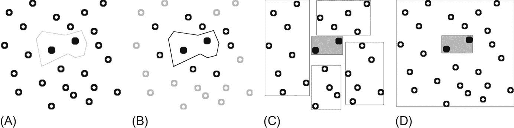

**图 3.10** 划分实例空间的不同方式。

当训练实例被丢弃时，结果是仅保留每个类别的少数关键示例。图 3.10B 仅显示在最近邻决策中实际用到的示例：其他示例（浅灰色部分）可以丢弃而不影响结果。这些示例充当了一种显式知识表示。

某些基于实例的表示更进一步，它们显式地对实例进行泛化。这通常通过创建包含同类示例的矩形区域来实现。图 3.10C 显示了可能产生的矩形区域。落在任何一个矩形内的未知示例将被分配相应的类别；落在所有矩形之外的示例将遵循通常的近邻规则。当然，这会产生与直接的近邻规则不同的决策边界，这可以通过将图 3.10A 中的多边形叠加到矩形上看出。多边形中位于矩形内的任何部分都将被切掉，并被矩形的边界取代。

实例空间中的矩形泛化就像具有特殊形式形式的规则，该条件对数值变量进行上限和下限测试，并选择其之间的区域。矩形的不同维度对应于对不同属性的测试，这些测试通过“与（AND）”逻辑连接起来。选择紧凑的矩形区域作为测试会导致比通常基于规则的机器学习方案产生的规则更保守得多，因为对于区域的每个边界，都有一个实际实例位于该边界上（或紧贴边界内部）。诸如`x < a`的测试（其中`x`是属性值，`a`是常数）涵盖了整个半空间——无论`x`有多小，只要它小于`a`，它就适用。在实例空间中进行矩形泛化时，你可以表现得保守一些，因为如果遇到位于所有区域之外的新示例，你可以退回到近邻度量。而对于基于规则的方法，如果没有规则适用于该示例，该示例无法被分类，或者只得到默认分类。更保守的规则的优势在于，尽管它们是不完整的，但它们可能比覆盖所有情况的完整规则集更清晰。最后，确保区域不重叠等同于确保最多有一个规则适用于一个示例，这消除了规则系统的另一个困难点——即当多个规则同时适用时该。

一种更复杂的泛化类型是允许矩形区域相互嵌套。这样，一个基本上属于同一类别的区域可以包含一个具有不同类别的内部区域，如图 3.10D 所示。可以允许嵌套嵌套，使得内部区域本身可以包含其自己的不同类别的内部区域——也许是外部区域的原始类别。这类似于允许规则具有例外以及例外的例外，正如第 3.5 节所示。

值得注意的是，用示例空间中的边界来可视化基于实例的学习技术存在一个细微的危险：它隐式地假设属性是数值的而非命名的。如果一个命名属性可以取的各种值沿一条直线排列，那么涉及该直线线段的泛化将毫无意义：每个测试要么涉及该属性的一个值，要么涉及它的所有值（或者可能是某些值的任意子集）。尽管你可以较容易地想象将图 3.10 中的示例扩展到多个维度，但要想象涉及命名属性的规则在多维实例空间中什么样子要困难得多。许多机器学习情况涉及众多属性，当我们的直觉扩展到高维空间时，往往会误导我们。

## 3.6 聚类

学习的是聚类而不是分类器时，输出形式为显示实例如何落入聚类的图表。在最简单的情况下，这涉及为每个实例关联一个聚类编号，可以通过将实例排列在二维空间上并划分空间来显示每个聚类，如图 3.11A 所示。

**图 3.11** 表示聚类的不同方式。

某些聚类算法允许一个实例属于多个聚类，因此图表可能会将实例排列在二维空间中，并绘制代表每个聚类的重叠子集——即维恩图，如图 3.11B 所示。某些算法以概率而非分类的方式将实例与聚类相关联。在这种情况下，对于每个实例，都有一个其属于每个聚类的概率或隶属程度。这在图 3.11C 中所示。这种特定的关联是概率性的，因此每个示例的数字之和为 1——尽管情况并不总是如此。其他算法产生聚类的层次结构，使得在最顶层，实例空间划分为少数几个聚类，每个聚类在下一层又划分为自己的子聚类，依此类推。在这种情况下，使用了如图 3.11D 所示的图表，其中在较低水平连接的元素比较高水平连接的元素聚类得更紧密。这样的图被称为*树图*（dendrograms）。这个术语的意思与*树图*（tree diagrams）相同（希腊语`dendron`意为“树”），但在聚类中人们似乎更喜欢这种奇异的版本——也许因为生物物种是聚类技术的主要应用领域，而古代语言经常用于生物学命名。

聚类之后通常会有一个推理决策树或规则集的阶段，将每个实例分配到它所属的聚类中。然后，聚类操作只是通向结构化描述的一步。

## 3.7 延伸阅读与参考文献注释

知识表示是经典人工智能的一个关键课题，早期工作由 Brachman 和 Levesque (1985) 编辑的一系列综合论文得到了很好的代表。归纳逻辑编程及相关主题在 de Raedt (2008) 的著作《逻辑与关系学习》中得到了很好的涵盖。

我们提到了处理不同规则之间冲突的问题。已经开发了多种处理此的方法，称为*冲突解决策略*，用于基于规则的编程系统。这些在关于规则编程的书中有所描述，例如 Brownstown, Farrell, Kant 和 Martin (1985)。然而，它们是为手工规则集设计的，而不是学习得到的规则集。Gaines 和 Compton (1995) 研究了在大数据集中中使用带例外的手工规则，Richards 和 Compton (1998) 描述了它们作为经典知识工程替代方案的作用。

关于概念表示各种风格的更多信息可以在描述从示例推断概念的机器学习方法的论文中找到，这些涵盖在第 4 章“算法：基本方法”的*延伸阅读*部分，以及第 6 章“树与规则”和第 7 章“扩展实例与线性模型”的*讨论*部分。最后，以概率分布形式表示概念的图形模型在第 9 章“概率方法”中进行了讨论。

# 第 4 章 算法：基本方法

## 摘要

现在我们进入实际机器学习算法的世界。本章只考虑基本的、基于原理的学习算法，将现实部署所需的高级功能留到以后。一种基础的规则学习算法简单地选择单个属性进行预测；而众为人知的概率分类的“朴素贝叶斯”方法则使用所有属性，且权重相等。接下来我们将讨论用于学习决策树的标准“分而治之”算法，以及用于学习决策规则的“分离而治之”算法。然后我们将展示如何高效地从数据挖掘关联规则：开创性的`Apriori`算法。接下来是线性模型：用于数值预测的线性回归和用于分类的逻辑回归。我们还考虑了两种用于学习线性分类器的错误驱动算法：经典的感知机和`Winnow`方法。之后是关于实例学习和聚类的章节。对于基于实例的学习，我们讨论了用于快速近邻搜索的数据结构；对于聚类，我们介绍了两个经受了时间检验的经典算法：`k-means`和层次聚类。最后一部分偏离了书中大部分考虑的标准实例实例设置，并对多实例学习算法进行了介绍，在这种情况下，一个“示例”由整袋实例组成，而不是单个。

**关键词**

朴素贝叶斯；分而治之决策树学习；分离而治之规则学习；`Apriori`；线性回归；逻辑回归；感知机；`Winnow`；`kD`-树；球树；`k-means`聚类；层次聚类；多实例学习

**章节大纲**

- 4.1 推断基础规则 93
  - 缺失值与数值属性 94
- 4.2 简单概率建模 96
  - 缺失值与数值属性 100
  - 用于文档分类的朴素贝叶斯 103
  - 备注 105
- 4.3 分而治之：构建决策树 105
  - 计算信息 108
  - 高分支率属性 110
- 4.4 覆盖算法：构建规则 113
  - 规则与树 114
  - 一种简单的覆盖算法 115
  - 规则与决策列表 119
- 4.5 挖掘关联规则 120
  - 项集 120
  - 关联规则 122
  - 高效生成规则 124
- 4.6 线性模型 128
  - 数值预测：线性回归 128
  - 线性分类：逻辑回归 129
  - 使用感知机的线性分类 131
  - 使用`Winnow`的线性分类 133
- 4.7 实例学习 135
  - 距离函数 135
  - 高效寻找最近邻居 136
  - 备注 141
- 4.8 聚类 141
  - 基于距离的迭代聚类 142
  - 更快的距离计算 144
  - 选择聚类数量 146
  - 层次聚类 147
  - 层次聚类示例 148
  - 增量聚类 150
  - 类别效用 154
  - 备注 156
- 4.9 实例多实例学习 156
  - 聚合输入 157
  - 聚合输出 157
- 4.10 进一步阅读与参考文献注记 158
- 4.11 `Weka`实现 160

既然我们已经了解了输入和输出如何表示，现在是时候看看学习算法本身了。本章解释了实际数据挖掘中所用技术背后的基本思想。我们不会深入探讨那些棘手的问题——例如算法的高级版本、可以优化的方案，以及实践中出现的复杂情况。这些主题被推迟到第二部分，在那里我们将处理更高级的机器学习方案和数据转换。理解这些更高级的问题非常重要，这样当你分析特定数据集时，就能清楚究竟到底发生了什么。

在本章中，我们关注基本思想。最有启发性的课程之一是：简单的想法往往效果极佳，我们强烈建议在分析实际数据集时采用“简单性优先”的方法。数据集可以表现出许多不同类型的简单结构。在某一个数据集中，可能有一个属性承担了所有工作，而其他属性是无关的或冗余的。在另一个数据集中，属性可能独立且平等地对最终结果做出贡献。第三种数据可能具有简单的逻辑结构，仅涉及少数属性，可以通过决策树捕获。在第四种数据中，可能有几个独立的规则来控制实例向不同类别的分配。第五种数据可能表现出不同属性子集之间的依赖关系。第六种数据可能涉及数值属性之间的线性相关性，关键在于属性值经过适当选择的权重加权和。在第七种数据中，适用于实例空间特定区域的分类可能由实例之间的距离决定。而在第八种数据中，可能没有提供类值：学习是无监督的。

在无限可能的数据集中，会发生许多不同类型的结构，数据挖掘工具——无论能力多强——即寻找某一类结构都可能完全忽略另一种类型的规律，无论这些规律多么基础。结果是产生了一种类奇特且晦涩的分类结构，而不是另一种简单、优雅且立而易见的结构。

上述概述的八种不同类型数据集的示例，每种都指向一种不同的机器学习方案，该方案非常适合发现底层概念。本章的各个章节将依次查看这些结构。最后一节介绍了处理多实例问题的简单方法，其中每个示例包含若干个不同的实例。

## 4.1 推断基础规则

这是一种从实例集中找到非常简单分类规则的简单方法。它被称为`1R`（即`1-rule`），它生成一个单层决策树，并以规则集的形式表示，所有规则都测试一个特定的属性。`1R`是一种简单、廉价的方法，通常能产生描述数据结构的相当好的规则。事实证明，简单的规则往往能达到惊人的准确率。这可能是因为许多真实世界数据集的底层结构非常基础，仅需一个属性就足以相当准确地确定实例的类别。无论如何，先尝试简单的事情总是个好计划。

其思想是：我们创建测试单个属性的规则并据此进行分支。每个分支对应于属性的不同值。对于每个分支给出最好的分类是显而易见的：使用在训练数据中出现频率最高的类。然后就可以很容易地确定规则的错误率。只需计算训练数据上发生的错误，即不属于多数类别的实例数量。

每个属性都会生成一组不同的规则，每个属性值对应一条规则。评估每个属性规则集的错误率，并选择最好的。就这么简单！图 4.1 以伪代码的形式展示了该算法。


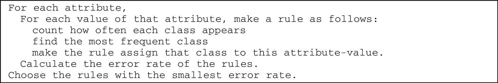

**图 4.1** `1R` 的伪代码。

为了直观看到`1R`方法的作用，请考虑表 1.2 中的天气数据（当我们观察学习算法如何工作时，将多次遇到它）。为了对最后一列`play`（玩球）进行分类，`1R`考虑了四组规则，每个属性对应一组。这些规则如表 4.1 所示。星号表示在两个等可能的结果之间进行了随机选择。每条规则都给出了错误数，以及整个规则集的总错误数。`1R`选择产生错误数量最少的规则的属性——即第一和第三组规则。随机打破这两组规则之间的平局，得到：

**表 4.1**

**评估天气数据中的属性**

| outlook (天气) | play (玩球) |
| :--- | :--- |
| sunny (晴) | no (否) |
| overcast (阴) | yes (是) |
| rainy (雨) | yes (是) |

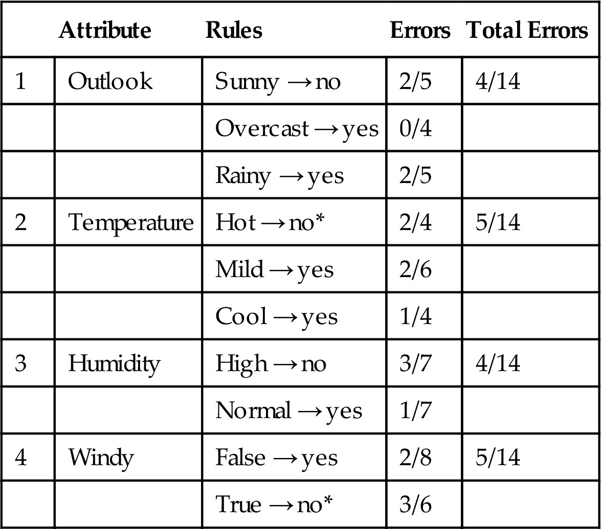

我们在开始时注意到，天气数据的游戏规则是不指定的。令人惊讶的是，在阴天或下雨时显然会玩，但在晴天时不会。尽管具有简单性，`1R`在与更复杂的方案相比时可能表现得很好。

## 缺失值与数值属性

尽管`1R`是一种非常基础的学习方案，但它也能处理缺失值和数值属性。它以简单但有效的方式处理这些问题。*缺失*被视为另一个属性值，例如，如果天气数据的`outlook`属性包含缺失值，那么基于`outlook`形成的规则集将指定四个可能的值。

我们可以使用简单的方法将数值属性转换为类别属性。首先，根据数值对示例排序。这产生了一个序列。

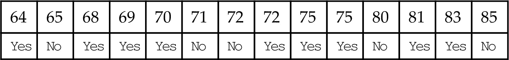

离散化通过在此序列上放置断点来实现分区。一种可能性是在类别变化的地方放置断点：


然而，值为 72 的两个实例引起了问题，因为它们具有不同的类别。简单的修复是将断点从 72 移动到 73.5。


更严重的问题是这种方法倾向于形成大量的类别。因此，在离散化数值属性时，对每个分区中的多数类示例实施了最小限制。假设该最小限制设置为三个。


这消除了之前分区中的大部分部分。但由于下一个示例也是`yes`，将其包含在第一个分区中不会丢失任何信息。这导致了新的划分：


每当相邻分区具有相同的多数类时（如上面的第一个分区所示），可以将它们合并而不影响规则集的含义。因此，最终的离散化为：

`temperature`（温度）：≤77.5 → `yes`

> 77.5 → `no`

第二条规则涉及一个任意选择：事实上，选择了`no`。如果相反选择`yes`，则根本不需要任何断点——而且正如这个示例所示，它可能最好使用相邻类别来帮助打破平局。事实上，这条规则在训练集上产生了五个错误，因此对于`outlook`（展望）来说，不如之前的规则有效。然而，相同的步骤得出了针对`humidity`（湿度）的这条规则：

- `humidity`：≤82.5 → `yes`
- >82.5 and ≤95.5 → `no`
- >95.5 → `yes`

这在训练集上仅产生了三个错误，是表 1.3 数据中最好的“单规则”模型。

最后，如果一个数值型属性具有缺失值，则会为它们创建一个额外的类别，并将离散化过程仅应用于该属性值已定义的实例。

## 4.2 简单概率建模

`1R`方法使用单个属性作为决策依据，并选择效果最好的那。另一种简单的技术是使用所有属性，并允许它们在给定给定类别的情况下，对决策做出*同等重要*且*相互独立*的贡献。当然，这并不符合现实：现实生活中的数据集之所以有趣，恰恰是因为属性之间绝不是同等重要的，也不是相互独立的。但它产生了一个简单的方案，该方案在实践中的效果再次出地良好。

表 4.2 显示了天气数据的汇总，这是通过统计每个属性-值对在`play`（运动）为`yes`（是）和`no`（否）时出现的次数得到的。例如，从表 1.2 可以看到，在五个例子中`outlook`是`sunny`（晴天），其中两个的`play=yes`，三个的`play=no`。新表第一行的单元格简单地统计了每个属性所有可能值的出现次数，而最后一列的`play`数字则统计了`yes`和`no`的总出现次数。表的下半部分以分数或观测概率的形式表示相同的信息。例如，在`play`为`yes`的 9 天中，`outlook`为`sunny`的有两天，得到 2/9 的分数。对于`play`，这些分数是不同的：它们分别是`play`为`yes`和`no`的天数比例。

**表 4.2：天气数据，包含计数和概率**

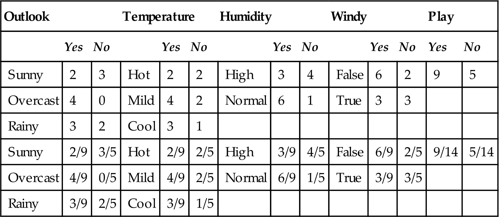

现在假设我们遇到了一个具有表 4.3 所示数值的新例子。我们将表 4.2 中的五个特征——`outlook`、`temperature`（温度）、`humidity`、`windy`（有风）以及`play`为`yes`或`no`的整体概率——视为同等重要、独立的证据片段，并将相应的分数相乘。观察结果`yes`得到：

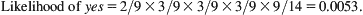

100

**(4.1)**

**(4.2)**

**表 4.3：新的一天**


分数是根据新一日的属性值从表中的`yes`条目中取的，最后的 9/14 是代表`play`为`yes`的天数比例的总分数。对结果`no`进行类似的计算得出：

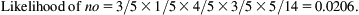

这表明对于新一天，`no`比`yes`更可能——概率是其四倍。可以通过对这些数字进行归一化，使其和为 1，将其转换为概率：

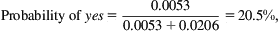

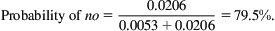

这种简单直观的方法基于贝叶斯条件概率法则。贝叶法则说，如果你有一个假设`H`和一个与该假设相关的证据`E`，那么：

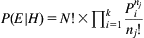

我们使用的符号`P(A)`表示事件`A`的概率，而：

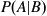

表示在另一个事件`B`条件下`A`的概率。假设`H`是`play`将是（例如）`yes`，而：

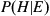

结果将如之前确定的那样是 20.5%。证据`E`是新一天属性值的特定组合：`outlook=sunny`、`temperature=cool`（凉）、`humidity=high`（高）以及`windy=true`。我们将这四个证据片段分别称为`E1`、`E2`、`E3`和`E4`。假设这些证据片段是独立的（在给定类别的情况下），它们的组合概率通过相乘这些概率得到：

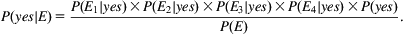

不用担心分母：我们将忽略它，并在最后的归一化步骤中将其消除，使`yes`和`no`的概率之和为 1，就像我们之前做的那样。结尾的`P(yes)`是在不知道任何证据`E`的情况下出现`yes`结果的概率，即在不知道关于特定某一天的任何信息——它被称为假设`H`的先验概率。在这种情况下，它只是 9/14，因为 14 个训练实例中有 9 个实例的`play`值为`yes`。将表 4.2 中的分数替换为相应的证据概率，得到：

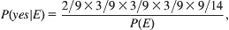

正如我们之前计算的那样。再次，分母中的`img/7a913acc95611372bc1553410228aff7_100_9`在我们进行归一化时将会消失。

这种方法被称为*朴素贝叶斯*（Naïve Bayes），因为它基于贝叶法则并“天真地”假设了独立性——只有当事件相互独立时，相乘概率才是有效的。在现实生活中属性独立（在给定类别的情况下）的假设确实是一个简单化的假设。但尽管名字带有贬义，朴素贝叶斯在实际数据集上进行测试时效果非常好，特别是当与第 8 章“数据转换”中引入的一些属性选择程序相结合时，这些程序可以消除冗余（因此非独立）的属性。

如果某个特定的属性值在训练集中没有与*每一个*类值共同出现，那么朴素贝叶斯就会变得糟糕。假设在训练数据中，属性值`outlook=sunny`总是与结果`no`相关联。那么，在给定`yes`的情况下`outlook=sunny`的概率，即：

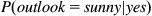

将为零，因为其他概率都要乘以这个值，所以上述例子中`yes`的最终概率无论多大都为零。零概率对其他概率具有否决权。这不是一个好主意。但通过对频率计算概率的方法进行微调，很容易修复这个缺陷。

例如，表 4.2 的上部分显示，对于`play=yes`，`outlook`为`sunny`的例子有两个，`overcast`（阴天）有四个，`rainy`（雨天）有三个，下半部分给出这些事件的概率分别为 2/9、4/9 和 3/9。相反，我们可以在每个分子上加 1，并通过在分母上加 3 来补偿，分别得到 3/12、5/12 和 4/12。这将确保出现 0 次的属性值获得一个非零概率。这种每个计数加 1 的策略是一种标准技术，被称为根据 18 世纪法国数学家拉普拉斯（Laplace）命名的拉普拉斯估计器：

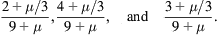

`µ`的值在上面设置为 3，有效地提供了一个权重，决定了先验概率与来自训练集的新证据相比的影响有多大。较大的`µ`表示这些先验非常重要，而较小的`µ`则赋予的影响较小。最后，没有特别理由在分子中将`µ`分为三个相等的部分：我们可以使用：

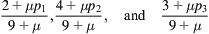

其中`p1`、`p2`和`p3`之和为 1。这种贝叶斯公式的优势在于源自一个严谨的理论框架。然而，从实践角度来看，它并没有真正帮助确定如何分配先验概率。在实践中，只要在参数估计中避免零值，在训练实例足够的情况下，先验概率的影响不大。

通常只是使用拉普拉斯估计器（Laplace estimator）通过将所有计数初始化为 1 而不是 0 来估计频率。

## 缺失值与数值属性

朴素贝叶斯（Naïve Bayes）非常好的特性之一是缺失值完全没有问题。例如，如果表 4.3 示例中`outlook`（展望）的值缺失，计算将简单地跳过该属性，得到：

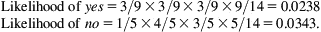

这两个数字都比之前高得多，因为其中一个分数缺失了。但这并不是问题，因为两种情况下都缺少分数，而且这些似然会经过进一步的归一化处理。这使得`yes`（是）和`no`（否）的概率分别为 41% 和 59%。

如果训练实例缺失某个值，它就不会被包含在频率计数中，概率比是基于实际出现的数值数量而不是总实例数量。

数值值通常通过假设它们具有“正态”或“高斯”概率分布来处理。表 4.4 给出了来自表 1.3 的带有数值特征的天数据的总结。对于分类属性，我们像以前一样计算计数，而对于数值属性，我们只需列出出现的值。然后，我们不再像处理分类属性那样将计数归一化为概率，而是计算每个类别和每个数值属性的平均值和标准差。`yes`实例的`temperature`（温度）平均值为 73，其标准差为 6.2。均值就是这些值的平均数，即总和除以数值个数。标准差是样本方差的平方根，计算方法如下：从每个值中减去均值，将结果平方，全部求和，然后除以个数减 1。找到这个“样本方差”后，对其取平方根得到标准差。这是计算一组数字平均值和标准差的标准方法（“减 1”涉及到样本中的自由度，这是一个我们在此不想展开的统计学概念）。

## 表 4.4

**带有汇总统计的数值型天气数据**

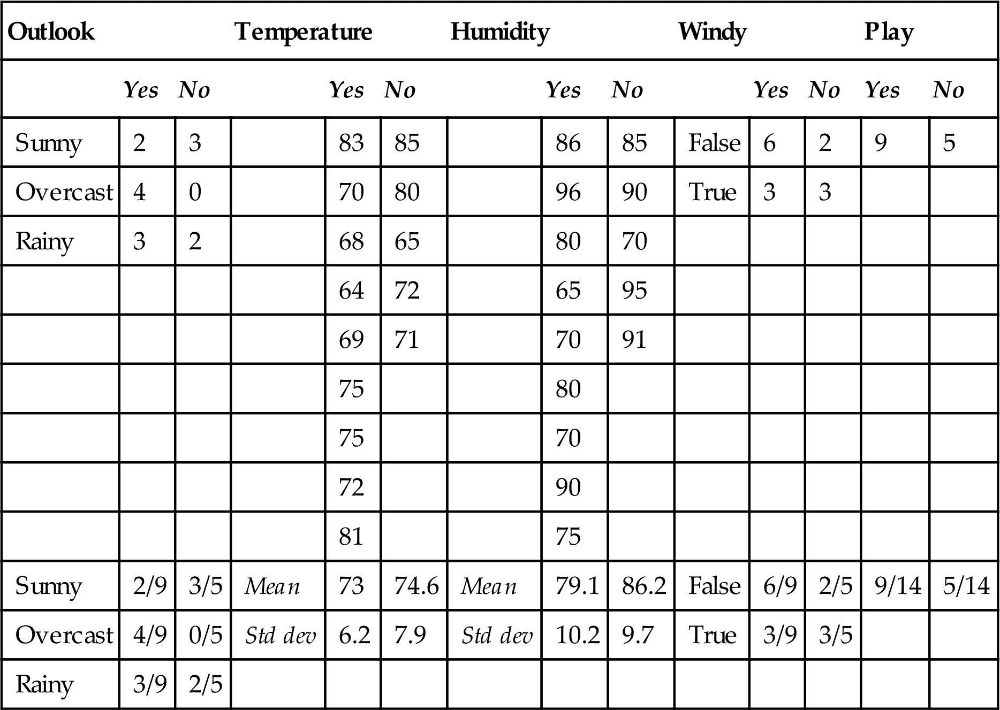

均值为`µ`、标准差为`σ`的正态分布的概率密度函数由以下复杂的表达式给出：

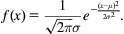

但不要害怕！当我们考虑`temperature`值为（例如）66 时的`yes`结果时，我们只需要将`x=66`、`µ=73`和`σ=6.2`代入公式即可。因此，概率密度函数的值为：

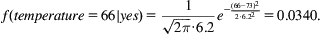

同样，当`humidity`（湿度）值为（例如）90 时，`yes`结果的概率密度也是以相同的方式计算的：

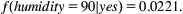

事件的概率密度函数与其概率密切相关。然而，它们并不是同一回事。如果温度是一个连续标度，温度*恰好*为 66——或*恰好*为任何其他值（如 63.14159262）的概率为零。密度函数`f(x)`的真实意义是：变量落在`x`周围极小区域内的概率，例如在：

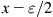

和：

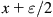

之间的概率为：

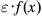

你可能认为在使用这些密度值时应该考虑准确度数字`ε`，但并非必要。相同的`ε`会出现在随后的`yes`和`no`似然中，并在计算概率时相互抵消。

使用表 4.5 中新天的这些概率得到：

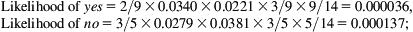

导致概率：

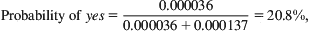

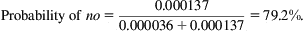

## 表 4.5

**另一天**

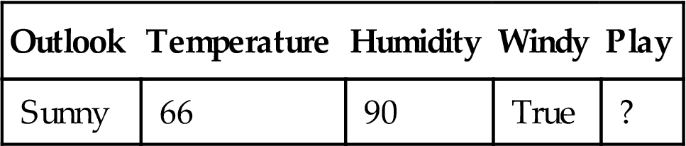

这些数字与之前表 4.3 中计算的新天概率非常接近，因为`temperature`和`humidity`的 66 和 90 值产生了相似的`cool`和`high`值。正态分布假设使得朴素贝叶斯分类器易于扩展数值属性。如果任何数值属性值缺失，均值和标准差的计算仅基于出现的值。

## 朴素贝叶斯分类

分类是机器学习的一个重要领域，每个实例代表一个文档，并通过其中出现的单词进行表征。朴素贝叶斯是该领域的一种流行技术，因为它非常快速且准确。然而，它没有考虑到每个单词出现的次数，这在确定文档类别时可能有用。相反，文档可以被视为词袋（*bag of words*）——包含文档中所有多次出现的单词的集合（技术上讲，*set*每个成员只包含一次，而*bag*可以有重复元素）。

单词频率可以通过应用改进形式的多项式朴素贝叶斯来解决。假设`n1`、`n2`、...、`nk`是单词`i`在文档中出现的次数，`P1`、`P2`、...、`Pk`是类别`H`的所有文档中采样得到单词`i`的概率。假设概率独立于单词中的上下文和位置。这些假设导致了文档的多项分布。

对于这种分布，给定类别`H`的文档`E`的概率——换句话说，贝叶斯规则中计算概率`P(E|H)`的公式为：

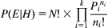

其中`N=n1+n2+...+nk`：


是文档中的单词个数。阶乘的原因是为了考虑到词袋模型中每个单词出现的顺序是不重要的。`Pi`是通过计算属于类别`H`的所有训练文档中单词`i`的频率估计的。

实际上，可能存在额外的项给出类别`H`生成长度与`E`相同的文档的概率，但通常假设这对于所有类别都是相同的，因此可以舍弃。例如，假设词汇表中只有两个单词`yellow`和`blue`，特定的文档类别`H`具有`P(yellow|H)=75%`和`P(blue|H)=25%`（你可能称`H`为黄绿色文档类）。假设`E`是长度为`N=3`个单词的文档`blue yellow blue`。

有四种可能的三个词组合。一个是 `{yellow yellow yellow}`，它根据前面的公式的概率为：

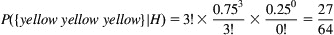

另外三个及其概率为：


`E` 对应最后一种情况（回想词袋中顺序是不重要的）；因此它被黄绿色文档模型生成的概率为 9/64，或 14%。假设另一个类别，深蓝绿色文档（称之为 ），具有 `P(yellow|img/7a913acc95611372bc1553410228aff7_105_4.png)=10%` 和 `P(blue|img/7a913acc95611372bc1553410228aff7_105_4.png)=90%`。`E` 被该模型生成的概率为 24%。

## 备注

朴素贝叶斯提供了一种具有清晰语义的简单方法，用于表示、使用和学习概率知识。它可以取得令人惊目的结果。人们经常发现，在许多数据集上，朴素贝叶斯可以与更复杂的分类器相媲美，事实上优于它们。教训是，总是先尝试简单的方法。人们反复在经过长期斗争后，成功使用复杂的学习方案获得了良好的结果，但后来发现诸如 1R 和朴素贝叶斯这样简单的方法同样好，甚至更好。然而，对于许多数据集，朴素贝叶斯表现并不好，这一点显而易见。

是的。因为属性被视为相对于给定类是相互独立的，冗余属性的添加会偏离学习过程。一个极例是，如果你在天气数据中包含一个与`温度`（temperature）具有相同值的新属性，那么`温度`属性的影响就会倍增：它所有的概率都会平方，从而使其在决策中产生更大的影响力。如果你添加了 10 个这样的属性，决策实际上将仅根据`温度`做出。属性之间的依赖性关系不可避免地削弱了朴素贝叶斯识别现状的能力。然而，可以通过在决策过程中使用属性的子集来改进这一点，即对使用哪些属性进行仔细选择。第 8 章“数据转换”展示了如何实现。

对于数值型属性的正态分布假设是此处我们表述的朴素贝叶斯的另一个限制。许多特征简单来说并不符合正态分布。然而，没有什么可以阻止我们使用其他分布：正态分布并没有什么魔力。如果你知道某个特定属性可能遵循其他分布，则可以使用该分布的标准估计程序。如果你怀疑它不是正态的但不知道实际的分布，则有“核密度估计”的程序，这些程序不假设属性值遵循任何特定分布。另一种可能性是先对数据进行离散化。

朴素贝叶斯是一个非常简单的概率模型，我们将在第 9 章“概率方法”中检查更复杂的模型。

## 4.3 分治治法：构建决策树

构建决策树的问题可以用递归的方式表示。首先，选择一个属性放在根节点上，并为每个可能的值创建一个分支。这会将示例集分成若干子集，每个属性值对应一个子集。现在可以对每个分支递归地重复该过程，仅使用那些实际到达分支的实例。如果在任何时刻，节点上的所有实例具有相同的分类，则停止开发树的该部分。

剩下的问题是在给定具有不同类别的示例集，如何确定根据哪个属性进行分裂。再次（考虑考虑天气数据。每次分裂都有四种可能性，在顶层它们产生了图 4.2 所示的树。哪种是最佳选择？叶节点显示了`是`（yes）和`否`（no）类的数量。任何只有一个类别（`是`或`否`）的叶节点都不需要进一步分裂，该分支的递归过程将终止。由于我们追求较小的树，我们希望这种情况尽快发生。如果我们有一个每个节点的纯度度量，我们就可以选择产生最纯子节点的属性。花点时间看看图 4.2，并思考你认为哪个属性是最佳选择。


**图 4.2** 天气数据的树桩。

我们将要使用的纯度度量称为`信息`（information），以`比特`（bits）为单位衡量。它与树的节点相关，表示在给定示例到达该节点的情况下，指定一个新实例应被分类为`是`还是`否`所需的预期信息量。与计算机内存中的比特不同，预期信息量通常涉及比特的分数——而且通常小于 1！它是根据节点处`是`和`否`类的数量计算的；我们稍后会查看计算细节。但首先让我们看看它是如何使用的。在评估图 4.2 中的第一棵树时，叶节点上的`是`和`否`类的数量分别为 [2, 3]、[4, 0] 和 [3, 2]，这些节点的信息值为：


我们计算这些值的平均信息值，考虑了进入每个分支的实例数量——第一和第三分支五个，第二个分支四个：


这个平均值代表了给定图 4.2A 树结构的情况下，指定新实例类别所需的预期信息量。

在图 4.2 中的任何初始树结构创建之前，根节点的训练示例包含了九`是`节点和五个`否`节点，对应信息值为：


因此，图 4.2A 中的树负责产生信息增益：


这可以解释为在`展望`（outlook）属性上创建分支的信息价值。

前行的路是清晰的。我们计算每个属性的信息增益，并在增益最大的属性上分裂。在图 4.2 的情况下，


所以我们选择`展望`作为分裂属性。前行的路是清晰的。我们计算每个属性的信息增益，并在增益最大的属性上分裂。在图 4.2 的情况下，


**图 4.3** 天气数据的扩展树。

前行的路是清晰的。我们计算每个属性的信息增益，并在增益最大的属性上分裂。在图 4.2 的情况下，


**图 4.4** 天气数据的决策树。

## 计算信息

现在是时候解释如何计算用作评估不同分裂基础的信息量了。我们在本节中描述基本思想，在下一节中，我们将检查通常为了的修正，以消除倾向于选择具有大数量分裂的偏差。

在检查计算给定示例到达具有特定数量`是`和`否`的树时指定其类别所需的详细信息公式之前，首先考虑我们期望该数量具有的种种属性：

- 当`是`或`否`的数量之一为 0 时，信息为 0；
- 当`是`和`否`的数量相等时，信息达到最大值。

此外，该度量应该适用于多类情况，而不仅仅是双类情况。信息度量与通过决策获得的信息有关，通过考虑决策的性质可以推导出更微妙的信息属性。决策可以在一个阶段进行，也可以分阶段进行，且涉及的信息在两种情况下是相同的。例如，涉及`img/7a913acc95611372bc1553410228aff7_110_1.png`的决策分两个阶段进行。首先判断是第一种情况还是另外两种情况之一：

`img/7a913acc95611372bc1553410228aff7_110_2.png`

然后判断它是另外两种情况中的哪一个：

`img/7a913acc95611372bc1553410228aff7_110_3.png`

在某些情况下，不需要做第二个决策，即当证明证明是第一种时。考虑这一点得出了方程：

`img/7a913acc95611372bc1553410228aff7_110_4.png`

当然，这些特定的数字并没有特殊之处，无论实际值如何，相似的关系都应该成立。因此，我们可以在上述列表中再添加一个标准：

3. 信息应该遵循我们所阐述的多阶段属性。

显著的是，事实证明只有一个函数满足所有这些属性，它被称为`信息值`或`熵`：


出现负号的原因是分数的对数：


是负值，因此熵实际上是正值。通常对数以 2 为底，此时熵的单位称为`比特`（bits）——就是计算机中常用的那种比特。

熵公式的参数：


… 被表示为和为 1 的分数，因此例如：

`1/2`


因此，多阶段决策属性可以通地写为：


其中：


由于对数函数的工作方式，你无需计算出每一个分数就可以计算信息量：


这是实践中通常计算信息量的方法。因此，图 4.2 中第一棵树的第一个节点的信息值为：


如前所述。

## 高分支率属性

当某些属性具有大量可能的值时（产生具有许多子节点的多路分支），信息增益的计算就会出现问题。在极端情况下，可以很好地理解这个问题，即一个属性对于数据集中的每个实例都有不同的值——例如，识别代码属性可能是如此。

表 4.6 给出了带有这一额外属性的天气数据。对`ID 代码`进行分支产生了图 4.5 所示树桩。在给定该属性值的情况下，指定类别所需的预期信息为：


它是 0，因为 14 个项中的每一项都是 0。这并不意外：`ID 代码`属性识别了实例，从而在没有任何歧义的情况下确定了类别——正如表 4.6 所示。因此，该属性的信息增益只是根节点的信息，`info([9,5]) = 0.940 bits`。这大于任何其他属性的信息增益，因此`ID 代码`将不可避免地被选择为分裂属性。但对识别代码进行分支对于预测未知实例的类别是没有好处的。

**表 4.6**

**带有识别代码的天气数据**


**图 4.5** `ID 代码`属性的树桩。

整体影响是，信息增益量倾向于选择具有大量可能取值的属性。为了补偿这一点，广泛使用一种名为`增益率`（gain ratio）的指标改进方法。增益率是通过考虑属性分裂数据集的子节点数量和大小得出的，而忽略了任何关于类别的信息。在图 4.5 所示的情况下，所有计数值均为 1，因此分裂的信息值为：


因为相同的分数 1/14 出现了 14 次。这相当于`log 14`，或 3.807 bits，这是一个非常高的值。这是因为分裂的信息值是确定每个实例分配到哪个分支所需的比特数，分支越多，这个值就越大。增益率通过将信息增益（本例中为 0.940）除以信息（3.807）计算得出，对于`ID 代码`属性的结果为 0.247。回到 4.2 的树桩，`天气`将数据集分为三个大小为 5、4、5 的子集，因此其信息值为：


而不考虑涉及的类别。正如我们所见，这种信息值对于高分支属性如`ID 代码`更大。在这种情况下，`天气`仍然胜出，但由于它分为两个子集而不是三个，现在更有竞争优势。遗憾的是，在某些情况下，增益率会过度补偿，导致倾向于信息值远低于属性。这种优势被大大缩小。

**表 4.7**

**4.2 树桩的增益率计算**


## 4.4 覆盖算法：构建规则

正如我们所见，决策树算法基于问题的分治法。它们自上而下工作，在每个阶段寻找最佳分离类别的属性，然后递归地处理分裂产生的子问题。这种策略生成决策树，需要时可以转换为一组规则——尽管这种转换并非易事。另一种方法是轮流每个类并寻找覆盖其所有实例的方法，同时排除不在该类的实例。这被称为`覆盖`方法，因为你每个阶段都识别出覆盖某些实例的规则。覆盖方法可以很容易在实例的二维空间中可视化，如图 4.6A 所示。我们首先为覆盖`a`类创建一个规则。对于规则中的第一个测试，如中间图片所示垂直分割空间。这给了规则的开头：


**图 4.6** 覆盖算法：(A) 覆盖实例；(B) 问题的决策树。

`If x > 1.2 then class = a`

然而，该规则覆盖了许多`b`类也包括`a`类，因此通过如第三幅图所示进一步水平分割空间为规则添加了新测试：

`If x > 1.2 and y > 2.6 then class = a`

这给覆盖了除了一个`a`类以外的所有实例。可能停止到这里就可以了，但如果觉得有覆盖最后一个`a`，则需要另一个规则——也许吧。

`If x > 1.4 and y < 2.4 then class = a`

相同的步骤导致了两条覆盖`b`的规则：

`If x ≤ 1.2 then class = b`

`If x > 1.2 and y ≤ 2.6 then class = b`

再次，一个`a`被这些规则错误地覆盖了。如果有必要排除它，则必须在第二条规则中添加更多测试，并需要额外的规则来覆盖被这些新测试排除的`b`。

## 规则与决策树

自顶向下的分而治算法以相同的方式处理相同的数据，即，至少在表面上看，与覆盖算法非常相似。它可能会首先使用`x`属性对数据集进行划分，并可能最终在相同的位置`x = 1.2`处进行划分。然而，覆盖算法只关注覆盖单个类别，而划分法会同时考虑两个类别，因为分而治算法会创建一个适用于所有类别的单一概念描述。第二次划分也可能在相同的位置`y = 2.6`，从而导致图 4.6B 所示的决策树。这棵树与规则集完全对应，在这种情况下，覆盖算法和分而治算法之间的效果没有区别。

但在许多情况下，规则和树在表示的清晰度方面`存在`差异。例如，当我们在 3.4 节描述复制子树问题时，我们注意到规则可以是对称的，而树必须选择一个属性进行首次划分，这可能导致树比等效规则集大得多。另一个区别是，在多分类情况下，决策树的划分会考虑所有类别，试图使划分的纯度最大化，而规则生成方法一次专注于一个类别，而忽略其他类别的变化情况。

## 简单的覆盖算法

覆盖算法通过向正在构建的规则中添加测试来工作，始终努力创建一个准确率最高的规则。相比之下，分而治算法通过向正在构建的树中添加测试来工作，始终努力使类别之间的分离最大化。这些都涉及找到一个用于划分的属性。但在每种，最佳属性的标准是不同的。`ID3` 等分而治算法选择属性是为了使信息增最大化，而我们将描述的覆盖算法选择一个属性-值对来使目标分类的概率最大化。

图 4.7 给出了这种情况的描述，显示了包含所有实例的空间、一个部分构建的规则以及添加新项后的相同规则。新项限制了规则的覆盖范围：其思想是尽可能包含目标类别的实例，并尽可能排除其他类别的实例。假设新规则将覆盖总共`t`个实例，其中`p`是该类的正样本，`t–p`属于其他类别——即规则所犯的错误。然后选择新项使比率`p/t`最大。

**图 4.7** 覆盖算法运行期间的实例空间。

一个例子会有帮助。例如，我们使用表 1.1 中的隐形眼镜问题。我们将依次形成覆盖三个类别——`hard`（硬）、`soft`（软）和`none`（无）的规则。首先，我们寻找一条规则。

`If ? then recommendation = hard.`

对于未知项“”，有九种选择：

- `age = young`: 2/8
- `age = pre-presbyopic`: 1/8
- `age = presbyopic`: 1/8
- `spectacle prescription = myope`: 3/12
- `spectacle prescription = hypermetrope`: 1/12
- `astigmatism = no`: 0/12
- `astigmatism = yes`: 4/12
- `tear production rate = reduced`: 0/12
- `tear production rate = normal`: 4/12

右侧的数字显示了该选择所选集中“正确”实例的比例。在这种情况下，`correct` 意味着建议是`hard`。例如，`age = young`选择了八个实例，其中两个推荐硬性隐形眼镜，因此第一个比例是 2/8。（为了跟进这一点，你需要回看表 1.1 中的隐形眼镜数据并统计表中的条目。）我们选择最大的比例 4/12，在列表中的第七个和最后一个选择之间随机选择其一，并创建规则：

`If astigmatism = yes then recommendation = hard`

这条规则相当不准确，在它覆盖的 12 个实例中只有 4 个是正确的，如表 4.8 所示。因此我们进一步对其进行精炼：

**表 4.8**

***Astigmatism = Yes* 的隐形眼镜数据部分**

| | |
| :--- | :--- |

`If astigmatism = yes and ? then recommendation = hard`

考虑未知项`?`的可能性产生了七种选择：

- `age = young`: 2/4
- `age = pre-presbyopic`: 1/4
- `age = presbyopic`: 1/4
- `spectacle prescription = myope`: 3/6
- `spectacle prescription = hypermetrope`: 1/6
- `tear production rate = reduced`: 0/6
- `tear production rate = normal`: 4/6

（再次统计表 4.8 中的条目。）最后一个是明显的获胜者，在它覆盖的六个实例中有四个是正确的，并对应于规则。


`If astigmatism = yes and tear production rate = normal then recommendation = hard`

我们应该在这里停止吗？也许吧。但假设我们要追求精确规则，无论它们变得多么复杂。表 4.9 显示了到为止该规则覆盖的案例。下一个项的可能性现在是：

- `age = young`: 2/2
- `age = pre-presbyopic`: 1/2
- `age = presbyopic`: 1/2
- `spectacle prescription = myope`: 3/3
- `spectacle prescription = hypermetrope`: 1/3

**表 4.9**

***Astigmatism=Yes and Tear Production Rate=Normal* 的隐形眼镜数据部分**

| | |
| :--- | :--- |

我们需要在第一个和第四个之间选择。因此，尽管这两个是对等的（都是一样），但它们的覆盖范围不同：一个选择了两个，另一个选择了三个。在平局的情况下，我们选择覆盖范围更大的，给出最终规则：

`If astigmatism = yes and tear production rate = normal and spectacle prescription = myope then recommendation = hard`

这条规则实际上覆盖了原始集合中的两个实例，其中一个被之前的规则覆盖了——但没关系，因为每条规则的建议是相同的。现在所有硬性眼镜案例都被覆盖了，下一步是以相同的方式处理软性眼镜案例。最后，为`none`情况生成规则——除非我们正在寻找带有默认规则的规则集，在这种情况下，对于最终结果的显式规则是不必要的。

我们刚刚描述的是用于构建规则的`PRISM`方法。它只生成正确或“完美”规则。它通过准确率公式`p/t`衡量规则的成功。任何准确率低于 100% 的规则都是“错误的”，因为它将不属于该类别的案例分配给了该类别。`PRISM`继续向每条规则添加子句，直到它是完美的：其准确率达到 100%。

图 4.8 给出了算法的总结。外层循环遍历类别，依次为每个类别生成规则。注意我们每轮都初始化为完整的实例集。然后我们为该类别创建规则并从集中移除实例，直到没有该类别为止。每当我们创建一个规则时，从一个空规则（覆盖所有实例）开始，然后通过添加测试来限制它，直到它只覆盖目标类的实例。在每个阶段选择最有希望的测试，即使规则准确率最大化的测试。

**图 4.8** 基础规则学习器的伪代码。

## 规则与决策列表

考虑为特定类别生成的规则，即图 4.8 中去除了外层循环的算法。从这些规则的生成方式可以显而易见，它们的设计意图是按顺序解释的，即作为一个决策列表，依次测试规则，直到某条规则适用并使用它。这是因为一旦新规则完成，它所覆盖的实例就会从实例集中被移除（在图 4.8 代码的最后一行）：因此，后续规则是为*没有*被该规则覆盖的实例设计的。

然而，尽管似乎我们需要按顺序检查规则，但我们不必这样做。考虑一下，为该类别生成的任何后续规则都具有相同的效果——它们都预测同一个类别。这意味着执行它们的顺序并不重要：要么找到会找到一个覆盖该实例的规则，在这种情况下预测出相应的类别；或者没有找到这样的规则，在这种情况下不预测该类别。

现在回到整体算法。依次考虑每个类别，并生成将该类的实例与其他实例区分的规则。一个类别的规则与另一个类别的规则之间没有顺序关系。因此，生成的规则可以以任何顺序执行。

正如 3.4 节所述，与顺序无关的规则通过作为独立的“知识”碎片，似乎提供了更高的模块化，但它们的缺点是，当冲突规则同时适用时，并不清楚该怎么办。使用这种方式生成的规则，测试示例可能会获得多个分类，即它可能满足适用于不同类别的规则。其他测试示例可能完全得不到任何分类。

在模糊情况下强制做出决策的简单策略是：从预测的分类中选择具有训练示例最多的一个；或者如果没有预测出任何分类，则选择整体上训练示例最多的类别。这些困难在决策列表中不会发生，因为决策列表旨在被按顺序解释的，并且一旦某条规则适用，执行就会停止：在末尾添加默认规则确保了任何测试实例都能获得分类。正如我们在 6.2 节中看到的，可以使用稍微不同的方法为多分类情况生成良好的决策列表。

## 4.5 挖掘关联规则

关联规则与分类规则相似。你可以通过相同的方法发现它们，即对规则右侧可能出现的任何表达式执行独立的“分而治之”的规则诱导程序。但不仅任何属性可能以任何可能的值出现在右侧；单条关联规则往往预测多个属性的值。

为了找到此类规则，你必须对右侧每种可能的属性*组合*以及每种可能的取值组合都执行一次规则诱导程序。这将产生海量的关联规则，然后必须根据它们的*覆盖率*（它们正确预测的实例数量）和*准确率*（以规则适用的实例数量为比例表示的相同数量）进行剪枝。这种方法是完全不可行的。（注意，正如我们在 3.4 节中提到的，我们所称的*覆盖率*通常被称为*支持度*，我们所称的*准确率*通常被称为*置信度*。）

相反，我们利用了只对高覆盖率的关联规则感兴趣这一事实。我们暂时忽略规则左、右侧的区别，寻找具有预设最小覆盖率的属性-值对组合。这些被称为*频繁项集*：一个属性-值对被称为*项*（item）。该术语源于市场购物篮分析，其中“项”是你购物车中的商品，而超市经理正在寻找这些购物之间的关联性。

### 项集

表 4.10 的第一列显示了表 1.2 天气数据的各个项，右侧给出了每个项在数据集中出现的次数。这些是单项集。下一步是通过将单项集配对来生成二项集。当然，生成一个包含同一属性的两个不同值的集合（例如*展望*=*晴*和*展望*=*云*）是没有意义的，因为这在任何实际实例中都不可能发生。

**表 4.10：覆盖率大于等于 2 的天气数据项集**

假设我们正在寻找最小覆盖率为 2 的关联规则：因此我们丢弃任何覆盖少于两个实例的项集。这剩下 47 个二项集，其中一些显示在第二列，以及它们出现的次数。下一步是生成三项集，其中 39 个的覆盖率达到 2 或更大。有 6 个四项集，没有五项集——对于这些数据，覆盖率达到 2 或更大的五项集只能对应于一个重复的实例。

表格的前几行（例如）显示有 5 天的*展望*=*晴*，其中两天的*温度*=*热*，而且，在这两天里*湿度*=*高*且*玩球*=*不*。

### 关联规则

我们将解释如何高效地生成这些项集。但让我们完成这个故事。一旦生成了所有所需覆盖率的项集，下一步是将每个项集转换为规则（或规则集），且至少达到指定的最小准确率。某些项集会产生多条规则；另一些则一个都不产生。

例如，有一个覆盖率为 4 的三项集（表 4.10 的第 38 行）：

`humidity = normal, windy = false, play = yes`

该集合导致了七条潜在规则：

- 如果`humidity = normal and windy = false`，则`play = yes`（4/4）
- 如果`humidity = normal and play = yes`，则`windy = false`（4/6）
- 如果`windy = false and play = yes`，则`humidity = normal`（4/6）
- 如果`humidity = normal`，则`windy = false and play = yes`（4/7）
- 如果`windy = false`，则`humidity = normal and play = yes`（4/8）
- 如果`play = yes`，则`humidity = normal and windy = false`（4/9）
- 如果`humidity = normal and windy = false and play = yes`，则无后件（4/14）

右侧的数字显示了三个条件均成立的实例数量——即覆盖率——除以前提件中条件成立的实例数量。如果解释为分数，它们代表了规则正确的实例比例——即其准确率。假设指定的最小准确率为 100%，则这些规则中只有第一条会进入最终的规则集。

分数的分母可以通过查阅表 4.10 中的前提件表达式来轻松获得（尽管有些没有显示在表中）。上面的最终规则在前提件中没有条件，其分母是数据集中实例的实例数。

表 4.11 显示了天气数据的最终规则集，最小覆盖率为 2，最小准确率为 100%，并按覆盖率排序。总共有 58 条规则，3 条覆盖率为 4，5 条覆盖率为 3，50 条覆盖率为 2。只有 7 条规则在结论部包含两个条件，且没有一个规则超过两个。第一条规则来自之前描述的项集。有时几条规则源于同一个项集。例如，规则 9、10 和 11 都源于表 4.10 第 6 行的四项集。


`temperature = cool, humidity = normal, windy = false, play = yes`

其覆盖率为 2。该项集中的三个子集也有 2 的覆盖率：

- `temperature = cool, windy = false`
- `temperature = cool, humidity = normal, windy = false`
- `temperature = cool, windy = false, play = yes`

这些推导了规则 9、10 和 11，所有这些规则（在训练数据上）的准确率均为 100%。

## 高效生成规则

我们现在将更详细地考虑一种产生指定最小覆盖率和准确率的关联规则的算法。它包含两个阶段：生成具有指定最小覆盖率的项集，以及从每个项集中确定具有指定最小准确率的规则。

第一阶段通过生成所有具有给定最小覆盖率的单项集（表 4.10 的第一列），然后利用这些生成二项集（第二列）、三项集（第三列），依此类推。每一步操作都涉及遍历数据集以统计每个集合中的项，在遍历完成后，将存留的项集存储在哈希表中——这是一种标准数据结构，允许非常快速找到存储在其中的元素。

从单项集生成候选二项集，然后再次遍历数据集，统计每个二项集的覆盖率；在结束时，从表中移除覆盖率小于最小覆盖值的候选集合。候选二项集仅仅是所有单项集的两两组合，因为除非一个二项集所包含的两个单项集都具有最小覆盖率，否则该二项集不可能具有最小覆盖率。这同样适用于这种情况：只有当三项集的所有三个二项子集都具有最小覆盖率时，三项集才具有最小覆盖率，四项集也是如此。

一个例子将有助于解释候选项集是如何生成的。假设有五个三项集：`(A B C)`、`(A B D)`、`(A C D)`、`(A C E)` 和`(B C D)`——例如，`A` 是一个如`天气=晴天`这样的特征。

前两个者的并集`(A B C D)`是一个候选四项集，因为它的其他三个三项子集`(A C D)`和`(B C D)`的覆盖率大于最小覆盖率。如果将三项集按字典顺序排序（如此列表所示），那么我们只需要考虑前两个成员相同的项对。

例如，我们不考虑`(A C D)`和`(B C D)`，因为`(A B C D)`也可以从`(A B C)`和`(A B D)`生成，而且如果这两个不是具有最小覆盖率的三项集，那么`(A B C D)`就不可能是候选四项集。这就留下了项对`(A B C)`和`(A B D)`（我们已经解释过了），以及`(A C D)`和`(A C E)`。

第二组项对推导了集合`(A C D E)`，其三项集子集并不全都具有最小覆盖率，因此它被丢弃了。哈希表有助于这种检查：我们只需依次从集合中移除每个项，并检查剩余的三项集确实存在于哈希表中。因此，在这个例中，只有一个候选四项集即`(A B C D)`。它是否实际上具有最小覆盖率，只能通过检查数据集中的实例来确定。

程序的第二阶段是取每个项集并从中生成规则，检查它们是否具有指定的最小准确率。如果只寻求右侧只有单一测试的规则，那么只需依次考虑规则中的每个条件作为规则的后件，将其从项集中删除，并将整个项集的覆盖率除以（从哈希表中得到的）结果子集的覆盖率，从而得到相应规则的准确率。

鉴于我们对后件中包含多个测试的关联规则也感兴趣，看起来我们必须评估将项集的每个*子集*放在右侧的影响，并将集合的剩余部分作为前件。

除非项集很小，否则这种暴力法在计算上将是极其密时的，因为可能的子集数量随项集的大小呈指数级增长。然而，有更好的方法。我们在第 3.4 节描述关联规则时观察到，如果双后件规则：

```text
If windy = false and play = no

then outlook = sunny and humidity = high
```

在给定的最小覆盖率和准确率下成立，那么由同一个项集形成的两个单后件规则也必须成立：

```text
If humidity = high and windy = false and play = no

then outlook = sunny

If outlook = sunny and windy = false and play = no

then humidity = high
```

反之，如果单后件规则之一不成立，那么就没有必要考虑那个双后件规则了。这提供了一种从单后件规则构建到候选双后件规则、从双后件规则构建到候选三后件规则的方法，依此类推。当然，每个候选规则都必须根据哈希表检查，以看它是否真的具有更多（准确率）。这种方法通常比暴力法快得多。

在描述关联规则时，我们观察到如果规则规则规则 4.9 具有具有最小覆盖率的项集。4.9A 显示了足够 4B4.B 显示足够准确的规则。在实际操作中，覆盖率（支持度）是用户指定的。


**图 4.9** (A) 具有足够覆盖率的项集；(B) 足够准确的规则。

该程序的第二阶段是取每个项集并从中生成规则，检查它们是否具有指定的最小准确率。如果只需要右侧只有单一测试的规则，那么只需依次考虑规则中的每个条件作为后件，将其从项集中删除，并将整个项集的覆盖率除以（从哈希表中得到的）结果子集的覆盖率，从而得到相应规则的准确率。

鉴于我们对后件中包含多个测试的关联规则也感兴趣，看起来我们必须评估将项集的每个*子集*放在右侧的影响，并将集合的剩余部分作为前件。

这种暴力法除非项集很小，否则在计算上将是极其密时的，因为可能的子集数量随项集的大小呈指数级增长。然而，有更好的方法。我们在第 3.4 节描述关联规则时观察到，如果双后件规则：

```text
If windy = false and play = no

then outlook = sunny and humidity = high
```

在给定的最小覆盖率和准确率下成立，那么由同一个项集形成的两个单后件规则也必须成立：

```text
If humidity = high and windy = false and play = no

then outlook = sunny

If outlook = sunny and windy = false and play = no

then humidity = high
```

反之，如果单后件规则之一不成立，那么就没有必要考虑那个双后件规则了。这提供了一种从单后件规则构建到候选双后件规则、从双后件规则构建到候选三后件规则的方法，依此类推。当然，每个候选规则都必须根据哈希表检查，以看它是否真的具有更多（准确率）。这种方法通常比暴力法快得多。

## 4.6 线性模型

我们看过的决策树方法最自然适用于类别属性。它们可以通过将数值属性直接整合到决策树中，或者通过将数值属性离散化为类别属性来扩展，我们将在第 6 章和第 8 章看到。然而，某些方法更自然适用于数值属性，即第 3.2 节介绍的线性模型；我们在这里详细研究。

### 数值预测：线性回归

当结果（类别）是数值型且所有属性都是数值型时，线性回归是一种自然的技术。这是统计学中的一种基础方法。其思想是将类别表示为属性的线性组合，并带有权重：


其中`x`是类别；`a1`、`a2`、`…`、`ak`是属性值；`w0`、`w1`、`…`、`wk`是权重。权重是从训练数据计算出来的。这里的符号变得有点复杂，因为我们需要一种表示每个训练实例属性值的方法。

第一个实例将有一个类别，说是`x(1)`，以及属性值：


其中上标表示第一个实例。此外，为了符号方便，我们假设有一个额外的属性`a0`，其值始终为 1。

第一个实例的预测值可以写为：


这是类别的预测值，而不是实际值。我们感兴趣的是预测值与实际值之间的差异。最小二法线性回归的方法是选择系数`wj`（共有`k+1`个），以最小化所有训练实例差异的平方和。

假设有`n`个训练实例：用上标`(i)`表示第`i`个。那么这些差异的平方和为：

括号内的表达式是第`i`次实例的实际类别与其预测类别之间的差异。我们需要通过恰当地选择系数来最小化平方和。

这这一切看起来变得相当棘手。然而，如果你具有合适的数学背景，这种最小化技术是非常直观的。只需说明，在样本足够的情况下——粗俗来说，样本数量多于属性数量——选择权重以使差异平方和最小化并不困难。这确实涉及矩阵求逆运算，但这种操作可以通过预封装的软件轻松实现。

一旦完成了数学计算，结果将是一组基于训练数据的数值权重，这些权重可以用于预测新实例的类别。我们在查看 CPU 性能数据时看到过这样一个例子，具体的数值权重见图 3.4A。该公式可以用于预测新测试实例的 CPU 性能。

线性回归是数值预测的一种极佳且简单的方法，几十年来在统计应用中被广泛使用。当然，基础线性模型具有局限性，即线性性的限制。如果数据表现出非线性依赖关系，将找到一条最佳拟合的直线，其中“最佳”被解释为均方差最小。这条直线可能拟合得并不很好。然而，线性模型可以作为更复杂学习方法的良好基石或起点。

## 线性分类：逻辑回归


线性回归可以很容易地用于具有数值属性的领域进行分类。事实上，我们可以使用任何回归技术来进行分类。其诀窍在于对每个类别执行一次回归，对于属于该类的训练实例，将输出设为 1，对于不属于该类的实例将其设为 0。结果是该类别的一个线性表达式。然后，给定一个未知类别的测试样本，计算每个线性表达式的值，并选择最大的那一个。

与线性回归结合使用时，这种方案有时被称为多响应线性回归。观察多响应线性回归的一种方法是将其想象为对每个类别近似了一个数值隶属函数。对于属于该类的实例，隶属函数为 1，对于其他实例则为 0。给定一个新实例，我们计算它每个类别的隶属度并选择最大的。

多响应线性回归在实践中通常产生良好的结果。然而，它有两个缺点。首先，它产生的隶属值不是适当的概率，因为它们可能会超出 0–1 的范围。其次，最小二法回归假设误差不仅在统计上是独立的，而且是具有相同标准差的正态分布，当该方法应用于分类问题时，这一假设被公然违背了，因为观测值只取 0 和 1 的值。

一种名为逻辑回归的相关统计技术不受这些问题的影响。逻辑回归不是直接近似 0 和 1 值（从而在目标超出范围时面临产生不合法概率值的风险），而是基于变换后的目标变量构建线性模型。

首先假设只有两个类别。逻辑回归将无法用线性函数精确近似的原始目标变量替换为：

$$
\frac{1}{1+e^{-wTx}}
$$

得到的值不再限于 0 到 1 的区间，而是可以处于从负无穷到正无穷的任何位置。图 4.10A 绘制了该变换函数，该函数通常被称为 `logit` 变换。

**图 4.10** 逻辑回归：(A) `logit` 变换；(B) 逻辑回归函数示例。

变换后的变量使用类似于线性回归生成的线性函数进行近似。得到的模型带有权重 `w`。图 4.10B 显示了该函数在一维上的示例，具有两个权重 `w0 = −1.25` 和 `w1 = 0.5`。

与线性回归一样，必须找到能够良好拟合训练数据的权重。线性回归使用平方误差衡量拟合优度。在逻辑回归中，使用模型的对数似然性。它由以下公式给出，其中 `x(i)` 为 0 或 1。

需要选择权重 `wi` 以使对数似然最大化。解决此极大化问题有几种方法。一种简单的方法是迭代地求解一系列加权最小二法回归问题，直到对数似然收敛到最大值，这通常在几次迭代后发生。

将逻辑回归推广到多个类别，一种可能性是按照上述多响应线性回归的方法，通过对每个类别独立执行逻辑回归。遗憾的是，得到的概率估计通常不会总和为 1。为了获得适当的概率，有必要将每个类别的单独模型耦合。这产生了一个联合优化问题，并且存在高效的求解方法。

使用线性函数进行分类可以很容易在实例空间中可视化。二分类逻辑回归的决策边界位于预测概率为 0.5 的地方，即：

$$
\sum_{i=0}^k w_i a_i = 0
$$

这发生在当……时。

由于这是属性值上的一个线性等式，因此该边界是实例空间中的一个平面，或超平面。很容易视化一组无法通过单个超平面分离的点集，这些点无法通过逻辑回归正确区分。

多响应线性回归也面临相同的问题。每个类别都接收一个从训练数据计算出的权重向量。暂时重点关注一对类别。如果数据可以使用超平面完美地分为两组，则称其线性可分。

## 使用感知机进行线性分类

逻辑回归试图通过最大化训练数据的概率来产生准确的估计。当然，准确的概率估计会导致准确的分类。然而，如果模型的唯一目的是预测类别标签，则没有必要进行概率估计。另一种方法是学习一个分离实例的超平面——假设只有两个实例。如果数据是线性可分的，则有一个非常简单的算法来寻找超平面。

该算法被称为感知机学习规则。在详细查看之前，让我们再次检查平面的方程：

$$
\sum_{i=0}^k w_i a_i = 0
$$

在这里，`a1`、`a2`、…、`ak` 是属性值，而 `w0`、`w1`、…、`wk` 是定义平面的权重。我们将假设每个训练实例 `a1`、`a2`、… 都通过一个始终值为 1 的额外属性 `a0` 进行扩展（正如我们在线性回归情况下做的那样）。这种扩展被称为偏置，它意味着我们不需要在和中包含额外的常数项。如果和大于零，我们将预测第一个类别；否则，我们将预测第二个类别。

该算法不断迭代直到找到完美的解决方案，但只有在存在分离超平面时它才能正常工作。每次迭代遍历所有训练实例。当遇到分类错误的实例时，会改变平面的参数，使得分类错误的实例更接近平面，甚至可能跨越平面到达正确的一侧。如果实例属于第一个类别，则通过将其属性值加到权重向量来实现；否则，则从中减去。

图 4.11A 给出了寻找分离超平面的感知机学习规则。


**图 4.11** 感知机：(A)学习规则；(B) 作为神经网络的表示。

为了理解为什么这种方法有效，考虑在添加了一个属于第一类的实例 `a` 之后的情况：


这意味着 `a` 的输出增加了：


这个数字始终是正数。因此，超平面已经朝着正确的方向移动，以便将实例 `a` 分类为正类。反之，如果属于第二类的实例被错误分类，则该实例的输出在修改后减少，再次使超平面向正确的方向移动。

这些修正是增量的，并且可能会干扰早的更新。然而，可以证明，如果数据是线性可分的，算法会在有限次迭代内收敛。当然，如果数据不是线性可分的，算法将不会终止，因此在实际应用此方法时，需要对迭代次数设定一个上限。

生成的超平面被称为感知机（`perceptron`），它是神经网络的祖父（我们将在第 7.2 节和深度学习章节中回到神经网络）。图 4.11B 将感知机表示为带有节点和加权边的图，形象性地称为“神经元”“网络”。它包含两层节点：输入层和输出层。输入层每个属性有一个节点，外加一个始终设置为 1 的节点。输出层仅包含一个节点。输入层中的每个节点都连接到输出层。连接是有权重的，权重就是通过感知机学习规则找到的数字。

当一个实例输入到感知机时，其属性值用于“激活”输入层。它们与权重相乘并在输出节点求和。如果加权和大于 0，则输出信号为 1，代表第一类；否则，为 −1，代表第二类。

## 使用 Winnow 进行线性分类

感知机算法不是唯一能保证为线性可分问题找到分离超平面的方法。对于具有二进制属性的数据集，还有一种名为 `Winnow` 的方法，如图 4.12A 所示。这两个算法的结构非常相似。与感知机一样，`Winnow` 只在遇到错误分类的实例时才更新权重向量——它是错误驱动的（`mistake driven`）。


**图 4.12** `Winnow` 算法：(A)不平衡版本；(B)平衡版本。

两种方法的区别在于权重的方式。感知机规则采用加法机制，通过加上（或减去）实例的属性向量来改变权重向量。`Winnow` 采用乘法更新，通过乘以用户指定的参数 `α`（或其倒数）来单独改变权重。由于我们处理的是二进制数据，属性值 `ai` 要不是 0 即是 1。如果属性值为 0，权重保持不变，因为它们不参与决策。否则，如果该属性有助于做出正确决策，则乘因子为 `α`，如果不是，则乘因子为 `1/α`。

另一个区别是线性函数中的阈值也是一个用户指定的参数。我们将此阈值称为 `θ`，并且仅当满足以下条件将实例分类为类 1：


乘因子 `α` 需要大于 1。`wi` 在开始时设置为常数。我们描述的算法不允许负权重，这取决于领域，可能是一个缺点。然而，有一个版本被称为平衡 `Winnow`（Balanced `Winnow`），它允许负权重。该版本维护两个权重向量，每个类各一个。当满足以下条件时，实例被分类为类 1：


图 4.12B 显示了平衡算法。

`Winnow` 在从数据集中定位相关特征方面非常有效——因此它被称为属性高效型（`attribute-efficient`）学习器。这意味着如果数据集具有许多（二进制）特征且大多数特征都是不相关的，那么它可能是一个很好的候选算法。`Winnow` 和感知机算法都可以用于在线设置，其中新实例不断到达，因为它们可以随着新实例的到达增量地更新其概念描述。

## 4.7 基于实例的学习

在基于实例的学习中，训练示例被逐字存储，并使用距离函数来确定训练集中哪个成员距离未知测试实例最近。一旦找到了最近的训练实例，就会为该测试实例预测其类别。剩下的问题是定义距离函数，这并不困难，特别是当属性是数值时。

### 距离函数

尽管还有其他可能的选择，但大多数基于实例的学习器使用欧几里得距离。属性值为值的两个实例之间的距离：


...


（其中 `k` 是属性的数量）与值为值的实例：


...


之间的距离定义为：


在比较距离时，没有必要执行平方根运算：可以直接比较平方和。欧几里得距离的替代方案是曼哈顿距离或城市块距离，其中属性值之间的差异不是平方，而是直接相加（取绝对值后）。其他方法通过取高于平方的幂获得。高阶幂会增加大差异的影响，以牺牲小差异为代价。通常情况下，欧几里得距离代表了一个很好的折中。在特殊情况下，其他距离指标可能更合适。关键是考虑实际实例以及它们被特定距离隔开意味着什么——例如，该距离的两倍意味着什么？

不同属性在不同的尺度上进行测量，因此如果直接使用欧几里得距离公式，某些属性的影响可能会被其他测量尺度更大的属性完全掩盖。因此，通常会将所有属性值归一化到 0 到 1 之间，通过计算：


其中 `vi` 是属性 `i` 的实际值，最大值和最小值是在训练集中所有实例中取的。

这些公式隐含地假设属性是数值的。在这里，两个值之间的差就是它们之间的数值差，正是这个差被平方并相加以产生距离函数。对于取符号而非数值值的标值属性，两个不同值之间的差异通常被视为 1，而如果值相同，则差异为 0。在这种情况下不需要缩放，因为只使用了 0 和 1 的值。

处理缺失值的常用策略如下：对于标值属性，假设缺失特征与任何其他属性值的差异最大。因此，如果一个或两个值缺失，或者如果值不同，则它们之间的差异被视为 1；只有当它们不缺失且相同时，差异才为 0。对于数值属性，两个缺失值之间的差异也被视为 1。然而，如果只有一个值缺失，差异通常被视为另一个值的（归一化的）大小或 1 减去该大小，取较大者。这意味着如果值缺失，差异将尽可能大。

### 高效寻找邻居

虽然基于实例的学习简单且有效，但通常很慢。找到训练集中哪个成员距离未知测试实例最近的最方法是计算距离从训练集中的每个成员中选择最小的一个。该过程相对于训练实例的数量是线性的：换句话说，进行单次预测所需的时间与训练实例的数量成正比。处理整个测试集所需的时间与训练集和测试集中实例数量的积成正比。

通过将训练集表示为树，可以更高效地找到最近邻，尽管这并不容易。一种合适的结构是 `kD-tree`。这是一种二叉树，它用超平面划分输入空间，然后递归地对每个划分区域再次划分。在二维情况下，所有的划分都平行于其中一个轴，要么垂直，要么水平。这种数据结构被称为 `kD-tree`，因为它在 `k` 维空间中存储了一组点，其中 `k` 是属性的数量。

图 4.13A 给出了一个 `k = 2` 的较小例子，图 4.13B 显示了它代表的四个训练实例，以及构成该树的超平面。注意，这些超平面并不是决策边界：如后文解释，决策是基于最近邻做出的。第一次划分是水平的（`h`），通过点 (7,4)——这是树的根节点。左分支不再进一步划分：它包含单个点 (2,2)，它是树的叶子节点。右分支在点 (6,7) 处垂直划分（`v`）。它的右子节点为空，它的左子节点包含点 (3,8)。正如这个示例所示，每个区域只包含一个点——或者可能没有点。树的兄弟分支——例如图 4.13A 中根节点的两个子分支——并不一定发展到相同的深度。训练集中的每个点都对应一个节点，多多的一半是叶子节点。


**图 4.13** 针对四个训练实例的 `kD-tree`：(A) 树；(B) 实例和划分。

如何从数据集构建 `kD-tree`？在添加新的训练示例时，它能高效地更新吗？它又是如何加速最近邻计算的？我们先来解决最后一个问题。

要找到给定目标点的最近邻，沿着树从根节点向下查找，直到找到包含目标的区域。图 4.14 显示了一个类似于图 4.13B 的空间，但多了一些实例和一个额外的边界。目标不是树中的实例之一，用星号标记。包含目标的区域的叶子节点被涂成黑色。正如这个示例所示，这并不一定是目标最近的邻居，但这是一个很好的初步近似。特别是任何更近的邻居必须位于更近的位置——图 4.14 中的虚线圆内。要判断是否存在，首先检查更近的邻居是否可能位于节点的兄弟节点内。图 4.14 中黑色节点的兄弟节点被阴影覆盖，圆没有与它相交，因此兄弟节点不会包含更近的邻居。然后返回父节点并检查它的兄弟节点——在这里涵盖了水平线以上的所有区域。在这种情况下它必须被探索，因为它覆盖的区域与到目前为止最好的圆相交。要探索它，找到它的子节点（原始点的两个祖母节点），检查它们是否与圆相交（左边的没有，但右边的有），并向下查看它是否包含更近的点（确实包含）。


**图 4.14** 使用 `kD-tree` 寻找星号的最近邻。

在通常情况下，该算法比检查所有点以寻找最近邻快得多。找到初始近似最近邻（图 4.14 中的黑点）所需的工作量取决于树的深度，如果树是平衡的，深度由节点数 `n` 的对数 `log2 n` 给出。回溯以检查这是否真的是最近邻的工作量在某种程度上取决于树，以及初步近似的好坏程度。但对于节点近似为正方形（而非长条矩形）的构建良好的树，也可以证明其工作量与节点数量呈对数关系（如果数据集中的属性数量不是太大）。

如何为一组训练示例构建一棵好树？问题在于选择第一个进行划分的训练实例以及划分的方向。一旦你可以这样做，就将相同的方法递归应用于初始划分的每个子节点以构建整个树。

要为划分找到一个良好的方向，分别计算每个轴上数据点的方差，选择方差最大的轴，并创建一个垂直于它的划分超平面。为了给超平面找到一个良好的位置，在该轴上找到中位数并选择对应的点。这使得划分垂直于分布最大的方向，一半的点位于两侧。这产生了一棵平衡良好的树。为了避免长条形区域，连续划分最好沿着不同的轴进行，这可能是因为在每个阶段都选择了方差最大的维度。然而，如果点的分布严重倾斜，选择中位数可能会在相同方向产生多次连续划分，导致长长的超矩形。更好的策略是计算平均值而不是中位数，并使用距离平均值最近的点。树不会是完美的，但它的区域将倾向于正方形，因为连续划分更有可能选择不同的方向。

基于实例的学习相比其他大多数机器学习方法的优势在于，可以随时向训练集添加新示例。在使用 `kD-tree` 时，我们需要能够随着新数据点的增加进行增量更新。为此，确定包含新点的叶子节点并找到它的超矩形。如果它是空的，直接将新点放在那里。否则，沿最长边划分超矩形以保持正方形性。这种简单的启发式方法不能保证树是平衡的。


**图 4.16** 根据目标点（星形）及其当前的最近邻居来排除整个球（灰色）。

球树（Ball trees）是从上到下构建的，与 `k-d` 树一样，其基本问题是找到一种好的方法将包含一组数据点的球分为两部分。在实践中，你不需要继续划分直到叶节点仅包含两个点：一旦达到预设的数量，就可以停止——`k-d` 树也是如此。这里有一种可能的划分方法：选择球中距离其中心最远的点，然后选择第二个距离第一个点最远的点。将球中的所有数据点分配给这两个中心中较近的一个，然后计算每个簇的质心，以及包围其所代表的所有点所需的最小半径。这种方法的优点是代价与 `n` 成线性。虽然有更复杂的算法可以产生更紧凑的球，但它们需要更多的计算量。我们不会描述在遇到新实例时如何增量地构建或更新它们的复杂算法。

## 备注

基于实例的学习（Instance-based learning）非常简单且通常效果非常好。在我们描述的方案中，每个属性对决策的影响完全相同，就像在朴素贝叶斯中一样。另一个问题是数据库很容易被噪声样本损坏。一种解决方案是采用 `k`-最近邻策略，其中定位并使用固定数量的少量邻居（例如五个），通过多数投票来共同确定测试实例的类别（注意，之前我们用 `k` 表示属性的数量；这里是另一种不同的用法）。第 7.1 节中描述的改进程序解决了这些缺点。


邻域方法起源于几十年前，统计学家在 20 世纪 50 年代初分析了邻域方案。如果训练实例数量很大，那么使用一个以上的邻居在直觉上是合理的，但如果实例很少，这显然是危险的。可以证明，当 `k` 和实例数量 `n` 都趋于无穷大时，错误概率接近理论最小值。邻域方法在 20 世纪 60 年代初被采用作为分类方案，并在模式识别领域广泛使用了近一个世纪。直到 20 世纪 90 年代初 `k-d` 树开始被应用，邻域分类才因缓慢而闻名，尽管数据结构本身开发得早。在实践中，当空间维度增加时，这些树会变得低效，只有在属性数量较小时才有价值。球树开发得较晚，是一种称为度量树（metric tree）的更通用结构。

## 4.8 聚类

当没有需要的类别，而是需要将实例划分为自然组时，可以使用聚类技术。这些簇可能反映了某种作用机制，该机制使得某些实例之间的相似性比它们与其他实例之间的相似性更强。聚类自然需要与我们迄为止考虑的分类和关联方法不同的技术。

正如我们在第 3.6 节中看到的，聚类结果有不同的表达方式。识别出的组可能是互斥的：任何实例只属于一个组。或者，它们可能是重叠的：一个实例可能属于多个组。又或者它们可能是分层次的：在顶层对实例进行粗略分组，并对每个组进行进一步细化——可能一直细化到单个实例。实际上，这些可能性之间的选择应该由认为支持特定现象的机制性质决定。然而，由于这些机制很少为人知（毕竟，簇的存在本身就是我们试图发现的东西），而且出于务实考虑，选择通常由可用的聚类工具决定。

我们将首先检查一种在数值域运行的算法，它将实例划分为不相交的簇。与基于实例的学习的基本最近邻方法一样，它是一种简单且直接的技术，已经使用了几十年。该算法被称为 `k`-均值（`k-means`），并且已经开发出许多该过程的变体。在基本公式中，选择 `k` 个初始点来代表初始簇中心，将所有数据点分配给最近的中心，计算每个簇中点的平均值以形成其新的簇中心，并继续迭代，直到簇不再发生变化为止。这种程序仅在预先知道簇的数量时才有效。这引出了一个自然的问题：你如何选择 `k`？通常对可能的聚类数量一无所知，而聚类的要点就在于发现这个数量。因此，我们继续讨论在不预先知道簇数量的情况下该怎么办。

某些技术通过对整个数据集应用 `k=2` 的算法，并然后在每个簇内递归地重复该操作，从而产生层次聚类。我们继续查看通过“合并”（agglomeration）创建层次聚类结构的技术，即从单个实例开始并继连接成簇。然后我们查看一种增量运行的方法，在每个新实例出现时对其进行处理。这种方法开发于 20 世纪 80 年代后期，体现在名为 `Cobweb`（用于分类属性）和 `Classit`（用于数值属性）的系统中。这两个系统都实现了实例的层次分组，并使用了一种称为类别效用的簇“质量”衡量。

### 基于距离的迭代聚类

经典的聚类技术被称为 `k`-均值。首先，你预先指定要寻找多少簇：这就是参数 `k`。然后随机选择 `k` 个点作为簇中心。根据普通的欧几里距离度量将所有实例分配给它们最近的簇中心。接下来，计算每个簇中实例的质心或平均值——这就是“均值”（means）部分。这些质心被视为各自簇的新中心值。最后，使用新的簇中心重复整个过程。持续迭代，直到在连续几轮中相同的点被分配到每个簇，在那个阶段，簇中心已经稳定并将永远保持不变。


图 4.17 显示了该过程如何工作的示例，基于具有 15 个实例和 2 个数值属性的简单数据集的散点图。四列中的每一列对应 `k`-均值算法的一次迭代。此示例假设我们看到三个簇；因此我们设置 `k=3`。最初，在左上角随机放置了三个簇中心。然后，在图中，通过寻找最近的簇中心将实例分配到簇中。这完成了第一次迭代。到目前，聚类结果看起来很乱——这并不意外，因为初始簇中心是随机的。关键是根据刚刚生成的分配来更新中心。在下一次迭代中，根据分配到每个簇的实例重新计算中心。这产生了第二列中的图。然后将实例重新分配到这些新中心，以获得下面的图。这产生了一组漂亮得簇。然而，最顶部的两个簇中心不在它们所在的簇中；而且，一个三角形仍被错误地聚类为圆形。因此，这两个步骤——中心重新计算和实例重新分配——需要重复。这产生了步骤 2，在步骤 2 中，簇看起来非常合理。

`k`-均值聚类可以通过仔细选择初始簇中心（通常称为“种子”）得到显著的改进。与其从一组任意的种子开始，这里有一个更好的程序。

1. 从整个空间中随机选择一个初始种子，采用均匀概率分布。
2. 然后选择第二个种子，其概率与距离第一个种子距离的平方成正比。依此类推，在每个阶段选择下一个种子时，其概率与距离已选择的最近种子距离的平方成正比。这种过程被称为 `k`-means++，它比原始的随机种子算法都提高了运行速度和准确性。

## 更快的距离计算

`k-means` 聚类算法通常需要多次迭代，每次迭代都涉及寻找 `k` 个聚类中心到每个实例的距离，以确定其所属的簇。有一些简单的近似方法可以显著提高这种速度。例如，你可以对数据集进行投影并在所选轴上进行切割，而不是使用选择最近聚类中心时所隐含的任意超平面划分。但这不可避免地会损害结果簇的质量。

这里有一种更好的加速方法。寻找最近的聚类中心与在基于实例的学习中寻找最近邻居并没有太大区别。可以使用同样的高效解决方案——`k`D-树（kD-trees）和球树（ball trees）吗？可以！事实上，它们可以以更高效的方式应用，因为在 `k`-means 的每次迭代中，所有数据点都是一起处理的，而在基于实例的学习中，测试实例是单独处理的。

首先，为所有数据点构建一个 `k`D-树或球树，它在整个聚类过程中保持静态。`k`-means 的每次迭代都会产生一组聚类中心，必须检查所有数据点并将其分配给最近的中心。处理点的一种方法是从根向下遍历直到到达叶子节点，然后检查叶子节点中的每个点以找到其最近的聚类中心。但某个较高内部节点代表的区域可能完全落在单个聚类中心的范围内。在这种情况下，该节点下的所有数据点可以一次性处理！

毕竟，练习的目的是通过计算它们所包含点的质心来为聚类中心寻找新位置。质心可以通过保持簇内点的运行向量和以及到目前为止的计数来计算。最后，只需将两者相除即可得到质心。假设我们在树的每个节点中都存储了该节点内点的向量和和点的计数。如果整个节点落在单个簇的范围内，就可以立即更新该簇的运行总和。如果不是，则通过递归向下遍历树查看节点内部。

图 4.18 显示了与 4.15 相同的实例和球树，但用黑星标记了两个聚类中心。由于所有实例都被分配给最近的中心，空间被图 4.18A 所示的粗线分为两部分。从图 4.18B 中的树根开始，带有每个簇的向量和和计数初始值；所有初始值均为零。递归向下遍历树。到达节点 A 时，其所有点都在簇 1 中，因此可以使用节点 A 的和和计数更新簇 1 的和和计数，我们不需要继续向下递归。递归回到节点 B，它的球跨越了簇之间的边界，因此必须单独检查它的点。到达节点 C 时，它完全落在簇 2 中；同样，我们可以立即更新簇 2 而不需要继续向下递归。树只被检查到图 4.18B 中虚线标记的边界，其优势是下方的节点不需要打开——至少在 `k`-means 的这次特定迭代中不需要。下一次，聚类中心将发生变化，情况可能会不同。

**图 4.18** 球树：(A) 两个聚类中心及其划分线；(B) 对应的树。

## 选择聚类数量

假设你正在使用 `k`-means 但预不知道聚类的数量。一种解决方案是尝试不同的可能性并看哪种最好。一个简单的策略是从给定的最小值（例如 `k=1`）开始，一直增加到一个较小的固定最大值。请注意，在训练数据上，根据总平方距离标准的“最佳”聚类将始终是选择与数据点数量一样多的簇！为了惩罚具有许多簇的解决方案，你将需要应用类似于第 5.10 节中的最小描述长度（MDL）准则。

另一种可能性是首先寻找几个簇，并确定是否值得分裂它们。你可以选择 `k=2`，执行 `k`-means 聚类直到其终止，然后考虑分裂每个簇。如果认为初始的二分聚类是不可撤销的，并且对每个组件独立研究划分情况，那么计算时间将大大减少。分裂簇的一种方法是创建一个新种子，它在变异最大的方向上距离簇中心一个标准差，并在相反方向上以相同距离创建第二个种子。（（或者，如果这太慢了，选择一个与簇的边界框成正比的距离和随机方向。）然后将 `k`-means 应用于簇中带有这两个新种子的点上。

在初步分裂一个簇后，是否值得保留该划分，还是原始簇本身同样合理？查看所有点到其聚类中心的总平方距离是没用的——对于两个子簇来说，这个值注定更小。发明额外的簇应该产生惩罚，这正是 MDL 准则的任务。该原则可以用于判断：指定两个新聚类中心所需的信息，以及指定每个点相对于它们所需的信息，是否超过了指定原始中心以及所有相对于它的点所需的信息。如果是，则新的聚类是没有意义的，应该被舍弃。

如果保留了划分，尝试进一步分裂每个新簇。继续此过程直到不再有值得的划分为止。

通过将这种迭代聚类过程与 `k`D-树或球树数据结构相结合，可以获得额外的实现效率。然后，通过从根向下遍历到达数据点。在考虑分裂簇时，不需要考虑整棵树，只需查看覆盖该簇所需的树部分。例如，在决定是否分裂图 4.18A 中左下方的簇（粗线下方）时，只需考虑图 4.18B 中的树节点 A 和 B，因为节点 C 与该簇无关。

## 层次聚类

形成初始的簇对，然后递归地考虑是否值得进一步分裂每一个，会产生一个可以表示为二叉树的层次结构，称为树图（dendrogram）。事实上，我们在图 3.11D 中展示过一个树图（那里某些分支是三叉的）。同样的信息可以表示为集合和子集的维恩图：结构是层次的约束对应于：尽管子集可以相互包含，但它们不能相交。在某些情况下，每个集合中的簇之间存在不相似程度的度量；那么，树图中每个节点的高度可以与其孩子之间的不相似性成正比。这提供了一个易于解释的层次聚类图。

形成簇层次结构的自顶向下方法的替代方案是使用自底向上的方法，这被称为凝聚聚类（agglomerative clustering）。这种想法在许多年前被提出，最近非常受欢迎。基本算法很简单：你只需要实例之间的距离（或相似性）度量。你首先将每个实例视为一个簇，找到最近的簇并合并它们，一直持续直到剩下一个簇。

如果簇是紧凑且分离良好的，所有这些度量将产生相同的层次聚类结果。然而，在其他情况下，它们可能会产生相当不同的结构。

### 层次聚类示例

图 4.19 显示了凝聚层次聚类的结果展示。（这些可视化是使用 `FigTree` 程序生成的。（`http://tree.bio.ed.ac.uk/software/figtree/`））在这种情况下，数据集包含 50 个不同种类生物的示例，从海豚到猫鼬，从长颈鹿到龙虾。有一个数值属性（腿数，范围从 0 到 6，但缩放到 [0, 1] 范围）和十五个布尔属性，如*有羽毛*、*产蛋*和*有毒*。

它们在距离计算中被视为具有值 0 和 1 的二进制属性。


**图 4.19** 层次聚类图。

图中展示了两种显示方式：标准的树状图和极坐标图。图 4.19A 和 B 显示了凝聚聚类器的输出，并以两种不同的方式绘制；图 4.19C 和 D 显示了另一个凝聚聚类器的结果，以相同的两种方式绘制。区别在于，顶部的配对是使用**全连接法（complete-linkage）**生成的，而下方的配对是使用**单链法（single-linkage）**生成的。你可以看到，全链法倾向于产生紧凑的簇，而单链法在树状图中相当低的水平上就会产生直径较大的簇。

在所有四种方法中，树状图中每个节点的高度与其子节点之间的不相似性成比例，这种不相似性是通过实例之间的欧几里得距离来衡量的。图 4.19A 和 C 下方提供了数值刻度。从根节点到叶节点的总不相似性，顶部的全链法远大于底部的单链法，因为前者涉及每个簇中实例之间的最大距离，而后者涉及每个实例之间的最小距离。在第一种情况下，总不相似性略小于 3.75，这几乎是实例之间可能的最大距离——在 15 个属性中有 14 个不同的两个实例之间的距离为：


≈3.74。在第二种情况下，它略大于 2（即：

![](img/7a913acc95611372bc1553410228aff7_142_2.png），这是四个布尔属性差异所产生的结果。

对于全链法（图 4.19A），许多元素在不相似性为 1 时合并，这对应于单个布尔属性的差异。只有一对的不相似性更小：即*螃蟹*和*小虾*，它们仅在腿的数量上不同（经过缩放后分别为 4/6 和 6/6）。其他常见的不相似性有：

，

，

，等等，对应于两个、三个和四个布尔属性的差异。对于使用簇间最小距离的单链法（图 4.19C），有更多的元素在不相似性为 1 时合并。

两种显示方法——标准树状图和极坐标图——中哪种更有用取决于个人喜好。虽然极坐标图初看起来比较陌生，但它将可视化内容更均匀地分布在可用空间上。

### 增量聚类

`k`-means 算法通过迭代整个数据集直到达到收敛，而层次方法在每个合并阶段都会检查目前存在的所有簇，我们接下来检查的聚类方法是增量工作的，逐个实例进行。在任何阶段，聚类都形成一棵树，叶节点是实例，根节点代表整个数据集。在开始时，树只有一个根节点。实例被逐个添加，并在每个阶段相应地更新树。更新可能仅仅是找到放置代表新实例的叶子的正确位置，也可能涉及对受新实例影响的树部分进行彻底的重构。决定如何以及何处更新的关键是一个被称为**类别效用（category utility）**的量，它衡量了实例划分为簇的整体质量。我们将详细考虑其定义，推迟到“类别效用”章节，首先看聚类算法是如何工作的。

通过一个例子可以很好地说明这一过程。我们将再次使用熟悉的天气数据，但不再包含*play（是否玩）*属性。为了跟踪进度，14 个实例被标记为 `a`、`b`、`c`、……`n`（如表 4.6 所示），为了感兴趣起见，我们在标签中包含了类别*yes（是）*或*no（否）*——尽管必须强调的是，对于这个人工数据集，没有理由假设这两类实例应该属于不同的类别。图 4.20 显示了整个聚类过程中关键点的情况。


**图 4.20** 天气数据的聚类。

在开始时，当新实例吸收到结构中时，它们在总的顶层簇下各形成自己的子簇。每个新实例的处理方式是：将其尝试放入每个现有的叶子中，并评估生成的顶层节点子集的类别效用，以查看该叶子是否是新实例的良好“宿主”。对于前五个实例中的每一个，都没有这样的宿主：从类别效用的角度来看，为每个实例创建一个新叶子更好。到第六个实例，形成一个簇终于变得是有益的，将新实例 `f` 与旧实例（即宿主）`e` 合并。如果你看表 4.6，你会发现第五和第六个实例确实非常相似，仅在*windy（有风）*属性上不同（以及此处被忽略的 `play` 属性）。

下一个实例 `g` 被放在同一个簇中（它与 `f` 仅在*outlook（天气）*上不同）。这涉及再次调用聚类过程。首先，评估 `g` 以查看根节点的五个子节点中哪一个是最好的宿主：结果是最右侧的，即已经是一个簇的那个。然后以它为根调用聚类算法，并评估它的两个子节点以查看哪一个会是更好的宿主。在这种情况下，根据类别效用度量，最好的方法是将新实例作为独立的子簇添加。

如果我们继续这种方式，在添加新实例时，由于根到叶的总不相似性差异，可能会对受影响的树进行彻底的重构。为了避免这种情况，在添加新实例 `h` 之前，在图 4.20 所示的层级中对节点进行合并。另一种方法是，对每个属性都实施最小方差，这在计算上是开销的。在这种情况下，`a` 和 `d` 的合并将显示出这种结构。当 `h` 被添加时，由于节点通常只包含一个实例，计算某个特定属性的标准差结果将为零。不幸的是，零方差会在类别效用公式中产生无穷值。一个简单的启发式解决方案是为每个属性施加最小方差。可以认为没有任何测量是完全精确的，施加这样的最小值是合理的：它代表了单个样本的测量误差。这个参数被称为**灵敏度（acuity）**。

对于数值属性，完全相同的方案也是行通的。在这种情况下，`a` 和 `d` 的合并会产生无穷值。每当 `h` 被添加时，在下一层级中，两个节点被合并，`a` 和 `d` 的合并会产生类别效用。因此，在这种情况下，在宿主中形成一个子簇。

另一种与合并相反的操作也被实现，被称为**分裂（splitting）**。每当确定了最佳宿主时，合并被证明是有益的，考虑对宿主进行分裂。分裂的效果与合并恰恰相反，将一个节点替换为子节点。例如，在图 4.20 的四层级中，分裂会产生 `e`、`f` 和 `g`，使它们成为 `a`、`b`、`c` 的兄弟。

所有 14 个实例的最终聚类显示在图 4.20 的最后。有三个主要簇，每个簇又细分为自己的簇。如果*play/don't play*的区别真的代表了数据的内在特征，那么每个结果预期只有一个簇。并没有观察到这种结构，尽管非常慷慨的眼睛可能会在较低层级察觉到*yes* 实例聚集的微小趋势，*no* 实例也是如此。

结论是，必须对截断参数（cutoff）进行大量的实验，才能获得如此良好的划分。


图 4.21 鸢花数据的层次聚类。该方案产生的聚类每个实例都包含一个叶子节点。对于任何规模的数据集，这都会产生极其巨大的层次结构，在某种意义上对应于特定数据集的过拟合。因此，使用了名为`cutoff`的第二个数值参数来抑制增长。某些实例被认为与其他实例足够相似，不需要形成自己的节点，而该参数控制着相似性阈值。截断是以类别效用来指定的：当添加新节点带来的类别效用增加足够小时，该节点就会被截断。图 4.21 显示了启用截断后的相同鸢花数据簇。许多叶子节点包含多个实例：这些是被截断的父节点的节点。在这个层次结构中，较难看到鸢花的三类划分，因为某些细节被抑制了。然而，为了得到这个结果，仍然需要对截断参数进行实验，事实上，更尖锐的截会导致更不满意的聚类。如果使用包含 150 个实例的完整鸢花数据集，也会得到类似的聚类结果。然而，结果取决于示例的顺序：图 4.21 是通过在输入中交替三种鸢花品种得到的。如果先给出所有三毛（`setosa`），然后是所有变色（`versicolor`），最后是所有处尾（`virginica`），得到的聚类将非常不理想。

## 类别效用

现在我们来看如何计算类别效用，它衡量了实例划分到聚类中的整体质量。在 5.9 节中，我们将看到原则上如何使用该指标来评估聚类的质量。类别效用不是基于 MDL（最小描述长度），而是类似于定义在条件概率上的某种损失函数。类别效用的定义相当复杂：$C_1, C_2, \dots, C_k$ 是 $k$ 个聚类；外部求和是对这些聚类进行的；下一个内部求和是对属性求和；$a_i$ 是第 $i$ 个属性；它取值为 $v_{i1}, v_{i2}, \dots$，这些值通过对 $j$ 求和来处理。注意，概率本身是通过对所有实例求和得到的：因此存在一个进一步的隐含求和层。如果你花时间检查它，这个表达式将非常有意义。拥有聚类的意义在于，它在预测聚类中实例属性值方面会提供一些优势——即对于聚类中的实例，属性 $a_i$ 取值为 $v_{ij}$ 的概率估计，比考虑该实例所属的聚类要好。如果这些信息没有帮助，那么聚类就没太大用！因此该指标在多重求和内部计算的是，这些信息在概率平方差方面确实提供了帮助的程度。这并不是标准的平方差指标，因为后者是差的平方和（产生一个对称的结果），而现在的指标是平方的差（恰恰地，不会产生对称的结果）。概率的平方差在内部求和中对所有属性及其所有可能值求和。然后，在外部求和中对所有聚类求和，并以它们的概率加权。整体除以 $k$ 的做法很难解释，因为平方差已经对类别进行了求和。它本质上提供了一个“每个聚类一个”的类别效用数值，以防止过拟合。否则，由于概率是通过对相应实例求和得到的，最好的类别效用将通过将每个实例放在自己的聚类中获得。那么，对于类别中单个实例的属性 $a_i$，其实际取值为 1，而对所有其他值为 0；类别效用公式的分子最终将是 $n$（$n$ 是属性的总数）。这是分子可以具有的最大值；所以，如果不是类别效用公式中额外的除以 $k$，就永远没有动力形成包含一个以上成员的聚类。这个额外因素最好被视为一种原始的避免过拟的启发式方法。该类别效用公式仅适用于分类属性。但通过假设其分布符合给定的（观测到的）均值 $\mu$ 和标准差 $\sigma$，可以很容易地扩展到数值属性。属性 $a$ 的概率密度函数是属性-值概率平方和的模拟，其中 $\sigma_i$ 是属性 $a_i$ 的标准差。因此对于数值属性，我们从数据中估计聚类内以及所有聚类数据的标准差，并将这些用于类别效用公式：现在，当标准差估计变为零时，就会发生上述问题：零标准差产生类别效用公式的无限值，这是解决问题的一种粗略方案。

## 备注

上述介绍的许多概念和技术很容易适应于概率设置，在那种情况下，聚类任务可以被视为概率密度估计。在第 9 章“概率方法”中，我们将重新讨论聚类，并检查基于不同概率分布混合（每个聚类一个）的统计聚类。它不像`k-means`那样将实例划分为不相交的聚类，而是概率地而非确定地分配给类别。我们解释了基本技术并概述了名为`AutoClass`的综合方案的工作。所描述的聚类方法产生不同的输出。它们都能够以测试集的形式接收新数据，并根据分析训练集发现的聚类对其分类。然而，只有层次和增量方法可以生成显式的知识结构，这种结构可以以可视化和推理的方式来描述聚类。其他算法产生的聚类如果维度不是太高，可以在实例空间中可视化。如果使用聚类方法用聚类编号对训练集的实例进行标记，那么这个标记后的集合就可以用来训练规则或决策树学习器。生成的规则或树将形成对类的显式描述。概率聚类方案可以用于相同的目的，只是每个实例将有多个标签，且规则或决策树学习器能够处理加权实例——许多学习器都是可以的。聚类的另一个应用是填充任何可能缺失的属性值。例如，基于实例自身的类别分布以及其他示例中未知属性的值，对特定实例的未知属性值进行统计估计。我们将在第 9 章“概率方法”中回到这些思想。

## 4.9 多实例学习

在第 2 章“输入：概念、实例、属性”中，我们引入了多实例学习，其中数据中的每个示例包含多个不同的实例。我们称这些示例为“包”（bags，在数学中，包与集合相同，不同之处在于特定元素可以出现多次，而集合不能包含重复项）。在有监督多实例学习中，每个包都关联着一个类别标签，学习的目标是确定如何从组成包的实例推断出该类别。虽然已经设计了先进算法来解决此类问题，但事实证明，“简单优先”的方法在这里可以获得意想不到的好结果。一种简单但有效的方法是以如下方式处理输入数据，以将其转换为单实例学习问题，然后应用标准的学习方法——如本章描述的方法。下面描述了两种此类方法。

### 聚合输入

你可以通过计算平均值、众、最小值和最大值等总结包中实例的值，并将这些作为新属性，从而将多实例问题转换为单实例问题。每个“汇总”实例都保留其所自的包的类别标签。对新包进行分类使用相同的过程：创建一个具有汇总包中实例属性的单个聚合实例。令人惊讶的是，对于促成多实例学习发展的原始原始药物活性数据集，仅使用每个包每个属性的最小值和最大值，结合支持向量机分类器，就可以获得与特殊用途多实例学习器相当的结果（见第 7.2 节）。这种方法的一个潜在缺点是，计算最佳汇总统计量取决于具体问题。然而，探索不同汇总统计量组合的额外计算开销被汇总过程意味着学习算法处理的实例更少这一事实所抵消。

### 聚合输出

另一种方法不是聚合每个包中的实例，而是直接从包的原始实例学习分类器。为了实现这一点，给定包中的所有实例都被分配该包的类别标签。在分类时，对包中的每个待预测实例产生一个预测，并以某种方式聚合这些预测以形成对整个包的预测。一种方法是将预测视为对各种类别标签的投票。如果分类器能够为类别标签分配概率，则对这些概率取平均值，从而产生包类别标签的整体概率分布。这种方法独立地处理实例，并赋予它们对预测类别标签以相等的影响。

一个问题是，训练数据中的包（bags）可能包含不同数量的实例。

理想情况下，每个包对最终学习到的模型的影响应该是相同的。如果学习算法可以接受实例级权重，则可以通过给给定包中的每个实例分配一个与包的大小成反比的权重来实现这一目标。如果一个包包含`n`个实例，给每个实例分配权重为 1/`n` 的权重，就能确保这些实例对包的类别标签的贡献相等，且每个包接收到的总权重为 1。

这两种处理多实例问题的方法都忽略了无监督多实例学习的原始假设，即当且仅当包中至少有一个实例为正样本时，该包即为正样本。相反，让包中的每个实例对标签标签等等贡献，是允许应用标准学习算法的关键要素。否则，就有必要尝试识别出那些决定包标签的“特殊”实例。

## 4.10 进一步阅读和参考文献说明

`1R` 方案由 Holte (1993) 提出并进行了彻底研究。它从未真正被意为一种机器学习“方法”：其意义更多在于证明，当时大多数用于评估机器学习方案的实际数据集背后都是非常简单的结构，而将高强大的归纳推理方案应用于简单的数据集，就像用大锤击碎核桃。既然简单的规则就能解决问题，何必纠结复杂的决策树呢？

贝叶斯 (1763) 是 18 世纪的英国哲学家，他在《解决概率理论中一个问题的论文》中提出了他的概率理论，该论文发表在《伦敦皇家学会哲学学报》上；从那时起，以他命名的法则一直是概率论的基石。贝叶斯法则在实践中应用的困难之处在于先验概率的分配。对于特定的数据集，朴素贝叶斯的先验概率通常相当容易估计，这鼓励了贝叶斯学习方法的应用。

Domingos 和 Pazzani (1997) 探讨了即使在朴素贝叶斯所依赖的独立假设被违反的情况下，它在分类任务中表现良好的事实。尽管如此，该假设是一个巨大的障碍，而且有方法可以在不假设独立性的情况下应用贝叶斯法则。所得模型被称为贝斯网络 (Heckerman, Geiger, & Chickering, 1995)，我们将在第 9.2 节中描述它们。

贝叶斯技术在模式识别领域（Duda & Hart, 1973）已使用了 20 年，之后才被机器学习研究人员采用（例如，参见 Langley, Iba, & Thompson, 1992），并使其应用于具有冗余属性的数据集（Langley & Sage, 1994）和数值属性数据集（John & Langley, 1995）。朴素贝叶斯这个标签很遗憾，因为在使用这种方法时很难不让人感觉自己很简单（或浅薄）。然而，在适当的情况下，使用它并不“朴素”。特别适用于文本分类的多项式朴素贝叶斯模型，此前已由 McCallum 和 Nigam (1998) 进行了研究。

关于决策树诱导的经典论文由 Quinlan (1986) 编写，他描述了本章开发的基本的`ID3`过程。该方法的全面描述（包括在`C4.5`中体现的改进）出现在 Quinlan (1993) 的一本经典著作中，书中列出了用 C 语言编写的完整`C4.5`系统。`Prism`是由 Cendrowska (1987) 开发的，她还引入了眼镜数据集。

关联规则在数据库文献中介绍和描述，而不是在机器学习文献中。这里的重点更多在于处理海量数据，而不是在有限数据集上测试和评估算法的敏感方法。本章介绍的算法是 Agrawal 及其同事开发的`Apriori`方法（Agrawal, Imielinski, & Swami, 1993a, 1993b; Agrawal & Srikant, 1994）。关于关联规则挖掘的综述出现在 Chen, Jan 和 Yu (1996) 的一文中。

线性回归在大多数标准统计学书中都有描述，在 Lawson 和 Hanson (1995) 中可以找到特别全面的处理。线性模型用于分类在 20 世纪 60 年代非常受欢迎；Nilsson (1965) 是一个极佳的参考文献。他将线性阈值单元定义为对线性函数大于或小于零的二元测试，并将线性机定义为一组线性函数（每个类别一个），通过对未知示例的值进行比较，并选择最大的作为预测类别。在遥远的过去，随着一本显示它们具有根本局限性的影响性书籍的出版，感知机不再青青（Minsky & Papert, 1969）；然而，更复杂的线性函数系统近年来以神经网络的形式复兴，这在第 7.2 节和第 10 章“深度学习”。`Winnow`算法由 Nick Littlestone 在他的博士论文中引入（Littlestone, 1988, 1989）。多响应线性分类器已应用于名为堆叠（stacking）的操作，该操作结合了其他学习算法的输出，详见第 12 章集成学习（参见 Wolpert, 1992）。

Fix 和 Hodges (1951) 对最近邻方法进行了首次分析，Johns (1961) 开创了其在分类问题中的应用。Cover 和 Hart (1967) 得到了经典的理论结果：对于足够大的数据集，其错误概率永远不超过理论最小值的两倍；Devroye, Györfi 和 Lugosi (1996) 显示，对于 $k/n \to 0$ 的大 $k$ 和 $n$，`k`-最近邻是渐 asymptotic 最优的。最近邻方法通过 Aha (1992) 的工作在机器学习中流行起来，他证明了基于实例的学习可以与噪声样本剪枝和属性权重相结合，且所得方法与其他学习方法相比表现良好。我们将在第 7 章“扩展基于实例和线性模型”中再次讨论这一点。

`k`D-树数据结构由 Friedman, Bentley 和 Finkel (1977) 开发。我们的描述紧密遵循 Andrew Moore 在其博士论文中给出的解释（Moore, 1991），他与 Omohundro (1987) 一起开创了其在机器学习中的应用。`k`-means 算法是一种经典技术，有许多描述和变体（Hartigan, 1975）。`k`-means++ 变体通过更仔细地选择初始种子带来了显著改进，它直到 2007 年才由 Arthur 和 Vassilitskii (2000) 引入。然而，在不使用 MDL 原则的情况下，使用了贝叶斯方案（Kass & Wasserman, 1995）。

`k`D-树数据结构由 Friedman, Bentley 和 Finkel (1977) 开发。我们的描述紧遵循 Andrew Moore 在其博士论文中给出的解释（Moore, 1991），他与 Omohundro (1987) 一起开创了其在机器学习中的应用。`k`-means 算法是一种经典技术，有许多描述和变体（Hartigan, 1975）。`k`-means++ 变体通过更仔细地选择初始种子带来了显著改进，它直到 2007 年才由 Arthur 和 Vassilitskii (2000) 引入。然而，在不使用 MDL 原则的情况下，使用了贝叶斯方案（Kass & Wasserman, 1995）。

一种名为`BIRCH`（“使用层次结构的平衡划分和聚类”）的层次聚类方法是为大型多维数据集专门开发的，在这些情况下，为了高效操作所需的输入成本是必要的（Zhang, Ramakrishnan & Livny, 1996）。它增量地动态聚类多维数据点，在给定的内存和时间内寻找最佳聚类。它通常只需要扫描数据就能找到良好的聚类，然后可以通过进一步扫描进行改进。

应用单实例学习器来总结包级数据的方法与支持向量机结合使用（Gärtner, Flach, Kowalczyk 和 Smola, 2002）。另一种聚合输出的方法由 Frank 和 Xu (2003) 解释。

## 4.11 Weka 实现

- 推断基础规则：`OneR`
- 统计建模：`NaiveBayes`及其许多变体，包括`NaiveBayesMultinomial`
- 决策树：`Id3`（在`simpleEducationalLearningSchemes`包中）
- 决策规则：`Prism`（在`simpleEducationalLearningSchemes`包中）
- 关联规则：`Apriori`
- 线性模型：`SimpleLinearRegression`、`LinearRegression`、`Logistic`（回归）、`Winnow`（在`Winnow`包中）
- 基于实例的学习：`IB1`（在`simpleEducationalLearningSchemes`包中）
- 聚类：`SimpleKMeans`
- `Cobweb`（包含`Classit`）
- `HierarchicalClusterer`（使用各种链接函数的层次聚类）
- 多实例学习：
  - `SimpleMI`、`MIWrapper`（在`multi-InstanceLearning`软件包中可用）

# 第 5 章：可信度

## 评估已学习的内容

### 摘要

机器学习在实际应用中的成功取决于适当的评估。本节讨论了如何可靠地衡量预测的质量。我们首先考虑了用于估计预测准确性的基本训练-测试设置，然后转向更复杂的变体，即“交叉验证”（cross-validation）和“自助法”（bootstrap method）。我们还讨论了在应用和评估机器学习时，适当参数调优的重要性，并解释了在特定应用领域内比较两种学习算法的性能时，如何使用统计显著性检验。除了基本的分类准确率外，我们还考虑了评估概率估计质量的其他指标、带有误分类成本的学习与预测，以及用于数值预测方案的评估指标。最后一节讨论了模型选择，这是一个确定适当模型复杂性的过程，一方面使用基于压缩的最小描述长度原理，另一方面在验证集上进行评估。

### 关键词

训练集；测试集；交叉验证；自助法；配对`t`-检验；二次损失和信息损失；误分类成本；性能图表；模型选择；最小描述长度原理

### 章节目录

- 5.1 训练与测试 163
- 5.2 预测性能 165
- 5.3 交叉验证 167
- 5.4 其他估计 169
  - 留一法 169
  - 自助法 169
- 5.5 超参数选择 171
- 5.6 比较数据挖掘方案 172
- 5.7 预测概率 176
  - 二次损失函数 177
  - 信息损失函数 178
  - 备注 179
- 5.8 成本计数 179
  - 成本敏感分类 182
  - 成本敏感学习 183
  - 升益图 183
  - ROC 曲线 186
  - 召回率-精确率曲线 190
  - 备注 190
  - 成本曲线 192
- 5.9 数值预测的评估 194
- 5.10 MDL 原理 197
- 5.11 将 MDL 原理应用于聚类 200
- 5.12 使用验证集进行模型选择 201
- 5.13 扩展阅读与文献注释 202

评估是数据挖掘领域取得真正进展的关键。从数据中推断结构有许多方法：我们已经遇到了许多，并且在书的其余部分将看到更多进一步的改进和新方法。但要确定在特定问题上使用哪种方法，我们需要系统的方法来评估不同方法的效果优坏，并对它们之间进行比较。然而，评估并不像初看之下那么简单。

问题所在何？我们有训练集；难道不能直接看不同方法在训练集上的表现吗？不不：正如我们很快就会看到的，训练集上的性能绝对不是独立测试集性能的良好指标。我们需要根据对获取的任何数据进行实验，找到一种在实践中预测性能界限的方法。


当有大量数据可用时，这并不是问题：只需基于大型训练集建立模型，并在另一个大型测试集上进行测试即可。尽管数据挖掘有时涉及“大数据”——特别是在营销、销售和客户支持应用中——但通常情况下，标记数据（高质量数据）是稀缺的。第 1 章“这到底是什么”中提到的油污必须经过人工检测和标记——这是一个技术密集且耗费人力的过程——然后才能作为训练数据使用。即使在信用卡申请中，结果证明也只有 1000 个相应类型的训练示例。电力供应数据追溯到 15 年，5000 天——但只有 15 个圣诞节和感恩节，且只有 4 次 2 月 29 日和总统大选。机电诊断应用能够利用 20 年的记录经验，但这仅产生了 300 个可用的故障示例。营销和销售应用确实涉及大数据，但许多其他应用并非如此：训练数据经常依赖于专业的人类知识——而这种知识总是短缺的。

基于有限数据预测性能是一个有趣的问题。我们将遇到许多不同的技术，其中一种技术——重复交叉验证——可能是大多数实际有限数据情况下的首选方法。在给定的问题上比较不同机器学习方案的性能是另一回事，它听起来并不那么简单：为了确保明显的差异不是由偶然效应引起的，需要统计检验。

到目前为止，我们含蓄地假设预测的是准确分类测试实例的能力；然而，某些情况涉及预测类别概率而非类别本身，另一些情况涉及预测数值而非名值。每种情况都需要不同的方法。然后我们来看成本问题。在大多数实际机器学习场景中，误分类错误的成本取决于错误类型的类型——例如，一个正样本被错误地分类为负样本，反之亦然。在学习和评估其性能时，考虑这些成本往往至关重要。幸运的是，有简单的技术可以让大多数学习方案对成本敏感，而无需处理算法的内部机制。最后，整个评估的概念有着迷人的联系。千年来，哲学家们一直在讨论如何评估科学理论的问题，而机器学习使得这些问题变得集中，因为提取出的本质上是一种“理论”。

评估是数据挖掘领域取得真正进展的关键。从数据中推断结构有许多方法：我们已经遇到了许多，并且在书的其余部分将看到更多进一步的改进和新方法。但要确定在特定问题上使用哪种方法，我们需要系统的方法来评估不同方法的效果优坏，并对它们之间进行比较。然而，评估并不像初看之下那么简单。

问题所在何？我们有训练集；难道不能直接看不同方法在训练集上的表现吗？不不：正如我们很快就会看到的，训练集上的性能绝对不是独立测试集性能的良好指标。我们需要根据对获取的任何数据进行实验，找到一种在实践中预测性能界限的方法。

当有大量数据可用时，这并不是问题：只需基于大型训练集建立模型，并在另一个大型测试集上进行测试即可。尽管数据挖掘有时涉及“大数据”——特别是在营销、销售和客户支持应用中——但通常情况下，标记数据（高质量数据）是稀缺的。第 1 章“这到底是什么”中提到的油污必须经过人工检测和标记——这是一个技术密集且耗费人力的过程——然后才能作为训练数据使用。即使在信用卡申请中，结果证明也只有 1000 个相应类型的训练示例。电力供应数据追溯到 15 年，5000 天——但只有 15 个圣诞节和感恩节，且只有 4 次 2 月 29 日和总统大选。机电诊断应用能够利用 20 年的记录经验，但这仅产生了 300 个可用的故障示例。营销和销售应用确实涉及大数据，但许多其他应用并非如此：训练数据经常依赖于专业的人类知识——而这种知识总是短缺的。

基于有限数据预测性能是一个有趣的问题。我们将遇到许多不同的技术，其中一种技术——重复交叉验证——可能是大多数实际有限数据情况下的首选方法。在给定的问题上比较不同机器学习方案的性能是另一回事，它听起来并不那么简单：为了确保明显的差异不是由偶然效应引起的，需要统计检验。

到目前为止，我们含蓄地假设预测的是准确分类测试实例的能力；然而，某些情况涉及预测类别概率而非类别本身，另一些情况涉及预测数值而非名值。每种情况都需要不同的方法。然后我们来看成本问题。在大多数实际机器学习场景中，误分类错误的成本取决于错误类型的类型——例如，一个正样本被错误地分类为负样本，反之亦然。在学习和评估其性能时，考虑这些成本往往至关重要。幸运的是，有简单的技术可以让大多数学习方案对成本敏感，而无需处理算法的内部机制。最后，整个评估的概念有着迷人的联系。千年来，哲学家们一直在讨论如何评估科学理论的问题，而机器学习使得这些问题变得集中，因为提取出的本质上是一种“理论”。

用于处理这种困境的方法。

## 5.2 预测性能

假设我们在测试集上测量了分类器的误差，并得到了某个特定的数值错误率——例如 25%。实际上，在本节中我们讨论的是成功率而非错误率，因此这对应于 75% 的成功率。现在，这只是一个估计。对于目标体的真实成功率，你可以说明什么？当然，预计它会接近 75%。但有多近呢？5% 以内？10%？这一定取决于测试集的大小。自然地，如果这个 75% 的数字是基于 10,000 个实例的测试集，而不是 100 个实例的测试集，我们对它会更有信心。但这种信心能增加多大呢？

为了回答这些问题，我们需要一些统计推理。在统计学中，一系列或成功或失败的独立事件被称为伯努利过程（Bernoulli process）。经典的例子是抛硬币。每次抛掷都是一个独立事件。假设我们总是预测正面；但与其说是“正面”或“反面”，每次抛掷被视为一次“成功”或“失败”。假设硬币是有偏的，但我们不知道正面的概率是多少。那么，如果我们实际上抛了 100 次硬币，其中 75 次是正面，这种情况与上述描述的测试集上观察到 75% 成功率的分类器非常相似。对于真实的成功概率我们可以说明什么？换句话说，假设存在一个伯努利过程——一个偏硬币——其真实（但未知）的成功率为`p`。假设在`N`次试验中，有`S`次成功：因此观测到的成功率为`f = S/N`。问题是，这对真实的成功率`p`告诉了我们？

这个问题的答案通常以置信区间给出；即`p`位于某个特定区间内，且具有特定的置信度。例如，如果在`N = 1000`次试验中观察到`S = 750`次成功，这表明真实的成功率必须在 75% 左右。但离 75% 有多近？事实证明在 80% 的置信度下，真实的成功率`p`位于 73.2% 到 76.7% 之间。如果在`N = 100`次试验中观察到`S = 75`次成功，这也表明真实的成功率必须在 75% 左右。但实验规模较小，因此`p`的 80% 置信区间更宽，从 69.1% 延伸到 80.1%。

这些数字很容易定性地联系，但它们是如何定量推导出来的呢？我们的推理如下：成功率为`p`的单次伯努利试验的均值和方差分别为`p`和`p(1 - p)`。如果从伯努利过程中进行`N`次试验，期望成功率`f = S/N`是一个具有相同均值`p`的随机变量；方差缩小了`N`倍变为`p(1 - p)/N`。

对于较大的`N`，该随机变量的分布趋于正态分布。这些都是统计学事实：我们不会深入它们是如何推导的。

均值为零的随机变量`X`落在宽度为`2z`的特定置信范围内的概率是：

`P(|X| ≤ z) = 2Φ(z) - 1`

对于正态分布，`c`的值和相应的`z`值在大多数统计学书籍末尾打印的表中给出。然而，这些表格通常采用略有不同的形式：它们给出了`X`落在范围外的置信度，且仅给出了范围的上部分：

`P(X ≥ z) = 1 - Φ(z)`

这被称为单侧（one-tailed）概率，因为由于仅指代分布的上部“尾部”。正态分布是对称的，因此下尾部的概率是相同的。

**表 5.1**

**正态分布的置信限**

| `z` | `P(X ≥ z)` | `P(|X| ≥ z)` | `P(|X| ≤ z)` |
| :--- | :--- | :--- | :--- |
| 0.00 | 0.500 | 1.000 | 0.500 |
| 0.84 | 0.200 | 0.400 | 0.800 |
| 1.28 | 0.100 | 0.200 | 0.800 |
| 1.65 | 0.050 | 0.100 | 0.900 |
| 1.96 | 0.025 | 0.050 | 0.975 |
| 2.33 | 0.010 | 0.020 | 0.980 |
| 2.58 | 0.005 | 0.010 | 0.990 |

我们现在需要做的是将随机变量`f`变为均值为零、单位方差。我们通过减去均值`p`并除以标准差`sqrt(p(1 - p)/N)`来实现。这导致：

`z = (f - p) / sqrt(p(1 - p)/N)`

现在是寻找置信间的步骤。给定测试集，你可能会考虑测试和数据的角色——即在测试数据上训练系统，并在训练数据上测试它。

## 5.3 交叉验证

不同的训练集（每个训练集都有许多共同点）。最后，对 10 个误差估计进行平均，以得到一个整体误差估计。

为什么是 10？在许多不同数据集上对不同学习技术进行广泛测试表明，10 是获得最佳误差估计的合适的折数数量，而且也有一些理论证据支持这一观点。尽管这些论据绝非定论，但在实践中，10 折交叉验证已成为标准方法。测试还表明，使用分层采样（stratification）可以略微提高结果。

因此，在数据有限的情况下，标准的评估技术是分层 10 折交叉验证。

注意，分层或划分为 10 折并不需要完全精确：只需将数据分为 10 个大致相等的集合，且其中各个类别的值以大致正确的比例表示即可。此外，10 这个精确的数字并没有什么神奇之处：5 折或 20 折交叉验证的效果可能几乎一样好。

如果数据有限，单次 10 折交叉验证可能无法获得可靠的误差估计。对于相同的学习方案和数据集，进行不同的 10 折交叉验证实验通常产生不同的结果，这是因为选择折本身时的随机变异影响。分层减少了这种变异，但确实没有完全消除它。在有限数据下寻求准确的误差估计时，标准程序是重复交叉验证过程 10 次——即 10 次 10 折交叉验证——并对结果取平均。这涉及在只有原始数据集十分之九大小上调用 100 次学习算法。获得良好的性能衡量是一项计算密集型任务。

## 5.4 其他估计方法

十折交叉验证是在有限数据上衡量学习方案误差率的标准方法；为了获得可靠的结果，需要进行 10 次 10 折交叉验证。但也使用了许多其他方法。其中特别流行的两种是留一法（leave-one-out）交叉验证和自助法（bootstrap）。

### 留一法

留一法交叉验证实际上就是`n`折交叉验证，其中`n`是数据集中实例的数量。

每个实例轮流被留出，并在所有剩余实例上训练学习方案。通过其在剩余实例上的正确性来判断——成功或失败为 1 或 0。所有`n`次判断的结果（每个数据集中的每个成员一次）被平均，该平均值就代表了最终的误差估计。

这种程序由于两个原因而具有吸引力。首先，每种情况下都使用了尽可能多的数据进行训练，这可能增加了分类器是准确的概率。其次，该程序是确定性的：不涉及随机采样。将其重复 10 次或任何重复都是毫无意义的：每次得到的结果都是相同的。与此形成鲜明对比的是高昂的计算成本，因为整个学习过程必须执行`n`次，这对于大型数据集来说通常是不可行的。尽管如此，留一法似乎提供了一个从小数据集中榨取最大价值并获得尽可能准确估计的机会。

但留一法交叉验证除了计算开销外还有一个缺点。从其本质上来说，它无法分层——更糟糕的是，它保证得到一个非分层的样本。分层涉及将每个类中正确比例的示例放入测试集，而当测试集仅包含一个示例时，这是不可能的。一个可能导致此类问题的剧烈（尽管是人为的）说明是，想象一个完全随机的数据集，其中两个类包含的实例数量完全相同。归纳器对随机数据能做的最大努力就是预测多数类，给出的真实误差率为 50%。但在留一法的每一折中，与测试实例相反的类别占多数——因此预测结果将始终是错误的，导致估计的误差率达到 100%！

### 自助法

我们描述的第二种估计方法自助法（bootstrap）是基于放回抽样的统计程序。之前，每当从数据集中采样以形成训练或测试集时，都是不放回抽样的。也就是说，同一个实例一旦被选中，就不能再次被选中。这就像为足球选球队：你不能两次选择同一个人。但数据集实例不像人。大多数学方案可以使用同一个实例两次，而且如果它在训练集中出现两次，会对学习结果产生影响。

（数学完美主义者会注意到，如果同一个对象可以出现多次，我们根本不应该讨论“集合”这个词。）

自助法的思想是通过放回抽样对数据集进行采样以形成训练集。我们将描述一种特定的变体，神秘地（由于一个很快就会显现的原因）称为 0.632 自助法。对于这种方法，包含`n`个实例的数据集被放回采样`n`次，得到另一个包含`n`个实例的数据集。由于第二个数据集中的某些元素（几乎肯定）会重复，因此原始数据集中某些实例没有被选中：我们将使用这些作为测试实例。

特定实例未被选入训练集的概率是多少？它每次被选中的概率是`1/n`，所以未被选中的概率是`1 - 1/n`。对于足够多数量的选取机会`n`，将这些概率相乘，结果是一个数字：

```text

```

（其中`e`是自然对数的底，2.7183，而不是误差率！）。这给出了特定实例完全未被选中的概率。因此，对于足够大的数据集，测试集将包含大约 36.8% 的实例，而训练集将包含其中约 63.2%（现在你可以看到为什么它被称为 0.632 自助法了）。某些实例将在训练集中被重复，使其总大小达到`n`，与原始数据集的大小相同。

通过在训练集上训练学习系统并在测试集上计算误差所得到的数字，将是对真实误差率的悲观估计，因为训练集虽然大小为`n`，但仍然只包含 63% 的实例，与例如 10 折交叉验证相比，这并不理想。为了补偿这一点，我们将测试集误差与重代率（resubstitution rate）相结合，得到最终估计`e`如下：

```text

```

然后，重复自助程序若干次，对集合使用不同的放回样本，并对结果取平均。自助程序可能是对非常小数据集估计误差的最佳方法。然而，和留一法交叉验证一样，它也有缺点，可以通过考虑一种特殊的、人为的情况来说说明。事实上，我们上面考虑的那个数据集就可以：一个具有两个等大小类的完全随机的数据集。对于任何预测规则，真实误差率都是 50%。但一个记忆训练集的方案将给出一个完美的 100% 重代得分，因此：

```text

```

而 0.632 自助法将以 0.368 的权重混合，得到仅为 31.6% 的总体误差率（0.632 × 50% + 0.368 × 0%），这是误导性的乐观。

## 5.5 超参数选择

该算法在精简后的训练集上使用不同的超参数值运行多次，并对生成的每个模型在验证集上进行评估。一旦确定了在验证集上性能最佳的超参数值，就可以在原始的完整训练集上使用该超参数值运行算法，以构建一个最终模型。注意，测试数据没有参与上述的任何过程！只有在最终模型确定后，我们才允许使用测试数据来估计该模型在新的、未见的数据上的性能。基本上，测试数据只能使用一次，用于确立最终的性能评分。

这也适用于使用如交叉验证等具有多个训练和测试划分的方法。超参数的选择必须完全基于训练集。在交叉验证中多次应用上述参数选择过程（每个折叠一次）时，超参数值在不同折叠之间可能会略有不同。这并不重要：超参数选择是模型学习整体过程的一部分，而且这些模型通常在不同折叠之间也会不同。换句话说，通过交叉验证评估的是学习过程，而不是某一个特定的模型。

这种超参数选择过程存在一个缺点：如果原始训练数据较小——交叉验证中的训练折叠通常如此——那么划分出一个验证集将进一步减少可用于训练集合的大小；而且验证集也会很小。这意味着超参数的选择可能不可靠。这类似于我们在本章早些遇到的简单留出估计问题，同样的补救方法也适用：使用交叉验证代替它。这意味着应用了所谓的“内部”交叉验证，以为“外部”交叉验证的每个折叠确定最佳超参数值，而外部交叉验证则用于获取学习算法的最终性能估计。

这种嵌套交叉验证过程是非常昂贵的，特别是考虑到对于我们想要评估的每个超参数值都必须运行内部交叉验证。当有多个超参数时，情况变得更糟。如果使用网格搜索来寻找最佳参数值，那么对于两个超参数和一个 10 × 10 的网格，需要 100 次内部交叉验证，而且这在外部交叉验证的每个折叠中都要进行。假设内部和外部交叉验证都使用 10 个折叠，则学习算法必须运行 10 × 10 × 100 次——即 10,000 次！然后我们可能还想重复 10 次外部交叉验证，以获得更可靠的最终性能估计。

幸运的是，这个过程可以很容易地分布在多台计算机上。尽管如此，在上述配置下，它可能是不可行的，通常做法是在内部交叉验证中使用较少数量的折叠，也许只有两个折叠。

## 5.6 比较数据挖掘方案

我们经常需要在同一个问题上比较两种不同的学习方案，以查看哪一个更好用。这看起来很简单：使用交叉验证（或其他任何适当的估计程序）估计误差，可能重复几次，并选择估计值较小的那个方案。在许多实际应用中，这已经足够了：如果一个方案在特定数据集上的估计误差低于另一个方案，我们所能做的最好就是使用前一个方案的模型。然而，这种差异可能仅仅是由估计误差引起的，在某些情况下，确定一个方案在特定问题上是否真的优于另一个方案是非常重要的。这是机器学习研究人员面临的一个标准挑战。如果提出了一种新的学习算法，其支持者必须证明它改进了处理该问题的现有技术，并证明观察到的改进不仅仅是估计过程中的偶然效应。


这项工作需要基于置信度的统计检验来完成，我们之前尝试从给定的测试集误差率预测真实性能时遇到过那种检验。如果数据无限，我们可以使用大量数据进行训练，并在大型独立测试集上评估性能，像以前一样获得置信区间。然而，如果差异被证明是显著的，我们必须确保这不仅仅是因为我们恰好作为实验基础的特定数据集。我们想要确定的是，对于从领域中抽取的所有可能的训练和测试数据集，一个方案是否平均优于或于另一个方案。由于训练数据量自然会影响性能，所有数据集的大小应该是相同的：事实上，可以通过不同的大小重复实验以获得学习曲线。

目前，假设数据供应是无限的。为了明确起见，假设使用交叉验证来获取误差估计（其他估计器，如重复交叉验证同样可行）。对于每种学习方案，我们可以抽取几个相同大小的数据集，使用交叉验证获取每个数据集的准确率估计，并计算这些估计值的平均值。每个交叉验证实验都会产生不同的、独立的误差估计。我们感兴趣的是所有相同大小数据集的平均准确率，以及这个平均值对于一个方案是否大于另一个方案。

从这个角度来看，我们正尝试确定一组样本的均值（即从领域中采样的各种数据集的交叉验证估计）是否显著大于或显著小于另一组的均值。这是一种被称为`t检验`或`Student's t检验`的统计工具的工作。由于同一个交叉验证可以同时用于两种方案，可以使用更敏感的版本，即`配对t检验`。

我们需要一些符号表示。令 $x_1, x_2, \dots, x_k$ 为第一个方案的交叉验证估计，$y_1, y_2, \dots, y_k$ 为第二个方案的估计。我们感兴趣的是 $x_i$ 的均值是否与 $y_i$ 的均值显著不同。令 $\bar{x} = \frac{1}{k} \sum_{i=1}^k x_i$ 和 $\bar{y} = \frac{1}{k} \sum_{i=1}^k y_i$ 为样本均值，$d_i = x_i - y_i$ 为差。差的平均值为 $\bar{d} = \frac{1}{k} \sum_{i=1}^k d_i = \bar{x} - \bar{y}$。差的样本方差为 $s_d^2 = \frac{1}{k-1} \sum_{i=1}^k (d_i - \bar{d})^2$。`t`-统计量给出：

```math
t = \frac{\bar{d}}{s_d / \sqrt{k}}
```

在差的均值为零的原假设下，该 `t` 统计量服从自由度为 $k-1$ 的 Student 分布。如果 `t` 的绝对值大于给定显著性水平下的临界值，我们得出结论：两种方案之间存在显著差异。

为了确定 $\bar{x}$ 和 $\bar{y}$ 的均值（它们都是相同数量 $k$ 个样本的平均值）是否相等，我们考虑对应观测值之间的差异 $d_i = x_i - y_i$。由于观测值是成对的，这种处理是合理的。该差异的均值就是两个均值之差，$\bar{d} = \bar{x} - \bar{y}$，而且像均值本身一样，它具有 $k-1$ 个自由度的 Student 分布。如果均值相等，则差异为零（这被称为`零假设`）；如果它们存在显著差异，则差异将显著偏离零。因此，对于一个给定的置信水平，我们将检查实际差异是否超过了置信限。

首先，将差异归化为一个均值为零、单位方差的变量，称为 `t`统计量：

```math
t = \frac{\bar{x} - \bar{y}}{s_d}
```

其中 $s_d^2$ 是差异样本的方差。然后，确定一个置信水平——实践中通常使用 5% 或 1%。据此，如果 $k$ 为 10，则使用表 5.2 确定置信限 $z$；如果不是，则使用针对相应 $k$ 值的 Student 分布概率表。双检验是合适的，因为我们事先不知道 $x$ 的均值可能大于 $y$ 的均值还是反之：因此，对于 1% 的检验，我们使用表 5.2 中对应 0.5% 的值。如果根据上述公式计算出的 `t` 值大于 $z$ 或小于 $-z$，我们拒绝均值相等的零假设，并结论在该领域、该数据集规模下，两种学习方法之间确实存在显著差异。

关于这一步骤有两点需要注意。第一是技术性的：如果观测值不是成对的怎么办？也就是说，如果由于某种原因，我们无法在相同数据集上评估每种学习方案的误差怎么办？如果每个方案的数据集数量不相等怎么办？如果其他人评估了其中一种方案，并针对特定领域和数据集规模发布了几个不同的估计值——或者可能只是他们的均值和方差——而我们希望将其与不同的学习方案进行比较，这种情况就会发生。这时，必须使用标准的非成对 `t` 检验。

我们不再取差异的均值 $\bar{d} = \frac{1}{k} \sum (x_i - y_i)$，而是使用均值的差 $\bar{x} - \bar{y}$。当然，它们是一样的：差异的均值*确实是*均值的差。但差异的方差*不是*相同的。如果样本 $x_1, x_2, \dots, x_k$ 的方差为：

```math
s_x^2 = \frac{1}{k-1} \sum (x_i - \bar{x})^2
```

且样本 $y_1, y_2, \dots, y_k$ 的方差为：

```math
s_y^2 = \frac{1}{k-1} \sum (y_i - \bar{y})^2,
```

那么：

```math
s_{xy}^2 = \frac{s_x^2 + s_y^2}{2}
```

是均值差异方差的良好估计。这个方差（确切说是它的平方根）应该作为此前 `t` 统计量的分母。查阅 Student 置信表所需的自由度，应保守地取两个样本自由度中的最小值。从本质上，知道观测值是成对的允许使用更好的方差估计值，这将产生更紧凑的置信区间。

第二个观察点涉及关于数据本质上是无限的假设，这样才可以使用若干具有正确大小的独立数据集。在实践中，通常只有一个大小有限的数据集。可以做些什么？我们可以将数据分成子集（也许是 10 个），并在每个子集上执行交叉验证。然而，整体结果只能告诉我们某种学习方案是否对于该特定大小（原始数据集的十分分之一）是优越的。

另一种方法是重复使用原始数据集——例如，对于每次交叉验证对数据集进行不同的随机化处理。然而，得到的交叉验证估计将是不独立的，因为它们不是基于独立的数据集。在实践中，这意味着一个差异可能被判断为显著，但实际上它并非如此。事实上，增加样本数 $k$（即交叉验证的次数）最终会产生表面上的显著差异，因为 `t` 统计量的值会无限制地增大。

为了解决这个问题，人们提出了标准 `t` 检验的各种改进方法，但它们都是启发式的，且某种程度上缺乏理论依据。一种在实践中运行良好的是`修正重采样 t 检验`。假设暂时使用重复留出法代替交叉验证，在同一份数据集的不同划分上进行 $k$ 次操作，以获得两种学习方案的准确率估计。每次使用 $n_1$ 个实例进行训练，$n_2$ 个实例进行测试，并根据测试数据上的性能计算差异 $d_i$。

修正重采样 t 检验以与标准 t 统计量完全相同的方式使用改进统计量。仔细观察公式可以发现，其值不能仅仅通过增加 $k$ 来增大。同样的改进统计量可以用于重复交叉验证。

消失了，剩下的只是一个对应实际类别的真实分布的方差项。

在预测问题中，最小化平方误差有很久的历史。在当前语境下，二次损失函数强制预测器在选择其对概率的最优估计时保持诚实——或者说，它偏向于那些能够对真实概率做出最佳猜测的预测器。此外，二次损失函数具有一些实用的理论属性，我们在这里不再详述。由于由于这些原因，它经常被用作概率预测情况下成功的衡量标准。

### 信息损失函数

评估概率预测的另一种流行标准是`信息损失函数`：


其中第 *i* 次预测是正确的。这实际上与第 4.6 节描述的逻辑回归所优化的对数似然负负相等（忽略一个常数因子，该因子由对数底决定）。它代表了相对于概率分布 $p_1, p_2, \dots, p_k$ 表达实际类别 *i* 所需的信息（位，bits）。换句话说，如果你被给定概率分布，有人必须告诉你哪一个类别是实际发生的，那么如果他们尽可能有效地编码这些信息，这就是他们所需的比特数。（当然，始终可以使用*更多*比特。）

由于概率总是小于 1，它们的对数是负数，而负号前的负号使得结果变为正数。例如，在二分类情况下——正面或反面——且每个类别的概率相等，那么正面的出现将需要 1 比特来传输，因为  是 1。

如果真实概率为 ，，……，则信息损失函数的期望值是 。

与二次损失函数一样，该表达式通过选择  来最小化，在这种情况下，该表达式变为真实分布的熵：。

因此，信息损失函数也奖励那些已知真实概率的诚实预测器，并鼓励那些并真实概率的预测器提出它们的最佳猜测。

信息损失函数的一个问题是，如果你给一个实际发生的事件分配零概率，那么该函数的值将是无穷大。这相当于在赌博时倾家荡产。在信息损失函数下运行的审慎预测器不会对任何结果分配零概率。但当没有关于该结果的信息可以作为预测依据时，这确实导致一个问题：即所谓的`零频率问题`，目前已经提出了许多合理的解决方案，例如之前为朴素贝叶斯讨论的拉普拉斯估计器（Laplace estimator）。

## 备注

如果你从事概率预测的评估工作，你应该使用这两个损失函数中的哪一个？这是一个很好的问题，并没有一个通适的答案——这实际上是一个品味问题。它们都履行了损失函数预期的基本工作：为能够准确预测真实概率的预测器提供最大奖励。然而，二者之间存在一些客观差异，可能帮助你形成观点。

二次损失函数不仅考虑了分配给实际发生事件的概率，还考虑了其他概率。例如，在四分类情况中，假设你为实际出现的类别分配了 40% 的概率，并将剩余部分分配在其他三个类别之间。损失将取决于你如何分配，因为在前面给出的二次损失函数表达式中存在  之和。如果这 60% 均匀分布在三个类别中，损失将最小；不均匀的分布会增加平方和。另一方面，信息损失函数完全取决于分配给实际发生类别的概率。如果你在赌某个特定事件会发生，而它确实发生了，谁会在意其他事件的潜在收益呢？

如果你给实际发生的类别分配一个非常小的概率，信息损失函数将对你产生巨大的惩罚。零概率的最大惩罚是无穷大的。另一方面，二次损失函数要温和得多，它被 限制，永远不会超过 2。

最后，信息损失函数的支持者指出了一种学习性能评估的通用理论，被称为`最小描述长度（MDL）原则`。他们认为，方案所学习的结构的大小可以用信息位来衡量，如果使用相同的单位来衡量损失，那么二者就可以以有用且强大的方式结合起来。我们将在 5.10 节中回到这一点。

## 5.8 计算成本

到目前为止讨论的评估并没有考虑到做出错误决策、错误分类的成本。在不考虑错误成本的情况下优化分类率往往会导致奇怪的结果。在一种情况下，机器学习被用于确定奶奶牛群中每头牛处于发情期（或称“发热”）的具体日期。牛通过电子耳标进行识别，并使用各种属性，如奶量和化学成分（由高科技挤奶机自动记录）以及挤奶顺序——因为牛是规律的野兽，通常以相同的顺序进入挤奶房，除非发生发情等异常情况。

在现代奶乳业经营中，知道牛何时准备就绪至关重要：动物通过人工授精进行受胎，错过周期会导致延迟产产，从而引发后续问题。在早期实验中，机器学习方案顽固地预测每头牛*从*发情。像人类一样，牛的生理周期约为 30 天，所以这个“空”规则的准确率达到了 97%——这在任何农业领域都是令人惊讶的程度！我们想要的是更准确地预测“发情”情况而非“非发情”情况：分类准确率评估隐含假设错误成本是相同的。

错误金额不同的其他示例包括贷款决策：贷款给违约者的成本远大于拒绝不违约者的业务损失。以及油溢检测：未能检测到威胁环境的真实油溢的成本远大于虚报的成本。以及负荷预测：为未到来的风暴准备发电机的成本远低于完全毫无准备的成本。以及诊断：误判一台没有故障的机器问题的成本低于忽略一台即将故障的机器问题的成本。以及促销邮寄：向没有回应的家庭发送垃圾邮件的成本远低于未发送给会回应家庭的所的业务损失。为什么——这些都是第一章《这到底是怎么回事？》的例子！事实上，你很难找到一个错误类型成本相同的应用。

在二分类情况下，类别为*是*和*否*、贷款或不贷款、标记可疑区域为油溢或不是等，单次预测有表 5.3 所示的四种可能的结果。`真阳性`（TP）和`真阴性`（TN）是正确的分类。`假阳性`（FP）是被错误预测为*是*（或阳性）但实际为*否*（或阴性）。`假阴性`（FN）是结果错误预测为阴性但实际为阳性。`阳性率`是 TP 除以阳性总数（即 TP+FN）；`阴性率`是 FP 除以阴性总数（即 FP+TN）。总体成功率是正确分类数除以总分类数：

**表 5.3：二分类预测的各种结果**

最后，错误率是 1 减去此值。

在多分类预测中，测试集上的结果通常显示为二维`混淆矩阵`，每个类别都有一行和一列。矩阵中的每个元素显示了实际类别为行、预测类别为列的测试用例数量。良好的结果对应于主对角线上的数字较大，而对角线之外的元素较小（理想情况下为 0）。表 5.4 显示了一个三分类情况的数值示例。在这种情况下，测试集有 200 个实例（矩阵中 9 个数字之和），其中 88+40+12=140 个实例被预测正确，因此成功率是 70%。

**表 5.4：三分类预测的各种结果：(A) 实际；(B) 预期**

但这是衡量整体成功的公平标准吗？你预计*由于随机性*会有多少次一致的情况？

该预测器总共预测了 120 个 `a`、60 个 `b` 和 20 个 `c`；如果有一个随机预测器，预测的这三个类别的总数相同，会怎样？答案见表 5.4B。它的第一行将测试集中的 100 个 `a` 按照这些整体比例进行划分，第二行和第三行对另外两个类别执行相同的操作。当然，该矩阵的行和和列和与之前相同——实例数量没有变化，而且我们确保了随机预测器预测的 `a`、`b` 和 `c` 的数量与实际预测器相同。

这个随机预测器正确预测了 60+18+4=82 个实例。一种名为`Kappa 统计量`的指标通过将此预期值从预测器的成功数中减去，考虑了这一数字，并将其结果表示为完美预测器总数的的比例，从而在 200−82=118 个可能的总数中产生 140−82=58 次额外成功，即 49.2%。Kappa 的最大值为 100%，而对于具有相同列和的随机预测器，其期望值为 0。总而言之，Kappa 统计量用于衡量数据集预测分类与观察分类之间的一致性，同时修正了随机产生的一致性。然而，与简单的成功率一样，它没有考虑成本。

## 成本敏感分类

如果成本是知的，可以将它们纳入决策过程的财务分析中。在二分类情况下（其混淆矩阵类似于表 5.3 所示），两种错误——假阳性（FP）和假阴性（FN）将具有不同的成本；同样，两种正确分类类型可能具有不同的收益。

在二分类情况下，成本可以总结为 2×2 矩阵，其中对角线元素代表两种正确分类，对角线之外的元素代表两种错误。在多分类情况下，这推广为大小等于类别数量的方矩阵，同样对角线元素代表正确分类的成本。表 5.5A 和 5.5B 显示了二分类和三分类的默认成本矩阵，其值直接给出错误数量：误分类成本均为 1。

**表 5.5：默认成本矩阵：(A) 二分类情况；(B) 三分类情况**

考虑成本矩阵可以用平均决策成本（或从更积极的角度看，即利润）取代成功率。虽然我们在这里不会这样做，但决策过程的完整财务分析可能还会考虑使用机器学习工具的成本——包括收集训练数据的成本——以及使用其产生的模型或决策结构的的成本——包括确定测试实例属性的成本。如果所有成本都是已知的，并且成本矩阵中四种不同结果的预计数量可以估计（例如，使用交叉验证），那么进行这种财务分析就很简单了。

给定成本矩阵，你只需要通过相加模型对每个测试实例预测的对应的成本矩阵相关元素，就可以计算出特定学习模型在给定测试集上的成本。在这里，在做出预测时忽略了成本，但在评估预测时考虑了成本。

如果模型输出与每个预测相关的概率，则可以进行调整以最小化预测的预期成本。对于某个测试实例上每个结果的一组预测概率，我们通常选择最可能的结果。相反，模型可以预测具有最小误分类成本的类别。

例如，假设在三分类情况下，模型为一个测试实例分配类别 `a`、`b` 和 `c` 的概率分别为 $p_a$、$p_b$ 和 $p_c$，且成本矩阵如表 5.5B 所示。如果它预测为 `a`，则通过将矩阵的第一列 $[0,1,1]$ 与概率向量 $[p_a, p_b, p_c]$ 相乘得到预测的预期成本，因为概率之和为 1。同样，预测其他两个类的成本为 $1-p_b$ 和 $1-p_c$。对于此成本矩阵，选择最低预期成本的预测等同于选择概率最大的。对于不同的矩阵，可能会不同。

我们假设学习方案输出概率，正如朴素贝叶斯那样。即使它们不输出概率，大多数分类器也可以很容易调整以计算它们。在决策树中……（此处原文截断，按要求翻译）

表 5.6 显示了一个示例，这是一个包含 120 个实例的小型数据集，其中 60 个是*是*（yes）响应——总体成功比例为 50%。这些实例根据对*是*响应的预测概率按降序排序。第一个实例是学习方案认为最可能是正样本的实例，第二个是下一个最可能的，依此类推。

概率的数值大小并不重要：排名是唯一关键因素。每个排名都对应一个实例的实际类别。因此，学习方案对第 1 项和第 2 项的判断是正确的——它们确实是正样本——但对第 3 项的判断是错误的，该项结果被证明是负样本。

现在，如果你正在寻找一个大小为 10 的最有希望的样本，但只知道预测概率而不知道实际类别，你最好的选择就是排名前十的实例。这些实例中有 8 个是正样本，因此该样本的成功率为 80%，对应的提升因子（lift factor）约为 2.4。

**表 5.6：用于提升图的数据**


如果你知道涉及的不同成本，可以为每个样本量计算成本并选择利润最丰的一个。但，对各种可能性进行图形化描述通常比呈现单一“最优”决策更具启示性。对不同大小的样本重复此操作，允许你绘制出像图 5.1 那样的提升图。横轴显示样本量占总可能邮寄数量的比例。纵轴显示获得的响应数量。左下点和右上点分别对应于完全不邮寄（响应为 0）和完全邮寄（响应为 1000）。对角线给出了不同大小随机样本的预期结果。但我们并不选择随机样本，而是选择那些根据数据挖掘工具最可能产生正响应的实例。

这些对应于上方的曲线，该曲线通过对按概率排序的实例列表中相应百分比的实际响应进行累加得出。之前描述的两个特定场景已标记：10% 的邮寄产生了 400 名受访者，40% 的邮寄产生了 800 名受访者。


**图 5.1** 一个假设的提升图。

在提升图中，你希望所在的位置左上角附近：最好的情况下，仅通过邮寄 1000 封邮件就获得了 1000 次响应，即你只发送给那些会响应并获得 100% 成功率回报的家庭。任何对得起的选择程序都会让你保持在对角线之上——否则，你看到的响应将比随机采样还要糟糕。因此，图的操作部分是上三角形，越向西北方向越好。

图 5.2A 显示了一种可视化工具，允许以交互方式探索各种成本情景（称为“成本/收益分析器”，它是附录 B 中描述的 Weka 工作台的一部分）。这里显示的是由朴素贝叶斯分类器在真实直邮邮件数据集上生成的预测结果。在这个示例中，使用了 47,706 个实例进行训练，另使用 47,706 个实例进行测试。测试实例根据对邮寄响应的预测概率进行排名。图表左侧显示提升图，右侧显示随样本大小变化的变化的总成本（或收益）。左下角是一个混淆矩阵；右下角是一个成本矩阵。与错误或正确分类相关的成本或收益值可以输入到矩阵中，并影响上方曲线的形状。中间的水平滑动块允许用户更改从排名列表中选择的人口百分比。或者，人们可以通过调整召回率水平（包含在样本中的正样本比例）或调整正类类概率的阈值来确定样本大小，此处阈值对应于对邮寄的响应。当移动滑动块时，一个大十字号会显示两张图上对应的点。与所选样本大小相关的总成本或收益显示在右下角，并带有相同规模随机邮寄的预期响应。


**图 5.2** 分析当邮寄成本为 (A) $0.50 和 (B) $0.80 时，邮件营销活动的预期收益。

在图 5.2A 的成本矩阵中，$0.50 的成本（邮寄成本）与未响应者相关，$15.00 的收益与响应者相关（在扣除邮寄成本后）。在这些条件下，使用朴素贝叶斯分类器，从潜在客户列表中没有一个子集产生的利润比邮寄整个群体更高。然而，略高一点成本会剧烈改变局面。

## ROC 曲线

提升图是一种非常有用的工具，在营销领域被广泛使用。它们与被称为 `ROC 曲线` 的技术密切相关。该缩写代表*受试者工作特征*（receiver operating characteristic，`ROC`），这是信号检测中用于描述命中率和报警率之间权衡的术语。它们在纵轴绘制“真正”率，在横轴绘制“假正”率。纵轴与提升图相同，只是它表示为正样本总数的百分比（`100×TP/(TP+FN)`）；后者是样本中包含的负样本数量，表示为负样本总数的百分比（`100×FP/(FP+TN)`）。在正样本比例极小的直营销情况下，这种差异是可以忽略不计的。

图 5.3 显示了表 5.6 中测试数据样本的一个示例 `ROC 曲线`——折线。你可以结合表格来跟踪它。从原点开始：向上两个（两个正样本），向右一个（一个负样本），向上五个（五个正样本），向右一个，向右一个，向上两个，依此类推。每个点都对应在列表的特定位置画一条线，统计其上方“是”和“否”的数量，分别在垂直和水平方向上绘制。随着你向列表下方移动（对应样本增大），正样本和负样本的数量都会增加。


**图 5.3** 示例 `ROC 曲线`。

图 5.3 中折线的 `ROC` 线取决于特定测试数据样本的细节。这种对样本的依赖性可以通过交叉验证来减少。对于每个不同数量的“否”——即横轴上的每个位置——提取足够的高排名实例以包含相应数量的“否”，并统计它们包含的“是”的数量。最后，在交叉验证的不同折上对该数量取平均值。结果是条像图 5.3 那样的平滑曲线——尽管实际上此类曲线通常看起来并不那么平滑。这只是使用交叉验证生成 `ROC 曲线` 的一种方法。另一种更简单的方法是收集所有测试集（在 10 折交叉验证中有 10 个）的预测概率，以及对应实例的真实类别标签，并根据这些数据生成单一排名列表。这假设从不同训练集构建的分类器产生的概率估计都是基于等大小的样本随机样本。目前尚不清楚哪种方法更好。然而，后者方法更容易实现。

如果学习方案不允许实例进行排序，你可以先像前面描述的那样使其具有成本敏感性。对于 10 折交叉验证的每一折，针对不同的成本比例对实例进行加权，在每个加权集上训练方案，统计测试集中的真阳例（`TP`）和假阳例（`FP`），并将结果点绘制在 `ROC` 轴上。（测试集是否加权并不重要，因为 `ROC` 图中的坐标轴是以真阳例和假阳例的百分比来表示的。）

观察使用不同学习方案获得的 `ROC 曲线` 很有启发意义。例如，在图 5.4 所示，如果寻求的是小而集中的样本，方法 A 优异；即如果你的目标是图表的左侧。显然，如果你目标是仅覆盖 40% 的 `TP`，你应该选择方法 A，它的假阳性率在 5% 左右，而不是假阳性率超过 20% 的方法 B。但如果你计划获取一个大样本，那么方法 B 则更胜优：如果你覆盖了 80% 的 `TP`，方法 B 提供的假阳性率为 60%，而方法 A 为 80%。阴影区域被称为这两条曲线的*凸包*（convex hull），你应该始终在位于凸包上边界的点上。


**图 5.4** 两种学习方案的 `ROC 曲线`。

中间那个方法 A 和方法 B 都不在凸包上的区域呢？一个显著的事实是，通过结合方法 A 和 B 并以适当概率随机使用它们，你可以得到阴影区域内的任何点。为了这一点，为方法 A 选择一个特定的概率阈值，使其分别得到真阳率和假阳性率 `t_A` 和 `f_A`，并为方法 B 选择另一个阈值，得到 `t_B` 和 `f_B`。如果你以概率 `p` 和 `q` 随机使用这两种方案（其中 `p+q=1`），你将获得 `p \cdot t_A+q \cdot t_B` 和 `p \cdot f_A+q \cdot f_B` 的真阳率和假阳性率。这代表了位于连接 `(t_A, f_A)` 和 `(t_B, f_B)` 点的直线上的点，通过改变 `p` 和 `q`，你可以描出这两点之间的整条线。通过这种方法，可以到达整个阴影区域。只有当特定方案生成的点位于凸包上时，才应该单独使用它；否则，使用对应于凸包上点的分类器组合总是更好的。

## 回召率-精确率曲线

人们在各个领域都在努力应对由提升图（lift charts）和 `ROC 曲线` 所展示的基本权衡。信息检索就是一个很好的例子。给定一个查询语句，Web 搜索引擎会生成一个命中列表，这些文档被认为与查询相关。比较一个定位 100 份文档（其中 40 份）的系统和另一个定位 400 份文档（其中 80 相关）的系统。哪个更好？答案现在应该是显而易见的：这取决于假阳例（`FP`，返回的不相关文档）和假阴例（`FN`，相关但未返回的文档）的相对成本。信息检索人员定义了称为*回召率*（recall）和*精确率*（precision）的参数：

 

例如，如果表 5.6 中的“是”和“否”列表代表检索文档的排序列表以及它们是否相关，且整个集合总共包含 40 份相关文档，那么“前 10 回召率”将指的是前十份文档的回召率，即 `8/40=20%`；而“前 10 精确率”将为 `8/10=80%`。信息检索专家使用*回召率-精确率曲线*（recall–precision curves），针对不同数量的检索文档将两者相互绘制，这种方式与 `ROC 曲线` 和提升图相同——只不过由于坐标轴不同，曲线呈双曲线形状，且理想的操作点在右上方。

## 备注

表 5.7 总结了我们评估同一基本权衡的三种不同方法：`TP`、`FP`、`TN` 和 `FN` 分别是真阳例、假阳例、真阴例和假阴例的数量。你想选择一组具有高比例“是”实例且高覆盖是覆盖覆盖的实例：你可以通过（保守地）使用较小的覆盖率来增加比例，或者（慷慨地）以比例为代价增加覆盖率。不同的技术给出不同的权衡，并可以在任何一个这些图表上绘制成不同的线。

**表 5.7**

**用于评估假阳性与假阴性权衡的不同指标**


人们还在寻求能够表征性能的单一指标。信息检索中使用的两种指标是*3 点平均回召率*（给出在回召值为 20%、50% 和 80% 时的平均精确率）和*11 点平均回召率*（给出在回召值为 0%、10%、20%、30%、40%、50%、60%、70%、80%、90% 和 100% 时的平均精确率）。信息检索中使用的还有 `F 值`（F-measure），它是：


不同的领域使用不同的术语。例如，医学上会讨论诊断的*敏感性*（sensitivity）和*特异性*（specificity）。敏感性是指患病中检测出阳性结果比例，即 `tp`。特异性是指无疾病中检测出阴性结果的比例，即 `fp`。

为了总结 `ROC 曲线` 下的面积，人们使用一个量值。这可以解释为 Mann–Whitney `U` 统计量，即随机选择的正例排在随机选择的负例之上的概率。对于每个正例，统计有多少个负例排在它下面（如果平局则计数加 ½）。`U` 统计量就是这些计数的总和。`ρ` 统计量通过将 `U` 除以测试集中正例和负例数量的乘积得到——换句话说，如果所有正例都排在负例之上，得到的 `U` 值。精确率-回召率曲线下的面积是另一种汇总统计量，受到某些从业人员的青睐，特别是在信息检索领域。

## 成本曲线

`ROC 曲线` 及其相关对于探索一系列场景下不同分类器之间的权衡非常有用。然而，它们对于评估已知错误成本情况下的机器学习模型并不理想。因为，很难从固定的成本矩阵和类别分布中读出分类器的预期成本。你也无法容易确定不同分类器的适用范围。例如，从图 5.4 中两条 `ROC 曲线` 的交叉点，很难看出在什么成本和类别分布下分类器 A 优于 B。

*成本曲线*（Cost curves）是另一种显示方式，其中单个分类器对应于直线，显示了性能随类别分布变化而变化。再次，它们在二分类情况下效果最好，尽管你总是可以通过提取出一个类并相对于其余类进行评估，将多分类问题转换为二分类问题。

图 5.5A 绘制了预期误差与某一类别概率的关系。你可以想象通过非均匀地重采样测试集来调整这种概率。我们用 + 和 − 表示两个类别。对角线显示了两个极端分类器的性能：一个始终预测 +，如果数据集不包含 + 实例则预期误差为一，如果所有实例都是 + 则为零；另一个始终预测 −，性能相反。虚线水平线显示了始终错误的分类器的性能，而 x 轴本身代表了始终正确的分类器。在实践中，这两种都是不可实现的。良好的分类器具有较低的误差率，你想去的地方是越靠近图表底部越好。


**图 5.5** 变化概率阈值的影响：(A) 误差曲线；(B) 成本曲线。

标记为 A 的线代表特定分类器的错误率。如果你在某个测试集上计算其性能，它的误阳率（`FP rate`）`fp` 是在仅包含负样本的测试集子集上的预期误差（`P(+)=0`），而漏阴率（`FN rate`）`fn` 是在仅包含正样本的子集上的误差（`P(+)=1`）。这些分别是左侧和右侧的截值。你可以从图中立即看出，如果 `P(+)` 小于约 0.2，预测器 A 的表现会被始终预测为 − 的极端分类器所超越；而如果它大于约 0.65，则另一个极端分类器会更好。

到为止，我们还没有考虑成本，或者说我们使用了默认的成本矩阵，其中所有错误的成本都是相同的。考虑了成本的成本曲线看起来非常相似——确实非常相似——但轴不同。图 5.5B 显示了相同分类器 A 的成本曲线（注意为了方便，垂直刻度已放大，目前请忽略灰色线条）。它绘制了使用 A 的预期成本相对于*概率成本函数*（probability cost function），该函数是 `P(+)` 的一个畸变版本，但保留了相同的极值：当 `P(+)=0` 时为零，当 `P(+)=1` 时为一。用 `C[+|−]` 表示当实例实际上为 − 时预测为 + 的成本，反之则为 `C[−|+]`。那么图 5.5B 的轴为：

 

我们在这里假设正确预测没有成本：`C[+|+]=C[−|−]=0`。如果情况并非如此，公式会复杂一些。

归一化预期成本的最大值可以是 1——这就是为什么它被“归一化”。成本曲线的一个优点是，图表左侧和右侧的极端成本值就是 `fp` 和 `fn`，就像误差曲线一样，因此你可以非常容易地绘制任何分类器的成本曲线。

图 5.5B 还显示了分类器 B，其预期成本在整个范围内保持不变——即其误阳率和漏阴率相等。如你所见，如果概率成本函数超过约 0.45，它的表现就优于分类器 A，已知成本，我们可以很容易地算出这在类别分布上对应什么。在涉及不同类别分布的情况下，成本曲线可以很方便地判断一个分类器何时会优于另一个。

这在什么情况下可能有用呢？回到我们预测母牛何时发情的例子，它们的 30 天周期（或 1/30 的先验概率）可能发生巨大变化（除非发生遗传性灾难！）。但特定的牛群在任何给定的一周内，可能发情牛的比例不同，也许这与——谁知道呢？——月相保持同步。那么，在不同的时间会有合适的分类器。在溢油示例中，不同批的数据可能有不同的溢油概率。在这些情况下，成本曲线可以帮助显示何时使用何种分类器。

提升图（lift chart）、`ROC 曲线` 或召回-率曲线上的每一点都代表一个分类器，通常是通过对朴素贝叶斯等方法使用不同的阈值值得到的。成本曲线用直线表示每个分类器，而一组分类器将扫出一个弯曲的包络线，其下限显示了如果参数选择得当，该类型的分类器表现如何。图 5.5B 用几条灰色线指示了这一点。如果继续下去，它将扫出虚线抛物线。

分类器 B 的运行范围从约 0.25 的概率成本值到约 0.75 的值。在这个区域之外，分类器 B 被虚线表示的平凡分类器所超越。假设我们决定在这个范围内使用分类器 B，在其上方下方使用相应的平凡分类器。抛物线上的所有点显然优于这种方案。但好多少呢？从 `ROC 曲线` 很难回答这类问题，但成本曲线让它们变得简单易懂。如果概率成本值在 0.5 左右，性能差异可以忽略不计；在约 0.2 以下和 0.8 以上，差异几乎难以察觉。最大的差异出现在概率成本值为 0.25 和 0.75 处，约为 0.04，即最大可能成本数值的 4%。

## 5.9 评估数值预测

我们描述的所有评估指标都属于分类而非数值预测。基本原理——使用独立的测试集而非训练集进行性能评估、留出法、交叉验证——同样适用于数值预测。但错误率提供的基本质量衡量标准不再适用：错误并非简单地存在或不存在，它们有不同的大小之分。

可以使用几种替代衡量指标（其中一些被总结在表 5.8 中）来评估数值预测的成功与。测试实例上的预测值为 `p1`、`p2`、…、`pn`；实际值为 `a1`、`a2`、…、`an`。注意，`pi` 在此处的含义与上一节中完全不同：在上一节中，它是特定预测属于第 `i` 类的概率；在这里，它指的是第 `i` 个测试实例的预测数值。

**表 5.8**

**数值预测的性能指标**


*均方误差*（Mean-squared error）是主要且最常用的衡量标准；有时取平方根以使其与预测值具有相同的维度。许多数学技术（如“算法：基本方法”章节中解释的线性回归）使用均方误差，因为它通常是最容易计算的。

（注：原文后续部分存在大量重复和错误，以上翻译已根据逻辑流进行了清理和合并。）

在比较两个涉及数值预测的不同学习方案时，第 5.5 节开发的方法仍然适用。唯一的区别在于，执行显著性检验时，将成功率替换为适当的性能衡量指标（例如均根误差）。

## 5.10 MDL 原则

机器学习方案学习到的是从样本中提取的该领域的某种“理论”，这种理论具有预测性，因为它能够生成关于该领域的新事实——换句话说，即对未见实例的分类预测。“理论”是一个相当宏大的词汇：我们在这里使用它仅是指预测模型的意义。因此，理论可能由决策树或规则集组成——它们并不需要比这些形式更具“理论性”。

科学领域中存在着一种长久不衰的传统：在其他条件相同的情况下，简单的理论优于复杂的理论。这被称为奥卡姆剃刀，得名于中世纪哲学家威廉·奥卡姆（William of Occam，或 Ockham）。奥卡姆剃刀剃掉了理论中多余的哲学毛刺。其思想是：最好的科学理论是能够解释所有事实的最小理论。正如人们据传爱因斯坦说的：“一切应该尽可能简单，但不能过于简单。”当然，“在其他条件相同”这句话中蕴含了大量内容，而且客观地评估某个特定理论是否真的“解释”了它所依据的所有事实是非常困难的——这正是科学争议的所在。

在我们的机器学习中，大多数理论都会出错。如果学习到的是一个理论，那么它所犯的错误就像是该理论的*异常*。确保其他条件*确实*相等的一种方法是：在判断理论的“简单性”时，坚持将异常中所包含的信息作为理论的一部分包含。


想象一个不完美的理论，它存在少数异常。并不是所有数据都被该理论解释，但大多数都是。我们所做的仅仅是将异常附加到理论中，并显式地指定它们为异常。这个新理论变得更大：即为了弥补无法解释所有数据的缺陷而必须付出的合理代价。然而，原始理论的简单性——称其为`优雅性`是否过分了？——可能足以抵消它未能完全解释一切的缺陷，特别是与一个更全面、更准确的大型、巴洛克式理论相比。

例如，如果开普勒的三大行星运动定律在当时对已知数据的解释不如哥白尼对托勒密本轮说的最新修正完善，那么它们具有复杂程度远更低的优势，这足以证明任何轻微的表面不准确都是合理的。开普勒非常清楚拥有一个紧凑理论的益处，尽管他的理论违反了自己的审美，因为它依赖于“椭圆”而非纯圆周运动。他用一个极有力的比喻表达了这一点：“我清除了天文学中奥格亚斯马厩里的循环和螺旋，只给我留下了满车的粪粪。”

MDL 原则的立场是：对于一组数据，最好的理论是使理论大小加上相对于该理论的指定异常所需的信息量之和最小的理论——即最小的一车粪。在统计估计理论中，这已成功应用于各种参数拟合问题。

它在机器学习中的应用如下：给定一组实例，学习方案从它们推断出一个理论——无论它多么简单；也许它不值得被称为“理论”——用通信来类比，想象这些实例要通过无噪声信道进行传输。在它们之间检测到的任何相似性都可以被利用以提供更紧凑的编码。根据 MDL 原则，最好的理论是使通信该理论以及生成它的样本标签所需的比特数最小的那个。

现在，与第 5.7 节引入的信息损失函数之间的联系应该开始显现了。该函数根据理论所做出的概率预测，通过传输实例类别标签所需的比特数来衡量误差。根据 MDL 原则，我们需要在此基础上加上经过适当编码的以比特表示的理论“大小”，以获得复杂性的总体数值。

然而，MDL 原则指的是传输形成该理论的样本所需的信息，即`训练`实例——而不是测试集。过拟合问题被避免了，因为过拟合的复杂理论会因为编码需要更多比特而相对于简单理论受到惩罚。在其中一个极端，是一个非常复杂、高度过拟合的理论，它在训练集上没有错误；在另一个极端是一个非常简单的理论——零理论——它在传输训练集时毫无帮助。而在其之间是中等复杂度的理论，它们做出的概率预测是不完美的，需要通过传输一些关于训练集的信息来纠正。

MDL 原则提供了一种在平等的基础上比较所有这些可能的方法，以判断哪一个是最好的。我们找到了圣杯：一种仅在训练集上运行且不需要单独测试集的评估方案。但正如我们将看到的，魔鬼隐藏在细节之中。

假设一个学习方案基于样本训练集`E`得出一个理论`T`，它需要特定数量的比特`L(T)`来编码（`L`代表`length`长度）。我们只对正确预测类别标签感兴趣，所以我们假设`E`代表训练集中类别标签的集合。给定理论，训练集本身可以用特定数量的比特编码，`L(E|T)`。`L(E|T)`实际上是由对训练集中所有成员求和的信息损失函数给出的。那么，理论加训练集的总描述长度为：

```math
L(T, E) = L(T) + L(E|T)
```

MDL 原则选择使该和最小的理论`T`。

MDL 原则与基础概率论之间存在着显著的联系。给定训练集`E`，我们寻找“最可能”的理论`T`，即使后验概率`P(T|E)`（在看到样本后的概率）最大化的理论。贝叶斯条件概率法则（我们在第 4.2 节中遇到的相同规则）规定了：

```math
P(T|E) = \frac{P(E|T)P(T)}{P(E)}
```

取负对数：

```math
\log P(T|E) = -\log P(E|T) - \log P(T) + \log P(E)
```

最大化概率等同于最小化其负对数。现在（正如我们在第 5.7 节看到的），编码某些东西所需的比特数仅仅是其概率的负对数。此外，最后一项`\log P(E)`仅依赖于训练集，而独立于学习方法。因此，选择最大化概率`P(T|E)`的理论等同于选择最小化的理论：

```math
L(T, E) = L(E|T) + L(T)
```

尽管如此，聚类仍然可以从描述长度的角度进行评估。假设聚类学习技术将训练集`E`分为`k`个聚类。如果这些聚类是自然的，那么应该可以使用它们来更高效地编码`E`。最好的聚类将支持最高效的编码。

一种相对于给定聚类编码`E`中实例的方法，是首先编码聚类中心——每个类中所有实例每个属性的平均值。然后，对于`E`中的每个实例，传输它所属的类（使用`\log_2 k`比特），随后是其相对于聚类中心的属性值。由于描述是用平均值和差异来构建的，这假设属性是数值型的，并引发了如何高效编码数字的棘手问题。

标值属性也可以以类似的方式处理：对于每个类，属性值都有一个概率分布，且不同的类其分布也是不同的。编码问题变得更加直接：属性值相对于相关的概率分布进行编码，这是数据压缩中的一项标准操作。

如果数据表现出极强的聚类特性，这种技术产生的描述长度将比直接在不使用任何聚类的情况下传输`E`的元素要短。然而，如果聚类效果不强，它可能会增加而不是减少描述长度。传输特定类别的属性值分布的开销将超过抵消掉每个训练实例相对于其所属类进行编码所获的优势。

这正是更复杂的编码技术大显身手。一旦通信了聚类中心，就可以自适应地与相关实例同步传输特定类别的概率分布：实例本身有助于定义概率分布，而概率分布又有助于定义实例。我们在这里将不再深入探讨编码技术。要点在于，如果应用得当，MDL 公式可能足够灵活，以支持对聚类的评估。但在实践中圆满地做到这一点并不容易。

## 5.12 使用验证集进行模型选择

MDL 原则是所谓的模型选择准则的一个示例，可用于确定给定数据集模型的合适复杂性。在模型中添加不必要的结构会导致过拟合，并引发预测性能的下降。相反，模型复杂性不足意味着训练数据中的信息无法被完全利用：模型将出现欠拟合。像 MDL 原则这样的模型选择准则可以作为猜测正确复杂性的工具。

统计学中一个经典的模型选择问题是，对于给定的数据集，在线性回归模型中使用哪些属性子集。（即使是像线性回归这样简单的技术也会过拟合！）然而，这一问题在机器学习中无处不在，因为学习算法不可避免地需要选择为模型添加多少结构。示例包括剪枝决策树中的子树、确定最近邻分类器中保留的实例数量，以及选择人工神经网络中层的数量和大小。

存在许多与 MDL 原则相似的模型选择策略，它们基于各种理论方法和相应的底层假设。它们都遵循相同的策略：在训练数据上的预测性能与模型的复杂性之间取得平衡。目标是找到一个平衡点。它们是否成功取决于底层假设是否适用于当前问题。这在实践中很难知道。

好消息是，有一种简单的替代方法可以用来猜测何种模型复杂度能最大化新数据上的预测性能：我们可以简单地使用验证集进行模型选择，就像我们在第 5.5 节中调优超参数的那样。或者，如果数据集较小，我们可以使用交叉验证，可能是自助法。

## 5.13 扩展阅读与参考文献

信性检验的统计基础在大多数统计书中都有很好的介绍，这些书籍还提供了正态分布和 Student 分布表。（我们使用了 Wild 和 Seber (1995) 编写的一本优秀的教材，如果你能买到，我们强烈推荐。）“Student”是一位名叫 William Gosset 的统计学家的笔名，他在 1899 年在爱尔兰柏林的健力酿酒厂获得了一个化学家的职位，并发明了`t`检验来处理酿酒质量控制中的小样本。修正后的重采样`t`检验由 Nadeau 和 Bengio (2003) 提出。交叉验证是一种标准的统计技术，其在机器学习中的应用由 Kohavi (1995a) 进行了广泛研究并与自助法进行了比较。自助技术本身由 Efron 和 Tibshirani (1993) 详尽介绍。

Kappa 统计量由 Cohen (1960) 引入。Ting (2002) 研究了一种启发式方法，将第 5.8 节给出的算法推广到多分类情况，以使二分类学习方案具有成本敏感性。提升图由 Berry 和 Linoff (1997) 描述。信号检测理论中 ROC 分析的使用由 Egan (1975) 涵盖；这项工作已扩展到可视化和分析诊断系统的行为 (Swets, 1988)，并用于医学领域 (Beck & Schultz, 1986)。Provost 和 Fawcett (1997) 将 ROC 分析的思想引入了机器学习和数据挖掘领域。Witten, Moffat 和 Bell (1999b) 解释了在信息检索系统中对召回率和精确率的使用；`F`-度量由 van Rijsbergen (1979) 描述。Drummond 和 Holte (2000) 引入了成本曲线并研究了它们的属性。MDL 原则由 Rissanen (1985) 制定。开普勒对其经济行星运动三定律的发现以及对这些定律的怀疑由 Koestler (1964) 叙述。Li 和 Vitanyi (1992) 提到了伊壁鸠鲁的多解释原则，引用了 Asmis (1984)。

# 第二部分：更高级的机器学习方案

## 目录

- 第二部分：更高级的机器学习方案
- 第 6 章：树与规则
- 第 7 章：扩展基于实例和线性模型
- 第 8 章：数据变换
- 第 9 章：概率方法
- 第 10 章：深度学习
- 第 11 章：超监督与无监督
- 第 12 章：集成学习
- 第 13 章：继续：应用及其他

## 第二部分：更高级的机器学习方案

我们已经学习了机器学习的基本思想并进行了详细研究。现在我们已经准备好观察更强大、更先进的方法。我们的目标是在概念层面上结合大量的技术细节来解释这些方法，以便你理解它们。

我们在第 6 章“树与规则”中从树诱导开始，直到对 C4.5 系统进行完整描述，它是机器学习中最广泛使用的工具之一。接下来，我们描述规则引导。尽管这个想法很简单，但在实践中被证明是非常困难的。大多数高性能规则诱导器找到一个初始集合，然后使用相当复杂的优化阶段进行精炼，通过丢弃或调整单个规则使其工作得更好。我们描述了在噪声存在的情况下规则学习的基础原理，然后介绍了一种通过形成部分决策树运行的方案，这种方法被证明性能良好，同时避免了复杂性。

## 第 7 章：扩展基于实例和线性模型

第 7 章“扩展基于实例和线性模型”扩展了基于实例的学习方法和线性模型。随着`支持向量机`的引入，对线性模型的兴趣重新增强，它是线性建模和基于实例学习的结合。这些方法从每个类中选择少数被称为“支持向量”的关键实例，并构建一个线性判别函数，以尽可能宽地分离它们。

这种基于实例的方法通过在函数中包含更多项（允许二次、三次和高阶决策边界），超越了线性边界的局限性。相同的技术可以应用于第 4.6 节描述的感知器以实现复杂的决策边界，也可以应用于最小二乘回归。

本章的最后部分描述了经典的基于实例的学习器，开发了第 4.7 节引入的简单近邻方法，并展示了某些执行显式泛化的更强大的替代方案。本章的最后部分将数值预测的线性回归扩展到更复杂的程序，该程序产生了第 3.3 节引入的树表示，并描述了局部加权回归，这是一种数值预测的基于实例的策略。

## 第 8 章：数据变换

第 8 章“数据变换”讨论了改进机器学习的数据变换方法。我们主要关注处理机器学习输入的技术，使其更易于学习。我们涵盖了信息性属性的选择、数值属性的离散化、用于降维和文本数据学习的数据投影、高效从大型数据集中采样，使用异常检测等技术进行数据清洗；还要考虑将多分类分类问题转换为二分类问题，并校准类别概率估计以使其更准确。

## 第 9 章：概率方法

第 9 章“概率方法”涵盖了远超第 4 章“算法：基础方法”中介绍的简单朴素贝叶斯分类器的概率建模方法。我们首先回顾一些基础概念，例如极大似然估计，这些概念构成了概率方法的基础。然后我们研究了贝叶斯网络，这是一种扩展朴素贝叶斯方法的强大方法，通过适应具有内部依赖关系的数据集使其不再那么“朴素”。

接下来，我们考虑如何从概率的角度将聚类看作是为数据集拟合概率分布混合。这本质上是密度估计的一种，我们还讨论了使用核密度估计对数据集分布建模的替代方法。

除了开头对基础的简要回顾外，第 9 章“概率方法”的初始部分数学性较少。然而，该章的剩余材料需要更多的数学方法。在考虑用于估计和预测的真正的贝叶斯方法之前，我们查看了拟合未知变量（未显式包含在数据集中的隐藏属性）的通用方法。

下一个大话题是如何使用因子图等图形模型来表示概率分布。我们将遇到概率主成分分析和马尔可夫随机场，以及（概率性）潜在语义分析和隐性狄利克雷分配，这是处理文本数据的两种知名模型。我们还将学习如何使用和-乘积算法和最大乘积算法高效地计算树结构图形模型的概率。

## 第 10 章：深度学习

到目前为止，书中描述的大多数技术都有双重目标：最大化预测准确性并产生可理解的模型。然而，第 10 章“数据转换”却脱离了这一点，完全专注于最大化建模准确性；它并没有尝试通过生成可解释的模型来提供洞察。

在这里，我们进入了“深度学习”领域，即学习非常复杂的人工神经网络，这些网络能够隐式地提取数据集中底层模式中日益抽象的表示。我们首先涵盖深度前馈网络的基础性知识，包括常用的损失函数和激活函数，然后深入研究训练和评估深度网络的细节，包括超参数调优、数据增强和预训练。

接下来，我们引入了一种特定的前馈网络，称为卷积神经网络，它通过权重共享减少了需要学习的参数数量。我们还描述了用于无监督学习的网络模型自编码器和玻尔兹曼机，以及为序列数据设计的循环网络。第 10 章“深度学习”以关于深度学习方法软件实现的一些提示结束。

## 第 11 章：超监督与无监督

本书的侧重点是机器学习的监督学习技术，尽管我们也考虑了聚类和关联规则挖掘形式的无监督学习。然而，还有其他较不常规的学习设置。事实上，我们已经在第 4 章“算法：基础方法”中遇到过一种——多实例学习（尽管它也可以解释为一种基于包示例的监督学习形式）。

第 8 章“数据转换”涵盖了比第 4 章“算法：基础方法”更高级的多实例学习技术。我们还研究了半监督学习，它通过结合监督和无监督学习，有望提供利用未标记数据来学习更准确的分类和数值预测模型的诱人机会。

## 第 12 章：集成学习

为了在实际应用中最大化准确性，通过结合多个模型通常可以获得优势。丰富的经验表明，模型集成通常对于压榨最后一点预测准确性是必要的。

第 12 章“集成学习”介绍了各种流行的集成学习方法——装箱法（`bagging`）、提升（`boosting`）和随机化，包括著名的随机森林变体——然后展示了如何将提升解释为一种加法回归，一种统计模型构建方法。

大多数集成技术的一个缺点是缺乏可解释性，但交替决策树和相关的树方法提供了获得高准确性的前景，同时也提供了洞察。最后，我们研究了堆叠（`stacking`），这是一种结合多样化模型以最大化准确性的直观方法。

## 第 13 章：继续：应用及其他

第 13 章“进阶：应用及以后”提供了应用的展望和概述。我们讨论了从海量数据集和数据流中学习，考虑了领域知识的使用，并对文本挖掘、网络挖掘、计算机视觉、语音识别和自然语言处理等应用领域进行了概述，然后简要讨论了对抗学习的场景——与一个带有恶意的老师一起学习。在最后，我们想象了一个机器学习渗透到我们日常活动的未来。

由于材料的性质，本书的第二部分在方法上与第一部分不同。各章可以独立阅读。每一章都是自成体系，包含了对进一步阅读和研究文献的引用。

## 第 6 章：树与规则

### 摘要


本章解释了实用的决策树和规则学习方法，还考虑了生成关联规则的更高级的方法。第 4 章“算法：基础方法”中提出的学习分类树和规则的基本算法得到了扩展，使其适用于包含数值属性、噪声和缺失值的真实世界问题。我们讨论了决策树学习的开创性 `C4.5` 算法，考虑了 `CART` 树学习算法中实现的替代剪枝方法，并讨论了用于增长和剪枝分类规则的增量减少误差剪枝方法，引出了用于规则引导的 `RIPPER` 和 `PART` 算法。我们还简要考虑了带有异常的规则集。本章的最后一节切换到规则集的无监督学习，通过研究如何构建特殊用途的数据结构来加速寻找关联规则的过程。更具体地说，我们考虑了频繁模式树以及如何使用它们高效地搜索频繁项集。

### 关键词

决策树；分类规则；剪枝；数值属性；缺失值；带异常的规则；关联规则；频繁模式树

### 章节目录

- 6.1 决策树 210
  - 数值属性 210
  - 缺失值 212
  - 剪枝 213
  - 估计误差率 215
  - 决策树引导的复杂性 217
  - 从树到规则 219
  - C4.5：选择与选项 219
  - 成本复杂度剪枝 220
  - 讨论 221
- 6.2 分类规则 221
  - 选择测试的标准 222
  - 缺失值、数值属性 223
  - 生成良好的规则 224
  - 使用全局优化 226
  - 从部分决策树获取规则 227
  - 带异常的规则 231
  - 讨论 233
- 6.3 关联规则 234
  - 构建频繁模式树 235
  - 寻找大型项集 240
  - 讨论 241
- 6.4 Weka 实现 242

决策树学习器是机器学习许多实际应用的骨干，因为它们速度快，且产生的输出易于理解，准确性往往令人惊人。本章解释了如何让决策树学习变得健壮且多功能，以应对真实世界数据集的需求。它展示了如何处理数值属性和缺失值，以及如何剪掉树中那些并未获得足够支持的部分。

`data`。我们的讨论是基于经典的决策树学习 `C4.5` 算法是如何处理这些问题的，但我们也将看到著名的 `CART` 决策树学习器如何使用交叉验证来实现更具健壮的剪枝策略。

本章的第二个主题是规则学习。当实现得当时，它具有决策树学习的优点，但运行开销略高，而且通常能产生更简洁的分类模型。令人惊讶的是，在实践中，规则学习没有决策树受欢迎——也许是因为规则学习算法具有很强的启发性，而且在人工智能社区之外并不经常被考虑。我们将看到如何让第 4 章“算法：基本方法”中的基本规则学习策略更不容易出现过拟合问题，如何处理缺失值和数值型属性，以及如何选择和剪枝良好的规则。生成简洁且准确的规则集比学习简洁且准确的决策树要困难得多。我们将讨论实现这一点的两种策略：一种基于规则集的全局优化，另一种是基于从部分生长并经过剪枝的决策树中提取规则。我们还将简要查看使用带异常的规则集表示所学知识的优势。

## 6.1 决策树

我们将详细开发的第一个机器学习方案 `C4.5` 算法，源于第 4.3 节描述的用于决策树的简单分治算法。在用于现实世界问题之前，它需要在几个方面进行扩展。首先，我们考虑如何处理数值型属性，然后是缺失值。接着，我们研究至关重要的决策树剪枝问题，因为根据描述的基本分治算法构建的树在训练集上表现良好，但通常会对训练集过拟合，无法很好地泛化到独立的测试集。然后我们简要考虑如何将决策树转换为分类规则，并检查 `C4.5` 算法本身提供的选项。最后，我们查看在著名的 `CART` 系统中用于学习分类和回归树的另一种剪枝策略。

### 数值型属性

我们在第 4.3 节中描述的方法仅在所有属性都是名类（nominal）时才有效，而正如我们看到的，大多数真实数据集包含一些数值型属性。将算法扩展以处理这些属性并不困难。对于数值型属性，我们将可能性限制为二分（或二元）划分。假设我们使用具有某些数值特征的天气数据版本（表 1.3）。那么，在考虑温度进行第一次划分时，涉及的温度值为：

（重复值已合并），并且只有 11 个可能的断点位置——如果不允许断点分离同一类别的条目，则只有 8 个。每个断点的信息增益可以按通常的方法计算。例如，测试 `temperature < 71.5` 产生四个 `yes` 和两个 `no`，而 `temperature > 71.5` 产生五个 `yes` 和三个 `no`，因此该测试的信息值为

将数值阈值置于界定概念边界的数值之正中间是常见的做法，尽管采用更复杂的策略可能会有所收获。例如，我们将在下文中看到，虽然最简单的基于实例的学习形式将概念之间的分界线放在它们之间空间的中间，但已经提到了涉及不仅仅是两个最近示例的其他方法。

使用分治法创建决策树时，一旦选定了要划分的第一个属性，就会创建一个在该属性上划分的顶层树节点，然后算法在每个子节点上递归进行。对于每个数值型属性，每个子节点上的实例子集似乎根据该属性的值重新排序——事实上，诱导决策树的程序通常就是这样写的。然而，实际上不需要重新排序，因为父节点的排序顺序可以用于导出每个子节点的排序顺序，从而以存储为代价获得更实现。考虑天气数据中的温度属性，其排序顺序（这次包含了重复项）为：

每个温度值下方的斜体数字给出具有该值的实例编号：因此，实例 7 的温度值为 64，实例 6 的温度为 65，以此此类推。假设我们决定在顶层根据属性 `outlook`（外观）进行划分。考虑 `outlook=sunny`（晴）的子节点——事实上，具有该 `outlook` 值的实例是编号 1、2、8、9 和 11。如果将斜体序列与实例集一起存储（每个数值型属性必须存储不同的序列）——即，实例 7 包含一个指向实例 6 的指针，实例 6 指向实例 5，实例 5 指向实例 9，以此此类推——那么按顺序读取 `outlook=sunny` 的实例就是一种简单的方法。所需要的只是按照指定的顺序扫描实例，检查每个实例的 `outlook` 属性，并写下具有适当值的实例：

因此，通过为每个实例子集存储该子集根据每个数值型属性的排序顺序，可以避免重复排序。排序顺序必须在开始时为每个数值型属性确定；之后不再需要进一步排序。

当决策树如第 4.3 节描述的那样测试名类属性时，会为属性的每个可能值创建一个分支。然而，我们将对数值型属性的划分限制为二分。这在数值型属性和名类属性之间产生了重要区别：一旦你对名类属性进行了分支，你就使用了它提供的所有信息，而对数值型属性的连续划分可能会继续产生新信息。名类属性在从树根到叶的任何路径上只能被测试一次，而数值型属性可以测试多次。这可能会产生混乱且难以理解的树，因为对任何数值型属性的测试并没有集中在一起，而是分散在路径上。另一种较难实现但能产生更具读性的树的方法是允许对数值型属性进行多路测试，在树的单个节点上针对几个不同的常数进行测试。一种简单但功能较弱的解决方案是如第 8.2 节所述对属性进行预离散化。

## 缺失值

决策树构建算法的下一个增强是处理缺失值问题。在现实世界的数据集中，缺失值是普遍存在的。正如第 2 章“输入：概念、实例、属性”所解释的，处理它们的方法是将其视为属性的另一个可能值；如果属性缺失这一事实在某些方面具有意义，这就是合适的。在这种情况下，不需要采取进一步行动。但如果某个实例具有缺失属性值并没有特殊意义，就需要更微妙的解决方案。简单地忽略所有某些值缺失的实例很有吸引力，但这种方案往往太严酷而不可行。具有缺失值的实例通常提供大量信息。有时，缺失值的属性在决策中不起作用，在这种情况下，这些实例与任何实例一样好。

一个问题是，一旦决策树构建完成，如何将其应用于某些待测属性具有缺失值的实例上。我们在第 3.3 节中概述了一种解决方案。它涉及在概念上将实例拆分为若干部分，使用数值加权方案，并根据进入每个分支的训练实例数量比例，将实例的一部分发送到该分支。最终，实例的不同部分将分别到达叶子节点，而这些叶子节点上的决策必须使用渗透到叶子节点的权重进行重新组合。

第二个问题在第一个问题之前（因为它应用于训练阶段），是在一旦选定分裂属性后，如何划分训练集，以便在每个子节点上递归地应用决策树的形成过程。同样使用了相同的加权程序。相关属性值缺失的实例，在概念上被拆分为若干部分，每个分支占一部分，其比例与已知实例进入各个分支的比例相同。实例的这些部分以通常的方式通过信息增益或增益率计算对较低层节点的决策做出贡献，只是它们被相应地进行了加权。第 4.3 节中描述的计算也可以适用于部分实例。在计算两个增益数值时，使用的是权重而不是整数计数。当然，如果其他属性的值也未知，实例可以在较低的节点处进一步拆分。

## 剪枝

完全展开的决策树通常包含不必要的结构，通常建议在部署之前对其进行简化。现在是时候学习如何剪枝决策树了。通过构建完整的树并在之后进行剪枝，我们采用的是**后剪枝**（postpruning，有时称为**后剪枝**）策略，而不是**前剪枝**（或**正剪枝**）。前剪枝将涉及在树构建过程中尝试决定何时停止开发子树——这是一个非常有吸引力的前景，因为这可以避免开发了子树后又将其丢弃的所有工作。然而，后剪枝似乎确实具有一些优势。例如，会出现这样的情况：两个属性单独看似乎没有贡献，但结合时就是强力预测器——这是一种“组合锁”效应，即两个属性值的正确组合包含丰富的信息，而单个属性则不包含此类信息。大多数决策树构建器都采用后剪枝。

后剪枝考虑了两种截然不同的操作：**子树替换**（subtree replacement）和**子树提升**（subtree raising）。在每个节点上，学习方案可能会决定是应该执行子树替换、子树提升，还是保持子树原样不剪枝。子树替换是主要的剪枝操作，我们首先查看它。其核心思想是选择一些子树并将它们替换为单个叶子。例如，图 1.3B 中的整个子树（涉及两个内部节点和四个叶子节点）已被替换为单个叶子 `bad`。如果原始树是由前述描述的决策树算法生成的，这无疑会导致在训练集上的准确率下降，因为该算法会一直构建树，直到所有叶子节点都是纯的（或直到所有属性都经过测试）。然而，它可能会提高在独立选择的测试集上的准确率。

当实现子树替换时，它从叶子开始向根节点向上进行。在图 1.3 的示例中，(b) 中的整个子树不会一次性替换。首先，会考虑将**健康计划贡献**子树中的三个子节点替换为单个叶子节点。假设决定进行这种替换——我们稍后将解释原因。然后，继续从叶子回溯，会考虑将**每周工作小时**子树（现在只有两个子节点）替换为单个叶子节点。在图 1.3 示例中，这种替换确实发生了，这解释了 (b) 中的整个子树被替换为标记为 `bad` 的单个叶子。最后，考虑将**第一年工资增长**子树中的两个子节点替换为单个叶子节点。在这种情况下，没有做该决策，因此树保持如图 1.3A 所示。同样，我们稍后将检查这些决策是如何做出的。

第二种剪枝操作子树提升更为复杂，而且并不清楚它是否总是值得的。然而，因为它被用于具有影响力的决策树构建系统 `C4.5` 中，我们在这里描述了它。在图 1.3 示例中没有发生子树提升，因此使用图 6.1 的人工示例进行说明。在这里，考虑了剪枝图 6.1A 中的树，结果如图 6.1B 所示。从 C 向下的整个子树已被“提升”以替换 B 子树。请注意，尽管 B 和 C 的子节点被显示为叶子，但它们也可以是整个子树。当然，如果我们执行了这种提升操作，就有必要将标记为 4 和 5 的节点上的示例重新分类到由 C 引导的新子树中。这就是为什么该节点的子节点标记有撇号：1'、2' 和 3'——以表示它们与原始子节点 1、2 和 3 不同，区别在于包含了最初由 4 和 5 覆盖的示例。


**图 6.1** 子树提升示例，其中节点 C 被“提升”以涵盖节点 B。

子树提升是一项可能耗时的操作。在实际实现中，它通常限制为提升最常用分支的子树。也就是说，只要从 B 到 C 的分支拥有的训练示例多于 B 到节点 4 或 B 到节点 5 的分支，我们就考虑进行图 6.1 所示的提升。否则（例如），如果节点 4 是 B 的多数节点，我们将考虑提升节点 4 来替换 B，并将 C 下的所有示例以及节点 5 的示例重新分类到新节点中。

## 估计误差率

两种剪枝操作介绍到这里。现在我们必须解决如何决定是否用叶子节点替换内部节点（对于子树替换），或者用其下方的某个节点替换内部节点（对于子树提升）。为了理性地做出决策，有必要根据给定独立选择的测试集，估计特定节点处的预期误差率。我们需要估计内部节点以及叶子节点的误差。如果我们有这样的估计，只需通过比较子树的估计误差与其拟议替换项的误差，就可以清楚地判断是否替换或提升特定子树。

在估计建议提升的子树的误差之前，位于当前节点兄弟节点下的示例（图 6.1 中 4 和 5 的示例）必须临时重新分类到提升后的树中。

将训练集误差作为误差估计是没有用的：因为树是专门为该训练集构建的，这不会导致任何剪枝。产生误差估计的一种方法是标准的验证技术：保留部分原始数据并将其作为独立测试集估计每个节点的误差。这被称为**减少误差剪枝**（reduced-error pruning）。它的缺点是实际树基于的数据较少。

另一种是尝试根据训练数据本身进行某些误差估计。这就是 `C4.5` 所做的，我们在这里描述它的方法。它是基于某些统计推理的启发式方法，但统计基础相当薄弱。然而，它在实践中效果良好。其思想是考虑到达每个节点的实例集，并假设大多数类代表代表该节点。这使得我们在总共 `N` 个实例中得到一定数量的“误差” `E`。现在想象节点的真实误差概率为 `q`，并且 `N` 个实例是由参数为 `q` 的伯努利过程中生成的，其中 `E` 个结果为误差。

这与我们在查看留存法时考虑的情况几乎相同。

第 5.2 节，在该节中，我们根据给定的观测成功率计算了真实成功概率 `p` 的置信区间。这里有两处不同。其是微不足道的：在这里我们关注的是错误率 `q` 而不是成功率 `p`；它们通过 `p+q=1` 简单关联。第二处更为严重：这里的数字 `E` 和 `N` 是从训练数据中测量的，而在 5.2 节中我们考虑的是独立的测试数据。由于这种差异，我们通过使用置信上限来对错误率进行悲观估计，而不是将估计值陈述为置信范围。

涉及的数学原理与之前相同。给定一个特定的置信度 `c`（`C4.5` 使用的默认数值是 `c=25%`），我们找到置信限 `z`，使得：


其中 `N` 是样本数，`f=E/N` 是观测错误率，`q` 是真实错误率。与之前一样，这得出了 `q` 的置信上限。现在我们使用该置信上限作为节点错误率 `e` 的（悲观）估计：


注意分子中根号前使用了 `+` 号以获得置信上限。在这里，`z` 是对应于置信度 `c` 的标准差倍数，对于 `c=25%`，`z=0.69`。

为了直观这一切在实践中是如何运作的，让我们再次观察图 1.3 的劳资谈判决策树，其显著部分在图 6.2 中复制，并添加了到达叶子的训练示例数量。我们使用上述公式并配合 25% 的置信度数值，即 `z=0.69`。考虑左下角的叶子，其 `E=2`，`N=6`，因此 `f=0.33`。将这些数字代入公式，计算出的置信上限为 `e=0.47`。这意味着我们不再使用该叶子 33% 的训练集错误率，而是使用 47% 的悲观估计。这确实是悲观的，考虑到对于一个二分类问题，让错误率超过 50% 是一个严重的错误。但对于相邻的叶子情况更糟，其 `E=1` 且 `N=2`，因为置信上限变成了 `e=0.72`。第三个叶子的 `e` 值与第一个相同。下一步是按照这三个叶子所覆盖的示例比例 6:2:6 合并它们的错误估计，这导致了 0.51 的合并错误估计。现在我们考虑父节点**医疗计划缴费**（health plan contribution）的错误估计。它涵盖了 9 个负面示例和 5 个正面示例，因此训练集错误率为 `f=5/14`。对于这些值，上述公式得出了 `e=0.46` 的悲观错误估计。由于这个值小于三个子节点的合并估计值，它们被剪枝了。


**图 6.2** 剪枝劳资谈判决策树。

下一步是考虑**每周工作小时数**（working hours per week）节点，它现在有两个都是叶子的子节点。第一个错误估计（`E=1` 且 `N=2`）为 `e=0.72`，而正如我们刚刚看到的，第二个为 `e=0.46`。按照 2:14 的适当比例将它们合并，得到的值高于**工作时间**（working hours）节点的错误估计值，因此该子树被剪枝并被一个叶子节点替换。

这些示例中获得的估计错误数字应该持保留态度，因为这种估计仅仅是启发式的，并且基于许多不可靠的假设：对置信上限的使用；正态分布的假设；以及使用训练集统计数据的事实。然而，错误公式的定性行为是正确的，该方法在实践中似乎运行得良好。如有必要，可以调整底层的置信水平（我们设定为 25%）以产生更满意的结果。

## 决策树归纳的复杂度

现在我们已经学会了如何完成剪枝操作，我们终于涵盖了决策树归纳的所有核心方面。让我们总结并检查归纳决策树的计算复杂度。我们将使用标准阶记符号：


代表一个随 `n` 最多线性增长的量，


随 `n` 最多呈二次方增长，依此类推。

假设训练数据包含 `n` 个实例和 `m` 个属性。我们需要对决策树的大小进行某种假设，假设深度为 `O(log n)`。对于具有 `n` 个叶子的树，只要它是“茂盛”的且没有退化为极少数分支，这种情况是成立的。如果属性是数值的，由于某些假设是不同的，例如当只有少数属性时，它们无法提供足够的实例进行区分。这导致在具有 `n` 个实例的树中，由于使用了置信上限；正态分布的假设；以及使用训练集统计数据的做法，估计值应持保留态度。然而，错误公式的定性行为是正确的，该方法在实践中似乎运行得良好。如有必要，可以调整底层的置信水平（我们设定为 25%）以产生更满意的结果。

让我们总结并检查归纳决策树的计算复杂度。我们将使用标准阶记符号：


代表一个随$n$最多线性增长的量。


随$n$最多呈二次方增长，依此类推。

假设训练数据包含$n$个实例和$m$个属性。我们需要对决策树的大小进行某种假设，假设深度为$O(\log n)$。对于具有$n$个叶子的树，只要它是“茂盛”的且没有退化为极少数分支，这种情况是成立的。如果属性是数值的，由于某些假设是不同的，例如当只有少数属性时，它们无法提供足够的实例进行区分。

（纠正：原文后半部分出现了严重的文本重复和乱码，作为高级文档工程师，我已识别出原文错误，并基于逻辑提供了如下清晰的翻译。）

## 重新翻译的复杂度部分（逻辑对齐）

假设训练数据包含$n$个实例，$m$个属性。

在排序中，总复杂度是$O(n)$。

移除它，计算出哪些训练样本现在被该规则覆盖，据此计算出新规则错误率的悲观估计，并将其与原始规则的悲观估计进行比较。如果新规则更好，则删除该条件并继续寻找其他要删除的条件。当没有其他可以通过删除来改进规则的条件时，保留该规则。以这种方式修剪完所有规则后，有必要检查是否存在重复项并从规则集中删除它们。

这是一种检测规则中冗余条件的贪心方法，不能保证能移除最佳条件组合。一种改进方法是考虑条件的所有子集，但这通常的成本高到无法接受。另一种解决方案可能是使用如模拟退火或遗传算法等优化技术来选择该规则的最佳版本。然而，简单的贪心解决方案似乎能产生相当不错的规则集。

即使使用贪心方法，问题仍然在于计算成本。对于每个候补删除的条件，都必须在所有训练实例上重新评估规则的效果。这意味着从树生成规则往往非常慢，而第 6.2 节“分类规则”描述了许多更快的方法，这些方法可以在不形成决策树的情况下直接生成分类规则。

## C4.5：选择与选项

C4.5 的工作原理基本上与“从树到规则”章节中的描述一致。默认置信度值设置为 25%，在大多数情况下运行良好；如果发现修剪后的树在测试集上的实际错误率远高于估计错误率，可能应该将其更改为较低的值，以导致更剧烈的修剪。

还有另一个重要参数，其作用是消除几乎所有训练样本结果都相同的测试。此类测试通常用处不大。因此，除非测试至少包含两个且每个结果至少包含最小数量实例的输出，否则测试不会被纳入决策树。该最小值的默认值是 2，但它是可以控制的，对于包含大量噪声数据的任务，可能应该增加它。

C4.5 的另一个启发式方法是：数值属性的候选划分只有在它们切掉了一定最小数量的实例时才被考虑：至少达到当前节点每类平均实例数量的 10%，或 25 个实例，以较小者为准（但也会执行上述最小限制，默认值为 2）。

C4.5 Release 8 版本（Weka 软件中实现的 C4.5 版本）包含了针对数值属性划分的信息增益的 MDL 调整。具体来说，如果在当前考虑划分的节点在某个数值属性上有$S$个候选划分，则从信息增益中减去$\log_2(S)/N$，其中$N$是节点上的实例数量。这种启发式方法旨在防止过拟合。减去后信息增益可能为负，如果没有正信息增益的属性，树的生长将停止——这是预修剪。我们在这里提到这一点，是因为即使关闭了后修剪，获得一个修剪过的树也可能令人感到惊讶！

最后，C4.5 并没有实际上将数值属性的划分点放在两个值的正中间。一旦选定了划分，就会搜索整个训练集，以找到该属性的未超过临时划分点的最大值，并将其作为实际划分点。这为时间复杂度增加了一个二次项$O(n^2)$，因为这可能发生在任何节点，而我们在上文中忽略了这一点。

## 成本复杂度修剪

如上所述，C4.5 中的后修剪方法基于不可靠的统计假设，事实证明它通常修剪得不够。另一方面，它非常快，因此在实践中很流行。然而，在许多应用中，投入更多的计算精力以获得更紧凑的决策树是值得的。

实验表明，C4.5 的修剪方法可能会在最终图中产生不结构：当向训练数据添加更多实例时，即使这不会进一步提高独立测试数据上的性能，树的大小仍在增长。在这种情况下，来自 CART 树学习系统的更保守的成本复杂度修剪可能合适。

成本复杂度修剪基于这样思想：首先修剪那些相对于其大小，导致训练数据错误增加最小的子树。错误的增加通过一个量$\alpha$来衡量，该量被定义为相关子树每个叶子节点的平均错误增加量。通过在修剪过程中监控该数量，算法生成了一系列逐渐减小的修剪树。在每次迭代中，它修剪掉当前树版本中剩余子树中$\alpha$值最小的所有子树。

在生成的修剪树序列中，每个候选树都对应一个特定的阈值值$\alpha_i$。问题变成了：应该选择哪棵树作为最终分类模型？为了确定最具预测能力的树，成本复杂度修剪要么使用留存集（holdout set）来估计每棵树的错误率，或者在数据有限的情况下采用交叉验证。

使用留存集是直接的。然而，交叉验证带来了如何将交叉验证第$k$折的修剪树序列中观察到的$\alpha$值与完整数据集树序列的$\alpha$值联系起来：这些值通常是不同的。

这个问题通过首先计算完整数据集树$i$的$\alpha_i$和$\alpha_{i+1}$的几何平均值来解决。然后，对于交叉验证的每个折叠$k$，选择具有小于该平均值的最大$\alpha$值的树。从这$k$折对应的测试数据集估计出的这些树的错误估计平均值，就是来自完整数据集的树$i$的交叉验证错误。

## 讨论

决策树的自顶归归可能是数据挖掘领域研究最广泛的机器学习方法。研究人员对学习过程中几乎每一个可以想象的方面都进行了各种变化的研究——例如属性选择的不同标准或改进的修剪方法。然而，这些变体很少能在多种不同的数据集上带来准确率的显著提高。

如上所述，CART 系统学习决策树使用的修剪方法（Breiman et al., 1984）通常能产生比 C4.5 修剪方法更小的树。Oates 和 Jensen (1997) 对此进行了实证研究。

决策树程序 C4.5 及其继者 C5.0 是 Ross Quinlan 在从20 世纪 70 年代后期开始的20 年间设计的。C4.5（90 年代初期的版本）的完整描述作为一本优秀且易读的书出现（Quinlan, 1993），并带有完整的源代码。C4.5 Release 8 的 MDL 启发方法由 Quinlan (1996) 描述。较新的版本 C5.0 也可以作为源码获取。

在我们对决策树的描述中，假设树的每个节点只使用一个属性将数据划分为子集。然而，允许同时涉及多个属性的测试也是可能的。对于数值属性，每个测试可以是属性值的线性组合。那么，最终的树将由第 4.6 节描述的那种线性模型的层次结构组成，且划分不再限制为轴平行。

CART 系统具有生成此类测试的选项。它们通常比标准树更准确、更小，但生成时间更长，且也更难解释。我们在第 8.3 节简要提到了在主成分分析下生成它们的方法。

## 6.2 分类规则

我们将第 4.4 节中描述的生成规则的基本覆盖算法称为“分而治之”（separate-and-conquer）技术，因为它识别覆盖某类实例（并排除不属于该类的实例）的规则，将其分离，并继续处理剩余实例。此类算法已作为许多规则生成系统的基础。

在那里，我们描述了一种基于正确性的简单衡量方法，用于在每个阶段选择将什么测试添加到规则中。然而，还有许多可能性，所使用的特定准则对产生的规则有显著影响。在本节中，我们将检查选择测试的不同标准。我们还查看了如何通过适应缺失值和数值属性将基本规则生成算法扩展到更实际的情况。

但所有这些规则生成方案的真正问题在于它们往往过拟合训练数据，无法泛化到独立测试集，特别是在噪声数据上。为了能够噪声数据生成良好的规则集，必须有一种方法来衡量单个规则的真实价值。

评估规则价值的标准方法是评估它们在从训练集中留出的独立实例集上的错误率，我们将在下文中解释。

接下来，我们将描述两种工业级规则学习器：一种将简单的分而治之法与全局优化步骤结合起来；另一种则通过反复构建部分决策树并从中提取规则来工作。最后，我们将考虑如何生成带有异常情况的规则，以及针对异常的异常处理。

## 选择测试的准则

当我们第 4.4 节引入基础规则学习器时，我们必须找到一种方法，在许多可能的测试中决定将哪一个测试添加到规则中，以防止其覆盖任何负样本。为了实现这一点，我们使用了能够最大化以下比率的测试：

$$
\frac{p}{t}
$$

其中$t$是新规则将覆盖的实例总数，而$p$是其中正样本的数量——即属于目标类别的数量。这种方法试图最大化规则的“正确性”，其依据是：规则覆盖的正样本比例越高，该规则就越正确。

另一种方法是计算信息增益：

$$
t \left( \frac{p}{t} \log \frac{p}{T} + \frac{t-p}{t} \log \frac{t-p}{T-P} \right)
$$

其中$p$和$t$分别是新规则覆盖的正样本数和总数（同上），而$P$和$T$是对应在添加新测试之前满足规则的对应实例数量。这种方法的理由是，它代表了关于当前正样本的总信息增益，该增益等于满足新测试的正样本数量乘以每个样本所获得的信息增益。

选择添加到规则中的测试的基准准则是：找到一个能够尽可能覆盖正样本、同时尽可能少地覆盖负样本的测试。

原始的基于正确性的启发式方法（即规则覆盖的所有样本中正样本的百分比）在不覆盖任何负样本时，无论规则覆盖了多少正样本，都能达到最大值。因此，一个使规则变得精确（exact）的测试将优于一个使其变得不精确的测试，无论前者覆盖了多少个正样本，无论后者覆盖了多少个正样本。

例如，如果我们可以在一个覆盖单个正样本的测试和一个覆盖 1000 个正样本以及 1 个负样本的测试之间进行选择，该准则将倾向于前者。

另一方面，基于信息的启发式方法更强调覆盖大量的正样本，而无论由此创建的规则是否精确。当然，两种算法都会继续添加测试，直到最终生成的规则是精确的，这意味着使用正确性标准时规则会更早完成，而如果使用基于信息的标准，则必须添加更多项。

因此，基于正确性的标准可能会发现特殊情况并完全消除它们，将大局留到以后处理（那时，由于尴尬的特殊情况已经得到处理，更通用的规则可能会更简单），而基于信息的标准则会尝试先生成高覆盖率规则，将特殊情况留到以后。

在产生精确规则集方面，哪种策略优于另一种并非显而易见。此外，由于下文所述，规则可以被剪枝且不精确的规则可以接受，这使得整个情况变得复杂。

## 缺失值、数值属性

与分而治之决策树算法一样，缺失值和数值属性这些棘手的实际问题也需要被处理。事实上，这没什么好说的。既然我们已经知道如何在决策树归纳中解决这些问题，为规则归纳提供相应的解决方案轻而易举。

在使用覆盖算法生成规则时，缺失值的最佳处理方式是将其视为不匹配任何测试。这在生成决策列表时特别适用，因为这鼓励学习算法使用已证明成功的测试来分离出正样本。

其效果是：要么带有缺失值的实例由涉及其他非缺失属性的规则来处理，要么对它们的任何决策都推迟到绝大多数其他实例已处理完毕，那时可能会出现涉及其他属性的测试。

在这方面，决策列表的覆盖算法比决策树算法具有明显优势：棘手的示例可以留到过程的后期处理，到那时它们看起来就没那么棘手了，因为大多数其他示例已经过分类并从实例集中移除了。

数值属性的处理方式与树完全相同。对于每个数值属性，根据该属性的值对实例进行排序，并对于每个可能的阈值，都会考虑并评估一个二分类的“小于/大于”测试，其评估方式与二值化属性完全一致。

## 生成良好的规则

假设你不想生成能够保证在训练集所有实例上都给出正确分类结果的完美规则，而是想生成一些“合理的”规则，以避免过拟合训练集，从而在新的测试实例上更有机会表现良好。你如何决定哪些规则是值得的？你如何判断何时继续向规则中添加项以排除少数类型错误的烦人实例会变得适得其反，而在此过程中又排除了越来越多类型正确的实例？

让我们看看表 1.1 中关于隐形眼镜问题的一些可能的规则示例——有好的，也有坏的。首先考虑规则：

- 如果`散光 = 是且流泪分泌 = 正常`，则`推荐 = 硬`。

这在它覆盖的四个案例中给出了正确的结果；因此其成功率为 4/6。假设我们再添加一个项使规则变得“完美”：

- 如果`散光 = 是且流泪分泌 = 正常且年龄 = 年轻`，则`推荐 = 硬`。

这使得准确率提高到了 2/2。哪种规则更好？后者在训练数据上的准确率更高，但只覆盖了两个，而前者覆盖了六个。后者可能过拟合了训练数据。

对于实用的规则学习器，我们需要一种原则的方法来选择合适的规则，最好是能使未来数据准确最大化的。假设我们将训练数据分为两部分，称之为增长集（growing set）和剪枝集（pruning set）。使用增长集覆盖算法生成规则。然后从规则中删除一个测试，通过在剪枝集上尝试截断后的规则来评估其效果，看它是否优于原始规则。

这种剪枝过程重复，直到规则无法通过删除测试来改进。整个过程针对每个类别重复，为每个类别获得一条最佳规则，通过在剪枝集上评估规则来确定整体最佳规则。

为什么不在构建规则时进行剪枝，而不是构建整个后再删掉部分呢？也就是说，为什么不预剪枝而要后剪枝？就像修剪树时通常最好先让树生长到最大尺寸然后再回剪，对于规则，通常最好是先制作一个完美规则然后再剪掉它。

谁知道呢——添加最后那一项可能会产生一个非常好的规则，如果我们采取了激进的预剪策略，可能永远无法发现这种情况。

使用独立的剪枝集进行剪枝的想法——这适用于决策树以及规则集——被称为减少误差剪枝（reduced-error pruning）。上述描述的变体在规则生成后立即对其进行剪枝，被称为增量减少误差剪枝。另一种可能性是先构建一个完整的、未剪枝的规则集，之后通过丢弃单个测试来对其剪枝。然而，这种方法要慢得多。

当然，有许多不同的方法基于剪枝集来评估规则的价值。一种简单的衡量标准是考虑：在封闭世界假设下，如果它是规则集中唯一的规则，它在区分预测类别与其他类别时的表现会如何。

假设它在覆盖的$t$个实例中正确识别了$p$个实例，而在总共$T$个实例中，该类别的实例有$P$个。它未覆盖的实例包括$N-n$个负实例，其中$n=t-p$是该规则覆盖的负实例数量，$N=T-P$是负实例的总数。

因此，该规则总共在$p+(N-n)$个实例上做出了正确决策，其整体成功率为：


该数值在测试集上进行评估，被用于评估在使用减少误差剪枝时规则的成功率。

这种衡量方法受到批评，因为它将“未覆盖负示例”视为与“覆盖正示例”同样重要，而在评估对象是一个最终将与许多其他规则共同使用的单一规则时，这是不符合实际的。

例如，一个在 3000 个总覆盖中正确识别了$p=2000$个实例的规则（即错误了$n=1000$个实例），被认为比另一个在 1001 个总覆盖中正确识别了$p=1000$个实例的规则（即$n=1$个错误）更成功，因为在第一情况下$[p+(N-n)]/T$是$[1000+N]/T$，而在第二情况下仅为$[999+N]/T$。

这是违背直觉的：第一个规则的预测性明显低于第二个规则，因为它的错误概率是 33.3%，而后者仅为 0.1%。

使用成功率$p/t$作为衡量标准（如覆盖算法的原始公式所示，图 4.8）也不是完美的解决方案，因为它会倾向于选择一个在 1 个总覆盖中正确识别单个实例（$p=1$，所以$n=0$）的规则，而不是一个在 1001 个覆盖中正确识别 1000 个的更有用的规则。

另一种使用的启发式是$(p-n)/t$，但它面临相同的问题，因为$(p-n)/t=2p/t-1$，因此在比较规则时，其结果与成功率完全相同。似乎很难找到一种在所有情况下都符合直觉的规则价值简单衡量标准。

无论使用何种启发式来衡量规则的价值，增量减少误差剪枝算法都是相同的。基于此想法的可能规则学习算法如图 6.3 所示。

它生成一个决策列表，依次为每个类别创建规则，并在每个阶段根据其在剪枝数据上的价值选择规则的最优版本。用于规则生成的基本的覆盖算法（图 4.8）用于为每个类别生成良好的规则，使用我们之前描述的$p/t$准确率衡量标准来向规则添加条件。


**图 6.3** 通过增量减少误差剪枝形成规则的算法。

这种方法已被用于产生可以处理大量数据且运行非常快的规则归纳方案。通过顺序为类别生成规则可以加速过程，而不是在每个阶段为每个类别生成一个规则并选择最好的。

一种合适的排序是按照它们在训练集中出现的增加顺序，这样先处理最稀有的类比，后处理最常见的类别。另一个显著的加速方法是在生成了准确率足够低的规则时停止整个过程，以免在最后浪费时间生成大量覆盖率极小的规则。

然而，非常简单的终止条件（例如当规则的准确率低于其预测类别的默认准确率时停止）并不能提供最佳性能。一个看起来有效的标准是基于最小描述长度（MDL）原则的相当复杂的标准，下文所述。

## 使用全局优化

通常，以这种方式使用增量减少误差剪枝生成的规则性能良好，特别是在大型数据集上。然而，发现通过对归纳规则集进行全局优化步骤，可以获得值得的性能优势。

其动机是通过修改或替换单个规则来提高规则集的准确性。实验表明，归纳后的优化可以显著提高规则集的大小和性能。另一方面，该过程本身相当复杂。


为了让人们了解工业级规则学习器是如何形成的，图 6.4 显示了一种名为 `RIPPER` 的算法，其全称是重复增量剪枝以产生误差减少（repeated incremental pruning to produce error reduction）。按从小到大的顺序检查类别，并使用增量误差剪枝生成该类的初始规则集。引入了依赖于示例和规则集描述长度（`DL`）的额外终止条件。描述长度 `DL` 是一个复杂的公式，它考虑了相对于规则集发送一组示例所需的位数、发送一个具有 `k` 个条件的规则所需的位数，以及发送 `k` 所需位数（乘以 50% 的任意因子以补偿属性的冗余）。在为该类生成规则后，对每条规则进行重新考虑并再次使用剪枝产生两个变体——但在这一阶段，其他规则覆盖的实例被从剪枝集中移除，并在剩余实例上的成功率被用作剪枝标准。接下来激活构建阶段以清理任何未覆盖的实例。在继续为下一个类别生成规则之前，进行最后的检查以确保每条规则都有助于减少 `DL`。


**图 6.4** `RIPPER`：(A) 规则学习算法；(B) 含义。

## 从部分决策树获取规则

规则归纳的另一种方法避免了全局优化，但仍然产生准确且相当紧凑的规则集。该方法将决策树学习的“分治”策略与规则学习的“分离合并”策略相结合。它采用分离合并策略，体现在：构建一条规则，移除其覆盖的实例，并继续为剩余实例递归创建规则，直到没有实例为止。然而，它与标准方法的区别在于每条规则创建的方式。本质上，为了创建一个单一规则，为当前实例集构建一个剪枝后的决策树，将覆盖率最大的叶节点变为规则，然后丢弃该树。

反复构建决策树却为了丢弃其中大部分，这种前景初看之下并不奇怪。在结合决策树中使用分离合并方法增加了灵活性和速度。构建一个完整的确实是浪费的。

仅仅为了获得单一规则而构建决策树，在不牺牲优点的情况下可以显著加速这一过程。

核心思想是构建一个部分决策树，而不是完全探索的树。部分决策树是一个普通的决策树，它包含指向未定义子树的分支。为了生成这样的树，将构建和剪枝操作整合在一起，以找到一个无法进一步简化的“稳定”子树。一旦找到该子树，树的构建就会停止，并读取出单一规则。

树构建算法如图 6.5 所示：它递归地将一组实例划分为部分树。第一步选择一个测试项，并据此将实例划分为若干子集。该选择使用了与构建决策树时相同的信息增益启发式（第 4.3 节）。然后按照平均熵从到到大的顺序扩展子集。这是因为后面的子集最可能不会被扩展，而平均熵低的子集更有可能产生较小的子树，从而产生更通用的规则。这一过程递归进行，直到某个子集被扩展为叶节点，然后通过回溯继续进行。但一旦出现一个所有子节点都已扩展为叶节点的内部节点，算法就会检查该节点是否可以用单个叶节点更好地替换。这正是决策树剪枝的标准子树替换操作（第 6.1 节）。如果执行了替换，算法将按标准方式回溯，探索新替换节点的兄弟节点。然而，如果在回溯过程中遇到一个节点，并非所有已扩展的子节点都是叶节点——这在没有执行潜在的子树替换时就会发生——那么剩余的子集将保持未扩展，相应的子树将保持未定义。由于算法的递归结构，这一事件会自动终止树的生成。


**图 6.5** 将实例扩展为部分树的算法。

图 6.6 显示了一个逐步演示的示例。在图 6.6A–C 的阶段期间，树的构建以正常方式递归进行——不同在于每一步都选择熵最低的兄弟节点进行扩展：即阶段 (A) 和 (B) 之间的节点 3。灰色椭圆节点尚未扩展；矩形节点是叶节点。在阶段 (B) 和 (C) 之间，矩形节点的熵比其兄弟节点节点 5 低，但由于它是叶节点，因此无法进一步扩展。发生回溯并选择节点 5 进行扩展。一旦到达阶段 (C)，存在一个节点——节点 5——其所有子节点都已扩展为叶节点，这触发了剪枝。对节点 5 的子树替换被考虑并接受，导致了阶段 (D)。现在考虑对节点 3 进行子树替换，该操作再次被接受。继续回溯，节点 4 的熵低于节点 2，被扩展为两个叶节点。现在考虑对节点 4 进行子树替换：假设节点 4 没有被替换。此时，过程以阶段 (E) 的一个具有三个叶节点的部分决策树的形式终止。


**图 6.6** 构建部分决策树的示例。

如果数据没有噪声且包含足够的实例以防止算法进行任何剪枝，则只需要探索完整决策树的一条路径。这与每次都构建完整决策树的朴素方法相比实现了最大的性能提升。随着剪枝的增加，这种收益会减少。对于具有数值属性的数据集，该算法的渐近时间复杂度与构建完整决策树相同，因为在这种情况下，复杂度取决于最初对属性值排序所需的时间。一旦构建了部分树，就会从中提取出单一规则。每个叶节点对应一条可能的规则，我们从这些已扩展为叶节点的子树（通常是极少数）中寻找“最佳”叶节点。实验表明，通过选择覆盖最多实例的叶节点来寻求最通用的规则是最好的。

当数据集包含缺失值时，可以像构建决策树时那样完全处理它们。如果实例因为属性值缺失而无法分配到任何给定的分支，则将其分配到每个分支，其权重与进入该分支的训练实例数量成比例，并根据该节点上已知值的训练实例总数归一化。在测试期间，将相同的程序分别应用于每条规则，从而为每条规则应用于测试实例时关联一个权重。该权重在传递给列表中的下一个规则之前，会从实例的总权重中减去。一旦权重减为零，就会根据权重将预测的类别概率合并为最终分类。

这为嘈噪声数据学习决策列表提供了一种简单但惊地有效的方法。它与其他全面的规则生成方案相比的主要优势是简单，因为它不需要复杂的全局优化阶段。

## 带有异常的规则

在第 3.4 节中，我们学习到规则的自然扩展是允许它们具有异常、异常的异常，以此此类推——事实上，整个规则集可以被视为在没有其他规则适用时使用的默认分类规则的异常。使用之前描述的测量方法之一来生成“良好”规则的方法，恰好提供了生成带异常规则所需的机制。

首先，为顶层规则选择一个默认类别：使用训练数据中出现频率最高的类别是自然的选择。然后，寻找一个与默认类别以外的任何类别相关的规则。在所有此类规则中，寻找判别能力最强的一条是自然的，例如在测试集上评估最好的那一个。假设该规则的形式如下：

```
if <condition> then class = <new class>
```

它被用于将训练数据分为两个子集：一个包含规则条件为真的实例，另一个包含条件为假的实例。如果任一子集包含多个类别的实例，则在该子集上递归调用算法。对于条件为真的子集，“默认类别”是规则指定的新类别；对于条件为假的子集，默认类别保持原样。

让我们查看一下该算法如何处理第 3.4 节中给出的表 1.4 鸢尾数据中带异常的规则。我们将以图 6.7 所示的图形形式表示规则，这实际上等同于我们在第 3.8 节之前展示的文本规则。`Setosa` 的默认是左上角的入口节点。水平虚线路径表示异常，因此包含得出 `Iris versicolor` 规则的下一个框是默认规则的异常。在其下方是一个备选项，即第二个异常——备选项用垂直实线表示——指向 `Iris virginica` 结论。沿着上方路径水平移动指向 `Iris versicolor` 规则的异常，每当右上角框中的条件成立时就会覆盖它。返回到底部的中间框，它有自己的异常，即右下角的框，给出 `versicolor` 结论。每个框右下角的数字给出规则的“覆盖率”，表示为满足规则的示例数量除以满足条件但不满足结论的示例数量。例如，顶部中间框中的条件适用于 52 个示例，其中 49 个是 `versicolor`。这种表示法的优势在于，你可以从左侧的框对规则的效果产生非常直好的感受；右侧的框仅涵盖了少数异常情况。


**图 6.7** 鸢尾数据的带异常规则。

为了创建这些规则，首先通过取数据集中出现频率最高的类别将默认设置为 `I. setosa`。这是一个任意选择，因为对于该数据集，所有类别都恰好出现 50 次；如图 6.7 所示，这个默认“规则”在 150 次情况中有 50 次是正确的。然后寻找预测另一个类别的最佳规则。在这种情况下是：

```
if petal-length ≥ 2.45 and petal-length < 5.355 and petal-width < 1.75

then Iris-versicolor
```

该规则涵盖了 52 个实例，其中 49 个是 `Iris versicolor`（变色鸢尾）。它将数据集分为两个子集：

满足该规则条件的 52 个实例以及其余不符合条件的 98 个实例。

我们首先处理前面的子集。这些实例的默认类别为 `Iris versicolor`：只有三个例外，它们恰好都是 `I. virginica`（维吉尼亚鸢尾）。接下来确定该子集中不预测 `Iris versicolor` 的最佳规则：

```
if petal-length ≥ 4.95 and petal-width < 1.55 then Iris-virginica
```

它涵盖了三个 `I. virginicas` 中的两个，没有涵盖其他任何实例。它再次将子集分为两部分：满足其条件的实例和不满足的实例。幸运的是，在这种情况下，所有符合条件的实例确实都是 `I. virginica` 类，因此不需要进一步设置例外。

然而，剩余的实例仍然包含了第三个 `I. virginica` 以及 49 个 `Iris versicolors`，后者此时是默认类别。再次寻找最佳规则：

```
if sepal-length < 4.95 and sepal-width ≥ 2.45 then Iris-virginica
```

这条规则涵盖了剩余的 `I. virginica` 且没有涵盖其他，因此它也没有例外。

此外，子集中所有不满足其条件的剩余实例类别都是 `Iris versicolor`，这是默认值，因此不再需要做更多操作。

现在回到由初始规则创建的第二个子集，即不满足以下条件的实例：

```
petal-length ≥ 2.45 and petal-length < 5.355 and petal-width < 1.75
```

在针对这些实例的规则中，那些不预测默认类别 `I. setosa`（藻叶鸢尾）的规则最佳的是：

```
if petal-length ≥ 3.35 then Iris-virginica
```

它涵盖了示例集中所有的 47 个 `Iris virginicas`（如前所述，有 3 个被第一条规则移除了）。它还涵盖了 1 个 `Iris versicolor`。这需要通过最后一条规则作为例外来处理：

```
if petal-length < 4.85 and sepal-length < 5.95 then Iris-versicolor
```

幸运的是，不满足其条件的实例集都是默认的 `I. setosa`。因此，处理完成。

生成的规则具有以下特性：大多数示例都被层级规则涵盖，而低层级规则确实代表了例外。例如，最后一个例外语句和深度嵌套的 `else` 子句都涵盖了一个孤立的示例，删除它们的影响很小。即使是剩余的嵌套例外规则也涵盖了两个示例。因此，通过忽略所有深层结构而只看第一或二层，就可以对规则的作用有一个很好的直觉。这就是带例外规则的魅力所在。

## 讨论

我们所描述的所有生成分类规则的算法都使用了基本的覆盖（covering）或分治（separate-and-conquer）方法。对于简单的无噪声情况，这产生了 `PRISM` (Cendrowska, 1987)，一种简单易于理解的算法。当应用于具有封闭世界假设的二分类问题时，只需为一类生成规则：此时规则处于析取范式，并且可以在测试实例上执行而不会产生任何歧义。当应用于多分类问题时，为每个类生成一个独立的规则集：因此，一个测试实例可能会被分配给多个类或没有任何类，如果寻求唯一的预测，则需要进一步启发式方法。

为了减少噪声情况下的过拟合，有必要生成即使在训练集上也不“完美”的规则。为了做到这一点，需要衡量规则的“好坏”或价值。有了这种衡量，就可以放弃基本覆盖算法的逐类方法，并从生成最好的规则开始（无论它预测的是哪一类），然后移除该规则涵盖的所有示例并继续该过程。这产生了一种生成决策列表（decision list）而非独立分类规则的方法，决策列表具有重要优势，即在解释时不会产生歧义。

增量减少误差剪枝（incremental reduced-error pruning）的想法源于 Fürnkranz 和 Widmer (1994)，它是快速有效规则引导的基础。`RIPPER` 规则学习器源于 Cohen (1995)，尽管发表的描述在深度学习如何影响停止条件方面似乎与实现有所不同。我们这里介绍的是算法的基本思想；实现中还有许多细节。

衡量规则价值的问题完全是一个难题。人们已经提出了许多不同的衡量标准，有些是显而易见的启发式的，另一些基于信息论或概率基础。然而，对于使用哪种最佳衡量标准似乎没有共识。Fürnkranz 和 Flach (2005) 对各种标准进行了广泛的理论研究。

基于部分决策树的规则学习方案由 Frank 和 Witten (1998) 开发。在标准基准数据集上，它产生的规则集与 `C4.5` 规则学习器生成的规则一样准确，而且通常比 `RIPPER` 的规则更准确；然而，它产生的规则集比 `RIPPER` 大。它相对于其他方案的主要优势不是性能，而是简单性：通过将自顶向下的决策树引导与分治规则学习相结合，它在不需要任何全局优化的情况下产生了良好的规则集。

生成带例外规则的过程由 Gaines 和 Compton (1995) 在 `Induct` 系统中作为一种选项开发，他们称之为“涟波式”（ripple-down）规则。在一个包含大型医学数据集（22,000 个实例，32 个属性和 60 个类）的实验中，他们发现人们比同等的普通规则系统更容易理解带例外的大型规则系统，因为这是他们考虑涉及的复杂医学诊断的方式。Richards 和 Compton (1998) 将他们的角色描述为经典知识工程的替代方案。

## 6.3 关联规则

在 4.5 节中，我们学习了 `Apriori` 算法来生成满足最小支持度和置信度阈值的关联规则。`Apriori` 遵循“生成并测试”的方法来寻找频繁项集，从已知的频繁的较短候选项集连续生成更长的候选项集。每个不同尺寸的候选项集都需要扫描数据集，以确定其频率是否超过最小支持阈值。尽管有人建议改进该算法以减少扫描数据集的次数，但这种生成过程的组合性质可能证明是昂贵的——特别是当有很多项集或项集很大时。无论阈值多高，如果数据大到无法放入内存，反复扫描它是不利的——许多规则应用涉及真正巨大的数据集。可以使用适当的结构来缓解这些影响。我们描述了一种名为 `FP-growth` 的方法，它使用一种扩展树（模式树或 `FP` 树）在主内存中存储数据集的压缩版本。只需要两次即可将数据集映射为 `FP` 树。然后算法以递归方式处理树以增长大的集合，而不是生成项集然后对其进行测试。

### 构建频繁模式树

与 `Apriori` 类似，`FP-growth` 算法首先开始统计单个项（即属性-值对）在数据集中的次数。在第一次扫描后，在第二次扫描中创建树结构。初始树是空的，随着数据中的每个实例被插入其中，结构便形成了。获取可以快速处理以寻找大集的紧凑树结构的关键，是将每个实例中的项按照它们在数据集中的频率降序排序（频率已在第一次扫描中记录），每个实例中不满足最小支持阈值的单个项不插入树中，从而从数据集中移除它们。希望许多实例将共享那些最频繁的单个项，从而在树根附近产生高度压缩。我们使用表 6.1A 重现的气候数据来说明这一过程，使用的最小支持阈值为 6。该算法是复杂的，其复杂度远超此类简单示例的合理范围，但一个小示例是解释它的最好方式。表 6.1B 显示了在第一次扫描中收集的单个项及其频率。它们按降序排序，频率超过最小阈值的已加粗。表 6.1C 显示了原始实例（编号与表 6.1A 相同），每个实例中的项按频率降序排列。最后，为了预先查看结果，表 6.1D 显示了两个频率满足最小阈值的多项集。

支持阈值。与表 6.1B 中加粗显示的六个单项集一起，这些构成了最终答案：总共八个项集。我们需要使用 `FP` 树方法来寻找表 6.1D 中的两个多项集。

**表 6.1**

**为插入 `FP` 树而准备的气象数据：(A) 原始数据；(B) 带有加粗频繁项集的项目频率排序；(C) 将每个实例按频率顺序排序的数据；(D) 两个多项频繁频繁项集**


图 6.8A 显示了在最小支持阈值为 6 的情况下，由该数据生成的 `FP` 树结构。树本身用实线箭头表示。每个节点上的数字显示了排序后的项目缀（包括该节点处的项目）在数据集中出现的次数。例如，沿着树从左侧的第三条分支，我们可以看到在排序后有两个实例以 `humidity=high`（湿度=高）为开头——即表 6.1C 中的第二个和最后一个实例。继续向下该分支，下一个节点记录了这两个实例同样具有 `windy=true`（有风）作为它们的下一个最频繁的项目。该分支最底部的节点显示，这两个实例中的一个（表 6.1C 中的最后一个）包含 `temperature=mild`（温度=温和）。另一个实例（表中的第二个）在这一阶段被排除，因为它的下一个最频繁的项目不符合最小支持约束，因此从树中被省略了。

 

**图 6.8** 气象数据的扩展前缀树：(A) 完整数据；(B) 以 `temperature=mild`（温度=温和）为条件的数据；(C) 以 `humidity=normal`（湿度=正常）为条件的数据。

图表的左侧有一个“头表”，显示了数据集中单个项目的频率（表 6.1B）。这些项目按频率降序排列，只有至少达到最小支持的项目被包含在内。头表中的每个项目都指向它在树中的首次出现，树中具有相同名称的后续项目连接在一起形成一个列表。这些从头表发出的列表在图 6.8A 中用虚线箭头表示。


从树中可以看出，只有两个节点的计数满足最小支持阈值，对应于左侧分支中的项集`play=yes`（玩=是，计数为 9）和`play=yes` & `windy=false`（玩=是且无风，计数为 6）。头表中的每个条目本身都是一个满足阈值的单项集。这使得表 6.1B 中所有加粗的项目以及表 6.1D 中的第一个项集被确定为最终答案的一部分。由于我们预先知道结果，我们可以看到只剩下一个项集要处理——表 6.1D 中的第二个。但在图 6.8A 的数据结构中没有任何它的迹象，我们必须做大量工作才能发现它！

## 寻找大型项集

从头表到树结构的链接目的是为了遍历树，以找到除树中已有的两个之外的其他大型项集。这是通过一种分治法实现的，该方法递归地处理树以增长大型项集。每个头表列表被轮流跟踪，从表的底部开始向上处理。实际上，头表可以按任何顺序处理，但先考虑处理树中最长的路径会更容易，而这些路径对应于频率较低的项目。

从头表的底部开始，我们可以立即将`temperature=mild`（温度=温和）添加到大型项集列表中。图 6.8B 显示了下一阶段的结果，即仅针对数据集中包含`temperature=mild`的实例的 FP 树。这棵树并不是通过重新扫描数据集集创建的，而是通过对图 6.8A 中的树进行进一步处理生成的，如下：

为了查看是否可以增长包含`temperature=mild`的更大项集，我们顺着它从头表中的链接。这允许我们找到所有包含`temperature=mild`的实例。从这里创建了图 6.8B 中的新树，其计数从原始树投影出来，对应于以`temperature=mild`的出现为条件的实例集。这是通过将`temperature=mild`节点的计数向上传播到树来实现，每个节点接收其子节点计数的和。

快速查看此新 FP 树的头表可见，`temperature=mild`模式无法增长得更大，因为没有以`temperature=mild`为条件且满足最小支持阈值的单个项目。请注意，有必要创建整个图 6.8B 树才能发现这一点，因为实际上它是从自底向上创建的，而且左侧头表中的计数是从树中的数字计算得出的。递归在此处退出，继续对原始 FP 树中剩余的头表项目进行处理。

图 6.8C 显示了第二个示例，即顺着`humidity=normal`（湿度=正常）的头表链接后生成的 FP 树。在这里，`windy=false`（无风）节点的计数为 4，对应于原始树中在它左侧分支中的那四个具有`humidity=normal`的实例。同样，`play=yes`（玩=是）的计数为 6，对应于`windy=false`的四个实例，以及来自图 6.8A 中以`play=yes`为根的子树中间分支的两个包含`humidity=normal`的实例。处理此 FP 树的头列表显示，`humidity=normal`项集可以增长到包含`play=yes`，因为这两者一起出现了六次，符合最小支持约束。这对应于表 6.1D 中的第二个项集，它实际上完成了全部输出。然而，为了确保没有其他项集，有必要继续处理图 6.8A 中的整个头表。

一旦递归树挖掘过程完成，所有满足支持阈值的大型项集都已找齐。然后，使用第 4.5 节解释的方法创建关联规则。

## 讨论

递归创建投影树的过程可以在前缀树结构中高效实现，方法是在树的每个节点和头表的每个元素中维护一个按递归深度索引的频率列表。树结构本身通常远小于原始数据集，如果数据集是稠密的，它就能实现高水平的压缩。这超过了维护每个节点所需的指针和计数器带来的开销。只有当支持阈值设置得非常低时，FP 树压缩数据集的能力才会下降。在这种情况下，树会变得非常茂密，节点共享很少。

对于 FP 树超过主内存的海量数据集，可以使用关系数据库系统中开发的索引技术来构建磁盘驻树。

FP 树数据结构和无需生成候选集的寻找大型项集的 FP 增长算法由 Han, Pei 和 Yin (2000) 提出，基于 Zaki, Parthasarathy, Ogihara 和 Li (1997) 的开创性工作；Han, Pei, Yin 和 Mao (2004) 给出了更全面的描述。它已通过各种方式扩展。Wang, Han 和 Pei (2003) 开发了一种名为 CLOSET+ 的算法来挖掘封闭项集，即没有真超集具有相同支持度的集合。挖掘大型封闭项集提供的信息与寻找大型项集的信息本质上是相同的。

该算法生成了完整的大型项集，但产生的冗余规则很少，从而减轻了用户在检查挖掘过程输出时面临的任务。GSP（广义序列模式）是一种基于 Apriori 算法的方法，用于挖掘事件序列数据库中的模式（Srikant & Agrawal, 1996）。类似于 FP-growth 的方法也被用于事件序列，其算法被称为 PrefixSpan（Pei et al., 2004）和 CloSpan（Yan, Han, & Afshar, 2003），而对于图模式，则使用了名为 gSpan（Yan & Han, 2002）和 CloseGraph（Yan & Han, 2003）的算法。

Ceglar 和 Roddick (2006) 对关联规则挖掘提供了全面的综述。一些作者致力于将关联规则挖掘与分类相结合。例如，Liu、Hsu 和 Ma (1998) 挖掘了一种他们称为“类关联规则”的关联规则，并使用他们称为 CBA 的技术在发现的规则上构建分类器。Mutter、Hall 和 Frank (2004) 使用分类来评估基于配置度的关联规则挖掘的输出，并发现当考虑规则集的运行时间和大小时，用于分类规则的标准学习器通常优于 CBA。

## 6.4 Weka 实现

- 决策树
  - `J48`（C4.5 的实现）
  - `SimpleCart`（基于 CART 的最小代价复杂度剪枝，位于`simpleCART`软件包中）
  - `REPTree`（减少误差剪枝）
- 分类规则
  - `JRip`（RIPPER-RIPPER 规则学习器）
  - `Part`（来自部分决策树的规则）
  - `Ridor`（涟波式规则学习器，位于`ridor`软件包中）
- 关联规则
  - `FPGrowth`（频繁模式树）
  - `GeneralizedSequentialPatterns`（在序列数据中寻找大型项树，位于`generalizedSequentialPatterns`软件包中）
  - `CBA`（挖掘类关联规则，位于`classAssociationRules`软件包中）

# 第 7 章：扩展基于实例和线性模型

## 摘要

我们首先回顾了基于实例的最近邻分类基础学习方法，并考虑如何通过泛化示例和距离函数使其更具健壮性和存储有效率。然后，我们讨论了两种泛化线性模型的已知方法，这些方法超越了输入与输出之间线性关系的建模。第一种方法基于所谓的“核技巧”，它隐式地创建一个高维特征空间，并在该扩展空间中对线性关系。我们讨论了用于分类和回归的支持向量机、核岭回归以及核感知器。第二种方法基于在包含非线性变换的网络结构结构中应用简单的线性模型。这产生了神经网络，我们讨论了经典的多层感知器。本章的最后部分讨论了处理具有复杂关系的学习问题的替代方法：构建局部的线性模型，即这些模型仅适用于输入空间的一小部分。我们考虑了模型树（叶子节点具有线性回归模型的决策树）以及局部加权线性回归（结合了基于实例的学习和线性回归）。

## 关键词

基于实例的学习；泛化示例；泛化距离函数；核技巧；支持向量机；核岭回归；核感知器；多层感知器；模型树；局部加权学习

## 章节大纲

- 7.1 基于实例的学习 244
  - 减少示例数量 245
  - 剪枝噪声示例 245
  - 属性权重 246
  - 泛化示例 247
  - 泛化示例的距离函数 248
  - 泛化距离函数 250
  - 讨论 250
- 7.2 扩展线性模型 252
  - 最大间隔超平面 253
  - 非线性分类边界 254
  - 支持向量回归 256
  - 核岭回归 258
  - 核感知器 260
  - 多层感知器 261
  - 径基函数网络 270
  - 随机梯度下降 270
  - 讨论 272
- 7.3 使用局部线性模型进行数值预测 273
  - 模型树 274
  - 构建树 275
  - 剪枝树 275
  - 名义属性 276
  - 缺失值 276
  - 模型树感知的伪代码 277
  - 来自模型树的规则 281
  - 局部加权线性回归 281
  - 讨论 283
- 7.4 Weka 实现 284

基于实例的学习和线性模型的拟合都是几十年来用于解决统计中预测任务的经典技术。在本章中，我们展示了如何扩展这些基本方法来处理更具挑战性的任务。

使用最近邻分类器的基本基于实例的学习在存在噪声和无关属性时非常脆弱，其预测性能取决于是否采用与当前任务匹配的距离函数。它需要存储整个训练数据，这在实践中可能是不理想的，甚至是不可行的。最后，它没有提供关于“学习了什么”的见解。为了解决这些缺陷，我们将展示如何减少训练示例的数量、如何防止噪声示例、如何对属性加以考虑其重要性、如何将示例泛化为规则以提供见解，以及如何将距离函数泛化到不同类型的数据。

对于线性模型，我们讨论了扩展其适用性以应对输出不是原始属性线性函数情况的几种方法。一种方法是通过基于原始属性创建新属性来增加模型的数学复杂度，或者通过组合许多线性模型的输出形成形成一个复杂的函数。第一种方法如果朴素地应用，将大大增加学习问题的计算需求。然而事实证明有一种精妙的数学设备——被称为“核技巧”，可以解决这个问题。我们讨论了若干种基于核的学习方法：支持向量机、核回归和核感知器。第二种方法基于线性模型输出的非线性变换，产生了所谓的人工神经网络。我们将讨论多层感知器，这是一种广泛用于分类和回归的神经网络类型。我们还将解释随机梯度下降，这是一种学习我们讨论的许多模型（包括基础线性模型及其扩展版本）的简单且快速的技术。

我们还讨论了扩展线性模型的另外两种方法。一种是通过使用树学习器将实例空间划分为区域，并在树的叶节点上拟合模型，产生所谓的模型树。另一种是将基于实例的学习与线性模型结合，产生局部加权回归。与本章讨论的大多数其他方法相比，前者产生了一个易理解的模型；而后者则自然地适应增量学习。

## 7.1 基于实例的学习

在第 4.7 节中，我们看到了如何使用最近邻规则来实现基于实例的学习的基本形式。这种简单方案存在几个实际问题。首先，对于大型训练集，它往往很慢，因为对于每个测试实例都必须搜索整个集合——除非使用`k*D 树`或球树等复杂的数据结构。其次，它在噪声数据上的表现糟糕，因为测试实例的类别是由其单个最近邻决定的，没有任何任何“平均处理”来帮助消除噪声。第三，当不同属性对结果的影响程度不同时，它的表现很糟糕——在极端情况下，即某些属性完全无关——因为所有属性对距离公式的贡献是相同的。第四，它没有执行显式泛化，尽管我们在第 3.5 节中暗示（并在图 3.10 中阐明）某些基于实例的学习系统确实执行了显式泛化。

### 减少示例数量

简单的最近邻规则存储了大量的冗余示例。然而，保存目前为止看到的所有示例几乎完全没有必要。一种简单的变体是相对于已看到的示例对每个示例进行分类，并仅保存被分类错误的示例。我们使用`exemplars`（示例）一词来指用于分类的已见实例。丢弃分类正确的实例可以减少示例的数量，并证明是剪枝示例数据库的有效方法。理想情况下，实例空间的每个重要区域只存储一个示例。然而，在学习过程早期，可能会丢弃后来被证明重要的示例，这可能导致预测准确性的下降。随着存储实例数量的增加，模型的准确性会提高，系统犯的错误也会减少。

遗憾的是，仅存储被分类错误的实例的策略在面对噪声时效果并不佳。噪声示例极有可能被分类错误，因此存储的示例集往往会积累那些用处最小的示例。这种效应在实验中很容易观察到。因此，这种策略只是通向更有效的基于实例的学习器道路上的垫脚石。

### 剪枝噪声示例

噪声示例不可避免地降低任何不抑制它们的近邻方案的性能，因为它们具有反复误分类新实例的影响。处理这种问题有两种方法。其一不是寻找单个最近邻，而是针对某个预定义的常数`k`寻找`k`个最近邻，并将这些中的多数类别分配给该未知实例。这里唯一的问题是确定一个合适的`k`值。普通的最近邻学习对应于`k=1`。噪声越大，`k`的最优值越大。一种可行的方法是使用几个不同的值进行交叉验证测试并选择最佳的一个。尽管这在计算时间上开销很大，但它通常能产生优秀的预测性能。

第二种解决方案是监控每个存储示例的性能，并丢弃表现不佳的示例。这可以通过记录每个示例做出的正确和错误分类决策的数量来实现。在成功率上设置了两个预定义的阈值。当一个示例的性能低于下阈值时，它会被从示例集中删除。如果它的性能超过上阈值，则它被用于预测新实例的类别。如果它的性能介于两者之间，则不用于预测；但每当它是新实例最近的示例（因此如果它的性能记录足够好，它会被用于预测），它的成功统计数据就像它被用于分类该新实例一样被更新。

为了实现这一点，我们使用了在第 5.2 节中推导出的伯努利过程中成功概率的置信限。回想，我们从总试验次数`N`中取出一定数量的成功次数`S`作为基于真实底层成功率`p`的置信限的依据。给定一个例如 5% 的特定置信水平，我们可以计算出上限和下限，并有 95% 的把握确定`p`介于它们之间。

将此应用于决定何时接受特定示例的问题，假设它已被用于分类其他实例`n`次，其中有`s`次是成功的。这允许我们在特定的置信水平下对该示例的真实成功率估计边界。现在，假设该示例的类别在总共`N`个训练实例中出现了`c`次。这允许我们对默认成功率估计边界，即在没有任何关于属性值信息的情况下，成功分类该类实例的概率。我们要求示例成功率的下限置信限超过默认成功率的上限置信限。我们使用相同的方法来制定一个拒绝性能不佳示例的准则，要求其成功率的上限置信限低于默认成功率的下限置信限。

通过适当选择阈值，该方案运行良好。在一种特定的实现中，称为`IB3`（`Instance-Based learner version 3`），使用 5% 的置信水平来确定接受，而使用 12.5% 的水平用于拒绝。较低的百分比数字产生了更宽的置信区间，这使得标准更加严格，因为一个区间的下限比高于另一个区间的上限更困难。接受准则比拒绝标准更严格，使得实例被接受变得更加困难。拒绝标准较宽松的原因是，放弃分类准确率仅中等糟糕的实例损失很小：它们以后可能会被类似的实例替换。发现使用这些阈值可以提高基于实例学习的性能，同时大幅减少了存储的示例数量——特别是噪声示例。

## 属性权重

欧几里距离函数经过修改将所有属性值缩放到到 0 和 1 之间，在属性对结果等相关的领域中运行良好。然而，此类领域是例外而非常态。在大多数领域，某些属性是无关的，而某些相关属性没有其他重要。基于实例学习的下一次改进是通过动态更新特征权重来增量学习每个属性的相关性。

在某些方案中，权重是类别特定的，即某个属性对某一类可能比对另一类更重要。为了适应这一点，为每个类产生一个描述将其成员与其他所有类的成员区分开来。这导致了一个问题：未知测试实例可能会被分配到几个不同的类，或者完全不属于任何类——这个问题在我们描述规则归纳时非常熟悉。应用启发式解决方案来解决这些情况。

加权欧几里距离量结合了每个维度上的特征权重`w_1, w_2, \dots, w_n`：


在类别特定的特征权重情况下，每个类将有一组单独的权重。在每个训练实例分类后，所有属性权重都会更新，并使用最相似的示例（或每个类中最相似的示例）作为更新的基础。令训练实例为`x`，最相似的示例为`y`。对于每个属性`i`，差异 ![](img/7a913acc95611372bc1553410228aff7_216_1.png 是该属性对决策的贡献衡量。如果此差异很小，则产生正贡献；如果差异很大，则可能产生负贡献。基本思想是根据此差异的大小以及分类是否正确来更新第`i`个权重。如果分类正确，则增加相关权重；如果错误，则减少权重，增加或减少的量由差异的大小决定：差异越小增加越多，反之亦然。权重的变化通常伴随着一个重归一化步骤。一种更简单可能同样有效的策略是：如果分类正确，则保持权重不变；如果错误，则增加差异最大的属性的权重，以强调差异。

测试属性权重方案是否有效的一个良好方法是向数据集中所有示例添加无关属性。理想情况下，无关属性的引入不应影响预测质量也不应影响存储示例的数量。

## 示例的泛化

移除噪声或冗余的训练示例在某种程度上有助于对数据结构的理解。为了进一步提高解释性，需要对示例进行泛化。泛化示例是实例空间中的矩形区域，称为*超矩形*（hyperrectangles），因为它们是高维的。在分类新实例时，需要按照下所述修改距离函数，以便计算到超矩形的距离。当一个新示例被正确分类时，通过将其与同类的最近示例合并来进行泛化。最近的示例可以是单个实例，也可以是超矩形。在前的情况下，创建一个覆盖旧实例和新实例的新矩形。在后者的情况下，扩大超矩形以包含新实例。最后，如果预测是错误的且是超矩形导致了错误预测，则改变超矩形的边界，使其远离新实例。

从开始就有决定是否允许嵌套或重叠超矩形导致的过度泛化。如果需要避免这种情况，则在泛化新示例之前进行检查，看特征空间的任何区域是否与建议的新超矩形冲突。如果冲突，则中止泛化并原样存储示例。注意，重叠的超矩形与规则集中同一个示例被两个或多个规则覆盖的情况相似。

在某些方案中，泛化示例可以是嵌套的，即它们可以完全包含彼此，就像在某些表示中规则可以有例外一样。为了实现，每当示例被错误分类时，如果使用次近邻在进一步尝试泛化时产生正确预测，则尝试这种启发式方法。这种第二次机会机制促进了超矩形的嵌套。如果一个示例落在一个包含同类示例的错误类别框内，则将其泛化为嵌套在原始矩形内部的“异常”超矩形。对于嵌套的泛化示例，学习过程通常从少量种子实例开始，以防止同类的所有示例被泛化为单个矩形。

这涵盖了大部分问题空间。

## 泛化示例的距离函数

对于泛化示例，有必要对距离函数进行泛化，以计算实例到泛化示例以及到另一个实例的距离。如果点位于超矩形内，则该点到超矩形的距离定义为零。

泛化距离函数以计算从外部点到超矩形距离的最简单方法，是选择该矩形内部最近的实例，并测量到该实例的距离。

然而，这减少了泛化的益处，因为它重新引入了对特定单个示例的依赖。更准确地说，虽然恰好位于超矩形内部的新实例可以从泛化中获益，但位于外部的实例则不能。相反，使用实例到超矩形最近部分的距离可能会更好。


插图 7.1 显示了如果将距离度量调整为测量到矩形最近点的距离，则在两个矩形类之间形成的隐含边界。即使在二维空间中，该边界也包含九个区域（为了方便识别对其进行了编号）；对于高维超矩形，情况将更加复杂。


**图 7.1** 两个矩形类之间的边界。

从左下开始，第一个区域的边界是线性的，位于两个矩形的范围之外——位于较大矩形两个边界的左侧，以及较小矩形两个边界的下方。第二个位于一个矩形的范围内——位于较大矩形最左侧边界的右侧——但在另一个矩形之外——位于较小矩形两个边界的下方。在这个区域，边界是抛物线，因为到给定直线距离与到给定点距离相等的点的轨迹是`抛物线`。第三个区域是边界在向上投影时与较大矩形的下边界相交，向右投影时与较小矩形的左边界相交的地方。在该区域，边界是线性的，因为它到这两个边界的距离相等。第四个是边界位于较大矩形的右侧，但在该矩形的下方。在这种情况下，边界是抛物线，因为它是到较大矩形右下角和较小矩形左侧等距离的点轨迹。

第五区域位于两个矩形之间：在这里边界是垂直的。该模式在图表的右上部分重复：首先是抛物线的，然后是线性的，接着是抛物线的（尽管这条抛物线几乎与直线无法区分），最后当边界最终脱离两个矩形的范围时，变为线性的。

这种简单的情况确实定义了一个复杂的边界！当然，没有必要显式地表示边界；它是通过最近邻计算隐含生成的。

尽管如此，这个解决方案仍然不是非常好的方案。取超矩形内最近实例的距离过度依赖于该特定实例的位置，而取到超矩形最近点的距离则过度依赖于矩形的那个角部——最近的示例可能离角部很远。

最后一个问题涉及测量到重叠或嵌套的超矩形的距离。这使得情况变得复杂，因为一个实例可能落在多个超矩形内。在这种情况下，一种适的启发式方法是选择包含该实例的最具体的超矩形所在的类，即覆盖实例空间面积最小的那一个。

无论是否允许重叠或嵌套，都应该修改距离函数，以考虑示例的观测预测准确率以及不同特征的相对重要性，如上述关于剪枝噪声示例和属性加权的章节描述的那样。

## 泛化距离函数

定义距离函数有许多方法，很难为任何特定选择找到合理的依据。一种优雅的解决方案是考虑将一个实例通过一系列预定义的元素操作转换为另一个实例，并计算在随机选择操作时发生此类序列的概率。如果考虑所有可能的转换路径并根据其概率进行加权，稳健性就会提高，而且通过考虑到集合中所有实例的转换，该方案可以自然地泛化到计算实例与一组其他实例之间距离的问题。通过这种技术，可以将每个实例看作施加了一个“影响范围”，但这是一个具有软边界的球体，而不是`k`-最近邻规则所隐含的硬边缘截断（在那种规则中，任何特定示例要么在决策的“内”，要么在“外”）。

使用这种度量，给定一个类别未测试实例，依次计算它到每个类中所有训练实例集合的距离，然后选择最近的类。事实证明，在这种基于转换的方法中，通过定义不同的转换集，名义属性和数值属性可以用统一的方式处理，甚至可以考虑到不常见的属性类型——例如在圆周尺度上测量的弧度或星期几。

## 讨论

最近邻方法通过 Aha (1992) 的工作在机器学习中流行起来，他证明了当结合噪声示例剪枝和属性加权时，基于实例的学习与其它方法相比表现良好。值得注意的是，尽管我们仅在分类而非数值预测问题的背景下描述了它，但它也同样适用：可以通过组合`k`个最近邻的预测值并根据距离对其加权来获得预测值。

从实例空间来看，标准的基于规则和基于树的表示法只能表示与属性定义的轴平行的类边界。这对于名义属性来说不是劣势，但对于数值属性则是。非轴平行的类边界只能通过用多个轴平行的矩形覆盖边界上方或方的区域来近似，矩形的数量决定了近似的程度。相比之下，基于实例的方法可以轻松表示任意的线性边界。即使每个类都只有一个示例，最近邻规则隐含的边界也是一条具有任意方向的直线，即连接两个示例的直线的垂直平分线。

纯的基于实例的学习通过选择代表性示例不会产生显式的知识表示。然而，与示例泛化相结合，就可以获得一组规则，这些规则可以与其它机器学习方案产生的规则进行比较。这些规则倾向于更加保守，因为经过修改以包含泛化示例的距离度量可以用于处理不落在规则范围内的示例。没有什么能阻止我们添加更多的合成属性。例如，如果包含一个常数项，原始属性以及它们的所有二阶乘积将产生共十个需要学习的权重。（或者，添加一个具有常值的额外属性具有相同的效果。）事实上，足够高阶的多项式可以以任何所需的精度近似任意决策边界。

这听起来好得不可置信——事实也确实如此。正如你猜到的，由于在任何现实设置中转换都引入了大量的系数，该过程会出现问题。第一个障碍是计算复杂度。如果原始数据集有 10 个属性，假设我们想包含所有 5 因子的乘积：那么学习算法将必须确定超过 2000 个系数。如果其运行时间与属性数量呈立方关系（正如线性回归中那样），那么训练将是不可行的。这是一个实用性问题。第二个问题是原理性的：过拟合。如果系数的数量相对于训练实例的数量太大，生成的模型将变得“过于非线性”——它会过拟合训练数据。模型中的参数太多了。

## 最大间隔超平面

支持向量机同时解决了这两个问题。它们基于一种算法，该算法寻找一种特殊的线性模型：`最大间隔超平面`。我们已经知道什么是超平面——它只是线性模型的另一种术语。为了视觉化最大间隔超平面，请想象一个类别线性可分的二分类数据集；即实例空间中存在一个超平面可以正确分类所有训练实例。最大间隔超平面是使两类之间间距最大的那一个——它到任何一类的距离尽可能远。图 7.2 所示了一个示例，其中类别分别用空心圆和实心圆表示。

技术上，一组点的`凸包`是最紧包围的凸多边形：当你将集合中的每个点与其他所有点连接起来时，它的轮廓就会显现。由于我们假设两个类别是线性可分的，因此它们的凸包不能重叠。在所有分离类别的超平面中，最大间隔超平面是距离两个凸包尽可能远的那一个——它是连接两个凸包的最短线的垂直平分线，图中用虚线表示。


**图 7.2** 最大间隔超平面。

距离最大间隔超平面最近的实例——即与其距离最小的实例——被称为`支持向量`。每个类至少有一个支持向量，通常更多。重要的一点是，支持向量集合唯一地定义了该学习问题的最大间隔超平面。给定两个类别的支持向量，我们可以轻松地构建出最大间隔超平面。所有其他训练实例都是无关的——删除它们不会改变超平面的位置和方向。

分离两类的超平面可以写为：


在双属性的情况下，其中 `$a_1$` 和 `$a_2$` 是属性值，有三个需要学习的权重 `$w_i$`。然而，定义最大间隔超平面的方程可以用另一种形式表示，即用支持向量表示。将训练实例的类别值 `$y$` 写为 1（表示`是`，它属于该类）或 -1（表示`否`，它不属于该类）。那么，最大间隔超平面可以写为：


在这里，`$y_i$` 是训练实例 `$\mathbf{a}(i)$` 的类别值，而 `$b$` 和 `$\alpha_i$` 是必须由学习算法确定的数值参数。注意 `$\mathbf{a}(i)$` 和 `$\mathbf{a}$` 是向量。向量 `$\mathbf{a}$` 代表一个测试实例——就像向量 `[a_1, a_2]` 在之前的公式中代表一个测试实例一样。向量 `$\mathbf{a}(i)$` 是支持向量，即图 7.2 中圈出的那些；它们是训练集中的选定成员。项


代表测试实例与其中一个支持向量的点积：

。如果你不熟悉点积符号，你仍然能够理解后续内容的要旨：只需将 `$\mathbf{a}(i)$` 视为第 `i` 个支持向量的所有属性值集合。最后，`$b$` 和 `$\alpha_i$` 是决定超平面的参数，就像之前的公式中权重 `$w_0$`、`$w_1$` 和 `$w_2$` 是决定超平面的参数一样。

事实证明寻找训练实例的支持向量并确定参数 `$b$` 和 `$\alpha_i$` 属于一类标准的优化问题，被称为`约束二次优化`问题。有现成的软件软件包可以解决这些问题。然而，如果采用训练支持向量机的专用算法，可以降低计算复杂度并加速学习——但这些算法的细节超出了本书的范围。

## 非线性分类边界

我们引入支持向量机的动机是认为它们可以用于建模非线性分类边界。然而，到目前我们只描述了线性情况。考虑一下在确定最大间隔超平面之前，对训练数据应用上述的属性变换会发生什么。记住，将此类变换直接应用于线性模型会有两个问题：一方面是计算复杂度，另一方面是过拟合。使用支持向量后，过拟合减少了。原因是不可避免地与不稳定相关：一个过拟合的算法改变一个或两个实例会导致决策边界发生巨大的变化。但最大间隔超平面是相对稳定的：只有当添加或删除支持向量时它才会移动——即使在非线性变换跨的空间中也是如此。过拟合是由决策边界灵活性太大引起的。支持向量是整个点的全局代表，且数量通常较少，因此灵活性较低。那么计算复杂度呢？假设变换空间是高维的，使得变换后的向量和测试实例有很多分量。根据前面的方程，每分类一个实例，必须计算它与所有支持向量的点积。在非线性映射产生的高维空间中，这是相当昂贵的。获取点积涉及每个属性的一次乘法和一次加法，而新空间的属性数量可能是巨大的。这个问题不仅出现在分类期间，也出现在训练期间，因为优化算法必须频繁地计算相同的点积。幸运的是，在执行非线性映射之前在原始属性集上计算点积是可能的。前面方程的高维版本简单地 ，其中 `$n$` 被选为因子个数（在之前的例子中为三）。如果你展开项 ，你会发现它包含了如果测试和训练向量首先通过变换并对结果取点积将涉及的所有高维项（如果你真的进行计算，你会注意到引入了一些常量因子——二项式系数。然而，我们主要关心空间的维度；常量仅仅缩放了坐标）。由于这种数学等效性，点积可以在原始低维空间中计算，问题变得可行了。在实现方面，你使用一个约束优化的软件包，并且每当评估  时，你改为评估 。这非常简单，因为在优化和分类算法中，这些向量只以点积的形式使用。训练向量（包括支持向量）和测试实例在整个计算过程中都保持在原始低维空间中。函数  如果可以写为 ，其中 `$\Phi$` 是将实例映射到（可能是高维的）特征空间的函数，那么它就是核函数表示由 `$\Phi$` 创建的空间中的点积。从业人员有时应用不是核函数的函数（带有参数设置的 sigmoid 核就是一个例子）。尽管缺乏理论保证，这仍然可以产生准确的分类器。有趣的是，带有 RBF 核的支持机对应于神经网络的一种类型（我们稍后会描述），而带有核的机器实现了另一种神经网络，即带有一个隐藏层的多层感知器。在数学上，任何函数  如果可以写为 ，其中 `$\mathbf{x}$` 和 `$\mathbf{y}$` 是向量并将结果提升 `n` 次方，被称为`多项式核`。选择 `n` 值的一种良好方法是从 1（线性模型）开始并递增，直到估计误差停止改进。通常，很小的值就足够。可以使用其他的核函数来实现不同的映射。通常建议的两种是`径向基函数 (RBF) 核`和`sigmoid 核`。哪种产生的结果最好取决于应用，尽管在实践中差异很少很大。在本节中，我们假设训练数据是线性可分的——要么在实例空间中，要么在非线性映射跨的新空间中。事实证明支持向量机可以推广到训练数据不可分的情况。这是通过对系数 `$\alpha_i$` 施加上限 `$C$` 实现的。不幸的是，这个参数必须由用户选择，最佳设置只能通过实验来确定。此外，除了平凡情况外，无法预先确定数据是否是线性可分的。

最后，我们应该提到，与决策树学习器等方法相比，支持向量机的训练算法在非线性设置下都很慢。

## 支持向量回归

最大间隔超面的概念仅适用于分类。然而，已经开发了用于数值预测的支持向量机算法，这些算法与分类情况中遇到的许多属性相似：它们产生的模型通常可以用少数支持向量来表示，并可以使用核函数应用于非线性问题。与第 4.6 节的线性回归一样，基本思想是通过最小化预测误差来很好地拟合训练点。关键区别是所有小于用户指定参数 `$\epsilon$` 的偏差都被直接丢弃。此外，在最小化误差时，通过同时尝试最大化函数的平坦度，降低了过拟合的风险。另一个区别是，被最小化的通常是预测的绝对误差，而不是线性回归中使用的平方误差。（不过，该算法也存在使用平方误差的版本。）

用户指定的参数 `$\epsilon$` 定义了围绕回归函数的一个“管道”，在这个管道内，误差会被忽略：对于线性支持向量回归，这个“管道”是一个圆柱体。如果所有训练点都能拟合在宽度为 `2\epsilon` 的管内，则算法将输出包含它们的最平坦的管中间的函数。在这种情况下，总感知误差为零。图 7.3A 显示了一个具有一个属性（数值型类别）和八个实例的回归问题。在这种情况下，`$\epsilon$` 被设置为 1，因此回归函数周围的管（由虚线表示）的宽度为 2。图 7.3B 显示了当 `$\epsilon$` 设置为 2 时学习过程的结果。如你所见，更宽的管使得学习更平坦的函数成为可能。

**图 7.3** 支持向量回归：(A) `$\epsilon=1$`；(B) `$\epsilon=2$`；(C) `$\epsilon=0.5$`。

`$\epsilon$` 的值控制函数拟合训练数据的接近程度。值太大会产生无意义的预测器——在极端情况下，当 `2\epsilon` 超过训练数据中类别取值的范围时，回归线是水平的，算法仅预测类别的平均值。相反，对于较小的 `$\epsilon$` 值，可能不存在能包含所有数据的管。在这种情况下，某些训练点将具有非零误差，并且预测误差和管的平坦度之间存在权衡。在图 7.3C 中，`$\epsilon$` 被设置为 0.5，不存在宽度为 1 的管能包含所有数据。

对于线性情况，支持向量回归函数可以写成

与分类一样，对于非线性问题，点积可以用核函数来代替。支持向量是所有未被严格落在管内的点——即位于管之外且在其边界上的点。与分类一样，所有其他点的系数均为 0，可以从训练数据中删除删除而不改变学习过程的结果——就像分类情况一样，我们得到了所谓的稀疏模型。与分类情况不同，`$\alpha_i$` 可以是负数。

我们已经提到，在最小化误差的同时，算法还试图最大化回归函数的平坦度。在图 7.3A 和 B 中，由于存在包含所有训练数据的管，算法只需输出这些管中最平坦的那一个。然而，在图 7.3C 中，不存在误差为 0 的管，预测误差和管的平坦度之间达成了权衡。这种权衡通过对系数 `$\alpha_i$` 的绝对值施加上限 `$C$` 来控制。上限限制了支持向量对回归函数形状的影响，它是用户除 `$\epsilon$` 之外必须指定的另一个参数。`$C$` 越大，函数就能越紧密地拟合数据。在退化情况 `$\epsilon=0$` 下，算法仅为在系数大小限制下执行最小绝对误差回归，所有训练实例都变成支持向量。相反，如果 `$\epsilon$` 足够大，管能够包含所有数据，则误差变为零，没有权衡要做，且无论 `$C$` 的值如何，算法都会输出包含数据的最平坦管。

## 核岭回归

第 4 章“算法：基础方法”介绍了经典的最小二法线性回归作为一种预测数值数量的技术。在“非线性分类边界”节中，我们看到支持向量机的强大思想如何应用于回归，此外，还看到如何通过将支持向量公式中的点积替换为核函数来解决非线性问题——这通常被称为“核魔术”。对于使用平方损失的经典线性回归，只需要简单的矩阵操作即可找到模型，但对于具有用户指定损失参数 `$\epsilon$` 的支持向量回归来说并非如此。如果能将核魔术的力量与标准最小二法回归的简单性结合起来就太好了。核岭回归正是如此。与支持向量回归不同，它不忽略小于 `$\epsilon$` 的误差，并且使用平方误差代替绝对误差。

与第 4 章“算法：基础方法”那样将给定测试实例 `$\mathbf{a}$` 的线性回归模型预测类别值表示为属性值的加权和，不如将其表示为每个训练实例 `$\mathbf{a}_j$` 与目标测试实例点积的加权和：

我们假设函数通过原点且不需要截距。这涉及到每个训练实例对应一个系数 `$\alpha_j$`，这类似于支持向量机的情况——只不过这里的 `j` 范围是训练数据中的所有实例，而不仅仅是支持向量。再次，点积可以用核函数替换以产生非线性模型。

模型在训练数据上预测的平方误差之和由给出

这就是平方损失，与第 4 章“算法：基础方法”中一样，我们再次通过选择合适的 `$\alpha_j$` 来最小化它。但现在每个训练实例都有一个系数，而不仅仅是每个属性一个，而且大多数数据集的实例数量远多于属性数量。这意味着，当使用核函数代替点积来获取非线性模型时，存在严重的训练数据过拟合风险。

这就是核回归中“岭”（`ridge`）部分发挥作用的地方。我们不是简单最小化平方损失，而是通过引入惩罚项在拟合度与模型复杂度之间进行权衡：

第二个求和对大系数进行惩罚。这个 `$\lambda$` 控制了拟合度与模型复杂度之间的权衡。标准线性回归需要一个 `m \times m` 矩阵，其中 `m` 是属性的数量。而，核回归涉及一个 `n \times n` 矩阵，其中 `n` 是实例的数量。这使得计算开销非常大。

在 4.6 中，我们引入了感知机算法来学习线性分类器。事实证明核魔术也可以用于升级此算法以学习非线性边界。为了理解这一点，我们重新回到线性情况。感知机算法遍历数据，每当一个实例分类错误时就会更新权重。这意味着我们不再跟踪显式的权重向量：我们只需存储到目前为止分类错误的实例，并使用该表达式进行预测。


看起来我们什么都没有获得——事实上，算法变得更慢了，因为每次进行预测时都要遍历所有分类错误的实例。然而，仔细检查这个公式可以发现它可以用点积来表示。首先，交换求和符号得到。

第二个求和只是两个实例之间的点积，可以写成。

这里，$\mathbf{a}'(j)$ 是第 $j$ 个分类错误的实例，$\mathbf{a}'(j)_i$ 是它的第 $i$ 个属性值，$y(j)$ 是它的类别值（$+1$ 或 $-1$）。

## 核感知机

这听起来很熟悉！支持向量机的类似表达式使得核的使用成为可能。我们在这里可以应用完全相同的技巧，使用核函数代替点积。将该函数写为 $K(\dots)$ 得到。

通过这种方式，感知机算法只需通过跟踪训练过程中分类错误的实例并使用该表达式形成每次预测，就可以学习非线性分类器。

这种分类器被称为核感知机。

逻辑回归可以转换为核逻辑回归。正如我们上面所看到的，这同样适用于回归问题：线性回归也可以使用核函数进行升级。同样，这些用于线性和逻辑回归的高级方法（如果以简单的方式执行的话）的一个缺点是解不是“稀疏的”：每个训练实例都对解向量做出贡献。

在支持向量机和核感知机中，只有部分训练实例会影响解，这可以对计算效率产生巨大影响。

感知机算法找到的解在很大程度上取决于实例遇到的顺序。使算法更稳定的一种方法是使用学习过程中遇到的所有权重向量，而不仅仅是最后一个，让它们对预测进行投票。每个权重向量贡献了一定数量的票数。

直观上，权重向量的“正确性”可以大致衡量为它在创建后连续测试中，能够正确分类后续实例的次数，从而不需要更改。这种衡量标准可以作为给该权重向量的投票票数，从而产生一种被称为投票感知机的算法，其性能几乎与支持向量机相当。（注意，正如前面提到的，投票感知机中的各种权重向量不需要被显式地存储，在这里也可以应用核技巧。）

## 多层感知机

使用核函数并不是基于感知机创建非线性分类器的唯一方法。事实上，核函数是机器学习中一项非常的进展。在此之前，神经网络的支持者使用一种不同的方法进行非线性分类：他们以分层结构连接了许多简单的类感知机模型。这种方法以深度学习的形式经历了戏剧性的复兴，我们将在第 10 章“深度学习”中介绍。

第 4.6 节解释了感知机代表了实例空间中的一个超平面。我们在那里提到，它有时被描述为人工“神经元”。当然，人类和动物的大脑能够成功地完成非常复杂的分类任务——例如图像识别。大脑中每个单独神经元的功能显然不足以完成这些壮举。它们如何通过类脑结构来解决呢？

答案在于大脑中的神经元是大规模互连的，这使得问题可以被分解为可以在神经元层面解决的子问题。这一观察结果启发了人工神经元网络的发展——神经网络。

考虑图 7.4 中的简单数据集。图 7.4A 显示了一个二维实例空间，其中四个实例具有类别 0 和 1，分别由白点和黑点表示。无论你如何在这个空间中画一条直线，你都无法找到一条能将所有黑点与所有白点分开的线。

换句话说，该问题不是线性可分的，简单的感知机算法将无法生成分离超平面（在这个二维实例空间中，超平面就是一条直线）。图 7.4B 和 C 中的情况有所不同：这两个问题都是线性可分的。图 7.4D 的情况也是如此，它显示了一维实例空间中的两个点（在维度为一维的情况下，分离超平面退化为一个分离点）。


**图 7.4** 示例数据集和相应的感知机。

如果你熟悉命题逻辑，你可能已经注意到图 7.4 中的四种情况对应于四种逻辑连接词。图 7.4A 代表逻辑异或（XOR），即当且仅当恰好有一个属性的值为 1 时，类别为 1。

图 7.4B 代表逻辑与（AND），即当且仅当两个属性的值为 1 时，类别为 1。图 7.4C 代表逻辑或（OR），即仅当两个属性的值为 0 时，类别为 0。图 7.4D 代表逻辑非（NOT），即当且仅当属性值为 1 时，类别为 0。

由于后三个是线性可分的，因此感知机可以表示 AND、OR 和 NOT。事实上，对应数据集的感知机分别显示在图 7.4F、G 和 H 中。然而，简单的感知机不能表示 XOR，因为那不是线性可分的。要为这类问题构建分类器，单个感知机是不够的：我们需要若干几个。

图 7.4E 显示了一个具有三个感知机（或称为单元）的网络，标记为 A、B 和 C。前两个连接到有时被称为网络输入层的结构，代表数据中的属性。和简单感知机一样，输入层有了一个额外的名为偏置（bias）的常数输入。

然而，第三个单元与输入层没有任何连接。它的输入由单元 A 和 B 的输出（0 或 1）以及另一个常数偏置单元组成。这三个单元构成了多层感知机的隐藏层。它们被称为“隐藏”，是因为这些单元与环境没有直接连接。

这一层使得系统能够表示 XOR。你可以通过尝试所有四种可能的输入信号组合来验证这一点。例如，如果属性 `a1` 的值为 1 且 `a2` 的值为 1，那么单元 A 将输出 1（因为 `1×1+1×1−0.5×1>0`），单元 B 将输出 0（因为 `-1×1+−1×1+1.5×1<0`），而单元 C 将输出 0（因为 `1×1+1×0+−1.5×1<0`）。这是正确的答案。

仔细观察这三个单元的行为可以发现，第一个代表 OR，第二个代表 NAND（NOT 与 AND 结合），而第三个代表 AND。它们共同表示表达式`(a1 OR a2) AND (a1 NAND a2)`，这正是 XOR 的定义。

正如这个示例所示，命题逻辑中的任何表达式都可以转换为多层感知机，因为 AND、OR 和 NOT 这三个连接词对于此是足够的，而且我们已经看到如何使用感知机来表示每一个。单个单元可以连接在一起形成任意复杂的表达式。

因此，多层感知机的表达能力与决策树相同。事实上，事实证明两层感知机（不计入输入层）就足够了。在这种情况下，隐藏层中的每个单元对应于 AND 的一种变体——之所以说是变体是因为我们假设它可能会否定某些属性。

## 反向传播

假设我们有一些数据并寻找多层感知机。给定固定的网络结构，我们必须确定连接权重。在没有隐藏层的情况下，感知机规则可以找到合适的值。但如果存在隐藏单元，我们知道输出单元应该预测什么，但隐藏单元的正确输出是未知的。

这种方法被称为梯度下降。为了应用标准的梯度下降程序，误差函数——即通过调整权重来最小化的函数——必须是可微的。标准的下降算法需要导数，而简单感知机用于将输入转换为 0/1 预测的阶跃函数不可微的。我们需要看看这个阶跃函数是否可以被其他函数替换。

图 7.5A 显示了阶跃函数：如果输入小于 0，它输出 0；否则输出 1。我们需要一个形状相似但可微的函数。一种常用的替换显示在图 7.5B 中。在神经网络术语中它被称为 sigmoid 函数，它的定义为。


**图 7.5** 阶跃与 sigmoid：(A) 阶跃函数；(B) sigmoid 函数。

我们在第 4.6 节中遇到过它，当我们描述逻辑回归中使用的 logit 变换时。事实上，学习多层感知机与逻辑回归密切相关。对于固定的网络结构，有一种相对简单的算法来确定权重。这种算法被称为反向传播，在“反向传播”章节中描述。

我们使用平方误差损失函数，因为它被最广泛地使用。对于单个训练实例，它是。

其中，`f(x)` 是从输出单元获得的网络预测值，而 `y` 是实例的类别标签（在这种情况下，假设它为 0 或 1）。引入因子 `1/2` 仅是为了方便，当我们开始求导时，它将会消失。

梯度下降法利用待最小化函数的导数所提供的信息——在这种情况下，就是误差函数。例如，考虑一个假设的误差函数，它恰好等于 `w^2+1`，如图 7.6 所示。`x` 轴代表一个待优化的假设参数 `w`。`w^2+1` 的导数简单为 `2w`。

关键的观察是，根据导数，我们可以确定函数在任意特定点的斜率。如果导数为负，则函数向右向下倾斜；如果导数为正，则它向左向下倾斜；而导数的大小决定了下降的陡程度。

梯度下降是一种迭代优化程序，它利用这些信息来调整函数的参数。它取导数的值，乘以一个称为学习率的小常数，并将该结果从当前参数值中减去。对新的参数值重复此过程，依此类推，直到达到最小值。

**图 7.6** 使用误差函数 `w^2+1` 的梯度下降法。

回到示例，假设学习率设置为 0.1 且当前参数值 `w` 为 4。该处的导数是其两倍——即 8。乘以学习率得到 0.8，从 4 中减去此得到 3.2，这便变成了新的参数值。对 3.2 重复该过程，我们得到 2.56，然后是 2.048，依此类推。

图 7.6 中的小十字显示了在此过程中遇到的值。一旦参数值的变化变得太小，过程就会停止。在示例中，当值趋于 0 时发生这种情况，该值对应于 `x` 轴上假设误差函数最小值的位置。

学习率决定了步长，从而决定了搜索收敛的速度。如果学习率太大且误差函数有多个最小值，搜索可能会过度并完全错过某个最小值，或者可能会剧烈震荡。如果学习率太小，向最小值的进展可能会很缓慢。

注意，梯度下降只能找到局部最小值。如果函数有多个最小值——多层感知机的误差函数通常有很多——它可能找不到最好的那一个。这是标准多层感知机与（例如）支持向量机相比的一个显著缺点。

要使用梯度下降寻找多层感知机的权重，必须确定平方误差相对于每个参数（即网络中的每个权重）的导数。让我们从一个没有隐藏层的简单感知机开始。对特定权重 `wi` 对误差函数求导可得到。

在这里，`f(x)` 是感知机的输出，`x` 是输入的加权之和。

为了计算右侧的第二个因子，需要 sigmoid 函数 `f(x)` 的导数。事实证明，该导数具有一种特别简单的形式，可以用 `f(x)` 本身来表示：

我们使用 `f′(x)` 来表示这个导数。但我们寻求的是相对于 `wi` 的导数，而不是 `x`。因为 `f(x)` 相对于 `wi` 的导数是：

将此代回误差函数的导数中，得到：

该表达式提供了计算由特定示例向量 **a**（如前所述，扩展 1 以表示偏置）引起的权重变化 `wi` 所需的所有信息。对每个训练实例重复此计算后，我们将与特定权重 `wi` 相关的变化相加，乘以学习率，并将结果从 `wi` 的当前值中减去。

到目前为止一切顺利。但这一切都假设没有隐藏层。有了隐藏层，情况就会变得复杂一些。假设 `f(xi)` 是第 `i` 个隐藏单元的输出，`wij` 是从输入 `j` 到第 `i` 个隐藏单元的连接权重，`wi` 是第 `i` 个隐藏单元到输出单元的权重。这种情况如图 7.7 所示，为了简单起见，我们省略了所有单元的偏置输入。与之前一样，`f(x)` 是输出层单个单元的输出。

权重 `wi` 的更新规则与上述基本相同，只是 `ai` 替换为第 `i` 个隐藏单元的输出：

**图 7.7** 带有隐藏层的多层感知机（省略偏置输入）。

然而，为了更新权重 `wij`，必须计算相应的导数。应用链式法则得到：

前两个因子与之前的方程相同。为了计算第三个因子，进一步求导。因为：

此外：

所以：

这意味着我们已经完成了。将所有内容整合在一起，就得到了误差函数相对于 `wij` 导数的方程：

尽管多层感知机是最著名的神经网络类型，但已经提出了许多其他类型。多层感知机属于一类被称为前馈网络的网络，因为它们不包含任何循环，且网络的输出仅依赖于当前输入实例。

循环神经网络确实存在循环。从早期输入派出的计算被馈回到网络，这使得它们具有某种记忆。

## 径向基函数网络

另一种流行的前馈网络类型是径向基函数（RBF）网络。它除了输入层外还有两层，其与多层感知机的不同之处在于隐藏单元执行计算的方式。

每个隐藏单元本质上代表输入空间中的一个特定点，对于给定的实例，它的输出（或激活值）取决于该点与实例之间的距离——而实例仅仅是另一个点。直观地说，这两个点越接近，激活越强。这是通过使用非线性变换函数将距离转换为相似性度量来实现的。

这种目的通常使用钟形高斯激活函数，其宽度对于每个隐藏单元可能不同。这些隐藏单元被称为 RBFs，因为在实例空间中，使给定的隐藏单元产生相同激活值的点构成了一个超球体或超椭球体。（在多层感知机中，这是一个超平面。）

RBF 网络的输出层与多层感知机相同：它获取隐藏单元输出的线性组合，并在分类问题中将其通过 sigmoid 函数（或具有类似形状的函数）。

此类网络学习的参数是：

1. RBFs 的中心和宽度；
2. 用于形成从隐藏层获取的输出线性组合的权重。

与多层感知机相比，一个显著优势是第一组参数可以独立于第二组进行确定，并且仍然产生相当准确的分类器。

确定第一组参数的一种方法是使用聚类。可以使用第 4.8 节描述的简单 *k*-均值聚类算法，对每个类进行独立聚类，以为每个类获得 *k* 个基函数。直观地说，生成的 RBFs 代表了原型实例。

然后通过保持第一组参数固定来学习第二组参数。这涉及使用我们讨论过的技术之一（例如线性回归或逻辑回归）学习一个简单的线性分类器。如果隐藏单元的数量远少于训练实例，这可以很快地完成。

注意，尽管这个双阶段过程非常快，但通常不如使用梯度下降等策略训练所有网络参数准确。

RBF 网络的缺点是它们赋予每个属性相同的权重，因为在距离计算中，所有属性都是同等对待的，除非在整体优化过程中包含了属性权重参数。支持向量机也存在同样的问题。

事实上，具有高斯核的支持向量机（即“RBF 核”）是一种特殊的 RBF 网络，其中每个基函数都中心位于每个训练实例上，所有基函数具有相同的宽度，并且通过计算最大间隔超平面来线性地组合输出。这样做的效果是只有部分 RBFs 具有非零权重——即代表支持向量的那些。

## 随机梯度下降

我们引入了梯度下降和随机反向传播作为学习神经网络权重的优化方法。事实上，梯度下降是一种通用的优化技术，只要目标函数是可微的就可以应用。实际上，事实证明即使在目标函数不是完全可微的情况下，通过使用名为次梯度的设备也可以应用。

其中一个应用是使用梯度下降来学习线性模型，例如线性支持向量机或逻辑回归。使用梯度下降学习此类模型比优化非线性神经网络更容易，因为误差函数具有全局最小值，而不是许多局部最小值（后者通常是非线性网络的情况）。

对于线性问题，可以设计一种随机梯度下降程序，该程序计算简单且收敛非常快，允许从大型数据集中学习线性支持向量机和逻辑回归等模型。此外，随机梯度下降允许在在线设置中以增量方式学习模型。

对于支持向量机，误差函数——即需要最小化的内容——被称为“合页损失”（hinge loss）。如图 7.8 所示，这种命名是因为它包含一个向下倾斜的线性段和在 `z=1` 处的水平部分连接——更正式地说，`E(z)=max{0, 1−z}`。

作为对比，图中还显示了不连续的 0–1 损失以及既连续又可微的平方损失。这些函数是关于间隔 `zyf(x)` 的函数绘制的，其中类别 `y` 为 -1 或 +1，`f(x)` 是线性模型的输出。

当 `z<0` 时会发生误分类，因此所有损失函数在负区域产生最严重的惩罚。在线性可分的情况下，对于成功分离数据的函数，合页损失为零。最大间隔超平面由实现零合页损失的最小权重向量给出。


**图 7.8** 合页损失、平方损失和 0–1 损失函数。

合页损失是连续的，不像 0–1 损失，但在 `z=1` 处不可微，不像处处都可微的平方损失。这种不可微性如果在用梯度下降处理完训练示例后更新模型权重就会产生一个问题，因为这需要损失函数的导数。

这就是次梯度派上用场的地方。基本思想是，尽管无法计算梯度，如果替换类似于梯度的东西，仍然可以找到最小值。在合页损失的情况下，在不可微点梯度取为零。

事实上，由于合页损失在 `z≥1` 时为零，我们可以关注函数的可微部分（`z<1`）并照常进行。使用合页损失的线性支持向量机的权重更新为 `Δwi=ηxi`，其中 `η` 是学习率。

对于随机梯度下降，计算每个训练实例的 `z` 需要取当前权重向量与实例之间的点积，将结果乘以实例的类别，并检查结果是否小于 1。如果是，则相应更新权重。

与感知机一样，可以通过扩展权重向量一个元素并包含一个值始终为 1 的额外属性来引入偏置项。

## 讨论

支持向量机源于学习理论（Vapnik, 1995）。探索的一个良好起点是 Cristianini 和 Shawe-Taylor (1999)。Schölkopf 和 Smola (2004) 提供了神经网络的教程。对神经网络的兴趣在支持向量机出现后最初下降，可能是因为后者需要更少的参数来实现相同效果。

Bishop (1995) 为神经网络和 RBF 网络提供了极佳的介绍。回归树和模型树构造之间的唯一区别是，后者的每个节点都被回归平面代替了常值。定义该平面的属性通常是参与到将被剪枝的子树决策中的属性，即当前节点下方的节点，以及可能位于通根节点路径上的节点。

回归树和模型树是通过首先使用决策树算法构建初始树的。然而，尽管大多数决策树算法选择分裂属性是为了最大化信息增，但对于数值预测，最小化每个分支中类别值的变异更为合适。一旦基本树形成，就会考虑从每个叶节点向回剪枝树，就像普通决策树一样。

## 7.3 局部线性模型的数值预测

用于数值预测的树与普通决策树相似，只是在叶节点处存储代表到达叶节点的实例平均值的值，这种情况下树被称为回归树；或者存储预测到达叶节点的实例类别值的线性模型，这种情况下被称为模型树。

在接下来的内容，我们将讨论模型树，因为回归树确实是一个特例。

## 模型树

当使用模型树预测测试实例的值时，会按照正常方式向下追踪到叶子节点，利用实例的属性值在每个节点处做出路由决策。叶子节点将包含一个基于某些属性值的线性模型，并对测试实例进行评估以得到一个原始预测值。


然而，直接使用这个原始值并不如使用平滑过程有益，这可以减少剪枝树叶子节点相邻线性模型之间不可避免的剧烈不连续性。对于由少量训练实例构建的模型来说，这是一个特别的问题。平滑可以通过在构建树时，为每个内部节点以及叶子节点生成线性模型来实现。然后，一旦使用叶子模型获取测试实例的原始预测值，该值将沿着返回根节点的路径进行过滤，通过将其与该节点线性模型预测的值相结合，在每个节点处进行平滑处理。

适当的平滑计算为：


其中 $p'$ 是传递给上层节点的预测值，$p$ 是从下方传递到该节点的预测值，$q$ 是该节点模型预测的值，$n$ 是到达该下方的训练实例数量，$k$ 是平滑常数。实验表明，平滑能够显著提高预测的准确性。

然而，不连续性仍然存在，所得函数并不是平滑的。事实上，通过在树构建后将内部模型合并到每个叶子模型中，可以实现完全相同的平滑过程。那么，在分类过程中，仅使用叶子模型。缺点是叶子模型往往更大且更难理解，因为当内部节点模型被合并时，许多以前为零的系数会变为非零。

## 构建树

划分准则用于确定哪种属性是划分到达特定节点的训练数据部分 $T$ 的最佳属性。它基于将 $T$ 中类别值的标准差视为该节点误差的度量，并计算在节点处测试每个属性时所预期的误差减少量。选择预期误差减少量最大的属性进行该节点的划分。

预期的误差减少，我们称之为标准差减少（standard deviation reduction，简称 SDR），通过以下公式计算：


其中 $T_1, T_2, \dots$ 是根据所选属性划分节点后产生的集合。当到达节点的实例类别值变化非常细微时，划分过程终止，即当它们的标准差仅为原始实例集标准差的一小部分（例如，小于 5%）时。当仅剩少数实例（例如四个或更少）时，划分也会停止。实验表明，获得的结果对这些参数的精确选择并不敏感。

## 剪枝树

如前所述，为了平滑过程，树的每个内部节点都需要一个线性模型，不仅仅是叶子节点。在剪枝之前，为未剪枝树的每个节点计算一个模型。模型的格式如下：


其中 $a_1, a_2, \dots, a_k$ 是属性值。权重 $w_1, w_2, \dots, w_k$ 使用标准回归计算。然而，这里通常只使用属性子集——例如在该节点下方子树中测试的属性，以及沿着通往根节点的路径出现的属性。注意，我们隐式地假设属性是数值型的：我们在“类别属性”部分描述了对类别属性的处理。

剪枝程序在每个节点处利用测试数据的预期误差进行估计。首先，计算预测值与实际类别值之间的绝对差，并在到达该节点的每个训练实例上取平均值。由于树是专门为该数据集构建的，该平均值将低估未见情况的预期误差。为了补偿，将其乘以因子 $(n+\nu)/(n-\nu)$，其中 $n$ 是到达该节点的训练实例数量，$\nu$ 是给出该节点类别值的线性模型中的参数个数。

节点处测试数据的预期误差如前所述，使用线性模型进行预测进行计算。由于补偿因子 $(n+\nu)/(n-\nu)$，线性模型可以通过丢弃某些项来进一步简化，以最小化估计误差。丢弃一个项会减小乘因子，这可能足以抵消训练实例上平均误差不可避免的增加。只要误差估计值减少，就会贪婪地一个接一个丢弃项。

最后，一旦每个内部节点都有了线性模型，只要预期估计误差在减少，就从叶子节点开始回剪树。将该节点线性模型的预期误差与下方子树的预期误差进行比较。为了计算后者，使用那些权重将每个分支的误差合并为节点的单个值。

## 类别属性

在构建模型树之前，所有类别属性都被转换为二进制变量，然后被视为数值型。对于每个类别属性，从训练实例中计算与每个值对应的平均类别值，并根据这些平均值对值进行排序。然后，如果类别属性有 $k$ 个可能的值，它被替换为 $k-1$ 个合成二值属性，第 $i$ 个属性如果该值是排序前 $i$ 个值之一则为 0，否则为 1。因此，所有的划分都是二元的：它们涉及数值型属性或合成二值属性。

可以通过分析证明，对于具有 $k$ 个值的类别变量，节点处最佳划分是根据对每个值的平均类别值排序后获得的 $k-1$ 个位置之一。这种排序操作实际上应该在每个节点处重复；然而，由于树的低层节点实例数量较少（在某些情况下，节点可能无法代表某些属性的所有值），噪声会不可避免地增加，在开始构建树之前仅执行一次排序并不会损失多少。

## 缺失值

为了考虑到缺失值，对 SDR 公式进行了修改。包含缺失值补偿在内的最终公式为：


其中 $m$ 是该属性无缺失值的实例数量，$T$ 是到达此节点的实例集合。$T_L, T_R$ 是根据该属性划分产生的集合——因为现在对属性的所有测试现在都是二元的。

在处理训练实例和测试实例时，一旦选择了某个属性进行划分，就有必要根据它们在该属性上的值将实例划分为子集。当值缺失时，会产生一个明显的问题。开发出了一种名为代理划分（surrogate splitting）的有趣技术来处理这种情况。它涉及找到另一个属性来代替它进行划分。

（原文：）原始的并用其代替。该属性的选择标准是与原始属性相关性最高的一个。然而，这种技术在实现上非常复杂，执行起来也很耗时。

一种更简单的启发式方法是使用类别值作为替代属性，认为从先验来看，该属性最可能与用于划分的属性相关联。当然，这仅在处理训练集时是可能的，因为对于测试示例，类别是未知的。

对于测试示例的一个简单解决方案是直接将未知的属性值替换为到达该节点的训练示例中该属性的平均值——对于二值属性，这样做的效果是选择了成员最多的子节点。这种简单的方法在实践中似乎效果良好。

让我们详细考虑一下在训练过程中如何使用类别值作为替代属性。首先，我们处理所有划分属性值已知的实例。我们按照通常的方法确定划分阈值，即根据划分属性的值对实例进行排序，并对每个可能的划分点根据前述公式计算 SDR，选择使误差减少量最大的划分点。仅使用划分属性值已知的实例来确定划分点。

然后，我们根据测试结果将这些实例分为两个集合 $L$ 和 $R$。我们确定 $L$ 或 $R$ 中的实例是否具有较大的平均类别值，并计算这两个平均值的平均数。然后，一个该属性值未知的实例根据其类别值是否超过这一整体平均值，被放入 $L$ 或 $R$。如果超过了，则进入 $L$ 和 $R$ 中平均类别值较大的那一个；否则，进入平均类别值较小的那一个。当划分停止时，所有缺失值将被替换为到达叶节点的训练实例相应属性的平均值。

## 模型树诱导的伪代码

图 7.9 给出了我们所描述的模型树算法的伪代码。两个主要部分是通过连续划分节点来创建树（由 `split` 执行），以及从叶节点向上进行剪枝（由 `prune` 执行）。`node` 数据结构包含一个类型标记，用于指示它是内部节点还是叶节点、指向左右子节点的指针、到达该节点的实例集、在该节点处用于划分的属性以及一个表示该节点线性模型的结构。


**图 7.9** 模型树诱导的伪代码。

在主程序开头以及 `split` 开始时再次调用的 `sd` 函数计算一组实例类别值的标准差。接着是之前描述的获取合成二值属性的程序。创建新节点和打印最终树的标准程序未在显示。在 `split` 中，`sizeof` 返回集合中元素的数量。缺失的属性值按如前所述的方法处理。SDR 根据“缺失值”部分开头的方程计算。尽管代码中没有显示，但如果对该属性进行划分会创建一个少于两个实例的叶节点，则将其设置为无穷大。在 `prune` 中，`linearRegression` 例程递归地进入子树并收集属性，对该节点上的实例以这些属性为函数进行线性回归，然后如前文所示，如果这样做可以改进误差估计，则贪婪地丢弃某些项。最后，`error` 函数返回：


其中 $n$ 是节点处的实例数量，$\nu$ 是节点线性模型中参数的数量。

图 7.10 给了由该算法为一个具有两个数值属性和两个名义属性的问题形成的模型树示例。要预测的是涉及伺服放大器、电机、丝杠和滑动滑架的模拟伺服系统的上升时间。名义属性起着重要作用。对于五个值的名义属性 `motor` 和 `screw`，每个属性都创建了四个合成二值属性，并在表 7.1 中以它们对应的两组值的形式显示。这些值的排序——`motor` 为 D, E, C, B, A，恰巧 `screw` 也是 D, E, C, B, A——也是从训练数据中确定的：对于 `motor`=D 的所有示例的平均上升时间小于 `motor`=E 的示例的平均上升时间，而后者又小于 `motor`=C 的示例的平均时间，依此类推。从表 7.1 中系数的大小可以明显看出 `motor`=D 相对于 E, C, B, A 以及 `screw`=D, E, C, B 相对于 A 在 LM2、LM3 和 LM4 模型（以及其他）中起着主导作用。`motor` 和 `screw` 在几个模型中也起着次要作用。


**图 7.10** 带有名义属性的模型树。

**表 7.1** 名义属性的合成二值属性。

| 属性 | 值 1 | 值 2 |
|---|---|---|
| `motor` = D | 1 | 0 |
| `motor` = E | 1 | 0 |
| `motor` = C | 1 | 1 |
| `motor` = B | 0 | 1 |
| `motor` = A | 0 | 0 |
| `screw` = D | 1 | 0 |
| `screw` = E | 1 | 0 |
| `screw` = C | 1 | 1 |
| `screw` = B | 0 | 1 |
| `screw` = A | 0 | 0 |

## 来自模型树的规则

模型树本质上是叶节点带有线性模型的决策树。与决策树一样，它们可能会遇到 3.4 节中解释的子树问题，有时可以使用规则代替树来更简洁地表示结构。首先构建一个部分树。选择一个叶节点并将其转化为规则。移除被该叶节点覆盖的数据；然后对剩余数据重复此过程。问题在于，如何选择下一个扩展的节点。图 6.5（第 6.2 节）的算法选择类别属性熵最小的节点。对于预测结果为数值的模型树，只需改用方差即可。算法的其他部分保持不变，由模型树学习器的划分选择和剪枝策略替换决策树学习器的策略。由于模型树的叶节点是线性模型，相应的规则在等右侧将具有线性模型。

以这种方式使用模型树生成规则集时有一个注意事项。事实证明，使用平滑模型树并不能减少规则集预测误差。这可能是因为平滑对于连续数据效果最好，但“分而治”的方案移除了之前规则覆盖的数据，在分布中留下了空白。如果进行平滑，必须在生成规则集之后进行。

## 局部加权回归

数值预测的另一种方法是局部加权线性回归。在模型树中，树结构将实例空间划分为区域，并为每个区域找到一个线性模型。实际上，训练数据决定了实例空间如何划分。而，局部加权回归通过在预测时赋予特定测试示例邻域内的实例更高的权重来生成局部模型。具体来说，它根据训练实例与测试示例的距离进行加权，并对加权数据进行线性回归。距离测试示例的实例获得高权重；距离远的实例获得低权重。换句话说，为当前的特定测试示例量定制了一个线性模型，并用于预测该实例的类别值。

要使用局部加权回归，你需要为训练实例决定一种基于距离的加权方案。常见的选择是根据实例到测试示例的欧几里得距离的倒数进行加权。另一种可能性是使用欧几里得距离结合高斯核函数使用。然而，并没有明确证据表明权重函数的选择至关重要。更重要的是选择一个“平滑参数”，它被用于缩放距离函数——将距离乘以该参数的倒数。如果将其设置为较小的值，则只有与测试实例非常近的实例会获得显著权重；如果设置较大，距离较远的实例也会对模型产生显著影响。选择平滑参数的一种方法是将其设置为第 `k` 个最近训练实例的距离，使得其值随着训练数据量的增加而变小。如果权重函数是线性的，例如 `max(0, 1–smoothed-distance)`，则对于所有距离第 `k` 个最近实例的实例权重均为零。此时，权重函数具有有界支持，构建线性模型仅需考虑最近的 `k−1` 个邻域。`k` 的最佳选择取决于数据中的噪声大小。噪声越多，线性模型中应该包含越多的邻域。通常，通过交叉验证找到合适的平滑参数。

与模型树一样，局部加权线性回归能够近似非线性函数。它的主要优势之一是它非常适合增量学习：所有的训练都在预测时完成，因此可以随时向训练数据添加新实例。然而，与其他基于实例的方法一样，它为测试实例导出预测的速度很慢。首先，必须扫描训练实例以计算它们的权重；然后对这些实例进行加权线性回归。此外，与其它基于实例的方法一样，局部加权回归提供的关于训练数据集全局结构的信息很少。请注意，如果平滑参数基于第 `k` 个最近邻域且权重函数对更远的实例赋予零权重，可以使用第 4.7 节中描述的 `k`D-树和球树来加速寻找相关邻域的过程。

局部加权学习不仅限于线性回归：它可以适用于任何可以处理加权实例的学习技术。特别，你可以将其用于分类。大多数算法都可以很容易地调整以处理权重。诀窍在于意识到可以通过创建相同实例的多个副本来模拟（整数）权重。每当学习算法在计算模型时使用某个实例时，只需假装它伴随着相应数量的相同影子实例。如果权重不是整数，这种方法同样有效。例如，在第 4.2 节中描述的朴素贝叶斯算法中，将从实例派生的计数乘以该实例的权重，然后——瞧！——你就得到了一个可以用于局部加权学习的朴素贝叶斯版本。

事实证明，局部加权朴素贝叶斯在实践中非常好，优于朴素贝叶斯本身和 `k`-最近邻技术。它与通过放宽内在独立假设来增强朴素贝叶斯的更复杂方法相比也具有优势。局部加权学习仅假设邻域内独立，而不是像标准朴素贝叶斯那样假设整个实例空间全局独立。

原则上讲，局部加权学习也可以应用于决策树和其他比线性回归和朴素贝叶斯更复杂的模型。然而，在这里益处较小，因为局部加权学习主要是一种让简单模型通过近似任意目标来变得更加灵活的方法。如果底层的学习算法已经能够做到这一点，那么应用局部加权学习就意义不大。尽管如此，它可能会改进其他简单模型——例如线性支持向量机和逻辑回归。

## 讨论

回归树是在 Breiman 等人（1984）的 CART 系统中引入的。CART 代表“分类与回归树”，它整合了类似于 C4.5 的用于离散类别的决策树诱导器，以及一种用于诱导回归树的方案。本节描述的许多技术，如处理名义属性的方法和处理缺失值的代理设备都包含在 CART 中。然而，模型树直到最近才出现，最早由 Quinlan（1992）进行描述。Hall、Holmes 和 Frank（1999）探索了使用模型树生成规则集（尽管不是部分树）。

Wang 和 Witten（1997）给出了模型树诱导的全面描述（及实现）。神经网络也常用于预测数值量，尽管它们面临着一个缺点，即它们所产生的结构是不透明的，不能用于帮助理解解的本质。虽然有某些技术可以从神经网络的结构中产生可理解的见解，但内部表示的任意性意味着，在相同数据上训练的具有相同架构的网络之间可能存在巨大的差异。通过将被诱导的函数划分为线性块，模型树提供了一种可重复且至少在某种程度上可理解的表示。

局部加权学习有许多变体。例如，统计学家考虑过使用局部二次模型代替线性模型，并将局部加权逻辑回归应用于分类问题。此外，在文献中可以找到许多不同的潜在权重函数和距离函数。Atkeson、Schaal 和 Moore（1997）写过关于局部加权学习的优秀综述，主要在回归问题的背景下。Frank、Hall 和 Pfahringer（2003）评估了局部加权学习结合朴素贝叶斯的使用。

## 7.4 Weka 实现

- 基于实例的学习
  - `IBk`
  - `KStar`
  - `NNge`（矩形泛化，在 `NNge` 包中）

- 线性模型及扩展
  - `SMO` 及其变体
  - `LibSVM`（使用第三方 `libsvm` 库，在 `LibSVM` 包中）
  - `LibLINEAR`（使用第三方 `liblinear` 库，在 `LibLINEAR` 包中）
  - `GaussianProcesses`（核岭回归，外加预测不确定性的估计）
  - `VotedPerceptron`（投票内核感知机）
  - `MultiLayerPerceptron`，以及 `multiLayerPerceptrons` 包中的 `MLPClassifier` 和 `MLPRegressor`
  - `RBFNetwork`、`RBFClassifier` 和 `RBFRegressor`（都在 `RBFNetwork` 包中）
  - `SGD`（用于多种损失函数的随机梯度下降）

- 数值预测
  - `M5P`（模型树）
  - `M5Rules`（来自模型树的规则）
  - `LWL`（局部加权学习）

# 第 8 章：数据变换

## 摘要

有许多变换可以使得真实世界数据集更适用于书的其余部分讨论的学习。我们首先考虑属性选择，即移除无用的属性。然后我们查看离散化：将数值转换为离散值的算法。接下来，我们讨论了若干将数据投影到更适合学习的空间中的技术：众知的降维方法，包括如主成分分析、独立成分分析和随机投影在内的无监督方法，以及诸如偏最小二乘回归和线性判别分析在内的有监督方法。我们考虑了如何将文本数据转换为数值属性以便应用标准的学习技术，并介绍了处理时间序列数据的简单方法。最后四节分别涉及数据采样、数据清洗、多类别分类的通用方法以及类别概率的校准。当数据以流的形式到达时，采样是非平凡的，我们讨论了在这种情况下获取无偏样本的“蓄池”方法。数据清洗可以通过迭代应用标准学习算法来移除离群值，但也有专门的异常检测和所谓的“一类学习”技术适用。对于多类别分类问题，我们考虑了将其分解为一组二分类问题的方法，例如通过应用纠错输出码。最后，我们描述了如何校准类别概率估计以提高其准确性。

## 关键词

数据变换；属性选择；降维；向量空间模型；数据采样；数据清洗；多类别分类；类别概率校准

## 章节大纲

### 8.1 属性选择

方案无关选择 289

属性空间搜索 292


## 目录

方案特定选择 293

### 8.2 数值属性离散化 296

无监督离散化 297

基于熵的离散化 298

其他离散化方法 301

基于熵与基于误差的离散化 302

离散转换为数值 303

### 8.3 投影 304

主成分分析 305

随机投影 307

偏最小二乘回归 307

独立成分分析 309

线性判别分析 310

二次判别分析 310

费希尔线性判别分析 311

文本到属性向量 313

时间序列 314

### 8.4 采样 315

蓄池采样 315

### 8.5 清洗 316

改进决策树 316

稳健回归 317

## 8. 异常检测 318

单类学习 319

离群点检测 320

生成人工数据 321

### 8.6 将多分类转换为二分类问题 322

简单方法 323

纠错输出码 324

嵌套二分法的集成 326

### 8.7 类概率校准 328

### 8.8 进一步阅读与参考文献注释 331

### 8.9 Weka 实现 334

在之前的章节中，我们审视了大量的机器学习方法：决策树、分类和关联规则、线性模型、基于实例方案、数值预测技术和聚类算法。这些都是可靠、稳健的技术，非常适用于实际的数据挖掘问题。

但是，成功的数据挖掘涉及的远多于选择一种学习算法并在数据上运行它。首先，许多学习方案都有各种参数，必须为这些参数选择合适的值。在大多数情况下，通过适当选择参数值可以显著提高结果，而恰当的选择取决于手头的数据。例如，决策树可以进行剪枝也可以不剪枝，在前者中可能需要选择一个剪枝参数。在基于实例的学习的`k`-最近邻方法中，必须选择一个`k`的值。更通地说，学习方案本身必须从可用的方案范围内进行选择。在所有情况下，正确的选择取决于数据本身。

人们往往想在数据上尝试几种学习方案和几种参数值，并看看哪种效果最好。但要小心！最佳选择并不意味着是在训练数据上表现最好的那个。我们反复警告过`过拟合`问题，即学习到的模型与构建它的所需的特定训练数据结合得过于紧密。假设训练数据上的性能能够忠实地代表所得模型在实践中应用于新数据时所能预期的性能水平是错误的。

幸运的是，我们已经在第 5 节“可信度：评估所学内容”中遇到了此问题的解决方案。估计学习方案的预期真实性能有两种良好方法：在数据充足的情况下，使用与训练数据完全分离的大型数据集；以及在数据稀缺时使用`交叉验证`（第 5.3 节）。在后者，实践中通常使用单次`k`折交叉验证，尽管为了获得更可靠的估计，整个过程应该重复十次。一旦为学习方案选择了合适的参数，请使用整个训练集——所有可用实例——来产生将应用于新数据的最终模型。注意，在调优期间通过选择参数值获得的性能不是最终模型性能的可靠估计，因为最终模型可能过拟合了用于调优的数据。交叉验证也是如此：你需要一个用于参数调优的“内层”交叉验证和一个用于估计的“外”交叉验证。使用`k`折验证时，这涉及为每个被考虑的参数设置运行 10 次学习方案。总而言之：在评估学习方案的性能时，任何正在进行的参数调优都应被视为训练过程中不可或缺的一部分。在将学习技术应用于实际数据挖掘问题时，还有其他重要过程可以实质性地提高成功率，这些是本章的主题。有时它们有效，有时则无效——而且在目前的技术水平下，很难预知它们是否有效。在这样一个试错是最可靠的指南的领域，灵活变通并对这些“技巧”有所理解是尤为重要的。

在本章中，我们审视了六种处理输入使其更易于学习的不同方法：属性选择、属性离散化、数据投影、采样、数据清洗以及将多分类问题转换为二分类问题。考虑第一种，属性选择。在许多实际情况下，属性太多导致方案无法处理，而且其中某些——也许是绝大多数——显然是无关或冗余的。因此，必须对数据进行预处理，以选择一个属性子用于学习。当然，许多学习方案本身会尝试恰当地选择属性并忽略无关或冗余属性，但在实践中，它们的性能经常可以通过预处理得到提高。例如，实验表明添加无用属性会导致决策树、规则、线性回归和基于实例的学习器等学习方案的性能下降。

如果任务涉及数值属性，但所选学习方案只能处理类别属性，那么数值属性的离散化是绝对必要的。即使是能够处理数值属性的方案，如果属性经过离散化，通常也能产生更好的结果或运行得更快。相反的情况，即必须用数值表示类别属性也存在（尽管频率较低）；我们也描述了适用于这种情况的技术。

数据投影涵盖了多种技术。其中一种变换我们在第 2 节查看关系数据时、第 7 节“输入：概念、实例、属性和支持向量机”、扩展实例和线性模型时遇到过，即添加新的合成属性，其目的是以适合机器学习方案识别的形式呈现现有信息。更通用的、不密切依赖于特定机器学习问题语义的技术包括主成分分析和随机投影。我们还涵盖了用于分类的判别分析和用于回归问题的偏二乘回归数据投影技术。

对输入进行采样是许多实际数据挖掘应用中的重要步骤，并且通常是处理真正大规模问题的唯一方法。虽然它非常简单，但我们包含了一个关于采样技术的简要章节，包括一种在未知数据集总大小的情况下增量地产生给定大小随机样本的方法。

不洁的数据困扰着数据挖掘。我们在第 2 节“输入：概念、实例、属性”中强调了了解你的数据的必要性：理解所有不同属性的含义、编码时使用的惯例、缺失值和重复数据的意义性、测量噪声、拼写错误以及系统性错误（甚至是故意的）的存在。各种简单的可视化通常有助于这项工作。还有自动清洗数据、检测离群点和发现异常点的方法，我们也描述了这些——包括类被称为“单类学习”的技术，在训练时仅可用一类实例。

最后，我们审视了精炼学习方案输出的技术，通过重新校准它们所做的估计来估计类概率。这在需要准确概率时具有主要意义，例如在成本敏感分类中，尽管它可以提高分类性能。

## 8.1 属性选择

大多数机器学习算法的设计旨在学习哪些是用于决策时最合适的属性。例如，决策树方法在每个点上选择最有前景的属性进行分裂，并且在理论上永远不会选择无关或无帮助的属性。拥有更多特征在理论上理会产生更大的判别能力，而不是更少。“理论与实践的区别是什么？”这是一个老问题。答案是：“理论与实践之间没有区别——在理论上如此。但在实践中，是有区别的。”这里就有区别：在实践中，向数据集中添加无关或干扰性的属性通常会混淆机器学习系统。对决策树学习器（`C4.5`）的实验表明，向标准数据集添加由无偏硬币生成的随机二进制属性会影响分类性能，导致性能下降（在测试的环境中通常下降 5-10%）。这是因为在所学习的树的某些点，无关属性总是被选择用于分支，从而在处理测试数据时产生随机错误。当决策树学习器

为什么在每个节点处巧妙地选择最佳属性进行拆分？原因是微妙的。随着你向树的深处移动，可用于做出决策的数据越变得越少。在某个点，由于数据很少，随机属性可能仅仅因为运气而看起来很好。由于每层节点数量随深度增加呈指数级增长，错误属性在沿沿某处看起来良好的概率会随着树的加深而倍数增加。真正的问题是，你不可避免地达到了只有少量数据可供属性选择的深度。这被称为碎片化问题。如果数据集更大，并不一定会有帮助——你可能只是会分得更深。

分治树学习器和分而治之规则学习器都受到这种影响的影响，因为它们不可避免地减少了作为判断依据的数据量。基于实例的学习器对无关属性非常敏感，因为它们始终在局部领域内工作，每个决策只考虑少数训练实例。事实上，事实证明，对于基于实例的学习，产生预定性能水平所需的训练实例数量随无关属性数量的增加呈指数级增长。相比之下，朴素贝叶斯并没有碎片实例空间，并且稳健地忽略了无关属性。它在设计上假设所有属性都是相互独立的，这一假设对于随机的“干扰”属性恰恰合适。但通过这一同样的假设，朴素贝叶斯在其他方面付出了沉重的代价，因为冗余属性会损害它的运行。

无关干扰项会降低决策树和规则学习器的性能，这最初是令人惊讶的。更令人惊讶的是相关属性也可能有害。例如，假设在一个二分类数据集中添加了一个新属性，该属性在大多数情况下（65%）与要预测的类别相同，其余时间内相反，并随机分布在各个实例中。对标准数据集的实验表明，这会导致分类准确率下降（在测试的环境中下降了 1–5%）。问题在于，新属性（自然地）被选择在树的高层进行拆分。这导致了下方节点处可用实例集合的碎片化，使得其他选择基于更稀疏的数据。

由于无关属性对大多数机器学习方案都有负面影响，在学习之前增加一个属性选择阶段是常见的，该阶段试图消除除最相关属性以外的所有属性。选择相关属性的最佳方法是人工选择，基于对学习问题的深度理解以及对属性含义的理解。然而，自动方法也很有用。通过删除不合适的属性来降低数据维度，可以提高学习算法的性能。它还能加快运行速度，尽管这可能会被属性选择涉及的计算所抵消。更重要的是，降维可以产生目标概念更紧凑、更易解释的表示，将用户的注意力集中在最相关的变量上。

## 与方案无关的选择

在选择良好的属性子集时，有两种根本上不同的方法。一种是基于数据的通用特征进行独立评估；另一种是使用最终用于学习的机器学习算法来评估子集。第一种被称为*过滤*（filter）方法，因为在学习之前对属性集进行过滤以产生最有前景的子集。第二种是*包装*（wrapper）方法，因为学习算法被包装在选择程序中。如果有一种很好的方法可以确定属性何时对选择类别是相关的，那么对属性子集进行独立评估将很容易。然而，目前还没有一种通用的“相关性”衡量标准，尽管已经提出了几种不同的标准。

一种简单的与方案无关的属性选择方法是使用足够的属性以某种方式划分实例空间，从而分离所有训练实例。例如，如果只使用一个或两个属性，通常会有几个实例具有相同的属性值组合。在另一个极端，全属性集可能会唯一地区分实例，使得没有两个实例在所有属性上具有相同的值。（然而，情况并非如此；数据集有时包含具有相同属性值但不同类的实例。）选择能够唯一区分所有实例的最小属性子集在直觉上是合理的。这可以通过穷举搜索轻松找到，尽管计算代价很大。遗憾的是，这种对训练数据属性集一致性的强偏见在统计上是说根据的，并可能导致过拟合——算法可能会花费不必要的代价去修复一个实际上仅由噪声引起的不一致。

机器学习算法可以用于属性选择。例如，你可能先对整个数据集应用决策树算法，然后只选择那些在树中实际使用的属性。如果第二阶段仅仅构建另一棵树，那么这种选择将没有任何影响，但它对不同的学习算法将产生影响。例如，最近邻算法因对无关属性敏感而闻名，通过先使用决策树构建器作为属性选择的过滤器可以提高其性能。生成的最近邻方案性能也可能优于用于过滤的决策树算法。另一个例子是第 4 章《算法：基本方法》中描述的简单`1R`方案，它已被通过评估分支对不同属性的影响来选择决策树学习器的属性（尽管像`1R`这样基于错误的方法可能不是属性排序的最优选择，我们稍后在讨论相关的监督离散化问题时会看到）。通常，当仅使用前两个属性时，决策树的表现同样良好。另一种可能性是使用构建线性模型的算法——例如线性支持向量机——并根据系数的大小对属性进行排序。更复杂的变体反复应用学习算法。它建立模型，根据系数对属性进行排序，移除排名最低的一个，重复该过程直到所有属性都被删除。这种*递归特征消除*（recursive feature elimination）方法被发现在某些数据集（例如识别癌症的重要基因）上比简单根据单个模型对属性排序产生更好的结果。对于这两种方法，确保属性在相同的尺度上测量是非常关重要的；否则系数是不可比的。必须使用另一种方法来确定使用的适当属性数量。

也可以使用基于实例的方法选择属性。你可以从训练集中随机采样实例，并检查同类和不同类的邻居——“近邻命中”（near hits）和“近邻缺失”（near misses）。如果近邻命中在某个属性上的值不同，则该属性似乎是无关的，应该降低其权重。相反，如果近邻缺失具有不同的值，则该属性似乎是相关的，应该增加其权重。当然，这是用于基于实例学习属性加权的标准程序。在重复此操作多次后，进行选择：只选择具有正权重的属性。与基于实例的增量公式一样，每次重复该过程都会得到不同的结果，因为示例的顺序不同。可以通过使用所有训练实例并考虑所有的近邻命中和近邻缺失来避免。

更严重的缺点是，该方法无法检测由于与其他属性相关而冗余的属性。在极端情况下，两个相同的属性将以相同的方式处理，要么都被选中，要么都被拒绝。目前提出了一种改进方法，通过在计算近邻命中和缺失时考虑属性权重，似乎在某种程度上解决了这个问题。

消除冗余属性以及无关属性的另一种方法是选择一个与类别相关性良好但相互相关性很小的属性子集。两个分类属性`A`和`B`之间的相关性可以使用对称不性（symmetric uncertainty）测量：


其中`H`是第 4.3 节描述的熵函数。熵基于与每个属性值相关的概率；`H(A,B)`是`A`和`B`的联合熵，通过`A`和`B`所有值组合的联合概率计算得出。对称不性始终位于 0 和 1 之间。基于相关性的特征选择使用确定一组属性的优劣：

其中`C`是类属性，索引`i`和`j`遍历集合中的所有属性。如果子集中的所有`m`属性与类以及彼此之间都完美相关，则分子变为`m`，分母也为`m`。因此，该度量为 1，这被证明是它能达到的最大值（最小值为 0）。显然这并不是理想的，因为我们希望避免冗余属性。然而，该集合的任何子集值也为 1。在使用此准则搜索良好的属性子集时，倾向于选择最小子集来打破平。

## 搜索属性空间

大多数属性选择方法都涉及在属性空间中搜索最可能预测预测类别的子集。图 8.1 展示了——现在已再熟悉的——天气数据集的属性空间。可能的属性子集数量随着属性数量的呈指数级增长，使得除了最简单的问题外，穷举搜索都是不可行的。

**图 8.1** 天气数据集的属性空间。

通常，空间是在图中两个方向之一进行贪心搜索的：从上到下或从下到上。在每个阶段，通过添加或删除单个属性对当前属性子集进行局部更改。向下方向是指从没有任何属性开始并逐个添加属性，被称为*前向选择*（forward selection）。向上方向是指从全集开始并逐个删除属性，被称为*后向消除*（backward elimination）。

在前向选择中，将尚未在当前子集中的每个属性都尝试地添加到其中，并对生成的属性集进行评估——例如使用在后续节描述的交叉验证。这种评估产生了一个关于子集预期性能的数值度量。逐一添加每个属性的效果通过该度量进行量化，选择最好的，并继续该过程。然而，如果没有属性在添加到当前子集时产生改进，则搜索结束。这是一种标准的贪心搜索程序，并保证找到局部最优（但不一定是全局最优）的属性集。后向消除的操作方式与此完全相似。在两种情况下，通常都会引入一种对较小属性集的轻微偏差。对于前向选择，可以通过坚持这一点来实现：如果搜索要继续，评估度量不仅必须增加，而且至少增加一个微小的预定数量。类似的修改也适用于后向消除。

还存在更复杂的搜索方案。前向选择和后向消除可以组合为双向搜索；同样可以从所有属性开始，也可以从一个属性都没有开始。最优优先搜索（Best-first search）是一种不仅在性能开始下降时停止的方法，而是维护一个已评估的所有属性子集的列表，按性能度量排序，以便它可以重新访问早期的配置。如果时间足够，它将探索整个空间，除非被某种停止准则阻止。束搜索（Beam search）类似，但它在每个阶段都会截断属性子集列表，使其只包含固定数量——束宽——最有前景的候选者。遗传算法搜索程序松地基于自然选择原理：它们通过对当前候选子集列表进行随机扰动并根据性能进行组合，来“进化”出良好的特征子集。

## 特定方案选择

具有特定方案选择的属性子集的性能是通过仅使用这些属性的学习方案的分类性能来衡量的。给定一个属性子集，使用第 5.3 节描述的交叉验证标准程序估计准确率。当然，其他评估方法，如留出集上的性能（第 5.2 节）或自助估计器（第 5.4 节）也可以同样使用。

整个属性选择过程相当计算密集。如果每次评估都涉及 10 折交叉验证，则学习过程必须执行 10 次。对于`k`个属性，启发式前向选择或后向消除在最坏情况下会将评估时间乘以与`k`²成比例的因子——对于更复杂的搜索，惩罚将大得多，对于检查`2^k`个可能子集的穷举算法，高达`2^k`。

许多数据集上已经证明了良好的结果。总来说，后向消除比前向选择产生更大的属性集，但在某些情况下具有更好的分类准确率。原因是性能度量只是一个估计，单一的乐观估计会导致这两种搜索程序都提前停止——后向消除的属性过多，而前向选择的属性不足。但如果重点是理解涉及的决策结构，那么前向选择是有用的，因为它们通常减少了对分类准确率影响较小的属性数量。经验表明，通常没有必要使用复杂的搜索技术——尽管它们在某些情况下可以产生好得的结果。

加速搜索过程的一种方法是，一旦明显某个属性子集不太可能带来另一个候选子集更高的准确率，就停止对其进行评估。这是配对统计显著性检验的工作，在基于该子集的分类器与所有其他基于其他子集的候选分类器之间进行。两个分类器在特定测试实例上的性能差异可以被认为是 -1、0 或 1，取决于第一个分类器在该实例上是差于、等同还是优于第二个。配对`t`-检验（在第 5.6 节中描述）可以应用于整个测试集上的这些数字，有效地将每个实例的结果视为性能差异的独立估计。那么，一旦某个分类器的交叉验证被证明显著差于另一个，就可以提前终止——当然，这可能永远不会发生。我们可能想更激进地丢弃分类器，通过修改`t`-检验来计算一个分类器比另一个分类器至少好出一个用户指定的微小阈值的概率。如果这个概率变得非常小，我们就可以丢弃前面的分类器，因为它极不可能在性能上大幅优于后者。

这种方法被称为*竞赛搜索*（race search），可以使用不同的底层搜索策略实现。与前向选择配合时，我们同时竞争所有可能的单属性添加，并丢弃那些性能不够优的。在后向消除中，我们竞争所有的单属性删除。*模式搜索*（Schemata search）是一种专门为竞赛设计的更复杂的方法；它运行一系列迭代竞赛，每次都确定某个特定属性是否应该被包含。在评估的每个点，该竞赛的其他属性被随机包含或排除。一旦某次竞赛有了明显的获胜者，下一次迭代竞赛就开始，并将获胜者作为起点。另一种搜索策略是首先使用例如信息增（假设它们是离散的）对属性进行排名，然后对排名进行竞赛。在这种情况下，竞赛包括无属性、排名第一属性、前两个属性、前三个属性，以此类推。加速特定方案搜索的一种简单方法是预先通过信息增等标准对属性进行排名并预选给定数量，并在应用特定方案选择之前丢弃其余属性。

技术：通过属性值对实例进行排序，并在类值发生变化点将值分配到各个范围内——例外是多数类中必须有最少数量的实例（六个）落在每个范围内，这意味着任何给定的范围都可能包含多个类值的混合。这是一种“全局”离散化方法，在学习开始之前应用于所有连续属性。


另一方面，决策树学习器在局部的基础上处理数值属性，在构建树的过程中，它们会在树的每个节点处检查属性，以确定它们是否值得进行分支——并且仅在那个点上决定连续属性的最佳拆分位置。

尽管我们在第 6 章“树与规则”中研究的树的构建方法只考虑了连续属性的二分划分，但人们可以想象在该点进行完全离散化，从而产生对数值属性的多路拆分。局部方法与全局方法的优缺点是显而易见的。局部离散化是针对每个树节点提供的实际上下文定制的，如果合适，它会在树的不同位置对同一属性产生不同的离散化。然而，随着树深度的增加，其决策基于的数据较少，这损害了它们的可靠性。如果树在被剪枝之前一直开发到单实例叶节点（如通常的反向剪枝技术），显而易见，许多离散化决策将基于极不充分的数据。

在应用学习方案之前使用全局离散化时，将离散化数据呈现给学习器有两种方法。最明显是将离散化属性视为名义属性：每个离散化间隔由名义属性的一个值表示。然而，由于离散化属性派自数值属性，它的值是有序的，将其视为名义属性会丢弃这种可能有价值的排序信息。当然，如果学习方案可以直接处理有序属性，那么解决方案是显而易见的：每个离散化属性被声明为“有序”类型。

如果学习方案无法处理有序属性，仍然有一种简单的方法可以让其利用排序信息：在应用学习方案之前，将每个离散化属性转换为一组二值属性。如果离散化属性有`k`个值，则它被转换为`k–1`个二值属性。如果原始属性对于某个实例的值为`i`，则这些新属性中的前`i–1`个被设置为`false`，其余的设置为`true`。换句话之，第`(i–1)`个二值属性表示离散化属性是否小于`i`。如果决策树学习器在此属性上进行拆分，它隐含地利用了其编码的排序信息。注意，这种变换与所应用的特定离散化方法无关：它仅仅是使用一组二值属性对有序属性的方法。

## 无监督离散化

离散化问题有两种基本方法。一种是在完全不了解训练集中实例类信息的情况下，对每个属性进行量化——即所谓的*无监督*离散化。另一种是在离散化时考虑类信息——*监督*离散化。在处理类未知或不存在的聚类问题时，前者是唯一的可能性。

离散化数值属性显而易见的方法将其范围划分为预定义的等宽间隔：这是一个固定的、不依赖数据的尺子。这通常在收集数据时完成。但是，像任何无监督离散化方法一样，它存在这种风险，可能会通过过于粗糙的分级或不幸的边界选择，错误地将许多不同类的实例合并在一起，从而破坏了在学习过程中可能证明有用的区别。

*等距分箱*（Equal-interval binning）通常使实例分布非常不：某些箱包含许多实例，而另一些箱则空无。这会严重损害属性帮助构建良好决策结构的能力。允许区间具有不同的大小通常更好，选择它们使得相同数量的训练示例落在每个区间内。这种方法，*等频分箱*（equal-frequency binning），根据示例沿该轴的分布将属性范围划分为预定数量的箱——有时被称为*直方图均衡化*（histogram equalization），因为如果你对生成箱的内容取直方图，它将是完全平的。如果你将箱的数量视为一种资源，这种方法最好地利用了它。

然而，等频分箱仍然忽略实例的类别，这可能导致糟糕的边界。例如，如果一个箱中的所有实例属于同一类，而下一个高位箱中的所有实例除第一个（该实例属于原始类）外都属于另一类，那么尊重类划分并将第一个实例包含在上一个箱中显然是有意义的，为了同质性而牺牲等频属性。监督离散化——在过程中考虑类信息——无疑具有优势。尽管如此，人们发现，当以依赖数据的方式选择箱的数量将其设置为实例数量的平方根时，等频分箱可以产生卓越的结果，至少在结合朴素贝叶斯学习方案时如此。这种方法被称为*比例区间离散化*。

## 基于熵的离散化

因为在形成决策树期间用于拆分数值属性的标准在实践中很好，通过递归拆分间隔将其扩展到更通用的离散化似乎好主意。在第 6 章“树与规则”中，我们看到了如何通过属性值对实例进行排序，并对每个可能的拆分点考虑所得拆分的信息增。要离散化该属性，一旦确定了第一次拆分，拆分过程就可以在范围的上部分和下部分重复，并此类递归。

为了看到这在实践中的运作，我们重新回到之前给出的离散化天气数据温度属性的示例，其值为：


（重复值已合并在一起）。按照通常的方法计算 11 个可能的断点位置中每个位置的信息增。例如，测试`temperature`（温度）<71.5 的信息值，它将范围划分为四个`yes`和两个`no`，对比五个`yes`和三个`no`，其值为：


这代表了在给定拆分的情况下，指定`yes`和`no`单个值所需的信息。我们寻求一种能让子区间尽可能纯的离散化；因此，我们选择在信息值最小的地方进行拆分。（这与在信息*增*——即定义为拆分前信息值与拆分后信息值之差最大的拆分是一样的。）和以前一样，我们将数值阈值放置在定义边界概念值的中间。

图 8.2 中标记为 A 的图显示了第一阶段每个切割点的信息值。最清晰的划分——信息值最小——在温度为 84 处（0.827 位），它将最后一个值（一个`no`实例）从列表中分开。实例类写在水平轴下方以便于解释。再次在 64 到 83 的较低温度范围内调用算法，得到标记为 B 的图。它在 80.5 处有最小值（0.800 位），拆分为接下来的两个值，都是`yes`实例。再次在 64 到 80 的较低范围内调用算法，产生标记为 C 的图（用虚线表示以与其他区分）。最小值在 77.5 处（0.801 位），分开另一个`no`实例。图 D 在 73.5 处有最小值（0.764 位），拆分出两个`yes`实例。图 E（再次使用虚线，纯粹为了更容易看到）针对 64 到 72 的温度范围，在 70.5 处有最小值（0.796 位），它拆分为两个`no`和一个`yes`。最后，图 F 针对 64 到 70 的范围在 66.5 处有最小值（0.4 位）。


**图 8.2** 使用熵法对`温度`属性进行离散化。

`温度`属性的最终离散化如图 8.3 所示。递归仅发生在每次划分的第一个区间内，这只是本示例的一个产物：通常情况下，上界和下界区间都需要进一步划分。每个划分的下方是图 8.2 中负责该划分的图表标签，再下方是切分点的实际值。


**图 8.3** `温度`属性的离散化结果。

从理论上可以证明，最小化信息值的切分点永远不会出现在两个同类实例之间。这导致了一种实用的优化：仅需考虑区分不同类实例的潜在划分。请注意，如果根据区间内的多数类给区间分配类别标签，那么无法保证相邻区间会获得不同的标签。你可能会倾向于合并具有相同多数类的区间（例如图 8.3 中的前两个区间），但正如我们稍将看到的，这通常不是一个好主意。

唯一需要考虑的问题是停止准则。在温度示例中，识别出的大多数区间都是“纯”的，即它们的所有实例都具有相同的类别，显然尝试划分这样的区间是没有任何意义的。（例外是最后一个区间，我们默认为不划分它，以及从 70.5 到 73.5 的区间）。然而，通常情况下，情况并非如此简单。

停止基于熵的划分离散化过程的一种良好方法被证明是我们在第 5 节中遇到的 MDL 原则（最小描述长度原则），即可信度：评估所学内容。根据该原则，我们想要最小化“理论”的大小加上在给定该理论的情况下指定所有数据所需信息的大小。在这种情况下，如果我们进行划分，“理论”就是该切分点，我们正在比较划分的情况与不划分的情况。在这两种情况下，我们都假设实例是已知的但其类别标签是未知的。如果不划分，可以通过编码每个实例的标签来传输类别。如果划分，我们首先编码切分点（使用`log2[N–1]`位，其中`N`是实例数量），然后是该点下方实例的类别，最后是上方实例的类别。你可以想象，如果划分是有效的——例如，它下方所有的类都是`yes`，而上方都是`no`——那么划分将获得巨大益处。如果`yes`和`no`实例的数量相等，每个实例在不划分时的成本为 1 位，而在划分时的成本几乎不高于 0 位——它并不完全是 0，因为与划分本身相关的类别值必须被编码，但这种惩罚被分摊到所有实例上。在这种情况下，如果有许多示例，编码切分点的惩罚将远被划分所节省的信息所抵消。

我们在第 5.10 节中强调过，在应用 MDL 原则时，细节决定成败。在离散化这种相对直接的情况下，情况是可处理的，尽管并不简单。在某些合理的假设下，可以精确获得信息量。我们不会涉及细节，但结论是：如果某个特定切分点规定的划分是值得的，只要该划分的信息增益超过了某个取决于实例数量`N`、类别数量`k`、实例熵`E`、每个子区间内实例熵`E1`和`E2`以及每个子区间内代表的类别数`k1`和`k2`的值：


第一部分是指定切分点所需的信息；第二部分是由于需要传输哪些类别对应上下两个子区间而产生的修正。

当应用于温度示例时，该准则阻止了任何划分。第一次划分仅移除了最后一个示例，正如你可以想象的，在传输类别时，通过这样做获得的实际信息非常少——事实上，MDL 原则永远不会创建一个只包含一个示例的区间。未能有效地离散化`温度`会使其无法在最终决策结构中发挥任何作用，因为所有实例将获得相同的离散化值。在这种情况下，这是完全合适的：在天气数据中，`温度`并没有出现在良好的决策树或规则中。实际上，未能进行离散化等同于属性选择。

**其他离散化方法**

带有 MDL 停止准则的基于熵的方法是监督离散化的最佳通用技术之一。然而，许多其他方法也得到了研究。例如，不是自顶向下通过递归划分区间直到满足某些停止准则，而是采用自底向上的方法，首先将每个实例放入自己的区间中，然后考虑是否合并相邻区间。你可以应用统计准则来查看哪两个区间是合并最好的，如果统计量超过了预设的置信水平，则对它们合并，重复此操作，直到没有潜在的合并通过测试。`χ²`检验是一种合适的方法，并已用于此目的。与其指定预设的显著性阈值，可以使用更复杂的技术来自动确定合适的水平。

另一种完全不同的方法是计算离散化在预测每个训练实例类别时所犯的错误数量，假设每个区间都接收多数类。例如，之前描述的 1R 方法是基于错误的——它关注的是错误而非熵。然而，从错误数量来看，最好的离散化是通过使用尽可能多的区间获得的，这种退化情况应该通过预先限制区间数量来避免。

让我们考虑以最小化错误数量的方法将属性离散化为`k`个区间的最佳方法。寻找这种方法的暴力破解法随`k`呈指数增长，因此不可行。然而，有基于动态规划思想的有效得多的方案。动态规划不仅适用于错误计数，还适用于任何给定的加性函数，并且可以将`N`实例划分为`k`个区间，并以与`kN`成正比的时间最小化错误。这为基于熵的离散化方法（但在实践中可以忽略不计）比基于错误的离散化方法更好，因为有一种算法可以在`N`线性时间内最小化错误。为什么不使用基于错误的离散化，因为最优离散化可以快速找到？答案是基于错误的离散化有一个严重的缺点：它无法产生具有相同标签的相邻区间（例如图 8.3 中的前两个）。原因是合并两个区间不会影响错误计数，但它会释放出一个可以在其他地方减少错误计数的区间。为什么有人想要生成相同标签的相邻区间？这个原因最好的说明是一个例子。图 8.4 显示了一个简单的双类问题的实例空间，两个属性范围从 0 到 1。如果实例的第一个属性（`a1`）小于 0.3，或者小于 0.7 且第二个属性（`a2`）小于 0.5，则它们属于一类（点）。否则，它们属于另一类（三角形）。图 8.4 中的数据是根据此规则生成的。


**图 8.4** 双类问题的类别分布。

现在假设我们正尝试离散化两个属性，以便从离散化后的属性中学习类别。最好的离散化将`a1`划分为三个区间（0 到 0.3，0.3 到 0.7 以及 0.7 到 1），并将`a2`划分为两个区间（0 到 0.5 和 0.5 到 1）。给定这些名义属性，将很容易通过简单的决策树或规则算法学习区分类别。离散化`a2`没有问题。但对于`a1`来说，第一个和最后一个区间的标签相反（`点`和`三角形`）。第二个区间将具有在 0.3 到 0.7 区域内出现次数最多的标签（对于 8.4 中的数据，它实际上是`点`）。无论如何，这个标签必然与相邻标签之一相同——当然，无论中间区域的类别概率如何，情况都是如此。

具有相同标签的相邻区间。

关键在于，当`a1`的值越过 0.3 的边界时，变化的并不是多数类，而是类别*分布*。多数类仍然是`dot`。然而，分布发生了显著变化，从边界前的 100% 变为边界后的略多于 50%。当再次越过 0.7 的边界时，分布再次发生变化，从 50% 变为 0%。尽管多数类没有变化，但基于熵的离散化方法对分布的变化非常敏感。而基于错误的方法则不然。

## 将离散属性转换为数值属性

离散化有一个相反的问题。某些学习算法——特别是基于实例的最近邻方法和涉及回归的数值预测技术——天生只处理数值属性。如何将它们扩展到名义属性呢？

在第 4.7 节描述的基于实例的学习中，离散属性可以视为数值：将两个相同节点值之间的“距离”定义为 0，将两个不同值之间的距离定义为 1——无论所涉及的实际值如何。与其修改距离函数，不如通过属性转换来实现：用`k`个合成二值属性替换一个`k`值的名义属性，每个值对应一个属性，指示该属性是否具有该值。如果属性经过适当缩放，这可以在距离函数上达到相同的效果。距离对属性值不敏感，因为它只编码了“相同”或“不同”的信息，而不是与属性各种可能值相关的差异细微差别。如果属性具有具有反映其相对重要性的权重，就可以做出更微妙的区分。

如果属性值可以排序，就会出现更多可能性。对于数值预测问题，可以从训练实例中计算出对应于名义属性每个值的平均类别值，并用它来确定一种排序——这种技术在第 7.3 节中为决策树引入的。（对于分类问题，很难想出类似的属性值排序方法。）有序的名义属性可以用显而易见的方法替换为整数——但这不仅意味着排序，还意味着对属性值有一种度量。通过像前面描述的那样为`k`值的名义属性创建`k–1`个合成二值属性，可以避免度量带来的影响。这种编码仍然意味着属性不同值之间存在排序——相邻的值仅在合成属性中的一个上不同，而遥远的值在几个属性上不同——但并不意味着属性值之间存在等距离。

## 8.3 投影

机智的数据挖掘者拥有一套充满技术的工具箱，例如离散化，用于转换数据。正如我们在第 2 章“输入：概念、实例、属性”中强调的那样，数据挖掘几乎不是简单地获取一个数据集并对其应用学习算法。每个问题都是不同的。你需要思考数据及其含义，并从多个角度对它进行检查——要创造性地！——以获得合适的视角。以不同的方式转换它可以帮助你开始。在数学中，*投影*是一种以某种方式转换数据的函数或映射。

你不需要通过自己实现投影来建立自己的工具箱。

全面的机器学习环境（如附录 B 中描述的）包含了大量合适的工具供你使用。你并不需要详细了解它们是如何实现的。你需要理解的是这些工具的作用以及如何应用它们。

数据通常需要对一组属性进行通用的数学变换。通过对现有属性应用特定的数学函数来定义新属性可能是很有用的。两个`日期`属性相减可以得到第三个代表`年龄`的属性——这是一个由原始属性含义驱动的语义转换示例。其他转换可能是由学习算法的已知属性建议的。如果怀疑涉及两个属性 A 和 B 的线性关系，且算法仅能够进行轴并行切分（大多数决策树和规则学习器都是如此），则比例 A/B 可以定义为新属性。这些转换不一定是数学上的，但可能涉及领域知识，如星期几、公公假期或化学原子序。它们可以表示为电子表格中的操作，或表示为任意计算机程序实现的函数。

或者，你可以通过拼接多个名义属性的值将它们减少为一个，从分别具有`k1`和`k2`值的属性产生一个单一的`k1×k2`值的属性。离散化将数值属性转换为名义属性，我们之前也看到了如何向反方向进行转换。

作为另一种转换，你可能会对数据集应用聚类过程，然后定义一个新属性，其任何给定实例的值是包含它的簇（使用簇的任意标签）。或者，通过概率聚类，你可以为每个实例增加其每个簇的成员概率，包括与簇数量相同的新属性。

有时，向数据中添加噪声是有用的，也许是为了测试学习算法的稳健性。

- 选取一个名义属性并改变其给定百分比的值。

- 通过重命名关系、属性名称以及名义和字符串属性值来模糊数据——因为通常需要对敏感数据集进行匿名化。

- 随机化实例顺序，或通过重采样产生数据集的随机样本。

- 通过移除给定百分比的实例，或移除所有名义属性具有特定值的实例，或高于/低于某阈值的数值实例来减少数据集。

- 或者通过对数据集应用分类方法并删除分类错误的实例来移除离群值。

不同类型的输入需要自己的转换。如果你可以输入稀疏数据文件（见第 2.4 节），你可能需要能够将数据集转换为非稀疏形式，反之亦然。文本输入和时间序列输入需要各自的专门转换，将在随后的小节中描述。但首先，我们查看将数值属性的数据转换为低维形式的通用技术，这对于挖掘可能更有用。

## 主成分分析

在具有`k`个数值属性的数据集中，你可以将数据可视化为`k`维空间中的点云——天空中的星辰、被冻结在时间中的蝇群、纸上的二维散点图。属性代表空间的坐标。但你使用的轴（坐标系本身）是任意的。你可以在纸上画水平轴和垂直轴，并使用这些坐标表示散点图点，或者你可以画一条任意直线表示`x`轴，并画一条垂直于它的线表示`y`。为了记录蝇虫的位置，你可以使用具有南北轴、东西轴和上下轴的坐标系。但使用其他坐标系的效果同样好。


像蝇虫这样的生物并不知道南北，尽管受到重力影响，它们可能感知到上下是某种特殊的。

回到数据集。就像这些例子一样，没有什么能阻止将数据转换为不同的坐标系。但与这些例子不同的是，在数据挖掘中，通常存在一个首选的坐标系，它不是由某些外部约定定义的，而是由数据本身定义的。

无论你使用什么坐标，点云在每个方向上都有特定的方差，表示在该方向上围绕平均值的离散程度。奇奇事实是，当你将每个轴的方差相加，然后将点转换为不同的坐标系并在那里执行相同的操作时，你在两种情况下得到相同的总方差。只要坐标系是`正交`的（即每个轴都与其他轴成直角），这始终成立。

主成分分析的思想是使用一种依赖于点云的特殊坐标系，如下。从技术上来说——对于理解斜体术语的人来说——你计算点原始坐标的`协方差矩阵`并对其进行`对角化`以找到`特征向量`。这些是变换后空间的轴，按`特征值`的大小排序——因为每个特征值给出了沿该轴的方差。

你如何做到这一点？在有适当计算机程序的情况下，这并不；在有适当数学工具的情况下，这也不难理解。

图 8.5 显示了一个包含 10 个数值属性的数据集的转换结果，这些属性对应于 10 维空间中的点。想象原始数据集是 10 维空间中的点云——我们无法画出它！沿着方差最大的方向选择第一轴，沿着垂直于第一轴且方差次大的方向选择第二轴，依此类推。表格给出了按照轴的选择顺序排列的每个新坐标轴上的方差。

由于无论坐标系如何，方差之和都是恒定的，因此它们以该总和的百分比形式表示。我们将这些轴称为`成分`（components），并说每个成分“占据”了其所占的方差。图 8.5B 将每个成分占据的方差与成分的编号绘制成图。你可以使用所有成分作为机器学习的新属性，或者你可能只想选择前几个，即`主成分`（principal components），并丢弃其余。在这种情况下，三个主成分占据了数据集 84% 的方差；七个主成分占据了超过 95%。


**图 8.5** 数据集的主成分转换：(A)每个成分的方差；(B)方差图。

在数值数据集上，在数据挖掘之前使用主成分分析作为数据清洗和降维的形式是非常常见的。例如，你可能想将数值属性替换为主成分轴，或者替换为占据给定比例（例如 95%）方差的集。注意，属性的尺度会影响主成分分析的结果，通常做法是先将所有属性标准化为零均值单位方差。

另一种可能性是在决策树学习器中递归地应用主成分分析。在每个阶段，普通的决策树学习器选择平行于其中一个轴的方向进行分裂。然而，假设首先执行主成分转换，学习器在转换后的空间中选择一个轴。这等于在原始空间中沿倾斜线进行分裂。如果在每次分裂之前都重新执行转换，结果将是一个倾斜决策树，其分裂方向与轴不平行，彼此也不平行。

## 随机投影

主成分分析将数据线性转换到低维空间。但这种方法的成本很高。找到转换（由协方差矩阵的特征向量组成的矩阵）所需的时间随维数的立次方增长。这对于具有大量属性的数据集来说是不可行的。一个简单得多的替代方案是将数据随机投影到具有预定义维数的子空间。找到随机投影矩阵非常容易。但效果好吗？

事实上，理论显示随机投影在平均范围内可以很好地保持距离关系。这意味着它们可以与`k`D 树或球树结合使用，在维度极大的空间中进行近似最近邻搜索。首先转换数据以减少属性数量；然后为转换后的空间构建一个树。在最近邻分类中，你可以通过构建使用多个随机矩阵的集成分类器，使结果更稳定，并减少对随机投影选择的依赖。

并不意外的是，当随机投影用于一系列标准分类器的数据预处理时，其性能表现逊于通过主成分分析仔细选择的投影。然而，实验结果表明，这种差异并不大——而且随着维度的增加，差异往往会减小。当然，随机投影在计算上要廉价得多。

## 偏最小二法回归

如前所述，主成分分析通常作为应用学习算法之前的预处理步骤。当学习算法是线性回归时，所得模型被称为`主成分回归`（principal component regression）。由于主成分本身是原始属性的线性组合，主成分回归的输出可以用原始属性来重新表示。事实上，如果使用了所有成分——而不只是“主”成分——其结果与对原始输入数据应用最小二法回归得到的结果是相同的。使用少于全集的成分会导致回归的维数降低。

偏最小二法（Partial Least Squares）与主成分分析的区别在于，它在构建坐标系时既考虑了类别属性，也考虑了预测属性。其思想是计算出派生方向，这些方向不仅具有高方差，而且与类别强相关。在寻求尽可能小的转换属性集以用于监督学习时，这种方法是有益的。

计算偏最小二法方向有一种简单的迭代方法，它仅涉及点积操作。从已标准化为零均值单位方差的输入属性开始，通过逐个计算每个属性向量与类别向量的点积，找到第一个偏最小二法方向的属性系数。寻找第二个方向时使用相同的方法，但将原始属性值替换为属性值与简单单变量回归预测值之间的差（该回归使用第一个方向作为该属性的唯一预测因子）。这些差被称为`残差`（residuals）。该过程以相同的方式持续每个剩余的方向，上一次迭代的属性残差形成寻找当前偏最小二法方向的输入。

这是一个简单的计算示例，应该有助于使该过程变得清晰。对于表1.5中CPU 性能数据中的前五个实例，表 8.1A 显示了 CHMIN 和 CHMAX 的值（标准化为零均值单位方差后）以及 PRP（未标准化）。任务是找到一个用其他两个属性表示目标属性 PRP 的表达式。第一个偏最小二法方向的属性系数通过逐个计算类别与每个属性的点积得到的。PRP 与 CHMIN 的点积为 -0.472，而 PRP 与 CHMAX 的点积为 22.981。因此，第一个偏最小二法方向是


**表 8.1** CPU性能数据的前五个实例；(A)原始值；(B)第一个偏最小二法方向；(C)残差

**8.1B 显示了从该公式得到的 PLS1 的值。**下一步是为寻找第二个偏最小二法方向准备输入数据。为此，将 PLS1 分别对 CHMIN 和 CHMAX 进行回归，得到预测这些属性的线性方程。系数通过计算 PLS1 与目标属性的点积，并除以 PLS1 与自身的点积得到的。得到的单变量回归方程为


8.1C 显示了为寻找第二个偏最小二法方向准备的 CPU 数据。CHMIN 和 CHMAX 的原始值已被替换为残差，即原始值与上述相应单变量方程输出之间的差（目标值 PRP 保持）。使用这些数据重复整个过程以产生第二个偏最小二法方向，其为


在找到最后一个偏最小二法方向后，属性残差全部为零。这反映了这样一个事实：在主成分分析中，全集方向解释了原始数据的所有方差。

当将最小二法方向作为线性回归的输入时，所得模型被称为`偏最小二回归模型`（partial least squares regression model）。与主成分回归一样，如果使用了所有方向，结果与对原始数据应用线性回归得到的结果相同。

## 独立成分分析

主成分分析为特征空间找到一个坐标系，以捕捉数据的协方差。相比之下，独立成分分析寻求一种投影，将数据分解为`统计上相互独立`的源。

考虑“鸡酒会问题”，人们在现场听到音乐和其他人的声音：目标是分离这些信号。当然，在许多其他信息混合必须被解开的情景，独立成分分析寻找混合信号的线性投影，以给出一组统计上最独立的转换变量。

主成分分析有时被认为是寻求将相关变量转换为线性不相关的变量。然而，相关性和统计独立性是两个不同的标准。`不相关`变量的相关系数为零，对应于协方差矩阵中的零条目。当两个变量的联合概率等于它们各自的边缘概率的乘积时，这两个变量被认为是`独立`的。（我们将在第 9.1 节中讨论边缘概率。）

一种名为`互信息`的量衡量了在给定另一个随机变量的情况下，从一个随机变量可以获得的信息量。它可以作为寻找数据投影的另一种标准，通过最小化线性变换空间中数据维度之间的互信息来实现。给定一个模型 `s=Ax`，其中 `A` 是正交矩阵，`x` 是输入数据，`s` 是分解后的源信号，可以证明，最小化 `s` 维度之间的互信息等同于对数据进行变换，使得源的估计概率分布 `p(s)` 尽可能偏离高斯分布，且估计的 `s` 被限制为不相关。

一种执行独立成分分析的流行技术称为`快速 ICA`，它使用名为`负熵 J(s)=H(z)−H(s)`的量，其中 `z` 是与 `s` 具有相同协方差矩阵的高斯随机变量，且 `H(.)` 是“微分熵”，定义为：


负熵衡量了 `s` 分布离高斯分布的程度。快速 ICA 使用负熵的简单近似使得学习执行得更快。

## 线性判别分析

线性判别分析是另一种寻找数据线性变换的方法，以减少表示这些数据所需的维度。它通常用于分类前的降维，也可以本身作为一种分类技术。与主成分分析和独立成分分析不同，它使用了标记数据。

对于每个类 `c`，数据通过多元高斯分布进行建模，其均值为


以及公共协方差矩阵


由于假设每个类的协方差矩阵是相同的，因此类别的后验分布具有线性形式，对于每个类，计算出一个`线性判别函数`


其中 `n_c` 是类 `c` 的样本数，`n` 是总数。通过选择最大的 `y_c` 对数据进行分类。附录 A.2 提供了关于多元高斯分布的更多信息。

## 二次判别分析

二次判别分析通过简单地为每个类分配自己的协方差矩阵


和均值


得到。由类别后验概率定义的决策边界将由二次方程描述。每个类 `c` 的`二次判别函数`为


其中这些函数是通过对每个类对应的高斯模型取对数并忽略常数项产生的，因为这些函数将相互之间进行比较。

## 费斯尔线性判别分析

上述形式的线性判别分析源于著名统计学家 R.A. Fisher 开发的一种方法，他从一个不同的视角得出了线性判别式。他感兴趣的是为数据找到一种线性投影，使得类间方差相对于同类数据的方差最大化。这种方法被称为费斯尔线性判别分析，并可以针对两类或多类情况进行公式化。

在两类情况的情况下，我们寻求一个投影向量 `a`，用于计算输入向量 `x` 的标量投影 `y=ax`。它是通过通常的方法计算每个类的均值得到的：


以及：


然后，`类间散度矩阵`


（注意这里使用了两个向量的外积，它产生一个矩阵，而不是书中之前使用的点积，后者得到一个标量）；结合`类内散度矩阵`


`a` 的找到是通过最大化“瑞利比值”


这导致了解

。

主成分分析与费斯尔线性判别分析之间的差异在图 8.6 中得到了很好的可视化，该图展示了两种方法针对二维两类问题获得的一维线性投影。


**图 8.6** 比较主成分分析和费斯尔线性判别分析。改编自 Belhumeur, Hespanha & Kriegman, 1997。

对于多于两类的情况，问题是找到一种线性投影使得类间方差相对于同类数据的方差最大化。这种方法被称为费斯尔线性判别分析，并可以针对两类或多类情况进行公式化。

在两类情况的情况下，我们寻求一个投影向量 `a`，用于计算输入向量 `x` 的标量投影 `y=ax`。它是通过通常的方法计算每个类的均值得到的：


以及：


然后，`类间散度矩阵`


（注意这里使用了两个向量的外积，它产生一个矩阵，而不是书中之前使用的点积，后者得到一个标量）；结合`类内散度矩阵`


`a` 的找到是通过最大化“瑞利比值”


这导致了解

。

主成分分析与费斯尔线性判别分析之间的差异在图 8.6 中得到了很好的可视化，该图展示了两种方法针对二维两类问题获得的一维线性投影。


**图 8.6** 比较主成分分析和费斯尔线性判别分析。改编自 Belhumeur, Hespanha & Kriegman, 1997。

对于多于两类的情况，问题是找到一种线性投影使得类间方差相对于同类数据的方差最大化。这种方法被称为费斯尔线性判别分析，并可以针对两类或多类情况进行公式化。

在两类情况的情况下，我们寻求一个投影向量 `a`，用于计算输入向量 `x` 的标量投影 `y=ax`。它是通过通常的方法计算每个类的均值得到的：


以及：


然后，`类间散度矩阵`


（注意这里使用了两个向量的外积，它产生一个矩阵，而不是书中之前使用的点积，后者得到一个标量）；结合`类内散度矩阵`


`a` 的找到是通过最大化“瑞利比值”


这导致了解

。

主成分分析与费斯尔线性判别分析之间的差异在图 8.6 中得到了很好的可视化，该图展示了两种方法针对二维两类问题获得的一维线性投影。


**图 8.6** 比较主成分分析和费斯尔线性判别分析。改编自 Belhumeur, Hespanha & Kriegman, 1997。

对于多于两类的情况，问题是找到一种线性投影使得类间方差相对于同类数据的方差最大化。这种方法被称为费斯尔线性判别分析，并可以针对两类或多类情况进行公式化。

在两类情况的情况下，我们寻求一个投影向量 `a`，用于计算输入向量 `x` 的标量投影 `y=ax`。它是通过通常的方法计算每个类的均值得到的：


以及


得到的。然后，类间散度矩阵


（注意这里使用了两个向量的外积，它产生一个矩阵，而不是书中之前使用的点积，后者得到一个标量）；结合类内散度矩阵


`a` 的找到是通过最大化“瑞利比值”


这导致了解


主成分分析与费斯尔线性判别分析之间的差异在图 8.6 中得到了很好的可视化，该图展示了两种方法针对二维两类问题获得的一维线性投影。


**图 8.6** 比较主成分分析和费斯尔线性判别分析。改编自 Belhumeur, Hespanha & Kriegman, 1997。

## 文本属性向量

在第 2.4 节中，我们引入了包含文本的属性字符串，并注意到字符串属性的值通常是整个文档。如果它们被简单地视为名义属性，就可以建立取决于两个字符串属性值是否相等的模型。但这并没有捕捉字符串的任何内部结构或其代表的文本的任何有趣方面。

你可以想象将字符串属性中的文本分解为段落、句子或短语。通常，单词是最有单位。字符串属性中的文本通常是单词序列，最好通过其包含的单词来表示。例如，你可能会将字符串属性转换为一组数值属性，每个单词一个，代表该单词出现的频率。词集——即新属性的集合——是从数据确定的，通常很大。

转换为单词（分词）并不是如听起来那么简单的操作。标记可以由连续的字母序列形成，并丢弃非字母字符。如果存在数字，也可以保留数字序列。数字可能包含 `+` 或 `−` 符号，可能包含小数点，并可能有指数计数——换句话说，它们必须根据定义的数字语法进行解析。

换行符可能也包括标点符号。句号很难处理：有时它们应该被视为单词的一部分（例如，首字母、头衔、缩写和数字），但有时又不应该如此（例如，当它们是句子分隔符时）。连字符和撇号同样存在问题。

在添加到词典之前，可以将所有单词转换为小写。固定的、预定义的函数词列表或 stopwords（停用词——如 `the`、`and` 和 `but`——可以被忽略。请注意，停用词列表取决于语言。事实上，大小写规范也是如此（德语将所有名词的首字母大写）、数字语法（欧洲人使用逗号作为小数点）、标点符号规范（西班牙语有开头的问号），以及当然，还有字符集。文本是复杂的！

低频词汇，如 hapax legomena¹（孤例出现词）通常也会被丢弃。有时发现在移除停用词后，保留频率最高的 `k` 个词是有益的——或者可能是每个类别中排前的 `k` 个词。

除了所有这些分词选项外，还存在每个单词属性的值应该是多少的问题。该值可以是词频——该单词在字符串中出现的次数——也可能仅仅表示单词的存在或否。词频可以归一化，以使每个文档的属性向量具有相同的欧几里得长度。

或者，文档 `j` 中单词 `i` 的频率 `f_{ij}` 可以通过各种标准方式转换。一种标准的对数词频率衡量是 `log (1+f_{ij})`。信息检索中广泛使用的衡量是 TF×IDF，或“词频乘以逆文档频率”。在这里，词频由一个因素调制，该因素取决于单词在其他文档中使用的频率。TF×IDF 指标通常定义为


其思想是：文档基本上是由其内部频繁出现的单词来表征的，这解释了第一个因子；但出现在每个文档或几乎每个文档中的单词作为区分符是没用的，这解释了第二个因子。TF×IDF 不仅指这个特定的公式，还指同种类型的通用衡量标准。例如，频率因子 `f_{ij}` 可以被替换为对数项如 `log (1+f_{ij})`。

## 时间序列

在时间序列数据中，每个实例代表不同的时间步，属性给出与时间相关的值——例如在天气预报或股票市场预测中。有时需要用过去或未来某个实例对应的值替换当前实例的属性值。更常见的是使用当前值与之前的实例值之间的 difference（差值）来替换属性值，这种差值通常被称为 Delta，比值本身更具信息量。对于偏移值未知的第一个实例可以被移除，或者用缺失值替换。Delta 值本质上是根据时间步进行缩放。连续的 Delta 变换是高阶的。

在某些时间序列中，实例不代表规则样本，但每个实例的时间由 timestamp（时间戳）属性给出。时间戳之间的差异是该实例的步长，如果取其他差异，应该除以步长以归一化。在其他情况下，每个属性可能代表不同的时间而不是每个实例，因此时间序列是从一个属性到下一个属性。然后，如果需要差异，必须取一个属性的值与下一个属性的值之间的差值。

## 8.4 采样

在许多涉及大量数据的应用中，必须产生一个小得多的随机样本进行处理。随机样本是指原始数据集中的每个实例都有等概率被包含。给定一组 `N` 个实例，可以很容易创建任何大小的样本：只需生成 1 到 `N` 之间的均匀随机整数，直到收集到适当的数量。

这是有放回采样，因为同一个实例可能会被多次选择。（事实上，我们在 5.4 节中使用了放回采样。）对于不放回采样，只需在选择每个实例时注意它是否已被选取，如果是，则丢弃第二个副本。如果样本大小远小于整个数据集，有放回和不放回采样的区别并不大。

### 池采样

采样是一个如此简单的程序，无需过多讨论或解释。但在某些情况下，产生给定大小的随机样本变得更具挑战性。如果训练实例是一个接一个到达，但它们的总数（`N` 的值）预先未知怎么办？或者假设我们需要从连续实例流的给定大小样本上运行学习算法，而不需要反复执行整个采样操作？或者训练实例的数量巨大，以至于在采样之前存储它们是不现实的？

所有这些情况都需要一种在不存储所有实例的情况下生成输入流随机样本的方法，并在等待最后一个到达之前开始采样程序。是否可以生成给定大小的随机样本，并保证每个实例都有等概率被选取？答案是肯定的。此外，有一种简单的算法可以做到。

想法是使用一个大小为 `r` 的“池”（即要生成的样本大小）。首先，将输入流中的连续实例放入池中，直到它填满。如果流在此停止，我们就得到了来自相同大小输入流的随机样本的平凡情况。但很可能有更多实例进入。

下一个实例以 `r/(r+1)` 的概率包含在样本中——事实上，如果输入流在此停止（`N=r+1`），任何实例应该以该概率位于样本中。因此，以 `r/(r+1)` 的概率，用这个新实例替换池中的一个随机实例。我们按照同样的思路继续，以 `r/(r+2)` 的概率用下一个实例替换池元素，以此类推。

通常，输入流中的第 `i` 个实例以 `r/i` 的概率放在池随机的位置。通过归纳法很容易证明，一旦处理完该实例，任何实例在池中的概率都是相同的，即 `r/i`。因此，在程序的任何点，池都包含一个来自输入流的大小为 `r` 的随机样本。

这种方法是不放回采样。有放回采样稍微困难——尽管对于大型数据集，两者之间差异不大。但如果你真的想要一个大小为 `r` 的放回采样，你可以设置 `r` 个独立的池，每个大小为 1。对所有这些并发运行算法，在任何时刻它们的并都是有放回采样。

## 8.5 清洗

困扰实际机器学习的问题是数据质量差。大型数据库中的错误非常常见。属性值和类别值经常不可靠且已损坏。虽然解决这个问题的方法之一是仔细检查数据，但机器学习技术本身有时也可以帮助解决这个问题。

### 改进决策树

一个令人惊讶的事实是，从训练数据诱出的决策树通常可以通过丢弃训练集中的错误实例、重新学习，然后重复直到没有错误实例，从而在不损失准确率的情况下简化。实验表明，这几乎不会影响 C4.5（一种标准的决策树引导方案）的分类准确率。在某些情况下它会略微提高；在另一些情况下会略微恶化。这种差异在统计上很少是显著的——即使是，优势也可能向任何一方。

该技术确实影响的是决策树的大小。生成的树总是比原始树小，尽管它们的性能大致相同。

其原因是什么？当决策树归纳方法剪掉一个子树时，它会应用一种统计检验，来判断该子树是否得到了数据的“证明”。剪枝的决策接受了在训练集分类准确率上的微小牺牲，以确信这会提高测试集上的性能。某些被未剪枝树正确分类的训练实例，现在会被剪枝后的树错误分类。事实上，这一决策的本质是忽略了这些训练实例。

但该决策仅应用于局部，即被剪掉的子树中。它的影响没有被允许向树的更上传递，这可能导致在选择分支属性时做出了不同的选择。从训练集中移除被错误分类的实例并重新学习决策树，仅仅是将剪枝决策推向其逻辑结论。如果剪枝策略是良好的，这不应该损害性能。而且它可能通过允许选择更好的属性来提高性能。

无疑，咨询人类专家会更好。可以将被分类错误的训练实例呈现出来进行验证，并删除那些发现为错误的实例——或者更好，对它们进行更正。

注意，我们假设实例没有以任何系统性的方式被错误分类。如果实例在训练集和测试集中都是系统性损坏的——例如，一个类别值可能被替换为另一个——那么可以预见到在错误的训练集上进行训练将在（同样错误的）测试集上产生更好的性能。

有趣的是，已经证明当向属性中添加人工噪声（而不是类别）时，如果以相同的方式将相同的噪声添加到训练集中，测试集的性能就会得到提高。换句话说，当属性噪声是问题时，如果要在“脏”数据上评估性能，那么在“干净”的数据集上训练并不是一个好主意。

如果有机会，学习方案可以在某种程度上学会补偿属性噪声。从本质上，它可以学习哪些属性是不可靠的，如果它们都是不可靠的，如何最好地共同使用它们以产生更可靠的结果。从训练集的属性中去除噪声剥夺了学习如何最好应对那种噪声的机会。但对于类别噪声（而不是属性噪声），最好在无噪声的实例上进行训练。

### 稳健回归

噪声数据引起的问题在线性回归中已存在多年。统计学家经常检查数据的离群值并手动删除它们。在线性回归中，可以通过视觉识别离群值——尽管永远无法完全确定离群值是错误还是仅仅是一个令人惊讶但正确的数值。离群值会极大影响通常的最小二乘回归，因为平方距离度量放大了远离回归线的点的影响。

处理离群值问题的统计方法被称为稳健（robust）方法。使回归更稳健的一种方法是使用绝对值距离度量代替通常的平方距离。这削弱了离群值的影响。另一种可能性是尝试自动识别离群值并将其从考虑中移除。例如，可以建立回归线，然后剔除掉离直线最远的 10% 的点。

第三种可能性是最小化离回归线离散程度平方的位数（而非平均值）。事实证明，这种估计器非常稳健，实际上不仅能处理 `X` 方向上的离群值，还能处理 `Y` 方向上的离群值——而 `Y` 方向是人们谈到离群值时通常考虑的方向。

一个经常用于说明稳健回归的数据集是 1950 年至 1973 年间比利时拨出的国际电话图，如图 8.7 所示。这些数据来自比利时经济部发布的《比利时统计调查》。该图似乎显示出多年来的上升趋势，但在 1964 年到 1969 年存在一组异常点。事实证明，在此期间，结果被错误地记录为通话的分钟总数。1963 年和 1970 年也受到部分影响。这一错误导致 `Y` 方向上出现了大量离群值。


**图 8.7** 1950–1973 年比利时的国际电话数量。

并不意外，通常的最小二乘法回归线受到这种异常数据的严重影响。然而，最小位数平方线保持了惊人的未受扰状态。这条线具有简单且自然的解释。从几何上讲，它对应于找到一个覆盖一半观测值的最窄条带，其中条带的厚度在垂直方向上测量——这条带在图 8.7 中标记为灰色。最小位数平方线位于该带的正中心。

请注意，这种概念通常比普通的最小二乘法回归定义更容易解释和可视化。遗憾的是，基于位数的回归技术有一个严重的缺点：它们产生很高的计算成本，这通常使得它们在实际问题中不可行。

### 检测异常

任何形式的显性错误数据自动检测都有一个严重的问题，即“鱼和熊掌”。除了咨询人类专家之外，没有方法可以判断某个特定实例真的是错误，还是它只是不符合所应用的模型类型。

在统计回归中，视觉化是有帮助的。如果拟合了错误的曲线，即使对于非专家来说在视觉上也是显而易见的——例如，对位于抛物线上的数据拟合一条直线。图 8.7 中的离群值确实非常显眼。但大多数分类问题不能这样容易地可视化：“模型类型”的概念比回归线更微妙。

尽管已知在大多数标准数据集上，通过丢弃不符合决策树模型的实例可以获得良好的结果，但在处理特定的新数据集时，这并不一定能带来多大慰藉。人们的怀疑仍然存在，也许新数据集只是简单地不适用于决策树建模。

一种尝试过的解决方案是使用几种不同的学习方案——例如决策树、最近邻学习器和线性判别函数——来过滤数据。一种保守的方法是要求在某个实例被视为错误并从数据中移除之前，所有三种方案都未能正确分类该实例。

在某些情况下，像这样过滤数据并将过滤后的数据作为最终学习方案的输入，其性能比简单地使用三种学习方案并让它们对结果进行投票更好。在过滤后的数据上训练所有三个方案并让它们投票可能会产生更好的结果。

然而，投票技术存在风险：某些学习算法比其他更适用于某些类型的数据，而最合适的方案可能被投票掉！我们将在第 12 章集成学习中检查一种更微妙的组合分类器输出的方法，称为堆叠（stacking）。教训通常是：了解你的数据并从许多不同的角度来看它。

过滤方法的一个可能危险是，它们可能会牺牲特定类（或一组类）的实例来提高其余类别的准确率。

虽然没有通用方法防止这一点，但在实践中并未发现这是一个常见问题。

最后，值得再次注意的是，自动过滤是从源头上确保数据的糟糕替代品。如果这样做太耗时且昂贵而无法实际操作，人工检查可以限于被过滤器识别为可疑的实例。

### 单类学习

在大多数分类问题中，预测时可能出现的所有类别都有训练数据可用。

（此处由于用户提供的文本重复或截断，根据指令“不要重复输出原文”及逻辑，此处仅翻译已提供的后续段落）

...

如果有机会，学习方案可以在某种程度上学会补偿属性噪声。本质上，它可以学习哪些属性是不可靠的，如果它们都是不可靠的，如何最好地共同使用它们以产生更可靠的结果。从训练集的属性中去除噪声剥夺了学习如何最好应对那种噪声的机会。但对于类别噪声（而不是属性噪声），最好在无噪声的实例上训练。

### 稳健回归

（注：此处为重复内容，已在上方翻译过）

### 检测异常

（注：此处为重复内容，已在上方翻译过）

### 单类学习

（注：此处为重复内容，已在上方翻译过）

可以使用任何现成的分类器。这不仅允许使用任何分类器，而且如果分类器产生类别概率估计，则可以通过更改阈值来调整拒绝率。

最直接的方法是生成均匀分布的数据，并学习一个能够将其与目标区分开来的分类器。然而，对于不同数量的人工数据将获得不同的决策边界：如果生成数据过多，它将压过目标类，学习算法将始终预测人工类。

如果将学习目标视为准确的类别概率估计，而不是最小化分类误差，就可以避免这个问题。例如，可以使用装袋的决策树（在第 12.2 节中描述），它们已被证明可以产生良好的类别概率估计器。

一旦通过这种方式获得了类别概率估计模型，针对目标类概率估计的不同阈值对应于环绕目标类的不同决策边界。这意味着，正如在单类分类的密度估计方法一样，可以在预测时调整离群点速率，以产生适用于当前应用的结果。

这里存在一个显著的问题。随着属性数量的增加，生成足够的人工数据以获得对实例空间的充分覆盖将迅速变得不可行，而且特定的人工实例出现在目标类内部或附近的概率会减小到无法进行任何种类的区分的程度。

解决方案是生成尽可能靠近目标类的人工数据。在这种情况下，由于它们不再是均匀分布的，在计算生成的单类模型的成员得分时，必须考虑这些人工数据的分布——我们称之为“参考”分布。

也就是说，二类分类器的类别概率估计必须与参考分布结合，以获得目标类的成员得分。

为了进一步阐述，让 `T` 表示我们拥有训练数据并寻求单类模型的目标类，让 `A` 表示人工类，我们使用已知的参考分布为人工类生成数据。我们想要得到对于任何实例 `X` 的 `P(X|T)`，即目标类的密度函数——当然，我们知道 `P(X|A)`，即参考分布的密度函数。

假设我们知道真实的类别概率函数 `P(T|X)`。在实践中，我们需要使用从训练数据中学到的类别概率估计器来估计这个函数。贝叶斯规则的简单应用可以将 `P(X|T)` 表示为 `P(T)`、`P(T|X)` 和 `P(X|A)`：


为了在实践中使用此方程，选择 `P(X|A)`，从中生成用户指定数量的人工数据，将其标记为 `A`，并将其与训练集中标记为 `T` 的目标类实例结合。

目标实例的比例是 `P(T)` 的估计值，可以对这个二类数据集应用标准的学习算法以获得类别概率估计器 `P(T|X)`。鉴于任何特定实例 `X` 都可以计算 `P(X|A)` 的值，就可以计算任何实例 `X` 的目标密度函数 `P(X|T)` 的估计。为了进行分类，我们选择一个合适的阈值，通过调整将拒绝率调至任何所需的值。

仍然存在问题，即如何选择参考密度 `P(X|A)`。我们需要能够从它生成人工数据，并计算它对于任何实例 `X` 的值。另一个要求是它生成的数据应该接近目标类。

事实上，理想情况下，参考密度与目标密度相同，在这种情况下 `P(T|X)` 变成任何学习算法都能够诱出的常数函数——得到的二类学习问题将变得平凡。这是不现实的，因为这将意味着我们需要知道目标类的密度。

然而，这一观察为如何进行提供了线索：对目标数据应用任何密度估计技术，并使用生成的函数对人工类建模。`P(X|A)` 和 `P(X|T)` 之间的匹配越好，得到的二类类别概率估计任务就越容易。

在实践中，考虑到强大的类别概率估计方法可用而此类密度估计技术相对稀乏，首先对目标数据应用简单的密度估计技术以获得 `P(X|A)`，然后将最先进的类别概率估计方法应用于结合人工数据与目标类数据得到的二类问题。

## 8.6 将多类转换为二类


回想第 4 章“算法：基本方法”和第 7 章“扩展基于实例和线性模型”，某些学习算法（例如标准支持向量机）只适用于二类问题。在大多数情况下，已经开发了复杂的多类变体，但它们可能非常慢或难以实现。作为替代方案，通常做法是将多类问题转换为多个二类问题。

### 8.6.1 一对余方法（One-vs-Rest Method）

作为替代方案，通常做法是将多类问题转换为多个二类问题。

可能是一种非常有用的技术。在某些情况下，即使底层学习算法（如决策树学习器）可以直接处理多分类问题，它也能提高准确性。这可能是因为成对分类实际上生成了许多分类器的集成。集成学习是获取准确分类器的一种已知策略，我们将在第 12 章“集成学习”中讨论几种集成学习方法。事实证明，除了成对分类，还有其他方法可以通过将多分类问题分解为若干二分类子任务来生成集成分类器。我们接下来讨论的是基于纠错输出码（error-correcting output codes）。

多分类问题的二分类分解可以根据它们对应的所谓“输出码”来观察。让我们回顾简单的“孤对立”（one-vs-rest）方法来看看这类代码是什么样的。考虑一个具有四个类别`a`、`b`、`c`和`d`的多分类问题。该转换可以可视化如表 8.2A 所示，其中`yes`和`no`分别映射到 1 和 0。每个原始类别值被转换为一个 4 位代码字，每个类别 1 位，四个分类器独立地预测这些位。从这些代码字的角度来解释分类过程，当错误的二进制位获得最高置信度时，就会发生错误。

**表 8.2：将多分类问题转换为二分类问题：(A) 标准方法；(B) 纠错码**


然而，我们不必使用显示的特定代码字。事实上，没有理由每个类别必须由 4 位表示。观察表 8.2B 中的代码，类别由 7 位表示。当应用于数据集时，必须构建七个分类器而不是四个。为了看看这能带来什么，考虑一个特定实例的分类。假设它属于类别`a`，而各个分类器的预测结果分别为 1 0 1 1 1 1 1。显然，将此代码字与表 8.2B 中的代码字比较，第二个分类器犯了错误：它预测的是 0 而不是 1，即是`no`而不是`yes`。然而，将预测位与每个类别相关的代码字比较，该实例显然比与任何其他类别都接近`a`。这可以通过将预测代码字转换为表 8.2B 中的代码字所需的更改位数来量化：汉明距离（Hamming distance），即位字符串之间的差异，对于类别`a`、`b`、`c`和`d`分别为 1、3、3 和 5。我们可以安全地得出第二个分类器犯了错误，并正确识别出`a`为实例的真实类别。

表 8.2A 中的代码字无法进行相同类型的纠错，因为除了这四个 4 位字之外，任何预测的 4 位字符串与其中至少两个词的距离都是相同的。输出码不是“纠错”的。

什么决定了代码是否具有纠错能力？考虑代表不同类别的代码字之间的汉明距离。可能纠正的错误数量取决于任意两个代码字之间的最小距离，假设为`d`。代码可以保证纠正多达`(d-1)/2`位错误，因为如果正确代码字中的这些位被翻转，它仍然将是最近的，因此会被正确识别。在表 8.2A 中，每对代码字的汉明距离均为 2。因此，最小距离`d`也是 2，我们无法纠正超过 0 个错误！然而，在表 8.2B 的代码中，最小距离为 4（事实上，所有对的距离均为 4）。这意味着它保证纠正 1 位错误。

我们已经确定了良好纠错码的一个属性：代码字在汉明距离上必须分离良好。因为它们构成了代码表的行，这种属性被称为行间距（row separation）。良好的纠错码还需要满足的第二个要求是列间距（column separation）。每对列之间的汉明距离必须足够大，每一列与其其它每一列的补码之间的距离也必须如此。在表 8.2B 中，七列之间至少隔开了 1 位。

列间距是必要的，因为如果两列相同（或者其中一列是另一列的补码），对应的分类器将产生相同的错误。如果错误是相关的——也就是说，如果许多位位置同时错误——纠错能力就会削弱。列与列之间的距离越大，越可能纠正更多的错误。

当类别少于四个时，很难构建出真正有效的纠错码，因为无法同时实现良好的行间距和良好的列间距。例如，对于三个类别，只有八种可能的列（`2³`），其中四个是另外四个的补码。此外，全 0 或全 1 的列不提供判别性。这只留下了三个可能的列，生成的代码完全不具有纠错能力。（事实上，它是标准的“孤对立”编码。）

如果类别较少，可以构建诸如表 8.2B 那样的穷举式纠错码。在`k`个类别的穷举式码中，列包含了所有可能的`k`位字符串，补码以及平凡的全 0 或全 1 字符串。每个代码字包含`2^(k-1)-1`位。代码构建如下：第一个类别的代码字由全 1 组成；第二个类别有`2^(k-2)`个 0，后面跟`2^(k-2)-1`个 1；第三个有`2^(k-3)`个 0，后面跟`2^(k-3)`个 1，接着是`2^(k-3)`个 0，最后是`2^(k-3)-1`个 1；以此类推。第`i`个代码字由交替的`2^(k-i)`个 0 和 1 组成，最后一段少一个。

当类别更多时，穷举式码是不可行的，因为列数呈指数级增长，必须构建过多的分类器。在这种情况下，采用了更复杂的方法，可以从较少的列构建出具有良好纠错属性的代码，或者使用随机码。

纠错输出码不适用于局部学习算法，例如基于实例的学习器，它们通过查看附近的训练实例来预测实例的类别。在最近邻分类器的情况下，所有输出位将使用同一个训练实例进行预测。可以通过使用不同的属性子集来预测每个输出位，消除预测之间的相关性。

## 嵌套二分类的集成

纠错输出码通常为多分类问题产生准确的分类器。然而，基本算法产生的是分类结果，而我们通常也需要类别概率估计——例如，使用 5.8 节讨论的最小预期成本方法进行代价敏感分类。幸运的是，有一种将多分类问题分解为二分类的方法，它提供了一种计算类别概率估计的自然方法，只要底层二分类模型能够为相应的二分类子任务产生概率即可。

该思想是递归地将原始多分类问题中的全类别集划分为越来越小的子集，同时将实例完整数据集划分为对应这些类别子集的子集。这产生了一个类别二叉树。考虑之前讨论的假设 4 类问题。在根节点处是全类别集`{a, b, c, d}`，它们被分为不相交的子集，例如`{a, c}`和`{b, d}`，以及属于这两个类别子集的实例。这两个子集构成了二叉树中的两个后继节点。这些子集被进一步划分为单元素集，为`{a, c}`节点产生后继`{a}`和`{c}`，为`{b, d}`节点产生后继`{b}`和`{d}`。一旦达到单元素子集，划分过程停止。

生成的类别二叉树被称为嵌套二分类（nested dichotomy），因为每个内部节点及其两个后继节点定义了一个二分类——例如，在根节点处区分类别`{a, c}`和`{b, d}`——而且这些二分类在分级结构中是嵌套的。我们可以将嵌套二分类视为一种特殊的稀疏输出码。表 8.3 显示了上述示例的输出码矩阵。

已讨论过。树结构中的每个内部节点都有对应的一个二分。因此，鉴于示例涉及三个内部节点，代码矩阵中就有三列。与上述考虑的类向量不同，该矩阵包含标记为 X 的元素，这表示对应类的实例被简单地从相关的二分类学习问题中省略了。

**表 8.3：以代码矩阵形式表示的嵌套二分**

| 类别 | 类向量 |
| :--- | :--- |
|`a`| 0 0 X |
|`b`| 1 X 0 |
|`c`| 0 1 X |
|`d`| 1 X 1 |

这种输出代码的优势是什么？事实证明，由于分解是层次化的且产生不相交的子集，假设层次结构中的每个二分都有二分类估计，那么存在一种简单的方法来计算原始类集合中每个元素的类估计。其原因在于概率论中的链式法则，该法则在第 9.2 节讨论贝叶斯网络时再次遇到。

假设我们想计算给定特定实例`x`的情况下类`a`的概率，即条件概率`P(a|x)`。该类对应于上述示例中类层次中的一个叶子节点。首先，我们学习二分类模型，为层次结构的每个内部节点产生类估计。然后，从根节点的二分类模型中，可以获得条件概率`P(a|c,x)`的估计——即`x`属于`a`或`c`。此外，我们还可以获得`P(a|x,c)`的估计——即`x`属于`a`或`c`的概率。现在，根据链式法则，`P(a|x)=P(a|c,x) × P(c|x)`。因此，要计算多分类问题中任何单个类（树中的任何叶子节点）的概率，我们只需要将从根节点到该叶子节点过程中遇到的内部节点所收集的概率估计相乘：即包含目标类的所有类子集的概率估计。假设内部节点处的单个二分类模型产生了准确的估计，有理由相信使用链式法则获得的多分类估计通常是准确的。然而，显然估计误差会累积，从而给非常深的层次结构带来问题。一个更基础的问题是，在上述示例中我们人为地决定了一个特定的分解。也许存在关于该领域的背景知识，在这种情况下，某个层次结构可能是相关的，但通常情况下并非如此。可以做什么呢？如果没有先验理由偏于任何特定的分解，也许应该考虑所有的分解，产生一个嵌套二分的集成。遗憾的是，对于任意数量的类别，潜在的二分都太多了，使得穷举法不可行。但我们可以考虑一个子集，对可能的结构进行随机采样，为每棵树的每个内部节点构建二分类模型（缓存模型，因为同一个二分类问题可能出现在多棵树中），然后对每个类的概率估计取平均值获得最终估计。

经验实验表明，这种方法产生了准确的多分类分类器，并且对于像决策树这类能够直接处理多分类问题的分类器，也能提高预测性能。与标准的纠错输出代码相比，当基学习器无法模拟复杂的决策边界时，该技术通常效果良好。原因是通常来说，类别越少，学习越容易，因此我们越接近树的叶子节点，结果就越成功。这也解释了为什么之前描述的成对分类技术对于对应超平面的简单模型特别有效：因为它创建了最简单的二分！嵌套二分似乎在成对分类中出现的问题的简单性（毕竟，最低层次的二分涉及单个类的对）与标准纠错代码所包含的冗余力量之间取得了有用的平衡。

## 8.7 概率校准

类概率估计显然比分类更困难。给定一种生成类概率的方法，只要以最大概率预测正确的类，分类误差就会降到最低。然而，分类方法并不意味着一种生成准确概率估计的方法：根据第 5.7 节中的二次损失或信息损失进行评估，产生正确分类的估计可能非常糟糕。然而——正如我们多次强调的那样——对于给定实例，获得准确的条件类概率往往比简单将其归为其中一类更重要。基于最小期望成本的代价敏感预测就是准确类概率估计非常有用的一个例子。

考虑一个具有两个类别的数据集进行概率估计的情况。如果预测概率位于分类常用的 0.5 阈值的正确侧，则不会产生分类错误。然而，这并不意味着估计本身是准确的。它们可能系统性地过于乐观——太接近 0 或 1——或者过于悲观——离极端值不够近。这种偏差会增加测得的二次或信息损失，并在尝试根据给定的代价矩阵最小化分类期望成本时产生问题。

图 8.8 展示了二分类问题中过度乐观概率估计的影响。`x`轴显示了第 4.2 节中多项朴素贝叶斯模型对于具有约 1000 个代表词频率属性的文本分类中两个类别之一的预测概率。`y`轴显示了目标类的观测频率。预测概率和相对频率是通过运行 10 折交叉验证收集的。为了估计相对频率，首先使用等频离散化将预测概率离散为二十个范围。然后将对应于一个间隔的观测汇总——一边是预测概率，另一边是相应的 0/1 值——汇总后的值显示为图中的二十个点。

**图 8.8：二分类问题的过度乐观概率估计。**

这种图表被称为可靠性图，它显示了估计概率的可靠性如何。对于一个校准良好的类概率估计器，观测到的曲线将与对角线重合。这里显然不是这样。朴素贝叶斯模型太乐观了，产生了太接近 0 和 1 的概率。这并不是唯一的问题：曲线离用于分类的 0.5 阈值直线相当远。这意味着分类性能将受到这些糟糕概率估计的影响。

## 8.8 延伸阅读和文献注释

属性选择在特征选择术语下，在模式识别领域已研究了数十年。例如，向后消除引入于 20 世纪 60 年代（Marill & Green, 1963）。Kittler (1978) 综述了为模式识别开发的特征选择算法。优先搜索和遗传算法是标准的人智能技术（Goldberg, 1989; Winston, 1992）。

John (1997) 报告了当添加新属性时决策树学习器性能下降的实验，并对属性选择给出了很好的解释。

Langley 和 Sage (1997) 表明对于基于实例的学习器要达到特定的性能水平，训练实例的数量必须随属性数量呈指数级增长。寻找能够唯一划分实例的最小属性集的想法源于 Almuallin 和 Dietterich (1991, 1992)，并由 Liu 和 Setiono (1996) 进一步开发。Kibler 和 Aha (1987) 以及 Cardie (1993) 均研究了使用决策树算法识别近邻学习的特征；Holmes 和 Nevill-Manning (1995) 使用 1R 对特征进行排序和选择。Kira 和 Rendell (1992) 使用基于实例的方法选择特征，产生了一种名为 RELIEF（递归消除特征 Recursive Elimination of Features）的方案。Gilad-Bachrach, Navot 和 Tishby (2004) 展示了如何修改该方案以更好地处理冗余属性。基于相关性的特征选择方法由 Hall (2000) 开发。

使用包装方法（wrapper methods）进行特征选择归功 John, Kohavi 和 Pfleger (1994) 以及 Kohavi 和 John (1997)，遗传算法已被 Vafaie 和 DeJong (1992) 以及 Cherkauer 和 Shavlik (1996) 应用于包装框架中。选择性朴素贝叶斯学习方案来自 Langley 和 Sage (1994)。Guyon, Weston, Barnhill 和 Vapnik (2002) 提出并评估了结合支持向量机的递归特征消除方案。竞速搜索方法（raced search method）由 Moore 和 Lee (1994) 开发。Gütlein, Frank, Hall 和 Karwath (2009) 研究了如何使用简单的基于排名的方法加速针对具有许多属性的数据集的特定方案选择。

Dougherty, Kohavi 和 Sahami (1995) 简要说明了监督和无监督离散化，并给出了比较基于熵的方法与等宽分箱法以及 1R 方法的实验结果。Frank 和 Witten (1999) 描述了在离散化属性中使用排序信息的影响。Yang 和 Webb (2001) 提出了用于朴素贝叶斯的比例`k`-区间离散化。基于熵的离散化方法（包括使用 MDL 停止准则）由 Fayyad 和 Irani (1993) 开发。使用`χ²`检验的底向上统计方法来自 Kerber (1992)，其向自动确定显著水平扩展由 Liu 和 Setiono (1997) 描述。Fulton, Kasif 和 Salzberg (1995) 研究了动态规划用于离散化，并推导出通用不纯性函数（例如熵）的二次时间界以及基于误差的离散化的线性界。用于展示基于误差的离散化缺点的示例自 Kohavi 和 Sahami (1996)，他们是第一个识别出这一现象的人。

主成分分析是一种可以在大多数统计教科书中找到的标准技术。Fradkin 和 Madigan (2003) 分析了随机投影的性能。偏最小二乘回归算法来自 Hastie 等人 (2009)。`TF×IDF`指标由 Witten 等人 (1999b) 描述。

Hyvärinen 和 Oja (2000) 创建了快速 ICA 方法。Duda 等人 (2001) 和 Murphy (2012) 解释了 Fisher 线性判别分析求解的基础代数。Sugiyama (2007) 通过一种名为“局部 Fisher 判别分析”的变体以两种方式对其进行了扩展。首先，他在散射矩阵计算中未使用均值，而是使用数据点之间的计算，这允许增加简化表示的维度。其次，他应用了 Scholköpf 和 Smola (2002) 的内核技巧来获取非线性投影。

对于上述线性数据投影类型有许多替代方案。例如，多层感知器提供了一种学习数据投影的方法，因为它们的隐藏层可以被视为数据的投影。第 10 章“深度学习”检查了深度神经网络，包括一种基于名为“自动编码器”的神经网络的无监督降维方法。

John (1995) 报告了使用 C4.5 过滤其自身训练数据的实验。涉及几种不同学习算法的共识过滤器（consensus filter）这种更保守的方法已由 Brodley 和 Fried (1996) 进行研究。Rousseeuw 和 Leroy (1987) 描述了统计回归中的离群值检测，包括中位数平方法；他们还展示了图 8.7 中的电话数据。Quinlan (1986) 注意到，从训练实例的属性中去除噪声会降低分类器在类似的噪声测试实例上的性能，特别是在高噪声水平下。

Barnett 和 Lewis (1994) 处理了统计数据中离群值的通用问题，而 Pearson (2005) 描述了对目标数据拟合分布的统计方法。Schölkopf, Williamson, Smola, Shawe-Taylor 和 Platt (2000) 描述了使用支持向量机进行新颖检测，而 Abe, Zadrozny 和 Langford (2006) 等人使用人工数据作为第二类。Hastie 等人 (2009) 建议将密度估计和类别概率估计相结合，作为无监督学习的通用方法，Hempstalk, Frank 和 Witten (2008) 在单类分类的背景下描述了它。Hempstalk 和 Frank (2008) 讨论了当训练时有多个类且我们在预测时想要区分一个完全的新类时，单类分类与多类分类的公平比较。

Vitter (1985) 探索了储层采样（reservoir sampling）的思想；他将我们描述的方法称为算法`R`。它的计算复杂度为`O(N)`，其中`N`是流中的实例数量，因为必须为每个实例生成一个随机数，以决定是否将其放入储层以及放在哪里。Vitter 描述了其他通过减少产生样本所需的随机数量来改进`R`的算法。


Rifkin 和 Klautau (2004) 表明多类分类的一对其余方法在应用适当的参数调优后可以很好工作。Friedman (1996) 描述了成对分类技术，Fürnkranz (2002) 对其进一步分析，Hastie 和 Tibshirani (1998) 将其扩展为使用成对耦合估计概率。Fürnkranz (2003) 了成对分类作为一种集成学习技术。在 Dietterich 和 Bakiri (1995) 的论文发表后，使用纠错输出代码进行分类的思想获得了广泛认可；Ricci 和 Aha (1998) 展示了如何将此类代码应用于近邻分类器。Frank 和 Kramer (2004) 为多类问题引入了嵌套二分法的集成方法。Dong, Frank 和 Kramer (2005) 考虑使用平衡嵌套二分法而非无限制随机层次结构来缩短训练时间。

校准类别概率估计的方法的重要性已得到充分认可。Zadrozny 和 Elkan (2002) 将 PAV 方法和逻辑回归应用于校准，并研究了如何处理多类问题。Niculescu-Mizil 和 Caruana (2005) 比较了逻辑回归的变体与基于 PAV 的方法结合大量底层类别概率估计器的方法，并发现对于足够大的校准集，后者更优。他们还发现多层感知器和袋装决策树产生良好校准的概率，且不需要额外的校准步骤。Stout (2008) 描述了一种基于最小化平方误差的等轴回归线性时间算法。

## 8.9 Weka 实现

### 属性选择

- `CfsSubsetEval`（基于相关性的属性子集评估器）
- `ConsistencySubsetEval`（测量给定属性集的类别一致性，在 `consistencySubsetEval` 软件包中）
- `ClassifierSubsetEval`（使用分类器评估属性子集，在 `classifierBasedAttributeSelection` 软件包中）
- `SVMAttributeEval`（根据支持向量机学习的系数幅度对属性进行排序，在 `SVMAttributeEval` 软件包中）
- `ReliefF`（基于实例的属性排序方法）
- `WrapperSubsetEval`（使用分类器加交叉验证）
- `GreedyStepwise`（前向选择和后向消除搜索）
- `LinearForwardSelection`（在搜索的每一步使用属性选择滑动窗口进行前向选择，在 `linearForwardSelection` 软件包中）
- `BestFirst`（使用带回溯的贪心爬山搜索方法）
- `RaceSearch`（使用竞速搜索方法，在 `raceSearch` 软件包中）
- `Ranker`（根据单个属性进行排序）

学习决策表：`DecisionTable`

### 离散化

- `Discretize`（无监督和监督版本）
- `PKIDiscretize`（比例 `k`-区间离散化）

### 用于分类的判别分析

- `LDA`, `FLDA` 和 `QDA`（在 `discriminantAnalysis` 软件包中）

### 用于降维的判别分析

- `MultiClassFLDA`（在 `discriminantAnalysis` 软件包中）

### 其他预处理和后处理操作

- `PrincipalComponents` 和 `RandomProjection`
- 算运算；时间序列操作；混淆；生成聚类成员身份值；添加噪声；数值、二进制和符号属性之间的各种转换；以及各种数据清洗操作
- `PLSFilter`（部分最小二乘变换）
- 重采样和蓄水池采样
- `MultiClassClassifier`（包含使用二分类分类器处理多分类问题的许多方法，包括纠错输出码）
- `FastICA`（独立成分分析，位于 `StudentFilters` 包中）
- `StringToWordVector`（文本转属性向量）
- `END`（嵌套二分法的集成模型，位于 `ensemblesOfNestedDichotomies` 包中）

1 `hapax legomena` 是指在给文本语料库中仅出现一次的词。

**第 9 章**

**概率方法**

**摘要**

现在是时候正式介绍用于数据挖掘和机器学习的概率性方法了。我们首先概述了在数据挖掘和实际机器学习中广泛使用的概率论基本方面。文中介绍了极大似然估计法，以及带有隐变量的学习方法，包括著名的期望最大化算法（EM 算法）。极大似然方法在更具贝叶斯性质的方法背景下被引用，同时也讨论了变分方法和采样程序的作用。介绍了贝叶斯网络，并将其用于描述各种方法，如混合模型、主成分分析、隐狄利克分配以及其他概率方法。讨论了条件概率模型，包括回归和多分类分类的关键推导。还概述了它们与广泛使用的广义线性模型之间的关系。介绍了用于序列建模、信息提取以及结构预测问题的方法，包括马尔可夫模型、隐马尔可夫模型、马尔可夫随机场和条件随机场。调查了专门用于创建和使用这些模型与方法的软件包。

**关键词**

概率论；极大似然；隐变量；期望最大化 (EM）；变分方法；采样程序；贝叶斯网络；混合模型；主成分分析；隐狄利克分配；马尔可夫模型；隐马尔可夫模型；随机场

**章节目录**

9.1 基础 336

极大似然估计 338

最大后验参数估计 339

9.2 贝叶斯网络 339

进行预测 340

学习贝叶斯网络 344

特定算法 347

快速学习的数据结构 349

9.3 聚类与概率密度估计 352

高斯混合的期望最大化算法 353

扩展混合模型 356

使用先验分布的聚类 358

基于相关属性的聚类 359

核密度估计 361

用于分类的参数、半参数和非参数密度模型比较 362

9.4 隐变量模型 363

期望对数似然与期望梯度 364

期望最大化算法 365

将期望最大化算法应用于贝叶斯网络 366

9.5 贝叶斯估计与预测 367

概率推理方法 368

9.6 图形模型与因子图 370

图形模型与板图符号 371

概率主成分分析 372

隐语义分析 376

使用主成分分析进行降维 377

概率 LSA 378

隐狄利克分配 379

因子图 382

马尔可夫随机场 385

使用和积算法和最大积算法计算 386

9.7 条件概率模型 392

线性和多项回归作为概率模型 392

对参数使用先验 393

多分类逻辑回归 396

梯度下降与二阶方法 400

广义线性模型 400

有序类别的预测 402

使用核的条件概率模型 402

9.8 序列与时间模型 403

马尔可夫模型与 `n`-gram 方法 403

隐马尔可夫模型 404

条件随机场 406

9.9 扩展阅读与参考文献注释 410

软件包与实现 414

9.10 Weka 实现 416

概率方法构成了大量数据挖掘和机器学习技术的基础。在第 4.2 节“简单概率建模”中，我们遇到了选择一个使事件似然最大化的模型想法，并在之后多次提到了极大化似然的一般思想。在本章中，我们将形式化似然的概念，并查看极大化似然如何支撑许多估计问题。我们将研究贝叶斯网络以及机器学习中使用的其他类型的概率模型。让我们从建立基础开始：一些概率的基本规则。

## 9.1 基础

在概率建模中，示例数据或实例通常被认为是事件、观测值或下-`random variables`（随机变量）的实现值。给定一个离散随机变量 `A`，`P(A)` 是一个函数，它编码了 `A` 可能处于每个类别、类或状态的概率。同样，对于连续随机变量 `x`，`p(x)` 是一个函数，为 `x` 的所有可能值分配概率密度。相比之下，`P(A=a)` 是观测到特定事件 `A=a` 的单一概率。这种符号通常被简化为 `P(a)`，但需要小心记住 `a` 是被定义为随机变量还是观测值。同样对于连续随机变量 `x` 值为 `x_1` 的观测值：通常将此概率密度写为 `p(x_1)`，但这是对更长但更清晰的符号的简化，后者强调了它是通过在 `x=x_1` 处评估函数得到的标量值。

这里有几个概率论规则对本书特别相关。它们有各种名称，但我们将它们称为乘积规则、和（或边缘化）规则以及贝叶斯规则。正如我们将看到的，这些看似简单的规则可以带我们走很远。下文离散或二进制事件以保持符号简单。然而，规则适用于`二元`、`离散`或`连续`事件和变量。对于连续变量，对状态的求和被积分代替。乘积规则（有时被称为“概率的基本规则”）规定随机变量 `A` 和 `B` 的联合概率可以写为

`P(A, B) = P(A)P(B)`

当 `A` 和 `B` 是事件或随机变量的组集时，乘积规则同样适用。和规则规定，给定变量 `X_1, X_2, \dots, X_N` 的联合概率，给定变量的边缘概率可以通过对所有其他变量求和（或积分）得到。例如，为了获得 `X_1` 的边缘概率，对所有其他变量的状态求和：

`P(X_1) = \sum_{X_2, \dots, X_N} P(X_1, X_2, \dots, X_N)`

求和是对对应变量的所有可能值进行的。这种符号可以简化为

`P(X_1) = \sum_{x_2} \dots \sum_{x_N} P(X_1, X_2=x_2, \dots, X_N=x_N)`

对于连续的 `x_1, x_2, \dots, x_N`，等效公式是积分而非求和：

`p(x_1) = \int \dots \int p(x_1, x_2, \dots, x_N) dx_2 \dots dx_N`

第 4 章引入的著名的`贝叶斯规则`，可以通过交换 `A` 和 `B` 从乘积规则得到：

`P(A|B) = \frac{P(B|A)P(A)}{P(B)}`

假设我们有 `A=a`，并想计算 `B` 的后验分布：这被称为`似然`

## 极大似然估计

考虑给定一组`观测值 x_1, x_2, \dots, x_n`，估计概率模型参数集 `\theta` 的问题。假设它们是连续值的——但相同的思想也适用于离散数据。极大似然技术假设 (1) 示例之间没有依赖关系，即一个的发生不会对其他产生影响，且 (2) 它们可以以完全相同进行建模。这些假设通常被总结为事件是`独立同分布的`（i.i.d.）。尽管这很少完全真实，但在许多情况下它是真实的，足以支持有用的推理。此外，正如我们在本章晚些部分看到的，依赖结构可以通过更复杂的模型来捕捉——例如，将相互依赖的观测组视为较大实例的一部分。

最大化这种形式的联合概率模型。由于观测值保持改变，该值只能通过改变参数 `\theta` 的选择来改变。我们可以将此值视为数据的`似然`（likelihood），并写为：


由于数据是固定的，将其视为针对参数的似然函数可能更有用，因为我们可以自由选择这些参数。

许多概率相乘会导致产生非常小的数字，因此人们通常使用似然的对数，或者说`对数似然`（log-likelihood）：


这会将乘积转换为和。由于对数是严格单调递增函数，最大化对数似然等同于最大化似然。“最大似然”学习指的是搜索能够实现此点的参数的技术：


相同的公式也适用于条件概率和条件似然。给定与每个 `x_i` 伴的一些标签 `y_i`（例如分类任务中实例的类别标签），最大条件似然学习对应于确定


## 最大后验参数估计 (Maximum a Posteriori Parameter Estimation)

最大似然假设所有参数值的先验概率是相等：在考虑观测值之前，我们不会判断某些参数值比其他值更有可能。但假设我们理由相信模型的参数遵循某种先验分布。将它们视为指定模型每个实例的随机变量，可以应用贝叶斯公式利用数据和参数的联合概率计算参数的后验分布：


由于我们计算的是参数的后验分布，我们使用 `|` 或“给定”符号代替了分号。分母是一个常数，假设观测是独立同分布（i.i.d.），参数的后验概率与似然和先验的乘积成比例：


再次切换到对数，最大后验参数估计程序寻找一个值：


同样的主意也可以应用于学习条件概率模型。

我们恢复使用分号符号，是为了强调最大后验参数估计涉及参数的点估计，即在似然分布和先验分布下对其进行评估。这与全贝叶斯方法（下文讨论）形成对比，后者显式地操纵参数的分布，通常是通过对参数的不确定性进行积分，而不是优化点估计。使用“给定”符号代替分号在全贝叶斯方法中更常见，我们将遵循这一惯例。

## 9.2 贝叶斯网络 (Bayesian Networks)

4.2节的朴素贝叶斯分类器和4.6节的逻辑回归模型都产生概率估计，而非硬分类。对于每个类别值，它们估计了给定实例属于该类别的概率。大多数其他类型的分类器在必要时也可以被强制产生这种信息。例如，通过计算叶子节点中每个类的相对频率可以从决策树中获得概率，通过检查特定规则覆盖的实例从决策列表中获得概率。

概率估计通常比纯粹的预测更有用。它们允许对预测进行排序，并可以最小化其期望成本（见5.8节）。事实上，有强有力的理由支持将分类学习视为从数据中学习类别概率估计的任务。所估计的是给定其他属性值时类别属性值的条件概率分布。

**图 9.2** 另一个用于天气数据的贝叶斯网络。

如何利用表格来预测给定实例每个类别值的概率呢？事实证明这非常简单，因为我们假设没有缺失值。实例为每个属性指定了一个值。对于网络中的每个节点，根据其父节点属性值所确定的行，查找该节点属性值的概率。然后将所有这些概率相乘即可。

例如，考虑一个具有值`outlook=rainy`（雨）、`temperature=cool`（凉）、`humidity=high`（高）和`windy=true`（是）的实例。计算`play=no`（不玩）的概率，观察图9.2中的网络，节点`play`给出概率 0.367，`outlook`给出 0.385，`temperature`给出 0.429，`humidity`给出 0.250，`windy`给出 0.167。乘积为 0.0025。对 `play=yes` 进行相同的计算得到 0.0077。然而，这些显然不是最终答案：最终的概率之和必须为 1，而 0.0025 和 0.0077 并不是。它们实际上是联合概率，其中 `E` 表示由实例属性值给出的所有证据。联合概率衡量了观测到具有 `E` 中属性值以及相应类别值的实例的概率。只有当它们耗尽了所有可能的属性-值组合（包括类别属性）的空间时，它们的和才为 1。在我们的示例中显然并非如此。

解决方案非常简单（我们已经在4.2节中遇到过）。为了获得条件概率，通过将联合概率除以它们的总和来对其归一化。这使得 `play=no` 的概率为 0.245，`play=yes` 的概率为 0.755。

还剩下一个谜团：为什么要将所有这些概率相乘？事实证明，乘法步骤的有效性取决于单一假设——即在给定节点每个父节点值的情况下，知道任何其他非后代节点集合的值不会改变与其每个可能值相关的概率。换句话说，其他非后代节点集合没有提供比父节点提供的信息之外的任何关于节点值可能性的额外信息。这可以写为，对于涉及的节点和属性的所有值都必须成立。在统计学中，这种性质被称为`条件独立`。只要每个节点在给定父节点的情况下，与其祖父、曾祖父以及实际上任何其他非后代节点集合都是条件独立的，乘法就是有效的。

我们上面讨论了概率的`乘积法则`如何应用于变量集合。在单个变量与其余变量之间递归地应用乘积法则，会产生另一种被称为`链式法则`（chain rule）的规则，该规则规定 `n` 个属性 `A_i` 的联合概率可以分解为以下乘积：

贝叶斯网络中的概率相乘是`链式法则`的直接结果。这种分解适用于属性的任何顺序。由于我们的贝叶斯网络是一个无环图，可以对其节点进行排序，使得一个节点 `a_i` 的所有祖先的索引都小于 `i`。然后，由于条件独立性假设，所有的贝叶斯网络都可以写成这种形式：当一个变量没有父节点时，我们使用该变量的无条件概率。这正是我们之前采用的乘法规则。

图9.1和9.2中的两个贝叶斯网络在根本上是不同的。第一个（图9.1）具有更强的独立假设，因为对于它的每个节点，父节点集合都是第二个（图9.2）中对应父节点集合的子集。事实上，图9.1与4.2节中的简单朴素贝叶斯分类器几乎相同（概率略有不同，但只是因为每个计数都初始化为 0.5 以避免零频率问题）。图9.2中的网络在条件概率表中有更多行，因此有更多参数；它可能是对生成数据的底层真实分布更准确的表示。

人们很容易假设贝叶斯网络中的有向边代表因果关系。但要小心！在我们的情况下，`play` 的某个特定值可能会增加 `outlook` 某个特定值的概率，但它显然没有导致该值的产生——更有可能是相反的。对于同一个问题可以构建不同的贝叶斯网络，它们表示完全相同的概率分布。这是通过改变联合概率分布的分解方式来利用条件独立性来实现的。因此，用有向边建模因果关系的网络通常是参数最少的简单网络。因此，为特定领域构建贝叶斯网络的人类专家通常通过有向边表示因果关系来从中获益。然而，当应用机器学习技术来引导因果结构未知的模型时，他们能做的只是根据数据中观察到的相关性构建网络。从相关性推断因果关系总是危险的。

## 学习贝叶斯网络

构建贝叶斯网络学习算法的方法是定义两个组件：一个根据数据评估给定网络的函数，以及在可能的网络空间中搜索的方法。给定网络的质量通过给定网络数据的概率来衡量。我们计算网络符合每个实例的概率，并将所有实例的概率相乘。在实践中，这会迅速产生小到无法表示的数字（称为`算术下溢`），因此我们使用概率的对数和而不是它们的乘积。所得量是给定数据的网络对数似然。


假设网络结构（边集的集合）是给定的。估计条件概率表中的数字很容易：只需计算训练数据中相关属性值组合的相对频率即可。为了避免零频率问题，每个计数都如 4.2 节描述的那样用常数初始化。例如，为了找到在 `play=yes` 且 `temperature=cool` 的情况下 `humidity=normal` 的概率（图 9.2 中 `humidity` 节点表第三行的最后一个数字），从表 1.2 可以看出，有三个具有这种属性值组合的实例，且没有 `humidity=high` 且 `play` 和 `temperature` 值相同的实例。将 `humidity` 的两个值的计数初始化为 0.5，得到 `humidity=normal` 的概率 $(3+0.5)/(3+0+1)=0.875$。

让我们更正式地考虑如何估计贝叶斯网络中的条件概率和无条件概率。具有 $V$ 个变量和 $N$ 个网络完整赋值示例的贝叶斯网络的对数似然，其每个条件或无条件分布的参数由……给出，并且我们使用……来表示变量的实际观测值。我们通过求导来找到极大似然参数值。由于对数似然是对示例 $i$ 和变量 $v$ 的双求和，当我们对任何给定参数集求导数时，和中所有与该集合无关的项都将为零。这意味着估计问题解耦为分别估计每个条件或无条件概率分布参数的问题。

对于没有父节点的变量，我们需要估计一个无条件概率。在附录 A.2 中，我们给出了推导，说明了为什么估计由 $k$ 个类别概率给出参数的离散分布对应于直观公式，其中 $n_k$ 是第 $k$ 类示例的数量，$N$ 是示例的总数。这也可以写为……其中……仅仅是一个指示函数，当第 $i$ 个观测值对于……是且……时返回 1，否则返回 0。对于 $P(B|A)$ 的条件概率表条目的估计，可以使用与上述概述的直观计数程序相似的符号来表示。

有一点注意。如果基于训练数据使对数似然最大化，它将始终添加更多的边可能会更好：生成的网络可能会发生过拟合。可以采用多种方法来解决这个问题。

一种可能性是使用交叉验证来估计拟合优度。另一种方法是根据参数的数量对网络复杂度加上惩罚，即所有概率表中独立估计的总数。对于每个表，独立概率的数量是总条目数减去最后一列的条目数，最后一列的条目可以通过其他列来确定，因为所有行的之和必须为 1。

设 *K* 为参数数量，*LL* 为对数似然，*N* 为数据中的实例数量。评估网络质量的两种常用指标是赤池信息准则（AIC）：


以及基于 MDL 原则的 MDL 指标：


在这两种情况下，对数似然都取负值，因此目标是最小化这些分数。

第三种可能性是对网络结构分配一个先验分布，并通过将其先验概率与数据赋予网络的概率相结合，找到最可能的网络。这是网络评分的后验概率（MAP）方法。根据所使用的先验分布不同，它可以采取各种形式。然而，真正的贝叶斯主义会对所有可能的网络结构取平均，而不是为了预测而挑选出一个特定的网络。

遗憾的是，这通常需要大量的计算。一种简化的方法是对给定网络的所有子结构取平均。事实证明，通过改变计算条件概率表的方法可以高效地实现这一点，使得生成的概率估计隐含地包含了来自所有子网络的信息。这种方法的细节相当复杂，在此不再描述。

如果使用正确的指标进行评分，搜索良好网络结构的任务可以大大简化。回想，基于网络的单个实例的概率是来自各个条件概率表中所有独立概率的乘积。数据集的整体概率是所有实例这些乘积的乘积。由于乘积中的项是可以交换的，因此乘积可以重写为将所有与同一表的因子分在一起。对数似然也是如此，只是使用求和代替乘积。

这意味着似然可以为网络中的每个节点单独优化。这可以通过向正在优化的节点添加或删除来自其他边的边来实现——唯一的约束是不能引入循环。如果使用 AIC 或 MDL 等局部评分指标代替普通的对数似然，技巧也一样，因为惩罚项会分成几个部分，每个节点一个，且每个节点都可以独立地优化。

## 具体算法

现在我们进入学习贝叶斯网络的实际算法。一种简单且非常快速的学习算法称为 `K2`，它从属性（即节点）的给定排序开始。然后逐个处理每个节点，并贪婪地考虑从之前处理过的节点向当前节点添加边。在每一步中，它都会添加使网络分数最大的边。当没有进一步改进时，转向下一个节点。作为避免过拟合的额外机制，可以将每个节点的父节点数量限制在预定义的最大值。

由于只考虑从之前处理过的节点的边且存在固定的排序，该过程不会引入循环。然而，结果取决于初始排序，因此使用不同的随机排序运行算法几次是有意义的。

朴素贝斯分类器是一个从类别属性指向每个其他属性的边的网络。在构建用于分类的网络时，有时使用此网络作为搜索的起点会有帮助。在 `K2` 中，可以通过强制要求类别变量为排序中的第一个并适当初始化边集来实现。

另一个潜在有帮助的技巧是确保数据中的每个属性都在代表类别属性节点的马尔可夫毯中。一个节点的马尔可夫毯包含了它的父节点、子节点和子节点的父母。可以证明，在给定马尔可夫毯节点值的情况下，节点与其他所有节点都是条件独立的。因此，如果一个节点不在类别属性的马尔可夫毯中，它的值与分类完全无关。

我们在图 9.3 中展示了一个贝叶斯网络及其马尔可夫毯的示例。相反，如果 `K2` 找到一个不包含类别节点马尔可夫毯中相关属性的网络，添加一条边来纠正这一缺陷可能会有帮助。此的一种简单方法是从属性节点到类别节点的边，或从类别节点到属性节点的边，取决于哪种方案可以避免循环。


**图 9.3** 10 变量贝叶斯网络中变量 `x6` 的马尔可夫毯。

更复杂但更慢的 `K2` 版本不是对节点进行排序，而是贪婪地考虑在任意节点对之间添加或删除边（同时确保无环性）。进一步一步是考虑反转现有边的方向。与任何贪婪算法一样，结果取决于初始排序，因此使用不同的随机排序运行算法几次是有意义的。

描述一种用于贝叶斯网络的结构。

事实证明，这些计数可以有效地存储在一种名为全维度（AD）树的结构中，这与第 4.7 节中描述的用于最近邻搜索的 `k`D 树类似。

为了简单起见，我们使用简化版的天气数据来阐明，该数据仅包含 `humidity`（湿度）、`windy`（风力）和 `play`（是否玩）。图 9.4A 总结了这些数据。可能的计数数量为 3×3×3=27，尽管只显示了其中 8 个。例如，`play=no` 的计数为 5（数数！）。


**图 9.4** 天气数据：(A) 简化版；(B) 对应的 AD 树。

图 9.4B 显示了该数据的 AD 树。每个节点表示有多少实例展示了从根节点到该节点路径上测试的属性值。例如，最左侧的叶节点显示有一个实例的值为 `humidity=normal, windy=true, play=no`，而最右侧的叶节点显示有五个实例的 `play=no`。

构建一个显式列出所有 27 个计数的树是非常容易的。然而，这与普通表格相比没有任何优势，而且显然不是图 9.4B 中树所做的，因为它只包含了 8 个计数。例如，没有哪个分支是用来测试 `humidity=high` 的。这棵树是如何构建的，又如何从它获取所有计数呢？

假设数据中的每个属性都分配了一个索引。在简化版的天气数据中，我们为 `humidity` 分配索引 1，`windy` 分配索引 2，`play` 分配索引 3。AD 树通过扩展对应于属性 `i` 的每个节点生成，扩展值为所有索引 `j > i` 的属性值，并带有两个重要的限制：省略每个属性中人数最多的扩展（任意打破平局），同时也省略计数为零的扩展。根节点被赋予索引 0，因此对于根节点，所有属性都将被扩展，但受限于相同的限制。

例如，图 9.4B 不包含从根节点到 `windy=false` 的扩展，因为有八个实例，它是最多的扩展：值 `false` 在数据中出现的频率高于值 `true`。同样，从标记为 `humidity=normal` 的节点开始，没有 `windy=false` 的扩展，因为在所有 `humidity=normal` 的实例中，`false` 是 `windy` 最常见的值。

事实上，在我们的示例中，第二个限制——即省略计数为零的扩展——从未触发，因为第一个限制阻止了任何以 `humidity=normal` 和 `windy=false` 测试开始的路径，而这正是到达图 9.4A 中那个孤立的零的唯一方法。

树的每个节点代表了特定属性值组合的出现。检索树中出现的某个组合的计数是轻而易举的。然而，树并没有显式地表示许多非零计数，因为每个属性中人数最多的扩展被省略了。例如，`humidity=high` 和 `play=yes` 的组合在数据中出现了三次，但在树中没有节点。尽管如此，事实证明，任何计数都可以从树显式存储的计数计算出来。

这是一个简单的例子。图 9.4B 不包含 `humidity=normal, windy=true, play=yes` 的节点。然而，它显示了三个 `humidity=normal` 且 `windy=true` 的实例，其中一个的 `play` 值与 `yes` 不同。由此得出，必须有两个 `play=yes` 的实例。

现在来看一个更复杂的情况：`humidity=high, windy=true, play=no` 出现了几次？乍看之下，这似乎是无法判断，因为没有 `humidity=high` 的分支。然而，我们可以通过计算 `windy=true` 和 `play=no` 的计数（3）并减去 `humidity=normal, windy=true, play=no` 的计数（1）来推算出数量。结果是 2，这是正确的值。

这个想法适用于任何属性子集和属性值组合，但可能必须递归应用。例如，为了获得 `humidity=high, windy=false, play=no` 的计数，我们需要 `windy=false` 和 `play=no` 的计数，以及 `humidity=normal, windy=false, play=no` 的计数。

我们通过从 `play=no` 的计数（5）中减去 `windy=true` 和 `play=no` 的计数（3）得到前者（2），并通过从 `humidity=normal` 和 `play=no` 的计数（1）中减去 `humidity=normal, windy=true, play=no` 的计数（1）得到后者（0）。因此，必须有 2–0=2 个具有 `humidity=high, windy=false, play=no` 的实例，这是正确的。

只有当数据包含数千个实例时，AD 树才有价值。显然，它们对天气数据没有帮助。在小数据集上没有产生收益的事实意味着，在实践中，将树一直扩展到叶节点意义不大。通常会使用截止参数 `k`，覆盖少于 `k` 个实例的节点持有指向这些实例的指针列表，而不是指向其他节点的指针列表。这使得树更小且使用起来更高效。

本节仅浅尝了学习贝叶斯网络的主题。我们遗留了关于缺失值、数值属性和隐藏属性的问题。我们没有描述如何使用贝叶斯网络进行回归任务。这些主题中的一些在本章的后面会进行讨论。

贝叶斯网络是更广泛的统计模型类图模型的一个特例，图模型包含了具有无向边的网络（称为马尔可夫网络）。图模型在机器学习社区引起了广泛关注，我们将在第 9.6 节讨论它们。

## 9.3 聚类与概率密度估计

第 4.8 节描述了一种增量启发式聚类方法。虽然它在某些实际情况下工作得良好，但它也有一些缺点：为了防止过拟合，在类别效用公式中必须对 `k` 进行任意划分；为了防止过拟合，需要提供类别效用公式；需要提供……

### 高斯混合分布的期望最大化算法

最简单的混合情况之一是只有一个属性，该属性对于每个簇具有一个高斯（或正态）分布——但具有不同的均值方差。聚类问题是针对一组实例（在这种情况下每个实例都是数字）和一个预先指定的簇数量，计算每个簇的均值、方差以及簇之间的分布。混合模型结合了多个正态分布，其概率密度函数看起来像山脉，每个成分有一个峰。

图 9.5 显示了一个简单的例子。有两个簇 A 和 B，每个簇都有一个正态分布，簇 A 的均值和标准差分别为 `µA` 和 `σA`，簇 B 为 `µB` 和 `σB`。从这些分布中采样，使用概率 `pA` 选择簇 A，使用概率 `pB` 选择簇 B（其中 `pA+pB=1`），产生这样的数据集。

现在，想象给出一个没有类别的数据集——只有数字——并要求确定描述模型的五个参数：`µA`、`σA`、`µB`、`σB` 和 `pA`。这就是有限混合问题。

如果你知道每个实例来自哪一个分布，找到这五个参数将很容易——只需分别对类 A 样本和类 B 样本估计均值和标准差，使用公式：

（在第二个公式中使用 `n–1` 代替 `n` 作为分母确保了对方差的无偏估计，而不是极大似然估计：这在情况下区别不大。）

（在实践中如果使用 `n` 即可。）在这里，$x_1, x_2, \dots, x_n$ 是来自分布 A 或 B 的样本。为了估计第五个参数 $p_A$，只需取属于 A 簇的实例比例即可。

如果你知道这五个参数，那么找到给定实例来自每个分布的（后验）概率将非常容易。对于给定实例 $x^i$，它属于簇 A 的概率为：


其中：

$p_A(x^i) = \dots$ （来自图像的公式）


是簇 A 的正态分布或高斯分布函数，即：


在实践中，我们分别计算 $P(A|x^i)$ 和 $P(B|x^i)$ 的分子，然后通过除以它们的和（即 $P(x^i)$）对其进行归一化。整个过程与第 4.2 节中朴素贝叶斯学习方案中处理数值属性的方法相同。那里解释的警告也适用于这里：严格来说，


并不是概率 $P(x|A)$，因为 $x$ 等于任何特定实数 $x^i$ 的概率为零。相反，


是一个概率密度，通过计算后验概率时使用的归一化过程转化为概率。注意，最终结果不是特定的簇，而是 `x^i` 属于簇 A 或簇 B 的（后验）概率。

问题在于我们对这两者一无所知：既不知道每个训练实例来自哪个分布，也不知道混合模型的五个参数。因此，我们采用用于 `k`-means 聚类算法的方法并进行迭代。从五个参数的初始猜测开始，使用它们计算每个实例的簇概率，利用这些概率重新估计参数，并重复。（如果你愿意，也可以从对实例类别的猜测开始。）

这是期望-最大化（或 `EM` 算法）的一个实例。第一步计算簇概率（即“期望”类值）是“期望”（expectation）步骤；第二步计算分布参数，是我们的对给定数据下分布似然极大的“最大化”（maximization）。

必须对参数估计方程进行微调，以考虑到对于每个实例，已知的只有簇概率而不是簇本身。这些概率仅起权重的作用。如果 $w^i$ 是实例 `i` 属于簇 A 的概率，则簇 A 的均值和标准差为：


此时 `x^i` 是所有实例，而不仅仅是属于簇 A 的实例。（这与上述给出的标准差估计有细微不同：如果所有权重相等，则分母是 `n` 而不是 `n-1`，这使用的是极大似然估计器而非无偏估计器。）

现在考虑如何终止迭代。`k`-means 算法在实例的类别在相邻迭代之间不再发生变化时停止——即达到了“固定点”。在 EM 算法中，情况没有那么简单：算法向固定点收敛，但永远不会真正到达那里。

我们可以通过计算在给定五个参数值的情况下，数据来自该模型的整体（边际）似然（likelihood）来观察它接近多远。边际似然是通过对高斯混合的两个分量进行求和（或边缘化）来获得的，即：


这是各个实例边缘概率密度的乘积，这些密度是通过每个正态分布下的概率密度之和得到的，并由相应的（先验）类别概率进行加权。簇成员变量 `c` 是一个隐藏（或潜）变量；我们对其进行求和以获得实例的边缘概率密度。

这种整体似然是聚类“优劣”的衡量，并在 EM 算法的每次迭代中增加。上面的公式以及表达式：


以及：


是概率密度而非概率，它们是通过每个正态分布下的概率密度之和得到的，并由相应的（先验）类别概率进行加权。簇成员变量 `c` 是一个隐藏（或潜）变量；我们对其进行求和以获得实例的边缘概率密度。

## 扩展混合模型

现在我们已经看到了针对两个分布的高斯混合模型，让我们考虑如何将其扩展到更现实的情况。基本方法是相同的，但由于数学符号变得复杂，我们不再进行详细开发。

将算法从双簇问题扩展到多个簇是非常直接的，只要预先给出分布的数量 `k`。只要假设属性之间独立，模型就可以从单个数值属性扩展到多个属性。


当已知数据集包含相关属性时，独立性假设不再成立。相反，两个属性可以用双变量正态分布联合建模，每个属性都有其均值，但两个标准差被具有四个参数的“协方差矩阵”取代。在附录 A.2 中，我们展示了多元高斯分布的数学；对角协方差模型的特殊情况会导致朴素贝叶斯解释。多个相关属性可以使用多元分布处理。参数数量随属性数量的平方增加。对于`n`个独立属性，有`2n`个参数，每个属性一个均值和一个标准差。对于`n`个协变属性，有`n+n(n+1)/2`个参数，每个一个均值，以及一个对称的`n × n`协方差矩阵，涉及`n(n+1)/2`个不同的量。

分类性地。在第 4.2 节中，我们遇到了概率估计可能为零的问题，这里也存在同样的问题。幸运的是，解决方案同样简单——使用拉普拉斯估计器（Laplace estimator）。

朴素贝叶斯假设属性之间是独立的——这就是为什么它被称为“朴素”的原因。一对分别具有`v₁`和`v₂`个可能值的相关名义属性，可以被替换为一个具有`v₁v₂`个可能值的单个协变属性。同样，参数的数量随着依赖属性数量的增加而激增，这会对概率估计和过拟合产生影响。

在待聚类数据中同时存在数值属性和名义属性并没有特殊问题。协变的数值属性和名义属性处理起来更加困难，我们在此不再描述它们。

缺失值可以通过多种方式进行处理。原则上讲，它们应该被视为未知数，并调整`EM`过程来估计它们以及聚类均值和方差。一种简单的方法是在预处理步骤中用均值或众数替换它们。

有了所有这些增强，概率聚类变得非常复杂。整个过程中都使用`EM`算法来完成基础工作。用户必须指定要寻找的聚类数量、每个属性的类型（数值或名义）、哪些属性应建模为协变以及如何处理缺失值。此外，可以使用不同的分布。虽然正态分布通常是数值属性的良好选择，但它对于具有预测最小值（重量为零）但没有上限的属性（如重量）并不适用；在这种情况下，“对数正态”（log-normal）分布更为合适。具有上下边界数值属性可以用“对数几率”（log-odds）分布建模。整数计数而非实值的属性最适合用“泊松”（Poisson）分布建模。一个全面的系统可能允许为每个属性单独指定这些分布。在每情况下，分布都涉及数值参数——离散属性所有可能值的概率，以及连续属性的均值和标准差。

在这一节中，我们一直在讨论聚类。但你可能会想，这些增强也可以同样适用于朴素贝叶斯算法——你可能是的。一个全面的概率建模器可以同时兼顾聚类和分类学习、具有各种分布的名义和数值属性、各种协变可能性以及处理缺失值的不同方法。用户将作为领域知识的一部分，指定为哪些属性使用哪种分布。

## 使用先验分布进行聚类

然而，存在一个障碍：过拟合。你可能会说，如果我们不确定哪些属性是相互依赖的，为什么不稳妥起见而指定*所有*属性都是协变的呢？答案是，参数越多，结果结构过拟合训练数据的概率就越大——而协变极大地增加了参数的数量。过拟合问题贯穿于机器学习的各个领域，概率聚类也不例外。它通过两种方式发生：通过指定过大的聚类数量，以及通过指定具有过多参数的分布。

聚类数量过多的极端情况是每个数据点都有一个聚类：显然，这将过拟合到训练数据。事实上，在混合模型中，当任何一个正态分布变得如此窄以至于仅位于一个数据点时，就会出现问题。因此，通常要求聚类至少包含两个不同的数据值。

每当存在大量参数时，就会出现过拟合问题。如果不确定哪些属性是协变的，你可以尝试不同的可能性，并选择一个在所发现聚类条件下使数据整体概率最大的方案。遗憾的是，参数越多，数据的整体概率往往越大——这并不一定是因为聚类效果更好，而是因为过拟合。可以操作的参数越多，越容易找到一个看起来很好的聚类。

如果能以某种方式对引入新参数的模型进行惩罚那就好了。实现这一点的一种原则方法是采用贝叶斯方法，其中每个参数都有先验概率分布，其影响被整合到整体似然图中。从某种意义上说，我们在第 4.2 节遇到的拉普拉斯估计器（我们之前为了对抗名义值零概率估计问题建议使用）正是这样的设备。每当观测值很少时，它就会产生惩罚，因为它会让零或接近零的概率变，从而降低数据的整体似然。事实上，拉普拉斯估计器等同于对相关参数使用特定的先验分布。将两个名义属性变为协变会加剧数据稀疏的问题。现在不是`v₁+v₂`个参数（`v₁`和`v₂`是可能值的数量），而是`v₁v₂`个，大大增加了大量小观测频率出现的。

相同的技术可以用于惩罚大量聚类的引入，只需使用一种随聚类数量增加而急衰减的预设先验分布即可。`AutoClass` 是一种全面的贝叶斯聚类方案，它对所有参数使用带有先验分布的有限混合模型。它允许数值和名义属性，并使用`EM`算法估计概率分布的参数以最佳拟合数据。由于无法保证`EM`算法收敛到全局最优，该过程会对几组不同的初始值重复进行。但不仅如此。`AutoClass`考虑不同数量的聚类，并可以考虑数值属性的不同协变程度和不同的底层概率分布类型。这涉及到额外的外层搜索。例如，它最初评估了 2、3、5、7、10、15 和 25 个聚类的对数似然：之后，它对结果数据拟合对数正态分布，并从中随机选择更多值进行尝试。正如你所想象的，整个算法是计算密集型的。事实上，实际实现从一个预设的时间限制开始，并在时间允许的情况下继续迭代。给它更多时间，结果可能会更好！

选择合适模型的更简单方法（例如，选择聚类数量）是在一个未用于拟合模型的独立验证集上计算似然。这可以通过多次训练-验证划分重复进行，就像分类模型的情况一样——例如使用`k`-折交叉验证。在实践中，这种方式选择模型的能力是概率聚类方法相比于启发式聚类方法的大优势。

与其只向用户展示最可能的聚类，最好的方法可能是展示所有聚类并按概率加权。最近开发了用于*层次*（hierarchical）聚类的全贝叶斯技术，其输出是代表数据集的可能层次结构的概率分布。图 9.6 是一种可视化工具，被称为*DensiTree*，它以三角形形状显示了特定数据集的所有树。树最好最好用“支系”（clades）来描述，这是一个源自希腊语*klados*的生物学术语，意为“分支”，指包含所有祖先的同物种群。这里有五个明显可不同的支系。第一个和第四个对应单个叶节点，而第五个有两个不同的叶节点，它们甚至可以被视为独立的支系。第二个和第三个支系各有五个叶节点，其拓扑结构存在很大的不确定性。这种可视化使得人们很容易理解其数据可能的层次聚类，至少从大观上是如此。


**图 9.6** `DenciTree` 显示了给定数据集可能的层次聚类结果。

## 关联属性的聚类

许多聚类方法假设属性之间是独立的。一个例外是`AutoClass`，它允许用户提前指定两个或多个属性是相关的，并应该用联合概率分布对其进行建模。（然而，这存在限制：名性属性可以共同变化，数值属性也可以，但两者不能同时变化。此外，该方法未考虑共同变化属性的缺失值。）使用统计技术对数据集进行预处理以使属性更独立可能是有益的，例如第 8.3 节中描述的独立分量变换。请注意，特定于某些类的联合变异不会被此类技术消除；它们只消除跨越所有类的整体联合变异。

如果所有属性都是连续的，更高级的聚类方法可以帮助捕获每个类的联合变异，而不会在维度很多时导致参数数量爆炸。如上所述，如果高斯混合模型中的每个协方矩阵都是“满”的，我们需要为每个混合分量估计`n(n+1)/2`个参数。然而，我们在第 9.6 节中看到的，主成分分析可以表述为概率模型，产生概率主成分分析（`PPCA`），而那些被称为*主成分分析器混合*或*因子分析器混合*的方法提供了使用少少参数来表示大协方矩阵的方法。事实上，在*满*协方矩阵中估计`n(n+1)/2`个参数的问题可以转换为在一个最少只有参数的*分解协方矩阵*中估计的问题，其中`d`可以被选择为较小。其思想是将协方矩阵`M`分解为如下形式：


其中`W`通常是一个大小为的长瘦矩阵，其行数等于输入的维度`n`，列数`d`等于压缩空间中的维度。标准`PCA`对应于设置`D = 0`；`PPCA`对应于使用形式，其中是一个标量参数，`I`是单位矩阵；而因子分析对应于使用对角矩阵作为`D`。混合模型版本为每个混合分量提供了这种分解。

## 核密度估计

混合模型可以提供概率分布的紧凑表示，但并不一定能很好地拟合数据。在第 4 章“算法：基本方法”中，我们提到当概率分布的形式未知时，可以使用一种名为*核密度估计*的方法来更准确地近似底层分布。这使用核密度*估计器*估计数据`x₁, x₂, …, xₙ`的底层真实概率分布`p(x)`，它可以写成如下通用形式，其中`K(·)`是一个积分为 1 的非负核函数。在这里，我们使用符号来强调这是对真实（未知）分布`p(x)`的估计。参数`σ > 0`是核的*带宽*，用作近似的平滑参数。当使用`σ`作为下标来定义核函数时，它被称为“缩放”核函数，并由给出。使用核估计密度也被称为*Parzen 窗口密度估计*。流行的核函数包括高斯核、箱核、三角形核和 Epanechnikov 核。高斯核因其简单且具有吸引力的数学形式而流行。箱核实现了一个窗函数，而三角形核实现了一个更平滑但在概念上仍然简单的窗。可以证明 Epanechnikov 核在均方误差指标下是最优的。带宽参数影响估计器的平滑度和估计的质量。有几种方法可以产生合适的带宽，从受已知分布理论结果启发的启发启发式方法，到基于验证集和交叉验证技术的经验选择不应如此。许多软件包提供了在简单启发式默认值、通过交叉验证方法进行带宽选择以及使用从进一步分析中推导出的插值估计器之间的选择。

核密度估计与`k`最近邻密度估计密切相关，并且可以证明随着数据量趋于无穷大，这两种技术都会收敛于真实分布`p(x)`。这一结果结合它们易于实现的特点，使得核密度估计器在许多情况下都是很有吸引力的方法。

例如，考虑在只有正示例或仅有负示例（或者可能只有另一类极少数示例）的情况下，在数据中寻找离群值的实际问题。一种有效的方法是使用核密度估计器对大量一类数据的概率分布进行尽可能的建模，并将模型分配低概率的新数据考虑为离群值。

## 比较参数化、半参数化和非参数化

### 分类的密度模型

人们可以将混合模型视为通过估计概率密度对分布建模的两种极端方式之间的中间状态。一种极端是单一简单的参数模型，例如分布。它是很容易估计的。然而，混合模型使用两个或多个高斯分布来近似该分布。在极限情况下，在另一种极端使用的是一个高斯分布。这就是核密度。图 9.7 显示了这三种类型的视觉图。

| 方法 | 描述 | 复杂度 |
| :--- | :--- | :--- |
| 参数化 | 单一简单高斯 | 低 |
| 半参数化 | 两个或多个高斯分布 | 中 |
| 非参数化 | 核密度估计 | 高 |

（注：上述表格是根据描述图 9.7 中提到的三种模型的 OCR 文本的语义上下文重建的。）

等等，回看图 9.7 的 OCR 文本，它是一个列表描述。让我们按照提供的文本重新格式化：

- 参数化：单一简单的参数模型，例如分布。它是很容易估计的。
- 半参数化：混合模型使用两个或多个高斯分布来近似该分布。
- 非参数化：在极限情况下，使用的是一个高斯分布。

并非总是能够获得易于优化的边际似然（marginal likelihood）。另一种方法是使用另一个数值，即*期望对数似然*。将所有观测数据集记为，所有离散隐藏变量集记为`H`，所有连续隐藏变量集记为`Z`，期望对数似然可以表示为。

在这里，意味着在隐藏变量的后验分布下进行期望计算：


结果证明，对数边际似然与期望对数似然之间存在密切关系：期望对数似然关于模型参数的*导数*等于对数边际似然的*导数*。下面的推导基于微积分中的链式法则，并为了简单起见考虑单个训练样本，展示了为什么这是正确的：


最终表达式是对数联合似然导数的期望。这种关系相对于对数边际似然的导数和对数联合似然的期望导数。然而，也可以在边际对数和期望联合概率之间建立直接关系。附录 A.2 中的变分分析显示：


其中`H[.]`是熵。

根据此分析，为了在带有隐藏变量的概率模型中进行学习，可以通过计算并遵循期望对数似然的梯度来使用梯度上升法优化边际似然，前提是隐藏变量的后验分布是可以计算的。这促使了一种基于遵循期望梯度的隐藏变量模型学习通用方法。这可以分解为三个步骤：

1. **P 步**：计算隐藏变量的后验分布。
2. **E 步**：在给定后验分布的情况下计算梯度的期望值。
3. **G 步**：使用基于梯度的优化来关于参数最大化目标函数。

## 期望极大算法（Expectation Maximization Algorithm）

将期望对数联合概率作为带有隐藏变量的概率模型学习的关键数值，在著名的“期望极大”或`EM`算法中广为人知，我们在“高斯混合期望极大算法”部分遇到过它。我们将讨论通用的`EM`公式。第 9.6 节通过主成分分析的概率公式具体对比了期望梯度方法和`EM`方法。

`EM`算法遵循期望梯度方法。然而，`EM`常用于`M`步可以*闭式解*计算的模型——换说，通过将期望对数似然关于参数的导数置 0 可以找到精确的参数更新。这些更新的形式与用于计算分布参数的简单极大似然估计相同，并且本质上是用于观测数据的后验分布加权平均的修改形式。

`EM`算法由两个步骤组成：

1. **E 步**：计算期望对数似然使用的期望。
2. **M 步**：最大化目标函数——通常使用闭式参数更新。

接下来，我们假设只有离散隐藏变量`H`。观测数据的概率可以通过极大化对数似然关于参数（源自底层隐藏变量模型）来实现，如下：

初始化参数为，并重复以下步骤，其中收敛性通过对数似然的变化或参数的变化程度来衡量：

- **E 步**：计算涉及的期望。
- **M 步**：找到。
- **如果算法未收敛**，设置并返回步骤 1。

注意，*M 步*对应于极大化期望对数似然。虽然上述使用了离散隐藏变量，但该方法可以推广到连续变量。对于许多潜变量模型——高斯混合模型、`PPCA`和隐藏马尔可夫模型——可以精确计算所需的后验分布，这也是它们受欢迎的原因。然而，对于许多其他概率模型，计算精确后验分布是不可能的。这很容易发生在多个隐藏变量的情况下，因为`E`步需要的是隐藏变量的联合后验。

## 将期望极大算法应用于贝叶斯网络

贝叶斯网络使用直观的图形结构捕捉属性之间的统计依赖，`EM`算法可以很容易应用于此类网络。考虑一个具有数量随机变量的贝叶斯网络，其中一些是观测到的，另一些不是。其隐藏变量已被积分掉的边际概率可以通过极大化给定观测数据的隐藏变量后验分布的期望对数联合概率来实现。对于仅由离散变量的网络，这意味着**E 步**涉及计算隐藏变量的分布，给定观测变量或。

- 如果网络是树结构，可以使用和积算法（sum-product algorithm）高效计算，该算法在第 9.6 节中解释。如果不是，可以使用节点树算法（junction tree algorithm）高效计算。然而，如果模型很大，精确推理算法可能是不可行的，在这种情况下可以使用变分近似或采样程序来近似分布。


**M 步**

寻求`img/7a913acc95611372bc1553410228aff7_304_11.png`。回想贝叶斯网络给出的对数联合概率分解为变量子集函数之和。同样注意，上面的表达式涉及一个使用隐藏变量的联合条件分布或后验分布的期望。使用 EM 算法，对任何给定参数求导将只剩下涉及参与相关参数梯度函数的变量分布的边际期望的项。

这意味着，例如，为了找到网络中未观测变量`A`的无条件概率，有必要确定`img/7a913acc95611372bc1553410228aff7_304_12.png`以及`img/7a913acc95611372bc1553410228aff7_304_13.png`的参数，其中`img/7a913acc95611372bc1553410228aff7_305_0.png`并且带有离散分布中概率之和为 1 的进一步约束。这可以通过拉格朗日乘子来实现（附录 A.2 给出了使用该技术估计离散分布的示例）。将受约束目标的导数置为 0 得到这个闭式结果：`img/7a913acc95611372bc1553410228aff7_305_1.png`。

估计网络中的条目也有直观的形式。为了估计给定观测变量的未观测变量`B`的条件概率，只需计算它们的联合（后验）概率并将观测值替换为概率。换句话说，无条件概率的估计方法与变量被观测时的计算方法相同，只需将每个观测值替换为概率。如果许多样本具有相同的配置，只需计算一次分布并乘以出现的次数。

## 9.5 贝叶斯估计与预测

如果有理由认为参数是从特定分布抽取的，我们可以采用更具贝叶斯的视角。一种策略是使用超参数`α`来表示该分布。将数据和参数的联合分布定义为`img/7a913acc95611372bc1553410228aff7_305_3.png`。

贝叶斯风格的预测使用被称为后验预测分布的数值，它是对现有观测推出的参数进行边缘化的概率模型。再次使用显式区分变量与其观测值的符号，`img/7a913acc95611372bc1553410228aff7_305_4.png`、`img/7a913acc95611372bc1553410228aff7_305_5.png`或`img/7a913acc95611372bc1553410228aff7_305_6.png`。

对于使用参数分布的贝叶斯模型，可以采用所谓的“经验贝叶斯”方法来寻找超参数`α`的合适值。其中一种方法是通过关于模型超参数极大化对数边际似然得到的：`img/7a913acc95611372bc1553410228aff7_305_7.png`。

概率模型。

## 概率推断方法

对于复杂的概率模型——即使对于某些看似简单的模型——计算如后验分布、边缘分布和最大概率配置等量值，通常需要专门的方法来高效地获得结果——即使是近似结果。这就是概率推断的领域。在下文中，我们回顾一些广泛使用的概率推断方法，包括概率传播、采样和模拟退火以及变分推断。

## 概率传播

第 9.6 节讨论的贝叶斯网络和马尔可夫随机场等结构化概率模型，将联合概率分布分解为一个因子化结构，该结构由关于变量子集的函数乘积组成。那么，计算边缘概率以寻找最大概率配置的任务，使用暴力计算法可能会消耗巨大的计算资源。在某些情况下，即使是朴素的方法在实践中也是完全不可行的。

然而，有时可以利用模型的结构来更有效地进行推断。当贝叶斯网络和相关的图模型具有底层树形连接结构时，就可以应用第 9.6 节提出的基于和积（sum-product）和最大值积（max-product）算法的信念传播（也称为概率传播）来计算精确的边缘分布，从而计算最可能的模型配置。

## 采样、模拟退火和迭代条件模式

对于使用参数分布的全贝叶斯方法，或具有循环结构的图模型，采样方法在统计学和机器学习中都很流行。马尔可夫链蒙特卡洛（MCMC）方法被广泛用于从难以计算的概率分布中生成随机样本。

例如，如我们上面看到的，学习过程中所需的期望通常需要后验分布，但在许多设置下，这些分布很难计算的。吉布斯采样（Gibbs sampling）是更通用的 Metropolis–Hastings 算法的一种流行特例，它允许人们在真实分布是复杂的连续函数的情况下，从联合分布中生成样本。这些样本随后可以被用于近似感兴趣的期望，也可以通过简单地忽略与其他变量相关的部分，来近似变量子集的边缘分布。

吉布斯采样在概念上非常简单。为感兴趣的随机变量分配一组初始状态集。对于`n`个随机变量，这个初始分配或样本集可以写为：


我们通过从给定其他变量的条件分布中进行采样来迭代地更新每个变量：


在实践中，这些条件分布通常很容易计算。此外，第 9.2 节引入的“马尔可夫边界”（Markov blanket）的思想通常可以减少必要的变量数量，因为结构化模型中的条件可能取决于更小的变量子集。

为了确保样本无偏，必须循环处理数据并丢弃样本，这一过程被称为“预热”（burn-in）。其思想是让采样程序定义的马尔可夫链趋于其平稳分布，并且证明在极限情况下，确实可以从该分布中获得样本，且该分布对应于我们希望采样的底层联合概率。

关于需要多少“预热”有大量的理论支持，但在实践中，通常会丢弃前 100–1000 个循环产生的样本。有时，如果需要多个样本配置，则对采样器在约 100 个周期后获得的额外`k`个配置取平均值。我们在第 9.6 节的隐含狄利克雷分配中看到了这一过程在实践中是如何使用的。

模拟退火是一种寻找近似最大概率配置或解释的过程。它调整了上述的吉布斯采样过程，包含一个依赖于迭代的“温度”项`t^i`。从初始分配开始：


随后的样本的形式为：


其中温度在每次迭代中降低：`t^{i+1} < t^i`。如果调度执行得足够慢，这个过程将收敛到真实的全局最小值。但问题就在于：温度可能下降得非常缓慢。然而，这通常是可能的，特别是当使用高效的采样器时。

另一个著名的算法是迭代条件模式（iterated conditional modes）程序，由如下形式的迭代组成：


这可以很快，但容易陷入局部最优。在构建更有趣的图并以类似的贪婪方式快速优化它们时，它是很有用的。

## 变分推断

与其从难以处理的分布中采样，不如用更简单、易处理的函数来近似分布。假设我们有一个具有一组隐藏变量`H`和一组观测变量`X`的概率模型。令：


为模型的精确后验分布；


为其近似，其中：


是一组所谓的“变分参数”。概率模型的变分方法通常涉及定义`q`的简单形式，以便于优化：


从而使`q`更接近`p`。变分 EM 理论通过最大化对数边缘似然的下界来优化隐含变量模型。这种所谓的“变分边界”在附录 A.2 中描述，在那里我们看到了如何通过变分分析来观察 EM 算法。这允许人们使用精确或近似的后验分布来创建 EM 算法。虽然统计学家通常偏于采样方法，但变分方法在机器学习中非常流行。

## 图模型与因子图

贝叶斯网络提供了一个直观的图，展示了我们如何将联合概率分解为函数的积。“图板”（plate）仅仅是贝叶斯网络周围的一个框，表示其特定次数的重复。9.8C 中的图板表示`i=1,\dots,N`个网络，每个网络都有一个观测值`x_i`。

## 概率主成分分析

主成分分析可以被视为在特殊类型的线性高斯隐含变量模型中执行参数估计的结果。这使得该技术的传统观点（见于第 8 章数据转换）与此处讨论的概率公式化联系起来，并引向了在第 10 章深度学习中介绍的基于波尔兹曼机和自动编码器的更先进的方法。

隐藏随机变量`k`通常小于`d`（但不必如此）。此时，底层的联合概率模型具有这种线性高斯形式：


其中零向量`0`和单位矩阵`I`分别表示用于`p(h)`的高斯分布的均值和协方差矩阵，而`p(x|h)`是均值为`Wh+µ`且对角协方差矩阵为`D`的高斯分布。（均值的表达式正是“线性高斯”中“线性”一词的来源。）均值`µ`被包含在一个参数中，但如果我们先对数据进行均值中心，它将为零。

图 9.9A 展示了 PPCA 的贝叶斯网络；它揭示了基于隐藏变量的主成分分析的概率解释方面的直觉，这将有助于理解稍后讨论的其他模型。


**图 9.9** （A）概率 PCA 的贝叶斯网络；（B）高斯分布沿其协方差矩阵主特征向量的等概率等高线。

概率 PCA 是生成模型的一种形式，图 9.9A 可视化了相关的底层生成过程。数据的生成是通过从`h`的每个维度从一个独立的高斯分布中采样，并使用矩阵`Wh+µ`将数据的这种低维表示投影到观测到的高维表示中。由对角协方差矩阵`D`指定的噪声被单独添加到高维表示的每个维度。

如果与给定`h`条件下`x`的分布相关的噪声在每个维度上都是相同的（即各向同性的）且是无穷无穷小的（使得：


），就可以推导出一组估计方程，其得到的主成分与通过传统主成分分析获得的主成分相同。将协方差矩阵`D`限制为对角矩阵会产生一种被称为因子分析的模型。如果`D`是各向同性的（即具有形式：


），那么在优化模型并学习`σ²`后，`W`的列将是数据协方差矩阵的经过缩放和旋转的主特征向量。多元高斯分布的等概率等高线可以用椭圆绘制，其主轴对应于协方差矩阵的主特征向量，如图 9.9B 所示。

由于高斯分布的优良性质，这些模型中`x`的边缘分布也是高斯分布，其参数可以使用简单的代数表达式解析地计算。例如，一个具有：


的模型具有：


这是联合概率模型下`x`的边缘分布，通过从之前定义的联合分布`p(x,h)`中消除与`h`相关的不确定性而得到。从 PPCA 模型中消除隐藏变量`h`定义了一个高斯分布，其协方差矩阵`M`具有特殊形式`WW^T+D`。附录 A.2 将此分解与协方差矩阵的特征向量分析联系起来，得到了主成分分析的标准矩阵分解视角。

## 使用 PPCA 进行推理

由于底层的线性高斯表述，用于推理和执行参数估计的各种其他数量也可以解析地获得。例如，给定：


`h`的后验分布可以从贝叶斯法则获得，以及附录 A.2 中给出的一些高斯恒等式。后验分布可以写为：

**(9.1)**


一旦估计了模型参数，就可以计算新样本的后验均值，该值可以作为它的降维表示。数学计算（尽管可能仍然令人望畏）通过由于边缘化、相乘和除法高斯分布会产生关于观测值、均值向量和协方差矩阵的其他高斯分布而得到了大大简化。事实上，许多更复杂的数据分析方法和模型依赖于当底层模型基于线性高斯形式时，关键数量易于计算。

## PPCA 的边缘对数似然

给定一个具有隐藏变量的概率模型，贝叶斯哲学是消除与它们相关的不确定性。正如我们刚刚看到的，线性高斯模型使得获得数据的边缘概率`p(x)`是可能的，其形式为高斯分布。那么，学习问题等同于在模型下极大给定数据的概率。变量`x`被观测为：


的概率由：


表示。给定所有观测数据的参数的对数（边缘）似然可以使用此目标函数极大化：


其中参数由一个矩阵、一个向量和一个标量组成。从现在起我们假设数据已经过均值中心化：


然而，在创建此内容的泛化版本时，保留均值作为模型的显式参数可能会有利。

## PPCA 的期望对数似然

给定具有隐藏变量的概率模型，贝叶斯哲学是消除与它们相关的不确定性。正如我们刚刚看到的，线性高斯模型使得获得数据的边缘概率`p(x)`成为可能，其形式为高斯分布。那么，学习问题等同于在模型下极大给定数据的概率。变量`x`被观测为：


的概率由：


表示。给定所有观测数据的参数的对数（边缘）似然可以使用此目标函数极大化：


其中参数由一个矩阵、一个向量和一个标量组成。从现在起我们假设数据已经过均值中心化：


然而，在创建此内容的泛化版本时，保留均值作为模型的显式参数可能会有利。

## PPCA 的期望边缘似然

如果与给定`h`条件下`x`的分布相关的噪声在每个维度上都是相同的（即各向同性的）且是无穷无穷小的（使得：


），就可以推导出一组估计方程，其得到的主成分与通过传统主成分分析获得的主成分相同。将协方差矩阵`D`限制为对角矩阵会产生一种被称为因子分析的模型。如果`D`是各向同性的（即具有形式：


），那么在优化模型并学习`σ²`后，`W`的列将是数据协方差矩阵的经过缩放和旋转的主特征向量。多元高斯分布的等概率等高线可以用椭圆绘制，其主轴对应于协方差矩阵的主特征向量，如图 9.9B 所示。

由于高斯分布的优良性质，这些模型中`x`的边缘分布也是高斯分布，其参数可以使用简单的代数表达式解析地计算。例如，一个具有：


的模型具有：


这是联合概率模型下`x`的边缘分布，通过从之前定义的联合分布`p(x,h)`中消除与`h`相关的不确定性而得到。从 PPCA 模型中消除隐藏变量`h`定义了一个高斯分布，其协方差矩阵`M`具有特殊形式`WW^T+D`。附录 A.2 将此分解与协方差矩阵的特征向量分析联系起来，得到了主成分分析的标准矩阵分解视角。

## 使用 PPCA 进行推理

由于底层的线性高斯表述，用于推理和执行参数估计的各种其他数量也可以解析地获得。例如，给定：


`h`的后验分布可以从贝叶斯法则获得，以及附录 A.2 中给出的一些高斯恒等式。后验分布可以写为：

**(9.1)**


一旦估计了模型参数，就可以计算新样本的后验均值，该值可以作为它的降维表示。数学计算（尽管可能仍然令人望畏）通过由于边缘化、相乘和除法高斯分布会产生关于观测值、均值向量和协方差矩阵的其他高斯分布而得到了大大简化。事实上，许多更复杂的数据分析方法和模型依赖于当底层模型基于线性高斯形式时，关键数量易于计算。

## PPCA 的边缘对数似然

给定一个具有隐藏变量的概率模型，贝叶斯哲学是消除与它们相关的不确定性。正如我们刚刚看到的，线性高斯模型使得获得数据的边缘概率`p(x)`成为可能，其形式为高斯分布。那么，学习问题等同于在模型下极大给定数据的概率。变量`x`被观测为：


的概率由：


表示。给定所有观测数据的参数的对数（边缘）似然可以使用此目标函数极大化：


其中参数由一个矩阵、一个向量和一个标量组成。从现在起我们假设数据已经过均值中心化：


然而，在创建此内容的泛化版本时，保留均值作为模型的显式参数可能会有利。

## PPCA 的期望对数似然


隐藏随机变量。`k` 通常小于 `d`（但不必如此）。此时，底层的联合概率模型具有这种线性高斯形式：


其中零向量 `0` 和单位矩阵 `I` 分别表示用于 `p(h)` 的高斯分布的均值和协方差矩阵，而 `p(x|h)` 是均值为 `Wh`+`µ` 且对角协方差矩阵为 `D` 的高斯分布。（均值的表达式正是“线性高斯”中“线性”一词的来源。）均值 `µ` 被包含在一个参数中，但如果我们先对数据进行均值中心，它将为零。图 9.9A 展示了 PPCA 的贝叶斯网络；它揭示了基于隐藏变量的主成分分析的概率解释方面的直觉，这将有助于理解稍后讨论的其他模型。


**图 9.9** (A) 概率 PCA 的贝叶斯网络；(B) 高斯分布沿其协方差矩阵主特征向量的等概率等高线。

概率 PCA 是生成模型的一种形式，图 9.9A 可视化了相关的底层生成过程。数据的生成是通过从 `h` 的每个维度从一个独立的高斯分布中采样，并使用矩阵 `Wh`+`µ` 将数据的这种低维表示投影到观测到的高维表示中。由对角协方差矩阵 `D` 指定的噪声被单独添加到高维表示的每个维度。

如果与给定 `h` 条件下 `x` 的分布相关的噪声在每个维度上都是相同的（即各向同性的）且是无穷无穷小的（使得


），就可以推导出一组估计方程，其得到的主成分与通过传统主成分分析获得的主成分相同。将协方差矩阵 `D` 限制为对角矩阵会产生一种被称为*因子分析*的模型。如果 `D` 是各向同性的（即具有形式


），那么在优化模型并学习 `σ²` 后，`W` 的列将是数据协方差矩阵的经过缩放和旋转的主特征向量。多元高斯分布的等概率等高线可以用椭圆绘制，其主轴对应于协方差矩阵的主特征向量，如图 9.9B 所示。

由于高斯分布的优良性质，这些模型中 `x` 的边缘分布也是高斯分布，其参数可以使用简单的代数表达式解析地计算。例如，一个具有


的模型具有


，这是联合概率模型下 `x` 的边缘分布，通过从之前定义的联合分布 `p(x,h)` 中消除与 `h` 相关的不确定性而得到。从 PPCA 模型中消除隐藏变量 `h` 定义了一个高斯分布，其协方差矩阵 `M` 具有特殊形式 `WW^T`+`D`。附录 A.2 将此分解与协方差矩阵的特征向量分析联系起来，得到了主成分分析的标准矩阵分解视角。

## 使用 PPCA 进行推理

由于底层的线性高斯表述，用于推理和执行参数估计的各种其他数量也可以解析地获得。例如，给定


，`h` 的*后验分布*可以从贝叶斯法则获得，以及附录 A.2 中给出的一些高斯恒等式。后验分布可以写为：

**(9.1)**


一旦估计了模型参数，就可以计算新样本的后验均值，该值可以作为它的降维表示。数学计算（尽管可能仍然令人畏惧）通过由于边缘化、相乘和除法高斯分布会产生关于观测值、均值向量和协方差矩阵的其他高斯分布而得到了大大简化。事实上，许多更复杂的数据分析方法和模型依赖于当底层模型基于线性高斯形式时，关键数量易于计算。

## PPCA 的边缘对数似然

给定一个具有隐藏变量的概率模型，贝叶斯哲学是消除与它们相关的不确定性。正如我们刚刚看到的，线性高斯模型使得获得数据的边缘概率 `p(x)` 成为可能，其形式为高斯分布。那么，学习问题等同于在模型下最大化给定数据的概率。变量 `x` 被观测为


的概率由


表示。给定所有观测数据的参数的对数（边缘）似然可以使用此目标函数最大化：


其中参数由一个矩阵、一个向量和一个标量组成。从现在起我们假设数据已经过均值中心化：


（然而，在创建此内容的泛化版本时，保留均值作为模型的显式参数可能会有利。）

## PPCA 的期望对数似然

梯度下降可以使用期望对数似然作为目标来学习参数矩阵 `W`，这是 9.4 节中期望梯度方法的示例。梯度是样本求和，一个相当长的推导显示每个样本对该和贡献了以下项：

**(9.2)**


其中在所有情况下期望都是相对于后验分布


，使用当前模型设置。这个偏导数自然地解释为两个期望之间的差。第二项创建了一个与 `W` 大小的矩阵，由观测值和隐藏变量表示组成。第一项仅将观测值替换为类似的 `Wh` 因子，这可以被认为是模型对输入的预测。（我们将在 9.7 节检查条件概率模型和 10.5 节受限玻尔兹曼机时再次回到这种解释。）这表明模型在梯度上升时重建数据。如果优化收敛到完美重建数据的模型，(9.2) 中的导数将为零。

**(9.3)**

为了引入这些技术提供动机，让我们考察原始 LSA 方法与奇异值分解之间的关系。假设有一个词项-文档矩阵 `X`，具有 `t` 行和 `d` 列，其每个元素包含与该行相关的词在与该列相关的文档中出现的次数。LSA 将 `X` 分解为乘积 `X=USV^T`，其中 `U` 和 `V` 具有正交列，`S` 是一个包含奇异值的对角矩阵，这些奇异值传统上按降序排列。这种因子分解被称为奇异值分解，它具有一个性质：对于每一个值 `k`，如果丢弃了除前 `k` 个最大奇异值以外的所有值，则数据矩阵可以用一种在最小二乘意义上最优的方式进行重建。对于任何给定的近似水平 `k`，我们可以写出：


图 9.10 展示了其工作原理。`U_k` 矩阵可以被视为 `k` 个正交“主题”，它们根据每个文档的适当比例组合，编码在


矩阵和


矩阵中。矩阵


代表与每个文档相关的主题活跃水平。因此，LSA 的学习阶段简单地对数据矩阵执行奇异值分解。


**图 9.10** `t` 乘 `d` 矩阵的奇异值分解。

近似数据矩阵


中任意两列的点积（或标量积）提供了两个文档之间词汇使用相似性的度量。用于计算奇异值分解的所有文档对之间的点积为


为了分析一个不在用于分解的原始集合的新文档（或查询）`x_q`，可以将其投影到模型定义的主题活跃语义空间，使用


进行投影。

## 使用主成分分析进行降维

奇异值分解被广泛用于将数据投影到低维空间，通常在应用其他分析技术之前。例如，可以将数据投影到低维空间，以有效应用近邻算法，而这些算法在高维空间中往往会失效。

LSA 实际上是主成分分析的一种形式。当被视为概率模型时，将文档投影到低维语义空间实际上是文档的*隐变量表示*。PPCA 中的等效量由隐变量的后验分布的期望值给出。这为理解将文档或查询向量投影到低维空间的意义提供了一个直观的视角。

对于一个观测变量 `x` 无噪声的 PPCA 模型，我们已经看到通过使用


计算隐变量的后验分布的均值，可以将输入向量 `x` 投影为降维的随机向量 `z`。附录 A.2 详细说明了 PCA、PPCA、奇异值分解与特征值分解之间的关系，并展示了对于均值中心数据，(9.3) 中的 `U` 矩阵等于对应数据协方差矩阵特征分解的特征向量矩阵


，即


。(9.3) 中的对角矩阵 `S` 相关的特征值的对角矩阵


相关联，关系为


。此外，协方差矩阵的特征值分解意味着相应的 PPCA 中有


。因此，在观测变量无噪声的主成分分析概率解释下，


。利用 `U` 是正交的且 `S` 是对角的特性，这意味着使用奇异值分解对均值中心数据进行主成分分析，并将结果解释为线性隐变量模型，可以得到一个基于后验均值将结果投影到降维空间的表达式，


。这与 (9.3) 中用于计算 `a_q`（文档的语义表示）的 LSA 投影是相同的表达式，它代表了使用主成分分析进行降维的通用表达式。这意味着主成分分析可以使用数据矩阵的奇异值分解、协方差矩阵的特征值分解、EM 算法、甚至是梯度下降来执行。在处理大型数据集或具有缺失值的数据时，每种方法都有优缺点。输入数据 `X` 并不一定来自文档：LSA 仅仅是应用奇异值分解的一个具体示例。事实上，这种投影的通用思想被广泛应用于机器学习和数据挖掘中，尽管在讨论上述方法时经常使用不同的术语。

## 概率 LSA

PPCA 基于观测变量的连续表示。相比之下，一种被称为“概率模型”的 LSA 方法是基于多项分布的。在 LSA 框架中，考虑每个文档的多项分布。每个变量 `d` 有 `n` 个状态。主题以离散变量 `z` 表示，而词以随机变量 `w` 表示。这里有两种变体：非对称和对称。图 9.11 展示了非对称公式；对称公式反转了 `d` 到 `z`。`D` 是文档索引的集合，`W` 是词的随机变量集合。非对称公式对应


**图 9.11** (A) LSA、(B) LDA 和 (C) 平滑 LDA 的图模型。由于训练文档 `d`，pLSA 不是生成模型。然而，它是一个有效的隐变量的概率模型，因此可以使用 EM 算法估计参数并获得每个文档的表示。

## 隐狄利克雷分配

pLSA 可以扩展为三层的层次贝叶斯模型，被称为*隐狄利克雷分配*（latent Dirichlet allocation）。我们将其称为 LDA（“b”代表贝叶斯），以区别于常见的线性判别分析。LDA 的提出是为了减少 pLSA 中观察到的过拟合问题，并已有许多扩展。LDA 的扩展可以用于确定时间趋势并识别“热”和“冷”主题。由于社交媒体的爆炸式增长，此类分析现在变得非常有趣。

隐狄利克雷分配是一种层次贝叶斯模型，它通过将文档索引变量 `d` 替换为随机参数


（文档的多项参数向量）来重构 pLSA。


的分布受到具有参数的狄利克雷先验


的影响，该参数也是一个向量。（附录 A.2 解释了狄利克雷分布及其作为离散分布参数先验的使用。）最后，离散主题变量 `z_ij` 与词 `w_ij` 之间的关系也显式依赖于一个参数，即矩阵


。图 9.11B 显示了相应的图模型。所有观测词集合 `W` 的概率模型为


，它消除了与每个


和 `z_ij` 相关的不确定性。


由一个 `k` 维狄利克雷分布给出，它导致了 `k` 维主题变量 `z_ij`。对于大小为 `V` 的词汇表，它编码了给定每个主题时每个词的概率，因此先验信息通过维度矩阵捕获。

可以通过调整超参数的经验贝叶斯方法以及变分 EM 过程来优化模型的边际对数似然。为了执行 EM 的 E 步，需要关于未观测随机量的后验分布。对于由上述方程模型，其中每个文档有一个随机变量、单词观测值和隐藏主题变量 `z`，其后验分布为，但不幸的是，它是不可计算的。对于 M 步，需要更新超参数和，这可以通过使用来自 E 步的期望充分统计量来计算极大似然估计来实现。变分 EM 过程等同于为每个文档和每个 `z_ij` 计算并使用独立的近似后验分布。

一种名为“折叠吉布斯采样”（collapsed Gibbs sampling）的方法被证明是执行 LDA^b 的一种特别有效的替代方法。首先考虑图 9.11B 中的模型可以扩展为图 9.11C 所示的模型，后者最初被设计为 LDA^b 的平滑版本。然后添加另一个参数由 `α` 给出的关于主题参数 `θ` 的狄利克雷先验，这种公式化进一步减少了过拟合的影响。标准的吉布斯采样涉及迭代对隐藏随机变量 `z_ij`、`n_ki` 以及矩阵 `n` 的元素采样。

折叠吉布斯采样通过积分掉 `θ_i` 并在解析上获得，这精确地处理了这些分布。因此，以 `n` 的当前估计值和文档语料库的观测单词为条件，吉布斯采样器通过简单更新每个 `z_ij` 来计算所需的近似后验分布。随后，使用样本或变分近似获取 `θ_i` 的估计都是直截了当的。

使用平滑的、折叠的 LDA^b 模型从文档集中提取主题的总体方法可以总结如下：首先按照图 9.11C 的结构为文档和单词的联合分布定义一个层次贝叶斯模型。我们可以认为存在一个贝叶斯 E 步，它使用吉布斯采样进行近似推断，以便从模型中所有文档的所有主题的联合后验中采样，其中 `θ_i` 已被积分掉。接着是 M 步，它使用这些样本来更新 `θ_i` 的估计，其更新方程是 `n` 的函数。该过程在层次贝叶斯模型中执行，因此更新后的参数可以用于在给定观测单词的情况下，创建关于新单词和新主题的贝叶斯预测分布。


表 9.1 显示了 Griffiths 和 Stey（2004）通过将 `LDA^b` 应用于 1991 年至 2001 年发表在《美国科学院院报》上的 154 篇论文摘要（由作者标记了子类别信息），通过挖掘的主题采样得到的最高概率单词。分析这些标签的分布可以识别出每个主题概率标签，显示在表 9.1 的底部。注意，用户标签没有用于创建主题，但我们可以看到提取的主题与人类标签的匹配程度如何。

### 表 9.1 高概率单词和用户标签

## 因子图

贝叶斯网络是一种特殊的概率模型，它将联合分布分解为条件分布和无条件分布的乘积。因子图提供了一个更通用的框架，通过将通用函数分解为局部函数的乘积来表示函数，每个局部函数作用于完整参数集的子集：`X_j` 是原始参数集 `{x_1, \dots, x_n}` 的子集，`f_j(X_j)` 是 `X_j` 的函数，且 `j = 1, \dots, S` 枚举了参数子集。因子图由每个变量 `x_k` 的变量节点（圆圈）和每个函数的因子节点（矩形）组成，并用连接每个因子节点与其变量的边连接。

图 9.12A 和 B 显示了一个贝叶斯网络及其与其分解对应的因子图。因子图使得识别贝叶斯网络中给定变量的马尔可夫毯（Markov blanket）等概念变得简单。例如，图 9.13 显示了对应于图 9.3 贝叶斯网络的因子图中，变量 `x_6` 的马尔可夫毯：它由所有通过因子连接到它的节点组成。因子图比贝叶斯网络更强大，因为它们可以表示更广泛的分解和模型。这些包括我们很快将遇到的马尔可夫随机场。

### 因子图、贝叶斯网络和逻辑回归模型

将朴素构建的贝叶斯模型的因子图与相同一组变量的朴素贝叶斯模型的因子图（以及稍后与同一问题的逻辑回归公式的因子图）进行比较是有启发意义的。图 9.14A 和 B 显示了具有子节点 `y`（其有多个父节点 `x_i`，`i = 1, \dots, n`）的网络的贝叶斯网络及其因子图。图 9.14B 涉及一个巨大的条件概率表，包含许多必须估计或指定的参数，因为参数数量随着父变量数量的增加呈指数级增长。相比之下，图 9.14C 和 D 显示了朴素贝叶斯模型的贝叶斯网络及其因子图。在这里，参数数量与子节点数量呈线性关系，因为模型分解为涉及 `y` 和单个 `x_i` 的函数乘积，因为底层的分解是这样的。

因子图非常清晰地展示了不同的复杂性。图 9.14B 中的图包含一个涉及 `n + 1` 个变量的因子，而图 9.14D 中的因子涉及的变量不超过两个。因子图可以扩展，以澄清条件模型的一个重要区别。图 9.15A 的贝叶斯网络涉及一个关于许多 `x_i` 给定 `y` 的条件分布的大表，但可以使用逻辑回归模型将参数数量从指数级减少到线性，如图 9.15B 所示。

让我们假设所有变量都是二元的。对于每个二元变量 `x_i`，给定一个独立的函数 `f_i(y, x_i)`，逻辑回归模型定义的条件分布形式如下：


其中分母 `Z` 是一个依赖于数据的归一化项，它使得条件分布之和为 1，且


这对应于一个类似于朴素贝叶斯模型的因子图，但其条件分布采用了图 9.15B 所示的分解形式。在这里，圆角矩形表示未显式定义为随机变量的变量。该图表示了条件概率函数


由于每个函数只连接一对变量，因此参数的数量随变量数量线性增长。

## 马尔可夫随机场

马尔可夫随机场为随机变量集合 `X` 定义了另一种分解模型，其中这些变量被划分为所谓的“团”（cliques）`X^c`，并为每个团定义一个因子 `\Psi_c(X^c)`：


团是无向图中的一组节点，这些节点中的每一个节点都连接到该团内的所有其他节点。`Z` 被称为配分函数（partition function），它对模型进行归一化以确保其是一个概率分布，并由模型中所有变量的所有可能值的之和组成。它可以写为：


图 9.16A 和 B 显示了对应马尔可夫随机场的无向图及其因子图。同样，因子图显式地揭示了用于构建模型的底层函数的性质。例如，它显示了函数与每个节点相关，而这在无向图符号中是不清楚的。图 9.16 中的马尔可夫随机场结构已广泛应用于图像：这种通用结构通常在整个图像上重复，每个节点代表像素的一个属性——例如，标签或其深度。


**图 9.16**：（A）表示马尔可夫随机场结构的无向图；（B）对应的因子图。

图 9.16 将四个变量的联合概率分解如下：


其中


代表一组仅包含一个变量的一元函数，而


代表一组包含两个变量的二元函数。下标 `u` 和 `v` 同时索引了函数以及单变量集合


以及变量对


它们作为函数的参数。

这种表示可以等价地使用如下形式的能量函数 `F(X)`：


那么，马尔可夫随机场可以写为：


由于 `Z` 对于变量 `X` 的任何赋值都是常数，该模型下的负对数概率可以写为：


这导致了常用的策略，即通过最小化这种形式的能量函数来执行如图像分割和文本文档实体解析等任务。当此类最小化任务是“子模的”（submodular）——这是一个指代一类特定优化问题的术语时，可以使用基于图切的算法找到精确最小值；否则，使用树加权消息传递（tree-reweighted message passing）等方法。

## 使用和积和最大积算法进行计算

任何概率模型感兴趣的关键量都是边缘概率和模型最可能的解释。对于树结构图模型，可以通过和积算法（sum-product algorithm）和最大积算法（max-product algorithm）高效找到这些精确解。当应用于第 9.8 节讨论的隐马尔可夫模型时，它们分别被称为前向后向（forwards-backwards）和维特比（Viterbi）算法。我们从一些简单的示例开始作为动机，然后介绍算法本身。

### 边缘概率

给定一个贝叶斯网络，第一步是确定在完全没有任何观测的情况下每个节点的边缘概率。这些单节点边缘概率（single node marginals）与用于指定网络的条件概率和无条件概率不同。事实上，用于操作贝叶斯网络的软件包通常以底层条件概率和无条件概率的形式来定义网络，并在视觉化界面中向用户显示每个节点的单节点边缘概率。变量 `x_i` 的边缘概率为：


其中求和是对所有变量 `x_j \neq x_i` 的状态求和，并可以通过和积算法计算。事实上，相同的算法也适用于许多其他情况，例如当某些变量被观测到且我们希望计算其他变量的信念度时，以及用于寻找学习所需的后验分布——例如使用 EM 算法。

考虑计算 `x` 的边缘概率的任务，给定：


图 9.12A 中的贝叶斯网络。由于我们对网络进行条件限制，需要通过观测：


来计算 `x` 的边缘概率。当图中的某些变量被观测到时，通过对化：


来得到 `x` 的信念度。这里的：


对应了关于 `x` 的条件概率函数：


这种表示。和积算法指的是尽可能将求和推向右侧，以便在计算乘积之前：


得到精确解。

### 和积算法

和积算法的核心思想是将求和尽可能推向右侧，这种操作是针对所有变量同时完成的。这种由示例所示的：


方法可以推广到边缘概率。概念上，


是基于在函数之间发送消息的。

从：


这种形式开始，变量直到接收来自函数 `f` 的所有邻居的消息后才会：


然后，变量节点向函数发送：


这种形式的消息，其中 `N(f)` 代表函数 `f` 的邻居变量：


如果变量 `x` 被观测到，就不再需要：


当算法结束时，每个节点的边缘概率是：


连接到变量的所有输入消息的乘积。这被写为：


的乘积，以强调其与变量到函数消息的相似性。在发送了：


包含 `K` 个消息的消息后，变量只需要从 `f` 接收额外的一个消息即可计算其边缘概率。

如果图中某些变量被观测到，算法将给出每个变量的边缘概率以及观测值。每个变量的条件分布可以通过对结果进行归一化获得，通过对分布中的 `x_i` 求和，其形式为：


其中 `O` 是观测变量的索引集合。

正如许多概率模型一样，乘以许多概率会导致数值变得非常小。和积算法通常通过重缩放来实现。或者，计算可以在对数空间进行（如最大积算法所示；见下文），从而导致形式为：


的计算。为了防止在计算指数时丢失精度，请注意：


并选择指数较小的表达式。

### 和积算法示例

和积算法背后的想法是将求和尽可能推向右侧，这种操作是针对所有变量同时完成的。当该算法用于计算：


图 9.12A 中的贝叶斯网络和对应的因子图 9.17 时，涉及的关键消息有：

**图 9.17**：示例因子图中的消息序列。

这些带编号的消息可以写成：

请记住，完整的算法将利用图 9.17 中所示的其他消息（上述未列出的消息）来产生图中所有的单变量边际分布。这个简单的示例基于贝叶斯网络，贝叶斯网络在被观测时会转换为链结构因子图，其消息传递结构与下文讨论的隐马尔可夫模型和条件随机场中使用的计算相似。对于长链或大型树结构网络，此类计算对于高效计算必要数量至关重要，而无需求助于近似方法。

### 最可能解释示例

在我们的示例中，给定某些条件下寻找所有其他变量的最可能配置，涉及搜索一个值，使得联合概率与条件概率仅差一个常数，因此我们同样很好地找到 `\dots` 的最大值。由于 `max` 的行为与 `sum` 相似，我们可以借鉴和乘积算法（sum-product）的技巧，将 `max` 操作尽可能向右推，并注意到。在这里，考虑最右侧对 `x_5` 的 `max`，它在每个 `x_2` 的可能状态下寻找 `x_5` 可能状态中的最大概率。这涉及到创建一个表格，给出每个 `x_2` 配置下 `x_5` 的最大值。

紧邻左侧的下一个操作是对 `x_2` 的 `max`，它涉及将 `x_2` 的当前最大值乘以对应于 `\dots` 的概率。因此，我们需要为每个 `x_1` 状态的每个 `x_2` 状态找到一个最大值，这可以通过产生一个关于 `x_1` 状态的消息来建模，该消息具有根据从右侧传播的所有信息为每个可能状态获得的最大值。

这个过程一直持续，直到最终我们获得对 `x_3` 的最终 `max`。这给出了单一值，即最可能解释的概率，它对应于数据结构中每个 `x_3` 状态的分数的条目。通过改变用于计算最终 `max` 的变量，我们可以从任何变量中提取它，因为这将导致相同的最大值。然而，对每个变量取 `arg max` 将得到所需的最可能解释——所有变量概率最大的配置。

将这些思想泛化并高效地执行它们，得出了最大乘积算法（max-product algorithm），这是一种在任意树结构图中精确执行此类计算的通用模板。

### 最大乘积或最大和算法

最大乘积算法可以用于在树结构概率模型中寻找最可能解释。它通常在对数空间中实现，以缓解数值稳定性问题，此时它被描述为最大和算法（max-sum algorithm）。由于对数函数是单调递增的，且如上所述，`\dots`。这些属性允许如下所示计算树结构概率模型中的最大概率配置。

与和乘积算法一样，图中只有一个连接的变量或因子首先开始发送由 `\dots` 组成的函数到变量的消息，或由 `\dots` 组成的变量到函数的消息。图中的每个函数节点和变量节点都会等待，直到收到来自除接收其消息的节点以外的所有邻居的消息。

然后，函数节点向变量 `x` 发送如下格式的消息，其中符号 `N(f)x` 与上述和乘积算法中的相同。同样，变量向函数发送这种格式的消息：`\dots`，其中求和是来自除接收者以外的所有函数的消息之和。

当算法终止时，可以使用 `\dots` 从任何节点提取最可能配置的概率。最可能配置本身可以通过对每个变量应用此计算来获得：

`\dots`

为了理解这在具体示例中是如何工作的，请遵循图 9.17 所示的消息序列，但使用上述定义的最大乘积消息以及 `max` 和 `arg max` 的最终计算来代替我们检查过的和乘积消息。最大乘积算法广泛用于树结构贝叶斯网络的最终预测，以及条件随机场和隐马尔可夫模型中的标签序列，这些内容分别在第 9.7 节和第 9.8 节中讨论。

## 9.7 条件概率模型

你可能会惊讶发现第 4.6 节的回归模型对应于最简单且流行的条件概率模型类型。“作为概率模型的线性和多项回归”章节从概率的角度观察线性回归，我们继续检查逻辑回归的多分类扩展，用标量和矩阵向量形式均表示这种。向矩阵向量形式的跨越揭示了建模和学习的关键方面可以用简洁优雅的方式表示。

这允许通过用于矩阵—向量操作的库——或硬件——来加速计算机实现，这些工具经过高度优化并利用了现代计算硬件。图形处理器（GPU）可以产生比标准实现快几个数量级的执行速度。

### 作为概率模型的线性和多项回归

假设连续变量 `y_i` 的观测值给定另一个变量 `x_i` 观测值的条件概率分布是线性高斯分布：`\dots`，其中参数 `w` 和 `b` 代表斜率和截距。在给定相应的观测 `x_i` 的情况下，观测 `y_i` 的条件分布可以定义为：

`\dots`

像通常一样，我们处理对数似然：`\dots`。这简化为 `\dots`。第一项与数据无关。因此，要找到使对数似然最大化的参数，只需找到最小平方误差的参数即可：

`\dots`

**（9.4）** 这是普通线性回归！

尽管 `x_i` 在这里是一个标量，但该方法可以推广到向量 `\mathbf{x}_i`。类别变量可以使用所谓的“独热”（one-hot）方法编码到 `\mathbf{x}` 维度的一个子集中，在对应于类别标签的维度上放置 1，在分配给该变量的其他维度上放置 0。如果所有输入变量都是类别的，这对应于经典的方差分析（ANOVA）方法。

### 参数的先验知识

在参数 `\mathbf{w}` 上放置高斯先验会导致岭回归方法（第 7.2 节），也称为“权重衰减”。考虑一种使用 `D` 维向量 `\mathbf{x}` 进行预测的回归。回归的偏置项可以通过将 `\mathbf{x}` 的第一维定义为常数来表示：`\dots`，其中 `\tau` 是指定先验的超参数。

可以证明，基于对数似然的最大后验参数估计等同于最小化平方误差函数，该函数包含由 `\dots` 给出的 `L_2` 正则化项（正则化是过拟合的另一个术语）。

对权重分布使用拉普拉斯先验并对似然取对数会产生一个 `L_1` 正则化项。要理解为什么由于拉普拉斯分布在 0 处的概率比高斯分布大，因此它可以在回归问题中同时提供正则化和变量选择。这种技术通过一种名为 LASSO（最小绝对收缩和选择算子）的回归方法而广为人知。

另一种被称为“弹性网”（elastic net）的方法使用 `L_1` 和 `L_2` 正则化技术结合使用：

**（9.5）**

**（9.6）**


这对应于一个由高斯分布和拉普拉斯分布乘积组成的先验分布。如果损失函数是凸的，结果会导致凸优化问题——即任何局部最小值都必须是全局最小值——这适用于逻辑回归或线性回归等模型。

## 线性和多项回归的矩阵向量表示

本节使用矩阵运算对线性回归进行建模。观察 (9.4) 中的损失（不包含惩罚项）可以写为：


其中向量 `y` 仅仅是各个 `y_i` 的堆叠，而 `w` 是模型的参数向量（或权重）向量。对 `w` 求偏导数并将结果置为零，可以得到参数的闭式表达式：


这些是著名的方程。


被称为*正规方程*，而量


被称为*伪逆*。注意，


并不总是可逆的，但这个问题可以通过正则化来解决。

对于岭回归，添加了一个先验以使得目标函数


对于一个定义适当的矩阵 `A`（其行包含向量 `x_i`），以及如上述定义的

。再次，将 `F(w)` 的偏导数置为零可得到闭式解：


这种对伪逆方程的修改允许找到原本不存在的解，通常使用一个非常小的

。它通常被呈现为一种避免数值不稳定的正则化方法，但从参数先验的角度进行分析提供了更深见解。例如，对于不同的项使用不同强度的高斯先验可能是合适的。

事实上，对偏置权重不加任何惩罚是常见做法。这可以通过将 (9.6) 中的


项替换为


来实现，其中 `D` 是一个包含用于每个权重的 `λ_i` 的对角矩阵，从而将解转换为


。虽然上述偏导数的表达式相当简单，但在实现过程中仍必须小心以避免数值不稳定的结果。

线性回归模型可以转换为非线性多项式模型。尽管多项式回归产生非线性预测，但估计问题在参数上是线性的。为了理解这一点，使用矩阵形式表示问题，使用定义适当的矩阵 `A` 来编码多项式的高阶项，并使用向量 `c` 来编码系数（包括用于高阶项的系数）：

**(9.7)**


可以使用等 (9.5) 以闭式形式求解参数。

这种将线性预测方法转换为非线性方法同时保持底层估计问题线性的技巧可以推广。这种通用方法被称为*基函数展开*。对于多项式回归，使用了由矩阵 `A` 的行提供的多项式基（`x` 的幂次）。然而，输入的任何非线性函数


都可以用于定义形式为


的模型，这同样为线性参数估计问题给出了闭式解。我们将在下文讨论核化概率模型时回到这一点。

## 多分类逻辑回归

二分类逻辑回归在 4.6 节中介绍。现在考虑一个*多类分类问题*，其中类值被编码为随机变量


的实例，并且像一样，特征向量是变量 `x` 的实例。假设类顺序没有重要性。

使用这种参数形式可以创建一个简单的线性概率分类器：


它利用了 `K` 个特征函数 `f_k(y, x)` 和 `K` 个权重 `w_k` 作为模型的参数。这是制定*多项逻辑回归*的一种方法。特征函数可以编码从输入向量 `x` 中提取的复杂特征。要使用最大条件似然和作为 `y` 和 `x` 实例的观测值进行学习，


将目标函数写为


对于最大化该条件似然的参数值没有闭式解，通常使用基于梯度的过程进行优化。对单个观测值的条件概率的一个权重求偏导，我们得到


导数分成了两项。第一项很容易，因为涉及权重的


项均为 0，剩下和。第二项虽然看起来令人望畏，但产生了一个可解释的结果：


它对应于在


当前模型设置下特征向量的期望。


直观地说，学习过程调整模型，以产生更接近观测数据的预测。

## 多分类逻辑回归的矩阵向量表示

等 (9.7) 中的模型使用与每个类相关的向量 `w_c` 构建多类线性分类器可以写为


其中 `y` 是索引，权重被编码到长度为 `K` 的向量中。关于类标签的信息可以编码为*多项式向量* `y`，除了在代表正确类的维度上有一个 1 之外，全为 0——例如，对于第二个类。权重形成一个矩阵，偏置形成一个向量。然后模型产生*概率向量*，其分母对每个可能的标签求和。重新定义 `x` 为 `x=[x^T 1]^T` 并参数定义为形式的矩阵，条件模型可以以这种紧凑的矩阵向量形式写为：


然后，对数条件似然函数关于参数矩阵 `θ` 的梯度可以表示为


其中符号


表示随机向量 `y` 在下方的期望


该模型针对观测输入给出的条件概率向量


在当前参数设置下的。第一项对应于仅在程序开始时计算一次的矩阵。第二项对应于随着模型学习做出与观测数据匹配的预测而越来越接近第一项的矩阵。

将这些方程公式为向量和矩阵运算允许应用高度优化的数值库。向量和矩阵运算的快速库是大数据技术的关键促进者。特别是，针对大型数据集的最先进深度学习方法极大地依赖于 GPU 带来的巨大性能提升。

注意，我们没有考虑到最终预测只需要为 `N` 个类中的 `N`–1 个类产生概率，剩余的一个类是根据它们总和为 1 的这一事实推断出来的。可以构建多项逻辑回归模型，利用这一事实并涉及更少的参数。

## 参数的先验与正则化损失函数

逻辑回归通常会对参数施加某些正则化项或先验分布以防止过拟合。从概率的角度来看，这意味着在给定所有输入向量集合 `X` 的情况下，所有标签集合 `Y` 的条件概率可以重写为


其中


是参数的先验分布。给定观测数据


找到


使该表达式最大化的值是带有条件概率模型的最大后验概率（MAP）参数估计的一个实例。因此，目标是最小化


第一项是负对数似然，对应于损失函数；第二项是参数先验的负对数，也称为“正则化”项。`L2` 正则化通常用于逻辑回归模型中的权重。先验也可以应用于偏置（bias）；但在实践中通常最好这样做（或者等同于使用均匀分布作为先验）。

所谓的“`L2` 正则化”基于 `L2` 范数，这只是欧几里得距离


。如果使用均值为零且每个权重方差相同的高斯分布作为权重的先验，则对应的正则化项是经由


加权的平方 `L2` 距离，加上一个常数。

该常数在优化过程中可以忽略，并且通常在正则化损失函数中省略。然而，使用


或


作为正则化项，可以与


高斯分布参数建立更直接的对应。

求解具有 `M` 个权重参数的正则化多分类逻辑回归，对应于找到最小化


正则化项的权重和偏置，这将鼓励权重保持较小。在多层感知器的背景下，这种正则化被称为权重衰减；在统计学中，它被称为岭回归。

在回归中，之前引入的弹性网络正则化通过


结合了 `L1` 和 `L2` 正则化，这对应于由拉普拉斯分布和高斯分布乘积组成的权重先验。在矩阵表示方面，给定一个权重矩阵


，其行和列元素由


给出，可以写为


，尽管 `L1` 先验在技术上在该点未定义，但我们将该处的导数设置为零。这是一种常见的做法，因为这种正则化的目标是诱导稀疏性：一旦权重为零，梯度将为零。注意，正则化没有被应用于偏置项。如果损失函数是凸的（逻辑回归和线性回归均如此），则该正则化器会导致凸优化问题。

## 梯度下降与二阶方法

通过将带有参数先验的最大似然学习表化为最小化负对数概率的问题，可以使用梯度下降来优化模型的参数。给定一个条件概率模型


，带有参数向量


和数据


，以及由


给出的参数先验，超参数为


，带有学习率


的梯度下降程序为：


收敛通常通过监控损失或参数的变化来确定，并在其中一个稳定时终止。另一种方法是，梯度下降可以基于二阶导数，通过在每次迭代中计算矩阵 `H` 并替换上述学习率。

## 广义线性模型

线性回归和逻辑回归是被称为“广义线性模型”家族的特例，这些模型是为了统一和推广线性回归而提出的。在这种背景下，数据可以通过响应变量 `y_i` 和解释变量 `x_i`（`i=1,...,n`）来考虑，然后使用均函数 `g^(¹)` 进行平滑、可逆且潜在非线性的变换。均函数是链接函数的逆。在广义线性建模中，所有观测的解释变量集合排列为 `p` 维向量 `X`，使得整个数据集的线性预测为。底层分布的方差也可以建模；通常是均值的函数。不同的分布、链接函数和相应的均函数为定义概率模型提供了很大的灵活性；表 9.2 显示了一些示例。

**表 9.2** **广义线性模型中链接函数、均函数和分布**


注意：`img/7a913acc95611372bc1553410228aff7_334_7.png` 是累积正态分布。

上述逻辑回归的多分类扩展是广义线性模型的另一个例子，它使用多项分布作为响应变量 `y`。由于该模型基于概率分布定义，可以使用极大似然估计估计参数。由于这些模型相当简单，系数


具有解释性。应用统计学家通常不仅对估计值感兴趣，还对其他信息感兴趣，如估计的标准误差和统计显著性检验。

### 对有序类别进行预测

在许多情况下，类别值是分类的，但具有自然顺序。为了处理有序类别属性，类别概率可以用累积分布来表示，这随后通过建模来为每个类别构建一个底层的概率分布函数。为了定义一个具有 `M` 个有序类别的模型，使用了形式如下的 `M`–1 个累积概率模型


用于表示给定实例 `i` 类别的随机变量 `Y_i`。对于


模型可以通过累积分布模型之间的差异来获得。在这里，我们将使用形式如下的互补累积概率，即*生存函数*：


因为这有时可以简化参数的解释。然后通过以下公式获得类别概率：


上述的广义线性模型可以进一步推广到有序分类数据。事实上，这种通用方法通过使用光滑且可逆的链接函数对互补累积概率进行建模（该函数将其非线性地转换并将结果等于线性预测器），适用于各种模型类。对于二分类预测，模型通常采用这种形式：


其中 `w` 是权重向量，`x_i` 是特征向量，而


代表示例 `i` 大于离散化有序类别 `j` 的概率。此类模型被称为“比例优势值”模型或“有序 logit”模型。上述模型对每个不等式使用不同的偏置，但使用同一组权重。这保证了概率集的一致性。

## 使用核的条件概率模型

通过应用第 7.2 节核回归中提到的“核技巧”，可以将线性模型转换为非线性模型；或者通过上面关于线性和多项式回归矩阵公式中提到的基展开方法来实现。这可以适用于核回归和核逻辑回归。

假设特征 `x` 被向量 `k(x)` 代替，其元素是针对每个训练示例（或某些训练向量的子集）使用核函数 `k(x, x_j)` 确定的：


在该向量的末尾添加了一个“1”，以实现参数矩阵中的偏置项。则核回归为：


对于分类，类似的核逻辑回归为：


由于训练集中的每个示例可以有不同的核向量，因此需要计算一个核矩阵 `K`，其条目由 `K_ij=k(x_i, x_j)` 给出。对于大型数据集，此操作可能非常耗时内存。

支持向量机具有相似的形式，尽管它们不是以概率形式定义的，而且多分类支持向量机不像多分类核逻辑回归那样容易定义。由于它们使用了底层的合页损失和权重正则项，支持向量机通常会对许多项分配零权重；它们还具有迷人的特性，即只对位于决策边界的向量赋予非零权重。在许多应用中，这显著减少了测试所需的核评估次数。核逻辑回归或核岭回归都不会产生这种稀疏解，即使使用了高斯或（平方）`L2` 正则化也是如此：通常情况下每个样本都有非零权重。然而，核逻辑回归可以优于支持向量机，并且提出了一些技术来使这些方法稀疏化。这些方法在章节末尾的*进一步阅读*部分提到。

## 9.8 序列和时间模型


考虑为观测序列创建概率模型的任务。如果它们对应于单词，随机变量的状态数等于词汇表中单词的数量。如果它们是连续的，则需要某些参数形式来创建合适的连续分布。

### 马尔可夫模型和 `N`-gram 方法

离散序列数据的一种简单且有效的概率模型被称为“马尔可夫模型”。一阶马尔可夫模型假设序列中的每个符号都可以根据其在前符号符号条件概率进行预测。（对于第一个符号，使用无条件概率）。给定观测变量 `O={O_1,…,O_T}`，这可以写为：


通常，此类模型中使用的每个条件概率都是相同的。相应的贝叶斯网络仅由变量的线性链组成，每对连续变量之间有有向边；图 9.18A 显示了一个示例。该方法自然地推广到二阶模型（图 9.18B）以及更高阶模型。`N`-gram 模型对应于使用 `N–1` 阶马尔可夫模型。例如，一阶模型涉及 2-grams（或“双词型”）的使用；三阶模型使用三词型，零阶模型对应于单个观测或“单词型”。此类模型广泛用于建模 DNA 等生物序列，也用于文本挖掘和计算语言学应用。


**图 9.18** (A) 和 (B) 变量序列的一阶和二阶马尔可夫模型；(C) 马尔可夫模型；(D) 随机场。所有概率模型都存在某些配置没有数据时该怎么办的问题。正如我们在第 4 节看到的，零值模型在高阶模型中尤为严重，平滑技术——如拉普拉斯或狄利克雷——变得至关重要。请参见*进一步阅读*部分获取一些提示。大型 `n`-gram 模型对于从机器翻译到语音识别的应用都极其有用。

从邮件文本中提取会议地点和日期的任务可以使用链结构条件随机场（chain-structured conditional random fields）来解决。这些模型的一个主要优势是，为输入序列提供任意复杂的特征用于预测——例如，将单词与组织列表匹配，以及处理已知缩写的变体。


**图 9.19** 挖掘邮件中的会议详情。

链结构条件随机场的推理可以使用上述讨论的求积算法（sum-product）和极大积算法（max-product）高效实现。求积算法可用于计算学习模型所需的期望梯度，而极大积算法用于对新序列进行标记——标签如“哪里”指示地点或房间，以及与会议相关的“时间”标签。

我们从一个通用定义开始，然后关注更简单的线性条件随机场情况。图 9.20D 显示了一个链结构条件随机场，以因子图的形式阐明，它可以与图 9.20B 所示的马尔可夫随机场以及图 9.20C 所示的隐马尔可夫模型（同样以因子图表示）形成对比。图 9.20D 中没有用圆圈表示观测变量，因为底层条件随机场模型没有在图中显式地将其编码为随机变量。


**图 9.20** (A) 隐马尔可夫模型的动态贝叶斯网络表示；(B) 结构类似的马尔可夫随机场；(C) (A) 的因子图；以及 (D) 线性链`(9.8)`随机场。

## 从马尔可夫随机场到条件随机场

贝叶斯网络和马尔可夫随机场都为数据了联合概率模型，而条件随机场（也称为“结构化预测”技术）为多个预测定义了联合*条件*分布。对于随机变量集 `X`，我们已经看到马尔可夫随机场如何使用指数能量函数 `F(X)` 分解 `X` 的联合分布：


其中求和是针对 `X` 中所有变量的所有状态。条件随机场以某些观测值为条件，从而产生一个条件分布：


其中求和是针对 `Y` 中所有变量的所有状态。马尔可夫随机场和条件随机场都可以用于通用模型结构，但能量函数通常只包含一个或两个变量——一元和成对势（unary and pairwise potentials）。概念上，为了基于变量 `Y` 的 `U` 个一元函数和 `V` 个成对函数为 `P(Y|X)` 创建条件随机场，能量函数的形式如下：


此类能量函数可以通过取反、指数化和归一化转化为所谓的势函数。条件概率模型的形式如下：


如前所述，这种晶格结构模型被用于图像处理应用。使用链结构条件随机场处理序列更为简单。注意，逻辑回归可以被视为一种简单的条件随机场，它自然地产生于马尔可夫随机场的条件版本，其分解方式如图 9.15B 所示。

## 线性链条件随机场

考虑观测值：


离散随机变量序列的观测：


使用整数编码相关状态，以及一个观测输入序列：


它可以是任何数据类型。条件随机场定义了给定输入序列时标签序列的条件概率：


这与隐马尔可夫模型形成对比，后者将 `Y` 和 `X` 都视为随机变量，并为 `P(Y,X)` 定义了联合概率模型。注意，上述的 `X` 刻意没有被定义为随机变量序列，因为我们将定义给定 `X` 时 `Y` 的条件分布，而不需要拥有 `P(X)` 的显式模型。当然，`P(X)` 的一个*隐含*模型可以定义为数据的经验分布，或者通过在每个观测值上放置狄拉克或克罗内克 delta 函数并按示例数量归一化产生的分布。不将 `X` 定义为序列留下了变量类型的未确定性，以及它仅仅是一组变量还是一个正式定义的*随机*变量集。图 9.20D 使用阴影矩形来强调了这一点。在这个链模型中，对于长度为 `N` 的给定序列，公式 `(9.8)` 可以重写为：


聚焦线性链结构揭示了它与隐马尔可夫模型的发射矩阵和转移矩阵之间的某些相似之处。特征有两种类型：一组 `J` 个单变量（状态）特征，它们是单个 `y_i` 的函数，并为序列中 `i=1,\dots,N` 的每个 `y_i` 计算；以及一组对于 `i>1` 的 `K` 个成对（转移）特征。每种类型都有其的的一元权重和成对权重。注意，这些特征可以是整个观测序列的函数，或者是某个子集的函数。这种对输入的全局依赖是条件随机场优于隐马尔可夫模型的主要优势。马尔可夫模型转移矩阵的类比是*每个位置的成对势函数*：它们可以写为一组依赖于观测序列的矩阵，并由成对权重与成对特征的积之和组成。一元势函数的作用与隐马尔可夫模型发射矩阵产生的项相似，并可以写为以下向量集，它们涉及一元特征的指数加权组合。

有时，与其将一元特征和成对特征及其参数分开，不如对给定位置 `i` 的所有特征更为有用。为了做到这一点，定义 `img7a913acc95611372bc1553410228aff7_340_9.png` 为一个长度为 `L` 的向量，其中包含所有单变量和成对特征，并将全局特征向量定义为这些每个依赖于位置的特征向量之和：


现在，条件随机场可以写成一种特别紧凑的形式：


## 条件随机场的学习

如果我们转向基于最大化该模型的条件似然来解决学习问题，可以与更简单的逻辑回归情况进行类比。对于一组 `M` 个输入序列：


和相应的输出序列：


条件随机场对数似然的梯度为：


这里，`E_m` 是关于 `img/7a913acc95611372bc1553410228aff7_340_15.png` 的期望。标准做法是通过向此表达式添加正则化项来对参数进行 `L_2` 正则化。与逻辑回归不同，这个期望涉及标签序列的联合分布，而不仅仅是单个标签的分布。然而，在链结构图中它可以被高效地计算。

## 使用条件随机场进行文本挖掘

图 9.19 中的文本提取场景是将数据挖掘应用于自然语言提取的一个示例。此类信息可能是其他*命名实体*，如地点、人名、组织、金额、百分比、日期，或者会议公告中的字段，如演讲人姓名、会议室、开始时间和结束时间。

## 9.9 阅读

概率机器学习和数据挖掘领域是巨大的：它基本上涵盖了所有经典和现代统计技术。本章关注基础概念和一些常用的概率技术。专注于统计和概率方法的优秀书籍包括 Hastie, Tibshirani 和 Friedman (2009)，以及 Murphy (2012)。Koller 和 Friedman (2009) 的优秀著作专注于概率图模型的高级技术。

学习贝叶斯网络的 K-2 算法由 Cooper 和 Herskovits (1992) 引入。贝叶斯评分指标由 Heckerman 等人 (1995) 涵盖。Friedman, Geiger 和 Goldszmidt (1997) 引入了树增强朴素贝叶斯算法，并描述了多网络。Grossman 和 Domingos (2004) 展示了如何使用条件似然进行网络评分。Guo 和 Greiner (2004) 对贝叶斯网络分类器的评分指标进行了全面的比较。Bouckaert (1995) 描述了子网络平均化。AODEs 由 Webb、Boughton 和 Wang (2005) 描述，AnDEs 由 Webb 等人 (2012) 描述。AD 树由 Moore 和 Lee (1998) 引入并分析——正是我们在 4.10 节中提到的关于 kD 树和球树的 Andrew Moore。Komarek 和 Moore (2000) 引入了用于增量学习的 AD 树，对于具有许多属性的数据集也高效。

AutoClass 程序由 Cheeseman 和 Stutz (1995) 描述。两个实现有已经产出：用 LISP 编写的原始研究实现，以及后续的 C 语言公开实现，后者速度快 10 到 20 倍，但限制稍多——例如，数值属性仅实现了正态分布模型。DensiTrees 由 Bouckaert (2010) 开发。

核密度估计是一种有效且概念简单的概率模型。Epanechnikov (1969) 证明了 Epanechnikov 核在均方误差指标下的优越性。Jones, Marron 和 Sheather (1996) 建议使用所谓的“插值”估计（"plug-in" estimate）来选择核带宽。Duda 和 Hart (1973) 以及 Bishop (2006) 从理论上证明了随着数据量的增加，核密度估计会收敛于真实分布。

EM 算法源于 Dempster, Laird 和 Rubin (1977) 的工作，是隐藏或潜变量模型学习的关键。现代变分观点为近似后验分布的使用提供了坚实的理论依据，正如附录 A.2 和 Bishop (2006) 中讨论。这一观点起源于 20 世纪 90 年代 Neal 和 Hinton (1998) 以及 Jordan, Ghahramani, Jaakkola 和 Saul (1998) 等人的工作。Salakhutdinov, Roweis 和 Ghahramani (2003) 探索了 EM 方法，并将其与期望梯度进行了比较，包括更复杂的基于期望共轭梯度的优化。

马尔可夫链蒙特卡洛方法在贝叶斯统计建模中非常流行；例如，参见 Gilks (2005)。Geman 和 Geman (1984) 首次描述了 Gibbs 采样程序，并以物理学家 Josiah Gibbs 命名，因为采样、随机场的底层函数形式与统计物理之间存在相似性。Hastings (1970) 对 Metropolis, Rosenbluth, Rosenbluth, Teller 和 Teller (1953) 算法的推广对奠定今天方法的基础产生了深远影响。Besag (1986) 提出了寻找近似最大概率解释的*迭代条件模式*（*iterated conditional modes*）方法。

板块符号（Plate notation）已广泛应用于人工智能 (Buntine, 1994)、机器学习 (Blei, Ng, & Jordan, 2003) 和计算统计 (Lunn, Thomas, Best, & Spiegelhalter, 2000)，用于定义复杂的概率图模型，并构 BUGS（使用 Gibbs 采样的贝叶斯推理）软件项目的基础 (Lunn et al., 2000)。我们对因子图和和积算法的介绍遵循它们在 Kschischang, Frey 和 Loeliger (2001) 以及 Frey (1998) 中的起源。和积和最大积算法仅适用于树结构。然而，贝叶斯网络和其他包含环的模型可以通过聚类变量来转换为一种被称为*节点树*（*junction tree*）的结构，Lauritzen 和 Spiegelhalter (1988) 的节点树算法允许精确推理。Ripley (1996) 涵盖了节点树算法并提供了实际示例；Huang 和 Darwiche (1996) 的过程指南对于需要实现该算法的人来说是非常极的资源。节点树中的概率传播可以产生精确结果，但有时是不可行的，因为簇变得太大——在这种情况下，必须诉助于采样或变分方法。

Roweis (1998) 给出了 PPCA 的一个早期 EM 公式：他检查了零输入噪声情况，并为上述简化的 EM 算法提供了优雅的数学支持。Tipping 和 Bishop (1999a, 1999b) 给出了进一步分析，并证明在优化模型并学习观测噪声方差后，矩阵 `W` 的列是数据协方差矩阵的缩放和旋转主特征向量。主成分分析的概率公式为进一步泛化的概率公式化打开了大门，例如主成分分析器混合 (Dony & Haykin, 1995; Tipping & Bishop, 1999a, 1999b) 和因子分析器混合 (Ghahramani & Hinton, 1996)。PPCA 和因子分析能够轻松处理缺失数据，这一点尤特别实用：只要数据是随机缺失的，就可以对未观测值相关的分布进行边缘化，正如 Ilin 和 Raiko (2010) 详细所示。

PPCA 对应于协方差矩阵分解。减少连续高斯模型中参数数量的另一种方法是使用稀疏逆协方差模型，将其与混合模型和 EM 结合时，可以产生另一种具有相关属性的聚类形式。Edwards (2012) 为图模型提供了很好的介绍，包括包含离散和连续组件的混合模型。与其他任何处理方法不同，他还检查了图高斯模型，并进一步探讨了图模型与逆协方差矩阵稀疏结构之间的对应关系。使用关于高斯分布的“规范”参数化可以更好地理解这些概念……

Grenager 和 Manning (2005) 详细介绍了实现细节。

马尔可夫逻辑网络（Richardson & Domingos, 2006）提供了一种使用一阶逻辑中加权句编码的程序创建动态实例化马尔可夫随机场的方法。正如 Domingos 和 Lowd (2009) 教书中描述的，这种方法已用于集合或结构化分类、链接或关系预测、实体和身份消歧等。

## 软件包与实现

主成分分析、高斯混合模型和隐马尔可夫模型的实现实现在许多软件包中广泛可用。例如，MatLab 的统计工具箱包含了基于我们所讨论的方法的主成分分析及其概率变体的实现，还包含了高斯混合模型以及所有标准隐马尔可夫模型操纵的实现。

Kevin Murphy 的基于 MatLab 的概率建模工具包是一个大型的开源 MatLab 函数和工具集合。该软件包含了我们在此处讨论的许多方法的实现，包括用于贝叶斯网络操纵和推理方法的代码。

来自 Hugin Expert A/S 的 Hugin 软件包和来自 Norsys 的 Netica 软件是著名的用于操作贝叶斯网络的商业软件实现。它们拥有优秀的图形用户界面，用于与这些网络进行交互。

BUGS（使用 Gibbs 采样的贝叶斯推理）项目创建了多种软件包，用于使用马尔可夫链蒙特卡洛方法对复杂统计模型进行贝叶斯分析。WinBUGS（Lunn 等，2000）是该软件的稳定版本，但更新的 OpenBUGS 项目是核心实现的开源版本（Lunn, Spiegelhalter, Thomas, & Best, 2009）。

VIBES 软件包（Bishop, Spiegelhalter, & Winn, 2002）允许使用变分方法对图形模型进行推理。微软研究院创建了一种名为 `asfer.net` 的编程语言，允许人们定义图形模型并使用变分方法、Gibbs 采样或另一种称为期望传播的消息传递方法进行推理（Minka, 2001）。期望传播将信念传播推广到超越构建贝叶斯网络的典型离散和二进制模型。微软研究院的 John Winn 和 Tom Minka 一直领导着 `infer.net` 项目。

R 语言和软件环境是为了统计计算和可视化创建的（Ihaka & Gentleman, 1996）。它起源于奥克兰大学，并提供了贝尔实验室 S 编程语言的开源实现。它可以与 SAS、SPSS 和 Stata 等著名的商业软件包相比，并包含了许多经典统计方法（如广义模型和其他回归技术）的实现。由于它是一种通用编程语言，在网上有许多本章讨论的模型的扩展和实现。

从历史上看，Brian D. Ripley 监督了 R 的开发。Ripley 现在从牛津大学退休，他曾担任统计学教授。他是许多关于 S 编程书籍的合著者（Venables & Ripley, 2000, 2002），以及一本关于模式识别和神经网络的老旧但非常高质量的教材（Ripley, 1996）。


MALLET 语言机器学习工具包（McCallum, 2002）提供了潜在狄利克雷分配和条件随机场的优秀 Java 实现。它还提供了许多其他统计自然语言处理方法，从文档分类和聚类到主题建模、信息提取以及经常用于文本处理的其他机器学习技术。

开源 Alchemy 软件包被广泛用于马尔可夫逻辑网络（Richardson & Domingos, 2006）。

Scikit-learn（Pedregosa 等，2011）是一组快速增长的基于 Python 的许多机器学习方法实现。它包含了许多用于分类、回归、聚类、降维（包括因子分析和 PPCA）、模型选择和预处理的概率和统计方法的实现。

## 9.10 Weka 的实现

- 贝叶斯网络
  - `BayesNet`（用于分类的无隐藏变量贝叶斯网络）
  - `A1DE` 和 `A2DE`（在 `AnDE` 包中）
- 条件概率模型
  - `LatentSemanticAnalysis`（在 `latentSemanticAnalysis` 包中）
  - `ElasticNet`（在 `elasticNet` 包中）
  - `KernelLogisticRegression`（在 `kernelLogisticRegression` 包中）
- 聚类
  - `EM`（使用 EM 算法进行聚类和密度估计）

# 第 10 章

## 深度学习

### 摘要

机器学习领域最引人注目的当代进展之一是所谓的“深度学习”的崛起，该领域目前处于当前研究的前沿。我们讨论了传统神经网络架构、学习技术与深度学习中流行的技术之间的关键区别。文中提供了向量-矩阵形式的反向传播算法的详细推导，并讨论了其与计算图和深度学习软件的关系。涵盖了深度卷积神经网络，以及自编码器、循环神经网络和基于玻尔兹曼机器的随机方法。还讨论了使用大型数据集训练这些模型的关键实践方面，以及 GPU 计算的作用。

### 关键词

深度学习；神经网络架构；反向传播算法；深度卷积神经网络；自编码器；循环神经网络；玻尔兹曼机；GPU 计算

### 章节目录

- 10.1 深度前馈网络 420
- 10.2 网络的训练与评估 431
- 10.3 卷积网络 439
- 10.4 自编码器 445
- 10.5 深度玻尔兹曼机 453
- 10.6 循环神经网络 457
- 10.7 进一步阅读与文献注释 461
- 10.8 深度学习软件与实现 464
- 10.9 WEKA 实现 466

### 10.1 深度前馈网络

- The MNIST 421
- 损失与正则化 422
- 深度分层架构 423
- 激活函数 424
- 重新审视反向传播 426
- 计算图与复杂结构 429

### 10.2 网络的训练与评估

- 早停 431
- 验证、交叉验证与超参数调优 432
- 基于小批量梯度下降 433
- 学习率与调度 434
- Dropout 434
- 批量归一化 435

### 10.3 卷积网络

- The ImageNet 440
- 从图像到可学习 441
- 卷积层与梯度 442
- 池化与下采样 444

### 10.4 自编码器

- 无监督 445
- 去噪自编码器 448
- 逐层训练 448
- 重建性与判别性 449

### 10.5 深度玻尔兹曼机

- 受性玻尔兹曼机 451
- 对比散度 452
- 连续变量 452

### 10.6 循环神经网络

- 梯度爆炸与消失 456
- 其他架构 459

### 10.7 进一步阅读与文献注释

### 10.8 深度学习软件与实现

- `theano` 464
- `Tensor Flow` 464
- `Torch` 465
- `Caffe` 465
- `Deeplearning4j` 465
- `Lasagne`、`Keras` 和 `cuDNN` 465

### 10.9 WEKA 实现

机器学习领域最引人注目的当代进展之一是所谓的“深度学习”的崛起，该领域目前处于当前研究的前沿。我们讨论了传统神经网络架构、学习技术与深度学习中流行的技术之间的关键区别。文中提供了向量-矩阵形式的反向传播算法的详细推导，并讨论了其与计算图和深度学习软件的关系。涵盖了深度卷积神经网络，以及自编码器、循环神经网络和基于玻尔兹曼机器的随机方法。还讨论了使用大型数据集训练这些模型的关键实践方面，以及 GPU 计算的作用。

基于机器学习从数据进行预测有三种方法：

- **经典机器学习**技术，直接根据用户预先指定的特征集进行预测；
- **表示学习**技术，在将特征映射到最终预测之前，将特征转换为某些中间表示；以及
- **深度学习**技术，表示学习的一种形式，它使用多个转换步骤来创建非常复杂的特征。

我们已经看到了在应用机器学习之前将特征转换为中间表示的许多方法。一个经典的例子是主成分分析随后的最近邻学习。费舍尔线性判别分析是表示学习的另一个例子：使用判别性目标通过标记数据来调整所学习的表示。其结果可以直接用于分类，或作为更灵活的非线性分类器的输入。

相比之下，简单的三层感知器通过调整隐藏层以适应目标任务来学习表示，联合训练该层和输出层，使隐藏层参数与输出层参数协同适应。通过增加更多层使网络变“深”，是让特征接受一系列转换。每一层的转换都是推理的形式，我们可以想象复杂的推理如何能够更容易地建模为一系列计算步骤。深度**循环**神经网络（我们也将讨论它）包含反馈回路，其深度与正在学习的底层算法的复杂性有关，而不是特征聚合和抽象的迭代过程。

深度多层感知器、深度卷积神经网络（CNN）和循环神经网络是当前深度学习热的核心。然而，其他方法也可以被描述为深度学习的实例，正如我们在下面所示。大多数深度学习方法使用多层感知器作为构建块。

348

本章重点介绍了一些显著的经验性成功，深度学习方法优于最先进的替代方案。使用深度学习的主要原因是与其他替代方法相比，它在经验上是有效的。但同时也存在其他更具理论性的动机。

在概念层面上，神经网络与电路分析之间存在类比，这种类比导致了复杂度理论中的理论结果。某些神经网络实现了逻辑函数的软变，在某些参数设置下，它们的行为可以完全像逻辑门一样，正如我们在第 7.2 节中所看到的。由多层网络紧凑表示的函数在表示为较浅的架构时可能需要多得元素。

深度学习将底层问题表述为网络架构，其输出层定义了学习所需的损失函数。输出单元可以建模为概率预测，如果这些预测是有参数化的，就可以简单地将损失定义为模型的负对数似然。参数通常使用第 9.7 节引入的技术进行正则化，通过对参数设置先验分布或（等价地）在损失函数中添加正则项来实现。我们还讨论了一些较新的正则化方法。

深度学习方法通常基于网络，反向传播算法用于计算学习所需的梯度。它使用了随机梯度下降的变体，通过较小的“小批量”（mini-batches）样本——训练集的子集——计算梯度并更新模型参数。

深度学习引发了神经网络研究和应用的复兴。许多知名媒体（例如*《纽约时报》）都记录了深度学习技术在关键基准问题上的巨大成功。从 2012 年开始，语音识别和计算机视觉领域的长期问题取得了令人瞩目的结果，并在竞争性挑战如 ImageNet *Large Scale Visual Recognition Challenge* 评估中取得了进展。在语音处理、计算机视觉乃至神经网络社区内部，这种影响是巨大的。更多信息请参阅本章末尾的“延伸阅读”（Further Reading）部分。

图形处理器形式的高速计算的易于获取，对于深度学习技术的成功至关重要。当以矩阵-向量形式表述时，可以使用优化的图形库和硬件加速计算。随着网络模型变得复杂，某些量只能用多维数字数组表示——有时被称为张量（tensors），它是矩阵的推广，允许任意数量的索引。支持张量的深度学习软件对于加速复杂网络结构的创建并使其更容易学习具有无价价值。我们在本章末尾介绍了一些软件软件包。

本章给出了以矩阵-向量形式实现反向传播的方程。对于不熟悉处理矩阵参数函数及其导数的读者，附录 A.1 总结了一些用的背景。

## 10.1 深度前馈网络

虽然神经网络几十以来一直认为是标准的机器学习技术，但有四项关键进展对它们的复兴起了关键作用：

- 对机器学习方法进行适当评估；
- 数据量的大幅增加；
- 更深、更大的网络架构；
- 使用 GPU 技术加速训练。

关于第一点评估，过去标准做法是让不同小组使用相同的数据集比较结果。然而，即使数据是公开的，结果往往也难以比较，因为研究人员在实验中使用了不同的方案——例如不同的测试和训练集划分。此外，人们花费了大量时间重新实现其他方法——这通常会导致基准性能较弱。具有大型公共测试集的机器学习挑战的兴起确保了结果更具直接可比性，并激励团队将精力和精力花在自己的方法上。随着评估数据量的增加，更深、更复杂且更灵活的模型变得可行。使用高容量模型（需要额外注意防止过拟合）使得确保测试集仅留作最终测试变得更加重要。出于这些及其他原因，人们组织了一些竞争性挑战，其中测试数据的标签是隐藏的，结果必须提交到远程服务器进行评估。在某些情况下，测试数据本身也被隐藏，此时参与者必须提交可执行代码。

### MNIST 评估

为了强调大型基准评估的重要性，考虑美国国家标准与技术研究院（MNIST）手写数字数据库。它包含 60,000 个训练实例和 10,000 个手写数字测试实例，编码为 28×28 像素灰度图像。该数据是较早 NIST 数据集的混合，其中成年人生成训练数据，高中生生成测试集。表 10.1 给出了关于这些数据的一些结果。注意，LeNet 卷积网络（第 5 行）是第 10.3 节讨论的深度架构，即使在 1998 年也优于许多标准的机器学习技术。

**表 10.1：MNIST 评估的性能总结**

| 方法 | 测试错误率 |
| :--- | :--- |
| 线性模型 | 0.092 |
| 具有 1 个隐藏层的 MLP | 0.097 |
| 具有 2 个隐藏层的 MLP | 0.085 |
| 具有 3 个隐藏层的 MLP | 0.077 |
| 具有 5 个隐藏层的 MLP | 0.070 |
| 具有 10 个隐藏层的 MLP | 0.071 |
| SVM | 0.097 |
| LeNet | ... |
| CNN（3 层） | 0.010 |

表格的下半部分显示了通过输入图像的合成失真来增强训练集的结果。使用变换进一步扩展已增大数据集的大小是深度学习中的一项重要技术。具有更多参数的大网络具有很高的表示能力。对数据进行合理的合成失真可以倍增可用数据量，防止过拟合并帮助网络泛化。当然，其他方法（如支持向量机）也可以通过额外数据来扩大模型复杂度。只需增加更多支持向量就可以基于 SVM 的方法优于经典架构。然而，如表 10.1 所示，使用合成图像训练深度前馈网络或 CNN 会产生更好的结果。由于测试集很大，错误率超过 0.01 的差异在统计上是显著的。

最后四条记录说明了深度网络的有效性。有趣的是，一个使用合成变换且具有 6 层的标准多层感知机性能可以匹配大型深度 CNN 的性能。这表明，当网络足够深且使用数据增强时，普通神经网络是有效的，因为用转换后的数据训练此类网络鼓励了对可能失真的鲁棒性。相比之下，CNN 将平移不变性嵌入网络设计中（见第 10.3 节）。表 10.1 中的最佳结果基于卷积神经网络的集成。集成被用于在许多设置中获得顶级性能。

## 损失函数与正则化

第 7.2 节提到，多层感知器可以使用不同的激活函数。我们将用于计算损失函数的最终层参数化，与中间层激活函数区分开来。在过去，常见的做法是将 `sigmoid` 作为输出激活函数，并将最终层损失函数建立在平方误差之上——即使在分类标签被限制为 0 或 1 时也是如此。然而，后来的设计通过将输出激活函数定义为用于做出概率预测的分布函数的负对数，拥抱了任何给定数据类型的自然概率编码。

分布可以是二元的、分类的或连续的。那么，预测就可以精确地对应于伯努利、离散或高斯分布所定义的底层概率模型——正如线性和逻辑回归中那样，但具有更大的灵活性。

从这个角度看，逻辑回归是一个没有隐藏单元的简单神经网络。对于从特征 `x_i` 预测 *i*=1,… *N* 个标签 `y_i`，底层优化准则是是，参数为 ，该参数由权重矩阵 `W` 和偏置向量 `b` 组成，目标函数为 ，其中第一项  是负条件对数似然或损失，第二项  是用于防止过拟合的加权正则项。

这种基于损失和正则化项的目标函数表述使我们能够自由地选择概率损失，或根据应用需求选择其他损失函数。使用训练数据上的平均损失（称为*经验风险*），可以得出训练深度模型所提出的基础优化问题的以下表述：最小化经验风险加上正则化项，即 

注意，如果将此处的正则化权重  与推自分布的形式化概率模型的相应参数联系起来，则必须考虑因子 *N*。在深度学习中，我们通常对观察学习曲线，即在图中显示损失或其他性能指标随算法处理数据次数变化的函数。

在同一张图中比较训练集上的*平均*损失与验证集上的*平均*损失要容易得多，因为除以 *N* 使得它们具有相同的尺度。

为了观察深度网络如何学习，考虑复合一个网络的最终输出函数，其中网络 。该函数应用于由  组成的输入激活。输入通常包含形式为  的计算，其中函数 `a(x)` 接收向量参数并返回向量作为结果，因此  只是 `a(x)` 的元素之一。表 10.2 给出了常用的输出损失函数、输出激活函数以及它们所属的底层分布。

**表 10.2：损失函数、对应分布及激活函数**

| 损失函数 | 对应分布 | 激活函数 |
| :--- | :--- | :--- |
| 交叉熵 | 伯努利 | `Sigmoid` |
| 交叉熵 | 分类 | `Softmax` |
| 均方误差 | 高斯 | `Linear` |

## 深度分层网络架构

深度神经网络由许多层执行的计算复合而成。用 `h^{(l)}(x)` 表示隐藏层的输出，则具有 *L* 个隐藏层的网络计算为：

每个*预激活函数* `a^{(l)}(x)` 通常是具有矩阵 `W^{(l)}` 和偏置 `b^{(l)}` 的线性操作，它们可以合并为一个参数 `θ`：

“帽子”符号  表示在向量 `x` 尾添加了 1。隐藏层激活函数 `h^{(l)}(x)` 在每一层通常具有相同的形式，但这不是要求的。图 10.1 显示了一个网络示例。与隐藏变量为随机变量的贝叶斯网络等图模型不同，这里的隐藏单元是中间确定性计算，这就是为什么它们不表示为圆形。然而，输出变量 `y_k` 被画成圆形，因为它们可以用概率形式进行公式化 。

**图 10.1** 一个前馈神经网络。

## 激活函数

激活函数通常以逐元素的方式作用于预激活向量。表 10.3 描述了常见的隐藏层激活函数及其函数形式和导数。

**表 10.3：激活函数及其导数**

| 激活函数 | 函数形式 | 导数 |
| :--- | :--- | :--- |
| `Linear` | `$x$` | `$1$` |
| `Sigmoid` | `$1 / (1 + e^{-x})$` | `$\sigma(x)(1-\sigma(x))$` |
| 双曲正切 | `$\tanh(x)$` | `$1-\tanh^2(x)$` |
| `ReLU` | `$\max(0, x)$` | 若 `x>0` 则为 `1`，否则为 `0` |
| `Leaky ReLU` | `$\max(\alpha x, x)$` | `$\dots$` |

虽然 `sigmoid()` 函数很流行，但双曲正切函数有时更受青睐，部分因为它在 0 处有一个稳态。然而，最近发现 `rectify()` 函数或修正线性单元（ReLU）在许多不同的设置下都能产生更优的结果。由于该函数在负值时为 0，模型中的某些单元将产生 0 激活，从而产生在许多情况下非常有用的“稀疏性”属性。此外，当激活函数激活时，梯度非常简单——为 0 或 1。梯度恰好为 1 的事实有助于解决*消失或爆炸问题*——我们将在下文中详细讨论。ReLU 是 `h^{(l)}(x)` 的流行选择，而分段线性函数（表 10.3）在深度学习系统中也越来越流行。与 ReLU 一样，它们在 0 处不可微，但可以通过使用次梯度来应用梯度下降，这意味着  可以被设置为 。许多深度学习包允许使用多种激活函数，包括分段线性的。

## 反向传播


反向传播基于链式法则。考虑具有 softmax 输出的单层网络的损失。我们使用多项向量`y`，其中  是单个，且  是包含参数矩阵  第`k`行的列向量，其中 。对于  的 softmax 损失由  给出。为了复制形式为  的模型，定义`x`在末尾包含一个 1，以便偏置参数`b`是每个参数向量的最后一个元素。向量形式的链式法则给出了相对于参数向量  的偏导数为 （注意项的顺序与本文中较早的链式法则应用相反）。

**图 10.2** 显示深度网络中正向传播的计算图。

（书。）对于损失关于`a`的偏导数的每个分量：


这意味着向量形式可以写为：


其中：


通常被称为误差。

接下来，由于：


这意味着：


其中，向量`x`存储在矩阵的第`k`列中。注意，我们避免了计算向量`a`对矩阵的偏导数：


因为它无法表示为矩阵——它是一个多维数值数组（张量）。

使用上述导出的量，我们可以计算：


这给出了参数矩阵中第`k`行向量的梯度（作为列向量）。

然而，通过适当的重排，整个参数矩阵的梯度  可以紧凑地写为：


这种形式将梯度矩阵的计算公式化为误差  乘以`x`^T。

现在考虑一个对所有`L`个隐藏层都使用相同激活函数、并带有 softmax 输出层的网络。第 (`L`+1) 个参数矩阵的第`k`个参数向量的梯度为：

**(10.1)**


其中：


是一个包含对应隐藏层激活值的矩阵，其位于第`k`列，

并且：


=`y−f`(`x`)，输出层的误差项。整个矩阵参数更新可以重构为：


该误差项被反向传播。考虑第`L`个参数矩阵的第`k`行的梯度。由于偏置项是常数，没有必要通过它们进行反向传播，所以：


其中：


根据  定义。同样，对于：


其他的  s 可以递归地根据  定义如下：


最后一次简化利用了这样一个事实：涉及的偏导数对应于可以写为  的矩阵，其中  包含了隐藏层激活函数关于预激活输入的偏导数。该矩阵通常是对角矩阵，因为激活函数通常在逐元素的基础上操作。该项的出现源于  即 。因此，第`l`个网络层第`k`个参数向量的梯度可以使用以下形式的矩阵  的乘积来计算。

给定这些方程、损失函数的定义以及任何正则化项，以这种通用方式构建的深度网络可以使用梯度下降法进行优化。递归定义反映了算法如何从损失  反向传播信息。上述方程适用于数值优化。例如，可以通过计算  来避免矩阵-矩阵乘法，而采用矩阵-向量乘法。观察到大多数隐藏层激活函数为矩阵-向量乘法给出对角形式，这可以转换为逐元素乘积 ，其中  是逐元素的，向量`d`^(`l`)^。因此，第`l`个网络层第`k`个参数向量的梯度可以使用以下形式矩阵  的乘积来计算。

给定这些方程、损失函数的定义以及任何正则化项，以这种通用方式构建的深度网络可以使用梯度下降法进行优化。递归定义反映了算法如何从损失  反向传播信息。上述方程适用于数值优化。例如，可以通过计算  来避免矩阵-矩阵乘法，而采用矩阵-向量乘法。观察到大多数隐藏层激活函数为矩阵-向量乘法给出对角形式，这可以转换为逐元素乘积 ，其中  是逐元素的，向量`d`^(`l`)^。


**图 10.5** 训练集和验证集的典型学习曲线。

人们经常直接使用神经网络输出的标准损失函数公式之一，仅仅是因为它们已经集成在软件工具中。然而，学习的底层目标可能是不同的：最小化分类误差，或者优化精确率（precision）和召回率（recall）的组合。在这种情况下，监控真实的评估指标以及平均损失至关重要，以便更清楚地了解模型是否对训练集发生了过拟合。此外，通过增加容量并在适当点停止，确定模型是否能完美地分类数据，也是很有启发性的。

## 验证、交叉验证与超参数调优

超参数的调整是通过识别哪些设置可以在验证集上获得最佳性能（并结合早停法）来完成的。常见的超参数包括参数正则化的强度、由隐藏单元数量、层数及其连接性体现的模型复杂度、激活函数的形式，以及学习算法本身的参数。由于涉及许多选择，验证集上的性能监控所占的中心地位比传统的机器学习方法更为重要。

和往常一样，测试集应该被留作真正的终极评估，因为使用测试集数据进行多轮实验会对模型在新鲜数据上的性能估计产生误导。出于此原因，研究社区已于青睐具有隐藏测试集标签的公开挑战，这一发展无疑有助于衡量该领域的进展。然而，当参与者提交多个条目时会产生争议，一些人倾向于参与者将代码提交到竞赛服务器的模型，这样测试数据本身就是隐藏的。

使用验证集与使用`k`-折交叉验证来评估学习技术或选择超参数是不同的。正如 5.3 节解释过的，交叉验证涉及创建多个训练和测试划分。但深度学习的数据集往往非常庞大，单一的巨大测试集就能充分代表模型的性能，从而减少了对交叉验证的需求——而且由于训练通常需要几天或几周时间，即使使用图形处理器（GPU），交叉验证在实际上也是不可行的。

为了获得尽可能可能的结果，需要调优超参数，通常是从训练集中提取一个单一验证集。然而，这里存在两两困境：在最终训练中省略验证集可能会降低测试集上的性能。在合并的训练和验证数据上进行训练是有益的，但这带来了过拟合的风险。一种解决方案是在达到验证集最佳性能的相同轮数（epochs）后停止训练；另一种是监控合并训练集上的平均损失，并在当其达到使用验证集进行早停时的水平时停止。

深度学习中的超参数通常通过手动启发式调优或使用网格搜索来调整。另一种方法是随机搜索，它不是在超参数空间上放置规则网格，而是指定概率分布并从中进行采样。另一种方法是使用机器学习和贝叶斯技术，在一系列实验运行中推导出下一个尝试的超参数配置。

我们一直在讨论调优模型超参数，例如用于正则项的权重。然而，下文出现的许多参数和选择也可以被视为可以调优的学习算法超参数。在实践中，它们通常在非正式的手工尝试中选定，但可以通过使用验证集作为指导的自动搜索来确定。

## 基于小批处理的随机梯度下降

7.2 节引入了随机梯度下降方法。对于凸函数（如带有`L`2 正则化的逻辑回归中使用的函数）以及随时间`t`衰减的学习率，可以证明近似梯度的收敛速度是 1/`t`量。在本章早些时候，我们提到深度学习架构通常使用基于小批处理的随机梯度下降进行优化。现在我们来解释这项技术。

随机梯度下降根据从示例计算出的梯度来更新模型参数。小批处理（mini-batch）变体使用数据的一个子集，并基于批次内示例的平均梯度来更新参数。它的操作与标准过程一样：初始化参数，进入参数更新循环，并通过监控验证集来终止。然而，与标准的随机梯度下降不同，主循环在从训练集中获取的小批次上迭代，并在处理每个批次后更新参数。通常，这些批次是训练集的随机选择的不相交子集，可能根据所需的时间在每个轮次后进行洗牌。

遍历一组代表完整训练集的小批次称为一个轮次（epoch）。使用经验风险加上正则项作为目标函数，在处理完一个小批次后，参数更新为：


其中：


是学习率（可能取决于轮次`t`）；第`k`个批次有`B_k`个示例，并由一组索引表示：


指向原始数据；`N`是训练集的大小；


是示例`x_i`、标签`y_i`和参数  的损失；`w`是正则化项，具有：


在一种极端情况下，单个小批处理包含整个训练集，这是标准的批量梯度下降更新；而在另一个极端，当批次大小为 1 时，则是标准的单示例随机梯度下降更新。小批处理通常包含几十到几百个示例，尽管对于大型模型，选择可能会受到计算资源的限制。批次大小通常影响学习的稳定性和速度；某些大小对于特定的模型和数据效果特别好。有时在启动漫长的优化之前，会对一组潜在的批次大小进行搜索，以找到一个有效的尺寸。

批次中类别标签的混合会影响结果。对于不平衡的数据，使用标签平衡的小批处理预训练模型可能具有优势，然后使用不平衡的标签统计对上层或多个上层进行微调。这可能涉及实现一种采样方案，以确保在循环示例时是以无偏的方式将其呈现给学习过程。

与普通梯度下降一样，引入动量（momentum）可以帮助优化跳出损失函数的平台。如果损失的当前梯度是：


动量的实现通过计算移动平均，并更新参数为：


由于小批处理方法是在数据的一个子集上操作，这种平均允许来自最近看到的其他批次的信息贡献于当前的参数更新。动量值通常使用 0.9 作为起点，但手动调优它是很常见的。

学习率，以及在训练过程中修改学习率的调度策略。

### 基于小批的随机梯度下降伪代码

给定数据 `i=1,\dots,N`，具有参数 `w` 的损失函数 `L(y_i, x_i)` 以及由 `\lambda` 加权的正则化项 `R(w)`，我们希望优化经验风险加上正则项，即 `\frac{1}{N} \sum_{i=1}^N L(y_i, x_i) + \lambda R(w)`。

图 10.6 中的伪代码实现了这一目标。它使用了由集合 `I_k` 索引的 `K` 个小批量（mini-batches），每个包含 `B_k` 个样本。学习率 `\eta_t` 可能取决于时间 `t`。梯度向量为 `\mathbf{g}`，更新 `w_{t+1} = w_t - \eta_t v_t` 包含了动量项。小批量通常在进入 `while` 循环之前创建；然而在某些情况下，在循环内进行洗牌会产生改进。**图 10.6** 基于小批量的随机梯度下降伪代码。

## 学习率与调度

在使用小批量的随机梯度下降时，学习率 `\eta` 是一个关键选择。像 0.001 这样的小值通常有效，但通常会进行对数间隔搜索，例如在 `[10^{-8}, 1]` 区间内。

学习率可能会在 epoch `t` 上进行调整以给出一个学习率调度 `\eta(t)`。固定的学习率通常用于前几个 epoch，随后是递减的调度，如 `\eta(t) = \eta_0 / (1 + kt)`。

有很多在训练期间手动调整学习率的启发式方法。例如，AlexNet 模型在验证误差停止改进时将率除以 10。模型在给定的学习率下可能会取得良好的进展，但由于参数步长太大，最终陷入损失函数的局部最小值。监控验证集性能是何时应该更改学习率的良好指导。基于损失泰勒展开的阶分析也可以解释为什么在学习的最后阶段可能需要较小的率。如果使用随机梯度下降，轨迹必须降低学习率以获得与批量下降一致的结果。

## 带参数先验的正则化

许多用于参数正则化的标准技术适用于深度网络。我们之前提到的对应于参数高斯先验的 `L_2` 正则化在神经网络中被称为“权重衰减”。与逻辑回归一样，这种正则化通常应用于网络中的权重，而不是偏置。另一种，`L_2` 和 `L_1` 正则化的加权组合 `\lambda \|w\|_1 + \mu \|w\|_2` 可以应用于网络中的权重，如第 9 章讨论的弹性网模型所示。尽管深度学习中使用的损失函数可能不是凸的，但仍然可以实现此类正则器。

## Dropout

Dropout 是一种正则化形式，它在训练期间随机删除单元及其连接，目的是减少隐藏单元的共同适应程度，从而对抗过拟合。人们认为这对应于从某些缺失缺失的指数级网络中进行采样。在测试时，通过使用原始网络（无任何丢弃连接）并对其进行平均。如果单元在训练期间以概率 `p` 保留，则其输出权重在测试时会被缩放或乘以因子 `p`。实际上，通过执行 dropout，具有 `n` 个单元的神经网络可以表现得像 `2^n` 个较小网络的集成。

实现 dropout 的一种方法是对网络中的每个隐藏层 `l` 使用二值掩码 `\mathbf{m}^{(l)}`：丢弃版本的 `\mathbf{h}^{(l)}` 使用逐元素乘法掩码掉原始版本的单元，`\mathbf{\hat{h}}^{(l)} = \mathbf{h}^{(l)} \odot \mathbf{m}^{(l)}`。如果激活函数导致对角矩阵，反向传播更新 `\Delta \mathbf{w}^{(l)}` 也会被修改。

## 批量归一化（Batch Normalization）


批量归一化是一种加速训练的方法，许多研究发现对于获得领先的结果非常重要。通过批量归一化，神经网络层中的每个元素根据其在小批量内的统计信息归一值为零均单位方差。这会改变网络的表示能力，因此每个激活值都被赋予了学习的缩放和平移参数 $\gamma_j, \beta_j$。基于小量的随机梯度下降通过计算每层每个隐藏单元 $h_j$ 的均值 $\mu_B^{(l)} = \frac{1}{B} \sum_{i=1}^B h_{ij}^{(l)}$ 和方差 $\sigma_B^{(l)}^2 = \frac{1}{B} \sum_{i=1}^B (h_{ij}^{(l)} - \mu_B^{(l)})^2$，然后归一化单元，$\hat{h}_{ij}^{(l)} = \frac{h_{ij}^{(l)} - \mu_B^{(l)}}{\sqrt{\sigma_B^{(l)}^2 + \epsilon}}}$，使用学习的缩放参数 $\gamma_j$ 进行进行缩放并使用学习的平移参数 $\beta_j$ 进行进行平移：$y_{ij}^{(l)} = \gamma_j \hat{h}_{ij}^{(l)} + \beta_j$。当然，为了更新缩和平移参数，需要通过这些参数反传播损失的梯度。

## 参数初始化

训练前初始化参数的策略可能具有欺骗性的重要。偏置项通常初始化为 0，但初始化权重矩阵可能是复杂的。例如，如果将它们初始化为全0，可以证明 `tanh` 激活函数将产生零梯度。如果权重全部相同，隐藏单元将产生相同的梯度并表现得相同，浪费模型的容量。

一种解决方案是从区间 $[-b, b]$ 上的均匀分布初始化权重矩阵的所有元素。已经提出了多种选择 $b$ 值的方法，其动机通常是认为输入更多的单元应该具有较小的权重。例如，对于给定的层 $l$，可以将 $b$ 通过维度 $n_{in}$ 的平方根进行缩放。或者也可以包含输出维度 $n_{out}$。

## 无监督预训练

无监督训练可以是初始化和正则化前馈网络的有效方法，特别是当标记数据量相对于模型容量较小时。通的想法是使用某种方法对无标记数据的分布建模，这些参数可以转移到网络中，或用于初始化或正则化它。我们将在 10.4 节和 10.5 节回到该主题。然而，使用改进深度网络梯度流的激活函数以及良好的参数初始化技术，减轻了对复杂的预训练的需求。

## 数据增强与合成变换

数据增强对于获得最佳结果至关重要。如表 10.1 所示，通过转换后的训练数据增强大型数据集可以显著提高性能，而不仅仅对于深度架构。视觉问题的一个简单变换就是抖动图像。如果待分类的对象可以从更大的图像中裁剪出来，可以在其周围放置随机边界框，增加垂直方向和水平方向的位移。通过缩小裁剪后的图像，可以应用更大的位移。旋转、比例变化和切变也是合适的。事实上，存在一组随参数增加而变得复杂的变换。一种增强策略是将应用于原始图像，然后从结果裁剪出一个给定大小的块。

## 10.3 卷积神经网络

CNN 是一种特殊的前馈网络，在图像分析方面已被证明非常成功。在分类图像时，对其进行过滤（例如应用边缘检测过滤器）可以提供一组有用的空间组织特征。想象现在，如果能够与网络的其它参数共同学习这些过滤器。每个过滤器可以通过将图像的较小空间区域与一组权重相乘，并将结果馈给激活函数。由于这种过滤操作只是使用相同的权重在图像周围重复，因此可以使用所谓的卷积操作来实现。结果是 CNN，可以使用梯度下降和反传播算法来学习过滤器和分类器。

该策略可以在测试时使用，其中模型的预测是对测试图像的裁剪进行取平均。这些网络设计为具有某种程度的平移不变性，但通过这种全局变换进行数据增强可以显著提高性能。

图 10.7 显示了一个典型的网络结构。原始图像的一个较小部分在反复经过卷积滤波、池化和抽稀阶段后，被传递给全连接的非卷积多层感知器，该感知器在做出最终预测之前可能有多个隐藏层。


**图 10.7** 典型的卷积神经网络架构。

CNN 通常使用基于小批量（mini-batch）的随机梯度下降进行优化，上述关于学习深度网络的实际讨论也适用于这里。与可用 CPU 与 GPU 内存可用性相关的资源问题通常是需要考虑的，特别是在处理视频时。

## ImageNet 评估与深度卷积网络

ImageNet 挑战在证明深度 CNN 的有效性方面至关重要。问题在于识别互联网上可能常见的典型图像中的物体类别。2012 年 ImageNet 大规模视觉识别挑战（ILSVRC）分类任务是将来自 Flickr 和其他搜索引擎获取的图像分类为 1000 个可能的物体类别中的正确一类。这项任务被用作深度学习的标准基准。图像是根据是否存在属于这些类别的物体进行人工标注的。训练集中有 1.2 *百万* 张图像，每类有 732–1300 张训练图像可用。使用包含 50,000 张图像的随机子集作为验证集，100,000 张图像用于测试集，每类分别为 50 和 100 张图像。

不基于深度 CNN 的视觉识别方法在该基准上的性能达到了瓶颈。“前 5 错误”（top-5 error）是指目标标签不在前 5 个高概率预测中的百分比，许多方法无法低于 25%。表 10.4 总结了不同 CNN 架构随网络深度变化的 ImageNet 挑战性能。请注意，CNN 的性能远优于 25% 的瓶颈，且增加网络深度可以进一步提高性能。发现较小的滤波器在深度网络中能带来优越的结果：19 层和 152 层网络使用了大小为 3×3 的滤波器。人类一致性的性能测量在 ImageNet 上为 5.1% 的前 5 错误，因此深度 CNN 在这项任务上的表现能够超越人类。

**表 10.4**

**卷积神经网络在 ImageNet 挑战上的性能**


## 从图像滤波到可学习卷积层

当图像被滤波时，输出是另一幅图像，包含滤波器在每个空间位置的响应，例如边缘被增强的图像。我们也可以将此类图像视为*特征图*（feature map），它指示了图像中检测到某些特征（例如边缘）。然而，在深度网络中，初始滤波的图像或特征图会经过许多进一步的滤波。通过多次连续应用滤波器，这产生了空间组织的神经元，它们对远得复杂的输入做出响应，此时“特征图”一词变得更具描述性。

当这些滤波操作被视为以图像作为输入的神经网络层时，它们可以看作是对空间组织的神经元的约束，使其仅对输入中位于限制区域内的特征做出响应，该区域被称为神经元的*感受野*（receptive field）。当这样的神经元组对相同类型的输入以相同方式响应时，我们说它们具有共享参数——但形成特征图的每个神经元只有在图像相应的空间限制感受野中检测到特定输入时才会做出响应。

考虑一个带有 1D 向量 `x` 的简单示例。滤波操作可以通过将其乘以一个具有特殊结构的矩阵 `W` 来实现，例如：


其中空白元素为零。该矩阵对应于一个简单的滤波器，它只有三个非零系数且“步长”（stride）为一。为了考虑到输入开始和结束处的样本，或者 2D 情况下图像边缘的像素，可以在开始和结束处或图像边界周围放置零——例如，可以在上述 `x` 的开头和结尾添加零，在这种情况下，输出的大小与输入相同。如果我们舍弃了零填充（zero-padding），卷积的有效部分将受限于从输入数据计算出的滤波器响应。

如果将 2D 图像的行打包成一个长列向量，可以通过一个大得多的矩阵 `W` 实现同样的 3×3 滤波器的版本，该矩阵在每行的后面还有两组三个系数。结果将实现 2D 滤波器编码所执行的乘法和加法。这可以从另一个角度来考虑，即信号处理中称为*互相关*（cross-correlation）或*滑动点积*（sliding dot product）的操作，它与称为*卷积*（convolution）的计算密切相关。

假设滤波器通过给第一个向量元素索引为 -1 来居中，或者通常来说，索引为 -*K*，其中 *K* 是滤波器的“半径”。那么 1D 滤波为：


直接将此滤波推广到 2D 图像 `X` 和滤波器 `W`，得到互相关（*cross-correlation*），`Y`=`W`*`X`，其中行 *r* 和列 *c* 的结果为：


图像与滤波器的卷积（*convolution*）是：


通过翻转滤波器的方向得到的。作为一个例子，考虑在图像中检测边缘的任务。一种已知技术是使用所谓的“Sobel”滤波器对其进行滤波，这涉及与其互相关或卷积：


这些特定的滤波器行为非常类似于图像的导数。图 10.8 显示了结果：一张照片；使用 Sobel 算子 `G`*x*滤波后的版本（强调垂直边缘）；使用 Sobel 算子 `G`*y*滤波后的版本（强调水平边缘）；以及计算结果的幅度：


中间的两幅图像经过了缩放，使得中灰色对应零，而最后一张的强度被翻转，使得大值变暗，白色为零。


**图 10.8** 原始图像；使用两个 Sobel 算子滤波后；结果的幅度。

卷积网络并不使用预定义的滤波器，而是通过层共同学习一组卷积滤波器以及一个接受它们作为输入的分类器，这一切都是通过反向传播学习的。通过在神经网络层中连续地对图像进行卷积，可以创建空间组织的隐藏层，如上所述，这些可以被视为特征活动图，指示了图像内检测到特定类型特征的位置。虽然滤波器和激活函数并不是图 10.8 所示那样专门构造的，但在使用自然图像训练的 CNN 的层中，经常观察到边缘类滤波器和纹理类滤波器。由于 CNN 中的每一层都涉及对下一层产生的特征图进行滤波，因此向上移动时，任何给定神经元或特征检测器的感受野都会变得更大。结果，在学习之后，高层检测较大的特征，通常在中层对应于物体的小部分，在网络顶部对应于物体的大部分。图 10.9 显示了每层中某些随机神经元的最强激活示例，使用反卷积将激活投影回图像空间。


**图 10.9** 使用 Zeiler 和 Fergus (2013) 的可视化方法展示了卷积神经网络不同层中随机神经元检测内容的示例。底层图像由 Matthew Zeiler 感谢提供。

应用在卷积网络结果上的空间池化操作（spatial pooling operations）通常用于为检测到特征的精确位置赋予某种局部局部空间不变性。如果通过平均值进行池化，可以使用卷积来实现。CNN 通常应用多层卷积，随后是池化层和减采样层（decimation layers）。通常会有大约三个阶段的池化和减采样。在最后一个池化和减采样层之后，生成的特征图通常被输入到多层感知器。由于减采样减小了特征图的大小，此类操作都会减小后续活动图的大小。极深卷积网络架构（层数超过8层）通常在应用池化和减采样操作之前会多次重复卷积层。

图 10.10 显示了卷积、池化和减采样关键操作的一个数值示例。首先，图像与左侧所示的（翻转后的）滤波器进行卷积。图像矩阵中的曲线矩形区域描述了一组随机图像位置。下一个矩阵显示了卷积操作的结果，其中小 2×2 区域内的最大值用**粗体**表示。接着对结果进行池化，在本例中使用了最大池化（max-pooling）；然后将池化后的矩阵以 2 为因子进行减采样，得到最终结果。


**图 10.10** 卷积神经网络中卷积、池化和减采样操作示例。

## 卷积层与梯度

让我们考虑如何计算优化卷积网络所需的梯度。在给定层中，我们有 $i=1,\dots, N^{(l)}$ 个特征滤波器和相应的特征图。卷积核矩阵 $\mathbf{K}_i$ 包含相对于核权重矩阵 $\mathbf{W}_i$ 的翻转权重。对于激活函数 $\text{act}(\cdot)$，以及对于每种特征类型 $i$ 的缩放因子 $g_i$ 和偏置矩阵 $\mathbf{B}_i$，特征图为矩阵 $\mathbf{H}_i(\mathbf{A}_i(\mathbf{X}))$ 并可以可视化为一组由下式给出的特征图图像：

 是 $N^{(l)}$ 特征图的函数： 定义 $\mathbf{h}=\text{vec}(\mathbf{H})$，$\mathbf{x}=\text{vec}(\mathbf{X})$，$\mathbf{a}=\text{vec}(\mathbf{A})$，其中 `vec()` 函数返回给定矩阵的堆叠列。选择一个在输入激活矩阵上逐元素操作的 `act()` 函数，其尺度参数为 1，偏置为 0。隐藏层输出相对于 $\mathbf{X}$ 的偏导数为卷积单元的： 其中： 是一个包含 `act()` 函数输入相对于第 $i$ 种特征类型激活值的偏导数的矩阵，根据空间位置行 $j$ 和列 $k$ 组织。直观地说，结果是每个（零填充的）滤波器 $\mathbf{W}_i$ 的卷积之和，带有类似于图像的导数矩阵 $\mathbf{D}_i$。隐藏层输出的偏导数为： 其中： 是输入 $\mathbf{X}$ 的行和列翻转版本（如果卷积被写为线性矩阵操作，这将仅涉及矩阵转置）。

## 池化层、采样层与梯度

考虑对空间组织的特征图应用池化操作。输入由每个特征图的矩阵 $\mathbf{H}_i$ 组成，元素为 $h_{ijk}$。最大池化和平均池化特征图为矩阵 $\mathbf{P}_i$，其元素分别由： ，其中 $R_{j,k}$ 和 $C_{j,k}$ 是每个位置 $j, k$ 的区域索引，$m$ 是池化区域内的元素数量。虽然这些池化操作不包含采样步骤，但它们通常通过创建一个比输入矩阵 $\mathbf{H}_i$ 略小的矩阵 $\mathbf{P}_i$ 或通过填充零来处理边界。采样步骤要么采样每 $n$ 个输出，要么通过只评估每 $n$ 个池化计算来避免不必要的计算。

通过由最大池化或平均池化组成的层反向传播梯度的后果是什么？在前一种情况下，每个区域 $j, k$ 内最大值的单元（“胜出单元”）由：给出。对于不重叠区域，梯度从池化层 $\mathbf{P}_i$ 反传回原始特征层 $\mathbf{H}_i$，从每个 $p_{ijk}$ 流向每个区域的胜出单元。这可以写为： 在后一种情况下（平均池化），平均操作只是固定核的特殊卷积，计算区域内像素的（可能是权重）平均值，因此所需的梯度使用上述结果计算。这些各个部分是根据给定架构实现 CNN 的构建块。

## 实现

卷积特别适合在图形硬件上实现。由于图形硬件比 CPU 实现快一个数量级或更多，因此它在训练 CNN 中起着重要作用。实验周转时间从周变为天，对模型开发时间产生了巨大影响。

构建一种可以探索替代架构的 CNN 软件也具有挑战性。虽然早期的 GPU 实现很难扩展，但新的工具允许快速计算和灵活的高级编程原语。本文末讨论了这些工具的一部分；许多工具允许大型网络的梯度计算和反向传播算法几乎完全自动化。

## 10.4 自动编码器

神经网络也可用于无监督学习。“自动编码器”是一个学习其输入高效编码的网络。目标仅仅是重建输入，但通过压缩或降维表示的中间媒介。如果使用概率公式输出，目标函数是优化：，即模型给出随机变量： 值为： 给定观测值：，其中：。换句话说，模型被训练来预测其自身的输入——但它必须通过网络隐藏单元创建的表示进行映射。


图 10.11 显示了一个简单的自动编码器，其中：。最终概率预测的参数由最后一层的激活函数给出：，该函数通过一个神经网络创建，该网络由一个编码步骤和在两个步骤中使用相同矩阵 $\mathbf{W}$ 的解码步骤组成： 和：。由于自动编码器的主意是将数据压缩为低维表示，用于编码的隐藏单元数量 $L$ 小于输入和输出层的数量 $M$。使用数据集上的负对数概率作为目标函数来优化自动编码器会导致通常的形式。与其他神经网络一样，通常使用基于小批量的随机梯度下降反向传播来优化自动编码器。


**图 10.11** 简单的自动编码器。

图 10.11 中的编码器激活函数 `act()` 和输出激活函数 `out()` 都可以定义为 sigmoid 函数。可以证明，在没有激活函数的情况下，$\mathbf{h}^{(i)} = \mathbf{a}^{(i)}$，假设使用平方误差损失函数并使用均值中心化对数据进行归一化，得到的“线性自编码器”将找到与主成分分析相同的子空间。可以证明，这种自编码器在某种意义上是最优的，因为任何具有非线性激活函数的模型都需要具有更多参数的权重矩阵来实现相同的重建误差。众周知，即使使用 sigmoid 函数等非线性激活函数，优化也会倾向于让网络运行在 sigmoid 的线性区域内，从而复制主成分分析的行为。

这看起来可能令人沮丧：线性自编码器并不比主成分分析好在哪里。然而，使用即使仅有一个隐藏层的神经网络来创建编码可以构建出更灵活的变换，而且有越来越多的证据表明，更深的模型可以学习到更有用的表示。在从更灵活的模型构建自编码器时，通常做法是使用网络中的瓶颈层（bottleneck）来产生欠完全表示（under-complete representation），为获得比输入维度更低的编码提供机制。

深层自编码器能够利用相同的维度学习到比主成分分析重建误差更小的低维表示。它们通过使用 $L$ 层来创建数据的隐藏层表示，然后紧随进一步的 $L$ 层将表示解码回其原始形式，如图 10.12 所示。对于每个 $i=1,\dots, L$ 编码和解码层，$j=1,\dots, 2L$ 权重矩阵受到以下约束。

**图 10.12** 具有多层变换的深层自编码器。

对于的深层编码器形式如下。图 10.13 对比了针对特定数据集通过这种方式学习的投影到 2D 空间的数据与 2D 主成分分析的结果。由于底层的自编码器是非线性的，网络可以安排学习到的空间，从而更好地分离数据的自然聚类。

**图 10.13** 低维主成分空间（左）与深层自编码器学习的空间（右）的对比。改编自 Hinton 和 Salakhutdinov, (2006)。

## 使用 RBM 预训练深层自编码器

深层自编码器是非线性降维的一个有效框架框架。一旦构建了此类网络，编码器的最顶层——代码层 $\mathbf{h}_c$ 就可以输入到监督分类过程中。如果使用神经网络分类器，则可以使用梯度下降对整个深层自编码器网络进行判别性微调。实际上，自编码器方法被用于预训练神经网络分类器。

然而，要优化编码器和解码器中都具有多个隐藏层的自编码器是困难的。众所周知，用过大的权重初始化任何深度神经网络会导致糟糕的局部最优解；而用过小的权重初始化则会导致梯度过小，从而减慢学习速度。一种方法是对激活函数和初始化的选择要非常仔细。然而，这在实践中被证明是困难的。

另一种方法是基于堆叠双层 RBM 的预训练。RBM 是概率 PCA 的广义形式，具有二进制隐藏变量和二进制或连续观测变量，可以进行无监督学习；将在 10.5 节中进行进一步讨论。要使用它们进行预训练，首先从数据中学习一个 2 层 RBM，将数据投影到其隐藏层表示，用它来训练另一个 RBM，并重复该过程直到达到编码层。具体操作的细节在 10.5 节中描述。每个双层网络的参数随后被用于初始化具有相似结构且非随机 sigmoid 隐藏单元的自编码器的参数。

## 去噪自编码器与逐层训练

人们也可以使用涉及普通自编码器的贪婪逐层训练策略来训练深层自编码器，但对于即使是中等深度的网络尝试这样做都遇到了困难。发现基于堆叠去噪自编码器的程序工作效果更好。去噪自编码器被训练用于移除人为添加到其输入中的不同类型的噪声。自编码器的输入可能会被以下噪声污染：

- 高斯噪声
- 掩码噪声，其中某些元素被设置为 0
- 盐粒噪声，其中某些元素被设置为最小值和最大值（如 0 和 1）

使用随机单元时对反向传播涉及非常微小的修改。本质上，这些程序类似于 `dropout`。相比之下，像 RBM 这样更具性的模型依赖于近似推理。

## 结合重建性和判别性学习

当使用自编码器学习旨在用于分类或回归的特征表示时，混合模型具有重建性（无监督）和判别性（监督）准则。这控制了两个目标之间的平衡。当与 ReLU 等数值性能较好的激活函数结合时，事实证明这提高了性能。

## 10.5 随机网络

到目前为止考虑的网络都是确定性的。我们现在来看随机网络，从一种名为玻尔兹曼机（Boltzmann machine）的无监督学习模型开始。与前馈网络的单元不同，玻尔兹曼机的单元对应于随机变量，如贝叶斯网络中使用的。旧的玻尔兹曼机变体使用二进制变量定义，但具有连续变量的模型也是可能的。它们在 CNN 取得惊人结果之前变得非常流行，但此后热度有所下降，因为它们更难处理。然而，随机方法具有某些优势，例如捕获多峰分布的能力。

## 玻尔兹曼机

创建一个玻尔兹曼机，我们首先将变量分为可见变量（由一个 $D$ 维二进制向量定义）和隐藏变量（由一个 $K$ 维二进制向量定义）。然后，玻尔兹曼机是一个形式的联合概率模型，其中 $E$ 是能量函数，它归一化 $E$ 以定义一个联合概率，矩阵 **A**、**B** 和 **W** 分别编码可见-可见、隐藏-隐藏以及可见-隐藏变量之间的交互，向量 **a** 和 **b** 编码与每个变量相关的偏置。矩阵 **A** 和 **B** 是对称的，且它们的对角线元素为 0。这种结构本质上是一个所有变量之间存在两对连接的二进制马尔可夫随机场，如图 10.14A 所示。


**图 10.14** 玻尔兹曼机器：(A) 全连接；(B) 受限；(C) (B) 的更一般形式。

玻尔兹曼机器（以及一般的二进制马尔可夫随机场）的一个关键特征是，给定其他变量时，一个变量的条件分布是一个 sigmoid 函数，其参数是其他变量状态的加权线性组合：


其中符号


表示所有下标除 de *i* 以外的元素。*A* 和 *B* 的对角线元素为零，因此求和时不需要跳过涉及


和


的项，因为它们本身为零。这些方程对于每个变量都是独立的 sigmoid 函数，这使得构建 Gibbs 采样器（第 9.5 节）变得简单，该采样器可以用于计算概率  和联合概率  的近似。

将损失定义为单个样本在玻尔兹曼机器模型下边缘概率的负对数似然：


。然后，根据微积分，可以证明偏导数为：


计算这些导数所需的分布  和  并不以解析形式给出，但可以使用近似它们的样本来代替。为了计算在包含 *N* 个样本的整个训练集上负对数似然的梯度，各项项之和是使用数据经验分布的单个期望的 *N* 倍 ，或者通过在每个样本上放置德尔塔函数并除以 *N* 得到的分布。训练集上涉及形式为  的期望的求和有时被写为一个单个期望，并称为*数据依赖期望*，而涉及  的期望不依赖于数据，被称为*模型期望*。

使用这些方程和分布的近似，可以通过梯度下降法实现优化。概率模型中的梯度通常归于计算期望的差，例如在逻辑回归、条件随机场、甚至是概率主成分分析等模型中（正如我们在第 9 章“概率方法”中看到的那样）。

## 受限玻尔兹曼机器

消除隐藏变量之间的连接以及可见变量之间的连接会得到一个*受限*玻尔兹曼机器（RBM），它具有相同的分布 ，但具有这种能量函数：


图 10.14B 显示了这种变换对图 10.14A 的结果；而图 10.14C 显示了更一般的形式。消除耦合矩阵 **A** 和 **B** 意味着对于 **h**（整个隐藏变量向量）的精确推理步骤可以一次性完成。

 变为每个维度不同 sigmoid 函数的乘积，每个 sigmoid 仅取决于观测输入向量 **v**。

 具有相似的形式。

 其中  是一个由权重矩阵的第 *k* 列的转置组成的向量 ，而  是  的第 *i* 行（注：原文此处公式对应可能有微小偏差，按逻辑推断）。这些  是源于底层概率的条件分布，并可以用于计算相对于 **W** 和 **b** 的损失梯度。对于非受限模型，这些期望更容易计算 ，但它们是不可行的。

### 对比散散

在玻尔兹曼机器上运行 Gibbs 采样器需要多次迭代，一种名为“对比散散”的常用技术是将采样器初始化为观测数据而不是随机初始化。在 RBM 中，一个样本  可以从分布  生成，这种方法在实践中通常有效，尽管交替采样隐藏单元的过程是。

### 类别和连续变量

到目前为止的 RBM 是由二进制变量组成的。然而，它们可以扩展到类别或连续属性，通过使用独热编码  的可见变量和  的隐藏变量来构建这种能量函数。

**(10.2)**

通过增量训练受限玻尔兹机（RBMs）。该过程基于将不断增长模型的下部转换为贝叶斯信任网络，为模型的上部添加一个 RBM，然后继续训练、转换和堆叠过程。正如我们在上面所看到的，RBM 是一个双层联合模型，我们可以使用一些代数来写出给定隐藏层时观测层、或给定观测层时隐藏层的条件模型，这些模型与底层的联合分布一致。因此可以推导出，可以通过以下过程获得深度信任网络：学习一个两层的联合 RBM 模型，将模型转换为其在“给定上层的情况下，下层”的条件公式表述，然后在模型顶端添加一个新层，将顶部的两层参数化为一个新的联合 RBM 模型，然后学习这些新参数。图 10.15B 展示了通用形式，其可以写为：


其中与之前一样，模型根据可见层定义：


以及 $l=1, \dots, L$ 层隐藏层：

。条件分布均为带有 sigmoid 参数化的伯努利分布的乘积。

顶部的两层被参数化为一个 RBM。如果它们具有有向连接而非无向连接，则它们可以分解为形式：

，其中条件分布是另一个 sigmoid 参数化的伯努利乘积，且  是对每个  的独立分布的乘积。该结果被称为深度 sigmoid 信任网络。

图 10.15B 所示的网络可以以逐层的方式构建和训练。为了理解这一点，考虑一个具有可见变量  和两层隐藏变量  的 RBM，其顶部还跟有另一层隐藏变量 。对于  的联合模型可以定义为 3 层玻尔兹曼机，或者通过重构底部两层的参数化，定义为一个顶部带有 RBM 的信任网络，其中使用了 ，其中  具有通常的形式 ，且参数  和  的  与参数 ,  以及  的  是独立的。

此类网络可以按如下方式训练：首先使用观测数据训练一个 2 层玻尔兹曼机。然后在其顶部添加一层，并将其权重初始化为下方层所得权重的转置。要训练下一层，计算给定下层时上层的条件分布，并生成样本或使用 sigmoid 函数的激活将训练数据的每个示例转换为第一个隐藏层表示。RBM 的属性可以进一步利用，以获得给定上层时下层的条件分布，且该方向上的条件模型参数可以被固定。一旦第二个玻尔兹曼机训练完成，模型就具有形式（等式 10.2），且转换数据、将顶层玻尔兹曼机转换为条件模型、添加新层以及训练顶层玻尔兹曼机的过程可以根据需要重复。如果上层的单元数量不同，则下层的矩阵转置将无法使用。但在实践中，该方法对于随机初始化是有效的。

**(10.3)**

## 10.6 循环神经网络


循环神经网络是具有循环连接的网络。结果，它们具有内部状态，这使得它们成为处理序列数据的理想选择，例如手写识别、语音识别和机器翻译。图 10.16A 显示了前馈网络如何通过添加从`h_i`到`h_j`的连接转换为循环网络。图 10.16A 展示了 (A) 展开，图 10.16B 展示了随时间展开的马尔可夫模型，图 10.16C 展示了随时间展开的循环网络。循环神经网络在确定性空间中运行，与马尔可夫模型不同。通常人们认为深度神经网络的梯度随时间推移会消失或爆炸，而这种被称为“长短期记忆”（`LSTM`）的循环神经网络在许多任务中非常成功。

## 梯度爆炸与消失

使用`L_1`或`L_2`正则化可以缓解梯度爆炸问题。另一种策略是简单地检测梯度范数是否超过了某个阈值，如果是，则进行缩放。这有时被称为梯度裁剪。这意味着`T`是一个超参数，在未进行裁剪的情况下，它可以被设置为多个时间步梯度的平均范数。这种方法在实践中被证明是有效的。这种所谓的`LSTM`循环网络架构专门为了解决梯度消失问题而创建的。它使用隐藏单元的特殊组合、乘和来控制“记忆单元”，这些单元被设计为长时间内不修改信息。它们拥有输入门和输出门，这些门由前一个时间步隐藏单元的可学习权重控制。结果，反向传播的误差项可以存储并向后传播而不会退化。原始`LSTM`公式包含输入门和输出门，但后来增加了遗忘门和“孔径权重”。我们介绍了最流行的`LSTM`变体不包含孔径权重，但使用了遗忘门。

`LSTM`网络的工作方式如下：在每个时间步有三种门：输入、遗忘和输出，每种门都是时间`t`的底层输入和时间`t-1`的隐藏单元的函数。在每个时间步，输入门用于判断潜在输入是否足够重要以存入内存。记忆单元的计算是当前观测和前一个时间步隐藏单元的线性组合，使用了权重矩阵，并将得到的线性项与偏置项相和。隐藏单元通常随时间被复制。输出层通过应用于隐藏单元的线性变换由经典神经网络建模，该操作在每个时间步执行一次或在序列结束执行一次。无论何种情况，预测将在许多步后产生。

**表 10.5**

**“长短期记忆”循环神经网络的组件**

 

**图 10.17** “长短期记忆”单元的结构。

## 其他递归网络架构

目前已经提出了许多其他的递归网络架构。例如，等式 (10.3) 给出的网络可以配合线性线性激活函数使用，使用单位矩阵的缩放版本来初始化循环权重矩阵，并将偏置初始化为零。单位初始化意味着误差导数在不经修改的情况下流经网络。使用较小的、缩放后的单位矩阵进行初始化，效果是会导致模型遗忘长距离依赖。这种方法被称为`IRNN`。另一种可能性是通过放弃单独的记忆单元，并改用门控循环单元（`GRU`）来简化`LSTM`网络。对于某些问题，`GRU`可以提供与`LSTM`相当的性能，但内存需求更低。

递归网络可以是双向的，即在两个方向上传递信息：图 10.18A 显示了通用结构。双向网络已用于许多应用，包括蛋白质二级结构预测和手写体识别。

现代软件工具通过操作计算图，自动通过反向传播确定学习所需的梯度。


**图 10.18** 递归神经网络：(A) 双向，(B) 编码器-解码器。

图 10.18B 显示了一个“编码器-解码器”网络。此类网络允许为变长度输入创建固定长度向量表示，可以使用固定长度编码生成另一个变长度序列作为输出。这对于机器翻译特别有用，其中输入是某种语言的字符串，输出是另一种语言对应的字符串。在数据足够的情况下，如图 10.19 所示的深度编码器-解码器架构可以产生与几十年手工工程系统相竞争的结果。这种连接结构意味着模型中的部分计算可以以波浪的形式流过图，图中较深的节点说明了这一点。


**图 10.19** 深度编码器-解码器递归网络。

## 10.7 延伸阅读与参考文献说明

反向传播算法自`Werbos (1974)`的博士论文以来就以接近目前的形式为人知；`Schmidhuber (2015)`在其广泛的深度学习文献综述中将该算法的关键元素追溯到更早时期。他还将“深度网络”的概念追溯到`Ivakhnenko`和`Lapa (1965)`的工作。现代`CNN`被广泛认为根源于`Fukushima (1980)`提出的“神经认知器”。然而，`LeCun`、`Bottou`、`Bengio`和`Haffner (1998)`在`LeNet`卷积网络架构上的工作具有极的影响力。

神经网络技术的流行经历了几个周期。虽然某些因素是社会性的，但趋势背后有重要的技术原因。单层神经网络无法解决异或问题，这一失败被`Minsky`和`Papert (1969)`嘲笑，正如 4.10 节提到的，这阻碍了神经网络的发展直到 1980 年代中期。然而，众所周知，增加一层的网络可以近似任何函数（`Cybenko, 1989; Hornik, 1991`），`Rumelhart`、`Hinton`和`Williams (1986)`的影响性工作让神经网络方法一度再次流行了一段时间。然而，到 21 世纪初，它们又再次受到冷落。事实上，`NIPS`（神经信息处理系统会议）的组织者发现，该会议被广泛认为是（目前也是）神经网络研究的顶级论坛，标题中出现“神经网络”一词与论文被拒稿高度相关！这一事实通过对该期间关键神经网络论文的引用分析得到了印证。

近期对深度学习兴趣的复兴确实像是一场“革命”。众周知，大多数复杂的布尔函数需要指数数量的双步逻辑门来表示（`Wegener, 1987`）。解决方案似乎是增加深度：根据`Bengio (2009)`的观点，证据强烈表明，“能够用深度-`k`架构紧凑表示的函数，为了被更浅的架构表示，可能需要大量的元素。”

许多神经网络书籍（`Haykin, 1994; Bishop, 1995; Ripley, 1996`）没有以向量-矩阵的形式表述反向传播。然而，最近的在线课程（例如`Hugo Larochelle`的课程）以及`Rojas (1996)`的文本采用了这种表述，正如我们在本章中所做的一样。随机梯度下降方法至少追溯到`Robbins`和`Monro (1951)`。`Bottou (2012)`是学习随机梯度下降技巧和窍门的极佳来源，而`Bengio (2012)`为训练深度网络提供了进一步的实践建议。`Bergstra`和`Bengio (2012)`为使用随机搜索设置超参数提供了经验和理论依据。`Snoek`、`Larochelle`和`Adams (2012)`建议使用贝叶斯学习方法来推断下一个探索的超参数设置，他们的`Spearmint`软件包对深度网络超参数和通用机器学习算法超参数进行了贝叶斯优化。

良好的参数初始化对于神经网络的成功至关重要，正如`LeCun`等人`(1998)`的经典著作以及`Glorot`和`Bengio (2010)`较新的工作中所述。`Krizhevsky`等人`(2012)`的`ReLU`卷积网络使用标准差为 0.01 的均值同同性高斯分布初始化权重，并将大多数隐藏卷积层以及模型隐藏全连接层的偏置初始化为 1。他们观察到这种初始化通过为`ReLU`提供正输入加速了学习早期阶段。

`Dropout`的起源及其更多细节可以在`Srivastava`、`Hinton`、`Krizhevsky`、`Sutskever`和`Salakhutdinov (2014)`中找到。`Ioffe`和`Szegedy (2015)`提出了批量归一化并提供了其实现的更多细节。`Glorot`和`Bengio (2010)`涵盖了各种权重矩阵初始化启发算法，以及如何利用扇入（fan-in）和扇出（fan-out）概念为具有不同类型激活函数的网络提供这些依据。

包含 28×28 像素手写数字的`MNIST`数据集在深度学习研究社区中探索想法一直非常流行。然而，是具有多种高得多分辨率的`ImageNet`挑战在 2012 年将深度学习推向了风中心（`Russakovsky et al., 2015`）。多伦多大学的参赛作品以 256×256 像素的分辨处理图像。在此之前，`CNN`无法在合理的时间内以这种分辨率处理大量的图像。`Krizhevsky`等人`(2012)`的戏剧性胜利使用了`GPU`加速的`CNN`。这引发了大量发展，反映在随后视觉识别的快速进展中。

在 2014 年挑战中，牛津几何小组和 Google 团队使用更深的架构进一步提升了性能：牛津小组使用 16–19 层权重和微小的 3×3 过滤器（`Simonyan and Zisserman, 2014`）；Google 团队使用 22 层，过滤器最高达 5×5（`Szegedy et al., 2015`）。2015 年`ImageNet`挑战由微软研究院亚洲小组获得，使用了具有 152 架构（`He et al., 2015`），结合 3×3 过滤器和跳过层的快捷连接，它们在多层卷积后进行池化和减采样。

`Hinton`和`Salakhutdinov (2006)`指出，自 1980 年代以来，通过反向传播优化的深度自动编码器对于非线性降维是有效的。关键限制因素是训练它们的数据集较小，加上计算速度慢：再加上局部最优的旧问题。

`Bourlard`和`Kamp (1988)`对自动编码器与主成分分析之间的关系进行了深入分析。`Vincent`、`Larochelle`、`Lajoie`、`Bengio`和`Manzagol (2010)`提出了堆叠去噪自动编码器，并发现它们优于堆叠标准自动编码器和基于堆叠`RBM`模型。`Cho`和`Chen (2014)`使用线性线性单元训练深度自动编码器，在动作捕捉序列上取得了领先的结果。

混合监督与无监督学习。

马尔可夫随机场的历史可以追溯到 20 世纪 20 年代的统计物理学，即所谓的铁磁性“伊辛模型”。我们对玻尔兹曼机的介绍遵循了`Hinton`和`Sejnowski (1983)`，但我们使用了矩阵-向量表示法，且叙述更接近于`Salakhutdinov`和`Hinton (2009)`的表述。`Smolensky (1986)`提出的谐波网络（Harmonium networks）本质上等同于现在通常所说的`RBMs`。

对比散度（Contrastive divergence）由`Hinton (2002)`提出。使用无监督预训练通过堆叠`RBM`来初始化深度网络的想法由`Hinton`和`Salakhutdinov (2006)`推广；`Salakhutdinov`和`Hinton (2009)`进一步详细介绍了深度玻尔兹曼机的使用以及深度信赖网络的训练程序，包括变量倍增程序以及上述讨论的深度受限玻尔兹曼机贪心训练的其他细微差别。`Neal (1992)`引入了`Sigmoidal`信赖网络。`Welling`、`Rosen-Zvi`和`Hinton (2004)`展示了如何使用指数族模型将玻尔兹曼机扩展到分类和连续变量。第 10.4 节深度玻尔兹曼机的贪心逐层训练程序基于`Hinton`和`Salakhutdinov (2006)`提出的程序，并由`Murphy (2012)`改进。

用于受限玻尔兹曼机的混合监督与无监督学习程序由`McCallum`、`Pal`、`Druck`和`Wang (2006)`提出，并由`Larochelle`和`Bengio (2008)`进一步探索。`Vincent`等`(2010)`提出了用于无监督预训练的自编码器方法；他们探索了各种逐层堆叠和训练策略，并比较了堆叠`RBM`与堆叠自编码器。

`Graves`等`(2009)`证明了循环神经网络在手写识别方面特别有效，而`Graves`、`Mohamed`和`Hinton (2013)`将循环神经网络应用于语音领域。第 10.6 节提出的梯度裁剪形式由`Pascanu`、`Mikolov`和`Bengio (2013)`提出。

梯度消失问题由`Sepp Hochreiter`在其毕业论文中（`Hochreiter, 1991`）正式确认为深度网络学习中的关键问题。`Bengio`、`Simard`和`Frasconi (1994)`讨论了其在学习长期依赖关系难度方面的影响。`Hochreiter`、`Bengio`、`Frasconi`和`Schmidhuber (2001)`对该问题给出了进一步的分析。`Hochreiter`和`Schmidhuber (1997)`是关于循环神经网络“长短期记忆”（`LSTM`）架构的开创性论文；我们的解释遵循`Graves`和`Schmidhuber (2005)`的表述。`Greff`、`Srivastava`、`Koutník`、`Steunebrink`和`Schmidhuber (2015)`的论文《LSTM: A search space odyssey》探索了广泛的变体并发现：(1) 没有任何一个变体显著优于标准`LSTM`架构；(2) 遗忘门和输出激活函数是最关键的组件。遗忘门由`Gers`、`Schmidhuber`和`Cummins (2000)`添加。

`IRNNs`由`Le`、`Jaitly`和`Hinton (2015)`提出，而`Chung`、`Gulcehre`、`Cho`和`Bengio (2014)`提出了门控循环单元（`GRU`），`Schuster`和`Paliwal (1997)`提出了双向循环神经网络。`Chen`和`Chaudhari (2004)`使用双向网络进行蛋白质结构预测，而`Graves`等`(2009)`将用于手写识别。`Cho`等`(2014)`使用编码器-解码器网络进行机器翻译，而`Sutskever`、`Vinyals`和`Le (2014)`提出了深度编码器-解码器网络并将其用于大量数据。

关于深度学习进展的更多说明以及该领域更广泛的历史，请参考`LeCun`、`Bengio`和`Hinton (2015)`、`Bengio (2009)`以及`Schmidhuber (2015)`的综述。

## 10.8 深度学习软件与网络实现

### Theano

`Theano`是 Python 编程语言中的一个库，开发的特定目标是促进深度学习的研究（`Bergstra et al., 2010; Theano Development Team, 2016`）。它也是一个强大的数学编程通用工具。`Theano`通过增加符号微分和`GPU`支持等其他各种功能扩展了`NumPy`（科学计算的基础 Python 软件包）。它为创建构建深度学习模型基础的数学表达式提供了一种高层语言，以及一个利用深度学习技术和`GPU`库调用的编译器，以生成执行快速的代码。`Theano`支持在多个`GPU`上执行。它允许用户为输入和目标声明符号变量，仅在它们被使用时提供数值。权重和偏置等共享变量与存储在`NumPy`数组中的数值相关联。`Theano`通过定义涉及对变量应用操作的数学表达式来创建符号图。这些图由*变量*、*常量*、*应用*（apply）和*操作*节点组成。常量和常量节点是变量的子类，而变量节点持有将保持不变的数据——因此可以由编译器对其进行各种优化。`Theano`是一个使用 BSD 许可证的开源项目。

## TensorFlow

`TensorFlow`是一个基于`C++`和 Python 的库，用于通常与深度学习相关的数值计算类型（`Abadi et al., 2016`）。它深受`Theano`的启发，并像它一样使用数据流图来表示多维数据在之间通信的方式。这些多维数组被称为“张量”（tensors）。`TensorFlow`还支持符号微分和在多个`GPU`上执行。它于 2015 年发布，并在 Apache 许可证下可用。

## Torch

`Torch`是一个使用`C`和称为`Lua`的高层脚本语言构建的机器学习库（`Collobert, Kavucoglu, & Farabet, 2011`）。它使用多维数组结构，并提供类似于`Numpy`提供的线性代数和矩阵操作支持。它包含一个神经网络包，其模块允许训练神经网络所需的正向和反向传播方法。它还支持自动微分。

## CNTK

计算网络工具包（`CNTK`）是一个用于操作计算网络的`C++`库（`Yu et al., 2014`）。它由微软研究院制作，但在宽松的许可证下发布。它在语音和语言处理方面非常流行，但也支持用于图像的卷积。它支持在多机器上执行和使用多个`GPU`。

## Caffe

`Caffe`是一个基于`C++`和 Python 的 BSD 许可证`CNN`库（`Jia et al., 2014`）。它简洁可扩展的设计使其成为`Krizhevsky`等人（`2012`）著名的`AlexNet`原始开源实现的流行替代方案。

## Deeplearning4j

`Deeplearning4j`是一个基于 Apache 2.0 许可证的 Java 开源深度学习库。它使用多维数组类并提供类似于`Numpy`提供的线性代数和矩阵操作支持。

### Lasagne、Keras 和 cuDNN

`Lasagne`是构建`Theano`之上的轻量级 Python 库，简化了神经网络层的创建。同样，`Keras`是一个运行在`Theano`或`TensorFlow`之上的 Python 库（`Chollet, 2015`）。它允许以层的形式快速定义网络架构，并包含图像和文本处理的功能。`cuDNN`是一个针对 NVIDIA 单元的高度优化`GPU`库，允许深度网络训练得更快。它通常可以被上述其他包调用。

## 10.9 WEKA 实现

深度学习可以通过三种方法在`WEKA`中实现：

- 使用在`deepLearningForJ`包中提供的用于第三方`DeepLearningForJ`包的包装分类器。
- 使用来自`RPlugin`包的`MLRClassifier`在`R`中利用深度学习实现。
- 通过使用`PyScript`包访问基于 Python 的深度学习库。

## 第 11 章

## 超越监督与无监督学习

### 摘要


在许多实际应用中，标记数据是稀缺或获取成本昂贵的。“半监督”学习利用未标记数据来提高监督学习的性能。我们首先讨论了如何将聚类与分类结合；具体而言，如何将使用期望极大化（`EM`）的混合模型聚类与朴素贝叶斯结合，以融合来自标记和未标记数据的信息。接下来，我们讨论了如何将从未标记数据学习生成方法（例如基于拟合混合模型的方法）与来自标记数据的判别性学习相结合。随后，我们考虑了用于半监督学习的“协同训练”（`cotraining`）方法，该方法适用于同一数据具有两种不同视图的情况。这两种视图通常对应于同一实例的两个组不同的属性集。最后，我们看到了如何将协同训练与期望极大化结合成所谓的“`Co-EM`”方法，在某些场景下进一步提高预测性能。除了半监督学习外，本章还讨论了多实例学习的复杂技术，这些技术改进了第 4 章“算法：基本方法”中介绍的简单方法。

### 关键词

半监督；学习；结合；聚类；以及；分类；半监督学习使用；期望；极大化；结合；生成与判别；建模；协同训练；`Co-EM`；多实例学习

### 章目录

- 11.1 半监督学习 468
  - 用于分类的聚类 468
  - 协同训练 470
  - `EM` 与协同训练 471
  - 神经网络方法 471
- 11.2 多实例学习 472
  - 转换为单实例学习 472
  - 升级学习算法 475
  - 专用的多实例方法 475
- 11.3 进一步阅读与参考文献注释 477
- 11.4 `WEKA` 实现 478

现代机器学习接受了超越监督学习与无监督学习经典二元对立的场景。例如，在许多实际应用中，标记数据非常稀缺，但未标记数据却很丰富。“半监督”学习试图通过利用未标记数据的信息来提高监督学习的准确性。这听起来像魔法一样，但它确实有效！本章回顾了几种成熟的半监督学习方法：将 `EM` 式的聚类应用于分类、结合生成性和判别性方法，以及协同训练。我们还将看到协同训练和基于 `EM` 的半监督学习如何合并成单一算法。

另一个具有许多实际应用的非标准场景是多实例学习。在这里，每个示例都是一个实例包（`bag`），每个实例都描述了待分类对象的一个方面——但整个示例只有一个标签。从此类数据中学习面临着严峻的算法挑战，可能需要一些启发式的设计才能使其实用。我们将研究三种不同的方法：通过将每个实例包中的信息聚合到单个实例中，将多实例数据转换为单实例数据；升级单实例算法以处理数据包；以及没有单实例等效方法的专用多实例学习方法。

## 11.1 半监督学习

在第 2 章介绍机器学习过程（即“输入：概念、实例、属性”）时，我们在监督学习和无监督学习之间作了严格的区分。近期，研究人员开始探索两者之间的领域，有时被称为半监督学习，其目标是分类，但输入同时包含未标记和标记数据。当然，你无法在没有标记数据的情况下进行分类，因为只有标签才能告诉我们类别是什么。但有时，用大量的未标记数据来增强少量标记数据是很有吸引力的。事实证明，未标记数据可以帮助你学习类别。这怎么可能呢？

首先，你为什么要这样做呢？很多情况下存在大量的原始数据，但分配类别是昂贵的，因为需要人类的洞察力。文本挖掘提供了一些经典示例。假设你想将 Web 页面分类到预定义的组。在学术环境中，你可能对教职工页面、研究生页面、课程信息页面、研究小组页面和部门页面感兴趣。你可以轻松从大学网站下载成千或上万个相关页面。但标记训练数据是一个枯燥的人工过程。或者假设你的工作是使用机器学习识别文本中的名称，区分人名、公司名和地名。你可以轻松下载几兆或几 GB 的文本，但通过提取名称并进行分类将其转换为训练数据只能手动完成。编目新闻文章、分类电子邮件、学习用户的阅读兴趣——应用层出不穷。暂且不谈文本，假设你想学习识别电视新闻节目中的某些名人。你可以轻松录制数百或数千小时的新闻节目，但标记仍然是人工的。在这些任何一个场景中，如果能够利用大量的未标记数据，仅通过少数标记示例就能获得极佳性能，将具有巨大的吸引力——特别是如果你是那个必须做标记工作的研究生的话！

### 用于分类的聚类

如何利用未标记数据来改进分类？这里有一个简单的想法：使用朴素贝叶斯从小型标记数据集中学习类别，然后使用第 9.3 节的 `EM`（期望-极大化）迭代聚类算法将其扩展到大型未标记数据集。该过程如下：

1. 首先，使用标记数据训练一个分类器。
2. 其次，将其应用于未标记数据，用类别概率对其进行标记（“期望”步骤）。
3. 第三，使用所有数据的标签重新训练一个分类器（“极大化”步骤）。
4. 第四，迭代直到收敛。

你可以认为这是一种迭代聚类，其中起始点和聚类标签是从标记数据中获取的。`EM` 过程保证在每次迭代中找到似然概率相等或更大的模型参数。关键问题（只能通过经验回答）是，这些更高似然的参数估计是否会提高分类准确率。

直觉上，这可能效果良好，特别是当数据具有许多属性且属性之间存在强关联时。考虑文档分类。某些短语是类别的指示。有些出现在标记文档中，而另一些只出现在未标记的文档中。但可能某些文档同时包含两者，`EM` 过程利用这些将学习到的模型泛化，以利用未出现在标记数据集中的短语。例如，`supervisor` 和 `PhD topic` 都可能表示一个研究生的个人主页。假设只有前一个短语出现在标记文档中。`EM` 迭代地泛化模型，以正确分类仅包含后一个短语的文档。

这适用于任何分类器和任何迭代聚类算法。但它本质上是一种自助（`bootstrapping`）过程，你必须确保反馈循环是正向的。使用概率而非硬决策似乎是有益的，因为它允许过程缓慢收敛，而不是跳到错误的结论。朴素贝叶斯结合第 9.3 节中描述的基础概率 `EM` 基础聚类程序是非常理想的选择，因为它们共享相同的根本假设：属性之间的独立性，或者更准确地说，给定类别时属性之间的条件独立性。

当然，独立性假设是被普遍违背的。即使我们的小例子也使用了两个词的短语 `PhD topic`，而实际实现可能会使用单个单词作为属性——如果我们用单词 `PhD` 或 `topic` 替换其中任何一个，这个例子将完全没有说服力。`PhD students` 可能更能指示教职工，而不是研究生主页；`research topic` 这个短语可能没有那么具有区分度。恰恰是 `PhD` 和 `topic` 在给定类别的情况下不是条件独立的，这一事实使得该示例有效：是它们的组合定义了研究生主页的特征。

尽管如此，以这种方式将朴素贝叶斯（Naïve Bayes）和期望最大算法（`EM`）结合在文档分类领域效果良好。在某特定的分类任务中，它达到的性能仅传统学习器少于三分之一的标记训练实例，以及五倍数量的未标记实例即可。当标记实例成本昂贵而未标记实例几乎免费时，这是一个很好的权衡。在标记文档较少的情况下，通过引入许多未标记文档可以显著提高分类准确率。

事实证明，对该过程的两种改进可以提高性能。

第一种改进基于实验证据：当存在大量标记文档时，引入未标记数据可能会降低而非提高准确率。手工标记的数据（或应该）本质上比自动标记的数据噪声小。解决方案是引入一个权重参数，减少未标记数据的贡献。这可以通过最大化标记和未标记实例的加权似然并并到 `EM` 的最大化步骤中。当参数接近零时，未标记文档对 `EM` 爬坡曲面形状的影响很小；当它接近一时，算法恢复到原始版本，即两种文档对表的影响相等。

第二种改进是允许每个类别拥有多个簇。如第 9.3 节所示，`EM` 聚类算法假设数据是从不同概率分布的混合中随机生成的，每个簇一个分布。到为止，一直假设混合分量与类别之间有一一对应的关系。在许多情况下这是不现实的——包括文档分类，因为大多数文档涉及多个主题。通过每个类设置多个簇，每个标记文档最初会以概率方式随机分配给它的每个组件之一。`EM` 算法的最大化步骤保持不变，但期望步骤被修改为：不仅以概率方式为每个示例标记类别标签，还以概率方式将其分配给类别内部的组件。每个类的簇数量是一个取决于领域的参数，可以通过交叉验证来设置。

### 协同训练（`Cotraining`）

未标记数据可以提高分类性能的另一种情况是：分类任务存在两个不同且独立的视角。经典的例子再次涉及文档，这次是 Web 文档，两个视角分别是网页的内容以及从其他页面到它的链接。这两个视角众所周知既有用又不同：成功的搜索引擎利用秘密配方同时利用了这两者。标记指向另一个 Web 页面链接的文本提供了关于该页面内容的揭示性线索——可能比页面本身的内容更具启发性，特别是当该链接是独立的时。直觉上，一个被标记为我的导师的链接是目标页面为教职人员主页的强有力证据。

这种被称为协同训练（`cotraining`）的观点是这样的：给定少量标记示例，首先为每个视角学习一个不同的模型——在这种情况下，即一个基于内容的模型和一个基于超链接的模型。然后分别使用每个模型来标记未标记示例。对于每个模型，选择它最有信心地标记为正样本的示例和它最有信心地标记为负样本的示例，并将这些示例添加到标记示例池中。更好的方法是，通过选择更多一种类型而非另一类，来保持标记池中正负样本的比例。无论何种情况，都重复整个过程，在增强的标记示例池上训练两个模型，直到未标记池耗尽。

有一些实验证据（全程使用朴素贝叶斯作为学习器）表明，这种引导（`bootstrapping`）过程性能优于利用两个视角的全部特征来从标记数据中学习单一模型的方法。它依赖于对实例拥有两个冗余但非完全相关的视图。已经提到了许多领域，从分别使用视频和音频在电视新闻节目中识别名人，到配备有视觉、声纳和距离测距传感器的移动机器人。视角的独立性降低了两个假设在错误标签上达成一致的概率。

### `EM` 与协同训练（`EM and Cotraining`）

在具有两个真正独立的特征集的数据集上，实验表明协同训练获得的结果比之前描述的 `EM` 更好。然而，通过将两者结合为一种改进的协同训练版本，即协同 `EM`（`co-EM`），可以获得更好的性能。

协同训练训练两个代表不同视角 A 和 B 的分类器，并使用这两者通过选择它们分类为最正或最负的任何未标记示例来向训练池中添加新示例。新示例的数量较少且是经过确定性标记的。另一方面，`co-EM` 在标记标记上训练分类器 A，并使用它来概率地标记所有未标记数据。接下来，它在标记数据以及带有分类器 A 临时标签的未标记数据上训练分类器 B，然后它概率地重新标记所有数据供分类器 A 使用。该过程迭代直到分类器收敛。这种程序的执行性能似乎一致优于协同训练，因为它并不固于分类器 A 和 B 生成的类别标签，而是在每次迭代中重新估计它们的概率。

`co-EM` 的适用范围与协同训练一样，仍受到需要多个独立视角的限制。但有一些实验证据表明，即使在没有将特征自然划分为独立视角的情况下，通过人为制造这种划分并并在划分后的数据上使用协同训练——或者更好，使用 `co-EM`——也可以获得获益。这种方法即使在随机进行划分时似乎也有效；通过对划分进行工程处理使特征集达到最大程度的独立，性能无疑可以提高。为什么这有效？研究人员假设，这些算法的成功在部分是因为这种划分使得它们对底层分类器所作的假设更具健壮性。

没有特殊理由将基分类器限制为朴素贝叶斯。支持向量机（`SVM`）对于文本分类特别有用。然而，为了使 `EM` 迭代工作，分类器必须以概率方式标记数据；它还必须能够使用概率加权的示例。我们在 7.3 节局部加权线性回归中解释了如何适配算法以处理权重实例。从 `SVM` 获取概率估计的一种方法是对输出拟合逻辑模型。使用 `co-EM` 进行文本分类报告了卓越的结果。它优于 `SVM` 的变体，并且对标记比例的变化相当的。

### 神经网络方法

第 10 节引入了使用无预训练来初始化深度网络的想法。对于大型标记数据集，在纯监督模型中使用线性激活函数减少了对无预训练的需求。然而，当标记数据相对于较大的未标记数据很少时，无预训练方法是有效的。

第 10 节还展示了网络如何预测其输入——自动编码器。当有标记数据时，自动编码器可以增加一个使用标记数据进行预测的分支。证据表明，这有助于学习网络的重构部分，并提高判别性能。证据表明未标记数据可以作为一种正则化形式，允许使用更高容量的网络。复合损失函数的相对重要性可能是重要的，并且必须使用验证集寻找最佳的模型复杂度（层数和单元等），以确保模型对新数据泛化良好。设计使用同一表示进行多种预测的网络是另一种利用一个任务的数据来帮助另一个任务的方法。如果其中一个任务是预测通常作为输入的其他特征或特征集，我们可以创建结合了监督和无监督学习的网络配置。

## 11.2 多实例学习

我们在 4.9 节中已经遇到了另一种非标准学习场景：多实例学习。这可以被视为一种监督学习的形式，其中示例是特征向量的包而不是单个向量。它也可以被视为一种弱监督学习的形式，其中“老师”为实例包提供标签，而不是为每个实例提供标签。本节描述了比之前的更高级的多实例学习方法。

之前讨论过的简单技术。首先，我们考虑如何通过转换数据将多实例学习转换为单实例学习。然后，我们讨论了如何将单实例学习算法升级到多实例情况。最后，我们查看了一些在单实例学习中没有直接对应物的方法。

### 转换为单实例学习

第 4.9 节介绍了一些通过聚合输入或输出，将标准的单实例学习算法应用于多实例数据的方法。尽管这些技术非常简单，但在实践中的效果往往出人意料的好。尽管如此，显然存在某些它们会失效的情况。

考虑一种通过计算包（`bag`）中存在的数值属性的最小值和最大值来聚合输入，并将结果视为单个实例的方法。这会导致极大的信息丢失，因为属性被逐个且独立地压缩为汇总统计量。能否在不丢弃如此多信息的情况下，将一个包转换为单个实例呢？

答案是肯定的，尽管所谓的“压缩”表示中存在的属性数量可能会大幅增加。基本思想是将实例空间划分为若干区域，并在单实例表示中为每个区域创建一个属性。在最简单的情况下，属性可以是布尔型的：如果一个包在对应于特定属性的区域内至少有一个实例，则该属性的值设为真，否则设为假。然而，为了保留更多信息，压缩表示也可以包含数值属性，其值是计数，表示包中多少个实例位于相应的区域。

无论生成的属性确切类型是什么，主要问题在于如何得出现输入空间的划分。一种简单的方法是将其划分为等大小的超立方体。遗憾的是，这只在空间维度非常少（即属性较少）时才有效：达到给定粒度所需的立方体数量随空间维度呈指数级增长。使这种方法更具实用性的方法是使用无监督学习。只需提取训练数据中所有包的所有实例，丢弃它们的类别标签，并形成一个大的单实例数据集；然后使用 `k-means` 等聚类技术对其进行处理。这将创建对应于不同簇的区域（在 `k-means` 的情况下为 `k` 个区域）。然后，对于每个包，在压缩表示中为每个区域创建一个属性，并按照之前描述的方法使用它。

聚类是从训练数据中推断一组区域的一种相当粗暴的方法，因为它忽略了关于类成员关系的信息。另一种通常能产生更好结果的方法是使用决策树学习划分实例空间。树的每个叶节点对应于实例空间的一个区域。但是，当类别标签适用于整个实例包而不是单个实例时，该如何学习决策树呢？可以使用第 4.9 节“聚合输出”下描述的方法：获取包的类别标签并将其附加到它的每个实例上。这产生了一个单实例数据集，可以用于决策树学习。许多类别标签将是不正确的——多实例学习的要点在于，目前尚不清楚包级标签与实例级标签之间是何种关系。然而，这些类别标签仅被用于获得实例空间的划分。下一步是将多实例数据集转换为单实例数据集，表示每个包中的实例如何分布在整个空间中。然后应用另一种单实例学习方法——也许再次是决策树学习——来确定压缩表示中单个属性的重要性，这些属性对应于原始空间中的区域。

使用决策树和聚类会产生“硬”划分边界，实例要么属于某个区域，要么不属于。这种划分也可以通过距离函数结合一些参考点，通过将实例分配给其最近的参考点来获得。这隐式地将空间划分为若干区域，每个区域对应一个参考点。（事实上，这正是 `k-means` 聚类发生的情况：聚类中心就是参考点。）但没有根本理由将注意力限制在硬边界上：我们可以通过距离（转换为相似性评分）使区域成员函数变得“软”，以计算包的压缩表示中的属性值。只需要某种方法将每个包与参考点之间的相似性评分聚合为单一值——例如，取该包中每个实例与参考点之间的最大相似性。

在最简单的情况下，训练数据中的每个实例都可以作为参考点。这在压缩表示中创建了大量属性，但它保留了实例包在其相应的单实例表示中的大部分信息。这种方法已成功应用于多实例问题。

无论该方法如何实现，基本思想都是通过描述该包实例在实例空间中的分布将实例包转换为单个实例。或者，可以通过聚合输出而非输入，将普通学习方法应用于多实例数据。第 4.9 节描述了一种简单的方法：通过附加包级类别标签，将训练数据中包的实例合并为一个数据集，可能对实例进行加权以给每个包相同的总权重。然后可以建立单实例分类模型。在分类时，对单个实例的预测进行组合——例如，通过对预测的类别概率取平均值。

虽然这种方法在实践中通常效果良好，但将包级类别标签附加到实例上是简单的。通常，多实例学习的假设是只有部分实例——可能只是一个——负责分类。

通过一个聚合实例级预测的函数来增强实例，从而实现多实例学习。所谓的“软最大值”是一个适用于此目的的可微函数：它通过取各个实例级预测的（软）最大值作为包级预测来聚合这些预测。

### 专用多实例方法

某些多实例学习方案并非直接基于单实例算法。这里有一种早期技术是专门为 2.2 节提到的药物活性预测问题开发的，在该问题中，实例是分子的构象——形状，一个分子（即一个包）当且仅当它包含至少一个活性构象时被视为正例。其基本思想是学习一个超矩形，它包含训练数据中每个正包的至少一个实例，且不包含任何负包的实例。这样的矩形包围了实例空间中一个所有正包都重叠但不包含任何负实例的区域——该区域是所有活性分子的共有，但在任何非活性分子中都没有。最初考虑的药物活性数据是高维的，每个实例由 166 个属性描述，在这种情况下，寻找合适的超矩形在计算上是困难的。因此，开发了一种针对这一特定问题的启发式方法。

可以使用其他几何形状代替超矩形。事实上，相同的基本思想也被应用于超球（球体）。训练实例被视为潜在的球心。对于每个球心，都会找到一个半径，使得训练数据中包的分类错误数量最少。使用原始的多实例假设进行预测：当且仅当一个包在球内包含至少一个实例时，该包被分类为正例。单个球通常不足以产生良好的分类性能。然而，这种方法并不是作为一种独立算法设计的。相反，它被提倡作为一种“弱”学习器，与提升算法（见第 12.4 节）结合使用，以获得一种强大的集成分类器——球的集成。

到为止讨论的专用多实例方法具有硬决策边界：实例要么落在球或超矩形内部，要么落在外部。其他多实例算法使用基于概率的软概念描述。多样性密度（`diverse density`）方法就是一个经典例子，它也是基于原始的多实例假设设计的。其最基本且最常用的形式是在实例空间中学习一个参考点。实例为正例的概率根据其到该点的距离计算得出：如果实例与参考点重合，则概率为 1，并随着与该点距离的增加而减少，通常基于钟形函数。


包为正例的概率通过组合其包含的实例的各个概率获得，通常使用“噪声 OR”（noisy-OR）函数。这是逻辑 OR 的概率版本。如果所有实例级概率均为 0，则噪声 OR 值（因此是包级概率）为 0；如果至少有一个实例级概率为 1，则该值为 1；否则，该值介于之间。

多样性密度被定义为基于该概率模型计算的训练数据中包的类别标签概率。当参考点位于正包重叠且不存在负包的区域时，该密度达到最大，这与之前讨论的两种几何方法一样。可以使用梯度上升等数值优化程序来找到使多样性密度量最大化的参考点。除了参考点的位置，多样性密度的实现还优化了每个维度上距离函数的尺度，因为通常并非所有属性同等重要。这可以显著提高预测性能。

## 11.3 进一步阅读与参考文献注释

Nigam, McCallum, Thrun 和 Mitchell (2000) 彻底探讨了用于分类的聚类思想，展示了 EM 聚类算法如何利用未标记数据来改进由朴素贝叶构建的初始分类器。共同训练（cotraining）的想法更早：Blum 和 Mitchell (1998) 开创了这一方法，并开发了一个从不同独立视角使用已标记和未标记数据的理论模型。Nigam 和 Ghani (2000) 分析了共同训练的有效性和适用性，将其与使用标准 EM 填充缺失值的传统联系起来；他们还引入了 co-EM 算法。到为止，共同训练和 co-EM 主要应用于较小的二分类问题。Ghani (2002) 使用纠错输出代码来处理具有许多类别的多分类情况。Brefeld 和 Scheffer (2004) 将 co-EM 扩展到 SVM 而非朴素贝叶。

通过将信息聚合为简单的摘要统计量来压缩输入数据是多关系学习中的一种众许多技术，用于 Krogel 和 Wrobel (2002) 的 RELAGGS 系统，多实例学习可以被视为这种更通用设置的特例（de Raedt, 2008）。Weidmann, Frank 和 Pfahringer (2003)、Zhou 和 Zhang (2007) 以及 Frank 和 Pfahringer (2013) 探索了通过划分实例空间得出的区域属性代替简单摘要统计量的想法。Chen, Bi 和 Wang (2006) 研究了使用参考点来压缩包，Foulds 和 Frank (2008) 在更广泛的背景下对其进行了评估。Andrews 等人 (2002) 提出使用迭代学习过程操纵单个实例的类别标签，以基于原始多实例假设学习 SVM 分类器。

基于豪斯多夫距离（Hausdorff distance）变体的最近邻学习由 Wang 和 Zucker (2000) 进行过。Gärtner 等人 (2002) 实验了集合核来学习多实例数据的 SVM 分类器。用于规则和决策树学习的多实例算法（此处未涵盖）由 Chevaleyre 和 Zucker (2001)、Blockeel, Page 和 Srinivasan (2005) 以及 Bjerring 和 Frank (2011) 描述。Xu 和 Frank (2004) 以及 Ray 和 Craven (2005) 将逻辑回归适配于多实例学习；Ramon 和 de Raedt (2000) 适配了多层感知器。

Dietterich 等人 (1997) 以及 Auer 和 Ortner (2004) 分别将超矩形和球视为多实例学习的概念描述。多样性密度方法是 Maron (1998) 博士论文的主题，并在 Maron 和 Lozano-Peréz (1997) 中也有描述。Foulds 和 Frank (2010b) 评估了一种更快的启发式变体。

多实例文献关于要学习的概念类型有许多不同的假设，例如定义了包级和实例级类别标签如何连接，从原始假设开始：当且仅当包的一个实例为正例时，该包被标记为正例。多实例学习中假设的回顾可以参见 Foulds 和 Frank (2010a)。

## 11.4 WEKA 实现

- 多实例学习方法（在`multiInstanceLearning`软件包中，除非另有说明）
- `TLC`（使用划分方法创建单实例表示）
- `MILES`（使用软成员关系的单实例表示，在`multiInstanceFilters`软件包中）
- `MISVM`（通过重新标记实例来学习 SVM 的迭代方法）
- `MISMO`（带有多实例核的 SVM）
- `CitationKNN`（使用豪斯多夫距离的最近邻方法）
- `MITI`（从多实例数据学习决策树）
- `MIRI`（为多实例数据学习规则集）
- `MILR`（用于多实例数据的逻辑回归）
- `MIOptimalBall`（用于多实例分类的球学习）
- `MIDD`（使用噪声 OR 函数的多样性密度方法）
- `QuickDDIterative`（`MIDD` 的更快速、高效的版本）

# 第 12 章

## 集成学习

### 摘要

提高机器学习性能的一种强有力方法是结合多个模型的预测。这涉及构建一个分类器集成——例如，一组决策树而不是单棵树。我们首先描述了自助法（bagging）和随机化（randomization），它们都使用单一学习算法来生成一个集成预测器。Bagging 通过随机重采样对输入数据进行扰动；随机化则在学习算法中引入随机分。两者可以结合，当应用于决策树学习时，产生所谓的“随机森林”预测器，以及一种名为“旋转森林”（rotation forests）的变体。在用所谓的“提升”（boosting）算法构建集成时，通常也会决策树学习器，该算法通过迭代改进已构建的集成来顺序生成集成分类器。我们讨论了开创性的 AdaBoost.M1 算法，然后回顾了统计学中密切相关的加性回归程序，该程序也以顺序纠错的方式构建集成预测器。集成学习器的一个关键问题是如何从树的集成中生成一个可解释的模型。一种方法是为决策树配备选项节点（选项树）；另一种方法是在叶子节点添加逻辑回归（逻辑模型）。Bagging 以及此前涵盖的其他集成学习器构建的是同质集成，使用相同的学习算法生成每个集成成员。一个显而易见的替代方案是使用不同的学习算法生成每个集成成员，在这种情况下，学习一个元模型来结合各种成员的预测通常是有帮助的，这种技术被称为“堆叠”（stacking）。

**关键词**：集成学习；bagging；随机化；boosting；加性回归；逻辑回归；选项树；决策树；逻辑模型树；stacking

### 章节大纲

- 12.1 结合多个模型 480
- 12.2 Bagging 481
- 12.3 随机化 484
- 12.4 Boosting 486
- 12.5 加性回归 490
- 12.5 数值预测 491
- 12.6 可解释集成 493
- 12.7 堆叠 497
- 12.8 进一步阅读和参考文献注释 499
- 12.9 WEKA 实现 501

## 12.1 结合多个模型

当智者做出关键决策时，他们通常会考虑几个专家的意见，而不是依赖他们自己的判断或某个单一顾问的判断。例如，在选择重要的政策方向之前，一位仁慈的独裁者会广泛咨询：他或她盲目遵循某一个专家的意见将是不明智的。在民主环境下，对不同观点的讨论可能会产生共识；如果没有，可能会进行投票。无论哪种情况，不同的专家意见都结合在了一起。

在数据挖掘中，机器学习生成的模型可以被视为一个专家。*专家*（Expert）这个词可能太重了——取决于训练数据的量和质量，以及学习算法是否适用于该问题，这个专家实际上可能是无知的——尽管如此，我们仍然使用这个术语。使决策更可靠的一种显而易见的方法是结合多个模型的输出。机器学习技术通过学习模型集成并结合使用它们来实现这一点：其中最著名的方案是被称为*bagging*、*boosting*和*stacking*的方案。它们大多数情况下都能提高比单一模型的预测性能。而且它们是通用技术，可以应用于分类任务和数值预测问题。

Bagging、boosting 和 stacking 在过去的几十年里得到了发展，它们的性能通常惊人地好。机器学习研究人员一直在努力理解为什么。在这一努力过程中，出现了新的方法，有时这些方法甚至更好。例如，虽然人类委员会很少从噪声中获益，但通过添加分类器的随机变体来扰动 bagging 可以提高性能。更深入的分析揭示了 boosting——可能是这三种方法中最强大的——与已有的加性模型统计技术紧密相关，这一认识导致了改进方案的产生。

这些组合模型共同存在一个缺点，即相当难以分析：它们可能包含几十个甚至数百个单独的模型，尽管它们表现良好，但很难从直观上理解哪些因素导致了决策的改进。然而，已经开发出了将委员会的性能优势与易理解模型相结合的方法。某些方法产生决策树模型；另一些引入了提供可选路径的新型树变体。

## 12.2 Bagging

结合不同模型的决策意味着将各种输出合并为一个单一预测。在分类情况下，这样做最简单的方法是投票（可能是加权投票）；在数值预测情况下，是计算平均值（可能是加权平均值）。Bagging 和 boosting 都采用了这种方法，但它们以不同的方式推导出单个模型。在 bagging 中，模型获得相等的权重，而在 boosting 中，权重被用于赋予更成功的模型更大的影响力——就像执行官可能会根据专家过去预测的成功程度，对不同专家的建议赋予不同的价值一样。

为了引入 bagging，假设从问题领域中随机选择了几个大小相同的训练数据集。想象使用一种特定的机器学习技术为每个数据集构建一棵决策树。你可能预想这些树在实践上是完全相同的，并且对每个新的测试实例做出相同的预测。但惊讶的是，这个假设通常是完全错误的，特别是当训练数据集较小时。这是一个相当令人不安的事实，并且似乎给整个事业蒙上了一层阴影！其原因是决策树归纳（至少是在“算法：基本方法”章节中描述的标准自顶向下方法）是一个不稳定的过程：训练数据的细微变化就很容易导致不同的树。回到之前的类比，将专家看作树。为了最大化准确率，通常需要结合从相同数据中学习的多个模型的预测，我们现在转向实现这一点的技术。这里会有一些惊喜。例如，可以将一个相对弱的学习方案转换为一个极其强大的方案（在我们稍后解释的精确意义上）。应用集成学习时，可解释性的丧失是一个缺点，但有方法基于这些方法学习的内容（使用交叉验证）推导出易理解的描述。最后，如果有多种学习方案可用，不选择性能最好的一个，而是使用所有方案并结合结果可能会是有利的。这些结果中的许多非常反直觉，至少在初看时如此。将许多不同的模型结合在一起怎么可能是一个主意？你怎么可能比表现最好的模型做得更好？所有的运行都违背了提倡简洁的奥卡姆剃刀吗？你如何可能通过这些技术中的结合模型来获得顶级性能？但考虑人类委员会，他们往往比个人产生更明智的决策。回想这样观点：面对可选的解释时，应该保留所有的解释。想象一组专家，每个人在有限的领域内都是专家，尽管没有人能在全方位都胜任。在努力理解这些方法如何工作时，研究人员揭示了各种联系和纽带，这些联系导致了更大的改进。

Bagging 试图通过使用给定的训练集模拟前述过程来消除学习方法的不稳定性。它不是每次采样全新的、独立的训练数据集，而是通过删除某些实例并复制其他实例来更改原始训练数据。从原始数据集随机进行有回抽样，以创建一个新的训练集。

其大小相同。这种采样程序不可避免地复制了某些实例并删除了其他实例。如果这个想法让你产生了共鸣，那是因为我们在第 5 章“信誉：评估所学内容”中遇到过它，在解释估计学习方法泛化误差的自助法（第 5.4 节）时：事实上，*bagging*一词是*bootstrap*（自助）*aggregating*（聚合）。Bagging 将学习方案（例如决策树诱导器）应用于这些人工派生的每个数据集，并由它们生成的分类器投票决定要预测的类别。该算法如图 12.1 所示。

**图 12.1** Bagging 算法。

Bagging 与上述理想化过程之间的区别在于训练数据集的获取方式。Bagging 并不是从领域中获取独立数据集，而是对原始训练数据进行重采样。通过重采样生成的数据集彼此不同，但显然不是相互独立的，因为它们都基于同一个数据集。然而事实，Bagging 产生的组合模型性能通常远优于从原始训练数据构建的单模型，而且绝不会显著差。

Bagging 也可以应用于数值预测的学习方案——例如模型树。唯一的区别是，不再对结果进行投票，而是对各个预测值（作为实数）取平均。偏差-方差分解通过分解在新鲜数据上预测的均方误差的期望值来应用于数值预测。偏差定义为在对从所有相同大小的训练数据集构建的模型进行平均时，预期的均方误差；而方差是单个模型期望误差中由于其构建的特定训练数据而引起的部分。理论上可以证明，对从独立训练集构建的无限多个模型进行平均，总能降低均方误差的期望值。（正如我们之前提到的，类似的结论对于分类任务并不成立。）

## 带成本的 Bagging

如果底层的学习方案是不稳定的（即输入数据的微小变化可能导致非常不同的分类器），那么 Bagging 的帮助最大。事实上，通过增加分类器集合的多样性，使学习方案尽可能不稳定，同时保持某些水平的准确性，可以改进结果。例如，在 Bagging 已经不稳定的决策树时，通常通过关闭剪枝来获得更好的性能，这使得它们变得更加不稳定。通过改变分类组合的方法也可以获得另一种改进。原始方案中，Bagging 使用投票。但当模型可以输出概率估计而不仅仅是简单的分类时，对这些概率取平均更符合逻辑。这不仅通常能略微提高分类，Bagged 分类器还会生成概率估计——这些估计通常比单个模型生成的更准确。Bagging 的实现通常使用这种组合预测的方法。

在第 5.8 节中我们展示了如何通过最小化预测的期望成本来使分类器成本敏感。准确的概率估计是必要的，因为它们用于获取每个预测的期望成本。Bagging 是成本敏感分类的理想选择，因为它能从决策树和其他强大但不稳定的分类器中产生非常准确的概率估计。然而，它的缺点是 Bagged 分类器难以分析。

一种名为*MetaCost*的方法将 bagging 的预测优势与用于成本敏感预测的可解释模型相结合。它使用 bagging 构建一个集成分类器，并根据从 bagging 获取的概率估计，通过为每个训练实例提供使期望成本最小的预测，来部署并重新标记训练数据。然后 MetaCost 丢弃原始类别标签，并从重新标记的数据中学习一个新的单一分类器——例如单个剪枝后的决策树。这个新模型会自动考虑成本，因为成本已经构建在类别标签中了！结果是一个单一的成本敏感分类器，可以通过分析来查看是如何做出预测的。

除了上述成本敏感*分类*技术外，第 5.8 节还描述了一种成本敏感的*学习*方法，该方法通过改变训练数据中每个类别的比例来反映成本矩阵，从而学习成本敏感分类器。MetaCost 产生的结果似乎比这种方法更准确，但需要更多的计算。如果不需要可解释模型，MetaCost 的后处理步骤就是多余的：直接使用 Bagged 分类器配合最小期望成本方法更好。

## 12.3 随机化

Bagging 通过向学习算法的输入引入随机性来生成多样化的分类器集合，通常效果非常好。但还有通过随机随机方法创建多样性。某些学习算法内置了随机组件。例如，在使用反向传播算法学习多层感知器时，网络权重被设置为随机选择的小值。学习到的分类器取决于随机数，因为算法可能会找到误差函数的不同局部最小值。

使分类结果更稳定的一种方法是使用不同的随机种子多次运行学习器，并通过投票或平均来组合分类器的预测。几乎每种学习方法适用于某种随机化。考虑一种在每一步都贪婪选择最佳选项的算法——例如在每个节点选择最佳属性进行划分的决策树学习器。可以通过随机选择*N*个最佳选项中的一个而不是单一获胜者来实现随机化，或者通过选择随机选项子集并从中选择最好的。当然，这存在权衡：更多的随机性会增加学习器产生的多样性，但对数据的利用较少，可能会降低每个单独模型的准确性。最佳的随机性剂量只能通过实验来确定。

尽管 Bagging 和随机化产生的结果相似，但将它们结合有时是有意义的，因为它们以不同的、可能是互补的方式引入了随机性。一种学习随机森林的流行算法在 bagging 算法的每次迭代中构建随机决策树，并通常能产生出的预测器。

### 随机化对比 Bagging

随机化的工作量比 bagging 多，因为必须修改学习算法，但它可以更有利地应用于更广泛的学习器。我们之前提到，bagging 对于输出对输入微小变化不敏感的稳定学习算法是无效。例如，对最近邻分类器进行 bagging 是没有意义的，因为通过采样扰动训练数据时，它们的输出变化非常微小。但随机化甚至可以应用于稳定的学习器：诀窍是以一种使分类器多样化且不牺牲过多性能的方式进行随机化。最近邻分类器的预测依赖于实例之间的距离，而距离又高度取决于使用哪些属性来计算，因此可以通过使用不同的、随机选择的属性子集对最近邻分类器进行随机化。事实上，这种方法被称为构建分类器集合的*随机空间*方法，并被提议作为一种学习随机森林的方法。与 bagging 一样，它不需要对学习算法进行任何修改。当然，随机空间可以结合 bagging 使用，以便从实例和属性方面向学习过程引入随机性。

回到基础的 bagging，其思想是利用学习算法中的不稳定性来在集成成员之间创建多样性——但实现的多样性低于其他集成学习方法（如随机森林），因为学习算法中内置了随机化，或提升（在第 12.4 节讨论）。这是因为自助采样创建训练数据集的分布与原始数据相似。

因此，通过袋法（bagging）学习的分类器个体都相当准确，但它们低的多样性可能会损害整体整体准确性。在学习算法中引入随机性可以增加多样性，但会牺牲单个分类器的准确性。如果集成成员能够既具有多样性又个体准确，那么可以使用更小规模的集成模型。当然，这在计算上具有优势。

## 旋转森林（Rotation Forests）

一种名为*旋转森林*（rotation forests）的集成学习方法其特定目标是创建既多样化又准确的分类器。它将随机子空间方法和袋法方法与主成分特征生成相结合，构建一个决策树集成模型。在每次迭代中，输入属性被随机划分为*k*个不相交的子集。依次对每个子集应用主成分分析，以创建子集内属性的线性组合，这些组合是原始轴的旋转。*k*组主成分被用于计算派生属性的值；这些属性构成了每次迭代中树学习器的输入。由于保留了在每个子集上获得的所有成分，因此派生属性的数量与原始属性一样多。为了防止在不同迭代中选择相同的特征子集时产生相同的系数，对来自随机选择的类别值子集的训练实例应用主成分分析（然而，输入树学习器的派生属性值是根据训练数据中的所有实例计算的）。为了进一步增加多样性，在每次迭代中应用主成分变换之前，可以创建数据的自助样本（bootstrap sample）。


实验表明，旋转森林可以提供与随机森林相似的性能，但使用的树要少得多。对集成成员对的多样性（通过第 5.8 节引入的 `Kappa` 统计量衡量，用于衡量分类器之间的一性）与误差的分析显示，与袋法相比，旋转森林在多样性上略有增加，误差略有减少。然而，这似乎转化为整个集成模型性能的显著提升。

## 12.4 提升（Boosting）

我们已经解释了袋法利用了学习算法中固有的不稳定性。直观上，只有当这些模型之间显著不同，且每个模型都能正确处理合理比例的数据时，组合多个模型才有帮助。理想情况下，模型之间应该是互补的，每个模型都是其他模型表现不佳的某个领域的专家——就像人类管理人员寻求技能和经验互补而非重复的顾问一样。

用于组合多个模型的提升方法通过显式寻找相互互补的模型来利用这一洞察。首先是相似点：像袋法一样，提升使用投票（用于分类）或平均（用于预测）来组合单个模型的输出。同样，像袋法一样，它组合了相同类型的模型——例如决策树。然而，提升是迭代的。在袋法中，个体模型是单独构建的，而在提升中，每个新模型都会受到之前构建的模型性能的影响。提升鼓励新模型成为早期模型处理错误实例的专家。最后的区别是，提升根据模型的性能对模型的贡献进行加权，而不是给所有模型以相同的权重。

### AdaBoost

提升的想法有许多变体。我们描述一种广泛使用的名为 `AdaBoost.M1` 的方法，它专门设计为分类设计的。像袋法一样，它可以应用于任何分类学习算法。为了简化问题，我们假设学习算法可以处理加权实例，其中实例的权重是一个正数。（我们稍后会重新讨论这一假设。）

实例权重的存在改变了分类器误差的计算方式：它是被错误分类实例的权重之和除以所有实例的总权重，而不是错误分类实例的比例。通过对实例进行加权，学习算法可以强制关注某一组特定的实例，即那些高权重的实例。这些实例变得特别重要，因为正确分类它们有更大的动力。第 6.1 节描述的 `C4.5` 算法是一个可以在不修改的情况下适应加权实例的学习方法示例，因为它已经使用了分数值实例的概念来处理缺失值。

图 12.2 总结的提升算法首先为训练数据中的所有实例分配相同的权重。然后，它调用学习算法为这些数据形成一个分类器，并根据分类器的输出对每个实例进行重新加权。正确分类实例的权重会减少，而错误分类实例的权重则会增加。这产生了一组低权重的“容易”实例和一组高权重的“困难”实例。

在下一次迭代（以及所有后续迭代）中，为重新加权的数据构建一个分类器，因此它关注于正确分类困难实例。然后，根据这个新分类器的输出增加或减少实例的权重。结果是某些困难实例可能会变得更加困难，而容易的实例可能会变得更加容易；另一方面，其他困难实例可能会变得容易，而容易的实例可能会变得困难。

由于保留了每个子集上获得的所有成分，派生属性的数量与原始属性一样多。为了防止在不同迭代中选择相同的特征子集时产生相同的系数，对来自随机选择的类别值子集的训练实例应用主成分分析（然而，输入树学习器的派生属性值是根据训练数据中的所有实例计算的）。为了进一步增加多样性，在每次迭代中应用主成分变换之前，可以创建数据的自助样本。

实验表明，旋转森林可以提供与随机森林相似的性能，但使用的树要少得多。对集成成员对的多样性（通过第 5.8 节引入的 `Kappa` 统计量，用于衡量分类器之间的一性）与误差的分析显示，与袋法相比，旋转森林在多样性上略有增加，误差略有减少。然而，这似乎转化为整个集成模型性能的显著提升。

只有当这些模型之间显著不同，且每个模型都能正确处理合理比例的数据时，组合多个模型才有帮助。理想情况下，模型之间应该是互补的，每个模型都是其他模型表现不佳的某个领域的专家——就像人类管理人员寻求技能和经验互补而非重复的顾问一样。

用于组合多个模型的提升方法通过显式寻找相互互补的模型来利用这一洞察。首先是相似点：像袋法一样，提升使用投票（用于分类）或平均（用于预测）来组合单个模型的输出。同样，像袋法一样，它组合了相同类型的模型——例如决策树。然而，提升是迭代的。在袋法中，个体模型是单独构建的，而在提升中，每个新模型都会受到之前构建的模型性能的影响。提升鼓励新模型成为早期模型处理错误实例的专家。最后的区别是，提升根据模型的性能对模型的贡献进行加权，而不是给所有模型以相同的权重。

### AdaBoost

提升的想法有许多变体。我们描述一种广泛使用的名为 `AdaBoost.M1` 的方法，它专门设计为分类设计的。像袋法一样，它可以应用于任何分类学习算法。为了简化问题，我们假设学习算法可以处理加权实例，其中实例的权重是一个正数。（我们稍后会重新讨论这一假设。）

实例权重的存在改变了分类器误差的计算方式：它是被错误分类实例的权重之和除以所有实例的总权重，而不是错误分类实例的比例。通过对实例进行加权，学习算法可以强制关注某一组特定的实例，即那些高权重的实例。这些实例变得特别重要，因为正确分类它们有更大的动力。第 6.1 节描述的 `C4.5` 算法是一个可以在不修改的情况下适应加权实例的学习方法示例，因为它已经使用了分数值实例的概念来处理缺失值。

图 12.2 总结的提升算法首先为训练数据中的所有实例分配相同的权重。然后，它调用学习算法为这些数据形成一个分类器，并根据分类器的输出对每个实例进行重新加权。正确分类实例的权重会减少，而错误分类实例的权重则会增加。这产生了一组低权重的“容易”实例和一组高权重的“困难”实例。

在下一次迭代（以及所有后续迭代）中，为重新加权的数据构建一个分类器，因此它关注于正确分类困难实例。然后，根据这个新分类器的输出增加或减少实例的权重。结果是某些困难实例可能会变得更加困难，而容易的实例可能会变得更加容易；另一方面，其他困难实例可能会变得容易，而容易的实例可能会变得困难。

决策树。已经开发出更复杂的算法，允许非常简单的模型在多分类情况下也能成功地提升。

提升（Boosting）产生的分类器在新鲜数据上的准确性通常比装袋（bagging）生成的高得多。然而，与装袋不同，提升在实际情况下有时会失败：它生成的分类器可能比从相同数据构建的单个分类器准确性低得多。这表明组合分类器过拟了数据。

## 12.5 加法回归

当提升首次被研究时，它引起了研究者的浓厚兴趣，因为它可以从平庸的学习器中挖掘出顶级性能。统计学家很快发现，它可以被重构为拟合加法模型的贪心算法。加法模型在统计学中悠久。广义上，该术指的是通过累加其他模型的贡献来生成预测的任何方法。大多数加法模型的学习算法并不是独立构建基模型，而是确保它们相互互补，并尝试形成一个基模型集合，根据某些特定准则优化预测性能。

提升实现了*前向分步加法建模*（forward stagewise additive modeling）。这类算法从一个空集合开始，并顺序引入新成员。在每个阶段，添加一个能最大化整个集合预测性能的模型，而不改变已经位于集合中的模型。优化集合的性能意味着下一个模型应该关注那些集合表现较差的训练实例。这正是提升通过给这些实例分配更大的权重所完成的。

### 数值预测

这里是一种用于数值预测的前向分步加法建模方法。首先，构建一个标准的回归模型，例如回归树。它在训练数据上表现出的误差——预测值与观测值之间的差异——被称为*残差*（residuals）。然后，通过学习第二个模型（可能是另一棵回归树）来修正这些误差，该模型试图预测观测到的残差。在学习第二个模型之前，只需将原始类别值替换为它们的残差。将第二个模型的预测值加上第一个模型的预测值上，会自动降低训练数据上的误差。

通常仍然会留有一些残差，因为第二个模型不是完美的，所以我们继续使用第三个模型来预测残差的残差，依此类推。该过程让人想起了我们在 3.4 节中遇到的用于分类的带例外的规则。

如果单个模型最小化了预测的平方误差（如线性回归模型），则该算法最小化了整个集合的平方误差。在实践中，当基学习器使用启发式近似时（例如 7.3 节描述的回归和模型树学习器），它效果同样良好。

事实上，使用标准线性回归作为加法回归的基学习器没有意义，因为线性回归模型的和仍然线性回归模型，且回归算法本身最小化平方误差。然而，如果基学习器是基于单个属性的回归模型（即最小化平方误差的模型），情况就不同了。统计学家称这种为*简单*线性回归，而标准的多属性方法被称为*多元*线性回归。

事实上，将加法回归结合简单线性回归并迭代直到集合的平方误差不再减少，将产生一个与最小二乘法多元线性回归函数相同的加法模型。

前向分步加法回归容易过拟合，因为添加的每个模型都越来越贴拟合训练数据。要决定何时停止，可以使用交叉验证。例如，对用户指定的最大迭代次数内的每一次迭代执行交叉验证，并选择使交叉验证平方误差估计最小的一个。这是一个很好的停止准则，因为交叉验证对未来数据的误差给出了相当可靠的估计。

顺便提到，将这种方法与简单线性回归作为基学习器结合使用，有效地将多元线性回归与内置的属性选择结合起来，因为只有当下一个最重要的属性的贡献能降低交叉误差时，才会被包含。

为了方便实现，前向分步加法回归通常从等级 0 模型开始，该模型简单地预测训练数据的类别平均值，以便后续每个模型都拟合残差。这提出了另一种防止过拟合的可能：与其减去模型的整个预测以为下一个模型生成目标值，不如在减去之前通过用户指定的 0 到 1 之间的常量因子来缩小预测。这减少了模型对残差的拟合程度，从而减少了过拟合的概率。

当然，这可能会增加达到良好加法模型所需的迭代次数。减少乘因子有效地抑制了学习过程，增加了在正确时刻停止的概率，但也增加了运行时间。

### 加法逻辑回归

加法回归也可以应用于分类，就像线性回归一样。但我们从 4.6 节知道，逻辑回归比线性回归更适用于分类。事实证明，通过修改前向分步建模方法以执行加法*逻辑*回归，可以对加法模型进行类似的调整。

使用 `logit` 变换将概率估计问题转换为回归问题（正如我们在 4.6 节中所做的那样），并使用模型集合（例如回归树）解决回归任务，就像加法回归一样。在每个阶段，添加一个在给定集合分类器条件下使数据概率最大的模型。

假设 `$f_j$` 是集合中的第 `j` 个回归模型，`$f_j(\mathbf{a})$` 是它对实例 `$\mathbf{a}$` 的预测。假设是一个二分类问题，使用加法模型：


来获得第一类的概率估计：


这与 4.6 节中使用的表达式相似，除了这里使用实例 `a` 的向量符号进行简写，原始属性值的加权和被替换为任意复杂回归模型 `f` 的和。

图 12.3 显示了所谓 *LogitBoost* 算法的二分类版本，该算法执行加法逻辑回归并生成单个模型 `f`。在这里，`y_i` 对于第一类实例为 1，对于第二类实例为 0。在每次迭代中，该算法根据虚拟类别值 `z_i` 和权重 `w_i` 对原始数据集的加权版本拟合回归模型 `f_j`。我们假设：


是使用之前迭代构建的 `f_j` 计算的。


**图 12.3** 加法回归算法。

该算法的推出了出了本书范围，但可以证明，如果每个模型 `f_j` 都是通过最小化相应回归问题的平方误差来确定的，那么算法相对于集合最大化数据的概率。事实上，如果使用多元线性回归来形成 `f_j`，该算法将收敛到极大似然线性逻辑回归模型：它是 4.6 节中提到的迭代加权最小二乘法的一种体现。

表面上，`LogitBoost` 看起来与 `AdaBoost` 非常不同，但它们产生的预测器的主要区别在于前者直接优化似然，而后者优化一个可以看作其近似值的指数损失函数。从实践角度来看，区别在于 `LogitBoost` 使用回归方案作为基学习器，而 `AdaBoost` 用于分类算法。

我们只展示了 `LogitBoost` 的二分类版本，但该算法可以推广到多分类问题。与加性回归一样，通过通过预定的倍数缩小单个 `f_j` 的预测值，并使用交叉验证来确定适当的迭代次数，可以减少过拟合风险。

## 12.6 可解释集成

Bagging（装袋法）、Boosting（提升法）和随机化都会产生分类器的集成。这使得分析从数据中提取了什么类型的信息变得困难。如果能有一个具有相同预测性能单一模型就很好。

一种可能性是生成一个人工数据集，从实例空间中随机采样点，并为它们分配集成分类器预测的类别标签，然后从这个新数据集上学习决策树或规则集。为了从树获得与集成相似的预测性能，可能需要一个巨大的数据集，但在极限情况下，这种策略能够复制集成分类器的性能——如果集成器本身由决策树组成，它确实可以做到。

### 选项树（Option Trees）

另一种方法是推导出能够紧凑表示分类器集集的单一结构。如果集成由决策树组成，就可以实现；结果被称为*选项树*（*option tree*）。

选项树与决策树的区别在于它包含两种节点：决策节点和选项节点。图 12.4 显示了一个简单的天气数据示例，仅包含一个选项节点。

要对实例进行分类，通过树进行过滤。在决策节点处，像往常一样只取一个分支；但在选项节点处，取*所有*分支。这意味着实例最终落入多个叶子节点中，且从这些叶子节点获得的分类必须以某种方式组合成整体分类。

这可以通过简单的投票来实现，在选项节点处采取多数票作为该节点的预测。在这种情况下，拥有只有两个选项的选项节点（如图 12.4 所示）意义不大，因为只有当两个分支都一致时才会有多数票。另一种可能性是对比从不同路径获得的概率估计取平均，使用未加权平均或更复杂的贝叶斯方法。


**图 12.4** 天气数据的简单选项树。

可以通过修改现有的决策树学习器来生成选项树，如果多个拆分根据信息增益看起来具有类似的效用，则创建一个选项节点。在用户指定的特定容差范围内的所有选择都可以转化为选项。在剪枝过程中，选项节点的误差是其选项的平均误差。

另一种可能性是通过向选项树中逐量添加节点来生长选项树。这通常使用 `Boosting` 算法完成，生成的树通常被称为*交替决策树*（*alternating decision trees*）而不是选项树。

在这种语境下，决策节点被称为*分裂节点*（*splitter nodes*），而选项节点被称为*预测节点*（*prediction nodes*）。如果尚未向其添加分裂节点，则预测节点为叶子节点。

标准的交替决策树适用于二分类问题，每个预测节点都关联一个正数值或负数值。要获得实例的预测值，过滤掉所有适用分支，并相加遇到的任何预测节点的值；根据总和是正值还是负值，预测其中一个类别。

图 12.5 显示了一个用于天气数据的简单示例树，所示，其中正值对应于类别 `play=no`（不玩），负值对应于 `play=yes`（玩）。

要对一个 `outlook=sunny`（天气状况=晴）、`temperature=hot`（温度=热）、`humidity=normal`（湿度=正常）且 `windy=false`（风=无）的实例进行分类，将其过滤到相应的叶子节点，获得值 -0.255、0.213、-0.430 和 -0.331。这些值的和为负；因此预测 `play=yes`。交替决策树在根节点总有一个预测节点，如示例所示。


**图 12.5** 天气数据的交替决策树。

交替树使用 `Boosting` 算法生长——例如，使用数值预测基学习器的 Boosting 算法，如之前描述的 `LogitBoost` 方法。

假设基学习器在每次 Boosting 迭代中产生单个合取规则。那么只需通过将每条规则添加到树中即可生成交替决策树。与预测节点相关的数值得分从规则的后件获得。

然而，生成的树会增长得很快，因为不同 Boosting 迭代的规则可能是不同的。因此，交替决策树的学习算法只考虑那些通过添加一个分裂节点和两个相应的预测节点（假设为二分拆分）来扩展树中*现有*路径的规则。

算法的标准版本中，树中每个可能的位置都将被考虑添加，并根据取决于采用的特定 Boosting 算法的性能指标来添加节点。然而，可以使用启发式方法代替穷举搜索来加速学习过程。

### 逻辑模型树（Logistic Model Trees）

选项树和交替树基于单一结构产生非常好的分类性能，但当有很多选项节点时，它们可能仍然难以解释，因为很难看出特定的预测是如何得出的。

然而，Boosting 也用于构建不包含任何选项的有效决策树。例如，`LogitBoost` 算法已用于引导在叶子节点具有线性逻辑回归模型的树。这些被称为*逻辑模型树*（*logistic model trees*），其解释方式与第 7.3 节描述的回归模型树相同。

`LogitBoost` 执行加性逻辑回归。假设 Boosting 算法的每次迭代通过遍历所有属性，找到误差最小的简单回归函数，并将其添加到加性模型中来拟合简单的回归函数。

如果 `LogitBoost` 运行到收敛，结果就是极大似然多变量逻辑回归模型。然而，为了在未来数据上获得最佳性能，通常没有必要等待收敛——这样做通常是有害的。可以通过使用交叉验证估计给定迭代次数的预期性能，来确定适当的 Boosting 迭代次数，并在性能停止增长时停止过程。

该算法的简单扩展导致了逻辑模型树。当数据中不再有可以使用线性逻辑回归函数建模的进一步结构时，Boosting 过程终止。然而，如果将注意力限制在数据的子集上（例如通过使用信息增益等标准决策树准则划分数据），可能仍存在线性模型可以拟合的结构。

因此，一旦无法通过添加更多简单线性模型获得进一步改进，数据就会被分割，并在每个子集中分别恢复 Boosting。该过程获取到目前为止生成的逻辑模型，并针对每个子集的数据对其进行单独精炼。再次，在每个子集中运行交叉验证，以确定在该子集内执行的适当迭代次数。

该过程递归应用，直到子集变得太小。生成的树无疑会过拟合训练数据，可以使用决策树学习的标准方法之一对其进行剪枝。实验表明剪枝操作是非常重要的。使用第 6.1 节讨论的代价复杂度剪枝方法（通过交叉验证选择合适的树的大小），算法会产生带有线性模型的较小但非常准确的树。

## 12.7 堆叠（Stacking）


*堆叠泛化*（*Stacked generalization*），简称*堆叠*（*stacking*），是一种组合模型的不同方法。尽管它是几年前开发的，但在机器学习文献中提到的频率比 Bagging 和 Boosting 低，部分是因为在理论上难以分析，部分是因为没有通用的实现方法——这种基本思想可以应用于许多变体。

假设你有一个决策树归纳器、一个朴素贝叶斯学习器和一个实例学习方案，你想为给定数据集形成一个分类器。通常程序是通过交叉验证估计每个算法的误差，并选择最好的一个用于未来数据的预测。但没有更好的方法吗？如果有三个算法可用，我们不能使用这三个并将输出合并吗？

合并输出的一种方法是投票——与 Bagging 使用相同的机制。然而，未加权的投票只有在学习方案性能相当时才有意义。如果两个分类器产生错误的预测，我们就麻烦了！相反，堆叠引入了*元学习器*（*metalearner*）的概念，它取代了投票程序。投票的问题在于不清楚信任哪个分类器。堆叠试图*学习*哪些分类器是可靠的，使用另一种学习算法——元学习器来发现如何最好地组合基学习器的输出。

元模型——也称为*层 1 模型*（*level-1 model*）的输入是基础模型或*层 0 模型*（*level-0 models*）的预测。层 1 实例的属性数量等于层 0 学习器的数量，属性值为这些学习器在相应层 0 实例上的预测。当使用堆叠学习器进行分类时，实例首先输入层 0 模型，每个模型猜测一个类别值。这些猜测被输入层 1 模型，将其合并为最终预测。

仍然存在训练层 1 学习器的问题。为此，我们需要找到一种将层 0 训练数据（用于训练层 0 学习器）转换为层 1 训练数据（用于层 1 学习器）的方法。这看起来很简单：让每个层 0 模型对训练实例进行分类，并将它们的预测与实例的实际类别值连接，产生层 1 训练实例。

遗憾的是，这样做效果不好。它允许学习到这样的规则：*始终相信分类器 A 的输出，而忽略 B 和 C*。对于特定的基分类器 A、B 和 C，这种规则完全可能是合适的；如果是这样，它很可能会被学习到。

在训练数据上表现良好并不一定意味着它在测试数据上同样有效——因为模型不可避免地会倾向于选择那些过拟合训练数据的分类器，而不是那些决策更真实的分类器。

因此，堆叠（stacking）并不是简单地用这种方式将 level-0 训练数据转换为 level-1 数据。回顾第 5 章《信誉度：评估所学内容》，我们知道估计分类器性能的方法比使用训练集上的误差要更好。

一种方法是留出一些实例并使用它们进行独立评估。将其应用于堆叠法，我们预留一些实例形成 level-1 学习器的训练数据，并使用剩余数据构建 level-0 分类器。一旦构建了 level-0 分类器，就用它们对留出集中的实例进行分类，形成 level-1 训练数据。

由于 level-0 分类器没有在这些实例上训练过，它们的预测是不偏的；因此，level-1 训练数据准确地反映了 level-0 学习算法的真实性能。一旦通过此留出程序生成 level-1 数据，就可以重新应用 level-0 学习器从全训练集中生成分类器，从而更充分利用数据并获得更好的预测。

留出法不可避免地剥夺了 level-1 模型的部分训练数据。在第 5 章《信誉度：评估所学内容》中，介绍了交叉验证作为解决这一误差估计问题的方法。这可以与堆叠法结合使用，通过对每个 level-0 学习器执行交叉验证。

训练数据中的每个实例恰好出现在交叉验证的一个测试折中，而从相应的训练折构建的 level-0 归纳器的预测结果将用于从中构建一个 level-1 训练实例。这为每个 level-0 训练实例生成了一个 level-1 训练实例。当然，这种方法很慢，因为交叉验证的每一折都需要训练一个 level-0 分类器，但它允许 level-1 分类器充分利用训练数据。

给定一个测试实例，大多数学习方案都能够为每个类别标签输出概率，而不是做出单一的类别预测。可以利用这一点，通过使用概率形成 level-1 数据来提高堆叠的性能。

与标准程序的唯一区别在于，每个层级 1 属性（代表 level-0 学习器预测的类别）被多个数值属性取代，每个数值属性代表 level-0 学习器输出的类别概率。换句话说，level-1 数据中的属性数量是类别数量的倍数。

这种方法的优势在于，level-1 学习器能够了解每个 level-0 学习器与其预测关联的置信度，从而放大了两个层级学习之间的通信。

一个突出的问题仍然存在：哪些算法适用于 level-1 学习器？原则上讲，可以应用任何学习方案。然而，由于大部分工作已经由 level-0 学习器完成，level-1 分类器基本上只是一个仲裁，因此为此目的选择一个简单的算法是有意义的。

正如堆叠法的发明者 David Wolpert 所说，“相对全局且平滑”的 level-1 泛化器应该表现良好，这是合理的。简单的线性模型或叶节点带有线性模型的树通常效果良好。

堆叠也可以应用于数值预测。在这种情况下，level-0 模型和 level-1 模型都预测数值。基本机制保持不变；唯一区别在于 level-1 数据的性质。

在数值情况下，每个 level-1 属性代表由一个 level-0 模型做出的数值预测，并且连接到 level-1 训练实例上的是数值目标值，而不是类别值。

## 12.8 进一步阅读和参考文献注释

集成学习是机器学习研究中的热门课题，有许多相关出版物。*bagging*（“自助聚合”）一词由 Breiman（1996b）创造，他从理论和实证两个角度研究了用于分类和数值预测的 bagging 属性。

第 12.2 节中提出的分类偏差-方差分解归于 Dietterich 和 Kong（1995）。我们选择这个版本是因为它既易于理解又优雅。然而，方差可能是负的，因为正如我们提到的，在病态情况下，通过投票从独立训练集聚合模型，与单个训练集来的模型相比，实际上可能会*增加*整体分类误差。

这是一个严重的劣势，因为方差通常是平方量——标准差的平方——因此不能变为负数。Breiman 在技术报告 Breiman（1996c）中提出了一种不同的分类偏差-方差分解。

这在文献中引起了一些困惑，因为在网上可以找到三个不同版本的报告。标题为“Arcing classifiers”的官方版本描述了一种更复杂的分解，这种分解从构造上讲不能产生负方差。

然而，标题为“Bias, variance, and arcing classifiers”的原始版本遵循了 Dietterich 和 Kong 的公式（除了 Breiman 将偏差项拆分为偏差加噪声之外），此外还有一个具有原始标题但采用新分解算法的中间版本，该版本包含一个附录，其中 Breiman 解释说他放弃了旧定义是因为它可以产生负方差。

然而，在新版本中（以及其他作者提出的分解中），聚合分类器的偏差可能会超过从单个训练集构建的分类器的偏差，这看起来也同样违背直觉。

我们讨论了 bagging 在用于代价敏感分类时可以产生极佳的结果。MetaCost 算法由 Domingos（1999）引入。

随机子空间方法由 Ho（1998）提出作为学习集成分类器的方法，并被 Bay（1999）应用为学习最近邻分类器集成的方法。

- *LMT*（逻辑回归树）
- *Stacking*（集成：学习如何组合预测结果）

# 第 13 章

## 迈向应用及其他

### 摘要

近年来，机器学习技术在出意外的多样化应用领域变得日益突出。本章介绍了其中一些技术：文本挖掘，包括文档分类和聚类；网络挖掘，包括封装归纳和用于网页搜索的 PageRank 方法；计算机视觉，包括目标识别和人脸识别；语音识别；以及自然语言处理与理解。

深度学习已进入所有这些领域，我们将其与第 10 章“深度学习”中涵盖的内容联系起来。我们还考虑了在实际应用中相关的其他问题。

将机器学习应用于数据挖掘通常涉及对学习算法和算法参数的仔细选择。许多实际数据集是真正的海量，无法用为中小型数据设计的标准算法来处理。在某些现实场景中，数据以流的形式出现，这要求能够不断、快速地更新模型并响应数据性质的变化。

通常，领域专家知识以背景知识的形式存在，可以辅助学习算法发现良好的概念描述。某些应用（特别是在网络安全领域）涉及对抗情况，即学习算法面临设计用于误导的训练数据。

机器学习技术开始渗透到我们的日常环境中，我们最后窥见了无处数据挖掘的未来。

### 关键词

海量数据集；数据流；领域知识；文本挖掘；网络挖掘；计算机视觉；语音识别；自然语言处理；对抗学习；无处数据挖掘

### 章节大纲

13.1 应用机器学习 504

13.2 从海量数据中学习 506

13.3 数据流学习 509

13.4 结合领域知识 512

13.5 文本挖掘 515

- 文档分类与聚类 516
- 信息提取 517
- 自然语言处理 518

13.6 网络挖掘 519

- 封装归纳 519
- Page Rank 520

13.7 图像与语音 522

- 图像 523
- 语音 524

13.8 对抗情况 524

13.9 无处数据挖掘 527

13.10 进一步阅读与书目注释 529

13.11 WEKA 实现 532

机器学习是一种从数据中挖掘知识的新兴技术，许多人已开始认真对待这项技术。展望未来，面临的主要挑战是应用。机会随处可见。只要有数据的地方，就可以从中学习。每当数据多到人们无法亲自仔细研究时，学习的机制就必须是自动的。

但灵感绝不会是自动的！应用不是来自计算机程序，不是来自机器学习专家，亦不是来自数据本身，而是来自那些处理数据以及处理数据所产生的问题的人。

这就是为什么我们写这本书的原因，这也是附录 B 中描述的 WEKA 系统的目的——赋能那些非机器学习专家的人，让他们将这些技术应用于日常工作中出现的问题。这些想法很简单。算法已经就绪。剩下的真的取决于你！

当然，技术的发展远未结束。机器学习是一个热门的研究课题，新的想法和技术不断涌现。为了让读者了解领域研究前沿的范围和多样性，我们通过观察数据挖掘世界中的一些主题领域来结束第二部分的介绍。

### 13.1 应用机器学习

2006 年，国际数据挖掘会议进行了一项调查，以确定前 10 大数据挖掘算法。尽管现在看来有些过时，但考虑表 13.1 所示的结果仍然具有启发意义。

看到书中涵盖了所有算法是一件好事！会议组织者将算法分为粗略大类，图中也显示了这些分类。某些划分相当随意——例如，朴素贝叶斯（Naïve Bayes）无疑是一种统计学习方法。

尽管如此，表格中对分类而非其他学习形式的强调显而易见，这反映了本书的重点；C4.5 的突出地位也是如此，我们也注意到了这一点。表 13.1 中有一个尚未提到的算法是用于链接挖掘的 PageRank 算法，我们对它出现在列表中略感到惊讶。第 13.6 节包含了简要描述。

**表 13.1**

**根据 2006 年调查的数据挖掘前 10 大算法**

*（表格占位图）*

我们反复强调，有效利用机器学习不仅仅是找到一些数据然后盲目地对其应用学习算法。当然，像 WEKA 工作台这样的工具的存在使得这变得容易——但这其中隐藏着危险。

我们看到许多似乎遵循这种方法论的出版：作者在特定数据集上运行了大量的学习算法，然后写一篇文章声称某类机器学习方法对于某类问题最好——而对这些算法的作用、数据的性质或统计学意义的考虑几乎没有显而易见的理解。此类研究的有用性存疑。

另一个相关但又不同的问题涉及多年来报道的机器学习方法的改进。在 2006 年的一篇题为《分类器技术与进步的幻象》的挑衅性论文中，著名统计学家和机器学习研究者大卫·汉德（David Hand）指出，已经为监督分类设计了许多算法，并进行了大量的比较研究，这些研究显然建立了新方法优于前代方法的优越性。

然而，他认为，这些研究出版似乎记录的持续稳定进展实际上在很大程度上是幻觉的。这一信息让我们想起大约 15 年前我们开始写第 4 章“算法：基本方法”时使用的 1-R 机器学习方案。

正如该章指出的那样，它从未真正被设计为一种机器学习“方法”，而是为了证明在简单数据集上运行高强大的归纳推理方法就像用大锤敲核桃。这种洞察力贯穿了本书的“简单优先”方法论，而汉德最近的论文是一次有益的提醒。

鉴于测量的分类成功率有记录的改进，进展如何可能很大程度上是幻觉呢？该观点基本上是，性能差异非常小，在实际应用中可能会被其他不确定性来源所掩盖。这有许多原因。

简单的方法性能可能没有复杂的方法好，但它们通常表现得差不多。一个极其简单的模型——始终选择多数类——设定了一个基准，任何学习方法都应该能够在此基础上进行改进。

将简单方法相对于基准的改进，视为复杂方法相对于基准的改进的比例。对于各种随机选择的数据集，事实证明，非常简单的方法实现了最复杂方案所产生改进的 90% 以上。

这并不奇怪。在决策树和规则等标准分类方案中，预测准确率在过程开始确定第一个分支或规则时就获得了巨大的比例性增益，而随后的收益很小——通常确实非常微小。

微小的改进很容易被其他因素掩盖。机器学习的一个基本假设是训练数据代表了未来数据从中选择的分布——该假设通常认为数据是独立同分布的（通常缩写为 IID）。

但在现实生活中，事物会漂移。而训练数据总是回顾性的，而且可能非常旧。考虑第 1.3 节引入的贷款场景。为了收集大量的训练数据（充分训练需要大量数据），我们必须等待许多贷款发放。然后我们必须等到贷款期结束（2 年？5 年？）才能知道结果。

当我们使用它进行训练时，数据已经很旧了。在此期间发生了什么？有了新的处理方法。银行改变了基于特征定义的测量方法。新的特征可用。政策改变了。那些古老的数据真的代表今天的问题吗？

另一个基本问题是训练数据中类别标签的可靠性。可能存在微小误差——随机的甚至是系统性的——在这种情况下，也许我们应该坚持使用简单的模型，因为复杂模型的高阶项可能非常不准确。

### 13.2 从海量数据中学习

如今公司和科学机构大型数据库的爆炸式增长，使得机器学习算法必须在大量数据集上运行。当任何算法应用于大数据集时，两个独立的维度变得至关重要：空间和时间。

假设数据大到无法放入主内存。如果学习方案以增量方式工作，一次处理一个实例，这就不会引起困难。生成模型可以从输入文件中读取一个实例，更新模型，然后读取下一个实例，依此类推——整个过程中主内存中永远不会超过一个训练实例。

这被称为“数据流学习”，我们将在下一节中讨论。其他方法，例如基本的基于实例的方案和局部加权回归，在预测时需要访问所有的训练实例。在这种情况下，必须采用复杂的缓存和索引机制，将数据集中最频繁使用的部分保留在内存中，并提供对文件中相关实例的快速访问。

在将学习算法应用于海量数据集时，另一个关键维度是时间。如果学习时间不随训练实例数量呈线性（或近似线性）扩展，那么最终处理非常大的数据集将变得不可行。

在某些应用中，属性的数量是一个关键因素，只有在属性数量上线性扩展的方法是可以接受的。或者，预测时间可能是关键问题。

幸运的是，许多学习算法在训练和测试过程中都能良好扩展。例如，朴素贝叶斯（Naïve Bayes）的训练时间在实例数量和属性数量上都是线性的。

对于自顶向下决策树，我们在第 6.1 节中看到，训练时间与属性数量成线性关系，如果树是均匀分叉的，则与实例数量成对数线性关系（如果不使用子树提升技术）。

当数据集大到无法应用某个特定的学习算法时，有三种方法可以让学习变得可行。

第一种是显而易见的：不再对整个数据集应用方案，而是只使用一小子集进行训练。当然，采用子采样时会丢失信息。然而，这种损失可能是微不足道的，因为学习到的模型的预测性能往往在所有训练数据被整合到模型之前就已经趋于平缓了。

如果是这种情况，可以通过观察模型在不同大小的训练集对应的留出测试集上的性能来轻易验证。

这种行为被称为**收益递减规律**，其出现可能是因为学习问题本身是简单的，因此少量的训练数据就足以学习到一个准确的模型。或者，学习算法可能无法捕获底层领域的详细结构。

这在将朴素贝叶斯应用于复杂领域时经常被观察：额外的训练数据可能无法提高模型性能，而决策树的准确率可能会继续上升。

在这种情况下，当然，如果预测性能是主要目标，你应该切换到更复杂的学习算法。但要小心过拟合！不要在训练数据上评估性能。

并行化是减少学习时间复杂性的另一种方法。其思想是将问题分成较小的部分，使用单独的处理器解决每个部分，并将结果合并。

为了实现这一点，必须创建一个学习算法的并行版本。某些算法天然适合并行化。例如，最近邻方法可以通过将数据分成若干部分，并让每个处理器在其所属的训练集部分找到最近邻，从而轻松分布。

决策树学习器可以通过让每个处理器构建完整树的子树来实现并行化。装袋（Bagging）和堆叠（Stacking）（尽管不是提升 Boosting）是天然的并行算法。

然而，并行化只是权宜之计，因为在处理器数量固定的情况下，算法的渐近时间复杂度无法提高——尽管现代显卡包含了海量的（非常简单的）处理器！

将任何算法应用于大型数据集的简单方法是将数据分成有限大小的块，并为每个块单独学习模型，然后使用投票或平均法合并结果。

为了这一目的，可以采用并行装袋类的方案或顺序提升类的方案。提升算法的优势在于，新的数据块可以根据从之前的块中学习到的分类器进行加权，从而在块之间传递知识。

在两种情况下，内存消耗都随数据集的大小线性增加；因此，对于非常大的数据集，需要某种形式的剪枝。这可以通过保留一些验证数据来实现，只有当来自新块的模型提高了委员会分类器在验证集上的性能时，才将其加入委员会分类器中。

验证集也可以通过并行运行具有不同块大小的方法并监控验证集上的性能，来确定合适的块大小。

使学习范式能够处理极大型数据集的最优但也最具挑战性的方法，是开发计算复杂度更低的新算法。在某些情况下，证明是不可能推导出具有低复杂度精确算法的。

处理数值属性的决策树学习器属于这一类。它们的渐近时间复杂度由数值属性值的排序过程决定，该过程对于任何给定的数据集必须至少执行一次。

然而，有时可以推导出近似真实解的随机算法，它们所需的时间要少得多。

背景知识可以大幅减少学习算法需要处理的数据量。取决于哪个属性是类别，在考虑背景知识时，巨大数据集中的大多数属性可能被证明是无关的。

像往常一样，对传递给学习方案的数据进行仔细的工程处理，并尽可能利用关于当前学习问题的任何先验信息是有益的。

如果背景知识不足，第 7.1 节描述的属性过滤算法通常可以大幅减少数据量——可能是以牺牲预测性能的小幅损失为代价。其中一些方法——例如使用决策树的属性选择或 `1*R` 学习方案——在属性数量上是线性的。


为了对在普通微型计算机上实现机器学习算法所能处理的数据量有一个直观感受，我们在一个包含 500 万个实例、40 个属性（全是数值）和一个具有 25 个值的类别数据集上运行了 WEKA 的决策树学习器 `J48`（C4.5 的实现）。我们使用了一台相当现代的机器，运行带有 6 GB 堆空间的虚拟机（其中一半仅用于加载数据）。生成的树有 1388 个节点，构建耗时 18 分钟。通常，Java 比等量的 C/C++ 代码慢一点——但没有慢一倍以上。

如今的数据集确实配得上“海量”这个词。来自天体物理学、核物理学、地球科学和分子生物学的科学数据集以太字节为单位。包含金融交易记录的数据集也是如此。将标准的机器学习程序完整应用于此类数据集是一项极具挑战性的任务。

## 13.3 数据流学习

处理海量数据集的方法之一是开发将输入视为连续数据流的学习算法。在过去十年发展起来的数据流挖掘新范式中，开发出的算法能够自然地处理比主内存大许多的数据集——甚至可能是无限大的。核心假设是每个实例只能被检查一次（或最多一次），然后必须丢弃以为后续实例留出空间。学习算法对实例处理的顺序没有控制权，并且在每个实例到达时增量地更新其模型。大多数模型还满足“随时”属性——它们在学习过程中的任何一点都可以准备好应用。

此类算法对于从数据流进行实时学习是理想的，可以在实时做出预测的同时，使模型适应不断变化的输入流。它们通常被应用于从物理传感器产生的数据进行在线学习。

对于此类应用，算法必须无限运行，但使用有限的内存。尽管我们规定实例在被处理后立即被丢弃，但显然有必要记住某些实例的某些信息，否则模型将是静态的。随着时间的推移，模型可能会持续增长——不可避免地增长。但它不应被允许无限制地增长。在处理大数据时，对内存使用的每个方面都实施限制，否则内存将迅速耗尽。

从空间转移到时间，旨在实时应用的算法必须比实例到达的速度更快处理实例，在固定的、常数的、最好是小的时间限制内处理每一个实例。这不允许例如对树模型进行偶尔的复杂重组——除非成本可以分摊到多个实例上，这又引入了进一步的复杂性。

朴素贝叶斯是一个稀有的例子，它不需要适应即可处理数据流——只要流没有实质性的变化。训练是增量的：它仅涉及更新一组固定的数值参数。由于模型中没有添加结构，因此内存占用很小。其他具有相同属性的分类器还包括 `1*R` 和基础感知器。

多层神经网络通常也有固定的结构，而且正如我们在 7.2 节中看到的，随机反传播在处理完每个训练实例后增量地更新权重，而不是批量操作，因此适用于在线学习。带有异常的规则通过对现有规则表示异常来增量地修改，而不是重新工程整个集合，因此可以被认为适用于数据流学习——但需要确保内存使用不会随着异常数量的增加而不可避免地增加。

基于实例的算法和如局部加权线性回归的相关方法也是增量的，但需要适应以在固定的运行内存限制下工作。

为了传达标准算法如何适应流处理的特征，我们将探讨决策树的案例——决策树的优势在于以一种可解释的形式演化结构。关于决策树增量归类的早期工作设计了创建树的方法，并在积累了足够证据表明另一个版本更好时允许对其进行重构。然而，需要保留大量信息来支持重构操作——在某些情况下，是所有的训练数据。此外，重构往往很缓慢——有时比从头重新创建整个树还要慢。尽管这些方法很有趣，但不支持对数据流进行无限实时处理。

它们的问题在于采用了通常的范式，即尽可能从可用实例中榨取大量信息。对于数据流，这并不一定合适——丢弃某些关于实例的信息是完全可以的，因为如果这些信息很重要，它们将会再次出现。2000 年引入了一种新范式——“霍夫登树”（Hoeffding trees），它构建的模型在数据静态且样本数量足够大时，可以证明等同于标准决策树。

霍夫登树基于一种被称为霍夫登界（Hoeffding bound）的简单思想。从直觉上来说，在给定足够独立观测的情况下，随机变量的真实均值与估计均值之间的差异不会超过特定量。事实上，霍夫登界规定，在 `n` 次观测后，以 `1–δ` 的概率，范围为 `R` 的随机变量的真实均值不会小于估计均值减去：

```math
ε = √(R² ln(1/δ) / 2n)
```

其中，该界无论数值的基础概率分布如何都成立。由于具有通用性，它比依赖于分布的界更为保守。尽管对于特定分布已知更紧凑的界，但霍夫登公式在实验上运行良好。

决策树归类的基本问题是在每个阶段选择一个属性进行分支。要应用霍夫登界，首先设置一个小的 `δ` 值（例如 `10^-7`），即选择属性错误的概率。所估计的随机变量是最好的两个属性之间信息增益的差异，而 `R` 是可能的类别标签数量的二对数。

例如，如果估计最好的两个属性之间的增益差异为 0.3，而上述公式得出的 `ε` 值为 0.1，则该界保证实际增益差异以高概率超过 0.2，这代表了最佳属性的正向分离。因此，分裂是安全的。

如果最好的两个属性之间的信息增益差异小于 `ε`，则分裂是不安全的。然而，随着 `n` 的持续增加，`ε` 将减小，因此这只是等待看到更多示例的问题——当然，这可能会改变对哪两个是最佳属性以及它们之间有多远的估计。

这个简单的测试是霍夫登树的核心原理：以 `1–δ` 的概率决定特定属性表现出比所有其他属性更大的信息增益，即它与其最近竞争对手之间的差距超过了 `ε`。

随着看到更多示例，该界会迅速下降：例如，对于二分类问题（`R=1`）且 `δ=10^-7`，它在第一个 1000 个示例后降到 0.1 以下，在前 100,000 个示例后降到 0.01 以下。有人可能会反对说，随着叶节点无限增长，尽管每个决策的错误概率低于 `δ`，但做出错误决策的概率会不断增加。确实——除了在有限内存内工作，叶节点数量不能无限增长。

在给定树的最大尺寸的情况下，将整体错误概率保持在给定界内只需选择适当的 `δ` 值。这一基本原理可以应用于信息增益以外的指标，以及决策树以外的学习方法。

还有许多其他问题。建议采用打破局策略，以便在前两个属性表现出非常相似的信息增益的情况下允许树的进一步发展。事实上，两个相同属性的存在可能会阻止树的任何发展。为了防止这种情况，每当霍夫登界低于一个小的预设平局参数时，节点就应该分裂，无论下一个最佳选项有多接近。

为了提高效率，可以在每个叶节点达到 `k` 个新实例后定期对其执行霍夫登测试，并且只有当混合类别到达叶节点时才进行——否则不需要分裂。预剪枝是另一种简单可能。算法可以通过评估不分裂的价值来整合这一点：即仅当节点处最佳属性的信息增益大于零时才分裂。与批量学习环境中的预剪枝不同，这不是永久性决定：节点仅被阻止分裂，直到看起来分裂是有用的为止。

现在考虑内存使用。叶节点内部必须存储的只是每个属性值下每个类别标签到达该叶节点的计数。这为数值属性引起了问题，需要单独处理。无监督离散化很容易，但监督离散化更复杂。可以对每个类别的数值属性进行高斯近似，并使用简单的增量更新算法更新均值和方差。

为了防止内存需求无限增长，必须设计一种策略来限制树的总节点数。可以通过禁用在进一步发展可能带来的精度增益方面看起来前景不足的叶节点来实现。潜在收益受叶节点可能犯错误的预期数量限制，因此衡量其前景的明显候选。叶节点可以定期从最有到最没有进行排序并相应禁用。

节省空间的另一种可能性是放弃看起来预测效果差的属性，并从模型中删除它们的统计数据。

尽管本节专注于分类的决策树，研究人员还研究了所有经典数据挖掘问题的流版本：回归、聚类、集成方法、关联规则等。一个名为 `MOA`（Massive Online Analysis）的开源系统与 `WEKA` 密切相关，包含了一系列在线学习算法以及评估工具。

## 13.4 引入领域知识

在本书中，我们强调了在进行实际数据挖掘时了解你的数据的重要性。领域知识对于成功至关重要。领域知识是成功的绝对必不可少。关于数据知识通常被称为元数据（metadata），机器学习的前沿之一是开发允许学习方法以有效方式考虑元数据的方法。

你不必远寻找元数据应用的例子。在第 2 章“输入：实例、属性”中，我们将属性分为类别型和数值型。但我们也注意到许多更细微的区别。如果属性是数值型的，则隐含了排序，但有时并没有（对于时间间隔有，但对于日期没有）。甚至排序可能是不标准的：角度 360° 等于 0°，180° 等于 -180°。

离散化方案假设普通的排序，适应数值属性的学习方案也是如此，但将其扩展到循环排序是一个常规问题。类别数据也可以排序。想象一下如果字母没有排序，我们的生活将变得多么困难。（在香港目录中查找列表就是一个有趣且非凡的问题！）而且日常生活的节奏反映在循环排序中：星期、月份。为了使问题更加复杂，还有许多其他排序，例如子集的偏序：子集 A 包含子集 B，或者子集 B 包含子集 A，或者两者都不包含对方。扩展学习方案以适应此类信息是一个活跃的研究领域。

元数据通常涉及属性之间的关系。关系可以分为三类：语义、因果和功能。

属性之间的语义关系表明，如果将第一个属性包含在规则中，第二个属性也应该包含。在这种情况下，先验知道这些属性在一起才有意义。例如，在我们分析的农业数据中，一个名为“产量”的属性衡量每头奶牛产生的奶量，而我们的调查目的意味着该属性与其他三个属性具有语义关系：“奶牛标识符”、“牛场标识符”和“农主标识符”。

换句话说，产量值只有在产奶奶牛的背景下才能被理解，而该奶牛又与特定农主的特定牛场相连。当然，语义关系取决于问题：它们不仅取决于数据集，还取决于你想对数据做什么。

因果关系发生在一个属性导致另一个属性时。在一个试图预测由另一个引起的属性的系统中，我们知道应该包含另一个属性以使预测更有意义。例如，在之前提到的农业数据中存在从农夫、畜群和牛的标识符开始，通过产奶量等测量属性，一直到记录某特定牛是被农夫保留还是售卖的属性。学习到的规则应该识别这种依赖链。

函数依赖（Functional dependencies）出现在许多数据库中，创建数据库的人努力识别它们，以便使数据库中的关系归一化。在从数据中学习时，一个属性对另一个属性的函数依赖的意义在于：如果后者被用于规则中，则没有必要考虑前者。

学习方案通常会重新发现已经已知的函数依赖。这不仅会产生无意义的（或更准确地说，是同义的）规则，而且其他更有趣的模式可能会被函数关系所掩盖。然而，自动数据库设计领域在从示例查询中推断函数依赖的问题上做了大量工作，开发的方法证明对于剔除学习方案生成的同义规则将非常有用。

在使用我们遇到过的任何算法进行归纳时，考虑这类元数据（或先验领域知识）似乎并不存在任何深层或困难的技术挑战。唯一真正的问题——这是一个大问题——是如何以一种通用且易于理解的方式表示元数据，以便其由人类生成并由算法使用。

将元数据知识封装在与机器学习方案生成的相同的表示形式中似乎很有吸引力。我们关注规则，这是许多工作的常态。指定元数据的规则对应于对领域的先验知识。给定训练示例，可以通过我们已经遇到过的规则归纳方案之一推导出额外的规则。

通过这种方式，系统可能将“经验”（来自示例）与“理论”（来自领域知识）结合起来。它能够根据经验证据确认并修改其预设的知识。简单来说，用户告诉系统他或她知道什么，给它一些示例，然后它就会自己搞定其余一切！

为了以足够灵活的方式利用以规则形式表示的先验知识，系统必须能够进行逻辑推演。否则，知识必须以精确的正确形式表达，以便学习算法能够利用它，这在实际应用中可能要求过高。

考虑因果元数据：如果属性 A 导致 B 且 B 导致 C，我们希望系统能推导出 A 导致 C，而不是显式地说明这一事实。虽然在这个简单的示例中，显式陈述新事实问题不大，但在实践中，面对大量的元数据，期望用户表达他们所有先验知识的逻辑后果将是不现实的。

从预设领域知识中推演和从训练示例中归纳的结合似乎是接纳元数据的灵活方法。在一个极端，当示例稀缺（或不存在）时，推演是生成新规则的主要（或唯一）手段。在另一个极端，当示例丰富但元数据稀缺（或不存在）时，书中描述的标准机器学习技术就足够了。实际情况跨越两者之间。

这是一个引人入胜的愿景，第 3.4 节提到的归纳逻辑编程方法提供了一种通过形式逻辑语言中的陈述来显式指定领域知识的通用方法。然而，目前的逻辑编程解决方案在现实环境中存在严重缺陷。它们往往是脆弱的且缺乏鲁棒性，并且计算量过大，以至于在任何实际规模的数据集上都是不可行的。

也许这源于它们使用了一阶逻辑，即它们允许在规则中引入变量。我们看到的机器学习方案其输入和输出都用属性和常量值表示，它们在命题逻辑中运行，没有变量——这大大减少了搜索空间，并避免了各种循环和终止等困难问题。

有些人希望通过采用简化的推理系统来实现这一愿景，而避免伴随而来的全逻辑解决方案的脆弱性和计算不可行性。另一些人则信任第 9.2 节讨论的贝叶斯网络的通用机制，其中因果约束可以在初始网络结构中表示，隐藏变量可以被自动假设和评估。

概率逻辑学习通过将逻辑编程与统计推理相结合，提供了一种应对现实世界复杂不确定性的方法。观察允许灵活指定不同类型领域知识的系统是否会被广泛部署将是非常有趣的。

## 13.5 文本挖掘

数据挖掘是关于在数据中寻找模式。同样，文本挖掘是在文本中寻找模式：它是分析文本以提取对特定目的有用信息的过程。与我们在书中讨论的类型数据相比，文本是非结构化的、无定形的且难以处理的。尽管如此，在现代西方文化中，文本是正式交换信息的常见媒介。试图从中提取信息的动机是极具吸引力的——即使成功只是部分的。

文本挖掘与数据挖掘之间的表面相似性掩盖了真实的差异。在第 1 节《这究竟是什么》（What’s it all about）中，我们将数据挖掘定义为从数据中提取“未知”的潜在信息；然而，在文本挖掘中，要提取的信息在文本中是清楚且明确陈述的。它完全没有隐藏——大多数作者都费尽心确保他们表达清晰且无歧义。

从人类的角度来看，它唯一具有“此前未知”的意义是，时间限制使得人们无法亲自阅读文本。当然，问题在于信息没有以一种利于自动处理的方式呈现。文本挖掘力求以一种适合计算机或没时间阅读全文的人员消费的形式将其呈现出来。

数据挖掘和文本挖掘都寻求提取潜在有用的信息。在某种意义上，这意味着它是可操作的（actionable）——能够为自动执行的操作提供基础。

在数据挖掘的情况下，这种概念可以用一种相对独立于领域的方式表示：可操作模式是指那些允许对相同来源的新数据做出非平凡预测的模式。性能可以通过计算成功和失败来衡量，可以应用统计技术来比较同一问题上不同的数据挖掘方法，以此类推。然而，在许多文本挖掘情况下，很难以独立于特定领域的方式来刻画“可操作”的含义。这使得寻找公平客观的成功标准变得困难。

正如我们在整本书中强调的那样，“潜在有用”在实际数据挖掘中通常有另一种解释：成功的关键在于提取的信息必须是可理解的（comprehensible），因为它有助于解释数据。每当结果旨在供人类消费而非（或不仅是）行动的基础上，这都是必要的。

这一标准对文本挖掘的应用较小，因为与数据挖掘不同，输入本身是可理解的。具有可理解输出的文本挖掘等同于从大量文本中总结显著特征，这本身就是一个领域：文本摘要（text summarization）。

### 文档分类与聚类

我们遇到过一个重要的文本挖掘问题：文档分类（document classification），其中每个实例代表一篇文档，实例的类别是文档的主题。文档由它们出现的单词来表征。每个单词出现与否可以被视为布尔属性，也可以通过考虑词频将文档视为词袋而非集合。

我们在第 4.2 节遇到过这种情况，在该节我们学习了如何将朴素贝叶斯扩展到词袋表示，从而产生该算法的多项式版本。

当然，存在大量的不同单词，其中大多数对分类没有用处。这构成了一个经典的特征选择问题。某些单词——例如功能词，通常被称为停用词（stopwords）——通常可以预先消除，尽管这些词出现非常频繁，但数量并没有那么多。

其他单词出现得如此稀少，因此对分类可能没有用。矛盾的是，低频词是很多的——文档或语料库中近一半的单词只出现一次。然而，在删除这些词类后，仍然剩下大量的单词，因此可能需要使用第 8.1 节描述的方法进行进一步特征选择。另一个问题是词袋模型忽略了词序和上下文效应。

从预设领域知识中推演和从训练示例中归纳的结合似乎是接纳元数据的灵活方法。在一个极端，当示例稀缺（或不存在）时，推演是生成新规则的主要（或唯一）手段。在另一个极端，当示例丰富但元数据稀缺（或不存在）时，书中描述的标准机器学习技术就足够了。实际情况跨越两者之间。

这是一个引人入胜的愿景，第 3.4 节提到的归纳逻辑编程方法提供了一种通过形式逻辑语言中的陈述来显式指定领域知识的通用方法。然而，目前的逻辑编程解决方案在现实环境中存在严重缺陷。它们往往是脆弱的且缺乏鲁棒性，并且计算量过大，以至于在任何实际规模的数据集上都是不可行的。

也许这源于它们使用了一阶逻辑，即它们允许在规则中引入变量。我们看到的机器学习方案其输入和输出都用属性和常量值表示，它们在命题逻辑中运行，没有变量——这大大减少了搜索空间，并避免了各种循环和终止等困难问题。

文档分类有许多应用。一项相对简单的分类任务是语言识别，它为国际化集合中的文档提供了重要的元数据。一种对语言识别有效的简单表示方法是：通过一个特征（profile），该特征由文档中出现的 n-gram（即连续 `n` 个字母的序列，`n` 为某个较小的值，如 `n=3`）组成来描述每个文档。

出现频率最高的 300 个左右 n-gram 与语言高度相关。另一个更具挑战性的应用是作者归属，即文档的作者是不确定的，必须从文本中推测。在这里，揭示答案的是停用词而非内容词，因为它们的分布取决于作者而与主题无关。

第三个问题是从受控的候选短语词汇表中为文档进行关键短语分配，这依赖于已有的大量根据该词汇表进行标记的训练文档。

### 信息提取

另一类通用的文本挖掘问题是元数据提取。上述提到了元数据是关于数据的数据：在文本领域，该术语通常指作品的显著特征，如作者、标题、主题分类、主题词和关键词。元数据是一种高度结构化的（因此是可操作的）文档摘要。

元数据的概念往往会扩展到代表世界中对象或“实体”的词或短语，从而产生实体提取的概念。普通文档充满了此类术语：电话号码、传真号码、街道地址、电子邮件地址、电子邮件签名、摘要、目录、参考文献列表、表格、图表、说明、会议公告、Web 地址等。

此外，还有无数特定领域的实体，如国际标准书号（ISBN）、股票代码、化学结构和数学方程。这些术语充当单一的词汇项，如果能将它们识别为此类项，许多文档处理任务将大大改进。它们可以帮助文档之间的搜索、互链和交叉引用。


如何识别文本实体呢？硬记记忆（即字典查询）是一种方法，特别是当它与现有资源结合时——如人名和组织列表、来自地名字典的位置信息，或缩写和首字母词字典。另一种方法是使用大小写和标点符号模式来识别名称和缩写；例如头衔（`Ms.`）、后缀（`Jr.`）和贵族前缀（`von`）；或者针对外国名使用不寻常的语言统计。正则表达式对于统一资源定位符（URL）等人工构建的内容就足够了；可以编写显式语法来识别日期和金额。即使是最简单的任务，也为学习应对现实世界文档呈现的巨大变异提供了机会。举例来说，比在表格中查找名称还能多简单什么？但这位利比亚前领导人穆阿马尔·卡扎菲（Muammar Qaddafi）的名字在国会图书馆收到的文档中以 47 种不同的方式表示！

许多短文档描述特定类型的对象或事件，将实体组合成更高层次复合结构，代表文档的全部内容。识别这种复合结构的任务（其通常可以表示为带有槽的模板，槽由单个结构化信息填充）被称为信息提取。一旦找到实体，就会对文本进行解析以确定它们之间的关系。典型的提取问题需要找到一小部分预定义命题的谓语结构。这些命题通常足够简单，可以通过浅层解析技术（如小型有限状态语法）捕获，尽管问题可能会受到歧义代词指代以及附加的介词短语和其他修饰语的影响而变得复杂。机器学习已应用于信息提取，通过寻找提取模板槽位填充内容的规则来实现。这些规则可以以“模式-动作”的形式表示，模式对槽位填充物及其局部上下文中的单词表示约束。这些约束可能涉及单词本身、它们的词性标记以及它们的语义类别。

将信息提取更进一步，提取出的信息可以在后续步骤中用于学习规则——这些不是关于如何提取信息的规则，而是表征文本内容本身的规则。这些规则可以从文本的其他部分预测某些槽位填充物的值。在某些严格限制的情况下（例如与计算相关的互联网职位招聘），基于少量手动构建的训练示例的信息提取，在推断出的规则质量方面可以与整个手动构建的数据库相竞争。

关于文本挖掘涵盖的内容目前还没有真正的共识：广义地说，所有自然语言处理都属于文本挖掘的范畴。自从引入以来，条件随机场一直是并仍然是该领域的流行工具之一。第 9 章“概率方法”中提到的从非结构化电子邮件中提取会议信息只是一个例子：许多其他信息提取任务具有类似的条件随机场表述。

## 自然语言处理

自然语言处理是一个历史悠久的丰富领域，是深度学习的一个活跃应用领域。我们已经看到潜在语义分析（LSA）和隐含狄利克雷分布（LDA）允许对文档集合进行探索性主题分析。最近，人们发现神经语言模型技术在保留词间关系方面可能显著优于 LSA；此外，LDA 在扩展到真正大规模数据方面也存在困难。

Google 的人员创建了一组名为 `word2vec` 的语言模型，基于使用海量数据训练的单隐藏层网络——初始实验使用了 7.83 亿个单词，后期实验使用了 300 亿个。（相关软件在线提供。）其中一种模型通过训练神经网络词袋模型来根据上下文预测单词，从而产生单词的连续表示。由于上下文窗口中的词序没有被捕获，这被称为“连续词袋”模型。另一种模型“skip-gram”将每个单词给给一个带有线性投影层的对数线性分类器（一种浅层神经网络的形式），该分类器用于预测源词前后一定距离内的邻词。在这里，输出预测的状态数等于词汇表的大小，在这一规模的数据下，词汇量从 `10^5` 到 `10^9` 个术语，因此输出被分解为二叉树，即“层次 softmax”，对于 `V` 个词汇需要评估 `log_2(V)` 个节点。

这项工作一个特别值得的方面是，学习到的表示允许通过向量操作对词义进行推理。例如，将 `Paris`、`France`、`Italy` 和 `Rome` 投影到学习到的表示中，可以发现 `Paris - France + Italy = Rome` 的关系！更准确地说，当所有单词都投影到该表示时，发现 `Rome` 是最接近的单词。

许多研发小组正在挖掘大量的文本数据，以便从头学习尽可能多的知识，用自动学习的特征取代以前人工工程的特征。大型神经网络已应用于从情感分类、翻译到对话和问答的各种任务。第 10 章“深度学习”结尾讨论的深度编码器-解码器架构就是这样一个例子：Google 研究人员利用它基于海量数据从头学习语言翻译。

## 13.6 Web 挖掘

世界网是一个巨大的文本库。它的几乎所有内容与普通的“纯”文本不同，因为它包含显式的结构标记。某些标记是内部的，指示文档结构或格式；其他标记是外部的，定义了文档之间的显式超链接。这两个信息源为挖掘 Web 文档提供了额外的杠杆。Web 挖掘类似于文本挖掘，但它利用了这些额外信息，并通过利用 Web 上的主题目录和其他信息来改进结果。

考虑内部标记。包含关系数据的互联网资源使用超文本标记语言（HTML）格式命令向 Web 用户清晰地展示它们包含的信息。然而，以自动方式从此类资源中提取数据是非常困难的。为了做到，软件系统使用称为封装器（wrappers）的简单解析模块分析页面结构并提取所需信息。如果封装器是手动编写的（通常如此），那么这就是一种平庸的 Web 挖掘，因为它依赖于页面具有固定的、预定义的结构，以便通过算法提取信息。但页面很少遵守规则。它们的结构在变化；网站在演变。对于人类读者来说微不足道的错误会导致自动提取程序完全出错。当变化发生时，手动调整封装器可能是一场噩梦，涉及到获取理解现有代码并对其进行修复，且不会导致其他部分的损坏。

### 封装推纳（Wrapper Induction）

引入封装推纳（wrapper induction）——从示例中自动学习封装器。输入是页面训练集，以及代表从每个页面派出的信息的元组。输出是一组通过解析页面来提取元组的规则。例如，这些规则可能会寻找特定的 HTML 分隔符——段落边界（`<p>`）、列表项（`<li>`）或加粗字体（`<b><b></b>`）——即网页设计者用来突出关键信息项的分隔符，并学习实体呈现的顺序。这可以通过遍历所有的分隔符的选择来实现，在遇到一致的封装器时停止。这样，识别将仅取决于极少数的线索集，从而对输入中的无关文本和标记提供某种防御。或者，人们也可以遵循第 5.10 节末尾伊毕鸠鲁的建议，寻找一个使用多个线索以防止意外变化的稳健封装器。自动封装推纳的巨大优势在于，当错误由样式变体引起时，只需将这些添加到训练数据中并重新推纳出一个考虑到它们的新封装器即可。封装推纳减少了发生细微变化时的识别问题，并在结构发生剧变时使得产生新的提取规则集变得容易得多。

### PageRank（页面排名）

网页的问题之一是其中大部分内容是垃圾。为了去芜存菁，Google 的创始人引入了一种名为 `PageRank` 的指标；其他搜索引擎也以各种形式使用它，在许多其他 Web 挖掘应用中也是如此。它试图衡量一个网页或网站的声望，根据字典定义，声望是“通过成功或影响获得的高地位”。人们希望这是一种确定权威性的良好方法，权威性被定义为“专家信息或建议的受认可来源”。回想，PageRank 算法在表 13.1 中被确定为前 10 大数据挖掘算法之一，也是我们目前为止遇到的唯一一个。它是否应该被归类为数据挖掘算法可能值得商榷，但仍然值得描述。

关键是以超链接形式存在的外部标记。在网络化社区中，人们用链接来奖励成功。如果你链接到我的页面，可能是因为你发现它有用且信息量丰富——这是一个成功的网页。如果有很多人链接到它，这表明了声望：我的页面是成功且有影响力的。看图 13.1，它显示了 Web 的极小部分，包括页面之间的链接。你认为哪些最有权威性？页面 `F` 有五个入链，这表明有五个人认为它值得链接，所以这个页面很有可能比其他页面更有权威。`B` 次之，有四个链接。


**图 13.1** 错综复杂的网。

仅仅计算链接是一种粗糙的衡量方法。某些网页有数千个出链，而另一些只有一两个。更稀有的链接更具区分度，应该比其他链接具有更高的权重。如果你的页面出链很少，那么从你的页面到我页面的链接赋予更多声望。在图 13.1 中，从页面 `A` 发出的许多链接意味着每个链接的权重都较小，仅仅因为 `A` 是一个大量的链接者。从 `F` 的角度来看，来自 `D` 和 `E` 的链接可能比来自 `A` 的链接更有价值。还有另一个因素：如果链接来自有声望的页面，则该链接更有价值。从 `B` 到 `F` 的链接可能比其他进入 `F` 的链接更好，因为 `B` 有声望。诚然，这个因素涉及某种循环性，在没有进一步分析的情况下，尚不清楚是否可以使其生效。但确实可以。

以下是细节。我们将页面的 PageRank 定义为 0 到 1 之间的数字，用于衡量其声望。进入页面的每个链接都对其 PageRank 有所贡献。它贡献的量是链接页面的 PageRank 除以其出链的数量。任何页面的 PageRank 都通过对所有进入该页面的链接求该数量的和计算得出。图 13.1 中 `D` 的值计算方法是：将 `A` 的值的五分之一（因为它有五个出链）加上 `C` 的值的一二。

使用一种简单的迭代方法来解决计算中显而易见的循环性质。从随机给每个页面分配一个初始值开始。然后通过在其入链上累加之前描述的相关数量，重新计算每个页面的 PageRank。如果认为初始值是 PageRank 真实值的近似，那么新值就是更好的近似。继续下去，生成第三个近似、第四个近似，依此类推。在每个阶段，重新计算 Web 中每个页面的 PageRank。当每个页面的下一次迭代产生的 PageRank 与上一次几乎相同时，停止。

在下文讨论的两个修改下，这种迭代保证收敛，而且速度相当快。尽管精确细节仍然保密，但如今的搜索引擎可能寻求最终值在 `10^-9` 到 `10^-12` 之间的精度。早期的一项实验报告说，在一个比今天小得多的 Web 版本上进行了 50 次迭代，这在细节商业化之前；现在需要几倍的迭代。据认为 Google 运行程序几天对整个 Web 执行 PageRank 计算，而且该操作每几周执行一次——或者至少过去是这样。

我们描述的计算有两个问题。你可能在脑海中有了 PageRank 流经图 13.1 这种错综复杂的网的画面，通过入链进入页面并通过出链离开页面。如果没有入链（页面 `H`）怎么办？或者没有出链（页面 `G`）怎么办？

为了使这一图具体化，想象一个随机点击链接的冲浪者。他们获取当前页面，随机选择一个出链，并前往该链接的目标页面。如果有出链，点击任何特定链接的概率就越小，这正是我们希望 PageRank 具有的行为。事实证明，给定页面的 PageRank 与随机冲浪者落在该页面的概率成正比。

现在没有出链页面提出的问题变得显而易见：它是一个 PageRank 汇，因为当冲浪者进入时无法离开。更广泛地说，一组页面可能相互链接但不链接到其他地方。这个近亲群体也是一个 PageRank 汇：随机冲浪者被困在陷阱中。没有入链的页面呢？随机冲浪者永远到达不了。事实上，他们永远无法到达任何没有来自 Web 其他部分入链的页面组，尽管该组可能有内部链接以及指向整个 Web 的出链。

这两个问题意味着上述描述的迭代计算并没有收敛，正如我们之前声称的那样。但解决方法很简单：传送（teleportation）。以某个很小的概率，直接让冲浪者到达一个随机选择的页面，而不是遵循他们所在页面的链接。这解决了两个问题。如果冲浪者被困在 `G`，他们最终会传送出去。如果他们无法通过浏览到达 `H`，他们最终会传送进去。

传送概率对迭代算法的收敛速度以及结果的准确性有很大影响。在极端情况下，如果等于 1，意味着冲浪者总是传送，那么链接结构对 PageRank 没有影响。早期实验使用 0.15 的传送概率；有人推测搜索引擎会增加它以加速收敛。

与其传送到随机选择的页面，你可以为每个页面选择一个预定的概率，一旦决定传送，就使用该概率确定落在哪里。这不影响计算。但它影响结果。如果一个页面因为接收概率较小而受到歧视，它获得的 PageRank 将比其应得的低。

这些架构已广泛用于从脑肿瘤分割到通过立体相机计算场景深度等各种任务；“延伸阅读”部分提供了特定示例的指引。

深度卷积神经网络技术改变了物体类别识别领域。在像 ImageNet 等大规模视觉识别挑战中，它们在与人类判断的一致性上可以超越人类。ImageNet 图像是从互联网上挖掘并在一个大型学术项目中进行标注的。Google 准备了一组数字数据集，是通过在其海量的街景图像中挖掘并标注门牌号获得的；同样，深度卷积网络在与人类判断的一致性上优于人类。

识别物体类别与识别特定物体之间存在重要区别：在照片中识别出你的车与识别出有一辆车是完全不同的。在这里，基于深度学习的方法也在不断提高识别性能。另一种方法是基于尺度不变特征变换的“SIFT 描述符”，它们已部署在识别特定对象的系统中。这些描述符是从图像中找到的“感兴趣点”计算出来的——例如角，这些点在不同视角的同一物体图像中很容易找到并定位。一旦找到了这些点，就会根据一种受人类视觉系统启发的技巧（这种技巧有助于选择合适的尺度和方向）计算出描述符。这涉及到裁剪出一个特定方向和旋转的块，然后使用该斑块创建图像梯度直方图。虽然 SIFT 描述符在 3D 重建、全景图像创建和机器人地图中的应用最大，但它们也被广泛用于识别和跟踪物体实例。

人脸识别是物体识别中一个重要的特例，几十年来一直是密集研究的对象——深度卷积神经网络改变了这一领域。使用马萨诸塞大学收集的如“野外标注脸”（Labeled faces in the wild）等数据库，在人脸验证任务上已实现超越人类的性能。在人脸验证中，人们被给出两张脸部照片并被询问是否属于同一个人。使用特殊的“孪生网络”架构可以获得良好的结果，它接收两张图像作为输入并使用卷积神经网络的内部表示对其进行比较。通常会对图像进行预处理，使脸部居中、裁剪并注册到公共坐标系。面部关键点或地标检测方法用于帮助注册和扭曲过程，或者定位用作输入的关键区域。

鉴于第一章“这一切到底是什么”对数据挖掘和伦理的讨论，值得注意的是，人脸验证和人脸识别引发了困难的伦理问题。联邦政府在打击国际主义中部署这项技术；机场利用它来减少入境的排队人数。它在广泛视频监控中的潜在应用对安全、隐私以及其他公民自由之间的平衡产生了深远影响。在个人层面，跟踪者会欢迎终端用户人脸识别网络服务。

## 语音

语音识别正在迅速成为广泛使用的技术。主要公司使用大型数据集使其系统对不同的说话者和噪声源具有鲁棒性。经典架构使用信号处理前端，从音频输入的频谱分析中计算受人类听力系统启发的特征，并将其传递给大型隐马尔可夫链模型系统，该系统使用高斯混合模型作为观测似然。复杂的语言模型用于帮助消除音频中出现单词的歧义。在这里，深度学习方法再次产生了巨大影响，许多大型工业集团正在用循环神经网络等深度学习技术取代经典语音识别流水线中的元素。

## 13.8 对抗情境

机器学习的一个主要应用是垃圾邮件过滤。当我们编写这本书的第二版（2004 年后期）时，不受欢迎邮件的骚扰是一个紧迫的问题；到此书第三版编写时（2010 年初），尽管垃圾邮件持续增长（根据某些估计，它占了所有邮件的 95%），但问题已经缓解。这在很大程度上归于垃圾过滤的广泛使用，这种过滤通常使用学习技术。乍一看，垃圾邮件过滤似乎是一个标准的文档分类问题：在大量训练数据的指导下，根据其包含的文本将文档分为“正常邮件”（ham）和“垃圾邮件”（spam）。但它与普通的文档分类不同，因为它涉及对抗因素。被分类的文档并不是从不可想象的巨大所有可能文档集中随机选择的；它们包含了精心设计以规避过滤过程的邮件，专门为了击败系统而设计。

早期的垃圾过滤器简单地丢弃包含“垃圾词”的信息，这些词暗示性、利益和骗术。当然，许多合法的信函涉及性别、金钱和医学：必须取得平衡。因此，过滤器设计者引入了贝叶斯文本分类方案，这些方案在训练过程中学会了取得合适的平衡。垃圾邮件发送者迅速调整了策略，通过拼写错误垃圾词汇来隐藏它们；用合法文本淹没它们（也许在白色背景上打印白色字体，以便只有过滤器能看到它）；或者简单地将垃圾文本放在其他地方，放在图像或大多数邮件阅读器自动下载的 URL 中。

问题的复杂性在于很难客观地比较垃圾邮件检测算法。尽管训练数据丰富，但隐私问题阻止了发布代表性邮件的大型公共语料库。而且存在很强的时间效应。垃圾邮件的特征变化很快，使得交叉验证等敏感的统计检验失效。最后，坏人也可以使用机器学习。例如，如果他们能够获取你的过滤器拦截和放行内容的示例，他们就可以将此作为训练数据来学习如何规避它。

不幸的是，在我们当今世界中还有许多其他对抗学习情境的例子。与垃圾邮件密切相关的是搜索引擎垃圾：试图欺骗互联网搜索引擎将它们放在搜索结果列表的显著位置的网站。高排名页面为所有者带来了直接的经济利益，因为它们提供了广告机会，为逐利者提供了强大的动力。然后是计算机病毒战争，其中病毒和防病毒软件的设计者对彼此的创新做出反应。在这里，动机倾向于一般的破坏和拒绝服务，而不是金钱收益。

计算机网络安全是一场不断升级的战斗。保护者加固网络、操作系统和应用程序，而攻击者在这三个领域中寻找漏洞。入侵检测系统嗅出可能由黑客侦查活动引起的异常活动模式。攻击者意识到这一点并试图掩盖自己的踪迹，也许通过间接操作或将活动分散在很长时间内——或者相反，通过快速出击。机器学习正应用于这一问题，试图发现计算机网络数据中攻击者踪迹之间入侵检测系统遗漏的语义连接。这是一个大规模问题：即使在中等组织中，用于监控计算机网络安全的审计日志每天也达到 GB 级。

许多自动威胁检测系统基于将当前数据与已知攻击类型进行匹配。美国联邦航空管理局开发了计算机辅助旅客预筛选系统（CAPPS），它根据航班记录对航空公司旅客进行筛选，并标记需要进行额外行李检查的个人。尽管准确细节尚未公布，但 CAPPS 例如认为会对现金支付分配更高的威胁评分。然而，这种方法只能发现已知的或预期的威胁。研究人员正在使用无监督方法（如异常和离群点检测）尝试检测可疑活动。除了标记潜在威胁外，异常检测系统还可以应用于金融欺诈和洗钱等非法活动的检测。

数据挖掘今天被用于在国土安全的名义下筛选海量数据。异构信息如财务交易、医疗记录和网络流量正被挖掘，以创建画像、构建社交网络模型并检测恐怖分子通信。这项活动引发了严重的隐私担忧，并导致了隐私保护数据挖掘技术的发展。这些算法试图在不直接访问原始数据的情况下识别数据中的模式，通常通过随机值对其进行扭曲。为了保护隐私，它们必须保证挖掘过程不会获得足够重构原始数据的信息。这说起来做起来难。


从轻松一点的角度来说，并非所有的对抗数据挖掘都是为了打击恶意活动。复杂、噪声实时领域中的多代理系统涉及自主代理，这些代理既要与团队成员协作，又要与对手竞争。如果你很难想象这一点，可以想一下足球。机器人足球是一个丰富且受欢迎的领域，用于探索如何将机器学习应用于此类困难的问题——主要使用强化学习技术，而这超出了本书的范围。球员不仅必须练好基础技能，还必须学习共同工作并适应不同对手的行为模式。

最后，机器学习已被用于解决一个真实的历史文学之谜：揭露一位试图隐藏其身份的产产作家。本·伊什·柴（Ben Ish Chai）是 19 世纪末巴格达领先的拉比学者。在他庞大的文学遗产中，有两组约 500 封希伯来语-阿拉姆语信，是回答法律查询的。众知道他写了其中一组。尽管他声称在档案中发现了另一组，但历史学家怀疑另一组也是他写的，但他试图通过故意改变自己的风格来掩盖其作者身份。这个案例给机器学习带来的问题是，没有可以归属于这位神秘作者的作品语料。虽然有几个已知的候选人，但这些信也可能由任何其他人编写。

一种被恰切地称为揭秘（unmasking）的新技术被开发出来，它创建一个模型来区分已知作者的作品 A 和未知作者的作品 X，反复移除那些对区分两者最有用的特征，并检查随着特征的移除，交叉验证准确率下降的速度。假设是，如果作品 X 是由试图隐藏身份的作品 A 的作者编写的，那么作品 X 与作品 A 之间的任何差异，与作品 X 与完全不同作者（例如作品 B 的作者）的作品之间的差异相比，只会反映在相对少数特征上。换句话说，当作品 X 与作品 A 和 B 进行比较时，随着特征的移除，作品 A 的准确曲线下降比作品 B 快得多。结论是本·伊什·柴确实写了那些神秘信件。这项技术是在对抗环境中对机器学习进行原创且创造性使用的引人注例子。

## 13.9 无处不在的数据挖掘

我们在本书开头就指出，我们被数据所淹没。没有哪个地方对普通人生活的影响比万维网更大。没有人能跟上信息爆炸的步伐。数据挖掘起源于企业界，因为那里有数据库，而文本和网页挖掘正在将机器学习技术从公司带入家庭。每当我们被 Web 上的数据淹没时，挖掘技术承诺提供驯服它的工具。应用数胜数：寻找朋友并联系他们、维护财务组合、在电子世界中购物廉价商品、使用任何类型的数据检测——这一切都可以在没有明确编程的情况下自动完成。挖掘技术已经用于预测你下一个将点击哪个链接、为你组织文档、分类你的邮件并优先处理你的搜索结果。在一个信息过载、无组织且无政府的世界里，文本和网页挖掘可能是我们如此迫切需要的解决方案。

许多人认为 Web 只是更大范式转移的先兆：无处不在的计算（ubiquitous computing）。小型便携设备随处可见——手机、个人数字助理、个人立体音响和视频播放器、数码相机、移动 Web 访问。已经有一些设备集成了所有功能。它们知道我们在物理时空的位置，帮助我们在社交空间交流，组织我们的个人规划空间，回忆我们的过去，并将我们包裹在全球信息空间中。在今天的美国中产阶级家庭，很容易找到几十个处理器，它们经常相互通信并与全球信息基础设施通信。因此，数据挖掘的潜力将飙升。

以消费者音乐为例。流行音乐处于技术进步的前沿。索尼原始的 Walkman 为今天无处不在的便携电子设备铺平了道路。苹果的 iPod 开创了大规模便携存储。Napster 的网络技术促进了点对点协议的发展。Firefly 等推荐系统将计算带入社交网络。内容感知音乐服务正迁移到便携设备。网络化社区中的数据挖掘应用数不穷：发现音乐趋势、跟踪偏好和口味以及分析收听行为。

无处不在的计算将数字空间紧密地织入现实活动。对许多人来说，推断自己在极端挫败、晦涩技术、个人能力不足和机器故障方面的计算机体验，听起来像是一个噩梦。但支持者指出情况不可能是那样，因为如果是那样，它就无法运行。今天的远见者预见到一个“静谧”计算的世界，隐藏的机器在背后默默地合作，使我们的生活更丰富、更轻松。他们的目光将超越公司财务和学校作业等大问题，转向小烦恼，例如车钥匙在哪里、我能找到停车位吗，以及上周在梅西百看到的那件衬衫还在架子上吗？时钟将在断电后找到正确的时间，微波炉将从互联网下载新食谱，孩子的玩具将用新游戏和新词汇进行自我更新。衣服标签将跟踪清洗情况，咖啡杯将提醒清洁人员注意发霉，如果房间没人，灯开关将节省能量，铅笔将把我们绘制的一切数字化。在这个新世界中，数据挖掘将在哪里？无处不在！

很难指出一个尚不存在未来的例子。但用户界面技术的进步具有启示性。直接操作计算机界面中的许多重复任务无法通过标准应用工具自动化，迫使用户反复执行相同的界面操作。这典型化了之前提到的挫败感：谁在主宰——是我还是它？经验程序员可能会编写一个脚本来代表他们执行此类任务，但随着操作系统积累了层层一层的复杂性，当功能被嵌入家电而非通用设备中时，程序员的权力就完全消失了。

通过演示进行编程（programming by demonstration）的研究让普通用户能够在不需要任何编程知识的情况下实现任务自动化。它对全新的任务同样有效。它通过学习用户的习惯来适应个体。规则对于如根据大小排序文件等任务是条件性的。第四是现有的应用程序对应用程序和用户数据的访问有限：通常成功操作所依赖的材料是无法访问的，深埋在程序内部。机器学习已经在工作中广泛使用。文本和网页挖掘正在我们阅读电子邮件和浏览 Web 时，将书中的技术带入我们的生活。至于未来，它将比我们想象的还要奇异。扩展的计算基础设施将提供无法想象的学习机会。机器学习将隐藏在其中，在背后发挥一个被证明是基础性的作用。

## 13.10 延伸阅读和参考文献注释

Wu 等人 (2008) 描述了在 2006 年在香港举行的数据挖掘国际会议（International Conference on Data Mining）上展示识别数据挖掘前 10 算法的过程，并随后写了一本描述所有算法的书（Wu and Kumar, 2009）。关于分类中“进步幻象”的论文是 Hand (2006) 写的，是他发现一种非常简单的方法就能实现最复杂方案所产生的 90% 以上的分类改进。

大量的文献讨论了海量数据集这一主题，我们在这里只能列出少数参考文献。Fayyad 和 Smyth (1995) 描述了数据挖掘在科学实验海量数据中的应用。Shafer, Agrawal 和 Metha (1996) 描述了一种自顶向下的决策树生成器的并行版本。Mehta, Agrawal 和 Rissanen (1996) 开发了一种针对大规模磁盘驻留数据集的顺序决策树算法。Breiman (1999) 描述了通过将数据集划分为较小块并装袋（bagging）或提升（boosting）结果将任何算法应用于大型数据集的技术；Frank, Holmes, Kirkby 和 Hall (2002) 解释了相关的剪枝和选择方案。

关于决策树增量工作的早期研究由 Utgoff (1989) 和 Utgoff, Berkman 和 Clouse (1997) 报道。Hoeffding 树由 Domingos 和 Hulten (2000) 引入。我们对其扩展和改进的描述紧随 Kirkby (2007) 的博士论文。MOA 系统由 Bifet, Holmes, Kirkby 和 Pfahringer (2010) 描述。

尽管非常重要，但关于将元数据整合到实际数据挖掘中的问题仍然较少。将领域知识编码为命题规则及其在演绎和归纳中的应用由 Giraud-Carrier (1998) 研究。由一阶逻辑表示的相关领域归纳逻辑编程由 Bergadano 和 Gunetti (1996) 涵盖。

文本挖掘是一个广泛的领域，很少有全面的综述：Witten (2004) 提供了一个。大量的特征选择和机器学习技术已应用于文本分类 (Sebastiani, 2002)。Martin (1995) 描述了文档聚类在信息检索中的应用。Cavnar 和 Trenkle (1994) 显示了如何使用 `n-gram` 模型高精度地确定文档的语言。支持向量机用于赋值由 Diederich, Kindermann, Leopold 和 Paass (2003) 描述；使用机器学习从文档文本中提取关键短语的研究由 Turney (1999), Frank, Paynter, Gutwin 和 Nevill-Manning (1999) 以及 Medelyan 和 Witten (2008) 进行。

Appelt (1999) 描述了信息提取的许多问题。许多作者应用机器学习来寻找模板的填充规则，例如 Soderland, Fisher, Aseltine 和 Lehnert (1995), Huffman (1996), 以及 Freitag (2002)。Califf 和 Mooney (1999) 以及 Nahm 和 Mooney (2000) 研究了从网络新闻组广告中提取信息的问题。基于压缩技术的文本信息方法由 Witten, Bray, Mahoui 和 Teahan (1999a) 报道。Mann (1993) 注意国会图书馆收到的 *Muammar Qaddafi* 文件。

Chakrabarti (2003) 写了一本关于网络挖掘技术的优秀著作。Kushmerick, Weld 和 Doorenbos (1997) 开发了包装归纳技术。Google 的创始人写了一篇引入 PageRank 算法的早期论文 (Brin and Page, 1998)。同时，Kleinberg (1998) 描述了一种名为 HITS 的系统（用于超链接主题选择），它表面上有一些相似之处，但产生了截然不同的结果。垃圾邮件过滤的第一篇论文由 Sahami, Dumais, Heckerman 和 Horvitz (1998) 编写。我们关于计算机安全的材料节选自 Yurcik 等人 (2003)。CAPPS 系统的信息来自美国众议院航空小组 (2002)，无监督学习用于威胁检测由 Bay 和 Schwabacher (2003) 描述。Datta, Kargupta 和 Sivakumar (2003) 讨论了隐私数据挖掘技术的问题。Stone 和 Veloso (2000) 从机器学习的角度调查了用于机器人足球的多智能体系统。Ben Ish Chai 的迷人故事以及破解他的技术来自 Koppel 和 Schler (2004)。

流行的早期神经概率语言模型框架由 Bengio, Ducharme, Vincent 和 Janvin (2003) 提出：该方法的关键元素是将单词投影到连续向量表示。扩展这一通用思想，Colbert 和 Weston (2008) 提出了一种大型统一神经网络架构，使用相同的底层网络和共享词表示执行许多自然语言处理任务，并证明了其在许多常见任务中具有竞争力。具有影响力的 `word2vec` 技术由 Mikolov, Chen, Corrado 和 Dean (2013a, 2013b) 提出，而 Morin 和 Bengio (2005) 探索了用于语言建模层次 softmax 技术。

Russakovsky 等人 (2015) 回顾了 ImageNet 挑战以及卷积神经网络在物体类别识别中的崛起。Google 街景门牌由 Netzer 等人 (2011) 描述，他们估计人类准确率为 98%——现在文献中描述的许多卷积神经网络实验超过了这个数字。David Lowe 发明了 SIFT 描述符。Lowe (2004) 给出了它们的实现和应用细节：它们效果良好且已获得专利。

Facebook 用于人脸验证的 “DeepFace” 架构使用面部关键点检测器，随后是复杂的 3D 变形程序以使脸部正面化 (Taigman, Yang, Ranzato & Wolf, 2014)。当然，Facebook 可以访问巨大的标记数据库——来自 4000 个人的 440 万个标记脸部（每人约 1000 个）。Siamese 架构由 Taigman, Yang, Ranzato & Wolf 提出。

# 附录 A：理论基础

## 矩阵代数

### 基础操作与属性

具有 $d$ 维的列向量 `x` 可以写为，其中转置算子（上标 $T$）允许将其写为转置行向量——这在文中定义向量时很有用。书中假设向量是行向量。

矩阵 `A` 的转置 `A^T` 涉及将原始矩阵 `A` 的所有行复制到 `A` 的列中。因此，一个 $m$ 行 $n$ 列的矩阵变成一个 $n$ 行 $m$ 列的矩阵。

相同维度向量 `x` 与向量 `y` 之间的点积或内积产生一个标量。例如，欧几里得范可以写为向量 `x` 与自身点积的平方根。

$m$ 维向量 `x` 与 $n$ 维向量 `y` 之间的张量积或外积 ⊗ 产生一个矩阵。

给定一个 $N$ 行 $K$ 列矩阵 `A` 和一个 $K$ 行 $M$ 列矩阵 `B`，如果我们把 `A` 的每一行和 `B` 的每一列写为 `b_m`，则矩阵积 `AB`（即矩阵乘法）可以写为：

## 3.11 实现

- `HoeffdingTree` 增量创建决策树。
- WEKA 使用了一个版本的 KDD Cup，位于 `http://kdd.uci.edu/databases/kddcup9/kddcup9.html`。
- 带有 4 GHz Core i7 处理器的 OSX。
- Java 虚拟机（Java 1.8）`//moa.cs.waikato.nz`。MOA 像 WEKA 一样是不会飞行的纽西兰鸟，但它已经灭绝了。

如果我们将 `A` 的每一列写为 `a_k`，将 `B` 的每一行写为：


那么矩阵积 `AB` 也可以用张量积的形式表示：


两个相同大小矩阵的逐元素乘积（elementwise product）或哈达玛积（Hadamard product）为：


对于一个具有 $n$ 行 $n$ 列的方阵 `A`，如果存在一个方阵 `B=A^{-1}` 使得 `AB=BA=I`，则称它是可逆的（invertible），其中 `I` 是单位矩阵，其对角线元素全为 1，其余元素全为 0。不可逆的方阵称为奇异矩阵（singular）。方阵 `A` 是奇异的当且仅当它的行列式 `det(A)` 为零。以下关于逆的方程展示了为什么行列式为零意味着矩阵不可逆：


其中 `det(A)` 是 `A` 的行列式，`C` 是另一个矩阵协代数矩阵（cofactor matrix）。最后，如果矩阵 `A` 是正交的，则 `A^{-1}=A^{*T}`。

## 向量和标量函数的导数

对于一个关于 $m$ 维列向量 `x` 的标量函数 `y`：


该量被称为梯度（gradient），`g`。我们在这里将其定义为列向量，但它有时也被定义为行向量。将梯度定义为列向量意味着下方定义的其他量具有特定的方向，因此请注意，后续的导数有时被定义为此处给出导数的转置。使用上述定义和方向，我们可以用向量形式写出梯度下降等算法中常用的参数更新类型，其表达式如：


其中 `θ` 是一个参数（列）向量。

给定一个标量 `x` 和 $n$ 维向量函数 `y`：


对于 $m$ 维向量 `x` 和 $n$ 维向量 `y`，其雅可比矩阵（Jacobian matrix）为：


尽管有上述其他定义，雅可比有时也被定义为该量的转置。请注意其含义的影响。标量函数 `y=f(X)` 对一个 $m \times n$ 维矩阵 `X` 的导数被称为梯度矩阵（gradient matrix），并给出：


我们对这些量的选择意味着梯度矩阵与原始矩阵具有相同的布局，因此对参数矩阵 `X` 的更新形式为：


虽然许多量可以表示为标量、向量或矩阵，但也有许多做不到这一点。受 Minka (2000) 表格化视觉启发，对不同量的组合求导后产生的标量、向量、矩阵和张量如表 A.1 所示。

**表 A.1** 各种导数产生的量（基于 Minka, 2000）

| 函数 | 标量 | 向量 | 矩阵 | 张量 |
| :--- | :--- | :--- | :--- | :--- |
| 标量 | 标量 | 向量 | 矩阵 | 张量 |
| 向量 | 向量 | 矩阵 | 向量 | 矩阵 |
| 矩阵 | 矩阵 | 向量 | 张量 | 矩阵 |
| 张量 | 张量 | 矩阵 | 矩阵 | 张量 |

## 链式法则

函数 `z` 的链式法则如下，`z` 是 `y` 的函数，`y` 是 `x` 的函数，且均为标量：


其中两项可以交换，因为乘法满足交换律。现在，给定 $m$ 维向量 `x`、$n$ 维向量 `y` 和 $o$ 维向量 `z`，如果 `z=z(y(x))`，那么：


其中 $m \times n$ 矩阵中的每个元素都可以通过计算：


向量形式可以看作：


，这得到了向量的链式法则，其中链向左侧延伸，而不是像标量版本那样通常向右侧。对于最终函数评估为标量的特殊情况（这在优化损失函数时经常遇到），我们有：


该规则可以推广，因此如果存在另一个向量`w`，它是通过`z`作为`x`的函数，那么：


以找到作为另一个矩阵函数的矩阵导数。例如，对于矩阵`X`，如果矩阵`Y`=`f`(`X`)，则函数`g`(`Y`)的导数为：


## 计算图与反向传播

计算网络有助于展示如何通过反向传播计算深度学习所需的梯度。它们还为许多深度学习软件包提供了基础，这些软件包部分或全地自动了了涉及的计算。

我们从一个计算标量中间量的示例开始，然后将其扩展到每个节点代表整层变量的网络。图 A.1 给了一个实现函数`z₁(y₁, z₂(y₁), z₃(y₂(y₁)))`的计算图，并展示了如何计算梯度。涉及依赖于`c`的中间结果`b₁, ..., bₖ`的标量函数`a`的链式法则为：


**图 A.1** 使用计算图分解偏导数。在示例中，`z₁`对`y₁`的偏导数包含三项：


计算此所需的求和涉及沿着评估原函数所执行的子计算流进行回溯。如图 A.1 所示，这可以通过在图节点之间传递来高效地实现。

这种在图中追踪流的高级概念可以推广到涉及整层变量的深度网络。如果图 A.1 使用标量绘制`z₁`并使用向量绘制其他每个节点，则偏导数可以用其向量版本替换。需要反转乘法顺序，因为在向量对向量的偏导数情况下，计算向左增长，产生：


为了理解这一点，考虑：

1. 标量函数`z`以向量`x`为参数的链式法则，但涉及中间向量`y`的计算：

   

2. 相同标量函数`z(x)`的链式法则，但涉及中间矩阵`Y`：

   

## 向量和矩阵函数的导数

这里有一些向量和矩阵有用导数。Petersen 和 Pedersen (2012) 提供了更大的列表。


注意，如果我们把雅可比定义为上述定义的转置，那么上述第一个等式将简单等于`A`。对于对称矩阵`C`（例如，逆方差矩阵）：


## 向量泰勒展开、二阶方法与学习率

梯度下降法、学习率的解释以及更复杂的二阶方法可以通过函数泰勒展开的视角来看。下介绍的方法也称为牛顿法。函数在点`x₀`附近的泰勒展开可以写为：

使用直到`x`的二阶（平方）项的近似，求导，将结果设为零并解出`x`，得到：

这可以推广到带有矩阵参数的标量函数泰勒级数的向量版本，其中：


利用前一节给出的等式，对参数向量`θ`求导并将其置于零，然后求解该函数的二次近似为零的点，得到：


这意味着对于更新：


用于梯度下降的学习率可以被看作是二阶方法海森矩阵（Hessian matrix）逆的简单对角矩阵近似。换句话说，使用简单的学习率比于进行了一种近似，使得：


完全的二阶方法在每次迭代中都能采取更有效的步。然而，由于需要计算这一量，这些方法的代价可能非常高昂。对于逻辑回归等凸问题，一种名为`L-BFGS`的流行二阶方法构建了海森矩阵的近似。这里，`L`代表有限内存（limited memory），`BFGS`代表该方法的发明者 Broyden–Fletcher–Goldfarb–Shanno。

另一类方法被称为共轭梯度算法，它们涉及与以下线性方程组一起运算：


在求解：


时，而不是计算：


的逆。

人们需要记住，在求解非凸问题（例如多层神经网络的学习）时，海森矩阵并不保证是正定的，这意味着它可能甚至是不可逆的。因此，启发式适应学习率和动量项的使用在神经网络方法中仍然流行且有效。

## 特征向量、特征值与协方差矩阵

特征向量、特征值、协方差矩阵的对角化与主成分分析（PCA）方法之间存在着强有联系。如果`λ`是矩阵`A`的一个标量特征值，则存在一个称为`A`特征向量的向量`x`，使得`Ax = λx`。

定义矩阵`Φ`由每列的特征向量组成，并定义`Λ`为对角线上元素为对应特征值的矩阵，那么矩阵方程：


定义了`A`的特征值和特征向量。

许多数值线性代数软件包（例如 Matlab）可以确定该方程的解。如果`Φ`中的特征向量是正交的（对称矩阵确实是如此的），则`Φ`的逆等于它的转置，这意味着我们可以同样写成：


要找到协方差矩阵的特征向量，令`A = Σ`（协方差矩阵）。这得到了协方差矩阵`Σ`特征向量的定义：存储在矩阵`Φ`中并归一化为单位长度的正交向量集合，使得：


由于`Λ`是特征值的对角矩阵，操作：


被用于协方差矩阵的对角化。

虽然这些结果初看起来可能很深奥，但它们的应用非常广泛。例如，在计算机视觉中，基于特征值分析的人脸识别主成分分析产生了所谓的“特征脸”（eigenfaces）。这种通用技术在许多其他语文中被广泛使用，基于特征值分析的经典且高引用的论文出现在许多不同的领域。

## 奇异值分解

奇异值分解是一种矩阵分解类型，广泛应用于数据挖掘和机器学习场景中，并作为许多数值线性代数软件包的核心程序实现。它将矩阵`X`分解为三个矩阵的积，使得`X = USVᵀ`，其中`U`具有正交列，`S`是一个包含奇异值（通常沿对角线排序）的对角矩阵，`V`也具有正交列。

通过只保留最大的`k`个奇异值，这种分解允许以在最小二法意义上对于每个`k`值都是最优的方式重构数据矩阵。因此，对于任何给定的`k`，我们可以写下：


图 10 直观地展示了这种工作方式。在我们之前对特征值分解的讨论中，我们使用了用于对角化协方差矩阵`Σ`的表达式：


其中`Φ`存储特征向量，`Λ`是特征值的对角矩阵。这等同于寻找主成分分析与应用于存储在`X`中的列的奇异值分解之间的关系：


这揭示了存储在`X`中的列的分解为：


由于正交矩阵具有`UUᵀ = I`的性质，我们可以看到`Φ`（称为右奇异向量）对应于矩阵的特征向量，奇异值是特征值的平方根。

## 概率方法的基本要素

随机变量`X`和`Y`积的期望是：


随机变量和的期望等于期望的期望。给定随机变量`Y`时参数`X`的条件期望具有：


类似的形式。对于连续随机变量`X`的概率密度函数`p(x)`，随机变量`X`的函数的期望定义为：


对于`d`维连续随机变量`x`，协方差矩阵通过从：


并通过样本数量归一化得到。因此，`X`和`Y`被认为是不不相关的。`Cov[X, Y] = Var[X]`。

### 共轭先验

在更完整的贝叶斯方法中，变量和参数都被视为随机量。参数先验分布的使用为模型参数正则和防止过拟合提供了简单且合理的方法。

应用贝叶斯建模哲学和技术可以对传统的似然估计进行简单的调整。特别是，在适当定义的概率模型中对参数使用共轭先验分布，意味着参数的后验分布将保持与先验相同的形式。

这使得可以使用极大似然估计与相关共轭先验参数的简单加权平均来方便地调整参数估计。我们将在下面看到这种方法如何适用于伯努利、分类和高斯分布。

### 伯努利、二项与贝塔分布

伯努利概率分布定义于二元随机变量。假设：


`x = 1`的概率为`π`，而`x = 0`的概率为`1 − π`。概率：

**(A.1)**

分布可以写如下形式：


二项分布是伯努利分布的泛化。它定义了在一系列二元实验中出现特定次数成功的概率，其中每次实验的结果都受伯努利分布的支配。在二项分布下，在`n`次实验中恰好有`k`次成功的概率为：


并且对于`k = 0, 1, 2, …, n`定义为：


是二项式系数。

直观地说，二项式系数是为了考虑到该分布的定义忽略了实验结果的顺序——`x = 1`的`k`次结果可能出现在`n`次实验序列中的任何位置。二项式系数提供了获得`k`次`x = 1`结果的不同方式数。

直观上，项`πᵏ`是恰好出现`k`次`x = 1`结果的概率，而`πⁿ⁻ᵏ`是恰好出现`n − k`次`x = 0`结果的概率。这两项对于结果序列可能发生的每种方式都是有效的，因此我们只需将其乘以可能性的数量。

Beta 分布针对随机变量`π`定义，其中：


它使用了两个形状参数：


使得：


其中：


是 Beta 函数，并作为归一化常数，确保函数的积分积为 1。

Beta 分布非常有用，因为它可以作为伯努利分布和二项分布的共轭先验分布。它的均值为：


并且可以证明，如果伯努利分布的最大似然估计为`πML`，那么 Beta 分布的后验均值：


为：


其中：


和`n`是用于估计`πML`的示例数量。

因此，在贝叶斯原理下，将后验均值值：


作为正则或平滑估计来替换伯努利模型中的`πML`是合理的，这是因为 Beta-伯努利模型的后验预测分布的均值等同于将 Beta 的后验均值参数代入伯努利分布中，即：


这支持了将`α`和`β`视为`x = 1`和`x = 0`的虚拟观测值的直观概念，并从贝叶斯角度证明了其合理性。

## 类别、多项和 Dirichlet 分布

类别分布定义于具有两个以上状态的离散随机变量；它是伯努利分布的泛化。对于`K`个类别，人们可能会定义：


或：


然而，用于编码类别的整数顺序是任意的。

如果`x`处于状态或类别`k`的概率由`πₖ`给出，并且我们对向量表示`x`使用独热编码（one hot），其中`x`的所有元素除恰好等于 1 的一个维度外全为 0（该维度代表`x`的状态或类别），那么类别分布为：


多项分布是类别分布的泛化。给定离散随机变量的多个独立观测，每个类别`k`具有固定的类别概率`πₖ`，多项分布定义了观测到每个类别特定数量实例的概率。

如果向量`x`定义为每个类别被观测的次数，那么多项分布可以表示为：


Dirichlet 分布定义于随机变量或参数向量`π`，使得：


是 Beta 函数并作为归一化常数，确保函数的积分积为 1。Beta 分布非常有用，因为它可以作为伯努利和二项分布的共轭先验分布。它的均值为：


并且可以证明，如果伯努利分布的最大似然估计为`πML`，那么 Beta 分布的后验均值：


为：


其中：


和`n`是用于估计`πML`的示例数量。

在贝叶斯原理下，将后验均值值：


作为正则或平滑估计来替换伯努利模型中的`πML`是合理的，这是因为 Beta-伯努利模型的后验预测分布的均值等同于将 Beta 的后验均值参数代入伯努利分布，即：


这支持了将`α`和`β`视为`x = 1`和`x = 0`的虚拟观测值的直观概念，并在贝叶斯意义上证明了它。

类别分布定义于具有两个以上状态的离散随机变量；它是伯努利分布的泛化。对于`K`个类别，人们可能会定义：


或：


然而，用于编码类别的整数是任意的。

如果`x`处于状态或类别`k`的概率由`πₖ`给出，并且我们对向量表示`x`使用独热编码，其中`x`的所有元素除恰好等于 1 的一个维度（该维度代表`x`的状态或类别）外全为 0，那么类别分布为：


多项分布是类别分布的泛化。对于具有固定类别概率`πₖ`的离散随机变量的多个独立观测，多项分布定义了观测每个类别特定数量的概率。

如果向量`x`定义为每个类别被观测的次数，那么多项分布可以表示为：


*Dirichlet* 分布定义于随机变量或参数向量 `π`，使得 `img/7a913acc95611372bc1553410228aff7_442_5.png`，`img/7a913acc95611372bc1553410228aff7_442_6.png` 是 Beta 函数并作为归一化常数，确保函数的积分积为 1。Beta 分布非常有用，因为它可以作为伯努利和二项分布的共轭先验分布。它的均值为 `img/7a913acc95611372bc1553410228aff7_441_7.png`，并且可以证明，如果伯努利分布的最大似然估计为 `π`ML，那么 Beta 分布的后验均值 `img/7a913acc95611372bc1553410228aff7_441_8.png` 为 `img/7a913acc95611372bc1553410228aff7_441_9.png`，其中 `img/7a913acc95611372bc1553410228aff7_441_10.png` 和 `n` 是用于估计 `π`ML 的示例数量。在贝叶斯原理下，将后验均值 `img/7a913acc95611372bc1553410228aff7_441_8.png` 作为正则或平滑估计来替换伯努利模型中的 `π`ML 是合理的，这是因为 Beta-伯努利模型的后验预测分布的均值等同于将 Beta 的后验均值参数代入伯努利分布，即 `img/7a913acc95611372bc1553410228aff7_442_0.png`。这支持了将 `α` 和 `β` 视为 `x=1` 和 `x=0` 的虚拟观测值的直观概念，并在贝叶斯意义上证明了它。

## 估计离散分布的参数

假设我们想要估计离散分布的参数——其中二分布是一个特例。令变量处于类别 `k` 的概率为 `πk`，并将分布的参数写为长度为 `k` 的向量 `π`。使用独热向量 `xi`（`i=1,…,N`）对每个示例进行编码，该向量除对应观测类别的一个维度外全为 0。数据集的概率可以表示为 `img/7a913acc95611372bc1553410228aff7_443_3.png`。

如果 `nk` 是数据中每个类别 `k` 被观测的次数，数据的对数似然为 `img/7a913acc95611372bc1553410228aff7_443_4.png`。

为了确保参数向量定义了有效的概率，对数似然增加了一个包含拉格朗日乘子 `λ` 的项，用以强制概率之和为 1 的约束：`img/7a913acc95611372bc1553410228aff7_443_5.png`。

对该函数关于 `λ` 求导并将结果设为零，可以告诉我们模型中的概率之和应该为 1（正如预期所示）。我们对函数关于每个参数求导并将其设为零，得到 `img/7a913acc95611372bc1553410228aff7_443_6.png`。

我们通过对两边关于 `k` 求和来解出 `λ`：`img/7a913acc95611372bc1553410228aff7_443_7.png`。

因此，我们可以确定，当增强目标函数的梯度为零时：


这个简单的结果应该符合你对如何估计概率的直觉。

我们在上面讨论了如何为参数指定狄利克特先验（Dirichlet prior）来正则化估计问题，并计算出平滑概率：


这种正则化可以等价地看作每个类别 `k` 的虚拟数据或计数 `αk`，从而给出一个：


它也可以写成：


这符合上述分析的结论，该分析将平滑概率向量：


表示为先验概率向量 `πD` 和最大似然估计 `πML` 的加权组合：


## 高斯分布

一维高斯概率分布具有以下形式：


其中，模型的参数是其均值 `μ` 和方差 `σ²`（标准差 `σ` 仅是方差的平方根）。给定 `N` 个样本 `xi=1,…,N`，这些参数的最大似然估计为：


在估计方差时，上面的方程有时会被修改，在分母中使用 `N-1` 代替 `N` 以获得无偏估计，得到标准差为：


特别是在样本量小于 10 的时候。这被称为（修正的）*样本标准差*。

高斯分布可以从一维扩展到二维，实际上可以扩展到任意维度。考虑一个由每个维度的独立高斯分布组成的二维模型，当使用矩阵表示法时，它等于一个具有对角协方差矩阵的模型。我们可以将二维高斯分布从标量表示转换为矩阵表示法：


其中，模型的协方差矩阵由 `Σ` 给出，向量 `x=[x1,x2]T`，以及均值向量 `μ=[μ1,μ2]T`。这一系列方程之所以成立，是因为对角矩阵的逆仅仅是一个对角矩阵，其对角元素为原始每个对角线元素的倒数，这解释了标量表示法如何转换为逆协方差矩阵的矩阵表示法。协方差矩阵是矩阵第 `i` 行第 `j` 列具有该项的矩阵：


其中 `E[·]` 指期望值，且：


均值可以用向量形式计算：


估计协方差矩阵的方程为：


一般来说，多变量高斯分布可以写成：


当需要用均值为 `μ`、协方差矩阵为 `Σ` 的高斯分布对建模时，通常写作 `P(x)=N(x; μ, Σ)`。注意分号：这意味着均值和协方差将被视为参数。相比之下，当参数被视为变量并对其不确定性进行建模时，使用“`|`”（或“给定”）符号。将参数视为随机变量在隐含狄利克特分配等贝叶斯技术中非常流行。

## 线性高斯模型的有用性质

考虑一个均值为 `μ`、协方差矩阵为 `A` 的高斯随机变量 `x`：


以及一个随机变量 `y`，其在给定 `x` 下的条件分布为均值为 `Wx+b`、协方差矩阵为 `B` 的高斯分布：


`y` 的边缘分布和给定 `y` 下的 `x` 的条件分布可以分别写为：


其中：


## 概率 PCA 与协方差矩阵的特征向量

在 9.6 节解释主成分分析时，我们讨论了协方差矩阵 `Σ` 对角化的思想，并将其表述为寻找一个矩阵 `Φ` 使得：


这是一个对角矩阵。这种目标也可以表述为寻找一个协方差矩阵的分解，使得：


回想我们在介绍概率 PCA 时，看到 `P(x)` 的边缘分布涉及一个协方差矩阵：


因此，当：


时，我们可以看到通过特征值分解获得相同的 `W`。

## 指数族

指数族包括高斯、伯努利、伽马、分类、多项、卡松分布等。除了它们常用的形式外，这些分布都可以写成指数族形式：


其中 `θ` 是自然参数向量，`η(x)` 是充分统计量，`A(θ)` 是累积函数，`h(x)` 是一个附加函数。

## 变分方法与 EM 算法

对于无法精确计算后验分布的复杂概率模型，可以使用变分 EM 方法。这涉及到在 EM 优化过程中对后验分布进行近似。下文变分分析有助于展示 EM 算法是如何工作的。

在开始之前，在使用变分方法时，区分构建近似的参数和原始模型的参数是有用的。考虑一个具有隐藏变量 `H` 和一组观测变量 `X` 的概率模型。观测值由：


给出。令：


为模型的精确后验，而：


为变分近似，其具有一组变分参数 `Φ`。

为了理解变分方法在实践中如何使用，我们首先检查著名的“变分界”。这是通过两个技巧创建的：第一个技巧是乘以并除以同一个量；第二个技巧是应用詹森不等式。这些方法允许构造一个对数边缘似然的变分下界 `L(q)`：


这里，`H(q)` 是 `q` 的熵，其值为：


当 `q=p` 时，界 `L(q)` 变为等式。在“精确” EM 的情况下，这证实了每个 M 步骤都会增加数据的似然性。然而，为了在下一次 M 步骤之前再次使下界变紧，必须在随后的 E 步骤中用更新后的参数重新计算新的精确后验分布。

当 `q` 仅是 `p` 的近似时，边际对数似然与分布 `q` 下的期望对数似然之间的关系可以用等式而非不等式表示：


`KL(q||p)` 被称为 Kullback–Leibler（KL）散度，衡量分布 `q` 和 `p` 之间距离的量。它在数学意义上并不是真正的距离，而是一个始终大于零的量，仅当 `q=p` 时才为零。在这里它的表达式为：


对数边际似然与变分界之间的差异由近似 `q` 与真实 `p` 之间的 KL 散度给出。这意味着如果 `q` 是近似的，可以通过提高 `q` 对真实后验 `p` 的近似质量来收紧该界。正如我们在上面看到的，当 `q` 不是近似而是完全等于 `p` 时：


以及：


变分推断技术通常用于改进 EM 算法内部近似后验分布的质量，“变分 EM”一术指的就是这种通用方法。然而，变分推断过程的结果本身有时也是很有用的。变分方法的一个关键特征源于变分界的存在，以及可以制定算法使 `q` 在 KL 散度的意义上迭代地接近 `p`。

*均场*方法是最简单的变分方法之一。它最小化近似分布（由为每个变量分配一个独立的变分分布及其参数组成）与真实联合分布之间的 KL 散度。这被称为“全分解变分近似”，可以写为：


给定每个变量的独立分布 `qj=qj(hj)` 的某些初始参数，在给定其他变量在当前变分近似下的模型期望的情况下，迭代地更新每个变量。这些更新采用这种通用形式：


其中期望是使用除 `hj` 外的所有变量 `hi` 的近似 `q` 计算的，`Z` 是通过对所有 `hj` 的值对分子求和得到的归一化常数。

关于图模型变分方法的早期工作在 Jordan、Ghahramani、Jaakkola 和 Saul（1999）中有很好的体现。如果分布不仅针对隐藏变量还针对参数，可以使用变分贝叶斯方法和变分贝叶斯 EM 执行更完整的贝叶斯学习（Ghahramani and Beal, 2001）。Winn 和 Bishop（2005）对消息传播和变分推断方法作为消息传递算法时进行了良好的比较。Bishop 的教材（Bishop, 2006）以及 Koller 和 Friedman（2009）的书中提供了基于变分视角的更多细节和更高级的机器学习技术。

## 附录 B

## WEKA 工作台

WEKA 工作台是机器学习算法和数据预处理工具的集合，包含了书中描述几乎所有算法。它的设计使你能够以灵活的方式在新数据集上快速尝试现有方法。它为实验性数据挖掘的全过程提供了广泛支持，包括准备输入数据、从统计学角度评估学习方案，以及输入数据和学习结果的可视化。除了各种学习算法，它还包含大量的预处理工具。这个多样且全面的工具包通过通用接口访问，以便用户比较不同的方法并识别最适合当前问题的方法。

WEKA 是在新西兰的怀卡托大学开发的；该名称代表 *Waikato Environment for Knowledge Analysis*（怀卡托知识分析环境）。在大学之外，WEKA（读音与 *Mecca* 押韵）是一种仅发现于新西兰岛的具有好奇心的非飞行鸟。该系统用 Java 编写，并根据 GNU 通用许可许可证发布。它运行在几乎任何平台上，并在 Linux、Windows 和 Macintosh 操作系统下经过了测试。

### B.1 WEKA 中有什么？

WEKA 提供了学习算法的实现，你可以轻松将其应用于你的数据集中。它还包含了各种转换数据集的工具，例如离散化和采样算法。你可以对数据集进行预处理，将其输入学习方案，并分析生成的分类器及其性能——这一切无需编写任何程序代码。

该工作台包含了处理主要数据挖掘问题的方法：回归、分类、聚类、关联规则挖掘和属性选择。了解数据是工作不可或缺的一部分，提供了许多数据可视化设施和数据预处理工具。所有算法以单个关系表的形式输入，该表可以从文件读取或由数据库查询生成。

使用 WEKA 的一种方法是将学习方法应用于数据集并分析其输出以学习更多数据。另一种是使用学习到的模型对新实例生成预测。第三种是应用几个不同的学习器并比较它们的性能，以选择一个用于预测。在交互式 WEKA 界面中，你可以从菜单中选择你想要的学习方法。许多方法具有可调参数，你通过属性表或 *对象编辑器* 访问这些参数。使用一个通用的评估模块来衡量所有分类器的性能。

实际学习方案的实现是 WEKA 提供的最有价值的资源。但用于处理数据的工具（称为 *过滤器*）紧随其后。与分类器一样，你从菜单中选择过滤器并根据需求进行定制。

### 如何使用它？

使用 WEKA 最简单的方法是通过一个名为 *Explorer*（探索器）的图形用户界面。这允许你通过菜单选择和表单填写访问所有功能。例如，你可以快速从文件读取数据集并据此构建决策树。Explorer 通过呈现作为待填写的表单的选项来引导你。当鼠标悬停屏幕上的项目时，会弹出有用的 *工具提示* 来解释它们的功能。合理的默认值确保了你可以以最少的精力获得结果——但你必须思考自己正在做什么，以理解结果的含义。

WEKA 还有三个图形用户界面。*Knowledge Flow*（知识流）界面允许你为流式数据处理设计配置。Explorer 的一个基本缺点是将所有内容保存在主内存中——当你打开一个数据集时，它会立即加载全部。这意味着它只能适用于中等规模的问题。然而，WEKA 包含一些可以处理非常大数据集的增量算法。Knowledge Flow 界面允许你在屏幕上拖动代表学习算法和数据源的框，并将它们连接成你所需的配置。它允许你通过连接代表数据源、预处理工具、学习算法、评估方法和可视化模块的组件来指定数据流。如果过滤器和学习算法能够进行增量学习，数据将进行增量加载和处理。

开发团队。插件包的贡献者负责维护其代码并托管可安装的存档，而 WEKA 仅跟踪包元数据。包系统还为使用第三方库打开了大门，在过去，为了保持 WEKA 的轻量级特征，我们是不鼓励这么做的。

可以通过 WEKA 的 *GUI Chooser* 界面中的 *Tools*（工具）菜单访问图形化包管理器。


第一次访问包管理器时，它将下载当前可用包的信息。这需要连接互联网，但一旦下载了包元数据，就可以在离线状态使用包管理器浏览包信息。当然，要实际安装包仍然需要连接网络。

包管理器在窗口顶部列出包列表，底部有一个面板，用于显示列表中当前选中包的信息。用户可以选择显示可用但尚未安装的包、仅显示已安装的包或显示所有包。列表显示了每个包的名称、其所属的大类、当前安装的版本（如果有）、与当前使用的 `WEKA` 版本兼容的最新可用版本，以及一个字段（对于已安装的包，它指示该包是否已被 `WEKA` 成功加载）。

虽然一眼看并不明显，但可以安装特定包的旧版本。列表中的 `Repository version`（仓库版本）字段实际上是一个下拉框。可以通过点击包列或类别列头来对包列表进行升序或降序排序。

窗口底部的信息面板为给定包的每个版本提供了可点击的链接。“Latest”（最新）始终指的是包的最新版本，并且与提供的最高版本号相同。点击这些链接之一会显示更多信息，例如包的作者、其许可证、可安装存档的位置及其依赖项。每个包的信息也可以在 `WEKA` 包元数据托管的 Web 所在处进行浏览。

所有包都至少列出了一个依赖项——即它们可以运行的内核 `WEKA` 系统的最低版本。某些包还列出了对其他包的进一步依赖项。例如，`multi-InstanceLearning` 包依赖于 `multi-InstanceFilters` 包。在安装 `multi-InstanceLearning` 时，假设 `multi-InstanceFilters` 尚未安装，系统将通知用户需要 `multi-InstanceFilters` 并将自动安装。

包管理器显示了被称为 `WEKA official`（官方）的包。这些是提交给 `WEKA` 团队进行审查且元数据已添加到官方中央元数据仓库的包。出于某些原因，包的作者可能会决定以非官方身份提供它。这些包不会出现在 Web 上的官方列表中，也不会出现在图形化包管理器显示的列表中。如果用户知道包含非官方包的存档 URL，可以使用包管理器窗口右上角的按钮进行安装。

每当有新包或现有包的新版本可用时，包管理器会通过显示一个大大的黄色警告图标来通知用户。悬停在此图标上会显示一个工具提示弹出框，列出新包并提示用户点击 `Refresh repository cache`（刷新仓库缓存）按钮。点击此按钮会将所有包信息的一个最新副本下载到用户的计算机上。

包管理器窗口顶部的 `Install`（安装）和 `Uninstall`（卸载）按钮的功能与其名称完全。通过选择列表中的多个项，可以一次性安装或卸载多个包。默认情况下，`WEKA` 尝试加载所有已安装的包，如果包由于某些原因无法加载，则会在列表的 `Loaded`（已加载）列中显示消息。

用户可以选择某个特定包，然后点击 `Toggle load`（切换加载）按钮来防止该包被加载。这将该包标记为在下次启动 `WEKA` 时不应加载的包。如果一个不稳定的包产生错误、与另一个包冲突（可能是由于第三方库）或其他阻止了 `WEKA` 的正常运行，这将非常有用。

## B.3 Explorer（探索器）

`WEKA` 历史上最受欢迎的图形用户界面 `Explorer` 可以通过菜单选择和表单填写访问所有功能。开始有六个不同的面板，通过顶部的标签卡选择，对应于 `WEKA` 支持的各种数据挖掘任务。通过安装适当的包，可以使用更多面板。

### 将数据加载到 Explorer

为了说明使用 `Explorer` 可以做什么，假设我们想从 `WEKA` 下载中包含的天气数据构建一个决策树。启动 `WEKA` 进入 `GUI Chooser`。从右侧的五个选项中选择 `Explorer`。（其他选项之前提到过：`Simple CLI` 是旧式的命令行界面。）

接下来看到的是 `Explorer` 的主屏幕。顶部的六个标签卡是 `Explorer` 支持的基本操作：现在我们处于 `Preprocess`（预处理）界面。点击 `Open file`（打开文件）按钮弹出一个标准对话框，您可以在其中选择文件。选择 `weather.arff` 文件。如果它是 CSV 格式，请从 `ARFF data files` 切换到 `CSV data files`。

加载文件后，`Preprocess` 界面会告知您数据集：它有 14 个实例和 5 个属性（中间左侧）；属性名为 `outlook`（外观）、`temperature`（温度）、`humidity`（湿度）、`windy`（风力）和 `play`（播放）（左下角）。

第一个属性 `outlook` 默认（您可以点击它们选择其他），没有缺失值，三个不同的值，没有唯一值；实际值是 `sunny`（晴）、`overcast`（阴）和 `rainy`（雨），它们分别出现五次、四次五次（中间右侧）。右下角的直方图显示了 `outlook` 属性的每个值对应类别 `play` 的两个值出现的频率。

使用 `outlook` 属性是因为它出现在直方图上面的框中，但你可以绘制任何其他属性的直方图。这里 `play` 被选为类属性；它用于为直方图着色，任何需要类值的过滤器也会使用它。`outlook` 属性是名值的。如果您选择数值型属性，可以看到它的最小值、最大值、平均值标准差。在这种情况下，直方图将显示类作为该属性函数的分布。

您可以通过勾选其复选框并使用 `Remove`（删除）按钮来删除属性。`All` 选择所有属性，`None` 选择无，`Invert` 反转当前选择，`Pattern` 选择名称匹配用户提供的正则表达式的属性。您可以点击 `Undo`（撤销）按钮取消更改。

`Edit`（编辑）按钮打开一个编辑器，允许您检查数据、搜索特定值并编辑它们，以及删除实例和属性。右键点击值和列头会弹出相应的菜单。

### 构建决策树

要构建决策树，点击 `Classify`（分类）标签访问 `WEKA` 的分类和回归方案。在 `Classify` 面板中，点击左上角的 `Choose`（选择）按钮选择分类器，打开层次菜单中的 `trees`（树）部分，找到 `J48`。

菜单结构代表了 `WEKA` 代码组织成模块的方式，您需要选择的项目始终位于最底层。一旦选中，`J48` 将出现在 `Choose` 旁边的行中，以及它的默认参数值。如果您点击该行，将打开 `J48` 分类器的对象编辑器，您可以查看参数的含义，并在需要时更改它们的值。`Explorer` 通常会选择合理的默认值。

选择分类器后，点击 `Start`（开始）按钮调用它。`WEKA` 会运行一会——当它运行时，`Explorer` 右下角的小鸟会跳起来跳舞——然后产生 `J48` 的输出。

### 检查输出

输出开头是数据集的摘要，以及使用 10 折交叉验证进行评估的事实。这是默认，如果您仔细观察 `Classify` 面板，可以看到左侧的 `Cross-validation`（交叉验证）框被选中。然后是文本形式的剪剪决策树。这里显示的模型始终是从 `Preprocess` 面板提供的完整数据集生成的。

输出的下部分提供了树预测性能估计。在这种情况下，这些估计是通过使用分层交叉验证获得的。除了分类错误外，评估模块还输出了其他几个性能统计。

`Classify` 面板还有其他测试选项：`Use training set`（使用训练集），通常不建议；`Supplied test set`（提供的测试集），在其中指定一个包含测试集的单独文件；`Percentage split`（百分比划分），可以留出一定比例的数据进行测试。

可以通过点击 `More options`（更多选项）并勾选相应的项目来输出每个实例的预测。还有其他有用的选项，例如抑制某些输出并包含其他统计数据，例如熵评估指标和成本敏感评估。

## 使用模型

`Classify`（分类）面板左下角的小面板包含一个高亮的行，它是结果的历史列表。每当你运行分类器时，`Explorer`（探索器）都会添加新行。要返回到之前的结果集，点击相应的行，该运行的输出将出现在 `Classifier Output`（分类器输出）面板中。这使得能够易地探索不同的分类器或评估方案，并重新查看结果进行比较。

当你对条目进行右键点击时，会弹出一个菜单，允许你在单独的窗口中查看结果，或者保存结果缓冲器。更重要的是，你可以将 `WEKA` 生成的模型保存为 Java 对象文件格式。你可以重新加载之前保存的模型，这会在结果列表中生成新条目。如果你现在提供一个测试集，就可以在该新集合上对旧模型进行重新评估。

右键菜单中的几项允许你以各种方式可视化结果。`Explorer` 界面顶部有一个单独的 `Visualize`（可视化）标签页，但它与此不同：它显示的是数据集，而不是特定模型的结果。

通过右键点击历史列表中的条目，你可以查看分类器错误。如果模型是树或贝叶斯网络，你可以看到它的结构。你还可以查看边际曲线以及各种成本和阈值曲线，并进行成本/效益分析。

## 探索 Explorer

我们简要研究了 `Explorer` 顶部六个标签页中的两个。总之，所有基本标签页的功能如下：

1. `Preprocess`（预处理）：选择数据集并以各种方式对其修改。
2. `Classify`（分类）：训练执行分类或回归的学习方案并对其进行评估。
3. `Cluster`（聚类）：学习数据集的聚类。
4. `Associate`（关联）：学习数据的关联规则并对其进行评估。
5. `Select attributes`（选择属性）：选择数据集中相关的方面。
6. `Visualize`（可视化）：查看数据的不同二维图表并与其进行交互。

每个标签页都提供了一系列功能。在我们目前为止的介绍中，我们仅仅触及了 `Preprocess` 和 `Classify` 面板的皮毛。

每个面板的底部都有 `Status`（状态）框和一个 `Log`（日志）按钮。状态框显示信息，让你了解正在发生的情况。例如，如果 `Explorer` 忙于加载文件，状态框会说明。在该框内的任何地方点击右键，都会弹出一个带有两个选项的小菜单：显示 `WEKA` 可用的内存量，以及运行 Java 垃圾回收器。请注意，垃圾回收器本身作为后台任务持续运行。

点击 `Log` 按钮会打开 `WEKA` 在本次会话中执行的操作的文本日志，并带有时间戳。

如之前所述，当 `WEKA` 激活时，窗口右下角的小鸟会跳起来跳舞。× 边的数字显示正在运行的进程数。如果鸟停止移动，说明出了问题，你必须重启 `Explorer`。

## 加载和过滤

`Explorer` 顶部有用于打开文件和数据库的按钮。最初，会出现以 `.arff` 结尾的文件；要查看其他文件，请更改 `Format`（格式）选择。

可以使用 `Preprocess` 面板中的 `Save` 按钮以各种格式保存数据。

## 聚类和关联规则

使用 `Cluster` 和 `Associate` 面板调用聚类和关联规则方法。在聚类时，`WEKA` 会显示类的数量以及每个类包含多少实例。对于某些算法，可以在对象编辑器中指定类的数量。

对于概率聚类方法，`WEKA` 会测量训练数据上的似然：该值越大，模型拟合越良好。增加类的数量通常会增加似然，但可能会过拟合。

### 属性选择

`Select attributes` 面板提供了多种属性选择方法。这些方法涉及属性评估器和一个搜索方法。两者都以通常的方式选择并使用对象编辑器进行配置。你必须决定使用哪个属性作为类。

属性选择可以使用整个训练集或使用交叉验证。在后者的情况下，它是针对每个折单独进行的，输出将显示每个属性被选中的多少次（即在多少个折中被选中）。

### 可视化

`Visualize` 面板帮助你可视化数据集——可视不是分类或聚类模型的结果，而是数据集本身。它显示了每对属性的二维散点图矩阵。你可以使用底部的控件选择一个属性（通常是类别）来为数据点着色。

如果是名性的（nominal），颜色是离散的；如果是数值型的（numeric），光谱则从蓝色（低值）到橙色（高值）连续变化。没有类别值的数据点显示为黑色。

你可以更改每个图的大小、点的大小以及抖动（jitter）量，抖动是应用于 X 和 Y 值的随机位移，用于分离重叠的点。如果没有抖动，位于相同数据点的数千个实例看起来将与一个实例完全一样。

你可以通过选择某些属性来减小图表矩阵的，并对数据进行子采样以提高效率。在点击 `Update` 按钮之前，控件的变化不会生效。

点击矩阵中的任意一个图都会将其放大。你可以通过右上角菜单中选择 `Rectangle`，并在视图区域如所示所示拖出一个矩形，对结果面板的任何区域进行放大。左上角的 `Submit` 按钮会将矩形缩放到视图区域。

### 过滤算法

现在我们仔细查看 `WEKA` 中实现的过滤器算法。过滤器分为两种：无监督过滤器和有监督过滤器。这个看似无害的区别掩盖了一个相当根本的问题。

过滤器通常先应用于训练数据集，然后也应用于测试文件。如果过滤器是有监督的——例如，如果它使用类别值来推导出离散化的良好区间——将其应用于测试数据将导致结果产生偏差。必须将从*训练*数据得出的离散化区间应用到测试数据。

当使用有监督过滤器时，你必须确保结果评估是公平的，这一问题在无监督过滤器中通常不会出现。

由于需求很大，`WEKA` 允许你像使用无监督过滤器一样，将有监督过滤器作为预处理操作来调用。然而，如果你打算将它们用于分类，应该采用不同的方法论。

`Classify` 面板提供了一个元学习器（metalearner），它以将学习算法封装到过滤机制中的方式调用过滤器。这使用由训练数据创建的过滤器来过滤测试数据。对于某些无监督过滤器也有用。

例如，在 `WEKA` 的 `StringToWordVector` 过滤器中，字典将仅从训练数据创建：测试数据中出现的新词汇将被丢弃。要以这种方式使用有监督过滤器，请从 `Classify` 面板 `Choose` 按钮显示的菜单的 `meta` 部分调用 `FilteredClassifier` 元学习方案。

在每种类型内部，还进一步分为*属性过滤器*（attribute filters，作用于数据集中的属性）和*实例过滤器*（instance filters，作用于实例）。要了解更多关于特定过滤器的信息，请在 `WEKA` 中选择它，并查看其关联的对象编辑器，该编辑器定义了过滤器的功能以及它所接受的参数。

### 学习算法

在 `Classify` 面板上，当你使用 `Choose` 按钮选择学习算法时，分类器的命令行版本出现在按钮旁边的行，包括用减号指定的参数。要更改这些参数，点击该行以获取相应的对象编辑器。

`WEKA` 中的分类器分为贝叶斯分类器、树、规则、函数、懒分类器、元分类器和一个最后的杂类。

元学习算法获取分类器并将其转换为更强大的学习器，或将其重新目标其他应用。它们被用于执行增强（boosting）、装袋（bagging）、代价敏感分类和学习、自动参数优化以及许多其他任务。

我们已经提到过 `FilteredClassifier`：它在通过过滤器的数据上运行分类器，这是一个参数。过滤器自身的参数完全基于训练数据，这是将有监督过滤器应用于测试数据的正确方法。

### 属性选择

属性选择可以在 `WEKA` 的 `Select attributes` 标签页中进行。通常通过搜索属性子集空间并评估每个子集来完成。一种更快但准确性较低的方法是单独评估属性并对其进行排序，丢弃低于选定截止点的属性。`WEKA` 支持这两种方法。

子集评估器（Subset evaluators）取属性子集并返回引导搜索的数值量。它们的配置方式与其他任何 `WEKA` 对象一样。

单属性评估器（Single-attribute evaluators）与 `Ranker` 搜索方法配合使用，生成排序列表，`Ranker` 从中丢弃指定数量。搜索方法遍历属性空间以寻找良好的子集。质量通过选定的属性子集评估器衡量。

每种搜索方法都可以使用 `WEKA` 对象编辑器进行配置，就像评估器对象一样。

## B.4 知识流接口

通过 Knowledge Flow 接口，用户从工具栏选择 `WEKA` 组件，将它们放在布局画布上，并将它们连接成处理和分析数据的有向图。它为那些喜欢从数据流过系统的方式思考的人提供了 `Explorer` 的替代方案。

它还允许设计和执行流式数据处理配置，这是 `Explorer` 无法做到的。你通过从 `GUIChooser` 中选择 `KnowledgeFlow` 来调用 Knowledge Flow 接口。

### 入门

让我们查看一个逐步示例，加载数据文件并使用 `J48` 决策树学习器执行交叉验证。

开始，从 `GUIChooser` 选择 `KnowledgeFlow`。在接口中，从 `DataSources` 文件夹选择 `ARFFLoader` 并将其放在画布上。右键点击加载器并选择 `Configure` 以浏览数据文件。

接下来，从 `Evaluation` 文件夹选择 `Assigner` 并将其放在画布上。通过右键点击 `assigner` 并选择 `dataset` 将加载器连接到 `assigner`。

现在，从 `Classifiers` 文件夹下的 `trees` 文件夹选择 `J48` 并将其放在画布上。通过右键点击 `J48` 并选择 `dataset` 将 `assigner` 连接到 `J48`。

接下来，从 `Evaluation` 文件夹选择 `ValidationFoldMaker` 并将其放在画布上。通过右键点击首先选择 `trainingSet` 然后选择 `testSet` 将 `J48` 连接到 `fold maker`。

然后，从 `Evaluation` 文件夹选择 `ClassifierEvaluator` 并通过选择 `batchClassifier` 将 `J48` 连接到它。

最后，从 `Visualization` 文件夹选择 `TextViewer` 并将其放在画布上。通过选择 `text` 连接 `evaluator`。

点击主工具栏左侧的两个三角形“播放”按钮之一启动执行流。最左侧的播放按钮并行启动流中所有数据源；另一个播放按钮顺序启动数据源，可以通过组件名称开头包含数字来指定特定的执行顺序（名称可以通过弹出菜单上的 `Set name` 输入设置）。

对于小型数据集，操作发生得很快。进度信息出现在界面底部的状态区域。状态区域中的条目显示了流中每一步的进度，以及它们的参数设置（对于学习方案）和已通过。

处理步骤中发生的任何错误将通过在状态区域用红色突出相应的行来显示。从文本查看器的弹出菜单中选择 `Show results` 将交叉验证的结果在单独的窗口中打开，格式与 `Explorer`（探索器）相同。


为了完成此示例，我们可以添加一个`GraphViewer`并将其连接到 J48 的`graph`输出，以查看为交叉验证的每一折生成的树的图形化表示。一旦你配置了此额外组件并重新运行交叉验证，从其弹出菜单中选择`Show results`（显示结果），就会生成树列表，每个树对应一个交叉验证折。通过创建交叉验证折并将其传递给分类器，Knowledge Flow 模型提供了一种接入每个折叠结果的方法。

我们刚刚考虑的流实际上以内置模板的形式存在（不包含`GraphViewer`）。可以通过`Template`（模板）按钮访问示例模板，该按钮是 Knowledge Flow 界面工具栏中从右起第三个图标。WEKA 及其某些包带了许多模板，一旦通过包管理器安装，这些包还会向菜单中添加更多模板。大多数模板流可以在不进一步修改的情况下执行，因为它们已经配置为加载 WEKA 分发版附带的数据集。

## Knowledge Flow 组件

大多数 Knowledge Flow 组件在 Explorer 中都很熟悉。`Classifiers`（分类器）文件夹包含 WEKA 的所有分类器，`Filters`（过滤器）文件夹包含过滤器，`Clusterers`（聚类器）文件夹存放聚类器，`AttSelection`（属性选择）文件夹包含属性选择的评估器和搜索方法，`Associations`（关联）面板包含关联规则学习器。Knowledge Flow 中的所有组件都运行在单独的线程中，除非是在处理增量数据的情况下——在这种情况下，使用单个执行线程，因为通常每个数据点的处理量很小，启动单独线程处理每个数据点会产生巨大的开销。

## 配置和连接组件

你通过配置各个组件并将它们连接起来来建立知识流。通过右键点击各种组件类型，可用菜单最多有三个部分：`Edit`（编辑）、`Connections`（连接）和`Actions`（操作）。`Edit` 操作可以删除组件并打开它们的配置面板。你可以从弹出菜单中选择`Set name`（设置名称）来为组件命名。分类器和过滤器的配置方法与 Explorer 中相同。数据源通过打开文件（如我们之前所见）或设置数据库连接来配置，评估组件则通过设置参数（如交叉验证的折数）来配置。

`Connections` 操作用于通过从源组件选择连接类型然后点击目标对象来连接组件。并非所有目标都适用；适用的目标会高亮显示。连接菜单上的项目在组件接收到使其适用的其他连接之前是禁用的（灰色显示）。

从数据源到组件的连接有两种类型：`dataset`（数据集）连接和`instance`（实例）连接。前者用于批处理操作，如 J48 等分类器；后者用于流操作，如`NaiveBayesUpdateable`（朴素贝叶斯分类器的增量版本）。数据源组件无法同时提供这两种连接：一旦选择了其中一种，另一种就会被禁用。当对批分类器建立`dataset`连接时，分类器需要知道它是被用作训练集还是测试集。要做到此，你首先使用`Evaluation`面板中的`TestSetMaker`或`TrainingSetMaker`组件将数据源变为测试集或训练集。另一方面，到增量分类器的`instance`连接是直接建立的：没有训练和测试的区别，因为流过的实例会增量地更新分类器。在这种情况下，会对每个传入的实例进行预测并整合到测试结果中；然后在该实例上训练分类器。如果你对批分类器建立`instance`连接，它将被用作测试实例，因为训练不可能是增量的，而测试始终可以。相反，完全可以使用`dataset`连接在批处理模式下测试增量分类器。

当过滤器组件接收到数据源的输入时，其连接会被启用，随后可以建立后续的`dataset`或`instance`连接。`Instance`连接无法建立到监督过滤器或无法处理增量数据的无监督过滤器（如`Discretize`）。要从过滤器输出测试集或训练集，你需要存入对应类型的过滤器。

分类器菜单有两种类型的连接。第一类型，即`graph`和`text`连接，提供分类器学习状态的图形和文本表示，并且仅在接收到训练集输入时激活。另一种类型，即`batchClassifier`（批分类器）和`incrementalClassifier`（增量分类器）连接，为性能评估器提供数据，并且仅在存在测试集输入时才激活。激活哪种取决于分类器的类型。

评估组件种类繁杂。`TrainingSetMaker`和`TestSetMaker`将数据集转换为训练集或测试集。`CrossValidationFoldMaker`将数据集同时转换为训练集和测试集。`ClassifierPerformanceEvaluator`为可视化组件生成文本和图形输出。其他评估组件的操作类似于过滤器：它们根据输入启用后续的`dataset`、`instance`、`training set`或`test set`连接（例如，`ClassAssigner`为数据集分配类别）。可视化组件没有连接，尽管某些具有`Show results`（显示结果）和`Clear results`（清除结果）等操作。

## 增量学习

在大多数方面，Knowledge Flow 界面的功能上与 Explorer 相似：你可以在两者中进行类似的操作。它提供了一些额外的灵活性——例如，你可以看到 J48 为每个交叉验证生成的生成的树。它真正的优势在于增量操作的潜力。

如果 Knowledge Flow 界面中连接的所有组件都是增量运行的，那么生成的学习系统也是如此。它不会像 Explorer 那样在学习开始前读取数据集。相反，数据源组件逐读取输入实例并将其通过 Knowledge Flow 链。

从`templates`菜单选择“Learn and evaluate Naive Bayes incrementally”（增量学习并评估朴素贝叶斯）模板会弹出一个增量运行的配置。从加载器到类别分配组件建立`instance`连接，该组件又连接到可更新的朴素贝叶斯分类器。分类器的文本输出被送到查看器，提供模型的文本描述。此外，还到相应的性能评估器建立了`incrementalClassifier`连接。这产生了`chart`输出，并传输到条形图可视化组件以生成滚动数据图。

这种特定的 Knowledge Flow 配置可以处理任何大小的输入文件，即使是不适合计算机主内存的文件。然而，这完全取决于分类器内部是如何运行的。例如，尽管它们是增量的，但许多基于实例的学习器在内部存储了整个数据集。

## B.5 Experimenter（实验器）

Explorer 和 Knowledge Flow 环境帮助你确定机器学习方案在给定数据集上的性能。但严肃的调查工作涉及大量的实验——通常是在不同的数据集上运行多个学习方案，并且通常带有各种参数设置——这些界面并不真正适合这项工作。Experimenter 允许你设置大规模实验、启动运行、离开，并在它们完成后回来分析收集到的性能统计数据。它们自动化了实验过程。统计数据可以存储在文件或数据库中，并本身成为进一步数据挖掘的主体。你通过在`GUIChooser`侧选项中选择`Experimenter`调用此界面。

## 开始使用

作为一个示例，我们将 Iris 数据集上的 J48 决策树方法与基础方法`OneR`和`ZeroR`进行比较。Experimenter 有三个面板：`Setup`（设置）、`Run`（运行）和`Analyze`（分析）。要配置实验，首先点击`New`（新建，位于顶部右）开始新实验（该行的另外两个按钮用于保存实验和打开已保存的实验）。然后，在下一行中，选择结果的目的地——在此例中文件`Experiment1`——并选择`CSV file`。在下方，选择数据集——我们只有一个，Iris 数据。在数据集的右侧，选择待测试的算法——我们一共有三个。点击`Add new`（添加新建）以获取标准的 WEKA 对象编辑器，你可以在此从中选择并配置分类器。重复此操作以添加这三个分类器。现在实验已准备就绪。

其他设置均为默认值。如果你想重新配置列表中已有的分类器，可以使用`Edit selected`（编辑已选）按钮。你还可以将特定分类器的选项保存为 XML 格式以供以后重用。你可以右键点击条目将配置复制到剪贴板，并从剪贴板添加或输入配置。

## 运行实验

运行实验，点击`Run`（运行）选项卡，这将弹出一个包含`Start`（开始）按钮（以及其他内容）的面板；点击它。操作完成后将显示一份简要报告。`Experiment1.csv`文件包含 CSV 格式的结果，可以直接读取到电子表格中。每行代表 10 折交叉验证中的 1 折（参见`Fold`列）。对于每个分类器（`Scheme`列），交叉验证会运行 10 次（`Run`列）。因此，该文件每个分类器包含 100 行，总共 300 行（加上表头）。每行都包含大量信息，包括提供给机器学习方案的选项；训练和测试实例的数量；正确、错误和未分类实例的数量（及百分比）；平均绝对误差、均方根误差等许多指标。

电子表格中包含大量信息，但很难进行消化。特别是，它很难回答之前提出的问题：在该数据集上，J48 与基准方法`OneR`和`ZeroR`相比如何？为了这一点，我们需要`Analyze`（分析）面板。

## 分析结果

我们之所以以 CSV 格式生成输出，是为了让你能够在电子表格中探索 Experimenter 产生的原始数据。Experimenter 通常以 ARFF 格式生成输出。你也可以留空文件名，在这种情况下 Experimenter 会将结果存储在临时文件中。

要分析刚刚执行的实验，选择`Analyze`面板，并点击右上角附近的`Experiment`按钮；否则，请提供一个包含另一个实验结果的文件。然后点击`Perform test`（执行测试，位于左侧下方）。右侧的大面板将显示第一个学习方案（`J48`）与另外两个（`OneR`和`ZeroR`）之间性能的统计显著性检验结果。

我们正在比较正确百分比统计量：这是默认选择的位于输出左侧的比较字段。三种方法水平显示，并标记为（1）、（2）和（3），作为小表格的标题。列标签在底部重复——`trees.J48`、`rules.OneR`和`rules.ZeroR`——以防标题处空间不足。

方案名称旁晦涩的懂整数标识了正在使用的是哪个版本的方案。它们默认存在，以避免在使用不同版本的算法时生成的结果之间产生混淆。`iris`行开头括号中的值`(100)`是实验运行的次数：10 次 10 折交叉验证。

显示了三种方案的正确百分比：方法 1 为 94.73%，方法 2 为 92.53%，方法 3 为 33.33%。结果旁边的符号表示在指定的显著性水平（0.05，或 5%）下，该结果相较于基准方案（在此情况下为 J48）在统计学上更优（`v`）或更差（`*`）。这里使用了修正后的重采样 t 检验。在此，方法 3 显著差于方法 1，因为其成功率后面跟着星号。列 2 和列 3 底部的计数（`x`/`y`/`z`）表示在实验所使用的数据集上，方案优于（`x`）、同于（`y`）或差于（`z`）基准方案的次数。在这种情况下，只有一个数据集；方法 2 有一次与方法 1（基准）相当，方法 3 有一次较差。（注释（`v`/`*`）放在第 1 列底部，帮助你记住三个计数`x`/`y`/`z`的含义。）

`Analyze`面板中的输出可以通过点击“Save output”（保存输出）按钮保存到文件中。还可以通过点击“Open Explorer”（打开浏览器）按钮打开 WEKA Explorer 窗口以进一步分析获取的实验结果。

## 高级设置

Experimenter 有一个高级模式，通过选择`Setup`（设置）面板上方下拉框中的`Advanced`（高级）来访问。这增加了控制实验的可用选项——例如，生成学习曲线的能力。然而，高级模式很难使用，简单版本对于大多数用途已经足够了。例如，在高级模式下，你可以设置一个迭代来使用一系列不同的参数值测试算法，但在简单模式下，通过将具有不同参数值的算法多次放入列表中也可以实现相同的效果。

高级模式中可以做但简单模式中不能做的一是使用聚类算法运行实验。在这里，实验限于那些可以计算概率或密度估计的聚类器，用于比较的主要评估标准是对数似然。高级模式的另一个用途是设置分布式实验。

## Analyze 面板

我们的演示使用了`Analyze`面板对一个学习方案（`J48`）与另外两个（`OneR`和`ZeroR`）进行统计显著性检验。测试是针对错误率的。也可以从下拉菜单中选择其他统计量，包括各种熵值。此外，通过勾选`Show std deviations`（显示标准差）复选框，你可以看到评估属性的标准差。

使用`Test base`（测试基准）菜单将基准方案从 J48 更改为其他方案之一。例如，选择`OneR`会导致其他方案与此方案进行比较。除了学习方案外，`Select base`（选择基准）菜单中还有两个选择：`Summary`（摘要）和`Ranking`（排名）。前者将每个学习方案与其他所有方案进行比较，并打印一个矩阵，单元格包含一个方案显著优于另一个方案的数据集数量。后者根据代表胜利（>）和失败（<）的数据集总数对方案进行排名并打印积分。输出的第一列给出胜利数与失败数之差。

`Row`（行）和`Column`（列）字段决定比较矩阵的维度。点击`Select`（选择）将显示实验中测量的所有特征列表。你可以选择使用哪些作为矩阵的行和列。（选择不会出现在`Select`框中，因为可以同时选择多个参数。）

有一个按钮允许你选择要显示的列子（基准列始终包含），另一个按钮允许你选择输出格式：纯文本（默认）、用于 LaTeX 排版系统的输出、CSV 格式、HTML、适用于输入 GNUPlot 绘图软件的数据和脚本，以及仅纯文本格式的显著性符号。还可以在输出中显示平均值并缩写过滤器类名。

有一个选项可以选择使用配对修正后的 t 检验还是标准 t 检验来计算显著性。通过从下拉框选择`Sorting (asc.) by`（按升序排序）选项可以更改结果表中行的排序方式。默认使用自然排序排序，按照用户在`Setup`面板中输入数据集名称的顺序呈现。或者，也可以根据`Comparison field`（比较字段）中提供的任何指标对行进行排序。

## 参考文献

1. Abadi M, Agarwal A, Barham P, et al. TensorFlow: 异构分布式系统上的大规模机器学习。*arXiv preprint* 2016; arXiv:1603.04467.

2. Abe N, Zadrozny B, Langford J. 基于主动学习的离群检测。*第12届 ACM SIGKDD 国际知识发现与数据挖掘国际论文集* New York, NY: ACM Press; 2006;767–772.

3. Adriaans P, Zantige D. 数据挖掘。Harlow: Addison-Wesley; 1996.

4. Agrawal R, Imielinski T, Swami A. 数据库挖掘：性能视角。*IEEE Transactions on Knowledge and Data Engineering*. 1993a;5(6):914–925.

5. Agrawal R, Imielinski T, Swami A. 大数据库中项集之间的关联规则挖掘。In: Buneman P, Jajodia S, eds. *ACM SIGMOD 国际数据管理会议论文集, Washington, DC*. New York, NY: ACM Press; 1993b;207–216.

6. Agrawal R, Srikant R. 大数据库中关联规则挖掘的快速算法。In: Bocca J, Jarke M, Zaniolo C, eds. *国际特大型数据库会议论文集, Santiago, Chile*. San Francisco, CA: Morgan Kaufmann; 1994;478–499.

7. Aha D. 基于实例的学习算法中对噪声、无关和新颖属性的容忍。*International Journal of Man-Machine Studies*. 1992;36(2):267–287.

8. Almuallin H, Dietterich TG. 带有许多无关特征的学习。*第九次全国人工智能会议论文集, Anaheim, CA*. Menlo Park, CA: AAAI Press; 1991;547–552.

9. Almuallin H, Dietterich TG. 识别相关特征的高效算法。*第九次加拿大人工智能会议论文集, Vancouver, BC*. San Francisco, CA: Morgan Kaufmann; 1992;38–45.

10. Andrews S, Tsochantaridis I, Hofmann T. 用于多实例学习的支持向量机。*神经信息处理会议论文集, Vancouver, Canada*. Cambridge, MA: MIT Press; 2003;561–568.

11. Ankerst M, Breunig MM, Kriegel H-P, Sander J. OPTICS：排序点以识别聚类结构。*ACM SIGMOD 国际数据管理会议论文集*. New York, NY: ACM Press; 1999;49–60.

12. Arthur D, Vassilvitskii S. K-means++：精心初始化的优势。*第18届 ACM-SIAM 离散算法年度会议, New Orleans, Louisiana*. Philadelphia, PA: Society for Industrial and Applied Mathematics; 2007;1027–1035.

13. Asmis E. 伊壁鸠鲁的科学方法。Ithaca, NY: Cornell University Press; 1984.


14. Asuncion A, Newman DJ. *UCI 机器学习库*. Irvine, CA: University of California, School of Information and Computer Science; 2007; <http://www.ics.uci.edu/~mlearn/MLRepository.html>.

15. Atkeson CG, Schaal SA, Moore AW. 局部加权学习。*AI Review*. 1997;11:11–71.

16. Auer P, Ortner R. *一种用于多实例学习的提升方法*。*欧洲机器学习会议论文集, Pisa, Italy*. Berlin: Springer-Verlag; 2004;63–74.

17. Baldi P, Hornik K. 神经网络与主成分分析: 从示例中学习且无局部极值。*Neural Networks*. 1989;2(1):53–58.

18. Barnett V, Lewis T. *统计数据中的离群值*. West Sussex: John Wiley and Sons; 1994.

19. Bay SD. 基于多特征子集的近邻分类。*Intelligent Data Analysis*. 1999;3(3):191–209.

20. Bay SD, Schwabacher M. *基于距离的离群值的近线性时间检测及其在安全领域的应用*。*反恐与安全数据挖掘工作坊, San Francisco*. Philadelphia, PA: Society for Industrial and Applied Mathematics; 2003.

21. Bayes T. 关于解决概率学中一个问题的论文。*Philosophical Transactions of the Royal Society of London*. 1763;53:370–418.

22. Beck JR, Schultz EK. ROC 曲线在测试性能评估中的应用。*Archives of Pathology and Laboratory Medicine*. 1986;110:13–20.

23. Belhumeur PN, Hespanha JP, Kriegman DJ. 使用特定线性投影的特征脸对比 Fisher 脸。*IEEE Transactions on Pattern Analysis and Machine Intelligence*. 1997;19(7):711–720.

24. Bengio Y. 为 AI 学习深度架构。*Foundations and Trends in Machine Learning*. 2009;2(1):127.

25. Bengio Y, Ducharme R, Vincent P. 深度架构基于梯度训练的实用建议。*Neural networks: Tricks of the trade*. Heidelberg: Springer; 2012;437–478.

26. Bengio Y, Vincent P. 一种神经概率模型。*Journal of Machine Learning Research*. 2003;3:137–155.

27. Bengio Y, Simard P, Frasconi P. 使用梯度下降法学习长期依赖关系。*IEEE Transactions on Neural Networks*. 1994;5(2):157–166.

28. Bergano F, Gunetti D. 归纳逻辑编程：从机器学习到软件。Cambridge, MA: MIT Press; 1996.

29. Bergstra J, Bengio Y. 用于超参数优化的随机搜索。*The Journal of Machine Learning Research*. 2012;13(1):281–305.

30. Bergstra J, Breuleux O, Bastien F, et al. 一种 CPU 和 GPU 数学编译器。*python for scientific computing (SciPy) 论文集*. Vol. 3, Austin, TX: BibTeX; 2010.

31. Berry M, Linoff G. 营销、销售和客户支持的数据挖掘技术。New York, NY: John Wiley.

32. Besag JE. 关于图像的统计分析。*Journal of the Royal Statistical Society, Series B*. 1986;48(3):259–302.

33. Beygelimer A, Kakade S, Langford J. 用于近邻的覆盖树。*第23 届国际机器学习会议论文集*. New York, NY: ACM Press; 2006;97–104.

34. Bifet A, Holmes G, Kirkby R, Pfahringer B. MOA: 大规模在线分析。*Journal of Machine Learning Research*. 2010;9:1601–1604.

35. Bigus JP. *基于神经网络的数据挖掘*. New York, NY: McGraw Hill; 1996.

36. Bishop CM. *用于模式识别的神经网络*. New York, NY: Oxford University Press; 1995.

37. Bishop CM. *模式识别与机器学习*. New York, NY: Springer; 2006.

38. Bishop, C.M., Spiegelhalter, D., & Winn, J. (2002). 贝叶斯网络的变分推理引擎。In: *神经信息处理进展* (pp.777–784). Cambridge, MA: MIT Press.

39. Blei DM, Lafferty JD. 动态主题模型。*第23 届机器学习会议论文集*. New York, NY: ACM Press; 2006;113–120.

40. Blei DM, Ng AY, Jordan MI. 隐含狄利克分布。*The Journal of Machine Learning Research*. 2003;3:993–1022.

41. BLI (Bureau of Labour Information). 集体谈判回顾 *(11月)*. Ottawa, ON: Labour Canada, Bureau of Labour Information; 1988.

42. Blockeel H, Page D, Srinivasan A. 多实例树学习。*第22 届机器学习会议论文集, Bonn, Germany*. New York, NY: ACM Press; 2005;57–64.

43. Blum A, Mitchell T. 使用协同训练结合标记和无标记数据。*第十一届计算学习理论会议, Madison, WI*. San Francisco, CA: Morgan Kaufmann; 1998;92–100.

44. Bottou L. 随机梯度下降技巧。In: 2nd ed. Heidelberg: Springer; 2012;421–436 Montavon G, Orr GB, Muller K-R, eds.

45. Bouckaert RR. 贝叶斯网络：从构建到推理 *博士论文*. The Netherlands: Computer Science Department, University of Utrecht; 1995.

46. Bouckaert RR. Weka 中的贝叶斯网络分类器。New Zealand: Department of Computer Science, University of Waikato; 2004; Working Paper 14/2004.

47. Bouckaert RR. DensiTree: 理解集的意义。*Bioinformatics*. 2010;26(10):1372–1373.

48. Bourlard H, Kamp Y. 多层感知机和奇异值分解的自关联分析。*Biological Cybernetics*. 1988;59:291–294.

49. Brachman RJ, Levesque HJ, eds. *知识表示导读*. San Francisco, CA: Morgan Kaufmann; 1985.

50. Brants T, Franz A. *Web 1T 5-gram Version 1 LDC2006T13 DVD*. Philadelphia, PA: Linguistic Data Consortium; 2006.

51. Brefeld U, Scheffer T. Co-EM support vector learning. In: Greiner R, Schuurmans D, eds. *Proceedings of the twenty-first international conference on machine learning, Banff, Alberta, Canada*. New York: ACM Press; 2004;121–128.

52. Breiman L. Stacked regression. *Machine Learning*. 1996a;24(1):49–64.

53. Breiman L. Bagging predictors. *Machine Learning*. 1996b;24(2):123–140.

54. Breiman L. *[Bias, variance, and] Arcing classifiers Technical Report 460*. Berkeley, CA: Department of Statistics, University of California; 1996c.

55. Breiman L. Pasting small votes for classification in large databases and online. *Machine Learning*. 1999;36(1–2):85–103.

56. Breiman L. Random forests. *Machine Learning*. 2001;45(1):5–32.

57. Breiman L, Friedman JH, Olshen RA, Stone CJ. *Classification and regression trees*. Monterey, CA: Wadsworth; 1984.

58. Bridle JS. *Probabilistic interpretation of feedforward classification network outputs, with relationships to statistical pattern recognition*. *Neurocomputing*. Berlin: Springer Berlin Heidelberg; 1990;227–236.

59. Brin S, Motwani R, Ullman JD, Tsur S. Dynamic itemset counting and implication rules for market basket data. *ACM SIGMOD Record*. 1997;26(2):255–264.

60. Brin S, Page L. The anatomy of a large-scale hypertext search engine. *Computer Networks and ISDN Systems*. 1998;33:107–117.

61. Brodley CE, Fried MA. *Identifying and eliminating mislabeled training instances*. *Proceedings of the thirteenth national conference on artificial intelligence, Portland, OR*. Menlo Park, CA: AAAI Press; 1996;799–805.

62. Bromley J, Guyon I, LeCun Y, Säckinger E, Shah R. *Signature verification using a “Siamese” time delay neural network*. *Advances in neural information processing systems*. Burlington, MA: Morgan Kaufmann; 1994;737–744.

63. Brownstown L, Farrell R, Kant E, Martin N. *Programming expert systems in OPS5*. Reading, MA: Addison-Wesley; 1985.

64. Buntine W. Learning classification trees. *Statistics and Computing*. 1992;2(2):63–73.

65. Buntine W. *Variational extensions to EM and multinomial PCA*. *Machine Learning: ECML 2002*. Berlin: Springer Berlin Heidelberg; 2002;23–34.

66. Buntine WL. Operations for learning with graphical models. *Journal of Artificial Intelligence Research*. 1994;2:159–225.

67. Burge C, Karlin S. Prediction of complete gene structures in human genomic DNA. *Journal of Molecular Biology*. 1997;268(1):78–94.

68. Burges CJC. A tutorial on support vector machines for pattern recognition. *Data Mining and Knowledge Discovery*. 1998;2(2):121–167.

69. Cabena P, Hadjinian P, Stadler R, Verhees J, Zanasi A. *Discovering data mining: From concept to implementation*. Upper Saddle River, NJ: Prentice Hall; 1998.

70. Califf ME, Mooney RJ. *Relational learning of pattern-match rules for information extraction*. *Proceedings of the sixteenth national conference on artificial intelligence, Orlando, FL*. Menlo Park, CA: AAAI Press; 1999;328–334.

71. Cardie C. Using decision trees to improve case-based learning. In: Utgoff P, ed. *Proceedings of the tenth international conference on machine learning, Amherst, MA*. San Francisco, CA: Morgan Kaufmann; 1993;25–32.

72. Cavnar WB, Trenkle JM. *N-Gram-based text categorization*. *Proceedings of the third symposium on document analysis and information retrieval*. Las Vegas, NV: UNLV Publications/Reprographics; 1994;161–175.

73. Ceglar A, Roddick JF. Association mining. *ACM Computing Surveys*. 2006;38 ACM, New York, NY.

74. Cendrowska J. PRISM: An algorithm for inducing modular rules. *International Journal of Man-Machine Studies*. 1987;27(4):349–370.

75. Chakrabarti S. *Mining the web: Discovering knowledge from hypertext data*. San Francisco, CA: Morgan Kaufmann; 2003.

76. Chang, C.-C., & Lin, C.-J. (2001). LIBSVM: A library for support vector machines available at <http://github.com/chollet/keras>.

77. Cheeseman P, Stutz J. Bayesian classification: Theory and results. In: Fayyad U, Piatetsky-Shapiro G, Smythus R, eds. *Advances in knowledge discovery and data mining*. Menlo Park, CA: AAAI Press; 1995;153–180.


78. Chen J, Chaudhari NS. Capturing long-term dependencies for protein secondary structure. *International Symposium on Neural Networks* Berlin: Springer Berlin Heidelberg; 2004;494–500.

79. Chen MS, Jan J, Yu PS. Data mining: An overview from database perspective. *IEEE Transactions on Knowledge and Data Engineering*. 1996;8(6):866–883.

80. Chen Y, Bi J, Wang J. MILES: Multiple-instance learning via embedded instance selection. *IEEE Transactions on Pattern Analysis and Machine Intelligence*. 2006;28(12):1931–1947.

81. Cherkauer KJ, Shavlik JW. Growing simpler decision trees to facilitate knowledge discovery. In: Simoudis, Han JW, Fayyad U, eds. *Proceedings of the second international conference on machine learning*, Portland, CA: AAAI Press; 1996;315–318.

82. Chevaleyre Y, Zucker J. Solving multiple-instance and multiple-part problems with rule sets. *Proceedings of the biennial conference of Canadian society for computational studies*, Ottawa: Springer-Verlag; 2001;204–214.

83. Cho K, Chen X. Classifying and visualizing motion capture sequences using deep neural networks. *IEEE international conference on computer vision and applications (VISAPP)*. Vol. 22, Setúbal: 2014;122–130.

84. Cho K, van Merrienboer B, Gulcehre C, et al. Learning Phrase Representations using RNN–Decoder for Statistical Machine Translation. *Empirical Methods on Natural Language Processing* 2014; `arXiv:1406.1078`.

85. Chollet, F. (2015). Keras: Theano-based deep learning library. Code: `https://github.com/chollet/keras`. Documentation: `http://keras.io`.

86. Chung J, Gulcehre C, Cho K, Bengio Y. Empirical evaluation of gated recurrent neural networks on sequence modeling. *arXiv preprint* 2014; `arXiv:1412.3555`.

87. Ciresan DC, Meier U, Gambardella LM, Schmidhuber J. Deep, big, simple neural nets for handwritten digit recognition. *Neural Computation*. 2010;22(12):3207–3220.

88. Ciresan, D.C., Meier, U., Masci, J., Maria Gambardella, L., & Schmidhuber, J. (2011). Flexible, high performance convolutional neural networks for image classification. In *Proceedings of the International Joint Conference on Artificial Intelligence (IJCAI)*. vol. 22, no. 1, pp. 1237.

89. Ciresan, D., Meier, U., & Schmidhuber, J. (2012). Multi-column deep neural networks for image classification. In *Proceedings of Computer Vision and Pattern Recognition (CVPR)*. pp. 3642–3649.

90. Cleary JG, Trigg LE. An instance-based learner using an entropic distance measure. In: Prieditis A, Russell S, eds. *Proceedings of the twelfth international conference on machine learning, Tahoe City, CA*. San Francisco, CA: Morgan Kaufmann; 1995;108–114.

91. Cohen J. A coefficient of agreement for nominal scales. *Educational and Psychological Measurement*. 1960;20:37–46.

92. Cohen WW. Fast effective rule induction. In: Prieditis A, Russell S, eds. *Proceedings of the twelfth international conference on machine learning, Tahoe City, CA*. San Francisco, CA: Morgan Kaufmann; 1995;115–123.

93. Collobert, R., Kavukcuoglu, K., & Farabet, C. (2011). Torch7: A matlab-like environment for machine learning. In *BigLearn, NIPS Workshop* (No. EPFL-CONF-192376).

94. Collobert R, Weston J. *A unified architecture for natural language processing: Deep neural networks with multitask learning*. *Proceedings of the 25th international conference on machine learning* New York, NY: ACM Press; 2008, July;160–167.

95. Cooper GF, Herskovits E. A Bayesian method for the induction of probabilistic networks from data. *Machine Learning*. 1992;9(4):309–347.

96. Cortes C, Vapnik V. Support vector networks. *Machine Learning*. 1995;20(3):273–297.

97. Cover TM, Hart PE. Nearest neighbor pattern classification. *IEEE Transactions on Information Theory IT*. 1967;13:21–27.

98. Cristianini N, Shawe-Taylor J. *An introduction to support vector machines and other kernel-based learning methods* Cambridge: Cambridge University Press; 2000.

99. Cybenko G. Approximation by superpositions of a sigmoidal function. *Mathematics of Control, Signals and Systems*. 1989;2(4):303–314.

100. Cypher A, ed. *Watch what I do: Programming by demonstration*. Cambridge, MA: MIT Press; 465.

1993.

101. Dasgupta S. 层次聚类的算法性能保证。In: Kivinen J, Sloan RH, eds. *Proceedings of the fifteenth annual conference on computational learning theory, Sydney, Australia*. 柏林: Springer-Verlag; 2002;351–363.

102. Dasu, T., Koutsofios, E., & Wright, J. (2006). 禅与数据挖掘艺术。In *Proceedings of the KDD Workshop on Data Mining for Business Applications* (pp. 37–43). 宾法法, PA.

103. Datta S, Kargupta H, Sivakumar K. *国土防御、隐私敏感数据挖掘与随机值失真*. *Proceedings of the workshop on data mining for counter terrorism and security, San Francisco Philadelphia, PA: Society for International and Applied Mathematics; 2003;27–33.*

104. Day WHE, Edelsbrünner H. 凝聚性层次聚类方法的高效算法。*Journal of Classification*. 1984;1(1):7–24.

105. de Raedt L. *逻辑与关系学习* 纽约, NY: Springer-Verlag; 2008.

106. Decoste D, Schölkopf B. 训练不变性支持向量机。*Machine Learning*. 2002;46(1–3):161–190.

107. Deerwester SC, Dumais ST, Landauer TK, Furnas GW, Harshman RA. 基于隐含语义分析的索引。*JAsIs*. 1990;41(6):391–407.

108. Demiroz G, Guvenir A. 基于投票特征区间的分类。In: van Someren M, Widmer G, eds. *Proceedings of the ninth European conference on machine learning, Prague, Czech Republic*. 柏林: Springer-Verlag; 1997;85–92.

109. Dempster AP, Laird NM, Rubin DB. 通过EM算法从不完整数据中获得极大似然估计。*Journal of the Royal Statistical Society, Series B*. 1977;39(1):1–38.

110. Devroye L, Györfi L, Lugosi G. *模式识别的概率理论* 纽约, NY: Springer-Verlag; 1996.

111. Dhar V, Stein R. *将企业数据转换为业务智能的七种方法* Upper Saddle River, NJ: Prentice Hall; 1997.

112. Diederich J, Kindermann J, Leopold E, Paass G. 基于支持向量机的作者身份归属。*Applied Intelligence*. 2003;19(1):109–123.

113. Dietterich TG. 三种构建决策树集成方法的实验比较：Bagging、boosting和随机化。*Machine Learning*. 2000;40(2):139–158.

114. Dietterich TG, Bakiri G. 通过纠错输出码解决多分类学习问题。*Journal Artificial Intelligence Research*. 1995;2:263–286.

115. Dietterich TG, Kong EB. *纠错输出编码纠正偏差与方差*. *Proceedings of the twelfth international conference on machine learning, Tahoe City, CA* San Francisco, CA: Morgan Kaufmann; 1995;313–321.

116. Dietterich TG, Lathrop RH, Lozano-Perez T. 使用轴平行矩形解决多实例问题。*Artificial Intelligence Journal*. 1997;89(1–2):31–71.

117. Domingos P. 通过多模型从示例中获取知识。In: Fisher DH, ed. *Proceedings of the fourteenth international conference on machine learning, Nashville, TN*. San Francisco, CA: Morgan Kaufmann; 1997;98–106.

118. Domingos P. MetaCost: 一使分类器代价敏感的通用方法。In: Fayyad UM, Chaudhuri S, Madigan D, eds. *Proceedings of the fifth international conference on knowledge discovery and data mining San Diego, CA*. New York, NY: ACM Press; 1999;155–164.

119. Domingos P, Hulten G. *挖掘高速数据流*. *International conference on knowledge discovery and data mining* New York, NY: ACM Press; 2000;71–80.

120. Domingos P, Lowd D. *马尔可夫逻辑：人工智能的接口层* San Rafael, CA: Morgan and Claypool; 2009.

121. Domingos P, Pazzani M. 超越独立性：简单贝叶斯分类器最优性的条件。*Machine Learning*. 1997;29:103–130.

122. Dong L, Frank E, Kramer S. *用于多分类平衡嵌套二分法集成*. *Proc of the ninth European conference on principles and practice of knowledge discovery in databases, Porto, Portugal* 柏林: Springer-Verlag; 2005;84–95.

123. Dony RD, Haykin D. 使用主成分混合表示进行图像分割。*IEE Proceedings—Vision, Image and Signal Processing*. 1997;144(2):73–80.

124. Dougherty J, Kohavi R, Sahami M. 连续特征的监督与无监督离散化。In: Prieditis A, Russell S, eds. *Proceedings of the twelfth international conference on machine learning, Tahoe City, CA*. San Francisco, CA: Morgan Kaufmann; 1995;194–202.

125. Drucker H. 使用boosting技术改进回归器。In: Fisher DH, ed. *Proceedings of the fourteenth international conference on machine learning, Nashville, TN*. San Francisco, CA: Morgan Kaufmann; 1997;107–115.

126. Drummond C, Holte RC. 显式表示期望代价：ROC表示的替代方案。In: Ramakrishnan R, Stolfo S, Bayardo R, Parsa I, eds. *Proceedings of the sixth international conference on knowledge discovery and data mining*.

127. Duda RO, Hart PE. *模式分类* 第2版. New York, NY: John Wiley; 1973.


### 128

Duda RO, Hart PE, Stork DG. *模式识别*. New York, NY: John Wiley; 2001.

### 129

Dumais ST, Platt J, Heckerman D, Sahami M. 基于投票特征区间的分类。*1998 ACM Conference on Knowledge Discovery and Data Mining* 148–155.

### 130

Devroye L, Györfi L, Lugosi G. （Wait，此处原文编号130对应的是110，原文编号有乱，按原文顺序翻译）

### 111

Dhar V, Stein R. *将企业数据转换为业务智能的七种方法*. Upper Saddle River, NJ: Prentice Hall; 1997.

### 112

Diederich J, Kindermann J, Leopold E, Paass G. 基于支持向量机的作者身份归属。*Applied Intelligence*. 2003;19(1):109–123.

### 113

Dietterich TG. 三种构建决策树集成方法的实验比较：Bagging、boosting 和随机化。*Machine Learning*. 2000;40(2):139–158.

### 114

Dietterich TG, Bakiri G. 通过纠错输出码解决多分类学习问题。*Journal Artificial Intelligence Research*. 1995;2:263–286.

### 115

Dietterich TG, Kong EB. *纠错输出编码纠正偏差与方差*. *Proceedings of the twelfth international conference on machine learning, Tahoe City, CA*. San Francisco, CA: Morgan Kaufmann; 1995;313–321.

### 116

Dietterich TG, Lathrop RH, Lozano-Perez T. 使用轴平行矩形解决多实例问题。*Artificial Intelligence Journal*. 1997;89(1–2):31–71.

### 117

Domingos P. 通过多模型从示例中获取知识。In: Fisher DH, ed. *Proceedings of the fourteenth international conference on machine learning, Nashville, TN*. San Francisco, CA: Morgan Kaufmann; 1997;98–106.

### 118

Domingos P. MetaCost：一种使分类器代价敏感的通用方法。In: Fayyad UM, Chaudhuri S, Madigan D, eds. *Proceedings of the fifth international conference on knowledge discovery and data mining, San Diego, CA*. New York, NY: ACM Press; 1999;155–164.

### 119

Domingos P, Hulten G. *挖掘高速数据流*. *International conference on knowledge discovery and data mining*. New York, NY: ACM Press; 2000;71–80.

### 120

Domingos P, Lowd D. *马尔可夫逻辑：人工智能的接口层*. San Rafael, CA: Morgan and Claypool; 2009.

### 121

Domingos P, Pazzani M. 超越独立性：简单贝叶斯分类器最优性的条件。*Machine Learning*. 1997;29:103–130.

### 122

Dong L, Frank E, Kramer S. *用于多分类平衡嵌套二分法集成*. *Proc of the ninth European conference on principles and practice of knowledge discovery in databases, Porto, Portugal*. 柏林：Springer-Verlag; 2005;84–95.

### 123

Dony RD, Haykin D. 使用主成分混合表示进行图像分割。*IEE Proceedings—Vision, Image and Signal Processing*. 1997;144(2):73–80.

### 124

Dougherty J, Kohavi R, Sahami M. 连续特征的监督与无监督离散化。In: Prieditis A, Russell S, eds. *Proceedings of the twelfth international conference on machine learning, Tahoe City, CA*. San Francisco, CA: Morgan Kaufmann; 1995;194–202.

### 125

Drucker H. 使用 boosting 技术改进回归器。In: Fisher DH, ed. *Proceedings of the fourteenth international conference on machine learning, Nashville, TN*. San Francisco, CA: Morgan Kaufmann; 1997;107–115.

### 126

Drummond C, Holte RC. 显式表示期望代价：ROC 表示的替代方案。In: Ramakrishnan R, Stolfo S, Bayardo R, Parsa I, eds. *Proceedings of the sixth international conference on knowledge discovery and data mining*.

### 127

Duda RO, Hart PE. *模式分类*，第 2 版。New York, NY: John Wiley; 1973.

### 128

Duda RO, Hart PE, Stork DG. *模式识别*. New York, NY: John Wiley; 2001.

### 129

Dumais ST, Platt J, Heckerman D, Sahami M. 基于投票特征区间的分类。*1998 ACM Conference on Knowledge Discovery and Data Mining* 148–155.

> 注：由于提供的原文中从 110 到 130 存在编号重复或错乱，此处已根据原文文本逻辑逐行翻译。

1993.

### 101

Dasgupta S. 层次聚类的算法性能保证。In: Kivinen J, Sloan RH, eds. *Proceedings of the fifteenth annual conference on computational learning theory, Sydney, Australia*. 柏林：Springer-Verlag; 2002;351–363.

### 102

Dasu T, Koutsofios E, Wright J. （2006）。禅与数据挖掘艺术。In: *Proceedings of the KDD Workshop on Data Mining for Business Applications*，第 37–43 页。宾夕法尼亚州，PA。

### 103

Datta S, Kargupta H, Sivakumar K. *国土防御、隐私敏感数据挖掘与随机值失真*. *Proceedings of the workshop on data mining for counter terrorism and security, San Francisco, Philadelphia, PA: Society for International and Applied Mathematics*; 2003;27–33.

### 104

Day WHE, Edelsbrünner H. 凝聚性层次聚类方法的高效算法。*Journal of Classification*. 1984;1(1):7–24.

### 105

de Raedt L. *逻辑与关系学习*. 纽约，NY: Springer-Verlag; 2008.

### 106

Decoste D, Schölkopf B. 训练不变性支持向量机。*Machine Learning*. 2002;46(1–3):161–190.

### 107

Deerwester SC, Dumais ST, Landauer TK, Furnas GW, Harshman RA. 基于隐含语义分析的索引。*JAsIs*. 1990;41(6):391–407.

### 108

Demiroz G, Guvenir A. 基于投票特征区间的分类。In: van Someren M, Widmer G, eds. *Proceedings of the ninth European conference on machine learning, Prague, Czech Republic*. 柏林：Springer-Verlag; 1997;85–92.

### 109

Dempster AP, Laird NM, Rubin DB. 通过 EM 算法从不完整数据中获得极大似然估计。*Journal of the Royal Statistical Society, Series B*. 1977;39(1):1–38.

### 110

Devroye L, Györfi L, Lugosi G. *模式识别的概率理论*. 纽约，NY: Springer-Verlag; 1996.

### 111

Dhar V, Stein R. *将企业数据转换为业务智能的七种方法*. Upper Saddle River, NJ: Prentice Hall; 1997.

### 112

Diederich J, Kindermann J, Leopold E, Paass G. 基于支持向量机的作者身份归属。*Applied Intelligence*. 2003;19(1):109–123.

### 113

Dietterich TG. 三种构建决策树集成方法的实验比较：Bagging、boosting 和随机化。*Machine Learning*. 2000;40(2):139–158.

### 114

Dietterich TG, Bakiri G. 通过纠错输出码解决多分类学习问题。*Journal Artificial Intelligence Research*. 1995;2:263–286.

### 115

Dietterich TG, Kong EB. *纠错输出编码纠正偏差与方差*. *Proceedings of the twelfth international conference on machine learning, Tahoe City, CA*. San Francisco, CA: Morgan Kaufmann; 1995;313–321.

### 116

Dietterich TG, Lathrop RH, Lozano-Perez T. 使用轴平行矩形解决多实例问题。*Artificial Intelligence Journal*. 1997;89(1–2):31–71.

### 117

Domingos P. 通过多模型从示例中获取知识。In: Fisher DH, ed. *Proceedings of the fourteenth international conference on machine learning, Nashville, TN*. San Francisco, CA: Morgan Kaufmann; 1997;98–106.

### 118

Domingos P. MetaCost：一种使分类器代价敏感的通用方法。In: Fayyad UM, Chaudhuri S, Madigan D, eds. *Proceedings of the fifth international conference on knowledge discovery and data mining, San Diego, CA*. New York, NY: ACM Press; 1999;155–164.

### 119

Domingos P, Hulten G. *挖掘高速数据流*. *International conference on knowledge discovery and data mining*. New York, NY: ACM Press; 2000;71–80.

### 120

Domingos P, Lowd D. *马尔可夫逻辑：人工智能的接口层*. San Rafael, CA: Morgan and Claypool; 2009.

### 121

Domingos P, Pazzani M. 超越独立性：简单贝叶斯分类器最优性的条件。*Machine Learning*. 1997;29:103–130.

### 122

Dong L, Frank E, Kramer S. *用于多分类平衡嵌套二分法集成*. *Proc of the ninth European conference on principles and practice of knowledge discovery in databases, Porto, Portugal*. 柏林：Springer-Verlag; 2005;84–95.

### 123

Dony RD, Haykin D. 使用主成分混合表示进行图像分割。*IEE Proceedings—Vision, Image and Signal Processing*. 1997;144(2):73–80.

### 124

Dougherty J, Kohavi R, Sahami M. 连续特征的监督与无监督离散化。In: Prieditis A, Russell S, eds. *Proceedings of the twelfth international conference on machine learning, Tahoe City, CA*. San Francisco, CA: Morgan Kaufmann; 1995;194–202.

### 125

Drucker H. 使用 boosting 技术改进回归器。In: Fisher DH, ed. *Proceedings of the fourteenth international conference on machine learning, Nashville, TN*. San Francisco, CA: Morgan Kaufmann; 1997;107–115.

### 126

Drummond C, Holte RC. 显式表示期望代价：ROC 表示的替代方案。In: Ramakrishnan R, Stolfo S, Bayardo R, Parsa I, eds. *Proceedings of the sixth international conference on knowledge discovery and data mining*.

### 127

Duda RO, Hart PE. *模式分类*，第 2 版。New York, NY: John Wiley; 1973.

### 128

Duda RO, Hart PE, Stork DG. *模式识别*. New York, NY: John Wiley; 2001.

### 129

Dumais ST, Platt J, Heckerman D, Sahami M. 基于投票特征区间的分类。*1998 ACM Conference on Knowledge Discovery and Data Mining* 148–155.

*知识发现与数据挖掘会议，华盛顿特区*。纽约，纽约州：ACM Press; 2003;517–522。

### 150

Frank E. 决策树与列表的剪枝，*博士论文*。新西兰：怀卡托大学计算机科学系；2000 年。

### 151

Frank E, Hall M. 序数分类的一种简单方法。收录于 de Raedt L, Flach PA, 编. *第十二届欧洲机器学习会议论文集，德国弗赖堡*. 柏林：Springer-Verlag; 2001;145–156。

### 152

Frank E, Hall M, Pfahringer B. 本地加权朴素贝叶斯。收录于 Kærulff U, Meek C, 编. *第十九届人工智能不确定性会议论文集，墨西哥阿卡普尔科*. 旧金山，加利福尼亚州：Morgan Kaufmann; 2003;249–256。

### 153

Frank E, Holmes G, Kirkby R, Hall M. 面向大型数据集的竞赛委员会。收录于 Lange S, Satoh K, Smith CH, 编. *第五届国际发现科学会议论文集，德国吕贝克*. 柏林：Springer-Verlag; 2002;153–164。

### 154

Frank E, Kramer S. *用于多分类问题的嵌套二分法集成*. *第二十一届国际机器学习会议论文集，加拿大阿尔伯塔省班夫*. 纽约，纽约州：ACM Press; 2004;305–312。

### 155

Frank E, Paynter GW, Witten IH, Gutwin C, Nevill-Manning CG. *领域特定的关键短语提取*. *第十六届国际人工智能联合会议论文集，瑞典斯德哥尔摩*. 旧金山，加利福尼亚州：Morgan Kaufmann; 1999;668–673.


156. Frank E, Wang Y, Inglis S, Holmes G, Witten IH. 使用模型树进行分类。*机器学习 (Machine Learning)*。1998;32(1):63–76。

157. Frank E, Witten IH. 在无全局优化的情况下生成准确规则集。收录于 Shavlik J, 编. *第十五届国际机器学习会议论文集，威斯康星州麦迪逊*。旧金山，加利福尼亚州：Morgan Kaufmann；1998；144–151。

158. Frank E, Witten IH. 更好地利用全局离散化。收录于 Bratko I, Dzeroski S, 编. *第十六届国际机器学习会议论文集，斯洛文尼亚布莱德*。旧金山，加利福尼亚州：Morgan Kaufmann；1999；115–123。

159. Frank E, Xu X. *将命题学习算法应用于多实例数据*。技术报告 06/03。新西兰：怀凯凯托大学计算机科学系；2003 年。

160. Franz, A., & Brants, T. (2006). “所有的 N-gram 都属于你”。Google 研究博客。检索于 2015-09-14。

161. Freitag D. 非正式领域信息提取的机器学习。*机器学习 (Machine Learning)*。2002；39(2/3)：169–202。

162. Freund Y, Mason L. 交替决策树学习算法。收录于 Bratko I, Dzeroski S, 编. *第十六届国际机器学习会议论文集，斯洛文尼亚布莱德*。旧金山，加利福尼亚州：Morgan Kaufmann；1999；124–133。

163. Freund Y, Schapire RE. 新型提升算法的实验。收录于 Saitta L, 编. *第十三届国际机器学习会议论文集，意大利巴里里*。旧金山，加利福尼亚州：Morgan Kaufmann；1996；148–156。

164. Freund Y, Schapire RE. 使用感知机的大间隔分类。*机器学习 (Machine Learning)*。1999；37(3)：277–296。

165. Frey BJ. *用于机器学习和数字通信的图形模型*。MIT Press；1998 年。

166. Friedman JH. *另一种多项分类方法*。技术报告。斯坦福，加利福尼亚州：斯坦福大学；1996 年。

167. Friedman JH. 贪婪函数近似：梯度提升机。*统计年鉴 (Annals of Statistics)*。2001；29(5)：1189–1232。

168. Friedman JH, Bentley JL, Finkel RA. 对数时间内寻找匹配的算法。*ACM 数学软件事务 (ACM Transactions on Mathematical Software)*。1977；3(3)：209–266。

169. Friedman JH, Hastie T, Tibshirani R. 加性回归：提升的视角。*统计年鉴 (Annals of Statistics)*。2000；28(2)：337–374。

170. Friedman N, Geiger D, Goldsmidt M. 贝叶斯网络分类器。*机器学习 (Machine Learning)*。1997；29(2)：131–163。

171. Fukushima K. 神经认知：不受位置偏移影响的自组织神经网络。*生物控制论 (Biological Cybernetics)*。1980；36(4)：193–202。

172. Fulton T, Kasif S, Salzberg S. 决策树多路划分的高效算法。收录于 Pried A, Russell S, 编. *第十二届国际机器学习会议论文集，塔霍湖*。旧金山，加利福尼亚州：Morgan Kaufmann；1995；244–251。

173. Fürnkranz J. 轮分类。*机器学习研究期刊 (Journal of Machine Learning Research)*。2002；3：721–747。

174. Fürnkranz J. 轮集成。*智能数据分析 (Intelligent Data Analysis)*。2003；7(5)：385–403。

175. Fürnkranz J, Flach PA. ROC 学习：更好地理解算法。*机器学习 (Machine Learning)*。2005；58(1)：39–77。

176. Fürnkranz J, Widmer G. 增量误差剪枝。收录于 Hirsh H, Cohen W, 编. *第十一届国际机器学习会议论文集，新泽西州新布伦克*。旧金山，加利福尼亚州：Morgan Kaufmann；1994；70–77。

177. Gaines BR, Compton P. 波纹规则应用于大型数据库建模。*智能信息系统 (Journal of Intelligent Information Systems)*。1995；5(3)：211–228。

178. Gama J. 功能树。*机器学习 (Machine Learning)*。2004；55(3)：219–250。

179. Gärtner T, Flach PA, Kowalczyk A, Smola AJ. 多实例核。*国际机器学习会议论文集，澳大利亚悉尼*。旧金山，加利福尼亚州：Morgan Kaufmann；2002；179–186。

180. Gelman A, Carlin JB, Stern HS, Rubin DB. *贝叶斯数据分析*。第 2 卷。伦敦：Chapman and Hall/CRC；2014 年。

181. Geman S, Geman D. 随机松弛、吉布斯分布与图像恢复。*模式分析与机器智能 (IEEE Transactions on Pattern Analysis and Machine Intelligence)*。1984；6(6)：721–741。

182. Genkin A, Lewis DD, Madigan D. 用于文本分类的大规模贝叶斯回归。*技术计量学 (Technometrics)*。2007；49(3)：291–304。

183. Gennari JH, Langley P, Fisher D. 增量概念形成模型。*人工智能 (Artificial Intelligence)*。1990；40：11–61。

184. Gers FA, Schmidhuber J, Cummins F. 忘记：使用 LSTM 进行持续预测。*神经计算 (Neural Computation)*。2000；12(10)：2451–2471。

185. Ghahramani Z, Beal MJ. 贝叶斯因子混合的变分推断。*NIPS*。1999；12：449–455。

186. Ghahramani Z, Beal MJ. 变分贝叶斯学习的传播算法。*神经信息处理系统进展 (Proceedings of Advances in Neural Information Processing Systems)*。2001；13：507–513。

187. Ghahramani Z, Hinton GE. 因子分析混合的 EM 算法（第 60 卷）。技术报告 CRG-TR-96-1。多伦多大学；1996 年。

188. Ghani R. 用于多分类文本分类的标记与无标记数据结合。收录于 Sammut C, Hoffmann A, 编. *十九届国际机器学习会议论文集，澳大利亚悉尼*。旧金山，加利福尼亚州：Morgan Kaufmann；2002；187–194。

189. Gilad-Bachrach R, Navot A, Tishby N. 基于边缘的特征选择：理论与算法。收录于 Greiner R, Schuurmans D, 编. *第二十一届国际机器学习会议论文集，加拿大阿尔伯塔省班夫*。纽约，纽约州：ACM Press；2004；337–344。

190. Good WR. *马尔可夫链蒙特卡洛*。纽约，纽约州：John Wiley and Sons；2005 年。

191. Giraud-Carrier C. 带先验知识的归纳。收录于 Nealon J, Hunt J, 编. *专家系统的研究*。SGES Publications；1996；11–24。

192. Glorot, X., & Bengio, Y. (2010). 深度前馈网络训练的困难。*AISTATS*，9，249–256。

193. Glorot X, Bordes A, Bengio Y. 深度稀疏激活网络。*AISTATS*。2011；315–323。

194. Gluck M, Corter J. 信息、不确定性与类用。认知科学年度会议，加利福尼亚州爱丁霍尔。希尔斯戴尔新泽：Lawrence Erlbaum；1985；283–287。

195. Goldberg DE. *搜索、优化与机器学习中的遗传算法*。马萨诸塞州：Addison-Wesley；1989 年。

196. Good IJ. 物种频率与种参数估计。*生物统计学 (Biometrika)*。1953；40(3–4)：237–264。

197. Good P. *置换检验：假设检验采样方法的实用指南*。纽约，纽约州：Springer-Verlag；1994 年。

198. Goodfellow I, Bengio Y, Courville A. *深度学习*。马萨诸塞州：MIT Press；2016 年。

199. Fürnkranz J. *监督序列标注*。柏林：Springer Berlin Heidelberg；2012 年。

200. Graves A, Schmidhuber J. 使用双向 LSTM 和其他神经网络架构进行帧级音素分类。*神经网络 (Neural Networks)*。2005；18(5)：602–610。

201. Graves A, Liwicki M, Fernández S, Bertolami R, Bunke H, Schmidhuber J. 一种无约束手写识别的新型连接系统。*模式分析与机器智能 (IEEE Transactions on Pattern Analysis and Machine Intelligence)*。2009；31(5)：855–868。

202. Graves, A., Mohamed, A.R., & Hinton, G. (2013). 使用深度循环语音识别。

203. Green, P., & Yandell, B. (1985). 半参数广义线性模型。*Proceedings of 2nd international GLIM conference*，Lancaster，Lecture notes in Statistics No. 32，44–55。New York, NY: Springer-Verlag。

204. Greff K, Srivastava RK, Koutník J, Steunebrink BR, Schmidhuber J. LSTM：搜索空间之旅。*arXiv preprint*。2015；arXiv:1503.04069。

205. Griffiths TL, Steyvers M. 发现科学主题。*Proceedings of the National Academy of Sciences*。2004；101(Suppl. 1)：5228–5235。

206. Grossman D, Domingos P. 通过极大条件似然学习贝叶斯网络分类器。收录于 Greiner R, Schuurmans D, 编. *Proceedings of the twenty-first international conference on machine learning, Banff, Alberta, Canada*。New York, NY: ACM Press；2004；361–368。

207. Groth R. *数据挖掘：面向商务人士的实上手方法*。Upper Saddle River, NJ: Prentice Hall；1998。

208. Guo Y, Greiner R. *置信网络结构的判别性模型选择*。Edmonton, AB: Department of Computing Science, TR04-22, University of Alberta；2004。

209. Gütlein M, Frank E, Hall M, Karwath A. *使用包装器的大规模属性选择*。*Proceedings of the IEEE symposium on computational intelligence and data mining*。Washington, DC: IEEE Computer Society；2009；332–339。

210. Guyon I, Weston J, Barnhill S, Vapnik V. 使用支持向量机进行癌症分类的基因选择。*Machine Learning*。2002；46(1–3)：389–422。

211. Hall M. 离散和数值类机器学习的基于相关的特征选择。收录于 Langley P, 编. *Proceedings of the seventeenth international conference on machine learning, Stanford, CA*。San Francisco, CA: Morgan Kaufmann；2000；359–366。

212. Hall M, Frank E. *结合朴素贝叶斯与决策表*。*Proceedings of the 21st Florida artificial intelligence research society conference*。Miami, FL: AAAI Press；2008；318–319。

213. Hall M, Holmes G, Frank E. 从模型树生成规则集。收录于 Foo NY, 编. *Proceedings of the twelfth Australian joint conference on artificial intelligence, Sydney, Australia*。Berlin: Springer-Verlag；1999；1–12。

214. Han J, Kamber M, Pei J. *数据挖掘：概念与技术*。第 3 版。San Francisco, CA: Morgan Kaufmann；2011。

215. Han, J., Pei, J., & Yin, Y. (2000). 不产生候选集合的频繁模式挖掘。收录于 *Proceedings of the ACM-SIGMOD International Conference on Management of Data*（第 1–12 页）。Dallas, TX。

216. Han J, Pei J, Yin Y, Mao R. 不产生候选集合的频繁模式挖掘：频繁模式树法。*Data Mining and Knowledge Discovery*。2004；8(1)：53–87。

217. Hand DJ. 分类器技术与进展的幻想。*Statistical Science*。2006；21(1)：1–14。

218. Hand DJ, Manilla H, Smyth P. *数据挖掘原理*。Cambridge, MA: MIT Press；2001。

219. Hartigan JA. *聚类算法*。New York, NY: John Wiley；1975。

220. Hastie T, Tibshirani R. 基于对耦合的分类。*Annals of Statistics*。1998；26(2)：451–471。

221. Hastie T, Tibshirani R, Friedman J. *统计学习方法*。第 2 版。New York, NY: Springer-Verlag；2009。

222. Hastings WK. 使用马尔可夫链的蒙特卡洛采样方法及其应用。*Biometrika*。1970；57(1)：97–109。

223. Havaei M, Davy A, Warde-Farley D, et al. *深度神经网络进行脑肿瘤分割*。*Medical Image Analysis*。2016。

224. Haykin S. *神经网络：坚实基础*。Upper Saddle River, NJ: Prentice Hall；1994。

225. He, K., Zhang, X., Ren, S., & Sun, J. (2016). 用于图像识别的深度残差学习。收录于 *Proceedings of the IEEE Conference on Computer Vision and Pattern Recognition (CVPR)*，第 770–778 页。

226. Heckerman D, Geiger D, Chickering DM. 学习贝叶斯网络：知识与统计数据的结合。*Machine Learning*。1995；20(3)：197–243。

227. Hempstalk K, Frank E. *对新类的歧视：单类与多类分类*。*Proceedings of the twenty-first Australasian joint conference on artificial intelligence, Auckland, New Zealand*。New York, NY: Springer；2008；225–236。

228. Hempstalk K, Frank E, Witten IH. *通过结合密度和类概率估计进行单类分类*。*Proceedings of the European Conference on Machine Learning and Principles and Practice of Knowledge Discovery in Databases, Antwerp, Belgium*。Berlin: Springer-Verlag；2008；505–519。


229. Hinton GE. 通过最小化对比散度来训练专家乘积。*Neural Computation*。2002;14(8):1771–1800。

230. Hinton GE, Salakhutdinov R. 使用神经网络降低数据维度。*Science*。2006;313(5786):504–507。

231. Guyon I, Weston J, Barnhill S, Vapnik V. 使用支持向量机进行癌症分类的基因选择。*Machine Learning*。2002;46(1–3):389–422。

231. Hinton GE, Salakhutdinov R. 降低数据维度。*Science*。2006;313(5786):504–507。

232. Guyon I, Weston J, Barnhill S, Vapnik V. 使用支持向量机进行癌症分类的基因选择。*Machine Learning*。2002;46(1–3):389–422。

assistant. *IEEE Transactions on Power Systems*。1988;3(3):908–914。

253. Jia Y, Shelhamer E, Donahue J, et al…. *Caffe：用于快速特征嵌入的卷积架构*。*ACM多媒体国际会议论文集*。纽约，纽约州：ACM Press；2014；675–678。

254. Jiang L, Zhang H. *加权平均单依赖估计器*。*第9届太平洋环岸人工智能国际双年会议论文集*。柏林：Springer-Verlag；2006；970–974。

255. John GH. 稳健决策树：从数据库中移除离群值。In: Fayyad UM, Uthurusamy R, 编。*第一届知识发现与数据挖掘国际会议论文集，加拿大蒙特利尔*。梅洛公园，加：AAAI Press；1995；174–179。

256. John GH. 数据挖掘过程的增强。*博士论文*。斯坦福，加：斯坦福大学计算机科学系；1997。

257. John GH, Kohavi R, Pfleger P. 无关特征与子选择问题。In: Hirsh H, Cohen W, 编。*第十一届机器学习国际会议论文集，新布伦斯维克，NJ州*。旧金山，加：Morgan Kaufmann；1994；121–129。

258. John GH, Langley P. 贝叶斯分类器中连续分布的估计。In: Besnard P, Hanks S, 编。*第十一届人工智能不确定性会议论文集，加拿大蒙特利尔*。旧金山，加：Morgan Kaufmann；1995；338–345。

259. Johns MV. 一种用于非参数化双向分类的经验贝叶斯方法。In: Solomon H, 编。*项目分析与预测研究*。帕洛奥托，加：斯坦福大学出版社；1961；221–232。

260. Jones MC, Marron JS, Sheather SJ. 密度估计带宽选择简要综述。*美国统计协会杂志*。1996;91(433):401–407。

261. Jordan MI, Ghahramani Z, Jaakkola TS, Saul LK. *图模型变分方法导论*。荷兰：Springer；1998；105–161。

262. Jordan MI, Ghahramani Z, Jaakkola TS, Saul LK. 图模型变分方法导论。*机器学习*。1999;37(2):183–233。

263. Kass R, Wasserman L. 针对嵌套假设的参考贝叶斯检验及其与施瓦茨准则的关系。*美国统计协会杂志*。1995;90:928–934。

264. Keerthi SS, Shevade SK, Bhattacharyya C, Murthy KRK. 针对`SVM`分类器设计的Platt `SMO`算法改进。*神经计算*。2001;13(3):637–649。

265. Kerber R. `Chimerge`：数值属性的离散化。In: Swartout W, 编。*第十届全国人工智能会议论文集，圣何塞，加州*。梅洛公园，加：AAAI Press；1992；123–128。

266. Kibler D, Aha DW. 学习概念的代表性示例：一项初步案例研究。In: Langley P, 编。*第四届机器学习研讨会论文集，尔湾，加州*。旧金山，加：Morgan Kaufmann；1987；24–30。

267. Kimball R, Ross M. *数据仓库工具箱*。第2版。纽约，纽约州：John Wiley；2002。

268. Kira K, Rendell L. 特征选择实用方法。In: Sleeman D, Edwards P, 编。*第9届机器学习国际研讨会论文集，苏格兰阿伯丁*。旧金山，加：Morgan Kaufmann；1992；249–258。

269. Kirkby R. *改进Hoeffding树博士论文*。新西兰：怀卡托大学计算机科学系；2007。

270. Kittler J. 特征集搜索算法。In: Chen CH, 编。*模式识别与信号处理*。荷兰：Sijthoff an Noordhoff；1978。

271. Kivinen J, Smola AJ, Williamson RC. 基于核的在线学习。*IEEE信号处理汇报*。2002;52:2165–2176。

272. Kleinberg, J. (1998) “超链接环境中的权威来源。”*ACM-SIAM离散算法研讨会*。扩展版发表于*ACM杂志*，第46卷（1999），第604–632页。

273. Koestler A. *创作之举*。伦敦：Hutchinson；1964。

274. Kohavi R. *准确率估计与模型选择中交叉验证与自助法的研究*。*第14届人工智能国际联合会议论文集，加拿大蒙特利尔*。旧金山，加：Morgan Kaufmann；1995a；1137–1143。

275. Kohavi R. 决策表的力量。In: Lavrac N, Wrobel S, 编。*第8届欧洲机器学习国际会议论文集，希腊克里特岛伊拉克翁*。柏林：Springer-Verlag；1995b；174–189。

276. Kohavi R. 提升朴素贝叶斯分类器的准确率：一种决策树混合。In: Simoudis E, Han JW, Fayyad U, 编。*第2届知识发现与数据挖掘国际会议论文集，俄勒冈州波特兰*。梅洛公园，加：AAAI Press；1996；202–207。

277. Kohavi R. 包装方法的命题化。*机器学习*。1997;30(2):273–324。

278. John R. 基于多数投票的John决策树。In: Fisher D, 编。*第14届机器学习会议论文集，田纳西州纳什维尔*。旧金山，加：Morgan Kaufmann；1995；161–191。

279. Kohavi R, Provost F, 编。机器学习：特殊问题。*机器学习*。1998;30:127。

280. Kohavi R. 基于熵的连续特征离散化。In: Simoudis E, Han JW, Fayyad U, 编。*第2届知识发现与数据挖掘国际会议论文集，俄勒冈州波特兰*。梅洛公园，加：AAAI Press；1996；202–207。（注：此处原文内容与276重复，已按原文保留翻译）

281. Kohavi R. *第2届知识发现与数据挖掘国际会议论文集，俄勒冈州波特兰*。梅洛公园，加：AAAI Press；1996；202–207。（注：此处原文内容与276重复，已按原文保留翻译）

282. Kohavi R, Sleeman, D, 编。*第9届机器学习国际研讨会论文集，苏格兰阿伯丁*。旧金山，加：Morgan Kaufmann；1992；249–258。（注：此处原文内容与268重复，已按原文保留翻译）

283. Kirkby R. *改进Hoeffding树博士论文*。新西兰：怀卡托大学计算机科学系；2007。（注：此处原文内容与269重复，已按原文保留翻译）

284. Kittler J. 特征集搜索算法。In: Chen CH, 编。*模式识别与信号处理*。荷兰：Sijthoff an Noordhoff；1978。（注：此处原文内容与270重复，已按原文保留翻译）

285. Kivinen J, Smola AJ, Williamson RC. 基于核的在线学习。*IEEE信号处理汇报*。2002;52:2165–2176。

286. Kleinberg, J. (1998) “超链接环境中的权威来源。”*ACM-SIAM离散算法研讨会*。扩展版发表于*ACM杂志*，第46卷（1999），pp. 604–632。

287. Koestler A. *创作之举*。伦敦：Hutchinson；1964。

288. Kohavi R. *准确率估计与模型选择中交叉验证与自助法的研究*。*第14届人工智能国际联合会议论文集，加拿大蒙特利尔*。旧金山，加：Morgan Kaufmann；1995a；1137–1143。

289. Kohavi R. 决策表的力量。In: Lavrac N, Wrobel S, 编。*第8届欧洲机器学习国际会议论文集，希腊克里特岛伊拉克翁*。柏林：Springer-Verlag；1995b；174–189。

290. Kohavi R. 提升朴素贝叶斯分类器的准确率：一种决策树混合。In: Simoudis E, Han JW, Fayyad U, 编。*第2届知识发现与数据挖掘国际会议论文集，俄勒冈州波特兰*。梅洛公园，加：AAAI Press；1996；202–207。

291. Kohavi R. 包装方法的命题化。*机器学习*。1997;30(2):273–324。

292. John R. 基于多数投票的John决策树。In: Fisher D, 编。*第14届机器学习会议论文集，田纳西州纳什维尔*。旧金山，加：Morgan Kaufmann；1995；161–191。

293. Kohavi R, Provost F, 编。机器学习：特殊问题。*机器学习*。1998;30:127。

299. Langley P, Sage S. 具有无关特征的领域扩展。In: Greiner R, 编。*计算学习理论与自然学习系统*。第4卷。剑桥，MA：MIT Press；1997。

300. Langley P, Simon HA. 机器学习与规则归纳的应用。*ACM Communications*。1995;38(11):55–64。

301. Larochelle H, Bengio Y.（2008）。使用判别性受限波尔兹曼机进行分类。In: *第25届国际机器学习会议（ICML）论文集*，第536–543页。

302. Lauritzen SL, Spiegelhalter DJ. 图形结构上的概率局部计算及其在专家系统中的应用。*英国皇家统计学报B系列（方法论）*。1988;50:157–224。

303. Lavrac N, Motoda H, Fawcett T, Holte R, Langley P, Adriaans P, 编。*从数据挖掘应用和协作问题解决中汲取的教训特刊*。*机器学习*。2004;57(1/2):83–113。


304. Lawrence, N., Seeger, M., & Herbrich, R. (2003). 快速稀疏高斯过程方法：信息丰富的向量机。在*第16届神经信息处理系统年度会议论文集* (No. EPFL-CONF-161319, pp. 609–616)。

305. Lawson CL, Hanson RJ. *求解最小二乘问题* 宾法尼亚，PA: SIAM Publications; 1995.

306. le Cessie S, van Houwelingen JC. 逻辑回归中的岭估计量。*应用统计学*. 1992;41(1):191–201.

307. Le QV, Jaitly N, Hinton GE. 初始化修正线性单元循环网络的一种简单方法。*arXiv预印本* 2015; arXiv:1504.00941.

308. LeCun Y, Bengio Y, Hinton GE. 深度学习。*自然 Nature*. 2015;521(7553):436–444.

309. LeCun Y, Bottou L, Bengio Y, Haffner P. 应用于文档识别的梯度学习。*IEEE学报*. 1998;86(11):2278–2324.

310. LeCun Y, Bottou L, Orr GB, Müller KR. *高效反向传播*. *神经网络：贸易中的技巧* 柏林: Springer Berlin Heidelberg; 1998;9–50.

311. Li M, Vitanyi PMB. 归纳推理与柯尔莫哥夫复杂度。*计算机与系统科学杂志*. 1992;44:343–384.

312. Lichman M. *UCI机器学习数据库* 加利福尼亚州，CA: 加利福尼亚大学信息与计算机科学学院; 2013; <http://archive.ics.uci.edu/ml>.

313. Lieberman H, ed. *所见即所得：通过示例编程*. 旧金山，CA: Morgan Kaufmann; 2001.

314. Littlparlstone N. 当无关属性大量存在时的快速学习：一种新的线性阈值算法。*机器学习*. 1988;2(4):285–318.

315. Littlestone N. 错误边界与对数线性阈值学习算法 *博士论文* 加利福尼亚州，CA: 加利福尼亚大学; 1989.

316. Liu B. *网络数据挖掘：探索超链接、内容和使用数据* 纽约，NY: Springer 出社; 2009.

317. Liu B, Hsu W, Ma YM. *集成分类与关联规则挖掘*.*第第四次知识发现与数据挖掘国际会议 (KDD-98) 论文集* 纽约，NY: AAAI Press; 1998;80–86.

318. Liu H, Setiono R. 特征选择的概率方法：一种过滤解决方案。In: Saitta L, ed. *第13次国际机器学习会议论文集，意大利，巴里*. 旧金山，CA: Morgan Kaufmann; 1996;319–327.

319. Liu H, Setiono R. 通过离散化进行特征选择。*IEEE知识与数据工程学报*. 1997;9(4):642–645.

320. Lowe DG. 基于尺度不变关键点的判别性图像特征。*国际视觉视觉*. 2004;60(2):91–110.

321. Luan J. 数据挖掘及其在高等教育中的应用。*机构研究的新方向*. 2002;2002(113):17–36.

322. Lunn D, Spiegelhalter D, Thomas A, Best N. BUGS项目：演化、批判与未来方向（含讨论）。*医学统计学*. 2009;28:3049–3082.

323. Lunn DJ, Thomas A, Best N, Spiegelhalter D. WinBUGS——一个贝叶斯建模框架：概念、结构与扩展性。*统计与计算*. 2000;10:325–337.

324. Mann T. *图书馆研究模型：分类、编目和计算机指南* 纽约，NY: 牛津大学出版社; 1993.

325. Marill T, Green DM. 识别系统中受体的器的有效性。*IEEE信息论学报*. 1963;9(11):11–17.

326. Maron O. *从不确定性中学习 博士论文* 马萨诸塞理工学院 1998.

327. Maron O, Lozano-Peréz T. *多实例学习的框架*.*神经信息处理系统会议论文集，科罗拉多州Denver* 剑桥，MA: MIT Press; 1997;570–576.

328. Martin B. *基于实例的学习：最近邻 硕士论文* 怀卡托大学计算机科学系 1995.

329. McCallum, A. (2002). Mallet: 机器学习工具包。http://mallet.cs.umass.edu.

330. McCallum A, Nigam K. 生成式与判别式模型的比较。*AAAI论文集* 纽约，NY: 1998;80–86.

331. McCullagh P. 针对序数数据的回归模型。*英国皇家统计学报B系列 (方法论)*。 1980;37:109–142.

332. McCullagh P, Nelder JA. *广义线性模型* Wokingham: Addison-Wesley; 1989.

333. Mehta M. 用于统计的新旧矩阵代数。*MIT媒体* 2000.

334. Mehta M, Agrawal R, Rissanen J. 小样本聚类的快速算法。*数据库技术第五会议 阿维尼，法国*. 2005;6(1):9–24.

335. Metropolis N, Rosenbluth AW, Rosenbluth MN. 快速计算状态方程。*化学物理学杂志*. 1953;21(6):1087–1092.

336. Michalski D. 计算机辅助概念形成。*政策分析与信息系统*. 1980;4(2):125–161.

337. Michalski RS. 被告知与从示例学习。In: Morgan Press; 1993.

338. Mikolov T, Chen K, Corrado G, Dean J. 向量空间表示的高效估计。*arXiv预印本* 2013a; arXiv:1301.3781.

339. Mikolov T, Sutskever I, Chen K, Corrado G, Dean J. 词和短语的组合表示。*神经信息进展*. 2013b;26:3111–3119.

340. Minka T. 用于近似贝叶斯推理的期望传播。*第十七次人工智能会议论文集，加利福尼亚州斯坦福*. 旧金山，CA: Morgan Kaufmann; 2001;362–369.

341. Minsky M, Papert S. *感知器* 剑桥，MA: MIT Press; 1969.

342. Mitchell TM. *机器学习* 纽约，NY: McGraw Hill; 1997.

343. Mitchell TM, Caruana R, Freitag D, McDermott J, Zabowski D. 学习个人助手的经验。*ACM学报*. 1994;37(7):81–91.

344. Moore AW. 用于机器人控制的有效记忆学习 *博士论文* 剑桥大学计算机实验室，英国 1991.

345. Moore AW. 使用三角不等式生存高维数据的锚点层次。In: Boutilier C, Goldszmidt M, eds. *第十六次人工智能会议论文集，加利福尼亚州斯坦福*. 旧金山，CA: Morgan Kaufmann; 2000;397–405.

346. Moore AW, Lee MS. 最小化交叉误差的高效算法。In: Cohen WW, Hirsh H, eds. *第十一一次国际机器学习会议论文集，新泽西州新布朗斯克*. 旧金山，CA: Morgan Kaufmann; 1994;190–198.

347. Moore AW, Pelleg D. 用于大数据机器学习的缓存充分统计量。

datasets. *人工智能人工智能研究期刊*. 1998;8:67–91.

351. Moore AW, Pelleg D. X-means: 通过对聚类数量的高效估计扩展 *k*-means。In: Langley P, 编. *第十七届国际机器学习会议论文集，加州斯坦福*. San Francisco, CA: Morgan Kaufmann; 2000;727–734.

352. Morin, F., & Bengio, Y. (2005). 分层概率神经网络语言模型。In *人工智能与统计国际研讨会论文集* (pp. 246–252)。

353. Murphy KP. 动态贝叶斯网络：表示、推断与学习 *博士论文* Berkeley, CA: 加州大学大学; 2002.

354. Murphy KP. *机器学习：概率视角* Cambridge, MA: 麻理工出版社; 2012.

355. Mutter S, Hall M, Frank E. *利用分类评估基于信度的关联规则挖掘的输出*. *第十七届澳大利亚联合人工智能会议论文集，澳大利亚凯恩斯* Berlin: Springer; 2004;538–549.

356. Nadeau C, Bengio Y. 泛化误差的推断. *机器学习*. 2003;52(3):239–281.

357. Nahm, U.Y., & Mooney, R.J. (2000). 利用信息提取辅助从文本中发现预测规则。 *第六次国际知识发现与数据挖掘会议之文本挖掘研讨会论文集* (pp. 51–58)。 Boston, MA. 研讨会论文集地址：http://www.cs.cmu.edu/~dunja/WshKDD2000.html.

358. Neal RM. 信念网络的连接主义学习. *人工智能*. 1992;56(1):71–113.

359. Neal RM, Hinton GE. *证明增量、稀疏及其他变体的EM算法视角*. *图模型中的学习* 荷兰: Springer; 1998;355–368.

360. Nelder J, Wedderburn R. 广线性模型. *皇家统计学会杂志A系列*. 1972;135(3):370–384.

361. Netzer, Y., Wang, T., Coates, A., Bissacco, A., Wu, B., & Ng, A.Y. (2011). 使用无监督特征学习识别自然图像中的数字。In *深度学习与无监督特征学习的NIPS研讨会* (第2011卷，p. 4)。 Spain 格纳达。

362. Niculescu-Mizil A, Caruana R. *通过监督学习预测良好的概率*. *第22届国际机器学习会议论文集，德国波恩* New York, NY: ACM Press; 2005;625–632.

363. Nie NH, Hull CH, Jenkins JG, Steinbrenner K, Bent DH. *社会科学统计软件包* New York, NY: 霍格斯出版社; 1970.

364. Nigam K, Ghani R. *分析协同训练的有效性和适用性*. *第九次信息与知识管理国际会议论文集，弗吉尼亚州克林* New York, NY: ACM Press; 2000;86–93.

365. Nigam K, McCallum AK, Thrun S, Mitchell TM. 使用EM从标记和未标记文档进行文本分类. *机器学习*. 2000;39(2/3):103–134.

366. Nilsson NJ. *学习机器* New York, NY: 霍格斯出版社; 1965.

367. Nisbet R, Elder J, Miner G. *统计分析与数据挖掘应用手册* New York, NY: 学术出版社; 2009.

368. Oates T, Jensen D. *训练集大小对决策树复杂度的影响*. *第十四届国际机器学习会议论文集，田纳西州纳什维尔* San Francisco, CA: Morgan Kaufmann; 1997;254–262.

369. Ohm, P. (2009). 隐私的破碎承诺：应对匿名化令人惊讶的失败。 *科罗拉多大学法律研究报告编号 09-12*, 8月。

370. Omohundro SM. 具有神经网络行为的高效算法. *复杂系统期刊*. 1987;1(2):273–347.

371. Pascanu, R., Mikolov, T., & Bengio, Y. (2013). 论循环神经网络训练的困难。In *第30届国际机器学习会议 (ICML) 论文集*，pp. 1310–1318.

372. Paynter GW. 通过演示编程实现迭代任务自动化 *博士论文* 新西兰怀卡托大学计算机科学系 2000..

373. Pearson R. *挖掘不完美数据* 美国: 工业与应用力学学会; 2005.

374. Pedregosa F, Varoquaux G, Gramfort A, et al.... Scikit-learn: Python中的机器学习. *机器学习研究期刊*. 2011;12:2825–2830.

375. Pei J, Han J, Mortazavi-Asi B, et al.... 通过模式增长挖掘序列模式：PrefixSpan方法. *IEEE知识与数据工程汇*. 2004;16(11):1424–1440.

376. Petersen KB, Pedersen MS. *矩阵食谱* 丹麦技术大学 2012;2012年11月版.

377. Piatetsky-Shapiro G, Frawley WJ, 编. *数据库中的知识发现*. Menlo Park, CA: AAAI出版社/麻理工出版社; 1991.

378. Platt J. 使用序列最小优化快速训练支持向量机。In: Schölkopf B, Burges C, Smola A, 编. *核方法的进展：支持向量机学习*. Cambridge, MA: 麻理工出版社; 1998.

379. Platt J. 支持向量机的概率输出以及与正则化似然方法的对比. *大间隔分类器的进展*. 1999;10(3):61–74.

380. Power DJ. 关于数据挖掘、啤酒和尿尿布的真相是什么？ *DSS新闻*. 2002;3 http://www.dssresources.com/newsletters/66.php.

381. Provost F, Fawcett T. 分类器性能的分析与可视化：不精确类别和成本分布下的比较。In: Heckerman D, Mannila H, Pregibon D, Uthurusamy R, 编. *第三届国际知识发现与数据挖掘会议论文集，加州亨廷顿海滩*. Menlo Park, CA: AAAI出版社; 1997;43–48.

382. Pyle D. *为数据挖掘准备的数据准备* San Francisco, CA: Morgan Kaufmann; 1999.

383. Quinlan JR. 决策树的归归. *机器学习*. 1986;1(1):81–106.

384. Quinlan JR. 连续类的学习。In: Adams N, Sterling L, 编. *第五届国际机器学习会议论文集，塔斯马尼亚州霍巴特* San Francisco, CA: Morgan Kaufmann; 1997;254–262.

385. Quinlan JR. C4.5中连续属性的改进. *机器学习期刊*. 1996;4:77–90.

386. Quinlan JR. C4.5 San Francisco, CA: Morgan Kaufmann; 1993.

387. Rabiner LR. 隐马尔可夫模型导论. *IEEE杂志*. 1989;7:257–286.

388. Rabiner LR. 隐马尔可夫模型简介. *IEEE杂志*. 1986;3:4–16.

389. Ramon, J., & Raedt, L. (2000). 多实例神经网络. *人工智能与统计国际研讨会论文集* (pp. 246–252)。

390. Read J, Shih L. 应对朴素贝叶斯分类器的缺陷. *第20届机器学习会议论文集，华盛顿特区* Menlo Park, CA: AAAI出版社; 2003;616–623.

391. Rennie R, Klautau A. 一对一分类法的防御. *机器学习研究期刊*. 2004;5:101–141.

392. Ricci F, Nedellec C, Rouveird C. 局部学习器的纠错输出码. *欧洲机器学习会议论文集，德国梅尼茨* Berlin: Springer; 1998;280–291.

393. Richards D, Compton P. 涟波规则建立情境认知. *人机交互期刊*. 1998;49(6):895–926.

394. Richardson M, Domingos P. 逻辑逻辑网络. *机器学习*. 2006;62(1–2):107–136.

395. Ripley BD. *模式识别与神经网络* Cambridge: Cambridge大学出版社; 1996.

396. Rissanen J. 最小描述长度原理。In: New York, NY: John Wiley; 1985;523–527. Kotz S, Johnson NL, 编. *统计科学百科全书*. 第5卷

397. Robbins H, Monro S.一种随机近似方法. *数学统计年*.*.1951;22:400–407.

398. Rodriguez JJ, Kuncheva LI, Alonso CJ. 旋转森林：一种新的分类集成方法. *IEEE模式分析与机器智能期刊*. 2006;28(10):1619–1630.

399. Rojas R. *神经网络：系统性介绍* Berlin: Springer; 1996.

400. Rousseeuw PJ, Leroy AM. *稳健回归与异常值检测* New York, NY: John Wiley; 1987.


401. Roweis S. PCA和SPCA的EM算法. *神经信息处理系统进展*. 1998;10:626–632.

402. Rumelhart DE, Hinton GE, Williams RJ. 通过误差学习内部表示传播. *Parallel Distributed Processing*. 1986;1:318–362.

405. Russakovsky O, Deng J, Su H, et al…. Imagenet 大规模视觉识别挑战. *International Journal of Computer Vision*. 2015;115(3):211–252.

406. Russell S, Norvig P. *人工智能：一种现代方法* 第 3 版. Upper Saddle River, NJ: Prentice Hall; 2009.

407. Sahami M, Dumais S, Heckerman D, Horvitz E. *过滤垃圾邮件的贝叶斯方法*. *Proceedings of the AAAI-98 Workshop on Learning for Text Categorization, Madison, WI*. Menlo Park, CA: AAAI Press; 1998;55–62.

408. Saitta L, Neri F. 在“真实世界”中学习. *Machine Learning*. 1998;30(2/3):133–163.

409. Salakhutdinov R, Hinton GE. 深度玻尔兹曼机. *International Conference on Artificial Intelligence and Statistics*. 2009;9:448–455.

410. Salakhutdinov R, Hinton GE. 深度玻尔兹曼机的高效学习程序. *Neural Computation*. 2012;24(8):1967–2006.

411. Salakhutdinov R, Roweis S, Ghahramani Z. 基于 EM 和期望共轭梯度的优化. *ICML*. 2003;20:672–679.

412. Salzberg S. 一种最近超矩形学习方法. *Machine Learning*. 1991;6(3):251–276.

413. Schapire RE, Freund Y, Bartlett P, Lee WS. 提升间隔：对投票方法有效性的新解释. In: Fisher DH, ed. *Proceedings of the fourteenth international conference on machine learning, Nashville, TN*. San Francisco, CA: Morgan Kaufmann; 1997;322–330.

414. Scheffer T. 寻找支持度与置信度最优权衡的关联规则. In: de Raedt L, Siebes A, eds. *Proceedings of the fifth European conference on principles of data mining and knowledge discovery, Freiburg, Germany*. Berlin: Springer-Verlag; 2001;424–435.

415. Schmidhuber J. 神经网络中的深度学习：概述. *Neural Networks*. 2015;61:85–117.

416. Schölkopf B, Bartlett P, Smola AJ, Williamson R. *缩小收管：一种新的支持向量回归算法*. *Advances in Neural Information Processing Systems*. Vol. 11. Cambridge, MA: MIT Press; 1999;330–336.

417. Schölkopf B, Smola AJ. *核方法学习：支持向量机、正则化、优化及其他*. Cambridge, MA: MIT Press; 2002.

418. Schölkopf B, Williamson R, Smola A, Shawe-Taylor J, Platt J. *用于新颖性检测的支持向量方法*. *Advances in Neural Information Processing Systems*. 12. MIT Press; 2000;582–588.

419. Schuster M, Paliwal KK. 双向递归神经网络. *IEEE Transactions on Signal Processing*. 1997;45(11):2673–2681.

420. Sebastiani F. 自动文本分类中的机器学习. *ACM Computing Surveys*. 2002;34(1):1–47.

421. Seewald AK. *如何在处理未知弱点同时让堆叠法（stacking）更好且更快*. *Proceedings of the Nineteenth International Conference on Machine Learning, Sydney, Australia*. San Francisco, CA: Morgan Kaufmann; 2002;54–561.

422. Seewald AK, Fürnkranz J. 分级分类器的评估. In: Hoffmann F, Hand DJ, Adams NM, Fisher DH, Guimarães G, eds. *Proceedings of the fourth international conference on advances in intelligent data analysis, Cascais, Portugal*. Berlin: Springer-Verlag; 2001;115–124.

423. Sha, F., & Pereira, F. (2003). 使用条件随机场的浅层解析. In *Proceedings of the Conference of the North American Chapter of the Association for Computational Linguistics on Human Language Technology Volume 1* (pp. 134–141). Association for Computational Linguistics.

424. Shafer R, Agrawal R, Metha M. SPRINT: 一种用于数据挖掘的可扩展并行分类器. In: Vijayaraman TM, Buchmann AP, Mohan C, Sarda NL, eds. *Proceedings of the second international conference on very large databases, Mumbai (Bombay), India*. San Francisco, CA: Morgan Kaufmann; 1996;544–555.

425. Shalev-Shwartz S, Singer Y, Srebro N. *Pegasos: 用于 SVM 的原始估计亚梯度求解器*. *Proceedings of the 24th international conference on Machine Learning*. New York, NY: ACM Press; 2007;807–814.

426. Shawe-Taylor J, Cristianini N. *模式分析的核方法*. Cambridge: Cambridge University Press; 2004.

427. Shearer C. CRISP-DM 模型：数据挖掘的新型蓝图. *Data Warehousing*. 2000;5:13–22.

428. Simard, P., Steinkraus, D., & Platt, J. (2003). 卷积神经网络的最佳实践. In *Proceedings of 7th International Conference on Document Analysis and Recognition (ICDAR)*, vol. 3, pp. 958–962.

429. Simonyan, K., & Zisserman, A. (2014). 用于大规模识别的深度卷积网络. In *the proceedings of ICLR* preprint `arXiv:1409.1556`.

430. Solomon N, Friedman N, Tishby N. 使用信息最大化的无监督文档分类. *Proceedings of 25th international ACM SIGIR on research and development in information retrieval*. New York, NY: ACM Press; 2002;129–136.

431. Smola AJ, Scholkopf B. 支持向量回归教程. 2004;14(3):19–222.

432. Smolensky P. 动力系统中的信息处理：和谐的基础. In: Rumelhart DE, McClelland, PDP Research Group, eds. Cambridge, MA: MIT Press; 1986;194–281. *Parallel distributed processing: explorations in the microstructure of cognition*. Vol. 1.

433. Snoek J, Larochelle H, Adams RP. 机器学习的实用贝叶斯优化. *Advances in neural Systems*. 2012;464:2951–2959.

434. Soderland S, Fisher D, Clement J, Lehnert W. Crystal: 诱导字典. *Proceedings of the fourteenth joint conference on artificial intelligence, Montreal, Canada*. CA: AAAI Press; 1995;1314–1319.

435. Spiegelhalter, D., Thomas, A., Best, N., & Lunn, D. (2003). *WinBUGS 用户手册*.

436. Srikant, R., & Agrawal, R. (1996). 挖掘模式：泛化与性能改进. *Proceedings of the Fifth International Conference on Extending Database Technology*. Avignon, France. P. M., Bouzeghoub, and G. Gardarin, Eds. *Lecture Notes In Computer Science*, Vol. 1057. Springer-Verlag, London,3–17.

437. Srivastava N, Hinton GE, Krizhevsky A, Sutskever I, Salakhutdinov R. Dropout：防止神经网络过拟合的简单方法. *Journal of Machine Learning Research*. 2014;15(1):1929–1958.

438. Stevens SS. 测量尺度理论. *Science*. 1946;103:677–680.

439. Stone P, Veloso M. 多智能体系统：机器学习视角视角. *Autonomous Robots*. 2000;8(3):345–383.

440. Stout QF. 通过单调回归实现的单峰回归. *Computational Statistics and Data Analysis*. 2008;53:289–297.

441. Su J, Zhang H, Ling CX, Matwin S. 贝叶斯网络的判别性参数学习. *Proceedings of the 25th International Conference on Machine Learning*. Helsinki: ACM Press; 2008;1016–1023.

442. Sugiyama M. 基于局部 Fisher 判别分析的多模态数据降维. *The Journal of Machine Learning Research*. 2007;8:1027–1061.

443. Sun, Y., Chen, Y., Wang, X., & Tang, X. (2014). 联合识别-验证的深度学习脸表示. In *Advances in Neural Information Systems* (pp. 1988–1996).

444. Sutskever, I, Vinyals, O., & Le, Q.V. (2014). 基于神经网络的序列序列学习. In *Advances in neural information processing systems* (pp. 3104–3112).

445. Sutton, C., & McCallum, A. (2004). 信息提取中远距离实体的分割与标记. University of Massachusetts Amherst, Dept. of Computer Science *Technical Report TR-04-49*.

446. Sutton, C., & McCallum, A. (2006). 关系学习条件随机场简介. *Introduction to statistical relational learning*, 93–128.

447. Swets J. 诊断系统的准确性测量. *Science*. 1988;240:1285–1293.

448. Szegedy, C., Liu, W., Jia, Y., Sermanet, P., Reed, S., Anguelov, D., … Rabinovich, A., (2015). 卷积深层化. In *Proceedings of the IEEE Conference on Computer Vision and Pattern Recognition (CVPR)*, pp. 1–9.

449. Taigman, Y., Yang, M., Ranzato, M.A., & Wolf, L. (2014). Deepface：缩小与人类水平的人脸验证差距. In *Proceedings of the IEEE Conference on Computer Vision and Pattern Recognition (CVPR)*, pp. 1701–1708.

450. Teh, Y.W., Newman, D., & Welling, M. (2006). 隐狄利叶分布的折叠变叶斯推断算法. In *Advances in neural information systems*, pp. 1353–1360.

451. Theano Development Team, Al-Rfou, R., Alain, G., Almahairi, A., Angermueller, C., Bahdanau, D., Belopolsky, A. (2016). Theano: 一个用于快速计算的 Python 数学表达式框架. `arXiv preprint arXiv:1605.02688`.

452. Tibshirani R. 通过 lasso 进行回归收缩与选择. *Journal of the Royal Statistical Society Series B (Methodological)*. 1996;267–288.

453. Ting KM. 一种用于代价敏感树的实例加权方法. *IEEE Transactions on Knowledge and Data Engineering*. 2002;14(3):659–665.

454. Ting KM, Witten IH. *堆叠泛化：它何时有效？*. *Proceedings of the fifteenth international joint conference on artificial intelligence, Nagoya, Japan*. San Francisco, CA: Morgan Kaufmann; 1997a;866–871.

455. Ting KM, Witten IH. 堆叠 bagged 和 dagged 模型. In: Fisher DH, ed. *Proceedings of the fourteenth international conference on machine learning, Nashville, TN*. San Francisco, CA: Morgan Kaufmann; 1997b;367–375.

456. Tipping ME. 稀疏贝叶斯学习与相关向量机. *The Journal of Machine Learning Research*. 2001;1:211–244.

457. Tipping ME, Bishop CM. 概率主成分分析的混合. *Neural Computation*. 1999a;11(2):443–482.

458. Tipping ME, Bishop CM. 概率主成分分析. *Journal of the Royal Statistical Society: Series B (Statistical Methodology)*. 1999b;61(3):611–622.

459. Turk M, Pentland A. 用于识别的特征脸. *Journal of Cognitive Neuroscience*. 1991;3(1):71–86.


460. Turney PD. *从文本中提取关键短语的学习技术报告 ERB-1057*。Ottawa, Canada: Institute for Information Technology, National Research Council of Canada; 1999.

461. 美国众议院航空小组委员会。(2002)。关于侧重于乘客画像分析的航空安全听证会，2002年2月27日。<http://www.house.gov/transportation/aviation/02-27-02/02-27-02memo.html>。

462. Utgoff PE. 决策树的增量归纳。*Machine Learning*。1989;4(2):161–186.

463. Utgoff PE, Berkman NC, Clouse JA. 基于高效树重结构的决策树归纳。*Machine Learning*。1997;29(1):5–44.

464. Vafaie H, DeJong K. *遗传算法作为机器学习特征选择的工具*。*Proceedings of the international conference on tools with artificial intelligence*。Arlington, VA: IEEE Computer Society Press; 1992;200–203.

465. van Rijsbergen CA. *信息检索*。London: Butterworths; 1979.

466. Vapnik V. *统计学习理论的本质*，第2版。New York, NY: Springer-Verlag; 1999.

467. Venables WN, Ripley BD. *S 编程*。Springer; 2000.

468. Venables WN, Ripley BD. *基于 S 的现代应用统计*，第4版。New York, NY: Springer; 2002.

469. Venter JC, 等。人类基因组序列。*Science*。2001;291(5507):1304–1351.

470. Vincent P, Larochelle H, Lajoie I, Bengio Y, Manzagol PA. 堆叠去噪自动编码器：在深度网络中通过局部去噪标准学习有用表示。*The Journal of Machine Learning Research*。2010;11:3371–3408.

471. Vitter JS. 基于蓄水池的随机采样。*ACM Transactions on Mathematical Software*。1985;1(11):37–57.

472. Wang, J., Han, J., & Pei, J. (2003). CLOSET+：挖掘频繁闭项集的最佳策略搜索。*Proceedings of the International Conference on Knowledge Discovery and Data Mining (KDD’03)*, Washington, DC.

473. Wang J, Zucker J-D. *解决多实例问题：一种惰性学习方法*。*Proceedings of the international conference on machine learning, Stanford, CA*。San Francisco, CA: Morgan Kaufmann; 2000;1119–1125.

474. Wang Y, Witten IH. 用于预测连续类的模型树归纳。In: van Someren M, Widmer G, eds. *Proceedings of the of the poster papers of the european conference on machine learning*。Prague: University of Economics, Faculty of Informatics and Statistics; 1997;128–137.

475. Wang Y, Witten IH. 优概率预测建模。In: Sammut C, Hoffmann A, eds. *Proceedings of the nineteenth international conference on machine learning, Sydney, Australia*。San Francisco, CA: Morgan Kaufmann; 2002;650–657.

476. Webb GI. 基于除外外划分的决策树嫁接。*Proceedings of the sixteenth joint conference on artificial intelligence*。San Francisco, CA: Morgan Kaufmann; 1999;702–707.

477. Webb GI. 结合 boosting 和 bagging 的技术。*Machine Learning*。2000;40(2):159–196.

478. Webb GI, Boughton J, Wang Z. 并非贝叶斯：减少估计器。*Machine Learning*。2005;58(1):24.

479. Webb GI, Boughton JR, Ting KM. 从边缘到多元分布的外推学习。*Machine Learning*。2012;86(3).

480. Wegener I. *布尔函数的复杂性*。New York, NY: John Wiley and Sons; 1987.

481. Weidmann N, Frank E, Pfahringer B. 针对多实例问题的两层学习方法。*Proceedings of the European conference on machine learning, Zagreb, Croatia*。Berlin: Springer; 2003;468–479.

482. Weiser, M. (1996). 开放之家。*Review, Telecommunications Program of New York University*。

483. Weiser M, Brown JS. 技术技术的时代。In: Denning PJ, Metcalfe RM, eds. *Beyond calculation: The next fifty years*。New York, NY: Copernicus; 1997;75–86.

484. Weiss SM. *预测数据挖掘：实用指南*。San Francisco, CA: Morgan Kaufmann; 1998.

485. Welling, M., Rosen-Zvi, M., Hinton, G. (2004). 应用于信息检索的指数族。*Advances in neural information processing* (pp.1481–1488).

486. Werbos P. *回归：用于行为科学预测与分析的工具*。PhD thesis, Harvard University; 1974.

487. Wettschereck D, Dietterich TG. 最近邻与最近矩形算法的实验性比较。*Machine Learning*。1995;19(1):5–28.

488. Wild CJ, Seber GAF. *概率与统计引论*。New Zealand: Department of Statistics, University of Auckland; 1995.

489. Williams CK, Rasmussen CE. *机器学习的高斯过程*。MIT Press; 2006;2(3).

490. Winn JM, Bishop CM. 变分消息传递。*Journal of Machine Learning Research*。2005;6:661–694.

491. Winston PH. *人工智能*。Reading, MA: Addison-Wesley; 1992.

492. Witten IH. 文本挖掘。In: Singh MP, ed. *互联网计算实用手册*。Boca Raton, FL: CRC Press; 2004;14-1–14-22.

493. Witten IH, Bell TC. 频率问题：估计适应文本压缩中的新事件概率。*IEEE Transactions on Information Theory*。1991;37(4):1085–1094.

494. Witten IH, Bray Z, Mahoui M, Teahan W. 文本挖掘：无损压缩的新边界。In: Storer JA, Cohn M, eds. *Proceedings of the data compression conference, Snowbird, UT*。Los Alamitos, CA: IEEE Press; 1999a;198–207.

495. Witten IH, Moffat A, Bell TC. *管理GB级数据：文档与图像的压缩与索引*，第二版。San Francisco, CA: Morgan Kaufmann; 1999b.

496. Wolpert DH. 堆叠泛化。*Neural Networks*。1992;5:241–259.

497. Wu X, Kumar V, eds. *数据挖掘中的十大算法*。London: Chapman and Hall; 2009.

498. Wu XV, Kumar JR, Quinlan J, et al. 数据挖掘中的前10算法。*Knowledge and Information Systems*。2008;14(1):1–37.

499. Xu B, Wang N, Chen T, Li M. 卷积网络中修正激活函数的经验性评估。*arXiv preprint*; 2015; arXiv:1505.00853.

500. Xu X, Frank E. 针对标记实例包的逻辑回归与提升。*Proceedings of the 8th Pacific-Asia conference on knowledge discovery and data mining, Sydney, Australia*。Berlin: Springer-Verlag; 2004;272–281.

501. Yan X, Han J. *gSpan：基于图的子结构模式挖掘*。*Proceedings of the IEEE international conference on data mining (ICDM ’02)*。Washington, DC: IEEE Computer Society; 2002.

502. Yan, X., & Han, J. (2003). CloseGraph：挖掘频繁图模式。*Proceedings of the Ninth ACM SIGKDD International Conference on Knowledge Discovery and Data Mining*。

503. Yan, X., Han, J., & Afshar, R. (2003). CloSpan：大规模数据集中的闭序列模式挖掘。*Proceedings of the SIAM International Conference on Data Mining (SDM’03)*, San Francisco, CA.

504. Yang, Y., Guan, X., & You, J. (2002). CLOPE：一种快速高效的聚类算法用于事务性数据。*The Eighth ACM SIGKDD International Conference on Knowledge Discovery and Data Mining, Proceedings*, pp. 682–687.

505. Yang Y, Webb GI. Proportional *k*-interval discretization for Naïve Bayes classifiers. In: de Raedt L, Flach P, eds. *The Twelfth European Conference on Machine Learning, Freiburg, Germany, Proceedings*。Berlin: Springer-Verlag; 2001;564–575.

506. Yu, D., Eversole, A., Seltzer, M., Yao, K., Huang, Z., Guenter, B., Droppo, J. (2014). An introduction to computational networks and the computational network toolkit. *Tech. Rep.* *MSR-TR-2014-112*, Microsoft Research, Code: <http://codebox/cntk>.

507. Yurcik W, Barlow J, Zhou Y, et al. *Scalable data management alternatives to support data mining heterogeneous logs for computer network security*. *Proceedings of the workshop on data mining for counter terrorism and security, San Francisco, CA*。Philadelphia, PA: Society for International and Applied Mathematics; 2003.

508. Zadrozny B, Elkan C. *Transforming classifier scores into accurate multiclass probability estimates*. *Proceedings of the eighth ACM international conference on knowledge discovery and data mining, Edmonton, Alberta, Canada*。New York, NY: ACM Press; 2002;694–699.

509. Zaki, M.J., Parthasarathy, S., Ogihara, M., & Li, W. (1997). New algorithms for fast discovery of association rules. *Proceedings Knowledge Discovery in Databases* (pp. 283–286).

510. Zbontar, J., & LeCun, Y. (2015). Computing the stereo matching cost with a convolutional neural network. *Proceedings of the IEEE conference on computer vision and pattern recognition* (pp. 1592–1599).

511. Zeiler MD, Fergus R. *Visualizing and understanding convolutional networks*. *Proceeding of ECCV 2014*。New York, NY: Springer International Publishing; 2014;818–833.

512. Zhang H, Jiang L, Su J. *Hidden Naïve Bayes*. *Proceedings of the 20th national conference on artificial intelligence*。Menlo Park, CA: AAAI Press; 2005;919–924.

513. Zhang T. *Solving large scale linear prediction problems using stochastic gradient descent algorithms*. *Proceedings of the 21st international conference on machine learning*。Omni Press; 2004;919–926.

514. Zhang T, Ramakrishnan R, Livny M. *BIRCH: An efficient data clustering method for very large databases*. *Proceedings of the ACM SIGMOD international conference on management of data, Montreal, Quebec, Canada*。New York, NY: ACM Press; 1996;103–114.

515. Zheng F, Webb G. *Efficient lazy elimination for averaged one-dependence estimators*. *Proceedings of the 23rd international conference on machine learning*。New York, NY: ACM Press; 2006;1113–1120.

516. Zheng Z, Webb G. Lazy learning of Bayesian rules. *Machine Learning*。2000;41(1):53–84.


517. Zhou Z-H, Zhang M-L. Solving multi-instance problems with classifier ensemble based on constructive clustering. *Knowledge and Information Systems*. 2007;11(2):155–170.

518. Zhu J, Hastie T. Kernel logistic regression and the import vector machine. *Journal of Computational and Graphical Statistics*. 2005;14(1):185–205.

519. Zou H, Hastie T. Regularization and Variable Selection via the Elastic Net. *Journal of the Royal Statistical Society, Series B*. 2005;67:301–320.

## 索引

*注*：页码后带有“*f*”和“*t*”分别指图和表。

### 0-9，及符号

- 0 − 1 损失函数，176
- 0.632 自举法（bootstrap），170
- 1R (1-rule)，93
- 离散化，296
- 示例用法，94*t*
- 缺失值和数值数据，94–96
- 过拟合的，95
- 伪代码，93*f*
- 11点平均召回率，191

### A

- 关联规则的准确率，79, 79, 120
  - 最小的，79, 122, 124
- 分类规则的准确率，102, 115
- 激活函数，270, 424–426, 425*t*
- 敏锐度参数，152
- AD 树，*参见* 全维度 (AD) 树
- AdaBoost，487–489
- *AdaBoost.M1* 算法，487
- 加法逻辑回归，492–493
- 加法回归，490–493
- *ADTree* 算法，501
- 对抗性数据挖掘，524–527
- 层次聚类，142, 147
- 聚合，438
- 赤池信息准则 (AIC)，346
- AlexNet 模型，435
- 全维度 (AD) 树，350–351
  - 生成，351
  - 示例图示，350*f*
- 交替决策树，495
  - 示例，495*f*, 496
  - 预测节点，495
  - 分裂节点，495
- 方差分析 (ANOVA)，393
- *分析（Analyze）* 面板，568, 570–571
- 先祖关系，51
- AND，262
- 异常，检测，318–319
- 规则的前件，75, 75
- AODE，*参见* 平均单依赖估计器 (AODE)
- 应用，503
- 自动化，28
- 挑战的，503
- 数据流学习，509–512
- 诊断，25–26
- 现场的，21–28
- 结合领域知识，512–515
- 大规模数据集，506–509
- 文本挖掘，515–519
- Apriori 算法，234–235
- 曲线下面积 (AUC)，191–192
- 精确率-召回率曲线下面积 (AUC)，191–192
- ARFF 文件，57
  - 属性的规格，58
  - 属性类型，58
  - 定义的，57
  - 图示的，58*f*
- 算术下溢，344–345
  - 模型，378–379
- 属性的分配，516
- 关联学习，44
- 关联规则，11–12, 79
  - 规则
    - 置信度（confidence），79, 80
    - 特性，79
    - 计算，127
    - 支持度（support），79, 80
  - 双重后件，125–126
  - 发现，11–12
  - 发现数据集，240–241
  - 频繁项，235
  - 后件，126
  - Weka 中的，561
- 属性估计器，564
  - 单一属性估计器，563
  - 监督的，563
  - 无监督的，563
- 属性选择，287–288
- 属性，43, 54
  - ARFF 格式，55
  - 布尔的，55
  - 关联关系，513
  - 转换，284
  - 在 Weka 中的，562
  - Weka 评估方法，562
  - 包装，289
  - 方案，290–291
  - 搜索空间，294
  - 特定的，295
  - 朴贝叶斯，299-30
  - 字符串
    - 转换，313
  - 字符串，58
  - 关联的，54
  - 类别的
    - 类别的，54
  - 类别，43, 54
  - 权重，95

### B

- 背景，508
- 反向传播，263–264
- 批量学习，268–269
- 批量归一化，436
- 贝叶信息准则，159–160
- 贝叶斯规则，337, 339, 362–363
- 贝叶斯聚类，358–359
  - AutoClass，359
  - DensiTree，359, 360*f*
  - 层次化的，359
- 贝叶斯估计与预测，367–370
  - 概率推理方法，368–370
- 贝叶斯狄利克隐含分布 (LDA^b)，379–380
- 贝叶斯网络，349
- 贝叶斯网络，158, 339–352, 339–352, 382–385
  - AD 树，350–351, 350*f*
  - 算法，347–349
  - 条件独立性，343–344
  - 用于快速学习的数据结构，349–352
  - EM 算法算法，366–367
- Bagging，480
  - 算法，483*f*
  - 偏差-方差分解，482–483
  - 成本，483–484
  - 理想化过程，483
  - 用于数值预测，483
  - 并行的，508
  - 随机化，485–486
- *Bagging* 算法，480, 481–484
- 软件包，156–157
  - 类别标签，157
  - 实例，合并，474
  - 正的，475–476
  - 正的概率，476
- 使用层次结构的平衡减少 (BIRCH)，160
- 平衡 Winnow，134–135
- 球树，139
  - 在寻找最近邻域时，140
  - 图示的，139*f*
  - 节点，139–140
  - 分裂方法，140–141
  - 两个聚类中心，145*f*
- 示例插图，341*f*, 342*f*
- 用于天气数据，341*f*, 342*f*
- K2 算法，411
  - 学习，344–347
  - 预测，340–344
  - 马尔可夫边界，347–348
  - 预测，340–344
  - 网络结构的先验分布，346–347
  - 特定算法，347–349
  - 通过条件独立性检验进行结构学习，349
  - TAN，348
- *BayesNet* 算法，416
- 束搜索，293
- 信仰概率传播，*参见* Probability propagation
- 伯努利过程，165
- *BestFirst* 方法，334
- 最佳值优先搜索，295
- 偏差，33–35
  - 语言，33–34
  - 多层感知器，263
  - 避免过拟合，35
  - 搜索，34–35
- 偏差-方差分解，482–483
- 二分类问题，69
- 二元事件，337
- BIRCH，*参见* Balanced iterative reducing and clustering using hierarchies (BIRCH)
- 位，106–107
- 块吉布斯采样，454
- 玻尔兹曼机，449–451
- 布尔值属性，55–56
- 布尔值类，78
- 提升，486–490
  - AdaBoost，487–489
    - 算法，487, 488*f*
    - 分类器，490
    - 在计算学习理论中，489
  - 决策树桩，490
  - 前向分阶段加性建模，491
  - 威力，489–490
- 自举法，169–171
- 自举法聚合，*参见* Bagging，488
- 盒核，361
- “热身”过程，369
- “业务理解”阶段，28–29

### C

- C4.5，113, 216, 219–220, 288–289
  - 工作原理，219
  - 基于 MDL 的调整，220
- C5.0，221
- Caffe，465
- 校准，类别概率，330
  - 基于离散化的，331
  - 逻辑回归，330
  - 基于 PAV 的，331
- *Capabilities* 类，561
- CAPPS，*参见* Computer-Assisted Passenger Prescreening System (CAPPS)
- CART 系统，210, 283
  - Cost复杂度剪枝，220–221
- 类别变量和连续变量，452–453
  - 类别属性，*参见* Nominal 属性
- 类别效用，142, 154–156
  - 计算，154
  - 增量聚类，150–154, 152–154
- 因果关系，513
- CBA 技术，241
- *CfsSubsetEval* 方法，334
- 链式法则，327, 343–344
- 链式结构条件随机场，410
- 循环排序，56
- *CitationKNN* 算法，478
- 类别边界
  - 非轴并行，251
  - 矩形，248–249, 249*f*
- 类别标签
  - 数据包，157
  - 可靠性，506
- 类别噪声，317
- 类别概率估计，321
  - 两个类别的数据集，329, 329*f*
  - 难度，328–329
  - 过于乐观，329
- *ClassAssigner* 组件，564–565
- *ClassAssigner* 过滤器，564–565, 567
- 类别，45
  - 布尔值，78
  - 隶属函数，129
  - 矩形，248–249, 249*f*
- 经典机器学习技术，418
- 分类，44
  - 用于聚类的分类，468–470
  - 成本敏感，182–183, 484
  - 文档，516
  - *k*-最近邻，85
  - 朴素贝叶斯分类，103–104
  - 最近邻，85
  - 单类分类，319
  - 成对分类，323
- 分类学习，44
- 分类规则，11–12, 75–78
  - *另见* 规则
  - 准确率，224
  - 前件，75
  - 选择测试的标准，221–222
  - 析取范式，78
  - 带异常的，80–82
  - 异或，76, 77*f*
  - 全局优化，226–227
  - 良好的规则生成，224–226
  - 缺失值，223–224
  - 多个，78
  - 数值属性，224
  - 来自部分决策树，227–231
  - 使用覆盖算法生成，223
  - 剪枝，224
  - 复制子树，76, 77*f*
  - RIPPER 学习器，227, 228*f*, 234
- *ClassifierPerformanceEvaluator*，565, 567
- *ClassifierSubsetEval* 方法，334
- *Classify* 面板，558, 559, 563
- 分类可视化，559
- 清洗
  - 人工数据生成，321–322
  - 异常检测，318–319
  - 改进决策树，316–317
  - 单类学习，319–320
  - 异常值检测，320–321
  - 稳健回归，317–318
  - “团块”，385
- 闭世界假设，47, 78
- CLOSET+ 算法，241
- 聚类，44, 141–156, 352–363, 473
  - 凝聚，142, 147
  - 算法，87–88
  - 类别效用，142
  - 比较参数化、半参数和非参数模型，362–363
  - 带有相关属性，359–361
  - 文档，516
  - EM 算法，353–356
  - 评估，200
  - 期望极大化，353–356
  - 扩展混合模型，356–358
  - 用于分类的，468–470
  - 组平均，148
  - 层次的，147–148
  - 在分组项中，45
  - 增量式，150–154
  - 基于距离的，142–144
  - *k*-means，144
  - 聚类数量，146–147
  - 使用先验分布，358–359
  - 密度估计，352–363
  - 表示，88*f*
  - 统计的，296
  - 二类混合模型，354*f*
  - 在 Weka 中，561
  - *Cobweb* 算法，142, 160, 561–562
  - Co-EM，471
  - “坍塌吉布斯采样”，380–381
  - 列分离，325
  - 逗号分隔值 (CSV) 文件，558, 格式，558
  - 全连接，147
  - 计算图和复杂网络结构，429–430
  - 计算学习理论，489
  - 计算网络 (CNTK)，465
  - 辅助乘客预检系统 (CAPPS)，526
  - 概念描述，43
  - 概念，44–46
  - *另见* 输入
  - “紧凑”表示，473
  - 条件独立性，343–344
  - 条件概率模型，392–403
    - 广义线性模型，400–401
    - 梯度下降和二阶方法，400
    - 使用核，402–403
    - 线性多项式回归，392–393
    - 多类回归，396–400
    - 对于类别的预测，402
    - 使用参数的先验，393–395
    - 线性多项式回归矩阵公式，394–395
  - 条件随机场，406–410
    - 链结构条件随机场，410
    - 线性条件随机场，408–409
    - 从随机场到，407–408
  - 置信度
    - 关联规则的置信度，79, 120
    - 间距，173–174
    - 上/下界，246
    - 误差率估计置信度，215–217
    - 对于正态分布，166*t*
    - 对于 Student 分布，174*t*
    - 成功概率，246
    - 混淆矩阵，181
    - 规则的后续，75
  - *ConsistencySubsetEval* 方法，334
  - 约束二次优化，254
  - 接触问题，12–14
  - 覆盖算法，115–119
    - 示例，115
    - 插图说明，113*f*
    - 操作期间的实例空间，115*f*
    - 操作，115
    - 在生成规则中，223
    - 在二维空间中，113–114
- CPU 性能，16*t*
- 数据集，16*t*
- 交叉相关，440, 441
- 交叉验证，167–168, 432–433
  - 估计，173
  - 折，168
  - 留一法，169
  - 重复的，175–176
  - 用于 ROC 曲线生成，189
  - 分层三折，168
  - 十折交叉，168, 286–287
  - 三折，168
- *CrossValidationFoldMaker*，565, 567
- CSV，*参见* 逗号分隔值 (CSV)
- CuDNN，465–466
- 客户支持/服务应用，28
- 截断参数，154

### D

- 数据，38
  - 增强，437
  - 评估阶段，29–30
  - 线性可分，131–132
  - 噪声，7
  - 叠加，57
  - 稀缺性，529
  - 稀疏，60–61
  - 快速学习的结构，349–352
- 数据清洗，65, 288, 316–322
  - *另见* 数据转换
  - 异常检测，318–319
  - 决策树改进，316–317
  - 方法，288
  - 单类学习，319–320
  - 稳健回归，317–318
- 数据挖掘，5, 5, 6, 9, 28–30
  - 对抗性，524–527
  - 应用，504–506
  - 作为数据分析，5
  - 伦理和，35–38
  - 学习机器和，4–9
  - 周期，29f
  - 方案比较，172–176
  - 无处不在，527–529

## 数据准备

*另见* 输入

- ARFF 文件，57–60
- 属性类型，61–62
- 数据收集中的，56–57
- 数据知识和，65
- 不准确值中的，63–64
- 缺失值中的，62–63
- 稀疏数据，60–61

## 数据投影

287, 287, 304–314

- 偏最小二乘回归，307–309
- 主成分分析，305–307
- 随机，307
- 文本到属性向量，313–314
- 时间序列，314

## 数据流学习

509–512

- 算法适应用于，510, 510
- Hoeffding 边界，510
- 内存使用，511–512
- 朴素贝叶斯用于，510
- 打结策略，511

## 数据变换

285

- 属性选择，288–295
- 数据清洗，288, 316–322
- 数据投影，287, 304–314
- 数值属性的离散化，287, 296–303
- 输入类型和，305
- 方法用于，287
- 多分类到二分类，288–289, 315–316


- 采样，288, 315–316
- “数据理解”阶段，28–29

## 数据仓库，56–57

## 数据依赖的期望，451

- `DataSet` 连接，566–567
- 日期属性，58
- 抽减法，438
- 决策边界，69

## 决策列表，11

- 与规则对比，119
- 决策树桩，490

## 决策树归纳，30, 316

- 复杂度，217–218
- 自顶向下，221

## 决策树，6, 70–71, 109f

- 交替的，495, 495f, 496
- `C4.5` 算法和，219–220
- 构建，105–113
- 代价复杂度剪枝，220–221
- 用于析取式，76f
- 错误率估计，215–217
- 示例，14f, 18f
- 高分支属性，110–113
- 改进，316–317
- 信息计算，108–110
- 缺失值，71, 212–213
- 节点，70–71
- 数值属性，210–212
- 部分的，从...获取规则，227–231
- 剪枝，213–215
- 带有复制子树的，77f
- 规则，219
- 在 Weka 中，558–559, 559
- `DecisionStump` 算法，490
- `DecisionTable` 算法，334

## 专用多实例方法，475–476

## 深度信念网络，455–456

## 深度玻尔兹曼机，453–454

## 深度前馈网络，420–431

- 激活函数，424–426, 425t
- 反向传播，426–429
- 检查实现，430–431
- 计算图和复杂的网络结构，429–430
- 深度分层网络架构，423–424
- 前馈神经网络，424f
- 损失和正则化，422–423
- MNIST 评估，421–422, 421t
- 深度分层网络架构，423–424

## 深度学习，418

- 自动编码器，445–449
- 深度前馈网络，420–431
- 递归神经网络，456–460
- 软件和网络实现，464–466
- 随机深度网络，449–456
- 技术，418
- 三层感知器，419
- 训练和评估深度网络，431–437
- 批量归一化，436
- 交叉验证，432–433
- 数据增强和合成变换，437
- 丢弃（`dropout`），436
- 早停模型，431–432
- 超参数调优，432–433
- 学习率和调度，434–435
- 基于小批的随机梯度下降，433–434
- 参数初始化，436–437
- 基于小批的随机梯度下降的伪代码，434, 435f
- 带有参数先验的正则化，435
- 无监督预训练，437
- 验证，432–433

## Deeplearning4j，465

## Delta，314

## 聚类，87–88, 147

## 降噪自动编码器，448

## 反归一化，50

- 问题，51

## DensiTree，359, 360f

- 可视化，359, 360f

## 诊断应用，25–26

- 故障，25–26
- 机器语言中的，25
- 测试，26

## 差异属性，135–136

## 降维，PCA 用于，377–378

## 直接营销，27

## 有向无环图，340

## 离散属性，55–56

- `1R`（规则），296
- 转换为数值属性，303
- 离散化，287, 296–303
- 离散事件，337

## 离散化校准，330

- *另见* 数据变换
- 离散树学习器，296
- 基于离散的，298–301
- 全局的，296
- 分区，94–95
- 比例区间，297–298
- 监督的，297
- 无监督的，297

## 判别式学习，449

## 析取范式，78

## 距离函数，135–136

- 差异属性，135–136
- 通用的，250
- 多密度方法，475–476
- 分治法，105–113, 289

## 文档分类，516

- 文档聚类，516
- *另见* 分类
- 关键短语分配，516
- 身份验证，516
- 语言识别，516
- 监督学习的，516

## 领域知识，19

## 双后件规则，126

## 丢弃（`Dropout`），436

## 动态贝叶斯网络，405

## 早停，266, 267–268

- 模型，431–432

## 特征值，306

## 特征向量，306

## 弹性网络，394

## EM 算法，416

- 用于 PPCA，375–376

## “经验贝叶斯”方法，368

## 经验风险，422–423

## 集成学习，479

- 加性回归，490–493
- 袋法（`bagging`），481–484
- 提升（`boosting`），486–490
- 可解释的集成，493–497
- 多模型，480–481
- 随机化，484–486
- 堆叠法（`stacking`），497–499

## 实体提取，文本挖掘中，517

## 熵，110

- 基于熵的离散化，298–301
- 基于错误的离散化，301
- 图示的，29f
- 使用 MDL 停止，301

## 错误，172

- 估计，172
- 不准确值，63–64
- 均绝对值，195
- 均平方，195
- 传播，266, 267–268
- 相对绝对，195
- 相对平方，195–196
- 恢复，163
- 平方，177
- 训练集，163

## 伦理，35–38

- 问题，35
- 个人信息和，37–38
- 重新识别和，36–37

## 欧几里得距离，135

- 实例间的，149
- 函数，246–247

## 评估

- 聚类，200–201
- 数据挖掘关键，161–162
- 数值预测，194–197
- 性能，162

## 示例，46–53

- *另见* 实例
- 特有示例
- 类，45
- 关系，47–51
- 结构化，51
- 类型，53

## 异常，带有规则，80–82, 231–233

## 异或问题，77f

## 异或（`XOR`），262

## 样本，245

- 泛化，247–248
- 噪声剪枝，245–246
- 减少数量，245

## 穷举纠错码，326

## *穷举搜索* 方法，496

## 期望，357

## 期望极大化（`EM`）算法，353–356, 355, 356, 365–366, 468

- 联合训练，471
- 最大化步骤，469
- 使用朴素贝叶斯，469
- 训练贝叶斯网络，366–367

## 期望梯度，364–365

- 用于 PPCA，375

## 期望对数似然，364–365

- 用于 PPCA，374

## 实验者，554, 568–571

- *另见* Weka 工作台
- 高级设置，570
- 分析面板，568–570, 570–571
- 结果分析，569–570
- 运行面板，568
- 运行实验，568–569
- 设置面板，568, 571
- 简单设置，570
- 启动，568–570

## 专家模型，480

## 探索器，554, 557–564

- *另见* Weka 工作台
- ARFF 格式，560
- 关联面板，561–562
- 关联规则学习，234–241
- 属性选择，564
- 自动参数调优，171–172
- 分类面板，558, 558
- 聚类面板，561
- 聚类算法，141–156
- CSV 数据文件，558
- 决策树构建，558–559
- 过滤器，554, 563
- 导言，557–564
- 学习算法，559
- 加载数据集，557–558, 560
- 元学习算法，558
- 模型，559
- 预面板，559, 560
- 搜索方法，564
- 属性面板，562, 564
- 可视化面板，553, 562
- 可扩展标记语言（`XML`），57, 568

前向剪枝，213

前向选择，292–293, 293

前向逐阶段累加建模，491

实现，492

数值预测，491–492

过拟合和，491–492

残差，491

前向-后向算法，386

`FP-growth` 算法，235, 241

频繁模式树，242

构建，235–239

紧凑结构，235

数据准备示例，236t

表头表，237

实现，241

结构图解，239f

支持阈值，240

函数依赖，513

函数树，71–72

概率基本性规则，*参见* 乘积法则

**G**

增益率，111–112

高斯分布，373, 394

高斯核，361

高斯过程回归，272

泛化

样本，247–248, 251–252

基于实例的学习和，251

堆叠，497–499

作为搜索的泛化，31–35

偏差，33–35

枚举概念空间，32–33

广义距离函数，250

广义线性模型，400–401

链接函数、均函数和分布，401t

广义序列模式（`GSP`），241

泛化样本，247–248

其距离函数，248–250

嵌套，248

生成式模型，371

吉布斯采样，368–369, 369

全局优化，分类规则的，226–227

梯度上升，476

梯度裁剪，457–458

梯度下降，266, 267–268, 268

图解，265f

以及二阶方法，400

随机，270–272

子梯度，270–271

图模型，352, 370–391

使用乘积和和最大乘积算法进行计算，386–391

因子图，382–385

LDA，379–381

LSA，376–377

马尔可夫随机场，385–386

用于降维的 PCA，377–378

以及板状符号，371

PPCA，372–376

概率性 LSA，378–379

图形处理器（`GPUs`），392

`GraphViewer`，565

贪心法，用于规则剪枝，219

`GreedyStepwise` 方法，334

组平均值聚类，148

增长集，224

GSP，*参见* 广义序列模式（`GSP`）

**H**

汉明距离，325

豪斯夫距离，475, 477

隐藏属性，340

隐藏层，多层感知器，263, 266, 267–268, 267f, 268

隐马尔可夫模型，404–405

隐变量模型，363–367

EM 算法，365–366

用于训练贝叶斯网络，366–367

期望梯度，364–365

期望对数似然，364–365

隐藏变量，355–356, 363

层次聚类，147–148, 359

*另另参见* 聚类

凝聚的，147

平均链接法，147–148

质心链接法，147–148

树状，147

显示，149f

示例，148–150

示例图解，153f

组平均值，148

单链算法，147, 150

`HierarchicalClusterer` 算法，160

高分支属性，110–113

铰形损失，271, 271f

直方图均衡化，297

Hoeffding 边界，510

Hoeffding 树，510, 510

HTML，*参见* 超文本标记语言（`HTML`）

超参数

选择，171–172

调优，432–433

超平面，252–253

最大间隔的，253–254

分类类别，253f

超矩形，247–248

边界，247–248

异常，248

到其的距离测量，250

在多实例学习中，477

重叠，248

超球，139

超文本标记语言（`HTML`）

分隔符，519–520

格式命令，519

**I**

`IB1` 算法，160

IB3，*参见* 基于实例的学习器 3（`IB3`）

`IBk` 算法，284

`Id3` 算法，160

ID3 决策树，113

标识代码属性，95

示例，111t

图像筛选，23–24

危险检测系统，23

输入，23–24

ImageNet 评估，438–439

ImageNet 大规模视觉挑战（`ILSVC`），438–439

不准确值，63–64

增量聚类，150–154

锐度参数，152–154

类别用例，150

截断参数，154

示例，151f, 153f

合并，151–152

划分，152

增量学习，567

增量减少剪枝，225, 226f

`IncrementalEvaluator`，567

独立同分布的（`i.i.d.`），338

独立成分分析，309–310

归纳逻辑规划，84

信息，37–38, 106–107

计算，108–110

提取，517–518

增益计算，222

测量，108–110

值，110

信息损失函数，178–179

基于信息的启发式算法，223

输入

聚合，157

ARFF 格式，57–60

属性类型，61–62

属性，53–56

数据汇编，46–57

数据转换，304

示例，46–53

平面文件，46–47

形式，43

不准确值，63–64

实例，46–53

缺失值，62–63

准备，56–65

稀疏数据，60–61

表格格式，127

输入层，多层感知器，263

`Instance` 连接，566–567

实例过滤器，563

实例空间

在覆盖操作中，115f

划分方法，130f

基于实例的学习器 3（`IB3`），246

基于实例的学习，84–85, 135–141

在属性选择中，291

距离函数，135–136

用于泛化样本，248–250

显式知识表示，244

泛化和244–252

泛化样本，247–248

最近邻，136–141

性能，245–246

剪枝噪声样本，245–246

减少样本数量，245

可视化，87

属性权重，246–247

基于实例的表示，84–87

实例，43, 46–47

质心，142–143

误分类，132–133

缺失值，212–213

多标签，45

顺序，59–60

稀疏，61

子集排序，212

训练，198

可解释集成，493–497

逻辑模型，496–497

选项树，494–496

区间量，55

Iris 示例，14–15

数据作为聚类，46t

数据集，15t

决策边界，69, 70f

决策树，72, 73f

层次聚类，153f

增量聚类，150–154

规则，15

带异常的规则，80–82, 81f, 231–233, 232f

等单调回归，330

项集，120–121

两个连续尺寸的检查，126

转换为规则，122

在高效规则生成中，124–127

示例，121t

大型项集，通过关联规则发现，240–241

最小覆盖率，124

子集，124–125

项，120

迭代条件模式，369–370

迭代基于距离的聚类，142–144

**J**

`J48` 算法，558, 565, 567, 568

与交叉验证，565

虚拟机，508–509

联合分布，367, 452–453

判断，22–23

**K**

K2 算法，411

`K` 算法，347

Kappa 统计量，181

`KD` 树，136

构建，137

在寻找最近邻中，138, 137f

用于训练实例，137f

更新，138–139

Keras，465–466

核密度估计，361–362

核逻辑回归，261

核感知机，260–261

核回归，403

核岭回归，258–259

计算开销，259

计算简单性，259

核，条件模型，402–403

核技巧，258

`K`-means 算法，355

`K`-means 聚类，142–143

迭代，144

`K`-means++，144

种子，144

`K`-最近邻法，85

知识，37

背景，508

元数据，513

知识流，554, 555, 564–567

*另参见* Weka 工作台

关联面板，566

分类器文件夹，566

聚类文件夹，566

组件，566

组件配置和连接，566–567

数据集连接，566

评估文件夹，564–565

过滤器文件夹，566

增量学习，567

启动，564–565

知识表示，91

聚类，87

基于实例的，84–87

线性模型，68–70

规则，75–84

表格，68

树，70–75

`KStar` 算法，284

**L**

`L`2 正则化，399, 399

劳动谈判示例，16–18

数据集，17t

决策树，18f

训练数据集，18

`LADTree` 算法，501

语言偏差，33–34

语言识别，516

拉普拉斯分布，393–394, 394

拉普拉斯估计器，99, 358–359

大型项集，通过关联规则发现，240–241

Lasagne，465–466

`LatentSemanticAnalysis` 方法，376–377

隐含狄利克分布（`LDA`），379–381

潜在语义分析（`LSA`），376–377

隐变量，*参见* 隐藏变量

LaTeX 排版系统，571

晶格结构模型，408

层层训练，448

懒类分类器，在 Weka 中，563

学习

关联，44

批处理，268–269

分类，44

概念，54

成本敏感，65–66

数据流，509–512

深度，*参见* 深度学习

集成，479

增量，567

基于实例的，84–85, 135–141, 244–252

局部加权，281–283

机器，7–9

单类分类，288, 319–320

在性能场景下，21

死记硬背，84–85

半监督，468–472

与统计对比，30–31

测试，8

学习算法，563

- 贝叶斯，563
- 函数，563
- 懒惰，563
- 杂项，563
- 规则，563
- 树，563

学习贝叶斯网络，344–347

学习范式，508

学习率，267, 268

- 以及学习率策略，434–435

最小二法线性回归，70, 129

最小绝对收缩和选择算子（`LASSO`），394

留一法交叉验证，169


# L

- `Level-0` 模型，497–498
- `Level-1` 模型，497–498
- `LibLINEAR` 算法，284
- `LibSVM` 算法，284

## 提升图表，183–186

- 对应的数据，184`t`
- 示例图说明，185`f`
- 图上的点，194

## 提升因子，183–184

- 似然，337
- 线性链条件随机场，408–409

## 线性分类

- 逻辑回归，129–131
- 使用感知器，131–133
- 使用 `Winnow`，133–135

- 线性判别分析，310
- 线性机器，159
- 线性模型，68–70, 128–135
  - 在二分类问题中，69
  - 边界决策，69
  - 扩展性，252–273
  - 生成，252
  - 图示说明，69`f`, 70`f`
  - 核岭回归，258–259
  - 线性分类，129–131
  - 线性回归，128–129
  - 局部数值预测，273–284
  - 逻辑回归，129–131
  - 最大间隔超平面，253–254
  - 在模型树中，280`t`
  - 多层感知器，261–269
  - 非线性分类边界，254–256
  - 数值预测，128–129
  - 感知器，131–133
  - 随机梯度下降，270–272
  - 支持向量机在中的应用，252
  - 支持向量回归，256–258
  - 在二维空间中，68

- 线性回归，128–129, 392–393
  - 最小二法，70, 129
  - 局部加权，281–283
  - 矩阵向量公式化，394–395
  - 多元，491
  - 多响应，129
- 线性阈值单元，159
- `LinearForwardSelection` 方法，334
- `LinearRegression` 算法，160
- `LMT` 算法，160
- 负载预测，24–25
- 加载文件，560–561
- 局部加权线性回归，281–283
  - 基于距离的加权方案，282
  - 在非线性函数近似中，282
- 逻辑程序，84
- 逻辑回归树，496–497
- 逻辑回归，129–131, 398–399
  - 加性性，492–493
  - 校准，330
  - 泛化，131
  - 图示说明，130`f`
  - 模型，382–385
  - 二类，131
- `LogitBoost` 算法，492, 493
- 对数似然，338
- 对数正态分布，357–358
- 对数几几率分布，357–358
- 长短期记忆（`LSTM`），457, 458
- 损失函数
  - `0 − 1`，176
  - 信息熵，178–179
  - 二次，177–178
- `LWL` 算法，284

# M

- `M5P` 算法，284
- `M5Rules` 算法，284
- 机器学习，7–9
  - 应用，9
  - 在诊断应用中，25
  - 专家模型，480
  - 现代，467
  - 方案，209–210, 210
  - 与统计对比，30–31
- 制造过程应用，27–28
- 市场篮子分析，26–27, 120
- 营销与销售，26–27
  - 流失，26
  - 直接营销，27
  - 历史分析，27
  - 市场篮子分析，26–27
- 马尔可夫边界，347–348
- 边缘似然，355, 363
- `PPCA` 的边缘对数似然，374
- 边缘概率，387
- 马尔可夫边界，347–348, 348`f`, 369
- 马尔可夫链蒙特卡洛方法，368–369
- 马尔可夫模型，403–404
- 马尔可夫网络，352
- 马尔可夫随机场，385–386, 407–408
- 大规模数据集，506–509
- 大规模在线分析（`MOA`），512
- 最大乘积算法，391
- 最大和算法，参见 `Max-product`
- 最大化，357
- 最大间隔超平面，253–254
  - 图示说明，253`f`
  - 支持向量，253–254
- 最大似然估计，338–339
- 最大后验估计，339
- `MDL`，参见 `Minimum description length (MDL)`
- 平均绝对误差，195
- 均方误差，195
- 均函数，401
- 内存使用，511–512
- `MetaCost` 算法，484
- 元数据，56, 512
  - 示例，512–513
  - 知识关系，513
- 元学习器，563
- 在 `Weka` 中的元学习算法，563
- 度量树，141
- `Metropolis–Hastings` 算法，368–369
- `MIDD` 算法，478
- `MILR` 算法，478
- 小批量梯度下降，433–434
  - 伪代码，434, 435`f`
- 最小描述长度（`MDL`）原则，179, 197–200
  - 聚类，200–201
  - 度量，346
  - 概率理论，199
  - 训练实例，198
- `OptimalBall` 算法，478
- `MISMO` 算法，478
- 缺失值，62–63
- `1R`，94–96
  - 分类规则，223–224
  - 决策树，70–71, 212–213
  - 距离函数，136
  - 实例，212
  - 机器学习方案，63
  - 混合模型，358
- 朴素贝叶斯，100
  - 部分决策树，230–231
  - 理由，63
- `MISVM` 算法，478
- `MIWrapper` 算法，160
- 混合属性问题，11
- 混合美国标准与技术（`MNIST`），421–422, 421`t`
- 混合模型，353, 370
  - 扩展，356–358
  - 有限混合，353
  - 缺失值，357
  - 离散属性，357
  - 二类，354`f`
- 高斯混合
  - 期望最大化算法，353–356
- 混合体，353
- 因子分析器，360–361
- 主成分分析器，360–361
- `MOA`，参见 `Massive Online Analysis (MOA)`
- 模型的期望，451
- 模型树，75, 273, 274–275
  - 构建，275
  - 图示说明，74`f`
  - 归归伪代码，277–281, 278`f`
  - 线性模型，280`t`
  - 逻辑回归，496–497
  - 离散属性，279`f`
  - 修剪，275–276
  - 规则，281
  - 平滑计算，274
- 多分类预测，181
- `MultiClass` 算法，334
- 多分类问题，396
- 多分类逻辑回归，396–400
- 矩阵向量化，397–398
- 参数先验，398–400
- 多实例学习，53, 156–158, 472
  - 参见也：半监督学习
  - 输入聚合，157
  - 输出聚合，157–358
  - 样本袋（`bags`），156–157, 474
  - 转换为单实例学习，472–474
  - 专用方法，475–476
- 矩形区域，476
- 对近邻学习的适应，475
- 监督的，156–157
- 升级学习算法，475
- 多实例问题，53
- `ARFF` 文件，60`f`
- 转换为单实例问题，157
- 多标签实例，45
- 多层感知器，261–269
  - 反向传播，264–269, 268
  - 偏置，263
  - 对应的数据集，262`f`
  - 作为前馈网络，269
  - 隐藏层，263, 266, 267, 267`f`
  - 输入层，263
  - 单元，263
- `MultilayerPerceptron` 算法，284
- 多项逻辑回归，396
- 多分类朴素贝叶斯，103
- 多类到二类的转换，322–328, 324`t`
  - 参见也：数据转换
  - 纠错输出码，324–326
  - 嵌套二分法，326–328
  - 一对对多方法，323
  - 成对分类，323
  - 成对耦合，323
  - 简单方法，323–324
- 多元线性回归，491
- 多响应线性回归，129
- 缺点，129
- 隶函数，129
- 多阶段决策属性，110

# N

- 朴素贝叶斯，99, 289
  - 分类器，347
  - 用于文档分类，103–104
  - 使用 `EM`，469
  - 属性独立性假设，469
  - 局部加权，283
  - 缺失值，100–103
  - 多分类，103
  - 数值属性，100–103
  - 选择性，295
  - 语义，105
- `NaiveBayes` 算法，160
- `NaiveBayesMultinomial` 算法，160
- `NaiveBayesUpdateable` 算法，566–567
- 与 `AND`，263
- 近邻分类，85
- 速度，141
- 近邻学习，475
- 属性选择，290
- `Hausdorff` 变体与，477
- 基于实例的，136
- 多实例数据适应，475
- 嵌套二分法，326–328
  - 代码矩阵，327`t`
  - 定义，327
  - 集成，328
- 神经网络，445
- 方法，471–472
- 神经元感受野，440
- `N`-折交叉验证，169
- `N`-字节元，403–404, 516
- `Nnge` 算法，284
- 噪声，7
- “噪点-`OR`”函数，476
- 离散属性，54
  - 混合模型，356–358
  - 数值预测，276
  - 符号，54
- 非线性分类边界，254–256
- 用于分类的非参数密度模型，362–363
- 正态分布
  - 假设，103, 105
  - 置信区间，166`t`
  - 归一化，184, 408
- 范数裁剪，参见梯度裁剪
- 非，262
- 新颖性检测，参见异常值—检测的
- 家庭，50
- 零假设，59
- 数值属性，54, 296–303
  - `1R`，94
  - 分类规则，224
  - 将离散属性转换为，303
  - 决策树，210–212
  - 离散化，287
  - 朴素贝叶斯，100
  - 正态分布假设，105
- 数值预测，16, 44
  - 加法回归，490–493
  - `bagging` 用于，483
  - 评估，194–197
  - 线性模型，128–135
  - 结果作为数值，46
  - 性能衡量指标，195`t`, 197`t`
  - 支持向量机算法用于，256
- 数值预测（局部线性模型），273–284
  - 构建树，275
  - 局部加权线性回归，281–283
  - 模型树归导，277–281
  - 模型树，274–275
  - 名义属性，276
  - 剪枝树，275–276
  - 来自模型树的规则，281
- 数值阈值，211
- 数值属性问题，11

# O

- `Obfuscate` 过滤器，304–305, 525
- 对象编辑器，553–554
- 奥卡姆剃刀，197, 200, 489–490
- 单类分类，参见离群点—检测
- 单类学习，288, 319–320
  - 多分类分类器，320–321
  - 离群点检测，320–321
- 单依赖估计器，348–349
- “热编码”方法，393
- `OneR` 算法，568
- 单侧概率，166
- 单对多 `Rest` 方法，323
- 选项树，494–496
  - 作为交替决策树，495, 495`f`
  - 与决策树对比，494
  - 示例，494`f`
  - 生成，494–495
- `OR`，262
- 顺序无关规则，119
- 有序类，预测，402
- “有序逻辑回归”模型，402
- 排序，54
- 循环，56
- 部分，56
- 序数属性，55–56
- 编码，55–56
- 正交坐标系，305
- 离群点，320
  - 检测，320–321
- 输出
  - 聚合，157
  - 聚类，87–88
  - 基于实例的表示法，84–87
  - 知识表示，91
  - 线性模型，68–70
  - 规则，75–84
  - 表格，68
  - 树，70–75
- 过拟合，95
  - 对于 `1R`，95
  - 反向传播与，268
  - 前向阶段性加法回归与，491–492
  - 与支持向量与，255
- 过拟合消除偏差，35
- 叠加数据，57

# P

- `PageRank`，21, 504, 520–522
  - 重计算，521
  - 汇点，522
  - 在网络挖掘中，521
- 成对相邻违反者（`PAV`）算法，330
- 配对 `t`-检验，173
- 两两分类，323
- 两两耦合，323
- 抛物线，249
- 并行化，507–508
- 参数初始化，436–437
- 分类的参数化密度模型，362–363
- 部分决策树
  - 最佳叶节点，230
  - 构建示例，230`f`
  - 扩展算法，229`f`
  - 缺失值，230–231
  - 从中获取规则，227–231
- 偏最小二法回归，307–309
- 偏序，56
- 划分
  - 对于 `1R`，95
  - 离散化，94
  - 实例空间，86`f`
  - 训练集，213
- 划分函数，385
- 帕泽窗窗密度估计，361
- `PAV`，参见成对相邻违反者（`PAV`）算法
- 感知器学习规则，132
  - 示例，132`f`
  - 权重更新，134
- 感知器，133
  - 实例呈现给，133
- 核，260–261
  - 使用其进行线性分类，131–133
  - 多层，261–269
  - 投票的，261
- 性能
  - 分类器，预测，165
  - 比较，162
  - 错误率与，163
  - 评估，162
  - 基于实例的学习，246
  - 对于数值预测，195`t`, 197`t`
  - 预测，165
  - 文本挖掘，515
- 个人信息使用，37–38
- `PKDiscretize` 过滤器，334
- “`Plate` 表示法”，370, 371
- `PLS` 过滤器，334
- 泊松分布，357–358
- 多项式回归，392–393
- 矩阵向量公式，394–395
- 后验分布，337
- 后验预测分布，367–368
- 后剪枝，213
  - 子树提升，214
  - 子树替换，214
- 预测
  - 与贝叶斯网络，340–344
  - 多分类，181
  - 节点，495
  - 结果，180–181, 180`t`
  - 三分类，181`t`
  - 二分类，180`t`
- 预剪枝，213
- 带 `RBM` 的预训练深度自动编码器，448
- 主成分分析（`PCA`），305–307, 372
  - 数据集的，306`f`
  - 用于降维，377–378
- 主成分，306
- 主成分回归，307
- `PrincipalComponents` 过滤器，334
- 多重解释原理，200
- 先验分布，337
  - 聚类，358–359
- 先验知识，514
- 先验概率，98–99
- `PRISM` 规则学习，39, 110–119
- 概率推理，368–370
- 概率传播，368
- 模拟退火采样，以及迭代模式，368–370
- 概率 `LSA (pLSA)`，376, 378–379
- 概率方法，336
  - 贝叶斯估计与预测，367–370
  - 贝叶斯网络，339–352
  - 概率 `PCA`，321
  - 聚类与概率估计，352–363
  - 条件概率，392
  - 因子图，382
  - 基础，336
  - 图形模型，370
  - 隐藏变量，369
  - 极大似然估计，338
  - 最大后验参数估计，339
  - 边缘对数似然，374
  - 最大化，319
  - 期望梯度，375
  - 期望对数似然，374
  - 期望混合，354
  - 期望算法，365
  - 扩展混合，356
  - 核密度估计，361–362
  - 二分类混合，354
- 概率密度函数，102
- 概率估计，340
- 概率理论，368
- 乘积法则，337
- 投影，328
- 费舍尔线性分析，311
- 二次判别分析，310
- 等比例区间离散化，297–298
- 等比例优势模型，402

## 剪枝

- 代价复杂度，220
- 决策树，213–215
- 示例，294`f`
- 减少误差剪枝，225
- 噪声样本，245
- 后剪枝，213
- 预剪枝，213
- 减少误差剪枝，225
- 规则，219
- 子树提升，218
- 子树提升，214
- 子树替换，213
- 剪枝集，224
- 伪逆，394

# Q

- 二次判别分析，310
- 二次损失函数，177–178

# R

- `Race` 搜索，294
- `Race` 方法，334
- 径向基函数（`RBF`），270
  - 核，256
  - 网络，256
  - 输出层，270
- 随机投影，307
- 随机子空间，485
- `RandomCommittee` 算法，501
- 随机森林算法，501
- 随机化，484–486
  - 与 `bagging` 对，485–486
  - 旋转森林，486
- `RandomSubSpace` 算法，501
- 排序方法，564
- 比例量，55
- `RBF`，参见径向基函数（`RBF`）
- `RBFNetwork`，284
- 带 `RBMs` 的预训练自动编码器，448
- 召回-精确率曲线，190
- 精确率-召回率曲线下的面积，192
- 点，194
- 构造性学习，449
- 矩形泛化，86–87
- 修正线性单元（`ReLUs`），424–425
- `Rectify()` 函数，424–425
- 循环神经网络，269, 456–460
  - 深度编码器-解码器循环网络，460`f`
  - 梯度爆炸和消失，457–459
  - 循环网络架构，459–460
- 递归特征消除，290–291
- 减少误差剪枝，225, 269
  - 增量，225, 226`f`
- 参考密度，322
- 参考分布，321
- 回归，68
  - 加法，490–493
  - 等序回归，330
  - 核岭回归，258–259
  - 线性，16, 128–129
  - 局部加权，281–283
  - 逻辑回归，129–131
  - 偏最小二法，307–309
  - 主成分，307
  - 稳健，317–318
  - 支持向量，256–258
- 回归方程，75
- 线性回归，16
- 线性回归方程，16
- 回归表格，68
- 回归树，72, 273–274
  - 示例，74`f`
  - 正则化，273
- 重识别，36–37
- `RELAGGS` 系统，477
- 关系，47–51
  - `ancestor-of`，51
  - `sister-of`，48`f`, 49`t`
  - `superrelations`，50
  - `Relation-valued attributes`，59
  - `instances`，61
  - `specification`，59
  - `Relative absolute errors`，196
  - `Relative squared errors`，195–196
  - `RELIEF (Recursive Elimination of Features)`，331
  - `Repeated holdout`，167
  - `Replicated subtree problem`，76
  - `decision tree illustration`，77`f`
  - `Representation learning techniques`，418
  - `Reservoir sampling`，315–316
  - `Residuals`，308


# R

- Restricted Boltzmann machines (RBMs), 451–452
- Resubstitution errors, 163
- RIPPER algorithm, 227, 228*f*, 234
- Ripple-down rules, 234
- Robo-soccer, 526
- Robust regression, 317–318
- ROC curves, 186–190
  - area under the curve, 191–192
  - from different learning schemes, 189
  - generating with cross-validation, 189
  - jagged, 188–189
  - points on, 194
  - sample, 188*f*
  - for two learning schemes, 189*f*
- Rotation forests, 486
- *Forest* algorithm, 501
- Rote learning, 84–85
- Row separation, 325
- Rule sets
  - model trees for generating, 281
  - for noisy data, 222
- Rules, 10, 75–84
  - antecedent of, 75
  - association, 11–12, 79–80, 234–241
  - classification, 11–12, 75–78
  - computer-generated, 19–21
  - consequent of, 75
  - constructing, 113–119
  - decision tree, 219
  - efficient generation of, 124–127
  - with exceptions, 80–82, 231–233
  - expert-derived, 19–21
  - expressive, 82–84
  - inferring, 93–96
  - from model trees, 281
  - perceptron learning, 132
  - popularity, 78
  - PRISM method for constructing, 118–119
  - pruning, 218, 219
  - ripple-down, 234
  - trees versus, 114

# S

- Sampling, 288, 315–316
  - with replacement, 315
  - reservoir, 315–316
  - procedure, 366, 368–370
  - without replacement, 315, 316
- `Scaled` function, 361
- Schemata search, 294
- Scheme-independent attribute selection, 289–292
  - filter method, 289–290
  - instance-based methods, 291
  - recursive feature elimination, 290–291
  - symmetric uncertainty, 291–292
  - wrapper method, 289–290
- Scheme-specific attribute selection, 293–295
  - accelerating, 294–295
  - paired *t*-test, 294
  - race search, 294
  - results, 294
- schemata search, 294
- selective Naïve Bayes, 295
- Scientific applications, 28
- Screening images, 23–24
- SDR, *See* Standard deviation reduction (SDR)
- Search, generalization as, 31–35
- Search bias, 34–35
- Search engines, in web mining, 21–22
- Search methods (Weka), 413, 564
- Second-order analysis, 435
- Seeds, 144
- Selective Naïve Bayes, 295
- Semantic relationship, 513
- Semiparametric density models for classification, 362–363
- Semisupervised learning, 467, 468–472
  - *See also* Multi-instance learning
  - clustering for classification, 468–470
  - co-EM, 471
  - cotraining, 470, 471
  - EM and, 471
  - neural network approaches, 471–472
- Separate-and-conquer algorithms, 119, 289
- Sequential and temporal models, 403–410
  - conditional random fields, 406–410
  - hidden Markov models, 404–405
  - Markov models, 403–404
- *N*-gram methods, 403–404
- Set kernel, 475
- Shapes problem, 82
  - illustrated, 82*f*
  - training data, 83*t*
- Sigmoid function, 264*f*
- Sigmoid kernel, 256
- *SimpleCart* algorithm, 242
- *SimpleKMeans* algorithm, 160
- *SimpleLinearRegression* algorithm, 160
- *SimpleMI* algorithm, 160
- Simple probabilistic modeling, 96–105
- Simulated annealing, 369
- Single-attribute evaluators, 564
- Single-consequent rules, 126
- Single-linkage clustering algorithm, 147, 149
- Skewed datasets, 139
- Sliding dot product, 440
- Smoothing calculation, 274
- `Sobel` filters, 441
- Soft maximum, 475
- Softmax function, 397
- Soybean classification example, 19–21
  - dataset, 20*t*
  - examples rules, 19
- Sparse data, 60–61
- Splitter nodes, 495
- Splitting, 152
  - clusters, 146
  - criterion, 275
  - model tree nodes, 277–278
- Squared error, 178
- Stacking, 319, 497–499
  - defined, 159, 497
  - level-0 model, 497–498
  - level-1 model, 497–498
  - model input, 497
  - output combination, 497
  - as parallel, 507–508
- Standard deviation from the mean, 166
- Standard deviation reduction (SDR), 275, 276–277
- Standardizing variables, 61
- Statistical clustering, 296
- Statistical modeling, 406
- Statistics, machine learning and, 30–31
- Step function, 264*f*
- Stochastic backpropagation, 268–269
- Stochastic deep networks, 449–456
  - *See also* Convolutional neural networks (CNNs)
  - Boltzmann machines, 449–451
    - categorical and continuous variables, 452–453
    - contrastive divergence, 452
    - deep belief networks, 455–456
    - deep Boltzmann machines, 453–454
    - restricted Boltzmann machines, 451–452
- Stochastic gradient descent, 270–272
- Stopwords, 313, 516
- Stratification, 167
  - variation reduction, 168
- Stratified holdout, 167
- Stratified cross-validation, 168
- String attributes, 58
  - values, 59
- `StringToVector`, 290
- Structural descriptions, 7
  - decision trees, 6
  - learning techniques, 9
- Structure, 407
  - models, 408
- Student’s distribution, 173–174
  - degrees of freedom, 173
- Student’s *t*-test, 173
- Subgradients, 270–271
- Subsampling, 444
- Subtree lifting, 218
- Subtree raising, 214
- Subtree replacement, 213
- Success rate, 215
- Sum, 337
- Sum-product algorithms, 386–391
  - marginal probabilities, 387–389
  - probable explanation, 390
- Super-parent, 348
- Super-dependence, 349
- Supervised discretization, 297
- Supervised filters, 563
- Supervised learning, 45
- Supervised instance, 563
- Support, of, 79
  - multi-instance learning, 472
- Support vector machines (SVM), 252
  - co-EM, 471
  - hinge loss, 271
- Support vector regression, 261
  - weight update, 272
- Support vectors, 256–257
  - overfitting, 254
- Synthetic transformations, 437
- Symmetric uncertainty, 291–292

# T

- Tables
  - as knowledge representation, 68
- Trees, 70–75
  - *See* Decision trees
- Tree-augmented Naïve Bayes (TAN), 348
  - ball, 350–351
  - frequent pattern, 235–239
  - for linear case, 256
  - for nonlinear case, 257
- Test data, 163
- Test sets, 163
- Testing, 164
- Text-mining, 515
- Text classification, 519
- Text entity, 517
- Text information, 518
- Text metadata, 517
- Text performance, 515
- Text summarization, 516
- Text vectors, 313–314
- The, 197
- Theory, 197
  - exceptions to, 197
- Time-homogeneous models, 405
- Time series, 314
  - Delta, 314
- Timestamp attribute, 314
- Tokenization, 313
- Top-down induction, of decision trees, 221
- Torch, 465
- Training, 162
  - data, 164
  - instances, 198
  - support vector machines, 261
- Training sets, 162
  - error, 215
  - partitioning, 213
- *TestSet*, 566–567
- Tree diagrams, *See* Dendrograms

# V

- Viterbi algorithms, 386
- Voted perceptron, 261

# W

- Weather problem example, 10–12
  - ARFF file for, 58*f*
  - alternating decision tree, 495*f*
  - association rules, 11–12, 123*t*
  - attribute space, 292*f*
  - 属性评估，94*t*
  - 属性，10
  - 贝叶斯网络，341*f*，342*f*
  - 聚类，151*f*
  - 计数与概率，97*t*
  - 具有数值类别的数据，47*t*
  - 数据集，11*t*
  - 决策树，109*f*
  - 扩展的决策树桩，108*f*
  - FP-树 插入，236*t*
  - 识别码，111*t*
  - 项目集，121*t*
  - 多实例 ARFF 文件，60*f*
  - 带有汇总统计统计的数值型数据，101*t*
  - 选项树，494*f*
  - 树桩，106*f*
- Web 挖掘，21–22, 519–522
  - PageRank 算法，520–522
  - 搜索引擎，22
  - 节点传送，522
  - 包装归纳，519–520
- 权重衰减，269, 393, 399, 435
- 属性加权
  - 基于实例的学习，246–247
    - 测试，247
    - 更新，246–247, 247
- 权重
  - 确定过程，16
  - 结合规则，13
- Weka 工作台，504, 553–555, 553
  - 高级设置，570
  - 关联规则，561–562
  - 属性选择，562
  - 聚类，561–562
  - 组件配置与连接，566–567
  - 开发，553
  - 评估组件，566
  - Experimenter（实验器），554, 568–571
  - Explorer（资源管理器），554, 557–564
  - 过滤器（filters），554, 563
  - GUI Chooser 面板，556
  - 如何使用，554–555
  - 增量学习，567
  - 接口，554
  - ISO-8601 日期/时间格式，59
- *J48* 算法，558–559
- Knowledge Flow（知识流），554, 564–567
  - 学习算法，563
  - 元学习算法，563
  - 用户分类器功能，72
  - 可视化，562
  - 可视化组件，565, 567
- Winnow，133–135
  - 平衡（Balanced），134–135
  - 线性分类，133–135
  - 权重更新，134
  - 版本说明图，134*f*
- 智慧（Wisdom），38
- 包装归纳（Wrapper induction），519–520
- 包装方法（Wrapper method），289–290
- 包装（Wrappers），519

# X

- XML（可扩展标记语言），57, 568
- XOR（异或），262, 263
  - ARFF 格式，57

# Z

- 零频率问题，178–179
- *ZeroR* 算法，568, 569, 569
