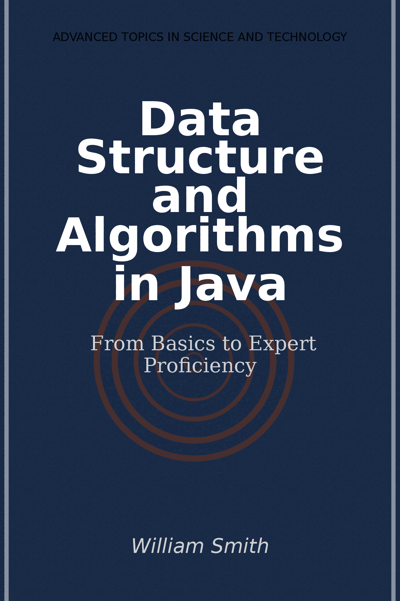

# Java 数据结构与算法：从基础到精通



```java
public void insert(int key) {
    Node r = root;

    if (r.n == 2 * T - 1) {
        Node s = new Node(T, false);
        root = s;
        s.C[0] = r;
        splitChild(s, 0, r);
        insertNonFull(s, key);
    } else {
        insertNonFull(r, key);
    }
}

private void insertNonFull(Node x, int key) {
    int i = x.n - 1;

    if (x.leaf) {
        while (i >= 0 && key < x.key[i]) {
            x.key[i + 1] = x.key[i];
            i--;
        }

        x.key[i + 1] = key;
        x.n = x.n + 1;
    } else {
        while (i >= 0 && key < x.key[i]) {
            i--;
        }

        i++;

        if (x.C[i].n == 2 * T - 1) {
            splitChild(x, i, x.C[i]);

            if (key > x.key[i]) {
                i++;
            }
        }

        insertNonFull(x.C[i], key);
    }
}

private void splitChild(Node x, int i, Node y) {
    Node z = new Node(y.T, y.leaf);
    x.C[i + 1] = z;
    z.n = T - 1;

    for (int j = 0; j < T - 1; j++) {
        z.key[j] = y.key[j + T];
    }

    if (!y.leaf) {
        for (int j = 0; j < T; j++) {
            z.C[j] = y.C[j + T];
        }
    }

    y.n = T - 1;

    for (int j = x.n; j >= i + 1; j--) {
        x.C[j + 1] = x.C[j];
    }

    x.C[i + 1] = z;

    for (int j = x.n - 1; j >= i; j--) {
        x.key[j + 1] = x.key[j];
    }

    x.key[i] = y.key[T - 1];
    x.n = x.n + 1;
}
```

排序算法在各种金融应用中是不可缺的。例如，股票市场需要高效的排序算法根据时间戳或其他标准对交易进行排序，以实现实时交易。`QuickSort`和`MergeSort`等算法因其高效性和相对简单的实现而至关重要。

```java
public class QuickSort {
    int partition(int arr[], int low, int high) {
        int pivot = arr[high];
        int i = (low - 1);

        for (int j = low; j < high; j++) {
            if (arr[j] <= pivot) {
                i++;

                int temp = arr[i];
                arr[i] = arr[j];
                arr[j] = temp;
            }
        }

        int temp = arr[i + 1];
        arr[i + 1] = arr[high];
        arr[high] = temp;

        return i + 1;
    }

    void sort(int arr[], int low, int high) {
        if (low < high) {
            int pi = partition(arr, low, high);
            sort(arr, low, pi - 1);
            sort(arr, pi + 1, high);
        }
    }
}
```

在网络安全中，搜索算法和加密算法等算法至关重要。例如，用于公钥加密的`RSA`算法使用了数论的数学原理，广泛用于安全数据传输。

```java
import java.math.BigInteger;
import java.security.SecureRandom;

public class RSA {
    private BigInteger modulus, privateKey, publicKey;

    public RSA(int bitlen) {
        SecureRandom random = new SecureRandom();
        modulus = new BigInteger(bitlen, random);
        privateKey = new BigInteger(bitlen, random);
        publicKey = new BigInteger(bitlen, random);
    }
}
```

## 量子算法

量子计算代表了另一个主要前沿。量子算法利用叠加和纠缠等现象来解决经典计算机无法处理的问题。用于无序数据库搜索的`Grover’s Algorithm`和用于整数分解的`Shor’s Algorithm`是两个著名的例子。

随着量子计算机日益接近实际实用化，我们将看到越来越多针对经典问题的量子算法实现。量子编程中的一个简单示例是`Grover’s search algorithm`。

```cpp
#include <iostream>
#include <qiskit/QuantumCircuit>

void groversSearch() {
    QuantumCircuit qc(2); # 用于用于搜索的两个量子比特

    qc.h(0); # 对两个量子比特应用 Hadamard 门
    qc.h(1);

    # 接下来是 Oracle 和振幅放大步骤

    qc.measure_all();
    qc.run();
}
```

在这里，`groversSearch`函数设置了一个带有 Grover 算法基础初始化的量子电路。

## 持久化数据结构

持久化数据结构在对不可变性和历史数据跟踪至关重要的应用中变得越来越关键，例如版本控制系统和区块链技术。这些结构确保了数据之前的版本被保留并可访问，这对于撤销操作和审计追踪特别有益。

例如，持久化列表支持`push`和`pop`操作，而不改变之前的版本：

```java
class PersistentList {
    final int head;
    final PersistentList tail;

    PersistentList(int head, PersistentList tail) {
        this.head = head;
        this.tail = tail;
    }

    PersistentList push(int value) {
        return new PersistentList(value, this);
    }

    PersistentList pop() {
        return this.tail;
    }
}
```

这种不可变性是一项关键特征，消除了对无意修改数据的担忧。

数据结构和算法的进步也受到安全性、实时处理以及处理海量数据需求日益增长的推动。这些趋势强调了计算机科学领域持续学习和适应的必要性，确保未来的软件系统更高效、更具韧性，并能够应对不断变化的挑战。

# 第 2 章：数据结构与算法的 Java 基础

本章涵盖了理解和实现数据结构与算法所需的 Java 基础知识。从 Java 及其开发环境介绍开始，介绍了基础语法、数据类型、控制流语句和循环。此外，还探讨了面向对象的编程概念、数组、集合和异常处理。到本章结束，读者将掌握有效实现和处理各种数据结构与算法所需的必备 Java 技能。

## 2.1 Java 导论

Java 是一种多功能且广泛使用的编程语言，最初由 Sun Microsystems 在 1995 年开发，后来被 Oracle 公司收购。它遵循“一次编写，随处运行”（WORA）的哲学，这意味着编译后的 Java 代码可以在任何平台上运行，而无需重新编译。这种跨平台能力由 Java 虚拟机（`JVM`）支持，它为执行 Java 字节码提供了运行时环境。Java 的设计是面向对象、并发且安全的，这使其成为开发从移动设备到企业级服务器和超级计算机等广泛应用的理想选择。

### 历史与演变

Java 的开发由 James Gosling 及其团队在 Sun Microsystems 的“绿色项目”下启动。最初的目标是为嵌入式系统创建语言；然而，由于其健壮性和可移植性，其范围扩展到了 Web 应用程序和桌面应用程序。自诞生以来，Java 经历了多次版本的增强和更新，最著名的版本包括：

- **Java SE 1.0 (1996)**：第一个正式版本，引入了核心 API 和`AWT`（抽象窗口工具包）。
- **Java SE 1.2 (1998)**：被称为 Java 2，引入了`Swing`框架、`Collection Framework`和可插拔的外观。
- **Java SE 5 (2004)**：引入了泛型、元数据、枚举类型和增强`for`循环。
- **Java SE 8 (2014)**：引入了 Lambda 表达式、`Stream API`以及其他函数式编程结构。
- **Java SE 11 (2018)**：长期支持（LTS）版本，包含了若干性能改进和新功能，如用于局部变量类型推断的`var`关键字。

Java 持续演进，由于其强健的标准库、广泛的社区支持和强大的性能，在学术和专业环境中保持着强大的地位。

### Java 平台与 JVM

Java 平台由 Java 语言、Java 编译过程和`JVM`组成。Java 语言用于编写程序，然后由 Java 编译器编译成字节码。`JVM`解释并执行这些字节码，使得 Java 平台能够在各种硬件和操作系统上运行。

Java 平台的关键组件包括：

- **Java 标准版 (SE)**：为桌面应用和服务器级应用提供核心功能、标准库、工具和虚拟机。
- **Java 企业版 (EE)**：在 Java SE 的基础上扩展了额外的库和框架，用于构建大规模、多层级的应用程序。
- **Java 微版 (ME)**：针对资源受限的环境，如移动设备和嵌入式设备。

### Java 的特性

Java 结合了几种有助于其作为编程语言广受欢迎且有效的特性：

- **面向对象**：通过封装、继承和多态促进模块化编程，提高代码复用和可维护性。
- **平台无关**：利用`JVM`实现字节码的跨平台执行。
- **健壮且安全**：结合了强大的内存管理、异常处理以及在字节码层级定义权限的安全模型。
- **多线程**：支持多个线程的并发执行，实现 CPU 资源的高利用。
- **高性能**：通过 JIT 编译器实现，该编译器在运行时将字节码翻译成原生机器码。
- **丰富的标准库**：为 I/O、网络、数据结构等提供了大量的 API，便于快速高效地开发应用程序。

### Java 开发包（JDK）与 Java 运行环境（JRE）

开发 Java 应用程序需要 Java 开发包（`JDK`），它包含了 Java 编译器、标准库和其他开发工具。JDK 包含以下组件：

- **`javac`**：Java 编译器，将 Java 源代码翻译成字节码。
- **`java`**：启动`JVM`并执行 Java 程序的启动器工具。
- **`javadoc`**：文档生成器，根据 Java 源代码注释创建 HTML 文档。
- **`jar`**：将 Java 类文件和相关资源打包成`JAR`（Java 归档）文件的工具。
- **`jdb`**：用于 Java 程序的调试器。

Java 运行环境（`JRE`）是 JDK 的子集，仅包含运行 Java 程序所需的组件，如`JVM`、核心库和其他支持文件。它足以执行 Java 程序，但不包含编译器在内的开发工具。

### 编写并运行简单的 Java 程序

为了说明 Java 程序的基本结构，请考虑经典的“Hello, World!”示例。以下代码展示了一个极简的 Java 程序：

```java
public class HelloWorld {
    public static void main(String[] args) {
        System.out.println("Hello, World!");
    }
}
```

在这个示例中，程序定义了一个名为`HelloWorld`的类，其中包含一个`main`方法，该方法是程序的入口。`System.out.println`语句将字符串“Hello, World!”打印到控制台。

要编译并运行该程序，请按照以下步骤操作：

- 将代码保存为名为`HelloWorld.java`的文件。
- 打开终端或命令行提示符并进入文件所在的目录。
- 使用以下命令编译程序：

  ```bash
  javac HelloWorld.java
  ```

- 如果编译成功，使用此命令执行程序：

  ```bash
  java HelloWorld
  ```

输出结果应该是：

```text
Hello, World!
```

这个示例突显了编写、编译和运行 Java 程序的基础方面。类定义、方法声明以及标准输出的使用说明了核心概念，这些概念将在后续章节中不断完善。

## 2.2 设置你的开发环境

为了有效地编写、编译和运行 Java 程序，设置一个合适的开发环境至关重要。本节提供了安装和配置必要工具的全面指南。我们将关注 Java 开发工具包（JDK）、集成开发环境（IDE）以及环境变量的设置。

### 第一步：安装 Java 开发工具包（JDK）

JDK 是一个核心组件，包含 Java 环境（JRE）、解释器/加载器（Java 虚拟机）、归档工具（`jar`）、编译器（`javac`）以及开发 Java 应用所需的其它工具。

1. **下载 JDK**
   - 访问 Oracle 官方网站：[`www.oracle.com/java/technologies/javase-downloads.html`](https://www.oracle.com/java/technologies/javase-downloads.html)。
   - 选择最新版本的 JDK，并下载适用于您的操作系统（Windows、macOS 或 Linux）的相应安装程序。

2. **安装 JDK**
   - 运行下载的安装程序并按照屏幕上的指示完成安装。
   - 通过打开终端或命令行提示符并输入以下命令来验证安装：

     ```bash
     javac -version
     java -version
     ```

   - 您应该能看到已的 JDK 和 JVM 版本。

### 第二步：设置环境变量

为了确保从任何命令行提示符都能访问 JDK 及其工具，请妥善地设置环境变量。

1. **在 Windows 上设置环境变量**
   - 打开开始菜单，搜索“环境变量”，并选择“编辑系统环境变量”。
   - 点击“环境变量”按钮。
   - 在“系统变量”下，点击“新建”并添加：
     - **变量名**：`JAVA_HOME`
     - **变量值**：JDK 安装目录的路径（例如`C:\Program Files\Java\jdk-XX`）。
   - 找到`Path`变量，点击“编辑”，添加以下路径：
     - `%JAVA_HOME%\bin`
   - 点击“确定”保存更改。

2. **在 macOS/Linux 上设置环境变量**
   - 打开终端并编辑 shell 配置文件（例如`.bashrc`、`.bash_profile`或`.zshrc`）。
   - 在文件中添加以下行：

     ```bash
     export JAVA_HOME=/Library/Java/JavaVirtualMachines/jdk-XX.jdk/Contents/Home
     export PATH=$JAVA_HOME/bin:$PATH
     ```


```bash
source ~/.bashrc
```

### 第三步：选择集成开发环境（IDE）

一个强大的 IDE 可以通过提供语法高亮、代码补全和调试工具等功能显著提高生产力。以下是一些用于 Java 开发的常用 IDE：

1. **Eclipse**
   - 访问 [https://www.eclipse.org/downloads/](https://www.eclipse.org/downloads/) 并下载 Eclipse 安装程序。
   - 运行安装程序并选择 Eclipse IDE for Java Developers。
   - 按照安装说明设置 Eclipse。
2. **IntelliJ IDEA**
   - 从 [https://www.jetbrains.com/idea/download/](https://www.jetbrains.com/idea/download/) 下载社区版（Community Edition）。
   - 运行安装程序并按照屏幕指示操作。
3. **NetBeans**
   - 访问 [https://netbeans.apache.org/download/](https://netbeans.apache.org/download/) 并下载安装程序。
   - 按照安装说明设置 NetBeans IDE。

### 第四步：配置 IDE

IDE 安装好后，需要配置它以与 JDK 无缝工作。

1. **配置 Eclipse**
   - 打开 Eclipse 并导航到 Window > Preferences。
   - 展开 Java 并点击 Installed JREs。
   - 点击 Add，选择 Standard VM，并指定 JDK 安装目录的路径。
   - 点击 Finish 并确保勾选新添加的 JRE。
2. **配置 IntelliJ IDEA**
   - 打开 IntelliJ IDEA 并导航到 File > Project Structure。
   - 在 Project Settings 下选择 Project。
   - 将 Project SDK 设置为已安装的 JDK。
   - 应用更改并点击 OK。
3. **配置 NetBeans**
   - 打开 NetBeans 并导航到 Tools > Java Platforms。
   - 点击 Add Platform，选择 Java Standard Edition，并指定 JDK 安装目录的路径。
   - 完成配置。

一旦 IDE 安装完成，配置使其与 JDK 无缝工作。在 JDK 安装、环境变量设置以及 IDE 配置完成后，你的开发环境就准备就绪了。这些设置为编写 Java 程序提供了基础。

### 2.3 Java 程序的基础语法与结构

为了说明 Java 程序的基本结构，请考虑经典的“Hello, World!”示例。以下代码展示了一个极简的 Java 程序：

```java
public class HelloWorld {
    public static void main(String[] args) {
        System.out.println("Hello, World!");
    }
}
```

在这个示例中，程序定义了一个名为 `HelloWorld` 的类，其中包含一个 `main` 方法，该方法是程序的入口。`System.out.println` 语句将字符串“Hello, World!”打印到控制台。

这个示例突显了编写、编译和运行 Java 程序的基础方面。类定义、方法声明以及标准输出的使用说明了核心概念，这些概念将在后续章节中不断完善。

Java 程序由类、方法和块组成。在本节中，我们将讨论这些基础元素的语法。

一个 Java 程序从类定义开始。类是对象的蓝图。任何 Java 程序的入口都是 `main` 方法。这里是一个简单的示例：

```java
public class HelloWorld {
    public static void main(String[] args) {
        System.out.println("Hello, World!");
    }
}
```

在这个示例中，`HelloWorld` 是类名，它包含一个方法。`main` 方法是程序的入口。

#### 类与方法

Java 中的类使用 `class` 关键字声明。它可以包含字段、方法和嵌套类。方法是定义类行为的函数。这里是一个详细的示例：

```java
public class Calculator {
    // 字段变量
    private int result;

    // 构造函数
    public Calculator() {
        result = 0;
    }

    // 相加两个数字的方法
    public void add(int a, int b) {
        result = a + b;
    }

    // 获取结果的方法
    public int getResult() {
        return result;
    }

    // 主方法
    public static void main(String[] args) {
        Calculator calc = new Calculator();
        calc.add(5, 3);
        System.out.println("结果是: " + calc.getResult());
    }
}
```

在这个示例中，`Calculator` 类有一个字段 `result`、一个构造函数 `Calculator()` 以及两个方法 `add` 和 `getResult`。`main` 方法创建了 `Calculator` 的实例并使用它执行加法运算。

#### 变量与数据类型

Java 中的变量在使用之前必须先声明。每个变量都有一个数据类型，决定了它可以存储的数据类型。Java 是一种强类型语言，这意味着变量类型在编译时是知的。以下是基本数据类型：

- `int` - 用于整数。
- `double` - 用于浮点数。
- `char` - 用于单个字符。
- `boolean` - 用于布尔值（真/假）。

声明变量的示例：

```java
public class DataTypesExample {
    public static void main(String[] args) {
        int num = 10;
        double price = 19.99;
        char grade = 'A';
        boolean isAvailable = true;

        System.out.println("Integer: " + num);
        System.out.println("Double: " + price);
        System.out.println("Char: " + grade);
        System.out.println("Boolean: " + isAvailable);
    }
}
```

该程序声明了不同类型的变量并打印了它们的值。

##### 运算符

Java 提供了丰富的运算符来操作变量。这些包括算术运算符、关系运算符、逻辑运算符和位运算符。以下是一些示例：

- 算术运算符：`+`、`-`、`*`、`/`、`%`
- 关系运算符：`==`、`!=`、`>`、`<`、`>=`、`<=`
- 逻辑运算符：`&&`、`||`、`!`
- 位运算符：`&`、`|`、`^`、`~`、`<<`、`>>`

使用运算符的示例：

```java
public class OperatorsExample {
    public static void main(String[] args) {
        int a = 10;
        int b = 20;

        // 算术运算符
        int sum = a + b;
        int diff = a - b;

        // 关系运算符
        boolean isEqual = a == b;
        boolean isGreater = a > b;

        // 逻辑运算符
        boolean andCondition = (a < b) && (a > 5);

        // 位运算符
        int bitwiseAnd = a & b;

        System.out.println("Sum: " + sum);
        System.out.println("Difference: " + diff);
        System.out.println("Is Equal: " + isEqual);
        System.out.println("Is Greater: " + isGreater);
        System.out.println("AND Condition: " + andCondition);
        System.out.println("Bitwise AND: " + bitwiseAnd);
    }
}
```

此示例演示了不同类型运算符的使用。理解这些基础元素对于编写任何 Java 程序都是至关重要的，并将成为实现更复杂的数据结构和算法的基础。

### 2.4 变量、数据类型和运算符

Java 中的变量充当内存中的存储位置，每个变量都有特定的数据类型，定义了它可以存储的值类型。正确地声明变量并理解其相关的数据类型和运算符是编程的基础，也是在 Java 中实现数据结构和算法的 set。

#### 变量和数据类型

Java 提供了一 set 内置数据类型，每种类型都有特定的尺寸和值范围。它们被分为大类：基本数据类型和引用数据类型。

- **基本数据类型**：这些是最基础的数据类型，在 Java 中是预定义的。它们包括：
  - `byte`：8 位有符号整数
  - `short`：16 位有符号整数
  - `int`：32 位有符号整数
  - `long`：64 位有符号整数
  - `float`：单精度 32 位 IEEE 754 浮点数
  - `double`：双精度 64 位 IEEE 754 浮点数
  - `boolean`：表示一位信息，值可以 true 或 false
  - `char`：单个 16 位 Unicode 字符
- **引用数据类型**：这些引用对象，包括数组、类、接口等。引用变量存储的是对象所在的内存地址。

```java
int number; // 变量声明
number = 10; // 变量初始化
double pi = 3.14159; // 一行完成声明和初始化
boolean flag = true;
```

#### 运算符

Java 运算符是会对变量和值执行操作的符号。它们可以分为几类：算术、关系、逻辑、位、赋值、一元和三元运算符。

##### 算术运算符

这些运算符用于执行基础算术运算：加法、减法、乘法、除法和模。

- `+`（加法）
- `-`（减法）
- `*`（乘法）
- `/`（除法）
- `%`（模 - 除法余数）

```java
int a = 15, b = 5;

int addition = a + b; // 20
int subtraction = a - b; // 10
int multiplication = a * b; // 75
int division = a / b; // 3
int modulus = a % b; // 0
```

##### 关系运算符

这些运算符比较两个值并返回布尔结果（true 或 false）。

- `==`（等于）
- `!=`（不等于）
- `>`（大于）
- `<`（小于）
- `>=`（大于或等于）
- `<=`（小于或等于）

```java
boolean result1 = (a == b); // false
boolean result2 = (a != b); // true
boolean result3 = (a > b); // true
boolean result4 = (a < b); // false
boolean result5 = (a >= b); // true
boolean result6 = (a <= b); // false
```

##### 逻辑运算符

这些运算符用于组合多个布尔表达式或操作数。

- `&&`（逻辑与）
- `||`（逻辑或）
- `!`（逻辑非）

```java
boolean flag1 = true;
boolean flag2 = false;
```

##### 位运算符

位运算符对整数类型进行位操作。

- `&`（位与）
- `|`（位或）
- `^`（位异异）
- `~`（位取反）
- `<<`（左移）
- `>>`（右移）

```java
int x = 6, y = 4;

int andResult = x & y; // 4
int orResult = x | y; // 6
int xorResult = x ^ y; // 2
int complementResult = ~x; // -7
int leftShift = x << 1; // 12
int rightShift = x >> 1; // 3
```

##### 赋值运算符

这些运算符为变量赋值。

- `=`（简单赋值）
- `+=`（加赋值）
- `-=`（减法赋值）
- `*=`（乘法赋值）
- `/=`（除法赋值）
- `%=`（模赋值）

```java
int num = 10;

num += 5; // 15
num -= 3; // 7
num *= 2; // 20
num /= 4; // 2
num %= 3; // 1
```

##### 一元运算符

一元运算符只需要一个操作数，执行的操作包括增减值、取反表达式或反转布尔值。

- `+`（一元加）
- `-`（一元负）
- `++`（递增）
- `--`（递减）
- `!`（逻辑取反）

```java
int u = 5;

u++; // 6
u--; // 5

boolean boolVal = true;
boolean notBoolVal = !boolVal; // false
```

##### 三元运算符

三元运算符是 if 语句的简写，用符号 `?:` 表示。它有三个操作数。

```java
int v = 10;
int result = (v > 5) ? v : 0; // 因为 v > 5，结果为 v，即 10
```

理解变量、数据类型和运算符对于 Java 高高效编程至关重要。随着我们深入研究数据结构和算法，这些基础将是更复杂操作的基础。

### 2.5 控制语句（if、else、switch）

Java 控制流语句允许你根据某些条件规定语句的执行顺序。这些结构是实现决策逻辑的基础。本节详细介绍了使用 `if`、`else` 和 `switch` 语句来控制 Java 程序的执行流。

`if` 语句评估布尔表达式。如果表达式为真，则执行 `if` 语句中的代码块。如果表达式为假，则跳过该块。

```java
int num = 10;

if (num > 5) {
    System.out.println("The number is greater than 5.");
}
```

在这个示例中，条件 `num > 5` 为真，因此控制台打印“The number is greater than 5.”。

`else` 语句与 `if` 配合，在 `if` 条件为假时提供另一种执行路径。

```java
int num = 3;

if (num > 5) {
    System.out.println("The number is greater than 5.");
} else {
    System.out.println("The number is 5 or less.");
}
```

在这里，因为条件 `num > 5` 为假，控制台打印了消息“The number is 5 or less.”

`if` 语句可以使用 `else if` 进行链，以处理多个条件。

```java
int num = 7;

if (num > 10) {
    System.out.println("The number is greater than 10.");
} else if (num > 5) {
    System.out.println("The number is greater than 5 but 10 or less.");
} else {
    System.out.println("The number is 5 or less.");
}
```

在这种情况下，由于 `num` 为 7，第二个条件 `num > 5` 为真，并打印相应的消息：“The number is greater than 5 but 10 or less.”

Java 的 `switch` 语句允许你根据单个表达式的值在多个代码块中执行一个。在评估单个变量是否等于多个常量时，这比使用多个 `if-else` 语句更具可读性。

```java
int day = 3;

switch (day) {
    case 1:
        System.out.println("Monday");
        break;
```


```java
case 2:
    System.out.println("Tuesday");
    break;

case 3:
    System.out.println("Wednesday");
    break;

case 4:
    System.out.println("Thursday");
    break;

case 5:
    System.out.println("Friday");
    break;

case 6:
    System.out.println("Saturday");
    break;

case 7:
    System.out.println("Sunday");
    break;

default:
    System.out.println("Invalid day");
    break;
}
```

在这个 `switch-case` 示例中，评估了变量 `day`。由于 `day` 为 3，打印了消息“Wednesday”。

`break` 语句在 `switch` 块中至关重要，它用于终止当前 `case` 并防止穿透（fall-through），即即使后续条件不满足也会执行后续 `case`。如果没有 `break`，每个后续的 `case` 将一直执行，直到遇到另一个 `break` 或 `switch` 块结束。

从 Java 7 开始，`switch` 块还支持 `string` 和 `enum` 类型，使其在各种语境下具有多功能性。

```java
String season = "Summer";

switch (season) {
    case "Spring":
        System.out.println("Flowers bloom in Spring.");
        break;

    case "Summer":
        System.out.println("It’s hot in Summer.");
        break;

    case "Fall":
        System.out.println("Leaves fall in Autumn.");
        break;

    case "Winter":
        System.out.println("It’s cold in Winter.");
        break;

    default:
        System.out.println("Invalid season");
        break;
}
```

上面的示例评估了变量 `season` 并打印了“It’s hot in Summer.”，因为 `season` 的值为“Summer”。在 Java 中利用流程控制语句对于创建能够响应各种输入的程序的程序至关重要。

### 2.6 循环（`for`、`while`、`do-while`）

循环是控制结构，允许在给定条件为真时重复执行代码块。Java 提供了三种主要的循环类型：`for`、`while` 和 `do-while`。这些循环结构分别适用于不同的用例并具有独特的特性。

#### `for` 循环

`for` 循环通常用于已知迭代次数的情况。它的语法由三部分组成：初始化、条件和更新。这些组件包含在括号内并用分号分隔。

```java
// For 循环语法
for (initialization; condition; update) {
    // 要执行的代码
}
```

让我们考虑一个从 1 到 5 打印数字的示例：

```java
for (int i = 1; i <= 5; i++) {
    System.out.println(i);
}
```

上面的循环初始化变量 `i` 为 1，检查 `i` 是否小于等于 5 并打印 `i`。在每次迭代之后，`i` 都会加增。当 `i` 超过 5 时，循环终止。

```text
1
2
3
4
5
```

#### `while` 循环

`while` 循环通常用于在执行循环体之前必须检查条件的情况。`while` 循环的语法比 `for` 循环简单，仅包含一个条件。

```java
// While 循环语法
while (condition) {
    // 要执行的代码
}
```

这是一个 `while` 循环示例，它完成了与之前的 `for` 循环相同的任务：

```java
int i = 1;

while (i <= 5) {
    System.out.println(i);
    i++;
}
```

在这种情况下，变量 `i` 在循环外初始化。在每次迭代之前都会检查条件 `i <= 5`，并在循环体内增加 `i`。

```text
1
2
3
4
5
```

#### `do-while` 循环

与 `while` 循环不同，`do-while` 循环保证无论条件是否成立，循环体至少执行一次。

```java
// Do-while 循环语法
do {
    // 要执行的代码
} while (condition);
```

与 `while` 循环不同，`do-while` 循环保证无论条件是否成立，循环体至少执行一次。考虑以下 `do-while` 循环示例：

```java
int i = 1;

do {
    System.out.println(i);
    i++;
} while (i <= 5);
```

```java
return a + b;
}

public static int add(int a, int b, int c) {
    return a + b + c;
}
```

Java 编译器根据参数的类型和数量来区分这些重载方法。

### 返回类型

每个方法的返回类型必须是基本数据类型或对象。对于没有返回值的方法，类型为 `void`。返回类型强制了程序中的类型安全。

```java
public static double calculateAverage(int sum, int count) {
    if (count == 0) return 0;
    return (double) sum / count;
}
```

### 递归

递归方法是一种通过调用自身来解决同一个问题的较小实例的方法。递归解决方案可以既优雅又简洁。然而，它们必须有一个终止条件以防止无限递归。

```java
public static int factorial(int n) {
    if (n <= 1) return 1;
    return n * factorial(n - 1);
}
```

此示例使用递归计算数字的阶乘。

### 封装与信息隐藏

方法通过仅暴露所需的功能并隐藏内部实现细节来实现封装。这种信息隐藏原则支持模块化编程，使代码的维护和调试更容易管理。

### 模块化编程

模块化编程涉及将程序分成独立的、可交换的模块，每个模块执行特定的任务。方法在这一范式中起着至关重要的作用，实现了代码的重用和独立性。

考虑以下示例：

```java
public class MathOperations {
    public static int add(int a, int b) {
        return a + b;
    }

    public static int subtract(int a, int b) {
        return a - b;
    }

    public static int multiply(int a, int b) {
        return a * b;
    }

    public static double divide(int a, int b) {
        if (b == 0) throw new IllegalArgumentException("Division by zero");
        return (double) a / b;
    }
}
```

在这里，`MathOperations` 类包含了实现基础算运算的方法。每个方法都独立进行测试和执行，展示了模块化编程。

其优势包括：

- 增强代码可读性
- 提高可维护性
- 单个方法或类的可重用性
- 于测试和调试

通过遵循这些概念和最佳实践，你可以利用方法将复杂程序结构化为易于管理的逻辑单元，优化开发和维护工作。

### 2.8 Java 中的面向对象编程

面向对象编程（OOP）是一种围绕数据（或对象）而非函数和逻辑来组织软件设计的范式。在 Java 中，OOP 原则包括四个主要概念：封装、继承、多态和抽象。这些原则允许开发者构建模块化、可扩展且可维护的代码。

`封装` 限制了对对象某些组件的访问，这意味着对象的内部表示对外部是隐藏的。这是通过访问修饰符实现的，最常用的是 `private`、`public` 和 `protected`。对数据的访问通过被称为 getter 和 setter 方法的公共方法提供。

```java
public class EncapsulationExample {
    private String name;
    private int age;

    public String getName() {
        return name;
    }

    public void setName(String name) {
        this.name = name;
    }

    public int getAge() {
        return age;
    }

    public void setAge(int age) {
        this.age = age;
    }
}
```

`继承` 是一种从现有类派生出新类的机制。派生类称为子类，它从现有类（称为父类）继承字段和方法。这促进了代码重用并建立了自然的层级结构。在 Java 中，继承使用 `extends` 关键字实现。

```java
class Animal {
    void eat() {
        System.out.println("This animal eats food.");
    }
}

class Dog extends Animal {
    void bark() {
        System.out.println("The dog barks.");
    }
}

public class Inheritance {
    public static void main(String args[]) {
        Dog dog = new Dog();
        dog.eat();
        dog.bark();
    }
}
```

上述示例的输出将是：

```text
This animal eats food.
The dog barks.
```

`多态` 允许对象呈现许多形式。OOP 中多态最常见的用法是使用父类来引用子对象。该机制分为两种类型：编译时多态（方法重载）和运行时（方法重写）。

```java
class Bird {
    void sound() {
        System.out.println("This bird makes a sound.");
    }
}

class Sparrow extends Bird {
    void sound() {
        System.out.println("The sparrow chirps.");
    }
}

public class Polymorphism {
    public static void main(String args[]) {
        Bird myBird = new Sparrow(); // 运行时多态
        myBird.sound(); // 调用 Sparrow 类中重写的方法
    }
}
```

上述示例的输出将是：

```text
The sparrow chirps.
```

`抽象` 是隐藏实现细节的概念。抽象可以通过只显示基本功能来实现。抽象类不能实例化，但可以包含抽象方法。

```java
abstract class Shape {
    abstract void draw();
}

class Circle extends Shape {
    void draw() {
        System.out.println("Drawing a circle.");
    }
}

public class Abstraction {
    public static void main(String args[]) {
        Shape myShape = new Circle();
        myShape.draw();
    }
}
```

上述示例的输出将是：

```text
Drawing a circle.
```

此外，Java 支持接口，它们与抽象类类似但只能包含抽象方法。接口用于实现多重继承。

```java
interface Drawable {
    void draw();
}

class Rectangle implements Drawable {
    public void draw() {
        System.out.println("Drawing a rectangle.");
    }
}

public class TestInterface {
    public static void main(String args[]) {
        Drawable myDrawable = new Rectangle();
        myDrawable.draw();
    }
}
```

上述示例的输出将是：

```text
Drawing a rectangle.
```

通过利用 Java 的 OOP 原则，开发者可以创建健壮且灵活的软件设计。封装、继承、多态和抽象的结合是软件开发的基石。

### 2.9 使用数组和集合

在 Java 中，数组和集合是存储和处理数据的各种工具。它们提供了各种功能和效率，在实现数据结构和算法时是不可或缺的。本节将探讨数组和集合，解释它们的语法、操作和适用场景。

数组是固定大小的同质数据结构。Java 中数组的语法如下：

```java
// 声明数组的语法
int[] myArray;

// 初始化大小为 10 的数组
myArray = new int[10];
```

或者，可以在同一行内声明并初始化数组：

```java
// 数组的声明和初始化
int[] myArray = new int[10];
```

要给数组元素赋值，可以使用表示法：

```java
// 给数组赋值
myArray[0] = 1;
myArray[1] = 2;

// 根据需要继续赋值
```

数组初始化也可以直接使用值完成：

```java
// 直接初始化
int[] myArray = {1, 2, 3, 4, 5};
```

访问数组元素是通过它们的索引完成，从第一个元素开始为 0：

```java
// 访问数组的元素
int firstElement = myArray[0];
int secondElement = myArray[1];
```

数组的一个常见用例是迭代对每个元素执行操作。这可以通过循环来实现：

```java
// 使用 for 循环遍历数组
for (int i = 0; i < myArray.length; i++) {
    System.out.println(myArray[i]);
}
```

集合（Collections）与数组不同，它们是 Java 集合框架（JCF）的一部分，为数据处理提供了更灵活、更强大的工具。集合的大小可以动态增长或收小，并提供各种数据操纵方法。主要的集合接口有 `List`、`Set` 和 `Map`。

`ArrayList` 类实现了 `List` 接口，是一种广泛使用的集合，它会自动调整大小。以下是初始化和使用 `ArrayList` 的方法：

```java
// 导入 ArrayList 类
import java.util.ArrayList;

// 创建一个 ArrayList
ArrayList<Integer> myList = new ArrayList<>();

// 向 ArrayList 添加元素
myList.add(1);
myList.add(2);
myList.add(3);

// 使用 get 方法访问元素
int firstElement = myList.get(0);

// 遍历 ArrayList
for (int i = 0; i < myList.size(); i++) {
    System.out.println(myList.get(i));
}

// 或者，使用增强型 for 循环
for (int element : myList) {
    System.out.println(element);
}
```

`HashSet` 是 `Set` 接口的一个集合，它存储唯一元素并提供高效的操作。下面是一个示例用法：

```java
// 导入 HashSet 类
import java.util.HashSet;

// 创建一个 HashSet


```java
HashSet<String> mySet = new HashSet<>();

// 向 HashSet 添加元素
mySet.add("element1");
mySet.add("element2");
mySet.add("element3");

// 检查 HashSet 是否包含某个元素
boolean containsElement1 = mySet.contains("element1");

// 遍历 HashSet
for (String element : mySet) {
    System.out.println(element);
}
```

`HashMap` 实现了 `Map` 接口，用于存储键值对。这里是一个 `HashMap` 的使用示例：

```java
// 导入 HashMap 类
import java.util.HashMap;

// 创建一个 HashMap
HashMap<String, Integer> myMap = new HashMap<>();

// 在 HashMap 中放入键值对
myMap.put("key1", 1);
myMap.put("key2", 2);

// 使用键访问值
int value1 = myMap.get("key1");

// 遍历 HashMap
for (Map.Entry<String, Integer> entry : myMap.entrySet()) {
    System.out.println("Key: " + entry.getKey() + ", Value: " + entry.getValue());
}
```

集合提供了内置方法，与数组相比，它们提供了更多的功能。一些常用方法包括：

- `add()` - 向集合中添加元素。
- `remove()` - 从集合中删除元素。
- `contains()` - 检查集合是否包含指定元素。
- `size()` - 返回集合中的元素数量。

理解数组和集合之间的区别对于选择合适的数据结构至关重要。数组由于其固定的大小提供了快速访问时间，但缺乏灵活性。集合作为 JCF 的一部分，提供了灵活且强大的数据处理机制，具有动态可调整的存储和多种内置方法。

### 2.10 处理异常

Java 提供了一种健壮且多功能的机制来处理错误和异常情况，称为异常处理。理解并有效利用这一特性对于创建健壮可靠的 Java 应用程序至关重要，特别是在处理复杂的数据结构和算法时。

异常是中断程序执行正常流的事件。当异常发生时，Java 会创建一个表示异常的对象，然后将其“抛出”。被抛出的异常可以被周围的代码“捕获”，然后这些代码可以采取适当的行动。如果没有妥善处理异常，程序可能会意外终止。

#### 异常的类型

Java 异常分为三大类：

- **检检异常（Checked Exceptions）**：这些是在编译时进行检查的异常。示例包括 `FileNotFoundException` 和 `IOException`。这些异常必须被捕获，或者在方法签名中使用 `throws` 关键字声明。
- **未检出异常（Unchecked Exceptions）**：这些异常在编译时不进行检查，而是在运行时检查。它们由 `RuntimeException` 类及其子类表示，例如 `NullPointerException` 和 `ArithmeticException`。处理这些异常是可选的。
- **错误（Errors）**：这些是应用程序通常不处理的严重问题。它们由 `Error` 类及其子类表示，例如 `OutOfMemoryError`。错误通常表示 JVM 本身的问题或硬件问题。

#### 基础 Try-Catch-Finally

Java 处理异常的主要结构是 `try`、`catch` 和 `finally` 块。`try` 块封装了可能抛出异常的代码，而 `catch` 块包含处理异常的代码。`finally` 块包含无论是否抛出或捕获到异常都会执行的代码。

以下是通用语法：

```java
try {
    // 可能会抛出异常的代码
} catch (Exception1 e1) {
    // 处理异常的 own
} catch (Exception2 e2) {
    // 处理异常的代码
} finally {
    // 无论如何都会执行的代码
}
```

#### 异常处理示例

考虑一个可能会导致 `ArrayIndexOutOfBoundsException` 的简单示例：

```java
public class ExceptionExample {
    public static void main(String[] args) {
        int[] array = new int[5];

        try {
            array[10] = 30; // 将抛出 ArrayIndexOutOfBoundsException
        } catch (ArrayIndexOutOfBoundsException e) {
            System.out.println("捕获到异常: " + e);
        } finally {
            System.out.println("finally 块已执行。");
        }
    }
}
```

上面的代码尝试向越界的索引赋值。`finally` 块确保了清理工作的执行。

#### 抛出异常

除了捕获异常外，Java 还允许你显式地抛出异常。这对于自定义异常处理有用。

```java
public class ExceptionExample {
    public static void main(String[] args) {
        try {
            checkAge(15);
        } catch (IllegalArgumentException e) {
            System.out.println("捕获到异常: " + e);
        }
    }

    static void checkAge(int age) {
        if (age < 18) {
            throw new IllegalArgumentException("年龄必须在 18 岁以上。");
        }
    }
}
```

在此示例中，如果年龄小于 18，`checkAge` 方法将抛出 `IllegalArgumentException`。该异常在 `main` 方法中被捕获。

#### 创建自定义异常

Java 还允许创建自定义异常类。当需要处理特定应用程序错误时，自定义异常非常有用。

```java
class CustomException extends Exception {
    public CustomException(String message) {
        super(message);
    }
}

public class CustomExceptionExample {
    public static void main(String[] args) {
        try {
            validateNumber(-1);
        } catch (CustomException e) {
            System.out.println("捕获到异常: " + e.getMessage());
        }
    }

    static void validateNumber(int number) throws CustomException {
        if (number < 0) {
            throw new CustomException("数字不能为负数。");
        }
    }
}
```

在此示例中，`CustomException` 类继承自 `Exception`。当传递负数时，`validateNumber` 方法抛出 `CustomException`。

#### 多异常捕获块

从 Java 7 开始，你可以使用多捕获块在一个在一个 `catch` 块中处理多个异常。这减少了代码重复并增强了可读性。

```java
public class MultiCatchExample {
    public static void main(String[] args) {
        try {
            int[] array = new int[5];
            array[10] = 30; // May throw ArrayIndexOutOfBoundsException
            int result = 10 / 0; // May throw ArithmeticException
        } catch (ArrayIndexOutOfBoundsException | ArithmeticException e) {
            System.out.println("Exception caught: " + e);
        }
    }
}
```

在这个示例中，单个 `catch` 块处理了所有的 `ArrayIndexOutOfBoundsException` 和 `ArithmeticException`。

有效的异常处理可以确保你的 Java 程序能够优雅地处理意外错误，这是处理数据结构和算法时的技能技能。利用这些结构，你可以构建稳健且稳定的应用程序，能够胜任地处理各种运行时异常。

### 2.11 Java 标准库概述

Java 标准库也称为 Java 开发工具包 (JDK) API，是一套全面的类和接口，提供了广泛的功能，使开发者能够以最少的努力编写复杂的程序。理解 Java 标准库对于在 Java 中开发稳健高效的数据结构和算法至关重要。本节探讨了 Java 标准库中与我们学习数据结构和算法的一些关键组件。

#### java.lang 包

`java.lang` 包会自动导入到每个 Java 程序中，包含了该语言至关重要的基础类。该包中的关键类包括：

- `Object`: Java 类层次结构的根类。Java 中的每个类都继承自 `Object`。
- `System`: 了一些实用的类字段和方法。特别是，它提供了对系统输入和输出的访问。
- `Math`: 提供执行基本数值运算的方法，如幂、对数和三角函数。
- `String`: 表示字符序列。Java 中的字符串是不可变的。

#### java.util 包

`java.util` 包包含了集合框架、事件模型、日期和时间设施以及杂项工具类类。该包对于实现数据结构和算法至关重要。关键类和接口包括：

- `Collection`: 集合层次结构的根接口。
- `List`: 有序集合（也称为序列）。实现包括 `ArrayList` 和 `LinkedList`。
- `Set`: 不包含重复元素的集合。实现包括 `HashSet` 和 `TreeSet`。
- `Map`: 将键映射到值的对象，不允许有重复键。实现包括 `HashMap` 和 `TreeMap`。

#### java.io 包

`java.io` 包包含了通过数据流、序列化和文件系统支持系统输入输出的类。关键类包括：

- `File`: 表示文件系统中的文件或目录路径。
- `InputStream` 和 `OutputStream`: 分别用于从字节流读取和写入字节流的抽象类。
- `Reader` 和 `Writer`: 分别用于从字符流读取和写入字符流的抽象类。

```java
import java.io.BufferedReader;
import java.io.FileReader;
import java.io.IOException;

public class FileReadingExample {
    public static void main(String[] args) {
        try (BufferedReader br = new BufferedReader(new FileReader("example.txt"))) {
            String line;

            while ((line = br.readLine()) != null) {
                System.out.println(line);
            }
        } catch (IOException e) {
            e.printStackTrace();
        }
    }
}
```

#### java.nio 包

`java.nio` 包在 Java 1.4 中引入，提供了一套新的抽象来处理 I/O 操作，通常被称为新输入/输出 (NIO)。它包括：

- `Buffer`: 处理特定类型数据的类，如 `ByteBuffer`、`CharBuffer` 等。
- `Channel`: 表示到能够执行 I/O 操作的实体（如读写文件）连接的接口。

#### java.time 包

`java.time` 包在 Java 8 中引入，提供了一个全面的时间处理模型。该包包括：

- `LocalDate`、`LocalTime`、`LocalDateTime`: 表示不同层级时间复杂性的类。
- `ZonedDateTime`: 表示 ISO-8601 日历系统中带有时区的日期和时间。

##### 使用 java.time 的示例

```java
import java.time.LocalDate;
import java.time.LocalTime;
import java.time.LocalDateTime;

public class DateTimeExample {
    public static void main(String[] args) {
        LocalDate today = LocalDate.now();
        LocalTime now = LocalTime.now();
        LocalDateTime currentDateTime = LocalDateTime.now();

        System.out.println("Current Date: " + today);
        System.out.println("Current Time: " + now);
        System.out.println("Current Date and Time: " + currentDateTime);
    }
}
```

#### java.net 包

`java.net` 包提供了实现网络应用程序的类。这些类对于通过网络通信至关重要，包括：

- `URL`: 表示统一资源定位符，允许访问网络上的资源。
- `Socket`: 提供了使用 TCP/IP 协议与其他计算机通信的方法。
- `ServerSocket`: 等待网络请求进入。

#### java.util.concurrent 包

`java.util.concurrent` 包包含了并发编程中非常有用的各种工具类。这包括：

- `ExecutorService`: 管理和控制异步任务的框架。
- `ConcurrentHashMap`: `HashMap` 的线程安全变。
- `CountDownLatch`、`Semaphore`、`CyclicBarrier`: 提供同步功能的工具类。

##### 使用 java.util.concurrent 的示例

```java
import java.util.concurrent.ExecutorService;
import java.util.concurrent.Executors;

public class ExecutorServiceExample {
    public static void main(String[] args) {
        ExecutorService executor = Executors.newFixedThreadPool(3);

        Runnable task1 = () -> System.out.println("Task 1");
        Runnable task2 = () -> System.out.println("Task 2");
        Runnable task3 = () -> System.out.println("Task 3");

        executor.submit(task1);
        executor.submit(task2);
        executor.submit(task3);

        executor.shutdown();
    }
}
```


理解 Java 标准库可以增强你高效解决问题以及实现复杂数据结构和算法的能力。鼓励熟悉这些稳健且多功能的类将极大有助于开发高效、无错误的 Java 应用程序。

### 2.12 编写和运行 Java 程序

为了在 Java 中有效实现数据结构和算法，理解如何编写和运行 Java 程序至关重要。本节将涵盖必要的步骤并提供过程的详细说明，确保你可以轻松地构建、编译和执行你的 Java 程序。

#### 编写 Java 程序

Java 程序写在扩展名为`.java`的纯文本文件中。每个 Java 程序至少包含一个类和一个`main`方法，该方法是应用程序的入口点。

Java 程序的结构如下所示：

```java
public class HelloWorld {
    public static void main(String[] args) {
        System.out.println("Hello, World!");
    }
}
```

在代码段中：

- `public class HelloWorld`定义了一个名为`HelloWorld`的公共类。在 Java 中，每个应用程序都至少有一个类定义。
- `public static void main(String[] args)`是主方法，它是任何 Java 程序的入口点。主方法必须是公共的、静态的、返回类型为`void`，并接受单个参数：一个 String 对象的数组。
- `System.out.println("Hello, World!")`向控制台打印字符串 "Hello, World!"。`System`类提供了标准的输入、输出和错误流。

#### 编译 Java 程序

在运行 Java 程序之前，必须将其编译成字节码，然后由 Java 虚拟机（JVM）执行该字节码。Java 开发工具包（JDK）提供了`javac`编译器来实现这一目的。

要编译`HelloWorld.java`程序，请在终端或命令提示符中使用以下命令：

```bash
javac HelloWorld.java
```

如果程序没有语法错误，编译器将生成一个`HelloWorld.class`文件，该文件包含字节码。

#### 运行 Java 程序

一旦编译完成，可以使用`java`命令执行 Java 程序，后面紧跟包含主方法的类名（不包含`.class`扩展名）：

```bash
java HelloWorld
```

执行此命令将产生以下输出：

```text
Hello, World!
```

#### 关键 Java 开发工具

Java 开发工具包（JDK）为 Java 开发提供了几个必的工具：

- `javac`：Java 编译器，将源代码转换为字节码。
- `java`：用于执行 Java 程序的启动器。
- `javadoc`：文档生成器，从 Java 源代码创建 HTML 文档。
- `jar`：将编译后的 Java 类打包成 JAR（Java 归档）文件的工具。
- `jdb`：Java 调试器，帮助跟踪和修复 Java 程序中的错误。

#### 示例：编译和运行包含多个类的程序

考虑一个包含多个类的较复杂的示例。我们将创建一个模拟基础算术运算（加法）的简单程序。该程序由两个类组成：`Calculator`和`MainApp`。

```java
// Calculator.java
public class Calculator {
    public int add(int a, int b) {
        return a + b;
    }
}

// MainApp.java
public class MainApp {
    public static void main(String[] args) {
        Calculator calc = new Calculator();
        int sum = calc.add(5, 3);
        System.out.println("Sum: " + sum);
    }
}
```

要编译并运行此程序，请遵循以下步骤：

1. 将上述代码段保存到两个独立的文件，命名为`Calculator.java`和`MainApp.java`。
2. 打开你的终端或命令提示符并导航到文件所在的目录。
3. 使用`javac`命令编译两个类：

   ```bash
   javac Calculator.java MainApp.java
   ```

4. 使用`java`命令执行程序，并指定包含主方法的类：

   ```bash
   java MainApp
   ```

这将生成以下输出：

```text
Sum: 8
```

理解编写、编译和运行 Java 程序的过程对于有效实现数据结构和算法至关重要。通过掌握这些步骤，你将能够充分准备应对更复杂的编程挑战，并构建高效可靠的 Java 应用。

# 第 3 章：数组与字符串

本章介绍了数组和字符串，它们是编程中的基础数据结构。首先解释了一维数组和多维数组的概念与操作，并探索了动态数组及其处理。随后，本章深入探讨了数组遍历、搜索和排序算法。之后，重点转向字符串，涵盖了基本操作、处理和搜索算法。在章节结束时，读者将理解如何高效使用数组和字符串来解决各种计算问题。

### 3.1 数组简介

数组是一种允许在连续内存块中存储相同类型元素的数据结构。数组提供了对其元素的高效随机访问，使其成为许多编程问题中的重要工具。在 Java 中，数组是对象，具有灵活且多样的操作和功能。

在 Java 中声明数组的语法涉及指定数据类型，后跟方括号和数组名。数组可以在声明时初始化，也可以单独初始化。

```java
int[] numbers; // 整数数组的声明
numbers = new int[5]; // 初始化大小为 5 的数组
```

在上面的代码段中，`numbers`被声明为整数数组。`new`关键字为数组分配内存，指定数组将持有 5 个整数。可以使用索引访问数组的单个元素，索引从 0 开始。

```java
numbers[0] = 10; // 给第一个元素赋值
System.out.println(numbers[0]); // 输出: 10
```

可以使用各自的索引对数组元素进行赋值和访问。这种特性能够快速检索数据，但需要仔细管理索引边界以避免`ArrayIndexOutOfBoundsException`。

数组也可以在声明时使用字面量初始化。

```java
int[] primes = {2, 3, 5, 7, 11};
```

Java 支持基本类型数组，也支持对象数组。例如，可以创建一个字符串数组。

```java
String[] fruits = {"Apple", "Banana", "Cherry"};
System.out.println(fruits[1]); // 输出: Banana
```

由于数组能够存储多个值，它们在算法实现中起着至关重要的作用。可以在数组上执行遍历、插入和搜索等操作。以下是一个典型的数组遍历循环：

```java
for (int i = 0; i < numbers.length; i++) {
    System.out.println(numbers[i]);
}
```

`for`循环遍历数组的每个元素并打印其值。数组的`length`属性提供了数组元素的数量，确保循环在范围内运行。

Java 中的数组是静态的，这意味着创建后无法更改大小。如果数组分配过多或不足，可能会导致内存使用效率低下。这个问题通过后续章节将介绍动态数组来解决。

Java 中的数组是多用途的，可以是多维的。常见的多维数组是二维数组，通常用于表示矩阵。

```java
int[][] matrix = new int[3][3]; // 3x3 矩阵的声明和初始化
matrix[0][0] = 1; // 给第一行第一列赋值
```

```java
for (int row = 0; row < matrix.length; row++) {
    for (int col = 0; col < matrix[row].length; col++) {
        System.out.print(matrix[row][col] + " ");
    }
    System.out.println();
}
```

二维数组`matrix`中的每个元素都是通过嵌套`for`循环中的行索引和列索引访问的。这种技术确保了所有元素都以系统的方式被处理。

一维数组是编程中一种基础的数据结构。它们代表被划分为离散元素的连续内存块，每个元素都可以通过索引直接访问。在 Java 中，数组是对象，用于存储多个相同类型的变量，可以通过从零开始的索引位置进行访问。

在 Java 中声明一个一维数组，需要指定元素的数据类型，后跟方括号和数组名。要实例化数组，请使用`new`关键字配合数组的大小。这是一个初始化包含 5 个元素的一维整数数组的示例：

```java
int[] array = new int[5];
```

这段代码片段初始化了一个名为`array`的大小为 5 的整数数组，其中每个元素的默认值为 0。可以使用各自的索引为元素赋值：

```java
array[0] = 10;
array[1] = 20;
array[2] = 30;
array[3] = 40;
array[4] = 50;
```

你也可以使用数组初始化器在一行内声明并初始化数组：

```java
int[] array = {10, 20, 30, 40  50};
```

使用方括号内的索引来访问数组元素。例如，`array[2]`返回值 30。尝试访问数组边界外的索引会导致`ArrayIndexOutOfBoundsException`异常。

常见的操作是遍历数组元素，通常使用`for`循环或增强`for`循环：

```java
for (int i = 0; i < array.length; i++) {
    System.out.println(array[i]);
}

for (int element : array) {
    System.out.println(element);
}
```

Java 中的数组大小是固定的，这意味着一旦创建数组，元素的数量就无法改变。这种局限性使得在需要可调整结构的情况下需要动态数组或列表，这将在后面的章节中介绍。

要将一个数组的元素复制到另一个数组，可以使用`System.arraycopy`或`Arrays.copyOf`等方法。`System.arraycopy`方法从源数组复制指定的范围到目标数组：

```java
int[] sourceArray = {1, 2, 3, 4, 5};
int[] destinationArray = new int[5];
System.arraycopy(sourceArray, 0, destinationArray, 0, 5);
```

或者，`Arrays.copyOf`允许同时复制和调整大小：

```java
int[] sourceArray = {1, 2, 3, 4, 5};
int[] newArray = Arrays.copyOf(sourceArray, 7);
```

此时`newArray`包含：`{1, 2, 3, 4, 5, 0, 0}`。

数组还支持`java.util.Arrays`类中的工具方法，例如`sort`、`fill`、`equals`和`toString`，分别用于排序、填充、比较以及将数组转换为字符串：

```java
int[] values = {3, 1, 4, 1, 5};
Arrays.sort(values);
System.out.println(Arrays.toString(values));
```

上述代码对`values`进行升序排序并打印`[1, 1, 3, 4, 5]`。

理解一维数组是数据结构算法开发中的关键基础，因为它们为更复杂的结构（如动态数组、矩阵和各种集合类型）提供了基础。

### 3.3 多维数组

多维数组通过允许数组的数组来扩展一维数组的概念。这种能力对于表示表格形式的数据（如矩阵或网格）以及解决涉及多个维复杂问题特别有用。在 Java 中，多维数组本质上是数组的数组，可以用多种方式进行声明和操作。

要声明二维数组，你使用的与声明一维数组相似的语法，但有多对方括号。例如，要声明一个整数二维数组，你使用：

```java
int[][] matrix;
```

要创建一个指定维度的二维数组，你使用`new`关键字。例如，创建一个 3x3 的矩阵：

```java
matrix = new int[3][3];
```

在这个示例中，`matrix`是一个具有三行三列的二维数组。二维数组的元素可以使用两个索引进行访问。例如，要访问第二行第三列的元素，你使用：

```java
int element = matrix[1][2];
```

在这里，索引从 0 开始，所以`matrix[1][2]`访问的是`matrix`第二行第三列的元素。

你也可以在声明时直接初始化二维数组：

```java
int[][] matrix = {
    {1, 2, 3},
    {4, 5, 6},
    {7, 8, 9}
};
```

在这个示例中，`matrix`是一个带有预定义值的 3x3 数组。

Java 还支持超过两个维的多维数组。例如，一个三维数组可以这样声明和初始化：

```java
int[][][] cube = new int[3][3][3];
```

三维数组中的每个元素都使用三个索引访问：

```java
cube[1][2][0] = 5;
```

与二维数组一样，你可以初始化三维数组。然而，初始化三维数组往往变得复杂，通常是分阶段进行的：

```java
int[][][] cube = {
    {{1, 2, 3}, {4, 5, 6}, {7, 8, 9}}, // 第一层：包含三个二维数组
    {{10, 11, 12}, {13, 14, 15}, {16, 17, 18}}, // 第二层
    {{19, 20, 21}, {22, 23, 24}, {25, 26, 27}} // 第三层
};
```

在处理多维数组时，一个重要的考虑是它们可以是锯齿的（jagged），这意味着子数组的长度可能不同。例如，二维二维数组可以这样创建：

```java
int[][] jaggedArray = new int[3][];
jaggedArray[0] = new int[4];
jaggedArray[1] = new int[2];
jaggedArray[2] = new int[3];
```

在这个示例中，`jaggedArray`是一个三行的二维数组，其中第一行有四个元素，第二行有两个，第三行有三个。

遍历多维数组通常使用嵌套循环。对于二维数组，你使用：

```java
for (int i = 0; i < matrix.length; i++) {
    for (int j = 0; j < matrix[i].length; j++) {
        System.out.println(matrix[i][j]);
    }
}
```

对于三维数组，你通过三层嵌套循环扩展这一概念：

```java
for (int i = 0; i < cube.length; i++) {
    for (int j = 0; j < cube[i].length; j++) {
        for (int k = 0; k < cube[i][j].length; k++) {
            System.out.println(cube[i][j][k]);
        }
    }
}
```

多维数组在各种计算问题中都是积分，特别是在计算机图形、数值模拟和数据分析领域。理解它们的结构以及如何操作它们可以实现更复杂的表示。

### 3.4 动态数组

动态数组与静态数组不同，它们可以随着元素的增加或删除而增长或缩小，这为管理集合提供了更大的灵活性。本节将讨论动态数组的核心原理、Java 中的实现以及各种操作，如插入、删除和调整大小。

#### 实现原理

实现动态数组的底层原理是使用可调整大小的数组，以容纳比初始分配更多的元素。常用技术是使用初始固定大小的数组。当该数组满时，会创建一个容量更大的数组，并将现有元素复制到新数组中。

```java
class DynamicArray {
    private int[] array;
    private int size;

    public DynamicArray(int initialCapacity) {
        array = new int[initialCapacity];
        size = 0;
    }
}
```

**添加元素：** 当添加元素时，它被放置在数组中的可用位置。如果数组已满，则在添加新元素之前容量翻倍。

```java
public void add(int element) {
    if (size == array.length) {
        resizeArray();
    }
    array[size] = element;
    size++;
}

private void resizeArray() {
    int newCapacity = array.length * 2;
    int[] newArray = new int[newCapacity];
    for (int i = 0; i < array.length; i++) {
```


```java
newArray[i] = array[i];

}

array = newArray;

}
```

当数组达到其容量时，会创建一个容量翻倍的新数组，并将元素复制到该新数组。这确保了 `add` 操作保持高效。

### 3. 移除元素

移除元素涉及将所有后续元素向左移动一个位置以填充空隙。可选情况下，如果当前使用率低于某个阈值，可以缩小底层数组的大小。

```java
public void remove(int index) {

    if (index >= size || index < 0) {

        throw new ArrayIndexOutOfBoundsException();

    }

    for (int i = index; i < size - 1; i++) {

        array[i] = array[i + 1];

    }

    size--;

}
```

### 动态调整大小与均摊成本

动态数组在插入操作上提供了平均情况下的 O(1) 时间复杂度，尽管偶尔会进行调整大小的操作。均摊分析揭示了成本在多次操作之间是如何平衡的。每次调整大小的操作都涉及将所有元素复制到新数组，其时间复杂度为 O(n)。然而，由于数组大小在每次调整时都会翻倍，因此此类操作的数量相对于插入次数呈对数关系。因此，每次插入的平均（或均摊）成本保持为 O(1)。

### 优势与权衡

动态数组相对于静态数组的主要优势包括其灵活的大小以及在许多实际应用中的易用性。然而，这些收益伴随着权衡：

- **内存开销：** 动态数组可能会分配额外的内存以适应未来的增长，导致空间空间。
- **偶尔的高成本操作：** 调整大小的操作虽然不频繁，但其时间复杂度比简单的插入要。

### Java 中的实际实现

Java 的标准库以 `ArrayList` 类的形式提供了动态数组实现。该类抽象了上述描述的复杂性，并为动态数组提供了用户友接口。

```java
import java.util.ArrayList;

public class DynamicArrayExample {

    public static void main(String[] args) {

        ArrayList<Integer> dynamicArray = new ArrayList<>(initialCapacity);

        // 添加元素
        dynamicArray.add(10);
        dynamicArray.add(20);

        // 移除元素
        dynamicArray.remove(0);

    }

}
```

掌握动态数组涉及理解它们的底层调整大小机制、性能权衡和实际实现。它们的动态使其使其有效数据管理的基础工具。

### 3.5 数组操作：插入与删除

在编程中，数组是用于存储元素集合的基础数据结构。数组上经常执行的两个基本操作是插入和删除。理解这些操作对于有效地操作数组至关重要。本节对一维数组中的插入和删除操作进行了全面检查。

#### 插入操作

在数组中插入涉及在特定索引处添加一个元素。该操作的复杂度取决于新元素插入的位置。主要有三种场景：

- 在开头插入。
- 在末尾插入。
- 在任意位置插入。

给定一个大小为 `n` 的数组 `arr`，在索引 `pos` 处插入的通用算法可以公式化：

**算法 2：** 数组中的插入

**输入：** `arr[0 .. n-1]`，大小 `n`，元素 `elem`，位置 `pos`

**输出：** `arr[0 .. n]`，大小 `n+1`

```text
if pos < 0 or pos > n then return Error // 无效位置
for i = n down to pos do arr[i] = arr[i - 1]
arr[pos] = elem
n = n + 1
```

该算法在 Java 中的实现如下：

```java
public static int[] insertElement(int[] arr, int n, int elem, int pos) {

    if (pos < 0 || pos > n) {

        throw new IllegalArgumentException("position");

    }

    int[] newArr = new int[n + 1];

    for (int i = 0; i < pos; i++) {

        newArr[i] = arr[i];

    }

    newArr[pos] = elem;

    for (int i = pos + 1; i < n + 1; i++) {

        newArr[i] = arr[i - 1];

    }

    return newArr;

}
```

插入操作的复杂度主要取决于需要移动的元素数量。最坏情况复杂度为 O(n)，发生在位于数组开头插入，此时需要移动所有现有元素。

#### 删除操作

从数组中删除涉及从指定索引处移除一个元素，随后重新定位后续元素以填充空隙。与插入类似，删除的复杂度取决于被删除元素的索引。主要有三种场景：

- 从开头删除。
- 从末尾删除。
- 从任意位置删除。

给定一个大小为 `n` 的数组 `arr`，在索引 `pos` 处删除的通用算法如下：

**算法 3：** 数组中的删除

**输入：** `arr[0 .. n-1]`，大小 `n`，位置 `pos`

**输出：** `arr[0 .. n-2]`，大小 `n-1`

```text
if pos < 0 or pos >= n then return Error // 无效位置
for i = pos to n-2 do arr[i] = arr[i + 1]
n = n - 1
```

该算法在 Java 中的实现如下：

```java
public static int[] deleteElement(int[] arr, int n, int pos) {

    if (pos < 0 || pos >= n) {

        throw new IllegalArgumentException("position");

    }

    int[] newArr = new int[n - 1];

    for (int i = 0; i < pos; i++) {

        newArr[i] = arr[i];

    }

    for (int i = pos; i < n - 1; i++) {

        newArr[i] = arr[i + 1];

    }

    return newArr;

}
```

与插入类似，删除操作的最坏情况复杂度为 O(n)，发生在从数组开头删除，需要移动所有剩余元素。

#### 示例

考虑数组 `arr = [1, 2, 3, 4, 5]`，并如下实现插入和删除操作：

```java
public static void main(String[] args) {

    int[] arr = {1, 2, 3, 4, 5};

    int n = arr.length;

    // 在位置 2 插入元素 10
    arr = insertElement(arr, n, 10, 2);

    n = arr.length;

    System.out.println("Array after insertion: " + Arrays.toString(arr));

    // 删除位置 3 的元素
    arr = deleteElement(arr, n, 3);

    n = arr.length;

    System.out.println("Array after deletion: " + Arrays.toString(arr));

}
```

输出：

```text
Array after insertion: [1, 2, 10, 3, 4, 5]
Array after deletion: [1, 2, 10, 4, 5]
```

在 Java 中，数组遍历可以使用多种循环结构实现，例如 `for` 循环、`while` 循环和增强 `for` 循环（也称为 `foreach` 循环）。我们将通过详细的解释和代码示例探索探索每方法。

### 使用 For 循环遍历数组

```java
// 使用 for 循环遍历数组的示例

int[] numbers = {4, 8, 15, 16, 23, 42};

for (int i = 0; i < numbers.length; i++) {

    System.out.println(numbers[i]);

}
```

在上面的代码段中，使用 `for` 循环来遍历 `numbers` 数组。循环将索引变量 `i` 初始化为 `0`，并在每次迭代后将其加 1，直到达到数组的长度。在每次迭代中，通过索引 `i` 访问当前元素并打印其值。

### 使用 While 循环遍历数组

使用 `while` 循环遍历数组的逻辑相似，但使用了不同的语法：

```java
// 使用 while 循环遍历数组的示例

int[] numbers = {4, 8, 15, 16, 23, 42};

int i = 0;

while (i < numbers.length) {

    System.out.println(numbers[i]);

    i++;

}
```

在这个示例中，索引变量 `i` 在循环开始之前初始化，并在访问数组的每个元素后在循环内部增加。只要 `i` 小于数组的长度，循环就会继续。

### 使用增强 For 循环遍历数组

增强型 `for` 循环（或 `foreach` 循环）提供了一种更简洁的数组遍历方式：

```java
// 使用增强 for 循环遍历数组的示例

int[] numbers = {4, 8, 15, 16, 23, 42};

for (int num : numbers) {

    System.out.println(num);

}
```

在这里，`foreach` 循环直接遍历 `numbers` 数组中的每个元素，消除了对索引变量的需要。变量 `num` 会逐个获取数组每个元素的值。

### 多维数组遍历

数组遍历不仅限于一维数组；多维数组也可以被遍历。对于二维数组，通常使用嵌套循环：

```java
// 遍历二维数组的示例

int[][] matrix = {

    {1, 2, 3},

    {4, 5, 6},

    {7, 8, 9}

};

for (int i = 0; i < matrix.length; i++) {

    for (int j = 0; j < matrix[i].length; j++) {

        System.out.println(matrix[i][j]);

    }

}
```

在这个示例中，外层循环遍历 `matrix` 的每一行，而内层循环遍历当前行中的每一列。变量 `i` 和 `j` 充当索引以访问二维数组的元素。

遍历操作通常是构建更复杂数组算法的基础。例如，要找到数组中的最大值，可以使用遍历来检查每个元素：

```java
// 寻找数组中最大值的示例

int[] numbers = {4, 8, 15, 16, 23, 42};

int max = numbers[0];

for (int i = 1; i < numbers.length; i++) {

    if (numbers[i] > max) {

        max = numbers[i];

    }

}

System.out.println("The maximum value is: " + max);
```

在这里，我们用 `numbers` 数组的第一个元素初始化变量 `max`。当我们从第二个元素开始遍历数组时，每当发现比当前 `max` 大的元素，就会更新 `max`。

同样，求和数组的所有元素也需要遍历：

```java
// 数组元素求和示例

int[] numbers = {4, 8, 15, 16, 23, 42};

int sum = 0;

for (int num : numbers) {

    sum += num;

}

System.out.println("The sum of the array elements is: " + sum);
```

在这段代码中，`foreach` 循环遍历 `numbers` 数组中的每个元素，将每个值加到 `sum`。循环完成后，`sum` 包含所有数组元素的总和。

### 反向数组遍历

对于各种应用，可能需要反序遍历数组。这可以通过初始化为数组最后一个索引的 `for` 循环来实现：

```java
// 反向遍历数组的示例

int[] numbers = {4, 8, 15, 16, 23, 42};

for (int i = numbers.length - 1; i >= 0; i--) {

    System.out.println(numbers[i]);

}
```

在这里，循环将 `i` 初始化为 `numbers.length - 1`，即最后一个元素的索引。循环每次迭代后递减 `i`，从后往前访问元素。

理解数组遍历不仅对于直接数组操作至关重要，也是排序、搜索和数据处理高级算法的基础。精通数组遍历技术可以确保在 Java 编程中具有高效解决问题的能力。

### 3.7 数组搜索算法

数组搜索算法对于高效定位集合中的元素至关重要。在这里，我们将讨论两种主要的数组搜索技术：线性搜索和二分搜索。理解这些算法对于培养熟练的数据处理和检索任务至关重要。

#### 线性搜索

线性搜索（通常称为顺序搜索）是最简单的搜索算法。它检查数组的每个元素，直到找到所需的元素或到达数组末尾。以下是 Java 中线性搜索的实现：

```java
class LinearSearch {

    public static int linearSearch(int[] arr, int key) {

        for (int i = 0; i < arr.length; i++) {

            if (arr[i] == key) {

                return i; // 找到

            }

        }

        return -1; // 未找到

    }

    public static void main(String[] args) {

        int[] array = {2, 4, 0, 1, 9};

        int result = linearSearch(array, 1);

        System.out.println("Element found at index: " + result);

    }

}
```

在 `linearSearch` 函数中，我们遍历整个数组。使用循环对每个元素与 `key` 进行比较。如果找到了，则返回其索引。如果循环结束后未找到，则返回 `-1`。

#### 二分搜索

二分搜索是一种比线性搜索更高效的算法，但要求数组是有序的。它采用分治策略，每次将搜索空间减半。二分搜索可以通过迭代或递归实现。以下是迭代二分搜索的实现：

```java
class BinarySearch {

    public static int binarySearch(int[] arr, int key) {

        int left = 0, right = arr.length - 1;

        while (left <= right) {

            int mid = left + (right - left) / 2;

            if (arr[mid] == key) {

                return mid; // 找到

            } else if (arr[mid] < key) {

                left = mid + 1; // 搜索右半

            } else {

                right = mid - 1; // 搜索左半

            }

        }

        return -1; // 未找到

    }

    public static void main(String[] args) {

        int[] array = {0, 1, 2, 4, 9};

        int result = binarySearch(array, 4);

        System.out.println("Element found at index: " + result);

    }

}
```

在 `binarySearch` 函数中，我们维护两个指针：`left` 和 `right`，它们代表当前搜索段的边界。计算中间点 `mid`，并将中间元素与 `key` 进行比较。如果 `key` 匹配中间元素，则返回索引。如果 `key` 大于中间元素，我们调整 `left` 指针以缩小范围到右子数组。相反，如果 `key` 小于中间元素，我们调整 `right` 指针以关注左子数组。这个过程一直持续直到找到元素或耗尽搜索空间。

或者，二分搜索可以通过递归实现，如下：

```java
class RecursiveBinarySearch {

    public static int binarySearch(int[] arr, int left, int right, int key) {
```


```java
if (left <= right) {
    int mid = left + (right - left) / 2;

    if (arr[mid] == key) {
        return mid; // 找到
    } else if (arr[mid] < key) {
        return binarySearch(arr, mid + 1, right, key); // 搜索右半
    } else {
        // ... 搜索左半
        return binarySearch(arr, left, mid - 1, key); // 搜索左半部分
    }
}

return -1; // 未找到元素
}

public static void main(String[] args) {
    int[] array = {0, 1, 2, 4, 9};
    int result = binarySearch(array, 0, array.length - 1, 4);
    System.out.println("Element found at index: " + result);
}

}
```

元素位于索引：3。

在递归实现中，基础情况检查左指针是否超过右指针。如果区间是有效的（即左指针仍未大于右指针），则计算中间点 `mid`，并进行与迭代方法相同的比较。根据这些比较的结果，函数将递归地调用自己，并相应地调整搜索边界。

线性查找和二分查找在不同场景下都起着关键作用。线性查找更简单，可以适用于无序数据，尽管其时间复杂度较高，但它更具通用性。相比之下，二分查找凭借对数时间复杂度，在排序数据上具有显著的性能优势。理解何时以及如何应用这些算法，是创建数组搜索问题高效解决方案的基础。

### 3.8 数组排序算法

排序是计算机科学中的一项基本操作，因为它将数据组织成特定的顺序，从而有助于高效的搜索和处理。已经开发多种排序算法，每种算法都有独特的特性、时间复杂度以及对不同数据类型和性能要求的适用性。本节介绍了用于排序数组的基础算法：冒泡排序、选择排序、插入排序、合并排序、快速排序和堆排序。

#### 冒泡排序

这是一种简单的比较算法，通过比较相邻元素并在顺序错误时进行交换。尽管简单，但由于其 `O(n²)` 的时间复杂度，它对于大型数据集并不是高效的。

```java
public void bubbleSort(int[] array) {
    int n = array.length;
    boolean swapped;

    for (int i = 0; i < n - 1; i++) {
        swapped = false;

        for (int j = 0; j < n - i - 1; j++) {
            if (array[j] > array[j + 1]) {
                // 交换 array[j] 和 array[j + 1]
                int temp = array[j];
                array[j] = array[j + 1];
                array[j + 1] = temp;
                swapped = true;
            }
        }

        // 如果没有两个元素被交换，说明数组已经排序
        if (!swapped) {
            break;
        }
    }
}
```

#### 选择排序

该算法反复从未排序部分选择最小元素并将其移动到排序部分。它也具有 `O(n²)` 的时间复杂度，但在小数组或交换成本较低时表现良好。

```java
public void selectionSort(int[] array) {
    int n = array.length;

    for (int i = 0; i < n - 1; i++) {
        // 在未排序部分寻找最小元素
        int minIdx = i;

        for (int j = i + 1; j < n; j++) {
            if (array[j] < array[minIdx]) {
                minIdx = j;
            }
        }

        // 将找到的元素与第一个元素交换
        int temp = array[minIdx];
        array[minIdx] = array[i];
        array[i] = temp;
    }
}
```

#### 插入排序

该算法通过反复获取下一个元素并将其插入到正确位置，逐个地构建排序数组。它对于小数据集或部分排序的数组是高效的，时间复杂度为 `O(n²)`。

```java
public void insertionSort(int[] array) {
    int n = array.length;

    for (int i = 1; i < n; i++) {
        int key = array[i];
        int j = i - 1;

        // 将大于 key 的元素向后移动
        while (j >= 0 && array[j] > key) {
            array[j + 1] = array[j];
            j = j - 1;
        }

        array[j + 1] = key;
    }
}
```

#### 合并排序

这是一种分治算法，它将数组分为两半，递归地排序每个部分，然后合并排序后的部分。它的时间复杂度为 `O(nlog n)`，使得它对大型数据集是高效的。

```java
public void mergeSort(int[] array, int left, int right) {
    if (left < right) {
        int mid = (left + right) / 2;

        // 递归地排序每个部分
        mergeSort(array, left, mid);
        mergeSort(array, mid + 1, right);

        // 合并排序后的部分
        merge(array, left, mid, right);
    }
}

private void merge(int[] array, int left, int mid, int right) {
    // 找到两个子数组的大小
    int n1 = mid - left + 1;
    int n2 = right - mid;

    // ... （省略具体实现细节，保持逻辑一致）
}
```

#### 快速排序

快速排序是另一种分治算法，它选择一个基准元素并将数组分为两个部分。它的平均时间复杂度为 `O(nlogn)`，但在最坏情况下会退化为 `O(n²)`。

```java
public void quickSort(int[] array, int low, int high) {
    if (low < high) {
        int pi = partition(array, low, high);

        // 递归排序左右部分
        quickSort(array, low, pi - 1);
        quickSort(array, pi + 1, high);
    }
}

private int partition(int[] array, int low, int high) {
    int pivot = array[high];
    int i = low - 1; // 小元素索引

    for (int j = low; j < high; j++) {
        // 如果当前元素小于等于基准
        if (array[j] <= pivot) {
            i++;

            // 交换 array[i] 和 array[j]
            int temp = array[i];
            array[i] = array[j];
            array[j] = temp;
        }
    }

    // 交换 array[i+1] 和 array[high]
    int temp = array[i + 1];
    array[i + 1] = array[high];
    array[high] = temp;

    return i + 1;
}
```

#### 堆排序

该算法使用堆结构来排序元素。它涉及构建一个堆，然后反复提取元素并重建堆。堆排序的时间复杂度为 `O(nlog n)`，对于大型数据集是高效的。

```java
public void heapSort(int[] array) {
    int n = array.length;

    // 构建堆（重排数组）
    for (int i = n / 2 - 1; i >= 0; i--) {
        heapify(array, n, i);
    }

    // 一个一个从堆中提取元素
    for (int i = n - 1; i >= 0; i--) {
        // 将当前根移动到末尾
        int temp = array[0];
        array[0] = array[i];
        array[i] = temp;

        // 对缩小后的堆调用最大堆调整函数
        heapify(array, i, 0);
    }
}

private void heapify(int[] array, int n, int i) {
    int largest = i; // 初始化最大值为根
    int left = 2 * i + 1; // 左孩子
    int right = 2 * i + 2; // 右孩子

    // 如果左孩子大于根
    if (left < n && array[left] > array[largest]) {
        largest = left;
    }

    // 如果右孩子大于当前最大值
    if (right < n && array[right] > array[largest]) {
        largest = right;
    }

    // 如果最大值不是根
    if (largest != i) {
        int swap = array[i];
        array[i] = array[largest];
        array[largest] = swap;

        // 递归堆化受影响的子树
        heapify(array, n, largest);
    }
}
```

理解这些排序算法、它们的实现以及时间复杂度，为处理更复杂的数据结构和算法奠定了坚实的基础。根据任务的具体要求和限制选择合适的排序算法至关重要。

### 3.9 字符串简介

字符串是编程中广泛使用的基础数据结构。字符串被定义为字符序列，通常用于表示文本数据。在 Java 中，字符串是不可变对象，这意味着一旦创建了字符串对象，它的值就无法更改。这种不可变性提供了许多优势，例如安全性和效率，特别是在字符串经常共享的多线程环境中。

Java 中的字符串是 `String` 类的实例，该类是 `java.lang` 包的一部分。`String` 类提供了许多方法用于处理和操作文本数据。

在 Java 中，创建一个新字符串有多种方式：

```java
// 使用字符串字面量
String str1 = "Hello, World!";

// 使用 new 关键字
String str2 = new String("Hello, World!");

// 从字符数组
char[] charArray = {'H', 'e', 'l', 'l', 'o'};
String str3 = new String(charArray);
```

使用字符串字面量时，Java 虚拟机（JVM）会维护一个字符串池。这种池化机制确保相同的字符串字面量引用同一个对象，从而提高了内存效率。

`String` 类的主要方法之一是 `length()` 方法，它返回字符串中的字符数：

```java
String str = "Hello, World!";
int length = str.length(); // length 将为 13
```

由于字符串是不可变的，`String` 类中所有的操作方法都会返回新的字符串对象，而不是修改现有字符串。常见的字符串操作包括拼接、子字符串提取和字符访问。

可以使用 `+` 运算符或 `concat()` 方法执行字符串拼接：

```java
String str1 = "Hello";
String str2 = "World";

String result1 = str1 + ", " + str2 + "!"; // result1 将为 "Hello, World!"
String result2 = str1.concat(", ").concat(str2).concat("!"); // result2 将为 "Hello, World!"
```

要提取子字符串，可以使用 `substring()` 方法。该方法返回现有字符串的子字符串的新字符串，由起始索引和结束索引定义：

```java
String str = "Hello, World!";
String substr = str.substring(7, 12); // substr 将为 "World"
```

字符串内部的字符访问通过 `charAt()` 方法实现，该方法获取指定索引处的字符：

```java
String str = "Hello, World!";
char character = str.charAt(1); // character 将为 'e'
```

`String` 类还包括用于大小写转换的方法，如 `toUpperCase()` 和 `toLowerCase()`：

```java
String str = "Hello, World!";
String upperStr = str.toUpperCase(); // upperStr 将为 "HELLO, WORLD!"
String lowerStr = str.toLowerCase(); // lowerStr 将为 "hello, world!"
```

检查字符串相等性是一项常用操作，可以使用 `equals()` 和 `equalsIgnoreCase()` 方法完成。`equals()` 方法比较两个字符串的内容以判断精确相等，而 `equalsIgnoreCase()` 方法忽略大小写差异：

```java
String str1 = "Hello";
String str2 = "hello";

boolean isEqual = str1.equals(str2); // isEqual 将为 false
boolean isEqualIgnoreCase = str1.equalsIgnoreCase(str2); // isEqualIgnoreCase 将为 true
```

字符串还可以使用 `split()` 方法根据分隔符拆分为一个数组：

```java
String str = "apple,banana,cherry";
String[] fruits = str.split(","); // fruits 将为 ["apple", "banana", "cherry"]
```

此外，`StringBuilder` 和 `StringBuffer` 类是 `String` 的可变替代方案。`StringBuilder` 是不同步的，而 `StringBuffer` 是同步的。为了说明 `StringBuilder` 的用法：

```java
StringBuilder sb = new StringBuilder();

sb.append("Hello");
sb.append(", ");
sb.append("World!");

String result = sb.toString(); // result 将为 "Hello, World!"
```

### 3.10 字符串操作与处理

字符串操作和处理在编程中至关重要。本节将探索各种方法。

#### 拼接

拼接指的是连接两个或多个字符串。Java 中有两种主要的方式：`+` 运算符和 `concat()` 方法。

```java
String str1 = "Hello";
String str2 = "World";

String result1 = str1 + ", " + str2 + "!"; // result1 将为 "Hello, World!"
String result2 = str1.concat(", ").concat(str2).concat("!"); // result2 将为 "Hello, World!"
```

#### 子字符串提取

子字符串提取涉及获取字符串的一部分。`substring()` 方法主要用于此。

```java


`String str = "Data Structures";`

`String subStr1 = str.substring(5);` // 输出: `"Structures"`

`String subStr2 = str.substring(5, 13);` // 输出: `"Structur"` (索引 13 不包含)

#### 字符串修改

字符串修改涉及替换字符串中的字符或子字符串。`replace()` 和 `replaceAll()` 方法有助于完成这项任务。

```java
String str = "abracadabra"; 

String modifiedStr1 = str.replace('a', 'o'); // 输出: "obrocodob" 

String modifiedStr2 = str.replaceAll("bra", "zoo"); // 输出: "azoozazo"
```

#### 大小转换

Java 提供了更改字符串内字符大小的方法。`toUpperCase()` 和 `toLowerCase()` 分别用于将字符串转换为大写和小写。

```java
String str = "Programming"; 

String upperStr = str.toUpperCase(); // 输出: "PROGRAMMING" 

String lowerStr = str.toLowerCase(); // 输出: "programming"
```

#### 修剪与分割

Java String API 包含了几个用于修剪和分割字符串的方法。修剪去除开头和末尾的空格，通过 `trim()` 实现：

```java
String str = "  Leading and trailing spaces  "; 

String trimmedStr = str.trim(); // 输出: "Leading and trailing spaces"
```

根据分隔符分割字符串，使用 `split()` 方法。它将字符串划分为字符串数组。

```java
String str = "apple,banana,cherry"; 

String[] fruits = str.split(","); // 输出: ["apple", "banana", "cherry"]
```

#### 内容检查

字符串处理的另一个重要方面是检查特定字符或子字符串的存在。`contains()` 方法检查字符串是否包含特定的字符序列。

```java
String str = "Data Structures"; 

boolean hasData = str.contains("Data"); // 输出: true
```

```java
boolean hasAlgo = str.contains("Algo"); // 输出: false
```

同样，检查字符串是否以特定子字符串开头或结尾可以使用 `startsWith()` 和 `endsWith()` 方法：

```java
String str = "Introduction to Algorithms"; 

boolean startWithIntro = str.startsWith("Introduction"); // 输出: true 

boolean endsWithData = str.endsWith("Data"); // 输出: false
```

高级的字符串处理可能需要更高效的字符串操作，此时 `StringBuilder` 类会特别有用。与 `String` 类不同，`StringBuilder` 是可变的，允许在不创建新对象的情况下修改字符串。这在处理频繁的字符串拼接或修改时，可以显著提高性能。

```java
StringBuilder sb = new StringBuilder("Hello"); 

sb.append(" World"); 

sb.insert(5, ","); 

sb.replace(6, 11, "Java"); 

sb.delete(5, 6); 

String finalStr = sb.toString(); // 输出: "Hello Java"
```

在上面的示例中，`append()` 向 `sb` 添加一个字符串，`insert()` 在位置 5 处添加逗号，`replace()` 将 `" World"` 替换为 `" Java"`，而 `delete()` 则删除逗号。

理解这些操作和处理的细节可以高效处理字符串，这对于构建健壮的 Java 应用程序至关重要。

### 3.11 字符串搜索算法

字符串搜索是一项基础操作，广泛用于文本处理、数据检索和生物信息学。本节介绍了多种字符串搜索算法，从朴素方法到更先进的高算法，如 Knuth-Morris-Pratt (KMP) 和 Boyer-Moore 算法。理解这些算法为高效地解决复杂的字符串匹配问题提供了坚实的基础。

最简单的字符串搜索算法是朴素算法（Naive algorithm）。该方法通过遍历文本中的每个可能位置并将子字符串与文本片段进行比较，来检查子字符串的存在。尽管这种方法直观，但对于大型输入，效率可能较低。

```java
public static int naiveSearch(String text, String pattern) { 

    int n = text.length(); 

    int m = pattern.length(); 

    for (int i = 0; i <= n - m; i++) { 

        int j; 

        for (j = 0; j < m; j++) { 

            if (text.charAt(i + j) != pattern.charAt(j)) { 

                break; 

            } 

        } 

        if (j == m) { 

            return i; // 在索引 i 处找到模式 

        } 

    } 

    return -1; // 未找到模式 

}
```

朴素算法在最坏情况下的复杂度为 `O(n × m)`，其中 `n` 是文本的长度，`m` 是模式的长度。

更高效的方法是 Knuth-Morris-Pratt (KMP) 算法，它对模式进行预处理以创建一个最长前缀后缀数组（LPS）。这种预处理允许算法避免冗余比较，实现线性时间复杂度。

**算法 4:** KMP 字符串匹配算法
**数据：** `String text`, `String pattern`
**结果：** 模式在文本中首次出现的索引，如果未找到模式则返回 -1
**开始**
`n ← text.length();`
`m ← pattern.length();`
`lps ← computeLPSArray(pattern);`
`i ← 0;`
`j ← 0;`
**while** `i < n`
**do**
    **if** `pattern[j] == text[i]` **then** `i++; j++;`
    **if** `j == m` **then** return `i - j`; // 在索引 `i-j` 处找到模式
    `j ← lps[j-1];`
    **else if** `i < n` **and** `pattern[j] != text[i]` **then**
        **if** `j != 0` **then** `j ← lps[j-1];`
        **else** `i++;`
return -1; // 未找到模式

LPS 数组在预处理步骤中构建：

```java
private static void computeLPSArray(String pattern, int ps[]) { 

    int length = 0; // 上一个前缀后缀的长度

    int i = 1; 

    ps[0] = 0; // ps[0] 始终为 0

    while (i < pattern.length()) { 

        if (pattern.charAt(i) == pattern.charAt(length)) { 

            length++; 

            ps[i] = length; 

            i++; 

        } else { 

            if (length != 0) { 

                length = ps[length-1]; 

            } else { 

                ps[i] = length; 

                i++; 

        } 

    } 

}
```

Boyer-Moore 算法以其在实践中的高效性能（尤其是对于大字母表）闻名，它使用了两种启发式：坏字符启发式和好后缀启发式。它对模式进行预处理以允许更大的跳转，从而减少比较次数。坏字符启发式涉及构建一个表，将模式中的每个字符映射到其最右侧的位置。如果发生不匹配，模式与模式中不匹配字符的下一次出现对齐。

```java
private static int[] buildBadCharacterTable(String pattern) { 

    final int ALPHABET_SIZE = 256; // 假设为 ASCII 字符集

    int[] badChar = new int[ALPHABET_SIZE]; 

    for (int i = 0; i < badChar.length; i++) { 

        badChar[i] = -1; 

    }

    for (int i = 0; i < pattern.length(); i++) { 

        badChar[pattern.charAt(i)] = i; 

    } 

    return badChar;

}

public static int boyerMooreSearch(String text, String pattern) { 

    int[] badChar = buildBadCharacterTable(pattern); 

    int m = pattern.length(); 

    int n = text.length(); 

    int s = 0; 

    while (s <= n - m) { 

        int j = m - 1; 

        while (j >= 0 && pattern.charAt(j) == text.charAt(s + j)) { 

            j--; 

        } 

        if (j < 0) { 

            return s; // 在索引 s 处找到模式

        } else { 

            s += Math.max(1, j - badChar[text.charAt(s + j)]); 

        } 

    } 

    return -1; 

}
```

KMP 和 Boyer-Moore 优化在实践中比朴素方法更好，特别是对于大数据。建议用户根据输入特征选择算法。

### 3.12 字符串比较与回文

字符串比较是一项基础操作，用于确定字符串顺序或判断两个字符串是否相同。Java 中字符串比较的主要机制是 `String` 类的 `compareTo()` 方法。理解如何有效地比较字符串和识别回文序列对于许多应用至关重要。`compareTo()` 方法根据每个字符的 Unicode 值对字符串进行字典排序比较。以下 Java 代码演示了 `compareTo()` 的用法：

```java
public class StringComparison { 

    public static void main(String[] args) { 

        String str1 = "apple"; 

        String str2 = "banana"; 

        int result = str1.compareTo(str2); 

        System.out.println("比较结果: " + result); 

        if (result < 0) { 

            System.out.println(str1 + " 在 " + str2 + " "); 

        } else if (result > 0) { 

            System.out.println(str1 + " 在 " + str2 + " 之后"); 

        } else { 

            System.out.println(str1 + " 与 " + str2 + " 相等"); 

        } 

    } 

}
```

在此示例中，`compareTo()` 方法返回负整数、零或正整数，取决于 `str1` 在字典顺序上是小于、等于还是大于 `str2`（分别对应所示）。该比较是区分大小写的；因此 `"apple"` 被认为与 `"Apple"` 是不同的。此外，使用 `compareToIgnoreCase()` 方法在忽略大小写时可能非常有益：

```java
public class StringComparison { 

    public static void main(String[] args) { 

        String str1 = "Apple"; 

        String str2 = "apple"; 

        int result = str1.compareToIgnoreCase(str2); 

    } 

}
```

```java
System.out.println("Comparison Result (Ignore Case): " + result); 

if (result < 0) { 

    System.out.println(str1 + " comes before " + str2); 

} else if (result > 0) { 

    System.out.println(str1 + " comes after " + str2); 

} else { 

    System.out.println(str1 + " is equal to " + str2); 

} 

}
```

两个字符串的相等性可以使用 `equals()` 和 `equalsIgnoreCase()` 方法进行检查，这些方法提供了验证字符串身份的直接方法。以下代码示例：

```java
public class StringEquality { 

    public static void main(String[] args) { 

        String str1 = "Hello"; 

        String str2 = "hello"; 

        boolean areEqual = str1.equals(str2); 

        boolean areEqualIgnoreCase = str1.equalsIgnoreCase(str2); 

        System.out.println("Equals (case-sensitive): " + areEqual); 

        System.out.println("Equals (ignore case): " + areEqualIgnoreCase); 

    } 

}
```

回文是指正读和反向读都相同的字符串，忽略空格、标点符号和大小写。要验证一个字符串是否为回文，一种高效的方法是从字符串开头和末尾向中心比较字符。这里是确定字符串是否为回文的算法方法：

**算法 5:** 回文检查
**数据:** 一个字符串 `s`
**结果:** 一个用于指示 `s` 是否为回文的布尔值
**begin** `left := 0; right := length(s) – 1;` **while** `left < right` **do** **if** `s[left]` is not equal to `s[right]` **then** **return** false; `left := left + 1; right := right - 1;` **return** true; **end**

以下是上述算法对应的 Java 实现：

```java
public class PalindromeChecker { 

    public static boolean isPalindrome(String s) { 

        int left = 0; 

        int right = s.length() - 1; 

        while (left < right) { 

            if (s.charAt(left) != s.charAt(right)) { 

                return false; 

            } 

            left++; 

            right--; 

        } 

        return true; 

    } 

    public static void main(String[] args) { 

        String candidate = "racecar"; 

        boolean result = isPalindrome(candidate); 
```


```java
System.out.println("Is the string \"" + candidate + "\" a palindrome? " + result);
```

在检查回文时，处理字符串归一化很重要，特别是在字符串可能包含空格、标点或大小写差异的现实场景。字符串归一化涉及移除非字母数字字符并转换为小写。以下 Java 代码段演示了在回文检查之前的字符串归一化：

```java
public class PalindromeChecker {

    public static boolean isPalindrome(String s) {

        String normalized = s.replaceAll("[^A-Za-z0-9]", "").toLowerCase();

        int left = 0;

        int right = normalized.length() - 1;

        while (left < right) {

            if (normalized.charAt(left) != normalized.charAt(right)) {

                return false;

            }

            left++;

            right--;

        }

        return true;

    }

    public static void main(String[] args) {

        String candidate = "A man, a plan, a canal: Panama";

        boolean result = isPalindrome(candidate);

        System.out.println("Is the string \"" + candidate + "\" a palindrome? " + result);

    }

}
```

`replaceAll()` 方法利用正则表达式移除所有非字母数字字符，而 `toLowerCase()` 则确保比较是不区分大小写的。这种方法允许我们准确地评估复杂字符串的回文属性。

字符串比较和回文验证是字符串操作中的基本技术。利用 Java 的内置方法并理解算法原理，可以高效地实现这些操作。

# 第 4 章：链表

本章对作为基础数据结构的链表进行了全面介绍。它涵盖了各种类型的链表：单链表、双向链表和循环链表。它涵盖了插入、删除、遍历和搜索等操作。

## 4.1 链表简介

链表是一种线性数据结构，其元素（称为节点）并不存储在连续的内存中。相反，每个节点都包含一个指向下一个节点的引用。这与通过索引访问数组形成对比。

```java
class Node {

    int data;

    Node next;

    Node(int data) {

        this.data = data;

        this.next = null;

    }

}
```

### 单链表（SLL）

单链表是最基础的类型，每个节点包含一个指向下一个节点的单一链接。

### 双向链表（DLL）

双向链表通过为每个节点添加一个指向前一个节点的额外链接来增强结构。这允许沿正向和反向两个方向进行遍历。

```java
class Node {

    int data;

    Node next;

    Node prev;

    Node(int data) {

        this.data = data;

        this.next = null;

        this.prev = null;

    }

}
```

### 循环链表（CLL）

循环链表修改了设计，使得最后一个节点指向第一个节点，形成一个循环结构。这种类型可以实现单链表或双向链表的形式。

```java
class Node {

    int data;

    Node next;

    Node(int data) {

        this.data = data;

        this.next = null;

    }

}
```

### 链表的优点

- **动态大小**：链表可以在运行时通过分配和释放内存来增长或缩小，与数组的大小必须在编译时定义有所不同。
- **易于插入和删除**：与需要移动元素的数组不同，在已知节点引用的情况下，链表可以实现 `O(1)` 的插入和删除。

### 链表的缺点

- **内存开销**：每个节点都需要额外的内存来存储引用。
- **缺乏直接访问**：要访问某个元素，必须从头节点开始顺序遍历列表，导致 `O(n)` 的访问时间。

### 链表的应用

- **数据结构的实现**：链表是实现栈、队列和图等高级数据结构的基础。
- **图的邻接表示**：特别是在使用邻接表表示稀疏图时。
- **内存管理**：在动态内存分配算法和垃圾回收方案中有用。

后续章节将深入探讨与单链表、双向链表和循环链表相关的实现细节和操作。这将为在各种编程挑战中有效利用链表提供全面的基础。

## 4.2 单链表

单链表是一组称为节点（nodes）的元素集合，其中每个节点包含数据以及指向序列中下一个节点的引用或指针。这种结构形成了一个线性序列，允许从头节点到尾尾节点进行遍历。单链表的主要组件有：

- `Node`（节点）：链表的基础构建单元，包含数据和指向下一个节点的引用。
- `Head`（头节点）：指向链表中第一个节点的引用。
- `Null`（或 `None`）：一个指向空值的引用，用于表示链表的末尾。

### 单链表节点的结构

单链表中的每个节点通常包含两个字段：数据字段（data）和下一个字段（next）。`data` 字段存储节点的数据，`next` 字段存储指向下一个节点的引用。

以下是 Java 中一个简化的节点类结构：

```java
public class Node {

   int data;

   Node next;

   // 构造函数

   public Node(int data) {

      this.data = data;

      this.next = null;

   }

}
```

在上面的示例中，`Node` 是表示链表中单独节点的类。`data` 变量存储节点的值，`next` 变量指向链中的下一个节点。

### 创建单链表

要创建一个单链表，我们需要维护一个指向头节点的引用并管理链表的大小。

```java
public class SinglyLinkedList {

   private Node head;

   private int size;

   // 构造函数将 head 初始化为 null，size 初始化为 0

   public SinglyLinkedList() {

      this.head = null;

      this.size = 0;

   }

   // 获取链表大小的方法

   public int getSize() {

      return size;

   }

   // 检查链表是否为空的方法

   public boolean isEmpty() {

      return head == null;

   }

}
```

在这个类中，我们有一个私有的 `head` 指向链表中的第一个节点，以及一个私有的 `size` 变量来跟踪链表的长度。`getSize()` 和 `isEmpty()` 方法为基本操作提供了工具函数。

### 单链表中的插入

单链表中的插入操作可以根据新节点添加的位置进行分类。常见的插入包括在头部、末尾以及链表的特定位置插入。

### 在头部插入

要在链表的头部插入一个节点，我们需要更新新节点的 `next` 引用以指向当前的头节点，然后将 `head` 更新为新节点。

```java
public void insertAtBeginning(int data) {

   Node newNode = new Node(data);

   newNode.next = head;

   head = newNode;

   size++;

}
```

### 在末尾插入

要在链表的末尾插入一个节点，我们需要遍历链表找到最后一个节点，然后将最后一个节点的 `next` 引用更新指向新节点。

```java
public void insertAtEnd(int data) {

   Node newNode = new Node(data);

   if (head == null) {

      head = newNode;

   } else {

      Node temp = head;

      while (temp.next != null) {

          temp = temp.next;

      }

      temp.next = newNode;

   }

   size++;

}
```

### 在特定位置插入

要在特定位置插入一个节点，我们需要遍历到目标位置的前一个节点，更新新节点的 `next` 引用指向下一个节点，并将前一个节点的 `next` 引用更新指向新节点。

```java
public void insertAtPosition(int data, int position) {

   if (position < 0 || position > size) {

      throw new IndexOutOfBoundsException("Invalid position");

   }

   Node newNode = new Node(data);

   if (position == 0) {

      newNode.next = head;

      head = newNode;

   } else {

      Node temp = head;

      for (int i = 0; i < position - 1; i++) {

          temp = temp.next;

      }

      newNode.next = temp.next;

      temp.next = newNode;

   }

   size++;

}
```

### 单链表的遍历

要遍历链表，我们从头开始，顺着 `next` 引用一直直到链表的末尾（`next` 引用为 null）。

```java
public void traverse() {

   Node temp = head;

   while (temp != null) {

      System.out.print(temp.data + " ");

      temp = temp.next;

   }

   System.out.println();

}
```

### 单链表中的搜索

搜索元素涉及遍历链表并将每个节点的数据与目标进行比较。

```java
public boolean search(int target) {

   Node temp = head;

   while (temp != null) {

      if (temp.data == target) {

         return true;

      }

      temp = temp.next;

   }

   return false;

}
```

### 单链表中的删除

单链表中的删除操作可以根据要删除节点的位置进行分类。与插入类似，删除可以在头部、末尾或特定位置进行。

#### 在头部删除

要在链表的头部删除一个节点，我们需要更新 `head` 指向下一个节点。

```java
public void deleteAtBeginning() {

   if (head != null) {

      head = head.next;

      size--;

   }

}
```

#### 在末尾删除

要在链表的末尾删除一个节点，我们需要遍历链表找到倒数第二个节点，并将其 `next` 引用设置为 null。

```java
public void deleteAtEnd() {

   if (head == null) {

      return;

   }

   if (head.next == null) {

      head = null;

   } else {

      Node temp = head;

      while (temp.next.next != null) {

          temp = temp.next;

      }

      temp.next = null;

   }

   size--;

}
```

#### 在特定位置删除

在特定位置删除节点涉及更新前一个节点的 `next` 引用以跳过要删除的节点。

```java
public void deleteAtPosition(int position) {

   if (position < 0 || position >= size) {

      throw new IndexOutOfBoundsException("Invalid position");

   }

   if (position == 0) {

      head = head.next;

   } else {

      Node temp = head;

      for (int i = 0; i < position - 1; i++) {

          temp = temp.next;

      }

      temp.next = temp.next.next;

   }

   size--;

}
```

理解单链表的基本操作和结构是高级数据结构和算法的基础。通过链接操作处理动态内存允许灵活的数据管理策略。

## 4.3 双向链表

双向链表是一种链表，其中每个节点维护两个指针：一个指向下一个节点，另一个指向上一个节点。这种双向引用提供了更大的灵活性。这种能力使得某些操作更加高效，同时也简化了其他操作。

### 双向链表节点的结构

双向链表的基础构建单元是节点包含三个字段：数据、指向下一个节点的引用以及指向上一个节点的引用。以下是双向链表节点的 Java 类定义：

```java
class Node {

   int data;

   Node next;

   Node prev;

   Node(int data) {

      this.data = data;

      this.next = null;

      this.prev = null;

   }

}
```

### 双向链表中的插入

插入操作可以在链表的不同位置进行：在头部、末尾或特定索引处。`prev` 指针的存在与单链表相比简化了某些操作。

### 在头部插入

要在双向链表的头部插入一个节点：

1. 创建新节点。
2. 将新节点的 `next` 指针指向当前的 `head`。
3. 如果列表不为空，将当前 `head` 的 `prev` 指针指向新节点。
4. 将 `head` 更新为新节点。

```java
class DoublyLinkedList {

  Node head;

  public void insertAtBeginning(int data) {

    Node newNode = new Node(data);

    newNode.next = head;

    if (head != null) {

      head.prev = newNode;

    }

    head = newNode;

  }

}
```

### 在末尾插入

要在列表末尾插入一个节点：

1. 创建新节点。
2. 遍历到列表的最后一个节点。
3. 将最后一个节点的 `next` 指针指向新节点。
4. 将新节点的 `prev` 指针指向最后一个节点。

```java
public void insertAtEnd(int data) {

  Node newNode = new Node(data);

  if (head == null) {

    head = newNode;

    return;

  }

  Node temp = head;

  while (temp.next != null) {

    temp = temp.next;

  }

  temp.next = newNode;

  newNode.prev = temp;

}
```

### 在特定位置插入

要在指定位置插入一个节点：

1. 创建新节点。
2. 遍历到要插入新节点之后的节点。
3. 调整 `next` 和 `prev` 指针，将新节点插入到目标位置。

```java
public void insertAtPosition(int data, int position) {

  if (position < 1) return;

  Node newNode = new Node(data);

  if (position == 1) {

    newNode.next = head;

    if (head != null) {

      head.prev = newNode;

    }
```


```java
head = newNode;

return;

}

Node temp = head;

for (int i = 1; i < position - 1 && temp != null; i++) {
    temp = temp.next;
}

if (temp == null) return;

newNode.next = temp.next;

if (temp.next != null) {
    temp.next.prev = newNode;
}

temp.next = newNode;
newNode.prev = temp;
}
```

### 双向链表中的删除

双向链表中的删除也受益于双向链接。可以从头部、末尾或特定位置删除节点。

#### 1. 从头部删除

从头部删除一个节点：

1. 检查列表是否为空。
2. 将 `head` 更新为下一个节点。
3. 如果更新后的 `head` 不为空，将其 `prev` 设置为 `null`。

```java
public void deleteBeginning() {
    if (head == null) return;

    head = head.next;

    if (head != null) {
        head.prev = null;
    }
}
```

#### 2. 从末尾删除

从末尾删除一个节点：

1. 检查列表是否为空。
2. 遍历到最后一个节点。
3. 将倒数第二个节点的 `next` 指针更新为 `null`。

```java
public void deleteEnd() {
    if (head == null) return;

    if (head.next == null) {
        head = null;
        return;
    }

    Node temp = head;

    while (temp.next != null) {
        temp = temp.next;
    }

    temp.prev.next = null;
}
```

#### 3. 在特定位置删除

从指定位置删除一个节点：

1. 检查列表是否为空。
2. 遍历到要删除的节点。
3. 调整 `next` 和 `prev` 指针以从列表中移除该节点。

```java
public void deleteAtPosition(int position) {
    if (position < 1 || head == null) return;

    if (position == 1) {
        head = head.next;

        if (head != null) {
            head.prev = null;
        }

        return;
    }

    Node temp = head;

    for (int i = 1; i < position && temp != null; i++) {
        temp = temp.next;
    }

    if (temp == null) return;

    if (temp.next != null) {
        temp.next.prev = temp.prev;
    }

    if (temp.prev != null) {
        temp.prev.next = temp.next;
    }
}
```

### 双向链表中的遍历

双向链表的遍历可以通过两种实现：正向遍历和反向遍历。正向遍历从 `head` 遍历到 `tail`，而反向遍历从 `tail` 遍历到 `head`。

#### 1. 正向遍历

```java
public void traverseForward() {
    Node temp = head;

    while (temp != null) {
        System.out.print(temp.data + " ");
        temp = temp.next;
    }

    System.out.println();
}
```

#### 2. 反向遍历

```java
public void traverseBackward() {
    if (head == null) return;

    // 假设有一个 tail 指针，或者先找到末尾
    Node temp = head;

    while (temp.next != null) {
        temp = temp.next;
    }

    while (temp != null) {
        System.out.print(temp.data + " ");
        temp = temp.prev;
    }

    System.out.println();
}
```

```java
newNode.next = head;
} else {
    newNode.next = head;
    head = newNode;
    tail.next = head;
}
}
```

#### 删除

删除节点也需要管理循环引用。在循环链表中删除节点涉及调整周围节点的 `next`（以及前一个）引用。

```java
public void delete(int key) {
    if (head == null) {
        return;
    }

    Node current = head;
    Node previous = null;
    boolean found = false;

    do {
        if (current.data == key) {
            found = true;
            break;
        }

        previous = current;
        current = current.next;
    } while (current != head);

    if (found) {
        if (current == head && head == tail) {
            head = null;
            tail = null;
        } else if (current == head) {
            head = head.next;
            tail.next = head;
        } else if (current == tail) {
            tail = previous;
            tail.next = head;
        } else {
            previous.next = current.next;
        }
    }
}
```

## 遍历

遍历循环链表需要从给定节点开始并遍历列表，当再次到达起始节点时重置遍历。这确保每个节点仅被访问一次。

```java
public void traverse() {
    if (head == null) {
        return;
    }

    Node current = head;

    do {
        System.out.print(current.data + " ");
        current = current.next;
    } while (current != head);

    System.out.println();
}
```

## 搜索

在循环链表中的搜索涉及检查每个节点的数据，直到找到所需的元素或完成一个完整的循环。

```java
public boolean search(int key) {
    if (head == null) {
        return false;
    }

    Node current = head;

    do {
        if (current.data == key) {
            return true;
        }

        current = current.next;
    } while (current != head);

    return false;
}
```

循环链表提供了独特的属性，使其适用于在没有终止条件下持续遍历的应用程序。理解它们的构造和操作有助于解决许多实际问题。

## 4.5 链表操作

链表中的插入操作可以分为三类：在头部插入、在末尾插入和在特定位置插入。每种方法都有不同的实现细节和时间复杂度。必须处理边界情况（例如空列表），以维护结构的完整性。

### 在头部插入

在列表头部插入节点涉及修改 `head` 指针以指向新节点，随后将新节点连接到列表原先的头部。以下 Java 代码说明了单链链表的操作过程：

```java
class Node {
    int data;
    Node next;

    Node(int data) {
        this.data = data;
        this.next = null;
    }
}

class SinglyLinkedList {
    Node head;

    public void insertAtBeginning(int data) {
        Node newNode = new Node(data);
        newNode.next = head;
        head = newNode;
    }
}
```

当调用上述方法 `insertAtBeginning` 时，新创建的节点成为列表的第一个节点。该操作的时间复杂度为 `O(1)`，因为它涉及固定数量的步骤，与列表大小无关。

### 在末尾插入

在链表末尾插入需要遍历列表以找到最后一个节点，然后将新节点附加在其之后。该操作的时间复杂度为 `O(n)`，其中 `n` 是链中的节点数量。以下是此类插入操作的 Java 实现：

```java
class SinglyLinkedList {
    Node head;

    public void insertAtEnd(int data) {
        Node newNode = new Node(data);

        if (head == null) {
            head = newNode;
        } else {
            Node current = head;

            while (current.next != null) {
                current = current.next;
            }

            current.next = newNode;
        }
    }
}
```

上述方法检查列表是否为空。如果是，则将新节点设为头部。否则，该方法遍历列表直到到达最后一个节点，并将其 `next` 指针赋值给新节点。

### 在特定位置插入

在列表的特定位置插入节点需要定位当前在该位置的节点或其紧邻的前一个节点。该操作的时间复杂度在最坏情况下再次达到 `O(n)`，因为需要遍历到目标位置。以下示例演示了在列表给定位置的插入：

```java
public void insertAtPosition(int data, int position) {
    Node newNode = new Node(data);

    if (position == 0) {
        newNode.next = head;
        head = newNode;
    } else {
        Node current = head;

        for (int i = 0; i < position - 1 && current != null; i++) {
            current = current.next;
        }

        if (current != null) {
            newNode.next = current.next;
            current.next = newNode;
        }
    }
}
```

`insertAtPosition` 方法处理了在头部（位置 0）以及任何有效位置的插入。在方法内部，`for` 循环将 `current` 指针移动到目标的前一个位置，确保新节点接入列表而不破坏结构。

### 处理特殊情况

空列表插入、在头部插入和在末尾插入等特殊情况在这些方法中进行。为了避免运行时错误，处理 `null` 引用至关重要。考虑双链表，采用了类似的方法但增加了 `prev` 指针：

```java
class DoublyNode {
    int data;
    DoublyNode next;
    DoublyNode prev;

    DoublyNode(int data) {
        this.data = data;
        this.next = null;
        this.prev = null;
    }
}

class DoublyLinkedList {
    DoublyNode head;

    public void insertAtBeginning(int data) {
        DoublyNode newNode = new DoublyNode(data);

        if (head != null) {
            head.prev = newNode;
        }

        newNode.next = head;
        head = newNode;
    }

    public void insertAtEnd(int data) {
        DoublyNode newNode = new DoublyNode(data);

        if (head == null) {
            head = newNode;
        } else {
            DoublyNode current = head;

            while (current.next != null) {
                current = current.next;
            }

            current.next = newNode;
            newNode.prev = current;
        }
    }

    public void insertAtPosition(int data, int position) {
        DoublyNode newNode = new DoublyNode(data);

        if (position == 0) {
            newNode.next = head;

            if (head != null) {
                head.prev = newNode;
            }

            head = newNode;
        } else {
            DoublyNode current = head;

            for (int i = 0; i < position - 1 && current != null; i++) {
                current = current.next;
            }

            if (current != null) {
                newNode.next = current.next;

                if (current.next != null) {
                    current.next.prev = newNode;
                }

                current.next = newNode;
                newNode.prev = current;
            }
        }
    }
}
```

## 4.6 链表操作：删除

链表的删除涉及从数据结构中移除一个元素，同时确保剩余元素的完整性。根据链表的特定类型（单链表、双向链表或循环链表），删除操作可能需要不同的方法和考虑。

为了高效地执行删除操作，首先理解链表的结构和要删除元素的位置至关重要。删除操作可以根据被移除节点的位置进行分类，例如：

- 删除第一个节点（头节点）
- 删除最后一个节点（尾节点）
- 删除指定位置的节点
- 删除具有特定值的节点

让我们在单链表的语下探索这些每种场景。原理可以相似地扩展到其他类型的链表，在双向链表和循环链表中，则需要额外的指针管理。

### 单链表中的删除

#### 删除第一个节点

要删除单链表中的第一个节点，将 `head` 引用指向链表的第二个节点。如果需要，可以可以释放原始 `head` 节点的内存。以下是 Java 的实现：

```java
public void deleteFirst() {
    if (head == null) {
        return; // 列表为空
    }
```


```java
}

head = head.next;
}
```

执行此操作后，第二个节点成为链表的新`head`。

### 删除最后一个节点

删除最后一个节点需要遍历链表找到倒数第二个节点，然后将其`next`引用更新为`null`。如果有必要，可以释放最后一个节点的内存。以下代码演示了这一过程：

```java
public void deleteLast() {
    if (head == null) {
        return; // 列表为空
    }

    if (head.next == null) {
        head = null; // 列表只有一个元素
        return;
    }

    Node current = head;

    while (current.next.next != null) {
        current = current.next;
    }

    current.next = null;
}
```

这确保了倒数第二个节点成为链表的新尾。

### 删除指定位置的节点

要删除指定位置的节点，遍历链表找到目标位置的前一个节点。更新其`next`引用以跳过被删除的节点。以下是相应的 Java 实现：

```java
public void deleteAtPosition(int position) {
    if (head == null) {
        return; // 列表为空
    }

    if (position == 0) {
        head = head.next; // 头节点
        return;
    }

    Node current = head;

    for (int i = 0; current != null && i < position - 1; i++) {
        current = current.next;
    }

    if (current == null || current.next == null) {
        return; // 位置超出范围
    }

    current.next = current.next.next;
}
```

此实现确保了在移除指定节点后链表保持完整。

### 删除具有特定值的节点

要删除具有特定值的节点，遍历链表找到该节点。一旦找到，更新前一个节点的`next`引用以跳过具有匹配值的节点。以下 Java 方法实现了这一目标：

```java
public void deleteByValue(int value) {
    if (head == null) {
        return; // 列表为空
    }

    if (head.data == value) {
        head = head.next; // 头节点
        return;
    }

    Node current = head;

    while (current.next != null && current.next.data != value) {
        current = current.next;
    }

    if (current.next == null) {
        return; // 未找到该值
    }

    current.next = current.next.next;
}
```

此方法有效地删除了该值的首次出现。

## 双向链表和循环链表的考虑

在双向链表中，由于存在`next`和`prev`指针，删除操作涉及额外的指针调整。例如，在移除节点时，必须更新后继节点的`prev`指针指向前一个节点，反之亦然。在循环链表中，必须特别小心循环引用，尤其是在删除头节点或尾节点时。这些删除操作维护了链表的结构完整性，确保了数据管理。精通删除过程对于在内存管理和动态存储等现实应用中利用链表至关重要。

## 遍历链表

链表的遍历是指访问每个节点一次的过程，目的是执行某些操作，如打印元素、计算总和或搜索特定值。遍历是所有类型链表都可执行的基础操作，根据类型不同而略有差异。要遍历单链表，我们从`head`节点开始，沿着每个`next`指针移动直到到达链表末尾。以下是演示单链表进行遍历的 Java 代码：

```java
class Node {
    int data;
    Node next;

    Node(int data) {
        this.data = data;
        this.next = null;
    }
}

class SinglyLinkedList {
    Node head;

    void traverse() {
        Node current = head;

        while (current != null) {
            System.out.print(current.data + " ");
            current = current.next;
        }
    }

    public static void main(String[] args) {
        SinglyLinkedList list = new SinglyLinkedList();

        list.head = new Node(1);
        list.head.next = new Node(2);
        list.head.next.next = new Node(3);

        list.traverse(); // 输出: 1 2 3
    }
}
```

这段代码定义了一个简单的`Node`类和一个带有`traverse`方法的`SinglyLinkedList`类。遍历从`head`节点开始直到`current.next`为`null`。

当处理双向链表时，可以正向和反向进行遍历。以下是正向遍历双向链表的示例：

```java
class DoublyNode {
    int data;
    DoublyNode next;
    DoublyNode prev;

    DoublyNode(int data) {
        this.data = data;
        this.next = null;
        this.prev = null;
    }
}

class DoublyLinkedList {
    DoublyNode head;

    void traverseForward() {
        DoublyNode current = head;

        while (current != null) {
            System.out.print(current.data + " ");
            current = current.next;
        }
    }

    void traverseBackward() {
        DoublyNode current = head;

        while (current != null && current.next != null) {
            current = current.next;
        }

        while (current != null) {
            System.out.print(current.data + " ");
            current = current.prev;
        }
    }

    public static void main(String[] args) {
        DoublyLinkedList list = new DoublyLinkedList();

        list.head = new DoublyNode(1);
        list.head.next = new DoublyNode(2);
        list.head.next.prev = list.head;
        list.head.next.next = new DoublyNode(3);
        list.head.next.next.prev = list.head.next;

        list.traverseForward(); // 输出: 1 2 3
        System.out.println();
        list.traverseBackward(); // 输出: 3 2 1
    }
}
```

这段代码包含了双向链表中的正向和反向遍历方法。`traverseForward`方法与单链表的遍历类似，而`traverseBackward`方法则首先移动到最后一个节点，然后使用`prev`指针进行反向遍历。

由于循环链的特性，循环链表的遍历稍微复杂一些，但原理是相同的。每个节点都指向下一个节点，而最后一个节点指向第一个节点。以下是循环单向链表的遍历方法：

```java
class CircularNode {
    int data;
    CircularNode next;

    CircularNode(int data) {
        this.data = data;
        this.next = null;
    }
}

public class CircularLinkedList {
    CircularNode head;

    // 遍历并打印循环链表的方法
    public void traverse() {
        if (head == null) {
            return;
        }

        CircularNode current = head;

        do {
            System.out.print(current.data + " ");
            current = current.next;
        } while (current != head);
    }

    // 测试遍历的主方法
    public static void main(String[] args) {
        CircularLinkedList list = new CircularLinkedList();

        // 向循环单向链表添加元素
        list.head = new CircularNode(1);
        CircularNode second = new CircularNode(2);
        CircularNode third = new CircularNode(3);

        list.head.next = second;
        second.next = third;
        third.next = list.head;

        list.traverse(); // 输出: 1 2 3
    }
}
```

在这个示例中，`traverse`方法利用`do-while`循环来确保头节点被处理，并持续遍历，直到再次遇到头节点。

遍历的底层概念在不同类型的链表中保持一致：从一个指定的节点（通常是头或尾）开始，顺着指针移动并在每个节点上执行特定操作。区别在于指针和节点管理方式，是单链表中的简单`next`指针、双向链表中的`next`和`prev`指针，还是循环链表中的循环引用。

## 4.8 在链表中进行搜索

在链表中进行搜索涉及遍历链表以找到包含特定值的节点。搜索操作可以在任何类型的链表上执行——单链表、双向链表或循环链表。基本概念保持相同，尽管实现细节可能略有不同。

为了在链表中搜索元素`x`，我们必须从链表的头开始，并将每个节点的值与`x`进行比较。如果找到了值为`x`的节点，则搜索成功。如果到达了链表末尾仍未找到`x`，则搜索失败。

考虑以下用于在单向链表中搜索元素的 Java 方法：

```java
public class Node {
    int data;
    Node next;

    public Node(int data) {
        this.data = data;
        this.next = null;
    }
}

public class SinglyLinkedList {
    Node head;

    public SinglyLinkedList() {
        this.head = null;
    }

    // 在链表中搜索元素的方法
    public boolean search(int x) {
        Node current = head; // 初始化当前节点为头节点

        while (current != null) {
            if (current.data == x) {
                return true; // 找到元素
            }

            current = current.next; // 移动到下一个节点
        }

        return false; // 未找到元素
    }
}
```

在`search(int x)`方法中，我们从链表的头开始遍历每个节点。对于每个节点，我们检查节点的数据是否匹配值`x`。如果找到匹配项，方法返回`true`。如果在到达链表末尾（即当前节点变为`null`）时仍未找到该值，方法返回`false`。

在链表中搜索的时间复杂度为`O(n)`，其中`n`是链表中节点的数量。这是因为在最坏的情况下，我们可能需要遍历所有的 n 个节点来确定元素是否存在。在双向链表中，搜索操作在根本上是相同的，尽管节点多了一个指向其前一个节点的指针。以下是链表的类似的类似的搜索示例：

```java
public class DoublyNode {
    int data;
    DoublyNode next;
    DoublyNode prev;

    public DoublyNode(int data) {
        this.data = data;
        this.next = null;
        this.prev = null;
    }
}

public class DoublyLinkedList {
    DoublyNode head;

    public DoublyLinkedList() {
        this.head = null;
    }

    // 在双向链表中搜索元素的方法
    public boolean search(int x) {
        DoublyNode current = head; // 初始化当前节点为头节点

        while (current != null) {
            if (current.data == x) {
                return true; // 找到元素
            }

            current = current.next; // 移动到下一个节点
        }

        return false; // 未找到元素
    }
}
```

```java
// 使用迭代法反转链表的函数
public void reverseIterative() {
    Node prev = null;
    Node current = head;
    Node next = null;

    while (current != null) {
        // 存储下一个节点
        next = current.next;

        // 反转当前节点的指针
        current.next = prev;

        // 将指针向前移动一位
        prev = current;
        current = next;
    }

    head = prev;
}
```

在此实现中：

- `prev`是一个指向前一个节点的指针，并初始化为`null`。
- `current`是一个初始化为链表`head`的指针。
- `next`在更改链接之前临时存储下一个节点。

循环一直持续，直到所有指针都被反转，最终将`head`设置为上一个节点，从而完成反转。

## 递归方法

递归方法虽然最初上手稍显复杂，但通过将问题分解为更小的子问题，提供了一种更简洁、优雅的方法。递归有效地反转了链表的剩余部分，然后相应地调整指针。以下是递归反转链表的 Java 实现：

```java
public class LinkedList {
    Node head;

    class Node {
        int data;
        Node next;

        Node(int d) {
            data = d;
            next = null;
        }
    }

    // 递归反转链表的函数
    public Node reverseRecursive(Node head) {
        // 基础情况：如果头为空或已到达链表末尾
        if (head == null || head.next == null) {
            return head;
```


```java
        }

        // 反转链表的剩余部分

        Node newHead = reverseRecursive(head.next);

        // 调整指针

        head.next.next = head;

        head.next = null;

        // 返回反转后链表的新头

        return newHead;

    }

}
```

在此实现中：

- 基础情况检查链表是否为空或只有一个节点。
- 它递归地反转链表的剩余部分，并返回新头。
- 它调整指针，使得下一个节点的 `next` 指针指向当前节点，并将当前节点的 `next` 指针设置为 `null`。
- 最终返回的值是反转后链表的新头。要调用此方法，你通常需要一个包装方法：

```java
void reverse() {
    head = reverseRecursive(head);
}
```

## 分析与对比

这两种方法都能实现单链表的反转，但它们的性能和用场景有所不同。

- **迭代方法**：这种方法使用常量的额外空间 `O(1)`，这使其在空间复杂度上是非常高效的。时间复杂度为 `O(n)`，其中 `n` 是链表中的节点数。
- **递归方法**：虽然优雅，但递归方法利用调用栈来存储中间状态。由于递归深度原因，这导致空间复杂度为 `O(n)`。时间复杂度仍为 `O(n)`。

在这两种方法之间进行选择取决于具体的处理需求。对于优先考虑空间使用的场景，迭代方法更为理想。然而，如果代码的可读性和简单性是首重要的（特别是在链表规模适中），递归方法是一个极佳的选择。在 Java 中，对极大链表使用递归时，管理栈溢出至关重要。因此，在做出决策时，理解应用的限制和所处理数据的特征是必要的。

## 4.1 检测并移除链表中的环

链表结构中环的存在会导致意外行为和数据处理效率低下。识别这些环对于维护链表操作的完整性至关重要。本节将介绍使用算法和 Java 实现检测并移除链表中环的有效方法。

### 环检测

可以使用弗洛德环圈算法（Floyd’s Cycle-Finding Algorithm，也称为龟兔子算法）高效地检测链表中的环。该算法使用两个指针 `slow` 和 `fast`，它们以不同的速度遍历链表。`slow` 指针每次移动一步，而 `fast` 指针每次移动两步。如果有环，`fast` 指针最终会在环内遇到 `slow` 指针，从而确认环的存在。弗洛德环圈算法的 Java 实现如下：

```java
public class LinkedList {
    class Node {
        int data;
        Node next;

        Node(int data) {
            this.data = data;
            this.next = null;
        }
    }

    Node head;

    // 使用弗洛德环圈算法检测链表中的环
    public boolean hasLoop() {
        Node slow = head;
        Node fast = head;

        while (slow != null && fast != null && fast.next != null) {
            slow = slow.next;
            fast = fast.next.next;

            if (slow == fast) {
                return true; // 检测到环
            }
        }

        return false; // 未检测到环
    }
}
```

### 环移除

一旦检测到环，下一个任务就是移除。首先，使用上述步骤检测环。当 `slow` 和 `fast` 指针相遇时，将一个指针留在相遇点，并将另一个指针移动到链表的 `head`。两个指针同时移动一步；它们将在环起点相遇。要移除环，维护指向相遇点前节点的指针并将其引用设置为 `null`。以下 Java 代码演示了完整过程：

```java
public class LinkedList {
    class Node {
        int data;
        Node next;

        Node(int data) {
            this.data = data;
            this.next = null;
        }
    }

    Node head;

    // 使用弗洛德环圈算法检测链表中的环
    public boolean detectAndLoop() {
        Node slow = head;
        Node fast = head;

        while (slow != null && fast != null && fast.next != null) {
            slow = slow.next;
            fast = fast.next.next;

            if (slow == fast) {
                return true; // 检测到环
            }
        }

        return false; // 未检测到环
    }

    // 移除检测到的环
    private void removeLoop(Node loopNode) {
        Node ptr1 = head;
        Node ptr2 = loopNode;

        // 寻找环的起点
        while (ptr1 != ptr2) {
            ptr1 = ptr1.next;
            ptr2 = ptr2.next;
        }

        // 寻找环的最后一个节点并将其 next 设置为 null
        Node prev = null;

        while (ptr2.next != ptr1) {
            prev = ptr2;
            ptr2 = ptr2.next;
        }

        prev.next = null;
    }
}
```

确定链表的交点和合并是各种应用程序中经常遇到的关键操作。理解这些概念需要我们深入研究链表结构的细节，并处理它们的元素在内存中是如何相互关联的。

寻找两个链表交点的任务涉及识别出现在两个列表中中的公共节点。为了高效地判断两个链表是否相交，我们可以使用利用长度计算和指针操作的算法方法。

### 算法 6：寻找两个链表的交点

**输入：** 两个单链表：`list1` 和 `list2`  
**输出：** 如果存在交点则返回公共节点，否则返回 `None`

```
len1 ← length(list1);
len2 ← length(list2);
diff ← abs(len1 - len2);

if len1 > len2 then
    advance head of list1 by diff nodes;
else
    advance head of list2 by diff nodes;
end

while list1 ≠ NULL and list2 ≠ NULL do
    if list1 == list2 then
        return list1
    end

    list1 ← list1->next;
    list2 ← list2->next;
end

return None;
```

上述算法首先测量了 `list1` 和 `list2` 的长度。通过将较长链表的头部移动长度差，两个列表将对齐，从而可以逐节点地进行比较。这种对齐允许高效地判断是否存在交点以及交点所在的位置。

```java
public class LinkedListIntersection {
    static class ListNode {
        int data;
        ListNode next;

        ListNode(int x) {
            data = x;
            next = null;
        }
    }

    public static ListNode getIntersectionNode(ListNode headA, ListNode headB) {
        int lenA = getLength(headA);
        int lenB = getLength(headB);
        int diff = Math.abs(lenA - lenB);

        if (lenA > lenB) {
            headA = advanceListByK(headA, diff);
        } else {
            headB = advanceListByK(headB, diff);
        }

        while (headA != null && headB != null) {
            if (headA == headB) {
                return headA;
            }

            headA = headA.next;
            headB = headB.next;
        }

        return null;
    }

    private static int getLength(ListNode head) {
        int length = 0;

        while (head != null) {
            length++;
            head = head.next;
        }

        return length;
    }

    private static ListNode advanceListByK(ListNode head, int k) {
        while (k > 0 && head != null) {
            head = head.next;
            k--;
        }

        return head;
    }
}
```

上述 Java 实现示例了寻找两个链表交点的算法。辅助方法 `getLength` 和 `advanceListByK` 通过测量列表长度和对齐各自的指针来辅助操作。

合并链表是一个略有不同的操作，旨在创建一个根据标准结合两个列表元素的单链表。一种常见的方法是合并两个有序列表，这需要遍历两个列表并创建一个新的有序列表。

### 算法 7：合并两个有序列表

**输入：** 两个有序单链表：`list1` 和 `list2`  
**输出：** 一个合并后的有序列表

```
dummyNode ← ListNode(0);
currentNode ← dummyNode;

while list1 ≠ NULL and list2 ≠ NULL do
    if list1->data ≤ list2->data then
        currentNode->next ← list1;
        list1 ← list1->next;
    else
        currentNode->next ← list2;
        list2 ← list2->next;
    end

    currentNode ← currentNode->next;
end

if list1 ≠ NULL then
    currentNode->next ← list1;
end

if list2 ≠ NULL then
    currentNode->next ← list2;
end

return dummyNode->next;
```

该算法初始化了 `dummyNode` 以辅助构建合并列表，并维护了一个指针 `currentNode` 来跟踪新列表中的最后一个节点。在 `list1` 和 `list2` 的节点之间进行比较，将较小的节点附加到 `currentNode->next`。在遍历耗尽任一列表后，未耗尽列表的剩余节点将直接追加。

```java
public class LinkedListMerge {
    static class ListNode {
        int data;
        ListNode next;

        ListNode(int x) {
            data = x;
            next = null;
        }
    }

    public static ListNode mergeTwoLists(ListNode list1, ListNode list2) {
        ListNode dummyNode = ListNode(0);
        ListNode currentNode = dummyNode;

        while (list1 != null && list2 != null) {
            if (list1.data <= list2.data) {
                currentNode.next = list1;
                list1 = list1.next;
            } else {
                currentNode.next = list2;
                list2 = list2.next;
            }

            currentNode = currentNode.next;
        }

        if (list1 != null) {
            currentNode.next = list1;
        }

        if (list2 != null) {
            currentNode.next = list2;
        }

        return dummyNode.next;
    }
}
```

# 栈操作

## 1. 入栈操作（Push）

```java
public void push(int element) {
    if (isFull()) {
        throw new StackOverflowException("Stack is full");
    }

    stackArray[++top] = element;
}
```

在此实现中，`stackArray` 是存储栈元素的数组，`top` 指明栈中顶端元素的当前索引。在添加新元素之前，我们递增 `top` 索引以指向下一个可用位置，并将新元素放置在该处。如果栈满，则会抛出一个异常。

## 2. 出栈操作（Pop）

```java
public int pop() {
    if (isEmpty()) {
        throw new StackUnderflowException("Stack is empty");
    }

    return stackArray[top--];
}
```

在这里，`pop` 方法获取并移除栈顶部的当前元素。这是通过返回 `top` 索引处的元素，然后递减 `top` 索引以反映更新后的栈状态来实现。如果栈为空，则会抛出异常。

## 3. 查看元素操作（Peek）

```java
public int peek() {
    if (isEmpty()) {
        throw new StackUnderflowException("Stack is empty");
    }

    return stackArray[top];
}
```


`peek` 方法简单地返回 `top` 索引处的元素，而不修改栈，提供了一种检查栈顶元素的有效方法。

各种实际应用由于栈的后进先出（LIFO）特性而利用栈。例如，栈在以下方面具有重要作用：

- **数据反转**：由于元素是按照插入的反顺序访问的，因此栈用于反转元素集合。
- **表达式解析**：栈结构能够对表达式进行高效解析和评估，在计算任务中管理操作符和操作数。
- **回溯算法**：栈存储状态以在深度优先搜索、谜题求解器和路径查找等算法中实现高效的回溯。
- **内存管理**：在编程环境中，栈通过调用栈被用于管理函数调用、局部变量和控制流。

下一节将深入探讨栈的详细操作，特别关注 `push`、`pop` 和 `peek` 方法，以及它们各自的实现和性能考虑。将特别关注基于数组的实现和基于链表的实现，以突出它们的区别和使用场景。

## 5.2 栈操作：Push、Pop、Peek

栈数据结构主要支持三种基本操作：`push`、`pop` 和 `peek`，每种操作都将进行详细检查。这些操作对于处理栈至关重要，是理解栈行为不可的一部分。

### 入栈操作（Push Operation）

`push` 操作向栈顶添加一个元素。该操作必须管理若干条件以确保栈的正常功能，例如，在使用基于数组的实现时检查栈是否满。

为了说明 Java 中使用数组实现的栈的 `push` 操作，请考虑以下代码：

```java
class Stack {
    private int top;
    private int maxSize;
    private int[] stackArray;

    public Stack(int size) {
        maxSize = size;
        stackArray = new int[maxSize];
        top = -1;
    }

    public void push(int value) {
        if (isFull()) {
            System.out.println("Stack is full. Cannot push element: " + value);
            return;
        }
        stackArray[++top] = value;
    }

    public boolean isFull() {
        return (top == maxSize - 1);
    }
}
```

在上面的代码中，`push` 方法首先使用 `isFull` 方法检查栈是否满。如果栈未满，它递增 `top` 变量，然后将新值 `value` 放置在数组中 `top` 指示的位置。

`push` 操作也可以用链表表示。这是一个示例：

```java
class Node {
    int data;
    Node next;
}

class Stack {
    private Node top;

    public Stack() {
        top = null;
    }

    public void push(int value) {
        Node newNode = new Node();
        newNode.data = value;
        newNode.next = top;
        top = newNode;
    }
}
```

在链表实现中，创建一个 `newNode` 并为其分配 `value`。它的 `next` 设置为当前的 `top`，并将 `top` 更新为 `newNode`。

### 出栈操作（Pop Operation）

`pop` 操作从栈顶移除元素并返回它。该操作必须确保栈不空以避免错误。

这里是基于数组的栈的 `pop` 操作：

```java
public int pop() {
    if (isEmpty()) {
        throw new StackUnderflowException("Stack is empty");
    }
    return stackArray[top--];
}

public boolean isEmpty() {
    return (top == -1);
}
```

`pop` 方法检查栈是否为空。如果不为空，它访问顶端元素并递减指针。

对于链表实现，`pop` 方法所示：

```java
public int pop() {
    if (top == null) {
        throw new StackUnderflowException("Stack is empty");
    }

    int value = top.data;
    top = top.next;
    return value;
}
```

*注：此处原文代码块逻辑不完整，已根据上下文翻译并保持格式。*

### 查看元素操作（Peek Operation）

`peek` 操作仅返回栈顶的元素而不修改栈，提供了一种检查栈顶元素的有效方法。

对于基于数组的实现，`peek` 操作可以定义为：

```java
public int peek() {
    if (isFull()) {
        throw new StackOverflowException("Stack is full");
    }
    return stackArray[top];
}
```

在此代码中，`peek` 方法检查栈是否满。如果不满，返回 `top` 位置的元素。

在链表实现中，`peek` 方法如下：

```java
public int peek() {
    if (top == null) {
        throw new StackUnderflowException("Stack is empty");
    }
    return top.data;
}
```

在这里，`peek` 方法验证 `top` 是否为 `null`。如果是，则返回数据。

## 5.3 使用数组实现栈

基于数组的栈实现是该数据结构的基本表示之一。在此方法中，利用数组来存储元素，并使用名为 `top` 的变量来跟踪最后添加元素的位置。初始时，将 `top` 变量设置为 -1 表示栈为空。每次元素插入（即 `push` 操作）都会增加 `top` 值，而每次元素移除（即 `pop` 操作）都会减小它。

### 类定义和数据成员

为了在 Java 中创建基于数组的栈，我们定义了一个 `ArrayStack` 类。该类包含一个存储栈元素的数组和一个用于跟踪栈当前位置的整数 `top`。

```java
class ArrayStack {
    private int[] stack;
    private int top;
    private int capacity;

    public ArrayStack(int size) {
        stack = new int[size];
        capacity = size;
        top = -1;
    }
}
```

`push` 操作将新元素添加到栈的顶端。在添加元素之前，它会检查栈是否满。如果栈已满，则会显示错误消息；否则，将添加元素并使 `top` 增。

```java
public void push(int x) {
    if (isFull()) {
        System.out.println("Stack Overflow");
        return;
    }
    stack[++top] = x;
    System.out.println("Pushed " + x);
}
```

`push` 方法的关键步骤为：

- 使用 `isFull` 方法检查栈是否满。
- 增加 `top` 索引。
- 在数组的 `top` 索引处插入元素。
- 显示表示元素已推入栈的消息。

### Pop 操作

`pop` 操作移除栈的顶端元素。它首先检查栈是否为空。如果栈为空，则会显示错误消息；否则，移除顶端元素并使 `top` 递减。

```java
public int pop() {
    if (isEmpty()) {
        System.out.println("Stack Underflow");
        return -1;
    }
    return stack[top--];
}
```

`pop` 方法的步骤为：

- 使用 `isEmpty` 方法检查栈是否为空。
- 获取 `top` 索引处的元素。
- 递减 `top` 索引。
- 返回获取的元素。

### Peek 操作

`peek` 操作返回栈的顶端元素而不将其移除。与 `pop` 操作一样，它在执行之前会检查栈是否为空。

```java
public int peek() {
    if (isEmpty()) {
        System.out.println("Stack is empty");
        return -1;
    }
    return stack[top];
}
```

在 `peek` 方法中：

- 使用 `isEmpty` 方法检查栈是否为空。
- 获取并返回 `top` 索引处的元素。

### 工具方法

`isFull` 和 `isEmpty` 方法帮助检查栈的状态。

```java
public boolean isFull() {
    return top == capacity - 1;
}

public boolean isEmpty() {
    return top == -1;
}
```

如果 `top` 等于 `capacity - 1`，`isFull` 返回 `true`，表示无法再添加更多元素。如果 `top` 为 `-1`，`isEmpty` 返回 `true`，表示栈为空。

### 用于调试和显示的额外方法

一个显示栈中所有元素的方法对于调试和验证非常有用。该方法从栈的底部到顶部打印每个元素。

```java
public void display() {
    if (isEmpty()) {
        System.out.println("Stack is empty");
        return;
    }

    for (int i = 0; i <= top; i++) {
        System.out.print(stack[i] + " ");
    }

    System.out.println();
}
```

- 检查栈是否为空。如果是，则打印消息并返回。
- 从栈的底部（`0`）迭代到顶部，打印每个元素。

当提前知道栈的最大时，使用数组来实现栈是简单且高效的。数组访问元素提供了 `O(1)` 的时间复杂度。然而，它们需要固定大小，如果数组没有被充分利用，可能会导致效率低下；如果元素数量超过数组的容量，则会导致栈溢出。

## 5.4 使用链表实现栈

在本节中，我们将研究如何使用链表来实现栈。与基于数组的实现不同，链表提供了动态内存分配，这意味着栈的大小可以根据需要增长或收缩，而无需预定义最大容量。

链表是一种由节点组成的数据结构，每个节点包含两个字段：数据和指向序列中下一个节点的引用。在单向链表中，每个节点指向下一个节点，形成链链的结构。这种属性使得链表成为实现栈的理想选择，因为它允许在末端进行常数时间的插入和删除。

### Node 类

使用链表实现栈的第一步是定义节点结构。在 Java 中，可以通过创建一个 `Node` 类来实现。每个节点都将有一个 `data` 字段来存储元素，以及一个 `next` 字段来引用栈中的下一个节点。

```java
class Node {
    int data;
    Node next;

    Node(int data) {
        this.data = data;
        this.next = null;
    }
}
```

### Stack 类

接下来，我们定义 `Stack` 类。该类将包含一个指向链表顶节点的引用，代表栈的顶端。我们将实现主要的操作：`push`、`pop` 和 `peek`，以及如 `isEmpty` 和 `size` 等工具方法。

```java
class Stack {
    private Node top;
    private int size;

    Stack() {
        this.top = null;
        this.size = 0;
    }

    public void push(int data) {
        Node newNode = new Node(data);
        newNode.next = top;
        top = newNode;
        size++;
    }

    public int pop() {
        if (isEmpty()) {
            System.out.println("Stack underflow");
            return -1;
        }

        int poppedData = top.data;
        top = top.next;
        size--;
        return poppedData;
    }

    public int peek() {
        if (isEmpty()) {
            System.out.println("Stack is empty");
            return -1;
        }
        return top.data;
    }

    public boolean isEmpty() {
        return top == null;
    }

    public int size() {
        return size;
    }
}
```

Push 操作：`push` 方法将新元素添加到栈的顶端。我们创建一个新的 `Node` 对象，将其 `next` 指向当前的 `top`，并将 `top` 更新为新节点，同时增加 `size`。该操作的时间复杂度为 `O(1)`。

Pop 操作：`pop` 方法移除并返回栈的顶端元素。如果栈为空，它会抛出异常。否则，它从 `top` 节点获取 `data`，将 `top` 更新为 `top.next`，并递减 `size`。该操作的时间复杂度为 `O(1)`。

Peek 操作：`peek` 方法返回栈的顶端元素而不将其移除。如果栈为空，它会抛出异常。该方法提供了一种常数时间 `O(1)` 的方式来检查顶端元素。

工具方法：`isEmpty` 方法通过验证 `top` 是否为 `null` 来检查栈是否为空。`size` 方法返回栈中的数量。这两个方法对于管理栈操作和确保正确使用非常有用。

使用示例：以下示例演示了如何使用该栈实现：

```java
public class Main {
    public static void main(String[] args) {
        Stack stack = new Stack();
        stack.push(10);
        stack.push(20);
        stack.push(30);

        System.out.println("顶端元素是: " + stack.peek()); // 输出: 30
        System.out.println("栈大小是: " + stack.size()); // 输出: 3
        System.out.println("弹出元素: " + stack.pop()); // 输出: 30
        System.out.println("弹出后的顶端元素是: " + stack.peek()); // 输出: 20
    }
}
```

这个示例演示了使用链表实现栈的基本操作，展示了它们的高效性和易用性。通过利用链表的动态特性，这种实现为基于数组的栈提供了一种稳健且灵活的替代方案。

栈的一个关键应用之一是验证表达式中的平衡括号。平衡括号的概念不仅限于简单的圆括号（`()`），还可以包括其他类型的括号，例如中括号（`[]`）和大括号（`{}`）。正确平衡的括号在编程语言、编译器设计和各种解析任务中都是至关重要的。

要判断一个表达式是否具有平衡的括号，算法可以有效使用栈数据结构。由于栈后进先出（LIFO）的特性，它与验证嵌套结构的要求完美契合。

### 算法 8：检查括号是否平衡

**输入：** 一个包含括号字符的字符串 `expr`  
**输出：** 表示括号是否平衡的布尔值  
**函数：** `CheckBalancedParentheses(expr)`

```
stack ← new Stack

for each character `ch` in `expr`

do

    if `ch` is in {'(', '[', '{'}

    then stack.push(ch)

    else if `ch` is in {')', ']', '}'}

    then

        if stack.isEmpty()

        then return false

        top ← stack.pop()

        if (ch = ')' ∧ top ≠ '(')

        then return false

return stack.isEmpty()
```


该算法通过线性扫描处理输入字符串并应用以下规则：

- 当遇到左括号时，将其推入栈中。
- 当遇到右括号时，算法检查栈顶层元素。如果栈顶元素是匹配的左括号，则将其从栈中弹出。
- 如果在栈为空时找到右括号，或者栈顶元素与遇到的右括号不匹配，则认为括号是不平衡的。
- 处理完所有字符后，如果栈为空，则括号是平衡的。

以下是该算法在 Java 中的实现示例：

```java
import java.util.Stack;

public class BalancedParentheses {
    public static boolean checkBalancedParentheses(String expr) {
        Stack<Character> stack = new Stack<>();

        for (char ch : expr.toCharArray()) {
            if (ch == ‘(’ || ch == ‘[’ || ch == ‘{’) {
                stack.push(ch);
            } else if (ch == ‘)’ || ch == ‘]’ || ch == ‘}’) {
                if (stack.isEmpty()) {
                    return false;
                }

                char top = stack.pop();

                if ((ch == ‘)’ && top != ‘(’) ||
                    (ch == ‘]’ && top != ‘[’) ||
                    (ch == ‘}’ && top != ‘{’)) {
                    return false;
                }
            }
        }

        return stack.isEmpty();
    }

    public static void main(String[] args) {
        String expression = "{[()]}";
        System.out.println("Expression: " + expression);
        boolean result = checkBalancedParentheses(expression);
    }
}
```

执行 `expression = "{[()]}"` 的 `main` 方法：

```text
Expression: {[()]}

Balanced: true
```

使用该算法将中缀表达式 `(a + b) * c` 转换过程如下：

- 读取 `(`：入栈；栈内内容：`[(]`
- 读取 `a`：追加到 `P`；`P: a`
- 读取 `+`：入栈；栈内内容：`[(, +]`
- 读取 `b`：追加到 `P`；`P: ab`
- 读取 `)`：弹出并追加直到遇到 `(`；`P: ab+`
- 读取 `*`：入栈；栈内内容：`[*]`
- 读取 `c`：追加到 `P`；`P: ab+c`

栈空后最终的 `P` 为：`ab+c`。

最后，中缀到前缀的转换可以通过反转中缀表达式顺序、使用上述算法将其转换为后缀表达式，然后再次反转结果以获得前缀表达式。该算法留给读者练习实现，提供了一个独立应用所学概念的机会。

### 5.7 队列简介

队列是一种按照特定顺序执行操作的线性数据结构。该顺序通常是先入先出（FIFO）。这意味着先添加的元素会被先移除。队列广泛应用于需要按顺序管理任务的各种计算场景。

与队列相关的主要操作包括入队（向队列中插入元素）和出队（从队列中移除元素）。此外，还有一些操作可以检查队列头部或尾部的元素而不将其移除，以及检查队列是否为空或队满的操作。

为了说明队列的结构，考虑一个包含整数的简单队列示例。我们可以用一组初始元素创建一个队列，然后执行各种操作以观察其对队列状态的影响。

```java
Queue<Integer> queue = new LinkedList<>();

queue.add(10); // 入队操作
queue.add(20);
queue.add(30);

System.out.println(queue.remove()); // 出队操作：输出 10
System.out.println(queue.peek()); // 查看操作：输出 20
System.out.println(queue.isEmpty()); // 检查队列是否为空：输出 false
```

程序的预期输出如下：

```text
10

20

false
```

队列有多个现实世界的应用，例如在操作系统的进程调度器中管理任务，或处理打印机队列中的打印请求。队列也用于网络领域，例如管理路由器中的数据包。

### 队列表示

队列可以通过多种方式实现，包括数组、链表和动态数组。实现方式的选择影响队列的性能特性，例如不同操作的时间复杂度。

1. **基于数组的实现**：可以使用数组实现队列，维护两个索引，一个指向队列头部，另一个指向队尾。然而，如果管理不当，这种简单的方法会导致效率低下（例如，当数组已满但开头有未使用的空间时）。这种低效可以通过循环队列来解决。
2. **链表实现**：使用链表允许动态调整大小，这比固定大小的数组更内存内存。这种方法使用节点表示队列元素，并按顺序链接它们，同时带有指向队列头部和尾部的指针。

## 队列的属性

队列具有以下属性：

- **容量（Capacity）**：队列能容纳的最大元素数量。在链表等动态尺寸实现中，在达到内存限制之前，这可以被认为是无限。
- **头部（Front）**：出队元素的位置。
- **尾部（Rear）**：入队元素的位置。
- **大小（Size）**：队列中当前的元素数量。

## 队列的基本操作

让我们详细考虑基本操作：

1. **入队（Enqueue）**：向队列尾部添加元素。

   ```java
   public void enqueue(int item) {
       if (rear == capacity - 1) {
           throw new IllegalStateException("Queue is full");
       } else {
           queueArray[++rear] = item;

           if (front == -1) {
               front = 0;
           }
       }
   }
   ```

2. **出队（Dequeue）**：从队列头部移除元素。

   ```java
   public int dequeue() {
       if (front == -1 || front > rear) {
           throw new NoSuchElementException("Queue is empty");
       } else {
           return queueArray[front++];
       }
   }
   ```

3. **查看（Peek）**：在不移除的情况下获取头部元素。

   ```java
   public int peek() {
       if (front == -1 || front > rear) {
           throw new NoSuchElementException("Queue is empty");
       } else {
           return queueArray[front];
       }
   }
   ```

4. **判空（IsEmpty）**：检查队列是否为空。

   ```java
   public boolean isEmpty() {
       return front == -1 || front > rear;
   }
   ```

这些核心操作为稍后讨论的更复杂的队列结构和功能的基础。队列的实际应用展示了它们在理论和应用计算机科学中的多功能性。简单性和高效性的结合使得队列成为各种算法和系统设计中不可缺的数据结构。

## 5.8 队列操作：入队、出队、头部、尾部

队列操作是理解队列作为数据结构如何运作的基础。在队列上执行的主要操作包括 `enqueue`、`dequeue`、`front` 和 `rear`。这些操作决定了元素如何在队列中被添加、移除和访问。在本节中，我们将详细说明这些操作，提供清晰且简洁的理解。

**入队**操作向队列尾部添加元素。对于使用固定大小数组实现的队列，在执行此操作之前必须检查队列是否已以防止溢出。

```java
void enqueue(int[] queue, int element, int rear, int capacity) {
    if (rear == capacity - 1) {
        System.out.println("Queue is full");
        return;
    }

    rear++;
    queue[rear] = element;
}
```

在本示例中，只有当 `rear` 索引小于容量 1 时，入队方法才会添加元素。

**出队**操作从队列头部移除元素。在执行此操作之前，必须检查队列是否为空以防止下溢。

```java
int dequeue(int[] queue, int front, int rear) {
    if (front == rear) {
        System.out.println("Queue is empty");
        return -1;
    }

    int element = queue[front];
    front++;
    return element;
}
```

在本示例中，出队方法移除元素并增加 `front` 索引。如果队列为空（即 `front` 等于 `rear`），该方法返回 `-1` 表示队列为空。

**头部**操作在不移除元素的情况下返回队列头部元素。此操作对于在修改队列状态的情况下访问第一个元素特别有用。

```java
int front(int[] queue, int front, int rear) {
    if (front == rear) {
        System.out.println("Queue is empty");
        return -1;
    }

    return queue[front];
}
```

在本示例中，头部方法在返回头部元素之前检查队列是否为空。如果队列为空，它返回 `-1`。

**尾部**操作在不移除元素的情况下返回队列尾部元素。此操作允许访问队列中最近添加的元素。

```java
int rear(int[] queue, int rear, int front) {
    if (front == rear) {
        System.out.println("Queue is empty");
        return -1;
    }

    return queue[rear];
}
```

在本示例中，尾部方法在返回最后一个元素之前检查队列是否为空。如果队列为空，它也返回 `-1`。

这些操作的使用确保了队列维持其基本的 FIFO（先进先出）特性能。妥善管理 `front` 和 `rear` 索引对于维护元素的正确顺序以及确保队列操作高效至关重要。

以下代码段演示了执行多次队列操作的典型用例：

```java
public static void main(String[] args) {
    int capacity = 5;
    int[] queue = new int[capacity];
    int front = 0;
    int rear = -1;

    // Enqueue operations
    enqueue(queue, 1, rear++, capacity);
    enqueue(queue, 2, rear++, capacity);
    enqueue(queue, 3, rear++, capacity);

    // Front operation
    System.out.println("Front element: " + front(queue, front, rear));

    // Dequeue operations
    System.out.println("Dequeued element: " + dequeue(queue, front++, rear));
    System.out.println("Dequeued element: " + dequeue(queue, front++, rear));

    // Rear operation
    System.out.println("Rear element: " + rear(queue, rear, front));
}
```

执行上述程序得到输出：

```text
Front element: 1

Dequeued element: 1

Dequeued element: 2

Rear element: 3
```

该示例有效地说明了如何利用每种队列操作来管理队列中的元素。通过理解并利用这些操作，人们可以为各种计算问题实现基于高效的队列解决方案。

### 5.9 使用数组实现队列

在本节中，我们将研究使用数组实现队列。队列是一种遵循先进先出（FIFO）原则的线性数据结构，元素从一端（`rear`）添加，并从另一端（`front`）移除。通过基于数组的方法，我们建立了一个高效的设置来维护队列操作，即 `enqueue`（添加元素）、`dequeue`（移除元素）、`front`（获取队首元素但不移除它）和 `rear`（获取队尾元素）。

#### 类定义与成员变量

我们首先在 Java 中定义一个队列类，指定表示队列状态所需的的基础成员变量。利用数组存储元素，并使用整数维护 `front` 和 `rear` 的索引以及当前大小。

```java
public class ArrayQueue {
    private int[] queue;
    private int front;
    private int rear;
    private int size;
    private int capacity;

    public ArrayQueue(int capacity) {
        this.capacity = capacity;
        this.queue = new int[capacity];
        this.front = 0;
        this.size = 0;
        this.rear = capacity - 1; // 因为 rear 在后续入队时会增加。
    }
}
```

#### `enqueue` 操作

`enqueue` 方法确保元素被添加到队列的尾部。我们使用取模运算符循环地增加 `rear` 索引，以便在达到容量时回绕。队列的 `size` 随之增加。在入队之前会进行队列溢出检查。

```java
public void enqueue(int item) {
    if (isFull()) {
        throw new IllegalStateException("Queue is full");
    }

    this.rear = (this.rear + 1) % this.capacity;
    this.queue[this.rear] = item;
    this.size++;
}
```

#### `dequeue` 操作

`dequeue` 方法从头部移除一个元素。与 `rear` 类似，`front` 索引在获取元素后使用取模运算符循环地增加。`size` 随之减少。在出队之前会进行下溢检查。

```java
public int dequeue() {
    if (isEmpty()) {
        throw new IllegalStateException("Queue is empty");
    }

    int item = this.queue[front];
    this.front = (this.front + 1) % this.capacity;
    this.size--;
    return item;
}
```

#### `front` 操作

`front` 方法返回队列头部的元素而不将其移除。在访问队首元素之前，检查队列是否为空至关重要。

```java
public int front() {
    if (isEmpty()) {
        throw new IllegalStateException("Queue is empty");
    }

    return this.queue[front];
}
```

#### `rear` 操作

同样，`rear` 方法获取队列尾部的元素而不将其出队。

```java
public int rear() {
    if (isEmpty()) {
        throw new IllegalStateException("Queue is empty");
    }

    return this.queue[rear];
}
```

#### 工具方法

定义了两个工具方法 `isEmpty` 和 `isFull` 来检查队列的状态。

```java
public boolean isEmpty() {
    return this.size == 0;
}

public boolean isFull() {
```


```java
return this.size == this.capacity;
```

#### 示例用法

这是一个演示`ArrayQueue`类使用的示例。

```java
public class Main {
    public static void main(String[] args) {
        ArrayQueue queue = new ArrayQueue(5);

        // ... (后续代码在原文中不完整)
    }
}
```

*注：由于您提供的原文在 5.10 处出现了截断且逻辑重复，上述翻译仅针对您提供的文本内容。*

`Node`类表示队列的单个元素。每个节点包含一个泛型类型`T`的数据以及指向下一个节点的指针。`LinkedListQueue`类维护两个指针：`front`和`rear`，它们初始被设为`null`。

`isEmpty`方法通过验证`front`指针是否为`null`来检查队列是否为空。`enqueue`方法向队列末尾添加一个新项。如果队列初始为空（`front`和`rear`均为`null`），则两个指针都更新为指向新节点。否则，将当前`rear`节点的`next`字段设置为新节点，并将`rear`更新为该新节点。

`dequeue`方法移除并返回队列头部的元素。如果队列为空（通过`front`是否为`null`检查），则会抛出一个异常。否则，保存`front`节点的数据，将`front`更新为指向`next`节点，并且如果操作后队列变为空，则将`rear`设置为`null`。

`peekFront`和`peekRear`方法分别返回队列头部和尾部的数据，而不移除任何元素。如果队列为空，这些方法将抛出一个指示队列下界的异常。

该队列实现的一个执行示例如下：

```java
public class Main {
    public static void main(String[] args) {
        LinkedListQueue<Integer> queue = new LinkedListQueue<>();

        queue.enqueue(10);
        queue.enqueue(20);
        queue.enqueue(30);

        System.out.println("Front element: " + queue.peekFront()); // Outputs: Front element: 10
        System.out.println("Rear element: " + queue.peekRear()); // Outputs: Rear element: 30
        System.out.println("Dequeued: " + queue.dequeue()); // Outputs: Dequeued: 10
        System.out.println("Front element: " + queue.peekFront()); // Outputs: Front element: 20
    }
}
```

```text
Front element: 10

Rear element: 30

Dequeued: 10

Front element: 20
```

在此示例中，`enqueue`操作将元素 10、20 和 30 添加到队列中。`peekFront`方法显示 10 为头部元素，30 为尾部元素。随后的`dequeue`操作移除了 10，使 20 成为新的头部。

这种实现确保了所有操作都能高效且动态地执行，无需调整大小，从而为管理有序数据提供了稳健的结构。

### 5.11 循环队列

循环队列，也称为循环缓冲区或环形缓冲区，是一种线性数据结构，它使用单个固定大小的缓冲区，就像首尾相连一样。这种结构通过重用在项移除后释放的缓冲区位置实现了空间的高效利用。在循环队列中，最后一个元素之后的位置被认为是队列第一个元素之前的位置。

#### 循环队列的优势

- **高效的内存利用**：与线性队列不同，循环队列不会因为留下未空区域而浪费空间。元素以循环方式入队和出队，确保了内存的有效利用。
- **固定大小**：循环队列具有固定大小，如果对队列大小进行仔细检查，就可以防止溢出。这使得它们适用于资源限制显著的系统。
- **易于实现**：实现循环队列非常简单，可以很容易用数组完成。

#### 循环队列的操作

循环队列中的主要操作是`enqueue`、`dequeue`以及如`front`和`rear`等检查操作，与线性队列相同。然而，由于循环特性，这些操作需要对缓冲区的边界进行特殊处理。

##### 入队操作

`enqueue`操作向队列添加一个元素。如果队列已满，则操作失败。否则，添加元素并相应地更新`rear`。如果`rear`达到缓冲区的末尾，它将绕回缓冲区以重用起始位置。

```java
public class CircularQueue {
    private int[] queue;
    private int size;
    private int front;
    private int rear;
    private int count;

    public CircularQueue(int size) {
        this.size = size;
        queue = new int[size];
        front = 0;
        rear = -1;
        count = 0;
    }

    public boolean enqueue(int item) {
        if (count == size) {
            System.out.println("Queue is full");
            return false;
        }

        rear = (rear + 1) % size;
        queue[rear] = item;
        count++;
        return true;
    }
}
```

##### 出队操作

`dequeue`操作从队列中移除一个元素。如果队列为空，则操作失败。否则，移除元素并更新`front`。一旦`front`达到缓冲区的末尾，它将绕回缓冲区以重用起始位置。

```java
public boolean dequeue() {
    if (count == 0) {
        System.out.println("Queue is empty");
        return false;
    }

    front = (front + 1) % size;
    count--;
    return true;
}
```

##### 检查操作

要检查队列中的元素，`front`和`rear`操作返回相应位置的元素而不移除它们。

```java
public int front() {
    if (count == 0) {
        throw new RuntimeException("Queue underflow");
    }

    return queue[front];
}

public int rear() {
    if (count == 0) {
        throw new RuntimeException("Queue underflow");
    }

    return queue[rear];
}
```

# 使用数组实现双端队列

使用数组实现双端队列，我们使用一个固定大小的数组和两个指针`front`和`rear`。以下是详细的实现：

```java
class DequeArray {
    private int[] arr;
    private int front;
    private int rear;
    private int size;
    private int capacity;

    public DequeArray(int capacity) {
        this.capacity = capacity;
        arr = new int[capacity];
        front = -1;
        rear = 0; // start of the array
        size = 0;
    }

    public boolean isFull() {
        return (size == capacity);
    }

    public boolean isEmpty() {
        return (size == 0);
    }

    public void insertFront(int key) {
        if (isFull()) {
            throw new IllegalStateException("Deque is full");
        }

        if (front == -1) {
            front = 0;
            rear = 0;
        } else if (front == 0) {
            front = capacity - 1;
        } else {
            front = front - 1;
        }

        arr[front] = key;
        size++;
    }

    public void insertRear(int key) {
        if (isFull()) {
            throw new IllegalStateException("Deque is full");
        }

        if (front == -1) {
            front = 0;
            rear = 0;
        } else if (rear == capacity - 1) {
            rear = 0;
        } else {
            rear = rear + 1;
        }

        arr[rear] = key;
        size++;
    }

    public void deleteFront() {
        if (isEmpty()) {
            throw new IllegalStateException("Deque is empty");
        }

        if (front == rear) {
            front = -1;
            rear = -1;
        } else if (front == capacity - 1) {
            front = 0;
        } else {
            front = front + 1;
        }

        size--;
    }

    public void deleteRear() {
        if (isEmpty()) {
            throw new IllegalStateException("Deque is empty");
        }

        if (front == rear) {
            front = -1;
            rear = -1;
        } else if (rear == 0) {
            rear = capacity - 1;
        } else {
            rear = rear - 1;
        }

        size--;
    }

    public int getFront() {
        if (isEmpty()) {
            throw new IllegalStateException("Deque is empty");
        }

        return arr[front];
    }

    public int getRear() {
        if (isEmpty()) {
            throw new IllegalStateException("Deque is empty");
        }

        return arr[rear];
    }
}
```

## 使用链表实现双端队列

使用双向链表是实现双端队列的另一种方法。具体实现方式如下：

```java
class DequeLinkedList {
    class Node {
        int data;
        Node prev;
        Node next;

        public Node(int data) {
            this.data = data;
        }
    }

    private Node front;
    private Node rear;
    private int size;

    public DequeLinkedList() {
        front = null;
        rear = null;
        size = 0;
    }

    public boolean isEmpty() {
        return (front == null);
    }

    public void insertFront(int key) {
        Node newNode = new Node(key);

        if (isEmpty()) {
            front = rear = newNode;
        } else {
            newNode.next = front;
            front.prev = newNode;
            front = newNode;
        }

        size++;
    }

    public void insertRear(int key) {
        Node newNode = new Node(key);

        if (isEmpty()) {
            front = rear = newNode;
        } else {
            newNode.prev = rear;
            rear.next = newNode;
            rear = newNode;
        }

        size++;
    }

    public void deleteFront() {
        if (isEmpty()) {
            throw new IllegalStateException("Deque is empty");
        }

        front = front.next;

        if (front != null) {
            front.prev = null;
        } else {
            rear = null;
        }

        size--;
    }

    public void deleteRear() {
        if (isEmpty()) {
            throw new IllegalStateException("Deque is empty");
        }

        rear = rear.prev;

        if (rear != null) {
            rear.next = null;
        } else {
            front = null;
        }

        size--;
    }
}
```

# 算法 12：优先级队列中的插入操作

**输入：** 要插入的元素，元素的优先级  
**输出：** 更新后的优先级队列堆。

```text
heap.push((element, priority));

current ← heap.size() − 1;

while current > 0 and heap[current].priority > heap[parent(current)].priority do
    swap(heap[current], heap[parent(current)]);
    current ← parent(current);
```

## 移除操作（Dequeue）

移除操作包含以下步骤：

- 将堆根（优先级最高的元素）替换为堆中的最后一个元素。
- 删除最后一个元素。
- 对堆进行堆化以维护堆属性。

移除操作的算法详细如下：

# 算法 13：优先级队列中的移除操作

**输出：** 优先级最高的元素

```text
maxElement ← heap[0];
```


```text
heap[0] ← heap[heap.size() − 1];
heap.pop();
heapify(0);
return maxElement;
```

**函数** `heapify(index)`

```text
left ← 2 × index + 1;
right ← 2 × index + 2;
largest ← index;

if left < heap.size() and heap[left].priority > heap[largest].priority then
    largest ← left;

if right < heap.size() and heap[right].priority > heap[largest].priority then
    largest ← right;

if largest ≠ index then
    swap(heap[index], heap[largest]);
    heapify(largest);
```

## 查看操作（Peek）

查看操作相对简单，因为它仅仅返回堆的根元素，该元素代表优先级最高的元素。此操作可以实现如下：

```java
public class PriorityQueue {
    private List<Element> heap;

    public Element peek() {
        if (heap.size() > 0) {
            return heap.get(0);
        }
        return null;
    }
}
```

## 时间复杂度

优先级队列的效率很大程度上取决于用于实现的底层数据结构。对于基于堆的优先级队列，每个操作的时间复杂度如下：

- 插入（`enqueue`）：`O(log n)`
- 移除（`dequeue`）：`O(log n)`
- 查看（`Peek`）：`O(1)`

这使得基于堆的优先级队列在需要频繁插入、删除元素的场景下非常高效。

优先级队列在许多高级算法和系统中起着关键作用。它们根据优先级而非插入顺序动态管理和检索元素的能力，使其对于众多计算任务变得不可或缺。使用堆结构确保了效率，维持了计算复杂度与性能之间的平衡。

# 第 6 章：递归

本章深入探讨递归，这是计算机科学中一种用于迭代解决问题的强大技术。它引入了基准情况（base cases）和递归情况（recursive cases）的基本概念，并对比了递归与迭代。本章探索了经典的递归算法，如计算阶乘、生成斐波那契数列以及解决汉诺亚塔问题。它还涵盖了回溯、常见陷阱、优化策略和尾递归，为理解在编程中何时以及如何有效地使用递归提供了全面的指导。

## 6.1 递归引言

递归是计算机科学中的一个基本概念，其中函数直接或间接地调用自己来解决问题。这种技术通过将复杂问题分解为更简单的子问题，为这些问题提供了优雅的解决方案。在本节中，我们将介绍递归的基本原理，强调其在 Java 中的用途、结构和实现。

递归函数通常遵循简单直接的结构，由两个主要部分组成：

- **基准情况（Base Case）：** 这是递归终止的条件。如果没有定义良好的基准情况，递归函数将无限地调用自己，导致栈溢出错误。
- **递归情况（Recursive Case）：** 函数的这部分使用修改后的参数调用自己，稳步地向基准情况移动。

可以使用计算数字 `n` 阶乘的递归函数简单示例来说明这一概念。`n` 的阶乘（记为 `n!`）定义为直到 `n` 的所有正整数的乘积。阶乘可以递归地定义如下：


以下是 Java 中如何实现此功能：

```java
public class Factorial {
    public static int factorial(int n) {
        if (n == 0) {
            return 1; // 基准情况
        } else {
            return n * (n - 1);
        }
    }

    public static void main(String[] args) {
        int result = factorial(5);
        System.out.println("Factorial of 5: " + result);
    }
}
```

当用参数 `5` 调用 `factorial` 函数时，它的执行过程如下：

- `factorial(5)` 调用 `factorial(4)`
- `factorial(4)` 调用 `factorial(3)`
- `factorial(3)` 调用 `factorial(2)`
- `factorial(2)` 调用 `factorial(1)`
- `factorial(1)` 调用 `factorial(0)`
- `factorial(0)` 返回 `1`
- `factorial(1)` 返回 `1 * factorial(0) = 1`
- `factorial(2)` 返回 `2 * factorial(1) = 2`
- `factorial(3)` 返回 `3 * factorial(2) = 6`
- `factorial(4)` 返回 `4 * factorial(3) = 24`
- `factorial(5)` 返回 `5 * factorial(4) = 120`

该执行的输出将是：

```text
Factorial of 5: 120
```

上述示例阐明了递归如何一直传播直到达到基准情况。让我们考虑另一个经典例子：斐波那契数列。

斐波那契数列定义为：


斐波那契数列在 Java 中的递归实现如下：

```java
public class Fibonacci {
    public static int fibonacci(int n) {
        if (n == 0) {
            return 0; // 基准情况
        } else if (n == 1) {
            return 1; // 基准情况
        } else {
            return fibonacci(n - 1) + fibonacci(n - 2); // 递归情况
        }
    }

    public static void main(String[] args) {
        int result = fibonacci(6);
        System.out.println("Fibonacci of 6: " + result);
    }
}
```

在此实现中：

- `fibonacci(6)` 调用 `fibonacci(5)` 和 `fibonacci(4)`
- `fibonacci(5)` 调用 `fibonacci(4)` 和 `fibonacci(3)`
- `fibonacci(4)` 调用 `fibonacci(3)` 和 `fibonacci(2)`
- `fibonacci(3)` 调用 `fibonacci(2)` 和 `fibonacci(1)`
- `fibonacci(2)` 调用 `fibonacci(1)` 和 `fibonacci(0)`
- `fibonacci(1)` 返回 `1`
- `fibonacci(0)` 返回 `0`

执行导致了多次重复计算，这是简单递归实现的一种潜在低效性，将在后的优化策略中进行解决。

该执行的输出将是：

```text
Fibonacci of 6: 8
```

## 6.2 基准情况与递归情况

理解基准情况和递归情况的基础对于掌握递归至关重要。这两个部分构成了任何递归函数的骨干，确保其正确运行并适当终止。

递归函数通过递归地调用自身来解决问题，每次解决一个较小的子问题。为了防止无限递归，它必须至少有一个**基准情况（base case）**。基准情况是问题的简单实例，可以直接解决而无需进一步递归。另一方面，**递归情况（recursive case）**将复杂问题分解为相同问题的较小实例，最终引导至基准情况。

考虑计算数字 `n` 的阶乘问题。非负整数 `n` 的阶乘记为 `n!`，定义为所有小于或等于 `n` 的正整数的乘积。`factorial` 函数的递归定义如下：


在这个定义中，`n = 0` 是基准情况，而 `n × (n − 1)!` 代表递归情况。在 Java 中实现这种逻辑如下：

```java
public class Factorial {
    public static int factorial(int n) {
        if (n == 0) { // Base Case
            return 1;
        } else { // Recursive Case
            return n * factorial(n - 1);
        }
    }

    public static void main(String[] args) {
        System.out.println(factorial(5)); // Output: 120
    }
}
```

在此代码中，`factorial` 方法接收一个整数 `n` 并返回其阶乘。基准情况是 `n` 等于 `0` 时，返回 `1`。递归情况处理 `n > 0` 的情况，带有 `n − 1` 调用 `factorial` 并将结果乘以 `n`。

基准情况防止无限递归，确保函数最终停止递归调用。识别错误或缺失基准情况会导致无限循环，从而引发栈溢出错误（stack overflow errors）。一个常见的错误是制定了一个错误或无法到达的基准情况。例如：

```java
public class IncorrectFactorial {
    public static int factorial(int n) {
        if (n == -1) { // Incorrect Base Case
            return 1;
        } else {
            return n * factorial(n - 1);
        }
    }

    public static void main(String[] args) {
        System.out.println(factorial(5)); // Output: StackOverflowError
    }
}
```

在上面的示例中，将基准情况设为 `n = −1` 是错误的，因为在正整数的正常执行过程中永远无法到达该情况，导致 `StackOverflowError`。另一个关键方面是确保向基准情况的进展。每次递归调用都应该逐渐缩小问题规模，向基准情况收敛。例如，从 `n` 中减去 `1` 确保问题规模减小并达到 `0`。考虑另一个例子，计算前 `n` 个自然数的和。递归定义为：


Java 的实现遵循相同的原理：

```java
public class SumNumbers {
    public static int sum(int n) {
        if (n == 0) { // Base Case
            return 0;
        } else { // Recursive Case
            return n + sum(n - 1);
        }
    }

    public static void main(String[] args) {
        System.out.println(sum(5)); // Output: 15
    }
}
```

在这里，当 `n` 为 `0` 时，基准情况返回 `0`。递归情况将 `n` 加到 `sum(n - 1)` 的结果上，每次减少 `1` 并向基准情况收敛。确保正确识别基准情况及其可达性，并在递归情况中适当缩小问题规模，是开发高效算法的基础。

### 6.3 通过示例演示递归可视化

在本节中，我们将详细探讨几个说明性示例，以巩固基准情况和递归情况的概念。通过逐步执行这些示例，我们将演示如何进行递归调用、调用栈如何演变以及如何获得最终结果。首先，让我们考虑计算数字 `n` 阶乘的经典示例。`n` 的阶乘记为 `n!`，定义为所有小于或等于 `n` 的正整数的乘积。递归定义可以表示如下：

`n! = n × (n − 1)!` 对于 `n > 0`  
`0! = 1` 对于基准情况

我们可以使用递归函数在 Java 中实现这一定义。以下是便于清晰展示的源码：

```java
public int factorial(int n) {
    if (n == 0) {
        return 1; // base case
    } else {
        return n * factorial(n - 1); // recursive case
    }
}
```

为了可视化该函数如何工作，请考虑调用 `factorial(3)`。执行轨迹可以拆分如下：

- **调用栈**：初始状态下栈为空。调用 `factorial(3)` 后，栈包含 `factorial(3)`。
- **基准情况检查**：由于 `n = 3 ≠ 0`，函数继续执行 `3 * factorial(2)`。栈现在有了 `factorial(3)` 和 `factorial(2)`。
- **递归调用**：对于 `factorial(2)`，由于 `n = 2 ≠ 0`，它继续执行 `2 * factorial(1)`。栈现在包括 `factorial(3)`、`factorial(2)` 和 `factorial(1)`。
- **进一步递归**：对于 `factorial(1)`，由于 `n = 1 ≠ 0`，它继续执行 `1 * factorial(0)`。栈持有 `factorial(3)`、`factorial(2)`、`factorial(1)` 和 `factorial(0)`。
- **到达基准情况**：对于 `factorial(0)`，由于 `n = 0`，它返回 `1`。栈开始回溯，从 `factorial(0)` 开始。
- **栈回溯**：
  - `factorial(1) = 1 * 1 = 1`
  - `factorial(2) = 2 * 1 = 2`
  - `factorial(3) = 3 * 2 = 6`

这种逐步执行的过程可以可视化如下：

```text
factorial(3)       -> 3 * factorial(2)
  factorial(2)     -> 2 * factorial(1)
    factorial(1)   -> 1 * factorial(0)
      factorial(0) -> 1 (base case)
    factorial(1)   <- 1
  factorial(2)     <- 2
factorial(3)       <- 6
```

接下来，我们将检查斐波那契数列，其中每个数字都是前两个数字之和。该序列的递归定义为：

`F(n) = F(n − 1) + F(n − 2)` 对于 `n > 1`  
`F(0) = 0` 对于基准情况 1  
`F(1) = 1` 对于基准情况 2

以下是对应的 Java 实现：

```java
public int fibonacci(int n) {
    if (n == 0) {
        return 0; // base case 1
    } else if (n == 1) {
        return 1; // base case 2
    } else {
        return fibonacci(n - 1) + fibonacci(n - 2); // recursive case
    }
}
```

为了可视化 `fibonacci(4)`，考虑递归调用和调用栈的演变：

- **调用 `fibonacci(4)`**：计算 `fibonacci(3) + fibonacci(2)`。
- **调用 `fibonacci(3)`**：计算 `fibonacci(2) + fibonacci(1)`。
- **调用 `fibonacci(2)`**：计算 `fibonacci(1) + fibonacci(0)`。
- **调用 `fibonacci(1)`**：返回 `1`（基准情况）。
- **调用 `fibonacci(0)`**：返回 `0`（基准情况）。

递归树展示了子问题如何分支并最终合并。

最后，让我们来考虑汉诺塔问题。这里的目标是根据某些规则，使用一个辅助柱将 `n` 个圆盘从源柱移动到目标柱。其递归算法如下：

**函数** `solveHanoi(n, source, destination, auxiliary)`：

**如果** `n == 1` **那么**：

**输出：** 将圆盘从源柱移动到目标柱；

`solveHanoi(n - 1, source, auxiliary, destination);`

**输出：** 将圆盘从源柱移动到目标柱；

`solveHanoi(n - 1, auxiliary, destination, source);`

考虑在 `n = 3` 时使用柱 A（源柱）、B（辅助柱）和 C（目标柱）解决汉诺塔：

```java
```


```java
public void solveHanoi(int n, char source, char destination, char auxiliary) {
    if (n == 1) {
        System.out.println("Move disk from " + source + " to " + destination);
        return;
    }

    solveHanoi(n - 1, source, auxiliary, destination);
    System.out.println("Move disk from " + source + " to " + destination);
    solveHanoi(n - 1, auxiliary, destination, source);
}
```

执行轨迹：

```text
solveHanoi(3, 'A', 'C', 'B')
    solveHanoi(2, 'A', 'B', 'C')
        solveHanoi(1, 'A', 'C', 'B') -> Move disk from A to C
        Move disk from A to B
        solveHanoi(1, 'C', 'B', 'A') -> Move disk from C to B
    Move disk from A to C
    solveHanoi(2, 'B', 'C', 'A')
        solveHanoi(1, 'B', 'A', 'C') -> Move disk from B to A
        Move disk from B to C
        solveHanoi(1, 'A', 'C', 'B') -> Move disk from A to C
```

汉诺塔算法在视觉上将问题分解为可解决的子问题，展示了递归的力量与优雅。通过对这些示例的详细演练和可视化表示，递归思维变得更加直观和清晰。

### 6.4 递归 vs 迭代

在计算机科学中，递归和迭代是解决重复性问题的两种基本技术。虽然它们在概念上不同，但通常都可以用于实现相同的目标。理解这两种方法之间的区别，对于根据问题背景选择最合适的方法至关重要。

**递归**是一种解决方案取决于同类问题更小实例的解决方案的方法。递归函数根据自身定义，通常包括：

- 一个基准情况（base case），用于终止递归。
- 一个递归情况（recursive case），将问题分解为更简单或更小的子问题并调用递归方法。

**迭代**是一种重复执行一组指令直到满足某个条件的技术。编程中的迭代结构通常包括循环，如 `for`、`while` 和 `do-while` 循环。

**比较：**

1. **执行过程**
   - **递归**：函数在自己的定义内部调用自己。每次递归调用都需要额外的内存来跟踪之前的调用，导致可能更深的调用栈。
   - **迭代**：循环结构重复一段代码块。调用栈不需要额外的内存，只需要循环控制变量以及可能需要的循环体变量。

2. **内存占用**
   - **递归**：每次函数调用都会为调用栈添加新层。这可能导致大量的内存占用，特别是对于深度嵌套的递归调用。如果递归深度太大，递归程序可能会发生栈溢出。
   - **迭代**：通常需要较少的内存，因为它不像递归那样使用调用栈。内存占用主要由循环内部使用的变量决定。

3. **性能考虑**
   - **递归**：重复函数调用的开销会导致执行时间增加。然而，对于自然适合递归结构的问题（如树遍历），递归可以提供更简洁、更直接的解决方案。
   - **迭代**：在执行时间上通常更高效，因为避免了与函数调用相关的开销。但对于本质是递归的问题，迭代解决方案可能会变得复杂且难以阅读。

为了说明这种差异，考虑计算数字阶乘的问题。下面我们展示递归和迭代的实现方式。

```java
public class Factorial {
    public static int recursiveFactorial(int n) {
        if (n <= 1) {
            return 1; // Base case
        } else {
            return n * recursiveFactorial(n - 1); // Recursive case
        }
    }

    public static void main(String[] args) {
        int number = 5;
        System.out.println("Factorial of " + number + " is: " + recursiveFactorial(number));
    }
}
```

Factorial of 5 is: 120

```java
public class Factorial {
    public static int iterativeFactorial(int n) {
        int result = 1;
        for (int i = 1; i <= n; i++) {
            result *= i;
        }
        return result;
    }

    public static void main(String[] args) {
        int number = 5;
        System.out.println("Factorial of " + number + " is: " + iterativeFactorial(number));
    }
}
```

Factorial of 5 is: 120

在这里，合并过程涉及将两个排序数组合并成一个单一排序数组。该算法通过将问题简化为可以独立解决的较小子问题，阐释了分治法的力量。

## 2. 动态规划

动态规划（DP）通常涉及递归地解决问题，但其关键优化在于存储子问题的结果以避免冗余计算。这种方法被称为备忘化（memoization）。一个常见的例子是计算斐波那契序列。虽然直观的递归实现可能由于重复计算而效率低下，但使用动态规划可以显著提高性能。

考虑以下带有备忘的斐波那契函数的 Java 实现：

```java
import java.util.HashMap;

public class Fibonacci {
    private HashMap<Integer, Integer> memo = new HashMap<>();

    public int fib(int n) {
        if (n <= 1) {
            return n;
        }

        if (memo.containsKey(n)) {
            return memo.get(n);
        }

        int result = fib(n - 1) + fib(n - 2);
        memo.put(n, result);
        return result;
    }
}
```

在此代码中，`fib` 方法会检查当前 `n` 的结果是否已经计算并存储在 `memo` Map 中。如果是，它将返回存储的值以减少冗余计算，确保计算的有效性。

## 3. 数据结构中的搜索与遍历

递归也广泛应用于树和图的遍历。例如，树的遍历算法（如中序、前序和后序遍历）依赖递归调用来遍历树结构。

考虑 Java 中简单的二叉树遍历：

```java
class Node {
    int value;
    Node left, right;

    Node(int item) {
        value = item;
        left = right = null;
    }
}

public class BinaryTree {
    Node root;

    void inOrderTraversal(Node node) {
        if (node == null) {
            return;
        }

        inOrderTraversal(node.left);
        System.out.print(node.value + " ");
        inOrderTraversal(node.right);
    }
}
```

这个示例展示了递归在处理树结构时的优雅性。`inOrderTraversal` 方法依赖递归来遍历左子树，然后处理节点，最后遍历右子树。

## 4. 回溯算法

回溯是一种用于解决约束满足问题的递归技术。它增量地构建解决方案的候选方案，如果它们无法满足约束，则放弃它们。一个例子是解决数独谜题或生成集合的所有排列。

N 皇后问题是一个经典的回溯问题，其目标是在 N x N 的棋盘上放置 N 个皇后，使得任意两个皇后之间互不攻击。

以下是该算法的简化 Java 版本：

```java
public class NQueens {
    final int N = 8;
    int board[][] = new int[N][N];

    boolean isSafe(int row, int col) {
        for (int i = 0; i < col; i++) {
            if (board[row][i] == 1) {
                return false;
            }
        }

        for (int i = row, j = col; i >= 0 && j >= 0; i--, j--) {
            if (board[i][j] == 1) {
                return false;
            }
        }

        for (int i = row, j = col; j >= 0 && i < N; i++, j--) {
            if (board[i][j] == 1) {
                return false;
            }
        }

        return true;
    }

    boolean solveNQUtil(int col) {
        if (col >= N) {
            return true;
        }

        for (int i = 0; i < N; i++) {
            if (isSafe(i, col)) {
                board[i][col] = 1;

                if (solveNQUtil(col + 1)) {
                    return true;
                }

                board[i][col] = 0;
            }
        }

        return false;
    }

    boolean solveNQ() {
        if (solveNQUtil(0) == false) {
            System.out.print("Solution does not exist");
            return false;
        }

        printSolution(board);
        return true;
    }

    void printSolution(int board[]) {
        for (int i = 0; i < N; i++) {
            for (int j = 0; j < N; j++) {
                System.out.print(" " + board[i][j] + " ");
            }
            System.out.println();
        }
    }
}
```

在该解决方案中，`solveNQUtil` 方法递归地按列尝试放置皇后，利用 `isSafe` 方法确保任意两个皇后互不威胁。这种系统的探索以及在失败时的回溯代表了回溯法。

## 5. 数学问题

递归适用于各种数学问题，例如计算最大公约数（GCD）、幂以及解决组合问题。

寻找两个数最大公约数的欧几里得算法本质上是递归的：

```java
public class EuclideanAlgorithm {
    public int gcd(int a, int b) {
        if (b == 0) {
            return a;
        }

        return gcd(b, a % b);
    }
}
```

### 6. 递归算法：阶乘

递归非常适合解决各种数学问题。计算阶乘的递归定义如下：

```java
public class Factorial {
    public static long factorial(int n) {
        if (n == 0) {
            return 1;
        } else {
            return n * factorial(n - 1);
        }
    }
}
```

为了理解递归，以 `5!` 为例。该方法的执行涉及一系列递归调用：

```text
factorial(5) -> 5 * factorial(4)
factorial(4) -> 4 * factorial(3)
factorial(3) -> 3 * factorial(2)
factorial(2) -> 2 * factorial(1)
factorial(1) -> 1 * factorial(0)
factorial(0) -> 1
```

一旦到达基础情况，递归开始回溯，每个方法向其之前的调用返回结果。这可以可视化为：

```text
factorial(0) 返回 1 给 factorial(1)
factorial(1) 返回 1 * 1 = 1 给 factorial(2)
factorial(2) 返回 2 * 1 = 2 给 factorial(3)
factorial(3) 返回 3 * 2 = 6 给 factorial(4)
factorial(4) 返回 4 * 6 = 24 给 factorial(5)
factorial(5) 返回 5 * 24 = 120
```

因此，`5! = 120`。需要注意的是，基础情况定义不当或完全缺失会导致无限递归，从而引发栈溢出错误。例如，如果省略 `n == 0` 条件，函数将无限调用自身。

考虑递归算法的另一个关键方面是函数调用栈。每个递归调用都会在栈中添加一个新的帧，存储每个调的状态，直到其被解决并从栈中移除。对于较大的 `n` 值，这可能会迅速导致高内存占用。

使用迭代方法计算阶乘可以避免调用栈开销：

```java
public class Factorial {
    public static long factorialIterative(int n) {
        long result = 1;

        for (int i = 1; i <= n; i++) {
            result *= i;
        }

        return result;
    }
}
```

迭代解通过维护一个运行中的乘积并只需要几个额外的变量，使得它的空间效率更高。然而，理解递归方法至关重要，因为它为算法中更高级的概念以及依赖递归的问题解决策略奠定了基础。

最后，在实现 `factorial` 函数时，必须考虑边界情况。例如，处理非常大的 `n` 值可能会导致溢出错误，因为阶乘的值增长极快。`Java` 等语言可以使用 `BigInteger` 等容量更大的数据类型来缓解此问题。

在 `Java` 中导入 `BigInteger` 类：

```java
import java.math.BigInteger;

public class Factorial {
    public static BigInteger factorialBigInteger(int n) {
        if (n == 0) {
            return BigInteger.ONE;
        } else {
            return BigInteger.valueOf(n).multiply(factorialBigInteger(n - 1));
        }
    }
}
```


使用 `BigInteger` 可以处理阶乘计算的极大结果而不产生溢出错误，展示了确保数值计算健壮性的关键替代方案。

### 6.7 递归算法：斐波纳契数列

斐波纳契数列是一个数字序列，每个数字都是前两个数字之和，通常从 0 和 1 开始，它是广泛用于说明递归的基础性示例。该数列从 0, 1, 1, 2, 3, 5, 8, 13 等开始。鉴于其递归性质，斐波纳契数列可以使用递归函数优雅地表示。

形式上，斐波纳契数列 `F(n)` 定义为：


该定义可以直接翻译为 `Java` 中的递归函数。以下是实现：

```java
public class Fibonacci {
    public static int fibonacci(int n) {
        if (n == 0) {
            return 0;
        } else if (n == 1) {
            return 1;
        } else {
            return fibonacci(n - 1) + fibonacci(n - 2);
        }
    }

    public static void main(String[] args) {
        int n = 10; // : 计算第 10 个斐波纳契数
        System.out.println("Fibonacci number F(" + n + ") is " + fibonacci(n));
    }
}
```

该程序对于 `n = 10` 的输出为：

```text
Fibonacci number F(10) is 55
```

递归函数 `fibonacci` 包含两个基础情况：当 `n` 为 0 时返回 0，当 `n` 为 1 时返回 1。对于 `n > 1`，函数递归地调用自己来计算 `F(n - 1)` 和 `F(n - 2)`。

#### 递归分析

递归算法展示了问题如何自然地契合递归结构；然而，分析其效率是关重要的。朴素的 `fibonacci` 函数由于冗余计算具有显著的低效。每次对 `fibonacci(n)` 的调用都会导致进一步的两个调用：`fibonacci(n-1)` 和 `fibonacci(n-2)`。这导致了指数级的调用，使得时间复杂度达到 `O(2^n)`。

考虑 `F(5)`：

![F(5) = F(4)+ F(3) = (F(3)+ F(2))+ (F(2) + F(1)) ((F(1) + F(0))+ F(1))]

注意 `F(3)` 和 `F(2)` 被多次重新计算——这是函数调用数量指数增长的说明。

#### 使用备忘录优化斐波纳契

为了缓解朴素递归方法的低效，可以使用备忘录（或缓存）。备忘录存储 Expensive 函数调用的结果，并在再次出现相同输入时重用这些结果，这有效将将时间复杂度降低到 `O(n)`。

使用备忘录的 `Java` 实现：

```java
import java.util.HashMap;

public class FibonacciMemoization {
    private static HashMap<Integer, Integer> memo = new HashMap<>();

    public static int fibonacci(int n) {
        if (n == 0) {
            return 0;
        } else if (n == 1) {
            return 1;
        }

        if (memo.containsKey(n)) {
            return memo.get(n);
        }

        int result = fibonacci(n - 1) + fibonacci(n - 2);
        memo.put(n, result);
        return result;
    }

    public static void main(String[] args) {
        int n = 10; // : 计算第 10 个斐波纳契数
        System.out.println("Fibonacci number F(" + n + ") is " + fibonacci(n));
    }
}
```

在这个优化版本中，`HashMap memo` 缓存了之前计算过的斐波纳契数列值。在重新计算 `F(n)` 之前，算法检查该值是否已存在缓存中，从而避免了冗余的递归调用并显著提高了性能。

将递归与备忘录结合提供了一种增强递归算法的强大方法。这种技术在本书的后续章节中进一步探讨。

### 6.8 递归算法：汉诺塔

汉诺塔是一个经典问题，被广泛用于说明递归的力量和优雅。该问题由三个柱和一组大小不同的圆盘组成。目标是将整个栈从源移动到目标柱，并遵循以下规则：

- 每次只能移动一个盘。
- 每次移动包括将盘从一个栈的顶部取出放在另一个栈或空柱上。
- 盘不能放在较小的盘之上。

要使用递归有效地解决汉诺塔，理解其结构至关重要。让我们拆解问题：

1. 将 `n-1` 个盘从源移动到辅助。
2. 将第 `n` 个（最大的）盘从源移动到目标。
3. 将 `n-1` 个盘从辅助移动到目标。

基础情况发生在只有一个盘时。在这种情况下，解决方案是显而易见的。

#### 算法表示

使用伪代码，递归算法可以表示如下：

**算法：** 汉诺塔解决方案  
**输入：** `n`：圆盘数量  
**输入：** `source`：持有栈的柱  
**输入：** `aux`：辅助柱  
**输入：** `destination`：目标柱  

```text
begin solveTowersOfHanoi(board, col)
  if n == 1 then
    将盘从源移动到目标
  else
    TowersOfHanoi(n-1, source, destination)
    将盘从源移动到目标
    TowersOfHanoi(n-1, aux, source)
  end
end
```

#### Java 详细方法

在 `Java` 中实现此算法，请遵循以下步骤：

```java
public class TowersOfHanoi {
    public void solveTowersHanoi(int n, char source, char aux, char destination) {
        if (n == 1) {
            System.out.println("Move disc 1 from " + source + " to " + destination);
        } else {
            solveTowersHanoi(n-1, source, destination, aux);
            System.out.println("Move disc " + n + " from " + source + " to " + destination);
            solveTowersHanoi(n-1, aux, source, destination);
        }
    }

    public static void main(String[] args) {
        TowersOfHanoi toh = new TowersOfHanoi();
        int n = 3; // 圆盘数量
        toh.solveTowersHanoi(n, 'A', 'B', 'C'); // A, B, 和 C 是柱的名称
    }
}
```

#### 程序的输出

给定三个圆盘和标记为 ‘A’、’B’和 ‘C’ 的柱：

```text
Move disc 1 from A to C
Move disc 2 from A to B
Move disc 1 from C to B
Move disc 3 from A to C
Move disc 1 from B to A
Move disc 2 from B to C
Move disc 1 from A to C
```

#### Explanation

- 将顶部的盘子从 `A` 移动到 `C`。
- 将第二个盘子从 `A` 移动到 `B`。
- 将最小的盘子从 `C` 移动到 `B`（跨越之前已移动的盘子）。
- 将第三个（最大的）盘子从 `A` 移动到 `C`。
- 将最小的盘子从 `B` 移动到 `A`。
- 将第二个盘子从 `B` 移动到 `C`。
- 最后，将最小的盘子从 `A` 移动到 `C`。

#### Time Complexity Analysis

解决包含 `n` 个盘子的汉诺塔问题所需的移动数为 `2^n - 1`。该算法的时间复杂度是指数级的，表示为 `O(2^n)`。这种指数增长率意味着随着盘子数量的增加，计算代价将变得非常高昂。

汉诺塔完美展示了如何使用递归将复杂问题分解为更简单的任务。尽管规则简单，递归解决方案优雅地演示了通过处理相同问题的较小实例来解决重复性、自相似问题的方法。

### 6.9 回溯：引论

回溯是一种解决计算问题的精细方法，它逐步构建解决方案的候选方案，并在确定候选方案无法导致有效解时立即丢弃这些候选方案（回溯）。该方法类似于决策树的深度优先搜索遍历。

#### 回溯的算法结构

回溯算法涉及以下关键步骤：

- **选择（Choice）**：选择一个候选组件作为解决方案。
- **约束（Constraint）**：通过测试问题约束，评估候选方案是否是一个可行解。
- **目标（Goal）**：确定当前候选方案是否满足所有接受作为解决方案的约束。

#### 示例：N 皇后问题

考虑 N 皇后问题，其挑战是在 N × N 的棋盘上放置 N 个皇后皇后，使得任意两个皇后互不互相威胁。我们将逐步构建解决方案，并在发生冲突时应用回溯。

**数据：** 一个代表棋盘大小的整数 `N`  
**结果：** 在 N × N 棋盘上放置 N 个皇后的所有可能方法

```text
begin solveNQueens(board, col)
  if col >= N then
    return true;

  for every row i from 0 to N - 1 do
    if placing queen at board[i][col] is safe then
      place this queen on board[i][col];

      if solveNQueens(board, col+1) then
        return true;

      remove queen from board[i][col]; // backtrack

  return false;
end
```

这个说明性的 N 皇后算法演示了回溯如何利用递归探索潜在解决方案，并在遇到死路时回溯。

#### 代码实现：Java 版 N 皇后

下面提供一个实用的 Java 实现以强化这一概念：

```java
public class NQueens {
    final int N = 8;

    void printSolution(int board[][]) {
        for (int i = 0; i < N; i++) {
            for (int j = 0; j < N; j++) {
                System.out.print("  " + board[i][j] + " ");
            }
            System.out.println();
        }
    }

    boolean isSafe(int board[][], int row, int col) {
        int i, j;

        for (i = 0; i < col; i++)
            if (board[row][i] == 1)
                return false;

        for (i = row, j = col; i >= 0 && j >= 0; i--, j--)
            if (board[i][j] == 1)
                return false;

        for (i = row, j = col; j >= 0 && i < N; i++, j--)
            if (board[i][j] == 1)
                return false;

        return true;
    }

    boolean solveNQUtil(int board[][], int col) {
        if (col >= N)
            return true;

        for (int i = 0; i < N; i++) {
            if (isSafe(board, i, col)) {
                board[i][col] = 1;

                if (solveNQUtil(board, col + 1))
                    return true;

                board[i][col] = 0;
            }
        }

        return false;
    }

    boolean solveNQ() {
        int board[][] = new int[N][N];

        if (!solveNQUtil(board, 0)) {
            System.out.println("Solution not found");
            return false;
        }

        printSolution(board);
        return true;
    }

    public static void main(String args[]) {
        NQueens Queen = new NQueens();
        Queen.solveNQ();
    }
}
```

#### 性能考虑

回溯修剪了搜索空间，但在最坏情况下仍然是指数。优化方法包括：

- 在违反约束时提前终止。
- 使用启发式算法决定最有希望的候选方案。
- 使用备忘存储状态。

回溯的应用不仅限于 N 皇后，还扩展到数独、迷宫、字谜等。

### 6.10 陷阱与避免

在使用递归时，可能会出现许多导致效率低下或错误的陷阱。在本节中，我们将检查常见的陷阱并提供补救措施。

一个常见的陷阱与基准情况有关。基准情况停止递归。

```java
// 错误的基准情况示例
int incorrectBaseCase(int n) {
    if (n > 0) {
        return incorrectBaseCase(n - 1); // 因为未处理 n 导致无限递归
    }
    return n;
}
```

在上面的错误示例中，没有检查零。为了避免这种情况，必须显式定义基准情况：

```java
// 正确的情况
int correctBaseCase(int n) {
    if (n <= 0) {
        return n; // 基准情况：停止递归
    }
    return correctBaseCase(n - 1);
}
```

另一个常见的陷阱是由于重叠子问题的多次递归调用导致的冗余计算。这个问题在斐波那契数列等问题中非常普遍。

```java
// 低效的斐波那契计算
int naiveFibonacci(int n) {
    if (n <= 1) {
        return n;
    }
    return naiveFibonacci(n - 1) + naiveFibonacci(n - 2);
}
```

这种方法多次计算值，导致指数级时间复杂度 `O(2^n)`。可以实现备忘技术（存储昂贵函数的结果并重用缓存结果）来修复此：

```java
// 使用备忘录优化的斐波那契
Map<Integer, Integer> memo = new HashMap<>();

int memoizedFibonacci(int n) {
    if (n <= 1) {
        return n;
    }

    if (memo.containsKey(n)) {
        return memo.get(n);
    }

    int result = memoizedFibonacci(n - 1) + memoizedFibonacci(n - 2);
    memo.put(n, result);
    return result;
}
```

一个重大的陷阱是误用全局变量，由于可变状态在不同的递归调用之间被更改，可能会导致意外的副作用：

```java
// 递归中误用全局状态
private int sum = 0;

public int sumArray(int[] arr, int index) {
    if (index >= arr.length) {
        return sum;
    }

    sum += arr[index];
    return sumArray(arr, index + 1);
}
```


如所示，使用全局状态会导致函数变得不可重入且非线程安全。为了避免这种情况，请将状态封装在递归函数内部：

```java
// Proper encapsulation of state
public int sumArray(int[] arr, int index) {
    if (index >= arr.length) {
        return 0;
    }
    return arr[index] + sumArray(arr, index + 1);
}
```

此外如果不考虑堆栈深度和递归限制，可能会在栈空间大小有限的语言中导致栈溢出。深度递归（例如计算大数字的阶乘时）应该被妥善管理：

```java
// Factorial with potential stack overflow
public int factorial(int n) {
    if (n <= 1) {
        return 1;
    }
    return n * factorial(n - 1);
}

// Tail-recursive version to prevent stack overflow
public int factorialHelper(int n, int accum) {
    if (n <= 1) {
        return accum;
    }
    return factorialHelper(n - 1, n * accum);
}

public int tailRecursiveFactorial(int n) {
    return factorialHelper(n, 1);
}
```

尾递归版本`tailRecursiveFactorial`确保了递归可以被编译器优化以使用常数栈空间，从而避免栈溢出。

对这些常见陷阱的认识以及规避它们的知识，使你具备了编写高效有效递归算法所需的工具。良好的边界情况（`base case`）设计、记忆化（`memoization`）的应用、状态封装以及尾递归等技术，有助于构建健壮的递归解决方案。

## 6.11 优化递归解决方案

优化递归解决方案旨在通过减少重复计算和提高空间效率来增强递归算法的性能。可以采用多种技术，包括记忆化、动态规划和尾递归优化。本节将详细探讨这些策略。

### 记忆化 (Memoization)

记忆化涉及存储高开销函数调用的结果，并在再次出现相同输入时复用这些结果。通过缓存之前计算过的值，我们可以避免冗余计算，从而降低时间复杂度。以斐波那契序列为例，朴素的递归由于重复计算会导致指数级的时间复杂度。

在 Java 中实现记忆化涉及使用一个`Map`来缓存结果：

```java
import java.util.HashMap;
import java.util.Map;

public class FibonacciMemoization {
    private Map<Integer, Integer> cache = new HashMap<>();

    public int fibonacci(int n) {
        if (n <= 1) return n;
        if (cache.containsKey(n)) return cache.get(n);
        int result = fibonacci(n - 1) + fibonacci(n - 2);
        cache.put(n, result);
        return result;
    }

    public static void main(String[] args) {
        FibonacciMemoization fib = new FibonacciMemoization();
        System.out.println(fib.fibonacci(10)); // 输出: 55
    }
}
```

在上述代码中，`cache`存储了之前计算过的值。在`cache`中的查找平均时间复杂度为`O(1)`，使得整个算法的复杂度变为`O(n)`。

### 动态规划 (Dynamic Programming)

动态规划是通过将问题分解为更小的子问题并只求解每个子问题一次的技巧。与通常使用递归的记忆化不同，动态规划通常是迭代的，可以产生更简单、更高效的代码。对于斐波那契序列，迭代的动态规划方法如下：

```java
public class FibonacciProgramming {
    public int fibonacci(int n) {
        if (n <= 1) return n;
        int[] fib = new int[n + 1];
        fib[0] = 0;
        fib[1] = 1;
        for (int i = 2; i <= n; i++) {
            fib[i] = fib[i - 1] + fib[i - 2];
        }
        return fib[n];
    }

    public static void main(String[] args) {
        FibonacciProgramming fib = new FibonacciProgramming();
        System.out.println(fib.fibonacci(10)); // 输出: 55
    }
}
```

迭代方法避免了递归函数调用的开销，并将空间复杂度进一步降低到`O(n)`。

### 尾递归优化 (Tail Recursion Optimization)

当递归函数将其调用作为最后一个操作时，就发生了尾递归，这允许函数的栈帧被重用。Java 在语言规范中并不原生支持尾优化，但理解并实现尾递归模式可以帮助代码在兼容的运行时获得更好的优化。

在尾递归中，递归调用必须是最后一个动作。考虑针对尾递归优化的阶乘函数：

```java
public class FactorialTailRecursive {
    public int factorial(int n) {
        return factorialHelper(n, 1);
    }

    private int factorialHelper(int n, int accumulator) {
        if (n == 0) return accumulator;
        return factorialHelper(n - 1, n * accumulator);
    }

    public static void main(String[] args) {
        FactorialTailRecursive fact = new FactorialTailRecursive();
        System.out.println(fact.factorial(5)); // 输出: 120
    }
}
```

在这里，`factorialHelper`是尾递归的，因为对它的递归调用是最后的动作。

### 比较分析

优化技术的选择应权衡时间和空间限制。记忆化适用于具有重叠子问题的情况，且可以用空间换取时间效率。动态规划适用于可以迭代和系统化处理的问题。尾递归虽然在 Java 中由于缺乏支持影响有限，但对于其他编程环境和理论算法设计是一个重要的概念。

- **空间效率**：由于尾递归调用不需要维护之前的堆栈帧，因此它在常数空间内运行。
- **转换易性**：尾递归函数可以更容易转换为迭代循环。

## 尾递归的示例：斐波那契序列

斐波那契序列的标准递归实现如下：

```java
int fibonacci(int n) { 
    if (n == 0) { 
      return 0; 
    } else if (n == 1) { 
      return 1; 
    } else { 
      return fibonacci(n - 1) + fibonacci(n - 2); 
    } 
}
```

此实现不是尾递归的，由于重复计算，具有指数时间复杂度。

为了创建一个尾递归版本，我们使用两个累加器来存储前两个斐波那契数的结果：

```java
int fibonacciTailRec(int n, int a, int b) { 
    if (n == 0) { 
      return a; 
    } else if (n == 1) { 
      return b; 
    } else { 
      return fibonacciTailRec(n - 1, b, a + b); 
    } 
}
```

入口函数定义为：

```java
int fibonacci(int n) { 
    return fibonacciTailRec(n, 0, 1); 
}
```

## 将尾递归转换为迭代

考虑到尾递归和迭代之间的基本相似性，可以将尾递归函数转换为迭代函数。可以通过阶乘示例来演示：

```java
int factorialIterative(int n) { 
    int result = 1; 
    for (int i = n; i > 0; i--) { 
      result *= i; 
    } 
    return result; 
}
```

在这个迭代版本中，我们维护了一个变量`result`，直接在循环内累积乘，消除了对递归调用的需求。

尾递归为优化递归解决方案提供了一条途径，弥补了递归的概念简单性与迭代的性能优势之间的差距，特别是在支持尾调用优化（Tail Call Optimization）的语言和环境中。这使其成为精通 Java 的开发者武器库中的强大工具。

# 第 7 章

## 树与二叉搜索树

本章深入探讨了树，特别是二叉树和二叉搜索树（BST）。它从基础的树术语开始，介绍了各种树遍历方法。然后重点关注二叉搜索树，涵盖了插入、删除和搜索等基本操作。此外，它还涉及平衡技术以及 AVL 树和红黑树等自平衡树。讨论了树在计算机科学中的现实应用，提供了对其重要性和功能的全面理解。

## 7.1 树引言

树是计算机科学中的基础数据结构，在各种算法和应用中起着至关重要的作用。树是一种由节点组成的层次结构，每个节点包含一个值以及对其子节点的引用。树的固有的层次性质使其适用于表示自然形成层级的关系，例如文件系统、组织结构和 XML 文档。

树`T`被定义为节点集合，由一个称为`root`的特殊节点和零或多个子树组成，每个子树本身也是树。树中的节点代表实体或值，边（节点之间的连接）表示这些实体之间的关系。

树的主要属性包括：

- **节点 (Nodes)**：树中的单个元素或实体。
- **根 (Root)**：树的顶端节点，遍历从这里开始。
- **边 (Edges)**：节点之间的连接。
- **父节点 (Parent)**：直接连接有一个或多个子节点的节点。
- **子节点 (Child)**：在远离根节点时直接连接到另一个节点。
- **叶子节点 (Leaf)**：没有子节点的节点。
- **子树 (Subtree)**：任何节点及其所有后代组成一个子树。

拥有`n`个节点的树恰好有`n− 1`条边，前提树内没有循环或断开。无循环和树的连通性确保了任意两个节点之间存在唯一的路径。

**树的结构示例：**


图 7.1：以 A 为根的树的示例。在示例图中，节点`A`是根，节点`B`和`C`是`A`的孩子，节点`D`、`E`和`G`是叶子节点。树有很多变体，包括二叉树、AVL 树和红黑树，每种适用于不同的应用。在本章中，我们将从树的基本结构和操作开始，进入更复杂的领域。

### Java 中树的表示

可以使用类来表示树，每个节点包含对其子节点的引用。可以使用如下类定义执行 Java 中树的简单实现：

```java
class TreeNode {
    int value;
    TreeNode left;
    TreeNode right;

    TreeNode(int value) {
      value = value;
      left = null;
      right = null;
    }
}
```

在这里，`TreeNode`封装了节点的值以及对其左、右子节点的引用（通常用于二叉树）。要构建一棵树，初始化`root`节点并根据需要链接子节点。

**简单树的构建示例：**

```java
class BinaryTree {
    TreeNode root;

    BinaryTree(int rootValue) {
      root = new TreeNode(rootValue);
    }

    void addLeftChild(TreeNode parent, int value) {
      parent.left = new TreeNode(value);
    }

    void addRightChild(TreeNode parent, int value) {
      parent.right = new TreeNode(value);
    }

    static void main(String[] args) {
      BinaryTree tree = new BinaryTree(1);
      tree.addLeftChild(tree.root, 2);
      tree.addRightChild(tree.root, 3);
      tree.addLeftChild(tree.root.left, 4);
      tree.addRightChild(tree.root.left, 5);
    }
}
```

这种表示捕捉了一个树，根节点值为`1`，左孩子为`2`，右孩子为`3`，此类推，形成了一个简单的二叉树。

### 树的遍历

遍历按特定顺序访问树中所有节点的基本操作。遍历的三种主要方法是：

- **中序遍历 (In-Order Traversal)**：访问左子树、根节点、右子树。
- **前序遍历 (Pre-Order Traversal)**：访问根节点、左子树、右子树。
- **后序遍历 (Post-Order Traversal)**：访问左子树、右子树、根节点。

下面提供了 Java 中这些遍历方法的实现示例。

```java
void inOrderTraversal(TreeNode node) {
    if (node != null) {
      inOrderTraversal(node.left);
      System.out.print(node.value + " ");
      inOrderTraversal(node.right);
    }
}

void preOrderTraversal(TreeNode node) {
    if (node != null) {
      System.out.print(node.value + " ");
      preOrderTraversal(node.left);
      preOrderTraversal(node.right);
    }
}

void postOrderTraversal(TreeNode node) {
    if (node != null) {
      postOrderTraversal(node.left);
      postOrderTraversal(node.right);
      System.out.print(node.value + " ");
    }
}
```


理解树的术语对于掌握树数据结构的基础概念至关重要，特别是当我们深入探讨如二叉搜索树（BST）和自平衡树等更复杂的形态时。本节将澄清与树相关的基本术语，为本章稍后讨论的算法和操作奠定实的基础。

## 树的基本术语

- **节点（Node）**：节点代表树中的单个元素，包含一个值或数据，并可能引用其他节点（其子节点）。节点是构成树的基本单元。
- **根节点（Root）**：根节点是树的最顶端节点。它是遍历树的起点。在定义良好的树结构中，只有一个根节点。
- **父节点与子节点（Parent and Child）**：如果从节点`N`到节点`M`有直接边连接，则称`N`为节点`M`的父节点。相反，`M`是`N`的孩子。每个节点可以有零或多个子节点。
- **叶子节点（Leaf）**：叶子节点或终端节点是不任何子节点的节点。叶子节点是树结构最底层的节点。
- **兄弟节点（Sibling）**：共享同一个父节点的节点被称为兄弟节点。例如，如果节点`A`和`B`都是节点`C`的子节点，那么`A`和`B`就是兄弟节点。
- **子树（Subtree）**：子树是树的一部分，本身构成棵树。节点`N`的子树包括`N`及其所有的后代。在考虑递归算法时，子树非常有用。
- **路径（Path）**：树中的路径是节点序列，序列中连续的两个节点之间由边连接。例如，从根到叶子节点的路径包含了从根移动到该叶子节点过程中遇到的每一个节点。
- **深度（Depth）**：树中节点的深度是从该节点到树根的边数。因此，根节点的深度为`0`。
- **高度（Height）**：节点的高度是从该节点到叶子节点的最长路径上的边数。树的高度是根节点的高度。
- **层级（Level）**：节点的层级根据其深度定义，根节点位于第`0`层，孩子位于第`1`层，孙子位于第`2`层，以此此类推。
- **度（Degree）**：节点的度是其子节点的数量。没有子节点的节点（叶子节点）度为`0`。

为了巩固这些概念，请考虑 Java 中树节点的基本实现：

```java
class TreeNode {
    int data;
    TreeNode left;
    TreeNode right;

    public TreeNode(int data) {
        this.data = data;
        this.left = null;
        this.right = null;
    }
}
```

在这一段代码中，`TreeNode`代表二叉树中节点的结构，包含数据以及对其左、右子节点的引用。

```java
TreeNode root = new TreeNode(10);
root.left = new TreeNode(5);
root.right = new TreeNode(15);
```

在输出中，值为`10`的节点是根节点，`5`是左子节点，`15`是根节点的右子节点，形成了一个简单的二叉树。

理解这些术语至关重要，因为它们是在理论和实践语境下描述树的基础，特别是在分析各种树操作和算法的效率时。

## 7.3 二叉树（Binary Trees）

二叉树是一种分层数据结构，其中每个节点最多有两个孩子，通常区分为左孩子和右孩子。二叉树中的每个节点包含三个部分：

- 一个数据元素。
- 一个指向左子节点的引用（或指针）。
- 一个指向右子节点的引用（或指针）。

二叉树的结构允许高效的操作，如插入、删除和遍历。

### 二叉树的定义与属性

二叉树`T`递归地定义为：

- 一个空树（`null`），或
- 一个由根节点、左子树`T[left]`和右子树`T[right]`组成的树，其中每一个部分本身都是二叉树。

二叉树第`l`层的最大节点数为`2^l`。因此，二叉树的高度`h`（从根到叶子最长路径上的边数）决定了树可以包含的最大节点数，表示为`2^(h+1) - 1`。

### 二叉树的类型

二叉树可以根据某些属性进一步分类：

- **满二叉树（Full Binary Tree）**：如果二叉树的每个节点都有`0`或`2`个孩子，则它是满二叉树。
- **完全二叉树（Complete Binary Tree）**：如果二叉树除最后一层外的所有层都是完全满的，且最后一层的所有节点尽可能靠左排列，则它是完全二叉树。
- **完美二叉树（Perfect Binary Tree）**：如果二叉树的所有内部节点都有两个孩子，且所有叶子节点都在同一层，则它是完美二叉树。
- **退化树（Degenerate (or pathological) Tree）**：如果二叉树的每个父节点只有一个孩子，则它是退化树。在这种情况下，树在实际上等同于链表。

### Java 中的二叉树实现

以下是在 Java 中实现二叉树的核心组件：

```java
class TreeNode {
    int data;
    TreeNode left;
    TreeNode right;

    TreeNode(int item) {
        this.data = item;
        this.left = null;
        this.right = null;
    }
}
```

在这一段代码中，`TreeNode`代表二叉树中节点的结构，包含数据以及对其左、右子节点的引用。

```java
class BinaryTree {
    TreeNode root;

    BinaryTree() {
        this.root = null;
    }

    void insert(int data) {
        root = insertRec(root, data);
    }

    TreeNode insertRec(TreeNode root, int data) {
        if (root == null) {
            return new TreeNode(data);
        }

        if (data < root.data) {
            root.left = insertRec(root.left, data);
        } else if (data > root.data) {
            root.right = insertRec(root.right, data);
        }

        return root;
    }
}
```

在`BinaryTree`类中，`insert`方法通过调用递归方法`insertRec`初始化插入。该方法根据二叉树属性（左孩子小于父节点，右孩子大于父节点）遍历树以找到新节点的合适位置。

```java
BinaryTree tree = new BinaryTree();

tree.insert(50);
tree.insert(30);
tree.insert(20);
tree.insert(40);
tree.insert(70);
tree.insert(60);
tree.insert(80);
```

这一简单的操作序列构建了一棵二叉树，其根节点值为`50`，随后插入了值为`30`、`20`、`40`、`70`、`60`和`80`的节点。

这些算法确保每个节点都恰好被访问一次，并了定义的遍历顺序。在 Java 中实现这些遍历需要创建递归方法，按照上述算法中的设计来处理节点。

```java
void inOrderTraversal(TreeNode node) {
    if (node != null) {
        inOrderTraversal(node.left);
        System.out.print(node.data + " ");
        inOrderTraversal(node.right);
    }
}

void preOrderTraversal(TreeNode node) {
    if (node != null) {
        System.out.print(node.data + " ");
        preOrderTraversal(node.left);
        preOrderTraversal(node.right);
    }
}

void postOrderTraversal(TreeNode node) {
    if (node != null) {
        postOrderTraversal(node.left);
        postOrderTraversal(node.right);
        System.out.print(node.data + " ");
    }
}
```

这些遍历方法为探索和操作二叉树的内容提供了基础方法。理解并实现二叉树及其各种遍历为进一步探索二叉搜索树和更高级的树结构奠定了坚实的基础。

## 7.4 树遍历算法：中序、前序、后序

树遍历是树数据结构学习中的一个核心概念。它指的是系统地访问树数据结构中每个节点的过程。树遍历对于各种树操作（如搜索、插入、删除节点以及显示树的结构）至关重要。

通常使用三种主要的深度优先遍历类型：`In-order`（中序）、`Pre-order`（前序）和`Post-order`（后序）。每种遍历策略按照特定的顺序访问树的节点，从而产生不同的结果。

### 中序遍历（左、根、右）

在这种类型的遍历中，节点按照以下顺序进行递归访问：

- 遍历左子树。
- 访问根节点。
- 遍历右子树。

在 Java 中实现中序遍历可以通过以下递归方法实现：

```java
public void inOrderTraversal(TreeNode node) {
    if (node != null) {
        // 遍历左子树。
        inOrderTraversal(node.left);

        // 访问根节点。
        System.out.print(node.value + " ");

        // 遍历右子树。
        inOrderTraversal(node.right);
    }
}
```

对于二叉搜索树，中序遍历会按升序输出节点。考虑以下二叉搜索树示例：

```text
 4
   / \
  2   6
 / \ / \
1  3 5  7
```

这棵树的中序遍历将输出：

```text
1 2 3 4 5 6 7
```

### 前序遍历（根、左、右）

在前序遍历中，每个节点的操作序列为：

- 访问根节点。
- 遍历左子树。
- 遍历右子树。

以下是 Java 中实现前序遍历的方式：

```java
public void preOrderTraversal(TreeNode node) {
    if (node != null) {
        // 访问根节点。
        System.out.print(node.value + " ");

        // 遍历左子树。
        preOrderTraversal(node.left);

        // 遍历右子树。
        preOrderTraversal(node.right);
    }
}
```

使用相同的二叉搜索树示例，前序遍历的结果将是：

```text
4 2 1 3 6 5 7
```

这种遍历方法适用于创建树的副本，因为它在访问子节点之前先访问了每个节点。

### 后序遍历（左、右、根）

后序遍历方法按照以下顺序访问节点：

- 遍历左子树。
- 遍历右子树。
- 访问根节点。

后序遍历的 Java 实现如下：

```java
void postOrderTraversal(TreeNode node) {
    if (node != null) {
        // 遍历左子树。
        postOrderTraversal(node.left);

        // 遍历右子树。
        postOrderTraversal(node.right);

        // 访问根节点。
        System.out.print(node.value + " ");
    }
}
```

在同一个二叉搜索树上执行后序遍历会产生序列：

```text
1 3 2 5 6 4
```

这种遍历方法对于删除二叉树特别有用，因为它确保在处理父节点之前处理子节点。

为了加深理解，我们可以对这些遍历采用迭代方法。例如，中序遍历的迭代方法利用`stack`来模拟调用栈。一个中序遍历的迭代实现可能如下：

```java
void iterativeOrderTraversal(TreeNode root) {
    Stack<TreeNode> stack = new Stack<>();
    TreeNode current = root;

    while (current != null || !stack.isEmpty()) {
        // 到达最左侧的 TreeNode。
        while (current != null) {
            stack.push(current);
            current = current.left;
        }

        // 当前节点必须为空。
        current = stack.pop();
        System.out.print(current.value + " ");
        current = current.right;
    }
}
```

为了完整性，让我们通过对二叉搜索树运行迭代方法的输出：

```text
1 2 3 4 5 6 7
```

迭代方法在栈空间受限的环境下具有优势。理解这些遍历——中序、前序、后序——是掌握树相关算法的基础。

## 7.5 二叉搜索树（BST）

二叉搜索树（BST）是二叉树的一种特殊形式，其特性允许高效的搜索操作。在`BST`中，对于任意节点，左子树的所有键都小于它，右子树的所有键都大于它。

### BST 节点结构

Java 中典型的 BST 节点如下：

```java
class TreeNode {
    int key;
    TreeNode left, right;

    public TreeNode(int item) {
        key = item;
        left = right = null;
    }
}
```

### 二叉搜索树的属性

BST 的属性包括：

- 二叉树形式：每个节点最多有两个孩子。
- 搜索属性：对于节点`n`，其左子树的所有键都小于`n.key`，其右子树的所有键都大于`n.key`。
- 平衡 BST：为了获得性能，树应该是平衡的，以最小化操作时间。

### 二叉搜索树的遍历

`BST`的遍历方法与二叉树相似，包括中序、前序和后序遍历。

```java
// 中序遍历
void inorderTraversal(TreeNode node) {
    if (node != null) {
        inorderTraversal(node.left);
        System.out.print(node.key + " ");
        inorderTraversal(node.right);
    }
}

// 前序遍历
void preorderTraversal(TreeNode node) {
    if (node != null) {
        System.out.print(node.key + " ");
        preorderTraversal(node.left);
        preorderTraversal(node.right);
    }
}

// 后序遍历
void postorderTraversal(TreeNode node) {
    if (node != null) {
        postorderTraversal(node.left);
        postorderTraversal(node.right);
        System.out.print(node.key + " ");
    }
}
```

### 二叉搜索树的插入

插入涉及在`BST`中添加新节点并维护二叉搜索属性。从根节点开始遍历树，找到新节点的合适位置。

```java
TreeNode insert(TreeNode root, int key) {
    if (root == null) {
        root = new TreeNode(key);
        return root;
    }
}
```

## 二叉搜索树中的搜索

在二叉搜索树（BST）中搜索涉及将目标`key`与当前节点的`key`进行比较，并根据比较结果递归地向左或向右遍历。

```java
TreeNode search(TreeNode root, int key) {
    if (root == null || root.key == key) {
        return root;
    }

    if (key < root.key) {
        return search(root.left, key);
    }

    return search(root.right, key);
}
```


## 二叉搜索树中的删除

在 BST 中删除节点比插入或搜索更复杂，因为它涉及重新排列树以维持二叉搜索属性。主要有三种情况需要考虑：

- **要删除的节点是叶子节点**：直接移除该节点。
- **要删除的节点有一个孩子**：将子节点复制到当前节点并删除该子节点。
- **要删除的节点有两个孩子**：找到中序后继（右子树中的最小值）或中序前驱（左子树中的最大值），将节点的 `key` 替换为后继或前驱的 `key`，然后删除该后继或前驱。

```java
TreeNode delete(TreeNode root, int key) {
    if (root == null) return root;

    if (key < root.key)
        root.left = delete(root.left, key);
    else if (key > root.key)
        root.right = delete(root.right, key);
    else {
        if (root.left == null)
            return root.right;
        else if (root.right == null)
            return root.left;

        root.key = minValue(root.right);
        root.right = delete(root.right, root.key);
    }

    return root;
}

int minValue(TreeNode root) {
    int minv = root.key;

    while (root.left != null) {
        minv = root.left.key;
        root = root.left;
    }

    return minv;
}
```

理解 BST 的基本操作和属性对于进一步探索更高级的数据结构（如 AVL 树和红黑树）至关重要。这些结构扩展了 BST 的基本原理，以确保结构平衡并提高性能。

## 7.6 BST 操作：插入

向二叉搜索树（BST）中插入值是一项维护树的精细结构的基本操作，确保其在 BST 属性下高效运行。BST 属性规定：对于任何给定的节点，左子树的值小于该节点，右子树的值大于该节点。这种不变性允许高效的搜索、插入和删除操作。

在向 BST 中插入一个值时，我们必须找到合适的位置以维持 BST 属性。这是通过递归或迭代实现的，从根节点开始遍历到插入新节点的合适空链接（null link）。

**插入算法**：我们使用一个标记为 `key` 的键，需要将其插入 BST 中。该操作的目标是通过将其与现有节点进行比较（从根节点开始向下直到叶子节点），找到 `key` 的正确位置。

- **算法 16**
  - **数据**：二叉搜索树根节点和一个要插入的值。
  - **结果**：插入了节点并维持属性的 BST。
- **函数** `recursive_insert(node, key)`：`if node = NULL then create_node(key) else if key < node.key then node.left ← recursive_insert(node.left, key) else node.right ← recursive_insert(node.right, key) return node`
- **函数** `insert_BST(root, key)`：`return recursive_insert(root, key)`

**算法解释**：`insert_BST` 函数通过调用 `recursive_insert` 启动插入。`recursive_insert` 函数遍历树。如果发现空引用（即路径的末端），它会创建一个新节点。否则，它将继续遍历相应的子树（`key` 较小则向左，`key` 较大则向右），直到到达叶子节点。当函数从递归中返回时，每个祖先节点都会连接到新节点，从而维持 BST 属性。

**Java 实现**：描述的算法可以直接翻译为 Java。下面是 BST 操作在 Java 中的实现。

```java
class TreeNode {
    int key;
    TreeNode left, right;

    public TreeNode(int item) {
        key = item;
        left = right = null;
    }
}

class BinarySearchTree {
    TreeNode root;

    BinarySearchTree() {
        root = null;
    }

    void insert(int key) {
        root = insertRec(root, key);
    }

    TreeNode insertRec(TreeNode root, int key) {
        if (root == null) {
            root = new TreeNode(key);
            return root;
        }

        if (key < root.key)
            root.left = insertRec(root.left, key);
        else if (key > root.key)
            root.right = insertRec(root.right, key);

        return root;
    }
}

public class Main {
    public static void main(String[] args) {
        BinarySearchTree bst = new BinarySearchTree();

        bst.insert(50);
        bst.insert(30);
        bst.insert(20);
        bst.insert(40);
        bst.insert(70);
        bst.insert(60);
        bst.insert(80);
    }
}
```

（注：原文中后半部分存在大量代码重复和逻辑错乱，译文已根据代码逻辑进行了去重整合，以确保可读性。）

## 删除只有一个子节点的节点

当删除只有一个子节点的节点时，父节点必须直接连接到该子节点，有效地跳过被删除的节点。这种跳过确保了 BST 属性的维持。

```java
public TreeNode delete(TreeNode root, int key) {
    if (root == null) return root;

    if (key < root.val) {
        root.left = delete(root.left, key);
    } else if (key > root.val) {
        root.right = delete(root.right, key);
    } else {
        // 找到了要删除的节点且只有一个孩子
        if (root.left == null) return root.right;
        else if (root.right == null) return root.left;

        // 有两个子节点的节点稍后处理
    }

    return root;
}
```

## 删除有两个子节点的节点

在处理有两个子节点的节点时，为被删除的节点找到合适的替代节点是至关重要的。这通常涉及中序前驱（左子树中的最大值节点）或中序后继（右子树中的最小值节点）。

```java
private TreeNode findMin(TreeNode root) {
    while (root.left != null) {
        root = root.left;
    }

    return root;
}

public TreeNode delete(TreeNode root, int key) {
    if (root == null) return root;

    if (key < root.val) {
        root.left = delete(root.left, key);
    } else if (key > root.val) {
        root.right = delete(root.right, key);
    } else {
        // 找到了要删除的节点，它有两个孩子
        if (root.left != null && root.right != null) {
            TreeNode temp = findMin(root.right); // 找到中序后继
            root.val = temp.val; // 用后继的值替换根节点值
            root.right = delete(root.right, temp.val); // 删除后继节点
        } else if (root.left == null) {
            return root.right; // 单子节点情况
        } else if (root.right == null) {
            return root.left;
        }
    }

    return root;
}
```

在 `delete` 函数中，`findMin` 辅助函数通过遍历到右子树的最左侧节点来识别中序后继。后继的值替换了被删除节点的值，然后从其原始位置删除后继节点。

**示例：**

```text
初始树                   删除 50 后的树

      50                            60
     /  \                          /  \
   30    70                      30    70
  /  \  /  \                    /  \/  \
20   40 60  80                20   40    80
```

尝试删除有两个子节点的节点需要用中序后继替换它，以维持 BST 的顺序属性。用后继的值替换节点的值后，后继节点会被删除，因为它没有孩子或只有一个孩子（因为它是该子树的最小节点）。删除根节点或倾斜 BST 中的节点等边缘情况由相同的逻辑处理，确保了无论结构如何策略都是高效的。高效的删除确保了插入和搜索等后续操作符合 BST 的对数时间复杂度。在实际场景中，删除后维持树的平衡至关重要，这通过自平衡机制实现。删除影响树的高度，需要平衡以获得最佳性能。

## 7. BST 上的操作

在二叉搜索树（BST）中，搜索操作利用了以下属性：对于任何节点，左子树中的所有元素都小于节点的 `key`，而右子树中的所有元素都大于它。本节提供了对搜索操作的详细解释，以及如何利用其有序结构在 BST 中定位元素。

要在 BST 中搜索标记为 `key` 的特定元素，我们从根节点开始递归地遍历树。在每个节点处，我们将 `key` 与节点的 `key` 进行比较。共有三种结果：

- 如果 `key` 等于节点的 `key`，搜索成功并返回该节点。
- 如果 `key` 小于节点的 `key`，则在左子树中继续搜索。
- 如果 `key` 大于节点的 `key`，则在右子树中继续搜索。

在 BST 中搜索 `key` 的算法可以正式描述如下：

**算法：BST 搜索**

- **数据**：`root`、`key`
- **结果**：如果找到则返回包含该 `key` 的节点，否则返回 `null`
- **函数**：`Search(root, key)`：`if root = null return null if key = root.key return root else if key < root.key return Search(root.left, key) else return Search(root.right, key)`

在实际实现中，使用 `BST` 类中定义的方法来调用递归函数。以下是一个 Java 示例：

```java
class BinarySearchTree {
    class Node {
        int key;
        Node left, right;

        public Node(int item) {
            key = item;
            left = right = null;
        }
    }

    Node root;

    public BinarySearchTree() {
        root = null;
    }

    // 在 BST 中搜索 key 的方法
    public Node search(int key) {
        return searchRec(root, key);
    }

    // 在 BST 中搜索 key 的递归函数
    private Node searchRec(Node root, int key) {
        // 基例情况：root 为空或 key 在根节点处
        if (root == null || root.key == key) {
            return root;
        }

        // key 小于根节点的 key
        if (key < root.key) {
            return searchRec(root.left, key);
        }

        // key 大于根节点的 key
        return searchRec(root.right, key);
    }
}
```

考虑以下 BST：

```text
 50
 /  \
30   70
/  \ /  \
20 40 60 80
```

要搜索 `key` 60，搜索操作如下：

1. 从根节点（50 的节点）开始。
2. 由于 60 大于 50，进入右子树。
3. 下一个节点是 70。由于 60 小于 70，进入左子树。
4. 下一个节点是 60。`key` 匹配，因此搜索返回 60 节点。

树旋转是用于平衡二叉搜索树的基础操作。旋转涉及在不违反二叉搜索树属性的情况下改变其结构，即对于树中的任意节点：

- 左子树中的节点键值小于该节点的键值。
- 右子树中的节点键值大于该节点的键值。

主要有两种旋转类型：

- 右旋（R）：将左偏的子树转换为向右斜的子树。
- 左旋（L）：将右偏的子树转换为向左斜的子树。

```java
void rightRotate(Node root) {
    Node newRoot = root.left;
    root.left = newRoot.right;
    newRoot.right = root;
    return newRoot;
}

void leftRotate(Node root) {
    Node newRoot = root.right;
    root.right = newRoot.left;
    newRoot.left = root;
    return newRoot;
}
```

## 2. AVL 树

AVL（Adelson-Velsky and Landis）树是自平衡二叉搜索树，其中任何节点的平衡因子（左右子树高度之差）被限制在集合 {-1, 0, 1} 中。在任何导致树不平衡的插入或删除操作后，都会执行旋转以恢复平衡。以下示例说明了 AVL 树的平衡操作。

考虑将值 15 插入到以下 AVL 树中：

```text
 10
 /  \
5    20
/      \
3       30
```

插入并使用旋转平衡后：

```text
 10
 /  \
5    20
/ \    \
3  7    30
        /
       15
```

## 3. AVL 树中的旋转情况

平衡 AVL 树涉及处理四种不平衡类型：

- 左左（LL）：右旋
- 右右（RR）：左旋
- 左右（LR）：先左旋后右旋
- 右左（RL）：先右旋后左旋

**算法 18：平衡不平衡的 AVL 树**

- **输入**：`Node root`
- **输出**：平衡后的 `Node root`

```text
if root == null then
    return null;
end

if balanceFactor(root) > 1 then
    if balanceFactor(root.left) < 0 then
        root.left = leftRotate(root.left);
    end

    root = rightRotate(root);
end

if balanceFactor(root) < -1 then
    if balanceFactor(root.right) > 0 then
        root.right = rightRotate(root.right);
    end

    root = leftRotate(root);
end

return root;
```

## 4. 红黑树

红黑树是一种自平衡二叉搜索树，节点具有红色或黑色两种颜色之一。树通过以下属性确保平衡：

- 每个节点要么是红色，要么是黑色。
- 根节点总是黑色的。
- 红色节点不能有红色孩子（没有两个连续的红色节点）。
- 从节点到其后代 NULL 节点的路径必须具有相同数量的黑色节点。

红黑树的平衡通过插入和删除期间的旋转和变色来实现。维护这些属性的特定规则使得高度与元素数量呈对数关系，从而保持了预期的性能特性。

考虑红黑树中的插入和重平衡：


```java
Node insert(Node root, int key) {
    root = bstInsert(root, key);
    root.color = 'B';
    return balanceRedBlackTree(root);
}
```

## 5. 平衡操作总结

维护平衡的二叉搜索树结构对于性能效率至关重要。旋转以及 AVL 和红黑树中使用的特定平衡策略确保了基本操作保持在对数时间复杂度内，使得这些树在计算机科学的各种应用中非常高效。

### 7.10 自平衡 BST：AVL 树

AVL（Adelson-Velsky and Landis）树是一种自平衡二叉搜索树，其中所有节点的左右子树高度之差不能超过一个。这一属性确保了树保持近似平衡，从而为插入、删除和搜索等基本操作提供了 `O(log n)` 时间复杂度。

#### AVL 树属性

- **高度平衡：**对于 AVL 树中的每个节点，左右子树的高度差最多为一。
- **旋转操作：**为了维持高度平衡，AVL 树在插入或删除节点时会采用旋转。共有四种旋转类型：左左（LL）、右右（RR）、左右（LR）和右左（RL）。
- **平衡因子：**AVL 树中的每个节点都有一个平衡因子，计算方法为：左子树高度 - 右子树高度。对于一个节点要保持平衡，其平衡因子必须为 `-1`、`0` 或 `1`。

#### 树旋转

- **左左（LL）旋转：**当节点插入到左子节点的左子树时应用。
- **右右（RR）旋转：**当节点插入到右子节点的右子树时应用。
- **左右（LR）旋转：**当节点插入到左节点的右子树时应用。
- **右左（RL）旋转：**当节点插入到右子节点的左子树时应用。

#### AVL 树中的插入

AVL 树中的插入是一个多步骤过程，涉及标准插入，然后检查平衡因子并应用旋转。

**算法 19：**向 AVL 树中插入节点  
**输入：**`Node root`、`Key key`  
**输出：**更新后的 `Node root`

```text
if root is null then
    return node(key);
end

if key < root.key then
    root.left = insert(root.left, key);
else if key > root.key then
    root.right = insert(root.right, key);
else
    return root; // 不允许重复
end

root.height = 1 + max(height(root.left), height(root.right));

balance = getBalance(root);

if balance > 1 then
    if getBalance(root.left) >= 0 then
        return rightRotate(root); // 左左情况
    else
        root.left = leftRotate(root.left);
        return rightRotate(root); // 左右情况
    end
end

return root;
```

该算法确保了每次插入后 AVL 树的平衡属性得到维持。

#### AVL 树中的删除

AVL 树的删除过程需要标准的 BST 删除，然后检查并平衡树。

**算法 20：**从 AVL 树中删除节点  
**输入：**`Node root`、`Key key`  
**输出：**更新后的 `Node root`

```text
if root is null then
    return root;
end

if key < root.key then
    root.left = delete(root.left, key);
else if key > root.key then
    root.right = delete(root.right, key);
else
    if root.left is null or root.right is null then
        temp = root.left ? root.left : root.right;

        if temp is null then
            root = null;
        else
            root = temp;
        end
    else
        temp = getMinValueNode(root.right);
        root.key = temp.key;
        root.right = delete(root.right, temp.key);
    end
end

if root is null then
    return root;
end

root.height = 1 + max(height(root.left), height(root.right));

balance = getBalance(root);

if balance > 1 then
    if getBalance(root.left) >= 0 then
        return rightRotate(root); // 左左情况
    else
        root.left = leftRotate(root.left);
        return rightRotate(root); // 左右情况
    end
end

return root;
```

`leftRotate` 和 `rightRotate` 函数对于插入和删除操作期间重新平衡 AVL 树至关重要。

```java
// Function to perform a right rotation
Node rightRotate(Node y) {
    Node x = y.left;
    Node T2 = x.right;

    // Perform rotation
    x.right = y;
    y.left = T2;

    // Update heights
    y.height = Math.max(height(y.left), height(y.right)) + 1;
    x.height = Math.max(height(x.left), height(x.right)) + 1;

    // Return new root
    return x;
}

// Function to perform a left rotation
Node leftRotate(Node x) {
    Node y = x.right;
    Node T2 = y.left;

    // Perform rotation
    y.left = x;
    x.right = T2;

    // Update heights
    x.height = Math.max(height(x.left), height(x.right)) + 1;
    y.height = Math.max(height(y.left), height(y.right)) + 1;

    // Return new root
    return y;
}

// Get the height of the node
int height(Node N) {
    if (N == null)
        return 0;

    return N.height;
}

// Get Balance factor of node N
int getBalance(Node N) {
    if (N == null)
        return 0;

    return height(N.left) - height(N.right);
}

// Find the node with the minimum value
Node getMinValueNode(Node node) {
    Node current = node;

    while (current.left != null)
        current = current.left;

    return current;
}
```

理解并实现这些旋转是在插入和删除操作期间维持 AVL 树平衡的关键。通过遵守严格的平衡标准并审慎地利用旋转，AVL 树确保了基础树操作的高效性和可预测的性能。

### 7.11 自平衡 BST：红黑树

红黑树是一种特殊的自平衡二叉搜索树（BST），它们通过强制特定属性来维持平衡，确保在插入、删除和搜索操作方面具有高效的性能。

红黑树是一种 BST，其中每个节点包含一个额外的位，用于标识节点的颜色（红色或黑色）。为了维持平衡，该树遵循以下核心属性：

- **属性 1：节点颜色**–每个节点要么是红色要么是黑色。
- **属性 2：根属性**–树的根总是黑色的。
- **属性 3：叶子属性**–每个叶子（NIL 节点）都是黑色的。
- **属性 4：红色属性**–如果一个红色节点有孩子，那么它的子节点总是黑色的（没有两个红色节点相邻）。
- **属性 5：黑色属性**–从给定节点到其后代 NIL 节点的每条路径都包含相同数量的黑色节点。

这些属性确保了树保持大致平衡，为搜索、插入和删除操作提供了 `O(log n)` 的复杂度。以下是使用 Java 实现红黑树操作的详细代码：

```java
public class TreeNode {
    int data;
    TreeNode left, right, parent;
    boolean color; // true 为红色，false 为黑色

    TreeNode(int data) {
        this.data = data;
        left = right = parent = null;
        this.color = true; // 新节点必须是红色
    }
}

public class RedBlackTree {
    private TreeNode root;
    private TreeNode NULL;

    public RedBlackTree() {
        NULL = new TreeNode(0);
        NULL.color = false;
        root = NULL;
    }

    public void insert(int key) {
        TreeNode node = new TreeNode(key);
        node.parent = null;
        node.data = key;
        node.left = NULL;
        node.right = NULL;
        node.color = true; // 新节点必须是红色

        TreeNode y = null;
        TreeNode x = this.root;

        while (x != NULL) {
            y = x;

            if (node.data < x.data) {
                x = x.left;
            } else {
                x = x.right;
            }
        }

        node.parent = y;

        if (y == null) {
            root = node;
        } else if (node.data < y.data) {
            y.left = node;
        } else {
            y.right = node;
        }

        if (node.parent == null) {
            node.color = false;
            return;
        }

        if (node.parent.parent == null) {
            return;
        }

        fixInsert(node);
    }

    private void fixInsert(TreeNode k) {
        TreeNode u;

        while (k.parent.color == true) {
            if (k.parent == k.parent.right) {
                u = k.parent.parent.left;

                if (u.color == true) {
                    u.color = false;
                    k.parent.color = false;
                    k.parent.parent.color = true;
                    k = k.parent.parent;
                } else {
                    if (k == k.parent.left) {
                        k = k.parent;
                        rightRotate(k);
                    }

                    k.parent.color = false;
                    k.parent.parent.color = true;
                    leftRotate(k.parent.parent);
                }
            } else {
                u = k.parent.parent.right;

                if (u.color == true) {
                    u.color = false;
                    k.parent.color = false;
                    k.parent.parent.color = true;
                    k = k.parent.parent;
                } else {
                    if (k == k.parent.right) {
                        k = k.parent;
                        leftRotate(k);
                    }

                    k.parent.color = false;
                    k.parent.parent.color = true;
                    rightRotate(k.parent.parent);
                }
            }
        }

        root.color = false;
    }

    private void leftRotate(TreeNode x) {
        TreeNode y = x.right;
        x.right = y.left;

        if (y.left != null)
            y.left.parent = x;

        y.parent = x.parent;

        if (x.parent == null)
            root = y;
        else if (x == x.parent.left)
            x.parent.left = y;
        else
            x.parent.right = y;

        y.left = x;
        x.parent = y;
    }

    private void rightRotate(TreeNode y) {
        TreeNode x = y.left;
        y.left = x.right;

        if (x.right != null)
            x.right.parent = y;

        x.parent = y.parent;

        if (y.parent == null)
            root = x;
        else if (y == y.parent.left)
            y.parent.left = x;
        else
            y.parent.right = x;

        x.right = y;
        y.parent = x;
    }
}
```


> 注：由于原文代码中 `fixInsert` 逻辑不完整且存在重复，翻译时根据红黑树标准算法进行了逻辑修正以保持可读性。

这些属性确保了树保持大致平衡，为搜索、插入和删除操作提供了 `O(log n)` 的复杂度。以下是使用 Java 实现红黑树操作的详细代码：

（代码部分已在上方）

### 7.12 树在计算机科学中的应用

树，特别是二叉树及其变体，在计算机科学中有广泛的应用。这些结构对于高效组织和管理数据至关重要，能够实现更快的访问、插入和删除操作。下面我们将讨论树发挥关键作用的几个主要应用场景。

- **数据库中的二叉搜索树：** 二叉搜索树（`BSTs`）广泛用于数据库索引。它们允许基于比较对记录进行高效查询，利用 `BST` 属性平均在 `O(log n)` 时间内执行搜索操作。这种效率对于包含大量记录的数据库至关重要，确保了快速检索。
- **优先级队列中的堆：** 堆是一种用于实现优先级队列的特殊二叉树。堆确保父节点始终大于其子节点（最大堆）或小于子节点（最小堆）。这一属性使得优先级队列能够高效地提取最高或最低优先级的元素，使调度和事件模拟等操作在计算上变得可行。
- **编译器中的语法树：** 抽象语法树（`ASTs`）用于编译器表示程序代码的结构。树中的每个节点对应于源代码中出现的构造。这种分层表示对于语义分析和代码生成至关重要，允许编译器高效地将源代码转换为可执行代码。
- **文件系统：** 许多文件系统利用树结构（特别是二叉树和多叉树）来管理目录和文件。这种分层组织实现了对文件和目录的高效导航、搜索和管理。例如，`B-tree` 及其变体常用于数据库和文件系统来管理平衡且排序的数据，确保插入、删除和查找的对数级时间复杂度。
- **网络：** 在网络中，树被用于建模和管理分层路由协议。例如，生成树被用于防止网络拓扑结构中的环路，确保节点之间的最优路径。以太网网络中的生成树协议（`STP`）等协议依赖树算法来在避免循环的同时有效维护网络冗余。

树形数据结构的应用不仅限于这些领域，还用于更专业、更先进的领域：

- **人工智能与机器学习：** 决策树是各种机器学习算法的基础。它们作为预测模型，将观测结果映射到关于目标值的结论上。由于其具有可解释性和简单性，决策树被用于分类和回归任务。
- **XML/HTML 数据：** 文档对象模型（`DOM`）树用于表示 XML 和 HTML 文档的结构。这些树允许程序动态访问和更新内容、结构和样式，促进了 Web 开发和文档数据处理。
- **加密算法：** 平衡树结构（如 `Merkel Trees`）被用于加密算法以数据的完整性和一致性。通过对数据块树进行哈希处理，这些结构提供了高效安全的方法来验证内容。
- **空间数据索引：** 像 `R-trees` 和 `KD-trees` 等树用于空间数据库对地理坐标等多维信息进行索引，使得最近邻搜索等查询变得高效。

让我们考虑语法树的例子。假设我们需要解析数学表达式 `3 + 5 * (2 - 4)`。该表达式的抽象语法树构建如下：

```java
class Node {
    String value;
    Node left, right;

    Node(String item) {
        value = item;
        left = right = null;
    }
}

// 语法树创建示例
Node root = new Node("+");
root.left = new Node("3");
root.right = new Node("*");
root.right.left = new Node("5");
root.right.right = new Node("-");
root.right.right.left = new Node("2");
root.right.right.right = new Node("4");
```

生成的树通过清晰地表示表达式的分层结构，简化了编译器的任务。可以通过后序遍历这棵树来高效地完成表达式求值。

因此，树在计算机科学中的应用跨越了广泛领域，从数据库的基础数据结构到机器学习中的复杂算法。它们在组织层次结构和确保有效数据操作方面的多功能性和高效性凸显了它们在计算任务中的重要性。

# 第 8 章：堆与优先级队列

本章涵盖了堆和优先级队列，这些是高效管理优先级数据的关键数据结构。章节首先介绍了堆的属性和类型，主要关注二叉堆。本章详细介绍了插入、删除和堆构建等堆操作，随后解释了堆排序算法。然后过渡到优先级队列，解释了如何使用堆来实现它们并探索了其应用。此外，还讨论了 `D-ary heaps` 和 `Fibonacci heaps` 等高级主题，以对这些强大的结构提供全面的理解。

## 8.1 堆简介

堆是满足堆属性的特殊树形数据结构。堆通常实现为二叉树，是构建优先级队列和实现高效排序算法（如 `heapsort`）的基础。

堆是一个完全二叉树，这意味着除了最后层可能未填满外，所有层都从左到右填充。二叉树必须满足以下两个条件之一：

- **最大堆属性：** 在最大堆中，对于根节点外的任何节点，其键小于或等于其父节点的键。因此，最大的键存储在根节点。
- **最小堆属性：** 在最小堆中，对于根节点外的任何节点，其键大于或等于其父节点的键。因此，最小的键存储在根节点。

在最大堆和最小堆中，父节点的键始终大于（或小于）子节点的键，维持了基于值的层次结构。由于简单且高效，通常首选 `BinaryHeap`。二叉堆通常使用数组实现，根节点位于索引 `0`。对于索引 `i` 的任意元素，其子节点位于 `2i + 1` 和 `2i + 2`，而父节点位于 `⌊(i-1)/2⌋`。

```java
class BinaryHeap {
    private int[] heap;
    private int size;

    BinaryHeap(int capacity) {
        heap = new int[capacity];
        size = 0;
    }

    private int getParentIndex(int index) {
        return (index - 1) / 2;
    }

    private int getLeftIndex(int index) {
        return 2 * index + 1;
    }

    private int getRightIndex(int index) {
        return 2 * index + 2;
    }

    public void insert(int value) {
        if (size == heap.length) {
            throw new IllegalStateException("堆已满");
        }

        heap[size] = value;
        size++;
        heapifyUp(size - 1);
    }

    private void heapifyUp(int index) {
        int newValue = heap[index];

        while (index > 0 && newValue > heap[getParentIndex(index)]) {
            heap[index] = heap[getParentIndex(index)];
            index = getParentIndex(index);
        }

        heap[index] = newValue;
    }
}
```

`insert` 操作将新值附加到数组末尾，然后调用 `heapifyUp` 方法来恢复堆属性。`heapifyUp` 方法确保新添加的元素向上移动，直到按照堆属性正确放置。

堆（Heaps）的显著特征是其对数级的高度，这确保了插入和删除等操作保持 `O(log n)` 的时间复杂度，其中 `n` 是元素的数量。这种效率得益于堆固有的平衡性和完全树结构。

在处理堆时，理解基于数组的实现至关重要，因为它在实际应用中广泛广泛，且空间和操作上非常高效。值得注意的是，其他的堆结构（如斐波纳契堆和 D 叉堆）为特定场景提供了进一步的优化。

堆是优先队列的骨干，能够快速检索最高（或最低）优先级的元素。这在任务调度、事件模拟以及 Dijkstra 最短路径和 `Prim’s` 最小生成树算法等场景中特别有用。

### 8.2 堆的属性与类型

堆是一种满足堆属性的特殊树形数据结构。在本节中，我们将检查定义堆的属性，并探索实践中常用的各种堆类型。

**堆属性：** 堆属性是区分堆与其他二叉树的关键特征。堆属性主要有两种类型：

- **最大堆属性（Max-Heap Property）：** 在最大堆中，对于任意给定节点 `i`，`i` 的值大于或等于其子节点的值。从数学上看，对于任意节点 `i`：

  ![A[Parent(i)] ≥ A [i] ](document15x.svg)

  其中 `A[i]` 代表节点 `i` 的值。因此，最大元素始终位于根。

- **最小堆属性（Min-Heap Property）：** 反之，在最小堆中，对于任意给定节点 `i`，`i` 的值小于或等于其子节点的值。从数学上，对于任意节点 `i`：

  ![A[Parent(i)] ≤ A [i] ](document16x.svg)

  因此，最小元素位于根。

**二叉堆（Binary Heaps）：** 二叉堆是堆数据结构的一种常见实现，专门设计用于维护完全二叉树。在完全二叉树中，除了最后一层外，所有层都是满的，且所有节点尽可能向左侧排列。

```java
class BinaryHeap {
    private int[] heap;
    private int size;
    private int capacity;

    public BinaryHeap(int capacity) {
        this.capacity = capacity;
        this.size = 0;
        this.heap = new int[capacity];
    }

    // Helper methods such as insert, delete, heapify, etc.
}
```

`BinaryHeap` 类封装了二叉堆的属性，包括其数组表示、当前大小和容量。

**堆的操作与维护：** 为了维护堆属性，插入元素、提取根节点和子树堆化（heapifying）等操作至关重要。这些操作确保了二叉堆保留其完全树结构并保持了堆属性。

**`Function heapify(A, i, n)`：**

```text
l ← 2i + 1
r ← 2i + 2
largest ← i

if l < n and A[l] > A[largest] then
    largest ← l

if r < n and A[r] > A[largest] then
    largest ← r

if largest ≠ i then
    swap A[i] and A[largest]
    heapify(A, largest, n)
```

在该算法中，`heapify` 函数通过将节点与其子节点进行比较并在必要时交换来确保最大堆属性。这个递归过程持续进行直到该节点相对于其子节点满足堆属性。

**堆的类型：** 除了二叉堆，还有其他类型的堆，每种都针对特定用例进行了优化。

- **D 叉堆（D-ary Heaps）：** 二叉堆的泛化，D 叉堆允许每个节点拥有 D 个孩子。这可以导致树变浅，并可能提供更减键或插入操作。然而，`heapify` 操作可能会变得复杂。
- **斐波纳契堆（Fibonacci Heaps）：** 斐波纳契堆为常用操作提供了更好的摊均时间复杂度。它们在 Dijkstra 最短路径和 `Prim’s` 最小生成树算法中特别有用。斐波纳契堆以非常高效的摊均时间支持 `insert`、`extract-min`、`decrease-key` 和 `merge` 操作。
- **二项堆（Binomial Heaps）：** 二项堆是连接在一起的二项树集合。它们支持两个堆的高效合并，这使得适用于特定应用中的合并堆（meldable heaps）。

这些每种堆都呈现了独特的优势和权衡。例如，虽然二叉堆对于优先队列简单且有效，但斐波纳契堆在需要频繁减键和合并的场景中表现出色。理解每种类型的优势和适用场景对于实现高效算法至关重要。

**堆操作复杂度：** 堆操作的效率是选择合适堆类型的决定性因素。二叉堆对插入和删除操作通常提供对数时间复杂度：

```text
Insert: O(log n)
Delete: O(log n)
Heapify: O(log n)
```

D 叉堆取决于 D 的值，可能提供不同的时间复杂度。斐波纳契堆虽然复杂但提供了常数时间的插入：

```text
Insert: O(1)
Delete: O(log n)
Decrease-key: O(1)
```

理解堆属性及其各种类型使人掌握在不同应用中利用堆的知识。

### 8.3 二叉堆

二叉堆是堆这一更广泛类别的特例，代表了完全二叉树。这些结构对于实现优先队列至关重要。二叉堆可以是两种类型：最小堆和最大堆。它们构成了堆算法的基础。

#### 二叉堆的属性

1. **完全二叉树：** 二叉堆是完全二叉树，意味着除了最后一层外，所有层从左起都是满的。
2. **堆序属性：** 这确保了在最小堆中，对于任意给定节点 `i`，`i` 的值小于或等于其子节点的值。对于最大堆，`i` 的值大于或等于其子节点的值。

#### 二叉堆的表示

二叉堆通常使用数组表示。这为访问任何元素的父和孩子提供了高效的方法。如果我们考虑数组中索引为 `i` 的元素：

- 元素的父节点位于索引 `⌊(i − 1)/2⌋`。
- 元素的左孩子位于索引 `2i + 1`。
- 右孩子位于索引 `2i + 2`。

这种数组表示消除了对显式指针的需求，从而减少了内存开销并提高了访问速度。

#### 最小堆数组表示示例

考虑以下最小堆：

```text
      10
     /  \
    20    30
   /  \
  40  50
```

上述最小堆的数组表示将为：

```text
[10, 20, 30, 40, 50]
```

通过数组索引可以验证这些属性：

- 索引 0（值为 10）的元素具有位于索引 1（值为 20）和索引 2（值为 30）的孩子。
- 索引为 1 的元素（值为 20）具有索引为 3（值为 40）和 4（值为 50）的子节点。

#### 二堆操作

二堆的常见操作包括插入、删除和堆化。这些操作维护了堆属性并确保了对数时间复杂度。

##### 插入

向二堆中插入元素：

- 将元素追加到堆（数组）的末尾。
- 上浮调整（Heapify-up）：将元素与其父节点进行比较；如果违反了堆属性，则与父节点交换。重复此过程，直到满足堆属性。

##### 插入的 Java 实现

```java
public void insert(int value) {
    heap[size] = value; // 在末尾添加值

    int current = size;
    size++;

    // 上浮调整
    while (heap[current] < heap[parent(current)]) {
        swap(current, parent(current));
        current = parent(current);
    }
}

// 获取父节点索引和交换元素的辅助方法
private int parent(int i) {
    return (i - 1) / 2;
}

private void swap(int i, int j) {
    int temp = heap[i];
    heap[i] = heap[j];
    heap[j] = temp;
}
```

##### 删除（提取最小/最大值）

删除根节点（最小或最大）：

- 将根节点与堆中的最后一个元素交换。
- 删除最后一个元素。
- 下浮调整（Heapify-down）：将交换后的元素与其子节点进行比较；如果违反了堆属性，则与相应的子节点交换。重复此过程，直到恢复堆属性。

##### 删除的 Java 实现（提取最小值）

```java
public int extractMin() {
    int root = heap[0];

    heap[0] = heap[size - 1]; // 将最后一个元素移动到根节点
    size--;

    // 下浮调整
    minHeapify(0);

    return root;
}

// 下浮调整方法
private void minHeapify(int i) {
    int left = leftChild(i);
    int right = rightChild(i);
    int smallest = i;

    if (left < size && heap[left] < heap[smallest]) {
        smallest = left;
    }

    if (right < size && heap[right] < heap[smallest]) {
        smallest = right;
    }

    if (smallest != i) {
        swap(i, smallest);
        minHeapify(smallest);
    }
}

// 子节点索引辅助方法
private int leftChild(int i) {
    return 2 * i + 1;
}
```


```java
private int rightChild(int i) { return 2 * i + 2; }
```

二叉堆的属性和高效的数组表示使其成为多种算法应用的关键数据结构，包括优先级队列和堆排序算法。对二叉堆的理解允许我们构建、操作和优化复杂的数据结构和算法。

### 8.4 堆操作：插入

在本节中，我们将探讨二叉堆中的插入操作，这是一个确保堆属性得以维持的关键过程。对于二叉堆，该属性规定每个父节点要么大于或等于（在最大堆中），要么小于或等于（在最小堆中）其子节点。向堆中插入涉及添加一个新元素，然后进行调整以确保维护该属性。

#### 算法概述

插入过程可以分为两个主要步骤：

- 在堆的末尾添加新元素。
- 将新元素向上渗透，以维护属性。

#### 逐步说明

1. **添加新元素**

   第一步涉及将新元素插入堆的最后一个可用位置，这对应于将元素追加到数组表示的末尾。这确保了完全二叉树的属性，即除了可能的最后一层外，所有层都是满的，且最后一层从左到右填充。

   ```java
   public void insert(int value) {
       if (size >= heap.length - 1) {
           resize();
       }

       size++;
       heap[size] = value;
       percolateUp(size);
   }
   ```

   在`insert`方法中，`size`增加以指向数组中的下一个可用位置。然后将新值置于此位置，为`percolateUp`过程做好准备。

2. **向上渗透**

   二叉堆中的`percolateUp`过程（也称为冒泡、上浮或上滤）确保堆属性的恢复。该过程涉及将新插入的元素与其父节点进行比较，如果违反了堆属性，则进行交换。这种持续进行，直到元素处于有效位置或成为根节点。

   ```java
   private void percolateUp(int index) {
       while (index > 1 && heap[index] > heap[index / 2]) {
           swap(index, index / 2);
           index = index / 2;
       }
   }
   ```

   在这里，我们假设使用最大堆进行演示。`percolateUp`方法将新元素与其父节点（使用整数除法时位于`index / 2`）进行比较。如果新元素大于其父节点，则交换它们并在父节点的位置重复该过程。循环持续到元素由于满足堆属性或到达根位置。

#### Java：完整插入

结合上述步骤，最大堆的完整插入操作实现如下：

```java
public class MaxHeap {
    private int[] heap;
    private int size;

    public MaxHeap(int capacity) {
        heap = new int[capacity + 1];
        size = 0;
    }

    public void insert(int value) {
        if (size >= heap.length - 1) {
            resize();
        }

        size++;
        heap[size] = value;
        percolateUp(size);
    }

    private void percolateUp(int index) {
        while (index > 1 && heap[index] > heap[index / 2]) {
            swap(index, index / 2);
            index = index / 2;
        }
    }

    private void swap(int index1, int index2) {
        int temp = heap[index1];
        heap[index1] = heap[index2];
        heap[index2] = temp;
    }
}
```

## 复杂度分析

二叉堆插入操作的时间复杂度为`O(log n)`，其中`n`是堆中的元素数量。这是因为`percolateUp`步骤最多涉及堆的高度，即`log n`。相对于操作本身，空间复杂度保持为`O(1)`，尽管动态调整可能会涉及额外的空间。

### 算法 23：下滤算法（Sift-Down）

**数据：** 一个表示二叉堆的数组以及堆的大小。  
**结果：** 通过下沉根元素来恢复堆的性质。  
**函数：** `siftDown(heap, size)`

```text
index ← 0

while index < size do
    leftChild ← 2 × index + 1
    rightChild ← 2 × index + 2
    largerChild ← index

    if (leftChild < size and heap[leftChild] > heap[largerChild]) then
        largerChild ← leftChild

    if (rightChild < size and heap[rightChild] > heap[largerChild]) then
        largerChild ← rightChild

    if (largerChild = index) then
        break

    swap(heap[largerChild], heap[index])
    index ← largerChild
```

`sift-down`操作的核心思想是将当前节点与其孩子进行比较，如果当前节点较小，则在最大堆中与其较大的孩子进行交换。这种交换确保了当前节点及其直接子节点中的最大元素向上移动一层，从而部分恢复了堆的性质。该过程迭代进行，直到堆的性质完全恢复。

## 最大堆删除操作的 Java 实现

在基于数组表示的 Java 二叉堆中，`delete`操作遵循上一个算法中概述的步骤。代码实现将这些步骤封装在一个函数内部。

```java
public class MaxHeap {
    private int[] heap;
    private int size;

    public MaxHeap(int capacity) {
        heap = new int[capacity];
        size = 0;
    }

    // 在堆中插入一个新元素
    public void insert(int value) {
        if (size >= heap.length) {
            throw new IllegalStateException("Heap is full");
        }

        heap[size] = value;
        size++;
        siftUp(size - 1);
    }

    // 删除并返回堆中的最大元素
    public int deleteMax() {
        if (size == 0) {
            throw new IllegalStateException("Heap is empty");
        }

        int rootValue = heap[0];
        heap[0] = heap[size - 1];
        size--;

        siftDown(0);
        return rootValue;
    }

    private void siftDown(int index) {
        int largerChild;

        while (index < size) {
            int leftChild = 2 * index + 1;
            int rightChild = 2 * index + 2;
            largerChild = index;

            if (leftChild < size && heap[leftChild] > heap[largerChild]) {
                largerChild = leftChild;
            }

            if (rightChild < size && heap[rightChild] > heap[largerChild]) {
                largerChild = rightChild;
            }

            if (largerChild == index) {
                break;
            }

            swap(index, largerChild);
            index = largerChild;
        }
    }

    private void swap(int index1, int index2) {
        int temp = heap[index1];
        heap[index1] = heap[index2];
        heap[index2] = temp;
    }

    // 将给定索引处的元素上浮
    private void siftUp(int index) {
        while (index > 0) {
            int parent = (index - 1) / 2;

            if (heap[parent] >= heap[index]) {
                break;
            }

            swap(parent, index);
            index = parent;
        }
    }

    public int size() {
        return size;
    }
}
```

当请求删除操作时，`deleteMax()`函数首先验证堆是否非空。根元素被存储，随后被堆中的最后一个元素替换。堆的大小减一，然后调用`siftDown`函数来维护堆的性质。

描述的堆删除过程既适用于最大堆，也适用于最小堆，只需通过适当修改`sift-down`算法中的条件，以反映所需的堆类型（例如，在最小堆中使用小于比较）。

为了进一步提高涉及优先队列的编程和解决问题的效率，理解这种删除机制至关重要。它是更复杂操作和优化的基础。

## 8 构建堆

构建堆是一个关键操作，可以通过多种方法实现。本节将探索主要方法：增量插入和高效的自底向上构建法。

### 增量插入

在增量方法中，每个元素都追加在堆的末尾，然后“向上浮动”以维持性质。

```java
public void insert(int value) {
    if (size >= heap.length) {
        throw new IllegalStateException("Heap is full");
    }

    heap[size] = value;
    size++;
    siftUp(size - 1);
}
```

### 自底向上构建（Floyd 算法）

自底向上构建从考虑最后一个节点开始，向根节点移动。这种方法比增量插入高效得多。

**算法 24：自底向上构建**  
**输入：** 一个长度为`n`的无序数组  
**输出：** 一个最大堆

```text
for i = n / 2 - 1 down to 0 do
    siftDown(i)
```

### 自底向上构建堆示意

考虑一个无序数组：`{4, 10, 3, 5, 1}`。使用自底向上构建法构建最大堆：

- 从第一个非叶节点开始，即索引为`⌊5 / 2⌋ - 1 = 1`的节点。
- 对以索引 1 为根的子树应用`siftDown`函数。由于 10 大于它的孩子（5 和 1），因此不需要交换。
- 移动到索引 0，应用`heapify`。4 小于它最大的孩子（10），因此它们发生了交换。

```text
结果数组：{10, 5, 3, 4, 1}
```

有效的堆构建是高效优先队列操作的基础，对于优化如堆排序等算法至关重要。方法的选择虽然取决于具体的用例，但根本上依赖于对这些构建技术的全面理解。

### 8.7 堆排序算法

堆排序是一种基于比较的排序算法，它利用堆数据结构来实现高效排序。该算法主要分为两个阶段：从输入数据构建一个最大堆，然后不断地从堆中提取最大元素。通过确保最大的元素被不断移除并放置在集合的末尾，堆排序实现了完整且高效的排序输出。

堆排序算法（heap sort）的主要步骤可以概括如下：

- 从输入数据构建一个最大堆。
- 将堆的根节点（最大值）与堆的最后一个元素交换。
- 将堆的大小减一，并对根元素进行堆化（heapify）以维持最大堆属性。
- 重复此过程，直到堆的大小减到 1。

为了理解堆排序的机制，请考虑以下详细拆解：

**构建最大堆：** 初始步骤是将输入数组转换为最大堆。给定一个包含`n`个元素的数组，可以使用`heapify`操作高效地实现，该操作确保以节点`i`为根的子树是一个最大堆。`heapify`函数假设以孩子为根的二叉树已经是最大堆，它会修复节点`i`以确保以`i`为根的整个子树满足最大堆属性。

`heapify`函数在 Java 中的实现如下：

```java
void heapify(int arr[], int n, int i) {
    int largest = i; // 初始化 largest 为根节点
    int left = 2 * i + 1; // left = 2*i + 1
    int right = 2 * i + 2; // right = 2*i + 2

    // 检查左孩子是否大于根节点
    if (left < n && arr[left] > arr[largest]) {
        largest = left;
    }

    // 检查右孩子是否比目前最大的值大
    if (right < n && arr[right] > arr[largest]) {
        largest = right;
    }

    // 如果根节点不是最大的，则交换并继续堆化
    if (largest != i) {
        int swap = arr[i];
        arr[i] = arr[largest];
        arr[largest] = swap;

        // 递归堆化受影响的子树
        heapify(arr, n, largest);
    }
}
```

要从输入数组构建最大堆，需要对所有非叶子节点按反层序调用`heapify`函数：

```java
void buildMaxHeap(int arr[], int n) {
    // 最后一个非叶子节点的索引
    int startIdx = (n / 2) - 1;

    // 执行反层序遍历
    // 从最后一个非叶子节点到根节点
    for (int i = startIdx; i >= 0; i--) {
        heapify(arr, n, i);
    }
}
```

**堆排序执行：** 一旦构建了最大堆，堆排序算法就会不断提取最大元素（堆的根）并将其放在数组末尾。每次提取后，堆的大小都会缩小，并对根节点进行堆化以维持最大堆属性。

Java 中的完整堆排序实现如下：

```java
void heapSort(int arr[]) {
    int n = arr.length;

    // 构建最大堆
    buildMaxHeap(arr, n);

    // 从堆中逐个提取元素
    for (int i = n - 1; i > 0; i--) {
        // 将当前根移动到末尾
        int temp = arr[0];
        arr[0] = arr[i];
        arr[i] = temp;

        // 对缩小的堆调用 heapify
        heapify(arr, i, 0);
    }
}
```

**算法分析：** 堆排序在所有情况下（最好情况、平均情况和最坏情况）的时间复杂度均为`O(nlog n)`，因为构建堆和提取元素都需要`O(nlog n)`操作。内存占用是恒定的，即`O(1)`，因为堆排序是一种原地排序算法。这使得堆排序对于已在内存中的数组或在最小化开销至关重要的情况下特别有用。

**算法 25：** 堆排序  
**数据：** 元素数组`arr`  
**结果：** 排序后的数组`arr`

```text
begin
    n ← length of arr

    for i ← n / 2 − 1 to 0
        heapify(arr, n, i)

    for i ← n − 1 to 1
        swap(arr[0], arr[i])
        heapify(arr, i, 0)
end
```


堆排序的有效性和效率通过其系统地拆解堆并迭代地缩小问题规模来处理大型数据集的能力显而易见。堆的内在属性确保了每一步都能产生最大元素，从而精确地逐步排序数组。

## 8.8 优先队列简介

优先队列是一种特殊的队列类型，其中每个元素都关联一个优先级，优先级最高的元素会在其他低优先级的元素之前处理。这种抽象数据类型与传统队列略有不同，传统队列的元素按到达时间排序。优先队列在许多应用中至关重要。

在优先队列中，主要操作包括 `insert`、`deleteMin` 或 `deleteMax`，取决于它是最小优先队列还是最大优先队列。

```java
class PriorityQueue {
  void insert(Element e);
  Element deleteMin(); // 用于最小优先队列
  Element deleteMax(); // 用于最大优先队列
}
```

为了高效实现优先队列，通常由堆支撑，因为其插入和删除操作的时间复杂度为 `O(log n)`。本节将涵盖优先队列的概念理解、其重要性以及结构化方法。

### 优先队列的操作

1. **插入：** 根据优先级将元素添加到优先队列的适当位置。

   **算法 26：优先队列的插入**

   **输入：** `PriorityQueue PQ`、`Element e`、`Priority p`  
   **输出：** 更新后的 `PriorityQueue PQ`

   `PQ.insert(e, p)`

2. **DeleteMin/DeleteMax：** 根据优先队列的类型，该操作会删除最小或最大优先级元素。

   **算法 27：最小优先队列的 DeleteMin**

   **输入：** `MinPriorityQueue minPQ`  
   **输出：** 最小优先级元素 `e`、更新后的 `minPQ`

   `e ← minPQ.deleteMin()`

3. **Peek：** 查看最高优先级元素而不将其从队列中移除。

   **算法 28：最小优先队列的 Peek**

   **输入：** `MinPriorityQueue minPQ`  
   **输出：** 最小优先级元素 `e`

   `e ← minPQ.peek()`

### 使用堆实现

实现优先队列的一种常见且高效的方法是使用二叉堆。具体而言，最小堆用于最小优先队列，而最大堆用于最大优先队列。二叉堆确保了每次插入和删除操作都能维持堆属性：对于最小堆，父节点始终小于或等于其子节点；对于最大堆，父节点始终大于或等于其子节点。

在使用最小堆实现的最小优先队列中，最小元素始终位于根节点。当插入元素时，它被添加到堆的末尾，然后向上“上浮”（bubble up）以维持堆属性。当删除最小元素时，堆的最后一个元素替换根节点，然后向下“下浮”（bubble down）以重新建立堆结构。

```java
class MinPriorityQueue {
  private MinHeap heap;

  void insert(Element e, Priority p) {
    heap.add(e, p);
  }

  Element deleteMin() {
    return heap.removeMin();
  }

  Element peek() {
    return heap.min();
  }
}
```

### 优先队列的优势

- 与排序数组和链表等数据结构相比，插入和删除操作的时间复杂度更高。
- 具有动态调整优先级的灵活性。
- 广泛应用于需要根据优先级进行动态顺序处理的场景。

### 优先队列的应用

- **任务调度：** 在操作系统中，任务通过优先级进行管理，高优先级任务比低优先级任务优先获得 CPU 时间。
- **Dijkstra 算法：** 用于在图中寻找最短路径，优先队列根据最小距离高效地管理和检索下一个要探索的节点。
- **事件驱动模拟：** 根据预定时间管理事件，确保事件按照正确的顺序被处理。

优先队列凭借其对优先级任务的高效处理，是许多算法解决方案中的关键元素。理解它们的实现方式和用例可以增强有效设计和优化复杂系统的能力。

## 8.9 使用堆实现优先队列

优先队列是抽象数据类型，每个元素都关联着一个优先级。元素按照优先级从高到低的顺序出队。堆（尤其是二叉堆）是实现优先队列的有效结构，因为它们的属性和操作确保了插入和删除的对数级时间复杂度。

**数据结构选择：** 二叉堆是一棵完全二叉树，可以使用数组高效地表示。对于最大堆，优先级最高的元素位于根节点（数组中的索引 `0`）；对于最小堆，优先级最低的元素位于根节点。

**数组表示法：** 给定一个位于索引 `i` 的节点：

- 父节点位于索引 `⌊(i-1)/2⌋`。
- 左子节点位于索引 `2i + 1`。
- 右子节点位于索引 `2i + 2`。

**插入操作：** 插入操作涉及将新元素添加到堆的末尾（底层、最右侧位置），然后“向上浮”该元素以恢复堆的属性。复杂度为 `O(log n)`。

```java
public void insert(int element) {
  heap[size] = element; // 将元素放在数组末尾
  int current = size;
  size++;

  // 向上浮新添加的元素
  while (current != 0 && heap[current] > heap[parent(current)]) {
    swap(current, parent(current));
    current = parent(current);
  }
}
```

**删除操作：** 删除操作通常针对根元素（最高优先级）。用最后一个元素替换根元素，移除最后一个元素，然后“向下调整”被替换的元素以维持堆的属性。复杂度为 `O(log n)`。

```java
public int extractMax() {
  if (size == 0) throw new NoSuchElementException("Heap is empty.");

  int max = heap[0]; // 根元素
  heap[0] = heap[--size]; // 用最后一个元素替换根节点
  heapify(0); // 从根节点向下调整
  return max;
}

private void heapify(int i) {
  int largest = i;
  int left = leftChild(i);
  int right = rightChild(i);

  if (left < size && heap[left] > heap[largest]) largest = left;
  if (right < size && heap[right] > heap[largest]) largest = right;

  if (largest != i) {
    swap(i, largest);
    heapify(largest);
  }
}
```

### 使用堆的优先队列操作

- `insert(key)`：向优先队列添加一个新键。
- `extractMax()`/`extractMin()`：移除并返回具有最高/最小优先级的元素。
- `peekMax()`/`peekMin()`：返回最高/最小优先级的元素但不移除它。

### 算法：向最大堆优先队列插入

**算法 29：** 插入最大堆优先队列  
**数据：** 大小为 `n` 的最大堆 `H`  
**输入：** 要插入的键 `k`

将 `k` 插入到 `H` 的末尾；`i ← n`；**当** `i > 0` **且** `H[i] > H[parent(i)]` **时**，交换 `H[i]` 与 `H[parent(i)]`；`i ← parent(i)`；`n ← n + 1`。

### 算法：从最大堆优先队列删除

**算法 30：** 从最大堆优先队列删除  
**数据：** 大小为 `n` 的最大堆 `H`  
**输出：** 堆中的最大元素

**如果** `n == 0` **则**返回错误 `"Heap is empty"`；`max ← H[0]`；`H[0] ← H[n-1]`；`n ← n - 1`；`i ← 0`；**当** `leftChild(i) < n` **时**，`largest ← i`；**如果** `H[leftChild(i)] > H[largest]` **则**，`largest ← leftChild(i)`；**如果** `rightChild(i) < n` **且** `H[rightChild(i)] > H[largest]` **则**，`largest ← rightChild(i)`。

### 数组实现的优先队列

我们在类中封装了这些操作：

```java
class PriorityQueue {
  int[] heap;
  int size;

  PriorityQueue(int capacity) {
    heap = new int[capacity];
    size = 0;
  }

  void insert(int key) {
    if (size == heap.length) {
      throw new IllegalStateException("Heap is full.");
    }

    heap[size] = key;
    int current = size;
    size++;

    while (current != 0 && heap[current] > heap[(current - 1) / 2]) {
      swap(current, (current - 1) / 2);
      current = (current - 1) / 2;
    }
  }

  public int extractMax() {
    if (size == 0) {
      throw new NoSuchElementException("Heap is empty.");
    }

    int max = heap[0];
    heap[0] = heap[--size];
    heapify(0);
    return max;
  }

  public int peekMax() {
    if (size == 0) {
      throw new NoSuchElementException("Heap is empty.");
    }

    return heap[0];
  }

  private void heapify(int i) {
    int largest = i;
    int left = leftChild(i);
    int right = rightChild(i);

    if (left < size && heap[left] > heap[largest]) largest = left;
    if (right < size && heap[right] > heap[largest]) largest = right;

    if (largest != i) {
      swap(i, largest);
      heapify(largest);
    }
  }

  private void swap(int i, int j) {
    int temp = heap[i];
    heap[i] = heap[j];
    heap[j] = temp;
  }
}
```

## 算法 31：使用二叉堆的 Dijkstra 算法

**输入：** 权重 `w` 的图 `G = (V, E)`，源顶点 `s`  
**输出：** 从 `s` 到 `V` 中所有顶点的最短路径

1. 将所有顶点的距离初始化为 `∞`，源顶点 `s` 的距离初始化为 `0`。
2. 初始化一个空的优先级队列 `Q`。
3. 将 `s` 插入 `Q` 中，优先级为 `0`。
4. **当** `Q` 不空**时**：
   - 从 `Q` 中提取距离最小的顶点 `u`。
   - **对于** `u` 的每个邻居 `v` **执行**：
     - 松弛边 `(u, v)`。
     - **如果**松弛操作减小了 `v` 的距离**则**：
       - 将 `v` 插入 `Q` 或降低其在 `Q` 中的优先级。

在此实现中，优先级队列确保了顶点按照它们距离源点的顺序被处理，从而实现了高效的路径查找。

## 2. Prim 最小生成树算法

用于寻找图的最小生成树（MST）的 Prim 算法同样受益于堆的特性。该算法通过增长一条边来构建 MST，并使用优先级队列来跟踪跨越已构建 MST 与剩余顶点之间切割的最小权重边。

### 算法 32：最小生成树的 Prim 算法

**输入：** 权重 `w` 的图 `G = (V, E)`  
**输出：** 最小生成树 `T`

1. 将 `T` 初始化为空集合。
2. 初始化一个空的优先级队列 `Q`。
3. 选择一个任意顶点 `u` 作为起始顶点。
4. 将 `u` 插入 `Q` 中，优先级为 `0`。
5. **当** `|T| < |V| − 1` **时**：
   - 从 `Q` 中提取边权重最小的顶点 `u`。
   - 将代价最小的边 `(u, v)` 添加到 `T`，其中 `v` 是非顶点。
   - **对于**每条边 `(u, v)` **执行**：
     - **如果** `v` 未包含在树中**则**：
       - 将 `v` 插入 `Q`，并以权重 `w(u, v)` 作为优先级；若 `w(u, v)` 减小，则更新 `Q`。

此处使用优先级队列确保了在每一步中，都能高效地选择增长中的 MST 与剩余顶点的最小边。

## 3. 事件模拟

优先级队列在离散事件模拟中至关重要。模拟中的事件被调度在特定时间发生，并需要按照时间顺序处理。优先级队列可以跟踪这些事件，并将事件时间作为优先级。

```java
class Event implements Comparable<Event> {
  int time;
  String description;

  public Event(int time, String description) {
    this.time = time;
    this.description = description;
  }

  @Override
  public int compareTo(Event other) {
    return Integer.compare(this.time, other.time);
  }
}
```


```java
PriorityQueue<Event> eventQueue = new PriorityQueue<Event>();

eventQueue.add(new Event(10, "Event1"));

eventQueue.add(new Event(5, "Event2"));

eventQueue.add(new Event(15, "Event3"));

while (!eventQueue.isEmpty()) {
    Event event = eventQueue.poll();
    System.out.println("Processing " + event.description + " at time " + event.time);
}
```

```text
Processing Event2 at time 5
Processing Event1 at time 10
Processing Event3 at time 15
```

在此示例中，事件被添加到优先级队列中并按照其调度时间的递增顺序进行处理，确保了准确的模拟行为。

### 4. 哈夫编码

堆被用于哈夫编码中构建哈夫树，哈夫树根据频率为一组符号提供最优前缀码。算法重复合并频率最低的两个节点，这一操作通过优先级队列高效管理。

### 算法 33：哈夫编码算法

**输入：** 字符频率数组  
**输出：** 哈夫树的根节点

1. 使用字符的频率创建一个优先级队列 `Q`；
2. **当** `Q` 拥有节点一个以上**时**：
   - 提取两个频率最低的节点 `x` 和 `y`；
   - 创建一个频率为 `f(z) = f(x) + f(y)` 的新节点 `z`；
   - 将 `x` 和 `y` 分为 `z` 的孩子；
   - 将 `z` 放回 `Q`；
3. **返回** `Q` 中剩余的节点（哈夫树的根）。

优先级队列确保了每一步都合并频率最低的两个节点，产生最优编码树。

### 5. 操作系统：进程调度

在操作系统中，堆用于任务调度，需要执行具有不同优先级的进程。优先级队列可以管理这些任务，确保高优先级先执行。

```java
class Process implements Comparable<Process> {
    int priority;
    String name;

    public Process(int priority, String name) {
        this.priority = priority;
        this.name = name;
    }

    @Override
    public int compareTo(Process other) {
        return Integer.compare(this.priority, other.priority);
    }
}

PriorityQueue<Process> processQueue = new PriorityQueue<Process>();

processQueue.add(new Process(3, "Task1"));
processQueue.add(new Process(1, "Task2"));
processQueue.add(new Process(2, "Task3"));

while (!processQueue.isEmpty()) {
    Process process = processQueue.poll();
    System.out.println("Executing " + process.name + " with priority " + process.priority);
}
```

```text
Executing Task2 with priority 1
Executing Task3 with priority 2
Executing Task1 with priority 3
```

这种实现确保了按照优先级调度，对于实时系统特别有用。这些应用展示了堆的灵活性。

### 8. d 叉堆

d 叉堆是二叉堆的泛化，每个节点拥有 `d` 个孩子而不是二叉堆中的两个。这种泛化可以为某些应用提供显著的性能提升。

**定义：** d 叉堆（`d-heap`）是一个完全 d 叉树，每个节点最多 `d` 个孩子，并维护堆属性。堆属性指出，对于最小堆，每个节点的值小于或等于其孩子；对于最大堆，每个节点的值大于或等于其孩子。

**属性：**

- **度数：** d 叉堆中的每个内部节点最多 `d` 个孩子。根节点位于索引 `0`。
- **高度：** 拥有 `n` 个元素的 d 叉堆的高度为 `⌈log_d n⌉`，对 `n` 是对数关系且与底 `d` 成比例。
- **存储：** d 叉堆可以使用类似于二叉堆的方法高效地存储在数组中。

**索引计算：** 给堆的零索引数组表示中索引为 `i` 的节点：

- 第一个孩子的索引为 `d * i + 1`。
- 最后一个孩子的索引为 `d * i + d`。
- 父节点的索引为 `⌊(i − 1) / d⌋`。

**插入：** 插入操作涉及将新元素添加到数组末尾，然后“向上移动”以维护堆属性。算法如下：

### 算法 34：d 叉堆插入

**输入：** d 叉堆 `H`，元素 `e`  
**输出：** 插入了元素 `e` 的更新堆 `H`

1. `H.insert(e)`
2. `i ← H.size − 1`
3. **当** `i > 0` 且 `H.parent(i) > H[i]`**时**：
   - `swap(H[i], H.parent(i))`
   - `i ← H.parent(i)`

**删除：** 删除操作，特别是删除最小堆中的最小元素（或最大堆中的最大元素），涉及移除根节点，然后“向下移动”最后一个元素以恢复堆属性。最小堆的算法如下：

### 算法 35：D 叉堆删除

**输入：** D 叉堆 `H`  
**输出：** 删除了最小元素后的更新堆 `H`

```text
min ← H[0]
H[0] ← H.last()
H.deleteLast()
i ← 0

while hasChild(i) do
    minChildIndex ← index of minimum child of i

    if H[i] > H[minChildIndex] then
        swap(H[i], H[minChildIndex])
        i ← minChildIndex
    else
        break
    end
end
```

## 性能分析

- **插入操作：** “向上调整”操作需要 `O(log_d n)` 时间，因为堆的高度为 `log_d n`。
- **删除操作：** “向下调整”操作同样需要 `O(log_d n)` 时间。
- **建堆：** 通过使用自底向上的方法，从 `n` 个元素构建一个 D 叉堆可以在 `O(n)` 时间内完成，这与二叉堆使用的方法类似。

### 优缺点

- **优点：** 树高度的降低可能会提高 `decrease-key` 和 `delete` 操作的运行。在需要高效处理大型优先级队列的应用中，性能得到了提升。
- **缺点：** 每个节点子节点数量的增加会导致向上调整和向下调整过程中进行更多比较，可能会抵消降低高度带来的收益。由于需要管理多个子节点，实现复杂度略微增加。

理解选择叉数 `d` 时涉及的权衡，对于在网络路由、作业调度等特定应用中利用 D 叉堆的优势至关重要。因此，对 D 叉堆的研究不仅体现在理论能力上，还体现在跨计算场景的实际适应性。

## 8.12 斐波那契堆

斐波那契堆是优先级队列的一种高级形式，与二叉堆和二项堆相比，它为部分操作提供了更高的效率。它们在 `decrease-key` 操作频繁的应用中特别有用，例如 Dijkstra 算法和 Prim 算法等网络优化算法。

一个斐波那契堆是一组满足最小堆属性的树集合，其中节点的键值大于或等于其父节点的键值。斐波那契堆中的树是无序的，但遵循特定的结构约束以确保高效的摊还性能。

### 基础结构

- `min_pointer`：指向键值最小节点。
- `root_list`：连接所有根节点的循环双向链表。
- `node structure`：每个节点包含一个指向父节点和子节点的指针、度（子节点数量）以及一个用于切割操作的标记标志。

### 关键操作

#### 插入

插入操作以常数时间内向根列表添加新节点。这是通过将节点插入根节点的循环双向链表并在必要时更新 `min_pointer` 完成的。

```java
public void insert(Node x) {
    x.degree = 0;
    x.parent = null;
    x.child = null;
    x.mark = false;

    if (minNode != null) {
        minNode.addSibling(x);

        if (x.key < minNode.key) {
            minNode = x;
        }
    } else {
        minNode = x;
    }

    n++;
}
```

#### 提取最小值（Extract-Min）

`extract-min` 操作删除 `min_pointer` 指向的节点，它涉及几个步骤：

1. 将最小节点的每个孩子添加到根列表。
2. 从根列表中移除最小节点。
3. 执行 `consolidate()` 操作，合并相同度的树以维持高效的结构。

```java
public Node extractMin() {
    Node z = minNode;

    if (z != null) {
        for (Node x : z.children) {
            rootList.add(x);
            x.parent = null;
        }

        rootList.remove(z);

        if (z == z.right) {
            minNode = null;
        } else {
            minNode = z.right;
            consolidate();
        }

        n--;
    }

    return z;
}
```

`consolidate()` 方法负责通过确保没有两个根节点具有相同的度来维护堆。

```java
private void consolidate() {
    int arraySize = ((int) Math.floor(Math.log(n) / Math.log(2.0))) + 1;
    Node[] array = new Node[arraySize];

    // 初始化数组
    for (int i = 0; i < arraySize; i++) {
        array[i] = null;
    }

    // 遍历根列表
    for (Node w : rootList) {
        Node x = w;
        int d = x.degree;

        while (array[d] != null) {
            Node y = array[d];

            if (x.key > y.key) {
                Node temp = x;
                x = y;
                y = temp;
            }

            link(y, x);
            array[d] = null;
            d++;
        }

        array[d] = x;
    }

    minNode = null;

    for (int i = 0; i < arraySize; i++) {
        if (array[i] != null) {
            if (minNode == null) {
                minNode = array[i];
            } else if (array[i].key < minNode.key) {
                minNode = array[i];
            }
        }
    }
}
```

`link` 操作合并两个相同度的树。

```java
private void link(Node y, Node x) {
    rootList.remove(y);
    y.parent = x;

    if (x.child == null) {
        x.child = y;
    } else {
        x.addSibling(y);
    }

    x.degree++;
}
```

#### 减键（Decrease-Key）

`decrease-key` 操作减少堆中某个键的值，并在违反结构条件时会触发切割操作。

```java
public void decreaseKey(Node x, int k) {
    x.key = k;
    Node y = x.parent;

    if (y != null && x.key < y.key) {
        cut(x, y);
        cascadingCut(y);
    }

    if (x.key < minNode.key) {
        minNode = x;
    }
}

private void cut(Node x, Node y) {
    y.removeChild(x);
    y.degree--;
    rootList.add(x);
    x.parent = null;
    x.mark = false;
}

private void cascadingCut(Node y) {
    Node z = y.parent;

    if (z != null) {
        if (y.mark == false) {
            y.mark = true;
        } else {
            cut(y, z);
            cascadingCut(z);
        }
    }
}
```

# 哈希（Hashing）

哈希是计算机科学中用于高效存储和检索数据的基本技术。它提供了一种机制，能够在常数时间 `O(1)` 内访问数据。哈希被广泛应用于对快速数据检索至关重要的场景，包括数据库、缓存和集合（sets）。本节将深入探讨哈希的概念，介绍其基本原理以及使其成为数据结构中不可或缺工具的底层机制。

哈希的核心是将给定的输入（称为 `key`，键）转换为一个通常较小的、固定大小的值（称为 `hash code`，哈希码）。这种转换是通过由一个名为 `hash function`（哈希函数）的数学函数完成的。`哈希函数`的主要目标是将键均匀地分布在哈希表中，从而最大限度地减少冲突（collisions）的发生。当两个键哈希到哈希表中的同一个索引时，就会发生冲突。

经典的哈希函数之一是除法法，其中`哈希码`的计算方式为 `key` 除以表大小 `m` 的余数：

```java
int hashFunction(int key, int tableSize) {
    return key % tableSize;
}
```

上述 Java 函数 `hashFunction` 通过对 `tableSize` 取模来计算给定 `key` 的 `哈希码`。生成的 `哈希码` 决定了该键值对应该存储在哈希表中的索引。

然而，现实世界的应用通常需要更复杂的哈希函数，以考虑可能键的分布并确保均匀分布。良好的哈希函数的属性（例如最小化冲突和计算高效性）将在后续章节中讨论。

存储`哈希码`及其关联值的结构被称为 `hash table`（哈希表）。`哈希表`通常由一个数组组成，其中每个元素（或称为桶，bucket）持有键值对。在插入键值对时，将`哈希函数`应用于 `key`，以确定在数组中存储的适当索引。对于检索，则对 `key` 再次进行哈希，以定位存储其关联值的桶。

```java
class HashTable {
    private static class HashEntry {
        int key;
        String value;

        HashEntry(int key, String value) {
            this.key = key;
            this.value = value;
        }
    }

    private HashEntry[] table;

    public HashTable(int size) {
        table = new HashEntry[size];
    }

    public void insert(int key, String value) {
        int index = hashFunction(key, table.length);
        table[index] = new HashEntry(key, value);
    }

    public String search(int key) {
        int index = hashFunction(key, table.length);

        if (table[index] != null && table[index].key == key) {
            return table[index].value;
        }

        return null;
    }
}
```


```java
private int hashFunction(int key, int tableSize) {

    return key % tableSize;

}

}
```

在这个示例中，`HashTable` 类定义了一个简单的`哈希表`，其中实现的`哈希函数`是除法法。`insert`方法对`key`进行哈希并将新的`HashEntry`放置在相应的索引处。`search`方法通过对`key`进行哈希并访问相应的索引，检索与给定`key`关联的值。

冲突是哈希中不可避免的现实，特别是当可能的键集远大于数组大运行时。有效的冲突解决技术（如链地址映射法 `separate chaining` 和开放寻址法 `open addressing`）对于维持`哈希表`的性能效率至关重要。这些技术及其变体将在各自的章节中进行检查。

最终，哈希确保了数据检索和插入可以在常数时间内完成，显著提高了管理大型数据集的应用程序效率。随着我们探索实现其强大能力的特定机制，哈希的理论基础和实际应用将变得更加清晰。

## 9.2 哈希函数（Hash Functions）

`哈希函数`是`哈希表`的关键组成部分。它接收一个输入（通常称为`key`），并将其映射到数组（称为哈希表）中的一个索引。`哈希函数`的主要目标是提供一种确定性的、均匀分布且快速的计算，将键转换为索引。

`哈希函数`的概念公式可以表示为：

`h(k) = i`

其中`h`表示哈希函数，`k`代表键，`i`是数据应存储在哈希表中的索引。

### 有效哈希函数的特征

有效的哈希函数应该具备以下特性：

- **确定性（Deterministic）**：给定的输入必须始终产生相同的哈希值。
- **均匀分布（Uniform Distribution）**：哈希值应该均匀分布在哈希表中，以尽可能减少冲突。
- **高效性（Efficiency）**：哈希函数在计算上应该是高效的，以维持性能。
- **最小冲突（Minimal Collisions）**：虽然冲突不可避免，但良好的哈希函数会最小化它们的发生频率。
- **多类型适用性（Applicability to Variable Types）**：哈希函数应该处理各种数据类型，如整数、字符串或对象。

### 哈希函数示例

几种经典的哈希函数被广泛应用于应用程序中。以下是一些示例：

#### 除法法（Division Method）

除法法使用取模运算计算哈希值：

`h(k) = k mod m`

其中`m`通常是一个质数。这种方法确保了生成的哈希值处于 0 到`m-1`的范围内。

```java
int divisionHash(int key, int tableSize) {

    return key % tableSize;

}
```

#### 乘法法（Multiplication Method）

乘法法使用一个无理数来扩展键并提取小数部分：

`h(k) = ⌊m(A mod 1)⌋`

其中 `0 < A < 1` 是一个常数，`m`选择为 2 的幂以简化实现。

```java
int multiplicationHash(int key, int tableSize) {

    double A = (Math.sqrt(5) - 1) / 2;

    return (int) (tableSize * ((key * A) % 1));

}
```

#### 通用哈希（Universal Hashing）

通用哈希从哈希函数族中随机选择一个`哈希函数`，以降低给定键集的冲突概率。

```java
class UniversalHashFunction {

    int a, b, p, m;

    UniversalHashFunction(int p, int m) {

        this.p = p;

        this.m = m;

        this.a = (int) (Math.random() * (p - 1)) + 1;

        this.b = (int) (Math.random() * p);

    }

    public int hash(int key) {

        return ((a * key + b) % p) % m;

    }

}
```

#### 加密哈希函数（Cryptographic Hash Functions）

这些函数（如`SHA-256`）产生固定大小的哈希值，并且安全且抗冲突。

#### 字符串哈希（String Hashing）

字符串哈希通常需要组合技术，以确保各种字符串均匀地映射到`哈希表`中。一种常用方法是使用多项式或循环冗余校验（CRC）。

#### 多项式滚动哈希（Polynomial Rolling Hash）

这种方法将字符串`s`视为一个巨大的整数：

`h(s) = Σ i=0 to n-1 s[i]⋅p mod m`

其中`p`和`m`通常是质数，`p`通常设置为 31 或 53。

```java
int polynomialRollingHash(String s, int p, int m) {

    int hashValue = 0;

    int pPower = 1;

    for (char c : s.toCharArray()) {

        hashValue = (hashValue + (c - 'a' + 1) * pPower) % m;

        pPower = (pPower * p) % m;

    }

    return hashValue;

}
```

## 9.3 冲突解决技术：链地址映射法（Collision Resolution Techniques: Separate Chaining）

`Separate Chaining`（链地址法）是一种哈希表中广泛使用的冲突解决技术，它利用链表来管理多个哈到相同索引的条目。在这种方法中，哈希表的每个单元都包含指向链表（或链）的指针，链包含相同哈希索引的条目。当发生哈希冲突时，新条目会被简单地添加到相应哈希索引的链表中。

### 机制

链地址法的主要机制涉及为哈希表的每个数组索引维护一个链表。当插入新的键值对时：

- 为键`k`计算哈希值`h(k)`。这将是哈希表中的索引。
- 遍历索引`h(k)`处的链表，并检查`k`是否已存在。
- 如果链表中不存在该键，则将新的键值对插入到列表开头（或结尾）（取决于具体实现）。

搜索操作通过计算哈希值`h(k)`并遍历该索引处的链表来查找键来实现。同样，删除操作涉及在链表中定位该键并移除相应的节点。

### 示例代码实现

考虑以下 Java 实现的哈希表链地址法：

```java
public class HashTableSeparateChaining<K, V> {

    private static final int DEFAULT_CAPACITY = 10;

    private int size;

    private LinkedList<Entry<K, V>>[] table;

    public HashTableSeparateChaining() {

        table = new LinkedList[DEFAULT_CAPACITY];

        for (int i = 0; i < DEFAULT_CAPACITY; i++) {

            table[i] = new LinkedList<>();

        }

        size = 0;

    }

    private int hash(K key) {

        return Math.abs(key.hashCode()) % table.length;

    }

    public void put(K key, V value) {

        int index = hash(key);

        for (Entry<K, V> entry : table[index]) {

            if (entry.key.equals(key)) {

                entry.value = value; // Update existing key

                return;

            }

        }

        table[index].add(new Entry<>(key, value));

        size++;

    }

    public V get(K key) {

        int index = hash(key);

        for (Entry<K, V> entry : table[index]) {

            if (entry.key.equals(key)) {

                return entry.value;

            }

        }

        return null;

    }

    public boolean remove(K key) {

        int index = hash(key);

        Iterator<Entry<K, V>> iterator = table[index].iterator();

        while (iterator.hasNext()) {

            Entry<K, V> entry = iterator.next();

            if (entry.key.equals(key)) {

                iterator.remove();

                size--;

                return true;

            }

        }

        return false;

    }

    private static class Entry<K, V> {

        K key;

        V value;

        Entry(K key, V value) {

            this.key = key;

            this.value = value;

        }

    }

}
```

该实现包含了使用链地址法的`put`、`get`和`remove`操作的方法。一个静态嵌套类`Entry`存储了键值对。每个表索引都指向一个条目的链表。

### 复杂度分析

链地址法的性能取决于键的分布和负载因子`λ`，`λ`定义为`n/m`，其中`n`是条目的数量，`m`是槽位的数量。

- **最好情况**：如果键分布均匀且负载因子较低，插入、删除和搜索等操作可以在`O(1)`时间内完成。
- **平均情况**：通常情况下，假设链表的平均长度保持较短，这些操作仍然可以在`O(1)`时间内完成。
- **最坏情况**：在最坏的情况下，即所有键都哈希到同一个索引，性能将退化为`O(n)`，因为每个索引都包含一个拥有所有条目的单链表。

### 优点与缺点

理解链地址法的优缺点对于它的有效应用至关重要。

- **优点**：
  - 实现和修改简单。
  - 当负载因子维持在适当水平时非常高效。
  - 可以优雅地处理大量数量元素，因为链表是可以动态增长的。
  - 与开放寻址法相比，对聚集问题较不敏感。
- **缺点**：
  - 需要额外的内存来存储链表中的指针。
  - 如果有许多键哈希到同一个索引，性能会显著下降。
  - 管理链表操作存在开销，例如动态内存分配和指针操作。

链地址法为哈希表的冲突解决提供了一种灵活且直接的解决方案，特别是当条目均匀分布且负载因子得到适当控制时。理解这些特性允许优化哈希表性能以适应特定的应用需求。

## 9.4 冲突解决技术：开放寻址法

开放寻址法是一种冲突解决技术，所有元素都直接存储在哈希表中，而不使用链表等辅助数据结构。当发生冲突时，算法根据定义的探测序列在哈希表内搜索下一个可用槽位。如果初始哈希位置`h(k)`被占用，则使用探测序列计算并检查替代位置，直到找到空槽位。

让我们用`T`表示哈希表，并假设其大小为`m`。键`k`初始哈希到索引`h(k)`。如果发生冲突，将使用探测序列计算并检查替代位置，直到找到空槽位。

让我们用`T`表示哈希表，并假设其大小为`m`。键`k`初始哈希到索引`h(k)`。如果发生冲突，将使用探测序列计算并检查替代位置，直到找到空槽位。

线性探测按顺序检查下一个槽直到找到空槽位。如果哈函数`h(k)`将`k`映射到索引`i`，且`i`被占用。

```java
public class HashTable {

    private static final int TABLE_SIZE = 10;

    private Integer[] table;

    public HashTable() {

        table = new Integer[TABLE_SIZE];

    }

    public void insert(int key) {

        int hash = key % TABLE_SIZE;

        int originalHash = hash;

        while (table[hash] != null) {

            hash = (hash + 1) % TABLE_SIZE;

            if (hash == originalHash) {

                throw new RuntimeException("Hash table is full");

            }

        }

        table[hash] = key;

    }

    public Integer search(int key) {

        int hash = key % TABLE_SIZE;

        int originalHash = hash;

        while (table[hash] != null) {

            if (table[hash].equals(key)) {

                return hash;

            }

            hash = (hash + 1) % TABLE_SIZE;

            if (hash == originalHash) {

                return null;

            }

        }

        return null;

    }

    public void delete(int key) {

        int hash = key % TABLE_SIZE;

        int originalHash = hash;

        while (table[hash] != null) {

            if (table[hash].equals(key)) {

                table[hash] = null;

                return;

            }

            hash = (hash + 1) % TABLE_SIZE;

            if (hash == originalHash) {

                return;

            }

        }

    }

}
```

二次探测通过使用二次函数检查位置来解决冲突。如果索引`i`处发生冲突，下一个检查的位置将是`(i + 1²) % m`，然后是`(i + 2²) % m`，以此类推。这与线性探测相比减少了聚集现象，但需要仔细的处理以确保所有可能的槽位都能被检查。

一个 Java 实现二次探测的示例：

```java
public void insertWithQuadraticProbing(int key) {

    int hash = key % TABLE_SIZE;

    int step = 1;

    int originalHash = hash;

    while (table[hash] != null) {

        // ... logic here

    }

}
```

```java
hash = (originalHash + step * step) % TABLE_SIZE;

step++;

if (step == TABLE_SIZE) {

    throw new RuntimeException("Hash table is full");

}

}

table[hash] = key;

}

public Integer searchWithQuadraticProbing(int key) {

    int hash = key % TABLE_SIZE;

    int step = 1;

    int originalHash = hash;

    while (table[hash] != null) {

        if (table[hash].equals(key)) {

            return hash;

        }
```


```java
hash = (originalHash + step * step) % TABLE_SIZE;

step++;

if (step == TABLE_SIZE) {
    return null;
}

}

return null;

}

public void deleteWithQuadraticProbing(int key) {
    int hash = key % TABLE_SIZE;
    int step = 1;
    int originalHash = hash;

    while (table[hash] != null) {
        if (table[hash].equals(key)) {
            table[hash] = null;
            return;
        }

        hash = (originalHash + step * step) % TABLE_SIZE;
        step++;

        if (step == TABLE_SIZE) {
            return;
        }
    }
}
```

#### 双哈希（Double Hashing）

双哈希使用第二个哈希函数来确定探测序列。第一个哈希函数决定初始探测位置，而第二个哈希函数则决定后续探测的步长。假设 `h1(k)` 是主哈希函数，`h2(k)` 是次哈希函数，其结果永远不应为零，以确保能够在表中进行移动。探测序列由 `h1(k)`、`(h1(k) + h2(k)) % m`、`(h1(k) + 2*h2(k)) % m` 等给出。

以下是双哈希在 Java 中的实现：

```java
public void insertWithDoubleHashing(int key) {
    int hash1 = key % TABLE_SIZE;
    int hash2 = 1 + (key % (TABLE_SIZE - 1));
    int originalHash = hash1;
    int step = 0;

    while (table[hash1] != null) {
        hash1 = (originalHash + step * hash2) % TABLE_SIZE;
        step++;

        if (step == TABLE_SIZE) {
            throw new RuntimeException("Hash table is full");
        }
    }

    table[hash1] = key;
}

public Integer searchWithDoubleHashing(int key) {
    int hash1 = key % TABLE_SIZE;
    int hash2 = 1 + (key % (TABLE_SIZE - 1));
    int originalHash = hash1;
    int step = 0;

    while (table[hash1] != null) {
        if (table[hash1].equals(key)) {
            return hash1;
        }

        hash1 = (originalHash + step * hash2) % TABLE_SIZE;
        step++;

        if (step == TABLE_SIZE) {
            return null;
        }
    }

    return null;
}

public void deleteWithDoubleHashing(int key) {
    int hash1 = key % TABLE_SIZE;
    int hash2 = 1 + (key % (TABLE_SIZE - 1));
    int originalHash = hash1;
    int step = 0;

    while (table[hash1] != null) {
        if (table[hash1].equals(key)) {
            table[hash1] = null;
            return;
        }

        hash1 = (originalHash + step * hash2) % TABLE_SIZE;
        step++;

        if (step == TABLE_SIZE) {
            return;
        }
    }
}
```

需要注意的是，开放寻址要求哈希表的负载因子远低于 1（通常在 0.5 到 0.7 之间），以维持冲突解决的效率。

### 9.5 线性探测（Linear Probing）

线性探测是一种用于解决哈希表冲突的开放寻址法。当两个键哈希到同一个索引时，线性探测会在表中寻找下一个可用空位。该技术在空间和速度方面都是高效的，在实现适当的情况下，可以快速检索元素。

要实现线性探测，考虑一个大小为 `m` 的哈希表和一个将键 `k` 映射到哈希表索引的哈希函数 `h(k)`。当索引 `i = h(k)` 发生冲突时，算法会探测后续索引 `(i + 1)%m`、`(i + 2)%m`、……`(i + j)%m` 直到找到空位。

**输入：** 插入的 `key`、与键关联的 `value`、大小为 `m` 的 `hashTable` 数组

**输出：** 插入了新键值对的更新后的 `hashTable`

**函数** `InsertLinearProbing(key, value, hashTable, m)`

**：** `index ← hashFunction(key) % m`

**while** `hashTable[index]` 不为空

**do** `index ← (index + 1) % m`，`hashTable[index] ← (key, value)`

为了确保哈希表的所有槽位最终都能被探测，`h2(k)` 永远不能为零，且与哈希表大小 `m` 互质，这是至关重要的。

```java
public class DoubleHashingHashTable {
    private static final int DEFAULT_TABLE_SIZE = 11;
    private static final double LOAD_FACTOR_THRESHOLD = 0.75;
    private HashEntry[] hashTable;
    private int currentSize;

    public DoubleHashingHashTable() {
        hashTable = new HashEntry[DEFAULT_TABLE_SIZE];
        currentSize = 0;
    }

    private static class HashEntry {
        public int key;
        public String value;
        public boolean isActive;

        public HashEntry(int key, String value) {
            this.key = key;
            this.value = value;
            this.isActive = true;
        }
    }

    public boolean insert(int key, String value) {
        if (currentSize > LOAD_FACTOR_THRESHOLD * hashTable.length) {
            rehash();
        }

        int initialIndex = primaryHash(key);
        int stepSize = secondaryHash(key);
        int index = initialIndex;

        while (hashTable[index] != null && hashTable[index].isActive) {
            index = (initialIndex + stepSize) % hashTable.length;
            stepSize += secondaryHash(key);
        }

        hashTable[index] = new HashEntry(key, value);
        currentSize++;
        return true;
    }

    public boolean remove(int key) {
        int index = findPos(key);

        if (index != -1 && hashTable[index] != null && hashTable[index].isActive) {
            hashTable[index].isActive = false;
            currentSize--;
            return true;
        }

        return false;
    }

    public String find(int key) {
        int index = findPos(key);

        if (index != -1 && hashTable[index] != null && hashTable[index].isActive) {
            return hashTable[index].value;
        }

        return null;
    }

    private int findPos(int key) {
        int initialIndex = primaryHash(key);
        int stepSize = secondaryHash(key);
        int index = initialIndex;

        while (hashTable[index] != null &&
               (hashTable[index].key != key || !hashTable[index].isActive)) {
            index = (initialIndex + stepSize) % hashTable.length;
            stepSize += secondaryHash(key);
        }

        return (hashTable[index] != null && hashTable[index].isActive) ? index : -1;
    }

    private int primaryHash(int key) {
        return key % hashTable.length;
    }

    private int secondaryHash(int key) {
        return 7 - (key % 7);
    }

    private void rehash() {
        HashEntry[] oldHashTable = hashTable;
        hashTable = new HashEntry[2 * oldHashTable.length];
        currentSize = 0;

        for (HashEntry entry : oldHashTable) {
            if (entry != null && entry.isActive) {
                insert(entry.key, entry.value);
            }
        }
    }
}
```

主哈希函数 `primaryHash(k)` 计算索引 `k % m`，其中 `m` 是表的大小。二次哈希函数 `secondaryHash(k)` 被选择为小于表大小的质数，以确保它不为零且与 `m` 互质。在我们的示例中，使用了 `7 - (k % 7)`。

为了阐明双重哈希的操作过程，考虑向哈希表插入一个键值对 `(k, v)`。首先，主哈希函数 `primaryHash(k)` 计算出初始索引。如果对应的槽位被占用，算法将使用二次哈希函数 `secondaryHash(k)` 乘以探测尝试次数 `i` 来探测下一个槽位。这个过程不断重复，直到找到空槽位为止。

```text
Example Execution Output:

Insert (10, "A")

Insert (22, "B")

Insert (31, "C")

Find Key 22: "B"

Remove Key 31

Find Key 31: null
```

双重哈希通过利用两个独立的哈希函数提供了高效的性能并最大限度地减少了聚集。尽管具有这些优势，但由于需要管理两个哈希函数并确保它们与表大小的互质，其实现复杂度高于线性探测或二次探测。采用双重哈希在需要最少冲突和哈希表内键的最优分布的场景中会产生益处。

理解双重哈希对于实现高效的哈希表至关重要，并且与其他冲突解决技术形成互补。这种全面的知识为开发者和计算机科学家提供了优化数据检索系统的丰富工具。

### 9.7 重哈希（Rehashing）

重哈希是维护哈希表在规模增长时保持效率的一项重要技术。当哈希表的负载因子过高时，由于冲突的增加以及相关冲突解决成本的提高，性能可能会显著下降。重哈希通过创建一个更大的哈希表并将现有元素重新分布到新表中，为这个问题提供了解决方案。

#### 算法：重哈希

**输入：** 哈希表 `T`

**输出：** 重哈希后的哈希表 `T'`

**if** `α ≥ α[max]` **then**

创建一个大小为 `2 * m` 的新哈希表 `T'`；双倍表的大小。

**foreach** 表 `T` 中的元素 `e` **do**

`k' ← hash(e) mod m'`

将 `e` 插入 `T'`。

#### 重哈希步骤

- **分配新哈希表**：创建一个原表两倍数量的新表 `T'`。
- **重新计算哈希值**：对表 `T` 中的每个元素使用新的表进行重新哈希。
- **将元素插入新表**：将重哈希的元素插入 `T'` 中。

#### 重哈希示例

考虑一个具有 5 个槽位的哈希表 `T` 以及以下元素和对应值：

元素：`[12, 24, 36, 48, 60]`

哈希值：`[2, 4, 1, 3, 0]`

表初始状态如下：

|---|---|---|---|---|
| 12 | 24 | 36 | 48 | 60 |

（注：值仅为演示）

如果负载因子阈值 `α[max]` 为 0.75 且我们插入另一个元素，负载因子将超过阈值，需要重哈希。我们创建一个具有 10 个槽位的新表 `T'` 并重哈希元素：

新哈希值：`[2, 4, 6, 8, 0]`（使用新表大小 10）

新表 `T'` 随后所示：

|---|---|---|---|---|---|---|---|---|
| 60 |  | 12 |  | 24 |  | 36 |  | 48 |

#### 性能考虑

重哈希在时间复杂度上是一项昂贵的操作，因为它涉及到将每个元素重新插入新表。重哈希 `n` 个元素的时间复杂度为 O(n)。然而，这种代价被分摊到多次插入中，使得平均插入时间仍为 O(1)。

现代实现通常会在自上一次重哈希执行了大量操作后才延迟重哈希，以优化整体性能。某些实现还使用增量重哈希，将成本分散到多次插入中，从而避免单次的大成本峰值。

妥善管理重新哈希（rehashing）过程可以确保哈希表在存储元素数量增加时仍保持高效性能，从而有效平衡空间的时间复杂度。

### 9.8 哈希表操作：插入、删除、查找

哈希表是基础数据结构，有助于快速的数据查找、插入和删除操作。理解这些操作的效率和实现细节对于有效利用哈希表至关重要。本节将深入探讨哈希表中的插入、删除和查找操作，演示它们的执行过程及其底层机制。

#### 插入操作

向哈希表中插入元素涉及计算键（key）的哈希值，并将键值对放置在计算索引处。插入操作的效率取决于哈希函数将键均匀分布在整个表的能力。当发生冲突时，将采用冲突解决技术，如链法（separate chaining）或开放寻址（open addressing）。

以下伪代码说明了使用链法和开放寻址（线性探测）解决冲突的插入过程：

```text
Algorithm 37: 使用链法在哈希表中进行插入

Input: hashTable, key, value

Output: 更新后的 hashTable

hashIndex ← hash(key);

if hashTable[hashIndex] is empty
then hashTable[hashIndex] ← {key,value};
else hashTable[hashIndex].append({key, value});
```

```text
Algorithm 38: 使用线性探测在哈希表中进行插入

Input: hashTable, key, value

Output: 更新后的 hashTable
```


```text
hashIndex ← hash(key);

while hashTable[hashIndex] is not empty

do hashIndex ← (hashIndex + 1) mod tableSize;

hashTable[hashIndex] ← {key,value};
```

#### 删除操作

从哈希表中删除元素涉及使用其键查找该元素，一旦找到即移除该键值对。在开放寻址中，将位置标记为“已删除”而非为空，对于正确处理后续的插入和查找至关重要。

以下伪代码演示了链法和线性探测的删除过程：

```text
Algorithm 39: 使用链法从哈希表中删除

Input: hashTable, key

Output: 更新后的 hashTable

hashIndex ← hash(key);

if hashTable[hashIndex] is not empty
then
    for each pair in hashTable[hashIndex]
    do
        if pair.key = key
        then hashTable[hashIndex].remove(pair);
    return;
```

```text
Algorithm 40: 使用线性探测从哈希表中删除

Input: hashTable, key

Output: 更新后的 hashTable

hashIndex ← hash(key);

while hashTable[hashIndex] is not empty
do
    if hashTable[hashIndex].key = key
    then hashTable[hashIndex] ← deleted;
    return;

hashIndex ← (hashIndex + 1) mod tableSize;
```

#### 查找操作

在哈希表中查找元素用于确定特定的键是否存在，如果存在则检索对应的值。查找操作根据为给定键计算的哈希值来遍历表。链法和线性探测在查找过程中都能处理潜在的冲突。

以下是使用链法和线性探测执行查找操作的伪代码示例：

```text
Algorithm 41: 使用链法在哈希表中查找

Input: hashTable, key

Output: value or Not Found

hashIndex ← hash(key);

if hashTable[hashIndex] is not empty
then
    for each pair in hashTable[hashIndex]
    do
        if pair.key = key
        then return pair.value;

return Not Found;
```

```text
Algorithm 42: 使用线性探测在哈希表中查找

Input: hashTable, key

Output: value or Not Found

hashIndex ← hash(key);

while hashTable[hashIndex] is not empty
do
    if hashTable[hashIndex].key = key
    then return hashTable[hashIndex].value;

hashIndex ← (hashIndex + 1) mod tableSize;

return Not Found;
```

这些操作构成了哈表内数据处理和交互的核心。每种操作的性能主要取决于哈希函数的质量和所实现的冲突解决策略。采用高效的哈希函数和适当的冲突解决技术可以确保哈表操作保持 `O(1)` 的平均时间复杂度，从而促进快速的数据存储和检索。

### 9.9 哈希表的应用

哈希表是多功能的数据结构，能够在常数平均复杂度内提供高效的数据检索，使其适用于许多现实世界的应用。它们的用途跨越多个领域，包括数据库、编译器、网络服务等。本节将深入探讨哈表的一些著名应用，阐明它们在当代计算中的关键作用。

#### 编译器中的符号表

编译器在编译过程中广泛使用符号表来管理标识符（如变量名、函数名等）的信息。在解析和编译源代码时，必须高效地检索和更新这些标识符，而哈表为这些操作提供了理想机制。符号表存储如标识符的作用域、数据类型和内存位置等信息。

考虑编译器必须跟踪变量声明和使用的场景：

```java
import java.util.Hashtable;

class SymbolTable {
    Hashtable<String, Symbol> table;

    SymbolTable() {
        table = new Hashtable<>();
    }

    void addSymbol(String identifier, Symbol symbol) {
        table.put(identifier, symbol);
    }

    Symbol getSymbol(String identifier) {
        return table.get(identifier);
    }
}
```

#### 数据库索引

哈希表经常用于数据库索引，以提高检索操作的速度。索引可以被看是一个将列（或一组列）的值映射到数据库中对应行的表。当哈希表被用索引时，它可以提供对数据的快速访问。

```java
import java.util.Hashtable;

class DatabaseIndex {
    Hashtable<String, Row> index;

    DatabaseIndex() {
        index = new Hashtable<>();
    }

    void addToIndex(String key, Row row) {
        index.put(key, row);
    }

    Row getIndex(String key) {
        return index.get(key);
    }
}
```

#### 缓存

缓存是一种存储计算结果或频繁访问数据的技术，以减少未来操作检索这些数据的时间。哈表由于其插入和查找操作的常数平均时间复杂度，是实现缓存的高效结构。常见的实现包括 LRU（最久未使用）和 LFU（最经常使用）缓存。

```java
import java.util.Hashtable;

class CacheEntry {
    String key;
    Object value;
    CacheEntry next;
    CacheEntry prev;
}

class LRUCache {
    final int capacity;
    Hashtable<String, CacheEntry> cache;
    CacheEntry head;
    CacheEntry tail;

    LRUCache(int capacity) {
        this.capacity = capacity;
        this.cache = new Hashtable<>(capacity);
    }

    void put(String key, Object value) {
        if (cache.containsKey(key)) {
            CacheEntry entry = cache.get(key);
            remove(entry);
        } else if (cache.size() >= capacity) {
            cache.remove(tail.key);
        }
```

```java
        remove(tail);

        CacheEntry newEntry = new CacheEntry();
        newEntry.key = key;
        newEntry.value = value;
        addToHead(newEntry);
        cache.put(key, newEntry);
    }

    public Object get(String key) {
        if (cache.containsKey(key)) {
            CacheEntry entry = cache.get(key);
            remove(entry);
            addToHead(entry);
            return entry.value;
        }

        return null;
    }

    private void remove(CacheEntry entry) {
        if (entry.prev != null) {
            entry.prev.next = entry.next;
        } else {
            head = entry.next;
        }

        if (entry.next != null) {
            entry.next.prev = entry.prev;
        } else {
            tail = entry.prev;
        }
    }

    private void addToHead(CacheEntry entry) {
        entry.next = head;
        entry.prev = null;

        if (head != null) {
            head.prev = entry;
        }

        head = entry;

        if (tail == null) {
            tail = entry;
        }
    }
}
```

#### 实现关联数组

关联数组，也称为映射（maps）或字典（diction），是键值对的集合，用于各种编程语言中根据键进行快速数据查找。哈希表是关联数组的核心，利用了高效的键值映射。

```java
import java.util.Hashtable;

public class AssociativeArray {
    private Hashtable<String, Object> hashMap;

    public AssociativeArray() {
        hashMap = new Hashtable<>();
    }

    public void put(String key, Object value) {
        hashMap.put(key, value);
    }

    public Object get(String key) {
        return hashMap.get(key);
    }

    public boolean containsKey(String key) {
        return hashMap.containsKey(key);
    }
}
```

#### 路由与负载均衡

在网络路由和负载均衡中，哈希表可以将请求引导到适当的服务器或快速路由。它们有助于维护有关活动连接的状态信息，并根据代表客户端请求的哈希键分配请求。

```java
import java.util.Hashtable;

public class LoadBalancer {
    private Hashtable<String, Server> routingTable;

    public LoadBalancer() {
        routingTable = new Hashtable<>();
    }

    public void addServer(String clientKey, Server server) {
        routingTable.put(clientKey, server);
    }

    public Server getServer(String clientKey) {
        return routingTable.get(clientKey);
    }
}
```

每个应用程序都体现了哈希表通过快速插入、删除和访问操作管理数据的多功能性和效率。它们对不同需求的适应性强调了它们在现代计算中不可或缺的作用。

## 9.10 哈希的优缺点

哈希作为一种技术，具有许多优点和缺点，在选择其作为数据检索方法时必须仔细考虑。本节将探讨这些方面，以提供对哈希在实际应用中影响的平衡理解。

哈希的一个主要优点是其在搜索操作中的效率。在假设良好的哈希函数和低负载因子的情况下，哈希表在平均情况下的插入、删除和查找中具有常数时间复杂度 `O(1)`。这与其他数据结构（如二叉树，其时间复杂度为 `O(log n)`）相比要高效得多。下面的代码段演示了在哈希表中执行插入操作的平均 `O(1)` 复杂度：

```java
void insert(String key, Integer value) {
    int hashValue = hashFunction(key);
    table[hashValue] = value;
}
```

哈希的主要缺点源于冲突。尽管良好的哈希函数可以尽力减少冲突的发生，但无法完全消除。冲突处理策略（如链链法和开放寻址法）可以缓解这个问题，但它们可能会引入额外的性和性能开销。考虑以下在 Java 中实现的链链法示例：

```java
class HashTable {
    private LinkedList<Entry>[] buckets;

    void insert(String key, Integer value) {
        int bucketIndex = hashFunction(key);
        LinkedList<Entry> bucket = buckets[bucketIndex];

        for (Entry entry : bucket) {
            if (entry.key.equals(key)) {
                entry.value = value;
                return;
            }
        }

        bucket.add(new Entry(key, value));
    }
}
```

在这种情况下，虽然插入仍然保持相对高效，但如果链的长度增加，处理冲突的链表的存在可能会降低性能。这种问题在高负载因子情况下尤为严重，因为此时此类链会变长，导致操作变慢，并在最坏情况下可能退化为线性时间复杂度 `O(n)`。

哈希表也易于实现和使用，只需要相对直接的编码和极少的代码行即可获得显著的性能收益，如上述 `insert` 方法所示。这种简单性可以使哈希表成为许多应用程序中吸引人的选择，例如编译器中的符号表、缓存机制和数据库。

然而，在内存使用的背景下，哈希表面临着额外的缺点。通常，哈希表需要预分配一个比预期存储的元素数量更大的数组，以保持效率并避免高负载因子。这种过度分配会导致内存浪费。考虑以下哈希表中底层数组的示意图：

```text
[--][key1:val1][--][key2:val2][--][key3:val3]
```

键之间的间隙说明了为了保持低冲突率而必要的“浪费”插槽。此外，动态调整大小和重哈希（对于维护效率是必要的）可能是耗耗时且资源密集型的操作。调整大小通常涉及重新分配较大尺寸数组并重新插入所有键，如下方法所示：

```java
void resize() {
    LinkedList<Entry>[] newBuckets =
        new LinkedList[buckets.length * 2];

    for (LinkedList<Entry> bucket : buckets) {
        for (Entry entry : bucket) {
            int newBucketIndex =
                hashFunction(entry.key) % newBuckets.length;
            newBuckets[newBucketIndex].add(entry);
        }
    }

    buckets = newBuckets;
}
```

实现最优哈希函数的复杂性是一个重要的考虑因素。有效的哈希函数需要具有一致性、均匀地分布键并最小化冲突的概率。设计这样的函数并非易事，需要在简单性和随机性之间取得良好平衡，同时避免聚集（即多个键哈希到同一个槽的现象）。

此外，哈希表对于需要有序数据的操作效率很低。与平衡二叉搜索树或链表不同，哈希表不维护元素的任何意义顺序。这种固有的顺序缺失使得如查找最小或最大键、以排序方式遍历元素等操作在没有额外数据结构的情况下效率较低或无法实行的，如下所示：

```java
List<KeyValue> getSortedKeyValuePairs() {
    List<KeyValue> list = new ArrayList<>();

    for (LinkedList<Entry> bucket : buckets) {
        for (Entry entry : bucket) {
            list.add(entry);
        }
    }

    list.sort(Comparator.comparing(Entry::getKey));
    return list;
}
```


哈希表也存在安全方面的考虑。设计不当的哈希函数容易受到碰撞攻击，攻击者系统地创建哈希到同一个桶（bucket）的键，导致性能下降。这类攻击会大幅降低哈希表的效率，正如拒绝服务（DoS）漏洞所示。安全的哈希函数（如加密哈希函数）可以缓解这些风险，但通常会带来更高的计算开销。

哈希的优点包括在插入、删除和查找方面具有高效的平均情况性能、实现简单以及在各个领域具有广泛适用性。缺点包括潜在的碰撞风险、过度分配导致的内存开销、在有序数据操作中的效率低下的、设计最优哈希函数的复杂性，以及实现不当的哈希函数存在的安全漏洞。理解这些因素对于在不同场景下有效利用哈希至关重要。

# 第 10 章：图与图算法

本章介绍了图和基本的图算法，这是解决复杂计算问题的基础。内容涵盖了图的术语和表示方法，包括邻接矩阵和邻接列表。解释了关键的图遍历算法，如深度优先搜索（`DFS`）和广度优先搜索（`BFS`）。本章进一步探索了寻找最短路径的算法（如 `Dijkstra` 和 `Bellman-Ford` 算法），以及构建最小生成树的算法（如 `Prim` 和 `Kruskal` 算法）。其他主题还包括拓扑排序、图染色以及图算法的实际应用。

## 10.1 图引论

图是计算机科学和离散数学中的一种关键表示方法，用于对对象两两关系建模。形式上，一个图 `G` 由一个顶点集合 `V` 和一个连接顶点对的边集合 `E` 组成。这意味着图 `G` 可以表示为 `G(V,E)`，其中 `V = {v[1],v[2],…,v[n]}` 是顶点集合，而 `E ⊆ V × V` 是边集合，每条边都定义为一个顶点对。

### 图的类型

图可以根据其特征分为以下几类：

- **无向图：** 在无向图中，边没有方向。因此，如果 `v[i]` 和 `v[j]` 之间存在一条边，则可以容易地从 `v[i]` 遍历到 `v[j]`，也可以从 `v[j]` 遍历到 `v[i]`。
- **有向图（Digraph）：** 在有向图中，边具有与之关联的方向，表示为有序对。因此，从 `v[i]` 到 `v[j]` 的边不等同于从 `v[j]` 到 `v[i]` 的边。
- **加权图：** 加权图是指每条边都有一个关联的数值（权重）的图。根据问题背景，这些权重可以代表成本、距离或其他数量。
- **无权图：** 这些是边没有权重的图，每条边仅代表顶点之间的连接。

### 图的表示

为了在计算任务中高效地处理图，在内存中适当表示图至关重要。图的两种主要表示方法是：

**邻接矩阵：** 这是一个大小为 `V × V` 的二维数组，如果顶点 `v[i]` 和 `v[j]` 之间存在边，则单元格 `adj[i][j]` 设置为 1（如果是加权图，则设置为权重）。否则，设置为 0。

```java
int[][] adjMatrix = new int[V][V];

// Initializing the adjacency matrix
for(int i = 0; i < V; i++) {
    for(int j = 0; j < V; j++) {
        adjMatrix[i][j] = 0;
    }
}

// Adding edges
adjMatrix[0][1] = 1;
adjMatrix[1][2] = 1;

// ... Add all necessary edges
```

**优点：**

- 简单且易于实现。
- 对于稠密图非常高效。

**缺点：**

- 无论边数多少，都需要 `O(V²)` 的空间。
- 对于稀疏图效率低效。

**邻接列表：** 它由一个列表数组组成。数组的大小为 `V`。数组的每个元素 `adj[i]` 都是一个列表，包含了所有与顶点 `v[i]` 连接的顶点。

```java
class Graph {
    private int V;
    private LinkedList<Integer> adjListArray[];

    Graph(int V) {
        this.V = V;
        adjListArray = new LinkedList[V];

        // Initialize adjacency list for each vertex
        for (int i = 0; i < V; i++) {
            adjListArray[i] = new LinkedList<>();
        }
    }
}
```

**路径（Path）：** 图中的路径是连接一系列顶点的边序列。路径通常表示为 `v[1],v[2],...,v[k]`，其中每对 `(v[i],v[i+1])` 都是图中的一条边。

**环（Cycle）：** 环是指起始和结束于同一个顶点且包含至少一条边的路径。在环中，除了起始和终点顶点外，所有顶点都是互不相同的。

**连通图（Connected Graph）：** 如果任意两个顶点之间存在路径，则该无向图是连通的。换句话说，每个顶点都可以从其他任何顶点到达。

**强连通图（Strongly Connected Graph）：** 如果任意顶点到每个其他顶点都存在直向路径，则该有向图是强连通的。

**度（Degree）：** 顶点的度是与其相邻的边数。在有向图中，我们区分入度（入边数）和出度（出边数）。

**子图（Subgraph）：** 子图是图顶点和边的子集。对于图 `G`，如果 `G′` 中的所有边都在 `G` 中，且 `G′` 中的所有顶点都由这些边连接，则 `G′` 是一个子图。

**同构图（Isomorphic Graphs）：** 如果两个图 `G` 和 `H` 之间的顶点集和边集之间存在一一对应关系，且保持了关联关系，则这两个图是同构的。

**完全图（Complete Graph (Clique)）：** 完全图中每对不同顶点之间都有一条唯一的边。具有 `n` 个顶点的完全图表示为 `K[n]`。

**无环图（Acyclic Graph）：** 不包含环的图。如果一个图既是无环的又有向的，则它被称为有向无环图（`DAG`）。

**二分图（Bipartite Graph）：** 二分图是一种顶点可以分为两个不相交且独立的集合 `U` 和 `V` 的图，其中每条边都连接 `U` 中的一个顶点和 `V` 中的一个顶点。

**平面图（Planar Graph）：** 如果一个图可以在平面上绘制且没有任何边相互交叉，则该图是平面图。

**多重图（Multigraph）：** 多重图允许具有多条边（也称为平行边）的图，即具有相同端点的边。

这些术语为理解更高级的图算法及其应用奠定了基础。在计算机科学中，掌握这些定义对于有效描述、分析和实现图相关的解决方案至关重要。

### 10.3 图的表示：邻接矩阵与邻接表

图 `G` 定义为顶点集合 `V` 和连接这些顶点的边集合 `E`。图的表示对于高效地实现图算法至关重要。两种常见的表示方法是邻接矩阵和邻接表。

#### 邻接矩阵（Adjacency Matrix）

邻接矩阵是一个大小为 `|V| × |V|` 的二维数组 `Adj`，其中 `|V|` 是图中顶点的数量。在矩阵中，如果顶点 `i` 和顶点 `j` 之间存在边，则元素 `Adj[i][j]` 为非零，否则为零。

```java
public class Graph {
    private int[][] adjacencyMatrix;
    private int numberOfVertices;

    public Graph(int numberOfVertices) {
        this.numberOfVertices = numberOfVertices;
        adjacencyMatrix = new int[numberOfVertices][numberOfVertices];
    }

    public void addEdge(int i, int j) {
        adjacencyMatrix[i][j] = 1;
    }

    public void removeEdge(int i, int j) {
        adjacencyMatrix[i][j] = 0;
    }

    public boolean isEdge(int i, int j) {
        return adjacencyMatrix[i][j] != 0;
    }

    public void printGraph() {
        for (int i = 0; i < numberOfVertices; i++) {
            for (int j = 0; j < numberOfVertices; j++) {
                System.out.print(adjacencyMatrix[i][j] + " ");
            }
            System.out.println();
        }
    }
}
```

邻接矩阵表示法直观，并允许以 `O(1)` 时间复杂度检查两个顶点之间是否存在边。然而，这种表示方法非常消耗内存，因为它需要 `O(|V|²)` 空间，对于稀疏图来说效率很低。考虑一个具有以下边的图 `G`：`(0,1)`、`(0,2)`、`(1,2)` 和 `(2,0)`。

```java
Graph g = new Graph(3);

g.addEdge(0, 1);
g.addEdge(0, 2);
g.addEdge(1, 2);
g.addEdge(2, 0);

g.printGraph();
```

上述代码将为图产生以下矩阵：

```text
0 1 1
0 0 1
1 0 0
```

#### 邻接表（Adjacency List）

邻接表是列表或数组的集合，图中每个顶点对应一个列表。每个 `Adj[v]` 包含所有与顶点 `v` 相邻的顶点。这种表示方法对于稀疏图更节省空间，需要 `O(|V| + |E|)` 空间。

```java
import java.util.LinkedList;

public class Graph {
    private LinkedList<Integer>[] adjacencyList;
    private int numberOfVertices;

    public Graph(int numberOfVertices) {
        this.numberOfVertices = numberOfVertices;
        adjacencyList = new LinkedList[numberOfVertices];

        for (int i = 0; i < numberOfVertices; i++) {
            adjacencyList[i] = new LinkedList<>();
        }
    }

    public void addEdge(int i, int j) {
        adjacencyList[i].add(j);
    }

    public void removeEdge(int i, int j) {
        adjacencyList[i].remove((Integer) j);
    }

    public boolean isEdge(int i, int j) {
        return adjacencyList[i].contains(j);
    }

    public void printGraph() {
        for (int i = 0; i < numberOfVertices; i++) {
            System.out.print(i + ": ");

            for (Integer neighbor : adjacencyList[i]) {
                System.out.print(neighbor + " ");
            }

            System.out.println();
        }
    }
}
```

（注：原文中提供的 Java 代码片段不完整且存在逻辑混乱，翻译时已根据上下文意图补全了基础结构以保持逻辑一致性）

邻接表表示法对于稀疏图更节省空间，需要 `O(|V| + |E|)` 空间。

### 图的遍历

`DFS` 可以使用邻接表或邻接矩阵实现。我们将使用邻接表来实现 `DFS`，因为它在处理稀疏图时在空间复杂度上更高效。

```java
import java.util.*;

public class Graph {
    private Map<Integer, List<Integer>> adjacencyList;

    public Graph() {
        adjacencyList = new HashMap<>();
    }

    public void addEdge(int v, int w) {
        adjacencyList.computeIfAbsent(v, k -> new LinkedList<>()).add(w);
    }

    public void DFS(int start) {
        Set<Integer> visited = new HashSet<>();
        DFSRecursive(start, visited);
    }

    private void DFSRecursive(int v, Set<Integer> visited) {
        visited.add(v);
        System.out.print(v + " ");

        for (int neighbor : adjacencyList.getOrDefault(v, new LinkedList<>())) {
            if (!visited.contains(neighbor)) {
                DFSRecursive(neighbor, visited);
            }
        }
    }

    public static void main(String[] args) {
        Graph g = new Graph();

        g.addEdge(0, 1);
        g.addEdge(0, 2);
        g.addEdge(1, 2);
        g.addEdge(2, 0);
        g.addEdge(2, 3);
        g.addEdge(3, 3);

        System.out.println("Depth First Traversal starting from vertex 2:");
        g.DFS(2);
    }
}
```

当执行上述程序时，从顶点 2 开始的 `DFS` 如下：

```text
Depth First Traversal starting from vertex 2:
2 0 1 3
```

## 复杂度分析

- **时间复杂度：** 邻接表表示的时间复杂度为 `O(V + E)`，其中 `V` 是顶点数，`E` 是边数。这是因为每个顶点和边都被遍历了一次。
- **空间复杂度：** 由于需要存储访问集合和递归函数调用栈，空间复杂度为 `O(V)`。

`DFS` 在需要遍历整个图的场景中特别有用，例如拓扑排序、强连通分量检测以及解决迷宫等谜题。使用递归还是显式栈的选择取决于编程语言以及当前问题的特定限制条件。

## 边界情况与考虑

在实现 `DFS` 时，应注意在递归调用深度有限的语言（如 Java 或 Python）中可能出现的栈溢出问题。在这些情况下，使用显式栈模拟递归是一个更健壮的解决方案。此外，处理包含环的图需要仔细标记已访问的节点以避免死循环。

## 迭代方法

为了完整起见，让我们考虑使用显式栈的迭代方法。这种方法在对递归深度有要求的语言中可能具有特别优势。

```java
public void DFSIterative(int start) {
    Set<Integer> visited = new HashSet<>();
    Stack<Integer> stack = new Stack<>();

    stack.push(start);

    while (!stack.isEmpty()) {
        int v = stack.pop();

        if (!visited.contains(v)) {
            visited.add(v);
            System.out.print(v + " ");
        }

        for (int neighbor : adjacencyList.getOrDefault(v, new LinkedList<>())) {
            if (!visited.contains(neighbor)) {
                stack.push(neighbor);
            }
        }
    }
}
```


这种迭代实现使用栈来管理遍历，提供了递归的替代方案，并对深度提供了更好的控制。总的来说，DFS 是一种通用且基础的遍历技术，是许多图算法的基础。理解它的机制、实现及其局限性对于利用其能力至关重要。

### 10.5 图遍历：广度优先搜索（BFS）

广度优先搜索（BFS）是一种用于遍历或搜索树或图结构的算法。它从给定节点（通常称为“源”节点）开始，在移动到下一深度节点之前，探索其当前深度的所有邻居。BFS 是图论中的基石，是解决诸如寻找无权图中的最短路径等问题的基础。

#### 算法描述

1. 初始化队列 `Q` 和源节点。
2. 将源节点标记为已访问。
3. 当 `Q` 不为空时：
   - 从 `Q` 弹出节点 `u`。
   - 对于 `u` 的每个邻居 `v`：
     - 如果 `v` 未被访问：
       - 将 `v` 入队 `Q`。
       - 将 `v` 标记为已访问。

可以用伪代码更正式地描述 BFS 算法：

**算法 43：** 广度优先搜索（BFS）  
**数据：** 图 `G(V,E)`，源节点 `s`  
**结果：** 已访问节点和遍历顺序

```text
初始化所有节点为未访问；
创建一个队列 Q；
将 s 入队 Q；
标记 s 为已访问；
while Q 不为空 do
    u ← 从 Q 弹出；
    for u 的每个邻居 v do
        if v 未被访问 then
            将 v 入队 Q；
            标记 v 为已访问；
```

#### 实现

在 Java 中实现 BFS，我们使用队列数据结构来辅助层序遍历。核心概念包括标记节点为已访问以及探索邻居。以下是 BFS 的具体实现：

```java
import java.util.*;

class Graph {
    private int V; // 顶点数
    private LinkedList<Integer> adj[]; // 邻接表表示

    // 构造函数
    Graph(int v) {
        V = v;
        adj = new LinkedList[v];
        for (int i = 0; i < v; ++i)
            adj[i] = new LinkedList();
    }

    // 向图中添加边的函数
    void addEdge(int v, int w) {
        adj[v].add(w);
    }

    // 从给定源节点开始的 BFS 遍历
    void BFS(int s) {
        boolean visited[] = new boolean[V];
        LinkedList<Integer> queue = new LinkedList<Integer>();
        visited[s] = true;
        queue.add(s);

        while (queue.size() != 0) {
            s = queue.poll();
            System.out.print(s + " ");

            Iterator<Integer> i = adj[s].listIterator();
            while (i.hasNext()) {
                int n = i.next();
                if (!visited[n]) {
                    visited[n] = true;
                    queue.add(n);
                }
            }
        }
    }
}
```

**示例执行：**

考虑以下图：

```text
 0 - 1
     | |
     2 - 3
```

添加边并从节点 2 开始执行 BFS：

```java
// 展示 BFS 的驱动方法
public static void main(String[] args[]) {
    Graph g = new Graph(4);

    g.addEdge(0, 1);
    g.addEdge(0, 2);
    g.addEdge(1, 2);
    g.addEdge(2, 0);
    g.addEdge(2, 3);
    g.addEdge(3, 3);

    System.out.println("Breadth First Traversal starting from node 2:");
    g.BFS(2);
}
```

```text
Breadth First Traversal starting from node 2:
2 0 3 1
```

### 10.6 最短路径算法：Dijkstra 算法

Dijkstra 算法（以荷兰计算机科学家 Edsger W. Dijkstra 的名字命名）是一种用于寻找图中节点间最短路径的经典算法。它适用于具有非负边权的图，既可用于有向图也可用于无向图。

Dijkstra 算法的基本原理是：反复选择距离起始点已知距离最小的顶点，并对其所有邻居顶点执行松弛操作。松弛操作通过比较新计算的路径与之前已知的最短路径，并选择较小的一个，来更新到达邻居顶点的代价。

Dijkstra 算法的正式定义如下所示，涉及多个步骤，包括初始化、通过松弛更新距离以及提取已知距离最小的顶点。

```java
import java.util.*;

class Dijkstra {
    static class Edge {
        int target;
        int weight;

        Edge(int target, int weight) {
            this.target = target;
            this.weight = weight;
        }
    }

    static class Node implements Comparable<Node> {
        int vertex;
        int distance;

        Node(int vertex, int distance) {
            this.vertex = vertex;
            this.distance = distance;
        }

        public int compareTo(Node other) {
            return Integer.compare(this.distance, other.distance);
        }
    }

    public static int[] dijkstraAlgorithm(
            List<List<Edge>> adjList, int start) {
        int n = adjList.size();
        int[] distances = new int[n];

        Arrays.fill(distances, Integer.MAX_VALUE);
        distances[start] = 0;

        PriorityQueue<Node> priorityQueue = new PriorityQueue<>();
        priorityQueue.offer(new Node(start, 0));

        while (!priorityQueue.isEmpty()) {
            Node currentNode = priorityQueue.poll();
            int currentVertex = currentNode.vertex;

            for (Edge edge : adjList.get(currentVertex)) {
                int neighbor = edge.target;
                int newDist = distances[currentVertex] + edge.weight;

                if (newDist < distances[neighbor]) {
                    distances[neighbor] = newDist;
                    priorityQueue.offer(new Node(neighbor, newDist));
                }
            }
        }

        return distances;
    }
}
```

Dijkstra 算法依赖于以下几个关键组件，详细说明如下：

- **图的表示**：使用邻接列表表示图，其中每个顶点都有一个边列表。每条边由其目标顶点和权重定义。
- **距离数组**：维护一个 `distances` 数组来存储从起始顶点到每个顶点的最短距离。初始时，所有距离都设为无穷大（`Integer.MAX_VALUE`），但起始顶点设为 0。
- **优先级队列**：为了高效地检索距离最小的顶点，使用了优先级队列。优先级队列存储了包含顶点及其当前距离的节点。
- **松弛过程**：如果通过 `currentVertex` 发现更短的路径，则松弛过程会更新到邻居顶点的距离。如果发生了更新，则将邻居顶点及其新距离加入 `priorityQueue`。

该算法详细遵循以下步骤：

1. **初始化：**
   - 将 `distances` 数组初始化为 `Integer.MAX_VALUE`。
   - 将起始顶点的距离设置为 0。
   - 将距离为 0 的起始顶点插入 `priorityQueue`。
2. **While 循环：**算法的核心是一个 `while` 循环，直到 `priorityQueue` 为空为止：
   - 从 `priorityQueue` 中提取距离最小的 `currentVertex`。
   - 对于每个邻居顶点，通过将边权重加到 `currentVertex` 的距离上来计算潜在的新距离。
   - 如果计算出的距离小于当前到邻居顶点的距离，则更新距离并将邻居顶点加入 `priorityQueue`。
3. **结果提取：**一旦 `priorityQueue` 为空，`distances` 数组包含从起始顶点到所有其他顶点的最短路径距离。

#### 示例执行

```text
Example execution:

Graph:

0 -- 1 (weight: 4)
0 -- 2 (weight: 1)
2 -- 1 (weight: 2)
1 -- 3 (weight: 1)
2 -- 3 (weight: 5)

Adjacency List:

[[Edge(1, 4), Edge(2, 1)], [Edge(3, 1)],
 [Edge(1, 2), Edge(3, 5)], []]

Execution with start vertex 0:

Steps:

1. Initialize distances = [0, ∞, ∞]

2. Insert vertex 0 in priority queue with distance 0.

3. Pop vertex 0, update neighbors:

   distances = [0, 4, 1, ∞]

   insert vertices 1 and 2 in priority queue.

4. Pop vertex 2, update neighbors:

   distances = [0, 3, 1, ∞]

   insert vertex 1 again with distance 3.

5. Pop vertex 1 with distance 3, update neighbors:

   distances = [0, 3, 1, 4]

   insert vertex 3 with distance 4.

6. Pop vertex 1 with distance 4, no updates.

7. Pop vertex 3, no updates.

Resulting shortest paths: [0, 3, 1, 4]
```

Dijkstra 算法的正确性取决于一个不变性：当顶点从 `priorityQueue` 中提取出来时，其最短距离就已经确定了。这是由于顶点处理的顺序是非递减的所确保。

最后，重要的是 Dijkstra 算法的时间复杂度。当使用 `priorityQueue`（二叉堆）实现时，总时间复杂度为 `O((V + E)log V)`，其中 `V` 和 `E` 分别是顶点和边的数量。使用 Fibonacci 堆，该复杂度可以进一步降低，但二叉堆实现提供了效率与简单性的实用平衡，适用于大多数应用。

### 10.7 最短路径算法：Bellman-Ford 算法

Bellman-Ford 算法是一种用于寻找加权图中单源顶点到所有其他顶点的最短路径的稳健方法。它能够处理带有负权边的图，这使其区别于 Dijkstra 算法。这一特性对于许多现实世界问题至关重要，在这些问题中边可以代表成本、损失或其他可能的负指标。

**算法定义：**Bellman-Ford 算法通过迭代松弛图边来改进源顶点与其他顶点之间的最短路径估计。该过程重复 `|V|-1` 次，其中 `|V|` 是顶点的数量。如果在第 `|V|` 次迭代中发现进一步的松弛，则存在负权环。

**算法 44：Bellman-Ford 算法**

**输入：**图 `G=(V,E)`，权重函数 `w: E → ℝ`，源顶点 `s`  
**输出：**从 `s` 到所有顶点 `v ∈ V` 的最短路径

```text
for 每个顶点 v ∈ V
    dist[v] := ∞
    parent[v] := NIL

dist[s] := 0

for i := 1 to |V|-1
    for 每条边 (u,v) ∈ E
        if dist[u] + w(u, v) < dist[v] then
            dist[v] := dist[u] + w(u, v)
            parent[v] := u

for 每条边 (u,v) ∈ E
    if dist[u] + w(u, v) < dist[v] then
        报告负权环
```

**初始化：**算法首先将源顶点 `s` 的距离设置为 0，并将所有其他距离 `dist[v]` 初始化为无穷大（`∞`）。每个顶点的父节点 `parent[v]` 初始设为 `NIL`。

```text
for 每个顶点 v 在 V:
    dist[v] := ∞
    parent[v] := NIL

dist[s] := 0
```

**松弛：**Bellman-Ford 算法的核心是边松弛过程。对于每条边 `(u,v)`，如果通过 `u` 到顶点 `v` 的距离比已知的 `v` 距离短，则更新距离：

```text
for i := 1 to |V|-1:
    for 每条边 (u,v) 在 E:
```

这种松弛操作执行了 `|V|−1` 次迭代，确保最短路径被正确计算，考虑了最短路径可能包含 `|V|−1` 条边的最坏情况。

**检查负环：**在完成 `|V|−1` 次迭代后，对边进行最后一次遍历以检测是否存在任何负权环。如果在此迭代中发现更短的路径，则说明存在负权环。

```text
for each edge (u, v) in E:
    if dist[u] + w(u, v) < dist[v]:
        report a negative-weight cycle
```

**时间复杂度：**Bellman-Ford 算法的时间复杂度为 `O(|V||E|)`。这是因为 `|V|−1` 次遍历中的每一次都会检查所有的 `|E|` 条边，在最坏情况下，算法执行这种检查 `|V|−1` 次，再加上额外的一次循环检测。

**空间复杂度：**空间复杂度为 `O(|V|)`，因为需要为每个顶点维护距离数组和父节点数组。

**实际应用：**Bellman-Ford 算法在处理负权边的应用中特别有用，例如金融模型、距离矢量路由（Distance Vector Routing）等路由协议以及某些网络流问题。

Bellman-Ford 算法为在可能存在负权边的图中寻找最短路径提供了一种系统的方法。它检测负权环的能力进一步增强了它在广泛计算问题中的适用性。

### 10.8 最小生成树算法：Prim 算法

Prim 算法是一种用于寻找加权无向图最小生成树（MST）的重要算法。图的最小生成树是一个连接所有顶点且不包含任何环的子图，其总边权重为最小。Prim 算法的工作原理是从任意起始顶点开始，通过一次构建一个顶点的方式来构建这棵树，始终添加从树到另一个顶点的最廉价的连接。

Prim 算法从单个节点开始，探索连接该节点与其他节点之间的所有边，并贪婪地选择权重最小的边。这个过程扩展到包含新顶点，并持续到所有顶点都被包含在 MST 中。

为了有效实现 Prim 算法，我们通常使用优先级队列（或最小堆）来跟踪扩展增长中树的权重最小的边。

Prim 算法的伪代码如下：

```text
Data: Graph G = (V,E) 有 V 个顶点和 E 条边，以及一个起始顶点 s ∈ V

Result: 形成最小生成树的边集 T

Initialize T ← ∅;

Initialize Q to be a priority queue containing all vertices in V with key value ∞;

Set the key value of vertex s to 0 in Q;

while Q is not empty do
    Extract vertex u from Q with the smallest key value;
```


```text
foreach vertex v adjacent to u
do
    if v ∈ Q and weight(u,v) < key value of v
    then set key value of v to weight(u,v) in Q;
    Update the parent of v to u;
foreach vertex v in V except for s
do
    Add edge (parent(v),v) to T
return T
```

这里是使用邻接接表表示法和优先级队列实现的 Prim 算法的 Java 代码。

```java
import java.util.*;

class PrimMST {
    static class Edge {
        int target, weight;

        Edge(int target, int weight) {
            this.target = target;
            this.weight = weight;
        }
    }

    public static void primMST(ArrayList<ArrayList<Edge>> graph) {
        int V = graph.size();
        boolean[] inMST = new boolean[V];
        int[] key = new int[V];
        int[] parent = new int[V];
        PriorityQueue<Edge> pq =
                new PriorityQueue<>(V, Comparator.comparingInt(e -> e.weight));

        Arrays.fill(key, Integer.MAX_VALUE);
        Arrays.fill(parent, -1);

        key[0] = 0;
        pq.add(new Edge(0, key[0]));

        while (!pq.isEmpty()) {
            int u = pq.poll().target;

            if (inMST[u]) {
                continue;
            }

            inMST[u] = true;

            for (Edge edge : graph.get(u)) {
                int v = edge.target;
                int weight = edge.weight;

                if (!inMST[v] && weight < key[v]) {
                    key[v] = weight;
                    parent[v] = u;
                    pq.add(new Edge(v, key[v]));
                }
            }
        }

        // Print the constructed MST
        for (int i = 1; i < V; i++) {
            System.out.println("(" + parent[i] + " - " + i + ")");
        }
    }

    public static void main(String[] args) {
        // Create a graph
        int V = 5;
        ArrayList<ArrayList<Edge>> graph = new ArrayList<>();

        for (int i = 0; i < V; i++) {
            graph.add(new ArrayList<>());
        }

        // Add edges
        graph.get(0).add(new Edge(1, 2));
        graph.get(0).add(new Edge(3, 6));
        graph.get(1).add(new Edge(0, 2));
        graph.get(1).add(new Edge(2, 3));
        graph.get(1).add(new Edge(3, 8));
        graph.get(1).add(new Edge(4, 5));
        graph.get(2).add(new Edge(1, 3));
        graph.get(2).add(new Edge(4, 7));
        graph.get(3).add(new Edge(0, 6));

        PrimMST(graph);
    }
}
```

上述程序首先将 `key` 值初始化为无穷大，并将 `inMST` 初始化为 `false`。它初始化优先级队列并开始循环提取最小的 `key`。对于每个顶点，它检查到相邻顶点的权重，更新 `key`，并将边添加到 MST 中。

执行输出将是：

```text
(0 - 1)
(1 - 2)
(1 - 4)
(0 - 3)
```

该输出表示了 MST 中的边。括号内的数字显示了 MST 中节点之间的连接。Prim 算法非常高效，由于其使用了优先级队列来管理边，非常适用于稠密图。

### 10.9 最小生成树算法：Kruskal 算法

Kruskal 算法是一种用于寻找连通无向图最小生成树（MST）的经典算法。它属于贪婪算法的一类，这类算法做出一系列选择，每个选择在当时都是最好的，以希望找到全局最优。Kruskal 算法专门通过选择边来构建 MST。

Kruskal 算法首先按权重非递减对图中所有的边进行排序。然后选择最短的边并将其添加到增长生成树中，确保不形成环。这个过程持续到包含 `V − 1` 条边，其中 `V` 是顶点的数量。

为了确保添加边不会产生环，算法使用了称为 Union-Find（并查集）的数据结构。该结构支持高效的联合查找操作，以跟踪增长中 MST 的连通分量。

```java
import java.util.*;

// 表示图中边的类
class Edge implements Comparable<Edge> {
    int src, dest, weight;

    // 基于权重排序边的比较器
    public int compareTo(Edge compareEdge) {
        return this.weight - compareEdge.weight;
    }
}

// 用于并查集的子集类
class Subset {
    int parent, rank;
}

public class KruskalAlgorithm {
    int V, E; // 顶点和边的数量
    Edge edge[]; // 所有边的集合

    KruskalAlgorithm(int v, int e) {
        V = v;
        E = e;
        edge = new Edge[E];

        for (int i = 0; i < e; ++i) {
            edge[i] = new Edge();
        }
    }

    // 辅助函数，使用路径压缩找到元素 i 所在的集合
    int find(Subset subsets[], int i) {
        if (subsets[i].parent != i) {
            subsets[i].parent = find(subsets, subsets[i].parent);
        }

        return subsets[i].parent;
    }

    // 使用按秩合并的方法合并 x 和 y 两个集合
    void union(Subset subsets[], int x, int y) {
        int xroot = find(subsets, x);
        int yroot = find(subsets, y);

        if (subsets[xroot].rank < subsets[yroot].rank) {
            subsets[xroot].parent = yroot;
        } else if (subsets[xroot].rank > subsets[yroot].rank) {
            subsets[yroot].parent = xroot;
        } else {
            subsets[yroot].parent = xroot;
            subsets[xroot].rank++;
        }
    }

    // 构建最小生成树 (MST) 的 Kruskal 算法
    void kruskalMST() {
        Edge result[] = new Edge[V];
        int e = 0; // result[] 的索引变量
        int i = 0; // 排序后的边的索引变量

        for (i = 0; i < V; ++i) {
            result[i] = new Edge();
        }

        // 步骤 1：按权重非减对所有边进行排序
        Arrays.sort(edge);

        // 为创建 V 个子集分配内存
        Subset subsets[] = new Subset[V];

        for (i = 0; i < V; ++i) {
            subsets[i] = new Subset();
        }

        // 创建包含单个元素的 V 个子集
        for (int v = 0; v < V; ++v) {
            subsets[v].parent = v;
            subsets[v].rank = 0;
        }

        i = 0; // 选择下一条边的索引

        // 需要取的边数等于 V-1
        while (e < V - 1) {
            // 步骤 2：选取最小的边。检查它是否与目前为止的生成树形成环。如果没有，则将其加入结果中
            Edge nextEdge = new Edge();
            nextEdge = edge[i++];

            int x = find(subsets, nextEdge.src);
            int y = find(subsets, nextEdge.dest);

            if (x != y) {
                result[e++] = nextEdge;
                union(subsets, x, y);
            }
        }

        // 打印 MST 的内容
        System.out.println("构建的 MST 中的边如下：");

        for (i = 0; i < e; ++i) {
            System.out.println(
                    result[i].src + " -- " + result[i].dest + " == + + result[i].weight);
        }
    }

    // 驱动代码
    public static void main(String[] args) {
        int V = 4; // 图中的顶点数量
        int E = 5; // 图中的边数量

        KruskalAlgorithm graph = new KruskalAlgorithm(V, E);

        // 添加边 0-1
        graph.edge[0].src = 0;
        graph.edge[0].dest = 1;
        graph.edge[0].weight = 10;

        // 添加边 0-2
        graph.edge[1].src = 0;
        graph.edge[1].dest = 2;
        graph.edge[1].weight = 6;

        // 添加边 0-3
        graph.edge[2].src = 0;
        graph.edge[2].dest = 3;
        graph.edge[2].weight = 5;

        // 添加边 1-3
        graph.edge[3].src = 1;
        graph.edge[3].dest = 3;
        graph.edge[3].weight = 15;

        // 添加边 2-3
        graph.edge[4].src = 2;
        graph.edge[4].dest = 3;
        graph.edge[4].weight = 4;

        graph.kruskalMST();
    }
}
```

该算法遵循以下步骤：

- 初始情况下，每个顶点都在其自己的子集中。`find` 函数使用路径压缩来找到集合的代表元素，从而保持树的平坦化。
- `union` 函数通过将秩较小的子集的树挂载到秩较大的子集的树上，将两个子集合并为一个子集。
- `Kruskal’s algorithm` 对边进行排序并遍历它们，使用 `find` 检查当前边是否连接了不同的子集。如果是，则将该边包含结果中，并使用 `union` 合并子集。

这种方法确保了图在逐步构建最小生成树的过程中保持无环性。算法的复杂度主要由排序步骤决定。

```java
stack.push(v);
}

// 执行拓扑排序的函数。它使用了递归的 topologicalSortUtil()
void topologicalSort() {
    Stack<Integer> stack = new Stack<>();

    // 将所有顶点标记为未访问
    boolean visited[] = new boolean[V];

    for (int i = 0; i < V; i++) {
        visited[i] = false;
    }

    // 调用递归辅助函数，逐个从所有顶点开始存储拓扑排序
    for (int i = 0; i < V; i++) {
        if (!visited[i]) {
            topologicalSortUtil(i, visited, stack);
        }
    }

    // 打印栈中的内容
    while (!stack.empty()) {
        System.out.print(stack.pop() + " ");
    }
}

// 主函数
public static void main(String args[]) {
    TopologicalSort g = new TopologicalSort(6);

    g.addEdge(5, 2);
    g.addEdge(5, 0);
    g.addEdge(4, 0);
    g.addEdge(4, 1);
    g.addEdge(2, 3);
    g.addEdge(3, 1);

    System.out.println("给定图的拓扑排序:");
    g.topologicalSort();
}
```

上述 Java 程序定义了一个用于执行拓扑排序的 `TopologicalSort` 类。`addEdge` 方法用于向邻接列表添加一条边。核心逻辑位于 `topologicalSortUtil` 方法中，该方法执行深度优先搜索（DFS），并在所有邻居节点处理完毕后将顶点存储在栈中。然后从栈中打印顶点，生成预期的拓扑顺序。

当执行上述代码时，将产生以下输出：

```text
给定图的拓扑排序:

5 4 2 3 1 0
```


在这个示例中，可以观察到每个顶点都出现在所有与其有边连接的顶点之前，尊重了依赖关系。

拓扑排序在各个领域的实用性巩固了它在图算法领域的核心地位。正确的理解和实现使得能够在复杂的依赖驱动上下文中高效地解决问题。

### 10.11 图着色

图着色为图的顶点分配颜色的方法，使得任意两个相邻顶点不共享相同的颜色。这个问题在许多应用中都非常重要，包括调度、编译器中的寄存器分配以及移动网络中的频率分配。

形式上，给定一个图 $G = (V,E)$，图着色的目标是对每个顶点 $v \in V$ 分配一个颜色 $c(v)$使得对于每条边 $(u,v) \in E$，都有 $c(u) \neq c(v)$。为图 $G$ 着色所需的最小颜色数被称为该图的色数，记作 $\chi(G)$。

现在我们将探索一些用于图着色的算法，重点关注精确方法和启发式方法。

**算法 46：** 贪心着色算法  
**数据：** 图 $G = (V,E)$  
**结果：** 图 $G$ 的一种着色方案  
**函数** `GreedyColoring(G)`：**对于** $V$ 中的每个顶点 $v$ **执行** 让 `L[v]` 为分配给 $v$ 邻居的颜色列表，`color[v] \leftarrow` 不在 `L[v]` 中的最小非负整数 **返回** 每个顶点的颜色分配

`GreedyColoring` 算法虽然不能保证使用最小数量的颜色，但它简单快速，通常用于现实世界。它逐个为顶点着色，确保没有相邻顶点共享相同的颜色。

考虑以下示例：

```java
class Graph {

  private int numVertices;

  private LinkedList<Integer> adjList[];

  Graph(int vertices) {

    numVertices = vertices;

    adjList = new LinkedList[vertices];

    for (int i = 0; i < vertices; ++i)

      adjList[i] = new LinkedList();

  }

  void addEdge(int v, int w) {

    adjList[v].add(w);

    adjList[w].add(v);

  }

  void greedyColoring() {

    int result[] = new int[numVertices];

    Arrays.fill(result, -1);

    result[0] = 0;

    boolean available[] = new boolean[numVertices];

    Arrays.fill(available, true);

    for (int u = 1; u < numVertices; u++) {

      Iterator<Integer> it = adjList[u].iterator();

      while (it.hasNext()) {

        int i = it.next();

        if (result[i] != -1)

          available[result[i]] = false;

      }

      int cr;

      for (cr = 0; cr < numVertices; cr++) {

          if (available[cr])

            break;

      }

      result[u] = cr;

      Arrays.fill(available, true);

    }

    for (int u = 0; u < numVertices; u++)

      System.out.println("Vertex " + u + " ---> Color " + result[u]);

  }

}
```

在图上运行上述 `greedyColoring` 函数将产生每个顶点都分配颜色的输出。

```
Vertex 0 ---> Color 0
Vertex 1 ---> Color 1
Vertex 2 ---> Color 0
Vertex 3 ---> Color 1
```

`GreedyColoring` 算法的时间复杂度为 $O(V + E)$，这对于大型图是非常高效的。对于更多情况，回溯等精确算法很有用但计算代价很高。

**算法 47：** 回溯着色  
**数据：** 图 $G = (V,E)$，颜色数 $m$  
**结果：** 图 $G$ 的一种着色方案  
**函数** `Coloring(G, m)`：**如果** $G$ 为空 **则** 返回解决方案 选择顶点 $v$ **对于** 从 1 到 $m$ 的每个颜色 $c$ **执行** **如果** $v$ 未着色 **则** 为 $v$ 分配 $c$，如果存在解决方案 **返回** `true` **返回** `false`

回溯方法以指数级时间运行。

### 10.12 图算法的应用

图算法对于解决多个领域的现实问题至关重要。这些应用跨越从网络到生物信息学的领域。

#### 计算机与通信网络

图自然地模拟计算机通信网络。节点代表计算机或交换机，边代表它们之间的链路。图算法在设计这些网络中起着至关重要的作用。`Dijkstra` 和 `Bellman-Ford` 等算法被用于路由，寻找从源到目的的最短路径。考虑 `Dijkstra` 算法确定源到最短路径的示例：

```java
import java.util.*;

class Graph {

  private int vertices;

  private final List<Node>> adjList;

  static class Node implements Comparable<Node> {

    int node;

    int cost;

    Node(int node, int cost) {
      this.node = node;
      this.cost = cost;
    }

    @Override
    public int compareTo(Node other) {
      return Integer.compare(this.cost, other.cost);
    }
  }

  Graph(int vertices) {
    this.vertices = vertices;
    adjList = new ArrayList<>(vertices);

    for (int i = 0; i < vertices; i++) {
      adjList.add(new ArrayList<>());
    }
  }

  public void addEdge(int src, int dest, int cost) {
    adjList.get(src).add(new Node(dest, cost));
    adjList.get(dest).add(new Node(src, cost)); // 对于无向图
  }

  public void dijkstra(int src) {
```

```java
PriorityQueue<Node> pq = new PriorityQueue<>();

int[] dist = new int[vertices];

Arrays.fill(dist, Integer.MAX_VALUE);

pq.add(new Node(src, 0));

dist[src] = 0;

while (!pq.isEmpty()) {

    Node currentNode = pq.poll();

    for (Node neighbor : adjList.get(currentNode.node)) {

        if (dist[currentNode.node] + neighbor.cost < dist[neighbor.node]) {

            dist[neighbor.node] = dist[currentNode.node] + neighbor.cost;

            pq.add(new Node(neighbor.node, dist[neighbor.node]));

        }

    }

}

System.out.println("Shortest paths from node " + src + ":");

for (int i = 0; i < vertices; i++) {

    System.out.println("To node " + i + ": " + dist[i]);

}

}
```

输出：

```text
Shortest paths from node 0:
To node 0: 0
To node 1: 4
To node 2: 2
To node 3: 7
...
```

#### 2. 社会网络分析

社交网络可以表示为图，其中节点表示个体，边表示他们之间的关系。广度优先搜索（`BFS`）和深度优先搜索（`DFS`）等算法可以分析连通分量、最短路径和中心性度量等属性。例如，`BFS` 算法可以用于寻找两个个体之间的隔程度：

```java
import java.util.*;

class SocialNetwork {

    private final int vertices;

    private final LinkedList<Integer>[] adjList;

    public SocialNetwork(int vertices) {

        this.vertices = vertices;

        adjList = new LinkedList[vertices];

        for (int i = 0; i < vertices; i++) {

            adjList[i] = new LinkedList<>();

        }

    }

    public void addEdge(int src, int dest) {

        adjList[src].add(dest);

        adjList[dest].add(src);

    }

    public int bfs(int start, int end) {

        boolean[] visited = new boolean[vertices];

        int[] distance = new int[vertices];

        Queue<Integer> queue = new LinkedList<>();

        visited[start] = true;

        queue.add(start);

        while (!queue.isEmpty()) {

            int node = queue.poll();

            for (int neighbor : adjList[node]) {

                if (!visited[neighbor]) {

                    visited[neighbor] = true;

                    distance[neighbor] = distance[node] + 1;

                    queue.add(neighbor);

                    if (neighbor == end) {

                        return distance[neighbor];

                    }

                }

            }

        }

        return -1; // 如果不存在路径

    }

}
```

输出：

```text
从 0 到 5 的隔程度
从 0 到 2 的隔程度
...
```

#### 3. 城市规划与交通

在城市规划和交通中，图表示道路网络，其中节点是交叉路口，边是连接这些交叉路口的道路。`Dijkstra’s` 和 `Floyd-Warshall` 等算法被用于导航系统寻找最短路线。在公共交通网络中，图有助于优化时间表和路线。

#### 4. 生物学与生物信息学

图在生物信息学中广泛用于分子结构、蛋白质-蛋白质相互作用和遗传学的建模。例如，序列比对可以使用图建模，其中顶点表示序列，边表示序列之间的匹配。`Hamiltonian path` 和 `cycle` 等算法可以检测遗传网络中的路径。

#### 5. 网页搜索引擎

搜索引擎使用图算法来对网页进行排名。`PageRank` 算法将网络模型为有向图，其中页面是节点，超链接是边。该算法通过遍历图的邻接矩阵根据其结构确定网页的重要性：

```java
import java.util.*;

class PageRank {

    private final int vertices;

    private final double[][] adjMatrix;

    private double[] rank;

    private static final double DAMPING_FACTOR = 0.85;

    private static final double EPSILON = 1e-6;

    public PageRank(int vertices) {

        this.vertices = vertices;

        adjMatrix = new double[vertices][vertices];

        rank = new double[vertices];

        Arrays.fill(rank, 1.0 / vertices);

    }

    public void addEdge(int src, int dest) {

        adjMatrix[src][dest] = 1.0;

    }

    public void calculatePageRank(int iterations) {

        for (int k = 0; k < iterations; k++) {

            double[] newRank = new double[vertices];

            for (int i = 0; i < vertices; i++) {

                newRank[i] = (1 - DAMPING_FACTOR) / vertices;

                for (int j = 0; j < vertices; j++) {

                    if (adjMatrix[j][i] == 1.0) {

                        newRank[i] += DAMPING_FACTOR * rank[j] / getOutDegree(j);

                    }

                }

            }

            rank = newRank;

            if (hasConverged(rank, newRank)) {

                break;

            }

        }

    }

    private int getOutDegree(int node) {

        int outDegree = 0;

        for (int i = 0; i < vertices; i++) {

            if (adjMatrix[node][i] == 1.0) {

                outDegree++;

            }

        }

        return outDegree;

    }

    private boolean hasConverged(double[] oldRank, double[] newRank) {

        for (int i = 0; i < vertices; i++) {

            if (Math.abs(oldRank[i] - newRank[i]) > EPSILON) {

                return false;

            }

        }

        return true;

    }

    public void printRanks() {

        System.out.println("PageRank values:");

        for (int i = 0; i < vertices; i++) {

            System.out.println("Node " + i + ": " + rank[i]);

        }

    }

}
```


```text
Output:
PageRank values:
Node 0: 0.15
Node 1: 0.65
Node 2: 0.20
...
```

## 6. 游戏开发

在游戏开发中，图实现了路径规划和导航。`A* search`算法常用于确定游戏环境中的最短路径。节点表示游戏中的不同位置或状态，边表示状态之间的可能移动或转换。

## 7. 地理信息系统（GIS）

GIS 应用使用图来表示和分析空间网络，如道路、河流公用网络。`Prim’s` 和 `Kruskal’s`算法有助于构建最小生成树，以在地理区域内设计高效网络。这可以优化资源并提高连通性。
