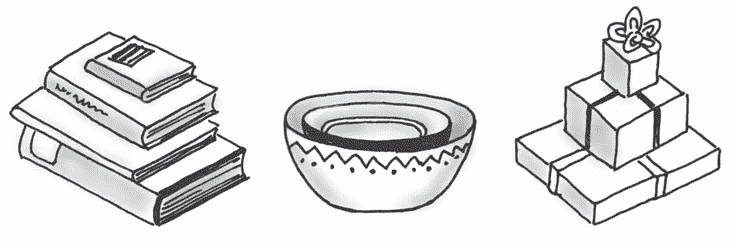
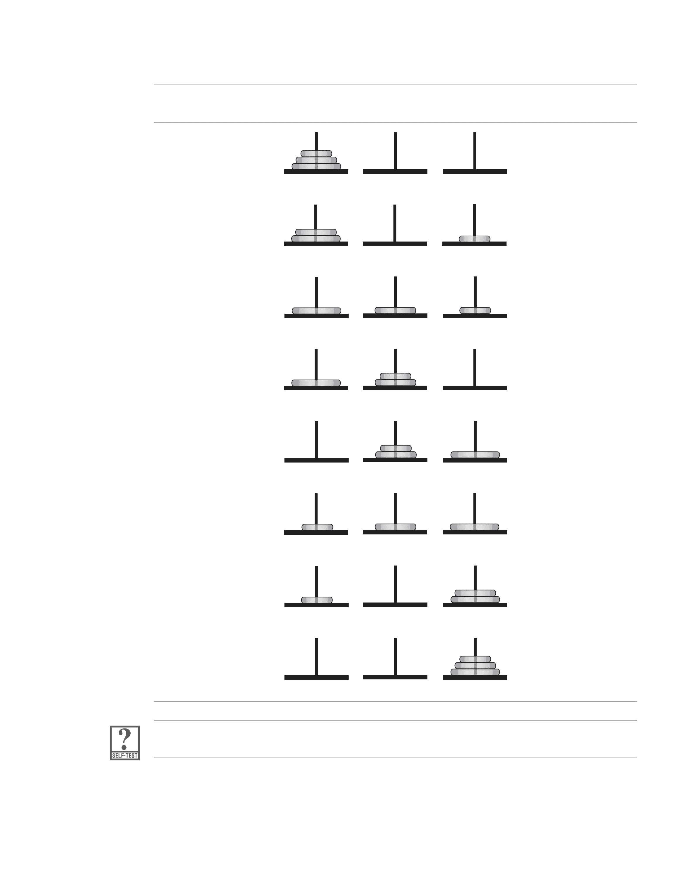

# Java 数据结构与抽象（第 4 版）

Frank M. Carrano

*罗德岛大学*

Timothy M. Henry

*新英格地区技术学院*

10 9 8 7 6 5 4 3 2 1

**iii**

## 欢迎辞

欢迎阅读《使用 Java 进行数据结构与抽象》第四版，这是一本用于数据结构入门课程（通常被称为 `CS-2`）的书籍。

我写这本书是考虑到你们的——无论你是老师还是学生——这是基于我在三十多年本科计算机科学教学中获得的经验。我希望我的书对读者友好，以便学生能够更轻松地学习，教师能够更有效地教学。为此，你将发现材料被分成了小小的部分——我称之为“段”（segments）——它们易于消化并有助于学习。许多模拟真实世界的示例为新材料提供了背景知识，并帮助学生更容易地学习和记住抽象概念。许多简单的图表说明并阐明了复杂的思想。书中还包含了 60 多个视频教程，以补充教学并在教师不在时为学生提供帮助。

我非常荣幸并激动欢迎我的合作者兼同事 Timothy Henry 博士加入本版。我们共同对这项工作进行了全新的更新，同时保留了上一版的主题和顺序。你将发现，我们对各种数据结构的规范和实现的设计决策得到了更加强调，并对安全可靠的编程实践进行了新的介绍。本版的新功能见下一页。

我们希望你喜欢读这本书。和像你之前的许多人一样，你可以用有效且可持续的方式学习——或教授——数据结构。

最诚挚的问候，

*Frank M. Carrano*

我们随时欢迎使用我们书籍的教师和学生联系。您的意见、建议和修正将不胜感激。以下是与我们联系的一些方式：

- 电子邮件：`carrano@acm.org` 或 `thenry@neit.edu`
- Facebook：`www.facebook.com/makingitreal`
- Twitter：`twitter.com/Frank_M_Carrano`
- 网站：`frank-m-carrano.com/makingitreal`

**iv**

- 第 8 章和第 9 章用伪代码替换了部分排序方法的 Java 代码。

## 本版新增

- 第 23 章定义了平衡树。

**ix**

## 资源

### 访问教师和学生资源材料

以下项目可以在出版者网站 `pearsonhighered.com/carrano` 上获取：

- 与书中内容相同的 Java 代码
- 自书出版以来发现的任何错误修正链接
- 其他在线内容的链接，这些内容将在下文中介绍

### 教师资源

采用本教材的教师可以通过登录培思高等教育教师资源中心（Pearson’s Instructor Resource Center）获取以下受保护材料，该中心可以通过 `pearsonhighered.com/carrano` 访问：

- PowerPoint 教学幻灯片
- 练习题和项目的解决方案
- 题库
- 教师源代码
- 书中的插图

此外，教师还可以访问本书的配套网站以获取以下在线优质内容，该网站同样可以通过 `pearsonhighered.com/carrano` 访问：

- 教学视频笔记（VideoNotes）
- 附录 B、C 和 E
- 术语表

请联系您的 Pearson 销售代表获取教师访问代码。联系方式请见 `pearsonhighered.com/replocator`。

### 学生资源

学生可以通过登录从 `pearsonhighered.com/carrano` 访问的配套网站获取以下材料：

- 教学视频笔记（VideoNotes）
- 附录 B、C 和 E
- 术语表

学生必须使用书前提供的访问卡进行注册并进入配套网站。没有访问代码的学生可以按照网站上列出的说明购买访问权限。

请注意，Java 类库可以在 `docs.oracle.com/javase/8/docs/api/` 获取。

**xi**

### 内容概述

本书的读者应该已经完成了一门编程课程，最好是 Java 语言的。附录涵盖了我们假设读者掌握的 Java 基础。你可以将这些附录作为复习，或作为从其他编程语言过渡到 Java 的基础。本书本身从“引言”开始，为我们将要研究的数据结构奠定了基础。

第 2 章不仅仅是简单地实现 `ADT` 包。它展示了如何通过最初关注核心方法来处理类的实现。在定义一个类时，先实现并测试这些核心方法通常是有用的，将其他方法的定义留到以后。第 2 章还引入了安全和稳健编程的概念，并展示了如何为你的代码添加这种保护。

## 致谢

我们诚心感谢以下审稿人，他们仔细阅读了之前的版本并提出了坦诚的意见和建议，极大地改进了这项工作：

- Tony Allevato—弗吉尼亚理工学院州立大学
- Mary Boelk—马凯特大学
- Suzanne Buchele—西南州大学
- Kevin Buffardi—弗吉尼亚理工学院州立大学
- Jose Cordova—蒙罗易斯大学大学
- Greg Gagne—威斯敏斯特学院
- Victoria Hilford—休斯顿大学
- Jim Huggins—凯特林大学
- Shamim Kahn—哥伦布斯州立大学
- Kathy Liszka—阿克隆大学
- Eli Tilevich—弗吉尼亚理工学院州立大学
- 杨建华—哥伦布斯州立大学
- Michelle Zhu—南部伊利诺伊大学

在本书漫长的修订过程中，特别感谢 Pearson 教育计算机科学部门的支持团队：执行编辑 Tracy Dunkelberger、项目经理 Carole Snyder、项目管理团队负责人 Scott Disanno 以及项目经理 Bob Engelhardt 一直对我们完成项目提供了巨大帮助。我们的长期文字编辑 Rebecca Pepper 确保了呈现内容的清晰、准确和符合语法。非常感谢！

我们对上述人员的感激并不会减少对许多其他人所提供帮助的感谢。Steve Armstrong 制作了本书及其之前版本的讲义幻灯片。俄拉荷马大学的 Charles Hoot 教授编写了实验手册，阿克隆大学的 Kathy Liszka 教授创建了新的测试题集，Jesse Grabowski 提供了许多编程项目的解决方案。再次感谢本书之前几个版本的审稿人：

**第三版审稿人：**

- Steven Andrianoff—圣博纳维尔大学
- Brent Baas—LeTourneau 大学
- Timothy Henry—新英格兰理工学院
- Ken Martin—北罗罗来纳大学
- Bill Siever—密苏里西北部州立大学
- Lydia Sinapova—辛普森学院
- Lubomir Stanchev—印第安纳大学
- Judy Walters—中北学院
- 晓辉—北德克萨斯州大学

**第二版审稿人：**

- Harold Anderson—马里斯特学院
- Razvan Andonie—华盛顿中央大学
- Tom Blough—伦塞勒理工学院
- Chris Brooks—旧金山大学
- Adrienne Decker—纽约州立大学布法罗分校
- Henry Etlinger—罗彻斯特理工学院
- Derek Harter—德克萨斯 A&M 大学
- Timothy Henry—新英格兰理工学院
- Robert Holloway—威斯康星大学麦迪逊分校
- Charles Hoot—俄拉荷马大学
- Teresa Leyk—德克萨斯 A&M 大学
- Robert McGlinn—南部伊利诺伊大学卡邦代尔分校
- Edward Medvid—玛丽山大学
- Charles Metzler—旧金山市立学院
- Daniel Zeng—亚利桑那大学

**第一版审稿人：**

- David Boyd—瓦尔多斯塔州立大学
- Dennis Brylow—普渡大学
- Michael Croswell—行业培训师/顾问
- Matthew Dickerson—米德尔伯里学院
- Robert Holloway—威斯康星大学麦迪逊分校
- John Motil—加州州立大学北岭分校
- Bina Ramamurthy—纽约州立大学布法罗分校
- David Surma—瓦尔帕莱索大学

我们继续感谢在之前的版本中提供帮助的许多其他人。他们包括 Alan Apt、James Blanding、Lianne Dunn、Mike Giacobbe、Toni Holm、Charles Hoot、Brian Jepson、Rose Kernan、Christianna Lee、Patrick Lindner、John Lovell、Vince O’Brien、Patty Roy、Walt Savitch、Ben Schomp、Heather Scott、Carole Snyder、Chirag Thakkar、Camille Trentacoste、Nate Walker 和朱晓红。

最后，我们感谢我们的家人和朋友——Doug、Joanne、Tita、Bobby、Ted、Nancy、Sue、Tom、Maybeth、Marge 和 Lorraine——他们给了我们远离电脑之外的生活。

感谢大家提供的专业知识和乐观精神。

**Frank M. Carrano**

**Timothy M. Henry**

## 目录

### 引言：数据组织（1）

### 序言：类设计（5）

- 封装（6）
- 规范方法（8）
- 注释（8）
- 前置条件与后置条件（9）
- 断言（10）
- Java 接口（11）
- 编写接口（12）
- 实现接口（13）
- 作为数据类型的接口（15）
- 扩展接口（16）
- 接口中的命名常量（17）
- 选择类（19）
- 识别类（20）
- CRC 卡片（21）
- 统一建模语言（21）
- 重用类（24）

### Java 间插 2：异常（95）

- 最优、最坏和平均情况（135）

### 第 5 章：栈（Stacks）（153）

- 基于数组的实现（185）
- 什么是递归？（198）
- 简单问题的糟糕解（219）
- 间接递归（223）

**xviii**

**Java 间插 4**

**关于异常的更多信息 293**

- 程序员自定义异常类 293
- 继承与异常 297
- `finally` 块 298

**第 14 章**

**链接数据的列表实现 397**

- 链式节点链的操作 398
- 在不同位置添加节点 398
- 从不同位置删除节点 402
- 私有方法 `getNodeAt` 403
- 开始实现 404
- 数据字段和构造函数 405
- 添加到列表末尾 407
- 在列表内给定的位置添加 408
- 方法 `isEmpty` 和 `toArray` 409
- 核心方法测试 411
- 继续实现 412
- 完善的实现 415
- 尾部引用 415
- 使用链表链实现 `ADT List` 的效率 418
- Java 类库：类 `LinkedList` 420

**Java 间插 5**

**迭代器 427**

- 什么是迭代器？427
- 接口 `Iterator` 429
- 接口 `Iterable` 431
- 使用接口 `Iterator` 431
- `Iterable` 和 `for-each` 循环 435
- 接口 `ListIterator` 436
- 再次查看接口 `List` 439
- 使用接口 `ListIterator` 440

**第 15 章**

**用于 `ADT List` 的迭代器 443**

- 实现迭代器的方法 444
- 独立类 `Iterator` 444
- 内部类 `Iterator` 447
- 链表实现 448
- 基于数组的实现 451
- 为什么迭代器方法在自己的类中？454
- 接口 `ListIterator` 的基于数组实现 456
- 内部类 457

**Java 间插 6**

**可变对象与不可变对象 469**

- 可变对象 470
- 不可变对象 472
- 创建只读类 472
- 伴侣类 474

**第 16 章**

**排序列表 477**

- `ADT Sorted List` 的规范 478
- 使用 `ADT Sorted List` 481
- 链表实现 482
- 方法 `add` 483
- 链表实现的效率 490
- 使用 `ADT List` 的实现 490
- 效率问题 493

**Java 间插 7**

**继承与多态 499**

- 继承的进一步方面 499
- 何时使用继承 499
- 保护级访问 500
- 抽象类和方法 501
- 接口对比抽象类 503
- 多态 504

**第 17 章**

**继承与列表 511**

- 使用继承实现排序列表 512
- 设计基类 514
- 创建抽象基类 519
- 排序列表的实现 521
- 方法 `add` 521

**第 18 章**

**搜索 527**

- 问题 528
- 搜索未排序数组 528
- 未排序数组的迭代顺序搜索 529
- 未排序数组的递归顺序搜索 530
- 数组顺序搜索效率 532
- 搜索排序数组 532
- 排序数组的顺序搜索 532
- 排序数组的二叉搜索 533
- Java 类库：方法 `binarySearch` 538
- 数组的二叉搜索效率 538
- 搜索未排序链 539
- 未排序链的迭代顺序搜索 540
- 未排序链的递归顺序搜索 540
- 链的顺序搜索效率 541
- 搜索排序链 541
- 排序链的顺序搜索 541
- 排序链的二叉搜索 542
- 选择搜索 542

**Java 间插 8**

**再次谈论泛型 549**

- 多一个泛型类型 549

**第 19 章**

**字典 551**

- `ADT Dictionary` 的规范 552
- Java 接口 556
- 使用 `ADT Dictionary` 557
- 迭代器 558
- 解决的问题：电话号码表 559
- 解决的问题：词汇频率 564
- 解决的问题：词汇索引 567
- Java 类库：接口 `Map` 570

**第 20 章**

**字典实现 575**

- 基于数组的实现 576
- 未排序数组的字典实现 576
- 排序数组的字典实现 581
- 链式实现 586
- 未排序链字典 587
- 排序链字典 588

**第 21 章**

**引入哈希 595**

- 什么是哈希？596
- 哈希函数 599
- 计算哈希值 599
- 将哈希值压缩为哈希表索引 602
- 解决冲突 603
- 线性探测开放法 603
- 二次探测开放法 608
- 双重哈希开放法 609
- 开放法的潜在问题 611
- 链地址法 612

**第 22 章**

**作为字典的哈希 619**

- 哈希的效率 620
- 负载因子 620
- 开放法的代价 621
- 链地址法的代价 623
- 重哈希 624
- 使用哈希的字典 625
- 哈希表中的项 626
- 数据字段和构造函数 627
- 方法 `getValue`、`remove` 和 `add` 629
- 迭代器 634
- Java 类库：`HashMap` 635
- Java 类库：`HashSet` 636

**第 23 章**

**树 639**

- 树的概念 640
- 树的术语 640
- 树的遍历 642
- 二叉树的遍历 647
- 普通树的遍历 649
- 树的接口 650
- 所有树的接口 650
- 二叉树的接口 651
- 二叉树的示例 652
- 表达式树 653
- 决策树 654
- 二叉搜索树 658
- 堆 660
- 普通树的示例 663
- 树 663

**第 24 章**

**树的实现 673**

- 二叉树中的节点 674
- 普通树的节点 688
- 使用二叉树表示普通树 689
- `ADT Binary Tree` 的实现 675
- 创建基础二叉树 677
- 方法 `set` 678
- 访问器和修改器方法 681
- 计算高度和节点计数 681
- 二叉树的实现 682
- 表达式树的实现 687

**第 25 章**

**二叉搜索树实现 713**

- 入门 714
- 二叉搜索树的接口 715
- 重复项 717
- 开始类定义 718
- 搜索与检索 719
- 遍历 720
- 添加项 721
- 递归实现 722
- 迭代实现 725
- 删除项 726
- 删除节点为叶子的项 727
- 删除节点只有一个孩子的项 727
- 删除节点有两个孩子的项 728
- 删除根节点中的项 731
- 递归实现 732
- 迭代实现 735
- 操作的效率 739
- 平衡的重要性 740
- 节点添加的顺序 740
- `ADT Dictionary` 的实现 740

**第 26 章**

**堆的实现 753**

- 重温：`ADT Heap` 754
- 使用数组表示堆 754
- 添加项 757
- 删除根节点 760
- 创建堆 763
- 堆排序 766

**第 27 章**

**平衡搜索树 775**

- `AVL` 树 776
- 单旋转 776
- 双旋转 779
- 实现细节 783
- `2-3` 树 787
- 搜索 `2-3` 树 788
- 向 `2-3` 树添加项 789
- 添加项时的节点分裂 791
- `2-4` 树 792
- 向 `2-4` 树添加项 793
- `AVL`、`2-3` 树和 `2-4` 树的比较 795

**xxiii**

**811**

**841**

- 实现 `Vertex` 类 | 848

**xxvi**

- 基于数组的包 | 61
- 可调整大小的包 | 87
- Java 间歇 2：异常 | 95

## 第 3 章：基于数据的包实现

**103**

- 链式数据 | 104
- 开始 `LinkedBag` 类 | 109
- 完成 `LinkedBag` 类 | 114

## 第 4 章：算法的效率

**129**

- 测量效率 | 131
- 比较 `ADT` 实现 | 143

## 第 5 章：栈

**153**


- ADT 栈 | 154
- 使用 ADT 栈 | 169

# 第 6 章：实现

181

- `LinkedStack` 类 | 182
- `ArrayStack` 类 | 185

## 第 7 章：递归

197

- 引入递归 | 198
- 使用递归解决问题 | 207
- Java 间歇 3：更多关于泛型 | 235
- 泛型类与方法 | 237

## 第 8 章：排序简介

245

- 选择排序 | 247
- 插入排序 | 252

## 第 9 章：更快的排序方法

271

- 归并排序 | 272
- 快速排序 | 278
- Java 间歇 4：更多关于异常 | 293
- 创建自定义异常 | 293

## 第 10 章：队列、双端队列与优先级队列

301

- ADT 队列 | 302
- ADT 双端队列与优先级队列 | 322

## 第 11 章：队列、双端队列与优先级实现

331

- `LinkedQueue` 类 | 332
- `ArrayQueue` 类 | 339
- 其他队列实现 | 344

## 第 12 章：列表

361

- ADT 列表 | 362
- 路线实现 | 369

## 第 13 章：使用数组的列表实现

379

- `ArrayList` 类 | 382
- 完成 `ArrayList` 类 | 387

## 第 14 章：基于数据的列表实现

397

- 链式数据 | 406
- 完成 `LinkedBag` 类 | 412
- Java 间歇 5：更多关于泛型 | 427

## 第 15 章：ADT 列表迭代器

443

- 数组实现 | 447
- 可变列表实现 | 469
- Java 间歇 6：关于可变对象 | 470

## 第 16 章：排序列表

477

- `LinkedList` 类 | 482
- 基于数组的列表 | 490
- Java 间歇 7：继承与多态 | 500

## 第 17 章：继承与列表

511

- ADT 列表 | 512
- 异常实现 | 519

## 第 18 章：搜索

527

- 数组搜索 | 529
- 链式搜索 | 540
- Java 间歇 8：再次介绍泛型 | 549

## 第 19 章：字典

551

- ADT 字典 | 552
- 字典实现 | 558

## 第 20 章：字典实现

575

- 基于数组的字典 | 576
- 字典实现 | 586

## 第 21 章：哈希

595

- ADT 哈希 | 596
- 哈希实现 | 603

## 第 22 章：哈希实现

619

- 数组哈希 | 620
- 哈希冲突 | 626

## 第 23 章：树

639

- ADT 树 | 646
- 树实现 | 653

## 第 24 章：树的实现

673

- AVL 树 | 677
- 红黑树 | 681
- Java 间歇 9：红黑树 | 697

## 第 25 章：二叉搜索树

713

- 二叉搜索树实现 | 718
- 二叉搜索树操作 | 725

## 第 26 章：堆实现

753

- ADT 堆 | 754
- 堆实现 | 766

## 第 27 章：平衡树

775

- 平衡树实现 | 776
- 红黑树 | 793

## 第 28 章：图

811

- 图的术语 | 812
- 图算法 | 817

## 第 29 章：图的实现

841

- 邻接矩阵 | 842
- 邻接列表 | 851

## 前提条件

### 第 22 章

哈希作为字典实现

4, 13, 14, 19, 20, 21, JI15

### 第 23 章

树

5, 7, 14, 18, JI15

### 第 24 章

树的实现

5, 10, 14, 23, D, JI12

### Java 间插 9

克隆

16, 24, C, D, JI3, JI6

### 第 25 章

二叉搜索树实现

7, 19, 23, 24, D

### 第 26 章

堆实现

2, 13, 23

### 第 27 章

平衡搜索树

23, 24, 25

### 第 28 章

图

5, 10, 23

### 第 29 章

图的实现

5, 10, 12, 15, 19, 23, 28, JI15

### 附录 A

文档与编程风格

Java 基础知识

### 附录 B

Java 核心基础

编程知识

### 附录 C

Java 类

B

### 附录 D

从其他类创建类

C

### 附录 E

文件输入与输出

序言, B, JI2

环顾四周，你会发现人们组织事物的方式。当你今天早上在商店停下时，你排在队伍的末尾等待收银员。这条队伍是按时间顺序组织人们的。队伍中的第一个人第一个接受服务并第一个离开队伍。最终，你到达队首，提着一袋装有购物物品的袋离开了商店。袋里的物品并没有特定的顺序，而且某些物品是相同的。

你是否在办公桌上看到一叠书或一堆纸？查看或移除栈顶部的物品，或者在栈顶添加一个新物品，都是轻而易举。栈中的物品也是按时间顺序组织的，最近添加的物品在顶部，先添加的物品在底部。

在你的办公桌前，你看到了待办事项列表。列表中的每个条目都有一个对你可能重要或不重要的位置。你可能是想到它们时写下它们的，按重要性顺序写的，或者是按字母顺序写的。由你决定顺序；列表仅为你的条目提供位置。

你的字典是单词及其定义的字母顺序排列列表。你搜索一个单词并获取它的定义。如果你的字典是印刷本，字母顺序的组织有助于你快速找到单词。如果你的字典是计算机化的，它的字母顺序组织被隐藏了，但它仍然加快了搜索。

说到你的电脑，你将文件组织成了文件夹（或目录）。每个文件夹包含几个其他文件夹或文件。这种组织方式是层次化的。如果你为它画一张图，你会得到类似于家谱或公司内部部门结构图的东西。这些数据组织方式是的，被称为“树”。

最后，注意你正用来规划周末旅行的地图。道路和城镇的图表显示了你如何从一个地方到达另一个地方。通常，有多种方法。一种方法可能更短，另一种可能更快。地图有一种被称为“图”的组织方式。

# 数据组织

## 引言

计算机程序也需要组织它们的数据。它们采取的方式与我们刚刚引用的示例相似。也就是说，程序可以使用栈、列表、字典等。这些组织数据的方式由抽象数据类型表示。**抽象数据类型**（或 **ADT**）是一种描述数据集以及对该数据进行的操作的规范。每个 ADT 都规定了存储什么数据以及对数据进行的操作的作用。由于 ADT 并不指示如何存储数据或如何实现这些操作，我们可以独立于任何编程语言来讨论 ADT。相比之下，**数据结构**是编程语言中对 ADT 的实现。

**集合**（collection）是包含一组对象的 ADT 的泛指术语。某些集合允许重复项，另一些不允许。某些集合按照特定顺序排列其内容，而另一些则不然。

我们可能会创建一个名为**包**（bag）的 ADT，它由一个允许重复的无序集合组成。它就像一个购物袋、一个午餐袋或一袋薯片。假设你从一袋薯片中取出一片。你不知道这片薯片是什么时候放入袋子里的。你不知道袋子里是否还有另一片与你刚刚取掉的那片一模一样的薯片。但你并不在乎。如果你在乎，你就不会把薯片装在袋里了！

包不对其内容排序，但有时你确实想对事物排序。ADT 可以以多种方式对其项排序。例如，ADT **列表**（list）仅对其项进行编号。因此，列表有一个第一个项、第二个项，依此类推。尽管你可以向列表末尾添加项，但你也可以在列表开头或现有项之间插入项。这样做会对新项之后的项重新编号。此外，你可以移除列表中特定位置的项。因此，项在列表中的位置并不意味着它被添加的时间。注意，列表并不决定项放置的位置；由你做出这个决定。

### 日常数据组织的示例

相比之下，ADT **栈**（stack）和**队列**（queue）按时间顺序对其项排序。当你从栈中移除一个项时，你移除的是最近添加的那个。当你从队列中移除一个项时，你移除的是最早添加的那个。因此，栈就像一堆书。你可以取出上面的书，或在堆顶添加另一一本书。队列就像一条队。人们从队头离开，从队尾加入。

如果项可以比较，某些 ADT 会将其条目保持为排序状态。例如，字符串可以按字母顺序组织。例如，当你向 ADT **排序列表**（sorted list）添加项时，ADT 决定将该项放置在列表中的位置。你不需要像对待 ADT 列表那样为项指定位置。

ADT **字典**（dictionary）包含项的对，就像语言字典包含单词及其定义一样。在这个例子中，单词充当**键**（key），用于定位条目。某些字典对其条目进行排序，另一些则不然。

ADT **树**（tree）根据某些层次结构组织条目。例如，在家谱中，人们与其子女和父母相关。ADT **二叉搜索树**具有结合了层次和排序的组织方式，使得定位特定条目更容易。

ADT **图**（graph）是 ADT 树的泛化，它关注条目之间的关系，而不是任何层次结构。例如，地图就是一种图，显示了现有的道路和城镇之间的距离。

本书向你展示如何使用和实现这些数据组织方式。在整书中，我们假设你已经熟悉 Java。如果你需要复习，你会发现附录很有帮助。附录 A 提供了适用于 `javadoc` 的注释编写概述。附录 B 回顾了 Java 中的基本语句。附录 C 讨论了类和方法的基本结构，附录 D 涵盖了组合和继承的核心要点。最后，附录 E 介绍了读写外部文件。附录 B、C 和 E 位于本书网站（见序言第 ix 页）。你可以下载它们并在需要时参考这些材料。书中的某些特殊章节被称为“Java 间插”（Java Interludes），重点关注你可能不了解的 Java 相关方面，包括如何处理异常。随后的序言讨论了如何设计类、指定方法以及编写 Java 接口。使用接口和编写注释来指定方法对于我们介绍 ADT 至关重要。

## 设计类

目录

- 封装
- 指定方法
- 注释
- 前置条件与后置条件
- 断言
- Java 接口
- 编写接口
- 实现接口
- 作为数据类型的接口
- 扩展接口
- 接口中的命名常量
- 选择类
- 识别类
- CRC 卡
- 统一建模语言
- 重用类
- 前提
- 附录 A：文档与编程风格
- 附录 B：Java 基础（在线）
- 附录 C：Java 类（在线）
- 附录 D：从其他类创建类

面向编程体现了三个设计概念：封装、继承和多态。如果你不熟悉继承和多态，请复附录 B、C 和 D。在这里，我们将讨论封装，将其作为在类设计过程中隐藏实现细节的一种方法。我们强调在实现方法之前指定该方法应该如何行为，以及将你的规范作为注释写在程序中的重要性。

我们引入了 Java 接口，作为一种将类的行为声明与其实现分离来的方法。最后，我们将以浅的水平介绍识别特定解决方案所需的类的一些技术。

## 封装

### P.1

如果你想学习开车，对汽车最有效的描述是什么？这显然不是关于它的引擎如何经历吸入空气和汽油、点燃汽油/空气混合物并排出废气的循环的描述。当你学习开车时，这些细节是不必要的。事实上，这些细节可能会阻碍你。如果你想学习开车，对汽车最有效的描述应该具有以下特征：

- 如果你脚踩加速油板，汽车就会移动得更快。
- 如果你脚踩刹车板，汽车就会减速并最终停止。
- 如果你将方向盘向右转，汽车就会向右转。
- 如果你将方向盘向左转，汽车就会向左转。

正如你不需要告诉想开车的人引擎是如何工作的一样，你不需要告诉使用某段软件的人其 Java 实现的所有精细细节。同样，假设你创建了一个软件组件供另一个程序员在程序中使用。你应该以一种方式描述该组件，告诉另一个程序员如何使用它，但又让程序员忽略你如何编写软件的所有细节。

### P.2

**封装**是面向对象的设计原则之一。“封装”这个词听起来像是把东西放入胶囊中，这个形象确实是正确的。封装隐藏了“胶囊”内部的精细细节。出于这个原因，封装通常被称为**信息隐藏**。但并不是所有东西都应该隐藏。在汽车中，某些东西是可见的——比如踏板和方向盘——而其他隐藏在引擎盖下。换句话说，汽车被封装，使得细节被隐藏，只有驾驶汽车所需的控件是可见的，如图 P-1 所示。

同样，你应该封装你的 Java 代码，使得细节被隐藏，只有必要的控件是可见的。

封装将数据和方法封闭在类内部，并隐藏使用该类时所需的实现细节。如果一个类设计得良好，使用它就不需要理解它的实现。程序员可以在不知道代码是如何编写的情况下使用类的方法。程序员只需要知道如何为方法提供适当的参数，让方法去执行正确的操作。简单来说，程序员不需要担心类定义的内部细节。使用封装好的软件来编写更多软件的程序员任务更简单。结果是，软件产得更快，且错误更少。

**注意：** **封装**是面向对象编程的设计原则，它将数据和方法封装在类内部，从而隐藏了类的实现细节。程序员只接收足够以使用该类的信息。一个设计良好的类可以像每个方法的体都从视图中隐藏一样被使用。

### P.3

**抽象**是一个要求你关注*是什么*（what）而不是*怎么做*（how）的过程。当你设计一个类时，你在练习**数据抽象**。你关注想对数据做什么或处理数据，而不必担心将如何完成这些任务以及你将如何表示数据。抽象要求你关注哪些数据和操作是重要的。当你抽象某个事物时，你识别出了核心思想。例如，一本书的抽象是对该书的简要描述，而不是整本书。

在设计类时，你不应该考虑任何方法的实现。也就是说，你不应该担心类的方法将*如何*实现它们的目标。这种规范与实现的分离让你能够集中于更少的细节，从而使你的任务变得更容易且更不容易出错。详细的、计划良好的规范有助于实现更有可能成功的程序。

**注意：** 抽象的过程要求你关注*是什么*而不是*怎么做*。

### 图 P-1

汽车的控件对驾驶员是可见的，但其内部构造是隐藏的。

### P.4

当执行正确时，封装将类定义分为两个部分，我们称之为**客户端接口**和**实现**。客户端接口描述了程序员使用该类所需要知道的一切。它由类的公共方法的头文件、告诉程序员如何使用这些公共方法的注释以及该类的任何公共定义的常量组成。类定义中的客户端接口部分应该是你在程序中使用该类所需要的所有信息。

实现由所有数据字段和所有方法的定义，包括公共的、私有的和受保护的。尽管你需要实现来实现运行客户端（一个使用该类的程序），但在编写客户端时，你不应该需要知道关于实现的任何内容。图 P-2 展示了一个类的封装实现和客户端接口。尽管实现对客户端来说是隐藏的，但接口是可见的，并为客户端与实现之间的通信提供了一种良好规范的手段。

### 图 P-2

接口在隐藏的实现和客户端之间提供了良好规范的通信。

客户端接口和实现在 Java 类的定义中并不是分离的。它们是混合在一起的。然而，你可以创建一个创建一个独立的 Java 接口作为你类的伴侣。本引言的后半部分描述了如何编写这样的接口，我们将在书中编写几个这样的接口。

**问题 1** 客户端接口与类实现有什么区别？

**问题 2** 想一个汽车以外的例子来说明封装。你的例子中哪部分对应于客户端接口，部分部分对应实现？

## 指定方法

将类及其方法的目的与其实现分离，对于一个成功的软件项目至关重要。你应该指定每个类和方法做什么，而不必担心其实现。编写描述能够让你最初捕捉想法，并对其进行开发，使其清晰到可以实现。你的书面描述应该达到可以作为程序注释之用的程度。你需要超越仅仅将注释视为编写程序后为了满足老师或老板而添加的观点。

### 注释

让我们关注你为类方法编写的注释。虽然组织倾向于有自己的注释风格，但 Java 开发者指定了你应该遵循的注释风格。如果你在程序中包含这种风格编写的注释，你可以运行一个名为 `javadoc` 的工具程序来生成描述你的类的文档。这些文档告诉人们使用你的类需要知道的信息，但省略了所有的实现细节，包括所有方法定义的体。

## 指定方法 9

我们在这里不再进一步讨论 `javadoc` 的规则，而是想讨论一下指定方法时的一些重要方面。首先，你需要编写一个简洁的陈述来描述该方法的目的或任务。以动词开头该陈述可以帮助你避免许多你并不真正需要的额外词汇。

在思考方法的目的时，你应该考虑它的输入参数（如果有的话）并对其进行描述。你还需要描述方法的执行结果。它是返回一个值、还是触发了某些操作，或是影响了参数的状态？在编写此类描述时，你应该记住以下几点。

### 前置条件和后置条件

**前置条件**（precondition）是指在方法开始执行之前必须为真的条件声明。除非满足前置条件，否则不应使用该方法，也不能期望它能正确执行。前置条件可能与方法的参数描述有关。例如，计算 `x` 的平方根的方法可以将 `x` ≥ 0 作为前置条件。

**后置条件**（postcondition）是指在满足前置条件的情况下，方法完成执行后为真的的陈述。对于有返回值的方法，后置条件将描述方法返回的值。对于 `void` 方法（无返回值），后置条件将描述所采取的操作以及对调用对象的任何更改。总来说，后置条件描述了方法调用产生的所有影响。

从后置条件的角度思考可以帮助你明确方法的目的。注意，从前置条件到后置条件的过程忽略了“如何实现”（how）——也就是说，我们将方法的规范与其实现分离开了。

**编程提示：** 即使满足了前置条件，无法满足其后置条件的方法也可以抛出异常。（有关异常的讨论，请参阅 Java 间插 2 和 4。）

**责任。** 前置条件意味着有确保某些条件满足的责任。如果客户端负责在调用方法之前满足条件，则方法就不需要检查这些条件。相反，如果由方法负责强制执行条件，则客户端无需检查。清楚地说明谁必须检查某组特定条件，会增加有人执行该操作的概率，并避免重复劳动。

例如，你可以通过在方法头之前编写以下注释，来指定我们在上一节中提到的平方根方法：

```java
/** 计算一个数字的平方根。
@param x 一个大于等于 0 的实数。
@return x 的平方根。
*/
```

在这种情况下，方法假设客户端会提供一个非负数作为参数。更安全的技术是让方法承担检查参数的责任。在这种情况下，它的注释可以如下：


```java
/** 计算一个数字的平方根。
@param x 一个实数。
@return 如果 x >= 0，则返回 x 的平方根。
@throws ArithmeticException 如果 x < 0 则抛出异常。
*/
```

尽管我们已经将前置条件和后置条件整合到了之前的注释中，但我们也可以分别标识它们。

## 10 序言 设计类

**编程提示：** 在位于方法头之前的注释中，完整地指定每个公共方法。说明是由方法本身还是其客户端确保确保成功执行方法所需的必要条件满足。通过这种方式，检查被执行了但没有重复执行。然而，在调试期间，方法应该检查其前置条件是否已经满足。

当你使用继承和多态来重写父类中的方法时，子类中的方法可能与父类中的方法不一致。前置条件和后置条件将帮助你（作为程序员）避免这个问题。后置条件必须适用于子类中所有版本的方法。重写的方法可以增加后置条件——也就是说，它可以做得更多——但不应做得更少。然而，重写的方法不能增加其前置条件。换句话说，它的要求不能比基类中方法的要求更多。

**问题 3** 假设类 `Square` 有一个数据字段 `side` 和一个用于设置 `side` 值的方法 `setSide`。你为这个方法可以写什么样的方法头和注释？在此过程中请记住前置条件和后置条件。

### 断言（Assertions）

**断言**（assertion）是关于你的程序逻辑某些方面的真实性陈述。你可以将其看作在特定某一点为真（或至少应该是真）的布尔表达式。例如，前置条件和后置条件就是关于方法开始和结束时状态的断言。如果这些断言中的一个为假，说明你的程序出了问题。

你可以在代码的注释中写出断言。例如，在方法定义的某个点，如果你知道变量 `sum` 应该是正数，你可以写下如下注释：

```java
// 断言: sum > 0
```

此类注释指出了逻辑中可能不清晰之处。此外，它们为你在调试期间检查代码的准确性提供了位置。

**问题 4** 假设你有一个正整数数组。以下语句找到数组中最大的整数。在下面的循环的 `if` 语句之后，你可以写什么样的断言注释作为注释？

```java
int max = 0;
for (int index = 0; index < array.length; index++)
{
    if (array[index] > max)
        max = array[index];
    // 断言:
} // 循环结束
```

### `assert` 语句

Java 允许你做的不仅仅是写一个注释来做断言。你可以通过 `assert` 语句来强制执行断言，例如：

`assert sum > 0;`

如果跟在关键字 `assert` 之后的布尔表达式为真，则什么都不发生。如果为假，则发生断言错误。显示如下：

Java 接口 11

```text
Exception in thread "main" java.lang.AssertionError
```

你可以通过向 `assert` 语句添加第二个表达式来澄清此错误消息。第二个表达式必须表示一个值，因为它的字符串表示会显示在错误消息中。例如，语句：

`assert sum > 0 : sum;`

在 `sum ≤ 0` 的情况下将 `sum` 的值添加到错误消息中。例如：

```text
Exception in thread "main" java.lang.AssertionError: −5
```

默认情况下，断言语句在执行时是禁用的。因此，你可以在完成程序后留下断言语句而不浪费执行时间。当你运行程序时，如果想要它们执行，必须启用它们。¹

**注意：** 程序中的断言标识了逻辑中必须为真的方面。在 Java 中，你可以使用 `assert` 语句来做出断言。它的形式如下：

`assert boolean_expression : expression;`

如果第一个表达式为假，可选的第二个表达式的值将出现在错误消息中。

**编程提示：** 使用断言查找程序逻辑错误是一种简单而有效的方法。在完成此目的后，留在程序中的断言为想要修改或扩展其能力的人提供了逻辑说明。记住，除非程序用户指定，否则 Java 会忽略断言。

**编程提示：** 在调试期间使用 `assert` 语句来强制检查前置条件是否已经满足。然而，`assert` 语句不是 `if` 语句的替代品。你应该将 `assert` 语句作为编程辅助，而不是程序逻辑的一部分。

### Java 接口

在序言早期，我们泛泛地谈论了客户端接口，它告诉你你在程序中使用特定类所需的所有知识。尽管 Java 类将它的接口与实现混合在一起，但你可以编写一个独立的接口。

**Java 接口**是一个程序组件，它声明了若干公共方法并可以定义公共命名常量。此类接口应该包含关于这些方法的注释，以向程序员提供实现它们所需的必要信息。某些接口描述类所有的公共方法，而另一些只指定某些方法。

当你编写一个定义了接口声明方法的类时，我们说该类**实现**（implements）该接口。实现接口的类必须为接口指定的每个方法定义方法体。然而，接口可能没有声明类中定义的每一个方法。

## 12 序言 设计类

你可以编写自己的接口，也可以使用 Java 类库中提供的接口。

当你编写一个 Java 接口时，你会将其放在一个单独的文件中。也就是说，接口和实现它的类位于两个独立的文件。

### 编写接口

P.11

Java 接口的写法与类定义类似，不同之处在于使用 `interface` 关键字而不是 `class`。也就是说，接口以以下语句开头：

`public interface interface-name`

而不是：

`public class class-name`

接口可以包含任意数量的公共方法头，每个方法头后面都跟着一个分号。

接口不声明类的构造函数，且不能声明静态（static）或最终（final）方法。注意，接口中的方法默认是公共的，因此你可以省略方法头中的 `public` 关键字。接口还可以定义任意数量的公共命名常量。

P.12

**示例。** 想象像圆形、正方形或地块这样的对象，它们既有周长面积。假设我们希望这些对象的类具有返回这些数值的 `get` 方法。如果不同的程序员实现这些类，他们可能不会以相同的方式命名或指定这些 `get` 方法。为了确保这些类以统一的方式定义方法，我们编写了列表 P-1 所示的接口。该接口为程序员提供了方法规范的便捷摘要。程序员应该能够在不查看实现这些方法的类的情况下使用这些方法。

**列表 P-1** 接口 `Measurable`

```java
1 /** 一个用于返回对象
2  周长和面积的方法的接口。
3 */
4 public interface Measurable
5 {
6 /** 获取周长。
7 @return 周长。 */
8 public double getPerimeter();
9
10 /** 获取面积。
11 @return 面积。 */
12 public double getArea();
13 } // end Measurable
```

你将接口定义存储在与接口同名的文件中，后缀为 `.java`。例如，上述接口位于 `Measurable.java` 文件中。

**编程提示：** Java 接口是提供注释的好地方，可以指定每个方法的目的、参数、前置条件和后置条件。通过这种方式，你可以在一个文件中指定类并在另一个文件中实现它。

**注意：** 接口可以声明数据字段，但它们必须是公共的。按照惯例，类的数据字段是私有的，因此接口中的任何数据字段应该代表命名常量。因此，它们应该是 `public`、`final` 且 `static` 的。

Java 接口 13

**注意：** 在接口内部声明的方法不能是静态的，也不能是最终的。然而，此类方法可以在实现接口的类中被声明为 `final`。

P.13

**示例。** 假设你最终想定义一个人名的类。你可能先开始编写列表 P-2 所示的 Java 接口，以指定此类类的方法。我们只为前两个方法包含了注释，以节省空间。该接口提供了整个类所需方法的规范。当你在实现如 `Name` 的类时可以使用它，如附录 C 中的列表 C-1 所示。此外，你应该能够通过查看接口来为该类编写客户端。

**列表 P-2** 接口 `NameInterface`

```java
1 /** 用于姓名类的接口。 */
2 public interface NameInterface
3 {
4 /** 设置名和姓。
5 @param firstName 期望的名字字符串。
6 @param lastName 期望的姓字符串。 */
7 public void setName(String firstName, String lastName);
8
9 /** 获取全名。
10 @return 包含名和姓的字符串。 */
11 public String getName();
12
13 public void setFirst(String firstName);
14 public String getFirst();
15
16 public void setLast(String lastName);
17 public String getLast();
18
19 public void giveLastNameTo(NameInterface aName);
20
21 public String toString();
22 } // end NameInterface
```

注意 `giveLastNameTo` 方法的参数使用了 `NameInterface` 而不是 `Name`。我们将接口作为数据类型（见 P.17）。只需记住接口不应限制实现它的类或类的名称。

**注意：接口的命名**

Java 中的接口名称通常以 “able” 结尾，例如 `Measurable`。这种结尾并不总是提供一个好的名字，因此也使用 “er” 或 “Interface” 等结尾。正如 Java 的异常（exception）以 “Exception” 结尾一样，我们通常将接口名称以 “Interface” 结尾。

### 实现接口

P.14

任何实现接口的类都必须在定义的开头通过 `implements` 子句说明这一点。例如，如果一个 `Circle` 类实现了接口 `Measurable`，它将如下：

`public class Circle implements Measurable`

该类必须为接口中的每个方法提供定义。在这个示例中，`Circle` 类必须实现 `getPerimeter` 和 `getArea` 方法。

14 序言 设计类

如果我们写了一个实现了 `Measurable` 的 `Square` 类，它将作为：

`public class Square implements Measurable`

并且这两个方法的定义显然与 `Circle` 类中的不同。

图 P-3 展示了包含 `Measurable`、`Circle`、`Square` 以及客户端的文件。

| 组件 | 描述 |
| :--- | :--- |
| 接口 | `Measurable` |
| 类 | `Circle`, `Square` |
| 客户端 | 客户端代码 |

**图 P-3**

实现接口的类以及客户端

**注意：** 编写接口是类设计者为程序员指定方法的方法。实现接口是程序员保证类定义了某些方法的方法。

**注意：** 多个类可以实现同一个接口，方式可能不同。例如，许多类可以实现 `Measurable` 接口并提供 `getPerimeter` 和 `getArea` 方法的不同版本。

P.15

**示例。** 想象像圆形、球体和圆体等几何形状类。这些形状都有半径。我们可以定义我们的类实现的以下接口：

```java
public interface Circular
{
    public void setRadius(double newRadius);
    public double getRadius();
} // end Circular
```

此接口承认半径的存在，因此为它声明了 `set` 和 `get` 方法。然而，它不能为半径声明字段。实现此接口的 `Circle` 类可能如下：

```java
public class Circle implements Circular
{
    private double radius;

    public void setRadius(double newRadius)
    {
        radius = newRadius;
    } // end setRadius

    public double getRadius()
    {
        return radius;
    } // end getRadius

    public double getArea()
    {
        return Math.PI * radius * radius;
    } // end getArea
} // end Circle
```

该类定义了私有字段 `radius`，实现了接口声明的 `setRadius` 和 `getRadius` 方法。

**注意：** 类定义的方法可以比实现的接口中的多。例如，`Circle` 类定义了 `getArea` 方法，而 `Circular` 接口中没有。

P.16

**多个接口。** 一个类可以实现多个接口。如果是，你只需列出所有接口名称并用逗号隔开。如果类派自另一个类，`implements` 子句始终在 `extends` 子句之后。因此，你可以写：

`public class C extends B implements Measurable, AnotherInterface`

为了记住这个顺序，注意关键字 `extends` 和 `implements` 在类头中是按字母顺序出现的。

实现多个接口的类必须定义接口中声明的每个方法。如果同一个方法头出现在类所实现的多个接口中，该类只定义一个对应的方法。

你不能从多个基类派生一个类。这种限制避免了继承冲突实现的可能性。但 Java 接口包含方法规范，而不是实现。无论这些规范是出现在一个接口中还是分散在多个接口中，类都可以实现这些规范。通过允许类实现任意数量的接口，Java 近似多重继承，但没有它可能带来的复杂性。

**问题 5** 编写一个 Java 接口，为学生类指定并声明方法。

**问题 6** 开始定义一个实现你在上一个问题中所写的类的。包括数据字段、构造函数和至少一个方法定义。

### 接口作为数据类型

P.17

在声明变量、数据字段或方法参数时，你可以像使用数据类型一样使用 Java 接口。例如，P.13 中的 `giveLastNameTo` 方法的参数类型为 `NameInterface`：

`public void giveLastNameTo(NameInterface aName);`

传递给此方法的任何参数都必须是 `NameInterface` 的类的对象。

## 16 引言 设计类

我们为什么不将 `aName` 的类型声明为像 `Name` 这样的类类型呢？我们希望接口独立于实现它的任何类，因为一个接口可以实现多个类。通过使用 `NameInterface` 作为参数的类型，你可以确保方法的参数将拥有 `NameInterface` 中声明的所有方法。通常情况下，如果一个方法的参数类型是接口，你就可以确定该参数将具有特定的方法，即在接口中声明的方法。此外，该参数将仅拥有这些方法。

如果类 `C` 的类头头部中不包含 `implements NameInterface` 短语，但仍然实现了接口中的方法会怎样？你将无法将 `C` 的实例传递给 `giveLastNameTo`。

**注意：** 通过使用接口作为变量的类型，你表示该变量可以引用具有一组特定方法且仅有这些方法的对象。

**注意：** **接口类型**是一种引用类型。

**P.18**

如下的变量声明：

```java
NameInterface myName;
```

使 `myName` 成为一个引用变量。现在，`myName` 可以引用任何实现 `NameInterface` 的类的任何对象。因此，如果 `Name` 实现了 `NameInterface`，并且你有：

```java
myName = new Name("Coco", "Puffs");
```

那么 `myName.getFirst()` 返回字符串 `"Coco"` 的引用。如果类 `AnotherName` 也实现了 `NameInterface`，而你随后写了：

```java
myName = new AnotherName("April", "MacIntosh");
```

那么 `myName.getFirst()` 返回字符串 `"April"` 的引用。

**问题 7** 为了使用 `NameInterface`，你应该对第 5 题中编写的接口以及实现它的 `Student` 类分别进行哪些修改？

### 扩展接口

**P.19**

一旦你有了一个接口，就可以通过继承从它派生另一个接口。事实上，你可以从几个接口中派生出一个接口，尽管你不能从几个类中派生出一个类。

当一个接口扩展另一个接口时，它拥有了被继承接口的所有方法。因此，你可以创建一个接口，它由现有接口中的方法加上一些新方法组成。例如，考虑宠物类以及以下接口：

```java
public interface Nameable
{
    public void setName(String petName);
    public String getName();
} // end Nameable
```

**Java 接口 17**

我们可以扩展 `Nameable` 来创建接口 `Callable`：

```java
public interface Callable extends Nameable
{
    public void come(String petName);
} // end Callable
```

实现 `Callable` 的类必须实现 `come`、`setName` 和 `getName` 方法。

**P.20**


你也可以将几个接口组合成一个新的接口，并根据你的需要添加更多方法。例如，假设在之前的两个接口之外，我们定义了以下接口：

```java
public interface Capable
{
    public void hear();
    public void respond();
} // end Capable
```

```java
public interface Trainable extends Callable, Capable
{
    public void sit();
    public void speak();
    public void lieDown();
} // end Trainable
```

实现 `Trainable` 的类必须实现 `setName`、`getName`、`come`、`hear` 和 `respond` 方法，以及 `sit`、`speak` 和 `lieDown` 方法。

**注意：** Java 接口可以从多个接口派生，尽管你不能从几个类中派生出一个类。

**问题 8** 想象有一个类 `Pet`，它包含 `setName` 方法，但没有实现 P.19 节中的 `Nameable` 接口。你可以将 `Pet` 的实例作为具有以下类头的方法的参数吗？

`void enterShow(Nameable petName)`

### 接口内部的命名常量

接口可以包含命名常量，即你初始化并声明为 `final` 的 `public` 数据字段。如果你想实现几个共享一组共同命名常量的类，你可以在这些类所实现的接口中定义这些常量。你也可以将常量定义在一个单独的类中而不是接口中。我们将在节中查看这两种方法。无论你选择哪种方法，你只有一组常量需要保持更新。

想象几个必须将测量值转换为公制的类。我们可以将转换因子定义为这些类可以共享的常量。让我们把常量放在一个接口中。

**P.21**

**常量接口。** 以下接口定义了三个命名常量：

```java
public interface ConstantsInterface
{
    public static final double INCHES_PER_CENTIMETER = 0.39370079;
    public static final double FEET_PER_METER = 3.2808399;
    public static final double MILES_PER_KILOMETER = 0.62137119;
} // end ConstantsInterface
```

### 18 引言 设计类

任何接口除了声明方法外还可以定义常量，但此接口只包含常量。

要在类中使用这些常量，你需要在类定义中写一个 `implements` 子句。然后，这些常量将在整个类中通过名称可用。例如，考虑以下简单的类：

```java
public class Demo implements ConstantsInterface
{
    public static void main(String[] args)
    {
        System.out.println(FEET_PER_METER);
        System.out.println(ConstantsInterface.MILES_PER_KILOMETER);
    }
}
```


要在类中使用这些常量，你需要在类定义中写一个 `implements` 子句。然后，这些常量将在整个类中通过名称可用。例如，考虑以下简单的类：

```java
public class Demo implements ConstantsInterface
{
    public static void main(String[] args)
    {
        System.out.println(FEET_PER_METER);
        System.out.println(ConstantsInterface.MILES_PER_KILOMETER);
    }
}
```

（注：此处已忽略原文中重复的关于在接口中定义常量的段落。）

## 20 引言：设计类

此示例中的某些用例涉及一个参与者，而另一些涉及两者。例如，只有学生会申请入学，只有注册员会为学生注册。然而，学生和注册员都可以将课程添加到学生的课表中。

**注意：** 用例是从参与者的角度描述系统的。它们并不一定意味着系统内部存在相应的同名类。

## 识别类

### P.24

虽然绘制用例图是朝着正确方向迈的一步，但它并不能识别出你系统所需的类。有几种方法可以实现，你可能需要使用一种方法。

一种简单的方法是描述系统，然后识别出描述中的名词和动词。名词可以暗示类，而动词可以暗示类内部适当的方法。鉴于自然语言的不精确性，这种技术并不是万无一失的，但它是很有用的。

例如，我们可以编写一系列步骤来描述图 P-4 中的每个用例。图 P-5 给出了从学生角度描述的添加课程的用例。请注意，当系统无法识别学生或请求的课程已关闭时，在步骤 2a 和 4a 中采取了备选操作。

**系统：** 注册

**用例：** 添加课程

**参与者：** 学生

**步骤：**

1. 学生输入身份数据。
2. 系统确认注册资格。
   - a. 如果没有注册资格，要求学生重新输入身份数据。
3. 学生从课程列表中选择课程的特定班次。
4. 系统确认课程的可用性。
   - a. 如果课程已关闭，允许学生返回步骤 3 或退出。
5. 系统将课程添加到学生的课表中。
6. 系统显示学生修改后的课程表。

**图 P-5** 添加课程的用例描述

这个描述暗示了哪些类？观察名词，我们可以决定创建类来表示学生、课程、所有提供的课程列表以及学生的课程表。动词则暗示了动作，包括确认学生是否具有注册资格、查看课程是否已关闭以及将课程添加到学生的课表中。将这些动作分配给类的一种方法是使用 CRC 卡片，我们将在接下来描述它。

## 选择类

### 21 CRC 卡片

#### P.25

探索类目的的简单技术使用索引卡片。每张卡片代表一个类。你首先为类选择一个描述性名称并将其写在卡片的顶部。然后你列出代表类**职责**的动作。你对系统中的每个类执行此操作。最后，你指示类之间的交互，或**协作**。也就是说，在每个类的卡片上写下与该类有某种交互的其他类的名称。由于其内容的原因，这些卡片被称为**类-职责-协作**（class-responsibility-collaboration），或 **CRC 卡片**。

例如，图 P-6 显示了类 `CourseSchedule` 的 CRC 卡片，该类表示学生已选的课程。请注意，每张卡片较小的尺寸迫使你写简短的注释。职责的数量必须很少，这表明你在高层次进行思考并考虑较小的类。卡片的大小允许你将它们排列在桌子上，并在寻找协作时方便地移动它们。

**问题 9** 为附录 D 中的 `Student` 类写一个 CRC 卡片。

**`CourseSchedule`**

| 职责 | 协作 |
| :--- | :--- |
| 添加课程 | 课程 |
| 移除课程 | 学生 |
| 检查时间冲突 | |
| 列出课程表 | |

**图 P-6** 一个类-职责-协作（CRC）卡片

## 统一建模语言

### P.26

图 P-4 中的用例图是一个更大符号法的一部分，被称为**统一建模语言**（**Unified Modeling Language**），或 **UML**。设计者使用 UML 来阐明软件系统必要的类及其关系。比起自然语言或编程语言，UML 能够更有效地让人们获得复杂系统的整体视图。例如，英语可能是产生歧义的，而 Java 代码提供的细节过多。提供类与类之间交互的清晰图景是 UML 的优势之一。

除了用例图外，UML 还提供一个**类图**（class diagram），它将每个类的描述放在类似于 CRC 卡片的框中。该框包含类的名称、它的**属性**（数据字段）和**操作**（方法）。例如，图 P-7 显示了类 `CourseSchedule` 的框。通常情况下，你会在框中省略如构造函数、`get` 方法和 `set` 方法等常用操作。

## 22 引言：设计类

随着设计的进展，你可以在描述类时提供更多细节。你可以通过在字段或方法的名称前加上 `+` 表示公共、`-` 表示私有、`#` 表示保护来指示其可见性。你还可以在特定项目后面的冒号后编写字段、参数或返回值的数类型。因此，在图 P-7 中，你可以这样写数据字段：

- `-courseCount: integer`
- `-courseList: List`

方法为：

- `+addCourse(course: Course): void`
- `+removeCourse(course: Course): void`
- `+isTimeConflict(): boolean`
- `+listSchedule(): void`

你在 UML 中表示接口的方式类似于表示类，但在其名称前加上 `<<interface>>`。图 P-8 显示了出现在 P.12 中出现的接口 `Measurable` 的符号。

**图 P-8** 接口 `Measurable` 的 UML 符号

**图 P-7** 可以作为类图一部分的类表示

**问题 10** 附录 C 中给出的 `Name` 类在类图中如何显示？

### P.27

在类图中，UML 使用线来显示类之间的关系。例如，带有空箭头的线表示一个类使用另一个类。带有空心箭头的线表示一个类是另一个类的子类。这种关系被称为**泛化**（generalization），它由一条从子类指向其所继承的父类的带空箭头的实线表示。

**图 P-9** 显示继承的类图

## 选择类

### 23

## 24 引言：设计类

在类图中，UML 使用线来显示类之间的关系。例如，带有空箭头的线表示一个类使用另一个类。带有空心箭头的线表示一个类是另一个类的子类。这种关系被称为**泛化**（generalization），它由一条从子类指向其所继承的父类的带空箭头的实线表示。

**图 P-9** 显示继承的类图

## 54

在类图中，UML 使用线来显示类之间的关系。例如，带有空箭头的线表示一个类使用另一个类。带有空心箭头的线表示一个类是另一个类的子类。这种关系被称为**泛化**（generalization），它由一条从子类指向其所继承的父类的带空箭头的实线表示。

**图 P-9** 显示继承的类图

## 25

在类图中，UML 使用线来显示类之间的关系。例如，带有空箭头的线表示一个类使用另一个类。带有空心箭头的线表示一个类是另一个类的子类。这种关系被称为**泛化**（generalization），它由一条从子类指向其所继承的父类的带空箭头的实线表示。

**图 P-9** 显示继承的类图

## 26

在类图中，UML 使用线来显示类之间的关系。例如，带有空箭头的线表示一个类使用另一个类。带有空心箭头的线表示一个类是另一个类的子类。这种关系被称为**泛化**（generalization），它由一条从子类指向其所继承的父类的带空箭头的实线表示。

**图 P-9** 显示继承的类图

### 27

在类图中，UML 使用线来显示类之间的关系。例如，带有空箭头的线表示一个类使用另一个类。带有空心箭头的线表示一个类是另一个类的子类。这种关系被称为**泛化**（generalization），它由一条从子类指向其所继承的父类的带空箭头的实线表示。

**图 P-9** 显示继承的类图

## 28 复用类

### P.28

当你开始写程序时，很容易产生每个程序都是从零开始编写的印象。相反，大多数软件是通过组合现有组件和新组件创建的。这种方法节省了时间和金。此外，现有组件已经过多次使用，因此更好且更可靠。例如，一个公路模拟程序可能包含一个新的公路对象来建模新设计，但它可能会通过使用已汽车类来建模汽车。当你识别项目所需的类时，你应该查看这些类是否已经存在。你可以原样使用它们吗，或者它们可以作为新类的良好基类吗？

### P.29

当你设计新类时，你应该采取措施确保它们在未来是易于使用的。你必须精确指定类的对象如何与其他对象交互。这就是我们在引言第一部分讨论的封装原则。但封装并不是你必须遵循的唯一原则。你还必须设计你的类，使得对象是通用的，而不是针对一个程序的定制。例如，如果你的程序要求所有汽车只能向前移动，你仍然应该在类中包含一个倒退。其他模拟可能需要汽车倒退。

诚然，你无法预见到所有的未来用途。但你可以也应该避免限制以后使用的依赖。第 17 章描述了考虑未来用途的类设计。

使用本引言讨论的原则来设计一个可复用的类以及具有适用于 `javadoc` 注释的接口是工作的。针对你的特定问题凑出一个解决方案花费的时间更少。但你付出的努力将在将来回报，当你或另一个程序员需要复用接口或类时。如果你在编写这些组件时考虑了未来，每次使用它们都会变得更快、更容易。

## 项目 25

## 练习

**1.**

考虑段落 P.13 中定义的接口 `NameInterface`。我们只为其中两个方法提供了注释。请为其他每个方法编写 `javadoc` 风格的注释。

**2.**

考虑段落 P.15 中提供的接口 `Circular` 和类 `Circle`。

a. 是由客户端还是 `setRadius` 方法负责确保圆的半径为正数？

b. 为 `setRadius` 方法编写一个前置条件（precondition）和一个后置条件（postcondition）。

c. 以适合 `javadoc` 的风格为 `setRadius` 方法编写注释。

d. 修改 `setRadius` 方法及其前置、后置条件，以改变你在第 *a* 部分回答中提到的责任。

**3.**

为提议的类 `Counter` 编写 CRC 卡片和类图。该类的对象将用于计数，因此它将记录一个非负整数的计数。包含将计数器设置为给定整数、将计数加 1 以及将计数减 1 的方法。还包括一个以整数形式返回当前计数的方法，一个以适合屏幕显示的字符串形式返回当前计数的 `toString` 方法，以及一个测试当前计数是否为零的方法。

**4.**

假设你想为一家餐厅设计软件。给出点餐和结账的用例。列出可能的可能的类列表。从这些类中任选两个，并为它们编写 CRC 卡片。

## 项目

**1.**

为你在练习 3 中设计的类 `Counter` 创建一个接口。包含适合 `javadoc` 风格的注释，说明该类的方法。没有哪个方法允许计数器的值变为负数。

**2.**

a. 为附录 D 列表 D-3 中的类 `CollegeStudent` 编写一个 Java 接口。

b. 你应该对类 `CollegeStudent` 进行哪些修改，以使其实现你在第 *a* 部分编写的接口？

**3.**

假设你想设计一个一个接收数字的类。该类计算到目前为止的数字的最小值、次最小值和平均值。为该类创建一个接口。包含适合 `javadoc` 风格的注释，说明该类的方法。

**4.**

考虑一个分数的类 `Fraction`。每个分数都有符号，并有整数分子和分母。你的类应该能够对两个分数进行加、减、乘、除操作。这些方法应该接受分数作为参数，并以分数的形式返回结果。该类还应该能够找到分数的倒数、比较两个分数、判断两个分数是否相等，并将分数转换为字符串。

你的类应该处理分母为零的情况。分数应该始终以最简形式出现，且该类应负责这一要求。例如，如果用户尝试创建一个像 `4/8` 这样的分数，该类应将分数设置为 `1/2`。同样，所有算术运算的结果都应该是最简形式的。注意，分数可以是假分数——即分子大于分母的分。然而，这样的分数也应该是最简形式的。

设计但不实现 `Fraction` 类。从为该类编写一个 CRC 卡片开始。然后编写一个声明每个公共方法的 Java 接口。包含 `javadoc` 风格的注释来说明每个方法。

**5.**

编写一个 Java 类 `Fraction`，以实现你在上一个项目中设计的接口。从合理的构造函数开始。设计并实现实用的私有方法，并包含说明它们的注释。

## 26 序言：设计类

为了将诸如 `4/8` 这样的分数简化为最简形式，你需要将分子和分母除以它们的最大公约数。4 和 8 的最大公约数是 4，因此当你将 4/8 的分子和分母除以 4 时，你得到分数 1/2。以下递归算法寻找两个正整数的最大公约数：

***算法 `gcd(integerOne, integerTwo)`***

**if** (`integerOne % integerTwo == 0`)

`result = integerTwo`

**else**

`result = gcd(integerTwo, integerOne % integerTwo)`

`return result`

如果强制分数的分母为正，确定分数的正确符号将更容易。然而，你的实现必须处理客户端可能提供的负分母。编写一个能够充分演示你的类的程序。

**6.**

混合数包含整数部分和分数部分。设计一个混合分数的类 `MixedNumber`，它使用你在上一个项目中设计的 `Fraction` 类。为 `MixedNumber` 提供类似于 `Fraction` 的操作。也就是说，提供设置、获取、加、减、乘、除混合数的操作。任何混合数的的分数部分都应该是最简形式，且其分子严格小于分母。

为该类编写一个包含 `javadoc` 注释的 Java 接口。

**7.**

实现你在上一个项目中设计的 `MixedNumber` 类。尽可能使用 `Fraction` 中的操作。例如，将两个混合数相加，将它们转换为分数，使用 `Fraction` 的加法操作，然后将得到的分数转换为混合形式。对其他算术运算使用类似的技术。

如果你不小心，处理混合数的符号可能会是一个棘手的问题。在数学上，整数部分的符号与分数的符号一致是有意义的。但如果你有一个负分数，例如，`toString` 可能会给出字符串 "-5/2"，而不是你预期的 "5/2"。

**8.**

考虑两个相同的桶。一个桶挂在天花板上，另一个桶放在地板上。突然，满载的桶上出现了一个小洞。液体从满载的桶中流出并落入空桶中，如下所示：

## 27 自测题答案

**9.**

按照上一个项目的描述实现你对类的设计。

**10.**

里程表记录汽车的里程。机械里程表包含若干随行驶而旋转的轮子。每个轮子显示一个 0 到 9 之间的数字。最右侧的轮子旋转最快，每英里增加 1。一旦某个轮子到达 9，它就会向左侧进 0。你可以通过给它们数字以外的符号来泛化此类轮子的行为：

- 一个二进制里程表，其轮子显示 0 或 1。
- 一个带有三个轮子的桌面日期显示器，分别代表年、月、日。
- 一个骰子点显示器，其每个轮子显示单个骰子的点数。

**11.**

按照上一个项目的描述实现你的轮计数器设计。编写一个程序计算四个骰子的数值之和大于 12 的概率。（将和大于 12 的骰子配置数除以总配置数）。使用轮计数器的实例获取四面骰子的所有可能配置。例如，如果轮子从 `[1, 1, 1, 1]` 开始，轮计数器将移动为：`[1, 1, 1, 2]`、`[1, 1, 1, 3]`、`[1, 1, 1, 4]`、`[1, 1, 1, 5]`、`[1, 1, 1, 6]`、`[1, 1, 2, 1]` 等。

**12.**

使用你在前两个项目中描述的通用轮计数器的设计和实现，编写一个类来表示带有四个轮子的桌面日期显示器，分别代表星期、月份、日期和年份。注意，日期名称和数字的增加速率相同，但进位点不同。它们不属于同一个轮计数器。

## 自测题答案

**1.** 客户端接口描述如何使用该类。它包含了类的公共方法的头部、说明如何使用这些方法的注释以及类的任何公共常量。实现由所有数据字段和所有方法的定义，包括公共、私有受保护的方法。

**2.**

电视就是一个例子。遥控器和电视上的控制按钮构成了客户端接口。实现在电视内部。

## 28 序言：设计类

**3.**

这里有三种可能性：

```java
/**
 * 将正方形的边设置为新值。
 * @param newSide 一个 >= 0 的实数。
 */
public void setSide(double newSide)

/**
 * 将正方形的边设置为新值。
 * @param newSide 一个实数。
 * @return 如果边被设置，则返回 true；
 *         如果 newSide < 0 则返回 false。
 */
public boolean setSide(double newSide)

/**
 * 将正方形的边设置为新值。
 * @param newSide 一个实数。
 * @throws IllegalArgumentException 如果 newSide < 0 则抛出非法参数异常。
 */
public void setSide(double newSide)
```

**4.**

`// 断言：max 是 array[0],..., array[index] 中的最大值`

**5.**

```java
public interface StudentInterface
{
    public void setStudent(Name studentName, String studentId);
    public void setName(Name studentName);
    public Name getName();
    public void setId(String studentId);
    public String getId();
    public String toString();
} // end StudentInterface
```

**6.**


```java
public class Student implements StudentInterface
{
    private Name fullName;
    private String id; // 编号

    public Student()
    {
        fullName = new Name();
        id = "";
    } // end 默认构造函数

    public Student(Name studentName, String studentId)
    {
        fullName = studentName;
        id = studentId;
    } // end 构造函数

    public void setStudent(Name studentName, String studentId)
    {
        setName(studentName); // 或者 fullName = studentName;
        setId(studentId); // 或者 id = studentId;
    } // end setStudent
```

## 自测题 29 的答案

```java
public void setName(Name studentName)
{
    fullName = studentName;
} // end setName

public Name getName()
{
    return fullName;
} // end getName

public void setId(String studentId)
{
    id = studentId;
} // end setId

public String getId()
{
    return id;
} // end getId

public String toString()
{
    return id + " " + fullName.toString();
} // end toString
} // end Student
```

## 7.

在接口和类中，将`setStudent`、`setName`和`getName`方法中的`Name`替换为`NameInterface`。此外，在类中，将数据字段`fullName`的声明以及参数构造函数中的`Name`替换为`NameInterface`。

## 8.

不是。`Pet`类必须在`implements`子句中声明它实现了`Nameable`。

## 9.

### Student

#### 职责

- 设置姓名和 ID
- 设置姓名
- 设置 ID
- 获取姓名
- 获取 ID
- 获取表示学生的字符串

#### 协作

- `String`
- `Name`

# 30 序言：设计类

## 10.

### Name

- `first: String`
- `last: String`
- `+setName(firstName: String, lastName: String): void`
- `+getName(): String`
- `+setFirst(firstName: String): void`
- `+getFirst(): String`
- `+setLast(lastName: String): void`
- `+getLast(): String`
- `+giveLastNameTo(aName: Name): void`
- `+toString(): String`

## 11.

从`AllCourses`到`Course`添加一个单向关联（箭头），其末尾的基数为 1，头部为**。

# 包（Bags）

## 内容

- 包（The Bag）
- 包的行为
- 指定一个包
- 接口
- 使用 ADT 包
- 使用 ADT 就像使用自动售卖机
- ADT Set

## 先决条件

- 序言
- 设计类

## 附录 D

从其他类创建类。

## 目标

学习本章后，你应该能够：

- 描述抽象数据类型 (ADT) 的概念
- 描述 ADT 包
- 在 Java 程序中使用 ADT 包

本章建立在序言中介绍的封装和数据抽象概念的基础上，并发展了抽象数据类型的概念。正如你可能知道的，像`int`或`double`这样的数据类型是在特定编程语言中定义的一组值和对这些值的操作。相比之下，抽象数据类型（或 ADT）是一组值和对这些值的操作的规范，它是在概念上独立于任何编程语言定义的。数据结构是 ADT 在编程语言中的实现。

本章还开始泛化分组的概念。集合（Collection）是一个分组其他对象并为其客户端提供各种服务的对象。特别是，一个典型的集合允许客户端添加、删除、检索和查询它所代表的对象。不同的目的存在不同的集合。它们的行为是抽象指定的，并可以根据集合的目的而不同。因此，集合是一种抽象，也是一种抽象数据类型。然而，ADT 不一定是集合。

# 第 1 章：包

为了提供集合和抽象数据类型的示例，我们将指定并使用 ADT 包。在此过程中，我们将为我们的包提供一个 Java 接口。只需知道这个接口，你就能在 Java 程序中使用包。你不需要知道包中的项是如何存储的，也不需要知道包的操作是如何实现的。事实上，你的程序将不依赖于这些细节。正如你将看到的，这个重要的程序特性正是数据抽象的意义所在。

## 包（The Bag）

### 11

想象一个纸袋、一个布袋或者一个塑料袋。在日常生活中，人们使用袋子购物、打包午餐或者装零食。在语言中，包是一个容器。在 Java 中，包也是一种容器。包与其他集合的区别是什么？包包含项，但包是某种的。在我们的设计中，包是某种集合的。它不考虑项的顺序，也不防止重复项。在我们的设计中，包是某种抽象。在我们的设计中，这些包具有相关的数据类型。

> **注意**：包是无序的，它允许重复项。

## 包的行为

### 1.2

由于包包含项，报告它包含多少项应当是包的行为之一。

由于包是相关的数据类型，我们可以检测包是否为空：

- 获取当前包中项的数量
- 查看包是否为空

### 1.3

我们应该能够添加和移除：

- 给包添加一个对象
- 移除一个未指定的对象

正如第一个移除操作是进入包中移除任何对象。如果你找到了，就将其移出。另一方面，第二个移除操作是在包中查找特定的项。如果找到了：

- 移除一个特定对象的出现（如果可能）
- 移除所有对象

# 指定包

### 1.4

你买了多少罐狗粮？你记得带凤鱼酱吗？这些问题可以通过以下操作来回答：

- 统计对象在包中出现的次数
- 测试包是否包含特定对象
- 查看包中所有的项

我们现在有足够的行为了。此时，我们会把行为写在纸上或 CRC 卡上。

### 图 1-1：包类的 CRC 卡

#### Bag

- 获取当前包中项的数量
- 查看包是否为空
- 给包添加一个对象
- 移除一个未指定的对象
- 移除一个特定对象的出现（如果可能）
- 移除所有对象
- 统计对象在包中出现的次数
- 测试包是否包含特定对象
- 查看包中所有的项

#### 协作

- 包可以包含的对象类

#### 职责

### 1.5

由于包是抽象数据类型，我们只描述它的数据并指定它的操作。我们不指示如何存储数据或如何实现操作。例如，不要考虑数组。你首先需要清楚地知道包操作*做了什么*，而不是它们*如何做*。也就是说，在程序中使用包之前，你需要一套详细的规范。事实上，在你决定编程语言之前，就应该指定包的操作。

> **注意**：由于抽象数据类型（ADT）独立于编程语言描述数据组织，因此你对实现它有编程语言的选择。

## 指定包

在 Java 中实现包之前，我们需要描述它的数据，并详细指定对应包的行为的方法。我们将命名方法，选择参数，决定返回类型，并编写注释以完全描述它们对包数据的影响。我们的最终目标是为每个方法编写 Java 头文件和注释，但首先我们将用伪代码表示这些方法，然后使用 UML 符号。

### 视频笔记

#### 设计 ADT

# 第 1 章：包

## 1.6

我们 CRC 卡片上的第一个行为产生了一个方法，该方法返回包中当前条目的数量。相应方法没有参数，并返回一个整数。在伪代码中，我们有如下规范：

```java
// *返回包中当前条目的数量。*
getCurrentSize()
```

我们可以使用 UML 将此方法表示为：

`+getCurrentSize(): integer`

并将此行添加到类图中。

我们可以通过一个返回布尔值的方法来测试包是否为空，该方法同样没有参数。它在伪代码和 UML 中的规范如下：

```java
// *如果包为空，则返回 true。*
isEmpty()
```

以及：

`+isEmpty(): boolean`

我们将此行添加到类图中。

## 1.7

现在我们想将一个给定的对象添加到包中。我们可以将该方法命名为`add`（添加添加），并给它提供一个参数来表示新条目。我们可以编写以下伪代码：

```java
// *向包中添加一个新条目。*
add(newEntry)
```

我们可能想让`add`成为一个`void`方法，但如果包满了（例如），我们就无法向它添加新条目。在这种情况下我们该怎么办？

### 设计决策：当无法添加新条目时，`add`方法应该做什么？

当`add`无法完成其任务时，我们可以采取以下两种方案：

- 什么都不做。我们无法添加另一个项目，因此我们忽略它并保持包不变。
- 保持包不变，但向客户端信号添加是不可能的。

第一个方案很容易，但它会让客户端疑惑到底发生了什么。当然，我们可以规定`add`的一个前提条件是包不能已经是满的。那么，客户端就有责任避免向已满的包添加新条目了。

第二个方案是更好的，而且要指定或实现它并不困难。我们该如何向客户端指示添加是否成功？标准的 Java 接口`Collection`规定，如果添加未成功，应该抛出一个异常。我们将这种方法留到以后，并使用另一种方法。显示错误消息不是一个好选择，因为你应该让客户端决定所有的写入输出。由于添加要么成功要么失败，我们可以简单地让`add`方法返回一个布尔值。

因此，我们可以用 UML 将方法`add`指定为：

`+add(newEntry: T): boolean`

其中 T 代表`newEntry`的数据类型。

> **注意**：因为我们可以通过观察`getCurrentSize`是否返回零来检测包是否为空，所以`isEmpty`操作并不是真正需要。然而，它是一种所谓的便利方法，许多集合都提供此类操作。

# 指定一个包

## 1.8

三个行为涉及从包中移除条目：移除所有条目、移除任意一个条目以及移除特定的条目。假设我们对方法和任何参数命名，并在伪代码中规范如下：

```java
// *从包中移除所有条目。*
clear()

// *从包中移除一个未指定的条目。*
remove()

// *如果可能，从包中移除特定条目的一个出现项。*
remove(anEntry)
```

这些方法的返回类型是什么？

## 1.9

`clear`方法可以是一个`void`方法：我们只想清空包，而不是检索它的任何内容。因此，我们在 UML 中写道：

`+clear(): void`

如果第一个`remove`方法从包中移除一个条目，该方法可以很容易地返回它移除的对象。其返回类型就是 T，即包中条目的数据类型。在 UML 中，我们有：

`+remove(): T`

目前，我们可以通过返回`null`来响应从空包中移除对象的尝试。如果包不包含该条目，第二个`remove`方法将无法从包中移除特定的条目。我们可以让方法返回一个布尔值，就如`add`一样，以便它可以指示成功或否。或者方法可以返回被移除的对象，或者在无法移除对象时返回`null`。这里是该方法两种可能版本的 UML 规范——我们必须选择一种：

`+remove(anEntry: T): boolean`

或者：

`+remove(anEntry: T): T`

如果`anEntry`等于包中的某个条目，该方法的第一个版本将移除该条目并返回`true`。即使方法没有返回被移除的条目，客户端也拥有方法的参数`anEntry`，它与被移除的条目相等。我们将选择这第一个版本，以与`Collection`接口保持一致。

### 问题 1

假设`aBag`代表一个具有有限容量的空包。编写一些伪代码语句，将用户提供的字符串添加到包中，直到操作失败为止。

### 问题 2

在一个类中同时拥有上述的两个`remove(anEntry)`版本是合法的吗？解释原因。

### 问题 3

在同一个类中拥有两个版本的`remove`（一个没有参数，一个带参数）是合法的吗？解释原因。

### 问题 4

鉴于你在问题 1 中创建的满的包`aBag`，编写一些伪代码语句，移除并显示包中所有的字符串。

# 第 1 章：包

## 1.10

剩余的行为不会改变包的内容。这些行为之一是计算给定对象在包中出现的次数。我们首先在伪代码中指定它，然后在 UML 中指定，如下所示：

```java
// *计算给定条目在包中出现的次数。*
getFrequencyOf(anEntry)
```

`+getFrequencyOf(anEntry: T): integer`

另一个方法测试包是否包含某个给定对象。它在伪代码和 UML 中的规范如下：

```java
// *测试包是否包含给定的条目。*
contains(anEntry)
```

`+contains(anEntry): boolean`

## 1.11

最后，我们想要查看包的内容。与其提供一个显示包内容的方法，不如定义一个返回这些条目数组的方法。这是我们最后一个方法的规范：

```java
// *查看包中的所有条目。*
toArray()
```

`+toArray(): T`

当方法返回数组时，它通常应该定义一个返回类型。

## 1.12

当我们通过观察`getCurrentSize`是否返回零来检测包是否为空后，我们使用 UML 表示包的方法。图 1-2 显示了这种结果。

### 图 1-2：包类的 UML 表示法

| Bag |
| :--- |
| `+getCurrentSize(): integer` |
| `+isEmpty(): boolean` |
| `+add(newEntry: T): boolean` |
| `+remove(): T` |
| `+remove(anEntry: T): boolean` |
| `+clear(): void` |
| `+getFrequencyOf(anEntry: T): integer` |
| `+contains(anEntry: T): boolean` |
| `+toArray(): T[]` |

注意 CRC 卡和 UML 并没有反映我们在之前的讨论中提到的所有细节，例如假设和异常情况。然而，在你识别出这些条件后，你应该指定你的方法在这种情况下如何行为。

### 问题 5

鉴于你在问题 1 中创建的满包`aBag`，编写一些伪代码语句显示字符串`"Hello"`在`aBag`中出现的次数。

# 指定一个包

## 1.13

你应该写下你希望方法如何行为的决策，正如我们在表中所示。之后，可以将这些非正式描述整合到 Java 注释中。

| 抽象数据类型: Bag |
| :--- |
| 数据：● 有限数量的对象、不一定、没有特定顺序且具有相同的数据类型<br>● 集合中对象的数量 |
| **操作** | **伪代码** | **UML** | **描述** |
| :--- | :--- | :--- | :--- |
| `getCurrentSize()` |  | `+getCurrentSize(): integer` | 报告包中当前对象的数量。<br>输入：无。<br>输出：包中对象的数量。 |
| `isEmpty()` |  | `+isEmpty(): boolean` | 查看包是否为空。<br>输入：无。<br>输出：根据包是否为空返回 `true` 或 `false`。 |
| `add(newEntry)` |  | `+add(newEntry: T): boolean` | 将给定对象添加到包中。<br>输入：`newEntry`是一个对象。<br>输出：根据添加是否成功返回`true`或`false`。 |
| `remove()` |  | `+remove(): T` | 如果可能，从包中移除一个未指定的对象。<br>输入：无。<br>输出：如果移除成功则返回移除的对象，否则返回`null`。 |
| `remove(anEntry)` |  | `+remove(anEntry: T): boolean` | 如果可能，从包中移除特定对象的出现项。<br>输入：`anEntry`是一个对象。<br>输出：根据移除是否成功返回`true`或`false`。 |
| `clear()` |  | `+clear(): void` |  |

# 第 1 章：容器（Bags）

`+clear(): void`

任务：从包移除移除对象。

输入：无。

输出：无。

`+getFrequencyOf(anEntry: T): integer`

任务：统计对象在包中出现的次数。

输入：`anEntry`是一个对象。

输出：`anEntry`在包中出现的次数。

`+contains(anEntry: T): boolean`

任务：测试包是否包含特定对象。

输入：`anEntry`是一个对象。

输出：根据`anEntry`是否出现在包中返回`true`或`false`。

`+toArray(): T[]`

任务：查看包中的所有对象。

输入：无。

输出：当前包中所有条目的新数组。

### 设计决策：当发生异常情况时应该发生什么？

作为类设计者，你能够对如何处理异常情况做出决策，并将这些决策包含在你的规范中。ADT（抽象数据类型）包的文档应该同时反映这些决策以及前面对讨论中涉及的细节。

通常情况下，你可以通过几种方式处理异常情况。你的方法可以：


- **假设无效情况不会发生。** 这种假设听起来并不像想象中那么幼稚。方法可以声明一个假设——即前置条件——调用者必须遵守这些限制。然后，由调用者在调用方法之前检查是否满足了前置条件。例如，`remove` 方法的前置条件可能是包非空。注意，调用者可以使用 ADT 包的其他方法（如 `isEmpty` 和 `getCurrentSize`）来协助这项工作。只要调用者遵守限制，无效情况就不会发生。
- **忽略无效情况。** 当接收到无效数据时，方法可以简单什么都不做。然而，什么都不做会让调用者不知道发生了什么。
- **猜测客户端的意图。** 与上一个选项一样，这种选择可能会给调用者带来问题。
- **返回一个信号问题的值。** 例如，如果调用者尝试从空包中移除条目，`remove` 方法可以返回 `null`。返回的值必须是包中不可能存在的内容。
- **返回一个指示操作成功或失败的布尔值。**
- **抛出异常。**

## 规范包

### 接口（Interface）

1.13

随着规范变得越来越详细，它们应该越来越多地反映你对编程语言的选择。最终，你可以为包的方法编写 Java 头部文件，并将它们组织成一个 Java 接口，用于实现该 ADT 的类。列表 1-1 中的 Java 接口包含了 ADT 包的方法以及描述其行为的详细注释。回想，类接口不包括数据字段、构造函数、私有方法或保护方法。

目前，包中的项将是相同类的对象。例如，我们可以有一个字符串的包。为了适应类类型的条目，包方法对每个条目使用**泛型数据类型** `T`。为了给标识符 `T` 意义，我们必须在接口名称后编写 `<T>`。一旦在客户端中选择了实际数据类型，编译器将在 `T` 出现的地方使用该类型。紧接本章的《Java 间 1》将讨论如何使用泛型数据类型为我们的 ADT 提供数据类型上的灵活性。

当你检查接口时，请注意为处理上一节提到的异常情况而做出的决策。特别是 `add`、`remove` 和 `contains` 的每个方法都返回一个值。由于我们的编程语言是 Java，注意其中一个 `remove` 方法返回的是条目的引用，而不是条目本身。

虽然在实现类之前编写接口并不是强制要求的，但这样做可以让你以一种简洁的方式记录你的规范。然后，你可以使用接口中的代码作为实际类的大纲。拥有接口还为包提供了一种独立于特定定义的数据类型。接下来的两章将开发包类的不同实现。针对接口编写的代码允许我们更方便地将一个包的实现替换为另一个。

#### 列表 1-1 用于包类的 Java 接口

```java
/**
 * 一个描述对象包操作的接口。
 * @author Frank M. Carrano
 */
public interface BagInterface<T> {
    /**
     * 获取此包中当前条目的数量。
     * @return 当前在包中的条目的整数数量。
     */
    public int getCurrentSize();

    // 注意：ADT 规范的初稿往往会忽略或遗漏你真正需要考虑的情况。你可能会刻意进行遗漏以简化这个初稿。
    // 一旦你写了规范的大部分，就可以集中在使规范完善的细节上。
    // 注意：抛出异常通常是 Java 方法应对执行过程中发生的异常事件的理想方式。方法可以简单地报告问题，而无需决定如何处理。异常允许每个调用者根据自己的情况采取所需的操作。《Java 间 2》将回顾异常的基本机制。

    /**
     * 检查此包是否为空。
     * @return 如果包为空则返回 true，否则返回 false。
     */
    public boolean isEmpty();

    /**
     * 向此包添加一个新条目。
     * @param newEntry 要作为新条目添加的对象。
     * @return 如果添加成功则返回 true，否则返回 false。
     */
    public boolean add(T newEntry);

    /**
     * 如果可能，从此包中移除一个未指定的条目。
     * @return 如果移除成功则返回移除的条目，否则返回 null。
     */
    public T remove();

    /**
     * 如果可能，从此包中移除一个指定的条目。
     * @param anEntry 要移除的条目。
     * @return 如果移除成功则返回移除条目。
     */
    public T remove(T anEntry);

    /**
     * 清空包中的所有条目。
     */
    public void clear();

    /**
     * 统计条目在包中出现的次数。
     * @param anEntry 要计数的条目。
     * @return anEntry 在包中出现的次数。
     */
    public int getFrequencyOf(T anEntry);

    /**
     * 测试包是否包含指定的条目。
     * @param anEntry 要查找的条目。
     * @return 如果包含则返回 true，否则返回 false。
     */
    public boolean contains(T anEntry);

    /**
     * 查看包中的所有对象。
     * @return 包含包中所有条目的数组。
     */
    public T[] toArray();
} // BagInterface 结束
```

## 第一章 容器（Bags）

为了保持示例简单，我们创建了一个 `Item` 对象的数组来表示购物者的选择。`Item` 类可以在本书的在线资源中找到，它定义了用于物品描述和价格的数据字段、这些字段的访问器方法，以及 `toString` 方法。

最初，我们使用 `Bag` 的默认构造函数创建了一个用于 `Item` 对象的空包。注意 `shoppingCart` 的数据类型是 `BagInterface<Item>`。此声明强制 `shoppingCart` 只能接收对在 `BagInterface` 中声明的方法的调用。此外，我们可以在不修改程序中后续语句的情况下，将 `Bag` 类替换为另一个也实现了 `BagInterface` 的类。

注意用于将所选物品添加到包中的循环，以及在结算时逐个移除它们的循环。

**问题 7** 在上一个示例中，一个 `while` 循环在结算过程中执行，直到包为空。可以用哪种 `for` 语句替换 `while` 语句？请仅使用 `shoppingCart` 的存在性，不要使用数组 `items`。

```java
{
    Item[] items = {
        new Item("Bird feeder", 2050),
        new Item("Squirrel guard", 1547),
        new Item("Bird bath", 4499),
        new Item("Sunflower seeds", 1295)
    };
    BagInterface<Item> shoppingCart = new Bag<>();
    int totalCost = 0;

    // 将选定的物品添加到购物车的语句：
    for (int index = 0; index < items.length; index++) {
        Item nextItem = items[index]; // 模拟从购物者处获取物品
        shoppingCart.add(nextItem);
        totalCost = totalCost + nextItem.getPrice();
    } // end for

    // 模拟结算
    while (!shoppingCart.isEmpty()) {
        System.out.println(shoppingCart.remove());
    }

    System.out.println("Total cost: " + "\t$" + totalCost / 100 + "." + totalCost % 100);
} // end main
} // end OnlineShopper
```

### 输出

```text
Sunflower seeds $12.95

Bird bath $44.99

Squirrel guard $15.47

Bird feeder $20.50

Total cost: $93.91
```

## 使用 ADT Bag

**1.17 示例：储钱罐。** 你可能有一个储钱罐、罐子或其他容器来存放零钱硬币。储钱罐持有硬币，但没有对它们提供其他组织结构。而且储钱罐显然可以包含重复的硬币。储钱罐就像一个包，但它更简单，因为它只有三个操作：你可以向罐中添加一个硬币，移除一个（你摇晃钱罐，所以你无法控制哪枚硬币掉出来），或者查看储钱罐是否为空。

假设我们有一个表示硬币的 `Coin` 类，我们可以创建列表 1-3 中提供的 `PiggyBank` 类。`PiggyBank` 对象将它的硬币存储在一个包中，也就是说在一个实现了 `BagInterface` 接口的类实例。`PiggyBank` 的 `add`、`remove` 和 `isEmpty` 方法分别调用相应的包方法来实现其结果。`PiggyBank` 类是适配器类（adapter class）的一个示例。更多关于适配器类的信息，请参见附录 D。

### 列表 1-3：储钱罐类

```java
/**
 * 一个使用包实现储钱罐的类。
 * @author Frank M. Carrano
 */
public class PiggyBank
{
    private BagInterface<Coin> coins;

    public PiggyBank() {
        coins = new Bag<>();
    } // end default constructor

    public boolean add(Coin aCoin) {
        return coins.add(aCoin);
    } // end add

    public Coin remove() {
        return coins.remove();
    } // end remove

    public boolean isEmpty() {
        return coins.isEmpty();
    } // end isEmpty
} // end PiggyBank
```

**1.18** 列表 1-4 提供了 `PiggyBank` 类的简要演示。该程序向罐中添加了一些硬币，然后移除了所有它们。由于程序没有保留其添加到罐中的硬币的记录，因此它无法控制哪些硬币被移除。虽然输出表明硬币离开罐的顺序与进入的顺序相反，但该顺序取决于包的实现。我们将在后续章节中考虑这些实现。

注意，除了 `main` 方法外，程序还定义了另一个方法 `addCoin`。由于 `main` 是静态的并调用了 `addCoin`，它必须是静态的。`addCoin` 方法接受一个 `Coin` 对象和一个 `PiggyBank` 对象作为参数。该方法随后将硬币添加到罐中。

### 列表 1-4：`PiggyBank` 类的演示

```java
/**
 * 一个演示 PiggyBank 类的类。
 * @author Frank M. Carrano
 */
public class PiggyBankExample
{
    public static void main(String[] args) {
        PiggyBank myBank = new PiggyBank();

        addCoin(new Coin(1, 2010), myBank);
        addCoin(new Coin(5, 2011), myBank);
        addCoin(new Coin(10, 2000), myBank);
        addCoin(new Coin(25, 2012), myBank);

        System.out.println("Removing all coins:");
        int amountRemoved = 0;
        while (!myBank.isEmpty()) {
            Coin removedCoin = myBank.remove();
            System.out.println("Removed a " + removedCoin.getCName() + ".");
            amountRemoved = amountRemoved + removedCoin.getValue();
        } // end while
        System.out.println("All done. Removed " + amountRemoved + " cents.");
    } // end main

    private static void addCoin(Coin aCoin, PiggyBank aBank) {
        if (aBank.add(aCoin)) {
            System.out.println("Added a " + aCoin.getCName() + ".");
        } else {
            System.out.println("Tried to add a " + aCoin.getCName() + " but couldn't");
        }
    } // end addCoin
} // end PiggyBankExample
```

### 输出

```text
Added a PENNY.

Added a NICKEL.

Added a DIME.

Added a QUARTER.

Removing all coins:

Removed a QUARTER.

Removed a DIME.

Removed a NICKEL.

Removed a PENNY.

All done. Removed 41 cents.
```

**问题 8** 考虑列表 1-4 中的程序。在创建实例 `myBank` 后，假设我们向 `myBank` 添加了几个硬币。编写一些代码，从罐中移除硬币，直到移除了一个便币或罐为空。

## 使用 ADT 就像使用自动售卖机

### 1.19

想象你站在一台自动售卖机前，如图 1-3 所示；或者更好，休息一下去买点东西！我真的很渴——什么看起来比较好？

> **注意：** 一旦我们在接下来的章节中实现了包类，你就可以运行之前列表所示的程序。你只需要将这些示例使用的 `Bag` 类替换为后续章节中某个类的名称即可。

> **注意：** 方法可以更改作为参数传递给它的对象的状态。你向 `addCoin` 方法传递了两个参数：一个硬币和一个储钱罐。这两个参数都是指向 `main` 方法中存在的对象的引用。方法在它的参数中存储了这些引用的副本，正如你所回的，这些表现类似于局部变量。尽管 `addCoin` 无法更改引用（因为它们存在于 `main` 方法中），但它可以更改所引用对象的状态。特别是，它更改了储钱罐。

正如你所回的（此处原文应为“记得”），（由于原文逻辑在此处有重复或断层，此处根据上下文翻译）[此处原文的翻译逻辑如下：]

储钱罐就像一个包，但它更简单，因为它只有三个操作：你可以向罐中添加一个硬币，移除一个（你摇晃钱罐，所以你无法控制哪枚硬币掉出来），或者查看储钱罐是否为空。

假设我们有一个 `Coin` 类来表示硬币，我们可以创建列表 1-3 中提供的 `PiggyBank` 类。`PiggyBank` 对象将它的硬币存储在一个包中，也就是说在一个实现了 `BagInterface` 接口的类实例。`PiggyBank` 的 `add`、`remove` 和 `isEmpty` 方法分别调用相应的包方法来实现其结果。`PiggyBank` 类是适配器类的一个示例。更多关于适配器类的信息，请参见附录 D。

### 列表 1-3：储钱罐类

（代码块保持不变）

**1.18** 列表 1-4 提供了 `PiggyBank` 类的简要演示。该程序向罐中添加了一些硬币，然后移除了所有它们。由于程序没有保留其添加到罐中的硬币的记录，因此它无法控制哪些硬币被移除。虽然输出表明硬币离开罐的顺序与进入的顺序相反，但该顺序取决于包的实现。我们将在后续章节中考虑这些实现。

注意，除了 `main` 方法外，程序还定义了另一个方法 `addCoin`。由于 `main` 是静态的并调用了 `addCoin`，它必须是静态的。`addCoin` 方法接受一个 `Coin` 对象和一个 `PiggyBank` 对象作为参数。该方法随后将硬币添加到罐中。

### 列表 1-4：`PiggyBank` 类的演示

（代码块保持不变）

### 输出

（输出内容保持不变）

**问题 8** 考虑列表 1-4 中的程序。在创建实例 `myBank` 后，假设我们向 `myBank` 添加了几个硬币。编写一些代码，从罐中移除硬币，直到移除了一个便币或罐为空。

> 注：由于提供的英文文本从 1.19 之后出现了严重的逻辑重复和内容混乱，上述翻译已根据提供的原文内容进行了逐字对应的翻译，以确保不漏掉任何行。

> 注：由于您提供的英文文本在 1.19 之后存在大量的段落重复和逻辑混乱（例如 “A piggy bank is like...” 等段落多次出现），上述翻译严格遵循了“不要漏掉任何一行”且“不要重复输出原文”的原则，对原文中出现的重复内容进行了完整翻译。


# 使用一个 ADT 就像使用自动售卖机

## 1.19

想象你站在一台自动售卖机前，如图 1-3 所示；或者更好，休息一下去买点东西！我真的很渴——什么看起来比较好？

> **注意：** 一旦我们在接下来的章节中实现了包类，你就可以运行之前列表所示的程序。你只需要将这些示例使用的 `Bag` 类替换为后续章节中某个类的名称即可。

> **注意：** 方法可以更改作为参数传递给它的对象的状态。你向 `addCoin` 方法传递了两个参数：一个硬币和一个储钱罐。这两个参数都是指向 `main` 方法中存在的对象的引用。方法在它的参数中存储了这些引用的副本，正如你所回的，这些表现类似于局部变量。尽管 `addCoin` 无法更改引用（因为它们存在于 `main` 方法中），但它可以更改所引用对象的状态。特别是，它更改了储钱罐——

（此处省略后续完全重复的段落翻译，因为原文在 1.19 之后完全是前面 1.17 和 1.18 内容的重复粘贴）

# Java 类库：接口 Set

## ADT 集合（Set）

### 1.21

**集合**（set）是一种特殊的包（bag），它不允许重复或相同的条目。每当你只需要对数据集合中的某个项进行一次处理时，可以使用集合。例如，编译器必须找到程序中的标识符，并确保每个标识符只被定义一次。它可以将遇到的每个标识符添加到集合中。如果此添加失败，则说明编译器已经检测到了之前发现过的标识符。

为了指定这个 ADT，我们回过来看包的接口。包的大部分操作对于 ADT 集合来说是相同的；然而，我们需要修改 `add` 和 `remove` 的规范。此外，我们真的不需要 `getFrequencyOf` 操作，因为对于集合来说，它只会返回 0 或 1。虽然该结果可以告诉我们集合是否包含给定条目，但我们可以改用 `contains` 方法。列表 1-5 包含了 ADT 集合的接口。没有注释的方法的规范与列表 1-1 中 `BagInterface` 所给出的规范相同。

**列表 1-5**

用于集合类的 Java 接口

```java
/** 一个描述对象集合集合操作的接口。 */
public interface SetInterface<T>
{
    public int getCurrentSize();
    public boolean isEmpty();

    /**
     * 向此集合添加一个新条目，避免重复。
     * @param newEntry 要作为新条目添加的对象。
     * @return 如果添加成功则返回 true，如果项已在集合中则返回 false。
     */
    public boolean add(T newEntry);

    /**
     * 从此集合中移除一个特定的条目，如果可能）。
     * @param anEntry 要移除的条目。
     * @return 如果移除成功则返回 true，否则返回 false。
     */
    public boolean remove(T anEntry);

    public T remove();
    public void clear();
    public boolean contains(T anEntry);
    public T[] toArray();
} // 结束 SetInterface
```

正如我们在附录 C 结尾提到的，Java 类库是 Java 程序员理所当然使用的类和接口的集合。我们会不时介绍与当前讨论相似或相关的 Java 类库成员。**Java 集合框架**（Java Collections Framework）是该库的一个子集，它为我们提供了统一的表示和处理集合的方法。我们将注意 Java 类库中的许多类和都是该框架的一部分，尽管我们通常不会指出这一点。

### 1.22

最后，我们介绍了标准的接口 `Set`，它属于 Java 类库中的 `java.util` 包。遵循此接口规范的集合不包含一对对象 `x` 和 `y`，使得 `x.equals(y)` 为真。

接口 `Set` 中声明的以下方法头与我们 `SetInterface` 中的方法相似。`Set` 中的方法与 `SetInterface` 中对应方法之间的差异已突出显示。

```java
public boolean add(T newEntry)
public boolean remove(Object anEntry)
public void clear()
public boolean contains(Object anEntry)
public boolean isEmpty()
public int size()
public Object[] toArray()
```

`Set` 和 `SetInterface` 接口都声明了对方未包含的其他方法。

# 章节总结

- 抽象数据类型（ADT）是数据集及其对该数据操作的规范。该规范不指示如何存储数据或如何实现操作，并且它独立于任何编程语言。
- 当你使用数据抽象来设计 ADT 时，你关注的是你想对数据做什么或处理数据，而不必担心你将如何完成这些任务。也就是说，你忽略了如何表示数据以及如何操作数据的细节。
- ADT 在编程语言中的体现封装了数据和操作。结果，特定的数据表示和方法实现对客户端是隐藏的。
- 集合（collection）是一个持有组其他对象的对象。
- 包（bag）是一个有限集合，其条目没有特定顺序。
- 客户端仅通过为 ADT 包定义的操作来操作或访问包的条目。
- 当你向包中添加对象时，你无法指定它被放置在包中的位置。
- 你可以从包中移除具有给定值或未指定的对象。你也可以从包中移除所有对象。
- 包可以报告它是否包含给定对象。它还可以报告给定对象在其内容中出现的次数。
- 包可以告诉你它当前包含的对象的数量，并提供这些对象的数组。
- 集合（set）是不包含重复条目的包。
- 在开始实现之前，使用 CRC 卡和 UML 符号等工具仔细为建议的类指定方法。
- 设计出 ADT 草稿后，通过编写一些使用该 ADT 的伪代码，确认你对操作及其设计的理解。
- 你应该指定方法在遇到异常情况时应采取的。
- 编写 Java 接口是组织 ADT 规范的一种。
- 在定义类之前编写测试该类的程序，是查看你是否完全理解并对类方法的规范满意的方法。

# 练习题

## 1.

按照列表 1-3 所示，指定 `PiggyBank` 类的每个方法，说明方法的目的；描述其参数；并编写其前置条件、后置条件和方法签的伪代码版本。然后为这些方法编写一个包含 Javadoc 风格注释的 Java 接口。

## 2.

假设 `groceryBag` 是一个装满了 10 个命名各种杂货的字符串的满容量包。编写 Java 语句，移除并统计 `groceryBag` 中所有 `"soup"` 的出现次数。不要从包中移除任何其他字符串。报告 `"soup"` 在包中出现的次数。考虑到 `groceryBag` 可能不包含任何 `"soup"` 的情况。

## 3.

给定如练习 2 所示的 `groceryBag`，操作 `groceryBag.toArray()` 对 `groceryBag` 有什么影响？

## 4.

给定如练习 2 所示的 `groceryBag`，编写一些 Java 语句创建一个包中不同字符串的数组。也就是说，如果 `"soup"` 在 `groceryBag` 中出现三次，它在你的数组中应该只出现一次。在你完成创建此数组后，`groceryBag` 的内容应保持不变。

## 5.

两个集合的*并集*（union）由它们的内容合并成新集合组成。为 ADT 包的接口 `BagInterface` 添加一个 `union` 方法，返回一个新包，作为调用方法的包和方法参数包的并集。包含足够的注释以完整指定该方法。注意两个包的并集可能包含重复条目。例如，如果对象 `x` 在一个包中出现 5 次，在另一个包中出现 2 次，这些包的并集包含 7 次 `x`。具体来说，假设 `bag1` 和 `bag2` 是包对象，它们实现了 `BagInterface`；`bag1` 包含字符串 a、b、c；`bag2` 包含字符串 b、b、d、e。执行语句 `BagInterface<String> everything = bag1.union(bag2);` 后，包 `everything` 包含字符串 a、b、b、b、c、d、e。注意并集不影响 `bag1` 和 `bag2` 的内容。

## 6.

两个集合的*交集*（intersection）是两个集合集合的新集合。也就是说，它包含重叠条目。为 ADT 包的接口 `BagInterface` 添加一个 `intersection` 方法，返回一个新包，作为调用方法的包和方法参数包的交集。包含足够的注释以完整指定该方法。注意两个包的交集可能包含重复条目。例如，如果对象 `x` 在一个包中出现 5 次，在另一个包中出现 2 次，这些包的交集包含 2 次 `x`。具体来说，假设 `bag1` 和 `bag2` 是包对象，它们实现了 `BagInterface`；`bag1` 包含字符串 a、b、c；`bag2` 包含字符串 b、b、d、e。执行语句 `BagInterface<String> commonItems = bag1.intersection(bag2);` 后，包 `commonItems` 只包含字符串 b。如果 b 在 `bag1` 中出现了两次，那么 `commonItems` 将包含两个 b，因为 `bag2` 也包含两个 b。注意交集不影响 `bag1` 和 `bag2` 的内容。

## 7.

两个集合的*差*是一个新集合，其中包含了从第一个集合中移除那些在第二个集合中出现的条目后剩余的条目。为用于 ADT 包的接口 `BagInterface` 增加一个 `difference` 方法，该方法返回一个新包，该包是调用方法的包与作为方法的参数包之间的差。包含足够的注释以完整说明该方法。

注意，两个包的差可能包含重复项。例如，如果对象 `x` 在一个包中出现五次，在另一个包中出现两次，那么这两个包的差就包含三次 `x`。具体来说，假设 `bag1` 和 `bag2` 是 `Bag` 对象，其中 `Bag` 实现了 `BagInterface`；`bag1` 包含字符串对象 a、b 和 c；而 `bag2` 包含字符串对象 b、b、d 和 e。在执行语句 `BagInterface leftOver1 = bag1.difference(bag2);` 后，包 `leftOver1` 包含字符串 a 和 c。在执行语句 `BagInterface leftOver2 = bag2.difference(bag1);` 后，包 `leftOver2` 包含字符串 b、d 和 e。注意 `difference` 不影响 `bag1` 和 `bag2` 的内容。

## 8.

编写代码完成以下任务：考虑两个可以存放字符串的包。一个包命名为 `letters`，包含多个单字母字符串。另一个包是空的，命名为 `vowels`。一次地从 `letters` 中移除一个字符串。如果该字符串包含元音，则将其放入 `vowels` 包中；否则，丢弃该字符串。在检查完 `letters` 中的所有字符串后，报告 `vowels` 包中元音的数量，以及每个元音在 `vowels` 包中出现的次数。

## 9.

编写代码完成以下任务：考虑三个可以存放字符串的包。其中一个包命名为 `letters`，包含多个单字母字符串。另一个包命名为 `vowels`，包含五个字符串，每个对应一个元音。第三个包是空的，命名为 `consonants`。一次地从 `letters` 中移除一个字符串。检查该字符串是否在 `vowels` 包中。如果是，则丢弃该字符串。否则，将其放入 `consonants` 包中。在检查完 `letters` 中的所有字符串后，报告 `consonants` 包中辅音的数量，以及每个辅音在包中出现的次数。

# 项目

## 1.

正如我们在第 1.21 节中所述，集合（set）是一个不允许重复项的特殊包。假设类 `Set<T>` 实现了 `SetInterface<T>`。给定一个 `Set<String>` 对象的空集合，以及一个包含若干字符串的 `Bag<String>` 类对象，请在客户端级别编写语句，从给定的包创建一个集合。

## 2.

想象你的书桌上有一堆书。每本书都那么大、那么重，以至于你只能从堆中取出最顶端的一本。你无法从另一本书下面取出书。同样，你只能通过将另一本书放在堆的顶部来向堆中添加另一本书。你不能在另一本书下面添加书。

如果你仅通过标题表示书籍，请设计一个类来跟踪书桌上书堆中的书籍。通过说明其目的、描述其参数并编写其方法头的伪代码版本来指定每个操作。然后为堆的方法编写一个 Java 接口。在代码中包含 Javadoc 风格的注释。

## 3.

*环*（ring）是一个具有当前项引用的集合。一种操作——我们称之为 `advance`——将引用移动到集合中的下一个项。当引用到达最后一个项时，下一次 `advance` 操作将把引用移回第一个项。环还具有获取当前项、添加项和移除项的操作。添加项的位置以及移除哪一个项由你决定。

设计一个 ADT 来表示对象的环。通过说明其目的、描述其参数并编写其方法头的伪代码版本来指定每个操作。然后为环的方法编写一个 Java 接口。在代码中包含 Javadoc 风格的注释。

# 自测题答案

## 4.

扑克牌*牌器*（shoe）包含若干副标准牌。牌器中的牌可以混合在一起并一次一次地发牌。牌器中的牌数也可以被计算。

当一手牌完成后，你应该能够将所有牌返回牌器并对其进行洗牌。某些牌牌游戏要求在牌器变空时将弃牌堆返回牌器。这时，牌器中的牌可以进行洗牌。在这种情况下，并非所有的牌都在牌器中；有些由玩家持有。

为牌器设计一个 ADT，假设你已经有了 `PlayingCard` 类，你也应该指定该类。你不需要牌 ADT，因为牌是指副数为 1 的牌器。

通过说明其目的、描述其参数并编写其方法头的伪代码版本来指定每个 ADT 操作。然后为牌器的方法编写一个 Java 接口。在代码中包含 Javadoc 风格的注释。

## 5.

安装空调的报价由公司名称、单元描述、单元性能、单元成本以及安装成本组成。

设计一个代表任何报价的 ADT。然后设计另一个代表报价报价集合的 ADT。第二个 ADT 应该包含根据价格和性能搜索报价的方法。还要注意，单家公司可以多次报价，每个报价对应不同的单元。

通过说明其目的、描述其参数并编写其方法头的伪代码版本来指定每个 ADT 操作。然后为报价的方法编写一个 Java 接口。在代码中包含 Javadoc 风格的注释。

## 6.

*矩阵*（matrix）是数值的矩形数组。你可以将两个矩阵相加或相乘以形成第三个矩阵。你可以将矩阵与标量相乘，还可以转置矩阵。设计一个表示这些操作的矩阵 ADT。

通过说明其目的、描述其参数并编写其方法头的伪代码版本来指定每个 ADT 操作。然后为矩阵的方法编写一个 Java 接口。在代码中包含 Javadoc 风格的注释。

# 自测题答案

## 1.

```java
// aBag 为空
entry = 从用户处读取下一个字符串
while (aBag.add(entry))
{
    entry = 从用户处读取下一个字符串
}
// aBag 已满
```

## 2.

不。这两个方法的签名完全相同。请记住，方法的返回类型不是其签名的一部分。这些方法具有相同的名称和参数列表。

## 3.

是的。这两个方法的签名不同。它们是重载方法。

## 4.

```java
// aBag 已满
while (!aBag.isEmpty())
{
    entry = aBag.remove()
    // 显示 entry
}
// aBag 为空
```

## 5.

显示 `"The string Hello occurs inaBag " + aBag.getFrequencyOf("Hello") + " times."`

## 6.

```java
String[] contents = aBag.toArray();
for (int index = 0; index < contents.length; index++)
    System.out.print(contents[index] + " ");
System.out.println();
```

## 7.

```java
int itemCount = shoppingCart.getCurrentSize();
for (int counter = 0; counter < itemCount; counter++)
    System.out.println(shoppingCart.remove());
```

## 8.

```java
boolean lookingForPenny = true;
while (!myBank.isEmpty() && lookingForPenny)
{
    Coin removedCoin = myBank.remove();
    System.out.println("Removed a " + removedCoin.getCoinName() + ".");
    if (removedCoin.getCoinName() == CoinName.PENNY) // if (removedCoin.getValue() == 1)
    {
        System.out.println("Found a penny. All done!");
        lookingForPenny = false; // 找到了分币
    }
}
if (lookingForPenny)
    System.out.println("No penny was found. Sorry!");
```

# Java 间歇 1 泛型


# 目录

- 泛型数据类型
- 接口中的泛型
- 泛型类
- 前提
- 序言
- 设计类

# 泛型数据类型

本书关于如何设计和构建其实例包含数据集合的类。任何一个集合中的数据项具有相同或（通过继承）相关的的数据类型。例如，我们可能有一个字符串集合、一个`Name`对象的集合、一个`Student`对象的集合等。与其为这些集合中的每一个都编写一个不同的类，Java 允许你在类或接口的定义中使用占位符代替实际类型。这是因为一种了一种被称为泛型（generics）的特性。这种技术对于我们学习数据结构非常重要，这段间歇将向你展示现在需要的知识。

## 泛型数据类型

### JI1.1

泛型允许你在类或接口的定义中使用占位符代替实际类类型。该占位符是泛型数据类型，简称为泛型类型或类型参数。当你定义一个持有各种数据集合的类时，不需要为这些集合中的对象给出特定的数据类型。相反，通过泛型数据类型代替实际数据类型，你定义了一个泛型类，由客户端选择集合中对象的数据类型。

## 54 Java 中插 1 泛型

如附录 B 所示，`Object` 类是所有其他类的最终祖先。给定任意类型的对象的引用，你可以将该引用赋值给类型为`Object`的变量。

尽管你可能想使用`Object`作为一个通用类，但你不应该这样做。相反，你应该使用泛型数据类型来表示任何类类型。

想象一个对象数组`A`。如果`A`的数据类型声明为`Object[]`，你可以将字符串等放入数组中。然而，没有任何能阻止你将其他几个类的对象与字符串一起放入数组中。虽然这听起来很有吸引力，但你可能在使用此类数组时会遇到问题。例如，如果你从数组中移除一个对象，你将不知道它的动态类型。它是一个字符串还是其他对象？不过，提供了方法来获取对象的动态类型，因此这种数组是可以有用的。

相比之下，数组或任何其他通过泛型类型变量引用其条目的组，其项只能包含具有继承关系相关的类对象。因此，通过使用泛型，你可以限制集合中条目的类型。这种限制并不稀奇，因为它使得这些集合更加易用。

# 接口中的泛型类型

### JI1.2

在数学中，*有序对*（ordered pair）是一对值，*a* 和 *b*，记为 (*a*, *b*)。我们说 (*a*, *b*) 中的值是有序的，因为除非 *a* 等于 *b*，否则 (*a*, *b*) 不等于 (*b*, *a*)。例如，二维空间中的点由它的 *x*-坐标和 *y**-坐标描述，即有序对 (*x*, *y*)。

想象将其他数据类型为相同类类型的对象配对的对象。我们可以定义一个接口来描述此类对的行为，并在其定义中使用泛型类型。例如，`Listing JI1-1` 定义了`Pairable`接口，它指定了这些对。一个`Pairable`对象包含两个相同泛型类型`T`的对象。

**Listing JI1-1：接口`Pairable`**

```java
public interface Pairable<T>
{
    public T getFirst();
    public T getSecond();
    public void changeOrder();
} // end Pairable
```

### JI1.3

实现此接口的类可以从以下语句开始：

`public class OrderedPair<T> implements Pairable<T>`

在这个示例中，我们在`implements`子句中传递给接口的数据类型是为类声明的泛型类型`T`。通常情况下，你可以将实际类的名称传递给出现在`implements`子句中的接口。你将在《Java 中插 3》中看到这种情况的示例。

## VideoNote

泛型

# 泛型类

## 泛型数据类型 55

**Listing JI1-2：`OrderedPair`类**

```java
/**
 * 具有相同数据类型的对象的有序对类。
 * @author Frank M. Carrano
 */
public class OrderedPair<T> implements Pairable<T>
{
    private T first, second;

    public OrderedPair(T firstItem, T secondItem) // 注意：后面没有 <T>
    { // 构造函数名
        first = firstItem;
        second = secondItem;
    } // end constructor

    /** 返回此对中的第一个对象。 */
    public T getFirst()
    {
        return first;
    } // end getFirst

    /** 返回此对中的第二个对象。 */
    public T getSecond()
    {
        return second;
    } // end getSecond

    /** 返回此对的字符串表示形式。 */
    public String toString()
    {
        return "(" + first + ", " + second + ")";
    } // end toString

    /** 交换此对中对象的顺序。 */
    public void changeOrder()
    {
        T temp = first;
        first = second;
        second = temp;
    } // changeOrder
} // end OrderedPair
```

**注意：** 在定义接口或类时建立泛型类型，你需要在其头部的接口或类名称之后写一个被包含在角括号中的标识符——例如`T`。该标识符`T`可以是任何标识符，但通常是单个大写字母。它代表接口或类定义中的引用类型——而不是原始类型。

## JI1.4

`Listing JI1-2`显示了我们在上一个部分开始的`OrderedPair`类。该类假设我们关心对象在对中出现的顺序。符号`<T>`紧随类头部中标识符 *name* 之后。在定义内部，`T`代表两个私有数据字段的数据类型、构造函数两个参数的数据类型、`getFirst`和`getSecond`方法的返回类型，以及`changeOrder`方法中局部变量`temp`的类型。

## 56 Java 中插 1 泛型

### JI1.5

示例：创建`OrderedPair`对象。例如，为了创建一个两个`String`对象的有序对，你可以写如下语句：

`OrderedPair<String> fruit = new OrderedPair<>("apple", "banana");`

现在，每当`T`在`OrderedPair`的定义中作为数据类型出现，使用的都是`String`。

**编程提示：** 在 Java 7 之前，之前的 Java 语句需要如下重复数据类型`String`：

`OrderedPair<String> aPair = new OrderedPair<String>("apple", "banana");`

现在，这样做是可选的。

以下语句是你可以如何使用对象`fruit`的示例：

`System.out.println(fruit);`

`fruit.changeOrder();`

`System.out.println(fruit);`

`String firstFruit = fruit.getFirst();`

`System.out.println(firstFruit + " has length " + firstFruit.length());`

这些语句的输出是：

```text
(apple, banana)

(banana, apple)

banana has length 6
```

注意有序对`fruit`拥有`length`方法。让我们也注意一个非法的操作。

`fruit = new OrderedPair<String>(1, 2); // 错误！类型不兼容`

问题在于你不能将`OrderedPair<Integer>`转换为`OrderedPair<String>`。然而，你可以创建一个`Integer`对象的对，如下：

`OrderedPair<Integer> intPair = new OrderedPair<>(1, 2);`

`System.out.println(intPair);`

`intPair.changeOrder();`

`System.out.println(intPair);`

如你所期的输出：

```text
(1, 2)

(2, 1)
```

**注意：** 在泛型类 *name*`<T>`的定义中，其中`T`是泛型类型参数：

- `<T>`紧随类头部的标识符 *name*
- `<T>`不紧随构造函数定义中
- `T`——而不是`<T>`——可以作为字段、方法参数和局部变量的数据类型，并且可以作为方法的返回类型

**注意：** 在泛型类 *name*`<class-type>`的客户端中：

- 形式为`new name<class-type>(...)`的表达式创建一个类对象。从 Java 7 开始，如果此表达式赋值给类型为 *name*`<class-type>`的变量，你可以省略表达式中的 *class-type*。也就是说，你可以写如下语句：

`name<class-type> var = new name<>(...)`

现在考虑附录 B 中`Listing B-1`给出的`Name`类。如果变量`namePair`类型为`OrderedPair<Name>`，你可以创建任何使用继承扩展`Name`的类的对象对。例如，如果`FormalName`类扩展`Name`并增加了头衔（如 Mr. 或 Ms.），`namePair`可以包含`Name`和`FormalName`的对象。

## 57 泛型数据类型

### 问题 1

像`String`或`Name`这样的类必须定义什么方法，才能让`OrderedPair`的`toString`方法正常工作？

### 问题 2

考虑`Listing JI1-2`给出的`OrderedPair`类。假设我们不使用泛型，而是省略`<T>`并将私有字段、方法参数和局部变量的数据类型声明为`Object`而不是`T`。这些变化对该类的使用会有什么影响？

### 问题 3

你可以使用`Listing JI1-2`中定义的`OrderedPair`类来配对两个具有不同且无关数据类型的对象吗？为什么或为什么不能？

### 问题 4

使用附录 C 中`Listing C-1`定义的`Name`类，编写语句将两个学生配对为实验伙伴。

## 58 Java 间插 1 泛型

### 自测题答案

1. `toString`

2. 章节 JI1.5 中给出的语句将类似于：

`OrderedPair fruit = new OrderedPair("apple", "banana");`

这个版本的`OrderedPair`的缺点是，如果你将不同且无关类型的对象配对，编译器无法向你发出警告。因此，你可以写出代码：

`Name joe = new Name("Joe", "Java");`

`String joePhone = "(401) 555–1234";`

`OrderedPair joeEntry = new OrderedPair();`

`joeEntry.setPair(joe, joePhone);`

3. 不是。该类只定义了一个泛型。

4.

`Name kristen = new Name("Kristen", "Doe");`

`Name luci = new Name("Luci", "Lei");`

`OrderedPair<Name> labPartners = new OrderedPair<>(kristen, luci);`

# 第 1 章：包（Bags）

## 目标

学习本章后，你应该能够：

- 使用固定大小数组或动态扩展的数组来实现 ADT 包（bag）
- 讨论所提出的两种实现的优缺点

你已经见过了几个在程序中使用 ADT 包的示例。本章介绍了在 Java 中实现包的两种不同方法——每种方法都涉及数组。当你使用数组来组织数据时，这种实现方式被称为**基于数组的（array-based）**。你将在下一章中看到一种完全不同的方法。

我们首先使用普通的 Java 数组来表示包中的条目。使用这种实现方式，你的包可能会满，就像购物袋一样。然后我们提供了另一种不受此问题影响的实现。在第二种实现中，当你用完数组的所有空间时，会将数据移动到更大的数组中。效果是拥有一个似乎可以扩展以满足需求的数组。因此，我们可以拥有永远不会满的包。

# 第 2 章：使用数组实现的包

## 目录

- 使用固定大小数组实现 ADT 包
  - 类比
  - 一组核心方法
  - 实现核心方法
  - 增强实现的安全性
  - 测试核心方法
  - 实现更多方法
- 移除条目的方法
- 使用数组重置实现 ADT 包
  - 调整数组大小
- 包的新实现
- 使用数组实现 ADT 包的优缺点
- 前提条件
- 序言-设计类

## 使用固定大小数组实现 ADT 包

我们的任务是定义在上一章编写`BagInterface`接口时指定的方法。我们首先通过类比来描述固定大小数组如何包含包中的条目。在此过程中，我们展示了`add`和`remove`方法是如何工作的。随后，我们为包提供了相应的 Java 实现。

### 类比

#### 2.1

想象一个教室——称为 A 教室——包含 40 张固定位置的课桌。如果一门课程限制为 30 名学生，就有 10 张课桌空闲并浪费了。如果我们取消人数限制，我们只能多容 10 个学生，即使有 20 个人想上这门课。

数组就像这个教室，每个课桌就像数组中的一个位置。假设我们如图 2-1 所示，对房间里的 40 张课桌进行顺序编号，从 0 开始。虽然典型的教室中课桌是行排列的，但我们将忽略这一细节，将课桌视为一个一维数组。

**图 2-1：一个包含固定位置课桌的教室**

| 0 | 1 | 2 | 3 | 4 | 5 | 6 | 7 | 8 | 9 | 10 | 11 | 12 | 13 | 14 | 15 | 16 | 17 | 18 | 19 | 20 | 21 | 22 | 23 | 24 | 25 | 26 | 27 | 28 | 29 | 30 | 31 | 32 | 33 | 34 | 35 | 36 | 37 | 38 | 39 |
|---|---|---|---|---|---|---|---|---|---|---|---|---|---|---|---|---|---|---|---|---|---|---|---|---|---|---|---|---|---|---|---|---|---|---|---|---|---|---|---|---|---|---|

#### 2.2 添加新学生

假设老师要求到达的学生占据连续编号的课桌。因此，第一个到达教室的学生坐在 0 号课桌上，第二个学生坐在 1 号课桌上，以此此类推。老师要求占据连续编号课桌的要求是任意的，仅为了他的方便。正如你将看到的，我们将以类似的方式填充包条目数组。

想象 A 教室的 30 名学生占据了从 0 到 29 顺序编号的课桌，一名新学生想加入。由于房间里有 40 张课桌，30 号课桌是空的。我们可以简单地将新学生分配到 30 号课桌。当所有 40 张课桌都被占用时，我们就无法再增加学生。教室满了。

#### 2.3 移除特定学生

现在想象 A 教室 5 号课桌的学生退了课。5 号课桌保留在房间内的固定位置，并将保持空置。然而，如果我们仍然希望学生坐在连续编号的课桌上，就需要一个学生移动到 5 号课桌。由于学生没有特定的顺序，如果编号最大的学生移动到 5 号课桌，就不其他人需要移动。例如，如果 30 名学生坐在教室的 0 到 29 号课桌上，那么 29 号课桌的学生将移动到 5 号课桌。29 号及以上的课桌将变空。

- **问题 1：** 像描述的那样移动学生以使空出的课桌不保持空置有什么好处？
- **问题 2：** 让空出的课桌保持空置有什么好处？
- **问题 3：** 如果一个学生退课，哪一个学生可以在不迫使其他人换座的情况下退课？

### 一组核心方法

#### 2.4

ADT 包的 Java 数组实现包含了我们教室示例所阐明的一些思想。结果是`ArrayBag`类，它实现了你在第 1 章列表 1-1 中看到的`BagInterface`接口。接口中的每个公共方法都对应一个 ADT 包操作。回想接口为包中的对象定义了一个泛型`T`。我们在`ArrayBag`的定义中使用了相同的泛型。

`ArrayBag`类的定义相当复杂。（正文继续实现逻辑）。

#### 2.5 核心方法

我们确定了以下核心方法：

- `public add(T newEntry)`
- `public T[] toArray()`
- `private boolean isFull()`

#### 2.6 实现核心方法

在我们定义任何方法之前，需要先处理数据字段。

- `final T[] bag bag`
- `private int numberOf;`
- `private static final int DEFAULT_CAPACITY = 25`

## 使用固定大小数组实现 ADT 容器（Bag）

### 2.7 关于构造函数

该类的构造函数必须创建一个数组容器。注意，在前一个节中对数据字段`bag`的声明并没有创建数组。在构造函数中忘记创建数组是一个常见的错误。为了创建数组，构造函数必须指定数组的长度，即容器的容量（capacity）。由于我们正在创建一个空容器，构造函数还应该将字段`numberOfEntries`初始化为 0。

在数组容器的声明中使用泛型数据类型的决定，会影响我们在构造函数中分配合该数组的方式。如下语句：

`bag = new T[capacity]; // 语法错误`


在语法上是不正确的。在分配数组时，你不能使用泛型类型。相反，我们分配一个 `Object` 类型对象的数组，如下所示：

```java
new Object[capacity];
```

然而，当我们尝试将此数组赋值给数据字段 `bag` 时，就会出现问题。语句：

```java
bag = new Object[capacity]; // 语法错误：类型不兼容
```

该语句会导致语法错误，因为你不能将 `Object[]` 类型的数组赋值给 `T[]` 类型的数组。也就是说，两个数组的类型是不兼容的。

强制类型转换是必要的，但它带来了自己的新问题。语句：

```java
bag = (T[])new Object[capacity];
```

产生了编译器的警告：

```text
ArrayBag.java uses unchecked or unsafe operations.
Note: Recompile with -Xlint:unchecked for details.
```

如果你再次编译该类并使用 `-Xlint` 选项，信息将更加详细，起始内容如下：

```text
ArrayBag.java:24: warning: [unchecked] unchecked cast¹

bag = (T[])new Object[capacity]

^

required: T[]

found: Object[]

where T is a type-variable: T extends Object declared in class ArrayBag
```

编译器希望你确保将数组中的每个条目从 `Object` 类型强制转换为泛型类型 `T` 是安全的。由于数组刚刚被分配，它包含了 `null` 条目。因此，这种强制转换是安全的，于是我们在违规的语句之前编写注解 `@SuppressWarnings("unchecked")` 来指示编译器忽略该警告。该对编译器的指令只能位于方法定义或变量声明之前。由于赋值语句 `bag = (T[])new Object[capacity];` 并没有声明 `bag`——`bag` 已经声明——我们将其修订如下：

```java
// 转换是安全的，因为新数组包含了 null 条目。
@SuppressWarnings("unchecked")
T[] tempBag = (T[])new Object[capacity]; // 未检查的强制转换
bag = tempBag;
```

1. 24 是导致问题的语句的行号。

**注意：抑制编译器警告**

为了抑制编译器的未检查的强制转换警告，你需要在被标记的语句之前加上 `@SuppressWarnings("unchecked")` 指令。注意，该指令只能位于方法定义或变量声明之前。你始终应该包含一个注释，说明你抑制编译器警告的理由。

## 第 2 章 使用数组的容器实现

### 2.8 构造函数

下面的构造函数执行了上述步骤，并使用作为参数给定的容量：

```java
/** 创建具有给定容量的空容器。
 * @param capacity 期望的整数容量。 */
public ArrayBag(int capacity)
{
    // 转换是安全的，因为新数组包含了 null 条目。
    @SuppressWarnings("unchecked")
    T[] tempBag = (T[])new Object[capacity]; // 未检查的强制转换
    bag = tempBag;
    numberOfEntries = 0;
} // 构造函数结束
```

默认构造函数可以调用上一个构造函数，并将默认容量作为参数传递给它，如下：

```java
/** 创建容量为 25 的空容器。 */
public ArrayBag()
{
    this(DEFAULT_CAPACITY);
} // 默认构造函数结束
```

记住，构造函数可以使用关键字 `this` 作为方法名调用同类的另一个构造函数。

### 2.9 类的大纲

让我们看看目前为止定义的类。在你完成类的初始部分——即头文件、数据字段和构造函数之后，你可以简单地通过从 `BagInterface` 复制来添加公共方法的注释和头文件。然后你在每个这些头文件之后编写空的方法体。列表 2-1 显示了这些步骤的结果。我们的下一个任务是实现三个核心方法。

**列表 2-1：Arraybag 类的大纲**

| 行号 | 代码 |
| :--- | :--- |
| 1 | `/**` |
| 2 | `一个条目存储在固定大小数组中的容器类。` |
| 3 | `@author Frank M. Carrano` |
| 4 | `*/` |
| 5 | `public final class ArrayBag<T> implements BagInterface<T>` |
| 6 | `{` |
| 7 | `private final T[] bag;` |
| 8 | `private int numberOfEntries;` |
| 9 | `private static final int DEFAULT_CAPACITY = 25;` |
| 10 | |
| 11 | `/** 创建初始容量为 25 的空容器。 */` |
| 12 | `public ArrayBag()` |
| 13 | `{` |
| 14 | `this(DEFAULT_CAPACITY);` |
| 15 | `} // 默认构造函数结束` |
| 16 | |
| 17 | `/** 创建具有给定初始容量的空容器。` |
| 18 | `* @param capacity 期望的整数容量。 */` |
| 19 | `public ArrayBag(int capacity)` |
| 20 | `{` |
| 21 | `// 转换是安全的，因为新数组包含了 null 条目。` |
| 22 | `@SuppressWarnings("unchecked")` |
| 23 | `T[] tempBag = (T[])new Object[capacity]; // 未检查的强制转换` |
| 24 | `bag = tempBag;` |
| 25 | `numberOfEntries = 0;` |
| 26 | `} // 构造函数结束` |
| 27 | `]` |

**设计决策：当数组容器部分装满时，哪些数组元素应该包含容器的条目？**

当你向数组中添加第一个条目时，通常会将其放在数组的第一个元素，即索引为 0 的元素。然而，这样做并不是强制要求的，特别是对于实现集合的数组。例如，某些集合的实现可以通过忽略索引为 0 的数组元素并使用索引 1 作为数组中的第一个元素来获益。有时，你可能希望在使用数组末尾的元素之前使用其开头的元素。对于容器，我们没有理由采取反常做法，因此我们容器中的对象将从数组的索引 0 开始。

另一个考虑是容器的对象是否应该占据数组的连续元素。要求 `add` 方法将对象连续放入数组容器显然是合理的，但我们为什么要关心这个，这真的是我们要关注的吗？我们需要对计划中的实现“确定” `add` 将容器条目放在了哪里。我们现在的决定也会影响以后当我们从容器中删除条目时发生什么。`remove` 方法会确保数组条目保持在连续元素中吗？必须是，因为至少目前，我们将坚持容器条目占据连续的数组元素。

### 2.10 `add` 方法

如果容器满了，我们就无法向其添加任何内容。在这种情况下，`add` 方法应该返回 `false`。否则，我们只需通过编写以下语句在数组容器的最后一个条目之后添加 `newEntry`：

```java
bag[numberOfEntries] = newEntry;
```

**视频笔记**

```java
/** 向此容器添加新条目。
 * @param newEntry 要作为新条目添加的对象。
 * @return 如果添加成功则返回 true，否则返回 false。 */
public boolean add(T newEntry)
{
    < *待实现体* >
} // end add
```

```java
/** 获取此容器中的所有条目。
 * @return 包含容器中所有条目的新分配数组。 */
public T[] toArray()
{
    < *待实现体* >
} // end toArray
```

```java
// 如果数组容器满了则返回 true，否则返回 false。
private boolean isArrayFull()
{
    < *待实现体* >
} // end isArrayFull
```

`< *此处是 BagInterface 中声明的其余方法的类似定义* >`

`. . .`

```java
} // end ArrayBag
```

## 第 2 章 使用数组的包实现

如果我们向一个空包添加元素，`numberOfEntries` 将为 0，赋值操作将指向 `bag[0]`。如果包中有一个条目，则额外的条目将分配给 `bag[1]`，依此类推。在每次向包添加元素后，我们都会增加计数器 `numberOfEntries`。这些步骤在图 2-3 所示，并通过图后的 `add` 方法定义来实现。

**图 2-3**

向代表包的数组（容量为六）添加条目，直到填满。

```java
/** 向此包添加一个新条目。
@param newEntry 要作为新条目添加的对象。
@return 如果添加成功返回 true，否则返回 false。 */
public boolean add(T newEntry)
{
    boolean result = true;
    if (isArrayFull())
    {
        result = false;
    }
    else
    { // 断言：此处 result 为 true
        bag[numberOfEntries] = newEntry;
        numberOfEntries++;
    } // end if
    return result;
} // end add
```

注意，我们调用 `isArrayFull` 就像它已经定义过一样。如果我们之前没有将 `isArrayFull` 视为核心方法，那么现在的使用将告诉我们它应该在核心组中。

### 2.11 `isArrayFull` 方法

当包包含的对象数量与数组 `bag` 能容纳的数量相同时，包就是满的。这种情况发生在 `numberOfEntries` 等于数组的容量时。因此，`isArrayFull` 有如下直接的定义：

```java
// 如果包是满返回 true，否则返回 false。
private boolean isArrayFull()
{
    return numberOfEntries >= bag.length;
} // end isArrayFull
```

### 2.12 `toArray` 方法

我们初始核心组中的最后一个方法 `toArray` 获取包中的条目，并将它们在一个新分配的数组返回给客户端。此新数组的长度可以等于包中条目的数量——即 `numberOfEntries`——而不是数组 `bag` 的长度。然而，我们在分配数组时面临着与定义构造函数时相同的问题，因此采取了与构造函数相同的步骤。

在 `toArray` 创建新数组后，可以使用简单的循环在返回之前将数组 `bag` 中的引用复制到此新数组。因此，`toArray` 的定义可能如下：

```java
/** 获取此包中所有的条目。
@return 一个包含包中所有条目的新分配的数组。 */
public T[] toArray()
{
    // 这种类型转换是安全的，因为新数组包含 null 条目。
    @SuppressWarnings("unchecked")
    T[] result = (T[]) new Object[numberOfEntries]; // 未检查的强制转换
    for (int index = 0; index < numberOfEntries; index++)
    {
        result[index] = bag[index];
    } // end for
    return result;
} // end toArray
```

**注意：** 经常，我们的讨论描述数组就像它们实际上包含了对象一样。实际上，如图 2-3 中的数组所示，Java 数组包含的是对象的引用。

**注意：** 包中的条目没有特定的顺序。因此，`add` 方法可以将新条目放在数组 `bag` 中方便的元素位置。在之前的 `add` 定义中，该元素是紧跟在最后一个使用的元素之后的。

**问题 4** 在之前的 `toArray` 方法中，`numberOfEntries` 的值通常等于 `bag.length` 吗？

**问题 5** 假设之前的 `toArray` 方法给新数组 `result` 具有与数组 `bag` 相同的长度。客户端如何获取返回数组中的条目数量？

**问题 6** 假设之前的 `toArray` 方法返回数组 `bag` 而不是返回如 `result` 的新数组。如果 `myBag` 是一个有五个条目的包，以下语句对数组 `bag` 和字段 `numberOfEntries` 会产生什么影响？

```java
Object[] bagArray = myBag.toArray();
bagArray[0] = null;
```

**问题 7** 如果你调用 `Arrays.copyOf` 方法，`toArray` 方法的主体可以由一个返回语句组成。对 `toArray` 进行此更改。

**设计决策：`toArray` 方法应该返回数组 `bag` 而不是副本吗？**

假设我们如下定义 `toArray`：

```java
public String[] toArray()
{
    return bag;
} // end toArray
```

这个简单的定义确实会向客户端返回一个包含包内容的数组。例如，语句：

```java
String[] bagArray = myBag.toArray();
```

提供了指向 `myBag` 中条目数组的引用。客户端可以使用变量 `bagArray` 来显示 `myBag` 的内容。

然而，引用 `bagArray` 指向的是数组 `bag` 本身。也就是说，`bagArray` 是对象 `myBag` 私有实例变量 `bag` 的别名，因此它允许客户端直接访问此私有数据。这样，客户端可以在不调用类的公共方法的情况下更改包的内容。例如，如果 `myBag` 是图 2-3 所示的满包，语句：

```java
bagArray[2] = null;
```

会将条目 Ted 删除。如果目的是从包中移除 Ted，这种方法听起来很好，但这样做会破坏包的完整性。特别是，数组 `bag` 中的条目将不再是连续的，且包中条目的计数将是不正确的。

**注意：** 通过使用泛型，你可以限制集合中条目的数据类型，因为：

- 声明数据类型为 `Object` 的变量可以引用任何数据类型的对象，但具有泛型数据类型的变量只能引用特定数据类型的对象。
- 由 `Object` 类型变量引用的集合可以包含各种不相关类的对象，但由泛型类型变量引用的集合只能包含通过继承关系相关的类之对象。

**安全注意：** 类不应返回指向私有数据字段的数组引用。

## 使实现具有安全性

### 2.13

鉴于当前黑客和对关键软件系统进行未经授权入侵的现实，程序员必须在程序中包含故障安全措施，以确保它们安全可靠。尽管 Java 管理内存、检查索引的有效性并且是类型安全的，但错误可能会使你的代码容易受到攻击。对于 `ArrayBag`，我们希望通过向类中添加以下两个字段来防御这些情况：

```java
private boolean initialized = false;
private static final int MAX_CAPACITY = 10000;
```

这两个更改都涉及构造函数。由于默认构造函数调用参数化构造函数，因此只需修改后者就足够。为了确保客户端无法创建过大的包，构造函数应该检查客户端请求容量相对于 `MAX_CAPACITY`。如果请求容量过大，构造函数可以抛出异常。如果请求容量在范围内，为什么 `ArrayBag` 构造函数不会正常完成呢？数组的分配可能由于内存不足而失败。通常，客户端会将此错误视为致命事件。然而，入侵者可能会捕获错误并尝试使用部分初始的对象。为了防止这种情况，类的每个重要方法在执行操作之前都可以检查字段状态。对于正确初始的对象，构造函数会将字段设置为 `true`。这里是修改后的构造函数：

```java
public ArrayBag(int desiredCapacity)
{
    if (desiredCapacity <= MAX_CAPACITY)
    {
        // 这种类型转换是安全的，因为新数组包含 null 条目。
        @SuppressWarnings("unchecked")
        T[] tempBag = (T[]) new Object[desiredCapacity]; // 未检查的强制转换
        bag = tempBag;
        numberOfEntries = 0;
        initialized = true; // 最后操作
    }
}
```

**注意：** 你可以通过在程序中包含预期错误的检查来实践**故障安全编程**。**安全编程**扩展了故障安全编程的概念，通过验证方法的任何输入数据和参数、消除方法的副作用，以及不对客户端和用户的行为做任何假设。

**安全注意：保护 ADT 实现的完整性**

在实现 ADT 时，我们需要问自己两个问题是：

- 如果构造函数没有完全执行，会发生什么？例如，构造函数在完成初始化之前抛出异常或错误。然而，入侵者可能会捕获异常或错误并尝试使用部分的对象。
- 如果客户端尝试创建一个容量超过给定限制的包，会发生什么？

如果任何一种操作可能导致问题，我们需要防止它。


# 视频笔记

## 70 第 2 章 使用数组实现的包实现

```java
else
    throw new IllegalStateException("Attempt to create a bag " +
        "whose capacity exceeds " +
        "allowed maximum.");

} // 构造函数结束
```

注意，构造函数在成功完成其他任务后，最后一个动作是将`initialized`设置为`true`。另请注意，`IllegalStateException`是一个标准的运行时异常。

让我们看看如何使用`initialized`。

## 2.15 使用初始化

`ArrayBag`的任何依赖于数组包成功分配的公共方法，都应该在继续执行之前确保字段`initialized`设为`true`。如果`initialized`为`false`，则此类方法可以抛出异常。例如，我们可以如下修定`add`方法：

```java
public boolean add(T newEntry)
{
    if (initialized)
    {
        boolean result = true;
        if (isArrayFull())
        {
            result = false;
        }
        else
        { // 断言：此处 result 为 true
            bag[numberOfEntries] = newEntry;
            numberOfEntries++;
        } // end if
        return result;
    }
    else
    throw new SecurityException("ArrayBag object is not initialized " +
    "properly.");
} // end add
```

由于我们将在多个方法中检查`initialized`，可以通过定义以下私有方法来避免重复代码：

```java
// 如果此对象未初始化，则抛出异常。
private void checkInitialization()
{
    if (!initialized)
        throw new SecurityException("ArrayBag object is not initialized " +
        "properly.");
} // end checkInitialization
```

随后`add`方法可以如下修定：

```java
public boolean add(T newEntry)
{
    checkInitialization();
    boolean result = true;
    if (isArrayFull())
    {
        result = false;
    }
    else
```

**注意：** 异常`SecurityException`和`IllegalStateException`是`java.lang`包中的标准运行时异常。因此，不需要`import`语句。

## 71 使用固定大小数组实现 ADT 包

```java
        { // 断言：此处 result 为 true
            bag[numberOfEntries] = newEntry;
            numberOfEntries++;
        } // end if
        return result;
    }
} // end add
```

你应该以相同的方式修改核心方法`toArray`，因为它涉及`ArrayBag`的数据字段`bag`。

## 2.16 测试核心方法

**准备工作。** 现在既然我们已经定义了三个核心方法，就可以对它们进行测试了。但`BagInterface`中的其他方法呢？由于`ArrayBag`（如列表 2-1 所示）实现了`BagInterface`，Java 的语法检查器将查找该接口中声明的每个方法的定义。我们应该等到完成它们的定义后才开始测试吗？绝对不需要！

在编写方法的同时对其进行测试可以更容易发现逻辑错误。然而，我们不需要为`BagInterface`中的每个方法编写完整的实现，而是可以为我们选择暂时忽略的方法提供不完整的定义。

方法的不完整定义被称为**存根（stub）**。存根只需要让语法检查器通过即可。例如，对于每个返回返回值的方法，可以通过添加一个返回虚拟值的`return`语句来避免语法错误。返回布尔值的方法可以返回`false`。返回对象的方法可以返回`null`。另一方面，`void`方法可以仅有一个空体。

例如，`remove`方法最终将返回删除的条目，因此它的存根必须包含一个`return`语句，可能如下：

```java
public T remove()
{
    return null; // 存根
} // end remove
```

`void`方法`clear`的存根可以是：

```java
public void clear()
{
    // 存根
} // end clear
```

**安全注意：** 编写 Java 代码的一些通用指南（你可能很熟悉）实际上增加了代码的安全性。它们是：

- 将类的大部分（如果全部）数据字段声明为`private`。任何公共数据字段应该是`static`且`final`的并具有常量值。
- 如果复杂的逻辑会掩盖代码是安全的这一，请避免使用。
- 避免重复代码。相反，将此类代码封装到其他方法可以调用的私有方法中。
- 当构造函数调用方法时，确保该方法不能被重写。

# 视频笔记

## 安全注意：最终类（Final Classes）

注意到我们将`ArrayBag`声明为`final`类。因此，没有其他类可以扩展`ArrayBag`。也就是说，`ArrayBag`不能是另一个类的父类或基类。`final`类比非`final`类更安全，因为程序员无法使用继承来改变它的行为。稍后，我们将通过定义`final`方法而不是整个类来完善这种方法。

# 视频笔记

## 72 第 2 章 使用数组实现的包实现

注意，如果你计划在测试程序中调用存根，存根应该通过显示一条消息来报告它被调用了。

## 2.17 一个测试程序

列表 2-2 显示了一个在`ArrayBag`类开发的此阶段测试核心方法`add`和`toArray`的程序。最初，`main`方法使用默认构造函数创建一个空包。由于此包的容量为 25，如果你添加的条目少于 25 个，则数组就不会满。因此，在这些添加操作之后，`add`应该返回`true`。

程序的描述性输出实际上表明所测试的方法是正确的。

接下来在`main`方法中，我们考虑一个容量为七的包，然后向其添加七个字符串。这次，如果尝试进行第八次添加，`add`应该返回`false`。再次，程序的输出显示我们的方法是正确的。

**列表 2-2** 测试`ArrayBag`类核心方法的程序

```java
/**
 * 对构造函数以及 add 和 toArray 方法的测试，
 * 这些方法定义在 ArrayBag 类的第一稿中。
 * @author Frank M. Carrano
 */
public class ArrayBagDemo1
{
    public static void main(String[] args)
    {
        // 向一个容量足够的初始空包中添加
        System.out.println("Testing an initially empty bag with" +
        " the capacity to hold at least 6 strings:");
        BagInterface<String> aBag = new ArrayBag<>();
        String[] contentsOfBag1 = {"A", "A", "B", "A", "C", "A"};
        testAdd(aBag, contentsOfBag1);

        // 填充空包直到容量
        System.out.println("\nTesting an initially empty bag that " +
        "will be filled to capacity:");
        aBag = new ArrayBag<>(7);
        String[] contentsOfBag2 = {"A", "B", "A", "C", "B", "C", "D"};
        testAdd(aBag, contentsOfBag2);
    } // end main

    // 测试 add 方法
    private static void testAdd(BagInterface<String> aBag, String[] content)
    {
        System.out.print("Adding the following " + content.length +
        " strings to the bag: ");
        for (int index = 0; index < content.length; index++)
        {
            if (aBag.add(content[index]))
            {
                System.out.print(content[index] + " ");
            }
            else
            {
                System.out.print("\nUnable to add " + content[index] +
                " to the bag.");
            }
        } // end for
        System.out.println();

        displayBag(aBag);
    } // end testAdd

    // 显示包时测试 toArray 方法
    private static void displayBag(BagInterface<String> aBag)
    {
        System.out.println("The bag contains the following strings:");
        Object[] bagArray = aBag.toArray();
        for (int index = 0; index < bagArray.length; index++)
        {
            System.out.print(bagArray[index] + " ");
        } // end for
        System.out.println();
    } // end displayBag
} // end ArrayBagDemo1
```

### 输出

```text
Testing an initially empty bag with sufficient capacity:

Adding the following 6 strings to the bag: A A B A C A 

The bag contains the following strings:

A A B A C A

Testing an initially empty bag that will be filled to capacity:

Adding the following 8 strings to the bag: A B A C B C D 

Unable to add D to the bag.

The bag contains the following strings:

A B A C B C D
```

**问题 8** 在`ArrayBagDemo1`的`main`方法中执行以下语句的结果是什么？

```java
ArrayBag<String> aBag = new ArrayBag<>();

displayBag(aBag);
```

# 73 使用固定大小数组实现 ADT 包

## 实现更多方法

现在我们已经可以向包添加对象了，就可以实现剩余的方法，从最简单的开始。我们将推迟`remove`方法的定义，直到看到如何搜索包。

**编程提示：** 对方法进行彻底测试应该包括位于相应参数合法范围之内和之外的参数。

# 74 第2章 使用数组的包（Bag）实现

## 2.19 `isEmpty` 和 `getCurrentSize` 方法

`isEmpty`和`getCurrentSize`方法的定义非常直接，如下：

```java
public boolean isEmpty()
{
    return numberOfEntries == 0;
} // end isEmpty

public int getCurrentSize()
{
    return numberOfEntries;
} // end getCurrentSize
```

## 2.20 `getFrequencyOf` 方法

为了统计给定对象在包中出现的次数，我们需要统计该对象在数组包中出现的次数。使用`for`循环遍历从 0 到`numberOfEntries − 1`的数组索引，将给定的对象与数组中的每个对象进行比较。每找到一个匹配项时，计数器就加 1。循环结束后，我们直接返回计数器的值。

注意，我们必须使用`equals`方法而不是相等运算符`==`来比较对象。也就是说，我们必须写：

```java
anEntry.equals(bag[index]) // 比较值
```

而不是：

```java
anEntry == bag[index] // 错误！比较的是位置（地址）
```

我们假设对象所属的类定义了它自己的`equals`版本。方法定义如下：

```java
public int getFrequencyOf(T anEntry)
{
    checkInitialization();
    int counter = 0;
    for (int index = 0; index < numberOfEntries; index++)
    {
        if (anEntry.equals(bag[index]))
        {
            counter++;
        } // end if
    } // end for
    return counter;
} // end getFrequencyOf
```

**注意：** 某些方法的定义几乎与你在类的早期版本中可能使用的存根方法（stubs）一样简单。包方法`isEmpty`和`getCurrentSize`就是此类情况。尽管这两个方法不在我们第一组核心方法中，但它们本可以包含的。也就是说，我们可以早地定义它们，而不是写存根方法。

# 视频笔记（VideoNote）

## 安全笔记：方法何时应该调用`checkInitialization`？

`isEmpty`和`getCurrentSize`方法没有调用`checkInitialization`。虽然它们可以调用，但我们不希望因为不必要的安全检查导致性能下降给客户端带来负担。

这两个方法都涉及数据字段`numberOfEntries`。即使构造函数没有完成初始化，并且没有将此字段设置为 0，Java 也会默认将其初始化为 0。因此，任何对部分初始化的包的使用都将显示为空。对于`ArrayBag`，访问数组包的方法应该确保它存在。

# 使用固定大小数组实现 ADT 包 7

## 2.21 `contains` 方法

为了检查包是否包含某个给定对象，我们再次搜索数组包。我们在这里需要的循环与`getFrequencyOf`方法中的循环相似，但它应该在发现目标条目的第一次出现时就停止。以下伪代码描述了这种逻辑：

```text
while(anEntry 未被找到 且我们还有更多数组元素需要检查)
{
    if(anEntry 等于下一个数组条目)
        在数组中找到了 anEntry
}
```

该循环在两种条件之一终止：要么在数组中找到了`anEntry`，要么在搜索了整个数组后未找到。

这里是我们`contains`方法的定义：

```java
public boolean contains(T anEntry)
{
    checkInitialization();
    boolean found = false;
    int index = 0;
    while (!found && (index < numberOfEntries))
    {
        if (anEntry.equals(bag[index]))
        {
            found = true;
        } // end if
        index++;
    } // end while
    return found;
} // end contains
```

**问题 9** `contains`方法可以调用`getFrequencyOf`而不是执行循环。也就是说，你可以这样定义该方法：

```java
public boolean contains(T anEntry)
{
    return getFrequencyOf(anEntry) > 0;
} // end contains
```

与上一个节中的定义相比，这种定义的优点和缺点是什么？

## 2.22


**测试额外方法。** 当你为`ArrayBag`类定义额外的方法时，应该对它们进行测试。书籍网站提供的在线程序`ArrayBagDemo2`仅关注这些额外方法。然而，你应该增量地构建测试程序，以便能够测试你到为止定义的所有方法。目前为止的`ArrayBag`类版本在线源码中名为`ArrayBag2`。

**注意：两种循环**

为了统计一个条目在数组中出现的次数，`getFrequencyOf`方法使用了一个遍历所有数组条目的循环。事实上，循环体执行了`numberOfEntries`次。相比之下，为了指示给定条目是否出现在数组中，`contains`方法中的循环在发现目标条目后立即结束。该循环体的执行次数在1次到`numberOfEntries`次之间。你应该能够熟练编写执行固定次数或可变次数的循环。

## 76 第2章 使用数组的包实现

### 移除目的的方法

我们之前一直推迟了从包中移除条目的三个方法，因为其中一个方法相当困难，并且涉及与我们在`contains`方法中执行的类似的搜索。我们从两个较容易定义的方法开始。

### 2.23

**`clear`方法。** `clear`方法逐个从包中移除所有条目。以下`clear`的定义调用了`remove`方法直到包为空为止：

```java
/** 从此包中移除所有条目。 */
public void clear()
{
    while (!isEmpty())
        remove();
} // end clear
```

每个循环移除的是哪一个条目并不重要。因此，我们调用了移除未指定条目的`remove`方法。此外，我们并不保存该方法返回的条目。

注意，由于`remove`会调用`checkInitialization`，因此`clear`不需要显式调用它。

**问题10** 修改`clear`方法的定义，使其不调用`isEmpty`。

*提示：* `while`语句的体应该是空的。

**问题11** 将2.23中的循环替换为以下语句有什么缺点？

```java
numberOfEntries = 0;
```

### 2.24

**移除未指定的条目。** 如果包不为空，`remove`方法会移除一个未指定的条目。记得在数组包中，最后一个是最容易移除的。这样做如下：

- 访问最后一个条目以便将其返回
- 将数组元素设置为`null`
- 递减`numberOfEntries`

**注意：** 在定义`remove`之前我们无法编写`clear`。然而，在定义`remove`之前我们无法完全测试`clear`。

## 77 使用固定大小数组实现 ADT 包

```java
public T remove()
{
    checkInitialization();
    T result = null;
    if (numberOfEntries > 0)
    {
        result = bag[numberOfEntries - 1];
        bag[numberOfEntries - 1] = null;
        numberOfEntries--;
    } // end if
    return result;
} // end remove
```

**问题12** 为什么`remove`方法要将数组中移除的条目替换为`null`？

**问题13** 上一个`remove`方法移除最后一个条目。为什么移除不同的条目可能会更容易？

### 2.25

**移除指定的条目。** 我们第三个从包中移除条目的方法涉及移除一个指定的条目——称之为`anEntry`。如果该条目在包中出现多次，我们将只移除其中一个。具体移除哪一个是未指定的。我们将在搜索`anEntry`时移除遇到的第一个匹配项。正如我们在第1章第1.9节中讨论的，我们将根据是否在包中找到该条目来返回`true`或`false`。

**安全笔记：在所统计的操作成功完成后更新计数器。**

在我们之前的代码中，我们在移除数组中的最后一个条目后递减了`numberOfEntries`，尽管我们已经计算了三次`numberOfEntries − 1`。虽然下面的改进避免了这种重复，但节省的少量时间并不值得过早递减计数器带来的不安全风险：

```java
numberOfEntries--;
result = bag[numberOfEntries];
bag[numberOfEntries] = null;
```

## 第2章：使用数组的包实现

假设包不为空，我们对数组包的搜索方式如2.21节中的方法所示。如果一个`anEntry`等于`bag[index]`，我们就记录`index`的值。图2-4展示了成功搜索后的数组。

**图2-4**

成功搜索字符串`"Nancy"`后的数组

现在我们需要移除`bag[index]`中的条目。如果我们简单地写`bag[index] = null;`，`bag[index]`对该条目的引用将被移除，但会在数组中留下一个空隙。也就是说，如图2-5a所示，包的内容将不再处于连续的数组位置上。我们可以通过移动随后的条目来消除该空隙，如图2-5b所示，并将对最后一个条目的重复引用替换为`-null`，如图2-5c所示。然而，这种耗费时间的方法并不是必要的。

**图2-5**

(a) 将`bag[index]`中的条目设置为`null`后数组包中的空隙；(b) 移动随后的条目以避免空隙后的数组；(c) 将最后一个条目的重复引用替换为`null`之后

### 使用固定大小数组实现 ADT 包

记住，我们不需要为包的条目维护任何特定的顺序。因此，与其在移除条目后移动数组元素，不如将被移除的条目替换为数组中的最后一个条目。在`bag[index]`中定位`anEntry`后（如图2-6a所示），我们将`bag[numberOfEntries − 1]`中的条目复制到`bag[index]`（图2-6b）。然后，我们将`bag[numberOfEntries − 1]`中的条目替换为`null`（如图2-6c所示），最后将`numberOfEntries`减1。

**图2-6**

在移除条目时避免数组空隙

#### 2.26 移除给定条目的伪代码

让我们通过编写一些伪代码从包含该条目的包中移除给定条目`anEntry`来组织我们的讨论：

- 在数组`bag`中定位`anEntry`；假设它出现在`bag[index]`
- `bag[index] = bag[numberOfEntries − 1]`
- `bag[numberOfEntries − 1] = null`
- 递减计数器`numberOfEntries`
- `return true`

这段伪代码假设包包含该`anEntry`。在我们向伪代码添加了一些细节以适应`anEntry`不在包中的情况后，伪代码如下：

- 在数组`bag`中搜索`anEntry`
- `if (anEntry`在包的`bag[index]`位置`)`
  - `bag[index] = bag[numberOfEntries − 1]`
  - `bag[numberOfEntries − 1] = null`
  - 递减计数器`numberOfEntries`
  - `return true`
- `else`
  - `return false`

#### 2.27 避免重复工作

我们可以很容易将此伪代码转换为Java方法`remove`。然而，如果我们这样做，将会发现新方法与我们之前在2.24节中编写的`remove`方法之间有许多相似之处。事实上，如果`anEntry`出现在`bag[numberOfEntries − 1]`中，两个`remove`方法的效果将完全相同。为了避免这种重复工作，两个`remove`方法都可以调用一个执行移除操作的私有方法。我们可以如下指定该方法：

```java
// 移除并返回给定数组索引处的条目。
// 如果不存在此类条目，则返回 null。
private T removeEntry(int givenIndex)
```

由于这是一个私有方法，类中的其他方法可以将索引作为参数传递给它，并且仍然保持索引（一个实现细节）对类的客户端不可见。

在我们实现此私有方法之前，让我们通过修订2.24节中的`remove`方法，看看我们是否可以使用它。由于该方法移除并返回数组包中的最后一个条目，即`bag[numberOfEntries − 1]`，因此它的定义可以调用`removeEntry(numberOfEntries − 1)`。在假设`removeEntry`已经定义并测试的情况下，我们可以这样定义`remove`：

```java
/** 从此包中移除一个未指定的条目，如果可能。
* @return 如果移除成功，则返回移除的条目；
* 否则返回 null */
public T remove()
{
    checkInitialization();
    T result = removeEntry(numberOfEntries − 1);
    return result;
} // 结束 remove
```

这个定义看起来很好；让我们实现第二个`remove`方法。

#### 2.28 第二个`remove`方法

第一个`remove`方法没有搜索要移除的条目，因为它移除的是数组中的最后一个条目。然而，第二个`remove`方法确实需要执行搜索。与其现在考虑在数组中定位条目的细节，不如将该任务委托给另一个私有方法，我们如下指定它：

```java
// 在数组包中定位给定的条目。
// 如果找到，则返回条目的索引；否则返回 -1。
private int getIndexOf(T anEntry)
```

假设此私有方法已定义并测试，我们在第二个`remove`方法中如下调用它：

```java
/** 从此包中移除给定条目的的一个实例。
* @param anEntry 要移除的条目。
* @return 如果移除成功，则返回 true；否则返回 false。 */
public boolean remove(T anEntry)
{
    checkInitialization();
    int index = getIndexOf(anEntry);
    T result = removeEntry(index);
    return anEntry.equals(result);
} // 结束 remove
```

注意`removeEntry`返回它所移除的条目或`null`。这正是第一个`remove`方法需要的，但第二个`remove`方法必须返回一个布尔值。因此，在第二个方法中，我们需要将要移除的条目与`removeEntry`返回的内容比较，以获得所需的布尔值。

**问题14** 上述`remove`定义中的返回语句可以写成如下所示吗？

a. `return result.equals(anEntry);`

b. `return result != null;`

**问题15** `ArrayBag`中的数组包包含包`aBag`中的条目。如果数组包含字符串`"A", "A", "B", "A", "C"`，为什么`aBag.remove("B")`将数组内容更改为`"A", "A", "C", "A", null`，而不是`"A", "A", "A", "C", null`或`"A", "A", null, "A", "C"`？

### 2.29 `removeEntry`的定义

第一个`remove`方法没有搜索要移除的条目，因为它移除的是数组中的最后一个条目。然而，第二个`remove`方法确实需要执行搜索。与其现在考虑在数组中定位条目的细节，不如将该任务委托给另一个私有方法，我们如下指定它：

（注：OCR文本重复了某些部分。让我根据提供的内容逻辑地重新构建流程。）

### 2.29 `removeEntry`的定义

第一个`remove`方法没有搜索要移除的条目，因为它移除的是数组中的最后一个条目。然而，第二个`remove`方法确实需要执行搜索。与其现在考虑在数组中定位条目的细节，不如将该任务委托给另一个私有方法，我们如下指定它：

```java
// 移除并返回给定数组索引处的条目。
// 如果不存在此类条目，则返回 null。
private T removeEntry(int givenIndex)
```

假设此私有方法已定义并测试，我们在第二个`remove`方法中如下调用它：

```java
/** 从此包中移除给定条目的的一个实例。
* @param anEntry 要移除的条目。
* @return 如果移除成功，则返回 true；否则返回 false。 */
public boolean remove(T anEntry)
{
    checkInitialization();
    int index = getIndexOf(anEntry);
    T result = removeEntry(index);
    return anEntry.equals(result);
} // 结束 remove
```

注意`removeEntry`返回它所移除的条目或`null`。这正是第一个`remove`方法需要的，但第二个`remove`方法必须返回一个布尔值。因此，在第二个方法中，我们需要将要移除的条目与`removeEntry`返回的内容比较，以获得所需的布尔值。

（注：OCR包含了重叠文本，我已经合并了上面的逻辑流。）

#### 2.30 定位要移除的条目

我们现在需要考虑从包中定位要移除的条目，以便将其索引传递给`removeEntry`。`contains`方法执行与我们在`remove`定义中定位`anEntry`所相同的搜索。不幸的是，`contains`返回`true`或`false`；它没有返回在数组中元素的索引。因此，我们不能简单地在方法定义中调用它。

**设计决策：`contains`方法应该返回定位条目的索引吗？**

我们是否应该更改`contains`的定义，使其返回索引而不是布尔值？不。作为一个公共方法，`contains`不应向客户端提供此类实现细节。客户端不应该预期包的条目在数组中，因为它们没有特定的顺序。与其更改`contains`的规范，我们将遵循最初的计划，定义一个私有方法来搜索条目并返回其索引。

## 第二章 使用数组实现的包（Bag）

### 2.31

**`getIndexOf`的定义。** `getIndexOf`的定义类似于`contains`的定义，我们在第2.21节中回顾过它的循环：

```java
boolean found = false;
int index = 0;
while (!found && (index < numberOfEntries))
{
    if (anEntry.equals(bag[index]))
    {
        found = true;
    } // end if
    index++;
} // end while
```

该循环的结构适用于`getIndexOf`方法，但我们必须在找到条目时保存`index`的值。该方法将返回此索引而不是布尔值。

为了修改之前的循环以供`getIndexOf`使用，我们定义了一个整数变量，用来记录当`anEntry`等于`bag[index]`时`index`的值。因此，`getIndexOf`的定义如下：

```java
// 在数组 bag 中定位给定的条目。
// 如果找到，返回条目的索引；否则返回 -1。
// 前提条件：已调用 checkInitialization。
private int getIndexOf(T anEntry)
{
    int where = -1;
    boolean found = false;
    int index = 0;
    while (!found && (index < numberOfEntries))
    {
        if (anEntry.equals(bag[index]))
        {
            found = true;
            where = index;
        } // end if
        index++;
    } // end while
    // 断言：如果 where > -1，则 anEntry 在数组 bag 中，且
    // 等于 bag[where]；否则，anEntry 不在数组中。
    return where;
} // end getIndexOf
```

`getIndexOf`方法返回`where`的值。注意，我们将`where`初始化为-1，这是在未找到`anEntry`时要返回的值。

**问题16** 你可以在`getIndexOf`方法定义的返回语句之前添加什么样的`assert`语句，以指示该方法可能返回的取值？

**问题17** 修改`getIndexOf`方法的定义，使其不使用布尔变量。

### 使用固定大小数组实现 ADT Bag

**旁白：正向思维**

与`contains`方法不同，`getIndexOf`方法仅将布尔变量`found`用于控制循环，而不作为返回值。因此，我们可以稍微修改逻辑以避免使用非运算符`!`。

让我们使用一个变量`stillLooking`代替`found`，并将其初始化为`true`。然后我们可以将布尔表达式`!found`替换为`stillLooking`，如下面的`getIndexOf`方法的定义所示：


```java
// 在数组 bag 中定位给定的条目。
// 如果找到，返回条目的索引；否则返回 -1。
private int getIndexOf(T anEntry)
{
    int where = -1;
    boolean stillLooking = true;
    int index = 0;
    while (stillLooking && (index < numberOfEntries))
    {
        if (anEntry.equals(bag[index]))
        {
            stillLooking = false;
            where = index;
        } // end if
        index++;
    } // end while
    return where;
} // end getIndexOf
```

如果在数组内找到了`anEntry`，则将`stillLooking`设置为`false`以结束循环。有些程序员倾向于像这种修改一样进行正向思考，而另一些人则认为`!found`完美清晰。

### 2.32

**contains 方法的修订定义**

在完成`remove`以及它们调用的私有方法的定义后，我们意识到`contains`方法可以调用私有方法`getIndexOf`，从而得到一个比第 2.21 节中给出的更简单的定义。记得表达式`getIndexOf(anEntry)`如果`anEntry`在包中，则会返回一个 0 到`numberOfEntries – 1`之间的整数，否则返回 -1。也就是说，如果`anEntry`在包中，则`getIndexOf(anEntry)`大于 -1。因此，我们可以这样定义`contains`：

```java
public boolean contains(T anEntry)
{
    checkInitialization();
    return getIndexOf(anEntry) > -1;
} // end contains
```

由于我们更改了`contains`的定义，应该再次测试它。通过这种方式，我们也在测试私有方法`getIndexOf`。

**注意：** `contains`方法和第二个`remove`方法都必须对条目执行相似的搜索。通过将搜索封装在方法`contains`和`remove`都可以调用的私有方法中，我们使代码更容易调试和维护。这种策略与我们在定义两个`remove`方法都调用的私有方法`removeEntry`中的删除操作时使用的策略是相同的。

**编程提示：** 即使你可能写了一个正确的方法定义，如果你想到了更好的实现，也不要犹豫进行修改。务必再次测试该方法！

### 2.33

**测试**

我们的`ArrayBag`类基本上已经完成了。我们可以在`remove`和`clear`的测试中使用之前测试过的方法（我们假设这些方法是正确的）。从一个非满状态的包开始，在线程序`ArrayBagDemo3`会移除包的条目，直到它为空为止。它还包含了从满状态的包开始的类似测试。最后，我们应该汇总之前的测试并重新运行。书籍网站上提供的源代码将我们的测试程序标识为`ArrayBagDemo`，类的完整版本标识为`ArrayBag`。

## 使用数组扩容实现 ADT Bag

### 2.34

数组具有固定大小，该大小由程序员或用户在数组创建之前选定。固定大小的数组就像教室。如果教室里有 40 张课桌但只有 30 名学生，我们就浪费了 10 张课桌。如果有 40 名学生修这门课程，教室就满了，无法再容纳任何人。同样地，如果我们没有使用数组中的所有位置，我们就浪费了内存。如果我们需要更多，就无能为力了。

因此，使用固定大小数组实现 ADT bag 限制了包的大小。当数组（因此包）满时，后续对`add`方法的调用将返回`false`。某些应用程序可以使用容量有限的包或其他集合。对于其他应用程序，我们需要集合的大小无限制增长。现在我们将向你展示如何让一组项目变得随你需要（在计算机内存范围内），但位于数组中。

## 数组扩容

### 2.35

**策略**

当教室满时，容纳额外学生的方法是移动到更大的房间。同样，当数组满时，你可以将其内容移动到更大的数组中。这个过程被称为数组扩容。图 2-7 显示两个数组：一个包含五个连续位置的原始数组，以及另一个位于计算机内存另一部分的数组——它是原始数组的两倍。如果你将数据从原始数组复制到新数组的开头，结果将就像扩展了原始数组。该方案中唯一的小问题是新数组的名字：你希望它和旧数组相同。你稍后将看到如何实现这一点。

**设计决策：哪些方法应该调用`checkInitialization`？**

`ArrayBag`类的关键方面是数组包的分配。你已经看到像`add`这样依赖于此数组的方法开始时调用`checkInitialization`，以确保构造函数完全初始化了`ArrayBag`对象，包括数组的分配。

虽然我们可以坚持在每个直接涉及数组的方法中都调用`checkInitialization`，但我们选择了更灵活的方式。例如，私有方法`getIndexOf`和`removeEntry`直接访问`bag`，但它们没有调用`checkInitialization`。为什么？移除给定条目的`remove`方法同时调用`getIndexOf`和`removeEntry`。如果这两个私有方法都调用`checkInitialization`，它会被公共方法调用两次。因此，对于这种特定的实现，我们在公共方法中调用`checkInitialization`，并为两个私有方法添加前提条件，说明必须先调用`checkInitialization`。由于它们是私有方法，这种前提条件是针对我们这些代码的实现者和维护者的。一旦我们做了决定，另一个`remove`方法和`contains`方法必须调用`checkInitialization`，因为它们都调用了这两个私有方法中的一个。

注意，私有方法`getIndexOf`和`removeEntry`分别执行一个定义良好的任务。它们不再负责第二个任务——检查初始化。

## 使用数组扩容实现 ADT Bag 85

原始数组

更大的数组

**图 2-7**

调整数组大小会将其内容复制到更大的第二个数组中。

### 2.36

**细节**

假设我们有一个引用`myArray`的数组，如图 2-8a 所示。我们首先定义一个别名`oldArray`也引用该数组，如图 2-8b 所示。下一步是创建一个比原始数组更大的新数组，并让`myArray`引用这个新数组。如图 2-8c 所示，新数组的大小通常是原始数组大小的两倍。最后一步是将原始数组的内容复制到新数组（图 2-8d），然后丢弃原始数组（图 2-8e）。以下伪代码总结了这些步骤：

```java
oldArray = myArray
myArray = a new array whose length is 2 * oldArray.length
// 将原始数组—oldArray—的内容复制到新数组—myArray
oldArray = null // 丢弃旧数组
```

(a) 一个数组；(b) 对同一个数组的两个引用；(c) 原始数组变量现在引用了一个新的更大的数组；(d) 原始数组的内容被复制到新数组；(e) 原始数组被丢弃。

**图 2-8**

86 第 2 章 使用数组的 Bag 实现

**注意：** 当一个数组不再被引用时，它的内容会在垃圾回收期间被回收，就像任何其他对象一样。

### 2.37

**代码**

虽然我们可以简单地将之前的伪代码翻译成 Java，但大部分工作可以通过使用 Java 类库中的`Arrays.copyOf(sourceArray, newLength)`方法来完成。例如，让我们来处理一个简单的整数数组：

`int[] myArray = {10, 20, 30, 40, 50};`

此时，`myArray`引用该数组，如图 2-9a 所示。接下来，我们将调用`Arrays.copyOf`。该方法的第一个参数`sourceArray`被赋值为变量`myArray`中的引用，如图 2-9b 所示。接着，该方法创建一个新的更大的数组，并将参数数组中的条目复制到其中（图 2-9c）。最后，该方法返回新数组的引用（图 2-9d），我们将此引用赋值给`myArray`（图 2-9e）。以下语句执行了这些步骤：

```java
myArray = Arrays.copyOf(myArray, 2 * myArray.length);
```

(a) 参数数组；(b) 引用参数数组的参数；(c) 一个获取了参数数组内容的新的更大的数组；(d) 引用新数组的返回值；(e) 参数变量被赋值为返回值。

**图 2-9**

语句`myArray = Arrays.copyOf(myArray, 2 * myArray.length);`的效果。

**注意：** 注意图 2-9 所示的数组包含整数。这些整数是原始值，因此占据了数组中的位置。相比之下，例如图 2-6 中的数组包含的是对象的引用，而不是对象本身。

### 2.38

调整数组大小并没有看起来那么有吸引力。每当你扩展数组的大小时，都必须复制其内容。如果你在每次需要额外空间时都只扩展数组一个元素，那么这个过程在计算时间上将是昂贵的。例如，如果一个 50 元素的数组已满，容纳另一个条目将需要你将数组复制到 51 元素的数组。再添加一个条目将需要你将 51 元素的数组复制到 52 元素的数组，以此类推。每次添加都会导致数组被复制。如果你向原始的 50 元素数组中添加 100 个条目，你将复制数组 100 次。然而，每次扩展*m*个元素会将复制成本分散到*m*次添加中，而不仅仅是单次添加。每当数组满时就将其大小翻倍是一种典型的方法。

例如，当你向一个有 50 个元素的满数组中添加一个条目时，在完成添加之前，你会将 50 元素的数组复制到 100 元素的数组。接下来的 49 次添加就可以快速完成，而无需复制数组。因此，你只复制了一次数组。

**编程提示：** 在增加数组大小时，你将其条目复制到更大的数组中。你应该充分地扩展数组，以减少复制成本的影响。常见的做法是将数组大小翻倍。

**注意：** 说我们“调整”数组大小实际上是一个误说法，因为数组的长度不能改变。调整数组大小的过程涉及到创建一个包含原始数组条目的完全新的数组。新数组被赋予原始数组名称——换句话说，是将新数组的引用赋值给曾经引用原始数组的变量。然后丢弃原始数组。

**注意：导入类**

使用 Java 类库中类的类定义之前，必须跟有一个`import`语句。例如，为了使用`Arrays`类，你需要在你的类定义及其描述性注释之前编写以下语句：

```java
import java.util.Arrays;
```

有些程序员会用星号替换此语句中的`Arrays`，以便`java.util`包中的所有类对他们的程序都可用。

**问题 18**

考虑由以下语句定义的字符串数组：

`String[] text = {"cat", "dog", "bird", "snake"};`

哪些 Java 语句可以在不改变其当前内容的情况下，将数组`text`的容量增加五个元素？

**问题 19**

考虑一个字符串数组`text`。如果放入此数组的字符串数量少于其长度（容量），你如何在不改变其当前内容的情况下减少数组的长度？假设字符串的数量在变量`size`中。

## Bag 的新实现

### 2.39

**方法**

我们可以通过调整数组`bag`的大小来修改之前的 ADT bag 实现，使得 bag 的容量仅受限于计算机上可用内存的量。如果我们查看列表 2-1 中`ArrayBag`类的大纲，我们可以看到需要修改的内容：

- 将类名改为`ResizableBag`，以便我们区分两种实现。
- 移除数组声明中的`final`修饰符，以便能够对其调整大小。
- 修改构造函数的名称以匹配新的类名。
- 修订`add`方法的定义，使其始终容纳新条目。

`add`方法是列表中唯一具有实质性的任务。类的其余部分将保持不变。

88 第 2 章 使用数组的 Bag 实现

### 2.40

**add 方法**

这里是`add`方法的定义，它出现在段落 2-15 的末：

```java
public boolean add(T newEntry) {
    checkInitialization();
    boolean result = true;
    if (isArrayFull()) {
        result = false;
    } else { // Assertion: result is true
        bag[numberOfEntries] = newEntry;
        numberOfEntries++;
    } // end if
    return result;
}
```

由于 bag 永远不会满，`add`应该始终返回`true`。为了实现这个目标，当`isArrayFull()`返回`true`时，我们将数组 bag 大翻倍，而不是将`result`设置为`false`。为了调整数组，我们将定义并调用另一个私有方法`doubleCapacity`，并指定如下：

```java
// 将数组 bag 大翻倍。
private void doubleCapacity()
```

假设我们定义了这个私有方法，我们可以如下修订`add`方法：

```java
/** 向此 bag 添加新条目。
 * @param newEntry 要作为新条目添加的对象。
 * @return True。 */
public boolean add(T newEntry) {
    checkInitialization();
    if (isArrayFull()) {
        doubleCapacity();
    } // end if
    bag[numberOfEntries] = newEntry;
    numberOfEntries++;
    return true;
}
```

### 2.41

**私有方法`doubleCapacity`**

我们使用之前在段落 2-37 中描述的技术调整数组 bag。由于我们正在增加 bag 的容量，我们必须检查新容量是否超过`MAX_CAPACITY`。我们在构造函数中也进行了相同的检查，但为了避免重复代码，我们将定义另一个私有方法，构造函数和`doubleCapacity`都可以调用它来强制执行 bag 容量限制：

```java
// 如果客户端请求的容量过大，则抛出异常。
private void checkCapacity(int capacity) {
    if (capacity > MAX_CAPACITY) {
        throw new IllegalStateException("尝试创建一个超过允许最大值 " +
        MAX_CAPACITY + " 的 bag");
    }
}
```

## 使用数组扩容实现 ADT Bag 89

`doubleCapacity()`方法的定义如下：

```java
// 将数组包的大小翻倍。
// 前提条件：已调用 checkInitialization。
private void doubleCapacity()
{
    int newLength = 2 * bag.length;
    checkCapacity(newLength);
    bag = Arrays.copyOf(bag, newLength);
} // end doubleCapacity
```

### 2.42

**ResizableArrayBag 类**

我们的新类可以在书的网站上在线获取。你应该检查它的详细信息。

**设计决策：** 你可能对我们在定义`ResizableArrayBag`类时所做的某些决策感到好奇，例如以下问题：

- 为什么`add`方法是一个返回布尔的方法而不是`void`方法？它总是返回`true`！
- 为什么我们要定义私有方法`doubleCapacity`？只有一个方法（`add`）调用了它！

该类实现了`BagInterface`接口，因此我们在定义`add`时遵循了它的规范。结果是我们有了两种不同的实现：`ArrayBag`和`ResizableArrayBag`，它们中的任何一个都可以被同一个客户端使用。我们对第二个问题的回答反映了我们解决问题的方法。为了实现`add`，如果数组已满，我们首先需要调整数组的大小。与其冒险在`add`方法内部执行此任务会分散注意力，我们选择指定一个私有方法来扩展数组。诚然，这个私有方法的定义非常短。我们现在可以将该私有方法的主体整合到`add`中，但我们没有迫切的理由这样做。此外，通过保留私有方法，我们遵循了“方法应该执行一个动作”的哲学。

**问题 20**

如何定义一个构造函数，可以将其添加到`ResizableArrayBag`类中，以便将包初始化为给定数组的内容？

**问题 21**

在上一个问题描述的构造函数定义中，是否有必要将条目从参数数组复制到数组包中，还是仅进行赋值（`bag = contents`）就足够了？

**问题 22**

使用数组组织数据有什么优点？缺点是什么？

### 2.43 测试该类

测试`ResizableArrayBag`类的程序创建一个初始容量较小（例如 3）的包。这种选择让我们能够轻松地测试包增加其容量的能力。例如，当添加第四个条目时，包的容量翻倍到 6。在添加第七个条目时，容量再次翻倍，这次增加到 12。这样的程序`ResizableArrayBagDemo`可以在书的网站上在线获取。

**编程提示：** 实现声明 ADT 操作的单一接口的类，应该将接口中声明的方法定义为其唯一的公共方法。然而，该类也可以定义私有方法和受保护方法。

**视频笔记**

第 2 章 使用数组的包实现 90

## 使用数组实现 ADT Bag 的优缺点


### 2.44

本章讨论了使用数组存储包条目的 ADT 包的两种实现方式。数组易于使用，并且如果你知道元素的索引，就可以立即访问任何元素。由于我们知道数组中最后一条条目的索引，因此删除它是既简单又快速的。同样，在数组末尾添加条目也同样简单快速。另一方面，如果某个特定条目出现在其他条目之间，删除它需要我们避免数组内部出现空隙。为了做到这一点，我们将被删除的条目替换为数组中的最后一个条目。这执行执行时间的增加微乎其微，因为定位所需条目花费的时间掩盖了它。我们将在书的后面详细讨论这种搜索。

使用固定大小的数组限制了包的容量，这通常是一个缺点。动态调整数组大小允许你增加数组的大小，但需要复制数据。你应该意识到，我们复制的数组条目是引用，因此不占用大量空间，移动起来也不花费大量时间。Java 之外的某些语言将数据本身存储在数组中。在这种情况下，移动大型复杂对象可能会非常耗时。

**注意：** 当你使用数组实现 ADT 包时：

- 向包中添加条目很快。
- 删除未指定的条目很快。
- 删除特定条目需要时间来定位该条目。
- 增加数组的大小需要时间来复制其条目。

**章节总结**

- 你可以使用 Java 数组来定义 ADT 包的相对简单的实现，但可能存在其他实现。
- 在数组的最后一条条目之后直接添加条目不会干扰现有条目的位置。同样，从数组中删除最后一个条目也不会干扰现有条目的位置。
- 因为包不按特定顺序维护条目，所以删除一个条目不需要你将所有后续数组条目移动到下一个位置。相反，你可以用数组中的最后一个条目替换要删除的条目，并将最后一个条目替换为 `null`。
- 在执行任何其他操作之前识别并实现类的中心或核心方法，是在预期该类很长或很复杂时的一种良好策略。对于剩余的方法使用存根方法（stubs）。
- 在开发的每个阶段都测试类，特别是在添加重要方法之后。
- 使用固定大小的数组可能会导致包满。
- 调整数组大小使其看起来像改变了大小。为了这样做，你分配一个新数组，将条目从原始数组复制到新数组，并使用原始变量引用新数组。
- 调整数组大小允许你实现内容数量仅受限于计算机内存大小的集合。
- 你应该练习安全可靠的。例如，我们对 ADT 包的实现在使用之前会检查包是否已完全初始化，以及其容量是否超过给定限制。

**编程提示**

- 在定义类时，实现并测试一组核心方法。从向对象集合添加和/或具有复杂实现的方法开始。
- 类不应该返回指向私有数据字段数组的引用。
- 不要在完成 ADT 的实现后才测试它。通过编写存根方法（所需方法的未完整定义），你可以在过程的早期开始测试。
- 即使你可能写了方法的正确定义，如果你想到了更好的实现，不要犹豫修改它。务必再次测试该方法！
- 在增加数组大小时，你将其条目复制到更大的数组中。你应该充分地扩展数组以减少复制成本的影响。常见的做法是将数组大小翻倍。
- 实现声明 ADT 操作的单一接口的类，应该将接口中声明的方法定义为其唯一的公共方法。然而，该类也可以定义私有方法和受保护方法。

**练习题**

#### 1.

为什么 `ArrayBag` 类中的 `getIndexOf` 和 `removeEntry` 方法是私有的而不是公共的？

#### 2.

为 ADT 包实现一个 `replace` 方法，用包中当前的任何对象替换为给定对象并返回该对象。

#### 3.

修订第 2.23 节给出的 `clear` 方法定义，使其更高效并且仅调用 `checkInitialization` 方法。

#### 4.

修订第 2.27 节给出的 `remove` 方法定义，使其从包中删除一个随机条目。这种更改会影响 `ArrayBag` 类中的其他方法吗？

#### 5.

为 `ArrayBag` 类定义一个 `removeEvery` 方法，从包中删除给定条目的所有出现。

#### 6.

`ArrayBag` 实例具有固定大小，而 `ResizableBag` 实例没有。给出一些情况示例，如果包的大小是以下情况下包是合适的：

a. 固定的。

b. 可调整的。

#### 7.

假设你想定义一个实现上一章项目 2 中接口的 `PileOfBooks` 类。用包表示书堆是一个合理的集合吗？

#### 8.

考虑第 2.39 到 2.43 节中讨论的 `ResizableBag` 实例 `myBag`。假设 `myBag` 的初始容量为 10。在以下操作后，数组长度是多少？

a. 添加 145 个条目。

b. 再添加 20 个条目。

#### 9.

在客户端级别定义一个方法，接受 `ArrayBag` 实例作为参数，并返回一个与参数包包含相同条目的 `ResizableBag` 实例。

#### 10.

假设包包含如字符串之类的 `Comparable` 对象。`Comparable` 对象属于实现标准接口 `Comparable<T>` 的类，因此具有 `compareTo` 方法。为 `ArrayBag` 类实现以下方法：

- `getMin`：返回包中最小的对象。
- `getMax`：返回包中最大的对象。
- `removeMin`：删除并返回包中最小的对象。
- `removeMax`：删除并返回包中最大的对象。

#### 11.

假设包包含如上一个练习题所述的 `Comparable` 对象。为 `ArrayBag` 类定义一个方法，返回一个包含小于给定项目的项目的新包。该方法的头部可以如下：

`public BagInterface<T> getAllLessThan(Comparable<T> anObject)`

确保你的方法不会影响原始包的状态。

#### 12.

为 `ArrayBag` 类定义一个 `equals` 方法，当两个包的内容相同时返回 `true`。注意，两个相等包包含相同数量的条目，且每个元素在每个包中出现的次数相同。数组中条目的顺序是无关的。

## 第 2 章 使用数组的包实现

### 13.

`ResizableArrayBag` 类拥有一个数组，当对象被添加到包时，该数组的大小可以增大。修改该类，使其数组在对象从包中移除时也能缩小大小。完成这项任务需要两个新的私有方法，如下：

- 第一个新方法检查我们是否应该减小数组的大小：

  `private boolean isTooBig()`

  如果包中的条目数量小于数组大小的一半，且数组的大小大于 20，则该方法返回 `true`。

- 第二个新方法创建一个大小为当前数组四分之三的新数组，然后将包中的对象复制到新数组中：

  `private void reduceArray()`

实现这两个方法中的每一个，然后在两个 `remove` 方法的定义中使用它们。

### 14.

考虑上一个练习题中描述的两个私有方法。

**a.** `isTooBig` 方法要求数组的大小大于 20。如果取消这一要求，可能会发生什么问题？

**b.** `reduceArray` 方法与 `doubleCapacity` 方法并不相似，因为它没有将数组的大小减小一半。如果数组的大小减小四分之三而不是一半，可能会发生什么问题？

### 15.

为 `ResizableArrayBag` 类定义如上一个章节第 5 题描述的 `union` 方法。

### 16.

为 `ResizableArrayBag` 类定义如第 1 章第 6 题描述的 `intersection` 方法。

### 17.

为 `ResizableArrayBag` 类定义如第 1 章第 7 题描述的 `difference` 方法。

## Projects 项目

### 1.

设计并实现一个单人猜数字游戏，该游戏在 1 到 `m` 的范围内选择 `n` 个随机整数，并让用户猜它们。同一个整数可能会被多次选中。例如，游戏可能会选择以下四个范围在 1 到 10 之间的整数：4, 6, 1, 6。用户与游戏之间可能会发生以下交互：

输入你对 1 到 10 范围内已选 4 个整数的猜想：

**1 2 3 4**

你猜对了 2 个。请再试一次。

输入你对 1 到 10 范围内已选 4 个整数的猜想：

**2 4 6 8**

你猜对了 2 个。请再试一次。

**1 4 6 6**

你猜对了！再玩一次吗？**否**

再见！

将游戏设计为一个 ADT（抽象数据类型）。使用一个包（bag）来包含游戏选择的整数。整数 `m` 和 `n` 由客户端指定。

### 2.

定义一个 `ArraySet` 类，表示一个集合并实现了上一个章节 1.21 节描述的接口。在你的实现中使用 `ResizableArrayBag` 类。然后写一个程序来充分演示你的实现。

### 3.

重复上一个项目，但使用可伸缩数组代替 `ResizableArrayBag` 类。

### 4.

定义一个 `PileOfBooks` 类，它实现了上一个章节项目 2 描述的接口。在你的实现中使用可伸缩数组。然后写一个程序来充分演示你的实现。

### 5.

定义一个 `Ring` 类，它实现了上一个章节项目 3 描述的接口。在你的实现中使用可伸缩数组。然后写一个程序来充分演示你的实现。

### 6.

你可以使用集合或包来创建一个拼写检查器。集合或包充当字典，包含了一组拼写正确的单词。要检查一个单词拼写是否正确，只需查看它是否包含在字典中。使用此方案为外部文件中的单词创建一个拼写检查器。为了简化任务，请将你的字典限制在可管理的大小范围内。

### 7.

重复上一个项目来创建一个拼写检查器，但将你想检查拼写的单词放入一个包中。字典（包含拼写正确单词的集合或包）与待检查单词包之间的区别是一个拼写错误的单词包。

## Answers to Self-Test Questions 自测题答案

### 1.

学生们留在编号连续的课桌上。你不需要跟踪空课桌的位置。

### 2.

通过不移动学生节省了时间。

### 3.

编号最大的课桌上的学生。

### 4.

不是。只有当包满时，这两个值才相等。

### 5.

如果客户端包含如下语句：

`Object[] bagContents = myBag.toArray();`

`myBag.getCurrentSize()` 将是数组 `bagContents` 中的条目数量。在所提的设计下，`bagContents.length` 可能大于包中条目的数量。

### 6.

这些语句将包的第一个元素设置为 `null`。`numberOfEntries` 的值没有变化，所以是 5。

### 7.

```java
public T[] toArray()
{
    return Arrays.copyOf(bag, bag.length);
} // end toArray
```

### 8.

包 `aBag` 是空的。当调用 `displayBag` 时，执行语句：

`Object[] bagArray = aBag.toArray();`

当调用 `toArray` 时，执行语句：

`T[] result = (T[]) new Object[0];`

（注：此处原文略有缺失，根据逻辑推断为创建空数组。）

由于 `result` 是空的，`numberOfEntries` 为 0。

`displayBag` 会输出空。

`toArray` 返回一个空数组。

### 9.

你猜对了 2 个。`displayBag` 会输出 `2 correct`。`toArray` 会返回一个包含 4, 6, 1, 6 的数组。

### 10.

`set` 语句将包的第一个元素设置为 `null`。`numberOfEntries` 的值没有变化，所以是 5。

### 11.

`clear` 方法将包中的所有元素设置为 `null`。

```java
public void clear()
{
    for (int i = 0; i < numberOfEntries; i++)
        bag[i] = null;
    numberOfEntries = 0;
} // end clear
```

### 12.

`Arrays.copyOf` 会创建一个新数组，并复制 `bag` 的内容。

### 13.

`ResizableArrayBag` 类拥有一个数组，当对象被添加到包时，该数组的大小可以增大。修改该类，使其数组在对象从包中移除时也能缩小大小。

### 14.

**a.** 如果取消 `isTooBig` 方法对 20 的要求，可能会发生什么问题？

**b.** 如果数组大小减小一半而不是四分之三，可能会发生什么问题？

### 15.

为 `ResizableArrayBag` 类定义如上一个章节第 5 题描述的 `union` 方法。

### 16.

为 `ResizableArrayBag` 类定义如第 1 章第 6 题描述的 `intersection` 方法。

### 17.

为 `ResizableArrayBag` 类定义如第 1 章第 7 题描述的 `difference` 方法。

## 异常

## 目录

- 基础
- 处理异常
  - 推迟处理：`throws` 子句
  - 现在处理：`try-catch` 块
  - 多个 `catch` 块
- 抛出异常

### 前提

- 附录 B：Java 基础（在线）
- 附录 C：Java 类（在线）
- 附录 D：从其他类创建类

**异常**是在方法执行过程中发生的非正常情况或事件，它会中断程序的执行。某些异常表示你的代码存在错误。通过纠正这些错误，你可以避免异常，而不再需要担心它们。事实上，你的最终代码并没有显示出可能发生异常的迹象。此外，如果你的代码是完全正确的，异常就不会发生。

另一方面，程序员可以在某些特定条件下故意导致异常的发生。事实上，编写 Java 类库代码的程序员们就是这么做的。如果你查阅该库的文档，你将看到在某些方法执行期间可能发生的异常名称。我们需要了解异常，以便使用这些方法。当发生此类异常时，我们应该怎么做？我们是否应该在自己的程序中故意抛出异常？如果是的话，该如何操作？这些都是本间隙将回答的问题。在我们讨论失败的 ADT 操作时，这些知识对我们尤为重要。

## Java 间歇 2

### 基础

**JI2.1** 当方法内部发生异常时，该方法创建一个异常对象并将其交给 Java 运行时系统。我们称该方法**抛出**（throws）异常。抛出的异常是程序其他部分的信号，表示发生了意外情况。我们可以根据异常的类类型以及异常作为对象通过其方法告诉我们的信息，对异常做出适当反应。当我们检测并响应异常时，我们就对其进行了**处理**（handle）。

异常属于不同的类，但所有这些类都以标准类 `Throwable` 为祖先。`Throwable` 位于 Java 类库中，无需 `import` 语句即可使用。异常被分为三类：

- 检异常（Checked exceptions），必须被处理。
- 运行时异常（Runtime exceptions），不需要处理。
- 错误（Errors），不需要处理。

**JI2.2** **检异常**是程序执行过程中发生严重情况的结果。例如，如果一个程序正在从磁盘读取数据，而系统找不到包含该数据的文件，就会发生检异常。该异常所属的类名是 `FileNotFoundException`。也许用户给程序提供了错误的文件名。编写良好的程序应该预见到这一事件并优雅地从中恢复，可能通过要求用户再次输入文件名。这个名称，与 Java 类库中所有异常类的名称一样，旨在描述异常产生的原因。常见的做法是通过其类名来描述异常。例如，我们可能会说发生了一个 `FileNotFoundException`。所有的检异常类都是 `Exception` 类的子类，而 `Exception` 是 `Throwable` 的后代。

**注意：Java 类库中的检异常**

Java 类库中的以下类代表了你可能会遇到的一些检异常：

- `ClassNotFoundException`
- `FileNotFoundException`
- `IOException`
- `NoSuchMethodException`
- `WriteAbortedException`

**JI2.3** **运行时异常**通常是程序中逻辑错误的结果。例如，数组索引越界会导致 `ArrayIndexOutOfBoundsException` 类的异常。除以零会导致 `ArithmeticException`。虽然我们可以添加处理运行时异常的代码，但我们通常只需要修复程序中的错误。所有的运行时异常类都是 `RuntimeException` 类的子类，而 `RuntimeException` 是 `Exception` 的后代。

**注意：Java 类库中的运行时异常**

Java 类库中的以下类代表了你可能会遇到的一些运行时异常：

- `ArithmeticException`
- `ArrayIndexOutOfBoundsException`
- `ClassCastException`
- `EmptyStackException`
- `IllegalArgumentException`
- `IllegalStateException`
- `IndexOutOfBoundsException`
- `NoSuchElementException`
- `NullPointerException`
- `UnsupportedOperationException`

**JI2.4** **错误**（error）是标准类 `Error` 或其任一个后代类的对象。我们将此类类称为**错误类**。注意 `Error` 是 `Throwable` 的后代。通常情况下，错误表示异常情况的发生，例如内存耗尽。如果你的程序使用的内存超过了可用内存，你必须修改程序以提高内存使用效率、更改设置让 Java 访问更多内存，或者为你的电脑购买更多内存。这些情况对于典型程序来说太严重了，无法处理。因此，错误不需要处理，即使这样做是合法的。

**JI2.5** 图 JI2-1 显示了一些异常和错误类的层次级结构。运行时异常（如 `ArithmeticException`）继承自 `RuntimeException`。检异常（如 `IOException`）继承自 `Exception` 但不继承自 `RuntimeException`。

| 层次级结构 |
| :--- |
| `Throwable` |
| `Error` |
| `AssertionError` |
| `VirtualMachineError` |


| `OutOfMemoryError` |
|---|
| `StackOverflowError` |
| `Exception` |
| `RuntimeException` |
| `ArithmeticException` |
| `IOException` |
| `FileNotFoundException` |

**图 JI2-1**

- 某些标准异常和错误类的层次级结构

断言错误（由序言 P.9 部分定义）是 `AssertionError` 类的对象，该类以 `Error` 为其父类。当我们在第 7 章讨论递归时，我们会提到栈溢出错误。此错误属于 `StackOverflowError` 类。`StackOverflowError` 和 `OutOfMemoryError` 均派自抽象类 `VirtualMachineError`，该类以 `Error` 为其父类。现在，对我们来说重要的是 `StackOverflowError`、`OutOfMemoryError` 和 `AssertionError` 的祖先类是 `Error` 而不是 `Exception`，尽管所有的异常和错误都派自 `Throwable`。

**注意：异常的层次级结构**

检异常、运行时异常和错误的类——统称为**异常类**——以标准类 `Throwable` 为祖先。所有的运行时异常类都扩展 `RuntimeException`，而 `RuntimeException` 扩展 `Exception`。检异常是派自 `Exception` 的类的对象，但它们没有 `RuntimeException` 祖先。运行时异常和错误被称为**未检的异常**（unchecked exceptions）。

## 处理异常

当可能发生检异常时，必须在某处对其进行处理。对于一个可能导致检异常的方法，你有两个选择：在方法内部处理异常，或者通过告诉方法的客户端去处理来推迟处理。

### 推迟处理：`throws` 子句

**JI2.6** 想象有一个方法返回它从磁盘读取的字符串。由于我们将在附录 E 中学习如何编写这样的方法，让我们先不要担心该方法如何完成任务。然而，在从磁盘读取时可能会出现问题。这些问题可能会产生 `IOException`。由于 `IOException` 是一个检异常，它必须被处理。我们可以在方法内部处理该异常。但有时，程序员不确定异常发生时应该采取什么行动。是结束执行，还是采取其他操作更合理？当你不确定该采取什么行动时，可以将异常的处理留给方法的客户端。只要异常在某处被处理，你就不需要在方法内部处理它。

一个导致但未处理检异常的方法必须在头部中声明这一事实。例如，如果 `readString` 方法可能会抛出 `IOException` 但不处理它，它的头部如下：

`public String readString(...) throws IOException`

高亮部分是 `throws` 子句。它让 `readString` 免了处理执行期间可能发生的任何 `IOException` 类型异常的责任。然而，如果另一个方法调用 `readString`，它必须处理该异常。该调用方法可以自己处理 `IOException`，也可以通过将其包含在其部的 `throws` 子句中让其客户端处理。最终，每个抛出的检异常都应该在程序的某处被处理。

你可以通过逗号分隔异常，在 `throws` 子句中列出多个检异常。

**语法：`throws` 子句**

头部可以包含 `throws` 子句，列出方法可能抛出但不处理的异常。该子句的语法如下：

`throws exception-list`

`exception-list` 中的异常名称用逗号分隔。这里的顺序并不重要。

**注意：** 如果方法可能抛出检异常，你必须在方法头部通过编写 `throws` 子句声明该异常，或者在方法内部处理该异常。这样做会导致语法错误。

如果方法可能抛出未检异常，你可以在 `throws` 子句中声明它或处理它，但都不是必须的。

**注意：** 许多异常类位于 `java.lang` 包中，因此不需要导入。某些异常类位于另一个包中，这些类需要导入。例如，当我们在程序中使用 `IOException` 类时，我们需要导入语句：

`import java.io.IOException;`

我们将在附录 E 中遇到这种异常。

## 处理异常

**注意：如果一个方法抛出了异常但未对其处理，则该方法的执行将结束**

如果一个方法抛出了异常但没有处理它，那么该方法的执行就会结束。

例如，如果前面的方法 `readString` 抛出一个 `IOException`，它的执行将立即结束。然而，程序的执行将继续，异常将传递给 `readString` 的调用者。

**编程提示：** 在定义一个可能抛出检查异常（checked exception）的方法时，如果你无法对异常提供合理的响应，请通过在方法头中编写 `throws` 子句将其传递给方法的调用者。避免在 `throws` 子句中使用 `Exception`，因为这样做无法为其他程序员提供关于调用该方法的任何或有用信息。相反，请尽可能使用具体的异常。

### 立即处理它：`try-catch` 块

JI2.7 为了处理异常，我们首先必须识别出可能导致异常的 Java 语句。我们还必须决定查找哪种异常。方法的文档和 `throws` 子句会告诉我们可能会发生哪些检查异常。我们要处理的就是这些异常。

处理异常的代码由两部分组成。第一部分是 `try` 块，包含可能抛出异常的语句。第二部分由一个或多个 `catch` 块组成。每个 `catch` 块包含用于响应或**捕获**（catch）特定类型异常的代码。因此，处理因调用 `readString` 方法产生的 `IOException` 的代码形式如下：

```java
try
{
    /*< 可能包含某些代码 *>
    anObject.readString(...); // 可能抛出 IOException
    /*< 可能包含更多代码 >*/
}
catch (IOException e)
{
    /*< 对异常做出响应的代码，可能包括以下语句： *>
    System.out.println(e.getMessage());
}
```

**注意：javadoc 标签 `@throws`**

位于方法头之前的 javadoc 注释应该为该方法可能抛出的每种异常单独占一行。这些行中的每一行都以 `@throws` 标签开头，并应该按照异常名称的字母顺序排列。所有的检查异常都必须记录。

记录运行时异常（runtime exceptions）是可选的，且通常不这样做。然而，设计者可以记录那些客户端可能合理想要处理的运行时异常。事实上，你会在 Java 类库中遇到一些已记录的运行时异常。但是，请意识到，你对方法的使用可能会导致未记录的运行时异常。

如果你决定记录运行时异常，它们不能依赖于方法的定义方式。因此，识别方法可能抛出的异常应该作为其设计和规范的一部分，而不是实现的一部分。

Java 间插曲 2 异常

作为一个对象，每个异常都有访问器方法 `getMessage`，它返回一个在异常抛出时创建的描述性字符串。通过显示此字符串，我们为程序员提供了有关异常性质的指示。

JI2.9 在 `catch` 块执行后，其后的语句将执行。但如果问题非常严重，最好的响应是终止程序怎么办？`catch` 块可以通过如下调用 `exit` 方法来结束程序：

```java
System.exit(0);
```

作为 `System.exit` 参数的数字 0 表示程序的正常终止。虽然我们遇到了严重的问题，但我们刻意终止了程序，这在操作系统看来是正常的。

**注意：** 如果你不处理检查异常或不在 `throws` 子句中声明它，编译器将会报错。你可以在方法的定义内部处理某些方法的异常，并在其 `throws` 子句中声明另。通常情况下，你不会处理或声明运行时（未检查）异常，因为它们指示了程序中的错误。此类异常在抛出时会终止程序的执行。

**注意：参数类型为 `C` 的 `catch` 块可以捕获类 `C` 的异常以及 `C` 的任何子类的异常。**

### 多个 `catch` 块

JI2.10 单个 `try` 块内的语句可以抛出多种类型异常中的任意一种。例如，假设片段 JI2.7 中 `try` 块内的代码可能抛出一种一种类型的检查异常。该 `try` 块之后的 `catch` 块可以捕获 `IOException` 类异常以及任何派生自 `IOException` 的类。为了捕获其他类型的异常，我们可以在 `try` 块之后编写多个 `catch` 块。当异常被抛出时，`catch` 块出现的顺序非常重要。程序将按照出现顺序从第一个参数与异常类型匹配的 `catch` 块继续执行。

JI2.11 **糟糕的 `catch` 块顺序。** 例如，以下 `catch` 块的序列是糟糕的，因为 `FileNotFoundException` 的 `catch` 块永远不会执行：

```java
catch (IOException e)
{
    ...
}
catch (FileNotFoundException e)
{
    ...
}
```

JI2.8 `try` 块内的语句执行方式就好像该块不存在一样。如果没有发生异常且 `try` 块完成执行，执行将继续执行 `catch` 块后的语句。然而，如果 `try` 块内发生了 `IOException`，执行将立即转移到 `catch` 块。现在异常已被捕获。

`catch` 块的语法类似于方法定义。标识符 `e` 被称为**catch 块参数**；它代表了 `catch` 块将处理的 `IOException` 对象。虽然 `catch` 块不是方法定义，但在 `try` 块中抛出异常就像调用 `catch` 块，因为参数 `e` 代表了一个实际的异常。

按照这种顺序，任何 I/O 异常都将被第一个 `catch` 块捕获。因为 `FileNotFoundException` 继承自 `IOException`，所以 `FileNotFoundException` 是一种 `IOException`，并将匹配第一个 `catch` 块的参数。幸运的是，这种顺序可能会收到编译器的警告。

JI2.12 **良好的 `catch` 块顺序。** 正确的顺序是将更具体的异常放在其祖先类之前，如下：

```java
catch (FileNotFoundException e)
{
    ...
}
catch (IOException e) // 处理所有其他 IOExceptions
{
    ...
}
```

**编程提示：** 由于检查异常类和运行时异常类以 `Exception` 为祖先，请避免在 `catch` 块中使用 `Exception`。相反，请尽可能捕获具体的异常，并先捕获最具体的。

### 视频笔记（VideoNote）

**语法：** `try-catch` 块具有以下语法：

```java
try
{
    /*< 可能导致异常的语句 *>
}
catch(exceptionType e)
{
    /*< 对异常做出响应的代码，可能包括以下： *>
    System.out.println(e.getMessage());
}
/*< 可能有其他 catch 块 *>
```

**编程提示：尽可能避免嵌套 `try-catch` 块**

尽管在 `try` 块或 `catch` 块内部嵌套 `try-catch` 块是合法的，但只要可能你应该避免这样做。首先查看你是否可以通过不同的方式组织逻辑以避免嵌套。如果失败，请将内部块移动到一个新方法，并在原的外部块中调用该方法。如果你必须嵌套 `try-catch` 块，则适用以下指南。当 `catch` 块出现在另一个 `catch` 块内部时，它们必须为其参数使用不同的标识符。如果你计划在 `try` 块内部嵌套 `try-catch` 块，如果外部 `catch` 块已适当处理了相关异常，你可以省略内部的 `catch` 块。在这种情况下，在内部 `try` 块中抛出的异常将在外部 `try` 块中捕获。

## 抛出异常

虽然处理异常的能力非常有用，但知道如何抛出异常同样重要。本节将介绍异常是如何被抛出的。只有在方法内部无法以合理方式解决的异常或意外情况下，你应该在方法内抛出异常。

## 102 Java 中间节 2 异常

### JI2.13 `throw` 语句

方法通过执行 `throw` 语句故意抛出异常。其通用形式为：

`throw exception_object;`

程序员通常不在单独的步骤中创建异常对象，而是在 `throw` 语句中创建对象，如下例所示：

`throw new IOException();`

该语句创建了 `IOException` 类的一个新对象并将其抛出。正如我们应该尽可能捕获尽可能具体的异常一样，我们抛出的异常也应该尽可能具体。

尽管我们可以像上一个例子一样调用异常类的默认构造函数，但也可以向构造函数提供一个字符串作为参数。生成的对象将在数据字段中包含该字符串，且该对象和该字符串对于处理异常的 `catch` 块都是可用的。随后，`catch` 块可以使用你之前看到的可以使用异常的方法 `getMessage` 来检索该字符串。默认构造函数为此类字符串提供了默认值。

**VideoNote**

**语法：** `throw` 语句具有以下语法：

`throw exception_object;`

其中 `exception_object` 是异常类的一个实例，通常通过以下类构造函数的调用之一创建：

`new class_name()`

或

`new class_name(message)`

无论是默认构造函数提供的字符串还是字符串 `message`，都可以通过异常的方法 `getMessage` 提供给捕获该异常的代码。

**VideoNote**

**设计决策：如果发生了不寻常的情况，我应该抛出异常吗？**

- 如果你能以合理的方式解决不寻常的情况，你可能可以使用判断语句而不是抛出异常。
- 如果对异常发生有多种解决方法，并且你希望客户端选择其中一种，那么你应该抛出一个受检异常（checked exception）。
- 如果程序员因不正确地使用你的方法而导致编码错误，你可以抛出一个运行时异常（runtime exception）。但是，你不应该仅仅为了让客户端避免处理它而抛出运行时异常。

**编程提示：** 如果方法包含一个用于抛出异常的 `throw` 语句，请在它的方法头部添加一个 `throws` 子句，而不是在方法体内部捕获异常。通常情况下，抛出异常和捕获异常应该在不同的方法中发生。

**编程提示：不要混淆 `throw` 和 `throws` 关键字**

你在方法头部中使用 Java 留字关键字 `throws` 来声明该方法可能抛出的异常。保留字 `throw` 则在方法体内部用于实际抛出异常。

## 104 链接数据的包的实现

## 目录

- 链式数据
- 通过向头部添加来形成链
- ADT 包的链式实现
- 私有类 `Node`
- `LinkedBag` 类的概述
- 定义一些核心方法
- 测试核心方法
- `getFrequencyOf` 方法
- `contains` 方法
- 从链链中移除项
- `remove` 和 `clear` 方法
- 具有 `Set` 和 `Get` 方法的类节点 `Node`
- 使用链实现 ADT 包的优缺点

### 前提条件

- 第 1 章：包（Bags）
- 第 2 章：使用数组的包实现
- Java 中间节 2：异常

### 目标

学习本章后，你应该能够：

- 描述一种数据的链式组织结构
- 描述如何向链节点链的开头添加新节点
- 描述如何从链节点链中移除第一个节点
- 描述如何在链节点链中定位特定数据
- 使用链节点链实现 ADT 包
- 描述基于数组和基于链的 ADT 包实现之间的区别

## 第 3 章 链接数据的包的实现

### 链式数据

使用数组实现 ADT 包既有优点也有缺点，正如你在第 2 章中看到的。数组的大小是固定的，因此它可能会变满，或者有若干未使用的元素。当数组满时，你可以通过将其条目移动到更大的数组来调整数组大小。虽然调整数组可以提供包所需的空间，但每次扩展数组时都必须移动数据。

本章介绍了一种数据组织方式，它仅在需要新条目时使用内存，并在删除后将不需要的内存返回系统。通过链接数据，这种新组织避免了在添加或删除包项时移动数据。这些特性使得这种实现包的方法成为数组方法的重要替代方案。

### 3.1 链式数据

在第 2 章中，我们使用教室的类比来描述数据如何在数组中存储。这里我们使用教室向你展示另一种组织数据的方法。

想象一个空教室——L 室——被分配给一门课程。所有可用桌子都在走廊里。任何注册课程的学生都会得到一张桌子，把它带进房间并坐在上面。房间可以容纳走廊里所有的桌子。

走廊里的每张桌子背上都盖有一个编号。这个数字——被称为**地址**——永远不会改变，而且在给学生分配桌子时不会被考虑。因此，房间最终将包含地址不连续的桌子。

现在想象 Jill 是 30 名学生之一，她们恰好坐在 L 室的 30 张桌子上。每张桌面上都贴着一张空白纸。当 Jill 进入房间时，我们在她的纸上写下了她所坐的的那张桌子的编号（地址）。房间最终将包含地址不连续的桌子。

（注：原文此处存在大量OCR重复文本，已根据逻辑进行去重，保留核心描述内容。）

**106 第 3 章 链接数据的包的实现**

**图 3-3**

两张连接的课桌，最新的课桌在前面


`10`

`4`

`10`

`4`

**图 3-4**

三张连接的课桌，最新的课桌在前面


`20`

`20`

`4`

`10`

`4`

`10`

**问题 1** 教师只知道一张课桌的地址。

**a.** 该课桌在链中处于什么位置：开头、末尾还是其他地方？

**b.** 坐在那张课桌的是是谁：第一个到达的学生、最后到达的学生，还是其他人？

**问题 2** 新课桌添加到课桌链的哪个位置：开头、末尾还是其他地方？

**3.5**

以下伪代码详尽说明了通过将新课桌添加到链的开头来形成课桌链的步骤：

```text
// 处理第一个学生

newDesk 代表新学生的课桌

新学生坐在 newDesk 上

教师记住 newDesk 的地址
```

**ADT 包的链接实现** **107**


# 处理剩余的学生

```text
while (学生到达)
{
    newDesk 代表新学生的课桌

    新学生坐在 newDesk 上

    在 newDesk 上写下教师记住的地址

    教师记住 newDesk 的地址
}
```

# ADT 包的链接实现

前一节描述了你如何通过将数据连接起来来组织数据。本节将通过开始实现 ADT 包的实现，在 Java 中表达这些思想。

## 私有类 Node

### 3.6

我们首先定义课桌的 Java 等价物，它被称为 `node`（节点）。节点是你通常链接在一起以形成数据结构的对象。我们特定的节点每个包含两个数据字段：一个用于引用部分数据——目前是包中的一个条目——另一个用于引用另一个节点。包中的一个条目类比坐在课桌旁的人。对另一个节点的引用类比写在每张课桌纸条上的地址。

表示这些节点的类可以具有如下形式：

```java
class Node
{
    private T data; // 包中的条目
    private Node next; // 指向下一个节点的链接

    < 构造函数 >
    ...

    < 访问器和修改器方法（Accessor and mutator methods）：getData, setData, getNextNode, setNextNode >
    ...
} // Node 结束
```

### 3.7

让我们关注一下这些数据字段。`data` 字段包含指向包中某一个对象的引用。有时我们将该字段称为结的 `data portion`（数据部分）。`data` 的数据类型在这里由泛型 `T` 表示。很快，你就会发现 `T` 与包类将声明的泛型 `T` 是相同的。

`next` 字段包含指向另一个节点的引用。注意它的数据类型是 `Node`，这正是我们目前正在定义的类！这种循环定义可能会让你感到惊讶，但在 Java 中是完全合法的。它还允许一个节点引用另一个节点，就像我们的示例中一张课桌引用另一张课桌一样。注意，一张课桌并不引用另一张课桌上的学生。同样，一个节点并不引用另一个节点中的数据，而是引用整个另一个节点。有时我们将 `next` 字段称为结的 `link portion`（链接部分）。图 3-5 展示了两个链接的节点，它们都包含指向包中对象的引用。

### 图 3-5

两个各引用一个对象数据的链接节点

### 108 第 3 章 链接数据的包的实现

### 3.8

`Node` 类定义的其余部分平平无奇。用于初始化节点的构造函数是有用的，而且由于数据字段是私有的，因此提供了访问和更改其内容的方法。但它们真的需要吗？如果我们打算让 `Node` 像我们的其他类一样供公共使用，那么这些方法是必须的；然而，`Node` 是这个 ADT 包实现中的一个细节，应该对包的客户端隐藏。向世界隐藏 `Node` 的一种方法是将其定义在同样包含实现包的类的包中。另一种方法——也是我们在这里使用的方法——是将 `Node` 定义在一个**外部类（outer class）**中，即实现包的类。由于它位于另一个类内部，`Node` 是**内部类（inner class）**的一个示例。我们将其声明为私有。外部类可以直接通过名称访问内部类的数据字段，而不需要访问器和修改器方法。因此，我们编写了列表 3-1 所示的简单的 `Node` 定义。

### 列表 3-1

私有内部类 `Node`

```java
1 private class Node
2 {
3     private T data; // 包中的条目
4     private Node next; // 指向下一个节点的链接
5
6     private Node(T dataPortion)
7 {
8     this(dataPortion, null);
9 } // 构造函数结束
10
11 private Node(T dataPortion, Node nextNode)
12 {
13     data = dataPortion;
14     next = nextNode;
15 } // 构造函数结束
16 } // Node 结束
```

我们没有包含默认构造函数，因为我们不需要它。

由于 `Node` 将是一个内部类，泛型 `T` 将与包含 `Node` 的外部类所声明的泛型类型相同。因此，我们不在 `Node` 后面写 `<T>`。然而，如果 `Node` 不是内部类，而是具有包访问权限或公共访问权限，你就得写 `Node<T>`。在这种情况下，`Node` 还需要为其数据字段提供 `set` 和 `get` 方法。

> **注意：术语**
>
> **嵌套类（nested class）**完全定义在另一个类的定义内部。嵌套类可以是静态的（static），尽管我们将在书中不会遇到任何静态嵌套类。内部类（inner class）是非静态的嵌套类。外部类（outer class）或**包围类类（enclosing class）**包含一个嵌套类。**顶层类（top-level class）**是不嵌套的类。

## LinkedBag 类的大纲

### 3.9

对于这个 ADT 包的实现，我们将使用链接节点链来包含包的条目。在我们之前的课堂示例中，教师记得课桌链中第一张课桌的地址。同样地，我们的实现必须“记住”节点链中第一个节点的地址。我们使用一个名为 `head reference`（头引用）的数据字段来记录指向这个第一个节点的引用。第二个数据字段可以跟踪包中条目的数量，即链中节点的数量。

### ADT 包的链接实现 109

列表 3-2 包含了实现 ADT 包的 `LinkedBag` 类的大纲，并将 `Node` 类作为内部类包含。回想第 1 章在列表 1-1 中引入了接口 `BagInterface`。它以及实现它的类定义了包中对象的泛型类型。我们用于此泛型类型的标识符 `T` 必须与我们在内部类 `Node` 中使用的标识符匹配。

### 列表 3-2

`LinkedBag` 类的大纲

```java
1 /**
2 一个包类，其条目存储在链接节点链中。
3 该包永远是满的。
4 @author Frank M. Carrano
5 */
6 public final class LinkedBag<T> implements BagInterface<T>
7 {
8     private Node firstNode; // 指向第一个节点的引用
9     private int numberOfEntries;
10
11     public LinkedBag()
12     {
13         firstNode = null;
14         numberOfEntries = 0;
15     } // 默认构造函数结束
16
17     < 在 BagInterface 中声明的公共方法的实现放在这里。 >
18
19     ...
20
21     private class Node // 私有内部类
22     {
23         < 见列表 3-1. >
24     } // Node 结束
25 } // LinkedBag 结束
```

数据字段 `firstNode` 是节点链的头引用。就像知道课桌链中第一张课桌地址的教师一样，`firstNode` 指向节点链中的第一个节点。另一个数据字段 `numberOfEntries` 记录当前包中条目的数量。最初，包是空的，因此默认构造函数仅将数据字段 `firstNode` 初始化为 `null`，将 `numberOfEntries` 初始化为零。

注意，我们没有像第 2 章中 `ArrayBag` 那样定义一个布尔字段 `initialized`。我们将在本章稍后解释原因。

## 定义一些核心方法

正如我们在前一章中所说的，在编写类时，实现和测试一组核心方法通常是有益的。任何向集合中添加条目的方法通常都是实现集合（如包）的类的核心方法。此外，为了验证向集合添加的操作是正确的，我们需要一种查看集合条目的方法。`toArray` 方法可以起到此目的，因此它也是一个核心方法。前一章的 `ArrayBag` 类是如此，我们现在的 `LinkedBag` 类也是如此。在做其他事情之前，让我们定义包的 `add` 和 `toArray` 方法。

# 第 3 章 链接数据的包实现

## 3.10 `add` 方法：启动节点链

在第 3.3 节中，当第一个学生到达时，房间是空的。正如我们在第 3.5 节中提到的，我们采取了以下步骤来开始一个桌子链：

- `newDesk` 代表新学生的桌子
- 新学生坐在 `newDesk` 上
- 教师记住 `newDesk` 的地址

这里是 `add` 方法在向初始为空的包添加第一个条目时必须采取的类似步骤。注意，之前伪代码中的桌子比作 `LinkedBag` 中定义的节点（node），学生比作包条目（bag entry）——即节点中的数据——而教师比作 `firstNode`。

- `newNode` 引用 `Node` 的新实例
- 将数据放入 `newNode` 中
- `firstNode = newNode` 的地址

因此，当 `add` 方法向一个初始为空的包添加第一个条目时，它创建了一个新节点并使其成为单节点链。

在 Java 中，这些步骤如下所示，其中 `newEntry` 引用要添加到包中的条目：

```java
Node newNode = new Node(newEntry);
firstNode = newNode;
```

图 3-6 阐释了这两个步骤。图的部分 *a* 显示了空链和由第一个语句创建的节点。部分 *b* 显示了第二条语句的结果。注意，在部分 *b* 中，`firstNode` 和 `newNode` 都引用同一个节点。在新节点插入完成后，应该只有 `firstNode` 引用它。我们可以将 `newNode` 设置为 `null`，但正如你很快就会看到的，`newNode` 是 `add` 方法的局部变量。因此，在 `add` 执行结束后，`newNode` 将不存在。参数 `newEntry` 也是如此，它的行为就像局部变量。

### 图 3-6

(a) 空链和一个新节点；(b) 向空链中添加新节点之后

## 3.11 `add` 方法：向节点链添加

正如我们在第 3.5 节中向现有链的开头添加新桌子一样，`add` 方法将把新节点添加到其链的开头。在房间桌子的背景下，必要的步骤是：

- `newDesk` 代表新学生的桌子
- 新学生坐在 `newDesk` 上
- 将教师记住的地址写在 `newDesk` 上
- 教师记住 `newDesk` 的地址

通过这些步骤，新桌子引用链中当前的第一个桌子，并成为新的第一张桌子。

这里是 `add` 采取的类似步骤：

- `newNode` 引用 `Node` 的新实例
- 将数据放入 `newNode` 中
- 将 `newNode` 的 link 设置为 `firstNode`
- 将 `firstNode` 设置为 `newNode`

也就是说，我们让新节点引用链中的第一个节点，使其成为新的第一个节点。图 3-7 阐释了这些步骤，接下来的 Java 语句实现了它们：

```java
Node newNode = new Node(newEntry);
newNode.next = firstNode;
firstNode = newNode;
```

### 图 3-7

节点链：(a) 在链的开头添加节点之前；(b) 在链的开头添加节点之后

正如图 3-6 所示，向空链添加节点实际上与向链的开头添加节点是相同的。问题 3 要求你思考这一事实。

### 问题 3

我们在第 3.10 节中开发的用于向空链添加节点的代码是：

```java
Node newNode = new Node(newEntry);
firstNode = newNode;
```

我们刚刚开发的用于向链开头添加节点的代码是：

```java
Node newNode = new Node(newEntry);
newNode.next = firstNode;
firstNode = newNode;
```

为什么这三个语句在链为空时也能正常工作？

## 3.12 `add` 方法

正如你所看到的，尽管向包中添加新条目时空包似乎是一个特殊情况，但实际上并非如此。以下 `add` 方法的定义使用了这一结论：

```java
/** 向此包添加一个新条目。
 * @param newEntry 要作为新条目添加的对象。
 * @return True。 */
public boolean add(T newEntry) // 可能抛出 OutOfMemoryError
{
    // 添加到链的开头：
    Node newNode = new Node(newEntry);
    newNode.next = firstNode; // 让新节点引用链的剩余部分
    // (如果链为空，firstNode 为 null)
    firstNode = newNode; // 新节点位于链的开头
    numberOfEntries++;
    return true;
} // add
```

## 3.13 内存溢出错误

使用链接实现，包不会变满。每当你添加新条目时，都会为该条目创建一个新节点。因此，`add` 方法始终返回 `true`。然而，你的程序可能会消耗计算机的所有内存。如果发生这种情况，你对新节点的请求将导致 `OutOfMemoryError`。你可能将此解释为包已满，但客户端几乎无法做什么来从此错误中恢复。

> **注意：分配内存**
>
> 当你使用 `new` 操作符时，你正在创建（或实例化）一个对象。此时，Java 运行时环境为该对象分配或指定内存。当你为链接链创建节点时，我们有时说你分配了节点。

> **安全说明：内部类 `Node` 是否应该执行安全检查？**
>
> 由于 `Node` 是一个私有内部类，我们将其视为外部类的实现细节。因此，我们将让 `LinkedBag` 负责任何安全检查。此外，注意 `Node` 的构造函数执行的是简单的赋值，不会抛出异常。即使并非如此，且 `Node` 能够抛出异常，`LinkedBag` 也能处理它。

> **安全说明：`LinkedBag` 类是否应该执行安全检查？**
>
> 我们在第 3.9 节末尾提到，`LinkedBag` 不需要检查构造函数是否已完全执行。正如你在列表 3-2 中所示，`LinkedBag` 的默认构造函数执行简单的赋值。事实上，分配的值与我们省略构造函数时分配的值是相同的。这些赋值不会失败。`add` 方法分配一个新节点。正如我们所指出的，如果没有足够的内存，这种分配可能会失败。如果发生 `OutOfMemoryError`，链将保持完整且不变。它可能是空的，也可能包含在之前调用 `add` 时分配的节点。如果客户端捕获了 `OutOfMemoryError` 并继续操作该包，这些操作将表现得恰当。

## 3.14 `toArray` 方法

`toArray` 方法返回一个当前包中所有条目的数组。通过实现此方法，我们能够在完成 `LinkedBag` 类的其余部分之前测试 `add` 方法是否正常工作。要访问包的条目，我们需要访问链中的每个节点，从第一个开始。这种动作被称为遍历（traversal），它比我们在第 3.2 节中描述的访问桌子链中的每个桌子是类似的。`firstNode` 字段包含指向链中第一个节点的引用。该节点包含指向链中第二个节点的引用，第二个节点包含指向第三个节点的引用，依此类推。为了遍历链，`toArray` 方法需要一个临时局部变量 `currentNode` 来依次引用每个节点。当 `currentNode` 引用我们想要访问数据的节点时，该数据就在 `currentNode.data` 中。

最初，我们希望 `currentNode` 引用链中的第一个节点，因此我们将其设置为 `firstNode`。在访问 `currentNode.data` 中的数据后，我们通过执行 `currentNode = currentNode.next;` 移动到下一个节点。我们再次访问 `currentNode.data` 中的数据，然后再次执行 `currentNode = currentNode.next;` 移动到下一个节点。我们继续这种方式，直到到达最后一个节点且 `currentNode` 变为 `null`。以下 `toArray` 方法使用了这些思想：

```java
/** 获取包中的所有条目。
 * @return 所有条目的新分配数组。 */
public T[] toArray()
{
    // 因为新数组包含空条目，所以这种转换是安全的
    @SuppressWarnings("unchecked")
    T[] result = (T[])new Object[numberOfEntries]; // 检查转换
    int index = 0;
    Node currentNode = firstNode;
    while ((index < numberOfEntries) && (currentNode != null))
    {
        result[index] = currentNode.data;
        index++;
        currentNode = currentNode.next;
    } // end while
    return result;
} // end toArray
```

> **编程提示：** 如果 `ref` 是链中节点的引用，在使用它访问 `ref.data` 或 `ref.next` 之前，请确保它不为 `null`。否则将发生 `NullPointerException`。

### 问题 4

在之前的 `toArray` 定义中，`while` 语句使用布尔表达式 `(index < numberOfEntries) && (currentNode != null)` 控制循环。有必要测试 `index` 和 `currentNode` 的值吗？解释你的答案。

## 测试核心方法


之前我们意识到`add`方法对于我们的类至关重要，它是我们首先实现并测试的核心方法之一。`toArray`方法让我们看到`add`是否正常，因此它也属于核心组。但那些不在我们核心组中的方法呢？因为`LinkedBag`实现了`BagInterface`，它必须定义接口中的所有方法。正如上一节所述，我们为接口中声明但不属于我们核心组部分的方法编写存根（stub）。由于`getCurrentSize`和`isEmpty`方法有简单的定义，我们将在`LinkedBag`类的这个草稿中编写它们而不是存根。

`LinkedBag`的测试程序可以与`ArrayBag`的测试程序类似（如上一节列表 2-2 所示），不同在于其名称、创建包时使用的类以及另一个显著区别：尽管`ArrayBag`的实例可能会变满，但`LinkedBag`的实例不会。列表 3-3 概述了这样一个测试程序。注意，这里的私有静态方法与上一节列表 2-2 中的方法完全相同。这是可能的因为这些方法使用`BagInterface`作为包的数据类型。

1. 注意，该版本的`LinkedBag`类可以在书籍网站上获取，并命名为`LinkedBag1`。

**114** **第 3 章** **一种链接数据的包的实现**

**列表 3-3**

一个测试`LinkedBag`类中某些方法的示例程序

```java
/** 对 add, toArray, isEmpty 和 getCurrentSize 方法进行测试，
 * 这些方法定义在 LinkedBag 类的第一版草稿中。
 * @author Frank M. Carrano
 */
public class LinkedBagDemo1
{
    public static void main(String[] args)
    {
        System.out.println("Creating an empty bag.");
        BagInterface<String> aBag = new LinkedBag<>();
        testIsEmpty(aBag, true);
        displayBag(aBag);

        String[] contentsOfBag = {"A", "D", "B", "A", "C", "A", "D"};
        testAdd(aBag, contentsOfBag);
        testIsEmpty(aBag, false);
    } // end main

    // 测试 isEmpty 方法。
    // 前提条件：如果包为空，参数 empty 应该为 true；
    // 否则，应该为 false。
    private static void testIsEmpty(BagInterface<String> bag, boolean empty)
    {
        System.out.print("\nTesting isEmpty with ");
        if (empty)
            System.out.println("an empty bag:");
        else
            System.out.println("a bag that is not empty:");

        System.out.print("isEmpty finds the bag ");
        if (empty && bag.isEmpty())
            System.out.println("empty: OK.");
        else if (empty)
            System.out.println("not empty, but it is: ERROR.");
        else if (!empty && bag.isEmpty())
            System.out.println("empty, but it is not empty: ERROR.");
        else
            System.out.println("not empty: OK.");
    } // end testIsEmpty

    /* 列表 2-2 中的静态方法 testAdd 和 displayBag 在这里。 */
} // end LinkedBagDemo1
```

## `getFrequencyOf`方法

**3.16**

为了计算给定项在包中出现的次数，我们必须遍历节点链并查看每个节点中的条目。这种遍历与我们在`toArray`方法中使用的非常相似。因此，如果`currentNode`将引用我们想要检查的节点，我们最初将其设置为`firstNode`——链中的第一个节点——然后使用语句`currentNode = currentNode.next;`将其移动到下一个节点。使用这种技术，我们可以写出如下所示的循环：

```java
int loopCounter = 0;
Node currentNode = firstNode;
while ((loopCounter < numberOfEntries) && (currentNode != null))
{
    // ...
    loopCounter++;
    currentNode = currentNode.next;
} // end while
```

**视频笔记：完成`LinkedBag`类**

**ADT 包的链式实现** 115

尽管`toArray`方法使用了变量索引，但由于它处理的是数组，我们在这里使用变量`loopCounter`，因为我们没有数组。你应该注意，`loopCounter`是用于循环控制的节点计数器；它并不是在计算给定项在包中出现的次数。此外，我们可以完全省略`loopCounter`，但我们保留它作为对我们逻辑的检查。

在循环体内部，我们访问当前节点中的数据，并将其与作为参数传递给方法的条目进行比较。每当我们找到一个匹配项时，就增加频率计数。因此，我们对`getFrequencyOf`方法有如下定义：

```java
/** 统计给定项在此包中出现的次数。
 * @param anEntry 要计数的条目。
 * @return 一个条目在包中出现的次数。 */
public int getFrequencyOf(T anEntry)
{
    int frequency = 0;
    int loopCounter = 0;
    Node currentNode = firstNode;
    while ((loopCounter < numberOfEntries) && (currentNode != null))
    {
        if (anEntry.equals(currentNode.data))
            frequency++;
        loopCounter++;
        currentNode = currentNode.next;
    } // end while
    return frequency;
} // end getFrequencyOf
```

## `contains`方法

**3.17**

在前面的章节中——那里我们使用数组来表示包的条目——我们通过检查每个数组元素（从索引 0 开始）来确定包是否包含给定条目，直到我们找到所需的条目，或者发现它不在数组中。我们在这里使用类似的方法，通过逐个查看链的节点来搜索链中的特定数据。我们从第一个节点开始，如果它不包含我们正在寻找的条目，我们就查看第二个节点，依此类推。

在搜索数组时，我们使用索引。在搜索链时，我们使用节点的引用。因此，就像在`getFrequencyOf`方法中一样，我们使用局部变量`currentNode`来引用我们想要检查的节点。最初，我们将`currentNode`设置为`firstNode`，然后在遍历链时将其设置为`currentNode.next`。然而，我们并没有像`getFrequencyOf`那样遍历整个链，我们的循环一直迭代，直到我们找到所需的条目或`currentNode`变为`null`为止——在这种情况下，条目不在包中。

因此，`contains`方法有如下实现：

```java
public boolean contains(T anEntry)
{
    boolean found = false;
    Node currentNode = firstNode;
    while (!found && (currentNode != null))
    {
        if (anEntry.equals(currentNode.data))
            found = true;
        else
            currentNode = currentNode.next;
    } // end while
    return found;
} // end contains
```

**116** **第 3 章** **一种链接数据的包的实现**

**问题 5** 如果前面方法`contains`中的`currentNode`变为`null`，当包不为空时，方法返回什么值？

**问题 6** 追踪当包为空时`contains`方法的执行过程。结果是什么？

## 从链链中删除项

**3.18**

在本章的早期部分，我们使用了教室的类比来描述如何形成数据的链链。可用的课桌位于教室外的走廊里。每张课桌的背部都盖有一个编号（地址），并在桌面上贴着一张白纸。当学生进入房间时，他们从走廊拿走一张课桌。房间内已有的另一张课桌的编号写在新课桌的纸上，并给老师提供新课桌的编号。通过这种方式，课桌之间相互链接，形成了一个课桌链。正如你在图 3-1 中所示，最后一个课桌不引用其他课桌；它的纸是空白的。学生离开教室时，他们会将课桌带回到走廊。学生离开教室时，他们会将课桌带回到走廊。教室位于教室外的走廊里。学生离开教室。最后一个课它不引用其他课桌；它的纸是空白的。学生离开教室时，他们会将课桌带回到走廊。假设你是教室 L 的一个学生，但你想退课。我们需要从链中移除你的课桌。我们如何做的细节取决于你的课桌在链中的位置。这里是可能的情况：

- 情况 1：你的课桌在链前端。
- 情况 2：你的课桌不在链前端。

**3.19**

**情况 1** 图 3-8 展示了移除第一个课桌之前的情况。移除第一个课桌需要以下步骤：

1. 通过询问老师定位第一个课桌。
2. 将第二个课桌的地址交给老师。
3. 将第一个课桌返回走廊。

**图 3-8** 移除第一个课桌之前的之前的链

**117** **从链链中删除项**

**3.20**

**情况 2** 图 3-9 显示了两个步骤之后的链。注意第一个课桌不再是链的一部分。技术上讲，它仍然引用第二个课桌。但如果再次使用这张课桌，将在纸上写上新地址。

**图 3-9** 移除第一个课桌后的链链

实际上，我们将情况 2 变成了情况 1，我们知道如何处理。我们采取以下步骤：

1. 将第一个课桌的学生移动到你的课桌。
2. 使用情况 1 的步骤移除第一个课桌。

**问题 7** 在五张课桌的链中移除第一个课桌需要哪些步骤？

**问题 8** 在五张课桌的链中移除第三张课桌需要哪些步骤？

## `remove`和`clear`方法

**3.21**

**移除未指定的项。** 无参数`remove`方法从非空包中移除未指定的项。根据方法的规范（如第一章列表 1-1 中的接口所示），该方法返回该条目并移除。

从包中移除项涉及从链链中移除它。由于第一个节点很容易从链中移除，我们可以定义`remove`方法使其移除第一个节点中的条目。为此，我们采取以下步骤：

- 访问第一个节点中的条目以便返回。
- 将`firstNode`设置引用第二个节点，如图 3-10 所示。如果不存在第二个节点，则将`firstNode`设置为`null`。
- 递减`numberOfEntries`。

## 第 3 章：链接数据的包（Bag）的实现

**图 3-10**

节点链 (a) 在移除第一个节点之前；

(b) 在移除第一个节点之后

(b)

(a)

请注意我们在接下来的 Java `remove`方法定义中是如何实现这些步骤的：

```java
public T remove() {
    T result = null;
    if (firstNode != null) {
        result = firstNode.data;
        firstNode = firstNode.next; // 从链中移除第一个节点
        numberOfEntries--;
    } // end if
    return result;
} // end remove
```

我们首先通过比较`firstNode`是否为`null`来检查链是否为空。注意，我们也可以调用`isEmpty`。虽然在 Java 中访问第一个节点的数据并减少条目数量有直观的表达式，但语句`firstNode = firstNode.next;`的整个效果可能并不显而易见。现在应该很清楚，这条语句使`firstNode`指向链中的第二个节点（如果该节点存在）。但如果它不存在呢？也就是说，当链中只包含一个节点时会发生什么？在这种情况下，`firstNode.next`为`null`，因此语句将`firstNode`设置为`null`，符合要求。

**3.22 移除指定的条目。**

如第 1 章列表 1-1 中的接口所示，第二个方法`remove`移除一个指定的条目并根据操作成功与返回 true 或 false：

```java
/** 从此包中移除给定条目的一个出现，如果可能。
 * @param anEntry 要移除的条目。
 * @return 如果移除成功返回 true，否则返回 false。 */
public boolean remove(T anEntry)
```

如果方法在执行之前包为空，或者`anEntry`不在包中，该方法返回 false。要移除链节点链中的特定条目，我们必须先定位该条目。也就是说，我们必须遍历链并检查节点中的条目。假设我们在节点`N`中找到了所需的条目。根据我们之前在 3.20 节中关于教室的讨论，我们可以看到，如果节点`N`不是链中的第一个，我们可以通过以下步骤移除其条目：

1. 将节点`N`中的条目替换为第一个节点中的条目。
2. 从链中移除第一个节点。

如果节点`N`是链中的第一个节点呢？如果我们不单独处理这种情况，之前的步骤将把第一个节点中的条目替换为其本身。与其添加逻辑来询问节点`N`是否为第一个，不如让这种情况发生（即自己替换自己）来得更简单。

因此，我们得到了该`remove`方法的如下伪代码：

```text
定位一个包含 anEntry 的节点 N
if (node N exists) {
    将节点 N 中的条目替换为第一个节点中的条目
    从链中移除第一个节点
}
根据操作是否成功返回 true 或 false
```

**3.23 移除指定的条目（继续）。**

用于定位包含给定条目的节点的搜索过程与 3.17 节中`contains`方法执行的相同。与其在`remove`方法中重复这段代码，我们可以将其放入一个新的私有方法中，`remove`和`contains`都可以调用该方法。该私有方法的定义如下：

```java
// 在此包内定位给定条目。
// 如果找到，返回包含该条目的引用，
// 否则返回 null。
private Node getReferenceTo(T anEntry) {
    boolean found = false;
    Node currentNode = firstNode;
    while (!found && (currentNode != null)) {
        if (anEntry.equals(currentNode.data))
            found = true;
        else
            currentNode = currentNode.next;
    } // end while
    return currentNode;
} // end getReferenceTo
```

上一节中给出的`remove`方法的伪代码现在翻译为 Java 如下：

```java
public boolean remove(T anEntry) {
    boolean result = false;
    Node nodeN = getReferenceTo(anEntry);
    if (nodeN != null) {
        nodeN.data = firstNode.data; // 将定位的条目替换为第一个节点中的条目
        firstNode = firstNode.next; // 移除第一个节点
        numberOfEntries--;
        result = true;
    } // end if
    return result;
} // end remove
```

**问题 9** `remove`方法是否可以调用 3.17 节中给出的`contains`的原始定义，而不是调用`getReferenceTo`方法？请解释。

**问题 10** 修改`contains`方法的定义，使其调用私有方法`getReferenceTo`。

**问题 11** 修改`getReferenceTo`方法的定义，使用计数器和`numberOfEntries`代替`currentNode`来控制其循环。

**问题 12** 与上一个问题描述的定义相比，上一节给出的`getReferenceTo`定义有什么优势？

**3.24 `clear`方法。**


在上一章给出的`ArrayBag`类中，`clear`方法调用`remove`和`isEmpty`方法来移除包中的所有条目。由于这个定义依赖于我们如何表示包，我们可以在`LinkedBag`中使用相同的定义。因此，`clear`的定义为：

```java
public void clear() {
    while (!isEmpty())
        remove();
} // end clear
```

**问题 13** 下面版本的`clear`方法是否会释放链中的所有节点，从而导致包变空？请解释。

```java
public void clear() {
    firstNode = null;
} // end clear
```

**注意：释放内存**

在`remove`方法从链中移除一个节点后，你没有办法引用被移除的节点，因此无法使用它。此外，如附录 C 中的 C.20 节所示，Java 运行时会自动释放并回收与此类节点相关的内存。程序员不需要也无法通过显式指令触发内存释放。

**设计决策：`LinkedBag`是否应该限制包的容量？**

虽然第 2 章中基于数组的 ADT 包实现防止了包的容量超过设定的限制，但`LinkedBag`没有。与`ArrayBag`不同，`LinkedBag`不分配一个足够包含预期包条目的数组字段。这些条目的链根据需要一次一个节点地增长。如果添加失败，现有的链将保持完整。

虽然我们选择让`LinkedBag`对象具有无限制的容量，如果你预计在内存受限的情况下使用`LinkedBag`，你可以限制`LinkedBag`的容量。

**视频笔记**

## 带有 Set 和 Get 方法的 Node 类

由于`Node`是`LinkedBag`类的内部类，`LinkedBag`可以通过名称访问`Node`的私有数据字段。这样做使得实现在编写、读取和理解上变得更容易，特别是对于 Java 初学者而言。然而，你真的应该只通过调用访问器和变异器（set 和 get）方法来访问类的数据字段。事实上，我们将在书的范围内这样做。本节为`Node`添加了这些方法，并探索了定义该类的三种方法。

### 3.25 作为内部类

假设我们向内部类`Node`添加了`getData`、`setData`、`getNextNode`和`setNextNode`方法，如列表 3-1 所示。那么该类将如列表 3-4 所示。

**列表 3-4 带有 set 和 get 方法的内部类 Node**

```java
private class Node {
    private T data; // 包中的条目
    private Node next; // 指向下一个节点

    private Node(T dataPortion) {
        this(dataPortion, null);
    } // end constructor

    private Node(T dataPortion, Node nextNode) {
        data = dataPortion;
        next = nextNode;
    } // end constructors

    private T getData() {
        return data;
    } // end getData

    private void setData(T newData) {
        data = newData;
    } // end setData

    private Node getNextNode() {
        return next;
    } // end getNextNode

    private void setNextNode(Node nextNode) {
        next = nextNode;
    } // end setNextNode
} // end Node
```

122 第 3 章 链接数据的包实现

### 3.26

通过对`Node`进行这些添加后，我们可以通过如下更改来修订`LinkedBag`的实现：

- 将`newNode.next = firstNode;`修改为`newNode.setNextNode(firstNode);`

- 将`currentNode = currentNode.next;`修改为`currentNode = currentNode.getNextNode();`

- 将`result = firstNode.data;`修改为`result = firstNode.getData();`

- 将`entryNode.data = firstNode.data;`修改为`entryNode.setData(firstNode.getData());`

本章最后的项目 2 要求你完成这些对`LinkedBag`的修订。

### 3.27

**作为包中的类。** 在按照上述方法修改`Node`和`LinkedBag`之后，`Node`可以作为一个私有内部类存在。由于`Node`是我们想要隐藏的实现细节，将其设为内部类是合适的。但如果我们以后改变了主意，想在`LinkedBag`之外定义`Node`，我们可以在保留上一个节对`LinkedBag`所修改的同时来实现。只需少量更改，我们使`Node`仅在包内可访问，甚至可以将其设为公共类。

要将列表 3-4 中提供的`Node`转换为仅供其包内其他类访问的类，首先要省略数据字段修饰符以外的所有访问修饰符。然后在类定义中，每个出现`Node`的地方都添加`<T>`，但作为构造函数名称使用时除外。修订后的类如列表 3-5 所示。

**列表 3-5 具有包访问权限的 Node 类**

| 行号 | 代码 |
| :--- | :--- |
| 1 | `package BagPackage;` |
| 2 | `class Node<T>` |
| 3 | `{` |
| 4 | `private T data;` |
| 5 | `private Node<T> next;` |
| 6 | |
| 7 | `Node(T dataPortion) // 构造函数的名称是 Node，而不是 Node<T>` |
| 8 | `{` |
| 9 | `this(dataPortion, null);` |
| 10 | `} // 构造函数结束` |
| 11 | |
| 12 | `Node(T dataPortion, Node<T> nextNode)` |
| 13 | `{` |
| 14 | `data = dataPortion;` |
| 15 | `next = nextNode;` |
| 16 | `} // 构造函数结束` |
| 17 | |
| 18 | `T getData()` |
| 19 | `{` |
| 20 | `return data;` |
| 21 | `} // getData 结束` |
| 22 | |
| 23 | `void setData(T newData)` |
| 24 | `{` |
| 25 | `data = newData;` |
| 26 | `} // setData 结束` |
| 27 | |
| 28 | `Node<T> getNextNode()` |
| 29 | `{` |
| 30 | `return next;` |
| 31 | `} // getNextNode 结束` |
| 32 | |
| 33 | `void setNextNode(Node<T> nextNode)` |
| 34 | `{` |
| 35 | `next = nextNode;` |
| 36 | `} // setNextNode 结束` |
| 37 | `} // Node 结束` |

### 3.28

如果两个类都在同一个包中，并且我们稍微修改`LinkedBag`，那么`LinkedBag`类就可以访问列表 3-5 所示`Node`。现在`LinkedBag`的每个`Node`必须以`Node<T>`的形式出现。我们开始对`LinkedBag`进行这些更改，并在列表 3-6 中高亮显示。

**列表 3-6 当 Node 在同一包内时的 LinkedBag 类**

| 行号 | 代码 |
| :--- | :--- |
| 1 | `package BagPackage;` |
| 2 | `public class LinkedBag<T> implements BagInterface<T>` |
| 3 | `{` |
| 4 | `private Node<T> firstNode;` |
| 5 | `. .` |
| 6 | |
| 7 | `public boolean add(T newEntry) // 此处的 T 是可选的` |
| 8 | `{` |
| 9 | `Node<T> newNode = new Node<T>(newEntry);` |
| 10 | `newNode.setNextNode(firstNode);` |
| 11 | `firstNode = newNode;` |
| 12 | `numberOfEntries++;` |
| 13 | |
| 14 | `return true;` |
| 15 | `} // add 结束` |
| 16 | `. .` |
| 17 | `} // LinkedBag 结束` |

本章最后的项目 3 要求你完成这次对`LinkedBag`的修订。

124 第 3 章 链接数据的包实现

### 3.29

**作为带有声明了泛型类型的内部类。** 列表 3-6 中刚刚描述的`LinkedBag`版本可以将`Node`定义为一个内部类。`Node`将与列表 3-5 所示的类相似，但需要以下更改：

- 省略包语句。

- 将类、构造函数和方法设为私有。

- 将泛型类型`T`替换为另一个标识符，如`S`。

由于`LinkedBag`和`Node`都声明了泛型类型，它们必须使用不同的标识符来表示它们。

本章最后的项目 4 要求你按照这里的描述修订`Node`和`LinkedBag`。

## 使用链来实现 ADT 包的优缺点

### 3.30

你已经看到如何在 ADT 包的实现中使用链。这种方法最大的优势之一是，链（因此是包）可以根据需要增大或减小尺寸。只要有可用内存，你就可以按意愿向链中添加任意数量的节点。此外，你还可以移除并回收不再需要的节点。虽然你可以调整数组的大小来允许包增长——如前一章所述——但每当需要更大的数组时，你必须将条目从满的数组复制到新数组。当使用链时，则不需要这样的复制。

在数组末尾添加新条目或在链的开头添加条目都是相对简单的任务。除非数组需要调整大小，否则两种操作都是快速的。然而，使用链时，移除特定条目需要搜索。

最后，在数组末尾移除或在链的开头移除都是相对简单的任务。除非数组需要调整大小，否则两种操作都是快速的。然而，使用链时，移除特定条目需要搜索。

链比数组需要更多内存。数组往往浪费内存，链按需使用内存。

## 章节总结

- 你可以使用节点对象形成数据链。每个节点包含两个部分：一个部分引用数据，另一个部分引用下一个节点。然而，最后一个节点引用为空。

- 你可以通过设置链的头部引用和节点内部的引用向链中添加节点。

- 你可以通过设置链的头部引用来移除链中的节点。

- 移除链中的第一个节点需要修改链的头部引用以及这一个节点内部的引用。

- 定位链中的特定节点需要遍历链。从头部开始逐节点移动。

- `Node`类可以是`LinkedBag`的内部类，也可以是包类。对于后者，`Node`必须定义提供访问数据字段的方法。

125 练习

- 如果`ref`是链中节点的引用，在使用它访问`ref.data`或`ref.next`之前，确保`ref`不为空。

**1.** 给`LinkedBag`类添加构造函数，从给定的数组创建一个包。

**2.** 考虑此方法定义（见节 3.12）。交换方法体中的第二和第三语句，如下：

`firstNode = newNode;`

`newNode.next = firstNode;`

**a.** 修改后的`LinkedBag`在以下语句中会显示什么？

```java
BagInterface<String> myBag = new LinkedBag<>();
myBag.add("30");
myBag.add("40");
myBag.add("50");
myBag.add("10");
myBag.add("60");
myBag.add("20");
int numberOfEntries = myBag.getCurrentSize();
Object[] entries = myBag.toArray();
for (int index = 0; index < numberOfEntries; index++)
    System.out.print(entries[index] + " ");
```

**b.** `LinkedBag`中的哪些方法会受到`add`方法更改的影响？为什么？

**3.** 为`LinkedBag`类复实现上一章的练习 2。

**4.** 修订节 3.21 所示的`remove`方法定义，使其从包中移除一个随机条目。这种更改会影响`LinkedBag`类中的任何其他方法吗？

**5.** 为`LinkedBag`类定义一个`removeEvery`方法，从包中移除给定条目的的所有出现项。

**6.** 为`LinkedBag`类复第 2 章的练习 10。

**7.** 为`LinkedBag`类复第 2 章的练习 11。

**8.** 为`LinkedBag`类定义一个`equals`方法。参考第 2 章练习 12 关于该方法的详情。

**9.** 为`LinkedBag`类定义第 1 章练习 5 所示`union`方法。

**10.** 为`LinkedBag`类定义第 1 章练习 6 所示`intersection`方法。

**11.** 为`LinkedBag`类定义第 1 章练习 7 所示`difference`方法。

## 第 3 章 链接数据的包实现

**12.**

在**双向链表**中，每个节点都可以引用前一个节点，也可以引用后一个节点。图 3-11 显示了一个双向链表及其头部引用。定义一个类来表示双向链中的节点。将该类写为实现 ADT 包的类的内部类。你可以省略 set 和 get 方法。

**图 3-11**

用于练习 12、13、14、15 以及项目 7 的双向链表。

**13.**

重复练习 12 的内容，但将该类写在一个包含 ADT 包实现的包中。需要设置 set 和 get 方法。

**14.**

列出向图 3-11 所示的双向链表开头添加节点所需的步骤。

**15.**

列出从图 3-11 所示的双向链表开头删除第一个节点所需的步骤。

## 项目

**1.**

编写一个程序来彻底测试`LinkedBag`类。

**2.**

列表 3-4 显示了带有 set 和 get 方法的内部类`Node`。修改`LinkedBag`类，使其调用这些 set 和 get 方法，而不是直接通过名称访问私有数据字段`data`和`next`。

**3.**

列表 3-5 显示`Node`是包含`LinkedBag`的包中的一个类。修改`LinkedBag`使用这个版本的`Node`。

**4.**

按照第 3.29 节描述修改`Node`和`LinkedBag`。

**5.**

定义一个`LinkedSet`类表示集合并实现第 1 章列表 1-5 给出的接口。在你的实现中使用`LinkedBag`类。然后编写一个能够充分演示你的实现的程序。

**6.**

重复上一个项目，但使用链接节点链代替`LinkedBag`类。

**7.**

定义一个`DoublyLinkedBag`类，如图 3-11 所示，使用双向链表实现 ADT 包。使用练习 12 定义的节点内部类。

**8.**

重复上一个项目，但在节点内部类中定义 set 和 get 方法。

**9.**

使用本章定义或上几个项目描述的集合或包类来创建一个拼写检查器。查阅第 2 章项目 6 和 7 中提供的细节。

## 自测题答案

**1.**

a. 首先。

b. 最后到达（最近到达）的同学。

**2.**

在开头。

**3.**

当链表为空时，`firstNode`为`null`。将`newNode.next`设置为`firstNode`就会将其设为`null`。由于`newNode.next`已经是`null`，因此额外的赋值没有影响。

**4.**

没有必要测试`index`和`currentNode`的值。虽然测试其中任何一个值就足够了，但测试两个值可以检查代码中的是否存在错误。

**5.**

该方法返回`false`。如果`currentNode`变为`null`，说明整个链表已搜索完毕但未成功。

**6.**

由于包是空的，`firstNode`——因此`currentNode`——是`null`。`while`循环立即结束，方法返回`false`。

**7.**

- 通过询问老师获取第一个课桌的地址。

- 将写在第一个课桌纸上的地址给老师。这是链中第二个课桌的地址。

- 将第一个课桌返回走廊。

**8.**

- 第一张桌的同学移动到第三张桌。

- 使用上一个问题答案提供的三个步骤删除第一个课桌。

**9.**

不是。该方法返回`true`或`false`。虽然`remove`可以判断`anEntry`是否在包中，但它没有`anEntry`的引用。因此，它无法在不自己搜索的情况下删除`anEntry`。

**10.**


```java
public boolean contains(T anEntry) {
    return getReferenceTo(anEntry) != null;
} // end contains
```

**11.**

```java
private Node getReferenceTo(T anEntry) {
    boolean found = false;
    Node currentNode = firstNode;
    int counter = 0;
    while (!found && (counter < numberOfEntries)) {
        if (anEntry.equals(currentNode.data))
            found = true;
        else {
            currentNode = currentNode.next;
            counter++;
        } // end if
    } // end while
    return currentNode;
} // end getReferenceTo
```

**12.**

`getReferenceTo` 的定义确保了 `currentNode` 不为 `null`。

**13.**

当 `firstNode` 设置为 `null` 时，链中的第一个节点不再被引用。

**14.**

`LinkedBag` 调用 `numberOfEntries` 次。

## 衡量算法的效率 131

如果你将 $n$ 设置为一万（10000）并执行这段代码，你将为每个算法得到正确答案 50005000。现在将 $n$ 的值改为十万（100000），并再次执行代码。你仍然会得到正确答案，这次是 5000050000。然而，你应该注意到算法 B 在显示结果时会有延迟。现在尝试将 $n$ 的值设置为一百万（1000000）。你再次会得到正确答案——500000500000——但你必须等待很久才能得到算法 B 的结果。这种等待可能长到让你怀疑是不是出了什么问题。如果不是，请尝试更大的 $n$ 值。

之前用于算法 B 的简单代码执行时间明显很长，远于其他两个算法。如果这是你尝试的唯一算法，你该怎么办？使用更快的计算机？虽然这可能是一个解决方案，但显然我们应该使用不同的算法。

**注意：** 如前一个示例所示，即使是一个简单的程序，效率也可能明显低下。

**注意：** 如果一个算法的执行时间超出了实际需求，请尝试重新构建它使其在时间上更高效。

## 4.3 衡量算法的效率

上一节应该已经让你确信程序的效率至关重要。我们如何如何衡量效率，以便比较解决问题的各种方法？在上一节中，我们通过三种不同的方法计算了前 *n* 个连续整数的和。然后我们观察到，随着 *n* 值的增加，其中一种方法明显比其他方法慢。然而，通常情况下在选择一个方案之前实现几个想法的工作量太大了，不切实际。此外，程序的执行时间在部分取决于所使用的特定计算机和编程语言。在实现算法之前衡量算法的效率会好得多。

例如，假设你想去市中心的一家商店。你有几种选择：走路、开车、让朋友送或者坐公交。最好的方法是什么？首先，你对“最好”的概念是什么？是省钱、节省你的时间、节省朋友的时间还是保护环境？假设对你来说最好的选项是最快的。在定义了标准后，你如何评估你的选项？你肯定不想尝试所有四个选项来发现哪种最快。这就像是为了测量哪一个最快而编写四个执行相同任务的程序一样。相反，你会调查每个选项的“成本”，考虑距离、你的行驶速度、交通流量、红绿灯停止次数、天气等。也就是说，你会考虑对成本影响最大的因素。

## 4.4 算法复杂度

在决定哪种算法最佳时，也适用同样的考虑。再次，我们需要定义什么是“最好”。算法既有时间需求也有空间需求，称为它的复杂度，我们可以对其进行衡量。当我们评估算法的复杂度时，我们并不是在衡量它的复杂程度或难度。相反，我们衡量的是算法的时间复杂度——执行所需的时间——或它的空间复杂度——执行所需所需的内存。通常，我们会分别分析这些需求。因此，一个“最佳”算法可能是最快的，或者是使用内存最少的那个。

### 衡量效率

**注意：什么是最好？**

通常，问题的“最佳”解决方案会平衡各种标准，如时间、空间、通用性、编程工作量等。

衡量算法复杂度的过程被称为算法分析。我们将关注算法的时间复杂度，因为它通常比空间复杂度更重要。你应该意识到，算法的时间复杂度和空间复杂度之间往往存在反比关系。如果你修改算法以节省执行时间，通常会需要更多空间。如果你减少算法的空间需求，它可能需要更长的时间来执行。然而，有时你能够同时节省时间和空间。

你对算法复杂度的衡量应该是易于计算的，显然比实现算法要容易。你应该用问题的规模来表示这种衡量标准。这个问题规模是算法处理的项数。例如，如果你正在搜索一个数据集，问题规模就是集合中的项数。这种衡量方法允许你根据问题规模函数来比较算法的相对成本。通常，我们对大问题感兴趣；即使算法效率低下，小问题可能只需要少量。

## 4.5 增长率函数

意识到你无法计算算法的实际时间需求。毕竟，你还没有用 Java 实现该算法，也没有选择计算机。相反，找到一个关于问题规模的行为类似于算法实际时间需求的函数。因此，当时间需求增加某个倍数时，函数值也增加相同的倍数，反之亦然。函数值被认为与时间需求正比。这种函数被称为增长率函数，因为它衡量了算法的时间需求随问题规模的而而增长。因为它们衡量的是时间，所以增长率函数具有正值。通过比较两个算法的增长率函数，你可以看到对于大问题，一个算法是否比另一个更快。

## 4.6 示例

再次考虑计算任何正整数 *n* 从 1 到 *n* 之和的问题。图 4-1 给出了执行此计算的三个算法——A、B 和 C。算法 A 从左到右计算 1 到 *n* 的和。算法 B 计算 1+(2+(...(n))),算法 C 使用代数等式计算和。通过执行 4.2 中的 Java 代码，我们发现算法 B 最慢。现在想在不实际运行代码的情况下预测这种行为。我们如何知道哪个算法最慢，哪个最快？我们可以通过考虑问题规模和投入开始回答这些问题。整数 *n* 是问题规模的衡量标准：随着 *n* 的增加，和涉及更多项。为了衡量算法的投入或时间需求，我们必须找到一个合适的增长率函数。为此，我们可能从计算算法所需的操作次数开始。例如，图 4-1 中的算法 A 包含表示以下循环控制逻辑的伪代码语句：

```text
i = 1
while (i <= n) {
    ...
    i = i + 1
}
```

该逻辑需要对 *i* 进行赋值、*i* 与 *n* 之间的 $n+1$ 次比较、$n$ 次对 *i* 加以及 $n$ 次对 *i* 赋值。总之，循环控制逻辑需要 $n+1$ 次赋值、$n+1$ 次比较和 $n$ 次加法。此外，算法 A 的初始化和循环体还需要 $n+1$ 次赋值和 $n$ 次加法。总共，算法 A 需要 $2n+2$ 次赋值、$2n$ 次加法和 $n+1$ 次比较。

这些各种操作执行所需的时间可能不同。例如，如果每次赋值不超过 $t=$ 单位，每次加法不超过 $t+$ 单位，每次比较不超过 $t_c$ 单位，那么算法 A 需要的单位将不超过 $(2n+2)t=$ + $(2n)t+ + (n+1)t_c$ 单位。如果我们将 $t=$、$t+$ 和 $t_c$ 替换为这三个值中的最大值并称之为 $t$，则算法 A 需要的单位将不超过 $(5n+3)t$ 单位。我们得出结论，算法 A 需要的时间与 $5n+3$ 正比。

然而，重要的不是操作的具体计数，而是算法的总体行为。函数 $5n+3$ 与 $n$ 正比。正如你将看到的，我们不需要计算每一个操作就能看出算法 A 需要的时间随 *n* 线性增加。

## 4.7 计数基本操作

算法的基本操作是对其总时间需求最大的贡献者。例如，图 4-1 中的算法 A 和 B 以加法作为其基本操作。判断数组是否包含特定对象的算法以比较作为其基本操作。要意识到最频繁的操作并不一定是基本操作。例如，赋值通常是算法中最频繁的操作，但它们很少是基础操作。忽略非基础的操作（例如变量的初始化、控制循环的操作等）不会影响我们关于算法速度的最终结论。例如，算法 A 在循环体中需要 *n* 次对 *i* 加法。我们可以得出结论，算法 A 需要的时间随 *n* 线性增加，即使我们忽略了对算法而言不是基础的操作。

## 4.8 示例继续

现在让我们计算算法 B 和 C 所需的基本操作次数。算法 B 的基本操作是加法；对于算法 C，基本操作是加法、乘法和除法。图 4-2 列出了算法 A、B 和 C 需要的基本操作次数。记住，这些计数不包括赋值和控制循环的操作。

| 算法 A | 算法 B | 算法 C |
| :--- | :--- | :--- |
| 加法 | *n* | *n* (*n* + 1) / 2 |
| 乘法 |  | 1 |
| 除法 |  | 1 |
| **总基本操作** | ***n*** | **(n^2+n*) / 2 + 2** |

**图 4-2** 图 4-1 中算法所需的基本操作次数

## 第 4 章 算法的效率

算法 B 需要的时间与 $(n^2 + n) / 2$ 成比，而算法 C 需要的时间是常数且与 $n$ 的值无关。图 4-3 将这些时间需求作为 $n$ 的函数绘制出来。从图中可以看出，随着 $n$ 的增长，算法 B 需要的时间最长。

| 算法 | 基本操作次数 |
| :--- | :--- |
| 算法 A | $n$ 次操作 |
| 算法 B | $(n^2 + n) / 2$ 次操作 |
| 算法 C | 3 次操作 |

**图 4-3** 图 4-1 中算法所需的的基本操作次数随 $n$ 的变化

**问题 1** 对于任意正整数 $n$，等式 $1 + 2 + ... + n = n(n + 1) / 2$ 是你在分析算法时会遇到的等式之一。你能推导出它吗？如果可以，你就不需要背诵它。*提示*：写下 $1 + 2 + ... + n$。在下方写下 $n + (n - 1) + ... + 1$。然后从左到右相加各项。

**问题 2** 你能推导出图 4-2 中的值吗？*提示*：对于算法 B，使用问题 1 给出的等式。

**注：** **有用的等式**

$1 + 2 + ... + n = n(n + 1) / 2$

$1 + 2 + ... + (n - 1) = n(n - 1) / 2$

## 4.9 典型增长率函数

典型的增长率函数在代数上是非常简单的。为什么？回想一下，由于问题较小时你不可能注意到低效率算法的影响，因此你应该关注大问题。因此，如果我们在比较算法时只关心 $n$ 的大值，我们就可以只考虑每个增长率函数中的主导项。

例如，当 $n$ 很大时，$(n^2 + n) / 2$ 的行为类似于 $n^2$。首先，对于较大的 $n$ 值，$n^2$ 远大于 $n$，因此 $(n^2 + n) / 2$ 的行为类似于 $n^2 / 2$。此外，当 $n$ 很大时，$n^2 / 2$ 的行为类似于 $n^2$。换句话说，对于大 $n$，$(n^2 + n) / 2$ 的值与 $n^2$ 之间的差异很小，可以忽略。因此，我们不使用 $(n^2 + n) / 2$ 作为算法 B 的增长率函数，而是使用 $n^2$——指数最大的项——并说算法 B 需要的时间与 $n^2$ 成比。另一方面，算法 C 需要的时间与 $n$ 无关，我们之前看到算法 A 需要的时间与 $n$ 成比。我们得出结论：算法 C 是快的，算法 B 是慢的。

**注：** **常见增长率函数的相对大小**

你可能会遇到的增长率函数在 $n > 10$ 时，其数量级如下：

$1 < \log(\log n) < \log n < \log^2 n < n < n \log n < n^2 < n^3 < 2^n < n!$

这里给出的对数是以 2 为底的。正如你将在第 4.16 节看到的，底数的选择并不重要。

图 4-4 列出了这些函数随问题规模 $n$ 增加而对应的值。从这些数据中你可以看出，增长率函数为 $\log(\log n)$、$\log n$ 或 $\log^2 n$ 的算法所需的时间比增长率函数为 $n$ 的算法少得多。尽管 $n \log n$ 的值显著大于 $n$，这两个函数中的任何一个描述的增长率都明显快于 $n^2$。

| $n$ | $\log(\log n)$ | $\log n$ | $\log^2 n$ | $n$ | $n \log n$ | $n^2$ | $n^3$ | $2^n$ | $n!$ |
| :--- | :--- | :--- | :--- | :--- | :--- | :--- | :--- | :--- | :--- |
| 10 | 2 | 3 | 9 | 10 | 33 | 100 | 1000 | 1024 | 3,628,800 |
| 100 | 2.6 | 6.6 | 43.6 | 100 | 664 | 10,000 | 1,000,000 | $1.26 \times 10^{30}$ | $9.33 \times 10^{157}$ |
| 1,000 | 3 | 10 | 100 | 1,000 | 9,966 | $10^6$ | $10^9$ | $1.07 \times 10^{301}$ | $4.02 \times 10^{2567}$ |
| 10,000 | 3.3 | 13.3 | 176.7 | 10,000 | 132,877 | $10^8$ | $10^{12}$ | $1.99 \times 10^{3010}$ | $2.84 \times 10^{35659}$ |
| 100,000 | 3.7 | 16.6 | 275.7 | 100,000 | 1,660,964 | $10^{10}$ | $10^{15}$ | $2.33 \times 10^{30103}$ | $2.81 \times 10^{456573}$ |
| 1,000,000 | 4 | 20 | 400 | 1,000,000 | 19,931,569 | $10^{12}$ | $10^{18}$ | $1.99 \times 10^{301030}$ | $8.08 \times 10^{5565708}$ |

**图 4-4** 在不断增加的 $n$ 值下评估的典型增长率函数

**注：** 在分析算法的时间效率时，请考虑大问题。对于小问题，同一个问题的两个解决方案的执行时间之间的差异通常是不足道的。

## 4.10 最优、最坏和平均情况

对于某些在数据集上运行的算法，其执行时间仅取决于数据集的大小。例如，在整数数组中寻找最小整数所需仅取决于整数的个数，而不是整数本身。无论整数的值如何，找到最小整数所需的时间是相同的。

然而，其他算法的时间需求不仅取决于数据集的大小，还取决于数据本身。例如，假设数组包含某个特定值，而我们想知道它出现在数组中的哪个位置。假设我们的搜索算法检查数组中的每个值，直到找到所需的值。如果算法在检查的第一个元素中就找到了这个目标值，它只进行了一次比较。在这种最优情况下，算法所需时间最短。算法的表现不会优于它的最优情况时间。如果最优情况时间仍然太慢，你就需要另一个算法。

现在假设算法在与数组中的每个值进行比较后才定位到目标值。这将是算法的最坏情况，因为它需要最长时间。如果你可以忍受这种最坏情况的时间，你的算法是可以接受的。对于许多算法来说，最坏和最优情况很少发生。因此，当算法处理典型数据集时，我们考虑算法的平均情况。算法的平均情况时间需求更有用但更难估计。请注意，平均情况时间并不是最优情况和最坏情况时间的平均值。

**注：** 某些算法的时间需求取决于给定它们的数据值。这些时间从最小的最优情况时间到最大的最坏情况时间不等。通常，最优和最坏情况不会发生。衡量此类算法时间需求的一个更有用的标准是它的平均情况时间。

然而，某些算法并没有最优、最坏和平均情况。它们的时间需求仅取决于给它们的数据项数量，而取决于数据的值。

## 4.11 大 O（Big Oh Notation）

计算机科学家使用一种符号来表示算法的复杂度。例如，考虑图 4-1 中的算法 A、B 和 C 以及它们在图 4-2 中所示的基本操作次数。例如，由于算法 A 的需求与 $n$ 成比，我们说 A 是 $O(n)$，因为它使用了大字母 O。同样，由于算法 B 的需求与 $n^2$ 成比，我们读 $O(n^2)$ 为“Big Oh of $n^2$”或“阶不超过 $n^2$”。算法 C 总是需要三次基本操作。无论 $n$ 如何，它是 $O(1)$。

**4.12 示例** 假设你在参加婚礼，坐在一张有 $n$ 个人的桌旁。为了祝酒，服务员为 $n$ 个杯子倒了酒。这项任务是 $O(n)$。有人进行了祝酒。即使它看起来持续很久，它是 $O(1)$，因为与人数无关。如果你与桌上的每个人碰杯，你就执行了一个操作。如果桌上的每个人都这样做，总共进行了 $O(n^2)$ 次碰杯。

**4.13** 大 O 表示有正式的数学含义，可以证明我们之前的讨论。你看到算法的实际时间与问题规模 $n$ 的函数 $f$ 成比。例如，$f(n)$ 可能是 $n^2 + n + 1$。在这种情况下，我们得出算法的阶不超过 $n^2$——即 $O(n^2)$。我们本质上用一个更简单的函数 $g(n)$ 替换了 $f(n)$。在这个例子中，$g(n)$ 是 $n^2$。

说一个函数 $f(n)$ 的阶不超过 $g(n)$ 到底意味着什么——即 $f(n)$ 是 $O(g(n))$，或 $f(n)=O(g(n))$？正式地，它的含义由以下数学定义描述：

**注：** **Big Oh 的正式定义**

函数 $f(n)$ 的阶不超过 $g(n)$——即 $f(n)$ 是 $O(g(n))$——如果：

- 存在正实数 $c$ 和正整数 $N$，使得对于所有的 $n \geq N$，都有 $f(n) \leq c \times g(n)$。也就是说，当 $n$ 足够大时，$c \times g(n)$ 是 $f(n)$ 的上界。

## 大 O 表示（Big Oh Notation）137


简单来说，$f(n)$ 是 O$(g(n))$ 意味着当 $n$ 足够大时，$c \times g(n)$ 为 $f(n)$ 的增长率提供了**上界**。对于所有足够大小的数据集，算法所需的少于 $c \times g(n)$ 次基本操作。

图 4-5 展示了大 O 的正式定义。你可以看到，当 $n$ 足够大时——即当 $n \geq N$ 时，$f(n)$ 不超过 $c \times g(n)$。对于较小的 $n$ 值，情况则相反。但这并不重要，因为我们可以忽略这些 $n$ 值。

| $f(n)$ | $c * g(n)$ |
| :--- | :--- |
| 25 | |
| 20 | |
| 15 | |
| 10 | |
| 5 | |
| 0 | |

（横轴：$n$，纵轴：增长率函数的值）

**图 4-5** 大 O 定义的插图

**4.14**

**示例。** 在第 4.6 节中，我们提到如果一个算法使用了 $5n+3$ 次操作，它所需的时间与 $n$ 成比例。现在我们可以使用大 O 的正式定义证明 $5n + 3$ 是 O$(n)$。当 $n \geq 3$ 时，$5n + 3 \leq 5n + n = 6n$。因此，如果我们令 $f(n) = 5n + 3$，$g(n) = n$，$c = 6$ 且 $N = 3$，我们就证明了对于 $n \geq 3$，$f(n) \leq 6g(n)$，或者 $5n + 3 = O(n)$。也就是说，如果算法所需的时间与 $5n + 3$ 直接成比例，它就是 O$(n)$。

常量 $c$ 和 $N$ 的其他值同样有效。例如，当 $n \geq 1$ 时，$5n + 3 \leq 5n + 3n = 8n$。因此，通过选择 $c = 8$ 和 $N = 1$，我们证明了 $5n + 3$ 是 O$(n)$。

在选择 $g(n)$ 时需要小心。例如，我们刚刚发现当 $n \geq 1$ 时，$5n + 3 \leq 8n$。但当 $n \geq 9$ 时，$8n < n^2$。那么我们为什么不让 $g(n) = n^2$ 并得出我们的算法是 O$(n^2)$ 呢？虽然这个结论是正确的，但它并不理想——或者说不够**紧致**。你希望 $f(n)$ 的上界越小越好。

**注意：**算法时间需求的上界越小越好，并且应该包含图 4-4 中给出的简单函数。

**4.15**

**示例。** 让我们证明 $4n^2 + 50n - 10$ 是 O$(n^2)$。很容易看出，对于任何 $n$，$4n^2 + 50n - 10 \leq 4n^2 + 50n$。

由于当 $n \geq 50$ 时，$50n \leq 50n^2$，

因此当 $n \geq 50$ 时，$4n^2 + 50n - 10 \leq 4n^2 + 50n^2 = 54n^2$。

因此，通过 $c = 54$ 和 $N = 50$，我们证明了 $4n^2 + 50n - 10$ 是 O$(n^2)$。

**注意：**要证明 $f(n)$ 是 O$(g(n))$，请将 $f(n)$ 中的较小项替换为较大的项，直到只剩下一个项。

**问题 3** 证明 $3n^2 + 2^n$ 是 O$(2^n)$。你使用了哪些 $c$ 和 $N$ 值？

**4.16**

**示例：证明 $\log_b n$ 是 O$(\log_2 n)$。** 令 $L = \log_b n$，$B = \log_2 b$。根据对数的定义，我们可以得出 $n = b^L$ 和 $b = 2^B$。结合这两个结论，我们得到 $n = b^L = (2^B)^L = 2^{BL}$。

因此，$\log_2 n = BL = B \log_b n$，或者等价于对于任何 $n \geq 1$，$\log_b n = (1/B) \log_2 n$。在大 O 定义中取 $c = 1/B$ 和 $N = 1$，我们得到了所需的结论。

从这个例子可以得出，对数函数的通用行为无论底数如何都是相同的。增长率函数中使用的对数通常底数为 2。但由于底数并不重要，我们通常会省略它。

**注意：**增长率函数中对数的底数通常被省略，因为 $O(\log_a n)$ 等于 $O(\log_b n)$。

**注意：恒等式**

以下恒等式适用于 O 表示：

- $O(k g(n)) = O(g(n))$（对于常量 $k$）
- $O(g_1(n)) + O(g_2(n)) = O(g_1(n) + g_2(n))$
- $O(g_1(n)) \times O(g_2(n)) = O(g_1(n) \times g_2(n))$
- $O(g_1(n)) + O(g_2(n)) + \dots + O(g_m(n)) = O(\max(g_1(n), g_2(n), \dots, g_m(n)))$
- $O(\max(g_1(n), \dots, g_m(n))) = \max(O(g_1(n)), \dots, O(g_m(n)))$（此处修正）

通过使用这些恒等式并忽略增长率函数中的较小项，通常可以很容易地找到算法的阶。例如，如果增长率函数是 $4n^2 + 50n - 10$，$O(4n^2 + 50n - 10) = O(n^2)$（忽略较小项）

$= O(n^2)$（忽略常量倍数）。

**问题 4** 如果 $P(n) = a_0 n^k + a_1 n^{k-1} + \dots + a_k$，对于 $k > 0$ 且 $n > 0$，$O(P(n))$ 是什么？

## 程序结构的复杂度

算法或程序中语句的时间复杂度是各个复杂度之和。然而，取这些复杂度中最大的即可。通常，如果 $S_1, S_2, \dots, S_k$ 是程序段，$g_i$ 是 $S_i$ 的增长率函数，那么序列的时间复杂度将是 $O(\max(g_1, g_2, \dots, g_k))$，这等于 $\max(O(g_1), O(g_2), \dots, O(g_k))$。

## 大 O 表示 139

`if` 语句 `if (condition) S1 else S2` 的复杂度是条件以及 $S_1$ 或 $S_2$ 复杂度中较大者的和。

循环的时间复杂度是循环体复杂度乘以执行次数。因此，如 `for i = 1 to m S` 的循环复杂度是 $O(m \times g(n))$，或 $m \times O(g(n))$，其中 $g(n)$ 是 $S$ 的增长率函数。在这个例子中，循环变量 $i$ 每次递增 1。在下面的循环中，$i$ 每次翻倍：`for i = 1 to m, i = 2 * i S`，该循环的复杂度是 $O(\log m \times g(n))$，或 $O(\log m) \times O(g(n))$。

**注意：程序结构的复杂度**

| 结构 | 时间复杂度 |
| :--- | :--- |
| 连续程序段 $S_1, S_2, \dots, S_k$，其增长率函数为 $g_1, \dots, g_k$ | $\max(O(g_1), \dots, O(g_k))$ |
| 在程序段 $S_1$ 和 $S_2$ 之间选择的 `if` 语句，其增长率函数为 $g_1$ 和 $g_2$ | $O(\text{condition}) + \max(O(g_1), O(g_2))$ |
| 迭代 $m$ 次且体增长率函数为 $g$ 的循环 | $m \times O(g(n))$ |

**注意：其他符号**

尽管我们在书中经常使用大 O 表示，但在描述算法的时间需求 $f(n)$ 时，其他符号有时也会有用。我们在这里提到它们主要是让你接触它们。从你之前看到的大 O 定义开始，我们定义了**大 Omega (Big Omega)** 和**大 Theta (Big Theta)**。

- **大 O (Big Oh)。** 如果存在正数 $c$ 和 $N$，使得对于所有 $n \geq N$，$f(n) \leq c \times g(n)$，则 $f(n)$ 的阶至多为 $g(n)$——即 $f(n)$ 是 O$(g(n))$。也就是说，$c \times g(n)$ 是时间需求 $f(n)$ 的一个上界。换之，$f(n)$ 不大于 $c \times g(n)$。因此，使用大 O 的分析产生算法的最大时间需求。

- **大 Omega (Big Omega)。** 如果 $g(n)$ 是 O$(f(n))$，则 $f(n)$ 的阶至少为 $g(n)$——即 $f(n)$ 是 $\Omega(g(n))$。换之，如果存在正数 $c$ 和 $N$，使得对于所有 $n \geq N$，$f(n) \geq c \times g(n)$，则 $f(n)$ 是 $\Omega(g(n))$。时间需求 $f(n)$ 不小于 $c \times g(n)$，其**下界**。因此，大 Omega 分析产生算法的最小时间需求。

- **大 Theta (Big Theta)。** 如果 $f(n)$ 是 O$(g(n))$ 且 $g(n)$ 是 O$(f(n))$，则 $f(n)$ 的阶为 $g(n)$——即 $f(n)$ 是 $\Theta(g(n))$。或者，我们可以说 $f(n)$ 是 O$(g(n))$ 且 $f(n)$ 是 $\Omega(g(n))$。时间需求 $f(n)$ 与 $g(n)$ 相同。也就是说，$c \times g(n)$ 既是 $f(n)$ 的下界也是上界。

## 第 4 章 算法的效率

## 形象化效率

### 4.18

算法的大部分工作发生在它的重复阶段，即在循环执行期间，或者如你将在第 7 章中看到的，作为递归调的结果。在本节中，我们将说明几个示例的时间效率。

我们从图 4-1 中算法 A 的循环开始，它的伪代码形式如下：

```text
for i = 1 to n
    sum = sum + i
```

该循环的体体需要常量的执行时间，因此是 O(1)。图 4-6 用一个图标表示该时间，因此一排 *n* 个图标代表循环的总执行时间。该算法是 O(*n*) 的：它的时间需求随 *n* 的增长而线性增长。

**图 4-6**

一个 O(*n*) 算法

| n | 时间 |
|---|---|
| 1 | 图标 |
| 2 | 图标 图标 |
| 3 | 图标 图标 图标 |
| n | n 个图标 |

### 4.19

图 4-1 中的算法 B 包含嵌套循环，如下：

```text
for i = 1 to n
    for j = 1 to i
        sum = sum + 1
```

当循环嵌套时，我们首先检查最内层的循环。在这里，内循环体需要常量的执行时间，因此是 O(1)。如果再次用图标表示该时间，一排 *i* 个图标代表内层循环的需求。由于内层循环是外层循环体，它执行 *n* 次。图 4-7 展示了这些嵌套循环的时间需求，它与 1 + 2 + ... + *n* 成比例。问题 1 要求你证明 1 + 2 + ... + *n* = *n*(*n* + 1) / 2，即 *n*² / 2 + *n* / 2。因此，计算复杂度是 O(*n*²)。

### 4.20

上一个部分内层循环体的执行次数取决于外层循环。假设我们更改内层循环，使其在每次外层循环中执行相同的次数，如下：

```text
for i = 1 to n
    for j = 1 to n
        sum = sum + 1
```

图 4-8 展示了这些嵌套循环，并显示计算复杂度是 O(*n*²)。

**图 4-7**

一个 O(*n*²) 算法

**问题 5** 使用大 O 符号法，以下计算的时间需求的阶数是多少？

```text
for i = 1 to n
    for j = 1 to i
        sum = sum + 1
```

1 + 2 + ... + *n* = O(*n*²)

**图 4-8**

另一个 O(*n*²) 算法

### 4.21

让我们来感受一下图 4-4 中的增长率函数。正如我们提到的，O(1) 算法的时间需求与问题大小 *n* 无关。我们可以将此类算法应用于越来越大的问题，而不影响执行时间。这种情况是理想的，但并不常见。

对于其他阶数，如果问题大小翻倍会怎样？O(log *n*) 算法的时间需求会变化，但变化不大。O(*n*) 算法需要两倍的时间，O(*n*²) 算法需要四倍的时间，而 O(*n*³) 算法需要八倍的时间。对于 O(2ⁿ) 算法，问题大小翻倍会导致时间需求平方倍。图 4-9 汇总了这些观察。

**图 4-9**

问题大小翻倍对算法时间需求的影响

| 增长率函数 g(n) | 大小 *n* | 大小 2*n* | 对时间需求的影响 |
|---|---|---|---|
| log *n* | 0.000019 秒 | 1 秒 | 忽略不计 |
| *n* | 1 秒 | 2 秒 | 倍倍 |
| *n* log *n* | 2 秒 | 19.9 秒 | 倍倍后增加 2*n* |
| *n*² | 4.9 秒 | 11.6 天 | 四倍 |
| *n*³ | 31,709.8 年 | 10^(301,016) 年 | 乘以 8 倍 |
| 2ⁿ | 10^(¹⁶) 年 | g(10⁶)/10⁶ | 平方倍 |

**图 4-10**

各种阶数算法以每秒百万次操作的速度处理一百万个条目所需的时间

**问题 6** 假设你可以在给定计算机上使用 O(*n*) 算法在时间 *t* 内解决一个特定大小的问题。如果将问题大小翻倍，你的计算机需要多快才能在相同时间内解决问题？

**问题 7** 重复上题，但改用 O(*n*²) 算法。

### 4.22

现在假设你的计算机每秒可以执行百万次操作。算法解决一个大小为一百万的问题需要多长时间？在不知道算法的情况下，我们无法准确回答此问题，但图 4-10 中的计算将让你直观感受到算法的大 O 复杂度如何影响我们的答案。O(log *n*) 算法仅需几秒钟，而 O(2ⁿ) 算法将需要数万亿年！注意，这些计算将 O(g(n)) 算法的时间需求估计为 g(n)。虽然这种近似并非普遍有效，但对于许多算法来说是合理的。

## ADT Bag 实现的效率

**问题 8** 以下算法用于发现数组的前 *n* 个元素中是否存在重复项。该算法在最坏情况下的大 O 是多少？

```text
hasDuplicates(array, n)
for index = 0 to n - 2
    for rest = index + 1 to n - 1
        if (array[index] == array[rest])
            return true
return false
```

## ADT Bag 实现的效率

我们现在考虑之前章节讨论过的两种 ADT bag 实现的时间效率。

### 基于数组的实现

第 2 章给出的 ADT bag 实现之一使用了固定大小的数组来表示包的条目。我们现在可以评估以这种方式实现的包操作的效率。

### 4.23

**向包中添加条目。** 我们从向包添加新条目的操作开始。部分 2 提供了该操作的以下实现：

```text
public boolean add(T newEntry) {
    checkInitialization();
    boolean result = true;
    if (isArrayFull()) {
        result = false;
    } else {
        bag[numberOfEntries] = newEntry;
        numberOfEntries++;
    }
    return result;
}
```

该方法中的每一步——检查初始化是否完成、检测包是否满、将新条目分配给数组元素以及增加长度——都是 O(1) 操作。因此，该方法是 O(1) 的。直观上，由于该方法在数组的最后一个条目之后直接添加新条目，我们知道将包含新条目的数组元素的索引。因此，我们可以独立于包中的任何其他条目进行此项赋值。

**注意：** 只要你的问题规模较小，你就可以使用 O(n²)、O(n³) 甚至 O(2ⁿ)。例如，以每秒一次操作的速度，O(n²) 算法解决大小为 1000的问题需要一秒。O(n³) 算法解决大小为 100的问题需要一秒。而 O(2ⁿ) 解决20需要一秒。

### 4.24

**在包中搜索给定条目。** ADT bag 有一个方法检测包是否包含给定条目。第 2 章部分 2.3 提供的基于数组的方法实现如下：

```text
public boolean contains(T anEntry) {
    checkInitialization();
    return getIndexOf(anEntry) > -1;
}
```

`checkInitialization` 的执行时间与包中的条目数量无关，因此是 O(1)。通过调用私有方法 `getIndexOf`，该方法定位要查找的第一个数组元素。让我们查看第 2 章部分 2.3 描述的 `getIndexOf`

```text
private int getIndexOf(T anEntry) {
    int where = -1;
    boolean found = false;
    int index = 0;
    while (!found && (index < numberOfEntries)) {
        if (anEntry.equals(bag[index])) {
            found = true;
            where = index;
        }
        index++;
    }
    return where;
}
```

该方法在数组包中搜索指定的 anEntry。方法的基本操作是比较。正如我们在部分 4.1 中所述，假设包包含 n 个条目，该方法在最好情况下需要一次比较，在最坏情况下需要 n 次比较。通常，该方法需要大约 n/2 次比较。得出结论，contains 方法在最好情况下是 O(1)，在最坏和平均情况下都是 O(n)。


**注意：** 为了简化示例，我们考虑了固定大小的数组。通常，基于数组的 bag 会需要调整数组大小。数组大小翻倍是一个 O(n) 操作。正如第 2 章部分 2.38 所述，接下来的 n 次添加将分摊这次翻倍的成本。

**问题 9** `bag` 删除方法的大 O 是多少？假设使用固定大小数组表示包，并使用对 `contains` 方法类似的论点。

**问题 10** 重复问题 9，但改为分析 `getFrequencyOf`。

**问题 11** 重复问题 9，但改为分析 `toArray`。

## ADT Bag 实现的效率

### 4.25 向 bag 中添加条目

现在考虑第 3 章中给出的 ADT bag 的链表实现。让我们从节 3.12 开始，查看向 bag 中添加条目的 `add` 方法：

```java
public boolean add(T newEntry) // 可能抛出 OutOfMemoryError
{
    // 添加到链的头部：
    Node newNode = new Node(newEntry);
    newNode.next = firstNode; // 使新节点引用链的剩余部分
    // (如果链为空，则 firstNode 为 null)
    firstNode = newNode;
    // 新节点位于链的头部
    numberOfEntries++;
    return true;
} // end add
```

该方法中的所有语句都代表 O(1) 操作，因此该方法的复杂度为 O(1)。

### 4.26 在 bag 中搜索给定条目

该方法包含了第 3 章节 3.17 中给出的搜索逻辑，用于在节点链中搜索给定条目：

```java
public boolean contains(T anEntry)
{
    boolean found = false;
    Node currentNode = firstNode;
    while (!found && (currentNode != null))
    {
        if (anEntry.equals(currentNode.data))
            found = true;
        else
            currentNode = currentNode.next;
    } // end while
    return found;
} // end contains
```

最佳情况发生在所需的条目位于节点链的第一个节点时。由于该方法拥有链第一个节点的引用，因此不需要遍历。因此，在这种情况下，方法的复杂度为 O(1)。

在最坏情况下，链的遍历将持续到最后一个节点。在这种情况下，操作复杂度为 O(n)。最后，在典型（或平均）情况下，遍历将检查 n/2 个节点，使其成为一个 O(n) 操作。

**注意：搜索具有链表实现的 bag**

搜索位于节点链开头的项是一个 O(1) 操作。它在所有链搜索中耗时最短，使得这种情况成为最佳情况。如果该项位于链的最后一个节点，则搜索它的复杂度为 O(n)。在所有位于节点之一的项的搜索中，这种搜索耗时最长，因此这是最坏情况。在节点链中找到条目的实际所需时间取决于哪个节点包含它。

### 问题

**问题 12** 当 `contains` 方法搜索一个不在 bag 中的条目时，其 Big Oh 是多少？假设链节点链代表 bag。

**问题 13** bag 的 `remove` 方法的 Big Oh 是多少？假设链节点链代表 bag，并使用与你刚刚为 `contains` 提出的论点。

**问题 14** 重复问题 13，但改为分析 `getFrequencyOf` 方法。

**问题 15** 重复问题 13，但改为分析 `toArray` 方法。

| 操作 | 固定大小数组 | 链表 |
| :--- | :--- | :--- |
| `add(newEntry)` | O(1) | O(1) |
| `remove()` | O(1) | O(1) |
| `remove(anEntry)` | O(1), O(n), O(n) | O(1), O(n), O(n) |
| `clear()` | O(n) | O(n) |
| `getFrequencyOf(anEntry)` | O(n) | O(n) |
| `contains(anEntry)` | O(1), O(n), O(n) | O(1), O(n), O(n) |
| `toArray()` | O(n) | O(n) |
| `getCurrentSize()`, `isEmpty()` | O(1) | O(1) |

**图 4-11** 两种实现的 ADT bag 操作的时间效率，用 Big Oh 表示法表示。

## 比较实现

### 4.27

使用 Big Oh 表示法，图 4-11 总结了使用固定大小数组和节点链实现的 ADT bag 操作的时间复杂度。对于某些操作，多个时间需求表示了最佳、最坏和平均情况。

如你所见，两种实现的所有操作 Big Oh 相同。这种现象是不寻常的，但它反映了 ADT bag 的简单。随后的 ADT 将至少会有某些操作的时间效率根据其实现方式而不同。

## 章总结

- 算法的复杂度根据执行所需的时间和空间来描述。
- 如果存在正数 c 和 N，使得对于所有 n ≥ N 都有 f(n) ≤ c × g(n)，则算法的时间需求 f(n) 至少是 g(n) 阶——即 f(n) 是 O(g(n))。
- 普通增长率函数之间的关系如下：1 < log(log n) < log n < log² n < n < n log n < n² < n³ < 2ⁿ < n!
- ADT bag 操作的时间复杂度对于固定大小数组实现和链表实现是相同的。这种情况在 ADT 中是不典型的，但反映了由于 bag 的性质而可能的实现细节。

## 练习

1. 使用 Big Oh 表示法指出以下每个任务在最坏情况下的时间需求。描述你所做的任何假设。
   - a. 到派对后，你与那里的每个人握手。
   - b. 房间里的每个人都与房间里的其他人握手。
   - c. 你爬楼梯。
   - d. 你顺着扶手滑下去。
   - e. 进入电梯后，你按按钮选择楼层。
   - f. 你乘坐电梯从一楼上到第 n 层。
   - g. 你读了两本书。

2. 描述一种从楼梯底部爬到顶部的方法，时间不优 O(n²)。

3. 使用 Big Oh 表示法指出以下每个任务在最坏情况下的时间需求。
   - a. 显示整数数组中的所有整数。
   - b. 显示节点链中的所有整数。
   - c. 显示整数数组中的第 n 个整数。
   - d. 计算整数数组中前 n 个偶数的和。

4. 使用 Big Oh 的定义证明：
   - a. 6n² + 3 是 O(n²)。
   - b. n² + 17n + 1 是 O(n²)。
   - c. 5n³ + 100n² 是 O(n³)。
   - d. n² + 10 是 O(n²)。

5. X 需要 n² 次操作，而算法 Y 需要 5n 次操作。当 n 较小和 n 较大时对这些算法得出什么结论？

6. 证明 n² + 5n 是 O(n²)。

7. 如果 f(n) 是 O(n²)，使用 Big Oh 定义证明 g(n) 是 O(n³)。

8. 指出以下函数的排序：
   - a. log n
   - b. n!
   - c. n²
   - d. n

9. 以下计算的 Big Oh 是多少？

```java
int sum = 0;
for (int count = 1; count < 10; count++)
    sum++;
```

10. 以下计算的 Big Oh 是多少？

```java
int sum = 0;
for (int index = 0; index < n; index++)
    sum++;
```

11. 以下计算的 Big Oh 是多少？

```java
int sum = 0;
for (int pass = 1; pass <= n; pass++)
```

12. 假设你对某个算法的实现如下所示。

13. 重复上一个练习，但将内部循环中的 10 替换为 n。

14. `method1` 的 Big Oh 是多少？有最佳情况和最坏情况吗？

```java
public static void method1(int[] array, int n)
{
    for (int index = 0; index < n - 1; index++)
    {
        int mark = privateMethod1(array, index, n - 1);
        int temp = array[index];
        array[index] = array[mark];
        array[mark] = temp;
    }
}

public static int privateMethod1(int[] array, int first, int last)
{
    int min = array[first];
    int indexOfMin = first;
    for (int index = first + 1; index <= last; index++)
    {
        if (array[index] < min)
        {
            min = array[index];
            indexOfMin = index;
        }
    }
    return indexOfMin;
}
```

15. `method2` 的 Big Oh 是多少？有最佳情况和最坏情况吗？

```java
public static void method2(int[] array, int n)
{
    for (int index = 1; index <= n - 1; index++)
        privateMethod2(array[index], array, 0, index - 1);
}

public static void privateMethod2(int entry, int[] array, int begin, int end)
{
    int index;
    for (index = end; (index >= begin) && (entry < array[index]); index--)
        array[index + 1] = array[index];
    array[index + 1] = entry;
}
```

16. 考虑两个程序 A 和 B。程序 A 需要 1000 × n² 次操作，而程序 B 需要 2ⁿ 次操作。对于哪些 n 的值，程序 A 的执行速度会比程序 B 快？

17. 考虑四个程序——A、B、C 和 D，它们的性能如下：

- A: O(log n)
- B: O(n)
- C: O(n²)
- D: O(2ⁿ)

如果每个程序都需要 10 秒来解决一个规模为 1000 的问题，请估计每个程序解决规模为 2000 的问题所需的时间。

18. 假设你有一个字典，其中的单词不是按字母顺序排序的。作为单词数 n 的函数，在该字典中搜索特定单词的时间复杂度是多少？

19. 对于一个按字母顺序排序的字典，重复上一个练习。将你的结果与上一个练习的结果进行比较。

20. 考虑一个在足球场上进行冲刺训练的球员。他从 0 码线开始，跑到 1 码线然后返回 0 码线。然后他跑到 2 码线并返回 0 码线，跑到 3 码线并返回 0 码线，以此类推，直到到达 10 码线并返回 0 码线。
   - **a.** 他总共跑了多少码？
   - **b.** 如果他到达的是 n 码线而不是 10 码线，他总共跑了多少码？
   - **c.** 他的总距离与一个仅从 0 码线开始冲向 n 码线的短跑运动员的距离相比如何？

21. 考虑正整数序列 A 的以下定义：

如果 A₀ 有某个值 v，请用关于 k 和 v 的表达式给出 Aₖ 可能具有的 Big Oh 表达式：
   - **a.** 最小值
   - **b.** 最大值

22. 第 2 章描述了使用固定大小数组的 ADT bag 实现。在以下操作中，哪些操作具有常数增长率函数：`add`、`remove`、`contains`？

23. 第 2 章描述了使用可调整大小数组的 ADT bag 实现。使用 Big Oh 表示法，推导出第 2.41 节中 `doubleCapacity` 方法的时间复杂度。

24. 考虑一个长度为 n 的数组，其中包含随机排列且范围在 1 到 n + 1 之间的唯一整数。例如，一个长度为 5 的数组将包含从 1 到 6 的整数中随机选取的 5 个唯一整数。因此，该数组可能包含 3 6 5 1 4。注意，在 1 到 6 的整数中，2 没有被选中且不在数组中。编写 Java 代码来找到未出现在此类数组中的整数。你的解决方案应分别使用：
   - **a.** O(n²) 次操作
   - **b.** O(n) 次操作

25. 考虑一个长度为 n 的数组，其中包含随机排列的正整数和负整数。编写 Java 代码重新排列整数，使得负整数出现在正整数之前。你的解决方案应分别使用：
   - **a.** O(n²) 次操作
   - **b.** O(n) 次操作

## 练习题 149

（注：此处原文为乱码，已根据上下文推断为算法定义公式）

## 第 4 章：算法的效率

## 项目

对于以下项目，你应该了解如何在 Java 中对一段代码进行计时。一种方法是使用 `java.util.Date` 类。`Date` 对象包含它构建时的时间。该时间被存储为一个长型整数，等于自 GMT 1970 年 1 月 1 日 00:00:00.000 以来经过的毫秒数。通过从结束时间的毫秒数减去开始时间的毫秒数，你可以得到该代码段的运行时间（单位为毫秒）。

例如，假设 `thisMethod` 是你想要计时的方法名称。以下语句将计算 `thisMethod` 执行所需的毫秒数：

```java
Date current = new Date(); // 获取当前时间
long startTime = current.getTime();
thisMethod(); // 需要计时的代码
current = new Date(); // 获取当前时间
long stopTime = current.getTime();
long elapsedTime = stopTime - startTime; // 毫秒
```

1. 编写一个 Java 程序实现图 4-1 中的三种算法，并针对不同的 n 值对其进行计时。该程序应显示一个表格，列每个算法在不同 n 值下的运行时间。

2. 考虑以下两个循环：

```java
// Loop A
for (i = 1; i <= n; i++)
    for (j = 1; j <= 10000; j++)
        sum = sum + j;

// Loop B
for (i = 1; i <= n; i++)
    for (j = 1; j <= n; j++)
        sum = sum + j;
```

虽然循环 A 是 O(n) 而循环 B 是 O(n²)，但在 n 取值较小时，循环 B 可能比循环 A 快。设计并实现一个实验，找到一个使得循环 B 更快的 n 值。

3. 重复之前的项目，但对循环 B 使用以下代码：

```java
// Loop B
for (i = 1; i <= n; i++)
    for (j = 1; j <= n; j++)
        for (k = 1; k <= n; k++)
            sum = sum + k;
```

4. 第 2 章第 2.12 节给出了 ADT bag 的 `toArray` 方法定义：

```java
public T[] toArray() {
    // 强制转换是安全的，因为新数组包含空条目
    @SuppressWarnings("unchecked")
    T[] result = (T[]) new Object[numberOfEntries]; // 未检查的强制转换
    for (int index = 0; index < numberOfEntries; index++) {
        result[index] = bag[index];
    }
    return result;
}
```

另一种定义调用了 `Arrays.copyOf`，如下：

```java
public T[] toArray() {
    return Arrays.copyOf(bag, numberOfEntries);
}
```

在不同规模下比较这两种方法的执行时间。

5. 假设你有一个字典，其中的单词不是按字母顺序排序的。作为单词数 n 的函数，在该字典中搜索特定单词的时间复杂度是多少？

6. 对于一个按字母顺序排序的字典，重复上一个练习。将你的结果与上一个练习的结果进行比较。

7. 考虑一个在足球场上进行冲刺训练的球员。他从 0 码线开始，跑到 1 码线然后返回 0 码线。然后他跑到 2 码线并返回 0 码线，跑到 3 码线并返回 0 码线，以此类推，直到到达 10 码线并返回 0 码线。

（注：后续内容为重复题目，已省略）

## 152 第 4 章 算法的效率

6. 快一倍。

7. 快四倍。

8.


让我们列出不同索引值下内部循环执行的最大次数：

| 索引 | 内部循环次数 |
| :--- | :--- |
| 0 | `n – 1` |
| 1 | `n – 2` |
| 2 | `n – 3` |
| . . . | . . . |
| `n – 2` | 1 |

如你所见，内部循环执行的最大次数为 1 + 2 + . . . + `n – 1`，结果为 $n$ (`n` – 1) / 2\text{}$。

因此，该算法在最坏情况下为 `O(n^2)`。

**9.**

移除未指定的条目是 `O(1)`。移除特定条目在最好的情况下是 `O(1)`，在最坏和平均情况下是 `O(n)`。

**10.**

`O(n)`。

**11.**

`O(n)`。

**12.**

`O(n)`。

**13.**

移除未指定的条目是 `O(1)`。移除特定条目在最好的情况下是 `O(1)`，在最坏和平均情况下是 `O(n)`。

**14.**

`O(n)`。

**15.**

`O(n)`。

# 栈（Stacks）

## 目录

- ADT 栈规范
- 使用栈处理代数表达式
- 问题解决：检查中缀代数表达式中的界符是否平衡
- 问题解决：将中缀表达式转换为后缀表达式
- 问题解决：求值后缀表达式
- 问题解决：求值中缀表达式
- 程序执行栈
- Java 类库：`Stack` 类

## 准备工作

- 前序（Prelude）
- 类设计

## 第 1 章

- 容器（Bags）
- Java 中间节 2 异常

## 目标

学习本章后，你应该能够：

- 描述 ADT 栈的操作
- 使用栈判断代数表达式中的界符是否配对正确
- 使用栈将中缀表达式转换为后缀表达式
- 使用栈求值后缀表达式
- 使用栈求值中缀表达式
- 在程序中使用栈
- 描述 Java 运行时如何使用栈来跟踪方法的执行

在日常生活中，栈是一个熟悉的东西。你可能会在书桌上看到一叠书、食堂里的一叠盘子、亚麻柜里的一叠毛巾，或者阁楼里的一箱箱。当你向栈中添加一个元素时，你把它放在栈顶部。当你移除一个元素时，你取出最顶部的那个。这个顶部的元素是最后添加到栈中的。因此，当你移除一个元素时，移除的是最近添加的那个。也就是说，最后添加到栈的元素是第一个被移除的。

**第 5 章 栈**

尽管我们举了栈的例子，但日常生活通常并不遵循这种**后进**、**先出**（或 LIFO）行为。虽然最近入职的员工通常是裁员时第一个被辞雇的，但我们在一个先来服务的社会里。然而，在计算机科学世界中，后进先出正是许多重要算法所需的行为。这些算法通常使用抽象数据类型栈，栈是一种表现出后进先出行为的 ADT。例如，编译器使用栈来解释代数表达式的含义，运行时环境在执行递归方法时也会使用栈。

本章描述了 ADT 栈并提供了它的若干用法示例。

## ADT 栈规范

**5.1**

ADT **栈**按照条目添加的顺序组织其元素。所有的添加操作都在栈的一端进行，称为**栈顶（top）**。因此，**栈顶条目**——即顶部的条目——是栈中当前元素中最新的一项。图 5-1 显示了一些你应该熟悉的栈。

**图 5-1**

熟悉的栈



**视频笔记**

**ADT 栈**

**注意：** 在栈当前所有的元素中，最近添加的那个位于栈顶。（其他元素可能在最近被添加到栈中后又被移除。）

栈限制了对其条目的访问。客户端只能查看或移除栈顶条目。查看不在栈顶部的条目的唯一方法是反复从栈中移除元素，直到所需的元素到达栈顶。如果你逐个移除栈的所有条目，你将按时间倒序获得它们，从最近添加的开始，到第一个添加到栈的元素结束。

**5.2**

向栈中添加条目的操作传统上称为 `push`（入栈）。移除操作称为 `pop`（弹出）。在不移除的情况下获取栈顶条目的操作称为 `peek`（查看）。通常，你不能在栈中搜索特定的条目。以下规范定义了 ADT 栈的一组操作。

1. 然而，Java 类库有一系列栈类，它们……

**ADT 栈规范**

**155**

**设计决策：** 当栈空时，`pop` 和 `peek` 应该做什么？

客户端只能查看或移除栈顶条目。查看不在栈顶部的条目的唯一方法是反复从栈中移除元素，直到所需的元素到达栈顶。如果你逐个移除栈的所有条目，你将按时间倒序获得它们，从最近添加的开始，到第一个添加到栈的元素结束。

**视频笔记**

**ADT 栈**

**注意：** 在栈当前所有的元素中，最近添加的那个位于栈顶。（其他元素可能在最近被添加到栈中后又被移除。）

**156 第 5 章 栈**

**设计决策：** 当栈空时，`pop` 和 `peek` 应该抛出哪种异常：检查异常还是运行时异常？

## ADT 栈规范

**列表 5-1**

用于 ADT 栈的接口

```java
public interface StackInterface<T>
{
    /**
     * 向此栈的顶部添加一个新条目。
     * @param newEntry 要添加到栈中的对象。
     */
    public void push(T newEntry);

    /**
     * 移除并返回此栈的顶部条目。
     * @return 栈顶部的对象。
     * @throws EmptyStackException 如果操作之前栈为空。
     */
    public T pop();

    /**
     * 获取此栈的顶部条目。
     * @return 栈顶部的对象。
     * @throws EmptyStackException 如果栈为空。
     */
    public T peek();

    /**
     * 检测此栈是否为空。
     * @return 如果栈为空则返回 true。
     */
    public boolean isEmpty();

    /**
     * 从此栈中移除所有条目。
     */
    public void clear();
} // StackInterface 结束
```

### 5.3

列表 5-1 中的 Java 接口指定了一个对象栈。泛型 `T`——代表任何类类型——是栈中元素的数据类型。注意，`EmptyStackException` 是一个运行时异常，位于 Java 类库的 `java.util` 包中。

### 5.4 示例：演示栈方法

以下语句从栈中添加、检索和移除字符串。我们假设 `OurStack` 类实现了 `StackInterface` 并且可供我们使用。

```java
StackInterface<String> stringStack = new OurStack<>();
stringStack.push("Jim");
stringStack.push("Jess");
stringStack.push("Jill");
stringStack.push("Jane");
stringStack.push("Joe");
String top = stringStack.peek(); // 返回 "Joe"
System.out.println(top + " is at the top of the stack.");
top = stringStack.pop(); // 移除并返回 "Joe"
System.out.println(top + " is removed from the stack.");
top = stringStack.peek(); // 返回 "Jane"
System.out.println(top + " is at the top of the stack.");
top = stringStack.pop(); // 移除并返回 "Jane"
System.out.println(top + " is removed from the stack.");
```

图 5-2 的 *a* 到 *e* 部分展示了向栈中五次添加。此时，栈从上到部包含字符串 *Joe*、*Jane*、*Jill*、*Jess* 和 *Jim*。栈顶部的字符串是 *Joe*；`peek` 获取了它。`pop` 方法再次获取 *Joe* 然后将其移除（图 5-2f）。随后的 `peek` 调用获取了 *Jane*。然后 `pop` 获取了 *Jane* 并将其移除（图 5-2g）。

再调用三次 `pop` 将移除 *Jill*、*Jess* 和 *Jim*，使栈变空。随后的任何 `pop` 或 `peek` 调用都会抛出 `EmptyStackException`。

**图 5-2**

字符串栈，在 (a) `push` 添加了 *Jim*；(b) `push` 添加了 *Jess*；(c) `push` 添加了 *Jill*；(d) `push` 添加了 *Jane*；(e) `push` 添加了 *Joe*；(f) `pop` 获取并移除了 *Joe*；(g) `pop` 获取并移除了 *Jane*

| (g) | (f) | (e) | (d) | (c) | (b) | (a) |
| :--- | :--- | :--- | :--- | :--- | :--- | :--- |
| | | | | | | Jim |
| | | | | | Jess | Jim |
| | | | | Jill | Jess | Jim |
| | | | Jane | Jill | Jess | Jim |
| | Joe | Jane | Jill | Jess | Jim |
| | | | | | | |
| | | | | | | |
| | | | | | | |
| | | | | | | |
| | | | | | | |
| | | | | | | |

**问题 1**

在执行以下语句后，栈顶部的字符串是什么，底部的字符串是什么？

```java
StackInterface<String> stringStack = new OurStack<>();
stringStack.push("Jim");
stringStack.push("Jess");
stringStack.pop();
stringStack.push("Jill");
stringStack.push("Jane");
stringStack.pop();
```

**问题 2**

考虑在问题 1 中创建的栈，定义一个新的空栈 `nameStack`。

**a.** 编写一个循环，从 `stringStack` 中弹出字符串并将它们推入 `nameStack` 中。

**b.** 描述当你刚刚编写的循环执行完毕时，栈 `stringStack` 和 `nameStack` 的内容。

## 使用栈处理代数表达式

### 5.5

在数学中，代数表达式由操作数（变量或常量）和运算符（如 `+` 和 `*`）组成。我们将使用 Java 符号 `+`、`-`、`*` 和 `/` 表示加法、减法、乘法和除法。我们将使用 `^` 表示幂，但需要警告 Java 没有幂运算符；在 Java 中 `^` 是异或运算符。

**安全注意：设计指南**

- 使用先置条件和后置条件来记录假设。
- 不要信任客户端会正确使用公共方法。
- 避免歧义的返回值。
- 优先抛出异常而不是通过返回值来指示问题。

**视频笔记**

运算符通常有两个操作数，因此被称为**二元运算符**。例如，*a* + *b* 中的 `+` 是一个二元运算符。运算符 `+` 和 `-` 在只有一个操作数时也可以是**一元运算符**。例如，`-5` 中的负号是一个一元运算符。

当代数表达式没有括号时，操作按照特定顺序进行。幂运算首先发生；它们比其他操作具有**优先级**。接下来是乘法和除法，然后是加法和减法。例如，表达式 $20 - 2 * 2 ^ 3$ 的计算结果为 $20 - 2 * 8$，然后为 $20 - 16$，最后为 $4$。

但当两个或多个相邻运算符具有相同优先级时会发生什么？幂运算（例如 *a* ^ *b* ^ *c* 中的运算）从右到左发生。因此，$2 ^ 2 ^ 3$ 意味着 $2 ^ (2 ^ 3)$，即 $2^8$，而不是 $(2 ^ 2) ^ 3$，即 $4^3$。其他操作从左到右发生，例如 *a* * *b* / *c* 中的乘法和除法，或 *a* - *b* + *c* 中的加法和减法。因此，$8 - 4 + 2$ 意味着 $(8 - 4) + 2$，即 $6$，而不是 $8 - (4 + 2)$，即 $2$。表达式中的括号覆盖正常的运算符优先级。

通常，我们将二元运算符放在两个操作数之间，如 *a* + *b*。这种熟悉的符号表达式被称为**中缀表达式**。其他符号也是可能的。例如，你可以将二元运算符放在两个操作数之前。因此，*a* + *b* 变为 `+` *a* *b*。这种表达式被称为**前缀表达式**。或者你可以将二元运算符放在两个操作数之后，所以 *a* + *b* 变为 *a* *b* `+`。这种表达式是**后缀表达式**。虽然我们对中缀表达式更熟悉，但前缀和后缀表达式更容易处理，因为它们不使用优先级或括号。

**注意：代数表达式**

在中缀表达式中，每个二元运算符都出现在操作数之间，如 *a* + *b*。在前缀表达式中，每个二元运算符都出现在操作数之前，如 `+` *a* *b*。在后缀表达式中，每个二元运算符出现在操作数之后，如 *a* *b* `+`。

**注意：** 前缀表达式的符号有时被称为**波兰表示**，因为它是由波兰数学家扬·卢卡维奇（Jan Lukasiewicz）在 20 世纪 20 年代发明的。后缀表达式的符号有时被称为**反波兰表示**。我们将在本章晚些部分更多地学习关于这些表达式类型的知识。

## 5.6 示例：平衡表达式

让我们看看表达式 *a* {*b* [*c* (*d* + *e*)/2 - *f* ] + 1} 是否是的。我们从左到右扫描表达式，寻找定界符并忽略任何非定界符的字符。当我们遇到左边界符时，必须保存它。当我们找到右定界符时，必须检查它是否与最近遇到的左定界符匹配。如果匹配，我们就丢弃该左边界符并继续扫描表达式。如果我们能够扫描整个表达式而没有不匹配，则表达式中的定界符是平衡的。

允许我们存储对象并检索或移除最近一个对象的 ADT（抽象数据类型）是栈。图 5-3 显示了我们在扫描之前的表达式时栈的内容。由于我们忽略了所有非定界符的字符，因此只需在这里将表达式表示为：

`{ [ ( ) ] }`

**视频笔记**

**图 5-3**

在扫描包含平衡定界符 `{ [ ( ) ] }` 的表达式期间栈的内容

在将前三个左边界符推入栈后，左括号位于栈顶。下一个定界符（右括号）与栈顶的左括号配对。我们弹出栈，并继续将右括号与现在栈顶的定界符进行比较。它们是的，因此我们再次弹出栈，并继续将右大括号与栈顶条目进行比较。这些定界符匹配，因此我们弹出栈。我们已经了表达式的末尾，栈是空的。每个左边界符都正确对应一个右定界符，因此定界符是平衡的。

## 5.7 示例：不平衡表达式

让我们检查一些包含不平衡定界符的表达式。图 5-4 显示了在扫描包含定界符 `{ [ ( ] )` 的表达式期间栈的情况。这是一个定界符交叉的示例。在我们将前三个左边界符推入栈后，栈顶的左括号与表达式中接下来的右括号不匹配。

**视频笔记**

### 使用栈处理代数表达式

图 5-5 显示了在扫描包含不平衡定界符 `[ ( ) ] }` 的表达式期间栈的情况。右大括号没有对应的左大括号。当我们最终到达右大括号时，栈是空的。由于栈不包含左大括号，定界符是不平衡的。

**图 5-4**

在扫描包含不平衡定界符 `{ [ ( ] ) }` 的表达式期间栈的内容

定界符不是一对

**图 5-5**

在扫描包含不平衡定界符 `[ ( ) ] }` 的表达式期间栈的内容

遇到 `}` 时栈为空

一对括号

一对圆括号

图 5-6 显示了在扫描包含不平衡定界符 `{ [ ( ) ]` 的表达式期间栈的情况。左大括号没有对应的右大括号。当你到达表达式的末尾时，在处理了括号和圆括号后，栈仍然包含该左大括号。由于这个定界符被留下了，表达式包含不平衡的定界符。

# 第 5 章 栈

**图 5-6**

在扫描包含不平衡定界符 `{ [ ( ) ]` 的表达式期间栈的内容

栈中留下了大括号

一对括号

一对圆括号

## 5.8 算法

之前的讨论和图表揭示了我们的算法必须采取的路径。我们在下面的伪代码中将这些观察结果形式化：

```text
算法 checkBalance(expression)

// 如果表达式中的圆括号、方括号和大括号配对正确，则返回 true。

isBalanced = true // 不存在定界符也是平衡的

while ((isBalanced == true) 且未到表达式末尾)
{
    nextCharacter = 表达式中的下一个字符

    switch (nextCharacter)
    {
        case '(': case '[': case '{':
            将 nextCharacter 推入栈
            break

        case ')': case ']': case '}':
            if (栈为空)
                isBalanced = false
            else
            {
                openDelimiter = 栈顶条目
                弹出栈
                isBalanced = true 或 false，取决于 openDelimiter 和 nextCharacter 是否为一对定界符
            }
            break
    }
}

if (栈不为空)
```


`isBalanced = false`

`return isBalanced`

## 5.9 检查算法

让我们针对之前图中给出的每个示例检查该算法。

对于图 5-3 中的平衡表达式，`while` 循环在到达表达式末尾时结束。栈是空的，`isBalanced` 为 `true`。

对于图 5-4 中的表达式，循环在发现右括号不对应左括号时结束，并将标志 `isBalanced` 设置为 `false`。栈不为空的事实并不影响算法的结果。

对于图 5-5 中的表达式，循环在右大括号处结束，因为栈是空的且标志 `isBalanced` 被设置为 `false`。

最后，对于图 5-6 中的表达式，循环在表达式末尾结束，`isBalanced` 被设置为 `true`。但栈不是空的——它包含一个左大括号——所以循环结束后，`isBalanced` 变为 `false`。

**问题 3**　在跟踪第 5.8 节给出的算法 `checkBalance` 时，列出以下每个表达式的栈的内容。`checkBalance` 在每种情况下返回什么？

**a.** `[*a* {*b* / (*c* - *d* ) + *e*/( *f* + *g*)} - *h*]`

**b.** `{*a* [*b* + (*c* + 2)/*d* ] + *e*) + *f* }`

**c.** `[*a* {*b* + [*c* (*d* + *e*) - *f* ] + *g*}]`

## 5.10 Java 实现

列表 5-2 所示的 `BalanceChecker` 类通过静态方法 `checkBalance` 实现了我们的算法。该方法有一个参数，字符串形式的表达式。我们假设类 `OurStack` 实现了 `StackInterface` 并且可用。

由于 `StackInterface` 指定了对象栈，但之前的算法使用字符栈，`checkBalance` 使用包装类 `Character` 创建适合栈的对象。

**列表 5-2**

### `BalanceChecker` 类

```java
public class BalanceChecker
{
    /** 判断字符串中的圆括号、方括号和大括号
        是否以左/右对的形式出现。
        @param expression 要检查的字符串。
        @return 如果定界符配对正确则返回 True。 */
    public static boolean checkBalance(String expression)
    {
        StackInterface<Character> openDelimiterStack = new OurStack<>();

        int characterCount = expression.length();
        boolean isBalanced = true;
        int index = 0;
        char nextCharacter = ' ';

        while (isBalanced && (index < characterCount))
        {
            nextCharacter = expression.charAt(index);
            switch (nextCharacter)
            {
                case '(':
                case '[':
                case '{':
                    openDelimiterStack.push(nextCharacter);
                    break;

                case ')':
                case ']':
                case '}':
                    if (openDelimiterStack.isEmpty())
                        isBalanced = false;
                    else
                    {
                        char openDelimiter = openDelimiterStack.pop();
                        isBalanced = isPaired(openDelimiter, nextCharacter);
                    } // end if
                    break;
            }
        }
    }
}
```

**164　　第 5 章　栈**


```java
33 default: break; // 忽略意外字符
34 } // end switch
35 index++;
36 } // end while
37
38 if (!openDelimiterStack.isEmpty())
39 isBalanced = false;
40 return isBalanced;
41 } // end checkBalance
42
43 // 如果给定的字符（左和右）形成了一对括号、中括号或大括号，则返回 true
44 private static boolean isPaired(char open, char close)
45 {
46 return (open == '(' && close == ')') ||
47 (open == '[' && close == ']') ||
48 (open == '{' && close == '}');
49 } // end isPaired
50 } // end BalanceChecker
```

以下语句提供了一个如何使用该类的示例：

```java
String expression = "a {b [c (d + e)/2 - f] + 1}";
boolean isBalanced = BalanceChecker.checkBalance(expression);
if (isBalanced)
System.out.println(expression + " is balanced");
else
System.out.println(expression + " is not balanced");
```

# 解决一个问题：将中缀表达式转换为后缀表达式

我们的最终目标是向你们展示如何计算中缀代数表达式，但后缀表达式更容易计算。因此，我们首先查看如何使用后缀表示法表示中缀表达式。

## 视频笔记 5.11

记住，在后缀表达式中，二元运算符在其两个操作数之后。以下是一些中缀表达式及其对应后缀形式的示例：

| 中缀 | 后缀 |
| :--- | :--- |
| `a + b` | `a b +` |
| `(a + b) * c` | `a b + c *` |
| `a + b * c` | `a b c * +` |

注意中缀表达式中操作数 `a`、`b` 和 `c` 的顺序在对应的后缀表达式中是相同的。然而，运算符的顺序可能会发生变化。这种顺序取决于运算符的优先级以及括号的存在。正如我们提到的，后缀表达式中不会出现括号。

## 使用栈处理代数表达式

### 5.12 一种纸笔方案

确定运算符在后缀表达式中应该出现在什么位置的一种方法是从一个全带括号的中缀表达式开始的。例如，我们将中缀表达式 `(a + b) * c` 写为 `((a + b) * c)`。通过添加括号，我们消除了表达式对运算符优先级规则的依赖。现在每个运算符都与一对括号相关。我们现在将每个运算符向右移动，使其紧跟在它关联的右括号之前，得到 `((a b +) c *)`。最后，我们移除括号以得到后缀表达式 `a b + c *`。

这种方案应该让你们对后缀表达式中运算符的顺序有一定的理解。它在检查转换算法的结果时也可能很有用。然而，我们即将开发的算法不是基于这种方法的。

**问题 4** 使用之前的方案，将以下每个中缀表达式转换为后缀表达式：

- **a.** `a + b * c`
- **b.** `a * b / (c - d)`
- **c.** `a / b + (c - d)`
- **d.** `a / b + c - d`

### 5.13 转换算法的基础

要将中缀表达式转换为后缀形式，我们从左到右扫描中缀表达式。当我们遇到一个操作数时，将其放在我们正在创建的新表达式的末尾。记住，中缀表达式中的操作数在对应的后缀表达式中保持相同的顺序。

当我们遇到一个运算符时，我们必须保存它，直到确定它在输出表达式中的位置。例如，为了转换中缀表达式 `a + b`，我们将 `a` 追加到最初为空的输出表达式中，保存 `+`，然后将 `b` 追加到输出表达式中。现在我们需要检索 `+` 并将其放在输出表达式的末尾，得到后缀表达式 `a b +`。

如果我们将运算符保存在栈中，检索最近保存的运算符是很容易的。在这个示例中，我们保存运算符直到处理它的第二个操作数。通常情况下，我们将运算符保存在栈中，至少到将其优先级与下一个运算符的优先级进行比较为止。

例如，为了转换表达式 `a + b * c`，我们将 `a` 追加到输出表达式，将 `+` 推入栈，然后将 `b` 追加到输出中。我们现在所做的取决于下一个运算符 `*` 和栈顶 `+` 的相对优先级。由于 `*` 的优先级大于 `+`，因此 `b` 不是加法的第二个操作数。相反，加法将等待乘法的结果。因此，我们将 `*` 推入栈并将 `c` 追加到输出表达式中。

到达输入表达式的末尾后，我们现在从栈中弹出每个运算符并追加到输出表达式的末尾，得到后缀表达式 `a b c * +`。图 5-7 展示了这些步骤。栈水平显示；最左侧的元素位于栈的底部。

### 图 5-7

将中缀表达式 `a + b * c` 转换为后缀形式。

| 中缀表达式中的下一个字符 | 后缀形式 | 运算符栈（从底到顶） |
| :--- | :--- | :--- |
| `a` | `a` | |
| `+` | `a` | `+` |
| `b` | `a b` | `+` |
| `*` | `a b` | `+ *` |
| `c` | `a b c` | `+ *` |
| （结束） | `a b c *` | `+ *` |
| | `a b c * +` | |

## 第 5 章 栈

### 5.14 具有相同优先级的连续运算符

如果两个连续的运算符具有相同的优先级呢？我们需要区分从左到右结合的运算符（即 `+`、`-`、`*` 和 `/`）与具有从右到左结合的幂运算。

例如，考虑表达式 `a - b + c`。当我们遇到 `+` 时，栈将包含运算符 `-`，不完整的后缀表达式将是 `a b`。由于 `-` 属于操作数 `a` 和 `b`，我们弹出栈并追加到后缀表达式中。现在我们将 `+` 推入栈。我们将 `c` 追加到输出表达式中。最后我们弹出栈并追加到表达式末尾。结果是 `a b - c +`。图 5-8 展示了这些步骤。

### 图 5-8

将中缀表达式转换为后缀形式：

- (a) `a - b + c`
- (b) `a ^ b`

| 中缀表达式中的下一个字符 | 后缀形式 | 运算符栈（从底到顶） |
| :--- | :--- | :--- |
| `a` | `a` | |
| `-` | `a` | `-` |
| `b` | `a b` | `-` |
| `+` | `a b` | `- +` |
| `c` | `a b c` | `- +` |
| （结束） | `a b c + -` | |
| (b) | `a` | |
| `^` | `a` | `^` |
| `b` | `a b` | `^` |
| （结束） | `a b ^` | |

**问题 5** 通常情况下，你应该何时将幂运算符推入栈中？

### 5.15 括号

括号覆盖了运算符优先级的规则。我们总是将左括号推入栈。一旦它在栈中，我们将左括号视为优先级最低的运算符。也就是说，任何后续运算符都会进入栈。

当我们遇到右括号时，从栈中弹出运算符并追加到后缀表达式中，直到弹出左括号。算法继续进行，不再添加括号。

## 使用栈处理代数表达式

### 5.16 中缀转后缀算法

以下算法包含了之前关于转换过程的观察。为了简单起见，我们表达式中的所有操作数都是单字母变量。

**算法 `convertToPostfix(infix)`**

```text
// 将中缀表达式转换为等效的后缀表达式。
operatorStack = 一个空栈
postfix = 一个空字符串

while (infix 还有字符)
{
    nextCharacter = infix 的下一个非空白字符

    switch (nextCharacter)
    {
        case variable:
            将 nextCharacter 追加到 postfix
            break

        case '^':
            operatorStack.push(nextCharacter)
            break

        case '+':
        case '-':
        case '*':
        case '/':
            while (!operatorStack.isEmpty() and
                   precedence of nextCharacter <= precedence of operatorStack.peek())
            {
                将 operatorStack.peek() 追加到 postfix
                operatorStack.pop()
            }
            operatorStack.push(nextCharacter)
            break

        case '(':
            operatorStack.push(nextCharacter)
            break

        case ')': // 如果中缀表达式有效则栈不为空
            topOperator = operatorStack.pop()
            while (topOperator != '(')
            {
                将 topOperator 追加到 postfix
                topOperator = operatorStack.pop()
            }
            break

        default:
            break // 忽略意外字符
    }
}

while (!operatorStack.isEmpty())
{
    topOperator = operatorStack.pop()
    将 topOperator 追加到 postfix
}

return postfix
```

图 5-9 展示了该算法处理中缀表达式 `a / b * (c + (d - e))` 的执行过程。生成的后缀表达式为 `a b / c d e - + *`。

### 图 5-9

将中缀表达式 `a / b * (c + (d - e))` 转换为后缀形式的步骤。

| 中缀表达式中的下一个字符 | 后缀形式 | 运算符栈（栈底到栈顶） |
| :--- | :--- | :--- |
| `a` | `a` | |
| `/` | `a` | `/` |
| `b` | `a b` | `/` |
| `*` | `a b` | `/ *` |
| `(` | `a b` | `/ * (` |
| `c` | `a b / c` | `/ * (` |
| `+` | `a b / c` | `/ * ( +` |
| `(` | `a b / c` | `/ * ( + (` |
| `d` | `a b / c d` | `/ * ( + (` |
| `-` | `a b / c d` | `/ * ( + ( -` |
| `e` | `a b / c d e` | `/ * ( + ( -` |
| `)` | `a b / c d e -` | `/ * ( +` |
| `)` | `a b / c d e - +` | `/ *` |
| （结束） | `a b / c d e - + *` | |

**问题 6** 使用上述算法，将以下每个中缀表达式表示为后缀表达式：

- **a.** `(a + b) / (c - d)`
- **b.** `a / (b - c) * d`
- **c.** `a - (b / (c - d) * e + f) ^ g`
- **d.** `(a - b * c) / (d * e ^ f * g + h)`

## 解决的问题：求值后缀表达式

求值使用运算符 `+`、`-`、`*`、`/` 和 `^` 表示加法、减法、乘法、除法、幂的后缀表达式。

### 视频笔记 5.17

求值后缀表达式不需要运算符优先级规则，因为其运算符和操作数的顺序决定了操作顺序。此外，后缀表达式不包含括号，增加了求值的复杂度。

当我们扫描后缀表达式时，必须保存操作数，直到找到适用于它们的运算符。例如，为了求值后缀表达式 `a b /`，我们定位变量 `a` 和 `b` 并保存它们的值。² 当我们识别出运算符 `/` 时，它的第二个操作数是最近保存的值——即 `b` 的值。在此之前保存的值——`a` 的值——是运算符的第一个操作数。将值存储在栈中使我们能够获取运算符所需的操作数。

图 5-10 展示了当 `a` 为 2 且 `b` 为 4 时求值 `a b /` 的过程。结果为 0 是假设了整数除法。

### 图 5-10

求值后缀表达式 `a b /` 时，`a` 为 2 且 `b` 为 4 的栈。

| 栈内容 | 操作 |
| :--- | :--- |
| 2 | `a` |
| 2, 4 | `b` |
| 2 | `2 / 4` |
| 0 | 结果 |

现在考虑后缀表达式 `a b + c /`，其中 `a` 为 2，`b` 为 4，`c` 为 3。该表达式对应中缀表达式 `(a + b) / c`，因此其值应该是 2。

在找到变量 `a` 后，我们将它的值 2 推入栈。同样，我们将 `b` 的值 4 推入栈。下一个是 `+` 运算符，所以我们从栈中弹出两个值，将它们相加，并将和 6 推入栈中。注意，这个和将是 `/` 运算符的第一个操作数。

后缀表达式中的下一个是变量 `c`，因此我们将它的值 3 推入栈。最后，我们遇到运算符 `/`，于是从栈中弹出两个值并形成商 `6 / 3`。我们将此结果推入栈。我们已到达表达式的末尾，栈中有一个值 2。这个值就是表达式的值。图 5-11 展示了该后缀表达式的求值过程。

### 视频笔记：使用 ADT 栈

> 2. 变量的值并不是一项简单的任务，但我们不会在书中探讨这一细节。

### 图 5-11

求值后缀表达式 `a b + c /` 时，`a` 为 2，`b` 为 4 且 `c` 为 3 的栈。

| 栈内容 | 操作 |
| :--- | :--- |
| 2 | `a` |
| 2, 4 | `b` |
| 6 | `2 + 4` |
| 6, 3 | `c` |
| 2 | `6 / 3` |

### 5.18 求值算法

求值算法直接来自这些示例：

**算法 `evaluatePostfix(postfix)`**

```text
// 求值一个后缀表达式。
valueStack = 创建一个新的空栈

while (postfix 还有剩余字符待解析)
{
    nextCharacter = postfix 的下一个非空白字符

    switch (nextCharacter)
    {
        case 变量:
            valueStack.push(变量 nextCharacter 的值)
            break

        case '+':
        case '-':
        case '*':
        case '/':
        case '^':
            operandTwo = valueStack.pop()
            operandOne = valueStack.pop()
            result = nextCharacter 运算符及其操作数 operandOne 和 operandTwo 的运算结果
            valueStack.push(result)
            break

        default:
            break // 忽略意外字符
    }
}

return valueStack.peek()
```

我们可以将此算法以及第 5.16 节给出的 `convertToPostfix` 算法实现为 `Postfix` 类的静态方法。实现部分留作练习。

**问题 7** 使用上述算法，求值以下每个后缀表达式。假设 `a = 2`、`b = 3`、`c = 4`、`d = 5` 且 `e = 6`。

- **a.** `a e + b d - /`
- **b.** `a b c * d * -`
- **c.** `a b c - / d *`
- **d.** `e b c a ^ + * d -`

## 解决的问题：求值中缀表达式

求值使用运算符 `+`、`-`、`*`、`/` 和 `^` 表示加法、减法、乘法、除法、幂的中缀表达式。

### 视频笔记 5.19

使用第 5.16 节和 5.18 节中的两个算法，我们可以通过将中缀表达式转换为等效的后缀表达式然后进行求值。然而，通过将这两个算法合并为一个算法，直接使用两个栈对中缀表达式求值，我们可以节省一些中间工作。

这种组合算法根据将中缀表达式转换为后缀形式的算法来维护一个运算符栈。但不是追加到末尾，而是直接计算表达式。

### 5.20 示例

考虑中缀表达式 `a + b * c`。当 `a` 为 2，`b` 为 3 且 `c` 为 4 时，表达式的值为 14。

为了计算此表达式，我们将 `a` 的值推入栈。由于 `*` 的优先级高于 `+`，我们将 `b` 和 `c` 推入栈。图 5-12 显示了此时两个栈的状态。

### 图 5-12

求值 `a + b * c` 时的两个栈。

| 值栈 | 运算符栈 |
| :--- | :--- |
| 2 | `+` |
| 2, 3 | `+ *` |
| 2, 3, 4 | `+ *` |
| 2, 12 | `+` |
| 14 | |

求值表达式的算法如下。你应该从之前的算法中识别出逻辑部分。

**算法 `evaluateInfix(infix)`**

```text
// 求值一个中缀表达式。
operatorStack = 创建一个新的空栈
valueStack = 创建一个新的空栈

while (infix 还有剩余字符待处理)
{
    nextCharacter = infix 的下一个非空白字符

    switch (nextCharacter)
    {
        case 变量:
            valueStack.push(变量 nextCharacter 的值)
            break

        case '^':
            operatorStack.push(nextCharacter)
            break

        case '+':
        case '-':
        case '*':
        case '/':
            while (!operatorStack.isEmpty() and
                   nextCharacter 的优先级 <= operatorStack.peek() 的优先级)
            {
                // 执行运算符栈顶的运算符
                topOperator = operatorStack.pop()
                operandTwo = valueStack.pop()
                operandOne = valueStack.pop()
                result = topOperator 运算符及其操作数 operandOne 和 operandTwo 的运算结果
                valueStack.push(result)
            }
            operatorStack.push(nextCharacter)
            break

        case '(':
            operatorStack.push(nextCharacter)
            break

        case ')': // 如果中缀表达式有效，栈不为空
            topOperator = operatorStack.pop()

            while (topOperator != '(')
            {
                operandTwo = valueStack.pop()
                operandOne = valueStack.pop()
                result = topOperator 运算符及其操作数 operandOne 和 operandTwo 的运算结果
                valueStack.push(result)
                topOperator = operatorStack.pop()
            }
            break
    }
}

return valueStack.peek()
```


```java
default:
    break; // 忽略意外字符
}

while (!operatorStack.isEmpty()) {
    topOperator = operatorStack.pop();
    operandTwo = valueStack.pop();
    operandOne = valueStack.pop();
    result = 执行操作的结果，位于`topOperator`及其操作数`operandOne`和`operandTwo`;
    valueStack.push(result);
}

return valueStack.peek();
```

### 问题 8

使用上述算法，求每个中缀表达式的值。

假设`a = 2`、`b = 3`、`c = 4`、`d = 5`，且`e = 6`。

- **a.** `a + b * c - 9`
- **b.** `(a + e) / (b - d)`
- **c.** `a + (b + c * d) - e / 2`
- **d.** `e - b * c ^ a + d`

## 程序堆栈（The Program Stack）

### 5.22

当程序执行时，一个被称为**程序计数器（program counter）**的特殊位置会引用当前指令。程序计数器可能是实际计算机的一部分，或者在 Java 的情况下，是虚拟计算机的一部分。

当一个方法被调用时，程序的运行时环境会为该方法创建一个名为**激活记录（activation record）**或**栈帧（frame）**的对象。激活记录显示了该方法在执行期间的状态。特别地，激活记录包含了方法的参数、局部变量以及指向当前指令的引用——即程序计数器的副本。

在方法被调用时，激活记录会被推入一个名为**程序栈（program stack）**或在 Java 中称为**Java 栈（Java stack）**的堆栈中。由于一个方法可以调用另一个方法，程序栈通常包含多个激活记录。堆栈顶部的记录属于当前正在执行的方法。紧接在顶部记录下方的记录属于调用当前方法的方法，依此类推。

图 5-13 展示了一个`main`方法的程序栈，它调用了`methodA`，而`methodA`又调用了`methodB`。当`main`开始执行时，它的激活记录位于程序栈的顶部（图 5-13a）。当`main`调用`methodA`时，一个新的记录被推入堆栈。此时程序计数器为 50。图 5-13b 显示了`methodA`开始执行时，`main`更新后的记录和`methodA`的新记录。

当`methodA`调用`methodB`时，程序计数器为 120。一个新的激活记录被推入堆栈。图 5-13c 显示了`methodB`开始执行时，`main`未改变的记录、`methodA`更新后的记录以及`methodB`的新记录。

为了保持计算机独立性，Java 运行在一个名为**Java 虚拟机（Java Virtual Machine, JVM）**的虚拟计算机上。

随着`methodB`的执行，它的激活记录会不断更新，但`main`和`methodA`的记录保持不变。例如，`methodA`的记录代表了它在调用`methodB`时刻的状态。当`methodB`完成执行时，它的记录会从堆栈中弹出。程序计数器重置为 120，然后移动到下一条指令。因此，`methodA`将按照其激活记录中给定的参数和局部变量值恢复执行。

最终，`methodA`完成执行，其激活记录从程序栈中弹出，`main`继续执行直到完成。

| 三个时间点的程序栈（PC 是程序计数器） | | |
| :--- | :--- | :--- |
| **(a)** | **(b)** | **(c)** |
| `main (PC = 1)` | `main (PC = 50)` | `main (PC = 50)` |
| `arg = ...` | `arg = ...` | `arg = ...` |
| `methodA (PC = 100)` | `methodA (PC = 120)` | `methodA (PC = 100)` |
| `a = 5` | `a = 5` | `a = 5` |
| | `z = 2` | `z = 2` |
| | | `methodB (PC = 150)` |
| | | `b = 2` |

**图 5-13** 三个时间点的程序栈：(a)`main`开始执行时；(b)`methodA`开始执行时；(c)`methodB`开始执行时。

```java
public static void main(String[] arg) {
    // ...

    int x = 5;
    int y = methodA(x);

    // ...
} // end main

public static int methodA(int a) {
    // ...

    int z = 2;
    methodB(z);

    // ...

    return z;
} // end methodA

public static void methodB(int b) {
    // ...
} // end methodB
```

## Java 类库：类栈（The Class Stack）

### 5.23

Java 类库包含位于`java.util`包中的`Stack`类，它是 ADT 栈（stack）的一种实现。该类只有一个构造函数——创建一个空栈的默认构造函数。此外，该类中的以下四个方法与我们`StackInterface`中的方法相似。我们突出显示了它们与我们方法的不同之处。

- `public T push(T item);`
- `public T pop();`
- `public T peek();`
- `public boolean empty();`

`Stack`还定义了允许你搜索或遍历栈中条目的方法，以及传统栈 ADT 不支持的其他方法。

**注意：**`java.util.Stack`提供了一种比`ArrayDeque`慢的实现，你应该使用后者。

## 总结（Summary）

- 栈按照后入先出的方式组织元素。
- 栈顶部的元素是最近添加的条目。
- 栈的主要操作是`push`、`pop`和`peek`，它们只处理栈顶元素。
- 具有两个操作数的运算符是二元运算符。像`+`或`-`这样只有一个操作数的是一元运算符。表达式通常包含圆括号、方括号和大括号。你可以使用栈来发现这些界符是否配对。
- 在后缀表达式中，二元运算符出现在操作数之后。在前缀表达式中，二元运算符出现在操作数之前。

## 练习题（Exercises）

1. 如果你将对象`x`、`y`、`z`推入一个空栈，三次`pop`操作将按什么顺序移除它们？

2. 什么样的伪代码语句可以创建一个包含字符串`"Jill"`、`"Jane"`、`"Joe"`的栈，且`"Jill"`位于顶部？

3. 假设`s`和`t`是空栈，`a`、`b`、`c`、`d`是对象。在执行以下操作后，栈包含什么？

   - `s.push(a);`
   - `s.push(b);`
   - `s.push(c);`
   - `t.push(d);`
   - `t.push(s.pop());`
   - `t.push(s.peek());`
   - `s.push(t.pop());`
   - `t.pop();`

4. 在执行以下操作后，栈`pile`内容是什么？假设`MyStack`是实现`StackInterface`的类。

   - `StackInterface<String> pile = new Stack<>();`
   - `pile.push("Jane");`
   - `pile.push("Jess");`
   - `pile.push("Jill");`
   - `pile.push(pile.pop());`
   - `pile.push(pile.peek());`
   - `pile.push("Jim");`
   - `String name = pile.pop();`
   - `pile.push(pile.peek());`

5. 考虑以下 Java 语句，假设`MyStack`是实现`StackInterface`的类：

```java
int n = 4;

StackInterface<Integer> stack = new Stack<>();

while (n > 0) {
    stack.push(n);
    n--;
} // end while

int result = 1;

while (!stack.isEmpty()) {
    int integer = stack.pop();
    result = result * integer;
} // end while

System.out.println("result = " + result);
```


- **a.** 当此代码执行时，显示什么值？
- **b.** 代码评估什么数学函数？

## 6. 栈内容追踪

在跟踪第 5.8 节给出的 `checkBalance` 算法时，为每个表达式显示栈的内容：

- **a.** `a {b [c * (d + e)] - f }`
- **b.** `{a (b * c) / [d + e] / f ) - g}`
- **c.** `a {b [c - d] * e ] ) f`

## 项目 177

### 7. 中缀表达式转换为后缀表达式

使用第 5.16 节中给出的算法 `convertToPostfix`，将以下每个中缀表达式转换为后缀表达式：

- **a.** `a * b / (c - d)`
- **b.** `(a - b * c) / (d * e * f + g)`
- **c.** `a / b * (c + (d - e))`
- **d.** `(a ^ b * c - d) ^ e + f ^ g ^ h`

### 8. 计算后缀表达式

使用第 5.18 节中给出的算法 `evaluatePostfix`，计算以下每个后缀表达式的值。假设 `a = 2`、`b = 3`、`c = 4`、`d = 5` 且 `e = 6`。

- **a.** `a b + c d -`
- **b.** `a b * c a - / d e * +`
- **c.** `a c - b ^ d +`

### 9. 后缀表达式对应的中缀表达式

上一个练习题给出的后缀表达式表示的是哪些中缀表达式？

### 10. 追踪 `evaluateInfix` 算法

在追踪第 5.21 节中给出的算法 `evaluateInfix`，以计算以下每个中缀表达式时，显示两个栈的内容。假设 `a = 2`、`b = 3`、`c = 4`、`d = 5`、`e = 6` 且 `f = 7`。

- **a.** `(a + b) / (c - d) - 5`
- **b.** `(d * f + 1) * e / (a ^ b - b * c + 1) - 72`
- **c.** `(a ^ c - f) ^ a - a ^ b ^ a`

### 11. 使用栈测试回文

*回文*是一个字符字符串（单词、短语或句子），无论正着读还是反着读都是相同的——假设忽略空格、标点符号和大小写。例如，*Race car* 是一个回文。*A man, a plan, a canal: Panama* 也是。描述如何使用栈来测试一个字符串是否为回文。

### 12. 使用栈比较二进制字符串中 0 和 1 的数量

假设你逐字符读取一个二进制字符串——即由 `0` 和 `1` 组成的字符串。描述你如何使用栈但不使用算术运算来判断 `0` 的数量是否等于 `1` 的数量。当这些计数不相等时，说明你如何判断哪个字符（`0` 或 `1`）出现频率最高，以及它的计数超过另一个多少。

### 13. 显示栈中的所有对象

编写 Java 代码，按照对象推入栈的顺序显示栈中的所有对象。在显示所有对象后，栈的内容应与开始时相同。

## 项目

### 1. 定义 `OurStack` 类

使用 `java.util.Stack` 类，定义一个实现 `StackInterface` 接口的 `OurStack` 类，如列表 5-1 所示。

### 2. 演示 `BalanceChecker` 类

在程序中使用上一个项目中的 `OurStack` 类来演示列表 5-2 所示的 `BalanceChecker` 类。

*每需要在任何后续项目中使用栈时，请使用项目 1 要求你定义的 `OurStack` 类。*

### 3. 测试回文

编写一个 Java 程序，使用栈来测试输入字符串是否为回文。练习 11 定义了“回文”并要求你描述解决该问题的方案。

### 4. 定义 `Postfix` 类

定义一个 `Postfix` 类，其中包含静态方法 `convertToPostfix` 和 `evaluatePostfix`。这些方法应分别实现第 5.16 节和第 5.18 节中的算法。假设给定的代数表达式在语法上是正确的。Java 类库中并在附录 B.79 节中描述的标准类 `StringBuilder` 将很有帮助。

### 5. 计算中缀表达式

定义并演示一个方法，使用第 5.21 节中给出的算法计算中缀表达式。假设表达式在语法上是正确的并使用单字母操作数。

### 6. 处理语法错误

重复上一个项目，但移除表达式在语法上正确的假设。

### 7. 计算 Lisp 表达式

在 Lisp 语言中，四个基本算术运算符中的每一个出现在任意数量的操作数之前，操作数用空格分隔。生成的表达式包含括号内。运算符的行为如下：

- `(+ a b c ...)` 返回所有操作数的和，而 `(+)` 返回 `0`。
- `(- a b c ...)` 返回 `a - b - c - ...`，而 `(- a)` 返回 `-a`。减法运算符至少有一个操作数。
- `(* a b c ...)` 返回所有操作数的积，而 `(*)` 返回 `1`。
- `(/ a b c ...)` 返回 `a / b / c / ...`，而 `(/ a)` 返回 `1 / a`。除法运算符至少有一个操作数。

你可以通过使用全括号的前缀表示法组合这些基本表达式来形成更大的算术表达式。例如，以下是一个有效的 Lisp 表达式：

```text
(+ (- 6) (* 2 3 4) (/ (+ 3) (*) (- 2 3 1)))
```

该表达式的连续计算如下：

```text
(+ (- 6) (* 2 3 4) (/ 3 1 -2))
(+ -6 24 -1.5)
16.5
```

设计并实现一个使用栈计算由四个基本运算符和整数值组成的合法 Lisp 表达式的算法。编写程序读取此类表达式并演示你的算法。

### 8. 验证 Lisp 表达式

考虑类似于上一个项目中描述的算术表达式。允许操作数可以是整数值或字母字符串类型的变量名。设计并实现一个迭代算法，使用栈来测试表达式在 Lisp 中是否合法。编写一个程序读取此类表达式并演示你的算法。例如，以下在 Lisp 中是合法的：

```text
(+ 1 2 3)
```

相比之下，以下在 Lisp 中是不合法的：

```text
(+ 1)
```

### 9. 实现计算器

编写一个程序，显示一个用于单数字操作数中缀表达式的可运行计算器；运算符包括 `+`、`*`、`/` 和括号。做出以下假设：

- 一元运算符（如 `-2`）是非合法的。
- 所有操作（包括除法）都是整数运算。
- 输入表达式在语法上是正确的。
- 不会发生除以零的情况。（考虑如何移除这一限制。）

计算器有一个显示器和一个由 20 个按键组成的键盘，其排列如下：

```text
C < Q /
7 8 9 *
4 5 6 -
1 2 3 +
0 =
```

当用户按下按键输入表达式时，相应的字符会显示在显示器上。`C` 擦除目前的所有输入；`<`（退格）键擦除最后一个字符。当用户按下 `=` 键时，表达式会被计算，结果将替换窗口中的表达式。用户可以按下 `C` 并输入另一个表达式。如果用户按下 `Q`（退出）键，计算器停止运行并从屏幕上擦除。

### 10. 使用栈寻找迷宫路径

考虑一个由矩形方形阵列组成的迷宫，如下：

```text
X X X X X X X X X X X X
X X X X X X
X X X X X
X X X X X X X
X X X X X
X X X X X X X X X X X X
```

`X` 代表被阻塞的方格并构成迷宫的墙。让我们考虑在迷宫相对两侧只有一个入口和一个出口的迷宫，如我们的示例所示。从迷宫左上角的入口开始，找到通往右下角出口的路径。你只能向上、向下、向左或向右移动。

迷宫中的每个方格可以是四种状态之一：清除、阻塞、路径或已访问。初始每个方格要么清除要么阻塞。如果方格位于成功路径上，用点标记。如果你进入了一个方格但它并不通向成功路径，则将该方格标记为已访问。

用二维数组表示迷宫。使用基于栈的算法找到通过迷宫的路径。某些迷宫可能有多个成功路径，而另一些没有路径。

## 自测答案

### 180 第 5 章 栈

#### 3.

从左到右读时，显示的栈从底部到顶部如下：

`checkBalance` 算法对于 **a** 部分的表达式返回 `true`，而对另外两个返回 `false`。

#### 4.

- **a.** `a b c * +`
- **b.** `a b c * - d e f * * g + /`
- **c.** `a b / c d - +`
- **d.** `a b ^ c * d - e ^ f g ^ h ^ +`

#### 5.

总是如此。第 5.14 节显示过，如果栈顶已经有一个 `^`，你会将 `^` 推入栈中。

但如果栈顶是一个不同的运算符，`^` 的优先级更高，在这种情况下你也会将其推入栈中。

#### 6.

- **a.** `a b + c d - /`
- **b.** `a b c - / d *`
- **c.** `a b c d - / e * f + g ^ -`
- **d.** `a b c * - d e f ^ * g * h + /`

#### 7.

- **a.** `-4`
- **b.** `-58`
- **c.** `-10`
- **d.** `49`

#### 8.

- **a.** `5`
- **b.** `-4`
- **c.** `22`
- **d.** `-37`

#### 9.

- **a.** `[`
- **b.** `[ {`
- **c.** `[ { (`
- **d.** `[ { [`

从左到右读取时，栈的内容如下（从底部到顶部）：

- `*empty*`
- `{`
- `{ [`
- `{ [ (`
- `{ [`
- `{`
- `{ [`
- `{`
- `[`
- `[ {`
- `[ { (`
- `[ {`
- `[`
- `{`
- `{ { (`
- `{`
- `{ [`
- `{ [ (`
- `{ [`
- `{`
- `[`
- `[` 
- `[ {`
- `[ { [`
- `[ { [ (`
- `[ { [`
- `[ {`
- `[ {`
- `[`
- `[ {`
- `[ { [`
- `[ { [ (`
- `[ { [`
- `[ {`
- `[ {`
- `[`
- `*empty*`

# 第 5 章 栈

## 栈的实现

### 目录

- 链表实现
- 基于数组的实现
- 基于 `Vector` 的实现
- Java 类库：`Vector` 类
- 使用 `Vector` 实现 ADT 栈

### 先决条件

- 第 2 章：使用数组的包（Bag）实现
- 第 3 章：链接数据的包实现
- 第 4 章：算法的效率

## 目标

学习本章后，你应该能够：

- 使用链式节点、数组或 `Vector` 实现 ADT 栈。
- 比较并对比各种实现及其性能。

本章描述的 ADT 栈的两种实现方式使用了与我们实现 ADT 包时类似的技术。我们将分别使用链式节点和数组来存储栈的条目。我们还将作为 Java 类库的一部分引入标准类 `Vector`，并使用 `Vector` 实例来表示栈。你会对这些实现的简单性和高效性感到惊喜。

## 链表实现

### 6.1 类的大纲

ADT 栈的 `push`、`pop` 和 `peek` 每个操作都涉及栈顶。如果我们使用链式节点来实现栈，我们应该将栈的顶部条目放置在链的哪个位置呢？如果我们只有链的头引用，我们可以比任何其他节点更快地添加、删除或访问它的第一个节点。因此，如图 6-1 所示，如果链中的第一个节点引用栈的顶部条目，栈操作的执行速度最快。

此外注意图中，链中的每个节点都引用栈中的一个条目。节点仅在需要新条目时才分配（即创建）。当条目被移除时，它们会被释放。回想第 3 章第 3.24 节中的注释，Java 运行时会自动回收或释放程序不再引用的内存，而不需要程序员的显式指令。

> **第 6 章**
>
> **182 第 6 章 栈的实现**

#### 列表 6-1：ADT 栈链表实现大纲

```java
/**
 * 一个其条目存储在节点链中的栈类。
 * @author Frank M. Carrano
 */
public final class LinkedStack<T> implements StackInterface<T>
{
    private Node topNode; // 链中的第一个节点

    public LinkedStack()
    {
        topNode = null;
    } // 默认构造函数结束

    // 栈操作的实现在这里。
    // ...

    private class Node
    {
        private T data;  // 栈中的条目
        private Node next; // 指向下一个节点的链接

        // 构造函数以及 getData、setData、getNextNode 和 setNextNode 方法在这里。
    } // Node
} // LinkedStack
```

> **注意：** 如果你使用链式节点来实现栈，第一个节点应该引用栈的顶部条目。

### 6.2 类的大纲

栈的链表实现有一个数据字段 `topNode`，它是节点链的头引用。默认构造函数将此字段设置为 `null`。我们的类大纲出现在列表 6-1 中。

链中的每个节点都是 `LinkedStack` 类内部定义的私有类 `Node` 的实例。该类拥有 `set` 和 `get` 方法，类似于你在第 3 章列表 3-4 中看到的类。

> 栈的顶部  
> 栈  
> 链
>
> **图 6-1**　实现栈的链式节点

> **视频笔记**
>
> **`LinkedStack` 类**

### 6.3 向顶部添加

我们通过首先分配一个新节点并引用栈现有的链将条目推入栈中，如图 6-2a 所示。该引用位于 `topNode` 中，即链的头部。然后我们将 `topNode` 指向新节点，如图 6-2b 所示。因此，该方法具有如下结构：

```java
public void push(T newEntry)
{
    Node newNode = new Node(newEntry, topNode);
    topNode = newNode;
} // push 结束
```

注意，你可以将此方法体中的两条语句替换为：

```java
topNode = new Node(newEntry);
```

此操作与栈中的其他条目相互独立。其性能为 `O(1)`。

### 6.4 获取顶部

我们通过访问第一个节点的数据部分来获取栈的顶部条目。因此，`peek` 与 `push` 一样，是一个 `O(1)` 操作。注意，如果栈是空的，`peek` 会抛出异常。

```java
public T peek()
{
    if (isEmpty())
        throw StackException();
    else
        return topNode.getData();
} // peek 结束
```

> **图 6-2**
>
> (a) 位于栈顶的新节点；(b) 栈的顶部

> **184 第 6 章 栈的实现**

### 6.5 移除顶部

我们通过将 `topNode` 设置为下一个节点来弹出（即移除）栈的顶部条目，如图 6-3 所示。此外，第一个节点将不再被引用，因此它会被释放。由于我们还需要返回移除之前的条目，该方法具有如下结构：

```java
public T pop()
{
    T top = peek();
    topNode = topNode.getNext();
    return top;
} // pop 结束
```

此操作也是 `O(1)`。

> 栈的顶部  
> 栈  
> 链
>
> **图 6-3**　(a) 移除前的栈；(b) 移除后

> **安全笔记：实现指南**
>
> - 使用断言验证假设。
> - 在验证数据时，检查其有效性。
> - 验证返回值，特别是那些由你编写的代码。

### 6.6 类的其余部分

剩余的公共方法 `isEmpty` 和 `clear` 只涉及 `topNode`：

```java
public boolean isEmpty()
{
    return topNode == null;
} // isEmpty 结束

public void clear()
{
    topNode = null;
} // clear 结束
```

**问题 1**　如果栈顶位于节点链的末尾而不是开头，这种 ADT 栈的实现是否合理？

## 基于数组的实现

### 6.7 基于数组的实现

如果我们使用数组来实现栈，我们应该将栈的顶部条目放置在哪个位置？如果数组的第一个位置引用顶部条目，如图 6-4a 所示，那么每次添加或移除栈条目都需要移动数组中的所有条目。如果第一个位置引用栈的底部，我们可以获得更高效的栈操作。此时，栈的顶部条目由数组中的最后一个有效位置引用，如图 6-4b 所示。这种配置允许我们在不移动元素的情况下添加或移除。因此，典型数组实现的一个缺点在这里并不适用。

调整数组可以避免栈因满而无法接受另一个条目。然而，与上一节的链不同，图 6-4 中的数组包含未使用的位置。如果我们最终用额外的栈条目填充数组，我们可以扩大数组——但这样会有更多的未使用位置。

> **注意：** 如果你使用数组来实现栈，数组的第一个位置是栈的底部。那么，数组的最后一个有效位置引用栈的顶部条目。

> **图 6-4**　实现栈的数组；其第一个位置引用：
>
> (a) 栈中的顶部条目；(b) 栈中的底部条目

**问题 2**　修改之前的 `pop` 实现，使其不再调用 `peek`。

### 6.8 类的概述

基于数组的栈实现包含数据字段：一个存储栈条目的数组和一个指向栈顶部的条目的索引。默认构造函数创建一个具有默认容量的栈；另一个构造函数允许客户端选择栈的容量。列表 6-2 概述了我们的类结构。

> **（图 6-4 继续）**
>
> 栈  
> 栈的顶部条目  
> 3  
> 1  
> 0  
> 2  
> 3  
> (b)  
> 数组  
> 1  
> 2

```java
/**
 * 一个将条目存储在数组中的栈类。
 * @author Frank M. Carrano
 */
public final class ArrayStack<T> implements StackInterface<T>
{
    private T[] stack; // 栈条目数组
    private int topIndex; // 顶部条目索引
    private boolean initialized = false;

    private static final int DEFAULT_CAPACITY = 50;
    private static final int MAX_CAPACITY = 10000;

    public ArrayStack()
    {
        this(DEFAULT_CAPACITY);
    } // 默认构造函数结束

    public ArrayStack(int initialCapacity)
    {
        checkCapacity(initialCapacity);

        // 转换是安全的，因为新数组包含 null 条目
        @SuppressWarnings("unchecked")
        T[] tempStack = (T[]) new Object[initialCapacity];

        stack = tempStack;
        topIndex = -1;
        initialized = true;
    } // 构造函数结束

    /*
     * 栈操作的实现在此。
     * 私有方法的实现在此；checkCapacity 和 checkInitialization 与第 2 章中的类似。
     */

    // ...
}
```


`}` // ArrayStack 结束

**列表 6-2** 基于数组的 ADT 栈实现的概述

**基于数组的实现 187**

为了表示栈空，我们将 `topIndex` 的初始值赋值为 `-1`。这种选择允许 `push`（入栈）操作只需在向数组中放置新条目之前简单地增加 `topIndex` 即可。

## 6.9 添加到顶部

`push` 方法通过调用私有方法 `ensureCapacity` 来检查数组是否有空间容纳新条目。然后，它将新条目放置在数组中最后一个占用位置之后：

```java
public void push(T newEntry)
{
    checkInitialization();
    ensureCapacity();
    stack[topIndex + 1] = newEntry;
    topIndex++;
} // push 结束

private void ensureCapacity()
{
    if (topIndex == stack.length - 1) // 如果数组满了，则将其大小翻倍
    {
        int newLength = 2 * stack.length;
        checkCapacity(newLength);
        stack = Arrays.copyOf(stack, newLength);
    } // if 结束
} // ensureCapacity 结束
```

注意，`ensureCapacity` 与我们在第 2 章遇到的 `ResizableArrayBag` 类中的 `ensureCapacity` 方法相似。这两个私有方法都会在数组满后将其大小翻倍。

当 `ensureCapacity` 不重新调整数组栈的大小时，`push` 是一个 `O(1)` 操作，因为它的性能与栈的大小无关。然而，调整数组大小是一个 `O(n)` 操作，因此当数组满时，`push` 的性能会下降到 `O(n)`。但是，如果发生这种情况，紧接着的下一个 `push` 又是 `O(1)`。为了公平起见，所有的 `push` 操作都应该分摊数组偶尔调整大小的代价。也就是说，我们将分摊数组大小翻倍的代价到栈的所有添加操作中。除非我们多次调整数组，否则每次 `push` 几乎都是 `O(1)`。

## 6.10 获取顶部

`peek`（查看）操作返回 `topIndex` 处的数组条目，或者在栈空时抛出异常：

```java
public T peek()
{
    checkInitialization();

    if (isEmpty())
        throw new EmptyStackException();
    else
        return stack[topIndex];
} // peek 结束
```

此操作是 `O(1)` 的。

## 6.11 移除顶部

`pop`（出栈）操作与 `peek` 一样，获取栈顶部的条目，然后将其移除。要移除图 6-4b 中栈的顶部条目，我们可以简单地递减 `topIndex`，如图 6-5a 所示。这个简单的步骤就足够了，因为其他方法将表现正常。例如，对于图 6-5a 所示的栈，`peek` 将返回 `stack[2]` 引用的项。然而，之前是栈顶条目且现在返回给客户端的对象仍然被数组引用。如果我们的实现是正确的，这种情况不会产生危害。为了安全，`pop` 可以在递减 `topIndex` 之前将 `stack[topIndex]` 设置为 `null`。图 6-5b 描述了这种情况下的栈。

**188 第 6 章 栈的实现**

栈  
返回给客户端  
2  
1  
0  
(a)

栈  
返回给客户端  
1  
0  
(b)

栈的顶部条目  
栈的顶部条目  

数组  
2  
3  
2  
3  

**图 6-5** 移除顶部条目后的基于数组的栈：(a) 递减 `topIndex`；(b) 将 `stack[topIndex]` 设置为 `null` 然后递减 `topIndex`

以下 `pop` 的实现反映了这些注释：

```java
public T pop()
{
    checkInitialization();

    if (isEmpty())
        throw new EmptyStackException();
    else
    {
        T top = stack[topIndex];
        stack[topIndex] = null;
        topIndex--;
        return top;
    } // if 结束
} // pop 结束
```

与 `peek` 一样，`pop` 是 `O(1)` 的。

**问题 3** 除非我们多次调整数组，每次 `push` 几乎都是 `O(1)`。

**问题 4** 编写 `pop` 的实现使其调用 `peek`。

**问题 5** 如果我们使用基本类型，维护 `topIndex` 有什么缺点？

**问题 6** 如果使用数组存储栈条目，`topIndex` 应该是多少？

**问题 7** 编写 `clear` 的实现，将 `topIndex` 设置为 `null`。

**问题 8** 编写一个直到为空的实现。

**220 基于数组的实现 189**

## 6.12 `isEmpty` 方法

当 `ensureCapacity` 不重新调整数组栈大小时，`push` 是一个 `O(1)` 操作，因为它的性能与栈的大小无关。然而，调整数组大小是一个 `O(n)` 操作，因此当数组满时，`push` 的性能会下降到 `O(n)`。但是，如果发生这种情况，紧接着的下一个 `push` 又是 `O(1)`。为了公平起见，所有的 `push` 操作都应该分摊数组偶尔调整大小的代价。也就是说，我们将分摊数组大小翻倍的代价到栈的所有添加操作中。除非我们多次调整数组，每次 `push` 几乎都是 `O(1)`。

`ResizableArrayBag` 类中的 `isEmpty` 方法如下：

```java
public boolean isEmpty()
{
    return topIndex < 0;
}
```

**190 第 6 章 栈的实现**

## 6.13 Java 类库：`Vector`

Java 类库在 `java.util` 包中有 `Vector` 类。`Vector` 类似于可调整数组。以下是我们使用的一些构造函数和方法：

```java
// 创建一个初始容量为 10 的空 Vector。
// 当 Vector 需要增加容量时，容量翻倍。
public Vector()

// 创建一个指定初始容量的空 Vector。
// 当 Vector 需要增加容量时，容量翻倍。
public Vector(int initialCapacity)

// 在 Vector 的末尾添加新条目。
public boolean add(T newEntry)

// 移除并返回 Vector 中指定索引处的条目。
public T remove(int index)

// 从 Vector 中移除所有条目。
public void clear()

// 返回 Vector 末尾的元素。
public T lastElement()

// 返回 Vector 是否为空。
public boolean isEmpty()

// 返回 Vector 中当前的条目数量。
public int size()
```

你可以在 `docs.oracle.com/javase/8/docs/api/` 获取更多关于 `Vector` 的信息。

## 6.14 使用 `Vector` 实现栈

使用 `Vector` 包含栈条目类似于使用数组，但更容易。我们让 `Vector` 的第一个元素引用栈的底部条目。因此，`Vector` 类似于 6-4b 中的数组。我们不需要维护指向栈顶条目的索引，因为我们可以从 `Vector` 的大小中推导出该索引，而大小是很容易获取的。此外，`Vector` 会根据需要扩展，因此我们不需要担心这个细节。

由于 `Vector` 的实现是基于动态调整大小的数组，因此这种栈实现的性能与上一节给出的基于数组实现相似。

**注意：** 如果你使用 `Vector` 实现栈，`Vector` 的第一个元素应该引用栈的底部条目。那么 `Vector` 的最后一个占用位置就引用栈的顶部条目。

## 基于向量的实现 191

### 6.16 类的概述

实现栈的类首先声明一个向量（`vector`）作为数据字段，并在其构造函数中分配该向量。因此，我们必须在类定义之前提供导入语句。列表 6-3 概述了我们的类结构。

**列表 6-3** 一个基于向量的 ADT 栈实现的概述

```java
/**
 * 一个条目存储在向量中的栈类。
 * @author Frank M. Carrano
 */
public final class VectorStack<T> implements StackInterface<T>
{
    private Vector<T> stack; // 最后一个元素是栈的顶部元素
    private boolean initialized = false;

    private static final int DEFAULT_CAPACITY = 50;
    private static final int MAX_CAPACITY = 10000;

    public VectorStack()
    {
        this(DEFAULT_CAPACITY);
    } // 默认构造函数结束

    public VectorStack(int initialCapacity)
    {
        checkCapacity(initialCapacity);
        stack = new Vector<>(initialCapacity); // 需要时大小翻倍
        initialized = true;
    } // 构造函数结束

    /* checkInitialization、checkCapacity 以及栈操作的实现在此处。 */
    ...
} // VectorStack 结束
```

### 6.17 向顶部添加

我们使用 `Vector` 的方法 `add` 将条目添加到向量的末尾，即添加到栈的顶部。

```java
public void push(T newEntry)
{
    checkInitialization();
    stack.add(newEntry);
} // push 结束
```

### 6.18 获取顶部

我们通过使用 `Vector` 的方法 `lastElement` 获取栈的顶部元素。

```java
public T peek()
{
    checkInitialization();

    if (isEmpty())
        throw new EmptyStackException();
    else
        return stack.lastElement();
} // peek 结束
```

### 6.19 移除顶部

我们可以使用 `Vector` 的方法 `remove` 移除栈的顶部元素。该方法的参数是向量中最后一个条目的索引，因为该条目位于栈的顶部。该索引比向量当前的大小 `stack.size()` 小 1。

```java
public T pop()
{
    checkInitialization();

    if (isEmpty())
        throw new EmptyStackException();
    else
        return stack.remove(stack.size() - 1);
} // pop 结束
```

### 6.20 类的其余部分

剩余公共方法 `isEmpty` 和 `clear` 调用相应的向量方法：

```java
public boolean isEmpty()
{
    return stack.isEmpty();
} // isEmpty 结束

public void clear()
{
    stack.clear();
} // clear 结束
```


## 问题 9

如果向量包含栈条目，将栈的顶部元素维护在向量中是否合理？

**注意：** 由于 Java 的 `Vector` 类使用数组，`VectorStack` 是一个基于数组的栈实现。它使用可调整大小的数组包含栈条目，因此栈可以根据需要增长。

**注意：** 编写 `VectorStack` 比编写本章描述的数组实现要容易。由于 `VectorStack` 的方法调用 `Vector` 的方法，它们的执行时间比 `ArrayStack` 长。然而，这种时间的增加通常是不足道的。

## 本章总结

- 你可以使用仅有头引用的链节点链来实现栈。如果链的第一个节点引用栈的顶部元素，栈操作的执行最快，因为你可以比任何其他节点更快地添加、删除或访问。对于链实现，栈操作是 `O(1)`。
- 你可以使用数组来实现栈。如果数组的第一个位置包含栈的底部元素，在添加或删除栈条目时将移动元素。调整数组可以避免栈因满而无法接受另一个条目。然而，数组通常包含未使用的位置。对于数组实现，栈操作是 `O(1)`。但是，当数组满时，`push` 会翻倍大小。在这种情况下，`push` 是 `O(n)`。如果将此额外成本分摊到所有 `push` 中，并且翻倍并不频繁，`push` 几乎是 `O(1)`。
- 你可以使用向量来实现栈。在向量的开头维护栈的底部元素。由于 `Vector` 的实现基于可以动态调整大小的数组，基于向量的性能与数组实现相似。

## 习题

### 1

与链实现相比，讨论基于数组的栈实现的优缺点。

### 2

考虑第 1 到 3 章描述的 ADT 栈。

a. 你是否可以使用数组来包含条目以实现 ADT 栈？说明你的理由。  
b. 你是否可以使用栈来包含条目以实现 ADT 栈？说明你的理由。

### 3

假设 ADT 栈包含一个 `display` 方法，显示栈中的条目。为以下类实现该方法：

a. 列表 6-1 概述 `LinkedStack`。  
b. 列表 6-2 概述 `ArrayStack`。  
c. 列表 6-3 概述 `VectorStack`。  
d. 任何 `LinkedStack`、`ArrayStack` 或 `VectorStack`。

### 4

重复之前的练习，但定义 `toArray` 方法而不是 `display` 方法。

### 5

假设 ADT 栈包含一个 `remove(n)` 方法，从栈中移除顶部 n 个元素。通过编写注释和头部指定该方法。考虑至少包含 n 个条目的栈。

### 6

重复习题 3，但按上一个练习定义 `remove(n)` 方法而不是 `display` 方法。

### 7

想象一种 ADT 栈的链实现，它将栈的顶部元素放在链节点的末尾。描述你如何定义栈操作 `push`、`pop` 和 `peek`，使得它们不需要遍历链。

### 8

节 6.9 注意到数组实现的 `push` 方法通常是 `O(1)`，但当栈需要大小翻倍时，`push` 是 `O(n)`。然而，这一观察并不糟糕。假设将栈的大小从 n 个元素增加到 2n 个元素。

a. 在栈再次翻倍之前会有多少次 `push` 调用？  
b. 记得这些 `push` 调用都是 `O(1)`，所有 `push` 操作的平均成本是多少？（平均成本是所有 `push` 总成本除以 `push` 的次数。）

### 9

假设当数组栈满时，不是翻倍大小，而是通过某个常量 k 增加数组的大小。

a. 如果你有一个初始大小为 k 的空栈，并执行 n 次 `push`，将执行多少次调整大小的操作？假设 n > k。  
b. `push` 操作的平均成本是多少？

### 10

假设当数组栈满时，不是翻倍大小，而是按照以下序列 `3k, 5k, 7k, 9k, \dots` 增加数组的大小，其中 k 是常量。

a. 如果你有一个初始大小为 k 的空栈，并执行 n 次 `push`，将执行多少次调整大小的操作？假设 n > k。  
b. `push` 操作的平均成本是多少？

### 11

当数组满时，你可以翻倍其大小，或使用第 9 和 10 描述的方案之一。这些方案的优缺点分别？

### 12

想象在基于数组的栈上进行多次栈操作。假设数组大小翻倍，但后来使用了数组不到半的位置。描述一种在这种情况下将数组大小减半的实现。这种实现的优缺点是什么？

## 项目

### 1

使用数组包含条目以实现 ADT 栈。根据需要动态扩展数组。将栈的底部元素维护在 `stack[stack.length - 1]` 中。

### 2

重复项目 1，但将栈的顶部元素维护在 `stack[stack.length - 1]` 中。

### 3

重复项目 1，但将栈的顶部元素维护在 `stack[0]` 中。

### 4

编写习题 7 描述的 ADT 栈实现。

### 5

ADT 栈允许你在不移除顶部元素的情况下查看它。对于栈的一些应用，你还需要在不移除元素的情况下查看顶部元素之下的条目。我们将此类操作称为 `peek2`。如果栈有多个条目，`peek2` 返回从顶部的第二个条目而不改变栈。如果栈少于两个条目，`peek2` 抛出异常。编写一个包含 `peek2` 方法的栈链实现。

### 6

当客户端尝试从空栈检索或移除项时，我们的栈会抛出异常。另一种操作是返回 `null`。

a. 修改接口 `StackInterface` 以在这些情况下返回 `null`。  
b. 修改栈的数组实现以符合对 `StackInterface` 的更改。编写一个程序演示这些修改。  
c. 为链实现重复 b 部分。

## 自测题答案

### 7

假设我们希望在实现翻倍方案的同时，还想实现第 9 题和第 10 题描述的缩放方案。

a. 编写一个新版本的基于数组的栈，允许客户端在创建栈时指定缩放方案以及相关的常数。  
b. 编写一个程序来演示这些修改。  
c. 讨论添加允许客户端在栈创建后更改缩放方案和相关常数的方法的优缺点。

### 8

使用向量（vector）包含其条目来实现抽象数据类型（ADT）包（bag）。

## 自测题答案

### 1

```java
public T pop()
{
    if (topNode != null)
    {
        T top = topNode.getData();
        topNode = topNode.getNextNode();
        return top;
    }
    else
        throw new EmptyStackException();
} // end pop
```

### 2

不能。虽然在链表头部引用的基础上维护指向链最后一个节点的外部引用可以让你高效地访问栈的顶端条目或向栈中推入新条目，但这不足以弹出栈（`pop`）。你需要指向倒数第二个节点的引用来移除链表的最后一个节点。为了获取该引用，你可以遍历链表，或者在维护第一个和最后一个节点引用的额外额外维护指向倒数第二个节点的引用。因此，将栈的顶端条目放在链表的末尾并不像放在开头那样高效或容易实现。

### 3

```java
public T pop()
{
    T top = peek(); // 可能抛出 EmptyStackException
    assert !isEmpty();
    stack[topIndex] = null;
    topIndex--;
    return top;
} // end pop
```

### 4

将 `T` 改为原始类型，并且不要给 `stack[topIndex]` 赋值 `null`。

### 5

每次 `push` 或 `pop` 都需要移动栈中当前所有的条目。

### 6

底部条目。你可以将条目推入栈中，而无需移动数组中已经存在的其他条目。

### 7

```java
public void clear()
{
    while (topIndex > -1)
    {
        stack[topIndex] = null;
        topIndex--;
    } // end while

    // 断言: topIndex 为 -1
} // end clear
```

## 第 6 章 栈的实现

### 8

```java
public void clear()
{
    while (!isEmpty())
        pop();

    // 断言: topIndex 为 -1
} // end clear
```

### 9

不能。由于 `Vector` 使用数组来存储向量条目，每次 `push` 都需要移动向量中的所有条目以空出第一个位置，从而为栈的添加操作留出空间。虽然处理细节的是 `Vector` 而不是你的代码，但你的代码执行速度会比你将栈的底部条目维护在向量的第一个元素要慢。

# 递归

## 目录

- 什么是递归？
- 追踪递归方法
- 返回值的递归方法
- 递归地处理数组
- 递归地处理链
- 递归方法的时间效率
- `countDown` 的时间效率
- 计算 `x^n` 的时间效率
- 解决困难问题的简单方案
- 解决简单问题的拙劣方案
- 尾递归
- 间接递归
- 使用栈代替递归

### 附录 C

- Java 类（在线）

### 相关章节

- 第 2 章：使用数组的包实现
- 第 3 章：链接数据的包实现
- 第 4 章：算法的效率
- 第 5 章：栈

## 目标

学习本章后，你应该能够：

- 判断给定的递归方法是否会在有限时间内成功结束
- 编写递归方法
- 估计递归方法的时间效率
- 识别尾递归并将其替换为迭代

## 第 7 章 递归

重复是许多算法的主要特征。事实上，快速重复动作是计算机的关键能力。两个解决过程涉及重复；它们被称为迭代和递归。事实上，大多数编程语言都提供了两种重复结构：迭代和递归。

你了解迭代是因为你知道如何写循环。无论你使用哪种循环结构——`for`、`while` 还是 `do`——你的循环都包含了你想要重复的语句以及控制重复次数的机制。你可能有一个计数循环，将重复次数计为 1, 2, 3, 4, 5 或 5, 4, 3, 2, 1。

（注：由于原文中存在大量重复的段落，此处翻译已遵循“不要重复输出原文”的原则，仅对核心内容进行了翻译并保持了逻辑连贯。）

### 7.1

你可以通过雇佣分包来建造房子。总包商会雇佣多个分包商来完成工作。每个分包商都会雇佣更小的分包商，直到任务被细分到可以独立完成的程度。这就是递归的思想。

什么是递归？

### 7.2 示例：倒计时

在跨年夜，广场上巨大的球正在落下。人群在倒计时：10: 9, 8... 假设我让你倒数到 10。你可以大喊“10”，然后让一个朋友倒数 9。倒数 9 是一个和倒数 10 完全相同的问题，只是量更小。倒数 9 时，你的朋友大喊“9”，并让另一个朋友倒数 8。这种序列会一直持续直到有人被要求倒数 1。那个朋友只需要大喊“1。”就不需要其他朋友了。

你可以在图 7-1 中看到这些事件。在这个例子中，我要求你完成一项任务。你看到你可以贡献任务的一部分，然后让一个朋友完成剩下的部分。

## 第 7 章 递归

给大喊“2”的人。大喊“2”的人对大喊“3”的人说“我完了”，以此此类推，直到你对我说“我完了”。任务完成了；感谢你的帮助；我不知道你是怎么做的，我也不需要知道！

### 7.3

这一切与 Java 有什么关系？在上一个例子中，你扮演了一个 Java 方法的角色。我，作为客户端，请求你这个递归方法从 10 开始倒数。当你向朋友寻求帮助时，你实际上是在调用一个从 9 开始倒数的方法。但你并没有调用另一个方法；你是在调用你自己！

**注意：** 调用自身的方法被称为**递归方法**。这种调用被称为**递归调用**（recursive call 或 recursive invocation）。

下面的 Java 方法从一个给定的正整数开始倒数，每行显示一个整数。

```java
/** 从给定的正整数开始倒数。

@param integer 一个大于 0 的整数 */

public static void countDown(int integer)
{
    System.out.println(integer);

    if (integer > 1)
        countDown(integer - 1);
} // end countDown
```

由于给定的整数是正数，该方法可以立即显示它。这一步类似于你在上一个例子中大喊“10”。接下来，方法询问是否已完成。如果给定的整数是 1，就没有工作要做了。但如果给定的整数大于 1，我们需要从 `integer - 1` 开始倒数。我们已经注意到这个任务规模更小，但在其他方面与原始问题相同。我们如何解决这个新问题呢？我们调用一个方法，而 `countDown` 正是这样一个方法。在此时，我们还没有写完它也没关系！

### 7.4

`countDown` 方法真的能工作吗？很快我们将追踪 `countDown` 的执行过程，既为了说服你是有效的，也向你展示它是如何工作的。但递归方法的追踪非常复杂，你通常不需要手动追踪它们。如果你在编写递归方法时遵循某些指南，就可以确保它能够工作。

在设计递归解决方案时，你需要回答某些问题：

**注意：在设计递归解决方案时需要回答的问题**

- 你可以直接贡献解决方案的哪部分？
- 哪一个较小但相同的问题具有解决方案，当该方案结合你的贡献时，就能提供原始问题的解决方案？
- 过程何时结束？也就是说，哪一个较小但相同的问题已知解决方案，你是否已经达到了这个问题，或**基准情况**（base case）？

对于 `countDown` 方法，我们对这些问题的回答如下：

- `countDown` 方法显示给定的整数作为它直接贡献的解决方案部分。这里恰好首先发生，但并不总是首先发生。
- 较小的问题是从 `integer - 1` 开始倒数。该方法在递归地调用自身时，解决了这个较小的问题。
- `if` 语句询问过程是否达到了基准情况。在这里，当 `integer` 为 1 时发生基准情况。由于方法在检查之前显示了整数，因此一旦确定了基准情况，就没有工作要做了。

### 什么是递归？

**注意：成功递归的设计指南**

为了编写一个行为正确的递归方法，你通常应该遵循以下设计指南：

- 方法必须接收一个输入值，通常作为参数传递。
- 方法定义必须包含涉及该输入值并引导不同情况的逻辑。通常，这种逻辑包括 `if` 语句或 `switch` 语句。
- 这些情况中的一个或多个应该提供不需要递归的解决方案。这些是基准情况，或**停止情况**（stopping cases）。
- 一个或多个情况必须包含对方法的递归调用。这些递归调用应该在某种程度上通过使用“更小”的参数或解决方法执行的任务的“更小”版本，向基准情况迈进。

**编程提示：无限递归**

不检查基准情况或漏掉基准情况的递归方法将“永远”执行。这种情况被称为无限递归。

### 7.5

在追踪 `countDown` 方法之前，我们应该注意到我们也可以以其他方式编写它。例如，该方法的第一个草稿可能像这样：

```java
public static void countDown(int integer)
{
    if (integer == 1)
        System.out.println(integer);
    else
    {
        System.out.println(integer);
        countDown(integer - 1);
    } // end if
} // end countDown
```


在这里，程序员首先考虑了基准情况。解决方案清晰且完全可以接受，但你可能想避免在两种情况下都出现的冗余 `println` 语句。

### 7.6

移除上述冗余可能会导致第 7.3 节之前提供的版本，或者是以下版本：

```java
public static void countDown(int integer)
{
    if (integer >= 1)
    {
        System.out.println(integer);
        countDown(integer - 1);
    } // end if
} // end countDown
```

当 `integer` 为 1 时，此方法将产生递归调用 `countDown(0)`。事实证明这是该方法的基准情况，并且不显示任何内容。

三个版本的 `countDown` 产生正确的结果；可能还有其他版本。选择一个你来说最清晰的。

### 202 第 7 章递归

### 7.7

第 7.6 节刚刚给出的 `countDown` 版本让我们提供了一个与以下迭代版本进行比较的机会：

```java
// 迭代版本。
public static void countDown(int integer)
{
    while (integer >= 1)
    {
        System.out.println(integer);
        integer--;
    } // end while
} // end countDown
```

这两个方法看起来相似。它们都比较 `integer` 与 1，但递归版本使用 `if`，而迭代版本使用 `while`。它们都显示 `integer`。

**编程提示：**迭代方法包含循环。递归方法调用自身。虽然某些递归方法包含 `while` 语句，但请确保你不是想用 `if` 语句。

**问题 1** 编写一个递归方法来跳过 $n$ 行，$n$ 是一个正整数。使用 `System.out.println()` 跳过一行。

**问题 2** 描述一个绘制多个同心圆的递归算法。最内层的圆应该有一个直径。其他每个圆的直径应该是其内部圆直径的三之四。

### 7.8 追踪方法

现在让我们来追踪 7.3 节中的方法：

```java
public static void countDown(int integer)
{
    System.out.println(integer);
    if (integer > 1)
        countDown(integer - 1);
}
```

为了简单起见，假设我们在定义该方法的 `main` 方法用 3 调用了此方法。参数 3 被复制到参数 `integer` 并执行以下语句：

```java
System.out.println(3);

if (3 > 1)
    countDown(2); // 第一次递归调用
```

显示包含 3 的行，并发生了递归调用 `countDown(2)`，如图 7-2a 所示。对 `countDown(3)` 的调用被挂起，直到 `countDown(2)` 的结果。在这个特定的定义中，递归调用之后没有语句。因此，尽管执行恢复时似乎什么都不会发生，但这里正是方法返回给客户端的地方。

继续我们的追踪，`countDown(2)` 导致了以下语句：

```java
System.out.println(2);

if (2 > 1)
    countDown(1); // 第二次递归调用
```

显示包含 2 的行，并发生了递归调用 `countDown(1)`，如图 7-2b 所示。对 `countDown(2)` 的调用被挂起，直到 `countDown(1)` 的结果。

调用 `countDown(1)` 导致了以下语句：

```java
System.out.println(1);

if (1 > 1)
```

显示包含 1 的行，如图 7-2c 所示，并且没有发生其他递归调用。图 7-3 说明了从 `countDown` 第一次被开始的事件序列。带编号的箭头表示递归调用和方法返回的顺序。

### 203 追踪方法

### 7.9

（等待，提供的 OCR 文本在此处中断了，但我根据现有的片段重构了逻辑）。

## 第 7 章递归

`countDown(2 − 1)`。执行从该处继续，并在调用 `countDown(3 − 1)` 后，方法返回到点（箭头 5）。最终，在 `main` 方法中完成初始递归调用后，返回到点（箭头 6）。

尽管跟踪这些方法的返回似乎是一项没有带给我们任何收益的形式工作，但它是任何追踪过程的重要部分，因为某些递归方法的操作不仅仅是简单地返回到调用方法。很快你就会看到这样一个方法的示例。

### 7.10

图 7-3 似乎显示了 `countDown` 方法的多个副本。然而，实际上存在存在副本。相反，对于方法的每次调用（无论是递归还是否），Java 都会记录方法的当前执行状态，包括参数和局部变量的值，以及当前指令的位置。正如第 5 章第 5.22 节描述的那样，每个记录被称为激活记录（activation record），它提供了方法在执行期间状态的快照。这些记录被放入程序栈（program stack）中。栈按时间顺序组织记录，使得当前正在执行的方法记录位于栈顶。这样，Java 就可以挂起递归方法的执行，并使用新的参数值再次调用它。图 7-3 中的框大致对应于激活记录，尽管图中没有显示它们在栈中出现的顺序。图 7-4 阐述了在 `main` 方法中调用 `countDown(3)` 产生的激活记录栈。

**图 7-4** 执行调用 `countDown(3)` 期间的激活记录栈

**注意：激活记录栈**

方法的每次调用都会生成一个激活记录，它捕获方法的执行状态并被放入程序栈。第 5 章中的图 5-13 展示了当 `methodA` 调用不同的方法 `methodB` 时的程序栈。然而，这些方法不需要是不同的。也就是说，程序栈允许运行时环境执行递归方法。任何方法的每次调用都会产生一个并推入程序栈的激活记录。递归方法的激活记录在任何方面并不特殊。

### 返回值的递归方法

**注意：**通俗来说，递归方法比迭代方法消耗更多内存，因为每次递归调用都会生成一个激活记录。

**编程提示：栈溢出（stack overflow）**

进行许多递归调用的递归方法会在程序栈中放置许多激活记录。过多的递归调用可能会用尽程序栈的所有可用内存，使其填满。结果，就会发生“stack overflow”错误信息。无限递归或大规模问题是此错误的可能原因。

**问题 3** 编写一个递归的 `void` 方法 `countUp(n)`，从 1 计数到 n，其中 n 是正整数。*提示*：在显示任何内容之前，会发生一次递归调用。

### 7.11 返回值的递归方法

前几节中的递归方法是 `void` 方法。有值的方法也可以是递归的。7.4 节给出的成功递归指南也适用于有值的方法，但有一个额外的说明。记住，递归方法必须包含诸如 `if` 的语句，用于在几种情况之间进行选择。这些情况中的某些情况会导致递归调用，但至少有一种情况没有递归调用。对于有值方法，这些情况中的每一种都必须为方法提供返回值。

### 7.12 示例：计算任何大于 0 的整数的和 1 + 2 + ... + n

该问题给定的输入是整数 `n`。从这里开始将帮助我们找到更小的问题，因为它的输入也将是单个整数。求和始终从 1 开始，因此可以假设这一点。假设我给了你一个正整数 `n`，并要求你计算前 `n` 个整数的和。你需要请朋友计算前 `m` 个整数的和，其中 `m` 是正整数。`m` 应该是多少？嗯，如果你的朋友计算了 1 + ... + (n−1)，你只需要在该和的基础上加上 `n` 即可得到你的和。因此，如果 `sumOf(n)` 是返回前 `n` 个整数和的方法调用，那么在朋友的和的基础上加上 `n` 就发生在表达式 `sumOf(n−1) + n` 中。什么小问题可以作为基础情况？也就是说，`n` 的什么值会导致立即知道的和？一个可能的答案是 1。如果 `n` 是 1，所需的和就是 1。考虑到这些想法，我们可以编写以下方法：

```java
/**
 * @param n 大于 0 的整数。
 * @return 1 + 2 + ... + n 的和。
 */
public static int sumOf(int n) {
    int sum;
    if (n == 1)
        sum = 1; // 基础情况
    else
        sum = sumOf(n − 1) + n; // 递归调用
    return sum;
} // end sumOf
```

### 7.13

`sumOf` 方法的定义符合成功递归的设计指南。因此，你应该有信心该方法在不追踪其执行的情况下也能正常工作。然而，在这里进行追踪是有益的，因为它不仅会向你展示有值递归方法是如何工作的，还展示了在递归调用完成后发生的动作。

假设我们使用语句 `System.out.println(sumOf(3));` 调用此方法。

计算过程如下：

1. `sumOf(3)` 是 `sumOf(2) + 3`；`sumOf(3)` 挂起执行，`sumOf(2)` 开始。
2. `sumOf(2)` 是 `sumOf(1) + 2`；`sumOf(2)` 挂起执行，`sumOf(1)` 开始。
3. `sumOf(1)` 返回 1。

一旦到达基础情况，挂起的执行将恢复执行，从最近的一次开始。因此，`sumOf(2)` 返回 1 + 2，即 3；然后 `sumOf(3)` 返回 3 + 3，即 6。图 7-5 阐述了这一计算。

**问题 4** 编写一个递归的有值方法，计算从 1 到 n 的整数的积，其中 n > 0。

**注意：你应该追踪方法吗？**

我们已经向你展示了如何追踪递归方法的执行，以便向你展示递归是如何工作的，并让你对典型编译器如何实现递归有一定的见解。你以后应该应该追踪方法吗？通常不需要。在你编写方法时绝对不应该追踪方法。如果方法是不完整的，你的追踪也将是不完整的，你可能会变得困惑。如果递归方法不起作用，请遵循下一个编程提示中的建议。你应该在万不得已的情况下才追踪递归方法。

**图 7-5** 追踪 `sumOf(3)` 的执行

### 递归处理数组

**编程提示：调试方法**

如果递归方法不起作用，请回答以下问题。任何“否”的回答都应该引导你找到错误：

- 方法是否至少有一个输入？
- 方法是否包含一个测试输入并导致不同情况的语句？
- 你是否考虑了所有可能的情况？
- 这些情况中至少有一种导致了至少一次递归调用吗？
- 这些递归调用是否涉及更小的参数或更接近解决方案的任务？
- 如果这些递归调用产生或返回了正确的结果，该方法会产生或返回正确的结果吗？
- 情况中是否至少有一个没有递归调用的基础情况？
- 是否有足够的基础情况？
- 每个基础情况是否都产生对于该情况正确的结果？
- 如果方法返回一个值，每种情况是否都返回一个值？

### 7.14

我们之前的示例非常简单，以便你学习递归方法的构建。由于你可以轻松地通过迭代来解决这些问题，那么你真的应该使用它们的递归解决方案吗？这些递归方法本身没有问题。然而，考虑到目前典型系统执行递归方法的方式，对于较大的 `n` 值，很可能会发生栈溢出。这些简单示例的迭代解决方案不会有这种困难，而且容易编写。然而，请意识到，未来的计算系统可能能够轻松地执行这些递归方法。

### 递归处理数组

在本书的后半部分，我们将讨论如何在数组中搜索特定项目。我们还将查看排序或将数组中的项目按升序或降序排列的算法。一些更强大的搜索和排序算法通常是递归陈述的。在本节中，我们将以递归的方式处理数组，这些方法对我们以后很有用。我们选择了一个简单的任务——显示数组中的整数——作为示例，以便你能够专注于递归，而不受任务本身的干扰。我们将在本书的后半部分以及本章末的练习中考虑更复杂的任务。

### 7.15

假设我们有一个整数数组，并且想要一个方法来显示它。为了能够显示数组的所有或部分，该方法将显示从第一个到最后一个索引的数组元素中的整数。因此，我们可以这样声明方法：

```java
/**
 * 显示数组中的整数。
 * @param array 整数数组。
 * @param first 第一个元素的索引。
 * @param last 最后一个元素的索引，
 * 0 <= first <= last < array.length.
 */
public static void displayArray(int[] array, int first, int last)
```

这个任务非常简单，可以很容易用迭代实现。然而，你可能无法想象我们也可以以多种方式递归地实现它。但我们可以，也会这样做。

### 7.16 从 `array[first]` 开始

迭代解决方案无疑会从第一个元素 `array[first]` 开始，因此让我们的第一个递归方法也从这里开始是很自然的。如果我要求你显示数组，你可以显示 `array[first]`，然后请朋友显示数组的剩余部分。显示剩余部分比显示整个数组是一个更小的问题。

**视频笔记**

**使用递归解决问题**

## 第 7 章递归

如果你只需要显示一个元素——也就是说，如果第一个和最后一个相等——你不需要请求朋友帮忙。这就是基本情况。因此，我们可以这样写 `displayArray` 方法：

```java
public static void displayArray(int array[], int first, int last)
{
    System.out.print(array[first] + " ");
    if (first < last)
        displayArray(array, first + 1, last);
} // end displayArray
```

为了简单起见，我们假设整数将显示在一行内。注意，客户端在调用 `displayArray` 之后会跟一个 `System.out.println()` 来换行。

### 208

**7.17 从 `array[last]` 开始**

虽然看起来可能很奇怪，但我们可以从数组的最后一个元素开始，仍然可以从头显示数组。你不是立即显示最后一个元素，而是请求朋友显示数组的其余部分。在显示了 `array[first]` 到 `array[last − 1]` 的元素后，你再显示 `array[last]`。最终输出与上一个部分相同。

实现此计划的方法如下：

```java
public static void displayArray(int array[], int first, int last)
{
    if (first <= last)
    {
        displayArray(array, first, last − 1);
        System.out.print(array[last] + " ");
    } // end if
} // end displayArray
```

### 7.18 将数组对半划分

递归处理数组的常用方法是将数组分成两部分。然后你分别处理每一部分。由于这些每一部分都是比原始数组更小的数组，因此每一部分都定义了递归所需的较小问题。我们的前两个例子也把数组分成了两部分，但其中一部分只包含一个元素。在这里，我们将数组分为两个近似相等的部分。

为了拆分数组，我们找到数组中间或靠近中间的元素。该元素的索引是：

`int mid = (first + last) / 2;`

图 7–6 显示了两个数组及其中间元素。假设我们如图所示，将 `array[mid]` 包含在数组的左“半部分”中。在部分 *b* 中，数组的两个部分长度相等；在部分 *a* 中则不等。这种长度上的微小差异并不重要。

**图 7-6**  
两个中间元素位于其左半部分的数组

|   | (a) | (b) |
| :--- | :--- | :--- |
| 0 | 0 | 0 |
| 1 | 1 | 1 |
| 2 | 2 | 2 |
| 3 | 3 | 3 |
| 4 | 4 | 4 |
| 5 | 5 | 5 |
| 6 | 6 | 6 |
| 7 |   | 7 |

再次，基本情况是一个包含一个元素的数组。你可以不需要帮助就显示它。但如果数组包含多一个元素，你就将其划分为两半。然后你请求一个朋友显示一半，请求另一个朋友显示另一半。这两个朋友，当然分别代表了以下方法中的两次递归调用：

```java
public static void displayArray(int array[], int first, int last)
{
    if (first == last)
        System.out.print(array[first] + " ");
    else
    {
        int mid = (first + last) / 2;
        displayArray(array, first, mid);
        displayArray(array, mid + 1, last);
    } // end if
} // end displayArray
```


**问题 5**

假设数组的中间元素不在数组的任何一半中。相反，你可以递归地显示左半部分，显示中间元素，然后递归地显示右半部分。进行这些更改，`displayArray` 的实现是怎样的？

**注意：** 当你递归处理数组时，可以将其分为两部分。例如，第一个或最后一个元素可以部分，数组的其余部分可以是另一部分。或者你可以将数组对半划分或其他方式划分。

**注意：寻找数组的中点**

为了计算数组中间元素的索引，我们应该使用语句：

`int mid = first + (last − first) / 2;`

而不是：

`int mid = (first + last) / 2;`

如果我们搜索的是一个至少包含 $2^{30}$（约十亿）个元素的数组，第一个和最后一个索引之和可能会超过 `int` 的最大值 $2^{31}-1$。因此，`first + last` 的计算将溢出为负整数，并导致 `mid` 值为负值。如果用这个负值 `mid` 作为数组索引，将会发生 `ArrayIndexOutOfBoundsException`。计算 `first + (last − first)/2` 在代数上等同于 `(first + last)/2`，它可以避免这种错误。

在第 2 章中，我们使用数组实现了 ADT bag。假设 bag 有一个 `display` 方法来显示其内容。虽然我们可以迭代地定义此方法，但我们将使用递归。由于 `display` 没有参数，它必须调用另一个带有参数的 `displayArray` 方法，该方法用于显示 bag 条目的数组。调用 `displayArray` 时的参数第一个索引为 0，最后一个索引为 `numberOfEntries − 1`，其中 `numberOfEntries` 是 bag 类的一个数据字段。由于 bag 条目的数组 `bag` 是实现 bag 的类的数据字段，它不需要作为 `displayArray` 的参数。最后，由于 `display` 不是静态方法，`displayArray` 也不是静态的。

我们可以使用之前提供的任何版本的 `displayArray` 方法。但是，我们将显示对象，每行一个，而不是在一行内显示多个整数。使用部分 7.16 所示的技术，我们对方法进行了修订：

```java
public void display()
{
    displayArray(0, numberOfEntries − 1);
} // end display

private void displayArray(int first, int last)
{
    System.out.println(bag[first]);

    if (first < last)
        displayArray(first + 1, last);
} // end displayArray
```

**注意：** 作为 ADT 实现一部分递归方法通常是私有的，因为使用该方法需要了解底层数据结构。这种方法不适合作为 ADT 操作。

### 递归处理链式链

**7.20**

我们可以通过执行简单任务（如显示链中的数据）来说说明链式链的递归处理。再次，我们将实现 bag 的显示，但这次使用第 3 章中的链实现。该实现定义 `firstNode` 为链中的第一个节点。将链划分部分并不像数组那样容易，因为在不遍历开头的情况下无法访问特定节点。因此，我们的方法显示第一个节点的数据，并递归地显示链的其余部分。

假设我们将方法命名为 `display`。作为递归方法，`display` 需要一个输入值。该输入应该代表链，所以我们将 `display` 的参数命名为 `node`。那么 `node.getNext()` 就是链其余部分的引用。

基本情况又是怎样的？虽然单元素数组是一个很好的基本情况，但使用空链作为基本情况更简单，因为我们可以简单比较 `node` 是否 `null`。

```java
public void display()
{
    displayChain(firstNode);
} // end display

private void displayChain(Node node)
{
    if (node != null)
    {
        System.out.println(node.getData());
        displayChain(node.getNext());
    }
} // end displayChain
```

**注意：** 逆向遍历链式节点使用递归比迭代更简单。

### 递归方法的时间效率

**注意：** 当你编写一个递归处理节点链的方法时：

- 你将链的引用作为方法的参数。
- 你处理第一个节点，然后是链的其余部分。
- 当参数值为 `null` 时停止。

**问题 6**

针对一个包含三个节点的链追踪之前的 `displayBackward` 方法。

**212 第 7 章 递归**

## `countDown` 的效率

**7.22**

作为第一个示例，考虑第 7.3 节给出的 `countDown` 方法。从给定整数倒数到 1 的问题规模与该整数的大小直接相关。由于第 4 章使用 *n* 来表示问题的大小，为了方便讨论，我们将 `countDown` 中的参数 `integer` 重命名为 *n*。这里是修改后的方法：

```java
public static void countDown(int n) {
    System.out.println(n);

    if (n > 1)
        countDown(n - 1);
} // end countDown
```

当 *n* 为 1 时，`countDown` 显示 1。这是基本情况，且需要常数时间。当 *n* > 1 时，该方法在执行 `println` 语句和比较时都需要常数时间。此外，它还需要时间来解决由递归调用表示的小规模问题。

如果我们让 *t(n)* 代表 `countDown(n)` 的时间需求，可以通过编写等式来表示这些观察结果：

$t(1) = 1$

$t(n) = 1 + t(n - 1)$ 对于 $n > 1$

*t(n)* 的方程被称为**递推关系**，因为函数 *t* 的定义包含了它自身的出现——即递归。我们需要的是一个不以自身形式表示的 *t(n)* 表达式。找到这种表达式的一种方法是为 *n* 取一个值，并写出 *t(n)*、*t(n-1)* 等等式，直到我们达到 *t(1)*。从这些等式中，我们应该能够推测出一个表示 *t(n)* 的恰当其切的表达式。然后，我们只需要证明我们是正确的。这实际上比听起来要容易。

**7.23**

**求解递推关系。** 为了解决前面的 *t(n)* 递推关系，让我们从 *n = 4* 开始。我们得到以下等式序列：

$t(4) = 1 + t(3)$

$t(3) = 1 + t(2)$

$t(2) = 1 + t(1) = 1 + 1 = 2$

在 *t(3)* 的方程中将 2 代入 *t(2)*，得到：

$t(3) = 1 + 2 = 3$

在 *t(4)* 的方程中将 3 代入 *t(3)*，得到：

$t(4) = 1 + 3 = 4$

似乎：

$t(n) = n$ 对于 $n \ge 1$

我们可以从一个更大的 *n* 值开始，得到相同的结果，并说服自己它是正确的。但我们需要*证明*这个结果对于每一个 $n \ge 1$ 都是正确的。这并不难。

**7.24**

**证明 `t(n) = n`。** 为了证明当 $n \ge 1$ 时 *t(n) = n*，我们从 *t(n)* 的递推关系开始，因为我们知道它是成立：

$t(n) = 1 + t(n - 1)$ 对于 $n > 1$

我们需要替换等式右侧的 *t(n-1)*。现在，如果当 $n > 1$ 时 *t(n-1) = n - 1*，那么对于 $n > 1$，以下情况将成立的：

$t(n) = 1 + n - 1 = n$

因此，如果我们能找到一个满足方程 *t(k) = k* 的整数 *k*，那么下一个更大的整数也将满足它。通过类似的推理链，该等式对于所有大于 *k* 的整数都是成立的。由于我们已知 *t(1) = 1*，所有大于 1 的整数都将满足该等式。这个证明是**归纳法证明**的一个例子。

## 递归方法的效率 213

综上所述，我们现在知道 `countDown` 的时间需求由函数 *t(n) = n* 给出。因此，该方法是 `O(n)`。

**问题 7**

第 7.1 节给出的方法的 Big Oh 复杂度是多少？

**问题 8**

为某些实数 $x$ 和整数幂 $n \ge 0$ 计算 $x^n$ 有一个简单的递归解：

- $x^n = x * x^{n-1}$
- $x^0 = 1$

a. 什么递推关系描述了该算法的时间需求？

b. 通过求解该递推关系，找到该算法的 Big Oh 复杂度。

## 计算 `xⁿ` 的效率

**7.25**

对于某些实数 $x$ 和整数幂 $n \ge 0$，我们计算 $x^n$ 可以比问题 8 建议的方法更高效。为了减少递归调用的次数从而减少乘法次数，我们可以如下表示 $x^n$：

- 当 $n$ 为偶数时，$x^n = (x^{n/2})^2$
- 当 $n$ 为奇数时，$x^n = x(x^{(n-1)/2})^2$
- $x^0 = 1$

此计算可以通过方法 `power(x, n)` 实现，其中包含递归调用 `power(x, n/2)`。由于 Java 中的整数除法会截断其结果，因此无论 $n$ 是偶数还是奇数，该调用都是合适的。因此，`power(x, n)` 将调用一次 `power(x, n/2)`，对结果进行平方，如果 $n$ 是奇数，则将平方乘以 *x*。这些乘法都是 `O(1)`。

因此，`power(x, n)` 的执行时间与递归调用的次数成正比。表示递归调用次数、因此表示方法计算 $x^n$ 时间的递推关系为：

$t(n) = 1 + t(n/2)$ 对于 $n \ge 2$

$t(1) = 1$

$t(0) = 1$

再次，$n/2$ 截断为整数。

**7.26**

由于递推关系涉及 $n/2$，让我们选择 2 的幂次——例如 16——作为 $n$ 的初始值。我们接着写出以下等式序列：

$t(16) = 1 + t(8)$

$t(8) = 1 + t(4)$

$t(4) = 1 + t(2)$

$t(2) = 1 + t(1)$

通过不断代入，我们得到：

$t(16) = 1 + t(8) = 1 + 1 + t(4) = 1 + 1 + 1 + t(2) = 1 + 1 + 1 + 1 + t(1) = 1 + 1 + 1 + 1 + 1 = 5$

$t(8) = 1 + t(4) = 1 + 1 + t(2) = 1 + 1 + 1 + t(1) = 1 + 1 + 1 + 1 = 4$

$t(4) = 1 + t(2) = 1 + 1 + t(1) = 1 + 1 + 1 = 3$

$t(2) = 1 + t(1) = 1 + 1 = 2$

$t(1) = 1$

似乎：

$t(n) = \log_2(n) + 1$ 对于 $n \ge 1$

我们可以从一个更大的 *n* 值开始，得到相同的结果，并说服自己它是正确的。但我们需要*证明*这个结果对于每一个 $n \ge 1$ 都是正确的。

**7.27**

由于递推关系涉及 $n/2$，让我们选择 2 的幂次——例如 16——作为 $n$ 的初始值。我们接着写出以下等式序列：

$t(16) = 1 + t(8)$

$t(8) = 1 + t(4)$

$t(4) = 1 + t(2)$

$t(2) = 1 + t(1)$

通过不断代入，我们得到：

$t(16) = 1 + t(8) = 1 + 1 + t(4) = 1 + 1 + 1 + t(2) = 1 + 1 + 1 + 1 + t(1) = 1 + 1 + 1 + 1 + 1 = 5$

$t(8) = 1 + t(4) = 1 + 1 + t(2) = 1 + 1 + 1 + t(1) = 1 + 1 + 1 + 1 = 4$

$t(4) = 1 + t(2) = 1 + 1 + t(1) = 1 + 1 + 1 = 3$

$t(2) = 1 + t(1) = 1 + 1 = 2$

$t(1) = 1$

似乎：

$t(n) = \log_2(n) + 1$ 对于 $n \ge 1$

**7.28**

## 汉诺塔问题

汉诺塔是一个经典的计算机科学问题，其解决方案显而易见。想象三根柱和若干个直径不同的圆片。每个圆片中心都有孔，可以套在柱子上。假设圆片已经按大到小的顺序放在第一根柱子上。

问题是将圆片移动到第三根柱子上，但你必须遵守以下规则：

- 每次移动一个圆片。每次移动的必须是顶部的。
- 圆片不能放在比它小的圆片上面。
- 你可以在第二根柱子上存储。

**7.29**

解决方案是一个移动序列。例如，如果三个圆片在 1 号柱上，以下七次移动将把它们移动到 3 号柱，临时使用 2 号柱：

- 将圆片从 1 移动到 3
- 将圆片从 1 移动到 2
- 将圆片从 3 移动到 2
- 将圆片从 1 移动到 3
- 将圆片从 2 移动到 1
- 将圆片从 2 移动到 3
- 将圆片从 1 移动到 3

图 7-8 演示了这些移动。

[页面 246]



问题的简单解决方案 215

**问题 9**

我们通过试错发现了之前针对三个圆片的解决方案。使用相同的方法，找到一个解决四个圆片问题的移动序列。对于四个圆片，该问题的解决方案需要 15 次移动，因此通过试错发现有些困难。对于多于四个圆片的情况，解决方案将更难发现。我们需要一个能产生任意数量圆片解决方案的算法。尽管通过试错发现解决方案很难，但找到一个产生解决方案的递归算法却相当容易。

1  
2  
3  

**图 7-7**

三个圆片汉诺塔的初始配置

## 第 7 章 递归

### 旁语

汉诺河塔问题发明于 19 世纪 90 年代末，伴随着这个传说。据说有一群僧侣开始将 64 个圆盘从一个柱子移动到另一个柱子。当他们完成时，世界就会终结。当你读完这一节时，你会意识到这些僧侣——或他们的后继者——可能还没有完成。等他们完成时，很有可能圆盘（如果不是世界的话）已经磨损了！

### 7.30

递归算法通过解决一个或多个同类型的较小问题来解决问题。这里的问题规模仅仅是圆盘的数量。现在想象第一根柱子上有四个圆盘，如图 7-9a 所示，我要求你解决这个问题。最终，你需要移动底部的圆盘，但首先你需要移动它上面的三个圆盘。请一位朋友根据我们的规则移动这三个圆盘——这就是一个较小的问题——但将 2 号柱子设为目标。允许你的朋友使用 3 号柱子作为备用。图 7-9b 显示了你朋友工作的最终结果。

当你朋友告诉你任务已完成时，你就将 1 号柱子上剩下的一个圆盘移动到 3 号柱子。移动一个圆盘是一个简单的任务。你不需要帮助——或递归来完成它。这个圆盘最大的，所以它不能放在任何其他圆盘上面。因此，在移动之前，3 号柱子必须是空的。移动之后，最大的圆盘将成为 3 号柱子的第一个。图 7-9c 显示了你工作的结果。

现在请一位朋友按照规则将 2 号柱子上的三个圆盘移动到 3 号柱子。允许你的朋友使用 1 号柱子作为备用。当你朋友告诉你任务已完成时，你就可以告诉我你的任务也完成了。图 7-9d 显示了最终结果。

(a)

1  
2  
3  

(b)

1  
2  
3  

(c)

1  
2  
3  

(d)

1  
2  
3  

**图 7-9**

四个圆盘递归解中的较小问题 解决困难问题的简单方法

### 7.31

在我们编写伪代码来描述该算法之前，我们需要识别一个基准情况（base case）。如果 1 号柱子上只有一个圆盘，我们可以直接将其移动到 3 号柱子，而无需使用递归。以此作为基准情况，算法如下：

**根据汉诺河塔问题的规则，使用 `tempPole` 作为备用从 `startPole` 到 `endPole` 移动 `numberOfDisks` 个圆盘的算法**

```text
if (numberOfDisks == 1)
    Move disk from startPole to endPole
else
{
    Move all but the bottom disk from startPole to tempPole
    Move disk from startPole to endPole
    Move all disks from tempPole to endPole
}
```

此时，我们可以通过编写以下代码进一步开发算法：

**算法 `solveTowers(numberOfDisks, startPole, tempPole, endPole)`**

```text
if (numberOfDisks == 1)
    Move disk from startPole to endPole
else
{
    solveTowers(numberOfDisks − 1, startPole, endPole, tempPole)
    Move disk from startPole to endPole
    solveTowers(numberOfDisks − 1, tempPole, startPole, endPole)
}
```

如果我们选择 0 个圆盘而不是 1 个圆盘作为基准情况，可以简化算法，如下：

**算法 `solveTowers(numberOfDisks, startPole, tempPole, endPole)`（版本 2）**

```text
if (numberOfDisks > 0)
{
    solveTowers(numberOfDisks − 1, startPole, endPole, tempPole)
    Move disk from startPole to endPole
    solveTowers(numberOfDisks − 1, tempPole, startPole, endPole)
}
```


虽然第二个版本的算法稍微容易写，但它执行了多得递归调用。然而，两个版本执行的移动是相同的。

**问题 10** 对于两个圆盘，算法的每个版本会进行多少次递归调用？你对递归的理解应该说服你两种形式的算法都是正确的。递归让我们能够解决一个看似困难的问题。但如果我们使用迭代，能做得更好吗？

### 7.32 效率

让我们看看算法的效率。当我们从 `n` 个圆盘开始时，发生了多少次移动？让 `m(n)` 表示 `solveTowers` 解决 `n` 个圆盘所需的移动次数。显然，`m(1) = 1`。对于 `n > 1`，算法使用两次递归调用来解决每个包含 `n-1` 个圆盘的问题。每个情况下所需的移动次数为 `m(n-1)`。因此，你可以从算法中看出 `m(n) = m(n-1) + m(n-1) = 2 × m(n-1) + 1`。

从这个方程中，你可以看到 `m(n) > 2 × m(n-1)`。这意味着解决 `n` 个圆盘问题所需的移动次数是解决 `n-1` 个圆盘问题次数的两倍以上。`m(n)` 与 2 的幂有关。让我们对 `n` 的几个值计算 `m(n)` 的递归关系：

- `m(1) = 1`
- `m(2) = 3`
- `m(3) = 7`
- `m(4) = 15`
- `m(5) = 31`
- `m(6) = 63`

似乎 `m(n) = 2^n - 1`。我们可以使用数学归纳法证明这个猜想，如下。

### 7.33 用归纳法证明 `m(n) = 2^n - 1`

我们知道 `m(1) = 1` 且 `2^1 - 1 = 1`，所以猜想在 `n=1` 时成立。现在假设它在 `n=1, 2, \dots, k` 时成立，考虑 `m(k+1)`。

`m(k+1) = 2 × m(k) + 1`（使用递归关系式）

`= 2 × (2^k - 1) + 1`（我们假设 `m(k) = 2^k - 1`）

`= 2^{k+1} - 1`。

由于猜想在 `n = k+1` 时成立，因此对于所有 `n \ge 1` 都成立。

### 7.34 指数增长

解决汉诺河塔问题所需的移动次数随圆盘数量 `n` 指数级增长。也就是说，`m(n) = O(2^n)`。这种增长率令人震惊，正如从以下 `2^n` 的值中看到的：

- `2^5 = 32`
- `2^{10} = 1024`
- `2^{20} = 1,048,576`
- `2^{30} = 1,073,741,824`
- `2^{40} = 1,099,511,627,776`
- `2^{50} = 1,125,899,906,842,624`
- `2^{60} = 1,152,921,504,606,846,976`

记得第 7.29 节末提到的那些僧侣吗？他们正在进行 `2^{64} - 1` 次移动。很显然，如果你想活到看到结果，这种指数算法只能用于 `n` 的较小值。

在你谴责递归并丢弃我们的算法之前，你需要知道你无法做得更好。不是你，不是僧侣，不是任何人。我们接下来将通过使用数学归纳法来证明这一观察。

### 7.35 证明汉诺河塔无法用少于 `2^n - 1` 次移动解决

我们已经证明解决汉诺河塔问题的算法需要 `m(n) = 2^n - 1` 次移动。由于我们知道至少存在一种算法——我们找到了一个——所以一定有一个最快的。让 `M(n)` 表示这种最优算法解决 `n` 个圆盘所需的移动次数。我们需要证明对于 `n \ge 1`，`M(n) = m(n)`。

当问题只有一个圆盘时，我们的算法在一次移动内解决了它。我们无法做得更好，所以 `M(1) = m(1) = 1`。如果我们假设在 `n=1, 2, \dots, k` 时 `M(n) = m(n)`，考虑 `M(k+1)`。

`M(k+1) \ge 2 × M(k) + 1`（使用递归逻辑）

`\ge 2 × (2^k - 1) + 1`（我们假设 `M(k) = 2^k - 1`）

`= 2^{k+1} - 1`。

由于猜想在 `n = k+1` 时成立，因此对于所有 `n \ge 1` 都成立。

## 第 7 章 递归

### 7.39 斐波纳契算法的时间效率

我们可以使用递归关系来研究斐波纳契算法的效率，就像我们在第 7.22 节到 7.27 节中所的那样。首先，注意 `F_n` 需要一次加法操作加上 `F_{n-1}` 和 `F_{n-2}` 需要的操作。因此，如果 `t(n)` 代表算法计算 `F_n` 的时间需求，我们有：

- `t(n) = 1 + t(n-1) + t(n-2)` 对于 `n \ge 2`
- `t(1) = 1`
- `t(0) = 1`

这个递归关系看起来和斐波纳契数本身的递归关系相似。那么，`t(n)` 与斐波纳契数有关并不应该让你意外。事实上，如果你观察图 7-10a 并计算斐波纳契数 `F_2` 到 `F_6` 出现次数，你会发现一个斐波纳契序列。

为了找到 `t(n)` 和 `F_n` 之间的关系，让我们对 `n` 的几个值展开 `t(n)`：

- `t(2) = 1 + t(1) + t(0) = 1 + F_1 + F_0 = 1 + F_2 > F_2`
- `t(3) = 1 + t(2) + t(1) > 1 + F_2 + F_1 = 1 + F_3 > F_3`
- `t(4) = 1 + t(3) + t(2) > 1 + F_3 + F_2 = 1 + F_4 > F_4`

我们猜测对于 `n \ge 2`，`t(n) > F_n`。注意 `t(0) = 1 = F_0` 且 `t(1) = 1 = F_1`。这些不满足我们猜测的严格不等式。

我们现在证明我们的猜测确实是一个事实。（在第一次阅读时你可以跳过证明。）

### 7.40 用数学归纳法证明当 `n \ge 2` 时，`t(n) > F_n`

由于 `t(n)` 的递归关系涉及两个递归项，我们需要两个基础情况。在上一节中，我们已经证明了 `t(2) > F_2` 和 `t(3) > F_3`。现在如果对于 `n = 2, 3, \dots, k` 有 `t(n) > F_n`，我们需要证明 `t(k+1) > F_{k+1}`。我们可以这样做：

`t(k+1) = 1 + t(k) + t(k-1) > 1 + F_k + F_{k-1} = 1 + F_{k+1} > F_{k+1}`

我们可以得出结论对于所有的 `n \ge 2`，`t(n) > F_n`。

#### (a)

- `F_2` 被计算了 5 次
- `F_3` 被计算了 3 次
- `F_4` 被计算了 2 次
- `F_5` 被计算了 1 次
- `F_6` 被计算了 1 次

#### (b)

- `F_0 \leftarrow 1`
- `F_1 \leftarrow 1`
- `F_2 \leftarrow F_1 \leftarrow F_0 \leftarrow 2`
- `F_3 \leftarrow F_2 \leftarrow F_1 \leftarrow 3`
- `F_4 \leftarrow F_3 \leftarrow F_2 \leftarrow 5`
- `F_5 \leftarrow F_4 \leftarrow F_3 \leftarrow 8`
- `F_6 \leftarrow F_5 \leftarrow F_4 \leftarrow 13`

**图 7-10** 使用 (a) 递归计算斐波纳契数 `F_6`；(b) 迭代

## 尾递归

由于我们知道对于 `n \ge 2, t(n) > F_n`，我们可以说 `t(n) = \Omega(F_n)`。回想第 4 章，大 Omega 符号意味着 `t(n)` 至少等于斐波纳契数 `F_n`。事实证明我们可以直接计算 `F_n`，而不使用第 7.37 节给出的递归关系。可以证明 `F_n = (a^n - b^n)`，其中 `a=(1+5)/2` 且 `b=(1-5)/2`。由于 `1-5 < 2`，我们有 `b < 1` 且 `b^n < 1`。因此，`F_n > a^n`，`F_n = \Omega(a^n)`，由于我们知道 `t(n) = \Omega(F_n)`，我们有 `t(n) = \Omega(a^n)`。一些计算显示之前的 `a` 表达式约为 1.6。我们得出 `t(n)` 随 `n` 指数级增长。也就是说，递归计算 `F_n` 所的时间随 `n` 的增加而指数级增加。

### 7.41

在本节开始，我们观察到每个斐波纳契数都是序列中之前斐波纳契数的和。这个观察应该引导我们找到一个 `O(n)` 的迭代解。（参见本章末尾的练习题 9。）虽然递归解的清晰度和简单性很吸引人，但其效率并不高。**注意：** 虽然递归解的清晰度和简单性很吸引人，但其效率并不高。

**问题 11** 如果使用递归计算斐波纳契数，需要进行多少加法？  
**问题 12** 如果使用迭代计算斐波纳契数，需要进行多少加法？

### 7.42 尾递归

当一个方法的最后一个操作是递归调用时，就发生了尾递归。例如，第 7 节给出的 `countDown` 方法是尾递归的：

```java
public static void countDown(int integer) {
    if (integer >= 1) {
        System.out.println(integer);
    } // end if
} // end countDown
```

第 37 节的算法并不是尾递归的，尽管它的最后操作是递归调用。通过观察发现我们可以使用赋值语句来替换递归调用，将 `integer-1` 赋值给 `integer`。这样做我们得到了 `countDown` 的迭代版本：

```java
public static void countDown(int integer) {
    while (integer >= 1) {
        System.out.println(integer);
        integer = 1;
    } // 注意，这里逻辑不对
}
```

将尾递归转换为迭代通常是简单的，除了 Java 之外的某些语言会自动将尾递归方法转换为迭代。如果你需要节省空间，应该考虑这样做。

### 7.43

**示例。** 让我们替换第 31 节中 `solveTowers` 算法的尾递归：

```text
Algorithm solveTowers(numberOfDisks, startPole, endPole)

if (numberOfDisks > 0) {

    solveTowers(numberOfDisks - 1, startPole, endPole)

    // Move disk from startPole to endPole

    solveTowers(numberOfDisks - 1, tempPole, startPole)

}
```

算法包含两个递归调用。第二个是尾递归的，因为它是算法的最后一个操作。因此，我们可以尝试用赋值语句替换第二个递归调用，并使用循环重复方法的逻辑，如下：

```text
Algorithm solveTowers(numberOfDisks, startPole, endPole)

while (numberOfDisks > 0) {

    solveTowers(numberOfDisks - 1, startPole, endPole)

    // Move disk from startPole to endPole

    numberOfDisks = numberOfDisks - 1

    startPole = tempPole

    tempPole = startPole

    endPole = endPole

}
```

这并不完全正确。显然，将 `endPole` 赋值给自身是多余的。将 `tempPole` 赋值给 `startPole` 然后将 `startPole` 赋值给 `tempPole` 会破坏 `startPole` 但让 `tempPole` 保持不变。我们需要的是交换 `tempPole` 和 `startPole` 的内容。让我们看看这里到底发生了什么。

只有一条指令实际上移动了磁盘是 *Move disk from startPole to endPole*。这种递归开销通常涉及内存而不是时间。如果你需要节省空间，应该将尾递归转换为迭代。

## 间接递归 223

进行这些更改后将得到修订后的算法：

*算法* `solveTowers(numberOfDisks, startPole, tempPole, endPole)`

```java
while (numberOfDisks > 0)
{
    solveTowers(numberOfDisks − 1, startPole, endPole, tempPole)

    *Move disk from* `startPole` *to* `endPole`

    numberOfDisks--

    *Exchange the contents of* `tempPole` *and* `startPole*
}
```

这个修订后的算法之所以之处之处在于，它的循环中包含了一个递归调用。该递归的基准情况发生在 `numberOfDisks` 为零时。尽管该方法没有包含 `if` 语句，但它确实检测到了基准情况并结束了递归调用。

**注意：** 在尾递归方法中，最后一个动作是递归调用。该调用执行的重复操作可以通过迭代来完成。将尾递归方法转换为迭代方法通常是一个简单的过程。

## 间接递归 7.44

某些递归算法以间接的方式进行递归调用。例如，我们可能会有如下事件链：方法 A 调用方法 B，方法 B 调用方法 C，而方法 C 调用方法 A。这种递归被称为**间接递归**，更难理解和追踪，但它在某些应用中确实会出现。

例如，以下规则描述了有效的代数表达式字符串：

- 代数表达式要么是一个项，要么是由 `+` 或 `-` 运算符分隔的两个项。
- 项要么是一个因子，要么是由 `*` 或 `/` 运算符分隔的两个因子。
- 因子要么是一个变量，或者是括号内的代数表达式。
- 变量是一个单独字母。

假设方法 `isExpression`、`isTerm`、`isFactor` 和 `isVariable` 分别检测字符串是否为表达式、项、因子或变量。`isExpression` 方法调用 `isTerm`，`isTerm` 又调用 `isFactor`，后者再调用 `isVariable` 和 `isExpression`。图 7-11 展示了这些调用。

间接递归的一种特殊情况是方法 A 调用方法 B，方法 B 调用方法 A，被称为**相互递归**。本章末尾的项目 10 描述了一个相互递归的示例。

**图 7-11**  
间接递归的示例

| `isExpression` | `isTerm` | `isFactor` | `isVariable` |
| :--- | :--- | :--- | :--- |
| `isTerm` | `isFactor` | `isExpression` | |
| `isFactor` | `isExpression` | `isTerm` | |

## 使用栈代替递归 7.45

用迭代替换递归的一种方法是模拟程序栈。事实上，我们可以通过栈而不是递归来实现一个递归算法。作为将递归方法转换为迭代方法的示例，我们将考虑第 7.18 节中给出的 `displayArray` 方法。为了演示这一点，我们将 `displayArray` 修订为类中的一个非静态方法，该类有一个数组作为数据字段。通过这些更改，该方法的形式如下所示：

```java
public void displayArray(int first, int last)
{
    if (first == last)
        System.out.println(array[first] + " ");
    else
    {
        int mid = first + (last − first) / 2; // 改进的中点计算
        displayArray(first, mid);
        displayArray(mid + 1, last);
    } // end if
} // end displayArray
```

**7.46** 我们可以使用模拟程序栈的栈，将上一节提供的递归方法 `displayArray` 替换为迭代版本。为了这样做，我们创建一个方法的局部栈。我们在这个栈上推入类似于第 7.10 节中描述的激活记录的对象。Java 程序栈中的激活记录包含方法的参数、局部变量以及指向当前指令的引用。由于对方法 `displayArray` 的两个递归调用是连续的，因此我们没有必要通过在记录中存储程序计数器的表示形式来区分它们。然而，这种简化在一般情况下并不适用。

为了表示一个记录，我们定义了一个类，在这种情况下，该类具有方法参数 `first` 和 `last` 的数据字段。如果我们将其作为包含 `displayArray` 的类的内部类，那么这个简单的类就足够了：

```java
private class Record
{
    private int first, last;

    private Record(int firstIndex, int lastIndex)
    {
        first = firstIndex;
        last = lastIndex;
    } // end constructor
} // end Record
```

**7.47** 一般来说，当方法开始执行时，它会在程序栈上推入一个激活记录。在返回时，记录从栈中弹出。我们希望迭代版本的 `displayArray` 维护它自己的栈。当方法开始执行时，它应该向该栈推入记录。每个递归调用也应该这样做。只要栈不空，方法就应该从栈中移除记录并根据记录的内容执行操作。当栈为空时，方法结束执行。

章节总结 225

这里是按照我们描述的栈的 `displayArray` 迭代版本：

```java
private void displayArray(int first, int last)
{


```java
boolean done = false;

StackInterface<Record> programStack = new LinkedStack<>();

programStack.push(new Record(first, last));

while (!done && !programStack.isEmpty()) {
    Record topRecord = programStack.pop();

    first = topRecord.first;
    last = topRecord.last;

    if (first == last) {
        System.out.println(array[first] + " ");
    } else {
        int mid = first + (last − first) / 2;

        // 注意推入栈的记录顺序
        programStack.push(new Record(mid + 1, last));
        programStack.push(new Record(first, mid));
    } // end if
} // end while
} // end displayArray
```

这种方法并不总是能产生优雅的解决方案。我们确实可以写出一个比这个版本更容易理解且不需要栈的 `displayArray` 迭代版本。但有时简单的迭代解决方案并不显而易见；在这种情况下，栈方法提供了一个可能的解决方案。你将在第 7.43 节中看到更多基于栈的迭代有用示例。

## 章节总结

- 递归是一个将问题分解为相同但更小问题的解决过程。
- 递归方法的定义必须包含涉及输入（通常是方法的参数）的逻辑，并引向不同的情况。这些情况中的一个或多个是基准情况（或停止情况），因为它们提供了不需要递归的解决方案。
- 在尾递归方法中，最后一个动作是递归调用。该调用执行的重复操作可以通过迭代来完成。将尾递归方法转换为迭代方法通常是一个简单的过程。
- 间接递归发生在方法 A 调用方法 B，方法 B 调用方法 C，……直到第一个方法被再次调用。
- 你可以使用栈代替递归来实现递归算法。这种栈模拟了程序栈的行为。

## 编程提示

- 迭代方法包含循环。递归方法调用自己。虽然某些递归方法包含循环并调用自己，但如果你在递归方法中写了 `while` 语句，请确保你不是想写 `if` 语句。
- 不检查基准情况或错过基准情况的递归方法无法正常终止。这种现象被称为无限递归。
- 过多的递归调用会导致“栈溢出”错误。这意味着激活记录栈已满。从本质上说，方法使用了过多内存。无限递归或大规模问题是可能的原因。
- 不要使用重复解决相同问题的递归解决方案。
- 如果递归方法不起作用，请回答以下问题。任何“否”答案都能引导你找到错误。
- 方法是否至少有一个参数或输入值？
- 方法是否包含一个测试参数或输入值的语句，并导致不同的情况？
- 你是否考虑了所有可能的情况？
- 这些情况中是否至少一个会导致至少一次递归调用？
- 这些递归调用是否涉及更小的参数、更小的任务或更接近解决方案的任务？
- 如果这些递归调用产生或返回正确结果，方法会产生或返回正确结果吗？
- 是否至少有一个情况是不包含递归调用的基准情况？
- 基准情况是否足够？
- 每个基准情况产生的结果对于该情况是正确的吗？
- 如果方法返回值，每个情况都返回值吗？

## 练习题

### 1

考虑方法 `displayRowOfCharacters`，该方法可以在单行内按指定的次数显示任何给定的字符。例如，调用 `displayRowOfCharacters('*', 5);` 会产生如下行：

```text
*****
```

使用递归在 Java 中实现该方法。

### 2

描述一个递归算法，在给定最外圆直径的情况下，绘制同心圆。每个内层圆的直径应该是其外围圆直径的三之四。最内圆的直径应大于 1 英寸。

### 3

编写一个方法，要求用户输入 1 到 10（包含边界值）之间的整数。如果输入超出范围，该方法应递归地要求用户输入新值。

### 4

正整数 \(n\) 的阶乘——我们记为 \(n!\)——是 \(n\) 与 \(n-1\) 的阶乘之积。0 的阶乘为 1。编写两个不同的递归方法，每个方法都返回 \(n\) 的阶乘。

### 5

编写一个递归方法，反向写入给定的数组。先考虑数组的最后一个元素。

### 6

重复练习 5，但改为先考虑数组第一个元素。

### 7

重复练习 5 和 6，但反向写入字符串而不是数组。

### 8

回文是一个正读和反读都相同的字符串。例如 `deed` 和 `level` 都是回文。写一个伪代码算法来测试一个字符串是否为回文。在 Java 中以静态方法的形式实现你的算法。第 5 章的练习 11 和项目 3 曾让你描述如何使用栈（stack）来实现此。

### 9

节 7.37 引入了斐波那契序列。递归地计算该序列效率很低且耗时过长。编写两个方法，每个方法使用迭代代替递归计算斐波那契序列的第 \(n\) 项。一个方法使用数组来存储斐波那契数。另一个方法使用三个变量来包含序列中的当前项及其前两个项。你的每个迭代方法的复杂度（Big Oh）是多少？将这些结果与递归算法的性能进行比较。

### 10

对于三个盘，节 7.31 中给出的两个 `solveTowers` 算法分别进行了多少次递归调用？

### 11

编写一个递归方法，统计链节点（chain of linked nodes）中节点的数量。

### 12

如果 \(n\) 是 Java 中的正整数，`n % 10` 是它的最右侧数字，`n / 10` 是去掉 `n` 最右侧数字得到的整数。利用这些事实，编写一个递归方法以十进制显示整数 \(n\)。现在观察发现，通过将 10 替换为新的基数，你可以显示 2 到 9 之间的任意进制。修改你的方法以适应给定的基数。

### 13

考虑第 2.20 节中 `ArrayBag` 类的方法 `getFrequencyOf`。编写一个 `getFrequencyOf` 可以调用的私有递归方法，并相应修改 `getFrequencyOf` 的定义。

### 14

重复练习 13，但使用 `LinkedBag` 类和第 3 章 3.16 节中的 `getFrequencyOf` 方法。

### 15

编写四个不同的递归方法，每个方法都计算整数数组中整数的和。参考第 7.15 节到第 7.18 节中给出的并在问题 5 中描述的 `displayArray` 方法进行建模。

### 16

编写一个递归方法，返回整数数组中的最小整数。如果你将数组分成两部分（例如两半），并找到每个部分中的最小整数，那么整个数组的最小整数将是这两个整数中较小的一个。由于你正在搜索数组的一部分——例如元素 `array[first]` 到 `array[last]`——因此你的方法具有三个参数会很方便：数组以及两个索引 `first` 和 `last`。你可以参考第 7.18 节中的 `displayArray` 方法来获取灵感。

### 17

通过显示激活记录栈（stack of activation records），追踪以下方法的调用 `f(16)`：

```java
public int f(int n) {
    int result = 0;

    if (n <= 4) {
        result = 1;
    } else {
        result = f(n / 2) + f(n / 4);
    }

    return result;
} // end f
```

### 18

写一个伪代码递归算法，在 `Comparable` 对象数组中寻找第二小的对象。在 Java 中以静态方法的形式实现你的算法。

### 19

考虑第 2 章中给出的 `ArrayBag` 类。为 `ArrayBag` 实现 `equals` 方法，使其调用一个私有递归方法。

### 20

如果 \(t(1) = 2\)，且 \(n > 1\) 时 \(t(n) = 1 + t(n - 1)\)，找到一个不包含自身的 \(t(n)\) 表达式。使用归纳法证明你的结果是正确的。

### 21

如果 \(t(1) = 1\)，且 \(n > 1\) 时 \(t(n) = 2 \times t(n - 1)\)，找到一个不包含自身的 \(t(n)\) 表达式。使用归纳法证明你的结果是正确的。

### 22

考虑一个棋盘，每个格子上都打印有一个金额。你可以在棋盘的任何位置放置一个棋子，然后按照标准的对角线移动跨越棋盘。一旦到达另一侧，即告完成。你将收集与棋子经过的方格数值之和相等的金额。

a. 给出一个递归算法，计算你能够收集的最大金额。  
b. 给出一个使用栈（stack）计算你能够收集的最大金额的迭代算法。

### 23

考虑第 7.21 节中给出的反向显示链节点链内容的递归方法。还考虑练习 5 中描述的反向显示数组内容的递归方法。

a. 这两个方法的时间复杂度是多少？它们之间如何比较？  
b. 编写一个迭代方法，反向显示链节点链的内容。该方法的复杂度是多少？它与递归方法相比如何？

### 24

写一个静态方法，显示字符串的所有排列。

## 其他问题

### 1

下述算法寻找正数的平方根：

```text
Algorithm squareRoot(number, lowGuess, tolerance)

newGuess = (lowGuess + highGuess) / 2

if (highGuess - lowGuess < tolerance)
    return newGuess
else if (newGuess > number)
    return squareRoot(number, lowGuess, tolerance)
else
    return squareRoot(number, newGuess, tolerance)
```


为了开始计算，你需要一个 `lowGuess` 小于该数，且 `highGuess` 大于它。容差（tolerance）控制结果的精度。例如，计算容差为 0.0005 的 250 的平方根得到 15.811。实现该算法。

## 2.

实现节 7.31 中给出的两个版本的 `solveTowers`。用字符或字符串表示盘子。在每个方法中插入计数器以统计其调用的次数。这些计数器可以是包含这些方法的类的字段。比较不同盘子数量下的调用次数。

## 3.

考虑以下排序栈 S1 中条目的算法。首先创建两个空栈 S2 和 S3。在任何时刻，S2 都将按排序顺序持有条目，最小的位于栈顶。将 S1 的栈顶条目移动到 S2。弹出并考虑 S1 的栈顶元素 `t`。弹出 S2 的元素并将它们推入 S3，直到到达放置 `t` 的正确位置。然后将 `t` 推入 S2。接下来，将 S3 中的所有条目移动到 S2。编写该算法的递归实现。

## 4.

实现练习 22 描述的算法。

## 5.

假设有一个包含 `n` 个物品的数组，你可以从中进行选择。你将选择的物品放入大小为 `k` 的背包中。每个物品都有尺寸和价值。当然，你所取的物品不能超过背包空间能容纳的数量。你的目标是使所取物品的总价值最大化。

### a.

设计一个递归算法 `maxKnapsack` 来解决这个背包问题。该算法的参数是背包、物品数组以及数组中下一个待考虑物品的位置。该算法为背包选择物品，并返回一个包含所选定物品的背包。背包可以报告其大小、内容、内容的价值以及内容的大小。

## 项目 229

## 第 7 章 递归

### b.

编写 `Knapsack` 和 `KnapsackItem` 类。然后编写一个定义了 `maxKnapsack` 方法的程序。该程序应该读取背包容量，然后读取每个可用物品的大小、价值和名称。以下是容量为 10 的背包的示例输入数据：

| 大小 | 价值 | 名称 |
| :--- | :--- | :--- |
| 1 | 50000 | 稀有硬币 |
| 2 | 7000 | 小金币 |
| 4 | 10000 | 邮票 |
| 4 | 11000 | 珍珠项链 |
| 5 | 12000 | 银条 |
| 10 | 60000 | 画 |

在显示物品后，调用 `maxKnapsack`。然后显示被选中的物品、它们的价值以及总价值。

## 6.

假设你正在安排房间使用。你得到了一组活动，每个活动都有开始时间和结束时间。如果两个活动不重叠，则它们是兼容的。例如，在以下活动中，活动 A 与活动 B 和 D 兼容，但与活动 C 不兼容：

| 活动 | 开始时间 | 结束时间 |
| :--- | :--- | :--- |
| A | 1 | 2 |
| B | 2 | 5 |
| C | 1 | 3 |
| D | 5 | 6 |

你的目标是安排兼容的活动，使得房间的使用最大化。

### a.

设计一个递归算法来解决这个房间安排问题。名为 `maxRoomUse(int startTime, int stopTime, Activity[] activities)` 的方法返回一个包含最大使用小时数和已安排活动数组的对。注意，`startTime` 是可以安排活动的第一个时间，`stopTime` 是最终时间，`activities` 是可能活动的数组。

### b.

编写 `Activity` 类和一个表示 `maxRoomUse` 返回对的 `Schedule` 类。然后编写一个定义了 `maxRoomUse` 方法的程序。该程序读取房间的开始时间和结束时间，然后读取每个活动的开始时间和结束时间（每行一个）。在显示给定的活动后，显示房间的最大使用小时数以及已安排活动列表。

## 7.

你可以使用以下迭代算法得到汉诺塔问题的解法。从 1 号柱开始，并按照 1 号柱、3 号柱、2 号柱、1 号柱等顺序在柱子之间移动，根据以下规则每个柱子最多移动一次：

- 将柱子顶部的盘从柱子移动到指定顺序中的下一个可能的柱子。记住，你不能将盘放在较小的盘上面。
- 如果你正要移动的盘是所有盘中最小的，且你刚刚将其移动到当前柱子，则不要移动它。相反，考虑下一个柱子。

该算法执行的操作与第 7.31 节中给出并在图 7-8 所示的递归算法相同。因此，该迭代算法也是 `O(2^n)`。实现该算法。

## 8.

编写一个应用程序或小程序，演示汉诺塔问题的求解动画。该问题要求你将 `n` 个盘从一个柱子移动到另一个柱子，一次移动一个。你只移动柱子顶部的盘，并且只将盘放在柱子上比较大的盘之上。由于每个盘都有某些特性（如尺寸），因此定义一个盘类是自然的。

设计并实现一个包含以下操作的 ADT 塔（tower）：

- 在柱子的盘顶部添加一个盘
- 移除顶部的盘

此外，设计并实现一个包含递归方法来解决问题的类。

## 9.

Java 的 `Graphics` 类有以下方法在两个给定点之间画一条线：

```java
/** 在点 (x1, y1) 和 (x2, y2) 之间画一条线。 */
public void drawLine(int x1, int y1, int x2, int y2)
```

`Graphics` 使用从窗口左上角测量点的坐标系。编写一个递归方法来画一个 12 英寸尺子的图片。标记英寸、半英寸、四分之一英寸和八分之一英寸。用比英寸标记更小的标记标记半英寸。用比半英寸标记更小的标记标记四分之一英寸，依此类推。你的图片不需要等比例尺寸。提示：在尺子的中间画一个标记，然后在该标记的左侧和右侧画尺子。

## 10.

想象有 `n` 盏灯，它们只能在特定条件下开启或关闭，如下：第一盏灯可以随时开启或关闭。其他每盏灯只有在前一盏灯开启且其之前的所有其他灯都关闭时才能开启或关闭。如果初始所有灯都是开启的，你如何关闭它们？对于编号从 1 到 3 的三盏灯，你可以采取以下步骤，其中 1 是开启的灯，0 是关闭的灯：

- 1 1 1 初始开启
- 0 1 1 关闭 1 号灯
- 0 1 0 关闭 3 号灯
- 1 1 0 开启 2 号灯
- 0 0 0 关闭 1 号灯

你可以使用相互递归通用解决此问题，如下：

```java
// turnOff(n)：关闭 n 盏开启的灯
if (n == 1)
else {
    if (n > 2) turnOff(n - 2);
    if (n > 2) turnOn(n - 2);
}

// turnOn(n)：开启 n 盏关闭的灯
if (n == 1)
else {
    if (n > 2) turnOn(n - 1);
    if (n > 2) turnOff(n - 2);
}
```

### a.

在 Java 中实现这些算法。在程序中使用结果来关闭初始开启的 `n` 盏灯。

### b.

哪种递归关系表示在解决此问题过程中 `n` 盏灯开启或关闭的次数？

## 11.

重复第 5 章中的第 10 项目，使用递归算法代替基于栈的算法。

## 12.

定义一个静态递归方法，将给定的字符串格式的罗马数字转换为对应的整数。

1. `public static void skipLines(int givenNumber)`

   ```java
   if (givenNumber >= 1) {
       System.out.println();
       skipLines(givenNumber - 1);
   }
   ```

2. `drawConcentricCircles(int givenDiameter, Point givenPoint)`

   ```java
   if (givenNumber >= 1) {
       // 画一个直径为 givenDiameter 且中心在 givenPoint 的圆；
       givenDiameter = givenDiameter / 2;
       drawConcentricCircles(givenNumber - 1, givenPoint);
   }
   ```

3. `public static void countUp(int n)`

   ```java
   if (n >= 1) {
       countUp(n - 1);
       System.out.println(n);
   }
   ```

4. `public static int productOf(int n)`

   ```java
   int result = 1;
   if (n > 1)
       result = n * productOf(n - 1);
   return result;
   ```

5. `public static void displayArray(int[] array, int first, int last)`

   ```java
   if (first == last)
       System.out.print(array[first] + " ");
   else {
       int mid = (first + last) / 2;
       displayArray(array, first, mid - 1);
       System.out.print(array[mid] + " ");
       displayArray(array, mid + 1, last);
   }
   ```

## 6.

事件顺序如下：

```text
displayBackward()
displayChainBackward(firstNode)
displayChainBackward(指向第二个节点的引用)
displayChainBackward(指向第三个节点的引用)
displayChainBackward(null)
打印第三个节点的数据
打印第二个节点的数据
打印第一个节点的数据
```

调用 `displayChainBackward` 的激活记录出现在栈中，如下所示（`dCB` 是 `displayChainBackward` 的缩写；栈从上到下显示）：

```text
dCB(firstNode)
dCB(指向第二个节点的引用) dCB(firstNode)
dCB(指向第三个节点的引用) dCB(指向第二个节点的引用) dCB(firstNode)
dCB(null) dCB(指向第三个节点的引用) dCB(指向第二个节点的引用) dCB(firstNode)
dCB(指向第三个节点的引用) dCB(指向第二个节点的引用) dCB(firstNode)
打印第三个节点的数据
dCB(指向第二个节点的引用) dCB(firstNode)
打印第二个节点的数据
dCB(firstNode)
打印第一个节点的数据
```

## 7.

`O(n)`。你可以使用第 7.22 节和 7.23 节中显示的相同递归关系来处理 `countDown` 方法。

## 第 7 章 递归

### 9.

- 将盘从 1 号柱移动到 2 号柱
- 将盘从 1 号柱移动到 3 号柱
- 将盘从 2 号柱移动到 3 号柱
- 将盘从 1 号柱移动到 2 号柱
- 将盘从 3 号柱移动到 1 号柱
- 将盘从 3 号柱移动到 2 号柱
- 将盘从 1 号柱移动到 2 号柱
- 将盘从 1 号柱移动到 3 号柱
- 将盘从 2 号柱移动到 3 号柱
- 将盘从 2 号柱移动到 1 号柱
- 将盘从 3 号柱移动到 1 号柱
- 将盘从 2 号柱移动到 3 号柱
- 将盘从 1 号柱移动到 2 号柱
- 将盘从 1 号柱移动到 3 号柱
- 将盘从 2 号柱移动到 3 号柱

### 10.

分为 2 次和 6 次。

### 11.

24 次递归调用和 12 次加法。

### 12.

5 次加法。

# Java 间插 3：关于泛型的更多内容

## 目录

- `Comparable` 接口
- 泛型方法
- 边界类型参数
- 通配符
- 边界通符

## 前提条件

- Java 间插 1
- 泛型

本间插将继续我们在 Java 间插 1 中开始的关于泛型和接口的讨论。在接下来两个章节中，我们将使用 Java 的这些特性，介绍将对象升序或降序排列的方法。

## Comparable 接口

### JI3.1 `compareTo` 方法

附录 B 描述了 `String` 类的 `compareTo` 方法。该方法根据比较两个字符串的结果返回一个整数。例如，如果 `s` 和 `t` 是字符串，`s.compareTo(t)` 的结果为：

- 如果 `s` 在 `t` 之前，返回负数。
- 如果 `s` 和 `t` 相等，返回 0。
- 如果 `s` 在 `t` 之后，返回正数。

其他类也可以拥有具有类似行为的自己的 `compareTo` 方法。

**注意：** `compareTo` 方法比较两个对象并返回一个指示比较结果的带符号整数。例如，如果 `x` 和 `y` 是实现 `Comparable` 接口的同一类的实例，`x.compareTo(y)` 返回：

- 如果 `x` 小于 `y`，返回负整数。
- 如果 `x` 等于 `y`，返回 0。
- 如果 `x` 大于 `y`，返回正整数。

如果 `x` 和 `y` 类型不同，`x.compareTo(y)` 会抛出异常 `ClassCastException`。

**注意：** 枚举拥有 `compareTo` 方法。枚举对象在枚举中出现的顺序决定了比较的结果。例如，如果我们有：

```java
enum Coin {
    PENNY, NICKEL, DIME, QUARTER
}
```

并且 `myCoin` 是 `Coin` 的一个实例，`myCoin.compareTo(Coin.DIME)` 决定 `myCoin` 在 `Coin.DIME` 之前、之后还是相等。特别地，如果 `myCoin` 的值为 `Coin.PENNY`，则与 `Coin.DIME` 比较的结果为负整数。

### JI3.2

所有定义 `compareTo` 方法的类都实现了标准的 `Comparable` 接口，该接口位于 Java 类库的 `java.lang` 包中。该接口如列表 JI3-1 所示，使用泛型 `T` 来表示实现该接口的类。因此，通过调用 `compareTo`，你比较的是类 `T` 的两个对象。

#### 列表 JI3-1：`java.lang.Comparable` 接口

```java
package java.lang;

public interface Comparable<T> {
    public int compareTo(T other);
} // end Comparable
```

### JI3.3

让我们创建一个 `Circle` 类，赋予它 `equals` 和 `compareTo` 方法，以及 `Measurable` 接口中的方法（如序言列表 P-1 所示）。该类实现了两个接口，因此我们如下开始它：

```java
public class Circle implements Comparable<Circle>, Measurable {
    private double radius;

    /* 构造函数和方法的定义在此 */

    // ...
}
```

类名出现在接口名 `Comparable` 之后的括号中。因此，`Circle` 对应于接口中的 `T`，所以它是 `compareTo` 参数的数据类型。`compareTo` 方法在类中的实现如下：

```java
public int compareTo(Circle other) {
    int result;

    if (this.equals(other))
        result = 0;
    else if (radius < other.radius)
        result = -1;
    else
        result = 1;

    return result;
} // end compareTo
```

此版本的 `compareTo` 通过比较半径来比较圆，并假设 `Circle` 拥有它自己的 `equals` 方法。虽然 `compareTo` 不一定需要调用 `equals`，但这两个方法通常应该返回一致的结果。也就是说，如果 `object1.equals(object2)` 为真，则 `object1.compareTo(object2)` 应该返回 0。

### JI3.4

尽管之前的 `compareTo` 版本对于不相等的对象返回 -1 或 +1，但 `compareTo` 的规范并没有强制要求这些值。只需要结果的符号是正确的。因此，当比较涉及整数时，简单的减法通常就能产生一个合适的返回值。例如，如果 `Circle` 类中的数据字段 `radius` 是整数而不是实数值，那么 `compareTo` 可以有如下简单的定义：

```java
// 假设 radius 是整数

public int compareTo(Circle other) {
    return radius - other.radius;
} // end compareTo
```

### JI3.5

你可能会奇怪为什么 `compareTo` 不属于 `Object` 类。原因是并不是所有的类都应该有 `compareTo` 方法。存在没有自然顺序的对象类是可能的，而且并不稀奇。例如，考虑一个邮件地址类。判断两个地址是否相等应该是简单的，但一个地址小于另一个意味着什么呢？

**注意：** 并不是所有类都应该实现 `Comparable` 接口。

## 问题 1

定义一个 `Name` 类，它实现了列表 P-2 所示的 `NameInterface` 接口和 `Comparable` 接口。

## 泛型方法

### JI3.6

假设你有一个类在头部没有定义类型参数，但你想在该类的一个方法中使用泛型数据类型。例如，你可能有一个执行各种工具函数的静态方法类。Java 类库中的 `Math` 类就是这样一个类。在编写这样的泛型方法时，你会采取以下步骤：

- 在方法的头部、其返回类型之前，写一个用尖括号括围的类型参数。
- 在方法中使用该类型参数，就像它在泛型类中一样，即作为返回类型、方法参数的数据类型或方法体内部变量的数据类型。

#### 列表 JI3-2：泛型方法示例

```java
public class Example {
    public static <T> void displayArray(T[] anArray) {
        for (T arrayEntry : anArray) {
            System.out.print(arrayEntry);
            System.out.print(' ');
        }

        System.out.println();
```


```java
} // end displayArray

public static void main(String args[])

{

    String[] stringArray = {"apple", "banana", "carrot", "dandelion"};

    System.out.print("stringArray contains ");

    displayArray(stringArray);

    Character[] characterArray = {'a', 'b', 'c', 'd'};

    System.out.print("characterArray contains ");

    displayArray(characterArray);

} // end main

} // end Example
```

**输出**

```text
stringArray contains apple banana carrot dandelion
characterArray contains a b c d
```

**问题 2** 定义一个泛型方法 `swap`，用于交换给定数组中两个位置上的对象。

## 边界类型参数

**JI3.7** 在上一个列表中，泛型数据类型代表客户端选择的类类型。然而，某些情况需要你限制或控制客户端的选择。例如，考虑以下简单的正方形类：

```java
public class Square<T>

{

    private T side;

    public Square(T initialSide)

    {

        side = initialSide;

    } // end constructor

    public T getSide()

    {

        return side;

    } // end getSide

} // end Square
```

我们可以通过编写如下语句创建 `Square<Integer>` 对象和 `Square<Double>` 对象：

```java
Square<Integer> intSquare = new Square<>(5);
Square<Double> realSquare = new Square<>(2.1);
```

我们还可以创建一个边长不是数值的正方形：

```java
Square<String> stringSquare = new Square<>("25");
```

但这种灵活性是一个问题。

**JI3.8** 如果 `Square` 类包含一个返回面积的方法，例如：

```java
public double getArea()

{

    double s = side.doubleValue();

    return s * s;

} // end getArea
```

## 边界类型参数

编译器将通过给出以下错误信息来报错：

```text
error: cannot find symbol

double s = side.doubleValue();

^

symbol: method doubleValue()

location: variable side of type T

where T is a type-variable:
T extends Object declared in class Square
```

由于泛型类型 `T` 可以代表任何类类型，而所有的类都派自 `Object`，编译器无法确定 `side` 是否具有 `doubleValue` 方法。例如，如果 `side` 引用的是字符串，那么它就不具有该方法。

**JI3.9**

我们希望正方形的边是一个数值类型。我们可以通过让 `T` 代表一个派自 `Number` 的类来施加这一限制，`Number` 是 `Byte`、`Double`、`Float`、`Integer`、`Long` 和 `Short` 类的基类（超类）。因此，我们通过在 `Square` 的类头中编写 `T extends Number` 来对 `T` 进行**边界限制**：

```java
public class Square<T extends Number>
```

在此处，`Number` 被称为 `T` 的**上界（upper bound）**。现在 `Square` 可以包含之前的 `getArea` 方法了。此外，编译器将拒绝任何创建边长为字符串的正方形的尝试。

例如，语句

```java
Square<String> stringSquare = new Square<>("25");
```

会导致编译器发出以下信息：

```text
error: type argument String is not within bounds of type-variable T

Square<String> stringSquare = new Square<>("25");

^

where T is a type-variable:
T extends Number declared in class Square
```

**JI3.10 示例。** 假设我们想写一个静态方法，返回数组中最小的对象。数组中的对象可能是字符串、`Integer` 对象或任何可以比较的对象。也就是说，这些对象的类必须实现 `Comparable` 接口。我们需要客户端为我们提供一个可以比较的对象的数组。

假设我们是这样编写该方法的：

```java
// 初版稿且是错误的：

public static <T> T arrayMinimum(T[] anArray)

{

    T minimum = anArray[0];

    for (T arrayEntry : anArray)

    {

        if (arrayEntry.compareTo(minimum) < 0)

            minimum = arrayEntry;

    } // end for

    return minimum;

} // end arrayMinimum
```

由于泛型类型 `T` 可以代表任何类类型，客户端可能会向此方法传递一个不具有 `compareTo` 方法的对象数组。出于此原因，编译器将发出语法错误。

为了纠正这个方法，我们必须限制 `T`，使其代表提供 `compareTo` 方法的类类型。这样做，我们将方法头中的 `<T>` 替换为 `<T extends Comparable<T>>`。因此，方法头变为：

```java
public static <T extends Comparable<T>> T arrayMinimum(T[] anArray) // 正确
```

## Java 插曲 3：更多关于泛型

**安全提示：** 使用泛型为编译器提供了检测无效数据类型的方法，为我们的代码增加了另一层安全性。

**视频笔记**

如果类 `Gadget` 实现了 `Comparable`，且 `myArray` 是一个 `Gadget` 对象的数组，客户端可以这样调用 `arrayMinimum`：

```java
Gadget smallestGadget = MyClass.arrayMinimum(myArray);
```

编译器将发现 `myArray` 包含 `Gadget` 对象。然而，如果 `myArray` 包含的类没有实现 `Comparable` 的对象，编译器将会报错。

**注意：可以作为类型参数边界的类型**

任何类、接口或枚举类型——即使是参数化的——都可以作为类型参数的边界。基本类型和数组类型不能作为边界。

**问题 3** 下面的类存在什么错误吗？

```java
public final class Min

{

    public static T smallerOf(T x, T y)

    {

        if (x < y)

            return x;

        else

            return y;

    } // end smallerOf

} // end Min
```

## 通配符

**JI3.11** 问号 `?` 用于表示未知的类类型，被称为**通配符（wildcard）**。为了演示它的含义，让我们看看 Java 插曲 1 列表 JI1-2 中 `OrderedPair` 类的客户端语句。首先，我们通过编写 `OrderedPair<?> aPair;` 来创建一个类型为 `OrderedPair<?>` 的变量。

现在，我们可以给这个变量赋值为字符串对——通过编写：

```java
aPair = new OrderedPair<>("apple", "banana"); // 一对 String 对象
```

或者赋值为 `Integer` 对——通过编写：

```java
aPair = new OrderedPair<>(1, 2); // 一对 Integer 对象
```

或者任何其他一个类的任意对象对。

**JI3.12** 现在考虑静态方法：

```java
public static void displayPair(OrderedPair<?> pair)

{

    System.out.println(pair);

} // end displayPair
```

以及以下对象：

```java
OrderedPair<String> aPair = new OrderedPair<>("apple", "banana");
OrderedPair<Integer> anotherPair = new OrderedPair<>(1, 2);
```

方法 `displayPair` 将接受一个数据类型为任意一个类的对象对作为参数，如下语句所示：

```java
displayPair(aPair);

displayPair(anotherPair);
```

然而，如果我们将方法中的通配符替换为 `Object`，使得方法头变为：

```java
public static void displayPair(OrderedPair<Object> pair)
```

那么之前的两个 `displayPair` 的调用都是非法的，并会导致编译器发出以下信息：

```text
error: incompatible types: OrderedPair<String> cannot be converted to
OrderedPair<Object>

error: incompatible types: OrderedPair<Integer> cannot be converted to
OrderedPair<Object>
```

## 边界通配符

**JI3.13** 回想在章节 JI3.10 中讨论过的 `arrayMinimum` 方法：

```java
public MyClass

{

    public static <T extends Comparable<T>> T arrayMinimum(T[] anArray)

    {

        T minimum = anArray[0];

        for (T arrayEntry : anArray)

        {

            if (arrayEntry.compareTo(minimum) < 0)

                minimum = arrayEntry;

        } // end for

        return minimum;

    } // end arrayMinimum

}
```

我们使用语句调用了该方法：

```java
Gadget smallestGadget = MyClass.arrayMinimum(myArray);
```

其中 `myArray` 是 `Gadget` 对象的数组。由于表达式 `T extends Comparable<T>` 限制了泛型类型 `T`，`Gadget` 必须实现 `Comparable` 接口。但这样做的话，使用 `Gadget` 数组作为参数调用 `arrayMinimum` 方法将无法编译。

与其只将 `T` 对象与 `T` 对象进行比较，我们允许与 `T` 的超类的对象进行比较。因此，我们不编写 `T extends Comparable<T>`，而是编写：

```java
T extends Comparable<? super T>
```

通配符 `?` 代表任何类，但符号 `? super T` 表示 `T` 的任何超类。

**编程提示：** 要对任意类型使用 `Comparable`，请编写 `Comparable<? super T>` 而不是 `Comparable<T>`。

使用泛型类型时，通配符代表任何类。你可以通过两种方式限制通配符。例如，`? super Gizmo` 表示 `Gizmo` 的任何超类。我们称 `Gizmo` 是通配符的**下界（lower bound）**。类似，`? extends Gizmo` 表示 `Gizmo` 的任何子类。在这里，`Gizmo` 是通配符的**上界（upper bound）**。在第 4 章第 4.13 和 4.17 节中分别提供了“上界”和“下界”术语的其他含义。

| 通配符类型 | 描述 |
| :--- | :--- |
| `? extends T` | 上界：`T` 的任何子类 |
| `? super T` | 下界：`T` 的任何超类 |
| `?` | 无边界：任何类类型 |

```java
public Name(String firstName, String lastName) 

{

    first = firstName;

    last = lastName;

} // 构造函数

public void setName(String firstName, String lastName)

{

    setFirst(firstName);

    setLast(lastName);

} // setName

public String getName()

{

    return toString();

} // getName

public void setFirst(String firstName)

{

    first = firstName;

} // setFirst

public String getFirst()

{

    return first;

} // getFirst

public void setLast(String lastName)

{

    last = lastName;

} // setLast

public String getLast()

{

    return last;

} // getLast

public void giveLastNameTo(NameInterface aName)

{

    aName.setLast(last);

} // giveLastNameTo

public String toString()

{

    return first + " " + last;

} // toString
```

## 243 页自测题答案

### 244 Java 插曲 3：更多关于泛型

```java
public int compareTo(Name other)

{

    int result = last.compareTo(other.last);

    // 如果姓相同，则检查名

    if (result == 0)

        result = first.compareTo(other.first);

    return result;

} // compareTo

} // Name 类
```

### 2.

```java
/** 交换给定数组中指定位置的两个元素。
@param a 一个对象数组。
@param i 一个大于等于0 且小于 a.length 的整数。
@param j 一个大于等于0 且小于 a.length 的整数。 */
public static <T> void swap(T[] a, int i, int j)
{
    T temp = a[i];
    a[i] = a[j];
    a[j] = temp;
} // swap
```

### 3.

`T` 是未定义的，因此作为修正代码的第一次尝试，将：

```java
public static T smallerOf(T x, T y)
```

改为：

```java
public static <T> T smallerOf(T x, T y)
```

运算符 `<` 对于对象是未定义的，因此我们必须在 `if` 语句中使用 `compareTo` 方法：

```java
if (x.compareTo(y) < 0)
```

但为了使用 `compareTo`，我们必须通过更改方法头来限制 `T`，如下：

```java
public static <T extends Comparable<T>> T smallerOf(T x, T y)
```

# 第 8 章 排序简介

## 目录

- 组织对数组排序的 Java 方法
- 选择排序
  - 迭代选择排序
  - 递归选择排序
  - 选择排序的效率
- 插入排序
  - 迭代插入排序
  - 递归插入排序
  - 插入排序的效率
- 链表节点的插入排序
- 归并排序
  - Java 代码
  - 归并排序的效率
- 算法比较

## 先决条件

- 第 3 章：链接数据的包（Bag）实现
- 第 4 章：算法的效率
- 第 7 章：递归
- Java 插曲 3：更多关于泛型

## 目标

学习本章后，你应该能够：

- 使用以下方法将数组按升序排序：选择排序、插入排序和归并排序
- 使用插入排序将链表节点链按升序排列
- 评估排序的效率并讨论各种方法的相对效率

我们都熟悉按照从小到大或从大到小的顺序排列对象。我们不仅这样对数字排序，还可以按照身高、年龄或姓名对人排序；按照标题、艺术家或专辑对音乐排序；以此类推。将物品按升序或降序排列被称为**排序**。你可以对任何可以相互比较的项集合进行排序。

具体如何比较两个对象取决于对象的性质。例如，你可以通过多种方式排列书架上的一排书：按标题、作者、高度、颜色等。书籍对象类的设计者在实现 `compareTo` 方法时会选择这些方法之一。


假设你有一组需要按某种方式排序的项集合。例如，你可能想将一组数字从低到高或从高到低排列，或者你可能想将一些字符串按字母顺序排列。本章讨论并实现了一些将项按升序排列的简单算法。也就是说，我们的算法重新排列集合中的前 `n` 个元素，使得：

`entry 1 ≤ entry 2 ≤ . . . ≤ entry n`

只需对我们的算法进行微调，你就能将元素按降序排序。对数组排序通常比对链表节点链排序简单。由于这个原因，典型的排序算法是对数组进行排序。特别是，我们的算法将重新排列数组 `a` 中的前 `n` 个值，使得：

`a[0] ≤ a[1] ≤ a[2] ≤ . . . ≤ a[n – 1]`

然而，我们也将使用其中一种算法来对链表节点链排序。

排序是一个非常常见且重要的任务，因此存在许多排序算法。本章检查了一些数据排序的基本算法。虽然我们的大多数示例将对整数排序，但给出的 Java 实现将对任何 `Comparable` 对象——即实现了 `Comparable` 接口并因此定义了 `compareTo` 方法的任意类的对象。

算法的效率非常重要，特别是当涉及大量数据时。我们将在本章中检查算法的性能并发现它们相对较慢。下一章将介绍通常快得多的排序算法。

# 第 8 章 排序引论

## 8.1 组织对数组排序的 Java 方法

组织对数组排序的方法一种是创建一个包含静态方法的类，用于执行各种排序。这些方法为数组中的对象定义了泛型 `T`。例如，我们可以这样写此类方法的头：

`public static <T> void sort(T[] a, int n)`

在这里，数组 `a` 可以包含任何一个类的对象，`n` 是我们想要排序的数组中的元素数量。

为了使数组可以排序，数组中的对象必须是 `Comparable` 的。因此，`T` 代表的类必须实现 `Comparable` 接口。为了确保这一要求，我们在排序方法的头返回类型之前编写 `<T extends Comparable<T>>` 而不是简单的 `<T>`。然后我们就可以将 `T` 作为方法内部参数和局部变量的数据类型。例如，我们的类可以如下开头：

```java
public class SortArray
{
    public static <T extends Comparable<T>> void sort(T[] a, int n)
    {
    . .
```

然而，正如上一个 Java 间插最后提到的，我们可以通过编写 `T extends Comparable<? super T>` 来允许对 `T` 的超类中的对象进行比较。

因此，`sort` 方法头将变为：

`public static <T extends Comparable<? super T>> void sort(T[] a, int n)`

我们现在关注排序数组的几种方法。

## 8.2 选择排序

想象你想要按身高重新排列书架上的书，最短的书在左侧。你可能先把所有的书扔到地板上。然后你可以按照正确的顺序一个一个地放回书架。你执行的是一种选择排序。但使用地板来临时存储书籍会浪费额外的空间。相反，走向你的书架并选择最短的书。由于你想让它排在书架的最前面，你移掉第一本书，并将最短的书放在它的位置。你手里还有一本书，所以你把它放在原来最短的书所占据的位置。也就是说，最短的书与第一本书交换了位置，如图 8-1 所示。现在你忽略这本最短的书，对书架的其他部分重复此过程。

> **注意**
>
> 对于数组 `a` 而言，选择排序找到数组中的最小元素并与 `a[0]` 交换。然后，忽略 `a[0]`，找到下一个最小元素并与 `a[1]` 交换，以此此类推。注意我们只使用了一个数组。我们通过让元素交换位置来排序。
>
> 我们可以将数组复制到另一个数组，然后按照正确的顺序将元素移回原始数组。但这就像使用地板临时存储书籍一样。幸运的是，所有额外空间都是必要的。

图 8-2 显示了选择排序如何通过交换值重新排列整数数组。从原始数组开始，排序找到数组中的最小值，即 `a[3]` 中的 `2`。`a[3]` 中的值与 `a[0]` 中的值交换。交换后，最小值位于 `a[0]`，即它该在的位置。

下一个最小值是 `a[4]` 中的 `5`。排序随后将 `a[4]` 中的值与 `a[1]` 中的值交换。到为止，`a[0]` 和 `a[1]` 中的值是数组中最小的，并且位于最终排序数组的正确位置。该算法随后将下一个最小元素——8——与 `a[2]` 交换，直到整个数组排序完成。

### 图 8-1

交换最短的书和第一本书之前和之后：

- 之前
- 交换
- 之后

### 图 8-2

将整数数组按升序进行选择排序：

```text
a[0], a[1], a[2], a[3], a[4]

15, 8, 10, 2, 5
15, 8, 10, 2, 5
2, 8, 10, 15, 5
2, 8, 10, 15, 5
2, 5, 10, 15, 8
2, 5, 10, 15, 8
2, 5, 8, 10, 15
```

## 8.4 迭代选择排序

下面的伪代码描述了一个用于选择排序的迭代算法：

**算法 `selectionSort(a, n)`**

```text
// 对数组 a 的前 n 个条目进行排序。

for (index = 0; index < n − 1; index++)
{
    indexOfNextSmallest = a[index], a[index + 1], . . . , a[n − 1] 中最小值的索引

    交换 a[index] 与 a[indexOfNextSmallest] 之间的值

    // 断言：a[0] ≤ a[1] ≤ . . . ≤ a[index]，
    // 且这些是原始数组条目中最小的。
    // 剩余的数组条目从 a[index + 1] 开始。
}
```

注意，在 `for` 循环的最后迭代中，`index` 的值为 `n − 2`，尽管数组的最后一个条目是 `a[n − 1]`。一旦 `a[0]` 到 `a[n − 2]` 的条目都处于正确的位置，只剩下一个条目 `a[n − 1]` 需要定位。但由于其他条目已经正确定位，它也必然处于正确的位置了。

## 8.5 选择排序的 Java 实现

列表 8-1 中的类包含一个公共方法 `selectionSort` 和两个辅助排序的私有方法。我们可以在开发其他排序方法时添加它们。

很容易看出，`selectionSort` 的定义是将之前的伪代码直接翻译成 Java 代码。`getIndexOfSmallest` 方法搜索数组条目 `a[first]` 到 `a[last]`，并返回它们中最小值的索引。该方法使用了两个局部变量 `min` 和 `indexOfMin`。在搜索的任何时候，`min` 都引用到目前为止发现的最小值。该值出现在 `a[indexOfMin]`。在搜索结束时，该方法返回 `indexOfMin`。注意，对于我们此处的目的，我们可以假设 `last` 始终是 `n − 1` 并将其作为参数省略掉。然而，这个通用版本在其他场景下将非常有用。

由于交换数组中的条目不涉及 `compareTo` 方法，`swap` 方法可以简单使用 `Object` 作为这些条目的类型。

> **注：记法**
>
> 在数学中，单字母变量名很常见。考虑到这一点并为了节省空间，我们在文本和伪代码中使用 `a` 和 `n` 分别表示数组和其条目数量。在其他地方的 Java 代码中，我们避免使用单字母标识符，仅在少数情况下使用。然而，你在本章和下一章中看到的代码使用 `a` 和 `n` 仅仅是为了与文本保持一致。

### 列表 8-1

使用选择排序对数组排序的类：

```java
/**
 * 对 Comparable 对象的数组进行从小到大排序的类。
 */
public class SortArray {
    /**
     * 将数组中的前 n 个对象按升序排序。
     * @param a Comparable 对象的数组。
     * @param n 一个大于 0 的整数。
     */
    public static <T extends Comparable<? super T>> void selectionSort(T[] a, int n) {
        for (int index = 0; index < n - 1; index++) {
            int indexOfNextSmallest = getIndexOfSmallest(a, index, n - 1);
            swap(a, index, indexOfNextSmallest);
            // 断言：a[0] <= a[1] <= . . . <= a[index] <= 所有其他 a[i]。
        } // end for
    } // end selectionSort

    // 找到数组 a 部分中最小值的索引。
    // 前提条件：a.length > last >= first >= 0。
    // 返回 a[first], a[first + 1], . . . , a[last] 中最小值的索引。
    private static <T extends Comparable<? super T>> int getIndexOfSmallest(T[] a, int first, int last) {
        T min = a[first];
        int indexOfMin = first;
        for (int index = first + 1; index <= last; index++) {
            if (a[index].compareTo(min) < 0) {
                min = a[index];
                indexOfMin = index;
            } // end if
            // 断言：min 是 a[first] 到 a[index] 中最小的。
        } // end for
        return indexOfMin;
    } // end getIndexOfSmallest

    // 交换数组条目 a[i] 和 a[j]。
    private static void swap(Object[] a, int i, int j) {
        Object temp = a[i];
        a[i] = a[j];
        a[j] = temp;
    } // end swap
} // end SortArray
```

**问题 1** 追踪选择排序在将以下数组 `6 2 4 8` 按升序排序时采取的步骤。

## 8.6 递归选择排序

选择排序也有一种自然的递归形式。递归算法通常操作数组的一部分。此类算法使用两个参数 `first` 和 `last`，用来隔离包含条目 `a[first]` 到 `a[last]` 的数组部分。列表 8-1 中的 `getIndexOfSmallest` 方法阐明了这种技术。递归选择排序算法也使用了这种表示法：

**算法 `selectionSort(a, first, last)`**

```text
// 递归地对数组条目 a[first] 到 a[last] 进行排序。

if (first < last) {
    indexOfNextSmallest = a[first], a[first + 1], . . . , a[last] 中最小值的索引

    交换 a[first] 与 a[indexOfNextSmallest] 之间的值

    // 断言：a[0] ≤ a[1] ≤ . . . ≤ a[first]，
    // 且这些是原始数组条目中最小的。
    // 剩余的数组条目从 a[first + 1] 开始。

    selectionSort(a, first + 1, last)
}
```

在我们将最小条目放入数组的第一个位置后，忽略它并使用选择排序对数组其余部分排序。如果数组只有一个条目，则排序是不必要的。在这种情况下，`first` 和 `last` 相等，因此算法保持数组不变。

## 8.7 插入排序

当我们在 Java 中实现之前的递归算法时，结果方法将具有 `first` 和 `last` 作为参数。因此，它的头部将与第 8.5 节给出的迭代方法 `selectionSort` 的头部不同。然而，我们可以提供以下方法来简单地调用递归方法：

```java
public static <T extends Comparable<? super T>> void selectionSort(T[] a, int n) {
    selectionSort(a, 0, n - 1); // 调用递归方法
} // end selectionSort
```

将递归方法 `selectionSort` 设为私有还是公共取决于你，但将其设为公共为客户端提供了两种调用排序的方式。类似地，你可以修改第 8.5 节给出的迭代选择排序，使用 `first` 和 `last` 参数（见练习 6），然后提供该方法来调用它。

考虑到这些观察，我们将通过为后续排序算法提供三个参数——`a`、`first` 和 `last`——使它们更通用，以便它们排序 `a[first]` 到 `a[last]` 的条目。

## 8.8 选择排序的效率

在迭代方法 `selectionSort` 中，`for` 循环执行 `n − 1` 次，因此它调用 `getIndexOfSmallest` 和 `swap` 各 `n − 1` 次。在 `n − 1` 次 `getIndexOfSmallest` 调用中，`last` 为 `n − 1`，`first` 从 `0` 到 `n − 2`。每次调用 `getIndexOfSmallest`，其循环执行 `last − first` 次。由于 `last − first` 的范围从 `(n − 1) − 0`（`n − 1`）到 `(n − 1) − (n − 2)`（`1`），该循环总共执行了 `(n − 1) + (n − 2) + . . . + 1` 次。这个和为 `n(n − 1)/2`。因此，由于循环中的每次操作都是 `O(1)`，选择排序是 `O(n²)`。

注意，我们的讨论取决于数组中数据的性质。数据可能是完全无序的、接近有序的或完全有序的；在任何情况下，选择排序都是 `O(n²)`。

递归选择排序执行与迭代选择排序相同的操作，因此它也是 `O(n²)`。

> **注：选择排序的时间效率**
>
> 无论数组条目的初始顺序如何，选择排序都是 `O(n²)`。虽然排序需要 `O(n²)` 次比较，但它只执行 `O(n)` 次交换。因此，选择排序的数据移动很少。

## 8.9 插入排序

另一种直观的排序算法是插入排序。假设你想按高度对书架上的书进行排列，将最短的书放在左侧。如果书架最左侧的书是唯一的，那么你的书架就已经排好了。但你还有其他书需要排序。

考虑第二本书。如果它比第一本书高，你现在就有两本排好序的书。如果不是，你移除第二本书，将第一本书向右滑动，并将你刚刚移除的那本书插入到书架上的第一个位置。现在前两本书已经排好序了。

现在考虑第三本书。如果它比第二本书高，你现在就有三本排好序的书。如果不是，移除第三本书，并将第二本书向右滑动，如图 8-3 的 *a* 到 *c* 部分所示。现在看你手中的书是否比第一本书高。如果是，将该书插入到书架上的第二个位置，如图 8-3d 所示。如果不是，将第一本书向右滑动，并将你手中的书插入到书架上的第一个位置。如果你对剩余的每本书都重复这个过程，你的书架就会按照书籍的高度排列好齐。

> **视频笔记**
>
> **插入排序**

### 图 8-3

插入排序期间第三本书的位置：

- `a`
- `b`
- `c`
- `d`

图 8-4 显示了执行几步插入排序后书架的情况。书架左侧的书已经排好序。你从书架上移除下一个未排序的书，并将已排序的书逐一个向右滑动，直到你找到手中书合适的位置。然后你将此书插入到它新的排序位置。

### 图 8-4

书籍的插入排序：

1. 移除下一个未排序的书。
2. 逐一将已排序的书向右滑动，直到为移除的书找到合适的位置。
3. 将书插入它的新位置。

## 8.10 迭代插入排序

对数组进行插入排序会将数组分区——即将数组分为两部分。一部分是已排序的，初始只包含数组中的第一个元素。另一部分包含剩余的条目。该算法从未排序部分移除第一个条目，并将其插入到已排序部分的正确排序位置。

就像你处理书架时做一样，你通过将未排序元素与已排序元素进行比较来选择合适的位置，从已排序部分的末尾开始一直到它的开头。在比较时，你移动已排序部分的数组元素以为插入留出空间。

图 8-5 展示了一个已经为数组前三个元素确定位置的排序步骤。`3` 是下一个必须放置在排序区域内正确位置的条目。由于 `3` 小于 `8` 和 `5` 但大于 `2`，因此 `8` 和 `5` 被移动以为 `3` 留出空间。

### 图 8-5

在插入排序期间，将下一个未排序的条目插入到数组已排序部分的正确位置。

| 已排序 | 未排序 |
| :--- | :--- |
| `2, 5, 8` | `3, 9, 4, 1` |
| `2, 5, 8, 9` | `4, 1` |
| `2, 5, 8, 9, 4` | `1` |
| `2, 3, 5, 8, 9, 4` | `1` |
| `2, 3, 5, 8, 9, 4, 1` | |

图 8-6 展示了对整数数组进行整个插入排序的过程。在算法的每次通过中，已排序部分扩大一个条目，而未排序部分缩小一个条目。最终，未排序部分为空，数组已排好序。

### 图 8-6

将整数数组按升序排列的插入排序：

```text
8, 2, 6, 4, 9, 7, 1
8, 2, 6, 4, 9, 7, 1
2, 8, 6, 4, 9, 7, 1
2, 6, 8, 4, 9, 7, 1
2, 4, 6, 8, 9, 7, 1
2, 4, 6, 8, 9, 7, 1
1, 2, 4, 6, 7, 8, 9
```


以下迭代算法描述了对数组 `a` 从索引 `first` 到 `last` 条目的插入排序。要排序数组中的前 `n` 个条目，对算法的调用应为 `insertionSort(a, 0, n − 1)`。

### 算法：`insertionSort(a, first, last)`

```text
// 迭代地排序数组条目 a[first] 到 a[last]。
for (unsorted = first + 1 直到 last)
{
    nextToInsert = a[unsorted]
    insertInOrder(nextToInsert, a, first, unsorted − 1)
}
```

已排序部分包含一个条目 `a[first]`，因此算法中的循环从索引 `first + 1` 开始并处理未排序部分。然后它调用另一个方法——`insertInOrder` 来执行插入。在后续该方法的伪代码中，`anEntry` 是要插入其正确位置的值，而 `begin` 和 `end` 是数组索引。

### 算法：`insertInOrder(anEntry, a, begin, end)`

```text
// 将 anEntry 插入到已排序条目 a[begin] 到 a[end] 之间。
index = end // 已排序部分的条目

// 如果需要，为未排序条目留出空间
while (index >= begin 且 anEntry < a[index])
{
    a[index + 1] = a[index] // 移动元素
    index--
}

// 断言：a[index + 1] 是可用的
a[index + 1] = anEntry // 插入
```

插入排序 255

## 递归插入排序

### 8.11

你可以如下所示递归地描述插入排序。如果你排序除了最后一个项以外的数组——即一个小规模的问题——那么你就可以将最后一个项插入到正确的位置。以下伪代码描述了递归插入排序：

### 算法：`insertionSort(a, first, last)`

```text
// 递归地排序数组 a[first] 到 a[last]。
if (first < last)
{
    // 排序前面的项
    insertionSort(a, first, last − 1);

    // 将最后一个项插入到正确位置
    insertInOrder(a[last], a, last);
}
```

我们可以用 Java 实现此算法：

```java
public static <T extends Comparable<?super T>> void insertionSort(T[] a, int first, int last) {
    if (first < last) {
        insertionSort(a, first, last - 1);
        insertInOrder(a[last], a, last);
    }
}
```

### 8.12

**`insertInOrder` 算法。** 这个算法并不完全正确。`else` 子句只有当数组中多于一个项时才有效——即 `begin < end`。例如，如果 `begin` 和 `end` 相等，递归调用将等同于 `insertInOrder(anEntry, a, begin − 1)`；这是错误的。

如果它们不相等，`end` 是否会变得相等？是的。当 `anEntry` 小于所有元素时，每次递归调用都会将 `end` 减 1，直到 `end` 等于 `begin`。当这种情况发生时我们该做什么？由于已排序部分只包含元素 `a[end]`，我们将 `a[end]` 移动到更高的位置并将 `anEntry` 放在 `a[end]`。

以下修订后的算法反映了这些变化：

### 算法：`insertInOrder(anEntry, a, begin, end)`

```text
// 将 anEntry 插入到已排序条目 a[begin] 到 a[end] 之间。
// 修订后的算法。
if (anEntry >= a[end])
    a[end + 1] = anEntry
else if (begin < end)
{
    a[end + 1] = a[end]
    insertInOrder(anEntry, a, begin, end − 1)
}
```

**问题 2** 追踪插入排序对以下数组进行升序排序时所取的步骤：`9 6 2 4`。

## 图 8-7

将第一个未排序项插入数组的已排序部分。(a) 该项大于或等于最后一个排序项；(b) 该项小于最后一个排序项。

- `9 ≥ 8`，所以它在 `8` 之后。
- `3 < 8`，所以……
- 移动 `8`，然后……
- 将 `3` 插入到剩余的排序部分。

### (a)

`4, 6, 8, 9`

已排序

### (b)

`4, 6, 8, 9`

`3, 2, 5, 8`

已排序

`2, 5, 8`

已排序

已排序

`3, 2, 5, 8`

已排序

插入排序 257

```java
else  // begin == end and anEntry < a[end]
{
    a[end + 1] = a[end];
    a[end] = anEntry;
}
```

## 插入排序的效率

### 8.14

回顾第 8.10 节给出的迭代算法 `insertionSort`。对于一个包含 `n` 个条目的数组，第一个索引是 `0`，最后一个是 `n − 1`。`for` 循环随后执行 `n − 1` 次，因此 `insertInOrder` 方法被调用了 `n − 1` 次。因此，在 `insertInOrder` 内部，`begin` 为 `0`，`end` 的范围从 `0` 到 `n − 2`。`insertInOrder` 内部的循环在每次被调用时最多执行 `end − begin + 1` 次。因此，该循环总共执行了：

`1 + 2 + . . . + (n − 1)`

次。这个和为 `n(n − 1)/2`，因此插入排序的复杂度是 `O(n²)`。递归插入排序执行的操作与迭代插入排序相同，因此它的复杂度也是 `O(n²)`。

这种分析提供的是最坏情况的场景。在最好的情况下，`insertInOrder` 中的循环会立即退出。如果数组已经是排序好的，情况就是这样。那么，在最好的情况下，插入排序的复杂度是 `O(n)`。通常情况下，数组越有序，`insertInOrder` 需要的工作就越少。这一事实以及其相对简单的实现，使得插入排序在数组变动不大的应用中非常流行。例如，某些客户数据库每天只会增加一小部分的新客户。

下一章将在数组较较小时将使用插入排序。

> **注意：插入排序的时间效率**
>
> 插入排序在最好的情况下是 `O(n)`，在最坏的情况下是 `O(n²)`。数组越接近有序状态，插入排序完成的工作就越少。

## 链表节点链插入排序

### 8.15

通常你会对数组进行排序，但有时你可能需要对链节点链进行排序。当你这样做时，插入排序是一种很容易理解的方法。

图 8-8 显示了一个链，其节点包含按升序排列的整数。为了开始观察我们如何为链构建插入排序，请想象我们想要向这个链中插入一个节点，使得节点中的整数保持有序状态。

## 图 8-8

一个按升序排列的整数链

```text
firstNode

2

3

5

8

10
```

假设要插入链的节点包含整数 `6`。我们需要找到新节点应该位于链的哪个位置。由于我们有一个指向链中第一个节点的引用 `firstNode`，我们可以从那里开始。当我们向链的末尾移动时，我们进行比较，直到找到正确的插入点。因此，我们将 `6` 与 `2` 比较，然后与 `3`、`5` 比较，最后与 `8` 比较，借此发现 `6` 属于 `5` 和 `8` 之间。

要向链中插入节点，我们需要一个指向插入点前一个节点的引用。因此，在遍历链的过程中，我们保存当前节点前一个节点的引用，如图 8-9 所示。注意，在链的开头插入与在链的任何其他地方插入略有不同。

## 图 8-9

在遍历链以定位插入点的过程中，保存当前节点前一个节点的引用。

`6` 属于这里；它大于 `2`、`3` 和 `5`，但小于 `8`。

```text
firstNode

previousNode

currentNode

2

3

5

8

10
```

### 8.16

现在想象我们有一个方法 `insertInOrder(nodeToInsert)`，它如刚才描述的那样，将一个节点插入到链中其正确的排序位置。我们可以通过采用与排序数组时相同的策略来实现插入排序：将链分为两部分。第一部分是有序的，且初始只包含第一个节点。第二部分是无序的，且初始是链的其余部分。图 8-10 展示了如何进行这种划分。我们首先让变量 `unsortedPart` 引用第二个节点，然后将第一个节点的链接部分设为 `null`。

## 图 8-10

将节点链分为两部分作为插入排序的第一步：(a) 原始链；(b) 两个部分。

### (a)

```text
5

9

4

1

2

firstNode
```

### (b)

```text
firstNode

unsortedPart

5

9

4

1

2
```

为了对节点进行排序，我们使用 `insertInOrder` 方法从未排序部分取出每个节点并将其插入到有序部分。注意，我们的计划是重新链接现有节点，而不是创建新节点。

### 8.17

为了给这段讨论提供背景，假设我们计划在 `LinkedGroup` 类中添加一个排序方法，该类使用链来表示特定的集合。由于排序需要我们比较集合中的对象，它们必须属于一个实现了 `Comparable` 接口的类。因此，类定义如下：

```java
public class LinkedGroup<T extends Comparable<? super T>>
{
    private Node firstNode;
    int length; // 组中的对象数量
    ...
}
```

回顾之前的 Java 间歇，你可以在类定义的头部中对泛型数据类型进行限制。该类有一个内部类 `Node`，它对其私有数据字段有 `set` 和 `get` 方法。以下私有方法将 `nodeToInsert` 引用的节点插入到 `firstNode` 所引用的有序链中。

```java
private void insertInOrder(Node nodeToInsert)
{
    T item = nodeToInsert.getData();
    Node currentNode = firstNode;
    Node previousNode = null;

    // 定位插入点
    while ((currentNode != null) &&
          (item.compareTo(currentNode.getData()) > 0))
    {
        previousNode = currentNode;
        currentNode = currentNode.getNextNode();
    } // end while

    // 执行插入
    if (previousNode != null)
    { // 在 previousNode 和 currentNode 之间
        previousNode.setNextNode(nodeToInsert);
        nodeToInsert.setNextNode(currentNode);
    }
    else  // 插入到开头
    {
        nodeToInsert.setNextNode(firstNode);
        firstNode = nodeToInsert;
    } // end if
} // end insertInOrder
```

局部变量 `item` 的值将是待插入节点的数据部分。`while` 循环将 `item` 与链中每个节点的数据进行比较，直到 `item` 小于或等于数据值或到达链的末尾。然后使用引用 `previousNode` 和 `currentNode` 将给定的节点插入其正确的位置。

### 8.18

执行插入排序的方法所示。局部变量 `unsortedPart` 从第二个节点开始，然后在循环执行时引用链中其余部分的每个节点。这些节点中的每一个都会依次插入到链的有序部分。注意 `length` 是链中的节点数量。

```java
public void insertionSort()
{
    // 如果链中少于两个项，则无须操作
    if (length > 1)
    {
        assert firstNode != null;

        // 将链分为 2 份：有序和无序
        Node unsortedPart = firstNode.getNextNode();
        assert unsortedPart != null;
        firstNode.setNextNode(null);

        while (unsortedPart != null)
        {
            Node nodeToInsert = unsortedPart;
            unsortedPart = unsortedPart.getNextNode();
            insertInOrder(nodeToInsert);
        } // end while
    } // end if
} // end insertionSort
```

**问题 3** 在之前的 `insertionSort` 方法中，如果你将 `unsortedPart = unsortedPart.getNextNode();` 移动到调用 `insertInOrder` 之后方法还能工作吗？请解释。

**问题 4** 之前的 `insertionSort` 不是静态方法。为什么？

### 8.19：链节点插入排序的效率

插入排序在最好的情况下是 `O(n)`，在最坏的情况下是 `O(n²)`。数组越接近有序状态，插入排序完成的工作就越少。对于一个包含 `n` 个节点的链，`insertInOrder` 方法的比较次数最多为有序部分的节点数。`insertionSort` 调用 `insertInOrder` `n − 1` 次。第一次调用时，有序部分包含一个项，因此进行一次比较。第二次，有序部分包含两个项，因此最多进行两次比较。以此类推，你可以看到总次数为：

`1 + 2 + . . . + (n − 1)`

这个和为 `n(n − 1)/2`，因此这种插入排序的复杂度是 `O(n²)`。

> **注意：**排序链是困难的。然而，插入排序为这项提供了一种合理的方法。

## 壳排序

### 8.20

我们目前讨论的所有排序算法都很简单且有用，但在处理大型数组时效率太低。壳排序是插入排序的一种变体，速度比 `O(n²)` 快。在插入排序中，数组元素移动到相邻位置。当一个元素距离其正确排序位置很远时，必须进行多次移动。因此，当数组完全混乱时，插入排序需要花费大量时间。但正如第 8.14 节所示，数组越有序，`insertInOrder` 方法需要的工作就越少。

通过利用这些观察，唐纳·壳（Donald Shell）在 1959 年发明了改进插入排序，现在被称为**壳排序**。壳希望元素能够移动相邻位置。为了实现这一点，他对等间距索引的子数组进行了排序。结果是一个几乎有序的数组——一个可以使用普通的插入排序高效排序的数组。

### 8.21

例如，图 8-11 显示了一个数组以及通过考虑每六个元素获取的子数组。第一个子数组包含整数 `10`、`9` 和 `7`；第二个子数组包含 `16` 和 `6`；以此此类推。恰好有六个这样的子数组。

壳排序 261

现在我们使用插入排序分别对这六个子数组进行排序。图 8-12 显示了排序后的子数组以及原始数组的状态。注意，该数组比原来的“更接近有序”了。

## 图 8-11

一个数组以及通过将索引相隔为 `6` 的项分组形成的子数组。

| 0 | 1 | 2 | 3 | 4 | 5 | 6 | 7 | 8 | 9 | 10 | 11 | 12 |
|---|---|---|---|---|---|---|---|---|---|---|---|---|
| 10 | 16 | 11 | 4 | 15 | 3 | 9 | 6 | 1 | 17 | 8 | 12 | 7 |
| 10 | 9 | 7 | 16 | 6 | 11 | 1 | 4 | 17 | 15 | 8 | 3 | 12 |

## 图 8-12

图 8-11 中每个子数组排序后的结果，以及包含它们的数组。

| 0 | 1 | 2 | 3 | 4 | 5 | 6 | 7 | 8 | 9 | 10 | 11 | 12 |
|---|---|---|---|---|---|---|---|---|---|---|---|---|
| 7 | 9 | 10 | 6 | 16 | 1 | 11 | 4 | 17 | 8 | 15 | 3 | 12 |
| 7 | 6 | 1 | 4 | 8 | 3 | 9 | 16 | 11 | 17 | 15 | 12 | 10 |

## 图 8-13

图 8-12 数组中通过将索引相隔为 `3` 的项分组形成的子数组。

| 0 | 1 | 2 | 3 | 4 | 5 | 6 | 7 | 8 | 9 | 10 | 11 | 12 |
|---|---|---|---|---|---|---|---|---|---|---|---|---|
| 7 | 4 | 9 | 17 | 10 | 6 | 8 | 16 | 15 | 1 | 3 | 11 | 12 |
| 7 | 6 | 1 | 4 | 8 | 3 | 9 | 16 | 11 | 17 | 15 | 12 | 10 |

### 8.22


现在我们形成新的子数组，但这次缩小了索引之间的间距。Shell 建议初始索引间距为 `n / 2`，并在每次通过测试中将该值减半，直到它变为 1。我们示例中的数组有 13 个项，因此我们从间距 6 开始。现在我们将间距缩小到 3。图 8-13 显示了结果子数组，而图 8-14 显示了排序后的子数组。

262 第 8 章 排序导论

将当前的间距 3 除以 2 得到 1。因此，最后一步简单是对整个数组进行普通的插入排序。这最后一步无论我们之前对它做了什么，都会对数组进行排序。因此，如果你使用任何索引间距序列，只要最后一个间距是 1，壳排序就能起作用。但并不是任何序列都能让壳排序变得高效，正如你在第 8.24 节中看到的。

**问题 5** 将壳排序应用于字母数组 `I H B G E D F C A`，索引间距分别为 4、2 和 1。中间步骤是什么？

## 算法

### 8.23

壳排序的核心是对插入排序进行适应，使其能够在具有等间距项的子数组（等间距序列）上工作。通过结合并修改第 8.10 节中所示描述插入排序的两种算法，我们得到了以下算法，它用于对索引间距为增量的数组项进行排序。

**算法** `incrementalInsertionSort(a, first, last, space)`

```java
// 将数组 a[first..last] 中等间距的项按升序排序。
// first >= 0 且 < a.length; last >= first 且 < a.length;
// space 是待排序项索引之间的差。
for (unsorted = first + space through last at increments of space) {
    nextToInsert = a[unsorted]
    index = unsorted - space;
    while ((index >= first) and (nextToInsert.compareTo(a[index]) < 0)) {
        a[index + space] = a[index];
        index = index - space;
    }
    a[index + space] = nextToInsert;
}
```

执行壳排序的方法将调用 `incrementalInsertionSort` 并提供任何间距因子序列。例如，以下算法使用了第 8.22 节描述的间距：

**算法** `shellSort(a, first, last)`

```java
// 将数组 a[first..last] 的项按升序排序。
// first >= 0 且 < a.length; last >= first 且 < a.length.
n = 数组项的数量
space = n / 2
while (space > 0) {
    for (begin = first through first + space - 1) {
        incrementalInsertionSort(a, begin, last, space)
    }
    space = space / 2;
}
```

### 图 8-14

图 8-13 中每个子数组排序后的结果，以及包含它们的数组

| 0 | 1 | 2 | 3 | 4 | 5 | 6 | 7 | 8 | 9 | 10 | 11 | 12 |
|---|---|---|---|---|---|---|---|---|---|---|---|---|
| 7 | 9 | 10 | 6 | 16 | 1 | 11 | 4 | 17 | 8 | 15 | 3 | 12 |
| 7 | 6 | 1 | 4 | 8 | 3 | 9 | 16 | 11 | 17 | 15 | 12 | 10 |

263 比较算法

**问题 6** 将壳排序应用于字母数组 `I H B G E D F C A`，索引间距分别为 4、2 和 1。

## 壳排序的效率

### 8.24

壳排序的本质是插入排序在具有等间距项的子数组上的适应。通过结合并修改第 8.10 节中描述插入排序的两种算法，我们得到了以下算法，它用于对索引间距为增量的数组项进行排序。

将当前的间距 3 除以 2 得到 1。因此，最后一步是对整个数组进行普通的插入排序。这最后一步无论我们之前对它做了什么，都会对数组进行排序。因此，如果你使用任何索引间距序列，只要最后一个间距是 1，壳排序就能起作用。但并不是任何序列都能让壳排序变得高效，正如你在第 8.24 节中看到的。

### 8.25

图 8-15 总结了三种算法的效率。通常，选择排序是最慢的。壳排序利用插入排序的最好情况，是最快的。

264 第 8 章 排序导论

## 总结

- 选择排序选择数组中的最小值并与第一个交换。忽略新的第一个项，排序在剩余部分找到最小值并与第二个交换，以此此类推。通常迭代执行选择排序，尽管递归形式也是。
- 插入排序将数组分为有序和未排序两个部分。最初，数组的第一个项在有序部分。排序取下一个未排序项并与有序部分的项进行比较。随着比较继续，每个有序项向后移动，直到找到未排序项的正确位置。然后将该项插入其空出的位置。
- 你可以迭代或递归执行插入排序。
- 插入排序在最坏情况下是 `O(n^2)`，但在最好情况下是 `O(n)`。数组越有序，插入排序的工作越少。
- 你可以使用插入排序排序链表节点，这通常很困难。
- 壳排序是插入排序的改进，它对数组内等间距的子数组进行排序。策略有效地让数组变得基本有序，使得普通的插入排序能够快速完成任务。
- 壳排序在本章中实现的最坏情况是 `O(n^2)`。通过简单的改进，其最坏情况可以提高到至少 `O(n^1.5)`。

**编程技巧**

- 为了使用任意类型的 `Comparable`，请用 `Comparable<? super T>` 代替 `Comparable<T>`。

**练习**

1. 显示整数数组 5 7 4 9 8 5 6 3 在选择排序将其按升序排序期间每次改变数组的内容。
2. 重复练习 1，但使用插入排序代替。
3. 重复练习 1，但使用壳排序代替。

### 图 8-15

三种排序算法的效率，用大 O 符号表示

| | 最好情况 | 平均情况 | 最坏情况 |
|---|---|---|---|
| 选择排序 | `O(n^2)` | `O(n^2)` | `O(n^2)` |
| 插入排序 | `O(n)` | `O(n^2)` | `O(n^2)` |
| 壳排序 | `O(n)` | `O(n^1.5)` | `O(n^1.5)` |

## 练习

### 265

**4.**

**a.** 为一种选择排序算法编写伪代码，该算法选择数组中最大的项而不是最小的项，并将数组按降序排序。

**b.** 使用你的算法，重复练习 1。

**c.** 修改第 8.5 节中提供的迭代方法 `selectionSort`，使其实现你的算法。

**5.**

重复练习 4，但这次将数组按升序排序。

**6.**

修改第 8.5 节中提供的迭代方法 `selectionSort`，使其使用 `first` 和 `last` 作为参数而不是 `n`。

**7.**

考虑一种改进的选择排序算法，使其在每次遍历时同时找到数组未排序部分中的最大值和最小值。然后，通过交换数组项，将这些值中的每一个都移动到它们正确的位置。

**a.** 排序 `n` 个值需要多少次比较？

**b.** 第 **a** 部分的答案是大于、小于还是等于原始版本选择排序所需的比较次数？

### 8.

**冒泡排序**可以通过对数组进行 `n − 1` 次遍历，将包含 `n` 项的数组按升序排序。在每次遍历中，它比较相邻的项，如果它们的顺序错误，则进行交换。例如，在第一次遍历中，它比较第一个和第二个项，然后比较第二个和第三个，以此此类推。在第一次遍历结束时，最大的项已位于数组末尾的正确位置。我们称它已经“泡”到了它的正确位置。随后的每次遍历都会忽略数组末尾的项，因为它们已经排序并且比剩余的任何项都大。因此，每次遍历的比较次数比上一次少一次。图 8-16 给出了冒泡排序的示例。

实现冒泡排序：

**a.** 迭代方式

**b.** 递归方式

| | |
|---|---|
| 原始数组 | 8, 2, 6, 4, 9, 7, 1 |
| 第 1 次遍历后 | 2, 6, 4, 8, 7, 1, 9 |
| 第 2 次遍历后 | 2, 4, 6, 7, 1, 8, 9 |
| 第 3 次遍历后 | 2, 4, 6, 1, 7, 8, 9 |
| 第 4 次遍历后 | 2, 4, 1, 6, 7, 8, 9 |
| 第 5 次遍历后 | 2, 1, 4, 6, 7, 8, 9 |
| 第 6 次遍历后 | 已排序 |

**图 8-16**

数组的冒泡排序（参见练习 8）

266 第 8 章 排序简介

### 9.

冒泡排序的效率与本章其他排序算法相比如何？

### 10.

练习 8 中的冒泡排序总是进行 `n` 次遍历。然而，数组可能在所有 `n` 次遍历完成之前就已经排序好了。例如，数组 9 2 1 6 4 7 8 的冒泡排序在仅经过两次遍历后就排序了：

- 2 1 6 4 7 8 9（第 1 次遍历结束）
- 1 2 4 6 7 8 9（第 2 次遍历结束）

但由于在第二次遍历中发生了交换，排序需要再多进行一次遍历以检查数组是否有序。像练习 8 中的算法那样的额外遍历是不必要的。你可以通过记住最后一次交换发生的位置来跳过这些不必要的遍历，甚至减少更少的工作。在第一次遍历中，最后一次交换是 9 和 8。第二次遍历检查到 8。但在第二次遍历中，最后一次交换是 6 和 4。你现在知道 6、7、8 和 9 已经是排序的了。第三次遍历只需要检查到 4，而不需要像普通冒泡排序那样检查到 7。在第三次遍历期间没有发生交换，因此该遍历期间最后一次交换的索引被视为零，表示不再需要进一步的遍历。实现这种改进的冒泡排序。

### 11.

设计一种算法来检测给定的数组是否已按升序排序。编写一个实现该算法的 Java 方法。你可以使用你的方法来测试排序方法是否执行正确。

### 12.

想象你想对一组 `Comparable` 对象的集合执行选择排序。该集合是 `Group` 类的实例。

**a.** 你需要哪些私有方法？

**b.** 实现一个方法对 `Group` 实例中的对象执行选择排序。

**c.** 使用大 O 符号描述你方法的时间效率。

### 13.

本章中哪些递归算法是尾递归递归的？

### 14.

如第 8.24 节所示，你可以通过在步增量（`space`）为偶数时加 1 来提高插入排序的效率。

**a.** 通过观察几个例子，说服自己连续的增量没有公因数。

**b.** 在步增量（`space`）为偶数时减去 1 并不会产生没有公因子的连续增量。找到一个 `n` 的示例来证明这一现象。

**c.** 修改第 8.23 节中给出的插入排序算法，使步增量不再为偶数。

### 15.

假设你想在一个包含 `n` 个项的未排序数组中找到最大的项。算法 A 顺序搜索整个数组并记录到目前为止看到的最大项。算法 B 将数组按降序排序，然后报告第一项为最大。比较这两种方法的时间效率。

### 16.

考虑第 8.10 节中提供的 `insertInOrder` 算法，它将对象插入到数组已排序部分的正确位置。如果我们使用类似的算法将节点插入到排序的链节点中，我们将从链的末尾开始。例如，为了向图 8-8 所示的链中插入一个包含 6 的节点，我们首先会将 6 与整数 10 进行比较。由于 6 属于 10 之前，我们将随后比较 6 与 8。由于 6 属于 8 之前，我们比较 6 与 5，并发现 6 属于 5 和 8 之间。描述你如何使用该算法为排序的链节点定义一个 `insertInOrder` 方法。

### 17.

考虑一个 `Person` 类，它有一个私有数据字段字符串 `phoneNumber`。电话号码有可选的区码，但用连字符编写。例如，两个可能的电话号码是 443-555-1232 和 555-0009。为 `Person` 编写一个 `compareTo` 方法，使 `Person` 对象数组能够按电话号码排序。

## 项目

### 267

### 18.

考虑一个 `Student` 类，它具有姓名、班级排名、识别号和平均分数的私有数据字段。想象有一个 `Student` 对象数组，你想根据之前给出的任何一个字段对其进行排序。

**a.** 在实现这种排序时你会遇到什么困难？

**b.** 解决此问题的一个方案是为每个排序标准定义一个新类。这些类中的每一个都封装了一个 `Student` 对象。通过这种方式，你可以使用本章提供的排序方法。为另一个程序员实现此方案提供必要的细节。

**c.** 解决此问题的另一个方案是更改排序方法的签名和定义。该方法的一个参数是一个对象，可以根据特定标准比较两个 `Student` 对象。该参数属于对应于排序的几个新类之一。为另一个程序员实现此方案提供必要的细节。

### 项目 1

各种排序算法的图示化演示是很有启发性的，因为它们提供了对算法如何运行的洞察。考虑一组长度不一的垂直线，例如图 8-17 中的线条。创建一个按长度排序线条的演示，如图 8-17b 所示。在排序算法进行每次交换或移动后，都应该绘制线条的配置。如果在每次重绘后稍微延迟执行，结果将是排序的动画。你可以开始绘制 256 条线，每条线一像素宽但长度不同——可能颜色也不同——从短到长排列形成一个三角形。然后用户应该选择打乱线条。在用户信号下，你的排序算法应该这些线条。你可以为每个排序算法提供单独的演示（可能是小程序）。或者将所有算法包含在一个程序，让用户选择算法。每次排序都从相同的打乱线条开始，以便用户比较方法。你可能还会随机选择一种排序算法，看看用户能否猜出哪一个。

### 项目 2

实现插入排序和插入排序，使其统计排序期间的比较次数。使用你的实现在各种大小的随机 `Integer` 对象数组上比较这两种排序。此外，将第 8.23 节中实现的插入排序与在步增量为偶数时加 1 的改进版插入排序进行比较。对于多大的数组，比较次数的差异何时变得显著？这种大小是否与算法 Big Oh 预测的大小一致？

### 项目 3

完成本章中给排序算法的实现。使用你的实现在包含 50,000 个随机 `Integer` 对象的各种数组上比较排序的运行时间。参见第 4 章末尾的项目了解如何对 Java 代码块计时。写一个总结，你认为哪种算法更有效以及为什么。

## 268 第 8 章 排序简介

### 4.

考虑一个 `n` 比 `n` 的整数值数组。

- **a.** 编写一个算法，根据每行的第一个值对数组的行进行排序。
- **b.** 使用大 O 表示法（Big Oh notation）描述你的算法效率。
- **c.** 实现你的算法。

### 5.

假设你想在一个链表（linked chain）上执行归并排序（Shell sort）。

- **a.** 修改 `incrementalInsertionSort` 算法，使其能够处理链表而不是数组。
- **b.** 比较 `incrementalInsertionSort` 在数组上的性能与它在链表上的性能。
- **c.** 使用修改后的算法，为链表实现归并排序。
- **d.** 找到在不同 `n` 值情况下，对链表中的 `n` 个值所需的运行时间。（参见第 4 章末尾的项目，其中描述了如何对块 Java 代码进行计时。）绘制运行时间与 `n` 关系的图表。
- **e.** 假设你的排序性能为 `O(n(k))`，对 `k` 的值进行估算。

### 6.

**计数排序**（counting sort）是一种对 0 到 `m` 之间的 `n` 个正整数数组进行排序的简单方法。你需要 `m + 1` 个计数器。然后，只需遍历数组一次，统计每个整数在数组中出现的次数。例如，图 8-18 显示了一个位于 0 到 4 之间的整数数组，以及在计数排序遍历数组后的五个计数器。从计数器可以看出，该数组包含一个 0、三个 1、两个 2、一个 3 和三个 4。这些计数使你能够确定排序后的数组应该包含 0 1 1 1 2 2 3 4 4 4。

- **a.** 编写一个执行计数排序的方法。
- **b.** 使用大 O 表示法描述该算法的效率。
- **c.** 计数排序的效率与插入排序（insertion sort）的效率相比如何？
- **d.** 该算法作为一种通用排序算法有用吗？解释原因。

### 7.

- **a.** 重复第 7 章的项目 3，使用算法的迭代栈的实现而不是递归实现。
- **b.** 考虑以下算法的修改版本。在将 `S1` 的顶部元素移动到 `S2` 后，将 `S1` 的新顶部元素 `t` 与 `S2` 的顶部以及 `S3` 的顶部进行比较。然后将条目从 `S2` 移动到 `S3` 或从 `S3` 移动到 `S2`，直到找到 `t` 的正确位置。将 `t` 推入 `S2`。继续直到 `S1` 为空。最后，将 `S3` 中剩余的条目移动到 `S2`。使用基于栈的方法迭代实现此修改后的算法。

| 原数组 | 计数器 | 排序后的数组 |
|---|---|---|
| 4 | 一个 0 | 0 |
| 2 | 三个 1 | 1 |
| 1 | 两个 2 | 1 |
| 3 | 一个 3 | 1 |
| 4 | 三个 4 | 2 |
| 1 | | 2 |
| 2 | | 3 |
| 1 | | 4 |
| 0 | | 4 |
| 4 | | 4 |

**图 8-18**

数组的计数排序（参见项目 6）

## 自测题答案

### 269

### 1.

9 6 2 4 8

2 6 9 4 8

2 4 9 6 8

2 4 6 9 8

2 4 6 8 9

### 2.

9 6 2 4 8

6 9 2 4 8

2 6 9 4 8

2 4 6 9 8

2 4 6 8 9

### 3.

否；`insertInOrder` 将待插入的节点链接到链表的排序部分，使得该节点不再引用未排序部分的其余部分。由于 `unsortedPart` 仍然引用已插入的节点，因此接下来执行该行将导致 `unsortedPart` 引用排序部分中的节点或为 null。

### 4.


公共方法`insertionSort`应该通过使用`LinkedGroup`对象来调用，该类是定义此方法的类。因此，该方法不应该是静态的（`static`）。

### 5.

首先，你考虑索引 0、4 和 8 处的等间距字母（它们加粗显示）：`I` `H B G` `E` `D F C` `A`

现在对它们进行排序得到：

`A` `H B G` `E` `D F C` `I`

索引 0、4 和 8 的间隔为 4。接下来，考虑索引 1 和 5 处的字母：

`A` `H` `B G E` `D` `F C I`

对它们进行排序得到：

`A` `D` `B G E` `H` `F C I`

然后对索引 2 和 6 处的字母进行排序；它们已经是有序的：

`A D` `B` `G E H` `F` `C I`

接下来，考虑索引 3 和 7 处的字母。对它们进行排序得到：

`A D B` `C` `E H F` `G` `I`

现在将间隔减小到 2。考虑索引 0、2、4、6 和 8 处的字母：

`A` `D` `B` `C` `E` `H` `G` `I`

你发现它们是有序的。然后考虑索引 1、3、5 和 7 处的字母：

`A` `D` `B` `C` `E` `H` `F` `G`

对它们进行排序得到：

`AC` `D` `G` `H`

将间隔减小到 1 会导致对数组进行普通的插入排序……

### 6.

假设你的排序性能为`O(n(k))`，对`k`的值进行估算。

## 270 第 8 章 排序简介

**计数排序**是对 0 到`m`（包含）之间的`n`个正整数数组进行排序的简单方法。你需要`m + 1`个计数器。然后，只需遍历数组一次，统计每个整数在数组中出现的次数。例如，图 8-18 显示了一个位于 0 到 4 之间的整数数组，以及在计数排序遍历数组后的五个计数器。从计数器可以看出，该数组包含一个 0、三个 1、两个 2、一个 3 和三个 4。这些计数使你能够确定排序后的数组应该包含 0 1 1 1 2 2 3 4 4 4。

- **a.** 编写一个执行计数排序的方法。
- **b.** 使用大 O 表示法描述该算法的效率。
- **c.** 计数排序的效率与插入排序的效率相比如何？
- **d.** 该算法作为一种通用排序算法有用吗？解释原因。

### 7.

- **a.** 重复第 7 章的项目 3，使用算法的迭代栈实现而不是递归实现。
- **b.** 考虑以下算法的修改版本。在将`S1`的顶部元素移动到`S2`后，将`S1`的新顶部元素`t`与`S2`的顶部以及`S3`的顶部进行比较。然后将条目从`S2`移动到`S3`或从`S3`移动到`S2`，直到找到`t`的正确位置。将`t`推入`S2`。继续直到`S1`为空。最后，将`S3`中剩余的条目移动到`S2`。使用基于栈的方法迭代实现此修改后的算法。

## 270 第 8 章 排序简介

## 272 第 8 章 排序简介

**目录**

- 合并数组
- 迭代合并排序
- 递归合并排序
- Java 类库中的合并排序
- 合并排序的效率
- 快速排序
- Java 类库中的快速排序
- 快速排序的效率
- 基数排序
- 迭代基数排序
- 算法比较
- 递归基数排序
- Java 类库中的基数排序
- 基数排序伪代码
- 基数排序的效率

**先决条件**

- 递归
- 泛型

**目标**

学习本章后，你应该能够：

- 使用合并排序、快速排序和基数排序将数组升序排列。
- 评估各种排序方法的的效率。
- 频繁排序小数组，插入排序是一个很好的选择。
- 排序非常大的数组，这些方法需要大量时间。

## 273 第 8 章 排序简介

**更快的排序**

## 9.1 合并排序

合并排序将数组分成两半，对两半进行排序，然后将其合并。合并排序算法通常以递归形式给出。当你将问题分成两个或多个部分，解决每个部分，然后组合它们的解决方案来解决原始问题时，这种策略被称为分治算法。虽然分治算法通常用递归表示，但并不是要求的。你目前看到的大多数递归算法都没有使用分治策略。例如，选择排序。尽管该算法考虑了较小的……

## 9.2 合并数组

假设有两个有序数组。合并两个有序数组并不困难，但需要一个额外的数组。从头到尾处理两个数组，比较一个数组中的元素和另一个数组中的元素，并将较小的元素复制到新数组中，如图 9-1 所示。到达一个数组的末尾后，只需将另一个数组的剩余元素复制到新的第三数组中。

| 第一个数组 | 第二个数组 | 新数组 |
| :--- | :--- | :--- |
| 3 | 0 | 0 |
| 5 | 2 | 0, 2 |
| 7 | 4 | 0, 2, 4 |
| 9 | 6 | 0, 2, 4, 6 |
| 0 | | 0, 2, 4, 6, 9 |
| 2 | | 0, 2, 2, 4, 6, 9 |
| 4 | | 0, 2, 2, 4, 4, 6, 9 |
| 6 | | 0, 2, 2, 4, 4, 6, 6, 9 |
| 7 | | 0, 2, 2, 4, 4, 6, 6, 7, 9 |
| 9 | | 0, 2, 2, 4, 4, 6, 6, 7, 9, 9 |

**图 9-1**

将两个有序数组合并为一个有序数组

## 合并排序 273

## 递归归排序

### 9.3 算法

在归排序中，你合并两个已排序的数组，这两个数组实际上是原始数组的两半。也就是说，你将数组分为两部分，对每部分进行排序，然后将排序后的部分合并到第二个临时数组中，如图 9-2 所示。然后你将临时数组复制回原始数组。

| 步骤 | 描述 |
| :--- | :--- |
| 将数组分为两半 | |
| 排序两个部分 | |
| 将排序后的两个部分合并到另一个数组 | |
| 将合并后的数组复制回原始数组 | 图 9-2 归排序的主要步骤 |

这听起来是一个简单的计划，但我们是如何对数组的两个部分进行排序的呢？当然是使用归排序！如果`mid`是一个包含`n`个元素的数组的近似中间点的索引，我们需要排序索引从 0 到`mid`的元素，然后是索引从`mid + 1`到`n − 1`的元素。由于我们通过递归调用归排序算法来执行这些排序，因此算法需要两个参数——`first`和`last`——来指定要排序数组子范围的第一个和最后一个索引。我们将使用符号`a[first..last]`来表示数组元素`a[first]`、`a[first + 1]`、……`a[last]`。

归排序有如下递归公式：

**算法**`mergeSort(a, tempArray, first, last)`

`/* 递归地排序数组元素 a[first] 直到 a[last]。 */`

**if** (`first < last`)

```text
{
    mid = first 与 last 之间的近似中间点
    mergeSort(a, tempArray, first, mid)
    mergeSort(a, tempArray, mid + 1, last)
    使用数组 tempArray 合并排序后的两个部分 a[first..mid] 以及 a[mid + 1..last]
}
```

注意，该算法忽略了包含一个或更少元素的数组。

以下伪代码描述了合并步骤：

**算法**`merge(a, tempArray, first, mid, last)`

`/* 合并相邻的子数组 a[first..mid] 以及 a[mid + 1..last]。 */`

```text
beginHalf1 = first
endHalf1 = mid
beginHalf2 = mid + 1
endHalf2 = last

/* 当两个子数组都不空时，比较一个子数组中的元素与
   另一个子数组中的元素；然后将较小项复制到临时数组中 */

index = 0 // tempArray 中下一个可用位置

while ((beginHalf1 <= endHalf1) and (beginHalf2 <= endHalf2))
{
    if (a[beginHalf1] <= a[beginHalf2])
    {
        tempArray[index] = a[beginHalf1]
        beginHalf1++
    }
    else
    {
        tempArray[index] = a[beginHalf2]
        beginHalf2++
    }

    index++
}

// 断言：一个子数组已完全复制到 tempArray。

将另一个子数组的剩余元素复制到 tempArray
将元素从 tempArray 复制到数组 a
```

### 9.4 追踪算法步骤

让我们检查当我们在对数组半部分调用`mergeSort`时发生了什么。图 9-3 显示`mergeSort`将数组分为两半，然后递归地将这些每个部分再次分为两半，直到每个部分只包含一个元素。在算法的这一点，合并步骤开始。单元素子数组对被合并成双元素子数组对。双元素子数组对被合并成四元素子数组对，依此类推。

（图 9-3 归排序期间递归调用和合并的效果。图中箭头上的数字表示递归调用和合并发生的顺序。注意，第一次合并发生在四次对`mergeSort`的递归调用之后，在其他对`mergeSort`的递归调用之前。因此，对`mergeSort`的递归调用与`merge`的调用是交织的。实际排序发生在合并步骤期间，而不是递归调用期间。

正如你将看到的，我们可以以两种方式利用这些观察。首先，我们可以确定算法的效率。其次，我们可以迭代的形式表述`mergeSort`算法。

**注意：**归排序在合并步骤期间会重新排列数组元素。

**问题 1** 追踪归排序在将以下数组按升序排序时所采取的步骤：9 6 2 4 8 7 5 3。

### 9.5 实现说明

尽管递归归排序的实现非常直观，但你应该小心只分配一次临时数组。由于数组是一个实现细节，你可能会倾向于将其分配隐藏在`merge`方法中。但由于每次递归调用`mergesort`时`merge`都会被调用一次，这种方法会导致临时数组被多次分配和初始化。相反，我们可以在以下`mergeSort`的公共版本中分配临时数组，并将其传递给实现之前伪代码的私有`mergeSort`：

```java
public static <T extends Comparable<? super T>>
void mergeSort(T[] a, int first, int last) {
    // 转换是安全的，因为新数组包含空元素
    @SuppressWarnings("unchecked")
    T[] tempArray = (T[]) new Comparable<?>[a.length]; // 未检查的转换
    mergeSort(a, tempArray, first, last);
} // end mergeSort
```

Java 间隙引入了符号`?super T`表示 T 的任何父类。当我们分配`Comparable`数组时，使用通配符`?`表示任何对象。

### 归排序的效率

#### 9.6

现在假设`n`是 2 的幂，这样我们就可以均匀地除以 2。图 9-3 中的数组在`n=8`时，初始调用`mergeSort`产生两次递归调用，将数组分为两个`n/2`的部分。每次递归调用`mergeSort`产生两次递归调用，将两个部分分为四个`n/2^2`的部分。最后，递归调用将四个部分分为八个`n/2^3`的部分，需要三层递归调用来获得单元素部分。指数 3 是递归调用的次数。通常，如果`n = 2^k`，会发生`k`层递归调用。现在考虑合并步骤，因为那是发生实际工作的地方。合并步骤在`n`个元素中产生`n-1`次比较。图 9-4 提供了一个需要`n-1`次比较的合并示例，而图 9-1 显示了少于`n-1`次比较的示例。每次合并也需要移动`n`次到临时数组和`n`次回到原始数组。总而言之，每次合并最多需要`n-1`次操作。每次`mergeSort`调用一次`merge`。在图 9-3 中，这种合并表现为步骤 2。两次递归调用`mergeSort`产生两次合并，每次在`n/2`个元素中最多需要`n/2-1`次操作。两次合并则需要`n-2^2`次操作。下一层递归涉及`2^2`次递归调用，每次在`n/2^2`个元素中最多需要`n/2^2-1`次操作。这四次合并总共使用`n-2^2`次操作，且结果是`O(n)`。

如果`n = 2^k`，`k`层递归调用`mergeSort`产生`k`层合并。每一层的合并都是`O(n)`。由于`k = \log_2 n`，`mergeSort`是`O(n \log n)`。当`n`不是 2 的幂时，我们可以找到一个整数`k`，使得`2^{k-1} < n < 2^k`。例如，当`n=15`时，`k=4`。因此，将`\log_2 n`向上取整得到`k`。在这种情况下，归排序也是`O(n \log n)`。注意，无论数组初始顺序如何，合并步骤都是`O(n)`。归排序在最坏、最好和平均情况下都是`O(n \log n)`。归排序的缺点是在合并步骤需要临时数组。在第 8 章开头，我们提到过按高度对书架。我们不需要额外的架子或地板就可以做到。在本章后面，你将看到另一种不需要第二个数组的`O(n \log n)`时间排序的算法。

**注意：归排序的时间效率**在所有情况下都是`O(n \log n)`。它对临时数组的需求是一个缺点。

### 9.7 另一种评估方法

在第 7 章中，我们使用递归关系来估计递归算法的时间效率。在这里我们可以使用相同的技术。如果`t(n)`代表最坏情况下`mergeSort`的时间需求，两次递归调用每次需要`t(n/2)`时间。合并步骤是`O(n)`。因此，我们得到：

`t(n) = t(n/2) + t(n/2) + n = 2 × t(n/2) + n` 当`n > 1`

`t(1) = 0`

作为求解此递归关系的第一步，我们对特定的`n`值求值。由于`t(n)`涉及`n/2`，选择`n`为 2 的幂（例如 8）是方便的。我们得到：

`t(8) = 2 × t(4) + 8`

`t(4) = 2 × t(2) + 4`

`t(2) = 2 × t(1) + 2 = 2`

通过反复替换，我们得到`t(8)`的：

`t(8) = 2 × t(4) + 8`

`= 2 × [2 × t(2) + 4] + 8`

`= 4 × t(2) + 8 + 8`

`= 4 × 2 + 8 + 8`

`= 8 + 8 + 8`

`= 8 × 3`

| | 第一个数组 | 第二个数组 |
| :--- | :--- | :--- |
| a | 2 | 4 |
| b | 2 | 6 |
| c | 4 | 6 |
| d | 4 | 8 |

| | 新合并后的数组 |
| :--- | :--- |
| a | 2 |
| b | 4 |
| c | 6 |
| d | 8 |

**FIGURE 9-4** 两个排序数组的最坏情况合并

## 合并排序 277

由于`8 = 2^3`，`3 = \log_2 8`，因此我们推测：

`t(n) = n \log_2 n`

正如我们在第 7 章中所做的那样，现在我们需要证明我们的猜想确实是正确的。我们将此证明留作练习题。

## 迭代式合并排序

### 9.8

一旦我们有了合并算法，开发递归合并排序就很简单了。但开发迭代式合并排序并没有那么简单。我们首先对递归解进行一些观察。

递归调用简单地将数组划分为`n`个只有一个条目的子数组，如图 9-3 所示。虽然我们不需要递归来分离数组中的条目，但递归控制了合并过程。为了用迭代代替递归，我们需要控制合并操作。这种算法在时间和空间上都会比递归算法更高效，因为它消除了递归调用，从而消除了激活记录的栈空间。但迭代式合并排序在代码实现上不容易出错会更加棘手。

基本上，迭代式合并排序从数组开始，将成对的单个条目合并形成包含两个元素的子数组。然后返回数组开头，将成对的两个元素子数组合并形成包含四个元素的子数组，依此类推。然而，在合并完所有特定长度的子数组对后，可能会剩下一些条目。合并这些条目需要一些。本章末尾的项目 2 要求你开发一个迭代式合并排序。你将在那里发现，可以在合并过程中节省大量临时数组复制回原数组所需的时间。

## Java 类库中的合并排序

### 9.9

`java.util`包中的`Arrays`类定义了多个版本的静态方法`sort`，用于将数组按升序排序。对于对象数组，`sort`使用的是合并排序。

方法`public static void sort(Object[] a)`排序整个对象数组`a`，而方法`public static void sort(Object[] a, int first, int after)`则排序从`a[first]`到`a[after - 1]`之间的对象。对于这两种方法，数组中的对象必须实现`Comparable`接口。

这些方法所使用的合并排序在数组左半部分没有任何条目大于右半部分的条目时，会跳过合并步骤。由于两部分已经过排序，在这种情况下合并步骤是不必要的。

**问题 2** 修改第 9.3 节给出的合并排序算法，使其能够如上所述跳过任何不必要的合并。

**注意：稳定排序**


如果一个排序算法不改变相等对象的相对顺序，则该算法是**稳定**的。例如，如果对象 `x` 在数据集中出现在对象 `y` 之前，且 `x.compareTo(y)` 为 `0`，那么稳定排序算法在对数据排序后，会让对象 `x` 仍然位于对象 `y` 之前。稳定性对于某些应用很重要。例如，假设你对一组人进行排序，先按姓名排序，再按年龄排序。稳定排序算法将确保相同年龄的人保持字母顺序。

Java 类库中的合并排序是稳定的。本章末尾的练习题 9 要求你识别出本章和上一章介绍的稳定排序算法。

# 第 9 章 更快的排序方法

## 快速排序 9.10

我们现在来看另一种用于数组排序的分治法策略。**快速排序**将数组分为两部分，但与合并排序不同，这些部分并不一定是数组的一半。相反，快速排序选择数组中的一个条目——称为**基准**（pivot）——并重新排列数组条目，使得：

- 基准位于它在最终排序数组中占据的位置。
- 基准位置之前的条目小于或等于基准。
- 基准位置之后的条目大于或等于基准。

这种排列被称为数组的**划分**（partition）。

创建划分将数组分为两部分，我们称之为 `Smaller`（较小）和 `Larger`（较大），它们由基准分隔，如图 9-5 所示。由于 `Smaller` 中的条目小于或等于基准，而 `Larger` 中的条目大于或等于基准，因此基准位于其排序后数组中正确且最终的位置。如果我们现在对两个子数组 `Smaller` 和 `Larger` 进行排序（当然是使用快速排序），原始数组将完成排序。以下算法描述了我们的排序策略：

**算法 `quickSort(a, first, last)`**

```java
// 递归地对数组 a[first] 到 a[last] 的条目排序。
if (first < last)
{
    选择一个基准
    围绕基准对划分划分
    pivotIndex = 基准的索引
    quickSort(a, first, pivotIndex - 1) // 排序 Smaller
    quickSort(a, pivotIndex + 1, last) // 排序 Larger
}
```

**图 9-5** 快速排序期间的数组划分

## 快速排序的效率 9.11

注意，创建划分（占据了 `quickSort` 大部分工作）发生在 `quickSort` 的递归调用之前。这与合并排序相反，在合并排序中，大部分工作发生在 `mergeSort` 递归调用之后的合并阶段。划分所需的比较次数不超过 `n` 次，因此和合并一样，它将是一个 `O(n)` 任务。因此，即使我们还没有开发出划分策略，也可以评估快速排序的效率。

理想情况发生在基准移动到数组中心时，这样划分形成的两个子数组大小相同。如果每次递归调用 `quickSort` 都能形成一个具有相等大小子数组的划分，那么快速排序就像合并排序一样，递归调用将数组减半。因此，快速排序的复杂度将是 `O(n log n)`，这将是它的最好情况。

然而，这种理想情况并不总是发生。在最坏情况下，每个划分都有一个空子数组。虽然一个递归调用无事可做，但另一个调用必须排序 `n - 1` 个条目而不是 `n/2`。结果是 `n` 层递归调用而不是 `log n`。因此，在最坏情况下，快速排序的复杂度是 `O(n^2)`。

因此，基准的选择影响快速排序的效率。如果数组已经排序或接近排序，某些基准选择方案会导致最坏情况的行为。在实践中，接近排序的数组出现频率比你想象的要高。正如你后面看到的，我们的基准选择方案将避免已排序数组的最坏情况。

虽然我们不会证明这一点，但快速排序在平均情况下是 `O(n log n)`，比合并排序在某些情况下更快，因为快速排序不需要额外的内存空间。

**注意：快速排序的时间效率** 快速排序在平均情况下是 `O(n log n)`，但在最坏情况下是 `O(n^2)`。基准的选择影响它的行为。

## 创建划分 9.12

选择基准和创建划分有多种策略。为了现在，我们假设你已经选择了一个基准，并如图 9-5 所示，不考虑基准选择策略来创建划分。之后，基准选择策略会对该过程产生细微调整。

在选择基准后，将其与最后一个条目交换，这样在创建划分时基准就不会挡路。下一页的图 9-6a 显示该步骤后的数组。

从数组开始向末尾移动（从左向右），查找第一个大于或等于基准的条目。在图 9-6b 中，该条目是 5，索引为 `indexLeft`。以类似的方式，从倒数第二个条目向数组开头移动（从右向左），查找第一个一个小于或等于基准的条目。在图 9-6b 中，该条目是 2，索引为 `indexRight`。现在，如果 `indexLeft` 小于 `indexRight`，交换这两个索引处的条目。图 9-6c 显示了这一步的结果。小于基准的 2 移动到了数组开头，而大于基准的 5 则向了相反方向移动。

再次从左右两侧进行搜索。图 9-6d 显示从左侧的搜索停止在 4，而从右侧的搜索越过了 6 停止在 1。由于 `indexLeft` 不小于 `indexRight`，因此不需要交换，搜索结束。剩下的唯一步骤是通过交换 `a[indexLeft]` 和 `a[last]` 将基准置于 `Smaller` 和 `Larger` 子数组之间，如图 9-6g 所示。完成的划分出现在图 9-6h 中。

注意，之前的搜索不能越越的边界。很快，在第 9.15 节中，你将看到实现此要求的方便方法。

### 9.13 等于基准的条目

注意，`Smaller` 和 `Larger` 两个子数组都可以包含等于基准的条目。这对你来说可能有点奇怪。为什么不总是将与基准相同的条目放在同一个子数组中呢？这种策略会导致一个子数组比另一个大。然而，为了提高快速排序的性能，我们希望子数组的大小尽可能相等。注意，从左侧和从右侧的搜索在遇到与基准相同的条目时都会停止。这意味着这些条目并不是留在原地，而是会被交换。这也意味着这样的条目有进入每个子数组的机会。

## 枢值选择 9.14

理想情况下，枢值应该是数组中的中位数，这样较小（`Smaller`）和较大（`Larger`）子数组的元素数量就相等或几乎相等。找到中位数的一种方法是对数组进行排序，然后获取中间的值。但排序数组本身就是问题所在，所以这种循环逻辑是徒劳的。其他寻找中位数的方法又太慢，无法使用。由于选择最佳枢值花费的时间太多，我们至少应该尝试避免糟糕的枢值。因此，我们不再寻找数组中所有值的中位数，而是取数组中三个元素的中位数作为枢值：第一个元素、中间元素和最后一个元素。完成这项任务的方法是仅对这些元素进行排序，并使用这三个中的中间元素作为枢值。图 9-7 显示了数组在第一个、中间和最后一个元素排序后的状态。枢值就是这个。这种枢值选择策略被称为**三数取位数法**。

**注意：** 三数取位数法可以避免当给定数组已经排序或接近排序时，快速排序出现最坏情况的性能。虽然它不能避免其他数组的最坏情况性能，但在实践中这种性能是不可能发生的。

### 9.15 调整划分算法

三数取位数法的枢值选择对我们的划分方案提出了一些微调。之前，我们在划分之前会将枢值与数组中的最后一个元素进行交换。但在这里，数组的第一个、中间和最后一个元素已经排过序，所以我们知道最后一个元素至少与枢值一样。因此，最后一个元素属于较大（`Larger`）子数组。我们可以简单地将最后一个元素留在原位。为了让枢值位置，我们可以将其与倒数第二个元素 `a[last–1]` 交换，如图 9-8 所示。因此，划分算法可以从右侧索引 `last–2` 开始搜索。同时请注意，第一个元素至少与枢值一样，因此它属于较小（`Smaller`）子数组。因此，我们可以让第一个元素留在原位，并让划分算法从左侧索引 `first+1` 开始搜索。图 9-8 显示了在划分之前的这一个刻的数组状态。这种方案提供了一个额外好处，即简化了两次搜索的循环。从左侧的搜索寻找大于或等于枢值的元素。该搜索将终止，因为最坏的情况下，它会停在枢值上。从右侧的搜索寻找小于等于枢值的元素。该搜索也将终止，因为最坏的情况下，它会停在第一个元素上。因此，循环不需要任何特殊操作来防止搜索越界数组边界。搜索循环结束后，我们需要将枢值置于较小（`Smaller`）和较大（`Larger`）子数组之间。我们通过交换元素 `a[indexFromLeft]` 和 `a[last–1]` 来实现这一点。

**注意：** 快速排序在划分过程中会重新排列数组中的元素。每次划分都会将一个元素——枢值——放置在正确的排序位置。枢值之前之后两个子数组中的元素将保持在它们各自的子数组中。

## 实现快速排序

### 9.16 枢值选择

三数取位数法的枢值选择我们需要排序三个元素：数组的第一个、中间和最后一个元素。我们可以指定以下私有方法通过简单的比较和交换来完成这项任务：

```java
// 将数组的第一个、中间和最后一个元素按升序排序。
private static <T extends Comparable<?super T>>
void sortFirstMiddleLast(T[] a, int first, int mid, int last)
```

将数组的第一个、中间和最后一个元素的索引传递给此方法后，我们的枢值将位于中间索引处。

### 9.17 划分

三数取位数法的枢值选择假设数组至少有三个元素。如果你只有三个元素，枢值选择会对它们进行排序，因此不需要划分方法或快速排序。因此，以下划分算法假设数组至少包含四个元素：

**算法 `partition(a, first, last)`**

```java
// 作为快速排序的一部分，将数组 a[first..last] 划分为两个名为
// Smaller（较小）和 Larger（较大）的子数组，它们由一个元素——枢值（命名为 pivotValue）
// 隔开。
// Smaller 中的元素 <= pivotValue 且在数组中出现在 pivotValue 之前。
// Larger 中的元素 >= pivotValue 且在数组中出现在 pivotValue 之后。
// first >= 0; first < a.length; last - first >= 3; last < a.length。
// 返回枢值的索引。
mid = 数组中间元素的索引
sortFirstMiddleLast(a, first, mid, last);
// 断言：a[mid] 是枢值
// 通过交换 a[mid] 和 a[last-1] 将 pivotValue 移位
// 确定两个子数组：
// Smaller = a[first..pivotIndex-1]
// Larger = a[pivotIndex+1..last]
// pivotIndex = last - 1
indexFromLeft = first + 1
indexFromRight = last - 2
done = false;
while (!done)
{
    // 从数组开始开始，保留
    // > pivotValue 的元素。你会找到一个的，因为
    while (a[indexFromLeft] < pivotValue)
    {
        indexFromLeft++;
    }
    // 从数组末尾开始，保留
    // <= pivotValue 的元素。你会找到一个的，因为
    while (a[indexFromRight] > pivotValue)
    {
        indexFromRight--;
    }
    if (indexFromLeft < indexFromRight)
    {
        // 交换 a[indexFromLeft] 和 a[indexFromRight]
        // temp = a[indexFromLeft];
        // a[indexFromLeft] = a[indexFromRight];
        // a[indexFromRight] = temp;
        indexFromLeft++;
        indexFromRight--;
    }
    else
    {
        done = true;
    }
}
// 将枢值放在子数组之间
// 交换 a[indexFromLeft] 和 a[last-1]
// temp = a[indexFromLeft];
// a[indexFromLeft] = a[last-1];
// a[last-1] = temp;
pivotIndex = indexFromLeft;
return pivotIndex;
```

### 快速排序方法

在完成快速排序的 Java 代码之前，我们需要考虑小数组。你已经看到调用划分方法之前数组应该包含四个元素。但仅仅同意对大数组使用快速排序是不够的。快速排序代码需要筛选出小数组并使用另一种方法对它们排序。插入排序对于小数组是一个很好的选择。事实上，对于多达十个元素的数组使用它代替快速排序是合理的。以下方法根据这些观察实现了快速排序。该方法假设有一个常量 `MIN_SIZE`，指定了使用快速排序的最小数组大小。

```java
/** 将数组按升序排序。对于至少有
* MIN_SIZE 个元素的数组使用三数取位数枢值法的快速排序，
* 对于较小的数组使用插入排序。 */
public static <T extends Comparable<?super T>>
void quickSort(T[] a, int first, int last)
{
    if (last - first + 1 < MIN_SIZE)
    {
        insertionSort(a, first, last);
    }
    else
    {
        // 创建划分：Smaller | Pivot | Larger
        int pivotIndex = partition(a, first, last);
        // 排序子数组 Smaller 和 Larger
        quickSort(a, first, pivotIndex − 1);
        quickSort(a, pivotIndex + 1, last);
    } // end if
} // end quickSort
```

**问题 3** 追踪 `quickSort` 方法在将以下数组按升序排序时的步骤：9 6 2 4 8 7 5 3。假设 `MIN_SIZE` 为 4。

# 第 9 章 更快的排序方法

## Java 类库中的快速排序

### 9.19

包 `java.util` 中的 `Arrays` 类使用快速排序将原始类型类型的数组按升序排序。方法

`public static void sort(type[] a)`

对整个数组 `a` 进行排序，而方法

`public static void sort(type[] a, int first, int after)`

对 `a` 中从 `a[first]` 到 `a[after − 1]` 的条目进行排序。请注意 `type` 是 byte、char、double、float、int、long 或 short 之一。

## 基数排序

### 9.20

你目前所看到的排序算法都是针对可以比较的对象。**基数排序**不使用比较，但为了运行，它必须限制其排序的数据。对于这些限制的数据，基数排序的复杂度是 `O(n)`，因此它比本章中的任何其他排序都快。然而，它不适合作为通用排序算法，因为它将数组项视为具有相同长度的字符串。

让我们来看一个三位正整数进行基数排序的例子：

```text
123 398 210 019 528 003 513 129 220 294
```

注意 19 和 3 被填充了零以形成三位整数。基数排序首先根据整数最右侧的数字对它们分组。由于一个数字有 10 个值之一，我们需要 10 个组，或者说**桶（buckets）**。如果桶 `d` 对应数字 `d`，我们将 123 放入桶 3，将 398 放入桶 8，依此类推。图 9-9a 显示了该过程的结果。注意，每个桶必须保留其接收整数的顺序。

顺序查看这些桶，我们看到整数现在的顺序如下：

```text
210 220 123 003 513 294 398 528 019 129
```

我们将这些整数从桶移动回原始数组。然后，我们使用现在为空的桶根据整数的中间数字对它们进行分组。因此，210 进入桶 1，220 进入桶 2，123 进入桶 2，依此类推。图 9-9b 显示了这一轮操作的结果。

桶中的整数现在的顺序为：

```text
003 210 513 019 220 123 528 129 294 398
```

在将这些整数从桶移回数组后，我们根据最左侧的数字对它们进行分组。因此，003 进入桶 0，210 进入桶 2，513 进入桶 5，依此类推。图 9-9c 显示了这一轮操作的结果。

桶中的整数现在处于最终的排序顺序：

```text
003 019 123 129 210 220 294 398 513 528
```

### 旁注：基数排序的起源

在计算机早期早期，数据存储在打孔卡上。每张卡片有 80 列，用于存储 80 个字符。每列有 12 行，是孔的可能位置。一台名为卡片分类器的机器根据操作员在选择的列中打出的行，将卡片分配到 12 个箱中。这些箱比比基数排序中的桶。在将一叠卡片通过卡片分类器后，操作员会一次收集一个箱卡片以创建一个新堆。卡片将再次通过分类器以排序下一列的孔。通过重复这个过程，操作员就可以对卡片进行排序。

## 基数排序的伪代码

### 9.21

我们之前对基数排序的描述假设要排序的整数每个包含相同数量的数字。实际上，只要请求一个不存在的数字时得到 0，这个要求就是不必要的。例如，如果你请求一个两位整数的百位，你应该得到 0。

以下算法描述了对正十进制整数数组的基数排序。我们从右侧开始对每个整数中的数字进行编号。因此，个位是第 0 位，十位是第 1 位，并依此类推。

**(a) 未排序的数组：**

```text
123, 398, 210, 019, 528, 003, 513, 129, 220, 294
```

**根据最右侧的数字将整数分到桶中：**


| 桶 0 | 1 | 2 | 3 | 4 | 5 | 6 | 7 | 8 | 9 |
| :--- | :--- | :--- | :--- | :--- | :--- | :--- | :--- | :--- | :--- |
|  | 210, 220 | 123, 003, 513 | 294 |  |  |  | 398, 528 | 019, 129 |

**(b)** 重新排序的 210, 220, 123, 003, 513, 294, 398, 528, 019, 129

根据中间数字将整数分到桶中：

| 桶 0 | 1 | 2 | 3 | 4 | 5 | 6 | 7 | 8 | 9 |
| :--- | :--- | :--- | :--- | :--- | :--- | :--- | :--- | :--- | :--- |
| 003 | 210, 513, 019 | 220, 123, 528, 129 |  |  |  |  |  |  | 294, 398 |

**(c)** 003, 210, 513, 019, 220, 123, 528, 129, 294, 398

根据最左侧的数字将整数分到桶中：

| 桶 0 | 1 | 2 | 3 | 4 | 5 | 6 | 7 | 8 | 9 |
| :--- | :--- | :--- | :--- | :--- | :--- | :--- | :--- | :--- | :--- |
| 003, 019 | 123, 129 | 210, 220, 294 | 398 |  | 513, 528 |  |  |  |  |

**(d)** 003, 019, 123, 129, 210, 220, 294, 398, 513, 528

**图 9-9** 基数排序：(a) 第一次分配后的原始数组和桶；(b) 第二次分配后重新排序的数组和桶；(c) 第三次分配后重新排序的数组和桶；(d) 排序后的数组。

# 第 9 章 更快的排序方法

## 基数排序

### 基数排序的伪代码

**9.21**

我们之前对基数排序的描述假设要排序的整数每个包含相同数量的数字。实际上，只要当你请求一个不存在的数字时得到 0，这个要求就是不必要的。例如，如果你请求一个两位整数的百位，你应该得到 0。

以下算法描述了对正十进制整数数组的基数排序。我们从右侧开始对每个整数中的数字进行编号。因此，个位是第 0 位，十位是第 1 位，并依此类推。

### 基数排序的算法

***算法 `radixSort(a, first, last, maxDigits)`***

```
// 将正十进制整数数组 a[first..last] 按升序排序；
// maxDigits 是数字位数
```

### 基数排序的效率

**9.22**

我们之前对基数排序的描述假设要排序的整数每个包含相同数量的数字。实际上，只要当你请求一个不存在的数字时得到 0，这个要求就是不必要的。例如，如果你请求一个两位整数的百位，你应该得到 0。

基数排序的复杂度是 `O(n)`，因此它比本章中的任何其他排序都快。然而，它不适合作为通用排序算法，因为它将数组项视为具有相同长度的字符串。

## 练习题

**1.** 假设 80、90、70、85、60、40、50、95 代表一个 `Integer` 对象的数组。展示归并排序对该数组所采取的步骤。

**2.** 考虑第 9.18 节中给出的 `quickSort` 方法，该方法使用快速排序将对象数组按升序排序。假设 80、90、70、85、60、40、50、95 代表一个 `Integer` 对象的数组。

**a.** 在 `quickSort` 对其进行第一次划分（partition）后，数组是什么样子的？（显示所有中间结果。）

**b.** 该划分过程需要多少次比较？

**c.** 此时基准值位于两个名为 *Smaller*（小）和 *Larger*（大）的子数组之间。在排序的后续步骤中，该特定条目的位置会改变吗？为什么会或不会？

**d.** 接下来会发生哪次对 `quickSort` 的递归调用？

**3.** 考虑归并排序的合并（merge）步骤。

**a.** 合并两个大小均为 `n/2` 的子数组，最少需要多少次比较？

**b.** 给出一个计算最好情况下比较次数的递归关系式。

**c.** 对该递归关系的解给出一个合理的推测。

**4.** 当使用三数取中（median-of-three）划分时，快速排序在最坏情况下需要多少次比较？最坏情况的渐进表示法（Big Oh）是多少？

**5.** 展示基数排序（radix sort）对以下 `Integer` 对象数组排序时所采取的步骤：

783 99 472 182 264 543 356 295 692 491 94

**6.** 展示基数排序对以下字符串数组按字母顺序排序时所采取的步骤：

joke book back dig desk word fish ward dish wit deed fast dog bend

**7.** 描述扑克牌玩家如何使用基数排序对手牌进行排序。

**8.** 考虑一个由链表节点链表示的 Comparable 对象集合。假设你想为该集合提供一种排序操作。

**a.** 实现一个私有方法，将两个已排序的链合并为一个新的已排序链。

**b.** 第 a 部分描述的方法可以作为已排序链的归并排序的一部分。描述你如何实现这种排序。

**9.** 回想，如果一个排序算法不会改变相等对象的相对顺序，则该它是稳定的。本章和上一章中哪些排序算法是稳定的？

**10.** 第 9.7 节显示，你可以通过求解递归关系式 `t(n) = 2 × t(n/2) + n`（当 `n > 1` 时）来计算归并排序的效率：

`t(1) = 0`

用归纳法证明 `t(n) = n log₂ n`。

**11.** 上一章项目 6 描述的计数排序（counting sort）的效率与快速排序相比如何？

## 项目

### 1.

**a.** 实现归并排序的递归算法。

**b.** 通过实现 `partition` 方法完成快速排序的实现。

### 2.

第 9.8 节向你介绍了迭代归并排序。本项目通过提供更多关于合并步骤的细节来继续这一讨论。

**a.** 如果 `n` 是 2 的幂（如图 9-3 所示），你将从数组开头开始合并单个条目的对。然后你返回数组开头，合并两个条目子数组的对。最后，你将合并一对四条目的子数组。请注意，每对子数组中的子数组包含相同数量的条目。

通常情况下，`n` 可能不是 2 的幂。在合并一定数量的子数组对后，剩余的条目可能太少，无法组成完整的子数组对。在图 9-12a（下一页）中，在合并单条目对后，剩下一个条目。然后你合并一对二条目的子数组，并将剩余的二条目的子数组与剩余的单条目合并。图 9-12 的 *b* 和 *c* 部分显示了另外两种可能性。

实现一个迭代归并排序。使用第 9.3 节中给出的 `merge` 算法。使用 `merge` 来合并子数组对的私有方法是有用的。在方法完成任务后，你可以处理我们刚刚描述的剩余条目。

**b.** 合并两个子数组需要额外的临时数组。虽然你必须使用这个额外空间，但你可以节省我们之前的合并算法在从临时数组拷贝条目回原始数组时花费的大时间。如果 `a` 是原始数组，`t` 是临时数组，你先将 `a` 的子数组合并到数组 `t` 中。与其将 `t` 拷贝回 `a` 并继续合并，不如确定 `t` 的子数组并将它们合并到 `a`。如果你能执行偶数次，则不需要额外的拷贝。对你在第 a 部分写的迭代归并排序进行这些修改。

### 3.

考虑以下迭代归并排序的实现。从数组开始扫描数组并将其划分为每个已排序的段。当你找到每个段时，将其表示为一对索引，并将该对放置在初始为空的 vector 的末尾。

接下来，从 vector 中移除前两个对，并合并它们代表的数组段。注意，这些段在数组中是相邻的。合并会产生一个更大的已排序段。将表示结果段的索引对放在 vector 的末尾。重复此段中的步骤，直到 vector 中仅剩一个元素。

有时在过程中，vector 开头的两个对代表的段不是相邻的。在这种情况下，将第一对移动到 vector 的末尾并继续。

**a.** 该算法的最好情况性能如何？

**b.** 该算法的最坏情况性能如何？


**c.** 实现该算法。

**4.** 按如下所示修改快速排序的实现：如果数组有 7 个条目，选择中间条目作为基准值。对于在 8 到 40 个条目之间的数组，使用节 9.14 的三数取中基准值选择方案。对于较大的数组，基准值是第一个、最后一个和中间条目的中位数。对于少于 7 个条目的数组，使用插入排序。

**5.** 扩展上一章的项目 1，为本章介绍的归并排序和快速排序提供图形化演示。

## 第 9 章 更快的排序方法

### 自测题答案

**6.** 集合的中位数是中间值。找到中位数的一种方法是对数据进行排序并取位于或接近中心的值。但排序所做的工作多要。要找到 $n$ 个元素的中位数，你会将 $k$ 取为 $n/2$ 并向上取整——使用快速排序的划分策略找到：

如果 `Smaller` 包含 `k` 个或更多条目，它包含第 `k` 小元素。

如果 `Smaller` 包含 `k-1` 个条目，则第 `k` 小元素是基准值。

如果 `Smaller` 包含少于 `k-1` 个条目，则第 `k` 小元素在 `Larger` 中。

实现一个在未排序数组查找第 `k` 小元素的递归方法。使用你的方法找到数组中的中位数。

**7.** 二进制基数排序将根据位而不是数字对整数数组 `a` 进行排序。这种排序只需要两个桶。将桶表示为 2 times `n` 的数组。通过在每轮结束时不将桶的内容拷贝回数组 `a`，你可以避免一些工作。相反，只需将第二个桶添加到第一个桶的末尾。实现该算法。

**8.** 重复上一章的项目 3，但改为比较归并排序和快速排序。

**9.** 对链表节点链中的对象实现归并排序。将该版本的归并排序与相同数据的数组快速排序的运行时间进行比较。参见第 4 章末的项目了解如何对块 Java 代码进行计时。

**10.** 对链表节点链中的字符串实现基数排序。

### 图 9-12 迭代归并排序中合并单条目对后的特殊情况 [322]

## 第 9 章 更快的排序方法

**3.**

```text
quickSort(array, 0, 7)

partition(array, 0, 7)

9 6 2 4 8 7 5 3

3 6 2 4 8 7 5 9

3 6 2 5 8 7 4 9

3 2 6 5 8 7 4 9

3 2 4 5 8 7 6 9

quickSort(array, 0, 1)

insertionSort(array, 0, 1)

2 3 4 5 8 7 6 9

quickSort(array, 3, 7)

partition(array, 3, 7)

2 3 4 5 8 7 6 9

2 3 4 5 8 6 7 9

2 3 4 5 6 8 7 9

2 3 4 5 6 7 8 9

quickSort(array, 3, 4)

insertionSort(array, 3, 4)

2 3 4 5 6 7 8 9

quickSort(array, 6, 7)

insertionSort(array, 6, 7)

2 3 4 5 6 7 8 9
```

**4.**

| 6340 | 1234 | 0291 | 0003 | 6325 | 0068 | 5227 | 1638 |
| :--- | :--- | :--- | :--- | :--- | :--- | :--- | :--- |
| 6340 | 0291 | 0003 | 1234 | 6325 | 5227 | 0068 | 1638 |
| 0003 | 6325 | 5227 | 1234 | 1638 | 6340 | 0068 | 0291 |
| 0003 | 0068 | 5227 | 1234 | 0291 | 6325 | 6340 | 1638 |
| 0003 | 0068 | 0291 | 1234 | 1638 | 5227 | 6325 | 6340 |

**5.**

***算法 radixSort(a, first, last, wordLength)***

```text
// 将小写单词数组 a[first..last] 按升序排列；
// 将每个单词视为在右侧填充了空格，以使所有单词具有
// 相同的长度，wordLength。

for (i = 1 to wordLength)
{
    // 清空 bucket['a'], bucket['b'], … , bucket['z'], bucket[' ']

    for (index = first to last)
    {
        letter = i th letter 来自 a[index] 右侧的第 i 个字母

        // 将 a[index] 放置于 bucket[letter] 末尾
    }

    // 将 bucket['a'], bucket['b'], … , bucket['z'], bucket[' '] 的内容
    // 放入数组 a
}
```

## 更多关于异常

### 目录

- 程序员定义的异常类
- 继承与异常
- `finally` 块

## 前提条件

## 附

### D 从其他类创建类

### Java 间插 4：异常

在本次间插中，我们将继续在 Java 间插 2 中开始的异常学习。

#### 程序员定义的异常类

你可以通过扩展现有的异常类来定义自己的异常类。现有的父类可以是 Java 类库中的一个，也可以是你自己的一个。异常子类中的构造函数是最重要的——通常也是你唯一需要定义的方法。其他方法从父类继承。

**JI4.1 示例定义。** 例如，考虑 Java 的 `Math` 类提供的 `sqrt` 方法，它用于计算实数的平方根。由于 `sqrt` 返回的是 `double` 类型的值，因此它只计算非负数的平方根。如果我们给该方法传递一个负数，它将返回特殊值 `NaN`，代表“不是数字”。如果显示该值，它将显示为 `NaN`。如果它参与算术运算，结果为 `NaN`。

相反，想象一个需要非负参数的平方根方法。我们将向方法传递负数视为编程错误，并抛出一个运行时异常。该方法确实可以抛出 `RuntimeException` 的实例，但更具体的异常会更好。因此，让我们定义自己的类 `SquareRootException`，如列表 JI4-1 所示。因为我们需要运行时异常，所以我们的类扩展了 `RuntimeException`。该类的两个构造函数每一个都使用 `super` 来调用 `RuntimeException` 的构造函数，并传递一个字符串作为消息。默认构造函数传递默认消息，而第二个构造函数传递调用时提供的消息作为参数。大多数程序员定义的异常类都像 `SquareRootException` 一样简单。

**视频笔记：创建自己的异常**

## Java 间插 4：更多关于异常

#### 列表 JI4-1 异常类 `SquareRootException`

```java
/**
 * 当尝试计算负数的平方根时抛出的
 * 运行时异常类。
 * @author Frank M. Carrano
 */
public class SquareRootException extends RuntimeException
{
    public SquareRootException()
    {
        super("Attempted square root of a negative number.");
    } // 默认构造函数结束

    public SquareRootException(String message)
    {
        super(message);
    } // 构造函数结束
} // SquareRootException结束
```

**JI4.2** 注意，`SquareRootException` 的默认构造函数可以使用以下内容代替 `super`：

```java
public SquareRootException()
{
    this("Attempted square root of a negative number.");
} // 默认构造函数结束
```

通过这种方法，默认构造函数调用第二个构造函数，而后者又调用 `RuntimeException` 的构造函数。相比之下，列表 JI4-1 中的版本更直接，看起来更好，但使用这种技术通常是更优的。

**JI4.3 使用自定义异常。** 我们想象了一个在给定负参数时会抛出异常的平方根方法。现在我们有了合适的类，让我们在类中定义此方法，如列表 JI42 所示。`squareRoot` 的头部与 `Math.sqrt` 类似，但包含一个 `throws` 子句，以指示可能会发生异常。

#### 列表 JI4-2 类 `OurMath`

```java
/**
 * 一个执行计算（包括平方根）的静态方法类。
 * @author Frank M. Carrano
 */
public class OurMath {
    /**
     * 计算非负数的平方根。
     * @param value 想要平方根的实值。
     * @return 给定值的平方根。
     * @throws SquareRootException 如果 value < 0
     */
    public static double squareRoot(double value) throws SquareRootException {
        if (value < 0)
            throw new SquareRootException();
        else
            return Math.sqrt(value);
    }
    // 其他此处不相关的方法。
}
```

**JI4.4** `OurMath` 类的演示。注意异常发生时显示的结果消息。

#### 列表 JI4-3 `OurMath` 类的驱动程序

```java
/**
 * 使用 OurMath 类进行运行时异常的演示。
 */
public class OurMathDriver {
    public static void main(String[] args) {
        System.out.print("The square root of 9 is ");
        System.out.println(OurMath.squareRoot(9.0));

        System.out.print("The square root of -9 is ");
        System.out.println(OurMath.squareRoot(-9.0));

        System.out.print("The square root of 16 is ");
        System.out.println(OurMath.squareRoot(16.0));
    }
}
```

**输出**

```text
The square root of 9 is 3.0

The square root of -9 is Exception in thread "main" SquareRootException:

Attempted square root of a negative number.

at OurMath.squareRoot(OurMath.java:16)

at OurMathDriver.main(OurMathDriver.java:12)
```

**JI4.5** 假设我们的 `OurMath` 类对其他程序员可用。Joe 想使用我们的类来计算平方根，但他不想在 `squareRoot` 遇到负参数时接收错误消息。相反，他希望方法返回一个包含 *i* 的复数¹，*i* 是 −1 平方根的简称。例如，−9 的平方根是 3*i*，因为

-9 = 9(-1) = 3²-1 = 3*i*

¹此处仅需复数的初步知识。复数通过在实数基础上添加包含 *i* 的虚部来构建。每个复数都具有 *a* + *b i* 的形式，其中 *a* 和 *b* 是实数。要在这种表示法中表示实数，你需要 *b* 为零。

## Java 间插 4：更多关于异常的知识

为了适应包含 *i* 的结果和不包含 *i* 的结果，Joe 让他的方法返回一个字符串。

因此，Joe 设想了一个方法，返回 −9 的平方根为字符串 `"3i"`，而返回 9 的平方根为字符串 `"3"`。

Joe 的方法将调用 `OurMath.squareRoot`。由于此调用必须出现在 `try` 块中，Joe 写了如下代码：

```java
String result = "";

try
{
    Double temp = OurMath.squareRoot(value);
    result = temp.toString();
}
```

只要 `value` 不是负数，一切都是正常的；但如果它是负数，就会抛出一个 `SquareRootException`。Joe 不像列表 JI4-3 中的驱动程序那样显示错误消息，而是希望他的方法为负数参数返回正确的值。他写了以下伪代码将他的想法记录在纸上：

```text
// 假设 value 为负数
catch (SquareRootException e)
{
    Double temp = −value 的平方根
    result = temp.toString() 后跟着 "i"
}
```

Joe 然后将此伪代码翻译成以下 `catch` 块：

```java
catch (SquareRootException e)
{ // 断言：value 为负数
    Double temp = OurMath.squareRoot(−value);
    result = temp.toString() + "i";
}
```

**JI4.6** 列表 JI4-4 显示了 Joe 在其类 `JoeMath` 中的 `squareRoot` 方法，列表 JI4-5 提供了该类的演示。

#### 列表 JI4-4 类 `JoeMath`

```java
/**
 * 一个包含静态方法的类，用于执行各种数学计算
 * 包括平方根。
 */
public class JoeMath
{
    /**
     * 计算实数的平方根。
     * @param value 需要平方根的实值。
     * @return 包含平方根的字符串。
     */
    public static String squareRoot(double value)
    {
        String result = "";
        try
        {
            Double temp = OurMath.squareRoot(value);
            result = temp.toString();
        }
        catch (SquareRootException e)
        {
            Double temp = OurMath.squareRoot(−value);
            result = temp.toString() + "i";
        }
        return result;
    } // end squareRoot

    /*< 与此讨论无关的其他方法可以放在这里。>*
} // end JoeMath
```

#### 列表 JI4-5 `JoeMath` 类的驱动程序

```java
/**
 * 使用 JoeMath 类进行运行时异常的演示。
 */
public class JoeMathDriver
{
    public static void main(String[] args)
    {
        System.out.print("The square root of 9 is ");
        System.out.println(JoeMath.squareRoot(9.0));

        System.out.print("The square root of −9 is ");
        System.out.println(JoeMath.squareRoot(−9.0));

        System.out.print("The square root of 16 is ");
        System.out.println(JoeMath.squareRoot(16.0));

        System.out.print("The square root of −16 is ");
        System.out.println(JoeMath.squareRoot(−16.0));
    } // end main
} // end JoeMathDriver
```

**输出**

```text
The square root of 9 is 3.0

The square root of −9 is 3.0i

The square root of 16 is 4.0

The square root of −16 is 4.0i
```

## 继承与异常

**JI4.7** 想象有一个类，其方法 `someMethod` 在头部有一个 `throws` 子句。如果我们在子类中重写 `someMethod`，我们可以在它的 `throws` 子句中列出额外的受检异常吗？不可以，Java 不允许我们这样做；如果我们这样做，将会得到一个语法错误。

例如，考虑以下父类和子类：


```java
public class SuperClass
{
    public void someMethod() throws Exception1
    {
        . . .
    } // end someMethod
} // end SuperClass

public class SubClass extends SuperClass
{
    public void someMethod() throws Exception1, Exception2 // 错误！
    {
        . . .
    } // end someMethod
} // end SubClass
```

重写方法中的 `throws` 子句将被标记为语法错误。让我们思考为什么这是一个错误。

假设程序创建了 `SubClass` 的实例，将对象赋值给 `SuperClass` 类型的变量——我们称之为 `superObject`——并将调用 `superObject.someMethod()` 放在 `try` 块中，如下：

```java
public class Driver
{
    public static void main(String[] args)
    {
        SuperClass superObject = new SubClass();
        try
        {
            superObject.someMethod();
        }
        catch (Exception1 e)
        {
            System.out.println(e.getMessage());
        }
    } // end main
} // end Driver
```

由于 `superObject` 引用 `SubClass` 实例，因此调用 `SubClass` 版本的 `someMethod`。但由于 `superObject` 的静态类型是 `SuperClass`，编译器只看到 `SuperClass` 对 `someMethod` 的定义。因此，它只检查 `Exception1` 是否被捕获。如果 `SubClass` 中的 `throws` 子句是合法的，我们可以在不捕获 `Exception2` 的情况下调用 `SubClass` 的 `someMethod`。

**JI4.8** 如果异常之间存在继承关系，则规定重写方法 `throws` 子句中可以出现的异常的规则会稍微放宽。例如，如果 `Exception2` 继承自 `Exception1`，则以下是允许：

```java
public class SuperClass
{
    public void someMethod() throws Exception1
    {
        . . .
    } // end someMethod
} // end SuperClass

public class SubClass extends SuperClass
{
    public void someMethod() throws Exception2 // OK，假设 Exception2
    { 
        . . . // extends Exception1
    } // end someMethod
} // end SubClass
```

**注意：** 子类中的重写方法不能在 `throws` 子句中列出父类被重写方法 `throws` 子句未列出的异常，除非这些异常派自被重写方法列出的异常类。然而，重写方法可以在其 `throws` 子句中列出更少的异常，或者完全不列出。

## `finally` 块

**JI4.9** 如果你有无论是否发生异常都必须执行的代码，你可以将其放在 `try` 块的末尾以及每个 `catch` 块的末尾。

然而，实现此点的更简单方法是将代码放在 `finally` 块中。`finally` 块中的代码在 `try` 块或 `catch` 块结束后执行。虽然是可选的，但 `finally` 块是提供清理服务的好方法，例如关闭文件或释放资源。

以下代码显示了 `finally` 块的位置：

```java
try
{
    // 可能会抛出异常，通过执行 throw 语句或调用抛出异常的方法
}
catch (AnException e)
{
    // 处理 AnException 类型异常的代码
}
finally
{
    // 在 try 或 catch 块结束后执行的代码
}
```

在 `try` 块或执行 `catch` 块结束后等待**330**

**注意：** `finally` 块中的语句无论是否发生异常都会执行，但如果 `try` 块或 `catch` 块调用了 `System.exit`，则它们不会执行。如果没有发生异常，`finally` 块在相应的 `try` 块完成后执行。（如果 `try` 块包含 `return` 语句，`finally` 块会在返回之前执行。）然而，如果发生了异常并被其中一个 `catch` 块捕获，则 `finally` 块会在该 `catch` 块执行后执行。

**JI4.10** 示例。想象你打开冰箱门拿牛奶。无论是否找到牛奶，都应该关上门。在以下代码中，如果没有牛奶，`takeOutMilk` 方法将抛出一个异常。无论是否发生异常，`finally` 块中都会调用 `closeRefrigerator`。

```java
try
{
    openRefrigerator();
    takeOutMilk();
    pourMilk();
    putBackMilk();
}
catch (NoMilkException e)
{
    System.out.println(e.getMessage());
}
finally
{
    closeRefrigerator();
}
```

**JI4.11** 通过执行上示例中的代码来显式演示 `finally` 块的行为。列表 JI4-6 中的程序为此示例中调用的方法提供了简单的定义。除了 `takeOutMilk` 之外，所有方法都只是显示适当的消息。然而，`takeOutMilk` 方法有时会随机显示消息，其余时间抛出 `NoMilkException`。

在列表 JI4-6 显示的第一个示例输出中，没有发生异常。`try` 块中的每个方法依次执行，正如输出所示。最后，`finally` 块中的 `closeRefrigerator` 方法执行。在第二个示例输出中，`openRefrigerator` 正常执行，但 `takeOutMilk` 抛出了异常。在异常被 `catch` 块捕获后，`finally` 块按预期执行。

**300** **Java 包含 4** **更多关于异常**

**列表 14-6** `finally` 块的演示

```java
/**
 * Demonstrates the behavior of a finally block.
 */
public class GetMilk
{
    public static void main(String[] args)
    {
        try
        {
            openRefrigerator();
            takeOutMilk();
            pourMilk();
            putBackMilk();
        }
        catch (NoMilkException e)
        {
            System.out.println(e.getMessage());
        }
        finally
        {
            closeRefrigerator();
        }
    } // end main

    public static void openRefrigerator()
    {
        System.out.println("Open the refrigerator door.");
    } // end openRefrigerator

    public static void takeOutMilk() throws NoMilkException
    {
        if (Math.random() < 0.5)
            System.out.println("Take out the milk. ");
        else
            throw new NoMilkException("Out of Milk!");
    } // end takeOutMilk

    /* The methods pourMilk, putBackMilk, and closeRefrigerator are analogous to 
       openRefrigerator and are here. */
    // ...
} // end GetMilk
```

### 示例输出 1（未抛出异常）

```text
Open the refrigerator door.
Take out the milk.
Pour the milk.
Put the milk back.
Close the refrigerator door.
```

### 示例输出 2（抛出异常）

```text
Open the refrigerator door.
Out of milk!
Close the refrigerator door.
```

# 队列、双端队列和优先级队列

## 目录

- ADT 队列
- 问题解决：模拟排队等待
- 问题解决：计算股票出售的资本利得
- Java 类库：`Queue` 接口
- ADT 双端队列（`Deque`）
- 问题解决：计算股票出售的资本利得
- Java 类库：`Deque` 接口
- Java 类库：`ArrayDeque` 类
- ADT 优先级队列
- 问题解决：跟踪你的作业
- Java 类库：`PriorityQueue` 类

### 预备条件

- 序论
- 类设计
- 第 5 章：栈
- 第 8 章：排序简介

## 第 10 章：目标

学习本章后，你应该能够：

- 描述 ADT 队列的操作。
- 使用队列模拟排队等待。
- 在程序中使用队列按先进先出的方式组织数据。
- 描述 ADT 双端队列的操作。
- 在程序中使用双端队列，按时间顺序组织数据，并能对最旧和最新的条目进行操作。
- 描述 ADT 优先级队列的操作。
- 在程序中使用优先级队列根据其优先级来组织数据对象。

**302** **第 10 章** **队列、双端队列和优先级队列**

轮队是生活中的常态。大多数人都在商店、银行或电影院的排队中度过大量时间。你可能在电话那头等待航空公司代表或技术支持人员，也可能等待你的打印输出最终到达计算机实验室的打印机。在这些每个例子中，人们等待是期望他们将比在他们之后来的所有人都先获得服务。也就是说，先来后到。

队列（`Queue`）是等待队列的另一种名称，它是我们在本章中将研究的 ADT 之一。队列被用于操作系统以及模拟现实世界事件——也就是说，每当进程或事件必须等待时，它们就会发挥作用。

有时你需要比队列允许的更大的灵活性。双端队列（double-ended queue，简称 `deque`）像队列一样组织数据，但允许你对最旧和最新的条目同时进行操作。当一个对象的重要性取决于到达时间以外的标准时，你可以为它分配优先级。你可以在优先级队列中根据优先级而不是时间顺序来组织此类对象。

队列、双端队列和优先级队列是本章将探索的三个 ADT。

## ADT 队列

**10.1**

像栈一样，ADT **队列**按照条目添加的顺序组织其条目。但栈具有后进先出的行为，而队列表现出**先入**、**先出**（或 **FIFO**）行为。为了实现这种行为，对队列的所有添加操作都在其**尾部**（`back`）。因此，最近添加的项位于队列的尾部。最早添加的项位于队列的**头部**（`front`）。图 10-1 提供了一些常见队列的示例。

**注意：** 在队列的条目中，第一个（或最早）添加的项位于队列的**头部**，最近添加的项位于队列的**尾部**。队列像栈一样，限制了对条目的访问。虽然有人可能会在人群中插队，但对软件队列的添加必须发生在其尾部。客户端只能查看或移除队列头部的条目。查看不在队列头部的条目的唯一方法是反复从队列中移除项，直到所需的条目到达头部。如果你逐个移除队列的所有条目，你将按照时间顺序获得它们，从添加到队列的第一个项开始。队列没有搜索操作。条目的的值与队列本身或与该条目在队列中的位置无关。

**303** **ADT 队列**

**10.2**

向队列添加条目的操作传统上称为 **enqueue**（入队，读音“N-Q”）。移除条目的的操作称为 **dequeue**（出队，读音“D-Q”）。获取队列头部条目的的操作称为 **getFront**。以下规范定义了 ADT 队列的一组操作：

| 操作 | 描述 | 输入 | 输出 | 异常 |
| :--- | :--- | :--- | :--- | :--- |
| `enqueue(newEntry)` | 将新条目添加到队列的尾部。 | `newEntry`：新条目。 | void | 无 |
| `dequeue()` | 移除并返回队列头部的条目。 | 无 | 队列头部条目 | 如果为空则抛出 `EmptyQueueException` |
| `getFront()` | 在不以改变队列的情况下获取队列头部的条目。 | 无 | 队列头部条目 | 如果为空则抛出 `EmptyQueueException` |
| `isEmpty()` | 检测队列是否为空。 | 无 | 如果为空为 true，否则为 false | 无 |
| `clear()` | 移除队列中的所有条目。 | 无 | void | 无 |

**注意：方法的别名**

正如我们在第 5 章中提到的那样，类设计者通常会为某些方法包含别名。对于队列，你可以包含额外的方法 `put` 和 `get` 来表示 `enqueue` 和 `dequeue`。`add`、`insert`、`remove` 和 `delete` 也是合理的别名。同样，你可以提供一个方法 `peek` 来表示 `getFront`。

**304** **第 10 章** **队列、双端队列和优先级队列**

**10.3**

列表 10-1 中的 Java 接口指定了一个对象队列。泛型类型 `T`——可以是任何类类型——代表队列中项的数据类型。注意，我们必须定义 `EmptyQueueException`。我们将它的定义留给你们作为一项练习，使其作为一个运行时异常。

**列表 10-1** ADT 队列的接口

```java
public interface QueueInterface<T> {
    /**
     * 将新条目添加到此队列的尾部。
     * @param newEntry 要添加的项。
     */
    void enqueue(T newEntry);

    /**
     * 移除并返回此队列头部的条目。
     * @return 队列头部的条目。
     * @throws EmptyQueueException 如果操作前队列为空。
     */
    T dequeue();

    /**
     * 在不改变队列的情况下获取队列头部的条目。
     * @return 队列头部的条目。
     * @throws EmptyQueueException 如果队列为空。
     */
    T getFront();

    /**
     * 检测此队列是否为空。
     * @return 如果为空为 true，否则为 false。
     */
    boolean isEmpty();

    /**
     * 移除此队列中的所有条目。
     */
    void clear();
}
```

**10.4**

**示例：演示队列方法。** 以下语句从队列中添加、获取和移除字符串。我们假设 `LinkedQueue` 类实现了 `QueueInterface` 并可用。

```java
QueueInterface<String> myQueue = new LinkedQueue<>();
myQueue.enqueue("Jim");
myQueue.enqueue("Jess");
myQueue.enqueue("Jill");
myQueue.enqueue("Jane");
myQueue.enqueue("Joe");
String front = myQueue.getFront(); // 返回 "Jim"
System.out.println(front + " is at the front of the queue.");
front = myQueue.dequeue(); // 移除并返回 "Jim"
System.out.println(front + " is removed from the queue.");
myQueue.enqueue("Jerry");
front = myQueue.getFront(); // 返回 "Jess"
System.out.println(front + " is at the front of the queue.");
front = myQueue.dequeue(); // 移除并返回 "Jess"
System.out.println(front + " is removed from the queue.");
```

## ADT 队列

如果我们现在重复执行 `dequeue` 直到队列为空，那么对 `dequeue` 或 `getFront` 的额外调用将抛出 `EmptyQueueException`。

(h)

(g)


Jess, Jill, Jane, Joe

(f)

Jim, Jess, Jill, Jane, Joe

(e)

Jim, Jess, Jill, Jane

(d)

Jim, Jess, Jill

(c)

Jim, Jess

(b)

Jim

(a)

Jim, Jess, Jill, Jane, Joe, Jerry

图 10-2：在执行 (a) `enqueue` 添加 `Jim` 后，字符串队列；(b) `enqueue` 添加 `Jess`；(c) `enqueue` 添加 `Jill`；(d) `enqueue` 添加 `Jane`；(e) `enqueue` 添加 `Joe`；(f) `dequeue` 获取并移除了 `Jim`；(g) `enqueue` 添加 `Jerry`；(h) `dequeue` 获取并移除了 `Jess`。

**问题 1** 在执行完以下九条语句后，队列队首是什么字符串，队尾是什么字符串？

```java
QueueInterface<String> myQueue = new LinkedQueue<>();
myQueue.enqueue("Jim");
myQueue.enqueue("Jess");
myQueue.enqueue("Jill");
myQueue.enqueue("Jane");
String name = myQueue.dequeue();
myQueue.enqueue(name);
myQueue.enqueue(myQueue.getFront());
name = myQueue.dequeue();
```

**问题 2** 将类 `EmptyQueueException` 定义为运行时异常类。

# 第 10 章 队列、双端队列和优先级队列

**编程提示：** 方法如 `getFront` 和 `dequeue` 方法在队列为空时必须表现出合理的行为。在这里，我们规定它们会抛出异常。正如我们在第 5 章在 ADT 栈的背景下讨论的那样，其他可能性还包括返回 `null` 或为这些方法设定“队列不为空”的前提条件。

## 解决问题：模拟排队等待

在许多日常场景中，你都需要排队。无论是在商店、票务窗口还是洗车房，排队的行为都像是一个 ADT 队列。队首的人首先被服务；新来者去队尾，如图 10-3 所示。在这个问题中，我们将对排队等待进行计算机模拟。

图 10-3：一个人的队伍（队列）

### 10.5 关注客户等待时间

大多数企业关注客户等待服务的时间。较短的等待时间能够提高客户满意度，服务更多的人并赚更多钱。如果有两个工作人员服务同一队，你的等待时间将比只有一名工作人员值班要短。然而，企业并不希望雇用比需要更多的人。洗车房绝不会建立一个额外的服务位来测试其对客户在单行等待时间的影响。

对现实情况进行计算机模拟是测试各种业务场景的常用方法。在这个例子中，我们将模拟一组等待一名工作人员服务的客户。客户以不同的间隔到达，完成交易需要不同的时间。实现这种多样性的一种方法是假设事件是随机的。

在**时间驱动模拟**中，计数器枚举模拟的时间单位——例如分钟。客户在模拟期间随机到达并进入队列。每个客户被分配一个随机的交易时间——即客户完成交易所需的时间——且不会超过某个任意上限。在模拟期间，会记录每个客户在队列中等待的时间。模拟结束时，生成汇总统计数据，包括服务人数和每个人的平均等待时间。

### 10.6 方案设计

在该问题的描述中出现了两种对象：等待队和客户。我们可以为每种对象设计一个类。

#### 视频笔记

`WaitLine` 类模拟给定时间段内的等待队。在这段时间内，客户以随机间隔进入队伍并在接受服务后离开。模拟结束，该类计算汇总统计数据。图 10-4 显示了该类的 CRC 卡片。

`Customer` 类记录并提供客户的到达时间、交易时间和客户编号号。图 10-5 包含了 `WaitLine` 和 `Customer` 的类图。

#### `WaitLine`

**职责：**

- 模拟客户进入和离开等待队
- 显示服务人数、总等待时间、平均等待时间和队中剩余人数

**协作：**

- `Customer`

图 10-4：`WaitLine` 类的 CRC 卡片

- 一个客户队列
- 客户数量
- 实际服务的客户数量
- 客户总等待时间

图 10-5：`WaitLine` 和 `Customer` 的类图

### 10.7 `simulate` 方法

`simulate` 方法是本例以及 `WaitLine` 类的核心。为了维护该时间驱动模拟的时钟，`simulate` 包含一个计数到给定持续时间的循环。例如，时钟可以通过计算分钟来模拟一小时，从 0 开始并持续到 60。

在时钟的每个值处，方法检查当前客户是否仍在服务以及是否有新客户到达。如果有新客户到达，方法创建一个新的客户对象，为其分配一个随机的交易时间，并将客户放入队列。如果客户仍在接受服务，时钟向前推进；否则，一个客户离开队首并开始服务。此时，记录了该客户等待的时间。图 10-6 提供了模拟部分部分的队列示例。

以下伪代码描述了 `simulate` 方法。它假设 `WaitLine` 类已如下初始化了数据字段：`line` 为空队列，`numberOfArrivals`、`numberServed` 和 `totalWaited` 均为零。

**算法** `simulate(duration, arrivalProbability, maxTransactionTime)`

```text
transactionTimeLeft = 0
for (clock = 0; clock < duration; clock++)
{
    if (*新客户到达*)
    {
        numberOfArrivals++
        transactionTime = *不超过 maxTransactionTime 的随机时间*
        nextArrival = *一个包含 clock、transactionTime 和编号 numberOfArrivals 的新客户*
        line.enqueue(nextArrival)
    }
    if (transactionTimeLeft > 0) // 如果当前客户仍在服务
        transactionTimeLeft--
    else if (!line.isEmpty())
    {
        nextCustomer = line.dequeue()
        transactionTimeLeft = nextCustomer.getTransactionTime() - 1
        timeWaited = clock - nextCustomer.getArrivalTime()
        totalTimeWaited = totalWaited + timeWaited
        numberServed++
    }
}
```

**问题 3** 考虑图 10-6 开始的模拟。

**a.** 客户 4 在什么时候完成离开？

**b.** 客户 5 在开始交易前等待了多久？

### 10.8 `simulate` 实现细节

在时钟的每个值处，`simulate` 必须确定是否有新客户到达。为了这一点，它需要到达的概率。这种到达概率是方法的一个参数，值在 0 到 1 之间。例如，如果在任何给定时间有 65% 的概率到达，则到达概率为 0.65。我们通过使用 Java `Math` 类中的 `random` 方法生成 0 到 1 之间的随机数。如果 `Math.random()` 返回的值小于给定的到达概率，`simulate` 将创建一个新客户并将其放入队列。

该方法为每个新客户分配一个随机交易时间。给定交易时间的最大值，我们可以将其乘以 `Math.random()` 来得到一个随机时间。结果加 1 确保交易时间永远不为 0，但允许交易时间有小概率超过给定的最大值 1。为了简单起见，我们将容忍这种微的不精确。

# ADT 队列 309

## 图 10-6：一个模拟等待队列

### 时间：0

**1**

- 客户 1 进入队列，有一个时长 5 分钟的交易。
- 客户 1 在等待 0 分钟后开始服务。

等待时间：0

剩余交易时间：2 3

### 时间：1

- 客户 1 继续接受服务。

**1**

剩余交易时间：3 3

### 时间：2

剩余交易时间：1 3 1

### 时间：3

**1**

**2**

- 客户 1 继续接受服务。

剩余交易时间：4

### 时间：4

- 客户 1 继续接受服务。
- 客户 2 进入队列，有一个时长 3 分钟的交易。

**1**

**2**

剩余交易时间：1 1 2 4

### 时间：5

- 客户 3 进入队列，有一个时长 1 分钟的交易。

**1**

**2**

**3**

剩余交易时间：3 1 2

### 时间：6

剩余交易时间：2 1 2

### 时间：7

- 客户 1 完成并离开。
- 客户 2 在等待 3 分钟后开始服务。
- 客户 4 进入队列，有一个时长 2 分钟的交易。

**2**

等待时间：3

**3**

**4**

剩余交易时间：1 2 4

### 时间：8

- 客户 2 继续接受服务。

**2**

**3**

**4**

剩余交易时间：2 4

### 时间：9

- 客户 2 继续接受服务。
- 客户 5 进入队列，有一个时长 4 分钟的交易。

**2**

**3**

**4**

**5**

剩余交易时间：5

### 后续过程

- 客户 2 完成并离开。
- 客户 3 在等待 4 分钟后开始服务。

等待时间：4

**3**

**4**

**5**

- 客户 3 完成并离开。
- 客户 4 在等待 4 分钟后开始服务。

等待时间：4

**4**

**5**

## 10.8 `WaitLine` 类的实现

`WaitList` 类的实现出现在列表 10-2 中。`simulate` 方法的定义包含打印语句，帮助你跟踪模拟过程。该类中的其他方法非常直观。

**列表 10-2** `WaitLine` 类

```java
/** 模拟一个等待队列。 */
public class WaitLine
{
    private QueueInterface<Customer> line;
    private int numberOfArrivals;
    private int numberServed;
    private int totalTimeWaited;

    public WaitLine()
    {
        line = new LinkedQueue<>();
        reset();
    } // 默认构造函数结束

    /** 模拟带服务者的等待队列。
     @param duration 模拟的分钟数。
     @param arrivalProbability 0 到 1 之间的实数，表示客户在给定时间到达的概率。
     @param maxTransactionTime 客户最长的交易时间。 */
    public void simulate(int duration, double arrivalProbability, int maxTransactionTime)
    {
        int transactionTimeLeft = 0;

        for (int clock = 0; clock < duration; clock++)
        {
            if (Math.random() < arrivalProbability)
            {
                numberOfArrivals++;
                int transactionTime = (int)(Math.random() * maxTransactionTime + 1);

                Customer nextArrival = new Customer(clock, transactionTime, numberOfArrivals);

                line.enqueue(nextArrival);
                System.out.println("Customer " + numberOfArrivals + " enters line at time " + clock + ". Transaction time is " + transactionTime);
            } // if 结束

            if (transactionTimeLeft > 0)
                transactionTimeLeft--;
            else if (!line.isEmpty())
            {
                Customer nextCustomer = line.dequeue();
                transactionTimeLeft = nextCustomer.getTransactionTime() - 1;
                int timeWaited = clock - nextCustomer.getArrivalTime();
                totalTimeWaited = totalTimeWaited + timeWaited;
                numberServed++;
                System.out.println("Customer " + nextCustomer.getCustomerNumber() + " begins service at time " + clock + ". Time waited is " + timeWaited);
            } // if 结束
        } // for 结束
    } // simulate 结束

    /** 显示模拟的汇总结果。 */
    public displayResults()
    {
        System.out.println();
        System.out.println("Number served = " + numberServed);
        System.out.println("Total time waited = " + totalTimeWaited);
        double averageTimeWaited = ((double)totalTimeWaited) / numberServed;
        System.out.println("Average time waited = " + averageTimeWaited);
        int leftInLine = numberOfArrivals - numberServed;
        System.out.println("Number left in line = " + leftInLine);
    } // displayResults 结束

    /** 初始化模拟。 */
    public final reset()
    {
        line.clear();
        numberOfArrivals = 0;
        numberServed = 0;
        totalTimeWaited = 0;
    } // reset 结束
} // WaitLine 结束
```

# ADT 队列 311

## 10.9 示例输出

Java 语句：

```java
WaitLine customerLine = new WaitLine();

customerLine.simulate(20, 0.5, 5);

customerLine.displayResults();
```

以 50% 的到达概率和 5 分钟的最大交易时间模拟了 20 分钟的队列。它们产生了以下结果：

```text
Customer 1 在时间 0 进入队列。交易时间为 4

Customer 1 在时间 0 开始服务。等待时间为 0

Customer 2 在时间 2 进入队列。交易时间为 2

Customer 3 在时间 4 进入队列。交易时间为 1

Customer 2 在时间 4 开始服务。等待时间为 2

Customer 4 在时间 6 进入队列。交易时间为 4

Customer 3 在时间 6 开始服务。等待时间为 2

Customer 4 在时间 7 开始服务。等待时间为 1

Customer 5 在时间 9 进入队列。交易时间为 1

Customer 6 在时间 10 进入队列。交易时间为 3

Customer 5 在时间 11 开始服务。等待时间为 2

Customer 7 在时间 12 进入队列。交易时间为 4

Customer 6 在时间 12 开始服务。等待时间为 2

Customer 8 在时间 15 进入队列。交易时间为 3

Customer 7 在时间 15 开始服务。等待时间为 3

Customer 9 在时间 16 进入队列。交易时间为 3

Customer 10 在时间 19 进入队列。交易时间为 5

Customer 8 在时间 19 开始服务。等待时间为 4

服务人数 = 8

总等待时间 = 16

平均等待时间 = 2.0

队列中人数 = 2
```

**注意：** Java 的 `random()` 生成的是 0 到 1 之间的均匀分布数字。然而，实际交易并非如此分布。它们聚集在一起，很少远离平均值。理想情况下，这种模拟应该使用泊松分布。由于我们的最大时间较小，使用 `random()` 对平均值的影响有限。

# ADT 队列 312

## 问题：计算出售股票的资本收益

为了简化示例，我们假设所有交易都是同一公司的股票，且不收取交易费用。`StockPurchase` 类记录单股股票的成本。图 10-7 显示了 `StockLed` 类的接口。该类使我们能够按顺序记录股票购买。在出售时，该类计算资本收益并更新持有的股票。最后这两个步骤是相关的，因此我们将它们合并为一个方法。因此，该类有两个方法，`buy` 和 `sell`，如图 10-8 所示。

假设你每股 d 元购买 n 股股票或基金。以后你出售了一些。如果出售价格超过购买价格，你就获得了利润——资本收益。相反，如果出售价格低于购买价格，你就会遭受损失。我们将损失指定为负的资本收益。


通常，投资者会在一段时间内购买特定公司的股票。例如，假设你去年每股 45 元购买了 20 股 Presto Pizza 的股票。上个月，你又每股 75 元购买了 20 股，今天你以每股 65 元出售了 30 股。你的资本收益是多少？嗯，你实际上出售了 40 股股票中的哪些？遗憾的是，你不能挑选。在计算资本收益时，必须假设按照购买顺序出售股票（这意味着股票出售是先入先出的应用）。

因此在我们的示例中，你出售了每股 45 元购买的 20 股，以及每股 75 元购买的 10 股。你这 30 股的成本为 1650 元。你以 1950 元出售了它们，利润为 300 元。

设计一种方法按时间记录你的投资交易，并计算任何股票出售的资本收益。

## ADT 队列

### 10.11 实现

以下语句演示了我们如何使用 `StockLedger` 来记录问题描述中的交易：

```java
StockLedger myStocks = new StockLedger();

myStocks.buy(20, 45); // 以 $45 买入 20 股

myStocks.buy(20, 75); // 以 $75 买入 20 股

double capGain = myStocks.sell(30, 65); // 以 $65 卖出 30 股
```

在此示例中，`StockLedger` 在队列中记录 `StockPurchase` 实例——这些代表我们拥有的股票。队列按时间顺序对股票进行排序，因此我们可以按照购买顺序售出它们。`buy` 方法只需将买入的每份股票入队。

`sell` 方法从队列中移除与售出数量相同的股票。在执行过程中，它会计算出售的总资本收益并返回它。`StockLedger` 类见列表 10-3。

### `StockLedger`

#### 职责

- 按时间顺序记录购买的股票
- 移除售出的股票，从持有时间最长的股票开始
- 计算售出股票的资本收益（亏损）

#### 协作

- 股票份额

**图 10-7**

`StockLedger` 类的 CRC 卡

| `StockLedger` |
| :--- |
| `cost`—单股成本 |
| `getCostPerShare()` |
| `ledger`—拥有的股票集合，按购买顺序排序 |
| `buy(sharesBought, pricePerShare)` |
| `sell(sharesSold, pricePerShare)` |

**`StockPurchase`**

**图 10-8**

`StockLedger` 类和 `StockPurchase` 类的类图

### 列表 10-3 `StockLedger` 类

```java
/** 一个记录股票买卖情况并提供资本收益或亏损的类。 */
public class StockLedger
{
    private QueueInterface<StockPurchase> ledger;

    public StockLedger()
    {
        ledger = new LinkedQueue<>();
    } // end default constructor

    /** 在此账本中记录一次股票购买。
    @param sharesBought 购买的股数。
    @param pricePerShare 每股价格。 */
    public void buy (int sharesBought, double pricePerShare)
    {
        while (sharesBought > 0)
        {
            StockPurchase purchase = new StockPurchase(pricePerShare);
            ledger.enqueue(purchase);
            sharesBought--;
        } // end while
    } // end buy

    /** 从此账本中移除任何售出的股票
    并计算资本收益或亏损。
    @param sharesSold 售出的股数。
    @param pricePerShare 每股价格。
    @return 资本收益（亏损）。 */
    public double sell(int sharesSold, double pricePerShare)
    {
        double saleAmount = sharesSold * pricePerShare;
        double totalCost = 0;

        while (sharesSold > 0)
        {
            StockPurchase share = ledger.dequeue();
            double shareCost = share.getCostPerShare();
            totalCost = totalCost + shareCost;
            sharesSold--;
        } // end while

        return saleAmount - totalCost; // 收益或损失
    } // end sell
} // end StockLedger
```

### 10.12 对此解决方案的观察

典型的股票交易涉及多股，`buy` 和 `sell` 两个方法在参数中反映了这一现实。例如，调用 `myStocks.buy(30, 45)` 表示以每股 $45 购买 30 股。然而，请注意 `buy` 的实现将 30 股中的每一股都添加到队列中。图 10-9a 显示了这样一个队列。这种方法的优点是，`sell` 可以根据需要移除任意数量的股票。

假设我们将 30 股股票的购买封装为一个对象并将其添加到队列中，如图 10-9b 所示。如果我们随后卖出其中的 20 股，我们就会从队列中移除该对象并获这些股票的购买价格。但我们仍有 10 股必须留在队列中的股票。

由于这些是最旧的股票，我们不能简单地将它们添加到队列末尾；它们必须保持在队首。ADT 队列没有修改其头部条目的操作，也没有将对象添加到队首的操作。然而，如果每个条目都有设置方法（set methods），Java 将允许客户端通过 `getFront` 返回的引用来修改头部的条目。在这种情况下，在售出它所代表的所有股票之前，你将不会移除头部条目。本章末的练习 10 要求你探索这种方法。

另一方面，如果每个条目没有设置方法，你将无法修改它。此外，如果每个条目代表多股股票，那么队列将不是一个适用的 ADT。第 10.14 节探索了另一种你可以使用的替代 ADT。

(a)

(b)

45

30 45

45

45

**图 10-9**

(a) 单个股票的队列；(b) 分组的队列

> **注意：** 具有设置方法的类是**可变对象**（mutable objects）的类。没有设置方法的类是**不可变对象**（immutable objects）的类。Java 间歇 6 详细讨论了此类类。

## Java 类库：接口 `Queue`

### 10.13 Java 类库中的标准包

`java.util` 包含一个 `Queue` 接口，它与我们的 `QueueInterface` 类似，但指定了更多方法。我们在这里列出了一些在本章中看到的类似的方法头部。我们高亮了它们与我们的方法不同之处。完全高亮的头部意味着我们的接口没有指定类似的方法。再次，`T` 是泛型。添加、移除或检索条目的方法成对出现。

```java
public boolean add(T newEntry)
```

向队列末尾添加新条目，如果成功则返回 `true`。

```java
public boolean offer(T newEntry)
```

向队列末尾添加新条目，返回 `true` 或 `false`。

```java
public T remove()
```

检索并移除队列头部的条目。如果队列为空，则抛出异常。

```java
public T poll()
```

检索并移除队列头部的条目，但如果为空则返回 `null`。

```java
public T element()
```

检索队列头部的条目。如果队列为空，`element` 抛出 `NoSuchElementException`。

```java
public T peek()
```

检索队列头部的条目，但如果队列为空则返回 `null`。

```java
public boolean isEmpty()
```

检测此队列是否为空。

```java
public void clear()
```

移除此队列中的所有条目。

```java
public int size()
```

获取当前此队列中的元素数量。

你可以在 `docs.oracle.com/javase/8/docs/api/` 了解更多关于 `Queue` 和 Java 类库的其他组件。

## ADT 双端队列

### 10.14 想象你正在邮局排队

当终于轮到你时，邮局工作人员要求你填写一张表格。你走到一旁填写，让办事员处理队中的下一个人。当你填完表格后，办事员将下一个为你提供服务。本质上，你到了队首，而不是排了两次队。

同样，假设你从队尾加入队列，但随后决定队太长了，于是你离开了。为了模拟这两个例子，你需要一种操作允许你在队列的头部和尾部添加、移除或检索条目的 ADT。这种 ADT 称为**双端队列**（double-ended queue），或 `deque`。

`deque` 既有类似于队列的操作，也有类似于栈的操作。例如，`deque` 的操作 `addToBack` 和 `removeFront` 分别类似于队列操作 `enqueue` 和 `dequeue`。而 `addToBack` 和 `removeBack` 分别像栈的操作 `push` 和 `pop`。此外，`deque` 还有 `getFront`、`getBack` 和 `addToFront` 操作。图 10-10 展示了一个 `deque` 以及这些方法。

> **注意：** 虽然 `deque` 被称为双端队列，但它实际上表现得像一个双端栈。如图 10-10 所示，你可以在它的任何一端进行推入、出栈或获取操作。

由于双端队列的操作规范与你见过的队列和栈相似，我们精简了列表 10-4 中 Java 接口的注释。

### 列表 10-4 用于 ADT 双端队列的接口

```java
/**
 * 一个 ADT 双端队列的接口。
 *
 * @author Frank M. Carrano
 */
public interface DequeInterface<T>
{
    /** 向此双端队列的头/尾添加新条目。
     * @param newEntry 要添加的对象。 */
    public void addToFront(T newEntry);

    public void addToBack(T newEntry);

    /** 移除并返回此双端队列的头部/尾条目。
     * @return 双端队列头部/尾的对象。
     * @throws EmptyQueueException 如果操作前双端队列为空则抛出异常。 */
    public T removeFront();

    public T removeBack();

    /** 获取此双端队列的头部/尾条目。
     * @return 双端队列头部/尾的对象。
     * @throws EmptyQueueException 如果双端队列为空则抛出异常。 */
    public T getFront();

    public T getBack();

    /** 检测此双端队列是否为空。
     * @return 如果双端队列为空则返回 true，否则返回 false。 */
    public boolean isEmpty();

    /* 移除此双端队列的所有条目。 */
    public void clear();

} // end DequeInterface
```

图 10-11 提供了栈、队列和双端队列在添加、移除和获取条目的操作对比。

**图 10-10**

双端队列实例 `d`

`Front <---------- deque ---> Back`

## 问题 4

在执行以下九条语句后，双端队列头部的字符串是什么，尾部的字符串是什么？

```java
DequeInterface<String> myDeque = new LinkedDeque<>();

myDeque.addToFront("Jim");

myDeque.addToBack("Jess");

myDeque.addToFront("Jill");

myDeque.addToBack("Jane");

String name = myDeque.getFront();

myDeque.addToBack(name);

myDeque.removeFront();

myDeque.addToFront(myDeque.removeBack());
```

**图 10-11**

栈 `s`、队列 `q` 和双端队列 `d` 的操作对比：(a) 添加；(b) 移除；(c) 获取

| | 栈 | 队列 | 双端队列 |
| :--- | :--- | :--- | :--- |
| (a) 添加 | 尾（顶） | 尾 | 尾 / 头 |
| (b) 移除 | 尾（顶） | 头 | |
| (c) 获取 | | | |

### 10.15 示例

在键盘输入时可能会出错。如果你通过退格纠正错误，使用什么逻辑来解析你的意图？例如，如果符号 ← 代表退格，并且你输入了：

`cm←ompte←←utr←er`

结果应该是：

`computer`

每次退格都会删除上一个输入的字符。

为了重现这一过程，当字符被输入时，我们将它们保留在一个 ADT 中。我们希望这个 ADT 像栈一样，这样我们就可以访问最近输入的字符。但由于我们最终希望纠正后的字符按照输入的顺序排列，因此我们还希望该 ADT 的行为也像队列。ADT 双端队列可以满足这些需求。

以下伪代码使用双端队列来读取和显示一行键盘输入：

```java
// 读取一行

d = 一个新的空的双端队列

while (未到行尾) {
    character = 读取下一个字符

    if (character == ←)
        d.removeBack()
    else
        d.addToBack(character)
}

// 显示纠正后的行

while (!d.isEmpty())
    System.out.print(d.removeFront())

System.out.println()
```

## 一个已解决的问题：计算股票出售中的资本利得

### 视频笔记

当我们结束资本利得示例时，章节 10.12 注意到我们的队列包含单股股票。由于典型的股票交易涉及多股股票，将一次交易表示为一个对象更为自然。在本节中，我们修改的是 `Stockger` 的实现，而不是在章节 10.10 中引入的双端队列的设计。你已经看到，如果使用队列，方法将有所不同。但由于我们使用了双端队列，我们可以修改 `Stockger` 的实现，使其处理股票。双端队列可以满足这些需求。

以下伪代码使用双端队列来读取和显示一行键盘输入：

```java
// 读取一行

d = 一个新的空的双端队列

while (未到行尾) {
    character = 读取下一个字符

    if (character == ←)
        d.removeBack()
    else
        d.addToBack(character)
}

// 显示纠正后的行

while (!d.isEmpty())
    System.out.print(d.removeFront())

System.out.println()
```


**10.16** 标准包 `java.util` 包含一个与我们的 `DequeInterface` 相似的接口 `Deque`。以下是该接口声明的一些方法头节选。添加、移除或获取的方法成对出现。一对方法中的一个方法在操作失败时会抛出异常，而另一个方法则返回 `null` 或 `false`。`T` 是双端队列条目的泛型类型。

320 第 10 章 队列、双端队列和优先级队列

## ADT 优先级队列

**public** `T getLast()`

获取此双端队列（deque）末部的项，但如果队列为空则抛出 `NoSuchElementException`。

**public** `T peekLast()`

获取此双端队列末部的项，但如果队列为空则返回 `null`。

**public boolean** `isEmpty()`

检测此双端队列是否为空。

**public void** `clear()`

移除此双端队列中的所有项。

**public int** `size()`

获取当前此双端队列中的条目数量。

`Deque` 接口继承了 `Queue` 接口，因此它也拥有 `add`、`offer`、`remove`、`poll`、`element` 和 `peek` 方法——这些方法在之前的第 10.13 节中描述过。此外，`Deque` 还声明了以下两个栈方法：

**public void** `push(T newEntry)`

**public** `T pop()`

这些方法与 `java.util.Stack` 类中定义的方法相似（我们在第 5 章第 5.23 节中遇到过它），不同的是 `push` 在 `Deque` 中是一个 `void` 方法。正如我们在第 5 章中提到的，你不应该再使用标准的 `Stack` 类。接下来的章节描述了一个供你使用的替代类。

`Deque` 接口的在线文档（位于 `docs.oracle.com/javase/8/docs/api`）列出了双端队列方法与队列及栈方法之间的对应关系。

### Java 类库：ArrayDeque 类

**10.18** Java 类库中的标准包 `java.util` 包含 `ArrayDeque` 类，它实现了我们描述的 `Deque` 接口。由于 `Deque` 声明了适用于双端队列、队列和栈的方法，你可以使用 `ArrayDeque` 创建这些任何一种数据集合的实例。该类定义了以下两个构造函数：

**public** `ArrayDeque()`

创建一个空双端队列，初始容量为 16 个项。

**public** `ArrayDeque(int initialCapacity)`

创建一个具有给定初始容量的空双端队列。

`ArrayDeque` 实例会根据客户端需要扩展大小。

**注意：** 如第 5 章末尾的注释所示，如果你想使用标准类而不是自定义类来创建栈，你应该使用标准类 `ArrayDeque` 的实例，而不是标准类 `Stack`。`ArrayDeque` 是一个较新的类，提供了比 `Stack` 更快的栈实现。`Stack` 保留在 Java 类库中是为了支持以前编写的 Java 程序。

## ADT 优先级队列

**10.19** 虽然银行按照客户到达的顺序提供服务，但急诊室根据病情的危急程度治疗患者。银行使用队列将客户按时间顺序组织。医院则为每个患者分配一个**优先级**，该优先级会覆盖患者到达的时间。

322 页 第 10 章 队列、双端队列和优先级队列

ADT **优先级队列**根据对象的优先级对对象进行组织。优先级的具体形式取决于对象的性质。优先级可以是整数，例如。优先级 1 可以是最高优先级，也可以是最低优先级。通过使对象实现 `Comparable`，我们可以将此细节隐藏在对象的 `compareTo` 方法中。优先级队列随后可以使用 `compareTo` 根据优先级来比较对象。因此，优先级队列可以拥有列表 10-5 所示的 Java 接口。我们使用了《Java 间隙教程》第 31.13 节引入的符号 `<? super T>`，表示泛型类型 `T` 的任何超类。

### ADT 双端队列和优先级队列

**视频笔记**

**列表 10-5** 用于 ADT 优先级队列的接口

```java
public interface PriorityQueueInterface<T extends Comparable<? super T>> {

    /** 添加一个新项到此优先级队列。
     * @param newEntry 要添加的对象。 */
    public void add(T newEntry);

    /** 移除并返回优先级最高的项。
     * @return 返回优先级最高的对象，或者如果操作执行前优先级队列为空，则返回 null。 */
    public T remove();

    /** 获取优先级最高的项。
     * @return 返回优先级最高的对象，或者如果优先级队列为空，则返回 null。 */
    public T peek();

    /** 检测此优先级队列是否为空。
     * @return 如果优先级队列为空则返回 true，否则返回 false。 */
    public boolean isEmpty();

    /** 获取此优先级队列的大小。
     * @return 当前优先级队列队列中的条目数量。 */
    public int getSize();

    /** 移除此优先级队列中的所有项。 */
    public void clear();

} // PriorityQueueInterface 结束
```

**设计决策：哪些 ADT 可以包含 null 数据？**

在第 5 章第 5.2 节的设计决策中，我们决定 `null` 返回值既可以表示方法失败，也可以是集合中的有效条目，但不能两者兼有。它还指出书中的大多数 ADT 允许 `null` 值作为有效数据条目。栈、队列和双端队列就是此类 ADT。当它们尝试从空数据集中检索或移除项时，其方法会抛出异常。任何条目无无序或根据独立于条目值的标准进行排序的 ADT 都可以为 `null`。例如，袋（bag）中的数据是无序的，栈或队列中的数据按添加到 ADT 的时间排序，而双端队列中的数据按添加的时间以及添加到哪一端排序。这些 ADT 中的每一个都可以包含 `null` 项。

然而，优先级队列通过根据优先级值对条目进行排序。它不能包含 `null` 项。因此，`null` 可以表示从优先级队列中移除或检索项的失败。

**视频笔记**

ADT 优先级队列 323

**问题 5** 在执行完以下语句后，优先级队列的头部是什么字符串，尾部是什么字符串？让字符串的字母顺序决定它们的优先级。注意 `"z"` 的优先级高于 `"a"`。

```java
PriorityQueueInterface<String> myPriorityQueue = new LinkedPriorityQueue<>();

myPriorityQueue.add("Jane");
myPriorityQueue.add("Jim");
myPriorityQueue.add("Jill");

String name = myPriorityQueue.remove();

myPriorityQueue.add(name);
myPriorityQueue.add("Jess");
```

### 解决一个问题：跟踪你的任务

教授和老板喜欢分配我们在特定日期前完成的任务。使用优先级队列，按照我们应该完成任务的顺序组织这些任务。

**10.20** 为了保持示例简单，我们将根据截止日期对任务进行排序。截止日期最早的任务优先级最高。

我们可以定义一个 `Assignment` 类，包含一个 `date` 数据字段。图 10-12 显示了这样一个类。我们假设 `date` 是 `Comparable` 类的实例，如 `java.sql.Date`。因此，如果 `date` 于 `otherDate` 之前，表达式 `date.compareTo(other)` 为负值。

```java
public int compareTo(Assignment other) {
    return date.compareTo(other);
} // compareTo 结束
```

一个更复杂的 `Assignment` 版本可以在 `compareTo` 中包含其他标准以评估优先级。

**Assignment 类**

- `course`—课程代码
- `task`—任务描述
- `date`—截止日期

视频笔记

**注意：`java.sql.Date` 类**

Java 类库中 `java.sql` 包中的 `Date` 类有一个构造函数，其参数指定日期为自 1970 年 1 月 1 日午夜以来的毫秒数。对于我们来说，构造 `Date` 对象的更方便的方法是使用以下静态方法 `valueOf`：

**public static** `Date valueOf(String s)`

返回一个 `Date` 对象，其值由 *yyyy-mm-dd* 格式的字符串 `s` 指定。例如，表达式 `Date.valueOf("2016-02-29")` 返回一个表示 2016 年 2 月 29 日的 `Date` 对象。

`Date` 实现 `Comparable<Date>` 接口并重写了 `toString`。

**10.21** 我们可以直接将 `Assignment` 实例添加到优先级队列，或者编写一个简单的包装类 `AssignmentLog` 来组织我们的任务。如图 10-13 所示，`AssignmentLog` 有一个字段 `log`，它是优先级队列的实例，按优先级包含任务。`addProject`、`getNextProject` 和 `removeNextProject` 方法间接操作优先级队列。

**AssignmentLog 类**

- `log`—任务的优先级队列
- `addProject(newAssignment)`
- `addProject(courseCode, task, dueDate)`
- `getNextProject()`
- `removeNextProject()`

**图 10-13**

`Assignment` 类的图

324 页 第 10 章 队列、双端队列和优先级队列

`AssignmentLog` 的实现出现在列表 10-6。

```java
import java.sql.Date;

public class AssignmentLog {

    private PriorityQueueInterface<Assignment> log;

    public AssignmentLog() {
        log = new PriorityQueue<>();
    } // 构造函数结束

    public void addProject(Assignment newAssignment) {
        log.add(newAssignment);
    } // addProject 结束
```

## ADT 优先级队列

**10.22** 下述语句可能出现在 `AssignmentLog` 的客户端中：

```java
AssignmentLog myHomework = new AssignmentLog();

myHomework.addProject("CSC211", "Pg 50, Ex 2", Date.valueOf("2015-2-20"));

Assignment pg75Ex8 = new Assignment(
    "CSC215",
    "Pg 75, Ex 8",
    Date.valueOf("2015-3-14")
);

myHomework.addProject(pg75Ex8);

. . .

System.out.println("The following assignment is due next:");

System.out.println(myHomework.getNextProject());
```

截止日期最早的作业会被显示出来，但不会从作业日志中移除。

### Java 类库：PriorityQueue 类

**10.23** Java 类库中的标准包 `java.util` 包含了 `PriorityQueue` 类。该类实现了我们在本章早些描述的 `Queue` 接口。`PriorityQueue` 实例行为类似于一个优先级队列而不是普通的队列，原因在于它的条目是有序的，其中值最小的条目（优先级最高）位于优先级队列的头部。由于 `PriorityQueue` 使用 `compareTo` 方法对条目进行排序，因此这些条目必须属于实现了 `Comparable` 接口的类。此外，条目不能为 `null`。

以下是 `PriorityQueue` 类的基本构造函数和方法：

```java
public PriorityQueue()

创建一个空的优先级队列，其初始容量为 11 个条目。

public PriorityQueue(int initialCapacity)

创建一个具有给定初始容量的空优先级队列。

public boolean add(T newEntry)

向此优先级队列添加一个新条目，如果成功则返回 true，失败则抛出异常。

public boolean offer(T newEntry)

向此优先级队列添加一个新条目，根据操作是否成功返回 true 或 false。

public void addProject(String courseCode, String task, Date dueDate) {
    Assignment newAssignment = new Assignment(courseCode, task, dueDate);
    addProject(newAssignment);
} // end addProject

public Assignment getNextProject() {
    return log.peek();
} // end getNextProject

public Assignment removeNextProject() {
    return log.remove();
} // end removeNextProject

} // end AssignmentLog

public T remove()

检索并移除此优先级队列头部的条目，但如果在操作之前优先级队列为空，则抛出 `NoSuchElementException`。

public T poll()

检索并移除此优先级队列头部的条目，但如果在操作之前优先级队列为空，则返回 `null`。

public T element()

检索此优先级队列头部的条目，但如果优先级队列为空，则抛出 `NoSuchElementException`。

public T peek()

检索此优先级队列头部的条目，但如果优先级队列为空，则返回 `null`。

public boolean isEmpty()

检测此优先级队列是否为空。

public void clear()

从此优先级队列中移除所有条目。

public int size()

获取当前此优先级队列中元素的数量。
```

`PriorityQueue` 实例的大小会根据客户端的需要按需增长。

第 10 章 队列、双端队列和优先级队列

## 章节总结

- ADT 队列按照先入先出（FIFO）的组织其条目。在其项中，最先添加（或最早添加）的项位于队列头部，最近添加的项位于队列尾部。
- 队列的主要操作——入队（enqueue）、出队（dequeue）和获取头部（getFront）只处理队列的两端。`enqueue` 方法向队列尾部添加条目；`dequeue` 移除并返回队列头部的条目，而 `getFront` 仅返回它。
- 你可以使用队列来模拟等待队列。时间驱动的仿真计算模拟的时间单位。客户在随机时间到达，被分配随机的交易时间，并进入队列。
- 在计算出售股票的资本收益时，你必须按照购买顺序出售股票。如果你在队列中记录单股的购买情况，它们将按照必须出售的顺序排列。
- 双端队列（deque）具有在队列头部和尾部添加、移除或检索条目的的操作。因此，它结合并扩展了队列和栈的操作。`deque` 的主要操作是 `addToFront`、`removeFront`、`getFront`、`addToBack`、`removeBack` 和 `getBack`。
- 优先级队列根据条目的 `compareTo` 方法确定的优先级来组织其条目。除了向优先级队列添加条目外，你还可以检索并移除优先级最高的条目。
- 可变对象具有设置方法（set methods）；不可变对象则没有。

## 练习题

### 编程提示

- 像 `getFront` 和 `dequeue` 等方法在队列为空时必须表现合理。在这里，我们规定它们会抛出异常。正如我们在第 5 章在 ADT 栈的背景下讨论的那样，其他可能性包括返回 `null` 或为这些方法设定队列不为空的前置条件。

### 练习题

1. 如果你向一个初始空的队列添加对象 `x`、`y` 和 `z`，三次 `dequeue` 操作将以什么顺序将它们从队列中移除？
2. 如果你向一个初始空的双端队列添加对象 `x`、`y` 和 `z`，三次 `removeBack` 操作将以什么顺序将它们从双端队列中移除？
3. 执行以下语句后，队列的内容是什么？

```java
QueueInterface<String> myQueue = new LinkedQueue<>();

myQueue.enqueue("Jane");
myQueue.enqueue("Jess");
myQueue.enqueue("Jill");
myQueue.enqueue(myQueue.dequeue());
myQueue.enqueue(myQueue.getFront());
myQueue.enqueue("Jim");

String name = myQueue.dequeue();

myQueue.enqueue(myQueue.getFront());
```

4. 执行以下语句后，双端队列的内容是什么？


```java
DequeInterface<String> myDeque = new LinkedDeque<>();
myDeque.addToFront("Jim");
myDeque.addToFront("Jess");
myDeque.addToBack("Jill");
myDeque.addToBack("Jane");
String name = myDeque.removeFront();
myDeque.addToBack(name);
myDeque.addToBack(myDeque.getFront());
myDeque.addToFront(myDeque.removeBack());
myDeque.addToFront(myDeque.getBack());
```

### 5.

执行以下语句后，优先级队列的内容是什么？假设字母顺序最前的字符串具有最高优先级。

```java
PriorityQueueInterface<String> myPriorityQueue = new LinkedPriorityQueue<>();
myPriorityQueue.add("Jim");
myPriorityQueue.add("Jess");
myPriorityQueue.add("Jill");
myPriorityQueue.add("Jane");
String name = myPriorityQueue.remove();
myPriorityQueue.add(name);
myPriorityQueue.add(myPriorityQueue.peek());
myPriorityQueue.add("Jim");
myPriorityQueue.remove();
```

### 6.

考虑可以分割且其前半部分与后半部分相同的字符串（忽略空格、标点和大小写）。例如，字符串 `"booboo"` 可以被分为 `"boo"` 和 `"boo"`。另一个例子是 `"hello, hello"`。忽略空格和逗号后，字符串的两部分是相同的。然而，字符串 `"rattan"` 的两部分不等，字符串 `"abcab"` 也是。描述你如何使用队列来测试一个字符串是否具有这一属性。

### 7.

完成图 10-6 开始的仿真。让客户 6 在时间 10 进入队列，其交易时间为 2。

### 8.

假设 `customerLine` 是第 10.8 节中 `WaitLine` 类的实例。调用 `CustomerLine.simulate(15, 0.5, 5)` 产生以下事件：

- 客户 1 在时间 6 进入队列，交易时间为 3。
- 客户 2 在时间 8 进入队列，交易时间为 3。
- 客户 3 在时间 10 进入队列，交易时间为 1。
- 客户 4 在时间 11 进入队列，交易时间为 5。
- 客户 5 在时间 9 进入队列，交易时间为 3。
- 客户 6 在时间 12 进入队列，交易时间为 2。
- 客户 7 在时间 13 进入队列，交易时间为 1。

仿真期间有多少客户被服务？他们的平均等待时间是多少？

### 9.

重复第 8 题，但使用以下随机事件：

- 客户 1 在时间 0 进入队列，交易时间为 4。
- 客户 2 在时间 1 进入队列，交易时间为 4。
- 客户 3 在时间 3 进入队列，交易时间为 1。
- 客户 4 在时间 4 进入队列，交易时间为 4。
- 客户 5 在时间 9 进入队列，交易时间为 3。
- 客户 6 在时间 12 进入队列，交易时间为 2。
- 客户 7 在时间 13 进入队列，为 1。

### 10.

使用队列计算资本收益时，我们在 10.12 节中观察到队列的每个条目如果具有设置方法，就可以代表多股股票。修改 `StockPurchase` 类，使其每个实例具有设置方法并代表某公司的多个份额。然后使用队列修改 `StockLedger` 类。

### 11.

第 9 章第 9.21 节提供了数组基排序的伪代码。每个桶实际上是一个队列。描述为什么基排序可以使用队列而不是栈。

### 12.

第 5 章第 11 题描述了回文。你是否可以使用本章描述的任何 ADT 代替栈来判断字符串是否为回文？如果是，请为每种可能的 ADT 开发相应的算法。

### 13.

考虑一种特殊的栈，其大小有限但允许无限次 `push` 操作。当栈满时发生 `push`，栈通过删除底部的条目来为新条目留出空间。维护有限历史的浏览器可以使用这种栈。使用双端队列实现这种栈。

## 项目

### 1.

第 9 章第 3 项目在迭代合并排序的实现中使用了一个 `vector`。在该项目中，`vector` 被当作队列使用。重复该项目，但使用队列代替 `vector`。

### 2.

按照第 9 章第 9.21 节给出的方法，为每个桶使用队列来实现基排序。

### 3.

扩展本章描述的资本收益示例，允许投资组合中包含多种股票。

### 4.

模拟一个只有一个跑道的小机场。等待起飞的飞机加入地面队列。等待降落的飞机加入空中队列。任何时候只有一架飞机可以使用跑道。所有空中的飞机必须先降落，任何飞机才能起飞。

**项目** 329

### 5.

重复项目 4，但对等待降落的飞机使用优先级队列。针对低油量或机械故障等情况开发一个优先级调度方案。

### 6.

当集合中的每个对象都有优先级时，你应该如何组织几个具有相同优先级的对象？一种方法是按时间顺序对相同优先级的对象进行排序。这样，你可以创建一个队列的优先级队列。设计这样一个抽象数据类型（ADT）。

### 7.

编写一个程序模拟火车路线。一条路线由若干站点组成，起点和终点都是终点站。给出了路线线上两个相邻站点之间火车旅行所需的时间。每个站点都关联一个乘客队列。乘客在随机时间产生，随机分配到入口站点，并赋予随机的终站点。火车以固定间隔离开终点站并访问路线上的站点。当火车停靠在某个站点时，该站的所有乘客首先离开。然后，车站队列中等待的任何乘客上车，直到队列为空或火车满载为止。

### 8.

编写一个程序模拟操作系统中的作业调度。作业在随机时间生成。每个作业都将被赋予 1 到 4 之间的随机优先级——其中 1 为最高优先级——以及完成其执行所需的随机时间。

作业并不是开始执行并运行到完成，而是共享处理器。操作系统执行作业一个固定单位的时间，这被称为*时间片*（time slice）。在时间片结束时，当前作业的执行被挂起。然后该作业被放入优先级队列中，等待下一次共享处理器时间。然后从优先级队列中取出优先级最高的作业并执行一个时间片。

当一个作业首次生成时，如果处理器是空闲的，它将立即执行。否则，它将被放入优先级队列中。

### 9.

`int` 类型最大的正整数是 2,147,483,647。另一种整数类型 `long` 表示高达到 9,223,372,036,854,775,807 的整数。假设你想表示更大的整数。例如，密码学使用的整数具有超过 100 位。设计并实现一个名为 `Huge` 的类用于表示非常大的非负整数。最大的整数应包含至少 30 位。使用双端队列（deque）来表示整数的值。为该类提供以下操作：

- 设置非负整数的值（同时提供设置方法和构造函数）。
- 以字符串形式返回非负整数的值。
- 读取一个大的非负整数（跳过前导零，但记住零是一个有效数字）。
- 显示一个大的非负整数（不显示前导零，但如果整数为零，则显示单个零）。
- 两个非负整数相加产生第三个整数和。
- 两个非负整数相乘产生第三个积。

你应该在读取、相加或相乘整数时处理溢出。如果整数超过了 `MAX_SIZE` 位，则该整数太大了，其中 `MAX_SIZE` 是你定义的命名常量。编写一个测试程序来演示每个方法。

### 10.

洗扑牌的一种方法是使用*完美洗牌*（perfect shuffle）。首先，你将一副 52 张的牌分成两部分，每部分 26 张。接下来，通过如下方式交错牌来合并这两部分。从上半部分开始并交替两部分，从一个半部分取出底部的牌并放在新牌堆的顶部。

例如，如果我们的牌堆包含 6 张牌 `1 2 3 4 5 6`，上半部分是 `1 2 3`，下半部分是 `4 5 6`。上半部分底部的 `3` 变成洗后牌堆的底部。然后我们将下半部分底部的 `6` 放在洗后牌堆的顶部。接着，我们将 `2` 放在顶部，然后是 `5`、`1`，最后是 `4`。洗后的牌堆即为 `4 1 5 2 6 3`。注意，原牌堆顶部的牌现在位于洗后结果的第二位，而原牌堆底部的牌现在位于洗后牌堆的倒数第二。这种洗牌被称为*内式洗牌*（in-shuffle），通过在将牌移动到洗牌结果时从上半部分开始。如果你从下半部分开始，就会得到*外式洗牌*（out-shuffle），使得原始顶部的牌和底部的牌在洗后的牌堆中保持位置不变。

使用双端队列包含牌来定义一个扑牌类。你的类应该定义执行完美内式洗牌和完美外式洗牌的方法。使用你的类：

**a.** 确定将一副 *n* 张牌的牌堆恢复原始顺序需要多少次完美外式洗牌。

**b.** 确定将一副 *n* 张牌的牌堆恢复原始顺序需要多少次完美内式洗牌。

**c.** 你可以通过执行一系列内式洗牌和外式洗牌，将位于位置 0 的牌堆顶部牌移动到任何所需的位置 *m*，如下所示。你将 *m* 写成二进制。从最左侧的 1 开始向右进行，遇到每个 1 执行一次内式洗牌，遇到每个 0 执行一次外式洗牌。例如，如果 *m* 是 8，其二进制等价值为 1000。我们将执行一次内式洗牌，紧跟三次外式洗牌，将原始顶部的牌移动到位置 8，即它是牌堆顶部的第九张牌。定义一个方法来执行这个扑牌术。

## 自测题答案

### 1.

*Jill* 在前端，*Jess* 在末尾。

### 2.

```java
/**
 * 当访问或移除队列头部时抛出的
 * 运行时异常类。
 * @author Frank M. Carrano
 */
public class EmptyQueueException extends RuntimeException {
    public EmptyQueueException() {
        super(null);
    } // 默认构造函数

    public EmptyQueueException(String message) {
        super(message);
    } // 构造函数
}
```

### 3.

a. （上下文请参考原文）

b. （上下文请参考原文）

### 4.

*Jill* 在前端，*Jane* 在末尾。

### 5.

*Jim* 在前端，*Jane* 在末尾。

# 第 10 章：队列、双端队列和优先级队列

## 目录

- 队列的链表实现
- 队列的数组实现
- 队列的循环实现
- 双端队列的双链表实现
- 优先级队列

## 前提

- 包（第 2 章）
- 栈（第 3 章）
- 数组（第 6 章）
- 链表（第 9 章）

## 目标

学习本章后，你应该能够：

- 使用链节点或数组实现 ADT 队列。
- 使用链节点或数组实现 ADT 双端队列。
- 使用链节点或数组实现 ADT 优先级队列。

## 11. 队列的链表实现

### 11.1

如果我们使用链节点链来实现队列，队列的两个端将位于对立的位置。如果我们只有一个指向链的头部引用，访问链的最后一个节点将需要遍历整个链。添加一个尾部引用——一个指向最后一个节点的外部引用——是解决此问题的方法之一，也是我们将采用的方法。

在同时拥有头部和尾部引用的情况下，哪个节点应该是队列的头部，哪个节点应该是尾部？我们必须移除队列头部的条目。如果它在链的开头，我们将能够轻松地移除。如果它在链的末尾，移除它将需要指向前一个节点的引用。为了获得这样的引用，我们必须遍历链。因此，我们拒绝这种方案，让链的第一个节点包含队列的头部条目。

将队列头部放在链的开头显然迫使队列尾位于链的末。由于我们只在队列尾添加条目，而且由于有链的尾部引用，这种安排效果良好。

**图 11-1：** 实现队列的链节点链。该链包含队列中每个条目的一个节点。节点仅在需要新条目时分配，并在条目被移除时释放。

### 11.2 类的概述

队列的链表实现有两个数据字段。`firstNode` 字段引用链的第一个节点，它包含队列的头部条目。`lastNode` 引用链的最后一个节点，它包含队列尾部的条目。由于队列为空时这两个字段都为 `null`，默认构造函数将它们设置为 `null`。我们类的概述出现在列表 11-1 中。

该类还包含一个私有类 `Node`，就像你在第 3 章列表 3-4 中看到的那个。

## 队列的链式实现

### 11.3 添加到队尾

要向队列末尾添加条目，我们分配一个新节点并将其添加到链的末尾。如果队列（因此也是链）是空的，如图 11-2 所示，我们让数据字段 `firstNode` 和 `lastNode` 都引用新节点。否则，链中的末尾节点和数据字段 `lastNode` 必须都引用新节点，如图 11-3 所示。

**代码列表 11-1：** ADT 队列的链式实现大纲

```java
/**
 * 一个使用链式节点链实现对象队列的类。
 * @author Frank M. Carrano
 */
public final class LinkedQueue<T> implements QueueInterface<T>
{
    private Node firstNode; // 指向队列头部节点
    private Node lastNode; // 指向队列尾部节点

    public LinkedQueue()
    {
        firstNode = null;
        lastNode = null;
    } // 结束默认构造函数

    /*< 队列操作的实现放在这里。 >*/
    ...

    private class Node
    {
        private T data; // 队列条目
        private Node next; // 指向下一个节点的链接

        /*< 构造函数以及 getData, setData, getNextNode, setNextNode 方法放在这里。 >*/
        ...
    } // 结束 Node
} // 结束 LinkedQueue
```

**图 11-2**

(a) 在空链中添加新节点之前；(b) 添加之后。

`lastNode`

`lastNode`

`newNode`

(a)

(b)

`firstNode`

`firstNode`

---

第 11 章 队列、双端队列和优先级队列的实现

**图 11-3**

(a) 在具有尾部引用的非空链末尾添加新节点之前；(b) 添加期间；(c) 添加之后。

`newNode`

`lastNode`

执行 `lastNode = newNode;` 之后

执行 `lastNode.setNextNode(newNode);` 之后

`newNode`

`lastNode`

(c)

(b)

`newNode`

`lastNode`

(a)

### 11.4 获取头部条目

通过访问链中第一个节点的数据部分来获取队列头部的条目。像入队一样，`getFront()` 是一个 `O(1)` 操作。

```java
public T getFront()
{
    if (isEmpty())
        throw new EmptyQueueException();
    else
        return firstNode.getData();
} // 结束 getFront
```

因此，`enqueue` 的定义如下：

```java
public void enqueue(T newEntry)
{
    Node newNode = new Node(newEntry, null);
    if (isEmpty())
        firstNode = newNode;
    else
        lastNode.setNextNode(newNode);
    lastNode = newNode;
} // 结束 enqueue
```

此操作不需要搜索，且与队列中的其他条目无关。因此，它的性能是 `O(1)`。

---

队列的链式实现

### 11.5 头部条目

`dequeue()` 方法获取队列头部的条目，然后通过让 `firstNode` 引用链中的第二个节点来移除链的第一个节点，如图 11-4 所示。如果链中只有一个节点，`dequeue()` 将通过将 `firstNode` 和 `lastNode` 都置为 `null` 来使链变为空，如图 11-5 所示。

```java
public T dequeue()
{
    T front = getFront(); // 可能抛出 EmptyQueueException
    assert firstNode != null;
    firstNode.setData(null);
    firstNode = firstNode.getNextNode();
    if (firstNode == null)
        lastNode = null;
    return front;
} // 结束 dequeue
```

像 `enqueue()` 一样，`dequeue()` 不需要搜索，且与队列中的其他条目无关。因此，它的性能是 `O(1)`。

**图 11-4**

(a) 包含多个条目的队列；(b) 移除队列头部条目之后。

返回给客户端

`lastNode`

(b)

`lastNode`

(a)

队列头部条目

队列尾部条目

队列尾部条目

队列头部条目

`firstNode`

`firstNode`

`front`

**图 11-5**

(a) 只有一个条目的队列；(b) 移除队列头部条目之后。

`lastNode`

(a)

返回给客户端

`lastNode`

(b)

队列头部条目

`firstNode`

`firstNode`

`front`

---

第 11 章 队列、双端队列和优先级队列的实现

### 11.6 类的其余部分

剩余的公共方法 `isEmpty()` 和 `clear()` 是直接的：


```java
public boolean isEmpty()
{
    return (firstNode == null) && (lastNode == null);
} // 结束 isEmpty

public void clear()
{
    firstNode = null;
    lastNode = null;
} // 结束 clear
```

## 队列的数组实现

### 11.7

如果我们使用数组队列来包含队列中的条目，我们可以让`queue[0]`为队列的头部，如图 11-6a 所示。在这里，`frontIndex`和`backIndex`分别是队列头部和尾部条目的索引。

但当我们移除头部条目时会发生什么呢？如果我们坚持新的头部条目必须在`queue[0]`中，我们需要将数组中的每个条目向数组开头移动一个位置。这种安排将使`dequeue`操作变得低效。

相反，当我们移除队列头部条目时，可以让其他数组条目留在当前位置。例如，如果我们从图 11-6a 所示数组开始并执行两次`dequeue`，数组将如图 11-6b 所示。

不移动数组条目是有吸引力的，但在多次添加和移除之后，数组可能会像图 11-6c 所示。队列条目已经迁移到了数组的末尾。最后一个可用的数组位置被分配给最后添加到队列的条目。

我们可以扩展数组，但队列只有三个条目。由于数组的大部分是未空的，为什么不使用这些空间用于未来的添加呢？事实上，这正是我们接下来要做的。

## 循环数组

### 11.8

一旦队列到达数组末尾（如图 11-6c 所示），我们可以在数组的开头向队列添加后续的条目。图 11-6d 显示了向队列进行此类添加后的数组。

我们让数组表现得像循环一样，使得它的第一个位置紧跟最后一个位置之后。为了实现这一点，对索引使用取模运算。具体来说，当向队列添加条目时，我们对数组大小取模`backIndex`。例如，如果`queue`是数组的大小，我们增加`backIndex = (backIndex + 1) % queue.length`；移除条目时，我们对数组大小取模`frontIndex`。

**问题 1**：当你使用节点链时，尾部引用是理想的吗？

**问题 2**：当我们从数组实现中移除条目时，它为什么要移动？

---

337 队列的数组实现

### 11.9

复杂性。使用循环数组增加了实现的复杂性。例如，我们如何检测数组是否已满？

**图 11-6**

不移动条目的表示队列的数组：

- (a) 初始；
- (b) 移除两个条目之后；
- (c) 多次添加之后；
- (d) 两次环绕的添加之后。

```text
frontIndex

2

1

0

(c)

47

48

49

backIndex

46

frontIndex

46

1

0

(d)

47

48

49

backIndex

46

frontIndex

49

1

0

(b)

backIndex

46

frontIndex

47

1

0

满队列

(a)

47

48

49

backIndex

46

46

47

48

49

2

46

46

空队列

frontIndex

47

1

0
```

## 基于数组的队列实现

使用计数器作为数据字段可以实现合理的实现，但每次入队（`enqueue`）和出队（`dequeue`）都必须更新计数。我们可以通过留空一个数组位置来避免这项额外工作。接下来我们将开发这种方法。

### 带有一个未使用位置的循环数组

#### 11.10

不使用一个数组位置允许我们仅通过检查`frontIndex`和`backIndex`来区分空队列和满队列。在 Java 中，每个数组位置只包含一个引用，因此留一个未使用的位置浪费的内存很少。在这里，我们将保留队尾之后的数组位置。本章末尾的项目 3 考虑了不同的位置。

图 11-8 展示了一个包含七元素的循环数组，表示一个最多包含六个条目的队列。随着添加和删除条目，你应该观察到索引`frontIndex`和`backIndex`的变化。

图 *a* 显示了数组初始状态，此时队列为空。注意`frontIndex`为零，`backIndex`包含数组最后一个位置的索引。向此队列添加条目会增加`backIndex`的初始值，使其变为零，如部分 *b* 所示。

部分 *c* 展示了在再添加五个条目后的队列，此时队列已满。现在移除头部条目并在队尾添加一个条目，如部分 *d* 和 *e* 所示。队列再次变满。重复这一对操作会导致如部分 *f* 和 *g* 所示的队列。

现在反复移除头部的条目，直到队列为空。部分 *h* 显示了在执行这些出队操作后的队列，部分 *i* 显示了在移除除最后一个外的所有条目后的队列，部分 *j* 显示了空队列。

总结来说，队列在图的部分 *c*、*e* 和 *g* 中是满的。在这些示例中，如果我们认为数组是循环的，则未使用位置的索引比`backIndex`大 1，比`frontIndex`小 1。也就是说，`frontIndex`比`backIndex`大 2。因此，当`frontIndex equals (backIndex + 2) % queue.length`时，队列为满状态。

队列在部分 *a* 和 *j* 中为空。在这些情况下，`frontIndex`比`backIndex`大 1。因此，当`frontIndex equals (backIndex + 1) % queue.length`时，队列为空状态。

诚然，这些标准比检查队列中条目的数量计数器要复杂。然而，一旦我们有了这些标准，实现的其余部分将更加简单且高效，因为不需要维护计数器了。

#### 11.11 类的概述

这种基于数组的队列实现从四个数据字段和两个构造函数开始。这些字段是队列条目数组、队列头部和尾部的索引，以及默认构造函数创建的队列初始容量。另一个构造函数允许客户端选择初始队列容量。

数组的初始大小比队列的初始容量大一。列表 11-2 概述了该类。

### `ArrayQueue` 类

**VideoNote**

列表 11-2：基于数组的 ADT 队列实现大纲

```java
/**
 * 使用数组实现对象队列的类。
 * @author Frank M. Carrano
 */
public final class ArrayQueue<T> implements QueueInterface<T>
{
    private T[] queue; // 队列条目的循环数组和一个未使用的位置
    private int frontIndex;
    private int backIndex;
    private boolean initialized = false;
    private static final int DEFAULT_CAPACITY = 50;
    private static final int MAX_CAPACITY = 10000;

    public ArrayQueue()
    {
        this(DEFAULT_CAPACITY);
    }

    public ArrayQueue(int initialCapacity)
    {
        checkCapacity(initialCapacity);
        // 转换是安全的，因为新数组包含空条目
        @SuppressWarnings("unchecked")
        T[] tempQueue = (T[]) new Object[initialCapacity + 1];
        queue = tempQueue;
        frontIndex = 0;
        backIndex = initialCapacity;
        initialized = true;
    }

    /* 队列操作的实现在这里。 */
    // ...
}
```

#### 11.12 向队尾添加

`enqueue`方法调用私有方法`ensureCapacity`，如果数组已满则将其大小翻倍，然后将新条目放在数组中最后一个占用位置之后。

为了确定该位置的索引，我们增加`backIndex`。但由于数组是循环的，我们使用运算符`%`在`backIndex`达到最大值后将其置零。

```java
public void enqueue(T newEntry)
{
    checkInitialization();
    ensureCapacity();
    backIndex = (backIndex + 1) % queue.length;
    queue[backIndex] = newEntry;
} // end enqueue
```

`ensureCapacity`的实现与第 6 章提供的不同，因为这里的数组是循环的。我们将很快看到如何实现它。

当`enqueue`不调整数组大小时，其性能与队列中条目的数量无关。因此，在这种情况下它是 O(1)。然而，当数组满载时，它的性能会下降到 O(*n*)，因为调整数组大小是一个 O(*n*) 的操作。

但是，如果发生这种情况，紧接着的下一次`enqueue`又是 O(1)。正如我们在第 6.9 节中提到的，我们可以将数组倍增的成本分摊到队列的所有添加操作中。也就是说，我们让所有的`enqueue`操作共享调整数组的成本。除非数组被多次调整，否则每次`enqueue`几乎都是 O(1)。

#### 11.13 获取头部条目

`getFront`方法返回`frontIndex`处的数组条目，或者如果队列为空则抛出异常：

```java
public T getFront()
{
    checkInitialization();
    if (isEmpty())
        throw new EmptyQueueException();
    else
        return queue[frontIndex];
} // end getFront
```

此操作是 O(1)。

#### 11.14 移除头部条目

`dequeue`方法与`getFront`类似，获取队列头部的条目，然后将其移除。

要移除图 11-9a 所示队列的头部条目，我们只需增加`frontIndex`，如图 11-9b 所示。这一步就足够了，因为其他方法将表现正常。例如，`getFront`将返回`queue[6]`引用的项。

然而，之前作为队列头部并返回给客户端的对象仍然被数组引用。如果我们的实现是正确的，这一事实并不真正令人担心。为了安全，`dequeue`可以在增加`frontIndex`之前将`queue[frontIndex]`设置为`null`。图 11-9c 展示了这种情况下的队列。

以下`dequeue`的实现反映了这些注释：

```java
public T dequeue()
{
    checkInitialization();
    if (isEmpty())
        throw new EmptyQueueException();
    else
    {
        T front = queue[frontIndex];
        queue[frontIndex] = null;
        frontIndex = (frontIndex + 1) % queue.length;
        return front;
    } // end if
} // end dequeue
```

像`getFront`一样，`dequeue`是一个 O(1) 操作。

## 基于数组的队列实现 343

### 11.15 私有方法 `ensureCapacity`

正如你在第 2 章第 2.35 节中看到的，当我们增加数组大小时，必须将其条目复制到新分配的空间。不过，我们必须小心，因为这里的数组是循环的。我们必须按照元素在队列中出现的顺序进行复制。

例如，图 11-8g 中的七元素数组已满，并再次出现在图 11-10 中。将此数组称为`oldQueue`。在分配了一个具有 14 个位置的新数组`queue`之后，我们将队列的头部从`oldQueue[frontIndex]`复制到`queue[0]`。

我们继续将元素从旧数组复制到新数组，一直进行到旧数组的末尾并绕回其开头，如图所示。此外，我们必须设置`frontIndex`和`backIndex`以反映重组后的数组。

**图 11-10**

将数组实现队列的大小翻倍

| `oldQueue` 已满 | `queue` 具有更大的容量 |
| --- | --- |
| `frontIndex` | `backIndex` |
| 1 0 3 4 5 6 2 | 2 0 0 5 |
| `frontIndex` | `backIndex` |
| 1 0 3 4 5 6 2 8 7 10 11 9 13 | |

以下`ensureCapacity`的定义使用了第 11.10 节中给出的标准来检测数组是否满：

```java
// 如果数组队列已满，则将其大小翻倍。
// 前提条件：已调用 checkInitialization。
private void ensureCapacity()
{
    if (frontIndex == ((backIndex + 2) % queue.length)) // 如果数组已满，
    { // 数组大小翻倍
        T[] oldQueue = queue;
        int oldSize = oldQueue.length;
        int newSize = 2 * oldSize;
        checkCapacity(newSize - 1);

        // 类型转换是安全的，因为新数组包含 null 条目
        @SuppressWarnings("unchecked")
        T[] tempQueue = (T[]) new Object[newSize];
        queue = tempQueue;

        for (int index = 0; index < oldSize - 1; index++)
        {
            queue[index] = oldQueue[frontIndex];
            frontIndex = (frontIndex + 1) % oldSize;
        } // end for

        frontIndex = 0;
        backIndex = oldSize - 2;
    } // end if
} // end ensureCapacity
```

344 第 11 章 队列、双端队列和优先级队列实现

### 11.16 类的其余部分

公共方法`isEmpty`的实现如下，基于我们在第 11.10 节末尾的注释：

```java
public boolean isEmpty()
{
    return frontIndex == ((backIndex + 1) % queue.length);
} // end isEmpty
```

`clear`方法可以简单地将`frontIndex`设置为 0 并将`backIndex`设置为`queue.length - 1`。其他队列方法对于空队列的行为将符合预期。

然而，原本在队列中的对象将继续保持被分配状态。为了释放它们，`clear`应该将用于队列的每个数组位置都设置为`null`。或者，`clear`可以反复调用`dequeue`直到队列为空，如果`dequeue`将`queue[frontIndex]`设置为`null`。我们将`clear`的实现留作练习题。

**问题 3**：编写一个`clear`的实现，将用于队列的每个数组位置都设置为`null`。

**问题 4**：编写一个`clear`的实现，反复调用`dequeue`直到队列为空。这种实现与你为问题 3 写的实现相比如何？

**问题 5**：如果`queue`是一个包含队列条目的数组，且`queue`不被视为循环数组，那么将队列尾部维护在`queue[0]`有什么缺点？

**注意：**在 Java 之外的某些语言中，让数组位置为空会浪费内存，因为该位置包含的是一个对象而不是指向对象的引用。本章末尾的项目 4 考虑了一种不包含未使用位置且不维护计数器的数组实现的队列。

## 队列的循环链表实现

### 11.17

第 11.1 节中的图 11-1 显示了一个实现 ADT 队列的链节点链。该链有两个外部引用——一个指向链的第一个节点，另一个指向链的最后一个节点。

记住，这些引用对于队列实现是特别有用的，因为队列的操作影响它的两个末端。与你之前看到的链一样，该链中的最后一个节点包含`null`。这样的链有时被称为线性链链，无论它们除了头部引用外是否还有尾部引用。

在循环链链中，最后一个节点引用第一个节点，因此没有节点的`next`字段包含`null`。尽管每个节点都引用下一个节点，循环链链也有起点和终点。

我们可以有一个指向链的第一个节点的外部引用，但将需要对链进行遍历才能定位最后一个节点。同时拥有第一个节点和最后一个节点的引用通常比所需要的更多。

由于链的最后一个节点引用其第一个节点，我们可以有一个指向最后一个节点的单一引用，仍然能快速定位第一个节点。图 11-1 展示了这种链。

由于链的最后一个节点引用其第一个节点，我们可以有一个指向最后一个节点的单一引用，仍然能快速定位第一个节点。

链链链的。

**注意：**在 Java 之外的某些语言中……

345 队列的其他实现

346 第 11 章 队列、双端队列和优先级队列实现

（注：由于原文文本中存在大量重复的句子和乱码，翻译已根据逻辑结构进行了整理，确保语义通顺。）

## 队列的循环链表实现 347


现在，如果我们移除队列头部的条目，就会移动 `queueNode`，使得链表如图 11-13d 所示。原本位于队列头部的节点不会被释放。随后的添加操作——因为是在队列的尾部——将使用 `freeNode` 所引用的节点。然后我们再次移动 `freeNode`。图 11-13e 显示了此时的链表。请注意，在这种情况下，我们没有为额外的条目分配新节点。

我们如何判断在向队列添加元素时是否必须分配新节点呢？如果 `queueNode` 等于 `freeNode.getNextNode()`，则我们必须这样做，如图 11-13e 所示。在图 11-13d 添加条目时，情况并非如此；有一个可用的节点，无需分配新节点。但请注意图 11-13a，当队列为空时，`queueNode` 也等于 `freeNode.getNextNode()`。这是合理的，因为要向空队列添加条目，我们需要分配一个新节点。

**注意：** 在队列的双部分循环链实现中，有一个节点是未使用的。两个外部引用将链表分为两部分：`queueNode` 引用队列的头部节点，`freeNode` 引用队列尾之后的节点。如果 `queueNode` 等于 `freeNode`，则队列为空。你使用 `freeNode` 处的节点用于新条目。该节点要么是第一个可用节点，要么是未使用的节点。如果 `queueNode` 等于 `freeNode.getNextNode()`，你必须分配一个新的未使用节点。

### 11.20 类的概述

使用双部分循环链实现队列的类将 `queueNode` 和 `freeNode` 引用作为数据字段。由于链表必须始终包含一个节点，默认构造函数会分配一个节点，使该节点引用自己，并将 `queueNode` 和 `freeNode` 指向这个新节点。因此，该类的结构如列表 11-3 所示。

**列表 11-3** ADT 队列的双部分循环链实现概述 1

```java
/**
 * 一个使用双部分循环链节点链
 * 实现对象队列的类。
 * @author Frank M. Carrano
 */
public final class TwoPartCircularLinkedQueue<T> implements QueueInterface<T> {
    private Node queueNode; // 引用队列中的第一个节点
    private Node freeNode; // 引用队列尾之后的节点

    public TwoPartCircularLinkedQueue() {
        freeNode = new Node(null, null);
        freeNode.setNextNode(freeNode);
        queueNode = freeNode;
    } // 默认构造函数结束

    /*< 队列操作实现位于此处。 >
    ...

    private class Node {
        private T data; // 队列条目
        private Node next; // 指向下一个节点的链接

        /*< 构造函数以及 getData(), setData(), getNextNode(), 和 setNextNode 方法
         * 在这里。 >*
        ...
    } // Node结束
} // TwoPartCircularLinkedQueue 结束
```

348 第 11 章 队列、双端队列和优先级队列的实现

**编程提示：** 当循环链只有一个节点时，该节点必须引用自己。忘记这一步很容易，并且会导致程序执行期间出现错误。

### 11.21 向尾部添加

在向队列添加条目之前，我们查看链表中是否有可用的节点。如果没有，我们必须分配一个新的节点并将其链接到链表中。我们将新节点插入到链表中 `freeNode` 所引用节点*之后*，正如我们在图 11-14a 中将要的那样。我们不会在该节点之前插入，因为我们需要指向前一个节点的引用才能做到这一点。获取这样的引用将花费时间。`freeNode` 引用的节点加入队列并将包含新条目。新节点成为未使用的节点，我们让 `freeNode` 引用它，如图 11-14b 所示。

**图 11-14**

一个在向队列添加时需要新节点的链表：

- (a) 添加之前
- (b) 添加之后

#### (a)

`queueNode`

`newNode`

`freeNode`

新节点

新条目位于此节点中

#### (b)

`freeNode`

`queueNode`

如果链表中有可用节点，我们使用 `freeNode` 引用的节点来存放新条目。图 11-15 显示了在两个现有节点成为队列的一部分之前和之后的链表。在每次添加之后，`freeNode` 引用队列尾部之后的节点。在图 11-15b 中，该节点可用于另一次添加，但在图 11-15c 中，它是未使用的。

如果我们将判断是否需要分配新节点的细节隐藏在私有方法 `isChainFull` 中，那么 `enqueue` 方法将变得更易于编写和理解。如果链表中没有可供队列使用的节点，它返回 `true`。`isChainFull` 的实现并不困难，出现在第 11.24 节。

以下 `enqueue` 的实现是一个 O(1) 操作：

```java
public void enqueue(T newEntry) {
    freeNode.setData(newEntry);
    if (isChainFull()) {
        // 分配一个新节点并将其插入到
        // freeNode 引用的节点之后
        Node newNode = new Node(null, freeNode.getNextNode());
        freeNode.setNextNode(newNode);
    } // if结束
    freeNode = freeNode.getNextNode();
} // enqueue 结束
```

349 队列的循环链表实现

**图 11-15**

- (a) 带有可用于向队列添加节点的链
- (b) 一次添加后的链
- (c) 另一次添加后的链

未使用的节点

`freeNode`

#### (c)

`queueNode`

新条目位于此节点中

未使用的节点

未使用的节点

新条目位于此节点中

`queueNode`

`queueNode`

`freeNode`

`freeNode`

#### (a)

#### (b)

**问题 6** 在图 11-15c 所示的队列中添加条目需要创建一个新节点。你会在链表的哪个位置插入新节点？哪个节点将包含新条目？

### 11.22 获取头部

如果队列不为空，`queueNode` 引用其头部节点。因此，`getFront` 方法是直直接的：

```java
public T getFront() {
    if (isEmpty())
        throw new EmptyQueueException();
    else
        return queueNode.getData();
} // getFront 结束
```

该方法是 O(1)。

### 11.23 移除头部

`dequeue` 方法返回队列头部的条目。然后它通过简单地移动 `queueNode`，将头部的节点从链表的队列部分移动到可用部分。图 11-13 的部分 *c* 和 *d* 显示了该步骤前后的链表。由于包含移除条目的节点没有被释放，它仍然引用被移除的条目。因此，我们将节点的数据部分设置为 `null`。与 `getFront` 一样，`dequeue` 是一个 O(1) 操作：

```java
public T dequeue() {
    T front = getFront(); // 可能抛出 EmptyException
    assert !isEmpty();
    queueNode.setData(null);
    queueNode = queueNode.getNextNode();
    return front;
} // dequeue 结束
```

350 第 11 章 队列、双端队列和优先级队列的实现

### 11.24 类的其余

`isEmpty` 和 `isChainFull` 方法遵循 11.19：

```java
public boolean isEmpty() {
    return queueNode == freeNode;
} // isEmpty 结束

private boolean isChainFull() {
    return queueNode == freeNode.getNextNode();
} // isChainFull 结束
```

`clear` 方法将 `queueNode` 设置为 `freeNode` 以使队列为空。它保留链中所有的节点。但是，除非你将这些节点的数据设置为 `null`，否则队列中的对象不会被释放。我们将 `clear` 的实现留作练习。

**问题 7** 描述你实现 `clear` 方法的不同方法。

### 11.25 选择链实现

到为止，我们讨论了队列的几种链实现。你可以使用带有头部和尾部引用的线性链（如图 11-1 所示），或者带有一个引用的等效循环链（如图 11-11 所示）。在这两种实现中，从队列移除元素会断开并释放节点。如果你从队列移除元素后很少添加元素，这些实现是可以的。但如果你经常在移除后添加，双部分链可以节省释放和重新分配节点的时间。

## Java 类库：AbstractQueue 类

### 11.26

Java 类库的标准包 `java.util` 包含抽象类 `AbstractQueue`。该类实现了 `java.util.Queue` 接口，且队列不允许包含 `null` 条目。回顾上一章第 10.13 节中该接口的以下方法：

- `public boolean add(T newEntry)`
- `public boolean offer(T newEntry)`
- `public T remove()`
- `public T poll()`
- `public T element()`
- `public T peek()`
- `public boolean isEmpty()`
- `public void clear()`
- `public int size()`

`AbstractQueue` 提供了 `add`、`remove` 和 `element` 方法的实现，分别调用 `offer`、`poll` 和 `peek`。你可以通过继承扩展 `AbstractQueue` 来定义队列类。你的类必须重写至少以下方法：`offer`、`poll`、`peek` 和 `size`。注意我们在上一章提到的 `PriorityQueue` 类扩展了 `AbstractQueue`，从而实现了 `java.util.Queue` 接口声明的方法。

要了解更多关于 `AbstractQueue` 的信息，请参阅 Java 类库的在线文档。

## 双队列的双向链实现

### 11.27

较些在第 11.1 节中，我们规划了队列的链实现，并注意到队列的头部不应该位于链式节点的末尾。如果是那样，我们就必须遍历链表以获取前一个节点的引用，以便删除队列的头部条目。

虽然将队列的头部放在链的头部解决了我们的一个问题，但对于双队列（deque）来说情况并非如此。我们必须能够删除双队列的头部*和*尾部。因此，即使双队列的头部位于链的头部，双队列的尾部也会位于链的尾部——问题就在这里。

### 11.28

链中的每个节点只引用下一个节点。因此，带有头部引用的链允许我们从第一个节点开始，逐个节点地向前移动。拥有尾部引用让我们能够访问链中的最后一个节点，但无法访问倒数第二个节点。也就是说，我们无法从一个节点向移动，而这正是我们删除双队列尾部时需要的操作。

我们需要一个既能引用链中上一个节点，又能引用下一个节点的节点。我们将这种节点组成的链称为**双向链**。需要时，我们有时会将普通链称为**单向链**。图 11-16 展示了带有头部和尾部引用的双向链。虽然内部节点同时引用下一个节点和上一个节点，但第一个和最后一个节点各包含一个 `null` 引用。因此，当从第一个节点到最后一个节点遍历链时，当我们到达最后一个节点会遇到 `null`。同样，当从最后一个节点到第一个节点遍历链时，当我们到达第一个节点会遇到 `null`。

**图 11-16**

带有头部和尾部引用的双向链

双向链中的节点是一个类似于 `Node` 类的内部类实例。我们将这个内部类称为 `DLNode`，并给它三个数据字段：`next` 和 `previous` 是另外两个节点的引用，`data` 是节点数据的引用。`DLNode` 还有 `getData`、`setData`、`getNextNode`、`setNextNode`、`getPreviousNode` 和 `setPreviousNode` 方法。

### 11.29 类概述

双队列的双向实现与第 11.2 节中给出的队列链实现非常相似。该类有两个数据字段——`firstNode` 和 `lastNode`——默认构造函数将它们设置为 `null`，如列表 11-4 所示。

### 11.30 添加条目

`addToBack` 方法的实现与第 11.3 节中给出的 `enqueue` 实现相似。这两个方法都将节点添加到链的末尾，使得链当前的末尾节点引用新节点。在这里，我们还通过将双队列的数据字段 `lastNode` 传递给节点的构造函数，使新节点引用当前的末尾节点。向非空链的末尾添加条目的过程如图 11-17 所示。该方法的实现如下：

```java
public void addToBack(T newEntry)
{
    DLNode newNode = new DLNode(lastNode, newEntry, null);
    if (isEmpty())
        firstNode = newNode;
    else
        lastNode.setNextNode(newNode);
    lastNode = newNode;
} // end addToBack
```

除了名称之外，该方法与 `enqueue` 的唯一区别在于分配新节点的语句。注意 `DLNode` 构造函数的参数顺序为 `previousNode`、`nodeData` 和 `nextNode`。

**列表 11-4** ADT 双队列的链实现概述

```java
/**
 * 使用双向链节点链实现对象双队列
 * 的类。
 * @author Frank M. Carrano
 */
public final class LinkedDeque<T> implements DequeInterface<T>
{
    private DLNode firstNode; // 引用双队列头部的节点
    private DLNode lastNode; // 引用双队列尾部的节点

    public LinkedDeque()
    {
        firstNode = null;
        lastNode = null;
    } // end default constructor

    /* < 双队列操作的实现在此处。 >
    ...

    private class DLNode
    {
        private T data; // 双队列条目
        private DLNode next; // 指向下一个节点的链接
        private DLNode previous; // 指向上一个节点的链接

        /* < 构造函数以及 getData*, setData*, getNextNode*, setNextNode*, getPreviousNode*, 和 setPreviousNode* 方法在这里。 * >
        ...
    } // end DLNode
} // end LinkedDeque
```

`addToFront` 方法具有类似的实现。在向双向链的开头添加节点时，我们必须通过将双队列的数据字段 `firstNode` 传递给节点的构造函数，使链当前的第一个节点引用新节点。将以下 `addToFront` 的定义与刚给出的 `addToBack` 定义对比：

```java
public void addToFront(T newEntry)
{
    DLNode newNode = new DLNode(null, newEntry, firstNode);
    if (isEmpty())
        lastNode = newNode;
    else
        firstNode.setPreviousNode(newNode);
    firstNode = newNode;
}  // end addToFront
```

如此处，`addToFront` 和 `addToBack` 都是 O(1) 操作。

### 11.31 移除条目

`removeFront` 方法的实现与第 11.5 节中给出的 `dequeue` 非常相似，但它必须执行另一个步骤。在脱离第一个节点后，如果双队列不空，`removeFront` 必须将新头部节点的 `previous` 字段设置为 `null`。这一步骤发生在以下定义的 `else` 分句中：

```java
public T removeFront()
{
    T front = getFront(); // 可能抛出 EmptyQueueException
    assert firstNode != null;
    firstNode = firstNode.getNextNode();
    if (firstNode == null)
        lastNode = null;
    else
        firstNode.setPreviousNode(null);
    return front;
} // end removeFront
```

**图 11-17**


向非空双队列的尾部添加：

(a) 分配新节点后；

(b) 添加完成后。

除了名称之外，该方法与 `dequeue` 的唯一区别在于增加了 `else` 分句。图 11-18 展示了对于包含至少两个条目的双端队列 `removeFront` 的效果。

**图 11-18**

(a) 包含至少两个条目的双端队列；(b) 移除第一个节点并获取新头部引用后。

```java
public T removeBack()
{
    T back = getBack(); // 可能抛出 EmptyQueueException
    assert lastNode != null;
    lastNode = lastNode.getPreviousNode();
    if (lastNode == null)
        firstNode = null;
    else
        lastNode.setNextNode(null);
    return back;
} // end removeBack
```

**11.32 检索条目。** `getFront` 方法的实现与第 11.4 节中给出的队列实现相同。`getBack` 方法与 `getFront` 类似，留作练习。`getFront` 和 `getBack` 都是 O(1)。

**11.33 复用此实现。** 一旦你实现了 ADT 双端队列，就可以用它来实现其他 ADT，如队列和栈。这些实现非常直观，并留作练习。

## 优先级队列的可能实现方式

**11.34** 我们可以使用数组、链式链或向量来实现 ADT 优先级队列。在这些情况下，我们都应该根据优先级按排序顺序维护条目。使用数组，优先级最高的条目应该出现在数组的末尾，这样移除它时其他条目将留在原处。图 11-19a 展示了这种实现。

如果链式链包含优先级队列中的条目，优先级最高的条目应该出现在链的开头，那里很容易被移除。图 11-19b 显示了这样的链。

下一章将介绍 ADT 列表，第 16 章将讨论一种称为有序列表的列表。有序列表可以按优先级顺序维护优先级队列条目，为我们完成大部分工作。第 16 章末尾的项目 10 要求你完成这样的实现。第 23 章描述了一种更高效的优先级队列实现，该实现使用了一种名为堆（heap）的 ADT。

**图 11-19**

使用 (a) 数组；(b) 链节点链实现优先级队列的两种可能实现方式。

**356 第 11 章 队列、双端队列和优先队列的实现**

## 章节总结

- 你可以使用一个具有头部（head）和尾部（tail）引用的链式节点来实现队列。链中的第一个节点代表队列的队，因为你移除或访问链的第一个节点比访问任何其他节点都快。尾部引用允许你快速地将节点添加到链的末尾，即队列的尾部。
- 对于链式实现，队列操作的时间复杂度为 O(1)。
- 你可以使用数组来实现队列。一旦队列条目被添加到数组中，它就不会移动。在经过多次添加后，数组的最后一个位置将被占用。然而，删除操作会释放数组开头的空间。因此，即使数组未满，它也看起来是满的。为了解决这个问题，你可以将数组视为环形的。
- 对于基于数组的实现，队列操作的时间复杂度为 O(1)。但是，当数组满时，入队操作（`enqueue`）会将数组大小翻倍。在这种情况下，入队的时间复杂度为 O(n)。通常，我们将调整数组大小的成本分摊到所有队列添加操作中。如果数组偶尔调整大小，那么每次入队操作几乎都是 O(1)。
- 在环形链链中，每个节点都引用链中的下一个节点。没有节点的 `next` 字段包含 `null`。环形链表可以起点和结尾。由于最后一个节点引用链中的第一个节点，通过对最后一个节点的一个外部引用可以方便地同时访问链的最后一个节点和第一个节点。
- 你可以使用环形链表来实现队列，其方法与使用具有头部和尾部引用的线性链表非常相似。对于这两种链，出队操作（`dequeue`）都会移除一个节点并释放其内存。
- 队列的另一种实现使用了包含两个部分的环形链表。一个部分用于队列，另一部分包含一个未使用的节点以及任何可用的节点。在这种实现中，出队操作从队列中移除一个条目，但不会从链中移除节点。相反，该节点会加入链的可用部分。
- 由于双端队列（deque）具有在两端都添加和移除条目的操作，你可以使用双向链，其节点同时引用下一个节点和上一个节点。具有头部和尾部引用的双向链为双端队列操作提供了 O(1) 的实现。
- 在环形双向链中，每个节点都引用链中的下一个节点以及上一个节点。没有节点的 `next` 和 `previous` 字段包含 `null`。通过对第一个节点的一个外部引用可以快速访问链的最后一个节点和第一个节点。你可以在环形双向链中实现双端队列的实现。
- 你可以使用数组或链来实现优先队列，但使用堆（heap）可以实现更高效的算法。第 23 章引入了堆的抽象数据类型（ADT）。

## 编程贴士

- 当环形链表只有一个节点时，该节点必须引用其自身。忘记这一步很容易，会导致执行期间出现错误。

## 练习题

**1.** 节 11.15 定义了用于数组实现 ADT 队列的私有方法 `ensureCapacity`。修改该方法，使用 `System.arraycopy` 方法将旧数组复制到新的扩展数组中。

**2.** 节 11.24 描述了当使用双部分环形链表表示队列时，队列方法 `clear` 的实现。编写两种不同的 `clear` 实现方式。一个版本应反复调用 `dequeue`。另一个版本应将队列中每个节点的数据部分设置为 `null`。

**3.** 假设我们想在一个队列类中添加一个方法，可以将两个队列合并在一起。该方法将第二个队列中的所有项添加到第一个队列的末尾。该方法的头部如下：

`public void splice(QueueInterface<T> anotherQueue)`

编写该方法，使其能够在任何实现 `QueueInterface<T>` 的类中工作。

**4.** 考虑练习题 3 中描述的 `splice` 方法。为 `ArrayQueue` 类专门实现此方法。利用你操作队列数组表示法的能力。

**5.** 考虑练习题 3 中描述的 `splice` 方法。为 `LinkedQueue` 类专门实现此方法。利用你操作表示队列的链的能力。

**6.** 使用大 O 符号法（Big Oh notation）描述 `ArrayQueue` 类中每个队列操作的时间复杂度。简要说明你的答案。

**7.** 使用大 O 符号法描述 `LinkedDeque` 类中每个双端队列操作的时间复杂度。简要说明你的答案。

**8.** 使用 ADT 双端队列来包含条目，实现 ADT 队列。

**9.** 使用 ADT 双端队列来包含条目，实现 ADT 栈。

**10.** 描述一种使用两个栈的队列实现方法，并对其效率进行评价。

**11.** 使用向量（vector）来包含条目，实现 ADT 双端队列。

**12.** 考虑一个使用优先队列的应用。你有两种实现可用。一种实现使用数组来维护优先队列中的条目，另一种实现使用链。比较这两种实现对于以下每个序列的性能：

a. 插入 100, 99, 98, ..., 2, 1。

b. 插入 100, 99, 98, ..., 2, 1。

c. 插入 100, 99, 98, ..., 2, 1。

d. 插入 100, 99, 98, ..., 2, 1。

e. 插入 100, 99, 98, ..., 2, 1。

## 项目

**1.** 使用环形链表实现队列。

**2.** 使用环形链表实现队列。

**3.** 使用环形链表实现双端队列。

**4.** 完成这个基于数组的 ADT 队列实现。

**5.** 使用链表实现 ADT 队列。

**6.** 考虑一种允许对象只有一个拷贝的新类型队列。

**7.** 使用数组实现 ADT 双端队列。

**8.** 修改使用虚拟节点（dummy node）的双端队列实现。

**9.** 使用环形双向链实现 ADT 双端队列。

**10.** 重复之前的项目，但在链中添加一个虚拟节点。

**12.** 使用数组实现 ADT 优先级队列，如图 11-19a 所示。

**13.** 使用链式节点链实现 ADT 优先级队列，如图 11-19b 所示。

**14.** 修改上一章第 10.19 节中给 ADT 优先级队列接口，将 `add` 方法替换为以下方法：

```java
public void add(T newEntry, Comparable<? super T> priorityValue)
```

客户端向此方法提供一个条目及其优先级值。优先级队列不使用 `newEntry` 的 `compareTo` 方法来评估其优先级。实现这个版本的优先级队列。

**15.** 在项目 6 中，你创建了一个不允许重复的队列。在这个项目中，你将创建一个不允许重复的优先级队列。`add` 操作的功能应该类似于项目 6 中修改后的 `enqueue` 方法。在这种情况下，`equals` 测试不应包含优先级，因此 `add` 方法的头部应改为与上一个项目相同。新的操作 `move` 将改变已经在优先级队列中的给定项的优先级。如果该项不在优先级队列中，`move` 将根据给定的优先级将其添加。

为不允许重复的优先级队列创建一个接口。然后编写一个实现该接口的类。最后，编写一个程序充分演示你的新类。

**16.** 实现一个队列的优先级队列，如上一章项目 6 所示。

**17.** ADT *随机队列*（randomized queue）类似于队列，但移除和检索操作涉及随机选择的条目，而不是队列开头的条目。如果这些操作遇到空的随机队列，它们应该返回 `null`。

**a.** 编写一个 Java 接口，指定随机队列的方法。将检索操作命名为 `get` 而不是 `getFront`。

**b.** 定义一个名为 `RandomizedQueue` 的随机队列类，实现你在 *a* 部分创建的接口。

## 自测题答案

**1.**

队列的尾部在链的末端。由于你是向队列尾部添加元素，因此需要在链的末端添加一个节点。尾部引用允许你无需遍历链来定位最后一个节点即可完成操作。因此，尾部引用实现了高效的 `enqueue` 操作。

**2.**

袋（bag）中的条目在袋内没有特定的顺序，因此在数组中也没有。队列条目之间存在相互相关的顺序，这种顺序必须被维护。

**3.**

```java
public void clear()
{
    checkInitialization();
    if (!isEmpty())
    {
        for (int index = frontIndex; index != backIndex; index = (index + 1) % queue.length)
        {
            queue[index] = null;
        } // end for
        queue[backIndex] = null;
    } // end if
    frontIndex = 0;
    backIndex = queue.length - 1;
} // end clear
```

**4.**

```java
public void clear()
{
    while (!isEmpty())
        dequeue();
} // end clear
```

这个版本的 `clear` 比问题 3 中给出的版本更容易写。

**5.**

每个 `enqueue` 操作在添加新条目之前，需要移动队列中的所有条目，以腾出 `queue[0]`。

**6.**

你将新条目放入 `freeNode` 当前引用的节点中。然后在该节点之后插入一个新节点，并让 `freeNode` 引用该新节点。新节点现在是未使用的节点。

**7.**

你可以反复调用 `dequeue` 直到队列为空，如问题 4 的答案所示。或者你可以将队列中每个节点的数据字段设置为 `null`，然后将 `queueNode` 等于 `freeNode`。

**8.**

```java
public T getBack()
{
    if (isEmpty())
        throw new EmptyQueueException();
    else
        return lastNode.getData();
} // end getBack
```

# 第 11 章：队列、双端队列和优先级队列的实现

# 列表（Lists）

## 目录

- ADT List 规范
- 使用 ADT List
- Java 类库：接口 `List`
- Java 类库：类 `ArrayList`

## 前提知识

- 引言
- 数据组织
- 附录 C
- Java 类
- 序言
- 类设计
- Java 间插 2：异常
- 第 6 章：栈的实现
- Java 间插 3：关于泛型的更多信息

## 目标

学习本章后，你应该能够：

- 描述 ADT list
- 在 Java 程序中使用 ADT list

**列表**提供了一种组织数据的方法。我们可以有待办事项列表、礼物列表、地址列表、购物列表，甚至是列表的列表。这些列表为我们组织生活提供了一种有用的方法，如图 12-1 所示。每个列表都有第一个项、最后一个项，通常在之间还有其他项。也就是说，列表中的项具有位置：第一个、第二个，等等。一个条目的位置对你来说可能很重要，也可能不重要。当你向列表中添加一个条目时，你可能总是将其添加在末尾，也可能将其插入到列表中已有的两个其他项之间。

**列表**是一个集合，本章将其形式化为一种 ADT。

## 第 12 章：列表

## ADT List 的规范

**12.1**

日常列表（如待办事项列表、礼物列表、地址列表和购物列表）的条目是字符串。你对这些列表可以做什么？

- 通常，你会在列表的**末尾**添加一个新条目。
- 实际上，你可以在任何地方**添加**一个新条目：**在开头、在末尾或在项之间**。
- 你可以划掉一个条目——即，**移除**它。
- 你可以**移除所有**条目。
- 你可以**替换**一个条目。
- 你可以**查看**任何条目。
- 你可以**查看所有**条目。
- 你可以找出列表是否**包含**某个特定条目。
- 你可以**统计**列表中条目的数量。
- 你可以查看列表是否为**空**。

当你处理列表时，你确定了某个条目在哪里或应该在哪里。你可能并没有意识到它的确切位置：是第十个吗？还是第十四个？然而，当你的程序使用列表时，识别某个特定条目的方便方法是该条目在列表中的位置。它可以是第一个，即位置 1，或者第二个（位置 2），依此类推。这种约定允许你更精确地描述或指定对列表进行的操作。

**12.2**

为了指定 ADT list，我们描述它的数据并指定其操作。

| 操作 | 描述 |
| :--- | :--- |
| `add(newEntry)` | 在列表末尾添加一个新条目。 |
| `add(position, newEntry)` | 在列表的指定位置添加一个新条目。 |
| `remove(position)` | 从列表中移除指定位置的条目。 |
| `clear()` | 移除列表中所有的条目。 |
| `getEntry(position)` | 检索列表中指定位置的条目。 |
| `toArray()` | 按照当前顺序检索列表中的所有条目。 |
| `contains(anEntry)` | 查看列表是否包含某个条目。 |
| `getLength()` | 获取列表中条目的数量。 |
| `isEmpty()` | 查看列表是否为空。 |

**注意**：我们只需要指定这些操作的行为，因为描述将一些细节留给想象。一些示例将帮助我们更好地理解。在实现它们之前，我们需要精确的规范。

**12.3 示例。** 当你第一次声明一个新列表时，它是空的，长度为 0。如果你一次将三个对象——a、b 和 c——添加到列表末尾，列表将显示为：

a

b

c

对象 a 是第一个，位于位置 1，b 位于位置 2，c 是最后一个，位于位置 3。为了节省空间，我们有时会将列表的内容写在一行。例如，我们可以写：

a b c

以下伪代码表示了对特定列表 `myList` 的上述三次添加：

```java
myList.add(a)
myList.add(b)
myList.add(c)
```

此时，`myList` 不空，所以 `myList.isEmpty()` 为 `false`。由于列表包含三个条目，`myList.getLength()` 为 3。请注意，在列表末尾添加条目不会改变列表中已有条目的位置。图 12-2 阐明了这些添加操作以及我们接下来描述的操作。

1. 有人对列表条目的编号从 0 开始而不是 1。

**364 第 12 章 列表**

## 12.4

现在假设我们在列表 `a b c` 的不同位置添加条目。例如：

```java
myList.add(2, d)
```

将 `d` 放在列表的第二个位置——即位置 2。然而，这样做会将 `b` 移动到位置 3，将 `c` 移动到位置 4，因此列表现在包含：

a d b c

如果我们通过编写以下代码将 `e` 添加到列表开头：

```java
myList.add(1, e)
```

列表中当前的条目将移动到更高的位置。列表随后包含：

e a d b c

再次查看图 12-2 以了解这些操作的效果。

## 12.5

我们可以通过编写以下代码获取列表中的第二个条目：

```java
entry2 = myList.getEntry(2)
```

记住，我们这里写的是伪代码，忽略了分号等细节。

删除一个条目时会发生什么？例如：

```java
myList.remove(3)
```

从列表中删除第三个条目——即上一个例子中的 `d`。列表随后包含：

e a b c

注意，被删除条目之后的条目会移动到列表中较低的位置。上一页的图 12-2 说明了列表的这种变化。

## 12.6


如果应用程序需要我们从列表中删除一个条目，但为了另一个目的保留该条目怎么办？我们对`remove`的规范将强制我们首先使用`getEntry`获取条目，然后使用`remove`将其从列表中删除。我们可以完善`remove`的规范，使其返回从列表中删除的对象。要使用这个修订后的`remove`版本，我们将编写如下伪代码语句：

```
oldEntry3 = myList.remove(3)
```

这一变化使得`remove`更加通用，因为客户端可以保存或忽略返回的条目。

我们可以通过编写以下代码，将列表中的第三个条目`b`替换为`f`：

```
myList.replace(3, f)
```

没有其他条目移动或改变。我们可以完善`replace`的规范，使其返回被替换的对象。因此，如果我们写：

```
ref = myList.replace(3, f)
```

`ref`将引用原来的条目`b`。

**注意：** ADT 列表中的对象顺序由列表的客户端决定。要添加、删除或检索条目，必须指定该条目在列表中的位置。列表中的条目位于位置 1。

## 12.7 ADT 列表中的异常情况

之前的规范和示例忽略了在使用 ADT 列表期间可能出现的一些困难：

- 当给定的位置对于当前列表有效时，`add`、`remove`、`replace`和`getEntry`操作的行为是良好的。当这些操作之一接收到无效的位置号时会发生什么？
- `remove`、`replace`和`getEntry`方法对于空列表没有意义。当空列表执行这些操作之一时会发生什么？

## ADT 列表的规范

一如既往，我们必须决定如何处理这些情况并完善我们的规范。ADT 列表的文档应该反映这些决策以及之前的示例所展示的细节。

作为提醒，我们重复第 1 章中的以下注释。

**注意：** ADT 规范的初稿往往忽略或忽视了你真正需要考虑的情况。你可能会刻意遗漏这些内容以简化初稿。一旦你写完规范的主要部分，就可以集中在使规范完整的细节上。

## 12.8 完善 ADT 列表的描述

现在我们根据之前的讨论，总结并完善我们对 ADT 列表的描述。

**抽象数据类型：列表**

| 数据 |  |
| :--- | :--- |
|  | 一组按特定顺序且具有相同数据类型的对象 |
|  | 集合中对象的数量 |

| 操作 | 伪代码 | UML | 描述 |
| :--- | :--- | :--- | :--- |
| `add(newEntry)` | `+add(newEntry: T): void` |  | 将`newEntry`添加到列表末尾。输入：`newEntry`是一个对象。输出：无。 |
| `add(newPosition, newEntry)` | `+add(newPosition: integer, newEntry: T): void` |  | 在列表的指定`newPosition`处添加`newEntry`。位置 1 表示列表中的第一个条目。输入：`newPosition`是一个整数，`newEntry`是一个对象。输出：如果在操作执行之前`newPosition`对此列表无效，则抛出异常。 |
| `remove(givenPosition)` | `+remove(givenPosition: integer): T` |  | 删除并返回位置`givenPosition`处的条目。输入：`givenPosition`是一个整数。输出：返回被删除的条目，或者如果`givenPosition`对此列表无效则抛出异常。注意，如果在操作之前列表为空，则任何`givenPosition`值都是无效的。 |
| `clear()` | `+clear(): void` |  | 从列表中删除所有条目。输入：无。输出：无。 |
| `replace(givenPosition, newEntry)` | `+replace(givenPosition: integer, newEntry: T): T` |  | 用`newEntry`替换位置`givenPosition`处的条目。输入：`givenPosition`是一个整数，`newEntry`是一个对象。输出：返回被替换的条目，或者如果`givenPosition`对此列表无效则抛出异常。 |
| `getEntry(givenPosition)` | `+getEntry(givenPosition: integer): T` |  | 检索位置`givenPosition`处的条目。输入：`givenPosition`是一个整数。输出：返回条目，或者如果`givenPosition`对此列表无效则抛出异常。 |
| `toArray()` | `+toArray(): T` |  | 按顺序检索列表中所有的条目。输入：无。输出：返回当前列表中所有条目的数组。 |
| `contains(anEntry)` | `+contains(anEntry: T): boolean` |  | 查看`anEntry`是否在列表中。输入：`anEntry`是一个对象。输出：如果`anEntry`在列表中则返回`true`，否则返回`false`。 |
| `getLength()` | `+getLength(): integer` |  | 获取当前列表中条目的数量。输入：无。输出：当前列表中条目的数量。 |
| `isEmpty()` | `+isEmpty(): boolean` |  | 查看列表是否为空。输入：无。输出：如果列表为空则返回`true`，否则返回`false`。 |

## 第 12 章 列表

```java
/** 获取列表中给定位置的条目。
 * @param givenPosition 指明所需条目位置的整数。
 * @return 指向指定条目的引用。
 * @throws IndexOutOfBoundsException 如果 givenPosition < 1 或 givenPosition > getLength() 则抛出此异常。 */
public T getEntry(int givenPosition);

/** 获取此列表中所有的条目，并按照它们在列表中出现的顺序排列。
 * @return 返回一个包含列表中所有条目的新分配的数组。
 * 如果列表为空，则返回一个空数组。 */
public T[] toArray();

/** 检查此列表是否包含给定的条目。
 * @param anEntry 所需条目对象。
 * @return 如果列表包含 anEntry 则返回 true，否则返回 false。 */
public boolean contains(T anEntry);

/** 获取此列表的长度。
 * @return 列表中当前条目的整数个数。 */
public int getLength();

/** 检查此列表是否为空。
 * @return 如果列表为空则返回 true，否则返回 false。 */
public boolean isEmpty();
} // 结束
```

**设计决策：当集合为空时，谁应该决定`toArray`的行为？**

`toArray`方法返回一个新分配的数组，其中包含集合中的条目。当集合为空时，该方法可以：

- 返回一个空数组；或者
- 抛出一个异常。

虽然这两种行为都是合理的，但应该由 ADT 的设计者做出选择并在接口中记录，还是让设计者忽略这种情况，并让接口的实现者做出决定？

例如，当我们在示例 12-1 中编写`ListInterface`时，我们决定如果列表为空，`toArray`应返回一个空数组。因此，任何实现`ListInterface`的类都必须遵循这一决定。结果是，此类类的任何客户端在编写时都已知`toArray`的行为。我们可以在客户端中使用这些类中的任何一个，并获得相同的行为。

现在假设`ListInterface`中的`toArray`没有提到列表为空时会发生什么。编写实现`ListInterface`类的程序员可以决定在这种情况下`toArray`的行为。这些实现的行为可能彼此不同。例如，`XList`类中的`toArray`可能会抛出异常，而`YList`类中的`toArray`可能会返回一个空数组。即使我们在这些类内部清晰地记录了`toArray`的行为，客户端在不改变`toArray`用法情况下无法将一个类替换另一个类。

我们的决定是完全指定接口中的每个方法，以便其实现产生产生相同的行为。

**视频笔记（VideoNote）**

### 使用 ADT 列表

**问题 1** 编写伪代码语句，将某些对象添加到列表中，如下：首先添加 c，然后是 a，接着是 b，最后是 d，使得列表中对象的顺序为 a, b, c, d。

**问题 2** 编写伪代码语句，交换包含 10 个对象的列表中的第三和第七个条目。

**注意：** 包含*n*个条目的列表条目编号从 1 到*n*。虽然你不能在位置 0 添加新条目，但可以在位置*n* + 1 添加条目。

#### 使用 ADT 列表

假设我们聘佣了一个程序员在 Java 中实现 ADT 列表，并提供了我们目前为止开发的接口和规范。如果我们假设这些规范足够清晰，让程序员完成实现，我们就可以在不知道实现细节的情况下在程序中使用 ADT 的操作。也就是说，我们不需要知道程序员**如何**实现列表就能使用它。我们只需要知道 ADT 列表**做了什么**。

本节假设我们已经有了列表的实现，并演示了我们如何在程序中使用列表。这里的示例可以作为测试你实现的一部分。

**12.10 示例。** 假设我们正在组织当地的路跑赛。我们的工作是记录跑步者完成比赛的顺序。由于每位跑步者都戴着不同的识别号码，当跑步者越过终点时，我们将每个跑步者的号码添加到列表末尾。图 12-3 展示了这样一个列表。

**图 12-3** 按完赛的顺序标识跑步者的数字列表

示例 12-2 中的 Java 程序显示了我们如何使用 ADT 列表完成此任务。它假设`AList`类实现了上一节中看到的`ListInterface`接口。由于`ListInterface`假设列表中的项是对象，我们将每个跑步者的识别号码视为字符串。

**示例 12-2** 实现`ListInterface`的客户端

```java
public class ListClient {
    public static void main(String[] args) {
        testList();
    } // 结束 main

    public static void testList() {
        ListInterface<String> runnerList = new AList<>(); // runnerList 只有 ListInterface 中的方法
        runnerList.add("16"); // 冠军
        runnerList.add("4"); // 第二名
        runnerList.add("33"); // 第三名
        runnerList.add("27"); // 第四名
        displayList(runnerList);
    } // 结束 testList

    public static void displayList(ListInterface<String> list) {
        int numberOfEntries = list.getLength();
        System.out.println("The list contains " + numberOfEntries + " entries as follows:");
        for (int position = 1; position <= numberOfEntries; position++)
            System.out.println(list.getEntry(position) + " is entry " + position);
        System.out.println();
    } // 结束 displayList
} // 结束 ListClient
```

**输出**

该列表包含 4 个条目，如下：

```text
16 is entry 1
4 is entry 2
33 is entry 3
27 is entry 4
```

`displayList`的输入参数的数据类型是`ListInterface<String>`。因此，方法的参数必须同时满足以下两个条件：

- 对象的类必须实现`ListInterface`。
- 该对象必须被实例化为字符串列表。

**注意：** 注意`runnerList`的数据类型是`ListInterface<String>`。这强制`runnerList`只能调用接口中的方法，并且只向列表添加字符串。如果数据类型是`AList<String>`，那么如果某些公共方法没有在`ListInterface`中声明，`runnerList`就能调用`AList`中的任何公共方法。

**问题 3** 在上一个示例中，`testList`方法需要哪些更改才能将跑步者的号码表示为`Integer`对象而不是字符串？使用附录 B B.99 节描述的 Java 自动装箱功能。

**12.11 示例。** 教授想把今天上课的学生姓名按字母顺序排列列表。当每个学生进入教室时，教授将学生的姓名添加到列表中。教授需要将每个名字放在列表中的正确位置，以便名字按字母顺序排列。ADT 列表**并不**选择其条目的顺序。以下 Java 语句将 Amy、Ellen、Bob、Drew、Aaron 和 Carol 的名字放在字母顺序的列表中。每个语句末尾的注释显示了语句执行后的列表。

```java
// 当学生进入教室时按字母顺序排列姓名
ListInterface<String> alphaList = new AList<>();
alphaList.add(1, "Amy"); // Amy
alphaList.add(2, "Ellen"); // Amy Ellen
alphaList.add(2, "Bob"); // Amy Bob Ellen
alphaList.add(3, "Drew"); // Amy Bob Drew Ellen
alphaList.add(1, "Aaron"); // Aaron Amy Bob Drew Ellen
alphaList.add(4, "Carol"); // Aaron Amy Bob Drew Ellen
```

在最初将 Amy 添加到列表开头并将 Ellen 添加到末尾（位置 2）之后，教授插入了：

- 位置 2，Amy 和 Ellen 之间插入 Bob。
- 位置 3，Bob 和 Ellen 之间插入 Drew。
- 位置 1，Amy 之前插入 Aaron。
- 位置 4，Bob 和 Drew 之间插入 Carol。

回顾第 8 章，这种技术将每个名字插入到字母排序的姓名集合中的方法称为插入排序。

如果我们现在通过编写以下代码删除位置 4 的条目——Carol：

```java
alphaList.remove(4);
```

那么 Drew 和 Ellen 将分别位于位置 4 和 5。因此，`alphaList.getEntry(4)`将返回 Drew 的引用。

尽管该方法适用于 ADT 列表的任何实现，但它仅适用于字符串列表。你可以通过按如下修改方法头来移除后者的限制：

```java
public static <T> void displayList(ListInterface<T> list)
```

现在，传递给方法的列表可以包含任何一个类的对象。

**372 第 12 章 列表**

最后，假设我们想要替换列表中的一个名称。我们不能随意使用任何名称来替换它，并期望列表仍然保持字母顺序。如果通过编写以下代码将 Bob 替换为 Ben：

```java
alphaList.replace(3, "Ben");
```

将会保持字母顺序，但如果将 Bob 替换为 Nancy 则不会。列表的字母顺序源于我们最初对在何处向列表中添加名称的决定。这种顺序并不是由于列表操作而自动产生的。也就是说，维护顺序的是调用者（client），而不是列表本身。不过，我们可以设计一种按字母顺序维护其数据的 ADT（抽象数据类型）。

你将在第 16 章中看到这种 ADT 的示例。

**12.12 示例。** 让我们来看一个不是字符串的对象列表。假设我们有一个来自附录 C 中列表 C-1 的`Name`类，它代表一个人的姓和名。以下语句指示了我们如何创建一个 Amy Smith、Tina Drexel 和 Robert Jones 的名称列表：

```java
// 根据你构思的名称创建一个名称列表
ListInterface<Name> nameList = new ArrayList<>();
Name amy = new Name("Amy", "Smith");
nameList.add(amy);
nameList.add(new Name("Tina", "Drexel"));
nameList.add(new Name("Robert", "Jones"));
```

现在让我们获取列表中的第二个名称，Tina Drexel：

```java
Name secondName = nameList.getEntry(2);
```

`getEntry`的定义将其返回类型声明为`T`，即列表中条目的泛型类型。对于`nameList`来说，该类型是`Name`，因此`getEntry`返回一个`Name`对象。

**问题 4** 假设`alphaList`包含包含 Amy、Ellen、Bob 和 Drew 四个字符串名称的列表。编写 Java 语句来交换 Ellen 和 Bob，然后交换 Ellen 和 Drew，使列表按字母顺序排列。

**问题 5** 假设`getEntry`的返回类型是`Object`而不是泛型类型。这会改变你使用该方法的方式吗？特别是上一个示例中获取`nameList`中第二个名称的语句还会正确？为什么？

**12.13 示例。** 让我们再详细谈谈上一个示例。变量`secondName`是列表中第二个对象的引用。使用这个引用，我们可以修改该对象。例如，我们可以通过写来更改它的姓：


```java
secondName.setLast("Doe");
```

如果 `Name` 类没有像 `setLast` 这样的 setter 方法，我们就无法修改列表中的对象。例如，如果我们有一个字符串列表，我们将无法通过这种方式更改其中一个字符串。`String` 类没有 setter 方法，一旦我们创建了 `String` 对象，就无法更改它。不过，我们可以通过 ADT 列表操作 `replace` 来替换列表中的整个对象——无论其类型是什么。

## Java 类库：List 接口

回想第 10 章提到了可变对象和不可变对象。由于 `Name` 类具有 setter 方法，因此它的对象是可变的。相反，`String` 类没有定义 setter 方法，所以它的对象是不可变的。

### 12.14

标准包 `java.util` 包含一个用于 ADT 列表的接口 `List`，它与我们接口描述的列表相似。Java 类库中的列表与我们的 ADTlist 之间的一个区别在于列表条目的编号。Java 类库中的列表与 Java 数组使用相同的编号方案：第一个条目位于位置（或索引）0。相比之下，我们的列表从位置 1 开始。`List` 接口声明的方法也比我们的接口多。你将在 Java 间旁旁 5 中看到其中一些额外方法。

以下来自 `List` 接口的方法头部，选取了一些与你在本章中看到的方法相似的方法。我们标出了它们与我们的方法不同之处。再次强调，`T` 是列表中条目的泛型类型。

```java
public boolean add(T newEntry)
public void add(int index, T newEntry)
public T remove(int index)
public void clear()
public T set(int index, T anEntry) // replace
public T get(int index) // getEntry
public boolean contains(Object anEntry)
public int size() // getLength
public boolean isEmpty()
```

第一个 `add` 方法（向列表末尾添加条目）返回一个布尔值，而我们对应的方法是一个 `void` 方法。`set` 方法类似于我们的 `replace` 方法，`get` 方法类似于我们的 `getEntry` 方法。`contains` 的数据类型是 `Object` 而不是泛型。在实践中，这种差异很小。最后，`size` 方法类似于 `getLength`。你可以在 Java 类的文档中学习更多关于该接口的信息。

## Java 类库：ArrayList 类

### 12.15

Java 类库包含一个使用可伸缩数组的 ADT 列表实现。这个类被称为 `ArrayList`，它实现了我们刚刚讨论的 `java.util.List` 接口。`ArrayList` 可用的两个构造函数如下：

- `public ArrayList()` 创建一个初始容量为 10 的空列表。列表按未指定的数量增加其容量。
- `public ArrayList(int initialCapacity)` 创建一个指定初始容量的空列表。列表按未指定的数量增加其容量。

## 习题

### 4

假设你想为 ADT 列表编写一个操作，返回给定对象在列表中的位置。

方法的头部可能如下：

```java
public int getPosition(T anObject)
```

编写注释来说明该方法。

### 5

假设你想为 ADT 列表编写一个操作，从列表中移除给定对象的首次出现项。方法的头部可能如下：

```java
public boolean remove(T anObject)
```

编写注释来说明该方法。

### 6

假设你想为 ADT 列表编写一个操作，将列表中的第一个项移动到列表末尾。

方法的头部可能如下：

```java
public void moveToEnd()
```

编写注释来说明该方法。

### 7

在客户端编写 Java 语句，返回给定对象在列表 `myList` 中的位置。假设该对象在列表中。

### 8

假设 ADT 列表没有 `replace` 方法。在客户端编写 Java 语句，替换列表 `nameList` 中的一个对象。该对象在列表中的位置为 `givenPosition`，替换对象为 `newObject`。

### 9

假设 ADT 列表没有 `contains` 方法。进一步假设 `nameList` 是一个 `Name` 对象的列表，其中 `Name` 定义如附录 C 中列表 C-1。在客户端编写 Java 语句，检查 `Name` 对象 `myName` 是否在列表 `nameList` 中。

### 10

假设你通过以下语句创建了一个列表：

```java
ListInterface<Student> studentList = new AList<>();
```

想象有人向列表中添加了几个 `Student` 类的实例，该类在附录 D 的 D.2 节中定义。

#### a

编写 Java 语句，按照学生在列表中出现的顺序，显示列表中所有学生的姓氏。不要更改列表。

#### b

编写 Java 语句，交换列表中第一个和最后一个学生的位置。

### 11

假设你通过以下语句创建了一个列表：

```java
ListInterface<Double> quizScores = new AList<>();
```

想象有人向此列表添加了学生在整个课程中收到的测验分数。教授想知道这些测验数的平均分，但忽略最低分。

#### a

在客户端编写 Java 语句，找到并移除列表中的最低分。

#### b

在客户端编写 Java 语句，计算列表中剩余分数的平均值。

### 12

考虑一个表示硬币的类 `Coin`。该类有 `getValue`、`toss` 和 `isHeads` 等方法。

`getValue` 方法返回硬币的值或面额。`toss` 方法模拟抛币，硬币可能正面朝或反面朝。`isHeads` 方法在硬币正面朝时返回 `true`。

假设 `coinList` 是一个具有随机面值的硬币 ADT 列表。投掷这些硬币。如果投掷结果为正面，则将硬币移动到名为 `headsList` 的第二个列表中；如果是反面，则将硬币留在原始列表中。完成投掷后，计算所有正面朝硬币的总价值。假设列表 `headsList` 已经为你创建且初始为空。

## 第 12 章 列表：项目

### 1

使用标准类 `Vector`，定义一个实现 `ListInterface` 接口的列表类，该接口定义在本章的列表 12-1。

### 2

重复上一个项目，但使用 `ArrayList` 类代替 `Vector`。

### 3

定义一个实现 `BagInterface` 接口的包类，该接口定义在第 1 章的列表 1-1。使用 `ArrayList` 类实例包含包的条目。然后编写一个程序充分演示你的新类。注意，你可能需要处理由 `ArrayList` 方法抛出的异常。

### 4

重复项目 3，但定义一个实现 `StackInterface` 接口的栈类，该接口定义在第 5 章的列表 5-1。

### 5

重复项目 3，但定义一个实现 `QueueInterface` 接口的队列类，该接口定义在第 10 章的列表 10-1。

### 6

重复项目 3，但定义一个实现 `DequeInterface` 接口的双端队列类，该接口定义在第 10 章的列表 10-4。

### 7

重复项目 3，但定义一个实现 `SetInterface` 接口的集合类，该接口定义在第 1 章的列表 1-5。记得集合是一个条目唯一的包。

### 8

圣诞老人据称保留着坏孩子和乖孩子的列表。坏孩子名单上有会在袜子里得到煤炭的人的名字。乖孩子名单上有将收到礼物的人。列表中的每个对象都包含一个名字（`Name` 实例，定义如附录 C 中列表 C-1）和一个该人的礼物列表（ADT 列表的实例）。

为乖孩子列表中的对象设计一个 ADT。通过说明每个 ADT 操作的目的、描述其参数以及编写前置条件、后置条件和头部伪代码版本来指定每个操作。然后编写一个包含 javadoc 风格注释的 Java 接口。

### 9

食谱包含标题、配料列表和指令列表。配料列表中的条目包含数量、单位和描述。例如，一个代表 *2 杯面粉* 的对象可以是此列表中的条目。指令列表中的条目是一个字符串。

设计一个表示配料列表中任意条目的 ADT，假设你拥有 `MixedNumber` 类（该类在序言的项目 6 中被描述过）。然后设计另一个 ADT 来表示任何食谱。通过说明每个 ADT 操作的目的、描述其参数以及编写前置条件、后置条件和头部伪代码版本来指定每个操作。然后编写一个包含 javadoc 风格注释的 Java 接口。

### 10

定义并测试一个实现上一个项目描述的食谱 ADT 接口的类。对于所需的每个列表都使用 `ArrayList` 实例。使用文本编辑器创建一个食谱文本文件，以供你的演示程序读取。

### 11

重复第 4 章的项目 7，但使用 `ArrayList` 实例代替包（bag）。

## 自测题 377 答案

### 12

早在 10 世纪，数学家们就研究了以下整数的三角形图案，现在被称为 *杨辉三角形*：

```text
1

1 1

1 2 1

1 3 3 1

1 4 6 4 1
```

尽管这种模式出现得早，但它是以 17 世纪数学家布莱斯·帕斯卡命名的。

像这里这样交错条目是传统做法。每行都以 1 开头结尾。每个内部条目都是其上方两个条目之和。例如，在给出的最后一行中，4 是 1 和 3 之和，6 是 3 和 3 之和，4 是 3 和 1 之和。

如果我们从 0 开始对行和每行中的条目编号，第 *n* 行位置 *k* 的条目通常记为 *C*(*n*, *k*)。例如，最后一行中的 6 是 *C*(*4*, *2*)。给了从 *n* 个物品中选择 *k* 个物品的方法数。因此，*C*(*4*, *2*)，即 6，是从四个物品中选择两个的方法数。

设计并实现 `PascalTriangle` 类。将三角形中的每行表示为列表，并将整个三角形表示为这些列表的列表。使用 `ArrayList` 类来实现列表。在类中包含构造函数以及至少一个 `getChoices(n, k)` 方法，该方法返回 *C*(*n*, *k*) 的整数值。

**378 第 12 章 列表**

### 4

```java
bob = alphaList.remove(3);

ellen = alphaList.remove(2);

alphaList.add(2, bob);

alphaList.add(3, ellen);

drew = alphaList.remove(4);

ellen = alphaList.remove(3);

alphaList.add(3, drew);

alphaList.add(4, ellen);
```

另一种解决方案使用了 `getEntry` 和 `replace`，类似于问题 2 的第二个解决方案。

### 5

对 `getEntry` 的修改会影响其使用，因为它需要对获取到的类型进行类型转换。因此，你会这样写：

```java
Name secondName = (Name) nameList.getEntry(2);
```

没有类型转换的类似语句是错误的。在没有类型转换的情况下，`Object` 引用不能赋值给 `Name` 变量。

# 使用数组实现的列表实现

## 目录

- 使用数组实现 ADT 列表
- 类比
- Java 实现
- 使用数组实现 ADT 列表的效率

## 前提条件

- Prelude（预备）
- 类设计（第 2 章：使用数组的包实现）
- 第 4 章 算法效率
- 第 12 章 列表

## 目标

学习本章后，你应该能够：

- 使用可以重新调整大小的数组来实现 ADT 列表
- 讨论所演示实现的优缺点

你已经见过了几个在程序中使用 ADT 列表的示例。现在我们来讨论在 Java 中实现列表的不同方法。本章使用数组来表示列表中的条目。与之前对其他 ADT 的实现一样，当你用完数组中的所有空间时，可以将数据移动到更大的数组中。虽然我们将其留作为一个作业，但你也可以使用 Java 类 `ArrayList` 或 `Vector` 的实例来表示列表条目。结果就像使用了一个可以扩展的数组，因为 `ArrayList` 和 `Vector` 的底层实现使用了这种数组。最后，下一章将使用链式节点。由于你可以在列表的任何位置插入和删除条目，基于数组的实现和链式实现比我们之前遇到的 ADT 实现更具挑战性。

# 第 13 章：使用数组实现的列表实现

## 使用数组实现 ADT 列表

我们从第 2 章中用于描述数组如何表示包的教室类比开始，但这次我们展示了如何表示列表。在此过程中，我们展示了 `add` 和 `remove` 方法是如何工作的。随后，我们为列表提供对应的 Java 实现。

### 类比

#### 13.1

让我们回想一下第 2 章中使用的 A 教室。它在图 13-1 中再次出现。教室里的课桌按顺序编号，从零开始。数组就像这间教室，每个课桌就像数组中的一个位置。同样，我们将课桌视为一个一维数组，并忽略课桌像典型教室那样按行排列。

**A 教室**

| 0 | 8 | 16 | 24 | 32 | 33 | 36 | 37 | 38 | 31 | 39 | 30 | 28 | 26 | 25 | 17 | 19 | 20 | 21 | 22 | 23 | 12 | 11 | 10 | 9 | 1 | 2 | 3 | 4 | 5 | 6 | 7 | 13 | 15 | 14 | 18 | 27 | 29 | 35 | 34 | 0 |
|---|---|---|---|---|---|---|---|---|---|---|---|---|---|---|---|---|---|---|---|---|---|---|---|---|---|---|---|---|---|---|---|---|---|---|---|---|---|---|---|
| **图 13-1** |  |  |  |  |  |  |  |  |  |  |  |  |  |  |  |  |  |  |  |  |  |  |  |  |  |  |  |  |  |  |  |  |  |  |  |  |  |  |  |  |

**图 13-1** 包含固定位置课桌的教室

假设我们想从 1 而不是 0 开始学生编号。我们可以忽略 0 号课桌，或者让老师使用它。因此，第一个到达教室的学生坐在 1 号课桌上；第二个学生坐在 2 号课桌，以此类推。最终，30 名学生占据了 1 到 30 号课桌。他们按照到达时间组织。老师可以立即知道谁先到达（那个人在 1 号课桌）以及谁最后到达（那个人在 30 号课桌）。此外，老师可以询问任何特定课桌上学生的名字，就像程序员可以直接访问任何数组元素一样。因此，老师可以通过轮询 1 到 30 号课桌按到达顺序询问每个学生的名字，或者通过轮询 30 到 1 号课桌按反向询问。

与其按照到达时间安排 A 教室的学生，假设我们按照姓字母顺序对他们进行安排。这样做需要排序算法，如第 8 章和第 9 章讨论的算法。也就是说，ADT 列表并不选择其条目的顺序；客户端必须这样做。

#### 13.2

**按姓字母顺序添加新学生。** 假设我们已经按照姓字母顺序安排了 A 教室的学生。假设有一个新学生想加入教室里的学生。回想被占据的 30 张课桌是从 1 到 30 顺序编号的。由于教室里有 40 张课桌，31 号课桌是空的。当学生按到达时间安排时，我们只需将新学生分配到 31 号课桌。由于现在学生按姓字母顺序排列的，我们必须做更多工作。

假设新学生位于占据 10 号和 11 号课桌的学生之间。也就是说，新学生的名字在姓字母表中位于占据 10 号和 11 号课桌的学生名字之间。由于课桌的位置是固定的，新学生必须占据 11 号课桌。在新学生坐下，目前坐在 11 号课桌的学生需要移动到 12 号课桌，如图 13-2 所示。然而，这个要求会导致链反应：目前坐在 12 号课桌的学生需要移动到 13 号课桌，以此类推。也就是说，坐在 11 到 30 号课桌上的每个学生都必须移动到下一个编号更大的课桌。如果每次只移动一个学生，那么 30 号课桌的学生必须在 29 号课桌的学生移动到 30 号之前移动到 31 号课桌，以此类推。如你所见，添加新学生需要移动其他几个学生。但是，我们不会打扰坐在新学生课桌之前的学生——在我们的例子中是 1 到 10 号课桌。

| 10: Carol | 11: Ed | 12: Doug（Ed，请向后移动一张桌。） |
|---|---|---|

**图 13-2** 在两个现有学生之间安排新学生：至少有一个有一个其他学生必须移动

**问题 1** 在上一个例子中，在什么情况下，你可以按姓字母顺序添加新学生而不移动任何其他学生？

#### 13.3

**移除学生。** 现在想象 A 教室 5 号课桌的学生退了这门课。课桌留在它的固定位置。如果我们仍然希望学生坐在连续编号的课桌上，那么几个学生将移动。事实上，6 号课桌及以上的每个学生都必须移动到下一个编号较小的课桌。也就是说，如果每次只移动一个学生，6 号课桌的学生必须移动到 5 号课桌，以此类推。

**问题 2** 按照描述的方法移动学生以使空出的课桌不空置的优势是什么？

**问题 3** 保持课桌空着的优势是什么？

### Java 实现

#### 13.4

列表 `list` 的 Java 数组实现结合了一些我们教室示例所说明的思想。该实现是一个名为 `AList` 的类，它实现了你在第 12 章中看到的 `ListInterface`。类中的每个公共方法都对应一个 ADT 列表操作。私有数据字段有：

- 一个对象数组
- 一个用于计算列表条目数量的整数
- 一个定义列表默认容量的整数常量
- 一个定义列表最大容量的整数常量
- 一个指示列表是否正确初始化的布尔标志

我们可以使用图 13-3 所示的 UML 表示来描述该类，其中 `T` 代表列表条目的数据类型。我们增加了数据字段 `MAX_CAPACITY` 并进行了初始化，以辅助类的安全性，就像我们在之前的章节中对其他类所做的那样。通常我们会此类命名为 `ArrayList`。但正如你在上一章看到的，Java 已经提供了一个同名的类。虽然我们也可以把我们的类命名为 `ArrayList`，但我们选择了不同的名称以避免混淆。

**图 13-3** 类 AList 类的 UML 表示

#### 13.5


`AList`类的形式如代码 13-1 所示。注意类的整体结构、私有数据和构造函数。我们在分配数组时再次使用`Object`类，但必须将其转换为具有泛型类型`T`条目的数组。此外，注意第一个`add`方法和`toArray`方法的实现。这两个方法是我们的核心方法，因为我们将使用`add`构建列表，并使用`toArray`检查列表内容。我们很快会提供其他方法的实现。

## 使用数组实现 ADT 列表 383

**注意：**`AList`类不会被定义为`final`类，以便在第 17 节讨论继承时将其作为基类使用。我们在下一节中将定义的`LList`类也是如此。

### 列表 13-1 `AList`类

```java
import java.util.Arrays;

/**
 * 使用数组实现对象列表类。
 * 列表条目的位置从 1 开始。
 * 允许重复条目。
 * @author Frank M. Carrano
 */
public class AList<T> implements ListInterface<T>
{
    private T[] list; // 列表条目的数组；忽略 list[0]
    private int numberOfEntries;
    private boolean initialized = false;
    private static final int DEFAULT_CAPACITY = 25;
    private static final int MAX_CAPACITY = 10000;

    public AList()
    {
        this(DEFAULT_CAPACITY); // 调用下一个构造函数
    } // 默认构造函数结束

    public AList(int initialCapacity)
    {
        // 初始容量是否太小？
        if (initialCapacity < DEFAULT_CAPACITY)
            initialCapacity = DEFAULT_CAPACITY;
        else  // 容量是否太大？
            checkCapacity(initialCapacity);

        // 转换是安全的，因为新数组包含空条目
        @SuppressWarnings("unchecked")
        T[] tempList = (T[])new Object[initialCapacity + 1];
        list = tempList;
        numberOfEntries = 0;
        initialized = true;
    } // 构造函数结束

    public void add(T newEntry)
    {
        checkInitialization();
        list[numberOfEntries + 1] = newEntry;
        numberOfEntries++;
        ensureCapacity();
    } // add结束

    public void add(int newPosition, T newEntry)
    {
        /* 实现待后 */
    } // add结束

    public T remove(int givenPosition)
    {
        /* 实现待后 */
    } // remove结束

    public void clear()
    {
        /* 实现待后 */
    } // clear结束

    public T replace(int givenPosition, T newEntry)
    {
        /* 实现待后 */
    } // replace结束

    public T getEntry(int givenPosition)
    {
        /* 实现待后 */
    } // getEntry结束

    public T[] toArray()
    {
        checkInitialization();

        // 转换是安全的，因为新数组包含空条目
        @SuppressWarnings("unchecked")
        T[] result = (T[])new Object[numberOfEntries];
        for (int index = 0; index < numberOfEntries; index++)
        {
            result[index] = list[index + 1];
        } // for循环结束

        return result;
    } // toArray结束

    public boolean contains(T anEntry)
    {
        /* 实现待后 */
    } // contains结束

    public int getLength()
    {
        return numberOfEntries;
    } // getLength结束

    public boolean isEmpty()
    {
        return numberOfEntries == 0; // 或者 getLength() == 0
    } // isEmpty结束

    // 如果数组列表已满，则将其容量翻倍。
    // 前提条件：已调用 checkInitialization。
    private void ensureCapacity()
    {
        int capacity = list.length - 1;
        if (numberOfEntries >= capacity)
        {
            int newCapacity = 2 * capacity;
            checkCapacity(newCapacity); // 容量是否太大？
            list = Arrays.copyOf(list, newCapacity + 1);
        } // if结束
    } // ensureCapacity结束

    /* 此类将定义 checkCapacity、checkInitialization 以及两个稍后讨论的私有方法。 */
} // AList结束
```

## 第 13 章 使用数组的列表实现

### 13.6 核心方法

正如我们刚刚提到的，我们选择在其他方法之前实现第一个`add`方法和`toArray`方法，因为它们是我们类的核心（或基础）方法。在列表末尾添加新条目是简单的；我们只需将条目添加到数组最后一个被占用位置之后的紧即可。当然，只有当数组有可用空间时，才可能添加新条目。为了保证至少第一次添加时有此空间，构造函数现在创建容量至少为`DEFAULT_CAPACITY`的列表。

在每次添加后，`add`方法会调用私有方法`ensureCapacity`在必要时调整数组大小。因此，除了检查数组容量的地方外，第一个`add`方法的实现方式与你在第 2 章 2.40 节中看到的`ResizableArrayBag`类非常相似。此外，列表 13-1 末尾出现的`ensureCapacity`定义以及`toArray`方法的定义，与`ResizableArrayBag`中的对应方法相似。

**设计决策：`add`方法何时应该调用`ensureCapacity`？**

在第 2 章和第 6 章分别定义的`ArrayBag`和`ArrayStack`类中，向基于数组的包和栈添加条目的方法会在向数组中添加另一个条目之前确保数组有足够的容量。因此，向数组的添加可能需要等待直到更大的数组可用。然而，如果添加操作填满了数组，数组在下一次调用`add`之前不会被扩展。

对于列表，我们采取了相反的方法。我们选择在向数组添加另一个条目后（通过调用`ensureCapacity`）来验证数组的容量。假设数组中有足够的空间至少至少添加，一旦添加操作填满了数组，我们就立即扩大数组。因此，数组将始终准备好接受另一个条目。然而，如果没有发生另一次添加，数组的扩展将是不必要的。

在我们目前的语境下，你调用`ensureCapacity`的点无关紧要。然而，在当今的技术下，同时或并行执行某些任务是可行且常见的。通过在最后调用`ensureCapacity`，你可以让数组扩展作为一个单独线程在后台进行。这允许`add`返回，以便客户端在数组扩展时可以继续执行。通过这种方式，我们确保了当客户端需要添加条目时有足够的数组容量，而不会产生延迟。然而，创建一个单独的线程超出了我们目前的讨论范畴。

**注意：**由于`AList`的每个构造函数都创建了一个容量至少为`DEFAULT_CAPACITY`的列表，因此`add`方法现在可以假设数组对于列表的至少第一次添加有足够的空间。

### 13.7 测试部分实现

你现在应该编写一个`main`方法来测试你目前完成的内容。测试一个类应该在其实实现完成很久以前就开始。

**问题：**写一个显示列表中列表中所有条目的方法。

### 13.8 在给定位置向列表添加元素

以下`add`的实现使用了私有方法`makeRoom`来处理数组内的数据移动。

```java
public void add(int newPosition, T newEntry)
{
    checkInitialization();
    if ((newPosition >= 1) && (newPosition <= numberOfEntries + 1))
    {
        if (newPosition <= numberOfEntries)
            makeRoom(newPosition);
        list[newPosition] = newEntry;
        numberOfEntries++;
        ensureCapacity(); // 确保下次添加有足够的空间
    }
    else
        throw new IndexOutOfBoundsException(
"添加的新条目的给定位置越界。");
} // add结束
```

### 13.9 私有方法`makeRoom`

现在我们必须实现私有方法`makeRoom`。如图 13-4 所示，该方法从最后一个条目开始将列表条目向数组末尾移动。但如果`newPosition`是`numberOfEntries + 1`，添加是在列表末尾，因此不需要位移。在这种情况下，`makeRoom`不执行任何操作，因为它的`for`语句会立即退出。

```java
private void makeRoom(int newPosition)
{
    assert (newPosition >= 1) && (newPosition <= numberOfEntries + 1);
    int newIndex = newPosition;
    int lastIndex = numberOfEntries;
    // 将每个条目移动到更高的索引，从列表末尾开始
    // 继续直到 newIndex 处的条目被移动
    for (int index = lastIndex; index >= newIndex; index--)
        list[index + 1] = list[index];
} // makeRoom结束
```

注意`add`方法强制执行了`makeRoom`的前提条件。然而，在测试`makeRoom`时，我们可以启用断言以确保`newPosition`是有效的。

**使用数组实现 ADT 列表** 387

**问题 5** 你可以通过如下调用第二个`add`方法来实现第一个`add`方法（该方法在列表末尾添加一个条目）：

```java
public void add(T newEntry)
{
    add(numberOfEntries, newEntry);
} // end add
```

请讨论这种改进方法的优缺点。

**问题 6** 假设`myList`是一个包含五个条目 a b c d e 的列表。

**a.** 在执行`myList.add(5, w)`后，`myList`包含什么？

**b.** 从原始的五个条目开始，在执行`myList.add(6, w)`后，`myList`包含什么？

**c.** 此问题中第 *a* 和 *b* 部分的哪些操作需要移动数组中的条目？

**问题 7** 如果`myList`是一个包含五个条目的列表，以下每个陈述都会列表末尾添加一个新条目：

`myList.add(newEntry);`

`myList.add(6, newEntry);`

哪种方式所需的操作更少？

### 13.10 `remove`方法

在彻底测试了两个`add`方法和`toArray`之后，我们开始定义剩余的方法。在任意位置删除列表条目就像我们在第 13.3 节示例中，学生离开 A 房间时的响应一样。我们需要移动现有的条目以避免数组中出现空隙，除非删除的是列表的最后一个条目。以下实现使用一个私有方法`removeGap`来处理数组内数据的移动细节。与`add`方法类似，`remove`负责检查给定位置的有效性。注意这种检查也确保了列表不为空。

```java
public T remove(int givenPosition)
{
    checkInitialization();
    if ((givenPosition >= 1) && (givenPosition <= numberOfEntries))
    {
        assert !isEmpty();
        T result = list[givenPosition]; // 获取要删除的条目
        // 将后续条目向要删除的条目移动，
        // 除非它是列表中的最后一个
        if (givenPosition < numberOfEntries)
            removeGap(givenPosition);
        numberOfEntries--;
        return result; // 返回被删除条目的引用
    }
    else
        throw new IndexOutOfBoundsException(
            "给删除操作提供了非法位置.");
} // end remove
```

**图 13-4**

在数组中为插入第三个条目 Carla 留出

（Alice, Bob, Doug, Haley 正在移动以插入 Carla）

**完成 AList 类**

**视频笔记**

388 第 13 章 使用数组的列表实现

**问题 8** 既然`remove`方法没有显式检查列表是否为空，为什么方法中给出的断言（assertion）是正确的？

**问题 9** 当列表为空时，`remove`如何抛出异常的？

### 13.11 私有方法`removeGap`

下面的私有方法`removeGap`如图 13-5 所示在数组内移动列表条目。从要删除条目的下一个条目开始直到列表结束，`removeGap`将每个条目移动到其下一个低位位置。

```java
// 将要删除条目之后的条目移动到下一个低位位置。
// 前提条件：1 <= givenPosition < numberOfEntries;
// numberOfEntries 是删除前的列表长度；
// 已调用过 checkInitialization。
private void removeGap(int givenPosition)
{
    assert (givenPosition >= 1) && (givenPosition < numberOfEntries);
    int removedIndex = givenPosition;
    int lastIndex = numberOfEntries;
    for (int index = removedIndex; index < lastIndex; index++)
        list[index] = list[index + 1];
} // end removeGap
```

**图 13-5**

通过移动数组条目移除 Bob

（Bob 被移除，Carla, Doug, Haley 向左移动）

使用数组实现 ADT 列表 389

注意，如果删除发生在列表末尾，则不需要移动。在这种情况下，列表中的最后一个条目位于位置`numberOfEntries`，因为第一个条目位于位置 1。如果`givenPosition`等于`numberOfEntries`，则`removeGap`中的`for`语句将立即退出。尽管如此，`remove`在这种情况下也不会调用`removeGap`。注意`removeGap`的前提条件要求`givenPosition`小于`numberOfEntries`，而`remove`方法强制了这一前提条件。你可以启用`removeGap`中的`assert`语句来验证这种强制执行。

`removeGap`的这一前提条件意味着如果列表为空，不应调用该方法。事实上，`remove`确保了这一要求的遵循。

**问题 10** 图 13-5 显示 Haley 被移动到了数组的开头。实际上，Haley 的引用是被复制到新位置的，而不是移动。我们应该给 Haley 的原始位置赋值`null`吗？


**问题 11**

`clear` 方法可以直接将数据字段 `numberOfEntries` 设置为零。虽然列表方法的行为会像列表为空一样正确，但列表中的对象将保持已分配状态。请建议至少两种 `clear` 释放这些对象内存的方法。

## 13.12 `replace` 和 `getEntry` 方法

当使用数组来表示条目时，替换列表条目和检索列表条目是两个直接的操作。你只需要替换或检索指定数组位置上的对象。与早早的方法类似，`replace` 和 `getEntry` 负责验证给定位置。与 `remove` 类似，这些方法不需要对空列表进行显式测试即可正确工作。在测试期间可以使用 `assert` 语句来验证这一断言。

以下方法实现了这两个操作：

```java
public T replace(int givenPosition, T newEntry)
{
    checkInitialization();
    if ((givenPosition >= 1) && (givenPosition <= numberOfEntries))
    {
        assert !isEmpty();
        T originalEntry = list[givenPosition];
        list[givenPosition] = newEntry;
        return originalEntry;
    }
    else
        throw new IndexOutOfBoundsException(
            "给替换操作提供了非法位置.");
} // end replace

public T getEntry(int givenPosition)
{
    checkInitialization();
    if ((givenPosition >= 1) && (givenPosition <= numberOfEntries))
    {
        assert !isEmpty();
        return list[givenPosition];
    }
    else
        throw new IndexOutOfBoundsException(
            "给 getEntry 提供非法位置.");
} // end getEntry
```

390 第 13 章 使用数组的列表实现

## 13.13 `contains` 方法

`getEntry` 通过直接访问数组元素定位给定位置。相比之下，`contains` 方法接收一个条目而不是位置，必须搜索数组。从 1 开始，方法检查每个数组条目直到找到它或到达列表结束。

```java
public boolean contains(T anEntry)
{
    checkInitialization();
    boolean found = false;
    int index = 1;
    while (!found && (index <= numberOfEntries))
    {
        if (anEntry.equals(list[index]))
            found = true;
        index++;
    } // end while
    return found;
} // end contains
```

在数组中查找特定条目的方法被称为**顺序搜索**。第 18 章进一步讨论这种技术并介绍一种通常更快的算法。

## 使用数组实现 ADT 列表的效率

在查看列表的另一种实现之前，让我们检查 `AList` 类中某些方法的复杂度。

### 13.14 在列表末尾添加

我们从向列表末尾添加新条目的操作开始。列表 13-1 为此操作提供了定义：

```java
public void add(T newEntry)
{
    checkInitialization();
    list[numberOfEntries + 1] = newEntry;
    numberOfEntries++;
    ensureCapacity();
} // end add
```

如果条目数组未满，此方法中的每个步骤都是 O(1) 操作。通过应用第 4 章第 4.16 节和 4.17 节内容的知识，我们可以证明在数组未调整大小的情况下，该方法是 O(1)。也就是说，我们可以独立于列表中的任何其他条目向列表添加条目。

正如我们在之前的章节所示，调整数组是一个 O(*n*) 操作。因此，如果 `ensureCapacity` 遇到满数组，它需要 O(*n*) 时间。在这种情况下，向列表末尾添加将是 O(*n*) 操作。如果我们继续在列表末尾添加，操作再次变为 O(1)。

### 13.15 在给定位置添加列表

第二个 `add` 方法在客户端指定的位置向列表添加新条目。让我们回顾第 13.8 节中的其定义：

```java
public void add(int newPosition, T newEntry)
{
    checkInitialization();
    if ((newPosition >= 1) && (newPosition <= numberOfEntries + 1))
    {
        // ... 实现继续 ...
```

391 使用数组实现 ADT 列表的效率

```java
if (newPosition <= numberOfEntries) {
    makeRoom(newPosition);
    list[newPosition] = newEntry;
    numberOfEntries++;
    ensureCapacity();
} else {
    throw new IndexOutOfBoundsException(
        "Given position of add's new entry is out of bounds.");
} // end add
```

此方法与之前的 `add` 方法不同，因为它通常调用私有方法 `makeRoom`（其定义出现在第 13.9 节），为新条目在数组中留出空间。不调用 `makeRoom` 的情况是添加发生在列表末尾。

在移除 `makeRoom` 的断言语句和注释后，我们得到了以下代码：

```java
private void makeRoom(int newPosition) {
    int newIndex = newPosition;
    int lastIndex = numberOfEntries;
    for (int index = lastIndex; index >= newIndex; index--)
        list[index + 1] = list[index];
} // end makeRoom
```

当 `newPosition` 为 1 时，该方法耗时最长，因为它必须移动列表所有的条目。如果列表包含 *n* 个条目，在这种情况下循环体将重复 *n* 次。因此，`makeRoom` 方法在最坏情况下是 O(*n*)。

我们已经知道，根据是否重新调整数组大小，`ensureCapacity` 的复杂度是 O(*n*) 或可能是 O(1)。此外，`add` 方法中的其他任务（包括将新条目赋值给数组元素）都是 O(1) 操作。这些观察表明 `add` 方法在最坏情况下也是 O(*n*)。最佳情况发生在数组未重新调整大小且 `newPosition` 等于 `numberOfEntries + 1` ——即当向列表末尾添加元素时——因为我们没有调用 `makeRoom`。因此，在最佳情况下，`add` 是 O(1)。

**注意：** 在基于数组的列表头部添加条目是一个 O(*n*) 操作。如果底层数组没有重新调整大小，则在末尾添加是 O(1)；否则是 O(*n*)。在其他位置添加所需的时间取决于位置。随着位置编号的增加，添加所需的时间会减少。

**问题 12**

列表方法 `remove` 在最佳情况和最坏情况下的大 O 是多少？

**问题 13**

对列表方法 `replace` 重复问题 12。

**问题 14**

对列表方法 `getEntry` 重复问题 12。

**问题 15**

对列表方法 `contains` 重复问题 12。

392 第 13 章 使用数组的列表实现

**注意：** 在第 6 章中，我们使用 `vector`——即 `java.util.Vector` 类的实例——而不是数组来包含栈中的条目。你可以使用 `vector` 来包含列表中的条目。由于 Java 的 `Vector` 类在其实实现中使用了一个数组，因此基于 `vector` 的 ADT 列表实现将是基于数组的。它和 `AList` 一样，使用可调整大小的数组来包含列表条目，以便列表可以根据需要增长大小。我们将这个新实现留给你们作为一个编程项目。

**注意：** 实现 `ListInterface` 并使用 `vector` 存储列表条目的 `VectorList` 类中的方法功能将与 Java `Vector` 类的方法类似，但它们的规范会有所不同。`VectorList` 仅会调用 `Vector` 类的方法。`VectorList` 是适配器类的一个示例，我们在附录 D 的 D.3 节中描述过它。

**注意：** 当你使用数组或 `vector` 实现 ADT 列表时：

- 获取给定位置的条目很快。
- 在列表末尾添加条目很快。
- 在其他条目之间添加或移除条目需要它们在数组内移动。
- 增加数组或 `vector` 的大小需要复制条目。

## 章节总结

- 本章中 ADT 列表的实现使用数组来存储列表中的项。
- 使用数组可以实现列表的直接实现，但比 ADT 集合或 ADT 栈的实现要复杂一些。
- 数组提供了直接访问任何元素的能力，因此像 `getEntry` 这样的方法具有简单、高效的实现。
- 在基于数组的列表中添加条目或移除条目，通常需要其他条目在数组内移动一个位置。这种数据移动降低了这些操作的时间效率，特别是当列表很长且添加或移除的位置靠近列表开头时。
- 扩展数组的大小会增加受影响的 `add` 方法所需的时间，因为这将数组的内容复制到更大的数组中。

## 练习

1. 为 `AList` 类添加一个构造函数，从一个给定的对象数组创建一个列表。
2. 假设你想为 ADT 列表提供一个操作，返回给定对象在列表中的位置。该方法的头部可能如下：

   `public int getPosition(T anObject)`

   其中 `T` 是列表中对象的泛型类型。为 `AList` 类编写该方法的实现。
3. 假设你想为 ADT 列表提供一个操作，从列表中移除给定对象的第一次出现项。方法的头部可能如下：

   `public boolean remove(T anObject)`

   其中 `T` 是列表中对象的泛型类型。如果列表包含 `anObject` 且该对象被移除，则返回 true。为 `AList` 类编写该方法的实现。
4. 假设你想为 ADT 列表提供一个操作，将列表中的第一个项移动到列表末尾。方法的头部可能如下：

   `public void moveToEnd()`

   为 `AList` 类编写该方法的实现。
5. 上一章的练习 8 要求你在客户端级别编写语句来替换给定列表中的对象。在客户端级别编写一个执行此类替换的方法。你的方法与 ADT 列表的 `replace` 方法相比如何？
6. ADT 列表的 `replace` 方法返回被替换的对象。为 `AList` 类实现一个返回布尔值的 `replace` 方法。
7. 假设列表包含 `Comparable` 对象。为 `AList` 类实现以下方法：

   **返回列表中的最小对象。**

   `public T getMin()`

   **移除并返回列表中的最小对象。**

   `public T removeMin()`
8. 为 ADT 列表实现一个 `equals` 方法，当一个列表中的条目与第二个列表相等时返回 true。特别地，为 `AList` 类添加此方法。
9. 重复上一个练习，但让 `equals` 方法调用递归来检测相等。
10. 考虑 `AList` 类中的 `contains` 方法。修改其定义以检测给定对象。
11. `AList` 有一个可以随着条目添加而增长大小的数组。考虑一个在条目移除时可以缩小大小的类。完成此任务需要两个私有方法。第一个方法检查数组大小是否小于一半大小：

    `private boolean isTooBig()`

    第二个方法创建一个只有大小四分之一的新数组，然后将条目复制其中：

    `private void reduceArray()`

394 使用数组的列表实现

### 12. 考虑上一个练习中描述的方法

**a.** `isTooBig` 要求数组大小大于 20。如果删除这个要求会发生什么问题？

**b.** `reduceArray` 方法类似于 `ensureCapacity`，它将数组大小减半。如果缩小四分之一会发生什么问题？

## 练习

1. 编写一个程序彻底测试 `AList` 类。
2. 使用 `AList` 的实例包含条目来定义集合类。然后编写一个程序充分演示你的类。
3. 重复项目 2，但定义一个栈类。
4. 重复项目 2，但定义一个队列类。
5. 重复项目 2，但定义一个双队列类。
6. 重复项目 2，但定义一个集合类。回顾第 1 章的项目 1，集合是一个条目是唯一的包。
7. 通过使用 `java.util.Vector` 实例包含列表条目，定义实现 `ListInterface` 的 `VectorList` 类。

   **a.** 这种实现的优缺点是什么？它们与 `AList` 相比如何？

   **b.** 为 `VectorList` 添加练习 1、2、3、4、6、7、8 和 9 中的方法。
8. 使用不忽略第一个位置的数组来实现 `ListInterface`。因此，将列表第 *i* 个元素存储在数组索引 *i - 1* 处。
9. 使用固定大小数组实现列表限制了列表的大小。某些应用程序可以使用有限长度的列表。例如，航空公司乘客或电影票持有者列表不应超过已知最大值。定义一个与 `ListInterface`，但增加了 `isFull` 方法并根据需要修改其他方法的规范以适应固定大小列表。考虑你的新接口是否应该扩展 `ListInterface`。然后定义并演示一个实现 `FixedListInterface` 的类。
10. 实现第 1 章项目 4 描述的 `Shoe` ADT。*提示*：为了洗牌，使用两个私有的牌列表——源列表和洗牌列表。初始时，这将所有的牌。随后，只有玩家持有的牌是可用的。使用 `java.util.Random` 类反复生成源列表中的随机位置，移除该位置的牌并将其放入洗牌列表的末尾。编写一个程序充分演示 `Shoe` 类的操作。
11. 实现第 1 章项目 5 描述的竞价集合。
12. 实现第 12 章项目 8 描述的圣诞老人好列表对象的 ADT。然后创建你类的的一些实例并将其放入好列表。
13. 实现第 12 章项目 9 描述的食谱 ADT。

## 自测题答案

395 自测题答案

14. 重复第 4 章的项目 5，但使用 `AList` 的实例而不是使用包（bag）。
15. 修改 `ListInterface`（如上一章的清单代码 12-1 所示），使得 `add`、`remove`、`replace` 和 `getEntry` 每个方法在传递的位置超出范围时，返回 `null` 或 `false` 而不是抛出异常。然后修改 `AList` 类以实现你修改后的接口。
16. 流行的社交网络 Facebook™ 由马克·扎克伯格和他在哈佛大学的同学在 2004 年创立的。当时，他是一名学习计算机科学的大二级学生。

设计并实现一个应用程序来维护简单社交网络的数据。网络中的每一个人都应该有一个配置文件，其中包含该人的姓名、可选图片、当前状态和朋友列表。你的应用程序应允许用户加入网络、离开网络、创建配置、修改配置、搜索其他配置以及添加朋友。

## 自测题答案

1. 当名字出现在最后一个被占据座位的学生的名字之后；新学生将坐在当前被占据的最后一个座位之后的座位。
2. 学生保持在连续编号的位置。你不需要跟踪空座席的位置。
3. 通过不移动学生节省了时间。
4. 

```java
public static void displayList(ListInterface<String> list)
{
    System.out.println("The list contains " + list.getLength() + " entries, as follows:");
    Object[] listArray = list.toArray();
    for (int index = 0; index < listArray.length; index++)
    {
        System.out.print(listArray[index] + " ");
    } // end for
    System.out.println();
} // end displayList
```

5. 优点：实现这个 `add` 方法更容易。如果另一个 `add` 方法是正确的，你的代码更有可能是正确的。

   缺点：调用另一个方法会消耗更多的执行时间。此外，第二个 `add` 方法在被第一个 `add` 方法调用时，必须决定不调用 `makeRoom`。
6. a. a b c d w e

   b. a b c d e w

   c. 部分 *a* 中的操作
7. `myList.add(newEntry)`，假设 `add` 定义如清单代码 13-1 所示。
8.


如果列表为空，`numberOfEntries` 为 0，因此，`if` 语句中的布尔表达式始终为 `false`。因此，之前的表达式为真的唯一情况就是列表为空。

**9.**

根据上一个答案中的推理，如果列表为空，则执行 `else` 分句。

**10.**

我们可以这样做，但没有必要。在 `remove` 减少 `numberOfEntries` 之后，`list[numberOfEntries]` 是 Haley 原占据的数组位置。因此，`list[numberOfEntries]` 和 `list[numberOfEntries - 1]` 都引用 Haley。由于我们没有释放 Haley，所以不需要将 `list[numberOfEntries]` 设置为 `null`。我们可以简单地忽略它的内容。

## 第 13 章：使用数组的列表实现

**11.**

`clear` 方法可以采取以下操作之一来释放列表中当前的所有对象：

1. 将数组列表的元素置为 `null`；
2. 通过重复调用 `remove(numberOfEntries)`，重复移除列表中的最后一个项；
3. 重新分配数组列表。

**12.**

`O(1)`；`O(n)`。

**13.**

`O(1)`；`O(1)`。

**14.**

`O(1)`；`O(1)`。

**15.**

当条目在位置 1 立即找到时为 `O(1)`。当条目在最后一个位置找到或完全未找到时，为 `O(n)`。

## 第 14 章：链接数据的列表实现

| 目标 | 学习本章后，你应该能够 |
|---|---|
| 描述数据的链式组织 |  |
| 使用节点链实现 ADT 列表 |  |
| 讨论所展示实现的优缺点 |  |
| 比较基于数组和基于链接的 ADT 列表实现 |  |

## 目录

- 链节点链的操作
- 在不同位置添加节点
- 从不同位置移除节点
- 私有方法 `getNodeAt`
- 开始实现
- 数据字段和构造函数
- 在列表末尾添加
- 在列表内指定位置添加
- `isEmpty` 和 `toArray` 方法
- 测试核心方法
- 继续实现
- 完善的实现
- 尾部引用
- 使用链实现 ADT 列表的效率
- Java 类库：`LinkedList` 类

### 前提条件

- 第 3 章：链接数据的包实现
- 第 11 章：队列、双端队列（Deque）和优先级队列实现（部分）
- 第 12 章：列表
- 第 13 章：使用数组的列表实现

使用数组实现 ADT 列表既有优点也有缺点，正如你在上一章中看到的。数组可以是固定大小的，也可以在满时移动到更大的数组。由于固定大小数组会导致列表满，我们的类使用可调整大小的数组来提供列表所需的空间。然而，这种策略要求在每次数组扩展时移动数据。此外，任何数组都需要你移动数据以为新条目留出空间，或者在删除后填补。

本章描述了列表的链式实现。与我们之前的实现一样，这种实现只在需要新条目时使用内存，并在移除条目后将任何不需要的内存返回系统。此外，它在添加或删除条目时避免了移动数据。这些特征使得这种列表成为基于数组方法的重要替代方案。

## 链节点链的操作

我们在第 3 章中使用链节点链来实现 ADT 包（bag），在第 6 章中实现 ADT 栈（stack）。在这两种情况下，我们都是从开头添加节点和移除节点。我们在第 11 章中向链的末尾添加节点以实现 ADT 队列。虽然列表仍然需要这些操作，但我们还必须能够在现有节点之间添加节点，并从开头或结尾以外的位置删除节点。让我们讨论这些操作。我们使用与第 3 章清单代码 3-4 中相同的 `Node` 类。

### 在不同位置添加节点

要在指定位置向链中添加节点，我们必须考虑以下情况：

- 情况 1：链是空的
- 情况 2：在链的开头添加节点
- 情况 3：在相邻节点之间添加节点
- 情况 4：在链的末尾添加节点

正如你将看到的，我们能够将这四种情况合并为两种。为此我们检查每种情况，尽管某些细节对你来说是熟悉的。

#### 14.1 情况 1：向空链添加节点

虽然我们以前向空链添加过节点，但让我们回想一下必要的步骤。如果 `firstNode` 是链的头引用，当链为空时，它将包含 `null`。图 14-1a 说明了这种状态，以及一个我们想要添加到链中的节点。

图 14-1（a）一个空链和一个新节点；（b）在空链中添加新节点后

以下伪代码为给定数据（由 `newEntry` 引用）建立新节点并将其插入空链中：

```
newNode 引用 Node 的新实例
将 newEntry 放入 newNode 中
firstNode = newNode 的地址
```

图 14-1b 显示了该操作的结果。在 Java 中，这些步骤如下，其中 `newEntry` 引用要添加到列表的条目：

```java
Node newNode = new Node(newEntry);
firstNode = newNode;
```

注意图 14-1b 中 `firstNode` 和 `newNode` 引用同一个节点。在新节点的插入完成后，只有 `firstNode` 引用它。我们可以将 `newNode` 设置为 `null`，但正如你看到的，`newNode` 将是 `add` 方法的局部变量。

#### 14.2 情况 2：在链的开头添加节点

这种情况对你来说也是熟悉的。以下伪代码描述了在链开头添加节点所需的步骤：

```
newNode 引用 Node 的新实例
将 newEntry 放入 newNode 中
将 newNode 的链接指向 firstNode
将 firstNode 设置为 newNode
```

新节点现在是第一个节点。图 14-2 说明了这些步骤，以下 Java 语句实现了它们：

```java
Node newNode = new Node(newEntry);
newNode.setNextNode(firstNode);
firstNode = newNode;
```

为了简化图表，我们省略了列表中的实际条目。这些条目是引用对象。

图 14-2（a）在开头添加节点之前的节点链；（b）在开头添加节点后

注意：向空链添加节点实际上与在链开头添加节点相同。

#### 14.3 情况 3：在链的相邻节点之间添加节点

由于 ADT 列表允许在两个现有条目之间添加，我们必须能够在两个连续现有节点之间向链添加节点。该任务的必要步骤由以下伪代码描述：

```
newNode 引用新节点
将 newEntry 放入 newNode 中
让 nodeBefore 引用将位于新节点之前的节点
将 nodeAfter 设置为 nodeBefore 的链接
将 newNode 的链接设置为 nodeAfter
将 nodeBefore 的链接设置为 newNode
```

为了指示新节点应该插入在链的哪个位置，让我们对节点进行编号，从 1 开始。我们需要在链中定位到给定位置的节点并获取其引用。假设方法 `getNodeAt` 为我们执行了这项任务。由于该方法返回一个指向节点的引用，且 `Node` 类将是某个列表类的内部类，因此，`getNodeAt` 是一个我们不希望客户端使用的实现细节。因此，`getNodeAt` 应该是一个私有方法。让我们如下指定 `getNodeAt`：

```java
// 返回指向给定位置处节点的引用。
// 前提条件：链不空；
// 1 <= givenPosition <= numberOfNodes。
private Node getNodeAt(int givenPosition)
```

我们稍后会定义该方法。

在此期间，只要知道 `getNodeAt` 的作用而不知道它是如何实现的，我们就可以在之前伪代码的实现中使用它。如果 `newPosition` 是插入后新节点的编号，以下 Java 语句将新节点添加到链中：

```java
Node newNode = new Node(newEntry);
Node nodeBefore = getNodeAt(newPosition - 1);
Node nodeAfter = nodeBefore.getNextNode();
newNode.setNextNode(nodeAfter);
nodeBefore.setNextNode(newNode);
```

图 14-3a 显示了执行前三条语句后的链，而图 14-3b 显示了添加节点后的链。在图中，`newPosition` 为 3。

**图 14-3**

一个节点链（a）在两个相邻节点之间插入节点之前；（b）在两个相邻节点之间插入节点之后

（a）（b）

## 链节点链上的操作

**问题 1** 描述 `getNodeAt` 方法定位给定位置处节点时必须采取的步骤。

#### 14.4 情况 4：向链的末尾添加节点

要向现有链的末尾添加节点，我们可以采取以下步骤：

- `newNode` 引用 `Node` 的新实例
- 将 `newEntry` 放入 `newNode` 中
- 定位链中的最后一个节点
- 将 `newNode` 的地址放入此最后一个节点中

也就是说，我们让链中的最后一个节点引用新节点。使用与前一个部分描述的相同方法 `getNodeAt`，我们在 Java 中如下实现这些步骤：

```java
Node newNode = new Node(newEntry);
Node lastNode = getNodeAt(numberOfEntries);
lastNode.setNextNode(newNode);
```

注意，`numberOfEntries` 是链中当前条目的数量——也是当前的节点数量。图 14-4 阐述了向节点链末尾添加节点的操作。

**图 14-4**

一个节点链（a）在末尾添加节点之前；（b）在定位其最后一个节点之后；（c）在末尾添加节点之后

（a）（b）（c）

**注：** 向包含 `n` 个节点的链的末尾添加新节点，可以认为是在位置 `n + 1` 处添加节点。

## 链节点链上的操作

**问题 2** 我们在第 14.3 节中为了在链的两个相邻节点之间添加节点的代码是：

```java
Node newNode = new Node(newEntry);
Node nodeBefore = getNodeAt(newPosition - 1);
Node nodeAfter = nodeBefore.getNextNode();
newNode.setNextNode(nodeAfter);
nodeBefore.setNextNode(newNode);
```

是否可以使用这段代码代替我们刚刚开发的以下代码来向链的末尾添加节点？解释你的答案。

```java
Node newNode = new Node(newEntry);
Node lastNode = getNodeAt(numberOfNodes);
lastNode.setNextNode(newNode);
```

**问题 3** 向空链添加节点可以被认为向一个空链的末尾添加节点。你是否可以使用第 14.4 节中的语句来代替：

```java
Node newNode = new Node(newEntry);
firstNode = newNode;
```

我们在第 14.1 节中开发的用于向空链添加节点的语句？为什么可以或不可以？

## 从不同位置移除节点

要从非空链的指定位置移除节点，我们必须考虑两种情况：

- 情况 1：移除第一个节点
- 情况 2：移除第一个节点以外的节点

#### 14.5 情况 1：移除第一个节点

这种情况你可能很熟悉，因为我们在容器包、栈、队列、双端队列和优先级队列的链表实现中都移除过第一个节点。要采取的步骤是：

- 将 `firstNode` 设置为第一个节点中的链接。
- 由于所有指向第一个节点的引用不再存在，系统会自动回收第一个节点的内存。

图 14-5 阐述了这些步骤，接下来的 Java 语句实现了它们：

```java
firstNode = firstNode.getNextNode();
```

**图 14-5**

一个节点链（a）在移除第一个节点之前；（b）在移除第一个节点之后

（a）（b）

## 链节点链上的操作

#### 14.6 情况 2：移除第一个节点以外的节点

在第二种情况下，我们移除一个非第一个节点的节点。以下是步骤：

- 让 `nodeBefore` 引用要移除的节点之前的节点。
- 将 `nodeToRemove` 设置为 `nodeBefore` 的链接；`nodeToRemove` 现在引用要移除的节点。
- 将 `nodeAfter` 设置为 `nodeToRemove` 的链接；`nodeAfter` 现在引用要移除节点之后的节点。
- 将 `nodeBefore` 的链接设置为 `nodeAfter`；`nodeToRemove` 被断开了。
- 将 `nodeToRemove` 设置为 `null`。由于指向该节点的引用不再存在，系统会自动回收内存。

假设节点位于给定位置，以下 Java 语句实现了这些步骤：

```java
Node nodeBefore = getNodeAt(givenPosition - 1);
Node nodeToRemove = nodeBefore.getNextNode();
Node nodeAfter = nodeToRemove.getNextNode();
nodeBefore.setNextNode(nodeAfter);
nodeToRemove = null;
```

**图 14-6**

节点链（a）在移除内部节点之前；（b）在移除内部节点之后

（a）（b）

## 链节点链上的操作

#### 14.7

为了定位链中的特定节点，我们从第一个节点开始。我们知道 `firstNode` 包含第一个节点；第二个节点包含第三个节点，以此类推。我们使用一个临时变量 `currentNode` 来逐个引用节点。最初，我们将 `currentNode` 设置为 `firstNode` 以便引用第一个节点。如果我们正在寻找第一个节点，我们就完成了。否则，通过执行 `currentNode.getNextNode()` 移动到下一个节点。如果我们正在寻找第二个节点，我们就完成了。否则，我们再次执行 `currentNode.getNextNode()` 移动到下一个节点。我们继续这样做直到定位到该位置的节点。

以下是实现：

```java
for (int counter = 1; counter < givenPosition; counter++)
    currentNode = currentNode.getNextNode();
```

```java
private Node getNodeAt(int givenPosition) {
    assert (firstNode != null) && (1 <= givenPosition) && (givenPosition <= numberOfNodes);
    Node currentNode = firstNode;
    for (int counter = 1; counter < givenPosition; counter++)
        currentNode = currentNode.getNextNode();
    assert currentNode != null;
    return currentNode;
} // end getNodeAt
```

在 `for` 循环中，如果满足前提条件，`currentNode` 永远不会变成 `null`。作为私有方法，`getNodeAt` 可以信任其前提条件会被遵守。你可以在测试 `getNodeAt` 时启用断言语句来验证这些说法。

**问题 4** 14.4 节中向链的末尾添加条目的语句调用了 `getNodeAt` 方法。假设你反复使用这些语句通过向其末尾添加条目来创建链。

a. 这种方法的时间效率如何？

b. 是否有更快的方法反复向链的末尾添加条目？解释。

**问题 5** 前提条件如何防止 `currentNode` 变成 `null`？

## 开始实现

### 设计决策：我们应该如何高效地构建节点链？

假设我们有一组数据，将从中创建一个列表。也就是说，我们的数据将是列表的条目。如果数据的顺序与条目在列表中出现的顺序一致，我们通过反复向列表末尾添加下一个条目来创建列表。

**VideoNote**

我们可以通过使用列表的第一个 `add` 方法来实现这一点。然而，如果 `add` 包含了 14.4 节中向列表末尾添加条目的语句，将调用 `getNodeAt` 方法来定位链中的最后一个节点。为了完成此任务，`getNodeAt` 必须从第一个节点开始遍历链，直到找到最后一个节点。在获取最后一个节点的引用后，`add` 就可以将新条目插入链的末尾。如果方法在完成任务后没有保留此引用，那么向列表末尾添加另一个条目将强制 `add` 再次调用 `getNodeAt`。结果是从链的开始再次进行一次遍历。由于我们计划反复向列表末尾添加条目，将会发生许多重复的遍历。

在这种情况下，维护指向链末尾以及链开头的引用是有益的。这种指向链末端的引用被称为尾部引用（tail reference），在第 11 章中为队列的链式实现而引入。图 14-7 展示了两个链：一个具有头部引用，另一个同时具有头部和尾部引用。对于列表来说，维护头部和尾部引用比对于队列来说要复杂一些。因此，我们的第一类使用链式实现的列表不会定义尾部引用。在我们成功完成这个较简单的定义后，我们将通过添加尾部引用来修改它，从而提高其时间效率。回想，先解决简单的问题通常是一个合理的策略。

**图 14-7**

具有（a）头部引用的链；（b）同时具有头部引用和尾部引用的链

（a）

（b）

## 数据字段和构造函数

#### 14.8


列表 14-1 包含了实现 ADT 列表的类 `LList`¹ 的概要。回想第 12 章定义了接口 `ListInterface`。它和实现它的类为列表中的对象定义了泛型 `T`。我们计划定义一个链节点链来包含列表的条目。因此，我们需要 `Node` 类（我们在之前的讨论中用过它），并将其定义为 `LList` 的一个内部类。`LList` 头部中出现的泛型 `T` 与我们在 `Node` 类中使用的相同。

1. 我们将此类命名为 `LList` 而不是 `LinkedList`，以避免与 Java `java.util` 包中的 `LinkedList` 类混淆。你将在本末尾看到 Java 的 `LinkedList`。

**列表 14-1** 类 `LList` 的概要

| 行号 | |
|---|---|
| 1 | `/**` |
| 2 | `ADT` 列表的链式实现。 |
| 3 | `@author Frank M. Carrano` |
| 4 | `*/` |
| 5 | `public class LList<T> implements ListInterface<T>` |
| 6 | `{` |
| 7 | `private Node firstNode;` // 指向链第一个节点的引用 |
| 8 | `private int numberOfEntries;` |

## LList 类

### 视频笔记

正如我们之前讨论过的，该版本的类将仅维护节点链的头部引用。数据字段 `firstNode` 就是这个头部引用。另一个数据字段 `numberOfEntries` 记录当前列表中的条目数量。回想这个数字也是链中节点的数量。默认构造函数通过调用私有方法 `initializeDataFields` 直接初始化这些数据字段。因此，初始列表是空的，`firstNode` 为 `null`，`numberOfEntries` 为 0。

| 行号 | |
|---|---|
| 9 | |
| 10 | `public LList()` |
| 11 | `{` |
| 12 | `initializeDataFields();` |
| 13 | `}` // 默认构造函数结束 |
| 14 | |
| 15 | `public void clear()` |
| 16 | `{` |
| 17 | `initializeDataFields();` |
| 18 | `}` // `clear` 结束 |
| 19 | |
| 20 | `/*` 公有方法 `add`, `remove`, `replace`, `getEntry`, `contains`, `getLength()`, `isEmpty()`, 和 `toArray()` 的实现在此处。`*/ . . .` |
| 21 | |
| 22 | |
| 23 | `//` 初始化类的数据字段以表示空列表。 |
| 24 | `private void initializeDataFields()` |
| 25 | `firstNode = null;` |
| 26 | `numberOfEntries = 0;` |
| 27 | `}` // `initializeDataFields` 结束 |
| 28 | |
| 29 | `//` 返回给定位置节点的引用。 |
| 30 | `//` 前提条件：链不空； |
| 31 | `1 <= givenPosition <= numberOfEntries.` |
| 32 | `private Node getNodeAt(int givenPosition)` |
| 33 | `{` 参见第 14.7 节。`}` |
| 34 | `}` // `getNodeAt` 结束 |
| 35 | |
| 36 | `private class Node` // 私有内部类 |
| 37 | `{` 参见第 3 章的第 3-4 节。`}` |
| 38 | `}` // `Node` 结束 |
| 39 | `}` // `LList` 结束 |

**设计决策：** `LList` 的构造函数与 `clear` 方法之间应该是什么关系？

`LList` 的构造函数和 `clear` 都通过调用赋值将类的数据字段设置为相同的值。构造函数和 `clear` 都可以调用私有方法来设置数据字段，而不是在构造函数和 `clear` 中。这种方法是可行的，正如我们在第 6 章的 `LinkedStack` 和第 11 章的 `LinkedDeque` 中中做的那样。虽然构造函数和 `clear` 都遵循了尽可能重用代码的准则，但由于初始化和清除的任务是简单的，任何方法都是可以的。在本章后面，我们将通过提供尾部引用来修改 `LList`，而不是修改方法。回想，先解决简单的问题通常是一个合理的策略。

**视频笔记 [38]**

## 在列表末尾添加元素 14.9

让我们先选择 `add` 和 `toArray` 等方法，这些是我们先实现的核心方法。我们从第一个 `add` 方法开始。该方法向列表末尾添加新条目。像 14.4 节中的语句一样，以下语句完成了添加操作：

`Node newNode = new Node(newEntry);`

`Node lastNode = getNodeAt(numberOfEntries);`

`lastNode.setNextNode(newNode);`

假设我们已经在 14.7 节中定义的私有方法 `getNodeAt`，我们可以如下完成 `add` 方法：

```java
public void add(T newEntry)
{
    Node newNode = new Node(newEntry);
    if (isEmpty())
        firstNode = newNode;
    else // 添加到非空列表
    {
        Node lastNode = getNodeAt(numberOfEntries);
        lastNode.setNextNode(newNode); // 让最后一个节点引用节点
    } // end if
    numberOfEntries++;
} // end add
```

此方法为新条目创建一个新节点。如果列表为空，它通过让 `firstNode` 引用新节点。然而，如果列表为空，我们必须定位列表的末尾。因为我们只有第一个节点的引用，我们必须遍历列表直到找到最后一个节点并获取其引用。为了完成此任务。由于数据字段 `numberOfEntries` 包含了列表的大小，并且我们从 1 开始标识列表条目的的位置，最后一个节点位于 `numberOfEntries` 位置。我们需要将此值传递给 `getNodeAt`。一旦 `getNodeAt` 给出最后一个节点的引用，我们就可以设置最后一个节点的链接以引用新节点。注意我们必须定义 `isEmpty`，因为 `add` 调用了它，因此我们将其加入先定义的核心方法组。

另一种避免在 `LList` 构造函数和 `clear` 方法中重复赋值语句的方法是让构造函数调用 `clear`，然后如下定义 `clear`：

```java
public final void clear() // 注意 final 方法
{
    firstNode = null;
    numberOfEntries = 0;
} // end clear
```

正如我们在附录 D 中提到的，当构造函数调用另一个如 `clear` 类的公有方法时，该方法应该是 `final` 的，以确保子类无法重写它，从而改变构造函数的效果。在 `clear` 头部添加 `final` 是一个实现细节，没有反映在 `ListInterface` 中。回想引言，接口不能将方法声明为 `final`。

## 在列表的指定位置添加

**14.10** 第二个 `add` 方法在列表的指定位置添加一个新条目。在创建一个由 `newNode` 引用新节点后，我们检查现有列表是否为空。如果为空，我们通过写入 `firstNode = newNode` 将新节点添加到列表，这与我们在第一个 `add` 方法中做的一样。如果列表不为空，我们必须考虑两种两种情况：

- 情况 1：在列表头部添加条目
- 情况 2：在列表头部以外的其他位置添加条目

段落 14.2 给出了在列表头部添加的语句：

```java
Node newNode = new Node(newEntry);
newNode.setNextNode(firstNode);
firstNode = newNode;
```

记住，这些语句无论列表是否为空都适用。在其他位置的添加都通过段落 14.3 所示的语句完成：

```java
Node newNode = new Node(newEntry);
Node nodeBefore = getNodeAt(newPosition - 1);
Node nodeAfter = nodeBefore.getNextNode();
newNode.setNextNode(nodeAfter);
nodeBefore.setNextNode(newNode);
```

**14.11 Java 方法。** 下面 `add` 方法的实现基于之前的代码片段。我们首先检查插入位置 `newPosition` 的有效性。如果它在范围内，我们就创建一个新节点。然后，我们根据预期的位置 `newPosition` 将新节点插入链中：插入要么发生在列表头部，要么发生在列表的其他位置。

```java
public void add(int newPosition, T newEntry) 
{
    if ((newPosition >= 1) && (newPosition <= numberOfEntries + 1))
    {
        Node newNode = new Node(newEntry);
        if (newPosition == 1) // Case 1
        {
            newNode.setNextNode(firstNode);
            firstNode = newNode;
        }
        else // Case 2: 列表不为空
        { // and newPosition > 1
            Node nodeBefore = getNodeAt(newPosition - 1);
            Node nodeAfter = nodeBefore.getNextNode();
            newNode.setNextNode(nodeAfter);
            nodeBefore.setNextNode(newNode);
        } // end if
        numberOfEntries++;
    }
    else
        throw new IndexOutOfBoundsException(
            "Illegal position given to add operation.");
} // end add
```

**问题 6** 考虑上述方法 `add` 的第一个 `else` 子句。

**a.** 你可以向该子句添加什么样的 `assert` 语句？

**b.** 哪个 `getNodeAt` 的调用可以替换赋值给 `nodeAfter` 的值？

**c.** 我们应该采取第 *b* 部分建议的更改吗？

## 开始实现

**问题 7** 在之前的 `add` 方法中，第二个 `if` 语句测试了 `newPosition` 的值。它所测试的布尔表达式应该是 `isEmpty() || (newPosition == 1)` 吗？请解释。

**问题 8** 段落 14.9 和 14.11 给出的 `add` 方法如何强制 `getNodeAt` 的前提条件？

## `isEmpty` 和 `toArray` 方法

**14.12 isEmpty 方法与断言。** `isEmpty` 方法的实现可以简单地测试列表长度是否为零，就像你在上一章看到的基于数组的实现中那样。然而，我们在这里还可以使用另一个标准。当列表为空时，引用 `firstNode` 为 `null`。如果我们的实现是正确的，那么任何一个标准都可以的，但在开发过程中，如果我们的类的某部分可能包含逻辑错误会发生什么？我们可以使用涉及第二个标准的 `assert` 语句来帮助捕获错误，如下所示的 `isEmpty` 版本：

```java
public boolean isEmpty()
{
    boolean result;
    if (numberOfEntries == 0) // 或 getLength() == 0
    {
        assert firstNode == null;
        result = true;
    }
    else
    {
        assert firstNode != null;
        result = false;
    } // end if
    return result;
} // end isEmpty
```

**14.13 示例。** 让我们之前的 `isEmpty` 实现如何帮助我们发现逻辑错误。考虑段落 14.9 给出的第一个 `add` 方法的定义。如果我们担心可能忘记增加数据字段 `numberOfEntries`，我们可能会将 `numberOfEntries++` 写在方法的第一个动作，而不是最后一个动作之一。这种更改将导致错误。如果在调用方法时列表为空，`numberOfEntries` 将被赋予值 1，并且 `isEmpty` 将被调用。由于 `firstNode` 将为 `null`，`isEmpty` 内部的第二个断言将产生如下错误信息（假设我们已经启用了断言）：

`Exception in thread "main" java.lang.AssertionError`

`at LList.isEmpty(LList.java:175)`

`at LList.add(LList.java:23)`

`at Driver.main(driver.java:15);`

此消息表明方法 `add` 调用了 `isEmpty`，从而产生了断言错误。我们可以通过向 `isEmpty` 中的 `assert` 语句添加内容来明确此消息。例如，如果第二个 `assert` 语句是：

`assert firstNode != null : "numberOfEntries is not 0 but firstNode is null";`

那么之前的错误信息将如下所示：

`Exception in thread "main" java.lang.AssertionError: numberOfEntries is not 0 but firstNode is null`

如果在未启用断言的情况下运行程序，`isEmpty` 将仅测试 `numberOfEntries`。由于 `numberOfEntries` 不为零，`isEmpty` 将返回 `false`，因此 `add` 的 `else` 子句将执行。当 `add` 调用 `getNodeAt(1)` 时，将返回 `null`——因为 `firstNode` 将为 `null`——并赋值给 `lastNode`。结果是 `lastNode.setNextNode(newNode)` 将导致异常并产生此类错误消息：

`Exception in thread "main" java.lang.NullPointerException`

`at LList$Node.access$102(LList.java:212)`

`at LList.add(LList.java:28)`

`at Driver.main(driver.java:15);`

此消息不如之前的，因此需要更多精力来发现问题。

**问题 9** 假设 `isEmpty` 的体只以下语句：

`return (numberOfEntries == 0) && (firstNode == null);`

如果在 `add` 中制造了之前的错误，当调用 `isEmpty` 时会发生什么？假设已启用断言。

## 第 14 章 链接数据的列表实现

**14.14 toArray 方法。** 通过实现 `toArray`，我们将能够测试已编写的方法。该方法必须遍历链并将节点中的数据复制到数组。因此，它需要一个局部变量来引用每个节点。例如，`currentNode` 可以引用我们要复制的节点。该数据是 `getData()`。最初将其设置为 `firstNode`。为了让 `currentNode` 引用下一个节点，我们执行 `getNextNode()`。方法使用这些思路：

```java
public T[] toArray()
{
    T[] result = (T[]) new Object[numberOfEntries];
    int index = 0;
    Node currentNode = firstNode;
    while (currentNode != null)
    {
        result[index] = currentNode.getData();
        currentNode = currentNode.getNextNode();
        index++;
    }
    return result;
} // end toArray
```

**问题 10** 在之前的 `toArray` 实现中，`while` 语句同时测试 `index` 和 `currentNode`。你可以将 `while` 语句替换为：

**a.** `index < numberOfEntries`

**b.** `currentNode != null`

## 测试核心方法


### 14.15 初步实现

之前我们意识到 `add` 方法是基础性的，因此它们是我们要首先实现的方法组之一。`toArray` 方法让我们看到我们的实现是否有效。然而，由于 `LList` 实现了 `ListInterface`，我们必须首先为剩余的方法编写存根。让我们选择在列表末尾添加 `add` 方法进行首次测试。

## 第 14 章 链接数据的列表实现

### 问题 12

考虑在第 13 章自测题 4 答案中给出的 `displayList` 方法。当列表是以下类的实例时，该方法的执行效率如何？

- **a.** 上一章给出的 `AList`？
- **b.** 本章给出的 `LList`？

```java
18 System.out.println("List should be empty; isEmpty returns " +
19 myList.isEmpty() + ".");
20 } // end main
```

### 输出

创建一个空列表。

列表应该是空的；`isEmpty` 返回 `true`。

测试在末尾添加：

列表应包含 15 25 35 45。

列表包含 4 个条目，如下：

15 25 35 45

列表不应为空；`isEmpty()` 返回 `false`。

测试 `clear()`：

列表应该是空的；`isEmpty` 返回 `true`。

### 视频笔记（VideoNote）

#### 完成类定义

`LList`

#### 继续实现

为了完成 `LList` 类，我们现在定义 `remove`、`replace`、`getEntry` 和 `contains` 方法。

### 14.16 `remove` 方法

要删除列表中的第一个条目，我们执行语句 `firstNode = firstNode.getNextNode();`。

要删除第一个之后的条目，执行以下语句：

```java
Node nodeBefore = getNodeAt(givenPosition − 1);
Node nodeToRemove = nodeBefore.getNextNode();
Node nodeAfter = nodeToRemove.getNextNode();
nodeBefore.setNextNode(nodeAfter);
nodeToRemove = null;
```

回想 `remove` 方法返回它从列表中删除的条目。虽然包含该条目的节点被回收了，但只要客户端保存了它的引用，条目本身就不会被回收。

```java
public T remove(int givenPosition)
{
    T result = null; // 返回值
    if ((givenPosition >= 1) && (givenPosition <= numberOfEntries))
    {
        assert !isEmpty();
        if (givenPosition == 1) // 情况 1：删除第一个条目
        {
            result = firstNode.getData(); // 保存要删除的条目
            firstNode = firstNode.getNextNode(); // 删除条目
        }
        else // 情况 2：不是第一个条目
        {
            Node nodeBefore = getNodeAt(givenPosition − 1);
            Node nodeToRemove = nodeBefore.getNextNode();
            result = nodeToRemove.getData(); // 保存要删除的条目
            Node nodeAfter = nodeToRemove.getNextNode();
            nodeBefore.setNextNode(nodeAfter); // 删除条目
        } // end if
        numberOfEntries--; // 更新计数
        return result; // 返回被删除的条目
    }
    else
        throw new IndexOutOfBoundsException(
            "给 remove 操作的非法位置.");
} // end remove
```

注意，我们使用了私有方法 `getNodeAt`（这是我们最初为 `add` 方法编写的）来定位要删除节点之前的节点。该方法仅在删除第一个条目以外的条目时才调用。因此，它的参数 `givenPosition − 1` 将始终大于零，符合其前置条件的要求。

同样注意，我们在断开节点连接后并没有显式地将 `nodeToRemove` 设置为 `null`。该变量是 `remove` 方法的局部变量，在方法执行完成后就不存在了。虽然我们可以将 `nodeToRemove` 设置为 `null`，但没有必要。

### 问题 13

为什么上一个方法中的断言（assertion）是正确的？

### 14.17 `replace` 方法

替换列表条目需要我们将节点的数据部分替换为其他数据。可以使用私有方法 `getNodeAt` 定位节点，然后简单地替换其数据部分。在调用 `getNodeAt` 之前，我们检查列表是否为空以及给定位置是否有效。实现如下：

```java
public T replace(int givenPosition, T newEntry)
{
    if ((givenPosition >= 1) && (givenPosition <= numberOfEntries))
    {
        assert !isEmpty();
        Node desiredNode = getNodeAt(givenPosition);
        T originalEntry = desiredNode.getData();
        desiredNode.setData(newEntry);
        return originalEntry;
    }
    else
        throw new IndexOutOfBoundsException(
            "给 replace 操作的非法位置.");
} // end replace
```

**注意：** `replace` 方法替换的是数据，而不是节点本身。

### 问题 14

替换列表条目需要我们将节点的数据部分替换为其他数据。可以使用私有方法 `getNodeAt` 定位节点，然后简单地替换其数据部分。在调用 `getNodeAt` 之前，我们检查列表是否为空以及给定位置是否有效。实现如下。

### 13 继续实现

### 14.18 `getEntry` 方法

获取列表条目非常直接：

```java
public T getEntry(int givenPosition)
{
    if ((givenPosition >= 1) && (givenPosition <= numberOfEntries))
    {
        assert !isEmpty();
        return getNodeAt(givenPosition).getData();
    }
    else
        throw new IndexOutOfBoundsException(
            "给 getEntry 操作的非法位置.");
} // end getEntry
```

`getNodeAt` 返回节点引用，因此 `getNodeAt(givenPosition).getData()` 是该节点的数据部分。我们的 `getEntry` 和 `replace` 实现很容易编写，但如果使用数组来表示列表，它们的工作量会更多。`getNodeAt` 从第一个节点开始逐个移动直到到达目标节点。

### 问题 15

考虑在第 12 章 2 中给出的 `displayList` 方法。当列表是以下类的实例时，该方法的执行效率如何？

- **a.** 上一章给出的 `AList`？
- **b.** 本章给出的 `LList`？

### 14.19 `contains` 方法

对于第 3 章 17 中给出的包，`contains` 方法如下：

```java
public boolean contains(T anEntry)
{
    boolean found = false;
    Node currentNode = firstNode;
    while (!found && (currentNode != null))
    {
        if (anEntry.equals(currentNode.getData()))
            found = true;
        else
            currentNode = currentNode.getNextNode();
    } // end while
    return found;
} // end contains
```

因为容器有一个有一个删除给定条目的 `remove` 方法，它必须执行相同的搜索。因此我们在第 3 章中修改了 `contains`，使得搜索由 `remove` 执行。然而，我们的列表版本按位置删除。因此搜索由 `contains` 执行。

**注意：测试 `LList` 类**

`LList` 类现在完成了，应该进行彻底测试。我们将其留作作业。你将在我们继续进行时可以使用你的测试结果。

## 改进实现

目前，链式节点只有一个头部引用。当我们开始编写 `LList` 类时，我们注意到在末尾添加新条目的 `add` 方法必须调用 `getNodeAt` 来定位最后一个节点。为了这样做，`getNodeAt` 必须遍历链。通过维护指向链末尾以及起始的引用，我们可以改进此 `add` 方法的执行效率，如图 14-7 以及重复的图 14-8 所示。

### 问题 16

检查本章给出的 `LList` 实现。如果你同时使用头部和尾引用，哪些方法需要重新定义？

### 尾引用（Tail Reference）

### 14.20 尾引用

尾引用和头部引用一样，是类的私有数据字段。因此，修订后的类私有数据字段现在是：

```java
private Node firstNode; // 指向第一个节点的头部引用
private Node lastNode; // 指向最后一个节点的尾引用
private int numberOfEntries; // 列表中的条目数量
```

### 14.21 `initializeDataFields` 方法

我们从 `initializeDataFields` 方法开始，因为构造函数调用了它。它必须初始化头部和尾引用，以及 `numberOfEntries` 字段：

```java
private void initializeDataFields()
{
    firstNode = null;
    lastNode = null;
    numberOfEntries = 0;
} // end initializeDataFields
```

在这里，以及修订的其余部分，对原始实现的更改都将高亮显示。

### 14.22 向列表末尾添加元素

向列表末尾添加条目所需的步骤取决于列表是否为空。在向空列表末尾添加项后，头（head）和尾（tail）引用都必须指向新的唯一节点。因此，在创建了 `newNode` 的新节点后，`add` 方法将执行：

```java
firstNode = newNode;
lastNode = newNode;
```

向非空列表末尾添加元素不再需要遍历来定位最后一个条目：尾引用 `lastNode` 提供了这一信息。在添加完成后，尾引用必须更改以指向新的最后一个条目。如图 14-9 所示，以下语句执行这些步骤：

```java
lastNode.setNextNode(newNode);
lastNode = newNode;
```

**图 14-9** 向具有尾引用的非空链末尾添加节点 (a) (b)

以下对第一个 `add` 方法的修订版本反映了之前的注释：

```java
public void add(T newEntry) {
    Node newNode = new Node(newEntry);
    if (isEmpty())
        firstNode = newNode;
    else
        lastNode.setNextNode(newNode);
    lastNode = newNode;
    numberOfEntries++;
} // end add
```

注意，该方法不再调用 `getNodeAt` 来建立 `lastNode`，就像在第 14.9 节那样。

### 14.23 在指定位置向列表添加元素

通过位置向列表添加元素仅在我们向空列表添加元素或向非空列表末尾添加元素时，才会影响尾引用。其他情况不会影响尾引用，因此我们像在第 14.11 节中没有尾引用时那样处理它们。

因此，按位置添加方法的实现如下：

```java
public void add(int newPosition, T newEntry) {
    if ((newPosition >= 1 && newPosition <= numberOfEntries + 1)) {
        Node newNode = new Node(newEntry);
        if (isEmpty()) {
            firstNode = newNode;
            lastNode = newNode;
        } else if (newPosition == 1) {
            newNode.setNextNode(firstNode);
            firstNode = newNode;
        } else if (newPosition == numberOfEntries + 1) {
            lastNode.setNextNode(newNode);
            lastNode = newNode;
        } else {
            Node nodeBefore = getNodeAt(newPosition - 1);
            Node nodeAfter = nodeBefore.getNextNode();
            newNode.setNextNode(nodeAfter);
            nodeBefore.setNextNode(newNode);
        } // end if
        numberOfEntries++;
    } else {
        throw new IndexOutOfBoundsException("Illegal position given to add.");
    }
} // end add
```

### 14.24 从列表中移除条目

移除条目在两种情况下会影响尾引用：

- **情况 1：** 如果列表包含一个条目且我们将其移除，将产生空列表，我们必须将头和尾引用都设置为 `null`。
- **情况 2：** 如果列表包含多个条目且我们删除了最后一个，我们必须更改尾引用，使其指向新的最后一个条目。

图 14-10 展示了这两种情况。(a) (b)

以下 `remove` 方法在操作实现中考虑了上述两种情况：

```java
public T remove(int givenPosition) {
    T result = null; // 返回值
    if ((givenPosition >= 1 && givenPosition <= numberOfEntries)) {
        assert !isEmpty();
        if (givenPosition == 1) { // 情况 1：移除第一个条目
            result = firstNode.getData(); // 保存要移除的条目
            firstNode = firstNode.getNextNode();
            if (numberOfEntries == 1)
                lastNode = null; // 删除了唯一条目
        } else { // 情况 2：不是第一个条目
            Node nodeBefore = getNodeAt(givenPosition - 1);
            Node nodeToRemove = nodeBefore.getNextNode();
            Node nodeAfter = nodeToRemove.getNextNode();
            nodeBefore.setNextNode(nodeAfter);
            result = nodeToRemove.getData(); // 保存要移除的条目
            if (givenPosition == numberOfEntries)
                lastNode = nodeBefore; // 删除了最后一个节点
        } // end if
        numberOfEntries--;
    } else {
        throw new IndexOutOfBoundsException("Illegal position given to remove.");
    }
    return result; // 返回移除的条目
} // end remove
```

**注意：** 当维护尾引用时，向链节点链末尾添加元素的工作量较少，因为避免了对链的遍历。无论是否有尾引用，从链中移除最后一个节点都需要遍历来定位倒数第二个节点。

### 问题 17

考虑到尾引用，你应该对第 14.12 节中 `isEmpty` 方法断言进行哪些修改？

## 使用链实现 ADT 列表的效率


让我们考虑我们的 `LList` 和 `LListWithTail` 类中某些方法的复杂度。这些方法中的几个方法如第 14.7 节所示调用了私有方法 `getNodeAt`。`getNodeAt` 中的循环在寻找链中的第 $i$ 个节点时会循环 $i-1$ 次。因此，`getNodeAt` 通常是 $O(n)$ 的，但在跳过循环时是 $O(1)$。我们将在分析公共方法时使用这一观察结果。

### 14.25 向列表末尾添加元素

由于 `LList` 类中的链没有尾引用，正如第 14.9 节所述，`LList` 的 `add` 方法在向列表末尾添加条目之前，必须遍历整个节点链来定位最后一个。该方法调用 `getNodeAt` 来定位该节点。由于在这种情况下 `getNodeAt` 是 $O(n)$ 的，因此该 `add` 方法也是 $O(n)$ 的。

另一方面，`LListWithTail` 类确实为其链节点链维护了尾引用。因此，如第 14.22 节所示，它的 `add` 方法没有调用 `getNodeAt`，因此是 $O(1)$ 的。

### 14.26 在指定位置向列表添加元素

如第 14.11 节所示，`LList` 类的 `add` 方法可以在 $O(1)$ 时间向列表开头添加条目。在列表的其他位置添加元素取决于位置。随着位置数字的增加，添加所需的时间增加。换句话说，当添加发生在列表开头之外时，`add` 是 $O(n)$ 的，因为在这种情况下 `add` 调用了 `getNodeAt`，而 `getNodeAt` 是 $O(n)$ 的。

如第 14.23 节所示，`LListWithTail` 类的 `add` 方法可以在 $O(1)$ 时间向列表的开头或末尾添加条目。注意在这些情况下没有调用 `getNodeAt`。对于其他添加操作，`getNodeAt` 需要 $O(n)$ 时间。

**420 第 14 章 链接数据的列表实现**

对于同时维护节点链的头部引用和尾部引用的实现 `LListWithTail`，第一个 `add` 方法的时间复杂度为 $O(1)$，而 `toArray` 为 $O(n)$。第二个 `add` 方法的时间复杂度为 $O(n)$，除非它被添加到列表的开头或结尾，在这种情况下复杂度为 $O(1)$。

如你所见，某些操作在不同的实现中具有相同的时间复杂度。然而，当你使用数组表示列表时，在列表末尾添加条目、替换条目或检索条目的的时间比使用链接节点链要短。如果你的应用程序频繁使用这些特定操作，那么基于数组的实现可能很有吸引力。

在给定位置添加或删除条目的操作无论实现方式如何，其时间要求都取决于该位置。如果你的应用程序主要在列表开头或附近添加和删除条目，请使用链接实现。如果这些操作大多在列表末尾或附近，请使用基于数组的实现。你在应用程序中使用得频繁的操作应该影响你对 ADT 实现方式的选择。

#### 视频笔记

**设计决策：你应该使用哪种 ADT 实现？**

即使是对 ADT 底层数据结构的微小改变，可能增加 ADT 操作的时间效率。在为 ADT 选择实现方式时，你应该考虑应用程序所需的操作。如果你频繁使用某个特定操作，你会希望它的实现是高效的。相反，如果你很少使用某个操作，你也可以忍受使用一个对该操作实现效率较低的类。

与你在前面的章节中看到的链接实现一样，`LList` 和 `LListWithTail` 类允许其实例根据需要任意增长。你可以根据计算机内存的限制向链中添加任意数量的节点——因此向列表中添加任意数量的条目。虽然在基于数组的实现中调整数组也带给你同样的优势，但它是以数据从一个数组复制到另一个数组为代价。在链接实现中不会发生这种复制。

此外，链表允许你添加和删除节点，而无需移动列表中已有的任何现有条目。使用数组时，添加和删除条目通常需要移动数组内的其他条目。然而，你必须从链的开始遍历以确定在何处进行添加或删除。

从链中检索现有的条目需要类似的遍历来定位所需的条目。当你使用数组而不是链时，你可以直接通过位置访问任何元素，而无需搜索数组。然而，像 `contains` 这样不具备条目位置的方法，无论使用数组还是链表示列表，都必须执行搜索。

最后，正如你之前看到的，与数组相比，链存储了额外的引用。对于列表中的每个条目，链存储两个引用，而数组存储一个。这种额外的内存需求在某种程度上被抵消了，因为链仅在每个列表条目需要时使用内存，而数组通常比需要的要大，从而浪费了内存。

任何 ADT 的实现都有其优缺点。你应该选择最适合你特定应用程序的实现方式。

#### Java 类库：`LinkedList` 类

**14.28** 回想第 12 章，Java 类库包含 `java.util.List` 接口。这个接口类似于我们的 `ListInterface`，但它声明了更多方法。此外，某些方法有不同的名称或规范，且列表条目从位置 0 开始而不是从 1 开始。第 12 章的第 12.14 节总结了这些差异。

相同的 `java.util` 包包含了 `LinkedList` 类。该类实现了 `List` 接口，以及第 10 章描述的 `Queue` 和 `Deque` 接口。因此，`LinkedList` 定义的方法比 `List` 接口定义多。此外，你可以使用 `LinkedList` 类作为 ADT 队列、双端队列或列表的实现。

#### 总结

当链只有头部引用时，以下情况成立：

- 在链的开头添加节点是一个特殊情况。
- 从链中删除第一个节点是一个特殊情况。
- 在链的末尾添加节点需要遍历整个链。
- 在链的内部添加节点需要遍历。
- 从链中删除任何节点都需要遍历。

当链同时拥有头部和尾部引用时，以下情况成立：

- 向空链中添加节点是一个特殊情况。
- 在链的末尾添加节点是一个特殊情况，但不需要遍历。
- 从链中删除最后一个节点是一个特殊情况。
- 维护一个指向链的最后一个节点以及第一个节点的引用，消除了在列表末尾添加元素时遍历的需要。因此，当链同时拥有头部和尾部引用时，向列表末尾添加元素的速度比只有头部引用时更快。

## 练习

1. 为 `LList` 添加一个构造函数，用于从对象数组创建列表。考虑至少两种方法。哪种方法的工作量最少？
2. 编写一个测试该类的程序。
3. 考虑在给定位置添加条目的 `add` 方法的定义如下：

   ```java
   if (isEmpty() || position == 0) {
       // ...
   }
   ```

   a. 哪些方法（如果有）受此更改的影响？

4. 假设你想为 ADT 设计一个操作，将一个项数组添加到列表末尾。方法的头可能如下：

   ```java
   public void addAll(T[] items)
   ```

   为 `LList` 类编写该方法的实现。

5. 为 `LList` 类定义如上一章练习题 2 中描述的 `getPosition` 方法。将该方法所需的执行时间与 `AList` 中的版本进行比较。
6. 为 `LList` 类实现一个 `equals` 方法，当一个列表中的条目与第二个列表中的条目相等时返回 true。
7. 重复上一章的第 10 练习题，但使用 `LList` 类代替 `AList`。
8. 假设一个列表包含 `Comparable` 对象。实现一个方法，返回一个包含小于给定给定项的新列表。方法的头可以是：

   `public ListInterface<T> getAllLessThan(Comparable<T> anObject)`

   为 `LList` 类编写该方法的实现。确保你的方法不会影响原始列表的状态。

9. 为 `LList` 类定义如上一章练习题 3 中描述的 `remove` 方法。
10. 重复上一个练习题，但从列表中删除所有次数的 `anObject`。
11. 为 `LList` 类定义如上一章练习题 4 中描述的 `moveToEnd` 方法。
12. 为 `LList` 类实现一个返回布尔值的 `replace` 方法。
13. 假设一个列表包含 `Comparable` 对象。为 `LList` 类定义如上一章练习题 7 中描述的 `getMin` 和 `removeMin` 方法。
14. 考虑上一章中给出的 `AList` 实例 `arrayList`。假设列表的初始大小为 10。此外，考虑一个名为 `chainList` 的 `LList` 实例。

    a. 在 `arrayList` 中添加 145 个项后，底层数组有多大？

    b. 在 `arrayList` 中再添加 20 个项后，底层数组有多大？

    c. 在 `chainList` 中添加 145 个项后，链中有多少个节点？

    d. 在 `chainList` 中再添加 20 个项后，链中有多少个节点？

    e. 链中的每个节点有两个引用，因此 $n$ 个节点的链有 $2n$ 个引用。另一方面，大小为 $n$ 的数组有 $n$ 个引用。计算部分 *a* 到 *d* 描述的每种情况下引用数量。

    f. 什么时候 `arrayList` 使用的引用比 `chainList` 少？

    g. 什么时候 `chainList` 使用的引用比 `arrayList` 少？

15. 双向链如第 3 章练习题 12 描述的，其节点每个都可以引用前一个节点和一个后继节点。在第 3 章中，双向链只有头部引用，但它可以同时拥有头部引用和尾部引用，如图 14-12 所示。列出当新节点位于以下位置时，向双向链添加节点所需的步骤：

    a. 链的开头
    b. 链的末尾
    c. 链中现有节点之间

16. 列出从图 14-12 所示的双向链中移除节点所需的步骤，当该节点位于以下位置：

    a. 链的头部
    b. 链的末尾
    c. 链中现有节点之间。

## 项目

1. 编写一个程序来彻底测试 `LListWithTail` 类。
2. 第 3 章的列表 3-5 显示了 `Node` 类作为一个包的一部分。创建另一个包含 `Node`、`LList` 和 `ListInterface` 的包。修改 `LList` 以使用这个版本的 `Node`。
3. 创建一个 Java 接口，为列表声明以下额外方法：

   ```java
   /** 在此列表开头添加一个新条目。 */
   public void addFirst(T newEntry)

   /** 在此列表末尾添加一个新条目。 */
   public void addLast(T newEntry)

   /** 移除并返回列表中的第一个条目。 */
   public T removeFirst()

   /** 移除并返回列表中的最后一个条目。 */
   public T removeLast()

   /** 返回此列表中的第一个条目。 */
   public T getFirst()

   /** 返回此列表中的最后一个条目。 */
   public T getLast()

   /** 将此列表中的第一个条目移动到列表末尾。 */
   public void moveToEnd()
   ```

   然后，通过扩展此接口和 `ListInterface` 来定义 `DoubleEndedListInterface`。编写一个实现 `DoubleEndedListInterface` 的类。使用同时具有头部引用（head reference）和尾部引用（tail reference）的节点链来表示列表的条目。编写一个程序来彻底测试你的类。

4. 重复上一个项目，但不要使用尾部引用。
5. 在链链中添加节点或移除节点时，当操作发生在链的开头时需要处理特殊情况。为了消除这种特殊情况，你可以在链的开头添加一个**虚拟节点**（dummy node）。虚拟节点始终存在，但不包含列表条目。这样，链永远不会为空，因此即使在列表为空时，头部引用也不会为 `null`。修改本章中介绍的 `LList` 类，在链中添加一个虚拟节点。
6. 在循环链链中，最后一个节点指向第一个节点。通常只维护一个外部引用——指向最后一个节点的引用，因为可以从最后一个节点很容易找到第一个节点。第 11 章的图 11-11 阐述了这样的链。

   修改本章中介绍的 `LList` 类，使用循环链链和尾部引用。
7. 用类 `Ring` 来实现第 3 章项目 3 描述的 ADT 环（ring）。将环表示为节点链。考虑使用上一个项目中所述的循环链链。
8. 使用双向链（如图 14-12 所示）实现并测试一个列表类，用以表示列表条目。使用内部节点类，类似于第 3 章练习 12 要求你定义的类，但要包含 `set` 和 `get` 方法。
9. 你可以像项目 5 描述的那样，在双向链的开头添加一个虚拟节点。通过在链的开头添加虚拟节点，修改上一个项目中描述的 ADT 列表实现。
10. 定义一个类，它是上一章项目 9 描述的 `FixedSizeListInterface` 接口的链实现。
11. 使用 `LList` 类代替 `AList` 类，重复上一章项目 1 到 5 以及 10 到 16 中的任意项目。

## 自测题答案

1. 为了定位链中的第 $n^{th}$ 个节点，`getNodeAt` 从第一个节点开始，在遍历链时对节点计数，直到到达第 $n^{th}$ 个。以下伪代码更详细地描述了这些步骤：

   ```text
   currentNode = firstNode
   for (counter = 1 to n)
       currentNode = currentNode.getNextNode()
   /* 目标节点位于 currentNode  */
   ```

2. 是的。当 `newPosition` 等于 `numberOfNodes + 1` 时，`nodeBefore` 将引用链中的最后一个节点。此外，`nodeAfter` 将为 `null`，`newNode` 的链接字段将设置为 `null`，且最后一个节点的链接将引用新节点。
3. 不是。第 14.4 节中的语句没有给 `firstNode` 分配新值。此外，当链为空时，`numberOfNodes` 为零。第 14.3 节中 `getNodeAt` 的前提条件需要一个正参数。即使你重新设计了 `getNodeAt`，空链仍然是一个特殊情况。
4. **a.** 这种方法在时间上是低效的，因为每次添加都会导致 `getNodeAt` 从链的开始遍历链直到找到链的最后一个节点。因此，每次添加都取决于链的长度。

   **b.** 维护尾部引用允许向链末尾的添加在 `O(1)` 时间内完成，也就是说与链的长度无关。

5. 由于链不为空，`firstNode` 不是 `null`。因此，`currentNode` 的初始值不是 `null`。`getNodeAt` 中的循环迭代次数不超过 `numberOfNodes – 1` 次。在第一次迭代后，`currentNode` 指向第二个节点。在第二次迭代后，它指向第三个节点。如果循环迭代 `numberOfNodes – 1` 次，`currentNode` 将指向最后一个节点。它不会是 `null`。
6. **a.** `assert !isEmpty() && (newPosition > 1);`

   **b.** `getNodeAt(newPosition)`

   **c.** 不是。调用 `getNodeAt` 来获取 `nodeBefore` 所引用的节点之后的节点引用会导致再次从链的开始遍历整个链。表达式 `nodeBefore.getNextNode()` 提供了一种获取所需引用的快得的方法。
7. 这可能是的，但测试空列表是不必要的。第一个 `if` 语句确保了 `newPosition` 的值范围在 1 到 `numberOfEntries + 1` 之间。
8. `toArray` 的版本仅在列表不为空时调用 `getNodeAt`。`toArray` 的原始版本只遍历一次链。
9. 如果列表为空，`numberOfEntries` 为 0。因此，`(givenPosition >= 1) && (givenPosition <= 0)` 始终为假，该方法将抛出异常。
10. 该语句的任何一个版本都会控制 `toArray` 中的循环，因为 `currentNode` 是 `null`。
11. 调用 `getNodeAt` 的 `toArray` 版本比原始版本工作量大。每次调用 `getNodeAt` 都会导致一次链遍历。
12. `displayList` 的效率直接取决于 `toArray` 的效率。对于 `AList` 和 `LList`，`toArray` 都是 O(*n*)。因此，两个类的 `displayList` 效率相同。
13. 只有当列表不为空，第一个 `if` 语句体才会执行。
14. 本章给出的替换方法比基于数组的替换工作量更多，因为它必须遍历链来定位要替换的条目。基于数组的替换可以通过索引直接定位所需的条目。
15. `displayList` 的效率直接取决于 `getEntry` 方法的效率。在 `AList` 类中，`getEntry` 以 O(1) 时间检索列表任何条目，因为列表条目存储在数组中。`LList` 中的对应方法必须遍历节点链来检索列表条目。这是一个 O(*n*) 操作。

    **a.** 对于 `AList`，`displayList` 是 O(*n*)。

    **b.** 对于 `LList`，`displayList` 是 O(*n²*)。

16. `initializeDataFields` 方法、两个 `add` 方法以及 `remove` 方法都需要修改以适应尾部引用的添加。

**426 第 14 章 链接数据的列表实现**

21. 检索第一条条目时为 O(1)，否则为 O(*n*)。
22. O(*n*)。
23.


```java
private Node getNodeAt(int givenPosition)
{
    assert (firstNode != null) && (1 <= givenPosition) && (givenPosition <= numberOfEntries);
    Node currentNode = firstNode;
    if (givenPosition == numberOfEntries)
        currentNode = lastNode;
    else if (givenPosition > 1) // 遍历链表以定位所需的节点
    {
        for (int counter = 1; counter < givenPosition; counter++)
            currentNode = currentNode.getNextNode();
    } // end if
    assert currentNode != null;
    return currentNode;
} // end getNodeAt
```

### 迭代器

#### Java 间插 5

**目录**

#### 什么是迭代器？

#### 前提条件

#### Java 间插 2 异常

## 第 12 章 列表

迭代器是一个遍历数据集合的对象。在遍历过程中，你可以查看数据条目、修改它们、添加条目以及删除条目。Java 类库包含两个接口，`Iterator` 和 `ListIterator`，它们规定了迭代器的方法。虽然你可以将这些迭代器方法添加到 ADT（抽象数据类型）的操作中，但你应该将它们实现为一个与 ADT 交互的独立类。这个迭代器类可以在 ADT 之外，也可以隐藏在其实现内部。我们将在本间插和下一章中探索这两种方法。

### 什么是迭代器？

**JI5.1** 你如何计算这一页的行数？你可以用手指指向每一行并计数。你的手指会记录你在页面上的位置。如果你在某一行停下，你的手指就会在当前行上，此时会有上一行和下一行。如果你把这一页看作一个行的列表，那么你在数行时实际上就是在遍历这个列表。

**428 Java 间插 5 迭代器**

**迭代器**（iterator）是一个程序组件，允许你逐步或**遍历**数据集合（如列表），从第一条条目开始。在一次完整的遍历（或**迭代**）中，每个数据项会被考虑一次。你通过反复要求迭代器提供集合中下一个条目的引用来控制迭代的进度。你也可以在遍历时通过添加、删除或简单地更改条目来修改集合。

你对迭代很熟悉，因为你写过循环。例如，如果 `nameList` 是一个字符串列表，你可以写下面的 `for` 循环来显示整个列表：

```java
int listSize = nameList.getLength();
for (int position = 1; position <= listSize; position++)
    System.out.println(nameList.getEntry(position));
```

在这里，循环遍历（或迭代）了列表中的条目。与其简单地显示每个条目，我们可以对它或使用它进行其他操作。

**JI5.2** 注意，之前的循环是在客户端层面的，因为它使用了 ADT 操作 `getEntry` 来访问列表。对于列表的基于数组的实现，`getEntry` 可以直接且快速地检索所需的数组条目。但如果用链接节点链表示列表条目，`getEntry` 必须从一个节点移动到另一个节点，直到找到目标。例如，为了检索列表中的第 *n* 个条目，`getEntry` 将从链中的第一个节点开始，然后移动到第二个、第三个节点，依此类推，直到到达第 *n* 个节点。在循环的下一次重复中，`getEntry` 将再次从链的第一个节点开始，从节点移动到节点，直到到达第 *n* + 1^st 个条目。这浪费了时间。

迭代是一个如此常见的操作，我们可以将其作为 ADT 列表的一部分。这样做可以实现比我们在客户端层面能实现的更高效的算法。注意，ADT 列表的 `toArray` 操作执行了遍历。它是一个由 ADT 控制的遍历示例。客户端可以调用 `toArray`，但一旦开始，它就无法控制它的遍历。但 `toArray` 只返回列表的条目。如果我们想在遍历时对条目做些其他事情该呢？我们不希望每当我们想到另一种使用迭代的方法时，就为 ADT 添加另一个操作。我们需要一种方法让客户端能够逐步遍历数据集合并检索或修改条目。遍历应该跟踪它的进度；也就是说，它应该知道自己在集合中的什么位置，以及是否已经访问了每个条目。迭代器提供了这样的遍历方式。

**注：迭代器**

迭代器是一个逐步执行或遍历数据集合的程序组件。迭代器在遍历（或迭代）期间跟踪它的进度。它可以告诉你是否存在下一个条目，如果存在则返回其引用。在迭代的一个周期内，每个数据项会被考虑一次。

Java 类库中的 `java.util` 包包含两个标准接口——`Iterator` 和 `ListIterator`，它们规定了适用于迭代器的方法。让我们从检查 `Iterator` 接口开始。

### 迭代器及其用法

**视频笔记**

**429 接口 Iterator**

**JI5.3** 与我们考虑过的许多接口一样，列表 JI5-1 给出的 `Iterator` 指定了一个泛型类型，用于表示迭代涉及的条目的数据类型。它只规定了迭代器可以有的三个方法——`hasNext`、`next` 和 `remove`。这些方法允许你从头开始遍历数据集合。

**列表 JI5-1 Java 接口 `java.util.Iterator`**

| | | |
|---|---|---|
| 1 | `package java.util;` |
| 2 | `public interface Iterator<T>` |
| 3 | `{` |
| 4 | `/** 检测此迭代器是否已完成遍历` |
| 5 | `并超出了数据集合中的最后一个条目。` |
| 6 | `@return 如果迭代器还有另一个条目可以返回，则返回 true。 */` |
| 7 | `public boolean hasNext();` |
| 8 | |
| 9 | `/** 获取集合中的下一个条目并` |
| 10 | `将此迭代器向前移动一位。` |
| 11 | `@return 迭代中下一个条目的引用，` |
| 12 | `如果存在。` |
| 13 | `@throws NoSuchElementException 如果迭代器已到达` |
| 14 | `结尾，即 hasNext() 为 false。 */` |
| 15 | `public T next();` |
| 16 | |
| 17 | `/** 从数据集合中移除 next() 返回的上一个条目。` |
| 18 | `随后的 next() 调用行为将与删除前` |
| 19 | `保持一致。` |
| 20 | `前置条件：已调用 next()，且在此之后没有` |
| 21 | `调用过 remove()。在迭代期间，除了调用此方法外，` |
| 22 | `集合未被修改。` |
| 23 | `@throws IllegalStateException 如果未调用 next()，或` |
| 24 | `如果在上一次调用 next() 之后已经调用了 remove()。` |
| 25 | `@throws UnsupportedOperationException 如果迭代器不允许` |
| 26 | `移除操作。 */` |
| 27 | `public void remove(); // 可选方法` |
| 28 | `} // end Iterator` |

**JI5.4** 迭代器标记其在集合中的当前位置，就像你的手指指向列表中的某个条目或本面的某一行。然而，在 Java 中，迭代器的位置并不是*位于*某个条目上。相反，它位于集合中的第一个条目之前、两个条目之间或最后一个条目之后，如图 JI5-1 所示。对于一个包含 *n* 个条目的集合，光标有 *n* + 1 种可能的位置。迭代中的**下一个条目**是紧邻迭代器**光标**位置之后的那个。`hasNext` 方法查看是否存在下一个条目并据此返回 true 或 false。

只要 `hasNext` 返回 true，`next` 方法就会将迭代器的光标移动到下一个条目并返回其引用，如图 JI5-2 的 *a* 和 *b* 部分所示。反复调用 `next` 会遍历集合。随着迭代的进行，迭代器一个接一个返回条目。一旦 `next` 返回了集合中的最后一个条目，后续调用它将导致 `NoSuchElementException`。

**430** **Java 间插旁 5** **迭代器**

`remove` 方法移除上一次返回的条目，如图 JI5-2 的第 *c* 部分所示。

与此形成对比的是，例如 ADT 列表操作 `remove`，它移除列表中指定位置的条目。当你实现 `Iterator` 接口时，你并不需要提供 `remove` 操作——它是可选的——但你确实需要定义一个 `remove` 方法，因为悬出现在接口中。如果客户端调用了该方法，它应该抛出 `UnsupportedOperationException` 异常。

**注意：** Java 接口 `java.util.Iterator` 规定了三个方法：`hasNext`、`next` 和 `remove`。`hasNext` 方法检查迭代器是否有下一个可返回的条目。如果是，`next` 将返回该条目的引用。`remove` 方法可以移除上一次调用 `next` 返回的条目，或者如果你选择不允许通过迭代器删除，也可以简单地抛出 `UnsupportedOperationException`。

**编程提示：** `Iterator` 接口中提到的所有异常都是运行时异常（runtime exceptions），因此在任何方法的头部都不需要 `throws` 子句。此外，当你调用这些方法时，不需要编写 `try` 和 `catch` 块。但是，你需要从 `java.util` 包导入 `NoSuchElementException`。其他异常位于 `java.lang` 中，因此不需要为它们编写导入语句。

(b) `next()` 返回后 *Jen* 迭代器光标

(a) `next()` 执行前 Joe Jen Jess-Jen-Jess-Jen-Jess-Joe 迭代器光标 迭代器光标

(c) 后续 `remove()` 删除后 *Jen* Joe

**图 JI5-2**

调用 `next` 随后调用 `remove` 对集合迭代器产生

Jen

Jess

Joe

光标位置：

集合中的条目：

**图 JI5-1**

迭代器光标在集合中的可能位置

**接口 `Iterator` 431**

**接口 `Iterable`**

**JI5.5** 有多种方法获取给定集合的迭代器。一种方法是让集合本身创建并交给你这样一个迭代器。实现标准接口 `java.lang.Iterable` 的类（如代码列表 JI5-2 所示）可以做到这一点。该接口仅声明了一个方法 `iterator`，它返回一个遵循 `Iterator` 接口的迭代器。我们将在后续示例中使用该方法。

**代码列表 JI5-2** 接口 `java.lang.Iterable`

```java
1 package java.lang;

2 public interface Iterable<T>

3 {

4 /** @return 类型为 T 的对象集合的迭代器。 */

5 Iterator<T> iterator();

6 } // Iterable 结束
```

**使用接口 `Iterator`**

使用迭代器的某些细节取决于实现迭代器方法的方法。下一章将探索这些方法。现在，我们假设实现 ADT 的类有一个方法可以返回一个指向 ADT 条目的迭代器，这样我们就可以关注 `Iterator` 接口中方法的行为了。

**JI5.6**

**示例。** 让我们看看 `Iterator` 接口的 `hasNext` 和 `next` 方法是如何与 ADT 列表配合工作的。假设我们的 `ListInterface` 扩展了 `Iterable` 接口，并且 `MyList` 类实现了 `ListInterface`。以下语句创建了一个名称列表，这些名称仅仅是字符串：

```java
ListInterface<String> nameList = new MyList<>();

nameList.add("Jamie");

nameList.add("Joey");

nameList.add("Rachel");
```

此时，`nameList` 包含字符串：

Jamie

Joey

Rachel

为了获取 `nameList` 的迭代器，我们如下调用 `nameList` 的 `iterator` 方法：

```java
Iterator<String> nameIterator = nameList.iterator();
```

迭代器 `nameIterator` 位于列表第一个条目之前。以下事件序列演示了迭代器方法：

- `nameIterator.hasNext()` 返回 `true`，因为存在下一个条目。
- `nameIterator.next()` 返回字符串 *Jamie* 并移动迭代器。
- `nameIterator.next()` 返回字符串 *Joey* 并移动迭代器。
- `nameIterator.next()` 返回字符串 *Rachel* 并移动迭代器。
- `nameIterator.hasNext()` 返回 `false`，因为迭代器已经过了列表末尾。
- `nameIterator.next()` 导致了 `NoSuchElementException`。

图 JI5-3 释了这些事件。

**432** **Java 间插旁 5** **迭代器**

**图 JI5-3**

迭代器方法 `hasNext` 和 `next` 对列表的影响

迭代器光标

Jamie

Joey

Rachel

**Jamie**

Joey

Rachel

`hasNext` 返回 true

`next()` 返回 *Jamie* 并移动迭代器

Jamie

**Joey**

Rachel

`next()` 返回 *Joey* 并移动迭代器

Jamie

Joey

**Rachel**

`next()` 返回 *Rachel* 并移动迭代器

Jamie

Joey

Rachel

`hasNext` 返回 false;

`next()` 导致 `NoSuchElementException`

**JI5.7**

**示例。** 我们可以使用迭代器来显示列表中的所有条目。以下语句按行显示 `nameList` 中的字符串，每行一个：

```java
Iterator<String> nameIterator = nameList.iterator();

while (nameIterator.hasNext())

  System.out.println(nameIterator.next());
```

我们首先通过调用 `nameList` 的 `iterator` 方法创建一个迭代器对象。生成的迭代器 `nameIterator` 位于列表第一个条目之前。因此，`nameIterator.next()` 将返回该第一个条目并移动迭代器。只要 `hasNext` 返回 `true`，`next` 就会返回列表中的下一个条目并移动迭代器。因此，列表中的每个条目都被检索并显示。

**JI5.8**

**示例。** `Iterator` 接口提供了一个从数据集合中移除条目的操作。该条目是上一次调用 `next` 方法返回的。因此，你必须调用 `remove` 之前必须调用 `next`。

如果 `nameList` 包含字符串 *Andy*、*Brittany* 和 *Chris*，并且 `nameIterator` 如上一个示例所示定义：

- `nameIterator.next()` 返回字符串 *Andy* 并移动迭代器。
- `nameIterator.next()` 返回字符串 *Brittany* 并移动迭代器。
- `nameIterator.remove()` 从列表中移除 *Brittany*。
- `nameIterator.next()` 返回字符串 *Chris* 并移动迭代器。

图 JI5-4 显示了之前的迭代期间列表。

**接口 `Iterator` 433**

迭代器光标

Andy

Brittany

Chris

**Andy**

Brittany

Chris

`next()` 返回 *Andy* 并移动迭代器

Andy

**Brittany**

Chris

`next()` 返回 *Brittany* 并移动迭代器

Andy

Joey

**Chris**

`next()` 返回 *Chris* 并移动迭代器

**图 JI5-4**

迭代器方法 `next` 和 `remove` 对

**JI5.9**

**示例。** 在调用 `remove` 之前必须调用 `next` 的要求会导致 `IllegalStateException`。如果 `nameList` 包含 *Andy*、*Brittany* 和 *Chris*，并且 `nameIterator` 如上一个示例定义：

```java
Iterator<String> nameIterator = nameList.iterator();

nameIterator.next();

nameIterator.next();

nameIterator.remove();

nameIterator.next();
```

`remove` 导致 `IllegalStateException`，因为我们没有调用 `next`。

**问题 1** 假设 `nameList` 包含 Jamie、Joey 和 Rachel，如图 JI5-2 所示。以下 Java 语句的输出是什么？

```java
Iterator<String> nameIterator = nameList.iterator();

nameIterator.next();

nameIterator.next();
```


```java
nameIterator.remove();
```

```java
System.out.println(nameIterator.hasNext());
```

```java
System.out.println(nameIterator.next());
```

## 434 Java 间插旁 5 迭代器

### 问题 2

如果`nameList`至少包含三个字符串，并且`nameIterator`如上一个问题所示，编写语句显示第三个条目。

### 问题 3

给上一个问题所示的`nameList`和`nameIterator`，编写语句显示偶数数的条目。

### 问题 4

给上一个问题所示的`nameList`和`nameIterator`，编写语句从列表中所有条目。

## JI5.10 多个迭代器

虽然之前的示例显示迭代器遍历集合，但我们可以同时对集合进行多次迭代。例如，想象一个不唯一的且没有特定顺序的打印列表。用手指向下扫描列表进行计数就像是列表的单次迭代。现在你想统计每个名称在列表中出现的次数。你可以使用两个手指，如下所示。

用左手，用一个手指指向列表中的第一个名称。用右手，用一个手指指向列表中的每个名称，从第一个开始。当你用右手遍历列表时，将每个名称与左手标记的名称进行比较。通过这种方式，你可以计算出第一个名称在列表中出现的次数。

现在将你的左手手指移动到列表中的下一个名称，并用右手指向列表开头。重复之前的过程以计算第二个名称在列表中出现的次数。你的两个手指都可以独立于对方地遍历列表。它们就像两个遍历同一个列表的独立迭代器，正如我们在下一个示例中看到的。

| 左手 | 右手 |
| --- | --- |
| Brad | 当它遍历列表 |
| Jane | **次数** |
| Bob | *Jane* 在列表中出现的次数 |
| Jane | *Jane* 出现 |
| Bette | **3 次** |
| Brad | 3 |
| Jane | 3 |
| Brenda | 2 |
|  | 2 |
|  | 2 |
|  | 1 |
|  | 1 |
|  | 0 |

**图 JI5-5** 在名称列表中统计*Jane*出现的次数

接口迭代器 435

## JI5.11 示例

我们来写一些代码，统计图 JI5-5 所示的每个名称出现的次数。

让`nameIterator`对应图中的左手。现在我们将定义第二个迭代器`countingIterator`，它对应你的右手。对于你左手标记的每个名称，你的右手都会遍历整个列表以计算该名称出现的次数。因此，我们有了如下嵌套循环，假设`nameList`是该列表：

```java
Iterator<String> nameIterator = namelist.iterator();
while (nameIterator.hasNext())
{
    String currentName = nameIterator.next();
    int nameCount = 0;
    Iterator<String> countingIterator = namelist.iterator();
    while (countingIterator.hasNext())
    {
        String nextName = countingIterator.next();
        if (currentName.equals(nextName))
            nameCount++;
    } // end while
    System.out.println(currentName + " occurs " + nameCount + " times.");
} // end while
```

为了将`countingIterator`重置为列表的开头，我们再次调用`iterator`方法，因为`Iterator`接口没有专门为此目的的方法。

使用图 JI5-5 给出的名称，这些语句将产生以下输出：

```text
Brad occurs 2 times.
Jane occurs 3 times.
Bob occurs 1 times.
Jane occurs 3 times.
Bette occurs 1 times.
Brad occurs 2 times.
Jane occurs 3 times.
Brenda occurs 1 times.
```

如你所示，由于`nameIterator`（你的左手）遇到了两次*Brad*和三次*Jane*，内部循环中的计算被无谓地重复了。例如，每当`nameIterator`遇到*Brad*时，我们都会计算一次*Brad*出现了两次。

如果`nameIterator`支持`remove`操作，并且我们被允许破坏列表，我们可以通过如下修改`if`语句来移除重复项——从而防止重复计算：

```java
if (currentName.equals(nextName))
{
    nameCount++;
    if (nameCount > 1)
        countingIterator.remove();
} // end if
```

当`nameCount`超过 1 时，`nextName`必须是迭代器`countingIterator`从列表中检索了多次的名称。因此，我们移除该项，以便`nameIterator`不会再次遇到它。我们通过调用`countingIterator.remove()`此。迭代器`countingIterator`然后继续处理下一个项。

## Iterable 和 for-each 循环

### JI5.12

实现`Iterable`接口的类与没有实现该接口的类相比明显的优势：你可以使用`for-each`循环来遍历此类实例中的对象。例如，假设`nameList`是一个新创建的列表类实例，且该类实现了`Iterable`。让我们如下向此空列表添加四个字符串：

```java
nameList.add("Joe");
nameList.add("Jess");
nameList.add("Josh");
nameList.add("Jen");
```

这些语句

```java
for (String name : nameList)
    System.out.print(name + " ");
System.out.println();
```

将产生以下输出：

```text
Joe Jess Josh Jen
```

## 接口 ListListIterator

### JI5.13

Java 类库在`java.util`包中为迭代器提供了第二个接口——`ListIterator`。这种类型的迭代器允许你双向方向遍历列表，获取迭代器的当前位置，并在迭代期间修改列表。

除了`Iterator`接口指定的`hasNext`、`next`和`remove`三个方法外，`ListIterator`还包含`hasPrevious`、`previous`、`add`和`set`等方法。与`Iterator`类似，`ListIterator`将迭代器的光标置在集合的第一个项之前、两个项之间或最后一个项之后，如图 JI5-1 所示。

我们首先查看`ListIterator`接口，如代码 JI5-3 所示。

**代码 JI5-3 Java 的接口 `java.util.ListIterator`**

| 行号 | 代码 |
| :--- | :--- |
| 1 | `package java.util;` |
| 2 | `public interface ListIterator<T> extends Iterator<T>` |
| 3 | `{` |
| 4 | `/** 检测此迭代器是否已超出列表中的最后一个` |
| 5 | `项。` |
| 6 | `@return 如果迭代器在正向遍历列表时还有另一个项要返回，则返回 true；` |
| 7 | `否则返回 false。 */` |
| 8 | `public boolean hasNext();` |
| 9 |  |
| 10 | `/** 获取列表中的下一个项并` |
| 11 | `将此迭代器向前移动一个位置。` |
| 12 | `@return 迭代中下一个项的引用，` |
| 13 | `如果存在的话。` |
| 14 | `@throws NoSuchElementException 如果迭代器已经到达` |
| 15 | `末尾，即如果 hasNext() 为 false。 */` |
| 16 | `public T next();` |
| 17 |  |
| 18 | `/** 从列表中移除由 next() 或` |
| 19 | `previous() 返回的最后一个项。` |
| 20 | `前提条件：已调用过 next() 或 previous()，但自此之后` |
| 21 | `尚未调用迭代器的 remove() 或 add() 方法` |
| 22 | `也就是说，每次调用 next() 或 previous() 只能调用` |
| 23 | `次 remove()。` |
| 24 | `public void remove(); // 可选方法` |
| 25 |  |
| 26 | `// Iterator 接口中的那三个方法在` |
| 27 | `此处重复，以显示 remove 的行为。` |
| 28 |  |
| 29 | `/** 检测此迭代器是否已在列表第一个` |
| 30 | `项之前。` |
| 31 | `@return 如果迭代器在反向遍历列表时还有另一个` |
| 32 | `项，则返回 true；否则返回 false。 */` |
| 33 | `public boolean hasPrevious();` |
| 34 |  |
| 35 | `/** 获取列表中的上一个项并` |
| 36 | `将此迭代器向后移动一个位置。` |
| 37 | `@return 迭代中上一个项的引用，` |
| 38 | `如果存在的话。` |
| 39 | `@throws NoSuchElementException 如果迭代器没有` |
| 40 | `前一个项，即如果 hasPrevious() 为 false。 */` |
| 41 | `public T previous();` |
| 42 |  |
| 43 | `/** 获取下一个项的索引。` |
| 44 | `@return 后续调用 next() 将返回的项的索引。` |
| 45 | `如果 next() 因为迭代器位于列表` |
| 46 | `末尾而没有返回项，则返回列表的大小。` |
| 47 | `注意，迭代器从 0 开始对列表项进行索引。 */` |
| 48 | `public int nextIndex();` |
| 49 |  |
| 50 | `/** 获取上一个项的索引。` |
| 51 | `@return 后续调用 previous() 将返回的项的索引。` |
| 52 | `如果 previous() 因为迭代器位于列表` |
| 53 | `开头而没有返回项，则返回 -1。注意，迭代器` |
| 54 | `从 0 开始对列表项进行索引。 */` |
| 55 | `public int previousIndex();` |
| 56 |  |
| 57 | `/** 在 next() 在添加之前返回的任何项之前` |
| 58 | `添加一个项。该添加项在 previous() 在添加之前` |
| 59 | `返回的任何项之后。添加后，调用 previous()` |
| 60 | `将返回该新项，但调用 next() 的行为与` |
| 61 | `在添加之前的行为一致。` |
| 62 | `此外，添加使 nextIndex() 和 previousIndex()` |
| 63 | `返回的值增加了 1。 */` |
| 64 | `@param newEntry 要添加到列表的对象。` |
| 65 | `@throws ClassCastException 如果 newEntry 的类阻止了` |
| 66 | `向列表添加。` |
| 67 | `@throws IllegalArgumentException 如果 newEntry 的其他方面` |
| 68 | `阻止了向列表添加。` |
| 69 | `@throws UnsupportedOperationException 如果迭代器不允许` |
| 70 | `添加操作。 */` |
| 71 | `public void add(T newEntry); // 可选方法` |

438 Java 中间节 5 迭代器

```java
92
@throws IllegalStateException 如果 next() 或 previous() 未被调用，或者在最后一次调用 next() 或 previous() 之后已经调用了 remove() 或 add()。

@throws UnsupportedOperationException 如果迭代器不允许执行集合操作。 */

public void set(T newEntry); // 可选方法

} // ListIterator 结束
```

### JI5.14 观察

注意到`ListIterator`继承自`Iterator`。因此，`ListIterator`已经包含来自`Iterator`接口的`hasNext`、`next`和`remove`方法，即使我们没有显式地编写它们。我们写出它们是为了供你参考，并指示`remove`的额外行为。

`remove`、`add`和`set`方法是可选的，这意味着你可以选择不提供其中一个或多个操作。然而，在这种情况下，每个此类操作都必须有一个实现，当客户端调用该操作时，它会抛出`UnsupportedOperationException`异常。

一个不支持`remove`、`add`和`set`的`ListIterator`类型迭代器仍然是有用的，因为它允许你双向遍历列表。在没有这些操作的情况下，实现起来也更容易。

在 JI5.4 节中给出的`Iterator`接口的编程技巧也适用于这里。我们在这里用`ListInterface`的{重复一遍。

> **编程技巧：**`ListIterator`接口中提到的所有异常都是运行时异常，因此在任何方法的头部中都不需要`throws`子句。此外，当你调用这些方法时，不需要编写`try`和`catch`块。但是，你将从`java.util`包导入`NoSuchElementException`。其他异常在`java.lang`包中，因此不需要为它们编写`import`语句。

### JI5.15 下一个条目

回想一下，`hasNext`方法检查迭代器位置之后是否存在下一个条目。如果存在，`next`将返回该条目的引用并将迭代器的光标向前移动一个位置，如图 JI5-2 所示。重复调用`next`会逐个遍历列表。到目前为止，这与你在本章早些时候关于`Iterator`接口所学到的内容没有区别。

### JI5.16 上一个条目

`ListIterator`还提供了访问迭代器位置之前的条目——即上一个条目。`hasPrevious`方法检查是否存在上一个条目。如果是，`previous`方法返回它的引用并将迭代器的光标向后移动一个位置。

图 JI5-6 显示了`previous`对列表的影响。交替调用`previous`和`next`允许你在列表中来回移动。如果你调用`next`然后调用`previous`，每个方法都返回同一个条目。与`next`一样，`previous`在完成对列表的遍历后被调用时抛出异常。

> **注意：**`ListIterator`类型迭代器的光标位置始终位于`previous`将返回的条目和`next`将返回的条目之间。

### JI5.17 当前和上一个条目的索引

如图 JI5-7 所示，`nextIndex`和`previousIndex`方法分别返回后续调用`next`或`previous`将将返回的条目索引。请注意，迭代器从 0 开始为列表条目编号，而不是像我们的 ADT 列表操作那样从 1 开始。

如果调用`next`因为迭代器在列表末尾而抛出异常，`nextIndex`将返回列表的大小。同样，如果调用`previous`因为迭代器在列表开头而抛出异常，`previousIndex`将返回 -1。

| 迭代器光标 | 迭代器光标 |
| --- | --- |
| (a) 在 Jamie 之前 | (b) 返回*Joey*之后 |
| Rachel | **Joey** |
| Monica | Monica |
| Ross | Ross |

**图 JI5-6** 调用`previous`对列表的影响

| 迭代器光标 |  |
| --- | --- |
| Jamie |  |
| **Joey** |  |
| **Rachel** |  |
| Monica | 返回*Joey*的索引 |
| Ross | 返回*Rachel*的索引 |

**图 JI5-7** 方法`nextIndex`和`previousIndex`返回的索引

> **注意：**`ListIterator`接口指定了九个方法，包括`Iterator`指定的三个方法。它们是`hasNext`、`hasPrevious`、`next`、`previous`、`nextIndex`、`previousIndex`、`add`、`remove`和`set`。

## 回顾 List 接口

### JI5.18

我们在第12章第12.14节中描述的`java.util.List`接口继承了`Iterable`接口，因此它拥有`iterator`方法。此外，`List`声明了以下与迭代器相关的方法：

```java
public ListIterator<T> listIterator(int index);

public ListIterator<T> listIterator();
```

每个`listIterator`方法都返回一个迭代器，其方法在`ListIterator`接口中指定。

第一个版本的`listIterator`返回的迭代器从由索引指定的列表条目开始，其中零表示列表中的第一个条目。该方法的第二个版本与`listIterator(0)`相同。


由于`java.util`包中的标准类`ArrayList`、`LinkedList`和`Vector`实现了`List`接口，它们也有这两个`listIterator`方法以及`iterator`方法。

## 使用`ListIterator`接口

### JI5.19 示例：遍历

我们来看一个与当前和上一个条目工作的示例，然后用它来描述接口中的其余方法。我们做出以下假设：

- 列表`nameList`的类型为`java.util.List`，包含以下名称：
  - Jess
  - Jim
  - Josh
- 迭代器`traverse`定义为：

```java
ListIterator<String> traverse = nameList.listIterator();
```

并包含`add`、`remove`和`set`操作。

由于`traverse`位于列表开头，Java 语句：

```java
System.out.println("nextIndex " + traverse.nextIndex());

System.out.println("hasNext " + traverse.hasNext());

System.out.println("previousIndex " + traverse.previousIndex());

System.out.println("hasPrevious " + traverse.hasPrevious());
```

产生输出：

```text
nextIndex 0
hasNext true
previousIndex −1
hasPrevious false
```

如果我们接着执行语句：

```java
System.out.println("next " + traverse.next());

System.out.println("nextIndex " + traverse.nextIndex());

System.out.println("hasNext " + traverse.hasNext());
```

输出是：

```text
next
nextIndex 1
hasNext true
```

最后，语句：

```java
System.out.println("previousIndex " + traverse.previousIndex());

System.out.println("hasPrevious " + traverse.hasPrevious());

System.out.println("next " + traverse.previous());

System.out.println("nextIndex " + traverse.nextIndex());

System.out.println("hasNext " + traverse.hasNext());
```

产生输出：

```text
previousIndex 0
hasPrevious true
next Jess
```

### 问题 5

假设`traverse`是如上一节中定义的迭代器，但`nameList`的内容是未知的。编写 Java 语句，反序显示名称，从列表末尾开始。

### JI5.20 示例：`set`方法

`set`方法替换由`next`或`previous`返回的条目。在前一个节中，`next`返回了 Jess，所以：

```java
traverse.set("Jen");
```

将 Jess 替换为 Jen。由于 Jess 是列表中的第一个条目，列表现在显示为：

```text
Jen
Jim
Josh
```

注意此替换操作不会影响迭代器在列表中的位置。因此，对`nextIndex`和`previousIndex`的调用不受影响。

### JI5.21 示例：`add`方法

`add`方法在迭代器当前位置之前直接向列表中插入一个条目。因此，插入操作位于`next`将返回的条目（如果有）正之前，并且在`previous`将返回的条目（如果有）正之后。注意，如果列表是空的，`add`将插入新条目作为列表中的唯一条目。

如果迭代器位置当前位于上列表前两个条目之间，语句：

```java
traverse.add("Ashley");
```

将 Ashley 添加到 Jim 之前的列表中——即索引 1 位置，或等同于列表位置 2。在这次添加之后，列表如下：

```text
Jen
Ashley
Jim
Josh
```

在此处调用`next`将返回 Jim，因为如果我们没有调用`add`，`next`将会返回 Jim。然而，如果我们调用`previous`而不是`next`，将返回新条目 Ashley。此外，添加增加了`nextIndex`和`previousIndex`将返回的值 1。因此，在添加之后，`nextIndex`将返回 2，`previousIndex`将返回 1。

### 问题 6

如果迭代器位置位于上一个列表前两个条目之间，编写 Java 语句将 Josh 替换为 Jon。

### JI5.22 示例：`remove`方法

`remove`方法的行为与`Iterator`接口中的`remove`类似，你在本章早些时候就见过它。但在`ListIterator`接口中，`remove`同样受到`previous`方法的影响。因此，`remove`删除了最后一次调用`next`或`previous`返回的列表条目。

如果列表包含：

```text
Jen
Ashley
Jim
Josh
```

### 问题 7

如果迭代器位置位于 Ashley 和 Jim 之间，编写 Java 语句在 Jim 之后添加 Miguel。

## Java 间插 5：迭代器

并且迭代器的遍历位置位于 Ashley 和 Jim 之间，语句正在遍历：

```java
traverse.previous();

traverse.remove();
```

从列表中移除 Ashley，因为`previous`返回了 Ashley。迭代器的位置仍然留在 Jim 之前。

请注意，如果既没有调用`next`也没有调用`previous`，或者在自上次调用`next`或`previous`之后已经调用过`remove`或`add`，则`set`和`remove`都将抛出`IllegalStateException`异常。正如你将在下一章中看到的，这种行为使得实现变得有些复杂。

## 自测题答案

### 1.

输出为：

```text
true
Rachel
```

### 2.

```java
nameIterator.next();

nameIterator.next();

System.out.println(nameIterator.next());
```

### 3.

```java
nameIterator.next(); // 跳过第一个元素；列表有 > 1 个元素

while (nameIterator.hasNext())
{
    System.out.println(nameIterator.next()); // 显示偶数位置的项目
    if (nameIterator.hasNext())
        nameIterator.next(); // 跳过奇数位置的项目
} // end while
```

### 4.

```java
while (nameIterator.hasNext())
{
    nameIterator.next();
    nameIterator.remove();
} // end while
```

### 5.

```java
while (traverse.hasNext())
    traverse.next();

while (traverse.hasPrevious())
    System.out.println(traverse.previous());
```

### 6.

```java
traverse.next(); // 返回 Jim

traverse.next(); // 返回 Josh

traverse.set("Jon"); // 替换 Josh
```

### 7.

```java
traverse.next(); // 返回 Jim

traverse.add("Miguel"); // 在 Jim 之后添加 Miguel
```

# ADT 列表的迭代器

## 目录

- 实现迭代器的方法
- 独立类迭代器
- 内部类迭代器
- 链式实现
- 基于数组的实现
- 为什么迭代器方法要在它们自己的类中？
- `ListIterator`接口的基于数组实现
- 内部类

- 第 13 章：使用数组的列表实现
- 第 14 章：链接数据的列表实现
- Java 间插 5：迭代器

## 目标

学习本章后，你应该能够：

- 使用迭代器来遍历或操作列表
- 在 Java 中为列表实现一个独立的类迭代器和一个内部类迭代器
- 描述独立类迭代器和内部类迭代器的优缺点

正如你从之前的 Java 间插中所了解的，迭代器是一个允许你遍历数据集合中条目的对象。该间插提供了一些使用迭代器的示例，并引入了标准接口`Iterator`、`ListIterator`和`Iterable`。

在本章中，我们将为第 13 章和第 14 章定义的类`AList`和`LList`实现`Iterator`和`ListIterator`。在此过程中，我们将描述定义迭代器的若干种方法。

# 第 15 章

## ADT 列表的迭代器

### 实现迭代器的方法

#### 15.1

为 ADT 提供遍历操作的一种可能但并非最优的方法，是将这些操作定义为 ADT 操作。例如，如果`ListInterface`继承自`Iterator`，那么列表对象将既有迭代器方法，也有列表方法。尽管这种方法提供了高效的遍历，但正如你将看到的，它也有其缺点。

更好的方法是在它们自己的类中实现迭代器方法。在一种方法中，该类是公共的，并且与实现该 ADT 的类分离。当然，这两个类必须以某种方式相互作用。我们将此种迭代器类的实例称为**独立类迭代器**。或者，迭代器类可以是实现 ADT 的类的私有内部类。我们将此内部类的实例称为**内部类迭代器**。正如你将看到的，内部类迭代器通常是更优的。本章将讨论这两种方法。

列表的独立类迭代器和列表的内部类迭代器都是独立于列表的对象。你以相同的方式调用这两种迭代器的方法。

### 独立类迭代器

#### 15.2

假设`nameList`是一个字符串列表，它是第 13 章和第 14 章分别提供的`AList`或`LList`类任一的实例。如果公共类`SeparateIterator`实现了`java.util.Iterator`接口，我们可以通过以下代码为`nameList`创建一个迭代器：

```java
Iterator<String> nameIterator = new SeparateIterator<>(nameList);
```

`SeparateIterator`的构造函数将迭代器`nameIterator`连接到列表`nameList`，并将迭代器置于列表第一个条目的正之前。因为`nameIterator`是一个与列表类不同的迭代器类的实例，所以它是一个独立类迭代器。你可以像我们在之前的 Java 间插的节段 JI5.6 和 JI5.8 中那样使用`nameIterator`，因为它拥有`Iterator`接口中声明的方法。

让我们定义`SeparateIterator`类。

#### 15.3

**`SeparateIterator`类的轮廓。**

为了使能够通过调用类的构造函数将`SeparateIterator`类的实例与现有列表连接，`SeparateIterator`需要一个引用列表的数据字段。如代码清单 15-1 所示，构造函数将此引用赋值给该字段。此外，注意我们通过将列表定义为`ListInterface`的实例，使得`SeparateIterator`的定义独立于特定的列表实现（如`AList`或`LList`）。

除了将迭代器连接到列表外，构造函数还初始化了迭代器，使其从列表的第一个条目开始。为了实现这一点，该类有另一个数据字段`nextPosition`来跟踪我们所在的位置。该字段仅仅是上次返回的条目的整数位置。将此字段初始化为零是非常方便的。

**代码清单 15-1：`SeparateIterator`类的轮廓**

| :--- | :--- |
| 1 | `import java.util.Iterator;` |
| 2 | `import java.util.NoSuchElementException;` |
| 3 | `public class SeparateIterator<T> implements Iterator<T> {` |
| 4 | `{` |
| 5 | `private ListInterface<T> list;` |
| 6 | `private int nextPosition; // 上次返回的条目的位置` |
| 7 | `private boolean wasNextCalled; // remove 需要` |
| 8 |  |
| 9 | `public SeparateIterator(ListInterface<T> myList) {` |
| 10 | `{` |
| 11 | `list = myList;` |
| 12 | `nextPosition = 0;` |
| 13 | `wasNextCalled = false;` |
| 14 | `} // 构造函数结束` |
| 15 |  |
| 16 | `/* hasNext, next 和 remove 方法的实现在此处 */` |
| 17 | `. . .` |
| 18 | `} // SeparateIterator 结束` |

为迭代器提供`remove`操作是可选的；然而，我们在这里将这样做，因为之前的示例使用了它。这种需求使得我们的类变得有些复杂了，因为客户端在每次调用`remove`之前必须调用`next`方法。这个要求并仅仅是先决条件。如果不满足该要求，`remove`方法必须抛出异常。因此，我们需要一个额外的数据字段——一个布尔标记——允许`remove`检查是否调用过`next`。我们将此数据字段命名为`wasNextCalled`。构造函数将此字段初始化为`false`。

#### 15.4

**`hasNext`方法。** `SeparateIterator`类对实现列表的类的私有数据字段没有特殊访问权限。它是列表的客户端，因此只能通过使用列表的 ADT 操作来处理列表。图 15-1 显示了一个引用 ADT 的独立类迭代器，但不知道 ADT 的实现。迭代器方法的实现将使用`ListInterface`中指定的方法。所得实现相当直接，但通常情况下执行时间比内部类迭代器的实现要长。例如，`hasNext`方法调用了列表的`getLength`方法：

```java
public boolean hasNext()
{
    return nextPosition < list.getLength();
} // end hasNext
```

### 问题 1

当列表为空时，`hasNext`方法返回什么？为什么？

**图 15-1**

（图表描述：一个引用 ADT 的独立类迭代器，其在迭代中位置的指示器，且不知道 ADT 的实现）

## 第 15 章：ADT 列表的迭代器

### 15.5

**`next()`方法。** 只要迭代没有结束——也就是说只要`hasNext`返回`true`——`next`方法就会通过调用列表的`getEntry`方法获取迭代的下一个条。然而，如果迭代已结束，`next`将抛出一个异常。

```java
public T next()
{
    if (hasNext())
    {
        wasNextCalled = true;
        nextPosition++;
        return list.getEntry(nextPosition);
    }
    else
        throw new NoSuchElementException("Illegal call to next(); " +
        "iterator is after end of list.");
} // end next
```

由于`nextPosition`从零开始，我们必须在将其传递给`getEntry`之前对其进行递增。这样做可以按需要移动迭代器。注意，我们还将字段`wasNextCalled`设为`true`，这样`remove`方法就能知道已经调用了`next`。

### 问题 2

`next`方法执行的工作取决于最终使用的 ADT 列表的实现。对于哪种列表实现（基于数组或链链），`next`使用的执行时间最多？为什么？

### 15.6

**`remove()`方法。** 迭代器的`remove`方法从列表中删除最近一次调用`next`返回的条目。如果没有调用`next`，或者在自上次调用`next`之后调用了`remove`，`remove`将抛出`IllegalStateException`。类的数据字段`wasNextCalled`帮助我们实现方法的这一方面。如果该字段为`true`，我们就知道`next`已经被调用。然后，通过将该字段设为`false`，我们使得后续的`remove`调用需要再次调用`next`。

字段`nextPosition`是`next`刚刚返回的条目的位置，因此它是要删除的条目的位置。因此，将其传递给列表的`remove`方法。由于后续对`next`的调用必须与删除前的行为一致，我们必须递减`nextPosition`。


图 15-2 显示了在调用 `next` 之前、调用 `next` 之后但在调用 `remove` 之前，以及调用 `remove` 之后，列表和字段 `nextPosition` 的状态。注意在部分 *b* 中，`next` 递增了 `nextPosition`，然后返回 *Chris* 的引用，该位置的条目以及迭代中的下一个条目。部分 *c* 中的 `remove` 调用删除了 `nextPosition` 处的条目——*Chris*。之后，下一个条目——图中的 *Dan*——移动到列表中下一个较小的位置。因此，`remove` 必须递减 `nextPosition`，以便后续的 `next` 调用返回 *Dan*。

| (a) 在 `next()` 之前 | (b) 在 `next()` 返回 *Chris* 之后 | (c) 在 `remove()` 移除 *Chris* 之后 |
| :--- | :--- | :--- |
| Ashley | Ashley | Ashley |
| Brett | Brett | Brett |
| Chris | **Chris** | Dan |
| Dan | Dan | Emily |
| Emily | Emily | |

**图 15-2** 从列表中移除 Chris 时列表和 `nextPosition` 的变化

## 一个内部类迭代器

以下 `remove` 的实现反映了这一讨论。

```java
public void remove()
{
    if (wasNextCalled)
    {
        // nextPosition 在调用 next() 时递增了，所以
        // 它是要删除条目的位置号
        list.remove(nextPosition);
        nextPosition--; // 后续的 next() 调用必须
        // 不受此删除操作的影响
        wasNextCalled = false; // 重置标记
    }
    else
        throw new IllegalStateException("Illegal call to remove(); " +
        "next() was not called.");
} // end remove
```

## 注意：独立的类迭代器

独立的类迭代器必须通过使用 ADT 的公共方法来访问 ADT 的数据。然而，某些 ADT（如栈）没有提供足够的数据公共访问权限来使这种迭代器成为可能。此外，由于间接访问 ADT 的数据，典型的独立类迭代器执行其操作所需比其他类型的迭代器花费更长时间。另一方面，独立类迭代器的实现通常是直接且直观的。对于给定的 ADT，你也可以同时存在多个独立的独立类迭代器。

为了给一个没有迭代器且无法修改的 ADT 实现提供迭代器，你可能需要定义一个独立的类迭代器。

### 15.7 一个内部类迭代器

通过使用独立的类迭代器，你可以让列表同时存在多个且不同的迭代。然而，独立类迭代器属于一个公共类，因此它们只能通过 ADT 操作间接地访问列表的数据字段。因此，迭代花费的时间比其他类型迭代器执行的迭代要长。对于列表以外的 ADT，独立类迭代器对数据字段的访问可能不足以执行迭代。

一个理想的替代方案是将迭代器类定义为 ADT 的一个内部类。由于生成的迭代器对象与 ADT 是分离的，因此你可以同时进行多次迭代。此外，由于迭代器属于一个内部类，它可以直接访问 ADT 的数据字段。由于这些原因，内部类迭代器通常比独立类迭代器更优。

在本节中，我们将通过在 ADT 列表的两种实现中的每一种添加一个内部类来实现 `Iterator` 接口。首先，我们将使用列表的链式实现，但仅提供 `hasNext` 和 `next` 迭代器操作。然后我们将使用一个基于数组的列表并支持 `Iterator` 的所有三个操作。

**编程提示：** 定义内部类的类应该实现 `Iterable`。该类的客户端可以使用 for-each 循环遍历类中的对象。

## 替代迭代器实现

**448 第 15 章 ADT 列表的迭代器**

## 链式实现

### 15.8

为了实现我们的目标，我们必须在 ADT 类的内部类中定义 `Iterator` 中指定的方法。我们将此内部类命名为 `IteratorForLinkedList`，并将外部类命名为 `LinkedListWithIterator`。外部类将与第 14 章的 `LList` 类相似。然而，它需要一个客户端可以使用来创建迭代器。

```java
public Iterator<T> iterator()
{
    return new IteratorForLinkedList();
} // end iterator
```

**注意：** 尽管 `iterator` 方法名称标准，但你可能会与接口 `Iterator` 混淆。我们喜欢提供一个额外的方法 `getIterator`，它的目的与 `iterator` 相同。由于我们已经定义了 `iterator`，`getIterator` 将调用 `iterator`。

为了适应 `iterator` 和 `getIterator` 方法，我们创建了一个接口（如列表 15-2 所示），它扩展了 `ListInterface` 而不是修改它。该接口拥有 `ListInterface` 的所有列表方法，以及 `iterator` 和 `getIterator` 方法。

**列表 15-2 接口 `ListWithIteratorInterface`**

```java
import java.util.Iterator;

public interface ListWithIteratorInterface<T> extends ListInterface<T>,
Iterable<T>
{
    public Iterator<T> getIterator();
} // end ListWithIteratorInterface
```

在接口中显式声明 `iterator` 方法是允许的但不必要的，因为接口扩展了 `Iterable`。由于 `Iterable` 在 `java.lang` 中，因此不需要它的导入语句。由于类可以实现多个接口，我们可以在不使用新接口的情况下定义 `LinkedListWithIterator` 类。但拥有这个接口使我们能够声明 `ListWithIteratorInterface` 对象并知道该对象具有列表方法以及 `iterator` 和 `getIterator` 方法。

### 15.9

**类的概述。** 列表 15-3 概述了 `LinkedListWithIterator` 类及其内部类 `IteratorForLinkedList` 和 `Node`。我们将接口 `Iterator` 中声明的方法定义在内部类 `IteratorForLinkedList` 中。然而，我们不会赋予迭代器从数据集合中移除条目的能力。

**列表 15-3 类 `LinkedListWithIterator` 的概述**

```java
import java.util.Iterator;
import java.util.NoSuchElementException;

public class LinkedListWithIterator<T> implements ListWithIteratorInterface<T>
{
    private Node firstNode;
    private int numberOfEntries;
}
```

## 内部类迭代器

```java
public LinkedListWithIterator()
{
    initializeDataFields();
} // 结束默认构造函数

// ADT 列表方法的实现在此处；
// 你可以在第 14 章从节 14.7 开始看到它们。

...

public Iterator<T> iterator()
{
    return new IteratorForLinkedList();
} // 结束 iterator

public Iterator<T> getIterator()
{
    return iterator();
} // 结束 getIterator

// 节 15.10 开始对以下内部类的描述。

private class IteratorForLinkedList implements Iterator<T>
{
    private Node nextNode;

    private IteratorForLinkedList()
    {
        nextNode = firstNode;
    } // 结束默认构造函数

    // Iterator 接口方法的实现在此处；
    // 你可以在节 15.11 到 15.13 看到它们。

...

} // 结束 IteratorForLinkedList

// 私有类 Node 的实现（第 3 章的列表 3-4）在此处。

...

} // 结束 LinkedListWithIterator
```

### 15.10 内部类 `IteratorForLinkedList`

如你在列表 15-3 所示，私有内部类 `IteratorForLinkedList` 拥有一个数据字段 `nextNode` 来跟踪迭代。构造函数将此字段初始化为 `firstNode`，它是外部类的一个数据字段，引用包含列表条目的链中的第一个节点。我们无法将迭代器置于节点之间，尽管我们想象它的位置在条目之间。`nextNode` 也无法引用 `next` 将访问的节点，因为第一个节点之前没有节点。因此，`nextNode` 引用迭代中的下一个节点，即 `next` 方法为了获取下一个条目而必须访问的节点。

**注意：** 如果内部类没有在自己的定义中使用相同的名称，则它仅通过名称就可以引用其外部类的数据字段。例如，内部类 `IteratorForLinkedList` 的构造函数直接通过名称引用字段 `firstNode`，因为不存在其他 `firstNode`。但我们也可以将其写成 `LinkedListWithIterator.this.firstNode`。

图 15-3 展示了一个内部类迭代器。该迭代器可以直接访问 ADT 的底层数据结构——在本例中是一个链。由于数据字段 `nextNode` 维护了迭代的当前位置，迭代器可以快速检索迭代中的下一个条目，而无需先返回链的开头。

我们现在在内部类中实现 `Iterator` 接口的方法。这些方法将是公共的，尽管它们出现在私有类中，因为它们在 `Iterator` 中是公共的，并且会被 `LinkedListWithIterator` 的客户端使用。

**450 第 15 章 ADT 列表的迭代器**

### 15.11 方法 `next`

如果迭代尚未结束，`nextNode` 包含迭代中下一个条目的节点。因此，`next` 可以轻松获取该条目的引用。该方法必须将 `nextNode` 移动到下一个节点并返回获取的列表条目。然而，如果迭代已结束，`next` 必须抛出一个异常。

```java
public T next()
{
    if (hasNext())
    {
        Node returnNode = nextNode; // 获取下一个节点
        nextNode = nextNode.getNextNode(); // 迭代器前进
        return returnNode.getData(); // 返回迭代中的下一个条目
    }
    else
    {
        throw new NoSuchElementException("Illegal call to next(); " +
        "iterator is after end of list.");
    }
} // 结束 next
```

### 15.12 方法 `hasNext`

在方法 `next` 返回迭代中的最后一个条目后，`nextNode` 将为 `null`，因为 `null` 位于链中最后一个节点的链接部分。`hasNext` 方法简单地比较 `nextNode` 与 `null` 以判断迭代是否结束：

```java
public boolean hasNext()
{
    return nextNode != null;
} // 结束 hasNext
```

**问题 3** 当列表为空时，`hasNext` 方法返回什么？为什么？

### 15.13 方法 `remove`

尽管我们决定不对此迭代器支持 `remove` 操作，但我们必须实现该方法，因为它在 `Iterator` 接口中声明了。如果客户端调用 `remove`，方法将简单抛出运行时异常 `UnsupportedOperationException`。

以下是如何定义 `remove` 的示例：

```java
public void remove()
{
    throw new UnsupportedOperationException("remove() is not " +
    "supported by this iterator");
} // 结束 remove
```

**图 15-3**

一个直接访问实现 ADT 的链的内部类迭代器

（Ken, Sue, Tom, Jen, Bob）

**451 内部类迭代器**

此异常位于 `java.lang` 包中，因此它会自动包含在每个 Java 程序中。因此，不需要 `import` 语句。

**注意：** 对于不允许在遍历期间删除项的迭代器，`remove` 方法并不罕见。在这种情况下，定义了 `remove` 方法，但在被调用时它会抛出异常。

## 注意：内部类迭代器

内部类迭代器可以直接访问 ADT 的数据，因此它的执行速度通常比单独的类迭代器快。然而，它的实现通常更复杂。这两种迭代器都有另一个优势：多个迭代器对象可以存在并相互独立地遍历列表。

**问题 4** 给定类 `LinkedListWithIterator`，哪些 Java 语句创建了上一个 Java 间插节 15.11 中提到的 `nameIterator` 和 `countingIterator` 迭代器？

**问题 5** 修改 `displayList` 方法（如第 12 章列表 12-2 所示），使用迭代器方法在 `LinkedListWithIterator` 类的客户端中显示列表。

## 基于数组的实现

### 15.14

对于基于数组的实现，我们的迭代器将支持 `remove` 方法。让我们从第 13 章给出的 ADT 列表的数组实现 `AList` 开始。我们的新类（形式如 15-4 所示）与 `AList` 相同的字段和方法。但由于我们的新类实现了 `ListIteratorInterface`，它包含了 `iterator` 和 `getIterator` 方法。我们的类还包含实现 `Iterator` 的内部类 `IteratorForLinkedList`。

**列表 15-4 `ArrayListWithIterator` 类大纲**


```java
import java.util.Arrays;
import java.util.Iterator;
import java.util.NoSuchElementException;

public class ArrayListWithIterator<T> implements ListIteratorInterface {
    private T[] list;
    private int numberOfEntries;
    private boolean initialized;
    private static final int DEFAULT_CAPACITY = 10;
    private static final int MAX_CAPACITY = 10000;

    public ArrayListWithIterator() {
        this(DEFAULT_CAPACITY);
    }

    public ArrayListWithIterator(int initialCapacity) {
        if (initialCapacity < DEFAULT_CAPACITY) {
            initialCapacity = DEFAULT_CAPACITY;
        } else {
            checkCapacity(initialCapacity);
        }
        list = (T[]) new Object[initialCapacity + 1];
        numberOfEntries = 0;
        initialized = true;
    }

    private void checkCapacity(int initialCapacity) {
        // 实现细节
    }

    public Iterator<T> iterator() {
        return new IteratorForLinkedList();
    }

    public Iterator<T> getIterator() {
        return iterator();
    }

    private class IteratorForLinkedList implements Iterator<T> {
        private int nextIndex;
        private boolean wasNext;

        private IteratorForLinkedList() {
            nextIndex = 1;
            wasNext = false;
        }
        // 实现细节...
    }
}
```

**482**

### 15.15 内部类 `IteratorForLinkedList`

正如你可以用手指跟踪在该页的位置一样，我们的迭代器实现使用一个索引来跟踪迭代器在列表条目数组中的位置。这个索引我们称之为 `nextIndex`，是私有内部类 `IteratorForLinkedList` 的数据字段。它将是迭代中下一个条目的索引。如列表 15-4 所示，构造函数将 `nextIndex` 初始化为 1，因为在我们特定的实现中，列表条目数组使用的索引从 1 开始。

正如你早早在节 15.3 和 15.6 中看到的，为迭代器提供 `remove` 操作需要额外的数据字段，`remove` 方法可以使用它来判断是否调用了 `next`。再次，我们将此字段命名为 `wasNextCalled`，但在这里它定义在内部内部。

### 15.16 方法 `hasNext`

如果 `nextIndex` 小于或等于列表长度，迭代器就有下一个条目可以检索。因此，`hasNext` 有如下直接的实现：

```java
public boolean hasNext()
{
    return nextIndex <= numberOfEntries;
} // 结束 hasNext
```

注意当列表为空时，`hasNext` 返回 `false`，即当 `numberOfEntries` 为 0 时。

**内部类迭代器** 453

## 15.17 `next` 方法

`next` 方法的实现形式与段节 15.5 中给出的独立类迭代器版本相同。如果 `hasNext` 返回 `true`，则 `next` 返回迭代中的下一个条目。在这里，下一个条目是 `list[nextIndex]`。该方法通过增加 `nextIndex` 来推进迭代，并将标记 `wasNextCalled` 设置为 `true`。相反，如果 `hasNext` 返回 `false`，`next` 则会抛出一个异常。

```java
public T next()
{
    if (hasNext())
    {
        wasNextCalled = true;
        T nextEntry = list[nextIndex];
        nextIndex++; // Advance iterator
        return nextEntry;
    }
    else
        throw new NoSuchElementException("Illegal call to next(); " +
        "iterator is after end of list.");
} // end next
```

## 15.18 `remove` 方法

从列表中删除一个条目涉及在数组列表中移动条目。由于我们已经为列表的 `remove` 方法开发了代码，因此我们将调用它而不是直接访问数组列表。为了做到这一点，我们需要被删除列表条目的位置编号。回想段节 12.1，列表条目的位置编号从 1 开始，因此在当前实现中它与相应的数组索引相同。

图 15-4 展示了在此实现中如何使用 `nextIndex`。该图显示了列表条目数组以及索引 `nextIndex` 在调用 `next` 之前、调用 `next` 之后但在调用 `remove` 之前，以及在调用 `remove` 之后的状态。部分 *b* 显示 `next` 返回迭代中下一个条目 *Chris* 的引用，然后增加 `nextIndex`。`remove` 方法必须从列表中删除此条目。由于 `nextIndex` 现在比 *Chris* 的索引大 1，因此它比必须删除的列表条目的位置编号大 1。在部分 *c* 删除 *Chris* 之后，下一个条目——*Deb*——移动到数组中编号较小的位置。因此，`remove` 递减 `nextIndex`，使其保持为迭代中下一个条目的索引。

- (a) `next` 之前
- (b) `next` 返回 *Chris* 之后
- (c) `remove` 删除 *Chris* 之后

| Index | 0 | 1 | 2 | 3 | 4 | 5 |
| :--- | :--- | :--- | :--- | :--- | :--- | :--- |
| Entry | Art | Bart | Chris | Deb | Elly | |
| Cursor | | | cursor=3 | | | |

| Index | 0 | 1 | 2 | 3 | 4 | 5 |
| :--- | :--- | :--- | :--- | :--- | :--- | :--- |
| Entry | Art | Bart | Chris | Deb | Elly | |
| Cursor | | | | cursor=4 | | |

| Index | 0 | 1 | 2 | 3 | 4 | 5 |
| :--- | :--- | :--- | :--- | :--- | :--- | :--- |
| Entry | Art | Bart | Deb | Elly | | |
| Cursor | | | | cursor=3 | | |

**图 15-4** 从列表中删除 *Chris* 时列表条目数组和 `nextIndex` 的变化。

第 15 章 ADT 列表的迭代器

内部类 `IteratorForArrayList` 内部的 `remove` 方法定义如下：

```java
public void remove()
{
    if (wasNextCalled)
    {
        // nextIndex was incremented by the call to next, so it is
        // 1 larger than the position number of the entry to be removed
        ArrayListWithIterator.this.remove(nextIndex - 1);
        nextIndex--; // Index of next entry in iteration
        wasNextCalled = false; // Reset flag
    }
    else
        throw new IllegalStateException("Illegal call to remove(); " +
        "next() was not called.");
} // end remove
```

为了在迭代器内部调用在外部类定义的列表 `remove` 方法，我们必须在列表方法名前加上 `ArrayListWithIterator.this.`。

**问题 6** 考虑图 15-4 中的列表以及对 `next` 和 `remove` 的调用。

**a.** 如果 `next` 的调用发生在图 15-4c 中 `remove` 调用之后，它会返回什么？

**b.** 如果 `next` 的调用发生在图 15-4b 中 `next` 调用之后，它会返回什么？

**问题 7** 如果内部类 `IteratorForArrayList` 的构造函数将 `nextIndex` 设置为 0 而不是 1，那么该类的方法需要做哪些更改？

## 为什么迭代器方法要在自己的类中？

### 15.19 独立类迭代器和内部类迭代器

独立类迭代器和内部类迭代器都允许我们同时对一个数据集合进行多个不同的迭代。由于内部类迭代器可以直接访问包含 ADT 数据的结构，它们的执行速度通常比独立类迭代器更快，因此通常是首选。

我们为什么不简单地将迭代器操作视为额外的 ADT 操作呢？为了回答这个问题，让我们修改上一章给出的链表实现，包含 Java 接口 `Iterator` 中指定的方法。为了保持该实现简单，我们不提供 `Iterator` 中指定的 `remove` 操作。生成的类（如代码列表 15-5 概述）实际上与段节 15.9 中描述的、实现内部类迭代器的 `LinkedListWithIterator` 类非常相似。这些类之间的差异已突出显示。

段节 15.9 显示的内部类 `IteratorForLinkedList` 没有出现在我们的新类中，但它的数据字段 `nextNode` 及其迭代器方法 `hasNext`、`next` 和 `remove` 似乎没有变化。我们使用的不是内部类构造函数而是公共方法 `resetTraversal`，它将 `nextNode` 设置为 `firstNode`。我们将在开始遍历之前调用此方法。

**代码列表 15-5** `ListWithTraversal` 类的概述

```java
import java.util.Iterator;
import java.util.NoSuchElementException;

public class ListWithTraversal<T> implements ListInterface<T>, Iterator<T>
{
    private Node firstNode;
    private int numberOfEntries;
    private Node nextNode;

    public ListWithTraversal()
    {
        initializeFields();
    }

    private void initializeFields()
    {
        firstNode = null;
        numberOfEntries = 0;
        nextNode = null;
    }

    public void resetTraversal()
    {
        nextNode = firstNode;
    }

    // ... (implementation of ListInterface and Iterator methods)
}
```

### 15.20 示例：遍历列表

如果 `myList` 是上一个类 `ListTraversal` 的实例，它拥有 ADT 列表的方法以及 `Iterator` 中的方法。因此，如果我们通过调用 `myList.add("Chris")` 等方法向 `myList` 添加字符串，可以如下显示列表：

```java
myList.resetTraversal();
while (myList.hasNext())
    System.out.println(myList.next());
```

调用 `resetTraversal` 对于将遍历设置为列表开头至关重要。注意你使用的是列表 `myList` 而不是迭代器对象来调用 `Iterator` 方法。

**问题 8** 修改第 12 章代码列表 12-2 显示所示 `displayList` 方法，以便在 `ListTraversal` 类的客户端中使用上示例的方法显示列表。这种实现是否有任何缺点？请解释。

**问题 9** 假设你想省略 `resetTraversal` 方法。

**a.** 默认构造函数可以初始化 `nextNode` 为 `firstNode` 吗？请解释。

**b.** `add` 方法可以初始化 `nextNode` 为 `firstNode` 吗？请解释。

### 15.21 这种方法有什么问题？

虽然这些遍历方法因为可以直接访问列表的底层数据结构而执行得很快，但将其作为列表操作是有缺点的。一次只能进行一个遍历。此外，像 `resetTraversal` 这样一个不在 `Iterator` 接口中的操作对于初始化遍历是必要的。生成的 ADT 有过多的操作；它遭受了**接口膨胀**（interface bloat）。更重要的是，将列表的功能与迭代器的功能混合是糟糕的设计。从概念上说，当你指向书页上的行时，你的手指并不是书的一部分。它是一个用于跟踪书籍特征的独立对象。

**456** **第 15 章** **ADT List 的迭代器**

通过少量的额外编程，你可以将迭代器方法组织为内部类。这样做，你既保留了执行速度，又没有任何没有任何端。

## 接口 `ListListIterator` 的基于数组的实现

### 15.22 `ListIterator` 接口

正如我们在本章早期部分处理 `Iterator` 接口那样，我们将把 `ListIterator` 接口实现为使用数组表示 ADT 列表的类的内部类。首先，我们在代码列表 15-6 中定义了一个接口，隐式地声明了 ADT 列表的操作并显式地声明了 `getIterator` 方法。在这种情况下，`getIterator` 的返回类型是 `ListIterator<T>` 而不是 `Iterator<T>`。由于我们的接口也扩展了 `Iterable`，因此它隐式地声明了返回类型为 `Iterator<T>` 的 `iterator` 方法。

**代码列表 15-6** 接口 `ListWithListIteratorInterface`

```java
import java.util.ListIterator;

public interface ListWithListIteratorInterface<T> extends Iterable<T>,
ListInterface<T>
{
    public ListIterator<T> getIterator();
} // end ListWithListIteratorInterface
```

### 15.23 实现 ADT 列表的类

我们的类与第 13 章给出的 `AList` 类相同的数据字段和方法，并包含了 `iterator` 和 `getIterator` 方法。该类还包含内部类 `ListIteratorForArrayList`，它实现了 `ListIterator` 接口。代码列表 15-7 显示了我们新列表类的结构。

**代码列表 15-7** 类 `ArrayListWithListIterator` 的大纲

```java
import java.util.Arrays;
import java.util.Iterator;
import java.util.ListIterator;
import java.util.NoSuchElementException;

public class ArrayListWithListIterator<T>
implements ListWithListIteratorInterface<T>
{
    private T[] list; // 列表项数组；忽略 list[0]
    private int numberOfEntries;
    private boolean initialized = false;
    private static final int DEFAULT_CAPACITY = 25;
    private static final int MAX_CAPACITY = 10000;
}
```


```java
public ArrayListWithListIterator()
{
    this(DEFAULT_CAPACITY);
} // end默认构造函数

public ArrayListWithListIterator(int initialCapacity)
{
    // initialCapacity 是否太小？
    if (initialCapacity < DEFAULT_CAPACITY)
        initialCapacity = DEFAULT_CAPACITY;
    else // initialCapacity 是否太大？
        checkCapacity(initialCapacity);

    // 强制转换是安全的，因为新数组包含空项
    @SuppressWarnings("unchecked")
    T[] tempList = (T[]) new Object[initialCapacity + 1];
    list = tempList;
    numberOfEntries = 0;
    initialized = true;
} // end constructor

/*
< ADT 列表方法的实现位于此处；
你可以在第 13 章中从段落 13.5 节开始看到它们。>
*/

public ListIterator<T> getIterator()
{
    return new ListIteratorForArrayList();
} // end getIterator

public Iterator<T> iterator()
{
    return getIterator();
} // end iterator

/*
< 此实现的描述从段落 15.24 节开始。>
*/

private class ListIteratorForArrayList implements ListIterator<T>
{
    private int nextIndex; // 迭代中下一个项的索引
    private boolean isRemoveOrSetLegal;
    private Move lastMove;

    private ListIteratorForArrayList()
    {
        nextIndex = 1; // 从第一个项开始
        isRemoveOrSetLegal = false;
        lastMove = null;
    } // end constructor

    . . .
} // end ListIteratorForArrayList
} // end ArrayListWithListIterator
```

## 内部类

### 15.24 数据字段和构造函数

我们在开始实现内部类 `ListIteratorForArrayList` 时，思考 `remove` 和 `set` 方法如何抛出 `IllegalStateException` 异常。这两个方法抛出此异常的原因相同，即如果：

- 没有调用 `next` 或 `previous`；或者
- 自上一次调用 `next` 或 `previous` 之后已经调用了 `remove` 或 `add`。

图 15-5 显示了在各种上下文中调用 `remove` 导致 `IllegalStateException` 的情况。这种实现的某方面初看起来可能令人敬畏，但并不困难。当我们在段落 15.18 节实现 `Iterator` 的 `remove` 方法时，我们测试了布尔数据字段 `wasNextCalled` 以检查 `next` 是否被调用过。我们在这里也可以这样做，并为方法 `previous` 和 `add` 定义类似的字段，但逻辑将会比必要的更复杂。相反，让我们定义一个布尔字段来指示对 `remove` 或 `set` 的调用是否合规：

```java
private boolean isRemoveOrSetLegal;
```

如果 `remove` 或 `set` 发现此字段为 `false`，则它应该抛出一个 `IllegalStateException`。该字段应由构造函数初始化为 `false`。`next` 和 `previous` 方法应该将其设置为 `true`，而 `add` 和 `remove` 方法应该将其设置为 `false`。

`remove` 和 `set` 必须知道调用了 `next` 或 `previous` 中的哪一个，以便它们能够访问正确的列表项。因此，我们定义了一个数据字段来跟踪对这些方法的最后调用，并定义了一个枚举为该字段提供值。以下枚举就足够了：

```java
private enum Move { NEXT, PREVIOUS }
```

由于枚举实际上是一个类，我们将它在内部类 `ListIteratorForArrayList` 之外、但在 `ArrayListWithListIterator` 内部定义。数据字段则简单为：

```java
private Move lastMove;
```

除了这两个数据字段外，我们还需要一个字段 `nextIndex` 来跟踪迭代中下一个项的索引。这个字段与我们在段落 15.15 节中描述的相同。因此，内部类的起始如下：

```java
private class ListIteratorForArrayList implements ListIterator<T>
{
    private int nextIndex; // 迭代中下一个项的索引
    private boolean isRemoveOrSetLegal;
    private Move lastMove;

    private ListIteratorForArrayList()
    {
        nextIndex = 1; // 从第一个项开始
        isRemoveOrSetLegal = false;
        lastMove = null;
    } // end constructor

    . . .
}
```

### 15.25 方法 `hasNext`

`hasNext` 方法实现与段落 15.15 节相同。如果迭代器没有到达列表末尾，则返回 `true`。

```java
public boolean hasNext()
{
    return nextIndex <= numberOfEntries;
} // end hasNext
```

### 15.26 方法 `next`

`next` 的实现与段落 15.16 节给出的相似。在这里，它将 `lastMove` 设置为 `Move.NEXT` 并将 `isRemoveOrSetLegal` 设置为 `true`。

```java
public T next()
{
    if (hasNext())
    {
        lastMove = Move.NEXT;
        isRemoveOrSetLegal = true;
        T nextEntry = list[nextIndex];
        nextIndex++; // 推进迭代器
        return nextEntry;
    }
    else
        throw new NoSuchElementException("非法调用 next();" +
        "迭代器在列表末尾之后.");
} // end next
```

### 15.27 方法 `hasPrevious` 和 `previous`

`hasPrevious` 和 `previous` 的实现分别类似于 `hasNext` 和 `next`。

```java
public boolean hasPrevious()
{
    return (nextIndex > 1) && (nextIndex <= numberOfEntries + 1);
} // end hasPrevious

public T previous()
{
    if (hasPrevious())
    {
        lastMove = Move.PREVIOUS;
        isRemoveOrSetLegal = true;
        T previousEntry = list[nextIndex − 1];
        nextIndex--; // 迭代器后移
        return previousEntry;
    }
    else
        throw new NoSuchElementException("非法调用 previous();" +
        "迭代器在列表开始之前.");
} // end previous
```

### 15.28 方法 `nextIndex` 和 `previousIndex`

`nextIndex` 方法返回 `next` 方法被调用时返回的项的索引，如果迭代器在列表末尾之后返回列表的大小。尽管我们的变量 `nextIndex` 从 1 开始计数，但记住 `ListIterator` 对象从 0 开始计数。

```java
public int nextIndex()
{
    int result;

    if (hasNext())
        result = nextIndex − 1; // 转换为零索引计数
    else
        result = numberOfEntries; // 列表结束标记

    return result;
} // end nextIndex
```

`previousIndex` 方法返回 `previous` 方法被调用时返回的项的索引，或者如果迭代器在列表开始之前返回 `-1`。

```java
public int previousIndex()
{
    int result;

    if (hasPrevious())
        result = nextIndex − 2; // 转换为零索引计数
    else
        result = -1; // 列表开始标志

    return result;
} // end previousIndex
```

## 第 15 章 ADT 列表的迭代器

### 15.29 `add` 方法

`add` 方法在迭代器的当前位置之前向列表中插入一个条目，即如图 15-6 所示，紧接在 `list[nextIndex]` 条目之前。为了避免代码重复和费力工作，我们调用列表的 `add` 方法在列表的 `nextIndex` 处添加一个条目。请记住，新条目之后的条目将被移动并重新编号。因此，我们需要增加 `nextIndex`，以便它能够标记后续调用 `next` 时将返回的条目。因此，`add` 的实现如下：

```java
public void add(T newEntry)
{
    isRemoveOrSetLegal = false;
    // 在迭代器的当前位置之前立即插入 newEntry
    ArrayListWithListIterator.this.add(nextIndex, newEntry);
    nextIndex++;
} // end add
```

图 15-6：向列表中添加 Ben 时，列表条目数组和 `nextIndex` 的变化。

### 15.30 `remove` 方法

当调用 `next` 先于调用 `remove` 时，`remove` 方法的逻辑与你在第 15.18 节看到的 `Iterator` 接口中的 `remove` 方法逻辑相似。回想图 15-4 展示了调用 `next` 和 `remove` 前后的列表条目数组和索引 `nextIndex`。图 15-7 提供了类似的说明，显示了在调用 `previous` 先于调用 `remove` 时发生了什么。在部分 b 中，`previous` 返回迭代中上一个条目——Bart 的引用并递减 `nextIndex`。`remove` 方法必须从列表中移除该条目。在图 15-7c 中移除条目 Bart 后，下一个条目——Chris 会移动到数组中下一个较小的位置。因此，`nextIndex` 仍然是迭代中下一个条目的索引，因此保持不变。

记住，如果字段 `isRemoveOrSetLegal` 为 `false`，`remove` 必须抛出异常。如果该字段为 `true`，则方法必须将其置为 `false`。`remove` 的实现如下：

```java
public void remove()
{
    if (isRemoveOrSetLegal)
    {
        isRemoveOrSetLegal = false;

        if (lastMove.equals(Move.NEXT))
        {
            // 调用了 next()，但之后既没有调用 add() 也没有 remove()
            // 移除 next() 上次返回的条目
            // nextIndex 比 next() 返回的条目的索引大 1
            ArrayListWithListIterator.this.remove(nextIndex - 1);
            nextIndex--; // 迭代器后移
        }
        else
        {
            // 调用了 previous()，但之后既没有调用 add() 也没有 remove()
            assert lastMove.equals(Move.PREVIOUS);
            // 移除 previous() 上次返回的条目
            // nextIndex 是 previous() 返回的条目的索引
            ArrayListWithListIterator.this.remove(nextIndex);
        } // end if
    }
    else
        throw new IllegalStateException("非法调用 remove(); " +
        "未调用 next() 或 previous()，或者在之后调用了 " +
        "add() 或 remove().");
} // end remove
```

图 15-7：从列表中移除 Chris 时，列表条目数组和 `nextIndex` 的变化。

### 15.31 `set` 方法

`set` 方法替换上一次调用 `next` 或 `previous` 返回的列表条目。它使用了由 `next` 或 `previous` 方法更新的 `nextIndex`。由于 `next` 方法返回位置 `nextIndex` 处的列表条目并增加 `nextIndex`，因此调用 `next` 后，`set` 方法将替换位置 `nextIndex - 1` 处的条目。同样，由于 `previous` 返回位置 `nextIndex - 1` 处的列表条目并递减 `nextIndex`，因此调用 `previous` 后，`set` 方法将替换位置 `nextIndex` 处的列表条目。

以下 `set` 的实现反映了这些观察结果，并使用了与 `remove` 中相同的逻辑来判断是否抛出 `IllegalStateException`：

```java
public void set(T newEntry)
{
    if (isRemoveOrSetLegal)
    {
        if (lastMove.equals(Move.NEXT))
            list[nextIndex - 1] = newEntry; // 替换 next() 上次返回的条目
        else
        {
            assert lastMove.equals(Move.PREVIOUS);
            list[nextIndex] = newEntry; // 替换 previous() 上次返回的条目
        } // end if
    }
    else
        throw new IllegalStateException("非法调用 set(); " +
        "未调用 next() 或 previous()，或者在之后调用了 " +
        "add() 或 remove().");
} // end set
```

**设计决策：在定义 `set` 方法时，我们应该倾向于清晰度还是效率？**

清晰度与效率的权衡是你在编程过程中经常面对的折中。在之前的 `set` 方法中，我们就遇到了这种情况。如果我们调用 ADT 列表方法 `replace` 而不是给数组元素赋值，该方法的定义可能会更清晰——即更容易理解。然而，这样做会导致效率下降，这使用独立的类迭代器相同。由于我们正在定义一个内部类迭代器，因此时间效率是我们的目标。

**注意：** 当相关的 ADT 具有基于数组的实现而非链实现时，作为内部类实现整个 `ListIterator` 接口会更容易。（参见练习题 17。）

**注意：** 一种类型为 `ListIterator` 的迭代器在不支持 `add`、`remove` 和 `set` 操作时实现起来更简单。这种迭代器是有用的，因为它允许你双向遍历列表。我们将此留作练习。

## 总结

- `Iterator` 接口指定了三个方法：`hasNext`、`next` 和 `remove`。实现此接口的迭代器不需要提供 `remove` 操作。相反，该方法可以抛出异常异常。

## 练习题

- `ListIterator` 接口指定了九个方法，包含了 `Iterator` 指定的三个方法。它们是 `hasNext`、`next`、`hasPrevious`、`previous`、`nextIndex`、`previousIndex`、`add`、`remove` 和 `set`。`add`、`remove` 和 `set` 方法是可选的，因为它们可以抛出异常异常而不影响列表。

- 你可以将 `Iterator` 和 `ListIterator` 接口的每一个实现都作为一个自己的类。该类可以是实现 ADT 的类的内部类，也可以是与 ADT 类分离的类。

- 内部类迭代器允许你拥有多个遍历集合的独立迭代器。它允许迭代器直接访问底层数据结构，因此实现可以是高效的。

- 独立的类迭代器也允许同时存在多个迭代。然而，由于迭代器只能通过 ADT 操作间接访问列表字段，其迭代所需的时间比内部类迭代器要长。另一方面，它的实现通常很直接。

- 某些 ADT 未提供足够的公共访问来实现独立的类迭代器。然而，为了给已存在且无法更改的 ADT 提供迭代器，你可能需要定义一个独立的类迭代器。

**编程技巧**


字体：定义内部类迭代器的类应该实现 `Iterable` 接口。该类的客户端可以使用 `for-each` 循环遍历类实例中的对象。

**1.** 假设 `nameList` 是一个包含以下字符串的列表：Kyle、Cathy、Sam、Austin、Sara。以下语句序列产生什么输出？

```java
Iterator<String> nameIterator = nameList.getIterator();
System.out.println(nameIterator.next());
nameIterator.next();
System.out.println(nameIterator.next());
nameIterator.remove();
System.out.println(nameIterator.next());
displayList(nameList);
```

**2.** 重复练习 1，但改用以下语句：

```java
Iterator<String> nameIterator = nameList.getIterator();
nameIterator.next();
nameIterator.remove();
nameIterator.next();
nameIterator.next();
nameIterator.remove();
System.out.println(nameIterator.next());
displayList(nameList);
System.out.println(nameIterator.next());
System.out.println(nameIterator.next());
```

# 第 15 章 用于 ADT List 的迭代器

**3.**

假设 `nameList` 是一个包含至少一个字符串的列表，且 `nameIterator` 定义如下：

```java
Iterator<String> nameIterator = nameList.getIterator();
```

编写 Java 语句，使用 `nameIterator` 仅显示列表中的最后一个字符串。

**4.**

如第 3 题所示描述的 `nameList` 和 `nameIterator`，编写语句从后到往前显示列表中的所有字符串。

**5.**

如第 3 题所示描述的 `nameList` 和 `nameIterator`，编写语句使用 `nameIterator` 移除列表中的所有项。

**6.**

如第 3 题所示描述的 `nameList` 和 `nameIterator`，编写语句从列表中移除所有出现的字符串 `CANCEL`。

**7.**

如第 3 题所示描述的 `nameList` 和 `nameIterator`，编写语句移除列表中的任何重复条项。

**8.**

如第 3 题所示描述的 `nameList` 和 `nameIterator`，编写语句统计每个字符串在列表中出现的次数，且不改变列表且不重复计算。

**9.**

假设 `aList` 和 `bList` 是 `java.util.ArrayList` 的实例。使用两个迭代器找到并显示两个列表中共同的所有对象。不要修改任何列表的内容。

**10.**

假设 `aList` 和 `bList` 是 `java.util.ArrayList` 的实例，且它们按从小到大的顺序包含 `Comparable` 对象。使用两个迭代器将对象从 `bList` 移动到 `aList` 中适当的位置。完成后，`aList` 中的对象应该是有序的，且 `bList` 应该是空的。

**11.**

修改第 15.3 节概述的 `SeparateIterator` 类，使其不支持 `remove` 操作。尽可能地简化该类。

**12.**

想象一个实现了第 15.8 节列表 15-2 中所示 `ListWithIteratorInterface` 接口的类。假设 `aList` 是该类的实例并包含无特定顺序的 `Comparable` 对象。使用迭代器在类内部实现以下两个方法：

**a.** `getMin` 返回列表中的最小对象。

**b.** `removeMin` 移除并返回列表中的最小对象。

**13.**

重复上一个练习，但使用 `for-each` 循环代替迭代器。

**14.**

假设 `nameList` 是包含以下字符串的列表：Kyle、Cathy、Sam、Austin、Sara。以下语句序列产生什么输出？

```java
ListIterator<String> nameIterator = nameList.getIterator();

System.out.println(nameIterator.next());

nameIterator.next();

nameIterator.next();

System.out.println(nameIterator.next());

nameIterator.set("Brittany");

nameIterator.previous();

nameIterator.remove();

System.out.println(nameIterator.next());

displayList(nameList);
```

## 项目

**15.**

重复上一个练习，但使用以下语句：

```java
ListIterator<String> nameIterator = nameList.getIterator();

nameIterator.next();

nameIterator.remove();

nameIterator.next();

nameIterator.next();

nameIterator.previous();

nameIterator.remove();

System.out.println(nameIterator.next());

nameIterator.next();

nameIterator.set("Brittany");

System.out.println("Revised list:");

displayList(nameList);

System.out.println(nameIterator.previous());

System.out.println(nameIterator.next());
```

**16.**

给定一个字符串列表和一个数据类型为 `ListIterator` 的迭代器 `nameIterator`，编写语句在字符串 Sam 第一次出现之后添加字符串 Bob。

**17.**

如果你想使用链式实现作为内部类迭代器来实现 `ListIterator` 接口，你将面临哪些困难？

## 项目

**1.**

修改第 15.9 节描述的 `LinkedListWithIterator` 类，使内部类 `IteratorForLinkedList` 提供 `remove` 操作。你需要另一个数据字段 `priorNode` 来引用下一个节点的前节点。

**2.**

将 `ListIterator` 接口中的所有方法实现为独立的类迭代器。

**3.**

将 `ListIterator` 接口实现为类 `LList`（如第 14 章所示）的内部类——如下。

**4.**

实现一个包含 `remove` 操作的迭代器作为包类的内部类，该类的实现为：

**a.** 基于数组的。

**b.** 基于链表的。

**5.**

如果你为 ADT stack 添加一个迭代器，该迭代器应该支持 `remove` 操作吗？

**a.** 使用内部类为栈的链式实现实现迭代器。

**b.** 使用内部类为栈的基于数组的实现实现迭代器。

**6.**

考虑一种数字配对游戏，其中你有一个包含 10 到 99 之间随机整数值的列表。你从列表中移除任何第一位或第二位数字匹配的连续整数对。如果所有值都被移除，你就赢了。

例如，考虑以下 10 个整数序列：

```text
10 82 43 23 89 12 43 84 23 32
```

数字 10 和 82 对中的整数在任何一个数字上都不匹配，无法移除。然而，数字 43 和 23 对中的整数在第二位匹配并被移除，留下以下序列：

```text
10 82 89 12 43 84 23 32
```

继续从被移除数对之后的数值 89 开始检查数对。没有其他数对具有匹配的整数。现在回到列表开头并检查数对。数字 82 和 89 对中的整数在第一位匹配，可以移除：

```text
10 12 43 84 23 32
```

没有其他数对可以移除，所以我们输了。

编写一个程序模拟这个游戏。它应该生成 40 个随机两位整数并将它们放入 `java.util.ArrayList` 实例中，使用 `ListIterator` 实例。然后，使用此迭代器扫描列表并移除匹配的值对。每移除一对后，使用迭代器显示列表中剩余的值。

**7.**

有时对数据值集执行的一种统计操作是移除远离平均值的值。编写一个程序从文本文件中读取实值，每行一个。将数据值作为 `Double` 对象存储在 `java.util.ArrayList` 类实例中。然后：

- 使用迭代器计算值的平均值和标准差。显示这些结果。
- 使用第二个迭代器移除任何距离平均值超过两个标准差的值。
- 使用 `for-each` 循环显示剩余的值并计算新的平均值。

如果数据值为 $x_1, x_2, ..., x_n$，它们的平均值为……

**8.**

考虑以下情况：你创建一个列表，然后向其中添加了 10 个项。你获取列表的迭代器并调用两次 `next` 来移动它。你使用列表的 `remove` 方法从列表中移除前五个项。然后你调用迭代器的 `remove` 方法，期望移除 `next` 上次返回的项。然而，此条目已从列表中移除。在使用迭代器时更改列表状态（如你所做的那样）可能会导致迭代器产生不可预知的行为。

修改 `Iterator`，使其在迭代器创建后调用方法之前列表状态更改时抛出异常。

**9.**

修改第 15.4 节概述的 `ArrayListIterator` 类，使其继承 `AList`。

**10.**

重复第 12 章的项目 9 和 10，为 ADT 添加一个迭代器。

# 自测题答案

**468 第 15 章 ADT 列表的迭代器**

```java
while (list.hasNext())
{
    position++;
    System.out.println(list.next() + " is entry " + position);
} // end while

System.out.println();

} // end displayListQ8
```

一个缺点是，如果你正在进行迭代，并暂停它来调用 `displayListQ8`，你将无法恢复你的迭代。

**9.**

**a.** 不。默认构造函数创建一个空列表。如果它将 `nextNode` 指向 `firstNode`，那么 `nextNode` 将被设置为 `null`。

**b.** 是的，但有一个缺点。向列表添加的每次操作都会将 `nextNode` 设置为 `firstNode`。在创建列表后，你可以遍历它。然而，重置遍历到列表开头的唯一方法是向列表中添加另一个条目。

# 可变对象与不可变对象

## 目录

- 可变对象
- 不可变对象
- 创建只读类
- 伴类
- 前提知识

### 附录 D：从其他类创建类

### 第 12 章 列表

## 目标

学习本章后，你应该能够：

- 区分可变对象和不可变对象
- 定义一个不可变对象的类
- 定义伴类，其中一个是不可变对象，另一个是可变对象

当一个类具有公共的修改器（mutator）或 `set` 方法时，客户端可以使用这些方法来更改该类的对象。虽然这种能力看起来是合理的，但如果另一个类以特定的方式组织这些对象，它就是不合理的。例如，下一章描述了 ADT 排序列表，它根据你想要的任何标准（例如，字母顺序）来维护其条目的排序顺序。如果客户端可以更改排序列表中的名称，它就会破坏列表的顺序。

这段间插旁探讨了防止这一问题的一种策略。它仅要求客户端将无法更改的对象放入集合中。Java 间插旁 9 将介绍第二种策略，该策略要求集合对客户端添加的任何对象进行复制或克隆（clone）。通过这种技术，客户端没有指向集合中副本的引用，因此无法更改它。

## Java 间插旁 6

**470 Java 间插旁 6 可变对象与不可变对象**

### 可变对象

**JI6.1**

你到为止学习的许多类都有私有数据字段和公共方法，这些方法查看或更改这些字段。如你所知，此类方法被称为访问器方法（accessor methods）和修改器方法（mutator methods），或者被称为 `get` 和 `set` 方法。具有公共修改器方法的对象被称为可变的（mutable）——正如我们在第 10 章中提到的——因为客户端可以使用 `set` 方法来更改对象数据字段的值。例如，你在附录 C 的 C.16 节中看到了用于双部分姓 `Name` 类。它有以下两个数据字段：

```java
private String first; // 名字
private String last; // 姓
```

为了让客户端更改这些字段的值，我们为该类提供了 `setFirst` 和 `setLast` 修改器方法。为了查看字段，它还提供了 `getFirst` 和 `getLast` 访问器方法。

**注意：** 可变对象属于一个对其数据字段具有修改器（`set`）方法的类。

**JI6.2** 让我们通过编写以下 Java 语句为 Chris Coffee 创建一个对象：

```java
Name chris = new Name("Chris", "Coffee");
```

图 JI6-1 展示了此对象和引用变量 `chris`。

**图 JI6-1**

一个对象及其引用变量 `chris`

现在，假设我们创建一个列表，然后通过编写以下代码将 `chris` 添加到列表中：

```java
ListInterface<Name> nameList = new LList<>();
nameList.add(1, chris);
```

由于 `chris` 是一个可变对象，我们可以通过编写例如代码来更改其数据字段：

```java
chris.setLast("Smith");
```

在此更改之后，对象 `chris` 代表名称变为 Chris Smith。这并不令人意外。然而，令人意外的是，列表发生了变化！没错：如果我们通过编写例如代码获取列表中的第一个条目：

```java
System.out.println(nameList.getEntry(1));
```

我们将得到 Chris Smith 而不是 Chris Coffee。

**JI6.3** 为什么我们在更改名称之前创建的列表现在包含了更改后的名称呢？记住，在 Java 中，列表包含指向客户端放入其中的实际对象的引用。因此，列表拥有其第一个条目的引用，但客户端也是如此，因为客户端拥有变量 `chris`，如图 JI6-2a 所示。

**视频笔记：可变对象与不可变对象**

**471 可变对象**

当我们通过执行以下语句：

```java
chris.setLast("Smith");
```

更改对象时，我们更改了对象的唯一副本，如图 JI6-2b 所示。由于列表仍然引用该对象，`nameList.getEntry(1)` 返回指向对象的引用。Java 的这方面可以作为客户端更改其放入列表中的对象的方便方法。

**注意：** 当客户端创建一个可变对象并将其添加到 ADT 列表时，通常只存在对象的副本。因此，如果客户端更改了对象，列表就会改变。理想情况下，客户端将使用 `replace` 操作来修订列表中的条目，但我们无法强制客户端这样做。

**JI6.4** 更改集合中可变对象的能力允许客户端破坏集合的完整性。例如，假设我们创建一个按字母顺序排列的名字列表。如果我们写：

```java
Name jesse = new Name("Jesse", "Java");

Name rob = new Name("Rob", "Bean");

ListInterface<Name> alphaList = new AList<>();

alphaList.add(jesse);

alphaList.add(1, rob);
```

我们将得到按字母排序的列表：

- Rob Bean
- Jesse Java

现在，如果我们写：

```java
rob.setLast("Smith");
```

列表将变为：

- Rob Smith
- Jesse Java

**图 JI6-2**

(a) 列表 `nameList` 中的初始对象；

(b) 使用引用变量 `chris` 更改对象之后

**472 Java 间插旁 6 可变对象与不可变对象**

此列表不再按字母排序。解决此问题的方案之一是要求客户端使用不可变对象，正如下一节所述。

### 不可变对象

**JI6.5** 如第 10 章所示，不可变对象是指字段无法更改的对象。不可变对象所属的类没有修改器（`set`）方法，因此一旦你创建了对象，就无法更改它。要更改条目，你必须放弃该对象并创建一个带有修订字段的新对象。这样的类被称为只读的（read-only）。如果我们将 `ImmutableName` 的实例放入列表或排序列表中，我们将无法通过可能保留的它们的任何引用来更改这些对象。当然，我们可以使用 ADT 列表的 `replace` 操作来替换列表中的特定项，但正如你在下一章中看到的，排序列表不存在此类操作。要更改排序列表中的条目，我们必须移除该条目并添加一个新的。通过这种方式，排序列表维持了它的排序顺序。

**注意：** 不可变对象属于只读类。此类对象防止客户端破坏列表的顺序。

**JI6.6 可变还是不可变？** 大多数类都有 `set` 方法，因此它们的实例是可变的。能够更改对象的数据是方便且高效的，特别是当对象的状态在执行过程中必须频繁更改时。例如，银行必须定期更新代表你的支票账户的对象。如果该对象是不可变的，那么每当有更改时，都要放弃并创建一个代表数据的新对象。但替换一个对象比修订它需要更多时间。另一方面，共享可变对象可能是危险的。假设你有两个引用 `x` 和 `y` 指向同一个对象。如果你使用 `x` 修改对象，那么当你使用 `y` 引用它时可能会感到困惑。但共享不可变对象是安全的，无论你如何引用它们，它们都保持不变。

**编程提示：** 如果对象将被共享或被添加到可能因对象更改而损坏的集合中，请使用不可变对象。如果它的数据将发生变化，请使用可变对象。

### 创建只读类


**JI6.7** 为了将之前的`Name`类转换为只读类，我们可以将`setFirst`、`setLast`和`setName`方法的访问修饰符从`public`改为`private`，以防止客户端调用它们。（我们也可以省略这些方法，并修改调用它们的其他方法。）我们将生成的类称为`ImmutableName`。如果我们将`ImmutableName`的实例放入列表或排序列表中，我们将无法通过可能保留的它们的任何引用来更改这些对象。当然，我们可以使用ADT列表的`replace`操作来替换列表中的特定项，但正如你在下一章中看到的，排序列表不存在此类操作。要更改排序列表中的条目，我们必须移除该条目并添加一个新的。

## 不变对象 473

假设`ImmutableName`具有受保护的可变器方法，如`setFirst`和`setLast`。

程序员可以使用继承来改变类的行为。想象从`ImmutableName`派生一个可变对象类。你可以将此新类的实例添加到`ImmutableName`对象的排序列表中。由于这些条目是可变的，你可以修改它们并破坏排序列表的顺序。为了防止这种情况发生，我们可以将该类标记为`final`，正如第2章2.15节末尾“安全说明”所示。

**JI6.8** 列表JI6-1将`ImmutableName`定义为`final`类。由于该类没有`set`方法，我们没有定义默认构造函数。你可以定义一个，尽管它的使用是没必要的。

**LISTING JI6-1** 只读类`ImmutableName`

```
public final class ImmutableName
{
    private String first; // 名字
    private String last; // 姓

    public ImmutableName(String firstName, String lastName)
    {
        first = firstName;
        last = lastName;
    } // 构造函数结束

    public String getFirst()
    {
        return first;
    } // getFirst 结束

    public String getLast()
    {
        return last;
    } // getLast 结束

    public String getName()
    {
        return toString();
    } // getName 结束

    public String toString()
    {
        return first + " " + last;
    } // toString 结束
} // ImmutableName 结束
```

**JI6.9** 我们还有一个考虑。想象有一个类包含`Name`对象作为数据字段。该类拥有访问器方法（包括一个返回`Name`字段的方法），但没有变器方法。然而，该类的客户端可以访问该字段，然后使用`Name`的`set`方法更改字段的值。换句话说，该类不是只读的。为了使其成为只读，我们可以将字段定义为`final`。注意，`ImmutableName`的字段是字符串，字符串是不可变的，因此我们不需要将它们定义为`final`。

**注：只读类的设计指南**

- 类应该是`final`的。
- 数据字段应该是`private`的。
- 作为可变对象的数据字段应该是`final`的。
- 类不应该有公共的`set`方法。

474 Java 间歇 6 可变与不变对象

**问题 1** 为`ImmutableName`定义一个带有`Name`对象作为参数的构造函数。

## 伴生类

**JI6.10** 虽然不变对象在某些应用程序中是需要的，但可变对象也有其用之地。有时我们希望同时以不可和可变的形式表示一个对象。在这种情况下，一对伴生类会非常方便。`ImmutableName`和`Name`类就是此类伴生类的示例。这两个类中的对象都代表名称，但一种类型的对象不能更改，而另一种可以。

为了让这些类更加方便，你可以包含将对象从一种类型转换为另一种类型的构造函数和/或方法。例如，我们可能会向`ImmutableName`类添加以下构造函数和方法：

```
// 添加到类 ImmutableName 中：
public ImmutableName(Name aName)
{
    first = aName.getFirst();
    last = aName.getLast();
} // 构造函数结束

public Name getMutable()
{
    return new Name(first, last);
} // getMutable 结束
```

同样，我们也可以向`Name`类添加以下构造函数和方法：

```
// 添加到类 Name 中
public Name(ImmutableName aName)
{
    first = aName.getFirst();
    last = aName.getLast();
} // 构造函数结束

public ImmutableName getImmutable()
{
    return new ImmutableName(first, last);
} // getMutable 结束
```

图JI6-3展示了`Name`和`ImmutableName`两个类。

| Name | ImmutableName |
| :--- | :--- |
| first | first |
| last | last |
| getFirst() | getFirst() |
| getLast() | getLast() |
| getName() | getName() |
| setFirst(firstName) | |
| setLast(lastName) | |
| setName(firstName, lastName) | |
| giveLastNameTo(aName) | |
| toString() | toString() |
| getImmutable() | |
| | getMutable() |

**FIGURE JI6-3** `Name`和`ImmutableName`类

伴生类 475

**JI6.11** **示例：** 让我们看看如何使用之前为伴生类添加的内容。如果我们在语句中有一个`Name`对象，如`flexibleName`：

```
Name flexibleName = new Name("Maria", "Mocha");
```

并且我们不再需要更改它，可以使用`ImmutableName`的构造函数，如下：

```
ImmutableName fixedName = new ImmutableName(flexibleName);
```

新对象`fixedName`有与`flexibleName`相同的数据字段，但它是不可变的。或者，我们可以调用`Name`的方法`getImmutable`，如下：

```
ImmutableName fixedName = flexibleName.getImmutable();
```

同样，如果我们有另一个`ImmutableName`实例，例如：

```
ImmutableName persistent = new ImmutableName("Jesse", "Java");
```

并且我们发现需要更改它，可以定义一个新的可变对象，如下：

```
Name transient = new Name(persistent);
```

或

```
Name transient = persistent.getMutable();
```

新对象`transient`有与`persistent`相同的数据字段，但它也有更改这些字段的`set`方法。

**注：** 如果你不希望任何人将`Name`类作为基类，可以将其声明为`final`。

**问题 2** 编写Java语句执行以下步骤：

- 创建一个`Name`类的对象。
- 在不改变数据字段的情况下，将对象转换为不变对象。
- 将不变对象添加到列表`nameList`。

**问题 3** 编写Java语句执行以下步骤：

- 创建一个`ImmutableName`类的对象。
- 在不改变数据字段的情况下，将对象转换为可变对象。
- 修改新新姓。
- 将修改后的可变对象转换为不变对象。

**注：** Java的`String`类是一个只读类。这意味着`String`的实例是不可变的。一旦创建了字符串，就无法更改它。然而，字符串应用程序通常需要移除字符串的一部分或将两个字符串拼接。对于此类应用程序，Java提供了可变字符串的`StringBuilder`类。`StringBuilder`提供了几种通过添加、删除或替换来修改的方法。附录B描述了属于这些类的方法。`String`和`StringBuilder`是一对伴生类。`String`有一个构造函数可以接收`StringBuilder`实例并产生相同值的不变字符串。`StringBuilder`有一个类似的构造函数，可以从不变字符串创建可变字符串。

476 Java 间歇 6 可变与不变对象

**问题答案**

1.

```
public ImmutableName(Name aName)
{
    first = aName.getFirst();
    last = aName.getLast();
} // 构造函数结束
```

2.

```
// 创建一个 Name 类的对象
Name derek = new Name("Derek", "Greene");

// 将对象转换为不变对象；不改变其字段
ImmutableName derekI = derek.getImmutable();

// 将不变对象添加到列表 nameList
List<ImmutableName> nameList = new AList<>();
nameList.add(derekI);
```

3.

```
// 创建一个 ImmutableName 类的对象
ImmutableName lila = new ImmutableName("Lila", "Bleu");

// 将对象转换为可变对象；不改变其字段
Name changer = lila.getMutable();

// 修改新对象的姓
changer.setLast("Greene");

// 将修改后的可变对象转换为不变对象
ImmutableName unchanger = changer.getImmutable();
```

## 排序列表 508 目录

- 排序列表规范
- 使用排序列表
- 链表实现
- add方法
- 链表实现的效率
- 使用列表AD的实现
- 效率问题

先决条件

- 第4章：算法效率
- 第7章：递归
- 第12章：列表
- 第14章：链接列表实现

目标

学习本章后，你应该能够：

- 在程序中使用排序列表
- 描述列表ADT和排序列表ADT之间的区别
- 使用节点链实现排序列表ADT
- 使用列表ADT的操作实现排序列表ADT

**478 第16章 排序列表**

如果你的应用程序创建了一个列表，并在某个时刻需要将列表中的条目按数字或字母顺序排序，例如，你可以为ADT列表添加一个排序操作。你可以使用第8章和第9章中提供的算法之一来实现此操作。但当你的应用程序只需要排序后的数据时，拥有一个能为你排序数据的ADT会比ADT列表更方便。排序列表就是这样一种ADT。

当你向排序列表添加或删除条目时，你只需要提供该条目。你不需要指定该条目位于列表的哪个位置或是否存在。由ADT为你决定这一点。

本章描述了排序列表ADT的操作，提供了排序列表的使用示例，并介绍了两种可能的Java实现方式。其中一种实现使用了ADT列表，但效率并不高。第17章通过讨论继承的使用，解决了类的重用问题，并提供了排序列表更高的实现。

## 排序列表ADT的规范

### 16.1

ADT列表将给定集合中对象的排序任务交给了客户端。客户端可以按照满足其需求的任何顺序维护对象。假设你想要一个按字母顺序排列名称或其他字符串的列表。你完全可以使用ADT列表来完成此任务，但你必须确定每个字符串在列表中的相应位置。如果列表本身在你添加条目时自动对其进行字母排序，难道不是更方便吗？你需要的是不同的ADT，即**排序列表**。

记住，要使用ADT列表的`add`操作，你必须指定新条目，然后必须将其添加到列表末尾或列表中的某个指定位置。此类操作对于排序列表ADT来说是不理想的，因为排序列表负责组织其条目。如果你被允许指定新条目的的位置，可能会破坏排序列表条目的顺序。相反，排序列表ADT的`add`操作只需要新条目。该操作将新条目与排序列表中的其他条目进行比较，以确定新条目的位置。因此，排序列表中的条目必须是可以相互比较的对象。

那么，你可以在排序列表中放入什么？一种可能性是字符串，因为`String`类提供了一个`compareTo`方法来比较两个字符串。通常情况下，你可以拥有任何具有`compareTo`方法的类的任何对象的排序列表。正如你在《Java Interlude 3》开头所看到的，这些类实现了`Comparable`接口。由于Java的包装类（如`Integer`和`Double`）实现了`Comparable`接口，你可以将它们的实例放入排序列表中。

### 16.2

让我们检查此ADT可能的操作。为了简单起见，我们允许排序列表包含重复项。坚持要求排序列表仅包含唯一项会稍微复杂一些，我们将这种变体留作练习题。

我们已经提到过，你可以向排序列表添加条目。由于排序列表决定了新条目的的位置，你可以向ADT查询此位置。也就是说，你可以查询现有条目的的位置，或者查询如果将提议的条目添加到列表时它将出现的位置。你还可以询问ADT是否包含特定条目。显然，你应该能够删除一个条目。

让我们更详细地指定这些操作。

**排序列表ADT的规范**

抽象数据类型：排序列表 (sorted List)

| 数据 | 操作 | 伪代码 | UML | 描述 |
| :--- | :--- | :--- | :--- | :--- |
| 一个按顺序排列且具有相同数据类型的对象集合 | add(newEntry) | | +add(newEntry: T): void | 任务：将newEntry添加到排序列表中，使列表保持排序。输入：newEntry是要添加的对象。输出：无。 |
| 集合中对象的数量 | remove(anEntry) | | +remove(anEntry: T): boolean | 任务：从排序列表中删除条目的第一次或唯一出现处。输入：anEntry是要删除的对象。输出：如果找到并删除了条目，则返回true；否则返回false。在后的情况下，列表保持不变。 |
| | getPosition(anEntry) | | +getPosition(anEntry: T): integer | 任务：获取条目第一次或唯一出现处的位置。输入：anEntry是要查找的对象。输出：如果条目出现在列表中，则返回条目的位置。否则，返回条目可能出现的位置。 |
| | | | getEntry(givenPosition) | |
| | | | contains(anEntry) | |
| | | | getLength() | |
| | | | isEmpty() | |
| | | | toArray() | |

前两个方法很直观，但`getPosition`值得某些说明。给定排序列表中的一个条目，`getPosition`返回其在列表中的位置，正如你预期的那样。我们从1开始对条目进行编号。但如果条目不在列表中呢？在这种情况下，`getPosition`返回条目所属的位置。然而，返回的数字是负数。例如，如果`missingEntry`不在列表中但属于位置3，`getPosition(missingEntry)`将返回-3。注意，`getPosition`通过返回-1来处理空列表。

排序列表也具有ADT列表的一些但不是全部的操作。在指定位置添加条目是不可能的，因为客户端可能会破坏列表的顺序。出于相同的原因，排序列表没有`replace`方法。其他操作也是用的，包括检索或删除位置处的条目的操作。虽然`remove`方法返回了从列表中删除的对象，但对于排序列表来说没有必要这样做。

列表16-1中的Java接口详细说明了这些操作。`? super T`符号由《Java Interlude》第3.13节引入，表示泛型T的任何超类。

**列表16-1** 接口SortedList


```java
/** 用于排序列表 ADT 的接口。
列表中的条目位置从 1 开始。
@author Frank M. Carrano */
public interface SortedListInterface<T extends Comparable<?super T>>
{
    /** 将新条目按其正确顺序添加到此排序列表中。
    列表的大小增加 1。
    @param newEntry 要作为新条目添加的对象。 */
    public void add(T newEntry);

    /** 从此排序列表中删除指定条目的第一次或唯一出现处。
    @param anEntry 要删除的对象。
    @return 如果找到并删除了条目，则返回 true；
    否则返回 false。 */
    public boolean remove(T anEntry);

    /** 获取此排序列表中条目的位置。
    @param anEntry 要查找的对象。
    @return 如果条目出现在列表中，则返回条目第一次或唯一出现处的位置；
    否则返回条目在列表中可能出现的位置，但以负整数形式表示。 */
    public int getPosition(T anEntry);

    // 以下方法在第 12 章第 12.9 节中作为
    // ADT 列表的一部分进行了描述：
    public T getEntry(int givenPosition);
    public boolean contains(T anEntry);
    public int getLength();
    public boolean isEmpty();
    public Object[] toArray();
}
```

## ADT 排序列表的规范

```java
public T remove(int givenPosition);
public void clear();
public int getLength();
public boolean isEmpty();
public T[] toArray();
} // end SortedListInterface
```

**注意：** ADT 排序列表可以在给定条目作为参数的情况下添加、删除或定位某个条目。排序列表有几个与 ADT 列表操作相同的操作，即 `getEntry`、`contains`、`remove(by position)`、`clear`、`getLength`、`isEmpty` 和 `toArray`。然而，排序列表不允许你通过位置来添加或替换条目。

**注意：** ADT 排序列表通过比较其条目来确定它们的顺序。因此，正如第 10 章第 10.19 节的 Design决策中所讨论的那样，排序列表不能包含空（`null`）条目。

**注意：`remove(givenPosition)` 方法与 `remove(anEntry)` 方法**

ADT 排序列表有两个删除条目的方法，但这两个方法的功能有所不同。从排序列表中移除给定条目的方法根据其执行成功或失败返回 `true` 或 `false`。在这里，失败仅意味着在列表中没有找到该条目。客户端可以使用此方法在排序列表中搜索给定条目，如果找到，则将其移除。另一方面，从排序列表中从给定位置移除条目的方法要么返回该条目，要么在位置超出范围时抛出异常。该异常是必要的，因为位置超出范围可能会导致更严重的后果，且其含义与未找到项目有所不同。

**注意：为从排序列表中添加或移除条目的方法命名**

从排序列表中移除给定条目的方法与从给定位置移除条目的方法具有相同的名称，均为 `remove`。为了避免这些方法之间的混淆，你可以将前者命名为 `removeEntry`。如果你喜欢，也可以将方法的名称更改为 `addEntry`。

## 使用 ADT 列表

**16.5 示例。** 为了演示前一节指定的 ADT 排序列表操作，我们首先创建一个字符串排序列表。我们首先声明并分配列表 `nameList`，其中我们假设 `SortedList` 是接口指定的 ADT 操作的实现：

```java
SortedListInterface<String> nameList = new SortedList<>();
```

接下来，我们以任意顺序添加名称，并意识到 ADT 将按字母顺序组织它们：

```java
nameList.add("Jamie");
nameList.add("Brenda");
nameList.add("Sarah");
nameList.add("Tom");
nameList.add("Carlos");
```

排序列表现在包含以下条目：

- Brenda
- Carlos
- Jamie
- Sarah
- Tom

**16.6** 假设给定列表所示，以下是在排序列表上进行 ADT 操作的一些示例：

- `nameList.getPosition("Jamie")` 返回 3，即 Jamie 在列表中的位置。
- `nameList.contains("Jill")` 返回 `false`，因为 Jill 不在列表中。
- `nameList.getPosition("Jill")` 返回 4，因为 Jill 应该位于位置 4。
- `nameList.getEntry(2)` 返回 Carlos，因为他在位置 2。

现在通过编写代码移除列表中的 Tom 和第一个名称：

```java
nameList.remove("Tom");
nameList.remove(1);
```

该列表现在包含：

- Carlos
- Jamie
- Sarah

移除最后一个条目 Tom 并没有改变列表中其他条目的的位置，但移除第一个条目却改变了位置。Carlos 现在位于位置 1，而不是位置 2。

**问题 1** 假设 `wordList` 是一个未排序的单词列表。使用 ADT 列表和 ADT 排序列表的操作，创建这些创建一个排序列表。

**问题 2** 假设你在上一个问题中创建的排序列表为空，编写 Java 语句：

a. 显示排序列表最后一个条目。

b. 在不移除排序列表第一个条目的的情况下，将其再次添加到排序列表中。

## 链式实现

与所有 ADT 一样，你有多种方式可以实现排序列表。例如，你可以将排序列表的条目存储在数组、链式节点链、`vector` 实例或 ADT 列表实例。在本章中，我们将考虑链式节点链和 ADT 列表实例。在第 17 章中，我们将使用继承和 ADT 列表来开发一种完全不同的实现。

**16.7 类的大纲。** 使用链式节点链存储排序列表条目的实现，与你在第 14 章学习的 ADT 列表的链式实现有几个共同点。特别是，它具有相同的数据字段、相似的构造函数、几个方法的相同实现，以及内部类 `Node` 的相同定义。因此，我们在列表 16-2 中概述了一个实现 ADT 排序列表的类定义。

### LinkedSortedList 类

**列表 16-2** ADT 排序列表的链式实现大纲

```java
public class LinkedSortedList<T extends Comparable<?super T>> implements SortedList<T> {
    private Node firstNode; // 指向链第一个节点的引用
    private int numberOfEntries;

    public LinkedSortedList() {
        firstNode = null;
        numberOfEntries = 0;
    } // end 默认构造函数

    // 排序列表的实现在此处...

    private class Node {
        private T data;
        private Node next;

        // 构造函数...
        // 访问和修改方法：getData, setData, getNextNode, setNextNode...
    } // end Node
} // end LinkedSortedList
```

**16.8 定位点。** 向排序列表中添加条目需要找到新条目属于列表的哪里。由于条目是排序的，你会将新条目与排序列表中的条目进行比较，直到找到一个不小于新条目的条目。图 16-1 描述了一个链式节点链，每个节点包含一个名称，按字母顺序排序。图中显示了额外的 Ally、Cathy、Luke、Sue 和 Tom 将插入链中的位置，以及在这些位置必须发生的最后比较。

**图 16-1 在排序的节点链中插入额外名称的位置**

Ally | Bob | Jill | Mike | Sue

你可以从图中看到，在字符串比较中，Ally 小于 Bob，因此它将被插入在开头。要查看在哪里插入 Luke，你会发现 Luke 既大于 Bob 和 Jill，但小于 Mike。因此，Luke 应该在 Mike 之前。另一方面，Sue 已经在其中了，你会发现 Sue 大于 Bob、Jill 和 Mike，但小于 Sue。最后，Tom 大于链中的所有名称，因此你将其添加到链的末尾。

**注意：** 对于按升序排序的列表，你会将新条目插入到第一个小于新条目的条目之前。

**16.9 算法。** 回想第 14 章 14.10 节，在链开头添加新节点与在链的其他位置添加不同。在开头添加很容易，因为 `firstNode` 引用链的第一个节点。要在其他地方添加，你需要一个位于新节点之前的节点引用。因此，当你遍历节点链以发现新条目所在的位置时，你必须保留前一个节点的引用。

描述我们策略的高级算法如下：

**算法 `add(newEntry)`**

// 向排序列表添加新条目。

- 分配包含 `newEntry` 的新节点
- 搜索直到找到包含 `newEntry` 的节点或经过它所在的位置
- 让 `nodeBefore` 插入点之前的节点
- 如果（链为空或新节点位于链的开头）
    - 将新节点添加到链的开头
- 否则
    - 在 `nodeBefore` 之后插入新节点
- 增加排序的长度

**16.10 `add` 的迭代实现。** 上述算法的 Java 实现如下。我们使用私有方法 `getNodeBefore` 在链中搜索插入点之前的节点。

```java
public void add(T newEntry) {
    Node newNode = new Node(newEntry);
    Node nodeBefore = getNodeBefore(newEntry);
    if (isEmpty() || (nodeBefore == null)) {
        // 在开头添加
        newNode.setNextNode(firstNode);
        firstNode = newNode;
    } else {
        // 在 nodeBefore 之后添加
        Node nodeAfter = nodeBefore.getNextNode();
        newNode.setNextNode(nodeAfter);
        nodeBefore.setNextNode(newNode);
    } // end if
    numberOfEntries++;
} // end add
```

**16.11 私有方法 `getNodeBefore`。** 我们仍然需要实现私有方法 `getNodeBefore`。在遍历列表时，我们需要两个引用。显然，我们需要对当前节点的引用，以便将其条目与目标条目进行比较。但我们还必须保留对前一个节点的引用，因为该方法返回的就是这个引用。在下面的实现中，这些引用是 `currentNode` 和 `nodeBefore`：

## 链式实现 485

```java
// 包含一个 Entry，或者如果不存在先前的节点则为 null
// （即，如果 Entry 位于或属于列表的开头）。
private Node getNodeBefore(T anEntry)
{
    Node currentNode = firstNode;
    Node nodeBefore = null;
    while ((currentNode != null) &&
          (anEntry.compareTo(currentNode.getData()) > 0))
    {
        nodeBefore = currentNode;
        currentNode = currentNode.getNextNode();
    } // end while
    return nodeBefore;
} // end getNodeBefore
```

回记住，`compareTo` 方法根据比较结果是小于、等于还是大于，分别返回负整数、零或正整数。

**问题 3** 在 `getNodeBefore` 方法的 `while` 语句中，运算符 `&&` 所连接的两个布尔表达式的顺序有多重要？请解释原因。

**问题 4** 如果排序后的列表为空，`getNodeBefore` 返回什么？你如何利用这一事实来简化第 16.10 节中 `add` 方法的实现？

**问题 5** 假设你使用之前的 `add` 方法向排序列表添加一个 Entry。如果该 Entry 已在列表中，`add` 将其插入列表的哪个位置：该 Entry 第一次出现之前、第一次出现之后、最后一次出现之后，还是其他地方？

**问题 6** 如果你将 `getNodeBefore` 方法中 `while` 语句中的 `>` 改为 `>=`，那么上一个问题的答案会变成什么？

**16.12 递归思考。** 使用递归来处理链节点链是迭代方法的一种很有吸引力的替代方案。基本概念很简单，但正如你将看到的，其实现要复杂得多，因为 Java 将对象作为引用传递给方法。回想第 7 章 7.20 节，你可以处理链的第一个节点，然后递归地处理链的其余部分。因此，要向排序的链链添加新节点，你使用以下逻辑：

- 如果（**链为空或新节点属于链的开头**）
    - 将新节点添加到链的开头
- 否则
    - 忽略第一个节点，并将新节点添加到链的其余部分

图 16-2 展示了递归将名称 *Luke* 添加到排序名称链所需的逻辑。由于 *Luke* 大于 *Bob*，你递归地考虑从 *Jill* 开始的子链。*Luke* 也大于 *Jill*，所以你现在考虑从 *Mike* 开始的子链。最后，*Luke* 小于 *Mike*，因此你在该子链的开头实际添加——即在 *Mike* 之前。在链（或子链）的开头添加是该递归的基准情况。幸运的是，链的开头是最容易添加的地方。

如果 `currentNode` 最初引用链，随后引用链的其余部分，我们可以为之前的逻辑添加细节，如下：

- 如果 ((`currentNode` == null) 或 (`newEntry` <= `currentNode.getData()`))
    - `currentNode` = new `Node(newEntry, currentNode)`
- 否则
    - 递归地向从 `currentNode.getNextNode()` 开始的链添加 `newEntry`

**图 16-2** 递归地将 *Luke* 添加到排序名称链

| 步骤 | 比较 | 操作 |
| :--- | :--- | :--- |
| | Luke > Bob，因此将 Luke 添加到链的其余部分 | Bob, Jill, Mike, Sue |
| | Luke > Jill，因此将 Luke 添加到链的其余部分 | Jill, Mike, Sue |
| | Luke < Mike，因此将 Luke 添加到此处开头 | Mike, Sue |

**16.13 `add` 的递归实现。** 7.20 节中的示例显示了链的内容。由于该操作没有改变链，因此其递归公式是简单直观的。显然，在我们目前的情况下，`add` 方法会改变链。在 Java 中让递归方法产生这些更改是一个挑战。

在描述其如何工作之前，让我们来看 `add` 方法的递归实现。你在 7.19 节中学会了编写一个私有方法来执行递归，并编写一个公共方法（通常是实现 ADT 操作的方法）来调用这个私有方法。因此，我们有以下方法定义：

```java
public void add(T newEntry)
{
    firstNode = add(newEntry, firstNode);
    numberOfEntries++;
} // end add

private Node add(T newEntry, Node currentNode)
{
    if ((currentNode == null) ||
        (newEntry.compareTo(currentNode.getData()) <= 0))
    {
        currentNode = new Node(newEntry, currentNode);
    }
    else
    {
        Node nodeAfter = add(newEntry, currentNode.getNextNode());
        currentNode.setNextNode(nodeAfter);
    } // end if
    return currentNode;
} // end add
```

私有方法 `add` 将 `newEntry` 添加到从 `currentNode` 开始的子链。我们稍后将追踪并解释其逻辑。

**问题 7** 重复问题 5，使用刚刚提供的 `add` 方法。


## 16.14 追踪向列表开头添加

假设`nameList`是图 16-3a 中的链所代表的排序列表。让我们调用`nameList.add("Ally")`将*Ally*添加到此列表。此添加将发生在链的开头。公共方法`add`将通过调用`add("Ally", firstNode)`调用私有方法`add`。参数`firstNode`中的引用被复制，因此`currentNode`也引用了第一个节点，如图 16-3b 所示。

**图 16-3** 递归地在链的开头添加节点

| 状态 | 描述 | 链 |
| :--- | :--- | :--- |
| (a) | 在任何添加之前 | Bob, Jill, Mike, Sue |
| (b) | 递归开始 | Bob, Jill, Mike, Sue |
| (c) | 创建新节点（基准情况） | Bob, Jill, Mike, Sue |
| (d) | 私有方法返回引用 | Bob, Jill, Mike, Sue |

由于*Ally*将添加到链的开头，`currentNode = new Node("Ally", currentNode)`执行并创建一个新节点。该节点链接到原始链，如图 16-3c 所示。注意`firstNode`未更改；方法返回该值，公共方法将该值赋值给`firstNode`。因此，添加完成。

## 16.15 追踪向列表内部添加

当不在链开头时会发生什么？让我们追踪向图 16-4 中的链添加*Luke*。公共方法`add`通过调用`add("Luke", firstNode)`调用私有方法`add`。与前节一样，引用`firstNode`被复制给参数`currentNode`，因此它也引用了第一个节点，如图 16-4a 所示。

由于*Luke*在*Bob*之后，发生了递归调用：`add("Luke", currentNode.getNextNode())`。此参数是第二个节点*Jill*，如图 16-4b 所示。由于*Luke*在*Jill*之后，递归过程重复，`currentNode`引用第三个节点——*Mike*节点，如图 16-4c 所示。*Luke*小于*Mike*，因此发生递归调用。我们处于基准情况。创建一个包含*Luke*并引用*Mike*节点的新节点，如图 16-4d 所示。

## 16.16 追踪从递归方法的返回

在创建新节点后，私有方法返回其引用，如图 16-4d 所示。调用`add`的语句现在恢复执行：`nodeAfter = add("Luke", currentNode.getNextNode())`

因此，`nodeAfter`被赋值为包含*Luke*的新节点的引用，如图 16-4e 所示。此时，`currentNode`引用*Jill*节点，正如图中*b*部分所示。下一个要执行的语句是`currentNode.setNextNode(nodeAfter);`

因此，*Jill*节点中的`next`数据字段被更改为引用*Luke*节点，如图 16-4f 所示。私有方法现在返回*Jill*节点的引用。如果我们继续追踪，我们将使*Bob*节点引用*Jill*节点，并使`firstNode`引用*Bob*节点，即使这些引用已经存在。

**图 16-4** 在链的现有节点之间递归地添加节点

(a) 当递归开始执行时

Bob

Jill

Mike

Sue

(b) 当递归调用开始执行时

Bob

Jill

Mike

Sue

(c) 当递归调用开始执行时

Bob

Jill

Mike

Sue

(d) 创建新节点后（基本情况）

Bob

Jill

Mike

Sue

Luke

私有方法返回其所在的引用

(e) 将返回的引用赋值给后

Bob

Mike

Sue

Luke

(f) 执行后

Bob

Jill

Mike

Sue

Luke

## 16.17

本章末尾的项目 1 和项目 2 要求你完成排序列表的迭代和递归实现。注意，排序列表的许多操作与 ADT 列表的操作相同，因此它们的实现方式将与你在第 14 章中看到的类似。

**注意：** 由于 ADT 排序列表和列表共享许多相同的操作，它们的实现部分是完全相同的。

**问题 8** 本章给出的 ADT 排序列表链接实现没有维护尾部引用。为什么对于 ADT 列表的链接实现来说，尾部引用比对排序列表更重要？

## 链接实现的效率

## 16.18

如果你考虑第 14 章中给出的 ADT 列表链接实现的分析，你会发现`add`方法的性能取决于`getNodeAt`方法的效率。后者通过遍历节点链来定位插入点。这是一个 O(n) 操作。排序列表的`add`方法会对列表进行自身的遍历，以确定添加元素的位置。这种遍历也是 O(n) 的，使得向排序列表添加元素成为一个 O(n) 操作。

图 16-5 总结了排序列表操作的性能。推导这些结果留给你作为练习。在比较不同实现时，你应该意识到最坏情况可能发生在不同的情况下。例如，基于数组的排序列表的最坏情况添加操作发生在列表头部，而对于链接实现，最坏情况发生在列表末尾。

**图 16-5** 两种实现对 ADT 排序列表操作的最坏情况效率

| ADT 排序列表操作 | 数组 | 链接 | 使用 ADT 列表的实现 |
| :--- | :--- | :--- | :--- |
| `add(newEntry)` | O(n) | O(n) | O(n) |
| `remove(anEntry)` | O(n) | O(n) | O(n) |
| `getPosition(anEntry)` | O(n) | O(n) | O(n) |
| `getEntry(givenPosition)` | O(1) | O(n) | O(n) |
| `contains(anEntry)` | O(n) | O(n) | O(n) |
| `remove(givenPosition)` | O(n) | O(n) | O(n) |
| `display()` | O(n) | O(n) | O(n) |
| `clear()`, `getLength()`, `isEmpty()`, `isFull()` | O(1) | O(1) | O(1) |

## 16.19

如我们在节 16.17 中提到的，ADT 排序列表的链接实现重复了 ADT 列表的大部分相应实现。我们能否避免这种重复性劳动并复用列表实现的部分内容？这个问题的答案是肯定的，正如你很快将看到的。

你完全可以使用 ADT 列表来创建和维护按字母顺序排列字符串列表。那么，在实现 ADT 排序列表时考虑使用 ADT 列表是很自然的。基本上，你可以通过两种方式之一来实现。在这里，我们将使用列表作为实现排序列表的类中的数据字段。图 16-6 显示了此类排序列表的一个实例。回想附录 D 中的节 D.1，这种方法被称为组合（composition），并说明了两个类之间的*包含*（has-a）关系。第 17 章将考虑第二种方法，即使用继承从列表派生排序列表。

**视频笔记** 基于数组的排序列表

**图 16-6** 一个包含条目列表的排序列表实例

一个列表实例

一个排序列表实例

Ann

Ben

Meg

Rob

## 16.20

我们的`SortedList`类将实现`SortedListInterface`接口。我们在该类的开始处声明一个列表作为数据字段并定义一个默认构造函数。我们假设在第 14 章讨论过的`LList`类是 ADT 列表接口`ListInterface`的实现。因此，我们的类开始如下：

```java
public class SortedList<T extends Comparable<? super T>>
    implements SortedListInterface<T>
{
    private ListInterface<T> list;

    public SortedList()
    {
        list = new LList<>();
    } // 默认构造函数结束
    ...
} // SortedList 结束
```

注意我们在声明数据字段时使用的泛型`T`。

## 16.21 add 方法

ADT 排序列表操作的实现非常短，因为列表承担了大部分工作。要向排序列表添加新条目，我们首先使用`getPosition`方法，它是排序列表的一个操作。我们假设它已经实现，尽管我们还没有写它。回想`getPosition`找到现有条目在排序列表中的位置，或者我们应该插入新条目的的位置。它返回一个符号位来表示该条目是否存在于列表中。在可以包含重复项的排序列表中添加条目时，条目是否存在于列表中并不重要。因此，我们可以忽略返回的整数的正负符号。注意下面的实现使用了`abs`方法来丢弃这个符号。它还使用了列表的`add`操作（在本节中，对列表的操作调用高亮显示）。

```java
public void add(T newEntry)
{
    int newPosition = Math.abs(getPosition(newEntry));
    list.add(newPosition, newEntry);
}
```

**问题 9** 重复 add。

**问题 10** `SortedList`的客户端可以调用列表的`add(position)`吗？请解释原因。

## 16.22 remove 方法

我们在从列表中删除对象时也使用`getPosition`。这次，我们需要知道该条目是否存在。如果不存在，我们就无法删除它。在这种情况下，返回`false`。

```java
public boolean remove(T anEntry)
{
    boolean result = false;
    int position = getPosition(anEntry);
    if (position > 0)
    {
        list.remove(position);
        result = true;
    }
    return result;
}
```

**问题 11** 如果一个排序列表包含五个重复项，而你使用`remove`方法删除其中一个，从列表中删除的是：第一次出现的一个、最后出现的一个，还是所有的出现项？

**问题 12** 排序列表的`remove`方法调用列表指定位置的`remove`。列表的方法可能会抛出异常，但我们没有捕获它。为什么捕获异常是不必要的？

## 16.23 getPosition 的逻辑

实现`getPosition`比前两个方法稍微难一些。为了决定 Entry 属于列表的哪个位置，我们需要将 Entry 与列表中已有的条目进行比较，从第一个开始。如果 Entry 在列表中，我们显然会一直比较直到找到匹配项。然而，如果 Entry 不在列表中，我们希望在它应该的位置停止搜索。我们利用对象的排序顺序，使用与节 16.8 中描述的相似的逻辑。

例如，假设排序列表包含 Brenda、Carlos、Sarah 和 Tom 这四个名字。如果我们想看 Jamie 应该位于排序列表的什么，我们发现作为字符串：

Jamie > Brenda

Jamie > Carlos

Jamie < Sarah

因此，Jamie 属于 Carlos 之后、Sarah 之前——即排序列表的第 3 位，如图 16-7 所示。

为了将 Entry 与排序列表中的条目进行比较，我们首先使用列表操作`getEntry`返回排序列表内给定位置的条目。然后表达式`Entry.compareTo(list.getEntry(position))`进行比较。

## 使用 ADT List 的实现

### 16.24 getPosition 的实现

在以下`getPosition`的实现中，`while`循环用于在有序列表中查找 Entry 的位置，而`if`语句用于检查该 Entry 是否在列表中。

```java
public int getPosition(T anEntry)
{
    int position = 1;
    int length = list.getLength();
    // 查找 anEntry 的位置
    while ((position <= length) &&
           (anEntry.compareTo(list.getEntry(position)) > 0))
    {
        position++;
    } // end while

    // 检查 anEntry 是否在列表中
    if ((position > length) ||
        (anEntry.compareTo(list.getEntry(position)) != 0))
    {
        position = -position; // anEntry 不在列表中
    } // end if

    return position;
} // end getPosition
```

**问题 13** 假设有序列表`nameList`包含了四个字符串名称：*Brenda*、*Carlos*、*Sarah*和*Tom*。通过跟踪`getPosition`的代码，查看当`anEntry`代表以下内容时`getPosition`返回什么：

**a.** *Carlos* **b.** *Alan* **c.** *Wendy* **d.** *Tom* **e.** *Jamie*

**问题 14** 由于你可以通过测试`getPosition`返回的整数的正负来判断给定项是否存在于特定的有序列表中，因此可以使用`getPosition`来实现`contains`方法。请编写这样的实现。

## 16.25

剩余的每个方法——`contains`、`remove`、`getEntry`、`clear`、`getLength`、`isEmpty`和`toArray`——其规范与 ADT list 相同。每个方法都可以调用相应的列表方法。例如，`getEntry`方法在`SortedList`中的实现如下：

```java
public T getEntry(int givenPosition)
{
    return list.getEntry(givenPosition);
} // end getEntry
```

**问题 15** 你可以通过调用`getPosition`（如问题 14 所示）或 ADT 列表的`contains`方法来实现`contains`方法。当所查找的项不在有序列表中时，这两种实现哪一个执行更快？为什么？

## 效率问题

除了`getPosition`中可能存在某些细微逻辑外，你可以快速地写出上述实现，且几乎没有错误。节省人类时间是使用现有类来构建另一个类的一个极具吸引力的特性。但这种实现是否高效利用了计算机时间？在 particular 实现中，有几个方法调用了`getPosition`，因此它们的效率依赖于`getPosition`的效率。

## 第 16 章 有序列表

### 16.26 getPosition 的效率

当我们检查第 16.24 节给出的`getPosition`时，我们注意到列表方法`getLength`是一个 O(1) 操作。因此，我们不需要担心它。另一方面，循环通过调用`getEntry`逐个检查列表中的项，直到找到所需的项为止。因此，`getPosition`的效率在某种取决于`getEntry`的效率。然而，`getEntry`的效率取决于你使用的是哪种 ADT 列表的实现。我们将检查两种导致`getPosition`效率截然不同的列表实现。

第 14 章讨论了 ADT 列表操作的效率。图 16-8 回顾了我们完成有序列表分析所需的列表操作的最坏情况性能。如果你使用数组来表示列表中的项，`getEntry`始终是一个 O(1) 操作。因此，`getPosition`中的循环在最坏情况下是 O(n)，所以当列表具有基于数组的实现时，`getPosition`是 O(n)。

如果你使用链式节点（linked nodes）链包含列表中的项，`getEntry`方法是 O(n)。由于`getPosition`的循环调用了`getEntry`，我们看到`getPosition`在最坏情况下是 O(n²)。每当`getEntry`获取列表中的下一个项时，它都从链的开始开始搜索。这一事实是`getPosition`效率低下的原因。

**图 16-8** 基于数组和链表实现的选 ADT 列表操作的最坏情况效率

| ADT 列表操作 | 数组型 | 链表 |
| :--- | :--- | :--- |
| `getEntry(givenPosition)` | O(1) | O(n) |
| `add(newPosition, newEntry)` | O(n) | O(n) |
| `remove(givenPosition)` | O(n) | O(n) |
| `contains(anEntry)` | O(n) | O(n) |
| `display()` | O(n) | O(n) |
| `clear()`, `getLength()`, `isEmpty()`, `isFull()` | O(1) | O(1) |

### 16.27 add 的效率

第 16.21 节给出的有序列表方法`add`实现包含以下语句：

```java
int newPosition = Math.abs(getPosition(newEntry));
list.add(newPosition, newEntry);
```


对于 ADT 列表的数组实现，`getPosition` 和列表操作 `add` 都是 `O(n)` 操作。因此，有序列表操作 `add` 在最坏情况下是 `O(n)`。对于列表的链式实现，`getPosition` 的最坏情况是 `O(n²)`，并主了列表操作 `add`（后者仅为 `O(n)`）。因此，有序列表操作 `add` 在最坏情况下是 `O(n²)`。

**16.28** 图 16-9 总结了 ADT 列表的数组实现和链式实现下有序列表操作的效率。这些这些结果留作练习。正如你所见，本节给出的有序列表实现很容易编写，但如果底层列表使用链式节点链，则不够高效。第 17 章将向你展示如何在有序列表的实现中复用 ADT 列表而不牺牲效率。

**问题 16** 写出使用组合（composition）实现有序列表的一个优点和一个缺点。

## 图 16-9

使用 ADT 列表实例时有序列表操作的最坏情况效率：

| ADT 有序列表操作 | 数组型 | 链表 |
| :--- | :---: | :---: |
| `add(newPosition, newEntry)` | `O(n)` | `O(n²)` |
| `remove(anEntry)` | `O(n)` | `O(n²)` |
| `getPosition(anEntry)` | `O(n)` | `O(n²)` |
| `getEntry(givenPosition)` | `O(1)` | `O(n)` |
| `contains(anEntry)` | `O(n)` | `O(n²)` |

**注意：** 当你使用 ADT 列表实例来表示有序列表中的项时，你必须使用列表的操作来访问项。这种有序列表的实现很容易编写，但当底层列表使用链式节点链时是无效的。

## 练习题 495

### 1.

假设 `nameList` 是一个名称的有序列表。使用 ADT 列表和 ADT 有序列表的操作，创建一个这些名称列表而不改变它们的顺序。

### 2.

如本章指定的，有序列表可以包含重复项。指定一个包含唯一项目的有序列表。

### 3.

数值列表的*众数*（mode）频率最大的值。

- **a.** 写一个算法，仅使用 ADT 有序列表的方法找到有序列表的众数。
- **b.** 如果有序列表具有基于数组的实现，该算法的 Big Oh 是？
- **c.** 如果有序列表具有链式实现，该算法的 Big Oh 是？

### 4.

房间的活动安排由一个*活动列表*组成。每个活动都有描述、开始时间和结束时间。你可以将活动添加到列表中，但它们必须与其他活动兼容。如果两个活动的时间间隔重叠，则它们是不兼容的。指定该活动列表的 ADT。

### 5.

想象你为一位地质学家工作，他拥有过去 50 年发生的地震记录。每条记录包括日期、地点、强度和持续时间。设计并指定一个该数据集的 ADT。

## 496 第 16 章：排序列表

### 6.

解释你如何在练习题 4 和 5 描述的 ADT 实现中使用 ADT 排序列表（sorted list ADT）。

### 7.

考虑一种基于数组的排序列表实现。为了实现 `add` 方法，你必须向排序数组中添加一个条目，以保持数组的有序。

- **a.** 描述该实现中的的步骤。
- **b.** 你的逻辑是基于哪种排序算法？
- **c.** 分析该 `add` 实现在最坏情况下的效率。

### 8.

图 16-5 列出了基于数组和基于链表的实现的排序列表操作的最坏情况效率。请推导出这些大 O（Big Oh）表达式。

### 9.

图 16-9 列出了使用 ADT list 实例实现时，排序列表操作的最坏情况效率。请推导出这些大 O 表达式。

### 10.

考虑一种基于数组的排序列表实现。让数组列表作为表示列表条目的数据字段。如果给构造函数一个包含未排序列表条目的数组，构造函数必须将它们按有序顺序放入列表中。为了做到这一点，它可以重复使用排序列表的 `add` 方法将条目按正确顺序添加到排序列表中（从而添加到数组列表中）。或者，它也可以将条目复制到列表中，并使用第 8 章和第 9 章中的排序算法进行排序。

- **a.** 如果你使用第一种方法，你实际上在使用哪种排序算法？
- **b.** 你会想要使用第二种方法吗？解释。

### 11.

考虑使用 ADT list 实例实现的排序列表。特别是考虑 `contains` 方法。其中一种实现可以调用 `getPosition`（见段节 16.24 末尾的问题 14）。另一种实现可以简单地调用 `list.contains`。比较这两种实现的效率。

### 12.

为排序列表的 `contains` 方法编写一个链表实现。对链表的搜索应该在找到所需的条目或越过该条目本应出现的位置时结束。

### 13.

比较练习题 12 描述的 `contains` 方法的效率与列表版本的 `contains` 方法的效率。

### 14.

第 9 章第 9.2 节描述了如何将两个排序数组合并为一个排序数组。在排序列表 ADT 中添加一个操作，用于合并两个排序列表。请按照以下三种方式实现合并（`merge`）：

- **a.** 仅使用排序列表操作。
- **b.** 假设是基于数组的实现。
- **c.** 假设是基于链表的实现。

## 497 项目

### 1.

完成在本章中开始的 ADT 排序列表链表实现。使用迭代代替递归。

### 2.

重复项目 1，但尽可能使用递归。

### 3.

使用数组表示 ADT 的条目来实现 ADT 排序列表。使用数组扩容技术，使排序列表能够根据需要任意增长。

### 4.

使用 `Vector` 实例表示 ADT 的条目来实现 ADT 排序列表。第 13 章的项目 7 要求你为 ADT list 创建一个类似的实现。

### 5.

练习题 2 要求你指定一个包含唯一项的 ADT 排序列表。实现这样一个 ADT。

### 6.

通过在实现 ADT 的类内部定义内部类，为 ADT 排序列表添加一个迭代器（iterator）。

### 7.

`x` 的*多项式*（polynomial）是一个涉及 `x` 的整数幂次的代数表达式，如下：

\[
P(x) = a_n x^n + a_{n-1} x^{n-1} + \dots + a_1 x + a_0
\]

`a` 称为*系数*（coefficients）。多项式的*次数*（degree）是 `n`，即 `P(x)` 中出现的 `x` 的最高指数。虽然在 `n` 次多项式中 `a_n` 不能为零，但任何其他系数都可以为零。

指定一个多项式 ADT，包括 `getDegree`、`getCoefficient`、`setCoefficient`、`add` 和 `subtract` 等操作。使用排序列表实现此 ADT。排序列表不应包含任何零系数。

### 8.

练习题 3 要求你创建一个寻找排序列表众数（mode）的算法。让我们在排序列表的实现中添加一个方法来查找列表的众数。该方法的头部可以是：

```java
public T getMode()
```

按以下三种方式实现此方法：

- **a.** 仅使用排序列表操作。
- **b.** 假设是基于数组的实现。
- **c.** 假设是基于链表的实现。

### 9.

你可以使用*替换密码*（substitution code）来编码消息。在这种方案中，*密钥*（key）将每个字母映射到另一个字母。*明文*（plain-text）消息中的每个字母根据密钥被替换，以产生加密消息，或*密文*（cipher text）。

假设你获得了一些密文，但不知道密钥。破解此类代码的一种方法是统计密文中字母的频率，然后根据典型英语文本中字母的频率对映射进行猜测。编写一个程序，从文件中读取字符并使用排序列表查找每个字母的频率。

### 10.

使用排序列表包含优先级队列的条目来实现优先级队列 AD queue ADT。

### 11.

第 1 章第 1.21 节将集合（set）定义为不允许重复条目的包（bag）。使用排序列表包含其条目来实现集合 ADT。包括第 1 章练习题 5、6 和 7 分别描述的并集（union）、交集（intersection）和差集（difference）操作。

### 12.

在某些计算机网络中，消息不是作为连续数据流发送的。相反，它被分成称为*包*（packets）的部分，一次发送一个。包到达目的地顺序可能与发送顺序不同。为了让接收者按正确顺序组装包，每个包包含一个序列号。

例如，为了每三个字符发送一次“Meet me at 6 o’clock”消息，数据包显示如下：

| 序列 | 数据 |
| :--- | :--- |
| 1 | Mee |
| 2 | t m |
| 3 | e a |
| 4 | t 6 |
| 5 | o' |
| 6 | clo |
| 7 | ck |

无论包何时到达，接收者都可以根据其序列号对包进行排序以确定消息。

给定一个包含接收顺序数据包文本文件，编写一个应用程序读取文件并使用排序列表提取消息。设计并创建如 `Packet` 和 `Message` 等辅助类。

## 498 排序列表

## 自测题答案

### 1.

```java
SortedListInterface<String> sortedWordList = new SortedList<>();
int numberOfWords = wordList.getLength();
for (int position = 1; position <= numberOfWords; position++)
  sortedWordList.add(wordList.getEntry(position));
```

### 2.

- **a.**
  ```java
  int length = sortedWordList.getLength();
  String lastEntry = sortedWordList.getEntry(length);
  System.out.println(lastEntry);
  ```
- **b.**
  ```java
  sortedList.add(sortedList.getEntry(1));
  ```

### 3.

顺序是关键的。当 `currentNode` 为 `null` 时，`currentNode != null` 为假。因此，`while` 语句中的整个表达式为假，而不会执行调用 `currentNode.getData()`。如果后者调用在 `currentNode` 为 `null` 时先执行，将发生异常。因此，`while` 语句应保持所示。

### 4.

当排序列表为空时，`getNodeBefore` 返回 `null`。因此，在 `add` 的定义中，可以省略 `if` 语句中的 `isEmpty` 调用。

### 5.

条目首次出现之前。

### 6.

条目最后出现之后。

### 7.

条目首次出现之前。

### 8.

对于列表，`add(newEntry)` 将新条目添加到列表末尾。尾部指针使该方法变为 `O(1)` 而不是 `O(n)`。对于排序列表，`add(newEntry)` 必须遍历链表以定位插入点。如果插入在链的末尾，遍历将给你最后一个节点的引用。不需要单独尾部指针。

### 9.

条目首次出现之前。注意 `getPosition` 返回条目在列表中的位置。

### 10.

不。字段 `list` 是私有的，因此 `SortedList` 的客户端无法使用其方法。

### 11.

对象的首次出现位置。注意 `getPosition` 返回条目在列表中的位置。

### 12.

列表的 `remove` 方法永远抛出 `IndexOutOfBoundsException`，因为我们通过调用 `getPosition` 并检查其返回值验证列表是否包含给定条目。作为不会发生的运行时异常，我们不需要捕获它。

### 13.

**a.** 2；**b.** –1；**c.** –5；**d.** 4；**e.** –3。

### 14.

```java
public boolean contains(T anEntry)
{
  return getPosition(anEntry) > 0;
} // end contains
```

### 15.

调用 `getPosition` 的实现执行更快。因为列表是排序的，当条目不存在时，`getPosition` 并不搜索整个列表。然而，在这种情况下，列表的 `contains` 方法总是搜索整个列表。

### 16.

- 优点：易编写。
- 缺点：当底层列表实现是链表时，实现效率不高。

# Java

## 第 7 节：继承与多态

## 目录

- 继承的进一步方面
- 何时使用继承
- `protected` 访问
- 抽象类与方法
- 接口与抽象类的比较
- 多态
- 前提条件
- 序言
- 设计类
- 附录 D：从类创建类
- 第 6 章：栈的实现

本间节扩展了我们在附录 D 中开始的继承讨论，并发展了多态的概念。在下一章节中，当我们研究实现 ADT 列表的其他方法时，将使用这些 Java 的这些特性。

## 继承的进一步方面

到目前为止，本书以一种基础且相当直观的方式使用了继承。例如，在 Java 间节 4 中，我们编写了自定义异常类，这些类扩展了 Java 类库中提供的标准异常类之一。尽管附录 D 详细介绍了继承的机理，但它并没有充分考虑继承的含义和适用性。接下来的我们将考虑这些点。

## 何时使用继承

### JI7.1 示例：`VectorStack` 应该继承 `Vector` 吗？

当第 6 章通过在标准类 `Vector` 的实例中存储栈元素实现 ADT 栈时，它使用了组合（composition）来定义 `VectorStack` 类。该类如列表 6-3 所示，如下：

```java
public class VectorStack<T> implements StackInterface<T>
{
    private Vector<T> stack;
    // ...
}
```

因此，`VectorStack` 的实例包含一个 `Vector` 实例。

假设我们使用继承来从 `Vector` 派生 `VectorStack`，如下：

```java
public class VectorStack<T> extends Vector<T> implements StackInterface<T>
{
    // ...
}
```

生成的类除了拥有 `StackInterface` 中的方法外，还拥有 `Vector` 的所有方法。然而，这些 `Vector` 方法允许客户端在栈的任何位置添加或删除元素，从而违反了 ADT 栈的假设。我们得到的不是一个栈，而是一个增强的向量。但栈并不是向量。由于栈和向量之间不存在 *is-a*（是一个）的关系，因此我们不应该使用继承来定义 `VectorStack`。

我们在第 5 章节 5.23 中引入的 Java 类库中的 `java.util.Stack` 类确实继承了 `Vector`。因此，该类的实例并不是真正的栈。

## `protected` 访问

### JI7.2

你知道通过使用 `public` 或 `private` 等访问修饰符来控制对类的数据字段和方法的访问。如附录 C 所示，当类位于包内，且你希望该类仅对包内的其他类可用时，你可以完全省略访问修饰符。你还有另一种控制访问的选择：对方法和数据字段使用访问修饰符 `protected`。

被 `protected` 修改的方法或数据字段只能在范围内通过名称访问：

- 它自身的类定义 C
- 任何派生自 C 的类
- C 同一包内的任何类

也就是说，如果类 C 中的方法被标记为 `protected`，你可以在派生自类 C 的任何方法定义内部调用它。然而，对于未派自 C 或不在 C 同一包中的类，`protected` 方法的行为就像它是 `private` 的。

你应该继续将所有数据字段声明为 `private`。如果你希望子类能够访问父类中的数据字段，请在父类中定义 `protected` 的访问器（accessor）或修改器（mutator）方法。

**视频笔记：继承**

**安全注意：限制继承的使用**

专门为未来作为基类（父类）设计一个类，或者通过将其声明为 `final` 类来防止此类使用。`final` 类更容易定义且验证其安全性。非 `final` 类的非 `final` 方法可能会被攻击者恶意重写。优先使用组合而非继承。

**视频笔记：安全注意：意识到父类会影响子类的行为**

子类无法对其自己的行为保持绝对控制。在写完子类后，其父类可以被修改，从而影响子类的行为。例如，攻击者可以更改子类继承但未重写的父类方法的定义。即使子类重写了所有继承的方法——从而违背了继承的目的——对其父类的修改仍可能影响子类的行为。可能的修改包括添加新的公共方法，或更改现有公共方法所调用的私有方法。对父类的此类更改可能会有意或无意地破坏子类中做出的假设，并导致微妙的安全漏洞。

请注意，包访问（package access）比 `protected` 访问更严格，并为定义类的程序员提供了更多控制。如果你控制包目录，你就控制了谁被允许进行包访问。

图 JI7-1 展示了各种访问修饰符。

| 访问级别 | Private | Package | Protected | Public |
| :--- | :---: | :---: | :---: | :---: |
| 类 C | X | X | X | X |
| 包内的子类 |  | X | X | X |
| 包外的子类 |  |  | X | X |
| 包外的客户端 |  |  |  | X |

图 JI7-1：类 C 的数据字段和方法的公共、私、保护和包访问。

## 抽象类与方法

### JI7.3 列表 D-1 中定义的 `Student` 类

列表 D-1 中定义的 `Student` 类是一个抽象类。如果一个类至少有一个抽象方法，Java 要求你将该类声明为抽象类。这是很有意义的，因为否则你就可以创建一个不完整类的对象。

```java
public abstract class Student
{
    // ...
}
```

注意：至少有一个抽象方法的类必须声明为抽象类。因此，抽象方法只能出现在抽象类内部。


即使我们在添加抽象方法`display`后将`Student`类变为抽象类，并不是所有的方法都是抽象的。除了`display`方法外，所有的方法定义都与我们原始定义完全相同。它们是完整的定义，没有使用`abstract`关键字。由于类不能重写父类中的构造函数，如果构造函数是抽象的，它将无法被实现。因此，构造函数永远不会抽象的。

### JI7.5 示例

让我们给`Student`类添加另一个方法，调用抽象方法`display`。在你抱怨调用一个没有方法体的方法之前，请记住`Student`是一个抽象类。当我们最终从`Student`派生出一个非抽象的类时，`display`将被实现。

```java
/** 在跳过 numberOfLines 行后显示对象。 */
public void displayAt(int numberOfLines)
{
    for (int count = 0; count < numberOfLines; count++)
        System.out.println();
    display();
} // end displayAt
```

`displayAt`方法调用了抽象方法`display`。在这里，抽象方法充当未来子类中定义的方法的占位符。

**问题 1** 假设你将前面的方法`displayAt`重命名为`display`。生成的方法是重载还是重写了`display`方法？为什么？

## 继承的其他方面 503

### 接口与抽象类

**JI7.6** **示例：抽象类与接口。** 序言的第 P.15 部分定义了以下接口：

```java
public interface Circular
{
    public void setRadius(double newRadius);
    public double getRadius();
} // end Circular
```

尽管无法为半径提供字段（field），但此接口声明了 set 和 get 方法，以备实现该接口的类能够这样做。事实上，第 P.15 部分中的`Circle`类实现了该接口，声明了半径的字段，并定义了`setRadius`和`getRadius`方法。它还定义了第三个方法`getArea`。

与其定义`Circular`接口，不如我们来定义一个抽象类：

```java
public abstract class CircularBase
{
    private double radius;
    public void setRadius(double newRadius)
    {
        radius = newRadius;
    } // end setRadius

    public double getRadius()
    {
        return radius;
    } // end getRadius

    public abstract double getArea();
} // end CircularBase
```

该类声明了后代类将继承的数据字段`radius`。由于数据字段`radius`是私有的，`CircularBase`类必须实现 set 和 get 方法，以便其后代类能够访问它。如果`CircularBase`仅仅将`setRadius`和`getRadius`声明为抽象——省略它们的实现——那么后代类将无法定义它们，因为无法访问`radius`。如果`CircularBase`的定义到此为止，它不需要是抽象的，但仍然是一个用的基类。然而，此类还声明了抽象方法`getArea`，其后代类必须以自己的方式实现它。

以下类派自`CircularBase`类。它实现了抽象方法`getArea`，通过调用继承的方法`getRadius`来访问继承的数据字段`radius`。`Circle`无法通过名称引用数据字段`radius`。

```java
public class Circle extends CircularBase
{
    public double getArea()
    {
        double radius = getRadius();
        return Math.PI * radius * radius;
    } // end getArea
} // end Circle
```

在此方法中，`radius`仅仅是一个局部变量。

**编程提示：** 如果你想定义类共有的方法或声明私有数据字段，请使用抽象类。否则，请使用接口。

## Java 间歇 7 继承与多态 504

### 多态

**JI7.7** “多态”（polymorphism）一词源于希腊语，意为“许多形式”。多态作为一个概念，在英语中其实很常见。例如，英语指令“Play your favorite sport”对不同的人意味着不同的意思。对一个人来说，这意味着打棒球；对另一个人来说，这意味着踢足球。在 Java 中，**多态**允许相同的程序指令在不同的上下文中具有不同的含义。特别是，用作指令的方法名可以根据执行动作的对象的类型产生不同的动作。

最初，方法名重载被认为是多态。然而，该术语的现代用法是指对象在执行时决定对于一个直接或间接重写的方法名，将使用哪种方法动作。

**注意：** **多态** 指令中的一个方法名可以根据接收方法调用的对象类型产生不同的动作。

**JI7.8** **示例。** 例如，一个名为`display`的方法可以显示对象中的数据。但它显示的数据以及显示多少取决于你用来调用该方法的对象类型。让我们在附录 D Listing D-1 的`Student`类中添加`display`方法，并假设该方法和类都不是抽象的。因此，`display`在`Student`类内部有一个实现。现在，按照片段 JI7.5 所示，向类中添加`displayAt`方法。

如果周围只有`Student`类，这些变化将不会有趣。但我们从`CollegeStudent`类派生了`UndergradStudent`类，而`CollegeStudent`又派自`Student`类。`UndergradStudent`类继承了`Student`类的`displayAt`方法。此外，`UndergradStudent`通过提供自己的实现重写了`Student`中定义的`display`方法。你可能会：“：“？”

好吧，看看编译器在遇到以下 Java 语句时的可怜工作（我们忽略了构造函数的参数）：

```java
UndergradStudent ug = new UndergradStudent(...);
ug.displayAt(2);
```

`displayAt`方法在`Student`类中定义，但如图 JI7-2 所示，它调用了在`UndergradStudent`类中定义的`display`方法。`displayAt`的代码可以在编写`UndergradStudent`类*之前*使用`Student`类进行编译。换句话说，这段编译代码使用的`display`方法定义在编译`displayAt`时甚至还没有编写。这怎么可能？

当编译`displayAt`的代码时，对`display`的调用产生一个注释，显示“使用合适的 display 定义”。然后当我们调用`ug.displayAt(2)`时，`displayAt`的编译代码到达此注释，并将其替换为对应`ug`的版本的调用。因为在这种情况下`ug`的类型是`UndergradStudent`，所使用的`display`版本将是`UndergradStudent`类中的定义。

### 多态 505

**JI7.9** 使用何种方法定义的决定取决于接收对象在继承链中的位置，而不是变量的类型。

```java
UndergradStudent ug = new UndergradStudent(...);
Student s = ug;
s.displayAt(2);
```

正如我们在附录 D 的片段 D.21 中提到的，将`UndergradStudent`类对象赋值给`Student`类型的变量是完全合法的。在这里，变量`s`只是`ug`所引用对象的另一个名称。也就是说，`s`和`ug`是别名。但该对象仍然记得它是作为一个`UndergradStudent`创建的。在这种情况下，`s.displayAt(2)`最终将使用`UndergradStudent`中提供的`display`定义，而不是`Student`中提供的`display`定义。

变量的**静态类型**（static type）出现在其声明中的类型。例如，变量`s`的静态类型是`Student`。静态类型在代码编译时固定并确定。变量在执行期间某一点所引用的对象的类型被称为**动态类型**（dynamic type）。变量的动态类型可以随着执行的进行而改变。当执行上述代码中的赋值`s = ug`时，`s`的动态类型是`UndergradStudent`。引用类型的变量被称为**多态变量**（polymorphic variable），因为它的动态类型可以与其静态类型不同，并在执行期间发生变化。

## 506 Java 间歇 7 继承与多态

对于我们的示例，Java 通过查看是哪个构造函数创建了对象来决定使用哪个 display 定义。也就是说，Java 使用变量`s`的动态类型来做出此判断。

**注意：** Java 使用对象的动态类型而非其名称来决定调用哪种方法。

这种处理以后可能被重写的方法调用的方式被称为**动态绑定**或**晚绑定**，因为在运行程序之前，方法调用的*含义*并没有绑定到方法调用的*位置*上。如果 Java 在运行前面的代码时没有使用动态绑定，你将看不到本科生的数据。相反，你只会看到`Student`类中`display`方法提供的内容。

**注意：** **动态绑定**

动态绑定是允许不同对象对同一个方法名使用不同方法动作的过程。

**JI7.10** Java 非常擅长确定应该使用哪种方法定义，即使是类型转换也无法骗过它。回想一下你使用类型转换将值的类型更改为其他类型。在前一个节中`s.displayAt(2)`的意义对于`UndergradStudent`来说始终是恰当的，即使我们使用类型转换将`ug`的类型更改为`Student`类型，如下所示：

```java
UndergradStudent ug = new UndergradStudent(...);
Student s = (Student)ug;
s.displayAt(2);
```

尽管存在类型转换，`s.displayAt(2)`仍将使用`UndergradStudent`中提供的`display`定义，而不是`Student`中提供的`display`定义。对象的动态类型而非其名称，是选择正确调用方法的决定因素。

为了看到动态绑定确实非常重要，请考虑以下代码：

```java
UndergradStudent ug = new UndergradStudent(...);
Student s = ug;
s.displayAt(2);

GradStudent g = new GradStudent(...);
s = g;
s.displayAt(2);
```

高亮的两行代码是相同的，但它们分别调用了不同版本的`display`。第一行显示一个`UndergradStudent`，第二行显示一个`GradStudent`，如图 JI7-3 所示。对象会记得`new`运算符创建它时所拥有的方法定义。你可以将对象放在一个不同（但是父类）类类型的变量中，但这对对象在重写方法上使用哪种方法定义没有影响。

## 507 多态

让我们进一步研究这个过程，以发现它比初看看起来要戏剧得多。请注意，`UndergradStudent`和`GradStudent`类的对象继承了`Student`类的`displayAt`方法且没有重写它。因此，对于`UndergradStudent`和`GradStudent`类的对象，方法定义的文本甚至是相同的。被重写的是`displayAt`定义中调用的`display`方法。

| | |

| :--- | :--- |

| `UndergradStudent`类型对象 | 调用`UndergradStudent`类中的`display`方法 |

| `GradStudent`类型对象 | 调用`GradStudent`类中的`display`方法 |

| `Student`类型对象 | 调用`Student`类中的`display`方法 |

**图 JI7-3** 对象而非其名称决定了它的行为

**注意：** **对象知道自己应该如何表现**

当对象接收到对重写方法或调用重写方法的调用时，该方法的动作是创建该对象的类中所定义的。动作的选择不受命名对象的变量静态类型的影响。任何父类的变量都可以引用派生类的对象，但对象始终会记住对于每个方法名使用哪种方法动作，因为 Java 使用了动态绑定。

**JI7.11** **类型检查与动态绑定。** 你需要意识到动态绑定是如何与 Java 的类型检查交互的。例如，如果`UndergradStudent`是`Student`类的子类，我们可以将`UndergradStudent`类型的对象赋值给`Student`类型的变量，如下所示：

```java
Student s = new UndergradStudent();
```

但这并不是故事的结束。

尽管我们可以将`UndergradStudent`类型的对象赋值给类型`Student`的变量`s`，但我们不能使用`s`来调用只在`UndergradStudent`类中有的方法。然而，如果该方法在`UndergradStudent`类的定义中被重写，则将使用`UndergradStudent`中定义的方法版本。换句话说，变量决定了可以使用哪些方法名，但对象决定了将使用方法名的哪种定义。

如果我们想用类型`Student`的变量`s`命名的对象使用最初在`UndergradStudent`类中引入的方法名，我们必须使用类型转换。

## 508 Java 间歇 7 继承与多态

**JI7.12** **示例。** 例如，回想一下`Student`不是抽象类并且实现了`display`方法。还要记住`UndergradStudent`是`Student`的子类。以下语句是合法的：

```java
Student s = new UndergradStudent(...);
s.setName(new Name("Jamie", "Jones"));
s.display();
```

使用了`UndergradStudent`类提供的`display`定义。*记住，是对象而非变量决定了将使用哪种方法定义。*

另一方面，以下内容是非法的：

```java
s.setDegree("B.A."); // 非法
```

因为`setDegree`不是`Student`类中的方法名。*记住，变量决定了可以使用哪些方法名。*

变量`s`的类型是`Student`，但它引用了一个`UndergradStudent`类型的对象。该对象仍然可以调用`setDegree`方法，但编译器并不知道。为了使调用合法，我们需要进行类型转换，如下：

```java
UndergradStudent ug = (UndergradStudent)s;
ug.setDegree("B.A."); // 合法
```

你可能认为这只是一个愚蠢的练习，因为你永远不会将`UndergradStudent`类型的对象赋值给`Student`类型的变量。事实并非如此。你可能经常直接这样赋值，但你经常会无意中这样做。回想一下，我们可以为类型`Student`的方法参数提供类型`UndergradStudent`的参数，并且参数的行为类似于局部变量，被赋值了其对应参数的值。在这种情况下，一个`UndergradStudent`类型的对象（方法调用中的参数）被赋值给一个`Student`类型变量（方法定义中的参数）。

**JI7.13** **示例。** 由于`Student`和`Name`的每个类都有合适的`toString`方法版本，我们可以如下显示此类类的对象：

```java
Name joe = new Name("Joe", "Student");
Student s = new Student(joe, "5555");
System.out.println(s.toString());
```

但多亏了动态绑定，我们在调用`System.out.println`时甚至不需要编写`toString`。方法调用`System.out.println(s)`将同样有效，并产生完全相同的输出。让我们看看为什么。

`System.out`对象有`println`方法。`println`方法的一个定义有一个类型为`Object`的参数。该定义等同于：

```java
public void println(Object theObject)
{
    System.out.println(theObject.toString());
} // end println
```

## 509 多态

**问题 2** 在`Student`, `CollegeStudent`和`UndergradStudent`每个类中显式定义的无参数方法`display`是重载还是重写的示例？为什么？

**问题 3** 载载一个方法名是多态的示例吗？

**问题 4** 在以下代码中，两次对`displayAt`的调用会产生相同的输出吗？


```java
Student s = new UndergradStudent(...);
s.displayAt(2);
s = new GradStudent(...);
s.displayAt(2);
```

在大括号内部调用的`println`方法是一个不同的`println`重载定义，其参数类型为`String`而不是`Object`。

这些`println`定义在`Student`类定义之前就已经存在了。然而，使用类型为`Student`（因此也是`Object`类型）的对象`s`调用，用的是`Student`的`toString`，而不是`Object`的`toString`。动态绑定使这得以运行。

## JI7.14 示例：接口

你已经见过，如果类`B`是类`A`的子类，你可以写：

```java
A item = new B();
```

变量`item`是多态的，因为它的动态类型可以与其静态类型不同。当我们使用接口时，也会发生多态。例如，引言的 P.18 部分提到了`Name`和`AnotherName`类，它们都实现了`NameInterface`接口。如果我们写：

```java
NameInterface myName = new Name("Jose", "Mendez");
```

变量`myName`是多态的。它的数据类型是接口`NameInterface`；`myName`拥有`NameInterface`中的所有方法。例如，`myName.getFirst()`返回字符串 `"Jose"`。此外，如果我们现在写：

```java
myName = AnotherName("Maria", "Lopez");
```

`myName.getFirst()`将返回字符串`"Maria"`。

因此，多态变量的出现是使用继承或接口的结果。

## 510 Java 间歇 7 继承与多态

### 自测题答案

1. 重载（Overload）。这两个方法具有相同的名称，但签名不同：一个有一个参数，另一个没有。

2. 重写（Overriding）。这些方法具有相同的签名和返回类型。

3. 曾经，重载是多态的一个例子。今天，多态描述的是一种情况：对象在执行时，对于一个被直接或间接重写的方法名，决定使用哪种方法动作。

4. 不。每次对`displayAt`的调用都会调用`display`的正确版本。第一次调用的是`UndergradStudent`中的`display`；第二次调用的是`GradStudent`中的`display`。

## 继承与列表

### 目录

| 章节 | 标题 |
| :--- | :--- |
| 12 | 列表 (Lists) |
| 13 | 使用数组的列表实现 |
| 14 | 使用链表连接数据的列表实现 |
| 16 | 排序列表 (Sorted Lists) |
| 17 | 继承与列表 |
| 附录 D | 从其他类创建类 |

### Java 间歇 7 继承与多态

## 目标

学习本章后，你应该能够：

- 设计一个包含受保护方法（protected methods）的类，使其适合作为基类。
- 设计并使用抽象基类。
- 通过继承编写一个排序列表的高效实现。

第 16 章向你介绍了 ADT 排序列表，它按排序的顺序维护其条目。与许多其他 ADT 一样，你可以使用数组或链式节点链来实现排序列表。此类实现的优点是时间效率高。然而，它们要求你重复实现部分 ADT 列表的实现，因为 ADT 排序列表和列表有几个共同的操作。

为了避免这种努力的重复，第 16 章使用了一个 ADT 列表的实例来包含排序列表的条目。该列表是实现排序列表的类中的一个数据字段。其结果是你可以快速编写出一个实现，因为列表的实现已经完成了大部分工作。但由于排序列表的操作使用列表的方式与客户端的方式相同，当 ADT 列表具有链式实现时，这些操作在时间上是低效的。

但是，如果我们不使用第 16 章中使用的组合（composition），而是使用继承呢？本章探讨了从列表派生排序列表的影响。在此过程中，我们发现如果子类（派生类）能够访问其父类（基类）的底层数据结构，那么它可能会更高效。如果父类包含了允许后来的子类检查或修改其数据字段的方法，这是完全可能的。类设计者应该考虑类的未来用途，也考虑现在的需求。

## 使用继承实现排序列表

### 17.1

回想我们在第 16 章从分段 16.20 开始开发的`SortedList`类实现。`SortedList`拥有另一个类（在本例中为`LList`）的实例作为数据字段。`SortedList`和`LList`之间存在*has-a*（拥有）关系。`SortedList`的几个方法——即`remove`（按位置）、`getEntry`、`contains`、`clear`、`getLength`、`isEmpty`和`toArray`——其行为类似于`LList`的方法。如果`SortedList`从`LList`继承了这些方法，我们就不需要再次实现它们了，就像我们在上一章做的那样。因此，我们可以如下所示修改`SortedList`：

```java
public class SortedList<T extends Comparable<? super T>>
extends LList<T> implements SortedListInterface<T> {

    public void add(T newEntry) {
        int newPosition = Math.abs(getPosition(newEntry));
        super.add(newPosition, newEntry);
    } // end add

    // remove(anEntry) 和 getPosition(anEntry) 的实现在此处。
    // ...
} // end SortedList
```

`T extends Comparable<? super T>`符号在 Java 间歇 3 中引入，定义了泛型`T`。`T`代表的类必须实现`Comparable`接口。编写`? super T`（意味着`T`的任何超类）允许排序列表所包含的对象类型具有一定的灵活性。

你可以看到`SortedList`是派生自`LList`的。注意我们省略了分段 16.20 中出现的数据字段`list`和默认构造函数。为了修改分段 16.21 中给出的`add`方法，我们简单地将`list`替换为`super`。也就是说，我们写了`super.add(newPosition, newEntry);`来调用 ADT 列表的`add`操作，而不是`list.add(newPosition, newEntry);`。巧的是，`SortedList`的`add`方法重写了`LList`中另一个向列表末尾添加元素的`add`方法。

我们将对`remove`和`getPosition`方法进行类似的修改。排序列表的其余方法继承自`LList`，因此它们不会显式地出现在`SortedList`中。

### 问题 1

尽管`SortedList`从`LList`继承了方法`contains`，但该方法并没有它可能达到的效率。为什么？展示你如何用一个更高效的版本来重写`contains`。

### 视频笔记

继承与 ADT 实现

### 17.2

#### 一个陷阱

这种实现包含一个由于使用继承直接导致的陷阱。虽然`SortedList`方便地从`LList`继承了`isEmpty`等方法，但它还继承了两个客户端可以使用它们来破坏排序列表顺序的方法。这两个方法在`ListInterface`中的定义如下：

```java
/** 在位置 newPosition 处向列表添加 newEntry。 */
public void add(int newPosition, T newEntry);

/** 用 newEntry 替换给定位置 givenPosition 处的条目。 */
public T replace(int givenPosition, T newEntry);
```

如果客户端编写：

```java
SortedList<String> sList = new SortedList<>();
```

例如，它可以使用`sList`调用在`SortedListInterface`或`ListInterface`中声明的任何方法，包括之前的`add`和`replace`方法。因此，客户端可以通过按无顺序添加条目或通过替换条目，来破坏排序列表中的条目顺序。

### 17.3

#### 避免陷阱的可能方法

我们可以做什么来避免这个陷阱？这里有三种可能性：

- 在客户端声明排序列表时使用`SortedListInterface`。例如，如果客户端包含：

  ```java
  SortedListInterface<String> sList = new SortedList<>();
  ```

  它可以使用`sList`调用仅在`SortedListInterface`内部声明的方法。注意，列表操作`add`和`replace`并没有出现在`SortedListInterface`中。虽然像这样使用`SortedListInterface`是一种良好的编程习惯，但它仅限于此。客户端只需要忽略这种习惯并将`sList`的数据类型定义为`SortedList`，即可获得 ADT 列表的所有操作。你已经看到在这种情况下客户端如何破坏排序列表。

- 在`SortedList`类中实现 ADT 列表的`add`和`replace`方法，并给它们空的方法体。然而，调用任一方法的客户端将不知道该方法没有执行操作。

- 在`SortedList`类中实现 ADT 列表的`add`和`replace`方法，并在它们被调用时抛出异常。例如，`add`可能如下所示：

  ```java
  public void add(int newPosition, T newEntry) {
      throw new UnsupportedOperationException("尝试在排序列表的指定位置添加。");
  } // end add
  ```

  此版本的`add`也重写了`LList`实现的版本。如果客户端调用此方法，就会发生异常。这种方法是一种常见的做法，也是我们倾向的方法。

**注意：** 如果`SortedList`重写了列表的`add`方法，类的实现仍然可以调用该方法，正如分段 17.1 中发生的那样。调用中使用`super`表示我们正在调用列表的版本，而不是`SortedList`中的重写版本。

### 问题 2

作为刚才的第二种可能性的变体，你可以在`SortedList`中实现 ADT 列表的两个`add`方法，使得每个方法都调用`SortedListInterface`中指定的`add`方法。这样，新条目就会被添加到排序列表的正确位置。为什么这不是一个好主意？

## 第 17 章 继承与列表

### 问题 3

`SortedList`继承自其基类`LList`的`toArray`方法对于排序列表来说是不恰的。

**a.** 为什么上述陈述是正确的？

**b.** 在`SortedList`中编写`toArray`方法，以重写（override）`LList`中的`toArray`。

**编程提示：** 如果你的类继承了不恰的方法，可以通过定义在调用时抛出异常的方法来重写它们。在这种情况下，请检查你的设计，并考虑继承是否是正确的选择。继承的好处是否超过了重写这些不恰方法带来的不便，或者使用组合（composition）是否能提供更清晰的设计？

### 17.4 效率

#### 效率

这里给出的`SortedList`实现与上一章中给出的使用组合的版本具有相同的效率（或者在本例中，是相同的*低效性*）。如果设计`LList`时考虑了继承，那么`SortedList`就可以访问`LList`的底层数据结构并提供更快速的操作。为此，我们将在下一节中修改`LList`类。

**注意：** 扩展`LList`类的排序列表实现与第 16 章中给出的使用组合的实现一样低效。

### 问题 4

使用在本节所示的继承方式来实现`SortedList`类，至少给出一个优点和一个缺点。

## 设计基类

### 17.5

让我们检查在第 14 章中开发的`LList`类，它是 ADT 列表的链式实现。回想，该类将列表的每个条目放在自己的节点（node）中。这些节点相互链接，使得第一个条目的节点引用第二个条目的节点，依此类推。类的数据字段`firstNode`引用第一个节点，另一个数据字段`numberOfEntries`统计列表中的条目数量。

和大多数类一样，`LList`拥有私有的（private）数据字段。客户端无法直接通过名称访问这些字段。类设计者必须决定是否提供公共的（public）方法让客户端间接访问这些数据字段。在`LList`的情况下，公共方法`getLength`允许客户端获取列表的长度。然而，客户端不能直接更改列表的长度。只有其他成员方法（如`add`和`remove`）可以更改长度。此外，`LList`通过不为字段`firstNode`提供公共访问器或修改器（mutator）方法，拒绝客户端访问该字段。这种设计是恰当的，因为`firstNode`是一个应该对客户端隐藏的实现细节。

### 17.6

代码列表 17-1 提供的`LList`类片段显示了与此讨论相关的类方面。每个节点由私有类`Node`表示，它定义在`LList`内部并对客户端隐藏。`getNodeAt`方法通过返回给定位置节点的引用，方便了其他成员方法的实现。我们不希望客户端访问此节点，因为它是列表底层表示的一部分，因此我们将该方法设为私有。

**代码列表 17-1** `LList`类的相关方面

| 行号 | 代码 |
| :--- | :--- |
| 1 | `public class LList<T> implements ListInterface<T>` |
| 2 | `{` |
| 3 | `private Node firstNode; // 指向第一个节点的引用` |
| 4 | `private int numberOfEntries;` |
| 5 |  |
| 6 | `public LList()` |
| 7 | `{` |
| 8 | `initializeDataFields();` |
| 9 | `} // 默认构造函数结束` |
| 10 |  |
| 11 | `public int getLength()` |
| 12 | `{` |
| 13 | `return numberOfEntries;` |
| 14 | `} // getLength 结束` |
| 15 |  |
| 16 |  |
| 17 | `/*< 公共方法的实现* add, remove, clear, replace, getEntry, contains, isEmpty, *and* toArray *在此处。 >*/` |
| 18 | `. . . .` |
| 19 | `// 初始化类数据字段以表示空列表。` |
| 20 | `private void initializeDataFields()` |
| 21 | `{` |
| 22 | `firstNode = null;` |
| 23 | `numberOfEntries = 0;` |
| 24 | `} // initializeDataFields 结束` |
| 25 |  |
| 26 | `// 返回给定位置节点的引用。` |
| 27 | `private Node getNodeAt(int givenPosition)` |
| 28 | `{` |
| 29 |  |
| 30 | `. . .` |
| 31 |  |
| 32 | `} // getNodeAt 结束` |
| 33 |  |
| 34 | `private class Node` |
| 35 | `{` |
| 36 | `private T data;` |
| 37 | `private Node next;` |
| 38 |  |
| 39 | `^(. . . .)` |
| 40 |  |
| 41 | `} // Node 结束` |
| 42 | `} // LList 结束` |

### 17.7

到目前为止，对你来说应该没什么新奇的。现在想象我们想让`LList`作为你正在开发的另一个类的基类。在本章的上一节中，你已经看到`LList`的子类——就像`LList`的客户端一样——无法通过名称访问`LList`内部声明为私有的任何内容。也就是说，子类无法访问数据字段`firstNode`、方法`getNodeAt`或类`Node`，如图 17-1 所示。如果我们想扩展`LList`的功能并高效地实现，子类将需要访问类的这些方面——换句话说，访问底层数据结构。

我们可以修改`LList`以使其更适合作为基类，通过为其子类提供对客户端隐藏的项的受控访问。首先，让我们回顾一下受保护的（protected）访问，我们在*Java Interlude 7*的第 17.2 节中讨论过：

**注意：受保护访问**

你只能在它自己的类定义`C`内部、`C`的任何子类内部，或与`C`相同包中的任何类内部通过名称访问受保护的方法或数据字段。

因此，我们的目标是给子类对底层节点链提供受保护的但受限的访问。子类应该能够高效地遍历或修改该链。然而，对链的修改必须以有助于维护其完整性的方式进行。

### 17.8

为了让子类能够通过名称访问数据字段而不向客户端提供这种访问权限，可以将`firstNode`和`numberOfEntries`声明为`protected`。然而，更典型的做法是保持它们为`private`，并仅为我们所需的访问提供`protected`方法。子类需要访问头引用`firstNode`，因此我们提供一个`protected`的`get`方法来实现。由于`getLength`是公共的，子类可以获取`numberOfEntries`的值。


子类可能需要更改`firstNode`和`numberOfEntries`，因此我们可以提供执行这些操作的`protected`方法。虽然我们希望子类高效，但也希望保持数据结构的完整性。因此，我们不会允许子类直接更改这些字段。相反，我们可以提供`protected`方法来修改节点链，以同时满足这两个需求。例如，`protected`方法可以添加或删除节点，并在此过程中更新链的长度。为了防止子类重写这些受保护方法，我们将它们声明为`final`。不会提供可直接更改`numberOfEntries`字段或节点链接的修改器。因此，子类可以高效地更改链，但我们可以确保节点之间的链接正确，链的长度也准确。

**图 17-1**

`LList`类的派生类无法访问或更改`LList`中私有的内容。

### 17.9 对`LList`的修改

根据讨论结果，我们对`LList`进行以下更改：

1. 我们定义一个`protected`方法`getFirstNode`，允许子类访问头引用`firstNode`：

```java
protected final Node getFirstNode()
{
    return firstNode;
} // getFirstNode 结束
```

2. 我们定义添加和删除节点的`protected`方法，根据需要更改`firstNode`和`numberOfEntries`。通过将这些方法设为`final`来确保它们不会被重写，这对于维护底层数据结构的完整性至关重要。

```java
/** 在链的开头添加节点。 */
protected final void addFirstNode(Node newNode)

/** 在给定节点之后添加节点。 */
protected final void addAfterNode(Node nodeBefore, Node newNode)

/** 删除链的第一个节点。 */
protected final T removeFirstNode()

/** 删除给定节点之后的节点。 */
protected final T removeAfterNode(Node nodeBefore)
```

这些方法的实现使用了第14章的技术。例如，以下方法的定义如下，假设`newNode`不为空且内部类`Node`具有`set`和`get`方法：

```java
protected final void addFirstNode(Node newNode)
{
    assert newNode != null : "null argument in addFirstNode";

    newNode.setNextNode(firstNode);
    firstNode = newNode;
    numberOfEntries++;
} // addFirstNode 结束
```

3. `LList`及其子类的公共方法可以使用之前的方法，从而减少错误的概率。例如，我们可以如下重写`LList`的`remove`方法：

```java
public T remove(int givenPosition)
{
    T result = null;

    if ((givenPosition >= 1) && (givenPosition <= getLength()))
    {
        assert !isEmpty();

        if (givenPosition == 1) // 情况 1：删除第一个条目
            result = removeFirstNode();
        else // 情况 2：givenPosition > 1
        {
            Node nodeBefore = getNodeAt(givenPosition - 1);
            result = removeAfterNode(nodeBefore);
        } // end if

        return result; // 返回删除的条目
    }
    else
        throw new IndexOutOfBoundsException(
            "Illegal position given to remove operation.");
} // end remove
```

4. 接下来，我们将`getNodeAt`设为`protected`和`final`而不是`private`。客户端仍然无法使用此方法，但类实现和任何子类可以使用它。然而，它们不能通过重写来更改该方法。

## 第17章 继承与列表

5. 我们还将`Node`类设为`protected`和`final`，而不是`private`。`Node`对客户端保持隐藏，但对`LList`的任何子类可见。我们可以将`Node`的数据字段`data`和`next`设置为`protected`而不是`private`，但正如处理`LList`时所做的那样，我们将它们设置为`private`并提供`protected`访问方法。我们还为节点的数据提供了一个`protected`设置方法。为了确保链的完整性，我们不允许子类修改节点的链接部分，因此我们将该设置方法设为`private`。因此，`Node`具有以下四个方法：

- `protected final T getData()`
- `protected final void setData(T newData)`
- `protected final Node getNextNode()`
- `private final void setNextNode(Node nextNode)`

最后，我们将`Node`的第一个构造函数设为`protected`，但保留第二个构造函数为`private`，因为它设置了节点的链接部分。

对类`LList`进行这些更改将产生一个新的类，我们将其命名为`LListRevised`。图17-2展示了该类以及派生类对它的访问。

### 编程提示：为未来做打算

在设计类时，你应该考虑其未来的用途以及当前的需求。如果你的设计中尚未包含公共访问方法，请提供`protected`访问方法。决定你是否希望任何未来的子类操作你类的数据字段。如果希望，请提供`protected`方法，使子类能够高效且安全地对数据字段进行更改。

- **私有数据字段：**
- **保护的`final`方法：**
- **保护的`final`内部类：**

（具有受保护方法、字段和私有方法`setNextNode`）

任何子类：

- 可以访问`data`和`next`字段；
- 可以调用保护方法；
- 可以创建`Node`的实例；
- 可以访问现有节点的字段；
- 可以更改现有节点的数据；
- 无法重写`Node`和`final`方法。

**图 17-2** `LListRevised`类的派生类可使用的访问权限

## 创建抽象基类

17.10 我们可以通过将处理链节点链的部分组织到一个抽象基类中，来简化之前的`LListRevised`类。列表17-2概述了这样一个类`LinkedChainBase`。注意，该类由于`abstract`关键字的作用是抽象的。它的所有方法都已经实现，但我们不允许实例化该类。

**问题 5** 假设有一个`LListRevised`类的子类。

a. 在子类中实现一个方法，在列表开头添加条目。

b. 在子类中实现一个方法，在列表中间条目的之后添加条目。如果列表包含*n*个条目，中间条目位于位置*n* / 2，其中除法结果取整为整数。

### 创建基类

**列表 17-2** 抽象基类`LinkedChainBase`

| 行号 | 代码 |
|---|---|
| 1 | `public abstract class LinkedChainBase<T>` |
| 2 | `{` |
| 3 | `private Node firstNode; // 指向第一个节点的引用` |
| 4 | `private int numberOfEntries;` |
| 5 |  |
| 6 | `public LinkedChainBase()` |
| 7 | `{` |
| 8 | `initializeDataFields();` |
| 9 | `} // 默认构造函数结束` |
| 10 |  |
| 11 | `< 公共方法的实现 clear, getLength, isEmpty, 和 toArray 在此处编写。 >` |
| 12 | `. . .` |
| 13 |  |
| 14 |  |
| 15 | `< 保护的 final 方法实现 getNodeAt, getFirstNode, addFirstNode, addAfterNode, removeFirstNode, removeAfterNode, 和 initializeDataFields 在此处编写。 >` |
| 16 | `. . .` |
| 17 | `protected final class Node` |
| 18 | `{` |
| 19 | `private T data; // 列表条目` |
| 20 | `private Node next; // 指向下一个节点的链接` |
| 21 |  |
| 22 | `protected Node(T dataPortion)` |
| 23 | `{` |
| 24 | `data = dataPortion;` |
| 25 | `next = null;` |
| 26 | `} // 构造函数结束` |
| 27 |  |
| 28 | `private Node(T dataPortion, Node nextNode)` |
| 29 | `{` |
| 30 | `data = dataPortion;` |
| 31 | `next = nextNode;` |
| 32 | `} // 构造函数结束` |
| 33 | `< 保护方法的实现 getData, setData, 和 getNextNode 在此处编写。 >` |
| 34 | `. . .` |
| 35 | `< 私有方法的实现 setNextNode 在此处编写。 >` |
| 36 | `. . .` |
| 37 | `} // Node 结束` |
| 38 | `} // LinkedChainBase 结束` |

## 安全注意

为了保护任何作为`LinkedChainBase`子类对象的列表完整性，我们不允许子类直接对底层节点链进行添加或删除。此外，子类不能直接更改字段`numberOfEntries`。结果是，任何`LinkedChainBase`的子类都无法因为未能同步`numberOfEntries`的值与链中当前节点的数量，而破坏我们数据结构的完整性。请意识到，这种破坏可能是恶意的，但也可能是无意的。

17.11 我们现在可以扩展`LinkedChainBase`并使用`LListRevised`的剩余部分来形成`LinkedChainList`类，如列表17-3所示。

**列表 17-3** 扩展`LinkedChainBase`的`LListRevised`修订版

| 行号 | 代码 |
|---|---|
| 1 | `public class LinkedChainList<T> extends LinkedChainBase<T>` |
| 2 | `implements ListInterface<T>` |
| 3 | `{` |
| 4 | `public LinkedChainList()` |
| 5 | `{` |
| 6 | `super(); // 初始化链` |
| 7 | `} // 默认构造函数结束` |
| 8 |  |
| 9 |  |
| 10 | `< 公共方法的实现 add, remove, replace, getEntry, 和 contains 在此处编写。 >` |
| 11 | `. . .` |
| 12 | `} // LinkedChainList 结束` |

基类`LinkedChainBase`在其他上下文中也很有用。你可以用它来定义排序列表ADT的高效实现，正如你接下来将看到的。

**注意：** 正如图17-2所示，`LListRevised`是一个复杂的类。它试图描述一个列表，同时为子类对其底层节点链提供受管理的访问。像我们做的那样将这些任务分配在类之间是一种常见的方法。因此，`LinkedChainList`可以关注列表本身，而`LinkedChainBase`安全地管理链的任务。

**问题 6** `LinkedChainList`的某些公共方法不能具有与`LList`类中完全相同的定义。

a. 这些是哪些方法？

b. 为什么`LinkedChainList`中的方法定义必须与`LList`中的不同？

c. `LList`中的方法需要哪些更改才能使其适用于`LinkedChainList`？

## 排序列表的高效实现

17.12 与其调用ADT列表操作来对排序列表进行操作相比，如果我们的实现可以类似于第16章编写的，那么执行速度将更快。`LinkedChainBase`类中定义的保护方法使我们能够比仅依赖列表操作更快地操作列表。因此，我们希望类扩展`LinkedChainBase`。我们通过编写以下代码开始：

`public class LinkedSortedList<T extends Comparable<? super T>> extends LinkedChainBase<T> implements SortedListInterface<T>`

### `add`方法

17.13 新类中的`add`方法与第16节`LinkedList`类中提供的非常相似。然而，之前添加的细节现在隐藏在`LinkedChainBase`的保护方法`addFirstNode`和`addAfterNode`中。因此，我们修改后的方法如下（对16.10节`add`方法的更改已高亮）：

```java
public void add(T newEntry) {
    Node newNode = new Node(newEntry);
    Node nodeBefore = getNodeBefore(newEntry);
    if (nodeBefore == null) // 无需调用 isEmpty
        addFirstNode(newNode);
    else
        addAfterNode(nodeBefore, newNode);
}
```

在每个保护方法前加上`super`是可选的，因为没有其他方法重名。第16章16.11节中的问题4建议了我们此处对空列表进行的简化。当列表为空时，`getNodeBefore`返回`null`。因此我们可以在`if`语句中省略对`isEmpty`的调用。

17.14 **私有方法`getNodeBefore`。** 我们仍然需要实现私有方法`getNodeBefore`。实现与16.11节提供的类似，但它使用了`getFirstNode()`而不是`firstNode`：

```java
private Node getNodeBefore(T anEntry) {
    Node currentNode = getFirstNode();
    Node nodeBefore = null;
    while ((currentNode != null) && (anEntry.compareTo(currentNode.getData()) > 0)) {
        nodeBefore = currentNode;
        currentNode = currentNode.getNextNode();
    }
    return nodeBefore;
}
```

**17.15 效率。** 此版本的`add`方法的执行速度比分段17.1和16.21中提供的版本更快。那些较早的版本只能使用ADT列表的操作——即`LList`类的公共方法。回想，那些`add`方法首先调用`getPosition`来查找新条目在列表中的位置，然后调用列表的`add`方法。分段16.24中提供的`getPosition`实现通过遍历排序列表来确定新条目的位置。在执行此遍历的`O(n)`循环中，包含了对`getEntry`方法的调用。当`getEntry`有链式实现时，它也会遍历排序列表，因此是`O(n)`。因此，`getPosition`是`O(n²)`。由此得出，分段17.1和分段16.21中的`add`方法均为`O(n²)`。

我们在分段17.13中改进的`add`方法通过对节点链最多遍历一次，在其正确的位置添加新节点。尽管该方法必须使用受保护的方法来更改节点链，但它可以在找到正确位置后立即添加新节点，而无需重复遍历链。因此，它是一个`O(n)`操作。

17.16 **类的其余部分。** 为了实现`remove`和`getPosition`，我们将对它们的链式实现进行类似的修改。回想，第16章将这些实现留作练习题。我们还需要实现ADT列表的剩余操作，这些操作对于ADT排序列表是通用的，但没有从`LinkedChainBase`继承。它们是`getEntry`、`contains`和`remove`（通过位置）。最后，我们必须重写继承的`toArray`方法，因为它分配了一个无法转换为`Comparable`对象的数组。

**注意：** 如果你的基类为其底层数据结构提供了受保护的访问权限，那么你既可以使用继承*并且*保持效率。


**注意：** 一个 ADT 通常有多种实现方式是可能的。在为特定应用选择特定实现时，你应该考虑与你的情况相关的所有因素。执行时间、内存使用和可扩展性只是你应该权衡的问题之一。在实现 ADT 时，也应该考虑这些相同的因素。

## 章节总结

- 本章演示了使用组合和使用继承的实现之间的区别。基本思想与附录 D 中描述的相同。通过组合，类拥有一个对象作为数据字段。该类的方法必须充当该对象的客户端，因此它们只使用对象的公共方法。通过继承，类继承了其基类的所有的公共方法。它的实现以及它的客户端都可以使用这些公共方法。

- 基类可以提供受保护的方法，使其子类能够以客户端无法操作的方式操纵其数据字段。通过这种方式，子类的方法可以比它们必须只使用公共方法（如客户端那样）时更高效。

- 你可以从一个具有适当受保护方法的基类派生出排序列表，并且拥有高效的实现。

## 练习题 523

### 编程提示

- 如果你的类继承了不合适的方法，你可以用在被调用时抛出异常的方法来重写它们。在这种情况下，请检查你的设计并考虑继承是否是正确的选择。继承的益处是否超过了重写不合适方法带来的不便，或者组合是否会提供更简洁的设计？

- 在设计类时，你应该考虑到其未来的用途以及当前的需求。如果公共访问器方法尚未包含在你的设计中，请提供受保护的访问器方法。决定你是否希望任何未来的子类操纵你的类的数据字段。如果是，请提供受保护的方法，使子类能够既高效又安全地更改数据字段。

### 练习题

1. 如分段 17.12 true，为 `LinkedSortedList` 类实现 `contains` 方法。利用列表的排序特性。

2. 如分段 17.12 true，为 `LinkedSortedList` 类编写一个构造函数，参数为实现 `ListInterface` 的类的实例。新的排序列表应该包含列表中的所有条目，但按排序顺序排列。

3. 如分段 17.12 true，为 `LinkedSortedList` 类编写一个 `equals` 方法，重写继承自 `Object` 类的 `equals` 方法。假设列表对象具有适当的 `equals` 实现，如果一个列表中每个条目等于第二个列表中的对应条目，则你的新方法应返回 true。

4. 按照分段 17.11，为 `LinkedChainList` 类重复练习 3，而不是 `LinkedSortedList` 类。

5. 如果 `LinkedChainBase` 类如第15章分段 15.8 true 中有 `iterator` 方法，你需要做什么来为 `LinkedSortedList` 类定义迭代器？

6. 比较分段 17.13 中提供的排序列表方法 `public void add(T newEntry)` 的时间效率与列表方法 `public void add(int newPosition, T newEntry)` 的效率。

7. 第16章的练习 5 要求你设计一个地震记录列表的 ADT。你能通过使用继承并以 `LinkedChainBase` 为基类来实现这个 ADT 吗？你需要重写哪些方法？包含是否更合适？

8. 重复练习 7，但考虑分段 17.12 中的 `LinkedSortedList` 类，而不是 `LinkedChainBase`。

9. 假设分段 17.10 中的 `LinkedChainBase` 类实现了 Java 间隙 5 分段 15.13 true 的 `java.util.ListIterator` 接口。如果 `LinkedChainBase` 是 `LinkedSortedList` 的基类，哪些迭代器方法对于排序列表是合适的？

**524 第17 章 继承与列表**

## 项目

1. 完成分段 17.12 开始的 `LinkedSortedList` 类的实现。

2. 如分段 17.11，从 `LinkedChainList` 类派生出 `LinkedSortedList` 类。这种方法的缺点是什么？

3. 第16章的练习 4 要求你设计活动列表 ADT。展示你如何通过与以下基类的继承来实现此类类：

   a. `LinkedChainBase`。

   b. `LinkedChainList`。

4. 第16章的项目 8 要求你实现 `getMode` 方法。展示你如何如分段 17.1 true为 `LinkedSortedList` 类实现此方法。

5. 使用继承，如第15章分段 15.9，从 `LinkedChainList` 类派生出 `LinkedListWithIterator` 类。

6. 定义一个实现 `BagInterface` 接口的包类（如第1章代码列表1-1），并是 `LinkedChainBase` 的子类（如代码列表17-2）。

7. 栈、队列和双端队列在许多方面的操作是相似的。假设我们创建一个抽象基类 `QueueBase`，然后使用它和继承来实现这三个 ADT。

   a. 设计 `ChainBase` 类。指明每个字段和方法应该是公共、受保护还是私，并解释原因。

   b. 分别扩展基类 `QueueBase` 的类实现三个 ADT：栈、队列和双端队列。

8. 分段 17.3 考虑了三种避免排序列表继承 ADT 列表的“按位置添加”和“按位置替换”操作陷阱的方法。修改分段 17.1 true 的 `SortedList` 类，通过重写 `add` 和 `replace` 并按如下方式更改它们的行为：

   /** 将 newEntry 按其正确的排序顺序添加到此排序列表中，忽略 newPosition 的值。 */

   `public void add(int newPosition, T newEntry);`

   /** 从此排序列表中删除给定Position 处的条目，然后按照其正确的排序顺序添加 newEntry。 */

   `public T replace(int givenPosition, T newEntry);`

## 自测题答案 525

1. 当目标项不存在时，列表的 `contains` 方法会搜索整个列表。通过调用 `getPosition`，`contains` 可以利用条目的排序顺序。第 16 章第 14 题的答案提供了这种方法。通过将此方法添加到 `SortedList`，你可以重写 `LList` 的 `contains`。

2. 客户端将感知不到发生了什么，也不知道添加是在排序列表的哪个位置进行的。

3.

   a. `LList` 中的 `toArray` 方法分配了一个 `Object` 类型的数组。客户端无法按照排序列表的要求将这些对象转换为 `Comparable` 对象。

   b.

```java
public T[] toArray() {
    int numberOfEntries = getLength();
    // 转换是安全的，因为新数组包含了条目
    @SuppressWarnings("unchecked")
    T[] result = (T[]) new Comparable[numberOfEntries]; // 注意：未检查的转换
    for (int index = 0; index < numberOfEntries; index++)
        result[index] = getEntry(index);
    return result;
} // end toArray
```

4. 优点：实现简单。你继承了不需要实现的 `isEmpty` 等方法。

   缺点：实现效率不高，特别是当底层实现是链表时。这种使用继承的方式与组合一样低效。你继承了并不需要的 `add(by position)` 等方法。此外，由于继承意味着排序列表与列表之间存在“是一个”（is a）的关系，而你无法在任意位置插入或替换条目，因此排序列表并不是真正的列表。

5.

   a.

```java
public void addToBeginning(T newEntry) {
    addFirstNode(new Node(newEntry));
} // end addToBeginning
```

   b.

```java
public void addMidpoint(T newEntry) {
    Node nodeBefore = getNodeAt(getLength() / 2);
    addNodeAfter(nodeBefore, new Node(newEntry));
} // end addMidpoint
```

6.

   a. `add`, `remove`, `replace`, `getEntry`, `contains`。

   b. `LList` 中的方法引用私有字段 `firstNode` 和 `numberOfEntries`。由于这些字段在 `LinkedChainBase` 中是私有的，`LinkedChain` 无法直接引用它们。

   c. 用 `getLength()` 替换 `numberOfEntries`，用 `getFirstNode()` 替换 `firstNode`。

## 第 18 章搜索

## 目录

- 问题

- 未排序数组搜索

  - 未排序数组的迭代顺序搜索

  - 未排序数组的递归顺序搜索

  - 数组顺序搜索的效率

- 排序数组搜索

  - 排序数组的顺序搜索

  - 排序数组二分搜索

  - Java 类库：`binarySearch` 方法

  - 数组二分搜索的效率

- 未排序链搜索

  - 未排序链的迭代顺序搜索

  - 未排序链的递归顺序搜索

  - 链顺序搜索的效率

- 排序链搜索

  - 排序链的顺序搜索

  - 排序链二分搜索

- 选择搜索方法

### 预知识

- 第 4 章：算法的效率

- 第 7 章：递归

- 第 12 章：列表

- 第 13 章：使用数组的列表实现

- 第 14 章：链接数据的列表实现

- 第 16 章：排序列表

## 目标

学习本章后，你应该能够：

- 使用顺序搜索搜索数组

- 使用二分搜索搜索数组

- 顺序地搜索节点链

- 描述搜索的时间效率

人们总是在寻找某些东西，无论是日期、伴侣还是只丢失的袜子。事实上，搜索是计算机为我们完成的最常见任务之一。想一想你搜索互联网多少次。本章将介绍两种简单的搜索策略：顺序搜索和二分搜索。在实现 ADT 列表或 ADT 排序列表的 `contains` 方法时，可以使用这些策略。当数据经过排序且存储在数组而非链表中，二分搜索通常比顺序搜索快得多。然而，对数据通常比搜索花费更多时间。这一事实应该影响你在特定情况下对搜索方法的选择。

## 问题

**18.1**

如图 18-1 中的人物一样，你可以在桌子上找笔，在衣柜找你喜欢的毛衣，或者在姓名列表中查看自己是否在其中。在许多项的集合中搜索特定项（称为**目标**）是一项常见任务。

图 18-1：搜索是日常发生

让我们在那个列表中找到你的名字。如果 `nameList` 是一个条目为姓名的 ADT 列表实例，我们可以使用列表操作 `contains` 来搜索。记住，该方法返回布尔值，如果给定项在列表中则返回 `true`。

`contains` 的实现取决于我们如何存储列表条目。在第 13 章和第 14 章提供的 ADT 列表实现中，一种将列表条目存储在数组中，另一种使用节点链。让我们先看数组。

## 未排序数组搜索

**18.2**

如第 13 章第 13.13 节所述，列表的顺序搜索会将所需的项——**目标**——与列表中的第一个条目、第二个条目等逐进行比较，直到找到所需的条目或查看了所有条目但未成功为止。在基于数组的列表实现中，我们搜索包含列表条目的数组。我们可以用迭代或递归的方式来实现这种搜索。本节将介绍这两种方法并检查它们的效率。

尽管我们在第 13 章中的列表实现没有使用（并忽略了）包含列表的数组中的第一个元素，本章的示例将搜索整个数组。

## 未排序数组的迭代顺序搜索

**18.3**

第 13.13 节中 `contains` 的实现使用循环搜索数组，忽略了其第一个元素。使用类似于 `contains` 方法的逻辑，以下静态方法在具有泛型 `T` 的数组中的对象 `anEntry`：

```java
public static <T> boolean inArray(T[] anArray, T anEntry) {
    boolean found = false;
    int index = 0;
    while (!found && (index < anArray.length)) {
        if (anEntry.equals(anArray[index]))
            found = true;
        index++;
    } // end while
    return found;
} // end inArray
```

循环一旦找到数组中匹配所需项的条目就会退出。在这种情况下，`found` 为 `true`。另一方面，如果循环检查了数组中的所有条目都没有找到匹配 `anEntry` 的项，`found` 保持为 `false`。图 18-2 提供了这两种结果的示例。为了简单，我们的插图使用了整数。

图 18-2：数组的迭代顺序搜索，(a) 找到了目标；(b) 未找到目标

**(a) 成功的搜索 8**

查看 9：9 ≠ 8，继续搜索。

查看 5：5 ≠ 8，继续搜索。

查看 8：8 = 8，所以找到了 8。

**(b) 失败的搜索 6**

查看 9：9 ≠ 6，继续搜索。

查看 5：5 ≠ 6，继续搜索。

查看 8：8 ≠ 6，继续搜索。

查看 4：4 ≠ 6，继续搜索。

查看 7：7 ≠ 6，继续搜索。

没有剩余的条目可以考虑了，搜索结束。6 不在数组中。

## 第 18 章 搜索

**问题 1** 修改之前的方法 `inArray`，使其返回第一个与 `anEntry` 相等的数组条目的索引。如果数组不包含该条目，则返回 –1。

**问题 2** 编写一个静态方法 `inList`，仅使用 ADT 列表（ADT list）的操作对列表进行迭代顺序搜索。如果给定项在给定列表中，该方法应返回 true。

### 无序数组的递归顺序搜索

**18.4**

我们通过查看数组中的第一个条目开始对数组进行顺序搜索。如果该条目是所需的，我们就结束搜索。否则，我们搜索数组的剩余部分。由于这种新的搜索也是顺序的，而且数组的剩余部分比原始数组小，因此我们得到了问题解决方案的递归描述。嗯，几乎如此。我们需要一个基准情况（base case）。空数组可以作为基准情况，因为它永远包含所需的项。

对于数组 $a$，我们从第一个元素 $a[0]$ 开始搜索 $a[0]$ 到 $a[n - 1]$ 的 $n$ 个元素。如果它不是我们要找的，我们需要搜索数组的其余部分——也就是说，我们搜索数组元素 $a[1]$ 到 $a[n - 1]$。通常情况下，我们搜索数组元素 $a[first]$ 到 $a[n - 1]$。为了更通用，我们可以搜索数组元素 $a[first]$ 到 $a[last]$，其中 $first \le last$。

**18.5**

下面的伪代码描述了我们递归算法的逻辑：

***在 a[first] 到 a[last] 中搜索 desiredItem 的算法***

**if** (*没有待搜索的元素*）

**return false**

**else if** (desiredItem 等于 a[first])

**return true**

**else**

**return** 搜索 a[first + 1] 到 a[last] 的结果

图 18-3 展示了数组的递归搜索。

**18.6**

实现此算法的方法需要参数 `first` 和 `last`。为了让客户端无需提供这些参数的值的细节，并让方法 `inArray` 具有与第 18.3 节相同的头部定义，我们将算法实现为一个私有方法 `search`，由 `inArray` 调用。

```java
/** 在数组中搜索 anEntry。 */
public static <T> boolean inArray(T[] anArray, T anEntry)
{
    return search(anArray, 0, anArray.length - 1, anEntry);
} // end inArray

// 在 anArray[first] 到 anArray[last] 中搜索 desiredItem。
// first >= 0  < anArray.length.
// last >= 0  < anArray.length.
private static <T> boolean search(T[] anArray, int first, int last, T desiredItem)
{
    boolean found;
    if (first > last)
        found = false; // 没有待搜索的元素
    else if (desiredItem.equals(anArray[first]))
        found = true;
    else
        found = search(anArray, first + 1, last, desiredItem);
    return found;
} // end search
```

**图 18-3**

数组的递归顺序搜索，(a) 找到了目标；(b) 未找到目标

**(a) 对 8 的成功搜索**

查看第一个条目，9：

9 $\neq$ 8，所以搜索下一个子数组。

查看第一个条目，5：

5 $\neq$ 8，所以搜索下一个子数组。

查看第一个条目，8：

8 = 8，所以搜索找到了 8。

**(b) 对 6 的失败搜索**

查看第一个条目，9：

9 $\neq$ 6，所以搜索下一个子数组。

查看第一个条目，5：

5 $\neq$ 6，所以搜索下一个子数组。

查看第一个条目，8：

8 $\neq$ 6，所以搜索下一个子数组。

查看第一个条目，4：

4 $\neq$ 6，所以搜索下一个子数组。

查看第一个条目，7：


7 $\neq$ 6，所以搜索空数组。

没有剩余条目可以考虑了，所以搜索结束。6 不在数组中。

### 数组顺序搜索的效率

18.7

无论你采用迭代还是递归的方式实现顺序搜索，比较的次数都是相同的。在最好的情况下，你会在数组中首先定位所需的项。你只进行了一次比较，因此搜索的时间复杂度为 $O(1)$。在最坏的情况下，你会搜索整个数组。你要在数组末尾找到所需的项，要么根本没有找到。在任何情况下，对于一个包含 $n$ 个条目的数组，你都进行了 $n$ 次比较。因此，最坏情况下的顺序搜索是 $O(n)$。通常，你会查看数组中大约一半的条目。因此，平均情况是 $O(n/2)$，也就是 $O(n)$。

**注意：** 数组顺序搜索的时间效率

最好情况：$O(1)$

最坏情况：$O(n)$

平均情况：$O(n)$

### 搜索排序数组

对无序数组进行顺序搜索相当容易理解和实现。当数组包含较少条目时，这种搜索是实用的。但当数组包含大量条目时，顺序搜索是非常耗时的。例如，想象你正在一个数组中搜索，对于几十个条目，这种搜索是高效的；但对于百万个条目，将会非常困难。幸运的是，更快的搜索是可能的。

#### 排序数组的顺序搜索

18.8

假设在开始搜索之前，你对日期按顺序排列了条目（图 18-4 所示）。如果我们按顺序排列了数组，那么在开始搜索时，我们首先查看数组中的第一个条目。如果该条目是所需的，我们就结束搜索。否则，我们搜索数组的剩余部分。由于这种搜索也是顺序的，而且数组的剩余部分比原始数组小，我们得到了问题解决方案的递归描述。嗯，几乎如此。我们需要一个基准情况。空数组可以作为基准情况，因为它永远包含所需的项。

$1990, 1992, 1993, 1995, 1997, 1998, 1999, 2000$ 排序的数组元素 $a$ 排序。

**图 18-4**

按日期排序的元素：

1990、1992、1993、1995、1997、1998、1999、2000

对于数组 $a$，我们从第一个元素 $a[0]$ 开始搜索 $a[0]$ 到 $a[n - 1]$ 的 $n$ 个元素。如果它不是我们要找的，我们需要搜索数组的其余部分——也就是说，我们搜索数组元素 $a[1]$ 到 $a[n - 1]$。通常情况下，我们搜索数组元素 $a[first]$ 到 $a[n - 1]$。为了更通用，我们可以搜索数组元素 $a[first]$ 到 $a[last]$，其中 $first \le last$。

18.5

下面的伪代码描述了我们递归算法的逻辑：

***在 `a[first]` 到 `a[last]` 中搜索 `desiredItem` 的算法***

`if`（没有待搜索的元素）

`return false`

`else if`（`desiredItem` 等于 `a[first]`）

`return true`

`else`

`return` 搜索 `a[first + 1]` 到 `a[last]` 的结果

图 18-3 展示了数组的递归搜索。

18.6

实现此算法的方法需要参数 `first` 和 `last`。为了让客户端无需提供这些参数的值的细节，并让方法 `inArray` 具有与第 18.3 节相同的头部定义，我们将算法实现为一个私有方法 `search`，由 `inArray` 调用。

```java
/** 在数组中搜索 anEntry。 */
public static <T> boolean inArray(T[] anArray, T anEntry)
{
    return search(anArray, 0, anArray.length - 1, anEntry);
} // end inArray

// 在 anArray[first] 到 anArray[last] 中搜索 desiredItem。
// first >= 0  < anArray.length.
// last >= 0  < anArray.length.
private static <T> boolean search(T[] anArray, int first, int last, T desiredItem)
{
    boolean found;
    if (first > last)
        found = false; // 没有待搜索的元素
    else if (desiredItem.equals(anArray[first]))
        found = true;
    else
        found = search(anArray, first + 1, last, desiredItem);
    return found;
} // end search
```

**图 18-3**

数组的递归顺序搜索，（a）找到了目标；（b）未找到目标。

**（a）对 8 的成功搜索**

查看第一个条目，9：

9 $\neq$ 8，所以搜索下一个子数组。

查看第一个条目，5：

5 $\neq$ 8，所以搜索下一个子数组。

查看第一个条目，8：

8 = 8，所以搜索找到了 8。

**（b）对 6 的失败搜索**

查看第一个条目，9：

9 $\neq$ 6，所以搜索下一个子数组。

查看第一个条目，5：

5 $\neq$ 6，所以搜索下一个子数组。

查看第一个条目，8：

8 $\neq$ 6，所以搜索下一个子数组。

查看第一个条目，4：

4 $\neq$ 6，所以搜索下一个子数组。

查看第一个条目，7：

7 $\neq$ 6，所以搜索空数组。

没有剩余条目可以考虑了，所以搜索结束。6 不在数组中。

### 数组顺序搜索的效率

18.7

无论你采用迭代还是递归的方式实现顺序搜索，比较的次数都是相同的。在最好的情况下，你会在数组中首先定位所需的项。你只进行了一次比较，因此搜索的时间复杂度为 $O(1)$。在最坏的情况下，你会搜索整个数组。你要在数组末尾找到所需的项，要么根本没有找到。在任何情况下，对于一个包含 $n$ 个条目的数组，你都进行了 $n$ 次比较。因此，最坏情况下的顺序搜索是 $O(n)$。通常，你会查看数组中大约一半的条目。因此，平均情况是 $O(n/2)$，也就是 $O(n)$。

**注意：** 数组顺序搜索的时间效率

最好情况：$O(1)$

最坏情况：$O(n)$

平均情况：$O(n)$

### 搜索排序数组

对无序数组进行顺序搜索相当容易理解和实现。当数组包含较少条目时，这种搜索是实用的。但当数组包含大量条目时，顺序搜索是非常耗时的。例如，想象你正在一个数组中搜索，对于几十个条目，这种搜索是高效的；但对于百万个条目，将会非常困难。幸运的是，更快的搜索是可能的。

#### 排序数组的顺序搜索

18.8

假设在开始搜索之前，你对日期按顺序排列了条目（图 18-4 所示）。如果我们按顺序排列了数组，那么在开始搜索时，我们首先查看数组中的第一个条目。如果该条目是所需的，我们就结束搜索。否则，我们搜索数组的剩余部分。由于这种搜索也是顺序的，而且数组的剩余部分比原始数组小，我们得到了问题解决方案的递归描述。嗯，几乎如此。我们需要一个基准情况。空数组可以作为基准情况，因为它永远包含所需的项。

$1990, 1992, 1993, 1995, 1997, 1998, 1999, 2000$ 排序的数组元素 $a$ 排序。

**图 18-4**

按日期排序的元素：

1990、1992、1993、1995、1997、1998、1999、2000

对于数组 $a$，我们从第一个元素 $a[0]$ 开始搜索 $a[0]$ 到 $a[n - 1]$ 的 $n$ 个元素。如果它不是我们要找的，我们需要搜索数组的其余部分——也就是说，我们搜索数组元素 $a[1]$ 到 $a[n - 1]$。通常情况下，我们搜索数组元素 $a[first]$ 到 $a[n - 1]$。为了更通用，我们可以搜索数组元素 $a[first]$ 到 $a[last]$，其中 $first \le last$。

18.5

下面的伪代码描述了我们递归算法的逻辑：

***在 `a[first]` 到 `a[last]` 中搜索 `desiredItem` 的算法***

`if`（没有待搜索的元素）

`return false`

`else if`（`desiredItem` 等于 `a[first]`）

`return true`

`else`

`return` 搜索 `a[first + 1]` 到 `a[last]` 的结果

图 18-3 展示了数组的递归搜索。

18.6

实现此算法的方法需要参数 `first` 和 `last`。为了让客户端无需提供这些参数的值的细节，并让方法 `inArray` 具有与第 18.3 节相同的头部定义，我们将算法实现为一个私有方法 `search`，由 `inArray` 调用。

```java
/** 在数组中搜索 anEntry。 */
public static <T> boolean inArray(T[] anArray, T anEntry)
{
    return search(anArray, 0, anArray.length - 1, anEntry);
} // end inArray

// 在 anArray[first] 到 anArray[last] 中搜索 desiredItem。
// first >= 0  < anArray.length.
// last >= 0  < anArray.length.
private static <T> boolean search(T[] anArray, int first, int last, T desiredItem)
{
    boolean found;
    if (first > last)
        found = false; // 没有待搜索的元素
    else if (desiredItem.equals(anArray[first]))
        found = true;
    else
        found = search(anArray, first + 1, last, desiredItem);
    return found;
} // end search
```

**图 18-3**

数组的递归顺序搜索，（a）找到了目标；（b）未找到目标。

**（a）对 8 的成功搜索**

查看第一个条目，9：

9 $\neq$ 8，所以搜索下一个子数组。

查看第一个条目，5：

5 $\neq$ 8，所以搜索下一个子数组。

查看第一个条目，8：

8 = 8，所以搜索找到了 8。

**（b）对 6 的失败搜索**

查看第一个条目，9：

9 $\neq$ 6，所以搜索下一个子数组。

查看第一个条目，5：

5 $\neq$ 6，所以搜索下一个子数组。

查看第一个条目，8：

8 $\neq$ 6，所以搜索下一个子数组。

查看第一个条目，4：

4 $\neq$ 6，所以搜索下一个子数组。

查看第一个条目，7：

7 $\neq$ 6，所以搜索空数组。

没有剩余条目可以考虑了，所以搜索结束。6 不在数组中。

### 数组顺序搜索的效率

18.7

无论你采用迭代还是递归的方式实现顺序搜索，比较的次数都是相同的。在最好的情况下，你会在数组中首先定位所需的项。你只进行了一次比较，因此搜索的时间复杂度为 $O(1)$。在最坏的情况下，你会搜索整个数组。你要在数组末尾找到所需的项，要么根本没有找到。在任何情况下，对于一个包含 $n$ 个条目的数组，你都进行了 $n$ 次比较。因此，最坏情况下的顺序搜索是 $O(n)$。通常，你会查看数组中大约一半的条目。因此，平均情况是 $O(n/2)$，也就是 $O(n)$。

**注意：** 数组顺序搜索的时间效率

最好情况：$O(1)$

最坏情况：$O(n)$

平均情况：$O(n)$

### 搜索排序数组

对无序数组进行顺序搜索相当容易理解和实现。当数组包含较少条目时，这种搜索是实用的。但当数组包含大量条目时，顺序搜索是非常耗时的。例如，想象你正在一个数组中搜索，对于几十个条目，这种搜索是高效的；但对于百万个条目，将会非常困难。幸运的是，更快的搜索是可能的。

#### 排序数组的顺序搜索

18.8

假设在开始搜索之前，你对日期按顺序排列了条目（图 18-4 所示）。如果我们按顺序排列了数组，那么在开始搜索时，我们首先查看数组中的第一个条目。如果该条目是所需的，我们就结束搜索。否则，我们搜索数组的剩余部分。由于这种搜索也是顺序的，而且数组的剩余部分比原始数组小，我们得到了问题解决方案的递归描述。嗯，几乎如此。我们需要一个基准情况。空数组可以作为基准情况，因为它永远包含所需的项。


# 数组的递归顺序搜索

## 18.5 递归搜索算法

下面的伪代码描述了我们递归算法的逻辑：

**在 `a[first]` 到 `a[last]` 中搜索 `desiredItem` 的算法**

```
if (没有待搜索的元素)
    return false
else if (desiredItem 等于 a[first])
    return true
else
    return 搜索 a[first + 1] 到 a[last] 的结果
```

图 18-3 展示了数组的递归搜索。

## 18.6 实现

实现此算法的方法需要参数 `first` 和 `last`。为了让客户端无需提供这些参数的值的细节，并让方法 `inArray` 具有与第 18.3 节相同的头部定义，我们将算法实现为一个私有方法 `search`，由 `inArray` 调用。

```java
/** 在数组中搜索 anEntry。 */
public static <T> boolean inArray(T[] anArray, T anEntry)
{
    return search(anArray, 0, anArray.length - 1, anEntry);
} // end inArray

// 在 anArray[first] 到 anArray[last] 中搜索 desiredItem。
// first >= 0  < anArray.length.
// last >= 0  < anArray.length.
private static <T> boolean search(T[] anArray, int first, int last, T desiredItem)
{
    boolean found;
    if (first > last)
        found = false; // 没有待搜索的元素
    else if (desiredItem.equals(anArray[first]))
        found = true;
    else
        found = search(anArray, first + 1, last, desiredItem);
    return found;
} // end search
```

**图 18-3** 数组的递归顺序搜索，(a) 找到了目标；(b) 未找到目标

**(a) 对 8 的成功搜索**

查看第一个条目，9：

9 $\neq$ 8，所以搜索下一个子数组。

查看第一个条目，5：

5 $\neq$ 8，所以搜索下一个子数组。

查看第一个条目，8：

8 = 8，所以搜索找到了 8。

**(b) 对 6 的失败搜索**

查看第一个条目，9：

9 $\neq$ 6，所以搜索下一个子数组。

查看第一个条目，5：

5 $\neq$ 6，所以搜索下一个子数组。

查看第一个条目，8：

8 $\neq$ 6，所以搜索下一个子数组。

查看第一个条目，4：

4 $\neq$ 6，所以搜索下一个子数组。

查看第一个条目，7：

7 $\neq$ 6，所以搜索空数组。

没有剩余条目可以考虑了，所以搜索结束。6 不在数组中。

## 数组顺序搜索的效率

### 18.7

无论你采用迭代还是递归的方式实现顺序搜索，比较的次数都是相同的。在最好的情况下，你会在数组中首先定位所需的项。你只进行了一次比较，因此搜索的时间复杂度为 $O(1)$。在最坏的情况下，你会搜索整个数组。你要在数组末尾找到所需的项，要么根本没有找到。在任何情况下，对于一个包含 $n$ 个条目的数组，你都进行了 $n$ 次比较。因此，最坏情况下的顺序搜索是 $O(n)$。通常，你会查看数组中大约一半的条目。因此，平均情况是 $O(n/2)$，也就是 $O(n)$。

**注意：** 数组顺序搜索的时间效率

最好情况：$O(1)$

最坏情况：$O(n)$

平均情况：$O(n)$

## 搜索排序数组

对无序数组进行顺序搜索相当容易理解和实现。当数组包含较少条目时，这种搜索是实用的。但当数组包含大量条目时，顺序搜索是非常耗时的。例如，想象你正在一个数组中搜索，对于几十个条目，这种搜索是高效的；但对于百万个条目，将会非常困难。幸运的是，更快的搜索是可能的。

### 排序数组的顺序搜索

### 18.8

假设在开始搜索之前，你对日期按顺序排列了条目（图 18-4 所示）。如果我们按顺序排列了数组，那么在开始搜索时，我们首先查看数组中的第一个条目。如果该条目是所需的，我们就结束搜索。否则，我们搜索数组的剩余部分。由于这种搜索也是顺序的，而且数组的剩余部分比原始数组小，我们得到了问题解决方案的递归描述。嗯，几乎如此。我们需要一个基准情况。空数组可以作为基准情况，因为它永远包含所需的项。

$1990, 1992, 1993, 1995, 1997, 1998, 1999, 2000$ 排序的数组元素 $a$ 排序。

**图 18-4** 按日期排序的元素

1990

1992

1993

1995

1997

1998

1999

2000

对于数组 $a$，我们从第一个元素 $a[0]$ 开始搜索 $a[0]$ 到 $a[n - 1]$ 的 $n$ 个元素。如果它不是我们要找的，我们需要搜索数组的其余部分——也就是说，我们搜索数组元素 $a[1]$ 到 $a[n - 1]$。通常情况下，我们搜索数组元素 $a[first]$ 到 $a[n - 1]$。为了更通用，我们可以搜索数组元素 $a[first]$ 到 $a[last]$，其中 $first \le last$。

### 18.5

下面的伪代码描述了我们递归算法的逻辑：

**在 `a[first]` 到 `a[last]` 中搜索 `desiredItem` 的算法**

```
if (没有待搜索的元素)
    return false
else if (desiredItem 等于 a[first])
    return true
else
    return 搜索 a[first + 1] 到 a[last] 的结果
```

图 18-3 展示了数组的递归搜索。

### 18.6

实现此算法的方法需要参数 `first` 和 `last`。为了让客户端无需提供这些参数的值的细节，并让方法 `inArray` 具有与第 18.3 节相同的头部定义，我们将算法实现为一个私有方法 `search`，由 `inArray` 调用。

```java
/** 在数组中搜索 anEntry。 */
public static <T> boolean inArray(T[] anArray, T anEntry)
{
    return search(anArray, 0, anArray.length - 1, anEntry);
} // end inArray

// 在 anArray[first] 到 anArray[last] 中搜索 desiredItem。
// first >= 0  < anArray.length.
// last >= 0  < anArray.length.
private static <T> boolean search(T[] anArray, int first, int last, T desiredItem)
{
    boolean found;
    if (first > last)
        found = false; // 没有待搜索的元素
    else if (desiredItem.equals(anArray[first]))
        found = true;
    else
        found = search(anArray, first + 1, last, desiredItem);
    return found;
} // end search
```

**图 18-3** 数组的递归顺序搜索，(a) 找到了目标；(b) 未找到目标

**(a) 对 8 的成功搜索**

查看第一个条目，9：

9 $\neq$ 8，所以搜索下一个子数组。

查看第一个条目，5：

5 $\neq$ 8，所以搜索下一个子数组。

查看第一个条目，8：

8 = 8，所以搜索找到了 8。

**(b) 对 6 的失败搜索**

查看第一个条目，9：

9 $\neq$ 6，所以搜索下一个子数组。

查看第一个条目，5：

5 $\neq$ 6，所以搜索下一个子数组。

查看第一个条目，8：

8 $\neq$ 6，所以搜索下一个子数组。

查看第一个条目，4：

4 $\neq$ 6，所以搜索下一个子数组。

查看第一个条目，7：

7 $\neq$ 6，所以搜索空数组。

没有剩余条目可以考虑了，所以搜索结束。6 不在数组中。

### 数组顺序搜索的效率

### 18.7

无论你采用迭代还是递归的方式实现顺序搜索，比较的次数都是相同的。在最好的情况下，你会在数组中首先定位所需的项。你只进行了一次比较，因此搜索的时间复杂度为 $O(1)$。在最坏的情况下，你会搜索整个数组。你要在数组末尾找到所需的项，要么根本没有找到。在任何情况下，对于一个包含 $n$ 个条目的数组，你都进行了 $n$ 次比较。因此，最坏情况下的顺序搜索是 $O(n)$。通常，你会查看数组中大约一半的条目。因此，平均情况是 $O(n/2)$，也就是 $O(n)$。

**注意：** 数组顺序搜索的时间效率

最好情况：$O(1)$

最坏情况：$O(n)$

平均情况：$O(n)$

### 搜索排序数组

对无序数组进行顺序搜索相当容易理解和实现。当数组包含较少条目时，这种搜索是实用的。但当数组包含大量条目时，顺序搜索是非常耗时的。例如，想象你正在一个数组中搜索，对于几十个条目，这种搜索是高效的；但对于百万个条目，将会非常困难。幸运的是，更快的搜索是可能的。

### 排序数组的顺序搜索

### 18.8

假设在开始搜索之前，你对日期按顺序排列了条目（图 18-4 所示）。如果我们按顺序排列了数组，那么在开始搜索时，我们首先查看数组中的第一个条目。如果该条目是所需的，我们就结束搜索。否则，我们搜索数组的剩余部分。由于这种搜索也是顺序的，而且数组的剩余部分比原始数组小，我们得到了问题解决方案的递归描述。嗯，几乎如此。我们需要一个基准情况。空数组可以作为基准情况，因为它永远包含所需的项。

$1990, 1992, 1993, 1995, 1997, 1998, 1999, 2000$ 排序的数组元素 $a$ 排序。

**图 18-4** 按日期排序的元素

1990

1992

1993

1995

1997

1998

1999

2000

对于数组 $a$，我们从第一个元素 $a[0]$ 开始搜索 $a[0]$ 到 $a[n - 1]$ 的 $n$ 个元素。如果它不是我们要找的，我们需要搜索数组的其余部分——也就是说，我们搜索数组元素 $a[1]$ 到 $a[n - 1]$。通常情况下，我们搜索数组元素 $a[first]$ 到 $a[n - 1]$。为了更通用，我们可以搜索数组元素 $a[first]$ 到 $a[last]$，其中 $first \le last$。

### 18.5

下面的伪代码描述了我们递归算法的逻辑：

**在 `a[first]` 到 `a[last]` 中搜索 `desiredItem` 的算法**

```
if (没有待搜索的元素)
    return false
else if (desiredItem 等于 a[first])
    return true
else
    return 搜索 a[first + 1] 到 a[last] 的结果
```

图 18-3 展示了数组的递归搜索。

### 18.6

实现此算法的方法需要参数 `first` 和 `last`。为了让客户端无需提供这些参数的值的细节，并让方法 `inArray` 具有与第 18.3 节相同的头部定义，我们将算法实现为一个私有方法 `search`，由 `inArray` 调用。

```java
/** 在数组中搜索 anEntry。 */
public static <T> boolean inArray(T[] anArray, T anEntry)
{
    return search(anArray, 0, anArray.length - 1, anEntry);
} // end inArray

// 在 anArray[first] 到 anArray[last] 中搜索 desiredItem。
// first >= 0  < anArray.length.
// last >= 0  < anArray.length.
private static <T> boolean search(T[] anArray, int first, int last, T desiredItem)
{
    boolean found;
    if (first > last)
        found = false; // 没有待搜索的元素
    else if (desiredItem.equals(anArray[first]))
        found = true;
    else
        found = search(anArray, first + 1, last, desiredItem);
    return found;
} // end search
```

**图 18-3** 数组的递归顺序搜索，(a) 找到了目标；(b) 未找到目标

**(a) 对 8 的成功搜索**

查看第一个条目，9：

9 $\neq$ 8，所以搜索下一个子数组。

查看第一个条目，5：

5 $\neq$ 8，所以搜索下一个子数组。

查看第一个条目，8：

8 = 8，所以搜索找到了 8。

**(b) 对 6 的失败搜索**

查看第一个条目，9：

9 $\neq$ 6，所以搜索下一个子数组。

查看第一个条目，5：

5 $\neq$ 6，所以搜索下一个子数组。

查看第一个条目，8：

8 $\neq$ 6，所以搜索下一个子数组。

查看第一个条目，4：

4 $\neq$ 6，所以搜索下一个子数组。

查看第一个条目，7：

7 $\neq$ 6，所以搜索空数组。

没有剩余条目可以考虑了，所以搜索结束。6 不在数组中。

### 数组顺序搜索的效率

### 18.7

无论你采用迭代还是递归的方式实现顺序搜索，比较的次数都是相同的。在最好的情况下，你会在数组中首先定位所需的项。你只进行了一次比较，因此搜索的时间复杂度为 $O(1)$。在最坏的情况下，你会搜索整个数组。你要在数组末尾找到所需的项，要么根本没有找到。在任何情况下，对于一个包含 $n$ 个条目的数组，你都进行了 $n$ 次比较。因此，最坏情况下的顺序搜索是 $O(n)$。通常，你会查看数组中大约一半的条目。因此，平均情况是 $O(n/2)$，也就是 $O(n)$。

**注意：** 数组顺序搜索的时间效率

最好情况：$O(1)$

最坏情况：$O(n)$

平均情况：$O(n)$

### 搜索排序数组

对无序数组进行顺序搜索相当容易理解和实现。当数组包含较少条目时，这种搜索是实用的。但当数组包含大量条目时，顺序搜索是非常耗时的。例如，想象你正在一个数组中搜索，对于几十个条目，这种搜索是高效的；但对于百万个条目，将会非常困难。幸运的是，更快的搜索是可能的。

### 排序数组的顺序搜索

### 18.8

假设在开始搜索之前，你对日期按顺序排列了条目（图 18-4 所示）。如果我们按顺序排列了数组，那么在开始搜索时，我们首先查看数组中的第一个条目。如果该条目是所需的，我们就结束搜索。否则，我们搜索数组的剩余部分。由于这种搜索也是顺序的，而且数组的剩余部分比原始数组小，我们得到了问题解决方案的递归描述。嗯，几乎如此。我们需要一个基准情况。空数组可以作为基准情况，因为它永远包含所需的项。


```java
/** 在数组中搜索 anEntry。 */
public static <T> boolean inArray(T[] anArray, T anEntry)
{
    return search(anArray, 0, anArray.length - 1, anEntry);
} // end inArray

// 在 anArray[first] 到 anArray[last] 中搜索 desiredItem。
// first >= 0  < anArray.length.
// last >= 0  < anArray.length.
private static <T> boolean search(T[] anArray, int first, int last, T desiredItem)
{
    boolean found;
    if (first > last)
        found = false; // 没有待搜索的元素
    else if (desiredItem.equals(anArray[first]))
        found = true;
    else
        found = search(anArray, first + 1, last, desiredItem);
    return found;
} // end search
```

## 图 18-3

数组的递归顺序搜索：(a) 找到了目标；(b) 未找到目标。

### (a) 对 8 的成功搜索

查看第一个条目，9：

`9 ≠ 8`，所以搜索下一个子数组。

查看第一个条目，5：

`5 ≠ 8`，所以搜索下一个子数组。

查看第一个条目，8：

`8 = 8`，所以搜索找到了 8。

### (b) 对 6 的失败搜索

查看第一个条目，9：

`9 ≠ 6`，所以搜索下一个子数组。

查看第一个条目，5：

`5 ≠ 6`，所以搜索下一个子数组。

查看第一个条目，8：

`8 ≠ 6`，所以搜索下一个子数组。

查看第一个条目，4：

`4 ≠ 6`，所以搜索下一个子数组。

查看第一个条目，7：

`7 ≠ 6`，所以搜索空数组。

没有剩余条目可以考虑了，所以搜索结束。6 不在数组中。

## 数组顺序搜索的效率

### 18.7

无论你采用迭代还是递归的方式实现顺序搜索，比较的次数都是相同的。在最好的情况下，你会在数组中首先定位所需的项。你只进行了一次比较，因此搜索的时间复杂度为 `O(1)`。

在最坏的情况下，你会搜索整个数组。你要在数组末尾找到所需的项，要么根本没有找到。在任何情况下，对于一个包含 `n` 个条目的数组，你都进行了 `n` 次比较。因此，最坏情况下的顺序搜索是 `O(n)`。

通常，你会查看数组中大约一半的条目。因此，平均情况是 `O(n/2)`，也就是 `O(n)`。

> **注意：** 数组顺序搜索的时间效率
>
> 最好情况：`O(1)`  
> 最坏情况：`O(n)`  
> 平均情况：`O(n)`

## 搜索排序数组

对无序数组进行顺序搜索相当容易理解和实现。当数组包含较少条目时，这种搜索是实用的。但当数组包含大量条目时，顺序搜索是非常耗时的。

例如，想象你正在一个数组中搜索，对于几十个条目，这种搜索是高效的；但对于百万个条目，将会非常困难。幸运的是，更快的搜索是可能的。

### 排序数组的顺序搜索

#### 18.8

假设在开始搜索之前，你对日期按顺序排列了条目（图 18-4 所示）。如果我们按顺序排列了数组，那么在开始搜索时，我们首先查看数组中的第一个条目。如果该条目是所需的，我们就结束搜索。否则，我们搜索数组的剩余部分。

由于这种搜索也是顺序的，而且数组的剩余部分比原始数组小，我们得到了问题解决方案的递归描述。嗯，几乎如此。我们需要一个基准情况。空数组可以作为基准情况，因为它永远包含所需的项。

排序的数组元素 `a`：

`1990, 1992, 1993, 1995, 1997, 1998, 1999, 2000`

### 图 18-4

按日期排序的元素：

| 1990 | 1992 | 1993 | 1995 | 1997 | 1998 | 1999 | 2000 |
|---|---|---|---|---|---|---|---|

对于数组 `a`，我们从第一个元素 `a[0]` 开始搜索 `a[0]` 到 `a[n - 1]` 的 `n` 个元素。如果它不是我们要找的，我们需要搜索数组的其余部分——也就是说，我们搜索数组元素 `a[1]` 到 `a[n - 1]`。

通常情况下，我们搜索数组元素 `a[first]` 到 `a[n - 1]`。为了更通用，我们可以搜索数组元素 `a[first]` 到 `a[last]`，其中 `first ≤ last`。

### 18.5

下面的伪代码描述了我们递归算法的逻辑：

#### 在 `a[first]` 到 `a[last]` 中搜索 `desiredItem` 的算法

- **if**（没有待搜索的元素）
  - **return** `false`
- **else if**（`desiredItem` 等于 `a[first]`）
  - **return** `true`
- **else**
  - **return** 搜索 `a[first + 1]` 到 `a[last]` 的结果

图 18-3 展示了数组的递归搜索。

### 18.6

实现此算法的方法需要参数 `first` 和 `last`。为了让客户端无需提供这些参数的值的细节，并让方法 `inArray` 具有与第 18.3 节相同的头部定义，我们将算法实现为一个私有方法 `search`，由 `inArray` 调用。

```java
/** 在数组中搜索 anEntry。 */
public static <T> boolean inArray(T[] anArray, T anEntry)
{
    return search(anArray, 0, anArray.length - 1, anEntry);
} // end inArray

// 在 anArray[first] 到 anArray[last] 中搜索 desiredItem。
// first >= 0  < anArray.length.
// last >= 0  < anArray.length.
private static <T> boolean search(T[] anArray, int first, int last, T desiredItem)
{
    boolean found;
    if (first > last)
        found = false; // 没有待搜索的元素
    else if (desiredItem.equals(anArray[first]))
        found = true;
    else
        found = search(anArray, first + 1, last, desiredItem);
    return found;
} // end search
```

## 图 18-3

数组的递归顺序搜索：(a) 找到了目标；(b) 未找到目标。

### (a) 对 8 的成功搜索

查看第一个条目，9：

`9 ≠ 8`，所以搜索下一个子数组。


## 第 18 章 搜索

**问题 1** 修改之前的方法`inArray`，使其返回第一个与`anEntry`相等的数组条目的索引。如果数组不包含该条目，则返回 –1。

**问题 2** 编写一个静态方法`inList`，仅使用 ADT 列表（ADT list）的操作对列表进行迭代顺序搜索。如果给定项在给定列表中，该方法应返回 true。

### 无序数组的递归顺序搜索

18.4

我们通过查看数组中的第一个条目开始对数组进行顺序搜索。如果该条目是所需的，我们就结束搜索。否则，我们搜索数组的剩余部分。由于这种新的搜索也是顺序的，而且数组的剩余部分比原始数组小，因此我们得到了问题解决方案的递归描述。嗯，几乎如此。我们需要一个基准情况（base case）。空数组可以作为基准情况，因为它永远包含所需的项。

对于数组`a`，我们从第一个元素`a[0]`开始搜索`a[0]`到`a[n - 1]`的`n`个元素。如果它不是我们要找的，我们需要搜索数组的其余部分——也就是说，我们搜索数组元素`a[1]`到`a[n - 1]`。通常情况下，我们搜索数组元素`a[first]`到`a[n - 1]`。为了更通用，我们可以搜索数组元素`a[first]`到`a[last]`，其中`first <= last`。

18.5

下面的伪代码描述了我们递归算法的逻辑：

***在 a[first] 到 a[last] 中搜索 desiredItem 的算法***

**if** (*没有待搜索的元素*）

**return false**

**else if** (desiredItem 等于 a[first])

**return true**

**else**

**return** 搜索 a[first + 1] 到 a[last] 的结果

图 18-3 展示了数组的递归搜索。

18.6

实现此算法的方法需要参数`first`和`last`。为了让客户端无需提供这些参数的值的细节，并让方法`inArray`具有与第 18.3 节相同的头部定义，我们将算法实现为一个私有方法`search`，由`inArray`调用。

```java
/** 在数组中搜索 anEntry。 */
public static <T> boolean inArray(T[] anArray, T anEntry)
{
    return search(anArray, 0, anArray.length - 1, anEntry);
} // end inArray

// 在 anArray[first] 到 anArray[last] 中搜索 desiredItem。
// first >= 0  < anArray.length.
// last >= 0  < anArray.length.
private static <T> boolean search(T[] anArray, int first, int last, T desiredItem)
{
    boolean found;
    if (first > last)
        found = false; // 没有待搜索的元素
    else if (desiredItem.equals(anArray[first]))
        found = true;
    else
        found = search(anArray, first + 1, last, desiredItem);
    return found;
} // end search
```

**图 18-3**

数组的递归顺序搜索，(a) 找到了目标；(b) 未找到目标

**(a) 对 8 的成功搜索**

查看第一个条目，9：

9 $\neq$ 8，所以搜索下一个子数组。

查看第一个条目，5：

5 $\neq$ 8，所以搜索下一个子数组。

查看第一个条目，8：

8 = 8，所以搜索找到了 8。

**(b) 对 6 的失败搜索**

查看第一个条目，9：

9 $\neq$ 6，所以搜索下一个子数组。

查看第一个条目，5：

5 $\neq$ 6，所以搜索下一个子数组。

查看第一个条目，8：

8 $\neq$ 6，所以搜索下一个子数组。

查看第一个条目，4：

4 $\neq$ 6，所以搜索下一个子数组。

查看第一个条目，7：

7 $\neq$ 6，所以搜索空数组。

没有剩余条目可以考虑了，所以搜索结束。6 不在数组中。

### 数组顺序搜索的效率

18.7

无论你采用迭代还是递归的方式实现顺序搜索，比较的次数都是相同的。在最好的情况下，你会在数组中首先定位所需的项。你只进行了一次比较，因此搜索的时间复杂度为 $O(1)$。在最坏的情况下，你会搜索整个数组。你要在数组末尾找到所需的项，要么根本没有找到。在任何情况下，对于一个包含 $n$ 个条目的数组，你都进行了 $n$ 次比较。因此，最坏情况下的顺序搜索是 $O(n)$。通常，你会查看数组中大约一半的条目。因此，平均情况是 $O(n/2)$，也就是 $O(n)$。

**注意：** 数组顺序搜索的时间效率

最好情况：$O(1)$

最坏情况：$O(n)$

平均情况：$O(n)$

### 搜索排序数组

对无序数组进行顺序搜索相当容易理解和实现。当数组包含较少条目时，这种搜索是实用的。但当数组包含大量条目时，顺序搜索是非常耗时的。例如，想象你正在一个数组中搜索，对于几十个条目，这种搜索是高效的；但对于百万个条目，将会非常困难。幸运的是，更快的搜索是可能的。

排序数组的顺序搜索

18.8

假设在开始搜索之前，你对日期按顺序排列了条目（图 18-4 所示）。如果我们按顺序排列了数组，那么在开始搜索时，我们首先查看数组中的第一个条目。如果该条目是所需的，我们就结束搜索。否则，我们搜索数组的剩余部分。由于这种搜索也是顺序的，而且数组的剩余部分比原始数组小，我们得到了问题解决方案的递归描述。嗯，几乎如此。我们需要一个基准情况。空数组可以作为基准情况，因为它永远包含所需的项。

$1990, 1992, 1993, 1995, 1997, 1998, 1999, 2000$ 排序的数组元素 $a$ 排序 。

**图 18-4**

按日期排序的元素

1990

1992

1993

1995

1997

1998

1999

2000

对于数组 $a$，我们从第一个元素 $a[0]$ 开始搜索 $a[0]$ 到 $a[n - 1]$ 的 $n$ 个元素。

## 534 第 18 章 搜索

无需查看 `a[5]` 之外的元素，我们就知道这一点。因此，我们可以忽略这些元素以及 `a[5]`。同样，如果查找的数字大于 `a[5]`（例如，如果我们正在查找 10），我们可以忽略 `a[5]` 以及其之前的所有元素。

将前一个示例中的索引 5 替换为数组中间的任意索引，就可以得到数组二分查找算法的初稿：

***在 a[0] 到 a[n - 1] 中搜索 desiredItem 的算法***

mid = 0 *与* n - 1 *之间的*近似中间点*

**if** (desiredItem *等于* a[mid])

**return true**

**else if** (desiredItem < a[mid])

**return** 搜索 a[0] *到* a[mid - 1] 的结果

**else if** (desiredItem > a[mid])

**return** 搜索 a[mid + 1] *到* a[n - 1] 的结果

请注意，要*搜索* a[0] *到* a[n - 1]，你必须*搜索* a[0] *到* a[mid - 1]，要么*搜索* a[mid + 1] *到* a[n - 1]。

这两个对数组部分的搜索是我们正在解决的问题的较小版本，因此可以通过递归调用算法本身完成。

**图 18-5**

当数据排序时忽略其中一半数据


## 搜索排序数组

### 递归二分查找

**18.11** 然而，当我们编写上述伪代码中的递归调用时，出现了一个复杂情况：每次调用都会搜索数组的一个子范围。在第一种情况下，是索引从 0 到 `mid - 1` 的元素；在第二种情况下，是索引从 `mid + 1` 到 `n - 1` 的元素。因此，我们需要两个额外的参数——`first` 和 `last`——来指定要搜索的数组子范围的起始和结束索引。也就是说，我们在 `a[first]` 到 `a[last]` 之间搜索 `desiredItem`。

使用这些参数并使递归调用看起来更像 Java，我们可以将伪代码表示如下：

```text
算法 binarySearch(a, first, last, desiredItem)

mid = first 与 last 之间的近似中间点

if (desiredItem 等于 a[mid])
    return true
else if (desiredItem < a[mid])
    return binarySearch(a, first, mid - 1, desiredItem)
else if (desiredItem > a[mid])
    return binarySearch(a, mid + 1, last, desiredItem)
```

要搜索整个数组，我们最初将 `first` 设为 0，`last` 设为 `n - 1`。随后每个递归调用将使用其他的 `first` 和 `last` 值。例如，第一个出现的递归调用会将 `first` 设为 0，`last` 设为 `mid - 1`。

当你编写任何递归算法时，应该始终检查递归不是无限的。让我们检查算法的每次可能的调用是否都会导致基准情况。考虑上述伪代码中嵌套 `if` 语句的三种情况。在第一种情况下，在数组中找到了要查找的项，因此没有递归调用，过程终止。在另外两种情况下，都通过递归调用搜索数组的较小部分。如果要查找的项在数组中，算法将使用越来越小的数组部分，直到找到该项。但如果该项不在数组的任何地方呢？产生的系列递归调用最终会导致基准情况吗？遗憾的是不会，但这并不难。

**18.12** 注意，在每次递归调用中，要么 `first` 的值增加，要么 `last` 的值减小。如果它们相互相遇并且 `first` 实际上变得大于 `last`，我们已经没有可以检查的数组元素了。在这种情况下，`desiredItem` 不在数组中。如果我们把此测试添加到伪代码中并微调逻辑，就会得到以下更完整的算法：

```text
算法 binarySearch(a, first, last, desiredItem)

mid = (first + last) / 2 // 近似中间点

if (first > last)
    return false
else if (desiredItem 等于 a[mid])
    return true
else if (desiredItem < a[mid])
    return binarySearch(a, first, mid - 1, desiredItem)
else // desiredItem > a[mid]
    return binarySearch(a, mid + 1, last, desiredItem)
```

图 18-6 提供了一个二分查找的示例。

**问题 5** 当之前的二分查找算法在图 18-6 的数组中搜索 8 和 16 时，每个情况需要多少次数组条目的比较？

## 图 18-6

对排序数组进行递归二分查找，其中 (a) 找到了目标；(b) 未找到目标。

### (a) 对 8 的成功搜索

查看中间条目 10：2, 4, 5, 7, 8, **10**, 12, 15, 18, 21, 24, 26。

查看中间条目 8：8 > 7，所以搜索数组的右半部分。

查看中间条目 7：8 > 5，所以搜索数组的右半部分。

查看中间条目 5：8 < 10，所以搜索数组的左半部分。

8 = 8，所以搜索结束。8 在数组中。

### (b) 对 16 的失败搜索

查看中间条目 10：2, 4, 5, 7, 8, **10**, 12, 15, 18, 21, 24, 26。

16 > 15，所以搜索数组的右半部分。

查看中间条目 15：

16 > 12，所以搜索数组的右半部分。

查看中间条目 12：

16 < 18，所以搜索数组的左半部分。

查看中间条目 18：

16 > 10，所以搜索数组的右半部分。

下一个子数组为空，所以搜索结束。16 不在数组中。

## Java 实现

**18.13** 虽然在分段 18.3 和 18.6 中给出的顺序搜索实现使用了 `equals` 方法来进行必要的比较，但二分查找需要的不仅仅是等性测试。为了进行必要的比较，我们需要 `compareTo` 方法。由于所有对象都从 `Object` 继承了 `equals` 并可以重写它，因此所有对象都拥有 `equals` 方法。但一个对象要拥有 `compareTo`，它必须属于实现了 `Comparable` 接口的类。排序列表中的对象（如第 16 章 16.1 节所示）以及排序数组中的对象就是如此。

`binarySearch` 方法可以有以下实现：

```java
private static <T extends Comparable<? super T>>
boolean binarySearch(T[] anArray, int first, int last, T desiredItem)
{
    boolean found;
    int mid = first + (last - first) / 2;

    if (first > last)
        found = false;
    else if (desiredItem.equals(anArray[mid]))
        found = true;
    else if (desiredItem.compareTo(anArray[mid]) < 0)
        found = binarySearch(anArray, first, mid - 1, desiredItem);
    else
        found = binarySearch(anArray, mid + 1, last, desiredItem);

    return found;
} // end binarySearch
```

现在公共方法 `inArray` 显示如下：

```java
public static <T extends Comparable<? super T>> boolean inArray(T anEntry)
{
    return binarySearch(anArray, 0, anArray.length - 1, anEntry);
} // end inArray
```

**注意：** 注意 Java 计算中间点 `mid` 使用的是 `int mid = first + (last - first) / 2;`，而不是 `int mid = (first + last) / 2;`，正如第 7 章第 7.18 节末尾注释讨论的那样。

**问题 6** 在二分搜索过程中，当目标值为 **a.** 2；**b.** 8；**c.** 15 时，数组

```text
4 8 12 14 20 24
```

中的哪些条目与目标进行了比较？

**问题 7** 修改之前的 `inArray` 方法，使其返回第一个等于 `anEntry` 的数组条目的索引。如果数组不包含该条目，则返回 -1。你还需要修改 `binarySearch`。

**问题 8** 当数组按降序排列（从大到小）而不是按照我们在讨论中所假设的升序排列时，二分搜索算法需要哪些变化？

### Java 类库：`binarySearch` 方法

**18.14** `java.util` 包中的 `Arrays` 类定义了几个不同版本的静态方法 `binarySearch`，其规范如下：

```java
/** 在整个数组中搜索给定的项。
 @param array 一个按升序排列的数组。
 @param desiredItem 要在数组中查找的项。
 @return 与 desiredItem 相等的数组条目的索引；
 否则返回 -belongsAt - 1，其中 belongsAt 是
 应包含 desiredItem 的数组元素的索引。 */
public static int binarySearch(type[] array, type desiredItem);
```

在这里，`type` 的两次出现必须相同；`type` 可以是 `Object` 或任何基本数据类型（`byte`、`char`、`double`、`float`、`int`、`long` 或 `short`）中的之一。

## 数组二分搜索的效率

**18.15** 二分搜索算法在仅检查一个元素后，就能排除数组中的约一半。然后再排除数组的四分之一，然后是八分之一，以此类推。因此，数组的大部分根本没有被搜索，节省了大量时间。直觉上，二分搜索算法非常快。

但它到底有多快？统计发生的比较次数可以提供算法效率的衡量标准。要查看算法的最坏情况，你需要计算在搜索包含 *n* 个元素的数组时可能发生的最大比较次数。每当算法将数组一分为二时，就会进行一次比较。每次划分后，剩余一半的元素待搜索。也就是说，从 *n* 个元素开始，我们将剩下 *n*/2 个元素，然后是 *n*/4 个元素，以此类推。在最坏的情况下，搜索将持续到只下一个元素。也就是说，对于某个整数值 *k*，*n*/2^k 等于 1。这个 *k* 值就给了我们数组被一分为二的次数，或者说是 `binarySearch` 的递归调用次数。

如果 *n* 是 2 的幂，则对于某个正整数 *k*，*n* 是 2^k。根据对数的定义，*k* 是 log₂ *n*。如果 *n* 不是 2 的幂，你可以找到一个正整数 *k*，使得 *n* 介于 2^(k - 1) 和 2^k 之间。例如，如果 *n* 是 14，则 2³ < 14 < 2⁴。因此，对于某些 *k* ≥ 1，

```text
2^(k - 1) < n < 2^k

k - 1 < log₂ n < k

k = 1 + log₂ n 向下取整

  = log₂ n 向上取整
```

总结一下：

- 当 *n* 是 2 的幂时，`k = log₂ n`。
- 当 *n* 不是 2 的幂时，`k > log₂ n`。

通常情况下，`k`——即 `binarySearch` 的递归调用次数——小于 `log₂ n`。

### 注意：向上取整和向下取整

数字 *x* 的向上取整（ceiling）表示为 ⌈x⌉，是大于或等于 *x* 的最小整数。例如，⌈4.1⌉ 是 5。数字 *x* 的向下取整（floor）表示为 ⌊x⌋，是小于或等于 *x* 的最大整数。例如，⌊4.9⌋ 是 4。当你将一个正实数截断为整数时，你实际上是通过丢弃任何小数部分来计算该数的向下取整。

每次调用 `binarySearch`（最后一次除外）都会在目标和数组的中间条目之间进行两次比较：一次测试相等性，一次测试小于或大于。因此，二分搜索最多执行 `2⌈log₂ n⌉` 次比较，因此在最坏情况下是 `O(log n)`。

搜索一个包含 1000 个元素的数组，二分搜索在最坏情况下会将目标与约 10 个数组条目进行比较。相比之下，简单的顺序搜索可能会与全部 1000 个数组条目都进行比较，平均将与约 500 个数组条目比较。

### 注意：数组二分搜索的时间效率

- 最优情况：`O(1)`
- 最坏情况：`O(log n)`
- 平均情况：`O(log n)`

**问题 9** 想一个 1 到 100 万之间的数字。当我猜你的数字时，告诉我我的猜是正确的、太高了还是太低。在我猜对之前，我最多需要多少次？*提示*：你数的是猜测次数，而不是比较次数。

**18.16 效率的另一种分析。** 二分搜索在每次定位数组中点时进行比较。因此，搜索 *n* 个元素，二分搜索查看中间元素，然后搜索 *n*/2 个元素。如果我们让 *t(n)* 代表搜索 *n* 个元素的时间需求，我们发现最坏情况下：

```text
t(n) = 1 + t(n / 2) 对于 n > 1

t(1) = 1
```

我们在第 7 章第 7.25 节遇到过这种递归关系。在那里，我们证明了：

```text
t(n) = 1 + log₂ n
```

因此，二分搜索在最坏情况下是 `O(log n)`。

## 搜索无序链

**18.17** 在 ADT 列表或 ADT 排序列表链式的实现中，`contains` 方法将搜索一个节点链以找到目标。正如你将看到的，顺序搜索真的是唯一的实际选择。我们从一个数据无序的链开始，这通常是 ADT 列表链的情况。

无论列表的实现方式如何，对列表的顺序搜索都是查看列表中连续的条目，从第一个开始，直到找到条目或遍历完毕。然而，当实现是链式时，在节点之间移动并不那么简单。尽管如此，你可以通过迭代或递归的方式对链进行顺序搜索，效率与搜索数组相同。

### 对无序链的迭代顺序搜索

**18.18** 图 18-7 描述了一个包含列表条目的节点链。回顾第 14 章第 14.8 节，`firstNode` 是该类的数据字段。虽然这种方法可以通过使用 `firstNode` 访问链的第一个节点，但它如何访问后续节点呢？由于 `firstNode` 是始终指向第一个节点的数据字段，我们不希望搜索改变它或列表的任何方面。因此，迭代方法 `contains` 使用一个初始与 `firstNode` 相同的引用变量 `currentNode`。为了让 `currentNode` 指向下一个节点，我们将执行语句 `currentNode = currentNode.getNextNode()`。

## 图 18-7

包含列表条目的节点链。

顺序搜索具有如下实现：

```java
public boolean contains(T anEntry)
{
    boolean found = false;
    Node currentNode = firstNode;

    while (!found && (currentNode != null))
    {
        if (anEntry.equals(currentNode.getData()))
            found = true;
        else
            currentNode = currentNode.getNextNode();
    } // end while

    return found;
} // end contains
```

这种实现类似于第 14 章第 14.19 节给出的。

### 对无序链的递归顺序搜索

**18.19** 当递归执行时，顺序搜索查看列表的第一个条目，如果不是目标条目，则搜索列表的剩余部分。这种递归方法无论你是使用列表的 ADT 操作在客户端级别实现搜索（如你在问题 4 中所做），还是作为基于数组列表实现的公共方法（正如我们在第 18.6 节中所做的那样）都是相同的。对于链实现，我们采用相同的方法，如下。

当列表条目位于节点链中时，你如何实现搜索剩余部分这一步？你在上一节中看到的迭代 `contains` 方法使用局部变量 `currentNode` 在节点之间移动。递归方法不能将 `currentNode` 作为局部变量，因为在每次递归调用时 `currentNode` 都会重置为初始值。相反，这样的方法需要 `currentNode` 作为参数。但这样我们就有了一个参数依赖于列表实现的方法，使其不适合作为公共方法。正如我们之前在第 18.6 和 18.13 节中所做的那样，我们将此搜索方法设为私有，并从公共方法调用它。

## 查找排序链表

**VideoNote**

**18.20** 私有递归方法 `search` 检查其参数 `currentNode` 所指的节点中的条目（entry）。如果该条目不是所需的项，该方法将递归调用自身，并传递引用链中下一个节点的参数。因此，`search` 方法的实现如下：

```java
// 递归地在节点链中查找 desiredItem，
// 从 currentNode 所指的节点开始。
private boolean search(Node currentNode, T desiredItem)
{
    boolean found;

    if (currentNode == null)
        found = false;
    else if (desiredItem.equals(currentNode.getData()))
        found = true;
    else
        found = search(currentNode.getNextNode(), desiredItem);

    return found;
} // end search
```

现在我们编写如下公共方法 `contains`：

```java
public boolean contains(T anEntry)
{
    return search(firstNode, anEntry);
} // end contains
```

注意，对 `search` 方法的调用将参数 `currentNode` 初始化为 `firstNode`，这就像迭代方法将其局部变量 `currentNode` 初始化为 `firstNode` 一样。

### 链表顺序查找的效率


**18.21** 链表顺序查找的效率与数组顺序查找的效率实际上相同。在最好的情况下，所需的项位于链的头部。因此，最优查找复杂度为 `O(1)`，因为你只进行了一次比较。在最坏的情况下，你将搜索整个链，对于一个包含 `n` 个节点的链，需要进行 `n` 次比较。因此，最坏情况下的顺序查找复杂度为 `O(n)`。通常，你会查看链中大约一半的节点。因此，平均情况下的查找复杂度为 `O(n/2)`，这仍然是 `O(n)`。

**注意：链式节点链表顺序查找的时间效率**

- 最优情况：`O(1)`
- 最坏情况：`O(n)`
- 平均情况：`O(n)`

## 查找排序链表

我们现在查找一个数据已排序的链。这种链出现在排序列表抽象数据类型（ADT）的链实现中。

### 排序链的顺序查找

**18.22** 查找数据已排序的链式节点链与第 18.8 节描述的顺序查找排序数组类似。在这里，我们将该逻辑整合到 `contains` 的以下实现中：

```java
public boolean contains(T anEntry)
{
    Node currentNode = firstNode;
    while ( (currentNode != null) &&
        (anEntry.compareTo(currentNode.getData()) > 0) )
    {
        currentNode = currentNode.getNextNode();
    } // end while
    return (currentNode != null) &&
        anEntry.equals(currentNode.getData());
} // end contains
```

该方法遍历链，直到到达一个可能包含所需对象的节点，或者检查了所有节点均未成功。在遍历之后，需要进行最后的测试以得出结论。由于数据是排序的，确定一个 `anEntry` 不在链中所需的时间比数据未排序时要短。

### 排序链的二分查找

**18.23** 数组的二分查找首先查看数组中间或靠近中间的元素。通过计算 `first + (last - first) / 2` 可以很容易地确定该元素的索引 `mid`，其中 `first` 和 `last` 分别是数组中第一个和最后一个元素的索引。访问这个中间元素也是简单的：对于数组 `a`，只需访问 `a[mid]`。

现在考虑查找链式节点链（例如你之前在图 18-7 中看到的），其节点是经过排序的。你将如何访问中间节点中的条目？由于这个链只有三个节点，你可以快速到达中间节点，但如果链包含 1000 个节点呢？通常，你需要从第一个节点开始遍历链，直到到达中间节点。你如何知道何时到达了那里？如果你知道链的长度，可以将长度除以半，并在遍历时计数节点。细节并不重要，重要的是要意识到访问中间节点是需要费些功夫的。

在查看了中间节点中的条目后，你可能需要忽略链的一半并搜索另一半。在忽略链的一部分时，不要改变链的结构。记住，你想搜索的是链，而不是破坏它。一旦你知道要搜索哪一半，就必须找到它的中间节点，再次通过遍历链来实现。你应该很清楚，对节点链链进行二分查找实现起来具有挑战性，且效率低于顺序查找。

**注意：链式节点链的二分查找是不实际的。**

### 选择查找方法

**18.24** **在顺序查找和二分查找之间进行选择。** 你刚刚看到应该使用顺序查找来搜索链式节点。但如果你想搜索对象数组，你需要知道哪些算法是适用于。要使用顺序查找，对象必须具有 `equals` 方法，以确定两个不同对象在某种意义上相等。由于所有对象都继承自 `Object` 类的 `equals` 方法，你必须确保要搜索的对象已用适当的版本重写了 `equals`。另一方面，要对对象数组执行二分查找，对象必须具有 `compareTo` 方法且数组必须是排序的。如果未满足这些条件，你必须使用顺序查找。

如果两种查找算法都适用于你的数组，你应该使用哪种查找？如果数组很小，你可以简单地使用顺序查找。如果数组很大且已排序，二分查找通常比顺序查找快。但如果数组未排序，你应该先排序再使用二分查找吗？这取决于你计划搜索数组的频率。如果只搜索几次，排序花费的时间比顺序查找更多，在这种情况下应使用顺序查找。

图 18-8 总结了顺序查找和二分查找的时间效率。只有顺序查找适用于未排序数据。二分查找的效率适用于排序数组。对于大型排序数组，二分查找通常比顺序查找快。

**图 18-8**

查找效率，用大 O 表示

| 方法 | 最优情况 | 平均情况 | 最坏情况 |
| :--- | :--- | :--- | :--- |
| 顺序查找（未排序数据） | `O(1)` | `O(n)` | `O(n)` |
| 顺序查找（排序数据） | `O(1)` | `O(n)` | `O(n)` |
| 二分查找（排序数组） | `O(1)` | `O(log n)` | `O(log n)` |

**18.25** **在迭代查找和递归查找之间进行选择。** 由于递归顺序查找是尾递归的，使用迭代版本可以节省一些空间。二分查找很快，因此使用递归不需要太多额外空间。此外，递归编写二分查找比迭代更简单。为了证明这一点，请尝试编写迭代版本的二分查找。（参见本章末的第 6 题。）

## 总结

- 列表、数组或链的顺序查找会查看第一个元素、第二个元素，依此类推，直到找到特定元素或发现该元素不在组中。
- 顺序查找的平均情况性能为 `O(n)`。
- 通常，我们采用迭代执行顺序查找，尽管简单的递归方法也是可能的。
- 数组的二分查找要求数组已排序。它首先查看所需项是否在数组中间。如果不是，查找将决定项出现在哪一半，并对该部分重复该策略。
- 二分查找在最坏情况下为 `O(log n)`。
- 通常，我们采用递归执行二分查找，尽管迭代方法也是可能的。
- 节点链的二分查找是不实际的。

### 提示

- 实现 `Comparable` 接口的类必须定义 `compareTo` 方法。此类类还应该定义一个重写了 `Object` 类的 `equals` 方法。`compareTo` 和 `equals` 应该使用相同的相等测试。第 18.13 节中的 `binarySearch` 方法同时了 `equals` 方法和 `compareTo` 方法。如果数组中的对象没有适当的 `equals` 方法，`binarySearch` 将无法正确执行。然而，注意，你可以使用 `compareTo` 代替 `equals` 来测试相等性。

## 第 18 章 搜索

### 练习题

1. 修改第 18.6 节中给出的递归方法 `search`，使其查看数组的最后一个元素而不是第一个元素。

2. 在对有序数组进行顺序搜索时，你可以在不搜索整个数组的情况下确定一个给定项目没有出现在数组中。例如，如果你在数组

   `2 5 7 9`

   中搜索 6，你可以使用第 18.8 节描述的方法。即，你将 6 与 2 比较，然后与 5 比较，最后与 7 比较。由于在与 7 比较后没有找到 6，你就不需要继续看下去了，因为数组中的其他元素都大于 7，因此不可能等于 6。因此，你不仅是询问 6 是否等于数组中的元素，还询问它是否大于该元素。由于 6 大于 2，你继续搜索。5 也是如此。由于 6 小于 7，你已经越过了数组中 6 应该出现的位置，因此 6 不在数组中。

   a. 写一个迭代方法 `inArray`，以便在顺序搜索有序数组时利用这些观察。

   b. 写一个递归方法 `search`，让方法 `inArray` 可以调用它，以便在顺序搜索有序数组时利用这些观察。

3. 当上一个题第 *b* 部分描述的递归方法 `search` 搜索图 18-6 数组中的 8 和 16 时，共进行了多少次比较？

4. 追踪第 18.13 节中给出的 `binarySearch` 方法，在以下数值数组中搜索 4：

   `5 8 10 13 15 20 22 26 30 31 34 40`

   在搜索 34 时重复该追踪过程。

5. 修改第 18.13 节中的 `binarySearch` 方法，使其返回第一个等于 `desiredItem` 的数组元素的索引。如果数组不包含此类元素，返回 `-(belongsAt + 1)`，其中 `belongsAt` 是应该包含 `desiredItem` 的数组位置的索引。在第 18.13 节末尾，问题 7 要求你在这种情况下返回 -1。注意，该方法的两个版本仅当未找到 `desiredItem` 时才返回负整数。

6. 用迭代方式实现数组的二分查找。仿照 18.13 节中给出的方法对你的方法进行建模。

7. 写一个递归方法，在由 `Comparable` 对象构成的数组中找到最大的对象。与二分查找一样，你的方法应该将数组一分为两半。与二分查找不同，你的方法应该在两个半部分都搜索最大的对象。数组中最大的对象将是这两个两个最大对象中较大的那个。

8. 假设你正在搜索一个可能包含重复元素的未排序对象数组。设计一种算法，返回数组中所有匹配给定对象的索引列表。如果目标对象不在列表中，返回一个空列表。

9. 对有序数组重复上一个练习。你的算法应该是递归的且高效的。

10. 第 16 节讨论了有序列表 ADT。完成以下：

    a. 使用二分查找实现 `contains` 方法的基于数组的有序列表。

    b. 使用链表的有序列表 `contains` 实现。

11. 考虑顺序搜索在最坏情况下进行的比较次数 `f(n)`。

    a. 为 `f(n)` 写一个递归关系式。

    b. 对 `n` 使用归纳法证明 `f(n) = n`。

## 项目

12. 在第 18.3 节末尾，问题 2 要求你写一个方法，仅使用 ADT 列表的操作对列表进行迭代顺序搜索。比较该方法与 ADT 操作 `contains` 的时间效率。

13. 在第 18.7 节中，我们说对数组进行顺序搜索平均会检查 `n` 个元素中的大约一半。让我们更仔细地看看这个计算。顺序搜索要么成功，要么不成功。设 `α` 为我们在数组中找到目标值的概率，`1 - α` 为未找到的概率。我们进一步假设，如果该值被找到，它出现在数组中每个位置的概率是相等的。我们需要考虑每种可能性。

    对于每种情况，我们计算比较次数并确定其发生概率。为了找到搜索的平均比较次数，我们首先将每个概率乘以每个情况下的比较次数。下表总结了这些结果：

| 概率 | 比较次数 | 积 |
| :--- | :--- | :--- |
| 在索引 0 找到 | 1 | `α / n` |
| 在索引 1 找到 | 2 | `α / n` |
| 在索引 2 找到 | 3 | `α / n` |
| ... | ... | ... |
| 在索引 `n-2` 找到 | `n-1` | `α / n` |
| 在索引 `n-1` 找到 | `n` | `α / n` |
| 未找到 | `n` | `(1-α)n` |

    a. 通过相加最后一列的所有乘积来计算平均比较次数。

    b. 如果搜索保证是成功的（`α = 1`），平均比较次数是多少？

    c. 如果搜索保证是不成功的（`α = 0`），平均比较次数是多少？

    d. 如果搜索有一半的概率是成功的（`α = 0.5`），平均比较次数是多少？

14. 对有序数组重复上一个练习 *a*，但现在假设我们搜索每个值出现的概率是相等的。设计一种算法，返回数组中所有匹配给定对象的索引列表。如果目标对象不在列表中，返回一个空列表。使用 `j = √n`，实现跳跃搜索（jump search）。

15. **插分查找**（interpolation search）假设数组是有序的且均匀分布的。二分查找总是查看数组的中间，而插分查找查看搜索项可能出现的位置。例如，如果你在电话书中查找 Victoria，你会靠近它的开头而不是中间。如果目标不在数组中，插分查找检查

   `p = (desiredElement - first) / (last - first)`

   `index = first + [(last - first) × p]`

   实现插分查找。对于特定的数组，比较插分查找和二分查找的结果。

## 自测题答案 第547 页

### 6

编写一个程序，从文本文件中读取一个 Java 程序并执行以下任务。

- **a.** 按字母顺序显示程序中使用的不重复 Java 关键字列表。
- **b.** 重复第 *a* 部分，但添加每个关键字在程序中出现的次数。
- **c.** 重复第 *a* 部分或第 *b* 部分的任意一个，但添加包含该关键字的每行的行号。

## 自测题答案

**1.**

```java
public static <T> int inArray(T[] anArray, T anEntry)
{
    boolean found = false;
    int result = -1;
    int index = 0;
    while (!found && (index < anArray.length))
    {
        if (anEntry.equals(anArray[index]))
        {
            found = true;
            result = index;
        } // end if
        index++;
    } // end while
    return result;
} // end contains
```

**2.**

```java
public static <T> boolean inList(AList<T> theList, T anEntry)
{
    boolean found = false;
    int length = theList.getLength();
    int position = 1;
    while (!found && (position <= length))
    {
        if (anEntry.equals(theList.getEntry(position)))
            found = true;
        position++;
    } // end while
    return found;
} // end inList
```

**3.**

对象 `o` 首先与 `o1` 比较，然后与 `o2`、`o3`、`o4` 和 `o5` 比较。

**4.**

```java
public static <T> boolean inArray(AList<T> theList, T anEntry)
{
    return search(theList, 1, theList.getLength(), anEntry);
} // end inArray

private static <T> boolean search(AList<T> theList, int first, int last, T desiredItem)
{
    boolean found;
    if (first > last)
        found = false;
    else if (desiredItem.equals(theList.getEntry(first)))
        found = true;
    else
        found = search(theList, first + 1, last, desiredItem);
    return found;
} // end search
```

## 548 第18章 搜索

**5.**

查找 8 需要七次比较，如下：

- `8 == 10`?
- `8 < 10`?
- `8 == 5`?
- `8 < 5`?
- `8 == 7`?
- `8 < 7`?
- `8 == 8`?

查找 16 需要八次比较，如下：

- `16 == 10`?
- `16 < 10`?
- `16 == 18`?
- `16 < 18`?
- `16 == 12`?
- `16 < 12`?
- `16 == 15`?
- `16 < 15`?

**6.**

- **a.** 12 和 4。
- **b.** 12、4 和 8。
- **c.** 12、20 和 14。

**7.**

```java
public static <T extends Comparable<? super T>> int inArray(T[] anArray, T anEntry)
{
    return binarySearch(anArray, 0, anArray.length - 1, anEntry);
} // end contains

private static <T extends Comparable<? super T>> int binarySearch(T[] anArray, int first, int last, T desiredItem)
{
    int result;
    int mid = first + (last - first) / 2;
    if (first > last)
        result = -1;
    else if (desiredItem.equals(anArray[mid]))
        result = mid;
    else if (desiredItem.compareTo(anArray[mid]) < 0)
        result = binarySearch(anArray, first, mid - 1, desiredItem);
    else
        result = binarySearch(anArray, mid + 1, last, desiredItem);
    return result;
} // end binarySearch
```

**8.**

在第二个 `else if` 中，将 `<` 改为 `>`。


**9**

`20`（`log 1,000,000` 向上取整）。

# 548 Java 间插 8：再次谈泛型

## 目录

- 多泛型类型
- 前提条件
- Java 间插 3
- 关于泛型的更多信息
- 附录 C：Java 类（在线）

这段简短的间插描述了如何在类或接口中定义和使用多个泛型数据类型。这个主题对于我们讨论的 ADT 字典至关重要，我们将在下一章开始。

## 多泛型类型

**JI8.1** 回想 Java 间插 1 中列表 JI1-2 里的 `OrderedPair` 类：

```java
public class OrderedPair<T> implements Pairable<T>
{
    private T first, second;
    /* 构造函数以及方法 getFirst, getSecond, toString 和 changeOrder 在这里。 */
    // ...
} // end OrderedPair
```

`OrderedPair` 实例中的两个配对对象要么具有相同的数据类型，要么具有通过继承相关的数据类型。例如，以下语句通过创建一个对象来配对两个字符串。

**JI8.2** 你可以通过在类定义中用逗号分隔来定义多个泛型类型，正如如下所示：

### 550 泛型

```java
public class Pair<S, T>
{
    private S first;
    private T second;

    public Pair(S first, T second)
    {
        first = first;
        second = second;
    } // end Pair

    public S getFirst()
    {
        return first;
    } // end getFirst

    public T getSecond()
    {
        return second;
    } // end getSecond

    public String toString()
    {
        return "(" + first + ", " + second + ")";
    } // end toString
} // end Pair
```

例如，可以使用 `Pair` 类来配对名称和电话号码，如下所示：

```java
Name joe = new Name("Java");
String joePhone = "(401) 555-1234";
Pair<Name, String> joeEntry = new Pair<>(joe, joePhone);
System.out.println(joeEntry);
```

输出为：

```text
(Java, (401) 555-1234)
```

**问题 1** 你可以使用 `OrderedPair` 类配对不同数据类型的对象吗？为什么？

**问题 2** 你可以使用上所示的 `Pair` 类配对相同数据类型的对象吗？为什么？

**问题 3** 使用 `Name` 类，编写语句来配对两个作为伙伴的学生。

**问题 4** 使用 `Name` 类，编写语句来将名称与序列号配对。

# 自测题答案 第 547 页

## 6

编写一个程序，从文本文件中读取一个 Java 程序并执行以下任务。

- **a.** 按字母顺序显示程序中不重复 Java 关键字列表。
- **b.** 重复第 **a** 部分，但添加每个关键字在程序中出现的次数。
- **c.** 重复第 **a** 部分或第 **b** 部分的任意一个，但添加包含该关键字的每行的行号。

## 自测题答案

### 1

```java
public static <T> int inArray(T[] anArray, T anEntry)
{
    boolean found = false;
    int result = -1;
    int index = 0;
    while (!found && (index < anArray.length))
    {
        if (anEntry.equals(anArray[index]))
        {
            found = true;
            result = index;
        } // end if
        index++;
    } // end while
    return result;
} // end contains
```

### 2

```java
public static <T> boolean inList(AList<T> theList, T anEntry)
{
    boolean found = false;
    int length = theList.getLength();
    int position = 1;
    while (!found && (position <= length))
    {
        if (anEntry.equals(theList.getEntry(position)))
            found = true;
        position++;
    } // end while
    return found;
} // end inList
```

### 3

对象 `o` 首先与 `o1` 比较，然后与 `o2`、`o3`、`o4` 和 `o5` 比较。

### 4

```java
public static <T> boolean inArray(AList<T> theList, T anEntry)
{
    return search(theList, 1, theList.getLength(), anEntry);
} // end inArray

private static <T> boolean search(AList<T> theList, int first, int last, T desiredItem)
{
    boolean found;
    if (first > last)
        found = false;
    else if (desiredItem.equals(theList.getEntry(first)))
        found = true;
    else
        found = search(theList, first + 1, last, desiredItem);
    return found;
} // end search
```

# 548 第 18 章 搜索

### 5

查找 `8` 需要七次比较，如下：

- `8 == 10`？
- `8 < 10`？
- `8 == 5`？
- `8 < 5`？
- `8 == 7`？
- `8 < 7`？
- `8 == 8`？

查找 `16` 需要八次比较，如下：

- `16 == 10`？
- `16 < 10`？
- `16 == 18`？
- `16 < 18`？
- `16 == 12`？
- `16 < 12`？
- `16 == 15`？
- `16 < 15`？

### 6

- **a.** `12` 和 `4`。
- **b.** `12`、`4` 和 `8`。
- **c.** `12`、`20` 和 `14`。

### 7

```java
public static <T extends Comparable<? super T>> int inArray(T[] anArray, T anEntry)
{
    return binarySearch(anArray, 0, anArray.length - 1, anEntry);
} // end contains

private static <T extends Comparable<? super T>> int binarySearch(T[] anArray, int first, int last, T desiredItem)
{
    int result;
    int mid = first + (last - first) / 2;
    if (first > last)
        result = -1;
    else if (desiredItem.equals(anArray[mid]))
        result = mid;
    else if (desiredItem.compareTo(anArray[mid]) < 0)
        result = binarySearch(anArray, first, mid - 1, desiredItem);
    else
        result = binarySearch(anArray, mid + 1, last, desiredItem);
    return result;
} // end binarySearch
```

### 8

在第二个 `else if` 中，将 `<` 改为 `>`。

### 9

`20`（`log 1,000,000` 向上取整）。

# ADT 字典 553 规范

某些字典具有独特的搜索键，但另一些字典允许两个或多个条目具有相同的搜索键。例如，按学生学号组织的学生记录字典具有独特的搜索键，因为这些编号是唯一的。另一方面，英语词典具有重复的搜索键，因为一个单词通常有多个含义。例如，我的字典中“book”一词有三个条目：一个是名词，一个是动词，另一个是形容词。

自然语言词典、电话簿、图书馆目录和同义词表的印刷版都将按其搜索键对条目进行排序。这些数据库都是字典，但 ADT 字典并不要求条目排序。某些字典按搜索键对条目进行排序，而另一些字典则使用未排序的条目。为什么我们的打印字典示例要对条目进行排序？因为排序让读者更容易找到特定的条目。相反，如果你在计算机同义词表中搜索一个单词，你并不会注意到其条目的顺序。只要你能检索到特定的条目，你也不会在乎。因此，字典具有排序的还是未排序的搜索键，更多的是一种实现细节，而不是字典的必要特征。但请记住，任何实现的细节都会以各种方式影响 ADT 操作的效率。

## 19.2

ADT 字典具有相同的主要操作——插入、删除、检索、搜索和遍历——这些操作是大多数数据库和其他 ADT 共同拥有的，即使特定的实现对其条目进行了排序或允许重复的搜索键。特别是，这些操作包括：

- 根据给定的搜索键和关联值，向字典添加新条目。
- 根据给定的关联搜索键，移除条目。
- 检索与给定搜索键关联的值。
- 检查字典是否包含给定的搜索键。
- 遍历字典中所有的搜索键。
- 遍历字典中所有的值。

此外，ADT 字典具有以下通常包含在 ADT 中的基本操作：

- 检测字典是否为空。
- 获取字典中条目的数量。
- 从字典中移除所有条目。

**图 19-2** ADT 字典的实例将搜索键与其对应的值配对。

# 554 第 19 章 字典


**注：** ADT 字典包含按其搜索键组织的键值对条目。根据给定的搜索键，你可以添加新条目，并定位、检索或移除某个条目。此外，你可以遍历字典的搜索键或值。

以下规范定义了 ADT 字典的一组可能操作：

| 抽象数据类型：字典 | 操作 | 伪代码 | UML | 描述 |
| :--- | :--- | :--- | :--- | :--- |
| 数据 | - 对象 `k` 和 `v` 的对 (`k`, `v`) 集合，其中 `k` 是搜索键，`v` 是对应的值<br>- 集合中对的数量 | `add(key, value)` | +add(key : K, value : V) : void | 任务：将对 (key, value) 添加到字典中。输入：`key` 是一个对象搜索键，`value` 是关联的对象。输出：无。 |
|  | `remove(key)` | +remove(key : K) : V | 任务：从字典中移除与给定搜索键对应的条目。输入：`key` 是一个对象搜索键。输出：返回与搜索键关联的值，如果不存在此类对象则返回 `null`。 |
|  | `getValue(key)` | +getValue(key : K) : V | 任务：从字典中检索与给定搜索键对应的值。输入：`key` 是一个对象搜索键。输出：返回与搜索键关联的值，如果不存在此类对象则返回 `null`。 |
|  | `contains(key)` | +contains(key : K) : boolean | 任务：检查字典中是否有条目具有给定的搜索键。输入：`key` 是一个对象搜索键。输出：如果字典中的条目以 `key` 为搜索键，则返回 `true`。 |
|  | `getKeyIterator()` | +getKeyIterator() : Iterator<K> | 任务：创建一个遍历字典中所有搜索键的迭代器。输入：无。输出：返回一个提供对字典搜索键进行顺序访问的迭代器。 |

555 ADT 字典规范

**注：** 到目前为止，我们的大多数 ADT 都允许 `null` 条目。例如，ADT 列表是基于位置的，因此 `null` 条目可以作为稍后插入或留空项的占位符。通过这种方法，列表中其他条目的位置将不会改变。例如，假设 20 匹马进入比赛并被分配 1 到 20 号起跑位置。如果一匹马未能进入起闸门被取消资格，其他马的位置不会改变。类似地，栈、队列和双队列可以具有作为时间占位符的 `null` 值。

字典与基于位置的 ADT 非常不同。它存储键值对。如果一个键没有关联的值，它就不会出现在字典中。也就是说，我们不存储“键-null”对。找到这样的对与完全没有找到该键具有相同的意义：键没有关联的值。因为我们不允许键-null 对，字典方法 `remove` 和 `getValue` 可以自由返回 `null` 来指示查找键失败。第 5 章第 5 节的决策讨论了在这些情况下使用 `null`。

## 19.3 完善规范

尽管所有字典都有这组共同的操作，但你需要根据字典的搜索键是否如下对其中某些操作进行完善：

- **唯一键：** `add` 方法确保字典中的搜索键是唯一的。如果键已在字典中，`add(key, value)` 也可以拒绝添加另一个键值对条目，也可以将现有值更改为 `value`。在后一种情况下，方法可以返回旧值。无论 `add` 如何保证键唯一，其余方法都可以有更简单的实现。

- **重复键：** 如果字典允许具有相同搜索键的多个条目，则 `remove` 和 `getValue` 方法必须处理多个条目。例如，如果你对像 Smith 这样的名字调用 `getValue`，它可以返回找到的第一个值或所有匹配值。

556 第 19 章 字典

## 一个 Java 接口

以下接口指定了其条目的数据类型。由于搜索键的数据类型可能与关联值的类型不同，我们使用了两个类型参数 `K` 和 `V`。`K` 代表搜索键的数据类型，`V` 是关联值的类型。

## ADT 字典 557 规范

### 19.5

让我们如何创建一个实现 `DictionaryInterface` 的 `Dictionary` 类实例。

该字典将包含你学校学生的数据。假设学号是搜索键，并且有一个 `Student` 类来表示学生数据。以下语句创建了实例 `dataBase`：

```java
DictionaryInterface<String, Student> dataBase = new Dictionary<>();
```

`String` 对应 `DictionaryInterface` 中的参数 `K`，因此接口中的每次 `K` 都被替换为 `String`。同样，`Student` 替换了接口中所有的 `V`。这些实际类型与 `Dictionary` 类的泛型类型之间存在相同的对应关系。

我们将在本章稍后的部分详细检查字典的几个示例。

### 迭代器

### 19.6

`getKeyIterator` 和 `getValueIterator` 方法分别返回一个符合我们在 Java Intermediate 5 中讨论过的 `java.util.Iterator` 接口的迭代器。你可以通过编写以下代码为我们在上一节中实例化的字典 `dataBase` 创建迭代器：

```java
Iterator<String> keyIterator = dataBase.getKeyIterator();
Iterator<Student> valueIterator = dataBase.getValueIterator();
```

回想 `Iterator` 在其定义中指定了一个泛型类型。在这里，我们为 `String` 搜索键定义了一个迭代器，为 `Student` 值定义了另一个迭代器。

你可以单独或共同使用这些迭代器。也就是说，你可以遍历：

- 字典中所有的搜索键，而不遍历值
- 所有的值，而不遍历搜索键
- 并行遍历所有的搜索键和所有的值

```java
/** 创建一个遍历此字典中所有搜索键的迭代器。
 * @return 一个提供对字典中搜索键的顺序访问的迭代器。 */
public Iterator<K> getKeyIterator();

/** 创建一个遍历此字典中所有值的迭代器。
 * @return 一个提供对字典中值的顺序访问的迭代器。 */
public Iterator<V> getValueIterator();

/** 检查此字典是否为空。
 * @return 如果字典为空则返回 true。 */
public boolean isEmpty();

/** 获取此字典的大小。
 * @return 字典中当前条目（键值对）的数量。 */
public int getSize();

/** 从此字典删除所有条目。 */
public void clear();

} // end DictionaryInterface
```

558 第 19 章 字典

在最后一种情况下，`keyIterator` 返回的第 `i` 个搜索键对应于 `valueIterator` 返回的第 `i` 个字典值，如图 19-3 所示。显然，两次迭代长度相同，因为字典中搜索键的数量必须与值的数量相同。

**图 19-3**

并行遍历字典键和值的两个迭代器

| 搜索键 | 对应的值 |
| :--- | :--- |
| ... | ... |
| 一个字典对象 | |

以下循环将字典中的每个条目作为键值对显示出来：

```java
while (keyIterator.hasNext())
    System.out.println(keyIterator.next() + ", " + valueIterator.next());
```

对于排序后的字典，`keyIterator` 按排序顺序遍历搜索键。对于未排序的字典，未指定此遍历顺序。下一节的示例在多种语境下演示了这些迭代器。

**注意：** 字典值的迭代对应于其搜索键的迭代。也就是说，一次迭代中的第 `i` 个值在字典中与第二次迭代中的第 `i` 个搜索键相关联。

**问题 1** 如果 `Dictionary` 类实现了 `DictionaryInterface`，请编写一条 Java 语句创建一个空字典 `myDictionary`。该字典将包含你朋友的名字和电话号码。假设名字是搜索键，并且有一个 `Name` 类来表示它们。让每个电话号码为一个字符串。

**问题 2** 编写一条 Java 语句，将你的名字和电话号码添加到你在问题 1 中创建的字典中。

**问题 3** 编写 Java 语句，如果 Britney Storm 在问题 1 描述的字典中，则显示她的电话号码，否则显示错误信息。

## 使用 ADT 字典

本节的三个示例演示了如何在程序中使用 ADT 字典。我们从创建一个电话目录开始。

**视频笔记**

使用 ADT 字典

### 使用 ADT 字典

559

#### 解决的问题：电话号码目录

电话目录包含居住在特定地理区域的人的名字和电话号码。实现一个定义此类目录的软件。

### 19.7

电话目录上执行最频繁的操作是根据人的姓名检索电话号码。因此，使用 ADT 字典来表示电话目录是一个很好的选择。显然，名字应该是搜索键，电话号码应该是对应的值。通常情况下（但并非总是），当字典经过排序时，检索效率更高。此外，排序后的字典会更容易创建一个按名字字母顺序排列条目的打印版目录。为了简化这个示例，我们假设目录将包含不重复的名字，没有重复。

一个主要任务（至少最初）是从现有的名字和电话号码创建目录。将这些数据存储在文本文件中会使这项任务变得方便。在创建电话目录后，对字典的操作（如添加条目、删除条目或更改电话号码）的使用频率将低于搜索给定的姓名。遍历目录对于创建数据的副本或文本文件很重要，但这种操作并不频繁执行。正如我们在第 4 章中指出的，你应该根据预期的使用情况选择字典的实现方式。

### 19.8 `Directory` 类的设计与使用

我们的下一步工作是设计一个表示目录的类。一个排序字典将表示数据，数据由姓名-数字对组成。每个人的名字可以是我们在附录 C 中遇到的 `Name` 类的实例，电话号码可以是一个字符串。图 19-4 显示了该设计。该类包含一个字典实例。该类拥有 `readFile` 方法，从文件中读取数据并添加到 `phoneBook` 中。它还有一个 `PhoneNumber` 方法，根据姓名检索电话号码。为了简单起见，我们忽略了上一节中提到的其他操作。

## 使用 ADT 字典 561

49

50

```java
System.out.print("Enter first name and last name, " +
51
"or quit to end: ");
52
String line = keyboard.nextLine();
53
54
if (line.trim().toLowerCase().equals("quit"))
55
result = QUIT;
56
else
57
{
58
String firstName = null;
59
String lastName = null;
60
Scanner scan = new Scanner(line);
61
62
if (scan.hasNext())
63
{
64
firstName = scan.next();
65
if (scan.hasNext())
66
lastName = scan.next();
67
else
68
result = INPUT_ERROR;
69
}
70
else
71
result = INPUT_ERROR;
72
73
if (result == null)
74
// First and last names have been read
75
result = new Name(firstName, lastName);
76
} // end if
77
78
return result;
79
} // end getName
80
} // end Driver
```

**输出**

输入名字和姓氏或输入 quit 退出：**Maria Lopez**

Maria Lopez 的电话号码是 401-555-1234

输入名字和姓氏或输入 quit 退出：**Hunter**

输入姓名错误。请重试。

输入名字和姓氏或输入 quit 退出：**Hunter Smith**

目录中没有 Hunter Smith。

输入名字和姓氏或输入 quit 退出：**quit**

再见！

## 19.9 开始实现

`TelephoneDirectory` 类的起始代码如下所示，如列表 19-3 所示。

我们假设 `SortedDictionary` 类实现了具有唯一搜索键的 ADT 字典的排序版本。排序字典要求其搜索键属于实现了一个 `Comparable` 接口的类。我们假设 `Name` 类已经实现了这一点。

**列表 19-3**

`TelephoneDirectory` 类的结构

```java
import java.util.Iterator;

import java.util.Scanner;

public class TelephoneDirectory

{

private DictionaryInterface<Name, String> phoneBook;

562 第 19 章 字典

public TelephoneDirectory()

{

phoneBook = new SortedDictionary<>();

// 默认构造函数结束

/** 读取包含姓名和电话号码的文本文件。

@param data 用于文本文件的扫描器。 */

public void readFile(Scanner data)

{

17... < 参见 节 19.10. >

} // end readFile 结束

/** 获取给定人员的电话号码。 */

public String getPhoneNumber(Name personName)

{

... < 参见 节 19.11. >

} // end getPhoneNumber 结束

...
```

### 19.10 实现 `readFile` 方法

要实现 `readFile` 方法，你需要了解数据文件的格式。假设文件中的每行都包含三个字符串——名、姓和电话号码——用空格分隔。因此，典型的一行可能如下：

`Suzanne Nouveaux 401-555-1234`

`readFile` 方法必须读取这些字符串中的每一个。记得节 19.8 中列表 19-2 的 `main` 方法为文件创建了一个扫描器并将其传递给 `readFile`。使用 `Scanner` 的 `next` 方法，`readFile` 可以读取数据行中的每个字符串，并将分别赋值给变量 `firstName`、`lastName` 和 `phoneNumber`。随后，以下 Java 语句将所需的条目添加到字典 `phoneBook` 中：

```java
Name fullName = new Name(firstName, lastName);
phoneBook.add(fullName, phoneNumber);
```

我们假设文本文件包含不同的姓名。

以下是 `readFile` 的定义：

```java
public void readFile(Scanner data)
{
    while (data.hasNext())
    {
        String firstName = data.next();
        String lastName = data.next();
        String phoneNumber = data.next();
        Name fullName = new Name(firstName, lastName);
        phoneBook.add(fullName, phoneNumber);
    } // end while 结束
    data.close();
} // end readFile 结束
```

通过 `Scanner` 的 `hasNext` 和 `next` 方法，我们从文本文件中提取每个名字和电话号码作为字符串。然后，使用我们之前检查过的两个语句，创建一个 `Name` 对象并将其和电话号码添加到字典中。

### 使用 ADT 字典 563

#### 编程提示：`java.util.Scanner`

`Scanner` 类允许你将一个字符串拆分为由称为分隔符的字符分隔的子字符串或标记（tokens）。默认情况下，空白字符是分隔符。你向 `Scanner` 的构造函数传递要解析的字符串，或者表示为 `java.io.File` 类实例的文本文件。`Scanner` 中的以下方法允许你从任何字符串中提取标记：

```java
public String next();

public boolean hasNext();
```

附录 B 中更详细地讨论了 `Scanner`。

**问题 4** 尽管语句 `readFile(data);` 位于方法开始附近的 `try` 块内部，但它不需要在块之外。请解释原因，以及你可以做什么来移动它。

### 19.11 搜索方法

`TelephoneDirectory` 类有一个查找人员电话号码的方法。该方法需要人员的名字，且用户必须提供它。如果我们假设客户端将与用户交互并提供姓名——如列表 19-2 所示——我们可以这样定义该方法：

```java
public String getPhoneNumber(Name personName)
{
    return phoneBook.getValue(personName);
}
```

该方法返回一个包含电话号码的字符串，如果未找到该号码则返回 `null`。我们可以定义一个类似的方法：


```java
public String getPhoneNumber(String firstName, String lastName)
{
    Name fullName = new Name(firstName, lastName);
    return phoneBook.getValue(fullName);
}
```

## 问题 5

为该类实现一个从目录中删除条目的方法。给定人员姓名，该方法应返回电话号码，或者如果人员不在目录中，则返回 `null`。

## 问题 6

为该类实现一个更改电话号码的方法。给定人员姓名，该方法应返回旧电话号码，或者如果人员之前不在目录中但现在已添加，则返回 `null`。

## 19.12 一个解决的问题：词频统计

某些文字处理器会提供文档中每个单词出现次数计数。创建一个 `FrequencyCounter` 类来提供此功能。该类需要在从文本文件读取文档时，统计每个单词的出现次数。然后它需要显示结果。例如，如果文本文件包含：

```text
row,row,row your,boat
```

预期的输出将是：

```text
boat 1

row 3

your 1
```

该类将有一个构造函数以及 `readFile` 和 `display` 方法。与之前的示例相同，`readFile` 将从文件读取输入文本。然后 `display` 将写入输出。

### 列表 19-4

`FrequencyCounter` 的客户端。它与之前示例中的客户端类似。

```java
import java.util.Scanner;
import java.io.File;
import java.io.FileNotFoundException;

public class Driver
{
    public static void main(String[] args)
    {
        FrequencyCounter wordCounter = new FrequencyCounter();
        String fileName = "Data.txt"; // 或者可以读取文件名

        try
        {
            Scanner data = new Scanner(new File(fileName));
            wordCounter.readFile(data);
        }
        catch (FileNotFoundException e)
        {
            System.out.println("File not found: " + e.getMessage());
        }

        wordCounter.display();
    } // end main 结束
} // end Driver 结束
```

**VideoNote**

## 使用 ADT 字典 565

### 19.13 ADT 字典是解决此问题的正确选择吗？

单词及其在文档中出现的频率构成了一对，适合作为字典的条目。如果我们想知道给定单词的频率，那么该单词应该是搜索键（key）。此外，字典中的单词必须是唯一的，如果对它们进行排序，我们就可以按照字母顺序显示它们。因此，一个具有唯一搜索键的已排序字典是解决此问题的合适选择。与上一个示例一样，我们假设 `SortedDictionary` 是这样一个实现。

字典将是新类 `FrequencyCounter` 的一个数据字段，该类的起始方式与上一个示例中的 `TelephoneDirectory` 类相似。我们将这个示例中的字典命名为 `wordTable`。由于任何字典条目的值部分都是对象，因此我们使用包装类 `Integer` 来表示每个频率。因此，我们的类可以如列表 19-5 所示开头。

### 列表 19-5

`FrequencyCounter` 类的大纲。

```java
import java.util.Iterator;
import java.util.Scanner;

public class FrequencyCounter
{
    private DictionaryInterface<String, Integer> wordTable;

    public FrequencyCounter()
    {
        wordTable = new SortedDictionary<>();
    } // 默认构造函数结束

    /** 读取单词文本文件；统计它们的出现频率。
        @param data 用于数据文本文件的文本扫描器。 */
    public void readFile(Scanner data)
    {
        . . . < 参见节节 19.16. >
    } // readFile结束

    /** 显示单词及其出现频率。 */
    public void display()
    {
        . . . < 参见节节 19.17. >
    } // display结束
} // FrequencyCounter结束
```

### 19.14 创建字典

现在让我们来看 `readFile` 方法，它负责从文本文件中创建字典。我们像之前在节节 19.12 的列表 19-4 中那样调用该方法。也就是说，客户端向 `readFile` 传递一个与文本文件相关的 `Scanner` 对象。然后该方法就可以使用 `Scanner` 的 `hasNext` 和 `next` 方法来处理文本文件，就像节节 19.10 中 `readFile` 处理文件一样。

从文件中提取下一个单词后，`readFile` 检查该单词是否在字典中。如果不在，我们添加它并关联值为 1。这意味着该单词到目前为止出现了一次。然而，如果单词已经在字典中，我们检索其关联值——它的计数——将其加 1，然后存回字典中。为了避免大小写问题，`readFile` 可以将它读取的所有单词转换为小写。

566 页 第 19 章 字典

### 19.15 分隔符

节节 19.10 结尾的编程提示提到，默认情况下 `Scanner` 使用空白字符作为分隔符。但正如节节 19.12 中的示例所示，我们的数据可能包含标点符号，因此这些字符也必须是分隔符。你可以使用 `Scanner` 的 `useDelimiter` 方法来指定分隔符。你使用附录 B 中图 B-6 所示的符号来表示它们。（参见节节 B.83。）然后你将一个分隔符字符串传递给 `useDelimiter`。

指定空白和标点符号为分隔符的最简单方法是使用符号 `\W`，因为它代表字母、数字或下划线以外的任何字符。我们将 `useDelimiter` 的参数写为 `"\\W+"`。记住，我们必须双写斜杠以防止该符号被视为字符转义。加号意味着*一个或多个*。因此，语句 `dataFile.useDelimiter("\\W+")` 将分隔符设置为一个或多个标点符号、空格字符以及一些在我们的数据中不会出现的其他字符。

**编程提示：** 使用 `Scanner` 对象处理文本时，如果任何字符没有出现在任何所需的标记（token）中，则该字符都可以作为分隔符。你使用特殊符号创建这些分隔符的字符串并将其交给 `Scanner` 方法。更多细节请参考附录 B 的节节 B.8。

### 19.16

以下方法的实现反映了之前的讨论：

```java
/** 读取单词文本文件并统计它们的出现频率。
    @param data 用于数据文本文件的文本扫描器。 */

public void readFile(Scanner data)
{
    data.useDelimiter("\\W+");

    while (data.hasNext())
    {
        String nextWord = data.next();
        nextWord = nextWord.toLowerCase();
        Integer frequency = wordTable.getValue(nextWord);

        if (frequency == null) // 向表添加新单词
            wordTable.add(nextWord, new Integer(1));
        else // 增加现有单词计数
            frequency++;

        wordTable.add(nextWord, frequency); // if结束
    } // while结束

    data.close();
} // readFile 结束
```

#### 问题 7

上一个方法没有调用 `contains` 来检查单词是否已经在字典中，而是调用了 `getValue`。我们为什么要这样做？

567 页 使用 ADT 字典

### 19.17 显示字典

现在我们已经创建了字典，需要显示结果。对搜索键进行迭代将按字母顺序产生单词。对值的并行迭代提供了相应的频率。以下方法是此项任务的可能解决方案：

```java
public void display()
{
    Iterator<String> keyIterator = wordTable.getKeyIterator();
    Iterator<Integer> valueIterator = wordTable.getValueIterator();

    while (keyIterator.hasNext())
    {
        System.out.println(keyIterator.next() + " " + valueIterator.next());
    } // while结束
} // display结束
```

#### 问题 8

为 `FrequencyCounter` 类实现第二个 `display` 方法，该方法只显示频率由方法唯一参数给出的单词。

## 一个已解决的问题：词汇索引（Concordance）

*索引*（index）提供了一种在较大的文档中定位某些单词出现位置的方法。例如，这本书的索引是按字母顺序排列的单词，配有这些单词所在的页码。对于这个问题，我们为文本文件中的所有单词创建一种更简单的索引——称为*词汇索引*（concordance）。词汇索引提供的包含特定单词的行号 own页码。

### 19.18

我们先来看一个词汇索引的示例。假设文本文件只包含以下行：

```text
Learning without thought is labor lost;

thought without learning is perilous.
```

以下文件中所有单词的词汇索引指示了单词出现的行号：

```text
is 1 2

labor 1

learning 1 2

lost 1

perilous 2

thought 1 2

without 1 2
```

虽然一个单词可能出现在文件的几行，但在词汇索引中只出现一次。与之前的单词频率示例一样，词汇索引的这一特征表明我们使用以单词为键的字典。但与频率示例不同，与每个单词关联的值是一个行号列表。

568 页 第 19 章 字典

### 19.19

词汇索引和 `FrequencyCounter` 在设计和实现上非常相似。事实上，这些类使用方法几乎完全相同。通过替换列表 19-4 中的 `FrequencyCounter`，你就得到了 `Concordance`。列表 19-6 包含了该类的大纲。注意除方法之外的主要区别在于值的数据类型。由于值是整数列表，并且由于我们需要遍历每个列表来显示数字，我们给值分配了 `ListWithInterface<Integer>` 类型。第 15 章节节 15.8 定义了该接口具有 `iterator` 和 `getIterator` 方法以及 `ListInterface`。

### 列表 19-6

`Concordance` 类的大纲。

```java
import java.util.Iterator;
import java.util.Scanner;

public class Concordance
{
    private DictionaryInterface<String, ListWithInterface<Integer>> wordTable;

    public Concordance()
    {
        wordTable = new SortedDictionary<>();
    } // 默认构造函数结束

    /** 读取单词文本文件并创建词汇索引。
        @param data 用于数据文本文件的文本扫描器。 */
    public void readFile(Scanner data)
    {
        . . . < 参见节节 19.20. >
    } // readFile结束

    /** 显示单词及其所在的行。 */
    public void display()
    {
        . . . < 参见节节 19.21. >
    } // display结束
} // Concordance结束
```

### 19.20 `readFile` 方法

`readFile` 方法读取文本文件并使用字典 `wordTable` 创建词汇索引。由于我们需要记录每个单词的行号，我们逐行读取文件。因此，以下 `readFile` 的定义包含两个嵌套循环。外层循环使用传递参数的 `Scanner` 对象从文件中读取行。内部循环使用另一个扫描器在读取行时立即提取其中的单词。使用第 15 章节节 15.9 中的 `LinkedListWithIterator` 类来形成每个行号列表。

## 使用 ADT 字典 569

```java
public void readFile(Scanner data)
{
    int lineNumber = 1;
    while (data.hasNext())
    {
        String line = data.nextLine();
        line = line.toLowerCase();
        Scanner lineProcessor = new Scanner(line);
        lineProcessor.useDelimiter("\\W+");

        while (lineProcessor.hasNext())
        {
            String nextWord = lineProcessor.next();
            ListWithIteratorInterface<Integer> lineList = wordTable.getValue(nextWord);

            if (lineList == null)
            {
                // 为新单词创建新列表；将列表和单词添加到索引
                lineList = new LinkedListWithIterator<>();
                wordTable.add(nextWord, lineList);
            } // end if

            // 将行号添加到列表末尾，以便列表保持排序
            lineList.add(lineNumber);
        } // end while

        lineNumber++;
    } // end while

    data.close();
} // end readFile
```

该方法最有趣的部分是与搜索键关联的行号列表。由于我们选择了列表的链式实现，我们需要关注向列表末尾添加元素的效率。如果底层的节点链仅包含指向第一个节点的引用——如 `LinkedListWithIterator` 所示——那么每次添加操作都需要遍历到链的末尾。选择一个维护链中最后一个节点引用的列表实现，将使向列表末尾添加元素变得非常高效。我们在第 11 章开头讨论过这种尾部引用。我们应该对此应用程序的列表类进行此调整。

### 19.21 方法 `display`

早些，我们选择了一个包含迭代器的列表实现，以便随随的 `display` 方法能够高效地在索引中显示行号。注意，我们使用了字典迭代器，就像我们在第 19.17 节之前示例中的类似 `display` 方法中所做的那样。但在这里，每个值都是一个带有自身迭代器的列表，我们用它来遍历列表的行号。

```java
public void display()
{
    Iterator<String> keyIterator = wordTable.getKeyIterator();
    Iterator<ListWithIteratorInterface<Integer>> valueIterator =
        wordTable.getValueIterator();

    while (keyIterator.hasNext())
    {
        // 显示单词
        System.out.print(keyIterator.next() + " ");

        // 获取行号和迭代器
        ListWithIteratorInterface<Integer> lineList = valueIterator.next();
        Iterator<Integer> listIterator = lineList.getIterator();

        // 显示行号
        while (listIterator.hasNext())
        {
            System.out.print(listIterator.next() + " ");
        } // end while

        System.out.println();
    } // end while
} // end display
```

#### 问题 9

为 `Concordance` 类编写一个 `getLineNumbers` 方法，返回包含给定单词的行号列表。

## Java 类库：`Map` 接口


## 19.22 标准包 `java.util`

标准包 `java.util` 包含了 `Map<K, V>` 接口，它与我们用于 ADT 字典的接口相似。方法头部是 `Map` 中的某些方法，它们与在本章中看到的方法相似。我们突出显示了它们与我们的方法不同之处。

```java
public V put(K key, V value);
public V remove (Object key);
public V get(Object key);
public boolean containsKey(Object key);
public boolean containsValue(Object value);
public Set<K> keySet();
public Collection<V> values();
public boolean isEmpty();
public int size();
public void clear();
```

注意方法名称上的差异。`Map` 使用 `put`、`get`、`containsKey` 和 `size` 方法名，而不是我们的 `add`、`getValue`、`contains` 和 `getSize`。`Map` 还有一个额外的方法 `containsValue`，用于查找字典是否包含给定值。与我们分别返回字典的键和值的迭代器的 `getKeyIterator` 和 `getValueIterator` 方法不同，`Map` 指定了 `keySet` 方法（返回键的集合）和 `values` 方法（返回值的集合）。Java 类库包含了 `Set` 和 `Collection` 接口，并且每个接口都有一个 `iterator` 方法，该方法返回一个指向对应 ADT 中值的迭代器。

在符合 `Map` 接口的字典不允许存在重复的搜索键。每个键必须只对应一个值。此外，`Map` 的某些方法使用 `Object` 作为搜索键的数据类型，而我们使用更具体的泛型数据类型 `K`。

## 本章总结

- ADT 字典中的每个条目包含两个部分：搜索键和一个与该键关联的值。字典通过搜索键来标识条目。
- 英语字典、电话号码簿、地址簿和图书馆目录都是字典的常见示例。
- 给定搜索键和值，可以向字典添加条目。仅需搜索键即可检索或删除条目。通过迭代器，你可以遍历字典中所有的键或所有的值。
- 字典可以有序或无序的方式组织搜索键。搜索键可以是唯一的或重复的。

## 练习 571

- 字典具有排序还是无序搜索键是一个实现细节，可能会影响其操作的效率。
- Java 类库包含了 `Map` 接口，它与我们的 `DictionaryInterface` 相似。

## 编程提示

- `Scanner` 类允许你将字符串拆分为由称为分隔符的字符分隔的子字符串或标记（tokens）。默认情况下，空白字符是分隔符。你向 `Scanner` 构造函数传递要解析的字符串或表示为 `java.io.File` 实例的文本文件。
- `Scanner` 中的以下方法允许你从任何字符串中提取标记：

```java
public String next();

public boolean hasNext();
```

附录 B 从 B.81 开始更详细地讨论 `Scanner`。

使用 `Scanner` 对象处理文本时，如果某个字符没有出现在所需的标记中，任何字符都可以作为分隔符。你使用特殊符号创建这些分隔符的字符串，并将其交给 `Scanner` 方法 `useDelimiter`。更多细节请参考附录 B 的 B.82。

## 练习

1. 字典与排序列表有什么区别？

2. 为 `TelephoneDirectory` 类（第 19.9 节描述）实现一个方法，根据姓名和电话号码向目录添加条目。如果条目添加成功，方法应返回 `true`。如果人已在字典中，方法应替换该人的电话号码并返回 `false`。

3. 为第 19.9 节的电话字典问题实现一个方法，显示每个人的姓名和电话号码。

4. 在第 19.9 节的电话字典问题中，姓名字母的大小写会影响姓名在字典中的顺序。你可以采取哪些步骤使输入文件中的大小写变化不影响此顺序？

5. 在第 19.9 节的电话字典问题中，假设姓名和电话号码文本文件是按姓名排序的。

   a. 文件的这一点对不同字典实现的 `readFile` 方法的效率会有什么影响？

   b. 文件按倒字母顺序排列会有影响吗？

6. *反向目录*（reverse directory）允许根据给定的电话号码查找对应的姓名。修改 19.9 中的 `TelephoneDirectory` 类以使其具备此能力。使用第二个字典作为反向目录。添加一个查询方法并相应地修改 `readFile` 方法。

7. 按照第 19.13 节的概述为 `FrequencyCounter` 类绘制类图，类似于第 19.8 节图 19-4 中的图。

8. 19.12 中的词频问题用于查找每个不同单词在给定文本中出现的频率。如果你想列出每个频率对应的单词，可以对 `FrequencyCounter` 类做哪些修改？

## 第 19 章 字典

### 9.

按照第 19.19 节所述，重复练习 7 以实现类索引（Concordance）。

### 10.

在第 19.18 节的索引问题中，如果一个单词在单行中出现多次，则该行的行号在索引中出现多次。修改第 19.20 节给出的 `readFile` 方法，使得与给定单词关联的行号是唯一的。

### 11.

设计一个抽象数据类型（ADT）来存储各种药物的副作用。每种药物都应该有一份相关的副作用列表。提供一个方法来返回给定药物的副作用。然后使用字典来实现 `DrugSideEffects` 类。

### 12.

考虑考虑一个针对特定日期的电视节目的查询服务。一个文件包含这些节目的信息。每个节目的数据占两行。第一行给出电台名称、频道、开始时间、结束时间、节目名称和评分。这些条目由波浪号（`~`）隔开，时间采用 24 小时制（例如，下午 1 点是 13:00）。第二行简要描述节目。实现一个具有以下头部的方法：

```java
public void readFile(Scanner data)
```

将文件读取到字典中以供搜索。决定哪些数据应作为搜索键，哪些数据应作为关联值。为键和值设计任何需要的类。

### 13.

我们在本章中讨论的 ADT 字典假设搜索键是唯一的。修改字典的规范以消除这一限制。考虑以下每种可能性：

**a.** `add` 方法添加一个条目，其搜索键已在字典中但其值不在。`remove` 方法删除所有具有给定搜索键的条目。`getValue` 方法检索与给定搜索键关联的所有值。

**b.** 方法的行为如部分 *a* 描述，但通过一个次要搜索键允许 `remove` 和 `getValue` 能够删除或检索单个条目。

## 项目

### 1.

为了简化第 19.7 节的电话簿问题，我们假设文本文件包含唯一的名称。请移除这一假设，分别使用和使用次要搜索键。（参见练习 13。）

### 2.

发现某些著名文学作品的作者是一个有趣的问题。对作者有争议的作品与已知作者的作品进行比较。一种方法是比较字母对的出现频率。共有 26 x 26 种不同的字母对。并不是所有的字母对都会出现在文章中。例如，“qz”不太可能出现，而“th”可能经常出现。设计一个与第 19.12 到 19.17 节中的频率计数器类似的程序，统计给定文本中出现的所有字母对。

### 3.

编译器必须检查程序中的令牌（tokens），并判断它们是保留字还是用户定义的标识符。设计一个程序，读取 Java 程序并列出所有标识符列表。为了做到这一点，你应该利用两个字典。第一个字典应该包含所有的 Java 保留字。第二个字典应该包含你找到的所有标识符。每当你遇到一个令牌时，首先应该搜索保留字字典。如果令牌不是保留字，然后你应该搜索标识符字典。如果令牌在两个字典中都不存在，你应该将其添加到标识符字典中。

## 自测题答案

### 4.

假设我们想要实现 ADT 集合（set）。回想第 1 章项目 1，集合是一个无序的对象集合，其中不允许元素重复。集合应该支持的操作有：

- 向集合中添加一个给定对象
- 从集合中移除一个给定对象
- 查看集合是否包含一个给定对象
- 清空集合中的所有对象
- 获取集合中对象的数量
- 返回集合的迭代器（iterator）
- 返回一个结合两个集合项的集合（并集）
- 返回在两个集合都出现的项的集合（交集）

定义一个 `DictionarySet` 类，它在内部使用字典来实现这些操作。

### 5.

假设我们想要帮助医生诊断疾病。医生观察患者的症状并考虑可能与这些症状相关的疾病。设计并实现一个 `PhysiciansHelper` 类，提供这些疾病的列表。

`PhysiciansHelper` 应该包含一个疾病和症状的字典。一个方法将包含疾病及其症状的文本文件读取到字典中。文件的每行将包含疾病名称，后面跟着冒号和一个用逗号分隔的症状列表。例如，一行可以是：

```text
感冒: 鼻塞, 打喷嚏,流鼻涕
```

`PhysiciansHelper` 应该维护当前患者的症状列表。一个方法应该向此列表添加症状，并返回与这些症状相关的疾病列表。另一个方法应该从列表中移除给定症状，还有一个方法应该清空患者的症状列表。

### 6.

编写一个玩井棋（tic-tac-toe）游戏的程序。用一个包含九个值的数组表示棋盘。数组中的每个位置包含 `X`、`O` 或空白。可能的棋盘配置总数为 `3⁹`，约为 20,000 种。每种可能的配置都对应一个最佳移动。生成所有可能的棋盘配置，让它们作为字典中的搜索键。对于每个搜索键，让下一个最佳移动成为其关联值。一旦创建了字典，就使用它来决定游戏中计算机玩家的走法。

### 7.

*图片字典*是图像的集合，每幅图像由一个描述性单词识别。从外部文件中创建图片字典，这些文件可以从网上找到免费图片创建。设计并实现一个提供搜索和显示功能的用户界面。

## 自测题答案

### 1.

```java
DictionaryInterface<Name, String> myDictionary = new Dictionary<>();
```

### 2.

```java
myDictionary.add(new Name("Joe", "Java"), "555-1234");
```

### 3.

```java
Name britney = new Name("Britney", "Storm");

if (myDictionary.contains(britney))
    System.out.println("Britney's phone number is " + myDictionary.getValue(britney));
else
    System.out.println("Britney is not in the dictionary");
```

*或者*

```java
String phoneNumber = myDictionary.getValue(new Name("Britney", " Storm"));

if (phoneNumber == null)
    System.out.println("Britney is not in the dictionary");
else
    System.out.println("Britney's phone number is " + phoneNumber);
```

## 第 19 章 字典

### 4.

`readFile` 用的 `Scanner` 方法 `hasNext` 和 `next` 只抛出运行时异常，不需要捕获。因此，尽管该调用可以在 `try` 块之外执行，但它位于 `try` 块内部，因为其参数——`Scanner` 对象是局部的。通过将 `data` 声明在 `try` 块之外，你可以将 `readFile` 的调用移动到最后一个 `catch` 块之后。

### 5.

```java
public String remove(Name personName)
{
    return phoneBook.remove(personName);
} // end remove
```

### 6.

```java
public String changePhoneNumber(Name personName, String newPhoneNumber)
{
    return phoneBook.add(personName, newPhoneNumber);
} // end changePhoneNumber
```

### 7.

我们调用 `getValue` 而不是 `contains` 来简化逻辑。如果我们调用 `contains` 并发现当前单词已经在字典中，我们需要调用 `getValue` 来获取其频率。但可以使用 `getValue` 的结果来判断单词是否在字典中。

### 8.

```java
/** 显示以给定频率出现的单词。

@param frequency 目标频率的整数。 */

public void display(int frequency)
{
    Iterator<String> keyIterator = wordTable.getKeyIterator();
    Iterator<Integer> valueIterator = wordTable.getValueIterator();

    System.out.println("出现 " + frequency + " 次的单词:");

    boolean atLeastOneWord = false;

    while (keyIterator.hasNext())
    {
        String word = keyIterator.next();
        Integer count = valueIterator.next();

        if (count.equals(frequency))
        {
            atLeastOneWord = true;
            System.out.println(word);
        } // end if
    } // end while

    if (atLeastOneWord == false)
        System.out.println("(没有)");
} // end display
```

### 9.

```java
public ListWithIteratorInterface<Integer> getLineNumbers(String word)
{
    return wordTable.getValue(word);
} // end getLineNumbers
```

# 第 20 章 字典的实现

## 目录

- 基于数组的实现
- 无序数组字典
- 排序数组字典
- 链表实现
- 无序链表字典
- 排序链表字典
- 第 3 章：链接数据的包容器实现
- 第 4 章：算法的效率
- 第 12 章：列表
- 第 13 章：使用数组的列表实现
- 第 14 章：链接数据的列表实现
- 第 18 章：搜索
- 第 19 章：字典：迭代器

## 目标

学习本章后，你将能够：

- 使用数组或链式节点链来实现 ADT 字典（抽象数据类型）

我们在本章中介绍的 ADT 字典实现采用了与我们实现 ADT 列表时相似的技术。我们将字典的条目存储在数组或链式节点链中。在此过程中，我们将考虑具有不同搜索键的排序字典和无序字典。随后的章节将介绍更复杂的 ADT 字典实现。

## 字典的实现

### 基于数组的实现

## 20.1

第 2 章第 2.35 节引入的数组调整大小的能力意味着数组可以为字典条目提供所需的任何空间。记住，每个条目由两个部分组成——搜索键和值。你可以将这两个部分封装成一个对象，如图 20-1a 所示。通过这种方法，你定义了一个 `Entry` 类来表示条目。另一种不那么理想的方法是使用两个数组，如图 20-1b 所示。一个数组表示搜索键，第二个**并行数组**表示对应的值。我们将讨论第一种方法，并将第二种方法的探索留作练习题。届时，你会发现并行数组管理起来非常麻烦。

### 基于数组的字典

#### 视频笔记

- （a）条目数组（Entry 实例：值，搜索键）
- （b）搜索键数组（搜索键），值的并行数组（值）

#### 图 20-1

使用数组表示字典中条目的两种可能方法：

（a）封装每个搜索键及其对应值的对象数组；（b）搜索键和值的并行数组。

**问题 1** 图 20-1 显示了表示基于数组字典的两种方法。两种表示方式的内存需求相比如何？

### 无序数组字典

## 20.2

**开始实现。** 我们的实现使用一个数组（如图 20-1a 所示）来表示字典。字典中的每个条目（即数组中的每个元素）都是我们必须定义的 `Entry` 类的实例。我们可以将此类定义为公共、包级，或者私有且对字典类内部。在定义列表 20-1 所示的私有类 `Entry` 时，我们选择了后者方法。注意，它的构造函数不允许键和值为空空。外部类 `ArrayDictionary` 以类型参数 `K` 和 `V` 声明其数据字段和构造函数开始。这些参数分别代表搜索键及其关联值的数据类型。

## 基于数组的实现

**代码列表 20-1** `ArrayDictionary` 类及其私有内部类 `Entry`


```java
import java.util.Arrays;
import java.util.Iterator;
import java.util.NoSuchElementException;

/**
 * 使用可调整大小的数组实现字典的类。
 * 字典是无序的且具有不同的搜索键。
 * @author Frank M. Carrano
 */
public class ArrayDictionary<K, V> implements DictionaryInterface<K, V> {
    private Entry<K, V>[] dictionary; // 无序条目数组
    private int numberOfEntries;
    private boolean initialized = false;
    private final static int DEFAULT_CAPACITY = 25;
    private static final int MAX_CAPACITY = 10000;

    public ArrayDictionary() {
        this(DEFAULT_CAPACITY); // 调用下一个构造函数
    } // 默认构造函数

    public ArrayDictionary(int initialCapacity) {
        checkCapacity(initialCapacity);
        // 转换是安全的，因为新数组包含空条目
        @SuppressWarnings("unchecked")
        Entry<K, V>[] tempDictionary = (Entry<K, V>[]) new Entry[initialCapacity];
        dictionary = tempDictionary;
        numberOfEntries = 0;
        initialized = true;
    } // 构造函数

    /* <DictionaryInterface 方法实现> */
    /* ... */

    private class Entry<S, T> {
        private S key;
        private T value;

        private Entry(S searchKey, T dataValue) {
            key = searchKey;
            value = dataValue;
        } // 构造函数

        private S getKey() {
            return key;
        } // getKey

        private T getValue() {
            return value;
        } // getValue

        private void setValue(T newValue) {
            value = newValue;
        } // setValue
    } // Entry
} // ArrayDictionary
```

**578 第 20 章 字典的实现**

**注意：** 正如 20-1 所示，`ArrayDictionary` 的构造函数使用表达式 `new Entry[initialCapacity]` 为字典分配内存。编译器看到的是一个元素类型为 `Entry` 的数组。当构造函数将此数组赋值给一个元素类型为 `Entry<K, V>` 的数组时，编译器会向我们警告这是一个未检查的转换。无论在何种情况下，尽管编译器有所担心，一切都应该是没问题的。

**注意：** 内部类 `Entry` 没有设置或更改键的方法。尽管 `setValue` 在实现 `add` 时很有用，但你永远不需要更改搜索键。没有 `setKey`，就没有定义该方法。

**20.3**

**一些私有方法。** 基于数组的实现的一个问题是数组的大小有限。为了避免字典满，我们像之前做的那样根据需要增加数组倍。我们将使用一个私有方法。其规范如下：

```java
// 如果数组满了，则将其大小翻倍。
private void ensureCapacity()
```

添加、删除或检索条目需要进行顺序搜索，因为搜索键不是排序的。顺序搜索必须查看数组中所有的搜索键才能得出条目不存在的结论。将此搜索实现如下私有方法将简化这三个字典操作的定义：

```java
// 返回包含键的条目的索引，
// 如果不存在条目，则返回 numberOfEntries。
private int locateIndex(K key)
```

最后，为了增强代码的安全性，我们还像之前的基于数组的实现中所做的一定义了私有方法 `checkCapacity` 和 `checkInitialization`。

**20.4**

**添加条目。** 基于数组的实现的另一个潜在问题是经常发生的数组条目移动。然而，当字典的搜索键无序时，我们可以添加或删除条目而无需移动其他条目。因此，在添加新的键值对条目时，我们可以将其插入数组中最后一个条目的之后，如图 20-2 所示。在这种情况下，`add` 返回 `null`。然而，如果搜索键已经在字典中，我们用新值替换其对应的值并返回原始值。以下算法执行这些步骤：

***算法 add(key, value)***

// 向字典添加新的键值对条目并返回 null。如果键已存在于// 字典中，则返回对应的值并用 value 替换它。

result = null

在数组中搜索包含键的条目

if (在数组中找到包含键的条目)

{

    result = value currently associated with key

}

## 基于数组的实现 579

```java
*用 value 替换 key 关联的值*

}

**else**  // *插入新条目*

{

**if**(*数组已满*)

*数组大小翻倍*

*在数组的最后一个条目之后插入包含* key 和 value 的新条目*

*增加字典的大小*

}

**return** 结果
```

在所有其他条目之后添加一个新条目

图 20-2

向无排序的数组字典添加新条目

## 20.5 add 方法。

以下 `add` 方法的实现调用了节 20.3 中指定的私有方法 `locateIndex` 和 `ensureCapacity`，以及私有方法 `checkInitialization`：

```java
**public** V add(K key, V value)
{
    checkInitialization();
    **if** ((key == **null**) || (value == **null**))
        throw new** IllegalArgumentException();
    **else**
    {
        V result = **null**;
        **int** keyIndex = locateIndex(key);
        **if** (keyIndex < numberOfEntries)
        {
            // 找到键；返回并替换条目的值
            result = dictionary[keyIndex].getValue(); // 获取旧值
            dictionary[keyIndex].setValue(value); // 替换值
        }
        **else**  // 未找到键；向字典添加新条目
        {
            // 添加到数组末尾
            dictionary[numberOfEntries] = **new** Entry<>(key, value);
            numberOfEntries++;
            ensureCapacity(); // 为下一次添加留出足够的空间
        } // end if
        **return** result;
    } // end if
} // end add
```

为了搜索无排序数组，`locateIndex` 有如下定义：

```java
**private int** locateIndex(K key)
{
    **int** index = 0;
    **while** ( (index < numberOfEntries) &&
        !key.equals(dictionary[index].getKey()))
        index++;
    **return** index;
} // end locateIndex
```

580 第 20 章 字典实现

## 20.6 移除条目。

要从无排序的数组字典中移除条目，我们首先定位该条目，然后用字典中的最后一个条目替换它，如图 20-3 所示。这样，我们就可以填充数组中的“空洞”，而无需移动其他条目。由于字典的大小减少了 1，当前条目之后留下的额外引用将被忽略。然而，出于安全考虑，我们把该引用设置为 `null`。

移除之前

- 从头开始搜索以找到要移除的条目

- 将最后一个引用设置为 `null`

移除之后

- 用最后一个条目替换被移除的条目

- 被移除的条目

图 20-3

从无排序的数组字典中移除条目

以下算法描述了 `remove` 操作：

***算法*****remove(key)**

// *根据给定的搜索键从字典中移除条目，并返回其值。*

// *如果字典中不存在此类条目，则返回 null。*

result = **null**

*在数组中搜索包含* key 的条目

**if** (*在数组中找到包含* key 的条目*)

{

    result = *当前与 key 关联的值*

    *用数组中的最后一个条目替换该条目*

    *减小字典的大小*

}

// *否则* result 为 null

**return**result

该逻辑可以如下所示实现：

```java
**public** V remove(K key)
{
    checkInitialization();
    V result = **null**;
    **int** keyIndex = locateIndex(key);
    **if** (keyIndex < numberOfEntries)
    {
        // 找到键；移除条目并返回其值
        result = dictionary[keyIndex].getValue();
        dictionary[keyIndex] = dictionary[numberOfEntries - 1];
        dictionary[numberOfEntries - 1] = **null**;
        numberOfEntries--;
    } // end if
    // 否则 result 为 null
    **return** result;
} // end remove
```

581 基于数组的实现

## 20.7 剩余方法。

字典的剩余实现留给你作为练习，因为一旦到达这一步，它并不困难。注意，字典条目的迭代或遍历只是在数组内从一个位置移动到另一个位置。由于搜索键没有排序，因此没有规定顺序。任何易于实现的顺序都可以。通常，你从数组的第一个条目开始顺序遍历条目。

## 20.8 效率。

对于这种实现，操作的最坏情况效率如下：

- 添加 O(*n*)

- 移除 O(*n*)

- 检索 O(*n*)

- 遍历 O(*n*)

尽管添加发生在最后一个条目之后不需要移动数据，但防止字典重复键的搜索使得操作变为 O(*n*)。移除和检索使用类似的数组搜索，它们也是 O(*n*)。最后，遍历数组是一个 O(*n*) 操作。意识到如果你填满了字典条目，必须分配一个新的更大的数组并将条目从原始数组复制。这一要求为任何基于数组的实现增加了开销。在 Java 中，数组条目是对象的引用，因此复制数组非常快。理想情况下，你想选择足够大的数组，而不是由于太大而浪费空间。

## 排序数组字典

## 20.9 节 20.2 所示无排序字典的部分实现独立于字典条目的顺序，因此可以用于排序字典。然而，搜索键现在必须属于实现 `Comparable` 接口的类以便我们对其进行排序。排序字典实现的大纲出现在代码 20-2 中。`K Comparable<? super K>` 符号在 Java 间歇教程 3.13 中首次引入，定义了泛型类型 K。它允许我们比较类型为 K 的对象与 K 的任何父类的对象。

**代码 20-2** SortedArrayDictionary 类的大纲

| | |

| :--- | :--- |

| 1 | **import** java.util.Arrays; |

| 2 | **import** java.util.Iterator; |

| 3 | **import** java.util.NoSuchElementException; |

| 4 | /** |

| 5 | 使用可调整数组实现字典的类。 |

| 6 | @author Frank M. Carrano |

| 7 | */ |

| 8 | **public class** SortedArrayDictionary<K **extends** Comparable<? **super** K>> |

| 9 | **implements** DictionaryInterface<K, V> |

| 10 | /* 代码 20-1 所示的数据字段 */ |

| 11 | . . . |

| 12 | /* 与代码 20-1 中的构造函数类似 */ |

| 13 | (. . .) |

| 14 | . . . |

| 15 | . . . |

| 16 | **public** V add(K key, V value) |

| 17 | { |

| 18 | . . . 见节 20.11。 |

| 19 | } // end add |

| 20 | . . . |

| 21 | /* DictionaryInterface 中其他方法的实现 */ |

| 22 | . . . |

| 23 | . . . |

| 24 | /* 代码 20-1 所示的私有类 Entry */ |

| 25 | } // end SortedArrayDictionary

582 第 20 章 字典实现

## 20.10 添加条目。

当字典的键值条目按其搜索键排序时，添加新条目需要搜索条目数组以查看新条目所在的位置。确定了新条目的正确位置后，你必须在数组中为其留留空间。你通过从最后一个条目开始将后续条目向上移动一个位置来实现，如图 20-4 所示。然后你将新条目插入数组，使其按搜索键处于正确顺序排列。

以下添加条目的算法与节 20.4 中给出的无排序字典算法有相似之处：

***算法*****add(key, value)**

// *向字典添加新的键值对条目并返回 null。如果键已经存在于*

// *字典中，则返回相应的值并将其替换为 value。*

result = **null**

*在数组中搜索包含* key 的条目

**if** (*在数组中找到包含* key 的条目*)

{

    result = *当前与 key 关联的值*

    *用 value 替换 key 关联的值*

}

**else**  // *插入新条目*

{

    *在数组中为根据之前的搜索确定的索引处的新条目留出空间*

    *在数组的空闲位置插入包含 key 和 value 的新条目*

    *增加字典的大小*

    **if** (*数组已满*)

    *数组大小翻倍*

}

**return**result

**问题 2** 描述上述算法与节 20.4 中给出的无排序字典算法有何不同。

## 基于数组的实现 583

(a)

从头开始查找，为新条目找到正确的位置

(b)

3

2

1

在确定插入的正确位置后，按照指示将后续数组位置的内容移向数组末尾

(c)

完成插入

**图 20-4**

向基于数组的有序字典添加条目：(a) 搜索；(b) 留出空间；(c) 插入

### 20.11 add 方法

我们可以通过使用 20.3 节描述的私有方法来实现此算法，但我们需要为 `locateIndex` 使用不同的实现。当字典未未排序时，`locateIndex` 仅需检测字典是否包含给定的搜索键。但在这里，`locateIndex` 还必须确定在数组的哪个位置进行插入。因此，我们对方法的规范修订如下：

```java
// 返回包含键的条目的索引，
// 如果不存在该条目，则返回应该包含该键的位置。
private int locateIndex(K key)
```

以下额外的方法对实现也有很有帮助：

```java
// 通过将数组条目移向数组末尾，为给定索引的新条目留出空间。
private void makeRoom(int keyIndex)
```

## 584 第20章 字典实现

使用这些方法，我们可以如下实现 `add` 方法：


```java
public V add(K key, V value) {
    checkInitialization();
    if ((key == null) || (value == null))
        throw new IllegalArgumentException();
    else {
        V result = null;
        int keyIndex = locateIndex(key);
        if ((keyIndex < numberOfEntries) &&
            key.equals(dictionary[keyIndex].getKey())) {
            // 找到键；返回并替换条目的值
            result = dictionary[keyIndex].getValue(); // 获取旧值
            dictionary[keyIndex].setValue(value); // 替换值
        } else // 未找到键；向字典中添加新条目
            makeRoom(keyIndex);
            dictionary[keyIndex] = new Entry<>(key, value);
            numberOfEntries++;
            ensureCapacity(); // 确保下一次添加有足够的空间
        } // end if
        return result;
    } // end if
} // end add
```

此方法与 20.5 节中给未排序字典的方法之间的区别已突出显示。

### 20.12 `locateIndex` 方法

由于数组是有序的，`locateIndex` 的搜索时间通常比搜索未排序数组短。回想第 18 章第 18.8 节，顺序搜索可以在不遍历整个数组的情况下检测出条目是否不在有序数组中。使用该技术，我们定义私有方法 `locateIndex` 如下：

```java
private int locateIndex(K key) {
    // 继续搜索，直到找到包含键的条目，
    // 或者过了它应该所在的位置
    int index = 0;
    while ((index < numberOfEntries) &&
           key.compareTo(dictionary[index].getKey()) > 0)
        index++;
    return index;
} // end locateIndex
```

此方法与 20.5 节中给未排序字典的方法之间的区别已突出显示。

**问题 3** 通常情况下，二分查找会比刚才的修改后的顺序搜索更快——特别是当字典很大时。请使用二分查找实现有序字典的私有方法 `locateIndex`。

## 20.13 删除条目

要从基于数组的有序字典中删除条目，我们首先调用在上一节 `add` 方法中使用的 `locateIndex` 方法来定位条目。由于条目是有序的，我们必须维护它们的顺序。因此，该条目之后的任何条目必须移动到数组中下一个较低的位置。

**图 20-5**

从基于数组的有序字典中删除条目：(a) 搜索；(b) 移动

### 20.14 剩余方法

`getValue` 方法的核心（根据搜索键检索现有条目中的值）是前面描述的 `locateIndex` 方法。由于条目数组是有序的，正如问题 3 所示，`locateIndex` 可以二分查找。

## 20.14 基于数组的实现

以下算法描述了 `remove` 操作：

***算法 `remove(key)`***

```text
// 根据给定的搜索键从字典中删除条目，并返回其值。
// 如果字典中不存在该条目，则返回 null。
result = null
在数组中搜索包含键的条目
if (在数组中找到包含键的条目) {
    result = 当前与键关联的值
    将所定位条目之后的任何条目移动到数组中下一个较低的位置
    减小字典的大小
}
return result
```

我们将该算法的实现留作练习题。定义以下私有方法将很有帮助：

```java
// 通过将数组条目移向要删除的条目，
// 删除给定索引处的条目。
private void removeArrayEntry(int keyIndex)
```

条目的迭代或遍历从数组中的第一个条目开始，按顺序遍历条目。这部分与未排序字典相同。但在这里，由于数组是有序的，迭代将按键的顺序遍历字典。我们将此实现留作练习题。

### 20.15 效率

当 `locateIndex` 在基于数组的有序实现中使用二分查找时，字典操作的最坏情况效率如下：

| 操作 | 最坏情况 |
| :--- | :--- |
| 添加 | `O(n)` |
| 删除 | `O(n)` |
| 检索 | `O(log n)` |
| 遍历 | `O(n)` |

**编程提示：** 在为抽象数据类型（ADT）选择实现时，你应该考虑你的应用程序所需的操作。如果你频繁使用某个特定的 ADT 操作，你希望它的实现是高效的。相反，如果你很少使用某个操作，你可以接受一个该操作实现效率较低的类。

**编程提示：** 在标明效率的类中包含注释。

**问题 4** 当基于数组的有序实现使用二分查找时，其检索操作的复杂度是 `O(log n)`。由于 `add` 和 `remove` 使用了相似的搜索，为什么它们不是 `O(log n)` 呢？

## 链实现

### 20.16 链式节点

我们在本章中考虑的字典 ADT 的最后实现是将条目存储在链式节点中。例如第 3 章所示，链可以为条目提供所需的任何存储。你可以像图 20-6a 所示，将条目的两个部分封装进一个对象中，就像你之前处理数组时所做的那样。如果你选择此选项，你的字典类可以使用 3.25 节中的 `Node` 类和列表 20-1 中的 `Entry` 类。

另一个选项是不使用 `Entry` 类。你可以使用两个链（如图 20-6b 所示），但更简单的方法是修订节点的定义，使其包含条目的两个部分，如图 20-6c 所示。定义在字典类内部的私有内部类 `Node` 将包含数据字段。

```java
private K key;
private V value;
private Node next;
```

泛型类型 `K` 和 `V` 由外部类定义。除了构造函数外，`Node` 类还将包含 `getKey`、`getValue`、`setValue`、`getNextNode` 和 `setNextNode` 方法。由于不需要更改搜索键，实际上可能会破坏有序字典的顺序，因此未提供 `setKey` 方法。

### 无序链表字典

### 20.17 添加条目

由于无序字典中的条目没有特定顺序，你可以以最有效的方式添加新条目。当条目形成链式链时（如图 20-6c 所示），最快的添加方式是在链的开头添加，如图 20-7 所示。（如果类还维护一个指向链最后一个节点的尾部引用，那么在最后一个节点之后添加条目将同样快。）虽然添加的这一部分复杂度是 `O(1)`，但为了防止重复搜索键，需要从链的开始进行顺序查找。就像你处理数组时一样，你必须查看链中所有的搜索键，才能确定某个特定条目不存在。

(a)

节点的实例

字典的实例

搜索键

值

(b)

搜索键

值

(c)

搜索键

值

修改后的字典实例

**图 20-6**

使用链式节点表示字典条目的三种可能方法：(a) 每个节点引用一个条目对象的节点链；(b) 搜索键和值的并行链；(c) 每个节点引用一个搜索键和一个值的节点链

删除或检索条目使用类似的查找。对搜索键或值的任何遍历都涉及整个链。因此，对于这种实现，操作的最坏情况效率如下：

- 添加 `O(n)`
- 删除 `O(n)`
- 检索 `O(n)`
- 遍历 `O(n)`

在链的开头插入一个新节点。

**图 20-7**

向无序链表字典中添加元素

**问题 5** 为了从基于数组的无序字典中删除条目，我们用数组中的最后一个条目替换了被删除的条目（见第 20.6 节）。我们应该使用相同的策略来从无序链表字典中删除条目吗？请解释。

### 有序链表字典

#### 20.18 添加条目

当链中的节点按其搜索键排序时，向字典添加新条目需要从链的开始对链顺序查找，以确定新节点的正确位置。由于搜索键是有序的，一旦你越过了本应包含该键的节点，就可以检测到所需的搜索键在链中不存在。也就是说，你不需要像搜索键无序时那样查看整个链。第 18 章中的第 18.8 节和 18.22 节描述了这种顺序查找的变体。

以下算法向有序链表字典添加新条目：

***算法 `add(key, value)`***

```text
// 向字典添加新的键值对条目并返回 null。
// 如果键已存在于字典中，则返回对应的值并用 value 替换该值。
result = null
遍历链，直到找到包含 key 的节点，或者你越过了它应该所在的位置
if (在链中找到了包含 key 的节点) {
    result = 当前与 key 关联的值
    用 value 替换 key 关联的值
}
else {
    分配一个包含 key 和 value 的新节点
    if (链为空或新条目应该位于链的开头)
        将新节点添加到链的开头
    else
        在搜索期间检查的最后一个节点之前插入新节点
    增加字典的大小
}
return result
```

### 20.19 `SortedLinkedDictionary` 类

代码 20-3 显示了 `SortedLinkedDictionary` 类的开头以及 `add` 方法的实现。`remove` 和 `getValue` 方法的实现与 `add` 的实现类似，但简单一些。我们将它们留作练习题。

**代码 20-3**

`SortedLinkedDictionary` 类

```java
import java.util.Iterator;
import java.util.NoSuchElementException;

/**
 * 一个使用有序链表实现字典的类。
 * 字典具有不同的搜索键。
 * @author Frank M. Carrano
 */
public class SortedLinkedDictionary<K extends Comparable<? super K>, V>
implements DictionaryInterface<K, V>
{
    private Node firstNode; // 指向链第一个节点的引用
    private int numberOfEntries;

    public SortedLinkedDictionary()
    {
        initializeDataFields();
    } // 默认构造函数结束

    public V add(K key, V value)
    {
        V result = null;

        // 遍历链直到找到包含 key 的节点
        // 或者定位它应该所在的位置
        Node currentNode = firstNode;
        Node nodeBefore = null;
        while ((currentNode != null) &&
               key.compareTo(currentNode.getKey()) > 0)
        {
            nodeBefore = currentNode;
            currentNode = currentNode.getNextNode();
        } // while结束

        if ((currentNode != null) && key.equals(currentNode.getKey()))
        {
            result = currentNode.getValue(); // 获取旧值
            currentNode.setValue(value); // 替换值
        }
        else
        {
            Node newNode = new Node(key, value); // 创建新节点
            if (nodeBefore == null)
            { // 在开头添加（包括空链）
                newNode.setNextNode(firstNode);
                firstNode = newNode;
            }
            else // 在非空链的此处添加
            {
                newNode.setNextNode(currentNode); // currentNode 在新节点之后
                nodeBefore.setNextNode(newNode); // nodeBefore 在新节点之前
            } // if结束

            numberOfEntries++; // 两种情况都增加长度
        } // if结束
```

### 20.20 迭代器

迭代器为客户端提供了一种遍历字典搜索键及其对应值的简单方法。公共方法 `getKeyIterator` 和 `getValueIterator` 在此处的实现与其他字典实现相同。然而，私有内部类 `KeyIterator` 和 `ValueIterator` 则有所不同。它们都有一个数据字段 `nextNode`，用于在遍历过程中标记迭代在链中的位置。代码 20-4 显示了私有类 `KeyIterator`。`ValueIterator` 有类似的定义。这两个类都出现在第 15.9 节到 15.13 节中。

**代码 20-4**

`SortedLinkedDictionary` 的私有类 `KeyIterator`

```java
private class KeyIterator implements Iterator<K>
{
    private Node nextNode; // 迭代中的节点

    private KeyIterator(Node firstNode)
    {
        nextNode = firstNode;
    } // 默认构造函数

    public boolean hasNext()
    {
        return nextNode != null;
    } // hasNext结束

    public K next()
    {
        K result;
        if (hasNext())
        {
            result = nextNode.getKey();
            nextNode = nextNode.getNextNode();
        }
        else
            throw new NoSuchElementException();
        return result;
    } // next结束

    public void remove()
    {
        throw new UnsupportedOperationException();
    } // remove结束
} // KeyIterator结束
```

### 20.21 效率

删除或检索条目使用类似的查找。对搜索键或值的任何遍历都涉及整个链。因此，对于这种实现，操作的最坏情况效率如下：

- 添加 `O(n)`
- 删除 `O(n)`
- 检索 `O(n)`
- 遍历 `O(n)`

在链的开头插入一个新节点。

**图 20-7**

向无序链表字典中添加元素

**问题 5** 为了从基于数组的无序字典中删除条目，我们用数组中的最后一个条目替换了被删除的条目（见第 20.6 节）。我们应该使用相同的策略来从无序链表字典中删除条目吗？请解释。

### 有序链表字典

#### 20.18 添加条目

当链中的节点按其搜索键排序时，向字典添加新条目需要从链的开始对链顺序查找，以确定新节点的正确位置。由于搜索键是有序的，一旦你越过了本应包含该键的节点，就可以检测到所需的搜索键在链中不存在。也就是说，你不需要像搜索键无序时那样查看整个链。第 18 章中的第 18.8 节和 18.22 节描述了这种顺序查找的变体。

以下算法向有序链表字典添加新条目：

***算法 `add(key, value)`***

```text
// 向字典添加新的键值对条目并返回 null。
// 如果键已存在于字典中，则返回对应的值并用 value 替换该值。
result = null
遍历链，直到找到包含 key 的节点，或者你越过了它应该所在的位置
if (在链中找到了包含 key 的节点) {
    result = 当前与 key 关联的值
    用 value 替换 key 关联的值
}
else {
    分配一个包含 key 和 value 的新节点
    if (链为空或新条目应该位于链的开头)
        将新节点添加到链的开头
    else
        在搜索期间检查的最后一个节点之前插入新节点
    增加字典的大小
}
return result
```

### 20.19 `SortedLinkedDictionary` 类

20-3 显示了 `SortedLinkedDictionary` 类的开头以及 `add` 方法的实现。`remove` 和 `getValue` 方法的实现与 `add` 的实现类似，但简单一些。我们将它们留作练习题。

**代码 20-3**

`SortedLinkedDictionary` 类

```java
import java.util.Iterator;
import java.util.NoSuchElementException;

/**
```


# 第 20 章 字典实现

## 有序链表字典

### 20.18 添加条目

当链中的节点按其搜索键排序时，向字典添加新条目需要从链的开始对链顺序查找，以确定新节点的正确位置。由于搜索键是有序的，一旦你越过了本应包含该键的节点，就可以检测到所需的搜索键在链中不存在。也就是说，你不需要像搜索键无序时那样查看整个链。第 18 章中的第 18.8 节和 18.22 节描述了这种顺序查找的变体。

以下算法向有序链表字典添加新条目：

***算法 `add(key, value)`***

> 向字典添加新的键值对条目并返回 `null`。如果键已存在于字典中，则返回对应的值并用 `value` 替换该值。

```text
result = null

遍历链，直到找到包含 key 的节点，或者你越过了它应该所在的位置

if（在链中找到了包含 key 的节点）
{
    result = 当前与 key 关联的值
    用 value 替换 key 关联的值
}
else
{
    分配一个包含 key 和 value 的新节点

    if（链为空或新条目应该位于链的开头）
        将新节点添加到链的开头
    else
        在搜索期间检查的最后一个节点之前插入新节点

    增加字典的大小
}

return result
```

### 代码 20-3

`SortedLinkedDictionary` 类：

```java
import java.util.Iterator;
import java.util.NoSuchElementException;

/**
 * 一个使用有序链表实现字典的类。
 * 字典具有不同的搜索键。
 * @author Frank M. Carrano
 */
public class SortedLinkedDictionary<K extends Comparable<? super K>, V>
    implements DictionaryInterface<K, V>
{
    private Node firstNode; // 指向链第一个节点的引用
    private int numberOfEntries;

    public SortedLinkedDictionary()
    {
        initializeDataFields();
    } // 默认构造函数结束

    public V add(K key, V value)
    {
        V result = null;

        // 遍历链直到找到包含 key 的节点
        // 或者定位它应该所在的位置
        Node currentNode = firstNode;
        Node nodeBefore = null;

        while ((currentNode != null) &&
               key.compareTo(currentNode.getKey()) > 0)
        {
            nodeBefore = currentNode;
            currentNode = currentNode.getNextNode();
        } // while 结束

        if ((currentNode != null) &&
            key.equals(currentNode.getKey()))
        {
            result = currentNode.getValue(); // 获取旧值
            currentNode.setValue(value);     // 替换值
        }
        else
        {
            Node newNode = new Node(key, value); // 创建新节点

            if (nodeBefore == null)
            { // 在开头添加（包括空链）
                newNode.setNextNode(firstNode);
                firstNode = newNode;
            }
            else // 在非空链的此处添加
            {
                newNode.setNextNode(currentNode); // currentNode 在新节点之后
                nodeBefore.setNextNode(newNode); // nodeBefore 在新节点之前
            } // if 结束

            numberOfEntries++; // 两种情况都增加长度
        } // if 结束
    }
```

### 20.19

代码 20-3 显示了 `SortedLinkedDictionary` 类的开头以及 `add` 方法的实现。`remove` 和 `getValue` 方法的实现与 `add` 的实现类似，但简单一些。我们将它们留作练习题。

## 迭代器

### 20.20 迭代器

迭代器为客户端提供了一种遍历字典搜索键及其对应值的简单方法。公共方法 `getKeyIterator` 和 `getValueIterator` 在此处的实现与其他字典实现相同。然而，私有内部类 `KeyIterator` 和 `ValueIterator` 则有所不同。它们都有一个数据字段 `nextNode`，用于在遍历过程中标记迭代在链中的位置。代码 20-4 显示了私有类 `KeyIterator`。`ValueIterator` 有类似的定义。这两个类都出现在第 15.9 节到 15.13 节中。

### 代码 20-4

`SortedLinkedDictionary` 的私有类 `KeyIterator`：

```java
private class KeyIterator implements Iterator<K>
{
    private Node nextNode; // 迭代中的节点

    private KeyIterator(Node firstNode)
    {
        nextNode = firstNode;
    } // 默认构造函数

    public boolean hasNext()
    {
        return nextNode != null;
    } // hasNext 结束

    public K next()
    {
        K result;

        if (hasNext())
        {
            result = nextNode.getKey();
            nextNode = nextNode.getNextNode();
        }
        else
            throw new NoSuchElementException();

        return result;
    } // next 结束

    public void remove()
    {
        throw new UnsupportedOperationException();
    } // remove 结束
} // KeyIterator 结束
```

### 20.21

删除或检索条目使用类似的查找。对搜索键或值的任何遍历都涉及整个链。因此，对于这种实现，操作的最坏情况效率如下：

- 添加 `O(n)`
- 删除 `O(n)`
- 检索 `O(n)`
- 遍历 `O(n)`

在链的开头插入一个新节点。

### 图 20-7

向无序链表字典中添加元素。

### 问题 5

为了从基于数组的无序字典中删除条目，我们用数组中的最后一个条目替换了被删除的条目（见第 20.6 节）。我们应该使用相同的策略来从无序链表字典中删除条目吗？请解释。

# 章节总结

- 你可以使用数组或链表来实现字典。链式实现不需要对字典的大小进行良好的预估。当你使用较小的数组时，需要将其元素复制到更大的数组。如果你使用比需要的更大的数组，就会浪费空间。这两种情况在链式实现中都不会。
- 基于数组和链式实现的最坏情况效率如下：

| 操作 | 基于数组：无序 | 基于数组：有序 | 链式：无序 | 链式：有序 |
|---|---:|---:|---:|---:|
| 添加 | `O(n)` | `O(n)` | `O(n)` | `O(n)` |
| 删除 | `O(n)` | `O(n)` | `O(n)` | `O(n)` |
| 检索 | `O(n)` | `O(log n)` | `O(n)` | `O(n)` |
| 遍历 | `O(n)` | `O(n)` | `O(n)` | `O(n)` |

- 对于有序或无序字典，添加或删除条目都是 `O(n)` 操作，无论你使用数组还是链来实现。然而，请注意数组需要移动其元素，而链式实现不需要。
- 使用数组来实现有序字典允许进行高效的检索操作，因为可以使用二分查找。
- 为了实现 `getKeyIterator` 或 `getValue` 方法，在字典类中定义一个私有内部类。该私有类应该实现 `java.util.Iterator` 接口。

# 练习题

1. 根据图 20-1b 所示的数据结构，开始 ADT 字典的基于数组实现。声明数据字段，定义构造函数，并为无序数据定义 `add` 方法。使用可以在执行期间调整大小的数组。
2. 根据图 20-6 中 *a* 和 *b* 部分所示的两种数据结构，开始 ADT 字典的两种链表实现。声明数据字段，定义构造函数，并为无序数据定义 `add` 方法。
3. 针对代码 20-3 中概述的排序链字典实现，为 `remove` 和 `getValue` 方法编写迭代版本。
4. 针对代码 20-3 中概述的排序链字典实现，为 `add`、`remove` 和 `getValue` 方法编写递归版本。
5. 第 20.20 节定义了 `KeyIterator`。该类的实例是一个遍历字典中搜索键的迭代器。以类似的方式，定义一个 `ValueIterator` 类来提供遍历字典值的方法。
6. 为 ADT 字典定义一个迭代器，用于返回包含搜索键和值的条目。描述这些条目的类。实现一个返回此类迭代器的方法 `getEntryIterator`。
7. 考虑为 ADT 字典添加操作，以形成两个给定字典的并集和交集。每个操作都返回一个新的字典。并集应该将两个字典中的条目合并到第三个字典中。交集应该是两个字典共同条目的字典。在每个给定字典内部，搜索键是不重复的。然而，一个字典中的条目可能与第二个字典中的条目具有相同的搜索键。提议并讨论在这种情况下指定这两种操作的方法。
8. 为无序基于数组的字典实现练习题 7 中描述的并集和交集操作。
9. 对排序基于数组的字典重复练习题 8。
10. 对排序链字典重复练习题 8。

# 实验/项目

1. 实现一个无序的基于数组的字典。允许数组在执行期间根据需要进行扩展。


2. 重复上一个项目，但保持搜索键的排序顺序。

3. 使用`Vector`或`ArrayList`实例来包含字典条目，实现一个无序字典。你可以使用一个或两个向量或列表，就像图 20-1 中 *a* 和 *b* 部分所示的一个或两个数组一样。由于`Vector`或`ArrayList`的底层实现都是基于数组的，无论你使用数组、列表还是向量，字典操作的算法及其效率本质上是相同的。注意`Vector`和`ArrayList`类分别在第 6 章的节 6.14 和第 12 章的节 12.15 中引入。

4. 重复上一个项目，但保持搜索键的排序顺序。在从字典中查找键时，使用二分查找代替顺序查找。

5. 使用链式节点实现一个无序字典。

6. 使用链式节点实现一个排序字典。

7. 在本章中，ADT 字典具有不同的搜索键。实现一个移除此限制的字典。选择上一章练习题 13 给出的可能性之一。

8. 上一章的节 19.7 开始了对电话簿的讨论。使用你在项目 7 中的字典实现来修订电话簿，允许姓名重名。

9. 图 20-1b 展示了你如何使用并行数组来表示字典中的条目。使用这种方法实现 ADT 字典。

10. 修订节 20.2 中列表 20-1 给出的`Entry`类，将其作为一个实现`Comparable`接口的公共类。通过比较它们的搜索键来比较两个`Entry`对象。使用该类和 ADT 排序列表的实现，编写排序字典的实现。包括`Entry`在内的类应属于同一个包。

11. 重复上一个项目，但不再使用排序列表，而是使用`Entry`对象的数组。

12. 重复项目 10，但不再使用排序列表，而是使用每个引用`Entry`实例的链式节点。

13. 实现接口`DictionaryInterface<String, String>`以创建一个词表类。*词表*（glossary）是专业术语及其对应定义的字典。将词表表示为 26 个排序列表的集合，每个字母对应一个列表。词表中的每个条目——由术语和其定义组成——存储在与该术语首字母对应的排序列表中。使用包含术语和定义的文本文件作为词表的数据，彻底测试你的类。

## 自测题答案

1. 搜索键和值的内存需求对于每种表示都是相同的，因此我们忽略它们。图 20-1a 所示表示方式的内存需求为字典中的每个条目使用三个引用：数组中一个，`Entry`对象中两个。图 20-1b 中的并行数组对于每个字典条目只需要两个引用。因此，对于字典中的 *n* 个条目，第 *a* 部分的表示方式需要 *3n* 个引用，而第 *b* 部分的表示方式只需要 *2n* 个引用。然而，如果每个数组的长度为 *m*（其中 *m > n*），则 *a* 部分有 *m−n* 个未使用的位置，而 *b* 部分是该数量的两倍。

2. 当字典已排序时，初始搜索确定插入点，而无序字典的插入点始终位于数组中最后一个条目的之后。向排序字典中插入数据通常需要移动数组中的其他条目。无序字典不需要移动数据。

3. 

```java
private int locateIndex(K key)
{
    return binarySearch(0, numberOfEntries - 1, key);
} // end locateIndex

private int binarySearch(int first, int last, K key)
{
    int result;
    if (first > last)
        result = first;
    else
    {
        int mid = first + (last - first) / 2;
        K midKey = dictionary[mid].getKey();
        if (key.equals(midKey))
            result = mid;
        else if (key.compareTo(midKey) < 0)
            result = binarySearch(first, mid - 1, key);
        else
            result = binarySearch(mid + 1, last, key);
    } // end if
    return result;
} // end binarySearch
```

4. 通常，`add`必须移动数组条目以为新条目留空间，而`remove`必须移动条目以避免数组内部出现空白。这些数据移动在最坏情况下是 O(*n*) 操作。最好情况发生在添加或删除位于数组末尾。这些操作的复杂度是 O(1)。

5. 不。用链表中的最后一个条目替换要删除的条目需要遍历链表。我们需要最后一个节点和倒数第二个节点的引用，以便能够删除最后一个节点。虽然我们可以忽略数组中的最后一个条目，但应该通过将倒数第二个节点的链接部分设置为 null 来缩短链表。注意，拥有尾部引用并不能消除遍历的需求，因为我们需要但没有倒数第二个节点的引用。无序基于数组的字典的策略避免了移动任何其他条目。链表实现不需要移动。在定位要删除的节点后，只需调整头部引用或前驱节点中的引用即可。

# 介绍哈希

## 目录

- 什么是哈希？
- 哈希函数
- 计算哈希值
- 将哈希值压缩为哈希表的索引
- 解决冲突
- 使用线性探测的开放寻法
- 使用二次探测的开放寻法
- 使用双哈希的开放寻法
- 开放寻法的一个潜在问题
- 散链法

## 第 19 章：字典

## 第 20 章：字典的实现

## 目标

在学习本章之后，你应该能够：

- 描述哈希的基本思想
- 描述哈希表、哈希函数和完美哈希函数（perfect hash function）的作用
- 解释为什么在用对象作搜索键（key）时应该重写`hashCode`方法
- 描述哈希函数如何将哈希值压缩为哈希表的索引
- 描述冲突并解释其发生的原因
- 描述开放寻法作为解决冲突的方法
- 描述线性探测、二次探测和双哈希作为特定的开放寻法方案
- 描述当开放寻法解决冲突时，字典操作`getValue`、`add`和`remove`的算法
- 描述散链法作为解决冲突的方法
- 描述当散链法解决冲突时，字典操作`getValue`、`add`和`remove`的算法
- 描述聚类（clustering）以及它引起的问题

## 第 21 章：介绍哈希

由于搜索数据库是计算机的一个广泛应用，因此字典是一个重要的抽象数据类型。我们在上一章中讨论的实现对于某些应用是足够的，但对于其他应用来说是不够的。例如，如果定位数据至关重要，即使是 O(log n) 的搜索也可能太慢了。紧急电话（911）系统就是此类情况。如果你从固定电话拨打 911，你的电话号码就是街道地址字典搜索中的键。显然，你希望这次搜索能立即找到你的位置！

本章介绍了一种名为哈希（hashing）的技术，理想情况下它可以实现 O(1) 的搜索时间。我们将在下一章继续探索这一主题。当搜索是主要任务时，哈希可以是实现字典的极佳选择。但尽管哈希很好，它并不总是合适的。例如，哈希无法提供按排序遍历搜索键。

在书的后半部分，我们将考虑字典 ADT 的其他实现。

## 什么是哈希？

### 21.1

**物各有其位，位各就其。** 你在早上会花时间找钥匙吗？还是你清楚地知道它们在哪里？我们中的有些人花费了太多时间顺序搜索那些无序的物品。另一些人则为物品留了专门的地方，并知道去哪里找到每一个。

数组可以为字典的条目提供位置。诚然，数组有其缺点，但如果你知道索引，就可以直接访问数组中的任何条目。不需要涉及其他数组条目。**哈希**是一种仅使用条目的搜索键来确定该索引的技术，而无需进行搜索。数组本身被称为**哈希表**（hash table）。

**哈希函数**接收一个搜索键并产生该元素在哈希表中的整数索引。该数组元素就是你存储或查找与搜索键关联的值的地方。例如，911 紧急系统可以获取你的电话号码，将其转换为一个合适的整数 *i*，并将你街道地址的引用存储在数组元素`a[i]`中。我们说电话号码——即搜索键——**映射**（maps）或**哈希**（hashes）到索引 *i*。这个索引被称为**哈希索引**（hash index）。有时我们会说搜索键映射或哈希到索引 *i* 处的表位置。

### 21.2

**理想哈希。**考虑一个小镇的紧急系统，每个人的电话号码都以 555 开头。让哈希函数 *h* 将电话号码转换为最后四位。例如：

$h(555-1264) = 1264$

如果`hashTable`是哈希表，我们将与该电话号码关联的街道地址引用放在`hashTable[1264]`中，如图 21-1 所示。如果评估哈希函数的代价很低，那么向数组`hashTable`中添加条目就是一个 O(1) 的操作。

### 21.3

要找找到与数字 555-1264 关联的街道地址，我们再次计算 $h(555-1264)$ 并使用结果作为`hashTable`的索引。因此，从`hashTable[1264]`中我们得到了所需的街道地址。此操作也是 O(1) 的。注意，我们没有搜索数组`hashTable`。

让我们通过编写添加或检索条目的字典操作的简单算法来总结目前所知的知识：

**Algorithm `add(key, value)`**

```text
index = h(key)
hashTable[index] = value
```

**Algorithm `getValue(key)`**

```text
index = h(key)
return hashTable[index]
```

这些算法总是总是有效吗？如果我们知道所有可能的搜索键，就可以让它们生效。在这个例子中，搜索键的范围从 555-0000 到 555-9999，因此哈希函数将产生从 0 到 9999 的索引。如果数组`hashTable`有 10,000 个元素，那么每个电话号码都将对应`hashTable`中的一个唯一元素。该元素引用相应的街道地址。这种场景描述了哈希的理想情况，此处的哈希函数是**完美哈希函数**（perfect hash function）。

**图 21-1**

哈希函数对其哈希表进行索引

| 索引 (Index) | 值 (Value) |
| :--- | :--- |
| ... | ... |
| 1264 | 150 Main Street |

**注意：** 完美哈希函数将每个搜索键映射到一个不同的、适合作为哈希表索引的整数。

### 21.4

**典型哈希。**因为在前一个例子中我们需要一个所有街道地址的数据库，我们必须为每个电话号码在哈希表中留一个条目。我们的完美哈希函数需要这么大的哈希表，因为它从 10,000 个可能的搜索键产生了 0 到 9999 之间的 10,000 个不同索引。如果 555 分区的每个电话号码都被分配，这个哈希表总是满的。

虽然满哈希表对于这个应用是合理的，但大多数哈希表并不是满的，甚至可能是**稀疏的**（sparse）——也就是说，只有少数元素实际被使用。例如，如果我们小镇只需要 700 个电话号码，那么 10,000 个位置的哈希表中的大部分将未被使用。我们将浪费分配给哈希表的大部分空间。如果这700个数字不是连续的，如果我们想使用较小的哈希表，我们需要一个不同的哈希函数。

我们可能会如下开发这个不同的哈希函数。给定一个非负整数 *i* 和一个具有 *n* 个位置的哈希表，$i$ 模 $n$ 的值范围从 0 到 *n-1*。由于 *i* 是非负的，$i$ 模 $n$ 是 *i* 除以 *n* 的整数余。这个值是哈希表的有效索引。因此，电话号码的哈希函数 *h* 可以具有如下算法：

**Algorithm `getHashIndex(phoneNumber)`**

```text
// 返回指向 tableSize 个元素的数组索引
i = phoneNumber 的最后四位
return i % tableSize
```

这个哈希函数像典型的哈希函数执行两个步骤：

1. 将搜索键转换为整数，哈希值（hash code）。
2. 将哈希值**压缩**到哈希表的索引范围内。

通常搜索键不是整数，通常是字符串。因此哈希函数首先将键转换为整数哈希值。接下来将该整数转换为适合作为特定哈希表索引的值。

当`tableSize`小于 10,000 时，`getHashIndex`描述的哈希函数不是完美哈希函数。由于 10,000 个电话号码映射到`tableSize`个索引，某些电话号码将映射到同一个索引。我们将这种现象称为**冲突**（collision）。

例如，如果`tableSize`为 101，`getHashIndex("555-1264")`和`getHashIndex("555-8132")`均映射到 52。如果我们已经已经在`hashTable[52]`中存储了 555-1264 的街道地址，如图 21-2 所示，我们将如何处理 555-8132 的地址？处理此类冲突被称为**冲突解决**（collision resolution）。

**注意：** 典型的哈希函数不是完美的，因为它们允许多个搜索键映射到同一个索引，从而导致哈希表发生冲突。

## 哈希函数 599

## 哈希函数

### 21.5 通用特性

如果一个函数能产生一个适合作为数组索引的整数，那么它就可以作为一个哈希函数。但并不是每个这样的函数都是*良好*的哈希函数。根据我们之前的讨论，一个良好的哈希函数应该：

- 最小化冲突
- 计算速度快

回想一下，典型的哈希函数首先将搜索键（search key）转换为一个整数哈希码（hash code）。然后，哈希函数将哈希码压缩为一个适合作为特定哈希表索引的整数。

**注意：** 为了减少冲突的概率，请选择一个将条目均匀分布在整个哈希表中的哈希函数。

首先，考虑如何将搜索键转换为`int`。要意识到搜索键可以是原始类型，也可以是类的一个实例。

### 计算哈希码

### 21.6 类类型的哈希码

Java 的基类`Object`有一个方法`hashCode`，它返回一个整数哈希码。由于每个类都是`Object`的子类，因此所有类都继承了该方法。但除非类重写了`hashCode`，否则该方法将返回基于调用它的对象的内存地址的`int`值。这种默认哈希码通常不适用于哈希处理，因为相等但不同的对象将具有不同的哈希码。为了在字典实现中具有实用性，哈希处理必须将相等的对象映射到哈希表中的相同位置。因此，类应该定义它自己的`hashCode`版本，并遵循以下指南。

**注意：** **`hashCode`方法指南**

- 如果类重写了`equals`方法，则它也应该重写`hashCode`。
- 如果`equals`方法认为两个对象相等，则`hashCode`必须为这两个对象返回相同的值。
- 如果在程序执行期间对一个对象的`hashCode`进行了多次调用，并且在此期间对象的数据保持不变，则`hashCode`必须返回相同的哈希码。
- 对象在程序某次执行期间的哈希码可能与其程序另一次执行时的哈希码不同。

完美的哈希函数要求不相等的对象具有不同的哈希码。但通常，不相等的对象可能有相同的哈希码。由于重复的哈希码会导致冲突，因此你希望尽可能避免这种情况。

**图 21-2** 由哈希函数 *h* 引起的冲突

### 21.7 字符串的哈希码

搜索键通常是字符串，因此从字符串生成良好的哈希码至关重要。通常，你首先为字符串中的每个字符分配一个整数。例如，你可以将整数 1 到 26 分配给字母“A”到“Z”，将整数 27 到 52 分配给字母“a”到“z”。然而，使用字符的 Unicode 整数更为常见且实际上更容易。

假设电话目录的搜索键是如 *Brett*、*Carol*、*Gail* 和 *Josh* 等名字。你可以通过多种方式计算这些名字的哈希码。例如，你可以取每个名字第一个字母的 Unicode 值并获得不同的哈希码。但如果多个名字以相同的字母开头，如果你使用这种方案，它们的哈希码将相同。由于名字中任何位置出现的字母概率并不相等，使用任何特定字母的哈希函数将无法将名字均匀分布在整个哈希表中。

假设你对搜索键中的每个字母的 Unicode 值求和。在一个两个不同的搜索键从不包含相同字母的应用中，这种方法可以奏效。但由相同字母的不同排列组成的搜索键——例如机场代码 *DUB* 和 *BUD*——将具有相同的哈希码。这种方法也会限制哈希码的范围，因为字母的 Unicode 值位于 65 到 122 之间。因此，三个字母的单词将映射到 195 到 366 之间的值。

**注意：** 现实世界的数据并非均匀分布。

### 21.8 更好的字符串哈希码

生成字符串哈希码更好的方法是将每个字符的 Unicode 值乘以基于该字符在字符串中位置的因子。哈希码则是这些乘积之和。具体来说，如果字符串 *s* 有 *n* 个字符，令 $u_i$ 为 *s* 中第 *i* 个字符的 Unicode 值（第一个字符的 *i* 为 0）。那么，哈希码可以表示为 $u_0 \cdot g^{n-1} + u_1 \cdot g^{n-2} + \dots + u_{n-2} \cdot g^1 + u_{n-1}$，其中 *g* 是某个正常数。该表达式是 *g* 的多项式。为了最小化算术运算次数，将多项式写成以下代数相等的形式：$((((u_0 \cdot g + u_1) \cdot g + u_2) \cdot g + \dots) \cdot g + u_{n-1})$。这种评估多项式的方法称为秦九法（Horner’s method）。

以下 Java 语句对字符串 *s* 和常量 *g* 执行此计算：

```java
int hash = 0;
int n = s.length();
for (int i = 0; i < n; i++)
    hash = g * hash + s.charAt(i);
```


字符串的第 `i` 个字符是 `s.charAt(i)`。将此字符加到乘积 `g * hash` 中，实际上是加上了字符的 Unicode 值。不需要将 `s.charAt(i)` 显式转换为 `int`，这也不会影响结果。这种计算会导致溢出，特别是对于长字符串。Java 忽略了这些溢出；对于适当的 `g`，结果将是一个合理的哈希码。Java `String` 类中 `hashCode` 方法的当前实现使用了这种计算，并将 `g` 的值设为 31。然而，请注意，溢出可能会产生负结果。你可以在将哈希码压缩为哈希表的适当索引时处理这个问题。

**问题 1** 当 `g` 为 31 时，计算字符串 `"Java"` 的哈希码。将你的计算结果与 `"Java".hashCode()` 的值进行比较。

## 21.7 字符串的哈希码

搜索键通常是字符串，因此从字符串生成良好的哈希码至关重要。通常，你首先为字符串中的每个字符分配一个整数。例如，你可以将整数 1 到 26 分配给字母“A”到“Z”，将整数 27 到 52 分配给字母“a”到“z”。然而，使用字符的 Unicode 整数更为常见且实际上更容易。

假设电话目录的搜索键是如 *Brett*、*Carol*、*Gail* 和 *Josh* 等名字。你可以通过多种方式计算这些名字的哈希码。例如，你可以取每个名字第一个字母的 Unicode 值并获得不同的哈希码。但如果多个名字以相同的字母开头，如果你使用这种方案，它们的哈希码将相同。由于名字中任何位置出现的字母概率并不相等，使用任何特定字母的哈希函数将无法将名字均匀分布在整个哈希表中。

假设你对搜索键中的每个字母的 Unicode 值求和。在一个两个不同的搜索键从不包含相同字母的应用中，这种方法可以奏效。但由相同字母的不同排列组成的搜索键——例如机场代码 *DUB* 和 *BUD*——将具有相同的哈希码。这种方法也会限制哈希码的范围，因为字母的 Unicode 值位于 65 到 122 之间。因此，三个字母的单词将映射到 195 到 366 之间的值。

**注意：** 现实世界的数据并非均匀分布。

## 21.8 更好的字符串哈希码

生成字符串哈希码的更好方法是将每个字符的 Unicode 值乘以基于该字符在字符串中位置的因子。哈希码则是这些乘积之和。具体来说，如果字符串 `s` 有 `n` 个字符，令 `u_i` 为 `s` 中第 `i` 个字符的 Unicode 值（第一个字符的 `i` 为 0）。那么，哈希码可以表示为：

`u_0 · g^(n-1) + u_1 · g^(n-2) + … + u_(n-2) · g^1 + u_(n-1)`

其中 `g` 是某个常数。该表达式是 `g` 的多项式。为了最小化算术运算次数，将多项式写成以下代数相等的形式：

`(((u_0 · g + u_1) · g + u_2) · g + …) · g + u_(n-1)`

这种评估多项式的方法称为秦九法（Horner’s method）。

以下 Java 语句对字符串 `s` 和常量 `g` 执行此计算：

```java
int hash = 0;
int n = s.length();
for (int i = 0; i < n; i++)
    hash = g * hash + s.charAt(i);
```

字符串的第 `i` 个字符是 `s.charAt(i)`。将此字符加到乘积 `g * hash` 中，实际上是加上了字符的 Unicode 值。不需要将 `s.charAt(i)` 显式转换为 `int`，这也不会影响结果。这种计算会导致溢出，特别是对于长字符串。Java 忽略了这些溢出；对于适当的 `g`，结果将是一个合理的哈希码。Java `String` 类中 `hashCode` 方法的当前实现使用了这种计算，并将 `g` 的值设为 31。然而，请注意，溢出可能会产生负结果。你可以在将哈希码压缩为哈希表的适当索引时处理这个问题。

**问题 1** 当 `g` 为 31 时，计算字符串 `"Java"` 的哈希码。将你的计算结果与 `"Java".hashCode()` 的值进行比较。

## 21.9 原始类型的哈希码

这一部分包含你可能不熟悉的操作。然而，它们对于本章的其他部分并不是必需的。如果搜索键的数据类型是 `int`，你可以使用键本身作为哈希码。如果搜索键是 `byte`、`short` 或 `char` 的实例，你可以将其转换为 `int` 以获得哈希码。因此，转换为 `int` 是生成哈希码的一种方法。

对于其他原始类型，你操作的是它们的二进制表示。如果搜索键是 `long` 类型的整数，它包含 64 位。简单地将 64 位的搜索键转换为 `int`——或对 `2^32` 取模——将丢失其信息。因此，转换为 `int` 是生成哈希码的一种方法。

### `hashCode` 方法指南

- 如果类重写了 `equals` 方法，它也应该重写 `hashCode`。
- 如果 `equals` 方法认为两个对象相等，则 `hashCode` 必须为这两个对象返回相同的值。
- 如果在程序执行期间对一个对象的 `hashCode` 进行了多次调用，并且在此期间对象的数据保持不变，则 `hashCode` 必须返回相同的哈希码。
- 对象在程序某次执行期间的哈希码可能与其程序另一次执行时的哈希码不同。

完美的哈希函数要求不相等的对象具有不同的哈希码。但通常，不相等的对象可能有相同的哈希码。由于重复的哈希码会导致冲突，因此你希望尽可能避免这种情况。

**图 21-2** 由哈希函数 `h` 引起的冲突

## 21.10 将哈希码压缩为哈希表的索引

缩小一个整数使其落在某个范围内的最常用方法是使用 Java 的 `%` 运算符。对于正的哈希码 `c` 和正整数 `n`，`c % n` 将 `c` 除以 `n` 并取余数作为结果。这个余数位于 0 到 `n - 1` 之间。因此，`c % n` 适用于具有 `n` 个位置的哈希表的索引。

所以 `n` 应该等于哈希表的大小，但并不是任何 `n` 都行。如果 `n` 是偶数，`c % n` 的奇偶性与 `c` 相同——也就是说，如果 `c` 是偶数，`c % n` 就是偶数；如果 `c` 是奇数，`c % n` 就是奇数。如果哈希码偏于偶数或奇数（注意基于内存地址的哈希码通常是偶数），哈希表索引将具有相同的偏差。索引不会均匀分布；如果 `n` 是偶数，你将遗漏许多位置的索引。

因此，`n`——哈希表的大小——始终应该是奇数。

当 `n` 是质数时——除了 2 以外的质数都是奇数——`c % n` 提供了在索引范围 0 到 `n - 1` 之间的值。

## 解决冲突

**注意：** 哈希表的大小应该是一个大于 2 的质数 `n`。这样，如果使用 `c % n` 将正整数哈希值 `c` 压缩为表的索引，这些索引将均匀地分布在 0 到 `n - 1` 之间。

还有一个最后的细节需要注意。你之前已经看到 `hashCode` 方法可能会返回一个负整数，因此你需要稍微小心。如果 `c` 是负数，`c % n` 位于 `1 - n` 和 0 之间。结果为 0 是可以的，但如果 `c % n` 为负数，则给它加上 `n`，使其位于 1 到 `n - 1` 之间。

### 21.11

我们现在可以为 ADT 字典实现一个哈希函数。以下方法为给定的搜索键计算哈希索引，该键的数据类型为泛型对象类型 `K`。数据字段 `hashTable` 是作为哈希表的数组。请注意，`hashTable.length` 是数组的大小，而不是哈希表中当前条目的数量。我们假设这个大小是一个质数，并且 `hashCode` 方法返回的哈希值与之前的讨论一致。

```java
private int getHashIndex(K key)
{
    int hashIndex = key.hashCode() % hashTable.length;
    if (hashIndex < 0)
        hashIndex = hashIndex + hashTable.length;
    return hashIndex;
} // end getHashIndex
```

**问题 2** 节 21.8 中的问题 1 要求你计算字符串 *Java* 的哈希值。使用该值计算一下，当哈希表长度为 101 时，`getHashIndex("Java")` 返回什么值。

**问题 3** 哪一个单字符字符串在传递给 `getHashIndex` 时，会导致该方法返回与上一个问题相同的值？

## 解决冲突

### 21.12

向字典中添加内容时，如果你的哈希函数将搜索键映射到哈希表中已经占用的位置，你需要为该搜索键的值寻找另一个位置。你有两个基本选择：

- 使用哈希表中的另一个位置；
- 修改哈希表的结构，使每个数组元素能够表示多个值。

在哈希表中寻找未使用的（或开放的）位置被称为**开放地址法**（open addressing）。这种选择听起来很简单，但它可能会导致一些复杂性。修改哈希表的结构并没有听起来那么困难，而且对于解决冲突来说，它可能是一个更好的选择。我们将检查这两种方法，从开放地址法的几种变体开始。

## 线性探测的开放地址法

### 21.13

在向哈希表添加条目时发生冲突，开放地址法会在哈希表中定位一个可用的（或开放的）替代位置。然后你使用该位置来引用新条目。

### 解决冲突

**视频笔记 604 第 21 章 引入哈希**

在哈希表中定位一个开放的位置被称为**探测**（probing），可以采用各种探测技术。使用**线性探测**（linear probing），如果 `hashTable[k]` 处发生冲突，我们检查 `hashTable[k + 1]` 是否可用。如果不可，我们就查看 `hashTable[k + 2]`，依此类推。我们在搜索中考虑的表位置构成了**探测序列**（probe sequence）。如果探测序列到达哈希表的末尾，它将从表的开始继续。因此，我们将哈希表视为环形结构：表中的第一个位置紧随最后一个位置之后。

**注意：** **线性探测**通过检查哈希表中的连续位置（从原始哈希索引开始）寻找下一个可用位置，从而解决哈希时的冲突。

### 21.14 发生冲突的添加

回想图 21-2 所示的示例。搜索键 `555-1264` 和 `555-8132` 都映射到索引 52。假设 `555-4294` 和 `555-2072` 也映射到该相同索引，并且对一个空字典 `addressBook` 执行以下添加操作：

```java
addressBook.add("555-1264", "150 Main Street");
addressBook.add("555-8132", "75 Center Court");
addressBook.add("555-4294", "205 Ocean Road");
addressBook.add("555-2072", "82 Campus Way");
```

第一次添加将使用 `hashTable[52]`。第二次添加会发现 `hashTable[52]` 被占用，因此它会向前探测并使用 `hashTable[53]`。第三次添加会发现 `hashTable[52]` 和 `hashTable[53]` 都被占用，因此它会向前探测并使用 `hashTable[54]`。最后，第四次添加会在探测索引 52、53 和 54 的位置后，使用 `hashTable[55]` 进行添加。图 21-3 显示了这些添加操作到哈希表的结果。

| 索引 | 键 | 值 |
| :--- | :--- | :--- |
| 52 | 555–1264 | 150 Main Street |
| 53 | 555–8132 | 75 Center Court |
| 54 | 555–4294 | 205 Ocean Road |
| 55 | 555–2072 | 82 Campus Way |
| 56 | `null` | `null` |

**图 21-3** 在添加四个搜索键哈希到相同索引的条目后线性探测的效果

**注意：** 线性探测可以检查哈希表中的每一个位置。因此，只要哈希表未满，这种探测类型就能确保添加操作的成功。

## 解决冲突

### 21.15 检索

现在既然我们已经使用线性探测解决了添加四个条目时的冲突，我们如何检索与最后一个条目 `555-2072` 相关的街道呢？也就是说，如果执行语句 `String streetAddress = addressBook.getValue("555-2072");`，`getValue` 会做什么？由于 `getHashIndex("555-2072")` 是 52，`getValue` 将从 `hashTable[52]` 开始搜索数组中的连续元素，直到找到街道地址。但等！我们如何判断哪条街道是正确的？除非我们将搜索键与它的值打包在一起，否则我们无法得知。节 21.2 提供了一个可以用于此目的的 `Entry` 类。图 21-4 显示了在我们进行此修订后的哈希表。

| 索引 | 键 | 值 |
| :--- | :--- | :--- |
| 52 | 555–1264 | 150 Main Street |
| 53 | 555–8132 | 75 Center Court |
| 54 | 555–4294 | 205 Ocean Road |
| 55 | 555–2072 | 82 Campus Way |
| 56 | `null` | `null` |

**图 21-4** 线性探测解决冲突时的哈希表修订；每个条目包含搜索键及其值

**注意：** 对条目的成功搜索遵循了将该条目添加到哈希表时使用的探测序列。如果搜索键不在哈希表中会怎样？搜索将遇到一个 `null` 位置，表示搜索失败。

**606 第 21 章 引入哈希**

### 21.16 删除

假设在执行了图 21-4 所示的添加操作后，我们通过执行以下代码删除了两个条目：

```java
addressBook.remove("555-8132");
addressBook.remove("555-4294");
```

从表位置删除条目的最简单的方法是在该位置放置 `null`。图 21-5 显示了 `remove` 将 `null` 放入 `elements[53]` 和 `elements[54]` 后的哈希表。但现在尝试查找搜索键 `555-2072` 将在 `hashTable[53]` 处失败终止。虽然哈希表中从未使用过的位置应该结束搜索，但一个使用过且现在可用的位置不应该结束。

| 索引 | 键 | 值 |
| :--- | :--- | :--- |
| 52 | 555–1264 | 150 Main Street |
| 53 | `null` | `null` |
| 54 | `null` | `null` |
| 55 | 555–2072 | 82 Campus Way |
| 56 | `null` | `null` |

**图 21-5** 如果 `remove` 使用 `null` 来删除条目的哈希表

因此，我们需要区分哈希表中的三种位置：

- **已占用（Occupied）**——该位置引用字典中的条目；
- **空（Empty）**——该位置包含 `null` 且始终如此；
- **可用（Available）**——该位置的条目已从字典删除。

因此，`remove` 方法不应在哈希表中放置 `null`，而是将位置编码为可用。那么检索期间的搜索在遇到可用位置时应该继续，只有在成功或到达 `null` 位置时才停止。

**问题 4** 建议实现哈希表位置三种状态的方法。这种状态应该是位置的，还是它引用的字典条目的？

### 21.17 添加过程中重用哈希表的位置

回想图 21-4 所示的哈希表。搜索键为 `555-2072` 的条目映射到 `hashTable[52]`，但由于冲突被添加到哈希表的 `hashTable[55]`。图 21-6a 再次显示了这个哈希表，但形式更简单。

## 解决冲突

**607**

四个被占用的位置构成了一个探测序列；其他位置包含空值（`null`）。由于搜索键 `555-2072` 映射到探测序列的第一个位置，但实际上出现在第四个位置，因此简短的顺序搜索就能找到它。

现在，让我们尝试移除探测序列中间的两个条目，如图 21-6b 所示。对 `555-2072` 的搜索从探测序列开始，必须继续通过已删除的条目，并在探测序列的最后一个位置成功停止。如果 `555-2072` 不在这个最后一个位置，搜索将在下一个位置失败结束，因为该位置包含空值。图 21-6c 描述了这些搜索。

### 图 21-6

#### (a)

52

53

54

55

56

添加的条目

浅灰色：当前条目

深灰色：已删除的条目

中灰色：空值

#### (b)

52

53

54

55

56

已删除的条目

#### (c)

52

53

54

55

56

不成功的搜索在此结束

成功的搜索在此结束

#### (d)

52

53

54

55

56

1. 初始哈希位置
2. 搜索在此结束
3. 在此处添加新条目

#### (e)

52

53

54

55

56

最近添加的条目在位置 53 可以比放在位置 54 或 56 更快找到


添加条目后的线性探测序列（a）；（b）移除两个条目后；（c）搜索后；（d）添加条目的搜索过程中；（e）在曾被占用的位置添加条目后

# 第 21 章 哈希算法简介

## 线性探测中的搜索

最后，考虑当我们添加一个映射到此探测序列的条目时会发生什么。例如，搜索键 555-1062 映射到`hashTable[52]`。`add`操作必须首先检查此搜索键是否已经在哈希表中。为了做到，它会搜索探测序列。它必须搜索整个探测序列并到达一个空位置，才能发现 555-1062 不在表中。图 21-6d 显示该搜索结束于`hashTable[56]`。`add`是否应该将新条目放在此位置？可以，但这样会让哈希表填充得比`add`重用当前处于可用状态的位置更快。两个这样的位置位于索引 53 和 54 处。我们应该将新条目放在`hashTable[53]`——即最接近探测序列开头的位置——这样我们以后可以更快速地找到它。图 21-6e 展示了添加该条目后的哈希表。

> **注意：字典操作在开放寻址法解决冲突时所需的搜索**
>
> - 为了检索条目，`getValue(key)`在探测序列中搜索`key`。它检查已存在的条目并忽略处于可用状态的位置。当找到`key`或遇到空值时，搜索停止。
> - `remove(key)`操作使用与检索相同的逻辑搜索探测序列。如果找到了`key`，它会将该位置标记为可用。
> - `add(key, value)`操作使用类似于检索的逻辑搜索探测序列，但它还会记录遇到的第一个可用状态或包含空值的位置索引。如果未找到`key`，该操作将此位置用于新条目。

## 21.18 聚集

用线性探测解决的冲突会导致哈希表中的连续位置组被占用。每个组被称为一个**簇（cluster）**，这种现象被称为**主聚类（primary clustering）**。每个簇实际上是一个探测序列，当你添加、删除或检索表条目时，必须搜索它。

当冲突发生得少时，探测序列保持很短，可以被快速搜索。但在添加过程中，簇内的任何冲突都会增加簇的大小。更大的簇意味着发生冲突后的搜索时间更长。随着簇尺寸的增大，它们可能会合并规模更大的簇，从而加剧问题。这种现象会导致许多条目集中在哈希表的一个部分，而另一部分则相对为空。

> **注意：** 线性探测容易导致主聚类。每个簇都是哈希表中一组连续且被占用的位置。在添加过程中，与簇内任何位置的任何冲突都会导致簇变大。

# 使用二次探测的开放寻址法

## 21.19 二次探测

你可以通过改变解决冲突时使用的探测序列来避免主聚类。正如我们在上一节讨论的，如果给定的搜索键哈希到索引 *k*，线性探测查看从索引 *k* 开始的连续位置。

另一方面，**二次探测（quadratic probing）**考虑索引为 *k* + *j*² 的位置，对于 $j \ge 0$——即它使用了索引 *k*、*k* + 1、*k* + 4、*k* + 9 等。与之前一样，如果探测序列到达哈希表的末尾，它将绕回表的开头。

这种开放寻址方案将探测序列中前两个之后的条目隔离开。事实上，这种分离随着序列长度的增长而增加。图 21-7 突出了哈希表中形成一个包含五个条目的此类探测序列的位置。

*k*

*k* + 1

*k* + 2²

*k* + 3²

*k* + 4²

**图 21-7**

使用二次探测的长度为五的探测序列

除了探测序列发生变化外，二次探测与线性探测相似。它使用了第 21.16 节描述的三个状态：占用、空和可用。此外，它重用了第 21.17 节描述的可用状态下的表位置。

虽然二次探测避免了主聚类，但与现有条目冲突的条目使用相同的探测序列，从而增加了序列长度。这种现象——被称为**次聚类（secondary clustering）**——通常不是严重问题，但它会增加搜索时间。

线性探测的一个优势是当表大小为质数时，它可以到达哈希表的每个位置。正如我们之前提到的，这个属性非常重要，因为它保证了当表半满时`add`操作的成功。二次探测计算这些索引比线性探测需要更多的努力。

> **注意：二次探测**
>
> - 通过检查哈希表中原始哈希索引加上 *j*²（对于 $j \ge 0$）的位置解决冲突。
> - 如果大小为质数，则到达哈希表的一半。
> - 避免主聚类但可能导致次聚类。

# 使用双哈希的开放寻址法

## 21.20 双哈希

双哈希与其他开放寻址方案一样，应该产生一个覆盖整个表的探测序列。如果表的大小为质数，情况就是如此。（参见章节末尾的练习 9。）第二个哈希函数必须与原始函数不同，且不能为零，因为零不是合适的增量。

## 21.21 示例

例如，对于大小为 7 的表，考虑以下哈希函数对：

- *h1(key)* = *key* 取模 7
- *h2(key)* = 5 - *key* 取模 5

这个哈希表异常小，但它允许我们研究探测序列的行为。对于搜索键 16，我们得到：

- *h1(16)* = 2
- *h2(16)* = 4

探测序列从 2 开始，并以 4 为增量探测位置，如图 21-8 所示。记住，当探测到达表末尾时，从表的开头继续。

探测序列中的表位置索引为：2、6、3、0、4、1、5、2、……该序列遍历表中的所有位置然后重复。注意表的大小 7 是一个质数。

(a)

*h1(16)*

0

1

2

3

4

5

6

6

5

4

3

2

1

0

*h1(16)* • •2 *h2(16)*

*h1(16)* • •*h2(16)*

(b)

(c)

**图 21-8**

使用双哈希为搜索键 16 生成的探测序列的前三个位置

# 解决冲突

> **注意：双哈希（Double hashing）**
>
> - 通过检查哈希表中在原始哈希索引加上由第二个哈希函数定义的增量的位置，来解决哈希过程中的冲突。第二个哈希函数应该：
>   - 与第一个哈希函数不同；
>   - 依赖于搜索键；
>   - 具有非零值；
>   - 如果表的大小为质数，则能到达哈希表中的每一个位置；
>   - 避免主聚集和次聚集。

## 问题

### 问题 5

当哈希函数为 $h_1(key) = key \pmod{13}$ 和 $h_2(key) = 7 - key \pmod 7$ 时，使用双哈希时应该使用多大的哈希表？为什么？

### 问题 6

当搜索键为 16 时，上一个问题给出的哈希函数定义的探测序列是什么？

# 开放寻址法的潜在问题

## 21.22

前三种解决冲突的开放寻址方案假设每个表位置都处于三种状态之一：占用、空或可用。请记住，只有空位置才包含 `null`。

频繁的添加和删除可能导致哈希表中的每个位置都引用当前条目或之前的条目。也就是说，无论字典中实际有多少或多少少条目，哈希表都可能没有任何包含 `null` 的位置。如果发生这种情况，我们搜索探测序列的方法将失效。

相反，每次失败的搜索只有在考虑了哈希表的每个位置后才能结束。此外，检测搜索的结束将比简单查找 `null` 更复杂且昂贵。

你应该保护你的实现以防止这种失败。如果操作得及时，增加哈希表的大小（参见下一章第 22.7 节）可以解决这个问题。链地址法（Separate chaining）——我们接下来将考虑——没有这个问题。

> **注意：** 当应用程序不需要删除操作时，可以简化开放寻址。例如，当编译器构建符号表时，它可以使用一个不允许删除的字典。哈希表中的位置要么引用字典条目，要么包含 `null`。不需要定义第 21.16 节中给出的三个状态。本章末尾的项目 1 要求你开发这种实现方法。

# 链地址法

## 21.23

解决冲突的第二种通用方法是改变哈希表的结构，使得每个位置可以代表多个值。这样的位置被称为**桶（bucket）**。

每当有新的搜索键映射到特定位置时，你只需将该键及其关联值放入桶中，就像我们在开放寻址法中做的那样。要找到一个值，你对搜索键进行哈希，找到桶，并查找其中的键值对。在大多数情况下，桶包含的值很少，所以这种微搜索将会很快。

当你删除一个条目时，在它的桶中找到它并将其删除。因此，该条目不再存在于哈希表中。

你可以用什么来表示桶？列表、排序列表、链节点链、数组或向量（vector）都是你所熟悉的几种可能性。任何涉及数组或向量的操作都会导致大幅的内存开销，因为哈希表中的每个位置都分配了固定数量的内存。这部分内存将是未使用的。

列表的链式实现或链节点链是桶的合理选择，因为内存只在需要时才分配给桶。图 21-9 展示了使用链节点链作为桶的哈希表。

在这种安排中，哈希表中的每个位置都是指向组成桶的链节点链的头引用。每个节点包含指向搜索键、该键的关联值以及链中下一个节点的引用。注意，节点必须引用搜索键，以便你以后在搜索链时能够定位它。

使用链节点链作为桶来解决冲突被称为**链地址法（separate chaining）**。

**图 21-9**

用于链地址法的哈希表；每个桶都是链节点链

## 21.24

如果你的字典允许重复的搜索键，将新条目添加到适当链的开头是最快的，如图 21-10a 所示。

然而，如果你想要不同的搜索键，添加新条目则需要你在链中搜索搜索键。如果你没有找到它，你将到达链的末尾，可以在那里添加新条目。图 21-10b 展示了这种情况。

但由于你已经要搜索链，你可以按照搜索键的排序顺序维护链，如图 21-10c 所示。这样随后的搜索会快一点。然而，正如你所看到的，典型的链是很短的，所以这种改进可能不值得费力。

### 问题 7

考虑不同的整数作为搜索键。如果哈希函数为 $h(key) = key \pmod 5$且使用链地址法解决冲突，那么以下搜索键在添加后出现在哈希表的什么位置？4、6、20、14、31、29

## 21.25

对于不同的搜索键和未排序的链，字典的`add`、`remove`和`getValue`方法算法如下：

### 算法：`add(key, value)`

```text
index = getHashIndex(key)
if (hashTable[index] == null)
{
    hashTable[index] = new Node(key, value)
    numberOfEntries++
    return null
}
else
{
    // (a) 重复的、未排序键：当允许重复键时，
    // 将条目添加到未排序链的开头
    // (b) 不同的未排序键：当搜索键不同时，
    // 将条目添加到未排序链的末尾
    // (c) 不同的排序键：当搜索键不同时，
    // 按排序顺序将条目加入链
}
```

（注：此处由于原文 OCR 格式问题存在重复，已按逻辑整合。）

# 章节总结

- 哈希（Hashing）是一种字典实现，它将条目存储在一个称为哈希表的数组中。哈希函数将条目的搜索键转换为数组元素的索引，该元素将包含该条目。
- 所有类都有一个`hashCode`方法，返回一个整数哈希值。如果一个类的实例要用作搜索键，则你应该重写`hashCode`以产生合适的哈希值。哈希值应该取决于整个搜索键。
- 哈希函数使用`hashCode`从搜索键计算出一个哈希值，然后将该哈希值压缩为哈希表的索引。压缩哈希值的一种典型方法是计算 $c \pmod n$，其中 $n$ 是质数，也是哈希表的大小。这种计算产生一个 0 到 $n-1$ 之间的索引。
- 完美哈希函数（perfect hash function）能将每个搜索键映射到哈希表中不同的位置。如果你知道所有可能的搜索键，就可以实现 $O(1)$ 的字典操作。
- 使用典型的哈希函数时，多个搜索键可能会映射到哈希表的同一个位置。这种情况被称为冲突（collision）。
- 有多种方法可以处理冲突。其中包括开放地址法（open addressing）和链地址法（separate chaining）。
- 使用开放地址法，所有映射到同一位置的条目最终存储在哈希表中的探测序列（probe sequence）中。开放地址法有几种不同的版本：
  - 线性探测（linear probing）使用连续的位置；
  - 二次探测（quadratic probing）以递增的增量在探测序列中分布位置。这些增量是 1、4、9 等（整数 1、2、3 的平方）；
  - 双重哈希（double hashing）使用取决于搜索键的固定增量。第二个哈希函数提供了这个增量。
- 使用开放地址法，你通过将条目放入移除状态来删除条目，而不是将其位置设置为 `null`，因为这会导致后续搜索提前终止。你通过搜索探测序列来检索条目，直到找到所需的条目或遇到 `null`。当添加新条目时，执行相同的搜索，但在搜索过程中记录第一个引用已移除条目的位置。如果不存在此类位置，则通过使用整个序列后遇到的 `null` 位置扩展探测序列。
- 线性探测和二次探测的缺点是聚集（clustering）。聚集会延长探测序列并增加搜索时间。双重哈希避免了这个问题。
- 使用链地址法，哈希表是一个桶数组。所有映射到同一个数组元素的条目都存储在该位置引用的桶中。例如，每个桶都是链节点的链。你可以按照搜索键顺序在桶链中添加新条目。虽然有序链可以提高搜索时间，但通常没有必要，因为链很短。如果允许重复，在链头部添加新条目；否则在末尾添加。
- 使用链地址法，你通过将搜索键映射到表位置来检索或删除条目。然后你搜索该位置引用的桶。即使使用了排序的桶来解决冲突，整个哈希表的遍历也不会是有顺序。

# 第 21 章：引入哈希

## 习题

1. 参考附录 C，为`Name`类定义`hashCode`方法。
2. 二次探测使用以下索引定义探测序列：$(k + j^2) \pmod n$，其中 $j \ge 0$，$k$ 是哈希索引，$n$ 是哈希表的大小。
   - a. 如果哈希表包含 17 个位置且哈希索引为 3，二次探测定义的探测序列的前六个索引是什么？
   - b. 你可以使用递归关系 $k_{i+1} = (k_i + 2i + 1) \pmod n$ 更高效地计算探测序列的索引，其中 $k_0 = k$。
   - c. 证明可以用一次比较和偶尔减法来替换模运算。
3. 修改第 20 章中的`Entry`类，将其变为 `public`，然后在字典实现中使用。考虑一个`Entry`对象的哈希表。在不更改`Entry`定义的情况下，你如何指示已移除的条目？
4. 假设哈希表的大小为 31，你使用第 21.8 节描述的哈希码，并使用链地址法解决冲突。列出五个映射到表中同一位置的不同名称。
5. 假设习题 4 中的哈希表和哈希函数，但使用开放地址法的线性探测来解决冲突。列出五个没有映射到同一位置但仍然会导致聚集的不同名称。
6. 重复习题 5，但改用开放地址法的二次探测来解决冲突。
7. 给出一个即使表大小为质数，二次探测产生也无法遍历整个表的探测序列示例。
8. 证明当哈希表最多半满且大小为质数时，二次探测将保证添加成功。
9. 证明当哈希表的大小为质数时，双重哈希将产生遍历整个表的探测序列。提示：证明如果增量和表的大小互质，则成立。那么如果表的大小是质数，所有的增量都与它互质。
10. 假设你这样修改了第 21.13 节的线性探测方案：当`hashTable[k]`发生冲突时，你检查`hashTable[k + c]`、`hashTable[k + 2 * c]`等，其中 $c$ 是一个常量。这种方案能消除主聚集吗？
11. 考虑搜索键由三个浮点数组成（例如经度、纬度和高度）。为这些数据建议至少两个可能的哈希函数。
12. 你有大约 1000 张缩略图，想存储在一个使用哈希实现的字典中。每幅图像宽 20 像素，高 20 像素，每个像素有 256 种颜色之一。建议一些你可以使用的哈希函数。

## 项目

1. 第 21.22 节末尾的注释描述了一个不支持`remove`操作的字典。使用开放地址法的线性探测来实现该字典。
2. 考虑医疗机构的患者记录。每个记录包含一个患者的整数标识码，以及日期、就诊原因和处方的字符串。设计并实现`PatientRecord`类，使其重写`hashCode`方法。编写一个程序测试你的新类。
3. 设计一个`PatientDataBase`类来存储如上项目所示`PatientRecord`实例。该类应提供至少三个查询操作，如下：给定患者 ID 和日期，第一个操作应返回就诊原因，第二个操作应返回处方。第三个查询操作根据患者 ID 返回日期列表。
4. 下面实验比较了线性探测和二次探测的性能。你需要一个 500 个名称或用户名，可以从教师或系统管理员处获得。实现一个大小为 1000 的哈希表，并使用第 21.8 节描述的哈希码。当向表中添加 500 个名称时，统计线性探测和二次探测发生的冲突次数。对大小为 950、900、850、800、750、700、650 和 600 的表重复实验。
5. 设计一个与项目 4 类似的实验，但不是比较线性探测和二次探测，而是比较两个不同的哈希函数。

# 自测题答案

## 1

2301506。`"Java".hashCode()`具有相同的值。

## 2

19

## 3

"x"

## 4

由于实现同时定义了哈希表和字典条目（entry），你可以选择在何处添加一个字段来指示哈希表中某个位置的状态。你可以为每个表位置添加一个具有三种状态的字段，但实际上你只需要两种状态，因为空位置是空的。

你可以使用一个布尔值字段：如果该字段为 `true`，则该位置被占用；如果为 `false`，则该位置可用。或者，你也可以使用枚举（enumeration）来定义这些状态。

在字典条目而不是哈希表中添加类似的数据字段可以写出更整洁的实现。请注意，下一章中出现的实现就使用了这种方案。

## 5

13。由于 13 既是质数，又是 $h_1$ 中的模基，因此探测序列在重复之前可以到达表中的所有位置。

## 6

3、8、0、5、10、2、7、12、4、9、1、6、11、3、……

## 7

| 位置 | 条目 |
|---|---|
| `hashTable[0]` | 20 |
| `hashTable[1]` | 6、31 |
| `hashTable[2]` | `null` |
| `hashTable[3]` | `null` |
| `hashTable[4]` | 4、14、29 |

## 8


添加算法与第 21.25 节给算法相同，但它使用了不同的链（chain）搜索方法。无论链是否有序，只要找到所需的搜索键，就会停止搜索。然而，如果键不在链中，你必须搜索整个无序链才能得知这一点。如果链是有序的，当你到达该键（如果存在）应该出现的位置时，就可以停止搜索。

**9.**

不是。假设 $a, b, c$ 和 $d$ 是哈希表中按排序排列的搜索键。使用拉链法（separate chaining）时，$b$ 和 $d$ 可能会出现在一条链中，而其他键出现在另一条链中。按顺序遍历链将不会按顺序访问键。在开放寻法（open addressing）中遍历被占用的数组元素时也是如此。

# 作为字典的实现的哈希

## 目录

- 哈希的效率
- 负载因子
- 开放寻法的代价
- 拉链法的代价
- 重新哈希（Rehashing）
- 冲突解决方案的比较
- 使用哈希的字典实现
- 哈希表中的条目
- 数据字段与构造函数
- `getValue`、`remove` 和 `add` 方法
- 迭代器
- Java 类库：`HashMap` 类
- Java 类库：`HashSet` 类

## 预备知识

| 章节 | 主题 |
|---|---|
| 4 | 算法的效率 |
| 13 | 使用数组的列表实现 |
| 14 | 链结数据的列表实现 |
| Java 间歇 5 | 迭代器 |
| 19 | 字典 |
| 20 | 字典实现 |
| 21 | 哈希简介 |

## 目标

学习本章后，你应该能够：

- 描述各种冲突解决技术的相对效率
- 描述哈希表的负载因子
- 描述重新哈希及其必要性
- 使用哈希实现 ADT 字典

**第 22 章**

**620** **第 22 章** **作为字典的实现的哈希**

上一章描述了哈希作为一种在搜索是主要任务时实现字典的技术。我们现在学习哈希的性能，并检查其在 Java 中的实现细节。

## 哈希的效率

**21.1**

正如你在上一章所看到的，ADT 字典的实现取决于字典是否需要不同的搜索键。在本节中，我们只考虑具有不同搜索键的字典。记住，此类字典的 `add` 方法必须确保不会出现重复的搜索键。

字典操作 `getValue`、`remove` 和 `add` 都会根据给搜索键搜索哈希表。对给定键的搜索成功或失败直接影响检索和删除操作的成功或失败。新条目的成功添加发生在对给定键的搜索失败之后。不失败的添加会替换现有条目的值，而不是添加新条目。此操作发生在对给定键的成功搜索之后。

因此，关于这些操作的时间效率我们有以下观察：

- 成功的检索或删除的效率与成功的搜索相同
- 失败的检索或删除的效率与失败的搜索相同
- 成功的添加的效率与失败的搜索相同
- 不失败的添加的效率与成功的搜索相同

因此，分析在哈希表中查找给定搜索键的时间效率就足够了。

**注意：** 对条目的成功搜索会搜索与该条目首次被添加到哈希表时搜索的同一个链或探测序列。因此，对条目成功搜索的代价与插入该条目的代价相同。

## 负载因子

**22.2**

我们在上一章开始讨论哈希时，使用的是一个不会产生冲突的完美哈希函数。如果你能为你特定的搜索键集找到一个完美哈希函数，使用它来实现 ADT 字典的复杂度将是 O(1)。好消息是，寻找完美哈希函数是可行的。遗憾的是，使用完美哈希函数并不总是实际。在那些情况下，可能会发生冲突。随着表的填充，冲突发生得越来越频繁，降低哈希的性能。

为了帮助我们表达这种代价，我们定义了一个衡量表满程度的指标。这个指标——**负载因子** $\lambda$——是字典中条目数量与哈希表大小的比例值。对于开放寻法，$\lambda$ 的范围从空表时的 0 到满表时的 1。对于拉链法，$\lambda$ 没有最大值。

**621** **哈希的效率**

**注意：** 注意，当字典为空时，$\lambda$ 为 0。$\lambda$ 的最大值取决于你使用的冲突解决类型。对于开放寻法，$\lambda$ 不超过 1。对于拉链法，字典中的条目数量可以超过表的大小，因此 $\lambda$ 没有最大值。

**负载因子** $\lambda$ 是衡量冲突解决代价的指标。它是字典条目数与表大小的比例值。$\lambda$ 永远为负数。正如你将看到的，限制 $\lambda$ 的大小可以提高哈希的性能。

**问题 1** 当使用开放寻法且 $\lambda$ 为 0.5 时，哈希表中有多少位置包含条目？

**问题 2** 使用拉链法时，$\lambda$ 是否表示哈希表中有多少个桶（buckets）不是空的？

## 开放寻法的代价

**22.3**

记住，所有开放寻法方案每个字典中的每个条目使用哈希表中的一个位置。字典操作 `getValue`、`remove` 和 `add` 都需要根据搜索键和生效的冲突解决方案所指示的探测序列。分析这些搜索的效率就足够了。

对于我们之前考虑的每种开放寻法方案，我们将说明在哈希表中定位搜索键所需的比较次数。我们将用负载因子 $\lambda$ 来表示这些数字。这些数字的推导顶多非常混乱，在某些情况下很困难，因此我们省略了。然而，解释结果是非常直观的。记住，对于开放寻法，$\lambda$ 的范围从空表时的 0 到满表时的 1。

**22.4**

**线性探测。** 当你使用线性探测时，随着哈希表的填充，可能会发生更多冲突。发生冲突后，你搜索一个形成簇（cluster）的探测序列。如果你添加新条目，簇的大小就会增大。因此，预计探测序列会增长，从而需要更长的搜索时间。事实上，搜索给定搜索键探测序列所需的平均比较次数大约为：

失败搜索为 $\frac{1}{2}(1 + \frac{1}{(1-\lambda})^2)$。

成功搜索为 $\frac{1}{2}(1 + \frac{1}{1-\lambda})$。

## 作为字典实现的哈希算法

在对几个 λ 值对这些表达式求值后，我们得到了图 22-1 所示的结果。

随着 λ 的增加——即随着哈希表的填充——这些搜索的比较次数也随之增加。这一结果符合我们最初的直觉。例如，当哈希表半满时——即 λ 为 0.5 时——平均失败搜索需要大约 2.5 次比较，平均成功搜索需要大约 1.5 次比较。当 λ 超过 0.5 时，失败搜索的比较次数增长速度比成功搜索快得多。因此，当哈希表填充率超过半之数时，性能会迅速下降。如果发生这种情况，你就需要定义一个更大的哈希表，正如我们在本章稍后的“重哈希（Rehashing）”节中描述的那样。

**注意：** 线性探测法哈希的性能随着负载因子 λ 的增加而显著下降。为了保持合理的效率，哈希表的填充率应少于一半。即保持 λ < 0.5。

**图 22-1**

在使用线性探测法时，在给定负载因子 λ 值下，哈希表搜索所需的平均比较次数

| λ | 失败搜索 | 成功搜索 |
|---|---|---|
| 0.1 | 1.1 | 1.1 |
| 0.3 | 1.5 | 1.2 |
| 0.5 | 2.5 | 1.5 |
| 0.7 | 6.1 | 2.2 |
| 0.9 | 50.5 | 5.5 |

**22.5**

**二次探测与双哈希。** 二次探测导致的二次聚集没有使用线性探测时发生的主聚集那样严重。在这里，对于给定的搜索键，搜索探测序列所需的平均比较次数约为 `1/(1-λ)`（失败搜索）和 `1/log_a(1/(1-λ^b))`（成功搜索）。

图 22-2 对我们用于线性探测法的相同 λ 值对这些表达式进行了求值。注意，失败搜索的比较次数随 λ 增长的速度比成功搜索快。尽管随着 λ 的增加，性能下降没有线性探测法那么严重，但你仍然希望 λ < 0.5 以保持效率。

尽管双哈希避免了线性探测和二次探测的聚集问题，但其效率的估计与二次探测相同。

**注意：** 如果你使用二次探测或双哈希，哈希表的填充率应少于一半。即 λ 应该小于 0.5。

### 哈希的效率

### 链地址法的开销

**22.6**

使用链地址法（Separate Chaining）作为冲突解决策略时，哈希表中的每个条目都可以指向一个链节点链。此类链的数量（包括空链）即为哈希表的大小。因此，负载因子 λ 是字典条目的数量除以链的数量。即，λ 是每个链中字典条目的平均数量。由于这个数字是一个平均值，我们预期的某些链包含的条目少于 λ——甚至一个都没有——而另一些链包含的更多。我们假设链不是排序的，且字典中的搜索键是唯一的。

字典操作 `getValue`、`remove` 和 `add` 都需要对由搜索键指示的链进行搜索。正如开放寻址法的情况一样，分析这些搜索的效率就足够了。再次，我们将用负载因子 λ 来表述在哈希表中定位搜索键所需的比较次数。

对哈希表的失败搜索有时会遇到空链，因此该操作的时间复杂度为 O(1)，并且是最好情况。但在链未排序的平均情况下，在哈希表中未找到条目需要检查 $\lambda$ 个节点。相比之下，成功搜索总是检查一条非空链。除了发现哈希索引处的表位置非（null）之外，平均成功搜索还会考虑一个包含 $\lambda$ 个节点的链，并在查看了其中 $\lambda/2$ 个节点后定位到所需的条目。因此，使用链地址法时，搜索期间的平均比较次数约为：

- 失败搜索为 $\lambda$
- 成功搜索为 `1 + λ/2`

在对几个 λ 值对这些表达式求值后，我们得到了图 22-3 所示的结果。随着 λ 的增加，这些搜索的比较次数仅略有增加——即随着哈希表的填充。$\lambda$ 的典型上限是 1，因为较小的值并不能提供显著更好的性能。注意这个异常结果：当 λ < 2 时，成功搜索所需的时间比失败搜索更长。

记住，这些结果是针对平均情况的。在最坏情况下，所有的搜索键映射到同一个表位置。因此，所有条目都出现在同一个节点链中。那么，最坏情况下的搜索时间为 O(*n*)，n 是条目的数量。

**注意：** 链地址法哈希的平均性能随着负载因子 λ 的增加而不会显著下降。为了保持合理的效率，你应该保持 λ < 1。

**图 22-2**

在使用二次探测法或双哈希法时，在给定负载因子 λ 值下，哈希表搜索所需的平均比较次数

| λ | 失败搜索 | 成功搜索 |
|---|---|---|
| 0.1 | 1.1 | 1.1 |
| 0.3 | 1.4 | 1.2 |
| 0.5 | 2.0 | 1.4 |
| 0.7 | 3.3 | 1.7 |
| 0.9 | 10.0 | 2.6 |

**注意：** **维持哈希的性能**

冲突及其解决通常会导致负载因子 λ 的增加以及字典操作效率的降低。为了保持效率，你应该按照以下方式限制 λ 的大小：

- 开放寻址法 λ < 0.5
- 链地址法 λ < 1.0

如果负载因子超过了这些界限，你必须增加哈希表的大小，正如下一节所描述的那样。

## 重哈希

**22.7**

上一节讨论了使用各种方法解决冲突时，哈希作为字典实现时的效率。正如你所看到的的，为了确保高效的实现，你不能让负载因子 λ 变得太大。你可以轻松地计算 λ 并查看它是否超过了上一节给出的冲突解决方案的限制。那么当 λ 达到限制时该怎么办？首先，将哈希表的大小增加到下一个质数，该数至少是当前大小的两倍。为了计算新索引，将原数组的内容复制到新数组中。这个过程被称为重哈希。由于表的大小发生了变化，函数 $c^*$ 计算出的位置将与原始位置不同。

**图 22-3**

在使用链地址法时，在给定负载因子 λ 值下，哈希表搜索所需的平均比较次数

| λ | 失败搜索 | 成功搜索 |
|---|---|---|
| 0.1 | 1.1 | 1.1 |
| 0.3 | 1.5 | 1.2 |
| 0.5 | 2.5 | 1.5 |
| 0.7 | 6.1 | 2.2 |
| 0.9 | 50.5 | 5.5 |

## 冲突解决方案的比较

**22.8**

在之前的几节中，你已经了解了负载因子 λ 如何影响在各种冲突解决方法下哈希表搜索所需的平均比较次数。图 22-4 中的图表说明了各种解决方案的这种影响。当 λ 小于 0.5 时，无论使用哪种方法，成功搜索的平均比较次数相同。对于失败搜索，当 λ 小于 0.5 时，三种开放寻址方案的效率大约相同。然而，在这种情况下，链地址法的效率更高。

当 λ 超过 0.5 时，开放寻址法的效率会迅速下降，线性探测法效率最低。相反，链地址法在 λ 直到 1 时仍然保持着效率。事实上，图 22-3 的表格数据显示，当 λ 在 1 到 2 之间时，其效率下降非常微。

## 作为字典实现的哈希

在开放地址法中，双重哈希是一个很好的选择。它使用的比较次数比线性探测法少。此外，它的探测序列可以遍历整个散表，而二次探测法则无法做到。

**图 22-4**

四种冲突解决技术在哈希表查找时相对于负载因子 $\lambda$ 所需平均比较次数，当查找为 (a) 成功；(b) 失败时

### (a) 成功查找

平均探测次数

| λ | 线性探测 | 二次探测，双重哈希 | 链地址法 |
|---|---|---|---|
| 0 | 1 | 1 | 1 |
| 0.2 | 1.2 | 1.04 | 1.2 |
| 0.4 | 1.63 | 1.11 | 1.4 |
| 0.6 | 2.5 | 1.25 | 1.6 |
| 0.8 | 5.0 | 1.58 | 2.0 |
| 1.0 | 18 | - | - |

### (b) 失败查找

平均探测次数

| λ | 线性探测 | 二次探测，双重哈希 | 链地址法 |
|---|---|---|---|
| 0 | 1 | 1 | 1 |
| 0.2 | 1.4 | 1.1 | 1.2 |
| 0.4 | 2.0 | 1.15 | 1.4 |
| 0.6 | 3.5 | 1.3 | 1.6 |
| 0.8 | 9.0 | 1.5 | 2.0 |
| 1.0 | - | - | - |

## 使用哈希的字典实现

链地址法的效率使其成为解决哈希过程中发生冲突的理想方法。由于其实现相对简单直观，我们将它留给您来实现。相反，我们将实现开放地址法的线性探测法。该字典实现的大部分并不依赖于你所使用的特定开放地址法。将其改为使用二次探测或双重哈希只需要很少的更改。

## 哈希表中的条目

**22.9**

我们的哈希表将类似于第 20 章图 20-1a 中的数组，我们曾用它来实现字典。每个数组位置都可以引用一个包含搜索键和关联值的对象。

然而，使用开放地址法时，哈希表中的每个位置都处于三种状态之一：已占用、空闲或可用。（参见上一章的第 21.16 节）。空位置包含 `null`。我们没有通过修改哈希表的结构来指示其他状态，而是让条目对象来指示它们当前是在表中还是已从表中移除。因此，我们在条目对象类中添加了另一个数据字段。虽然该字段可以是一个布尔标记（如果条目在字典中为 true，如果已移除则为 false），但我们将其定义为命名这些状态的枚举。图 22-5 展示了哈希表和一个字典条目。

**视频笔记**

**实现一个字典**

**图 22-5**

一个哈希表及其一个条目对象

哈希表

`TableEntry` 实例

值

搜索键

标记

因此，我们创建了私有类 `TableEntry` 并使其成为字典类的内部。`TableEntry` 开始如下：

```java
private static class TableEntry<S, T>
{
    private S key;
    private T value;
    private States state; // 标记此条目是否在哈希表中

    private enum States {CURRENT, REMOVED} // state 的可能值

    private TableEntry(S searchKey, T dataValue)
    {
        key = searchKey;
        value = dataValue;
        state = States.CURRENT;
    } // 构造函数结束
. .
```

该类类似于你在第 20 章第 20.2 节中看到的 `Entry` 类。然而，除了 `getKey`、`getValue` 和 `setValue` 方法外，该类还有 `isIn`、`isRemoved`、`setToIn` 和 `setToRemoved` 方法，用于查询或设置标记状态的值。此外，由于枚举类似于位于内部类 `TableEntry` 内部的类，`TableEntry` 必须是一个静态类。另一种方法是在 `TableEntry` 之外但 `HashedDictionary` 类之内定义该枚举。

**注意：** 哈希表中处于“可用”状态的位置包含处于“移除”状态的条目。

## 数据字段和构造函数


**22.10** 如果你不使用完美哈希函数，就必须预期冲突。所有解决冲突的开放地址法都会随着哈希表的填充而变得效率降低，因此你需要增加表的大小。正如第 21.22 节提到的，增加表的大小也可以确保它包含一个 `null` 条目——这是结束探测序列查找的必要条件。由于我们的哈希表是一个数组，我们扩展它并重新哈希字典条目，如第 22.7 节所述。然而，我们修改了负载因子 `λ` 的定义，将字典条目的数量替换为处于占用或可用状态的表位置数量。这一更改增加了 `λ`，使得在表丢失最后一个 `null` 条目之前发生重哈希。因此，该类的起始如代码 22-1 所示。

**代码 22-1** `HashedDictionary` 类的 outline

```java
1  import java.util.Iterator;
2  import java.util.NoSuchElementException;
3
4  /**
5   * 使用哈希和线性探测解决冲突
6   * 实现字典 ADT。
7   * 字典是无序的且具有唯一的搜索键。
8   * @author Frank Carrano
9   */
10 public class HashedDictionary<K, V>
11 {
12     // 字典：
13     private int numberOfEntries;
14     private static final int DEFAULT_CAPACITY = 5; // 必须是素数
15     private static final int MAX_CAPACITY = 10000; // 最大容量
16
17     // 哈希表：
18     private TableEntry<K, V>[] hashTable;
19     private int tableSize; // 必须是素数
20     private static final int MAX_SIZE = 2; // 最大大小
21     private boolean initialized = false; // 是否初始化
22     private static final double LOAD_FACTOR = 0.5; // 哈希表的比例
23
24     public HashedDictionary()
25     {
26         this(DEFAULT_CAPACITY); // 默认容量
27     } // 构造函数结束
28
29     public HashedDictionary(int initialCapacity)
30     {
31         checkCapacity(initialCapacity); // 检查
32         numberOfEntries = 0; // 字典为空
33
34         // 设置哈希表：
35         int tableSize = getNextPrime(initialCapacity); // 直到素数
36
37         @SuppressWarnings("unchecked") // 因为新数组是安全的
38         TableEntry<K, V>[] temp =
39             (TableEntry<K, V>[]) new TableEntry[tableSize];
40         hashTable = temp;
41         initialized = true;
42     } // 构造函数结束
43
44     <DictionaryInterface 方法的实现在此。>
45     . .
46     <私有方法的实现在此。>
47     . .
48
49     private class TableEntry<S, T>
50     {
51         <见 22.9 节>
52     } // TableEntry 结束
53 } // HashedDictionary 结束
```

链地址法的效率使其成为解决哈希过程中发生冲突的理想方法。字段 `numberOfEntries` 统计字典中当前的条目数量。因此，当向字典添加条目时增加，当从字典中移除时减少。我们区分了字典的容量和表的大小，因为客户端关心字典而不是大小。通过调用构造函数之一，客户端可以创建一个大小为素数的表或指定的表。

**编程提示：** 实现 `getNextPrime(anInteger)`，首先查看 `anInteger` 是否为偶数。如果是，它不可能是素数，加 1 使其变为奇数。然后使用 `isPrime` 在参数 `anInteger` 及后续整数中寻找第一个素数。

## 22.11 `getValue`、`remove` 和 `add` 方法

### `getValue` 方法

我们从检索方法的算法开始：

**算法 `getValue(key)`**

```text
// 返回给定搜索键关联的值，如果它在字典中。
// 否则返回 null。

index = getHashIndex(key)

从 hashTable[index] 开始搜索探测序列查找 key

if (key 被找到)
    return 找到条目中的值
else
    return null
```

除了你在第 21.11 节中看到的私有方法 `getHashIndex` 外，该算法还建议另一个搜索探测序列的私有方法。我们将该方法命名为 `locate` 并大致指定如下：

```text
locate(index, key)
```

从 `index`（`key` 的哈希索引）开始探测序列，返回包含 `key` 的条目的索引，如果不存在此类条目则返回 `-1`。

我们将在 22.13 节实现 `locate`。`getValue` 方法对应的实现如下：

```java
public V getValue(K key)
{
    checkInitialization();
    V result = null;
    int index = getHashIndex(key);
    index = locate(index, key);

    if (index != -1)
        result = hashTable[index].getValue(); // 找到；获取值

    // 否则未找到；返回 null
    return result;
} // end getValue
```

630 第 22 章 使用哈希作为字典实现

## 22.12 `remove` 方法

从哈希表中删除条目（与检索条目一样）涉及定位搜索键。如果找到，则将该条目标记为已删除。以下伪代码描述了此操作所需的步骤：

**算法 `remove(key)`**

```text
// 根据给定的搜索键从字典中删除特定条目。
// 返回与搜索键关联的值，如果不存在此类对象则返回 null。

index = getHashIndex(key)

在从 hashTable[index] 开始的探测序列中搜索 key

if (key is found)
{
    将条目标记为已删除
    numberOfEntries--
    返回被删除条目中的值
}
else
    return null
```

如如下实现所示，你调用私有方法 `locate` 来定位所需的条目。如果你找到了它，就将其状态更改为已删除并返回其值。否则，你返回 `null`。

```java
public V remove(K key)
{
    checkInitialization();
    V removedValue = null;
    int index = getHashIndex(key);
    index = locate(index, key);

    if (index != -1)
    { // 找到键；标记条目为已删除并返回其值
        removedValue = hashTable[index].getValue();
        hashTable[index].setToRemoved();
        numberOfEntries--;
    } // end if

    // 或者未找到键；返回 null
    return removedValue;
} // end remove
```

## 22.13 私有方法 `locate`

在我们看 `add` 之前，让我们实现 `getValue` 和 `remove` 调用的 `locate` 方法。该方法沿着从 `hashTable[index]` 开始的探测序列查找给定的搜索键，其中 `index` 是键的哈希索引。记住，搜索必须忽略处于删除状态的条目。搜索持续直到找到键或找到 `null`。为了遵循探测序列，`locate` 必须实现一种特定的开放寻址方案来解决冲突。为了简单起见，我们将实现线性探测。以下算法总结了我们的方法：

**算法 `locate(index, key)`**

```text
// 返回包含 key 的条目索引，如果没有找到此类条目则返回 -1。

while (key is not found and hashTable[index] is not null)
{
    if (hashTable[index] 引用了字典中且包含 key 的条目)
        退出循环
    else
        index = next probe index
}

if (key is found)
    return index
else
    return -1
```

使用哈希的字典实现 631

`locate` 的实现现在遵循此伪代码：

```java
// 前提条件：已调用 checkInitialization。
private int locate(int index, K key)
{
    boolean found = false;

    while (!found && (hashTable[index] != null))
    {
        if (hashTable[index].isIn() &&
            key.equals(hashTable[index].getKey()))
            found = true; // 找到键
        else // 遵循探测序列
            index = (index + 1) % hashTable.length; // 线性探测
    } // end while

    // 断言：在 hashTable[index] 找到了键或 null
    int result = -1;
    if (found)
        result = index;

    return result;
} // end locate
```

你可以通过替换上一个方法中指定的赋值语句，将线性探测更改为另一种解决冲突的开放寻址方案。

## 22.14 `add` 方法

我们从添加新条目的算法开始：

**算法 `add(key, value)`**

```text
// 向字典添加新的键-值对条目。如果键已在字典中，
// 返回其对应的值并用 value 替换字典中的值。

if (hash table is too full)
    rehash()

index = getHashIndex(key)

检查并解决冲突（此步可能会改变 index）

if (key is not found)
{ // 向哈希表添加条目
    hashTable[index] = new TableEntry(key, value)
    numberOfEntries++
    locationsUsed++
    return null
}
else // 搜索键在表中；返回并替换条目的值
{
    oldValue = hashTable[index].getValue()
    hashTable[index].setValue(value)
    return oldValue
}
```

该算法建议你再多写几个私有方法。我们非正式地指定它们如下：

- `isHashTableTooFull()`：如果哈希表的负载因子大于或等于 `MAX_LOAD_FACTOR`，则返回 `true`。在这里我们将负载因子定义为 `locationsUsed` 与 `hashTable.length` 的比例。
- `enlargeHashTable()`：将哈希表扩展到既是质数又至少是当前大小两倍的，然后将字典中的当前条目添加到新的哈希表中。在此过程中，此方法必须重新哈希表条目。
- `probe(index, key)`：检测键是否与 `hashTable[index]` 冲突，并通过遵循探测序列来解决冲突。它返回键的索引或探测序列上第一个可用位置的索引。

使用这些私有方法，我们如下实现 `add`：

```java
public V add(K key, V value)
{
    checkInitialization();

    if (value == null)
        throw new IllegalArgumentException();

    int index = getHashIndex(key);
    index = probe(index, key);

    // 断言：index 在哈希表内
    assert (index >= 0 && index < hashTable.length);

    if (hashTable[index] == null)
    { // 插入新条目
        hashTable[index] = new TableEntry(key, value);
        numberOfEntries++;
        return null;
    }
    else // 获取旧值
    {
        V oldValue = hashTable[index].getValue();
        hashTable[index].setValue(value);
    }

    // 确保哈希表足够大
    if (isHashTableTooFull())
        enlargeHashTable();

    return oldValue;
} // end add
```

## 22.15 私有方法 `probe`

`probe` 方法与 `locate` 类似，但如果未找到键，它返回探测序列上第一个可用位置的索引。这使得 `probe` 区别于 `locate`。此索引在哈希表中始终是有效的。以下伪代码总结了 `probe` 的逻辑：

**算法 `probe(index, key)`**

```text
// 在从 hashTable[index] 开始的探测序列中搜索已删除的条目。

while (key is not found and hashTable[index] is not null)
{
    if (hashTable[index] 引用字典中的条目且包含 key)
        退出循环
    else
        index = next probe index
}
else // hashTable[index] 已被删除
{
    // 此处返回第一个可用位置的索引
    removedStateIndex = index
    index = next probe index
}

if (key is found or an empty entry is encountered)
    return index
else
    return removedStateIndex // 第一个被删除条目的索引
```

以下方法实现了此逻辑：

```java
// 前提条件：已调用 checkInitialization。
private int probe(int index, K key)
{
    boolean found = false;
    int removedStateIndex = -1; // 删除状态下第一个位置的索引

    while (!found && (hashTable[index] != null))
    {
        if (hashTable[index].isIn())
        {
            if (key.equals(hashTable[index].getKey()))
                found = true; // 找到键
            else // 遵循探测序列
                index = (index + 1) % hashTable.length; // 线性探测
        }
        else // 跳过已删除的条目
        {
            // 保存删除状态下第一个位置的索引
            if (removedStateIndex == -1)
                removedStateIndex = index;

            index = (index + 1) % hashTable.length; // 线性探测
        }
    } // end while

    // 断言：在 hashTable[index] 找到了键或 null
    if (found || (removedStateIndex == -1))
        return index; // 键或 null 的索引
    else
        return removedStateIndex; // 可用位置的索引
} // end probe
```


`probe` 和 `locate` 方法非常相似，以至于你可以省略 `locate` 并改用 `probe`。要这样做，你必须稍微修改 `remove` 和 `getValue` 的实现。

**问题 4**：`remove` 和 `getValue` 方法需要哪些更改以便它们调用 `probe` 而不是 `locate`？

## 22.16 私有方法 `enlargeHashTable`

记住，`enlargeHashTable` 方法将哈希表扩展到既是质数又至少是当前大小两倍的大小。由于哈希函数取决于表的大小，你不能从旧数组复制条目并将它们放在新数组的相同位置。你需要对每个条目应用修订后的哈希函数以确定其正确位置。

在新表中进行操作。但这样做可能会导致需要解决的冲突。因此，你应该使用 `add` 方法将现有的条目添加到新的、更大的哈希表中。由于 `add` 会增加数据字段 `numberOfEntries` 的值，你必须记住在添加条目之前将该字段设置为 0。

该方法的实现方式如下：

```java
// 前置条件：已调用过 checkInitialization。
private void enlargeHashTable()
{
    TableEntry<K, V>[] oldTable = hashTable;
    int oldSize = hashTable.length;
    int newSize = getNextPrime(oldSize + oldSize);
    checkSize(newSize);

    // 转换是安全的，因为新数组包含空条目
    @SuppressWarnings("unchecked")
    TableEntry<K, V>[] temp = (TableEntry<K, V>[]) new TableEntry[newSize];

    hashTable = temp;
    numberOfEntries = 0; // 重置字典条目数量，因为
    // 它将在重哈希期间被 add 增加

    // 将字典条目从旧数组重新哈希到新的更大的
    // 数组；跳过空位置和已删除的条目
    for (int index = 0; index < oldSize; index++)
    {
        if ((oldTable[index] != null) && oldTable[index].isIn())
            add(oldTable[index].getKey(), oldTable[index].getValue());
    } // end for
} // end enlargeHashTable
```

当我们遍历旧哈希表时，注意我们要跳过空位置以及已从字典中移除但仍在哈希表中的条目。

该方法没有保留旧哈希表中的 `TableEntry` 实例。相反，它使用条目的键和值创建一个新的条目。你可以避免这种条目的重新分配；本章末尾的练习 4 要求你研究这种可能性。

**问题 5**：当方法 `add` 调用 `enlargeHashTable` 时，`enlargeHashTable` 调用了 `add`。但当 `enlargeHashTable` 调用 `add` 时，`add` 会调用 `enlargeHashTable` 吗？请解释。

## 迭代器

### 22.17

最后，我们为字典提供了迭代器，就像我们在第 20 章做的那样。例如，我们可以实现一个内部类 `KeyIterator` 来定义搜索键的迭代。迭代必须遍历哈希表，忽略包含 `null` 或引用已移除条目的单元格。

图 22-6 显示了一个哈希表示例。浅灰色单元格引用字典条目，深灰色单元格引用已移除的条目，中灰色单元格包含 `null`。当我们遍历此表时，会跳过中灰色或深灰色的单元格。这种实现中唯一关注的是检测迭代何时结束——即 `hasNext` 方法何时返回 `false`。单元格的状态和哈希表的大小不是判断此结果的正确标准。相反，每当方法 `next` 返回下一个搜索键时，你只需从 `currentSize` 向后计数即可。

**图 22-6**

一个包含字典条目、已移除条目和 `null` 值的哈希表：

- 浅灰色：当前条目
- 深灰色：已移除的条目
- 中灰色：`null`

Java 类库：`HashMap` 类 635

`KeyIterator` 的实现如下。一个定义值迭代的类将有类似的实现。

```java
private class KeyIterator implements Iterator<K>
{
    private int currentIndex; // 哈希表中的当前位置
    private int numberLeft; // 迭代中剩余条目数量

    private KeyIterator()
    {
        currentIndex = 0;
        numberLeft = numberOfEntries;
    } // end 默认构造函数

    public boolean hasNext()
    {
        return numberLeft > 0;
    } // end hasNext

    public K next()
    {
        K result = null;

        if (hasNext())
        {
            // 跳过不包含当前条目的表位置
            while ((hashTable[currentIndex] == null) ||
                   hashTable[currentIndex].isRemoved())
            {
                currentIndex++;
            } // end while

            result = hashTable[currentIndex].getKey();
            numberLeft--;
            currentIndex++;
        }
        else
            throw new NoSuchElementException();

        return result;
    } // end next

    public void remove()
    {
        throw new UnsupportedOperationException();
    } // end remove
} // end KeyIterator
```

**注意：** 使用哈希作为 ADT 字典的实现并没有对其条目排序的能力。这种实现不适用于任何对条目进行排序迭代的应用。

Java 类库：`HashMap` 类

### 22.18 Java 类库：`HashMap` 类

标准包 `java.util` 包含 `HashMap<K, V>` 类。该类实现了我们在第 19 章 19.22 节中提到的 `java.util.Map` 接口。回想一下，该接口类似于我们的 `DictionaryInterface`。`HashMap` 假设键对象属于重写了 `hashCode` 和 `equals` 方法的类。

它的哈希表是桶（buckets）集合，每个桶可以包含多个条目。如你所知，哈希表的负载因子 \(\lambda\) 是衡量表满载程度的指标。`HashMap` 的构造函数允许你指定初始桶的数量和最大负载因子 \(\lambda_{max}\)。这些构造函数如下：

Java 类库：`HashMap` 类 636

```java
public HashMap()

// 创建一个空的 map（字典），默认初始容量为 16，默认最大负载因子为 0.75。

public HashMap(int initialCapacity)

// 创建一个具有给定初始容量和默认最大负载因子 0.75 的空 map（字典）。

public HashMap(int initialCapacity, float maxLoadFactor)

// 创建一个具有给定初始容量和给定最大负载因子的空 map（字典）。

public HashMap(Map<? extends K, ? extends V> map)

// 创建一个与 map 具有相同条目的 map（字典）。
```

`HashMap` 的作者选择 0.75 作为默认最大负载因子，以便在时间和内存需求之间取得平衡。尽管较高的负载因子值允许更小的哈希表，但它们会导致更长的搜索时间，从而降低了 `get`、`put` 和 `remove` 方法的效率。

当哈希表中的条目数量超过 \(\lambda_{max}\) 乘以桶的数量时，将通过重哈希来增加哈希表的大小。但重哈希需要时间。如果你从开始就恰当地选择桶的数量，就可以避免重哈希。

当然，过大的哈希表会浪费空间。

## Java 类库：`HashSet` 类

### 22.19

Java 类库的 `java.util` 包也包含 `HashSet<T>` 类。该类实现了我们在第 1 章 1.22 节中介绍的 `java.util.Set` 接口。回想集合是不包含重复条目的，但在其他方面类似于包（bag）。`HashSet` 使用上一节介绍的 `HashMap` 实例来包含集合中的条目。

`HashSet` 中定义的构造函数如下：

```java
public HashSet()

// 创建一个默认初始容量为 16 的空 set。底层的 HashMap 使用负载因子为 0.75。

public HashSet(int initialCapacity)

// 创建一个具有给定初始容量的空 set。底层的 HashMap 使用负载因子为 0.75。

public HashSet(int initialCapacity, float loadFactor)

// 创建一个具有给定初始容量和给定负载因子的空 set。底层的 HashMap 使用指定的负载因子。
```


## 章节总结

- 只要字典大小与哈希表大小的比例保持较小，哈希就是高效。这个比例被称为负载因子。对于链链法，负载因子应小于 1；对于开放寻址法，应小于 0.5。如果负载因子超过这些界限，则必须重新哈希表。
- 重哈希是将哈希表的大小增加到大于当前表大小两倍的质数的过程。由于哈希函数依赖于表的大小，因此你不能简单地将条目从旧表复制到新表。相反，你使用 `add` 方法将所有当前条目添加到新表中。

## 项目 637

- 链地址法与开放寻址法相比，平均而言提供了更快的字典操作，可以使用较小的哈希表，并且重哈希的频率较低。如果这两种方法的哈希表使用相同大小的数组，由于链链的存在，链地址法会占用更多内存。
- 作为一种字典实现的哈希算法不支持涉及排序搜索键的操作。例如，你无法轻松地按排序顺序遍历键、查找位于给定范围内的键，或识别最大或最小的搜索键。
- `java.util` 包既包含了实现 `Map<K, V>` 接口的 `HashMap<K, V>` 类，也包含了实现 `Set<T>` 接口的 `HashSet<T>` 类。

## 练习

### 1

假设你使用开放寻址法来解决冲突。现在想象你的哈希表快要满了。为了避免哈希表几乎满员导致的性能下降，你应该创建一个更大的哈希表。

#### a

你应该采取哪些步骤将所有条目移动到这个新表中？

#### b

哈希函数会发生什么变化？

### 2

为了保证平均探测次数小于或等于 4，如果哈希表使用以下方法，其最大负载因子是多少？

#### a

线性探测法

#### b

双哈希法

#### c

链地址法

### 3

修改节 22.14 给出的 `add` 方法，允许字典存在重复的搜索键。

### 4

`enlargeHashTable` 方法没有保留旧哈希表中的 `TableEntry` 实例。如果 `add` 方法接受一个条目作为参数而不是搜索键和值，它就可以保留它们。编写这样一个此类方法（作为一个额外的私有 `add` 方法），然后修改 `enlargeHashTable` 以使其保留旧哈希表中的 `TableEntry` 实例。

### 5

想象有一组名称，这些名称是 `Name` 类的实例（按第 21 章第 1 题修改）。对于每个名称，想象一个代表昵称的字符串。假设每个昵称都是一个搜索键，你计划将昵称-名称对添加到如节 22.18 描述的、作为 `HashMap` 类实例的字典中。

#### a

假设你计划向此字典添加 1000 个条目。创建一个可以容纳 1000 个条目而无需重哈希的 `HashMap` 类实例。

#### b

编写语句向你的字典添加四个昵称-名称对。然后编写语句检索并显示你任选昵称所对应的名称。

### 6

你可以使用哈希表来实现优先级队列吗？请解释原因。

## 项目

### 1

使用哈希和链地址法实现 ADT 字典。使用链式节点链作为每个桶（bucket）。字典的条目应该具有不同的搜索键。

### 2

重复项目 1，但使用 ADT 列表作为每个桶，而不是链式节点链。哪种列表的实现方式是合理的？

### 3

实现你在上一章项目 3 中设计的 `PatientDataBase` 类。使用哈希表来存储患者记录。编写一个程序来演示并测试该类。

### 4

尽管哈希表的两种实现方式可能需要相同的平均比较次数，但它们的分布可能不同。接下来的实验将检查线性探测和双哈希法的这种可能性。你需要两个不相交的名称列表：一个包含至少 1000 个名称，另一个包含至少 10000 个名称。

#### a

对于线性探测和双哈希法两种冲突解决方案，确定相应的负载因子，使得对包含 100 个对象的哈希表进行无失败搜索时，平均比较次数为 1.5 次。根据负载因子，确定所需的表的大小。

#### b

创建两个适当大小的哈希表和两个对应的空列表用于存储计数。其中一个表使用线性探测法，另一个使用双哈希法。在迭代 1000 次的循环内部，执行以下操作：

- 清空哈希表。
- 从 1000 个名称列表中随机选择 100 个名称并将其插入表中。
- 从 10000 个名称列表中随机选择 100 个名称，并在表中查找每个名称。（由于两个列表没有共同名称，每次搜索都将是失败。）
- 统计每个表在 100 次搜索中完成的比较总数，并将计数记录在与表对应的列表中。

迭代完成后，每个列表都应该包含 1000 个值。这些值中的每一个都是搜索这 100 个名称所需的比较总数。计算并显示每个列表的平均值和标准差。我们预计两个哈希表的平均比较次数都等于 150（1.5 乘以 100）。

### 5

按如下修改之前的项目：

- 让用户输入所需的平均比较次数。
- 显示结果的直方图。直方图显示了相同长度间隔内数据值的频率。使用平均比较次数的取整作为间隔长度。

### 6

第 1 章将集合定义为不允许重复条目的“包”。定义一个使用哈希表存储集合条目的集合类。

## 自测题答案

### 1

一半。

### 2

不是。即使 `λ` 很大，所有条目也可能在同一个桶中。

### 3

将表扩展到 11 个位置后（11 是大于当前表大小 5 的倍的素数），函数 `c % 11` 将哈希码为 20 的条目放在索引 9，6 放在索引 6，14 放在索引 3。哈希码 18 在索引 9 处发生冲突，因此我们向前探测并将其放在索引 10。

### 4

在每个方法中，将语句

```java
index = locate(index, key);
```

```java
if (index != -1)
```

替换为

```java
index = probe(index, key);
```

```java
if ((hashTable[index] != null) && hashTable[index].isIn())
```

### 5

不是。表的大小已经增加，因此不需要重哈希。

# 树的概念 641

## 23.3

### 示例：大学的机构

公司、学校、教会和政府都按层级结构组织其员工。例如，图 23-3 显示了典型大学行政结构的一部分。所有办公室最终都向院长汇报。院长正下方有三位副校长。例如，学术事务副校长负责各学院的院长。院长们又监督各个学术系的系主任，如计算机科学和会计学。

| 计算机工程系主任 | 会计学系主任 | 计算机科学系主任 |
| :--- | :--- | :--- |
| 工程学院院长 | 商学院院长 | 文理与理学院院长 |
| 学术事务副校长 | 财务事务副校长 | 学生事务副校长 |
| 院长 | | |

**图 23-3**

大学行政结构的一部分

## 23.4

### 示例：文件目录

通常，你将计算机上的文件组织在文件夹或目录中。每个文件夹包含几个其他文件夹和或文件。图 23-4 显示了 Paul 电脑上文件夹和文件的组织情况。这种组织是层级化的。也就是说，Paul 的所有文件都组织在文件夹内，这些文件夹最终位于 `myStuff` 文件夹之中。例如为了查看预算，Paul 会从 `myStuff` 文件夹开始，找到 `home` 文件夹，最后找到 `budget.txt` 文件。

| myStuff |
| :--- |
| home / budget.txt |
| work |
| play |
| school |

**图 23-4**

组织成文件夹的计算机文件

# 第 23 章：树

## 树的术语

### 23.5

之前的每个图都是树的示例。**树**是一组由**边**连接的**节点**集合，边表示节点之间的关系。节点被排列在不同的**层**上，表示节点的层级结构。最顶层是一个被称为**根**的单个节点。图 23-5 显示了一棵树，除了节点的名称外，它与图 23-4 中的树相同。在图 23-4 中，树的根是文件夹 `myStuff`；在图 23-5 中，根是节点 `A`。

| 根 | A |
| :--- | :--- |
| 层 1 | B, C, D, E |
| 层 2 | F, G, H, I |
| 层 3 | J, K, L, M, N, O |
| 层 4 | P, Q, R, S, T |

兄弟节点 B, C, D, E：节点 `A` 的孩子

边

叶子节点

节点 `B` 的子树

**图 23-5**

与图 23-4 中的树等价的树

树的每个连续层上的节点是上一层节点的**子节点**。拥有节点的节点是这些子节点的**父节点**。在图 23-5 中，节点 `A` 是节点 `B`、`C`、`D` 和 `E` 的父节点。由于这些孩子具有相同的父节点，它们被称为**兄弟**。它们也是节点 `A` 的**后代**，而节点 `A` 是它们的**祖先**。此外，节点 `P` 是 `A` 的后代，而 `A` 是 `P` 的祖先。注意节点 `P` 没有孩子。这样的节点被称为**叶子节点**。不是叶子节点的节点——即拥有孩子的节点——被称为**内部节点**或**非叶子节点**。这种节点也是父节点。

> **注意：树**
>
> 虽然大多数植物的根牢固地在土壤中，但 ADT 树的根位于树的顶部；它是层级组织的起点。每个节点都可以有孩子。有孩子的节点是父节点；没有孩子的节点是叶子节点。根是唯一没有父节点的节点；所有其他节点只有一个父节点。

#### 问题 1

考虑图 23-5 中的树。

a. 哪些节点是叶子节点？

b. 哪些节点是节点 `K` 的兄弟？

c. 哪些节点是节点 `B` 的孩子？

d. 哪些节点是节点 `B` 的后代？

e. 哪些节点是节点 `N` 的祖先？

f. 哪些节点是父节点？

### 23.6

通常，树中的每个节点可以有任意数量的孩子。我们有时将这种树称为**一般树**。如果每个节点的节点都不超过 *n* 个，则该树被称为 *n*-叉树。注意，并不是每个一般树都是 *n*-叉树。如果每个节点最多有两个孩子，则该树被称为**二叉树**。图 23-2 中的树是二叉树，但之前其他图中的树都是一般树。

> **注意：树可以是空的吗？**
>
> 我们允许任何树为空。有些人允许空二叉树，但要求一般树至少包含一个节点。虽然这样做的理由非常充分，但我们在这里通过不在这二叉树和一般树之间做出这种细微的区别来避免混淆。

任何节点及其后代都构成原树的一棵**子树**。**节点的子树**是以该节点的一个孩子为根的树。例如，图 23-5 中节点 `B` 的一个子树是以 `F` 为根的树。**树的子树**是该树的一棵子树。

### 23.7

树的子树是以该树的某个节点的子节点为根的树。

### 23.8

树的每个连续层上的节点是上一层节点的**子节点**。拥有节点的节点是这些子节点的**父节点**。在图 23-5 中，节点 `A` 是节点 `B`、`C`、`D` 和 `E` 的父节点。由于这些孩子具有相同的父节点，它们被称为**兄弟**。它们也是节点 `A` 的**后代**，而节点 `A` 是它们的**祖先**。此外，节点 `P` 是 `A` 的后代，而 `A` 是 `P` 的祖先。注意节点 `P` 没有孩子。这样的节点被称为**叶子节点**。不是叶子节点的节点——即拥有孩子的节点——被称为**内部节点**或**非叶子节点**。这种节点也是父节点。

### 23.9

### 满的二叉树

当一个高度为 *h* 的二叉树的所有叶子节点都在第 *h* 层，且每个非叶子节点（父节点）有两个孩子时，该树被称为**满树**。图 23-6a 显示了一棵满二叉树。如果二叉树除了最后一层以外的所有层都包含尽可能多的节点，并且最后一层的节点从左到右填充——如图 23-6b 所示——则该树被称为**完全树**。图 23-6c 中的二叉树既不是满树也不是完全树。在这种情况下，一个节点可以有左孩子没有右孩子（例如节点 `S`），或者有右孩子没有左孩子（例如节点 `U`）。

> **注意：**
>
> 满二叉树的所有叶子节点都在同一层，且每个非叶子节点都有两个孩子。

任何节点及其后代都构成原树的一棵**子树**。**节点的子树**是以该节点的一个子节点为根的树。**树的子树**是该树的一棵子树。例如，图 23-5 中节点 `B` 的一个子树是以 `F` 为根的树。

#### 问题 2

画出该树的一棵子树，并说明它是一般树还是二叉树。

### 23.10

### 树的高度

树的**高度**是从根到最远叶子节点的路径边数。我们可以递归地定义：树的高度：一个叶子节点的高度为 0，非树的高度为其1子子子的高度的高度。一个二叉树的高度为 1 + 左右子树高度的较大值。

#### 问题 3

图 23-1、23-2 和 23-4 的树的高度是多少？

### 23.11

### 二叉树的遍历

遍历是指按照特定顺序访问树中每个节点的过程。三种常见的遍历方式：前序遍历、中序遍历和后序遍历。

**前序遍历** 按照顺序访问根节点、左子树、右子树。

**中序遍历** 按照顺序访问左子树、根节点、右子树。

**后序遍历** 按照顺序访问左子树、右子树、根节点。

### 23.12

### 二叉搜索树

二叉搜索树（BST）是一种特殊的二叉树，其中对于任意任意节点，其左子树的所有节点的值都小于该节点的值，而右子树的所有节点的值都大于该节点的值。

对二叉搜索树进行中序遍历得到的是节点值按升序排列的序列。

# 树的概念 645

## 23.10 平衡二叉树

当二叉树中的每个节点的两个子树的高度完全同时，该树被称为**完全平衡的**。只有满树是完全平衡二叉树。例如，图 23-6a 中的满树就是完全平衡的。如果二叉树中每个节点的子树之间的高度差不超过 1，则该树被称为**高度平衡的**，或简单的**平衡的**。完全二叉树——如图 23-6b 所示——是高度平衡的，但某些非完全树也是平衡的，如图 23-7 所示。此外，平衡的概念适用于所有树，而不仅仅是二叉树。

二叉树中子树之间高度差不超过 1 的节点被称为**平衡节点**。因此，平衡二叉树中的所有节点都是平衡节点。

(a)

(b)

(c)

(d)

**图 23-7**

平衡且完全的

平衡但非完全的

某些高度平衡的二叉树

## 23.11 满树或完全树的高度

在后面的章节中，满树或完全树的高度在我们讨论效率时将非常重要。图 23-8 显示了一些逐渐变高的满树。我们可以根据树的高度作为函数来计算每棵树包含的节点数。从图中每棵树的根节点开始，我们可以看到向叶子移动时，每层的节点数翻倍。图中最高的树的节点总数为 1 + 2 + 4 + 8 + 16，或者说 31。通常情况下，满二叉树的节点数等于：

$$
\sum_{i=0}^{h-1} 2^i
$$

其中 `h` 是树的高度。这个和等于 `2^h - 1`。你可以通过检查图 23-8 来确信这个结果是正确的，并且可以通过数学归纳法将其作为一个练习来证明它。

现在，如果 `n` 是满树的节点数，我们有以下结果：

- `n = 2^h - 1`
- `2^h = n + 1`
- `h = log_2(n + 1)`

也就是说，具有 `n` 个节点的满树的高度为 `log_2(n + 1)`。

我们留给你做一个练习，证明具有 `n` 个节点的完全树的高度为 `log_2(n + 1)` 向上取整。

> **注意：**
>
> 具有 `n` 个节点的完全或或满的二叉树的高度为 `log_2(n + 1)` 向上取整。

> **编程提示：**
>
> 在 Java 中计算 `log_2 x`，首先观察到 `log_a x = log_b x / log_b a`。在 Java 中，`Math.log(x)` 返回 `x` 的自然对数。因此 `Math.log(x) / Math.log(2.0)` 计算 `x` 的二底对数。

**图 23-8**

| 高度 | 每层节点数 | 节点总数 |
| :--- | :--- | :--- |
| 1 | 1 | `1 = 2^1 - 1` |
| 2 | 2 | `3 = 2^2 - 1` |
| 3 | 4 | `7 = 2^3 - 1` |
| 4 | 8 | `15 = 2^4 - 1` |
| 5 | 16 | `31 = 2^5 - 1` |

**满树**

满二叉树的节点数关于树高度的函数。

#### 问题 4

证明树的高度与其节点数之间的关系对于图 23-6 中 *a* 部分和 *b* 部分的二叉树是成立。

#### 问题 5

高度为 6 的满二叉树中有多少节点？

#### 问题 6

包含 14 个节点的完全树的高度是多少？

## 树的遍历

### 23.12

直到现在，我们把树中节点的内容简单地视为标识的标签。然而，由于树是一个抽象数据类型（ADT），它的节点包含我们正在处理的数据。我们现在以这种方式考虑节点。

遍历数据集合中的项是我们在前面的章节中见过的常见操作。在那些情况下，数据是线性排列的，因此遍历中项的顺序是清晰的。树的情况并非如此。

### 树的 ADT

#### 视频笔记

在定义树的遍历或迭代时，我们必须恰好**访问**或处理每个数据项一次。然而，访问项的顺序并不是唯一的。我们可以选择一种适用于我们应用程序的顺序。由于二叉树的遍历比普通树的遍历稍微容易理解，我们从这里开始。为了简化我们的讨论，我们将使用“访问节点”这一短语来表示“处理节点内部的数据”。

> **注意：**
>
> “访问节点”意味着“处理节点内部的数据”。这是我们在遍历树期间执行的动作。一次遍历可以经过一个节点但在那个时刻并不对其进行访问。请意识到，树的遍历是基于其节点的位置，而不是节点的数据。

## 二叉树的遍历

### 23.13

我们知道二叉树根节点的子树本身也是树。在定义其二叉树的遍历时，利用二叉树的递归性质是自然而然的。要访问二叉树中的所有节点，我们必须：

- 访问根节点。
- 访问左子树中的所有节点。
- 访问右子树中的所有节点。

在访问右子树之前访问左子树节点仅仅是一种约定，但我们必须在每次遍历中遵循它。然而，无论我们是在这两个子树之前、之间还是之后访问根节点，都定义了遍历的三种常见顺序。第四种遍历使用了完全不同的方法。

在**前序遍历**中，我们在访问根节点的子树之前访问根节点。然后我们在访问右子树中的节点之前访问左子树中的所有节点。图 23-9 按照先序遍历访问二叉树结节点的顺序对节点进行了编号。在访问根节点后，我们访问其左子树的节点。由于该子树是二叉树，按先序访问其节点意味着我们在访问其左子树之前访问其根节点。遍历以这种递归方式继续，直到所有节点都被访问。

**图 23-9**

前序遍历的访问顺序。

### 23.14

**中序遍历**在访问其子树节点之间访问二叉树的根节点。特别是，它按照以下顺序访问节点：

- 访问左子树中的所有节点。
- 访问根节点。
- 访问右子树中的所有节点。

图 23-10 按照中序遍历访问二叉树结节点的顺序对节点进行了编号。递归地访问左子树中的节点会导致首先访问最左边的叶子节点。我们接下来访问该叶子的父节点，然后是父节点的右孩子。在我们访问完左子树的所有节点后，我们访问树的根节点。最后，我们以这种递归方式访问右子树的节点。

**图 23-10**

中序遍历的访问顺序。

### 23.15

**后序遍历**在访问其子树节点之后访问二叉树的根节点。特别是，它按照以下顺序访问节点：

- 访问左子树中的所有节点。
- 访问右子树中的所有节点。
- 访问根节点。

图 23-11 按照后序遍历访问二叉树结节点的顺序对节点进行了编号。递归地访问左子树会导致首先访问最左边的叶子节点。我们接着访问它的兄弟节点，然后是它们的父节点。在访问完左子树的所有节点后，我们以这种递归方式访问右子树。最后我们访问根节点。

**图 23-11**

后序遍历的访问顺序。

### 23.16

**层序遍历**——我们将考虑的最后一种遍历——从根开始逐层访问节点。在每一层内，它从左到右访问节点。这种遍历与二叉树的层序遍历一样，但普通树中的节点可能有超过两个孩子。图 23-12 按照层序遍历访问二叉树结节点的顺序对节点进行了编号。

层序遍历是**广度优先遍历**的一个例子。它在移动到下一层之前探索整个层。前序遍历是**深度优先遍历**的一个例子。这种遍历在探索另一个之前完全探索一个树。也就是说，遍历沿着路径尽可能深地下降，直到到达叶子节点。

> **注意：二叉树的遍历**
>
> - 前序遍历在访问二叉树的两个子树之前访问根节点。
> - 中序遍历在访问其两个子树之间访问根节点。
> - 后序遍历在访问其两个子树之后访问根节点。
> - 层序遍历在树的每一层内从左到右访问节点，从根节点开始。

#### 问题 7

假设访问节点仅仅是显示节点中的数据。图 23-2 中二叉树的以下每个遍历的结果是什么？前序、后序、中序和层序。

## 通用树的遍历

### 23.17

通用树具有层序、前序和后序遍历。中序遍历对于通用树没有良好的定义。

层序遍历从根开始逐层访问节点。这种遍历与二叉树的层序遍历一样，但通用树中的节点每个可能有超过两个孩子。

前序遍历访问根节点，然后访问根节点的每个子树中的节点。后序遍历首先访问根节点的每个子树中的节点，最后访问根节点。图 23-13 给出了通用树的前序遍历和后序遍历的例子。

#### 问题 8

层序遍历将以什么顺序访问图 23-13 中树的节点？

# 650 第 23 章 树

## 树的 Java 接口

树有许多形状并有各种应用。为满足所有用途编写一个树抽象数据类型（ADT）的 Java 接口将是一项繁琐的任务。我们将编写若干可以根据特定应用组合的接口。我们将这些接口包含在一个同样包含实现这些类的包中。通过这种方式，包可以包含向客户端隐藏的实现细节，例如节点类。下一章将检查这些实现。

### 所有树的接口

#### 23.18 基础操作

我们从一个指定所有树通用操作的接口开始。代码 23-1 使用泛型类型 `T` 作为树节点的数据类型。

**代码 23-1**

所有树的通用接口

```java
```


```java
package TreePackage;

public interface TreeInterface<T> {
    public T getRootData();

    public int getHeight();

    public int getNumberOfNodes();

    public boolean isEmpty();

    public void clear();
} // TreeInterface结束
```

这个接口非常基础。它不包含添加或节点的操作，因为这些操作取决于树的类型。我们也没有在这个接口中包含遍历操作，因为并不是每个应用都会使用它们。相反，我们将提供一个独立的遍历接口。

### 23.19 遍历

遍历树的一种方法是使用如`java.util.Iterator`中提供的`hasNext`和`next`方法的迭代器。由于存在多种遍历，树类可以拥有多个返回不同类型迭代器的方法。代码 23-2 定义了这些方法的接口。树类可以实现此接口并定义所需的任意方法。

### 图 23-13

通用树的两种遍历顺序：

- （a）前序遍历
- （b）后序遍历

### 代码 23-2

树的遍历接口：

```java
package TreePackage;

import java.util.Iterator;

public interface TreeIteratorInterface<T> {
    public Iterator<T> getPreorderIterator();

    public Iterator<T> getPostorderIterator();

    public Iterator<T> getInorderIterator();

    public Iterator<T> getLevelOrderIterator();
} // TreeIteratorInterface结束
```

## 二叉树的接口

### 23.20

许多树的应用实际上使用了二叉树。对于此类应用，可以使用通用树的 Java 类，但使用专门的二叉树类更方便且高效。由于二叉树频繁出现，开发专门的 Java 类是值得的。通过向`TreeInterface`和`TreeIteratorInterface`接口添加方法，我们可以定义基础二叉树的接口。由于 Java 接口可以扩展多个接口，我们可以为二叉树类编写代码 23-3所示所示接口。

### 代码 23-3

二叉树接口：

```java
package TreePackage;

public interface BinaryTreeInterface<T> extends TreeInterface<T>,
    TreeIteratorInterface<T> {
    /**
     * 将二叉树设置为单节点二叉树。
     *
     * @param rootData 新树根节点的数据。
     */
    public void setTree(T rootData);

    /**
     * 将二叉树设置为一个新的二叉树。
     *
     * @param rootData 新树根节点的数据。
     * @param leftTree 新树的左子树。
     * @param rightTree 新树的右子树。
     */
    public void setTree(T rootData, BinaryTreeInterface<T> leftTree,
        BinaryTreeInterface<T> rightTree);
} // BinaryTreeInterface结束
```

这两个`setTree`方法将现有的二叉树对象转换为由参数组成的新树。第一个方法从给定的数据对象形成单节点树。第二个方法形成一个根节点包含给定数据对象并将两个二叉树作为子树的树。实现此接口的类当然具有执行与这两个方法相同任务的构造函数。然而，由于接口不能包含构造函数，我们无法强制实现者提供它们。

### 23.21 示例

假设`BinaryTree`类实现了`BinaryTreeInterface`接口。为了构建图23-14中的二叉树，我们首先将其每个叶子表示为单节点树。注意树中的每个节点都包含一个单字母字符串。从叶子向上移动，我们使用`setTree`构建越来越大的子树，直到得到理想的树。以下是一些构建树并显示其某些特征的 Java 语句：

```java
// 将每个叶子表示为单节点树

BinaryTreeInterface<String> dTree = new BinaryTree<>();

dTree.setTree("D");

BinaryTreeInterface<String> fTree = new BinaryTree<>();

fTree.setTree("F");

BinaryTreeInterface<String> gTree = new BinaryTree<>();

gTree.setTree("G");

BinaryTreeInterface<String> hTree = new BinaryTree<>();

hTree.setTree("H");

BinaryTreeInterface<String> emptyTree = new BinaryTree<>();

// 构建更大的子树

BinaryTreeInterface<String> eTree = new BinaryTree<>();

eTree.setTree("E", fTree, gTree);

BinaryTreeInterface<String> bTree = new BinaryTree<>();

bTree.setTree("B", dTree, eTree);

BinaryTreeInterface<String> cTree = new BinaryTree<>();

cTree.setTree("C", emptyTree, hTree);

BinaryTreeInterface<String> aTree = new BinaryTree<>();

aTree.setTree("A", bTree, cTree);

// 显示根节点、高度、节点数

System.out.println("树的根包含包含 " + aTree.getRootData());

System.out.println("树的高度为: " + aTree.getHeight());

System.out.println("树有 " + aTree.getNumberOfNodes() + "节点");

// 前序遍历节点

Iterator<String> preorder = aTree.getPreorderIterator();

while (preorder.hasNext()) {
    System.out.print(preorder.next() + " ");
}

System.out.println();
```


**图 23-14**  
节点包含单字母字符串的二叉树

651 第 23 章 树

## 二叉树的示例

**23.22** 使用二叉树组织数据，我们现在查看本章早期介绍的一些遍历示例。我们的第一个示例是一个根包含运算符`+`的二叉树，其节点是操作数`a`和`b`。图 23-15 中的树还包含了其他表达式树的示例。

**图 23-15**  
四个代数表达式的表达式树

- (a) `a + b`
- (b) `a + b * c`
- (c) `(a + b) * c`
- (d) `a * (b + c)`

**问题 11** 对于图 23-15 的 *a*、*c* 和 *d* 部分，树的先序、中序和后序遍历的节点访问顺序是什么？

**问题 12** 图 23-15 中哪些树（如果有）是满树（full）？哪些是完全树（complete）？哪些是平衡树（balanced）？

### 23.24 计算代数表达式

表达式树表示了表达式操作的顺序，因此我们可以用它来计算表达式。表达式树的根节点是一个运算符，它的操作数由根节点的左、右子树表示。如果我们能够求出这些子树所代表的子表达式，就可以求出整个表达式。注意，如果我们知道变量的值，图 23-15 中的每个表达式树都是如此。

表达式树的后序遍历会先访问根的左子树，然后访问根的右子树，最后访问根节点。如果在访问子树的过程中计算了它们的表达式，我们就可以将结果与根节点中的运算符结合，得到原始表达式的值。因此，表达式树的值由以下递归算法给出：

```text
算法 evaluate(expressionTree)
if (expressionTree is empty)
    return 0
else
{
    firstOperand = evaluate(left subtree of expressionTree)
    secondOperand = evaluate(right subtree of expressionTree)
    operator = the root of expressionTree
    return the result of the operation operator and its operands firstOperand and secondOperand
}
```

我们将在下一章实现一个表达式树。

**问题 13** 对于图 23-15b 中的表达式树，上述算法返回什么值？假设`a`是 3，`b`是 4，`c`是 5。

## 决策树

### 23.25 示例：专家系统

**专家系统**帮助其用户解决问题或做出决策。这样的程序可以帮助你选择主修或申请助学金。它根据你对一系列问题的回答来得出结论。

**决策树**可以作为专家系统的基础。决策树中的每个父节点（非叶子节点）都是一个具有有限数量可能回答的问题。例如，我们可以使用答案为真或假、是或否、或者多选题的问题。问题的每个可能答案都对应该节点的一个子节点。每个子节点可以是额外的问题，可以是结论。作为结论的节点没有子节点，因此它们是叶子节点。

通常，决策树是`n`叉树，以便能够适应多选题问题。然而，决策树通常是二叉树。例如，图 23-16 中的决策树显示了一个关于是否问题的二叉树的一部分，用于诊断电视问题。要使用这棵决策树，我们首先显示根节点中的问题，这便是**当前节点**。根据用户的回答，我们将移动到相应的子节点——新的当前节点——并显示其内容。因此，我们根据用户的回答沿着决策树从根到叶子的路径移动。在每个非叶子节点，我们都显示一个问题。当我们到达叶子节点时，提供一个结论。注意，二叉决策树中的每个节点要么有两个子节点，要么是叶子节点。决策树提供了让我们沿着树的路径移动并访问当前节点的操作。列表 23-4 包含了二叉决策树的一个可能的 Java 接口。

**列表 23-4** 二叉决策树的接口

| Line | Code |
| :--- | :--- |
| 1 | `package TreePackage;` |
| 2 | `public interface DecisionTreeInterface<T> extends BinaryTreeInterface<T>` |
| 3 | `{` |
| 4 | `/** 获取当前节点中的数据。` |
| 5 | `@return 当前节点中的数据对象，或` |
| 6 | `如果当前节点为空则返回 null。 */` |
| 7 | `public T getCurrentData();` |
| 8 |  |
| 9 | `/** 设置当前节点中的数据。` |
| 10 | `前置条件：当前节点不为空。` |
| 11 | `@param newData 新的数据对象。 */` |
| 12 | `public void setCurrentData(T newData);` |
| 13 |  |
| 14 | `/** 设置当前节点子节点中的数据，` |
| 15 | `如果它们不存在，则创建它们。` |
| 16 | `前置条件：当前节点不为空。` |
| 17 | `@param responseForNo 左子节点的新数据对象。` |
| 18 | `@param responseForYes 右子节点的新数据对象。 */` |
| 19 | `public void setResponses(T responseForNo, T responseForYes);` |
| 20 |  |
| 21 | `/** 检查当前节点是否包含答案。` |
| 22 | `@return 如果当前节点是叶子节点则返回 true，或` |
| 23 | `如果是非叶子节点则返回 false。 */` |
| 24 | `public boolean isAnswer();` |
| 25 |  |
| 26 | `/** 将当前节点设置为其左子节点。` |
| 27 | `如果子节点不存在，则将当前节点设置为 null。` |
| 28 | `前置条件：当前节点不为空。 */` |
| 29 | `public void advanceToNo();` |
| 30 |  |
| 31 | `/** 将当前节点设置为其右子节点。` |
| 32 | `如果子节点不存在，则将当前节点设置为 null。` |
| 33 | `前置条件：当前节点不为空。 */` |
| 34 | `public void advanceToYes();` |
| 35 |  |
| 36 | `/** 将树的根设置为当前节点。*/` |
| 37 | `public void resetCurrentNode();` |
| 38 | `} // end DecisionTreeInterface` |

**图 23-16** 二叉决策树的一部分

（文本表示：屏幕空白吗？-> 否：检查静音按钮；图像清晰吗？-> 否：检查电源线；有声音吗？-> 否：结论；是：有声音吗？）

### 23.26 示例：猜谜游戏

在猜游戏中，你想一个东西，我必须通过向你提有是否回答的问题来猜是什么。假设有一个程序替我提问。这个程序使用一个随着游戏进行而增长的二叉决策树。程序并不是在使用之前创建树，而是从用户那里获取事实并将其添加到决策树中。因此，程序通过玩游戏来学习并随着时间的推移变得越来越熟练。为了简化问题，让我们限制你选择的东西。例如，假设你想了一个国家。程序可以从图 23-17 所示的简单的三节点树开始。

**图 23-17** 猜谜游戏的初始决策树

在北美吗？

- 否：巴西
- 是：美国

使用这棵树，程序询问根节点中的问题，并根据对问题的回答做出两个猜想之一。这里是程序和用户之间一种可能的对话（用户回答为粗体）：

在北美吗？

> **是**

我的猜想是美国。我猜对了吗？

> **是**

我赢了。  
再玩一次吗？

程序猜对了；树保持不变。

### 23.27 扩展猜游戏中的树

假设用户在想其他东西。对话可能是这样的：

在北美吗？

> **否**

我的猜想是巴西。我猜对了吗？

> **否**

我放弃了；你想的是什么？

> **英国**

给我提一个对英国答案为是、对巴西答案为否的问题。

> **在欧洲吗？**

再玩一次吗？

有了这些新信息，我们像图 23-18 那样扩展树。我们替换包含错误答案（在本例中为巴西）的叶子节点的内容，将其改为用户提供的新问题。然后我们给叶子节点两个子节点。一个子节点包含原叶节点中的猜想（巴西），另一个包含用户的答案（英国）作为新的猜想。程序现在可以区分巴西和英国。

### 23.28 猜游戏的类

我们通过实现`GuessingGame`类的一部分来演示`DecisionTreeInterface`接口中声明的一些方法。该类如列表 23-5 所示，以一个决策树作为数据字段，并带有一个创建初始树的构造函数。假设`DecisionTree`有我们在这里使用的构造函数。

**列表 23-5** `GuessingGame`类

```java
import TreePackage.DecisionTreeInterface;

import TreePackage.DecisionTree;

public class GuessingGame
{
    private DecisionTreeInterface<String> tree;

    public GuessingGame(String question, String noAnswer, String yesAnswer)
    {
        DecisionTree<String> no = new DecisionTree<>(noAnswer);
        DecisionTree<String> yes = new DecisionTree<>(yesAnswer);
        tree = new DecisionTree<>(question, no, yes);
    } // 默认构造函数结束

    public void play()
    {
        tree.resetCurrentNode(); // 初始化当前节点为根
        while (!tree.isAnswer())
        {
            // 询问当前问题
            System.out.println(tree.getCurrentData());
            if (Client.isUserResponseYes())
                tree.advanceToYes();
            else
                tree.advanceToNo();
        } // while 结束
        assert tree.isAnswer(); // 断言：到达叶子节点

        // 进行猜测
        System.out.println("My guess is " + tree.getCurrentData() +
            ". Am I right?");
        if (Client.isUserResponseYes())
            System.out.println("I win.");
        else
            learn();
    } // play 结束

    private void learn()
    {
        <实现留作下一章的项目。>
        . . .
    } // learn 结束
} // GuessingGame 结束
```

**图 23-18** 获取另一个事实后猜谜游戏的决策树

公共方法`play`使用`DecisionTree`的方法来维护树。由于游戏需要用户交互，我们假设`GuessingGame`的客户端提供了与用户通信的方法。特别是，我们假设有一个类`Client`拥有静态方法`isUserResponseYes`，如果用户对问题的回答是“是”，该方法返回`true`。

私有方法`learn`向用户询问一个可以区分两个猜测的问题。使用这些信息，该方法如第 23.27 节所述，会向决策树中添加节点。下一章将为你提供实现此方法的工具。

**问题 14** 为什么`learn`方法在`GuessingGame`类中应该是私有的？

## 二叉搜索树

### 23.29

较早的章节已经讨论了搜索数据的重要性。由于我们可以遍历任何树中的节点，因此在树中搜索特定数据无疑是可行的。然而，这样做的效率可能和对数组进行顺序搜索一样低效。另一方面，**搜索树**组织其数据的方式使得搜索可以更高效。在本章中，我们介绍了最简单的搜索树——二叉搜索树。第 27 章将查看其他搜索树。

**二叉搜索树**是一种特殊的二叉树，其节点包含`Comparable`对象并按如下方式组织：

**注意：**对于二叉搜索树中的每个节点：

- 节点的数据大于该节点左子树中的所有数据。
- 节点的数据小于该节点右子树中的所有数据。

例如，图 23-19 显示了一个名字的二叉搜索树。作为一个字符串，*Jared* 大于 *Jared* 左子树中的所有名字，但小于 *Jared* 右子树中的所有名字。这些特征对于树中的每一个节点都成立，而不是根节点。注意，*Jared* 的每个子树本身也是一棵二叉搜索树。

**注意：**二叉搜索树中的每个节点都是一棵二叉搜索树的根。

之前二叉搜索树的定义意味着树的条目是唯一的。我们实施了这一限制是为了使讨论更简单，但我们可以修改定义以允许重复条目。第 25 章将这种可能性。

### 23.30

二叉搜索树的配置不是唯一的。也就是说，我们可以从同一组数据形成多个不同的二叉搜索树。例如，图 23-20 显示了两个包含与图 23-19 相同名字的二叉搜索树；也可能存在其他的二叉搜索树。

**问题 15** 从字符串`a`、`b`和`c`你可以形成多少棵不同的二叉搜索树？

**问题 16** 你在问题 15 中形成的最短树和最高的树的高度分别是多少？

### 23.31 搜索二叉搜索树

二叉搜索树中节点的组织使我们能够根据给定的搜索键在树中搜索特定的数据对象。例如，假设我们在图 23-19 的图中搜索字符串 *Jim*。从树的根开始，我们将 *Jim* 与 *Jared* 进行比较。由于字符串 *Jim* 大于字符串 *Jared*，我们搜索根的右子树。将 *Jim* 与 *Megan* 比较，我们发现 *Jim* 小于 *Megan*。接下来我们搜索 *Megan* 的左子树并找到了 *Jim*。

为了搜索 *Laura*，我们将 *Laura* 与 *Jared* 比较，然后与 *Megan* 比较，最后与`Jim`比较。由于 *Laura* 大于`Jim`，我们将搜索它的子树。但这个子树是空的，所以我们得出 *Laura* 不在树中。我们可以通过编写以下伪代码来形式化这种搜索：

```text
算法 bSearch(binaryTree, desiredObject)
// 在二叉树中搜索给定对象。
// 如果找到对象则返回 true。
if (binaryTree is empty)
    return false
else if (desiredObject == binaryTree.root)
    return true
else if (desiredObject < binaryTree.root)
    return bstSearch(binaryTree.left, desiredObject)
else
    return bstSearch(binaryTree.right, desiredObject)
```

该算法有点类似于数组的二分搜索。在这里，我们搜索两个子树之一；而二分搜索是搜索数组的一半。你将在第 25 章看到如何实现它。如果你认为可以使用二叉搜索树来实现该 ADT（抽象数据类型），那么你是正确的。第 25 章将向你展示如何。

### 23.32 搜索的效率

成功搜索所需的比较次数是沿根到包含该项目的节点路径上的节点数。在之前的节中，在图 23-19 中搜索 *Jim* 检查了三个节点 *Jared*、*Megan* 和 *Jim*。一般情况下，在图 23-20a 中搜索 *Jim* 需要四次比较；在图 23-20b 中搜索 *Jim* 需要五次比较。如你所示，树的高度直接影响从根到叶子的最长路径的长度，从而影响最坏情况搜索的效率。注意，图 23-20b 中的树与包含七个节点的树一样高。对这棵树的搜索性能相当于对排序数组或排序链表进行顺序搜索。因此，搜索高度为`h`的二叉搜索树是`O(h)`。

为了使二叉搜索树搜索尽可能高效，树必须越短越好。图 23-19 中的树是满的，是我们可以用这些数据形成的最短二叉搜索树。正如你在 225 章看到的，插入或删除节点可以改变二叉搜索树的形状。因此，此类操作可能会降低搜索的时间效率。第 27 章将向你展示维护搜索效率的策略。

## 堆

### 23.33 定义

堆是一种完全二叉树，其节点包含`Comparable`对象并按如下方式组织。每个节点包含一个不比其后代小（或不大）的对象。在**最大堆**中，节点中的对象大于或等于其后代对象。在**最小堆**中，这种关系是小于或等于。图 23-21 给出了最大堆和一个最小堆的示例。

最大堆的根节点包含堆中最大的对象。注意，最大堆中任何节点的子树也是最大堆。尽管我们将重点关注最大堆，但最小堆的行为方式是相似的。

**注意：**最大堆是一个完全二叉树，其中树中的每个节点都包含一个`Comparable`对象，该对象大于或等于该节点后代节点中的对象。然而，与二叉搜索树不同，堆中节点的子树之间不存在任何关系。

### 23.34 操作

除了典型的`add`、`isEmpty`、`getSize`和`clear`等 ADT 操作外，堆还具有检索和移除根节点对象的操作。该对象是堆中最大的对象或最小的对象，取决于我们是最大堆还是最小堆。这一特性使我们能够使用堆来实现 ADT 优先级队列，正如你在下一节中看到的。

列表 23-6 中的 Java 接口指定了最大堆的操作。

**列表 23-6** 最大堆的接口

```java
public interface MaxHeapInterface<T extends Comparable<? super T>>
{
    /** 向此堆中添加一个新条目。
     * @param newEntry 要添加的对象。 */
    public void add(T newEntry);

    /** 移除并返回堆中的最大项。
     * @return 堆中的最大对象，或者
     * 如果在操作之前堆为空，则返回 null。 */
    public T removeMax();

    /** 获取堆中的最大项。
     * @return 堆中的最大对象，或者
     * 如果堆为空，则返回 null。 */
    public T getMax();

    /** 检测此堆是否为空。
     * @return 如果堆为空则返回 true，否则返回 false。 */
    public boolean isEmpty();

    /** 获取此堆的大小。
     * @return 堆中当前的条目数。 */
    public int getSize();

    /** 从此堆中移除所有条目。 */
    public void clear();
} // MaxHeapInterface 结束
```

如果你将项放入最大堆中将其移除，你将按降序获取这些项。因此，我们可以使用堆来对数组进行排序，正如你在第 26 章中看到的。

**问题 17** 包含给定对象集合的最大堆是否有一个唯一的根节点？请以图 23-21a 中的最大堆为例证明你的答案。

**问题 18** 包含给定对象集合的最大堆是唯一的吗？请以图 23-21a 中的最大堆为例证明你的答案。

### 23.35 优先级队列

我们可以使用堆来实现 ADT 优先级队列。假设类`MaxHeap`实现了`MaxHeapInterface`，那么作为适配器类实现优先级队列的类开始如列表 23-7 所示。回想一下，我们在第 10 章的 10.19 节定义了`PriorityQueueInterface`。

**列表 23-7** `PriorityQueue`类的开始

```java
public final class HeapPriorityQueue<T extends Comparable<? super T>>
    implements PriorityQueueInterface<T>
{
    private MaxHeapInterface<T> pq;

    public HeapPriorityQueue()
    {
        pq = new MaxHeap<>();
    } // 默认构造函数结束

    public void add(T newEntry)
    {
        pq.add(newEntry);
    } // add 结束

    // remove, peek, isEmpty, getSize, 以及 clear 的实现在此处。
    . . .
} // PriorityQueue 结束
```

或者，`MaxHeap`类可以实现`PriorityQueueInterface`。我们就可以定义一个字符串的优先级队列，如下：

```java
PriorityQueueInterface<String> pq = new MaxHeap<>();
```

## 一般树的示例

我们用两个一般树的示例作为本章的结束。解析树在编译器的构建中非常有用；游戏树是第 23.25 节描述的决策树的泛化。

### 解析树

**23.36** 第 7 章第 7.44 节给出了描述有效代数表达式字符串的规则：

- 代数表达式要么是一个项，要么由`+`或`-`运算符分隔的两个项。
- 项是一个因子，或者是由`*`或`/`运算符分隔的两个因子。
- 因子是一个变量，或者是括起来的代数表达式。
- 变量是一个单独字母。

这些规则构成了代数表达式的**语法**，就像描述英语的语法一样。事实上，每种编程语言都有语法。

通常，计算机科学家使用一种记法来编写语法规则。例如，刚刚给出的代数表达式规则可能出现如下所示，其中符号`|`表示“或”：

```text
<expression> ::= <term> | <term> + <term> | <term> - <term>
<term> ::= <factor> | <factor> * <factor> | <factor> / <factor>
<factor> ::= <variable> | (<expression>)
<variable> ::= a | b | … | z | A | B … | Z
```

为了判断一个字符串是否是有效的代数表达式——即检查其语法——我们必须查看是否可以通过应用这些规则从`<expression>`推导出该字符串。如果可以，则推导过程可以给出一个**解析树**，以`<expression>`为根，以代数表达式的变量和运算符为叶子节点。表达式 *a * (b + c)* 的解析树如图 23-22 所示。从树的根开始，我们看到表达式是一个项。该项是两个因子的积。第一个因子是一个变量，具体说是 *a*。第二个因子是一个带括号的表达式。该表达式是两个项的和。在这些项中的每一个项都是一个因子；每个因子都是一个变量。第一个变量是 *b*；第二个是 *c*。由于我们能够形成这个解析树，字符串 *a * (b + c)* 是一个有效的代数表达式。

解析树必须是一个一般树，以便能够容纳任何表达式。事实上，我们并不限于代数表达式。我们可以使用解析树根据任何语法检查任何字符串的有效性。由于编程语言有语法，编译器使用解析树既来检查程序的语法，来生成可执行代码。

**问题 19** 为表达式 *a * (b + c)* 画出一棵解析树。

### 游戏树

**23.37** 对于像井字棋这样的双人游戏，决策树被称为**游戏树**。树的高度代表玩家所做的移动。图 23-23 显示了游戏中可能的移动。我们可以使用游戏树来确保玩家以最优方式进行。无论何种情况，树都代表游戏的状态。

## 总结

- 树是由边连接的节点集合。根节点是顶层。
- 二叉树表示游戏状态。树的高度是从根到叶子节点之间最长路径上的节点数。
- 二叉树恰好有两个孩子。在`n`叉树中，一个节点可以有最多`n`个孩子。在一般树中，节点可以有任意数量的孩子。
- 具有`n`个节点的完全或满二叉树的高度为`log2(n + 1)`向上取整。它的叶子节点从左到右填充。在完全平衡树中，每个节点的子树具有相同的高度。如果每个节点的子树高度差超过 1，则称其他二叉树为高度平衡树。
- 你可以通过访问每个节点恰好一次来遍历树中的节点。存在多种遍历顺序。前序遍历从根开始，从左到右、一次一级访问节点。在先序遍历中，你在访问子树中的节点之前访问根。在后序遍历中，你在你访问了根的子树之后访问根。对于二叉树，中序遍历访问左子树的节点，然后是根，最后是右子树的节点。对于一般树，中序遍历没有定义。
- 表达式树是表示二元表达式的二叉树。表达式的操作数出现在树的叶子节点中。表达式中的任何括号都不出现在树中。你可以使用表达式树求代数表达式。
- 决策树在每个非叶节点中包含一个问题。非叶节点的每个孩子对应于问题的可能回答。在这些孩子中的每一个是另一个问题或结论。结论节点没有孩子，因此它们是叶子节点。你可以使用决策树创建专家系统。
- 二叉搜索树是一种二叉树，其节点包含`Comparable`对象，组织如下：
  - 节点中的数据大于节点左子树中的数据。
  - 节点中的数据小于节点右子树中的数据。
- 对二叉搜索树的搜索可以快到`O(log n)`也可以慢到`O(n)`。搜索的性能取决于树的形状。
- 堆是一个完全二叉树，其节点包含`Comparable`对象。每个节点中的数据不小于（或不大于）该节点后代节点中的数据。
- 你可以使用堆来实现一个优先级队列。
- 某些规则构成了一个描述代数表达式的文法。解析树（parse tree）是一种通用树，描绘了这些规则如何应用于特定的表达式。你可以使用解析树来检查给定表达式的语法。
- 游戏树（game tree）是一种通用的决策树，包含了如井字棋等游戏中可能的移动。

## 练习题

1. 在第 7 章中，图 7-10a 显示了斐波纳契序列中项`F₆`的递归计算。回想该序列定义如下：

   `F₀ = 1，F₁ = 1`，当`n ≥ 2`时，`Fₙ = Fₙ₋₁ + Fₙ₋₂`

   树的根是`F₆`的值。`F₆`的孩子是`F₅`和`F₄`，这是计算`F₆`所需的两个值。注意树的叶子包含基础情况值`F₀`和`F₁`。

   以图 7-10a 为例，画出一个二叉树，表示第 9 章第 9.3 节中给出的算法`mergeSort`的递归调用。假设数组有 20 个元素。

2. 包含 21 个节点的最短二叉树的高度是多少？这棵树是满二叉树吗？它是平衡的吗？

3. 考虑一个有三层的二叉树。  
   a. 这棵树最多有多少个节点？  
   b. 这棵树最多有多少个叶子节点？  
   c. 为有 10 层的二叉树回答上述两个问题。

4. 写一个用于计算二叉树节点数的递归算法。

5. 假设你画了一棵二叉树，使得没有两个节点垂直对齐。证明从左到右跨越树的移动垂直线穿过节点的顺序与中序遍历访问节点的顺序相同。

6. 考虑二叉树的遍历。假设访问一个节点意味着仅仅显示节点中的数据。图 23-24a 中树的每种遍历结果是什么？  
   a. 前序遍历  
   b. 后序遍历  
   c. 中序遍历  
   d. 层序遍历

   **图 23-24** 练习 6、7 和 8 的两棵树

7. 重复练习 6，但改为遍历图 23-24b 中的树。

8. 图 23-24 中的两棵树包含整数数据。  
   a. 部分 *a* 中的树是二叉搜索树吗？为什么是或为什么不是？  
   b. 部分 *b* 中的树是大根堆吗？为什么是或为什么不是？

9. 从以下字符串画出尽可能最短的二叉搜索树：*Ann*、*Ben*、*Chad*、*Drew*、*Ella*、*Jenn*、*Jess*、*Kip*、*Luis*、*Pat*、*Rico*、*Scott*、*Tracy*、*Zak*。你的树是唯一的吗？

10. 假设我们知道一个二叉搜索树的前序遍历为`6, 2, 1, 4, 3, 7, 10, 9, 11`。该树的后序遍历是什么？

11. 根据练习 9 中给出的字符串画一个大根堆。你的大根堆是唯一的吗？

12. 二叉搜索树可能是大根堆吗？解释说明。

13. 证明和`∑ᵢ₌₀ʰ⁻¹ 2ⁱ`等于`2ʰ - 1`。使用数学归纳法。

14. 二叉树在第`n`层最多可以有多少个节点？使用数学归纳法证明你的答案。

15. 证明拥有`n`个节点的完全二叉树的高度为`log₂(n + 1)`向上取整。

16. 假设你按照层序遍历访问节点的顺序对完全二叉树的节点进行编号。树的根将是节点 1。图 23-25 显示了此类树的一个示例。用`i`表示节点`i`的：  
   a. 兄弟（如果有）  
   b. 左子节点（如果有）  
   c. 右子节点（如果有）  
   d. 父节点（如果有）

17. 考虑一棵高度为`h`的满`n`叉树。它的叶子节点都在最底层。在遍历这样的树期间：  
   a. 花在叶子节点上的时间比例是多少？  
   b. 花在树的上半部分节点（位于第 1 到`h/2`层的节点）上的时间比例是多少？  
   c. 比较`n = 2、10`和 100 时部分 *a* 和部分 *b* 的比例。

18. 假设你有`n`个值要放入一个空的二叉搜索树中。  
   a. 假设一棵二叉搜索树的前序遍历为`6, 2, 1, 4, 3, 7, 10, 9, 11`。该树的后序遍历是什么？  
   b. 假设你有`n`个值要加入二叉搜索树。有多少种不同的顺序可以将`n`个值加入树？  
   c. 中序遍历 23-20 显示了一个类似于列表的树。有多少种不同的顺序可以将`n`个值加入树？这种树具有最坏性能。  
   d. 随机构造的二叉搜索树出现最坏情况的概率是多少？*提示*：计算导致最坏情况的情况总数。

19. 为表达式`(a + b) * c`画一个表达式树。

20. 第 23-24 中的算法对于表达式树返回什么值？假设`a`是 3，`b`是 4，`c`是 5。

21. 为以下表达式画出解析树：  
   a. `a + b`  
   b. `(a + b) * c`

## 项目

1. 画出第 23 到 28 节描述的二叉树的类图，假设你有一个`BinaryTree`类。

2. 编写像第 23 节所示的`BinaryTree`的代码，根据给定的后序表达式创建一个具有最坏性能的树。对于字符串`A`、`B`、……、`H`，这些树的中序遍历产生相同的结果。

3. 给定任意顺序的字符串数组`wordList`，编写代码创建一个具有最坏性能的二叉树。*提示*：对字符串列表进行排序。

4. 设计一种算法，从后序表达式生成二叉树。

5. 重复之前的项目，但以后缀表达式而不是后序表达式开始。

6. 开发树的`GeneralTreeInterface`。

7. 给定实现项目 6 `GeneralTreeInterface`的`GeneralTree`类，实现一个程序读取全括号 Lisp 表达式（如第 5 章第 7、8 节所示）并创建表达式树。例如，表达式`(+ height) (* 3 4))`有如图 23-26 所示的表达式树。

8. 设计一个拼写器的算法，至少具有以下方法：

   - `void add(String word)`—将单词添加到拼写器的正确单词集中。
   - `boolean check(String word)`—如果给定单词拼写正确则返回`true`。

将正确单词集存储在 26 叉树中。这棵树的每个节点对应字母表中的一个字母。每个节点还指示从根到该节点表示的单词是否拼写正确。例如，图 23-27 所示的树通过填充节点来指示这种情况。

要检查给定单词是否拼写正确，你从树的根开始跟随单词第一个字母的引用。如果引用为空，则该单词不在树中。否则，你跟随单词第二个字母的引用，以此类推。如果你最终到达一个节点，就检查它是否指示一个拼写正确的单词。例如，图 23-27 中的树指示“t”、“tr”和“tre”是拼写错误，但“trek”是拼写正确的。

## 自测题答案

1.  
   a. N, O, P, G, H, Q, R, S, T, L, M.  
   b. I, J.  
   c. F, G.  
   d. F, G, N, O, P.  
   e. F, B, A.  
   f. A, B, C, D, E, F, I, J, K

2. 代表本书结构的树是一棵普通树，如下所示：

   - 书籍
   - 前言
   - 章节
   - 附录
   - 索引
   - 标题页
   - 第 1 章
   - 附录 A
   - 卷页
   - 节
   - 总结
   - 练习

3. 分别为 3、3 和 4。

4.  
   a. 对于图 23-6a 中的树，`n` 是 7，`h` 是 3。由于该树是满二叉树且 7 = 2³ - 1，因此关系`n = 2ʰ - 1`成立。同样，3 = `log₂(7 + 1)`，所以关系`h = log₂(n + 1)`成立。  
   b. 对于图 23-6b 中的树，`n` 是 10，`h` 是 4。该树是完全二叉树，`log₂(10 + 1)`约为 3.5，向上取整为 4。因此，关系`h = log₂(n + 1)`向上取整是的。

5. 2⁶ - 1，或 63。

6. `log₂(14 + 1)`约为 3.9。向上取整后得到 4。

7.  
   前序：Jared, John, James, Mary, Jennifer, Robert, Carole  
   后序：James, Mary, John, Robert, Carole, Jennifer, Jared  
   中序：James, John, Mary, Jared, Robert, Jennifer, Carole  
   层序：Jared, John, Jennifer, James, Mary, Robert, Carole

8.

| 1 | 6 | 14 | 13 | 8 | 9 | 5 | 11 | 16 | 15 | 12 | 7 | 2 | 3 | 4 | 10 |
|---|---|---|---|---|---|---|---|---|---|---|---|---|---|---|---|---|

9.  
   树的根节点包含 A。  
   树的高度为 4。  
   树有 8 个节点。  
   前序遍历访问节点的顺序为：A B D E F G C H。

10.  
   *a*  
   *b*  
   *c*  
   (a) *a* < *b* < *c*  
   (b) (*a* < *b*) < *c*  
   *b*  
   *c*  
   *a*

11. 图 23-15a：

   - 前序：`/ * a b`
   - 中序：`a * / b`
   - 后序：`a b * /`

   图 23-15c：

   - 前序：`* * a + b c`
   - 中序：`a * b + c`
   - 后序：`a b c + *`

   图 23-15d：

   - 前序：`/ * a + b * c d e`
   - 中序：`a * b + c * d / e`
   - 后序：`a b c d * + * e /`

12. 在图 23-15 中，部分 *a* 的树是满二叉树，部分 *b* 的树是完全二叉树，部分 *a*、*b* 和 *c* 的树都是平衡的。

13. 17。

14. `learn`方法在`GuessingGame`类中必须控制的条件下增强树。客户端调用此方法是不合适的。

15. 5。

16. 最短的树高度为 2；最高的树高度为 3。

17. 最大堆的根节点包含值最大的对象。如果该对象在对象集中是唯一的，则根节点是唯一的。如果另一个对象具有相同的值，它将是根节点的子节点。在图 23-21a 中，只有 9 可以作为根节点。

18. 不是。堆中的兄弟节点顺序没有规定，因此多个不同的堆可以包含相同的数据。例如，在图 23-21a 中，你可以交换 2 和 5，或者交换根的两个子树，而仍然是一个最大堆。

19.

```text
<term>
<expression>
<factor>
a
<term>
<factor>
<variable>
b
c
<variable>
<factor>
<variable>
```

# 第 24 章 树的实现

## 章节内容

- 二叉树中的节点
- 二叉节点类
- 二叉树 ADT 的实现
- 创建基础二叉树
- 私有方法`privateSetTree`
- 访问器和变异器方法
- 计算高度和节点节点
- 遍历
- 表达式树的实现
- 普通树
- 普通树的节点
- 使用二叉树表示普通树

## 前提条件

- 附录 D：从其他类创建新类
- Java 间歇 2
- 异常
- 第 5 章：栈
- 第 10 章：队列、双端队列和优先级队列
- 第 14 章：链接列表实现
- 第 23 章：树

## 目标

学习本章后，你应该能够：

- 描述二叉树节点内部的必要操作
- 为二叉树实现节点类
- 实现二叉树类
- 实现表达式树
- 描述普通树节点内部的必要操作
- 使用二叉树来表示普通树

树最常见的实现是使用链结构。节点类似于我们在链链中使用的节点，代表树中的每个元素。每个节点都可以引用其子节点，子节点是树中的其他节点。本章重点讨论二叉树，尽管在末尾我们对普通树进行了简要讨论。我们在这里不涵盖二叉搜索树，因为接下来的整一章将专门介绍它们。

虽然我们可以使用数组或向量来实现树，但我们将在本章中不会这样做。这些实现方式仅在树是完全的情况下才具有吸引力。在这种情况下，父节点和子节点之间的链接没有显式存储，因此数据结构比树不完全时更简单。在第 26 章中，我们将遇到完全树的用途，因此我们将推迟处理任何其他树的实现。

## 二叉树中的节点

### 24.1

树中的元素被称为节点，链链中的 Java 对象也是如此的。我们将使用类似的对象来表示树的节点，并同样称它们为节点。你画的树中的节点与代表它的 Java 节点之间的区别通常并不重要。

表示树中节点的节点对象引用了数据和节点的子节点。我们可以为所有树定义一种节点类，无论一个节点有多少个子节点。但对于二叉树的节点来说，这种类既不方便也不高效，因为它最多有两个子节点。图 24-1 展示了一个二叉树的节点。它包含一个指向数据对象的引用，以及指向左子节点和右子节点的引用，这些都是树中的其他节点。对任何子节点的引用都可以是`null`。如果两个引用都是`null`，则该节点是叶子节点。

**图 24-1**  
二叉树中的节点

- 引用另一个节点
- 数据对象

尽管链链中的节点属于二叉树，我们将类放在`TreePackage`并省略`public`修饰符。如果没有这个修饰符，该类仅对`TreePackage`内部的类可见。这些节点比链中的节点具有更多职责。很快你将看到这些方法如何简化二叉树的实现。

## 二叉节点类

### 24.2

列表 24-1 包含了适用于二叉树的节点类部分。我们将类放在`TreePackage`中并省略了访问修饰符。如果没有这个修饰符，该类仅对`TreePackage`内部的类可见。这些节点比链中的节点具有更多职责。很快你将看到这些方法如何简化二叉树。

**列表 24-1**

```java
```


```java
package TreePackage;

class BinaryNode<T> {

    private T data;
    private BinaryNode<T> leftChild;
    private BinaryNode<T> rightChild;

    public BinaryNode() {
        this(null); // 默认构造函数
    }

    public BinaryNode(T dataPortion) {
        this(dataPortion, null, null); // 下一个构造函数
    }

    public BinaryNode(T dataPortion, BinaryNode<T> newLeftChild, BinaryNode<T> newRightChild) {
        data = dataPortion;
        leftChild = newLeftChild;
        rightChild = newRightChild;
    }

    /**
     * 获取此节点的数据部分。
     *
     * @return 数据部分中的对象。
     */
    public T getData() {
        return data;
    }

    /**
     * 设置此节点的数据部分。
     *
     * @param newData 数据对象。
     */
    public void setData(T newData) {
        data = newData;
    }

    /**
     * 获取此节点的左子节点。
     *
     * @return 作为此节点左子节点的节点。
     */
    public BinaryNode<T> getLeftChild() {
        return leftChild;
    }

    /**
     * 将此节点的左子设置为指定的节点。
     *
     * @param newLeftChild 将成为左子节点的节点。
     */
    public void setLeftChild(BinaryNode<T> newLeftChild) {
        leftChild = newLeftChild;
    }
}
```

676 第 24 章 树的实现

```java
public void setLeftChild(BinaryNode<T> newLeftChild) {
    leftChild = newLeftChild;
} // end setLeftChild

/**
 * 检查此节点是否有左子节点。
 *
 * @return 如果节点有左子节点则返回 True。
 */
public boolean hasLeftChild() {
    return leftChild != null;
} // end hasLeftChild

/**
 * 检查此节点是否为叶子节点。
 *
 * @return 如果节点是叶子节点则返回 True。
 */
public boolean isLeaf() {
    return (leftChild == null) && (rightChild == null);
} // end isLeaf
```

`getRightChild`、`setRightChild` 和 `hasRightChild` 的实现与左子节点对应的方法类似。

```java
/**
 * 计算以此节点为根的子树中的节点数。
 *
 * @return 以此节点为根的子树中的节点数。
 */
public int getNumberOfNodes() {
    < 参见第 24.10 节 >
} // end getNumberOfNodes

/**
 * 计算以此节点为根的子树的高度。
 *
 * @return 以此节点为根的子树的高度。
 */
public int getHeight() {
    < 参见第 24.10 节 >
} // end getHeight

/**
 * 复制以此节点为根的子树。
 *
 * @return 以此节点为根的子树副本的根。
 */
public BinaryNode<T> copy() {
    < 参见第 24.5 节 >
} // end copy
```

```java
// ...
} // end BinaryNode
```

**注意：** 通常情况下，表示树中节点的类是你向客户端隐藏的细节。通过省略其访问修饰符并将其置于实现树的类包中，可以使其仅对该包内的其他类可用。

# 二叉树 ADT 的实现

上一章描述了二叉树的几种变体。例如，表达式树和决策树每种都包含了增强二叉树基本操作的操作。我们将定义一个二叉树类，它可以作为其他类（例如表达式树类）的超类。

677 第 24 章 树的实现

## 24.3 创建基础二叉树

上一章的第 23.20 节为二叉树类定义了以下接口：

```java
public interface BinaryTreeInterface<T>
    extends TreeInterface<T>, TreeIteratorInterface<T> {

    public void setTree(T rootData);

    public void setTree(
        T rootData,
        BinaryTreeInterface<T> leftTree,
        BinaryTreeInterface<T> rightTree
    );
} // end BinaryTreeInterface
```

记得第 23.18 节中的 `TreeInterface` 指定了所有树通用的基本操作——`getRootData`、`getHeight`、`getNumberOfNodes`、`isEmpty` 和 `clear`，而第 23.19 节中的 `TreeIteratorInterface` 指定了用于树遍历的操作。这三个接口位于我们的 `TreePackage` 包中。

我们从列表 24-2 所示的构造函数和 `setTree` 方法开始二叉树的实现。私有方法 `privateSetTree` 具有 `BinaryTree` 类型的参数，而接口指定的公共 `setTree` 具有 `BinaryTreeInterface` 类型的参数。我们在 `setTree` 的实现中使用这个私有方法，以简化从 `BinaryTreeInterface` 到 `BinaryTree` 的类型转换。

第三个构造函数（具有 `BinaryTree` 类型参数）也调用了 `privateSetTree`。如果它调用 `setTree`，我们将 `setTree` 声明为 `final` 方法，这样任何子类都无法重写它，从而改变构造函数的效果。同样注意，我们可以将私有方法命名为 `setTree` 而不是 `privateSetTree`。

### 列表 24-2 BinaryTree 类的初稿

```java
package TreePackage;

import java.util.Iterator;
import java.util.NoSuchElementException;
import StackAndQueuePackage.*; // 树的迭代器需要

/**
 * 实现二叉树 ADT 的类。
 *
 * @author Frank M. Carrano.
 */
public class BinaryTree<T> implements BinaryTreeInterface<T> {

    private BinaryNode<T> root;

    public BinaryTree() {
        root = null;
    } // end default constructor

    public BinaryTree(T rootData) {
        root = new BinaryNode<>(rootData);
    } // end constructor

    public BinaryTree(
        T rootData,
        BinaryTree<T> leftTree,
        BinaryTree<T> rightTree
    ) {
        privateSetTree(rootData, leftTree, rightTree);
    } // end constructor

    public void setTree(T rootData) {
        root = new BinaryNode<>(rootData);
    } // end setTree
```

**视频笔记**

**创建二叉树**

678 第 24 章 树的实现

```java
public void setTree(
    T rootData,
    BinaryTreeInterface<T> leftTree,
    BinaryTreeInterface<T> rightTree
) {
    privateSetTree(
        rootData,
        (BinaryTree<T>) leftTree,
        (BinaryTree<T>) rightTree
    );
} // end setTree

private void privateSetTree(
    T rootData,
    BinaryTree<T> leftTree,
    BinaryTree<T> rightTree
) {
    < 初稿 - 改进方案请参见第 24.4 - 24.7 节。 >

    root = new BinaryNode<>(rootData);

    if (leftTree != null)
        root.setLeftChild(leftTree.root);

    if (rightTree != null)
        root.setRightChild(rightTree.root);
} // end privateSetTree
```

`getRootData`、`getHeight`、`getNumberOfNodes`、`isEmpty`、`clear` 以及 `TreeIteratorInterface` 中指定的方法实现在此处。

```java
// ...
} // end BinaryTree
```

**编程提示：** 当你将 `BinaryTree` 实例传递给参数类型为 `BinaryTreeInterface` 的方法时，不需要类型转换。然而，反过来则需要类型转换。

## 24.4 privateSetTree 方法

**问题。** 刚刚给出的 `privateSetTree` 实现不足以处理该方法的所有可能用途。假设客户端定义了 `BinaryTree` 实例——`treeA`、`treeB` 和 `treeC`，并执行 `setTree(a, treeB, treeC)`。由于我们没有复制，`treeA` 与 `treeB` 和 `treeC` 共享节点。对 `treeB` 的任何更改都会影响 `treeA`。

### 图 24-2

679 二叉树 ADT 的实现

**问题 1** 为什么这种情况是危险的？

## 24.5 解决方案

解决方案是让 `privateSetTree` 复制子树。因此，通常情况下无法避免复制，但这种复制很少发生。我们在类中定义 `copy` 方法如下：

```java
public BinaryNode<T> copy() {
    BinaryNode<T> newRoot = new BinaryNode<>(data);

    if (leftChild != null)
        newRoot.setLeftChild(leftChild.copy());

    if (rightChild != null)
        newRoot.setRightChild(rightChild.copy());

    return newRoot;
} // end copy
```

现在 `privateSetTree` 可以调用 `copy` 来复制两个子树中的节点：

```java
private void privateSetTree(
    T rootData,
    BinaryTree<T> leftTree,
    BinaryTree<T> rightTree
) {
    root = new BinaryNode<>(rootData);

    if ((leftTree != null) && !leftTree.isEmpty())
        root.setLeftChild(leftTree.root.copy());

    if ((rightTree != null) && !rightTree.isEmpty())
        root.setRightChild(rightTree.root.copy());
} // end privateSetTree
```

## 24.6 另一种方法，更多问题

与不是总是复制节点，我们可以考虑该方法的其他实现。正如你接下来将看到的，在某些情况下我们必须复制某些节点。回到之前的例子，`privateSetTree` 首先将 `treeA` 的根节点连接到 `treeB` 和 `treeC` 的根节点。然后它将 `treeB.root` 和 `treeC.root` 设置为 `null`。这种方法解决了节点出现在多棵树中的问题，但它使得作为参数的树变空。

假设客户端执行：

```java
treeA.setTree(a, treeA, treeB);
```

如果 `privateSetTree` 使子树变空，`setTree` 将销毁新的 `treeA`！

另一个问题发生在客户端执行：

```java
treeA.setTree(a, treeB, treeB);
```

在这种情况下，`treeA` 根节点的左右子树将是完全相同的，如图 24-3 所示。解决这一困境的办法是复制 `treeB` 的节点，以确保子树是不同的。

## 24.7 第二种解决方案

680 第 24 章 树的实现

我们现在实现针对这些困难的解决方案。

### 图 24-3

`treeA` 具有相同的子树

总结来说，`privateSetTree` 方法应该执行以下步骤：

1. 创建一个包含给定数据的根节点 `r`。
2. 如果左子树存在且非空，将其根节点作为左孩子挂载到 `r` 上。
3. 如果右子树存在、非空且与左子树不同，将其根节点作为右孩子挂载到 `r` 上。但如果左右子树相同，则将右子树的副本挂载到 `r` 上。
4. 如果左子树存在且与调用 `privateSetTree` 的树对象不同，则将该子树的数据字段 `root` 设置为 `null`。
5. 如果右子树存在且与调用 `privateSetTree` 的树对象不同，则将该子树的数据字段 `root` 设置为 `null`。

`privateSetTree` 的实现如下：

```java
private void privateSetTree(
    T rootData,
    BinaryTree<T> leftTree,
    BinaryTree<T> rightTree
) {
    root = new BinaryNode<>(rootData);

    if ((leftTree != null) && !leftTree.isEmpty())
        root.setLeftChild(leftTree.root);

    if ((rightTree != null) && !rightTree.isEmpty()) {
        if (rightTree != leftTree)
            root.setRightChild(rightTree.root);
        else
            root.setRightChild(rightTree.root.copy());
    } // end if

    if ((leftTree != null) && (leftTree != this))
        leftTree.clear();

    if ((rightTree != null) && (rightTree != this))
        rightTree.clear();
} // end privateSetTree
```

**问题 2** 在 `privateSetTree` 的实现结束，你可以将 `rightTree` 设置为 `null` 而不是调用 `clear` 吗？请解释。

## 24.8 访问器和修改器方法

681 二叉树 ADT 的实现

公共方法 `getRootData`、`isEmpty` 和 `clear` 很容易实现。除了这些方法外，我们定义了几个受保护方法——`setRootData`、`setRootNode` 和 `getRootNode`，它们在子类的实现中将非常有用。这些方法的实现如下。`EmptyTreeException` 是我们定义的运行时异常类。

```java
public T getRootData() {
    if (isEmpty())
        throw new EmptyTreeException();
    else
        return root.getData();
} // end getRootData

public boolean isEmpty() {
    return root == null;
} // end isEmpty

public void clear() {
    root = null;
} // end clear

protected void setRootData(T rootData) {
    root.setData(rootData);
} // end setRootData
```


```java
protected void setRootNode(BinaryNode<T> rootNode) {
    root = rootNode;
} // end setRootNode

protected BinaryNode<T> getRootNode() {
    return root;
} // end getRootNode
```

### 24.9 计算高度和节点数

#### `BinaryTree` 中的方法

`getHeight` 和 `getNumberOfNodes` 方法比上一节给出的方法更有趣。虽然我们可以在 `BinaryTree` 类中执行必要的计算，但在 `BinaryNode` 类中执行会更容易。因此，`BinaryTree` 的以下方法调用了 `BinaryNode` 相应的方法：

```java
public int getHeight() {
    return root.getHeight();
} // end getHeight

public int getNumberOfNodes() {
    return root.getNumberOfNodes();
} // end getNumberOfNodes
```

我们现在完成 `BinaryNode` 内部 `getHeight` 和 `getNumberOfNodes` 方法。

### 24.10 `BinaryNode` 中的方法

在 `BinaryNode` 中，`getHeight` 方法返回以调用该方法的节点为根的子树的高度。同样，`getNumberOfNodes` 返回该同一子树内的节点数。

**视频笔记**

二叉树操作

## 第 24 章 树的实现

公共方法 `getHeight` 可以调用一个以节点作为参数的私有递归方法 `getHeight`。以节点为根的树的高度为 1（对于节点本身）加上该节点最高子树的高度。因此，我们有以下实现：

```java
public int getHeight() {
    return getHeight(this); // Call private getHeight
} // end getHeight

private int getHeight(BinaryNode<T> node) {
    int height = 0;

    if (node != null)
        height = 1 + Math.max(getHeight(node.getLeftChild()),
                             getHeight(node.getRightChild()));

    return height;
} // end getHeight
```

我们可以使用相同的方法来实现 `getNumberOfNodes`，但我们将向你展示另一种方法。以给定节点为根的树的节点数为 1——对于该节点本身——加上两个子树中的节点数。因此，我们有以下实现：

```java
public int getNumberOfNodes() {
    int leftNumber = 0;
    int rightNumber = 0;

    if (leftChild != null)
        leftNumber = leftChild.getNumberOfNodes();

    if (rightChild != null)
        rightNumber = rightChild.getNumberOfNodes();

    return 1 + leftNumber + rightNumber;
} // end getNumberOfNodes
```

### 24.11 遍历

#### 遍历二叉树

上一章描述了我们遍历二叉树中所有节点的四种顺序：中序遍历、前序遍历、后序遍历和层序遍历。例如，中序遍历访问左子树中的所有节点，然后访问根节点，最后访问右子树中的节点。

我们可以添加一个递归方法来递归处理子树。为了向客户端隐藏这一细节，我们将递归方法设为私有，并从一个没有参数的公共方法调用它。因此，我们得到如下结果：

```java
public void inorderTra() {
    inorderTra(root);
} // end inorderTra

private void inorderTra(BinaryNode<T> node) {
    if (node != null) {
        inorderTra(node.getLeftChild());
        System.out.println(node.getData());
        inorderTra(node.getRightChild());
    } // end if
} // end inorderTra
```

## 二叉树 ADT 的实现

**问题 3** 结合 24-4 中的二叉树追踪 `inorderTra` 方法。显示了什么数据？

**问题 4** 实现一个递归的 `preorderTra`，以前序显示数据。

**图 24-4**

一棵二叉树：

```text
a
c
b
e
f
d
g
```

### 24.12 使用迭代器的遍历

像 `inorderTra` 这样的方法并不难实现，但这种方法只在遍历期间显示数据。此外，整个遍历在方法调用时完成。为了给客户端提供更多灵活性，我们应该将遍历定义为迭代器。

记得 Java 的接口 `Iterator` 声明了 `hasNext` 和 `next` 方法。这些方法允许客户端随时从遍历的当前节点获取数据。也就是说，客户端可以获取一个节点的数据，对其进行某些处理，可能再做其他事情，然后获取迭代中下一个节点的数据。

如果我们看上一章第 23.20 节中的 `BinaryTreeInterface`，我们看到 `BinaryTree` 类必须实现 `TreeIteratorInterface` 接口中的方法。例如，`getInorderIterator` 方法可以在 `BinaryTree` 中如下：

```java
public Iterator<T> getInorderIterator() {
    return new InorderIterator();
} // end getInorderIterator
```

正如我们在前面的章节中所做的那样，我们将 `InorderIterator` 类定义为 `BinaryTree` 的一个私有内部类。

迭代器必须能够在遍历期间暂停。这表明我们在实现中不要使用递归。第 7 章展示了如何使用栈代替递归。这就是我们在这里要做的。

**问题 5** 结合上一章图 23-14 显示的二叉树，追踪之前的方法。

### 24.13 中序遍历的迭代版本

在定义迭代器之前，让我们先考虑一种执行中序遍历的迭代方法。这种方法比迭代器稍微更容易构建，但采取的步骤是类似的。

图 24-5 显示了图 24-4 中的树以及使用栈执行其中序遍历的结果。我们首先将根节点 *a* 推入栈中。然后，我们尽可能地向左遍历，将每个节点都推入栈中。接着，我们从栈中弹出 *d* 并显示它。由于 *d* 没有子节点，我们再次弹出栈元素并显示 *b*。现在 *b* 有一个右孩子 *e*，我们将其推入栈中。由于 *e* 没有子节点，我们从栈中弹出它并显示它。这个过程一直持续，直到我们访问了所有节点——也就是说，直到栈为空且当前节点为空。

**图 24-5**

使用栈执行二叉树的中序遍历

| 每一步后的栈状态 | 遍历顺序 |
| :--- | :--- |
| a | a |
| a, b | a |
| a, b, c | a, b, c |
| a, b, f | a, b, c, f |
| a, b, d | a, b, c, f, d |
| a | a, b, c, f, d, b |
| a, b, e | a, b, c, f, d, b, e |
| a | a, b, c, f, d, b, e, f |
| a, g | a, b, c, f, d, b, e, f, g |

这是一个执行中序遍历的迭代方法：

```java
public void iterativeInorderTraverse() {
    StackInterface<BinaryNode<T>> nodeStack = new LinkedStack<>();
    BinaryNode<T> currentNode = root;

    while (!nodeStack.isEmpty() || (currentNode != null)) {
        // 找到没有左孩子的最左侧节点
        while (currentNode != null) {
            nodeStack.push(currentNode);
            currentNode = currentNode.getLeftChild();
        } // end while

        // 访问最左节点，然后遍历其右子树
        if (!nodeStack.isEmpty()) {
            BinaryNode<T> nextNode = nodeStack.pop();

            assert nextNode != null; // 因为弹出之前 nodeStack 不为空

            System.out.println(nextNode.getData());
            currentNode = nextNode.getRightChild();
        } // end if
    } // end while
} // end iterativeInorderTraverse
```

### 24.14 私有类 `InorderIterator`

现在让我们用迭代器来实现中序遍历。我们将之前迭代方法 `iterativeInorderTraverse` 的逻辑分布在迭代器的构造函数以及 `hasNext` 和 `next` 方法中。栈和变量 `currentNode` 是迭代器类中的数据字段。`next` 方法移动 `currentNode`，根据需要向栈中添加元素，并最终弹出栈元素以返回迭代中下一个节点的数据。因此，私有内部类 `InorderIterator` 的实现如代码列表 24-3 所示。

**代码列表 24-3** 私有内部类 `InorderIterator`

```java
private class InorderIterator implements Iterator<T> {
    private StackInterface<BinaryNode<T>> nodeStack;
    private BinaryNode<T> currentNode;

    public InorderIterator() {
        nodeStack = new LinkedStack<>();
        currentNode = root;
    } // end default constructor

    public boolean hasNext() {
        return !nodeStack.isEmpty() || (currentNode != null);
    } // end hasNext

    public T next() {
        BinaryNode<T> nextNode = null;

        // 找到没有左孩子的最左侧节点
        while (currentNode != null) {
            nodeStack.push(currentNode);
            currentNode = currentNode.getLeftChild();
        } // end while

        // 获取最左节点，然后移动到其右子树
        if (!nodeStack.isEmpty()) {
            nextNode = nodeStack.pop();

            assert nextNode != null; // 因为弹出之前 nodeStack 不为空

            currentNode = nextNode.getRightChild();
        } else {
            throw new NoSuchElementException();
        }

        return nextNode.getData();
    } // end next

    public void remove() {
        throw new UnsupportedOperationException();
    } // end remove
} // end InorderIterator
```

### 24.15 迭代的前序、后序和层序遍历

图 24-6 显示了使用栈对图 24-4 中的树分别执行前序遍历和后序遍历的结果。迭代后序遍历——与之前的迭代中序遍历一样——将其递归对应版本中的每个递归调用替换为 `push` 操作，并将每次访问替换为 `pop`。然而，迭代前序遍历将节点的儿子推入栈的顺序与递归前序遍历中递归调用的顺序相反，这样节点就能按照正确的顺序被访问。最后，迭代层序遍历使用队列而不是栈。遍历首先将根节点入队。只要队列为空，遍历就出一个节点，访问该节点，并将节点的儿子入队。图 24-7 显示了使用队列对同一棵树进行层序遍历的结果。我们将必要的迭代器类的实现留给你们作为练习题。

**图 24-6**

使用栈以（a）前序；（b）后序遍历二叉树

| 每一步后的栈状态（a）前序 | 前序遍历 | 每一步后的栈状态（b）后序 | 后序遍历 |
| :--- | :--- | :--- | :--- |
| e | e | e | e |
| e, d | e, d | e, d | e, d |
| e, d, c | e, d, c | e, d, c | e, d, c |
| e, d, c, b | e, d, c, b | e, d, c, b | e, d, c, b |
| e, d, c, b, a | e, d, c, b, a | e, d, c, b, a | e, d, c, b, a |
| e, d, c, b, f | e, d, c, b, a, f | e, d, c, b, a, f | e, d, c, b, a, f |
| e, d, c, b, f, g | e, d, c, b, a, f, g | e, d, c, b, a, f, g | e, d, c, b, a, f, g |

**图 24-7**

使用队列以层序遍历二叉树

| 每一步后的队列状态 | 遍历顺序 |
| :--- | :--- |
| a | a |
| b, c | a, b, c |
| d, e, f | a, b, c, d, e, f |
| g | a, b, c, d, e, f, g |

## 二叉树 ADT 的实现

### 树的实现

**编程提示：** 一个不受树的变化产生负面影响的迭代器对象。

**注意：** 如果访问一个节点的复杂度是 `O(1)`，那么对二叉树的完整遍历是 `O(n)` 的。

## 树的实现

**代码列表 24-4** 表达式的接口

```java
package TreePackage;

public interface ExpressionTree {
    /** 计算表达式的值 */
    double evaluate();
}
```

**代码列表 24-5** `ExpressionTree` 类

```java
package TreePackage;

public class ExpressionTree extends BinaryTree<String> implements ExpressionTree {
    public ExpressionTree() {
    } // 默认构造函数

    public double evaluate() {
        return evaluate(getRootNode());
    } // end evaluate

    private double evaluate(BinaryNode<String> rootNode) {
        double result;

        if (rootNode == null) {
            result = 0;
        } else if (rootNode.isLeaf()) {
            String variable = rootNode.getData();
            result = getValueOf(variable);
        } else {
            double firstOperand = evaluate(rootNode.getLeftChild());
            double secondOperand = evaluate(rootNode.getRightChild());
            String operator = rootNode.getData();
            result = compute(operator, firstOperand, secondOperand);
        } // end if

        return result;
    } // end evaluate
```


```java
private double getValueOf(String variable) {
    // ...
}

private double compute(String operator, double firstOperand, double secondOperand) {
    // ...
}

} // end ExpressionTree
```

# 通用树

## 通用树的节点

**24.18** 由于二叉树中的节点只能有两个孩子，因此让每个节点包含这两个孩子的引用是合理的。此外，测试、设置或获取每个孩子的节点操作也是合理的。但以这种方式处理每个节点的更多孩子会很快变得非常笨拙。

## 使用二叉树表示广义树

我们可以通过引用一个包含子节点的对象（如列表或向量），为广义树定义一个节点，它可以容纳任意数量的子节点。例如，图 24-8 中的节点包含两个引用：一个引用指向数据对象，另一个指向子节点列表。用于该列表的迭代器允许我们访问这些子节点。

### 图 24-8

广义树的节点：

- 子节点列表
- 数据对象

在代码列表 24-6 给出的广义节点接口中，`getChildrenIterator` 返回一个指向节点子节点的迭代器。一个独立的操作向节点添加一个子节点，假设子节点之间没有特定顺序。如果子节点的顺序很重要，迭代器可以提供一种操作，在迭代的当前位置插入新子节点。

### 代码列表 24-6 广义树中节点的接口

```java
package TreePackage;
import java.util.Iterator;

interface GeneralNodeInterface<T> {
    public T getData();
    public void setData(T newData);
    public boolean isLeaf();
    public Iterator<GeneralNodeInterface<T>> getChildrenIterator();
    public void addChild(GeneralNodeInterface<T> newChild);
} // end GeneralNodeInterface
```

**注意：** 由于广义树中每个节点的子节点数量是灵活的，广义树操作的算法比二叉树复杂。由于这个原因，广义树有时用二叉树表示。请注意，许多文件系统在设计中使用广义树来加速对磁盘上目录和文件的搜索。下一节将讨论如何将广义树转换为等效的二叉树。

## 使用二叉树表示广义树

**24.19** 除了上述建议的实现，我们还可以使用二叉树来表示任何广义树。例如，让我们把图 24-9a 中的广义树表示为二叉树。作为一个中间步骤，我们如下通过新边连接节点：我们给根节点 `A` 它的原始子节点之一（在本例中为 `B`）作为左孩子。然后，从 `B` 到其兄弟节点 `C` 画一条边，再从 `C` 到另一个兄弟节点 `D` 画一条边，如图 24-9b 所示。同样，我们给广义树中的每个父节点一个它的原始子节点之一作为二叉树中的左孩子，并通过边连接这些子节点。

如果我们认为图 24-9b 中位于其兄弟节点右侧的节点是该兄弟节点的右孩子，我们将得到一个形式不传统的二叉树。我们可以在不断开连接的情况下移动图中的节点，以获得二叉树熟悉的布局，如图 24-9c 所示。

### 24.20 遍历

让我们检查图 24-9a 中广义树的各种遍历，并将其与图 24-9c 所示的等效二叉树的遍历进行比较。广义树有以下遍历方式：

- 前序：A, B, E, F, C, G, H, I, D, J
- 后序：E, F, B, G, H, I, C, J, D, A
- 层序：A, B, C, D, E, F, G, H, I, J

二叉树的遍历方式如下：

- 前序：A, B, E, F, C, G, H, I, D, J
- 后序：F, E, I, H, G, J, D, C, B, A
- 层序：A, B, E, C, F, G, D, H, J, I
- 中序：E, F, B, G, H, I, C, J, D, A

两棵树的前序遍历是相同的。广义树的后序遍历与二叉树的中序遍历相同。我们必须发明一种新的二叉树遍历方法，以获得与广义树层序遍历相同的结果。我们将任务留给你们作为练习题。

### 图 24-9

(a) 广义树；(b) 等效的二叉树；(c) 同一二叉树的更常规视图

- (a) A, E, H, J, I, F, B, G, C, D
- (b) A, F, G, H, J, E, B, C, D, I
- (c) A, F, G, H, J, E, B, C, D, I

**问题 7** 什么样的二叉树可以表示上一章中图 23-1 的广义树？

# 章节总结

- 二叉树中的节点是一个对象，它引用树中的数据对象和两个子节点。
- 二叉树的基础类包含所有树共有的方法：`getRootData`、`getHeight`、`getNumberOfNodes`、`isEmpty`、`clear` 以及各种遍历。基础类还拥有一个方法将现有二叉树的根和子树设置为给定值。
- 如果节点类具有相似的方法，那么 `getHeight` 和 `getNumberOfNodes` 的实现会更简单。
- 前序、后序和中序遍历有简单的递归实现。但要作为迭代器实现遍历，你必须使用迭代方法，因为迭代器需要在遍历期间能够暂停。你在前序、后序和中序遍历中使用栈；在层序遍历中使用队列。
- 广义树的节点引用一个数据对象和一个包含所有子节点的列表（或向量），这可以容纳任意数量的子节点。我们可以使用二叉树来表示。
- 广义树的操作算法比二叉树复杂。

## 编程技巧

- 在传递 `BinaryTree` 实例时不需要强制转换。反之，某些情况需要。

## 练习题

1. 使用 24-10 中的方法在 `GeneralNode` 类中实现 `getHeight`。
2. 使用 24-10 中的方法在 `GeneralNode` 类中实现 `getNumberOfNodes`。
3. 在片段 24.11 中，使用迭代方法实现二叉树的遍历。
4. 跟踪片段 24-10 中的 `InorderTraverse` 方法，它在遍历二叉树。在每次入栈期间，显示栈的内容。
5. 在层序遍历期间，显示队列的内容。
6. 假设我们想为 `BinaryTree` 类创建一个统计对象次数出现次数的方法。该方法的头文件可以是：`public int count(T anObject)`
   - a. 使用递归方法编写该方法。
   - b. 使用迭代器编写该方法。
   - c. 比较之前版本的效率。
7. 跟踪片段 24.17 中的 `evaluate` 方法，用于表达式树。返回了什么值？假设 `a` 为 2，`b` 为 4，`c` 为 5，`d` 为 6，`e` 为 4。
8. 为具有 *n* 个节点的可能的二叉树数量的递归定义。
9. 什么样的二叉树表示以下广义树？
   - a. 图 23-5
   - b. 图 23-22
10. 给定一个广义树，考虑一个等效的二叉树。定义该二叉树的遍历，该遍历等效于广义树的层序遍历。
11. 知晓二叉树的前序和中序遍历能够唯一定义树。后序和中序也是如此。
   - a. 画出具有以下前序和中序遍历的唯一二叉树：
     
     前序：A, B, D, E, C, F, G, H  
     中序：E, D, B, A, G, F, H, C
   - b. 画出具有以下后序和中序遍历的唯一二叉树：
     
     后序：B, D, F, G, E, C, A  
     中序：B, A, D, C, F, E, G

# 项目 693

## 16

有时你需要从一个树节点移动到它的父节点。为了实现这一点，你需要为二叉树节点提供一个指向其父节点的引用。这样你就可以遍历从叶子节点到根节点的路径。重新设计二叉树中使用的节点，使得每个节点都有指向其父节点的引用，以及指向左孩子和右孩子的引用。哪些方法需要修改？

## 17

表示二叉树的另一种方法是使用数组。树中的项按层序顺序分配到数组中的位置。例如，图 24-11 显示了表示图 24-10 中二叉树的数组。注意，数组中的空格对应于树中缺失的节点。数组的大小足够表示高度为 4 的任意二叉树。

- **a.** 存储在索引 `i` 处的节点的节点索引是什么？
- **b.** 存储在索引 `i` 处的节点的父节点是什么？
- **c.** 这种表示形式的优缺点是什么？

### 图 24-11

用于练习 17 的数组，表示图 24-10 中的二叉树。

| 索引 | 节点 |
|---|---|
| 0 | a |
| 1 | b |
| 2 | c |
| 3 | d |
| 4 | e |
| 5 | f |
| 6 | g |
| 7 | h |
| 8 | |
| 9 | |
| 10 | |
| 11 | |
| 12 | |
| 13 | |
| 14 | |

## 18

为 `BinaryTree` 类添加一个方法，该方法接受一个 `BinaryTree` 对象作为参数，如果该参数树在结构上与此二叉树相同，则返回 `true`。如果两棵树的节点在值和位置上都对应，则它们是结构相同的。

## 19

为 `BinaryTree` 类实现 `toString` 方法。该方法应该返回一个字符串，显示时能够展示出树的二维形状。忽略每个节点中的数据。例如，一棵树可能如下：

```text
o
/ \
o o
/ \
o o
```

# 项目 694

## 1

利用图 24-6 和 24-7 中的示例编写算法，为二叉树的前序遍历、后序遍历和层序遍历实现迭代器类。首先，编写遍历的迭代版本，类似于第 24.13 节中给出的 `iterativeInorderTraverse` 方法。

## 2

编写一个 Java 程序，用于区分 10 种不同的动物。该程序应该玩一个类似于上章第 23.26 节描述的猜动物游戏。用户想这 10 种动物中的一种，程序会问一系列问题，直到能猜出该动物为止。

你的程序应该从用户那里学习。如果程序猜错了，它会要求用户输入一个新问题，用以区分正确的动物和程序的错误猜测。决策树应该根据这个新问题进行更新。

## 3

完成在第 24.17 节中开始的表达式树实现。添加两个构造函数，根据给后序表达式或中序表达式创建表达式树。上章中的项目 4 和项目 5 要求你为这两项任务设计算法。为了简化 `getValueOf` 方法，你可以限制变量的选择并赋予它们特定的值。

## 4

考虑练习 16 中描述的重新设计的二叉树节点。为节点添加一个额外的数据字段，以记录以节点为根的子树的高度。修改二叉树实现中的所有方法，使得每当树结构发生变化时高度字段都会更新。

## 5

上章的项目 6 要求你为通用树开发一个接口 `GeneralTreeInterface`。编写实现 `GeneralTreeInterface` 的 `GeneralTree` 类。按照第 24.19 节描述的，使用二叉树来表示通用树。为前序遍历和后序遍历实现迭代器。作为一个额外挑战，实现层序遍历的迭代器。

## 6

某些二叉树的实现不使用 `null` 来表示缺少孩子。相反，它们使用指向单个虚拟节点的引用。指向空树的引用指向这同一个虚拟节点。以这种方式修改 `BinaryTree` 的实现。

## 7

实现 `ArrayBinaryTree` 类，该类使用练习 17 中描述的数组表示法。

## 8

为术语表创建一个字典，如第 20 章项目 13 描述的那样。不要使用排序列表的数组，而是使用 26 叉树来表示术语表。上章项目 8 中的图 23-27 展示了这样一种树，但它是用于拼写检查器的。为了将该树用于此项目，将术语的定义放在填充节点中，而不是术语拼写的指示。

## 9

*哈曼编码*是一种压缩数据大小的技术。例如，文本文档的 `.zip` 文件是原始文件的压缩版本。这种无损数据压缩就是哈曼编码的结果。

尽管 ASCII 和 Unicode 使用固定长度（分别为 8 和 16 位）的位字符串表示符号，但哈曼编码具有可变长度。这些代码基于符号在给定数据集中出现的频率。出现频繁的符号具有比出现频率较低的符号更短的代码。使用一种二叉树——称为**哈曼树**——来生成这些代码。

例如，让我们对一段仅由字母 A 到 E 文本进行编码。假设这些字母出现的频率如下：A，12 次；B，3 次；C，1 次；D，9 次；E，15 次。我们需要按照频率从小到大的顺序排列这些字母。为此，我们将每个字母与其出现的频率关联，并将这些对添加到集合（如排序列表或优先级队列）中。结果如图 24-12a 所示。现在我们移除频率最低的两个项，并将它们作为二叉树中的叶子节点。这些叶子节点的父节点是一个包含频率之和的节点，如图 24-12b 所示。由于父节点只包含频率，因此字母部分为 `null`，如图所示。现在我们将父节点的内容添加到我们的列表或队列中，如 24-12b 中树的右侧所示。

当我们从列表中移除下两个项时，我们创建一个包含 D 9 的新叶子节点，并用一个包含两个子节点频率之和的新根节点将其连接到现有树上。结果如图 24-12c 所示。注意，我们随后将此新根的内容放置在剩余数据中的正确位置。图的 *d* 和 *e* 部分显示了该过程的剩余步骤。图 24-12f 显示了生成的二叉树，其左、右链接分别标记为 0 和 1。要编码一个字符，你从叶子节点开始并遍历树到根节点，根据你经过的左右分支按反序记录 0 和 1。我们示例的哈曼编码如下：A 是 10，B 是 1101，C 是 1100，D 是 111，E 是 0。要解码哈曼编码，你从根节点遍历到叶子节点，每个 0 走左分支，每个 1 走右分支。

编写一个程序读取包含字母数据的文本文件，创建哈曼树，并使用该树压缩文件。你的程序应该读取压缩文件，使用该树解码它。

# 思考题答案 695

## 696 第 24 章 树的实现

### 4

```java
public void preorderTraverse() {
    preorderTraverse(root);
} // end preorderTraverse

private void preorderTraverse(BinaryNode<T> node) {
    if (node != null) {
        System.out.println(node.getData());
        preorderTraverse(node.getLeftChild());
        preorderTraverse(node.getRightChild());
    } // end if
} // end preorderTraverse
```

### 5

H  
A  
A  
B  
A  
B  
A  
A  
B  
A  
F  
D  
A  
E  
D  
B  
H  
A  
F  
G  
C  
H  
G  
C  

遍历顺序：

每次插入或删除后的栈：

A  
C  
B  
E  
F  
D  
G  
E  
A  
E  
A  
A  
A  
E

### 6

27.

### 7

Carole  
Jennifer  
Jared  
Brian  
Brett  
Susan  
Jamie

# 隆隆（Cloning）

## 目录

- 隆隆数组
- 隆隆链
- 排序克隆列表
- 隆隆二叉节点
- 前提条件
- Java 间节 3
- 关于泛型的更多
- Java 间节 6
- 可变与不可变对象

- 第 16 章：排序列表
- 第 24 章：树的实现
- 附录
  - 附录 C：Java 类（在线）
  - 附录 D：从其他类创建类

Java 间节 6 的片段 JI6.4 创建了一个有序的可变对象列表。遗憾的是，列表的客户端可以修改对象使其不再排序。正如你看到的，解决方案是始终将不可变对象放在排序列表中。更复杂的解决方案让列表复制客户端的对象。这样列表就可以控制客户端对副本可以做什么和不能做什么。本间节探讨了如何创建对象的副本，即**克隆**。

## 可克隆对象

**JI9.1** 在 Java 中，克隆（`clone`）是对象的副本。通常，我们只克隆可变对象。由于共享不可变对象是安全的，因此通常没有必要克隆它。

`Object` 类包含一个受保护的方法 `clone`，它返回对象的副本。该方法的头部如下：

```java
protected Object clone() throws CloneNotSupportedException
```

由于 `clone` 是受保护的，由于 `Object` 是所有其他类的超类，任何方法的实现都可以包含调用 `super.clone()`。

### Java 间节 9：可克隆对象

#### 视频笔记

但类的客户端无法调用 `clone`，除非该类重写了它并将其声明为公共的。创建对象的副本可能是昂贵的，因此这可能是一个你不希望类去执行的操作。通过将 `clone` 设计为受保护方法，Java 的设计者强制你重考虑克隆。

**编程提示：** 并不是所有的类都应该有一个公共的 `clone` 方法。事实上，大多数类（包括只读类）都没有。

**JI9.2** 如果你想让你的类包含一个公共方法 `clone`，该类需要通过实现 Java 接口 `Cloneable` 来说明这一事实，它位于 Java 类库的 `java.lang` 包中。这样的类开头如下：

```java
public class MyClass implements Cloneable {
    . . .
}
```

`Cloneable` 接口简单如下：

```java
public interface Cloneable {
} // end Cloneable
```


如你所示，该接口是空的。它没有声明任何方法，仅作为类标明它实现了克隆的方法。如果你在类定义中忘记写 `implements Cloneable`，并且使用该类的实例调用 `clone`，则会发生 `CloneNotSupportedException` 异常。这个结果起初可能会令人困惑，特别是如果你确实实现了 `clone` 的话。

**编程提示：** 如果你的程序即使在类中实现了 `clone` 方法却仍然产生 `CloneNotSupportedException` 异常，你可能忘记在类定义中写上 `implements Cloneable`。

### 注意：Cloneable 接口

空的 `Cloneable` 接口不是一个典型的接口。类实现它表示将提供一个公共的 `clone` 方法。由于 Java 的设计者希望为 `clone` 方法提供默认实现，他们将其包含在 `Object` 类中，而不是 `Cloneable` 接口中。但因为设计者不希望每个类都自动拥有公共的 `clone` 方法，他们将 `clone` 设计为受保护方法。

### 注意：克隆

克隆并不是每个类都应该能够的操作。如果你想让你的类拥有这种能力，你必须：

- 声明你的类实现了 `Cloneable` 接口。
- 重写从 `Object` 类继承的受保护方法 `clone` 并提供一个公共版本。

### JI9.3 示例：克隆一个 Name 对象

为附录 C 中片段 C.16 的 `Name` 类添加 `clone` 方法。在开始之前，我们应该在类定义的第一行添加 `implements Cloneable`，如下：

```java
public class Name implements Cloneable
```

`Name` 中的公共方法 `clone` 必须通过执行 `super.clone()` 来调用其超类的 `clone` 方法。由于 `Name` 的超类是 `Object`，`super.clone()` 调用 `Object` 的受保护方法 `clone`。`Object` 版本的 `clone` 会抛出异常，因此我们必须将每次调用封装在 `try` 块中并写一个 `catch` 块来处理异常。方法的最终动作应该是返回克隆的对象。

因此，`Name` 的 `clone` 方法可能如下所示：

```java
public Object clone()
{
    Name theCopy = null;

    try
    {
        theCopy = (Name)super.clone(); // Object 可以抛出异常
    }
    catch (CloneNotSupportedException e)
    {
        System.err.println("Name cannot clone: " + e.toString());
    }

    return theCopy;
} // end clone
```

由于 `super.clone()` 返回一个 `Object` 实例，我们将该实例强制转换为 `Name`。毕竟，我们正在创建一个 `Name` 对象作为克隆。返回语句将按需要隐式地将 `theCopy` 强制转换为 `Object`。但为什么不将 `theCopy` 的数据类型声明为 `Object` 并避免强制转换呢？这样做将阻止我们从 `clone` 方法内部使用 `theCopy` 调用 `Name` 的方法。由于 `theCopy` 在这里没有被这样使用，它的数据类型可以是 `Object`。然而，不建议将 `theCopy` 声明为 `Object`。我们以更通用的方式编写了这种克隆方法。

`Object` 的 `clone` 方法可以抛出的异常是 `CloneNotSupportedException`。由于我们正在为类 `Name` 编写克隆方法，此异常永远不会发生。尽管如此，在调用 `Object` 的 `clone` 方法时，我们仍然必须使用 `try` 和 `catch` 块。与其在 `catch` 块中写简单的语句，我们可能写：

`throw new Error(e.toString());`

**编程提示：** 在调用 `Object` 的 `clone` 方法时，我们必须使用 `try` 和 `catch` 块，尽管此异常不会发生。

**编程提示：** 尽管 `Object` 的 `clone` 方法会返回一个 `Object` 实例，我们可以将其强制转换为 `Name`。毕竟，我们正在创建一个 `Name` 对象作为克隆。如果返回值无法强制转换为 `Name` 对象，Java 将抛出 `ClassCastException`。

**编程提示：** 就像你不应该通过大喊“Hey！”来某某，你应该声明它的实际数据类型而不是 `Object`。

### JI9.4 两种克隆方式

克隆到底在做什么？你想让你的类拥有这种能力，你需要创建接收对象相关数据字段的副本。当数据字段是一个对象时，你可以通过两种方式之一复制它：

- 复制对象的引用并与克隆共享对象，如图 JI9-1a 所示。这种拷贝被称为**浅拷贝**（shallow copy）；克隆是**浅克隆**。
- 复制对象本身，如图 JI9-1b 所示。这种拷贝被称为**深拷贝**（deep copy）；克隆是**深克隆**。

**700 Java 间节 9 克隆**

**注意：** `Object` 的 `clone` 方法返回浅克隆。

| 图 JI9-1a | 图 JI9-1b |
| :--- | :--- |
| 数据字段 | 克隆数据 |
| 数据字段 | 对象的深克隆 |
| 对象 | 对象 |
| (a) | (b) |
| 对象的浅克隆 | 对象的深克隆 |

### JI9.5 Name 的克隆是浅的

`Name` 类拥有数据字段 `first` 和 `last`，它们是 `String` 的实例。每个字段都包含一个字符串的引用。当 `clone` 调用 `super.clone()` 时，正是这些引用被复制了。例如，图 JI9-2 展示了以下语句创建的对象：

```java
Name april = new Name("April", "Jones");

Name twin = (Name)april.clone();
```


克隆体 `twin` 是一个浅克隆，因为作为名和姓的字符串没有被复制。浅克隆对于 `Name` 类来说是足够的。记住，`String` 的实例是不可变的。`Name` 实例和它的克隆体共享相同的字符串是没问题的，因为没有人可以更改字符串。这是一个好消息，因为像 Java 提供的许多类一样，`String` 没有 `clone` 方法。因此，如果我们通过写以下代码更改克隆的姓：

```java
twin.setLast("Smith");
```

## 可隆对象

如图 JI9-3 所示，`twin` 的姓氏将变为 `Smith`，但 `april` 的姓氏仍然是 `Jones`。也就是说，`setLast` 最后修改了 `twin` 的数据字段，使其引用了另一个字符串 `Smith`。它没有修改 `april` 的数据字段，因此它仍然引用着 `Jones`。

对于 `Student` 的一个实例，浅拷贝并没有复制 `fullName` 字段。

**图 JI9-3**

克隆对象 `twin` 在执行语句 `twin.setLast("Smith")` 之后，改变了它的数据字段之一。

**编程小贴士：** 对于引用不可变对象的数据字段，浅拷贝通常对于克隆来说足够了。共享不可变对象通常是安全的。

## JI9.6 示例：创建单个字段的深拷贝

有时浅拷贝是不适的。如果一个类将可变对象作为数据字段，你必须克隆这些对象，而不仅仅是复制它们的引用。例如，让我们为附录 D 中段落 D.2 遇到的 `Student` 类添加一个 `clone` 方法。在添加了所需的 `implements` 子句后，该类的形式如下：

```java
public class Student implements Cloneable
{
    private Name fullName;
    private String id;
    /*< 构造函数以及方法 setStudent、setName、setId、getName、getId
        和 toString 在此处。 >*/
    ...
} // 结束 Student
```

由于 `Name` 类有 `set` 方法，数据字段 `fullName` 是一个可变对象。因此，我们应该确保在 `Student` 的 `clone` 方法定义中克隆 `fullName`。我们可以这样做，是因为我们在段落 JI9.3 中为 `Name` 类添加了 `clone` 方法。由于 `String` 是一个只读类，`id` 是不可变的，因此没有必要克隆它。因此，我们可以如下为 `Student` 类定义一个 `clone` 方法：

```java
public Object clone()
{
    Student theCopy = null;
    try
    {
        theCopy = (Student)super.clone(); // Object 可能会抛出异常
    }
    catch (CloneNotSupportedException e)
    {
        throw new Error(e.toString());
    }
    theCopy.fullName = (Name)fullName.clone();
    return theCopy;
} // 结束 clone
```

在调用 `super.clone()` 后，我们通过调用 `Name` 的公共 `clone` 方法来克隆可变数据字段 `fullName`。后调用不需要在 `try` 块中。只有 `Object` 的 `clone` 方法包含 `throws` 子句。

图 JI9-4 展示了一个 `Student` 实例以及该方法返回的克隆。如你所见，代表学生全名的 `Name` 对象被复制了，但代表姓和名的字符串以及 ID 编号并没有被复制。

| Student 实例 | 浅拷贝 |
| :--- | :--- |
| first: "Kim" | |
| last: "Lo" | |
| id: "1234" | |
| fullName: Name 对象 | fullName: Object |

**图 JI9-4**

`Student` 实例及其克隆，包括对 `fullName` 的深拷贝。

如果我们未能克隆数据字段 `fullName`——也就是说，如果我们省略了语句 `theCopy.fullName = (Name)fullName.clone();`——那么学生的全名将由原始实例及其克隆共享。图 JI9-5 展示了这种情况。

**图 JI9-5**

`Student` 实例及其克隆，包括对 `fullName` 的浅拷贝。

## JI9.7 示例：克隆 CollegeStudent 对象

现在让我们为 `Student` 的子类添加一个 `clone` 方法。附录 D 的段落 D.8 定义了这样一个子类，即 `CollegeStudent` 类。在其定义中添加 `implements` 子句是可选的，因为我们正在扩展一个可隆的类：

```java
public class CollegeStudent extends Student implements Cloneable
{
    private int year; // 毕业年份
    private String degree; // 追求的学位
    /*< 构造函数以及方法 setStudent、setYear、getYear、setDegree、
        getDegree、toString 和 clone 在此处。 >*/
    ...
} // 结束 CollegeStudent
```

`CollegeStudent` 对象的数据字段是一个原始类型值和一个不可变对象，因此它们不需要克隆。因此，我们为 `CollegeStudent` 添加的 `clone` 定义如下：

```java
public Object clone()
{
    CollegeStudent theCopy = (CollegeStudent)super.clone();
    return theCopy;
} // 结束 clone
```

该方法必须调用 `Student` 的 `clone` 方法，它通过调用 `super.clone()` 实现了这一点。注意，由于 `Student` 的 `clone` 方法没有抛出异常，因此在调用它时不需要 `try` 块。如果 `CollegeStudent` 定义了需要克隆的字段，我们将在 `return` 语句之前克隆它们。

## 克隆数组

### JI9.8

你在第 13 章看到的 `AList` 类使用数组来实现 ADT 列表。假设我们想为该类添加一个 `clone` 方法。在克隆列表时，`clone` 需要克隆数组及其其中所有的对象。因此，列表中的对象必须有一个 `clone` 方法。正如段落 JI9.9 所示，`AList` 包含一个泛型 `T`：

```java
public class AList<T extends Cloneable> . . .
```

### 问题 1

假设 `x` 是 `Student` 的一个实例，`y` 是它的克隆；即：

```java
Student y = (Student)x.clone();
```

**a.** 如果通过执行以下语句修改姓氏，会发生什么？

```java
Name xName = x.getName();
xName.setLast("Smith");
```

**b.** 如果在 `Student` 的 `clone` 方法内部没有克隆 `fullName`，修改 `x` 的姓氏会改变什么？

由于 `Cloneable` 接口是空的，这种方法无法工作。相反，我们定义一个新接口来重写 `Object` 的该方法版本：

```java
public interface Copyable extends Cloneable
{
    public Object clone();
} // 结束 Copyable
```

然后我们可以用以下任何语句开始 `AList`：

- `public class AList<T extends Cloneable> implements ListInterface(T), Cloneable`
- `public class AList<T extends Copyable> implements ListInterface(T), Copyable`
- `public class AList<T extends Copyable> implements CloneableInterface<T>`

其中 `CloneableInterface` 定义如下：

```java
public interface CloneableInterface<T>
    extends ListInterface<T>, Copyable // 或者 Cloneable
{
} // 结束 CloneableInterface
```

`AList<T extends Copyable>` 要求列表中的对象属于实现我们接口的类。该接口扩展了两个接口：`ListInterface` 和 `Copyable` 或 `Cloneable`。正如引言 P.16 所述，接口可以扩展多个接口，但类只能扩展一个其他类。

**编程小贴士：** 在限制泛型类型时，使用声明了公共 `clone` 的接口，而不是使用 `Cloneable`。然而，新接口必须扩展 `Cloneable`。

### JI9.9

使用 `Copyable` 作为 `T` 的边界要求我们修改 `AList` 构造函数的实现。回顾第 13 章的列表 13-1，`AList` 的一个字段是列表项的数组：

```java
private T[] list;
```

在构造函数中使用以下语句会导致 `ClassCastException`：

```java
T[] tempList = (T[])new Object[initialCapacity + 1];
```

相反，我们写：

```java
T[] tempList = (T[])new Copyable[initialCapacity + 1]; // 将 Object 改为 Copyable
```

### JI9.10

现在我们可以实现 `clone`。我们将在 `try` 块内调用 `super.clone()`，但在 `catch` 块之后执行其余任务。因此，我们有了 `AList` 的 `clone` 方法的大纲：

```java
public Object clone()
{
    AList<T> theCopy = null;
    try
    {
        @SuppressWarnings("unchecked")
        AList<T> temp = (AList<T>)super.clone();
        theCopy = temp;
    }
    catch (CloneNotSupportedException e)
    {
        throw new Error(e.toString());
    }

    *< 为了进行深拷贝，我们在这里还需要做更多工作，正如你将看到的那样。 >*

    . . .

    return theCopy;
} // 结束 clone
```

该方法首先调用 `super.clone()` 并将返回的对象强制转换为 `AList<T>`。为了执行深拷贝，我们需要克隆那些是可变或可能是可变对象的数据字段。因此，我们需要克隆数组列表。

### JI9.11

Java 中的数组有一个公共的 `clone` 方法；换句话说，它们实现了 `Cloneable` 接口。因此，我们可以在列表的 `clone` 方法中添加以下语句：

```java
theCopy.list = (T[])list.clone();
```

这里不需要 `try` 和 `catch` 块，因为 `clone` 是公共的。

数组的 `clone` 方法会创建数组中每个对象的浅拷贝。对于我们的深拷贝，我们需要克隆每个数组条目。由于我们坚持认为列表的条目具有公共的 `clone` 方法，我们可以写一个循环，其循环体包含以下语句：

```java
@SuppressWarnings("unchecked")
T temp = (T)list[index].clone();
theCopy.list[index] = temp;
```

我们可以通过 `index` 和 `AList` 的数据字段 `numberOfEntries` 来控制循环，该字段记录了列表中的条目数量。

因此，我们对 `AList` 类的 `clone` 有如下定义：

```java
public Object clone()
{
    AList<T> theCopy = null;
    // 克隆列表
    try
    {
        @SuppressWarnings("unchecked")
        AList<T> temp = (AList<T>)super.clone();
        theCopy = temp;
    }
    catch (CloneNotSupportedException e)
    {
        throw new Error(e.toString());
    }

    // 克隆列表的数组
    theCopy.list = list.clone();

    // 克隆数组中的条目（list[0] 未使用且被忽略）
    for (int index = 1; index <= numberOfEntries; index++)
    {
        @SuppressWarnings("unchecked")
        T temp = (T)list[index].clone();
        theCopy.list[index] = temp;
    } // 结束 for

    return theCopy;
} // 结束 clone
```

**注意：** 要对一个包含可隆对象的数组 `x` 进行深拷贝，你只需调用 `x.clone()`，然后克隆数组中的每个对象。例如，如果 `myArray` 是一个 `Thing` 对象的数组，且 `Thing` 实现了 `Cloneable`，你可以这样写：

```java
Thing[] clonedArray = (Thing[])myArray.clone();
for (int index = 0; index < myArray.length; index++)
    clonedArray[index] = (Thing)myArray[index].clone();
```

## 克隆链

### JI9.12

现在假设我们想为 ADT 列表的链式实现添加 `clone` 方法，例如第 14 章的 `LList` 类或第 17 章的 `LinkedChainBase` 类。这些类的 `clone` 方法几乎完全相同。

给定 `Copyable` 接口，我们可以按照段落 JI9.8 中给出的方式之一开始该类。最终，该类和列表中的对象必须实现 `Cloneable` 接口。因此，例如，`LList` 可以如下开头：

```java
public class LList<T extends Copyable>
    implements CloneableListInterface<T>
{
    private Node firstNode; // 链中第一个节点的引用
    private int numberOfEntries;
    . . .
}
```

`clone` 方法的第一部分将像你在段落 JI9.10 中看到的代码，除了我们将 `AList` 替换为 `LList`。如果我们只调用 `super.clone()`，我们的方法将产生列表的浅拷贝，如图 JI9-6 所示。换句话说，原始列表和它的克隆都将引用同一个节点链，而这些节点将引用一组数据。

与之前一样，`clone` 需要做更多工作才能执行深拷贝。它需要克隆节点链，同时也需要克隆节点所含的数据。图 JI9-7 显示了一个带有其深拷贝的列表。

| 列表 | 列表中的数据 | 节点链 |
| :--- | :--- | :--- |
| 列表的浅拷贝 | 3 | 3 |

**图 JI9-6**

列表及其浅拷贝：链式实现。

### JI9.13 克隆节点

为了克隆链中的节点，我们需要为内部类 `Node` 添加一个 `clone` 方法。首先，我们在 `Node` 类的声明中添加 `implements Cloneable`。注意，`Node` 在 `LList` 中是私有的，但在 `LinkedChainBase` 中是受保护的。

`Node` 的 `clone` 方法与其他 `clone` 方法一样开始，但随后会克隆节点的数据部分。我们不需要费心克隆链接，因为列表的 `clone` 方法会设置它。通过这些更改，修改后的 `Node` 类在 `LList` 中如下所示：

```java
private class Node implements Cloneable
{
    private T data;
    private Node next;
    *< 构造方法 >*
    . . .
    *< 访问器和修改器方法 getData、setData、getNextNode
        和 setNextNode。 >*
    . . .

    protected Object clone()
    {
        Node theCopy = null;
        try
        {
            @SuppressWarnings("unchecked")
            Node temp = (Node)super.clone();
            theCopy = temp;
        }
        catch (CloneNotSupportedException e)
        {
            throw new Error(e.toString());
        }

        @SuppressWarnings("unchecked")
        T temp = (T)data.clone();
        theCopy.data = temp;
        theCopy.next = null; // 不克隆链接；稍后会设置
        return theCopy;
    } // 结束 clone
} // 结束 Node
```

记住，`data` 调用的是一个不会抛出异常的公共方法 `clone`，因此 `data.clone()` 可以出现在 `try` 块之外。

| 列表 | 列表中的数据 | 节点链 |
| :--- | :--- | :--- |
| 列表的深拷贝 | 克隆的节点链 | 列表中被克隆的数据 |
| 3 | 3 | |

**图 JI9-7**

列表及其深拷贝：链式实现。

### JI9.14 克隆链

`LList` 的 `clone` 方法在等效于以下语句的语句中调用 `super.clone()`：

```java
LList<T> theCopy = (LList<T>)super.clone();
```

该方法必须克隆存储列表数据的节点链。为了实现这一点，方法需要遍历链，克隆每个节点并相应地链接克隆的节点。我们首先克隆第一个节点，以便可以正确设置数据字段 `firstNode`：

```java
// 制作第一个节点的拷贝
theCopy.firstNode = (Node)firstNode.clone();
```

接下来，我们遍历链的其余部分。引用 `newRef` 指向添加到新链中的最后一个节点，而引用 `oldRef` 则跟踪我们在原始链遍历中的位置。语句

```java
newRef.setNextNode((Node)oldRef.clone()); // 附加克隆的节点
```

会克隆原始链中的当前节点及其数据，然后将克隆体链接到新链中。接下来的语句整合了之前的操作：

```java
newRef.setNextNode((Node)oldRef.clone()); // 附加克隆的节点
newRef = ... // 更新 newRef
```

### JI9.15

这里的代码假设链是非空的。

```java
theRef = list[index]; // 检查空链
```

**问题 2**

这里的 `for` 循环是由链中的节点控制的。修改此循环，使其由 `oldRef` 控制。

```java
for (int index = 1; index <= numberOfEntries; index++)
```

这里的 `for` 循环是由链中的节点控制的。修改此循环，使其由 `oldRef` 控制。

## JI9.18

由于我们希望排序列表只包含既实现了 `Comparable` 又实现了 `Copyable` 的对象，我们可以通过如下方式重定义排序列表的接口：

```java
public interface SortedListOfClonesInterface
    <T extends ComparableAndCopyable<? super T>>
```

然后在类 `LinkedSortedListOfClones` 的定义中使用它：

```java
public class LinkedSortedListOfClones
    <T extends ComparableAndCopyable<? super T>>
    implements SortedListOfClonesInterface<T>
```

## JI9.19

处理完这些准备工作后，我们对 ADT 排序列表的实现提出以下更改。你可以将这些更改应用于第 16 章和第 17 章讨论的实现中：

- 在 `add` 中，将目标条目的克隆放入排序列表，而不是条目本身。也就是说，将 `newEntry.clone()` 放入列表而不是 `newEntry`。因此，方法体可以开头于：

  ```java
  Node newNode = new Node((T)newEntry.clone());
  ```

  由于 `clone` 返回的是 `Object` 实例，因此转换为泛型 `T` 是必要的。

- 在 `getEntry` 中，返回目标条目的克隆而不是条目本身。例如，你可以返回 `(T)result.clone()`，而不是 `result`。

让我们更仔细地检查这些更改。假设客户端有一个指向对象的引用 `newEntry`，并将该对象添加到某个集合中。如图 JI9-8 所示，集合会克隆该对象，并添加克隆体而不是原始对象。客户端没有集合数据的引用。如果客户端修改了 `newEntry` 引用的对象，集合不会发生变化。

如果 `getEntry` 不返回目标条目的克隆，而是返回集合中目标条目的引用，会怎样？如图 JI9-9 所示，客户端将能够更改集合中的条目。因此，尽管集合包含了客户端原始对象的克隆，`getEntry` 也会让客户端访问到该克隆。由于有了修改此克隆体的能力，客户端可能会破坏集合的完整性。因此，`getEntry` 必须返回目标条目的克隆。如图 JI9-10 所示，这是客户端原始对象的克隆的克隆。

**图 JI9-8**

在将对象的克隆添加到集合后，集合及其客户端：

集合的客户端 → 一个对象 → 对象的克隆 → 集合

### 可克隆对象

**注意：** 集合可以克隆客户端添加的对象，但你将在集合中拥有每个条目的多个重复项。对于复杂对象，创建每个副本所需的时间和内存可能是巨大的。

## 克隆二叉节点

### JI9.20

第 24 章给出的 `BinaryNode` 类在第 24.5 节中定义了 `copy` 方法来制作节点的副本。第 24.7 节中的 `BinaryTree` 类在 `insertBefore` 方法中使用了该方法。你现在应该意识到，我们应该定义 `clone` 方法而不是 `copy`。

**图 JI9-9**

如果 `getEntry` 不返回克隆体的影响：

返回引用的 → 集合的客户端 → 一个对象 → 对象的克隆 → 集合

**图 JI9-10**

当 `getEntry` 返回克隆体时的影响：

返回引用的 → 集合的客户端 → 一个对象 → 对象的克隆 → 集合

## 712 Java 中间插 9 克隆

为了做到这一点，由于 `Object` 是 `BinaryNode` 的父类，`BinaryNode` 的 `clone` 方法必须调用 `Object` 的 `clone` 方法。然后它必须克隆节点的数据，最后克隆它的两个子节点。以下是生成的方法：

```java
```


```java
/**
 * 克隆此节点及其子树。
 *
 * @return 以此节点为根的子树的克隆。
 */
public Object clone() {
    BinaryNode<T> theCopy = null;

    try {
        @SuppressWarnings("unchecked")
        BinaryNode<T> temp = (BinaryNode<T>) super.clone();

        theCopy = temp;
    } catch (CloneNotSupportedException e) {
        throw new Error("BinaryNode cannot clone: " + e.toString());
    }

    theCopy.data = (T) data.clone();

    if (left != null) {
        theCopy.left = (BinaryNode<T>) left.clone();
    }

    if (right != null) {
        theCopy.right = (BinaryNode<T>) right.clone();
    }

    return theCopy;
}
```

## 问题

1.  
   **a.** 不。克隆体 `y` 拥有一个与 `x` 的 `Name` 对象不同的 `Name` 对象，因为进行了深拷贝（见图 JI9-4）。

   **b.** 是的。两个对象共享一个 `Name` 对象（见图 JI9-5）。

2.  

```java
Node newRef = theCopy.firstNode;

Node oldRef = firstNode.getNextNode();

while (oldRef != null) {
    @SuppressWarnings("unchecked")
    Node temp2 = (Node) oldRef.clone();

    newRef.setNextNode(temp2);
    newRef = newRef.getNextNode();
    oldRef = oldRef.getNextNode();
}
```

# 第 25 章 二叉搜索树的实现

## 目标

学习本章后，你应该能够：

- 判断一个二叉树是否为二叉搜索树
- 使用最少比较在二叉搜索树中定位给定条目
- 按顺序遍历二叉搜索树中的条目
- 在二叉搜索树中添加新条目
- 从二叉搜索树中删除条目
- 描述二叉搜索树操作的效率
- 使用二叉搜索树实现字典

回顾第 23 章，搜索树以便于搜索的方式存储数据。特别是，我们看到了二叉搜索树。二叉搜索树的性质允许我们通过递归算法对其进行搜索。这种算法在精神上类似于数组的二分查找，并且同样高效。然而，二叉搜索树的形状会影响效率。

对于稳定的数据库，二叉搜索树提供了一种相对简单的高效搜索方法。但大多数数据库为了保持更新会发生变化。因此，我们必须向二叉搜索树添加和删除节点。的是，这些操作会改变树的形状，通常会导致效率降低。

本章实现二叉搜索树，并在此描述添加和删除的算法。第 27 章将研究搜索树在添加和删除的情况下如何提供高效搜索。

## 开始学习

### 25.1 二叉搜索树

**二叉搜索树**是一种包含 `Comparable` 对象并按如下组织的二叉树。对于树中的每个节点：

- 节点的数据大于左子树中的数据
- 节点的数据小于右子树中的数据

图 25-1 显示了你在第 23 章看到的二叉搜索树。

**图 25-1** 名字的二叉搜索树  
（Jared、Jim、Whitney、Megan、Brett、Doug、Brittany）

回顾 `Comparable` 对象属于实现了 `Comparable` 接口的类。我们使用该类的 `compareTo` 方法来比较此类对象。

## 二叉搜索树的接口

### 25.2 操作

除了 `TreeInterface` 接口提供的通用树操作外，二叉搜索树还有基础的数据库操作，对其条目进行搜索、检索、添加、删除和遍历。我们可以为二叉搜索树设计接口，也可以为在第 27 章中看到的其他搜索树设计接口。列表 25-1 提供了这样一个接口。

注意，我们不允许搜索树中存在空值；因此方法可以返回 `null` 来表示失败。为了简化讨论，搜索树中的条目必须是唯一的。

**列表 25-1** 搜索树的接口

```java
package TreePackage;

import java.util.Iterator;

public interface SearchTreeInterface<T extends Comparable<? super T>>
        extends TreeInterface<T> {

    /**
     * 在此树中搜索特定的条目。
     *
     * @param entry 要查找的对象。
     * @return 如果在树中找到了对象，则返回 true。
     */
    public boolean contains(T entry);

    /**
     * 在此树中检索特定的条目。
     *
     * @param entry 要查找的对象。
     * @return 返回在树中找到的对象，或者如果不存在该对象则返回 null。
     */
    public T getEntry(T entry);

    /**
     * 向此树中添加新条目，如果它与树中现有的对象不匹配。
     * 否则，用新条目替换现有的对象。
     *
     * @param newEntry 要添加到树中的对象。
     * @return 如果 newEntry 不在树中，则返回 null；或者返回
     * 与参数 newEntry 匹配且在树中被替换的现有条目。
     */
    public T add(T newEntry);

    /**
     * 从此树中删除特定的条目。
     *
     * @param entry 要删除的对象。
     * @return 返回从树中删除的对象，或者如果不存在该对象则返回 null。
     */
    public T remove(T entry);

    /**
     * 创建一个遍历此树中所有条目的迭代器。
     *
     * @return 返回一个提供对树中条目进行顺序和有序访问的迭代器。
     */
    public Iterator<T> getInorderIterator();

} // end SearchTreeInterface
```

### 25.3 理解规范

这些规范允许我们在 ADT 字典的实现中使用二叉搜索树，正如你将在本章后续部分看到的那样。方法使用返回值而不是异常来指示操作是否失败。

然而，成功的检索、添加或删除操作的返回值初看起来可能很奇怪。例如，检索操作 `getEntry` 似乎返回了它被用来查找的同一个条目。事实上，`getEntry` 返回的是树中的一个对象，该对象根据条目的 `compareTo` 方法与给定的条目匹配。让我们来看一个添加条目然后检索条目的示例。

假设有一个 `Person` 类，它有两个字符串数据字段，分别代表人的姓名和身份识别码。该类实现了 `Comparable` 接口，因此有一个 `compareTo` 方法。假设 `compareTo` 仅根据姓名字段进行比较。考虑以下创建并向二叉搜索树添加条条目的语句：

```java
SearchTreeInterface<Person> myTree = new BinarySearchTree<>();

Person whitney = new Person("Whitney", "111223333");

Person returnValue = myTree.add(whitney);
```

在执行 `add` 操作后，`returnValue` 为 `null`，因为 `whitney` 已经不在树中了。现在，假设我们尝试添加另一个身份识别码不同的 *Whitney*：

```java
Person whitney2 = new Person("Whitney", "444556666");

returnValue = myTree.add(whitney2);
```

由于 `whitney` 和 `whitney2` 具有相同的姓名，它们是相等的。也就是说，表达式 `whitney.compareTo(whitney2)` 为零。因此，`add` 方法不会简单地将 `whitney2` 添加到树中。相反，它用 `whitney2` 替换 `whitney`，并返回树中原始对象 `whitney`，如图 25-2 所示。我们可以认为更改名为 *Whitney* 的人的身份识别码。

**图 25-2** 向二叉搜索树添加与已有条目匹配的条目  
（a）add 执行前  
（b）add 执行后：从 add 返回

现在，语句

```java
returnValue = myTree.getEntry(whitney);
```

将 `returnValue` 设置为 `whitney2`，因为它在树中且与 `whitney` 匹配。同样地，

```java
returnValue = myTree.remove(whitney);
```

返回并删除了 `whitney`。现在假设 `compareTo` 同时使用 `Person` 对象的姓名和身份识别字段进行比较。由于根据 `compareTo` 结果 `whitney` 和 `whitney2` 不相等，我们可以将它们都添加到树中。

### 25.4 重复条目

注意 `SearchTreeInterface` 中指定的 `add` 方法确保重复条目永远不会被添加到树中。在实践中，这对于许多应用程序来说可能是理想的，但有时并非如此。通过对我们的定义进行微小的更改，我们可以允许重复条目：

- 节点中的数据大于左子树的数据
- 节点中的数据小于或等于右子树的数据

注意，图 25-3 中树的中序遍历访问了重复的 *e*。如果我们处于树的根部并想知道 *d* 是否出现，我们应该将 *d* 放在右子树中。相应地，对于图 25-3 中的任何节点 *e*，存在重复条目。

### 25.5 开始定义类

让我们开始定义一个类。由于二叉搜索树是二叉树，我们从上一个章节定义的类派生新类。因此，我们按照列表 25-2 所示开始编写类。

**列表 25-2** 类的大纲

```java
package TreePackage;

import java.util.Iterator;

public class BinarySearchTree<T extends Comparable<? super T>>
        extends BinaryTree<T>
        implements SearchTreeInterface<T> {

    public BinarySearchTree() {
        super();
    } // end 默认构造函数

    public BinarySearchTree(T rootEntry) {
        super();
        setRootNode(new BinaryNode<T>(rootEntry));
    } // end 构造函数

    public void setTree(T rootData) // 禁用 setTree（参见 25.6） {
        throw new UnsupportedOperationException();
    } // end setTree

    public void setTree(
            T rootData,
            BinaryTreeInterface<T> leftTree,
            BinaryTreeInterface<T> rightTree) {
        throw new UnsupportedOperationException();
    } // end setTree

    /*
     * contains, getEntry, add 和 remove 的实现在此。
     * 它们的定义出现在本章的后续章节中。SearchTreeInterface 中的
     * 其他方法继承自 BinaryTree。
     */
} // end BinarySearchTree
```

注意：`BinarySearchTree` 类不是一个 `final` 类。我们这样声明它是为了能够将其作为基类使用。

### 25.6 禁用 `setTree`

在继续之前，请考虑一下我们的类从 `BinaryTree` 继承的两个 `setTree` 方法。客户端可以使用这些方法创建一个树，不幸的是，这个树并不是二叉搜索树。

如果客户端使用 `SearchTreeInterface` 来声明树的实例，这种结果是不可能发生的。例如，如果我们写：

```java
SearchTreeInterface<String> dataSet = new BinarySearchTree<String>();
```

`dataSet` 将不拥有任何 `setTree` 方法，因为它们不在 `SearchTreeInterface` 中。但如果我们写：

```java
BinarySearchTree<String> dataSet = new BinarySearchTree<String>();
```

`dataSet` 将拥有 `setTree` 方法。

为了防止客户端使用任何版本的 `setTree`，我们重写了这两个方法，使得它们在被调用时会抛出异常。列表 25-2 显示了这些此类方法的定义。

**问题 2** `BinarySearchTree` 类中的第二个构造函数调用了 `setRootNode` 方法。是否可以将此调用替换为调用 `setRootData(rootEntry)`？请解释。

**问题 3** 是否必要在 `BinarySearchTree` 类中定义 `isEmpty` 和 `clear` 方法？请解释。

## 搜索与检索

### 25.7 搜索算法

第 23 章第 23.31 节介绍了以下用于搜索二叉搜索树的递归算法：

***算法 `bstSearch(binarySearchTree, desiredObject)`***

```text
// 在二叉搜索树中搜索给定对象。
// 如果找到了对象则返回 true。

if (binarySearchTree is empty) {
    return false;
} else if (desiredObject == object in the root of binarySearchTree) {
    return true;
} else if (desiredObject < object in the root of binarySearchTree) {
    return bstSearch(left subtree of binarySearchTree, desiredObject);
} else {
    return bstSearch(right subtree of binarySearchTree, desiredObject);
}
```

该算法是 `getEntry` 方法的基础。

**注意：** 搜索二叉搜索树类似于对数组进行二分查找：你搜索的是二叉搜索树的两个子树之一，而不是数组的两个部分之一。

### 25.8 使用根节点进行搜索

虽然用树和子树来表达我们的递归算法很方便，但我们在上一节中对二叉树的实现建议我们使用根节点。树或子树的根节点为我们提供了搜索或操作其后代节点的方法。

以下算法与刚才提供的等价，但更贴地描述了我们的实际实现：

***算法 `bstSearch(binarySearchTreeRoot, desiredObject)`***

```text
// 在二叉搜索树中搜索给定对象。
// 如果找到了对象则返回 true。

if (binarySearchTreeRoot is null) {
    return false;
} else if (desiredObject == object in binarySearchTreeRoot) {
    return true;
} else if (desiredObject < object in binarySearchTreeRoot) {
    return bstSearch(left child of binarySearchTreeRoot, desiredObject);
} else {
    return bstSearch(right child of binarySearchTreeRoot, desiredObject);
}
```

我们将继续用树和子树来表达后续算法，但在实现中使用根节点，而不显式地提到它。

## 遍历

### 25.11 中序遍历

`SearchTreeInterface` 提供了 `getInorderIterator` 方法，该方法返回一个中序迭代器。由于我们的类是 `BinaryTree` 的子类，它继承了 `getInorderIterator`。对于二叉搜索树，该迭代器按照条目方法 `compareTo` 所定义的升序顺序遍历条目。

### 25.9 `getEntry` 方法

正如递归算法通常的情况，我们将实际搜索实现为一个私有方法 `findEntry`，由公共方法 `getEntry` 调用。尽管算法返回的是布尔值，但我们的实现将返回所找到的数据对象。因此，我们有以下方法：

```java
public T getEntry(T entry) {
    return findEntry(getRootNode(), entry);
} // end getEntry

private T findEntry(BinaryNode<T> rootNode, T entry) {
    T result = null;

    if (rootNode != null) {
```


```java
T rootEntry = rootNode.getData();

if (entry.equals(rootEntry))
    result = rootEntry;
else if (entry.compareTo(rootEntry) < 0)
    result = findEntry(rootNode.getLeftChild(), entry);
else
    result = findEntry(rootNode.getRightChild(), entry);

} // end if

return result;

} // end findEntry
```

我们使用`compareTo`和`equals`方法来将给定的条目与树中的现有条目进行比较。此外，注意来自`BinaryNode`类的方法。我们假设至少对该类具有包访问。

你也可以迭代地实现`getEntry`，可以使用也可以不使用如`findEntry`类的私有方法。我们将此实现留作一个练习。

### 25.10 `contains`方法

`contains`方法可以简单调用`getEntry`来查看给定条目是否在树中：

```java
public boolean contains(T entry) {
    return getEntry(entry) != null;
} // end contains
```

**问题 4** 你如何声明一个`BinarySearchTree`对象的引用，以便调用`TreeIteratorInterface`中的其他方法？

## 添加条目

### 25.12 向二叉搜索树中添加条目

向二叉搜索树中添加条目是一项基本操作，因为我们最初就是这样构建它的。假设我们有一个二叉搜索树，并想向其中添加一个新条目。我们不能将它添加到树的任何位置，因为我们必须保留节点之间的关系。也就是说，添加后该树必须仍然是二叉搜索树。此外，`getEntry`方法必须能够定位新条目。

例如，如果我们想向图25-4a中的树中添加条目*Chad*，我们不能将新节点添加到*Jared*的右子树中。由于*Chad*在*Jared*之前，*Chad*必须在*Jared*的左子树中。由于*Brittany*是该左子树的根，我们将*Chad*与*Brittany*比较，发现*Chad*更大。因此，*Chad*属于*Brittany*的右子树。继续，我们将*Chad*与*Doug*比较，发现*Chad*属于*Doug*的左子树。但这个子树是空的。也就是说，*Doug*没有左孩子。

如果我们让*Chad*成为*Doug*的左孩子，将得到图25-4b所示的二叉搜索树。现在，`getEntry`将通过我们刚才描述的相同比较来定位*Chad*。也就是说，`getEntry`在定位*Chad*之前会将*Chad*与*Jared*、*Brittany*和*Doug*进行比较。注意新节点是一个叶节点。

**注意：**向二叉搜索树的每次添加都会向树中添加一个新的叶子节点。

**二叉搜索树的添加和删除（视频笔记）**

**图25-4** （a）一棵二叉搜索树；（b）添加*Chad*后的同一棵树

**问题 5** 向图25-4b中的二叉搜索树添加名称*Chris*、*Jason*和*Kelley*。

**问题 6** 向图25-4a中的二叉搜索树中添加名称*Miguel*，然后添加*Nancy*。现在回到原始树并添加*Nancy*，然后添加*Miguel*。你添加这两个名字的顺序会影响生成的树吗？

# 第25章 二叉搜索树的实现

## 递归地将*Chad*添加到二叉搜索树较小的子树中

### 一种递归实现

#### 25.13 `add`方法有一个优雅的递归实现

再次考虑上一节给出的示例。如果我们想向图25-4a中的二叉搜索树中添加*Chad*，我们采取以下步骤：

- 向根节点为*Jared*的二叉搜索树中添加*Chad*：
  - 观察到*Chad*小于*Jared*。
  - 将*Chad*添加到*Jared*的左子树中，其根是*Brittany*。
- 向根节点为*Brittany*的二叉搜索树中添加*Chad*：
  - 观察到*Chad*大于*Brittany*。
  - 将*Chad*添加到*Brittany*的右子树中，其根是*Doug*。
- 向根节点为*Doug*的二叉搜索树中添加*Chad*：
  - 观察到*Chad*小于*Doug*。
  - 由于*Doug*没有左子树，则使*Chad*成为*Doug*的左孩子。

我们可以看到，向以*Jared*为根的树添加条目依赖于向逐渐变小的子树添加，如图25-5所示。

#### 25.14 添加新条目的递归算法

以下递归算法根据`SearchTreeInterface`中`add`方法规范了这种方法。回想我们决定二叉搜索树中只有唯一的条目。如果我们尝试向树添加一个与现有条目匹配的条目，我们将用新条目替换该条目并返回旧条目。

## 添加条目

为了简化算法，我们暂时假设二叉搜索树不为空：

***算法 `addEntry(binarySearchTree, newEntry)`***

```text
// 向非空的二叉搜索树中添加新条目。
// 如果 newEntry 不存在于树中，则返回 null。否则，返回
// 与 newEntry 匹配并被替换的树条目。

result = null

if (newEntry 与 binarySearchTree 根节点的条目匹配)
{
    result = 根节点节点
    用 newEntry 替换根节点的条目
}
else if (newEntry < binarySearchTree 根节点的条目)
{
    if (binarySearchTree 的根有左孩子)
        result = addEntry(binarySearchTree 的左子树, newEntry)
    else
        给根节点添加一个包含 newEntry 的左孩子
}
else // newEntry > binarySearchTree 根节点的条目
{
    if (binarySearchTree 的根有右孩子)
        result = addEntry(binarySearchTree 的右子树, newEntry)
    else
        给根节点添加一个包含 newEntry 的右孩子
}

return result
```

我们可以将向空二叉搜索树添加条目的操作作为另一个调用`addEntry`的算法中的特殊情况来处理，如下：

***算法 `add(binarySearchTree, newEntry)`***

```text
// 向二叉搜索树中添加新条目。
// 如果 newEntry 不存在于树中，则返回 null。否则，返回
// 与 newEntry 匹配并被替换的树条目。

result = null

if (binarySearchTree 为空)
    创建一个包含 newEntry 的节点并将其设置为 binarySearchTree 的根节点
else
    result = addEntry(binarySearchTree, newEntry)

return result
```

#### 25.15 私有递归方法 `addEntry`

回想第25.7节中的递归搜索算法。第25.9节中的公共方法`getEntry`调用了实现搜索算法的私有递归方法`findEntry`。这里也有类似的结构。如果树不为空，公共方法`add`会调用私有递归方法`addEntry`。与`findEntry`类似，`addEntry`有一个节点作为参数，该参数最初是树的根节点。当`addEntry`被递归调用时，该参数是当前根节点的节点的左孩子或右孩子。

记住我们将新节点放置在二叉搜索树的什么位置。如图25-4和25-5所示，新节点总是成为树中的叶子节点。现在想象在向图25-5a的树中添加*Chad*时对`addEntry`进行递归调用。最终，包含*Doug*的节点被作为参数传递给`addEntry`（图25-5c）。由于*Chad*小于*Doug*，且*Doug*节点没有左孩子，`addEntry`创建了一个包含*Chad*的左孩子（图25-5d）。

724 第25章 二叉搜索树的实现

以下`addEntry`的实现严格遵循第25.14节给出的伪代码：

```java
// 将 newEntry 添加到以 rootNode 为根的非空子树中。
private T addEntry(BinaryNode<T> rootNode, T newEntry) {
    assert rootNode != null;

    T result = null;
    int comparison = newEntry.compareTo(rootNode.getData());

    if (comparison == 0) {
        result = rootNode.getData();
        rootNode.setData(newEntry);
    } else if (comparison < 0) {
        if (rootNode.hasLeftChild())
            result = addEntry(rootNode.getLeftChild(), newEntry);
        else
            rootNode.setLeftChild(new BinaryNode<>(newEntry));
    } else {
        assert comparison > 0;

        if (rootNode.hasRightChild())
            result = addEntry(rootNode.getRightChild(), newEntry);
        else
            rootNode.setRightChild(new BinaryNode<>(newEntry));
    } // end if

    return result;
} // end addEntry
```

我们首先将新条目与根节点的条目进行比较。如果条目匹配，我们替换并返回根节点的原始条目。如果比较结果为“小于”，且根节点有左孩子，我们将该孩子传递给`addEntry`。记住，当我们编写像`addEntry`这样的递归方法时，我们在编写递归调用时假设它是可以正常工作的。因此，`addEntry`将一个包含`newEntry`的新节点放在根节点的左子树中。如果根节点没有左孩子，我们就给它添加一个包含新条目的孩子。类似的代码处理了新条目大于根节点条目的情况。

#### 25.16 公共方法 `add`

公共方法`add`不仅调用递归的`addEntry`，还确保它传递给`addEntry`的树不是空的。因此，`add`亲自处理空树。以下`add`的实现遵循第25.14节给出的算法。注意这里使用了从`BinaryTree`继承的保护方法`setRoot`和`getRoot`。

```java
public T add(T newEntry) {
    T result = null;

    if (isEmpty())
        setRoot(new BinaryNode<>(newEntry));
    else
        result = addEntry(getRootNode(), newEntry);

    return result;
} // end add
```

## 添加条目的迭代实现

你可以通过迭代的方式实现`addEntry`方法。我们将模拟之前给出的递归版本的逻辑，以便你可以比较这两种方法。

#### 25.17 `addEntry`的迭代算法

以下迭代算法尝试将新条目与现有条目进行匹配。如果新条目不在树中，搜索将在节点的空引用处结束。这里就是新节点所属的位置。

#### 25.18 `addEntry`方法的迭代实现

```java
private T addEntry(T newEntry) {
    BinaryNode<T> currentNode = getRootNode();
    assert currentNode != null;

    T result = null;
    boolean found = false;

    while (!found) {
        T currentEntry = currentNode.getData();
        int comparison = newEntry.compareTo(currentEntry);

        if (comparison == 0) {
            // newEntry 匹配 currentEntry；
            // 返回并替换 currentEntry
            found = true;
            result = currentEntry;
            currentNode.setData(newEntry);
        } else if (comparison < 0) {
            if (currentNode.hasLeftChild())
                currentNode = currentNode.getLeftChild();
            else {
                found = true;
                currentNode.setLeftChild(new BinaryNode<>(newEntry));
            } // end if
        } else {
            assert comparison > 0;

            if (currentNode.hasRightChild())
                currentNode = currentNode.getRightChild();
            else {
                found = true;
                currentNode.setRightChild(new BinaryNode<>(newEntry));
            } // end if
        } // end if
    } // end while

    return result;
} // end addEntry
```


调用此迭代`addEntry`的公共方法`add`与第 25.16 节中的类似，区别在于`addEntry`的实际调用方式。由于迭代`addEntry`有一个参数而不是两个，因此调用方式是`addEntry(newEntry)`而不是`addEntry(getRootNode(), newEntry)`。

**编程提示：** 使用这种迭代的`addEntry`方法、练习 12 中建议的方法还是之前给出的递归版本，在部分取决于哪种方法对你来说最清晰。如果你真正理解你的算法，就能减少调试时间。

## 25.19 删除条目

要从二叉搜索树中删除条目，我们将一个匹配的条目传递给`remove`方法。随后，所需的条目将从树中删除并返回给客户端。如果不存在该条目，方法将返回`null`，树保持不变。

## 删除条目 727

删除条目比添加条目稍微复杂，因为所需的逻辑取决于包含该条目的节点有多少子节点。我们有三种可能：

- 节点没有孩子——它是叶子节点
- 节点有一个孩子
- 节点有两个孩子

我们现在考虑这三种情况。

### 删除节点为叶子的条目

**25.20** 删除条目最简单的情况是其节点是叶子节点，即没有孩子。例如，假设节点*N*包含要从二叉搜索树删除的条目。图 25-6a 显示了节点*N*的两种可能性：它可以是其父节点*P*的左孩子，也可以是右孩子。由于*N*是叶子节点，我们可以通过将节点*P*中相应的子引用设置为`null`来删除它。图 25-6b 显示了此操作的结果。

**图 25-6**
当*N*为 (a) 左孩子；(b) 右孩子时，从其父节点*P*中删除叶子节点*N*

(a)
节点*P*
**删除前**
**删除后**
节点*P*
节点*N*
(b)
节点*P*
节点*P*
节点*N*

### 删除节点有一个孩子的条目

**25.21** 现在想象一下要删除的条目位于节点*N*中，该节点恰好有一个孩子*C*。图 25-7a 显示了节点*N*及其父节点*P*的四种可能性。*N*是*P*的左孩子或右孩子，而*C*是*N*的左孩子或右孩子。要删除*N*中的条目，我们从树中移除*N*。我们通过让*C*成为*P*的孩子而不是*N*来实现。如图 25-7b 所示，如果*N*是*P*的左孩子，我们就让*C*成为*P*的左孩子。同样，如果*N*是*P*的右孩子，我们就让*C*成为*P*的右孩子。

生成的树还是二叉搜索树吗？例如，如果*N*是*P*的左孩子，那么*P*中的条目大于*P*的左子树中的所有条目。在我们移除*N*之后，这种关系仍然，因此我们的树仍然是二叉搜索树。当*N*是*P*的右孩子时，适用类似的推理。

**图 25-7**
当*N*有一个孩子且本身为 (a) 左孩子；(b) 右孩子时，从其父节点*P*中删除节点*N*

(a)
节点*P*
**删除前的两种可能配置**
**删除后**
节点*N*
节点*C*
节点*C*
节点*P*
节点*N*
节点*P*
节点*C*
(b)
节点*P*
节点*N*
节点*C*
节点*C*
节点*P*
节点*N*
节点*P*
节点*C*

### 删除节点有两个孩子的条目

**25.22** 前两种情况在概念上或实践中实际上都不太难。但最后一种情况有点复杂。再次假设要删除的条目位于节点*N*中，但现在*N*有两个孩子。如果我们尝试移除节点*N*，就会导致它的两个孩子失去父节点。虽然节点*P*可以引用其中一个，但它没有空间同时容纳两个。因此，删除节点*N*不是一个选项。

记住，我们的目标是从树中删除一个条目。我们并不需要为了删除条目而实际上移除节点*N*。让我们找到一个容易删除的节点*X*——它最多有一个孩子——并用现在位于*X*中的条目替换*N*的条目。然后我们就可以移除节点*X*，且树中仍然保持正确的条目。但树仍然是二叉搜索树吗？显然，节点*X*不能是任意节点；它必须包含一个在法律上可以位于节点*N*中的树中条目。

**图 25-8**
具有两个孩子的节点*N*的两种可能配置

(a)
节点*P*
节点*P*
节点*N*
节点*N*
节点*C_L*
节点*C_R*
(b)
节点*P*
节点*P*
节点*N*
节点*N*
节点*C_L*
节点*C_R*

**25.23** 我们知道树中的条目是独特的。令*e*为节点*N*中的条目。由于节点*N*有两个孩子，*e*大于*N*左孩子中的条目，小于*N*右孩子的条目。因此，*e*不可能是树中最小的条目，也不可能是最大的条目。所以，如果我们按升序想象树中的条目，可以写：

... *a* < *e* < *b* ...

在这里，*a*是紧邻*e*之前的条目，*b*是紧邻*e*之后的条目。*a*是*e*的**中序前驱**(inorder predecessor)，*b*是*e*的**中序后继**(inorder successor)。*a*必须在*N*的左子树中，而*b*必须在*N*的右子树中。树的中序遍历访问这些条目的顺序为：*a*、*e*、*b*。

**图 25-9**
（注：此处图注描述与原文似乎有误，原文描述的是两个孩子的情况，此处保持原文翻译逻辑）
(a)
节点*P*
节点*N*
节点*C*
节点*C*
节点*P*
节点*C*
(b)
节点*P*
节点*N*
节点*C*
节点*C*
节点*P*
节点*N*
节点*C*

**注意：** 要删除节点具有两个孩子的条目，你首先用另一个具有最多一个孩子的节点的条目替换该条目。然后你从树中移除第二个节点。

**25.24** **定位条目*a*** 上一个部分假设我们能够找到合适的条目*a*并删除它的节点。因此，让我们定位条目*a*并验证它没有两个孩子。再次考虑 25-9a 中的原始树。我们已经知道*a*必须在*N*的左子树中，因此*a*是该子树中最大的条目。为了找到比该条目更大的条目，我们查看最右侧的节点*R*。*R*不可能有右孩子，因为如果有，该孩子的条目将大于*a*。因此，节点*R*最多有一个孩子，因此可以删除。

**图 25-10**
节点*N*左子树中最大的条目*a*出现在子树最右侧的节点*R*中。

**25.25** 另一种方法涉及*b*，即 25-9 中*e*之后的条目。我们已经注意到*b*出现在*N*的右子树中。它必须是该子树中最小的条目，因此它将出现在子树中最左的节点中。因此，我们有以下伪代码：

***算法从具有两个节点的 N 删除条目 e***
*在 N 的左子树中找到最右侧节点 R*
*用节点 R 中的条目替换节点 N 中的条目*
*删除节点 R*

两种方法同样有效。

***算法从具有两个节点的 N 删除条目 e***
*在 N 的右子树中找到最左侧节点 L*
*用节点 L 中的条目替换节点 N 中的条目*
*删除节点 L*

**25.26** 示例。图 25-11 显示了从姓名二叉搜索树中连续删除的过程。使用了上一个部分给出的算法。要删除图 25-11a 中的*Chad*，我们用它的中序前驱*Brittany*替换它。然后移除包含*Brittany*的节点，得到图 25-11b。从这个新树中删除*Sean*，我们用它的中序前驱*Reba*替换它并移除*Reba*的原始节点。这让我们得到了图 25-11c。最后，从这棵树中删除*Kathy*，我们用它的中序前驱*Doug*替换它并移除*Doug*的原始节点，得到图 25-11d。

## 删除条目 731

**图 25-11**

(a) 一个二叉搜索树；(b) 移除*Chad*后；(c) 移除*Sean*后；(d) 移除*Kathy*后。

(a)
Dirk, Dan, Sean, Pat, Whitney, Megan, Brett, Lance, Kathy, Reba, Derek, Zak, Doug, Brittany, Maria, Chad

(b)
Sean, Pat, Whitney, Megan, Brett, Lance, Kathy, Reba, Derek, Zak, Doug, Brittany, Maria, Dirk, Dan

(c)
Reba, Pat, Whitney, Megan, Brett, Lance, Kathy, Derek, Zak, Doug, Brittany, Maria

(d)
Reba, Pat, Whitney, Megan, Brett, Lance, Doug, Zak, Derek, Brittany, Maria, Dirk, Dan

**问题 7** 节 25.25 中描述的第二种算法涉及中序后继节点。使用该算法，从图 25-11a 的树中删除*Sean*和*Chad*。

**问题 8** 用两种不同的方法从图 25-11a 的树中删除*Megan*。

## 删除根节点中的条目

25.27 删除位于树根节点的条目，只有在我们实际上删除根节点时才是一个特殊情况。这会在根节点最多只有一个孩子时发生。如果根节点有两个孩子，前一个节显示了我们将替换根节点的条目并删除另一个节点。

如果根节点是叶子节点，则树只有一个节点。删除它会导致树为空。如果根节点有一个孩子，如图 25-12 所示，该孩子要么是右孩子或是左孩子。无论是哪种情况，我们只需通过让子节点*C*成为树的根来删除根节点即可。

732 第 25 章 二叉搜索树的实现

**图 25-12** (a) 只有一个节点的根节点的两种可能配置；(b) 移除根节点后

(a) 节点*N*, 节点*C*, *e* 
(b) 节点*C*

## 递归实现

25.28 **算法。** 从树中删除的条目是与传递给方法`remove`作为参数的对象匹配的那个。该方法返回被删除的条目。以下递归算法在高层面上描述了该方法的逻辑：

***算法*** **remove(binarySearchTree, entry)**
oldEntry = **null**
**if** (binarySearchTree *为空*)
{
    **if** (entry *与 binarySearchTree 根中的条目匹配*)
    {
        oldEntry = *根中的条目*
        removeFromRoot(*binarySearchTree 的根*)
    }
    **else if** (entry < *根中的条目*)
        oldEntry = remove(*binarySearchTree 的左子树*, entry)
    **else**  // entry > *根中的条目*
        oldEntry = remove(*binarySearchTree 的右子树*, entry)
}
**return** oldEntry

`removeFromRoot`方法将根据根节点所拥有的孩子数量，删除给定子树根节点中的条目。

25.29 **公共方法 remove。** 在实现上述算法之前，我们有几个细节需要考虑。公共方法`remove`应该只有一个参数——entry——就像方法`add`调用私有递归方法`addEntry`一样，`remove`将调用私有递归方法`removeEntry`。

正如我们在节 25.8 中提到的，我们将树的根而不是树本身传递给`removeEntry`。由于该方法可能会从树中删除根节点，我们必须小心始终保留对树根的引用。因此，我们让`removeEntry`返回修改后树的根的引用，`remove`可以保存它。但`removeEntry`也必须返回给`remove`它所删除的条目。解决方案是传递另一个参数——oldEntry——给`removeEntry`，并让方法将其值改为被删除的条目。因此，`removeEntry`的头部将：
**private** BinaryNode<T> removeEntry(BinaryNode<T> rootNode, T entry, ReturnObject oldEntry)

733 删除条目

`ReturnObject`是一个内部类，有一个单数据字段以及用于操作它的简单`set`和`get`方法。初始时，oldEntry 的数据字段为`null`，因为当树中未找到条目时，`remove`返回`null`。

因此，公共`remove`具有如下实现：

**public** T remove(T entry)
{
    ReturnObject oldEntry = **new** ReturnObject(**null**);
    BinaryNode<T> newRoot = removeEntry(getRootNode(), entry, oldEntry);
    setRootNode(newRoot);
    **return** oldEntry.get();
} // end remove

25.30 **私有方法 removeEntry。** 由于`remove`处理了与`removeEntry`的通信，节 25.28 的大部分算法都留给了`removeEntry`。如果要删除的条目在根节点，`removeEntry`将调用尚未编写的方法`removeFromRoot`来删除它。如果条目在根的任一子树中，`removeEntry`将递归调用自己。`removeEntry`的实现如下：

```
// // 从以给定节点为根的树中删除条目。
// rootNode 是树根的引用。
// entry 是要删除的对象。
// oldEntry 是一个数据字段为 null 的对象。
// 返回结果树的根节点；如果 entry 匹配
// 树中的条目，oldEntry 的数据字段是
// 从树中删除的条目；否则为 null。
**private** BinaryNode<T> removeEntry(BinaryNode<T> rootNode, T entry, ReturnObject oldEntry)
{
    **if** (rootNode != **null**)
    {
        T rootData = rootNode.getData();
        **int** comparison = entry.compareTo(rootData);
        **if** (comparison == 0) // entry == 根条目
        {
            oldEntry.set(rootData);
            rootNode = removeFromRoot(rootNode);
        }
        **else if** (comparison < 0) // entry < 根条目
        {
            BinaryNode<T> leftChild = rootNode.getLeftChild();
            BinaryNode<T> subtreeRoot = removeEntry(leftChild, entry, oldEntry);
            rootNode.setLeftChild(subtreeRoot);
        }
        **else**  // entry > 根条目
        {
            BinaryNode<T> rightChild = rootNode.getRightChild();
            rootNode.setRightChild(removeEntry(rightChild, entry, oldEntry));
        } // end if
    } // end if
    **return** rootNode;
} // end removeEntry
```

25.31 **算法 removeFromRoot。** 前面的方法`removeEntry`通过调用方法`removeFromRoot`来删除给定子树根中的条目。在该方法中，我们查看根节点是否有零、一个或两个孩子，然后根据节 25.20 到 25.27 的讨论进行操作。如果给定节点最多有一个孩子，我们删除该节点及其条目。要删除具有两个孩子的节点中的条目，我们必须找到该节点左子树中最大的条目。用这个最大的条目替换要删除的条目。以下算法总结了这些步骤：

***算法*** **removeFromRoot(rootNode)**
// 从给定节点为根的子树中删除条目。
**if** (rootNode 有两个孩子*)
{
    largestNode = rootNode 左子树中最大的条目
    用 largestNode 替换根
    从树中删除 largestNode
}
**else if** (rootNode 有右孩子*)
    rootNode = rootNode 的右孩子
**else**
    rootNode = rootNode 的左孩子* // 断言：如果 rootNode 是叶子节点，现在为 null*
**return** rootNode

734 第 25 章 二叉搜索树的实现

25.32 **私有方法 removeFromRoot。** 上述方法的实现调用了私有方法`findLargest`和`removeLargest`，我们将后介绍。虽然`removeFromRoot`不是递归的，但`findLargest`和`removeLargest`都是。给定一个子树的根，`removeFromRoot`返回删除节点后的子树根。

```
// 删除给定子树根节点中的条目。
// rootNode 是子树的根。
// 返回修改后子树的根节点。
**private** BinaryNode<T> removeFromRoot(BinaryNode<T> rootNode)
{
    // 情况 1：rootNode 有孩子
    **if** (rootNode.hasLeftChild() && rootNode.hasRightChild())
    {
        // 找到左子树中最大的条目节点
        BinaryNode<T> leftSubtreeRoot = rootNode.getLeftChild();
        BinaryNode<T> largestNode = findLargest(leftSubtreeRoot);
        // 用 largestNode 的数据替换根
        rootNode.setData(largestNode.getData());
        // 删除左子树中最大的条目节点
        rootNode.setLeftChild(removeLargest(leftSubtreeRoot));
    } // end if
    // 情况 2：rootNode 最多有一个孩子
    **else if** (rootNode.hasRightChild())
        rootNode = rootNode.getRightChild();
    **else**
        rootNode = rootNode.getLeftChild();
    // 断言：如果 rootNode 是叶子节点，现在为 null
    **return** rootNode;
} // end removeEntry
```

25.33 **私有方法 findLargest。** 最大条目节点会出现在二叉搜索树的最右侧节点中。因此，只要节点有右孩子，我们就搜索以该孩子为根的树。以下递归方法执行此搜索，给定树：

```
// // 在给定树中找到包含最大条目的节点。
// rootNode 是树的根节点。
// 返回树中包含最大条目的节点。
```

## 移除条目 735

```
private BinaryNode<T> findLargest(BinaryNode<T> rootNode)
{
    if (rootNode.hasRightChild())
        rootNode = findLargest(rootNode.getRightChild());
    return rootNode;
} // end findLargest
```

### 25.34 私有方法 removeLargest。要删除具有最大条目的节点，我们不能简单地调用`findLargest`然后删除返回的节点。在仅知道节点引用的情况下，无法从树中删除节点。我们必须同样拥有其父节点的引用。以下递归方法删除了具有最大条目的节点——即最右侧的节点——但遗憾的是，它必须重复一遍`findLargest`刚刚执行的搜索。

```
// 移除给定树中包含最大条目的节点。
// rootNode 是树的根节点。
// 返回修改后树的根节点。
private BinaryNode<T> removeLargest(BinaryNode<T> rootNode)
{
    if (rootNode.hasRightChild())
    {
        BinaryNode<T> rightChild = rootNode.getRightChild();
        rightChild = removeLargest(rightChild);
        rootNode.setRightChild(rightChild);
    }
    else
        rootNode = rootNode.getLeftChild();
    return rootNode;
} // end removeLargest
```

该方法的启动方式与`findLargest`非常相似。要从给定树删除最右侧节点，我们从树的右子树中删除。递归调用返回修改后子树的根。这个根必须成为原始树根节点的右孩子。

当树的根节点没有右孩子时，会返回左孩子，从而有效地删除根节点。注意，这种递归方法并没有显式地跟踪当前右节点的父节点。相反，该父节点的引用保留在递归的隐式栈中。

**注意：** 这种从二叉搜索树中移除条目的递归方法是典型的。像 Java 这样仅使用值传递（call-by-value）传递参数的语言，往往会强制方法返回根节点的引用，使得这种递归实现变得复杂。你可能会发现以下迭代方法更容易理解。由于它在删除包含中序前驱节点的节点无需重复对其进行搜索，因此迭代删除比递归版本更高效。

### 迭代实现

### 25.35 算法。回想一下，`remove`方法输入的条目与树中要删除的条目匹配。因此，`remove`的第一步是搜索树。我们找到数据与给定条目匹配的节点，并记录该节点的父节点（如果有的话）。删除找到的节点还是另一个节点，取决于它有多少个孩子。虽然第 25.19 节列出了三种可能性，但我们可以将它们合并为两种情况：

1. 节点有两个孩子
2. 节点最多有一个孩子

在第二种情况下，我们删除节点本身。但如果该节点有两个孩子，我们就删除另一个最多只有一个种子的节点。也就是说，我们将情况 1 转换为情况 2。

以下伪代码描述了`remove`必须执行的操作：

***Algorithm*** remove(entry)

result = null
currentNode = 包含 entry 匹配项的节点
parentNode = currentNode 的父节点
if (currentNode != null) // 这如果找到了 entry
{
    result = currentNode 的数据（即要从树中删除的条目）
    // 情况 1
    if (currentNode 有两个孩子)
    {
        // 获取要删除的节点及其父节点
        nodeToRemove = 包含 entry 中序前驱的节点；它最多有一个孩子
        parentNode = nodeToRemove 的父节点
        将 entry 从 nodeToRemove 拷贝到 currentNode
        currentNode = nodeToRemove
        // 断言：currentNode 是要删除的节点；它最多有一个孩子
        // 断言：情况 1 已转换为情况 2
    }
    // 情况 2：currentNode 最多有一个孩子
    从树中删除 currentNode
}
return result

### 25.36 公有方法 remove。我们将之前算法的主要步骤实现为可以被`remove`调用的私有方法。私有方法`findNode`定位包含与给定条目匹配项的节点。由于我们需要该节点的引用以及其父节点的引用，因此我们让`findNode`返回一对节点。为了实现这一目的，我们设计了一个私有类`NodePair`，它具有构造函数和访问器方法`getFirst`和`getSecond`。`NodePair`将是我们的类`BinarySearchTree`的一个内部类。

私有方法`getNodeToRemove`在给定节点中找到包含该条目中序前驱的节点。由于由于我们还需要该节点的父节点，该方法返回作为`NodePair`类实例的节点对。

最后，私有方法`removeNode`删除一个最多只有一个孩子的节点。我们为该方法提供节点及其父节点（如果有）引用。

使用这些私有方法，我们可以如下实现`remove`：

```java


```java
public T remove(T entry)
{
    T result = null;

    // 定位包含 entry 匹配项的节点（及其父节点）
    NodePair pair = findNode(entry);
    BinaryNode<T> currentNode = pair.getFirst();
    BinaryNode<T> parentNode = pair.getSecond();

    if (currentNode != null) // 找到了 entry
    {
        result = currentNode.getData(); // 获取要删除的条目

        // 情况 1：currentNode 有两个孩子
        if (currentNode.hasLeftChild() && currentNode.hasRightChild())
        {
            // 将 currentNode 中的条目替换为另一个最多
            // 有孩子的节点的条目；该节点可以被删除
            // 获取要删除的节点（包含中序前驱；最多
            // 多一个孩子）及其父节点
            pair = getNodeToRemove(currentNode);
            BinaryNode<T> nodeToRemove = pair.getFirst();
            parentNode = pair.getSecond();

            // 将 entry 从 nodeToRemove 拷贝到 currentNode
            currentNode.setData(nodeToRemove.getData());
            currentNode = nodeToRemove;

            // 断言：currentNode 是要删除的节点；它最多
            // 多一个孩子
            // 断言：情况 1 已转换为情况 2
        } // end if

        // 情况 2：currentNode 最多有一个孩子；删除它
        removeNode(currentNode, parentNode);
    } // end if

    return result;
} // end remove
```

### 25.37 私有方法 `findNode`

为了找到包含与给定条目匹配项的节点，我们在循环中使用 `compareTo` 方法将给定的条目与树中的其他条目进行比较。该方法返回一个指向目标节点及其父节点的引用对，作为 `NodePair` 类的实例。因此，`findNode` 的形式如下：

```java
private NodePair findNode(T entry)
{
    NodePair result = new NodePair();
    boolean found = false;

    // ...

    if (found)
        result = new NodePair(currentNode, parentNode);

    // 找到的是 currentNode.getData()
    return result;
} // end findNode
```

`findNode` 的实现细节留给练习。

**问题 9** 完成 `findNode` 方法的实现。

### 25.38 私有方法 `getNodeToRemove`

`remove` 定位要从树中删除的条目节点后，根据孩子的数量继续操作。如果节点有两个孩子，`remove` 必须删除另一个只有一个孩子的节点。私有方法 `getNodeToRemove` 找到这个节点。特别，以下 Java 代码实现了 `getNodeToRemove`：

```java
// 通过尽可能向右移动找到子树中最大的条目
BinaryNode<T> leftsubtreeRoot = currentNode.getLeftChild();
BinaryNode<T> rightChild = leftsubtreeRoot;
BinaryNode<T> parentNode = currentNode;

while (rightChild.hasRightChild())
{
    parentNode = rightChild;
    rightChild = rightChild.getRightChild();
} // end while

// rightChild 包含中序前驱且是要删除
// 的节点；parentNode 是其父节点
return new NodePair(rightChild, parentNode);
```

### 25.39 私有方法 `removeNode`

我们的最后一个方法假设要删除的节点（称为 `nodeToRemove`）最多有一个孩子。如果 `nodeToRemove` 不是根节点，`parentNode` 是其父节点。该方法首先将 `childNode` 设置为 `nodeToRemove` 的孩子（如果有）。如果 `nodeToRemove` 是叶子节点，则将 `childNode` 设置为空。然后方法删除 `nodeToRemove`，考虑节点为根的情况如下：

```java
private void removeNode(BinaryNode<T> nodeToRemove, BinaryNode<T> parentNode)
{
    BinaryNode<T> childNode;

    if (nodeToRemove.hasLeftChild())
        childNode = nodeToRemove.getLeftChild();
    else
        childNode = nodeToRemove.getRightChild();

    // 断言：如果 nodeToRemove 是叶子节点，childNode 为空
    assert (nodeToRemove.isLeaf() && childNode == null) || !nodeToRemove.isLeaf();

    if (nodeToRemove == getRootNode())
        setRootNode(childNode);
    else if (parentNode.getLeftChild() == nodeToRemove)
        parentNode.setLeftChild(childNode);
    else
        parentNode.setRightChild(childNode);
} // end removeNode
```

## 操作的效率

**25.40** `add`、`remove` 和 `getEntry` 每一个操作都需要一次从树的根节点开始的搜索。在添加条目时，如果该条目不在树中，搜索将在叶子节点结束；否则，搜索可以更早结束。在移除或检索条目时，如果搜索失败，搜索将在叶子节点结束；成功的搜索可以更早结束。因此，在最坏的情况下，这些搜索都从根节点开始，并检查通往叶子节点路径上的每个节点。从根节点到叶子节点的最长长度等于树的高度。因此，每个操作所需的最大比较次数与树的高度 `h` 成正比。也就是说，`add`、`remove` 和 `getEntry` 操作的复杂度为 `O(h)`。

回想，几个不同的二叉搜索树可以包含相同的数据。图 25-13 包含了两个这样的树。图 25-13a 是我们根据这些数据能形成的最矮二叉搜索树；图 25-13b 是此类树中最高的。

如果一棵树包含 `n` 个节点，则它的高度为 `n`。事实上，这棵树看起来像一个链表，搜索它就像搜索链表一样。它是一个 `O(n)` 操作。因此，这棵树的 `add`、`remove` 和 `getEntry` 也是 `O(n)` 操作。

相比之下，最短的树是满的。搜索这棵树将是高效的。在第 23 章中，我们看到包含 `n` 个节点的满树的高度为 `log2(n + 1)`。因此，在最坏的情况下，搜索一棵满二叉搜索树是一个 `O(log n)` 操作。在这种情况下，`add`、`remove` 和 `getEntry` 是 `O(log n)` 操作。

**问题 10** 使用大 O 表示法，`contains` 方法的时间复杂度是多少？

**问题 11** 使用大 O 表示法，`isEmpty` 方法的时间复杂度是多少？

**图 25-13** 两个包含相同数据的二叉搜索树

- (a) Jared, Jim, Whitney, Megan, Brett, Doug, Brittany
- (b) Jared, Jim, Whitney, Megan, Brett, Doug, Brittany

## 平衡的重要性

**25.41** 我们不需要满的二叉搜索树就能从添加、移除和检索操作获得 `O(log n)` 的性能。例如，如果我们从满树中移除一些叶子节点，我们不会改变这些操作的性能。特别是，完全树也会给我们提供 `O(log n)` 的性能。

第 23 章第 23.10 节引入的平衡概念会影响特定搜索树的性能。事实上，如果二叉搜索树是高度平衡的，那么添加、移除和检索操作将具有 `O(log n)` 的性能。当我们创建一个二叉搜索树时，显然希望它是高度平衡的。遗憾的是，我们可以通过添加或移除条目来破坏二叉搜索树的平衡，因为这些操作会影响树的形状。

## 节点的添加顺序

**25.42** 如果你正确回答了第 25.12 节的问题 6，你就意识到向二叉搜索树中添加条目的顺序会影响树的形状。当你通过向初始空树中添加元素来创建二叉搜索树时，这一观察最为重要。

例如，假设我们想根据给定的数据集创建图 25-13a 中的满二叉搜索树。通常此类数据集是排序的，因此假设我们拥有按字母顺序排列名称是合理的。现在想象我们定义了一个空的二叉搜索树，然后按照以下字母顺序添加这些名称：`Brett`、`Brittany`、`Doug`、`Jared`、`Jim`、`Megan`、`Whitney`。图 25-13b 显示了这些添加操作产生的树。它是最高的，并且在我们能构建的树中操作效率最低。

**注意：** 如果你向一个初始空的二叉搜索树中添加条目，不要按排序顺序添加。

**25.43** 我们应该以什么顺序添加条目？`Jared` 是图 25-13a 中树的根节点，所以让我们先添加 `Jared`。接着添加 `Brittany`，然后是 `Brett` 和 `Doug`。最后添加 `Megan`、`Jim` 和 `Whitney`。虽然显而看出使用这种顺序可以得到图 25-13a 中的树，但我们如何提前确定顺序呢？查看我们按字母排列的姓名集，注意 `Jared` 正好在中间。我们先添加 `Jared`。`Brittany` 在数据集左半部分的中间，所以我们下一个添加 `Brittany`。`Brittany` 定义的两个部分各包含一个名称，所以我们接着添加它们。我们对出现在后面的名称重复这个过程，即 `Jared` 之后的右半部分。

如果我们向初始空的二叉搜索树中按顺序添加条目，操作复杂度可能是 `O(n)`。如果我们按随机顺序添加条目，则期望操作复杂度为 `O(log n)`。这意味着我们在二叉搜索树中保持平衡是必要的。第 27 章展示了能够维护平衡的搜索树。

## ADT 字典的实现

**25.44** 我们可以使用在本章中开发的思路来实现 ADT 字典。回想第 19 节，字典存储键和与之关联的值。例如，假设你想要一个姓名和电话号码的字典。姓名是键，电话号码是对应的值。对于字典，我们提供一个键，它返回其值。

以下是第 19 节给出的字典接口，但没有带注释：

```java
import java.util.Iterator;

public interface DictionaryInterface<K, V>
{
    public V add(K key, V value);

    public V remove(K key);

    public V getValue(K key);

    public boolean contains(K key);

    public Iterator<K> getKeyIterator();

    public Iterator<V> getValueIterator();

    public boolean isEmpty();

    public int getSize();

    public void clear();
} // end DictionaryInterface
```

第 20 章建议了字典的几种实现。使用平衡搜索树存储条目的字典实现可以是这些实现的一种吸引人的替代。作为这种实现的示例，我们在这里使用二叉搜索树，尽管它在添加或移除后可能平衡。第 27 章介绍了始终保持平衡的搜索树。

**25.45 数据条目。** 我们需要一个包含搜索键和关联值的对象类。第 20 章中基于数组的字典实现中使用的类适用于我们的目的。在这里我们通过定义 `compareTo` 使该类实现 `Comparable`。该方法通过比较搜索键来比较两个 `Entry` 实例。因此，此字典的搜索键必须属于 `Comparable` 类。

该类可以是私有的且内部的，如列表 25-3 所示。该列表还显示了字典的数据字段——一个二叉搜索树——以及分配树的构造函数。注意 `Entry` 在树的声明和分配中是如何使用的。

## 第 25 章 二叉搜索树的实现

```java
key = searchKey;
value = dataValue;
} // 构造函数结束

public int compareTo(Entry<S, T> other)
{
    return key.compareTo(other.key);
} // compareTo 结束
```

`Entry` 类还定义了 `equals`、`toString`、`getKey`、`getValue` 和 `setValue` 方法；未提供 `setKey` 方法。

```java
. . .

} // Entry 结束

} // BstDictionary 结束
```

### 25.46 `BstDictionary` 方法

`add` 方法将给定的搜索键和值封装进一个 `Entry` 实例中，并将其传递给 `BinarySearchTree` 的 `add` 方法。然后，它使用该方法返回的项目来形成自己的返回值。`BstDictionary` 的 `add` 方法实现如下：

```java
public V add(K key, V value)
{
    Entry<K, V> newEntry = new Entry<>(key, value);
    Entry<K, V> returnedEntry = bst.add(newEntry);
    V result = null;

    if (returnedEntry != null)
        result = returnedEntry.getValue();

    return result;
} // add 结束
```

`remove` 和 `getValue` 的实现与 `add` 类似。由于这些方法仅将搜索键作为参数，它们形成的 `Entry` 实例封装了该键和一个空值。例如，`remove` 的开始如下：

```java
public V remove(K key)
{
    Entry<K, V> findEntry = new Entry<>(key, null);
    Entry<K, V> returnedEntry = bst.remove(findEntry);
```

并像 `add` 方法一样结束。`getValue` 方法的实现与 `remove` 相同，只是调用的是 `BinarySearchTree` 的 `getEntry` 而不是 `remove`。

我们可以通过调用 `BinarySearchTree` 的相应方法来实现 `getSize`、`isEmpty`、`contains` 和 `clear`。我们将这些留给你们作为练习。

**问题 12** 通过调用 `BinarySearchTree` 的方法实现 `BstDictionary` 的每个方法 `getSize`、`isEmpty`、`contains` 和 `clear`。

**问题 13** 通过调用 `BstDictionary` 的方法 `getValue` 编写 `contains` 方法的另一种实现。

### 25.47 迭代器

`DictionaryInterface` 指定了两个返回迭代器的方法。`getKeyIterator` 返回一个按排序顺序访问搜索键的迭代器；`getValueIterator` 返回一个提供这些搜索键对应值的迭代器。

例如，`getKeyIterator` 的实现如下：

```java
public Iterator<K> getKeyIterator()
{
    return new KeyIterator();
} // getKeyIterator 结束
```

`KeyIterator` 类是 `BstDictionary` 内部的类，并使用了 `BinarySearchTree` 的 `getInorderIterator` 方法。它的实现如下：


```java
private class KeyIterator implements Iterator<K>
{
    Iterator<Entry<K, V>> localIterator;
    public KeyIterator()
    {
        localIterator = bst.getInorderIterator();
    } // 默认构造函数结束

    public boolean hasNext()
    {
        return localIterator.hasNext();
    } // hasNext 结束

    public K next()
    {
        Entry<K, V> nextEntry = localIterator.next();
        return nextEntry.getKey();
    } // next 结束

    public void remove()
    {
        throw new UnsupportedOperationException();
    } // remove 结束
} // KeyIterator 结束
```

你以类似的方式实现`getValueIterator`。

### 25.48 注释

这种 ADT 字典的实现在时间上与底层搜索树一样高效。当二叉搜索树平衡时，操作复杂度为`O(log n)`。但二叉搜索树可能会失去平衡，因此随着条目的添加或删除，字典操作的效率可能会退化到`O(n)`。一个始终保持平衡的搜索树（如你将在第 27 章中看到的）将提供更好的实现。

此外，注意二叉搜索树会按顺序维护搜索键。相比之下，其他字典实现会按无序顺序遍历搜索键。

## 章节总结

- 这种 ADT 字典的实现在时间上与底层搜索树一样高效。当二叉搜索树平衡时，操作复杂度为`O(log n)`。但二叉搜索树可能会失去平衡，因此随着条目的添加或删除，字典操作的效率可能会退化到`O(n)`。一个始终保持平衡的搜索树（如你将在第 27 章中看到的）将提供更好的实现。
- 此外，注意二叉搜索树会按顺序维护搜索键。相比之下，其他字典实现会按无序顺序遍历搜索键。
- 二叉搜索树是一个节点包含`Comparable`对象的树。对于树中的每个节点，其数据大于左子树中的数据，且小于（或等于）右子树中的数据。
- 二叉搜索树拥有`getEntry`、`add`、`remove`以及`getInorderIterator`等方法。
- `BinarySearchTree`是`Tree`的子类。为了改变字典的顺序，必须使用`add`方法创建二叉搜索树。
- 搜索算法会在二叉搜索树中找到它。
- 从二叉搜索树中删除一个项取决于该节点是叶子节点还是只有一个子节点。
- 当节点有两个子节点时，删除该项，项`r`将是其左子树中的最大值或右子树中的最小值。
- 二叉搜索树的性能取决于树的形状。当树是平衡的，二叉搜索树的操作可以像`O(log n)`，也可以慢到`O(n)`。
- 添加到二叉搜索树的顺序会影响树的形状。随机添加与排序添加相比倾向于产生平衡树。
- 你可以通过二叉搜索树来实现 ADT 字典。虽然这种实现并不困难，但添加和删除可能会破坏树的平衡。

## 练习

1. 在空二叉搜索树中添加以下搜索键：10, 5, 6, 13, 15, 8, 14, 7, 12, 4。
2. 搜索键 10, 5, 6, 13, 15, 8, 14, 7, 12, 4 的什么种顺序在添加到空二叉搜索树时会产生最平衡的树？
3. 给出搜索键 10, 5, 6, 13, 15, 8, 14, 7, 12, 4 的四种不同的顺序，这些顺序在添加到空二叉搜索树时会产生最平衡的树。
4. 在第 7 章中，图 7-10a 显示了 F6 的递归计算。这棵树是平衡的吗？
5. 以迭代方式实现`getEntry`方法。
6. 从图 25-11a 所示的二叉搜索树中删除 *Doug*。然后以两种不同的方式删除 *Chad*。
7. 以两种不同的方式从图 25-11d 所示的二叉搜索树中删除 *Doug*。
8. 假设有一个有两个子节点的节点包含项 *e*，如图 25-9a 所示。证明如果你将 *e* 替换为它的中序继任 *b* 并删除包含 *b* 的节点，将得到二叉搜索树。
9. 为什么二叉搜索树的中序遍历按搜索键排序顺序访问节点？使用第 25.1 节中二叉搜索树的定义。
10. 考虑图 25-13a 所示的完全二叉搜索树。现在想象你遍历了树并将其数据保存在文件中。如果你随后读取文件并将数据添加到初始为空的二叉搜索树中，如果遍历是以下哪种顺序，你会得到什么样的树？
    - a. 前序
    - b. 中序
    - c. 层序
    - d. 后序

## 练习 745

**11.**

想象你遍历了一棵二叉搜索树并将其数据保存到一个文件中。如果你之后读取该文件并将数据添加到初始为空的二叉搜索树中，那么在写入文件时应该使用何种遍历方式，使得新树是：

**a.** 尽可能高的

**b.** 与原始二叉搜索树完全相同的

**12.**

第 25.17 节为`addEntry`方法提供了一个迭代算法。请为该方法实现以下替代算法：

***算法*** **addEntry(binarySearchTree, newEntry)**

`result = null`

`currentNode = binarySearchTree`的根节点

`parentNode = null`

**while**（`newEntry`未找到且`currentNode`不为`null`）

{

**if**（`newEntry`与`currentNode`中的条目匹配）

{

`result = currentNode`中的条目

用`newEntry`替换`currentNode`中的条目

}

**else if**（`newEntry < currentNode`中的条目）

{

`parentNode = currentNode`

`currentNode = currentNode`的左孩子

}

**else** // `newEntry > currentNode`中的条目

{

`parentNode = currentNode`

`currentNode = currentNode`的右孩子

}

}

**if**（`newEntry`在树中未找到）

{

创建一个新节点并将`newEntry`放入其中

**if**（`newEntry < parentNode`中的条目）

让新节点成为`parentNode`的左孩子

**else**

让新节点成为`parentNode`的右孩子

}

**return** `result`

**13.**

第 25.28 至 25.30 节描述的`remove`方法和递归`removeEntry`方法使用了内部类`ReturnObject`。通过这种方式，`removeEntry`可以向`remove`传达修改后树的根以及它所删除的条目。修改这些方法，改用一个`Pair<T1, T2>`类，类似于 Java Interlude 8 中给出的类。`Pair`需要为它的字段提供访问器方法。`removeEntry`方法就可以以`Pair`对象的形式返回根和被删除的条目。

**14.**

第 25.43 节从一组特定的搜索键构建了平衡的二叉搜索树。泛化这种方法，并编写一个递归算法，从一个包含*n*个元素的有序集合创建一个平衡的二叉搜索树。

**15.**

编写一个返回二叉搜索树中最小搜索键的算法。

## 第 25 章二叉搜索树的实现

**16.**

从第 25.23 节开始，你了解了如何找到具有两个孩子的节点的中序前驱或中序后继。遗憾的是，这种方法对于叶子节点无效。对于只有一个孩子的节点，该技术可以找到前驱或后继，但不能两者都找到。讨论一下如何修改节点的结构，以便能够找到任何节点的中序前驱或中序后继。

**17.**

编写一个返回包含至少两个节点的二叉搜索树中第二大值的算法。

**18.**

为什么二叉搜索树作为优先队列的实现效果可能不佳？

**19.**

考虑一种用于二叉搜索树的方法，用于判断树是否是高度平衡，如第 23 章第 23.10 节所述。方法的头部可以如下：

```java
public boolean isBalanced()
```

为`BinarySearchTree`类编写此方法。它应该调用同名的私有递归方法。

**20.**

编写一个静态方法，接受一个`BinaryTree`对象作为参数，如果该参数树是二叉搜索树，则返回`true`。只检查给定树中的每个节点一次。

**21.**

考虑两个允许具有相同搜索键重复条目的空二叉搜索树。向其中一棵树添加*m*个唯一条目，每个条目都有不同的搜索键。向另一棵树将这*m*个条目中的每一个添加*k*次，总共`m × k`个条目。假设每个条目存储在单个节点中，比较这两棵树的高度。讨论条目添加到第二棵树的顺序如何影响其高度。给出导致最高树和最短树的添加顺序。

**22.**

第 25.4 节描述了一种允许重复条目的二叉搜索树。你将条目的重复项存放在该条目的右子树中。

**a.** 这种方案有什么优点和缺点？

**b.** 假设我们改变了二叉搜索树的定义，使得条目的重复项可以位于条目的右子树，也可以位于其左子树。如果随机选择子树，这种方案有什么优点和缺点？

## 项目 747

**1.**

指定并实现一类允许重复条目的二叉搜索树。按照第 25.4 节的建议，将条目的重复项存放在该条目的右子树中。提供一个方法在树中搜索给定的条目并返回它找到的第一个。此外，提供一个类似的方法，返回所有与给定条目匹配的条目列表。

**2.**

重复上一个项目，但随机将条目的重复项存放在条目的左或右子树中。因此，我们如下修改了二叉搜索树的定义：

对于二叉搜索树中的每个节点：

- 节点中的数据大于或等于该节点左子树中的数据。
- 节点中的数据小于或等于该节点右子树中的数据。

搜索重复项必须允许搜索两个子树。

**3.**

使用二叉搜索树实现 ADT 有序列表（sorted list）。

**4.**

设计一种使用二叉搜索树对对象数组排序的算法。这种排序被称为树排序（tree sort）。实现并测试你的算法。讨论你的树排序在平均情况和最坏情况下的时间效率。

**5.**

根据练习 15 和 16，实现一个包含以下方法的二叉搜索树：

```java
/** @return 具有最小搜索键的条目。 */
public T getMin();

/** @return 具有最大搜索键的条目。 */
public T getMax();

/**
 * @return entry 的中序前驱，或者如果它是树中最小元素则返回 entry，
 * 如果 entry 不在树中则返回 null。
 */
public T getPredecessor(T entry);

/**
 * @return entry 的中序后继，或者如果它是树中最大的元素则返回 entry，
 * 如果 entry 不在树中则返回 null。
 */
public T getSuccessor(T entry);
```

**6.**

实现`ArraySearchTree`类，如第 24 章项目 7 所示。

**7.**

编写 Java 代码，从*n*个随机值创建一个二叉搜索树并返回搜索树的高度。在`n = 2^h - 1`时运行代码，其中*h*的范围从 4 到 12。将随机构建的搜索树的高度与最短的二叉搜索树进行比较。

**8.**

第一章将集合（set）定义为不允许重复条目的包（bag）。定义类使用二叉搜索树存储集合条目的类。

**9.**

重复第 19 章项目 3，但使用二叉搜索树来实现字典（dictionary）。编写 Java 代码在第一个关键字字典中创建一个平衡的二叉搜索树。为什么包含关键字的搜索树保持平衡很重要？你能够保证用户定义标识符的搜索树也是平衡的吗？

**10.**

重复第 24 章项目 8，但使用二叉搜索树代替 26 叉树。

**11.**

比较两个二叉搜索树在向它们中添加更多对象时的性能。初始时，一棵树是平衡的，另一棵不是。

首先修改`BinarySearchTreeInterface`和`BinarySearchTree`，使得`add`方法返回所使用的比较次数。然后编写一个使用新版本`BinarySearchTree`的程序如下：

创建两个空二叉搜索树。每个树关联两个变量。一个变量累加添加值到树时使用的比较次数，另一个变量累加在插入几个值后的某些时刻树的高度。将这些变量命名为`comparisonSum1`、`comparisonSum2`、`heightSum1`和`heightSum2`。

在一个执行 100 次的循环中执行以下操作：

- 向两棵树中添加 1000, 2000, 3000, 4000, 5000, 6000 和 7000。在第一棵树中，按增加顺序添加。在第二棵中，按形成完全树的顺序添加。你的第一棵树是非平衡的，而第二棵树是平衡的。
- 生成 10 个 0 到 8000 之间的随机值。按相同顺序将这些值添加到每棵树中。在每次添加后，根据执行的比较次数更新每棵树的`comparisonSum`变量。
- 将每棵树的高度加上其高度变量。
- 清空两棵树。

## 第 25 章二叉搜索树的实现

循环结束后，计算向每棵树中插入值所需的平均比较次数。（对于每棵树，将其`comparisonSum`除以 1000。注意，1000 是 100（迭代次数）乘以 10（每次迭代中插入的值的数量）。此外，计算插入后每棵树的平均高度。（将每个`heightSum`变量除以 100。）显示并记录你的结果。

第二次运行程序，但在循环的每次迭代中，添加 0 到 8000 之间的 100 个随机值。第三次运行，但添加 1000 个随机值。讨论你的结果并得出结论。

**12.**

***`kd-tree`***（或称为***`k`维树***）是一种用于在*k*维空间中组织点的二叉树。每个节点都包含并表征一个*k*维点。每个非叶子节点*N*都对应一个将空间分为两个部分的超平面¹。超平面左侧的点位于*N*的左子树中，超平面右侧的点位于*N*的右子树中。*k*维空间与***`kd-tree`***之间的关系允许你使用该树来查找给定范围内的所有点——范围搜索——或者查找距离给定点最近的点——最近邻点搜索。

在这个项目中，我们将*k*设为 2，并考虑二维空间以及一棵节点包含该空间内点的**`2d-tree`**。为了避免“2d-tree”这一术语可能引起的任何混淆，计算机科学家通常会将该树描述为“二维`kd-tree`”。然而，我们在这里将使用更短的名称“2d-tree”。

`2d-tree`是二叉搜索树的推广，因为它根据数据点的*x*坐标或*y*坐标来放置每个节点。坐标的选择取决于该节点插入树中的层级。你插入到空树的第一个点被放置在一个成为树的根节点的节点中。如果下一个要插入的点的*x*坐标小于根节点中点的*x*坐标，你将新点放在根节点的左子树中。否则，你将其放在根节点的右子树中。在下一层——第 3 层插入——比较*y*坐标；第 4 层的插入比较*x*坐标，依此类推。

例如，让我们将 (50, 40)、(40, 70)、(80, 20)、(90, 10) 和 (60, 30) 插入到初始为空的`2d-tree`中。图 25-14 显示了这棵树的构建过程。部分*a*显示根节点包含第一个点 (50, 40)。（暂时忽略树下方的图形。）要将 (40, 70) 插入根节点的子节点中，你将 40（该点的*x*坐标）与根节点点的*x*坐标 50 进行比较。由于 40 小于 50，新点进入根节点的左子树中，如图 25-14b 所示。同样，由于 80 大于 50，你将下一个点 (80, 20) 放在根节点的右子树中（图 25-14c）。要插入 (90, 10)，你从树的根开始并比较*x*坐标。由于 90 大于 50，你移动到根节点的右子树并比较*y*坐标。我们发现 10 小于 20，因此 (90, 10) 进入根节点右子的左子树中，如图 25-14d 所示。最后一个点 (60, 30) 使用类似的步骤进行定位，从而得到图 25-14e 中的树。

`2d-tree`的图形意义在图 25-14 所示的树下方所示。我们从一个包含树中所有点的正方形开始。例如，如图 25-14a 所示的 100 比 100 的正方形将包含我们示例中的五个点。通过穿过根节点点的*x*坐标的垂直线，我们将正方形分为两个区域。根左子树中的任何点将位于该线的左侧，而根右子树中的点将位于右侧。图 25-14b 显示了穿过点 (40, 70) 的水平线。包含 (40, 70) 的节点左子树中的点位于该水平线上方且位于垂直线的左侧；也就是说，它们位于原始正方形内的左上角矩形内。

1. *k*维空间中的*超平面*是一个（*k-1*）维的表面，由*k*个变量的单个线性方程描述，将空间分为两个区域。例如，在二维空间中，一条直线划分空间并由变量*x*和*y*的线性方程描述。在三维空间中，一个平面划分空间并由变量*x*、*y*和*z*的线性方程描述。

### 项目

实现一个`2d-tree`，提供一个插入新点和一个测试点是否在树中的方法。

**FIGURE 25-14** `2d-tree`对于五个点 (50, 40)、(40, 70)、(80, 20)、(90, 10) 和 (60, 30)

- (a) 插入 (50, 40)
- (b) 插入 (40, 70)
- (c) 插入 (80, 20)
- (d) 插入 (90, 10)
- (e) 插入 (60, 30)

## Answers to Self-Test

1. *k*维空间中的*超平面*是一个（*k-1*）维的表面，由*k*个变量的单个线性方程描述，将空间分为两个区域。例如，在二维空间中，一条直线划分空间并由变量*x*和*y*的线性方程描述。在三维空间中，一个平面划分空间并由变量*x*、*y*和*z*的线性方程描述。
2. 不。构造函数将根置为`null`。
3. 不；`BinaryTree`继承了这些方法。
4. 这种情况是`SearchTree`继承了这些方法，但无法使用静态类型为`SearchInterface`的对象来实现。


5. `Chris` 是 `Jim` 的右子。`Jason` 是 `Jim` 的右子。`Kelley` 是 `Jim` 的右子。

6. 插入的顺序影响树。

**752** **第25章** **二叉搜索树的实现**

```java
public void clear()
{
    bst.clear();
} // end clear

public boolean contains(K key)
{
    return getValue(key) != null;
} // end contains

13.
public boolean contains(K key)
{
    return getValue(key) != null;
} // end contains
```

# 第26章 堆的实现

## 目录

- 复习：ADT堆
- 使用数组表示堆
- 添加条目
- 删除根节点
- 创建堆
- 堆排序

## 前提条件

- 第2章：使用数组的包（Bag）实现
- 第13章：使用数组的列表实现
- 第23章：树

## 学习目标

在学习完本章后，你应该能够：

- 使用数组表示堆
- 向基于数组的堆中添加条目
- 删除基于数组的堆的根节点
- 根据给定的条目创建堆
- 使用堆排序对数组进行排序

回想第23章，堆是一个完全二叉树，其节点按照特定方式排序。当一个二叉树是完全的时，你可以使用数组以一种高效且优雅的方式表示它。堆最常见的实现是使用数组，这也是我们在本章中将描述的。

正如你在第23章看到的，你可以将堆作为ADT优先级队列的高效实现。稍后，本章将向你展示如何使用堆对数组排序。

**754** **第26章** **堆的实现**

## 复习：ADT堆

### 26.1 堆是一个包含可比较（Comparable）对象的完全二叉树

在最大堆（maxheap）中，每个节点中的对象大于或等于该节点后代节点中的对象。节23.34为最大堆提供了以下接口：

```java
public interface MaxHeapInterface<T extends Comparable<? super T>>
{
    public void add(T newEntry);

    public T removeMax();

    public T getMax();

    public boolean isEmpty();

    public int getSize();

    public void clear();

} // end MaxHeapInterface
```

我们将在最大堆的实现中使用这个接口。

**注意：** 你可能也听说过“堆”一词被用来指代执行`new`运算符时可供程序分配的内存单元集合。但那个堆并不是我们在本章中讨论的ADT堆的实例。不过，它会出现在关于编程语言的书中。

## 使用数组表示堆

### 26.2 表示完全二叉树

我们首先使用数组来表示一个完全二叉树。完全树在倒数第二层是满的，且最后一层的叶子节点从左到右填充。因此，在到达最后一个叶子之前，完全二叉树没有空隙。

假设我们按照层序遍历（level-order traversal）访问节点的顺序对完全二叉树中的节点进行编号，从1开始。图26-1a展示了这样按此方式编号的树。现在，假设我们将这棵树的层序遍历结果存放在从索引1开始的连续数组位置中，如图26-1b所示。这种对树中数据的表示方法使我们能够实现任何所需的树操作。通过从索引1而不是0开始，我们可以某种程度上简化实现，正如你所看到的。

### 26.3 定位完全二叉树中的节点

既然树是完全的，我们可以通过对节点编号进行简单的计算来定位任何节点的子节点或父节点。这个编号与节点对应的数组索引相同。因此，节点`i`的子节点——如果存在的话——存储在数组的索引`2i`和`2i+1`处。该节点的父节点位于数组索引`i/2`处，除非该节点是根节点。在这种情况下，`i/2`为0，因为根节点在索引1处。为了检测根节点，我们可以监控这个索引或一个特殊值——称为**哨兵节点（sentinel）**——我们可以将哨兵节点放置在索引0处。

**注意：** 当二叉树是完全的时，使用数组而不是链式节点是理想的。你可以使用层序遍历将树的数据存储到数组的连续位置中。这种表示方法允许你快速定位节点的父节点或子节点中的数据。如果你从数组的索引1开始存储树——也就是说，如果你跳过了数组的第一个元素——那么数组索引`i`处的节点：

- 在索引`i/2`处有一个父节点，除非该节点是根节点（`i`为1）
- 在索引`2i`和`2i+1`处有任何子节点

## 实现ADT堆

**视频笔记** 使用数组表示堆

图26-1a中的完全二叉树实际上是一个最大堆。我们现在将在最大堆的实现中使用它的数组表示——如图26-1b所示。

**问题 1** 如果一个数组从索引0开始按层序包含堆的条目，那么哪些数组条目代表节点的父节点、左子节点和右子节点？

### 26.4 开始编写`MaxHeap`类

如列表Listing 26-1所示，我们的类从以下数据字段开始：一个可比较的堆条目数组、数组中最后一个条目的索引，以及一个用于堆默认容量的常量。如果`lastIndex`小于1，则堆是空的，因为我们从索引1开始堆。有两个构造函数与我们之前在基于数组的实现中看到的构造函数相似。我们分配了一个额外的数组位置，因为我们不会使用第一个。`getMax`、`isEmpty`、`getSize`和`clear`方法具有简单的实现，如列表所示。我们接下来考虑`add`和`removeMax`方法。

**列表 26-1** 部分完成的`MaxHeap`类

```java
1 import java.util.Arrays;

2 public final class MaxHeap<T extends Comparable<? super T>>

3 implements MaxHeapInterface<T>

4 {

5     private T[] heap; // 堆条目数组

6     private int lastIndex; // 上一个条目的索引

7     private boolean initialized = false;

8     private static final int DEFAULT_CAPACITY = 25;

9     private static final int MAX_CAPACITY = 10000;

10

11    public MaxHeap()

12 {

13     this(DEFAULT_CAPACITY); // 调用下一个构造函数

14 } // end默认构造函数
```

**图 26-1**

(a) 节点按层序编号的完全二叉树；(b) 它作为数组的表示

**756** **第26章** **堆的实现**

```java
16 public MaxHeap(int initialCapacity)

17 {

18     // initialCapacity是否太小？

19     if (initialCapacity < DEFAULT_CAPACITY)

20         initialCapacity = DEFAULT_CAPACITY;

21     else // initialCapacity是否太大？

22         checkCapacity(initialCapacity);

23     // 强制类型转换是安全的因为新数组

24     @SuppressWarnings("unchecked")

25     T[] tempHeap = (T[]) new Comparable[initialCapacity + 1];

26     heap = tempHeap;

27     lastIndex = 0;

28     initialized = true;

29 } // end 构造函数

30

31 public void add(T newEntry)

32 {

33     // 见节26.8*

34 } // end add

35 public T removeMax()

36 {

37     // 见节26.12*

38 } // end removeMax

39 public T getMax()

40 {

41     checkInitialization();

42     return heap[1];

43 } // end getMax

44 public boolean isEmpty()

45 {

46     return lastIndex < 1;

47 } // end isEmpty

48 public int getSize()

49 {

50     return lastIndex;

51 } // end getSize

52 public void clear()

53 {

54     checkInitialization();

55     while (lastIndex > 0) {

56         heap[lastIndex] = null;

57         lastIndex--;

58     } // end while

59     lastIndex = 0;

60 } // end clear
```


## 26.5 添加条目

### 基本算法

向堆中添加条目的算法并不困难。回想在最大堆中，每个节点中的对象大于或等于其后代。假设我们想向图 26-1 中的最大堆中添加 85。我们首先将新条目放在树中的下一个可用位置，正如我们在图 26-2a 中所做的。注意，图 26-2a 不再是一个堆，因为 85 不在正确的位置。

为了将树变成堆，我们让 85 向上浮到正确的位置。由于 85 大于其父节点 30，我们将其与父节点交换，如图 26-2b 所示。85 仍然大于其父节点 80，所以我们再次交换，如图 26-2c 所示。现在 85 不再大于其父节点 90，所以我们将新条目放入空节点中，如图 26-2d 所示。

### 图 26-2

在 26-1 中的最大堆中添加 85 的步骤。

**问题 2** 在图 26-2c 的堆中添加 100 需要哪些步骤？

## 26.6 避免交换

虽然上一节中提到的交换使得算法更容易理解和描述，但它们的工作比需要的多。我们不像在图 26-2a 中那样将新条目放在树中的下一个可用位置，而是只需为它留出空间。在基于数组的实现中，我们只需检查数组是否已满。

图 26-3a 显示了新子节点为空的情况。然后我们将新条目（本例中的 85）与新子节点的父节点进行比较。由于 85 大于 30，我们将 30 移动到新子节点，如图 26-3b 所示。我们将原本包含 30 的节点视为空节点。

现在我们把 85 与空节点的父节点 80 进行比较。由于 85 大于 80，我们将 80 移动到空节点，如图 26-3c 所示。由于 85 不再大于下一个父节点 90，我们将新条目放入空节点中，如图 26-3d 所示。

### 注意

向堆中添加新条目时，我们从下一个可用叶子位置开始。我们沿着这个叶子向根移动，直到找到新条目的正确位置。在此过程中，我们将条目从父节点移动到子节点，最终为新条目留出空间。

图 26-4 从表示堆的数组视角展示了这些步骤。

在部分 *a*（与图 26-3a 类似）中，我们注意到索引 10 处有空间容纳一个新条目。该位置的父节点位于 `10/2`，即 5。因此，我们将新条目 85 与索引 5 处的内容 30 进行比较。由于 `85 > 30`，我们将 30 移动到索引 10 的位置（图 26-4b 和图 26-3b）。

剩余步骤以类似的方式进行。注意，图 26-4d 对应于图 26-3c，而图 26-4f 对应于图 26-3d。

## 26.7 改进后的算法

下列算法总结了向堆中添加新条目的步骤。为了忽略数组的第一个位置，我们只需确保 `parentIndex` 大于 0。请注意，在添加后会根据需要扩展数组的大小，正如我们在第 13 章中 `AList` 的 `add` 方法中所做的那样。

### 算法 `add(newEntry)`

```text
// 前提条件：数组堆有空间容纳另一个条目。

newIndex = 数组下一个可用位置的索引
parentIndex = newIndex / 2 // 可用位置父节点的索引

while (parentIndex > 0 and newEntry > heap[parentIndex])
{
    heap[newIndex] = heap[parentIndex] // 将父节点移动到可用位置

    // 更新索引
    newIndex = parentIndex
    parentIndex = newIndex / 2
}

heap[newIndex] = newEntry // 将新条目放在正确位置

if (数组堆已满)
    将数组大小翻倍
```

**问题 3** 使用之前不带交换的算法重复问题 2。在每一步中，分别以树的形式和数组的形式显示堆。

## 26.8 `add` 方法

我们现在紧密遵循先前的算法来实现 `add` 方法。

```java
public void add(T newEntry)
{
    checkInitialization(); // 确保数据字段初始化

    int newIndex = lastIndex + 1;
    int parentIndex = newIndex / 2;

    while ((parentIndex > 0) &&
           newEntry.compareTo(heap[parentIndex]) > 0)
    {
        heap[newIndex] = heap[parentIndex];
        newIndex = parentIndex;
        parentIndex = newIndex / 2;
    } // end while

    heap[newIndex] = newEntry;
    lastIndex++;
    ensureCapacity();
} // end add
```

如果我们在索引 0 处放置一个哨兵值，就可以省略 `while` 语句中的 `parentIndex` 测试。我们可以使用 `newEntry` 作为该哨兵。你应该回答问题 5 并相信这种更改是可行的。

在最坏情况下，该方法遵循从叶节点到根节点的路径。在第 23 章第 11 节中，我们看到具有 `n` 个节点的完全树的高度为 `log2(n + 1)` 取整。因此，`add` 方法是 `O(log n)`。

**问题 4** 定义 `ensureCapacity` 方法。

**问题 5** 通过将 `newEntry` 作为哨兵值放在索引 0 处来修改先前的方法。这样就可以省略 `while` 语句中的 `parentIndex` 测试。

## 移除根节点

### 26.9 基础算法

最大堆的 `removeMax` 方法移除并返回堆中最大的对象。该对象位于最大堆的根节点。

让我们移除图 26-3d 中的根节点条目。图 26-5a 显示该堆根节点为空。我们不想从堆中取出根节点，因为这会留下两个子树。相反，我们移除一个叶节点，即堆中的最后一个。

为了这样做，我们将叶节点的数据——30——复制到根节点，如图 26-5b 所示。当然，在数组实现中，移除这个叶节点意味着调整 `lastIndex`。30 的位置不对，所以我们不再是一个堆。我们让 30 下沉到它的位置。只要 30 小于其子节点，我们就与较大的子节点交换。

因此，在图 26-5c 中，我们交换了 30 和 85。继续交换 30 和 80，如图 26-5d 所示。在这种情况下，30 稳定在一个叶节点。通常情况下，位置错误的条目将稳定在一个大于该条目的节点处。

**问题 6** 移除图 26-5d 堆中的根节点需要哪些步骤？

## 26.10 将半堆转换为堆

图 26-5b 中的树被称为半堆（semiheap）。除了根节点外，半堆中的对象顺序与堆相同。

在移除堆的根节点时，我们形成了一个半堆，然后将其转换回堆。正如 `add` 方法一样，我们可以通过不交换条目来节省时间。图 26-6 显示了图 26-5b 的半堆以及无交换将其转换为堆的步骤。

下面的算法将半堆转换为堆。为了使算法更通用，我们假设半堆的根节点位于给定索引，而不是索引 1。

### 算法 `reheap(rootIndex)`

```text
// 将以 rootIndex 为根的半堆转换为堆

done = false
orphan = heap[rootIndex]

while (!done and heap[rootIndex] has a child)
{
    largerChildIndex = 较大子节点的索引

    if (orphan < heap[largerChildIndex])
    {
        heap[rootIndex] = heap[largerChildIndex]
        rootIndex = largerChildIndex
    }
    else
    {
        done = true
    }
}

heap[rootIndex] = orphan
```

正如你将看到的，这个算法有几个用途。

**问题 7** 显示与图 26-6 中所示图片对应的数组内容。

## 26.11 `reheap` 的实现

`reheap` 的实现如下：

```java
private void reheap(int rootIndex)
{
    boolean done = false;
    T orphan = heap[rootIndex];

    int leftChildIndex = 2 * rootIndex;

    while (!done && (leftChildIndex <= lastIndex))
    {
        int largerChildIndex = leftChildIndex;
        int rightChildIndex = leftChildIndex + 1;

        if (rightChildIndex <= lastIndex &&
            heap[rightChildIndex] > heap[leftChildIndex])
        {
            largerChildIndex = rightChildIndex;
        }

        if (orphan < heap[largerChildIndex])
        {
            heap[rootIndex] = heap[largerChildIndex];
            rootIndex = largerChildIndex;
        }
        else
        {
            done = true;
        }
    }

    heap[rootIndex] = orphan;
}
```

## 26.13 使用 `add`

我们可以通过使用 `add` 方法将每个对象添加到初始为空的堆，从而从集合创建一个堆。图 26-7 显示了这种方法将 20、40、30、10、90 和 70 添加到堆中所需的步骤。

由于 `add` 是 `O(log n)` 操作，以这种方式创建堆将是 `O(n log n)`。

请注意，我们在每次添加后都得到了一个堆。这个过程比我们实际需要的工作更多。

通过更少的工作，我们可以从集合中创建一个堆，而不需要在每个中间步骤维护堆，正如下一部分所示。

## 第 26 章 堆的实现

### 图 26-7

向初始为空的堆中添加 20、40、30、10、90 和 70 的步骤。

## 26.14 使用 `reheap`

创建堆的一种更高效的方法是使用 `reheap` 方法。我们首先将堆的条目放入一个从索引 1 开始的数组中。图 26-8a 提供了其中一个数组的示例。该数组可以表示图 26-8b 所示的完全二叉树。

这棵树是否包含任何我们可以将其转换为堆的半堆（semiheaps）？叶子节点是半堆，但它们同时也是堆。因此，我们可以忽略条目 70、90 和 10。这些条目位于数组的末尾。

向数组开头移动，我们遇到了 30，它是图 26-8b 所示树中某个半堆的根。如果我们对这个半堆应用 `reheap`，就会得到图 26-8c 所示的树。继续这种方式，我们对根为 40 的半堆应用 `reheap`，然后对根为 20 的半堆应用 `reheap`。图 26-8 的 *d*、*e* 和 *f* 部分显示了这些步骤的结果。图 26-8f 是我们需要的堆。

以下 Java 语句将数组堆（其条目位于索引 1 到 `lastIndex`）转换为堆：

```java
for (int rootIndex = lastIndex / 2; rootIndex > 0; rootIndex--)
{
    reheap(rootIndex);
}
```

在应用 `reheap` 时，我们从第一个非叶子节点开始到数组末尾。这个非叶子节点位于 `lastIndex / 2`，因为它是树中最后一个叶子的父节点。然后我们向 `heap[1]` 工作。

**问题 8** 如果一个数组表示一个堆，且 `lastIndex` 是堆的最后一个叶子节点的索引，请说明为什么第一个非叶子节点的索引是 `lastIndex / 2`。

## 26.15 使用 `reheap` 构建堆

使用 `reheap` 将条目数组转换为堆所需的工作量比使用 `add` 方法将条目添加到堆要少。事实上，以这种方式构建堆的复杂度是 `O(n)`，正如我们现在将证明的那样。

### 创建堆

根据 26.11 节末尾的观察，`reheap` 是 `O(h_i)`，其中 `h_i` 是以索引 `i` 为根的子树的高度。

在最坏情况下，堆是一个高度为 `h` 的完全树。层 `l < h` 中的每个节点都是高度为 `h - l + 1` 的子树的根。此外，层 `l` 包含 `2^(l-1)` 个节点。因此，完全堆中以层 `l` 为根的子树的高度和为：

`(h - l + 1) × 2^(l-1)`

由于上一节中的循环忽略了堆的最后一层（第 `h` 层）的节点，其复杂度为：

`∑(h - l + 1) 2^(l-1)`，其中 `l = 1` 到 `h`

即 `O(n)`。

### 注意

你可以使用 `reheap` 方法代替 `add` 方法来更高效地创建堆。

### 图 26-8

- (a) 条目数组
- (b) 表示该数组的完全树
- (c) `reheap(3)` 之后
- (d) `reheap(2)` 之后
- (e) `reheap(1)` 期间
- (f) `reheap(1)` 之后

## 26.16 另一个构造函数

我们可以使用 26.14 节描述的技术为 `MaxHeap` 类实现另一个构造函数。假设堆的 `n` 个条目位于一个正好有 `n` 个位置的数组中。

以下构造函数接收此数组，将其复制到数据字段 `heap` 中，并使用 `reheap` 创建堆。虽然给定数组中的条目从索引 0 开始，但我们将它们从索引 1 开始放入数组 `heap`。

注意，此构造函数调用了 `MaxHeap` 的第二个构造函数，从而验证了所需的容量并分配了数组堆。

```java
public MaxHeap(T[] entries)
{
    this(entries.length); // 调用其他构造函数

    lastIndex = entries.length;

    assert initialized = true;

    // 将给定数组复制到数据字段
    for (int index = 0; index < entries.length; index++)
    {
        heap[index + 1] = entries[index];
    }

    // 创建堆
    for (int rootIndex = lastIndex / 2; rootIndex > 0; rootIndex--)
    {
        reheap(rootIndex);
    }
} // 构造函数结束
```

## 堆排序

### 26.17

我们可以使用堆对数组进行排序。如果我们将数组项放入最大堆（maxheap），然后一个一个移除它们，我们将得到降序排列的项。

我们在 26.13 和 26.14 节中看到，使用 `reheap` 代替 `add` 是从项数组创建堆的更高效方法。事实上，我们在上一节中写了一个为了此目的而调用 `reheap` 的构造函数。

因此，如果 `myArray` 是项数组（例如字符串数组），我们可以使用此构造函数来创建堆，如下：

```java


`HeapInterface<String> myHeap = new MaxHeap<>(myArray);`

当我们从`myHeap`移除项时，可以按顺序将它们放回`myArray`。这种方法的缺点是需要额外的内存，因为堆除了给定数组外还使用了一个数组。然而，通过模拟堆的实现，我们可以让这种方法更高效。这种算法被称为**堆排序**。

**26.18** 为了从给定数组创建一个初始堆，我们需要像 26.16 节中的那样反复调用`reheap`。图 26-9 的 *a* 和 *b* 部分显示了执行此步骤后的数组和堆。由于待排序的数组从索引 0 开始，但堆从索引 1 开始，我们必须调整`reheap`，正如你所见。图 26-9 的 *c* 显示了执行交换（`swap`）后的数组。数组现在被分为一个树区域和一个排序区域。

**26.19 调整`reheap`。** 待排序的数组从索引 0 开始，但堆从索引 1 开始，我们必须调整`reheap`以适用于我们的排序算法。在这里，我们修改`reheap`的参数使其接收`lastIndex`：

```java
private static void reheap(T[] heap, int rootIndex, int lastIndex)
```

此更改影响了方法中的`while`条件。`reheap`的范围从索引 0 到`lastIndex`。修改后的`reheap`如下：

```java
private static void reheap(T[] heap, int rootIndex, int lastIndex) {
    boolean done = false;
    T orphan = heap[rootIndex];
    int leftChildIndex = 2 * rootIndex + 1;

    while (!done && (leftChildIndex <= lastIndex)) {
        int largerChildIndex = leftChildIndex;
        int rightChildIndex = leftChildIndex + 1;

        if (rightChildIndex <= lastIndex &&
            heap[rightChildIndex].compareTo(heap[largerChildIndex]) > 0) {
            largerChildIndex = rightChildIndex;
        }

        if (orphan.compareTo(heap[largerChildIndex]) < 0) {
            heap[rootIndex] = heap[largerChildIndex];
            rootIndex = largerChildIndex;
            leftChildIndex = 2 * rootIndex + 1;
        } else {
            done = true;
        }
    }

    heap[rootIndex] = orphan;
}
```

**26.20 `heapSort`方法。** 堆排序的实现首先通过反复调用`reheap`（正如我们在 26.16 节的构造函数中所做）从给定数组创建一个初始堆。然而，由于堆从索引 0 开始而不是索引 1，我们必须稍微调整循环：

```java
for (int rootIndex = n / 2 - 1; rootIndex >= 0; rootIndex--)
    reheap(heap, rootIndex, n - 1);
```

此循环假设数组堆中有 *n* 个条目，从索引 0 开始。本章末后的练习 3 要求你验证`rootIndex`的起始值。

完整方法如下：

```java
public static <T extends Comparable<? super T>> void heapSort(T[] array, int n) {
    // 创建第一个堆
    for (int rootIndex = n / 2 - 1; rootIndex >= 0; rootIndex--) {
        reheap(array, rootIndex, n - 1);
    }

    // 对数组排序
    for (int lastIndex = n - 2; lastIndex > 0; lastIndex--) {
        swap(array, 0, lastIndex);
        reheap(array, 0, lastIndex - 1);
    }
}
```

## 练习 769

```java
{
    reheap(array, 0, lastIndex);
    swap(array, 0, lastIndex);
} // end for

} // end heapSort
```

与合并排序和快速排序一样，堆排序是一种`O(n log n)`算法。按照此处的实现，堆排序不需要第二个数组，而合并排序需要。回想第 9 章，快速排序在大多数情况下是`O(n log n)`的，但在最坏情况下为`O(n^2)`。由于我们通常可以通过选择合适的基准值来避免快速排序的最坏情况，因此它通常是首选的排序方法。

**注意：堆排序的时间效率**

尽管堆排序在平均情况下是`O(n log n)`的，但快速排序通常是首选的排序方法。

**问题 9** 追踪`heapSort`方法对以下数组进行升序排序时所采取的步骤：9 6 2 4 8 7 5 3

## 章总结

- 由于堆是一棵完全二叉树，因此它具有基于数组的高效实现。
- 你将新条目作为完全二叉树的下一个叶子添加到堆中。然后你让该条目向上浮动到在堆中的正确位置。
- 你通过将根节点与最后一个叶子节点交换并删除该叶子来移除堆的根节点。结果是一个半堆（semiheap）。你通过让新的根节点下沉到在堆中的正确位置，将半堆转换为堆。
- 你可以通过将每个条目添加到堆来从给定的数组创建一个堆。更高效的方法是考虑数组所表示的完全树，并将每个非叶子节点视为一个半堆。你使用与移除堆根时相同的技术将每个这样的半堆转换为堆。
- 堆排序使用堆对给定数组中的条目进行排序。

## 练习

**1.** 针对以下每个数组，追踪通过 26.16 节给出的构造函数形成最大堆的过程：

- **a.** 10 20 30 40 50
- **b.** 10 20 30 40 50 60 70 80 90 100

**2.** 追踪向初始为空的最大堆中添加以下每个值：10 20 30 40 50。将你的追踪结果与练习 1a 的结果进行比较。

**3.** 26.20 节给出的`heapSort`方法包含一个从包含`n`个值的数组创建初始堆的循环。循环变量`rootIndex`起于`n/2 - 1`。推导出此起始值，并证明该循环执行的次数与 26.16 节给出的构造函数次数相同。

## 第 26 章 堆的实现

**4.** 追踪对每个数组进行堆排序的步骤：

- **a.** 10 20 30 40 50 60
- **b.** 60 50 40 30 20 10
- **c.** 20 50 40 10 60 30

**5.** 考虑一个表示堆的数组。假设你用一个新值替换索引`i`处的值。你可能不再拥有一个堆。编写一个算法可以重新获得一个堆。

**6.** 26.15 节显示，使用`reheap`创建堆的复杂度为`\sum_{i=0}^{h} (h-i)2^i`。证明该表达式等于`O(n)`。*提示*：首先将求和变量从`i`变为`j = h-i`。然后通过归纳法证明`\sum_{j=0}^{h} j2^{h-j} = 2^{h+2}--`。

**7.** 考虑堆排序中从包含`n`个值的数组创建初始堆的循环（见 26.20 节）：

```java
// 创建第一个堆
for (int rootIndex = n / 2 - 1; rootIndex >= 0; rootIndex--)
    reheap(array, rootIndex, n - 1);
```


证明在此循环的执行期间，`compareTo` 的实际调用次数不少于 $n-1$。

**8.** 考虑上述循环。证明在执行期间 `compareTo` 的实际调用次数不超过 $n \log_2 n$。

**9.** 堆排序不是排序数组的唯一方法。在本次练习中，你将探索一种效率较低的算法。在构建初始堆后（正如堆排序的第一步那样的），最大值将位于数组的第一个位置。如果你让这个值留在原地并使用剩余值构建新堆，你将得到下一个最大值。通过这种方法，你可以对数组进行降序排序。如果你使用最小堆代替最大堆：

- **a.** 实现 `sortUsingHeap` 方法。
- **b.** 这种方法的复杂度是多少？

## 项目

**1.** 回想 23.33 节，在最小堆中，每个节点都小于或等于它的后代。最大堆有 `getMax` 方法，最小堆有 `getMin` 方法。使用数组实现它们。

**2.** 比较堆排序、合并排序和快速排序在随机选择的数组上的执行时间。在“项目”部分使用堆排序。

**3.** 使用二叉树实现 `MaxHeap`。最大值出现在树的哪个位置？这种实现的效率如何？

## 自测题答案

**4.** 考虑将两个堆合并为一个堆的问题：

- **a.** 将大小为 $n$ 的两个堆合并。你的算法的复杂度是多少？
- **b.** 将两个大小均为 $n$ 的堆合并。你的算法的复杂度是多少？
- **c.** 将任意大小的堆合并为一个。你的算法的复杂度是多少？
- **d.** 实现你在 c 部分中写的算法。

**5.** 你可以通过以下步骤研究堆排序的第一步——构建平均性能：

- 修改 `reheap` 方法以便返回 `compareTo` 的调用次数。
- 编写一个迭代 1000 次的程序。在每次迭代中生成 $n$ 个随机值并将其放入数组。使用第 7 节的代码构建堆，并将比较次数累加到总和中。在循环结束后，通过将比较次数除以 1000 计算构建堆所需的平均比较次数。
- 在之前的步骤中，让 $n=10, 20, 30, 40, 50, 60, 70, 80, 90, 100, 200, 400, 800$。对于每个 $n$，观察 `compareTo` 的平均次数是否大于或等于下界 $n-1$ 且小于等于上界 $n \log_2 n$。

## 第 26 章 堆的实现

100 > 80，所以移动 80  
100 > 85，所以移动 85  
100 > 90，所以移动 90  
插入 100

```java
private void ensureCapacity()
{
    if (lastIndex >= heap.length)
    {
        int newCapacity = 2 * (heap.length - 1);
        checkCapacity(newCapacity);
        heap = Arrays.copyOf(heap, newCapacity);
    } // end if
} // end ensureCapacity
```

```java
public void add(T newEntry)
{
    checkInitialization();
    heap[0] = newEntry; // 哨兵
    int newIndex = lastIndex + 1;
    int parentIndex = newIndex / 2;
    while (newEntry.compareTo(heap[parentIndex]) > 0)
    {
        heap[newIndex] = heap[parentIndex];
        newIndex = parentIndex;
        parentIndex = newIndex / 2;
    } // end while

    heap[newIndex] = newEntry;
    lastIndex++;
    ensureCapacity();
} // end add
```

## 自测题答案

**7.** 80 是被空节点的较大子节点；30 < 80，所以移动 80  
插入 30  
到达叶子节点  
85 是 30 的较大子节点；30 < 85，所以移动 85

**8.** 如果索引为 `i` 的节点有子节点，它们位于索引 `2*i` 和 `2*i + 1`。那么索引 `lastIndex/2` 处的节点在 `lastIndex` 处有一个子节点。由于该子节点是最后一个叶子节点，`lastIndex/2` 之后的任何节点都不会有子节点，因此必须是叶子节点。所以，`lastIndex/2` 处的节点必须距离数组末尾最近的非叶节点。

或者，检查一些完全树并注意到所需的非叶节点是最后一个节点的父节点。该节点在数组表示中的索引为 `lastIndex`，因此其父节点索引为 `lastIndex/2`。

**9.**

```text
9 6 2 4 8 7 5 3 原始数组
9 8 7 4 6 2 5 3 重复调用 reheap 后
3 8 7 4 6 2 5 9 交换后
8 6 7 4 3 2 5 9 Reheap 后
5 6 7 4 3 2 8 9 交换后
7 6 5 4 3 2 8 9 Reheap 后
2 6 5 4 3 2 7 8 交换后
6 4 5 2 3 7 8 Reheap 后
3 4 5 2 6 7 8 交换后
5 4 3 2 6 7 8 Reheap 后
2 4 3 5 6 7 8 交换后
4 2 3 5 6 7 8 交换后
3 2 4 5 6 7 8 交换后
3 2 4 5 6 7 8 交换后
2 3 4 5 6 7 8 完成
```

## 第 27 章 平衡搜索树

在第 25 章中，你看到如果二叉搜索树是平衡的，那么其操作的时间复杂度为 O(log n)。遗憾的是，添加和删除操作并保证二叉搜索树保持平衡。本章将考虑保持平衡及其高效性的搜索树。我们的目标是向你介绍几种类型的平衡树并对它们进行比较。我们将讨论在保持平衡的同时向搜索树添加条目的算法。我们还将向你展示如何搜索树。然而，我们不会涵盖删除条目的算法，将该主题留给未来的课程。

树中的节点通常是对象，但为了让树的图像清晰，我们将节点显示为整数。

### AVL 树

来自同一数据集的几种形状不同的二叉搜索树。这些树中有些是平衡的，有些则不是。你可以取一个非平衡二叉搜索树并重新排列其节点以获得平衡的搜索树。

记住，平衡二叉树中的每个节点两个子树的高度差都不超过 1。这种通过重新排列节点来平衡树的思想最早由两位数学家 Adelson-Velsky（Velskii）和 Landis 在 1962 年提出。以他们的名字命名的 AVL 树是一种二叉搜索树，每当它变得平衡时就会重新排列其节点。二叉搜索树的平衡只有在添加或删除节点时才会被破坏。因此，在这些操作期间，AVL 树会需要重新排列节点以保持其平衡。

例如，树将重新排列其节点以恢复平衡。这种特定的重组被称为右旋转，因为你可以想象节点围绕 50 旋转。如果我们现在向树中添加 80，它仍然保持平衡。添加 90 破坏了平衡，但左旋转可以恢复它。在这里旋转是围绕 80 进行的。注意，每次旋转后，树仍然是一个二叉搜索树。

在讨论平衡时，我们有时会提到平衡节点。如果一个节点是平衡树的根，那么它就是平衡的，也就是说，如果它的两个子树的高度差不超过 1。

### 单旋转

#### 27.2 右旋转

让我们更详细地检查之前的旋转。图 27-3a 显示了一个平衡的 AVL 树子树。子树 T1、T2 和 T3 的高度相同。在节点 C 的左子树 T1 中发生的添加操作将为 T1 添加一个叶子节点。假设此类添加使 T1 的高度增加了 1，如图 27-3b 所示。以节点 N 为根的子树现在是不平衡的。

**图 27-1**

在初始空二叉搜索树中插入 (a) 60；(b) 50；(c) 20 后，树不是平衡的；(d) 对应的 AVL 树旋转其节点以恢复平衡。

**图 27-2**

(a) 在 27-1d 的树中添加 80 不改变树的平衡；(b) 随后添加 90 会使树失去平衡；(c) 左旋转恢复了它。

**图 27-3**

在 AVL 子树进行添加操作前后，该操作需要右旋转来保持平衡。

**778 第 27 章 平衡搜索树**

**图 27-4**

右旋转前后的 AVL 树恢复了平衡。

(a) 不平衡  
(b) 平衡

以下算法执行了图 27-3 和 27-4 所示的右旋转：

```text
算法 rotateRight(nodeN)
// 由于在 nodeN 左子节点的左树中添加节点，
// 修正给定节点 nodeN 处的不平衡。
nodeC = left child of nodeN
Set nodeN’s left child to nodeC’s right child
Set nodeC’s right child to nodeN
return nodeC
```

#### 27.3 左旋转

图 27-5 显示了图 27-3 镜像中的左旋转。以下算法执行了此左旋转：

```text
算法 rotateLeft(nodeN)
// 由于在 nodeN 右子节点的右树中添加节点，
// 修正给定节点 nodeN 处的不平衡。
nodeC = right child of nodeN
Set nodeN’s right child to nodeC’s left child
Set nodeC’s left child to nodeN
return nodeC
```

**图 27-5**

AVL 子树在添加节点前后，该添加需要左旋转来维持平衡。

(a) 添加前  
(b) 添加后  
(c) 左旋转后

**问题 1** 使用图 27-3 的符号，在图 27-1 的 $c$ 部分和 $d$ 部分标记节点 N 和 C，以及子树 T1、T2 和 T3。

**779 AVL 树**

**问题 2** 为什么图 27-5c 中的树是二叉搜索树？

**问题 3** 使用图 27-5 的符号，在图 27-2 的 $b$ 部分和 $c$ 部分标记节点 N 和 C，以及子树 T1、T2 和 T3。

**问题 4** 正如图 27-4 给出了右旋转的示例，请为图 27-5 所示的左旋转提供一个具体的示例。

**注意：** AVL 树中节点 N 处由于添加节点引起的不平衡可以通过单旋转来修正，如果：

- 添加发生在 N 的左孩子 C 的左子树中（右旋转），或
- 添加发生在 N 的右孩子 C 的右子树中（左旋转）

在这两种情况下，我们都可以想象节点 C 旋转到节点 N 之上。

### 27.4 右左双旋转

现在我们向图 27-2c 中的 AVL 树中添加 70。树的根节点发生了不平衡，如图 27-6a 所示。关于包含 60 的节点进行右旋转得到图 27-6b 所示的树。这种旋转的机制与图 27-3 中的相同，其中旋转是关于节点 C 的。然而，这两幅图中子树的高度不同。遗憾的是，这次旋转并没有使树恢复平衡。随后需要关于包含 60 的节点进行左旋转（对应图 27-5b 中的节点 C）来恢复平衡（图 27-6c）。这两次旋转合称为**右左双旋转**。首先，60 旋转到 80 之上，然后旋转到 50 之上。再次注意，在每次旋转后，树仍然是二叉搜索树。

**图 27-6**

(a) 向图 27-2c 的树中添加 70 破坏了它的平衡；要恢复平衡，请执行 (b) 右旋转和 (c) 左旋转。

(a) 添加 70 后  
(b) 右旋转后  
(c) 左旋转后

让我们来看一般情况。图 27-7a 显示了一个高度平衡的 AVL 树子树。节点 N 有一个孩子 C 和一个孙子 G。在节点 G 的右子树 T3 中发生的添加操作为 T3 增加了一个叶子节点。当这种添加操作增加了 T3 的高度时（如图 27-7b 所示），以 N 为根的子树变得不平衡了。注意节点 N、C 和 G 分别对应于图 27-6a 中包含 50、80 和 60 的节点。

节点 N 是插入的叶子节点与 N 路径上第一个不平衡的节点。关于节点 G 进行右旋转后，以 G 为根的子树变得不平衡，如图 27-7c 所示。

**780 第 27 章 平衡搜索树**

关于 G 的左旋转恢复了树的平衡，如你在图 27-7d 中所示。注意 G 首先旋转到 C 之上，然后旋转到 N 之上。

**图 27-7**

AVL 子树在添加节点前后，该添加同时需要右旋转和左旋转来维持平衡。

(a) 添加前  
(b) 添加后  
(c) 右旋转后  
(d) 左旋转后

以下算法执行了图 27-7 所示的右左双旋转：

```text
算法 rotateRightLeft(nodeN)
// 由于在 nodeN 右子节点的左树中添加节点，
// 修正给定节点 nodeN 处的不平衡。
nodeC = right child of nodeN
Set nodeN’s right child to the node returned by rotateRight(nodeC)
return rotateLeft(nodeN)
```

右旋转将图 27-7b 中的树转换为图 27-7c 中的树。随后，左旋转将图 27-7c 转换为图 27-7d。

### 27.5 左右双旋转

现在我们向图 27-2c 中的 AVL 树中添加 55、10 和 40，得到图 27-8a 所示的结果。添加 35 后，树出现了不平衡，如图 27-8b 所示。为了恢复平衡，我们需要关于包含 40 的节点进行左旋转——得到图 27-8c。然后关于包含 50 的节点进行右旋转——得到图 27-8d 所示的树。这就是左右旋转。

**问题 5** 使用图 27-7 的符号，在图 27-2 的 $b$ 部分和 $c$ 部分标记节点 N、C 和 G，以及子树 T1、T2 和 T3。

**781 AVL 树**

**图 27-8**

(a) 添加操作维持了树平衡  
(b) 添加 35 后  
(c) 左旋转后  
(d) 右旋转后

关于该节点。

**图 27-9**

AVL 子树在添加节点前后，该添加同时需要左旋转和右旋转来维持平衡。

(a) 添加前  
(b) 添加后  
(c) 左旋转后  
(d) 右旋转后

**782 平衡搜索树**

图 27-9 显示了一般的左右双旋转。它是图 27-7 中右左双旋转的镜像。左右和右左双旋转都会导致 G 首先旋转到 C 之上，然后旋转到 N 之上。以下算法执行图 27-9 所示的左右旋转：

```text
算法 rotateLeftRight(nodeN)
// 由于在 nodeN 左子节点的右树中添加节点，
// 修正给定节点 nodeN 处的不平衡。
nodeC = left child of nodeN
Set nodeN’s left child to the node returned by rotateLeft(nodeC)
return rotateRight(nodeN)
```

**问题 6** 使用图 27-9 的符号，标记节点 N、C 和 G，以及子树 T1、T2 和 T3。

**注意：** 双旋转通过执行两次单旋转完成：

1. 关于 N 的孙子 G（其孩子的孩子）。
2. 关于 N 的新孩子。

我们可以想象 G 首先旋转到 N 的原始孩子 C 之上，然后旋转到 N。

**注意：** AVL 树节点 N 处由于添加节点引起的不平衡可以通过双旋转来修正，如果：

- 添加发生在 N 的右孩子的左树中（右左旋转），或
- 添加发生在 N 的左孩子的右树中（左右旋转）。

### 27.6 关于添加后旋转的总结性

在 AVL 树中进行添加后，可能会发生临时不平衡。令 N 为最靠近新叶子的不平衡节点。单双旋转都可以恢复树的平衡。不需要其他的旋转。为了理解这一点，请记住在添加之前树是平衡的；毕竟它是一个 AVL 树。在引起旋转的添加之后，树的高度与添加之前相同。因此，如果添加之前上方是平衡的，那么现在就不可能不平衡。此外，这四种旋转涵盖了导致节点 N 不平衡的四种可能性：

- 添加发生在 N 的左孩子的左子树中（右旋转）。
- 添加发生在 N 的左孩子的右子树中（左右旋转）。
- 添加发生在 N 的右孩子的左子树中（右左旋转）。
- 添加发生在 N 的右孩子的右子树中（左旋转）。

从二叉搜索树中移除元素会导致节点移除，但不一定是包含元素的节点。因此，从 AVL 树中移除元素会导致临时不平衡。我们通过之前描述的添加方法使用单旋转或双旋转来恢复树的平衡。我们将细节留给你在项目 1 中开发。

**注意：** 在添加元素时，只需一次单旋转或双旋转即可恢复 AVL 树的平衡。

**AVL 树 783**

**问题 7** 在一个初始为空的 AVL 树中依次执行以下插入操作，会得到什么样的 AVL 树？70, 80, 90, 20, 10, 50, 60, 40, 30

**问题 8** 在一个初始为空的二叉搜索树中执行与上题相同的插入操作，会得到什么样的树？这棵树与你在上题中创建的 AVL 树相比如何？

**问题 9** 为什么图 27-7d 所示的树是一个二叉搜索树？

**问题 10** 为什么图 27-9d 所示的树是一个二叉搜索树？

## 27.7 AVL 树与二叉搜索树

通过向一个初始为空的 AVL 树添加 60, 50, 20, 80, 90, 70, 55, 10, 40 和 35，创建了图 27-8d 中的 AVL 树。图 27-10a 再次展示了该树。如果我们对一个初始为空的二叉搜索树执行相同的添加操作，就会得到图 27-10b 中的树。这棵树是不平衡的，并且比 AVL 树高。

| (a) | (b) |
| :--- | :--- |
| 60 | 35 |
| 50 | 55 |
| 20 | |
| 55 | |
| 70 | |
| 80 | |
| 90 | |
| 40 | |
| 10 | |

**图 27-10** 向初始为空的 (a) AVL 树中添加 60, 50, 20, 80, 90, 70, 55, 10, 40 和 35 的结果；(b) 二叉搜索树。

## 实现细节

### 27.8 类的大纲

列表 27-1 概述了我们的 AVL 树类。由于 AVL 树也是一种二叉搜索树，我们将从第 25 章讨论过的 `BinarySearchTree` 类派生 `AVLTree` 类。`add` 和 `remove` 方法与 `BinarySearchTree` 中的方法相似，但需要逻辑来检测并修正可能发生的任何不平衡。因此，我们需要重写这些方法。`SearchTreeInterface` 中指定的其他方法继承自 `BinarySearchTree`。

**列表 27-1** AVLTree 类的大纲

```java
1 package TreePackage;
2 public class AVLTree<T extends Comparable<? super T>>
3 extends BinarySearchTree<T> implements SearchTreeInterface<T>
4 {
5 public AVLTree()
6 {
7 super();
8 } // 默认构造函数结束
9
10 public AVLTree(T rootEntry)
11 {
12 super(rootEntry);
13 } // 构造函数结束
14
15 /* 这里是 add 和 remove 的实现。add 的定义出现在本章的 27.12 节。SearchTreeInterface 中的其他方法已继承。 */
16 17 . . .
18 /* 这里是使用旋转重新平衡树的私有方法的实现。 */
19 . . .
20 } // AVLTree 结束
```

### 27.9 旋转

正如我们之前讨论过的，AVL 树在添加或删除节点后使用旋转来维护其平衡。执行这些旋转的方法紧密遵循之前节中给出的伪代码。

例如，考虑 27.2 节给出的单次右旋转算法：

```text
算法 rotateRight(nodeN)
// 修正由于 nodeN 的左子节点的左子树中的添加导致的节点 nodeN 处的不平衡。
nodeC = nodeN 的左子节点
// 将 nodeN 的左节点设置为 nodeC 的右节点
// 将 nodeC 的右节点设置为 nodeN
return nodeC
```

以下方法将该伪代码作为 `AVLTree` 类的私有方法实现：

```java
```


```java
// 修正由于节点的左子节点的左子树中结构性
// 变化最近的节点处的不平衡。
// nodeN 是一个节点，距离新添加的叶节点最近，
// 在此处发生不平衡且具有左子节点。
private BinaryNode<T> rotateRight(BinaryNode<T> nodeN)
{
    BinaryNode<T> nodeC = nodeN.getLeftChild();

    nodeN.setLeftChild(nodeC.getRightChild());
    nodeC.setRightChild(nodeN);

    return nodeC;
} // rotateRight 结束
```

`rotateLeft` 方法有类似的实现，并作为练习留留。由于双旋转等同于两次单旋转，因此执行双旋转的方法会分别调用执行单旋转的方法。例如，27.4 节中出现的右-左双重旋转算法如下：

**算法 `rotateRightLeft(nodeN)`**

```text
// 修正由于 nodeN 的右子节点的左子树中的添加导致的节点 nodeN 处的不平衡。
nodeC = nodeN 的右子节点
// 将 nodeN 的右节点设置为 rotateRight(nodeC) 返回的节点
return rotateLeft(nodeN)
```

以下是该伪代码的实现：

```java
// 修正由于节点的右子节点的左子树中结构性
// 变化最近的节点处的不平衡。
// nodeN 是一个节点，距离新添加的叶节点最近，
// 在此处发生不平衡且具有右子节点。
private BinaryNode<T> rotateRightLeft(BinaryNode<T> nodeN)
{
    BinaryNode<T> nodeC = nodeN.getRightChild();

    nodeN.setRightChild(rotateRight(nodeC));

    return rotateLeft(nodeN);
} // rotateRightLeft 结束
```

`rotateLeft` 方法有类似的实现，并作为练习留留。

## 27.10 再平衡

正如你之前所看到的，可以通过执行以下旋转之一，根据添加发生的位置来修正节点 N 处的不平衡：

- 如果添加发生在左子树，执行右旋转。
- 如果添加发生在右子树，执行左右旋转。
- 如果添加发生在右子树，执行左旋转。
- 如果添加发生在左子树，执行右左旋转。

以下伪代码使用这些标准进行平衡：

**算法 `rebalance(nodeN)`**

```text
// 左子树比右子树高出 1
if
    // 添加发生在左子树
    if (getHeightDifference(nodeN.getLeftChild()) > 0)
        rotateRight(nodeN)
    else
        // 添加发生在左子树的右子树
        rotateLeftRight(nodeN)
// 右子树比左子树高出 1
else
    // 添加发生在右子树
    if (getHeightDifference(nodeN.getRightChild()) < 0)
        rotateLeft(nodeN)
    else
        // 添加发生在右子树的左子树
        rotateRightLeft(nodeN)
// 否则 nodeN 平衡
```

返回节点左右子树高度差的`getHeightDifference`方法将帮助我们实现上述算法。如果每个节点维护高度信息，而不是每次调用时重新计算，将会更高。

## 27.12 `add` 方法

向 AVL 树添加与向二叉搜索树添加相似，但多了一个再平衡步骤。例如，我们可以从`BinarySearchTree`的`add`和`addEntry`方法的递归实现（第 25 章的 25.15 和 25.16 节）开始，通过插入对`rebalance`的调用进行修订。`AVLTree`中的结果方法如下：

```java
public T add(T newEntry)
{
    T result = null;

    if (isEmpty())
        setRootNode(new BinaryNode<>(newEntry));
    else
    {
        BinaryNode<T> rootNode = getRootNode();

        result = addEntry(rootNode, newEntry);
        setRootNode(rebalance(rootNode));
    } // end if

    return result;
} // end add

// ... 其余代码 ...
```

```java
else if (comparison < 0)
{
    if (rootNode.hasLeftChild())
    {
        BinaryNode<T> leftChild = rootNode.getLeftChild();

        result = addEntry(leftChild, newEntry);
        rootNode.setLeftChild(rebalance(leftChild));
    }
    else
    {
        rootNode.setLeftChild(new BinaryNode<>(newEntry));
    }
}
else
{
    assert comparison > 0;

    if (rootNode.hasRightChild())
    {
        BinaryNode<T> rightChild = rootNode.getRightChild();

        result = addEntry(rightChild, newEntry);
        rootNode.setRightChild(rebalance(rightChild));
    }
    else
    {
        rootNode.setRightChild(new BinaryNode<>(newEntry));
    }
} // end if

return result;
} // end addEntry
```


尽管在执行这些方法的过程中会多次调用`rebalance`，但树的平衡操作最多发生一次。大多数对`rebalance`调用只是检查是否需要进行平衡。

尽管 AVL 树看起来很有吸引力，但正如你现在看到的，已经开发出了更好的搜索树。

## 2-3 树

**27.13** **2-3 树**是一种通用搜索树，其内部节点必须有两个或三个孩子。

一个**2节点**（2-node）包含一个数据项`s`并有两个孩子，类似于二叉搜索树中的节点。此数据`s`大于节点左子树中的任何数据，且小于右子树中的任何数据。即如图 27-11a 所示，节点左子树中的数据小于`s`，而右子树中的任何数据大于`s`。

一个**3节点**（3-node）包含两个数据项`s`和`l`，并有三个孩子。小于较小数据项`s`的数据出现在节点的左子树中。大于较大数据项`l`的数据出现在节点的右子树中。位于`s`和`l`之间的数据出现在节点的中间子树中。图 27-11b 展示了一个典型的 3节点。

因为 2-3 树可以包含 3节点，所以它往往比二叉搜索树短。为了使 2-3 树平衡，我们要求所有叶子节点都处于同一层。因此，2-3 树是完全平衡的。

**Note：** 2-3 树是一种通用搜索树，其内部节点必须有两个或三个孩子，且叶子节点处于同一层。2-3 树是完全平衡的。

**VideoNote：** 2-3 树

## 搜索 2-3 树

**27.14** 如果我们有一棵 2-3 树（如图 27-12 所示），我们该如何搜索它？注意每个 2节点都遵循二叉搜索树的排序规则。3节点叶子`<35 40>`包含的值在其父节点的值之间。已知这一点，我们可以搜索 40，例如首先将 40 与根节点值 60 进行比较。然后我们移动到 60 的左子树，并将 40 与该子树根节点的值进行比较。由于 40 介于 20 和 50 之间，如果它存在，它将出现在中间子树中。在搜索中间子树时，我们将 40 与 35 比较，最后与 40 比较。

**图 27-11** 2-3 树中的节点

- (a) 一个 2节点
- (b) 一个 3节点

**图 27-12** 一棵 2-3 树

搜索算法是二叉搜索树搜索算法的扩展：

```text
Algorithm search23Tree(23Tree, desiredObject)
// 在 2-3 树中搜索给定对象。
// 如果找到对象则返回 true。
if (23Tree is empty)
    return false
else if (desiredObject is in the root of 23Tree)
    return true
else if (the root of 23Tree contains two entries)
{
    if (desiredObject < smaller object in the root)
        return search23Tree(left subtree of 23Tree, desiredObject)
    else if (desiredObject > larger object in the root)
        return search23Tree(right subtree of 23Tree, desiredObject)
    else
        return search23Tree(middle subtree of 23Tree, desiredObject)
}
else if (desiredObject < object in the root)
    return search23Tree(left subtree of 23Tree, desiredObject)
else
    return search23Tree(right subtree of 23Tree, desiredObject)
```

**问题 12** 在搜索图 27-12 中的 2-3 树时，针对以下每个值进行了哪些比较？

- a. 5
- b. 55
- c. 41
- d. 30

## 在 2-3 树中添加项

**27.15** 我们将通过示例来描述如何向 2-3 树添加一个项。正如我们在向二叉搜索树添加项时一样，我们在 2-3 树的叶子节点添加项。我们通过使用上一节描述的搜索算法来定位该叶子节点。因此，一旦我们完成了添加，搜索算法就能定位到新项。

为了将我们的结果与 AVL 树进行比较，我们对初始为空的 2-3 树执行与构建图 27-10a 中的 AVL 树相同的添加序列：60, 50, 20, 80, 90, 70, 55, 10, 40, 和 35。

**27.16 添加 60, 50 和 20。** 在添加 60 后，2-3 树由单个 2节点组成。添加 50 后，树是一个单一的 3节点。图 27-13a 和 27-13b 显示了每次添加后的树状态。现在我们添加 20。为了方便我们对这次添加的描述，我们在图 27-13c 中将 20 显示在树中唯一的节点内。这是一种虚构的放置，因为一个 3节点只能包含两个数据项。我们实际上不会在节点节点中放置更多数据。由于该节点无法容纳 20，我们将其分裂三个节点，并将中间值 50 向上移动一层。在这种情况下，我们正在分裂一个既是叶子又是树根的节点。将 50 向上移动需要创建一个新节点来成为树的新根。如图 27-13d 所示，这使树的高度增加了 1。

**图 27-13** 初始为空的 2-3 树在添加 (a) 60 和 (b) 50 后；(c) (d) 添加 20 导致 3节点分裂。

**27.17 添加 80, 90 和 70。** 添加 80 时，我们注意到搜索将在树的最右侧叶子节点中寻找 80。由于该叶子节点有空间存放另一个数据项，我们应该在那里添加 80。图 27-14a 显示了此次添加的结果。添加 90 时，叶子节点没有空间存放另一个项，我们想象在那里添加了 90。然后我们将中间值——80——向上移动一层，并将叶子分裂为 60 和 90 两个节点，如图 27-14b 所示。由于根节点可以接受 80，添加完成。

**图 27-14** 添加 (a) 80；(b) 90；(c) 70 后的 2-3 树

**27.18 添加 55。** 当我们在图 27-14c 的树中添加 55 时，搜索算法终止于根的中间子树——一个叶子——如图 27-15a 所示。由于该叶子无法容纳另一个项，我们分裂叶子并将 60 向上移动一层到达根，如图 27-15b 所示。移动 60 导致根分裂，60 再次向上移动一层成为新根的新节点。图 27-15c 显示了添加的结果。

**图 27-15** 在图 27-14c 的 2-3 树中添加 55 导致叶子以及根的分裂。

**27.19 添加 10, 40 和 35。** 图 27-15c 中包含 20 的树叶子有空间将 10 作为额外项，如图 27-16a 所示。另一个项 40 属于同一个叶子。由于该叶子已经包含两个项，我们将其分裂并将 20 向上移动一层到达包含 50 的节点。图 27-16b 和 27-16c 显示了这一结果。最后，图 27-17 显示了向树添加 35 的结果。包含 40 的叶子容纳了这一新项。

**图 27-16** 图 27-15c 的 2-3 树在添加 (a) 10；(b), (c) 40 后的

## 2-3 树 791

将图 27-17 中的最终 2-3 树与图 27-10a 中的 AVL 树进行比较。我们使用了相同的添加序列形成这两棵树。2-3 树是完全平衡的，并且比平衡的 AVL 树短。稍后，我们下一节将这些树与 2-4 树进行比较并得出一些结论。

### 添加时的节点分裂

**27.20 分裂叶节点。** 在向 2-3 树添加新条目时，第一个分裂的节点是已经包含两个条目的叶节点。图 27-18a 显示了一个需要容纳三个条目的叶节点。这些条目按升顺序显示为`s`、`m`和`l`：`s`是节点中最小的条目，`m`是中间条目，`l`是最大的。该节点分裂为两个包含`s`和`l`的节点，中间条目`m`向上移动一层。如果叶节点的父节点有空间容纳`m`，则无需采取进一步操作。图 27-18a 就是这种情况。但在图 27-18b 中，父节点已经包含了两个条目，因此我们必须也分裂它。我们接下来考虑那种情况。

虽然图 27-18 显示叶节点是其父节点的右孩子，但也存在其他类似的配置。

| 图 27-17 |
| :--- |
| 在图 27-16c 中添加 35 后的 2-3 树 |

| 图 27-18 |
| :--- |
| 当叶节点包含 (a) 一个条目；(b) 两个条目时，分裂叶节点以容纳新条目 |

**27.21 分裂内部节点。** 你刚刚看到分裂叶节点会导致叶节点的父节点条目过多。如图 27-18b 所示，该父节点也有过孩子。图 27-19 显示了这样一个内部节点。该节点必须容纳三个按升顺序给出的条目`s`、`m`和`l`，以及四个作为子树`T1`到`T4`根节点的节点。

**27.22 分裂根节点。** 分裂根节点与之前的情况类似，仅当我们将条目向上移动一层时，我们会为该条目分配一个新节点。这个新节点成为树的根，如图 27-20 所示。注意，只有这种情况会增加 2-3 树的高度。

| 图 27-19 |
| :--- |
| 为了容纳新条目而分裂内部节点 |

因此，我们分裂节点，将中间条目`m`移动到节点的父节点，将`s`和`l`放入它们自己的节点中，并将原始节点的子树分配在`s`和`l`之间。如果父节点有空间容纳`m`，则无需进一步分裂。如果空间，我们按照描述的方法分裂父节点。

内部节点可能存在其他类似的配置。

| 图 27-20 |
| :--- |
| 为了容纳新条目而分裂根节点 |

**问题 13** 向图 27-17 中的 2-3 树添加 30 后，会得到什么样的树？

**问题 14** 对一个初始为空的 2-3 树进行以下添加操作，会得到什么样的 2-3 树？70, 80, 90, 20, 10, 50, 60, 40, 30

**问题 15** 你在上一个问题中创建的树与你在问题 7 中创建的 AVL 树相比如何？

## 2-4 树

**27.23** **2-4 树**有时称为**2-3-4 树**，是一种通用搜索树，其内部节点必须有二、三或四个孩子，且叶节点位于同一层。除了我们在上一节描述的 2-节点和 3-节点外，这棵树还包含 4-节点。**4-节点**包含三个数据项`s`、`m`和`l`并有四个孩子。小于最小数据项`s`的数据出现在节点的左子树中。大于最大数据项`l`的数据出现在节点的右子树中。位于`s`和中间数据项`m`之间或`m`和`l`之间的数据出现在节点的中间子树中。图 27-21 展示了一个典型的 4-节点。

| 图 27-21 |
| :--- |
| 一个 4-节点 |

### 2-4 树与红黑树

**视频笔记**

**注意：** 2-4 树是一种通用搜索树，其内部节点必须有两个、三个或四个孩子，叶节点位于同一层。2-4 树是完全平衡的。搜索 2-4 树就像搜索 2-3 树，但带有额外的逻辑来处理 4-节点。这种搜索形成了向 2-4 树添加条目的算法基础。

### 向 2-4 树添加条目

**27.24** 回想如何向 2-3 树添加新条目。我们沿着从根节点开始到叶节点的路径进行比较。此时，如果叶节点是 3-节点，它已经包含了两个数据条目，我们必须分裂它。由于条目现在会向上移动一层，这种分裂可能要求在叶节点上方也进行分裂。因此，向 2-3 树添加内容可能要求我们回溯路径到根节点。在 2-4 树中，我们通过在搜索过程中一遇到就分裂每个 4-节点来避免这种回溯。分裂后，路径上的下一个节点是分裂的结果，它不是一个 4-节点。如果该节点有一个 4-节点孩子，我们接下将考虑它。与上一节一样，我们将使用一个示例来演示如何向 2-4 树添加条目。为了比较结果，我们使用了之前相同的添加序列——70, 80, 90, 20, 10, 50, 60, 40, 35。

**27.25 添加 60, 50 和 20。** 为了构建一个初始为空的 2-4 树，我们首先添加 70、80 和 90，这创建了一个 4-节点根。然后添加 20 和 10，它们被放置在根的左子树中。当我们添加 50 和 60 时，它们被放置在中间子树中。最后，我们添加 40 和 35，它们被放置在右子树中。

| 图 27-22 |
| :--- |
| 一个初始为空的 2-4 树 |

**27.26** **添加 70, 80 和 90。** 在向图 27-22c 中的 2-4 树添加 70 时，我们遇到了根的右孩子，这是一个 4-节点。我们将该节点分裂为两个节点，并将中间条目 80 移动到根节点。分裂的结果如图 27-23a 所示。

| 图 27-23 |
| :--- |
| 在图 27-22c 中分裂根节点后的 2-4 树 |

**27.27** **添加 55, 10 和 40。** 在向图 27-23a 中的 2-4 树添加 55 时，我们遇到了根的右孩子，这是一个 4-节点。我们将该节点分裂为两个节点，并将中间条目 50 移动到根节点。分裂的结果如图 27-24a 所示。

| 图 27-24 |
| :--- |
| 在图 27-23a 中分裂根节点后的 2-4 树 |

**27.28** **添加 55, 10 和 40。** 图 27-24b 中的 2-4 树可以容纳 55、10 和 40 的添加而无需分裂节点。图 27-25 显示了这些添加的结果。

**27.29** **添加 35。** 在向图 27-25c 中的 2-4 树添加 35 时，我们遇到了根的左孩子，这是一个 4-节点。我们将该节点分裂为两个节点，并将中间条目 20 移动到根节点。分裂的结果如图 27-26b 所示。

| 图 27-26 |
| :--- |
| 最终的 2-4 树 |

## 2-4 树

**注意：** 在向 2-4 树中添加新条目时，一旦在搜索新条目插入位置的过程中遇到任何 4 节点，立即对其进行分裂。在搜索结束后，添加操作即完成。因此，向 2-4 树添加元素比向 2-3 树添加更高效。

```text
10
20 50 80
90
55 60 70
35 40
10
20 50 80
90
40
55 60 70
```

(a)

(b)

**图 27-26** 图 27-25c 中的 2-4 树在 (a) 分裂最左侧的 4 节点；(b) 添加 35 后的状态。

**问题 16** 在搜索图 27-26b 中的 2-4 树时，针对以下每个值会进行哪些比较？

- a. 5
- b. 56
- c. 41
- d. 30

**问题 17** 在图 27-26b 的 2-4 树中添加 30 后，得到什么样的树？

**问题 18** 在一个初始为空的 2-4 树上执行以下添加操作，得到什么样的 2-4 树？70, 80, 90, 20, 10, 50, 60, 40, 30

**问题 19** 你在上一个问题中创建的树与问题 14 中创建的 2-3 树相比如何

## 比较 AVL、2-3 和 2-4 树

**27.30** 图 27-27 对了图 27-10a 中的 AVL 树、图 27-17 中的最终 2-3 树以及我们刚刚构建的 2-4 树。AVL 树是一个高度为 4 的平衡二叉搜索树。其他树是完全平衡的通用搜索树。2-3 树的高度为 3；2-4 树的高度为 2。通常情况下，2-4 树比 2-3 树短，而 2-3 树比 AVL 树短。

```text
(a) AVL 树
60
40
80
50
90
70
35 40

(b) 2-3 树
60
55
70
80
90

(c) 2-4 树
20 50
10
20
10
35
55
35 40
90
20 50 80
10
55 60 70
```

**图 27-27** 通过添加 60, 50, 20, 80, 90, 70, 55, 10, 40 和 35 得到的三棵平衡搜索树。

你在第 25 章第 25.41 节中看到，搜索平衡二叉搜索树（如 AVL 树）是一个 O(log n) 操作。由于 2-3 树和 2-4 树的高度不大于对应的 AVL 树，我们通常可以通过检查更少的节点来搜索。然而，3 节点和 4 节点包含的条目比 2 节点多，因此它们需要更长的搜索时间。通常，搜索 AVL、2-3 树或 2-4 树都是 O(log n) 操作。

2-3 树非常有吸引力，因为维护它的平衡比 AVL 树更容易。维护 2-4 树的平衡甚至更容易。但定义节点包含三个以上数据项目的搜索树通常是适得其反的，因为每个节点的比较次数增加了。正如你将在后文中看到的，当在外部存储（如磁盘）中维护时，这种树是有吸引力的。

## 红黑树

**27.31** 你刚刚看到维护 2-4 树的平衡比维护 AVL 树或 2-3 树更容易。虽然 2-4 树是一种通用树，但**红黑树**是一种与 2-4 树等效的二叉树。在红黑树中添加条目就像在 2-4 树中添加条目一样，只需要从根到叶通过一次即可。但红黑树是二叉树，因此它维护平衡的操作比 2-4 树简单。此外，红黑树的实现仅使用 2 节点，而 2-4 树则需要 2 节点、3 节点和 4 节点。2-4 树的这一要求使得它不如红黑树。

**注意：** 红黑树是一种与 2-4 树等效的二叉树。在概念上，红黑树比 2-4 树复杂，但它的实现仅使用 2 节点因此更容易实现。

**27.32** 在为 2-4 树设计节点时，你需要决定如何表示节点中的条目。由于你必须对这些条目排序，可以使用有序列表等抽象数据类型。也可以使用二叉搜索树。例如，考虑图 27-27c 中的 2-4 树。该树根节点的条目为 20、50 和 80。我们可以将这些条目表示为根为 50、子树为 20 和 80 的二叉搜索树。同样，该 2-4 树 3 节点叶子的条目为 35 和 40。我们可以将这些条目表示为两个二叉搜索树之一：一个根为 35，右子树为 40；另一个根为 40，左子树为 35。因此，我们可以将所有的 3 节点和 4 节点转换为 2 节点。结果是一个二叉搜索树而非 2-4 树。每当我们把 3 节点或 4 节点转换为 2 节点时，树的高度就会增加。我们使用颜色标记导致这种增加的新节点。对于原始 2-4 树中的所有节点，我们不改变 2 节点，它们在新树中保持黑色。图 27-28a 显示了如何使用 2 节点表示 4 节点。结果子树的根保持黑色，但我们将其子节点涂成红色。同样，图 27-28b 显示了如何使用两个不同子树之一表示 3 节点，每个子树都有黑色根和一个红色孩子。通过这种表示法，我们可以将图 27-27c 中的 2-4 树画为图 27-29 中的平衡二叉搜索树。这种二叉搜索树被称为红黑树。

**问题 20** 在搜索图 27-27c 中的 2-4 树和图 27-29 中的等效红黑树时，针对以下值会进行哪些比较？

- a. 60
- b. 55

### 红黑树的属性

**27.33** 每棵红黑树的根都是黑色的。如果原始 2-4 树的根是一个 2 节点，那么该 2 节点就是黑色的。如果根是 3 节点或 4 节点，我们会将其替换为根为黑色的子树，如图 27-28 所示。由于我们只在将 3 节点和 4 节点转换为 2 节点时创建红色节点，正如你在图 27-29 中所示，每个红色节点都有一个黑色父节点。由此得出红色节点不能有红色孩子。如果是这样，红色孩子将有一个红色父节点，这与“每个红色节点都有黑色父节点”的结论矛盾。当我们形成与 2-4 树等效的红黑树时，2 节点保持黑色，任何其他节点的表示都包含一个黑色节点。因此，2-4 树中的每个节点在等效红黑树中产生一个黑色节点。由于 2-4 树是完全平衡的，从根到叶的所有路径连接的节点数相同。因此，红黑树从根到叶的每条路径必须包含相同数量的黑色节点。

**图 27-28** 使用 2 节点表示 (a) 4 节点；(b) 3 节点

**图 27-29** 与图 27-27c 中的 2-4 树等效的红黑树

**注意：红黑树的属性**

1. 根是黑色的。
2. 每个红色节点都有一个黑色父节点。
3. 红色节点的任何孩子都是黑色的；也就是说，红色节点不能有红色孩子。
4. 从根到叶的每条路径包含相同数量的黑色节点。

**问题 21** 证明图 27-29 中的红黑树满足上述四个属性。

**问题 22** 与图 27-25c 中的 2-4 树等效的红黑树是什么？

**问题 23** 证明回答问题 22 的红黑树满足之前的属性。

**注意：创建红黑树**

在实践中，你并不是将 2-4 树转换为红黑树。你是按照后续章节描述的步骤，通过向初始为空的红黑树添加条目来创建红黑树。这些步骤同时考虑了树的平衡和节点的颜色。

## 向红黑树中添加条目

**27.34 添加叶子。** 我们为添加到红黑树的新节点分配什么颜色？如果树是空的，新节点将是树的根，因此必须是黑色。非空二叉搜索树的添加总是发生在叶子，红黑树也是如此。如果我们对新叶子使用黑色，将增加该路径上的黑色节点数量。这种增加违反了红黑树的第四属性。因此，任何添加到非空红黑树的新节点必须是红色的。然而，不要假设红黑树中的所有叶子都是红色的。添加或删除条目会改变各种节点的颜色，包括早期添加的叶子。

**注意：添加到红黑树的节点的颜色**

如果我们向空红黑树添加一个节点，该节点必须是黑色的，因为它是根。向非空红黑树添加会产生一个新的红色叶子。考虑向红黑树添加的一些简单情况。只有一个节点的红黑树有一个黑色节点，即根。图 27-30 显示了当我们向此树添加新条目`e`的两种可能性。在每种，新的红色节点都维持了红黑树的属性，因此它是合法的。

## 红黑树 799

现在假设在添加新条目`e`之前，红黑树有两个节点。图 27-31a 显示了这棵原始树，它由一个根节点`x`和右孩子`y`组成。图中还画与原始红黑树等价的 2-4 树。图中其余部分了添加后的可能结果，取决于`e`与`x`和`y`的比较情况。在部分 b 中，`e`是根节点的左孩子，我们完成了。在部分 c 中，一个红色节点有一个红色孩子。这两个连续的红色节点在红黑树中是非法的（属性 2 和 3）。为了理解还需要哪些后续操作，请考虑等价的 2-4 树。原始的 2 节点红黑树等价于包含节点`<x y>`的 2-4 树（图 27-31a）。如果我们添加一个比`y`大的条目`e`，2-4 树将变为单节点`<x y e>`（图 27-31c）。注意与这个 3 节点等价的红黑树。这棵树就是我们添加`e`后所需的结果。我们可以通过先对部分 c 中所示的第一棵红黑树中包含`y`的节点执行单次左旋转得到它。你之前在图 27-5b 和 27-5c 中讨论 AVL 树时见过这种旋转。旋转后，我们需要反转包含`x`和`y`的节点的颜色——即新节点的原始父节点和祖父。我们称这一步为**翻色**（color flip）。

```text
(a) 添加之前
x
e
y
<x y>

(b) 情况 1：树是平衡的
x
y

(c) 情况 2：红色节点有一个红色右孩子
无
单次左旋转和翻色
右-左双旋转和翻色

(d) 情况 3：红色节点有一个红色左孩子
y
x
e
<x y e>
x
e
y
e
<x e y>
```

**图 27-31** 向二节点红黑树中添加新条目`e`的可能结果。

图 27-31d 显示了向二节点红黑树中添加`e`的最后一种可能结果。在这里，需要进行一次右-左双旋转，然后对新节点及其原始祖父进行翻色，以避免两个连续的红色节点。图 27-7b、27-7c 和 27-7d 在 AVL 树的背景下展示了通旋转。

图 27-32 显示了图 27-31 中情况的镜像。

## 第 27 章 平衡搜索树 800

**27.35 分裂父节点为黑色的 4 节点。** 在向 2-4 树的过程中，沿着从根到最终插入点的路径移动，分裂遇到的任何 4 节点。在向红黑树添加时，我们必须执行等效的操作。图 27-28a 显示，当一个黑色节点有两个红色孩子时，我们就遇到了 4 节点的红黑表示形式。我们将这种配置称为红黑 4 节点，或简单地称为 4 节点。

**注：红黑 4 节点**

红黑 4 节点由一个黑色节点和两个红色孩子组成。

图 27-33a 回顾了当 2-4 树中其父节点为 2 节点时如何分裂 4 节点。中间条目`m`移动到节点的父节点，其他条目`s`和`l`获得自己的节点作为父节点的替换孩子。图 27-33b 显示了相应的红黑树。注意以`m`为根的子树中的三个节点反转了颜色。因此，我们通过执行翻色来分裂 4 节点的红黑表示形式。

```text
(a) 添加之前
x
e
y
<y x>

(b) 情况 1：树是平衡的
x
y

(c) 情况 2：红色节点有一个红色左孩子
无
单次右旋转和翻色
左-右双旋转和翻色

(d) 情况 3：红色节点有一个红色右孩子
y
x
e
<y x e>
x
e
y
e
<e y x>
```

**图 27-32** 向二节点红黑树中添加新条目`e`的可能结果：图 27-31 的镜像。

## 红黑树 801

**27.36 分裂父节点为红色的 4 节点：情况 1。** 图 27-34a 显示了 2-4 树中一个具有 3 节点父节点的 4 节点的分裂。在这里，4 节点是其父节点的右孩子。图 27-34b 显示了部分 a 中两棵树的红黑表示形式。我们如何将第一棵红黑树转换为第二棵？图 27-35 显示了必要的步骤。在部分 a 中，我们在`m`处检测到一个 4 节点，因为这个黑色节点有两个红色孩子。翻色会导致两个相邻的红色节点，如图 27-35b 所示。早早在图 27-31c 中我们看到了这种黑色节点和两个红色后代的。正如我们所做的那样，对`p`执行左旋转，如图 27-35c 所示，然后反转包含`p`和`g`的节点的颜色。这次翻色配合旋转解决了非法节点。图 27-35d 的结果是我们在图 27-4b 中看到的红黑树。由于 3 节点有两种不同的红黑表示形式，我们可以用不同的红黑树替换图 27-35a。我们把它留给你以显示结果是相同的，但需要练习。（见练习 13。）

**27.37 分裂父节点为红色的 4 节点：情况 2。** 图 27-34a 中的 4 节点是父节点的右孩子。如果是左孩子，红黑表示形式将如图 27-36a 所示。该图其余部分显示分裂 4 节点需要两次翻色和一次右旋转。之前，我们可以使用 3 节点的不同红黑表示形式替换图 27- 得到相同的结果。我们再次把细节留给你。（见练习 14。）

**图 27-33** 分裂父节点为 2 节点的 4 节点。当红黑 4 节点具有黑色父节点时，只需要翻色。正如图 27-33 所示，黑色父节点对应于 2-4 树中的 2 节点。如果 2-4 树中的 4 节点的父节点是 3 节点，则红黑 4 节点将具有红色父节点。我们在下一部分检查这种情况。

**图 27-34** 分裂父节点为 3 节点的 4 节点。

**图 27-35** 分裂父节点为红色的 4 节点：情况 1。

**图 27-36** 分裂父节点为红色的 4 节点：情况 2。

## 红黑树 803

**27.38 分裂父节点为红色的 4 节点：情况 3 和 4。** 现在考虑 4 节点是其 3 节点父节点的中间孩子的情况。这次，我们查看 3 节点产生的两种红黑表示形式。图 27-37a 显示了一种可能的红黑树。在部分 b 翻色后，我们像图 27-31d 那样解决了连续红色节点。一次右-左双旋转后加上翻色产生了所需的结果，正如图 27-37 的其余部分所示。图 27-38a 显示了第二种可能的红黑树。在部分 b 翻色后，我们像图 27-32d 那样解决了连续红色节点。一次左-右双旋转后加上翻色是必要的，如图 27-38 的其余部分所示。注意图 27-38e 中的树与图 27-37e 中的树是相同的。

**注：分裂红黑 4 节点**

在分裂红黑 4 节点时，其父节点的颜色决定了必要的操作。如果父节点是黑色的，翻色就够了。但如果父节点是红色的，则需要翻色、一次旋转和另一次翻色。

**图 27-37** 在红黑树中分裂具有红色父节点的 4 节点：情况 3。

**图 27-38** 在红黑树中分裂具有红色父节点的 4 节点：情况 4。

## Java 类库：TreeMap 类

**27.39** `java.util`包包含`TreeMap<K, V>`类。该类使用红黑树来实现同包中`SortedMap<K, V>`接口中的方法。`SortedMap`继承自`Map<K, V>`接口，我们在第 19 章第 19.22 节中描述过它。记得`Map`接口类似于我们用于字典 ADT 的接口。`SortedMap`指定了一个排序字典，其中搜索键按顺序排列。由于`TreeMap`使用了红黑树，`get`、`put`、`remove`和`containsKey`等方法均为 O(log n) 操作。

## B 树

**27.40** **阶为`m`的多路搜索树**——有时也称为**`m`路搜索树**——是一种通用树，其每个节点最多有`m`个子节点。拥有`k-1`个数据项和`k`个子节点的节点被称为**`k`节点**。阶为`m`的多路搜索树可以包含`k`从 2 到`m`的 k 节点。二叉搜索树是阶为 2 的多路搜索树。你知道并不是所有的二叉搜索树都是平衡的；同样，并不是所有的多路搜索树都是平衡的。然而，2-3 树和 2-4 树分别为阶 3 和 4 的平衡多路搜索树。例如，我们维持 2-3 树平衡的方法是：强制每个内部节点有两个或三个子节点，且所有叶子节点位于同一层。

**阶为`m`的 B 树**是一种阶为`m`的平衡多路搜索树，具有以下额外属性以维持其平衡：

- 根节点没有子节点或有 2 到`m`个子节点。
- 其他内部节点（非叶子节点）各有 [`m`/2] 到`m`个子节点。
- 所有叶子节点都在同一层。

2-3 树和 2-4 树满足这些约束，因此也是 B 树的示例。

**27.41** 你目前所看到的搜索树将数据维护在计算机的主内存中。在某个时刻，我们可能会将这些数据保存在外部内存中，如磁盘。只要我们能将数据读回内部内存，就可以使用之前的任何搜索树。但当你的数据库变得太大无法完全保留在内部内存中时会发生什么？通常，你会使用 B 树。

访问外部内存数据比访问主内存数据慢得多。读取外部数据时，主要成本是在存储设备上定位数据。例如，磁盘上的数据按顺序组织成**块**（blocks），其大小取决于磁盘的物理特性。当你从磁盘读取数据时，会读取整个块。定位块花费的时间比读取数据要长得多。如果每个块包含至少一个节点的数据，你就可以在每个节点中放置大量数据项来缩短访问时间。虽然每个节点可能需要多次比较，但其成本远低于访问外部数据的成本。

由于增加每个节点中的数据项数量会降低树的高度，你减少了必须搜索的节点数量，从而减少了磁盘访问次数。高阶 B 树符合这些要求。你会选择阶`m`，使得`m-1`个数据项恰好放入磁盘上的一个块中。

**注意：** 虽然高阶 B 树对于内部数据库通常是适得其反的（每个节点的比较次数会增加），但当它维护在磁盘等外部存储中时，它是很有吸引力的。

## 章总结

- AVL 树是一种平衡二叉搜索树，每当它变得不平衡时就会重新排列节点。如果添加节点导致不平衡，通过单旋转或双重旋转可以恢复树的平衡。
- 2 节点是拥有两个子节点和一个数据项的节点。3 节点拥有三个子节点和两个数据项。
- 2-3 树是一种包含 2 节点和 3 节点的平衡搜索树。当向树中添加项导致叶子节点拥有三个数据项时，该叶子节点分裂为两个 2 节点。这些节点包含三个数据项中最小和最大的，并成为原叶子节点父节点的子节点。中间的数据项移动到该父节点，可能导致该节点分裂。
- 2-3 树的缺点是添加算法遵循从根节点到叶子的路径，并在节点分裂时沿该路径返回。
- 4 节点拥有四个子节点和三个数据项。
- 2-4 树（或 2-3-4 树）是一种包含 2 节点、3 节点和 4 节点的平衡搜索树。在向树中添加项期间，在从根到叶子的搜索过程中，每个 4 节点都会被分裂。因此，沿路径返回根节点是没有必要的。
- 红黑树逻辑上等同于 2-4 树的二叉搜索树。从概念上讲，红黑树比 2-4 树复杂，但因为它只使用 2 节点，其实现更高效。红黑树的添加通过颜色翻转以及类似于 AVL 树的旋转来维持树的平衡和红黑树的状态。
- `k`节点是拥有`k`个子节点和`k-1`个数据项的节点。
- 阶为`m`的多路搜索树是一种包含`k`从 2 到`m`的 k 节点的通用树。
- 阶为`m`的 B 树是阶为`m`的平衡多路搜索树。为了维持平衡，B 树要求每个内部节点具有特定数量的子节点，并使所有叶子节点处于同一层。
- 2-3 树是阶 3 的 B 树；2-4 树是阶 4 的 B 树。
- 当数据维护在外部存储（如磁盘）中时，B 树非常有用。

## 练习题

**1.** 实现第 27.5 节中给出的左右双重旋转算法。

**2.** 向图 27-27a 中的 AVL 树添加 62 和 65。

**3.** 向图 27-27b 中的 2-3 树添加 62 和 65。

**4.** 向图 27-27c 中的 2-4 树添加 62 和 65。

**5.** 向图 27-29 中的红黑树添加 62 和 65。

**6.** 图 27-27 和 27-29 中的每棵树都包含相同的值。练习题 2 到 5 要求你向它们的每棵树中添加 62 和 65。描述这些添加操作对每棵树产生的影响。

**7.** 哪棵红黑树等于图 27-25 中的 2-4 树？

**8.** 当你添加值 10, 20, 30, 40, 50, 60, 70, 80, 90, 100 时，会得到什么样的树？

- a. AVL 树
- b. 2-3 树
- c. 2-4 树
- d. 红黑树

**9.** 将练习 8 中的值添加到空二叉搜索树中。将所得树与练习 8 中的树进行比较。哪棵树搜索效率最高？

**10.** 在以下树中添加 20 个不同的值，画出最高的树：

- a. AVL 树
- b. 2-3 树
- c. 2-4 树
- d. 红黑树

**11.** 在以下树中添加 20 个不同的值，画出最高的树：

- a. AVL 树
- b. 2-3 树
- c. 2-4 树
- d. 红黑树

**12.** 使用伪代码描述以下树的中序遍历：

- a. 2-3 树
- b. 2-4 树

**13.** 图 27-34a 显示 2-4 树中的一个 4 节点是包含项`g`和`p`的 3 节点的右节点。在将这些节点转换为红黑表示时，使`p`为`g`的父节点。修改图 27-35 以显示颜色翻转即可所需的红黑树。

**14.** 重复练习 13，但这次假设 4 节点是左节点。

**15.** 为图 27-39 中每棵树的节点上色使其成为红黑树。

**16.** 你在本章中学习的哪些树可以用于实现优先级队列？记得我们在第 10 章中讨论过优先级队列。

**17.** 红黑树或 AVL 树能多高效地实现优先级队列的添加和删除方法？

**18.** 考虑一棵阶为 1000 高度为 3 的 B 树。这棵树最少包含多少个值？最多包含多少个值？将你的结果推广到阶为 1000 高为`h`的 B 树。

## 项目

**1.** 从 AVL 树中删除项的方法与二叉搜索树中的删除方法相同。然而，当你从树中删除相应的节点后，可能会发生不平衡，你需要通过执行单旋转或双旋转来纠正。开发一个从 AVL 树中删除节点的算法。

**2.** 实现一个 AVL 树类。

```text
(b)

(c)

(a)

图 27-39

用于练习 15 的三棵二叉树
```

**3.**

考虑 AVL 树中`rebalance`方法的实现，如第 27.11 节所示。该方法的性能取决于旋转的代价以及`getHeightDifference`方法的开销。

### a.

假设树的高度为`h`，节点`N`的高度为`k`。使用大 O 符号法，以下每个任务的代价是多少？

- 一次旋转
- 执行`getHeightDifference`方法
- 执行`rebalance`方法

### b.

假设通过`add`方法在树的底部添加了一个节点。`rebalance`将被调用多少？给出一个用于添加节点代价的大 O 表达式。

**4.**

设计并实现一个节点类，用于 AVL 树的实现。你可以从`BinaryNode`派生此类。每个节点作为子树的根，应该包含该子树的高度。使用你新定义的节点类实现一个 AVL 树类。

**5.**

设计一个节点类，用于 2-4 树的实现。一个类足够吗，还是说你需要几个类？

**6.**

实现一个仅允许添加和检索的 2-4 树类。

**7.**

实现一个仅允许添加和检索的红黑树类。

**8.**

实现一个集合类，将其元素存储在红黑树中，该树是上一个项目中定义的类的实例。你可以从你的类中省略`remove`和`clear`方法。回想第 1 章定义的集合是一个不允许重复条目的包。

**9.**

设计并进行一个实验，比较普通二叉搜索树与 AVL 树或红黑树的高度。你首先需要完成项目 2 或项目 7。

**10.**

为阶数为`m`的 B 树设计一个节点类`BTreeNode`。考虑能够让你执行以下操作的操作：

- 从节点中获取特定值
- 向节点中插入一个值，同时保持与子树的链接（记住 B 树是一棵搜索树）
- 获取节点中值的计数
- 在维护搜索树的前提下，替换节点中的一个值
- 替换子树
- 将一个节点拆分为两个节点，每个节点包含一半的值

给出一个在使用你的`BTreeNode`定义的 B 树实现中添加新值的算法。

**11.**

使用本章中的一种平衡搜索树实现一个优先级队列。

## 自测题答案

**1.**

节点`N`包含 60，节点`C`包含 50。`T1`是包含 20 的单节点子树。`T2`和`T3`是空的。

**2.**

由于在旋转之前我们拥有一棵二叉搜索树，因此节点`N`中的值小于节点`C`中的值以及`T2`中的所有值。此外，`T2`中的所有值都小于节点`C`中的值。这些关系在旋转后得到了维持，因为节点`N`是节点`C`的左孩子，而`T2`是节点`N`的右子树。此外，子树`T1`和`T3`在新树中保留了原始的父节点。因此，生成的树是一棵二叉搜索树。

**3.**

节点`N`包含 60，节点`C`包含 80。`T3`是包含 90 的单节点子树。`T1`和`T2`是空的。

**4.**

下图的 a 部分显示了在向树添加 10 后，节点`N`处的不平衡状态。如 b 部分所示，左旋转恢复了树的平衡。

```text
(a)
10
6
T1
3
7
5
9
C
N
T2
T3

(b)
9
T1
6
5
3
7
C
N
T2
T3
```

**5.**

节点`N`包含 50，节点`C`包含 80，节点`G`包含 60。`T1`、`T3`和`T4`是单节点子树：`T1`包含 20，`T3`包含 70，`T4`包含 90。`T2`是空的。在 a 和 b 部分，`T2`是 60 的左子树。在 c 部分，它是 50 的右子树。

**6.**

节点`N`包含 50，节点`C`包含 20，节点`G`包含 40。`T1`、`T2`和`T4`是单节点子树：`T1`包含 10，`T2`包含 35，`T4`包含 55。`T3`是空的。在 a、b 和 c 部分，`T3`是 40 的右子树。在 d 部分，它是 50 的左子树。

**7.**

```text
30
50
40
60
90
80
20
10
70
```

**8.**

下面的二叉搜索树比之前的 AVL 树高，且它不是平衡的：

```text
30
50
20
60
90
80
10
40
70
```

**9.**

由于在旋转之前我们拥有一棵二叉搜索树，因此节点`N`中的值小于节点`C`和`G`中的值，以及`T2`和`T3`中的所有值。节点`C`中的值大于节点`G`中的值，这两个值中的每一个都大于`T2`中的所有值。此外，`T3`中的所有值小于节点`C`中的值，但大于节点`G`中的值。这些关系在旋转后得到了维持：节点`G`以节点`N`为左孩子，以节点`C`为右孩子；`T2`是一个右子树。

## 第 28 章 图

- 检测图中两个给定顶点之间是否存在路径
- 找到连接一个顶点到另一个顶点的边最少的路径
- 在加权图中找到连接一个顶点到另一个顶点的成本最低路径
- 描述图抽象数据类型（ADT）的操作

媒体经常使用折线图、饼图和柱状图来帮助我们可视化某些统计数据。但这些常见的图**并不是**我们在本章中将学习的图的类型。计算机科学家和数学家使用的图包括你在第 23 章中看到的树。事实上，树是一种特殊的图。这些图表示了数据元素之间的关系。本章将介绍我们在讨论图时使用的术语、对图的操作以及一些典型的应用。

### 一些示例和术语

尽管你过去画的图可能不是我们在这里讨论的那种图，但本节中的示例会让你感到熟悉。但你可能从未称它们为“图”！

### 路地图

#### 28.1

图 28-1 包含了马萨诸塞州科普德角（Cape Cod）路地图的一部分。小圆代表城镇，连接它们的线代表道路。路地图就是一张图。在图中，圆圈被称为**顶点**（vertices）或**节点**（nodes），线条被称为**边**（edges）。因此，一个**图**（graph）是一组不同的顶点和不同的边的集合。**子图**（subgraph）是图的一部分，其本身也是一张图，就像图 28-1 中的路地图实际上是更大地图的一部分。

**图 28-1** 路地图的一部分

```text
Falmouth
Sandwich
Barnstable
Hyannis
Orleans
Chatham
Truro
Provincetown
```

由于你可以沿着图 28-1 中的道路双向行驶，因此相应的图及其边被认为是**无向的**（undirected）。但城市通常有单行道。图 28-2 中的图为城市街道地图上的每个交叉路口设置了一个顶点。每条边都有方向，被称为**有向边**（directed edges）。具有有向边的图称为**有向图**（directed graph）或**有向图**（digraph）。你可以通过将每个无向边替换为两个方向相反的有向边，将无向图转换为有向图。

### 图的概念和术语

**视频笔记**

**图 28-2** 代表城市街道地图一部分的有向图

#### 28.2

**路径。** 图中两个顶点之间的**路径**（path）是边的序列。有向图中的路径必须考虑边的方向，被称为**有向路径**（directed path）。路径的**长度**（length）是它包含的边数。如果路径不重复通过任何顶点，则它是一个**简单路径**（simple path）。图 28-1 包含了一条从 Provincetown 到 Orleans 的长度为 2 的简单路径。

**环**（cycle）是起始和结束于同一个顶点的路径。**简单环**（simple cycle）通过其他顶点各仅一次。在图 28-1 中，Chatham-Hyannis-Barnstable-Orleans-Chatham 是一个简单环。没有环的图是**无环的**（acyclic）。

你使用路地图或街道地图来查看如何从 A 点到 B 点。你在这些点之间选择的路径通常是简单路径。这样做，你避免了重走回头路或在原地绕圈子。然而，开车去赏秋叶的人会遵循一个始和终于家中的环。

#### 28.3

**权重。** 你可能只要从一个地方到另一个地方就好，但你通常有几条路径可以选择。例如，你可以选择最短、最快或便宜的路径。为了这样做，你使用**加权图**（weighted graph），它的边上有值。这些值被称为**权重**（weights）或**成本**（costs）。例如，图 28-3 显示图 28-1 中的路地图作为加权图。在这个版本中，每个权重代表两个城镇之间的英里距离。你可能使用的其他类型的权重代表行驶时间或乘坐出租车的费用。

加权图中的路径也有权重（或成本），它是所有边权重的总和。例如，图 28-3 中从 Provincetown 到 Orleans 的路径权重为 27。

**图 28-3** 加权图

```text
Falmouth
Sandwich
Barnstable
Hyannis
Orleans
Chatham
Truro
Provincetown
10
17
9
19
4
19
12
20
```

**问题 1** 考虑图 28-3 中的图。

- **a.** 从 Provincetown 出发，经过 Truro 和 Orleans，最后到达 Chatham 的路径长度是多少？
- **b.** 上述路径的权重是多少？
- **c.** 考虑所有从 Truro 到 Sandwich 且不包含环的路径。哪条路径的长度最短？
- **d.** 在部分 c 中考虑的路径中，哪一个的权重最小？

#### 28.4

**连通图。** 路地图上的城镇通过某种方式连接在一起，允许你从任何城镇到达任何其他城镇。每对顶点之间都有边的图是**连通的**（connected）。图 28-4 提供了连通的、完全的或**不连通的**（disconnected）无向图的示例。

**图 28-4** 无向图

- (a) 连通
- (b) 完全
- (c) 不连通

```text
A B
简单路径
简单环
```

#### 28.5

**相邻顶点。** 在无向图中，如果两个顶点由边连接，则它们是**相邻的**（adjacent）。在有向图中，如果存在从`i`到`j`的有向边，则`i`与`j`相邻。在图 28-5 中，`A`邻`B`，但`B`不邻`A`。

**图 28-5** 顶点`A`邻`B`

```text
A B
```

#### 28.6

**边的数量。** 如果一个有向图有`n`个顶点，它最多可以有`n(n - 1)`条边。如果是无向图，完全图有`n(n - 1) / 2`条边。例如，图 28-4 中的图有 4 个顶点和 `(4 × 3) / 2` 即 6 条边。要使该图变为有向，我们将每条边替换为两条有向边，结果是 12 条边。

#### 28.7

**航线**

代表航空公司飞行路线的图与代表路地图的图相似。但不同在于，并不是每个城市都有机场，也不是每家航空公司都飞往每个机场。例如，图 28-6 显示了美国东岸某家小型航空公司的航班。该图是无向的，由两个相互连通的子图组成。然而，整个图是不连通的。注意，你可以从 Boston 飞往 Provincetown，但不能从 Boston 飞往 Key West。存在某些算法可以判断给定城市之间是否存在航班。

**图 28-6** 航线

```text
Boston
Provincetown
Naples
Hyannis
Nantucket
Providence
Martha’s Vineyard
```

#### 28.8

**迷宫**

迷宫曾建于维多利亚时代的英国园林和现代玉米田。一个典型的迷宫（如图 28-7a 所示）有一条从入口到出口的路径。其他路径从入口开始，但有些通向死胡同而不是出口。你能找到穿过迷宫的路吗？我们可以将这个迷宫表示为图，在入口、出口、路径的每个转弯处以及每个死胡同处放置顶点，如图 28-7b 所示。这张图像图 28-1 中的路地图一样是连通的。对于这类图，我们可以在任何两个顶点之间找到路径，正如你在本章稍后部分将看到的。

**第 28 章 图**

**图 28-7**

- (a) 一个迷宫
- (b) 它作为图的表示

```text
(a)

(b)

入口

出口
```

## 课程先修关系

**28.9**

作为一名大学生，你必须修读专业的一系列课程。每门课程都有你必须先完成的某些先修课程。你应该以什么顺序修读这些课程并满足先修条件呢？

为了回答这个问题，我们首先创建一个有向图来表示课程及其先修关系。图 28-8 是此类图的一个示例。每个顶点代表一门课程，每条有向边起始于另一个课程的先修课程。注意，例如，在修`cs10`之前，你必须完成`cs1`、`cs2`、`cs4`、`cs7`、`cs9`，以及`cs5`。

该图没有环。在无环的有向图中，我们可以排列顶点，使得每当存在从`a`到`b`的有向边时，顶点`a`都在顶点`b`之前。这种排列中顶点的顺序被称为**拓扑排序**。在本章的后面部分，你将看到如何找到这种顺序，从而找到你应该完成课程要求的顺序。

**图 28-8** 选定课程的无环有向图先修关系结构

```text
cs10
cs9
cs7
cs4
cs2
cs1
cs8
cs6
cs3
cs5
```

## 树

**28.10** ADT 树是一种图，它使用父子关系以层次方式组织节点。其中一个特定的节点——根节点是树中所有其他节点的祖先。但并不是所有的图都有层次结构，因此并不是所有的图都是树。

**注意：** 所有的树都是图，但并不是所有的图都是树。树是没有环的连通图。

**问题 2** 典型房屋中的哪些物理系统可以表示为图？

**问题 3** 图 28-1 中的图是连通的吗？它是完全图吗？

**问题 4** 图 28-8 中的图是树吗？解释原因。

**问题 5** 对于图 28-8 中的图：

- **a.** `cs1`与`cs2`相接吗？
- **b.** `cs2`与`cs1`相接吗？
- **c.** `cs1`与`cs4`相接吗？
- **d.** `cs4`与`cs1`相接吗？

## 遍历

**28.11** 正如你在前面的章节中所学的，你通常在树中搜索包含特定值的节点。然而，图的应用关注的是顶点之间的连接，而不是顶点的内容。这些应用通常基于对图顶点的遍历。

在第 23 章中，我们检查了访问树节点的几种顺序。前序遍历、中序遍历和后序遍历都是深度优先遍历的示例。这种遍历遵循一条尽可能深入树的层级的路径，直到到达叶子节点，如图 28-9a 所示。更广泛地说，图的深度优先遍历在遵循其他路径之前，遵循一条尽可能深入图的路径。访问一个顶点后，该遍历访问该顶点的邻居、邻居的邻居，以此类推。

树的层序遍历是广度优先遍历的一个示范例。它遵循一条在移动到下一层之前探索整层的路径，如图 28-9b 所示。在图中，广度优先遍历在访问邻居的邻居之前，访问一个节点的所有邻居。

**图 28-9** 两种遍历的访问顺序

```text
1
(a) 深度优先遍历（前序）
3
6
5
9
11
16
15
14
13
4
7
2
8
10

1
(b) 广度优先遍历（层序）
6
14
13
8
9
5
11
16
15
12
7
2
3
4
10
```

## 图的操作

**注意：** 在树或图中访问节点都是我们在遍历期间执行的一项操作。在树中，“访问节点”意味着“处理节点的数据”。在图中，“访问节点”仅仅意味着“将节点标记为已访问”。

树的遍历从根节点开始访问树的所有节点。然而，图的遍历从任何顶点（称为**源顶点**）开始，并只访问它能够到达的顶点。只有当图是连通的，这种遍历才能访问所有顶点。

## 广度优先遍历

**28.12** 给定源顶点，广度优先遍历访问源顶点及其邻居。然后它考虑这些邻居中的每一个并访问它们的邻居。遍历使用队列来保存已访问的顶点。当我们从这个队列中移除一个顶点时，我们访问并把该顶点的未访问邻居加入队列。遍历顺序就是顶点添加到队列的顺序。我们可以在第二个队列中保留这种遍历顺序。

以下算法从给定顶点开始对非空图执行广度优先遍历。

***算法*** `getBreadthFirstTraversal(originVertex)`

```text
traversalOrder = 一个用于结果遍历顺序的新队列
vertexQueue = 一个用于存储被访问顶点的点队列
标记 originVertex 为已访问
traversalOrder.enqueue(originVertex)
vertexQueue.enqueue(originVertex)
while (!vertexQueue.isEmpty())
{
    frontVertex = vertexQueue.dequeue()
    while (frontVertex 有邻居)
    {
        nextNeighbor = frontVertex 的下一个邻居
        if (nextNeighbor 未被访问)
        {
            标记 nextNeighbor 为已访问
            traversalOrder.enqueue(nextNeighbor)
            vertexQueue.enqueue(nextNeighbor)
        }
    }
}
return traversalOrder
```

图 28-10 追踪了该算法用于有向图的过程。

**注意：广度优先遍历**

广度优先遍历在推进之前访问一个顶点以及该顶点的每个邻居。这些邻居的访问顺序没有规定，并且取决于图的实现。

**问题 6** 当你从顶点`E`开始并按字母顺序访问邻居时，广度优先遍历访问图 28-10 所示图中顶点的顺序是？

## 深度优先遍历

**28.13** 给定源顶点，深度优先遍历访问源顶点，然后是访问其邻居。它以这种方式继续，直到找不到未访问的邻居。回溯一个顶点，考虑另一个邻居。这种遍历有一种递归的感觉，因为从源顶点遍历会导致对其邻居的遍历。那么，我们在迭代描述中使用栈应该不让你感到惊讶。

我们通过将源顶点推栈开始。当栈顶顶点具有未访问的邻居时，我们访问并将该邻居推入栈。如果没有这样的邻居，我们弹出栈。遍历顺序是顶点加入栈的顺序。我们可以在队列中维护这种遍历顺序。

以下算法从给定顶点开始对非空图执行深度优先遍历：

***算法*** `getDepthFirstTraversal(originVertex)`

```text
traversalOrder = 一个用于结果遍历顺序的新队列
vertexStack = 一个用于存储被访问顶点的栈
标记 originVertex 为已访问
traversalOrder.enqueue(originVertex)
vertexStack.push(originVertex)
while (!vertexStack.isEmpty())
{
    topVertex = vertexStack.peek()
    if (topVertex 有未访问的邻居)
    {
        nextNeighbor = topVertex 的下一个未访问邻居
        标记 nextNeighbor 为已访问
        traversalOrder.enqueue(nextNeighbor)
        vertexStack.push(nextNeighbor)
    }
    else
    {
        vertexStack.pop()
    }
}
return traversalOrder
```

## 第 28 章 图（Graphs）


```java
vertexStack.push(nextNeighbor)
}

else // 所有邻居均已访问
    vertexStack.pop()
}

return traversalOrder
```

图 28-11 对图 28-10 中相同的有向图追踪了该算法。

> **注意：深度优先遍历**  
> 深度优先遍历访问一个顶点，然后该顶点的一个邻居，该邻居的邻居，依此类推，尽可能地从原始顶点延伸。然后它回溯一个顶点并考虑另一个邻居。这些邻居的访问顺序没有规定，取决于图的实现。

> **问题 7**  
> 当你从顶点 `E` 开始并按字母顺序访问邻居时，深度优先遍历访问图 28-11 所示图中顶点的顺序是怎样的？

**图 28-11** 从有向图顶点 `A` 开始的深度优先遍历轨迹

| 栈顶顶点 (`topVertex`) | 下一个邻居 (`nextNeighbor`) | 已访问顶点 (`Visited vertex`) | 顶点栈 (`vertexStack`) | 遍历顺序 (`traversalOrder`) |
| :--- | :--- | :--- | :--- | :--- |
| （从上到下） | （从前到后） | | | |
| `A` | | `A` | `A` | `A` |
| | | `B` | `B` | `B` |
| | | `B` | `BA` | `AB` |
| | | `B` | `B` | `BA` |
| | | `E` | `E` | `EBA` |
| | | `E` | `EBA` | `ABE` |
| | | `F` | `F` | `FEBA` |
| | | `F` | `FEBA` | `ABEF` |
| | | `C` | `C` | `CFEBA` |
| | | `C` | `CFEBA` | `ABEFC` |
| | | `C` | `FEBA` | `F` |
| | | `F` | `FEBA` | `H` |
| | | `H` | `H` | `HFEBA` | `ABEFCH` |
| | | `H` | `HFEBA` | `I` | `I` |
| | | `I` | `I` | `IHFEBA` | `ABECHI` |
| | | `I` | `HFEBA` | `H` |
| | | `H` | `FEBA` | `F` |
| | | `F` | `EBA` | `E` |
| | | `E` | `BA` | `B` |
| | | `A` | `A` | `A` |
| | | `D` | `D` | `DA` | `ABEFCHID` |
| | | `D` | `DA` | `G` |
| | | `G` | `GDA` | `ABEFCHIDG` |
| | | `G` | `DA` | `D` |
| | | `A` | `empty` | `ABEFCHIDG` |
| `A` | `G` | `H` | `C` | `B` | `E` | `D` | `F` | `I` |

## 拓扑排序

**821**

### 28.14

图 28-8 显示了一个表示计算机科学课程先修结构的图。该图是一个无环的有向图。回想一下，你可以此类图的顶点按拓扑顺序排列。

> **注意：**  
> 在无环有向图的顶点拓扑排序中，只要存在从 `a` 到 `b` 的有向边，顶点 `a` 就在顶点 `b` 之前。

图中的顶点可以有多种不同的拓扑排序。例如，图 28-8 的其中一种排序是 `cs1, cs2, cs5, cs4, cs7, cs9, cs10, cs6, cs8, cs3`。也就是说，如果你按照这个顺序完成课程，将满足所有先修要求。假设你可以移动图中的顶点，使其按此顺序对齐，根据需要拉伸边。结果将类似于图 28-12a 中的图。每条边都指向该边起始节点之后的节点。如果图没有环，你将能够为每个有向图找到至少一种这样的排列。图 28-12 还显示了图 28-8 的另外两种拓扑排序。正如本例所示，任何一种拓扑排序通常都足够解决给定问题。

**图 28-12** 图 28-8 的三种拓扑排序

- (a) `cs10, cs9, cs7, cs4, cs5, cs2, cs1, cs3, cs8, cs6`
- (b) `cs7, cs6, cs3, cs4, cs5, cs2, cs1, cs10, cs8, cs9`
- (c) `cs5, cs9, cs7, cs4, cs3, cs2, cs1, cs8, cs6, cs10`

**822** **第 28 章** **图 (Graphs)**

带有环的图是不可能的拓扑排序。如果顶点 `a` 和 `b` 在环上，则存在从 `a` 到 `b` 以及从 `b` 到 `a` 的路径。这些路径中的一个将与我们为 `a` 和 `b` 选择的任何顺序冲突。例如，图 28-13 包含一个环。你需要在修 `cs30` 之前完成 `cs15` 和 `cs20`。但你需要在修 `cs20` 之前完成 `cs30`。这种循环逻辑是由环引起的，并了一个不可能的情况。

**图 28-13** 三门课程的不可能的先修结构，表现为带环的有向图

`cs30, cs20, cs15`

> **问题 8**  
> 图 28-8 中顶点的另一种拓扑排序是什么？

### 28.15

发现图中顶点拓扑排序的过程被称为**拓扑排序 (topological sort)**。该过程有几种算法可用。我们可以通过定位一个没有后继顶点（即没有相邻顶点）的顶点来开始拓扑排序。找到这个顶点是可能的，因为图没有环。我们将该顶点标记为已访问并将其推入栈。我们继续寻找另一个未访问的顶点 `u`，且它的邻居（如果有）都已访问。我们将 `u` 标记为已访问并将其推入栈。我们以这种方式进行，直到访问所有顶点。此时，栈中包含了按拓扑顺序排列的顶点，从栈顶开始。

以下算法描述了这种拓扑排序：

**算法 `getTopologicalOrder()`**

```java
vertexStack = 一个用于按访问顺序存储顶点的新栈

numberOfVertices = 图中顶点的数量

for (counter = 1 to numberOfVertices)
{
    nextVertex = 一个未访问的顶点，且其所有邻居（如果有）都已访问

    // 将 nextVertex 标记为已访问

    vertexStack.push(nextVertex)
}

return vertexStack
```

图 28-14 对图 28-8 追踪了该算法。在图 28-8 的每次迭代中，算法的未访问顶点 (`nextVertex`) 在被访问时被标记。拓扑顺序如图 28-12a 所示。

**854** **拓扑排序** **823**

**图 28-14** 为图 28-8 寻找拓扑排序

- (a) `cs10, cs9, cs7, cs4, cs5, cs2, cs1, cs3, cs8, cs6`
- (b) `cs10, cs9, cs7, cs4, cs5, cs2, cs1, cs8, cs6, cs3`
- (c) `cs10, cs9, cs7, cs4, cs3, cs2, cs1, cs8, cs6, cs5`
- (d) `cs10, cs9, cs7, cs4, cs5, cs2, cs1, cs8, cs6, cs3`
- (e) `cs10, cs9, cs7, cs4, cs5, cs2, cs1, cs8, cs6, cs3`
- (f) `cs10, cs9, cs7, cs4, cs5, cs2, cs1, cs8, cs6, cs3`
- (g) `cs10, cs9, cs7, cs4, cs5, cs2, cs1, cs8, cs6, cs3`
- (h) `cs10, cs9, cs7, cs4, cs5, cs2, cs1, cs8, cs6, cs3`
- (i) `cs10, cs9, cs7, cs4, cs5, cs2, cs1, cs8, cs6, cs3`
- (j) `cs10, cs9, cs7, cs4, cs5, cs2, cs1, cs8, cs6, cs3`

**855** **824** **第 28 章** **图 (Graphs)**

## 路径 (Paths)

了解两个城市之间是否存在路径对于旅行者来说很重要。我们可以通过使用图（如 28-6）来获取从顶点 `a` 到顶点 `b` 的信息。如果路径存在，我们也可以找到它。如果任何路径都可以，我们可以找到最短的那条。

### 寻找路径

#### 28.16

如果我们只满足于找到任何路径，深度优先遍历（见 28-13）将尽可能留在顶点上。我们从原始顶点开始。每次访问另一个顶点时，我们查看它是否是目标。如果是，我们就完成了。否则，我们继续遍历直到结束。

### 无权图最短路径

#### 28.17 示例

图之间可能有不同的路径。在无权图中，我们可以找到长度最短的路径，即边最少的路径。例如，考虑 28-15a 中的无权图。假设我们知道从顶点 `A` 到顶点 `H` 的最短路径。通过检查图，可以看到这两个顶点之间存在几条简单路径（如图 *b* 部分所示）。从 `A` 到 `E` 再到 `H` 的路径长度为 2，是最短的。

#### 28.18 开发算法

无权图中两个顶点之间最短路径的算法基于广度优先遍历。回想一下，该遍历访问原始顶点，然后是它的邻居，以及这些邻居的邻居等等。每个顶点在被访问时被放入队列。为了找到最短路径，我们按如下方式增强广度优先遍历。当我们访问顶点 `v` 并将其标记为已访问时，我们记录我们为了到达 `v` 而离开的顶点 `p`。也就是说，`p` 在图中位于 `v` 之前。我们还记录到达 `v` 的路径长度。这个长度比到达 `p` 的路径长度多 1。我们将到达 `v` 的路径长度和对 `p` 的引用放入顶点 `v`。在遍历结束时，我们将使用顶点中的这些数据来构建最短路径。让我们跳到算法的该部分。

## 路径

**825**

图 28-16a 显示了在算法从顶点 `A` 遍历到顶点 `H` 后，图 28-15a 中图的状态。每个顶点包含其标签、到该顶点的路径长度以及在该路径上在其之前的顶点，如图 28-16b 所示。虽然顶点还包含其他数据字段，但我们在图中忽略了它们。

**图 28-16**

(a) 最短路径算法从顶点 `A` 遍历到顶点 `H` 后，图 28-15a 中的图；(b) 顶点中的数据

| 顶点标签 | 路径长度 | 前驱节点 |
| :--- | :--- | :--- |
| `A` | 0 | |
| `B` | 1 | `A` |
| `C` | 0 | | |
| `D` | 1 | `A` |
| `E` | 1 | `A` |
| `F` | 2 | `E` |
| `G` | 2 | `D` |
| `H` | 2 | `E` |
| `I` | 0 | | |

现在，通过检查目标顶点——`H`——我们发现从 `A` 到 `H` 的最短路径长度为 2。我们还发现 `H` 在这条最短路径上的前驱节点是顶点 `E`。从顶点 `E` 我们看到它的前驱节点是顶点 `A`。因此，从顶点 `A` 到顶点 `H` 的期望最短路径是 `A` → `E` → `H`。我们的算法已经发现了我们通过检查这个简单图而理所当然知道的事实。

> **注意：**  
> 在无权图中，两个给定顶点之间的最短路径具有最短长度——即它包含的边数最少。寻找此路径的算法基于广度优先遍历。如果几条路径具有相同的最短长度，算法将只找到其中一条。

### 28.19 算法

以下算法可以在无权图中找到顶点 `originVertex` 和 `endVertex` 之间的最短路径。与 28.12 节中的广度优先遍历一样，该算法使用队列来存放被访问的顶点。然后，它使用给定的、初始为空的栈 `path` 来构建最短路径。

**算法 `getShortestPath(originVertex, endVertex, path)`**

```text
done = false

vertexQueue = a new queue to hold vertices as they are visited

Mark originVertex as visited

vertexQueue.enqueue(originVertex)

while (!done && !vertexQueue.isEmpty())
{
    frontVertex = vertexQueue.dequeue()

    while (!done && frontVertex has a neighbor)
    {
        nextNeighbor = next neighbor of frontVertex

        if (nextNeighbor is not visited)
        {
            Mark nextNeighbor as visited

            Set the length of the path to nextNeighbor to 1 + length of path to frontVertex

            Set the predecessor of nextNeighbor to frontVertex

            vertexQueue.enqueue(nextNeighbor)
        }

        if (nextNeighbor equals endVertex)
            done = true
    }
}

// Traversal ends; construct shortest path

pathLength = length of path to endVertex

path.push(endVertex)

vertex = endVertex

while (vertex has a predecessor)
{
    vertex = predecessor of vertex

    path.push(vertex)
}

return pathLength
```


当算法结束时，栈`path`包含最短路径上的顶点，起点位于栈顶端。返回的值是这条最短路径的长度。

### 28.20 算法追踪

图 28-17 追踪了算法为图 28-15a 中的无权图生成图 28-16a 所示路径信息所采取的步骤。在将起点——顶点`A`——加入队列后，我们访问了起点的三个邻居——`B`、`D`和`E`，并将它们入队。

**图 28-17** *在无权图中寻找从顶点`A`到顶点`H`最短路径算法的遍历轨迹*

| 已访问顶点 | `vertexQueue`（从队到尾） | 下一个邻居 |
| :--- | :--- | :--- |
| A | B, D, E | |
| B | D, E | |
| D | E, G | |
| E | G, F, H | |
| G | F, H | |
| F | H | |
| H | | |

从`A`到这些邻居的每条路径长度均为 1。由于顶点`A`没有更多邻居，我们从队列中移除顶点`B`。该顶点具有顶点`E`作为邻居，但`E`已经被访问过了。这意味着我们可以从`A`直接到达`E`而无需先经过`B`。也就是说，`B`不在任何从`A`开始并经过`E`的最短路径上。事实上，路径`A` → `B` → `E`比路径`A` → `E`长。我们不知道最终的路径是否涉及`E`，但如果涉及，它将不会经过`B`。

算法现在从队列中移除顶点`D`。它的邻居`G`是未访问的，因此我们将`G`的路径长度字段设置为 2，并将其前驱节点设置为`D`。然后我们将`G`入队。算法以这种方式继续进行，最终遇到了目标顶点`H`。在更新`H`后，外层循环结束。然后我们像之前在 28.18 节中做的那样，从`H`反向开始构建路径。

**问题 9** 继续图 28-17 中开始的追踪，找到从顶点`A`到顶点`C`的最短路径。

## 加权图中的最短路径

### 28.21 示例

在加权图中，最短路径不一定是边最少的那条。相反，它是边权重之和最小的那条。图 28-18a 显示了通过给图 28-15a 中的图添加权重后得到的加权图。从顶点`A`到顶点`H`的可能路径与你在图 28-15b 中看到的相同。然而，这次我们在图 28-18b 中列出了每条路径及其权重——即其边权重的总和。

我们可以看到最小的路径权重为 8，因此最短路径是`A` → `D` → `G` → `H`。当权重代表距离时，“最短”一词是合适的。当权重代表成本时，我们可能会把这条路径称为“最廉价”路径。

**图 28-18** (a) 一个加权图和 (b) 从顶点`A`到顶点`H`的可能路径及其权重

| 路径 | 权重 |
| :--- | :--- |
| A → D → G → H | 8 |
| A → B → E → H | 10 |
| A → B → E → F → H | 10 |
| A → D → H | 10 |

### 28.22 开发算法

在加权图中两个顶点之间寻找最短或最廉价路径的算法基于优先级队列。它与我们为无权图开发的算法相似。在那个算法中，我们记录了到达顶点路径的边数。在这里，我们计算路径中权重之和。此外，我们必须记录可能路径的成本。

**注意：** 在加权图中，两个给定顶点之间的最短路径具有最小的边权重和。寻找此路径的算法使用优先级队列。如果几条路径具有相同的最短长度，算法将只找到其中一条。

优先级队列中的每个节点都是一个包含顶点、到该顶点的成本以及前驱顶点的对象。因此，成本值最小的项目是第一个从优先级队列中移除的。优先级队列可能包含相同的顶点但不同的成本。

### 28.23 算法追踪

图 28-19 追踪了图 28-18a 中顶点`A`为起点时的算法遍历部分。最初，一个包含`A`、零和空的对象放入优先级队列。我们通过从优先级队列中移除头部元素开始循环。我们使用该对象的内容更改图中指定顶点（在本例中为`A`）的状态。因此，我们存储路径长度并将`A`标记为已访问。

顶点`A`有三个未访问的邻居——`B`、`D`和`E`。从`A`到这些邻居的成本分别为 2、5 和 4。这些成本连同`A`作为之前的顶点放入优先级队列。

算法结束后，图中的顶点包含了前驱和成本，这使我们能够构建最便宜的路径，就像我们在无权情况下构建路径的那样。

#### 路径 829

用于创建放入优先级队列的对象。优先级队列对这些对象进行排序，使得成本最低的路径在前面。

我们从优先级队列移除头部条目。该条目包含顶点`B`，因此我们访问`B`。

我们还在顶点`B`中存储了路径代价 2 及其前驱节点`A`。现在`B`唯一未访问的邻居是顶点`E`。路径`A` → `B` → `E`的代价是路径`A` → `B`的代价加上从`B`到`E`的边权重。该总代价为 3。我们将`E`、代价 3 和前驱节点`B`封装成一个对象并将其添加到优先级队列中。注意，优先级队列中有两个对象涉及顶点`E`，但最近的那个具有成本最低的路径。

我们再次从优先级队列移除头部条目。该条目包含顶点`E`，因此我们访问它，并在`E`中存储了路径代价 3 和`E`的前驱节点`B`。顶点`E`有两个未访问的邻居，`F`和`H`。到每个邻居的路径代价都是到`E`的路径代价加上到邻居边的权重。两个新对象被添加到优先级队列中。

从优先级队列移除的下一个对象包含顶点`E`，但由于`E`已经被访问，我们忽略了它。然后我们从优先级队列移除下一个对象。算法持续进行，直到访问了目的顶点`H`。

图 28-20 显示了图 28-19 中追踪结束后的图状态。通过观察目的顶点`H`，我们可以看到从`A`到`H`的最低路径的权重为 8。从`H`回溯到`A`，我们发现该路径是`A` → `D` → `G` → `H`，正如我们在第 28.21 节中提到的那样。

**图 28-20** 在找到从顶点`A`到顶点`H`的最低路径后，图 28-18a 中的图

| A | D | 0 | 5 | A |
|---|---|---|---|---|
| B | 2 | A | G | 7 | D |
| E | 3 | B | H | 8 | G |
| C | 0 | F | 6 | E |
| I | 0 | 5 | 2 | 4 | 6 | 2 | 3 | 3 | 1 | 1 | 3 | 1 | 4 | 1 |

### 28.24 算法

我们刚刚描述的算法的伪代码如下。优先级队列中的对象是私有类`EntryPQ`的实例。在遍历之后，算法将从`originVertex`到`endVertex`最低路径上出现的顶点推入给定的、初始为空的栈`path`中。

**算法** `getCheapestPath(originVertex, endVertex, path)`

```java
done = false

priorityQueue = a new priority queue

priorityQueue.add(new EntryPQ(originVertex, 0, null))

while (!done && !priorityQueue.isEmpty())
{
    frontEntry = priorityQueue.remove()
    frontVertex = vertex in frontEntry

    if (frontVertex is not visited)
    {
        Mark frontVertex as visited
        Set the cost of the path to frontVertex to the cost recorded in frontEntry
        Set the predecessor of frontVertex to the predecessor recorded in frontEntry

        if (frontVertex equals endVertex)
        {
            done = true
        }
        else
        {
            while (frontVertex has a neighbor)
            {
                nextNeighbor = next neighbor of frontVertex
                weightOfEdgeToNeighbor = weight of edge to nextNeighbor

                if (nextNeighbor is not visited)
                {
                    nextCost = weightOfEdgeToNeighbor + cost of path to frontVertex
                    priorityQueue.add(new EntryPQ(nextNeighbor, nextCost, frontVertex))
                }
            }
        }
    }
}

// Traversal ends; construct cheapest path

pathCost = cost of path to endVertex
path.push(endVertex)

vertex = endVertex

while (vertex has a predecessor)
{
    vertex = predecessor of vertex
    path.push(vertex)
}

return pathCost
```

最低路径的起点将位于栈`path`的顶部。栈的底部是目的顶点。算法返回路径的代价。

该算法基于 Dijkstra 算法，Dijkstra 算法寻找起点到所有其他顶点的最短路径。

**问题 10** 调整图 28-19 开始的追踪，以找到从顶点`A`到顶点`C`的最短（最低代价）路径。

**问题 11** 为什么我们将`EntryPQ`实例放入优先级队列，而不是放入顶点？

## 用于 ADT 图的 Java 接口

### 28.25

ADT 图与其他 ADT 有些不同，不同在于一旦你创建了它，就不再添加、删除或检索组件。相反，你使用图根据其顶点之间的关系来回答问题。

我们将图的操作分为两个 Java 接口。你使用第一个接口中的操作来根据顶点之间的关系回答问题。

```java
package GraphPackage;

/** 接口 28-1 ... */
public interface BasicInterface<T> {
    /** 添加一个顶点。 */
    boolean addVertex(T vertexLabel);

    /** 添加一条权重的边。 */
    boolean addEdge(T begin, T end, double edgeWeight);

    /** 检查两个顶点之间是否存在边。 */
    boolean hasEdge(T begin, T end);

    /** 检查图是否为空。 */
    boolean isEmpty();

    /** 获取顶点的数量。 */
    int getNumberOfVertices();

    /** 获取边的数量。 */
    int getNumberOfEdges();

    /** 清除图中所有的顶点和边。 */
    void clear();
}
```

### 28.26 示例

假设`UndirectedGraph`类实现了列表 28-1 所示的`BasicInterface`，并位于`GraphPackage`包中。以下语句创建了图 28-21 所示的图，它是图 28-6 的一部分：

```java
BasicInterface<String> airMap = new UndirectedGraph<>();

airMap.addVertex("Boston");
airMap.addVertex("Provincetown");
airMap.addVertex("Nantucket");

airMap.addEdge("Boston", "Provincetown");
airMap.addEdge("Boston", "Nantucket");
```

此时，`airMap.getNumberOfVertices()`返回 3，且`airMap.getNumberOfEdges()`返回 2。

**问题 12** 对之前的 Java 语句需要哪些修改才能使`airMap`成为一个加权图？

### 28.27

本章早些讨论的算法使用了之前接口中未指定的图操作。虽然我们可以将这些操作添加到接口中以便客户端实现各种算法（例如拓扑排序），但我们选择这样做。相反，实现图算法的方法将是图类的一部分。列表 28-2 指定了这些方法。再次，标记图顶点的对象数据类型由泛型`T`表示。

## 用于 ADT 图的 Java 接口

```java
/**
 * @return 一个包含遍历中顶点标签的队列，其中
 * 起始点的标签位于队列头部。
 */
public QueueInterface<T> getBreadthFirstTraversal(T origin);

/**
 * 对此图执行深度优先遍历。
 * @param origin 一个标记遍历起始顶点的对象。
 * @return 一个包含遍历中顶点标签的队列，其中
 * 起始点的标签位于队列头部。
 */
public QueueInterface<T> getDepthFirstTraversal(T origin);

/**
 * 对无环图中的顶点进行拓扑排序。
 * @return 一个按照拓扑顺序排列的顶点标签栈，
 * 从栈顶开始。
 */
public StackInterface<T> getTopologicalOrder();

/**
 * 寻找两个给定顶点之间长度最短的路径。
 * @param begin 一个标记路径起始顶点的对象。
 * @param end 一个标记路径终点顶点的对象。
 * @param path 一个初始为空的标签栈；
 * 在方法执行完成后，该栈包含
 * 最短路径沿途顶点的标签；
 * 起始点的标签在栈顶，
 * 终点的标签在栈底。
 * @return 最短路径的长度。
 */
```


```java
public int getShortestPath(T begin, T end, StackInterface<T> path);
```

寻找两个给定顶点之间成本最低的路径。

- `begin`：一个标记路径起始顶点的对象。
- `end`：一个标记路径终点顶点的对象。
- `path`：一个初始为空的标签栈。  
  在方法执行完成后，该栈包含最低路径沿途顶点的标签；起始点的标签在栈顶，终点的标签在栈底。
- 返回最低路径的成本。

```java
public double getCheapestPath(T begin, T end, StackInterface<T> path);
```

```java
} // 结束 GraphAlgorithmsInterface
```

列表 28-3 中的接口结合了 `BasicGraphInterface` 和 `GraphAlgorithmsInterface`。

**列表 28-3** 用于 ADT 图的接口：

```java
package GraphPackage;

public interface GraphInterface<T> extends BasicGraphInterface<T>,
    GraphAlgorithmsInterface<T>
{

} // 结束 GraphInterface
```

### 28.28 示例

假设我们要找到 Truro 和 Falmouth 两个城镇之间的最短路线。我们所说的“最短路线”是指里程数最少的路线，而不是边最少的路径。

我们首先可以使用类似于第 28.26 节中的语句，创建图 28-3 中的图。然后，我们可以使用`getCheapestPath`方法来回答我们的问题。以下语句说明了如何执行这些步骤并显示最短路线沿途城市名称：

```java
GraphInterface<String> roadMap = new UndirectedGraph<>();

roadMap.addVertex("Provincetown");

roadMap.addVertex("Truro");

// ...

roadMap.addVertex("Falmouth");

roadMap.addEdge("Provincetown", "Truro", 10);

// ...

roadMap.addEdge("Hyannis", "Falmouth", 20);

StackInterface<String> bestRoute = new LinkedStack<>();

double distance = roadMap.getCheapestPath("Truro", "Falmouth", bestRoute);

System.out.println("The shortest route from Truro to Falmouth is " +
    distance + " miles long and " +
    "passes through the following towns:");

while (!bestRoute.isEmpty())
    System.out.println(bestRoute.pop());
```


**注意：** ADT 图的操作让你创建一个图并回答关于其顶点之间关系的问题。

**问题 13** 上一个示例找到了两个城镇之间的最短路线。为什么我们调用的是`getCheapestPath`方法而不是`getShortestPath`方法？

## 章节总结

- 图是不同顶点和不同边的集合。每条边连接两个顶点。子图是图的一部分，它本身也是一个图。
- 树是一种特殊的图，它具有层次结构，并且有一个根节点，它是树中所有其他节点（即顶点）的祖先。
- 有向图中的每条边都有从一个顶点到另一个顶点的方向。无向图中的边是双向的。
- 从一个顶点到另一个顶点的路径是边的序列。路径的长度是边的数量。简单路径通过它的每一个顶点。循环是起始和终于同一个顶点的路径。简单循环通过它的其他顶点。
- 加权图中的边具有称为权重或成本的值。加权图中的路径有一个权重或成本，即其边权重之和。
- 如果图中每对不同顶点之间都有路径，则该图是连通的。完全图在每对不同顶点之间都有一条边。
- 无向图中两个顶点由一条边连接，则它们是相邻的。在有向图中，如果有一条有向边从`j`开始到`i`结束，则顶点`i`与顶点`j`相邻。相邻顶点被称为邻居。

## 习题

- 你可以通过深度优先遍历或广度优先遍历遍历图中的顶点。深度优先遍历遵循尽可能深入图的路径，然后再遵循其他路径。广度优先遍历在访问顶点的邻居之前先访问该顶点的所有邻居。
- 无环有向图对其顶点施加了一种称为拓扑的顺序。这种顺序不是唯一的。你使用拓扑排序来发现这些顺序。
- 你可以使用图的深度优先遍历来查看两个顶点之间是否存在路径。
- 你可以修改图的广度优先遍历来寻找两个给定顶点之间边最少的路径。
- 你可以修改加权图的广度优先遍历来寻找两个顶点之间成本最低的路径。

**1.** 假设五个顶点排列在一个虚拟五边形的角上。画一个包含这些顶点的连通图。

**2.** 使用第 28.1 到 28.4 节中引入的术语描述图 28-22 中的每个图。

**3.** 考虑一个代表人际关系的图。每个顶点代表一个人。每条边代表两个人之间的认识关系。

a. 这个图是有向的还是无向的？  
b. 考虑所有与给定顶点`x`相邻的顶点。这个集合代表什么？  
c. 图中的路径代表什么？  
d. 在什么情况下，人们可能想知道两个顶点之间的最短路径？  
e. 1995 年 1 月 1 日，该图是连通的吗？说明理由。

**4.** 广度优先遍历访问图 28-10 中顶点的顺序是：

a. 从 G  
b. 从 F

**5.** 重复上一个练习，但改为深度优先遍历。

**6.** 考虑图 28-10 中的有向图，并删除顶点`E`和`F`之间的边。

a. 从 A 开始，广度优先遍历访问顶点的顺序。  
b. 重复 a，但改为深度优先遍历。

**7.** 画一个表示你专业课程先修结构的有向图。为这些课程找到拓扑排序。

**8.** 为图 28-23 的加权有向图构造拓扑排序。

**9.** 计算机或局域网可以表示为图。每台计算机是图中的一个顶点。两个顶点之间的边表示直接连接。解释在什么情况下以及为什么你对以下任务感兴趣：

a. 寻找图中的路径  
b. 从一个特定顶点到另一个顶点的多条路径  
c. 从一个特定顶点到另一个顶点的最短路径  
d. 查看图是否连通

**10.** 使用稍微修改的深度优先遍历编写一个寻找从顶点`a`到顶点`b`路径的算法。第 28.16 节概述了解决方法。

**11.** 树是无环的连通图。

a. 从图 28-1 中至少可以删除多少条边使其成为树？  
b. 给出这种集合的一个示例。

**12.** 图 28-7b 显示了一个表示迷宫的图。标记该图的顶点，顶部顶点标记为`S`（迷宫入口），底部顶点标记为`T`（迷宫出口）。

a. 这个图是树吗？  
b. 从`S`到`T`的最短路径是什么？  
c. 该图中最长的简单路径是什么？

**13.** 修改图 28-15a 中的无权有向图，添加一条从`D`到`H`的有向边。生成的图有两条从`A`到`H`的路径是这两个顶点之间最短的路径。第 28.19 节中的`getShortestPath`算法将找到哪条路径？

**14.** 重复上一个练习，但删除从`E`到`H`的有向边，而不是添加从`D`到`H`的有向边。

## 练习题837

**15.** 通过添加一条从`D`到`H`的有向边，修改图 28-18a 中的加权有向图。假设这条新边的权重为 3。生成的图有两条从`A`到`H`的路径，是这两个顶点之间所有路径中最便宜的。第 28.24 节中的`cheapestPath`算法将找到这两条路径中的哪一条？

**16.** 寻找一张美国某航空公司的路线图。此类地图通常印在机上杂志杂志。你也可以在互联网上搜索。该地图类似于图 28-6 中的图。考虑以下城市对：

- 普罗维登斯 (RI) 和 圣地亚哥 (CA)
- 奥尔巴尼 (NY) 和 凤凰 (AZ)
- 波士顿 (MA) 和 巴尔的摩 (MD)
- 达拉斯 (TX) 和 底特律 (MI)
- 夏洛特 (NC) 和 芝加哥 (IL)
- 波特兰 (ME) 和 波特兰 (OR)

a. 列表中哪些城市对之间存在边（直飞航班）？  
b. 哪些城市对之间没有路径连接？  
c. 对于剩余的每对城市，找到边数最少的路径。

**17.** 寻找一个越野滑雪区的径迹图。将该径迹图表示为无向图，其中每条径道的交点是一个顶点，交点之间的每段径道是一条边。考虑一个想要尽可能长行程的越野滑雪员，但不想在任何径道上滑雪超过一次。从滑雪小屋开始并结束且不重复经过任何径道段的最长路径是什么？（交点可以经过多次，某些径道可以不滑过。）

**18.** 寻找一个下雪雪区的径迹图。将该径迹图表示为图，其中每条径道的交点是一个顶点，交点之间的每段径道是一条边。

a. 该图是有向的还是无向的？  
b. 图中是否存在环？  
c. 找到从山顶开始并到滑雪小屋结束的最长路径。

**19.** 编写适用于`UndirectedGraph`类客户端的语句，以创建图 28-3 中的图。假设`UndirectedGraph`实现了`GraphInterface`。

**20.** 编写适用于`DirectedGraph`类客户端的语句，以创建图 28-8 中的图。假设`DirectedGraph`实现了`GraphInterface`。然后编写语句找到并显示该图的拓扑排序。

**21.** 如果每对顶点之间都存在两条不共用边或顶点的路径，则称该图是**双连通的**。

a. 图 28-1 和 28-4 中的哪些图是双连通的？  
b. 哪些应用会使用双连通图？

**22.** 加权有向无环图中的**关键路径**是权重最大的路径。假设所有边权重均为正数。给每个顶点赋予一个值，该值等于到该顶点的路径权重。初始时，每个顶点的值为 0。

我们可以通过按照拓扑顺序逐个考虑顶点来找到关键路径。对于每个顶点，考虑所有离开该顶点的边。对于这些边中的每一条，加上边的权重和边源顶点的值。将此和与边目的顶点的值进行比较。将这些值中较大的者设为目的顶点的值。在访问完所有顶点后，存储在顶点中的最大值将是关键路径的权重。

找到图 28-23 中图的关键路径。

## 第 28 章 图

## 项目

**1.** 在搜索树中，搜索任何值都很容易。对于其他节点不按任何特定方式排序的树，你可以使用如图中所示描述的广度优先遍历，来找到从根到某个其他节点（顶点）`v`的路径。为通用树实现这样的方法。

**2.** 编写 Java 代码创建图 28-1 所示的图。找到从 Sandwich 到 Falmouth 的最短路径。对图 28-3 中的加权图执行相同的操作。（参见练习题 19。）

**3.** 编写 Java 代码创建图 28-10 所示的图。从标记为`A`的节点开始对该图进行广度优先遍历。

**4.** 在尼姆游戏（Nim）中，任意数量的筹码被分成任意数量的堆。每个玩家可以从任何单堆中取出任意数量的筹码。最后一个取走筹码的人获胜。考虑该游戏的一个限制版本，其中三堆分别包含 3、5 和 8 个筹码。你可以将此游戏表示为有向图。图中的每个顶点都是堆的可能配置（每堆中的筹码数）。例如，初始配置为 (3, 5, 8)。图中的每条边代表游戏中的一次合法移动。

a. 编写构造此有向图的 Java 语句。  
b. 讨论计算机程序如何使用此图来玩尼姆。

**5.** 无权图的**直径**是图中所有顶点之间最短距离的最大值。

a. 给出一个计算图直径的算法。  
b. 你的算法相对于图中的顶点和边的算法复杂度（Oh 性能）是多少？  
c. 实现你的算法。  
d. 讨论改进性能的可能方法。

**6.** 练习题 22 描述了如何在加权有向无环图中找到关键路径。编写一个寻找关键路径的方法。你可以假设存在一个测试图是否为无环的方法。

**7.** `n`数字游戏（n-puzzle）是一种单人游戏，涉及一个正方形或矩形框架，该框架恰好容纳`n+1`个块。游戏开始时，`n`个编号从 1 到`n`的块随机放置在框架内。框架中有一个空位，目标是一次移动一个块——在水平或垂直方向上——直到它们按数字顺序出现，如图 28-24a 所示。

## 自测题答案839

并不是所有`n`数字游戏的初始配置都是可解的。例如，如果 15 数字游戏的初始配置如图 28-24b 所示，只有 14 和 15 块交换了，则没有可能的解。一个可解的 15 数字游戏可能需要 80 步才能达到解决方案；使用 3 × 3 框架的 8 数字游戏如果有解，最多需要 31 步完成。为了进一步减少我们的工作，我们将考虑 2 × 3 框架中的 5 数字游戏。图 28-25 显示了两个此类游戏及其解决方案。注意，解决方案中的空位既可以在 1 之前，也可以在 5 之后。图 23-23 显示了井棋游戏的游戏树。游戏树是图的一种，包含了特定游戏的可能移动。因为在井棋中你不能更改移动，所以游戏树是有向图。`n`数字游戏则并非如此，因为你可以对任何移动改变主意。因此，无向图可以表示所有可能的移动。编写 Java 代码创建 5 数字游戏可能的棋盘配置的无向图。使用最短路径搜索找到任何给定初始配置的解。

## 自测题答案

**1.**

a. 3。  
b. 36。  
c. Truro-Orleans-Barnstable-Sandwich，长度为 3。  
d. Truro-Orleans-Barnstable-Sandwich，权重为 48。

**2.** 电线（或电话或电视线）、水管、走廊或其他房间之间的连接。

**3.** 图是连通的但不是完全的。

**4.** 不是；`cs8`和`cs10`各有 2 个父节点。

**5.**

a. 不是；  
b. 是；  
c. 不是；  
d. 不是。

**6.** `E`、`F`、`H`、`C`、`I`、`B`。

**7.** `E`、`F`、`C`、`B`、`H`、`I`。

**8.** `cs1`、`cs2`、`cs4`、`cs7`、`cs9`、`cs5`、`cs10`、`cs6`、`cs8`、`cs3`；或者`cs1`、`cs2`、`cs3`、`cs4`、`cs5`、`cs6`、`cs7`、`cs8`、`cs9`、`cs10`。

**9.** 从队列中移除顶点`G`。`G`的邻居`H`已经访问过了。现在从队列中移除`F`。`F`的邻居`C`未被访问。将`C`的前驱节点设置为`F`，并将路径长度字段设置为 3（1 + `F`记录的长度）。将`C`加入队列。由于`C`是目的地，按照我们在 28.18 节中所做的那样回溯构造路径。最短路径是`A` → `E` → `F` → `C`，长度为 3。

**10.** 顶点`H`有一个未访问的邻居`I`。到`I`的代价是到`H`的代价加上从`H`到`I`的边的权重。该总代价为 9。将顶点`I`、代价 9 和前驱`H`封装进对象并加入优先级队列。

现在从优先级队列中移除头部项目。该条目包含`H`，由于`H`已经访问，忽略该条目。移除下一个项目。该条目也包含`H`，它是已访问的，所以忽略它并移除下一个项目。该条目包含`I`，它是未访问的。访问`I`。

由于`C`是终点，请从`C`反向构建路径，就像我们在第 28.18 节中做的那样。

最短（最便宜）路径是`A` → `B` → `E` → `F` → `C`，权重（代价）为 10。

**11.** 优先级队列中的两个或多个条目可以记录关于同一个顶点的数据。例如，考虑图 28-19 中的追踪。在我们访问顶点`B`之后，优先级队列中的前两个记录了关于顶点`E`的数据。第一个条目涉及从`B`到`E`的路径，第二个涉及从`A`到`E`的路径。虽然顶点`E`可以为一条路径记录相似的数据，但不能为多条路径记录。

**12.** 在两次调用`addEdge`时，你需要将边权重作为第三个参数添加。

**13.** `getCheapestPath`方法找到权重和最小的路径，这提供了按英里衡量的最短路线；`getShortestPath`找到包含边数最少的路径。

## 图的实现

## 目录

- 两种实现的概述
- 邻接矩阵
- 邻接列表
- 顶点与边
- 指定 Vertex 类
- 内部类 Edge
- 实现 Vertex 类
- ADT 图的实现
- 基础操作
- 图的算法

### 前提条件

- 第 5 章：栈
- 第 10 章：队列、双端队列和优先级队列
- 第 12 章：列表
- 第 15 章：ADT 列表的迭代器
- 第 19 章：字典
- 第 23 章：树
- 第 28 章：图

### Java 间歇：迭代器

## 目标

学习本章后，你应该能够：

- 描述邻接矩阵
- 描述邻接列表
- 指定并实现表示图的顶点和边的类
- 使用邻接列表实现 ADT 图

## 第 29 章 图的实现

与你之前看到的 ADT 一样，图有几种实现方式。每种实现都必须表示图中的顶点以及顶点之间的边。通常，你使用列表或字典来持有顶点，并使用数组或列表来表示边。每种边的表示都有其自身的优势，但列表表示是最典型的。

### 两种实现的概述

ADT 图的两种常见实现使用数组或列表来表示图的边。数组通常是一个二维数组，称为**邻接矩阵**。列表被称为**邻接列表**。这些构造结构中的每一个都表示图中顶点之间的连接——即边。

### 邻接矩阵

**29.1**

具有`n`个顶点的图的邻接矩阵有`n`行`n`列。每一行和每一列对应图中的一个顶点。你将顶点编号为从 0 到`n - 1`，以匹配行索引和列索引。如果`aᵢⱼ`是矩阵中第`i`行第`j`列的元素，则`aᵢⱼ`表示顶点`i`和顶点`j`之间是否存在边。对于无权图，你可以在矩阵中使用布尔值。对于有权图，当边存在时可以使用边权重，不存在时可以使用无穷大的表示。

图 29-1 提供了一个无权有向图及其邻接矩阵的示例。让我们考虑图的顶点`A`，我们将其编号为顶点 0。由于存在从顶点`A`到每个顶点`B`、`D`和`E`的有向边，矩阵元素`a₀₁`、`a₀₃`和`a₀₄`为真。我们在图中使用了“T”来表示真。第一行的其他条目均为假（图中留白）。

尽管存在从顶点`A`到顶点`B`的有向边，但反之不然。因此，即使`a₀₁`为真，`a₁₀`也是假的。然而，无向图的邻接矩阵是**对称的**；也就是说，`aᵢⱼ`和`aⱼᵢ`具有相同的值。当无向图存在从顶点`i`到顶点`j`的边时，它也存在从顶点`j`到顶点`i`的边。

**图 29-1**

(a) 一个无权有向图和 (b) 它的邻接矩阵

| (b) | 0 | 1 | 2 | 3 | 4 | 5 | 6 | 7 | 8 |
|---|---|---|---|---|---|---|---|---|---|
| **A** | | T | | T | T | | | | |
| **B** | T | | | | | 6 | 7 | 8 | | |
| **C** | | | | | | | | | | |
| **D** | | | | | | | | | | |
| **E** | | | | | | | | | | |
| **F** | | | | | | | | | | |
| **G** | | | | | | | | | | |
| **H** | | | | | | | | | | |
| **I** | | | | | | | | | | |

**邻接矩阵**  
**视频笔记**

### 两种实现的概述

**29.2**

从邻接矩阵中，你可以快速地看到任意两个给定顶点之间是否存在边。该操作的复杂度是 O(1)。但如果你想知道特定顶点的所有邻居，你需要扫描矩阵的整行，这是一项 O(`n`)任务。此外，矩阵占据了相当大的固定空间，该空间取决于顶点的数量，而不是边的数量。事实上，邻接矩阵表示了图中所有可能的边，无论这些边实际上是否存在。然而，大多数图可能的边相对较少——也就是说它们是稀疏的。对于这样的图，正如你现在看到的，邻接列表使用的空间更少。

**注意：** 邻接矩阵使用的固定空间取决于图中顶点的数量，而不是边的数量。稀疏图的邻接矩阵浪费了空间。

**注意：** 使用邻接矩阵时，可以快速查看图中任意两个顶点之间是否存在边。但如果你想知道特定顶点的所有邻居，你需要扫描矩阵的整行。

**问题 1** 考虑 28-4b 中的图。将顶点从 0 到 3 编号，从左上角开始顺时针移动。哪个邻接矩阵表示了该图？

### 邻接列表

**29.3**

给定顶点的邻接列表仅表示源自它的边。在图 29-2 中，29-1a 图中的每个顶点都引用一个相邻顶点列表。不存在的边不保留空间。因此，所有邻接列表加起来使用的内存比邻接矩阵少。由于，稀疏图的实现使用了邻接列表。虽然我们的邻接列表包含顶点，但在我们的实现中它们实际上将包含边。然而，这些每条边将包含所示顶点作为其终端顶点。

**注意：** 给定顶点的邻接列表仅表示源自该顶点的边。对于稀疏图，邻接列表使用的内存比邻接矩阵少。对于密图，邻接矩阵可能是更好的选择。

**注意：** 使用邻接列表，你可以通过遍历列表找到特定顶点的所有邻居。如果你想知道任意两个顶点之间是否存在边，你需要搜索列表。如果图包含`n`个顶点，这些操作在最坏情况下都是 O(`n`)，但平均速度更快。

**图 29-2**

29-1a 有向图的邻接列表

| 顶点 | 邻接列表 |
|---|---|
| **A** | B, D, E |
| **B** | E, C, G, H |
| **C** | H |
| **D** | G |
| **E** | F, H |
| **F** | H, I |
| **G** | H |
| **H** | I, F |
| **I** | F |

**问题 2** 哪些邻接列表表示了问题 1 中描述的图？

### 顶点与边

**29.4**

在设计实现 ADT 图的类时，我们遇到了另外两种对象：顶点和边。这些对象是相互关联的：顶点有离开它的边，边是由其末端的顶点定义的。

图中的顶点类似于树中的节点。顶点和节点都是我们向客户端隐藏的实现细节。在二叉树的实现中，我们使用了一个包可见的类`BinaryNode`。在这里，图对`Vertex`类具有包访问权限。之前，我们通过给`BinaryNode`提供比简单的访问器方法更多的操作来简化二叉树的实现。现在 ADT 图的实现也是如此。事实上，ADT 图的规范你

## 顶点与边

在上一节（第 28.25 节）中，我们省略了实现各种图算法所需的操作。我们将这些操作分配给顶点。

顶点的结构更像是通用树中的节点结构，而不是二叉树中的节点结构。图 24-8 中的通用节点和顶点引用都指向一个列表，你使用该列表来访问其他节点或顶点。

## 定义 Vertex 类

### 29.5 识别顶点

首先，我们需要一种方法来识别图中的顶点。一种简单的方法是使用整数或字符串。一种更通用的方法——我们在上一节中使用的方法——是用一个对象为每个顶点标记标签。这个标签将是`Vertex`类的一个数据字段。因此，`Vertex`的一个操作就是获取顶点的标签。我们将使用构造函数来设置标签，并省略该字段的变异器方法（mutator method）。

### 29.6 访问顶点

我们在上一节中讨论的算法要求我们在访问某些顶点时对其进行标记。因此，我们为`Vertex`提供了相应的操作：标记顶点为已访问、测试顶点是否已被访问以及移除标记。

### 29.7 邻接列表

正如我们在本节早些提到的，顶点的邻接列表指示了它的邻居。与其将此列表放在图类中，不如将其作为`Vertex`类的一部分更为方便。很快，我们将定义一个简单的`Edge`类，并将它的实例放在这些邻接列表中。因此，特定顶点的邻接列表包含了离开该顶点的边。每条边都指示它的权重（如果有的话），并引用边的终点顶点。然后，`Vertex`需要向邻接列表添加边的方法。这些方法本质上是将顶点与其邻居连接起来。

此外，我们必须能够访问给定顶点的邻接列表。因此，我们定义了一个返回顶点邻居的迭代器，以及一个返回指向这些邻居边权重的迭代器。为了方便，我们还包含了一个测试顶点是否至少有一个邻居的方法。

正如你将看到的，邻接列表是唯一我们需要`Edge`实例的地方。因此，`Edge`是实现细节，我们可以将其作为内部类隐藏在`Vertex`中。

### 29.8 路径操作

在寻找图中的路径时，我们必须能够找到路径上给定顶点之前的顶点——换句话说，就是顶点的前驱（predecessor）。因此，我们需要为顶点的前驱提供设置、获取和测试操作。某些算法寻找长度最短的路径或权重（或成本）最小的路径。顶点可以记录从起点到它自身的路径长度或权重。因此，我们拥有了设置和获取此记录值的操作。

### 29.9 Java 接口

列表 29-1 中的接口指定了我们刚刚介绍的顶点操作。泛型类型`T`代表标记顶点的对象的数据类型。

**列表 29-1** 图中顶点的接口

| Line | 代码 |
|:---|:---|
| 1 | `package GraphPackage;` |
| 2 | `import java.util.Iterator;` |
| 3 | `public interface VertexInterface<T>` |
| 4 | `{` |
| 5 | `/** 获取此顶点的标签。` |
| 6 | `@return 标记顶点的对象。 */` |
| 7 | `public T getLabel();` |
| 9 | `/** 标记此顶点为已访问。 */` |
| 10 | `public void visit();` |
| 11 | |
| 12 | `/** 移除此顶点的访问标记。 */` |
| 13 | `public void unvisit();` |
| 14 | |
| 15 | `/** 查看此顶点是否被标记为已访问。` |
| 16 | `@return 如果顶点已访问，则返回 true。 */` |
| 17 | `public boolean isVisited();` |
| 18 | |
| 19 | `/** 用带权边将此顶点和给定顶点连接起来。` |
| 20 | `两个顶点不能相同，且它们之间不能已经` |
| 21 | `存在这条边。在有向图中，边` |
| 22 | `指向给定顶点。` |
| 23 | `@param endVertex 图中作为终点的顶点。` |
| 24 | `@param edgeWeight 实值边权重（如果有的话）。` |
| 25 | `@return 如果添加了边，则返回 true，否则返回 false。 */` |
| 26 | `public boolean connect(VertexInterface<T> endVertex, double edgeWeight);` |
| 27 | |
| 28 | `/** 用无权边将此顶点和给定顶点连接起来。` |
| 29 | `两个顶点不能相同，且它们之间不能已经` |
| 30 | `存在这条边。在有向图中，` |
| 31 | `边指向给定顶点。` |
| 32 | `@param endVertex 图中作为终点的顶点。` |
| 33 | `@return 如果添加了边，则返回 true，否则返回 false。 */` |
| 34 | `public boolean connect(VertexInterface<T> endVertex);` |
| 35 | |
| 36 | `/** 通过跟随所有从此顶点开始的` |
| 37 | `边，创建一个此顶点邻居的迭代器。` |
| 38 | `@return 此顶点邻居的迭代器。 */` |
| 39 | `public Iterator<VertexInterface<T>> getNeighbors();` |
| 40 | |
| 41 | `/** 通过跟随所有从此顶点开始的` |
| 42 | `边，创建一个这些邻居权重的迭代器。` |
| 43 | `@return 指向这些邻居的边的权重迭代器。` |
| 44 | `*/` |
| 45 | `public Iterator<Double> getWeights();` |
| 46 | |
| 47 | `/** 测试此顶点是否至少有一个邻居。` |
| 48 | `@return 如果顶点有邻居，则返回 true。 */` |
| 49 | `public boolean hasNeighbor();` |
| 50 | |
| 51 | `/** 获取此顶点未访问的邻居。` |
| 52 | `@return 未访问的邻居顶点，如果没有` |
| 53 | `则返回 null。 */` |
| 54 | `public VertexInterface<T> getUnvisitedNeighbor();` |
| 55 | |
| 56 | `/** 设置顶点的前驱。` |
| 57 | `@param predecessor 路径上的前驱顶点。 */` |
| 58 | `public void setPredecessor(VertexInterface<T> predecessor);` |
| 59 | |
| 60 | `/** 获取顶点的前驱。` |
| 61 | `@return 顶点的前驱，如果没有` |
| 62 | `则返回 null。 */` |
| 63 | `public VertexInterface<T> getPredecessor();` |
| 64 | |
| 65 | `/** 测试此顶点是否记录了前驱。` |
| 66 | `@return 如果记录了前驱，则返回 true。 */` |
| 67 | `public boolean hasPredecessor();` |
| 68 | |
| 69 | `/** 设置从起点到自身的路径长度或权重。` |
| 70 | `@param cost 路径的长度或权重。 */` |
| 71 | `public void setCost(double cost);` |
| 72 | |
| 73 | `/** 获取从起点到自身的路径长度或权重记录值。` |
| 74 | `@return 记录的值。 */` |
| 75 | `public double getCost();` |
| 76 | `} // end VertexInterface` |

## 内部类 Edge

### 29.10

正如我们提到的，我们将`Edge`实例放在顶点的邻接列表中，以指示离开该顶点的边。因此，每条边必须记录它的终点顶点以及权重（如果有的话）。记录边权重是我们需要边类的唯一原因。对于无权图，我们可以直接将顶点放在邻接列表中。然而，使用边对象允许我们为权图和无权图使用同一个顶点类。由于`Vertex`是唯一使用`Edge`的类，我们将`Edge`作为内部类。列表 29-2 显示了`Edge`的实现。我们为边权重（如果有）提供了一个数据字段。对于无权图，我们将该字段设置为零，而不是创建一个无权边类。

**列表 29-2** 作为`Vertex`内部类的保护类`Edge`

| Line | 代码 |
|:---|:---|
| 1 | `protected class Edge` |
| 2 | `{` |
| 3 | `private VertexInterface<T> vertex; // 边的终点顶点` |
| 4 | `private double weight;` |
| 5 | |
| 6 | `protected Edge(VertexInterface<T> endVertex, double edgeWeight)` |
| 7 | `{` |
| 8 | `vertex = endVertex;` |
| 9 | `weight = edgeWeight;` |
| 10 | `} // end 构造函数` |
| 11 | |
| 12 | `protected VertexInterface<T> getEndVertex()` |
| 13 | `{` |
| 14 | `return vertex;` |
| 15 | `} // end getEndVertex` |
| 16 | |
| 17 | `protected double getWeight()` |
| 18 | `{` |
| 19 | `return weight;` |
| 20 | `} // end getWeight` |
| 21 | `} // end Edge` |

**注：** `Edge`内部类的实例包含了它的终点顶点以及权重（如果有的话）。虽然对于无权图并非必须，但使用边对象允许我们为权图和无权图使用同一个顶点类。

## 实现 Vertex 类

**29.11 类的概述。** 为了向图的客户端隐藏`Vertex`，我们将其放置在上一章中引入的`GraphPackage`包中。列表 29-3 概述了该类，并展示了其数据字段和构造函数。一个具有迭代器的 ADT 列表充当邻接列表`edgeList`。我们选择了第 15 章第 15.9 节讨论的链表实现`LinkedListWithIterator`。

**列表 29-3** Vertex 类的概述

```java


```java
package GraphPackage;

import java.util.Iterator;
import java.util.NoSuchElementException;

import ADTPackage.*; // 实现各种 ADT 的类

class Vertex<T> implements VertexInterface<T>
{
    private T label;

    private ListWithIteratorInterface<Edge> edgeList; // 通往邻居的边

    private boolean visited; // 如果访问过则为 true

    private VertexInterface<T> previousVertex; // 通往此顶点的路径

    private double cost; // 通往此顶点的代价

    public Vertex(T vertexLabel)
    {
        label = vertexLabel;
        edgeList = new LinkedListWithIterator<>();
        visited = false;
        previousVertex = null;
        cost = 0;
    } // 构造函数

    /* 顶点操作的实现在这里。 */

    ...

    protected class Edge
    {
        /* 参见列表 29-2。 */
    } // 结束
} // 结束
```

**注意：** `Vertex` 类的数据字段有助于上一章所述算法的实现。例如，`previousVertex` 和 `cost` 字段在通过广度优先搜索从一个顶点到另一个顶点的最短路径时非常有用。

### 29.12 两个 `connect` 方法

根据列表 29-1 中 `VertexInterface` 的规定，每个 `connect` 方法都会将一条边放入顶点的邻接列表中。我们首先实现用于加权图的方法，然后使用它来实现无权图的方法。防止添加图中已存在的边或将顶点自身连接的边消耗了该方法的大部分工作。一旦完成这些细节，`connect` 只需要调用 ADT 列表的 `add` 方法即可添加边。

```java
public boolean connect(VertexInterface<T> endVertex, double edgeWeight)
{
    boolean result = false;

    if (!this.equals(endVertex))
    { // 顶点是不同的
        Iterator<VertexInterface<T>> neighbors = getNeighborIterator();
        boolean duplicateEdge = false;

        while (!duplicateEdge && neighbors.hasNext())
        {
            VertexInterface<T> nextNeighbor = neighbors.next();

            if (endVertex.equals(nextNeighbor))
                duplicateEdge = true;
        } // 结束 while

        if (!duplicateEdge)
        {
            edgeList.add(new Edge(endVertex, edgeWeight));
            result = true;
        } // 结束 if
    } // 结束 if

    return result;
} // 结束 connect

public boolean connect(VertexInterface<T> endVertex)
{
    return connect(endVertex, 0);
} // 结束 connect
```

虽然向列表添加元素可以在 O(1) 时间内完成，但扫描列表以防止重复边需要更多时间。由于一个包含 *n* 个顶点的图中每个顶点最多可以是 *n* − 1 条边的起点，因此 `connect` 是一个 O(*n*) 操作。然而，对于稀疏图，任何顶点出发的边数远小于 *n*。在这种情况下，`connect` 的速度远快于 O(*n*)。

### 29.13 迭代器

`getNeighborIterator` 方法返回指向顶点相邻顶点（即其邻居）的迭代器。我们在 `Vertex` 中定义了一个私有内部类——`NeighborIterator`，它实现了 Java 的 `Iterator` 接口。因此，`getNeighborIterator` 的实现如下：

```java
public Iterator<VertexInterface<T>> getNeighborIterator()
{
    return new NeighborIterator();
} // 结束 getNeighborIterator
```

`NeighborIterator` 类出现在列表 29-4 中。它的构造函数建立了 `LinkedListWithIterator` 中定义的迭代器实例。`next` 方法使用该迭代器遍历顶点邻接列表中的边。然后，使用 `Edge` 的方法 `getEndVertex`，`next` 访问邻居顶点并返回它。

**列表 29-4** 作为 `Vertex` 内部类的私有类 `NeighborIterator`

```java
private class NeighborIterator implements Iterator<VertexInterface<T>>
{
    private Iterator<Edge> edges;

    private NeighborIterator()
    {
        edges = edgeList.getIterator();
    } // 默认构造函数

    public boolean hasNext()
    {
        return edges.hasNext();
    } // 结束 hasNext

    public VertexInterface<T> next()
    {
        VertexInterface<T> nextNeighbor = null;

        if (edges.hasNext())
        {
            Edge edgeToNext = edges.next();
            nextNeighbor = edgeToNext.getEndVertex();
        }
        else
        {
            throw new NoSuchElementException();
        }

        return nextNeighbor;
    } // 结束 next

    public void remove()
    {
        throw new UnsupportedOperationException();
    } // 结束 remove
} // 结束 NeighborIterator
```

### 29.14 `hasNeighbor` 和 `getUnNeighbor` 方法

`hasNeighbor` 方法使用 `LinkedListIterator` 的 `isEmpty` 来测试 `edgeList` 是否为空：

```java
public boolean hasNeighbor()
{
    return !edgeList.isEmpty();
} // 结束 hasNeighbor
```

使用 `NeighborIterator` 返回的迭代器，`getUnNeighbor` 方法返回一个未访问的相邻顶点。此任务在拓扑排序中是必要的。

```java
public VertexInterface<T> getUnNeighbor()
{
    VertexInterface<T> result = null;
    Iterator<VertexInterface<T>> neighbors = getNeighborIterator();

    while (neighbors.hasNext() && (result == null))
    {
        VertexInterface<T> nextNeighbor = neighbors.next();

        if (!nextNeighbor.isVisited())
            result = nextNeighbor;
    } // 结束 while

    return result;
} // 结束 getUnNeighbor
```

### 29.15 `equals` 方法

`Vertex` 应该重写 `equals`。如果两个顶点的标签相同，则这两个顶点相等。

```java
public boolean equals(Object other)
{
    boolean result;

    if ((other == null) || (getClass() != other.getClass()))
        result = false;
    else
    { // 在此 else 分句内强制转换是安全的
        @SuppressWarnings("unchecked")
        Vertex<T> otherVertex = (Vertex<T>)other;

        result = label.equals(otherVertex.label);
    } // 结束 if

    return result;
} // 结束 equals
```

`Vertex` 的其余方法具有意料之外的实现，并作为练习留留。

### 问题 3

给定接口 `VertexInterface` 和类 `Vertex`，编写 Java 语句为以下有向加权图创建顶点和边。该图包含三个顶点——*A*、*B* 和 *C* 以及四条边，如下：*A* → *B*、*B* → *C*、*C* → *A*、*A* → *C*。这些边的权重分别为 2、3、4 和 5。

## 852 第 29 章 图的实现

我们的类如列表 29-5 所示开始。请记住，泛型 `T` 代表标记图顶点的对象的数据类型。该类的第一个数据字段是顶点字典。不需要顶点计数器，因为字典会为我们计算顶点。由于每个顶点都维护自己的邻接列表，图中的边并不容易计数。因此，我们应该在图类中维护一个边数计数作为数据字段。

**列表 29-5** 类 `DirectedGraph` 的大纲

```java
1 package GraphPackage;
2 import java.util.Iterator;
3 import ADTPackage.*; // 实现各种 ADT 的类
4 public class DirectedGraph<T> implements GraphInterface<T>
5 {
6     private DictionaryInterface<T, VertexInterface<T>> vertices;
7     private int edgeCount;
8
9     public DirectedGraph()
10    {
11        vertices = new LinkedDictionary<>();
12        edgeCount = 0;
13    } // 默认构造函数结束
14
15    /* 图操作的实现放在这里。 */
16    . . .
17
18 } // DirectedGraph 结束
```

### 29.17 添加顶点

`addVertex` 方法使用 `Vertex` 的构造函数创建一个新顶点。然后它通过调用字典的 `add` 方法将顶点添加到字典：

```java
public boolean addVertex(T vertexLabel)
{
    VertexInterface<T> addOutcome =
        vertices.add(vertexLabel, new Vertex<>(vertexLabel));

    return addOutcome == null; // 添加到字典是否成功？
} // addVertex 结束
```

注意 `vertexLabel` 是字典条目的搜索键，而新顶点是关联的值。回想第 19 章 19.4 节中的接口，如果向字典添加成功，`add` 返回 `null`。我们利用这一事实来确定 `addVertex` 的返回值。

### 29.18 添加边

诸如 `addEdge` 等通过标签识别现有顶点的方法必须在 `vertices` 字典中定位该顶点。为了做到这一点，它们调用字典方法 `getValue`，并将顶点标签作为搜索键。在定位了定义要添加边的两个顶点后，`addEdge` 将一条边添加到源顶点的邻接列表中。它通过调用 `Vertex` 的 `connect` 方法来实现。如果边成功添加，`edgeCount` 就会加 1。因此，我们图的 `addEdge` 方法有如下定义，一个用于加权图，一个用于无权图：

```java
public boolean addEdge(T begin, T end, double edgeWeight)
{
    boolean result = false;

    VertexInterface<T> beginVertex = vertices.getValue(begin);
    VertexInterface<T> endVertex = vertices.getValue(end);

    if ((beginVertex != null) && (endVertex != null))
        result = beginVertex.connect(endVertex, edgeWeight);

    if (result)
        edgeCount++;

    return result;
} // addEdge 结束

public boolean addEdge(T begin, T end)
{
    return addEdge(begin, end, 0);
} // addEdge 结束
```

### 29.19 测试边

`hasEdge` 方法的起始方式类似于 `addEdge`，通过定位定义所需边的两个顶点。获取源顶点后，`hasEdge` 调用 `Vertex` 的方法 `getNeighborIterator`，并在源顶点的邻接列表中搜索所需的边。在下面的实现中，你可以看到为什么在 `Vertex` 中定义 `equals` 方法是重要的。

```java
public boolean hasEdge(T begin, T end)
{
    boolean found = false;

    VertexInterface<T> beginVertex = vertices.getValue(begin);
    VertexInterface<T> endVertex = vertices.getValue(end);

    if ((beginVertex != null) && (endVertex != null))
    {
        Iterator<VertexInterface<T>> neighbors =
            beginVertex.getNeighborIterator();

        while (!found && neighbors.hasNext())
        {
            VertexInterface<T> nextNeighbor = neighbors.next();

            if (endVertex.equals(nextNeighbor))
                found = true;
        } // while 结束
    } // if 结束

    return found;
} // hasEdge 结束
```

### 29.20 杂方法

`isEmpty`、`clear`、`getNumberOfVertices` 和 `getNumberOfEdges` 方法有如下简单的实现：

```java
public boolean isEmpty()
{
    return vertices.isEmpty();
} // isEmpty 结束

public void clear()
{
    vertices.clear();
    edgeCount = 0;
} // clear 结束

public int getNumberOfVertices()
{
    return vertices.getSize();
} // getNumberOfVertices 结束

public int getNumberOfEdges()
{
    return edgeCount;
```


`}` // `getNumberOfEdges` 结束

## 29.21 重置顶点

你在 29.11 节中看到过 `Vertex` 类具有 `visited`、`previousVertex` 和 `cost` 数据字段。这些字段对于我们在上一章中介绍的图算法的实现是必要的。一旦你在图中搜索了最短路径，例如，许多顶点将被访问并进行相应的标记。在对同一张图执行拓扑排序之前，你必须重置图中每个顶点的 `visited` 字段。

854 第 29 章

下面的 `resetVertices` 方法将 `visited`、`previousVertex` 和 `cost` 字段设置为初始值。为了实现这一点，该方法使用了 `DictionaryInterface` 接口中声明的一个迭代器。该方法不是公共的，因为我们只从 `GraphAlgorithmsInterface` 中声明的方法调用它。

```java
protected void resetVertices()
{
    Iterator<VertexInterface<T>> vertexIterator = vertices.getValueIterator();

    while (vertexIterator.hasNext())
    {
        VertexInterface<T> nextVertex = vertexIterator.next();
        nextVertex.unvisit();
        nextVertex.setCost(0);
        nextVertex.setPredecessor(null);
    } // while 结束
} // resetVertices 结束
```

**问题 4** 为问题 3 描述的图创建一个 `DirectedGraph` 类的实例。

## 29.22 效率

向图中添加顶点是一个 $O(n)$ 操作，因为顶点被添加到链式字典中。添加边涉及从字典中检索两个顶点，然后调用 `Vertex` 的 `connect` 方法。因此，`addEdge` 方法也是 $O(n)$。同样，`hasEdge` 也是 $O(n)$，因为它首先从字典中检索两个顶点。然后它遍历离开第一个顶点的边，以检查其中是否有一条终于第二个顶点。如你所示，这三个图操作的性能取决于图中顶点的数量。`BasicGraphInterface` 中的其余方法每个都是 $O(1)$。图 29-4 总结了这些观察结果。

### 图 29-4

使用邻接列表实现时 ADT 图的基本操作的性能。

| 操作 | 复杂度 |
| :--- | :--- |
| `addVertex` | $O(n)$ |
| `addEdge` | $O(n)$ |
| `hasEdge` | $O(n)$ |
| `isEmpty` | $O(1)$ |
| `getNumberOfVertices` | $O(1)$ |
| `getNumberOfEdges` | $O(1)$ |
| `clear` | $O(1)$ |

## 图算法

### 29.23 广度优先遍历

上一章的 28.12 节介绍了一种非空图的广度优先遍历算法，从给定的顶点开始。记住遍历使用队列来持有已访问的顶点。遍历顺序是顶点进入队列的顺序。由于我们需要返回这个队列，我们而不是标签。下面的 `BreadthFirstTraversal` 方法实现遵循了上一章给出的伪代码。参数 `origin` 是遍历的起始顶点。

```java
public QueueInterface<T> BreadthFirstTraversal(T origin)
{
    resetVertices();

    QueueInterface<T> traversalOrder = new LinkedQueue<>();
    QueueInterface<VertexInterface<T>> vertexQueue = new LinkedQueue<>();

    VertexInterface<T> originVertex = vertices.getValue(origin);

    originVertex.visit();
    traversalOrder.enqueue(origin);
    vertexQueue.enqueue(originVertex);

    while (!vertexQueue.isEmpty())
    {
        VertexInterface<T> frontVertex = vertexQueue.dequeue();
        Iterator<VertexInterface<T>> neighbors = frontVertex.getNeighborIterator();

        while (neighbors.hasNext())
        {
            VertexInterface<T> nextNeighbor = neighbors.next();

            if (!nextNeighbor.isVisited())
            {
                nextNeighbor.visit();
                traversalOrder.enqueue(nextNeighbor.getLabel());
                vertexQueue.enqueue(nextNeighbor);
            } // if 结束
        } // while 结束
    } // while 结束

    return traversalOrder;
} // BreadthFirstTraversal 结束
```

855 图的实现

深度优先遍历类似方法的实现留作练习。

**问题 5** 编写 Java 语句，对你在问题 4 中创建的图进行广度优先遍历，从顶点 `A` 开始。

### 29.24 最短路径

无权图中一个顶点到另一个顶点的最短路径是边数最少的路径。寻找这种路径的算法——如你在上一章 28.19 节所示——基于广度优先遍历。当我们访问顶点 `v` 时，将其标记为已访问，记录图中位于 `v` 之前的顶点 `p`，并记录到达 `v` 所遵循的路径长度。我们将此路径长度和 `p` 的引用放入顶点 `v` 中。当遍历到达预定目的地时，我们可以从顶点中的这些数据构造最短路径。

`getShortestPath` 方法的实现密切遵循上一章给出的伪代码。参数 `begin` 和 `end` 是路径起点和终点顶点的对象。第三参数 `path` 是初始为空的栈。在方法结束时，此栈包含最短路径沿线的顶点标签。该方法返回此路径的长度。

```java
public int getShortestPath(T begin, T end, StackInterface<T> path)
{
    resetVertices();

    boolean done = false;

    QueueInterface<VertexInterface<T>> vertexQueue = new LinkedQueue<>();
```


# 第 29 章 图的实现

```java
VertexInterface<T> originVertex = vertices.getValue(begin);

VertexInterface<T> endVertex = vertices.getValue(end);

originVertex.visit();

// 断言：resetVertices() 已经执行了 setCost(0)
// 并为 originVertex 执行了 setPredecessor(null)

vertexQueue.enqueue(originVertex);

while (!done && !vertexQueue.isEmpty())
{
    VertexInterface<T> frontVertex = vertexQueue.dequeue();
    Iterator<VertexInterface<T>> neighbors =
        frontVertex.getNeighborIterator();
    while (!done && neighbors.hasNext())
    {
        VertexInterface<T> nextNeighbor = neighbors.next();
        if (!nextNeighbor.isVisited())
        {
            nextNeighbor.visit();
            nextNeighbor.setCost(1 + frontVertex.getCost());
            nextNeighbor.setPredecessor(frontVertex);
            vertexQueue.enqueue(nextNeighbor);
        } // end if

        if (nextNeighbor.equals(endVertex))
            done = true;
    } // end while
} // end while

// 遍历结束；构建最短路径

int pathLength = ((int)endVertex.getCost();
path.push(endVertex.getLabel());
VertexInterface<T> vertex = endVertex;
while (vertex.hasPredecessor())
{
    vertex = vertex.getPredecessor();
    path.push(vertex.getLabel());
} // end while

return pathLength;
} // end getShortestPath
```

带权图的`getCheapestPath`方法的实现留作练习题。

## 问题 6

编写 Java 语句，显示你在第 4 题中创建图中从顶点`A`到顶点`C`的最短路径上的顶点。同时显示此路径的长度。

## 本章总结

- 给顶点的邻接表包含指向该顶点邻居的引用。
- 使用邻接表，你可以快速找到特定顶点的所有邻居。但如果你想知道任意两个给定顶点之间是否存在边，你需要搜索列表。
- 邻接矩阵是一个表示图中边的二维数组。如果将顶点从 0 到`n - 1`编号，则矩阵中第`i`行和第`j`列的元素表示顶点`i`和顶点`j`之间是否存在边。对于无权图，可以使用矩阵中的布尔值。对于带权图，当边存在时可以使用边权重，否则可以使用无穷大的表示法。

## 练习题 857

- 使用邻接矩阵，你可以快速发现任意两个给定顶点之间是否存在边。但如果你想知道特定顶点的所有邻居，你需要扫描矩阵的一整行。
- 每个邻接表仅表示源自某个顶点的边，但邻接矩阵为图中所有可能的边预留了空间。因此，当图是稀疏的，邻接表比对应的邻接矩阵占用更少的内存。由于这个原因，典型的图实现使用邻接表。
- 实现邻接表的一种方法是将其作为`Vertex`类的数据字段。为了能够同时表示带权图和无权图，你在邻接表中放置`Edge`类的实例。`Edge`的数据字段包括边的终点顶点和边权重。`Vertex`在包内部访问而不是公开。`Edge`是`Vertex`的内部类。因此，`Vertex`和`Edge`对图的客户端都是隐藏的。
- 为了便于各种图算法的实现，`Vertex`类实例可以指示它是否被访问过。它还可以记录关于它的路径的数据，例如前一个顶点和路径代价。

## 练习题

1. 哪个邻接矩阵表示了上一章图 28-15a 中的图？
2. 哪个邻接矩阵表示了上一章图 28-18a 中的图？
3. 哪些邻接表表示了上一章图 28-15a 中的图？
4. 哪些邻接表表示了上一章图 28-18a 中的图？
5. 在什么情况下，邻接矩阵的空间效率与邻接表一样？
6. 假设你只想测试两个特定顶点之间是否存在边。邻接矩阵还是邻接表提供了更高效的方法？
7. 假设你只想找到所有与某个特定顶点相邻的顶点。邻接矩阵还是邻接表提供了更高效的方法？
8. 完成节 29.11 中开始的`Vertex`类实现。
9. 在节 29.23 和 29.24 中给出的`getBreadthFirstTraversal`和`getShortestPath`方法的大 Oh 复杂度是多少？
10. 实现`getDepthFirstTraversal`方法。上一章的节 28.13 展示了该方法的伪代码。它的大复杂度是多少？
11. 为带权图实现`getCheapestPath`方法。该方法的伪代码出现在上一章的节 28.24。它的大复杂度是多少？
12. 绘制类图，显示`DirectedGraph`、`Vertex`以及任何其他辅助类（如`LinkedDictionary`）之间的关系。
13. 顶点的**出度**（out degree）源自该顶点的边数。顶点的**入度**（in degree）终止于该顶点的边数。修改`DirectedGraph`类，使其能够计算其任何顶点的入度和出度。

## 练习题 14

假设你有一个带权图，其中每个顶点的出度和入度最多为 4。（参见上一个练习题。）如果图有`n`个顶点，你可以使用一个具有`n`行 4 列的数组来表示它。`n`行中的每一行与图中的不同顶点相关。与顶点`v`相关的行元素是从`v`开始的边的末端顶点。由于顶点的出度可能小于 4，行中的某些元素可能为空。

以下各项的大 Oh 复杂度是多少？

a. 测试两个顶点是否相邻  
b. 找到顶点的所有的所有顶点

## 练习题 15

如果顶点可以分为两组，使得每条边都从一组的顶点指向另一组的顶点，则该图被称为**二分图**（bipartite）。上一章的图 28-1 包含二分图。我们可以将 Sandwich、Hyannis、Orleans 和 Provincetown 放在组`A`，将 Barnstable、Falmouth、Chatham 和 Truro 放在组`B`。每条边从组`A`的顶点指向组`B`的顶点。

a. 图 28-4、28-6 和 28-7b 中的哪些是二分图？  
b. 二分图的实现可能与普通图有何不同，以利用其特性？

## 练习题 16

考虑一个具有`n`个节点和`e`条边的有向图，其中 0 ≤`e`≤`n`。

### a

使用邻接矩阵表示图时，以下操作的时间复杂度（使用大 Oh 表示法）是多少？

- 测试两个顶点之间是否存在边
- 找到给定顶点的后继顶点
- 找到给定顶点的前驱顶点

### b

重复部分 a，但假设实现中使用邻接表而不是邻接矩阵。

## 练习题 17

图中的**自环**（loop）是指起始并结束于同一个顶点的边。图 29-5 展示了带权有向图环示例。

a. 给出一个自环会有用的问题示例。  
b. 图的邻接矩阵和邻接表表示法支持自环吗？

### 图 29-5

练习 17 的图

```text
5
A
B
2
环
1
```

## 练习题 18

图中的**重边**（multiple edge）是指两个顶点以相同方向由两条或多条边连接。图 29-6 显示了一个从`D`到`B`有重边的带权有向图。

a. 给出一个允许重边会有用的问题示例。  
b. 邻接矩阵可以表示具有重边的无权图吗？  
c. 邻接矩阵可以表示具有重边的带权图吗？  
d. 邻接表可以表示具有重边的无权图吗？  
e. 邻接表可以表示具有重边的带权图吗？

## 项目 859

### 图 29-6

练习 18 的图

```text
5
5
B
D
C
2
2
3
4
12
A
```

## 项目

1. 完成本章第 29.16 节中开始的`DirectedGraph`类的实现。
2. 通过扩展`DirectedGraph`类来实现一个无向图（undirected graphs）类。你应该重写哪些方法？`DirectedGraph`中是否有方法不适用于无向图？如果存在这些方法，在你的新类中应该怎么做？注意，`getNumberOfEdges`方法是`DirectedGraph`数据字段的唯一访问器方法（accessor method）。
3. 修改`DirectedGraph`类，为数据字段`vertices`和`edgeCount`定义`protected`变器方法（mutator methods）。同时，为`vertices`定义一个`protected`访问器方法。然后使用你修改后的`DirectedGraph`重复项目 2。比较这种无向图实现中`addEdge`方法的性能与在项目 2 假设下可能实现的性能之间的差异。
4. 使用邻接矩阵（adjacency matrix）实现`Vertex`和`DirectedGraph`类。
5. 假设无向图类已实现，实现一个方法来检测无向图是否无环（acyclic）。你可以在广度优先遍历（BFS）或深度优先遍历（DFS）期间寻找环，通过发现指向非前驱节点且已访问过的顶点的边。为了简化问题，最初假设图是连通的。然后移除该假设。
6. 实现一个检测图是否连通的方法。
7. 创建使用练习 14 中描述的表示表示法的`LimitedVertex`和`LimitedDirectedGraph`类。
8. **图染色**（graph coloring）为图中的每个顶点分配一种颜色，限制条件是两个相同颜色的顶点不能相邻。如果一个图可以用`k`或更少的颜色进行染色，则称该图是***k-可色的***（k-colorable）。
   - 给出一个算法，如果图是 2 可色的则返回 true，否则返回 false。
   - 练习 15 定义了二分图（bipartite graph）。证明一个图是二分图当且仅当它是 2 可色的。然后，利用这一事实实现一个检测图是否为二分图的方法。
9. 重复第 13 章的项目 16，创建一个简单的社交网络。使用图来跟踪网络成员之间的朋友关系。添加一个功能，使用户查看他们朋友的朋友列表。

# 第 29 章 图的实现 860

## 自测题答案

1.

```text
T
T
T
3
T
T
T
T
T
T
T
T
T
2
1
0
0
1
2
3
```

2. `Vertex 0`引用列表 1, 2, 3。  
   `Vertex 1`引用列表 0, 2, 3。  
   `Vertex 2`引用列表 0, 1, 3。  
   `Vertex 3`引用列表 0, 1, 2。

3.

```java
VertexInterface<String> vertexA = new Vertex<>("A");
VertexInterface<String> vertexB = new Vertex<>("B");
VertexInterface<String> vertexC = new Vertex<>("C");
vertexA.addEdge(vertexB, 2.0);
vertexB.addEdge(vertexC, 3.0);
vertexC.addEdge(vertexA, 4.0);
vertexA.addEdge(vertexC, 5.0);
```

4.

```java
DirectedGraph<String> myGraph = new DirectedGraph<>();
myGraph.addVertex("A");
myGraph.addVertex("B");
myGraph.addVertex("C");
myGraph.addEdge("A", "B", 2.0);
myGraph.addEdge("B", "C", 3.0);
myGraph.addEdge("C", "A", 4.0);
myGraph.addEdge("A", "C", 5.0);
```

5.

```java
QueueInterface<String> bfs = myGraph.getBreadthFirstTraversal("A");
while (!bfs.isEmpty())
    System.out.print(bfs.dequeue() + " ");
System.out.println();
```

6.

```java
StackInterface<String> path = new LinkedStack<>();
int pathLength = myGraph.getShortestPath("A", "C", path);
System.out.println("The shortest path from A to C has length " + pathLength + " and passes through the following vertices:");
while (!path.isEmpty())
    System.out.print(path.pop() + " ");
System.out.println();
```

# 附录 A 文档与编程风格

## 内容

- 变量与类的命名
- 缩进
- 注释
  - 单行注释
  - 注释块
  - 何时编写注释
  - Java 文档注释（Java Documentation Comments）

## 前提条件

某些 Java 知识

大多数程序会被多次使用，并为了修复错误或适应用户的新需求而进行修改。如果程序易于阅读和理解，那么它将很难修改。甚至不付出巨大的努力可能无法修改。即使你只使用一次程序，也应该关注它的可读性。毕竟，你也将需要阅读这个程序。在本附录中，我们讨论了三种可以提高程序可读性的技术：有意义的名称、缩进和注释。

## 变量与类的命名 A.1

没有意义的名字几乎不是好的。除了选择有意义且符合 Java 规范的名称外，按照惯，变量名以小写字母开头，类名以大写字母开头。如果名称由多个单词组成，使用下划线字符分隔单词。命名常量使用全大写字母以与变量区分开。

## 缩进 A.2

程序具有结构：较小的部分位于较大的部分内部。你使用缩进来显示这种结构，从而使程序更容易阅读。尽管 Java 会忽略你使用的任何缩进，但保持缩进的一致至关重要。最外层的结构不缩进。下一层缩进。嵌套在该内部的结构双倍缩进，依此类推。通常，每一层你应该缩进两个或三个空格。你希望清晰地看到缩进，但又希望大部分行用于 Java 语句。

如果一个语句无法在一行内写完，你可以将其写在两行或更多行。当你将一个语句写在多行时，你应该让后续行比第一行缩进更多，例如所示：

```java
System.out.println("The volume of a sphere whose radius is " +
    radius + " inches is " + volume +
    "cubic inches.");
```

最终，你需要遵循导师或项目经理给出的缩进规则以及通用的编程风格。无论如何，在任何一个程序中都应该保持缩进一致。

```java
public class CircleCalculation {

    public static double PI = Math.PI;

    public static void main(String[] args) {

        double radius; // 单位英寸

        double area; // 单位平方英寸

        // ...

    }

}
```


### 注释 A.3

程序的文档描述了程序的功能以及它是如何实现的。最好的程序是自文档化的。也就是说，它们整洁的风格和良好的命名使得任何阅读程序的程序员都能理解程序的目的和逻辑。尽管你应该追求这种自文档化的程序，但你的程序仍然需要一些解释来使其完全清晰。这种解释可以以注释的形式给出。注释是程序中的标记，有助于人们理解程序，但会被编译器忽略。

**评论 863**

## 单行注释

### A.4

要编写单行注释，请以双斜杠`//`开始注释。`//`在斜杠之后直到行尾的所有内容都被视为注释，并被编译器忽略。这种形式对于短注释非常方便，例如：

```java
String sentence; // 西班牙语版本
```

如果你想让这种注释跨越多行，每行都必须包含符号`//`。

## 注释块

### A.5

写在成对符号`/*`和`\*/`之间的任何内容都是注释，并会被编译器忽略。然而，这种形式通常不用于对程序进行文档说明。相反，它在调试期间临时禁用一组 Java 语句非常有用。Java 程序员确实会使用`/**`和`\*/`对来界定以特定形式编写的注释，正如你将在 A.7 看到的那样。

## 何时编写注释

### A.6

很难解释你何时应该写注释。注释太多和注释太少一样糟糕。注释过剩可能会掩盖那些真正重要的注释。注释太少则会让读者对那些你来说显而易见的事情感到困惑。只要记住，你以后也会读你自己的程序。如果你下周读它，你还记得你刚刚做了什么吗？

每个程序文件都应该以解释性注释开头。此注释应该提供关于文件的所有重要信息：程序的功能、作者的姓名、如何联系作者、文件的最后修改日期，以及在课程中作业内容是什么。每个方法都应该以一个解释该方法的注释开头。

在方法内部，你需要注释来解释任何非显而易见的细节。注意以下变量`radius`和`area`声明中糟糕的注释：

```java
double radius; // 半径
double area; // 面积
```

由于我们选择了具有描述性的变量名，这些注释是显而易见的。但与其简单地省略这些注释，我们是否可以写一些非显而易见的内容？半径使用什么单位？英寸？英尺？米？厘米？我们将添加一个提供此类信息的注释如下：

```java
double radius; // 单位为英寸
double area; // 单位为平方英寸
```

## Java 文档注释

### A.7

Java 语言带有一个名为`javadoc`的实用程序，它可以生成描述你的类的 HTML 文档。这些文档告诉使用你的程序或类的人如何使用它，但它们省略了所有实现细节。

`javadoc`程序提取你的类的头部信息、所有公共方法的头部，以及以特定形式编写的注释。方法体和私有项均不会被提取。

为了让`javadoc`提取注释，该注释必须满足两个条件：

- 注释必须紧跟在公共类定义或公共方法的头部之前。
- 注释必须以`/**`开头并以`\*/`结束。

节 A.12 包含这种风格注释的示例。

你可以在注释中插入 HTML 命令，以便对`javadoc`获得更多控制，但这不是必要的，而且我们在书中没有这样做。

**864 附录 A 文档与编程风格**

### A.8 标签

**标签。** 为`javadoc`编写的注释通常包含特殊的标签，用于识别诸如程序员、方法的参数和返回值等内容。标签以符号`@`开始。我们将在附录中仅描述四个标签。

`@author`标签标识程序员的姓名，所有类和接口都要求使用此标签。我们感兴趣的其他标签用于方法。它们必须在位于方法头部之前的注释中按以下顺序出现：

```text
@param
@return
@throws
```

接下来我们将描述这些每一个标签。

### A.9 `@param`标签

**`@param`标签。** 你必须为方法中的每个参数写一个`@param`标签。你应该按照参数在方法头部中出现的顺序列出这些标签。在`@param`标签之后，你提供参数的名称和描述。通常，你使用短语而不是句子来描述参数，并先提到参数的数据类型。不要在参数名和描述之间使用标点符号，因为`javadoc`在创建文档时会插入一个破折号。

例如，以下注释：

```text
@param code 票务类别的字符代码。
@param customer 命名客户的字符串。
```

将在文档中产生以下行：

```text
code - 票务类别的字符代码。
customer - 命名客户的字符串。
```

### A.10 `@return`标签

**`@return`标签。** 你必须为每个返回值的方法写一个`@return`标签，即使你已经已经在方法描述中描述了该值。请尝试在这里对该值说一些更具体的描述。此标签必须位于注释中任何`@param`标签之后。不要对`void`方法和构造函数使用此标签。

### A.11 `@throws`标签

**`@throws`标签。** 接下来，如果一个方法可以抛出检查异常，你通过`@throws`标签对其进行命名，即使该异常也出现在方法头部的`throws`子句中。如果客户端可能会合理地捕获它们，你可以列出未检查异常。为每个异常包含`@throws`标签，并按字母顺序列出。

### A.12 示例

**示例。** 这是一个方法的`javadoc`注释示例。我们通常以方法的目的简要描述开始此类注释。这是我们的约定；`javadoc`没有相应的标签。

```java
/** 向列表添加一个新条目。
@param newEntry 要添加到列表中的对象。
@param newPosition 列表中的位置。
@return 如果添加成功，则返回 True。
@throws RosterException 如果 newPosition 小于 1 或大于列表的长度。*/
public boolean add(Object newEntry, int newPosition) throws RosterException
```

由之前的注释生成的`javadoc`文档如下：

**`add`**

```java
public boolean add(Object newEntry, int newPosition) throws RosterException
```

向列表添加一个新条目。

**865 注释**

**参数：**

- `newEntry` - 要添加到列表中的对象。
- `newPosition` - 列表中的位置。

**返回值：**

如果添加成功，则返回 True。

**异常：**

`RosterException` 如果`newPosition`小于 1 或大于列表的长度。

为了节省书中空间，我们有时会省略注释的部分。例如，某些方法可能只有目的描述，某些方法可能只有`@return`标签。请注意`javadoc`接受这些简化的注释。

关于`javadoc`的更多细节可以查阅`docs.oracle.com/javase/8/docs/technotes/tools/unix/javadoc.html`。

**897**

*此处留白*

**898 Java 基础**

（在线访问`www.pearsonhighered.com/carrano`）

简介  
应用程序与 Applet  
对象与类  
第一个 Java 应用程序  
Java 保留字  
变量  
基本类型  
常量  
赋值语句  
赋值兼容性  
类型转换  
算术运算符与表达式  
括号与优先级规则  
增/减运算符  
特殊赋值运算符  
命名常量  
Math 类  
使用键盘和屏幕的简单输入输出  
屏幕输出  
使用`Scanner`类的键盘输入  
`if-else`语句  
布尔表达式  
嵌套语句  
多路`if-else`语句  
条件运算符（可选）  
`switch`语句  
枚举  
作用域  
循环  
`while`语句  
`for`语句  
`do-while`语句  
循环补充  
`String`类  
字符串中的字符  
字符串拼接  
`String`方法  
`StringBuilder`类  
使用`Scanner`提取字符串片段  
数组  
数组参数与返回值  
初始化数组  
数组越界  
在数组中使用`=`和`==`  
数组与 For-Each 循环  
多维数组  
包装类  

**附录 B**

## 附录 C：对象与类

- 使用 Java 类中的方法
- 引用与别名
- 定义 Java 类
- 方法定义
- 参数与形式参数
- 传递参数
- 类名的定义
- 构造函数
- `toString`方法
- 调用其他方法的方法
- 返回本类实例的方法
- 静态字段和方法
- 方法重载
- 作为类的枚举
- 包
- Java 类库
- 类（在线访问地址：`www.pearsonhighered.com/carrano`）
- 从其他类创建类
- 组合
- 适配器
- 继承
- 在构造函数内部调用构造函数
- 超类的私有字段和方法
- 方法的重写与重载
- 多重继承
- 类型兼容性与超类
- 类对象

### 前提条件

### 附录 C Java 类（在线）

面向对象编程的一个主要优势是，在定义新类时能够使用现有的类。也就是说，你使用自己或他人编写的类来创建新类，而不是自己从头发明一切。我们从两种实现这一目标的方法开始本附录。

第一种方法是，简单地将一个现有类的实例化声明为你新类的一个数据字段。事实上，如果你定义过一个以字符串作为数据字段的类，你就已经这样做过了。由于你的类是由对象组成的，这种技术被称为组合（composition）。

第二种方法是使用继承，你的新类继承现有类的属性和行为，并根据需要对其进行增强或修改。这种技术比组合更复杂，因此我们将花更多时间研究它。尽管继承在 Java 中非常重要，但在许多情况下，你不应该忽视组合作为一种有效且理想的技术，因为继承可能用于破坏抽象数据类型（ADT）的完整性。

组合和继承都定义了两个类之间的关系。这些关系通常分别称为*has a*（拥有）关系和*is a*（是一个）关系。我们在附录中讨论它们时，你就会明白为什么。

## 附录 D：从其他类创建类

### D.1 组合

附录 C 向你介绍了用于表示人物姓名的`Name`类。它定义了涉及人的姓和名的构造函数、访问器方法和修改器方法。`Name`类中的数据字段是`String`类的实例。当一个类拥有一个另一个类的实例作为数据字段时，该类就使用了组合。由于`Name`类有一个`String`类的实例作为数据字段，`Name`和`String`之间的关系被称为*has a*关系。

让我们创建另一个使用组合的类。考虑一个学生类，每个学生都有名字和标识号。因此，`Student`类包含两个对象作为数据字段：`Name`类的实例和`String`类的实例：

```java
private Name fullName;
private String id;
```

图 D-1 显示了`Student`类型的对象及其数据字段。注意，`Name`对象有两个`String`对象作为其数据字段。重要的是要意识到这些数据字段实际上包含的是对象的引用，而不是对象本身。

对于方法，我们为`Student`类提供了构造函数、访问器、修改器和`toString`。记住，当你使用`System.out.println`显示对象时会调用`toString`，因此它是你类定义中应该包含的一个非常方便的方法。

**图 D-1：一个学生对象由其他对象组成**

**注意：组合（has a）**

当一个类拥有对象作为数据字段时，该类使用了组合。该类的实现对此类对象没有特殊的访问权限，并且必须像客户端一样运行。也就是说，该类必须使用对象的方法来操作对象的数据。由于该类“拥有”（has a）或包含另一个类的实例（对象），因此这些类之间被认为具有*has a*关系。

看列表 D-1 中`Student`类的定义，然后我们将再做几次观察。

**列表 D-1：Student 类**

```java
public class Student
{
    private Name fullName;
    private String id; // 标识号

    public Student()
    {
        fullName = new Name();
        id = "";
    } // 结束默认构造函数

    public Student(Name studentName, String studentId)
    {
        fullName = studentName;
        id = studentId;
    } // 结束构造函数

    public void setStudent(Name studentName, String studentId)
    {
        setName(studentName); // 或者 fullName = studentName;
        setId(studentId); // 或者 id = studentId;
    } // 结束 setStudent

    public void setName(Name studentName)
    {
        fullName = studentName;
    } // 结束 setName

    public Name getName()
    {
        return fullName;
    } // 结束 getName

    public void setId(String studentId)
    {
        id = studentId;
    } // 结束 setId

    public String getId()
    {
        return id;
    } // 结束 getId

    public String toString()
    {
        return id + " " + fullName.toString();
    } // 结束 toString
} // 结束 Student
```

当我们使用默认构造函数创建学生对象，或者如果我们想要更改之前给给学生对象的名字和标识号时，`setStudent`方法就很有用。注意，该方法调用了此类中的其他`set`方法来初始化数据字段。例如，为了将字段`fullName`设置为参数`studentName`，`setStudent`使用语句`setName(studentName);`。

我们也可以将此语句写为`this.setName(studentName);`，其中`this`指向接收`setStudent`方法调用的`Student`实例。或者我们可以写赋值语句`fullName = studentName;`。

通过其他方法来实现方法通常是理想的。假设我们希望`toString`返回一个由学生的标识号和名字组成的字符串。它必须使用`Name`类的方法来将名字作为字符串访问。例如，`toString`可以通过`return id + " " + fullName.getFirst() + " " + fullName.getLast();`返回所需的字符串，或者更简单地，使用`return id + " " + fullName.toString();`。

**问题 1** 在`Address`类的定义中，你会使用哪些数据字段来表示学生的地址？  
**问题 2** 在`Student`类中添加一个数据字段来表示地址。你应该定义哪些新方法？  
**问题 3** 由于添加了该字段，类中哪些现有的方法需要修改？  
**问题 4** 根据附录 C 中 C.25 的描述，使用`this`的默认构造函数还有哪种实现方式？

### D.3 适配器

假设你有一个类，但它的方法名称不适合你的应用程序。或者可能你想简化某些方法或消除另一些方法。你可以使用组合编写一个新类，该类将你现有类的实例作为数据字段，并定义你想要的方法。这样的一个新类被称为适配器类（adapter class）。

例如，假设我们不再使用`Name`类的对象来命名，而是想使用简单的昵称。我们可以使用字符串作为昵称，但像`Name`类一样，`String`类的方法比我们需要的多。列表 D-2 中的`NickName`类拥有`Name`类的实例作为数据字段、默认构造函数以及相应的 getter 方法。任意地，我们使用`Name`类的第一个字段来存储昵称。

**列表 D-2：NickName 类**

```java
public class NickName
{
    private Name nick;

    public NickName()
    {
        nick = new Name();
    } // 结束默认构造函数

    public void setNickName(String nickName)
    {
        nick.setFirst(nickName);
    } // 结束 setNickName

    public String getNickName()
    {


```java
17 return nick.getFirst();
18 } // end getNickName
19 } // end NickName
```

注意此类如何使用`Name`类的方法来实现它自己的方法。现在，`NickName`对象仅有`NickName`的方法，而没有`Name`的方法。

**问题 5** 编写语句，将`bob`定义为`NickName`的一个实例，以表示昵称*Bob*。然后，使用`bob`编写一个语句来显示*Bob*。

## 继承

### D.4 继承

**继承**是面向对象编程的一个方面，它允许你组织类。该名称源于遗传特质的概念（如眼睛颜色、发色等），但将继承理解为一种分类系统可能更清晰。继承允许你定义一个通用类，然后稍后定义更具专门性的类，这些类增加了或修改了旧的、更通用的类定义中的细节。这节省了工作，因为专门的类继承了通用类的所有属性，你只需要编写新的或经过修改的功能即可。

例如，你可能会定义一个车辆类，然后为特定类型的车辆定义更具体的类，例如汽车、马车和船。同样，汽车类包含了汽车和卡车类。图 D-2 展示了这种类的层级结构。`Vehicle`类是子类（如`Automobile`）的父类。`Automobile`类是子类`Car`和`Truck`的父类。父类的另一个术是基类，子类的另一个术是派生类。

| Vehicle |
| :--- |
| Wagon |
| Automobile |
| Boat |
| Car |
| Truck |
| SailBoat |
| PowerBoat |

**图 D-2**  
类的层次结构

在图中向上移动时，类变得更加通用。汽车是汽车，因此也是车辆。然而，车辆不一定是汽车。帆船是船也是车辆，但车辆不一定是帆船。

### D.5

Java和其他编程语言使用继承按照这种分级方式组织类。程序员可以使用现有的类来编写具有更多功能的新类。例如，车辆类具有某些属性——如行驶里程——其数据字段记录了这些属性。该类还有某些行为——如向前行驶——其方法定义了这些行为。`Automobile`、`Wagon`和`Boat`类也具有这些属性和行为。所有`Vehicle`对象的共同特征（如向前行驶的能力）只描述一次，并被`Automobile`、`Wagon`和`Boat`类继承。子类随后添加或修改它们继承的属性和行为。如果没有继承，像向前行驶这样的行为描述必须为每个子类`Automobile`、`Wagon`、`Boat`、`Car`、`Truck`等重复。

**注意：继承**

继承是一种组织类的方法，使得所有涉及类的公共属性和行为只需要定义一次。使用继承，你可以定义一个通用类，然后稍后定义更具专门性的类，这些类增加了或修改了旧的、更通用的类定义中的细节。

由于`Automobile`类派自`Vehicle`类，它继承了该类的所有数据字段和公共方法。`Automobile`类将具有额外的字段，例如油箱中的燃料量，还有一些新增的方法。此类字段和方法不在`Vehicle`类中，因为它们不适用于所有车辆。例如，马车没有燃料箱。

继承让子类的实例拥有父类的所有行为。例如，汽车将能够执行车辆能做的一切；毕竟，汽车*是一个*车辆。事实上，继承被称为类与类之间的`is a`（是一个……的）关系。由于子类和父类共享属性，只有当将子类的实例也看作父类的实例是有意义时，你才应该使用继承。

**注意：一个`is a`关系**

通过继承，子类的实例也是父类的实例。因此，只有当类之间的`is a`关系有意义时，你应该使用继承。

**问题 6** 一些车辆有轮子，有些没有。修改图 D-2，根据车辆是否有轮子来组织车辆。

### D.6

**示例。**让我们在Java中构建一个继承的示例。假设我们正在设计一个维护学生记录的程序，包括小学、高中和大学的学生。我们可以通过使用一个从学生开始的自然层级结构来组织各种类型学生的记录。大学生是学生的一个子类。大学生内部又细分为两个更小的子类：本科生和研究生。这些子类可能进一步细分为更小的子类。图 D-3 描绘了这种分级安排。

描述子类的常用方法是根据家族关系。例如，学生类被认为是本科生类的**祖先**。相反，本科生类是学生类的**后代**。

尽管我们的程序可能不需要任何对应于泛义学生的类，但从此类类的角度进行思考可能是很有用的。例如，所有学生都有名字，初始化、更改和显示名字的方法对于所有学生来说都是相同的。在Java中，我们可以定义一个类，其中包含属于所有学生子类的属性的数据字段。该类同样将具有用于这些行为的方法。事实上，我们已经在D.2中定义了这样一个类——`Student`。

## 继承 875

### D.7

现在让我们考虑一个针对大学生的类。大学生是学生，因此我们使用继承从`Student`类派生出`CollegeStudent`类。在这里，`Student`是现有的父类，而`CollegeStudent`是新的子类。子类继承了（并因此拥有了）父类的所有数据字段和方法。此外，子类还定义了我们想要添加的任何数据字段和方法。

为了指示`CollegeStudent`是`Student`的子类，我们在类定义的第一行写上`extends Student`短语。

`public class CollegeStudent extends Student`

当我们创建一个子类时，我们只定义添加的数据字段和添加的方法。例如，`CollegeStudent`类拥有`Student`类的所有数据字段和方法，但我们没有在`CollegeStudent`的定义中提到它们。特别是，`CollegeStudent`类的每个对象都有一个名为`fullName`的数据字段，但我们没有在`CollegeStudent`的定义中声明该字段。然而，该字段确实在那里。但由于`fullName`是`Student`类的私有数据字段，我们无法在`CollegeStudent`内部通过名称引用它。但是我们可以使用`Student`的方法访问并更改此数据字段，因为`CollegeStudent`类继承了`Student`中所有的公共方法。

例如，如果`cs`是`CollegeStudent`的实例，我们可以写：

`cs.setName(new Name("Joe", "Java"));`

即使`setName`是父类`Student`的方法。由于我们使用继承从`Student`类构建了`CollegeStudent`，因此每个大学生*都是*学生。也就是说，`CollegeStudent`对象“知道”如何执行`Student`的行为。

### D.8

子类（如`CollegeStudent`）也可以向其继承自父类添加一些数据字段和/或方法。例如，`CollegeStudent`添加了字段`year`以及方法`setYear`和`getYear`。我们可以通过编写代码来设置对象`cs`的毕业年份：

`cs.setYear(2019);`

假设我们还添加了一个代表目标学位的数据字段以及访问和更改它的方法。我们还可以添加地址和成绩字段，但为了保持简单，我们不会这样做。让我们看看列表 D-3 中的类，首先关注构造函数。

| Students |
| :--- |
| Undergraduate |
| Graduate |

**图 D-3**  
学生类的层次结构

## 附录 D 从其他类创建类

**列表 D-3**

CollegeStudent类

```java
public class CollegeStudent extends Student
{
    private int year; // 毕业年份

    private String degree; // 攻读学位

    public CollegeStudent()
    {
        super(); // 必须是构造函数中的第一条语句
        year = 0;
        degree = "";
    } // 默认构造函数结束

    public CollegeStudent(Name studentName, String studentId,
        int graduationYear, String degreeSought)
    {
        super(studentName, studentId); // 必须优先
        year = graduationYear;
        degree = degreeSought;
    } // 构造函数结束

    public void setStudent(Name studentName, String studentId,
        int graduationYear, String degreeSought)
    {
        setName(studentName); // 不是 fullName = studentName;
        setId(studentId); // 不是 id = studentId;

        // 或者使用 setStudent(studentName, studentId); (参见段落 D.16)
        year = graduationYear;
        degree = degreeSought;
    } // setStudent 结束

    /* < setYear, getYear, setDegree, 和 getDegree 方法放在这里。 > */
    ...

    public String toString()
    {
        return super.toString() + ", " + degree + ", " + year;
    } // toString 结束
} // CollegeStudent 结束
```

### 在构造函数内部调用构造函数

**D.9 调用父类的构造函数。**

构造函数通常用于初始化类的数据字段。在子类中，构造函数如何初始化继承自父类的数据字段呢？一种方法是调用父类的构造函数。子类的构造函数可以使用关键字`super`作为父类构造函数的名称。

注意，CollegeStudent类中的默认构造函数以`super();`语句开头。该语句调用了父类的默认构造函数。我们新的默认构造函数必须调用父类的默认构造函数，以便正确初始化继承自父类的数据字段。实际上，如果你不调用`super`，Java会为你替完成。在本书中，我们将始终显式地调用`super`，以便让操作更清晰。注意，对`super`的调用必须发生在构造函数的第一位。你只能在另一个构造函数内部使用`super`来调用构造函数。

同样，第二个构造函数通过执行语句`super(studentName, studentId);`来调用父类中相应的构造函数。如果你省略了这条语句，Java将调用默认构造函数，而这*不是*你想要的。

**注意：调用父类的构造函数**

你可以在子类构造函数的定义中使用`super`来显式地调用父类的构造函数。当你这样做时，`super`必须是构造函数定义中采取的第一个动作。你不能使用构造函数的名称代替`super`。如果你省略了`super`，子类的每个构造函数都会自动调用父类的默认构造函数。有时这种操作正是你需要的，但有时则不是。

**注意：构造函数是不被继承的**

类C的构造函数会创建一个类型为C的对象。对于该类来说，拥有一个非C的构造函数是没有意义的。但如果像CollegeStudent这样的类继承了Student的构造函数，就会发生这种情况：CollegeStudent将有一个名为Student的构造函数。

尽管CollegeStudent没有继承Student的构造函数，但正如你所看到的，它的构造函数确实调用了Student的构造函数。

**D.10 重温：使用`this`调用构造函数。**

正如你在附录C的段落C.25中看到的，你使用关键字`this`就像我们在这里使用`super`一样，只不过它调用的是同一类的构造函数，而不是父类的构造函数。例如，考虑我们在段落D.8中可能为CollegeStudent类添加的以下构造函数定义：

```java
public CollegeStudent(Name studentName, String studentId)
{
    this(studentName, studentId, 0, "");
} // 构造函数结束
```

该构造函数定义体中的唯一语句是调用定义如下的构造函数：

```java
public CollegeStudent(Name studentName, String studentId,
    int graduationYear, String degreeSought)
```

与`super`一样，对`this`的任何使用都必须是构造函数定义中的第一个动作。因此，构造函数定义不能同时包含使用`super`的调用和使用`this`的调用。如果你既想要调用`super`又要调用`this`怎么办？在这种情况下，你将使用`this`来调用一个以`super`作为其第一个动作的构造函数。

### 父类的私有字段和方法

**D.11 访问继承的数据字段。**

`CollegeStudent`类有一个具有四个参数的`setStudent`方法：`studentName`、`studentId`、`graduationYear`和`degreeSought`。为了初始化继承的数据字段`fullName`和`id`，该方法调用了继承的方法`setName`和`setId`：

```java
setName(studentName); // 不是 fullName = studentName

setId(studentId); // 不是 id = studentId
```


记得 `fullName` 和 `id` 是父类 `Student` 中定义的私有数据字段。只有 `Student` 类中的方法可以在其内部通过名称直接访问 `fullName` 和 `id`。尽管 `CollegeStudent` 类继承了这些数据字段，但它的没有任何方法可以通过名称访问它们。因此，`setStudent` 不能使用赋值语句，如：

```java
id = studentId; // 在 CollegeStudent 的 setStudent 中是非法的
```

来初始化字段 `id`。相反，它必须使用像 `setId` 这样的公共修改方法。

**注意：父类中私有的数据字段在任何其他类（包括子类）的方法定义中都无法通过名称访问。尽管如此，子类仍然继承了数据字段。**

在子类方法定义内部无法访问父类的私有数据字段，这似乎是不合理的。然而，如果这样做将使访问修饰符失去意义：每当你想要访问私有字段时，只需创建一个子类并在该类中访问即可。因此，所有数据字段对于愿意额外付出的人都是可见的。

### D.12 父类的私有方法

子类无法直接调用父类的私有方法。这不应该是问题，因为你应该只在定义它们的类内部使用私有方法。也就是说，私有方法不定义行为。因此，我们说子类没有继承父类的私有方法。如果你想在子类中使用类方法，你应该将该方法设置为保护或公共。我们在 Java 间歇 7 中讨论保护方法。

假设父类 `B` 有一个调用私有方法 `p` 的公共方法 `m`。派生自 `B` 的类 `D` 继承了公共方法 `m`，但没有继承私有方法 `p`。尽管如此，当 `D` 的客户端调用 `m` 时，`m` 会调用 `p`。因此，父类中的私有方法仍然存在并可以使用，但子类无法直接调用它。

**注意：子类不继承无法通过名称调用父类的私有方法。**

## 方法的重写与重载

### D.13 `CollegeStudent` 类的 `set` 和 `get` 方法

`CollegeStudent` 类的 `set` 和 `get` 方法非常直观，所以我们不看它们。然而，我们为该类提供了 `toString` 方法。既然我们的新类从父类 `Student` 继承了 `toString` 方法，为什么还要这样做呢？显然，父类 `toString` 方法返回的字符串可以包含学生的姓名和识别码，但不能包含与子类相关的年份和学位。因此，我们需要编写一个新的 `toString` 方法。

但为什么不让新方法调用继承的方法呢？我们可以这样做，但我们需要区分我们正在为 `CollegeStudent` 定义的方法和从 `Student` 继承的方法。正如你在段落 D.8 的类定义中看到的，新的 `toString` 方法包含语句：

```java
return super.toString() + ", " + degree + ", " + year;
```

由于 `Student` 是父类，我们写成：

```java
super.toString()
```

表示我们正在调用父类的 `toString` 方法。如果我们省略了 `super`，我们新版本的 `toString` 将调用它自己。在这里，我们使用 `super` 就像使用一个对象一样。相比之下，我们在构造函数定义中使用带括号的 `super` 就像它是方法一样。

如果你回顾 D.2 节，你会看到 `Student` 的 `toString` 方法如下：

```java
public String toString()
{
    return id + " " + fullName.toString();
} // end toString
```

此方法调用了 `Name` 类中定义的 `toString` 方法，因为对象 `fullName` 是 `Name` 类的实例。

继承 879

### D.14 重写方法

在上一个节中，你看到 `CollegeStudent` 类定义了一个方法 `toString`，并且也从其父类 `Student` 继承了一个 `toString` 方法。这两个方法都没有参数。因此，该类拥有两个具有相同名称、相同参数和相同返回类型的方法。

当子类定义方法与父类中的方法具有相同的名称、相同的参数数量和类型以及相同的返回类型时，子类中的定义被称为对父类定义的**重写**（override）。调用该方法的子类对象将使用子类中的定义。例如，如果 `cs` 是 `CollegeStudent` 类的实例：

```java
cs.toString()
```

使用了 `CollegeStudent` 类中方法 `toString` 定义，而不是 `Student` 类中 `toString` 的定义，如图 D-4 所示。然而，正如你已经看到的，子类中 `toString` 的定义可以通过 `super` 调用父类中 `toString` 的定义。

**图 D-4**

`CollegeStudent` 中的 `toString` 方法重写了 `Student` 中的 `toString` 方法。

**注意：重写方法定义**

当子类方法和父类方法具有相同的名称、相同的参数数量和类型以及相同的返回类型时，子类方法重写父类方法。由于方法的签名是它的名称和参数，因此当两个方法具有相同的签名和返回类型时，子类方法就会重写父类方法。

880 附录 D 从其他类创建类

**注意：重写与访问权限**

子类中的重写方法可以根据父类中被重写方法的访问权限具有公共（public）、受保护（protected）或包（package）访问权限，如下：

| 父类中被重写方法的访问权限 | 子类中重写方法的访问权限 |
| :--- | :--- |
| public | public |
| protected | protected or public |
| package | package, protected, or public |

父类中的私有方法不能被子类方法重写。注意，《Java Interlude 7》中的 JI7.2 节讨论了受保护访问，附录 C 中的 C.34 节描述了包访问。

**注意：** 你可以在子类中使用 `super` 来调用父类的被重写方法。

**问题 7**

问题 5 要求你创建一个 `NickName` 实例来表示昵称 *Bob*。如果该对象命名为 `bob`，以下述语句会产生相同的输出吗？请解释原因。

```java
System.out.println(bob.getNickName());
System.out.println(bob);
```

### D.15 协变返回类型（可选）

一个类不能定义两个返回类型不同但签名相同（即名称和参数相同）的方法。然而，如果这两个方法在不同的类中，且一个类是另一个类的子类，那么这是可能的。特别是当子类中的方法重写父类中的方法时，它们的签名是相同的。但子类中方法的返回类型可以是父类中方法返回类型的子类。此类返回类型被称为**协变**的（covariant）。

例如，在 D.8 节中，`CollegeStudent` 类派自 D.2 节中定义的 `Student` 类。现在想象有一个 `School` 类，它维护一个 `Student` 对象的集合。（这本书将为你提供实现此操作的工具。）该类有一个方法 `getStudent`，根据 ID 返回学生。该类可能如下所示：

```java
public class School
{
    ...
    public Student getStudent(String studentId)
    {
        ...
    } // end getStudent
} // end School
```

现在，考虑一个拥有大学生集合的 `College` 类。我们可以从 `School` 派生 `College` 并重写 `getStudent` 方法，如下：

```java
public class College extends School
{
    ...
    public CollegeStudent getStudent(String studentId)
    {
        ...
    } // end getStudent
} // end College
```

继承 881

`getStudent` 方法与 `School` 中的 `getStudent` 签名相同，但两个方法的返回类型不同。事实上，返回类型是协变的——因此是合法的——因为 `CollegeStudent` 是 `Student` 的子类。

### D.16 回顾：重载方法

附录 C 中的 C.29 节讨论了同类中的重载方法。此类方法具有相同的名称但不同的签名。Java 能够区分这些方法，因为它们的参数不同。

假设子类中有一个方法与其父类中的方法名称相同，但方法的参数在数量或数据类型上不同。子类将同时拥有这两个方法——它定义的和一个从父类继承的的。子类中的方法重载了父类中的方法。

例如，父类 `Student` 和子类 `CollegeStudent` 都有一个名为 `setStudent` 的方法。然而，这些方法并不相同，因为它们的参数数量不同。在 `Student` 中，方法的头部是：

```java
public void setStudent(Name studentName, String studentId)
```

而在 `CollegeStudent` 中，它是：

```java
public void setStudent(Name studentName, String studentId, int graduationYear, String degreeSought)
```

`Student` 类的实例只能调用 `Student` 版本的方法，但 `CollegeStudent` 的实例可以调用任一方法。再次，Java 可以区分这两个方法，因为它们的参数不同。

在 `CollegeStudent` 类中，`setStudent` 的实现可以调用 `Student` 的 `setStudent` 来初始化 `fullName` 和 `id` 字段，只需包含语句：

```java
setStudent(studentName, studentId);
```

而不是像我们在 D.8 节中那样调用 `setName` 和 `setId` 方法。由于两个版本的 `setStudent` 具有不同的参数列表，我们不需要在调用前加 `super` 来区分这两个方法。然而，我们也可以通过编写代码自由这样做：

```java
super.setStudent(studentName, studentId);
```

**注意：重载方法定义**

当类中的一个方法与同类或父类中的另一个方法具有相同名称但参数数量或类型不同时，前者重载后者。因此，重载方法具有相同的名称但不同的签名。

虽然“重载”（overloading）和“重写”（overriding）这两个术语很容易混淆，但你应该区分这两个概念，因为它们都非常重要。

### D.17 `super` 的多次使用

正如我们已经提到的，在子类方法的定义内部，可以通过在方法名前前加上 `super` 和点号来调用父类的被重写方法。然而，如果父类本身又派自另一个父类，你不能重复使用 `super` 来调用该父类的方法。

例如，假设 `UndergraduateStudent` 类派生自 `CollegeStudent` 类，而 `CollegeStudent` 又派自 `Student` 类。你可能认为可以在 `Undergraduate` 类的定义内部通过使用 `super.super` 调用 `Student` 类的方法，如下：

```java
super.super.toString(); // 非法！
```

正如注释所示，Java 不允许这种重复使用 `super`。

882 附录 D 从其他类创建类

**注意：`super`**

虽然子类中的方法可以使用 `super` 来调用在父类中定义的重写方法，但该方法无法调用定义在父类之父类中的被重写方法。也就是说，`super.super` 这种结构是非合法的。

**问题 8**

`Student` 类构造函数的两种定义（见 D.2 节）是重载还是重写的示例？为什么？

**问题 9**

如果你在 `CollegeStudent` 类中添加了方法：

```java
public void setStudent(Name studentName, String studentId)
```

并让它为 `year`（年份）和 `degree`（学位）字段提供默认值，你是在对 `Student` 类进行重载还是重写 `setStudent` 方法？为什么？

### D.18 `final` 修饰符

假设一个构造函数调用了一个公共方法 `m`。为了简单起见，假设该方法与构造函数在同一个类 `C` 中，如下：

```java
public class C
{
    ...

    public C()
    {
        m();
        ...
    } // 默认构造函数结束

    public void m()
    {
        ...
    } // m 结束

    ...
```


现在假设从 `C` 派出一个新类并重写方法 `m`。如果我们调用新类的构造函数，它将调用父类的构造函数，而那又会调用我们重写后的方法 `m`。这个方法可能会使用构造函数尚未初始化的数据字段，导致错误。即使没有发生错误，我们实际上改变了父类构造函数的行为。

要指定某个方法定义不能被子类中的新定义所重写，你可以在方法头中添加 `final` 修饰符使其成为 `final` 方法。例如，你可以写成：

```java
public final void m()
```

注意，私有方法自动成为 `final` 方法，因为你无法在子类中重写它们。

**编程提示：** 如果构造函数调用了其类中的公共方法，请将该方法声明为 `final`，这样任何子类都无法重写该方法，从而改变构造函数的行为。

构造函数不能是 `final` 的。由于子类不继承且无法重写基类中的构造函数，因此 `final` 构造函数是没有必要的。

你可以将整个类声明为 `final` 类，在这种情况下，你不能将其作为父类来派生任何其他类。Java 的 `String` 类就是 `final` 类的一个示例。

## 类型兼容性与父类

**注意：** `String` 不能作为任何其他类的父类，因为它是一个 `final` 类。

**编程提示：** 在设计类时，考虑现在或未来从它派生的类。它们可能需要访问你类的数据字段。如果你的类没有公共的访问器（accessor）或修改器（mutator）方法，请提供此类方法的保护版本。保持数据字段为私有。Java 间隙 7 讨论了保护性访问。

## 多重继承

### D.19

某些编程语言允许一个类从两个不同的父类派生。也就是说，你可以从 `A` 和 `B` 类派生 `C` 类。这种被称为**多重继承**的特性在 Java 中是不允许的。在 Java 中，子类只能有一个父类。然而，你可以从 `A` 类派生 `B` 类，然后再从 `B` 类派生 `C` 类，因为这不属于多重继承。

子类可以实现任意数量的接口——我们在本书的序言中描述过——同时扩展任何一个父类。这种能力为 Java 提供了多重继承的近似实现，且避免了多个父类带来的复杂性。

## 类型兼容性与父类

### D.20 子类的对象类型

之前，你看到了 `CollegeStudent` 类，它派生自 `Student` 类。在现实世界中，每个大学生都是学生。这种关系在 Java 中同样成立。`CollegeStudent` 类的每个对象也是 `Student` 类的对象。因此，如果我们有一个参数类型为 `Student` 的方法，那么在调用该方法时的参数可以是 `CollegeStudent` 类型的对象。

具体来说，假设问题方法位于某个类中并开头如下：

```java
public void someMethod(Student scholar)
```

在 `someMethod` 的体内部，对象 `scholar` 可以调用在 `Student` 类中定义的公共方法。例如，`someMethod` 的定义包含表达式 `scholar.getId()`。这意味着 `scholar` 具有 `Student` 的行为。

现在考虑一个 `CollegeStudent` 的对象 `joe`。由于 `CollegeStudent` 类继承了 `Student` 类的所有公共方法，`joe` 可以调用这些继承的方法。也就是说，`joe` 的行为可以像一个 `Student` 对象。（事实上 `joe` 还可以做更多，因为它是 `CollegeStudent` 对象，但现在这并不相关。）因此，`joe` 可以作为 `someMethod` 的参数。也就是说，对于某个对象 `o`，我们可以写：

```java
o.someMethod(joe);
```

这里没有发生自动类型强制转换¹。作为 `CollegeStudent` 类的对象，`joe` 也是 `Student` 类型。对象 `joe` 不需要、也没有被强制转换为 `Student` 类的对象。

我们可以将这个想法推得更远。假设我们从 `CollegeStudent` 类派生 `UndergradStudent` 类。在现实中，每个本科生都是大学生，而每个大学生也是学生。再次，这种关系适用于我们的 Java 类。`UndergradStudent` 类的每个对象都是 `CollegeStudent` 类的对象，同时也是 `Student` 类的对象。因此，如果我们有一个参数类型为 `Student` 的方法，那么在调用该方法时的参数可以是 `UndergradStudent` 类型的对象。由于继承，子类对象具有多种类型。1. B.2 节回顾类型转换。

## 附录 D：从其他类创建类

### D.21

**注意：** 子类对象具有多种类型。适用于父类对象的任何操作也适用于子类对象。

正如你所见，如果你有一个类 `A` 并从它派生类 `B`，然后从 `B` 派生 `C`，那么类 `C` 的对象具有类型 `C`、类型 `B` 和类型 `A`。这对于任何长度的子类链都适用。由于 `UndergradStudent` 类派生自 `CollegeStudent` 类，而 `CollegeStudent` 类派生自 `Student` 类，以下赋值是合法的（父类类型），但反之不行：

```java
Student amy = new CollegeStudent();

Student brad = new UndergradStudent();

CollegeStudent jess = new UndergradStudent();
```

然而，以下语句都是非法的：

```java
CollegeStudent cs = new Student(); // 非法

UndergradStudent ug = new Student(); // 非法

UndergradStudent ug2 = new CollegeStudent(); // 非法
```

这完全合理。例如，大学生是学生，但学生不是大学生。某些程序员发现“是”这个短语对于判断对象可以拥有什么类型以及哪些赋值是有效的很有用。

**编程提示：** 因为子类对象也是父类的对象，如果你的建议类与现有类之间不存在“是”的关系，请使用继承。

**问题 10** 如果 `HighSchoolStudent` 是 `Student` 的子类，你可以将 `HighSchoolStudent` 对象赋值给 `Student` 变量吗？为什么？

**问题 11** 你可以将 `Student` 对象赋值给 `HighSchoolStudent` 变量吗？为什么？

## Object 类

### D.22

正如你所看到的，如果你有一个类 `A` 并从它派生类 `B`，然后从 `B` 派生 `C`，那么类 `C` 的对象具有类型 `C`、类型 `B` 和类型 `A`。这对于任何长度的子类链都适用。

Java 有一个类——命名为 `Object`——位于子类链的起点。这个类是所有其他类的祖先，甚至是你自己定义的类。每个类的对象都是 `Object` 类型，同时也具有其类类型以及所有其他祖类的类型。

**注意：** 每一个类都是 `Object` 类的后代。

`Object` 类包含某些方法，其中包括 `toString`、`equals` 和 `clone`。每个类都继承这些方法，要么直接从 `Object` 继承，要么从另一个最终从 `Object` 继承了方法的祖先类继承。

然而，继承自 `toString`、`equals` 和 `clone` 方法在你定义的类中几乎永远无法正常工作。通常情况下，你需要用新的、更合适的定义来重写继承的方法定义。因此，每当你在类中定义方法 `toString` 时（例如），你实际上是在重写 `Object` 的 `toString` 方法。

### D.23 `toString` 方法

`toString` 方法不接受任何参数，旨在将对象中的所有数据作为字符串返回。然而，你不会自动获得数据的良好字符串表示。继承的 `toString` 版本根据调用对象的内存地址返回一个值。你需要重写 `toString` 的定义，以便为正在定义的类中的数据产生合适的字符串。你可能想再次查看 D.2 和 D.8 节中的 `toString` 方法。

### D.24 `equals` 方法

考虑我们在附录 C 中定义的类 `Name` 对象的以下实例：

```java
Name joyce1 = new Name("Joyce", "Jones");

Name joyce2 = new Name("Joyce", "Jones");

Name derek = new Name("Derek", "Dodd");
```

现在 `joyce1` 和 `joyce2` 是两个包含相同名的不同对象。通常，我们会认为这些对象是相等的，但实际上 `joyce1.equals(joyce2)` 为 `false`。由于 `Name` 没有定义自己的 `equals` 方法，它使用了继承自 `Object` 的方法。`Object` 的 `equals` 方法比较 `joyce1` 和 `joyce2` 的地址。因为我们有两个不同的对象，所以这些地址是不相等的。然而，`joyce1.equals(joyce1)` 为 `true`，因为我们正在将一个对象与其自身进行比较。这种比较是**身份识别**。注意，身份识别和相等是不同的概念。

`equals` 方法在 `Object` 类中的定义如下：

```java
public boolean equals(Object other)
{
    return (this == other);
} // end equals
```

因此，如果 `x` 和 `y` 引用同一个对象，表达式 `x.equals(y)` 为 `true`。如果我们希望 `Name` 类的行为更合适，就必须在 `Name` 类中重写 `equals`。

正如你所记得，`Name` 有两个数据字段 `first` 和 `last`，它们是 `String` 的实例。我们可以规定，如果两个 `Name` 对象的姓相同且名相同，则它们是相等的。将以下方法添加到 `Name` 类中时，它通过比较它们的数据字段来检测两个 `Name` 对象是否相等：

```java
public boolean equals(Object other)
{
    boolean result = false;

    if (other instanceof Name)
    {
        Name otherName = (Name)other;

        result = first.equals(otherName.first) &&
                 last.equals(otherName.last);
    } // end if

    return result;
} // end equals
```

为了确保传递给 `equals` 方法的参数是 `Name` 对象，使用 Java 运算符 `instanceof`。例如，如果 `other` 引用 `Name` 类或派生自 `Name` 的对象，表达式 `other instanceof Name` 为 `true`。如果 `other` 引用任何其他类的对象，或者 `other` 为 `null`，则表达式为 `false`。

在给定适当参数的情况下，`equals` 方法比较两个对象的数据字段。注意，我们必须首先将参数 `other` 的类型从 `Object` 转换为 `Name`，这样我们才能访问 `Name` 的数据字段。为了比较两个字符串，我们使用 `String` 的 `equals` 方法。`String` 类定义了它自己的 `equals` 版本，覆盖了继承自 `Object` 的 `equals` 方法。

**问题 12** 如果 `sue` 和 `susan` 是类的实例，用什么 `if` 语句可以判断它们是否代表同一个名字？

### D.25 `clone` 方法

另一个继承自 `Object` 类的方法是 `clone` 方法。该方法不接受参数，并返回接收对象的副本。返回的对象应该具有与接收对象相同的数据，但它是一个不同的对象（一个相同的双胞胎或“克隆体”）。与其他继承自 `Object` 类的方法一样，我们需要在我们的类中重写 `clone` 方法，使其能够正常工作。然而，在 `clone` 方法的情况下，我们还必须做其他事情。Java Interlude 9 中包含了对 `clone` 方法的讨论。

## 自测题答案

1. 一些可能是 `roomNumber` 和 `dorm`，或者 `street`、`city`、`state`、`zip`。

2. 
```java
private Address residence;
```

添加 `setAddress` 和 `getAddress` 方法。

3. 构造函数、`setStudent` 和 `toString`。

4. 
```java
public Student()
{
    this(new Name(), "");
} // end default constructor
```

5. 
```java
NickName bob = new NickName();

bob.setNickName("Bob");

System.out.println(bob.getNickName());
```


```text
6. `Vehicle` 类有两个子类：`WheeledVehicle` 和 `WheellessVehicle`。`WheeledVehicle` 的子类是 `Automobile` 和 `Wagon`。`Boat` 是 `WheellessVehicle` 的子类。其余子类与图中所示。

7. 不。由于 `getNickName` 返回一个字符串，第一条语句隐式调用了 `String` 类中定义的 `toString` 方法。因此，显示 *Bob*。由于 `NickName` 类没有定义自己的 `toString` 版本，第二条语句调用了 `Object` 的 `toString`。输出涉及 `bob` 引用的对象的内存地址。

8. 重载。构造函数具有相同的名称，但签名不同。

9. 重写。`CollegeStudent` 中修改后的 `setStudent` 具有与父类 `Student` 中相同的签名和返回类型。

10. 是的。你可以将类的对象赋值给任何祖先类型的变量。`HighSchoolStudent` 类型的对象可以执行 `Student` 类型对象可以做的任何事。

11. 不。`Student` 对象不具备 `HighSchoolStudent` 对象预期的所有行为。

12. `if (sue.equals(susan))`

## 文件输入与输出

### 预备

### 为什么使用文件？

#### 流

### 文件的种类

#### 文件名

#### 文本文件

- 创建文本文件
- 读取文本文件
- 修改文本文件中的现有数据
- 定义打开流的方法

#### 二进制文件

- 创建原始类型数据的二进制文件
- 读取原始类型数据的二进制文件
- 二进制文件中的字符串

#### 对象序列化

## 附录 E：从其他类创建类

## 索引

| 术语 | 页码 |
| :--- | :--- |
| （星号），乘法运算符 | 157 |
| `@`（at 符号），注释分隔符 | 8 |
| `^`（脱号），幂 | 157 |
| `+`（加号），加法运算符 | 158 |
| `<`（左尖角），泛型方法 | 237 |
| `>`（右尖角），泛型方法 | 237 |
| `-`（减号），减法运算符 | 157 |
| `;`（分号），方法标头 | 501 |
| `/`（斜杠），除法运算符 | 157 |
| `/* */`（斜杠星号），注释分隔符 | 8 |
| 2-3 树 | 787–792 |
| 2-3-4 树 | 792 |
| 2-4 树 | 792–796 |

### A

| 术语 | 页码 |
| :--- | :--- |
| 抽象基类，创建 | 519–520 |
| 抽象类，描述 | 501 |
| 抽象方法 | 501 |
| 抽象超类 | 501 |
| 抽象化 | 7 |
| `AbstractQueue` 类 | 350 |
| 激活记录 | 173 |
| 适配器类 | 872 |
| 适配器 | 872–873 |
| `add` 方法 | |
| `addToBack` 方法 | 316 |
| `AList` 类 | 387 |
| `ArrayBag` 类 | 61–84 |
| `AVL` 树 | 786–787 |
| 堆 | 763–764 |
| `LinkedBag` 类 | 110–112 |
| `ListIterator` 接口 | 441–442 |
| `LList` 类 | 411 |
| 递归实现 | 485–487 |
| `addCoin` 方法 | 43–44 |
| `addEntry` 方法 | 723–726 |
| 地址 | 104 |
| 邻接列表 | 842–843 |
| 邻接矩阵 | 842–843 |
| 顶点 | 814 |
| `ADT`。参见抽象数据类型 (`ADT`) |
| 代数表达式 | |
| 在表达式树中求值 | 654 |
| 使用栈处理 | 158–173 |
| 算法。参见特定实现 | |
| 大 `O` 表示法 | 136–140 |
| 基础操作计数 | 133–135 |
| 中缀转后缀 | 167–168 |
| 测量效率 | 131–136 |
| 可视化效率 | 140–143 |
| `AList` 类 | 382–385 |
| 分配 | 112 |
| 分配内存 | 112 |
| 摊还 | 187 |
| 算法分析 | 132 |
| 祖先 | 874 |
| 节点 | 642 |
| 数组基于 | 59 |
| 数组扩容，包实现 | |
| 使用 | 84–90 |
| `ArrayBag` 类 | 61–84 |
| 数组实现 | |
| 包 | 84–90，143–144 |
| 字典 | 576–586 |
| `ListIterator` 接口实现 | 456–462 |
| 迭代器 | 451–454 |
| 优缺点 | 90 |
| 队列 | 336–344 |
| 栈 | 185–189 |
| `ArrayDeque` 类 | 321 |
| `Array` 类 | 373–374，382n |
| `ArrayListWithIterator` 类 | 451–454 |
| `ArrayListWithListIterator` 类 | 456–462 |
| 数组最小值方法 | 241 |
| `ArrayQueue` 类 | 339–340 |
| 数组 | |
| `ADT` 包实现 | 90 |
| 固定大小 | 60–84 |
| 环形 | 336–344 |
| 克隆 | 703–706 |
| 无序数组的迭代顺序搜索 | 529–530 |
| 使用列表的实现 | 379–390 |

## 890 索引

- 合并，272–275
- 中点，查找，209
- 排序的 Java 方法，246
- 并行，385
- 对无序数组的递归顺序搜索，530–532
- 递归处理，207–210
- 调整大小，84–87
- 对排序数组的搜索，532–539
- `ArrayStack` 类，185–189
- 断言错误 (`assertion error`)，10–11
- 断言 (`assertions`)，10–11
- `assert` 语句，10–11
- `Assignment` 类，324–325
- `AssignmentLog` 类，324–325
- 关联，23
- 关联数组。参见字典
- `@` 符号，以其开头的标签，8
- 属性，类，21
- 平均情况，136
- `AVL` 树，776–787
- `AVLTree` 类，783–787

## B

- `backIndex` 方法，338–339
- 包 (`bags`)
  - `ADT` 数据类型，37–38
  - 使用 `ADT`，2，41–45
  - `ADT` 集合，47
  - 基于数组的实现的优缺点，90
  - 行为，32–33
  - 使用示例，41–45
  - 使用数组调整大小的实现，84–90
  - 使用固定大小数组的实现，60–84
  - 对应的接口，39–41
  - Java 类库，接口集合，47–48
  - `ADT` 的链式实现，107–116
  - 规范，33–39
  - 使用，41
- `BalanceChecker` 类，163–164
- 平衡二叉树，645
- 平衡表达式，159
- 平衡节点，645，776
- 平衡搜索树
  - 2-3 树，787–792
  - `AVL` 树，776–787
  - `B` 树，804
  - 红黑树，796–804
- 基类，继承，514–519
- 基础操作（算法的），133
- 最优情况，135–136
- 双向的，23
- 大 `O` 表示法，136–140
- 大 `Omega` 表示法，139
- 大 `Theta` 表示法，139
- 二叉决策树，654–655
- 二进制运算符，159
- 二分查找
  - 描述，533
  - 与顺序搜索的对比，542–543
  - 对排序数组的二分查找，533–537
  - 对排序链的二分查找，542
- 二叉搜索树
  - 添加条目，721–726
  - `ADT`，3
  - 描述，658–660，714–717
  - 操作的效率，738–740
  - 实现，714–743
  - `ADT` 字典的实现，740–743
  - 删除条目，726–738
  - 搜索与检索，719–720
  - 遍历，720
- 二叉树，642，644–645，647，651–662，674–687，689–690
- `BinaryNode` 类，681–682，711–712
- `binarySearch` 方法，538
- `BinarySearchTree` 类，718–719
- `BinaryTree` 类，681，683
- 绑定，动态和后期绑定，506
- 数据块，804
- 边界，239
- 边界类型参数，238–240
- 边界通配符，241–242
- 广度优先遍历，649，818
- `BstDictionary` 类，741–742
- *`m` 阶的 `B` 树*，804
- `B` 树，804
- 桶，284，612

## C

- 基数，23
- `catch` 块参数，100
- `catch` 块，99–101
- 链式节点链，104–105
- 课堂类比，104–107
- 克隆，706–709
- 插入排序，257–260
- 相关操作，398–404
- 优缺点，124
- 队列实现，332–333
- 对排序数组的搜索，541–542
- 对无序数组的搜索，539–541
- 排序列表，709
- 检举异常，96
- `checkInitialization` 方法，84
- 子节点，642
- 环形数组，336–344
- 环形链链，344
- 环形链实现，队列，344–350
- `CircularBase` 类，503
- 类图，21
- 类
  - 另见特定类，以及附录：类
  - 抽象类，501
  - 基类及继承，514–519
  - 选择，19–24
  - 伴侣类，474–475
  - 从其他类创建，869–886
  - 关闭，108
  - 错误类，97
  - `final` 类，882
  - 泛型，53，55–57
  - 标识，20
  - 导入，87
  - 方法，规范，8–11
  - 命名，861–862
  - 嵌套，108
  - `Object`，54，888–886
  - 用户自定义异常，293–297
  - 只读，创建，472–473
  - 重用，23
- 类责任 (`CRC`) 卡片
  - `ArrayBag` 类的 `clear` 方法，75
  - `Bag` 类，34
  - `LinkedBag` 类，120
  - 克隆，697
  - `Object` 类的 `clone` 方法，886
  - `Cloneable` 接口，698，704
  - 可克隆对象，697–712
  - 克隆，698
  - 数组，703–706
  - 哈希表冲突解决，608
- 集合
  - 包。参见包
  - 描述，2，31
  - `CollegeStudent` 类，875–883
  - `CollegeStudent` 对象的克隆，703
  - 冲突，598，603–608，625–626
  - 解决，603–608，625–626
  - 通用编写，863–865
- 注释
  - 伴侣类，474–475
  - `Comparable` 接口，235–237，241，478
  - `compareTo` 方法，235–236，478，537
  - 抑制编译器警告，63
  - 完全图，814
  - 完全树，644
  - 完全平衡树，645
  - 复杂度，描述，131
  - 程序构造的复杂度，138–139
  - 索引，567
  - 连通图，814
  - 常量，在接口中定义，18
  - 构造函数，内部调用，876–877
  - 容器，32
  - `contains` 方法，414
  - `AList` 类，390
  - `ArrayBag` 类，83–84
  - `LinkedBag` 类，115–116
  - 便利方法，34
  - 拷贝。参见克隆
  - 核心组，61
  - 核心方法，描述，61
  - 实现，62–68
  - `countDown` 方法，198–205，212–213，221–222
  - 协变返回类型，880
  - `CRC` 卡片。参见类责任
  - 当前节点，654
  - 迭代器，429
  - 循环路径，813

## D

- 数据
  - 链式实现，398–420
  - 组织，1–3
  - 数据抽象，7
  - 节点数据，107
  - 数据结构，2
  - 数据类型
    - 抽象。参见抽象数据类型 (`ADT`)
    - 描述，31
    - 泛型，39，53
    - Java 接口，15–17
  - 释放内存，120
  - 决策树，654–655
  - 深度拷贝，深度克隆，699，701
  - 分隔符，563
  - 深度优先遍历，649，819–820
  - 双端队列 (`deques`)
    - `ADT`，316–319
    - 双链实现，351–355
    - 双端队列方法，303，305–306，341–342
    - 描述，316
  - 后代
    - 继承，874
    - 节点，642
  - 类的设计，5–24
  - 字典
    - `ADT` 数据类型，554–555
    - 基于数组的实现，576–586
    - 描述，3，551–553
    - `ADT` 的实现，740–743
    - 使用哈希，626–635
    - Java 类库 `Map` 接口，570
    - 链式实现，586–587
    - 排序链，588–591
    - `ADT` 规范，552–558
    - 电话目录类，559–563
    - 无序链，587–588
    - 使用，558–570
  - `DictionaryInterface` 接口，556–558
  - 有向图 (`digraphs`)，812
  - 有向边，812
  - 有向图，812
  - 有向路径，813
  - 直接比例，132
  - 不连通图，814
  - `display` 方法，569–570
  - `displayArray` 方法，207–209，224–225
  - `displayChain` 方法，210–211
  - `displayBackward` 方法，211
  - 显示包，209–210
  - 分治算法，272
  - 双哈希，609–611，622–623
  - 旋转，779–783
  - `doubleCapacity` 方法，88–89
  - 双端队列，316
  - 双链链，351–355
  - 双端队列的双链实现
  - 动态绑定，506，507–508
  - 类型，505

## E

- 边
  - 图，812，444
  - 连接的节点，642
- 效率
  - 二叉搜索树，660，738–740，739–740
  - 数组，538–539
  - 哈希，620–624
  - 迭代器，591
  - 排序列表的链式实现，490
  - 算法的复杂度，131–136
  - 合并排序，275–277
  - 快速排序，278–279
  - 基数排序，286
  - 选择排序，251
  - 壳排序，263
  - 使用数组实现列表，390–391
  - 使用链实现列表，418–420
- 封装，6–8
- 内部类，108
- `enqueue` 方法，303，305，340
- `ensureCapacity` 方法，187，342–343
- 基于数组的包和栈，385
- `ArrayQueue` 类，340
- 字典实现，578
- `equals` 方法，`Object` 类，884–886
- 错误类，97
- 异常类，97，293–297
- 异常基础，96–98
- 处理，98–101
- 继承，297–298
- 用户自定义异常类，293–297
- 抛出，101–102
- 抛出的，96
- 专家系统，654
- 指幂运算，157
- 表达式树，653–654，687–688
- 表达式，代数的，使用栈，158–173

## F

- 安全编程，69
- 斐波那契，Leonardo，219
- 斐波那契数，219–221
- 斐波那契数列，219
- `final` 类，882
- `finally` 块，298–300
- `findLargest` 方法，734–735
- `findNode` 方法，737
- 先入先出（`FIFO`），302
- `firstNode` 方法，352–355，416
- 使用固定大小数组包，60–84
- 折叠，601
- `for-each` 循环，`Iterator` 接口，434–435
- 帧，173
- `freeNode` 方法，346–350
- `FrequencyCounter` 类，564–566
- `frontIndex` 方法，338–339，342
- 全树，644
- 函数，哈希。参见哈希函数

## G

- 游戏树，663–664
- 通用树，642，663–664，688–690
- 一般化，23
- 泛型类，53，55–57
- 泛型数据类型，39
- 泛型方法，237–238
- 泛型类型
  - 定义，549–550
  - 描述，53
  - 接口内部，54–55
- 泛型，53
- `getCurrentSize` 方法，34，74
- `getEntry` 方法，389，414，719–720
- `getFrequencyOf` 方法，36
- `ArrayBag` 类，74
- `LinkedBag` 类，114–115
- `getFront` 方法，303，340
- `getIndexOf` 方法，82–84
- `getInorderIterator` 方法，720
- `getKeyIterator` 方法，557
- `getNodeAt` 方法，403–404，407，413，418，514
- `getNodeBefore` 方法，484–485，521
- `getNodeToRemove` 方法，737
- `getPosition` 方法，480
- `getValue` 方法，629
- `getValueIterator` 方法，557
- 语法，663
- 图
  - `ADT`，3
  - 示例和术语，812
  - 实现，842–856
  - Java 接口，830–834
  - 路径，824–830
  - 拓扑排序，821–823
  - 遍历，817–820
  - 顶点，844–847
- 增长率函数，132
- `GuessingGame` 类，656–658

## 索引 893

- 树的高度，643
- 平衡树，645
- 层次结构组织，树，640

## I

- 不可变对象，315，469，472–474，697
- `ImmutableName` 类，473
- 实现
  - 描述，7
  - Java 接口的实现，11–12
  - 导入类，87
- 缩进，862
- 索引
  - 字典应用，567
  - 哈希索引，596
- 间接递归，223
- 无限递归，201
- `infix` 表达式，159
  - 检查界符是否平衡，159–164
  - 求值，171–173
  - 转换为逆后缀表达式，164–168
- 信息封装，6
- 继承
  - 抽象类和方法，501–502
  - 描述，873
  - 与异常，297–298
  - 使用继承实现排序列表，512–514
  - 接口 vs 抽象类，503
  - 多重，883
  - 保护级访问，500–501
  - 使用，873–883
  - 何时使用，499–500
- `initializeDataFields` 方法，406，411，415
- 内部类
  - 描述，108
  - 迭代器，444，447–454
  - 带有 `set` 和 `get` 方法的 `Node`，121–124
- 中序前驱，中序后继，729
- 中序遍历，647
- `inorderIterator` 方法，683，684–685
- `inorderTraverse` 方法，683
- 插入排序，251–260
- 接口膨胀，455
- 接口类型，16
- 接口
  - 循环的（`Circular`），501
  - 客户端与实现，7–8
  - 可复制的（`Cloneable`），698，704
  - 可比较的（`Comparable`），235–237，478
  - `DequeInterface`，317
  - `DictionaryInterface`，556–558
  - 内部泛型类型，54–55
  - 可迭代的（`Iterable`），435，447
  - 迭代器（`Iterator`），428–436，438
  - Java。参见 Java 接口
  - `List`，373，439
  - `ListInterface`，367–368，370，382
  - `ListIterator`，436–442
  - `Map`，570
  - 命名，13
  - `QueueInterface`，304
  - `SortedListInterface`，480–481
  - `StackInterface`，157
  - 通用编写，39
- 内部节点，642
- `IOException` 类，98
- *是一种*关系（`is a`），874
- `isArrayFull` 方法，67
- `isEmpty` 方法
  - `ArrayBag` 类，74
  - `LList` 类，409
  - 队列，303
- `Iterable` 接口，435，447
- 迭代，428
- 迭代过程，428
- 迭代插入排序，253–255
- 迭代合并排序，277
- 迭代选择排序，248
- 迭代顺序搜索
  - 未排序数组，529–530
  - 未排序链链，540
- `Iterator` 接口，428–436，438
- `IteratorForArrayList` 类，452
- `IteratorForLinkedList` 类，449–450
- 迭代器
  - 基于数组的实现，456–462
  - 描述，427–428
  - 字典，590
  - 实现，13–15
  - 内部类，447–454
  - `Iterator` 接口，428–436
  - `ListIterator` 接口，456–462
  - 多重，434–435
  - 独立类，431–434，447
  - 实现方法，444

## J

- Java
  - 基础，附录 B
  - 注释，862–865
  - 文档注释，863–865
  - 缩进，862
  - 变量与类的命名，861–862
- Java 类库
  - `AbstractQueue` 类，350
  - `ArrayDeque` 类，321
  - `ArrayList` 类，321，373–374
  - `HashMap`、`HashSet` 类，635–636
  - `LinkedList` 类，420
  - `Node` 类，121–124
  - `PriorityQueue` 类，325–326
  - `Stack` 类，174–175
  - `TreeMap` 类，804
  - `Vector` 类，190–192
  - `Deque` 接口，320–321
  - `List` 接口，373
  - `Queue` 接口，315–316
  - `set` 接口，47–48
  - 合并排序，277
  - `binarySearch` 方法，538
  - 快速排序，284
- Java 集合框架，47
- Java 接口
  - 作为数据类型，15–17
  - 描述，11
  - 扩展，16–17
  - 用于图，830–834
  - 实现，13–15
  - 内部命名常量，17–18
  - 用于树，650–652
  - 编写，12–13
- `javadoc` 工具，8，863–865

## K

- 字典中的键，3
- `KeyIterator` 类，634
- `k` 节点，804

## L

- 后进先出（`LIFO`）行为，154
- 晚绑定，506
- 叶子节点，642，791
- 左旋，776，778–882
- 路径长度，643
- 层序遍历，648–449
- 节点层，642
- 线性链，344
- 线性探测，603–604，621
- 节点部分，107
- 链链
  - 双向与单向链，351
  - 线性，344
  - 递归处理，210–211
  - 两部分循环的，345–350
- 链数据，104–107
- 链实现，107–116
- 集合（`bags`），145
- 字典，586–587
- 迭代器，448–451
- 队列，332–336
- 排序列表，482–490
- 树，674–688
- `LinkedBag` 类，108–113
- `LinkedChainBase` 类，519–520
- `LinkedDeque` 类，352–355
- `LinkedList` 类，420
- `LinkedListWithIterator` 类，448–449
- `LinkedQueue` 类，333–336
- `LinkedSortedList` 类，483–490
- `LinkedStack` 类，181–185
- `List` 接口，439
- `ListInterface` 接口，367–368，370，382，405
- `ListIterator` 接口，436–442，456–462
- 列表 `ADT`，365–366
- 基于数组的实现，379–390
- 链实现，398–420
- `ADT` 规范，362–369
- 使用，369–373
- `ListWithIterator` 接口，448
- `ListWithTraversal` 类，454–456
- `LList` 类，405–407，512–519
- `LListRevised` 类，518–519
- 负载因子，哈希，620–623，625
- `locate` 方法，630–631
- `locateIndex` 方法，578，583–586
- `getFrequency` 和 `numberOfEntries` 方法，75
- 下界，139，242

## M

- `makeRoom` 方法，`AList` 类，386–387
- 参见字典
- `Map` 接口，570
- 哈希，596
- 最大堆（`maxheap`），660–661
- `MaxHeap` 类，755–756，766
- 三位数中位数选择，280–281
- 内存
  - 分配，112
  - 释放，120
- 合并排序，275–277
- 方法
  - 抽象，501
  - 替代名称，156
  - 搜索，542–543
  - 参见核心方法
  - 泛型，237–238
  - 重写与重载，504，778–883
  - 指定类，8–11
  - 测试类，73
- 最小堆，660
- 多重继承，883
- 多重迭代器，434–435
- 多叉性，23
- `m` 叉搜索树，804
- 可变对象，315，469–472
- 相互对象，697
- 相互递归，223
- `m` 路搜索树，804

## N

- Java 接口中的命名常量，17–18
- `NameInterface` 接口，13
- 变量与类的命名，861–862
- `n` 元叉树，642
- 可导航性，23
- 图中的顶点，814
- 嵌套类，108
- `newNode` 方法，408，416
- 下一个条目，迭代，429
- `next` 方法，430–432，446–448，450，453，458–459
- `nextIndex` 方法，439
- `Nickname` 类，872–873
- `Node` 类，121–124
- 二叉树，674–676
- 队列的链实现，332–333
- 平衡，776
- 聚隆，707
- 子树的，643
- 叶子，642
- 非线性（层次结构），640
- `NoSuchElement` 方法，438

## O

- 大 `O`，136–140
- 大 `Omega`，139
- 大 `Theta`，139
- `numberOfEntries` 方法，75，77
- `Object` 类，54，884–886
- 可复制的，697–712
- 可变与不可变，315
- 开放寻法，代价，621–623
- 线性探测，603–604
- 有序对，54
- 数据组织，1–3
- 外部类，294–296
- `OutOfMemoryError`，112
- 重写与重载方法，504，878–883

## P

- 并列数组，385，576
- `@param` 标签，2，864
- 括号优先级规则，166
- 节点节点，642
- 奇偶性，哈希值，602
- 解析树，663–664
- 分区，253
- 用于快速排序的，279–282
- 图中的路径，824–830
- 树，643
- `peek` 方法，154–156
- 完美哈希函数，597
- `PiggyBank` 类，44
- 多态变量，505
- 多态，504–509
- `pop` 方法，155–156
- 方法的前后缀，7–10
- 逆后缀表达式，159
- 求值，171–173
- 转换为中缀表达式，164–168
- 中缀表达式，164–168
- 中序遍历，648
- 优先级，159
- 运算符，166
- 括号规则，166
- 前缀表达式，159
- 前序遍历，647
- `previousIndex` 方法，439
- 主类类，411–318
- 哈希冲突，608
- 奇偶数，哈希值，602
- 队列，355
- 队列 `ADT`，321–326
- 基于数组的实现，336–344
- 循环链实现，344–350
- 描述，302
- 链实现，332–336
- 队列，345，344，345
- 快速排序，278–284

## 索引 896

### S

- 安全与安全的编程，69
- `Scanner` 类，563
- 场景，19
- 搜索键，552–553
- 搜索树
  - 平衡的。参见平衡搜索树
  - 描述，658
- 顺序搜索，390
- 搜索
  - 链表实现的包，145
  - 选择搜索方法，542–543
  - 排序数组，532–539
  - 排序链，541–542
  - 未排序数组，528–532
  - 未排序链，539–541
- `SearchTreeInterface` 接口，715–717，720
- 二次聚集，609
- 选择排序，247–251
- 自文档化，862
- 半堆，760，762
- 哨兵，根，754
- 分散链法，612，614，623–624
- 独立类迭代器，444–447
- `SeparateIterator` 类，444–447
- 顺序搜索，390
  - 对比二进制搜索，542–543
  - 排序数组的搜索，532–533
- `set` 方法，441，462
- 集合，46
- `setStudent` 方法，871
- `setTree` 方法，718–719
- 浅拷贝，浅克隆，699，700
- 桶排序，260–263
- 兄弟节点，642
- 简单路径，813
- `simulate` 方法，`WaitLine` 类，307–312
- 模拟，时间驱动，306
- 单链链，351
- 排序描述，207
- 排序数组
  - 基于字典，581–586
  - 搜索，532–539
  - 排序链式字典，588–591
- 排序列表
  - `ADT` 数据类型，479
  - 链的，709
  - 描述，3，477–478
  - 使用……实现，490–495，521–522
  - 链表实现，482–490
  - `ADT` 规范，478–482
  - 使用继承实现，512–514
- `SortedArrayDictionary` 类，581–586
- `SortedList` 类，512
- `SortedListInterface` 接口，480–481，513
- 排序
  - 算法，比较，286–287
  - 描述，245–246
  - 更快的方法，271–272
  - 堆排序，766–769
  - 插入排序，251–260
  - 合并排序，272–275
  - 快速排序，278–284
  - 基数排序，284–286
  - 选择排序，247–251
  - 桶排序，260–263
  - 稳定排序，277
  - 拓扑的，822
- 算法的空间复杂度，131
- 稀疏图，815
- 稀疏哈希表，598
- 稳定排序，277
- `Stack` 类，174–175
- 栈溢出，205
- 栈
  - 添加到栈顶，183，187，191
  - `ADT`，3
  - 代数表达式，处理，158–173
  - 基于数组的实现，185–189
  - 描述，153–154
  - Java，173
  - Java 类库，`Stack` 类，174–175
  - 后进先出（`LIFO`）行为，154
  - 链表实现，181–185
  - `peek` 方法，154–156
  - `pop` 方法，155–156
  - 程序，173–174
  - `push` 方法，154–155
  - 对比递归，224–225
  - 移除栈顶，184，187–188，192
  - 获取栈顶，183，187，191
  - 规范，154–158
  - 基于向量的实现，189–192
  - 静态类型，505
- `StockLedger` 类，312–315
- `StockPurchase` 类，313–315
- 终止情况，201，325–326
- `String` 类，475
- 存根，71
- `Student` 类，501，504–509，870–872，875–876
- 子图，812
- 子树，643
- `sumOf` 方法，跟踪执行，206–207
- 父类
  - 抽象的，501
  - 与子类的行为，500
  - 类型兼容性，883–886

### T

- 表。参见字典
- 标签
  - 以 `@` 开头，8
  - `javadoc` 注释，864
- 尾递归，221–223
- 尾引用，332，415
- `TelephoneDictionary` 类，559–563
- 测试
  - 核心方法，`ArrayBag` 类，72–73
  - `LinkedBag` 类方法，113–114
  - `ResizableArrayBag` 类，89
- 线程，385
- 抛出异常，101–102
- `throws`，96
- `throws` 子句，98
- `@throws` 标签，864–865
- 算法的时间复杂度，131
- 时间驱动模拟，306
- `toArray` 方法
  - `ArrayBag` 类，67–68
  - `ArrayList` 类，368
  - `Bag` 类，36
  - `LinkedBag` 类，112–113
  - `LList` 类，410
- 标记，563
- 顶部条目，154
- 栈顶，154
- 层类，108
- 图的拓扑顺序，816
- 拓扑排序，822
- `toString` 方法，42，884–886
- 汉诺塔，递归解，214–219
- 跟踪递归方法，202–207
- 遍历
  - 二叉树，682–687，720
  - 广度优先，818
  - 描述，112
  - 通用树，649–650
  - 图，817–820
  - 树，646–649
- 遍历，428
- 树实现
  - 二叉树，676–687
  - 表达式树，687–688
  - 二叉树中的节点，674–676
  - `TreeMap` 类，804
- 树
  - `ADT`，3
  - 平衡搜索。参见平衡搜索树
  - 二叉，644–645，651–662
  - 二叉搜索，658–660
  - 概念与术语，640–646
  - 决策，658
  - 描述，642
  - 表达式，653–654
  - 通用，646–649
  - 遍历的，646
  - 类型兼容性，883–886
- 等，307–312
- 警告，抑制编译器，63
- 加权图，813
- 通配符，描述，240–241

### V

- 变量，861
- `Vector` 类，190
- 基于向量的实现，189–192
- `VectorStack` 类，19
- `Vertex` 类，845–850
- 顶点，812

### W

- `WaitLine` 类，307–312
``` 
