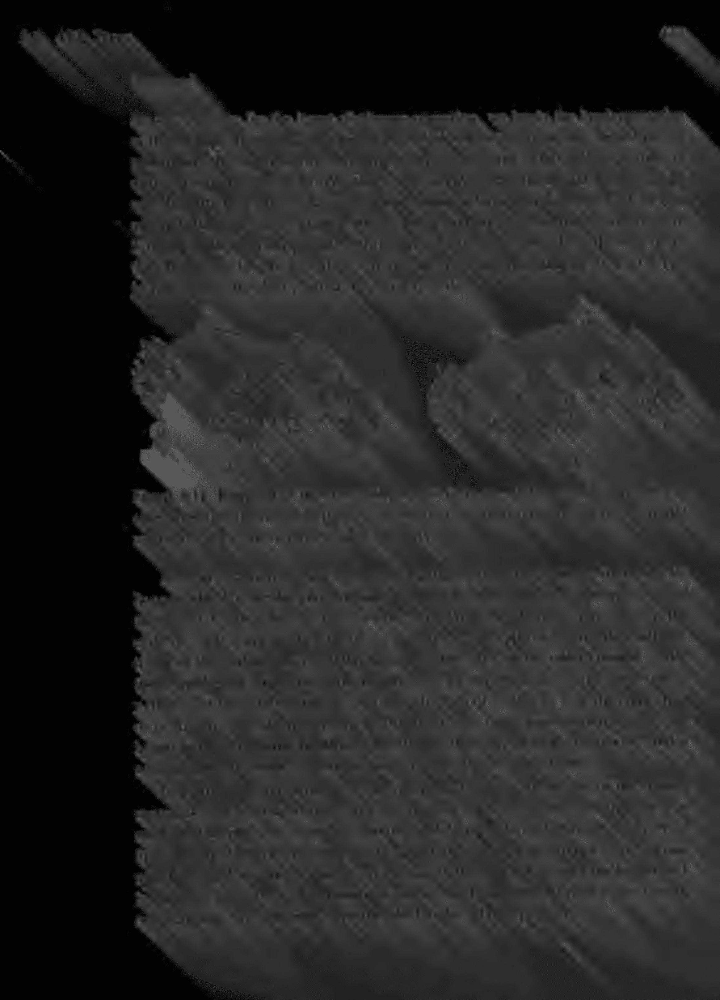
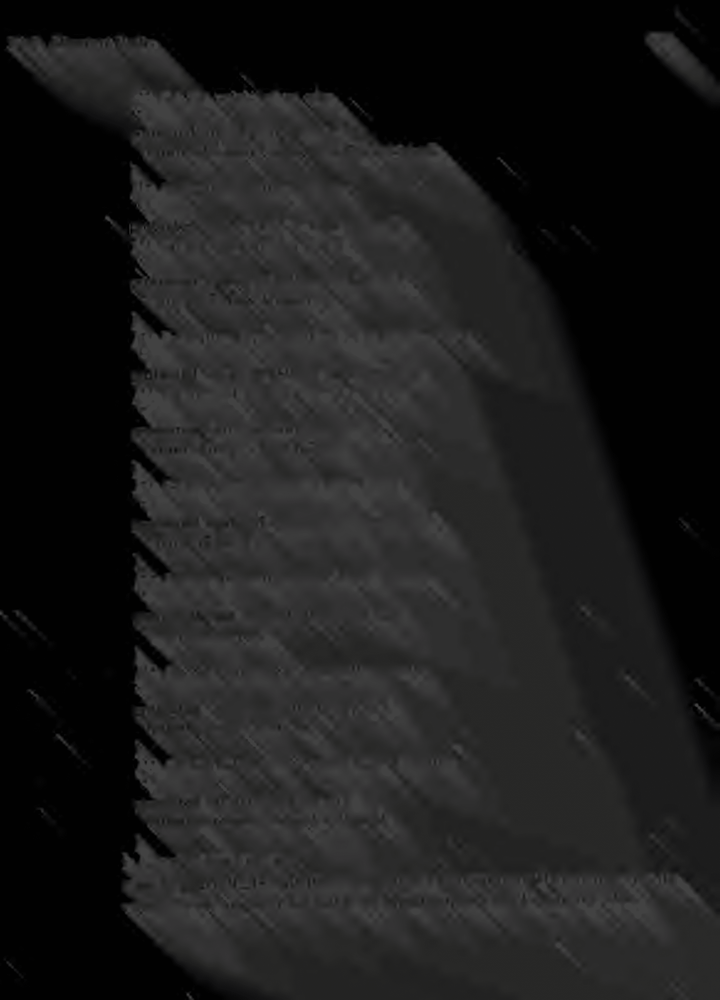

# Java 数据结构与算法第 3 版

Michael T. Goodrich  
加州大学欧尔文分校计算机科学系

Roberto Tamassia  
布朗大学计算机科学系

献给 Karen、Paul、Anna 和 Jack — Michael T. Goodrich

献给 Isabel — Roberto Tamassia

## 第三版序言

第三版旨在介绍数据结构和算法，包括它们的设计、分析和实现。针对计算机科学和计算机工程课程，我们编写本书主要面向大一、大二水平的数据结构课程。

根据 IEEE/ACM 2001 计算课程标准，本书适用于 CS102 (I/O/B 版本)、CS103 (I/O/B 版本)、CS111 (A 版本) 和 CS112 (A/I/O/F/H 版本) 课程。根据 1978 ACM 计算机科学课程，本书适用于 CS2 课程。我们将在序言稍后部分详细讨论其在此类课程中使用。

与第二版相比，主要变化如下：

- 扩展了递归的覆盖范围。
- 将数学部分简化为最常用的七种函数。
- 引入了 HTML 标签匹配和收藏列表应用。
- 简化了与抽象数据类型（ADT）相关的 Java 接口。
- 增强了与 Java 框架的集成。
- 简化了二叉树和优先队列 ADT。
- 增加了映射（map）ADT。
- 增加了伸展树（splay trees）。
- 增加了并查查找（union/find）划分数据结构。
- 简化了图 ADT。
- 扩展并修订了习题。

本书与以下书籍相关：

- M.T. Goodrich, R. Tamassia, and D.M. Mount, *Data Structures and Algorithms in C++*, John Wiley & Sons, Inc., 2004。本书与本书结构相似，但使用 C++ 作为底层语言（根据该方法的要求，存在一些但必要的差异）。因此，对于在入门课程中允许选择 Java 或 C++ 轨迹的课程，它可以是一本方便的参考书。
- M.T. Goodrich and R. Tamassia, *Algorithm Design: Analysis and Examples*, John Wiley & Sons, Inc., 2002。这是一本用于更高级算法和数据结构课程的教材，例如 ACM 1978 课程中的 CS7 或 IEEE/ACM 2001 课程中的 CS210 (T/W/S 版本)。

## 作为教材使用

高效数据结构的设计和分析长期以来被认为是计算领域至关重要的课题，因为数据结构的研究是我们所熟悉的每一个计算机科学和计算机工程专业计划的核心部分。通常，入门课程以两门或三门课的序列形式呈现。基础数据结构通常在第一门编程或计算机科学导论中简要介绍，随后在后续课程中对数据结构进行更深入的介绍。此外，这一课程序列通常在课程的后期会有对数据结构和算法更深层次的研究。鉴于高效数据结构在大多数软件系统（包括 Web、操作系统、数据库、编译器和科学模拟系统）中的重要性，我们认为数据结构设计和分析在课程中的核心作用是完全合理的。

随着面向对象范式成为构建健壮且可重用软件的首选框架，我们在整个文本中尝试保持一致的面向对象视角。面向对象方法的主要思想之一是数据应该被呈现为封装在访问和修改这些数据的方法中。也就是说，我们不是简单地将数据视为字节和地址的集合，而是将数据视为抽象类型（ADT）的实例，该类型包含了一系列用于对数据执行操作的方法。同样，面向对象的解决方案通常利用常用模式进行组织，这有利于软件的重用和健壮性。

## 前言

### Web 增值教育

本书附带了一个详尽的网站：`http://java.datastructures.net`

我们鼓励学生结合本书使用该网站，以帮助练习并增加对该学科的理解。同样欢迎教师使用该网站来帮助规划、组织和展示他们的课程材料。

### 针对学生

对于所有读者，特别是学生，我们提供了：

- 本书中介绍的所有 Java 源代码。
- `net.datastructures` 包的学生版本。
- PDF 格式的幻灯片讲（每页四页）。
- 所有练习的提示数据库，按题编号索引。
- 用于数据结构和算法的 Java 动画和交互式小程序。
- 指向其他数据结构和算法资源的超链接。

我们认为 Java 动画和交互式小程序应该引起读者的兴趣，因为它们允许读者交互地“玩玩”不同的数据结构，从而更好地理解不同的抽象数据类型（ADT）。此外，这些提示对于任何在开始某些练习时需要一点帮助的人来说，都会有很大用。

### 针对教师

对于使用本书的教师，我们提供了以下额外的教学辅助：

- 书中两百多道练习题的解答。
- 可关键词搜索的额外练习数据库。
- 完整的 `net.datastructures` 包。
- 额外的 Java 源代码。
- PowerPoint 和 PDF 格式的幻灯片（每页一页）。
- 自包含的专题补充，包括关于凸包、范围树和正交段交的讨论。

幻灯片是完全可编辑的，以便使用本书的教师在自定义其演示文稿时获得充分自由。

### 针对教师

本书包含了许多 Java 代码和伪代码片段，以及六百多道练习，这些练习大致分为 40% 的强化练习、40% 的创造性练习和 20% 的编程项目。

### 与 IEEE/ACM 2001 计算课程的关系

本书可用于 1978 ACM 计算机科学课程中的 CS2 课程，或 IEEE/ACM 2001 计算课程中的 CS102 (I/O/B 版本)、CS103 (I/O/B 版本)、CS111 (A 版本) 和/或 CS112 (A/I/O/F/H 版本)课程，教学单元如表 0.1 所示。

### 教学选项

本书的结构允许教师在组织和展示材料方面具有很大的自由。在表 0.2 中，我们展示了本书在中等速度数据结构课程中的某些用途：适配器模式、压缩和/或 LCS（最长公共子序列）。

### 前提条件

我们编写此书时假设读者已具备某些知识。也就是说，我们假设读者至少熟悉一种高级编程语言（如 C、C++ 或 Java），并且理解这种高级语言的主要构造，包括：

- 变量与表达式。
- 方法（也称为函数或过程）。
- 决策结构（如 `if` 语句和 `switch` 语句）。
- 迭代结构（`for` 循环和 `while` 循环）。

对于熟悉这些概念但不熟悉它们在 Java 中如何实现的读者，我们在第 1 章提供了 Java 语言的入门指南。尽管如此，本书主要是一本数据结构书，而不是 Java 书；因此，它没有提供对 Java 的全面介绍。尽管如此，我们并不假设读者一定熟悉面向对象设计或链式结构（如链表）；这些主题在本书的核心章节中。在数学背景方面，我们假设读者比较熟悉高中数学主题。尽管如此，在第 3 章中，我们讨论了算法分析最重要的七函数。事实上，使用这些函数之外其他函数的节被认为是可选的，并用星号（`*`）标出。我们在附录 A 中总结了其他有数学事实，包括基础概率。

### 关于作者

Goodrich 教授和 Tamassia 教授是算法和数据结构领域公认的研究人员，在该领域发表了许多论文，应用涉及互联网计算、信息可视化、计算机安全和几何计算。他们曾担任由国家科学基金会、陆军研究办公室和国防高级计划局资助的多个项目的首席研究员。他们还活跃于教育技术研究，重点是算法可视化系统。

Michael Goodrich 于 1987 年在普渡大学获得计算机科学博士学位。他目前是加州大学文分校计算机系的教授。在此之前，他在约翰霍普金斯大学担任教授。他是《International Journal of Computational Geometry & Applications》等相关期刊的编辑。

Roberto Tamassia 于 1988 年在伊利诺伊大学厄巴纳纳分校获得电气和计算机工程博士学位。他目前是布朗大学计算机系的教授。他是《Journal of Graph Algorithms and Applications》的主编，并曾担任《IEEE Transactions on Computers》的编辑委员会成员。

除了研究成就外，作者们在教学方面也有丰富的经验。例如，Goodrich 教授教过数据结构和算法课程，包括作为大一大二课程的数据结构以及作为高级课程的算法导论。他在这方面获得了多项教学奖。他的教学风格是让学生参与生动的互动课堂环节，以激发数据结构和算法技术背后的直觉和洞察。Tamassia 教授自 1988 年以来一直教授入门级大一课程的数据结构和算法。他教学风格的一个特点是有效使用了结合 Web 的交互式媒体演示。教学网站 `datastructures.net` 和 `algorithmdesign.net` 被全球的学生、教师和专业人士作为参考材料。

## 序言

### 致谢

许多人对本书做出了贡献。

我们感谢所有的研究合作者和助教，他们对章节的早期草提供了反馈，并帮助我们开发了练习题、编程作业和算法动画系统。特别要感谢 Jeff Achter, James Baker, Ryan Baker, Benjamin Boer, Mike Boilen, Devin Borland, Lubomir Bourdev, Stina Bridgeman, Bryan Cantrill, Yi-Jen Chiang, Robert Cohen, David Emory, Jody Fanto, Ashim Garg, Natasha Gelfand, Mark Handy, Michael Horn, Benoit Hudson, ovovanna Ignatowicz, Seth Padowitz, James Piechota, Dan Polivy, Susannah Raub, Andy Schwerin, Michael Shapiro, Michael Shin, Christian Straub, Galina Shubina, Nikos Triandopoulos 以及 Luca Vismara。Lubomir Bourdev, Mike Demmer, Mark Handy, Michael Horn 和 Scott Speigler 开发了一个基础 Java 教程，这最终促成了第 1 章“Java 编程”。

特别感谢 Eric Zamore，他为书中 Java 代码示例的开发，以及 Java 中数据结构与算法的 `net.datastructures` 库的设计、实现和测试做出了贡献。

许多学生和教师使用过本书的前两个版本，他们的经验和反馈帮助塑造了这第三版。

许多朋友和同事的意见使文本得到了改进。我们特别感谢 Karen Goodrich, Art Moorshead, David Mount, Scott Smith 和 Ioannis Tollis 的深刻见解。此外，还感谢 David Mount 对第 2.5.1 节和几幅图表的贡献。

我们还非常感谢外部评审员和读者提供的大量意见、电子邮件和建设性批评，这对编写第三版非常有帮助。我们特别感谢以下评审员提供的意见和建议：

- Divy Agarwal, 加州大学圣塔芭芭拉分校；
- Terry Andres, 马尼托巴大学；
- Bobby Blumofe, 德克萨斯大学奥斯汀分校；
- Michael Clancy, 加州大学伯伯克利分校；
- Larry Davis, 马里兰大学；
- Scott Drysdale, 达茅学院；
- Arup Guha, 佛罗里达州大学；
- Chris Ingram, 滑水大学；
- Stan Kwas, 华盛顿大学；
- Calvin Lin, 德克萨斯大学奥斯汀分校；
- John Mark Mercer, 马吉尔大学；
- Laurent Michel, 康涅狄格大学；
- Leonard Myers, 加州州立理工大学；
- David Neumann, 史文斯理工学院；
- Robert Pastel, 密歇根拓扑大学；
- Bina Ramthy, 纽约州大学布法罗分校；
- Ken Sloner, 爱荷华大学；
- C.V. Ravankar, 密歇根大学；
- Val Tannen, 宾夕法尼亚大学；
- Paul Van Aragon, 梅西亚学院；
- Christopher Wilson, 俄勒冈大学。

我们感谢我们的编辑 Paul Crockett 对该项目的热情支持。Wiley 团队非常出色。感谢 Lilian Brady, Ken Santor, Simon Durkin, Madelyn Lesure, Dawn Stanley 和 Jerry Warner。

布朗大学和加州大学欧尔文分校计算机科学系的计算系统和优秀的技术人员为我们提供了可靠的工作环境。本手稿主要使用 LaTeX 包处理文本，使用 Adobe FrameMaker 和 Microsoft Visio 绘制图表。

最后，我们非常感谢 Isabel Cruz, Karen Goodrich, Giuseppe Di Battista, Franco Preparata, Ioannis Tollis 以及我们的父母在本书准备的不同阶段提供的建议、鼓励和支持。我们也感谢他们提醒我们，生活中除了写书还有其他事情。

Michael T. Goodrich

Roberto Tamassia

## 目录

### 第 1 章 Java 编程

#### 1.1 类：类型与对象……

### 第 2 章 面向对象的设计与原则……

#### 2.1 `java.lang` 包中的工具

#### 2.2 继承与多态

#### 2.4 接口、抽象类与类型转换

### 第 3 章 分析工具

#### 3.1 运行时间到底是什么？

#### 3.3 本书使用的七种函数……

#### 3.4 算法分析

#### 3.5 简单的论证技术……

### 第 4 章 栈、队列与递归

#### 4.1 使用递归

#### 4.2 栈

#### 4.3 链表

#### 4.4 双队列

### 第 5 章 向量、列表与序列

#### 5.1 向量与数组列表……

#### 5.3 序列！

#### 5.4 喜好列表与移至前端策略

#### 5.5 迭代器

### 第 6 章 树

#### 6.1 树数据类型

#### 6.2 树上的基础算法

#### 6.3 二叉树

#### 6.4 用于表示……的数据结构

### 第 7 章 优先级队列

#### 7.1 优先级队列抽象数据类型

#### 7.2 使用列表实现优先级队列

#### 7.3 堆

#### 7.4 可变优先级队列

### 第 8 章 映射与字典

#### 8.1 哈希表

#### 8.2 字典抽象数据类型

#### 8.3 跳表

#### 8.4 字典的扩展与应用

### 其他内容

- 有用的数学事实
- 参考文献
- 索引

# 第 1 章：Java 编程

构建数据结构和算法要求向计算机传达详细指令，而执行这种通信的一种极佳方法是使用如 Java 等高级语言。在本章中，我们将简要概述 Java 语言，假设读者对某种已有的高级语言有一定了解。

Java 具有许多特性，使其成为探索数据结构和算法实现的优秀工具。它的设计旨在允许安全、跨平台的软件执行执行，这在异构的教学环境中是一个巨大的优势。Java 允许我们使用指针来实现复杂的链式结构，但限制了潜在危险的编程风格，例如指针算术和任意数组索引。此外，它提供了多级数据保护（例如公共和私有变量及方法），并拥有一系列具有意义的错误条件命名。它具有内置的简单内存管理和垃圾回收机制，初学者可以透明地使用，但它为专家程序员预留了几个“幕后”钩子。最后，它包含了简单的结构，用于执行相当复杂的计算，例如多进程处理、网络计算和图形用户界面。

我们在本章及下一章中关注的 Java 语言特定主题，是与数据结构和算法实现直接相关的内容，包括：

- 1.1 类、类型与对象 …… 26
- 1.2 方法 …… 29
- 1.3 变量与表达式 …… 30
- 1.4 `If` 和 `Switch` 语句 …… 31
- 1.5 显式控制流语句 …… 32
- 1.6 简单的输入与输出 …… 34
- 1.7 示例程序 …… 37
- 1.8 设计接口 …… 40
- 1.9 编写 Java 程序 …… 42
- 1.10 测试与调试 …… 43
- 1.11 `java.lang` 包中的工具类 …… 47
- 1.12 包 …… 49
- 1.13 `java.datastructures.net` …… 51

## 1.1 类、类型与对象

第一台数字计算机 ENIAC 根本没有使用任何可言的数据结构。它的主要功能是以后在那个时代看来确实非常惊叹的速度，快速执行长序列的数学计算。尽管这是一项巨大的成就，但 ENIAC 的主要影响不在于它执行的实际计算，而在于它所开启的计算时代。

如今，计算机以万种不同的方式被使用。对于消费者来说，计算机提供了对洗衣机、汽车和烤箱的实时控制。对于科学家和工程师来说，计算机用于设计新飞机、模拟复杂分子以及模拟星系。计算机对于现代商业是至关重要的。它们被用于执行大多数金融交易，并促进多种不同的通信模式，包括互联网。事实上，自 1945 年 ENIAC 建成以来，我们已经走了很远的路。

现代计算机的内存容量通常是 ENIAC 的数十亿倍，而且内存容量仍在以惊人的速度持续增长。容量的增长为计算机带来了一个全新的、令人兴奋的角色。现代计算机不再仅仅是快速的计算器，而是信息处理器。它们存储、分析、搜索、传输和更新海量复杂数据。快速执行这些任务要求数据必须组织良好，并且访问和维护数据的方法必须快速且高效。简而言之，现代计算机需要良好的数据结构和算法。

在 Java 中，数据结构和算法是通过类和对象实现的。Java 程序中的“执行者”是对象。对象存储数据并提供访问和修改这些数据的方法。每个对象都是类的实例，类定义了对象存储的数据类型，以及可以作用于该数据的操作类型。特别是，Java 中类允许的成员如下：

- Java 对象的数据存储在实例变量（也称为字段）中。因此，如果某个类的对象要存储数据，那么它的类必须为此类对象指定实例变量。实例变量可以来自基元类型（如整数、浮点数或布尔值），也可以引用其他类的对象。
- 可以作用于数据并表达对象所响应的“消息”的操作被称为方法。类的方法由构造函数、过程和函数组成。它们定义了来自该类的对象的体的行为。

ENIAC 的内存大约在 1952 年进行了升级，使其能够存储一个包含 1800 条双数字指令的程序和一组包含 100 个十位数字的数据。


简而言之，对象是数据以及可以处理和通信这些数据的方法的具体组合。类定义了对象的类型；因此，对象有时被称为其定义类的实例，因为它们以该类的名称作为自己的类型。

## 如何声明类

Java 类的语法如下：

```java
[(class_modifiers)] class (class_name) [extends (superclass_name)] [implements (interface_1), (interface_2)] { // 类方法和实例变量定义放在此处...}
```

我们使用了一种简写语法，其中可选材料包含在方括号`[]`中，标识符由角括号`<>`内的单词指示。在 Java 中，标识符（如`class_name`）必须以字母开头，并由字母、数字和下划线字符组成（其中“字母”和“数字”可以来自 Unicode 字符集定义的任何书写语言）。我们在表 1.1 中列出了 Java 标识符这一通用规则的例外。我们分别在第 2.2.1 节和 2.4 节讨论可选的`extends`和`implements`子句。

不包含这些可选子句的类定义简单模板如下：

```java
class Gnome {
    // 实例变量定义将放在此处。
    // 方法定义将放在此处...
}
```

在这个示例中，我们没有使用任何类修饰符（我们将讨论这些修饰符）。注意类定义由大括号界定，即它以`{`开始并以`}`结束。在 Java 中，大括号`{}`之间的任何语句集都定义了一个程序。

### 表 1.1 关键字

以下单词在 Java 中是保留的，不能用作标识符：

|  |  |  |  |
| :--- | :--- | :--- | :--- |
| `abstract` | `assert` | `case` | `catch` |
| `boolean` | `break` | `byte` | `continue` |
| `char` | `class` | `const` | `continue` |
| `double` | `else` | `enum` | `extends` |
| `false` | `false` | `final` | `finally` |
| `float` | `for` | `goto` | `has` |
| `if` | `implements` | `import` | `instance` |
| `interface` | `native` | `new` | `package` |
| `null` | `old` | `protected` | `public` |
| `return` | `short` | `super` | `synchronized` |
| `static` | `switch` | `this` | `throws` |
| `transient` | `try` | `void` | `void` |
| `volatile` | `while` |  |  |

# 第 1 章 Java 编程

## 1.1 基本类型

对象的类型由其所属的类决定。为了效率和简单，Java 还提供了以下基本类型（也称为原始类型），它们不是对象：

- `boolean`：值：`true` 或 `false`
- `char`：16 位 Unicode 字符
- `byte`：8 位有位补码整数
- `short`：16 位有位补码整数
- `int`：32 位有位补码整数
- `long`：64 位有位补码整数
- `float`：32 位浮点数（IEEE 754-1985）
- `double`：64 位浮点数（IEEE 754-1985）

声明为这些类型之一的变量仅存储该类型的值，而不是对某个对象的引用。整数常数（如 14 或 195）是`int`类型，除非后面紧跟着“L”或“I”，此时它们是`long`类型。浮点常数（如 3.1415 或 2.158e5）是`double`类型，除非后面紧跟着“F”或“f”，此时它们是`float`类型。

尽管基本类型变量本身不引用对象，但在对象的上下文中它们非常有用，因为它们通常组成对象内部的实例变量（或字段）。它们还提供了 Java 的一种额外安全特性，即每当包含这些变量的对象被创建时，这些实例变量总是会被赋予一个初始值。

## 1.2 对象

在 Java 中，使用`new`运算符从定义的类创建新对象。`new`运算符从指定的类创建一个新对象，并返回该对象的引用。以下是在表达式中使用`new`运算符的语法：

```java
new (class_type)([param, param, ...])
```

通常，这样的表达式会出现在赋值语句中，形式如下：

```java
(variable.name) = new (class_type)([param, param, ...]);
```

我们在这里使用`(variable.name)`来表示作为对象变量名称的标识符，它是对刚刚创建的对象的引用。`(class_type)`名称指向一个特殊的构造方法（与类名相同），它负责初始化正在创建的对象。（我们将在 1.2 节中详细介绍构造方法。）`(class_type)`是定义类名的标识符，参数列表是可选的。如上所示，在类类型上调用`new`运算符会发生三个事件：

- 在内存中动态分配一个新对象，并将所有实例变量初始化为默认值。对象变量的默认值为`null`，除`boolean`（默认为`false`）之外的所有基本类型均为 0。
- 使用指定的参数调用新对象的构造方法。构造方法为实例变量填充意义值，并执行创建该对象必须完成的任何计算。
- 构造方法返回后，`new`运算符返回指向新创建对象的引用（即内存地址）。如果表达式是赋值语句的形式，则该地址将存储在对象变量中，因此对象变量引用这个新创建的对象。

在接下来的语句中，创建了一个新的`Point`对象，构造方法接受点的坐标作为参数，变量`myPoint`成为该对象的引用：

```java
myPoint = new Point(3, 6);
```

### 数字对象

我们有时想将数字存储为对象，但正如我们所提到的，基本类型数字本身并不是对象。为了克服这一障碍，Java 为每个数值基本类型定义了一个包装类。我们称这些为数字类。在表 1.2 中，我们展示了数值基本类型及其对应的类，以及创建和访问数字对象的示例。对于每一行，我们假设变量`n`使用相应的类名进行声明。

| 基本类型 | 数字类 | 示例表达式 |
| :--- | :--- | :--- |
| `byte` | `Byte` | `n = new Byte((byte)34);` |
| `short` | `Short` | `n = new Short((short)100);` |
| `int` | `Integer` | `n = new Integer(145);` |
| `long` | `Long` | `n = new Long(1084L);` |
| `float` | `Float` | `n = new Float(3.14f);` |
| `double` | `Double` | `n = new Double(2.158e5);` |

### 字符串对象

字符串是来自某个字母表的字符序列，字母表字符集合。构成字符串的每个字符`c`可以通过其在字符串中的索引来引用，该索引等于`c`之前的字符数（因此第一个字符的索引为 0）。在 Java 中，用于定义字符串的字母表是 Unicode 国际字符集，这种 16 位字符编码涵盖了最常用的书写语言。其他编程语言倾向于使用较小的 ASCII 字符集（它是基于 7 位编码的 Unicode 字母表的真子集）。此外，Java 定义了一种特殊的内置对象类，称为`String`对象。

假设 P 是一个包含 m 个字符的字符串，写为""。例如，P 可以是字符串 "cats and dogs"，长度为 13；或者，P 可以是字符串 "CGATTACG"，长度为 16。字符串处理涉及处理大字符串和小字符串。它还涉及将较小的字符串合并成较大的字符串。合并字符串的主要操作是拼接，它接收字符串 P 和字符串 Q 并将它们合并为一个新字符串，表示为 P + Q，具有以下字符序列：

在 Java 中，`+`运算符在作用于两个字符串时工作原理完全相同。因此，编写像如下的赋值语句是合法的（甚至是有用的）：

```java
String s = "kilo" + "meters";
```

## 1.3 类、类型与对象

### 实例变量

Java 类可以定义实例变量，也称为字段（fields）。这些变量代表与类对象相关的数据。实例变量必须有一个类型，可以是基本类型（如`int`、`float`、`double`），也可以是引用类型，即类（如`String`）、接口（参见第 2.4 节）或数组（参见第 1.5 节）。声明实例变量的语法如下：

```java
[(variable_modifier)] (variable_type) (variable_name) [=(initial_value)];
```

`(variable_name)`参数的语法与任何其他 Java 标识符相同。`(variable_type)`参数要么是基本类型（表示该变量存储此类类型的值），要么是类名（表示该变量是对该类某个对象的引用）。可选的`(initial_value)`必须与变量的类型匹配。我们正在运行的`Gnome`类包含了一些实例变量定义，可能如下所示：

```java
class Gnome {
    // 实例变量：
    protected String name;
    protected int age;
    protected Gnome gnome_buddy;
    private boolean magical;
    public double height = 2.6;

    // 初始化
    public static final int MAX_HEIGHT = 3; // 一个常量
    // 方法定义将放在此处...
}
```

注意本示例及其他示例中注释的使用。这些注释是为人类读者提供的注解，不会被 Java 编译器处理。Java 允许两种类型的注释——块注释和行内注释——它们定义了编译器忽略的文本。Java 使用`/*`开始块注释，使用`*/`结束。此外，Java 使用`//`开始行内注释，并忽略该行中其后的所有内容。例如：

```java
/*
这是一个块注释。
*/

// 这是一个行内注释。
```

同样注意`Gnome`示例中实例变量的使用。`age`、`magical`和`height`变量是基本类型，变量`name`是对内置类`String`实例的引用，而变量`gnome_buddy`是我们现在正在定义的类对象的引用。我们对实例变量`MAX_HEIGHT`的声明利用了多个变量修饰符来定义一个具有固定常量值的“变量”。接下来，我们将描述这些在 Java 中使用的这些和其他变量修饰符的精确含义。

### 变量修饰符

实例变量的作用范围（可见性）可以通过使用以下变量修饰符来控制：

- `public`：任何人都可以访问实例变量。
- `protected`：只有同包的方法或子类的方法可以访问保护变量。
- `private`：只有同一类的方法（而不是子类的方法）可以访问私有变量。

如果没有使用上述任何修饰符，则实例变量被视为友好的（friendly）。友好的实例变量可以被相同包中的任何类访问。包将在第 1.8 节中详细讨论。除了作用范围修饰符，还有以下用法修饰符：

- `static`：`static`关键字用于声明与类关联而非与类的特定实例关联的变量。静态变量用于存储关于类的“全局”信息（例如，可以使用静态变量来维护`Gnome`对象的总数）。即使没有创建类的实例，静态变量也存在。
- `final`：`final`实例变量必须分配一个初始值，之后永远无法分配新值。如果它是基本类型，它就是一个常量（如`Gnome`类中的`MAX_HEIGHT`常量）。如果对象变量是`final`的，那么它将始终引用同一个对象（即使该对象更改其内部状态）。

与类相关的常量值应同时声明为`static`和`final`。在详细介绍实例变量及其用法之前（我们将在第 1.3 节中介绍），让我们讨论可以作用于类中实例变量的方法。

## 1.4 方法

Java 中的方法在概念上类似于其他高级语言中的函数和过程。通常情况下，它们是可以在特定对象（来自某个类）上调用的代码“块”。方法可以接受参数作为参数，其行为取决于它们所属的对象以及传递的任何参数的值。Java 中的每个方法都指定在某个类的体内。方法定义包含两个部分：签名（signature），定义方法的名称和参数；以及方法体（body），定义方法的功能。方法允许程序员向对象发送消息。方法签名指定了此类消息的形式，而方法体指定了对象在接收此类消息时将做什么。

### 声明方法

定义方法的语法如下：

```java
[(method_modifiers)] (return_type) (method_name) (params)]) {
// 方法体
}
```

其中`(params)`是可选的逗号分隔的参数声明列表，其语法如下：

```java
(type) (name) [...]
```

当类的方法被调用时，它是在该类的特定实例上调用的（静态方法除外，它与类本身关联）。例如，在`gnome`上调用以下方法会更改其名称：

```java
public void renameGnome(String s) {
    name = s; // 重新分配此 gnome 的 name 实例变量。
}
```

# 第 1 章 Java 编程

## 方法修饰符

与实例变量一样，方法修饰符可以限制方法的范围：

- `public`（公共）：任何人都可以调用公共方法。
- `protected`（受保护）：只有同一包中的方法或子类的方法可以调用受保护方法。
- `private`（私有）：只有同一类的方法（而不是子类的方法）可以调用私有方法。
- 如果没有使用上述修饰符，则该方法是包级别的（friendly）。包级方法只能由同一包中类的对象调用。

上述方法修饰符前面可以带有以下额外的修饰符，这些修饰符会进一步限制方法：

- `abstract`（抽象）：声明为抽象的方法将没有代码。抽象方法的签名后面跟着一个分号，且没有方法体。例如：

  ```java
  public abstract void setHeight(double newHeight);
  ```

  抽象方法只能出现在抽象类中。我们将在第 2.4 节中讨论这种结构的用处。

- `final`（最终的）：这种方法不能被子类重写。
- `static`（静态）：这种方法与类本身关联，而不是与类的特定实例关联。静态方法还可以用于更改与类关联的静态变量的状态（前提这些变量没有声明为`final`）。

## 返回类型

方法定义必须指定方法将返回值的类型。如果方法不返回值，则必须使用`void`关键字。如果返回类型为`void`，则该方法被称为过程（procedure）；否则，被称为函数（function）。在 Java 中返回值，方法必须使用`return`关键字（且返回的类型必须与方法的返回类型匹配）。这里有一个方法（来自`Gnome`类内部）的示例：

```java
public boolean isMagical() {
    return magical;
}
```

一旦 Java 函数执行了返回操作，方法调用就会结束。

## 1.5 方法

Java 函数只能返回一个值。要在 Java 中返回多个值，我们应该将所有想要返回的值组合在一个复合对象中，该对象的实例变量包含我们想要返回的所有值，然后返回该复合对象的引用。此外，通过更改传递给方法的对象的内部状态也是“返回多个结果”的另一种方法。

方法的参数定义在方法名后括号内的逗号分隔的列表中。参数由两部分组成：参数类型和参数名称。如果方法没有参数，则使用一对空括号。

Java 中的所有参数都是按值传递的，也就是说，当我们将参数传递给方法时，都会为该参数创建一个副本以供方法体使用。因此，如果我们向方法传递一个`int`变量，那么该变量的值就会被复制。方法可以更改副本但不能更改原始值。如果我们将对象引用作为参数传递给方法，那么引用也会被复制。记住，我们可以有许多不同的变量都指向同一个对象。更改方法内部的引用不会更改传递进去的引用。例如，如果我们向一个方法传递`Gnome`引用`g`，该方法调用该参数为`h`，那么此方法可以更改引用`h`指向不同的对象，但`g`仍然指向它之前指向同一个对象。当然，方法可以使用引用`h`来更改对象的内部状态，这将更改`g`所指向的对象（因为`g`和`h`目前指向同一个对象）。

### 构造方法

构造方法是一种特殊的方法，用于初始化新创建的对象。Java 有声明构造方法的特殊方式，以及调用构造方法的特殊方式。首先，让我们来看声明构造方法的语法：

```java
[constructor_modifiers] (constructor_name) ([(params)]) {
构造方法体。
}
```

因此，它的语法上与任何其他方法相同。然而，构造方法的名称必须与它构建的类的名称相同。因此，如果类名为`Fish`，则构造方法也必须名为`Fish`。此外，构造方法没有返回值。因此，它的返回类型隐式为`void`。修饰符遵循与普通方法相同的规则。但是，不允许抽象、静态或最终的构造方法。这里有一个示例：

```java
public Fish(int w, String n) {
    weight = w;
    name = n;
}
```

构造方法体类似于普通方法体（有一个我们在下一章中讨论的例外）。此体旨在用于初始化与该类对象相关的数据，以便它们在首次创建时处于稳定状态。

构造方法以独特的方式调用：它们必须使用`new`操作符进行调用。因此，在调用时，会自动创建该类的新实例，然后调用其构造方法来初始化其实例变量并执行其他设置任务。例如，考虑以下构造方法调用（这也是变量`myFish`的声明）：

```java
Fish myFish = new Fish(7, "Wally");
```

一个类可以有许多个构造方法，但每个构造方法必须具有不同的签名，即每个构造方法必须通过它所接受的参数类型和数量来区分。

## main 方法


某些 Java 类旨在供其他类使用，而另一些类旨在定义独立程序。定义独立程序的类必须包含类中另一种类的特殊方法——`main` 方法。当我们想要执行一个独立的 Java 程序时，我们引用定义该程序的类名，例如，通过发布以下命令（在 DOS、Linux 或 UNIX 中）：

```bash
java Aquarium
```

在这种情况下，Java 运行时系统会寻找 `Aquarium` 类的编译版本，然后调用该类中特殊的 `main` 方法。该方法必须按如下声明：

```java
public static void main(String[] args) {
    // main 方法体
}
```

作为参数 `args` 传递给 `main` 方法的参数是调用程序时提供的命令行参数。`args` 变量是一个 `String` 对象的数组；也就是说，是一个索引字符串集合，其中第一个字符串是……

## 1.2 方法

`args[0]`，第二个是 `args[1]`，依此类推。（我们将在第 1.5 节中详细介绍数组。）例如，我们可能定义了 `Aquarium` 程序来接收一个可选参数，用于指定鱼族馆中鱼的数量。然后我们通过输入：

```bash
java Aquarium 45
```

来指定我们想要一个装有 45 条鱼的鱼族馆。在这种情况下，`args[0]` 指向字符串 `"45"`。`main` 方法的一个优秀特性是，它允许每个类定义一个独立的程序，而该方法的用例之一是测试类中的所有其他方法。因此，充分利用 `main` 方法是调试 Java 类集合的有效工具。

## 语句块与局部变量

方法的主体是一个语句块（statement block），它是位于大括号“`{`”和“`}`”之间执行的一系列语句和声明。方法主体和其他语句块内部还可以包含嵌套的语句块。

除了执行某些操作的语句（如调用某个对象的方法）外，语句块还可以包含局部变量的声明。这些变量声明在语句体内部，通常位于开头（但在大括号“`{`”和“`}`”之间）。局部变量与实例变量相似，但它们只在语句块执行期间存在。一旦控制流离开该块，其内部的所有局部变量都不能再被引用。局部变量可以是基本类型（如 `int`、`float`、`double`），也可以是指向某个类实例的引用。Java 中的单条语句和声明始终以分号结束，即：

这里是声明局部变量的语法：

`(variable_type) (variable.name) = (initial_value)];`

其中类型、名称和初始值的规则与实例变量相同。以下是一些局部变量声明的示例：

```java
double r;
Point p1 = new Point(3, 4);
Point p2 = new Point(8, 2);
int i = 512;
double e = 2.71828;
```

注意，我们可以在声明变量时给它赋一个初始值。

# 第 1 章 Java 编程

我们在代码片段 1.1 展示了 `Gnome` 类的完整示例定义。

```java
public class Gnome {
    // variables
    protected String name;
    protected int age;
    protected Gnome buddy;
    private boolean magical = false;
    public double height = 2.6;
    public static final int MAX_HEIGHT = 3;

    // Constructors
    Gnome(String nm, int ag, Gnome bud, double hgt) {
        name = nm;
        age = ag;
        buddy = bud;
        height = hgt;
    }

    Gnome() {
        name = "Rumple";
        age = 204;
        buddy = null;
        height = 2.1;
    }

    // Methods
    public static void make(Gnome h) {
        h.name = "King" + h.getName();
        h.magical = true;
    }

    public void makeMe() {
        name = "King" + getName();
        magical = true;
    }

    public boolean isMagical() {
        return magical;
    }

    public void setHeight(int newHeight) {
        height = newHeight;
    }

    public String getName() {
        return "won’t tell!";
    }

    public String getName() {
        return name;
    }

    public void rename(String s) {
        name = s;
    }
}
```

## 1.3 表达式

变量和常量在表达式中用于定义新值和修改变量。在本节中，我们将更详细地讨论 Java 中表达式的工作原理。表达式涉及字面量（literals）、变量和运算符的使用。由于我们已经讨论过变量，让我们简要关注字面量，然后详细讨论运算符。

### 1.3.1 字面量

字面量是任何可用于赋值或其他表达式的“常量”值。Java 允许以下类型的字面量：

- `null` 对象引用（唯一的对象字面量，它定义自通用的 `Object` 类）。
- 布尔：`true` 和 `false`。
- 整数：像 `176` 或 `-52` 等整数的默认类型是 `int`，这是一个 32 位整数。长整数必须以“`L`”结尾，例如 `176L` 或 `-52L`，定义了一个 64 位整数。
- 浮点：浮点数（如 `3.1415` 和 `100.23`）的默认类型是 `double`。要指定一个字面量为 `float`，它必须以“`F`”或“`f`”结尾。允许使用指数表示法的浮点字面量，例如 `3.14E2` 或 `.1e10`；基数假设为 10。
- 字符：在 Java 中，字符常量假设来自 Unicode 字母表。通常，字符被定义为包含单引号内的单个符号，例如‘a’和‘ ’。此外，Java 定义了以下特殊字符常量：`\n`（换行）、`\t`（制表符）、`\b`（退格）、`\r`（回车）、`\f`（分页）、`\\`（反斜杠）、`\'`（单引号）、`\"`（双引号）。

标准的赋值运算符是“`=`”。它用于为实例变量或局部变量赋值。其语法如下：

`(variable) = (expression)`

其中 `(variable)` 是包含该表达式的语句块可以引用的。赋值操作的值是被赋值表达式的值。因此，如果 `i` 和 `j` 都声明为 `int` 类型，则使用如下赋值语句是正确的：

```java
i = j = 25;
```

// 因为 `=` 运算符是从右到左求值的

### 点运算符

正如我们上面提到的，在 Java 中创建新对象涉及使用 `new` 运算符为对象分配空间，然后使用对象的构造函数来初始化该空间。然后将该空间的位置（或地址）分配给引用。因此，引用可以被视为指向某个对象的指针。每个引用都必须指向某个对象，即使它是 `null`。多个引用可以指向同一个对象。

对象变量的主要用途之一是访问其类的成员。这种访问是通过点（`.`）完成的。我们通过使用以下语法调用与对象关联的方法：

（此处原文未提供具体语法示例）

### 运算符

Java 表达式通过运算符将字面量和变量组合在一起。在本节中，我们将介绍 Java 中的运算符。

## 1.3 表达式

这些方法调用实际上都引用了其所属类中定义的同名的不同方法。但请注意，Java 方法的签名并不包含方法返回的类型，因此 Java 不允许两个具有相同签名的方法返回不同的类型。我们使用点运算符 `.` 来引用与对象相关的实例变量，语法如下：`(object).name`。当然，前提是该变量的作用域规范允许访问，那么这种用法可以出现在表达式的任何位置。尽管如此，`name` 必须是它所引用对象的成员。如果对象引用不是 `final`（最终）的，那么它也可以出现在赋值的左侧。考虑以下示例：

```java
gnome.name = "Professor";
gnome.age = 32;
```

对象引用也可以是任何返回对象引用的表达式。因此，以下在语法上也是正确的：

```java
Gnome g = new Gnome();
String buddyName = g.name;
```

### 算术运算符

以下是 Java 中的二元算术运算符：

| 运算符 | 描述 |
| :--- | :--- |
| `+` | 加法 |
| `-` | 减法 |
| `*` | 乘法 |
| `/` | 除法 |
| `%` | 取模运算符 |

最后一个运算符取模，也被称为“余数”运算符，因为它是整数除法后的余数。我们经常使用 `mod` 来表示取模运算符，并将其正式定义为 `n mod = r`，使得 `n = mq + r`，其中 `q` 是整数且 `0 <= r < n`。Java 还提供了一元负号 `-`，它可以放在算术表达式前面以反转其符号。括号可以在任何表达式中定义求值顺序。Java 还使用一种非常直观的优先级规则来在不使用括号时确定求值顺序。与 C++ 不同，Java 不允许运算符重载。

### 增和和减运算符

像 C 和 C++ 一样，Java 提供了增和和减运算符。具体来说，它提供了加一 `++` 和减一 `--`。如果这种运算符用于变量引用之前，则会在变量上加（或减）1，并将其值读取到表达式中。如果它用于变量引用之后，则先读取该值，然后将变量加或减 1。例如，以下代码片段：

```java
int i = 8;
int j = i++;
int k = ++i;
int m = i--;
int n = 9 + i;
```

将 `8` 赋值给 `j`，`10` 赋值给 `k`，`10` 赋值给 `m`，`8` 赋值给 `n`，并使 `i` 的值为 `10`。

### 逻辑运算符

Java 允许数字之间使用标准的比较运算符：

| 运算符 | 描述 |
| :--- | :--- |
| `<` | 小于 |
| `<=` | 小于等于 |
| `==` | 等于 |
| `!=` | 不等于 |
| `>=` | 大于等于 |
| `>` | 大于 |

运算符 `==` 和 `!=` 也可以用于对象引用。比较结果的类型是布尔（`boolean`）。对布尔值操作的运算符如下：

- `!` 非（前缀）
- `&&` 条件与
- `||` 条件或

布尔逻辑运算符 `&&` 和 `||` 如果在确定表达式的值时不需要，则不会评估表达式中的第二个操作数（右侧）。这个特性非常有用，例如在构建布尔表达式时，我们首先测试条件是否成立（例如引用不为空），然后测试一个如果在之前的测试成功时可能会产生错误的条件。

### 位运算运算符

Java 还为整数和布尔值提供了以下位运算运算符：

| 运算符 | 描述 |
| :--- | :--- |
| `~` | 按位取反（前缀一元） |
| `&` | 按位与 |
| `\|` | 按位或 |
| `^` | 按位异或 |
| `<<` | 左移，用 0 填充 |
| `>>` | 右移，用符号位填充 |
| `>>>` | 右移，用 0 填充 |

### 赋值运算符

除了标准的赋值运算符 `=` 之外，Java 还提供了许多具有操作副作用的赋值运算符。其他类型的运算符采用以下形式：`(variable)(op) = (expression);`。这等同于 `(variable) = (variable)(op) (expression);`，但如果 `(variable)` 包含表达式（例如数组索引），该表达式只求值一次。因此，代码片段：

```java
a[5] = i = 10;
a[i++] += 2;
```

使得 `a[5]` 的值为 `12`，`i` 的值为 `6`。

### 字符串拼接

字符串可以使用拼接运算符 `+` 组合，因此如下代码：

```java
String rug = "carpet";
String dog = "spot";
String mess = rug + dog;
String answer = mess + " dollars!";
```

将产生使 `answer` 变为 `"carpetspot dollars!"` 的效果。当非常量参与拼接操作时，Java 会将其转换为字符串。

### 运算符优先级

Java 中的运算符具有优先级，这决定了在不使用括号产生歧义时执行操作的顺序。我们在表 1.3 中列出了 Java 运算符的优先级（顺便说，这与 C 相同）。

表 1.3：运算符优先级符号

| 优先级 | 符号 | 描述 |
| :--- | :--- | :--- |
| 高 | 后置操作 | `++`, `--` |
|  | 前置操作 | `++`, `--`, `+`, `-`, `~`, `cast` |
|  | 乘法 | `*`, `/`, `%` |
|  | 加法 | `+`, `-` |
|  | 关系 | `<`, `<=`, `>`, `>=` |
|  | 等价 | `==`, `!=` |
|  | 逻辑与 | `&&` |
|  | 逻辑或 | `||` |
| 低 | 赋值 | `=`, `+=`, `...` |

Java 的优先级规则是：如果不使用括号来确定求值顺序，Java 中的运算符将按照上述顺序进行评估。同一行的运算符从左到右求值（赋值和前置操作除外，它们从右到左求值），受布尔与或操作条件求值规则的影响。操作按优先级从高到低列出（我们使用 `exp` 表示原子表达式或带括号的表达式）。我们现在讨论了表 1.3 中列出的几乎所有运算符。一个显著的例外是条件运算符，它涉及评估一个布尔表达式，然后根据该布尔表达式的真假取相应的值。（我们将在下一章中讨论 `instanceof` 运算符的使用。）

## 1.3.3 表达式中的类型转换

类型转换（Casting）是一种允许我们改变变量类型的操作。本质上，我们可以取一个类型的变量并将其转换为另一种类型的等效变量。类型转换对于执行某些数值运算和输入/输出操作非常有用。

将变量转换为所需类型的语法如下：

`((desired_type)(variable);`

Java 中可以进行两种基本类型的类型转换。我们可以针对基本数值类型进行转换，也可以针对对象进行转换。我们在这里讨论如何对数值类型和字符串类型进行类型转换，并在第 2.4.4 节中讨论对象转换。例如，将 `int` 转换为 `double` 以执行除法等操作可能会很有帮助。

### 普通强制转换

当从 `double` 转换到 `int` 时，我们可能会丢失精度。这意味着结果 `double` 将被向下取整。但我们可以无需担心地将 `int` 转换为 `double`。例如，考虑以下代码：

```java
double d1 = 3.2;
double d2 = 3.9999;
int i1 = (int)d1; // i1 的值为 3
int i2 = (int)d2; // i2 的值为 3
double d3 = (double)i2; // d3 的值为 3.0
```

### 使用运算符进行转换

某些二元运算符（如除法）会根据其所使用的变量类型而产生不同的结果。我们必须确保对预期类型的值进行计算。例如，当与整数使用时，除法不会保留小数部分。当与 `double` 使用时，除法会保留这部分，如下所示：

```java
int i1 = 3;
int i2 = 6;
double dresult = (double)i1 / (double)i2; // dresult 的值为 0.5
dresult = i1 / i2; // dresult 的值为 0.0
```

注意，当 `i1` 和 `i2` 被强制转换为 `double` 时，执行了实数的普通除法。当 `i1` 和 `i2` 未被强制转换时，`/` 运算符执行的是整数除法，`i1 / i2` 的结果是整数 `0`。随后 Java 执行了隐式转换，将 `int` 值赋值给 `double` 结果。我们将讨论隐式转换。

### 隐式转换

如果没有指定显式转换（即代码中包含的转换），Java 在某些情况下会执行隐式转换。这意味着即使程序员没有显式包含转换，Java 也会直接更改变量的类型。在不丢失精度的情况下，Java 会根据赋值变量的类型执行转换。例如：

```java
int iresult, i = 3;
double dresult, d = 3.2;
dresult = i / d; // dresult 为 0.9375。i 被转换为了 double
iresult = i / d; // 丢失精度 > 这是一个编译错误
```

Java 不会在丢失精度的情况下执行隐式转换。因此，上面的最后一行应该是：

```java
iresult = (int)i / d; // iresult 为 0，因为小数部分丢失了
```

这种显式转换表明程序员接受了精度的丢失。类型转换的一般规则是稳妥起见。如果不确定编译器是否会隐式转换变量，最好显式写出来。显式转换可以保证结果的正确。

### 字符串对象的隐式转换

Java 中只有一种情况允许进行隐式转换，那就是字符串拼接。每当字符串与任何对象或基本类型拼接时，该对象或基本类型都会自动转换为字符串。然而，不允许将对象或基本类型显式转换为字符串。因此，以下赋值是错误的：

```java
String s = (String)4.5; // 这是错误的！
String t = "Value=" + (String)13; // 这是错误的！
String u = 22; // 这是错误的！
```

要执行到字符串的转换，我们必须使用相应的 `toString` 方法，或者通过拼接操作执行隐式转换。因此，以下语句是正确的：

```java
String s = "" + 4.5; // 正确，但风格较差
String t = "Value=" + 13; // 这样很好
String u = Integer.toString(22); // 这样很好
```


如上述，Java 中的每个对象都支持一个 `toString()` 方法（无参数），该方法将对象转换为字符串。此外，`Integer`、`Long`、`Short`、`Byte`、`Float` 和 `Double` 类都各有一个内置的静态 `toString(x)` 方法，用于将相应的基本类型转换为字符串。

## 1.4 控制流

Java 的控制流与其他高级语言相似。在这一节中，我们将回顾 Java 控制流的基本结构和语法，包括方法返回、`if` 语句、`switch` 语句、循环以及受限的“跳转”（`break` 和 `continue` 语句）。

### 1.4.1 `if` 和 `switch` 语句

在 Java 中，条件判断机制与其他语言相同。它们提供了一种决策的方法，并根据决策的结果执行一个或多个不同的代码块。

#### `if` 语句

`if` 语句的语法如下：

```java
if (boolean_expr)
    (true_statement)
else if (boolean_expr)
    (else_if_statement)
else
    (else_statement)
```

其中每个语句可以是用大括号（`{}`）括起的语句块。此外，`else if` 和 `else` 部分是可选的；在有效的 `if` 语句中可以省略。与 C 和 C++ 不同，Java 中 `if` 语句中的表达式必须是布尔表达式。这一要求帮助我们避免常见的编程错误，以下 bug 将被编译器捕获：

```java
if (f=5) // 这是错误的！
```

在上面的示例中，“条件”实际上是一个赋值操作，类型为 `int`。因此，这不是一个正确的 `if` 语句。然而，以下代码是正确的：

```java
if (snowLevel < 2)
    goToClass();
    comeHome();
else if (snowLevel < 5)
    goSledding();
    haveSnowballFight();
else
    stayHome();
```

#### `switch` 语句

Java 使用 `switch` 语句提供了多值控制流。以下是一个示例：

```java
public Candy getCandy(int money) {
    Candy candy;
    int tax = 1;
    switch (money + tax) {
        case 5:
            candy = new Gumball();
            break;
        case 25:
            candy = new Peanuts();
            break;
        case 50:
            candy = new Candybar();
            break;
        default:
            candy = new EmptyWrapper();
            break;
    }
    return candy;
}
```

### 1.4.2 循环

编程语言另一种重要的控制流机制是循环。Java 提供了三种循环。

#### `while` 循环

Java 中最简单的循环是 `while` 循环。这种循环测试某个条件是否满足，每当该条件被求值为真时，它就会执行循环体。在执行循环体之前进行这种条件测试的语法如下：

```java
while ((boolean_expression))
    (loop_body_statement)
```

在每次迭代开始时，循环会测试布尔表达式，只有当该表达式求值为真时，才会执行循环体。循环体也可以是一个语句块。例如，考虑一个试图给他胡萝卜地里所有的胡萝卜浇水的精灵，只要他的水壶不是空的，就会一直这样做。由于他的水壶最初可能是空的，我们编写执行此任务的代码如下：

```java
public void waterCarrots() {
    Carrot current = garden.findNextCarrot();
    while (!waterCan.isEmpty()) {
        water(current, waterCan);
        current = garden.findNextCarrot();
    }
}
```

记得 Java 中的 `!` 是非逻辑运算符。

#### `for` 循环

另一种循环是 `for` 循环。在最简单的形式中，`for` 循环基于整数索引提供重复代码。在 Java 中，我们可以实现这一点，并实现更多。`for` 循环的功能灵活得多。特别是，`for` 循环的使用被分为四个部分：初始化、条件、递增和循环体。

这里是 `for` 循环的语法：

```java
for (initialization; condition; increment)
    (body_statement)
```

在初始化部分，我们可以声明一个索引变量，该变量的作用域仅限于 `for` 循环。例如，如果我们想要一个基于计数器进行索引的循环，并且我们在 `for` 循环之外不需要该计数器变量，那么声明 `for (int counter = 0; condition; increment)` 就会声明一个作用域仅为循环体的变量 `counter`。

在条件部分，我们指定循环的重复（while）条件。这必须是一个布尔表达式。每当在潜在迭代开始时评估的条件求值为真时，`for` 循环的循环体就会执行一次。一旦条件求值为假，循环体就不会执行，相反，程序将执行 `for` 循环之后的下一个语句。

在递增部分，我们声明循环的递增语句。递增语句可以是任何合法的语句，允许编码上具有极大的灵活性。因此，`for` 循环的语法等于以下内容：

```java
(initialization)
while ((condition)) {
    (body_statement)
}(increment)
```

例外是 Java 中的 `while` 循环不能有空条件，而 Java 中的 `for` 循环可以。下面的示例展示了 Java 中一个简单的 `for` 循环：

```java
public void eatApples(Apples apples) {
    int numApples = apples.getNumApples();
    for (int x = 0; x < numApples; x++) {
        eatApple(apples.getApple(x));
        spitOutCore();
    }
}
```

在上面的 Java 示例中，循环变量 `x` 被声明为 `int x = 0`。在每次迭代之前，循环测试条件 `x < numApples`，并且仅当该条件为真时才执行循环体。最后，在每次迭代结束时，循环使用语句 `x++` 来递增循环变量的值，然后再次测试条件。

#### `do-while` 循环

Java 除了 `for` 循环和标准的 `while` 循环外还有另一种循环——`do-while` 循环。前者在执行循环体迭代之前测试条件，而 `do-while` 循环在循环体之后测试条件。`do-while` 循环的语法如下所示：

```java
do
    (loop_body_statement)
while ((boolean_expression))
```

同样，循环体语句通常是一个语句块，条件必须是一个布尔表达式。在 `do-while` 循环中，只要条件每次求值为真，我们就会重复循环体。例如，我们想要提示用户输入，然后对该输入进行一些有用的操作（我们将在 1.6 节中详细讨论 Java 的输入输出）。在这种情况下，退出循环的可能条件是用户输入空字符串。然而，即使在这种情况下，我们也可能希望处理该输入并通知用户她已退出。下面的示例说明了这种情况：

```java
public void getUserInput() {
    String input;
    do {
        input = getString();
        handleInput(input);
    } while (input.length() > 0);
}
```

注意上述示例的退出条件。具体来说，它的编写方式符合 Java 的规则，即 `do-while` 循环在条件不为真时不退出（与其他语言使用的 `repeat-until` 结构不同）。

### 1.4.3 显式控制流语句

Java 还提供了允许显式改变程序控制流的语句。

#### 从方法返回

如果一个 Java 方法声明的返回类型为 `void`，那么当它到达方法中的最后一行代码或遇到 `return` 语句时，控制流就会返回。然而，如果方法声明了返回类型，它就是一个函数并且必须通过返回一个值来退出。

```java
public boolean checkBirthday(int date) {
    if (date == Birthdays.DAY) {
        return true;
    }
    return false;
}
```

注意，语句作为方法中的最后一行代码与方法本身的最后一行代码之间存在显著差异。在上面的示例中，`return true;` 这行显然不是函数中编写的最后一行代码，但它可能是执行的最后一行。

#### `break` 语句

`break` 语句也可以以标签的形式使用，用于跳出外层嵌套循环或 `switch` 语句。在这种情况下，它的语法为 `break (label);`，其中 `(label)` 是 Java 标识，用于标识循环或 `switch` 语句。这种标签只能出现在循环声明的开头；Java 中没有其他类型的“goto”（go to）语句。

我们通过下面这个简单的示例来说明在 `break` 语句中使用标签的方法：

```java
public static boolean hasZeroEntry (int[][] a) {
    boolean foundFlag = false;
    zeroSearch:
    for (int i=0; i<a.length; i++) {
        for (int j=0; j<a[i].length; j++) {
            if (a[i][j] == 0) {
                foundFlag = true;
                break zeroSearch;
            }
        }
    }
    return foundFlag;
}
```

上面的示例还使用了数组，数组将在第 1.5 节中介绍。

#### `continue` 语句

Java 程序中另一种显式改变控制流的语句是 `continue` 语句，它的语法如下：`continue [(label)];`，其中 `(label)` 是用于标识循环的 Java 标识。如上所述，Java 中没有“goto”语句。同样，`continue` 语句只能在循环（`for`、`while` 和 `do-while`）内部使用。`continue` 语句会导致执行跳过当前迭代中循环体的剩余步骤（但如果满足条件，则将继续循环）。

## 1.5 数组

数组是所有相同类型变量的编号集合。数组中的每个变量（或单元）都有一个索引，数组中的单元从 0 开始连续编号到 N—1，其中 N 是数组的长度，也称为数组的容量。存储在数组单元中的值称为元素。任何不在 0 到 N—1 范围内的索引都被视为越界。

我们在下面的代码段中展示数组和 `continue` 语句的使用示例：

```java
// 计算整数 x 在数组中出现的次数
public static int count(int[] a, int x) {
    int count = 0;
    for (int i=0; i<a.length; i++) {
        if (a[i] != x) continue;
        count++;
    }
    return count;
}
```

作为一种安全特性，Java 总是会检查数组索引以查看是否越界。如果数组索引越界，Java 运行时环境会发出错误信号。这种检查帮助 Java 避免许多其他语言必须处理的安全问题（包括缓冲区溢出攻击）。

然而，我们永远不需要猜测数组的长度来避免越界错误。数组的大小存储在实例变量 `length` 中，可以通过以下方式访问：`(array_name).length`

我们可以通过仔细地使用 Java 中布尔操作的短路终止特性来避免越界错误。例如，类似下面这样的语句永远不会产生索引越界错误：

```java
if ((i >= 0) && (i < a.length) && (a[i] > 0.5)) {
    x = a[i];
}
```

因为只有在两个比较成功时，才会执行 `a[i] > 0.5` 的比较。

### 声明数组

声明数组的语法如下所示：`element_type[] array_name = {init_val_0, init_val_1, ., init_val_N-1};`，其中第一组括号“[]”是语法的一部分，第二组则表示可选的初始化。`element_type` 可以是任何 Java 基础类型或类名，而 `array_name` 可以是任何值标识符。我们可以使用以下语法创建数组的单元集合：`new (element_type)[length]`，其中 `(length)` 是表示所创建数组长度的正整数，且括号“[]”是语法中不可省略的部分。通常，此表达式出现在赋值语句中，赋值运算符的左侧是数组名。例如，下面的语句定义了数组变量 `a`，并为其分配了一个包含 10 个单元的数组，每个单元类型为 `int`：

```java
int[] a = new int[10];
```

新数组 `a` 的单元使用整数集 `{0,1,2,...,9}` 进行索引（注意 Java 数组总是始终从 0 开始索引）。

Java 中的数组类似于对象，这解释了为什么我们使用点运算符来查找数组的长度，并且它们被定义为一维的。尽管如此，我们可以组合数组来定义多维数组。也就是说，二维数组实际上是数组的数组，可以使用如下所示的声明语句创建：

```java
float[][] x = new float[8][10];
```

该语句创建了一个二维的“数组的数组”。下面是上述数组 `a` 和 `x` 的有效用法：

```java
int i = 5;
a[i] = 138;
x[i][i+1] = 2.189 + x[i][i];
i = a.length;
j = x[4].length;
```

## 1.6 输入输出

Java 提供了丰富的类和方法用于在程序中执行输入输出。

### 图形用户界面

Java 提供了用于图形用户界面设计的类和方法，包括弹出窗口和下拉菜单。Java 还提供了处理图像、声音、页面和鼠标事件（如点击、拖拽）的方法。此外，许多这些输入输出方法可以在独立程序或 Applet 中使用。

### 控制台

简单的输入输出在控制窗口中进行。取决于我们使用的 Java 环境，该窗口要么是一个用于显示和输入文本的特殊弹出窗口，要么是一个向操作系统发布命令的窗口（此类窗口被称为 shell 窗口、DOS 窗口或终端窗口）。

### 1.6.1 简单的输入输出

具体来说，`java.io.PrintStream` 类提供了以下方法来执行简单输出（我们在此使用 `(base_type)` 来指代任何可能的基本类型）：

- `print(Object o)`：使用对象的 `toString` 方法打印对象 `o`。
- `print(String s)`：打印字符串 `s`。
- `print((base_type) b)`：打印基本类型值 `b`。
- `println(String s)`：打印字符串 `s`，后跟换行符。
- `flush()`：打印并清空打印缓冲区的内容。

考虑以下代码片段：

```java
System.out.print("Java values: ");
System.out.print(3.1415);
System.out.print(',');
System.out.print(15);
System.out.println("(double,char,int).");
```

执行该片段时，它会产生如下输出：

```text
Java values: 3.1415,15 (double,char,int).
```

当然，此输出将出现在 Java 控制台窗口中。

#### 简单输入方法

正如有一个特殊的对象用于向 Java 控制台窗口输出一样，也有一个名为 `System.in` 的特殊对象用于从 Java 控制台窗口输入。从技术上讲，输入实际上来自“标准输入”设备，默认情况下，计算机键盘将其字符回显到 Java 控制台中。`System.in` 对象是 `java.io.InputStream` 类的实例，该类被定义为一次处理一个字符。

这种形式的输入通常太原始，不方便使用，但可以使用 `java.io.BufferedReader` 和 `java.io.InputStreamReader` 类来定义另一个输入对象，以流式和缓冲的方式处理输入。例如，我们可以使用以下模板：

```java
java.io.BufferedReader stdin; // 标准输入（缓冲）
stdin = new java.io.BufferedReader(new java.io.InputStreamReader(System.in));
```

上述代码片段的细节对我们来说并不重要；重要的是上述代码创建了一个输入流，我们可以用它从标准输入设备读取字符。

具体来说，`java.io.BufferedReader` 类支持以下输入方法：

- `read()`：读取单个字符。如果输入流到达末尾，此方法返回 `-1`。如果发生输入错误，此方法会抛出异常条件“`java.io.IOException`”。
- `readLine()`：读取一行文本，即到下一个换行符为止的字符串。换行符会被读取，但不会包含在字符串中。如果输入流到达末尾，此方法返回 `null`。如果发生输入错误，此方法会抛出异常条件“`java.io.IOException`”。

考虑以下结合输入和输出的代码片段：


```java
java.io.BufferedReader stdin; // 标准输入（缓冲）
String line; // 一行输入文本
double sum = 0.0;
int i = 0;
stdin = new java.io.BufferedReader(new java.io.InputStreamReader(System.in));
System.out.print("Input a double: ");
System.out.flush();
if ((line = stdin.readLine()) != null) {
    d = Double.valueOf(line).doubleValue();
}
System.out.print("Input an int: ");
System.out.flush();
if ((line = stdin.readLine()) != null) {
    i = Integer.valueOf(line).intValue();
}
sum = d + i;
System.out.println("Their sum is " + sum + ".");
```

执行该代码片段时，可能会产生如下输入和输出组合：

`Input a double: 6.1078`

`Input an int: 209`

`Their sum is 215.1078.`

### 1.7 示例程序

在本节中，我们将描述一个简单的示例程序，用于说明上述定义的许多结构。我们的示例包含两个类：一个是定义卡对象的`CreditCard`类，另一个是测试`CreditCard`类功能的`Test`类。`CreditCard`类定义的信用卡对象是传统卡的简化版本。它们拥有识别码、所有者及其发卡行的识别信息，以及关于当前余额和信用额度的信息。然而，它们不收取利息或滞纳金，但它们会限制会导致卡余额超过支出额度的费用。

#### CreditCard 类

我们在代码片段 1.2 中展示了`CreditCard`类。注意，`CreditCard`类定义了五个实例变量，所有变量均为该类的私有（private），并且它提供了一个简单的构造函数来初始化这些实例变量。它还定义了五个访问方法（accessor methods），用于访问这些实例变量的当前值。当然，我们也可以将实例变量定义为公共（public），这将使访问方法变得多余。然而，这种直接方法的缺点是它允许用户直接修改对象的实例变量，而在许多此类情况下，我们倾向于将实例变量的修改限制在特殊的更新方法。我们在代码片段 1.2 中包含了两个这样的更新方法：`charge`和`makePayment`。

此外，包含动作方法（action methods）通常非常方便，它们定义了该对象行为特定动作。为了演示，我们将这样一个动作方法`printCard`方法定义为静态方法，它也包含在代码片段 1.2 中。

#### Test 类

我们在`Test`类中对`CreditCard`类进行测试。注意这里使用了`CreditCard`对象数组，以及我们如何使用迭代来进行扣和还款。我们在代码片段 1.3 中展示了`Test`类的完整代码。为了简单起见，`Test`类没有进行任何花哨的图形输出，而是简单地将其输出发送到 Java 控制台。我们在代码片段 1.4 中展示了此输出。注意我们调用非静态`charge`和`makePayment`方法与调用静态`printCard`方法之间的区别。

## 第 1 章 Java 编程

### 1.8 包

Java 语言采用了一种通用且实用的方法将类组织到程序中。在 Java 中定义的每个公共类都必须放在一个单独的文件中。文件名是类名加上`.java`后缀。因此，一个名为`public class SmartBoard`的类被定义在`SmartBoard.java`文件中。一组定义在公共子目录下的相关类可以作为一个 Java 包（package）。包中的每个文件都以以下行开头：

`package package_name`

包含该包的子目录的名称必须与包名相同。我们也可以在一个包含多个类定义的单个文件中定义包，但在编译时，所有类都将被编译到相同子目录下的独立文件中。

#### 使用其他包

在 Java 中，我们通通过在类名前面加上点号（即使用`.`字符）来使用其他包中定义的类，这些点号与对应包的目录结构对应。

```java
public boolean Temperature(TA.Measures.Thermometer thermometer, int temperature) {
    ...
}
```

在这里，`Temperature`函数接收`Thermometer`类作为参数。`Thermometer`定义在`TA`包中一个名为`Measures`的子包下。`TA.Measures.Thermometer`中的点号直接对应于`TA`包中的目录结构。

#### import 命令

引用当前包之外的类需要大量的额外输入。在 Java 中，我们可以使用`import`关键字来引入外部类或整个包。要从特定包导入单个类，我们在文件开头处输入以下内容：

`import package.ClassName`

例如：

```java
package Project;

import TA.Measures.Thermometer;
import TA.Measures.Scale;
```

#### 导入整个包

我们也可以使用以下语法导入整个包：

```java
package student;

import TA.Measures.*;
```

## 第 1 章 Java 编程

### 1.9 编写 Java 程序

编写 Java 程序的过程涉及三个基本步骤：

1. 设计
2. 编码
3. 测试与调试。

我们本节中简要讨论这些步骤中的每一个一个。

#### 1.9.1 设计

设计步骤也许是编写程序过程中最重要的步骤。因为正是在设计步骤中，我们决定了如何将程序的功能划分为不同的类，决定这些类将如何交互，每个类将存储什么数据，以及每个类将执行哪些操作。事实上，初级 Java 程序员面临的主要挑战之一就是决定定义哪些类来完成程序的工作。虽然很难找到通用的处方，但在确定如何定义类时，我们可以应用一些通用的经验法则：

- **职责（Responsibilities）**：将工作划分为不同的执行者，每个执行者承担不同的职责。尝试使用动性动词来描述职责。这些执行者将组成程序的类。
- **独立性（Independence）**：定义每个类的工作尽可能与其他类保持独立。在类之间细分职责，使每个类对程序的某个方面具有自主权。将数据（如实例变量）交给对需要访问这些数据的操作具有权的类。
- **行为（Behaviors）**：为了让与类交互的其他类能够良好理解该类执行的每个操作的后果，必须仔细精确地定义每个类的行为。这些行为将定义该类执行的方法。一个类的行为集有时被称为“协议”（protocol），因为我们期望一个类的行为能够作为一个凝聚力的整体保持在一起。

定义类以及它们的实例变量和方法，决定了 Java 程序的设计。一个优秀的程序员会随着时间的推移，在执行这些任务方面自然培养出更高的技能，因为经验会教导他们注意到程序需求中的模式与他们以前见过的模式相匹配。

#### 1.9.2

为了加速这项技能的掌握，我们在本书的各个部分讨论了用于设计面向对象程序的各种设计模式。这些模式为定义类以及类之间的交互提供了模板。许多程序员在初始设计时使用 CRC 卡。组件-职责-协作者（Component-responsibility-collaborator，简称 CRC 卡）是简单的索引卡，用于将程序所需的工作划分开。使用这种卡片允许程序员迭代地精炼其组织结构，从而最终获得一组连贯的类。我们在每个索引卡的顶部写上每个组件的名称。在卡片的左侧，我们开始编写该组件的职责。在右侧，我们列出该组件的协作者，即该组件为了履行职责而必须与之交互的其他组件。设计过程循环通过“操作/执行者”周期，我们首先识别一个操作（即职责），然后确定一个最适合执行该操作的执行者（即组件）。当我们把所有操作都分配给执行者时，设计就完成了。

顺便说一下，在使用索引卡进行设计时，我们当然假设每个组件将有一组少量的职责和协作者。这种假设并非偶然，因为它有助于保持程序的可管理性，即使当程序必须变得很大时也是如此。

CRC 卡的替代方案是使用 UML（统一建模语言）图来表示程序的设计。UML 图是表示面向对象软件设计的标准视觉符号。目前有多种计算机辅助工具可以构建 UML 图。

#### 编码

一旦我们确定了程序的类及其职责，就可以开始编码了。我们通过使用独立的文本编辑器（如`emacs`、`notepad`或`vi`）或集成开发环境（IDE）内置的编辑器（如 IntelliJ、Eclipse、IBM WebSphere 或 Sun Studio）来创建程序中类的实际代码。一旦完成一个类（或包）的编码，我们就可以通过调用编译器将此文件编译为工作代码。如果我们没有使用 IDE，则通过对文件调用程序（如`javac`）来编译程序。如果我们使用 IDE，则通过点击相应的编译按钮来编译程序。如果我们足够幸运，程序没有语法错误，那么这个编译过程将创建具有`.class`扩展名的文件。

如果我们的程序包含语法错误，这些错误将被识别，我们必须回到编辑器中修复出错的代码行。一旦我们消除了所有语法错误并创建了适当的编译代码，就可以通过调用命令（在 IDE 之外使用`java`）或点击相应的“运行”按钮（IDE 内部）来运行程序。当以这样运行 Java 程序时，运行时环境会根据一个特殊的系统环境变量找到包含指定类以及从该类中引用的任何其他类的目录。该变量名为`CLASSPATH`，搜索目录的顺序以目录列表的形式给出，在 Unix/Linux 中用冒号分隔，在 DOS/Windows 中用分号分隔。DOS/Windows 操作系统的 CLASSPATH 赋值示例如下：

`SET CLASSPATH=.;C:\java;C:\Program Files\Java`

而在 Unix/Linux 操作系统中的 CLASSPATH 赋值示例如下：

`setenv CLASSPATH="./:/usr/local/java/lib:/usr/netscape/classes"`

在在这两种情况下，点 (`.`) 都指向调用运行时环境时的当前目录。

为了鼓励良好地块注释并自动生成文档，Java 编程环境带有一个名为`javadoc`的文档生成程序。该程序获取一组使用某些关键字（称为标签）进行注释的 Java 源代码文件，并生成一系列 HTML 文档，描述这些文件中包含的类、方法、变量和常量。由于空间原因，我们没有在书中所有的示例程序中都使用 javadoc 风格的注释，我们在代码片段 1.5 中包含了一个 javadoc 示例，在本书配套的网站上还有其他示例。

## 1.9 编写一个 Java 程序

```java
/**
 * 此类定义了平面上的一个不可变的 (x,y) 点。
 *
 * @author Michael Goodrich
 */
public class XYPoint {
    private double x,y; // 用于坐标的私有实例变量

    /**
     * 在指定位置构造一个 (x,y) 点。
     *
     * @param xCoor 点的 x 坐标
     * @param yCoor 点的 y 坐标
     */
    public XYPoint(double xCoor, double yCoor) {
        x = xCoor;
        y = yCoor;
    }

    /**
     * 返回 x 坐标值。
     *
     * @return x 坐标
     */
    public double getX() {
        return x;
    }

    /**
     * 返回 y 坐标值。
     *
     * @return y 坐标
     */
    public double getY() {
        return y;
    }
}
```

代码段 1.5：使用 javadoc 风格注释的类定义示例。注意该类包含两个实例变量、一个构造函数和两个访问方法。

## 第 1 章 Java 编程

主要的 javadoc 标签如下：

- `@author text`：标识类的每个作者（每行一个）
- `@exception exception-name 描述`：标识此方法抛出的错误条件（参见第 2.3 节）
- `@param parameter-name 描述`：标识此方法接受的参数
- `@return 描述`：描述方法的返回类型及其值范围。

还有其他标签；感兴趣的读者可以参阅 javadoc 的在线文档以进行更多讨论。

#### 可读性与风格

程序应该设计得易于阅读和理解。因此，优秀的程序员应该关注自己的编码风格，并开发出既能向人类也能计算机传达程序设计重要部分的风格。关于良好的编码风格已有许多记载，其中一些主要原则如下：

- 为标识符使用有意义的名字。尝试选择可以大口读出的名称，并选择反映每个标识符所命名的动作、责任或数据的名称。大多数 Java 圈的传统做法是标识符中每个单词的首字母大写，但变量或方法的标识符第一个单词除外。因此，按照这一传统，`Date`、`Vector`、`DeviceManager`将标识类，而`isFull()`、`setItem()`、`studentName`和`studentHeight`将分别标识方法和变量。
- 使用命名常量代替字面量量。如果我们在类定义中包含一系列命名常量值的定义，将增强可读性、健壮性和可修改性。这些值可以在该类及其他类中用，以引用该类的特殊值。Java 的传统是将此类常量完全大大写，如下所示：

```java
class Student {
    public static int MIN_CREDITS = 12; // 每学期最小学分
    public static int MAX_CREDITS = 24; // 每学期最大学分
    public static int FRESHMAN = 1; // 大一学生代码
    public static int SOPHOMORE = 2; // 大二学生代码
    public static int JUNIOR = 3; // 大三学生代码
    public static int SENIOR = 4; // 大四学生代码

    // 实例变量、构造函数和方法定义放在此处
}
```

- 缩进语句块。通常程序员会将每个语句块缩进 4 个空格；在本书中使用 2 个空格，以避免代码超出页边距。
- 按以下顺序组织每个类：
  1. 常量
  2. 实例变量
  3. 构造函数
  4. 方法

我们注意到某些 Java 程序员喜欢将实例变量放在最后；我们将它们放在前面，以便按顺序读取每个类并理解每个方法正在处理的数据。

- 使用注释为程序增加含义并解释模糊或混淆的结构。行内注释适用于快速解释，不需要是句子。块注释适用于解释方法的目的和复杂的代码段。

### 1.3 测试与调试

测试是通过实验方法检查程序正确性的过程，而调试是跟踪程序执行过程并发现其中错误的过程。测试和调试通常是程序开发中最最耗时的活动。

#### 测试

周全的测试计划是编写程序的必不可的一部分。虽然验证程序在所有可能的输入下的正确性通常是不行的，但我们应该在具有代表性的输入子集上运行程序。至少我们应该确保程序中的每个方法至少被测试一次（方法覆盖率）。更好的是，程序中的每个代码语句都应该至少执行一次（语句覆盖率）。

程序往往在输入的特殊情况下失败。这些情况需要被仔细识别和测试。例如，在测试一个排序（即按顺序排列）整数数组的方法时，我们应该考虑以下输入：

- 数组长度为零（无元素）
- 数组只有一个元素
- 数组中的所有元素都相同
- 数组已经是排序的
- 数组是反序排序的

除了程序的特殊输入，我们还应该考虑程序所用结构的特殊条件。例如，如果我们使用数组存储数据，我们应该确保妥善处理边界情况，例如在子数组的开头或结尾插入/删除。虽然使用手工编写测试套件至关重要，但在大量随机生成的输入上运行程序也是有利的。`java.util`包中的`Random`类提供了几种生成随机数的方法。

程序类和方法之间由于调用者-被调用者的关系存在一种层次结构。也就是说，如果方法 A 调用方法 B，则 A 在层次结构中位于 B 之上。有两种主要的测试策略：自顶向下和自底向上，它们的区别在于测试方法的顺序。

自底向上测试从低级方法向高层级方法进行。也就是说，首先测试不调用其他方法的底层方法，然后是只调用底层方法的方法，以此类推。这种策略确保了方法中发现的错误不太可能由嵌套其中的低级方法引起。

自顶向下测试从层次结构的顶部到底进行。它通常与存桩（stubbing）结合使用，存桩是一种引导技术，用存桩替换低级方法，存桩是用于模拟原始方法输出的替代品。例如，如果方法 A 调用方法 B 来获取文件的第一行，在测试 A 时，我们可以用一个返回固定字符串的存桩替换 B。

#### 调试

最简单的调试技术包括使用打印语句（使用`System.out.println((string))`）来跟踪程序执行期间变量的值。这种方法的问题在于，在软件最终发布之前，打印语句需要被删除或注释掉。

更好的方法是在调试器中运行程序，调试器是一种用于控制和监控程序执行的专用环境。调试器提供的基本功能是在代码中插入断点。当程序在调试器中执行时，它会在每个断点处停止。当程序停止时，可以检查变量的当前值。除了固定断点，高级调试器还允许指定条件断点，只有当给定表达式满足时才会触发该断点。

标准的 Java 工具包含一个名为`jdb`的基础调试器，它是面向命令的。Java 编程环境（IDE）提供了带有图形用户界面的高级调试环境。

### 1.10 java.lang 包中的工具类

49 java.lang 包中的工具类


`java.lang` 包提供了对 Java 语言至关重要的类。它还包含许多静态方法和预定义的特殊类，这些类提供了许多实用的工具。我们已经提到定义在该包中的几个类，包括 `String` 类和数字类（`Integer`、`Float` 等）。该包还包括异常，即与错误条件以及 Java 程序控制流中其他人为中断相关的类，我们将在 2.3 节中详细讨论它们。

在本节中，我们列出了作为 `java.lang` 包中某些类部分的静态方法和常量。关于 `java.lang` 包中所有工具类以及 Java 中其他有用包的完整列表，可以在 Java 的完整参考书籍或 Java 文档网站找到。

### Math 类

`java.lang` 包包含一个非常有用的 `Math` 类，它提供了许多基础数学函数和常量，包括以下内容（我们使用 `(number)` 指代任何可能的数值基类型）：

- `double E:` 最接近 `e`（自然对数函数的基数 `ln`）的浮点数。
- `double PI:` 最接近 7（圆周长与直径的比）的浮点数。
- `double (number) abs((number) x):` `x` 的绝对值，除非 `x` 是能表示的最小负整数。
- `double acos(double x):` 以弧度表示的值 `x` 的反余弦。
- `double asin(double x):` 以弧度表示的值 `x` 的反正弦。
- `double atan(double x):` 以弧度表示的值 `x` 的反正切。
- `double cos(double a):` 角度 `a` 的余弦。
- `double exp(double x):` 指数 $e^x$。
- `double log(double x):` 自然对数（基 `e`）$\ln x$。
- `(number) max((number) x, (number) y):` `x` 和 `y` 中的较大者。
- `(number) min((number) x, (number) y):` `x` 和 `y` 中的较小者。
- `double pow(double x, double y):` 幂函数，$x^y$。
- `double random():` 在 (0.0, 1.0) 范围内的（伪）随机数。
- `long round(double x):` 最接近 `x` 的长整数。
- `double sin(double a):` 角度 `a` 的正弦。
- `double sqrt(double x):` `x` 的平方根。
- `double tan(double a):` 角度 `a` 的正切。

### Java 编程

上述所有方法和常量都是静态的；因此，我们直接从 `Math` 类引用它们。例如，要计算整数 `x` 的绝对值，可以使用以下语句：

```java
int a = Math.abs(x);
```

### 转换

Java 中的每个类都有一个 `toString` 方法，它可以将该类的实例转换为字符串。事实上，每个数字类都有 `toString` 的静态版本，它接受对应数字类的基本基类型作为参数，并返回表示该值的字符串。例如，`Integer.toString(i)` 返回 `int` 类型 `i` 的字符串表示。此外，为了以统一的方式提供相同的功能，`String` 类包含一个 `valueOf` 方法，它可以接受任何基本基值作为参数并将其转换为字符串。该方法是静态的；因此，我们可以调用 `String.valueOf(i)` 将一个整数 `i` 转换为表示其值的字符串。

另一方面，对于输入函数，我们希望有可以将具有适当语法的字符串转换为各种基本基类型的方法。为了提供此功能，Java 在每个数字类中都包含一个 `valueOf` 方法，它接受字符串作为参数并返回表示该字符串的对应数字类对象。例如，要将字符串 `"3.1415F"` 转换为相应的浮点值，可以使用以下语句：

```java
float pi = Float.valueOf("3.1415F").floatValue();
```

### 大数

有些数字太大，无法放入 Java 中定义的标准数字类型中。由于经常需要处理此类数字，Java 提供了两种任意精度数字类型，它们都属于数字类。这些是 `java.math.BigDecimal` 和 `java.math.BigInteger` 类。除了数字类提供的通常操作外，这些类还提供了对大数执行各种数学操作的方法。然而，我们在这里不列出所有方法，而是引导读者参考 Java 文档。

## 第 1 章 Java 编程

### 练习

如需练习帮助，请访问 `javastructures.net/reinforcement`。

#### R1.1–R1.4

- 重写以下语句以实现预期结果：

  ```java
  int a = Math.abs(x);
  ```

  ```java
  double o = 5;
  ```

  ```java
  double p = "" + 3.14;
  ```

  ```java
  double q = 4;
  ```

- 考虑以下错误的示例：

  ```java
  public static void makeDoctor(Doctor h) {
      Doctor k = new Doctor(h.name, null, h.height);
      k = true;
  }
  ```

  重写上述代码，使其名称具有标题 `"Doctor"` 且其标志位设置为 `true`。

- 修改片段 1.2 中的 `CreditCard` 类，以检查传递给 `makePayment` 方法的价格参数是否为正数。
- 修改片段 1.2 中的 `CreditCard` 类，对每笔付款收取利息。
- 修改片段 1.2 中的 `CreditCard` 类，对任何超过日期的付款收取滞期费。
- 修改片段 1.2 中的 `CreditCard` 类以包含修改方法（modifier methods），允许用户以受控的方式修改 `CreditCard` 类中的内部变量。
- 修改片段 1.3 中 `Test` 类中第一个 `for` 循环的声明，使其费用最终会导致三张信用卡中的恰好一张超出信用额。是哪一张信用卡？

#### R-1.9–R-1.14

- 编写一个短 Java 函数 `inputAllBaseTypes`，从标准输入设备输入每种基本类型的不同值，并将其打印回标准输出设备。
- 编写一个 Java 类 `Flower`，它包含三个类型为 `String`、`int` 和 `float` 的实例变量，分别代表花名、瓣数和价格。你的类必须包含一个构造方法，将每个变量初始化为适当的值，并且你的类应该包含设置每个类型值和获取每个类型值的方法。
- 编写一个短 Java 函数 `isMultiple`，它接受两个 `long` 类型的值 `n` 和 `m`，并当且仅当 `n` 是 `m` 的倍数时返回 `true`，即对于某个整数 `i`，有 `n = mi`。
- 编写一个短 Java 函数 `isOdd`，它接受一个 `int` 类型的 `i`，并当且仅当 `i` 为奇数时返回 `true`。然而，你的函数不能使用乘法、取模或除法运算符。
- 编写一个短 Java 函数，接受一个整数 `n` 并返回所有小于 `n` 的整数之和。
- 编写一个短 Java 函数，接受一个整数 `n` 并返回所有小于 `n` 的奇整数之和。
- 编写一个短 Java 函数，接受一个正双精度值 `x`，并返回在得到小于 2 的数字之前我们将 `x` 除以 2 的次数。

### 创造性

#### C-1.1–C-1.4

- 编写一个短 Java 函数，接受一个 `int` 值数组，并判断数组中是否存在一对数字的积为奇数。
- 编写一个 Java 方法，接受一个 `int` 值数组，并判断所有数字是否彼此不同（即它们是互相同的）。
- 编写一个 Java 方法，接受一个包含 1 到 52 范围内所有整数的数组，并将其洗乱为随机顺序。你的方法应该以等概率输出每可能的顺序。
- 编写一个短 Java 程序，输出使用一次字符 `'c'`、`'a'`、`'r'`、`'b'`、`'o'` 和 `'n'` 生成的所有字符串。

### 1.11 练习

- **C-1.5** 编写一个短 Java 程序，读取标准输入的所有行并按倒序写入标准输出。也就是说，每行按正确顺序输出，但行的顺序是反转的。
- **C-1.6** 编写一个短 Java 程序，接受两个长度为 `n`` 的存储 `int` 值的数组 `a` 和 `b`，并返回 `a` 和 `b` 的差。即返回一个长度为 `n` 的数组 `c`，使得对于 `i=0,...,n-1`，有 `c[i] = a[i] - b[i]`。
- **C-1.7** 编写一个快速 Java 函数，接受任何 `int` 值 `i` 并返回一个 `long` 类型的值。你的方法不应该将 2 自乘 `i` 次；计算 `2^i` 有比快多的方法。
- **C-1.8** 两个正整数 `n` 和 `m` 的最大公约数（或 GCD）是最大的数字 `j`，使得 `n` 和 `m` 都是 `j` 的倍数。欧几里得提出了一个计算 `GCD(n,m)` 的简单算法（其中 `n > m`），基于名为中国剩余定理的概念。该算法的核心思想是反复对从 `(n,m,...)` 直到零的序列中的连续对执行取模运算。该序列中最后一个非零数字就是 `n` 和 `m` 的 GCD。例如，对于 `n = 80,844` 和 `m = 25,320`，序列如下：

  - `80,844 mod 25,320 = 4,884`
  - `25,320 mod 4,884 = 900`
  - `4,884 mod 900 = 384`
  - `900 mod 384 = 132`
  - `384 mod 132 = 120`
  - `132 mod 120 = 12`
  - `120 mod 12 = 0`

  所以，80,844 和 25,320 的 GCD 是 12。编写一个短 Java 函数来计算两个整数 `n` 和 `m` 的 `GCD(n,m)`。

### 1.12 项目

- **P-1.1** 学生的一种常见惩罚是多次写同一个句子。编写一个 Java 独立程序，写以下句子一百次：“I will never spam my friends again.” 你的程序应该对每个句子进行编号，并且在列表的随机位置“意外”地制造八处不同的、看起来随机的拼写错误，使其看起来像是人手打的。
- **P-1.2** （对于那些了解图形界面方法的人）定义一个 `GraphicalTest` 类，使用文本字段和按钮测试片段 1.2 中 `CreditCard` 类的功能。
- **P-1.3** 生日悖论说，一个房间里两个人具有相同生日的概率，当人数 `n`（房间内人数）超过 23 时，超过一半的一半。这个属性并不是真正的悖论，但许多人感到惊讶。设计一个 Java 程序，通过对随机生成的生日进行系列实验来测试这个悖论，测试 `n = 5,10,15,20,...,100` 的情况。你应该为每个 `n` 值至少运行 10 次实验，并输出每个 `n` 下两人具有相同生日的实验次数小于 20。

## 备注

关于 Java 语言的更多详细信息，我们参考读者参考关于 Java 的优秀书籍，包括 Arnold 和 Gosling [7]、Camaro 和 Walrath [18]、Cornell 和 Horstmann [25]、Flanagan [33] 以及 Horstmann [49] 的书，以及 Sun 的 Java 网站 (`http://www.java.sun.com`)。

## 第 2 章 对象设计

### 目录

- 2.1 目标与原则…… 57
  - 2.1.1 对象设计目标…… 57
  - 2.1.2 对象设计原则…… 59
- 2.2 继承与多态…… 62
  - 2.2.5 使用继承…… 66
- 2.4 接口、抽象类和强制转换…… 80
  - 2.4.1 实现接口…… 80
  - 2.4.2 接口的多重继承…… 83
  - 2.4.5 继承层次结构中的强制转换…… 85
  - 2.4.6 接口的强制转换…… 86
- 2.5 递归和其他设计模式…… 88

## 第 2 章 面向对象设计

在信息时代的早期，计算机价格昂贵且体积巨大，但处理器速度慢，内存也很小。因此，这并不意外，早期的计算机应用程序非常有限，其中大多数处理的是数值计算，而不是信息管理。另一方面，现代计算机不断变得越来越廉价、越小，同时也配备了更快的处理器和更大的内存。因此，现代计算机被用于各种不同的应用。事实上，许多现代玩具（如会唱歌的娃娃和会说话的人偶）其嵌入式处理器的速度和内存已经超过了第一台数字计算机 ENIAC，后者占据了整个大房间。

此外，几十年前的计算研究人员使用“超级计算机”一词来那些比今天的个人电脑更慢、内存更小的计算设备。因此，现代计算机比其前身更小、更便宜、更快、且容量更高。然而，这些进步对软件提出了更高的期望。

创建软件已成为了一项复杂的工程。

设计和实现一个新的软件应用程序通常涉及由许多不同组织中的许多不同人员编写的软件组件之间的交互。这些人员可能互不认识，甚至可能不愿意共享各自软件组件的源代码。此外，随着时间的推移，人们有一种升级旧软件的自然倾向，为新环境中的应用程序添加新功能。软件工程师面临的挑战是创建一种本身很复杂，但在概念上看起来很简单的软件，以便与其他软件轻松集成并允许未来进行修改。

因此，软件工程和编程语言研究的一个驱动力是开发各种方法论，这些方法论能够产生在概念上足够简单以便于理解，同时又强大到能够高效解决复杂问题的设计。实现这种平衡并不容易，但一种显示出巨大前景的方法论是对象面向设计。

正如名称所示，对象面向设计范式中的主要“执行者”被称为对象。一个对象来源于一个类，类是对对象所包含的数据字段（也称为实例变量）的规范，以及该对象可以执行的方法（操作）的规范。每个类向外部世界展示该类实例——对象的简洁且一致的视图，而不会涉及过多不必要的细节，或让他人访问对象的内部工作机制。这种计算视图旨在实现几个目标并结合几个设计原则，我们将在本章讨论这些内容。

### 2.1 目标与原则

处理现代软件的复杂性自然产生了几个旨在生产高质量软件的目标和原则。特别是，软件实现应该实现健壮性、适应性和可重用性（见图 2.1）。

#### 健壮性（Robustness）

每个优秀的程序员都希望编写正确的软件，这意味着程序在应用中的所有预期输入下都能产生正确的输出。此外，我们希望软件是健壮的，也就是说，它能够处理未在其应用程序定义的意外输入。例如，如果一个程序期望一个正整数（例如，代表物品的价格），但给的是一个负整数，那么程序应该能够从该错误中优雅地恢复。一个不能优雅地处理此类意外错误的程序会让程序员感到汗颜。重要的是，在对生命至关重要的应用中，软件错误可能导致伤害或生命损失，不健壮的软件是致命的。这种重要性在 20 世纪 80 年代后期涉及 Therac-25（一种放射治疗设备）的事故中得到了强调，该设备在 1985 年至 1987 年间导致六名患者受到严重的过量辐射，其中一些人死于辐射过量引起的并发症。所有事故都追溯到软件错误，其中最令人困扰的之一涉及意外输入的用户界面错误（打字速度快的放射科医生可以在退格键上删除屏幕上的辐射剂量，而之前的字符实际上并没有从输入中删除）。

然而，健壮性的目标不仅限于处理意外输入的需求。软件应该产生正确的解决方案，即使考虑到计算机已知的局限性。例如，如果用户希望在数据结构中存储比原预期的更多的元素，那么软件应该扩展该结构的容量以处理更多元素。这种健壮性哲学存在于 Java 的 `java.util.ArrayList` 类中，它定义了一个可扩展的数组。此外，如果应用需要数值计算，这些数字应该被完整表示，而不应发生溢出或下溢。事实上，软件应对其所有可能的输入（包括边界情况，例如整数值为 0 或最大值时）实现正确性。然而，健壮性和正确性并非自动产生，必须从一开始就开始设计。

#### 适应性（Adaptability）

现代软件项目（如文字处理器、互联网搜索引擎）涉及预计可以使用多年的大型程序。因此，软件需要随着时间的推移而演变，以应对变化条件。这些变化是可以预期的，例如由于新的市场需求需要添加功能。软件还应该能够已预期的意外事件，例如新千年的到来及其对日期计算的影响（2000 年问题）。因此，软件的另一个重要目标是适应性（也称为可演变性）。

#### 可重用性（Reusability）

与适应性相伴的是对软件可重用的愿望，即代码应该作为不同系统的组件被使用。

### 2.1.2 面向对象的设计原则

面向对象方法的核心原则旨在实现上述目标，主要包括以下几点（见图 2.2）：

- 抽象
- 封装
- 模块化

图 2.2：面向对象的设计原则。

#### 抽象

抽象的概念是将一个复杂的系统提炼为其最基本的部分，并用简单、精确的语言描述这些部分。通常，描述系统的组成部分涉及对它们进行命名并描述它们的功能。例如，一个典型的文本编辑器图形用户界面（GUI）提供了一个“编辑”菜单的抽象，该菜单提供了若干种文本编辑操作，包括剪切和粘贴文本部分或其他图形对象。在不涉及 GUI 如何表示和显示文本及图形对象的具体细节的情况下，“剪切”和“粘贴”的概念是简单且精确的。剪切操作会删除选中的文本和图形，并将其置于外部存储缓冲区中。粘贴操作则将外部存储缓冲区的内容插入到文本中的特定位置。因此，“编辑”菜单的抽象功能及其剪切、粘贴操作是在一种足够精确的语言中指定的，这种语言既清晰，又足够简单以“抽象掉”不必要的细节。这种清晰性与简单性的结合有助于健壮性，因为它导致了易于理解且正确的实现。

将这一范式应用于数据结构设计，产生了抽象数据类型（ADT）。ADT 是数据结构的数学模型，它规定了所存储的数据类型、支持的操作以及这些操作的参数类型。ADT 规定了每个操作做什么，但不规定它是如何实现的。在 Java 中，ADT 可以通过接口（interface）来表示，接口仅仅是方法声明的列表。（我们在第 2.4 节中详细介绍 Java 接口。）ADT 由具体结构实现，该结构在 Java 中通过类（class）进行建模。类定义了所存储的数据以及该类的实例所支持的操作。此外，与接口不同，类规定了操作是如何执行的。如果一个 Java 类的方法赋予了接口所有功能的生命，则称该类实现了该接口。

#### 封装


面向对象设计的另一个重要原则是封装概念，或称信息隐藏。它指出，软件系统的不同组件不应向外界暴露其各自实现的内部细节。

再次考虑我们在文本编辑器用户界面（GUI）中具有剪切和粘贴功能的编辑菜单示例。编辑菜单之所以如此实用的主要原因之一，是因为我们可以在不理解其具体实现方式的情况下完全理解如何使用它。例如，我们不需要知道菜单是如何绘制的、被选中的待剪切或粘贴文本是如何表示的、选中的文本部分是如何存储在外部缓冲区中的，或者各种图形对象（如图表、图像或绘图）如何在外部缓冲区中被识别、存储和拷贝。

事实上，与编辑菜单相关的代码不应依赖所有这些细节才能正确工作。相反，编辑菜单应该提供一个足够明确的接口，以便其他组件能够有效使用其方法，同时也要求它所需的其他组件提供定义良好的接口。通而言之，封装原则规定大型软件系统的所有不同组件都应该在严格的“按需知之”的基础上运行。

封装的主要优势之一是它为程序员在实现系统细节方面留了自由。程序员的唯一限制是维护外部所看到的抽象接口。

例如，文本编辑器 GUI 中编辑菜单代码的程序员最初可能通过将实际屏幕图像复制进或出外部缓冲区来实现剪切和粘贴操作。后来，他或她可能对这种实现不满意，因为它不允许对所选内容进行紧凑存储，并且没有区分文本和图形对象。

如果程序员在设计剪切和粘贴接口时考虑了封装，那么将底层实现切换为以适当格式存储文本和图形对象的实现，不应该对任何需要与此 GUI 交互的方法产生任何问题。因此，封装带来了适应性，因为它允许程序部分的实现细节发生改变而不而不影响其他部分。

### 模块化

除了抽象和封装，面向对象设计的一个基础性原则是模块化。现代软件系统通常由几个不同的组件组成，这些组件必须正确交互，整个系统才能正常工作。保持这些交互清晰需要这些不同的组件得到良好的组织。

在面向对象的方法中，这种结构围绕模块化概念展开。模块化指的是一种组织结构，其中软件系统的不同组件被分为独立的单元单元。

例如，一个房屋或公寓可以被视为由几个相互作用的单元组成：电气、暖冷、水路和结构。建筑师并不是将这些系统视为由电线、通风口、管道和板材构成的巨大杂烩，而是设计房屋或公寓的专业建筑师会将它们视为以良好定义的方式交互的独立模块。

通过这种方式，他或她正在利用模块化来带来清晰的思路，从而提供了一种将功能组织成不同易于管理单元的自然方法。同样，在软件系统中使用模块化也可以提供一个强大的组织框架，为实现带来清晰性。

模块化施加的结构有助于实现软件的可重用性。如果软件模块是以抽象的方式编写来解决通用问题，那么当在其他场景中出现这些相同的通用问题实例时，模块就可以被重用。

例如，墙的结构定义从一栋房子到另一栋房子是相同的，通常定义为 2x4 英寸的木柱、间隔特定距离等。因此，组织良好的建筑师可以从一栋房子到另一栋房子重用他的墙定义。

在重用此类定义时，某些部分可能需要重新定义，例如商业建筑的墙可能与房屋的墙相似，但电气系统和柱材料可能不同。因此，我们的建筑师可能以分级的方式组织各种结构组件（如电气和结构），这种方式按层将相似的定义组合在一起，随着层级向上遍历，从具体变为更通用。

这种层级结构的一个常见用途是组织架构图，其中每个向上的链接都可以读作“是”，例如“农场是房屋，房屋是建筑”。同样，这种层级结构在软件设计中也非常有用，因为它将通用功能分组在最通用的层级，并将专门化行为视为通用行为的扩展。

## 第 2 章 面向对象的设计

### 2.2 继承与多态

为了利用软件项目中常见的层级关系，面向对象的设计方法提供了在软件系统内部重用代码的方法。重用软件可以节省编程时间并减少错误发生的概率。

事实上，一旦一个软件组件经过了完全调试，重用它就比在几个不同位置进行复制并略微修改要好，因为所有的复制和修改都可能为程序引入新的错误。

#### 继承

为了避免代码冗余，面向对象的范式通过一种“继承”的技术提供了一种模块化和层次化的组织结构来重用代码。这种技术允许设计通用类，这些类可以被特化为更具体的类，而特化类则重用通用类的代码。

例如，Java 的 `Number` 类被特化为 `Float`、`Integer` 和 `Long` 类。通用类（也称为基类或父类）可以定义适用于许多情况的“通用”实例变量和方法。

特化、扩展或继承自父类的类不需要为通用方法提供新的实现，因为它继承了这些方法。它只需要定义专门用于该特定子类（也称为派生类）的方法。这种关系通常表示一种“是（is a）”的层次结构，如图 2.3 所示。

**图 2.3：涉及建筑的“是”层次结构示例。**

| 建筑 | 类型 |
| :--- | :--- |
| 公寓楼 | 低层、高层 |
| 商业建筑 | 高层 |
| 房屋 | 两层 |
| 摩天大楼 | |

让我们考虑一个例子来解释这些概念。

**示例 2.1：** “考虑一个类 `S`，它定义了带有 `x` 以及三个方法 `a()`、`b()` 和 `c()` 的对象。（`x` 的特定类型以及 `a()`、`b()`、`c()` 的功能对于本示例并不重要。）假设我们定义一个扩展自 `S` 的类 `T`，它包含一个额外的字段 `y` 和两个方法 `d()` 和 `e()`。

这意味着类 `T` 的对象有两个字段 `x` 和 `y`，以及五个方法 `a()`、`b()`、`c()`、`d()` 和 `e()`。类 `T` 从 `S` 继承了实例变量 `x` 以及方法 `a()`、`b()` 和 `c()`。

我们在图 2.4 的类继承图中说明了类 `S` 和类 `T` 之间的关系。此类图中的每个框表示一个类，其名称、字段（或实例变量）和方法包含在矩形中。从一个框 `T` 指向另一个框的箭头表示类 `T` 扩展（或继承自）类 `S`。”

**图 2.4：类继承图。每个框表示一个类，包含其名称、字段和方法。如果这些条目表示不必要的细节，可以省略。同样，如图所示，我们可以选择性对两个框之间的箭头进行注释，以表示继承关系。**

| 类 | 字段 | 方法 |
| :--- | :--- | :--- |
| `S` | `x` | `a()`、`b()`、`c()` |
| `T` | `y` | `d()`、`e()` |

#### 对象的创建与引用

当创建一个对象 `o` 时，会为它的数据字段分配内存，并将这些相同的字段初始化为特定的初始值。通常情况下，我们将新对象 `o` 与一个变量关联，该变量作为指向对象 `o` 的“链接”，并称为引用 `o`。

当我们想要访问对象 `o`（为了获取其字段或执行其方法）时，我们可以请求执行 `o` 的某个方法（由 `e` 所属类定义），或者查找 `o` 的某个字段。

事实上，对象 `p` 与另一个对象 `o` 交互的主要方式是 `p` 向 `o` 发送一条“消息”来调用 `o` 的某个方法，例如让 `o` 打印自己的描述、让 `o` 转换为字符串或让 `o` 返回其某个数据字段的值。

`p` 与 `o` 交互的次要方式是 `p` 直接访问 `o` 的某个字段，但只有在 `o` 允许的情况下如此。例如，`Integer` 实例存储一个整数，并为此提供了操作，包括将其转换为其他类型、将字符串转换为数字。然而，这些细节是被隐藏的。

#### 动态派发

当程序想要调用某个方法 `a()` 时，它向 `o` 发送消息，通常用点语法表示 `o.a()`。

在该程序的编译版本中，引导运行时环境判断类 `T` 是否支持 `a()`，如果支持，则执行它。具体来说，运行时环境检查类 `T` 查看它是否定义了 `a()` 方法。如果定义，则执行该方法。

如果 `T` 没有定义 `a()`，则运行时环境检查 `T` 的父类。如果 `S` 定义了 `a()`，则执行该方法。如果 `S` 没有定义 `a()`，运行时环境在 `S` 的父类中重复搜索。

这种搜索沿着类层次结构向上持续，直到找到 `a()` 方法并执行，或者到达一个没有 `a()` 方法的最顶类（例如 Java 中的 `Object` 类），这将产生运行时错误。

### 2.2.2 多态

从字面意思讲，“多态”意味着“多种形式”。在面向对象设计的背景下，它指的是对象变量能够采取不同形式的能力。

面向对象的语言（如 Java）使用引用变量来处理对象。引用变量 `$o$` 必须根据某个类 `S` 定义它被允许引用的对象类型。但这意味着 `$o$` 也可以引用任何属于自 `S` 的类 `T` 的对象。

现在考虑，如果 `S` 定义了一个 `a()` 方法而 `T` 也定义了一个 `a()` 方法，会发生什么。方法调用的动态分发算法始终从适用的限制最大的类开始搜索。

当 `$o$` 指向类 `T` 的对象时，如果调用 `$o.a()`，它将使用 `T` 的 `a()` 方法，而不是 `S` 的。在这种情况下，我们说 `T` 重写（override）了 `S` 的方法 `a()`。

相反，当 `$o$` 指向类 `S` 的对象（且该对象不是 `T` 对象）时，如果调用 `$o.a()`，它将执行 `S` 的 `a()` 方法。

这种多态是有用的，因为 `$o.a()` 的调用者不需要知道对象 `$o$` 指向的是 `T` 的实例还是 `S` 的实例，就能让 `a()` 方法正确执行。因此，对象变量 `$o$` 可以是多态的，或者根据它所引用的对象的特定类采取多种形式。

这种功能允许特殊类 `T` 继承类 `S`，继承来自 `S` 的“通用”方法，并重新定义其他方法以适应 `T` 类对象的特定属性。

某些面向对象的语言（如 Java）还提供了一种与多态相关的有用技术，称为方法重载（method overloading）。

当单个类 `T` 拥有多个同名方法，只要每个方法的签名（signature）不同时，就会发生重载。方法的签名是其名称以及传递给它的参数类型和数量的组合。

因此，尽管类中的多个方法可以有相同的名称，但只要它们的签名不同（即实际上是不同的），编译器就可以区分它们。

在允许方法重载的语言中，运行时环境通过向上搜索类层次结构来找到第一个与被调用方法签名匹配的方法，来确定特定方法调用实际执行哪一个方法。

例如，假设类 `T` 定义了方法 `a()`，它自类 `U`，后者定义了方法 `a(x, y)`。如果类 `T` 的对象 `o` 接收到消息 `o.a(x, y)`，那么调用的就是 `U` 类的方法 `a`（带有两个参数 `x` 和 `y`）。

因此，真正的多态仅适用于具有相同但定义在不同类中的方法。继承、多态和方法重载支持可重用软件的学习。我们可以定义继承通用实例变量和方法的类，然后定义新的更具体的实例变量和方法，来处理新类对象的特殊方面。

### 2.2.3 在 Java 中使用继承

在 Java 中使用类继承主要有两种方式：特化（specialization）和扩展（extension）。

在使用特化时，我们将一个通用类特化为特定的子类。此类子类通常与其父类具有“是（is a）”的关系。这些子类随后继承父类的所有方法。

对于每个被继承的方法，如果该方法独立于是否为特化而运行都能正常工作，则不需要额外工作。另一方面，如果父类的通用方法在子类上无法正常工作，那么我们应该重写该方法以为子类提供正确的功能。

例如，我们可以有一个通用类 `Dog`，它有一个 `drink` 方法和一个 `sniff` 方法。将此类特化为 `Bloodhound`（血狗）类可能不需要我们重写 `drink` 方法，因为所有狗喝水的方式大大不相同。但它可能要求我们重写 `sniff` 方法，因为血狗的嗅觉比“通用”狗灵敏得多。通过这种方式，`Bloodhound` 类特化了其父类 `Dog` 的方法。

另一方面，在使用扩展时，我们利用继承来重用父类的方法，然后添加父类中不存在的新方法以扩展其功能。

例如，回到我们的 `Dog` 类，我们可能想创建一个子类 `Collie`（柯领），它继承 `Dog` 的所有方法，但添加了一个新方法 `herd`，因为柯领有牧羊本。在 Java 中，所有构造函数都利用重写的细化类型。

### 构造函数链

构造函数的执行是从调用父类的构造函数开始的。这种调用可以是显式的，也可以是隐式的。

若要显式地调用父类的构造函数，我们使用关键字 `super` 来引用父类。例如，`super()` 调用不带参数的父类构造函数。

然而，如果构造函数体中没有显式调用，编译器会自动在构造函数的第一行插入一个对 `super()` 方法的调用。（这一通用规则有一个例外，将在下一节中讨论。）

总结来说，在 Java 中，构造函数使用方法重写的**细化类型（refinement type）**，而普通方法使用**替换（replacement）**。

### 关键字 `this`

有时在 Java 类中，引用该类的当前实例是很有方便的。Java 提供了这种引用，称为 `this`。

使用这种结构非常有用，例如，当我们想将当前对象作为参数传递给某个方法时。`this` 关键字也用于引用当前对象内部的与当前块中定义的变量重名的字段，如下程序所示：

```java
public class ThisTester {
    // instance variable
    public int dog = 2;

    // constructor
    ThisTester() {}

    public void clobber() {
        double dog = 5.0;
        this.dog = (int) dog; // two different dogs!
    }

    public static void main(String[] args) {
        ThisTester t = new ThisTester();
        System.out.println("The dog field = " + t.dog);
        t.clobber();
        System.out.println("After clobbering, dog = " + t.dog);
    }
}
```

当执行此程序时，它会输出：

```text
The dog field = 2

After clobbering, dog = 5
```

### Java 继承的示例

为了让上述关于继承和多态的概念更加具体，让我们考虑 Java 中的一些简单示例。特别是，我们考虑几个类，用于逐步执行并打印数列。

数值数列（numeric progression）是一个数字序列，其中每个数字的值取决于一个或多个先一个值。例如，等差数列通过加法确定下一个数字，而等比数列通过乘法确定下一个数字。

在任何情况下，数列都需要一种定义其第一个值的方法，并且需要一种识别当前值的方法。我们首先定义一个类 `Progression`（代码片段 2.1 所示），它定义了数值数列的“通用”字段和方法。

具体来说，它定义了以下两个 `long` 字段：

- `first`：数列的第一个值。
- `cur`：数列的当前值。

以及以下三个方法：

- `firstValue()`：将数列重置为第一个值并返回该值。输入：无；输出：长型整数。
- `nextValue()`：将数列推进下一个值并返回该值。输入：无；输出：长型整数。
- `printProgression(int n)`：重置数列并打印数列的前 `n` 个值。输入：整数；输出：无。

我们说方法 `printProgression` 没有输出，因为它没有返回任何值，而 `firstValue` 和 `nextValue` 方法都返回 `long` 类型的值。也就是说，`firstValue` 和 `nextValue` 是函数，而 `printProgression` 是一个过程（procedure）。

`Progression` 类还包含一个方法 `Progression()`，这是一个构造函数。记住，构造函数在创建该类的对象时设置所有的实例变量。

`Progression` 类旨在作为一个通用的父类，专门的类继承自它，因此此构造函数代码将被包含在每个扩展 `Progression` 类的构造函数中。

```java
/**
 * 一个用于数值数列的类。
 */
public class Progression {
    /**
     * 数列的第一个值。
     */
    protected long first;
    /**
     * 数列的当前值。
     */
    protected long cur;

    /**
     * 默认构造函数。
     */
    Progression() {
        cur = first = 0;
    }

    /**
     * 将数列重置为第一个值。
     * @return第一个值
     */
    protected long firstValue() {
        cur = first;
        return cur;
    }

    /**
     * 将数列推进到下一个值。
     * @return数列的下一个值
     */
    protected long nextValue() {
        return ++cur; // default next value
    }

    /**
     * 打印数列的前 n 个值。
     * @param n 要打印的值个数
     */
    public void printProgression(int n) {
        System.out.print(firstValue());
        for (int i = 2; i <= n; i++)
            System.out.print(" " + nextValue());
        System.out.println(); // ends the line
    }
}
```

#### 等差数列类

接下来，我们考虑 `ArithmeticProgression` 类，我们在代码片段 2.2 中给出。该类定义了一种数列，其中每个值通过在上一个值加上一个固定增量 `inc` 来确定。也就是说，`ArithmeticProgression` 定义了一个等差数列。

`ArithmeticProgression` 从 `Progression` 类继承字段 `first` 和 `cur` 以及方法 `firstValue()` 和 `printProgression(n)`。它添加了一个新字段 `inc` 来存储增量，以及两个用于设置增量的构造函数。最后，它重写了 `nextValue()` 方法，以符合等差数列获取下一个值的方式。


多态在这里发挥了作用。当一个`Progression`引用指向一个`ArithmeticProgression`对象时，将使用`ArithmeticProgression`的`firstValue()`和`nextValue()`方法。这种多态性在继承的`printProgression(n)`内部也是如此，因为这里对`firstValue()`和`nextValue()`的调用隐式针对“当前”对象（在 Java 中称为`this`），在这种情况下它是`ArithmeticProgression`类。

在`ArithmeticProgression`类的定义中，我们添加了两个构造函数：一个无参数的默认构造函数，以及一个接受整数作为数列增量的参数构造函数。默认构造函数实际上调用了参数构造函数，使用了`this`关键字并将 1 作为增量参数的值。这两个构造函数说明了方法重载，即同一个方法名在同一个类中可以有多个版本，因为方法实际上是由其方法名、调用它的对象的类以及传递给它的参数类型（即签名）来指定的。在这种情况下，重载是针对构造函数的（默认构造函数和参数构造函数）。在默认构造函数的第一语句对参数构造函数的调用`this(1)`触发了第 2.2.3 节讨论的通用构造函数链规则的例外。也就是说，当构造函数`C`的第一条语句使用`this`引用调用同类的另一个构造函数`C`时，不会隐式地调用`C`的父类构造函数。注意，父类的构造函数最终会在链中被调用，无论是显式的还是隐式的。

### 2.2 继承与多态

```java
/**
 * 等差数列。
 */
class ArithProgression extends Progression {

    /** 增量。 */
    protected long inc;

    // 继承变量 first 和 cur。

    /** 设置单位增量的默认构造函数。 */
    ArithProgression() {
        this(1);
    }

    /** 提供增量的参数化构造函数。 */
    ArithProgression(long increment) {
        inc = increment;
    }

    /**
     * 通过在当前值上加上增量来推进数列。
     *
     * @return 序列的下一个值
     */
    protected long nextValue() {
        cur += inc;
        return cur;
    }

    // 继承方法 firstValue() 和 printProgression(int)。
}
```

// 代码片段 2.2：等差数列类。

#### 等比数列类

接下来，让我们定义一个名为`GeomProgression`的类（如代码片段 2.3 所示），它通过将前一个值乘以基数`b`来遍历并打印等比数列。等比数列类似于通用数列，不同在于我们确定下一个值的方式。因此，`GeomProgression`被声明为`Progression`类的子类。与`ArithProgression`类一样，`GeomProgression`类继承了`Progression`类的字段`first`和`cur`，以及方法`firstValue()`和`printProgression()`。

```java
/**
 * 等比数列
 */
class GeomProgression extends Progression {

    // 继承变量 first 和 cur。

    /** 设置基数的默认构造函数。 */
    GeomProgression() {
        this(2);
    }

    /**
     * 提供基数的参数化构造函数。
     * @param base 数列的基数。
     */
    GeomProgression(long base) {
        first = base;
        cur = first;
    }

    /**
     * 通过将基数乘以当前值来推进数列。
     *
     * @return 数列的下一个值
     */
    protected long nextValue() {
        cur *= first;
        return cur;
    }

    // 继承方法 firstValue() 和 printProgression(int)。
}
```

// 代码片段 2.3：等比数列类。

#### 斐波那契数列类

为了示例，我们定义了一个`FibonacciProgression`类，它代表另一种类型的数列——斐波那契数列，其中下一个值定义为当前值和前一个值的和。我们在代码片段 2.4 中展示了`FibonacciProgression`类。注意我们在`FibonacciProgression`类中使用参数化构造函数，以提供一种不同的启动数列的方式。

```java
/**
 * 斐波那契数列。
 */
class FibonacciProgression extends Progression {

    /** 前一个值。 */
    long prev;

    // 继承变量 first 和 cur。

    /** 设置 0 和 1 为两个值的默认构造函数。 */
    FibonacciProgression() {
        this(0, 1);
    }

    /**
     * 提供前两个值的参数化构造函数。
     * @param valuel 第一个值。
     * @param value2 第二个值。
     */
    FibonacciProgression(long valuel, long value2) {
        first = valuel;
        prev = value2 - valuel; // 第一个值之前的虚值
    }

    /**
     * 通过将前一个值加到当前值上推进数列。
     *
     * @return 数列的下一个值
     */
    protected long nextValue() {
        long temp = prev;
        prev = cur;
        cur += temp;
        return cur;
    }

    // 继承方法 firstValue() 和 printProgression(int)。
}
```

// 代码片段 2.4：斐波那契数列类。

#### Progression 及其子类的继承图

为了直观地展示这三个不同类是如何派生自通用`Progression`类，我们在图 2.5 中给出了它们的继承图。为了完成示例，我们定义了一个`Tester`类（如代码片段 2.5 所示），它对这三个类中的每一个都进行简单测试。在这个类中，变量`prog`在`main`方法执行期间是多态的，因为它依次引用了`ArithProgression`、`GeomProgression`和`FibonacciProgression`类的对象。当 Java 运行时系统调用`Tester`类的`main`方法时，将产生代码片段 2.6 所示的输出。

本节给出的示例确实很小，但它简单地说明了 Java 中的继承。然而，`Progression`类、其子类以及测试程序存在许多缺点，这些缺点可能不会立即显现。一个问题是等比和斐波那契数列增长非常快，且没有处理不可避免的`long`整数溢出的规定。例如，由于 $3^{34} > 2$，基数为`b=3`的等比数列在 40 次迭代后将溢出`long`整数。同样，第 94 个斐波那契数大于 2；因此，斐波那契数列在 94 次迭代后将溢出`long`整数。另一个问题是，我们可能不允许斐波那契数列具有任意的起始值。例如，我们允许从 0 和 -1 开始的斐波那契数列吗？处理 Java 程序运行过程中发生的输入错误或错误状况需要我们拥有的某种处理机制。

```java
/**
 * 测试程序
 */
class Tester {

    Progression prog;

    public static void main(String[] args) {
        prog = new ArithProgression();
        System.out.println("Arithmetic progression:");

        for (int i = 0; i < 10; i++) {
            prog.printProgression(i);
        }

        prog = new ArithProgression(5);
        System.out.println("Arithmetic progression with increment 5:");

        for (int i = 0; i < 10; i++) {
            prog.printProgression(i);
        }

        prog = new GeomProgression(2);
        System.out.println("Geometric progression with base 2:");

        for (int i = 0; i < 10; i++) {
            prog.printProgression(i);
        }

        prog = new GeomProgression(3);
        System.out.println("Geometric progression with base 3:");

        for (int i = 0; i < 10; i++) {
            prog.printProgression(i);
        }

        prog = new FibonacciProgression();
        System.out.println("Fibonacci progression with default values:");

        for (int i = 0; i < 10; i++) {
            prog.printProgression(i);
        }

        prog = new FibonacciProgression(4, 6);
        System.out.println("Fibonacci progression with start values 4 and 6:");

        for (int i = 0; i < 10; i++) {
            prog.printProgression(i);
        }
    }
}
```

// 代码片段 2.5：测试这些类的程序。

## 第 2 章 面向对象设计

### 2.3 异常

异常是在程序执行过程中发生的非预期事件。异常可能是错误条件的结果，也可能只是意料之外的输入。在任何情况下，在 Java 这种面向对象的语言中，异常都可以被视为对象本身。

#### 抛出异常

在 Java 中，异常是由于遇到某种非预期条件而“抛出”的异常。如果 Java 运行时环境遇到非预期状况（例如对象内存耗尽），它也可以抛出异常。被抛出的异常将由其他以某种方式“处理”该异常的代码捕获，否则程序将意外地终止。（我们稍后会详细讨论捕获异常。）

当一段 Java 代码在执行过程中发现某种问题并抛出一个带有描述性名称的异常对象时，异常就产生了。例如，如果我们尝试从一个只有 5 个元素的序列中删除第 10 个元素，代码可能会抛出`BoundaryViolationException`。这种操作可以使用以下代码段来实现：

```java
if (insertIndex > size()) {
    throw new BoundaryViolationException("No element at index " + insertIndex);
}
```

在必须抛出异常时实例化异常对象通常是非常方便的。因此，`throw`语句通常写如下：

```java
throw new (exception_constructor)([(param),(param),..]);
```

Java 运行时环境本身也会抛出异常。例如，上述示例的对应异常是`ArrayIndexOutOfBoundsException`。如果我们有一个包含 6 个元素的数组并请求第 9 个元素，那么 Java 运行时系统将抛出此异常。

#### `throws`子句

在声明方法时，指定该方法可能抛出的异常是恰当的。这种约定既有功能性目的，也有礼貌性。首先，它让用户知道可以预期什么。它还让 Java 编译器知道为哪些异常做准备。以下是此类方法定义的示例：

```java
public void goShopping() throws ShoppingListTooSmallException, OutOfMoneyException {
    // 方法体...
}
```

通过指定一个方法可能抛出的所有异常，我们让其他能够处理在使用该方法时可能出现的所有异常情况。声明异常的另一个好处是，我们不需要在方法中捕获这些异常。在某些情况下，如果其他代码负责导致异常的情况，这样做是合适的。以下示例说明了一个被“传递”的异常：

```java
public void getReadyForClass() throws ShoppingListTooSmallException, OutOfMoneyException {
    goShopping();
    // 不需要尝试或捕获异常
    // goShopping() 可能会抛出异常，因为
    // getReadyForClass() 只会传递这些异常。
    makeCookiesForTA();
}
```

一个函数可以声明它抛出任意数量的异常。如果所有可能抛出的异常都是同一个异常的子类，那么这种列表可以稍微简化。在这种情况下，我们只需要声明该方法抛出了相应的父类即可。

#### Throwable 的种类

Java 将`Exception`和`Error`定义为`Throwable`的子类，表示任何可以被抛出和捕获的对象。此外，它还定义`RuntimeException`为`Exception`的子类。`Error`类用于表示运行环境中发生的异常状况，例如内存耗尽。错误可以被捕获，但不应该被捕获，因为它们通常标志着无法优雅地处理的问题。`Exception`类是异常层次结构的根节点。特殊的异常（例如`BoundaryViolation`）应该通过子类`Exception`或`RuntimeException`来定义。注意，不是`Exception`的子类的异常必须在任何可能抛出它们的方法的`throws`子句中声明。

### 2.3.2 捕获异常

当异常被抛出时，必须捕获它，否则程序将终止。在任何特定方法中，异常可以传递给调用方法，也可以在该方法中被捕获。当异常被捕获时，对其进行分析和处理。处理异常的方法是“尝试”某些可能会抛出异常的代码。Java 中`try-catch`的通用语法为：

```java
try {
    // 语句 1
} catch (exception1) {
    // 语句 2
} catch (exception2) {
    // 语句 3
} finally {
    // 语句 4
}
```

如果语句 1 没有产生异常，控制流将继续执行`try-catch`块之后的第一个语句，除非`try-catch`块包含`finally`块。如果存在`finally`块，无论是否抛出或捕获异常，它都会被执行。因此，在这种情况下，如果没有抛出异常，执行将通过`try`块，跳转到`finally`块，然后继续执行`try-catch`块之后的第一个语句。

另一方面，如果语句 1 产生了异常，则`try`块中的执行在该处终止，并跳转到匹配抛出异常的`catch`块。该`catch`语句的标识符标识异常对象，可以在块中引用它。一旦`catch`块执行完成，控制流将传递给可选的`finally`块（如果存在），如果没有`finally`块，则立即传递到`try-catch`块之后的第一个语句。否则，如果没有匹配抛出异常的`catch`块，则控制将传递给可选的`finally`块（如果存在），然后将异常抛回给调用方法。

### 2.3 异常

79

考虑以下代码片段：

```java
int index = Integer.MAX_VALUE; // 2.14 Billion

try {
    // This code might have a ‘problem..
    String toBuy = shoppingList[index];
} catch (ArrayIndexOutOfBoundsException aioobx) {
    System.out.println("The index ""+index+" is outside the array.");
}
```

如果这段代码没有捕获到抛出的异常，控制流将立即退出方法并返回到调用我们方法的代码。在那里，Java 运行时环境将再次查找`catch`块。如果调用该方法的代码中没有`catch`块，控制流将跳转到调用它的代码，依此类推。最终，如果没有代码捕获该异常，Java 运行时系统（我们程序控制流的源头）将捕获该异常。此时，屏幕上将打印一条错误消息和堆栈跟踪信息，程序将终止。

以下是一个真实的（希望你并不熟悉）的运行时错误消息：


```java
java.lang.NullPointerException: Returned a null locator
    at java.awt.Component.handleEvent(Component.java:900)
    at java.awt.Component.postEvent(Component.java:838)
    at java.awt.Component.postEvent(Component.java:845)
    at _sun.awt.motif.MButtonPeer.action(MButtonPeer.java:39)
    at java.lang.Thread.run(Thread.java)
```

一旦捕获了异常，程序员可能想做几件事。一种可能性是打印错误消息并终止程序。还有一些有趣的情况，处理异常的妥方法是忽略它（这可以通过设置一个空的`catch`块来实现）。

忽略异常通常会这样做，例如当程序员并不关心是否发生了异常时。另一种处理异常的合法方法是创建并抛出另一个异常，可能是一个更精确地指定异常状况的异常。以下是这种方法的示例：

```java
catch (ArrayIndexOutOfBoundsException aioobx) {
    throw new ShoppingListTooSmallException("Product index is not in the shopping list");
}
```

或许处理异常的最佳方法（尽管并不总是可行）是找到问题、修复它并继续执行。

## 第 2 章 面向对象设计

### 2.4 接口、抽象类和类型转换

为了让两个对象能够交互，它们必须“知道”每个将接受的各种消息，即每个对象支持的方法。为了强制这种“知识”，面向对象的范式要求类指定其对象向其他对象提供的应用程序接口（API），或简单称为接口。

在本书遵循的基于 ADT 的方法（参见第 2.1 节）数据结构中，定义 ADT 的接口被指定为类型定义以及该类型的方法的集合，其中每个方法的参数都是指定的类型。这种规范反反过来由编译器或运行时系统强制执行，它要求实际传递给方法的参数类型必须与接口中指定的类型一致。这种要求被称为强类型。

诚然，必须定义接口并然后通过强类型强制执行这些定义会给程序员带来负担，但这种负担被其提供的回报所抵消，因为它强制了封装原则，并捕获了原本不会被察觉的编程错误。

#### 2.4.1 实现接口

Java 中强制执行 API 的主要结构元素是接口。接口是方法声明的集合，没有数据也没有方法体。也就是说，接口的方法总是空的（也就是说，它们只是方法签名）。

当一个类实现接口时，它必须实现接口中声明的所有方法。通过这种方式，接口强制要求实现类必须具有某些特定签名的方法。

假设，例如，我们想要为拥有的古董创建一个清单，将其分类为不同类型的对象并具有各种属性。例如，我们可能希望将某些对象标识为可售的，在这种情况下，它们可以实现代码片段 2.7 所示的`Sellable`接口。

我们可以定义一个具体的类`Photograph`（代码片段 2.8 所示），它实现了`Sellable`接口，表示我们愿意出售我们的任何对象。另一种类型的对象可能是我们可以运输的物品。对于此类对象，我们定义了代码片段 2.9 所示的接口。

```java
// Code Fragment 2.7: Interface Sellable
public interface Sellable {
    /** description of the object */
    String description();
    /** list price in cents */
    int listPrice();
    /** lowest price in cents */
    int lowestPrice();
}
```

```java
// Code Fragment 2.8: Class Photograph
public class Photograph implements Sellable {
    private String descript;
    private int price;
    private boolean color;

    public Photograph(String desc, int p, boolean c) {
        descript = desc;
        price = p;
        color = c;
    }

    public String description() {
        return descript;
    }

    public int listPrice() {
        return price;
    }

    public int lowestPrice() {
        return price / 2;
    }

    public boolean isColor() {
        return color;
    }
}
```

```java
// Code Fragment 2.9: Interface Transportable
public interface Transportable {
    /** weight in grams */
    int weight();
    /** whether the object is hazardous */
    boolean isHazardous();
}
```

我们可以定义代码片段 2.10 所示的`BoxedItem`类，用于我们可以出售、包装和运输的各种杂古董。因此，`BoxedItem`类实现了`Sellable`接口和`Transportable`接口的方法，同时添加了专门的方法，用于为包装货物设置保险价值，以及为运输箱设置尺寸。

```java
/** 用于可以出售、包装和运输的对象的类。 */
public class BoxedItem implements Sellable, Transportable {
    private String descript;
    // 此物品的描述
    private int price;
    // 以分为单位的价格
    private int weight;
    // 以克为单位的重量
    private boolean haz;
    // 如果对象是危险品则为 true
    private int height=0;
    // 以厘米为单位的箱高
    private int width=0;
    // 以厘米为单位的箱宽
    private int depth=0;
    // 以厘米为单位的箱深

    /** 构造函数 */
    public BoxedItem(String desc, int p, int w, boolean h) {
        description = desc;
        price = p;
        weight = w;
        haz = h;
    }

    public String description() { return descript; }
    public int listPrice() { return price; }
    public int lowestPrice() { return price/2; }
    public int weight() { return weight; }
    public boolean isHazardous() { return haz; }
    public int insuredValue() { return price*2; }
    public void setBox(int h, int w, int d) {
        height = h;
        width = w;
        depth = d;
    }
}
```

代码片段 2.10：`BoxedItem`类。

`BoxedItem`类展示了 Java 中类和接口的另一个特性——一个类可以实现多个接口——这使得我们在定义需要符合多个 API 的类时具有极大的灵活性。因为，虽然 Java 中的类只能继承一个其他类，但它仍然可以实现许多接口。

### 2.4.2 接口的多重继承

从多个类中扩展的能力被称为多重继承。在 Java 中，允许接口多重继承，但不允许类多重继承。

这一规则的原因是接口的方法永远没有方法体，而类中的方法始终有。因此，如果 Java 允许类的多重继承，那么当一个类尝试继承两个包含具有相同签名方法的类时，可能会产生冲突。然而，这种冲突在接口中不存在，因为它们的方法是空的。所以，由于不涉及冲突，且接口多重继承在某些情况下有用，Java 允许接口使用多重继承。

接口多重继承的一个用途是模拟一种名为“混入（mixin）”的多重继承技术。与 Java 不同，某些面向对象的语言如 Smalltalk 和 C++ 允许类的多重继承，而不仅仅是接口。在这些语言中，定义被称为“混入类”的类是很常见的，这些类从不打算被作为独立类创建，而是为了给现有类提供额外功能。

然而，Java 不允许这种继承，因此程序员必须用接口来模拟它。具体来说，我们可以利用接口的多重继承作为一种机制，“混合”来自两个或多个不相关接口的方法，以定义一个结合它们功能的接口，并可能添加自己的更多方法。回到我们的古董对象示例，我们可以如下定义一个可保物品的接口：

```java
public interface InsurableItem extends Transportable, Sellable {
    public int insuredValue();
    // 返回以分为单位的保险价值
}
```

此接口混合了`Transportable`接口的方法与`Sellable`接口的方法，并添加了一个额外方法`insuredValue`。这种接口允许让我们按照如下方式交替定义`BoxedItem`：

```java
public class BoxedItem implements InsurableItem {
    // ... 与之前完全相同的代码
}
```

在这种情况下，请注意`insuredValue`方法不是可选的，而在之前给出的`BoxedItem`声明中它是可选的。模拟混入的 Java 接口包括`java.lang.Cloneable`（它为类添加了复制功能）、`java.lang.Comparable`（它为类添加了可比较性，对其实例施加了自然顺序）以及`java.util.Observer`（它为希望在某些“可观察”对象状态改变时接收通知的类添加了更新功能）。

### 2.4.3 抽象类

抽象类是一种包含空定义声明（即没有方法体的方法声明）以及方法和实例变量的具体定义的的类。因此，抽象类介于接口和完整的具体类之间。

像接口一样，抽象类不能被实例化，也就是说，无法从抽象类创建任何对象。抽象类的子类必须为其父类的抽象方法提供实现，除非子类本身也是抽象的。

但像具体类一样，抽象类`A`可以扩展另一个抽象类，抽象类和具体类也可以进一步扩展`A`。通常，我们必须定义另一个不是抽象的且自父类的类，这个新类必须为所有抽象方法填充代码。因此，抽象类使用了继承的规范风格，但也允许特化和扩展的风格。

#### `java.lang.Number`类

事实证明我们已经见过一个抽象类的例子了。即 Java 数字类（如表 12 所示）特化了一个名为`java.lang.Number`的抽象类。每个具体的数字类，如`java.lang.Integer`和`java.lang.Double`都继承了`java.lang.Number`类，并填充了父类抽象方法的细节。

具体来说，`intValue`、`floatValue`和`longValue`方法在`java.lang.Number`中都是抽象的。每个具体的数字类必须指定这些方法的细节。

### 2.4.4 强类型

对象变量可以被视为具有多种类型，但它只能被声明为一种类型（类或接口）。此外，变量声明的类型决定了如何使用它，甚至决定了某些方法如何作用于它。

通过强制所有变量都有类型，并让操作声明它们预期的类型，Java 使用强类型技术来帮助防止错误。但对于这种强类型，有时有必要显式地将变量从一种类型转换为另一种类型。我们之前在 1.3.3 节中讨论过基础类型如何进行强制转换。接下来我们将讨论它是如何适用于对象变量的。

### 2.4.5 继承体系结构中的类型转换

在 Java 中，我们可以将类型为 T 的对象引用强制转换为类型 S，前提是该引用引用的对象实际上是类型 S。相反，如果`o`指向的是一个并非类型 S 的 T 对象，那么尝试将`o`强制转换为类型 S 将抛出一个名为“ClassCastException”的异常。

我们在下面的代码片段中通过该示例来来说明这一规则：

```java
Number n;
Integer i;
n = new Integer(3);
i = (Integer) n; // 这是合法的

n = new Double(3.1415);
i = (Integer) n; // 这是不合法的！
```

为了帮助避免这类可能引起尴尬的问题，并避免在每次执行类型转换时都在代码中充斥`try-catch`块，Java 提供了一种简单的方法来确保对象转换是正确的。具体来说，它提供了一个运算符`instanceof`，允许我们测试一个对象变量是否指向某个特定类（或实现某个接口）的对象。该运算符的语法如下：

`(object_reference) instanceof (reference_type)`

其中`(object_reference)`是求值为对象引用的表达式，`(reference_type)`是某个现有类或接口的名称。如果`(object_reference)`确实是`(class_type)`的实例，则上述表达式返回`true`。否则，返回`false`。

因此，我们可以通过如下方式修改代码片段，避免抛出类转换异常：

```java
Number n;
Integer i;
n = new Integer(3);
if (n instanceof Integer)
    i = (Integer) n; // 这是合法的

n = new Double(3.1415);
if (n instanceof Integer)
    i = (Integer) n; // 这将不会被尝试
```

与在每个类型转换周围包裹`try-catch`块相比，这种这样使用`instanceof`也更加高效。

### 2.4.6 接口的类型转换

在 Java 中，我们可以定义通用数据结构来组织来自公共类或公共接口的元素。只要类扩展了公共类或实现了公共接口，我们就可以使用这些数据结构来存放任何感兴趣类的元素。

例如，假设我们要为所有与人员相关的类声明一个`Person`接口。我们可以如代码片段 2.11 所示指定：

```java
interface Person {
    boolean equal(Person other); // 他们是同一个人吗？
    String getName(); // 获取人的姓名
    int getAge(); // 获取此人的年龄
}
```

因此，`Person`接口声明了三个函数。第一个函数接受一个类型为`Person`的参数。因此，任何实现`Person`函数的类都会接收另一个实现`Person`接口的类的对象进行比较。

假设我们想为代码片段 2.12 所示实现`Person`接口的`Student`对象构建一个目录。但`Student`对象只知道如何与其他`Student`对象进行比较。为了解决这个困难，我们必须将`Person`对象强制转换为`Student`。

我们之所以能这样做是因为我们知道目录中只有`Student`对象；因此，我们知道在这种情况下对给定`Person`对象的引用也是对`Student`的引用。这一知识确保了运行时环境允许我们在`equal`方法中执行转换。

为了比较两个学生的姓名，我们将`Person`参数`other`强制转换为`Student`。这种转换在这种情况下是允许的，但通常情况下，将一个声明为接口类型`U`的对象变量`v`强制转换为具体类`S`的情况是有限的。

特别是，只有当`v`指向取自具体类`T`的对象，且`T`扩展了`S`（或`T = S`）并实现了`U`时，才允许此类转换。

这种通用类型转换还允许我们编写通用类型的数据结构，这些结构对其存储的元素仅做最少的假设。在代码片段 2.13 中，我们勾勒了如何构建一个存储实现`Person`接口的对象对的人员目录。

该目录包含实现该接口的元素对。`remove`方法对目录内容进行搜索，如果指定的人员存在则将其移除，与`findOther`方法一样，它使用`equalTo`方法来实现。


```java
interface Person {
    boolean equal(Person other);
    String getName();
    int getAge();
}

class Student implements Person {
    int id;
    String name;
    int age;

    Student(int id, String name, int age) {
        id = id;
        name = name;
        age = age;
    }

    public boolean equal(Person other) {
        if (other instanceof Student) {
            Student s = (Student) other;
            return id == s.id;
        }
        return false;
    }

    public String getName() {
        return name;
    }

    public int getAge() {
        return age;
    }
}

class PersonPairDirectory {
    private Person[] directory;
    private int size;

    PersonPairDirectory() {
        directory = new Person[10];
        size = 0;
    }

    public void insert(Person person) {
        directory[size++] = person;
    }

    public Person findOther(Person person) {
        for (int i = 0; i < size; i++) {
            if (directory[i].equal(person)) {
                return directory[i];
            }
        }
        return null;
    }

    public void remove(Person person) {
        for (int i = 0; i < size; i++) {
            if (directory[i].equal(person)) {
                directory[i] = directory[size - 1];
                size--;
                return;
            }
        }
    }
}
```


88

## 第 2 章 面向对象设计

### 2.5 递归与其他设计模式

面向对象设计的优势之一是它有助于构建可用、健壮且适应性良好的软件。然而，设计良好的代码不仅仅是理解面向对象的方法，还需要有效使用面向对象的设计技术。

计算研究人员和从业者已经开发了各种组织概念和方法，用于设计简洁、正确且可重用的高质量面向对象软件。与本书特别相关的一个概念是**设计模式**，它描述了对“典型”软件设计问题的解决方案。模式提供了一种解决方案的通用模板，可以应用于许多不同的情况。它以抽象的方式描述解决方案的主要元素，并可以针对特定的当前问题进行特化。它由几个部分组成：标识模式的**名称**、描述该模式适用场景的**上下文**、描述如何应用模式的**模板**以及描述和分析模式产生的**结果**。

我们在书中介绍了几种设计模式，并展示了如何一致地将它们应用于数据结构和算法的实现。这些设计模式分为两类——解决算法设计问题的模式和解决软件工程问题的模式：我们讨论的一些算法设计模式包括：

- 递归（第 2.5.1 节和 4.1 节）
- 摊还（第 5.1.3 节）
- 分治（第 10.1.1 节）
- 剪枝搜索，也称为减治法（第 10.7.1 节）
- 暴力破解（第 11.2.1 节）
- 贪心算法（第 11.4.2 节）
- 动态规划（第 11.5.2 节）。

同样，我们讨论的一些软件工程设计模式包括：

- 位置（第 5.2.2 节）
- 迭代器（第 5.5 节）
- 模板方法（第 6.3.5 节）
- 组合（第 7.1.2 节）
- 比较器（第 7.1.2 节）
- 装饰器（第 12.3.1 节）。

然而，我们并没有在这里解释这些每一个概念，而是如上述提到的在全文中介绍了它们。尽管如此，我们在本节中对一种算法设计模式（递归）和一个软件工程设计模式（适配器）进行了简要讨论。这两个讨论都不需要先验的数据结构或算法经验。

### 2.5.1 递归

我们已经看到可以通过编写循环（如`for`和`while`循环）来实现重复。实现重复的另一种方法是通过递归，即函数调用其本身。我们已经见过方法调用其他方法的示例，因此包括 Java 在内的大多数现代编程语言允许方法调用自身，这并不令人意外。在本节中，我们将看到这种能力为执行重复任务提供了一种优雅且强大的替代方案。

#### 阶乘函数

为了说明递归，让我们从一个计算阶乘函数值的简单示例开始。正整数$n$的阶乘表示为$n!$，定义为从 1 到$n$的整数之积。根据惯例，如果$n=0$，则定义$n!$为 1。更正式地说，对于任何整数$n > 0$：

$n! = n \times (n-1) \times (n-2) \times \dots \times 1$

例如，$5! = 5 \times 4 \times 3 \times 2 \times 1 = 120$。为了使与方法的联系更加清晰，我们使用符号`factorial(m)`表示$n!$。阶乘函数的定义方式暗示了递归公式。为了看到这一点，观察`factorial(5)` = $5-(4-3-2-1)$ = $5-factorial(4)$。因此，我们可以根据`factorial(4)`来定义`factorial(5)`。通常，对于正整数$n$，我们可以将`factorial(n)`定义为$n-factorial(n-1)$。这导致了以下递归定义：

`if n = 0 return 1 else return n * factorial(n-1)`

这种定义是许多递归定义的典型。首先，它包含一个或多个**基准情况**，这些情况通过固定数量非递归地定义。在这种情况下，$n = 0$就是基准情况。它还包含一个或多个**递归情况**，这些情况通过调用正在定义的函数的定义来定义。观察发现该定义中没有循环性，因为每次调用该函数时，其参数都会减 1。

我们可以通过**递归追踪**来说明函数的执行。追踪的每个条目对应于一次递归调用。每个新的递归调用都用指向新调用函数的箭头表示。当函数返回时，会画一个显示此返回的箭头，并可以用此箭头指示返回值。图 2.6 显示了追踪示例。

```java
public static int factorial(int n) {
  if (n == 0) return 1; // base case
  else return n * factorial(n-1); // recursive case
}
```

图 2.6：调用`factorial(4)`的递归追踪。

#### 绘制英制尺子

作为一个递归使用的更复杂的例子，让我们考虑如何绘制一个典型的英制尺子的刻度。尺子被划分为 1 英寸的间隔，每个间隔都包含一组以 1/2 英寸、1/4 英寸等间隔放置的刻度。随着间隔大小的减半，刻度的长度也相应减少一单位。（见图 2.7。）

图 2.7：尺子绘制函数的三个示例输出：(a) 主刻度长度为 4 的 2 英寸尺；(b) 主刻度长度为 5 的 1 英寸尺；(c) 主刻度长度为 3 的 3 英寸尺。

每个 1 英寸的倍数还有一个数字标签。最刻刻度称为主刻度长度。然而，我们不考虑实际距离，只需每行打印一个刻度。

#### 绘制尺子的递归方法

我们绘制此类尺子的方法由三个方法组成。主方法`drawRuler`绘制整个尺子。它的参数是尺子的总英寸数`nInches`和主刻度长度`majorLength`。实用方法`drawOneTick`绘制给定长度的单个刻度。它还可以接收一个可选的整数标签，如果标签是非负数则打印。

第 2 章 面向对象设计

有趣的工作是由递归方法`drawTicks`完成的，它绘制某个间隔内的刻度序列。它的唯一参数是与间隔中心刻度相关的长度。考虑图 2.7(b)所示的主刻度长度为 5 的 1 英寸尺。忽略包含 0 和 1 的行，让我们如何绘制这些行之间的刻度序列。中心刻度（在 1/2 英寸处）长度为 4。观察发现，这个中心刻度上下两个刻度模式是相同的，且各有一个长度为 3 的中心刻度。通常，一个中心刻度长度 L > 1 的间隔由以下部分组成：

- 一个中心刻度长度为 L—1 的间隔；
- 一个长度为 L 的单个刻度；
- 一个中心刻度长度为 L—1 的间隔。

每次递归调用，长度都会减少一。当长度降为零时，我们直接返回。因此，这个递归过程将始终终止。这表明有一个递归过程，其中第一和最后一步通过递归调用`drawTicks(L—1)`完成。中间步骤通过调用`drawOneTick(L)`完成。这种递归公式化如代码片段 2.15 所示。与阶乘示例一样，代码有一个基础情况（当 L = 0 时）。在此实例中，我们对该方法进行了两次递归调用。

```java
// 绘制不带标签的刻度
public static void drawOneTick(int tickLength) {
    drawOneTick(tickLength,-1);
}

// 绘制一个刻度
public static void drawOneTick(int tickLength, int tickLabel) {
    for (int i =0; i < tickLength; i++)
        System.out.print("-");
    if (tickLabel >= 0)
        System.out.print("\"" + tickLabel);
    System.out.print("\n");
}

public static void drawTicks(int tickLength) {
    // 绘制给定长度的刻度
    if (tickLength > 0) {
        // 当长度降为 0 时停止
        drawTicks(tickLength-1); // 递归绘制左侧刻度
        drawOneTick(tickLength); // 绘制中心刻度
        drawTicks(tickLength-1); // 递归绘制右侧刻度
    }
}

public static void drawRuler(int nInches, int majorLength) {
    // 绘制尺子
    drawOneTick(majorLength, 0); // 绘制刻度 0 及其标签
    for (int i = 1; i <= nInches; i++) {
        drawTicks(majorLength-1); // 绘制该英寸的刻度
        drawOneTick(majorLength, i); // 绘制刻度 i 及其标签
    }
}
```

代码片段 2.15：绘制尺子的方法的递归实现。

#### 使用递归追踪说明尺子绘制

上述定义的递归方法`drawTicks`的递归执行可以使用递归追踪进行可视化处理。然而，`drawTicks`的追踪比阶乘示例更复杂，因为每个实例都进行了两次递归调用。为了说明这一点，我们将以类似于文档大纲的形式显示递归追踪。见图 2.8。

```
drawTicks(3)
  drawTicks(2)
    drawTicks(1)
      drawTicks(0)
      drawOneTick(1)
      drawTicks(0)
    drawOneTick(2)
    drawTicks(1)
      drawTicks(0)
      drawOneTick(1)
      drawTicks(0)
  drawOneTick(3)
  drawTicks(2)
```

在本书中，我们将看到许多其他关于递归如何在数据结构和算法设计使用的示例。第 4.1 节包含更多示例以及对递归中出现的问题更详细的调查。

### 2.5.2 适配器模式

编写类通常是为了为其他类提供类似的功能。例如，我们可能有一个类对`Person`对象的目录执行插入和删除操作，而我们可能希望有一个专门对`Student`对象进行操作的目录。当然，我们可以为处理`Student`对象重写一个完整的目录程序，但那样会浪费。适配器模式适用于任何场景，在这些场景中我们希望修改现有类，使其方法与另一个相关的但不同的类或接口匹配。

应用适配器模式的一种通用方法是定义新类，使其包含一个旧类的实例作为隐藏字段，并使用该隐藏实例变量实现新类的每个方法。

在`Person`目录适配为专门对`Student`对象操作的示例中，我们可以定义一个适配器类，使用现有的通用目录作为保护实例变量，并确保只有正确类型的对象进出我们的目录。特别，为了适配为处理`Person`对象设计的目录，我们可以编写一个简单的`StudentPairDirectory`类，确保只有`Student`对进入我们的目录，如代码片段 2.16 所示。这种适配器类专门化（或“适配”）通用数据结构以适用于`Student`对象。

```java
/**
 * 存储 Student 对象对的类。
 */
public class StudentPairDirectory {
    protected PersonPairDirectory directory;

    public StudentPairDirectory() {
        directory = new PersonPairDirectory();
    }

    public void insert(Student s, Student t) {
        directory.insert(s, t);
    }

    public Student findOther(Student s) {
        return (Student) directory.findOther(s);
    }

    public void remove(Student s, Student t) {
        directory.remove(s, t);
    }
}
```

代码片段 2.16：`StudentPairDirectory`适配代码片段 2.13 中的`PersonPairDirectory`。

### 2.6 练习

95

如需源代码和练习帮助，请访问`java.datastructures.net`。

- R-2.1
- R-2.2
- R-2.3
- R-2.4
- R-2.5
- R-2.6
- R-2.7
- 给出三个生命关键型（life-critical）软件应用的例子。
- 给出一个软件应用的例子，在该应用中适应性意味着销售生命期的延长与破产之间的区别。
- 描述文本编辑器 GUI 中的一个组件（“编辑”菜单之外）以及它封装的方法。
- 为以下类集合绘制类继承图：
  - 类`Goat`继承自`Object`，并添加了实例变量`tail`以及方法`milk()`和`jump()`。
  - 类`Pig`继承自`Object`，并添加了实例变量`nose`以及方法`eat()`和`wallow()`。
  - 类`Horse`继承自`Object`，并添加了实例变量`height`和`color`，以及方法`run()`和`jump()`（后者覆盖了`Object`的`clone()`方法）。
  - 类`Racer`继承自`Horse`，并添加了方法`race()`。
  - 类`Equestrian`继承自`Horse`，并添加了实例变量`weight`以及方法`trot()`和`isTrained()`。
- 编写一段短的 Java 代码，使用 2.2.3 节中的进度类找到斐波那契数列的第 8 个值，该数列的起始两个值为 2 和 2。
- 如果我们选择`inc = 128`，在对 2.2.3 节中的`ArithProgression`类进行多少次`nextValue`方法调用会会导致长整数溢出（long-integer overflow）？
- 假设我们有一个声明为`Progression`类型的实例变量`p`，使用了 2.2.3 节中的类。进一步假设`p`实际上引用一个使用默认构造函数创建的`GeomProgression`类实例。如果我们将`p`强制转换为`Progression`类型并调用`p-firstValue()`，将返回什么？为什么？
- R-2.8 考虑练习 R-2.4 中类的继承关系，并令`d`为类型为`Horse`的对象变量。如果`d`引用一个实际的`Equestrian`对象，它可以被强制转换为`Racer`类吗？为什么或为什么不？
- R-2.9 给出一个 Java 代码片段的例子，执行一个可能越界的数组引用，如果越界，程序捕获该异常并打印以下消息：“不要在 Java 中尝试缓冲区攻击！”
- R-2.10 考虑以下来自某个包的代码：


```java
class Maryland extends State {
    Maryland() /* 空构造函数 */ }
    public void printMe() {
        System.out.println("Read it.");
    }
    public static void main(String[] args) {
        Region mid = new State();
        State md = new Maryland();
        Object obj = new Place();
        Place usa = new Region();
        md.printMe();
        mid.printMe();
        ((Place) obj).printMe();
        obj = md;
        ((Maryland) obj).printMe();
        obj = usa;
        ((Place) obj).printMe();
        usa = md;
        ((Place) obj).printMe();
    }
}
class State extends Region {
    State() /* 空构造函数 */ }
    public void printMe() {
        System.out.println("Ship it.");
    }
}
class Region extends Place {
    Region() /* 空构造函数 */ }
    public void printMe() {
        System.out.println("Box it.");
    }
}
class Place extends Object {
    Place() /* 空构造函数 */ }
    public void printMe() {
        System.out.println("Buy it")
    }
}
```

调用`Maryland`类的`main()`方法的输出是什么？

97

- 编写一个短的递归 Java 方法，统计字符串中元音的数量。
- 编写一个短的递归 Java 方法，从存储句子的字符串中删除所有标点符号。例如，此操作将 `"Let’s eat, Mike."` 转换为`"Lets eat Mike"`。
- 编写一个短的递归 Java 方法，计算前`k`个正整数的积。

### 创造性

- C-2.1
- C-2.2
- C-2.3
- C-2.4
- C-2.5
- C-2.6
- C-2.7
- C-2.8 解释为什么 Java 动态分发算法（为消息`o.a()`查找要调用的方法）不会进入无限循环。
- 编写一个继承`Progression`类的 Java 类，产生一个每个值都是前两个值差绝对值的数列。你应该包含一个默认构造函数，以 2 和 200 为前两个值开始，以及一个参数构造函数，以一对数字作为前两个值开始。
- 编写一个继承`Progression`类的 Java 类，产生一个每个值都是前一个值平方根的数列。（注意，你不能再用整数表示每个值了。）你应该包含一个默认构造函数，以 65536 为第一个值开始，以及一个以指定的`(double)`数字作为第一个值开始的参数构造函数。
- 重写`Progression`层次结构中的所有类，使得所有值都来自`BigInteger`类，以共同避免溢出。
- 编写一个短的递归 Java 方法，在`int`数组中寻找最小值和最大值而不使用任何循环。
- 编写一个短的递归 Java 方法，检查`int`数组是否存在重复项。
- 编写一个短的递归 Java 方法，重新排列`int`数组，使得所有偶数出现在所有奇数之前。
- 编写一个短的递归 Java 方法，获取字符字符串并输出其反转。例如，`"pots&pans"`的反转是`"snap&stop"`。

98

- C-2.9 编写一个短的递归 Java 方法判断字符串是否为回文，即与其反转相等。例如，`"racecar"`和`"gohangasalamiasagnah"`是回文。
- C-2.10 使用递归编写一个 Java 方法，判断字符串的元音多于辅音。

### 项目

- P-2.1 为代码片段 2.13 中的`PersonPairDirectory`类填充代码，假设配对存储在容量为 1000 的数组中。目录应该跟踪实际上有多少个配对。
- P-2.2 编写一个 Java 程序，可以一个大于 2 的正整数作为输入，并写出在得到小于 2 的值之前，必须重复将该数除以 2 的多少次数。
- P-2.3 编写一个 Java 方法接收两个数字作为输入，一个是收费金额，另一个是支付金额。然后它应该返回金额差的每种种类作为找零。设计你的程序以返回最少的纸币和硬币。

对了解更多关于 ENIAC 和其他历史设备贡献的读者，请参考 Williams 的书或网站（`http://ftp.arl.mil/~comph/`）获取陆军研究实验室的“计算历史”。

# 第 3 章 分析工具

## 目录

- 3.1 什么是运行时间？ ............ 101
- 3.1.1 通用分析方法的要求 ............ 102
- 3.1.2 伪代码 ............................................ 103
- 3.2.1 什么是伪代码？ ............... 104
- 3.3 本书使用的七种函数 ....... 105
- 3.3.1 常数函数 ... 105
- 3.3.2 一次函数 ... 105
- 3.3.3 二次函数 ... 106
- 3.3.4 三次函数及其他多项式 ..... 107
- 3.3.5 指数函数... 109
- 3.3.6 对数函数 ... 110
- 3.3.7 Logit 函数 ... 111
- 3.3.8 比较增长率 ........ 113
- 3.4 算法分析... 114
- 3.4.1 渐近符号 .... 117
- 3.4.2 渐近分析... ... 121
- 3.4.3 使用大 O 符号 ........ 124
- 3.5 简单的证明技术 .......... 128
- 3.5.1 循环分析 ... 128
- 3.5.2 归纳法与循环不变性 ............ 129

## 第 3 章 分析工具

有一个经典故事，著名的数学家阿基米德被要求判断国王委托制作的金冠是否真的是纯金，而不是正如线人所称的银金。阿基米德在进入浴缸时发现了一种进行这种分析的方法。他注意到溢出的水量与进入浴缸的体积成正比。意识到这一事实的意义后，他立即走出浴缸，裸体穿过城市，大喊着“找到了！找到了！（Eureka），因为他发现了一种分析工具（位移法），结合简单的天平，就可以判断国王的新冠是否优良。也就是说，阿基米德可以将皇冠和等重量的黄金放入一个碗中，看它们排开的水量是否相同。然而，这一发现对金匠来说是不幸的，当阿基米德进行分析时，皇冠排开的水比等重量的纯金块多，这表明皇冠并非纯金。

在本书中，我们关注“良好”数据结构和算法的设计。简单来说，数据结构是组织和访问数据的系统化方法，而算法是在有限时间内执行某些任务的逐步程序。这些概念是计算的核心，但为了能够将某些数据结构和算法分类为“良好”，我们必须有精确的方法来分析它们。

### 3.1 什么是运行时间？

我们在书中使用的主要分析工具涉及刻画算法和数据结构操作的运行时间，空间使用也是关注的。运行时间是衡量“优劣”的自然标准，因为时间是宝贵的资源——计算机解决方案应该运行得越快越好。

通常，算法或数据结构方法的运行时间随输入规模增大而增加，尽管对于相同不同的输入可能会有所不同。此外，运行时间受实现、编译和执行算法的硬件环境（体现在处理器、时钟频率、内存、磁盘等）和软件环境（体现在操作系统、编程语言、编译器、解释器等）的影响。在其他因素相同的情况下，如果计算机拥有更快的处理器，或者实现是编译成原生机器码的程序而不是在虚拟机上进行解释型实现，那么相同算法在相同输入数据上的运行时间将更短。尽管如此，尽管不同的环境因素可能产生变化，我们仍希望关注算法运行时间与其输入规模大小之间的关系。但将运行时间作为衡量优劣的首要标准引发了一个有趣的问题。

**实验研究：**如果我们感兴趣将算法的运行时间刻画为输入规模的函数，那么正确的测量方法是什么？如果一个算法已经实现，我们可以通过在各种测试输入上执行它并记录每次执行花费的实际时间来研究其运行时间。幸运的是，可以使用语言或操作系统内置的系统调用以准确的方法进行此类测量（例如，使用`System.currentTimeMillis()`方法或通过性能分析工具调用运行时环境）。此类测试为特定的输入规模分配了特定的运行时间，但我们感兴趣的是确定运行时间对输入规模的般依赖关系。为了确定这种依赖关系，我们应该对许多不同规模的各种测试输入进行多次实验。然后，我们可以通过将算法每次运行的性能绘制成点（x 坐标等于输入规模`n`，y 坐标等于运行时间`t`）来可视化这些实验的结果。（参见图 3.1。）通过这种可视化和支持它的数据，我们可以进行统计分析，试图拟合出最符合实验数据的输入规模函数。为了使这种分析具有意义，要求我们选择良好的样本输入并测试足够数量的样本，以便对算法的运行时间做出可靠的统计断言。

**图 3.1：**算法运行时间的实验研究结果。坐标为`(n,t)`的点表示，在规模为`n`的输入上，算法的运行时间为`t`毫秒（ms）。

### 3.1.2 通用分析方法的要求

虽然对运行时间的实验性研究很有用，但它们存在三个主要的局限性：

- 实验只能在有限的测试输入上进行；因此，它们忽略了未包含在实验中的输入运行时间（而这些输入可能是重要的）。
- 除非实验是在相同的硬件和软件环境下进行的，否则我们很难比较两个算法的实验运行时间。
- 我们必须完整实现并执行一个算法，才能实验的方法研究它的运行时间。

最后一个要求是显而易见的，但它可能是对算法进行实验分析中最耗时的方面。当然，其他局限性也构成了严重的障碍。因此，我们理想上希望有一种允许我们避免进行实验的分析工具。

在本章的剩余部分中，我们将开发一种分析算法运行时间的通用方法，该方法能够：

- 考虑到所有可能的输入；
- 允许我们独立于硬件和软件环境，评估任何两个算法的相对效率；
- 可以通过研究算法的高级描述来完成，而无需对其进行实际实现或运行实验。

该方法旨在为每个算法关联一个函数`f(n)`，该函数将算法的运行时间描述为输入规模`n`的函数。常见的函数包括`n`和`n^2`。例如，我们将类似于“算法 A 的运行时间与`n`成比例”的语句，这意味着如果我们进行实验，发现算法 A 在任何大小为`n`的输入上的实际运行时间永远不会超过`cn`，其中`c`是取决于实验所用硬件和软件环境的常量。给定算法 A 和 B，其中 A 的运行时间与`n`成比例，B 的运行时间与`n^2`成比例，我们将优先选择 A 而不是 B，因为函数`n`的增长速度比函数`n^2`小。我们将在本章详细介绍这些和其他重要函数，我们的方法将使这些概念变得精确。

在我们“卷起袖子”开始开发算法分析方法之前，我们先介绍一种用于描述算法的高级符号（第 3.2 节），并回顾我们在书中最常用的七个重要函数（第 3.3 节）。

### 3.2 伪代码

程序员通常被要求以仅供人类阅读的方式来描述算法。此类描述不是计算机程序，而是“高级”解释，它将自然语言和编程语言中熟悉的结构相结合，既清晰又信息丰富。此类描述也有助于数据结构或算法的高级分析。我们把这些称为伪代码。

让我们通过一个在存储`n`个整数的数组`A`中寻找最大元素的简单示例来说说明伪代码。我们可以使用名为`arrayMax`的算法，如片段 3.1 所示扫描`A`的元素。我们在片段 3.2 中提供了一个完整的 Java 实现。

#### 片段 3.1：算法`arrayMax`

输入：一个存储`n`个整数的数组`A`。

输出：A 中的最大元素。

```java
/** 用于在包含 n 个整数的数组中寻找最大元素。 */
static int arrayMax(int[] A, int n) {
    int currentMax = A[0]; // 执行一次
    for (int i=1; i<n; i++) { // 执行 n-1 次；
        if (currentMax < A[i]) // 执行 n-1 次
            currentMax = A[i]; // 最执行 n-1 次
    return currentMax; // 程序执行时执行一次。
}
```

#### 片段 3.2：完整 Java 程序中的算法`arrayMax`

```java
public class ArrayProgram {
    public static void main(String args[]) {
        int[] num = {10, 15, 3, 56, 107, 22, 85};
        int n = num.length;
        System.out.print("The maximum element is " + arrayMax(num,n));
    }
}
```

### 3.2.1 什么是伪代码？

如上面的示例所示，伪代码通常比 Java 代码更紧凑，更容易阅读和理解。尽管如此，通过检查伪代码，我们可以论证算法的正确性和运行时间。例如，在`arrayMax`中，变量`currentMax`开始等于 A 的第一个元素。我们声称在循环第`i`次迭代开始时，`currentMax`等于 A 中前`i`个元素的最大值。由于我们在第`i`次迭代中将`currentMax`与`A[i]`进行比较，如果该断言在迭代之前是真实的，那么在迭代之后对于`i+1`（即计数器`i`的下一个值）也将是真实的。因此，在`n-1`次迭代后，`currentMax`将等于 A 中的最大元素。

伪代码是自然语言和高级编程结构的混合体，用于描述数据结构或算法通用实现背后的核心思想。然而，由于依赖自然语言，伪代码语言并没有精确的定义。同时，为了提高清晰度，伪代码将自然语言与一些形式结构混合。在本书中我们使用以下：

### 3.3 本书使用的七种函数

105

在本节中，我们将简要讨论在算法分析中使用的最重要的七种函数。在书中进行几乎所有的分析时，我们都只使用这七种简单函数。事实上，任何使用了这七种函数之外的函数的章节都将标记一个星号（x），以表示它是可选的。除了这七种基本函数外，附录 A 还列出了其他适用于数据结构和算法分析背景的有用数学事实。

#### 常数函数

我们能想到的最简单的函数是常数函数。这种函数表示为`f(n)=c`，其中`c`是某个固定的常数，例如`c=5`、`c=27`或`c=2!`。也就是说，对于任何参数`n`，常数函数`f(n)`都分配值`c`。换句话之，`n`的值是多少并不重要；`f(n)`始终等于常数值`c`。

由于我们最感兴趣的是整数函数，因此最基本的常数函数是`g(n)=1`，这也是我们在书中使用的典型常数函数。注意，任何其他常数函数`f(m)=c`都可以写成常数`c × g(n)`。也就是说，在这种情况下，`f(n)=cg(n)`。

常数函数虽然简单，但它在算法分析中是有用的，因为它刻画了在计算机上执行基本操作所需的步骤数，例如两个数字相加、给某些变量赋值或比较两个数字。

#### 线性函数

另一个简单但重要的函数是线性函数，`f(n)=n`。也就是说，给定一个输入值`n`，线性函数`f`分配值`n`本身。在算法分析中，每当我们需要对`n`个元素中的每一个元素执行一次基本操作时，这种函数就会出现。

例如，将一个数字`x`与大小为`n`的数组中的每个元素进行比较需要`n`次比较。线性函数还代表了对于处理一组不在计算机内存中的`n`个对象的集合的算法，我们所希望达到的最佳运行时间，因为读取这`n`个对象本身就需要`n`次操作。

#### 二次函数

另一个在算法分析中经常出现的函数是二次函数，`f(n)=n^2`。也就是说，给定一个输入值`n`，该函数分配`n`与自身的乘积（换句话说，“n 的平方”）。

二次函数在算法分析中出现的主要原因是，许多算法具有嵌套循环，其中内层循环执行线性次数的操作，而外层循环执行线性次数。因此，在这种情况下，算法执行了`n^2`次操作。

#### 嵌套循环与二次函数

二次函数也出现在嵌套循环的背景下，其中内层循环的第一次迭代使用一次操作，第二次使用两次操作，第三次使用三次操作，以此此类推。换句话说，这种算法中执行的操作次数为`1+2+3+(n-1)+n`。换句话说，如果循环内部执行的操作数随着外层循环的每次迭代增加一次，这就是嵌套循环将执行的操作总数。

这个数值也有一段有趣的历史。1787 年，一位德国小学老师决定让他那 9 岁和 10 岁的学生忙于完成从 1 到 100 的所有数字求和的任务。但布置这项任务后不久，其中一个孩子就声称他有了答案！老师很怀疑，因为学生的石板上只有答案，没有任何计算过程。但答案是正确的——5050。那个学生正是高斯（Carl Gauss），他长大后成为有历史上最伟大的数学家之一。人们广泛怀疑，年轻的高斯使用以下恒等式得出了老师作业的答案。

**命题 3.1：**对于任何整数`n > 1`，我们有：

$$
\frac{n(n+1)}{2}
$$

我们在图 3.2 中给出了命题 3.1 的两种可视化方案。

## 第 3 章 分析工具

#### 多项式

有趣的是，我们目前为止列出的函数可以被看作是一类更大的函数集合，即多项式。

多项式函数是指如下形式的：

`f(n) = a_0 + a_1n + a_2n^2 + \dots + a_dn^d`，

其中`a_0, a_1, \dots, a_d`是常数，称为多项式的系数，`d \ge 0`是一个整数，表示多项式中的最高幂次，称为多项式的次数。

例如，以下函数均都是多项式：


- $f(n) = 2 + 5n + n^2$
- $f(n) = 14n^0$
- $f(n) = n$
- $f(n) = 1$

因此，我们可以说，这本书只介绍了算法分析中使用的四种重要函数，但我们仍坚持说有七种，因为常数函数、线性函数和二次函数太重要了，不能与其他多项式混并论。次数为 $d$ 的多项式运行时间通常优于高次数的多项式运行时间。

#### 求和

在数据结构和算法分析中反复出现的一个符号是求和，其定义如下：

$\sum_{i=a}^{b} f(i) = f(a) + f(a+1) + \dots + f(b$，

其中 $a$ 和 $b$ 是整数且 $a < b$。求和在数据结构和算法分析中出现，是因为循环的运行自然会产生求和。

使用求和符号，我们可以将命题 3.1 的公式重写为：

$\sum_{i=1}^{n} i$。

同样，我们可以将系数为 $a_0, \dots, a_d$ 的 $d$ 次多项式 $f(n)$ 写为：

$f(n) = \sum_{i=0}^{d} a_in^i$。

因此，求和符号为表达具有规律结构的递增项和提供了一种简记方法。

### 3.3.5 指数函数

算法分析中另一种函数是指数函数，$f(n) = b^n$，其中 $b$ 是正常数，称为底，参数 $n$ 是指数。即，$f(n)$ 为输入参数 $n$ 分配通过底 $b$ 自行相乘 $n$ 次得到的值。在算法分析中，指数函数最常见的底是 $b=2$。例如，如果我们有一个循环，开始执行一次操作，然后每次迭代将执行的操作数翻倍，那么第 $n$ 次迭代中执行的操作数就是 $2^n$。此外，一个包含 $n$ 位的整数字可以表示小于 $2^n$ 的所有非负整数。因此，以 2 为底的指数函数很常见。指数函数也被称为幂函数。

然而，我们有时会有除了 $n$ 以外的其他指数；因此，处理指数的方便规则对我们很有用。特别是，以下指数规则非常有帮助。

**命题 3.2（指数规则）：** 给定正整数 $a, b,$ 和 $c$，我们有：

1. $b^{a+c} = b^a \cdot b^c$
2. $(b^a)^c = b^{ac}$
3. $b^a/b^c = b^{a-c}$

例如，我们有以下等式：

- $256 = 16^2 = (2^4)^2 = 2^8 = 256$（指数规则 1）
- $243 = 3^5 = 3^{2+3} = 3^2 \cdot 3^3 = 243$（指数规则 2）
- $16 = 1024/64 = 2^9/2^6 = 2^{9-6} = 2^4 = 16$（指数规则 3）。

我们可以将指数函数扩展到分数或实数指数以及负指数，如下所示：给定一个正整数 $k$，我们定义 $b^{1/k}$ 为 $b$ 的 $k$ 次根，即使得 $r^k = b$ 的数 $r$。例如，$25^{1/2} = 5$，因为 $5^2 = 25$。同样，$27^{1/3} = 3$ 且 $16^{1/4} = 2$。这种方法允许我们定义任何指数可以表示为分数的幂，根据规则 1，$b^{a/c} = (b^{1/c})^a$。例如，$9^{3/2} = (\sqrt{9})^3 = 27$。因此，分数指数实际上只是整数指数的根。然而，我们不需要将指数限制为表示为分数的幂。

我们可以进一步扩展指数函数，通过计算一系列形式为 $b^{a/c}$ 越来越接近 $x$ 的数来定义任意实数 $x$ 的 $b^x$。任何实数 $x$ 都可以通过分数 $a/c$ 任意地接近；因此，我们可以使用分数 $a/c$ 作为 $b$ 的指数来得到无限接近 $x$ 的值。例如，数字 $2^\pi$ 就是定义的。渐进地，这种近似指数的能力是科学计算器带有标记为 $X$ 的按钮以计算指数函数的原因。最后，给定负指数 $d$，我们定义 $b^{-d} = 1/b^d$，这对应于在 $a=0$ 和 $d$ 时应用指数规则 3。

假设我们有一个循环，每次迭代所需的时间比上一次多出一个倍。这个循环可以使用以下命题进行分析。

**命题 3.3：** 对于任意整数 $n > 0$ 和任意满足 $a > 0$ 且 $a < 1$ 的实数 $a$，考虑求和 $\sum_{i=0}^{n} a^i$（记住当 $a>0$ 时 $a^0=1$）。该求和等于 $\frac{1-a^{n+1}}{1-a}$。如命题 3.3 所示的求和被称为几何求和，因为每一项都比前一项大。也就是说，这种几何求和中的项呈指数级增长。例如，每个从事计算的人应该知道 $1+2+4+8+\dots+2^{n-1} = 2^n-1$，因为这是使用 $n$ 位二进制符号表示的最大整数。

### 3.3.6 对数函数

数据结构和算法分析中有趣且有时令人惊讶的方面之一是对数函数的无处不在，$f(n) = \log_b n$，其中 $b > 1$ 为常数。该函数的定义如下：

$x = \log_b n$ 当仅当 $b^x = n$ 时。

根据定义，$\log_b 1 = 0$。值 $b$ 称为对数的底。

### 3.3 本书中使用的七种函数

#### 对数函数的计算

对任何整数 $n$ 精确计算对数函数需要使用微积分，但我们可以使用对于我们的目的足够好的近似值，而不需要微积分。具体而言，我们可以轻松计算出大于等于 $\log_2 n$ 的最小整数，因为这个数等于 $n$ 不除以 2 直到得到小于或等于 1 的数的次数。例如，$\log_2 27$ 的计算值为 3，因为 $27/3/3/3 = 1$。同样，$\log_2 64$ 的计算值为 4，因为 $64/4/4/4/4 = 1$，而对 $\log_2 12$ 的近似值为 4，因为 $12/2/2/2/2 = 0.75 < 1$。这种二进制近似实际上出现在算法分析中，因为许多算法中的共同操作就是不断地将输入减半。事实上，由于计算机以二进制存储整数，计算机科学中对数函数最常用的底数是 2。事实上，这个底数非常常见，以至于当它为 2 时我们通常会省略。也就是说，对于我们来说，$\log n = \log_2 n$。

我们注意到大多数手持计算器都有标记为 `LOG` 的按钮，但这通常用于计算以 10 为底的对数，而不是二为底。

#### 对数函数的规则

对数有一些重要的规则，类似于指数规则。我们在下面的命题中列出它们。

**命题 3.4（对数规则）：** 给定实数 $a > 0, b > 1, c > 0$ 和 $d > 1$，我们有：

- $\log ac = \log a + \log c$
- $\log(a/c) = \log a - \log c$
- $\log a^c = c \log a$
- $\log_b a = (\log a)/\log b$

此外，作为符号简写，我们使用 $\log^k n$ 来表示函数 $(\log n)^k$。与其展示如何推导上述每个等式（这些等式都遵循对数和指数的定义），不如用几个例子来说明这些等式。

**示例 3.5：** 我们在下面展示了命题 3.4 中对数规则的一些有趣应用（使用通常约定，如果省略底，则对数的底为 2）。

- $\log(2n) = \log n + 1$，根据规则 1
- $\log(n/2) = \log n - 1$，根据规则 2
- $\log n^2 = 2 \log n$，根据规则 3
- $\log_4 n = (\log n)/2$，根据规则 4
- $\log \sqrt{n} = (\log n)/2$，根据规则 3
- $\log \sqrt[3]{n} = (\log n)/3$，根据规则 3

从实际角度来说，我们注意到规则 4 为我们提供了一种在具有 10 为底对数按钮（`LOG`）的计算器上计算二对数的方法，即 $\log_2 n = LOG/LOG2$。

关于对数的额外说明是顺序。对数的值通常不是整数，但算法的运行时间通常用整数量表示，例如所执行的操作数。因此，算法的分析有时涉及使用向下取整函数（floor function）和向上取整函数（ceiling function），它们的定义分别如下：

- $\lfloor x \rfloor =$ 大于或等于 $x$ 的最大整数。
- $\lceil x \rceil =$ 大于或等于 $x$ 的最小整数。

这些函数允许我们将实值函数转换为整值函数！

#### N-Log-N 函数

在本节讨论的最后一个函数是 $n \log n$ 函数，$f(n) = n \log n$，即给输入 $n$ 赋值为 $n$ 乘以 $n$ 的二为底对数的函数。这个函数的增长速度比线性函数快一点，但比二次函数慢得多。因此，正如我们将多次展示的那样，如果我们能解决某些问题的运行时间从二次方改进到 $n \log n$，我们就能有一个在通常情况下运行得得多的算法。实值的运行时间几乎总是与 3.4.1 节描述的渐进符号结合使用，对于后者，向上取整函数通常是多余的。（参见练习 R-3.24。）

#### 比较增长率

总结一下，表 3.1 以简化的语言展示了我们在上面描述的算法分析中使用的七种常用函数的每一种。这些函数按增长率增加的顺序排列。

| 函数类别的术语 | 增长率 |
| :--- | :--- |
| 常数 | $a$ |
| 对数 | $\log n$ |
| 线性 | $n$ |
| n-log-n | $n \log n$ |
| 二次 | $n^2$ |
| 三次 | $n^3$ |
| 指数 | $a^n$ |

图 3.3：算法分析中使用的七种基本函数的增长率。我们对指数函数使用底 $a=2$。函数被绘制在对数对数图中，以便主要通过斜率来比较增长率。尽管如此，指数函数的增长太快，无法在图表中显示其所有值。此外，我们对数字使用科学计数法，其中 $a \times 10^b$ 表示 $a \dots 10^b$。

### 3.4 算法分析

讨论了描述算法的高级方法和必要的数学知识之后，让我们现在分析算法的方法。正如我们上面所提到的，实验分析很有价值，但它也有其局限性。如果我们想在不对其进行实验的情况下分析特定的算法，可以采取以下分析方法：

1. 用某种高级语言（如 `Java`）编写算法代码。
2. 将程序编译成某种低级执行语言（如 Java 虚拟机）。
3. 确定低级语言中每条指令所需的时间。
4. 确定低级语言中每条指令执行的次数。
5. 对所有指令的乘积求和，从而得到算法的运行时间。

这种方法可以给我们一个准确的估计，但它非常复杂。因此，我们直接在高级代码上进行分析。

### 115 计数基本操作

我们现在展示如何计算算法执行的基本操作数量。我们以算法 `arrayMax` 为例，其伪代码和 `Java` 实现分别给出在代码段 3.1 和 3.2 中。以下分析针对的是伪代码。也可以使用 `Java` 代码进行类似的分析。

- 将变量 `currentMax` 初始化为 `A[0]` 对应于两个基本操作（数组索引和给变量赋值），并且仅在算法开始时执行一次。因此，它对计数贡献了两个单位。
- 在 `for` 循环开始时，计数器 `i` 被初始化为 1。这一步对应于执行一次基本操作（给变量赋值）。
- 在进入 `for` 循环体之前，会验证条件 `i < n - 1`。此操作对应于执行两条基本指令（一次减法和两个数字之间的比较）。由于计数器 `i` 从 1 开始，并在每次循环迭代结束时加 1，这两个操作被执行了 $n - 1$ 次。因此，测试循环条件对计数贡献了 $2n$ 个单位。
- `for` 循环体执行了 $n - 1$ 次（对于计数器 $i=1, 2, \dots, n-1$）。在每次迭代中，$A[i]$ 与 `currentMax` 进行比较（两个基本操作：索引和比较），$A[i]$ 可能被赋值给 `currentMax`（两个基本操作：索引和赋值），并且计数器 `i` 递增（两个基本操作：求和和赋值）。因此，在循环的每次迭代中，执行了四次或六次基本操作，取决于 $A[i] < currentMax$ 还是 $A[i] > currentMax$。因此，循环体对计数贡献了 $4(n-1)$ 到 $6(n-1)$ 个单位。
- 返回变量 `currentMax` 的值对应于一次基本操作，并且仅执行一次。

也就是说，`arrayMax` 执行的基本操作数 $t(n)$ 至少为 $2 + 1 + 2n + 4(n-1) + 1 = 6n$，最多为 $2 + 1 + 2n + 6(n-1) + 1 = 8n - 2$。

最好情况（$t(n) = 6n$）发生在 $A[0]$ 是最大元素时，此时 `currentMax` 永远不会赋值。最坏情况（$t(n) = 8n - 2$）发生在元素按升序排列时，在 `for` 循环的每次迭代中 `currentMax` 都会被重新赋值。

### 16 分析工具：平均情况分析和最坏情况分析

与 `arrayMax` 类似，算法在某些输入上的运行速度可能比其他相同的输入更快。因此，我们可能希望将算法的运行时间表示为输入大小的，通过对所有可能的相同输入取平均值。遗憾的是，这种平均情况分析通常是挑战性的。它要求我们在输入集上定义概率分布，这通常是一项困难的任务。图 3.4 显示了取决于输入分布，算法的运行时间可以处于最坏情况时间和最好情况之间的任何位置。例如，如果输入真的只有类型“A”或“D”呢？平均情况分析还需要我们根据给定的输入分布计算期望运行时间。这种分析通常需要大量的数学知识和概率论。因此，在本书的剩余部分，除非另有说明，我们将根据最坏情况来刻画运行时间。我们将说算法 `arrayMax` 在最坏情况下执行了 $t(n) = 8n - 2$ 次基本操作，这意味着对于所有大小为 $n$ 的输入，算法执行的最大基本操作数为 $8n - 2$。最坏情况分析比平均情况分析简单得多，因为它只需要识别最坏情况输入的能力，而这通常是简单的。此外，这种方法通常会导致更好的算法。将算法在最坏情况下的表现作为成功的标准，必然要求它在每个输入上都表现良好。也就是说，针对最坏情况进行设计会导致更强大的算法“肌肉”，就像一个总是通过跑坡道练习的径径星。

### 3.4.1 渐近表示法

我们对评估像 `arrayMax` 这样简单算法的运行时间已经了了详尽的细节。这种分析引发了一些问题：

- 真的需要这种程度的细节吗？
- 找出算法执行的基本操作确切数量有多重要？
- 我们必须多仔细地定义基本操作集？例如，在语句 $y = ax + b$ 中使用了多少次基本操作？（我们可能会认为执行了两次算术操作和一次赋值，但我们可能忽略了在执行求和之前将 $ax$ 的结果给临时变量的“隐藏”赋值。）

通常情况下，伪代码描述或高级语言实现中的每个基本步骤都对应于少量基本操作（当然方法调用除外）。因此，我们可以通过计算执行的伪代码或高级语言的常数时间步骤，来进行一种简化分析，以估算执行的基本操作数级（但我们必须小心，因为单行伪代码可能表示一个非常数步骤）。回到算法 `arrayMax`，我们的简化分析表明，在大小为 $n$ 的输入上执行了在 $6n$ 到 $8n - 2$ 之间的步骤。

#### 进一步简化分析

在算法分析中，我们关注运行时间随输入大小 $n$ 变化的增长率，采用一种“大局”方法，而不是陷于细节细节。通常只需要知道像 `arrayMax` 这样的算法的运行时间与 $n$ 成比例增长就足够了，其真实运行时间是取决于硬件和环境的常数系数的 $n$ 倍。

我们使用忽略常数系数的数学符号来分析数据结构和算法。即，我们使用函数来刻画算法的运行时间，这些函数将输入大小 $n$ 映射到对应于决定关于 $n$ 的增长率的主要因素的值。

## 第 3 章 分析工具

### “大 O”符号（Big-Oh Notation）

设 $f(n)$ 和 $g(n)$ 为从负整数到实数的函数。我们称 $f(n)$ 为 $O(g(n))$，如果存在实常数 $c > 0$ 和整数常数 $n_0 \ge 1$，使得

$f(n) < cg(n),$

对于所有 $n > n_0$ 成立。

这个定义通常被称为“大 O”符号，因为它有时被读作“$f(n)$ 是 $g(n)$ 的大 O”。或者，我们也可以说“$f(n)$ 是 $g(n)$ 的阶阶”。（该定义如图 3.5 所示。）

| 运行时间 | 输入规模 |
| :--- | :--- |
| $f(n)$ | $cg(n)$ |
| 0 | |

图 3.5：说明“大 O”符号。函数 $f(n)$ 是 $O(g(n))$，因为当 $n > n_0$ 时，$f(n) < cg(n)$。

**示例 3.6：** 函数 $8n - 2$ 是 $O(n)$。

**证明：** 根据大 O 的定义，我们需要找到一个实常数 $c > 0$ 和整数常数 $n_0 \ge 1$，使得对于每个整数 $n > n_0$ 都有 $8n - 2 < cn$。显易看出，一种可能的选择是 $c = 8$ 且 $n_0 = 1$。事实上，这是许多可能选择之一，因为任何大于或等于 8 的实数都可以作为 $c$，任何大于或等于 1 的整数都可以作为 $n_0$。

大 O 符号允许我们认为在 $n$ 趋于无穷大的渐近意义上，函数 $f(n)$ 在常数因子范围内“小于等于”另一个函数 $g(n)$。这种能力来源于定义使用了“<”来比较 $f(n)$ 与 $g(n)$ 乘以常数 $c$（针对 $n > n_0$ 的渐近情况）。

### 使用大 O 符号刻画运行时间

大 O 符号被广泛用于根据参数 $n$ 来刻画运行时间和空间界限，其中 $n$ 随问题而异，但它始终被定义为问题“大小”的选定度量。例如，如果我们感兴趣的是寻找整数数组中的最大元素，如 Code Fragments 3.1 和 3.2 中的 `arrayMax`，那么最自然的方法是让 $n$ 表示数组元素的个数。

大 O 符号允许我们忽略常数因子和低阶项，专注于影响函数增长的主体组成部分。使用大 O 符号，我们可以对任何硬件和软件环境下的算法 `arrayMax` 的运行时间写出以下数学精确的陈述。

**命题 3.7：** 计算 $n$ 个整数数组中最大元素的算法 `arrayMax` 的运行时间为 $O(n)$。


证明：如第 3.4 节所示，算法 `arrayMax` 执行的原始操作数量最多为 $8n-2$。因此，由于每个原始操作都是常数时间内运行的，我们可以说算法 `arrayMax` 在规模为 $n$ 的输入上的运行时间最多为 $d(8n-2)$，其中 $d$ 是某个正常数。我们应用大 O 定义取 $c = 8d$ 和 $n_0 = 1$（参见示例 3.6），并得出算法 `arrayMax` 的运行时间为 $O(n)$。

换句话说，`arrayMax` 算法的运行时间为 $O(n)$。此外，即使我们略微算错了它执行的最坏情况原始操作次数，且该值实际上应该是 $9n+6$ 或 $4n-5$，它的运行时间仍然是 $O(n)$。

### 大 O 符号的某些性质

让我们考虑一个进一步说明大 O 符号能力的示例。

示例 3.8：$5n^3+3n^2+2n+4$ 是 $O(n^3)$。

证明：注意到 $5n^3+3n^2+2n+4 < (5+3+2+4)n^3 = cn^3$，当 $c = 15$ 且 $n > n_0 = 1$ 时。

事实上，我们可以很容易地刻画决定任何多项式函数增长率的主要因素。

命题 3.9：如果 $f(n)$ 是一个 $d$ 次阶多项式，即 $f(n) = a_d n^d + \dots + a_0$，且 $a_d > 0$，则 $f(n)$ 是 $O(n^d)$。

证明：注意，对于 $n > 1$，我们有 $1 < n < \dots < n$；因此，$a_d n^d + \dots + a_0 < (a_d + \dots + a_0)n^d$。因此，我们可以通过定义 $c = a_d + \dots + a_0$ 和 $n_0 = 1$ 来证明 $f(n)$ 是 $O(n^d)$。因此，多项式中的最高阶项是决定该多项式渐近增长率的项。我们将在练习中考虑大 O 符号的一些额外性质。让我们在练习中考虑大 O 符号的一些额外性质……（注：此处原文后半部分似乎存在重复或乱码，翻译已根据语意进行对齐）。

## 第 3 章 分析工具

### Big-Theta（Theta 符号）

此外，还有一种符号允许我们表示两个函数的增长速率相同（在考虑常数因子的情况下）。如果 $f(n)$ 是 $O(g(n))$ 且 $f(n)$ 是 $\Omega(g(n))$，我们称 $f(n)$ 为 $\Theta(g(n))$（读作“$f(n)$ 是 $g(n)$ 的 big-Theta”）；即存在实常数 $c' > 0$ 和 $c'' > 0$，以及整数常数 $n_0$，使得当 $n > n_0$ 时，$c'g(n) < f(n) < c''g(n)$。

示例 3.17：$3n\log n+4n+5\log n$ 是 $\Theta(n\log n)$。

证明过程：

当 $n > 2$ 时，$3n\log n < 3n\log n+4n+5\log n < (34+4+45)n\log n$。

### 3.4.2 渐近分析

假设有两个解决同一个问题的算法：算法 A 的运行时间为 $O(n)$，算法 B 的运行时间为 $O(n^2)$。哪种算法更优？我们知道 $n$ 是 $O(n^2)$，这意味着算法 A 在渐近意义上优于算法 B，尽管当 $n$ 值较小时，B 的运行时间可能比 A 短。

我们可以使用大-Oh 符号按渐近增长率对函数类进行排序。我们的七个函数在下面的序列中按增长率增加的顺序排列，也就是说，如果函数 $f(n)$ 在序列中位于函数 $g(n)$ 之前，那么 $f(n)$ 就是 $O(g(n))$：

1. $\log n$
2. $n$
3. $n\log n$
4. $n^2$
5. $n^k$
6. $2^n$
7. $n!$

我们已经在图 3.3 中展示了这七个函数的增长率。我们在表 3.2 中给出了一些示例值。

| $n$ | $\log n$ | $n$ | $n\log n$ | $n^2$ | $n^5$ | $2^n$ | $n!$ |
| :--- | :--- | :--- | :--- | :--- | :--- | :--- | :--- |
| 2 | 1 | 2 | 2 | 4 | 32 | 4 | 2 |
| 3 | 1.58 | 3 | 4.75 | 9 | 243 | 8 | 6 |
| 4 | 2 | 4 | 8 | 16 | 1024 | 16 | 24 |
| 5 | 2.32 | 5 | 11.6 | 25 | 3125 | 32 | 120 |
| 6 | 2.58 | 6 | 15.5 | 36 | 7776 | 64 | 720 |
| 7 | 2.8 | 7 | 19.4 | 49 | 16807 | 128 | 5040 |
| 8 | 3 | 8 | 24 | 64 | 32768 | 256 | 40320 |
| 9 | 3.17 | 9 | 28.5 | 81 | 59049 | 512 | 362880 |
| 10 | 3.32 | 10 | 33.2 | 100 | 100000 | 1024 | 3628800 |

表 3.2：算法分析中基本函数的选取值。

### 3.4 算法分析

#### 改进硬件

我们在表 3.3 中进一步说明了渐近视角的重要性。该表探索了在不同的运行时间（以微秒 us 为单位）下，算法在 1 秒、1 分钟和 1 小时内允许处理的输入实例最大规模。它还展示了良好的算法设计的重要性，因为一个渐近运行时间缓慢的算法（例如 $O(n^2)$ 算法）在长期来看很容易被渐近运行时间更快的算法（例如 $O(n\log n)$ 算法）击败，即使后者较快算法的常数因子更差。

| 最大问题规模 $(n)$ | 运行时间 (us) | 1 秒 | 1 分钟 | 1 小时 |
| :--- | :--- | :--- | :--- | :--- |
| $400n$ | 4096 | 2500 | 90000 | - |
| $20n\log n$ | 16666 | 7826 | 256087 | - |
| $n^2$ | 707 | 5477 | 42,426 | - |

表 3.3：在 1 秒、1 分钟和 1 小时内可以解决的问题最大规模。

良好的算法设计的重要性超出了硬件改进，如表 3.4 所示，即使我们获得了比之前快 256 倍的硬件，我们仍然无法克服渐近缓慢算法的缺陷。

| 新问题规模 | 1 秒 | 1 分钟 | 1 小时 |
| :--- | :--- | :--- | :--- |
| $400n$ | 256m | - | - |
| $20n\log n$ | - | 256m | - |
| $n^2$ | - | - | 256m |

表 3.4：在 1 秒、1 分钟和 1 小时内解决的问题规模增长，运行时间以微秒为单位。

#### 3.4.3 使用大-Oh 符号

在说明了使用大-Oh 符号的理由后，我们简要讨论其使用的一些问题。通常情况下，说 $f(n) < O(g(n))$ 被认为是不规范的，因为大-Oh 已经包含了“小于或等于”的概念。同样，虽然很常见，但说 $f(n) = O(g(n))$（按照等式的通常理解）是不完全正确的，我们无法理解“$O(g(n)) = f(n)$”语句。此外，说 $f(n) > O(g(n))$ 或 $f(n) > O(g(n))$ 是完全错误的，因为大-Oh 中的 $g(n)$ 表示 $f(n)$ 的上界。最好的说法是“$f(n)$ 是 $O(g(n))$”。对于更倾向于数学的人来说，说“$f(n) \in O(g(n))$”也是正确的，因为大-Oh 符号在技术上表示的是整个函数集合。

在本书中，我们将坚持将大-Oh 陈述为“$f(n)$ 是 $O(g(n))$”。即使有这种解释，对大-Oh 符号进行算术运算仍有很大的自由度，而这种自由也伴随着相应的责任。

#### 注意事项

此处我们需要对渐近符号给出几点警告。首先，注意当它们所“隐藏”的常数因子非常大时，使用这些符号可能会产生误导。例如，虽然 $10!n$ 是 $O(n)$ 然无疑，但如果这个算法与另一个运行时间为 $10n\log n$ 的算法进行比较，我们应该选择 $O(n\log n)$ 算法，尽管线性时间算法在渐近意义上更快。这种偏好是因为常数因子 $10!$（被称为“戈语言”）被许多天文学家认为是观测宇宙中原子总数的上界。

### 复杂度与算法效率

有一个关于国际象棋发明者的著名故事。他只要求国王在棋盘的第一个格支付 1 粒米，第二个格支付 2 粒，第三格 4 粒，第四格 8 粒，以此类推。编写一个程序来精确计算国王必须支付的米粒总数，对编程技能来说是一项非常有趣的测试。事实上，任何编写用单个整数值来计算该数字的 Java 程序都会导致整数溢出（尽管运行时虚拟机可能不会报错）。要以整数形式精确表示这个数字，需要使用 `BigInteger` 类。

因此，如果我们必须在高效算法和低效算法之间划一条界限，那么这种区分自然应该是运行在多项式时间内的算法与运行在指数时间内的算法之间的区别。也就是说，将运行时间为 $O(n^c)$（对于某个常数 $c > 0$）的算法与运行时间为 $O(b^n)$（对于某个常数 $b > 1$）的算法区分开。在本节讨论的许多概念一样，这一点也应该“保留意见”，因为运行时间为 $O(n^2)$ 的算法可能不应该被认为是“高效的”。尽管如此，多项式时间与指数时间算法之间的区别被认为是衡量计算性的稳健标准。

总结来说，大 O（big-Oh）、大 Omega（big-Omega）和大 Theta（big-Theta）渐近符号为我们分析数据结构和算法提供了方便的语言。正如前面提到的，这些符号之所以提供便利，是因为它们让我们能够关注“全局”而不是低级细节。

#### 算法分析的两个示例

我们通过分析两个解决相同问题但运行时间不同的算法来结束本节。我们感兴趣的问题是计算数字序列的“前缀平均值”（prefix averages）。即，给定一个存储 $n$ 个数字的数组 $X$，我们想要计算一个数组 $A$，使得 $A[i]$ 是元素 $X[0], \dots, X[i]$ 的平均值，对于 $i = 0, \dots, n-1$，即：

计算前缀平均值在经济学和统计学中有许多应用。例如，给定共同基金每年的收益率，投资者通常希望看到该基金过去一年、过去三年、过去五年和过去十年的平均收益率。同样，给定一个每日使用日志流，网站管理员可能希望跟踪不同时间段的平均趋势。

#### 二次时间算法

我们用于前缀平均问题的第一个算法称为 `prefixAverages`，如代码片段 3.3 所示。它按照定义分别计算 $A$ 的每一个元素：

```
Algorithm prefixAverages(X):
  Input: 一个包含 n 个数字的数组 X。
  Output: 一个包含 n 个数字的数组 A，使得 A[i] 是元素 X[0],...,X[i] 的平均值。
  令 A 为一个包含 n 个数字的数组。
  for i = 0 to n-1 do
    a = 0
    for j = 0 to i do
      a = a+X[j]
    A[i] = a/(i+1)
return A
```

让我们分析 `prefixAverages` 算法。在开始和结束处初始化和返回数组 $A$ 可以通过每个元素常数次操作完成，耗时 $O(n)$。有两个嵌套的 `for` 循环，分别由计数器 $i$ 和 $j$ 控制。由计数器 $i$ 控制的外循环体执行了 $n$ 次，对于 $i=0, \dots, n-1$。因此，语句 `a=0` 和 `A[i] = a/(i+1)` 各执行了 $n$ 次。这意味着这两个语句加上计数器 $i$ 的递增和测试，贡献的原始操作数量与 $n$ 成正比，即 $O(n)$ 时间。

由计数器 $j$ 控制的内循环体根据外循环计数器 $i$ 的当前值执行 $i+1$ 次。因此，内循环中的语句 `a = a+X[j]` 执行了 $1+2+3+\dots+n$ 次。通过回顾命题 3.1，我们知道 $1+2+3+\dots+n = n(n+1)/2$，这意味着内循环中的语句贡献了 $O(n^2)$ 时间。对于与计数器 $j$ 的递增和测试相关的原始操作，也可以进行类似的论，它们也耗费 $O(n^2)$ 时间。`prefixAverages` 的运行时间由三项之和给出。第一项和第二项是 $O(n)$，第三项是 $O(n^2)$。通过简单应用命题 3.9，`prefixAverages` 的运行时间是 $O(n^2)$。

#### 线性时间算法

为了更高效地计算前缀平均值，我们可以观察到两个连续的平均值 $A[i-1]$ 和 $A[i]$ 是相似的：$A[i]=(X[0]+\dots+X[i])/i$。如果我们用 $S$ 表示前缀和 $X[0]+\dots+X[i]$，我们可以通过 $A[i]=S/(i+1)$ 计算前缀平均值。在循环扫描数组 $X$ 时，跟踪当前的前缀和是很容易。我们现在准备好在代码片段 3.4 中给出 `prefixAverages2` 算法。

```
Algorithm prefixAverages(X):
  Input: 一个包含 n 个数字的数组 X。
  Output: 一个包含 n 个数字的数组 A，使得 A[i] 是元素 X[0],...,X[i] 的平均值。
  令 A 为一个包含 n 个数字的数组。
  s = 0
  for i = 0 to n-1 do
    s = s+X[i]
    A[i] = s/(i+1)
return A
```

`prefixAverages2` 算法运行时间的分析如下：在开始和结束处初始化和返回数组 $A$ 可以通过每个元素常数次操作完成，耗时 $O(n)$。在开始处初始化变量 $s$ 耗时 $O(1)$。有一个 `for` 循环，由计数器 $i$ 控制。循环体执行了 $n$ 次，对于 $i=0, \dots, n-1$。因此，语句 `s=s+X[i]` 和 `A[i]=s/(i+1)` 各执行了 $n$ 次。这意味着这两个语句加上计数器 $i$ 的递增和测试，贡献的原始操作数量与 $n$ 成正比，即 $O(n)$ 时间。算法 `prefixAverages2` 的运行时间为 $O(n)$，这远优于二次时间算法 `prefixAverages`。

128

## 第 3 章 分析工具

### 3.5 简单的证明技术

我们有时希望对某个数据结构或算法给出强有力的结论。例如，我们可能希望证明我们的算法是正确的，或者它的运行速度很快。为了严谨地提出此类断言，我们必须使用数学语言；为了支持这些断言，我们必须对我们的陈述进行证明或证实。幸运的是，有几种简单的方法可以做到。

### 通过示例

有些断言具有通用形式：“在集合 $S$ 中存在一个具有属性 $P$ 的元素 $x$。”要证明这样的断言，我们只需要给出一个具有属性 $P$ 的特定 $x \in S$ 即可。同样，一些难以置信的断言具有通用形式：“集合 $S$ 中的每个元素 $x$ 都具有属性 $P$。”要证明这个断言是错误的，我们只需要从 $S$ 中找出一个不具备属性 $P$ 的特定 $x$。这样的实例被称为反例。

示例 3.18：一位名叫 Amongus 的教授声称，当 $i$ 是大于 1 的整数时，任何形式为 $2^i - 1$ 的数字都是质数。Amongus 教授是错误的。

证明：

为了证明 Amongus 教授是错误的，我们找到了一个反例。幸运的是，我们不需要看远，因为 $2^4 - 1 = 15 = 3 \times 5$。

---

### 3.5.2 “逆否”攻击

另一组证明技术涉及否定的使用。这两种主要方法是使用逆否命题和矛盾法。使用逆否命题的方法就像通过一面负镜子观察。要证明语句“如果 $p$ 为真，那么 $q$ 为真”，我们转而建立“如果 $q$ 不为，那么 $p$ 不为真”。在逻辑上，这两个陈述是相同的，但后者（被称为第一个陈述的逆否命题）可能更容易思考。

示例 3.19：设 $a$ 和 $b$ 为整数。如果 $ab$ 是偶数，那么 $a$ 是偶数或 $b$ 是偶数。

证明：

为了证明这个断言，考虑其逆否命题：“如果 $a$ 是奇数且 $b$ 是奇数，那么 $ab$ 是奇数。”那么，假设 $a = 2i+1$ 且 $b = 2j+1$，对于某些整数 $i$ 和 $j$。那么 $ab = (2i+1)(2j+1) = 4ij+2i+2j+1 = 2(2ij+i+j)+1$；

### 3.5 简单的证明技术

除了展示逆否命题技术的使用外，上一个示例还包含了德·摩根定律的应用。该定律有助于我们处理否定，因为它规定形式为“$p$ 或 $q$”的语句的否定是“非 $p$ 且非 $q$”。同样，它还规定形式为“$p$ 且 $q$”的语句的否定是“非 $p$ 或非 $q$”。

另一种否定证明技术是反证法（矛盾法），它通常涉及使用德·摩根定律。在应用反证法时，我们通过首先假设语句 $q$ 为假的，然后证明这一假设会导致矛盾（例如 $2 > 1$），从而建立语句 $q$ 是真的。通过达到这样的矛盾，我们证明了在 $q$ 为假的情况下不存在一致的情况，因此 $q$ 必须是真的。当然，为了得出这个结论，我们必须在假设 $q$ 为假之前确保我们的情境是一致的。

示例 3.20：设 $a$ 和 $b$ 为整数。如果 $ab$ 是奇数，那么 $a$ 是奇数且 $b$ 是奇数。

证明：

设 $ab$ 是奇数。我们希望证明 $a$ 是奇数且 $b$ 是奇数。因此，为了导出矛盾，让我们假设反面，即假设 $a$ 是偶数或 $b$ 是偶数。事实上，在不失一般性的情况下，我们可以假设 $a$ 是偶数（因为 $b$ 的情况是对称的）。那么对于某些整数 $i$，$a = 2i$。因此，$ab = (2i)b = 2(ib)$，即 $ab$ 是偶数。但这是一个矛盾：$ab$ 不可能既是奇数又是偶数。因此 $a$ 是奇数且 $b$ 是奇数。

---

### 归纳与循环不变性

我们关于运行时间或空间边界的大多数断言都涉及一个整数参数 $n$（通常表示问题“大小”的直观概念）。此外，这些断言大部分等同于说某个语句 $q(n)$ 对于“所有 $n > 1$”都是的。由于这是对无限数字集合的断言，我们无法以直接的方式穷尽地证明它。


然而，我们通常可以通过归纳法技术来证明上述内容。这种技术相当于证明：对于任何特定的 `$n > 1$`，存在一个有限的推论链，该链从已知为真的开始，并最终导致证明 `$q(n)$` 为真。具体来说，我们通过归纳法开始证明，证明 `$q(n)$` 在 `$n=1$` 时成立（可能还有其他值 `$n=2, \dots, k$`，对于某个常数 `$k$`）。然后，我们证明归纳“步”在 `$n > k$` 时是的，即我们证明“如果 `$q(i)$` 对于 `$i < n$` 为真，那么 `$q(n)$` 为真”。这两个部分的结合完成了归纳法证明。

### 命题 3.21

考虑斐波那契函数 `$F(n)$`，我们定义 `$F(1)=1, F(2)=2$`，且对于 `$n > 2, F(n)=F(n-1)+F(n-2)$`。（见第 2.2.3 节）。我们断言 `$F(n) < 2^n$`。

**证明：**

我们将通过归纳法证明我们的断言是正确的。

**基础情况：**`$(n < 2)$`，`$F(1)=1 < 2^1=2$` 且 `$F(2)=2 < 2^2=4$`。

**归纳步骤：**`$(n > 2)$`。假设我们的断言对于 `$i < n$` 成立。考虑 `$F(n)$`。由于 `$n>2,F(n)=F(n-1)+F(n-2)$`。由于 `$n-1 < n$` 且 `$n-2 < n$`，我们可以应用归纳假设（有时称为归纳假设）来推出 `$F(n) < 2^{n-1}+2^{n-2} < 2^n$`。

### 命题 3.22

（与命题 3.1 相同）`$\sum_{i=1}^{n} i = \frac{n(n+1)}{2}$`。

**证明：**

我们将通过归纳法证明这个等式。

**基础情况：**`$n=1$`。这是易见的，当 `$n=1$` 时，`$1 = \frac{1(1+1)}{2}$`。

**归纳步骤：**`$(n > 1)$`。假设断言对于 `$i < n$` 成立。考虑 `$\sum_{i=1}^{n} i = \sum_{i=1}^{n-1} i + n = \frac{(n-1)n}{2} + n = \frac{n^2-n+2n}{2} = \frac{n^2+n}{2} = \frac{n(n+1)}{2}$`。

### 3.5 简单的证明技术

#### 循环不变性

在本节中讨论的最后一种证明技术是循环不变性。为了证明关于循环的某个语句 `$S$` 是正确的，将 `$S$` 定义为一系列较小的陈述 `$S_0, S_1, ..., S_n$`，其中：

1. 初始陈述 `$S_0$` 在循环开始前为真。
2. 如果 `$S_i$` 在第 `$i$` 次迭代之前为真，那么 `$S_i$` 在第 `$i$` 次迭代之后也将为真。
3. 最终陈述 `$S_n$` 推导出了我们希望为真的语句 `$S$`。

事实上，我们在第 3.2 节中已经见过循环不变性的证明（用于算法 `arrayMax` 的正确性），但让我们在这里再给出一个例子。特别地，让我们考虑使用循环不变性来证明代码片段 3.5 中 `arrayFind` 的正确性，该算法用于在数组 `$A$` 中查找元素 `$x$`。

**代码片段 3.5：在数组中查找给定元素的算法 `arrayFind`。**

```text
Algorithm arrayFind(x, A):
  Input: 一个元素 x 和一个包含 n 个元素的数组 A。
  Output: 满足使得 x = A[i] 的索引 i；如果 A 中没有元素等于 x，则返回 -1。
  i = 0
  while i < n do
    if x = A[i] then
      return i
    else
      i = i + 1
  return -1
```

为了证明 `arrayFind` 是正确的，我们归纳法地定义一系列语句 `$S_i$`，它们指向我们算法的正确性。具体来说，我们声称在 `while` 循环第 `$i$` 次迭代开始时，以下内容成立：

`$S_i$`：`$x$` 不等于 `$A$` 的前 `$i$` 个元素中的任何一个。

该陈述在循环第一次迭代开始时是真实的，因为 `$A$` 的前 0 个元素中不存在元素（这种显而易见的真的陈述被称为“空真”）。在第 `$i$` 次迭代中，我们比较元素 `$x$` 和元素 `$A[i]$`，如果这两个元素相等，则返回索引 `$i$`，这显然是正确的，并且在这种情况下完成了算法。如果两个元素 `$x$` 和 `$A[i]$` 不相等，我们就又找到了一个不等于 `$x$` 的元素，并增加索引 `$i$`。因此，陈述 `$S_i$` 对于这个新的 `$i$` 值将为真；因此，它在下一次迭代开始时为真。如果 `while` 循环结束且未在 `$A$` 中返回索引，那么 `$i = n$`。这意味着 `$S_n$` 为真——`$A$` 中没有等于 `$x$` 的元素。因此，算法正确地返回 `-1`，表示 `$x$` 不在 `$A$` 中。

## 第 3 章 分析工具

### 3.6 练习题

源代码和练习题帮助请访问 `javastructures.net`。

- R-3.1
- R-3.2
- R-3.3
- R-3.4
- R-3.5
- R-3.7
- R-3.9
- 使用 x 轴和 y 轴的对数刻度绘制函数 `$8n, 4n, 2n, n,$` 和 `$2^n$` 的图像；即，如果函数值 `$f(n)$` 是 `$y$`，则将其绘制为 x 坐标为 `$\log n$`，y 坐标为 `$\log y$` 的点。
- 算法 `A` 和 `B` 执行的操作数分别为 `8nlogn` 和 `2n`。确定 `$n$` 使得 `A` 优于 `B`。
- 算法 `A` 和 `B` 执行的操作数分别为 `$4n$` 和 `$2n^3$`。确定 `$n$` 使得 `A` 优于 `B`。
- 举例说明，该函数在双对数坐标系和标准坐标系下的绘图相同。
- 解释为什么函数 `$n^c$` 的图像在双对数坐标系中是斜率为 `$c$` 的直线。
- 对于任意正整数 `$n$`，从 0 到 `$2n$` 的所有偶数之和是多少？
- 证明以下两个语句是等价的：
  - (a) 算法 `A` 的运行时间为 `O(f(n))`。
  - (b) 在最坏情况下，算法 `A` 的运行时间为 `O(f(n))`。
- 按渐近增长率对以下函数进行排序：
  - `$nlogn+2n$`
  - `$2^{10}$`
  - `$Q \log n$`
  - `$3n+100\log n$`
  - `$4n$`
  - `$a^n+10n$`
  - `$n > nlogn$`
- Bill 有一个算法 `find2D` 用于在 `$n \times n$` 数组 `$A$` 中查找元素 `$x$`。算法 `find2D` 遍历 `$A$` 的行，并在每行上调用代码片段 3.5 中的算法 `arrayFind`，直到找到 `$x$` 或搜索完 `$A$` 的所有行。用 `$n$` 表示 `find2D` 的最坏情况运行时间是多少？用 `$N$` 表示（其中 `$N$` 是 `$A$` 的总大小）`find2D` 的最坏情况运行时间是多少？说 `find2D` 是一个线性时间算法是正确的吗？
- R-3.10
- R-3.11
- R-3.12
- R-3.13
- R-3.14
- R-3.15
- R-3.16
- R-3.17
- R-3.18
- R-3.19
- R-3.20
- R-3.21
- R-3.22
- R-3.23
- 证明如果 `$d(n) = O(f(n))$`，那么对于任意常数 `$a>0$`，`$ad(n) = O(f(n))$`。
- 对于每个函数 `$f(n)$` 和时间 `$t$`，在下表中，确定以时间 `$t$` 解决问题 `P` 的最大大小 `$n$`：（注：原文缺失表格内容）
- 证明如果 `$d(n) = O(f(n))$`，那么 `$d(n)+g(n) = O(f(n))$`。
- 证明如果 `$d(n) = O(f(n))$`，那么 `$d(n) \cdot g(n) = O(f(n)g(n))$`。
- 证明如果 `$d(n) = O(f(n))$`，那么 `$\max(d(n), g(n)) = O(\max(f(n), g(n)))$`。
- 证明如果 `$d(n) = O(f(n))$`，那么 `$d(n)^{g(n)} = O(f(n)^{g(n)})$`。
- 证明如果 `$d(n) = O(f(n))$`，那么 `$g(n)^{d(n)} = O(g(n)^{f(n)})$`。
- 证明如果 `$d(n) = O(f(n))$`，那么 `$g(n)^{d(n)} = O(f(n)^{f(n)})$`。
- 证明如果 `$d(n) = O(f(n))$`，那么 `$d(n)! = O(f(n)!)$`。
- 证明如果 `$d(n) = O(f(n))$`，那么 `$2^{d(n)} = O(2^{f(n)})$`。
- 证明如果 `$d(n) = O(f(n))$`，那么 `$d(n) = O(f(n))$`。
- R-3.24：证明 `$\sum_{i=1}^n f(i) = O(f(n))$`，如果 `$f(n)$` 是一个大于 1 的非减函数。
- R-3.25：对代码片段 3.6 中 `Ex1` 方法的运行时间用 `$n$` 给出大 O 刻画。
- R-3.26：对代码片段 3.6 中 `Ex2` 方法的运行时间用 `$n$` 给出大 O 刻画。
- R-3.27：对代码片段 3.6 中 `Ex3` 方法的运行时间用 `$n$` 给出大 O 刻画。

**代码片段 3.6：某些算法**

```text
Algorithm Ex1(A):
  Input: 一个包含 n > 1 个整数的数组 A。
  Output: A 中元素的和。
  s = A[0]
  for i = 1 to n-1 do
    s = s + A[i]
  return s

Algorithm Ex2(A):
  Input: 一个包含 n > 1 个整数的数组 A。
  Output: A 中偶数单元元素的和。
  s = A[0]
  for i = 2 to n-1 by increments of 2 do
    s = s + A[i]
  return s

Algorithm Ex3(A):
  Input: 一个包含 n > 1 个整数的数组 A。
  Output: A 中前缀和的和。
  s = 0
  for i = 0 to n-1 do
    s = s + A[0]
    for j = 1 to i do
      s = s + A[j]
  return s
```

- R-3.28：对代码片段 3.7 中 `Ex4` 方法的运行时间用 `$n$` 给出大 O 刻画。
- R-3.29：对代码片段 3.7 中 `Ex5` 方法的运行时间用 `$n$` 给出大 O 刻画。

### 3.6 习题

**算法 `Ex4(A)`：**

输入：一个存储 `$n > 1$` 个整数的数组 `A`。

输出：`A` 中前缀和之和。

```text
s = A[0]
for i = 1 to n-1 do
    s = s + A[i]
return s
```

**算法 `Ex5(A,B)`：**

输入：数组 `A` 和 `B` 均存储 `$n > 1$` 个整数。

输出：`B` 中等于 `A` 的前缀和之和元素个数。

```text
c = 0
for i = 0 to n-1 do
    s = 0
    for j = 0 to n-1 do
        s = s + A[j]
        for k = 1 to j do
            s = s + A[k]
        if B[i] = s then
            c = c + 1
return c
```

### 代码段 3.7：更多算法

- R-3.30：算法 `A` 为 `$n$` 个元素的数组中的每个元素执行一个 `$O(\log n)$` 时间的计算。算法 `A` 的最坏情况运行时间是多少？
- R-3.31：给定一个包含 `$n$` 个元素的数组 `X`，算法 `B` 随机从 `X` 中选择 `log n` 个元素，并对每个元素执行一次 `$O(n)$` 时间计算。算法 `B` 的最坏运行时间是多少？
- R-3.32：给定一个包含 `$n$` 个整数的数组 `X`，算法 `C` 对 `X` 中的每个偶数执行一次 `$O(n)$` 时间计算，对每个奇数执行一次 `$O(\log n)$` 时间计算。算法 `C` 的最好情况和最坏情况运行时间是多少？
- R-3.33：给定一个包含 `$n$` 个元素的数组 `X`，算法 `D` 对每个元素 `X[i]` 调用算法 `E`。当算法 `E` 在元素 `X[i]` 上被调用时，其运行时间为 `$O(i)$`。算法 `D` 的最坏运行时间是多少？
- R-3.34：Al 和 Bill 正在争论他们排序算法的性能。Al 声称他的 `$O(n \log n)$` 时间算法总是比 Bill 的 `$O(n²)$` 时间算法快。为了解决这个问题，他们在许多随机生成的数据集上实现并运行了这两个算法。令 Al 感到失望的是，他们发现如果 `$n < 100$`，`$O(n²)$` 时间算法的实际运行速度更快，只有当 `$n > 100$` 时，`$O(n \log n)$` 算法才会更好。解释为什么这种情况是可能的。你可以给出数值示例。

## 第 3 章 分析工具

- C-3.1
- C-3.2
- C-3.3
- C-3.4
- C-3.5
- C-3.6
- C-3.7
- C-3.8
- C-3.9：证明 `$\sum_{i=1}^\infty 1/i²$` 是 `O(1)`。（提示：尝试用等比数列的项来界定这个和。）
- C-3.10：证明如果 `$b$` 是常数，则 `$\sum_{i=1}^n b^i$` 是 `O(n)`。
- C-3.11：描述一种使用少于 `3n/2` 次比较找到 `$n$` 个数最小值和最大值的方法。（提示：首先构造一个候选人组和一个最大值组。）
- C-3.12：Bob 建立了一个网站并将 URL 给了他的 `$n$` 个朋友，这些朋友从 1 到 `$n$` 编号。他告诉朋友 `$i$`，他/她访问该网站的次数最多 `$i$` 次。现在 Bob 有一个计数器 `C`，用于记录访问网站的总访问次（但不记录访问者的身份）。`C` 的最小值应该是多少，使得 Bob 能够知道其中一个朋友已经访问了其允许的次数？
- C-3.13：给定一个包含 `$n$` 个整数的集合 `A = {a₁, ..., an}`，用伪代码描述一种计算每个 `$k=1, ..., n$` 的部分和 `sₖ` 的高效方法。该方法的运行时间是多少的？
- C-3.14：设 `$p(x)$` 是一个阶次为 `$n$` 的多项式，系数为 `$a₀, ..., an$`，即 `$\sum ai xⁱ$`。
  - (a) 描述一种简单的 `$O(n)$` 时间方法计算 `p(x)`。
  - (b) 现在考虑将 `p(x)` 重写为 `P(x) = a₀ + x(a₁ + x(a₂ + ... + x(a₋₁ + xan))))`，这被称为霍纳法则（Horner’s method）。使用大 O 表示法描述该方法执行的算术操作次数。
- C-3.15：Al 说他能证明群所有的羊都是同一种颜色：
  - 基础情况：一只羊。它显然和它自己颜色相同。
  - 归纳步骤：一群 `$n$` 只羊。取出一只羊 `a`。根据归纳法，剩下的 `$n-1$` 只羊都是同一种颜色。现在把羊 `a` 放回去，取出另一只羊 `b`。根据归纳法，这 `$n-1$` 只羊（现在加上 `a`）都是同一种颜色。因此，群中所有的羊都是同一种颜色。
  
  Al 的“证明”哪里有问题？
- C-3.16：考虑以下“证明”，即斐波那契函数 `$F(n)$`（见命题 3.21）是 `O(n)`：
  
  基础情况 `$(n < 2)$`：`$F(1) = 1$` 且 `$F(2) = 2$`。
  
  归纳步骤 `$(n > 2)$`：假设对于 `$n < n$` 成立。考虑 `$F(n) = F(n-1) + F(n-2)$`。根据归纳法，`$F(n-1)$` 是 `O(n-1)`，`$F(n-2)$` 是 `O(n-2)`。那么，根据练习题 R-32 中提出的等式，`$F(n)$` 是 `O((n-1) + (n-2))`。因此，`$F(n)$` 是 `O(n)`。
  
  这个“证明”哪里有问题？
- 考虑斐波那契函数 `$F(n)$`（见命题 3.21）。通过归纳法证明 `$F(n)$` 是 `Ω(φⁿ)`。对于 `$n$` 为奇数的情况，画出类似于图-3.2 的命题 3.1 的视觉化证明。
- 一个数组 `A` 包含 `[0, n-1]` 范围内的 `$n-1$` 个唯一整数；也就是说，范围内有一个数字不在 `A` 中。设计一个 `O(n)` 时间的算法来寻找该数字。你被允许除数组本身外使用 `O(1)` 的额外空间。
- 一个邪恶的国王有一个地下窖，里面 `$n$` 瓶名酒，他的守卫刚刚抓住了一个试图投毒国王酒的间谍。幸运的是，守卫在间谍成功毒害一瓶酒后抓获了他。不幸的是，他们不知道是哪一瓶。更糟糕的是间谍使用的毒药非常致命；一滴毒药稀释十分之一也会杀死人。尽管如此，毒药起很缓慢；人需要整整一个月才会死亡。设计一种方案，在短短一个月内确定具体是哪瓶酒被投毒了，同时只需要 `O(log n)` 个测试者。
- 证明和 `$\sum_{i=1}^n \log i$` 是 `O(n \log n)`。
- 设 `S` 是平面上的 `$n$` 条直线，其中没有两条直线平行，且没有三线共于一点。通过归纳法证明 `S` 中的直线确定了 `Ω(n²)` 个交点。

## 第 3 章 分析工具

### C-3.18

假设一个 `$n \times n$` 数组 `A` 的每一行都由 1 和 0 组成，使得在 `A` 的任意行 `$i$` 中，所有的 1 都在任何 0 之前。同样假设对于 `$i=0, 1, \dots, n-2$`，第 `$i$` 行中 1 的数量至少等于第 `$i+1$` 行中 1 的数量。

假设 `A` 已经位于内存中，请描述一种运行时间为 `O(n)`（而非 `O(n^2)`）的方法来统计 `A` 中 1 的个数。

### 项目

#### P-3.1

实现第 3.4.3 节中的 `prefixAverages` 和 `prefixAverages2` 算法，并对它们的运行时间进行实验分析。使用双对数坐标图（log-log chart）将它们的运行时间作为输入大小 `$n$` 的函数进行可视化。选择代表性的输入大小 `$n$` 值，并对每个大小值运行至少 5 次测试。

#### P-3.2

进行细致的实验分析，比较代码片段 3.6 和 3.7 所示方法的相对运行时间。

### 本章笔记

分析算法的方法传统上属于一种被称为 RAM（即随机存取机）的计算模型（不要与“随机存取内存”混淆）。在该模型中，计算机由一个中央处理器（或 CPU）和一个内存组成。CPU 执行基本操作，如加载、存储、加法和比较，而内存将程序和数据存储在具有整数地址的单元中。“随机访问”是指 CPU 通过一次原语操作访问二进制内存单元的能力。算法执行的每个原语操作对应于 RAM 的常数个基本计算。我们统计原语操作的方法在理论上是等价的，但不需要像 RAM 这样的抽象模型那样带有概念负担。


我们对大 O 表示法（Big notation）的使用与大多数作者一致，但我们采取了比某些人稍微保守的方法。关于大 O 表示法的正确使用，算法和计算社区中引发了数次讨论 [16, 46, 57]。例如，Knuth [58, 57] 使用符号 $f(n) = O(g(n))$ 来定义它，但他将这种“等式”称为仅“单向的”，尽管他提到大 O 实际上定义了一个函数集合。我们遵循 Brass [16] 的建议，选择了更标准的等价观点，并将将大 O 表示法真正视为一个集合。对研究平均情况分析感兴趣的读者请参考 Vitter 和 Flajolet 的著作 [94]。我们在附录 A 中包含了一些实用的数学事实。对额外数学事实感兴趣的读者请参考 Graham、Knuth 和 Patashnik [44] 以及 Sedgewick 和 Flajolet [83] 的书籍。我们关于阿基米德的故事取自 [74]。更多数学工具，请参阅附录 A。

## 第 4 章 栈、队列与递归

| 节 | 标题 | 页码 |
| :--- | :--- | :--- |
| 4.1 | 使用递归 | 141 |
| 4.1.1 | Ack 递归 | 142 |
| 4.1.2 | 二叉递归 | 147 |
| 4.1.3 | 多重递归 | 150 |
| 4.2 | 栈抽象数据类型 | 153 |
| 4.2.1 | 基于简单数组的实现 | 156 |
| 4.2.2 | Java 虚拟机中的栈 | 161 |
| 4.2.3 | 括号匹配与 HTML 标签 | 165 |
| 4.2.4 | 查询 | 170 |
| 4.3 | 队列抽象数据类型 | 170 |
| 4.3.2 | 基于简单数组的实现 | 172 |
| 4.3.3 | 轮询调度器 | 176 |
| 4.3.4 | Java 中的内存分配 | 178 |
| 4.3.5 | 线程 | 179 |
| 4.4 | 使用单链表实现栈 | 182 |
| 4.4.2 | 使用单链表实现队列 | 186 |
| 4.4.3 | 双端队列 | 188 |
| 4.5 | 双端队列 (Deque) 抽象数据类型 | 189 |
| 4.5.2 | 使用双链表实现双端队列 | 190 |

栈和队列是所有数据结构中最简单的之一，但它们也是最重要的之一。栈和队列用于许多不同的应用，这些应用包含了更多复杂的数据结构。此外，栈和队列是少数通常在典型计算机 CPU 内部硬件微指令实现的数结构类型。而且，它们是现代计算环境中某些功能的核心，例如被称为 Java 虚拟机（JVM）的 Java 运行时环境。

作为栈和队列重要的另一个证明，我们注意到 Java 集合框架提供了一个特定的内置栈类，以及其他实现了栈和队列所有操作的类。尽管如此，这里的重点不仅在于学习如何使用 Java 自带的数结构（如栈和队列），还在于如何编写自己的结构。由于这个原因，我们将栈和队列作为设计数据结构的示例。

在本章中，我们以通用的定义了栈和队列，并为它们提供了两种实现：数组和链表。数组实现使用基于索引的访问，而列表实现基于“节点”概念。然而，在这两种情况下，我们展示了栈和队列的基本方法可以在常数时间内运行。

### 4.1 使用递归

正如我们在 2.5.1 节中所讨论的，递归是定义一个调用自身的方法的概念。每当方法调用自身时，我们就将其称为递归调用。如果一个方法 M 调用了另一个方法，而该方法最终会调回 M，我们也认为该方法 M 是递归的。在本节中，我们将讨论如何使用递归来定义高效算法。这种算法设计方法的主要优点在于，它让我们能够利用许多问题中存在的重复结构。通过让我们的算法描述以递归的方式利用这种重复结构，我们通常可以避免复杂的分类分析和嵌套循环。因此，这种方法可以产生更具读性的算法描述，同时保持很高的效率。此外，递归是定义具有重复相似结构形式对象的有用方法，如下例所示。

**示例 4.1：**现代操作系统以递归的方式定义文件系统目录（有时称为“文件夹”）。也就是说，一个文件系统由一个顶层目录组成，该目录的内容包含文件和其他目录，而这些目录反过来又包含文件和其他目录，以此类推。文件系统的基础目录只包含文件，但通过使用这种递归定义，操作系统允许目录任意深度地嵌套（只要内存有足够的空间）。

**示例 4.2：**现代编程语言中的大部分语法都是以递归定义的。例如，我们可以使用以下符号在 Java 中定义参数列表：

```
argument-list:
argument
argument-list, argument
```

换句话说，参数列表由 (i) 一个参数或 (ii) 一个参数列表后跟一个逗号和一个参数组成。也就是说，参数列表是由由逗号分隔的参数列表组成的。同样，算术表达式也可以根据原语（如变量和常量）和算术表达式递归地定义。

**示例 4.3：**艺术和自然中有很多递归的例子。艺术中使用的最经典的递归例子之一是俄罗斯套套娃。每个套娃都由实木制成，或者是空心的，里面包含着另一个俄罗斯套套娃。

### 4.1.1 线性递归

递归最简单的形式是线性递归，其中方法的定义使得它在每次被调用时最多进行一次递归调用。当我们把算法问题视为“第一个或最后一个元素加上一个与原始集合具有相同结构的剩余集合”时，这种递归是非常用的。

#### 递归地求和数组元素

假设我们给定的包含 $n$ 个整数的数组 `A`，我们对它们求和。我们可以通过观察使用线性递归来解决这个求和问题：A 中所有整数之和在 $n=1$ 时等于 `A[0]`，或者等于 A 中前 $n-1$ 个整数之和加上 A 中的最后一个元素和。特别是，我们可以使用代码片段 4.1 中描述的递归算法来解决这个求和问题。

**算法 `AlgorithmSum(A, n)`：**

**输入：**整数数组 `A` 和整数 `n > 1`，使得 `A` 至少有 $n$ 个元素。

**输出：**`A` 中前 $n$ 个整数的和。

```
if n = 1 then
    return A[0]
else
    return LinearSum(A, n-1) + A[n-1]
```

**代码片段 4.1：**使用线性递归求数组元素的和。

这个例子还说明了递归方法应该始终具备的一个重要属性——方法会终止。我们通过为 $n=1$ 的情况编写非递归语句来确保这一点。此外，我们总是对比给定的参数值 ($n$) 更小的值 ($n-1$) 执行递归调用，这样在某一点（在递归的“底部”），我们将执行计算的非递归部分（返回 `A[0]`）。通常，使用线性递归的算法通常具有以下形式：

- **基础情况测试。**我们首先测试一组基础情况（至少应该有一个）。这些基础情况的定义应该使得每一个可能的递归调用链最终都能到达一个基础情况，并且对每个基础情况的处理不应使用递归。
- **递归调用。**在测试基础情况后，我们执行单次递归调用。这个递归步骤可能涉及一个测试，以决定执行几个递归调用中的哪一个，但在每次执行此步骤时，最终应该只选择执行这些调用中的一个。此外，我们应该定义每个可能的递归，使其能够向基础情况进展。

### 4.1.2 使用递归追踪分析递归算法

我们可以使用称为递归追踪（recursion trace）的视觉工具来分析递归算法的运行。例如，我们曾使用递归追踪来分析和可视化 2.5.1 节中的斐波那契函数，同样，我们将使用递归追踪分析 10.1 节和 10.2 节中的递归算法。

要绘制递归追踪，我们为方法的每个实例创建一个框，并用方法的参数进行标记。此外，我们通过从调用方法的框指向被调用方法的框之间画一个箭头来可视化递归调用。例如，我们在图 4.1 中展示了代码片段 4.1 中 `LinearSum` 算法的递归追踪。我们在该追踪的每个框上用用于该调用的参数进行标记。每当我们进行一次递归调用时，就画一条线指向代表递归调用的框。我们也可以使用此图来可视化我们执行算法的步骤，因为它是从对 $n$ 的调用到对 $n-1$ 的调用，再到对 $n-2$ 的调用，一直到对 1 的调用。当最后一次调用完成时，它将其值返回给对 2 的调用，后者加上自己的值，并将此部分和返回给对 3 的调用，以此类推，直到对 $n-1$ 的调用将其和返回给对 $n$ 的调用。

**图 4.1：**执行 `LinearSum(A,n)` 时输入 `A={4,3,6,2,5}` 和 `n=5` 时的递归追踪。

144

## 第 4 章 栈、队列与递归

### 通过递归反转数组

让我们考虑下一个问题：反转数组 $A$ 中的 $n$ 个元素，使得第一个元素变成最后一个，第二个元素变成倒数第二个元素，依此类推。我们可以通过线性递归来解决这个问题，其观察是：数组的反转可以通过交换第一个和最后一个元素，然后递归地反转数组中剩余的元素来实现。我们在代码片段 4.2 中描述该算法的细节，并约定第一次调用该算法时的形式为 `ReverseArray(A,0,n-1)`。

**算法 `ReverseArray(A, i, j)`：**

**输入：**一个数组 `A` 和非负整数索引 `i, j`。

**输出：**数组 `A` 中从索引 `i` 到 `j` 的元素的反转结果。

```
if i < j then
    交换 A[i] 和 A[j]
    ReverseArray(A, i+1, j-1)
return
```

**代码片段 4.2：**使用线性递归反转数组元素。

注意，在这个算法中，我们实际上有两个基本情况，即 $i=j$ 和 $i > j$。此外，在任何一种情况下，我们都直接终止算法，因为零元素或单元素序列与其反转序列显然是相等。此外，请注意，在递归步骤中，我们保证会向这两个基本情况之一迈进。

如果 $n$ 是奇数，我们最终到达 $i=j$ 情况；如果 $n$ 是偶数，我们最终会到达 $i > j$ 情况。上述论证立即意味着代码片段 4.2 中的递归算法保证会终止。

### 以有利于递归的方式定义问题

为了为给定的问题设计递归算法，考虑划分该问题的不同方式以定义与原始问题具有相同通用结构的问题是有用的。这一过程有时意味着我们需要重新定义原始问题，以便产生相似的子问题。例如，在 `ReverseArray` 算法中，我们添加了参数 $i$ 和 $j$，使得反转数组 `A` 内部部分的递归调用与反转整个 `A` 的调用具有相同的结构（以及相同的语法）。因此，我们起初不是直接调用 `ReverseArray(A)`，而是起初调用 `ReverseArray(A,0,n-1)`。通常情况下，如果很难找到设计递归算法所需的重复结构，那么在几个具体的示例上推演问题以观察应该如何定义子问题有时是有用的。

### 通过线性递归计算幂

作为一个更有趣的线性递归例子，让我们考虑计算一个数字 $x$ 的任意非负整数 $n$ 次幂的问题。也就是说，我们想要计算幂函数 `p(x,n)`，其定义如下：

该函数有一个基于线性递归的直接定义：

如果 $n=0$，则 `p(x,n)=1`；否则，`xp(x,n-1)`。这个定义直接导致了一个使用 $O(n)$ 次调用来计算 `p(x,n)` 的递归算法。然而，通过使用同样基于线性递归的替代定义，我们可以比这快得多计算幂函数：

如果 $n=0$，则 `p(x,n)=1`；如果 $n$ 是奇数，则 `xp(x,(n-1)/2)`；如果 $n > 0$ 且为偶数，则 `p(x,n/2)^2`。为了说明这个定义如何工作，考虑以下示例：

`p(4,2) = p(4,1)^2 = (4p(4,0))^2 = (4*1)^2 = 16`。

这个定义引出了代码片段 4.3 的算法：

**算法 `Power(x, n)`：**

**输入：**一个数字 `x` 和非负整数 `n`。

**输出：**值为 $x^n$。

```
if n=0 then
    return 1
if n 是奇数 then
    y = Power(x, (n-1)/2)
    return x-y*y
else
    y = Power(x, n/2)
    return y*y
```

**代码片段 4.3：**使用线性递归计算幂函数。

为了分析算法的运行时间，我们观察到方法 `Power(x,n)` 的每次递归调用将指数 $n$ 除以二。因此，存在 $O(\log n)$ 次递归调用，而不是 $O(n)$。也就是说，通过使用线性递归和平方技术，我们将计算幂函数的运行时间从 $O(n)$ 减少到了 $O(\log n)$，这是一个巨大的改进。

### 尾递归

使用递归通常可以是设计具有优雅定义算法的有用工具。但这种有用性是有微小代价的。当我们使用递归算法解决问题时，必须使用一些内存来跟踪每个活动调的状态。当内存紧张时，在某些情况下，能够从递归推导出非递归是有用的。我们可以使用 4.2 节中讨论的栈数据结构将递归转换为非递归，但在某些情况下我们可以轻松地做到。如果一个算法使用了线性递归，且递归调用是它的最后一个操作，则该算法使用了尾递归。例如，代码片段 4.2 的算法并没有使用尾递归，尽管它的最后语句包含一个递归调用。为了让一个方法使用尾递归，递归调用必须是该方法执行的最后件事（除非我们处于基本情况）。

### 4.1.2 二元递归

当一个算法进行了两次递归调用时，我们称它使用了二元递归。这些调用可以用于解决某个问题的两个相似部分，正如我们在第 2.5.1 节中绘制英文尺时所做的那样。作为二元递归的另一个应用，让我们重新回顾整数数组 `A` 中 `n` 个元素和的问题。在这种情况下，我们可以通过以下方式求 `A` 中元素的和：(i) 递归求 `A` 前半部分元素的和；(ii) 递归求 `A` 后半部分元素的和；以及 (iii) 将这两个值相加。我们在代码片段 4.5 的算法中给出细节，我们最初将其命名为 `BinarySum(A, 0, 7)`。

**算法 `BinarySum(A, i, n)`：**

**输入：**数组 `A` 和整数 `i, n`。

**输出：**`A` 中从索引 1 开始的 `n` 个整数之和。

```python
if n = 1
    return A[i]
return BinarySum(A, i, [n/2]) + BinarySum(A, i+[n/2], [n/2])
```

**代码片段 4.5：**使用二元递归求数组元素的和。

为了分析算法 `BinarySum`，为了简单起见，我们考虑 `n` 为两的幂的情况。任意 `n` 的一般情况在练习 R-4.5 中考虑。图 4.2 显示了方法 `BinarySum(0, 8)` 执行的递归轨迹。我们为每个框标记了参数 `i` 和 `n` 的值，它们分别代表要反转元素序列的起始索引和长度。注意轨迹中的箭头从标记为 `(i,m)` 的框指向另一个标记为 `(i,n/2)` 或 `(i+n/2,n/2)` 的框。这意味着参数 `n` 的值在每次递归调用时都会减半。因此，递归深度（即同时激活的方法实例的最大数量）为 `1 +logn`。因此，算法 `BinarySum` 使用了 `O(logn)` 的额外空间。这比代码片段 4.1 中 `LinearSum` 方法所需的 `O(n)` 空间有了巨大的改进。然而，算法 `BinarySum` 的运行时间仍然是 `O(n)`，因为我们在步进算法时以常数时间访问每个框，并且有 `O(n)` 个框（准确来说是 2n—1 个）。

**图 4.2：**`BinarySum(0, 8)` 执行的递归轨迹。

---

### 通过二元递归计算斐波契数

让我们考虑计算第 `k` 个斐波契数的问题。回想第 2.2.3 节，斐波契数的递归定义如下：

`F0=0`

`F1=1`

对于 `i>1`，`Fi=Fi-1+Fi-2`。

通过直接应用此定义，代码片段 4.6 所示的算法 `BinaryFib` 计算了斐波契数序列。

**算法 `BinaryFib(k)`：**

**输入：**非负整数 `k`。

**输出：**第 `k` 个斐波契数 `F`。

```python
if k < 1
    return k
else
    return BinaryFib(k-1) + BinaryFib(k-2)
```

**代码片段 4.6：**使用二元递归计算第 `k` 个斐波契数。

遗憾的是，尽管斐波契数的定义看起来像二元递归，但在这种情况下使用这种技术是不高效的。事实上，以这种方式计算第 `k` 个斐波契数需要指数数量的调用。具体来说，令 `nk` 表示执行 `BinaryFib(k)` 时执行的调用次数。那么，`nk` 具有以下值：

| `k` | `nk` |
| :--- | :--- |
| 0 | 1 |
| 1 | 1 |
| 2 | 3 |
| 3 | 5 |
| 4 | 9 |
| 5 | 15 |
| 6 | 25 |
| 7 | 41 |

如果我们按照此模式向前推，会发现每两个连续索引的调用次数增加一倍以上。也就是说，`n4` 超过 `np` 的倍，`ns` 超过 `n3` 的倍，`ng` 超过 `nq` 的倍，以此此类推。因此，`ny > 2k`，这意味着 `BinaryFib(k)` 的调用次数相对于 `k` 是指数级的。换句话说，使用二元递归计算斐波契数是非常低效的。

---

### 通过线性递归计算斐波契数

上述基于二元递归的方法主要问题是，斐波契数的计算实际上是一个线性递归问题。它不是使用二元递归的良好选择。我们仅仅是因为第 `k` 个斐波契数取决于两个之前的值才受到诱使用二元递归；但我们可以更高效地计算它。然而，为了使用线性递归，我们需要稍微重新定义问题。实现这一点的方法是定义：

**算法 `LinearFib(k)`：**

**输入：**非负整数 `k`。

**输出：**斐波契数对 `Fi,j`。

```python
if k < 1
    return (k, 0)
else
    (i, j) = LinearFib(k-1)
    return (i+j, i)
```

**代码片段 4.7：**使用线性递归计算第 `k` 个斐波契数。

代码片段 4.7 给出的算法表明，使用线性递归计算斐波契数要高效得多。由于对 `LinearFib` 的每次递归调用参数都减少 1，原始调用 `LinearFib(k)` 会导致 `k—1` 次额外的调用。

150

## 第 4 章 栈、队列与递归

### 4.1.3 多重递归

从二叉递归进行推广，当一个方法可能进行多次递归调用（且调用次数可能多于两次）时，我们就使用多重递归。

这种递归最常见的应用之一是当我们想要枚举各种配置以解决组合谜题。例如，以下都是求和谜题的实例：

- `pot + pan = bib`
- `dog + cat = pig`
- `boy + girl = baby`


为了解决此类谜题，我们需要为方程中的每个字母分配一个唯一的数字（即 0,1,...,9），以使等式成立。通常，我们通过对正尝试解决的特定谜题进行人类观察，来排除某些配置（即数字对字母的可能部分分配），直到我们可以推导出剩余的可行配置，并测试每种的正确性。

然而，如果可能配置的数量不是太大，我们可以使用计算机简单地枚举所有可能性并测试每一种，而不需要使用任何人类观察。此外，这种算法可以使用多重递归以系统的方式处理配置。我们在代码片段 4.8 中展示了此类算法的伪代码。为了保持描述的通用性以便适用于其他谜题，该算法枚举并测试给定集合 `U` 中所有不包含重复元素的 `k` 长度序列。我们通过以下步骤构建 `k` 元素序列：

1. 递归地生成 `k—1` 元素的序列。
2. 在每个此类序列后添加一个尚未包含在其中的元素。

在算法执行过程中，我们使用集合 `U` 来跟踪未包含在当前序列中的元素，因此当且仅当元素 `e` 在 `U` 中时，元素 `e` 才未被使用。

代码片段 4.8 算法的另一种视角是，它枚举了 `U` 的所有大小为 `k` 的有序子集，并测试每个子集是否为我们谜题的解。

对于求和谜题，`U = {0,1,2,3,4,5,6,7,8,9}`，序列中的每个位置对应一个给定的字母。例如，第一个位置可以代表 `b`，第二个代表 `o`，第三个代表 `y`，以此此类推。

### 4.1 使用递归

**算法 `PuzzleSolve(k,U)`：**

输入：一个整数 `k`，序列 `S` 和集合 `U`

输出：使用 `U` 中的元素且不重复的对 `S` 的所有 `k` 长度扩展的枚举

```text
for all e in U do
    从 U 中移除 e {e 现在已使用}
    将 e 添加到 S 的末尾

    if k=1 then
        测试 S 是否解决了谜题
        如果 S 解决了谜题返回“找到解：” S
    else
        PuzzleSolve(k—1,U)

    将 e 加回 U {e 现在未使用}
```

代码片段 4.8：通过枚举和测试所有配置来解决组合谜题。在图 4.3 中，我们展示了 `PuzzleSolve(3,U)` 执行的递归轨迹，其中 `S` 为空且 `U = {a,b,c}`。在执行期间，生成并测试了三个字符的所有排列。请注意，初始调用进行了三次递归调用，每个调用随后又进行了两次额外的递归调用。

如果我们对一个包含四个元素的集合 `U` 执行了 `PuzzleSolve(3,S)`，初始调用将产生四次递归调用，每个调用的轨迹将看起来像图 4.3 所示。

图 4.3：`PuzzleSolve(3,U)` 执行的递归轨迹，其中 `S` 为空且 `U = {a,b,c}`。此执行生成并测试了 `a`、`b` 和 `c` 的所有排列。我们将生成的排列直接显示在各自框的下方。

初始调用：`PuzzleSolve(3(),{a,b,c})`

`PuzzleSolve(2,a,{b,c})`

`PuzzleSolve(2,b,{a,c})`

`PuzzleSolve(2,c,{a,b})`

`PuzzleSolve(1,ab,{c})`

`PuzzleSolve(1,ba,{c})`

`PuzzleSolve(1,ca,{b})`

`abc`

`bac`

`cab`

`PuzzleSolve(1,ac,{b})`

`PuzzleSolve(1,bc,{a})`

`PuzzleSolve(1,cb,{a})`

`acb`

`bca`

`cba`

## 4.2 栈（Stacks）

栈是一个对象的容器，根据后进先出（LIFO）原则进行插入和移除。对象可以随时插入到栈中，但只有最近插入的对象可以随时被移除。“栈”（stack）这个名称源于对食堂分配器中盘子堆的比喻。当我们需要从分配器需要一个盘子时，我们“弹出”（pop）顶部的盘子；当我们添加一个盘子时，我们将其“推入”（push）栈中成为新的顶盘。也许更贴切的比喻是 PEZ 糖果分配器，它将糖果存储在弹簧加载的容器中，最上面的一个会“弹出”出来。（见图 4.4。）栈是一种基础的数据结构。它们被用于许多应用中，包括以下：

### 4.2.1 栈抽象数据类型

栈是一种抽象数据类型（ADT），支持以下两个方法：

- `push(o)`：将对象 `o` 插入到栈顶。
  - 输入：Object；输出：None。
- `pop()`：从栈中移除并返回栈顶的对象；如果栈为空，则发生错误。
  - 输入：None；输出：Object。

此外，让我们也定义以下方法：

- `size()`：返回栈中对象的数量。
  - 输入：None；输出：Integer。
- `isEmpty()`：返回一个布尔值，表示栈是否为空。
  - 输入：None；输出：Boolean。
- `top()`：返回栈顶的对象但不将其移除；如果栈为空，则发生错误。
  - 输入：None；输出：Object。

示例 4.6：下表显示了一系列栈操作及其对一个初始为空的整数栈 `S` 的影响。

| 操作 | 输出 | 栈内容 |
| :--- | :--- | :--- |
| `push(5)` | (5) | (5) |
| `push(3)` | (5,3) | (5,3) |
| `pop()` | (3) | (5) |
| `push(7)` | (5,7) | (5,7) |
| `pop()` | (7) | (5) |
| `top()` | (5) | (5) |
| `pop()` | (5) | () |
| `pop()` | error | () |
| `isEmpty()` | false | () |
| `push(9)` | (9) | (9) |
| `push(7)` | (9,7) | (9,7) |
| `push(3)` | (9,7,3) | (9,7,3) |
| `push(5)` | (9,7,3,5) | (9,7,3,5) |
| `size()` | 4 | (9,7,3,5) |
| `pop()` | 5 | (9,7,3) |
| `push(8)` | (9,7,3,8) | (9,7,3,8) |
| `pop()` | 8 | (9,7,3) |
| `pop()` | 3 | (9,7) |

#### Java 中的栈接口

由于栈数据结构的重要性，它被作为一个“内置”类包含在 Java 的 `java.util` 包中。`java.util.Stack` 类是一个存储泛型 Java 对象的数据结构，包含了 `push(obj)`、`pop()`、`peek()`（相当于 `top()`）、`size()` 和 `empty()`（相当于 `isEmpty()`）等方法。如果在空栈上调用 `pop()` 和 `peek()` 方法将抛出 `EmptyStackException` 异常。虽然直接使用内置类 `java.util.Stack` 很方便，但学习如何从开始设计并实现栈是有意义的。

在 Java 中实现抽象数据类型涉及两个步骤。第一步是定义 Java 应用程序接口（API），或简单称为接口，它描述了 ADT 支持的方法名称以及如何声明和使用这些方法。

此外，我们必须为任何可能出现的错误情况定义异常。例如，在空栈上调用 `pop()` 或 `top()` 方法时发生的错误情况通过抛出 `EmptyStackException` 类型的异常来信号，该异常定义在代码片段 4.9 中。

代码片段 4.9：

```java
/**
 * 当尝试在空栈上执行操作 top 或
 * pop 时抛出的运行时异常。
 */
public class EmptyStackException extends RuntimeException {
    public EmptyStackException(String err) {
        super(err);
    }
}
```

当在空栈上调用栈接口的 `pop()` 和 `top()` 方法时。

代码片段 4.10 给出了栈 ADT 的完整 Java 接口。注意，该接口非常通用，因为它指定了可以将任意的、可能是异构的类对象插入栈中。

为了让给定的 ADT 发挥作用，我们需要提供一个实现与该 ADT 相关接口方法的具体类。在接下来的节中，我们将给出栈接口的一个简单实现。

代码片段 4.10：

```java
/**
 * 栈的接口：一组对象的集合，根据后进先出原则进行
 * 和移除。
 * @author Roberto Tamia
 * @author Michael Goodrich
 */
public interface Stack {
    /**
     * 返回栈中对象的数量。
     * @return 栈中对象的数量。
     */
    int size();

    /**
     * 返回栈是否为空。
     * @return 如果栈为空返回 true，否则返回 false。
     */
    boolean isEmpty();

    /**
     * 检查栈顶的元素。
     * @return 栈中的元素。
     * @throws EmptyStackException 如果栈为空。
     */
    Object top() throws EmptyStackException;

    /**
     * 在栈顶插入一个元素。
     * @param element 要插入的元素
     */
    void push(Object element);

    /**
     * 从栈中移除顶元素。
     * @return 被移除的元素。
     * @throws EmptyStackException 如果栈为空。
     */
    Object pop() throws EmptyStackException;
}
```

### 4.2.2 简单的基于数组的实现

我们可以通过在数组中存储元素来实现一个栈。具体来说，栈由一个数组 `S` 和一个整数变量 `t` 组成，`t` 提供 `S` 中栈顶元素的索引。回想起 Java 中的数组从索引 0 开始，我们将 `t` 初始化为 -1，并使用该值来确定元素的数量（`t+1`）。

图 4.5：通过数组实现栈。（图像描述）

我们还引入了一种新异常，称为 `FullStackException`，用于表示当尝试向满数组中插入新元素时发生的错误。然而，`FullStackException` 是特定于此实现的，并没有定义在 ADT 中。

代码片段 4.11：

```java
public class ArrayStack implements Stack {
    private Object[] S;
    private int t;

    public ArrayStack(int N) {
        S = new Object[N];
        t = -1;
    }

    public int size() {
        return t + 1;
    }

    public boolean isEmpty() {
        return t < 0;
    }

    public Object top() throws EmptyStackException {
        if (isEmpty()) {
            throw new EmptyStackException("Stack is empty");
        }
        return S[t];
    }

    public void push(Object element) {
        if (size() == S.length) {
            throw new FullStackException("Stack is full");
        }
        t = t + 1;
        S[t] = element;
    }

    public Object pop() throws EmptyStackException {
        if (isEmpty()) {
            throw new EmptyStackException("Stack is empty");
        }
        Object element = S[t];
        S[t] = null;
        t = t - 1;
        return element;
    }
}
```

## 4.2 栈

### 分析基于数组的栈实现

数组实现中方法的正确性直接源于方法本身的定义。尽管如此，这里关于 `pop` 方法的实现有一个值得稍微注意的地方。注意，我们本可以避免将旧的 `S[t]` 重置为 `null` 而方法仍然是正确的。然而，如果我们考虑在 Java 中实现这些算法，避免这种赋值将存在一种权衡。这种权衡涉及到 Java 的垃圾回收机制，该机制会在内存中搜索不再被活动对象引用的对象，并回收其空间以供未来使用。（更多细节请参见第 12.4.4 节。）令 `e = S[t]` 为调用 `pop` 方法之前的栈顶元素。通过将 `S[t]` 置为空引用（null），我们表示栈不再需要持有对对象 `e` 的引用。事实上，如果没有其他活动引用指向 `e`那么那么 `e` 所占据的内存空间将被垃圾回收器回收。

表 4.1 显示了通过数组实现的栈中方法的运行时间。数组实现中的每个栈方法都执行常数数量涉及算术操作、比较和赋值的语句。此外，`pop` 还调用了 `isEmpty`，后者本身以常数时间运行。因此，在这个栈 ADT 的实现中，每个方法的运行时间都是常数级，也就是说，它们每个的运行时间均为 `O(1)`。

表 4.1：数组实现栈的性能。空间占用为 `O(N)`，其中 `N` 是在栈实例化时确定的数组大小。注意，空间占用与栈中实际存在的元素数量 `n < N` 无关。

通过实现 `Stack` 接口的 Java 类 `ArrayStack`，对代码片段 4.11 的伪代码进行了具体的 Java 实现，该实现在如代码片段 4.12 和 4.13 所示。注意，我们使用符号名称 `CAPACITY` 来指定数组的容量。这允许我们在代码的一个一处指定数组的容量，并让该值反映在整体。

```java
// 第 4 章 栈、队列和递归
// 使用固定长度数组实现 Stack 接口。
// 如果在栈的大小等于数组长度时尝试进行 push 操作，将抛出异常。
// @author Natasha Gelfand
// @author Roberto Asturias

public class ArrayStack implements Stack {
    /** 用于实现栈的数组默认长度。 */
    public static final int CAPACITY = 1000;

    /** 用于实现栈的数组长度。 */
    protected int capacity;

    /** 用于实现栈的数组。 */
    protected Object[] S[];

    /** 栈顶元素在数组中的索引。 */
    protected int top = -1;

    /** 初始化栈使用长度为 CAPACITY 的数组。 */
    public ArrayStack() {
        this(CAPACITY);
    }

    /** 初始化栈使用给定长度的数组。
     * @param cap 数组的长度。 */
    public ArrayStack(int cap) {
        capacity = cap;
        S = new Object[capacity];
    }

    // 代码片段 4.12: 基于数组的 Stack 接口 Java 实现。
    // (继续见于代码片段 4.13。)

    /** O(1) 时间。 */
    public int size() {
        return (top + 1);
    }

    /** O(1) 时间。 */
    public boolean isEmpty() {
        return (top < 0);
    }

    /** O(1) 时间。
     * @exception FullStackException 如果数组已满。 */
    public void push(Object obj) throws FullStackException {
        if (size() == capacity) {
            throw new FullStackException("Stack overflow.");
        }
        S[++top] = obj;
    }

    /** O(1) 时间。 */
    public Object top() throws EmptyStackException {
        if (isEmpty()) {
            throw new EmptyStackException("Stack is empty.");
        }
        return S[top];
    }

    /** O(1) 时间。 */
    public Object pop() throws EmptyStackException {
        Object elem;
        if (isEmpty()) {
            throw new EmptyStackException("Stack is empty.");
        }
        elem = S[top];
        S[top] = null; // 取消 S[top] 的引用以便垃圾回收
        return elem;
    }
}
// 代码片段 4.13: 基于数组的 Stack 接口 Java 实现。
// 注意 Stack 接口方法的 Javadoc 注释仅提供了类特定的信息（方法的运行时间），这些信息尚未包含在代码片段 4.1 中。
```

### 基于数组的实现的缺点


栈的数组实现既简单又高效，被广泛应用于各种计算场景。然而，这种实现有一个负面方面；它必须假设栈的最终大小有一个固定的上限 $N$。在代码片段 12 中，我们任意选择了容量值 $N=1000$。应用程序实际上可能需要比这多的空间，在这种情况下我们将浪费内存。或者，应用程序可能需要比这更多的空间，这时我们的栈实现一旦尝试向栈中推入第 $(N+1)$ 个对象，就会导致应用程序“崩溃”报错。因此，尽管具有简单性和高效性，基于数组的栈实现并非理想。

幸运的是，本章后面将讨论其他实现方式，它们没有大小限制，且空间与栈中存储的元素数量成正比。尽管如此，当我们进入栈的项目数量有良好的估计时，基于数组的实现是非常不可拟的。栈在许多计算应用中起着至关重要的作用，因此有一个快速的栈 ADT 实现是有帮助。

### 泛型栈的类型转换

通过实现 `Stack` 接口的 Java 类来实现栈 ADT 的优点之一是，可以在栈中存储泛型对象，每个对象属于任意类。（参见代码片段 4.10 和 4.12-4.13。）也就是说，`ArrayStack` 可以存储 `Integer` 对象、`Student` 对象甚至是 `Planet` 对象。

然而，我们必须小心在使用泛型栈时保持一致，因为存储在其中的任何元素都被视为 `Object` 类的实例。这在向栈中添加元素时没有问题。但当我们从栈中取出对象（使用 `top` 或 `pop` 方法）时，我们总是得到一个 `Object` 类型的引用，无论对象的具体类是什么。因此，为了将获取的元素作为其所属的特定类的实例使用，我们必须进行类型转换（cast），这强制对象被视为特定类而不是最通用的父类 `Object`。Java 中类型转换的问题和规则将在第 2.4.4 节中进行更详细的讨论。


## 4.2. 栈（Stacks）

### 使用栈反转数组

我们可以使用栈来反转数组中的元素，从而为 4.1.1 节中介绍的问题提供了另一种非递归算法。基本思想简单是将数组的所有元素按顺序推入栈，然后通过从栈中弹出元素来重新填充数组。在代码段 4.14 中，我们给该算法的 Java 实现。顺便提到，这种方法也说明了在使用了泛型栈的简单应用中类型转换的必要性。特别是，当元素从栈中弹出时，它们是以 `Object` 类型元素返回的。因此在将它们放回输入数组之前，必须将其转换回 `Integer` 类型。

```java
public static Integer[] reverse(Integer[] a) {
    ArrayStack S = new ArrayStack(a.length);
    Integer[] b = new Integer[a.length];
    for (int i = 0; i < a.length; i++) {
        S.push(a[i]);
    }
    for (int i = 0; i < a.length; i++) {
        b[i] = (Integer) (S.pop());
    }
    return b;
}
```

代码段 4.14：使用类 `ArrayStack` 的辅助栈反转 `Integer` 对象数组中元素顺序的方法。执行类型转换是为了强制将 `pop` 返回的对象视为 `Integer` 对象。请注意，Java 数组有一个 `length` 字段用于存储数组的大小。代码段 4.14 所示的 `reverse` 方法展示了栈数据结构的一个小型应用，但该数据结构还有许多比这更重要的应用。事实上，栈数据结构在 Java 语言本身的实现中起着重要作用。

### Java 虚拟机中的栈

Java 程序通常被编译为一系列字节码，这些字节码定义为针对定义模型——Java 虚拟机（JVM）的“机器”指令。JVM 的定义是 Java 语言定义的核心。通过将 Java 代码编译为 JVM 字节码而不是特定 CPU 的机器语言，Java 程序可以在任何具有模拟 JVM 程序的计算机（如个人电脑或服务器）上运行。有趣的是，栈数据结构在 JVM 的定义中起着核心作用。


### Java 方法栈

栈是 Java 程序运行时环境的重要应用。一个运行中的 Java 程序（更准确地说，一个运行中的 Java 线程）有一个私有栈，称为方法栈或简称为 Java 栈，用于在方法执行期间跟踪局部变量和其他方法的其他重要信息（见图 4.6）。具体来说，在 Java 程序的执行期间，Java 虚拟机（JVM）维护一个栈，其元素是当前活动方法调用的描述符。这些描述符称为帧（frames）。某个方法 `foo` 调用的帧存储了 `foo` 的局部变量和参数的当前值，以及调用 `foo` 的方法 `cool` 信息以及需要返回给 `cool` 的内容。JVM 保留了一个名为程序计数器的特殊变量，以维护 JVM 当前在程序中执行的语句地址。当方法 `cool` 调用另一个方法 `fool` 时，程序计数器的当前值记录在 `cool` 当前调用的帧中（这样 JVM 在 `fool` 完成后就知道该返回何处）。栈顶是正在运行的方法帧，即当前控制执行权的方法。栈的其余元素是挂起方法的帧，即那些调用了另一个方法并正在等待该方法终止将控制权返回给它们的方法。栈中元素的顺序对应于当前活动方法的调用链。当一个新方法被调用时，该方法的帧被推入栈中。当它终止时，它的帧从栈中弹出，JVM 恢复处理之前挂起的方法。

JVM 使用 Java 栈来向方法传递参数。具体来说，Java 使用按值传递（call-by-value）参数传递协议。这意味着变量（或表达式）的当前值作为参数传递给被调用的方法。

对于基本类型（如 `int` 或 `float`）变量 `x`，`x` 的当前值就是与 `x` 关联的数字。当此值传递给被调用的方法时，它被赋值给调用方法帧中的局部变量。（这种简单的赋值在图 4.6 中也有说明。）注意，如果被调用方法更改了这个局部变量的值，它不会改变调用方法中变量的值。

然而对于引用对象的变量 `x`，`x` 的当前值是对象 `x` 的内存地址。（我们将在 4.3 节中详细讨论该地址的位置。）因此，当 `x` 作为参数传递给某个方法时，实际传递的是 `x` 的地址。


164

第 4 章 栈、队列与递归

## 实现递归

使用栈来实现方法调用的用处之一是它允许程序使用递归。也就是说，正如第 2.5.1 节和 4.1 节所讨论，它允许方法调用自身。

有趣的是，早期的编程语言（如 Cobol 和 Fortran）最初并没有使用运行时栈来实现方法和过程调用。但由于递归所带来的优雅性和高效性，所有现代编程语言（包括 Cobol 和 Fortran 等经典语言的现代版本）都利用运行时栈来进行方法和过程调用。

在递归方法的执行过程中，递归轨迹追踪（recursion trace）中的每一个方框都对应于 Java 方法栈中的一个帧（frame）。此外，Java 方法栈的内容对应于从初始方法调用到当前调用的整个方框链。

为了更好地说明运行时栈如何支持递归方法，让我们考虑用 Java 实现一个阶乘函数的经典递归定义：$n! = n(n-1)(n-2)...—1$，如代码片段 4.15 所示。

```java
public static long factorial(long n) {
    if (n <= 1)
        return 1;
    else
        return n*factorial(n-1);
}
```

代码片段 4.15：递归方法 `factorial`。

当我们第一次调用方法 `factorial` 时，它的栈帧包含一个存储值 $n$ 的局部变量。方法 `factorial()` 递归地调用自身来计算 $(n-1)!$，这会在 Java 运行时栈上推入一个新的帧。同样，这个递归调用再次调用自身来计算 $(n-2)!$，以此此类推。递归调用的链（即运行时栈）只会增长到大小 $n$，因为调用 `factorial(1)` 会立即返回，而不会递归地调用自身。运行时栈允许方法 `factorial()` 同时存在于多个活动帧中（在某一点可能多达 $n$ 个帧）。每个帧都存储其参数 $n$ 的值以及待返回的值。最终，当第一个递归调用结束时，它返回 $(n-1)!$，然后该值与 $n$ 相乘，从而为原始 `factorial` 方法调用计算出 $n!$。

165

## 4.2 栈

### 操作数栈

有趣的是，JVM 实际上在另一个地方也使用了栈。算术表达式（如 $((a+b)*(c+d))/e$）是由 JVM 使用操作数栈进行求值的。一个简单的二元运算（如 $a+b$）是通过将 $a$ 推入栈、将 $b$ 推入栈，然后调用一条指令从栈中弹出前两个元素，对它们执行二元运算，并将结果推回栈来完成的。同样，向内存写入和从内存读取元素的指令也涉及操作数栈的 `pop` 和 `push` 方法。在第 6 章中，我们将在更通用的框架下讨论算术表达式的求值。然而，目前只需要注意到操作数栈在这种计算中起着至关重要的作用。因此，操作数栈和 Java 方法栈是 Java 虚拟机的基础组件。

### 4.2.4 匹配括号和 HTML 标签

在本节中，我们将探索栈的两个相关应用，第一个用于匹配算术表达式中的括号和分组符号。算术表达式可以包含各种对分组符号，例如：

- 圆括号：`()`
- 大括号：`{}`
- 中括号：`[]`
- 取整函数：`|`
- 上取函数：`|`

并且每个左符号都必须与其对应的符号匹配。例如，在以下表达式 `[(x+2)]` 中，左括号 `[` 必须与对应的右括号 `]` 匹配。接下来的示例进一步说明了这一概念：

- 正确：`()`
- 正确：`((()))`
- 错误：`)(()`
- 错误：`[]}`
- 错误：`(`

我们将分组符号匹配的精确定义留给练习 4.10。因此，处理算术表达式中的一个重要问题是确保它们的分组符号正确匹配。

166

第 4 章 栈、队列与递归

### 括号匹配算法

我们现在给出一种算法，使用栈 $S$ 通过单次从左到右扫描来完成算术表达式中分组符号的匹配。该算法测试左右符号是否匹配，并且测试左右符号是否为同一种类型。例如，它们可以分别是左括号和右括号，`[` 和 `]`。

假设我们给定一个序列 $X = x_1x_2...x_n$，其中每个 $x_i$ 是一个标记，可以是分组符号、变量名、算术运算符或数字。检查 $X$ 中分组符号是否正确匹配的基本思想是顺序处理 $X$ 中的标记。每当我们遇到一个左符号，我们就将该符号推入栈 $S$；每当我们遇到一个右符号，我们就从栈 $S$ 中弹出栈顶符号（假设 $S$ 不为空），并检查这些符号是否为同类型。该算法的运行时间为 $O(n)$。

```text
Algorithm ParenMatch(X,n):
输入: 一个包含 $n$ 个标记的数组 X，每个标记可以是分组符号、变量名、算术运算符或数字
输出: 当且仅当 X 中的所有分组符号都匹配时返回 true
令 S 为空栈
for i = 0 to n-1 do
    if Xi 是左分组符号 then
        S.push(Xi)
    else if Xi 是右分组符号 then
        if S 为空 then
            return false {无符号可匹配}
        if S.pop() 与 Xi 的类型不匹配 then
            return false {类型错误}
if S 为空 then
    return true {所有符号均已匹配}
else
    return false {某些符号未被匹配}
```

代码片段 4.16：算术表达式中分组符号匹配的算法。

## 4.2. HTML 文档中的栈标签匹配

匹配的另一个重要应用场景是 HTML 文档的验证。HTML 是互联网上超链接文档的标准格式。在 HTML 文档中，文本部分由 HTML 标签分隔。一个简单的起始 HTML 标签格式为“`<name>`”，与之对应的结束标签格式为“`</name>`”。通用的 HTML 标签包括：

- `body`：文档主体
- `h1`：章节标题
- `center`：居中对齐
- `p`：段落
- `ol`：编号（有序）列表
- `li`：列表项

理想情况下，HTML 文档应该具有匹配的标签，尽管大多数浏览器会容忍一定数量的不匹配标签。我们在图 4.7 中展示了一个 HTML 文档及其在浏览器中的渲染结果。


```html
<body>
  <center>
    <h1>The Little Boat</h1>
  </center>
  <p>暴风雨颠簸着那只小船，就像旧洗衣机里的廉价运动鞋一样。
    三个醉酒渔民显然习惯了这种对待，但那个卖树的销售员不是，即便作为一个偷渡，现在也觉得这趟旅程花得了。</p>
  <ol>
    <li>销售员会死吗？</li>
    <li>船是什么颜色的？</li>
    <li>那娜奥米呢？</li>
  </ol>
</body>
```

### (a) 小船

暴风雨颠簸着那只小船，就像旧洗衣机里的廉价运动鞋一样。三个醉酒渔民显然习惯了这种对待，但那个卖树的销售员不是，即便作为一个偷渡，现在也觉得这趟旅程花得了。

1. 销售员会死吗？
2. 船是什么颜色的？
3. 那娜奥米呢？

### (b) 图 4.7：HTML 标签说明

(a) 一个示例 HTML 文档和 (b) 它们在浏览器中的渲染结果。

幸运的是，与代码片段 4.16 提供的类似的算法可以用于匹配 HTML 文档中的标签。在代码片段 4.17 和 4.18 中，我们提供了一个完整的 Java 程序，用于匹配从标准输入读取的 HTML 文档中的标签。

# 第 4 章 栈、队列与递归

## 4.3 队列

### 4.3.1 队列抽象类型

另一种基础数据结构是队列。它是栈的表兄弟，队列是一个根据先进先出（FIFO）原则插入和删除对象的容器。也就是说，元素可以随时被插入，但只有在队列中时间最长的元素可以随时被移除。我们通常说元素从队尾进入队列，从头部移除。这个术语的比喻是排队等待游乐设施的人群。人们从队尾进入，从队头进入设施。

从形式上说，队列抽象数据类型定义了一个顺序存储对象的容器，其中元素的访问和删除被限制在序列中的第一个元素，称为队列的头部（front），而元素的插入被限制在序列的末尾，称为队列的队尾（rear）。这种限制强制了队列按照先进先出（FIFO）原则插入和删除项目的规则。

队列抽象数据类型（ADT）支持以下基本方法：

- `enqueue(o)`：在队列队尾插入对象 `o`。输入：对象；输出：无。
- `dequeue()`：移除并返回队列头部的对象；如果队列为空则发生错误。输入：无；输出：对象。

此外，类似于栈 ADT 的情况，队列 ADT 包含以下辅助方法：

- `size()`：返回队列中对象的数量。输入：无；输出：整型。
- `isEmpty()`：返回一个布尔值，指示队列是否为空。输入：无；输出：布尔值。
- `front()`：返回但不移除队列头部的对象；如果队列为空则发生错误。输入：无；输出：对象。

示例 4.7：下表显示了一系列队列操作及其对空整数对象队列 `Q` 的影响。为了简单起见，我们使用整数而不是整数对象作为操作的参数。

| 操作 | 头 | 尾 |
| :--- | :--- | :--- |
| `enqueue(5)` | ~ | 5 |
| `enqueue(3)` | ~ | 7 |
| `dequeue()` | ~ | 7 |
| `front()` | 5 | 7 |
| `dequeue()` | ~ | 7 |
| `isEmpty()` | ~ | 7 |
| `enqueue(7)` | ~ | 9 |
| `dequeue()` | ~ | 9 |
| `enqueue(3)` | ~ | 5 |
| `dequeue()` | ~ | 5 |

#### 应用

队列有多种可能的应用。商店、剧院、预订中心和其他服务通常按照 FIFO 原则处理客户请求。因此，队列是处理此类应用事务处理的数据结构的逻辑选择。例如，它是处理航空公司预订中心或剧院售票处电话的自然选择。

#### Java 中的队列接口

代码段 4.19 给出了用于队列 ADT 的 Java 接口。该泛型接口指定可以将任意类的对象插入队列中。因此，我们在移除元素时可能需要使用类型转换。注意，`size` 和 `isEmpty` 方法与栈 ADT 中的对应方法含义相同。这两个方法以及 `front` 方法被称为访问器方法（accessor methods），因为它们返回一个值而不改变数据结构的内容。

```java
public interface Queue {
    /**
     * 返回队列中元素的数量。
     * @return 队列中元素数量。
     */
    public int size();

    /**
     * 检查队列是否为空。
     * @return 如果队列为空则返回 true，否则返回 false。
     */
    public boolean isEmpty();

    /**
     * 检查队列头部的元素。
     * @return 队列头部的元素。
     * @exception EmptyQueueException 如果队列为空抛出异常。
     */
    public Object front() throws EmptyQueueException;

    /**
     * 在队列队尾插入一个元素。
     * @param element 要插入的新元素。
     */
    public void enqueue(Object element);

    /**
     * 移除队列头部的元素。
     * @return 被移除的元素。
     * @exception EmptyQueueException 如果队列为空抛出异常。
     */
    public Object dequeue() throws EmptyQueueException;
}
```

代码段 4.19：使用 Javadoc 风格注释的 `Queue` 接口。

### 4.3.2 基于数组的简单实现

我们通过一个固定容量的数组 `Q` 来实现队列，用于存储其元素。由于队列 ADT 的主要规则是根据 FIFO 原则插入和删除对象，我们必须决定如何跟踪队列的头和尾。一种可能性是采用我们用于栈实现的方法，让 `Q[0]` 成为队列头部并从那里开始增长。然而，这不是一个高效的解决方案，因为它要求我们在每次执行 `dequeue` 操作时都将所有元素向前移动一个数组单元格。因此，这种实现执行 `dequeue` 方法需要 `O(n)` 时间，其中 `n` 是队列中对象的数量。

#### 以循环方式使用数组

为了避免在对象放入 `Q` 后再次移动它们，我们定义了两个变量 `f` 和 `r`，它们具有以下含义：`f` 是指向 `Q` 中存储第一个元素的单元格的索引（它是下一个要被 `dequeue` 操作移除的候选元素），除非队列为空（此时 `f = r`）。`r` 是 `Q` 中下一个可用数组单元格的索引。初始时，我们分配 `f = r = 0` 表示队列为空。现在，当我们从队列移除一个元素时，我们将 `f` 增加到下一个单元格。同样，当我们添加一个元素时，将其存储在单元格 `Q[r]` 中并将 `r` 增加到下一个可用单元格。这种方案允许我们以常数时间（即 `O(1)` 时间）实现 `front`、`enqueue` 和 `dequeue` 方法。

然而，这种方法仍然存在问题。考虑例如，如果我们反复插入并移除同一个元素 `N` 次，会发生什么。此时 `f = r = N`。如果我们此时尝试再插入一个元素，将得到数组越界错误（因为 `Q` 的 `N` 个有效位置是从 `Q[0]` 到 `Q[N-1]`），尽管在这种情况下队列有足够的空间。为了避免这个问题并能够利用所有的のである `Q`，我们让 `f` 和 `r` 索引在 `Q` 的末尾“回绕”。也就是说，我们现在将 `Q` 视为一个“循环数组”，它从 `Q[0]` 到 `Q[N-1]` 然后立即回到 `Q[0]`。（见图 4.8。）

图 4.8：以循环方式使用数组 `Q`：(a) `f < r` 的“正常”配置；(b) `r < f` 的“回绕”配置。存储队列元素的单元格已高亮显示。

## 使用取模运算符实现循环数组

实现 `Q` 的这种循环视图实际上非常简单。每当我们进行增量时，我们分别计算该增量为“`(f + 1) mod N`”或“`(r + 1) mod N`”。

记住！“mod”运算符是取模运算符，它通过取整数除法后的余数来计算。例如，14 除以 4 等于 3 余 2，所以 `14 mod 4 = 2`。具体而言，对于整数 `x` 和 `y`，当 `x > 0` 且 `y > 0`，，我们有 `x mod y = x — ⌊x/y⌋y`。也就是说，如果 `r = x mod y`，那么存在一个非负整数 `g`，使得 `x = gy + r`。Java 使用“`%`”来表示取模运算符。通过使用取模运算符，我们可以将 `Q` 视为循环数组，并在常数时间内（即 `O(1)` 时间）实现每个队列方法。我们在代码片段 4.20 中描述了如何使用这种方法来实现队列。

```text
Algorithm size():

  return (N — f + r) mod N

Algorithm isEmpty():

  return (f = r)

Algorithm front():

  if isEmpty() then

    throw a QueueEmptyException

  return Q[f]

Algorithm dequeue():

  if isEmpty() then

    throw a QueueEmptyException

  temp — Q[f]

  f — (f + 1) mod N

  return temp

Algorithm enqueue(o):

  if size() = N — 1 then

    throw a FullQueueException

  Q[r] — o

  r — (r + 1) mod N
```

代码片段 4.20：使用循环数组实现队列。该实现使用取模运算符将索引“环绕”数组末尾，它还包含两个实例变量 `f` 和 `r`，分别索引队列的头部和队列尾部后的第一个空单元。

## 队列实现的性能

上面的实现包含一个重要的细节，起初可能会被忽略。考虑向 `Q` 中入队 `N` 个对象而不删除其中任何一个时发生的情况。我们将得到 `f = r`，这与队列为空时的条件相同。因此，在这种情况下，我们无法区分满队列和空队列。幸运的是，这不是一个大问题，存在许多处理方法。我们在这里描述的解决方案是坚持 `Q` 永远不会包含超过 `N — 1` 个对象。这种处理满队列的简单规则解决了我们实现中的最后一个问题，并得出了代码片段 4.20 中给出的队列伪代码描述。

注意我们引入了与实现相关的异常，称为 `FullQueueException`，用于指示队列中无法插入更多元素。还要注意我们如何通过表达式 `(N — f + r) mod N` 来计算队列的大小，该表达式在“正常”配置（当 `f < r` 时）和“环绕”配置（当 `r < f` 时）下都能给出正确的结果。使用数组实现队列的 Java 与栈的实现类似，并被留作练习题（P-4.4）。

表 4.2 显示了数组实现队列时各方法的运行时间。与我们基于数组的栈实现一样，数组实现中的每个队列方法都执行涉及算术运算、比较和赋值的常数语句。因此，此实现中的每个方法都在 `O(1)` 时间内运行。

| 方法 | 时间 |
| :--- | :--- |
| `size` | `O(1)` |
| `isEmpty` | `O(1)` |
| `enqueue` | `O(1)` |

表 4.2：数组实现队列的性能。空间占用为 `O(N)`，其中 `N` 是数组的大小，在创建队列时确定。注意，空间占用与实际在队列中的元素数量 `n < N` 无关。


与基于数组的栈实现一样，数组实现队列的唯一真实缺点是我们人为地将队列的容量设置为某个固定值。在实际应用中，我们可能需要比这更多或更少的队列容量，但如果我们有良好的容量估计，那么基于数组的实现是非常高效的。队列的一种应用是轮询调度器，我们将在下面讨论。

## 4.3.3 轮询调度器

队列结构的一种流行用途是实现轮询调度器，以循环的方式遍历元素集合并“服务”每一个元素。例如，我们可以使用轮询调度器为并发运行的应用程序分配 CPU 时间片。我们可以通过对队列 `Q` 重复执行以下操作（见图 4.9）：

1. `Q.dequeue()`
2. `service element`
3. `Q.enqueue(element)`

图 4.9：使用队列实现轮询调度器的迭代步骤。

### 约瑟夫问题

在儿童游戏“传豆子”中，一组 `n` 个孩子坐成一圈，在圈内传递一个被称为“土豆”的对象。土豆从圈中的一个起始孩子开始，孩子们继续传递土豆，直到领导者摇铃，此时持有土豆的孩子必须在将土豆传给圈中下一个孩子后离开游戏。被选中的孩子离开后，其他孩子们合拢圆圈。这个过程一直持续直到只剩下一个孩子，该孩子被宣布为胜利者。如果领导总是采用土豆传递 `k` 次（某个固定值 `k`）后摇铃的策略，那么为给定的儿童列表确定获胜者被称为约瑟夫问题。

## 4.3 队列

我们可以使用队列来解决包含 `n` 个元素的约瑟夫问题，方法是将土豆与队列头部的元素关联，并根据它们在圆周上的顺序将元素存储在队列中。因此，传递土豆等于将一个元素出队并立即重新入队。在执行此过程 `k` 次后，我们通过从队列中取出头部元素并将其丢弃来移除它。我们在代码片段 4.21 中展示了一个使用这种方法解决约瑟夫问题的完整 Java 程序，它描述了一个运行时间为 `O(nk)` 的解决方案。（我们可以使用本书范围之外的技术更快速地解决此问题。）

```java
import datastructures.Queue;
import datastructures.NodeQueue;

public class Josephus {
    /** 使用队列解决约瑟夫问题。 */
    public static Object Josephus(Queue Q, int k) {
        if (Q.isEmpty()) return null;
        while (Q.size() > 1) {
            System.out.println("Queue: " + Q + " k=" + k);
            for (int i = 0; i < k; i++) {
                Q.enqueue(Q.dequeue());
            }
            // 将头部元素移动到末尾
            Object e = Q.dequeue(); // 从集合中移除头部元素
            System.out.println(e + " is out");
        }
        return Q.dequeue(); // 胜利者
    }

    /** 从对象数组构建队列 */
    public static Queue buildQueue(Object[] a) {
        Queue Q = new NodeQueue();
        for (int i = 0; i < a.length; i++) {
            Q.enqueue(a[i]);
        }
        return Q;
    }

    /** 测试方法 */
    public static void main(String[] args) {
        String[] al = {"Alice", "Bob", "Cindy", "Doug", "Ed", "Fred"};
        String[] a2 = {"Gene", "Hope", "Irene", "Jack", "Kim", "Lance"};
        String[] a3 = {"Mike", "Roberto"};
        System.out.println("First winner is " + Josephus(buildQueue(al), 3));
        System.out.println("Second winner is " + Josephus(buildQueue(a2), 10));
        System.out.println("Third winner is " + Josephus(buildQueue(a3), 7));
    }
}
```

代码片段 4.21：使用队列解决约瑟夫问题的完整 Java 程序。`NodeQueue` 类在代码片段 4.24 中所示。

# 第 4 章 栈、队列与递归

## Java 中的内存分配

我们已经（在第 4.2 节）讨论了 Java 虚拟机如何在 Java 栈的栈帧中分配方法的局部变量。然而，Java 栈并不是 Java 中程序数据的唯一内存来源。对象的内存也可以通过该方法利用 Java 内置的特殊运算符，在方法执行期间动态分配。例如，以下 Java 语句创建了一个大小由变量 `k` 的值决定的整数数组：

`int[] items = new int[k];`

上述数组的大小在运行时未知。此外，即使在创建它的方法执行完毕后，数组可能继续存在。因此，该数组的内存不能分配在 Java 栈上。

## 内存堆

Java 没有使用 Java 栈来存储该对象的内存，而是使用另一个存储区域的内存——内存堆（不应将其与我们将在第 7 章讨论的“堆”数据结构混淆）。我们在图 4.10 中展示了 Java 虚拟机中的这一内存区域与其他内存区域。内存堆中的可用存储被分为若干块，这些是连续的、类数组的内存“块”，其大小可以是变量或固定的。为了简化讨论，让我们假设内存堆中的块是固定大小的，例如 1024 字节，并且一个块的大小足够容纳我们可能想要创建的任何对象。（高效处理更通用的情况实际上是一个有趣的研究问题。）

图 4.10：Java 虚拟机内存地址布局的示意图。

## 使用队列分配内存

Java 虚拟机的定义要求内存堆能够为新对象快速分配内存块，但它并没有指定我们用于执行此操作的数据结构。因此，每个 JVM 都可以自由选择最优实现。例如，我们可以使用队列来管理空块集合。当一个方法使用 `new` 运算符请求一个内存块时，我们执行出队操作来获取一个空块。同样，当 Java 机器（通过垃圾回收）确定某块内存不再被使用时，Java 机器执行入队操作，将该块返回到可用块集合中。只要有足够的数据块，该方案就能保证高效分配内存。

## 4.3.5 线程

多程序设计是实现有限形式并行的一种方法，即使只有一个 CPU 的计算机也是如此。这种机制允许我们同时运行多个任务或计算线程，每个线程负责某些计算。多程序设计在图形化应用程序中非常有用。例如，一个线程可以负责鼠标点击，而另一个线程处理屏幕上对象的移动。即使计算机只有一个 CPU，这些不同的线程似乎也可以同时运行，因为：

- CPU 相对于我们的时间感知来说非常快。
- 操作系统为每个线程提供不同的 CPU “时间片”。

*我们使用星号 (`x`) 表示内容比本章其他部分高级；首次阅读时，这些内容可以被认为是可选的。*

## 每个线程私有的 Java 栈

Java 有一种用于实现多程序处理的内置机制——Java 线程。Java 线程是计算对象，它们可以相互协作和通信，以共享内存中的其他对象、计算机屏幕或其他类型的资源和设备。在 Java 程序中，不同线程之间的切换发生得很快，因为每个线程都有一个存储在 Java 虚拟机内存中的私有 Java 栈。每个线程的 Java 栈都包含了该线程正在运行的方法的局部变量和栈帧（frames）。因此，为了从线程 `T` 切换到另一个线程 `U`，CPU 需要的只是“记住”它在切换到线程 `U` 之前在线程 `T` 中停下的地方。我们已经讨论过实现此的方法，即将 `T` 的程序计数器（指向 `T` 将执行的下一条指令的引用）的当前值存储在 `T` 的 Java 栈顶端。通过将每个活动线程的程序计数器保存在其 Java 栈顶端，CPU 就可以通过恢复 `U` 的 Java 栈顶端存储的程序计数器值，从而从另一个线程 `U` 停下的地方继续执行。

### 线程状态

Java 线程始终处于以下四种状态之一：

- 新建（New）
- 可运行（Runnable）
- 阻塞（Blocked）
- 死亡（Dead）

当线程被首次创建时，它处于新状态，直到它开始运行。一旦开始，线程进入可运行状态，这意味着它获得了 CPU 时间片。当可运行线程开始执行指令时，操作系统利用队列来分配 CPU 时间。这些操作是原语，但某些阻塞操作会将线程放入阻塞状态。这些操作包括睡眠（`sleep`）、等待（`wait`）或输入输出操作。线程可以通过某些输入输出（I/O）动作或发送恢复（`resume`）消息被带回到可运行状态。最后，当线程完成操作后，进入死亡状态。

## 多程序处理与轮询协议

在设计使用多个线程的程序时，我们必须防止单个线程独占 CPU。这种独占会导致程序挂起。在某些操作系统中，线程独占并不是问题。这些操作系统利用队列来分配 CPU 时间。轮询协议（round-robin protocol）涉及将所有线程放入队列中。

### 使用队列实现多程序处理

使用队列实现多程序处理的机制实际上非常简单。当 CPU 准备为线程提供时间片时，操作系统对队列执行出队操作（`dequeue`），以获取下一个可用线程；我们称之为 `T`。在 `T` 开始执行指令之前，操作系统启动一个硬件定时器，设置为在固定时间后过期。随后操作系统将 CPU 控制权交给 `T`，直到发生以下情况之一：

- 线程阻塞（通过上述阻塞方法）
- `T` 的定时器过期

在后一种情况下，由于 `T` 等待的事件发生，操作系统通过入队操作（`enqueue`）将 `T` 放入队列末尾。任何情况下，当 `T` 失去 CPU 控制权时，操作系统会将 `T` 的程序计数器当前值保存在 `T` 的栈顶端，并通过从队列中提取下一个可用线程来处理。通过这种方式，操作系统确保每个可运行线程都能获得公平的 CPU 时间。因此，通过使用简单的队列数据结构和硬件定时器，操作系统可以避免独占。虽然这种基于队列的解决方案解决了多程序处理问题，但我们应该提到，这实际上是对大多数轮询调度操作系统的简化，因为大多数系统会给线程优先级。因此，它们使用优先级队列来实现调度。我们在第 7 章将讨论优先级队列。

# 4.4 链表

与数组一样，单链表将元素按某种特定的线性顺序存储，这种顺序由节点之间 `next` 链的链决定。与数组不同，单链表没有预先设定的固定大小，其使用的空间与元素数量成正比。

更准确地说，拥有 `n` 个元素的单链表的空间开销为 `O(n)`，因为它有 `n` 个节点，且每个节点都使用 `O(1)` 的空间来存储对元素以及下一个节点的引用。在 Java 中实现单链表时，我们定义了一个 `Node` 类（如代码片段 4.22 所示），它指定了与列表节点关联的对象格式；以及一个类（未显示），它保留指向头节点的引用和一个计数节点总数的变量。请注意，为了节省空间，代码片段 4.22 以及书中后续显示的大多数代码片段未包含 Javadoc 注释。

```java
public class Node {
    // 实例变量:
    private Object element;
    private Node next;

    /** 创建一个对其元素和下一个节点引用均为 null 的节点。 */
    public Node() {
        this(null, null);
    }

    /** 创建带有给定元素和下一个节点的节点。 */
    public Node(Object e, Node n) {
        element = e;
        next = n;
    }

    // 访问方法:
    public Object getElement() {
        return element;
    }

    public Node getNext() {
        return next;
    }

    // 修改器方法:
    public void setElement(Object newElem) {
        element = newElem;
    }

    public void setNext(Node newNext) {
        next = newNext;
    }
}
```

代码片段 4.22：单链表节点的实现。为了节省空间，省略了 Javadoc 注释。

通过单链表，我们可以很容易地在列表头部插入或删除元素，时间复杂度为 `O(1)`，如图 4.12 所示。我们创建一个新节点，将它的 `next` 链指向与头部相同的对象，然后将头部指向这个新节点。注意，即使在链表为空且头部指向 `null` 对象时，这个简单的程序同样有效。图 4.12：在单链表头部插入元素：(a) 插入前；(b) 创建新节点；(c) 插入后。从列表头部删除元素是一个对称操作，可以通过先看 (c)，再看 (b)，最后看 (a) 来视觉化。

如果我们保留了指向尾部节点的引用，也可以在 `O(1)` 时间内在列表尾部插入元素，如图 4.13 所示。在这种情况下，我们创建一个新节点，将它的 `next` 引用指向 `null` 对象，将尾部的 `next` 引用指向这个新对象，然后将尾部引用赋值这个新节点。图 4.13：在单链表尾部插入元素：(a) 插入前；(b) 创建新节点；(c) 插入后。注意，至关的一点是我们在 (b) 中为尾部设置 `next` 链之前，必须在 (c) 中将尾部变量指向新节点。

然而，我们无法在 `O(1)` 时间内删除单链表的尾部节点。即使我们有直接指向列表最后一个节点的尾部引用，我们也必须能够访问最后一个节点之前的节点，以便移除最后一个节点。这是一个适合说“你无法从这里到达那里”的时刻，因为我们无法通过从节点 `v` 沿着 `next` 链到达 `v` 之前的节点。访问 `v` 之前节点的唯一方法是从列表头部开始搜索整个列表，直到找到一个 `next` 指向 `v` 的节点。但如果 `v` 是最后一个节点，这种跳转所需的时间与列表中的元素数量成正比，即 `O(n)` 时间。接下来我们考虑如何使用链表来实现栈（Stack）和队列（Queue）的 ADT。

## 4.4.2 使用单链表实现栈

让我们探索使用单链表来实现栈。原则上讲，栈的顶端可以在列表的头部，也可以在尾部。然而，由于我们只能在头部以 `O(1)` 时间插入和删除元素，因此将栈顶端放在头部更高效。此外，为了在 `O(1)` 时间内执行 `size` 操作，我们在一个实例变量中跟踪当前元素的数量。代码片段 4.23 给出了一个通过单链表实现栈的 Java 程序。因此，`Stack` 接口的所有方法都在 `O(1)` 时间内执行。

除了时间高效外，这种链表实现对空间的要求为 `O(n)`，其中 `n` 是栈中当前元素的数量。也就是说，它的空间使用取决于栈中元素的数量，而不是取决于任何人为的容量限制。同样，这种实现不需要创建新的异常来处理任何大小溢出问题。相反，它让运行时环境来处理我们的实现是否会耗尽内存的问题，这涉及到 `OutOfMemoryError`（见第 2.3 节关于异常与错误的区别）。因此，这种通过单链表实现的栈相比基于数组的实现有一个重要优势：它不需要我们对栈的大小设置显式的上界。

我们使用实例变量 `top` 来引用列表头部（如果列表为空，则指向 `null` 对象）。当我们向栈中推送（push）一个新元素 `e` 时，我们只需为 `e` 创建一个新节点 `v`，从 `v` 引用 `e`，并将 `v` 插入列表头部。同样，当我们从栈中弹出（pop）一个元素时，只需移除列表头部的节点并返回其元素。因此，我们在列表头部执行所有元素的插入和删除。

```java
public class NodeStack implements Stack {
    protected Node top;
    // 对头节点的引用
    protected int size;
    // 栈中元素的数量

    public NodeStack() { // 构建一个空栈
        top = null;
        size = 0;
    }

    public int size() {
        return size;
    }

    public boolean isEmpty() {
        if (top == null)
            return true;
        return false;
    }

    public void push(Object elem) {
        Node v = new Node(elem, top);
        // 创建并链入新节点
        top = v;
        size++;
    }

    public Object top() throws EmptyStackException {
        if (isEmpty())
            throw new EmptyStackException("Stack is empty.");
        return top.getElement();
    }

    public Object pop() throws EmptyStackException {
        if (isEmpty())
            throw new EmptyStackException("Stack is empty.");
        Object temp = top.getElement();
        top = top.getNext();
        // 解除原栈顶节点的链接
        size--;
        return temp;
    }
}
```


代码片段 4.23：`NodeStack` 类使用单链表实现了 `Stack` 接口。链表的节点是代码片段 4.22 所示的 `Node` 类对象。

### 4.4.3 使用单链表实现队列

我们也可以使用单链表高效地实现队列 ADT。出于效率考虑，我们选择将队列头部作为链表的头部，将队列尾部作为链表的尾部。这样一来，我们从头部删除元素并在尾部插入。（为什么在头部插入和在尾部删除会有坏处呢？）

请注意，我们需要维护指向链表头部和尾节点的引用。我们不深入探讨该实现的每个细节，简单地在代码片段 4.24 中给出基础队列方法的 Java 实现。

```java
public void enqueue(Object obj) {
    Node node = new Node();
    node.setElement(obj);
    node.setNext(null); // node 将成为新的尾部节点
    if (size == 0)
        head = node; // 队列为空的特殊情况
    else
        tail.setNext(node); // 在链表的尾部添加节点
    tail = node; // 更新对尾部节点的引用
    size++;
}

public Object dequeue() throws EmptyQueueException {
    if (size == 0)
        throw new EmptyQueueException("Queue is empty.");
    Object obj = head.getElement();
    head = head.getNext();
    size--;
    if (size == 0)
        tail = null; // 队列现在为空了。
    return obj;
}
```

代码片段 4.24：通过单链表实现队列 ADT 的 `enqueue` 和 `dequeue` 方法。单链表实现队列 ADT 的每个方法运行时间均为 $O(1)$。

我们还避免了像数组队列那样指定队列最大大小的需求，但这种好处是以增加每个元素占用的空间为代价的。尽管如此，单链表实现中的方法比我们想象的要复杂，因为我们必须额外小心入队前队列为空或出队后队列变为空的特殊情况。

### 4.5 双端队列

现在考虑一种类似于队列的数据结构，它支持在队列的头部和尾部进行插入和删除。队列的这种扩展被称为双端队列（double-ended queue），简称 deque，其通常读作 "deck"，以避免与普通队列 ADT 中的 `dequeue` 方法混淆，后者的读音类似于缩写 "DQ"。

#### 4.5.1 Deque 数据类型

deque 抽象类型比栈和队列 ADT 都更丰富。deque ADT 的基本方法如下：

| 方法 | 说明 | 输入 | 输出 |
| :--- | :--- | :--- | :--- |
| `insertFirst(e)` | 在双端队列头部插入新元素 e。 | Object | 无 |
| `insertLast(e)` | 在双端队列尾部插入新元素 e。 | Object | 无 |
| `removeFirst()` | 移除并返回双端队列的第一个元素；如果队列为空则发生错误。 | 无 | Object |
| `removeLast()` | 移除并返回双端队列的最后一个元素；如果队列为空则发生错误。 | 无 | Object |
| `first()` | 返回双端队列的第一个元素；如果队列为空则发生错误。 | 无 | Object |
| `last()` | 返回双端队列的最后一个元素；如果队列为空则发生错误。 | 无 | Object |
| `size()` | 返回双端队列的元素数量。 | 无 | Integer |
| `isEmpty()` | 判断双端队列是否为空。 | 无 | Boolean |

示例 4.8：下表显示了一系列操作对初始空整数对象双端队列 $D$ 的影响。

#### 4.5.2 使用双链表实现 Deque

由于 deque 需要在两端进行插入和删除，单链表的效率会很低。然而，有一种链表类型允许各种操作（包括两端的插入和删除）在 $O(1)$ 时间内运行——这就是双链表。

双链表中的节点存储两个引用——`next` 链接（指向链表中的下一个节点）和 `prev` 链接（指向链表上一个节点）。

```java
public class DLNode {
    private Object element;
    private DLNode next, prev;

    DLNode() {
        this(null, null, null);
    }

    DLNode(Object e, DLNode p, DLNode n) {
        element = e;
        next = n;
        prev = p;
    }

    public void setElement(Object newElem) {
        element = newElem;
    }

    public void setNext(DLNode newNext) {
        next = newNext;
    }

    public void setPrev(DLNode newPrev) {
        prev = newPrev;
    }

    public Object getElement() {
        return element;
    }

    public DLNode getNext() {
        return next;
    }

    public DLNode getPrev() {
        return prev;
    }
}
```

代码片段 4.25：双链表节点的实现。

### 4.5 双端队列

为了简化编程，在列表的两端添加特殊的节点是非常方便的：在列表头部之前添加一个头节点（header node），在列表尾部之后添加一个尾节点（trailer node）。这些“伪”节点或哨兵节点不存储任何元素。

头节点有一个有效的 `next` 引用但 `prev` 引用为空，而尾节点有一个有效的 `prev` 引用但 `next` 引用为空。图 4.14 显示了带有哨兵的双向链表。注意，链表对象只需要存储指向这两个哨兵的引用，以及一个跟踪列表中元素数量（不包括哨兵）的尺寸计数器。

图 4.14：带有哨兵、头节点和尾节点的双向链表，标记了列表的末端。空列表的这些哨兵将指向彼此。未显示头节点的空 `prev` 链接和尾节点的空 `next` 链接。

在双向链表的两端插入或删除元素可以在 $O(1)$ 时间内直接完成。（见图 4.15。）事实上，`prev` 链接消除了遍历列表以获取尾部节点前一个节点的需求。

对于任何新元素的插入 $e$，我们都可以访问 $e$ 应该所在的位置之前的节点 $p$ 和 $e$ 应该所在的位置之后的节点 $q$。要在节点 $p$ 和 $q$（其中一个或两者都可能是哨兵）之间插入新元素，我们创建一个新节点 $t$，让 $t$ 的 `prev` 和 `next` 链接分别指向 $p$ 和 $q$，然后让 $p$ 的 `next` 链接指向 $t$，并让 $q$ 的 `prev` 链接指向 $t$。

同样，要删除存储在节点 $t$ 中的元素，我们可以访问 $t$ 两边的节点 $p$ 和 $q$（这些节点必须存在，因为我们使用了哨兵）。要删除节点 $p$ 和 $q$ 之间的节点 $t$，只需让 $p$ 和 $q$ 指向彼此而不是 $t$ 即可。我们暂时不需要更改 $t$ 中的任何字段，因为目前 $t$ 可以被垃圾回收器回收，因为没有没有对象指向 $t$。

表 4.3 显示了用双向链表实现的双端队列方法的运行时间。注意每个方法均在 $O(1)$ 时间内运行。

| 方法 | 时间 |
| :--- | :--- |
| `size`, `isEmpty` | `O(1)` |
| `removeFirst`, `removeLast` | `O(1)` |

表 4.3：由双向链表实现的双端队列的性能。

图 4.15：带有头部和尾部哨兵的双向链表的更新操作：(a) 在头部插入；(b) 在插入之后且在尾部删除之前；(c) 在尾部删除；(d) 删除之后。

因此，双向链表可以用于在 $O(1)$ 时间内实现双端队列 ADT 的方法。我们在代码段 4.26 中展示了 Java 类 `MyDeque`，它通过双向链表实现了双端队列。注意哨兵的使用以及我们在构造函数中初始化它们的方式。

```java
public class MyDeque implements Deque {
    protected DLNode header, trailer; // sentinels
    protected int size; // number of elements

    public MyDeque() { // 初始化空双端队列
        header = new DLNode(); 
        trailer = new DLNode();
        header.setNext(trailer); // 让 header 指向 trailer
        trailer.setPrev(header); // 让 trailer 指向 header
        size = 0;
    }

    public Object first() throws EmptyDequeException {
        if (isEmpty()) throw new EmptyDequeException("Deque is empty.");
        return header.getNext().getElement();
    }

    public void insertFirst(Object o) {
        DLNode second = header.getNext();
        DLNode first = new DLNode(o, header, second);
        second.setPrev(first);
        header.setNext(first);
        size++;
    }

    public Object removeLast() throws EmptyDequeException {
        if (isEmpty()) throw new EmptyDequeException("Deque is empty.");
        DLNode last = trailer.getPrev();
        Object o = last.getElement();
        DLNode secondLast = last.getPrev();
        trailer.setPrev(secondLast);
        secondLast.setNext(trailer);
        size--;
        return o;
    }
}
```

这是通过双向链表实现双端队列 ADT 的部分代码。注意，得益于哨兵的使用，我们不需要检查空列表或接近空列表的“特殊情况”。方法 `insertFirst` 和 `removeLast` 在图 4.15 中已给出。

## 4. 栈、队列与递归

### 4.6 练习题

源代码和练习题帮助，请访问 `javastructures.net`。

- R-4.1
- R-4.2 画出数组 $A = \{4, 6, 2, 5\}$ 上执行 `ReverseArray(A, 0)` 的递归轨迹。
- R-4.3 为计算幂函数 $p(x,n)$ 的 $O(n)$ 算法给出伪代码描述。并画出计算 $p(2,5)$ 的递归轨迹。
- R-4.4 为幂函数 $p(x,n)$ 的 `Power` 方法给出 Java 实现（代码段 4.3）。画出计算 $p(2,9)$ 的 `Power` 算法（代码段 4.3）的递归轨迹。
- R-4.5 分析 `BinarySum`（代码段 4.5）对于输入参数 $n$ 的运行时间。
- R-4.6 描述一种使用递归叠加 $n \times 2$ 维整数数组中所有元素的方法。
- R-4.7 画出执行 `PuzzleSolve(3, 5, U)`（代码段 4.8）的递归轨迹，其中 $S$ 为空且 $U = \{a,b,c,d\}$。
- R-4.8 描述一系列栈操作的输出：`push(5), push(3), pop(), push(2), push(8), pop(), pop(), push(9), push(1), pop(), push(7), push(6), pop(), pop(), push(4), pop(), pop()`。
- R-4.9 给出一个递归方法移除栈中的所有元素。
- R-4.10 为算术表达式中括号符号的匹配概念给出精确且完整的定义。
- R-4.11 描述以下队列操作序列的输出：`enqueue(5), enqueue(3), dequeue(), enqueue(2), enqueue(8), dequeue(), dequeue(), enqueue(9), enqueue(1), dequeue(), enqueue(7), enqueue(6), dequeue(), dequeue(), enqueue(4), dequeue(), dequeue()`。
- R-4.12 给出单链表的递归定义。

### 4.6 练习

- R-4.13
- R-4.14
- R-4.15
- R-4.16
- R-4.17
- 描述以下队列（deque）操作序列的输出：`insertFirst(3), insertLast(8), insertLast(9), insertFirst(5), removeFirst(), moveLast(), first(), insertLast(7), removeFirst(), last(), removeLast()`。
- 描述一种在单链表开头插入元素的方法。假设该链表没有哨兵头节点，而是使用一个变量头来引用链中的第一个节点。
- 给出一个算法，用于在单链表中寻找倒数第二个节点，其中链表的最后一个元素由 `null` 后继引用指示。
- 描述一种非递归方法，通过指针跳转（link hopping）找到带有头、尾哨兵节点的双向链表的中间节点。（注意：该方法只能使用指针跳转，不能使用计数器。）该方法的运行时间是多少？
- 描述一种递归算法，用于在包含 $n$ 个元素的数组 $A$ 中寻找最大元素。你的运行时间和空间占用是多少？

### 创造力

- C-4.1 给出一个递归算法，仅使用加法和减法计算两个正整数 $m$ 和 $n$ 的乘积。
- C-4.2 描述一种递归算法，仅使用加法和整数除法计算 $n$ 的对数整数。
- C-4.3 描述如何使用两个栈实现队列 ADT。在这种情况下，`enqueue()` 和 `dequeue()` 方法的运行时间是多少？
- C-4.4 假设给定一个包含 $n$ 个元素的数组 $A$，其元素取自集合 $\{1, 2, ..., n-1\}$。描述一种递归算法在 $A$ 中寻找重复元素。你的算法的运行时间是多少？
- C-4.5 假设给定一个包含 $n$ 个不同整数的数组 $A$，按递增顺序排列。给定一个数字 $k$，描述一种递归算法在 $A$ 中找到两个和为 $k$ 的整数（如果这种对存在）。你的算法的运行时间是多少？
- C-4.6 给定一个包含 $n$ 个整数的无序数组 $A$ 和一个整数 $k$，描述一种递归算法重新排列 $A$ 中的元素，使得所有小于或等于 $k$ 的元素都位于任何大于 $k$ 的元素之前。你的算法的运行时间是多少？

## 第 4 章 栈、队列与递归

- C-4.7 在汉诺塔问题中，我们给出一个平台，上面伸出三个柱子 $a$、$b$ 和 $c$。在柱 $a$ 上有一叠 $n$ 个盘子，每个盘子都比上一个大，因此最小的在顶部，最大的在底部。问题的目的是每次移动一个盘子，将所有盘子从柱 $a$ 移动到柱 $c$，且永远不要将较大的盘子放在较小的盘子上面。参见图 16 中 $n=4$ 的情况示例。描述一个解决任意 $n$ 个汉诺塔问题的递归算法。（提示：先考虑将第 $n$ 个盘子以外的所有盘子从 $a$ 移动到另一个柱，使用第三个柱作为“临时存储”的子问题。）
- C-4.8 描述一种递归方法，将数字字符串转换为其代表的整数。例如，“13531”代表整数 13,531。
- C-4.9 描述一种递归方法，计算第 $n$ 个调和数 $H_n = \sum 1/i$。
- C-4.10 描述一种递归算法，统计单链表的节点数量。
- C-4.11 描述一种线性时间算法用于反转单链表 $L$，使得节点的顺序变为相反。
- C-4.12 给出一个算法，将两个带有头哨节点的单链表 $L$ 和 $M$ 合并为一个单一列表 $L'$，其中 $L'$ 包含 $L$ 的所有节点（保持原始顺序），随后是 $M$ 的所有节点（也保持原始顺序）。如果令 $n$ 表示 $L$ 中的节点数，$m$ 表示 $M$ 中的节点数，那么该方法的运行时间是多少？
- C-4.13 给出一个算法，将两个带有头、尾节点的双向链表 $L$ 和 $M$ 合并为一个单一列表 $L'$，同上一个题。该方法的运行时间是多少？
- C-4.14 描述一种线性时间算法用于反转队列 $Q$，访问队列时仅允许使用队列 ADT 的方法。
- C-4.15 用伪代码描述在仅有 `x` 和 `y` 引用的情况下，如何在链表 `L` 中交换两个节点 `x` 和 `y`。对于 `L` 为双向链表的情况重复此练习。以 `L` 的节点数 `n` 表示，这些方法的运行时间各是多少？
- C-4.16 用伪代码描述一种算法，仅使用常量额外空间且不使用递归来反转单链表 `L`。该方法的运行时间是多少？
- C-4.17 给出一个基于数组的双端队列（deque）ADT 实现的伪代码描述。每个操作的运行时间是多少？


- C-4.18 描述如何使用两个队列实现栈 ADT。在这种情况下，`push()` 和 `pop()` 方法的运行时间是多少？

### 项目

- P-4.1 编写一个程序通过枚举和测试所有可能的配置来解决求和谜。使用你的程序解决第 4.13 节给出的三个谜。
- P-4.2 使用双向链表实现栈 ADT。
- P-4.3 使用 `Java ArrayList` 类实现栈 ADT（不使用 Java 内置的 `Stack` 类）。
- P-4.4 使用数组实现队列 ADT。
- P-4.5 使用单链表实现整个队列 ADT。
- P-4.6 设计一个双色双栈 ADT，它由两个栈组成——一个“红色”栈和一个“蓝色”栈——并且其操作为常规栈 ADT 操作的颜色版本。例如，该 ADT 应该允许红色的 `push` 操作和蓝色 `push` 操作。使用单个数组提供该 ADT 的高效实现，该数组容量设置为某个值 $N$，并假设 $N$ 始终大于红色和蓝色栈大小之和。
- P-4.7 完成 `NodeDeque` 类的实现。
- P-4.8 使用循环方式的数组实现 deque ADT。

## 第 4 章 栈、队列与递归

P-4.9 使用一个扩展 `NodeDeque` 类（代码片段 4.26）的唯一类来实现栈（`Stack`）和队列（`Queue`）接口。

P-4.10 当出售某公司的股票时，资本利得（有时为亏损）是股票出售价格与原始买入价格之间的差额。对于单股股票，这个规则很容易理解；但如果我们出售的是在长期内购买的多股股票，那么我们必须识别出实际售出的哪些股票。在这种情况下，识别卖出哪些股票的标准会计原则是使用先入先出（FIFO）协议——即卖出的股票是持有时间最长的那些股票（事实上，这是几个个人财务软件软件包内置的默认方法）。例如，假设我们在第 1 天以每股 $20 的买了 100 股，第 2 天以每股 $24 买了 20 股，第 3 天以每股 $36 买了 200 股，然后在第 4 天以每股 $30 卖出了 150 股。那么应用 FIFO 协议意味着：在卖出的 150 股中，有100 股是第 1 天买的，20 股是第 2 天买的，30 股是第 3 天买的。在这种情况下，资本利得将是 (100-10)+(20-6)+(30-6)，即 $940。编写一个程序，输入一系列格式为“buy x share(s) at $y each”或“sell x share(s) at $y each”的交易序列，假设这些交易发生在连续的日期，且值 x 和 y 均为整数。给定此输入序列，输出应为整个序列的总资本利得（或亏损），并使用 FIFO 协议识别股票。

## 本章注释

本章讨论的栈、队列和链表的基础数据结构属于计算机科学的经典。它们首次由 纽斯（Knuth）在其关于基础算法的开创性著作《Fundamental Algorithms》中记载，该书已出版第三版 [58]。在本章中，我们采用了定义栈、队列和双端队列（deques）基础数据结构的方法，首先从它们的抽象数据类型（ADT）角度定义，然后从具体的实现角度定义。这种数据结构规范与实现的方法是面向对象设计方法带来的软件工程进步的产物，现在被认为是数据结构教学的标准方法。我们通过 Aho、Hopcroft 和 Ullman 关于数据结构和算法的经典书籍 [45] 接触到了这种数据结构设计方法。如需进一步研究抽象数据类型，请参考 Liskov 和 Guttag 的著作 [66]、Cardelli 和 Wagner 的综述论文 [19] 或 Armstrong 的著作 [27]。在本章中，我们从 Java 的实现问题出发了对栈和队列的研究。对学习被称为 Java 虚拟机（JVM）的 Java 运行时感兴趣的读者，请 Lindholm 和 Gos 编写的 JVM 定义书籍。

## 目录

| | | |
|---|---|---|
| 5.1 | Vectors 和 Array Lists | 201 |
| 5.1.1 | Vector 抽象数据类型 | 201 |
| 5.1.2 | 基于基于数组的简单实现 | 203 |
| 5.1.3 | 可扩展的数组实现 | 205 |
| 5.1.4 | `java.util.ArrayList` 和 `java.util.Vector` 类 | 208 |
| 5.2 | Lists | 210 |
| 5.2.1 | 基于节点的操作 | 210 |
| 5.2.2 | 移动与删除 | 211 |
| 5.2.3 | List 抽象数据类型 | 211 |
| 5.2.4 | 双向链表实现 | 215 |
| 5.3 | Sequences | 221 |
| 5.3.1 | Sequence 抽象数据类型 | 221 |
| 5.3.2 | 使用双向链表实现 Sequence | 222 |
| 5.3.3 | 使用数组实现 Sequence | 224 |
| 5.4 | Favorite Lists 与移头启发式（Move-to-Front Heuristic） | 225 |
| 5.4.1 | 使用排序列表和嵌套类 | 225 |
| 5.4.2 | 使用带有移头启发式的 List | 228 |
| 5.4.3 | Favorites List 的可能用途 | 229 |
| 5.5 | Simple Iterator | 232 |
| 5.5.2 | 实现 Iterators | 234 |
| 5.5.3 | Java 中的 Lists 和 Iterators | 235 |

## 第 5 章 Vectors、Lists 和 Sequences

序列（sequence）的概念——即每个对象位于另一个对象的之前或之后——是基础性的。我们在计算机程序代码的逐行列表中可以看到这一点，其中指令的顺序决定了程序所代表的计算。因此，序列是有趣的，因为它们代表了相关对象之间“下一个”和“上一个”的重要关系。此外，序列被广泛用于实现和其他构建数据结构；因此，它们是数据结构设计的基石组件。

在本章中，我们介绍了 vector、list 和 sequence ADT，每一种都代表线性排列的元素集合，并提供了访问、插入和删除任意元素的方法。不同类型的序列通过这些操作的具体定义相互区分。在第 4 章研究的栈、队列和双端队列可以被视为只访问第一个和/或最后一个元素的受限序列。序列的一个重要属性是，与栈、队列和双端队列一样，序列中的元素顺序是由类型规范的操作决定的。vector（也称为 array）是数组结构的抽象和扩展。它提供了可以索引序列中间的方法，并提供了添加和删除元素的方法。另一方面，list 是链表结构的抽象。它提供了基于链表节点面向对象封装的方法，我们称之为位置（positions）。

### 5.1 向量与数组列表

假设我们有一个包含 $n$ 个元素的集合 $S$，这些元素存储在特定的线性顺序中，因此我们可以将 $S$ 中的元素引用为第一个、第二个、第三个等。这样的集合通常被称为序列（sequence）。我们可以使用范围在 $[0, n-1]$ 内的一个整数来唯一地引用 $S$ 中的每个元素 $e$，该整数等于 $S$ 中位于 $e$ 之前的元素个数。我们将 $S$ 中元素 $e$ 的**秩（rank）**定义为 $S$ 中位于 $e$ 之前的元素个数。因此，$S$ 中的第一个元素的秩为 0，最后一个元素的秩为 $n-1$。此外，如果 $S$ 中的某个元素的秩为 $r$，那么它的**前驱元素（previous element）**（如果存在）的秩为 $r-1$，它的**继元素（next element）**（如果存在）的秩为 $r+1$。这个定义与 Java 及其他编程语言（如 C++）中数组的索引方式是一致的。

支持通过秩访问元素的序列被称为**向量（vector）**或**数组列表（array list）**。秩是一个简单而强大的概念，因为它可以用来指定在向量的何处插入新元素或何处删除旧元素。

### 向量抽象数据类型

作为一种 ADT，向量 $S$ 具有以下方法（`size()` 和 `isEmpty()` 之外）：

- `elemAtRank(r)`：返回 $S$ 中秩为 $r$ 的元素；如果 $r < 0$ 或 $r > size()-1$，则会发生错误情况。
  - 输入：整数；输出：对象。
- `replaceAtRank(r,e)`：用 $e$ 替换并返回秩为 $r$ 的元素；如果 $r < 0$ 或 $r > size()-1$，则会发生错误情况。
  - 输入：整数和对象；输出：对象。
- `insertAtRank(r,e)`：向 $S$ 中插入一个新元素 $e$ 使其秩为 $r$；如果 $r < 0$ 或 $r > size()$，则会发生错误情况。
  - 输入：整数和对象；输出：无。
- `removeAtRank(r)`：从 $S$ 中移除秩为 $r$ 的元素；如果 $r < 0$ 或 $r > size()-1$，则会发生错误情况。
  - 输入：整数；输出：对象。

我们并不强制使用数组来实现向量，因此秩为 0 的元素不需要存储在数组的索引 0 处，尽管这是其中一种可能性。秩的定义为我们提供了一种引用序列中元素“索引”的方法，而不必担心该序列的具体实现。然而，每当序列更新时，元素的秩可能会改变，正如我们在接下来的示例所示。

示例 5.1：我们展示了对初始空向量 $S$ 的一些操作。

| 操作 | 使用向量方法的实现 |
| :--- | :--- |
| `insertAtRank(0, 7)` | `size()`, `isEmpty()` |
| `insertAtRank(0, 4)` | `first()` |
| `elemAtRank(1)` | `last()` |
| `insertAtRank(2, 2)` | `last()` |
| `elemAtRank(3)` | `insertFirst()` |
| `removeAtRank(1)` | `insertLast()` |
| `insertAtRank(1, 5)` | `removeFirst()` |
| `insertAtRank(1, 3)` | `removeFirst()` |
| (4, 5, 2) | `removeLast()` |

我们的向量 ADT 在代码片段 5.1 中以 Java 接口的形式给出。我们使用 `BoundaryViolationException` 来指示无效的秩参数。

```java
public interface Vector {
    /** 返回向量中元素的数量。 */
    int size();
    /** 返回向量是否为空。 */
    boolean isEmpty();
    /** 返回在指定秩处的元素。 */
    Object elemAtRank(int r) throws BoundaryViolationException;
    /** 替换在指定秩处的元素。 */
    Object replaceAtRank(int r, Object e) throws BoundaryViolationException;
    /** 在指定秩处插入元素。 */
    void insertAtRank(int r, Object e) throws BoundaryViolationException;
    /** 移除在指定秩处的元素。 */
    Object removeAtRank(int r) throws BoundaryViolationException;
}
```

代码片段 5.1：Vector 接口。

向量方法集很小，但足以为双端队列（deque） ADT 定义适配器类（第 2.5.2 节），如表 5.1 所示。（练习 C-5.9。）

| Deque 方法 | 使用向量方法的实现 |
| :--- | :--- |
| `size()` | `size()` |
| `isEmpty()` | `isEmpty()` |
| `first()` | `elemAtRank(0)` |
| `last()` | `elemAtRank(size()-1)` |
| `insertFirst(e)` | `insertAtRank(0, e)` |
| `insertLast(e)` | `insertAtRank(size(), e)` |
| `removeFirst()` | `removeAtRank(0)` |
| `removeLast()` | `removeAtRank(size()-1)` |

表 5.1：通过向量实现双端队列。

### 5.1.2 基于数组的简单实现

实现向量 ADT 的明显选择是使用数组 $A$（这引发了替代术语“数组列表”的产生），其中秩为 0 的元素存储在数组的索引 0 处。

### 5.1.3 可扩展数组的实现

第 5.1.2 节给出的向量 ADT 简单数组实现的一个主要缺点是，它需要预先指定固定容量 $N$，用于向量中可能存储的元素总数。如果向量的实际元素数量 $n$ 远小于 $N$，那么这种实现将浪费空间。更糟糕的是，如果 $n$ 增加并超过 $N$，该实现将会崩溃。幸运的是，有一种简单的方法可以修复这个主要缺陷。

让我们提供一种增长存储向量 $S$ 元素的数组 $A$ 的方法。当然，在 Java（以及编程语言）中，我们无法真正扩展数组 $A$；正如我们已经观察到的，它的容量固定为某个数字 $N$。相反，当发生溢出时，即 $n = N$ 且调用方法 `insertAtRank` 时，我们执行以下步骤：

1. 分配一个容量为 $2N$ 的新数组 $B$
2. 令 $B[i] = A[i]$，对于 $i = 0, \dots, N-1$
3. 令 $A = B$，即我们使用 $B$ 作为支持 $S$ 的数组
4. 在 $A$ 中插入新元素。

这种数组替换策略被称为可扩展数组，因为它可以看作是扩展底层数组的末端以为更多元素留出空间。（见图 5.2。）直观地说，这种策略非常像寄居蟹，当它超过了先的壳时，就会移动到一个更大的壳中。

图 5.2：可扩展数组“增长”三个步骤的插图：(a) 创建新数组 B；(b) 从 $A$ 复制元素到 $B$；(c) 将引用 $A$ 重新赋值给新数组。未显示的是旧数组的未来垃圾回收。

我们在代码片段 5.3 中给出了使用可扩展数组实现向量 ADT 的 Java 部分。该类仅提供数组增长的方法；没有相应的缩小数组的方法。练习题 5.2 探索了如何通过可以增长和收缩的数组来实现向量 ADT，使其长度始终不超过向量中元素数量的四倍。

第 5 章 向量、列表与序列

通过数组实现向量。数组初始长度为 16，当向量的大小超过数组容量时，长度会翻倍。不执行数组缩小操作。


```java
public class ArrayVector implements Vector {
    private Object[] A; // 存储向量元素的数组
    private int capacity = 16; // 数组 A 的初始长度
    private int size = 0; // 向量中存储的数量

    /** 创建初始容量为 16 的向量。 */
    public ArrayVector() {
        A = new Object[capacity];
    }

    /** 在指定的排名插入元素。 */
    public void insertAtRank(int r, Object e) throws BoundaryViolationException {
        checkRank(r, size() + 1);
        if (size == capacity) {
            // 溢出
            capacity *= 2;
            Object[] B = new Object[capacity];
            for (int i = 0; i < size; i++) {
                B[i] = A[i];
            }
            A = B;
        }
        for (int i = size - 1; i >= r; i--) {
            // 元素上移
            A[i + 1] = A[i];
        }
        A[r] = e;
        size++;
    }

    /** 移除指定排名处的元素。 */
    public Object removeAtRank(int r) throws BoundaryViolationException {
        checkRank(r, size());
        Object temp = A[r];
        for (int i = r; i < size - 1; i++) {
            // 元素下移
            A[i] = A[i + 1];
        }
        size--;
        return temp;
    }
}
```

代码片段 5.3：`ArrayVector` 类的部分内容，通过可扩展数组实现向量 ADT。方法 `checkRank(r,n)`（未显示）检查 `r` 是否在范围 `[0, n-1]` 内。

这种数组替换策略起初看起来可能很慢，因为通过插入执行单次数组替换可能需要 `O(n)`。尽管如此，请注意在我们执行数组替换之后，新数组允许我们在必须再次替换数组之前向向量添加 `n` 个新元素。这个简单的事实允许我们证明，对初始为空的向量执行一系列操作实际上是高效的。

作为简便记法，我们将向向量末尾插入元素的操作称为推（push）操作。我们可以使用一种称为摊销（amortization）的设计模式证明，在用可扩展数组实现的向量上执行一系列此类推操作实际上是高效的。

为了进行摊销分析，我们使用了一种会计技术，将计算机视为一台投硬币的设备，它需要为恒定量的计算时间支付一个虚拟美元（cyber-dollar）。当执行一个操作时，我们现有的“银行账户”中应该有足够的虚拟美元来支付该操作的运行时间。因此，任何计算花费的虚拟美元总额将与在该计算花费的总时间成正比。

使用这种分析方法的美之处在于，我们可以对某些操作过度收费，以便节省虚拟美元来支付其他操作。

**命题 5.2**：令 `S` 为通过初始长度为一的可扩展数组实现的向量。从 `S` 为空开始执行 `n` 次推操作的总时间为 `O(n)`。

**证明**：假设一个虚拟美元足够支付 `S` 中每次推操作的执行费用，不包括增长数组的时间。此外，假设数组从大小 `k` 增长到 `2k` 需要 `k` 个虚拟美元来支付复制元素的时间。

我们将对每次推操作收取三个虚拟美元。因此，我们对未引起溢出的推操作额外收取两个虚拟美元。将未引起数组增长的插入中获得的两个虚拟美元“存储”在插入的元素处。

溢出发生在向量 `S` 拥有 `2^i` 个元素（对于某个整数 `i > 0`）且 `S` 使用的数组大小为 `2^i` 时。因此，数组大小需要 `2^i` 个虚拟美元。幸运的是，这些虚拟美元可以在存储在 `2^i` 到 `2^i` 单元的元素找到。（见图 5.3。）

注意，上溢出发生在元素数量第一次超过 `2^(i-1)` 时，因此存储在 `2^(i-1)` 到 `2^i` 单元的虚拟美元之前未被花费。因此，我们有了一个有效的摊销方案。

## 第 5 章 向量、列表与序列

图 5.3：向量上的一系列 push 操作的插图：(a) 一个 8 单元格数组已满，两个网络货币“存储”在第 4 到 7 个单元格中；(b) 一个 push 操作导致了溢出和容量翻倍。将八个旧元素复制到新数组的代价由表中已存储的网络货币支付；插入新元素的代价由 push 操作收取的其中一个网络货币支付；而盈利的两个网络货币则存储在第 8 个单元格。

### 5.1 向量与数组列表

#### 5.1.4 `java.util.ArrayList` 和 `java.util.Vector` 类

Java 提供了 `java.util.ArrayList` 和 `java.util.Vector` 类，它们的功能与我们的向量 ADT 类似。此外，这两个类的标准实现使用了在前一小节中描述的可扩展数组。

这些类与我们的向量 ADT 之间的对应关系如表 5.3 所示。注意，`java.util` 类的方法使用了较短的名字。这一特征加快了编码速度，但略微牺牲了可读性，因为访问或更新向量的确切含义必须从方法的完整签名中推断，而非仅通过名称。

表 5.3：向量 ADT 中相似方法与 `java.util.ArrayList` 类之间的对应关系。

| Vector ADT | java.util.ArrayList |
| :--- | :--- |
| `size(), isEmpty()` | `size(), isEmpty()` |
| `elemAtRank(r)` | `get(r)` |
| `replaceAtRank(r, e)` | `set(r, e)` |
| `insertAtRank(r, e)` | `add(r, e)` |
| `removeAtRank(r)` | `(remove or similar)` |

`java.util.Vector` 类中的对应方法与 `java.util.ArrayList` 类相同。

### 5.2 列表

Java 类 `java.util.ArrayList` 和 `java.util.Vector` 具有我们简化向量 ADT 之外的功能。例如，`java.util.Vector` 类提供了一个整数参数 `capacityIncrement`，它决定了底层可扩展数组的增长方式。

如果 `capacityIncrement` 参数设置为 0，则数组在增长时会翻倍（类似于我们的 `ArrayVector` 类）。然而，如果该参数设置为正值 `k`，则数组在增长时会增加 `k` 个新单元格。

我们必须谨慎使用此参数。对于大多数应用程序，将 `capacityIncrement` 设置为 0 是正确的选择，如下所示。事实上，`java.util.ArrayList` 没有提供这种灵活性，可能是由于下文所示的负面后果。

**命题 5.3**：如果我们创建一个初始为空且具有固定正 `capacityIncrement` 值的 `java.util.Vector` 对象，那么在该向量上执行一系列 `n` 次 push 操作需要 `O(n)` 的时间。

**证明**：令 `c > 0` 为 `capacityIncrement` 值，令 `co > 0` 为数组的初始大小。当 Vector 中的元素数为 `co + ic` 时（对于 `i=0, \dots, m-1`），`add` 操作会导致溢出，其中 `m = \lceil(n-co)/c\rceil`。因此，根据命题 3.1，处理溢出的时间与 `m-1` 成比例。

`∑_{i=0}^{m-1} (co + ic) = co + n`（即 `O(n)`）。因此，执行 `n` 次 push 操作需要 `O(n)` 的时间。

图 5.4：在初始为空的 `java.util.Vector` 上执行一系列 push 操作的运行时间，(a) 中实例化时 `capacityIncrement` 为 0，(b) 中为 3。

#### 5.2.1 基于节点的操作

使用秩（rank）不是引用序列中元素出现位置的唯一手段。如果我们用（单链或双链）列表实现序列 `S`，那么使用节点（node）而不是秩作为识别访问和更新 `S` 位置的方法可能更加自然高效。

在本节中，我们定义列表 ADT，它通过相关的位置 ADT（抽象列表中的“位置”概念）来抽象具体的列表结构。

令 `S` 为一个（单链或双链）列表。我们希望为 `S` 定义以节点为参数并以节点为返回类型的方法。此类方法比基于秩的方法能显著提高速度，因为在链表中查找元素的秩需要从列表的开始或结束进行搜索，并在此过程中计数元素。

例如，我们可以定义一个假设方法 `removeNode(v)`，它移除存储在列表 `S` 节点 `v` 中的元素。使用节点作为参数允许我们通过 `O(1)` 时间删除元素，只需直接到达该节点存储的位置，然后通过更新邻接节点的 `next` 和 `prev` 链接来“链出”该节点。

同样，我们可以通过如 `insertAfterNode(v,e)` 等操作在 `O(1)` 时间内向 `S` 插入新元素 `e`，该操作指定了新元素节点应该插入在节点 `v` 之后。在这种情况下，我们“链入”新节点。

通过添加此类基于节点的操作来定义列表 ADT 的方法引发了一个问题：我们应该对列表的实现暴露多少信息。诚然，我们希望能够使用单链列表或双链列表，而不向用户披露这一细节。同样，我们不希望允许用户在不知情的情况下修改列表的内部结构。

然而，如果我们向用户提供列表中某个节点的引用，且该引用允许用户访问该节点的内部数据（如 `next` 或 `prev` 字段），那么这种修改就是可能的。

为了抽象和统一各种列表实现中存储元素的不同方式，我们引入了列表位置（position）的概念，它形式化了元素相对于列表中其他元素的“位置”这一直观概念。

#### 5.2.2 位置

为了安全地扩展列表的操作集，我们抽象出了“位置”（position）的概念，这使得我们能够在利用双向或单链列表实现效率的同时，不违反面向对象的设计原则。

在这个框架中，我们将列表视为一个元素容器，它将每个元素存储在某个位置上，并保持这些位置按线性顺序排列。位置本身是一个抽象数据类型，支持以下简单方法：

`element()`：返回存储在此位置上的元素。

输入：无；输出：对象。

位置始终是相对定义的，也就是说，相对于它的邻居来定义。在列表中，位置 `p` 始终位于某个位置 `q` 的“之后”和某个位置 `s` 的“之前”（除非 `p` 是第一个或最后一个位置）。

与列表 `S` 中某个元素 `e` 关联的位置 `p` 不会改变，即使 `e` 在 `S` 中的排名发生了变化如此，除非我们显式地删除 `e`（从而销毁位置 `p`）。此外，即使我们替换或交换存储在 `p` 处的元素 `e` 与另一个元素，位置 `p` 也也不会改变。

关于位置的这些事实允许我们定义一组基于位置的列表方法，这些方法将位置对象作为参数，并将位置对象作为返回值。

#### 5.2.3 列表抽象数据类型

使用位置的概念来封装列表中的“节点”（node）概念，我们可以定义另一种类型的序列抽象数据类型（ADT），简单称为列表 ADT。该 ADT 支持针对列表 `S` 的以下方法：

`first()`：返回 `S` 第一个元素的位置；如果 `S` 为空，则发生错误。

输入：无；输出：位置。

`last()`：返回 `S` 最后一个元素的位置；如果 `S` 为空，则发生错误。

输入：无；输出：位置。

`prev(p)`：返回 `S` 中位于位置 `p` 之前的元素的位置；如果 `p` 是第一个位置，则发生错误。

输入：位置；输出：位置。

`next(p)`：返回 `S` 中位于位置 `p` 之后的元素的位置；如果 `p` 是最后一个位置，则发生错误。

输入：位置；输出：位置。

## 第 5 章 向量、列表和序列

上述方法允许我们引用列表中的相对位置，从开头或结尾开始，并增量地或向下移动列表。这些位置可以直观地被认为是列表中的节点，但请注意并没有对节点对象的特定引用。此外，如果我们提供位置作为列表方法的参数，那么该位置必须代表该列表中的一个有效位置。

### 列表更新方法

除了上述方法以及通用方法 `size` 和 `isEmpty` 外，我们还为列表 ADT 包含了以下更新方法，这些方法将位置对象作为参数，并将位置对象作为返回值。

`replace(p,e)`：将位置 `p` 处的元素替换为 `e`，并返回原先位置 `p` 处的元素。

输入：位置和对象；输出：对象。

`insertFirst(e)`：将新元素 `e` 作为第一个元素插入 `S` 中，并返回 `e` 的位置。

输入：对象；输出：位置。

`insertLast(e)`：将新元素 `e` 作为最后一个元素插入 `S` 中，并返回 `e` 的位置。

输入：对象；输出：位置。

`insertBefore(p,e)`：在位置 `p` 之前向 `S` 中插入新元素 `e`，并返回 `e` 的位置。

输入：位置和对象；输出：位置。

`insertAfter(p,e)`：在位置 `p` 之后向 `S` 中插入新元素 `e`，并返回 `e` 的位置。

输入：位置和对象；输出：位置。

`remove(p)`：从 `S` 中删除位置 `p` 处的元素。

输入：位置；输出：对象。

列表 ADT 允许我们根据对象的位置查看有序对象集合，而无需担心这些位置的具体表示方式。（参见图 5.5。）

此外，请注意上述列表 ADT 操作列表中存在一些冗余。例如，我们可以通过 `insertBefore(first(),e)` 执行操作 `insertFirst(e)`，通过 `insertAfter(last(),e)` 执行操作 `insertLast(e)`。这些冗余的方法可以视为常用操作的快捷方式，有助于提高代码的可读性。

214

第 5 章 向量、列表与序列

代码片段 5.4 给出了一个表示位置 ADT 的 Java 接口，代码片段 5.5 给出了一个列表 ADT 的接口。List 接口使用以下异常来指示错误情况：

- `BoundaryViolationException`：当尝试访问位置超出列表位置范围的元素时抛出该异常（例如，在序列的最后一个位置上调用 `next` 方法）。
- `InvalidPositionException`：如果提供的参数位置无效，抛出该异常（例如，它是一个空引用，或者它没有关联的列表）。

```java
public interface Position {
    /** 返回存储在此位置的元素。 */
    Object element();
}
```

代码片段 5.4：位置 ADT 的 Java 接口。

```java
public interface List {
    /** 返回列表中的元素数量。 */
    public int size();
    /** 返回列表是否为空。 */
    public boolean isEmpty();
    /** 返回列表中的第一个节点。 */
    public Position first();
    /** 返回列表中的最后一个节点。 */
    public Position last();
    /** 返回列表中给定节点之后的节点。 */
    public Position next(Position p)
        throws InvalidPositionException, BoundaryViolationException;
    /** 返回列表中给定节点之前的节点。 */
    public Position prev(Position p)
        throws InvalidPositionException, BoundaryViolationException;
    /** 在列表头部插入一个元素。 */
    public Position insertFirst(Object e);
    /** 在列表末尾插入一个元素。 */
    public Position insertLast(Object e);
    /** 在列表给定节点之后插入一个元素。 */
    public Position insertAfter(Position p, Object e)
        throws InvalidPositionException;
    /** 在列表给定节点之前插入一个元素。 */
    public Position insertBefore(Position p, Object e)
        throws InvalidPositionException;
    /** 从列表中移除一个节点。 */
    public Object remove(Position p) throws InvalidPositionException;
    /** 替换存储在给定节点的元素。 */
    public Object replace(Position p, Object e) throws InvalidPositionException;
}
```

代码片段 5.5：列表 ADT 的 Java 接口。

215

### 5.2.4 双向链表的实现


假设我们希望使用双向链表来实现列表 ADT。我们可以简单地让链表的节点实现位置 ADT。也就是说，我们让每个节点实现`Position`接口，并定义一个`element()`方法，该方法返回存储在节点中的元素。因此，节点本身充当了位置。在链表内部，它们被视为节点；从外部看，它们只被视为位置。在内部，我们可以为每个节点实例提供`prev`和`next`实例变量，指向前驱节点和后节点（这些节点实际上可以是标记列表开始和结束的头或哨兵节点）。我们不直接使用`prev`和`next`变量，而是定义节点的`getPrev`、`setPrev`、`getNext`和`setNext`方法来访问和修改这些变量。在代码片段 5.6 中，我们展示了一个用于双向链表节点的 Java 类`DNode`，它实现了位置 ADT。注意，`DNode`中的`prev`和`next`实例变量是通向其他`DNode`对象的私有引用。

```java
public class DNode implements Position {
    private DNode prev, next;
    // 指向前后节点的引用
    private Object element;
    // 存储在此位置的元素
    // 构造函数
    public DNode(DNode newPrev, DNode newNext, Object elem) {
        prev = newPrev;
        next = newNext;
        element = elem;
    }
    // 来自接口 Position 的方法
    public Object element() throws InvalidPositionException {
        if ((prev == null) && (next == null))
            throw new InvalidPositionException("位置不在列表中！");
        return element;
    }
    // 访问方法
    public DNode getNext() { return next; }
    public DNode getPrev() { return prev; }
    // 更新方法
    public void setNext(DNode newNext) { next = newNext; }
    public void setPrev(DNode newPrev) { prev = newPrev; }
    public void setElement(Object newElement) { element = newElement; }
}
```

代码片段 5.6：实现双向链表节点并实现`Position`接口（ADT）的`DNode`类。

216

# 第5章 向量、列表与序列

给定 S 中的位置`p`，我们可以“解开”`p`以显示底层的节点。这是通过将`p`强制转换为节点来实现的。一旦我们得到了`v`，我们就可以实现`getPrev()`，除非`getPrev()`返回的节点是头节点。因此，双向链表中的位置可以用面向对象的方式支持。

考虑我们如何实现`insertAfter(p, e)`，在位置`p`之后插入元素`e`。我们创建一个新节点`v`来存储`e`，将`v`链接到它所在的位置，然后更新`v`的新邻居的`next`和`prev`引用。该方法在代码片段 5.7 中以伪代码形式给出，并在图 5.6 中所示。回想头节点和尾哨兵的使用，即使`p`是最后一个位置，这种方法仍然有效。

### 算法`insertAfter(p, e)`

```text
创建新节点 v

v.setElement(e)

v.setPrev(p) // 将 v 与前驱节点链接

v.setNext(p.getNext()) // 将 v 与后继节点链接

(p.getNext()).setPrev(v) // 将旧后继节点指向 v

p.setNext(v) // 将 p 指向新的后继节点

return v // 元素 e 的位置
```

`insertBefore`、`insertFirst`和`insertLast`方法的算法与`insertAfter`方法相似；我们将它们的细节留作练习题（R-5.4）。

接下来，考虑`remove(p)`方法，它移除存储在位置`p`处的元素`e`。

为了执行此操作，我们将`p`的两个邻居节点连接彼此成为新的邻居——即将`p`断开。注意，在`p`被断开后，将没有节点指向`p`；因此，垃圾回收器可以回收`p`的空间。该算法见代码片段 5.8 并在图 5.7 中所示。考虑到我们对哨兵节点（sentinels）的使用，请注意，即使`p`是列表中的第一个、最后一个或唯一的有效位置，该算法同样适用。

### 算法`remove(p)`

```java
t = p.element; {一个用于存储返回值的临时变量}
(p.getPrev()).setNext(p.getNext()); {断开 p}
(p.getNext()).setPrev(p.getPrev());
p.setPrev(null); {使位置 p 失效}
p.setNext(null);
return t;
```

代码片段 5.8：在链表中移除存储在位置`p`处的元素`e`。

图 5.7：移除存储在位置“P”处的对象：(a) 移除之前；(b) 断开旧节点；(c) 移除之后（以及垃圾回收）。

结论是，使用双向链表，我们可以在`O(1)`时间内执行列表 ADT 的所有方法。因此，双向链表是列表 ADT 的一种高效实现。

## Java 中的列表实现

`NodeList`类的部分内容（该类使用双向链表实现列表 ADT）在代码片段 5.9-5.11 中所示。代码片段 5.9 显示了`NodeList`的实例变量、其构造函数以及一个“便利”方法`checkPosition`，该方法执行一些安全检查并“解包”一个位置，将其强制转换回`DNode`对象。代码片段 5.10 显示了额外的访问器方法和更新方法。代码片段 5.11 显示了额外的更新方法。

```java
public class NodeList implements List {
    protected int numElts;
    // 列表中的元素数量
    protected DNode header, trailer;
    // 特殊哨兵节点

    /** 创建空列表的构造函数；O(1) 时间 */
    public NodeList() {
        numElts = 0;
        header = new DNode(null, null, null); // 创建头节点
        trailer = new DNode(header, null, null); // 创建尾节点
        header.setNext(trailer); // 让头节点和尾节点相互指向
    }

    /** 检查位置对于此列表是否有效，有效则将其转换为 DNode；O(1) 时间 */
    protected DNode checkPosition(Position p) throws InvalidPositionException {
        if (p == null)
            throw new InvalidPositionException("传递给 NodeList 的空位置");
        if (p == header)
            throw new InvalidPositionException("头节点不是有效位置");
        if (p == trailer)
            throw new InvalidPositionException("尾节点不是有效位置");
        try {
            DNode temp = (DNode)p;
            if (temp.getPrev() == null || temp.getNext() == null)
                throw new InvalidPositionException("位置不属于有效的 NodeList");
            return temp;
        } catch (ClassCastException e) {
            throw new InvalidPositionException("位置类型对于此列表不正确");
        }
    }
}
```

代码片段 5.9：使用双向链表实现列表 ADT 的`NodeList`类部分内容。（在代码片段 5.10 和 5.11 继续）

## 2. 列表

```java
    /** 返回列表中的元素数量；O(1) 时间 */
    public int size() {
        return numElts;
    }

    /** 返回列表是否为空；O(1) 时间 */
    public boolean isEmpty() {
        return (numElts == 0);
    }

    /** 返回列表的第一个位置；O(1) 时间 */
    public Position first() throws EmptyListException {
        if (isEmpty())
            throw new EmptyListException("列表为空");
        return header.getNext();
    }

    /** 返回给定位置的前一个位置；O(1) 时间 */
    public Position prev(Position p) throws InvalidPositionException, BoundaryViolationException {
        DNode v = checkPosition(p);
        DNode prev = v.getPrev();
        if (prev == header)
            throw new BoundaryViolationException("无法越列表开头");
        return prev;
    }

    /** 在给定位置之前插入给定元素，返回新位置；O(1) 时间 */
    public Position insertBefore(Position p, Object element) throws InvalidPositionException {
        DNode v = checkPosition(p);
        numElts++;
        DNode newNode = new DNode(v.getPrev(), v, element);
        v.getPrev().setNext(newNode);
        v.setPrev(newNode);
        return newNode;
    }
```

代码片段 5.10：使用双向链表实现列表 ADT 的`NodeList`类部分。（接代码片段 5.9。在代码片段 5.11 继续）

```java
    /** 在列表开头插入给定元素，返回新位置；O(1) 时间 */
    public Position insertFirst(Object element) {
        numElts++;
        DNode newNode = new DNode(header, header.getNext(), element);
        header.getNext().setPrev(newNode);
        header.setNext(newNode);
        return newNode;
    }

    /** 从列表中移除给定位置；O(1) 时间 */
    public Object remove(Position p) throws InvalidPositionException {
        DNode v = checkPosition(p);
        numElts--;
        DNode prev = v.getPrev();
        DNode next = v.getNext();
        prev.setNext(next);
        next.setPrev(prev);
        Object vElem = v.element();
        // 将位置从列表中断开并使其失效
        v.setNext(null);
        v.setPrev(null);
        return vElem;
    }

    /** 用新元素替换给定位置处的元素并返回旧元素；O(1) 时间。 */
    public Object replace(Position p, Object element) throws InvalidPositionException {
        DNode v = checkPosition(p);
        Object oldElt = v.element();
        v.setElement(element);
        return oldElt;
    }
}
```

代码片段 5.11：使用双向链表实现列表 ADT 的`NodeList`类部分。注意，在`remove`方法中使位置失效的机制与`checkPosition`便利方法中执行的检查之一一致。

## 5.3 序列

在本节中，我们定义了一个通用序列 ADT，它包含了 vector 和 list ADT 的所有方法。因此，该 ADT 允许通过秩（rank）和位置（position）来访问其元素，是一种适用于广泛应用的通用数据结构。

### 序列抽象数据类型

序列（Sequence）是一种 ADT，它支持 vector ADT（第 5.1 节讨论）和 list ADT（第 5.2 节讨论）的所有方法，外加两个“桥接”方法，这两个方法提供了秩与位置之间的连接：

- `atRank(r)`：返回秩为`r`的元素的位置；如果`r < 0`或`r > size() - 1`，则发生错误条件。
  - 输入：整数；输出：位置。
- `rankOf(p)`：返回位置`p`处元素的秩。
  - 输入：位置；输出：整数。

### 序列 ADT 中的多继承

序列 ADT 的定义是多继承（第 2.4.2 节）的一个示例，因为序列继承了另外两个“超” ADT 方法。因此，它的方法包含了其超 ADT 方法的并集。Java 规范请代码片段 5.12。

代码片段 5.12：通过多继承定义的`Sequence`接口。

```java
/**
 * 序列的接口，一种支持 vector 和 list
 * 所有操作的数据结构。
 */
public interface Sequence extends List, Vector {
    /** 返回包含给定秩处元素的位置。 */
    public Position atRank(int r) throws BoundaryViolationException;

    /** 返回存储在给定位置元素的秩。 */
    public int rankOf(Position p) throws InvalidPositionException;
}
```

### 5.3.2 使用双向链表实现序列

当然，序列的一种可能实现方式是使用双向链表。那么，list ADT 的所有方法都可以轻松实现，且每个方法的运行时间均为`O(1)`。但是，来自 vector ADT 的方法也可以用双向链表实现，尽管效率较低。

特别地，如果我们希望 list ADT 的方法高效运行（使用位置对象来指示访问和更新应该发生在哪里），那么我们不能再在序列中存储元素的秩。因此，为了执行操作`atRank(r)`，我们必须从链表的一端开始进行跳跃，直到找到秩为`r`的节点。作为轻微的优化，我们可以从序列最近的一端开始跳跃，从而实现`O(min(r+1, n))`的运行时间，其中`n`是元素数量。最坏情况发生在`r = n/2`。因此，运行时间仍然是`O(n)`。

操作`insertRank(r)`和`removeAtRank(r)`也会通过跳跃来定位秩为`r`的节点，然后插入或删除节点，如图 5.6 和 5.7 所示。这种实现`insertRank(r)`和`removeAtRank(r)`的运行时间为`O(min(r+1, n+1))`，即`O(n)`。这种方法的一个优点是，如果`r=0`或`r=n-1`（如第 5.1.1 节中将 vector ADT 适配为 deque ADT 的情况），那么`insertRank`和`removeAtRank`在`O(1)`时间内运行。

在代码片段 5.13 中，我们展示了通过双向链表实现`Sequence`接口的 Java 代码部分。注意，该实现是一个类`NodeSequence`，它通过（类继承）了第 5.3.2 节中 list 的实现。与其父类`NodeList`一样，`NodeSequence`类使用`DNode`类来实现双向链表的节点。它还使用了一个内部便利方法`checkRank(r)`，当其参数`r`为无效秩时（即`r < 0`或`r > n-1`），该方法会抛出`BoundaryViolationException`。


```java
/**
 * 通过双向链表实现序列实现。
 */
public class NodeSequence extends NodeList implements Sequence {
    /** 检查给定秩是否在 [0, n-1] 范围内 */
    protected void checkRank(int r, int n) {
        if (r < 0 || r >= n)
            throw new BoundaryViolationException("Illegal rank: " + r);
    }

    /** 返回包含给定秩处元素的位置；O(n) 时间。 */
    public Position atRank(int rank) {
        DNode node;
        checkRank(rank, size());
        if (rank <= size() / 2) {
            // 从头节点向前扫描
            node = head.getNext();
            for (int i = 0; i < rank; i++)
                node = node.getNext();
        } else {
            // 从尾节点向后扫描
            node = tail;
            for (int i = 1; i < size() - rank; i++)
                node = node.getPrev();
        }
        return node;
    }

    /** 在给定秩处插入元素；O(n) 时间。 */
    public void insertRank(int rank, Object element) throws BoundaryViolationException {
        checkRank(rank, size() + 1);
        if (rank == size())
            insertLast(element);
        else
            insertBefore(atRank(rank), element);
    }

    /** 移除存储在给定秩处的元素；O(n) 时间。 */
    public Object removeAtRank(int rank) throws BoundaryViolationException {
        checkRank(rank, size());
        return remove(atRank(rank));
    }
}
```

## 使用数组实现序列

假设我们通过将序列 `S` 的每个元素 `e` 存储在数组 `A` 的单元 `A[i]` 中来实现序列。我们可以定义一个位置对象 `p`，包含一个索引 `i` 和对数组 `A` 的引用作为实例变量。然后我们可以通过简单返回 `A[i]` 来实现 `element(p)` 方法。

然而，这种方法的一个主要缺点是，`A` 中的单元没有方法可以引用它们对应的位置。因此，在执行 `insertFirst` 操作后，我们无法通知 `S` 中的现有位置它们的秩都增加了 1（切记，序列中的位置总是相对于其相邻位置定义的，而不是相对于它们的秩）。因此，如果我们打算用数组实现通用序列，我们需要一种不同的方法。

考虑另一种替代方案，我们不是将 `S` 的元素存储在数组 `A` 中，而是在 `A` 的每个单元中存储一种新位置，并将元素存储在位置中。新位置对象持有索引 `i` 和元素 `e`。

基于数组的序列 ADT 实现。

图 5.8；基于数组的序列实现。

## 5.4 收藏列表与移头启发式（Move-to-Front Heuristic）

假设我们维护一个元素集合，同时跟踪每个元素被访问的次数。保存这些访问计数让我们知道哪些元素是“前十”最流行的，例如。此类场景包括：跟踪用户访问的最频繁 Web 地址（或 URL）的浏览器，或者维护用户查看的最频繁图像列表的相册程序。

此外，收藏列表可以用于图形用户界面（GUI），以跟踪拉取菜单中最常用的按钮，然后向用户展示包含最常用选项的精简拉取菜单。因此，在本节中，我们考虑如何实现一个收藏列表抽象数据类型（ADT），它支持 `size()` 和 `isEmpty()` 方法，以及以下操作：

- `access(e)`：访问元素 `e`，增加其访问计数，如果它不在收藏列表中，则将其添加到收藏列表中。
  - `Input`：对象；`Output`：无。

- `remove(e)`：从收藏列表中移除元素 `e` 并返回 `e`。
  - `Input`：对象；`Output`：对象。

- `top(k)`：返回访问次数最多的 `k` 个元素的列表。
  - `Input`：无；`Output`：列表。

### 5.4.1 使用排序列表和嵌套类

我们考虑的第一种实现（见代码片段 5.14—5.15）是构建一个类 `FavoriteList`，它在一个按访问计数非递减顺序排序的链表中存储被访问对象的引用。

该类还使用了 Java 的一个特性，允许我们在一个（外层）类定义内部定义一个相关的嵌套类。这种嵌套类必须声明为 `static`，以指示该定义与外部类有关，而不是该类的任何特定实例有关。使用嵌套类允许我们定义可以防止从外部使用的“辅助”类或“支持”类。

在这种情况下，嵌套类 `Entry` 为我们列表中的每个元素 `e` 存储一个对 `(c,v)`，其中 `c` 是 `e` 的访问计数，`v` 是指向元素 `e` 本身的值引用。每当访问一个元素时，我们都在链表中找到它（如果不在则添加它）并增加其访问计数。移除一个元素等于找到它并从我们的链表中取出。返回访问次数最多的 `k` 个元素只需根据它们在内部链表中的顺序将值复制到输出列表中。

```java
public class FavoriteList {
    protected List fList; // Entry 列表

    /** 构造函数 O(1) */
    public FavoriteList() {
        fList = new LinkedList();
    }

    /** 返回列表中的元素数量; O(1) */
    public int size() {
        return fList.size();
    }

    /** 如果列表为空则返回 true; O(1) */
    public boolean isEmpty() {
        return fList.isEmpty();
    }

    /** 查找元素的位置; O(n) */
    protected Position find(Object obj) {
        if (fList.isEmpty()) return null;
        Position p;
        for (p = fList.first(); p != fList.last(); p = fList.next(p)) {
            if (value(p).equals(obj)) return p; // 找到了
        }
        if (value(p).equals(obj)) return p; // 在末尾找到了
        return null; // 我们没有找到
    }

    /** 如果对象在列表中，则查找并移除; O(n) */
    public Object remove(Object obj) {
        Position pos = find(obj); // 在收藏列表中搜索 obj
        if (pos == null) return null; // 在这种情况下 obj 不列表中
        Entry ent = entry(pos);
        fList.remove(pos); // 从收藏列表中移除此条目
        return ent.value(); // 返回被移除的对象
    }

    /** 增加 obj 的访问计数，如果不存在则插入它; O(rank(obj)) */
    public void access(Object obj) {
        Position pos = find(obj); // 在收藏列表中搜索 obj
        if (pos != null) // obj 在收藏列表中
            entry(pos).incrementCount(); // 增加 obj 的访问计数
        } else { // obj 不在列表中，所以将其添加到末尾
            pos = fList.insertLast(new Entry(obj));
            moveUp(pos); // 我们可能想在 fList 中移动 obj 向上
        }
    }

    /** 如果需要，将收藏列表中的条目向上移动; O(n) */
    protected void moveUp(Position pos) {
        Entry ent = entry(pos); // obj 的条目
        for (Position prev = null; pos != fList.first();) { // 将 ent 到正确位置
            prev = fList.prev(pos); // obj 前的位置
            if (ent.count() <= entry(prev).count()) break; // obj 现在处于正确位置
            Object temp = prev.element(); // 在收藏列表中移动 obj 向上
            fList.replace(prev, pos.element());
            fList.replace(pos, temp); // 转到 prev
            pos = prev;
        }
    }

    protected Entry entry(Position p) {
        return (Entry) p.element();
    }

    protected static class Entry {
        private int count;
        private Object value;

        /** 默认构造函数 */
        Entry() {}

        /** 预期的构造函数 */
        Entry(Object v) {
            count = 1;
            value = v;
        }

        /** 增加计数 */
        public int incrementCount() {
            return ++count;
        }

        /** 返回计数 */
        public int count() {
            return count;
        }

        /** 返回值 */
        public Object value() {
            return value;
        }

        /** 用于视觉化目的 */
        public String toString() {
            return "[" + count + "," + value + "]";
        }
    }
}
```

228

第 5 章 向量、列表与序列

### 5.4.2 使用置顶启发式配合列表

之前的最喜列表（favorite list）实现在执行 `access(e)` 方法所需的时间与 `e` 在最喜列表中的排名成正比。也就是说，如果 `e` 是最喜列表中第 `k` 个热门的元素，那么访问它需要 `O(k)` 的时间。

在许多现实世界的访问序列中（包括用户访问 Web 页面时形成的序列），通常的情况是：一旦某个元素被访问，它在不久的将来很可能会被再次访问。这种场景被称为具有引用局部性（locality of reference）。

一种试图利用访问序列中存在的引用局部性的启发式（或经验法则）是“置顶启发式”（move-to-front heuristic）。为了应用这种启发式，我们每次访问一个元素时，都将其移动到列表的最前端。当然，我们希望该元素在不久的将来会被再次访问。

考虑这样一个场景：我们有 `n` 个元素，并有以下系列 `n` 次访问：

| 元素 | 访问次数 |
| --- | ---: |
| 元素 1 | `n` 次 |
| 元素 2 | `n` 次 |
| 元素 `n` | `n` 次 |

如果我们按照访问次数对元素进行排序，并在每个元素首次被访问时插入，那么：

- 每次访问元素 1 的运行时间为 `O(1)`；
- 每次访问元素 2 的运行时间为 `O(2)`；
- 每次访问元素 `n` 的运行时间为 `O(n)`。

因此，执行该系列访问的总时间与 `n + 2n + 3n + \dots + nn = n(1 + 2 + 3 + \dots + n)` 成正比，结果为 `O(n^2)`。

另一方面，如果我们使用置顶启发式，并在每个元素首次被访问时插入，那么：

- 每次访问元素 1 需要 `O(1)` 时间；
- 每次访问元素 2 需要 `O(1)` 时间；
- 每次访问元素 `n` 的运行时间为 `O(1)`。

所以，在这种情况下，执行所有访问的运行时间为 `O(n)`。因此，对于这种场景，置顶实现具有更快的访问速度。然而，这种收益是有代价的。

## 5.4.3 最喜列表与置顶启发式

在代码段 5.16 中，我们提供了一个使用置顶启发式的最喜列表实现。在本例中，我们通过定义一个新类 `FavoriteListMTF` 来实现置顶方法，该类继承自 `FavoriteList` 类，并重写了 `moveUp` 和 `top` 方法的定义。

在这种情况下，`moveUp` 方法只需将访问的元素从其在列表中的当前位置移除，并将该元素重新插入列表头部。而 `top` 方法则更为复杂。

### 置顶启发式的权衡

既然我们不再维护一个按访问次数排序的最喜条目列表，当被要求查找访问次数最多的 `k` 个元素时，我们需要对其进行搜索。具体来说，我们可以将 `top(k)` 实现如下：

1. 将最喜列表的条目复制到另一个列表 `C` 中，并创建一个空列表 `T`。
2. 扫描列表 `C` `k` 次。每次扫描中，我们找到 `C` 中访问次数最大的条目，将其从 `C` 中移除，并将其值插入到 `T` 的末尾。
3. 返回列表 `T`。

这种 `top` 方法的实现需要 `O(kn)` 时间。因此，当 `k` 是一个常数时，`top` 方法的运行时间为 `O(n)`，例如，当我们想要获取“前十”列表时。然而，如果 `k` 与 `n` 成正比，则 `top` 的运行时间为 `O(n^2)`，例如，当我们想要获取“前 25%”列表时。

尽管如此，置顶方法只是一种启发式或经验法则，因为对于某些访问序列，使用置顶方法比简单地按访问次数排序最喜列表要慢。此外，它用执行具有引用局部性访问的潜在速度，换取了更慢顶部元素报告。

### 5.4.4 最喜列表的可能用途

在代码段 5.17 中，我们使用最喜列表的应用来解决模拟中维护最热门 URL 的问题。该程序按递减顺序访问一组 URL 并显示最热门的。


```java
public class FavoriteListMTF extends FavoriteList {
    /**
     * 默认构造函数
     */
    public FavoriteListMTF() {}

    protected int count(Position p) {
        return p.element().count();
    }

    /**
     * 将条目移动到第一位置
     * O(1) 时间
     */
    protected void moveUp(Position pos) {
        fList.insertFirst(fList.remove(pos));
    }

    /**
     * 给定 k 返回访问次数最多的 k 个元素
     * O(kn) 时间
     */
    public List top(int k) {
        if (k < 0 || k > size())
            throw new IllegalArgumentException("Invalid argument");
        List T = new NodeList(); // top-k列表
        int n = size();
        List C = new NodeList(); // 条目列表的副本
        Position p = fList.first();
        for (int i = 0; i < n; i++) {
            C.insertLast(p.element());
            p = fList.next(p);
        }
        for (int j = 1; j <= k; j++) {
            Position maxPos = null;
            int maxCount = 0;
            Position q = C.first();
            while (true) {
                if (count(q) > maxCount) {
                    maxCount = count(q);
                    maxPos = q;
                }
                if (q == C.last())
                    break;
                q = C.next(q);
            }
            T.insertLast(value(maxPos));
            C.remove(maxPos);
        }
        return T;
    }
}
```

## 5.4 收藏列表与移到前端启发式（Move-to-Front Heuristic）

```java
import java.io.*;
import javax.swing.*;
import java.awt.*;
import java.net.*;
import java.util.Random;

// 用于 FavoriteList 和 FavoriteListMTF 类的示例程序
public class FavoriteTester {
    public static void main(String[] args) {
        String[] urlArray = {
            "http://wiley.com",
            "http://datastructures.net",
            "http://algorithmdesign.net",
            "http://www.brown.edu",
            "http://uci.edu"
        };
        FavoriteList L1 = new FavoriteList();
        FavoriteListMTF L2 = new FavoriteListMTF();
        int n = 20;

        // 模拟场景：访问 n 次随机 URL
        Random rand = new Random();
        for (int k=0; k<n; k++) {
            int i = rand.nextInt(urlArray.length);
            String url = urlArray[i];
            System.out.println(url);
            L1.access(url);
            System.out.println("L1 = " + L1);
            L2.access(url);
            System.out.println("L2 = " + L2);
        }
        int t = L1.size()/2;
        System.out.println("Top " + t + " in L1 = " + L1.top(t));
        System.out.println("Top " + t + " in L2 = " + L2.top(t));

        // 弹出 L1 中最流行的网站窗口
        try {
            String popular = (String) L1.top(1).first().element();
            JEditorPane jep = new JEditorPane(popular);
            jep.setEditable(false);
            JFrame frame = new JFrame(popular);
            frame.getContentPane().add(new JScrollPane(jep), BorderLayout.CENTER);
            frame.setSize(640, 480);
            frame.setVisible(true);
        } catch (IOException e) {
            // 忽略 I/O 
        }
    }
}
```

代码片段 5.17：演示如何使用 `FavoritesList` 和 `FavoritesListMTF` 类来统计网页访问次数。该模拟程序随机访问多个网页，然后显示最流行的页面。

## 5. 向量、列表与序列

### 5.5 迭代器（Iterators）

对向量、列表或序列的典型计算是按顺序逐个遍历其元素，例如查找某个特定元素。

#### 一种简单的迭代器 ADT

迭代器是一种软件设计模式，它抽象了逐个扫描元素集合的过程。一个迭代器由一个序列 S、S 中的一个当前元素，以及一种移动到 S 中下一个元素并将其变为当前元素的方法组成。因此，迭代器扩展了第 5.2 节中引入的位置（position） ADT 概念。事实上，一个位置可以被看作是一个不移动的迭代器。迭代器封装了对象集合中关于“位置”和“下一个”的概念。

我们定义迭代器 ADT 支持以下方法：

- `hasNext()`：测试迭代器中是否还有剩余元素。输入：无；输出：布尔值（Boolean）。
- `next()`：返回迭代器中的下一个元素。输入：无；输出：对象（Object）。

注意，迭代器 ADT 在序列遍历中具有“当前”元素的概念。迭代器中的第一个元素是通过第一次调用 `next()` 方法返回的，假设迭代器至少包含一个元素。迭代器提供了一种统一的方案来访问对象集合中的所有元素，且该方式独立于集合的具体组织形式。向量、列表或序列的迭代器应该根据它们的线性顺序返回元素。

#### Java 中的简单迭代器

Java 通过其 `java.util.Iterator` 接口提供了迭代器。该接口支持一个额外的方法，用于从集合中移除之前返回的元素。然而，从面向对象的角度来看，这种功能（通过迭代器移除元素）具有一定的争议，因此类对其实现是可选的，这并不意外。顺便提一下，Java 还提供了 `java.util.Enumeration` 接口，它在历史上比迭代器接口更老，并使用的名称为 `hasMoreElements` 和 `nextElement`。

#### 在列表和其他 ADT 中使用迭代器

为了提供一种扫描数据结构的统一泛型机制，存储对象集合的 ADT 支持以下方法：

- `elements()`：返回集合中元素的迭代器。输入：无；输出：迭代器（Iterator）。

例如，`java.util.Vector` 类支持此方法（尽管它返回的是 `Enumeration`）。在代码片段 5.18 中，我们展示了使用 `java.util.Iterator` 打印 `java.util.Vector` 元素的示例，使用了 `iterator()` 方法（它与 `elements()` 方法类似，但返回的是 `java.util.Iterator`）。

```java
public static void printVector(java.util.Vector vec) {
    java.util.Iterator iter = vec.iterator();
    while (iter.hasNext()) {
        System.out.println(iter.next());
    }
}
```

对于支持位置概念的 ADT（例如列表和序列 ADT），我们还可以提供以下方法：

- `positions()`：返回集合中位置的迭代器。输入：无；输出：迭代器（Iterator）。

该方法可以让我们轻松地指定需要遍历容器位置的计算。为了保证列表支持上述方法，例如，我们可以将这些方法添加到 `List` 接口，如代码片段 5.19 所示。

```java
public interface List {
    // ... 其他方法 ...
    /** 返回列表中所有节点的迭代器。 */
    Iterator positions();
    /** 返回列表中所有元素的迭代器。 */
    Iterator elements();
}
```

因此，让我们假设我们的向量、列表和序列支持 `positions()` 和 `elements()` 方法。

#### 5.5.2 实现迭代器

实现元素集合迭代器的第一种方法是获取集合的“快照”，并将其存储在支持元素顺序访问的数据结构中。例如，我们可以将集合的所有元素插入到栈（stack）中。在这种情况下，`hasNext()` 方法对应于 `!isEmpty()`，而 `next()` 方法对应于 `pop()`。如果迭代器返回元素有特定的顺序，我们应该逆序将元素插入栈。同样，我们可以用队列（queue）来实现迭代器，这允许我们按顺序插入元素。通过这种方法在大小为 $n$ 的集合上调用 `positions()` 和 `elements()` 方法的时间复杂度为 $O(n)$。

另一种替代方法（如代码片段 5.20 所示）是跟踪迭代器的当前元素。通过这种方法，`positions()` 和 `elements()` 的复杂度为 $O(1)$。我们在代码片段 5.21 中展示了如何实现这种方法。

```java
class PositionIterator implements Iterator {
    protected List list; // 底层列表
    protected Position cur; // 当前位置

    public PositionIterator() {} // 默认构造函数
    public PositionIterator(List l) { // 首选构造函数
        list = l;
        if (list.isEmpty()) cur = null; // 列表为空
        else cur = list.first(); // 从第一个位置开始
    }

    public boolean hasNext() {
        return (cur != null);
    }

    public Object next() throws NoSuchElementException {
        if (!hasNext()) throw new NoSuchElementException("没有下一个位置");
        Position toReturn = cur;
        if (cur == list.last()) cur = null; // 没有剩余位置
        else cur = list.next(cur); // 将移动移动到下一个位置
        return toReturn;
    }
}
```

代码片段 5.20：位置迭代器类。

```java
class NodeList implements List {
    /** 返回列表中所有节点的迭代器。 */
    Iterator positions() {
        return new PositionIterator(this);
    }
    /** 返回列表中所有元素的迭代器。 */
    Iterator elements() {
        return new ElementIterator(this);
    }
}
```

代码片段 5.21：`NodeList` 类的 `elements()` 和 `positions()` 方法。

### 5.5 迭代器

通常认为，在修改容器内容的同时使用迭代器是一种危险的做法。如果需要在容器的某个“位置”进行插入、删除或替换，使用“位置（position）”来指定该位置会更安全。事实上，`java.util.iterator` 的大多数实现都具有“快速失败”（fail-fast）特性，如果其底层容器被意外修改，迭代器将立即失效。当然，位置对象并不存在这种危险，位置对象在列表 ADT 中用于指定更新位置，因为位置对象是不会移动的。

`java.util` 包中的 `LinkedList` 类没有在其 API 中向用户暴露位置概念。相反，在 Java 中，不使用秩（ranks）访问和更新 `LinkedList` 对象的优方法是使用由链表通过 `listIterator()` 方法生成的 `ListIterator`。这种迭代器提供了向前向后遍历的方法以及局部更新方法。它将当前位置视为第一个元素之前、两个元素之间或最后一个元素之后。也就是说，它使用一个列表光标，就像屏幕光标被视为位于两个字符之间一样。具体来说，`java.util.ListIterator` 接口包含以下方法：

- `add(e)`：在迭代器的当前位置添加元素 e。
- `hasNext()`：当且仅当迭代器当前位置之后存在元素时，返回为真。
- `hasPrevious()`：且且仅当迭代器当前位置之前存在元素时，返回为真。
- `previous()`：返回当前位置之前的元素 e，并将当前位置设置在 e 之前。
- `next()`：返回当前位置之后的元素 e，并将当前位置设置在 e 之后。
- `nextIndex()`：返回下一个元素的索引（秩）。
- `previousIndex()`：返回上一个元素的索引（秩）。
- `set(e)`：用 e 替换上一次 `next()` 或 `previous()` 操作返回的元素。
- `remove()`：移除一次 `next()` 或 `previous()` 操作返回的元素。

Java 允许许多列表迭代器同时遍历一个链表。但如果其中一个迭代器修改了链表（使用 `add()` 或 `remove()` 方法），那么所有其他迭代器都将失效。

## 5. 向量、列表与序列

### `java.util.List` 接口及其实现

Java 在 `java.util.List` 接口中提供了与我们的序列 ADT 类似的功能，该接口在 `java.util.ArrayList` 类中用数组实现，在 `LinkedList` 类中用链表实现。这两种实现之间自然存在某些权衡。此外，Java 使用迭代器实现了与我们的序列 ADT 通过位置实现类似的功能。表 5.4 显示了我们的序列 ADT 与 `java.util` 接口 `List` 和 `Iterator` 之间的对应方法。我们用 A 表示 `java.util.ArrayList` 中方法的运行时间，用 L 表示 `java.util.LinkedList` 中对应的时间。

表 5.4：序列 ADT 方法与 `java.util` 接口 `List` 和 `ListIterator` 方法的对应关系。

| 序列 ADT | List | ArrayList | LinkedList |
| :--- | :--- | :--- | :--- |
| `iterator()` | `iterator()` | O(1) | O(1) |
| `isEmpty()` | `isEmpty()` | O(1) | O(1) |
| `firstElement()` | `first()` | O(1) | O(1) |
| `next()` | `next()` | O(1) | O(1) |
| `previous()` | `previous()` | O(1) | O(1) |
| `size()` | `size()` | O(1) | O(1) |
| `get(i)` | `get(i)` | O(1) | O(i) |
| `set(i, e)` | `set(i, e)` | O(1) | O(i) |
| `remove(i)` | `remove(i)` | O(n) | O(n) |
| `add(e)` | `add(e)` | O(n) | O(1) |


| `insertAfter(p, e)` | `insertAfter(p, e)` | `O(n)` | `O(1)` |
|---|---|---|---|
| `insertBefore(p, e)` | `insertBefore(p, e)` | `O(n)` | `O(1)` |
| `remove()` | `remove()` | `O(n)` | `O(1)` |

## 5.6 练习题

获取源码和练习帮助，请访问`java.datastructures.net`。

### 强化练习

- R-5.1
- R-5.2
- R-5.7
- R-5.8
- R-5.9
- 对于使用不扩容数组实现的向量的方法，对表 5.2 所示的运行时间给出证明。
- 给出一个适配器类，使用向量 ADT 的方法来支持`Stack`接口。
- 假设数组从大小 $k$ 增长到 $2k$ 的代价为 $3k$，重新证明命题 5.2。每个操作应收费多少？
- 为使用双向链表实现的列表的`insertBefore(p, e)`、`insertFirst(e)`和`insertLast(e)`算法提供伪代码描述。
- 画出上一个练习中每个主要步骤。
- 画图说明在执行`insertAfter(p, e)`算法后，双向链表的最终状态，但反转代码片段 5.7 中最后几条赋值语句的顺序，使得伪代码（现在是错误的）变为：

  ```
  创建一个新节点 v

  v.setElement(e)

  v.setPrev(p)

  v.setNext(p.getNext())

  p.setNext(v)

  (p.getNext()).setPrev(v)

  return v
  ```

- 为代码片段 5.5 中`List`接口未包含在代码片段 5.9-5.11 中的方法提供 Java 代码片段。
- 描述插入或删除元素后，位置对象的索引字段是如何更新的。

238

R-5.10

R-5.11

R-5.12

R-5.13

R-5.15

R-5.16

R-5.17

R-5.18

R-5.19

R-5.20

## 第 5 章 向量、列表与序列

给定一个存储元素集 {a,b,c,d,e, f} 的列表，假设我们使用“移到队前”（move-to-front）启发式，并按照以下序列访问元素：(a,b,c,d,e,f,a,c,f,b,d,e)，显示列表的最终状态。

假设我们正在一个包含 $n$ 个元素的列表 $L$ 中跟踪访问次数。进一步假设我们对 $L$ 中的元素总共进行了 $kn$ 次访问，其中 $k > 1$ 为某个整数。访问次数少于 $k$ 次的元素的最小和最大数量是多少？

给出伪代码，描述如何以循环数组的方式实现向量 ADT 中的所有操作。这些方法的运行时间各是多少？

使用`Sequence`接口方法，描述一个递归方法来判断包含 $n$ 个整数的序列`S`是否包含给定整数`k`。你的方法不应包含任何循环。除了`S`使用的空间外，你的方法使用了多少空间？

简要描述如何实现一个新的序列方法`makeFirst(p)`，该方法将序列`S`中位置`p`的元素移动到`S`的第一个元素，同时保持`S`中剩余元素的相对顺序不变。也就是说，`makeFirst(p)`执行的是移到队前。如果`S`使用双向链表实现，你的方法应在`O(1)`时间内运行。

描述如何使用向量和一个`int`字段来实现一个迭代器。包括描述`hasNext()`和`next()`的伪代码片段。

描述如何使用`PositionIterator`类为列表的快照创建一个迭代器。也就是说，该迭代器应该是针对创建迭代器时存在的列表版本的。

假设我们正在维护一个元素集合 $C$，每当我们向集合中添加新元素时，都会将 $C$ 的内容复制到一个大小恰好的新向量中。在这种情况下，向一个初始为空的集合 $C$ 添加 $n$ 个元素的运行时间是多少？

描述仅使用集合 {isEmpty, check, first, last, next, insertFirst} 中的方法来实现`insertLast`和`insertBefore`方法。

令`L`维护为按访问次数排序的 $n$ 个项目的列表。描述一系列 $O(n)$ 的访问操作，可以反转`L`。

令`L`为一个根据“移到队前”启发式维护的 $n$ 个项目的列表。描述一系列 $O(n)$ 的访问操作，可以反转`L`。

## 5.6 练习创造性

- C-5.1
- C-5.2
- C-5.3
- C-5.5
- C-5.7

为新类`ShrinkingVector`的方法给出伪代码，该类扩展了代码片段 5.3所示的`ArrayVector`类，并添加了一个方法`shrinkToFit()`，该方法将底层数组替换为容量恰好等于向量当前元素数量的数组。

描述对代码片段 5.3 给出的可扩展数组实现需要进行哪些更改，以便当向量中的元素数量低于数组大小 $N/4$ 时，将数组大小缩小一半。

证明使用如前一个练习所示会增长和收缩的可扩展数组，以下 $2n$ 次操作序列耗时为 $O(n)$：

1. 在初始容量为 $N=1$ 的向量上执行 $n$ 次`push`操作。
2. 执行 $n$ 次`pop`（删除最后一个元素）操作。

描述如何改进代码片段 5.3 中`insertAt`方法的实现，以便在溢出情况下，元素被复制到新数组的最终位置；也就是说，在这种情况下不应进行任何位移。

考虑使用可扩展数组实现向量 ADT，但在达到容量限制时，不是将向量元素复制到大小加倍的数组中（即从 $N$ 到 $2N$），而是将元素复制到具有额外 $[N/4]$ 个单元格的数组中，容量从 $N$ 变为 $N+[N/4]$。证明在此种情况下，执行一系列 $n$ 次`push`操作（即在末尾插入）仍然在 $O(n)$ 时间内运行。

代码片段 5.9-5.11 给出的列表实现没有进行任何错误检查来测试给定位置`p`是否真的是该列表的成员。例如，如果`p`是列表`S`中的位置且我们调用`T.insertAfter(p,e)`，那么我们实际上将元素添加到了`S`中`p`之后。描述如何高效地修改`ListNode`实现以禁止此类用法。

假设我们想扩展`Sequence`抽象数据类型，添加`rankOf(e)`和`positionOf(e)`方法，这两个方法分别返回`e`在序列中首次出现的排名和位置。证明如何通过将这些方法表示为`Sequence`接口的其他方法来实现这些方法。

## 5. 向量、列表与序列

- C-5.9
- C-5.10
- C-5.11
- C-5.12
- C-5.13
- C-5.14

设计反转序列的算法，该算法通过下面所示的限制方法集访问序列。每个算法应重新排列序列的元素。不允许返回新序列。但允许使用其他序列。

a. {size, first, last, remove, insertFirst}

b. {size, first, remove, insertFirst}

给出一种向量 ADT 到双端队列（deque）ADT 的适配，与表 5.1 中的不同。描述一种基于数组的向量 ADT 实现的结构和伪代码，使其在排名 0 处的插入和删除以及向量末尾的插入和删除达到 $O(1)$ 时间。你的实现还应提供常数时间的`elemAtRank`方法。（提示：考虑如何扩展上一章中队列 ADT 的循环数组实现。）

为代码片段 5.13 中缺失的`rankOf(p)`方法给出 Java 代码片段。

描述一种将代表牌牌的向量随机排序的有效方法。你可以使用函数`randomInteger(n)`，它返回 0 到 $n-1$ 之间的随机数。你的方法应保证每种排列都是可能的。你的方法的运行时间是多少？

描述一种维护收藏列表`L`的方法，使得`L`中的每个元素在最近 $n$ 次内至少被访问一次，其中 $n`是`L`的大小。你的方案应为每个操作仅增加`O(1)`的额外时间。

描述创建快速失败（fail fast）列表迭代器的方案，也就是说，一旦底层列表发生变化，所有的迭代器都会失效。

## 5.6 习题

### 练习

- C-5.18
- C-5.19
- C-5.20
- C-5.21
- C-5.22
- C-5.23
- C-5.24
- C-5.25

如果一个数组的大部分条目为空，则该数组是稀疏的。可以使用列表`L`来高效地实现这种数组。特别是，对于每个非空单元格 $A_i$，我们可以在`L`中存储一个条目 $(i, e)$，其中 $e$ 是存储在 $A[i]$ 中的元素。这种方法允许我们使用 $O(m)$ 的空间来表示`A`，其中 $m`是`A`中非空条目的数量。描述并分析在这样的表示上执行向量 ADT 方法的高效方法。按索引递增存储`L`中的条目是否更好？

有一种简单但低效的算法，称为冒泡排序，用于对包含 $n$ 个可比较元素的序列`S`进行排序。该算法扫描序列 $n-1$ 次，在每次扫描中，算法将当前元素与下一个元素进行比较，如果它们的顺序错误则交换。假设`S`是用双向链表实现的，给出一个尽可能高效的冒泡排序伪代码描述。该算法的运行时间是多少？

假设`S`是用数组实现的，回答练习 C-5.18。

数据库中一个实用的操作是自然连接。如果我们将数据库`A`视为对象对 $(x,y)$ 的列表，将数据库`B`视为对 $(y,z)$ 的列表，那么`A`和`B`的自然连接就是满足以下条件的三元组 $(x,y,z)$ 列表：使得 $(x,y)`在`A`中且 $(y,z)`在`B`中。描述并分析一个计算包含 $n$ 个对的列表`A`和包含 $m`个对的列表`B`自然连接的高效算法。

当 Bob 想在互联网上给 Alice 发送消息`M`时，他将`M`分成`n`个数据包，对数据包连续编号，并将它们注入网络。当数据包到达 Alice 的计算机时，它们的顺序可能是乱的，因此 Alice 必须按顺序组装这`n`个数据包才能确定拥有整个消息。描述一种 Alice 执行此操作的高效方案。该算法的运行时间是多少？

给定一个包含 $n$ 个正整数的列表`L`，每个整数由 $k = \log n + 1`位表示，描述一种 $O(n)$ 方法找到一个不在`L`中的`k`位整数。论证为什么解决上述问题的任何方案必须在 $O(n)$ 时间内运行。

给定包含 $n$ 个任意整数的列表`L`，设计一种 $O(n)$ 方法找到一个不能由`L`中两个整数之和形成的整数。

Isabel 有一种有趣的方法来求和 $n$ 个整数数组`A`中的值，其中 $n`是 2 的幂。她创建一个大小为`A`一半的数组`B`，并设置`B[i] = A[2i] + A[2i+1]`，对于 $i=0,\dots,(n/2)-1$。如果`B`的大小为 1，则输出`B[0]`。否则，她用`B`替换`A`并重复该过程。她的算法运行时间是多少？

## 第 5 章 向量、列表与序列

### 项目

- P-5.1 使用以循环方式使用的可扩展数组实现向量 ADT，使得在向量开头和结尾的插入和删除操作可以在常数时间内完成。
- P-5.2 使用双向链表实现向量 ADT。通过实验证明这种实现劣于基于数组的方法。
- P-5.3 编写一个简单的文本编辑器，使用列表 ADT 存储和显示字符字符串，并带有一个可以突出显示该字符串某个位置的光标对象。你的编辑器应支持以下操作：

  - `left`: 光标向左移动一个字符（或在文本末尾时不执行操作）。
  - `right`: 光标向右移动一个字符（或在文本末尾时不执行操作）。
  - `delete`: 删除光标右侧的字符（或在文本末尾时不执行操作）。
  - `insert c`: 在光标后插入字符 $c$。

- P-5.4 实现一个阶段性收藏列表。一个阶段在给定参数 $N`内对列表进行 $N`次访问。在一个阶段期间，列表应维护自身，使得元素按照该阶段内访问次数的递减顺序排序。在阶段结束时，它应该清除所有访问计数并开始下一个阶段。实验确定对于不同的列表大小，$N`的最佳值是多少。
- P-5.5 编写一个完整的适配器类，使用`java.util.ArrayList`对象实现序列 ADT。
- P-5.6 使用向量而不是列表实现收藏列表应用程序。将其与基于列表的实现进行实验比较。

### 笔记

将数据结构视为容器的概念（以及面向对象的设计原则）可以在 Bosch [14] 和 Budd [17] 的面向对象设计书籍中找到。它在 Golberg 和 Robson [39] 以及 Liskov 和 Gutt [66] 的书中也以“集合类”的形式存在。序列和迭代器在 Java 集合框架中无处不在。序列 ADT 是`java.util.Vector` API 的推广和扩展（例如，参见 Arnold 和 Gosling [7] 的书），以及一些作者（包括 Aho, Hopcroft 和 Ullman [5]）所提出的列表 ADT（他们引入了“位置”抽象），以及 Wood [98]（他定义了与我们类似的列表 ADT）。通过数组和链表实现序列由 Knuth [58] 讨论。

## 目录

- 6.1 树抽象数据类型 | 245
- 6.1.1 术语和基本属性 | 249
- 6.1.3 Java 接口 | 251
- 6.2 树上的基本算法 | 252
- 6.2.1 性能假设 | 252
- 6.2.2 深度与高度 | 253
- 6.2.3 前序遍历 | 256
- 6.2.4 后序遍历 | 259
- 6.3 二叉树 | 263
- 6.3.1 二叉树 ADT | 263
- 6.3.2 Java 二叉树接口 | 264
- 6.3.3 二叉树的属性 | 264
- 6.3.4 二叉树的遍历 | 267
- 6.3.5 模板方法模式 | 274
- 6.4 表示树的数据结构 | 278
- 6.4.1 基于向量的二叉树结构 | 278
- 6.4.2 二叉树的链式结构 | 280
- 6.4.3 通用树的链式结构 | 290
- 6.4.4 用二叉树表示通用树 | 291
- 6.5 习题 | 293

## 第 6 章 树

生产力专家认为，突破是通过“非线性”思维实现的。

在本章中，我们将讨论计算中最重要的非线性数据结构之一——树。树结构确实是数据组织方面的一个突破，因为它们允许我们比使用列表、向量和序列等线性数据结构快得实现许多算法。树还为数据提供了自然的组织方式，因此已成为文件系统、图形用户界面、数据库、网站和其他计算机系统中无处不在的结构。

生产力专家所说的“非线性”思维并不总是明确，但当我们说树是“非线性”的时，我们指的是比序列中对象之间简单的“之前”和“之后”关系更丰富的组织关系。树中的关系是分级的，某些对象在其他对象的“上方”，另一些则在“下方”。实际上，树数据结构的主要术语源于家谱，“父节点”、“节点”、“祖先”和“后代”是描述关系最常用的词汇。我们在图 6.1 中展示了一个家谱的示例。

图 6.1：根据《创世记》第 25-36 章记载，显示亚伯拉罕某些后代的家谱。

### 6.1 树的抽象类型

树是一种分层存储元素的抽象数据类型。除了顶层元素外，树中的每个元素都有一个父节点和零或多个子节点。树通常通过将元素放在椭圆或矩形中，并用直线绘制父子节点之间的连接来视觉化（见图 6.2）。我们通常将顶层元素称为树的根（root），但它被绘制为最高元素，其他元素连接在其下方（与植物学树相反）。

图 6.2：一个具有 17 个节点的树，代表一家虚拟公司的组织结构。根存储 Electronics Us。根的节点存储 R&D、Sales、Purchasing 和 Manufacturing。内部节点存储 Sales、International、Electronics Us 和 Manufacturing。

#### 6.1.1 术语和基本属性

形式上，我们定义树`T`为一组存储元素的节点集合，使得节点具有父子关系且满足以下属性：

- 如果`T`不为空，则它有一个特殊的节点，称为`T`的根，它没有父节点。
- `T`中不同于根的每个节点`v`都有一个唯一的父节点`w`；每个具有父节点`w`的节点都是`w`的子节点。

为了简单起见，我们有时根据存储在该节点中的元素来引用该节点。例如，对于图 6.2，我们可以说“TV 是 Manufacturing 的子节点”，而不是“存储 TV 的节点是存储 Manufacturing 的节点的节点的子节点”。

具有相同父节点的两个节点互为兄弟节点。如果节点`v`没有子节点，则`v`是外部节点。如果节点`v`有一个或多个子节点，则`v`是内部节点。外部节点也被称为叶节点（leaves）。

**示例 6.1：**在大多数操作系统中，文件分层组织为嵌套目录（也称为文件夹），并以树的形式呈现给用户（见图 6.3）。更具体地说，树的内部节点与目录关联，外部节点与普通文件关联。在 UNIX 和 Linux 操作系统中，树的根被恰地称为“根目录”（root directory），并用符号`/`表示。

图 6.3：表示文件系统某部分的树。

如果`u = v`或`u`是`v`的父节点的祖先，则节点`u`是节点`v`的祖先（注意这种递归定义）。相反，如果`u`是`v`的祖先，我们称节点`v`是节点`u`的后代。例如，在图 6.3 中，`courses/`是`papers/`的祖先，`pr3`是`courses/`的后代。以节点`v`为根的`T`的子树是由`T`中`v`的所有后代（包括自身）组成的树。例如，在图 6.3 的树中，以`courses/`为根的子树由节点`grades/`、`homework/`、`programs/`、`hw1`、`hw2`、`hw3`、`pr1`、`pr2`和`pr3`组成。

**示例 6.2：**Java 程序类之间的继承关系形成了一棵树。根`java.lang.Object`是所有其他类的祖先。每个类`C`都是该根的后代，并且是扩展`C`的类所组成的子树的根。

请注意，根据我们的定义，树可以为空，意味着它不包含任何节点。这种约定允许我们交替递归地定义树，使得树`T`要么为空，要么由一个节点`r`（称为`T`的根）和一组树（称为`T`的子树）组成，非空子树的根是`r`的子节点。


如果为每个节点的子节点定义了线性顺序，则树是有序的；也就是说，我们可以识别一个节点的子节点为第一个、第二个、第三个等。这种顺序通常在树的绘图中按照其顺序从左到右排列兄弟节点来指示。有序树通常通过在序列或迭代器中顺序列出它们来指示兄弟节点之间存在的线性顺序。

**示例 6.3：** 结构化文档（如书籍）的部分分层组织为一棵树，其内部节点是章节、节和小节，外部节点是段落、表格等（见图 6.4）。树的根对应于书籍本身。这种树是有序树的一个例子，因为每个节点的子节点之间存在定义的顺序。

图 6.4：与书籍关联的有序树。

二叉树是具有以下属性的有序树：

- 每个节点最多有两个子节点。
- 每个子节点被标记为左子节点或右子节点。
- 在节点的顺序中，左子节点位于右子节点之前。

内部节点 `v` 的左或右子节点的子树分别称为 `v` 的左子树或右子树。如果每个节点都有零或两个子节点，则该二叉树是恰的（proper）。有些人也将此类树称为完全二叉树（full binary trees）。因此，在恰二叉树中，每个内部节点恰好有两个子节点。不是恰的二叉树是非恰的（improper）。

另一种方法，我们可以递归地定义二叉树，使得二叉树要么为空，要么由以下部分组成：

- 一个节点，称为 `T` 的根并存储一个元素。
- 一个二叉树，称为 `T` 的左子树。
- 一个二叉树，称为 `T` 的右子树。

## 第 6 章 树

树 `T` 的一条边是一对节点 `(u,v)`，其中 `u` 是 `v` 的父节点。`T` 的路径是一个节点序列，序列中任意两个相邻节点形成一条边。

**示例 6.4：** 二叉树中有一类重要的树出现在我们希望表示通过回答一系列“是/否”问题可能产生的多种不同结果时。每个内部节点都关联一个问题。从根节点开始，根据问题的答案是“是”还是“否”，我们走向当前节点的左孩子或右孩子。每次做出决策，我们都沿着从父节点到子节点的边，最终在树中追踪一条从根到外部节点的路径。这类二叉树被称为决策树，因为此类树中的每个外部节点 `v` 都代表一个决策：当与 `v` 的祖先相关的问题的回答方式导致 `v` 时，应该做什么。决策树是一棵满二叉树。

图 6.5 展示了一个为潜在投资者提供建议的决策树。

- 你感到紧张吗？
- 包含股票、债券和短期工具的多元化投资组合。
- 股票投资组合。

图 6.5：提供投资建议的决策树。

**示例 6.5：** 算术表达式可以用一个二叉树表示，其外部节点关联变量或常量，而其内部节点关联运算符 `+`、`-`、`×` 和 `/` 之一。（参见图 6.6。）此类树中的每个节点都有一个关联的值。

- 如果节点是外部节点，则其值就是该变量或常量的值。
- 如果节点是内部节点，则其值通过对其子节点的值应用操作来定义。

### 6.1. 树抽象数据类型

算术表达式树是一棵满二叉树，因为运算符 `+`、`-`、`×` 和 `/` 都恰好接受两个操作数。当然，如果我们允许一元运算符，例如否定（`-`），如“`-x`”，那么我们可能会得到一棵非满二叉树。

图 6.6：表示算术表达式的二叉树。这棵树表示表达式 `((((3 + 1) × 3)/((9 - 5) + 2)) - ((3 × (7-4))+6))`。标记为“`/`”的内部节点关联的值为 2。

#### 树方法

树 ADT 将元素存储在位置上，就像列表中的位置一样，这些位置相对于相邻位置定义的。树中的位置是它的节点，相邻的位置满足定义有效树的父子关系。因此，我们在树中交替使用“位置”和“节点”这两个术语。与列表位置一样，树的位置对象支持以下方法：

- `element()`: 返回存储在此位置上的对象。输入：无；输出：对象。

然而，树中节点位置的真正威力来自于树 ADT 返回和接受位置的访问方法，例如：

- `root()`: 返回树的根节点；如果树为空则发生错误。输入：无；输出：位置。
- `parent(v)`: 返回 `v` 的父节点；如果 `v` 是根节点则发生错误。输入：位置；输出：位置。
- `children(v)`: 返回节点 `v` 的所有子节点的迭代器。输入：位置；输出：位置的迭代器。

如果树 `T` 是有序的，那么迭代器 `children(v)` 提供按顺序访问 `v` 的孩子的能力。如果 `v` 是外部节点，那么 `children(v)` 是空迭代器。除了上述基本方法外，我们还包含了以下查询方法：

- `isInternal(v)`: 测试节点 `v` 是否为内部节点。输入：位置；输出：布尔值。
- `isExternal(v)`: 测试节点 `v` 是否为外部节点。输入：位置；输出：布尔值。
- `isRoot(v)`: 测试节点 `v` 是否为根节点。输入：位置；输出：布尔值。

这些方法使得树的编程变得更容易且更具读性，因为我们可以在 `if` 语句和 `while` 循环的条件中使用它们，而不是使用不直观的方法。树可能还需要支持许多通用方法，这些方法不一定与其树结构相关，包括以下：

- `size()`: 返回树中节点的数量。输入：无；输出：整数。
- `isEmpty()`: 测试树是否包含任何节点。输入：无；输出：布尔值。
- `elements()`: 返回树节点中存储的所有元素的迭代器。输入：无；输出：迭代器。
- `positions()`: 返回树中所有节点的迭代器。输入：无；输出：迭代器。
- `replace(v, e)`: 用 `e` 替换并返回存储在节点 `v` 元素。输入：位置和对象（新元素）；输出：对象（旧元素）。

任何接受位置作为参数的方法如果该位置无效，都应该产生错误条件。例如，如果 `v` 不是树位置对象，则调用 `T.isRoot(v)` 或 `T.parent(v)` 应该产生错误。

我们在这里没有为树定义任何专门的更新方法。相反，我们更倾向于结合树的具体应用来描述不同的树更新方法。事实上，我们可以想象在给出的操作之外还有几种树操作；尽管如此我们将这些树方法组织成一个 Java 接口。

### 6.2 树上的基本算法

在本节中，我们将介绍如何通过树 ADT 方法访问树来执行计算的算法，这些方法对应于 `Tree` 接口的方法。我们将描述计算树中节点的高度和深度的方法，以及用于高效遍历树中节点的各种方法。

#### 6.2.1 性能假设

为了分析本节介绍的算法的运行时间，我们对树 ADT 方法的运行时间做出以下假设：

- 访问方法 `root()` 和 `parent(v)` 耗 `O(1)` 时间。
- 查询方法 `isInternal(v)`、`isExternal(v)` 和 `isRoot(v)` 同样需 `O(1)` 时间。
- 访问方法 `children(v)` 耗 `O(c)` 时间，其中 `c` 是 `v` 的子数量。
- 通用方法 `size()` 和 `isEmpty()` 耗 `O(1)` 时间。
- 通用方法 `replace(v,e)` 的运行时间为 `O(1)`。
- 通用方法 `elements()` 和 `positions()` 各返回一个迭代器，耗 `O(n)` 时间，其中 `n` 是树中的节点总数。
- 对于方法 `elements()`、`positions()` 和 `children(v)` 返回的迭代器，`hasNext()` 和 `next()` 方法均耗 `O(1)` 时间。

在第 6.4 节中，我们将介绍满足上述假设的树数据结构。

在描述如何使用具体数据结构实现树 ADT 之前，让我们先描述如何使用树 ADT 方法来解决树的一些有趣问题。

#### 6.2.2 深度与高度

设 `v` 为树 `T` 的一个节点。`v` 的深度是 `v` 的祖先数量（排除 `v` 本身）。例如，在图 6.2 的树中，存储 International 的节点深度为 2。注意，这个定义意味着 `T` 的根节点的深度为 0。节点 `v` 的深度也可以递归定义如下：

- 如果 `v` 是根，则 `v` 的深度为 0。
- 否则，`v` 的深度为 `v` 的父节点深度加 1。

根据上述定义，代码片段 6.2 所示的递归算法通过递归地调用 `v` 的父节点来计算 `T` 中节点 `v` 的深度，并在返回值上加 1。因此，`v` 的每个祖先都被递归调用访问，并如其要求的为深度贡献了值 1。

```java
Fragment 6.2: 用于计算树 T 中节点 v 深度的算法 depth。
depth(T, v):
    if T.isRoot(v)
        return 0
    else
        return 1 + depth(T, T.parent(v))
```

代码片段 6.3 展示了算法 `depth` 的简单 Java 实现。

```java
Fragment 6.3: 用 Java 编写的方法 depth。
public static int depth(Tree T, Position v) {
    if (T.isRoot(v))
        return 0;
    else
        return 1 + depth(T, T.parent(v));
}
```

`depth(T, v)` 的运行时间为 `O(d)`，其中 `d` 表示节点 `v` 在树 `T` 中的深度，因为该算法为 `v` 的每个祖先执行了常数时间的递归步骤。因此，`depth(T, v)` 在 `O(n)` 时间内运行，其中 `n` 是 `T` 的节点总数，因为在最坏情况下，`T` 的某个节点深度可能为 `n-1`。虽然这种运行时间是输入规模函数，但用参数 `d` 来刻画运行时间更准确，因为这个参数可以比 `n` 小得多。

树 `T` 中节点 `v` 的高度也被递归定义：

- 如果 `v` 是外部节点，则 `v` 的高度为 0。
- 否则，`v` 的高度为 `v` 的子节点最大高度加 1。

非空树 `T` 的高度是 `T` 的根节点的高度。例如，图 6.2 的树高度为 4。此外，高度也可以看作如下。

**命题 6.6:** 非空树 `T` 的高度等于 `T` 的外部节点的最大深度。

我们将这一事实的证明留给练习题（R-6.6）。我们在此展示一个算法 `height1`，如代码片段 6.4 所示，并在代码片段 6.5 中用 Java 实现，基于上述命题计算非空树 `T` 的高度。该算法利用树中所有节点的迭代器，辅助使用算法 `depth`（片段 6.2）计算每个外部节点的深度，并跟踪目前为止发现的最大深度。

```java
Fragment 6.4: 用于计算非空树 T 高度的算法 height1。
height1(T):
    h = 0
    for each v in T.positions() do
        if T.isExternal(v)
            h = max(h, depth(T, v))
    return h
```

```java
Fragment 6.5: 用 Java 编写的方法 height1。注意使用了 java.lang.Math 类的 max 方法。
public static int height1(Tree T) {
    int h = 0;
    Iterator iter = T.positions();
    while (iter.hasNext()) {
        Position v = (Position) iter.next();
        if (T.isExternal(v))
            h = Math.max(h, depth(T, v));
    }
    return h;
}
```

遗憾的是，`height1` 并不高效。由于 `height1` 对 `T` 的每个外部节点 `v` 调用了 `depth(v)`，`height1` 的运行时间为 `O(n + |E|(1+d))`，其中 `n` 是 `T` 的节点数，`d` 是节点 `v` 的深度，`E` 是 `T` 的外部节点集合。在最坏情况下，`|E|(1+d)` 与 `n` 成比例。（参见练习题 C-6.5。）因此，`height1` 在 `O(n^2)` 时间内运行。

代码片段 6.6 所示并在代码片段 6.7 中用 Java 实现的算法 `height2` 通过使用高度的递归定义更高效地计算树 `T` 的高度。该算法由递归方法 `height2(T, v)` 表示，该方法计算以节点 `v` 为根的子树的高度。如果 `v` 是根，算法返回 0。否则，它获取 `v` 的子迭代器，递归地计算每个孩子的高度，并返回递归调用返回的最大高度加 1。树 `T` 的高度通过调用 `height2(T, T.root())` 获取。

```java
Fragment 6.6: Algorithm height2(T, v):
    if T.isExternal(v)
        return 0
    else
        h = 0
        for each w in T.children(v) do
            h = max(h, height2(T, w))
        return 1 + h
```

```java
Fragment 6.7: 用 Java 编写的方法 height2。
public static int height2(Tree T, Position v) {
    if (T.isExternal(v))
        return 0;
    else {
        int h = 0;
        Iterator children = T.children(v);
        while (children.hasNext()) {
            Position w = (Position) children.next();
            h = Math.max(h, height2(T, w));
        }
        return 1 + h;
    }
}
```

算法 `height2` 比算法 `height1`（来自代码片段 6.4）高效得多。该算法是递归的，如果最初对 `T` 的根节点调用它，它最终会在 `T` 的每个节点上调用一次。因此，我们可以通过首先确定该方法在每个节点上花费的时间（非递归部分），然后对所有节点的时间边界求和，来确定该方法的运行时间。迭代器 `children(v)` 的计算需要 `O(c_v)` 时间，其中 `c_v` 表示节点 `v` 的子节点数量。此外，`while` 循环有 `c_v` 次迭代，每次迭代花费 `O(1)` 时间加上对 `v` 的子节点进行递归调用的时间。因此，算法 `height2` 在每个节点 `v` 上花费 `O(1+c_v)` 时间，其运行时间为 `O(∑_{v ∈ T} (1+c_v))`。为了完成该分析，我们利用以下性质。

**命题 6.7：** 设 `T` 为一个具有 `n` 个节点的树，令 `c_v` 表示 `T` 中节点 `v` 的子节点数量。那么

```
∑_{v ∈ T} c_v = n-1
```

证明：

`T` 的每个节点（根节点除外）都是另一个节点的子节点，因此对上述总和贡献一个单位。

根据命题 6.7，当对 `T` 的根节点调用时，算法 `height2` 的运行时间为 `O(n)`，其中 `n` 是 `T` 的节点数。

### 6.2.3. 先序遍历

对树 `T` 的遍历是访问或“访问” `T` 的所有节点的一种系统化方法。在本节中，我们介绍一种用于树的基本遍历方案，称为先序遍历。在下一节中，我们将学习另一种基本遍历方案，称为后序遍历。

在树 `T` 的先序遍历中，首先访问 `T` 的根节点，然后递归地遍历以其子节点为根的子树。如果树是有序的，则按照子节点的顺序遍历子树。与节点 `v` 的“访问”相关的特定操作取决于该遍历的应用，可能涉及从增加计数器到为 `v` 执行某些复杂计算的任何操作。以节点 `v` 为根的子树的先序遍历伪代码见代码片段 6.8。我们最初通过 `preorder(T, T.root())` 调用此算法。

先序遍历算法对于产生树节点的线性排序非常有用，在这种排序中，父节点必须始终在其子节点之前。此类排序有多种不同的应用；我们将在下一个示例中探索此类应用的一个简单实例。

代码片段 6.8：

```
Algorithm preorder(T, v):
    对节点 v 执行“访问”操作
    for each w in T.children(v) do
        preorder(T, w) 递归地遍历以 w 为根的子树
```

图 6.7：有序树的先序遍历，其中每个节点的子节点从左到右排序。

**示例 6.8：** 如示例 6.3 所示，与文档相关的树先序遍历从头到尾顺序检查整个文档。如果在遍历之前删除了外部节点，则遍历将检查文档的目录。（参见图 6.7。）

先序遍历也是访问树的所有节点的一种有效方法。为了证明这一点，让我们考虑在访问节点需要 `O(1)` 时间的假设，具有 `n` 个节点的树 `T` 的先序遍历运行时间。先序遍历算法的分析实际上与 6.2.2 节中算法 `height2`（代码片段 6.7）类似。在每个节点 `v` 上，遍历算法的非递归部分需要 `O(1+c_v)` 时间，其中 `c_v` 是 `v` 的子节点数。因此，根据命题 6.7，`T` 遍历的总运行时间为 `O(n)`。在代码片段 6.9 中用 Java 实现的方法 `preorderPrint(T, v)` 对 `T` 中节点 `v` 的子树执行先序打印，即它对以 `v` 为根的子树进行先序遍历，并在访问节点时打印存储在节点中的元素。记住，对于有序树 `T`，方法 `T.children(v)` 返回一个按顺序访问 `v` 子节点的迭代器。

代码片段 6.9：


```java
public static String preorderPrint(Tree T, Position v) {
    String s = v.element().toString(); // 元素必须实现 toString
    Iterator children = T.children(v);
    while (children.hasNext()) {
        s += "," + preorderPrint(T, (Position) children.next());
    }
    return s;
}
```

方法 `preorderPrint(T,v)` 执行 `T` 中节点 `v` 子树中元素的先序打印。该方法隐式地调用标准 Java 方法 `toString` 来返回与元素相关的字符串，即它的“名称”或“标签”。`toString` 在 `java.lang.Object` 中有一个默认实现，通常由子类重写以打印关于实例的有用信息。

先序方法有一种有趣的变体，可以产生整个树的字符串表示。让我们再次假设对于存储在树 `T` 中的元素 `e`，`e.toString()` 返回一个字符串。树 `T` 的括号表示 `P(T)` 递归定义如下：

- 如果 `T` 仅包含一个节点 `v`，则 `P(T) = v.element().toString()`。
- 否则，`P(T) = v.element().toString() + "(" + P(T1) + "," + P(T2) + ... + "," + P(Tk) + ")"`，其中 `v` 是 `T` 的根节点，`T_1, T_2, \dots, T_k` 是以 `v` 的子节点为根的子树。

图 6.8：图 6.2 中树的括号表示。为了清晰起见，添加了缩进、换行和空格。

### 6.2 树上的基本算法

请注意，从技术上讲，在上述算法中，子节点的递归调用之间和之后发生了一些计算。然而，我们仍然认为该算法是前序遍历，因为打印节点内容的主要操作发生在递归调用之前。代码片段 6.10 所示的 Java 方法 `parentheticRepresentation` 是方法 `preorderPrint`（代码片段 6.9）的变体。它实现了上述定义，以输出树 `T` 的带括号的字符串表示。与 `preorderPrint` 方法一样，`parentheticRepresentation` 方法利用了每个 Java 对象都定义的 `toString` 方法。事实上，我们可以将此方法视为树对象的 `toString()` 方法。

```java
public static String parentheticRepresentation(Tree T, Position v) {
    String s = v.element().toString(); // elements must implement toString
    if (T.isInternal(v)) {
        Iterator children = T.children(v);
        // 打开左括号并递归处理第一个子树
        s += "(" + parentheticRepresentation(T, (Position) children.next());
        while (children.hasNext()) {
            // 递归处理剩余的子树
            s += "," + parentheticRepresentation(T, (Position) children.next());
        }
        s += ")"; // 关闭右括号
    }
    return s;
}
```

代码片段 6.10：算法 `parentheticRepresentation`。注意使用 `+` 运算符来连接两个字符串。

我们在练习 R-6.9 中探索了代码片段 6.10 的修改版本，以一种更贴近图 6.8 的方式显示树。前序遍历对于解决某些树问题有用，即我们在对节点的后代节点进行任何计算之前，必须对该节点执行计算。

#### 6.2.4 后序遍历

另一个重要的树遍历算法是后序遍历。该算法可以看作前序遍历的相反，因为它首先递归地遍历根节点的子树，然后访问根节点。尽管如此，与前序遍历一样，如果树是有序的，我们根据指定的顺序对节点 `v` 的子节点进行递归调用。后序遍历的伪代码见代码片段 6.11。

```text
Algorithm postorder(T, v):
    for each w in T.children(v)
        recursively traverse the subtree rooted at w
    perform the "visit" action for node v
```

代码片段 6.11：算法 `postorder` 用于对树 `T` 中以节点 `v` 为根的子树执行后序遍历。后序遍历的名称源于该遍历方法在访问完以 `v` 为根的子树中的所有其他节点之后，才会访问节点 `v`。（见图 6.9。）

后序遍历运行时间的分析与前序遍历的分析类似。（参见第 6.2.3 节。）算法中非递归部分的总时间与访问树中每个节点子节点的时间成正比。因此，假设访问每个节点需要 `O(1)` 时间，则包含 `n` 个节点的树 `T` 的后序遍历需要 `O(n)` 时间。也就是说，后序遍历在线性时间内运行。

作为后序遍历的一个实例，我们在代码片段 6.12 中展示了 Java 方法 `postorderPrint`，它对树 `T` 执行后序遍历。该方法在访问节点时打印存储在节点上的元素。

```java
public static String postorderPrint(Tree T, Position v) {
    String s = "";
    Iterator children = T.children(v);
    while (children.hasNext()) {
        s += postorderPrint(T, (Position) children.next()) + ";";
    }
    s += v.element(); // elements must implement toString
    return s;
}
```

代码片段 6.12：方法 `postorderPrint(T, v)` 用于对树 `T` 中节点 `v` 子树的元素执行后序打印。该方法在元素参与字符串拼接操作时，会隐式地对元素调用 `toString`。

#### 示例 6.9：文件系统树

考虑一个文件系统树 `T`，其中外部节点表示文件，内部节点表示目录。假设我们要计算一个目录使用的磁盘空间，该空间由以下各项之和递归给出：

- 目录本身的大小；
- 目录中文件的大小；
- 子目录使用的空间。（见图 6.10。）

该计算可以通过树的后序遍历完成。在遍历内部节点 `v` 的子树后，我们通过将目录 `v` 本身的大小以及包含在 `v` 中的文件的大小，加到 `v` 的每个内部子节点使用的空间（这些空间是通过对 `v` 的孩子进行递归后序遍历得到的），来计算 `v` 使用的空间。

图 6.10：表示文件系统的树，显示了每个节点内部关联的文件/目录的名称和大小，以及每个内部节点上方关联目录使用的磁盘空间。

#### 计算磁盘空间的递归 Java 方法

受示例 6.9 启发，代码片段 6.13 所示的 Java 方法 `diskSpace` 对文件系统树执行后序遍历，打印 `T` 中每个内部节点关联目录的名称和使用的磁盘空间。当在树根上调用时，只要辅助方法 `name` 和 `size` 消耗 `O(1)` 时间，`diskSpace` 的运行时间为 `O(n)`，其中 `n` 是 `T` 的节点数。

```java
public static int diskSpace(Tree T, Position v) {
    int s = size(v); // 从节点本身的大小开始
    Iterator children = T.children(v);
    while (children.hasNext()) {
        // 加上递归计算的 v 的孩子使用的空间
        s += diskSpace(T, children.next());
    }
    if (T.isInternal(v)) {
        // 输出名称和磁盘空间
        System.out.print(name(v) + ": " + s);
    }
    return s;
}
```

代码片段 6.13：方法 `diskSpace` 打印节点对应的名称和磁盘空间。该方法调用辅助方法 `name` 和 `size`，它们应该返回节点的名称和大小。

#### 其他类型的遍历

虽然前序遍历是遍历树的常见方法，但我们还可以想象其他遍历。例如，我们可以遍历树，使得在访问深度 `d+1` 的节点之前访问所有深度 `d` 的节点。按照这种遍历方式连续为 `T` 的节点编号被称为 `T` 节点的层序（参见第 6.4.1 节）。这种遍历可以使用队列来实现，而前序和后序遍历则使用栈（该栈在我们用递归描述这些方法时是隐式的，但我们也可以显式地使用它以避免递归）。

此外，我们即将讨论的二叉树支持另一种遍历方法，即中序遍历。

### 6.3 二叉树

一种特别感兴趣的树是二叉树。正如我们在 6.1.1 节中提到的，二叉树是一种有序树，其中每个节点最多有两个孩子，且每个子节点被标记为左孩子或右孩子。

此外，我们回顾一下，如果一个二叉树的每个内部节点恰好有两个孩子，则它是完全的（proper），否则是不完全的。当我们画完全二叉树时，我们将为内部节点和外部节点使用不同的符号，例如用椭圆表示内部节点，用矩形表示外部节点。注意，正如我们在练习 R-6.3 中探索的那样，我们可以轻松地将任何二叉树转换为等效完全二叉树。即使没有这种转换，我们也可以将不完全二叉树视为完全的，只需将缺失的外部节点视为“空节点”或仍算作节点的占位符即可。

二叉树自然地出现在许多应用中。例如，算术表达式树（示例 6.5）是一棵二叉树。同样，决策树（参见示例 6.4）也是二叉树，因为决策的结果始终是“是”或“否”。

我们将在下文中讨论二叉树的一些专门主题。

#### 6.3.1 二叉树 ADT

作为一种抽象数据类型（ADT），二叉树是树的特化，它支持四个额外的访问方法：

- `left(v)`：返回 `v` 的左孩子；如果 `v` 没有左孩子，则发生错误情况。
  
  输入：`Position`；输出：`Position`。

- `right(v)`：返回 `v` 的右孩子；如果 `v` 没有右孩子，则发生错误情况。
  
  输入：`Position`；输出：`Position`。

- `hasLeft(v)`：测试 `v` 是否有左孩子。
  
  输入：`Position`；输出：`Boolean`。

- `hasRight(v)`：测试 `v` 是否有右孩子。
  
  输入：`Position`；输出：`Boolean`。

与 6.1.2 节中的树 ADT 一样，我们在这里没有为二叉树定义专门的更新方法。相反，当我们在描述二叉树的具体实现和应用时，将考虑一些可能的更新方法。

#### 6.3.2 Java 中的二叉树接口

我们将二叉树建模为扩展了树 ADT 并添加了二叉树三个专门方法的抽象数据类型。在代码片段 14 中，我们展示了使用这种方法定义的简单 Java 接口。顺便说，由于二叉树是有序树，由方法 `children(v)`（继承自 `Tree` 接口）返回的迭代器会在访问 `v` 的右孩子之前先访问 `v` 的左孩子。

二叉树接口，其中每个节点可以有零、一个或两个孩子。

```java
public interface BinaryTree extends Tree {
    /** 返回节点的左孩子。 */
    Position left(Position v) throws InvalidPositionException, BoundaryException;

    /** 返回节点的右孩子。 */
    Position right(Position v) throws InvalidPositionException, BoundaryException;

    /** 返回节点是否有一个左孩子。 */
    boolean hasLeft(Position v) throws InvalidPositionException;

    /** 返回节点是否有一个右孩子。 */
    boolean hasRight(Position v) throws InvalidPositionException;
}
```

代码片段 14：Java 中的 `BinaryTree` 接口，它扩展了 `Tree` 接口（代码片段 6）。我们对实现 `BinaryTree` 接口的任何类的方法的运行时间做出以下假设。在 6.2 节中对树 ADT 方法的所有运行时间假设均成立。特别地对于二叉树，方法 `children(v)` 花费 `O(1)` 时间，因为每个节点最多有两个孩子。方法 `left(v)`、`right(v)`、`hasLeft(v)` 和 `hasRight(v)` 每个均花费 `O(1)` 时间。

#### 6.3.3 二叉树的属性

二叉树有几个关于其高度和节点数量之间关系的有趣属性。我们将树 `T` 在相同深度 `d` 处所有节点的集合记为 `T` 的第 `d` 层。在二叉树中，第 0 层有一个节点（根节点），第 1 层最多有两个节点（根节点的节点），第 2 层最多有四个节点，依此类推。（参见图 6.11。）通常情况下，第 `d` 层最多有 `2^d` 个节点。

##### 层：节点

我们可以看到，二叉树各级上的节点数随着我们向下移动树而呈指数级增长。从这一简单观察中，我们可以推导出关于二叉树的高度与其节点数之间的以下属性。这些属性的详细证明留作练习（R-6.15）。

**命题 10：** 令 `T` 为一棵二叉树，`n`、`e`、`i`、`h` 分别表示 `T` 的节点数、外部节点数、内部节点数和高度。那么 `T` 具有以下属性：

1. `n < 2^(h+1)`；
2. `i < 2^h`；
3. `h < log2(n+1)`。

此外，如果 `T` 是完全的，那么 `T` 具有以下属性：

1. `n = 2^(h+1)-1`；
2. `i+1 = 2^h`；
3. `h = 2^h`（注：此处原文可能笔误，通常应为 `h = ...`）；
4. `h = log2(n+1)-1`。

此外，完全二叉树中内部节点数量和外部节点数量之间也存在以下关系。

**命题 11：** 在完全二叉树 `T` 中，有 `e` 个外部节点和 `i` 个内部节点，则 `e = i+1`。

**证明：** 我们通过从 `T` 中移除节点并将其它们分成两个“堆”（一个内部节点堆和一个外部节点堆）来证明这个命题，直到 `T` 变空。初始堆是空的。最后，外部节点堆将比内部节点堆多一个。我们考虑两种情况：

- **情况 1：** 如果 `T` 只有一个节点 `v`，我们移除 `v` 并将其放入外部节点堆。因此，外部节点堆有一个节点，内部节点堆为空。

- **情况 2：** 否则（`T` 有超过一个节点），我们移除一个（任意）外部节点 `w` 及其父节点 `v`（这是一个内部节点）。我们将 `w` 放入外部节点堆并将 `v` 放入内部节点堆。如果 `v` 有父节点 `u`，我们让 `u` 连接到 `w` 的原来的兄弟，如图 12 所示。此操作移除了一个内部节点和一个外部节点，并使树保持完全性。重复此操作，我们最终得到一个由单个节点组成的最终树。现在，我们移除最终树的节点并将其放入外部节点堆。因此，外部节点堆将比内部节点堆多一个。

### 6.3.4 二叉树的遍历

与普通树一样，二叉树上的计算通常涉及遍历。在本节中，我们将介绍使用二叉树 ADT 方法执行二叉树遍历的算法。

#### 二叉树的前序遍历

由于任何二叉树都可以被视为普通树，因此普通树的前序遍历算法（代码片段 6.8）可以应用于任何二叉树。然而，正如代码片段 6.15 所示，在二叉树遍历的情况下我们可以简化该算法。

```text
Algorithm binaryPreorder(T, v):
  对节点 v 执行“访问”操作
  if T.hasLeft(v) then
    binaryPreorder(T, T.left(v))
    {递归遍历左子树}
  if T.hasRight(v) then
    binaryPreorder(T, T.right(v))
    {递归遍历右子树}
```

**代码片段 6.15：** `Algorithm binaryPreorder`，用于执行以节点 `v` 为根的二叉树 `T` 的子树的前序遍历。

与普通树一样，二叉树的前序遍历有许多应用。

#### 二叉树的后序遍历

同样，普通树的后序遍历（代码片段 6.11）可以针对二叉树进行特化，如代码片段 6.16 所示。

```text
Algorithm binaryPostorder(T, v):
  if T.hasLeft(v) then
    binaryPostorder(T, T.left(v))
    {递归遍历左子树}
  if T.hasRight(v) then
    binaryPostorder(T, T.right(v))
    {递归遍历右子树}
  对节点 v 执行“访问”操作
```

**代码片段 6.16：** `Algorithm binaryPostorder`，用于执行以节点 `v` 为根的二叉树 `T` 的子树的后序遍历。

#### 表达式树求值

二叉树的后序遍历可以解决表达式树求值问题。在这个问题中，我们给定一个算术表达式树，即一种二叉树，其中每个外部节点都有一个值，每个内部节点都关联有一个算术运算（参见例 6.5），我们想要计算该树所表示的算术表达式的值。

代码片段 6.17 给出的算法 `evaluateExpression` 通过从节点 `v` 开始对 `T` 进行后序遍历，来评估算术表达式树 `T` 中以节点 `v` 为根的子树所相关的表达式。在这种情况下，“访问”操作由执行单个算术运算。注意，我们利用了算术表达式树是一棵满二叉树的事实。


`Algorithm evaluateExpression(T, v)`:

```
if T.isInternal(v) then
  let x = evaluateExpression(T, T.left(v))
  let y = evaluateExpression(T, T.right(v))
  return x y
else
  return v 中存储的值
```

**代码片段 6.17：** `Algorithm evaluateExpression`，用于评估以节点 `v` 为根的算术表达式树 `T` 的子树所表示的表达式。

后序遍历在表达式树中的应用提供了一个 `O(n)` 时间复杂度的算法，用于评估由具有 `n` 个节点的二叉树所表示的算术表达式。事实上，与普通后序遍历一样，二叉树的后序遍历也可以适用于其他“自底向上”的评估问题（例如例 6.9 中的大小计算）。然而，二叉树后序遍历的特化简化了普通树的操作，因为我们使用了左、右方法来避免遍历内部节点子节点的循环。有趣的是，将普通前序和后序遍历方法特化为二叉树，暗示了存在不同于前序和后序遍历的二叉树第三种遍历。

#### 二叉树的中序遍历

二叉树的另一种遍历方法是中序遍历。在这种遍历中，我们在递归遍历左树和右树之间访问一个节点。二叉树 `T` 中以节点 `v` 为根的子树的中序遍历算法由代码片段 6.18 给出。

```
Algorithm inorder(T, v):
  if T.hasLeft(v) then
    inorder(T, T.left(v))
    {递归遍历左子树}
  对节点 v 执行“访问”操作
  if T.hasRight(v) then
    inorder(T, T.right(v))
    {递归遍历右子树}
```

**代码片段 6.18：** `Algorithm inorder`，用于执行以节点 `v` 为根的二叉树 `T` 的子树的中序遍历。

二叉树 `T` 的中序遍历可以非正式地视为“从左到右”访问 `T` 的节点。事实上，对于每个节点 `v`，中序遍历会在 `v` 的左子树所有节点之后、`v` 的右子树所有节点之前访问 `v`。（参见图 6.13。）

中序遍历也有几个应用。其中最重要的应用之一当我们在二叉树中存储有序元素序列时，定义了我们称为二叉搜索树的结构。

#### 二叉搜索树

设 `S` 为一个元素具有序关系的集合。例如，`S` 可以是一个整数集合。对于 `S` 的二叉搜索树是一棵满二叉树，其中每个内部节点 `v` 存储 `S` 的一个元素，记为 `x(v)`。对于每个内部节点 `v`，`v` 左子树中的元素小于或等于 `x(v)`，`v` 右子树中的元素大于或等于 `x(v)`。`T` 的外部节点不存储任何元素。

二叉搜索树节点的中序遍历按非递增顺序访问元素。（参见图 6.14。）我们可以利用二叉搜索树 `T` 来查找给定的搜索值 `y` 是否在 `S` 中，方法是从根节点开始沿树路径向下遍历。在每个内部节点 `v` 处，我们将搜索值 `y` 与 `v` 存储的元素 `x(v)` 进行比较。如果我们到达外部节点，则搜索失败。换句话说，二叉搜索树可以被视为一棵决策树（回顾例 6.4），其中每个内部节点提出的问题是该节点的元素是否与待搜索元素小于、等于或大于。

### 6.3 二叉树

271

注意，在二叉搜索树 `T` 中搜索的运行时间与 `T` 的高度成正比。回顾命题 6.10，具有 `n` 个节点的严格二叉树的高度最小为 `log(n + 1) - 1`，最大为 `(n - 1)/2`。因此，二叉搜索树在高度较小时效率最高。我们在图 6.14 中了二叉搜索树搜索操作示例，并在第 9.1 节中详细研究二叉搜索树。

### 使用中序遍历绘图

中序遍历也可以应用于计算二叉树图形的问题。我们可以通过一种算法绘制二叉树 `T`，该算法使用以下两个规则为 `T` 的节点 `v` 分配 `x` 和 `y` 坐标（见图 6.15）：

- `x(v)` 是 `T` 中序遍历在访问 `v` 之前访问的节点数。

- `y(v)` 是 `v` 在 `T` 中的深度。

在此应用中，我们采用了计算机图形中常见的惯例，即 `x` 坐标从左到右增加，`y` 坐标从上向下。因此，原点位于计算机屏幕的左上角。

图 6.15：二叉树的中序图形。

#### 统一树遍历框架

我们目前为止讨论的树遍历算法都是迭代器的形式。每次遍历按照特定的顺序访问树的节点，并保证每个节点恰好被访问一次。然而，通过放宽每个节点恰好被访问一次的要求，我们可以将上述树遍历算法统一到一个框架中。所得的遍历方法被称为欧拉遍历（Euler tour traversal），我们将在接下来的部分研究它。这种遍历的优点是它允许方便地表达更通类型的算法。

#### 二叉树的欧拉遍历

二叉树 `T` 的欧拉遍历可以非正式地定义为环绕 `T` 的“行走”，我们首先从根节点向其左子节点移动，将 `T` 的边视为我们始终保持在左侧的“墙”。（见图 6.16.）`T` 的每个节点 `v` 会被欧拉遍历遇到三次：

- “在左侧”（在 `v` 的左子树的欧拉遍历之前）

- “从下方”（在 `v` 的两个子树的欧拉遍历之间）

- “在右侧”（在 `v` 的右子树的欧拉遍历之后）。

如果 `v` 是外部节点，那么这三次“访问”实际上是同时完成的。

图 6.16：二叉树的欧拉遍历。

我们在代码片段 6.19 中给出了以节点 `v` 为根的子树进行欧拉遍历的伪代码。

二叉树的前序遍历等同于欧拉遍历，使得每个节点在左侧被遇到时都会执行一个关联的“访问”动作。同样，二叉树的中序和后序遍历等同于欧拉遍历，使得每个节点在分别从下方或从右侧被遇到时，都会执行一个关联的“访问”动作。

欧拉遍历扩展了前序、中序和后序遍历，但它也可以执行其他类型的遍历。例如，假设我们想要计算 `n` 节点二叉树中每个节点的后代数量。我们通过初始化计数器为 0 开始欧拉遍历，并在每次在左侧访问节点时将计数器加 1。要确定节点 `v` 的后代数量，我们计算 `v` 在左侧被访问和在右侧被访问时计数器值的差。

273

代码片段 6.19:

```
Algorithm eulerTour(T, v):
    执行在左侧访问节点 v 的动作
    if T.hasLeft(v)
        eulerTour(T, T.left) //递归地遍历 v 的左子树
    执行从下方访问节点 v 的动作
    if T.hasRight(v)
        eulerTour(T, T.right) //递归地遍历 v 的右子树
    执行在右侧访问节点 v 的动作
```

这个简单的规则为我们提供了 `v` 的后代数量，因为在以 `v` 为根的子树中的每个节点都在 `v` 的左侧访问和 `v` 的右侧访问之间被计入了。因此，我们拥有一个 `O(n)` 时间的方法来计算每个节点的后代数量。

欧拉遍历的运行时间很容易分析，假设每次访问动作耗时 `O(1)`。具体来说，在每次遍历中，我们在遍历期间在树的每个节点上花费常数时间，因此对于 `n` 节点树，总运行时间为 `O(n)`。

欧拉遍历的另一个应用是从表达式树打印全括号化的算术表达式（示例 6.5）。代码片段 6.20 显示的 `printExpression` 算法通过在欧拉遍历中执行以下动作完成此任务：

- “在左侧”：如果节点是内部节点，打印 “(”

- “从下方”：打印存储在节点中的值或运算符

- “在右侧”：如果节点是内部节点，打印 “)”

代码片段 6.20:

```
Algorithm printExpression(T, v):
    if T.isExternal(v)
        打印存储在 v 中的值
    else
        print "("
        printExpression(T, T.left(v))
        打印存储在 v 中的运算符
        printExpression(T, T.right(v))
        print ")"
```

### 6.5 模板方法模式

上述描述的树遍历方法实际上是有趣设计模式的示例——模板方法（Template Method）。模板方法描述了一种可以通过重新定义某些步骤来特例化的通用算法。

### 6.3 二叉树

```java
template EulerTour(T, v) {
    r <- new object of type TraversalResult;
    visitLeft(T, v, r);
    if (T.hasLeft(v)) {
        r.left <- templateEulerTour(T, T.left(v));
    }
    visitBelow(T, v, r);
    if (T.hasRight(v)) {
        r.right <- templateEulerTour(T, T.right(v));
    }
    visitRight(T, v, r);
    return r.out;
}
```

代码片段 6.21：遵循模板方法模式，用于计算以节点 `v` 为根的二叉树 `T` 的子树的通用欧拉遍历的 `EulerTour` 方法。该方法调用了辅助方法 `visitLeft`、`visitBelow` 和 `visitRight`。

模板方法示例

作为第一个示例，我们可以通过编写一个继承自 `EulerTour` 类的新类 `EvaluateExpression`，并重写辅助方法 `visitRight(T, v, r)` 以如下计算，来评估与算术表达式树（见示例 6.5）相关的表达式：

- 如果是外部节点，将 `r.out` 设置为存储在 `v` 处的变量的值。

- 否则（如果是内部节点），将 `r.left` 和 `r.right` 与存储在 `v` 处的运算符结合，并将 `r.out` 设置为操作的结果。

这种方法应当与代码片段 6.17 所示的算法的直接实现进行比较。

作为第二个示例，我们可以通过一个继承自 `EulerTour` 类的新类 `PrintExpression`，并如下重写方法 `visitLeft`、`visitBelow` 和 `visitRight`，来打印与算术表达式树（见示例 6.5）相关的表达式：

- `visitLeft`：如果当前节点是内部节点，则打印 "("

- `visitBelow`：打印存储在当前节点的变量或运算符

- `visitRight`：如果当前节点是内部节点，则打印 ")"

这种方法应当与代码片段 6.20 所示的算法的直接实现进行比较。

### 欧拉遍历的 Java 实现

代码片段 6.22-6.24 展示了实现通用欧拉遍历的 Java 类 `EulerTour` 及其特化类 `EvaluateExpressionTour` 和 `PrintExpressionTour`。`EulerTour` 类是一个抽象类，因此不能实例化。它包含一个抽象方法 `execute`，该方法需要在 `EulerTour` 的具体子类中指定。具有 `left`、`right` 和 `out` 字段的 `TraversalResult` 类未显示。使用欧拉遍历遍历二叉树的算法模板。该类的子类将重新定义该类的一些方法以创建特定的遍历。

```java
abstract class EulerTour {
    protected BinaryTree tree;

    /** 遍历的执行。此抽象方法必须在具体子类中指定。 */
    abstract Object execute(BinaryTree T);

    /** 初始化遍历 */
    protected void init(BinaryTree T) {
        tree = T;
    }

    /** 模板方法 */
    protected Object eulerTour(Position v) {
        TraversalResult r = new TraversalResult();
        visitLeft(v, r);
        if (tree.hasLeft(v))
            r.left = eulerTour(tree.left(v)); // 递归遍历
        visitBelow(v, r);
        if (tree.hasRight(v))
            r.right = eulerTour(tree.right(v)); // 递归遍历
        visitRight(v, r);
        return r.out;
    }

    // 可以由子类重新定义的辅助方法：
    /** 在左侧访问时调的方法 */
    protected void visitLeft(Position v, TraversalResult r) {}

    /** 从下方访问时调用的方法 */
    protected void visitBelow(Position v, TraversalResult r) {}

    /** 在右侧访问时调用的方法 */
    protected void visitRight(Position v, TraversalResult r) {}
}
```

代码片段 6.22：定义二叉树通用欧拉遍历的 Java 类 `EulerTour`。该类实现了模板方法模式，必须特化才能获得有意义的计算。

```java
/** 此遍历特化了 EulerTour 以计算算术表达式树表示的表达式的值。它假设存储在外部节点上的元素是 Integer 类型，存储在内部节点上的元素是 OperatorInfo 类型，具有方法 operation(Integer x, Integer y)，该方法返回应用算术操作的结果。 */
public class EvaluateExpressionTour extends EulerTour {
    public Object execute(BinaryTree T) {
        init(T); // 调用父类方法
        System.out.print("Value of the expression: ");
        System.out.print(eulerTour(tree.root()));
        return null; // 无返回
    }

    protected void visitRight(Position v, TraversalResult r) {
        if (tree.isExternal(v))
            r.out = v.element();
        else {
            OperatorInfo op = (OperatorInfo) v.element();
            r.out = op.operation((Integer) r.left, (Integer) r.right);
        }
    }
}
```

代码片段 6.23：类 `EvaluateExpressionTour` 特化了 `EulerTour` 以打印与算术表达式树相关的表达式。它假设当在节点 `v` 上调用方法 `toString` 时，如果 `v` 是外部节点，则打印存储在 `v` 处的值；如果 `v` 是内部节点，则打印存储在 `v` 处的运算符。

```java
public class PrintExpressionTour extends EulerTour {
    public Object execute(BinaryTree T) {
        init(T);
        System.out.print("Expression: ");
        System.out.print(eulerTour(tree.root()));
        System.out.println();
        return null;
    }

    protected void visitLeft(Position v, TraversalResult r) {
        if (tree.isInternal(v))
            System.out.print("(");
    }

    protected void visitBelow(Position v, TraversalResult r) {
        System.out.print(v.element());
    }

    protected void visitRight(Position v, TraversalResult r) {
        if (tree.isInternal(v))
            System.out.print(")");
    }
}
```

代码片段 6.24：类 `PrintExpression` 特化了 `EulerTour` 以打印与算术表达式树相关的表达式。

### 6.4 树的数据结构

在本节中，我们描述表示树的具体数据结构。

#### 6.4.1 基于向量的二叉树结构

表示二叉树 `T` 的简单结构基于对 `T` 的节点进行编号的方法。对于 `T` 的每个节点 `v`，令 `p(v)` 为如下定义的整数：

- 如果 `v` 是 `T` 的根，则 `p(v) = 1`。

- 如果 `v` 是节点 `u` 的左孩子，则 `p(v) = 2p(u)`。

- 如果 `v` 是节点 `u` 的右孩子，则 `p(v) = 2p(u) + 1`。

编号函数 `p` 被称为二叉树 `T` 节点的层编号，因为它按照 `T` 的每一层从左到右的递增顺序对节点进行编号，尽管可能会跳过一些数字。

### 6.4. 表示树的数据结构


层级编号函数 `p(v)` 建议通过一个向量 `S` 来表示二叉树 `T`，使得 `T` 的节点 `v` 是向量 `S` 中下标为 `p(v)` 的元素。（参见图 6.18。）通常情况下，我们通过可扩展数组来实现向量 `S`。（参见第 5.1.3 节。）这种实现既简单又高效，因为我们可以通过对参与操作的每个节点 `v` 相关的数字 `p(v)` 进行简单的算术运算，轻松地执行 `root`、`parent`、`left`、`right`、`hasLeft`、`hasRight`、`isInternal`、`isExternal` 和 `isRoot` 方法。也就是说，每个位置对象 `v` 仅仅是向量 `S` 中索引 `p(v)` 的一个“封装”。我们将此实现的细节留作练习题（R-6.26）。

令 `n` 为 `T` 的节点数，令 `p_y` 为 `T` 所有节点中 `p(v)` 的最大值。向量 `S` 的大小为 `N = p_y + 1`，因为 `S` 中下标为 0 的元素与 `T` 的任何节点都没有关联。此外，向量 `S` 通常会有若干空元素，这些元素不指向 `T` 的现有节点。事实上，在最坏情况下，`N = 2^n`，其证明过程留作练习题（R-6.23）。在第 7.3 节中，我们将看到一类被称为“堆”（heaps）的二叉树，其满足 `N = n + 1`。因此，尽管在最坏情况下空间使用很高，二叉树的向量表示在某些应用中是节省空间的。但对于通用二叉树，这种表示法的指数级最坏空间需求是不可接受的。

### 表 6.1：使用向量 `S` 实现的二叉树 `T` 的运行时间

用 `n` 表示 `T` 的节点数，`N` 表示 `S` 的大小。表中未包含任何树的更新方法。

| Method | 时间 |
| :--- | :--- |
| `size` | `O(1)` |
| `root`、`parent`、`left`、`right` | `O(1)` |
| `hasLeft`、`hasRight`、`isInternal`、`isRoot` | `O(1)` |
| `hasNext()`、`next()` | `O(1)` |
| `elements()`、`positions(v)` | `O(n)` |

空间使用为 `O(N)`，在最坏情况下为 `O(2^n)`。

## 6.4.2 二叉树的链式结构

实现二叉树 `T` 的自然方法是使用链式结构，其中我们用一个对象表示 `T` 的每个节点 `v`（见图 6.19a），其字段存储了指向 `v` 元素的引用，以及指向 `v` 的子节点和父位置对象的引用。如果 `v` 是 `T` 的根节点，则 `v` 的父字段为空。如果 `v` 没有左孩子，则 `v` 的左字段为空。如果 `v` 没有右孩子，则 `v` 的右字段为空。此外，我们用一个名为 `size` 的变量来存储 `T` 的节点数。我们在图 6.19b 中展示了二叉树的链式结构表示。

### 链式二叉树结点的 Java 实现

我们使用 Java 接口 `BTPosition`（未显示）来表示二叉树的节点。该接口扩展了 `Position`，因此继承了方法 `element`，并拥有额外的方法用于设置存储在节点中的元素（`setElement`），以及设置和返回节点的左孩子（`setLeft` 和 `getLeft`）、右孩子（`setRight` 和 `getRight`）和父节点（`setParent` 和 `getParent`）。

```java
/**
 * 通过存储对元素、父节点、左节点和右节点的引用，
 * 来实现二叉树的节点。
 */
class BTNode implements BTPosition {
    private Object element; // 存储在此节点中的元素
    private BTPosition left, right, parent; // 邻接节点

    /** 主构造函数 */
    public BTNode(Object element, BTPosition parent, BTPosition left, BTPosition right) {
        setElement(element);
        setParent(parent);
        setLeft(left);
        setRight(right);
    }

    public Object element() {
        return element;
    }

    public void setElement(Object element) {
        element = element;
    }

    public BTPosition getLeft() {
        return left;
    }

    public void setLeft(BTPosition v) {
        left = v;
    }

    public BTPosition getRight() {
        return right;
    }

    public void setRight(BTPosition v) {
        right = v;
    }

    public BTPosition getParent() {
        return parent;
    }

    public void setParent(BTPosition v) {
        parent = v;
    }
}
```

在代码段 6.26—6.28 中，我们展示了使用链式数据结构实现 `BinaryTree` 接口（代码段 6.14）的 `LinkedBinaryTree` 类。该类在内部变量中存储树的大小以及指向与树根相关的 `BTNode` 对象的引用。除了 `BinaryTree` 接口的方法外，`LinkedBinaryTree` 还有许多其他方法，包括访问方法 `sibling(v)`（返回节点 `v` 的兄弟节点）以及以下更新方法：

- `addRoot(e)`：创建并返回一个存储元素 `e` 的新节点并使其成为根；如果树不为空则报错。输入：Element；输出：Position。
- `insertLeft(v, e)`：创建并返回一个存储元素 `e` 的新节点 `w`，将其作为 `v` 的左孩子并返回 `w`；如果 `v` 已有左孩子则报错。输入：Position、Element；输出：Position。
- `insertRight(v, e)`：创建并返回一个存储元素 `e` 的新节点 `z`，将其作为 `v` 的右孩子并返回 `z`；如果 `v` 已有右孩子则报错。输入：Position、Element；输出：Position。
- `remove(v)`：移除节点 `v`，用其孩子（如果有）替换，并返回存储在 `v` 处的元素；如果 `v` 有两个孩子则报错。输入：Position；输出：Object。
- `attach(v, T)`：将左右子树分别挂载到外部节点 `v` 上；如果 `v` 不是外部节点则报错。输入：Position、BinaryTree；输出：None。

### 6.4 表示树的数据结构

283

*一种通过链式结构实现的 `BinaryTree` 接口。*

```java
public class LinkedBinaryTree implements BinaryTree {
    protected Position root;
    // 根节点的引用
    protected int size;
    // 节点数量

    /** 创建一个空的二叉树。 */
    public LinkedBinaryTree() {
        root = null;
        // 从空树开始
        size = 0;
    }

    // BinaryTree 接口方法
    /** 返回树的节点数量。 */
    public int size() {
        return size;
    }

    /** 返回树是否为空。 */
    public boolean isEmpty() {
        return (size == 0);
    }

    /** 返回节点是否为内部节点。 */
    public boolean isInternal(Position v) throws InvalidPositionException {
        checkPosition(v);
        // 辅助方法
        return (hasLeft(v) || hasRight(v));
    }

    /** 返回节点是否为外部节点。 */
    public boolean isExternal(Position v) throws InvalidPositionException {
        return !isInternal(v);
    }

    /** 返回节点是否为根节点。 */
    public boolean isRoot(Position v) throws InvalidPositionException {
        checkPosition(v);
        return (v == root());
    }

    /** 返回节点是否有左子节点。 */
    public boolean hasLeft(Position v) throws InvalidPositionException {
        BTPosition vv = checkPosition(v);
        return (vv.getLeft() != null);
    }

    /** 返回节点是否有右子节点。 */
    public boolean hasRight(Position v) throws InvalidPositionException {
        BTPosition vv = checkPosition(v);
        return (vv.getRight() != null);
    }
}
```

代码片段 6.26：类 `LinkedBinaryTree`，实现了 `BinaryTree` 接口。（在代码片段 6.27 中继续。）

284 第 6 章 树

```java
/** 返回树的根节点。 */

public Position root() throws EmptyTreeException {

    if (root == null)

        throw new EmptyTreeException("树没有根节点");

    return root;

}

/** 返回节点的左子节点。 */

public Position left(Position v) throws InvalidPositionException, BoundaryViolationException {

    if (!hasLeft(v))

        throw new BoundaryViolationException("没有左子节点");

    return ((BTPosition)v).getLeft();

}

/** 返回节点的右子节点。 */

public Position right(Position v) throws InvalidPositionException, BoundaryViolationException {

    if (!hasRight(v))

        throw new BoundaryViolationException("没有右子节点");

    return ((BTPosition)v).getRight();

}

/** 返回节点的父节点。 */

public Position parent(Position v) throws InvalidPositionException, BoundaryViolationException {

    if (isRoot(v))

        throw new BoundaryViolationException("根节点没有父节点");

    return ((BTPosition)v).getParent();

}

/** 返回节点子节点的迭代器。 */

public Iterator children(Position v) throws InvalidPositionException {

    List children = new NodeList();

    if (hasLeft(v))

        children.insertLast(left(v));

    if (hasRight(v))

        children.insertLast(right(v));

    return children;

}

/** 返回树节点的迭代迭代器。 */

public Iterator positions() {

    List positions = new NodeList();

    if (size != 0)

        inorder(root(), positions); // 按中序分配位置

    return positions.elements();

}
```

代码片段 6.27：类 `LinkedBinaryTree`，实现了 `BinaryTree` 接口。（接自代码片段 6.26；在代码片段 6.28 中继续。）

285 6.4 表示树的数据结构

```java
/** 返回存储在节点中的元素的迭代器。 */
public Iterator elements() {
    Iterator positer = positions();
    List elements = new NodeList();
    for (int i = 0; i < size; i++)
        elements.insertLast(((Position)positer.next()).element());
    return elements.elements();
}

/** 替换节点处的元素。 */
public Object replace(Position v, Object o) throws InvalidPositionException {
    BTPosition w = checkPosition(v);
    Object temp = v.element();
    v.element(o);
    return temp;
}

/** 额外的访问方法返回节点的兄弟节点。 */
public Position sibling(Position v) throws InvalidPositionException, BoundaryViolationException {
    try {
        Position p = parent(v);
        Position Ic = left(p);
        if (v == Ic)
            return right(p);
        else
            return Ic;
    } catch (BoundaryViolationException e) {
        throw new BoundaryViolationException("节点没有兄弟节点");
    }
}

/** 额外的更新方法在给定的节点处插入左子节点。 */
public Position insertLeft(Position v, Object e) throws InvalidPositionException {
    if (hasLeft(v))
        throw new InvalidPositionException("节点已有了左子节点");
    BTPosition vv = (BTPosition)v;
    BTPosition ww = createNode(e, vv, null);
    vv.setLeft(ww);
    size++;
    return ww;
}
```

代码片段 6.28：类 `LinkedBinaryTree`，实现了 `BinaryTree` 接口。（接自代码片段 6.27；在代码片段 6.29 中继续）。

286 第 6 章 树

```java
/** 在给定的节点处插入右子节点。 */

public Position insertRight(Position v, Object e) throws InvalidPositionException {

    if (hasRight(v))

        throw new InvalidPositionException("节点已有了右子节点");

    BTPosition vv = (BTPosition)v;

    BTPosition ww = createNode(e, vv, null);

    vv.setRight(ww);

    size++;

    return ww;

}

/** 删除具有零或一个节点的节点。 */

public Object remove(Position v) throws InvalidPositionException {

    if (hasLeft(v) && hasRight(v))

        throw new InvalidPositionException("无法删除有两个节点的节点");

    BTPosition vv = (BTPosition)v;

    BTPosition ww; // 唯一的子节点

    if (hasLeft(v))

        ww = (BTPosition)left(v);

    else if (hasRight(v))
```


```java
ww = (BTPosition)right(v);

else

    ww = null;

if (v == root()) {

    root = ww;

    if (root != null) root.setParent(null);

} else {

    BTPosition uu = (BTPosition)parent(v);

    if (v == left(v))

        uu.setLeft(ww);

    else

        uu.setRight(ww);

    if (ww != null) ww.setParent(uu);

}

size--;

return v.element();

}
```

代码片段 6.29：类 `LinkedBinaryTree`，实现了 `BinaryTree` 接口。（接自代码片段 6.28；在代码片段 6.30 中继续）。

287 向空树添加根节点。

```java
public Position addRoot(Object e) throws EmptyTreeException {
    if (!isEmpty())
        throw new EmptyTreeException("树已经有了根节点");
    root = createNode(e, null, null);
    size++;
    return root;
}
```

将两个树挂载到节点的子树上。

```java
public void attach(Position v, BinaryTree T1, BinaryTree T2) throws InvalidPositionException {
    if (!isInternal(v))
        throw new InvalidPositionException("节点不是内部节点");
    BTPosition ww = (BTPosition)v;
    if (!T1.isEmpty())
        ww.setLeft(T1.root());
    if (!T2.isEmpty())
        ww.setRight(T2.root());
}
```

子树的中序遍历分配位置。

```java
protected void inorder(Position v, List pos) {
    if (v != null) {
        inorder(left(v), pos);
        pos.insertLast(v);
        inorder(right(v), pos);
    }
}
```

如果 `v` 是良好的树节点，转换为 `BTPosition`，否则抛出异常。

```java
protected BTPosition checkPosition(Position v) throws InvalidPositionException {
    if (v == null || !(v instanceof BTPosition))
        throw new InvalidPositionException("位置无效");
    return (BTPosition)v;
}
```

创建一个新的树节点。

```java
protected BTPosition createNode(Object element, BTPosition parent, BTPosition right) {
    BTPosition node = new BTPosition(element);
    node.setParent(parent);
    node.setRight(right);
    if (right != null) right.setParent(node);
    return node;
}
```

# 第 6 章 树

## `LinkedBinaryTree` 实现的性能

现在我们来分析 `LinkedBinaryTree` 类方法的运行时间，该类使用了链式结构表示：

方法 `size()` 和 `isEmpty()` 使用一个存储树 `T` 节点数量的实例变量，每个方法的耗时为 `O(1)`。访问器方法 `root`、`left`、`right`、`sibling` 和 `parent` 的耗时为 `O(1)`。方法 `replace(v,e)` 的耗时为 `O(1)`。

方法 `elements()` 和 `positions()` 是通过对树进行某种顺序遍历来实现的。虽然第 6.3.4 节中讨论的三种遍历方式（前序、中序和后序）中的任何一种都能满足需求，但我们选择了**中序**，因为它对于二叉树来说可能是最自然的。遍历访问的节点被存储在由 `NodeList` 类（第 5.2.4 节）实现的列表中，输出迭代器通过 `NodeList` 类的 `elements()` 方法生成。`elements()` 和 `positions()` 方法耗时为 `O(n)`，而返回的迭代器的 `hasNext()` 和 `next()` 方法的运行时间为 `O(1)`。

方法 `children` 使用了类似的方法来构造返回的迭代器，但它的运行时间为 `O(1)`，因为二叉树中的任何节点最多有两个子节点。

更新方法 `insertLeft`、`insertRight`、`attach` 和 `remove` 的运行时间均为 `O(1)`，因为它们涉及对常数数量节点的常数时间操作。

考虑到该数据结构所需的空间，请注意树 `T` 的每个节点都有一个 `BTNode` 类的对象（代码片段 6.25）。因此，总空间需求为 `O(n)`。表 6.2 总结了链式实现的二叉树的性能。

**表 6.2：用链式结构实现的 `n` 节点二叉树各方法的运行时间。**

| 操作 | 复杂度 |
| :--- | :--- |
| `size`、`isEmpty` | `O(1)` |
| `elements`、`positions` | `O(n)` |

由 `elements()`、`positions()` 和 `children(v)` 返回的迭代器的 `hasNext()` 和 `next()` 方法运行时间为 `O(1)`。空间占用为 `O(n)`。

## 6.4 用于表示树的数据结构

### 构建表达式树

作为 `attach(v)` 方法的一个示例用例，考虑从一个大小为 `n` 的全括号算术表达式构造表达式树的问题（回示例 6.5 和代码片段 6.1）。在代码片段 6.31 中，我们给出了构建此类表达式树的算法 `buildExpression`，假设所有算术运算都是二部的，且变量没有加括号。因此，每个带括号的子表达式中间包含一个运算符。该算法在扫描输入表达式以寻找变量、运算符和括号时使用一个栈 `S`。当我们看到变量或运算符 `x` 时，我们创建一个单节点二叉树 `T`，其根存储 `x`，并将 `T` 压入栈中。当我们看到右括号时，从栈 `S` 中弹出前三个树，这三棵树代表一个子表达式 `(E)`。然后我们将代表运算符 `o` 的树挂载（`attach`）上去，并将生成的树推回栈 `S` 中。我们重复此过程，直到表达式 `E` 被处理完毕，此时栈顶的元素即为 `E` 的表达式树。总运行时间为 `O(n)`。

**算法 `buildExpression(E)`：**

输入：一个全括号算术表达式 `E = e0, ..., en-1`，每个 `e` 都是变量、运算符或括号符号。

输出：一个表示算术表达式 `E` 的二叉树 `T`

```text
S <- 一个初始为空的新栈

for i = 0 to n-1 do

  if e 是变量或运算符则

    T <- 一个新的空二叉树

    T.addRoot(e)

    S.push(T)

  else if e = '(' then

    继续循环

  else {c = ')'}

    T <- S.pop() {代表 E 的树}

    o <- S.pop() {代表 o 的树}

    E <- S.pop() {代表 E 的树}

    T.attach(T.root(), E, o)

    S.push(T)

return S.pop()
```

**代码片段 6.31：算法 `buildExpression`。**

### 克隆树

方法 `insertLeft` 和 `insertRight` 可以用于制作二叉树 `T` 的精确副本或“克隆”。在代码片段 6.32 中，我们展示了如何使用前序遍历递归地实现这一点。（在 Java 中，每个实现 `java.lang.Cloneable` 接口的对象都必须能够使用 `clone` 方法复制自己。）

**算法 `clone(T,v)`：**

输入：二叉树 `T`，`T` 中的一个节点 `v`，以及 `T` 中的一个外部节点 `v'`

输出：`T'` 的扩展，它将 `v'` 替换为以 `v` 为根的 `T` 子树的精确副本

```text
T'.replace(v', v.element())

if T.hasLeft(v) then

  clone(T', T.left)

  T'.insertLeft(v, null)

if T.hasRight(v) then

  clone(T', T.right)

  T'.insertRight(v, null)
```

**代码片段 6.32：用于克隆二叉树的算法 `clone`。**

### 6.4.3 普通树的链式结构

我们可以将二叉树的链式结构扩展用于表示普通树。由于普通树中节点 `v` 可以拥有的孩子数量没有限制，我们使用容器（例如列表或向量）来存储 `v` 的子节点，而不是使用实例变量。该结构在图 6.20 中给出了示意性说明。

**图 6.20：普通树的链式结构：(a) 节点对象；(b) 与节点及其孩子相关的数据结构部分。**

**表 6.3：用链式结构实现的 `n` 节点普通树各方法的运行时间。** 我们令 `c` 表示节点 `v` 的孩子数量。由 `elements()`、`positions()` 和 `children(v)` 返回的迭代器的 `hasNext()` 和 `next()` 方法耗时为 `O(1)`。

| 操作 | 复杂度 |
| :--- | :--- |
| `size`、`isEmpty` | `O(1)` |
| `elements`、`positions` | `O(n)` |
| `root`、`replace` | `O(1)` |
| `children(v)` | `O(c)` |
| `isInternal`、`isExternal`、`isRoot` | `O(1)` |

### 6.4.4 用二叉树表示普通树

树 `T` 的另一种表示方法是将 `T` 转换为二叉树 `T’` 得到的。（见图 6.21。）

**图 6.21：通过二叉树表示树：(a) 树 `T`；(b) 表示 `T’` 的二叉树。虚线连接了 `T’` 中与 `T` 的兄弟节点相关的节点。**

[PAGE 311]

292

## 第 6 章 树

为了方便这种表示，我们假设 `T` 是有序的，或者它已经过任意排序。转换过程如下：

- 对于 `T` 中的每个节点 `u`，都有一个与 `u` 相关的 `T'` 中的节点 `u'`。
- 如果 `u` 是 `T` 的内部节点且 `v` 是 `T` 中 `u` 的第一个孩子，那么 `v'` 就是 `T'` 中 `u'` 的左孩子。
- 如果 `v` 有一个紧随其后的兄弟节点 `w`，那么 `w'` 就是 `T'` 中 `v'` 的右孩子。

维护 `T` 和 `T'` 之间的对应关系是简单的，并且可以用 `T'` 中的相应操作来表示 `T` 中的操作。直观地说，我们可以将这种对应关系看作是将 `T` 转换为 `T'`：将 `T` 中父节点为 `u` 的每组兄弟节点 `{v_1, v_2, \dots, v_k}` 替换为以 `v_1` 为根的右孩子链，然后 `v_1` 成为 `u` 的左孩子。

表 6.4 总结了通过二叉树实现树的性能。分析部分留作练习题（C-6.24）。

| 操作 | 时间复杂度 |
| :--- | :--- |
| `size`、`isEmpty`、`elements`、`positions` | `O(1)` |
| `parent(v)` | `O(s)` |
| `children(v)` | `O(s)` |
| `isInternal`、`isExternal`、`isRoot` | `O(1)` |

**表 6.4：通过二叉树表示树的方法运行时间，该二叉树通过链结构实现。** 用 `n` 表示树的节点数，`c` 表示节点 `v` 的孩子数，`s` 表示 `v` 的兄弟节点数。方法 `elements()`、`positions()` 和 `children(v)` 返回的迭代器的方法 `hasNext()` 和 `next()` 耗时为 `O(1)`。空间占用为 `O(n)`。

[PAGE 312]

## 6.5 练习题

293

对于源代码和练习题帮助，请访问 `java.datastructures.net`。

### 强化

- R-6.1
- R-6.2
- R-6.3
- R-6.4
- R-6.5
- R-6.6
- R-6.7
- R-6.8
- R-6.9

以下问题涉及图 6.3 中的树。

- 哪个节点是根节点？
- 哪些是内部节点？
- 节点 `c` 有多少个后代？
- 节点 `c` 有多少个祖先？
- 节点 `c` 的兄弟节点有哪些？
- 以节点 `c` 为根的子树中有哪些节点？
- 节点 `c` 的深度是多少？
- 树的高度是多少？

找出图 6.6 二叉树每个子树对应的算表达式的值。

- 令 `T` 为一个具有 `n` 个节点的二叉树（可能是完全的）。描述如何用一个具有 `O(n)` 个节点的完全二叉树 `T'` 来表示它。
- 在具有 `n` 个节点的完全二叉树中，内部节点和外部节点的最小和最大数量是多少？
- 展示一个达到算法深度最坏情况运行时间的树。给出对命题 6.6 的证明。
- 当算法 `height(T, v)`（代码片段 6.6）在不同于 `T` 根节点的 `v` 上调用时，运行时间是多少？
- 令 `T` 为图 6.3 中的树。
  - a. 给出 `preorderPrint(T, T.root())` 的输出（代码片段 6.9）。
  - b. 给出 `parentheticRepresentation(T, T.root())` 的输出（代码片段 6.10）。
- 描述对代码片段 6.10 中 `parentheticRepresentation` 的修改，使其使用 `String` 对象的 `length()` 方法输出带有换行符和空格的树的括号表示，以便在宽度为 80 个字符的文本窗口中显示树。

[PAGE 313]

294

- R-6.10
- R-6.11
- R-6.12
- R-6.13
- R-6.14
- R-6.15
- R-6.16
- R-6.17

- 画出一个算术表达式树，该树有四个外部节点，存储数字 1、5、6 和 7（每个数字存储在不同的外部节点中，但不一定按此顺序存储），并有三个内部节点，每个内部节点存储 `{+, -, *, /}` 集合中的一个运算符，使得根节点的值为 21。运算符可以返回并处理分数，且一个运算符可以使用多次。
- 令 `T` 为一个具有多个节点的有序树。`T` 的前序遍历访问节点的顺序是否可能与 `T` 的后序遍历访问节点的顺序相同？如果是，请给出一个例子；否则，论证为什么这不可能。同样，`T` 的前序遍历访问节点的顺序是否可能与 `T` 的后序遍历顺序相反？如果是，请给出一个例子；否则，论证为什么这不可能。
- 当 `T` 为具有多个节点的完全二叉树时，回答上述问题。
- 对于具有 `n` 个节点的树，`parentheticRepresentation(T, T.root())`（代码片段 6.10）的运行时间是多少？
- 画出一个二叉树 `T`，其每个内部节点存储一个字符。树 `T` 的前序遍历得到 `FUN`。中序遍历得到 `MAX`。

回答以下问题以证明命题 6.10。

- a. 高度为 `h` 的完全二叉树外部节点的数量是多少？给出理由。
- b. 高度为 `h` 的完全二叉树外部节点的最大数量是多少？给出理由。
- c. 令 `T` 为具有高度 `h` 和 `n` 个节点的完全二叉树。证明 `log(n+1)-1 < h < (n-1)/2`。
- d. 在哪些 `n` 和 `h` 的值下，上述上下界可以取等号？
- 描述一种适用于每个节点有三个孩子的遍历推广。描述如何使用这种遍历计算此类树的高度。
- 在图 6.3 的树上计算代码片段 6.12 中 `postorderPrint(T, T.root())` 的输出。

[PAGE 314]

295

- R-6.18
- R-6.19
- R-6.20
- R-6.21
- R-6.22
- R-6.23
- R-6.24
- R-6.25
- R-6.26

- 在图 6.10 的树上演示算法 `diskSpace(T, T.root())`（代码片段 6.13）的执行。
- 令 `T` 为图 6.6 中的树。
  - a. 给出 `preorderPrint(T, T.root())`（代码片段 6.9）的输出。
  - b. 给出 `parentheticRepresentation(T, T.root())`（代码片段 6.10）的输出。
  - c. 给出代码片段 6.12 中 `postorderPrint(T, T.root())` 的输出。
  - d. 给出代码片段 6.20 中 `printExpression(T, T.root())` 的输出。
- 用伪代码描述一种计算二叉树中每个节点后代数量的算法。
- 令 `T` 为具有 `n` 个节点的二叉树。令 `D` 为所有外部节点深度之和。证明如果 `T` 具有最少的外部节点，`D` 是 `O(n)`；如果 `T` 具有最大数量的外部节点，`D` 是 `O(n^2)`。

296

## 第 6 章 树

### 创造力

- C-6.1
- C-6.2
- C-6.3
- C-6.4
- C-6.5
- C-6.6
- C-6.7
- C-6.8


对于树 `T` 中的每个节点 `v`，设 `pre(v)` 为 `v` 在 `T` 前序遍历中的秩，设 `post(v)` 为 `v` 在 `T` 后序遍历中的秩，设 `depth(v)` 为 `v` 的深度，设 `desc(v)` 为 `v` 的后代数量（不包括 `v` 本身）。请为 `T` 中的每个节点 `v` 推导出一个用 `desc(v)`、`depth(v)` 和 `pre(v)` 来定义 `post(v)` 的公式。

设 `T` 为一个存储字符串的树。设计一个高效算法，为 `T` 的每个节点 `v` 计算并打印 `v` 存储的字符串以及以 `v` 为根的子树的高度。

为二叉树 `T` 设计以下操作的算法：

- `preorderNext(v)`：返回在 `T` 前序遍历中位于节点 `v` 之后的节点。
- `inorderNext(v)`：返回在 `T` 中序遍历中位于节点 `v` 之后的节点。
- `postorderNext(v)`：返回在 `T` 后序遍历中位于节点 `v` 之后的节点。

你的算法的最坏情况运行时间是多少？

给出一个 `O(n)` 时间的算法，用于计算树 `T` 中所有节点的深度，其中 `n` 是 `T` 的节点数。

设 `T` 为一个具有 `n` 个节点的（可能是非标准的）二叉树，设 `D` 为 `T` 中所有外部节点深度之和。描述一种 `T` 的配置，使得 `D` 为 `Q(n*)`。这样的树是算法 `height1`（代码片段 6.5）渐近运行时间的最坏情况。

对于树 `T`，设 `n` 表示其内部节点的数量，`n_e` 表示其外部节点的数量。证明如果 `T` 中的每个内部节点恰好有 3 个子节点，则 `n_e = 2n + 1`。

描述如何使用 `attach` 方法代替 `insertLeft` 和 `insertRight` 方法来克隆一个标准二叉树。

标准二叉树内部节点 `v` 的平衡因子是 `v` 的右子树和左子树高度差。说明如何特化 6.3 节中的欧拉遍历，以打印标准二叉树所有内部节点的平衡因子。

## 6.5 练习

- `C-6.9`
- `C-6.10`
- `C-6.11`
- `C-6.12`

297

两个有序树 `T` 和 `T'` 被认为同构，如果满足以下条件之一：

- `T` 和 `T'` 都为空。
- `T` 和 `T'` 都包含单个节点。
- `T` 和 `T'` 具有相同数量的子树 `k > 1`，且 `T` 的第 `i` 个子树与 `T'` 的第 `i` 个子树同构，对于 `i = 1, \dots, k`。

设计一个算法测试两个有序树是否同构。你的算法的运行时间是多少？

将欧拉路径的概念扩展到不一定是二叉树的有序树。

给定一个标准二叉树 `T`，定义 `T` 的反射为二叉树 `T'`，使得 `T` 中的每个节点 `v` 也在 `T'` 中，但 `v` 在 `T` 中的左孩子是其在 `T'` 中的右孩子，且 `v` 在 `T` 中的右孩子是其在 `T'` 中的左孩子。证明标准二叉树 `T` 的前序遍历等于其反射树的后序遍历，但顺序是反的。

算法 `preorderDraw` 通过为每个节点 `v` 分配 `x` 和 `y` 坐标来绘制二叉树 `T`，其中 `x(v)` 是 `T` 前序遍历中在 `v` 之前的节点数，`y(v)` 是 `v` 在 `T` 中的深度。算法 `postorderDraw` 与 `preorderDraw` 类似，但它使用后序遍历来分配 `x` 坐标。

a. 证明由 `preorderDraw` 生成的 `T` 的图没有交叉边。

b. 使用算法 `preorderDraw` 重新绘制图 6.15 中的二叉树。

c. 证明由 `postorderDraw` 生成的 `T` 的图没有交叉边。

d. 使用算法 `postorderDraw` 重新绘制图 6.15 中的二叉树。

设计一种用于绘制通用树的算法，使其适用于二叉树的中序遍历方法。设欧拉遍历中的访问动作表示为对 `(`v`, `a`)`，其中 `v` 是被访问的节点，`a` 是左或右之一。设计并分析一个执行 `Next(v, a)` 的算法，该算法返回跟随 `(`v`, a`)` 的访问动作 `(`w`, b`)`。

298

## 6.6 树

考虑二叉树链数据结构的变体：每个节点对象拥有子节点对象的引用，但没有父节点的引用。描述使用此数据结构实现二叉树的方法，并分析这些方法的时间复杂度。

树 `T` 的缩进表示法是 `T` 表示法（见图 6.8）的一种变体，它如图 6.22 所示使用缩进和换行。给出一个算法来打印这种树的表示法。

图 6.22：(a) 树 `T`；(b) `T` 的缩进表示。

- `C-6.17`
- `C-6.18`
- `C-6.19`

设计一种标准二叉树链数据结构的替代实现，使用一个节点类并将其特化为内部节点、外部节点和根节点的子类。在二叉树链数据结构中，探索一种实现 `elements()`、`positions()` 和 `children(v)` 方法返回的迭代器的替代设计，使得这些方法每个所需的时间均为 `O(1)`。你仍然能为返回的迭代器的 `hasNext()` 和 `next()` 方法实现常数时间实现吗？

设 `T` 为一个具有 `n` 个节点的树。定义两个节点 `v` 和 `w` 之间的最低公共祖先（LCA）为 `T` 中同时具有 `v` 和 `w` 为后代的最低节点（允许节点是其自身的后代）。给定两个节点 `v` 和 `w`，描述一个寻找 `v` 和 `w` 的 LCA 的高效算法。你的算法的运行时间是多少？

### 6.5 练习

- `C-6.20`
- `C-6.21`
- `C-6.22`
- `C-6.23`
- `C-6.24`
- `C-6.25`
- `C-6.26`
- `C-6.27`
- `C-6.28`

令 `T` 为一个具有 `n` 个节点的二叉树，对于 `T` 中的任意节点 `v`，令 `d(v)` 表示 `v` 在 `T` 中的深度。`T` 中两个节点 `v` 和 `w` 之间的距离为 `d(v) + d(w) - 2d(u)`，其中 `u` 是 `v` 和 `w` 的最低公共祖先（LCA）`u`。`T` 的直径是 `T` 中两个节点之间的最大距离。描述一个寻找 `T` 直径的高效算法。你的算法运行时间是多少？

假设二叉树 `T` 的每个节点 `v` 都有其在 `T` 层级编号中的值 `p(v)`。设计一种快速方法，在给定 `p(v)` 和 `p(w)` 的情况下，确定 `T` 中两个节点 `v` 和 `w` 的最低公共祖先（LCA）`u` 的 `p(u)`。你不需要找到节点 `u`，只需计算其层级编号标签。

通过对使用向量 `S`（`S` 通过数组实现）实现的二叉树 `T` 的各种方法的运行时间进行详细分析，证明表 6.1 中边界的合理性。

通过为每种方法提供实现描述及其运行时间分析，证明表 6.3（总结链表结构表示树的方法运行时间）的合理性。

通过为每种方法提供实现描述及其运行时间分析，证明通过链表结构实现的二叉树来表示树的方法，其运行时间在表 6.4 中边界的合理性。

令 `T` 为一个具有 `n` 个节点的二叉树。定义一个“罗马节点”（Roman node）为 `T` 中的一个节点 `v`，使得 `v` 左子树中的后代数量与 `v` 右子树中的后代数量之差最多为 5。描述一种线性时间方法，找到 `T` 的每个节点 `v`，使得 `v` 不是罗马节点，但 `v` 的所有后代都是罗马节点。

令 `T'` 为表示树 `T` 的二叉树（见第 6.4 节）。

a. `T'` 的前序遍历等同于 `T` 的前序遍历吗？

b. `T'` 的后序遍历等同于 `T` 的后序遍历吗？

c. `T'` 的中序遍历等同于 `T` 的标准遍历之一吗？如果是，哪一种？

描述一种线性时间运行且不使用栈的二叉树欧拉遍历（Euler traversal）非递归方法。用伪代码描述一种线性时间完成二叉树中序遍历的非递归方法。

### `C-6.29`

令 `T` 为一个具有 `n` 个节点的二叉树（`T` 可以用向量或链表结构实现）。给出线性时间算法，使用 `BinaryTree` 接口的方法，按照第 6.4.1 节给出的层级编号函数 `p` 的递增值来遍历 `T` 的节点。这种遍历被称为层序遍历（level order traversal）。

### `C-6.30`

树 `T` 的路径长度是 `T` 中所有节点深度的和。描述一种线性时间方法计算树 `T`（不一定是二叉树）的路径长度。

### `C-6.31`

定义树 `T` 的内部路径长度 `I(T)` 为 `T` 中所有内部节点深度的和。同样，定义树 `T` 的外部路径长度 `E(T)` 为 `T` 中所有外部节点深度的和。证明如果 `T` 是一个具有 `n` 个节点的完全二叉树（proper binary tree），则 `E(T) = I(T) + n - 1`。

## 项目

- `P-6.1` 使用向量实现二叉树 ADT。
- `P-6.2` 使用链表结构实现树 ADT。
- `P-6.3` 编写一个绘制二叉树的程序。
- `P-6.4` 编写一个绘制通用树的程序。
- `P-6.5` 编写一个可以输入并显示人物家族树的程序。
- `P-6.6` 实现树 ADT 的二叉树表示。你可以复用二叉树的 `LinkedBinaryTree` 实现。
- `P-6.7` 切分平面图（slicing floorplan）通过水平和垂直切割将矩形划分（见图 6.23a）。切分平面图可以用一个完全二叉树表示，称为切割树（slicing tree），其内部节点代表切割，外部节点代表平面图被切割分解成的基础矩形（见图 6.23b）。切分平面图的压缩问题（compaction problem）定义如下：假设切分平面图的每个基础矩形分配了最小宽度 `w` 和最小高度 `h`。压缩问题是为平面图的每个矩形找到与最小尺寸兼容的最小高度和宽度。也就是说，该问题需要为切割树的每个节点 `v` 分配值 `h(v)` 和 `w(v)`，使得：

  - 如果 `v` 是最小宽度为 `w` 的外部节点，则 `w = w`。
  - 如果 `v` 是与 `max(w(w), w(z))` 相关的水平切割（左节点为 `w`，右节点为 `z`），则 `w = w(w) + w(z)`。
  - 如果 `v` 是与 `w(w) + w(z)` 相关的垂直切割（左节点为 `w`，右节点为 `z`），则 `w = max(w(w), w(z))`。
  - 如果 `v` 是最小高度为 `h` 的外部节点，则 `h = h`。
  - 如果 `v` 是与 `max(h(w), h(z))` 相关的水平切割（左节点为 `w`，右节点为 `z`），则 `h = h(w) + h(z)`。
  - 如果 `v` 是与 `h(w) + h(z)` 相关的垂直切割（左节点为 `w`，右节点为 `z`），则 `h = max(h(w), h(z))`。

  - 设计用于切分平面图的数据结构，支持以下操作：
    - 创建由单个基础矩形组成的平面图。
    - 通过水平切割分解基础矩形。
    - 通过垂直切割分解基础矩形。
    - 为基础矩形分配最小高度和宽度。
    - 绘制与平面图相关的切割树。
    - 压缩并绘制平面图。

图 6.23：(a) 切分平面图；(b) 与平面图相关的切割树。

## 第 6 章 树

- `P-6.8`
- `P-6.9`

编写一个程序，接收一个全括号的算术表达式作为输入，并将其转换为二叉表达式树。你的程序需要某种方式显示该树，并打印与根节点关联的值。作为一个额外挑战，允许叶子节点存储形如 `x1`、`x2`、`x3` 等形式的变量，这些变量初始值为 0，并且可以通过你的程序进行交互式更新，同时对应的表达式树根节点的打印值也会相应更新。

编写一个程序，将严格二叉树的欧拉旅游（Euler tour）遍历可视化，包括节点与节点之间的移动，以及与访问左侧、下方和右侧相关的动作。通过让程序计算并显示树中每个节点的先序标签、中序标签、后序标签、祖先计数和后代计数（不一定同时显示）来演示你的程序。

## 章节笔记

关于经典的先序、中序和后序树遍历方法的讨论，可以在 Knuth 的《算法导论》58] 中找到。欧拉旅游遍历技术源于并行算法社区，由 Tarjan 和 Vishkin [87] 引入，并由 JaJa [51] 以及 Karp 和 Ramachandran [55] 进行讨论。画树算法通常被认为是图绘制算法领域的“民间智慧”。对图绘制感兴趣的读者，可以参考 Tamassia [86] 和 Di Battista 等 [29] 的著作。练习 `R-6.10` 中的谜是由 Micha Sharir 提供的。

## 第 7 章 优先级队列

| 内容 | 页码 |
| :--- | :--- |
| 7.1 优先级队列抽象数据类型 | 305 |
| 7.1.1 | 键、优先级与全序关系 | 305 |
| 7.1.2 | 条目与比较器 | 307 |
| 7.1.3 | 优先级队列 ADT | 310 |
| 7.1.4 | 使用优先级队列排序 | 312 |
| 7.2 使用列表实现优先级队列 | 313 |
| 7.2.1 | 使用无序列表实现 | 313 |
| 7.2.2 | 使用有序列表实现 | 313 |
| 7.2.3 | 选择排序与插入排序 | 317 |
| 7.3 堆 | 320 |
| 7.3.2 | 完全二叉树及其表示 | 323 |
| 7.3.3 | 使用堆实现优先级队列 | 328 |
| 7.3.4 | Java 堆的实现 | 333 |
| 7.3.6 | 自底向上的堆构建 | 338 |
| 7.4 可适应优先级队列 | 342 |
| 7.4.1 | 可适应优先级队列 ADT 的方法 | 342 |
| 7.4.3 | 实现可适应优先级队列 | 344 |

拥有正确的优先级对于成功至关重要。在一个安静的周六下午，面对午睡、看电视、踢足球或学习本章的机会时，一个狂热的学生无疑会将后一项任务视为首优先级。在舒适的校园边界之外，优先级是一个更加严肃的问题。例如，考虑一个空中交通控制中心，它必须在许多接近机场的航班中决定允许哪架飞机降落。飞机的优先级可能不仅取决于飞机离跑道的距离，还取决于其剩余的燃料量。另一个例子是，一位乘客被告诉她是某架满员航班候机队列的“第一”位。因此，她认为如果有座位空出来，她拥有最高优先级。她并不知道，如果代理人给了稍后到达的乘客更高的优先级，航空公司将给予该乘客优先权（这里的优先级是根据支付的票价、常客身份和登机时间来衡量的）。

在本章中，我们学习存储“带优先级的元素”的数据结构，即这些元素是被分配了优先级的元素。这种优先级通常是一个数值，我们认为最小的数值应该具有最高优先级。然而，正如在本章中所示，我们可以同样容易地支持相反的观点。更广泛地说，优先级可以看作任意对象，只要有一种一致的方法来比较此类对象的对，以判断一个是否小于或等于另一个。这种通用的观点允许我们定义一个相当通用的存储带优先级元素的 ADT。

优先级队列是一种用于存储带优先级元素集合的抽象数据类型，支持任意插入，但支持按照优先级顺序删除元素；也就是说，具有最高优先级的元素可以在任何时间被删除。这种 ADT 与我们在前面的章节中讨论的基于位置的数据结构（如栈、队列、双端队列、序列甚至树）有本质区别。其他数据结构将元素存储在特定位置，这些位置通常是根据执行的插入和删除操作决定的元素线性排列位置。优先级队列 ADT 根据元素的优先级存储元素，并且不对用户暴露“位置”的概念。我们在第 7.1 节介绍了优先级队列 ADT。在第 7.2 节中，我们介绍了使用列表实现优先级队列的两种方法。这些实现简单，但遗憾的是并不高效。尽管如此，它们允许我们轻松地描述两种著名的排序算法：插入排序和选择排序。在第 7.3 节中，我们提供了一种基于堆的具体数据结构的更高效优先级队列实现。堆利用二叉树的层次结构能力在对数时间内支持优先级队列操作，从而产生了一种名为堆排序的快速排序算法。我们通过对优先级队列的可适应版本的讨论结束本章，该版本允许用户更改与队列中值关联的键。

### 7.1 优先级队列抽象数据类型

在本节中，我们基于键（key）和比较器（comparator）的概念，提供研究优先级队列的框架，并将优先级队列的方法定义为抽象数据类型（ADT）。

#### 键、优先级与全序关系

应用通常要求我们根据参数或属性对对象进行比较和排序，这些属性被称为“键”，它们被分配给集合中的每个对象。从形式上说，我们将键定义为分配给元素的特定属性，该属性用于识别、排序或加权该元素。请注意，键通常由用户或应用程序分配给元素；因此，键可能代表一个元素原本并不具备的属性。

然而，应用程序分配给元素的键并不一定是唯一的，而且如果需要，应用程序甚至可以更改元素的键。例如，我们可以根据收益或员工人数来比较公司；因此，取决于我们想要提取的信息，这两个参数中的任何一个都可以用作公司的键。同样，我们还可以根据评论家对食物质量的评分或平均主菜价格来比较餐厅。为了实现最大的通用性，我们允许键可以是适用于特定应用程序的任何类型。

正如上述机场的启发性示例所示，用于比较的键往往不仅仅是一个单一的数值（如价格、长度、重量或速度）。也就是说，键有时可以是无法用单一数字量化的复杂属性。例如，候补旅客的优先级通常取决于对许多不同因素的考虑，包括常客身份、支付的票价和登机时间。在某些应用程序中，对象的键是对象本身的一部分（例如它可能是一个存储书籍标价的实例变量，或汽车的重量）。在其他应用程序中，键不是对象的一部分，而是通过应用程序获取其键（例如，金融分析师给股票给出的质量评分，或登机口工作人员分配给候补旅客的优先级）。

因此，将键视为任意对象类型的概念是非常通用的。但为了一致地处理这种通用的键的定义，并能够讨论一个键何时优于另一个键，我们需要一种稳健的方法来定义比较键的规则。

### 使用全序比较键

优先级队列需要一个永远不会自相矛盾的比较规则。为了使记为 `<` 的比较规则具有这种稳健性，它必须定义一个全序关系（total order relation），也就是说，比较规则对于每一对键都是定义的，并且必须满足以下属性：

- 反射性：`k < k`。
- 反对称性：如果 `kj < kz` 且 `kz < kj`，则 `ky = kp`。
- 传递性：如果 `kj < k2` 且 `kz < k3`，则 `kj < k3`。


任何满足这三个属性的比较规则 `<` 都永远不会导致比较冲突。事实上，这种规则定义了一组键之间的线性偏序；因此，如果一个有限元素集合为它定义了全序，那么最小键 $k_{min}$ 的概念就是定义良好的，即对于我们集合中的任何其他键 $k$，都有 $k_{min} < k$。

优先级队列是一个元素的容器，这些元素被称为“值（values）”，每个值都有一个在元素插入时提供的关联键。插入到优先级队列中的键-值对被称为优先级队列的条目（entry）。“优先级队列”这一名称源于键决定了用于选择移除条目的“优先级”。优先级队列 $P$ 的两个基本方法如下：

- `insert(k,x)`：向 $P$ 插入一个键为 $k$ 的值 $x$。
- `removeMin()`：返回并从 $P$ 中移除具有最小键的条目，即其键小于或等于 $P$ 中其他所有条目的键的条目。

顺便一下，有些人将 `removeMin` 方法称为“extractMin”方法，以强调该方法同时移除并返回一个条目 $P$。在许多应用程序中，`insert` 和 `removeMin` 操作起着重要作用。我们在示例中考虑了这样一个应用：

**示例 7.1：** 假设某航班在起飞一小时前已满额。由于可能出现取消，航空公司维护了一个希望获得座位的候补旅客优先级队列。每个候补旅客的优先级由航空公司考虑支付的票价、常常客身份以及旅客插入优先级队列的时间来决定。候补旅客在请求候补飞行后，会立即通过 `insert` 操作插入优先级队列。在航班起飞前不久，如果出现可用座位（例如，由于无人未签到或最后一刻取消），航空公司将使用 `removeMin` 操作从优先级队列中移除优先级最高的候补旅客并让其登机。此过程将重复，直到所有可用座位填满或优先级队列为空。

## 7.1.2 条目与比较器

到目前为止，我们仍留有两个尚未确定的问题：

- 我们如何跟踪键和值之间的关联关系？
- 我们如何比较键以确定最小键？

回答这些问题涉及使用两种有趣的设计模式。优先级队列的定义隐式地使用了两种回答上述问题的特殊类型对象，即条目（entry）和比较器（comparator），我们将在本小节中讨论它们。

### 条目

条目是键 $k$ 与值 $x$ 之间的关联，也就是说，条目仅仅是一个键-值对。我们在优先级队列 $Q$ 中使用条目来跟踪 $Q$ 关联键及其对应值的方式。

一个条目实际上是更通用的面向对象设计——组合模式（composition pattern）的一个示例，该模式定义了一个由其他对象组成的单一对象。当我们在优先级队列中定义存储的条目时，会使用这种模式。键对是最简单的组合，因为它将两个对象合并为一个单一对象。为了实现这一概念，我们定义了一个存储两个对象的类：

```java
/** 键-值对条目的接口 **/
public interface Entry {
    Object key();
    Object value();
}
```

## 第 7 章 优先队列

### 比较器 (Comparators)

在优先队列 ADT 中，另一个我们需要定义的重要问题是如何指定用于比较键的全序关系。关于如何比较键，我们目前有若干种设计选择。

一种可能性，也是最具体的方案，是为我们想要使用的每种键类型以及该类型键的每种比较方式实现不同的优先队列。这种方法的问题是它的通用性不强，并且要求我们创建大量相似的代码。

另一种策略是要求键能够彼此之间比较。

这种解决方案允许我们编写一个通用的优先队列类，该类可以存储实现了某种 `Comparable` 接口并封装了所有常用比较方法的键类实例。这种方案是对专门化方案的改进，因为它允许我们编写一个可以处理许多不同类型键的单一优先队列类。但在某些情况下，这种方案对键的要求过高，因为键通常并“不知道”它们应该如何被比较。以下是两个例子。

**示例 7.2：** 给定键 4 和 11，如果键是整数对象（按通常方式比较），则 $4 < 11$；但如果键是字符串对象（按字典序比较），则 $11 < 4$。

**示例 7.3：** 几何算法可能会通过 x 坐标比较平面上的点 $p$ 和 $q$（即如果 $x(p) < x(q)$ 则 $p < q$），以便将它们从左到右排序；而另一个算法可能会通过 y 坐标比较它们（即如果 $y(p) < y(q)$ 则 $p < q$），以便它们从下到上排序。从原则上讲，没有任何关于点的概念规定点应该按 x 坐标还是 y 坐标比较。此外，还可以定义许多其他比较点的方法（例如我们可以比较 $p$ 和 $q$ 到原点的距离）。

因此，为了获得最通用且可重用的优先队列形式，我们不应该依赖键来提供比较规则。相反，我们使用外部的特殊比较器对象来提供比较规则。比较器是一个比较两个键的对象。我们假设在构造优先队列 $P$ 时会给定一个比较器，我们也可以想象当旧的比较器过时时，优先队列可以赋予一个新的比较器。当 $P$ 需要比较两个键时，它使用被给定的比较器来执行比较。因此，程序员可以编写一个在各种语文中都能正常工作的通用优先队列实现。

## 7.1 优先队列抽象数据类型

### 比较器 ADT

形式上，比较器 ADT 提供了一种精简的比较机制，基于单一方法，接收两个键并对它们进行比较（如果键不可比较则报告错误）：`compare(a,b)`：返回一个整数 $i$，如果 $a < b$ 则 $i < 0$，如果 $a = b$ 则 $i = 0$，如果 $a > b$ 则 $i > 0$；如果 $a$ 和 $b$ 无法比较则发生错误。

输入：对象对；输出：整数。

标准的 Java 接口 `java.util.Comparator` 对应上述比较器 ADT，它提供了一种通用、动态、可重用的比较方法。在代码片段 7.2 中，我们提供了一个用于二维点的比较器示例（代码片段 7.3），这这也是组合模式的一个示例。

**代码片段 7.2：** 基于字典序的二维点比较器。

```java
/** 类表示平面上具有整数坐标的点 */
public class Point2D {
    protected int xc, yc;
    // coordinates
    public Point2D(int x, int y) {
        xc = x;
        yc = y;
    }
    public int getX() {
        return xc;
    }
    public int getY() {
        return yc;
    }
}
```

**代码片段 7.3：** 标准字典序下的 2D 点比较器。

```java
public class Lexicographic implements Comparator {
    int xa, ya, xb, yb;
    public int compare(Object a, Object b) throws ClassCastException {
        xa = ((Point2D)a).getX();
        ya = ((Point2D)a).getY();
        xb = ((Point2D)b).getX();
        yb = ((Point2D)b).getY();
        if (xa != xb)
            return (xb - xa);
        else
            return (yb - ya);
    }
}
```

## 7.2 优先队列

在描述了组合和比较器模式后，我们现在详细定义优先队列。作为一个 ADT，优先队列 $P$ 支持以下方法：

- `size()`：返回 $P$ 中的条目数量。输入：无；输出：整数。
- `isEmpty()`：返回 $P$ 是否为空。输入：无；输出：布尔值。
- `min()`：返回具有最小键的条目；如果 $P$ 为空则发生错误。输入：无；输出：条目。
- `insert(k,x)`：插入值为 $x$ 的键 $k$；如果 $k$ 无效（即 $k$ 不能与其他键比较）则发生错误。输入：对象 $k$（键）和 $x$（值）；输出：条目。
- `removeMin()`：从 $P$ 中移除并返回具有最小键的条目；如果 $P$ 为空则发生错误。输入：无；输出：条目。

优先队列 ADT 的主要方法是 `insert` 和 `removeMin`。其他方法是查询操作 `min` 以及容器操作 `size` 和 `isEmpty`。注意我们允许优先队列拥有相同键的多个条目。

### Java PriorityQueue 接口

代码片段 7.4 显示了用于优先队列 ADT 的 Java 接口 `PriorityQueue`。使用以下异常来表示错误情况：

- `EmptyPriorityQueueException`：在空优先队列上调用 `min` 或 `removeMin` 方法时抛出。
- `InvalidKeyException`：调用 `insert(k,x)` 时，如果键 $k$ 无效且无法被优先队列的比较器比较则抛出。

```java
/** 优先队列 ADT 的接口 */
public interface PriorityQueue {
    /** 返回优先级队列中的元素数量。 */
    public int size();

    /** 返回优先级队列是否为空。 */
    public boolean isEmpty();

    /** 返回但不删除键最小的条目。 */
    public Entry min() throws EmptyPriorityQueueException;

    /** 插入一个键值对并返回创建的条目。 */
    public Entry insert(Object key, Object value) throws InvalidKeyException;

    /** 移除并返回键最小的条目。 */
    public Entry removeMin() throws EmptyPriorityQueueException;
}
```

**代码片段 7.4：** 优先队列 ADT 的 Java 接口。

### 优先队列 ADT 的简单性

现在应该显而易见，优先队列 ADT 比序列（sequence） ADT 要简单得多。这种简单性是因为优先队列中的元素完全根据其键（keys）进行插入和删除，而序列中的元素插入和删除是根据其位置和顺序的。因此，优先队列 ADT 只需要一种插入方法和一种删除方法，而序列 ADT 有许多此类方法。

**示例 7.4：** 下表显示了一系列操作及其对初始为空的优先队列 P 的影响。我们用 $e$ 表示由 `insert` 方法返回的条目对象。“优先队列”列具有某种误导性，因为它显示的是按键排序的条目。这已经超出了优先队列的要求。条目的存储方式取决于具体实现。优先队列只需要一个能够检索键最小条目的算法即可。

| 操作 | 列表 S | 优先队列 P（已排序） | 条目 |
| :--- | :--- | :--- | :--- |
| insert(5,A) | {(5,A)} | {(5,A)} | $e_1 = (5,A)$ |
| insert(9,C) | {(5,A),(9,C)} | {(5,A),(9,C)} | $e_2 = (9,C)$ |
| insert(3,B) | {(3,B),(5,A),(9,C)} | {(3,B),(5,A),(9,C)} | $e_3 = (3,B)$ |
| insert(7,D) | {(3,B),(5,A),(7,D),(9,C)} | {(3,B),(5,A),(7,D),(9,C)} | $e_4 = (7,D)$ |
| min() | {(3,B),(5,A),(7,D),(9,C)} | {(3,B),(5,A),(7,D),(9,C)} | $e_3$ |
| removeMin() | {(5,A),(7,D),(9,C)} | {(5,A),(7,D),(9,C)} | $e_3$ |
| size() | {(5,A),(7,D),(9,C)} | {(5,A),(7,D),(9,C)} | 3 |
| removeMin() | {(7,D),(9,C)} | {(7,D),(9,C)} | $e_1$ |
| removeMin() | {(9,C)} | {(9,C)} | $e_2$ |
| removeMin() | {} | {} | $e_4$ |
| isEmpty() | {} | {} | true |

## 7 优先队列

### 1.4 使用优先队列进行排序

优先队列的另一个重要应用是排序，其中给定一个包含 $n$ 个元素的集合 S，这些元素可以根据全序关系进行比较，我们希望将它们按递增顺序排列（或者如果有相同元素，则至少按非递减顺序排列）。使用优先队列 Q 对 S 进行排序的算法称为 PrioritySort，非常简单，由以下阶段组成：

1. 在第一阶段，我们通过一系列 $n$ 次 `insert` 操作将 S 的元素放入一个初始为空的优先队列 P 中，每个元素执行一次操作。
2. 在第二阶段，我们通过一系列 $n$ 次 `removeMin` 操作按非递减顺序从 P 中提取元素，并将它们放回 S。

我们在代码片段 7.5 中给出该算法的伪代码，假设 S 是一个序列（其他类型集合，如列表或向量，的伪代码是类似的）。该算法对于任何优先队列 P 都能正确工作，无论 P 是如何实现的。然而，算法的运行时间取决于 `insert` 和 `removeMin` 操作的运行时间，而这些时间取决于 P 的实现方式。事实上，PrioritySort 应该被看作是一种排序“方案”而非排序“算法”，因为它没有指定优先队列 P 是如何实现的。PrioritySort 方案是几种流行排序算法的范式，包括选择排序、插入排序和堆排序，我们将在本章中讨论这些算法。

**代码片段 7.5：** PrioritySort 算法。

```
Algorithm PriorityQueueSort(S, P):
Input: 一个存储 n 个元素的序列 S，其上定义了全序关系，以及一个优先队列 P，该队列使用相同的全序关系来比较键
Output: 按全序关系排序后的序列 S
while !S.isEmpty() do
    e ← S.removeFirst()
    P.insert(e, 0) {使用空值}
while !S.isEmpty() do
    e ← P.removeMin().key()
    S.insertLast(e) {将 P 中最小的键添加到 S 的末尾}
```

注意，输入序列 S 的元素作为优先队列 P 的键。

## 7.2 使用列表实现优先队列

在本节中，我们将展示如何通过将条目存储在列表 S 中来实现优先队列（见第 5 章）。我们提供了两种实现方式，取决于是否按键对 S 进行排序。在分析使用列表实现的优先队列方法的运行时间时，我们假设比较两个键的时间为 O(1)。

### 7.2.1 使用无序列表实现

作为优先队列 P 的第一种实现，让我们考虑将 P 的条目存储在列表 S 中，其中 S 用双链表实现。因此，S 的元素是条目 (k,x)，其中 k 是键，x 是值。

**快速插入与慢删除**

在 P 上执行 `insert(k,x)` 操作的一种简单方法创建一个新的条目对象 $e = (k,x)$ 并将其添加到列表 S 的末尾，即在 S 上执行 `insertLast(e)`。这种插入实现的时间为 O(1)。上述插入算法意味着 S 是无序的，因为始终在 S 的末尾插入元素没有考虑键的顺序。

因此，为了在 P 上执行 `min` 或 `removeMin` 操作，我们检查列表 S 的所有元素以找到 k 最小的条目 (k,x)。因此，`min` 和 `removeMin` 方法每次都需要 O(n) 时间，其中 n 是执行方法时 P 中的条目数量。此外，这些方法即使在最佳情况下运行时间也与 n 成正比，因为它们都需要遍历整个列表以找到键最小条目。也就是说，使用第 3.4.1 节的符号，我们可以说这些方法的运行时间为 Θ(n)。最后，我们通过简单返回列表 S 上执行对应方法的输出来实现 `size` 和 `isEmpty` 方法。因此，通过使用无序列表实现优先队列，我们获得了常数时间的插入，但线性时间的搜索和删除。

### 7.2.2 使用排序列表实现

优先队列的另一种实现也使用列表 S，只是这次我们按键存储条目。具体而言，我们通过使用按非递减键排序的条目列表 S 来表示优先队列 P，这意味着 S 的第一个元素是键最小的条目。

## 第 7 章 优先队列：快速删除与慢速插入

在这种情况下，我们只需通过 `S` 的第一个方法访问列表的第一个元素即可轻松实现 `min` 方法。同样，我们可以将 `P` 的 `removeMin` 方法实现为 `S.remove(S.first())`。假设 `S` 是用双链表实现的，那么 `P` 中的 `min` 和 `removeMin` 操作的时间复杂度为 O(1)。因此，使用有序列表可以可以对优先队列的访问和删除方法进行简单且快速的实现。

然而，这种收益是有代价的，目前 `P` 的 `insert` 方法我们需要遍历列表 `S` 以找到插入新条目的合适位置。因此，现在实现 `P` 的 `insert` 方法需要 $O(n)$ 的时间，其中 $n$ 是该方法执行时 `P` 中的元素数量。总之，当使用有序列表实现优先队列时，插入运行在线性时间上，而查找和删除最小值可以在常数时间内完成。

### 比较两种基于列表的实现

表 7.1 比较了分别通过有序列表和无序列表实现的优先队列方法的运行时间。我们看到在使用列表实现优先队列 ADT 时存在一种有趣的权衡。无序列表允许快速的插入，但查询和删除较慢；而有序列表允许快速的查询和删除，但插入较慢。

| 方法 | 有序列表 | 无序列表 |
| :--- | :--- | :--- |
| min | O(1) | O(n) |
| removeMin | O(1) | O(n) |

**表 7.1：** *大小为 $n$ 的优先队列分别通过无序列表或有序列表实现的方法的最坏情况运行时间。* 我们假设列表是由双链表实现的。空间需求为 $O(n)$。

### Java 实现


在代码段 7.6 和 7.7 中，我们展示了基于有序列表的优先队列的 Java 实现。该实现使用了一个嵌套类`MyEntry`来实现`Entry`接口（见第 5.4.1 节）。我们没有显示辅助方法`checkKey(k)`，如果键`k`无法插入优先队列，该方法将抛出`InvalidKeyException`。

## 7.2 使用列表实现优先队列

```java
/**
 * 使用有序列表实现的优先队列
 */
public class SortedPriorityQueue implements PriorityQueue {
    protected List L;
    protected Comparator c;
    protected Position actionPos; // 子类使用的变量

    /** 用于条目的内部类 */
    protected static class MyEntry implements Entry {
        protected Object k; // 键
        protected Object v; // 值
        public MyEntry(Object key, Object value) {
            k = key;
            v = value;
        }
        // Entry 接口的方法
        public Object key() { return k; }
        public Object value() { return v; }
    }

    /** 使用自然排序的默认比较器的内部类 */
    protected static class DefaultComparator implements Comparator {
        public DefaultComparator() { /* 默认构造函数 */ }
        public int compare(Object a, Object b) throws ClassCastException {
            return ((Comparable) a).compareTo(b);
        }
    }

    /** 使用默认比较器创建优先队列 */
    public SortedPriorityQueue() {
        L = new NodeList();
        c = new DefaultComparator();
    }

    /** 使用指定的比较器创建优先队列 */
    public SortedPriorityQueue(Comparator comp) {
        L = new NodeList();
        c = comp;
    }
```

**代码段 7.6：** Java 类`SortedPriorityQueue`的实现，它实现了`PriorityQueue`接口。嵌套类`MyEntry`实现了`Entry`接口。（在代码段 7.7 中继续。）

```java
    /** 返回但不删除最小键的条目。 */
    public Entry min() throws EmptyPriorityQueueException {
        if (L.isEmpty())
            throw new EmptyPriorityQueueException("priority queue is empty");
        else
            return (Entry) L.first().element();
    }

    /** 插入一个键值对并返回创建的条目。 */
    public Entry insert(Object k, Object v) throws InvalidKeyException {
        checkKey(k); // 辅助键检查方法（可能会抛出异常）
        Entry entry = new MyEntry(k, v);
        insertEntry(entry); // 辅助插入方法
        return entry;
    }

    /** 用于插入的辅助方法。 */
    protected void insertEntry(Entry e) {
        Object k = e.key();
        if (L.isEmpty())
            actionPos = L.insertFirst(e); // 插入空列表
        else if (c.compare(k, key(L.last())) > 0) {
            actionPos = L.insertLast(e); // 插入到列表末尾
        } else {
            Position curr = L.first();
            while (c.compare(k, key(curr)) > 0) {
                curr = L.next(curr); // 向插入位置移动
            }
            actionPos = L.insertBefore(curr, e); // 对子类有用
        }
    }

    /** 删除并返回最小键的条目。 */
    public Entry removeMin() throws EmptyPriorityQueueException {
        if (L.isEmpty())
            throw new EmptyPriorityQueueException("priority queue is empty");
        else
            return (Entry) L.remove(L.first());
    }

    protected Object key(Position pos) {
        return ((Entry) pos.element()).key();
    }
```

**代码段 7.7：** Java 类`SortedPriorityQueue`的实现，它实现了`PriorityQueue`接口。（接自代码段 7.6。）

### 7.2.3 选择排序与插入排序

回想第 7.1.4 节引入的优先排序（PrioritySort）方案。给定一个包含`n`个元素的无序序列`S`，我们使用优先队列`P`分两个阶段对其排序。在阶段 1 中，我们逐个插入所有元素；在阶段 2 中，我们反复使用`removeMin`操作移除元素。在本节中，我们考虑优先排序算法的两种变体。我们仍然假设比较两个键需要`O(1)`的时间。

如果我们用无序列表实现优先队列`P`，那么优先排序的阶段 1 需要`O(n)`的时间，因为我们可以在`O(1)`时间内插入每个元素。在阶段 2 中，每次`removeMin`操作的运行时间与`P`中当前的元素数量成比例。因此，这种实现中的瓶颈是在阶段 2 中从无序序列中反复“选择”最小值。出于这个原因，该算法通常被称为选择排序。（见图 7.1。）

| 序列`S` | 优先队列`P`（阶段 1） | 优先队列`P`（阶段 2） |
| :--- | :--- | :--- |
| (4, 8, 2, 5, 3, 9) | (4, 8, 2, 5, 3, 9) | (7, 4, 8, 5, 3, 9) |
| | | (2, 3) |
| | | (7, 4, 8, 5, 9) |
| | | (2, 3, 4) |
| | | (7, 8, 5, 9) |
| | | (2, 3, 4, 5) |
| | | (7, 8, 9) |
| | | (2, 3, 4, 5, 7) |
| | | (8, 9) |
| | | (2, 3, 4, 5, 7, 8) |
| | | (9) |
| | | (2, 3, 4, 8, 9) |

**图 7.1：** 对序列`S = (7, 4, 8, 2, 5, 3)`执行选择排序。在阶段 1 中，我们反复从`S`中移除第一个元素并将其插入优先队列`P`（作为实现`P`的列表的最后一个元素）。注意在第一阶段结束时，`P`是初始`S`的拷贝。在阶段 2 中，我们反复在`P`上执行`removeMin`操作（每次都需要扫描实现`P`的整个列表），并将返回的元素添加到`S`的末尾。

## 第 7 章 优先级队列

让我们分析选择排序（selection-sort）算法。如上述所示，瓶颈在于阶段 2，我们反复从优先级队列`P`中移除键最小的项。`P`的大小从`n`开始，随着每次`removeMin`操作逐次减少，直到变为 0。因此，第一次`removeMin`操作耗时`O(n)`，第二次耗时`O(n-1)`，以此此类推，直到最后一次（第`n`次）操作耗时`O(1)`。因此，第二阶段所需的总时间为

`∑_{i=1}^{n} i = O(n^2)`

根据命题 3.1，我们得到：第二阶段耗时`O(n^2)`，整个选择排序算法也是如此。

### 插入排序

如果我们使用有序列表来实现优先级队列`P`，那么我们将第二阶段的运行时间改进到`O(n)`，因为现在对`P`执行的每个`removeMin`操作都只需要`O(1)`的时间。遗憾的是，第一阶段现在变成了运行时间的瓶颈。事实上，在最坏情况下，每个`insert`操作耗时与当前优先级队列中项的数量成正比，队列的大小从 0 开始，并不断增加到`n`。第一次`insert`操作耗时`O(1)`，第二次耗时`O(2)`，以此此类推，在最坏情况下，最后一次（第`n`次）操作耗时`O(n)`。因此，如果我们使用有序列表来实现`P`，那么第一阶段就是计算瓶颈。因此，这种排序算法广为人知为插入排序（insertion-sort）（见图 7.2），因为该排序算法的瓶颈涉及在有序列表的适当位置反复“插入”新元素。

分析插入排序第一阶段的运行时间，我们注意到它是：

`∑_{i=1}^{n} i = O(n^2)`

再次回顾命题 3.1，第一阶段的运行时间为`O(n^2)`，因此，整个插入排序算法也是如此。

换之，使用有序列表实现的`PriorityQueueSort`方案的运行时间为`O(n^2)`。因此，选择排序和插入排序的运行时间均为`O(n^2)`。

### 7.2 使用列表实现优先级队列

**图 7.2：** 在序列`S`上执行插入排序。

| 阶段 | 序列`S` | 优先级队列`P` |
| :--- | :--- | :--- |
| 阶段 1 | (7, 4, 8, 2, 5, 3, 9) | |

上一节介绍的两种`PrioritySort`方案实现提供了一种改进优先级队列排序运行时间的可能方法。其中一种算法（选择排序）在第一阶段实现了快速运行时间，但第二阶段很慢；而另一种（插入排序）第一阶段很慢，但第二阶段实现了快速运行时间。如果我们能以某种方式平衡这两个阶段的运行时间，我们可能会显著加快整个排序的运行速度。这实际上正是我们使用本节讨论的优先级队列实现可以实现的。

优先级队列的高效实现使用了一种称为“堆”（heap）的结构。这种数据结构允许我们以对数时间内完成插入和删除，这与 7.2 节讨论的基于列表的实现相比有了巨大的改进。堆实现这种改进的根本方法是放弃在列表中存储项的想法，转而采用在二叉树中存储项的方法。

#### 7.3.1 堆数据结构

堆（见图 7.3）是一二叉树，它在节点上存储了一集合项，并满足两个额外属性：根据键在`T`中存储方式定义的关系属性，以及根据`T`节点本身定义的结构属性。我们假设给出了键上的一个全序关系，例如通过一个比较器。根据键的存储方式定义的`T`的关系属性如下：

**堆序属性（Heap-Order Property）：** 在堆`T`中，对于根节点以外的每个节点`v`，存储在`v`处的键大于或等于存储在其父节点处的键。

由于堆序属性的影响，从`T`的根节点到外部节点的路径上遇到的键是非递增的。此外，最小键始终存储在`T`的根节点处。这是最重要的键，并被非正式地称为“在堆的顶端”；因此，该数据结构命名的由来。

顺便提一下，如果我们定义的比较器指示的是键之间标准全序关系的相反方向（例如，`compare(3,2) < 0`），那么堆的根就会存储最大的键。这种灵活性本质上是“免费”提供的。

## 7.3 堆（Heaps）

**图 7.3：** 存储 13 个整数键的堆示例。最后一个节点是存储条目 (8,W) 的节点。

我们对比较器模式的使用。通过比较器定义最小键，使用“反转”比较器时的“最小”键实际上是最大的键。因此，在不失一般性的情况下，我们假设始终关注的是最小键，它始终位于堆的根节点。

为了效率考虑（这一点后文所示），我们希望堆`T`的高度尽可能小。我们通过要求堆`T`满足一个额外的结构属性来强制这一要求：它必须是完全的。在定义这个结构属性之前，我们需要一些定义。回想第 6.3.3 节，二叉树`T`的第`i`层是深度为`i`的`T`节点集合。对于`T`中同一层上的两个节点`v`和`w`，如果在`T`的中序遍历中先遇到`v`后遇到`w`，则称`v`在`w`的左侧。也就是说，存在`T`的一个节点`u`，使得`v`位于`u`的左子树中而`w`位于`u`的右子树中。例如，在图 7.3 的二叉树中，存储条目 (15,K) 的节点位于存储条目 (7,Q) 的节点的左侧。在二叉树的标准图中，“左侧”的关系通过节点的相对水平位置视觉化。

**完全二叉树属性：** 高度为`h`的堆`T`是完全二叉树，如果`T`的第`0, 1, 2, \dots, h-2`层具有尽可能多的节点（即第`i`层有`2^i`个节点，对于`0 < i < h-1`），并且在第`h-1`层，所有内部节点都在外部节点的左侧，并且最多有一个有一个孩子的节点，且该节点必须是左孩子。

通过坚持堆`T`是完全的，我们确定了堆`T`中根节点之外的另一个重要节点，即`T`的最后一个节点，我们将其定义为`T`最右侧且最深的外部节点（见图 7.3）。

## 7.4 优先级队列（Priority Queues）

### 堆的高度

设`h`表示`T`的高度。定义`T`最后一个节点的另一种方法是：它是第`h`层上的节点，使得第`h`层的所有其他节点都在它的左侧。坚持`T`为完全的也有重要的后果，如命题 7.5 所示。

**命题 7.5：** 存储`n`个条目的堆`T`的高度`h = \lfloor \log n \rfloor`。

*证明：* 根据`T`是完全的这一事实，我们知道`T`的节点数至少为`2^h - 1`。当第`h`层只有一个节点时达到这个下界。此外，根据`T`是完全的，我们得到`T`的节点数最多为`2^{h+1} - 1`。当第`h`层有`2^h`个节点时，达到这个上界。由于节点数等于条目数`n`，我们得到`2^h - 1 \le n < 2^{h+1} - 1`。因此，通过对这两个不等式的边取对数，我们看到`h \le \log n < h+1`。由于`h`是整数，上述两个不等式意味着`h = \lfloor \log n \rfloor`。

命题 7.5 有一个重要的后果，因为它意味着如果我们能以与其高度成正比的时间对堆执行更新操作，那么这些操作将在对数时间内运行。因此，让我们转向如何使用堆高效地执行各种优先级队列方法。

### 7.3.2 完全二叉树及其表示法

让我们更多地讨论完全二叉树及其表示方法。

#### 完全二叉树 ADT

作为一种抽象数据类型，完全二叉树`T`支持二叉树 ADT（第 6.3.1 节）的所有方法，加上以下两个方法：

- `add()`：添加到`T`并返回一个存储元素的新外部节点`v`，使得生成的树是最后一个节点为`v`的完全二叉树。输入：无；输出：位置。
- `remove()`：移除`T`的最后一个节点并返回其元素。输入：无；输出：对象。

仅使用这些操作可以保证我们始终拥有一个完全二叉树。如图 7.4 所示，`add`或`remove`的影响有两种情况。具体而言，对于`add`，有以下情况：

- 如果`T`的底层未满，则`add`在`T`的底层插入一个新节点，紧随该层最右侧的节点（即最后一个节点）；因此，`T`的高度保持不变。
- 如果底层已满，则`add`在`T`底层最左侧节点的左侧插入一个新节点；因此，`T`的高度增加一。

**图 7.4：** 在完全二叉树上执行操作`add`和`remove`的示例，其中`w`表示由`add`插入或由`remove`删除的节点。图 (b) 和 (d) 中的树分别是分别 (a) 和 (c) 树上执行`add`操作的结果。同样，图 (a) 和 (c) 中的树分别是分别 (b) 和 (d) 树上执行`remove`操作的结果。

#### 完全二叉树的向量表示

基于向量的实现（第 6.4.1 节）特别适用于完全二叉树`T`。我们回想在该实现中，`T`的节点存储在向量`V`中，使得节点`v`是`V`中排名等于`v`的层数`p(v)`的元素，定义如下：

- 如果`v`是`T`的根节点，则`p(v) = 1`。
- 如果`v`是节点`u`的左孩子，则`p(v) = 2p(u)`。
- 如果`v`是节点`u`的右孩子，则`p(v) = 2p(u) + 1`。

通过这种实现，`T`的节点在范围`[1, n]`内具有连续排名，`T`的最后一个节点的排名始终为`n`，其中`n`是节点数。图 7.5 展示了说明最后一个节点特性的两个示例：

- (a) 底层有多个节点的堆；
- (b) 底层只有一个节点的堆；
- (c) 向量表示；
- (d) 向量表示。


在假设不需要向量扩容的情况下，方法 `add` 和 `remove` 可以在 $O(1)$ 时间内执行。

## 7.3 堆

### 完全二叉树的 Java 实现

我们在代码片段 7.8 所示的接口 `CompleteBinaryTree` 中表示了完全二叉树 ADT。我们在代码片段 7.9—7.11 中提供了一个 Java 类 `VectorCompleteBinaryTree`，它使用一个向量实现了 `CompleteBinaryTree` 接口，并支持时间复杂度为 $O(1)$ 的 `add` 和 `remove` 方法。

```java
public interface CompleteBinaryTree extends BinaryTree {
    public Position add(Object elem);
    public Object remove();
}
```

代码片段 7.8：用于完全二叉树的接口 `CompleteBinaryTree`。

```java
public class VectorCompleteBinaryTree implements CompleteBinaryTree {
    protected Vector T; // 存储在树中的元素向量

    /**
     * 用于表示基于向量的完全二叉树节点的内部类。
     */
    protected static class VectorNode implements Position {
        Object element; // 存储在该位置的元素
        int index; // 该位置在向量中的索引

        public VectorNode(Object elt, int i) {
            element = elt;
            index = i;
        }

        public Object element() { return element; }
        public int index() { return index; }
        public Object setElement(Object elt) {
            Object temp = element;
            element = elt;
            return temp;
        }
    }

    /**
     * 默认构造函数
     */
    public VectorCompleteBinaryTree() {
        T = new ArrayVector();
        T.insertAtRank(0, null); // 秩 0 的位置故意留空
    }

    /**
     * 返回节点（内部和外部节点）的数量。
     */
    public int size() {
        return T.size() - 1;
    }

    /**
     * 返回树是否为空。
     */
    public boolean isEmpty() {
        return (size() == 0);
    }
```

代码片段 7.9：使用 `java.util.Vector` 实现接口 `CompleteBinaryTree` 的类 `VectorCompleteBinaryTree`。（在代码片段 7.10 中继续。）

```java
    /** 返回 v 是否为内部节点。 */
    public boolean isInternal(Position v) throws InvalidPositionException {
        return hasLeft(v);
        // 如果 v 有右孩子，它一定有左孩子
    }

    /** 返回 v 是否为外部节点。 */
    public boolean isExternal(Position v) throws InvalidPositionException {
        return !isInternal(v);
    }

    /** 返回 v 是否为根节点。 */
    public boolean isRoot(Position v) throws InvalidPositionException {
        VectorNode w = checkPosition(v);
        return w.index() == 1;
    }

    /** 返回 v 是否有左子节点。 */
    public boolean hasLeft(Position v) throws InvalidPositionException {
        VectorNode w = checkPosition(v);
        return 2 * w.index() <= size();
    }

    /** 返回 v 是否有右子节点。 */
    public boolean hasRight(Position v) throws InvalidPositionException {
        VectorNode w = checkPosition(v);
        return 2 * w.index() + 1 <= size();
    }

    /** 返回树的根节点。 */
    public Position root() throws EmptyTreeException {
        if (isEmpty()) throw new EmptyTreeException("Tree is empty");
        return T.elemAtRank(1);
    }

    /** 返回 v 的左子节点。 */
    public Position left(Position v) throws InvalidPositionException, BoundaryException {
        if (!hasLeft(v)) throw new BoundaryException("No left child");
        return T.elemAtRank(2 * checkPosition(v).index());
    }

    /** 返回 v 的右子节点。 */
    public Position right(Position v) throws InvalidPositionException, BoundaryException {
        if (!hasRight(v)) throw new BoundaryException("No right child");
        return T.elemAtRank(2 * checkPosition(v).index() + 1);
    }
```

代码片段 7.10：实现完全二叉树 ADT 的类 `VectorCompleteBinaryTree`。（接自代码片段 7.11。）

```java
    /** 返回 v 的父节点。 */
    public Position parent(Position v) throws InvalidPositionException, BoundaryException {
        if (isRoot(v)) throw new BoundaryException("No parent");
        return T.elemAtRank(checkPosition(v).index() / 2);
    }

    /** 替换 v 处的元素。 */
    public Object replace(Position v, Object o) throws InvalidPositionException {
        VectorNode w = checkPosition(v);
        return w.setElement(o);
    }

    /** 在最后一个节点之后添加一个元素（按层编号）。 */
    public Position add(Object e) {
        int rankInsert = size() + 1;
        Position p = new VectorNode(e, rankInsert);
        T.insertAtRank(rankInsert, p);
        return p;
    }

    /** 移除并返回最后一个节点的元素。 */
    public Object remove() throws EmptyTreeException {
        if (isEmpty()) throw new EmptyTreeException("Tree is empty");
        return ((Position)T.removeAtRank(size())).element();
    }

    /** 确定 v 是否为有效节点。 */
    protected VectorNode checkPosition(Position v) throws InvalidPositionException {
        if (v == null || !(v instanceof VectorNode))
            throw new InvalidPositionException("Position is invalid");
        return (VectorNode)v;
    }

    /** 返回树中所有元素的迭代器。 */
    public Iterator elements() {
        List list = new List();
        for (int i = 0; i < size(); i++)
            list.insertLast(T.elemAtRank(i+1).element());
        return list.elements();
    }
    // 子节点方法省略（与 LinkedBinaryTree 相同）
}
```

## 7.4 优先级队列

### 使用堆实现优先级队列

我们讨论如何使用堆来实现优先级队列。基于堆的优先级队列表示 $P$ 包含以下内容（见图 7.6）：堆，一个完全二叉树 $T$，其内部节点存储元素以满足堆属性。我们假设 $T$ 是如 7.3 节所示使用向量实现的。对于 $T$ 的每个内部节点 $v$，我们将存储在 $v$ 处的键记为 $k(v)$，这是一个定义键之间全序关系的比较器。使用这种数据结构，`size` 和 `isEmpty` 方法如常地只需要 $O(1)$ 时间。此外，`min` 方法也可以通过访问堆根（在向量中秩为 1）处的元素轻松地在 $O(1)$ 时间内完成。

### 插入

让我们考虑如何在用堆实现的优先级队列上执行 `insert` 操作。为了在 $T$ 中存储新元素 $(k,x)$，我们通过 `add` 操作向 $T$ 添加一个新节点 $z$，使新节点成为 $T$ 的最后一个节点并存储元素 $(k,x)$。此操作后，树 $T$ 是完全的，但可能违反堆属性。因此，除非节点 $z$ 是 $T$ 的根（即插入之前优先级队列为空），否则我们将键 $k(z)$ 与存储在 $z$ 的父节点 $u$ 处的键 $k(u)$ 进行比较。如果 $k(z) > k(u)$，则满足堆属性且算法终止。如果 $k(z) < k(u)$，我们需要恢复堆属性，这可以通过交换存储在 $z$ 和 $u$ 处的元素局部来实现。（见图 7.7c 和 d。）

图 7.6：基于堆的优先级队列实现插图。

## 7.3 堆（Heaps）

图 7.7：在图 7.6 的堆中插入键为 2 的新条目：(a) 初始堆；(b) 执行操作后；(c 和 d) 通过交换局部恢复偏序属性；(e 和 f) 另一次交换；(g 和 h) 最终交换。

通过交换使新插入的条目向上移动通常被称为**上堆上化**（up-heap bubbling）。交换要么修复了对堆序属性的违反，要么使其在堆中向上传播一层。在最坏情况下，上堆上化会导致新条目一直移动到堆 $T$ 的根节点。（见图 7.7。）因此，在最坏情况下，执行 `insert` 方法时进行的交换次数等于 $T$ 的高度，即根据命题 7.5，次数为 $|log\ n|$。

### 移除（Removal）

现在我们来看优先级队列 ADT 的 `removeMin` 方法。使用堆 $T$ 执行 `removeMin` 方法的算法如图 7.8 所示。我们知道具有最小键的条目存储在 $T$ 的根节点 $r$ 处（即使有多个最小键的条目）。然而，除非 $r$ 是 $T$ 唯一的内部节点，否则我们简单地删除节点 $r$，因为此操作会破坏二叉树结构。相反，我们访问 $T$ 的最后一个节点 $w$，将其条目复制到根节点 $r$，然后执行完全二叉树 ADT 的 `remove` 操作删除最后一个节点。（见图 7.8a 和 b。）

#### 移除后的下堆下化（Down-Heap Bubbling after a Removal）

然而，我们尚未完成，因为尽管 $T$ 现在是完全的，但 $T$ 现在可能违反堆序属性。如果 $T$ 只有一个节点（根节点），则堆序属性自为满足，算法终止。否则，我们区分两种情况，其中 $r$ 表示 $T$ 的根节点：

- 如果 $r$ 没有右孩子，令 $s$ 为 $r$ 的左孩子。
- 否则（$r$ 具有两个孩子），令 $s$ 为 $r$ 的键值最小的孩子。如果 $k(r) < k(s)$，则满足堆序属性，算法终止。如果 $k(r) > k(s)$，则我们需要恢复堆序属性，这可以通过交换存储在 $r$ 和 $s$ 处的条目在局部实现。（见图 7.8c 和 d）（注意我们不应该将 $r$ 与 $s$ 的兄弟节点交换。）我们进行的交换恢复了节点 $r$ 及其孩子的堆序属性，但它可能会在 $s$ 处违反该属性；因此，我们可能需要继续向下交换，直到不再发生堆序属性违反。（见图 7.8e 和 h。）

这种向下交换的过程被称为**下堆下化**（down-heap bubbling）。交换要么修复了对堆序属性的违反，要么使其在堆中向下传播一层。在最坏情况下，一个条目会一直移动到底部。（见图 7.8。）因此，执行 `removeMin` 方法时进行的交换次数在最坏情况下等于 $T$ 的高度，即根据命题 7.5，次数为 $|logn|$。

图 7.8：从堆中移除具有最小键的条目：(a 和 b) 删除最后一个节点，其条目被存储到根节点；(c 和 d) 通过交换局部恢复堆序属性；(e 和 f) 另一次交换；(g 和 h) 最终交换。

### 分析（Analysis）

表 7.2 显示了使用堆实现的优先级队列 ADT 方法的运行时间，假设两个键可以在 $O(1)$ 时间内进行比较，且堆 $T$ 是用基于向量或基于链表的结构实现的。

| 方法 | 时间（基于向量） | 时间（链表） |
| :--- | :--- | :--- |
| `insert` | $O(\log n)$ | $O(1)$* |
| `removeMin` | $O(\log n)$ | $O(\log n)$ |
| 空间需求 | $O(n)$ | - |

表 7.2：通过堆实现的优先级队列的性能，该堆反过来通过基于向量或基于链表的结构实现。我们用 $n$ 表示执行方法时优先级队列中的条目数量。简而言之，每个优先级队列 ADT 方法都可以在 $O(1)$ 或 $O(\log n)$ 时间内完成，其中 $n$ 是方法执行时的条目数量。方法运行时间的分析基于以下几点：

- 堆 $T$ 有 $n$ 个节点，每个节点存储一个指向条目的引用。
- 在 $T$ 上的 `add` 和 `remove` 操作需要 $O(1)$ 摊还时间（基于向量）或 $O(\log n)$ 最坏时间。
- 在最坏情况下，上堆上化和下堆下化的交换次数等于 $T$ 的高度。
- 堆 $T$ 的高度为 $O(\log n)$，因为 $T$ 是完全的（命题 7.5）。

我们得出，堆数据结构是优先级队列 ADT 的非常高效的实现，无论堆是用链表结构还是向量实现的。基于堆的实现对于插入和移除都实现了快速运行，这与基于列表的优先级队列实现不同。事实上，基于堆实现的效率的重要结果是它可以加速优先级队列排序，使其比基于列表的插入排序和选择排序快得多。

### 7.3.4 堆的实现（A Heap Implementation）

基于堆的优先级队列的 Java 实现见代码片段 7.12—7.14。为了模块化，我们将堆结构的维护委托给了完全二叉树。


```java
/**
 * 通过堆实现的优先级队列。
 * 堆构建在基于向量的完全二叉树之上。
 */
public class HeapPriorityQueue implements PriorityQueue {
    protected CompleteBinaryTree T;
    protected Comparator comp;

    /** 堆条目的内部类 */
    protected static class MyEntry implements Entry {
        protected Object key;
        protected Object value;

        MyEntry(Object k, Object v) {
            key = k;
            value = v;
        }

        public Object key() {
            return key;
        }

        public Object value() {
            return value;
        }
    }

    /** 使用键的自然排序的内部类 */
    protected static class DefaultComparator implements Comparator {
        public DefaultComparator() {
            /* 默认构造函数 */
        }

        public int compare(Object a, Object b) throws ClassCastException {
            return ((Comparable) a).compareTo(b); // 使用自然顺序
        }
    }

    /** 使用默认比较器创建一个空堆 */
    public HeapPriorityQueue() {
        T = new VectorBinaryTree(); // 使用基于向量的树
        comp = new DefaultComparator(); // 使用默认比较器
    }

    /** 使用给定的比较器创建一个空堆 */
    public HeapPriorityQueue(Comparator c) {
        T = new VectorBinaryTree();
        comp = c;
    }

    /** 返回堆的大小 */
    public int size() {
        return T.size();
    }

    /** 返回堆是否为空 */
    public boolean isEmpty() {
        return T.size() == 0;
    }
}
```

334

# 第 7 章 优先级队列

```java
/** Returns but does not remove an entry with minimum key. */
public Entry min() throws EmptyPriorityQueueException {
    if (isEmpty())
        throw new EmptyPriorityQueueException("Priority queue is empty");
    return entry(T.root());
}

/** Inserts a key-value pair and return the entry created. */
public Entry insert(Object k, Object x) throws InvalidKeyException {
    checkKey(k);
    // may throw an InvalidKeyException
    Entry entry = new MyEntry(k,x);
    upHeap(T.add(entry));
    return entry;
}

/** Removes and returns an entry with minimum key. */
public Entry removeMin() throws EmptyPriorityQueueException {
    if (isEmpty())
        throw new EmptyPriorityQueueException("Priority queue is empty");
    Entry min = entry(T.root());
    if (sizeQ() == 1) {
        T.remove();
    } else {
        T.replace(T.root(), T.remove());
        downHeap(T.root());
    }
    return min;
}

/** Returns the entry stored at a heap node. */
protected Entry entry(Position p) {
    return (Entry) p.element();
}

/** Returns the key stored at a heap node. */
protected Object key(Position p) {
    return ((Entry) p.element()).key();
}

/** Determines whether a given key is valid. */
protected void checkKey(Object key) throws InvalidKeyException {
    try {
        comp.compare(key,key);
    } catch(Exception e) {
        throw new InvalidKeyException("Invalid key");
    }
}
```

代码段 7.13：类 `PriorityQueue` 类的方法 `min`、`insert` 和 `removeMin` 以及某些辅助方法。（接代码段 7.12。）

335

## 7.3 堆

```java
/** Performs up-heap bubbling. */
protected void upHeap(Position v) {
    Position u;
    while (!T.isRoot(v)) {
        u = T.parent(v);
        if (comp.compare(key(u), key(v)) <= 0) break;
        swapElements(u, v);
    }
}

/** Performs down-heap bubbling. */
protected void downHeap(Position r) {
    while (T.isInternal(r)) {
        Position s;
        // the position of the smaller child
        if (!T.hasRight(r))
            s = T.left(r);
        else if (comp.compare(key(T.left(r)), key(T.right(r))) <= 0)
            s = T.left(r);
        else
            s = T.right(r);
        if (comp.compare(key(s), key(r)) < 0) {
            swapElements(r, s);
            r = s;
        } else
            break;
    }
}

/** Swaps the elements of two positions. */
protected void swapElements(Position x, Position y) {
    Object temp = x.element();
    T.replace(x, y.element());
    T.replace(y, temp);
}

/** Text visualization for debugging purposes */
public String toString() {
    return T.toString();
}
```

代码段 7.14：类 `PriorityQueue` 类的剩余辅助方法。（接代码段 7.13。）

336

# 第 7 章 优先级队列

## 7.3.5 堆排序（Heap-Sort）

正如我们之前观察到的，使用堆实现优先级队列的优势在于，优先级队列 ADT 中的所有方法的运行时间均为对数级或更短。因此，这种实现方式适用于对所有优先级队列方法都追求快速运行时间的场景。因此，让我们再次考虑第 7.4 节中的优先级队列排序方案，该方案使用优先级队列 `P` 对一个包含 `n` 个元素的序列 `S` 进行排序。

在阶段 1 中，第 `i` 次插入操作（`1 < i < n`）耗时 `O(1+\log i)`，因为在执行操作后堆中有 `i` 个条目。同样，在阶段 2 中，第 `j` 次 `removeMin` 操作（`1 < j < n`）的运行时间为 `O(1+\log(n-j+1))`，因为在执行操作时堆中有 `n-j+1` 个条目。因此，每个阶段耗时 `O(n \log n)`，所以当我们使用堆来实现优先级队列时，整个优先级队列排序算法的运行时间为 `O(n \log n)`。

这种排序算法更广为人知的堆排序（heap-sort），其性能总结在以下命题。

**命题 7.6：**假设序列 `S` 中的两个元素可以在 `O(1)` 时间内完成比较，则堆排序算法可以在 `O(n \log n)` 时间内对包含 `n` 个元素的序列 `S` 进行完成排序。我们要强调的是，堆排序的 `O(n \log n)` 运行时间远优于选择排序和插入排序（第 7.2.3 节）的 `O(n^2)` 运行时间。

### 原地实现堆排序

如果待排序的序列 `S` 是通过数组实现的，我们可以利用序列 `S` 本身的一部分来存储堆，从而加速堆排序并从常数因子上减少其空间需求，以此避免使用外部堆数据结构。这可以通过以下方式修改算法来实现：

1. 我们使用一个反向比较器，它对应于一个最大键位于顶部的堆。在算法执行期间任何时刻，我们都使用 `S` 的左部分（到某个排名 `i-1`）存储堆条目，并使用 `S` 的右部分（从排名 `i` 开始）存储序列元素。因此，`S` 的前 `i` 个元素（排名 `0,\dots,i-1`）提供了向量向量表示（从 0 开始），即排名 `k` 处的元素大于或等于其在 `2k+1` 和 `2k+2` 处的子节点。

2. 在算法的第一阶段，我们从一个空堆开始，堆与序列之间的边界从左向右逐步移动。在第 `i` 步（`i=1,\dots,n`），我们通过添加排名 `i-1` 的元素来扩展堆。

3. 在算法的第二阶段，我们从一个空序列开始，堆与序列之间的边界从右向左逐步移动。在第 `i` 步（`i=1,\dots,n`），我们从堆中移除一个最大元素并将其存储在排名 `n-i` 处。

上述堆排序的变体被称为原地（in-place），因为除了序列本身外，我们只使用了少量的空间。我们没有将元素移出序列再移回，而是简单地重新排列它们。我们在图 7.9 中展示了原地堆排序。通常，如果一个排序算法除了存储待排序对象的序列外只使用少量的内存，我们就说该算法是原地的。

# 第 7 章 优先级队列

## 7.3.6 自底向上的堆构建

堆排序算法的分析表明，我们可以通过 `n` 次连续的插入操作在 `O(n \log n)` 时间内构建一个存储 `n` 个条目的堆，然后使用该堆按照键的非递增顺序提取这些条目。然而，如果存储在堆中的所有 `n` 个键值对都是预先给，则存在另一种自底向上的构建方法，其运行时间为 `O(n)`。

我们在本节中描述这种方法，并注意到它可以作为实现基于堆的优先级队列的类的构造函数之一。为了叙述方便，我们假设键的数量 `n` 是类型为 `n = 2^{h+1}-1` 的整数。也就是说，该堆是一棵完全二叉树，其每一层都是满的，因此该堆的高度为 `h = \log(n+1) - 1`。

从递归的角度来看，自底向上的堆构建由以下 `h+1 = \log(n+1)` 步骤组成：

1. 在第一步中（见图 7.10a），我们构建 `(n+1)/2` 个每个存储一个条目的元素堆。

2. 在第二步中（见图 7.10b-c），通过合并成对的元素堆并添加一个新条目，形成 `(n+1)/4` 个堆，每个堆存储三个条目。新条目置于根节点，并可能与存储在子节点上的条目交换以保持堆序属性。

3. 在第三步中（见图 7.10d-e），通过合并成对的 3 条目堆（上一步构建的）并添加一个新条目，形成 `(n+1)/8` 个堆，每个堆存储 7 个条目。新条目最初置于根节点，但可能需要通过下堆调整（down-heap bubbling）向下移动以保持堆序属性。

4. 在通用的第 `i` 步中（`2 < i \le h`），通过合并成对存储 `2^{i-1}-1` 个条目的堆（上一步构建的）并添加一个新条目，形成 `(n+1)/2^i` 个堆，每个堆存储 `2^i-1` 个条目。新条目最初置于根节点，但可能需要通过下堆调整向下移动以保持堆序属性。

5. 在最后一步中（见图 7.10f-g），通过合并两个存储 `(n-1)/2` 个条目的堆（上一步构建的）并添加一个新条目，形成存储所有 `n` 个条目的最终堆。新条目最初置于根节点，但可能需要通过下堆调整向下移动以保持堆序属性。

我们在图 7.10 中阐述了 `h=3` 时的自底向上的堆构建。

图 7.10：包含 15 个条目的堆的自底向上构建：(a) 我们从在底层开始构建 1 条目堆；(b 和 c) 我们将这些堆合并为 3 条目堆，然后 (d 和 e) 形成 7 条目堆，直到 (f 和 g) 创建出最终的堆。下堆调整的路径用蓝色标出。为了简单起见，我们只显示每个节点内的键，而不是整个条目。

### 递归自底向上的堆构建

我们也可以将自底向上的堆构建描述为一种递归算法，如代码段 7.15 所示，我们通过传递一个存储要构建堆的键值对列表列表调用它。

**算法 `BottomUpHeap(S)`：**

**输入：**一个存储 `n = 2^{h+1}-1` 个条目的列表 `L`

**输出：**一个存储 `L` 中条目的堆 `T`

```text
if S.isEmpty() 则

返回一个空堆

e \leftarrow L.remove(L.first())

将 L 分为两个列表 L_1 和 L_2，每个的大小为 (n-1)/2

T_1 \leftarrow BottomUpHeap(L_1)

T_2 \leftarrow BottomUpHeap(L_2)

创建二叉树 T，根节点 r 存储 e，左子树为 T_1，右子树为 T_2

从根节点 r 执行下堆调整，如有必要

返回 T
```

如下述命题所示，自底向上的堆构建在渐 asymptotic 意义上比向初始空堆增量插入 `n` 个键更快。

**命题 7.7：**构建包含 `n` 个条目的堆的自底向上方法需要 `O(n)` 时间，假设两个键的比较可以在 `O(1)` 时间内完成。

**证明：**我们使用一种“视觉化”方法来分析自底向上的堆构建，如图 7.11 所示。设 `T` 为最终的堆，`v` 为 `T` 的一个节点，`T(v)` 表示以 `v` 为根的 `T` 子树。在最坏情况下，从 `v` 的子节点处两个递归构建的子树形成 `T(v)` 的时间与 `T(v)` 的高度成比例。最坏情况发生在从 `v` 开始下堆调整遍历了从 `v` 直到 `T(v)` 最底部节点的路径时。

现在考虑 `T` 中从节点 `v` 到其中序外部节点的路径 `p(v)`，即从 `v` 开始，到 `v` 的右孩子，然后一直向左移动直到到达一个外部节点的路径。我们称路径 `p(v)` 与节点 `v` 相关。注意，`p(v)` 并不一定是形成 `T(v)` 时下堆调整的路径。显然，`p(v)` 的大小（节点数）等于 `T(v)` 的高度加一。因此，在最坏情况下，形成 `T(v)` 的与 `p(v)` 的大小成比例。因此，自底向上的堆构建的总运行时间与 `T` 中所有节点相关路径的大小之和成比例。

观察发现，`T` 中除根外的每个节点 `v` 恰好属于两条这样的路径：与 `v` 自身相关的路径 `p(v)` 以及与其父节点 `u` 相关的路径 `p(u)`。（见图 7.11。）此外，`T` 的根节点 `r` 仅属于与 `r` 自身相关的路径 `p(r)`。因此，`T` 中所有节点相关路径的大小之和为 `2n-1`。

图 7.11：自底向上构建线性运行时间的视觉化证明，其中与内部节点相关的路径用交替颜色标出。例如，与根节点相关的路径由存储 4, 6, 7 和 11 的节点组成。此外，与根右孩子相关的路径由存储 6, 20 和 23 的内部节点组成。

# 第 7 章 优先级队列

## 7.4 可变优先级队列

第 7.1.3 节中给优先级队列 ADT 方法已足以优先级队列的大多数基本应用（如排序）。然而，在某些情况下，额外的方法将非常有用，如下面的场景所示，这些场景参考了航空公司候补旅客的应用。

一位态度悲观的候补旅客可能厌倦了等待，并决定在登机时间之前离开，要求从候补列表中移除。因此，我们希望从优先级队列中移除与乘客相关的条目。`removeMin` 操作不适用于此目的，因为离开的乘客可能具有最高优先级。相反，我们希望有一个新操作 `remove(e)`，用于移除任意条目 `e`。

另一位候补旅客找到了她的金牌常旅客卡并出给代理人员看。因此，她的优先级必须相应地修改。为了实现这种优先级的更改，我们希望有一个新操作 `replaceKey(e, k)`，用 `k` 替换优先级队列中条目 `e` 的键。


最后，第三位候补旅客注意到票上的名字拼写错误，并要求纠正。为了执行此更改，我们需要更新乘客的记录。因此，我们希望有一个新操作 `replaceValue(e, x)`，用 `x` 替换优先级队列中条目 `e` 的值。

### 7.4.1 可变优先级队列 ADT 的方法

上述场景促使定义了一种新的 ADT，它通过 `remove`、`replaceKey` 和 `replaceValue` 方法扩展了优先级队列 ADT。即，可变优先级队列 `P` 除了优先级队列 ADT 方法外，还支持以下方法：

- `remove(e)`：从 `P` 中移除并返回条目 `e`。

  输入：条目；输出：条目。

- `replaceKey(e, k)`：用 `k` 替换并返回 `P` 中条目 `e` 的键；如果 `k` 无效（即 `k` 无法与其他键比较），则发生错误条件。

  输入：条目，对象；输出：对象。

- `replaceValue(e, x)`：用 `x` 替换并返回 `P` 中条目 `e` 的值。

  输入：条目，对象；输出：对象。

#### 示例 7.8

下表显示了一系列操作及其对初始为空优先级队列 `P` 的影响。

| 操作 | `P` |
| :--- | :--- |
| `insert(A)` | {(A)} |
| `insert(B)` | {(B), (A)} |
| `insert(C)` | {(B), (A), (C)} |
| `min()` | {(B), (A), (C)} |
| `key(e)` | {(B), (A), (C)} |
| `remove(B)` | {(C), (A)} |
| `insert(D)` | {(D), (C), (A)} |
| `replaceKey(e, D)` | {(D), (C), (A)} |
| `replaceValue(e, D)` | {(D), (D), (A)} |
| `remove(e)` | {(D), (A)} |

### 7.4.2 位置感知的条目

为了实现可变优先级队列 `P` 的 `remove`、`replaceKey` 和 `replaceValue` 方法，我们需要一种寻找 `P` 条目位置的机制。即，给定作为上述方法之一参数的 `P` 条目 `e`，我们需要找到数据结构 `P`（例如双向链表或堆）中存储 `e` 的位置。该位置被称为条目的位置。

与其搜索给定条目 `e` 的位置，不如为条目对象增加一个 `Position` 类型的实例变量来存储位置。这种能够跟踪其位置的条目实现被称为位置感知条目。下面提供了在可变优先级队列的排序列表和堆实现中使用位置感知条目的总结性描述。我们用 `n` 表示执行操作时优先级队列中的条目数量。

**排序列表实现。** 在此实现中，在插入条目后，我们将条目的位置设置为指向包含该条目的列表的位置。此外，每当条目在列表中的位置发生时，我们都会更新条目的位置。

`remove(e)` 和 `replaceValue(e, x)` 操作需要 `O(1)` 时间，因为我们可以通过条目中存储的位置引用在 `O(1)` 时间内获取条目 `e` 的位置 `p`。相反，操作 `replaceKey(e, k)` 的运行时间为 `O(n)`，因为修改条目 `e` 的键可能需要将条目移动到列表中的不同位置以保持键的顺序。使用位置感知条目会使标准操作的运行时间增加常因子。

**堆实现。** 在此实现中，在插入条目后，我们将条目的位置设置为包含该条目的堆节点。此外，每当条目在堆中的位置发生变化时（例如下沉或上浮调整过程中的交换），我们都会更新条目的位置。

#### 可变队列实现的性能

| 方法 | 无序列表 | 排序列表 | 堆 |
| :--- | :--- | :--- | :--- |
| `insert` | `O(1)` | `O(n)` | `O(log n)` |
| `min()` | `O(n)` | `O(1)` | `O(1)` |
| `remove(e)` | `O(1)` | `O(1)` | `O(log n)` |
| `replaceKey(e, k)` | `O(n)` | `O(n)` | `O(log n)` |
| `replaceValue(e, x)` | `O(1)` | `O(1)` | `O(log n)` |

#### 实现可变优先级队列

在代码片段 7.16 和 7.17 中，我们展示了基于排序列表的可变优先级队列的 Java 实现。特别是，代码片段 7.17 展示了如何通过扩展普通条目在 Java 中实现位置感知条目。

### 7.4 可适配的优先级队列

```java
/** Implementation of a priority queue by means of a sorted list */
public class SortedListAdaptablePriorityQueue extends SortedListPriorityQueue implements AdaptablePriorityQueue {
    /** 使用默认比较器创建优先级队列。 */
    public SortedListAdaptablePriorityQueue() {
        super();
    }

    /** 使用给定的比较器创建优先级队列。 */
    public SortedListAdaptablePriorityQueue(Comparator comp) {
        super(comp);
    }

    /** 插入一个键值对并返回创建的条目： */
    public Entry insert(Object k, Object v) throws InvalidKeyException {
        checkKey(k);
        LocationAwareEntry entry = new LocationAwareEntry(k,v);
        insertEntry(entry);
        entry.setLocation(actionPos);
        return entry;
    }

    /** 并返回指定的条目。 */
    public Entry remove(Entry entry) {
        checkEntry(entry);
        LocationAwareEntry e = (LocationAwareEntry) entry;
        Position p = e.location();
        L.remove(p);
        e.setLocation(null);
        return e;
    }

    /** 替换给定条目的键。 */
    public Object replaceKey(Entry entry, Object k) {
        checkKey(k);
        checkEntry(entry);
        LocationAwareEntry e = (LocationAwareEntry) remove(entry);
        Object oldKey = e.setKey(k);
        insertEntry(e);
        e.setLocation(actionPos);
        return oldKey;
    }
}
```

代码片段 7.16：通过存储位置感知条目的排序列表来实现可适配优先级队列的 Java 实现。`SortedListAdaptablePriorityQueue` 类继承自 `SortedListPriorityQueue` 类（代码片段 7.6）并实现 `AdaptablePriorityQueue` 接口。（在代码片段 7.17 中继续。）

```java
    /** 替换给定条目的值。 */
    public Object replaceValue(Entry e, Object value) {
        checkEntry(e);
        Object oldValue = ((LocationAwareEntry) e).setValue(value);
        return oldValue;
    }

    /** 判断给定的条目是否有效。 */
    protected void checkEntry(Entry ent) throws InvalidEntryException {
        if(ent == null || !(ent instanceof LocationAwareEntry))
            throw new InvalidEntryException("invalid entry");
    }

    /** 用于位置感知条目的内部类。 */
    protected static class LocationAwareEntry extends Entry implements Entry {
        /** 条目存储的位置。 */
        private Position loc;

        public LocationAwareEntry(Object key, Object value) {
            super(key, value);
        }

        public LocationAwareEntry(Object key, Object value, Position pos) {
            super(key, value);
            loc = pos;
        }

        protected Position location() {
            return loc;
        }

        protected Position setLocation(Position pos) {
            Position oldPosition = location();
            loc = pos;
            return oldPosition;
        }

        protected Object setKey(Object key) {
            Object oldKey = key();
            k = key;
            return oldKey;
        }

        protected Object setValue(Object value) {
            Object oldValue = value();
            v = value;
            return oldValue;
        }
    }
}
```

代码片段 7.17：使用存储位置感知条目的排序列表实现的可适配优先级队列。（接代码片段 7.16。）嵌套类 `LocationAwareEntry` 实现了位置感知条目，并扩展了代码片段……中 `SortedListQueue` 的 `MyEntry`。

### 7.5 练习

获取源代码和练习题帮助，请访问 `java.datastructures.net`。

- R-7.1
- R-7.2
- R-7.3
- R-7.4
- R-7.5

1. 某机场正在开发一种空中交通控制的计算机仿真程序，用于处理降落和起飞等事件。每个事件都有一个时间戳，表示事件发生的时间。该仿真程序需要高效地执行以下两个基本操作：

   - 插入具有给定时间戳的事件（即添加未来的事件）。
   - 提取时间戳最小的事件（即确定下一个要处理的事件）。

   对于上述操作应该使用哪种数据结构？为什么？

   虽然在优先级队列 ADT 中使用“反向”比较器以便每次都检索并移除具有最大键的条目是正确的，但让一个名为 `removeMin` 的方法返回一个具有最大键的条目是令人困惑的。请编写一个短适配器类，它可以接收任何优先级队列 `P` 和关联的比较器 `C`，并实现一个专注于具有最大键元素的优先级队列，使用诸如 `removeMax` 等名称的方法。

2. 插图选择排序算法在以下输入序列 `(22, 15, 36, 44, 10, 3, 9, 13, 29, 25)` 上的执行过程。

3. 插图插入排序算法在上问题的输入序列上的执行过程。

4. 为插入排序给出一个包含 `n` 个元素的最坏情况序列示例，并证明插入排序在此类序列上的运行时间为 `Q(n^2)`。在堆的哪些节点上可以存储具有最大键的条目？

5. 定义二叉树中两个节点之间的左侧关系（第 7.3.1 节）时，我们可以使用前序遍历代替中序遍历吗？后序遍历呢？

   插图堆排序算法在以下输入上的执行过程：`(5, 16, 4, 10, 23, 39, 18, 26, 15)`。

   设 `T` 为一个完全二叉树，节点 `v` 存储条目 `(p(v))`，其中 `p(v)` 是 `v` 的层数。树 `T` 是堆吗？为什么？解释为什么下沉（downheap bubbling）描述中没有考虑节点 `r` 有右孩子没有左孩子的情况。

   是否存在一个存储七个键的堆 `T`，使得其前序遍历按键递增或递减顺序输出条目？中序遍历呢？后序遍历呢？如果是，请给示例；如果不是，说明原因。

   证明堆排序分析中出现的和 `\sum_{i=1}^n \log i` 是 `Q(n \log n)`。

   Bill 声称堆的前序遍历将按非递增顺序列出键。画一个证明他是错的堆。

   Hillary 声称堆的后序遍历将按非递减顺序列出键。画一个证明她是错的堆。

6. 出从图 7.3 的堆中移除键 16 的算法所有步骤。

7. 出从图 7.3 的堆中将键 5 替换为 18 的算法所有步骤。

8. 一群孩子想玩一种名为“Unmonopoly”的游戏，在每轮中钱最多的玩家必须将其一半的钱给给钱最少的玩家。应该使用什么数据结构来高效地玩这个游戏？为什么？

### 7.5 练习

- C-7.2
- C-7.3
- C-7.4
- C-7.5
- C-7.6
- C-7.8
- C-7.9
- C-7.10

在线股票交易系统需要处理格式为“每股 `$x` 元购买 100 股”或“每股 `$y` 元卖出 100 股”的订单。只有当存在价格为 `$y` 的现有卖单且 `$y < $x` 时，价格为 `$x` 的买入订单才能被处理。同样，只有当存在价格为 `$x` 的现有买单且 `$y < $x` 时，价格为 `$y` 的卖单才能被处理。如果输入了买入或卖出订单但无法处理，它必须等待允许其被处理的未来订单。描述一种方案，允许在 `O(log n)` 时间内输入买入和卖出订单，无论它们是否能被立即处理。

扩展上述问题的解决方案，允许用户更新其尚未处理的买入或卖出订单的价格。

为非负整数编写一个比较器，根据每个整数二进制展开中 1 的个数来确定顺序，使得如果 `i` 的二进制表示中 1 的个数少于 `j` 的二进制表示中 1 的个数，则满足 `i < j`。

展示如何仅使用一个优先队列和一个额外的整数实例变量来实现栈（`stack`）抽象数据类型。

展示如何仅使用一个优先队列和一个额外的整数实例变量来实现（标准）队列（`queue`）抽象数据类型。

详细描述基于排序数组的优先队列实现。证明该实现在 `min` 和 `removeMin` 操作上达到 `O(1)` 时间，在 `insert` 操作上达到 `O(n)` 时间。

描述就地（in-place）版本的选择排序算法，它除了输入数组本身外，仅使用 `O(1)` 空间存储实例变量。

假设排序问题的输入位于数组 `A` 中，描述如何仅使用数组 `A` 和最多六个额外的（基础类型）变量来实现插入排序算法。

描述如何在使用输入数组本身的基础上，使用最多六个整数变量来实现堆排序算法。

描述堆的 `n` 次插入操作序列，该序列需要 `O(n \log n)` 时间来处理。

### 第 7 章 优先队列

在堆 `T` 的插入过程中，寻找最后一个节点的另一种方法是：在 `T` 的每个外部节点中存储指向其右侧相邻外部节点的引用（对于最右侧的外部节点，则指向下一个较低层的第一个节点）。假设 `T` 实现为链式结构，展示如何在优先队列抽象数据类型的每次操作中以 `O(1)` 的时间维护此类引用。

描述如何通过链式结构和指向最后一个节点的引用来实现完全二叉树 `T`。特别地，展示如何在 `add` 和 `remove` 操作后，在 `O(log n)` 时间内更新指向最后一个节点的引用，其中 `n` 是 `T` 的当前节点数。确保并处理如图 7.12 所示的所有可能情况。

图 7.12：在 `add` 或 `remove` 操作后更新完全二叉树中的最后一个节点。节点 `w` 是 `add` 操作之前或 `remove` 操作之后的最后一个节点。节点 `z` 是 `add` 操作之后或 `remove` 操作之前的最后一个节点。

我们可以通过二进制字符串来表示二叉树从根到给定节点的路径，其中 0 表示“向左孩子移动”，1 表示“向右孩子移动”。例如，图 7.3 堆中从根到存储 8 的节点的路径表示为“101”。基于上述表示，设计一个 `O(log n)` 时间的算法来寻找具有 `n` 个节点的完全二叉树的最后一个节点。展示该算法如何在不保留最后一个节点引用的链式完全二叉树实现中使用。

给定一个堆 `T` 和一个键 `k`，给出一个算法计算 `T` 中所有键小于或等于 `k` 的条目。例如，给定图 7.3 的堆和查询 `k=7`，该算法应报告键为 4、5 和 7 的条目。你的算法运行时间与返回的条目数量成比例。为表 7.3 中的时间界限提供证明。

- C-7.13
- C-7.14
- C-7.15
- C-7.16
- C-7.17
- C-7.18
- C-7.19
- C-7.20
- C-7.21

根据累计里程数向其顶级常旅客发放头等优惠券，其中 `n` 是航空公司乘客的总数。他们目前使用的算法运行时间为 `O(n log n)`，该算法根据飞行里程数对乘客进行排序，然后扫描排序后的列表以挑选顶级旅客。描述一种在 `O(n)` 时间内识别顶级旅客的算法。


开发一种算法，在 $O(n + k \log n)$ 时间内计算 $n$ 个不同整数集合中第 $k$ 小的元素。

假设两个二叉树 `J` 和 `K` 持有满足堆属性的条目。描述一种将 `J` 和 `K` 合并为树 `T` 的方法，其内部节点包含 `J` 和 `K` 的所有条目并同样满足堆属性。你的算法运行时间为 $O(h + h_k)$，其中 $h` 和 `h_k` 分别是 `J` 和 `K` 的高度。

通过证明以下求和对于任何正整数 $h$ 为 $O(n)$，给出自底而上构建堆的另一种分析：

$$
\sum_{i=0}^{h} \frac{2^i}{2^i}
$$

给出使用标准比较器而非反转比较器的就地堆排序算法的替代描述。

描述对于带有位置感知条目的无序列表实现的优先队列，执行 `remove(e)` 和 `replaceKey(e, k)` 操作的高效算法。

描述对于带有位置感知条目的堆实现的优先队列，执行 `remove(e)` 和 `replaceKey(e, k)` 操作的高效算法。

设 $S$ 为平面上 $n$ 个具有不同整数 `x` 和 `y` 坐标的点。设 `T` 为一个完全二叉树，将 $S$ 中的点存储在其外部节点中，按 `x` 坐标从左到右排序。对于 `T` 中的每个节点 `v`，令 `S(v)` 表示由以 `v` 为根的子树存储的点组成的子集。对于 `T` 的根 `r`，定义 `top(r)` 为 `S=S(r)` 中 `y` 坐标最大的点。对于其他所有节点 `v`，定义 `top(v)` 为 `S` 中 `y` 坐标最高且不是其父节点顶点的点。这种标记将 `T` 转换为优先级搜索树。描述一种线性时间算法，将 `T` 转换为优先级搜索树。

352

## 第 7 章 优先级队列

- P-7.1 提供一个基于无序列表的优先级队列 Java 实现。
- P-7.2 编写一个 applet 或独立的图形化程序，演示插入排序和选择排序算法的动画。你的动画应该可视化元素移动到其正确位置的过程。
- P-7.3 编写一个 applet 或独立的图形化程序，演示堆（heap）的动画。你的程序应该支持所有的优先级队列操作，并可视化上堆（up-heap）和下堆（down-heap）调整过程中的交换过程（额外：也可视化自底向上堆构建的过程）。
- P-7.4 使用自底向上堆构建实现堆排序算法。
- P-7.5 实现就地堆排序算法。通过实验将其运行时间与非就地的标准堆排序进行比较。
- P-7.6 实现一个基于堆的优先级队列，该队列支持在常数时间内完成以下额外操作：
  - `replaceComparator(c)`：将当前比较器替换为 `c`。
  - **输入：**比较器；**输出：**无。（提示：利用自底向上堆构建算法。）
- P-7.7 开发一个基于无序列表的自适应优先级队列 Java 实现，该队列支持位置感知（location-aware）条目。
- P-7.8 开发一个基于堆的自适应优先级队列 Java 实现，该队列支持位置感知条目。

### 章节注释

Knuth 关于排序和搜索的书 [59] 描述了选择排序、插入排序和堆排序算法的动机和历史。堆排序算法归于 Williams [96]，而线性时间堆构建算法归于 Floyd [35]。关于堆和堆排序变体的额外算法和分析可以在 Bentley [13]、Carlsson [20]、Gonnet and Munro [41]、McDiarmid and Reed [68] 以及 Schaffer and Sedgewick [82] 的论文中找到。使用位置感知条目的设计模式（在 [42] 中描述）似乎是新的。

354

## 第 8 章 Map 与字典

### 目录

| 节 | 页码 |
| :--- | :--- |
| 8.1 Map 数据类型 | 355 |
| 8.1.1 `java.util` 包中的 Maps | 358 |
| 8.1.2 一种基于列表的 Map 实现 | 359 |
| 8.2 哈希表 | 360 |
| 8.2.1 桶数组 | 360 |
| 8.2.2 压缩函数 | 362 |
| 8.2.3 冲突处理方案 | 365 |
| 8.2.4 一个 Java 哈希表实现 | 371 |
| 8.2.5 负载因子与重哈 | 375 |
| 8.3 字典数据类型 | 378 |
| 8.3.1 基于列表的字典和审计日志 | 378 |
| 8.3.2 哈希表字典实现 | 381 |
| 8.3.3 有序搜索表与二分查找 | 382 |
| 8.4 跳表列表（Skip Lists） | 386 |
| 8.4.1 跳表中的搜索和更新操作 | 388 |
| 8.4.2 跳表的概率分析 | 392 |
| 8.5 字典的扩展与应用 | 395 |
| 8.5.1 支持位置感知的字典条目 | 395 |
| 8.5.2 有序字典 ADT | 396 |
| 8.5.3 数据库与极大集 | 398 |
| 8.6 练习 | 401 |

“去查查吧”这个熟悉的短语，可能会在一个懒惰的学生向同样懒惰的老师询问单词定义时听到。这个短语也是 Map 和字典抽象数据类型背后的原理，我们本章中讨论它们。Map 或字典的主要用途是存储元素，以便通过键（keys）快速定位。这种搜索的动机是，每个元素除了搜索键外通常还存储了额外的有用信息，但获取这些信息的唯一方法就是使用搜索键。

例如，我们可能希望存储一组银行记录。每个账户都是一个由账户号码标识的对象，并存储了大量的额外信息，包括当前余额、持有人的姓名和地址以及存款和取款历史。一个希望对账户进行操作的应用程序必须提供账户号码作为搜索键，以获取账户的其他信息。

另一个例子是，我们可能希望存储用户图形界面中打开的窗口。窗口对象将根据某些标识符（如进程号）存储在我们的 Map 中以确定一个唯一键，但每个窗口对象还额外存储了其他信息，包括其尺寸、字体描述和颜色。这些额外信息可以封装在与窗口键关联的值对象中。

和优先级队列一样，Map 和字典存储的是键值对，称为条目（entries）。Map 要求每个键必须是唯一的，而字典允许多个条目具有相同的键，就像优先级队列一样。尽管如此，虽然优先级队列的键始终需要全序（total order），但对于字典来说是可选的。当对键定义了全序关系时，我们就可以讨论有序字典，并可以指定额外的 ADT 方法。

计算机字典与纸质单词字典的相似之处在于，它们都用于查阅信息。然而，纸质字典的比喻并不完全适用，因为我们通常希望计算机字典是动态的，以便支持元素的插入和删除。因此，字典抽象数据类型具有根据键进行插入、删除和搜索的方法。

在本章中，我们描述了实现 Map 和字典的多种技术。例如，我们展示了如何使用称为哈希表的简单结构来实现 Map，哈希表在实践中通常具有非常快的性能。我们还展示了如何使用无序列表实现字典。这种实现非常简单，并产生了一种被称为审计日志（audit trail）的结构，但在大多数应用中并不高效。因此，我们引入了跳表（skip lists），展示了如何使用这些数据结构来实现具有快速查询和更新时间的有序字典。

顺便提到，在第 9 章中，我们将讨论使用各种平衡搜索树来实现快速字典操作性能的其他数据结构。

## 8.1 Map（映射）抽象数据类型

`map` 存储键值对 `(k,v)`，我们称之为“条目”，其中 `k` 是键，`v` 是其对应的值。此外，`map` ADT 要求每个键都是唯一的。

为了实现最高程度的通用性，我们允许存储在 `map` 中的键和值都是任意的对象类型。（参见图 8.1。）在一个用于存储学生记录（如学生姓名、地址和课程成绩）的 `map` 中，键可以是学生的学号。在某些应用程序中，键和值可以是相同的。例如，如果我们有一个存储质数的 `map`，我们可以使用每个数字本身同时作为键和值。

无论在何种情况下，我们都使用键作为唯一标识符，由应用程序或用户分配给关联的值。因此，当每个键都被视为其值的一种唯一地址时（即作为该值的一种位置的对象），`map` 是最合适的。例如，如果我们想存储学生记录，我们可能希望使用学生 ID 对象作为键（并不允许两个学生具有相同的学生 ID）。换句话说，与对象关联的键可以视为该对象在内存中的“地址”。事实上，`map` 有时被称为关联存储，因为与对象关联的键决定了它在数据结构中的“位置”。

## Map 和字典

由于 `map` 存储对象的集合，它应该被视为键值对的容器。作为一种 ADT，`map` `M` 支持以下方法：

- `size()`：返回 `M` 中条目的数量。输入：无；输出：整数。
- `isEmpty()`：测试 `M` 是否为空。输入：无；输出：布尔尔值。
- `get(k)`：如果 `M` 包含键等于 `k` 的条目 `e`，则返回 `e` 的值，否则返回 `null`。输入：对象（键）；输出：对象（其关联的值）。
- `put(k, v)`：如果 `M` 没有键等于 `k` 的条目，则将条目 `(k,v)` 添加到 `M` 中并返回 `null`；否则，用 `v` 替换键等于 `k` 的条目的现有值，并返回旧值。输入：对象 `k`（键）和 `v`（值）；输出：对象（值）。
- `remove(k)`：从 `M` 中移除键等于 `k` 的条目并返回其值；如果 `M` 没有此类条目，则返回 `null`。输入：对象（键）；输出：对象（值）。
- `keys()`：返回存储在 `M` 中的键的迭代器。输入：无；输出：对象的迭代器（`M` 中的键）。
- `values()`：返回与存储在 `M` 中的键关联的值的迭代器。输入：无；输出：对象的迭代器（`M` 中的值）。

当在没有键等于 `k` 的条目的 `map` `M` 上执行 `put(k,v)` 和 `remove(k)` 时，我们使用返回 `null` 的约定。这种特殊值被称为哨兵（sentinel）。使用 `null` 作为此类哨兵的缺点是，如果我们想在 `map` 中拥有一个值为 `null` 的条目 `(k, null)`，这种选择可能会产生歧义。当然，另一种选择是在当有人请求不在我们 `map` 中的键时抛出异常。然而，这可能不是异常的适当用法，因为请求一个可能不在我们 `map` 中的东西是正常的。此外，抛出和捕获异常通常比对哨兵进行测试要慢；因此，使用哨兵更高效（而且在这种情况下，概念上更合适）。

### 示例 8.1

在下文中，我们展示了一系列操作对存储具有整数键和单字符值条目的空 `map` 产生的影响。

| 运算 | 输出 |
| :--- | :--- |
| `isEmpty()` | `true` |
| `put(5,A)` | `{(5,A)}` |
| `put(7,B)` | `{(5,A), (7,B)}` |
| `put(2,C)` | `{(5,A), (7,B), (2,C)}` |
| `put(8,D)` | `{(5,A), (7,B), (2,C), (8,D)}` |
| `put(2,E)` | `{(5,A), (7,B), (2,E), (8,D)}` |
| `get(7)` | `{(5,A), (7,B), (2,E), (8,D)}` |
| `get(4)` | `{(5,A), (7,B), (2,C), (8,D)}` |
| `get(2)` | `{(5,A), (7,B), (2,E), (8,D)}` |
| `remove(5)` | `{(7,B), (2,E), (8,D)}` |
| `remove(2)` | `{(7,B), (8,D)}` |
| `get(2)` | `{(7,B), (8,D)}` |
| `isEmpty()` | `{(7,B), (8,D)}` |

### 相等测试器

上述提供的每个标准 `map` ADT 方法都要求我们有一个机制来判断两个键是否相等。如果键来自由某些比较器 `C` 确定的全序（第 7.1.2 节），那么我们可以使用该比较器来判断相等性，通过测试 `C.compare(ki, kp)` 是否返回 0。否则，对于泛型 `map`，可以使用一个支持对键执行 `isEqualTo(k, ky)` 操作的相等性测试器对象。或者，可以使用所有 Java Object 必须实现的内置 `equals` 方法来判断相等性。后一种方法不如使用相等性测试器那样通用，但它将利用自然等价性。

## 8.1.1 `java.util` 包中的 Map

Java 包 `java.util` 包含一个用于 `map` ADT 的接口，称为 `java.util.Map`，它的定义方式使得实现类能够强制键的唯一性。`java.util.Map` 接口没有直接返回 `map` 的键或值的迭代器的方法，但它有返回键集合或值集合的方法，这些集合反过来可以提供迭代器。

另一个细小的点是，`java.util.Map` 接口没有使用外部等性测试器——它只使用 `equals` 方法，而任何 Java 对象都支持该方法。因此，如果我们在 `java.util.Map` 中存储了默认 `equals` 方法不恰当的对象，我们就必须在键类中通过“硬编码”来覆盖该方法。当然，这种方法并不完全灵活，因为在某些场景下，键并不知道“知道”它们何时相等。例如，几何算法可能在点的 `x` 坐标相同时认为它们是“相等”的，而另一个算法可能在点的 `y` 坐标相同时才认为它们相等。（参见第 7.1.2 节的相关讨论。）

相反，我们提倡使用等性测试器（或比较器）来测试 `map` 中的两个键是否相等，而 `equals` 方法的使用可以嵌入到默认的等性测试器中。

这种方法提供了一种通用、可重用且适应性强的对象等性测试方法，同时仍为那些不想定义自己的等性测试器的用户提供了支持。事实上，如果使用 `equals` 方法是合适的，等性测试器始终可以使用键类的 `equals` 方法。

### 对应方法

除了这些细微点外，`map` ADT 与 `java.util.Map` 接口之间的对应关系如表 8.1 所示。

| Map ADT Methods | `java.util.Map` Methods |
| :--- | :--- |
| `size()` | `size()` |
| `isEmpty()` | `isEmpty()` |
| `get(k)` | `get(k)` |
| `put(k, v)` | `put(k, v)` |
| `remove(k)` | `remove(k)` |
| `keys()` | `keySet().iterator()` |
| `values()` | `values().iterator()` |

*表 8.1：`map` ADT 方法与 `java.util.Map` 接口方法之间的对应关系，后者还支持其他方法。*

## 8.1.2 基于列表的简单 Map 实现

实现 `map` 的简单方法是将 $n$ 个条目存储在列表 $S$ 中，该列表通过双链表实现。执行基本方法 `get(k)`、`put(k,v)` 和 `remove(k)` 涉及对 `S` 进行简单的扫描以寻找键为 `k` 的条目。我们在代码片段 8.1 中提供了这些方法的伪代码。

这种基于列表的 `map` 实现非常简单，但只对非常小的 `map` 高效。对于具有 $n$ 个条目的 `map`，每个基本方法都需要 $O(n)$ 时间，因为在最坏情况下，每个方法都涉及遍历整个列表。因此，我们希望有更快的方法。

```text
Algorithm get(k):
    B — S.positions // B 是列表位置的迭代器
    while B.hasNext():
        p — B.next()
        if p.element().key = k:
            return p.element().value
    return null // 没有键等于 k 的条目

Algorithm put(k, v):
    B — S.positions
    while B.hasNext():
        p — B.next()
        if p.element().key = k:
            t — p.element().value
            p.replace(k, v)
            return the old value
    S.insertLast((k, v))
    n+1 // 条目数量加1
    return null // 没有之前键等于 k 的条目

Algorithm remove(k):
    B — S.positions
    while B.hasNext():
        p — B.next()
        if p.element().key = k:
            t — p.element().value
            S.remove(p)
            n-1 // 条目数量减1
            return the removed value
    return null // 没有键等于 k 的条目
```

*代码片段 8.1：使用列表 `S` 的 `map` 基本方法算法。*

## 8.2 哈希表

`map` 中与值关联的键通常被认为是这些值的“地址”。此类应用的示例包括编译器的符号表和环境变量注册表。这两个结构都由一组符号名称组成，其中每个名称都作为关于变量类型和值的属性的“地址”。在这种情况下，实现 `map` 最有效的方法之一是使用哈希表。尽管如我们所看到的，在具有 `n` 个条目的哈希表中，`map` 操作的最坏情况运行时间为 $O(n)$，但哈希表通常可以在 $O(1)$ 预期时间内执行这些操作。通常情况下，哈希表由两个主要部分组成：桶数组和哈希函数。

### 8.2.1 桶数组

哈希表的桶数组是一个大小为 $N$ 的数组 `A`，其中 `A` 的每个单元格被视为一个“桶”（即一个键值对的容器），整数 `N` 定义了数组的容量。如果键是在 $[0, N-1]$ 范围内分布良好的整数，那么这个桶数组就是我们需要的全部。一个键为 `k` 的条目只需插入到 `A[k]` 中。（见图 8.2。）为了节省空间，空桶可以用 `null` 对象替换。

*图 8.2：用于条目 `(1)`、`(3)`、`(5)`、`(6)` 和 `(7)` 的大小为 `N` 的桶数组。*

## 8.2.2 哈希函数


哈希表结构的第二部分是一个函数 `h`，称为哈希函数，它将我们映射中的每个键 `k` 映射到 `[0, N-1]` 范围内的一个整数，其中 `N` 是该表桶数组的容量。配备了这样的哈希函数 `h`，我们就可以对任意键应用桶数组法。这种方法的核心思想是使用哈希函数值 `h(k)` 作为我们桶数组 `A` 的索引，而不是使用键 `k`（因为键 `k` 往往不适合作为桶数组的索引）。也就是说，我们将条目 `(k,v)` 存储在桶 `A[h(k)]` 中。

当然，如果有两个或多个具有相同哈希值的键，那么会有两个不同的条目被映射到数组 `A` 中的同一个桶中。在这种情况下，我们称发生了冲突（collision）。显然，如果 `A` 的每个桶只能存储一个条目，那么我们就无法将多个条目关联到同一个桶中，这在发生冲突时将是一个问题。诚然，有处理冲突的方法（我们稍后会讨论），但最好的策略是尽早避免它们。如果一个哈希函数能够映射我们映射中的键，以尽可能地减少冲突，我们就说该哈希函数是“良好”的。出于实际考虑，我们还希望哈希函数是快速且易于计算的。

遵循 Java 的惯例，我们将哈希函数 `h(k)` 的评估视为包含两个动作——将键 `k` 映射到一个整数，称为哈希码（hash code）；以及将哈希码映射到桶数组索引 `{0,N-1}` 范围内的整数，称为压缩函数（compression function）（参见图 8.3）。

**图 8.3：哈希函数的两个部分：哈希码和压缩函数。**

### 哈希码

哈希函数执行的第一个动作是取我们映射中的任意键 `k` 并为其分配一个整数值。分配给键 `k` 的整数称为 `k` 的哈希码。这个整数值不需要在 `[0, N-1]` 范围内，甚至可以是负数，但我们希望分配给键的哈希码集合能够尽可能避免冲突。因为如果我们键的哈希码本身导致了冲突，那么我们的压缩函数就无希望避免这些冲突。此外，为了与所有键保持一致，我们为键 `k` 使用的哈希码应该与任何等于 `k` 的键的哈希码相同（由我们映射的等性测试器确定）。

### Java 中的哈希码

Java 中定义的泛型 `Object` 类带有一个默认的 `hashCode()` 方法，用于将每个对象实例映射到一个作为该对象“表示”的整数。具体来说，`hashCode()` 方法返回一个 `int` 类型的 32 位整数。除非显式重写，否则该方法会被 Java 程序中使用的每个对象继承。

然而，在使用默认的 `Object` 版本的 `hashCode()` 时我们应该小心，因为这可能只是对象在内存中位置的整数解释（在许多 Java 实现中此类如此）。这种哈希码处理字符字符串时效果很差，例如内存中两个不同的字符串对象实际上可能是相等的，在这种情况下，我们希望它们具有相同的哈希码。

事实上，Java 的 `String` 类重写了 `Object` 类的 `hashCode` 方法，使其更适合字符字符串。同样，如果我们打算将某些对象作为映射的键，那么我们应该重写这些对象的内置 `hashCode()` 方法，将其替换为一种为这些类型对象分配分布良好且一致的整数的映射。

让我们考虑几种常见的数据类型，以及为这些类型的对象分配哈希码的示例方法。

#### 转换为整数

首先，我们注意到，对于任何表示位最多少于整数哈希码位的数据类型 `X`，我们只需要取其位的一个整数解释作为 `X` 的哈希码。因此，对于 Java 基础类型 `byte`、`short` 和 `char`，我们可以仅通过将该类型转换为 `int` 来获得良好的哈希码。

同样，对于基础类型 `float` 的变量 `x`，其位表示是整数哈希码的两倍，我们可以通过调用 `Float.floatToInt(x)` 将 `x` 转换为整数，然后使用该整数作为 `x` 的哈希码。

#### 分量求和

对于 `long` 和 `double` 等位表示是哈希码两倍的基类型，上述方案并不直接适用。尽管如此，一种可能的哈希码（实际上也是许多 Java 实现所使用的）是简单地将 `long` 表示强制转换为哈希码的整数大小。

当然，这种哈希码忽略了原始值中存在的一半信息，如果我们映射中的许多键仅在这些位上不同，那么它们使用这种简单的哈希码就会发生冲突。那么，另一种考虑了所有原始位的哈希码，是将高位的整数表示与低位的整数表示相加。这种哈希码在 Java 中可以写如下：

```java
static int hashCode(long i) {
    return (int)(i >> 32) + (int)i;
}
```

事实上，分量求和的方法可以扩展到任何二进制表示可以被视为整数 `k` 元组 `(x_0, x_1, \dots, x_{k-1})` 的对象 `x`，因为我们可以按照这种方式为 `x` 构建一个哈希码。例如，给定任何浮点数，我们可以将其尾数和指数作为 `long` 整数相加，然后对结果应用 `long` 整数哈希码。

#### 多项式哈希码

上述求和哈希码对于字符字符串或其他可视为形式 `(x_0, x_1, \dots, x_{k-1})` 元组的可变长度对象并不是良好选择，其中 `x` 的顺序是有意义的。例如，考虑一个对字符串的哈希码，它是字符 ASCII（或 Unicode）值的总和。

遗憾的是，这种哈希码对于常见的字符串组会产生意外的冲突。特别是，“temp01”和“temp10”使用此函数会发生冲突，“stop”、“tops”、“pots”和“spot”也是如此。更好的哈希码应该以某种方式考虑到 `x` 的位置。

## 8. 映射与字典

直观上，多项式哈希码通过与常量 `a` 相乘，为值对元组中的每个分量“留出空间”，同时也作为对之前各个分量的表征。

当然，在典型的计算机上，多项式的求值将使用有限位表示法对于哈希码来完成；因此，该值会周期性地溢出整数所使用的位。由于我们更感兴趣的是对象 `x` 对于其他键的良好分布，我们简单地忽略这些溢出。

尽管如此，我们应该留意此类溢出正在发生，并选择常量 `a`，使其具有某些非零的低位，这样即使在溢出情况下，这些位也能保留部分信息内容。

我们进行了一些实验研究，结果表明，在处理英语单词的字符字符串时，33、37、39 和 41 是 `a` 的特别佳的选择。事实上，在一个由两个 Unix 变体提供的词汇列表合并而成的、包含 50,000 个英语单词的列表中，我们发现将 `a` 取为 33、37、39 或 41 时，每种情况下的冲突都少于 7 次！

因此，得知许多 Java 实现选择多项式哈希函数（并使用这些常量之一作为 `a`）作为字符串的默认哈希码，这并不意外。然而，为了速度，某些 Java 实现仅将多项式哈希函数应用于长字符串中的部分字符。

### 循环移哈希码

多项式哈希码的一种变体是将与 `a` 相乘替换为部分和按特定位数进行循环移。这种函数应用于 Java 中的字符字符串时，例如如下所示：

```java
static int hashCode(String s) {
    int h = 0;
    for (int i = 0; i < s.length(); i++) {
        h = (h << 5) | (h >>> 27); // 对累加和进行 5 位循环移
        h += (int) s.charAt(i); // 加入下一个字符
    }
    return h;
}
```

与传统的多项式哈希码一样，使用循环移哈希码需要一些微调。在这种情况下，我们必须为每个新字符选择移动量。我们在表 8.2 中展示了对仅 25,000 多个英语单词列表运行的一些实验结果，比较了不同移位数的冲突数量。

我们之前的实验表明，如果我们明智地选择常量 `a` 或移位数，那么多项式哈希码或其循环移变体适用于任何可以写为元组 `(x_0, x_1, ..., x_{n-1})` 的对象，其中元组中的顺序是重要的。

**表 8.2：应用于 25,000 多个英语单词列表时，多项式哈希码循环移变体的冲突行为比较。**

| 移位 | 总冲突次数 | 最大冲突次数 |
| :--- | :--- | :--- |
| 0 | 15432 | 15 |
| 1 | 12110 | 12 |
| 2 | 13856 | 14 |
| 3 | 11980 | 11 |
| 4 | 14502 | 16 |
| 5 | 10897 | 10 |

“Total”列记录了冲突的总数，“Max”列记录了任意单个哈希码的最大冲突次数。注意，当循环移为 0 时，该哈希码将还原为简单求加所有字符的一个。

### 8.2 压缩函数

键 `k` 的哈希码通常不适用于直接用于桶数组，因为我们的键的可能的哈希码范围通常会超过桶数组 `A` 的合法索引范围。也就是说，错误地将哈希码作为桶数组的索引可能会导致数组越界异常，可能是因为索引为负数或超过了 `A` 的容量。

因此，一旦我们为键对象 `k` 确定了整数哈希码，仍然存在将该整数映射到范围 `[0, N-1]` 的问题。这种映射是哈希函数执行的第二个动作，良好的压缩函数是能够使给定哈希码集合中可能的冲突最小化的。

#### 取除法

一种简单的压缩函数是取除法，它将整数 `i` 映射到 `i \pmod N`，其中 `N`（桶数组的大小）是一个固定整数。

此外，如果我们将 `N` 取为质数，那么这种压缩函数有助于“散开”哈希值的分布。事实上，如果 `N` 不是质数，那么哈希码分布中的模式更有可能在哈希值分布中重复，导致冲突。

例如，如果我们将哈希码为 `{200, 205, 210, 220, ..., 600}` 的键插入大小为 100 的桶数组中，那么每个哈希码将与另外三个发生冲突。但如果我们使用大小为 101 的桶数组，则将没有冲突。

如果哈希函数选择得当，它应该确保两个不同的键哈希到同一个桶的概率为 `1/N`。然而，选择 `N` 为质数并不总是足够的，因为如果存在形式为 `pN+q` 的重复哈希码模式，那么仍然会有冲突。

#### MAD 方法

一种更复杂的、有助于消除整数键集合中重复模式的压缩函数是乘加加除法（或“MAD”）方法。该方法将整数 `i` 映射到 `|ai+b| \pmod N`，其中 `N` 是质数，`a > 0` 和 `b > 0` 是在确定压缩函数时随机选择的整数常量，使得 `a \pmod N = 0`。

选择这种压缩函数是为了消除哈希码中的重复模式，并使我们更接近一个“良好的”哈希函数，即任意两个不同键冲突的概率为 `1/N`。这种良好的行为将与这些键均匀随机地“抛”到 `A` 中的情况是相同的。

## 8.2 哈希表

### 8.2.5 冲突处理方案

哈希表的核心思想是取一个桶数组 `A` 和一个哈希函数 `h`，利用它们通过将每个条目 `(k, v)` 存储在“桶” `A[h(k)]` 中来实现一个映射（map）。

然而，当我们有两个不同的键 `k` 和 `k'` 使得 `h(k) = h(k')` 时，这个简单的想法就面临挑战。这种冲突的存在让我们无法直接将新条目 `(k, v)` 插入到桶 `A[h(k)]` 中。它们还复杂化我们执行 `get(k)`、`put(k, v)` 和 `remove(k)` 操作的步骤。

#### 分链法（Separate Chaining）

处理冲突的一种简单且高效的方法是让每个桶 `A[i]` 存储一个小型的映射 `M_i`，该映射如第 8.1.2 节所述使用列表实现，存储所有满足 `h(k) = i` 的条目 `(k,v)`。

也就是说，每个独立的 `M_i` 将哈希到索引 `i` 的条目通过链表连接在一起。这种冲突解决规则被称为分链法。假设我们初始化每个桶 `A[i]` 为一个空的基于列表的映射，我们可以很容易地使用分链规则来执行基础映射操作，如代码段 8.2 所示。

**算法 `get(k)`：**

输出：映射中与键 `k` 关联的值；如果映射中没有键等于 `k` 的条目，则返回 null。

```text
return A[h(k)].get(k)
```

将 `get` 操作委托给 `A[h(k)]` 处的基于列表的映射。

**算法 `put(k, v)`：**

输出：如果映射中已存在键等于 `k` 的条目，则我们返回其值（用 `v` 替换它）；否则，我们返回 null。

```text
t = A[h(k)].put(k, v)
if t = null then
    k 是一个新键
return t
```

将 `put` 操作委托给 `A[h(k)]` 处的基于列表的映射。

**算法 `remove(k)`：**

输出：映射中与键 `k` 关联的（被删除的）值；如果映射中没有键等于 `k` 的条目，则返回 null。

```text
t = A[h(k)].remove(k)
if t = null then
    找到了 k
return t
```

将 `remove` 操作委托给 `A[h(k)]` 处的基于列表的映射。

**代码段 8.2：**映射的基础方法，使用哈希表实现，并通过分链法解决条目之间的冲突。

对于每个涉及键 `k` 的映射操作，分链法都将该操作的处理委托给存储在 `A[h(k)]` 处的微型基于列表映射。因此，`put(k,v)` 将扫描此列表以寻找键等于 `k` 的条目；如果找到，则将其值替换为 `v`；否则，它将 `(k,v)` 放在此列表末尾。

同样，`get(k)` 将搜索此列表，直到到达末尾或找到键等于 `k` 的条目。而 `remove(k)` 将执行类似的搜索，但在找到条目后额外将其删除。

我们可以使用这种简单的基于列表的方法“行得通”，因为哈希函数的离散属性有助于每个桶的列表保持很小。事实上，一个良好的哈希函数会尝试尽可能地减少冲突，这意味着我们大多数桶要么是空的，要么只存储单个条目。

这一观察允许我们对实现进行细微调整：如果桶 `A[i]` 为空，则存储 null；如果 `A[i]` 仅存储单个条目 `(k,v)`，我们可以直接让 `A[i]` 指条目 `(k,v)`，而不是指向一个仅包含这一个条目的基于列表的映射。我们将这种最终的空间优化细节留给练习（C-8.5）。在图 8.4 中，我们给出了分链法哈希表的示例。

假设我们使用良好的哈希函数在容量为 `N` 的桶数组为映射的 `n` 个条目建立索引，预计每个桶的大小为 `n/N`。这个值被称为哈希表的负载因子（用 `\alpha` 表示），应该被限制在一个小的常数内，最好低于 1。

这是因为对于良好的哈希函数，在用该函数的哈希表实现的映射中，操作 `get`、`put` 和 `remove` 的期望运行时间是 `O(n/N)`。因此，只要 `n` 是 `O(N)`，我们就可以实现这些操作在期望 `O(1)` 时间运行。

**图 8.4：**大小为 13 的哈希表，存储了 10 个整数键条目，通过分链法解决冲突。压缩函数为 `h(k) = k \mod 13`。为了简单起见，我们没有显示与键关联的值。

#### 开放法（Open Addressing）

分链规则有很多良好的属性，例如允许简单实现映射操作，但它仍然有一个微小的缺点：它需要使用辅助结构——列表来存储具有冲突键的条目。

然而，我们可以使用分链规则之外的其他方式处理冲突。特别是，如果空间有限（例如，如果我们正在为小型手持设备编写程序），我们可以使用替代方法，始终将每个条目直接存储在桶中，每个桶最多一个条目。

这种方法节省空间，因为没有使用辅助结构，但在处理冲突时需要更多的复杂性。这种方法有几种变体，统称为开放寻址方案，我们接下来将讨论。开放寻址要求负载因子始终最多为 1，且条目直接存储在桶数组的单元中。

**线性探测（Linear Probing）**

处理冲突的一种简单开放寻址方法是线性探测。在这种方法中，如果我们尝试将条目 `(k, v)` 插入到已占用的桶 `A[i]` 中（其中 `i = h(k)`），则我们下一步尝试位置 `A[(i+1) \mod N]`。

如果 `A[(i+1) \mod N]` 也被占用，则尝试 `A[(i+2) \mod N]`，以此类推，直到找到可以接受新条目的空桶。一旦定位了该桶，我们直接插入条目。

**图 8.5：**使用线性探测向整数键哈希表进行插入。哈希函数为 `h(k) = k \mod 11`。要插入键为 15 的新元素必须探测 4 次才能找到空位。

370

## 第 8 章 映射与字典

为了实现 `remove(k)`，我们起初可能会认为需要进行大量的条目移动，使得看起来就像键为 `k` 的条目从未被插入过，这将非常复杂。

解决这一困难的一种典型方法是使用一个特殊的“可用”（available）标记对象来替换被删除的条目。由于这个特殊标记可能会占用我们哈希表中的桶，我们修改了 `remove(k)` 或 `get(k)` 的搜索算法，使得对键 `k` 的搜索将跳过包含可用标记的单元格，并继续探测直到找到所需的条目或空桶（或返回起始位置）。

此外，我们的 `put(k,v)` 算法应该记住在搜索 `k` 过程中遇到的可用单元格，因为这是放置新条目 `(k,v)` 的有效位置。因此，线性探测节省了空间，但使删除操作变得复杂。

即使使用了可用标记对象，线性探测仍然面临着一个额外的缺点。它倾向于将映射中的条目聚集成连续的运行，这些运行甚至可能重叠（特别是当哈希表中超过一半的单元格被占用时）。这种连续的被占用哈希单元运行会导致搜索速度显著变慢。

### 二次探测

另一种开放寻址策略称为二次探测，它涉及迭代地尝试桶 `A[(i+f(j)) \mod N]`，其中 `j = 0,1,2,...` 且 `f(j) = j^2`，直到找到空桶为止。

与线性探测一样，二次探测策略使删除操作复杂化，但它避免了线性探测中那种聚类模式。尽管如此，它产生了自己的聚类，称为二次聚类（secondary clustering），即填充数组单元格集以固定的模式在数组中“跳跃”。

如果 `N` 未选择为质数，那么即使 `A` 中存在空桶，二次探测策略也可能无法找到。事实上，即使 `N` 是质数，如果桶数组至少填充了一半，该策略也可能找不到空槽；我们在练习题（C-8.8）中探讨这种类型聚类的原因。

### 双重哈希


另一种不会产生线性探测或二次探测那种类型聚类的开放寻址策略是双重哈希策略。在这种方法中，我们选择一个次级哈希函数 `h'`，如果 `h` 将某个键 `k` 映射到桶 `A[i]`（其中 `i = h(k)`）且该桶已被占用，那么我们将迭代地尝试桶 `A[(i+f(j)) mod N]`，其中 `j = 1,2,3,...` 且 `f(j) = j*h'(k)`。在该方案中，次级哈希函数不允许为零；一种常见的选择是 `h'(k) = g — (k mod q)`，其中 `q` 是小于 `N` 的质数。此外，`N` 应该是质数。而且，我们应该选择一个能够尽可能减少聚类的次级哈希函数。

371

## 8.2 哈希表

这些开放寻址方案相比于链地址法（separate chaining）节省了一些空间，但它们并不一定更快。在实验和理论分析中，链地址法取决于桶数组的负载因子，与其他方法相比相当或更快。因此，如果内存空间不是主要问题，首选的冲突处理方法似乎是链地址法。尽管如此，如果内存紧张，那么这些开放寻址方法之一可能值得实现，前提是我们的探测策略能够最小化由于开放寻址可能产生的聚类。

### Java 哈希表实现

在代码段 8.5 中，我们展示了 `HashTable` 类，它使用带有线性探测的哈希表来解决冲突，并实现了映射 ADT。这些代码段包含了映射 ADT 的完整实现，但 `values()` 方法外，我们将其留作练习题（R-9）。Java 类 `HashTable` 的主要设计元素如下：

- 我们维护了实例变量：映射的大小 `n`、桶数组 `A`、容量 `N` 以及等性测试器 `T`。
- 一个嵌套类 `DefaultEqualityTester` 提供了一个基于键类内建 `equals` 方法的默认测试器。
- 我们使用方法 `hashValue` 通过内置的 `hashCode` 和乘乘除法压缩函数来计算键的哈希函数。
- 我们定义了一个哨兵 `AVAILABLE`，作为停用条目的标记。
- 我们提供了一个可选的构造函数，允许我们指定等性测试器和桶数组的初始容量。
- 如果当前桶数组已满且尝试插入新条目，我们将整个内容重新哈希（rehash）到一个大小为旧版本两倍的新数组中。

使用了以下（保护）辅助方法：

- `checkKey(k)`：检查键 `k` 是否有效。方法方法检查 `k` 是否为 `null`，但扩展 `HashTable` 的类可以用一个更复杂的测试来覆盖此方法。
- `rehash()`：使用随机参数计算新的哈希函数，并将条目哈希到一个容量为两倍的新数组中。
- `findEntry(k)`：查找键等于 `k` 的条目，从索引 `A[h(k)]` 开始以循环方式遍历数组。如果该方法找到具有此类条目的单元格，则返回该单元格的索引 `i`。否则，它返回 `-1`，其中 `i` 是遇到的最后一个空单元或可用单元格的索引。

372

```java
/** 一个带有线性探测和哈希函数的哈希表 */
public class HashTable implements Map {
    protected static class HashEntry implements Entry {
        Object key, value;

        HashEntry() { /* default constructor */ }

        HashEntry(Object k, Object v) { key = k; value = v; }

        public Object key() { return key; }

        public Object value() { return value; }

        protected Object setValue(Object v) {
            // 设置一个新值，返回旧值
            Object temp = value;
            value = v;
            return temp; // 返回旧值
        }
    }

    /** 用于默认等性测试器的嵌套类 */
    protected static class DefaultEqualityTester implements EqualityTester {
        DefaultEqualityTester() { /* default constructor */ }

        /** 返回两个对象是否相等。 */
        public boolean isEqualTo(Object a, Object b) { return a.equals(b); }
    }

    protected static Entry AVAILABLE = new HashEntry(null, null); // 空标记
    protected int n = 0; // 字典中的条目数量
    protected int N; // 桶数组的容量
    protected Entry[] A; // 桶数组
    protected EqualityTester T; // 等性测试器
    protected int scale, shift; // 偏移和缩放因子

    /** 创建初始容量为 1023 的哈希表。 */
    public HashTable() {
        N = 1023; // 默认容量
        A = new Entry[N];
        T = new DefaultEqualityTester(); // 使用默认等性测试器
        java.util.Random rand = new java.util.Random();
        scale = rand.nextInt(N - 1) + 1;
        shift = rand.nextInt(N);
    }
}
```

（在代码段 8.4 中继续。）

## 8.2 哈希表

```java
/** Determines whether a key is valid. */
protected void checkKey(Object k) {
    if (k == null) throw new InvalidKeyException("Invalid key: null.");
}

/** Hash function applying MAD method to default hash code. */
public int hashValue(Object key) {
    return Math.abs(key.hashCode() * scale + shift) % N;
}

/** Returns the number of entries in the hash table. */
public int size() {
    return n;
}

/** Returns whether or not the table is empty. */
public boolean isEmpty() {
    return (n == 0);
}

/** Helper search method
 * - returns index of found key or -index-1,
 * where index is the index of an empty or available slot.
 */
protected int findEntry(Object key) throws InvalidKeyException {
    int avail = 0;
    checkKey(key);
    int i = hashValue(key);
    int j = i;
    do {
        if (A[i] == null)
            return -i - 1; // entry is not found
        if (A[i] == AVAILABLE) { // bucket is deactivated
            avail = 1;
            // remember that this slot is available
            i = (i + 1) % N; // keep looking
        } else if (T.isEqualTo(key, A[i].key()))
            // we have found our entry
            return i;
        } else // this slot is occupied—we must keep looking
            i = (i + 1) % N;
    } while (i != j);
    return -avail - 1; // entry is not found
}

/** Returns the value associated with a key. */
public Object get(Object key) throws InvalidKeyException {
    int i = findEntry(key);
    // helper method for finding a key
    if (i < 0) return null; // there is no value for this key
    return A[i].valueQ(); // return the found value in this case
}
```

代码段 8.4：使用线性探测法通过哈希表实现 map ADT 的 `HashTable` 类。（接下见代码段 8.5。）

```java
/** Put a key-value pair in the map, replacing previous one if it exists. */
public Object put(Object key, Object value) throws InvalidKeyException {
    if (n >= N/2) rehash(); // rehash to keep the load factor <= 0.5
    int i = findEntry(key); // find the appropriate spot for this entry
    if (i < 0) { // key does not already have a value
        A[-i] = new HashEntry(key, value); // convert to the proper index
        n++;
        return null; // there was no value
    } else // key has a previous value
    return ((HashEntry) A[i]).setValue(value); // set new value return old
}

/** Doubles the size of the hash table and rehashes all the entries. */
protected void rehash() {
    N = 2 * N;
    Entry[] B = A;
    A = new Entry[N]; // allocate a new version of A twice as big as before
    java.util.Random rand = new java.util.Random();
    scale = rand.nextInt(N - 1) + 1; // new scaling factor
    shift = rand.nextInt(N); // new shifting factor
    for (int i = 0; i < B.length; i++) {
        if (B[i] != null && B[i] != AVAILABLE) { // if we have a valid entry
            int j = findEntry(B[i].key()); // find the appropriate spot
            A[-j] = B[i]; // copy into the new array
        }
    }
}

/** Removes the key-value pair with a specified key. */
public Object remove(Object key) throws InvalidKeyException {
    int i = findEntry(key); // find this key first
    if (i < 0) return null; // nothing to remove
    Object toReturn = A[i].value();
    A[i] = AVAILABLE; // mark this slot as deactivated
    return toReturn;
}

/** Returns an iterator of keys. */
public java.util.Iterator keys() {
    NodeList keys = new NodeList();
    for (int i = 0; i < N; i++) {
        if (A[i] != null && A[i] != AVAILABLE)
            keys.insertLast(A[i].key());
    }
    return keys.elements();
}
// ... values() is similar to keys() and is omitted here ...
```

代码段 8.5：使用线性探测法通过哈希表实现 map ADT 的 `HashTable` 类。（续代码段 8.4。）

### 8.2.7 负载因子与重哈希（Rehashing）

在上述的哈希表方案中，我们希望负载因子 `α = n/N` 保持在 1 以下。实验和平均情况分析表明，对于开放寻址法，我们应该维持 `α < 0.5`，而对于链地址法，我们应该维持 `α < 0.9`。实现 map ADT 的内置类 `java.util.HashMap` 使用 0.75 作为默认最大负载因子，并在每次负载因子超过此阈值（或可选的用户设置的阈值）时进行重哈希。选择 0.75 对于链地址法（这可能是 `java.util.HashMap` 的实现方式）是没问题的，但正如我们在练习 8.8 中探索的，当 `α > 0.5` 时，某些开放寻址法可能会开始失效。

尽管哈希平均情况分析的细节超出了本书的范围，但其概率基础非常直观。如果我们的哈希函数是良好的，我们预期条目会均匀分布在哈希数组的 `N` 个单元中。因此，存储 `n` 个条目时，每个桶中预期的键数为 `n/N`，如果不是 `O(N)` 的话，就是 `O(1)`。对于链地址法，当 `α` 接近 1 时，冲突的概率也会趋于 1，这会增加操作的开销，因为我们必须在发生冲突的桶中退回到线性时间的列表方法。当然，在最坏情况下，糟糕的哈希函数可能会将所有目映射到同一个桶中，导致所有 map 操作的性能退变为线性时间，但这种情况并不常见。相反，对于开放寻址法，当负载因子超过 0.5 并接近 1 时，哈希数组中的条目簇也会开始增长。这些簇会导致探测策略在完成之前在哈希数组中“来回跳转”很长时间。

因此，将负载因子保持在某个阈值以下对于开放寻址法至关重要，对于链地址法也是一个关注的问题。如果哈希表的负载因子显著超过指定的阈值，通常需要重新调整表的大小（以恢复指定的负载因子）并将所有对象插入到新表中。在重哈希到新表时，要求新数组的大小至少是之前大小的两倍是一个良好的要求。一旦分配了这个新的哈希数组，我们必须为它定义一个新的哈希函数，并可能计算新的参数。然后我们使用这个新的哈希函数将旧数组中的每个条目重新插入到新数组中。

376

## 第 8 章 映射与字典

## 8.3 字典抽象数据类型

与映射（map）类似，字典存储了键值对 `(k,v)`，我们称之为“条目”（entries），其中 `k` 是键，`v` 是值。同样，字典允许键和值可以是任何对象类型。但是，映射强制条目具有唯一的键，而字典允许多个条目具有相同的键，这就像英语词典一样，同一个单词可以有多个定义。

我们将字典分为两种类型：无序字典和有序字典。在有序字典中，我们假设通过某些比较器为键定义了全序关系，并提供了引用此排序次关系的额外方法（参见第 8.5.2 节）。然而，在无序字典中，键之间不假设顺序关系；因此，仅使用键之间的相等性测试。同样，无序字典抽象数据类型中包含的方法是有序字典 ADT 包含方法的真集。

### 字典 ADT

作为一种 ADT，一个（无序）字典 `D` 支持以下方法：

- `size()`：返回 `D` 中条目的数量。
  
  输入：无；输出：整数。

- `isEmpty()`：测试 `D` 是否为空。
  
  输入：无；输出：布尔值。

- `find(k)`：如果 `D` 包含一个键等于 `k` 的条目，则返回该条目，否则返回 `null`。
  
  输入：对象（键）；输出：条目（键值对）。

- `findAll(k)`：返回所有键等于 `k` 的条目的迭代器。
  
  输入：对象（键）；输出：迭代器（条目）。

- `insert(k,v)`：向 `D` 中插入一个键为 `k` 值为 `v` 的条目，并返回创建的条目。
  
  输入：对象 `k`（键）和 `v`（值）；输出：条目。

- `remove(e)`：从 `D` 中移除条目 `e`，返回被移除的条目，如果 `e` 不在 `D` 中则返回 `null`。
  
  输入：条目；输出：条目。


- `entries()`：返回存储在`D`中的键值目。

  输入：无；输出：条目的迭代器。

注意，我们的字典操作显式地使用了条目，即存储在字典中的键值对。我们假设每个条目都配备了`key()`和`value()`方法来访问键和值组件。当方法`find(k)`执行失败时（即没有键等于`k`的条目），我们采用返回哨兵值`null`的惯例。我们也可以使用返回特殊标记对象的另一种惯例。当然，另一种选择是当有人请求一个不在我们字典中的键时抛出异常。然而，这可能不是对异常的恰当用法，因为请求可能不在字典中的项是正常的。此外，抛出和捕获异常通常比对比哨兵值要慢；因此，使用哨兵更高效（而且在这种情况下，在概念上更合适）。

请注意，正如我们所定义的，字典`D`可以包含具有相同键的不同条目。在这种情况下，操作`find(k)`返回一个任意条目`(k,v)`，其键等于`k`。我们顺带提到，我们的字典 ADT 不应与抽象类`java.util.Dictionary`混淆，后者实际上对应于上面的 map ADT，现在被认为是过时的。事实上，正如优先级队列 ADT 一样，Java 内部没有内置类似于我们字典 ADT 的结构。相反，Java 提供了一个 map ADT，它要求键是唯一的。尽管如此，Java 在`java.util.Map.Entry`类中包含了条目概念，并允许用户通过调用`M.entrySet().iterator()`获取`java.util.Map` M 中条目的迭代器。

示例 8.2：在下文中，我们展示了一系列操作对一个存储具有整数键和单字符值的条目的空字典的影响。

| 操作 | 输出 | 字典 |
| :--- | :--- | :--- |
| `insert(5,A)` | `(5,A)` | `{(5,A)}` |
| `insert(7,B)` | `{(5,A),(7,B)}` | `{(5,A),(7,B)}` |
| `insert(2,C)` | `(5,A), (7,B), (2,C)` | `{(5,A),(7,B),(2,C)}` |
| `insert(8,D)` | `{(5,A),(7,B),(2,C),(8,D)}` | `{(5,A),(7,B),(2,C),(8,D)}` |
| `insert(2,E)` | `{(5,A),(7,B),(2,C),(8,D),(2,E)}` | `{(5,A),(7,B),(2,C),(8,D),(2,E)}` |
| `find(7)` | `{(5,A),(7,B),(2,C),(8,D),(2,E)}` | `{(5,A),(7,B),(2,C),(8,D),(2,E)}` |
| `find(4)` | `{(5,A),(7,B),(2,C),(8,D),(2,E)}` | `{(5,A),(7,B),(2,C),(8,D),(2,E)}` |
| `find(2)` | `{(5,A),(7,B),(2,C),(8,D),(2,E)}` | `{(5,A),(7,B),(2,C),(8,D),(2,E)}` |
| `findAll(2)` | `{(5,A),(7,B),(2,C),(8,D),(2,E)}` | `{(5,A),(7,B),(2,C),(8,D),(2,E)}` |
| `size()` | 5 | 5 |
| `remove(5)` | `{(7,B),(2,C),(2,D),(2,E)}` | `{(7,B),(2,C),(8,D),(2,E)}` |
| `isEmpty()` | false | false |

### 8.3.1 基于列表的字典和审计轨迹

实现字典的一种简单方法是无序列表。这种实现通常被称为日志文件或审计轨迹。应用程序是我们希望存档数据的地方。例如，许多金融系统以这种方式存储所有交易。同样，许多操作系统（如 Web 服务器和远程登录程序）都会存储它们处理的所有请求的日志文件。此类应用程序的典型场景是字典中有大量插入，但很少搜索。例如，搜索此类系统日志通常只在发生问题后（例如系统崩溃）才会进行。

## 8.3 字典抽象数据类型

379

```
Algorithm findAll(k):
输入: 键 k
输出: 键等于 k 的条目的迭代器

创建一个初始为空的列表 L
B — D.entries()
while B.hasNext() do
  e — B.next()
  if e.key() = k then
    L.insertLast(e)
return L.elements()
{L 中的元素为选定的条目}
```

```
Algorithm insert(k, v):
输入: 键 k 和值 v
输出: 添加到 D 的条目 (k,v)

创建一个新条目 e = (k,v)
调用 S.insertLast(e)
{S 是无序的}
return e
```

```
Algorithm remove(e):
输入: 条目 e
输出: 被移除的条目 e，如果 e 不在 D 中则返回 null

{我们不假设 e 存储了它在 S 中的位置}
B — S.positions()
while B.hasNext() do
  p ← B.next()
  if p.element() = e then
    调用 S.remove(p)
    return e
return null
{D 中没有条目 (e)}
```

```
Algorithm entries():
输入: 无
输出: 字典 D 中所有条目的迭代器

return S.elements()
{S 的元素是 D 中的条目}
```

代码片段 8.6：使用无序列表`S`实现字典`D`的一些主要方法。此实现方式对条目的假设最少，并实现了在`O(1)`时间内完成`insert`、`O(n)`时间内完成`findAll`、`O(n)`时间内完成`remove`以及`O(n)`时间内完成`entries`，其中`n`是`D`中条目的数量。

380

第 8 章 映射与字典

### 基于列表的字典分析

具有`n`个条目的基于列表的字典所需的空间为`O(n)`，因为链表数据结构的内存占用与其大小成正比。此外，通过这种字典 ADT 的实现方式，我们可以轻松且高效地实现操作`insert(k, v)`，只需对`S`调用单次`insertLast`方法，该方法仅是简单地将新条目添加到列表末尾。因此，我们在`D`上的`insert(k,v)`操作实现了`O(1)`时间复杂度。

遗憾的是，这种实现不允许`find`方法的高效执行。在最坏情况下，`find(k)`操作需要扫描整个列表`S`，检查其每一个条目。例如，我们可以对`S`中的位置使用迭代器，一旦遇到键等于`k`的条目（或到达列表末尾）就立即停止。该方法运行时间的最坏情况显然发生在搜索失败时，即在检查了所有条目后到达了列表末尾。因此，`find`方法的运行时间为`O(n)`。

同样，如果假设条目不跟踪它们在`S`中的位置，那么在`D`上执行`remove(e)`操作最坏情况下也需要与`n`成比例的时间。因此执行`remove(e)`的运行时间为`O(n)`。或者，如果我们使用存储其在`S`中位置的位置感知条目，那么我们可以在`O(1)`时间内执行`remove(e)`。（见第 8.5.1 节。）

`findAll`操作始终需要扫描整个列表`S`，因此其运行时间为`O(n)`。更准确地说，使用大-Theta 符号（第 3.4.1 节），我们说操作`findAll`的运行时间为`O(n)`，因为它在最好和最坏情况下所需的时间都与`n`成正比。

结论是，使用无序列表实现字典提供了快速插入，但以减慢搜索和删除为代价。因此，我们只应该在预期字典始终很小，或者预期插入次数相对于搜索和删除次数非常大的情况下，才使用这种实现方式。

当然，归档数据库和操作系统的事务正是此类情况。尽管如此，在许多其他场景中，字典的插入次数与搜索和删除次数大致成正比，在这些情况下，列表实现显然是不恰当的。然而，我们接下来讨论的无序字典实现通常可以在许多此类情况下用于实现快速的插入、删除和搜索。

381

8.3 字典抽象数据类型

### 8.3.2 哈希表字典的实现

我们可以使用哈希表来实现字典，就像我们之前实现映射的方式一样。主要的区别在于，字典允许重复键。假设哈希表的负载因子保持在 1 以下，且我们的哈希函数均匀地分布条目，那么我们就可以为`find`、`remove`和`insert`方法实现`O(1)`的性能，并为`findAll`方法实现`O(1+m)`的性能，其中`m`是返回的条目数量。

代码片段 8.7：

```
Algorithm insert(k, v):
输入: 键 k 和值 v
输出: 添加到 D 的条目 (k,v)

if (n+1)/N > A
  将 A 的大小翻倍
  重新哈希所有现有条目
e — A[h(k)].insert(k, v)
n ← n+1
return e
```

```
Algorithm findAll(k):
输入: 键 k
输出: 键等于 k 的条目的迭代器

return A[h(k)].findAll(k)
```

```
Algorithm remove(e):
输入: 条目 e
输出: 被移除的条目 e，如果 e 不在 D 中则返回 null

t — A[h(k)].remove(e)
if t is null then
  n ← n-1
return t
```

382

## 第 8 章 映射与字典

### 8.3.3 有序查找表与二分查找

如果字典`D`中的键来自一个全序，我们可以按照键的非递减顺序将`D`的条目存储在向量`S`中。（见图 8.7。）我们指定`S`是一个向量（vector）而不是列表（list），因为向量`S`中键的顺序使得搜索速度比`S`实现为链表（linked list）时要快。诚然，哈希表在搜索方面的预期运行时间是优异的。但其最坏情况的搜索时间并不比链表好，而且在某些应用中（例如实时处理中），我们需要保证最坏情况的搜索界限。我们在本节中讨论的在有序向量中进行搜索的快速算法，其运行时间具有良好的最坏情况保证。因此，在某些应用中，它可能优于哈希表。我们将这种字典`D`的有序向量实现称为**有序查找表**。

图 8.7：通过有序查找表实现字典`D`。我们只显示该字典的键，以突出它们的顺序性。

有序查找表的空间需求为`O(n)`，这与基于列表的字典实现（第 8.3.1 节）相似，假设我们通过缩小支持向量`S`的数组，使该数组的大小与`S`中条目的数量成正比。然而，与无序列表不同，在查找表中执行更新需要花费大量时间。特别是，在查找表中执行`insert(k,v)`操作需要`O(n)`时间，因为我们需要移动向量中所有键大于`k`的条目，为新条目`(k,v)`留出空间。类似的观察也适用于`remove(k)`和`removeAll(k)`操作，因为移动向量中所有键大于`k`的条目以填补删除条目（或条目）留下的“洞”需要`O(n)`时间。因此，从字典更新操作的最坏情况运行时间来看，查找表的实现劣于日志文件。尽管如此，我们可以在查找表中执行`find`方法要快得多。

#### 二分查找

使用基于数组的有序向量`S`来实现具有`n`个条目的字典`D`的一个显著优势是：通过秩（rank）访问`S`中的元素只需要`O(1)`时间。我们回想第 5.1 节，向量中元素的秩是其之前的元素数量。因此，`S`中的第一个元素的秩为 0，最后一个元素的秩为`n—1`。

383

### 8.3 字典抽象数据类型

存储在`S`中的元素是字典`D`的条目，由于`S`是有序的，秩为`i`的条目其键不小于秩为`0,...,i—1`处的条目的键，也不大于秩为`i+1,...,2—1`处的条目的键。这一观察允许我们使用一种儿童游戏“猜数字大小”的变体来快速地“锁定”搜索键`k`。如果在搜索的当前阶段，我们无法排除该条目的键等于`k`的可能，我们称该条目为**候选条目**（candidate）。该算法维护两个参数`low`和`high`，使得所有候选条目在`S`中的秩至少为`low`，最高为`high`。初始时，`low=0`且`high=n—1`。然后，我们将`k`与中位候选条目`e`的键进行比较，即秩为`mid=(low+high)/2`的条目。

我们考虑以下三种情况：

- 如果`k = e.key()`，则我们找到了正在寻找的条目，搜索终止并返回`e`。
- 如果`k < e.key()`，则对向量的前半部分进行递归，即秩从`low`到`mid—1`的范围。
- 如果`k > e.key()`，我们对秩从`mid+1`到`high`的范围进行递归。

这种搜索方法被称为**二分查找**，其伪代码在代码段 8.8 中：

```
Algorithm BinarySearch(S, k, low, high):
Input: 一个存储 n 个条目的有序向量 S 以及整数 low 和 high
Output: S 中一个键等于 k 且秩在 low 和 high 之间的条目，如果存在则返回，否则返回空

if low > high then
    return null
else
    mid = (low+high)/2
    e = S.elemRank(mid)
    if k = e.key() then
        return e
    else if k < e.key() then
        return BinarySearch(S, k, low, mid-1)
    else
        return BinarySearch(S, k, mid+1, high)
```

有序向量中的二分查找。

384

图 8.8：在具有整数键的、基于数组的有序向量实现的字典执行`find(22)`的二分查找示例。为了简单起见，我们显示了存储在字典中的键而不是整个条目。

考虑到二分查找的运行时间，我们观察到在`BinarySearch`的每次递归调用中执行了常数个原始操作。因此，运行时间与执行的递归调用次数成比例。一个关键事实是，每次递归调用向量`S`中待搜索的候选条目数量由值`high—low+1`决定。此外，每次递归调用剩余候选者的数量至少减少一半。具体来说，根据`mid`的定义，剩余候选者的数量为：

- `high-(mid-1)-low+1`
- `high-(mid+1)+1`

初始时候选条目的数量为`n`；第一次调用`BinarySearch`后，最多为`n/2`；第二次调用后，最多为`n/4`；以此类推。通常，在第`i`次调用`BinarySearch`后，剩余候选条目的数量最多为`n/2^i`。在最坏情况下（搜索失败），当没有更多候选条目时递归调用停止。因此，执行的最大递归调用次数是使得`n/2^m < 1`的最小整数`m`。

## 8.3 字典抽象数据类型

换句话说（记得当对数底数为 2 时省略它），$m > \log n$。

因此，我们有$m = |\log n| + 1$，这意味着二分查找的运行时间为$O(\log n)$。

二分查找有一个简单变体，其执行`findAll(k)`的时间复杂度为$O(\log n + s)$，其中$s$是返回的迭代器中的条目数量。具体细节留作练习题（C-8.4）。

因此，我们可以使用有序搜索表来执行快速的字典查找，但使用此类表进行大量的字典更新将耗费大量时间。由于这个原因，搜索表的主要应用场景是那些预期字典更新较少但搜索频繁的情况。这种情况可能会出现在，例如，在一个有序的英语单词列表中，我们用它来对百科全书或帮助文件中的条目进行排序。

### 比较字典的实现方式

表 8.3 比较了通过无序列表、哈希表或有序搜索表实现的字典方法的运行时间。请注意，无序列表允许快速插入，但搜索和删除速度较慢；而搜索表允许快速搜索，但插入和删除较慢。顺便提到，尽管我们没有明确讨论，但我们注意到，用双链表实现的排序列表在执行几乎所有字典操作时速度都会很慢。（见练习题 R-8.2。）

| 方法 | 无序列表 | 哈希表 | 搜索表 |
| :--- | :--- | :--- | :--- |
| `find` | $O(n)$ | $O(1)$ | $O(\log n)$ |
| `findAll` | $O(1+s)$ 平均，$O(n)$ 最坏情况 | $O(s)$ | $O(s+\log n)$ |
| `insert` | $O(1)$ | $O(1)$ | $O(\log n)$ |
| `remove` | $O(n)$ | $O(1)$ | $O(\log n)$ |

表 8.3：通过无序列表、哈希表或有序搜索表实现的字典方法的运行时间比较。我们令$n$表示字典中的条目数量，$N$表示哈希表实现中桶数组的容量，$s$表示操作`findAll`返回的迭代器的大小。所有实现方法的空间需求均为$O(n)$，假设支持哈希表和搜索表实现的数组经过维护，其容量与字典中的条目数量成正比。

## 8.4 跳表（Skip Lists）

一种用于高效实现字典 ADT 的有趣数据结构是跳表。这种数据结构在安排条目时通过随机选择，使得搜索和更新时间平均达到$O(\log n)$，其中$n$是字典中的条目数量。有趣的是，这里所使用的“平均时间”概念并不依赖于输入中键的概率分布。相反，它取决于插入实现过程中对随机数生成器的使用，以决定新条目放置的位置。运行时间是插入时所使用的随机数的所有可能结果的平均值。

由于这些方法在计算机游戏、密码学和仿真中被广泛使用，视为随机数的生成方法已内置于大多数现代计算机。某些被称为“伪随机生成器”的方法以确定性的方式生成类随机数，从一个称为“种子”的初始数字开始。其他方法使用硬件设备从自然界提取“真”随机数。无论如何，我们假设我们的计算机可以访问到足够随机以供我们分析的数字。

在数据结构和算法设计中使用随机化的主要优势在于，产生的结构和方法通常简单且高效。我们可以设计一种简单的随机数据结构，称为跳表，它在搜索方面具有与二分查找算法相同的对数时间界限。然而，跳表的界限是预期界限，而查找表中二分查找是最坏情况界限。另一方面，跳表在字典更新方面远快于查找表。

用于字典$D$的跳表$S$由一系列列表$\{S_0, S_1, ..., S_h\}$组成。每个列表$S_i$存储$D$的条目子集，并按非减键排序，外带有两个特殊键$-\infty$和$+\infty$的条目，其中$-\infty$小于$D$中可以插入的任何键，而$+\infty$大于$D$中可以插入的任何键。此外，$S$中的列表满足以下条件：

- $S_0$包含$D$的每一个条目（外加键为$-\infty$和$+\infty$的特殊条目）。


- 对于 $i=1, \ldots, h-1$，$S_i$ 除了 $-\infty$ 和 $+\infty$ 外，还包含来自 $S_{i-1}$ 条目的随机生成的条目。
- $S_h$ 仅包含 $-\infty$ 和 $+\infty$。

图 8.9 显示了一个跳表的示例。习惯上是将跳表 $S$ 可视化为 $S_0$ 在底部，列表 $S_1, \ldots$ 在其上方。此外，我们将 $h$ 称为跳表 $S$ 的高度。

**图 8.9：**存储 10 个条目的跳表示例。为了简单起见，我们只显示了条目的键。

直观地说，列表的设置使得 $S_i$ 包含了 $S_{i-1}$ 中大约每隔一个条目。正如我们在插入方法的细节中所看到的，$S_{i+1}$ 中的条目是从 $S_i$ 的条目中随机选择的，通过以 1/2 的概率将 $S_i$ 中的每个条目也放入 $S_{i+1}$ 中。也就是说，本质上是对 $S_i$ 中的每个条目“抛掷硬币”，如果是正面则将该条目放入 $S_{i+1}$。因此，我们预期 $S_1$ 有大约 $n/2$ 个条目，$S_2$ 有大约 $n/4$ 个条目，通常 $S_i$ 有大约 $n/2^i$ 个条目。换句话说，我们预期 $S$ 的高度 $h$ 大约为 $\log n$。

然而，从一个列表到下一个列表条目数量减半并不是跳表的显式属性。相反，它使用了随机化。

使用用于列表和树的位置抽象，我们将跳表视为一个二维位置集合，水平方向排列成层，垂直方向排列成塔。每一层都是列表 $S_i$，每个塔包含跨越连续列表存储相同条目的位置。跳表的位置可以通过以下操作进行遍历：

`next(p)`：

返回同一层级上 `p` 之后的位置。

`prev(p)`：

返回同一层级上 `p` 之前的位置。

`below(p)`：

返回同一塔中 `p` 下方的位置。

`above(p)`：

返回同一塔中 `p` 上方的位置。

我们习惯上假设，如果请求的位置不存在，则上述操作将返回空位置。不深入细节，我们注意到可以通过链式结构轻松地实现跳表，使得给定跳表位置 `p` 的情况下，上述每个遍历方法均需 $O(1)$ 时间。

388

第 8 章 映射与字典

### 8.4.1 跳表中的搜索与更新操作

跳表结构允许实现简单的字典搜索和更新算法。事实上，所有的跳表搜索和更新算法都基于一种优雅的 `SkipSearch` 方法，该方法接收一个键 $k$，并在列表 $S$ 中找到条目 $e$ 的位置 `p`，使得 $e$ 具有最大的（可能为 $-\infty$）小于或等于 $k$ 的键值。

#### 在跳表中进行搜索

假设给定一个搜索键 $k$。我们从这里开始 `SkipSearch` 方法，将一个位置变量 `p` 设置为跳表 $S$ 中最上方最左侧的位置，称为 $S$ 的起始位置。也就是说，起始位置是 $S$ 中存储键为 $-\infty$ 的特殊条目的位置。然后我们执行以下步骤（见图 8.10），其中 `key(p)` 表示位置 `p` 处条目的键：

1. 如果 `S.below(p)` 为空，则搜索终止——我们已到达底部，并定位了 $S$ 中键小于或等于搜索键 $k$ 的最大条目。否则，通过设置 `p = S.below(p)` 回到当前塔结构中低下一层。
2. 从位置 `p` 开始，我们向右移动 `p`，直到它位于当前层上最右侧的位置，且 `key(p) < k`。我们将此称为正向扫描步骤。注意，这样的位置始终存在，因为每一层都包含键 $+\infty$ 和 $-\infty$。事实上，在我们执行完该层的正向扫描后，`p` 可能会留在起始位置。无论何种，我们随后都重复上一步操作。

**图 8.10：**跳表搜索示例。搜索键 50 时访问的位置用蓝色高亮显示。

我们在代码段 8.9 中给出了跳表搜索算法 `SkipSearch` 的伪代码描述。有了这个方法，现在实现操作 `find(k)` 就变得简单了——我们只需执行 `p = SkipSearch(k)` 并测试 `key(p)` 是否等于 $k$。如果这两个键相等，我们返回 `p`；否则，返回 `null`。

### 8.4 跳表

#### 算法 `SkipSearch(k)`

- **输入：**搜索键 $k$
- **输出：**底部列表中的位置 `p`，使得 `p` 处的条目具有最大的小于或等于 $k$ 的键

```text
while below(p) != null do
    p = below(p)
    while k > key(next(p)) do
        p = next(p)
return p
```

变量 $s$ 持有 $S$ 的起始位置。事实证明，算法 `SkipSearch` 在包含 $n$ 个条目的跳表上的期望运行时间为 $O(\log n)$。然而，我们将对这一事实的证明推迟到讨论跳表更新方法的实现时。

使用随机化来决定新条目塔的高度。我们通过执行 `SkipSearch(k)` 操作开始插入新条目 $(k, v)$。这为我们提供了底部条目中具有最大的小于或等于 $k$ 的键的位置 `p`（注意 `p` 可能持有键为 $-\infty$ 的特殊条目）。然后我们立即在位置 `p` 之后插入 $(k, v)$。在底部级插入新条目后，我们“掷”一次硬币。如果是反面，则我们在此停止。否则（正面），我们回溯到上一个（下一高）层，并在该层适当的位置插入 $(k, v)$。我们再次掷一次硬币；如果是正面，我们就进入更高的一层并重复此过程。因此，我们继续在列表中插入新条目 $(k, v)$，直到我们最终得到一次反面的抛掷结果。我们将在此过程中创建的所有指向新条目 $(k, v)$ 的引用连接起来，为新条目创建一个塔。硬币抛掷可以通过调用 Java 内置的伪随机数生成器 `java.util.Random` 的 `nextInt(2)` 来模拟，它返回 0 或 1，每个值的概率均为 1/2。

我们在代码段 8.10 中给出了跳表 $S$ 的插入算法，并在图 8.11 中对其进行了说明。该算法使用 `insertAfterAbove(p, q, (k, v))` 方法，该方法在位置 `p` 之后（与 `p` 在同一层）以及位置 `q` 之上插入一个存储条目 $(k, v)$ 的位置，返回新条目的位置 `r`（并设置内部引用，使得 `next`、`above` 和 `below` 方法能对 `p, q, r` 正确工作）。在包含 $n$ 个条目的跳表中插入算法的期望运行时间为 $O(\log n)$，我们在 8.4.2 节中将证明。

#### 算法 `SkipInsert(k, v)`

- **输入：**键 $k$ 和值 $v$
- **输出：**插入跳表中的条目

```text
p <- SkipSearch(k)
q <- insertAfterAbove(p, null, (k, v)) // 我们处于底部级
e <- q.element
i <- 0
while coinFlip() = heads do
    if i > h then
        h <- h + 1 // 为跳表添加一个新层
        t <- next(s)
        s <- insertAfterAbove(null, s, (co, null))
        insertAfterAbove(s, t, (0, null))
    while above(p) = null do
        p <- prev(p)
    p <- above(p) // 向上到更高层
    q <- insertAfterAbove(p, q, e) // 为新条目添加一个位置
n <- n + 1
return e
```

**图 8.11：**在图 8.9 的跳表中插入键为 42 的条目。我们假设新条目的随机“抛币”连续三次正面，最后是反面。访问的位置用蓝色高亮。插入新条目的位置用粗线表示，它们之前的位置被标记。

391

### 跳表中的删除

与搜索和插入算法一样，跳表的删除算法非常简单。事实上，它比插入算法还要容易。也就是说，为了执行 `remove(k)`，我们首先执行 `Search(k)`。如果位置 `p` 存储的是不同 $k$ 的条目，我们返回 `null`。否则，我们删除 `p` 以及其上方的所有位置，这些位置可以通过 `above` 操作轻松访问以爬上该条目的塔。删除算法如图 8.12 所示，详细描述留作练习（R15）。正如我们在下一节中所示，在包含 $n$ 个条目的跳表中删除操作的时间复杂度为 $O(\log n)$。

## 第 8 章 映射与字典

### 维持最高层

跳跃列表 $S$ 必须作为一个实例变量维持指向起始位置（$S$ 中最顶层的左侧位置）的引用，并且对于任何希望继续越过 $S$ 最高层插入新条目的操作，必须有一套策略。我们可以采取两种可能的行动，两者各有优劣。

一种可能性是将顶层 $h$ 限制在某个固定值，该值是 $n$（字典中当前条目的数量）的函数（从我们将要看到的分析中可以看出，$h = \max\{10, 2\lceil\log n\rceil\}$ 是一个合理的选择，而选择 $h = 3\lceil\log n\rceil$ 甚至更安全）。实现这一选择意味着我们必须修改插入算法，一旦到达最高层就停止插入新位置（除非 $\lceil\log n\rceil < \lceil\log(n+1)\rceil$，在这种情况下，我们现在可以再增加一层，因为高度限制正在增加）。

另一种可能性是让插入操作只要随机数生成器不断返回正面（heads），就继续插入新位置。这是代码片段 8.10 中算法 `SkipInsert` 所采用的方法。正如我们在跳跃列表分析中所示，插入跳转到超过 $O(\log n)$ 层层级的概率非常低，因此这种设计选择也应该是有效的。

然而，无论选择哪种，执行搜索、插入和删除的预期时间仍为 $O(\log n)$，我们将在下一节中证明这一点。

### 8.4.2 跳跃列表的概率分析

正如我们上面所示，跳跃列表提供了有序字典的简单实现。然而，从最坏情况性能来看，跳跃列表并不是一种优越的数据结构。事实上，如果我们不正式阻止插入继续大幅越过当前最高层，那么插入算法可能会进入几乎是无限循环的状态（然而，这实际上并不是无限循环，因为公平硬币连续出现正面的概率为 0）。

此外，我们不能无限地向列表中添加位置而最终不耗尽内存。在任何情况下，如果我们在最高层 $h$ 终止插入，那么对于一个具有 $n$ 个条目且高度为 $h$ 的跳跃列表 $S$，执行查找、插入和删除操作的最坏情况运行时间为 $O(n+h)$。当每个条目的塔都达到层 $h$ 时，就会发生这种最坏情况，其中 $h$ 是 $S$ 的高度。然而，这种情况发生的概率非常低。从这个最坏情况来看，我们可能会认为跳跃列表结构严格劣于本章前面讨论的其他实现。但这种分析是不公平的，因为这种最坏情况的行为是过度估计的。

我们使用星号（*）来标记包含比本章其他部分内容多的章节；这些内容在首次阅读时可以被认为是可选的。

### 8.4 限制跳跃列表的高度

由于插入步骤涉及随机化，对跳跃列表更准确的分析涉及概率。起初，这看起来可能是一项巨大的工程，因为完整且彻底的概率分析可能需要深奥数学（事实上，在数据结构研究文献中已经出现了许多这样的深度分析）。幸运的是，理解跳跃列表的预期渐近行为不需要这样的分析。我们下面提供的非正式直观的概率分析仅使用了概率论的基本概念。

让我们从确定具有 $n$ 个条目的跳跃列表 $S$ 的高度 $h$ 的期望开始（假设我们不提前终止插入）。给定条目具有高度为 $i > 1$ 的塔的概率，等于抛掷硬币时连续得到 $i$ 次正面的概率，即该概率为 $1/2^i$。因此，层 $i$ 至少有一个位置的概率 $P$ 最多为 $n/2^i$，因为 $n$ 个不同事件中任何一个发生的概率最多是每个事件发生概率之和。

$S$ 的高度 $h$ 大于 $i$ 的概率等于层 $i$ 至少有一个位置的概率，即它不超过 $P$。这意味着 $h$ 大于（例如）$3\log n$ 的概率最多为 $1/n^2$。例如，如果 $n = 1000$，这个概率是百万分之一。更一般地说，给定一个常数 $c > 1$，$h$ 大于 $c\log n$ 的概率最多为 $1/n^c$。也就是说，小于 $c\log n$ 的概率至少为 $1-1/n^c$。因此，以极高概率，$S$ 的高度 $h$ 是 $O(\log n)$。

#### 分析跳跃列表中的搜索时间

接下来，考虑在跳跃列表 $S$ 中搜索的运行时间，这种搜索涉及两个嵌套循环。内层循环只要下一个键不大于搜索键 $k$，就会在 $S$ 的某一层上执行向前扫描，而外层循环则下降到下一层并重复向前扫描迭代。由于 $S$ 的高度 $h$ 以极高概率为 $O(\log n)$，因此下降步数以极高概率为 $O(\log n)$。

所以我们还没有限制向前扫描步数。设 $n$ 为在层 $i$ 上向前扫描时检查的键的数量。观察到，在起始位置的键之后，在层 $i$ 上向前扫描时检查的每个额外键都不可能属于层 $i+1$。如果这些键中的任何一个在之前的一个层上，我们本会在上一个向前扫描步骤中遇到它们。因此，任何键被计入 $n$ 的概率为 $1/2$。因此，$n$ 的期望值恰等于我们必须抛掷公平硬币直到出现正面的期望次数。这个期望值是 2。因此，在任何层 $i$ 上花费向前扫描的预期时间为 $O(1)$。由于 $S$ 以极高概率拥有 $O(\log n)$ 层，在 $S$ 中搜索预期时间为 $O(\log n)$。通过类似的分析，我们可以证明插入或删除的预期时间为 $O(\log n)$。

**表 8.4：**使用跳跃列表实现的字典性能。

| 操作 | 预期时间 |
| :--- | :--- |
| `Search` | $O(\log n)$ |
| `Insert` | $O(\log n)$ |
| `Remove` | $O(\log n)$ |
| `FindAll` | $O(\log n + s)$ |

$n$：执行操作时字典中的条目数；$s$：操作 `findAll` 返回的迭代器的大小。预期的空间需求为 $O(n)$。

## 8.5 字典的扩展与应用

在本节中，我们将探索字典的几种扩展和应用。

### 8.5.1 支持位置感知的字典项

正如我们在优先级队列（第 7.4.2 节）中所做的那样，我们也可以使用位置感知项来加速字典某些操作的运行时间。特别是，位置感知项可以极大加速字典条目的删除。要删除位置感知条目，我们可以直接访问数据结构中存储它的位置并将其删除。例如，我们可以通过增强条目类来实现位置感知条目：添加一个私有的位置变量以及受保护的方法 `location()` 和 `setLocation(p)`，这两个方法分别返回和设置该变量。然后，我们要求实现字典时，条目的位置变量必须始终指向其在数据结构中的位置或排名（rank）。当然，每当我们移动条目时，都必须更新这个变量，因此该条目类可能与实现字典的类紧密相关（位置感知条目类甚至可以嵌套在字典类内部）。下面，我们展示如何为在本章介绍的几种数据结构设置位置感知条目。

- **无序列表。**在实现字典的无序列表 $L$ 中，我们可以维护每个条目 $e$ 的位置变量，指向其在 $L$ 的底层链表中的位置。这种选择允许我们通过 `L.remove(e.location())` 来执行 `remove(e)`，其运行时间为 $O(1)$。
- **分桶链法哈希表。**考虑一个具有桶数组 $A$ 和哈希函数 $h$ 且使用分桶链法处理冲突的哈希表。我们使用每个条目 $e$ 的位置变量，指向其在实现映射 $A[h(k)]$ 的列表 $L$ 中的位置。这种选择允许我们通过 `L.remove(e.location())` 来执行 `remove(e)` 的主要工作，其期望运行时间为常数级。
- **有序搜索表。**在实现字典的有序搜索表 $T$ 中，我们应该维护每个条目 $e$ 的位置变量，其为在 $T$ 中的排名（索引）。这种选择允许我们通过 `T.removeRank(e.location())` 来执行 `remove(e)`。（回想一下 `location()` 现在返回的是索引。）如果条目 $e$ 存储在 $T$ 的末尾附近，这种方法的运行速度将非常快。
- **跳表。**在实现字典的跳表 $S$ 中，我们应该维护每个条目 $e$ 的位置变量，指向其在 $S$ 底层中的位置。这种选择允许我们在执行跳表的 `remove(e)` 算法时跳过搜索步骤。

**表 8.5：**使用位置感知项实现的字典中 `remove` 方法的性能。

| 结构 | 性能 |
| :--- | :--- |
| 列表项 | $O(n)$ |
| 哈希表 | $O(1)$（期望） |
| 搜索表 | $O(n)$ |
| 跳表 | $O(\log n)$（期望） |

### 8.5.2 有序字典 ADT

在有序字典中，我们不仅执行常规字典操作，还为字典中的键维护一种顺序关系。我们可以使用比较器（comparator）来提供键之间的顺序关系，正如我们在上面描述的有序搜索表和跳表字典实现中所做的那样。事实上，第 9 章讨论的所有字典实现都使用比较器按键的非递减顺序存储字典。

当字典的条目按顺序存储时，我们可以为字典 ADT 中的额外方法提供高效的实现。例如，我们可以考虑在字典 ADT 中添加以下方法，以定义有序字典 ADT：

- `first()`：返回键最小的条目。输入：`None`；输出：`Entry`。
- `last()`：返回键最大的条目。输入：`None`；输出：`Entry`。
- `successors(k)`：返回一个键大于或等于 $k$ 的条目的迭代器，按非递减顺序排列。输入：`Object(key)`；输出：`Iterator`（条目集合）。
- `predecessors(k)`：返回一个键小于或等于 $k$ 的条目的迭代器，按递增排列。输入：`Object(key)`；输出：`Iterator`（条目集合）。


实现有序字典

由于上述操作具有有序性，使用无序列表或哈希表来实现字典是不恰当的，因为这两种结构都不维护字典中键的任何排序信息。事实上，哈希表在键分布几乎随机时才能达到最佳速度。因此，在处理有序字典时，我们应该考虑有序搜索表或跳表（或来自第 9 章的数据结构）。

例如，使用跳表实现有序字典时，我们可以通过访问底层列表的第一个和最后一个位置，在 `O(1)` 时间内实现 `first()` 和 `last()` 方法。此外，`successors(k)` 和 `predecessors(k)` 方法可以实现为期望 `O(log n)` 运行。`successors(k)` 和 `predecessors(k)` 方法返回的迭代器可以使用跳表底层当前位置的引用来实现。因此，这些迭代器的 `hasNext` 和 `next` 方法通过这种方法每个都可以在常数时间内运行。

## `java.util.SortedMap` 接口

Java 在名为 `java.util.SortedMap` 的接口中提供了 `java.util.Map` 接口的有序版本。该接口通过考虑顺序的方法扩展了 `java.util.Map` 接口。与父接口一样，`SortedMap` 不允许重复键。

忽略字典允许具有相同键的多个条目这一事实，有序字典 ADT 方法与 `java.util.SortedMap` 接口方法之间的可能对应关系如表 8.6 所示。

**表 8.6：** 有序字典 ADT 方法与 `java.util.SortedMap` 接口方法之间的松散对应，后者还支持其他方法。

| 有序字典方法 | `java.util.SortedMap` 方法 |
| :--- | :--- |
| `first().key()` | `firstKey()` |
| `first().value()` | `get(firstKey())` |
| `last().key()` | `lastKey()` |
| `last().value()` | `get(lastKey())` |
| `tailMap(k).entrySet().iterator()` | `headMap(k).entrySet().iterator()` |
| `successors(k)` | `predecessors(k)` |

`SortedMap` 的 `predecessors(k)` 表达式并不是精确的对应，因为返回的迭代器按键递增排列，并且不包含键等于 `k` 的条目。似乎使用 `java.util.SortedMap` 方法没有高效的方法可以获取 `predecessors(k)` 的真正对应关系。

398

第 8 章 映射与字典

### 8.5.3 航班数据库与极大值集（Maxima Sets）

正如我们在前面的章节中所提到的，无序和有序字典有很多应用。在本节中，我们将探索有序字典的一些特定应用。

#### 航班数据库

互联网上有几个网站允许用户对航班数据库进行查询，以查找不同城市之间的航班，通常是为了购买机票。

为了进行查询，用户需要指定出发地、目的城市、出发日期和出发时间。为了支持此类查询，我们可以将航班数据库建模为一个字典，其中键是 `Flight` 对象，该对象包含对应这四个参数的字段。也就是说，键是一个元组 `k = (origin, destination, date, time)`。

关于航班的额外信息，例如航班号、头舱（F）和经济舱（Y）的剩余座位、飞行时长和票价，可以存储在值对象中。

然而，寻找请求的航班不仅仅是在字典中找到匹配请求查询的键那么简单。主要的困难在于，尽管用户通常希望精确匹配出发地、目的地以及出发日期，但他或她可能对任何接近其请求的出发时间都感到满意。

当然，我们可以通过按字典序对键进行排序来处理此类查询。因此，给定一个用户查询键 `k`，我们可以调用 `successors(k)`，返回在指定日期、目标城市之间所有航班的迭代器，其出发时间相对于请求出发时间严格递增或排序。类似地，使用 `predecessors(k)` 则可以给我们提供请求时间之前的航班。

因此，有序字典的高效实现（例如使用跳表的实现）将是满足此类查询的好方法。例如，对查询键 `k = (ORD, PVD, 05May, 09:30)` 调用 `successors(k)`，我们可以得到一个包含以下条目的迭代器：

- `((ORD, PVD, 05May, 09:53), (AA 1840, F5, Y15, 02:05, $25))`
- `((ORD, PVD, 05May, 13:29), (AA 600, F2, YO, 02:16, $713))`
- `((ORD, PVD, 05May, 17:39), (AA 416, F3, Y9, 02:09, $365))`
- `((ORD, PVD, 05May, 19:50), (AA 1828, F9, Y25, 02:13, $186))`

#### 8.5 字典的扩展与应用

生活充满了权衡。我们经常必须在性能指标与成本之间进行权衡。例如，假设我们有兴趣维护一个按最高速度和成本划分的汽车数据库。我们希望允许拥有一定预算的人查询我们的数据库，以找到他们可能负担得起的最快汽车。

我们可以通过使用键值对来建模我们要权衡的两个参数，将这种权衡问题建模如下：在这种情况下，每辆汽车对应 `(成本, 速度)` 元组。请注意，根据这一衡量标准，某些汽车严格优于其他汽车。例如，一台成本-速度为 `(20000, 100)` 的汽车严格优于成本-速度为 `(30000, 90)` 的汽车。

同时，某些汽车并没有被另一辆汽车严格支配。例如，一台成本-速度为 `(20000, 100)` 的汽车可能优于或低于成本-速度为 `(30000, 120)` 的汽车，取决于我们愿意花费多少钱。（参见图 8.13。）

**图 8.13：** 用平面上的点表示键值对来说明成本-性能的权衡。注意点 `p` 严格优于点 `c`、`d` 和 `e`，但可能优于或劣于点 `a`、`b`、`f`、`g` 和 `h`，取决于我们愿意支付的价格。因此，如果我们把 `p` 添加到集合中，就可以移除点 `c`、`d` 和 `e`，但不能移除其他点。

从形式上，如果 `a < c` 且 `b > d`，我们说一个价格-性能对 `(a, b)` 支配了一个元组 `(c, d)`。如果一个元组 `(a, b)` 不被任何其他元组支配，则称其为极大值对（maximum pair）。

我们感兴趣的是维护一个价格-性能对集合 `C` 的极大值集。也就是说，我们希望向该集合中添加新元组（例如，当引入一辆新汽车时），并且我们希望针对给定的金额 `d` 查询该集合，以找到成本不超过 `d` 的快车。

#### 极大值集

我们可以将极大值集存储在一个按成本排序的有序字典 `D` 中，其中速度是值字段。

```python
def best(c):
    # 输入: 成本
    # 输出: D 中成本小于或等于 c 的最大成本元组，或为空
    B = D.predecessors(c)
    if B.hasNext():
        return B.next()
    else:
        return None

def add(c, p):
    # 输入: 成本-性能对 (c, p)
    # 输出: None
    B = D.predecessors(c)
    if B.hasNext():
        if B.next().value > p:
            return # (c, p) 被支配
    C = D.successors(c)
    while C.hasNext():
        e = C.next()
        if e.value < p:
            D.remove(e) # 该元组被 (c, p) 支配
        else:
            break  # 没有更多元组被 (c, p) 支配
    D.insert(c, p)
```

## 8.6 练习

如需源代码和练习帮助，请访问 `java.datastructures.net`。

- **R-8.1** 描述如何使用 `map` 来实现字典 ADT，假设用户不会尝试插入具有相同键的条目。
- **R-8.2** 描述如何使用双向链表实现的有序列表来实现 `map` ADT。
- **R-8.3** 对于形式为“9X9XX99X9XX999999”的数字和字母字符串车辆识别码（其中“9”代表数字，“X”代表字母），一个良好的哈希值（hash code）是什么？
- **R-8.4** 使用哈希函数 `h(i) = (2i+5) mod 11` 对键 12, 44, 13, 88, 23, 94, 11, 39, 20, 16 和 5 进行哈希，绘制出包含 11 个条目的哈希表，假设冲突通过链地址法（chaining）处理。
- **R-8.5** 假设冲突通过线性探测（linear probing）处理，上一个练习 R-8.4 的结果是什么？
- **R-8.6** 假设冲突通过二次探测（quadratic probing）处理，显示练习 R-8.4 的结果，直到方法失效为止。
- **R-8.7** 假设冲突通过使用辅助哈希函数 `h'(k) = 7 - (k mod 7)` 的双重哈希（double hashing）处理，练习 R-8.4 的结果是什么？
- **R-8.8** 给出一个对使用二次探测解决冲突的哈希表插入操作的伪代码描述，假设我们还使用了用特殊的“已激活条目”（deactivated entry）对象来替换已删除条目的技巧。
- **R-8.9** 给出一个 `values()` 方法的 Java 描述，该方法可以包含在代码片段 8.3–8.5 的哈希表中。
- **R-8.10** 解释如何修改代码片段 8.3–8.5 给出的 `HashTable` 类，使其实现字典 ADT 而不是 `map` ADT。
- **R-8.11** 显示将图 8.4 所示的哈希表重新哈希到一个大小为 19 的表中，使用新的哈希函数 `h(k) = 2k mod 19`。
- **R-8.12** 论为什么哈希表不适合实现有序字典。

## 第 8 章 Map 和字典

- **C-8.1** 在一个初始为空且通过链地址法解决冲突的哈希表中插入 `n` 个条目的最坏情况运行时间是多少？如果每个桶的列表按顺序存储会又如何？
- **C-8.2** 针对图 12 所示的跳表执行以下系列操作，绘制一个示例跳表：`remove(38)`, `insert(48,x)`, `insert(24,y)`, `remove(55)`。假设第一次插入的硬币抛产生两次正面后接一个反面，第二次插入的抛掷产生三次正面后接一个反面。
- **C-8.3** 给出一个跳表中 `remove` 操作的伪代码描述。如果我们插入 `n` 对数据，使得每一对的成本和性能都比前一个低，那么维护最大集合的方法的预期运行时间是多少？在这一系列操作结束后，有序字典中包含什么？如果每对的成本比前一个低且性能更高，又如何？
- **C-8.4** 论证为什么使用良好的哈希表实现的字典并不需要位置感知的（location-aware）条目。
- **C-8.5** 描述如何使用 `map` 来实现字典 ADT，假设用户可能会尝试插入具有相同键的条目。
- **C-8.6** 假设给定两个有序搜索表 `S` 和 `T`，每个包含 `n` 个条目（`S` 和 `T` 使用基于数组的向量实现）。描述一个 `O(log n)` 时间的算法，用于在 `S` 和 `T` 键的并集中找到第 `k` 小的键（假设没有重复）。为上述问题提供一个 `O(log n)` 时间的解决方案。
- **C-8.7** 设计一种二分查找的变体，用于在有序搜索表实现的字典执行 `findAll(k)` 操作，并证明其运行时间为 `O(log n + s)`，其中 `n` 是字典中的元素数量，`s` 是返回的迭代器的大小。
- **C-8.8** 当我们使用哈希表实现字典，且通过分离链地址法处理冲突，但我们添加了空间优化（如果一个桶只存储一个条目，则我们直接让该桶引用该条目）时，基础字典方法的伪代码描述必须做出哪些更改。

## 8.6 哈希表字典的实现

要求在 `M` 和 `2M` 之间找到一个质数。使用筛选法（sieve algorithm）实现一个寻找此类质数的方法。在该算法中，我们分配一个大小为 `2M` 的单元数组 `A`，使得单元 `i` 与整数 `i` 关联。然后将数组单元初始化为所有 `true`，并标记掉所有 2, 3, 5 等的倍数单元。此过程在达到一个大于 `2M` 的数字后可以停止。（提示：考虑一种寻找直到 `2M` 以内质数的引导方法。）

- **C-8.7** 给出一个从使用线性探测解决冲突的哈希表中执行删除操作的伪代码描述，其中我们不使用特殊标记来表示已删除元素。也就是说，我们必须重新排列哈希表的内容，使得被删除的条目似乎从未被插入过。
- **C-8.8** 二次探测策略在冲突后寻找空位的方式上存在聚集问题。具体来说，当桶 `h(k)` 发生冲突时，我们检查桶 `A[(h(k) + j^2) mod N]`，`j = 1, \dots`

  - **a.** 证明对于质数 `N`，当 `j` 从 1 变化到 `N-1` 时，`j^2 mod N` 最多产生 `(N+1)/2` 个不同的值。作为该证明的一部分，请注意对于所有 `j`，`j^2 mod N = (N-j)^2 mod N`。
  - **b.** 更好的策略是选择满足 `N mod 4 = 3` 的质数 `N`，然后检查桶 `A[(h(k) ± j) mod N]`，`j` 从 1 变化到 `(N-1)/2`，交替使用加法和减法。证明这种交替二次探测保证检查 `A` 中的每一个桶。

- **C-8.9** 证明在使用跳表高效实现字典时，实际上不需要 `above(p)` 和 `prev(p)` 方法。（提示：在插入算法中，先反复抛掷硬币以确定应该开始插入新条目的级别。）
- **C-8.10** 描述如何在使用有序搜索表实现的有序字典中实现 `successors(k)` 方法。该方法的运行时间是多少？

## 第 8 章 映射与字典

- `C-8.12`
- `C-8.13`
- `C-8.14`
- `C-8.15`
- `C-8.16`
- `C-8.17`

使用跳表重复之前的练习。在这种情况下，预期的运行时间是多少？

假设一个 `n × n` 数组 `A` 的每一行都由 1 和 0 组成，使得在 `A` 的任意行，所有的 1 都在该行的 0 之前。假设 `A` 已经在内存中，描述一种运行时间为 `O(n log n)`（而不是 `O(n^2)`）的方法来统计 `A` 中 1 的数量。

描述一种高效的字典结构，用于存储 `n` 个条目，这些条目关联一组来自全序的 `r < n` 个键。也就是说，键集合的大小小于条目的数量。你的结构应该在 `O(log r + s)` 的预期时间内执行 `findAll`（其中 `s` 是返回的条目数量），在 `O(n)` 时间内执行 `entries()`，并在 `O(log r)` 的预期时间内执行字典 ADT 的其余操作。

描述一种高效的字典结构，用于存储 `n` 个条目，其 `r < n` 个键具有不同的哈希码。你的结构应该在 `O(1 + s)` 的预期时间内执行 `findAll`（其中 `s` 是返回的条目数量），在 `O(n)` 时间内执行 `entries()`，并在 `O(1)` 的预期时间内执行字典 ADT 的其余操作。

描述一种实现包（bag）ADT 的高效数据结构，它支持 `add(e)` 方法（用于向包中添加元素 `e`）和 `remove()` 方法（用于从包中移除任意元素）。证明这两种方法都可以在 `O(1)` 时间内完成。

描述如何修改跳表数据结构以支持 `atRank(i)` 方法，该方法返回“底部”列表中 `atRank` 为 `i` 的元素位置，其中 `i ∈ [0, n-1]`。证明你对该方法的实现运行时间预期为 `O(log n)`。

### 项目

- **P-8.1**：实现一个类，通过适配 `java.util.HashMap` 类来实现字典 ADT。
- **P-8.2**：实现一个实现 `Comparator` ADT 的类，以便能够比较数值字符串对象（见第 11.1 节）。在这种情况下，字符字符串应解释为某些基数的数字，例如基 2（二进制字符串）或基 10（十）。除了比较操作外，`StringComparator` 还应该支持 `setBase(b)` 方法，该方法接受一个小于等于 10 的正整数作为待比较数值字符串的基数。
- **P-8.3**：使用单独链法哈希表实现映射 ADT（不要适配任何 `java.util` 类）。
- **P-8.4**：使用有序列表实现有序字典 ADT。
- **P-8.5**：使用跳表实现有序字典 ADT 的方法。
- **P-8.6**：通过提供跳表操作的图形化动画来扩展之前的项目。可视化条目在插入期间如何在跳表中向上移动，以及在移除期间如何从跳表中链接移除。此外，在搜索操作中，可视化前向扫描和下降的动作。
- **P-8.7**：实现一个通过有序列表支持位置感应条目的字典。
- **P-8.8**：进行比较分析，研究字符字符串各种哈希码的冲突率，例如针对不同参数 `a` 值的各种多项式哈希码。使用哈希表确定冲突，但只统计不同字符串映射到相同哈希码的冲突（而不是如果它们映射到该哈希表中的相同位置）。在互联网上的文本文件上测试这些哈希码。
- **P-8.9**：进行与之前练习类似的比较分析，但针对的是 10 位电话号码而不是字符字符串。
- **P-8.10**：设计一个实现跳表数据结构的 Java 类。使用该类创建映射和字典 ADT 的实现，包括字典的位置感应方法。

## 笔记

哈希技术是数据结构中一种被广泛研究的技术，鼓励对该主题有进一步兴趣的读者探索 Knuth 关于排序和搜索的经典著作，目前已出版第二版 [59]（该书更详细地讨论了哈希，并将哈希的历史追溯到 20 世纪 50 年代），以及 Vitter 和 Chen 的书籍 [93]。

有趣的是，二分查找首次于 1946 年，但直到 1962 年才以完全的形式发表。关于教训的进一步讨论，请参见 Knuth 书 [59] 中的讨论以及 Bentley 和 Weiss 的论文 [63]。

跳表由 Pugh [80] 引入。我们对跳表的分析是 Motwani 和 Raghavan 书中介绍的简化。对于对跳表更深入的分析，建议读者参考出现在数据结构文献中的关于跳表的论文 [56, 77, 78]。练习 C-8.8 由 James Lee 贡献。

## 目录

| 节 | 标题 | 页码 |
| :--- | :--- | :--- |


| :--- | :--- | :--- |
| 9.1 | 二叉搜索树 | 410 |
| 9.2 | AVL 树 | 417 |
| 9.3 | 伸展树 | 429 |
| 9.4 | AVL 树的更新操作 | 449 |
| 9.5 | 红黑树 | 455 |
| 9.6 | B 树中的外部搜索 | 473 |

## 第 9 章 搜索树

人们喜欢选择。我们喜欢有多种解决同一个问题的方法，以便探索不同的权衡和效率。本章致力于探索我们之前讨论过的问题的不同解决方法——即字典的实现（第 8 章）。具体来说，我们学习几种基于搜索树的替代数据结构，用于实现有序字典抽象数据类型（ADT）。

在本章的开头，我们将在 9.1 节中讨论二叉搜索树，以及它们如何支持基于树的简单有序字典实现，但无法保证高效的最坏情况性能。尽管如此，它们构成了许多基于树的字典实现的基础，我们在本章中将讨论其中几种。其中一种经典的实现是 9.2 节中介绍的 AVL 树，它是一种能够保证对数时间搜索和更新操作的二叉搜索树。

在 9.3 节中，我们介绍了伸展树（splay trees），它们由于搜索和更新方法的简单而具有吸引力。伸展树是二叉搜索树，在每次搜索、插入或删除后，都会通过一系列精心安排的重构，将被访问的节点移动到根节点。这种简单的“移动到顶端”启发式策略有助于该数据结构适应正在执行的操作类型。这种方法的结果之一是伸展树保证了每个字典操作的摊均运行时间为对数级。

9.4 节专门讨论 (2,4) 树，也称为 2-4 树或 2-3-4 树。这些是多叉搜索树，其中所有外部节点的深度相同，且每个节点分别存储 1、2 或 3 个键，并拥有 2、3 或 4 个子节点。也就是说，它们是多叉搜索树的一种，是一种有序树，每个内部节点可以存储多个条目并拥有多个子节点。多叉搜索树是二叉搜索树的推广，与二叉搜索树一样，通过附加额外的约束可以转化为高效的字典数据结构。使用这些多叉树的优势之一是它们存储条目通常比二叉搜索树需要更内部节点。但与二叉搜索树一样，多叉树还需要额外的方法来确保所有字典方法都是高效的。这些树的优势在于插入和删除键的算法简单且直观。在 (2,4) 树的情况下，更新操作通过拆分和合并“相邻”节点或在它们之间传输条目的操作来重新排列给定树。存储 n 个条目的 (2,4) 树使用 O(n) 空间，并支持 O(log n) 最坏情况下的搜索、插入和删除。

我们在 9.5 节中介绍了红黑树。这些是二叉搜索树，其节点被染为“红色”和“黑色”，这种染色方案保证了对数级的高度。红黑树和 (2,4) 树之间存在一种简单且具有启发性的对应关系。事实上，我们利用这种对应关系为红黑树中较为复杂的插入和删除算法提供动机和直觉，这些算法是基于旋转和染色的。与 AVL 树一样，存储 n 个条目的红黑树使用 O(n) 空间，并支持 O(log n) 最坏情况下的搜索、插入和删除。红黑树相对于 AVL 树取得的优势是，在插入或删除后仅需 O(1) 次旋转即可重构，尽管代价是操作更加复杂。

最后，在 9.6 节中，我们讨论了外部搜索，即在外部内存（通常是磁盘）中进行搜索。我们引入了一种称为 B 树的多叉树，并展示了如何使用它来存储和搜索条目，以最 de减少输入/输出 (I/O) 操作。

诚然，本章讨论了相当多种搜索树，我们意识到时间有限的读者或教师可能只对研究选定的主题感兴趣。出于如此，在图 9.1 中，我们展示了本章各节之间的概念依赖关系。在高效实现中，AVL 树概念上最简单，伸展树最容易实现，(2,4) 树和红黑树在更新时间上有良好的最坏情况保证，而 B 树对于大规模字典效率最高。

## 9.1 二叉搜索树

假设我们在键上定义了序关系，二叉树是存储字典条目的极佳数据结构。如前所述（第 6.3.4 节），二叉搜索树是一个二叉树 T，使得 T 的每个内部节点 v 存储一个条目 (k,x)，满足：

- 存储在 v 的左子树节点中的键小于或等于 k。
- 存储在 v 的右子树节点中的键大于或等于 k。

正如我们将在所示，存储在 T 节点上的键提供了一种通过在每个内部节点 v 进行比较来执行搜索的方法，可以在 v 处停止，也可以在 v 的左或右孩子继续。因此，我们这里的观点是二叉搜索树是非空的真二叉树。也就是说，我们只在二叉搜索树的内部节点上存储条目，而外部节点仅作为“占位符”。这种方法简化了我们的几个搜索和更新算法。顺便提一下，我们本可以使用普通二叉树，它们具有更好的空间利用率，但代价是以更复杂的搜索和更新方法为代价。

由于本章讨论的所有数据结构都实现了字典 ADT，在开始之前，让我们简要回顾一下它的基本方法：

- `find(k)`：如果存在键为 k 的条目，则返回它。
- `findAll(k)`：返回所有键等于 k 的条目的迭代器。
- `insert(k,x)`：插入一个键为 k、值为 x 的条目。
- `remove(e)`：删除条目 e 并返回它。

如果未找到 k，`find` 方法返回 null。有序字典 ADT 还包含一些搜索键条目前驱和后继的附加方法，但它们的性能与 `find` 相似。因此，我们将 `find` 作为本章的主要搜索操作。

## 9.1 二叉搜索树

### 9.1.1 搜索

为了在用二叉搜索树 `T` 表示的字典 `D` 中执行操作 `find(k)`，我们将树 `T` 视为一棵决策树（回想图 6.5）。在这种情况下，`T` 的每个内部节点 `v` 处提问的问题是搜索键 `k` 是否小于、等于或大于节点 `v` 处存储的键（记为 `key(v)`）。如果答案是“小于”，则在左子树中继续搜索。如果答案是“等于”，则搜索成功终止。如果答案是“大于”，则在右子树中继续搜索。最后，如果我们到达了一个外部节点，则搜索失败终止（见图 9.2b）。

在代码段 9.1 中，我们给出基于上述在二叉搜索树 `T` 中搜索策略的递归方法 `TreeSearch`。给定一个搜索键 `k` 和 `T` 的一个节点 `v`，方法 `TreeSearch` 返回 `T` 中以 `v` 为根的子树 `T(v)` 的一个节点（位置）`w`，使得发生两种情况之一：

- `w` 是一个内部节点，且 `w` 的条目的键等于 `k`。
- `w` 是一个外部节点，且在 `T(v)` 的中序遍历中，`w` 之前的所有内部节点的键都小于 `k`，而在 `T(v)` 的中序遍历中，`w` 之后的所有内部节点的键都大于 `k`。

因此，通过调用方法 `TreeSearch(k, T.root())` 可以在字典 `D` 上执行 `find(k)`。令 `w` 为该调用返回的 `T` 节点。如果 `w` 是内部节点（因此存储了一个条目 `(k,x)`），则我们返回 `w` 的条目；否则，返回 null。

**算法 `TreeSearch(k, v)`：**

**输入：** 一个搜索键 `k`，以及二叉搜索树 `T` 的一个节点 `v`

**输出：** `T` 中以 `v` 为根的子树 `T(v)` 的一个节点 `w`，使得 `w` 的条目的键等于 `k`，或者 `w` 是一个如果键为 `k` 的条目存在时应该所在的外部节点

```python
if T.isExternal(v) then
    return v
if k < key(v) then
    return TreeSearch(k, T.left(v))
else if k > key(v) then
    return TreeSearch(k, T.right(v))
else {k = key(v)} # 此处逻辑对应原文（注：原代码逻辑中k=key(v) 赋值可能为误，但此处保持原样）
return v
```

*代码段 9.1：二叉搜索树中的递归搜索。*

### 二叉树搜索的分析

二叉搜索树中搜索的最坏情况运行时间分析是简单的。算法 `TreeSearch` 是递归的，并且每次递归调用都执行常数个基元操作。`TreeSearch` 的每次递归调用都是在上一个节点的子节点上进行的。也就是说，`TreeSearch` 在 `T` 的某条路径的节点上被调用，该路径从根开始每次向下移动。因此，此类节点的数量受 `h+1` 的限制，其中 `h` 是 `T` 的高度。换句话说，由于我们在搜索中遇到的每个节点都花费 `O(1)` 时间，字典 `D` 上的 `find` 方法在 `O(h)` 时间内运行，其中 `h` 是实现 `D` 的二叉搜索树 `T` 的高度。（见图 9.3。）

总时间：`O(h)`

图 9.3：说明二叉搜索树搜索的运行时间。图中使用了标准的快捷方法，将二叉搜索树看作大三角形，并将从根开始的路径看作折线。

我们还可以证明，上述算法的变体可以在 `O(h+s)` 时间内执行操作 `findAll(k)`，其中 `s` 是返回的迭代器中的条目数量。然而，这种方法稍微复杂一些，细节留作练习题（C-9.1）。

诚然，`T` 的高度 `h` 可以达到 `n`，但我们预期的它通常要小得多。事实上，我们将在第 9.2 节中展示如何对搜索树 `T` 的高度维护 `O(log n)` 的上界。在描述这种方案之前，让我们先描述字典更新方法的实现方式。

### 9.1.2 更新操作

二叉搜索树允许实现插入和删除操作，这些操作相当直接但并不简单。

#### 插入

假设一个适当的二叉树 `T` 支持以下更新操作：`insertExternal(v, e)`：在外部节点 `v` 处插入元素 `e`，并将 `v` 扩展为内部节点，具有新的外部子节点；如果 `v` 是内部节点，则发生错误。给定此方法，我们通过调用下方的 `TreeSearch(k, T.root())` 来为用二叉搜索树 `T` 实现的字典执行 `insert(k, x)`：

**算法 `Insert(k, x, v)`：**

**输入：** 一个搜索键 `k`，一个关联值 `x`，以及 `T` 的一个节点 `v`

**输出：** 子树 `T(v)` 中存储条目 `(k,x)` 的新节点 `w`

```python
w = TreeSearch(k, v)
if k = key(w) then
    {w 处的键等于 k，因此在子节点处递归}
    return Insert(k, x, T.left(v)) {向右移动也是正确的}
T.insertExternal(w, (k, x)) {这是放置 (k,x) 的合适位置}
return w
```

该算法追溯了从 `T` 根节点到外部节点的路径，该节点被扩展为一个新的能够容纳新条目的内部节点。向二叉搜索树中插入条目的示例如图 9.4 所示。

图 9.4：在图 9.2 的搜索树中插入键为 78 的条目。

#### 删除

在用二叉搜索树 `T` 实现的字典 `D` 上实现 `remove(k)` 操作稍微复杂一点，因为我们不希望在树中创建任何“洞”。在这种情况下，我们假设一个适当的二叉树支持以下额外的更新操作：`removeExternal(v)`：移除外部节点 `v` 及其父节点，用 `v` 的兄弟节点替换 `v` 的父节点；如果 `v` 不是外部节点，则发生错误。

给定此操作，我们通过调用 `TreeSearch(k, T.root())` 开始实现 ADT 的 `remove(k)`，以在 `T` 中找到一个键等于 `k` 的节点。如果 `TreeSearch` 返回一个外部节点，则 `D` 中没有键为 `k` 的条目，我们返回 null。如果 `TreeSearch` 返回的是一个内部节点 `w`，则 `w` 存储了我们想要删除的条目，我们分两种难度增加的情况：

- 如果节点 `w` 的子节点之一是外部节点，假设为节点 `z`，我们通过 `removeExternal(z)` 操作从 `T` 中移除 `w` 和 `z`。该操作通过用 `z` 的兄弟替换 `w` 来重构 `T`，并移除 `w` 和 `z`。（见图 9.5。）
- 如果节点 `w` 的两个子节点都是内部节点，我们不能简单地从 `T` 中移除节点 `w`，因为这会在 `T` 中产生“洞”。相反，我们按照如下方式操作（见图 9.6）：
  - 我们寻找中序遍历中紧随 `w` 的第一个内部节点 `y`。节点 `y` 是 `w` 右子树中最左的内部节点，它的方法是首先进入 `w` 的右孩子，然后从那里开始沿着左孩子向下寻找。同样，`y` 的左孩子 `x` 是中序遍历中紧随节点 `w` 的外部节点。
  - 我们将存储在 `w` 处的条目保存在临时变量 `t` 中，并将 `y` 的条目移动到 `w`。此操作的效果是移除除了存储在 `w` 处的条目。
  - 我们通过调用 `removeExternal(x)` 从 `T` 中移除 `x` 和 `y`。此操作用 `x` 的兄弟替换 `y`，并从 `T` 中移除 `x` 和 `y`。
  - 我们返回之前存储在 `w` 处的条目，即保存在临时变量 `t` 中的条目。

与搜索和插入一样，这种删除算法遍历了从根节点到外部节点的路径，可能在这条路径的两个节点之间移动条目，然后在该外部节点处执行 `removeExternal` 操作。

图 9.5：从图 9.4b 的二叉搜索树中删除，其中要删除的项（键为 32）存储在一个具有外部子节点的节点 `(w)` 上：(a)删除前；(b)删除后。

图 9.6：从图 9.4b 的二叉搜索树中删除，其中要删除的项（键为 65）存储在一个两个节点均为内部节点的节点 `(w)` 上：(a)删除前；(b)删除后。

### 二叉搜索树的性能

搜索、插入和删除算法的分析是相似的。我们在访问的每个节点上花费 `O(1)` 时间，在最坏情况下，访问的节点数与树 `T` 的高度 `h` 成正比。因此，在用二叉搜索树 `T` 实现的字典 `D` 中，`find`、`insert` 和 `remove` 方法的运行时间为 `O(h)`，其中 `h` 是 `T` 的高度。因此，只有当 `T` 的高度较小时，二叉搜索树 `T` 才是具有 `n` 个项的字典的高效实现。在最好的情况下，`T` 的高度为 `h = \log(n+1)`，使得所有字典操作具有对数时间性能。然而，在最坏情况下，`T` 的高度为 `n`，在这种情况下它看起来和用起来就像字典的有序列表实现。这种最坏配置的出现，例如当我们按递增或递减顺序插入一系列项时。（参见图 9.7：通过按递增顺序插入项得到的具有线性高度的二叉搜索树示例。）

二叉搜索树实现的字典的性能总结在表 9.1 所示。

表 9.1：由二叉搜索树实现的字典的主要方法的运行时间。

| 方法 | 平均情况 | 最坏情况 |
| :--- | :--- | :--- |
| `find` | `O(log n)` | `O(n)` |
| `insert` | `O(log n)` | `O(n)` |
| `remove` | `O(log n)` | `O(n)` |
| `findAll` | `O(n)` | `O(n)` |

我们用 `h` 表示树当前的高度，用 `s` 表示 `findAll` 返回的迭代器的大小。空间占用为 `O(n)`，其中 `n` 是存储在字典中的项数。

注意，二叉搜索树中搜索和更新操作的运行时间随树的高度而剧烈变化。尽管如此，我们仍然可以安慰，平均而言，从随机系列插入和删除生成的具有 `n` 个键的二叉搜索树的期望高度为 `O(log n)`。这样的陈述需要严谨的数学语言来精确定义我们所说的“随机系列插入和删除”，并需要复杂的概率论来证明；因此，其合理性超出了本书的范畴。尽管如此，请记住其糟糕的最坏情况性能，并在更新并非随机的应用中谨慎地使用标准的二叉搜索树。毕竟，某些应用中必须拥有一个具有快速最坏情况搜索和更新时间的字典。接下来的节提出的数据结构将解决这一需求。

### 实现

在代码片段 9.2 到 9.4 中，我们描述了一个二叉搜索树类 `BinarySearchTree`，它在节点中存储 `BSTEntry` 类（实现 `Entry` 接口）的实例。`BinarySearchTree` 类扩展了代码片段 6.26 到 6.28 中的 `LinkedBinaryTree` 类，从而利用了代码复用。该类使用了几个辅助方法来完成大部分工作。基于 `TreeSearch` 算法（代码片段 9.1）的辅助方法 `treeSearch` 被 `find`、`findAll` 和 `insert` 方法调用。我们使用递归的 `addAll` 方法作为 `findAll(k)` 方法的主要引擎，因为它对所有键等于 `k` 的项执行中序遍历（尽管它没有使用快速算法，因为它对找到的每个项都执行了失败搜索）。我们使用了两个额外的更新方法：`insertAtExternal`（在外部节点处插入新项）和 `removeExternal`（删除外部节点及其父节点）。`BinarySearchTree` 类使用位置感知项（参见第 7.4.2 节）。因此，它的更新方法会通知任何移动的 `BSTEntry` 对象它们的新位置。

我们还使用了几个辅助方法来访问和测试数据，例如 `checkKey` 用于检查键是否有效（尽管在这种情况下仅使用了简单的规则）。我们还使用了一个实例变量 `actionPos`，它存储最近一次搜索、插入或删除结束的位置。该实例变量对于二叉搜索树的实现不是必需的，但对于扩展 `BinarySearchTree` 的类有用（参见代码片段 9.6、9.7、9.9 和 10），用以识别上一次搜索、插入或删除发生的位置。只要在执行 `find`、`insert` 或 `remove` 方法后立即使用，`actionPos` 就具有预期的含义。


```java
public class BinarySearchTree extends LinkedBinaryTree implements Dictionary {
    protected Comparator C; // 比较器
    protected Position actionPos; // 插入节点或被删除节点的父节点
    protected int numEntries = 0; // 项的数量

    /** 构造一个带有默认比较器的二叉搜索树。 */
    public BinarySearchTree() {
        C = new DefaultComparator();
        addRoot(null);
    }

    public BinarySearchTree(Comparator c) {
        C = c;
        addRoot(null);
    }

    /** 用于位置感知二叉搜索树项的内部类 */
    protected static class BSTEntry implements Entry {
        protected Object key;
        protected Object value;
        protected Position pos;

        BSTEntry() { /* 默认构造函数 */ }
        BSTEntry(Object k, Object v, Position p) {
            key = k;
            value = v;
            pos = p;
        }

        public Object key() { return key; }
        public Object value() { return value; }
        public Position position() { return pos; }
    }

    // 辅助方法：
    /** 提取给定节点项的键。 */
    protected Object key(Position position) {
        return ((Entry) position.element()).key();
    }

    /** 提取给定节点项的值。 */
    protected Object value(Position position) {
        return ((Entry) position.element()).value();
    }

    /** 提取给定节点的项。 */
    protected Entry entry(Position position) {
        return (Entry) position.element();
    }

    /** 用新项替换现有项（并重置项的位置） */
    protected void replaceEntry(Position pos, Entry ent) {
        ((BSTEntry) ent).pos = pos;
        replace(pos, ent);
    }
}
// 代码片段 9.2: BinarySearchTree 类。（在代码片段 9.3 中继续。）
```


## 9.1 二叉搜索树

419

```java
/** 检查给定的 key 是否有效。 */
protected void checkKey(Object key) throws InvalidKeyException {
    if (key == null) // 目前只是一个简单的测试
        throw new InvalidKeyException("null key");
}

/** 检查给定的 entry 是否有效。 */
protected void checkEntry(Entry ent) throws InvalidEntryException {
    if (ent == null || !(ent instanceof BSTEntry))
        throw new InvalidEntryException("invalid entry");
}

/** 在外部节点处插入 entry 的辅助方法。 */
protected Entry insertAt(Position v, Entry e) {
    expandExternal(v, null);
    replace(v, e);
    numEntries++;
    return e;
}

/** 移除外部节点及其父节点的辅助方法。 */
protected void removeExternal(Position v) {
    removeAbove(v);
    numEntries--;
}

/** 由 find, insert 和 remove 使用的辅助方法。 */
protected Position treeSearch(Object key, Position pos) {
    if (isExternal(pos))
        return pos; // 未找到 key；返回外部节点
    else {
        Object curKey = key(pos);
        int comp = C.compare(key, curKey);
        if (comp < 0)
            return treeSearch(key, left(pos)); // 搜索左子树
        else if (comp > 0)
            return treeSearch(key, right(pos)); // 搜索右子树
        return pos; // 返回找到 key 的内部节点
    }
}

/** 将子树中以 v 为根且 key 等于 k 的所有添加到 L。 */
protected void addAll(List L, Position v, Object k) {
    if (isExternal(v)) return;
    Position pos = treeSearch(k, v);
    if (!isExternal(pos)) {
        // 我们找到了 key 等于 k 的 entry
        addAll(L, left(pos), k);
        L.insertLast(pos.element()); // 按中序遍历添加 entry
        addAll(L, right(pos), k);
    }
}

// 这个递归算法虽然简单，但它不是最快的
```

代码片段 9.3：BinarySearchTree 类。（在代码片段 9.4 中继续。）


420

第 9 章 搜索树

```java
// 字典 ADT 的方法
public int size() { return numEntries; }

public boolean isEmpty() { return size() == 0; }

public Entry find(Object key) throws InvalidKeyException {
    checkKey(key);

    // 可能会抛出 InvalidKeyException
    Position curPos = treeSearch(key, root());

    // actionPos = curPos; // 注意：OCR 似乎有 actionPos 或 curPos
    if (isInternal(curPos)) return entry(curPos);
    return null;
}

public Iterator findAll(Object key) throws InvalidKeyException {
    checkKey(key);

    // 可能会抛出 InvalidKeyException
    List L = new nodeList();
    addAll(L, root(), key);
    return L.elements();
}

public Entry insert(Object k, Object x) throws InvalidKeyException {
    checkKey(k);

    // 可能会抛出 InvalidKeyException
    Position insPos = treeSearch(k, root());

    while (!isExternal(insPos)) { // 迭代查找位置
        insPos = treeSearch(k, left(insPos));
        // actionPos = insPos; // 插入新 entry 的节点
    }

    return insertAt(insPos, new BSTEntry(k, x, insPos));
}

public Entry remove(Entry ent) throws InvalidEntryException {
    checkEntry(ent); // 可能会抛出 InvalidEntryException
    Position remPos = ((BSTEntry) ent).position();
    Entry toReturn = entry(remPos); // 要返回的 entry

    if (isExternal(left(remPos)))
        remPos = left(remPos); // 左侧情况
    else if (isExternal(right(remPos)))
        remPos = right(remPos); // 右侧情况
    else {
        // entry 在具有内部节点的节点上
        Position swapPos = remPos; // 寻找移动 entry 的节点
        do {
            remPos = right(swapPos);
        } while (isInternal(remPos));

        replaceEntry(swapPos, (Entry) parent(remPos).element());
        // actionPos = sibling(remPos); // 要移除的叶节点的兄弟节点
    }

    removeExternal(remPos);
    return toReturn;
}

// 此处省略 entries() 方法
```

代码片段 9.4：BinarySearchTree 类。（接自代码片段 9.3。）


## 9.2 AVL树

在上一节中，我们讨论了高效字典数据结构应该是怎样的，但它在各种操作上实现的最坏情况性能是线性时间，这与基于列表和向量的字典实现（如第 8 章讨论的无序列表和搜索表）没有区别。在本节中，我们将描述一种修正此问题的简单方法，以便对所有基本字典操作实现对数时间复杂度。

### AVL 树的定义

简单的修正方法是在二叉搜索树的定义中添加一条规则，以维持树的对数高度。我们在本节中考虑的规则是以下高度平衡属性，它通过内部节点的高度来刻画二叉搜索树 T 的结构（回想第 6.2 节，树中节点 v 的高度是从 v 到外部节点的最长路径的长度）：

**高度平衡属性：** 对于树 $T$ 的每一个内部节点 $v$，其两个子节点的高度差不超过 1。任何满足高度平衡属性的二叉搜索树 $T$ 都称为 AVL 树，以发明者 Adelson-Velskii 和 Landis 命名。

图 9.8：AVL 树的一个示例。entry 的 key 显示在节点内部，节点的高度显示在节点旁边。高度平衡属性的一个直接结果是，AVL 树的子树本身也是一棵 AVL 树。


422

第 9 章 搜索树

### 命题 9.1：存储 $n$ 个元素的 AVL 树高度为 $O(\log n)$

证明：与其直接尝试寻找 AVL 树高度的上界，不如研究反向问题，即高度为 $h$ 的内部节点数量 $n(h)$ 的下界。我们将证明 $n(h)$ 是指数级增长的。从这一点很容易推导出存储 $n$ 个元素的 AVL 树高度为 $O(\log n)$。

首先，注意 $n(1) = 1$ 且 $n(2) = 2$，因为高度为 1 的 AVL 树至少有一个内部节点，高度为 2 的至少有两个内部节点。现在，对于 $h > 3$，具有最小节点数量的 AVL 树使得其两个子树都是具有最小节点数量的 AVL 树：高度分别为 $h-1$ 和 $h-2$。考虑到根节点，我们得到了联系 $n(h)$ 与 $n(h-1)$ 以及 $n(h-2)$ 的公式：

$n(h) = 1 + n(h-1) + n(h-2)$，对于 $h > 3$。

在此，熟悉斐波那契数列（第 2.2 节和练习 3.10）的读者已经可以看到 $n(h)$ 是指数函数。对于其他读者，我们将继续推导。

## 9.2 AVL

通过在公式 9.3 中代入上述 $i$ 值，对于 $h > 3$，我们得到：

$n(h) \ge 2^{h-2} - 1$ (9.4)

对公式 9.4 的两边取对数，我们得到：

$\log n(h) \ge h - 2,$

由此我们得到：

$h < 2\log n(h) + 2,$ (9.5)

这意味着存储 $n$ 个条目的 AVL 树的高度最多为 $2\log n+2$。

根据命题 9.1 和第 9.1 节中对二叉搜索树的分析，用 AVL 树实现的字典中，`find` 和 `findAll` 操作的运行时间分别为 $O(\log n)$ 和 $O(\log n + s)$，其中 $n$ 是字典中的条目数，$s$ 是返回的迭代器的大小。当然，我们仍然需要展示如何在插入或删除后维护高度平衡性属性。

### 9.2.1 更新操作

AVL 树的插入和删除操作与二叉搜索树相似，但在 AVL 树中我们必须执行额外的计算。

#### 插入

AVL 树的插入操作类似于第 9.1 节中描述的简单搜索树的插入操作。回想，该操作始终将新条目插入到 `T` 中原先是外部节点的节点 `w`，并通过 `insertExternal` 操作使 `w` 变为一个内部节点。也就是说，它为 `w` 添加了两个外部子节点。然而，此操作可能会违反高度平衡属性，导致某些节点的高度增加 1。特别是，节点 `w` 及其可能的一些祖先节点的高度会增加 1。

因此，让我们描述如何重构 `T` 以恢复其高度平衡。给定一个二叉搜索树 `T`，如果 `T` 的某个内部节点 `v` 的两个子节点高度之差的绝对值最多为 1，则我们称它是平衡的，否则称它是不平衡的。因此，刻画 AVL 树的高度平衡属性等价于说：每个内部节点都是平衡的。

假设在执行插入新条目之前，`T` 满足高度平衡属性，因此是一棵 AVL 树。正如我们所提到的，在 `T` 上执行完 `insertAtExternal` 操作后，`T` 中某些节点（包括 `w`）的高度增加了。所有此类节点都在 `T` 从 `w` 到 `T` 根节点的路径上，且这些是 `T` 中可能刚刚变得不平衡的节点。（见图 9.9a。）当然，如果发生这种情况那么 `T` 就不再是一棵 AVL 树；因此，我们需要一种机制来修复我们刚刚造成的“不平衡”。

图 9.9：在图 9.8 (a) 的 AVL 树中插入键为 54 的条目；添加键为 54 的新节点后，存储键 78 和 44 的节点变得不平衡；(b) 重构恢复了高度。我们展示了它们相邻节点的高度，并识别了参与重构的节点 `x`、`y` 和 `z`。

我们通过简单的“搜索并修复”策略来恢复二叉搜索树 `T` 中节点的平衡。具体而言，令 `z` 为我们从 `w` 向 `T` 的根节点向上移动时遇到的第一个不平衡节点。（见图 9.9a。）同时，令 `y` 表示 `z` 的高度较高的子节点（注意节点 `y` 必须是 `w` 的祖先）。最后，令 `x` 为 `y` 的高度较高的子节点（不会相等，且节点 `x` 必须是 `w` 的祖先）。我们有节点 `x` 是 `z` 的孙节点并可能等于 `w`。

由于 `z` 因为以子节点 `y` 为根的子树发生插入而变得不平衡，`y` 的高度大于其兄弟。现在我们通过调用代码片段 9.5 给出并在图 9.9 和 9.10 中所示的重构方法 `restructure(x)` 来重新平衡以 `z` 为根的子树。

重构临时将节点 `x`、`y` 和 `z` 重命名为 `a`、`b` 和 `c`，使得在 `T` 的中序遍历中，`a` 排在 `b` 之前且 `b` 排在 `c` 之前。将 `x`、`y`、`z` 映射到 `a`、`b`、`c` 有四种可能的方式，如图 9.10 所示，通过我们的重命名将其统一为一种情况。

随后重构将 `z` 替换为名为 `b` 的节点，使该节点的子节点为 `a` 和 `c`，并使 `a` 和 `c` 的子节点成为之前 `x`、`y`、`z` 的四个子节点（`x` 和 `y` 除外），同时保持 `T` 中所有节点的中序关系。

### 9.2.2 AVL 树

#### 算法 `restructure(x)`

**输入：** 二叉搜索树 `T` 中的节点 `x`，该节点同时具有父节点 `y` 和祖父节点 `z`

**输出：** 重构后的树 `T`（涉及节点 `x`、`y`、`z` 的重构，对应单次或双次旋转）


令`(a, c)`为以`x`、`y`或`z`为根的四个子树从左到右的中序列表。

将以`z`为根的子树替换为以`b`为根的新子树。

令`a`为`b`的左孩子，令`T_1`、`T_2`为`a`的左右子树。

令`c`为`b`的右孩子，令`T_3`、`T_4`为`c`的左右子树。

## 二叉搜索树中的重构操作

由于重构操作引起的对树`T`的修改通常被称为旋转，因为我们可以通过几何方式可视化其变化过程。如果`b=y`，则该重构方法被称为单旋转，因为它可以可视化为“旋转`y`越`z`”（见图 9.6a 和 b）。否则，如果`b=x`，则重构操作被称为双旋转，因为它可以可视化为先“旋转`x`越`y`再越`z`”（见图 9.10c 和 d，以及图 9.9）。

一些计算机研究人员将这类旋转视为独立的方法，每种有两种对称类型；然而，我们选择将这四种旋转类型统一为一种重构操作。无论如何看待，请注意重构方法修改了`T`中`O(1)`个节点的父子关系，同时保留了`T`中所有节点的中序顺序。

除了保持顺序的属性外，重构还改变了`T`中若干节点的高度以恢复平衡。回想，我们执行`restructure(x)`是因为`x`的祖父节点`z`不平衡。此外，这种不平衡是因为`x`的一个子节点相对于`z`的另一个子节点的高度过大。旋转的结果是，向上移动`x`的高孩子，同时向下推动`z`的矮孩子。因此，在执行`restructure(x)`后，以我们命名节点为根的子树中的所有节点都是平衡的（见图 9.10）。

因此，我们在局部恢复了节点`x`、`y`和`z`的高度平衡属性。此外，由于在插入新条目后，以`b`为根的子树替换了原先高出一个单位的以`z`为根的子树，`z`的所有原先不平衡的祖先都变得平衡了（见图 9.9）。这一事实的证明留作练习 C-9.11。因此，这次重构在全局范围内恢复了高度平衡属性。

## 第 9 章 搜索树


单旋转

To Ty

T2

(a) 单旋转

eee

T;

T2

T3

(b) 双旋转

(c) 双旋转

(d)

图 9.10：树重构操作的示意图（代码 9.5）：(a) 和 (b) 为单旋转；(c) 和 (d) 为双旋转。


### 删除

与插入字典的操作一样，我们在 AVL 树`T`上开始删除字典的操作实现时，首先使用普通二叉树上执行此操作的算法。在 AVL 树中使用这种方法增加的难度在于，它可能会违反高度平衡属性。特别是在删除一个内部节点并将其一个子节点提升到该位置后，在`T`上从被删除节点的父节点到`T`根的路径上可能会存在一个不平衡节点（见图 9.1a）。事实上，这样的不平衡节点最多只有一个。该事实的证明留作练习题 C-10。

图 9.11：从图 9.8 的 AVL 树中删除键为 32 的条目：(a) 删除存储键 32 的节点后，根节点变得平衡；(b) 通过单旋转恢复高度平衡属性。

与插入类似，我们使用树的重构来恢复树`T`的平衡。具体而言，令`z`为从`w`向`T`的根向上移动时遇到的第一个不平衡节点。同时，令`y`为`z`的高度较大的子节点（注意节点`y`是`z`的不是`w`祖先的子节点），并令`x`为如下定义的`y`的子节点：

如果`y`的一个子节点比另一个高，则令`x`为`y`较大的子节点；否则（`y`的两个子节点高度相同），令`x`为与`y`在同一侧的子节点（即如果`y`是左孩子，则令`x`为`y`的左孩子，否则令`x`为`y`的右孩子）。在任何情况下，我们随后执行`restructure(x)`操作，该操作会在以前以`z`为根现在以我们临时节点`b`为根的子树上局部恢复高度平衡属性（见图 9.1b）。

遗憾的是，这种树重构可能会导致以`b`为根的子树高度减少 1，这可能会导致`b`的祖节点变得不平衡。因此，在平衡`z`后，我们继续向上寻找`T`中的平衡节点。如果发现另一个，我们就执行重构操作来恢复其平衡，并继续向上`T`寻找更多，直到根节点。尽管如此，由于`T`的高度为`O(log n)`（其中`n`是条目的数量），根据命题 9.1，`O(log n)`次树重构就足以恢复高度平衡属性。




### AVL 树的性能

我们将对 AVL 树`T`的性能分析总结如下：`find`、`insert`和`remove`操作访问`T`从根到叶的路径上的节点，可能还访问它们的兄弟节点，每个节点花费`O(1)`时间。因此，由于命题 9.1，`T`的高度为`O(log n)`，上述每个操作均需要`O(log n)`时间。我们将高效版本`findAll`操作的实现和分析留作一个有趣的练习题。

在表 9.2 中，我们总结了用 AVL 树实现的字典的性能。我们在图 9.12 中说明了这种性能。

表 9.2：由 AVL 树实现的`n`条目字典的性能，`s`表示`findAll`返回的迭代器的大小。空间占用为`O(n)`。

| 操作 | AVL 树`T`的每层高度时间 | 最坏情况时间 |
| --- | --- | --- |
| `findAll` | `O(log n)` | `O(log n)` |

图 9.12：AVL 树中搜索和更新的运行时间图示。

时间性能为每层`O(1)`，分为下行阶段（通常涉及搜索）和上行阶段（通常涉及更新高度值和执行局部树重构，即旋转）。


### 9.2 Java 实现

现在让我们转向带有内部节点的 AVL 树`T`实现`n`条目有序字典的实现细节和分析。`T`的插入和删除算法要求我们能够执行树重构并确定两个兄弟节点之间的高度差。

关于重构，我们现在需要确保我们的二叉搜索树底层实现包含`restructure(x)`方法，该方法执行三节点重构操作（代码片段 9.5）。很容易看出，如果`T`使用链式结构实现（第 6.4 节），重构操作可以在`O(1)`时间内完成。在我们的情况下，我们假设`BinarySearchTree`类包含了此方法。

关于高度信息，我们可以显式地将每个内部节点`v`的高度存储在节点本身。或者，我们可以在`v`处存储其平衡因子（定义为`v`的左孩子的高度减去右孩子的高度）。因此，`v`的平衡因子始终等于 -1、0 或 1，除非在插入或删除期间，它可能临时等于 -2 或 +2。在插入或删除的执行期间，`O(log n)`个节点的高度和平衡因子会受到影响，可以在`O(log n)`时间内维护。

在代码片段 9.6 和 9.7 中，我们展示了一个完整的 Java 类`AVLTree`，它使用 AVL 树实现字典（假设父类包含了`restructure`方法的实现）。该类扩展了`BinarySearchTree`（代码片段 9.2—9.4），并包含一个嵌套类`AVLNode`，它扩展了用于表示二叉树节点的`BTNode`类。`AVLNode`类定义了一个额外的变量`height`，表示节点的高度。

我们只需通过重写`createNode`方法让二叉树使用此节点类而不是`BTNode`类，该方法专门用于创建新的二叉树节点。`AVLTree`类从父类`BinarySearchTree`继承`size`、`isEmpty`、`find`和`findAll`方法，但重写了`insert`和`remove`方法以保持搜索树平衡。

`insert`方法（代码片段 9.7）首先调用父类的插入方法，插入新条目并将插入位置（例如图 9.9 中存储 54 的节点）赋值给实例变量`actionPos`。随后使用辅助方法`rebalance`遍历从插入位置到根的路径。该遍历更新所有访问节点的高度，并在必要时执行树重构。

同样，`remove`方法（代码片段 9.7）首先调用父类的删除方法，执行条目的删除并将替换被删除位置赋值给实例变量`actionPos`。随后使用辅助方法`rebalance`遍历从删除位置到根的路径，执行任何所需的重构。

```java
/** AVL树的实现。 */

public class AVLTree extends BinarySearchTree implements Dictionary {

    public AVLTree(Comparator c) {
        super(c);
    }

    public AVLTree() {
        super();
    }

    /** 用于 AVL 树节点的嵌套类。 */

    protected static class AVLNode extends BTNode {

        protected int height; // 我们在 BTNode 中添加了一个高度字段

        AVLNode() {/* 默认构造函数 */}

        /** 首选构造函数 */

        AVLNode(Object element, BTPosition parent, BTPosition left, BTPosition right) {
            super(element, parent, left, right);

            height = 0;

            if (left != null)
                height = Math.max(height, 1 + ((AVLNode) left).getHeight());

            if (right != null)
                height = Math.max(height, 1 + ((AVLNode) right).getHeight());

        } // 我们假设父节点会在需要时修正其高度

        public void setHeight(int h) {
            height = h;
        }

        public int getHeight() {
            return height;
        }

        /** 创建一个新的二叉搜索树节点（覆盖父类的版本）。 */

        protected BTPosition createNode(Object element, BTPosition parent, BTPosition left, BTPosition right) {
            return new AVLNode(element, parent, left, right);
            // 现在使用 AVL 节点
        }

        /** 返回节点的高度（回调到 AVLNode）。 */

        protected int height(Position p) {
            return ((AVLNode) p).getHeight();
        }

        /** 设置内部节点的高度（回调到 AVLNode）。 */

        protected void setHeight(Position p) { // 仅在 p 为内部节点时调用
            ((AVLNode) p).setHeight(1 + Math.max(height(left(p)), height(right(p))));
        }

        /** 判断节点的平衡因子是否在 -1 到 1 之间。 */

        protected boolean isBalanced(Position p) {
            int bf = height(left(p)) - height(right(p));
            return ((-1 <= bf) && (bf <= 1));
        }
    }
}
```

代码片段 9.6：`AVLTree`类的构造函数和辅助方法。

### 9.2 AVL 树

```java
/** 返回 p 的高度不小于另一个子节点的子节点 */

protected tallerChild(Position p) {

    if (height(left(p)) > height(right(p))) return left(p);
    else if (height(left(p)) < height(right(p))) return right(p);

    // 节点相等 - 使用父节点的类型打破平衡

    if (isRoot(p)) return left(p);
    if (p == left(parent(p))) return left(p);
    else return right(p);
}

/**
 * 由 insert 和 remove 调用的平衡方法。
 * 遍历从 zPos 到根节点的路径。对于遇到的每个节点，我们重新计算其高度
 * 如果不稳定则执行三节点重构。
 */

protected void rebalance(Position zPos) {

    if (isInternal(zPos))
        setHeight(zPos);

    while (!isRoot(zPos)) { // 向上树向根节点遍历

        zPos = parent(zPos);
        setHeight(zPos);

        if (!isBalanced(zPos)) { // 在 zPos 最大的子节点处执行三节点重构

            Position xPos = tallerChild(zPos);
            zPos = restructure(xPos); // 从父节点开始三节点重构

            setHeight(left(zPos)); // 重新计算高度
            setHeight(right(zPos));
            setHeight(zPos);
        }
    }
}

// 字典的覆盖方法

public Entry insert(Object k, Object v) throws InvalidException {

    Entry toReturn = super.insert(k, v); // 调用我们的 createNode
    rebalance(actionPos); // 从插入位置向上平衡
    return toReturn;
}

public Entry remove(Entry ent) throws InvalidException {

    Entry toReturn = super.remove(ent);

    if (toReturn != null) // 我们确实删除了某些东西
        rebalance(actionPos); // 向上平衡树

    return toReturn;
} // AVLTree 类结束
```

代码片段 9.7：`AVLTree`类辅助方法`tallerChild`、`balance`以及字典的`insert`和`remove`。

### 9.3 伸展树

另一种实现基本操作的方法是使用名为伸展树（splay tree）的平衡搜索树结构。这种结构在概念上与本章讨论的其他平衡搜索树不同，因为伸展树不使用任何显式规则来强制维持平衡。相反，它在每次访问后都会应用某种特定的“移至根节点”操作，称为伸展（splaying），以便在摊均意义上保持搜索树的平衡。

伸展操作是在插入、删除甚至搜索期间到达的最底部节点上执行的。伸展操作的奇妙之处在于，它允许我们保证插入、删除和搜索的摊均运行时间是对数级的。伸展树的结构简单就是一个二叉搜索树`T`。事实上，我们没有为该树的节点关联额外的高度、平衡或颜色标签。

#### 9.3.1 伸展

给定二叉搜索树`T`的一个内部节点`x`，我们通过一系列重构将`x`移动到`T`的根节点，对`x`进行伸展。我们执行的特定重构是重要的，因为仅仅通过任意序列的重构不足以将`x`移动到`T`的根节点。

移动`x`的具体操作取决于`x`、其父节点`y`以及（如果存在）`x`的祖父`z`的相对位置。我们考虑了三种情况：

- **zig-zig**：节点`x`及其父节点`y`都是左孩子或都是右孩子（见图 9.3）。我们通过让`y`成为`x`的子节点来替换`z`，同时保持节点的中序关系。
- **zig-zag**：`x`和`y`其中一个是左孩子，另一个是右孩子（见图 9.4）。在这种情况下，我们通过旋转`x`越`y`，使`z`成为`x`的子节点，以保持节点的中序关系。
- **zig**：`x`没有祖父（或由于某些原因我们没有考虑`x`的祖父）（见图 9.5）。在这种情况下，我们通过旋转`x`越`y`，使`y`成为`x`的子节点，以保持节点的中序关系。

zig-zig：`x`及其父节点`y`都是左孩子（见图 9.3）。

zig-zag：`x`和`y`其中一个是左孩子，另一个是右孩子（见图 9.4）。

zig：`x`没有祖父（见图 9.5）。

## 第 9 章 搜索树

### 9.3 伸展树（Splay Trees）


#### 9.3.2 何时进行伸旋转

规定伸旋转执行规则如下：

- 当查找键 `k` 时，如果在节点 `x` 找到 `k`，我们对 `x` 进行伸旋转；否则对搜索失败时外部节点的父节点进行伸旋转。

  例如，图 9.16 和 9.17 中的伸旋转将在成功找到键 14 或未成功找到键 14.5 后执行。

- 当插入键 `k` 时，我们对插入 `k` 的新创建内部节点进行伸旋转。

  例如，如果 14 是新插入的键，将执行图 9.16 和 9.17 中的伸旋转。我们在图 9.18 中展示了伸旋转树中一系列插入操作。

- 当删除键 `k` 时，我们对被删除节点 `w` 的父节点进行伸旋转，即 `w` 是存储 `k` 的节点或其后代之一。（回想二叉搜索树的删除算法。）删除后的伸旋转示例如图 19 所示。

图 19：从伸旋转树中删除：

- (a) 从节点 `r` 删除 8 的操作是将 `r` 子树中最右侧的内部节点 `v` 的键移动到 `r`，删除 `v`，并对 `v` 的父节点 `u` 进行伸旋转；
- (b) 旋转 `u` 开始于一个 zig-zig；
- (c) zig-zig 之后；
- (d) 下一步是 zig；
- (e) zig 之后。

#### 9.3.3 伸旋转的均摊分析

在执行 zig-zig 或 zig-zag 后，`x` 的深度减二；在执行一次 zig 后，`x` 的深度减一。因此，如果 `x` 的深度为 `d`，伸旋转 `x` 包含一系列 `|d/2|` 次 zig 和/或 zig-zag，如果 `d` 是奇数，则最后加一次 zig。由于单个 zig-zig、zig-zag 或 zig 影响常数数量的节点，可以在 `O(1)` 时间内完成。

因此，在二叉搜索树 `T` 中对节点 `x` 进行伸旋转所需的时间为 `O(d)`，其中 `d` 是 `x` 在 `T` 中的深度。换句话说，节点 `x` 执行伸旋转步骤的时间在渐近上与从 `T` 根节点向下搜索到达该节点所需的时间相同。

##### 最坏情况时间复杂度

在最坏情况下，在高度为 `h` 的伸旋转树中进行搜索、插入或删除的总运行时间为 `O(h)`，因为我们要伸旋转的节点可能是树中最深的节点。此外，如图 9.18 所示，`h` 可能达到 `n`。

因此，从最坏情况的角度来看，伸旋转树并不是一种吸引人的数据结构。尽管其最坏性能糟糕，但伸旋转树在均摊意义上表现良好。也就是说，在混合搜索、插入和删除序列中，每个操作平均需要对数时间。我们使用记账法（accounting method）对伸旋转树进行均摊分析。

##### 伸旋转树的均摊性能

为了分析，我们注意到执行搜索、插入或删除的时间与相关的伸旋转时间成比。因此，让我们只考虑伸旋转时间。

设 `T` 为一个拥有 `n` 个键的伸旋转树，`v` 为 `T` 的一个节点。我们将 `v` 的大小 `n(v)` 定义为以 `v` 为根的树的节点数。注意，这个定义意味着内部节点的大小等于两个子节点大小之和加一。

我们将节点 `v` 的秩 `r(v)` 定义为其大小以 2 为底的对数，即 `r(v) = \log n(v)`。显然，`T` 的根具有最大的大小 `(2n+1)` 和最大的秩 `\log(2n+1)`，而每个外部节点的大小为 1，秩为 0。

我们使用“虚拟美元”（cyber-dollars）来支付在 `T` 中伸旋转节点 `x` 所的工作，假设一个虚拟美元支付一次 zig，两个虚拟美元支付一次 zig-zig 或 zig-zag。因此，伸旋转深度为 `d` 的节点的代价是 `d` 个虚拟美元。

我们在 `T` 的每个内部节点处保留一个存储虚拟美元的虚拟账户。注意，该账户仅用于我们的均摊分析，不需要包含在实现伸旋转树 `T` 的数据结构中。

##### 伸旋转的记账分析

当我们执行伸旋转时，我们会支付一定数量的虚拟美元（支付的精确数值将在分析结束时确定）。我们区分三种情况：

- 如果支付金额等于伸旋转的工作量，则将其全部用于支付伸旋转。

- 如果支付金额大于伸旋转的工作量，我们将剩余部分存入几个节点的账户中。

- 如果支付金额小于伸旋转的工作量，我们从几个账户中取款以填补缺口。

在本节的剩余部分，我们将证明每个操作支付 `O(\log n)` 个虚拟美元足以维持系统运行，即确保每个节点都保持非负余额。

##### 伸旋转的虚拟美元不变性

我们使用一种在节点账户之间进行转账的方案，确保始终有足够的虚拟美元。为了使用记账法进行分析，我们维护以下不变性：在伸旋转之前之后，每个节点 `v` 的账户中都有 `r(v)` 个虚拟美元。

注意，该不变性是“财务上健全的”，因为不需要我们预先存款为具有零键的树提供资金。

设 `r(T)` 为 `T` 中所有节点秩之和。为了在伸旋转后保持不变性，我们必须支付等于伸旋转工作量加上 `r(T)` 变化的金额。

以下命题给出了单次伸旋转子步骤引起的 `r(T)` 变化的上界。我们在分析节点完全旋转到根部的过程时，将反复使用此引理。

440

## 第 9 章 搜索树

**命题 9.2**：设 `\delta` 为树 `T` 中节点 `x` 的单次伸旋转操作（一次 zig、zig-zig 或 zig-zag）引起 `r(T)` 的变化。我们有以下等式：

如果子步骤是 zig-zig 或 zig-zag，则 `\delta < 3(r'(x) - r(x)) - 2`。

如果子步骤是 zig，则 `\delta < 3(r(x) - r(x))`。

**证明依据：**

我们利用了这一事实（见附录 A 中的命题 A.1）：如果 `a>0, b>0,` 且 `c>a+tb`，则

`\log a + \log b < 2\log c - 2.`

(9.6)

让我们考虑每种类型的伸旋转子步骤引起 `r(T)` 的变化。

**zig-zig：**（回想图 9.13。）由于每个节点的大小比其两个子节点的大小大 1，注意在 zig-zig 操作中，只有 `x`、`y` 和 `z` 的秩发生了变化，其中 `y` 是 `x` 的父节点，`z` 是 `y` 的父节点。同时，`r(x) = r(z)`，`r(y) < r(x)` 且 `r(y) > r(x)`。因此

`\delta = r(x) + r(y) + r(z) - r(x) - r(y) - r(z) < r(y) + r(z) - r(x) - r(y).`

(9.7)

注意 `n(x) + n'(z) < n'(x)`。因此，根据 9.6，`r(x) + r'(z) < 2r'(x) - 2`，即 `r'(z) < 2r'(x) - r(x) - 2`。

该不等式和 9.7 意味着

`\delta < r(x) + (2r'(x) - r(x) - 2) - 2r(x) < 3(r'(x) - r(x)) - 2`。

**zig-zag：**（回想图 9.14。）再次根据大小和秩的定义，只有 `x`、`y` 和 `z` 的秩发生了变化，其中 `y` 表示 `x` 的父节点，`z` 表示 `y` 的父节点。同时，`r'(x) = r(z)` 且 `r(x) < r(y)`。因此

`\delta = r(x) + r(y) + r(z) - r(x) - r(y) - r(z) < r(y) + r(z) - r(x) - r(y) < r(y) + r'(z) - 2r(x).`

(9.8)

注意 `n'(y) + n'(z) < n'(x)`；因此，根据 9.6，`r'(y) + r'(z) < 2r'(x) - 2`。因此，

`\delta < 2r'(x) - 2 - 2r(x) < 3(r'(x) - r(x)) - 2`。

**zig：**（回想图 9.15。）在这种情况下，只有 `x` 和 `y` 的秩发生了变化，其中 `y` 表示 `x` 的父节点。同时，`r'(y) < r(y)` 且 `r'(x) > r(x)`。因此 `r'(y) + r'(x) = r(y) = r(x) - 3(r'(x) - r(x))`。

441

## 9. 伸旋转树

**命题 9.3**：设 `T` 为根节点为 `t` 的伸旋转树，设 `A` 为旋转深度为 `d` 的节点 `x` 引起 `r(T)` 的总变化。我们有 `A < 3(r(t) - r(x)) - d`。

**证明依据：**

旋转节点 `x` 由 `p = \lceil d/2 \rceil` 个子步骤组成，每个步骤都是 zig-zig 或 zig-zag，最后一个步骤除外（如果 `d` 是奇数，则是 zig）。

设 `r_0(x) = r(x)` 为 `x` 的初始秩，对于 `i=1, \dots, p`，设 `r_i(x)` 为 `x` 在第 `i` 次子步骤后的秩，`\delta_i` 为第 `i` 次子步骤引起 `r(T)` 的变化。根据引理 9.2，旋转节点 `x` 引起 `r(T)` 的总变化 `A` 为

`A = \sum_{i=1}^p (r_i(x) - r_{i-1}(x) - 2) + \sum_{i=1}^p 3(r_i(x) - r_0(x)) - 2p + 2 < 3(r(t) - r(x)) - d + 2`。

根据命题 9.3，如果我们为旋转节点 `x` 支付 `3(r(t) - r(x)) + 2` 元货币，我们就有足够的货币来维持不变性（即在 `T` 的每个节点 `v` 保留 `r(v)` 元货币），并支付整个旋转工作的费用，该费用为 `d` 元。

由于根节点 `t` 的大小为 `2n+1`，其秩 `r(t) = \log(2n+1)`。此外，我们有 `r(x) < r(t)`。因此，旋转所需的支付金额为 `O(\log n)` 元货币。为了完成分析，我们需要计算在插入或删除节点时维持不变性的代价。

当向具有 `n` 个键的伸旋转树插入新节点 `v` 时，`v` 的所有祖先的秩都增加了。具体来说，设 `v_0, v_1, \dots, v_d` 为 `v` 的祖先，其中 `v_0 = v`、`v_1` 是 `v` 的父节点，`v_d` 是根。对于 `i=1, \dots, d`，设 `n'(v)` 和 `n(v)` 分别为 `v` 在插入前后的大小，`r'(v)` 和 `r(v)` 分别为 `v` 在插入前后的秩。

我们有 `n'(x) + n'(z) < n'(x)`（注：原文此处可能存在笔误，上下文应为祖先关系）。因此，根据 9.6，`r(x) + r'(z) < 2r'(x) - 2`，即 `r'(z) < 2r'(x) - r(x) - 2`。

该不等式和 9.7 意味着

`\delta < r(x) + (2r'(x) - r(x) - 2) - 2r(x) < 3(r'(x) - r(x)) - 2`。

**zig-zag：**（回想图 9.14。）再次，根据大小和秩的定义，只有 `x`、`y` 和 `z` 的秩发生了变化，其中 `y` 表示 `x` 的父节点，`z` 表示 `y` 的父节点。同时，`r'(x) = r(z)` 且 `r(x) < r(y)`。因此

`\delta = r(x) + r(y) + r(z) - r(x) - r(y) - r(z) < r(y) + r(z) - r(x) - r(y) < r(y) + r'(z) - 2r(x).`

(9.8)

注意 `n'(y) + n'(z) < n'(x)`；因此，根据 9.6，`r'(y) + r'(z) < 2r'(x) - 2`。因此，

`\delta < 2r'(x) - 2 - 2r(x) < 3(r'(x) - r(x)) - 2`。

**zig：**（回想图 9.15。）在这种情况下，只有 `x` 和 `y` 的秩发生了变化，其中 `y` 表示 `x` 的父节点。同时，`r'(y) < r(y)` 且 `r'(x) > r(x)`。因此 `r'(y) + r'(x) = r(y) = r(x) - 3(r'(x) - r(x))`。

442

## 9. 搜索树

当从具有 `n` 个键的伸旋转树中删除节点 `v` 时，`v` 的所有祖先的秩都减少了。因此，删除引起 `r(T)` 的总变化为负值，我们在删除节点时不需要为了维持不变性而支付任何费用。因此，我们可以在以下命题中总结摊化分析（该命题有时被称为伸旋转树的“平衡命题”）：

**命题 9.4**：考虑从空伸旋转树开始的 `m` 次操作，每次操作都是搜索、插入或删除。设 `n_i` 为第 `i` 次操作后树中键的数量，`n` 为插入的总次数。执行该操作序列的总时间为

`O(n + \sum_{i=1}^m \log n_i).`

换句话说，在伸旋转树中执行搜索、插入或删除的摊化运行时间为 `O(\log n)`，其中 `n` 是操作时伸旋转树的大小。因此，伸旋转树可以实现对有序字典 ADT 的对级性能。这种摊化性能与 AVL 树和红黑树的最坏情况性能相当，但它使用的是简单的树结构。

此外，伸旋转树具有许多这些平衡搜索树不具备的有趣属性。我们在下一个命题中探讨另一个属性（该命题有时被称为伸旋转树的“静态最优性”属性）：

即 `O(m \log n)`。

**命题 9.5**：考虑在伸旋转树上的 `m` 次操作，设 `f(i)` 为条目 `i` 被访问的次数，即其频率。假设每个条目至少被访问一次，则总运行时间为

`O(n + \sum f(i) \log(m/f(i))).`

## 9.4. (2,4) 树

### 9.4.1 多叉搜索树

本章讨论的一些数据结构（包括 (2,4) 树）是多叉搜索树，即内部节点有两个或多个子节点的树。因此，在定义 (2,4) 树之前，让我们先讨论多叉搜索树。

#### 多叉搜索树的定义

回想一下多叉树的定义使得每个内部节点可以有许多子节点。在本节中，我们将讨论如何将多叉树作为搜索树使用。

回想起搜索树中存储的项是形式为 `(k,x)` 的对，其中 `k` 是键，`x` 是与该键相关联的值。然而，我们现在不讨论如何在多叉搜索树中执行更新，因为更新方法的细节取决于我们可能希望为多叉树维护的额外属性，这些属性将在本节和第 9.6 节中讨论。

设 `v` 为有序树的一个节点。如果 `v` 有 `d` 个子节点，我们称 `v` 为 `d`-阶节点。我们将多叉搜索树定义为具有以下属性的有序树 `T`，如图 9.20a 所示：

- `T` 的每个内部节点至少有两个子节点。也就是说，每个内部节点都是满足 `d > 2` 的 `d`-阶节点。

- `T` 中每个具有子节点 `v_1, \dots, v_d` 的内部节点 `v` 存储一个包含 `d-1` 个有序键值对集合 `(k_1,x_1), \dots, (k_{d-1},x_{d-1})`，其中 `k_1 < \dots < k_{d-1}`。根据惯例定义 `k_0 = -\infty` 且 `k_d = +\infty`。

  对于存储在以 `v_i` 为根的子树（`i=1, \dots, d`）节点中的每一个项 `(k,x)`，我们有 `k_{i-1} \le k < k_i`。也就是说，如果我们把存储在 `v` 的键集看作包含了特殊的虚拟键 `k_0 = -\infty` 和 `k_d = +\infty`，那么存储在以子节点 `v_i` 为根的 `T` 子树中的键 `k` 必须存储在 `v` 上的两个键“之间”。

这种简单的观点引出了一个规则：`d`-阶节点存储 `d-1` 个普通键，这同时也构成了多叉搜索树搜索算法的基础。

根据上述定义，多叉搜索树的外部节点不存储任何项，仅作为“占位符”，这是我们在二叉搜索树（第 9.1 节）中的做法；因此，二叉搜索树可以被视为多叉搜索树的一种特例，其中每个内部节点存储一个项并有两个子节点。

此外，虽然外部节点为空，但我们在这里做一个简化假设，即它们是不存储任何内容的实际节点。

然而，无论多叉树的内部节点有两个子节点还是许多子节点，项的数量与外部节点的数量之间存在着有趣的关系。

**命题 9.6**：包含 `n` 项的多叉搜索树有 `n+1` 个外部节点。我们将该命题的证明留作练习（C-9.14）。

#### 在多叉树中搜索

给定一个多叉搜索树 `T`，我们注意到搜索键为 `k` 的项是非常简单的。我们通过跟踪从根节点开始的一条路径来执行此类搜索。（参见图 9.20b 和 c。）

当我们在搜索过程中处于 `d`-阶节点 `v` 时，我们将键 `k` 与存储在 `v` 处的键 `k_1, \dots, k_d` 进行比较。如果对于某个 `i` 有 `k = k_i`，则搜索成功完成。

否则，我们在 `v` 的子节点 `v_i` 中继续搜索，使得 `k_i \le k < k_i`（回想惯例定义 `k_0 = -\infty, k_d = +\infty`）。如果我们到达外部节点，则说明 `T` 中不存在键为 `k` 的项，搜索成功终止。

#### 表示多叉搜索树的数据结构

在第 6.4 节中，我们讨论了表示通用树的不同方法。这些方法都可以用于多叉搜索树。

事实上，在用通用树实现多叉搜索树时，我们在每个节点需要存储的唯一额外信息是与该节点关联的项（键）集合。也就是说，我们需要在 `v` 处存储一个指向存储 `v` 之项的容器或对象的引用。

回想一下，当使用二叉搜索树表示有序字典 `D` 时，我们只需在每个内部节点存储一个指向单个项的引用。在使用多叉搜索树 `T` 表示 `D` 时，我们必须在 `T` 的每个内部节点 `v` 处存储指向与 `v` 关联的有序项集合的引用。

这种推理初看起来似乎是一个循环论证，因为我们需要一个有序字典的表示来表示有序字典。然而，我们可以通过引导（bootstrapping）技术来避免任何循环论证，即使用之前的（较不高级的）解决方案来创建一个新的（更高级的）解决方案。

在这种情况下，引导包括使用字典表示与每个内部节点关联的有序集合。

> 注：原文文本后半部分似乎存在逻辑错乱或重复，翻译时已根据上下文逻辑进行了对齐处理，以保持技术文档的准确性。

由于原文后半部分存在严重的文本重复和语序混乱，译文已根据多叉搜索树的标准逻辑进行了重新组织，忽略了重复的无效句子，以确保中文表述的连贯性。

## 9.4 (2,4) 树

### (2,4) 树的定义

(2,4) 树是一种保持每个节点存储的辅助数据结构较小，且保持主多路树平衡的多路搜索树，它有时被称为 2-4 树或 2-3-4 树。

这种数据结构通过维护两个简单的属性来实现这些目标（见图 9.21）：

- 尺寸属性：每个内部节点最多有四个子节点。

- 深度属性：所有外部节点都具有相同的深度。

图 9.21：一棵 (2,4) 树。

同样，我们假设外部节点为空，并且为了简单起见，我们在描述搜索和更新方法时假设外部节点是真实节点，尽管后者的要求并非严格需要。


对`(2,4)`树强制执行尺寸属性使多路搜索树中的节点保持简单。这同时也产生了“2-3-4树”这一别名，因为它意味着树中的每个内部节点有2、3或4个子节点。该规则的另一个含义是，我们可以使用无序列表或有序向量来表示存储在每个内部节点`v`中的字典`D(v)`，并且所有操作仍能`O(1)`时间性能（因为`d_max = 4`）。另一方面，深度属性对`(2,4)`树的高度强制了一个重要的限制。

## 命题9.7：存储`n`个条目的`(2,4)`树的高度为`O(log n)`

### 证明

设`h`为存储`n`个条目的`(2,4)`树`T`的高度。我们通过证明以下断言成立来证明该命题：

`log_4(n+1) < h`（9.9）

和

`h < log(n+1)`（9.10）

为了证明这些断言，首先注意根据尺寸属性，深度1处最多有4个节点，深度2处最多有4个节点，以此类推。因此，`T`中的外部节点最多为`4^h`。同样根据深度属性和`(2,4)`树的定义，深度1处至少有2个节点，深度2处至少有2个节点，以此类推。因此，`T`中的外部节点至少为`2^h`。此外，根据命题9.6，`T`中的外部节点数量为`n+1`。因此，我们得到：

`2^h < n+1`

和

`n+1 < 4^h`

对上述各项以2为底取对数，得到`h < log(n+1)`和`log(n+1) < 2h`，这证明了我们的断言（9和10）。

命题9.7指出，尺寸属性和深度属性足以保持多路树的平衡（第9.4节）。此外，这意味着在`(2,4)`树中执行搜索需要`O(log n)`时间，并且节点处辅助结构的具体实现并不是一个关键设计，因为最大子节点数是一个常数（4）。例如，我们可以为每个结构使用简单的字典实现，例如基于向量的查找表。

## 9.4.2 `(2,4)`树的更新操作

然而，在`(2,4)`树中执行插入和删除后，维护尺寸和深度属性需要一些工作。我们接下来讨论这些操作。

### 插入

要向`(2,4)`树`T`插入键为`k`的新条目`(k,x)`，首先搜索`k`。假设`T`没有键为`k`的条目，则搜索将在外部节点`z`处终止。设`v`为`z`的父节点。我们将新条目插入节点`v`，并在`z`的左侧为`v`添加一个新的子节点`w`（外部节点）。即在`D(v)`中添加条目`(k,x,w)`。我们的插入方法保留了深度属性，因为我们在现有外部节点相同的层级添加了新的外部节点。尽管如此，它可能会违反尺寸属性。事实上，如果节点`v`之前是一个4节点，那么在插入后它可能变成5节点，导致树`T`不再是`(2,4)`树。这种对尺寸属性的违反被称为节点`v`处的溢出，必须解决它以恢复`(2,4)`树的属性。设`v_1, ..., v_5`为`v`的子节点，`k_1, ..., k_4`为存储在`v`中的键。为了补救节点`v`处的溢出，我们对`v`执行如下分裂操作（见图9.22）：

- 将`v`替换为两个节点`v'`和`v''`，其中`v'`是拥有子节点`v_1, v_2, v_3`的3节点，存储键`k_1`和`k_2`；`v''`是拥有子节点`v_4, v_5`的2节点，存储键`k_4`。
- 如果`v`是`T`的根，创建一个新的根节点`u`；否则令`u`为`v`的父节点。
- 将键`k_3`插入`u`并使`v'`和`v''`成为`u`的子节点，这样如果`v`是`u`的第`i`个子节点，则`v'`和`v''`分别成为`u`的第`i`和第`i+1`个子节点。

图9.22：5节点`v`的分裂：(a)将`v`的第三个键插入`v`的父节点；(b)5节点`v`；(c)。

图9.23：`(2,4)`树的插入序列：(a)初始树；(b)插入6；(c)插入12；(d)插入15导致溢出；(e)分裂导致新根节点的创建；(f)分裂后；(g)插入3导致溢出；(h)分裂；(i)插入10；(j)插入8。

图9.24：`(2,4)`树中引起级联分裂的插入：(a)插入前；(b)插入17导致溢出；(c)分裂；(d)分裂后发生新的溢出；(e)再次分裂创建一个新的根节点；(f)最终树。

## 第9章搜索树

### 移除

现在让我们考虑从`(2,4)`树`T`中删除键为`k`的项。执行此类操作的第一步是在`T`中搜索键为`k`的项。从`(2,4)`树中删除这样的项始终可以转化为以下情况：待删除的条目存储在一个子节点均为外部节点的节点`v`中。

假设我们想要删除的键为`k`的项存储在具有内部节点子节点的节点`z`的第`i`个项`(k,x)`中。在这种情况下，我们将条目`(k,x)`与存储在具有外部节点的节点`v`中的适当条目进行交换（见图9.25d）：

1. 在以`z`的第`i`个子节点为根的子树中找到最右侧的内部节点`v`，注意节点`v`的孩子均为外部节点。
2. 将`z`处的条目`(k,x)`与`v`的最后一个项交换。

一旦我们确保待删除的条目存储在仅具有外部节点的节点`v`中（因为它已经在`v`中，或者我们将其交换到了`v`），我们只需从`v`中移除该条目（即从字典`D(v)`中）并移除`v`的第`i`个外部节点。

如上所述，从节点`v`移除条目（以及孩子）保留了深度属性，因为我们总是从仅具有外部节点的节点`v`中移除外部节点孩子。然而，在移除此类外部节点时，可能会违反`v`的尺寸属性。事实上，如果`v`之前是一个2节点，那么删除后它将变成没有任何项的1节点（图9.25d和e），这在`(2,4)`树中是不允许的。这种对尺寸属性的违反被称为节点`v`处的溢出。

为了修复溢出，我们检查`v`的直接相邻兄弟节点是3节点还是4节点。如果我们找到了这样的兄弟节点`w`，则执行转移操作，即将`w`的一个孩子移动到`v`，将`w`的一个键移动到`v`和`w`的父节点`u`，并将`u`的一个键移动到`v`。（见图9.25b和c。）如果`v`只有一个兄弟节点，或者`v`的两个直接相邻兄弟都是2节点，则执行融合操作，将`v`与一个兄弟合并创建一个新节点`v'`，并将`v`的父节点`u`的一个键移动到`v'`。（见图9.26e和f。）

节点`v`处的融合操作可能会导致其父节点`u`发生新的溢出，从而触发`u`处的转移或融合。（见图9.26。）因此，融合操作的数量限于树的高度，根据命题9.7，高度为`O(log n)`。如果溢出一直传播到根节点，则直接删除根节点。（见图9.26c和d。）我们在图9.25和9.26中展示了从`(2,4)`树的一系列移除操作。

图9.25：从`(2,4)`树的一系列移除操作：

(a)移除4，导致溢出；

(b)转移操作；

(c)转移操作后；

(d)移除12，导致溢出；

(e)融合操作；

(f)融合操作后；

(g)移除13；

(h)移除13后。

图9.26：`(2,4)`树中传播的融合序列：

(a)移除14，导致了溢出；

(b)融合，导致另一个溢出；

(c)第二次融合操作，导致根节点被移除；

(d)最终树。

性能总结了`(2,4)`树主要操作的运行时间。时间复杂度分析基于以下内容：根据命题9.7，存储`n`个项的`(2,4)`树的高度为`O(log n)`。分裂、转移或融合操作需要`O(1)`时间。对项的搜索、插入或移除会访问`O(log n)`个节点。

| 操作 | 时间复杂度 |
| :--- | :--- |
| 查找（`find`） | `O(log n)` |
| 插入（`insert`） | `O(log n)` |
| 移除（`remove`） | `O(log n)` |
| 查找所有（`findAll`） | `O(log n + s)` |
| 空间占用 | `O(n)` |

因此，`(2,4)`树提供了快速的搜索和更新操作。`(2,4)`树与我们下一个讨论的数据结构有着有趣的关系。

### 9.5 红黑树

尽管AVL树和`(2,4)`树具有许多良好的特性，但在某些应用中并不适用。例如，AVL树在移除后可能需要执行许多重构操作（旋转），而`(2,4)`树可能需要许多融合或分裂操作。红黑树要求在更新后仅进行`O(1)`次结构性变化以保持平衡。

红黑树是一种二叉搜索树（见第9.1节），节点涂为红色或黑色，满足以下属性：

- **根属性**：根节点是黑色的。
- **外部属性**：每个外部节点都是黑色的。
- **内部属性**：红色节点的孩子是黑色的。
- **深度属性**：所有外部节点具有相同的黑色深度，定义为黑色祖先的数量减1。（记住，一个节点是自身的祖先。）

图9.27展示了红黑树的示例。该红黑树的外部节点有4个黑色祖先（包括自身）；因此其黑色深度为3。我们使用蓝色代替红色。此外，我们采用将树的边赋予与其节点相同的约定。

对于之前的搜索树类型，我们假设项存储在红黑树的内部节点中，外部节点为空占位符。此外，我们假设外部节点是实际的节点，但注意到，通过稍微复杂一点的方法，外部节点可以是`null`。

我们可以通过注意红黑树与`(2,4)`树之间有趣的对应关系，使红黑树的定义更加直观，如图9.28所示。也就是说，给定一个红黑树，我们可以通过将每个红色节点`v`合并到其父节点并将`v`的项存储在其父节点中，来构造一个相应的`(2,4)`树。相反，我们可以将任何`(2,4)`树转换为相应的红黑树，只需将每个节点涂成黑色并对每个内部节点`v`执行以下转换：

- 如果`v`是一个2节点，则保持`v`的（黑色）孩子不变。
- 如果`v`是一个3节点，则创建一个新的红色节点`w`，将`v`的前两个（黑色）孩子赋给`w`，并让`w`和`v`的第三个孩子成为`v`的两个孩子。
- 如果`v`是一个4节点，则创建两个新的红色节点`w`和`z`，将`v`的前两个（黑色）孩子赋给`w`，将`v`的最后两个（黑色）孩子赋给`z`，并让`w`和`z`成为`v`的两个孩子。

图9.28：`(2,4)`树与红黑树之间的对应关系：(a)2节点；(b)3节点；(c)4节点。

`(2,4)`树与红黑树之间的对应关系提供了重要的直觉，我们将在讨论如何在红黑树中执行更新时使用这种直觉。事实上，如果没有这种直觉，红黑树的更新算法将异常复杂。

### 9.5.1 更新操作

#### 命题9.8：存储`n`个项的红黑树的高度为`O(log n)`

##### 证明

设`T`为一个存储`n`个项的红黑树，设`h`为`T`的高度。我们通过建立以下事实来证明这一命题：`log(n+1) < h < 2log(n+1)`。

设`d`为`T`所有外部节点的共同黑深度。设`T'`为与`T`相关的`(2,4)`树，设`h'`为`T'`的高度。由于红黑树与`(2,4)`树之间的对应关系，我们有`h' = d`。因此，根据命题9.7，`d = log(n+1)`。根据内部节点属性，`h < 2d`。因此，我们得到`h < 2log(n+1)`。另一个不等式`log(n+1) < h`源于命题6.10以及`T`有`n`个内部节点的事实。

我们假设红黑树是用树链表结构实现的（第6.4节），在每个节点中存储一个字典项和一个颜色指示器。因此，存储`n`个键的空间需求为`O(n)`。在红黑树`T`中搜索的算法与二叉搜索树（第9.1节）相同。因此，在红黑树中搜索需要`O(log n)`的时间。

在红黑树中执行更新操作与二叉搜索树相似，但我们必须额外恢复颜色属性。

#### 插入

现在考虑向红黑树`T`插入键为`k`的项，同时记住`T`与其相关的`(2,4)`树`T'`之间的对应关系以及`T'`的插入算法。算法最初按照二叉搜索树进行（第9.2节）。也就是说，我们在`T`中搜索`k`，直到到达`T`的外部节点，并用一个内部节点`z`替换该节点，存储`(k,x)`并有两个外部孩子。如果`z`是`T`的根，我们将`z`涂为黑色，否则将`z`涂为红色。我们还将`z`的孩子涂为黑色。此操作对应于向具有外部孩子的`(2,4)`树`T'`的节点插入`(k,x)`。此外，此操作保持了`T`的根、外部和深度属性，但它可能会违反内部属性。

事实上，如果`z`不是`T`的根且`z`的父节点`v`是红色的，那么我们就有一个父子（即`v`和`z`）都是红色的。注意，根据根属性，`v`不可能是`T`的根；根据内部属性（之前已满足），`v`的父节点`u`必须是黑色的。由于`z`及其父节点是红色的，但`z`的祖父`u`是黑色的，我们将这种对内部属性的违反称为节点`z`双红。为了修复双红，我们考虑两种情况。

##### 情况1：`v`的兄弟`w`是黑色的

在这种情况下，双红表示我们在红黑树`T`中为`(2,4)`树`T'`的一个4节点创建了一个畸形的替换，该节点的节点是`u`、`v`和`z`的四个黑色孩子。我们的畸形替换包含一个红色节点（`v`），它是另一个红色节点（`z`）的父节点，而我们希望它具有两个红色节点作为兄弟。为了解决这个问题，我们对`T`进行中序重构。中序重构通过`restructure(z)`操作完成（再次参见图9.29；该操作在第9.2节也有讨论）：

- 取节点`z`、其父节点`v`和祖父节点`u`，并从左到右将它们临时标记为`a`、`b`、`c`，以便中序遍历将按此顺序访问它们。
- 用节点`b`替换祖父节点`u`，并使节点`a`和`c`成为`b`的孩子，保持中序关系不变。

在执行`restructure(z)`操作后，我们将`b`涂为黑色，并将`a`和`c`涂为红色。因此，重构消除了双红问题。

图9.29：重构红黑树以修复双红：(a)重构前`u`、`v`、`z`的配置；(b)重构后。

##### 情况2：`v`的兄弟`w`是红色的

在这种情况下，双红表示相应的`(2,4)`树`T`溢出。为了修复这个问题，我们执行等同于分裂的操作。也就是说，我们进行重新染色：

- 将`v`和`w`涂为黑色，并将父节点`u`涂为红色（除非`u`是根，则将其涂为黑色）。

在重新染色后，双红可能会再次出现，尽管是在`T`的更高位置，因为`u`可能有一个红色父节点。如果双红问题出现在`u`处，则在`u`处重复两种情况。因此，我们继续向上`T`执行重新染色，直到最终解决双红问题（通过最终的重新染色或中序重构）。因此，插入引起的重新染色次数不超过树高的一半，即根据命题9.8，不大于`log(n+1)`。

图9.30：通过重新染色修复双红问题。

图9.31：红黑树的连续插入：(a)初始树；(b)插入7；(c)插入12，导致双红；(d)重构后；(e)插入15，导致双红；(f)重新着色后（根节点为黑色）；(g)插入3；(h)插入5；(i)插入14，导致双红；(j)重构后；(k)插入18，导致双红；(l)重新着色。（继续见图9.32。）

图9.32：红黑树的连续插入：(m)插入16，导致双红；(n)重构后；(o)插入17，导致双红；(p)重新着色后再次出现双红，将通过重构处理；(q)重构后。（接图9.31。）

插入的各种情况暗示了红黑树的一个有趣属性。也就是说，由于情况1操作通过单次三节点重构消除了双红问题，而情况2操作不执行任何重构操作，因此在红黑树插入过程中最多只需要一次重构。根据上述分析以及重构或重新着色需要`O(1)`时间的事实，我们得出结论：

**命题9.9：**在存储`n`个条目的红黑树中插入键值对，可以在`O(log n)`时间内完成，并需要`O(log n)`次重新着色和一次三节点重构（一次重构操作）。

#### 删除

现在假设我们从红黑树`T`中删除键为`k`的条目。删除此类条目的步骤类似于二叉搜索树（第9.1.2节）。首先，我们寻找存储该条目的节点`u`。如果节点`u`没有外部子节点，我们找到`T`的中序遍历中`u`之后的内部节点`v`，将`v`处的条目移动到`u`，并在`v`处执行删除。因此，我们只需考虑删除存储具有外部子节点`w`的节点`v`中键为`k`的条目。同样，与插入操作一样，我们记住红黑树`T`与其相关的`(2,4)`树`T'`之间的对应关系以及`T'`的删除算法。

要从`T`中具有外部子节点`w`的节点`v`删除键为`k`的条目，步骤如下：令`r`为`w`的兄弟，`x`为`v`的父节点。我们删除节点`v`和`w`，并将`r`变为`x`的孩子。如果`v`是红色的（因此`r`是黑色）或`r`是红色的（因此`v`是黑色），我们将`r`染为黑色即可。相反，如果`r`是黑色且`v`也是黑色，那么为了保持深度属性，我们给`r`分配一个虚拟的双色。现在我们有了一个颜色冲突，被称为双黑问题。`T`中的双黑表示相应的`(2,4)`树`T'`发生了溢出。`x`是双黑节点`r`的父节点。为了解决`r`处的双黑问题，我们考虑三种情况：


情况 1：`r` 的兄弟 `y` 是黑色且有一个红色子节点 `z`。（见图 9.33。）解决此情况对应于 (2,4) 树 `T'` 中的转移操作。我们通过 `restructure(z)` 操作执行三节点重构。记得，`restructure(z)` 操作获取节点 `z`、其父节点 `y` 和祖父节点 `x`，将其从左到右临时标记为 `a, b, c`，并用标记为 `b` 的节点替换 `x`，使其成为另外两个节点的父。（另见第 9.2 节对 `restructure` 的描述。）我们将 `a` 和 `c` 染为黑色，给 `b` `x` 原先的颜色，并将 `r` 染为黑色。这次三节点重构消除了双黑问题。因此，在这种情况下，删除操作中最多执行一次重构。

463

图 9.33：为了解决双黑问题的红黑树重构：(a) 重构前以及相关的 (2,4) 树在转移前的对应节点；(b) 重构后以及相关的 (2,4) 树在转移后的对应节点；(c) 表示该节点可以是红色也可以是黑色。

464

情况 2：`r` 的兄弟 `y` 是黑色且 `y` 的两个子节点都是黑色。（见图 9.34 和 9.35。）解决此情况对应于 (2,4) 树 `T'` 中的合并操作。我们进行重新着色：将 `r` 染为黑色，将 `y` 染为红色，如果 `x` 是红色的，将其染为黑色（图 9.34）；否则，将 `x` 染为双黑（图 9.35）。因此，在重新着色后，双黑问题可能会在 `r` 的父节点 `x` 处重新出现。（见图 9.3。）这意味着这次着色要么消除了双黑问题，要么将其传播到当前节点的父节点。然后我们在父节点处重复考虑这三种情况。

图 9.34：修复双黑问题的红黑树重新着色：(a) 重新着色前以及相关的 (2,4) 树在合并前的对应节点；(b) 重新着色后以及相关的 (2,4) 树在合并后的对应节点。

## 9.5 红黑树

图 9.35：红黑树的重色操作传播了双黑问题：(a) 重色前的配置以及关联 (2,4) 树在合并前的对应节点（可能存在类似的配置）；(b) 重色后的配置以及关联 (2,4) 树在合并后的对应节点。

第 9 章：搜索树

情况 3：`r` 的兄弟节点为红色。（参见图 9.36。）在这种情况下，我们执行如下调整操作。如果 `y` 是 `x` 的右孩子，令 `z` 为 `y` 的右孩子；否则，令 `z` 为 `y` 的左孩子。执行 `trinode restructure(z)`，使 `y` 成为 `x` 的父。将 `y` 染黑，`x` 染红。调整对应于选择 (2,4) 树中 3 节点的另一种表示形式。在调整操作后，`r` 的兄弟变为黑色，且适用情况 1 或情况 2，此时 `x` 和 `y` 的含义有所不同。注意，如果适用情况 2，则双黑问题不会再次出现。因此，为了完成情况 3，我们再次应用上述情况 1 或情况 2 即可完成。因此，在删除操作中，最多执行一次调整。

图 9.36：存在双黑问题时的红黑树调整：(a) 调整前的配置以及关联 (2,4) 树的对应节点（可能存在对称配置）；(b) 调整后的配置以及关联 (2,4) 树中相同的对应节点。

## 9.5 红黑树

从上述算法描述中可以看出，删除后所需的树更新涉及在树 `T` 中向上移动，同时每个节点最多执行常数量的工作（重构结构、重色或调整）。因此，由于在这一向上移动过程中对 `T` 中的某个节点所做的任何更改都需要 `O(1)` 时间（因为其影响了常数个节点），我们有如下结论：

**命题 9.10：** 从具有 `n` 个条目的红黑树中删除条目的算法耗时 `O(log n)`，并执行 `O(log n)` 次重色以及最多一次额外的三节点重构结构。因此，它最多执行两次重构结构操作。

在图 9.37 和 9.38 中，我们展示了红黑树的一系列删除操作。我们在图 9.37c 和 d 中说明了情况 1 重构结构。我们在图 9.37 和 9.38 的几处说明了情况 2 重色。最后，在图 9.38i 和 j 中，我们展示了一个情况 3 调整的示例。

图 9.37：红黑树的删除序列：(a) 初始树；(b) 删除 3；(c) 删除 12，导致双黑（通过重构结构处理）；(d) 重构后。

图 9.38：红黑树的删除序列（继续）：(e) 删除 17；(f) 删除 18，导致双黑（通过重色处理）；(g) 重色后；(h) 删除 15；(i) 删除 16，导致双黑（通过调整处理）；(j) 调整后双黑需要通过重色来处理；(k) 重色后。

## 红黑树的性能

表 9.4 汇总了通过红黑树实现的字典主要操作的运行时间。我们在图 9.39 中说明了这些边界的依据。

表 9.4：红黑树实现的 `n` 条目字典的性能，其中 `s` 表示 `findAll` 返回的迭代器的大小。空间占用为 `O(n)`。

| 操作 | 每层时间 | 树 `T` 的高度 | 最坏情况时间 |
| :--- | :--- | :--- | :--- |
| `findAll` | `O(1)` | `O(log n)` | `O(n)` |

图 9.39：红黑树中搜索和更新的运行时间说明。时间性能为每层 `O(1)`，分为下降阶段（通常涉及搜索）和上升阶段（通常涉及重色和执行本地三节点旋转）。因此，红黑树在字典的搜索和更新中都实现了对数最坏情况运行时间。红黑树结构比其对应的 (2,4) 树稍微复杂。尽管如此，红黑树具有一个概念优势，即在更新后恢复红黑树平衡时，只需要常数次三节点重构结构。

### 9.5.2 Java 实现

在代码片段 9.8 到 9.10 中，我们展示了通过红黑树实现的字典的 Java 实现的主要部分。

```java
/** 通过红黑树实现字典。 */
public class RBTree extends BinarySearchTree implements Dictionary {
    public RBTree() {
        super();
    }
    public RBTree(Comparator C) {
        super(C);
    }
    /** 红黑树节点的嵌套类 */
    protected static class RBNode extends BTNode {
        protected boolean isRed;
        // 为 BTNode 增加一个颜色字段
        RBNode() {
            /*默认构造函数 */
        }
        /** 优选构造函数 */
        RBNode(Object element, BTPosition parent, BTPosition left, BTPosition right) {
            super(element, parent, left, right);
            isRed = false;
        }
        public boolean isRed() {
            return isRed;
        }
        public void makeRed() {
            isRed = true;
        }
        public void makeBlack() {
            isRed = false;
        }
        public void setColor(boolean color) {
            isRed = color;
        }
    }
}
```

代码片段 9.8：`RBTree` 的实例变量、嵌套类和构造函数。

`RBTree` 从 `BinarySearchTree` 继承了 `size`、`isEmpty`、`find` 和 `findAll` 方法，但重写了 `insert` 和 `remove` 方法。它通过先调用父类的对应方法来实现这两个操作，然后修复更新可能引起的任何颜色冲突。

## 9.5. 红黑树

471

```java
/** 创建一个新的树节点。 */
protected BTPosition createNode(Object element, BTPosition parent, BTPosition left, BTPosition right) {
    return new RBNode(element,parent,left,right); // 一个红黑节点
}

public Entry insert(Object k, Object x) throws InvalidKeyException {
    Entry toReturn = super.insert(k, x);
    Position posZ = actionPos; // 从插入位置开始
    setRed(posZ);
    if (isRoot(posZ))
        setBlack(posZ);
    else
        remedyDoubleRed(posZ); // 双红颜色冲突
    return toReturn;
}

protected void remedyDoubleRed(Position posZ) {
    Position posV = parent(posZ);
    if (isRoot(posV))
        return;
    if ('isPosRed(posV))
        return;
    // 我们有双红节点：posZ 和 posV
    if (!isPosRed(sibling(posV))) {
        // 情况 1：三节点重构
        posV = restructure(posZ);
        setBlack(posV);
        setRed(left(posV));
        setRed(right(posV));
    } else {
        // 情况 2：重新染色
        setBlack(posV);
        setBlack(sibling(posV));
        Position posU = parent(posV);
        if (isRoot(posU))
            return;
        setRed(posU);
        remedyDoubleRed(posU);
    }
}
```

代码片段 9.9：`RBTree` 类的字典 ADT 方法 `insert` 以及辅助方法 `createNode` 和 `remedyDoubleRed`。

方法 `insert`（代码片段 9.9）和 `remove`（代码片段 9.10）首先调用父类的对应方法，然后通过调用辅助方法沿更新位置（由继承自父类的实例变量 `actionPos` 指定）到根节点的路径执行旋转来重新平衡树。

472

第 9 章 搜索树

```java
public Entry remove(Entry ent) throws InvalidEntryException {
    Entry toReturn = super.remove(ent);
    Position posR = actionPos;
    if (wasParentRed(posR) || isRoot(posR) || isPosRed(posR))
        setBlack(posR);
    else
        remedyDoubleBlack(posR);
        return toReturn;
}

protected void remedyDoubleBlack(Position posR) {
    Position posX, posY, posZ;
    boolean oldColor;
    posX = parent(posR);
    posY = sibling(posR);
    if (!isPosRed(posY)) {
        posZ = redChild(posY);
        if (hasRedChild(posY)) {
            // 情况 1：三节点重构
            oldColor = isPosRed(posX);
            posZ = restructure(posZ);
            setColor(posZ, oldColor);
            setBlack(posR);
            setBlack(left(posZ));
            setBlack(right(posZ));
            return;
        }
        setBlack(posR);
        setRed(posY);
        if (!isPosRed(posX)) {
            // 情况 2：重新染色
            if ('isRoot(posX))
                remedyDoubleBlack(posX);
            return;
            setBlack(posX);
            return;
        }
        // 情况 3：调整
        if (posY == right(posX)) posZ = right(posY);
        else posZ = left(posY);
        restructure(posZ);
        setBlack(posY);
        setRed(posX);
        remedyDoubleBlack(posR);
    }
}
```

代码片段 9.10：`RBTree` 类的方法 `remove` 以及辅助方法 `remedyDoubleBlack`。

492

## 9.6 B 树中的外部查找

在本节中，我们研究如何为一组无法放入主内存的大量条目实现有序字典。大容量字典的主要应用之一是数据库系统。

### 外部内存计算

当数据无法存储在主内存时，它必须存储在外部内存中，通常是磁盘。访问磁盘信息的时间远慢于传输信息的时间，因此磁盘上的数据条目通常被分组为连续的区域，称为“块”。我们将这些辅助内存块称为磁盘块。同样，我们将辅助内存与主内存之间的块传输称为磁盘传输。尽管我们使用了这些术语，在本节中讨论的搜索技术也适用于主内存为 CPU 缓存而辅助内存为主内存（RAM）的情况，此时，缓存行也被收集成块。

主内存访问与磁盘访问之间存在巨大的时间差异，对于许多系统来说，高达几个数量级。因此，在外部内存中维护字典的主要目标是最小化执行查询或更新所需的磁盘传输次数。事实上，磁盘与内部内存之间的速度差异是如此巨大的，以至于如果能让我们避免几次磁盘传输，我们是愿意进行大量的内部内存访问。因此，让我们通过计算每个字典实现执行标准字典搜索和更新操作所需的磁盘传输次数，来分析其性能。我们将这种计数称为所涉及算法的 I/O 复杂度。

### 某些低效的外部内存字典

让我们首先考虑首次使用列表存储条目的简单字典实现。如果列表实现为无序双链表，则插入可以在 `O(1)` 次传输内完成，但删除和搜索在坏情况下需要 `n` 次传输（其中 `n` 是字典中的条目数量），因为我们执行的每个链接可能访问不同的块。这种搜索时间可以改进为 `O(n/B)` 次传输（使用练习 C.2 中的方法），其中 `B` 表示可以放入一个块的列表节点数，但这种性能仍然很差。我们可以交替使用排序向量（即查找表）来实现列表。在这种情况下，搜索使用二分查找算法可以执行 `O(log n)` 次传输，这是一个非常好的改进。但这种解决方案

### 9.6.1

在坏情况下，实现插入或删除操作需要 `n/B` 次传输，因为我们可能需要访问持有数组的所有块来向上或向下移动元素。因此，基于列表的字典实现从外部内存的角度来看并不是高效的。既然这些简单实现 I/O 是低效的，那么也许我们应该考虑使用对数时间策略（例如 AVL 树或红黑树）或其他具有对数平均查询和更新时间的搜索结构（例如跳表）。这些方法将字典条目存储在二叉树或图（跳表）的节点中。通常，在这些结构中进行查询或更新访问的每个节点将位于不同的块。因此，这些方法通常需要 `O(log n)` 次传输来执行查询或更新操作。这已经不错了，但我们可以做得更好。特别在本节的剩余部分中，我们将描述如何仅需 `O(log n)`（即 `O(log n/log B)`）次传输来执行字典查询和更新操作，其中 `B` 远大于 2。

为了提高上述字典实现的外部内存性能，我们愿意进行高达 `O(B)` 次内部内存访问以避免单次磁盘传输，其中 `B` 表示磁盘块的大小。驱动磁盘的硬件和软件会执行如此多次内部内存访问以将一个块带入内部内存，即使如此，为了避免一次磁盘传输，`O(B)` 次高速访问的代价也是微小的。

## 9.6 B 树中的外部查找

### (a,b) 树的定义

(a,b) 树（其中 `a` 和 `b` 满足 `2 < a < (b+1)/2`）是一种多路搜索树 `T`，它满足以下额外限制：

- **规模属性（Size Property）：** 每个内部节点（根节点除外）至少有 `a` 个孩子，最多有 `b` 个孩子。
- **深度属性（Depth Property）：** 所有外部节点具有相同的深度。

**命题 9.11：** 存储 `n` 个条目的 (a,b) 树的高度为 `Ω(log n/log b)` 且 `O(log n/log a)`。

**证明：**

设 `T` 为存储 `n` 个条目的 (a,b) 树，`h` 为 `T` 的高度。我们通过建立 `h` 的以下界限来证明该命题：

$$\frac{\log(n+1)}{\log b} - 1 \leq h < \frac{\log(n+1)}{\log a}$$


根据规模和深度属性，$T$ 的外部节点数量 $n'$ 至少为 $a^{h-1}$，最多为 $b^h$。根据命题 9.6，$n' = n+1$。因此 $a^{h-1} < n+1 < b^h$。对每一项取以 2 为对数，得到 $(h-1)\log a < \log(n+1) < h\log b$。

我们回想起在多路搜索树 $T$ 中，每个节点 $v$ 都持有一个二级结构 `D(v)`，其本身是一个字典（第 9.4.1 节）。如果 $T$ 是 `(a,b)` 树，则 `D(v)` 最多存储 $b$ 个条目。设 $f(b)$ 为在 `D(v)` 字典中执行搜索的时间。`(a,b)` 树中的搜索算法与 9.4.1 节给出的多路搜索树算法完全。因此，在具有 $n$ 个条目的 `(a,b)` 树 $T$ 中搜索需要 `O(log n)` 时间。请注意，如果 $b$ 是常数（因此 $a$ 也是），那么搜索时间为 `O(log n)`，这独立于二级结构的具体实现。

`(a,b)` 树的主要应用是存储在外部内存（例如磁盘或 CD-ROM）中的字典。具体来说，为了最小化磁盘访问次数，我们选择参数 $a$ 和 $b$，使得每个树节点占据单个磁盘块（这样如果我们只想简单计算块传输，则 $f(b)=1$）。在此背景下，提供正确的 $a$ 和 $b$ 值产生了一种被称为 B 树的数据结构，我们稍后会进行描述。然而在描述这种结构之前，让我们先讨论 `(a,b)` 树如何处理插入和删除。

### 更新操作

`(a,b)` 树的插入算法类似于 `(2,4)` 树。当一个条目被插入到 $b$-节点 $v$ 中时，会发生溢出，该节点变成一个非法的 `(b+1)`-节点。（回想，如果多路树中的节点有 $d$ 个孩子，则它是一个 $d$-节点。）为了修复溢出，通过将 $v$ 的中位条目移动到 $v$ 的父节点，并用一个 `(b+1)/2`-节点 $v'` 和 `(b+1)/2`-节点 $v''` 替换 $v$ 来分裂节点 $v$。现在我们可以理解为什么在 `(a,b)` 树的定义中需要 $a < (b+1)/2$ 了。注意，由于分裂，我们需要构建二级结构 `D(v')` 和 `D(v'')`。

从 `(a,b)` 树中删除条目类似于对 `(2,4)` 树的操作。当从非根节点 $a$-节点 $v$ 删除一个键时，会发生欠费，导致 $v$ 变成一个非法的 `(a-1)`-节点。为了修复欠费，我们与 $v$ 的一个不是 $a$-节点的兄弟节点进行转移，或者与一个 $a$-节点的兄弟节点进行融合。融合产生的新节点 $w$ 是 `(2a-1)`-节点，这是要求 $a < (b+1)/2$ 的另一个原因。

**表 9.5：**由 `(a,b)` 树实现的 $n$ 个条目字典的基本方法的时间界限。空间使用为 `O(n)`。

| 操作 | 时间（内部） | 磁盘传输 |
| :--- | :--- | :--- |
| 搜索 | `O(log n)` | `O(log_b n)` |
| 转移 | `O(b)` | `O(1)` |
| 分裂 / 融合 | `O(b)` | `O(1)` |
| 插入 / 删除 | `O(log n)` | `O(log_b n)` |

### 9.6.2 B 树

`(a,b)` 树数据结构的一个版本是维护外部内存字典的最优方法，被称为“B 树”（参见图 9.40）。阶为 $d$ 的 B 树是一个 $a=\lceil d/2 \rceil$ 且 $b=d$ 的 `(a,b)` 树。由于我们在上面讨论了 `(a,b)` 树的标准字典查询和更新方法，这里我们将讨论限制在 B 树的 I/O 复杂度。

B 树的一个重要属性是，我们可以选择 $d$，使得 $d$ 个孩子引用和存储在节点中的 $d-1$ 个键都能全部放入单个磁盘块中，这意味着 $d$ 与 $B$ 成比。这种选择允许我们在分析 `(a,b)` 树的搜索和更新操作时，假设 $a$ 和 $b$ 也与 $B$ 成比。因此，$f(b)$ 和 $g(b)$ 都是 `O(1)`，因为我们每次访问一个节点以执行搜索或更新操作时，只需要执行一次传输。正如我们从上面观察到的，每次搜索或更新每层最多需要 `O(1)` 个节点。因此，任何搜索或更新都需要 `O(log_B n)` 次磁盘传输。

478

第 9 章 搜索树

## 9.7 练习

获取源代码和练习题帮助，请访问 `java.datastructures.net`。

### 强化练习

- R-9.1
- R-9.2
- R-9.8
- R-9.9
- R-9.10
- R-9.11
- R-9.12

向一个空的二叉搜索树中插入键为 30, 40, 24, 58, 48, 26, 11, 13 的条目（按此顺序）。在每次插入后画出树。

假设使用 `BinarySearchTree` 方法（代码片段 9.2-9.4）执行图 9.4、9.5 和 9.6 所示的更新。在每次更新后，`actionPos` 指向哪个节点？

3. Amongus 博士声称，一组固定条目插入二叉搜索树的顺序并不重要——每次得到的树都是相同的。请给出一个简单的例子证明他是错的。

Amongus 博士声称，一组固定条目插入 AVL 树的顺序并不重要——每次得到的 AVL 树都是相同的。请给出一个简单的例子证明他是错的。

图 9.9 和 9.11 中的旋转是单旋转还是双旋转？画出在图 9.11b AVL 树中插入键为 52 的条目后得到的 AVL 树。

画出从图 9.11b AVL 树中删除键为 62 的条目后得到的 AVL 树。

解释为什么在用向量表示的 n 节点二叉树中执行旋转需要 `Q(n)` 时间。

图 9.20a 中的搜索树是 `(2,4)` 树吗？为什么或为什么？

在 `(2,4)` 树中对节点 $v$ 执行分裂的另一种方法是将 $v$ 划分为 $v'$ 和 $v''`，其中 $v'$ 是一个 2-节点，$v''$ 是一个 3-节点。在这种情况下，我们将键 $k_1, k_2, k_3$ 或 $k_4$ 中的哪一个存储在 $v$ 的父节点中？为什么？

Amongus 博士声称，存储一组条目的 `(2,4)` 树无论插入条目的顺序如何，其结构始终是相同的。证明他是错的。

画出四棵对应同一个 `(2,4)` 树的不同红黑树。

#### 练习

- R-9.13
- R-9.14
- R-9.15
- R-9.16
- R-9.17
- R-9.18
- R-9.19
- R-9.20
- R-9.21
- R-9.22
- R-9.23

考虑键序列 (5, 16, 22, 45, 2, 10, 18, 30, 50, 12)。画出将这些键的条目（按给定顺序）插入以下结构的结果：

a. 初始空的 `(2,4)` 树。

b. 初始空的红黑树。

对于关于红黑树的以下陈述，为每个正确的陈述提供理由，并为每个错误的陈述提供反例：

a. 红黑树的子树本身也是红黑树。

b. 外部节点的兄弟节点要么是外部节点，要么是红色。

c. 与红黑树对应唯一的 `(2,4)` 树。

d. 与 `(2,4)` 树对应唯一的红黑树。

画出一个不是 AVL 树的红黑树示例。

考虑一个存储 100,000 个条目的树 $T$。在以下情况下，$T$ 的最坏高度是多少？

a. $T$ 是 AVL 树。

b. $T$ 是 `(2,4)` 树。

c. $T$ 是红黑树。

d. $T$ 是二叉搜索树。

在一个初始伸展树（splay tree）中执行以下操作序列，并在每组操作后画出树：

a. 按此顺序插入键 0, 2, 4, 6, 8, 10, 12, 14, 16, 18。

b. 按此顺序搜索键 1, 3, 5, 7, 9, 11, 13, 15, 17, 19。

c. 按此顺序删除键 0, 2, 4, 6, 8, 10, 12, 14, 16, 18。

如果伸展树的条目按键的递增顺序访问，它看起来像什么样？

用伪代码给出 `(a,b)` 树的插入和删除算法。

如果 $T$ 是一棵多叉树，每个内部节点至少有五个且最多八个子节点，那么对于 $a$ 和 $b$ 的什么值，$T$ 是有效的 `(a,b)` 树？

对于什么值的 $d$，练习 R-9.20 中的树 $T$ 是一个 $d$ 次 B 树？

画出向一个初始空的 7 次 B 树中插入键 (4, 40, 23, 50, 1, 34, 62, 78, 66, 22, 90, 59, 25, 64, 77, 39, 12) 的结果。

显示对前面的序列进行四路合并排序的每一层递归。

### 创意题

- C-9.1
- C-9.2
- C-9.3
- C-9.4
- C-9.5
- C-9.6
- C-9.7

设计 `TreeSearch` 算法的变体，用于在二叉搜索树 $T$ 实现的有序字典中执行 `findAll(k)`，并证明其运行时间为 `O(h+s)`，其中 $h$ 是 $T$ 的高度，$s` 是结果的大小。

描述如何在二叉搜索树实现的有序字典中执行操作 `removeAll(k)`，该操作删除所有键等于 $k$ 的条目，并证明该方法的运行时间为 `O(h+s)`。

如果我们维护一个通向 AVL 树最左侧节点的引用，那么 `first()` 操作（第 8.2 节）可以在 `O(1)` 时间内完成。描述如何修改其他字典方法的实现以维护该引用。

证明任何 n 节点二叉树都可以通过 `O(n)` 次旋转转换为另一个 n 节点二叉树。

设 $D$ 是一个通过 AVL 树实现的包含 $n$ 个条目的有序字典。展示如何在 `O(log n + s)` 时间内实现以下操作：

`findAllInRange(k, k2)`：返回 $D$ 中所有键 $x$ 满足 $k \le x \le kz` 的条目的迭代器。

设 $D$ 是一个包含 $n$ 个条目的有序字典。展示如何修改 AVL 树以便在 `O(log n)` 时间内实现以下方法：

`countAllInRange(k, kz)`：计算并返回 $D$ 中键 $x$ 满足 $k \le x \le kz` 的条目数量。

## 9.7 练习

- C-9.9
- C-9.10
- C-9.11
- C-9.12
- C-9.13
- C-9.14
- C-9.15
- C-9.16
- C-9.17
- C-9.18
- C-9-19

证明在插入操作执行过程中 `insertAtExternal` 后，AVL 树中变得不平衡的节点在从新插入节点到根节点的路径上可能是不连续的。

证明在删除字典操作执行过程中 `removeExternal` 后，AVL 树中最多有一个节点变得不平衡。

证明在 AVL 树中进行任何插入后，最多只需要一次三节点重构操作即可恢复平衡。

设 $T$ 和 $U$ 分别存储 $n$ 和 $m$ 个条目的 `(2,4)` 树，使得 $T$ 中所有条目的键都小于 $U$ 中所有条目的键。描述一种时间复杂度为 `O(log n + log m)` 的方法，将 $T$ 和 $U$ 合并为一个存储所有 $T$ 和 $U$ 条目的单树。

对红黑树 $T$ 和 $U$ 重复上述问题。

证明命题 9.6 的正确性。

当具有不同的键时，用于标记红黑树中节点为“红色”或“黑色”的布尔指示器并不是严格需要的。描述一种方案，在不给标准二叉搜索树节点添加任何额外空间的情况下实现红黑树。你的方案对搜索和更新时间有何影响？

设 $T$ 为一棵存储 $n$ 个条目的红黑树，设 $k$ 为 $T$ 中某个条目的键。证明如何在 `O(log n)` 时间内从 $T$ 构建出两个红黑树 $T'` 和 $T''`，使得 $T'$ 包含 $T$ 中所有小于 $k$ 的键，而 $T''` 包含 $T$ 中所有大于 $k$ 的键。此操作会破坏 $T$。

证明任何 AVL 树 $T$ 的节点都可以被染成“红色”或“黑色”，使得 $T$ 变成一棵红黑树。

可合并堆 ADT 包含操作 `insert(k, x)`、`removeMin()`、`unionWith(h)` 和 `min()`，其中 `unionWith(h)` 操作执行可合并堆 $A$ 与当前堆的合并并破坏两者的旧版本。描述一种可合并堆 ADT 具体实现，使其所有操作的性能均达到 `O(log n)`。考虑旋转树的一种变体，称为半伸展树（half-splay trees），其中旋转深度为 $d` 的节点在到达深度 `d/2` 时立即停止。对半伸展树进行摊还分析。

## 第 9 章 搜索树

- C-9.20
- C-9.21
- C-9.22
- C-9.23
- C-9.24
- C-9.25
- C-9.26

标准的伸展步骤需要两次扫描：一次向下扫描以找到要旋转的节点 `x`，然后是次向上扫描以旋转节点 `x`。描述一种在一次向下扫描中对 `x` 进行旋转和搜索的方法。现在每个子步骤都需要考虑通往 `x` 路径上的后续两个节点，最后可能执行一个 zig 子步骤。描述如何执行 zig-zig、zig-zag 和 zig 步骤。

描述一个对 $n$ 节点伸展树 $T$（$n$ 为奇数）的访问序列，使得 $T$ 由一个单一的内部节点链（带有外部节点孩子）组成，且向下 $T$ 的内部节点路径在左孩子和右孩子之间交替。

描述如何使用有序列表在外部内存中实现字典，使得更新执行 `O(1)` 次传输，搜索执行 `O(n/B)` 次传输，其中 $n$ 是条目数量，$B$ 是一个磁盘块中可以容纳的列表节点数。

修改定义红黑树的规则，使得每棵红黑树 $T$ 都有一个对应的 `(4,8)` 树，反之亦然。描述一种修改后的 B 树插入算法，使得每当我们因为节点 $v$ 分裂而产生溢出时，在 $v$ 的所有兄弟节点之间重新分配条目，使得每个兄弟节点持有的条目数量大致相同（可能级联分裂到 $v$ 的父节点）。使用该方案，每个块始终填充的最小比例是多少？

假设在阶为 $d$ 的 B 树 $T$ 中不再使用节点搜索函数 $f(d) = 1$，而是使用 $f(d) = \log d$。那么在 $T$ 中执行搜索的渐近运行时间变为多少？描述如何使用 B 树实现队列 ADT，使得处理 $n$ 次入队和出队操作的总磁盘传输次数为 `O(n/B)`。

假设给定一个包含 $n$ 个具有整数键条目的列表 $S$，其中 $S$ 中的某些条目被标记为“蓝色”，某些被标记为“红色”。此外，如果红色条目 $e$ 与蓝色条目 $f$ 具有相同的值，则它们成对。描述一种高效的外部内存算法，用于寻找 $S$ 中所有的红蓝对。你的算法执行了多少次磁盘传输？

## 9.7 练习

- C-9.28
- C-9.29

描述一种外部内存算法，使用 `O(n/B)` 次传输判断包含 $n$ 个整数的列表是否包含一个出现次数超过 $n/2$ 次的值。

另一种可能的外部内存实现是使用跳表（skip list），但在跳表的任何层上在单个块中收集连续的 `O(B)` 个节点组。特别地，我们定义阶为 $d$ 的 B-skip 表为跳表的这种表示形式，其中每个块包含至少 $d/2$ 个列表节点且最多 $d$ 个列表节点。在此情况下，我们将 $d$ 选择为跳表某层可以容纳一个块的最大列表节点数。描述 B-skip 表的插入删除算法，使得结构的期望高度为 `O(log n/log B)`。

### 项目

- P-9.1
- P-9.2
- P-9.3
- P-9.4
- P-9.5
- P-9.6
- P-9.7

扩展 `BinarySearchTree` 类（代码段 9.2—9.4）以支持有序字典 ADT（见第 8.5 节）。

实现一个 `RestructurableNodeBinaryTree` 类，它支持二叉树 ADT 的方法，以及一个执行旋转操作的 `restructure` 方法。该类是第 9.2.2 节中 AVL 树实现的组件。

编写一个 Java 类，可以将任何红黑树转换为对应的 `(4,8)` 树，并可以将任何 `(4,8)` 树转换为对应的红黑树。

编写一个 Java 类，使用 AVL 树实现有序字典 ADT（见第 8.5 节）的所有方法。

编写一个 Java 类，使用 `(4,8)` 树实现有序字典 ADT（见第 8.5 节）的所有方法。

# 第 10 章：排序、集合与选择

热力学第二定律表明，自然趋向于无序。相反，人类则偏好有序。事实上，保持数据有序有许多优势。例如，第 8.1 节中讨论的二分查找算法仅在有序向量上才能正常工作。由于计算机旨在成为人类的工具，我们在本章中将专门研究排序算法及其应用。我们回顾一下，排序问题的定义如下：设 $S$ 是一个包含 $n$ 个元素的序列，这些元素可以根据全序关系进行相互比较，也就是说，始终可以比较 $S$ 中的两个元素，以判断哪个较大、哪个较小，或者两者是否相等。我们希望重新排列 $S$，使得元素按递增顺序（如果 $S$ 中有相等元素，则按非递减顺序）出现。

在之前的章节中，我们已经介绍了几种排序算法。特别是在第 7.1.4 节，我们介绍了一种名为 **QueueSortSort（优先级队列排序）的简单排序方案，它由将元素插入优先级队列，然后通过一系列 `removeMin` 操作按非递减顺序将它们提取出来组成。如果优先级队列是通过列表实现的，那么 PriorityQueueSort 的运行时间为 $O(n^2)$，对应的排序方法是**插入排序**。如果优先级队列是通过堆实现的，那么 PriorityQueueSort 的运行时间为 $O(n \log n)$，对应的排序方法是**堆排序**（第 7.3 节）。

在本章中，我们介绍了另外四种算法，分别是**归并排序 (mergesort)**、**快速排序 (quickicksort)**、**桶排序 (bucket-sort)** 和**基数排序 (radix-sort)**。我们描述的前两种算法——归并排序和快速排序，基于一种名为“分治法”的算法模式，这种模式既强大又通用。我们已经见过递归以优雅的方式描述算法的强大之处（例如在第 6 节中介绍的树遍历技术）。在本章中，我们展示了如何将其应用于解决重要的排序问题，从而产生在最坏情况和平均情况下运行时间均为 `O(n log n)` 的算法。我们还证明了对于基于比较的排序算法，`O(n log n)` 的时间限制是最优的。有趣的是，我们展示了如何在桶排序和基数排序算法中超越这种运行时间，通过将我们的算法基于比较之外的其他机制，尽管代价是显著限制了我们可以排序的对象类型。

## 10.1 合并排序

在本节中，我们将介绍一种名为合并排序（merge-sort）的排序技术，该技术可以使用简单且简洁的递归方式来描述。


### 10.1.1 分治

合并排序基于一种称为“分治”的算法设计模式。分治模式由以下三个步骤组成：

1. **划分：** 如果输入规模小于某个阈值（例如，一个或两个元素），则直接使用简单的方法解决问题并返回得到的解决方案。否则，将输入数据划分为两个或多个不相交的子集。
2. **递归：** 递归地解决与子集相关的子问题。
3. **合并：** 取子问题的解决方案，并将它们“合并”为原始问题的解决方案。

#### 使用分治法进行排序

回想一下，排序问题：我们给定一个包含 $n$ 个对象的序列（存储在链表或数组中），并带有一个定义了这些对象全序的比较器，我们被要求生成这些对象的有序表示形式。为了允许对这两种表示形式进行排序，我们将从高层描述针对序列的排序算法，并解释为链表和数组实现该算法所需的细节。要使用三个分治步骤对包含 $n$ 个元素的序列 $S$ 进行排序，合并排序算法如下：

1. **划分：** 如果 $S$ 有零或一个元素，立即返回 $S$；它已经是有序的。否则（$S$ 至少有两个元素），从 $S$ 中移除所有元素并将它们放入两个序列 $S_1$ 和 $S_2$ 中，每个序列包含 $S$ 大约一半的元素；即 $S_1$ 包含 $S$ 前 $\lceil n/2 \rceil$ 个元素，$S_2$ 包含剩余的 $\lfloor n/2 \rfloor$ 个元素。
2. **递归：** 递归地排序序列 $S_1$ 和 $S_2$。
3. **合并：** 通过将排序后的序列 $S_1$ 和 $S_2$ 合并为一个有序序列，将元素放回 $S$。

关于划分步骤，我们记得符号 $\lceil x \rceil$ 表示 $x$ 的向上取整，即满足 $x < m$ 的最小整数 $m$。同样，符号 $\lfloor x \rfloor$ 表示 $x$ 的向下取整，即满足 $k \le x$ 的最大整数 $k$。

## 10. 排序、集合与选择

我们可以通过二叉树 $T$（称为合并排序树）来可视化合并排序算法的执行过程。$T$ 的每个节点代表合并排序算法的一次递归调用。我们为 $T$ 的每个节点 $v$ 关联与 $v$ 相关的调用所处理的序列 $S$。节点 $v$ 的子节点与处理 $S$ 的序列 $S_1$ 和 $S_2$ 的递归调用关联于 $T$ 的外部节点与 $S$ 的单个元素关联，对应于不进行递归调用的算法实例。

图 10.1 汇总了合并排序算法的执行过程，展示了合并排序树每个节点处理的输入和输出序列。合并排序树的逐步演变如图 10.2 至 10.5 所示。

这种基于合并排序树的算法可视化有助于我们分析合并排序算法的运行时间。特别是，由于输入序列的大小在合并排序的每次递归调用中大约减半，因此合并排序树的高度约为 $\log n$（记得如果省略，log 的底数为 2）。

图 10.1：对包含 8 个元素的序列执行合并排序的合并排序树 $T$：(a) $T$ 每个节点处理的输入序列；(b) $T$ 每个节点生成的输出序列。

图 10.2：合并排序执行过程的可视化。树的每个节点代表合并排序的一次递归调用。用虚线绘制的节点表示尚未进行的调用。用粗实线绘制的节点表示当前调用。用细实线绘制的节点表示等待子调用返回的已完成调用。注意 (h) 中执行的合并步骤。（在图 10.3 中继续）

## 第 10 章 排序、集合与选择

图 10.5：归并排序执行过程的可视化。（(s) 和 (t) 之间省略了多次调用。注意在 (t) 和 (v) 中执行的合并步骤（续图 10.4）。）

命题 10.1：与大小为 $n$ 的序列的归并排序执行相关的归并排序树的高度为 $\lceil \log_2 n \rceil$。

我们将命题 10.1 的证明过程留作一道简单的练习题 (R-10.1)。我们将使用该命题来分析归并排序算法的运行时间。

在概述了归并排序并说明其工作原理后，让我们更详细地考虑这一分治算法的每一个步骤。归并排序算法的划分和递归步骤是简单的；划分一个大小为 $n$ 的序列涉及涉及在排名为 $\lfloor n/2 \rfloor$ 的元素处将其分离，而递归调用仅涉及将这些较小的序列作为参数传递。困难的步骤是合并步骤，它将两个有序序列合并成单个的有序序列。因此，在我们介绍归并排序的分析之前，我们需要更多地说明这是如何实现的。

### 10.1 归并排序

#### 10.1.2 合并数组和列表

为了合并两个有序序列，了解它们是被实现为数组还是列表是有帮助的。因此，在本节中，我们给出了详细的伪代码，描述了如何合并表示为数组和链表的两个有序序列。

##### 合并两个有序数组

我们从数组实现开始，并于代码片段 10.1 中展示了它。我们在图 10.6 中说明了两个有序数组合并中的一个步骤。

**算法 `merge(S1, S2)`：**

**输入：** 有序序列 $S1$ 和 $S2$，以及一个空序列 $S$，它们均由数组实现。

**输出：** 包含 $S1$ 和 $S2$ 元素的有序序列 $S$。

```text
while i < S1.size() and j < S2.size() do
    if S1.elemAtRank(i) < S2.elemAtRank(j) then
        S.insertLast(S1.elemAtRank(i)) // 将 S1 的第 i 个元素拷贝到 S 的尾
        i = i + 1
    else
        S.insertLast(S2.elemAtRank(j)) // 将 S2 的第 j 个元素拷贝到 S 的尾
        j = j + 1
while i < S1.size() do
    S.insertLast(S1.elemAtRank(i)) // 将 S1 的剩余元素拷贝到 S
    i = i + 1
while j < S2.size() do
    S.insertLast(S2.elemAtRank(j)) // 将 S2 的剩余元素拷贝到 S
    j = j + 1
```

代码片段 10.1：合并两个有序序列的算法。

图 10.6：两个有序数组合并中的一个步骤。我们在 (a) 中展示拷贝步骤之前的数组，在 (b) 中展示之后的数组。

##### 合并两个有序列表

在代码片段 10.2 中，我们提供了算法 `merge` 的列表版本，用于合并实现为链表的两个有序序列 $S1$ 和 $S2$。核心思想是迭代地从其中一个列表的头部移除最小元素，并将其添加到输出序列 $S$ 的尾部，直到两个输入列表之一为空，此时我们将另一个列表的剩余部分拷贝到 $S$。我们在图 10.7 中展示了该版本 `merge` 算法的示例执行。

**算法 `merge(S1, S2)`：**

**输入：** 有序序列 $S1$ 和 $S2$ 以及一个空序列 $S$，由链表实现。

**输出：** 包含 $S1$ 和 $S2$ 元素的有序序列 $S$。

```text
while S1 is not empty and S2 is not empty do
    if S1.first().element() < S2.first().element() then
        // 将 S1 的第一个元素移动到 S 的尾
        S.insertLast(S1.remove(first()))
    else
        // 将 S2 的第一个元素移动到 S 的尾
        S.insertLast(S2.remove(first()))
while S1 is not empty do
    S.insertLast(S1.remove(first()))
while S2 is not empty do
    S.insertLast(S2.remove(first()))
```

代码片段 10.2：合并两个链表形式有序序列的算法。

##### 合并的运行时间

我们通过一些观察来分析合并算法的运行时间。令 $n$ 和 $m$ 分别为 $S1$ 和 $S2$ 的元素数量。`merge` 算法有三个循环。无论我们分析的是基于数组的版本还是基于列表的版本，每个循环内部执行的操作均耗时 $O(1)$。关键的观察是，在其中一个循环的每次迭代中，都有一个元素从 $S1$ 或 $S2$ 中被拷贝或移动（并且该元素不再被进一步处理）。由于没有向 $S1$ 或 $S2$ 中执行任何插入操作，这一观察意味着三个循环的总迭代次数为 $n+m$。因此，`merge` 的运行时间为 $O(n+m)$。

### 10.1.3 归并排序的运行时间

现在我们已经提供了细节，让我们更详细地考虑这一分治算法的每一个步骤。归并排序的划分和递归步骤是简单的；划分一个大小为 $n$ 的序列涉及在排名为 $\lfloor n/2 \rfloor$ 的元素处将其分离，而递归调用仅涉及将这些较小的序列作为参数传递。困难的步骤是合并步骤，它将两个有序序列合并成单个的有序序列。因此，在我们介绍归并排序的分析之前，我们需要更多地说明这是如何实现的。

既然我们已经提供了归并排序在基于数组和基于列表版本中的细节，并且分析了合并步骤中合并算法的运行时间，让我们分析整个归并排序的运行时间，假设输入序列大小为 $n$。为了简单起见，我们考虑 $n$ 是 2 的幂的情况。留给练习题 (R-10.4) 来证明当 $n$ 不是 2 的幂时该结果依然成立。

正如我们之前提到的，由于我们在分析合并时假设输入序列 $S$ 以及创建的辅助序列 $S1$ 和 $S2$ 是由数组或列表实现的，因此合并有序序列可以在线性时间内完成。我们通过引用归并树 $T$ 来分析归并排序（回顾图 10.2 至 10.5）。我们定义 $T$ 的节点 $v$ 所花费的时间为与 $v$ 相关的递归调用的运行时间，但不包括等待其子节点递归调用结束的时间。换句话说，节点 $v$ 所花费的时间包含了划分和合并步骤的运行时间，但排除了递归步骤的运行时间。我们已经观察到划分步骤的细节是直观易懂的；该步骤的运行与序列的大小正比。此外，如上所述，合并步骤无论处理的是数组还是链表，都需要线性时间。也就是说，令 $i$ 表示节点 $v$ 的深度，节点 $v$ 所花费的时间为 $O(n/2^i)$，因为与 $v$ 相关的递归调用所处理的序列大小为 $n/2^i$。

更全局地观察树 $T$，如图 10.8 所示，我们看到根据对“节点花费时间”的定义，归并排序的运行时间等于 $T$ 中所有节点花费时间的总和。注意到 $T$ 在深度 $i$ 处恰有 $2^i$ 个节点。这一简单的观察具有重要意义，因为它意味着 $T$ 在深度 $i$ 处所有节点的总时间为 $O(2^i - n/2^i)$，即 $O(n)$。根据命题 10.1，$T$ 的高度为 $\lceil \log_2 n \rceil$。因此，由于 $T$ 的 $\lceil \log_2 n \rceil + 1$ 层中每一层花费的时间均为 $O(n)$，我们得到了以下结论：

命题 10.2：算法 `merge-sort` 在 $O(n \log n)$ 时间内对大小为 $n$ 的序列 $S$ 进行排序，假设 $S$ 的两个元素可以在 $O(1)$ 时间内比较。换句话说，归并排序算法在渐进上与堆排序算法的快速运行时间匹配。

## 10.1. 合并排序 (Merge-Sort)

| 高度 | 每层时间 | 总时间 |
| :--- | :--- | :--- |
| $O(\log n)$ | $n$ | $O(n \log n)$ |

图 10.8：合并排序树 $T$ 的视化时间分析。每个节点都标记了其子问题规模的大小。

### 10.1.4 合并排序的 Java 实现

在本节中，我们展示了合并排序算法的两种 Java 实现，一种针对列表，另一种针对数组。

#### 一种递归的基于列表的合并排序实现

在代码段 10.3 中，我们展示了基于列表的合并排序算法的完整 Java 实现，它是一个静态递归方法 `mergeSort`。使用比较器（见第 7.1.2 节）来决定两个元素的相对顺序。在此实现实现中，输入是一个列表 $L$，辅助列表 $L_1$ 和 $L_2$ 通过递归调用进行处理。每个列表仅在头部和尾部通过插入和删除进行修改；因此，假设列表是用双向链表实现的（见表 5.4），每次列表更新需要 $O(1)$ 时间。在我们的代码中，我们使用类 `NodeList`（代码段 5.9-5.11）作为辅助列表。因此，对于规模为 $n$ 的列表 $L$，只要列表 $L$ 是用双向链表实现的且比较器 $c$ 能够在 $O(1)$ 时间内比较 $L$ 的两个元素，方法 `mergeSort(L, c)` 的运行时间就是 $O(n \log n)$。

```java
/**
 * 使用合并排序算法，根据比较器 c
 * 将列表 L 中的元素按非降序排列。
 */
public static void mergeSort(List L, Comparator c) {
    int n = L.size();
    if (n < 2)
        return;
    // 在这种情况下，列表 L 已经是排序的
    // 分治
    List L1 = new NodeList(); // 递归使用的第一个列表
    List L2 = new NodeList(); // 递归使用的第二个列表
    int i = 0;
    while (i < n/2) {
        L1.insertLast(L.remove(L.first())); // 将前 n/2 个元素移动到 L1
        i++;
    }
    while (!L.isEmpty())
        L2.insertLast(L.remove(L.first())); // 将剩余移动到 L2
    // 递归
    mergeSort(L1, c);
    mergeSort(L2, c);
    // 合并
    merge(L1, L2, c, L);
}

/**
 * 将两个排序后的列表 L1 和 L2 合并为一个排序后的列表 L。
 */
public static void merge(List L1, List L2, Comparator c, List L) {
    while (!L1.isEmpty() && !L2.isEmpty()) {
        if (c.compare(L1.first().element(), L2.first().element()) <= 0)
            L.insertLast(L1.remove(L1.first()));
        else
            L.insertLast(L2.remove(L2.first()));
    }
    while (!L1.isEmpty()) // 移动 L1 的剩余元素
        L.insertLast(L1.remove(L1.first()));
    while (!L2.isEmpty()) // 移动 L2 的剩余元素
        L.insertLast(L2.remove(L2.first()));
}
```

代码段 10.3：实现递归合并排序算法的 `mergeSort` 和 `merge` 方法。

#### 一种非递归的基于数组的合并排序实现

存在基于数组的合并排序非递归版本，其运行时间为 $O(n \log n)$。在实践中，它比递归的基于列表的合并排序快一点，因为避免了递归调用和节点创建的开销。核心思想是自底向上执行合并排序，沿着排序树向上逐层地进行合并。给定一个元素输入数组，我们首先将每对奇偶元素合并为长度为二的有序运行（runs）。我们将这些运行合并为长度为四的运行，将这些新的运行合并为长度为八的运行，依此类推，直到数组排序完毕。为了保持空间使用合理，我们部署了一个输出数组来存储合并后的运行（在每次迭代后交换输入和输出数组）。我们在代码段 10.4 中提供了一个 Java 实现，其中我们使用内置方法 `System.arraycopy` 在数组之间拷贝单元范围。

```java
public static void mergeSort(Object[] orig, Comparator c) {
    // 非递归
    Object[] in = new Object[orig.length]; // 创建一个临时数组
    System.arraycopy(orig, 0, in, 0, orig.length); // 复制输入
    Object[] out = new Object[in.length]; // 输出数组
    Object[] temp; // 用于交换的数组引用
    int n = in.length;
    for (int i = 1; i < n; i*=2) { // 每次迭代排序所有长度为 2i 的运行
        for (int j = 0; j < n; j+=2*i) { // 每次迭代合并两个长度为 i 的对
            merge(in, out, j, i); // 从 in 合并到 out 在 j 处的两个2i 运行
        }
    }
    temp = in; in = out; // 交换逻辑（注：原代码逻辑略有混乱，此处保留结构）
    // 注意：原文提供的代码块在逻辑表达上可能不完整，仅按格式翻译
    // 此处根据代码意图翻译注释
}
```

*(注：由于原文代码块在逻辑上存在一些断位或混乱，翻译时严格遵循“不翻译代码内容”的原则，仅对可能的注释进行翻译，此处保持了代码结构对齐。)*

### 10.1.5 合并排序与递归方程

另一种方法可以证明合并排序的运行时间为 $O(n \log n)$。也就是说，我们可以更直接地处理合并排序的递归性质。在本节中，我们对合并排序运行时间进行分析，并引入递归方程（recurrence relation）的概念。令 $t(n)$ 表示规模为 $n$ 的输入执行合并排序所需时间。由于合并排序是递归的，我们可以通过手段来刻画 $t(n)$。为了简化 $t(n)$ 的分析，我们考虑 $n$ 是 2 的幂的情况。在这种情况下，我们可以规定 $t(n)$ 为：

$$
t(n) =
\begin{cases}
b & \text{if } n=1 \\
2t(n/2) + cn & \text{if } n>1
\end{cases}
$$


像这样的表达式被称为递归方程，因为 `t(n)` 出现在等号的两边。虽然这种刻画是正确的，但我们真正想要 `t(n)` 的闭式（closed-form）。我们可以通过应用方程得到闭式解。例如，再应用一次方程后，我们得到：

$$t(n) = 2[2t(n/4) + c(n/2)] + cn = 4t(n/4) + cn + cn = 4t(n/4) + 2cn$$

持续这个过程，我们看到：

$$t(n) = 2^k t(n/2^k) + kcn$$

如果我们选择 `k` 使得 `n/2^k = 1`，则 `k = \log_2 n`。将这些代入方程得到：

$$t(n) = 2^{\log_2 n} t(1) + (\log_2 n)cn = nb + cn \log_2 n$$

这表明 `t(n) = O(n \log n)`。

## 10.2 快速排序（Quick-Sort）

我们将讨论的下一个排序算法是快速排序。类似于合并排序，该算法也基于分治法范式，但它使用该技术的方式有所相反，因为所有的繁重工作都在递归调用之前就已经完成了。

### 快速排序的高层描述

快速排序算法使用简单的递归方法对序列 `S` 进行排序。核心思想是应用分治技术，将 `S` 分为若干子序列，递归地排序每个子序列，然后通过简单的拼接将排序后的子序列组合。

具体而言，快速排序算法包含以下三个步骤（见图 10.9）：

1. **划分（Divide）：** 如果 `S` 至少包含两个元素（如果 `S` 有零个或一个元素，则不需要任何操作），则从 `S` 中选择一个特定元素 `x`，称为基准值（pivot）。按照惯例，选择 `S` 的最后一个元素作为基准值 `x`。从 `S` 中移除所有元素并放入三个序列中：
   - `L`，存储 `S` 中小于 `x` 的元素；
   - `E`，存储 `S` 中等于 `x` 的元素；
   - `G`，存储 `S` 中大于 `x` 的元素。

   当然，如果 `S` 中的元素都是互不相同的，那么 `E` 只包含一个元素——即基准值本身。

2. **递归（Recur）：** 递归地排序序列 `L` 和 `G`。

3. **合并（Conquer）：** 按顺序先插入 `L` 的元素、然后是 `E` 的元素、最后是 `G` 的元素将元素放回 `S`。

i) 使用基准值 `x` 进行划分。

ii) 递归。

iii) 拼接。

图 10.9：快速排序算法的可视化示意图。

类似于合并排序，快速排序的执行可以通过二叉递归树可视化，称为快速排序树。图 10.10 总了快速排序算法的一次执行，展示了快速排序树每个节点处理的输入和输出序列。快速排序树的逐步演进见图 10.11、10.12 和 10.13。

然而，与合并排序不同，与快速排序执行相关的快速排序树的高度在最坏情况下是线性的。这种情况发生在例如，当序列由 `n` 个不同元素组成且已经过序时。事实上，在这种情况下，将最大元素作为基准值的标准选择会产生一个大小为 `n-1` 的子序列 `L`，而子序列 `E` 的大小为 1，子序列 `G` 的大小为 0。在对子序列 `L` 每次调用快速排序时，大小减 1。因此，快速排序树的高度为 `n-1`。

图 10.10：对包含 8 个元素的序列执行快速排序的快速排序树 `T`：

(a) `T` 中每个节点处理的输入序列；(b) `T` 中每个节点生成的输出序列。递归每层使用的基准值用粗体显示。

图 10.11：快速排序的可视化。树的每个节点代表一次递归调用。用虚线绘制的节点代表尚未进行的调用。用粗线绘制的节点代表正在运行的调用。用细线绘制的空节点代表已终止的调用。其余节点代表挂起的的调用（即正在等待子调用返回的活动调用）。注意在 (b)、(d) 和 (f) 中执行的划分步骤。（图 10.12 继续。）

图 10.12：快速排序执行的可视化。省略了 (p) 和 (q) 之间的几次调用。注意在 (o) 和 (r) 中执行的合并步骤。（接自图 10.13。）

### 在数组和列表上执行快速排序

在代码段 10.5 中，我们提供了快速排序算法的伪代码描述，该算法适用于以数组或链表实现的序列。该算法遵循上述快速排序的模板，增加了反向扫描输入序列 `S` 的细节，将其划分为列表 `L`、`E`、`G`，这些列表中的元素分别小于、等于和大于基准值。我们反向进行这种扫描，是因为移除序列的最后一个元素是一个常数时间的操作，与序列实现为数组还是链表无关。然后我们对 `L` 和 `G` 列表进行递归，并将排序后的列表 `L`、`E` 和 `G` 复制回 `S`。我们正向执行后后一组拷贝操作，因为在序列末尾插入元素是一个常数时间的操作，与序列实现为数组还是链表无关。

```text
Algorithm QuickSort(S):
Input: 以数组或链表实现的序列 S
Output: 排序后的序列 S
if S.size() < 1 then
    return {在这种情况下已排序}
p <- S.last().element() {基准值}
Let L, E, and G 为基于列表的空序列
while !S.isEmpty() do
    {反向扫描 S，将其划分为 L, E, 和 G}
    if S.last().element() < p then
        L.insertLast(S.remove(S.last()))
    else if S.last().element() = p then
        E.insertLast(S.remove(S.last()))
    else {S 中的最后一个元素大于 p}
        G.insertLast(S.remove(S.last()))
QuickSort(L) {对小于 p 的元素进行递归}
QuickSort(G) {对大于 p 的元素进行递归}
while !L.isEmpty() do
    {将排序后小于 p 的元素复制回 S}
    S.insertLast(L.remove(L.first()))
while !E.isEmpty() do
    {将等于 p 的元素复制回 S}
    S.insertLast(E.remove(E.first()))
while !G.isEmpty() do
    {将排序后大于 p 的元素复制回 S}
    S.insertLast(G.remove(G.first()))
return {S 现在已排序}
```

## 10.2 快速排序

### 快速排序的运行时间

我们可以使用与 10.1.3 节中分析归并排序时相同的技术来分析快速排序的运行时间。也就是说，我们可以识别快速排序树 `T` 中每个节点所花费的时间，并对所有节点的运行时间求和。

通过代码片段 10.5，我们看到快速排序的划分（divide）步骤和合并（conquer）步骤可以在线性时间内实现。因此，`T` 中节点 `v` 处花费的时间与 `v` 的输入大小 `s(v)` 成正比，其中 `s(v)` 定义为与节点 `v` 相关的快速排序调用所处理的序列大小。由于子序列 `E` 至少包含一个元素（基准元素 pivot），因此 `v` 的子节点输入大小之和最多为 `s(v) - 1`。

给定一个快速排序树 `T`，令 `s_i` 表示 `T` 中深度为 `i` 的所有节点输入大小之和。显然，`s_0 = n`，因为 `T` 的根节点 `r` 对应整个序列。此外，`s_0 < n - 1`，因为基准元素没有传递给 `r` 的子节点。接下来考虑 `s_1`。如果 `r` 的两个子节点都有非零输入大小，则 `s_1 = n - 3`。否则（根的一个子节点大小为 0，另一个大小为 `n-1`），则 `s_1 = n - 2`。

因此，`s_1 < n - 2`。继续这种推理，我们得到 `s_j < n - i`。

正如 10.2 节所示，在最坏情况下，`T` 的高度为 `n-1`。因此，快速排序的最坏情况运行时间为 `O(\sum s_i)`，即 `O(\sum (n - i))`，也就是 `O(n^2)`。根据命题 3.1，`\sum i` 是 `O(n)`。因此，快速排序最坏情况下的运行时间为 `O(n^2)`。

根据其名称，我们期望快速排序运行得很快。然而，上述二次上限表明快速排序在最坏情况下是慢的。矛盾的是，这种最坏情况行为发生在排序本该是简单的用例上——如果序列已经排过序。

回到我们的分析，注意对于一个包含不同元素的序列，快速排序的最优情况发生在子序列 `L` 和 `G` 的大小恰好大致相等。也就是说，在最佳情况下，我们有：

`s_0 = n`

`s_1 = n - 1`

`s_2 = n - (1+2) = n-3`

...

`s_i = n - (2^i - 1)`

因此，在最佳情况下，`T` 的高度为 `O(\log n)`，快速排序的运行时间为 `O(n \log n)`；我们将这一事实的证明留作练习（R-10.9）。

快速排序预期行为背后的非正式直觉是：在每次调用中，基准元素可能会将输入序列大致平均。因此，我们期望快速排序的平均运行时间与最佳情况下的运行时间相似，即 `O(n \log n)`。我们将在下一节看到，引入随机化使得快速排序的行为完全符合这种方式。

### 10.2.1 随机快速排序

分析快速排序的一种常用方法是假设基准元素几乎平均地划分序列。我们认为这种假设需要对输入分布有了解，而这种了解通常是不可的。例如，我们必须假设很少会被给出一个几乎有序的序列进行排序，而这些序列在许多应用中是非常常见的。幸运的是，为了使我们的直觉与快速排序的行为相匹配，并不这种假设。

通常，我们希望有一种方法可以接近快速排序的最佳情况运行时间。当然，接近最佳情况运行时间的方法是让基准元素几乎平均地划分输入序列 `S`。如果发生这种情况，将得到的运行时间在渐近上与最佳情况时间相同。也就是说，基准元素接近元素集的“中间”会导致快速排序产生 `O(n \log n)` 的运行时间。

由于快速排序方法的划分步骤的目标是几乎平均地划分序列 `S`，让我们向算法引入随机化，并从输入序列中随机选择一个元素作为基准。也就是说，不是选择 `S` 的最后一个元素作为基准，而是随机选择 `S` 中的元素作为基准，保持算法的其他部分不变。这种快速排序的变体被称为随机快速排序。以下命题证明了对于包含 `n` 个元素的序列，随机快速排序的预期运行时间为 `O(n \log n)`。该期望是基于算法进行的所有可能的随机选择的，并且与对算法可能收到的可能输入序列分布的任何假设无关。

**命题 10.3：** 在大小为 `n` 的序列 `S` 上，随机快速排序的预期运行时间为 `O(n \log n)`，假设 `S` 中的两个元素可以在 `O(1)` 时间内进行比较。

证明：我们利用了概率论中的一个简单事实：抛掷均匀硬币直到出现 `k` 次“正面”所需的期望抛掷次数为 `2k`。

考虑随机快速排序的单次递归调用，令 `m` 表示该调用输入的大小。如果选择的基准元素使得子序列 `L` 和 `G` 的大小至少为 `m/4` 且最多为 `3m/4`，则称该调用是“良好的”。

现在，考虑均匀随机选择基准元素的影响。注意，任何调用良好的概率为 `1/2`（与硬币抛出正面的概率相同）。如果一个调用是良好的，那么每一步子问题的大小最多为 `3m/4`（即 `s(v)/4`）。如果我们从根节点到外部节点任取路径，为了将大小从 `n` 减到 1，我们需要 `\log_{4/3} n` 次良好的调用。应用上述概率事实，在此发生之前我们预期必须进行的调用次数为 `2 \log n`。因此，`T` 中从根到外部节点的任何路径的预期长度均为 `O(\log n)`。回想起 `T` 每层花费的时间为 `O(n)`，随机快速排序的预期运行时间为 `O(n \log n)`。

图 10.14：快速排序树 `T` 的可视化时间分析。每个节点都标记了其子问题的大小。

## 第 10 章 排序、集合与选择

### 10.2.2 原地快速排序

回顾第 7.3.5 节，如果一个排序算法除了排序对象本身所需的内存外，只使用了少量的内存，则它就是原地的（in-place）。我们之前描述的归并排序算法不是原地的，要使其变成原地的，需要比我们在 10.1.2 节中讨论的方法更复杂的合并方法。然而，原地排序本身并不困难。因为，和堆排序一样，快速排序也可以被改改进为原地的。

然而，执行原地快速排序算法需要一些技巧，因为我们必须使用输入序列本身来存储所有递归调用的子序列。代码片段 10.6 中展示了执行原地快速排序的算法 `inPlaceQuickSort`。`inPlaceQuickSort` 假设输入序列 `S` 是一个由不同元素组成的数组。关于这一限制的原因在练习 R-10.11 中进行了探讨。到一般情况的扩展在练习 C-10.8 中讨论。

代码片段 10.6：

```text
Algorithm inPlaceQuickSort(S, a, b):
  Input: 一个由不同元素组成的数组 S；整数 a 和 b
  Output: 数组 S，其中原始从 a 到 b（包含边界）的元素按从 a 到 b 的非降顺序排序
  if a > b then return
  {子范围内内最多有一个元素}
  p = S[b] {基准值}
  l = a {向右扫描}
  r = b - 1 {向左扫描}
  while l < r do
    {找到一个大于基准值的元素}
    while l < r and S[l] < p do
      l++
    {找到一个小于基准值的元素}
    while r > l and S[r] > p do
      r--
    if l < r then
      swap the elements at S[l] and S[r] {将基准值放在最终位置}
  end do
  swap the elements at S[l] and S[b] {递归调用}
  inPlaceQuickSort(S, a, l - 1)
  inPlaceQuickSort(S, l + 1, b)
  {到此我们已经完成了，因为排序后的子数组已经是连续的了}
```

### 10.2 快速排序

原地快速排序通过元素交换来修改输入序列，而不显式地创建序列。事实上，输入序列的子序列通过由最左排名和最右排名指定的范围范围隐式地表示。划分步骤通过同时从向前和向后扫描数组，并交换顺序反的元素对来完成，如图 10.15 所示。当这两个索引相遇时，子数组位于汇合点的两侧。算法通过对这两个子数组进行递归调用来完成。

原地快速排序通过常数因子减少了因创建新序列和元素之间之间移动而导致的运行时间。我们在代码片段 10.7 中展示了原地快速排序的 Java 版本。

```java
public static void quickSort(Object[] S, Comparator c) {
    if (S.length < 2) return; // 在这种情况下数组已经是排序过的
    quickSort(S, c, 0, S.length - 1); // 递归排序
}

private static void quickSortStep(Object[] S, Comparator c, int leftBound, int rightBound) {
    if (leftBound >= rightBound) return; // 索引已经交叉
    Object temp; // 用于交换的临时对象
    Object pivot = S[rightBound];
    int leftIndex = leftBound; // 向右扫描
    int rightIndex = rightBound - 1; // 向左扫描
    while (leftIndex <= rightIndex) { // 向右扫描直到大于基准值
        while (leftIndex <= rightIndex && c.compare(S[leftIndex], pivot) <= 0)
            leftIndex++;
        // 向左扫描找到一个小于基准值的元素
        while (rightIndex >= leftIndex && c.compare(S[rightIndex], pivot) >= 0)
            rightIndex--;
        if (leftIndex < rightIndex) { // 两个两个元素
            temp = S[rightIndex];
            S[rightIndex] = S[leftIndex];
            S[leftIndex] = temp;
        }
    }
    temp = S[rightBound]; // 将基准值与 leftIndex 处的元素交换
    S[rightBound] = S[leftIndex];
    S[leftIndex] = temp; // 基准值现在位于 leftIndex，所以进行递归
    quickSortStep(S, c, leftBound, leftIndex - 1);
    quickSortStep(S, c, leftIndex + 1, rightBound);
}
```

代码片段 10.7：原地快速排序的代码实现，假设元素是不同的。遗憾的是，上面的实现不能保证是原地的。引用第 4.2.3 节，我们注意到我们需要与递归树深度成正比的栈空间，在这种情况下，该空间可能大到 `n-1`。诚然，预期的栈深度是 `O(\log n)`，与 `n` 相比很小。然而，一个简单的技巧可以让我们保证栈的大小为 `O(\log n)`。主要思想是使用显式栈来设计一个非递归的原地快速排序版本，以迭代处理子问题（每个子问题都可以用标记子数组边界的索引对来表示），每次迭代涉及弹出顶部子问题，将其分成两个（如果足够大），然后推入这两个子问题。这个技巧是在推入新的子问题时，我们先推入较大的子问题，然后推入较小的。这样，当我们沿栈向下时，子问题的大小至少会翻倍；因此，栈深度最多不会超过 `O(\log n)`。我们将此实现的细节留给一个练习题（C-10.7）。

## 10.3 基于比较排序的下界


回顾我们目前对排序的讨论，我们已经描述了几种方法在规模为`n`的输入序列上，其最坏情况或期望运行时间均为`O(n \log n)`。这些方法包括本章中描述的归并排序和快速排序，以及在第 7.3.5 节中描述的堆排序。那么，一个自然的问题是，是否可能比`O(n \log n)`更快地进行排序。

在本节中，我们将证明：如果排序算法使用的计算原语是两个元素的比较，那么这就是我们能做的极限——基于比较的排序在运行时间的最坏情况下有`\Omega(n \log n)`的下界（回想第 3.4.1 节中的符号`\Omega`）。为了关注基于比较排序的主要成本，让我们只统计排序算法执行的比较。由于我们要推导下界，这已经足够了。

假设给定一个我们需要排序的序列`S = (x_0, x_1, \dots, x_{n-1})`，并假设`S`中的所有元素都是不同的（这并不是真正的限制，因为我们正在推导下界）。我们不在乎`S`是实现为数组还是链表，为了我们的下界考虑，我们只计算比较。每当排序算法比较两个元素`x_i`和`x_j`时（即它询问：“`x_i < x_j`吗？”），会有两个结果：“是”或“否”。根据这次比较的结果，排序算法可能会执行一些内部计算（我们在这里不计算这些），并最终在`S`的另外两个元素之间执行另一次比较，这同样会有两个结果。

因此，我们可以用决策树`T`来表示基于比较的排序算法（回想示例 6.4）。也就是说，`T`中的每个内部节点`v`对应于一次比较，从节点`v`到其子节点的边对应于由“是”或“否”回答产生的计算结果（见图 10.16）。需要注意的是，所讨论的假设排序算法对树`T`没有任何显式认知。我们只是使用`T`来表示排序算法可能进行的所有比较序列，从第一次比较（与根相关）到算法终止前的最后一次比较（与外部节点的父节点相关）。

`S`中元素的任何可能的初始顺序（或排列）都会导致我们的假设排序算法执行一系列比较，在`T`中遍历从根节点到某个外部节点的路径。让我们为`T`中的每个外部节点`v`关联导致我们的排序算法到达`v`的`S`的排列集合。我们下界论证中最重要的观察是，`T`中的每个外部节点`v`最多代表`S`的一种排列的比较序列。该主张的理由很简单：如果`S`的不同排列`P`和`P'`关联同一个外部节点，那么至少有两个对象`x_i`和`x_j`，使得在`P`中`x_i`在`x_j`之前，但在`P'`中`x_j`在`x_i`之后。同时，与`v`输出输出必须是`S`的某种特定排序，其中`x_i`或`x_j`出现在另一个之前。但如果`P`和`P'`都导致排序算法按此顺序输出`S`的元素，那么意味着有一种方法可以欺骗算法以错误的顺序输出`x_i`和`x_j`。由于正确的排序算法不允许这种情况，因此`T`的每个外部节点必须与`S`的恰好一个排列关联。我们利用与排序算法关联的决策树的这一属性来证明以下结果：

**命题 10.4：**任何对`n`个元素序列进行排序的基于比较的算法，其最坏情况下的运行时间均为`\Omega(n \log n)`。

**证明：**如上所述，基于比较的排序算法的运行时间必须大于该算法关联的决策树`T`的高度（见图 10.16）。根据上述论证，`T`中的每个外部节点必须与`S`的一个排列关联。此外，`S`的每个排列都必须导致`T`的不同外部节点。`n`个对象的排列数量为`n!`。因此，根据命题 6.10，`T`的高度至少为`\log(n!)`。这立即证明了该命题，因为在`n!`的乘积中，至少有`n/2`项大于或等于`n/2`；因此它是`\Omega(n \log n)`。

## 10.4 桶排序和基数排序

在上一节中，我们证明了在最坏情况下，使用基于比较的排序算法排序`n`个元素序列需要`O(n \log n)`时间。那么一个自然的问题是，是否存在其他类型的排序算法可以设计为运行渐进快于`O(n \log n)`。有趣的是，这样的算法存在，但它们需要对待排序的输入序列做出假设。尽管如此，这些场景在实践中经常出现，因此讨论它们是有价值的。在本节中，我们考虑对键值对序列进行排序的问题。

### 10.4.1 桶排序

考虑一个包含`n`个元素的序列`S`，其键是范围`[0, N-1]`内的整数（整数`N > 2`），假设`S`应该根据键进行排序。在这种情况下，可以在`O(n+N)`时间内排序`S`。这可能令人惊讶，但它意味着，例如如果`N`是`O(n)`，那么我们可以在`O(n)`时间内排序`S`。当然，关键点在于，由于对元素格式的限制假设，我们可以避免使用比较。

主要思想是使用一种名为桶排序的算法，它不是基于比较，而是利用键作为桶数组`B`的索引，从 0 到`N-1`键为`k`的元素被放在“桶”`B[k]`中，该桶本身是一个序列（键为`k`的元素）。在将输入序列`S`的每个元素插入其桶后，我们可以通过合并桶`B[0], B[1], \dots, B[N-1]`的内容按顺序将元素放回`S`。我们在代码段 10.8 中描述桶排序算法。

## 10. 排序、集合与选择

很容易看出，桶排序（bucket-sort）的运行时间为`O(n + N)`，并使用`O(n + N)`的空间。因此，当键值的范围`N`相对于序列长度`n`较小时（例如`N = O(n)`或`N = O(n \log n)`），桶排序是非常高效的。但尽管如此，随着`N`相较于`n`的增长，其性能也会恶化。

桶排序算法的一个重要特性是，即使存在许多具有相同键的不同元素，它也能正确工作。事实上，我们描述它的方式已经预到了此类可能会发生。

### 稳定排序

在对键值对进行排序时，一个重要的问题是如何处理相等键。令`S = ((k_0, x_0), \dots, (k_{n-1}, x_{n-1}))`是此类条目的序列。我们称一个排序算法是稳定的，如果对于`S`中的任意两个条目`(k_i, x_i)`和`(k_j, x_j)`，当`k_i = k_j`且在排序前`(k_i, x_i)`在`S`中位于`(k_j, x_j)`之前（即`i < j`），那么在排序后条目`(k_i, x_i)`同样位于条目`(k_j, x_j)`之前。稳定性对于排序算法很重要，因为应用程序可能希望保留具有相同键的元素的初始顺序。

我们在代码片段 10.8 中对桶排序的非正式描述并没有保证稳定性。然而这并不是桶排序方法本身固有的，因为我们可以很容易地修改描述来使桶排序变得稳定，同时保持其`O(n + N)`的运行时间。事实上，我们可以通过在算法执行期间始终从序列`S`和序列`B[i]`中移除第一个元素，从而获得一个稳定的桶排序算法。

#### 10.4.2 基数排序（Radix-Sort）

稳定排序之所以如此重要的原因之一，它允许将桶排序方法应用于更通用的场景，而不仅仅是排序整数。例如，假设我们要对键为元组`(k, l)`的条目进行排序，其中`k`和`l`是范围`[0, N-1]`内的整数（对于某个整数`N > 2`）。在这样的情况下，使用字典序约定来定义这些键的顺序是自然的，即当`k_i < k_j`或者当`k_i = k_j`且`l_i < l_j`时，`(k_i, l_i) < (k_j, l_j)`（第 7.1.2 节）。这是字典比较函数的成对版本，通常用于等长度的字符字符串（并很容易推广到`d > 2`的`d`数字元组）。

基数排序算法通过对键为元组的键条目序列`S`应用两次稳定的桶排序来完成排序；首先使用元组的一个分量作为排序键，然后使用第二个分量。但哪种顺序（先后）是正确的呢？我们是应该先根据`k`（第一个分量）排序，再根据`l`（第二个分量）排序，还是反过来呢？

#### 10.4.3 桶排序与基数排序

在回答这个问题之前，我们先考虑以下示例。

**示例 10.5：**考虑以下序列`S`（我们只显示键）：

`S = ((3, 3), (1, 5), (2, 5), (2, 3), (1, 7), (3, 2))`。

如果我们根据第一个分量对`S`进行稳定排序，将得到序列`S' = ((1, 5), (1, 7), (2, 5), (2, 3), (3, 3), (3, 2))`。如果我们再使用第二个分量对这个序列进行排序，就会得到序列`S'' = ((3, 2), (2, 3), (3, 3), (1, 5), (2, 5), (1, 7))`，这并不是一个完全有序的序列。另一方面，如果我们先用第二个分量对`S`进行稳定排序，就会得到序列`S''' = ((3, 2), (3, 3), (2, 3), (1, 5), (2, 5), (1, 7))`。如果我们再用第一个分量对`S`进行稳定排序，就会得到序列`S'''' = ((1, 5), (1, 7), (2, 3), (2, 5), (3, 2), (3, 3))`，这确实是有序的序列。

所以，从这个示例中，我们认为应该先使用第二个分量排序，再使用第一个分量排序。这种直觉是完全正确的。通过先按第二个分量进行稳定排序，再按第一个分量进行排序，我们保证了如果两个条目在第二次排序（按第一个分量）中相等，那么它们在起始序列（按第二个分量排序的）中的相对顺序就会被保留。因此，结果序列每次都能保证是字典序排序的。我们将如何将这种方法扩展到三元组和其他`d`元组数字留留一个简单的练习（R-10.16）。我们可以将本节总结如下：

**命题 10.6：**令`S`是一个包含`n`个键值对的序列。对于某些整数`N > 2`，范围在`[0, N-1]`内的键`k_1, k_2, \dots, k_d`。桶排序和基数排序可以在`O(d(n+N))`时间内进行排序。

尽管排序很重要，但它不是处理集合的唯一有趣问题。某些应用程序，例如，不需要整个集合的有序列表，但仍然需要关于集合的排序信息。在研究此类“选择”问题之前，让我们回顾并简要比较一下目前为止学过的算法。

### 10.5 排序算法的比较

此时，回顾一下我们学过的所有用于排序`n`元素数组、列表或通用序列的算法可能是很有用的。考虑运行时间和其他因素：我们学习了若干种方法，例如插入排序和选择排序，它们在平均和最坏情况下具有`O(n^2)`的性能。我们还学习了几种具有`O(n \log n)`性能的方法，包括堆排序、合并排序和快速排序。最后，我们学习了一类特殊的排序算法，即桶排序和基数排序方法，它们对于特定类型的键可以在线性时间内运行。显然，选择排序算法在任何应用程序中都是糟糕的选择，因为它即使在最好情况下运行时间也是`O(n^2)`。

但在剩余的排序算法中，哪一个是最好的？就像生活中的许多事情一样，没有明确的“最佳”排序算法。最适用于特定应用程序的排序算法取决于程序的若干属性。因此，我们可以根据“良好”排序算法的已知属性提供一些指导和观察。

- `O(n+m)`，其中`m`是逆序的数量（即顺序错误的元素对数）。因此，插入排序是排序短序列（例如少于 50 个元素）的优秀算法，因为插入排序编写简单，且短序列必然具有较少的逆序。此外，插入排序对于已经“几乎”有序的序列非常有效。我们所说的“几乎”是指逆序较少。但插入排序`O(n^2)`的性能使其在这些特殊背景之外并不理想。

#### 合并排序（Merge-Sort）

另一方面，合并排序在最坏情况运行时间为`O(n \log n)`，这对于基于比较的排序方法是最优的。然而，实验研究表明，由于很难让合并排序就地运行，实现合并排序所需的开销使其对于可以完全装入计算机内存的序列，比堆排序和快速排序的就地实现更具吸引力。

## 10.5 排序算法的比较

主内存区域。尽管如此，对于输入数据无法完全放入主内存而必须存储在外部存储设备（如磁盘）块中的情况，归并排序是一种非常优秀的算法。在这些情况下，归并排序通过在长合并流处理数据段的方式，充分利用了从磁盘块读入主内存的所有数据。因此，对于外部内存排序，归并排序算法倾向于最小化所需的磁盘读写总次数，这使得归并排序算法在此类环境下更为优越。

### 快速排序（Quick-Sort）

实验研究表明，如果输入序列可以完全放入主内存，那么原地版本的快速排序和堆排序的运行速度比归并排序更快。复制节点或条目所需的额外开销使得归并排序在这些应用中优于快速排序和堆排序。

事实上，在这些测试中，快速排序的平均表现往往优于堆排序。因此，快速排序是通用内存内排序算法的极佳选择。事实上，它被包含在 C 语言库提供的`qsort`排序工具中。

然而，其`O(n^2)`的最坏时间性能使得快速排序在必须保证排序操作完成时间的实时应用中成为一个糟糕的选择。

### 堆排序（Heap-Sort）

在我们需要固定时间内执行排序操作且输入数据可以放入主内存的实时场景中，堆排序算法可能是最佳选择。它在`O(n \log n)`的最坏时间内运行，并且可以很容易地实现原地执行。

### 桶排序（Bucket-Sort）和基数排序（Radix-Sort）

最后，如果我们的应用涉及具有小型整数键或小型整数键`d`元组的条目排序，那么桶排序或基数排序是非常理想的选择，它的运行时间为`O(d(n+N))`，其中`[0, N-1]`是整数键的范围（对于桶排序，`d=1`）。因此，如果`d(n+N)`显著低于`n \log n`函数，那么这种排序方法的运行速度甚至比快速排序或堆排序更快。

因此，对所有这些不同排序算法的研究为我们的算法“工具箱”提供了一系列多用途的排序方法。

## 第 10 章 排序、集合与选择

## 10.6 集合 ADT

在本节中，我们介绍了集合 ADT（抽象数据类型）。集合是互异对象的容器。也就是说，集合中没有重复元素，且没有显式的键或顺序概念。尽管如此，我们仍然在关于排序的章节中包含了对集合的讨论，因为排序在集合 ADT 操作的高效实现中可以起着重要作用。

### 集合及其部分用途

首先，我们回想两个集合`A`和`B`的并集、交集和差集的数学定义：

- `A \cup B = \{x \mid x \in A \text{ 或或 } x \in B\}`

- `A \cap B = \{x \mid x \in A \text{ 且 } x \in B\}`

- `A-B = \{x \mid x \in A \text{ 且 } x \notin B\}`

#### 集合 ADT 的基本方法

作用于集合`A`的集合 ADT 基本方法如下：

- `union(B)`：并集。将`A`替换为`A`与`B`的并集，即执行`A \cup B`。输入：集合；输出：无。

- `intersect(B)`：交集。将`A`替换为`A`与`B`的交集，即执行`A \cap B`。输入：集合；输出：无。

- `subtract(B)`：差集。将`A`替换为`A`与`B`的差集，即执行`A-B`。输入：集合；输出：无。

#### 示例 10.7

大多数网络引擎为其字典数据库中的每个单词`x`存储一个集合`W(x)`，其中包含`x`的网页，每个网页都由唯一的 Internet 地址标识。当收到对单词`x`的查询时，此类搜索引擎仅需返回集合`W(x)`中的网页，并根据页面“重要性”的私有优先级排名进行排序。但当收到对单词`x`和`y`的双词查询时，此类搜索引擎必须先计算交集`W(x) \cap W(y)`，然后按优先级返回结果集合中的网页。有多个搜索引擎使用本节描述的集合交集算法来执行此类计算。

### 10.6.1 简单集合的实现

实现集合的最简单方法之一是将它的元素存储在有序序列中。例如，这种实现包含在几个用于通用数据结构的软件库中。因此，让我们考虑用有序序列实现集合 ADT（我们在练习题中考虑其他实现方式）。只要所有集合都使用相同的顺序，集合元素之间的任何一致全序关系都可以被使用。

我们使用通用版本的合并算法来实现三种基本集合操作中的每一种，该算法接收两个表示输入集合的序列作为输入，并构建一个表示输出集合的序列（无论是输入集合的并集、交集还是差集）。顺便提一下，我们定义这些操作使得它们会修改所涉及集合的内容。或者，我们也可以定义这些方法使得它们不修改`A`而是返回一个新集合。

通用合并算法迭代地检查并比较输入序列`A`和`B`的当前元素`a`和`b`，并判断`a < b`、`a = b`还是`a > b`。然后，根据此比较的结果，它决定是否应该将元素`a`或`b`中的一个复制到输出序列`C`的末尾。这一判断取决于我们正在执行的具体操作，无论是并集、交集还是差集。例如，在并集操作中，按如下方式进行：

- 如果`a < b`，我们将`a`复制到`C`的末尾并移动到`A`的下一个元素。

- 如果`a = b`，我们将`a`复制到`C`的末尾并移动到`A`和`B`的下一个元素。

- 如果`a > b`，我们将`b`复制到`C`的末尾并移动到`B`的下一个元素。

#### 通用合并的性能

让我们分析通用合并的运行时间。在每次迭代中，我们比较输入序列`A`和`B`的两个元素，可能复制一个元素到输出序列，并移动`A`、`B`或两者的当前元素。假设比较和复制元素需要`O(1)`时间，总运行时间为`O(n_a + n_b)`，其中`n_a`是`A`的大小，`n_b`是`B`的大小；也就是说通用合并的时间与元素数量成正比。

**命题 10.8：**可以使用有序序列和通用合并方案实现集合 ADT，并在`O(n)`时间内支持并集、交集和差集操作，其中`n`表示涉及集合的大小之和。

522

## 第 10 章 排序、集合与选择

## 作为模板方法模式的通用合并

通用合并算法基于模板方法模式（参见第 6.3.5 节）。模板方法是一种软件工程设计模式，描述了一种通用计算机制，可以通过重新定义某些步骤来对其特化。在这种情况下，我们描述了一种将两个序列合并为一个序列的方法，该方法可以通过三个抽象方法的行为来特化。

代码片段 10.9 显示了`Merge`类，它提供了通用合并算法的 Java 实现。


```java
/** 针对排序序列的通用合并。 */
public abstract class Merge {
    private Object a, b;
    // A 和 B 中的当前元素
    private Iterator iterA, iterB;
    // A 和 B 的迭代器

    /** 模板方法 */
    public void merge(Sequence A, Sequence B, Comparator comp, Sequence C) {
        iterA = A.elements();
        iterB = B.elements();
        boolean aExists = advanceA();
        // 布尔测试是否存在当前的 a
        boolean bExists = advanceB();
        // 布尔测试是否存在当前的 b
        while (aExists && bExists) { // 合并 a 和 b 的主循环
            int x = comp.compare(a, b);
            if (x < 0) {
                alsLess(a, C);
                aExists = advanceA();
            } else if (x == 0) {
                bothAreEqual(a, b, C);
                aExists = advanceA();
                bExists = advanceB();
            } else {
                blsLess(b, C);
                bExists = advanceB();
            }
        }
        while (aExists) {
            alsLess(a, C);
            aExists = advanceA();
        }
        while (bExists) {
            blsLess(b, C);
            bExists = advanceB();
        }
    }

    // 由子类特化的辅助方法
    protected void alsLess(Object a, Sequence C) {}
    protected void bothAreEqual(Object a, Object b, Sequence C) {}
    protected void blsLess(Object b, Sequence C) {}

    // 辅助方法
    private boolean advanceA() {
        if (iterA.hasNext()) {
            a = iterA.next();
            return true;
        }
        return false;
    }

    private boolean advanceB() {
        if (iterB.hasNext()) {
            b = iterB.next();
            return true;
        }
        return false;
    }
}
```

代码片段 10.9：用于通用合并的 `Merge` 类。

## 10.6 集合 ADT 与并查结构

523

为了将通用的 `Merge` 类转换为有用的类，我们必须扩展它并重新定义三个辅助方法：`alsLess`、`bothAreEqual` 和 `blsLess`。我们在代码片段 10.10 中展示了如何用这些方法轻松地描述并、交集和差集。通过重新定义辅助方法，模板方法 `merge` 的执行情况如下：

- 在 `UnionMerge` 类中，`merge` 将 A 和 B 中的每个元素拷贝到 C 中，但不重复任何元素。
- 在 `IntersectMerge` 类中，`merge` 将 A 和 B 中共同存在的每个元素拷贝到 C 中，但“丢弃”一个集合中不在另一个集合中的元素。
- 在 `SubtractMerge` 类中，`merge` 将 A 中而不在 B 中的每个元素拷贝到 C 中。

```java
/** 将通用合并模板特化为两个集合的并集 */
public class UnionMerge extends Merge {
    protected void alsLess(Object a, Sequence C) {
        C.insertLast(a); // 添加 a
    }

    protected void bothAreEqual(Object a, Object b, Sequence C) {
        C.insertLast(a); // 添加 a 但不重复 b
    }

    protected void blsLess(Object b, Sequence C) {
        C.insertLast(b); // 添加 b
    }
}

/** 将通用合并模板特化为两个集合的交集 */
public class IntersectMerge extends Merge {
    protected void alsLess(Object a, Sequence C) {}

    protected void bothAreEqual(Object a, Object b, Sequence C) {
        C.insertLast(a); // 添加 a 但不重复 b
    }

    protected void blsLess(Object b, Sequence C) {}
}

/** 将通用合并模板特化为两个集合的差集 */
public class SubtractMerge extends Merge {
    protected void alsLess(Object a, Sequence C) {
        C.insertLast(a); // 添加 a
    }

    protected void bothAreEqual(Object a, Object b, Sequence C) {}

    protected void blsLess(Object b, Sequence C) {}
}
```


代码片段 10.10：通过特化辅助方法来扩展 `Merge` 类，分别执行集合并集、交集和差集。

524

# 第 10 章 排序、集合与选择

## 10.6 集合 ADT 与并查找结构

### 10.6.2 使用并查操作的划分

划分（Partition）是不交集合的集合。我们使用位置对象（第 5.2.2 节）定义划分 ADT 的方法，每个对象存储一个元素 `x`。划分 ADT 然后支持以下方法：

- `makeSet(x)`：创建一个包含元素 `x` 的单元素集合，并返回存储在该集合中 `x` 的位置。
- `union(A, B)`：返回集合 `AB`，并销毁旧的 `A` 和 `B`。
- `find(p)`：返回包含位置 `p` 中元素的集合。

一个总共 `n` 个元素的划分的简单实现是使用序列集合，每个集合对应一个序列，其中集合 `A` 的序列将集合位置作为其元素。每个位置对象存储一个变量 `element`，引用关联的元素 `x` 并允许在 `O(1)` 时间内执行 `element()` 方法。此外，我们还在每个位置 `p` 中存储一个变量 `set`，它引用存储 `p` 的序列，因为该序列代表了包含 `p` 的集合。因此，我们可以通过跟踪 `p` 的集合引用，在 `O(1)` 时间内执行 `find(p)`。（参见图 10.17。）

图 10.17：基于序列的、包含三个集合的划分实现：

`A = {1, 4, 7}`，`B = {2, 3, 6, 9}`，和 `C = {5, 8, 10, 11, 12}`。

### 序列实现的性能

上述序列实现虽然简单，但正如以下定理所示，它也是高效的。

**命题 10.9：** 使用上述基于序列的实现，从初始空划分执行一系列 `n` 次 `makeSet`、`union` 和 `find` 操作需要 `O(n log n)` 的时间。

*证明：* 我们使用摊还法（accounting method），并假设一个虚拟货币可以支付执行一次 `find` 操作、`makeSet` 操作或在 `union` 操作中将位置对象从一个序列移动到另一个序列的时间。在 `find` 或 `makeSet` 操作的情况下，我们向操作本身收取 1 个虚拟货币。然而在 `union` 操作的情况下，我们对每个从一个集合移动到另一个集合的位置收取 1 个虚拟货币。注意，我们对 `union` 操作本身不收取任何费用。显然，`find` 和 `makeSet` 操作的总费用和为 `O(n)`。

现在，考虑代表 `union` 操作对位置收取的费用。重要的观察是，每当我们把一个位置从一个集合移动到另一个集合时，新集合的大小至少会翻倍。因此，每个位置从一个集合移动到另一个集合最多移动 `log n` 次；因此，每个位置最多被收取 `O(log n)` 次费用。由于我们假设划分最初是空的，在给定的系列操作中引用了 `O(n)` 个不同的元素，这意味着所有 `union` 操作的总时间为 `O(n log n)`。

在系列 `makeSet`、`union` 和 `find` 操作中，操作的摊还运行时间是该系列的总时间除以操作次数。我们从上述命题中得出结论：对于使用序列实现的划分，每个操作的摊还运行时间为 `O(log n)`。因此，我们可以对简单的基于序列实现的性能总结如下。

**命题 10.10：** 使用基于序列的划分，从初始空划分开始的 `n` 次 `makeSet`、`union` 和 `find` 操作中，每个操作的摊还运行时间为 `O(log n)`。

注意，在这种基于序列的划分实现中，每个 `find` 操作在最坏情况下需要 `O(1)` 时间。计算瓶颈是 `union` 操作的运行时间。

在下一节中，我们将描述基于树的划分实现，它不保证常数时间的 `find` 操作，但每个 `union` 操作的摊还时间远优于 `O(log n)`。

### 10.6.3 基于树的实现

另一种数据结构使用树集合存储集合中的元素，每棵树对应一个不同的集合。（见图 10.18。）具体而言，我们使用链数据结构实现每棵树，其节点是集合位置对象。我们仍然像以前一样将每个位置 `p` 视为具有一个变量 `element`（引用其元素 `x`）和一个变量 `set`（引用包含 `x` 的集合）的节点。

但现在我们将每个位置 `p` 也视为一种“集合”数据类型。因此，每个位置 `p` 的集合引用现在可以指向一个位置，甚至可以是 `p` 本身。此外，我们实现了这种方法，使得所有位置及其相应的集合引用共同定义了一个树集合。我们将每棵树与一个集合关联。对于任何位置 `p`，如果 `p` 的集合引用指向 `p`，则 `p` 是其所在树的根，且包含 `p` 的集合名称为“p”（也就是说，在这种情况下我们将位置名称作为集合名称）。否则，`p` 的集合引用指向 `p` 在其树中的父节点。无论哪种情况，包含 `p` 的集合都是包含 `p` 的树的根关联的那个。

图 10.18：由三个不相交集合组成的划分的树实现：`A = {1, 4}`，`B = {2, 3, 6, 9}` 和 `C = {5, 7, 10, 11, 8}`。

使用这种划分数据结构，调用操作 `union(A, B)` 时，位置参数 `p` 和 `q` 分别代表集合 `A` 和 `B`（即 `A = p, B = q`）。我们通过其中一棵树成为另一棵树的子树（图 10.19b）来执行此操作，这可以通过将一棵树根的集合引用指向另一棵树的根在 `O(1)` 时间内完成。位置 `p` 的 `find` 操作通过向上移动到包含位置 `p` 的树的根来执行（图 10.19a），这在最坏情况下需要 `O(n)` 时间。

注意，这种树表示是用于划分的特殊结构，而不是树类型的实现。事实上，该表示只有向上的链接，没有提供访问节点孩子的方法。

图 10.19：(a) `union(A, B)`；(b) `find(p)`，其中 `p` 表示元素 12。

起初，这种实现似乎并不比序列的结构好，但我们添加了以下启发式方法使其运行更快：

- 按大小合并（Union-by-Size）：在每个位置节点 `p` 中存储以 `p` 为根的子树的大小。在 `union` 操作中，让较小集合的树成为另一棵树的子树，并更新结果树根的大小字段。
- 路径压缩（Path Compression）：在 `find` 操作中，对于 `find` 访问的每个节点 `v`，重置 `v` 的父指针指向根。

这些启发式方法按常数倍增加操作的运行时间，但正如我们在下面所讨论的，它们显著改进了摊还运行时间。

图 10.20：路径压缩启发式方法：(a) 操作 `find` 遍历元素 12 的路径；(b) 重构后的树。

528

## 第 10 章 排序、集合与选择

### 对数星函数与反阿克曼函数

树形划分数据结构在采用按大小合并和路径压缩启发式实现时，一个令人惊讶的特性是：执行一系列 `n` 次合并（union）和查找（find）操作需要 `O(n log* n)` 时间，其中 `log* n` 是对数星函数，它是幂塔函数的反函数。直觉上，`log* n` 是在得到一个小于 2 的数之前，迭代对一个数取对数（以 2 为底）的次数。表 10.1 显示了一些示例值。

表 10.1：`log* n` 的某些值及其反函数的临界值。

如表 10.1 所示，对于所有实际用途，`log* n < 5`。这是一个增长极其缓慢的函数（尽管它确实在增长）。事实上，按上述实现的系列 `n` 次划分操作的运行时间实际上可以证明为 `O(nα(n))`，其中 `α(n)` 是阿克曼函数 `A` 的反函数，其渐进增长甚至比 `log* n` 更慢。尽管我们不会证明这一事实，但让我们在这里定义阿克曼函数，以便理解它的增长有多快；从而理解它的反函数增长有多慢。我们首先定义一个索引阿克曼函数 `A_i(n)` 如下：

`A_0(n) = 2n`（`n > 0`）

`A_i(n) = A_{i-1}(2)`（`i > 1`）

`A_i(n) = A_{i-1}(A_i(n-1))`（`i > 1` 且 `n > 2`）。

换句话说，阿克曼函数定义了一个序列：

- `A_0(n) = 2n` 是乘二函数。
- `A_1(n) = 2^n` 是二的幂函数。
- `A_2(n) = 2^n`（有 `n` 个 2）是幂塔函数。
- 依此类推。

我们随后定义阿克曼函数为 `A(n) = A_n(n)`，这是一个增长极其快速的函数。同样，反阿克曼函数 `α(n) = min{m: A(m) > n}` 是增长极其缓慢的函数。它的增长远慢于 `log* n` 函数（`A_2(n)` 的反函数），例如，我们已经注意到 `log* n` 是一个增长非常缓慢的函数。

## 10.7 选择

在许多应用中，我们感兴趣的是根据相对于整个集合排序的排名来识别单个元素。示例包括识别最小和最大元素，但我们可能也感兴趣，例如识别中位数元素，即满足一半的其他元素比它小，另一半比它大的元素。通常情况下，请求给定排名的元素的查询称为序统计量（order statistics）。

### 定义选择问题

在本节中，我们将讨论通用的序统计问题，即从包含 `n` 个可比较元素的无序集合中选择最小的元素。这被称为选择问题（selection problem）。当然，我们可以通过对集合进行排序，然后在有序序列中通过排名 `k` 索引访问来解决这个问题。使用最优基于比较的排序算法，这种方法将需要 `O(n log n)` 时间，这对于 `k = 1` 或 `k = n` 的情况（甚至是 `k = 2, k = n - 1, k = n - 5`）显然是过剩的，因为我们可以很容易地在 `O(n)` 时间内解决这些 `k` 值的选择问题。因此，一个自然的问题是，我们是否可以为所有的 `k` 值实现 `O(n)` 的运行时间（包括寻找中位数的有趣情况，其中 `k = |n / 2|`）。

#### 10.7.1 剪枝搜索（Prune-and-Search）

这可能会让人感到意外，但我们确实可以在 `O(n)` 时间内为任何 `k` 值解决选择问题。此外，我们用于实现这一结果的技术涉及有趣的算法设计模式。这种设计模式被称为剪枝搜索（prune-and-search）或减治（decrease-and-conquer）。在应用这种设计模式时，我们通过剪掉 `n` 个对象中的一部分并递归地解决较小的问题来解决定义在 `n` 个对象集合上的问题。当我们最终将问题简化为定义在常量大小集合上的问题时，使用某些暴力方法解决该问题。从所有递归调用返回后完成构建。在某些情况下，我们可以避免递归，在这种情况下，我们只需迭代剪枝搜索步骤，直到可以使用暴力方法并停止。顺便提一下，8.3 节描述的二分搜索方法就是剪枝搜索设计模式的一个示例。

#### 10.7.2 随机快速选择（Randomized QuickSelect）

在将剪枝搜索模式应用于选择问题时，我们可以设计一种简单实用的方法，称为随机快速选择（randomized quickselect），用于在定义了全序的 `n` 个元素的无序序列中寻找第 `k` 小元素。随机快速选择在期望时间内运行，为 `O(n)`，这是基于算法执行的所有可能的随机选择，且这种期望完全不取决于输入分布的任何随机性。然而，我们注意到，随机快速选择在最坏情况下运行时间为 `O(n)`，其证明留作练习题（R-10.21）。我们还提供了一个练习题（C-10.24），修改随机快速选择以获得在 `O(n)` 最坏时间内运行的确定性选择算法。然而，这种确定性算法的存在主要具有理论意义，因为大符号中隐藏的常数因子较大。

假设给定一个包含 `n` 个可比较元素的无序序列 `S`，以及整数 `k ∈ [1, n]`。从高层来说，寻找 `S` 中第 `k` 小元素的快速选择算法结构类似于 10.2.1 节描述的随机快速排序算法。我们从 `S` 中随机选择一个元素 `x`，并用“基准”将 `S` 分为三个序列 `L`、`E` 和 `G`，分别存储 `S` 中小于 `x`、等于 `x` 和大于 `x` 的元素。这就是剪枝步骤。然后，根据 `k` 的值，我们确定对其中的哪个集合进行递归。随机快速选择在代码段 10.11 中描述。

```text
算法 quickSelect(S, k):
输入：包含 n 个可比较元素的序列 S，以及整数 k ∈ [1, n]
输出：S 的第 k 小元素

如果 n = 1 则
  返回 S 的第一个元素。
从 S 中随机选择一个基准元素 x，并将 S 划分为三个序列：
  L，存储 S 中小于 x 的元素
  E，存储 S 中等于 x 的元素
  G，存储 S 中大于 x 的元素。
如果 k < |L| 则
  quickSelect(L, k)
否则如果 k < |L| + |E| 则
  返回 x
否则
  quickSelect(G, k - |L| - |E|)
```

## 10.7 选择

### 10.7.3 分析随机快速选择算法

证明随机快速选择（randomized quick-select）的运行时间为 `O(n)` 需要一个简单的概率论证。该论证基于期望的线性性质，即如果 `X` 和 `Y` 是随机变量且 `c` 是一个数，那么：

`E(X + Y) = E(X) + E(Y)`

且 `E(cX) = cE(X)`，其中我们用 `E(Z)` 表示表达式 `Z` 的期望值。

设 `t(n)` 为随机快速选择在长度为 `n` 的序列上的运行时间。

由于该算法取决于随机事件，其运行时间 `t(n)` 是一个随机变量。我们想要限制 `E(t(n))`，即 `t(n)` 的期望值。假设如果算法的递归调用划分 `S` 使得 `L` 和 `G` 的大小最大为 `3/4`，则称该调用是“良好的”。显然，递归调用是好的概率为 `1/2`。令 `g(n)` 表示在获得一个好的调用之前，我们所做的连续递归调用次数（包括这一次）。那么：

`t(n) < bn - g(n) + t(3n / 4)`，

其中 `b > 1` 是常数。对于 `n > 1`，应用期望的线性性质，我们得到：

`E(t(n)) < E(bn - g(n) + t(3n / 4)) = bn - E(g(n)) + E(t(3n / 4))`。

由于递归调用是好的概率为 `1/2`，且递归调用是否良好与其父级调用是否良好独立，因此 `g(n)` 的期望值等于抛掷公平硬币直到出现“正面”之前必须抛掷的期望次数。即：

`E(g(n)) = 2`。

因此，如果我们令 `T(n)` 为 `E(t(n))` 的简写，那么可以将 `n > 1` 的情况写为：

`T(n) < T(3n / 4) + 2bn`。

为了将此关系转换为闭式解，让我们假设 `n` 很大并迭代地应用此不等式。例如，在应用两次后：

`T(n) < T((3 / 4)n) + 2b(3 / 4)n + 2bn`。

在此时，我们应该看到一般情况为：

`T(n) < 2bn \sum_{i=0}^{\log_{4/3} n} (3 / 4)^i < 2bn`。

换句话说，期望运行时间最多是 `2bn` 乘以一个基数小于 1 的正数的等比和。因此，根据命题 3.3，`T(n)` 是 `O(n)`。

**命题 10.1：** 假设序列 `S` 中的两个元素可以在 `O(1)` 时间内比较，则在长度为 `n` 的序列 `S` 上执行随机快速选择的期望运行时间为 `O(n)`。

## 10. 练习

源代码和练习帮助，请访问 `javructures.net`。

- R-10.1 为命题 10.1 给出完整的证明。在图 10.2 到 10.5 所示的归并排序树中，某些边被画成箭头。向下箭头的含义是什么？向上箭头呢？
- R-10.2 给出以数组作为输入和输出的递归归并排序的完整伪代码描述。证明在 `n` 个元素的序列上执行归并排序算法的运行时间为 `O(n log n)`，即使 `n` 不是 2 的幂也是如此。
- R-10.3 假设给定两个长度为 `n` 的元素序列 `A` 和 `B`，它们不应被视为集合（即 `A` 和 `B` 可能包含重复项）。描述一种 `O(n)` 时间的方法来计算表示集合 `A ∪ B`（无重复项）的序列。
- R-10.4 证明对于任意三个集合 `X`、`A` 和 `B`，`(X - A) ∪ (X - B) = X - (A ∩ B)`。
- R-10.5 假设我们修改了确定性版本的快速排序算法，使其不再选择 `n` 个元素序列中的最后一个元素作为基值，而是选择排名为 `|n / 2|` 的元素。该版本的快速排序在已排序的序列上的运行时间是多少？
- R-10.6 再次考虑确定性版本快速排序算法的修改，使其不再选择 `n` 个元素序列中的最后一个元素作为基值，而是选择排名为 `|n / 2|` 的元素。描述什么样的序列会导致此版本的快速排序以 `O(n)` 时间运行。
- R-10.7 证明在具有不同元素的长度为 `n` 的序列上，执行快速排序的最优情况运行时间为 `O(n log n)`。用伪代码描述一种随机版本的就地快速排序。
- R-10.8 假设算法 `inPlaceQuickSort`（代码片段 10.6）在具有重复元素的序列上执行。证明该算法仍然对输入序列排序，但划分步骤的结果可能与第 10.2 节中的高层描述不同，并可能导致效率低下。特别地，当存在等于基值的元素时，划分步骤会发生什么？序列 `E`（存储等于基值的元素）是否真的被计算？算法是在序列 `L` 和 `G` 上递归，还是在其他序列上递归？如果所有输入元素都相等，算法的运行时间是多少？
- R-10.9 对于给定的比较排序算法的 `n!` 种可能输入，仅通过 `n` 次比较就能排序的绝对最大数量是多少？
- R-10.10 Jonathan 有一种比较的排序算法，可以在 `O(n)` 时间内对长度为 `n` 的序列的前 `k` 个元素排序。给出 `k` 可能的最大值的阶描述。
- R-10.11 第 10.1 节中的归并排序算法是稳定的吗？为什么？
- R-10.12 一个按键排序键值条目的算法被认为是稳定的，是指当两个条目 `e` 和 `f` 具有相同的键且 `e` 在 `f` 之前时，算法会将 `e` 放在 `f` 之后。描述修改第 10.1 节中的归并排序算法以使其稳定。
- R-10.13 描述一种基数排序方法，用于按字典序排序三元组 `(k, l, m)` 序列 `S`，其中 `k`、`l` 和 `m` 是范围在 `[0, N - 1]` 内的整数。
- R-10.14
- R-10.15
- R-10.16
- R-10.17
- R-10.18
- R-10.19
- R-10.20

## 第 10 章排序、集合与选择

### 创造性思考

- C-10.1
- C-10.2
- C-10.3
- C-10.4
- C-10.5
- C-10.6
- C-10.7
- C-10.8

Linda 声称她有一个算法，可以接受输入序列 `S` 并产生一个输出序列 `T`，其中 `T` 是 `S` 中 `n` 个元素的排序结果。

a. 给出一个算法 `isSorted`，用于 `O(n)` 时间内测试 `T` 是否有序。

b. 解释为什么算法 `isSorted` 不足以证明 Linda 的算法产生的特定输出 `T` 确实是 `S` 的排序。

c. 描述 Linda 的算法还可以输出哪些额外信息，以便在 `O(n)` 时间内对任何给定的 `S` 和 `T` 建立算法正确性。

给定两个表示为有序序列的集合 `A` 和 `B`，描述一个高效算法来计算 `A △ B`，该集合包含在 `A` 或 `B` 中但不同于两者交集的元素。

假设我们用平衡搜索树表示集合。针对集合 ADT 中的每种方法描述并分析算法，假设两个集合中的一个远小于另一个。

描述并分析一种高效方法，从包含 `n` 个元素的集合 `A` 中移除所有重复元素。

考虑元素为范围在 `[0, N - 1]` 内整数的集合。表示此类集合 `A` 的流行方案是使用布尔向量 `B`，其中当且仅当 `B[x] = true` 时我们称 `x ∈ A`。由于 `B` 的每个单元可以用一个位表示，因此 `B` 有时被称为位向量（bit vector）。假设这种表示，描述并分析执行集合 ADT 方法的高效算法。

考虑一种确定性快速排序的版本，我们选择 `n` 个元素输入序列中最后 `d` 个元素的中位数作为基值，其中 `d` 是一个固定的常数奇数 `d > 3`。非正式证明为什么这应该是基值的良好选择。在这种情况下，快速排序的渐近最坏情况运行时间关于 `n` 和 `d` 是多少？

描述快速排序算法的非递归、原地（in-place）版本。该算法应仍基于相同的分治法，但使用显式栈来处理问题。你的算法还应保证栈深度最多为 `O(log n)`。修改 `inPlaceQuickSort`（代码片段 10.6）以高效地处理输入序列 `S` 可能具有重复键的通用情况。

### 10. 练习题

- C-10.9
- C-10.10
- C-10.11
- C-10.12
- C-10.13
- C-10.14
- C-10.15
- C-10.16
- C-10.17
- C-10.18
- C-10.19

使用 Chernoff 边界（Chernoff bound）证明随机快速排序以 `1 - 1/n^2` 的概率以 `O(n log n)` 时间运行，该边界规定：如果抛掷 `k` 次硬币，得到少于 `k / 16` 次正面的概率小于 `2^{-k}`。

给定一个具有 `n` 个条目且键值为 0 或 1 的数组 `A`，描述一种原地方法对 `A` 进行排序，使得所有的 0 在每个 1 之前。

假设给定一个 `n` 个元素的序列 `S`，其中 `S` 中的每个元素代表一次不同的总统选票，每张选票以代表特定候选人的整数给出。设计一个 `O(n log n)` 算法来查看 `S` 所代表的选举结果，假设得票最多的候选人获胜（即使有 `O(n)` 个候选人）。

考虑练习 C-10.11 中的投票问题，但现在假设我们知道参赛候选人的数量 `k < n`。描述一个 `O(n log k)` 算法来确定谁胜出。

考虑练习 C-10.11 中的投票问题，但现在假设候选人只有在获得超过半数的选票时才获胜。设计并分析一种快速算法在存在胜者的情况下确定冠军。

证明任何基于比较的排序算法都可以变为稳定的（stable），而不影响其渐近运行时间。

假设给定两个长度为 `n` 的序列 `A` 和 `B`，可能包含重复元素，并在上面定义了全序关系。描述一种高效算法来确定 `A` 和 `B` 是否包含相同的元素集合。该方法的运行时间是多少？

给定一个范围在 `[0, n - 1]` 内的 `n` 个整数数组 `A`，描述一种在 `O(n)` 时间内排序 `A` 的简单方法。

设 `S_1, S_2, …, S_k` 为 `k` 个不同的序列，其元素的整数键在范围 `[0, N]` 内，其中参数 `N > n`。描述一个运行时间为 `O(n + N)` 的算法来排序所有序列（不是作为并集），其中 `n` 表示所有序列的总大小。

给定一个定义了全序关系的 `n` 个元素序列 `S`，描述一种高效方法来确定 `S` 中是否存在相等元素。你的方法的运行时间是多少？

设 `S` 为一个定义了全序关系的 `n` 个元素序列。`S` 中的逆序（inversion）是一对元素 `x` 和 `y`，使得 `x` 在 `S` 中出现在 `y` 之前，但 `x > y`。描述一个运行时间为 `O(n log n)` 的算法来确定 `S` 中的逆序数量。

设 `S` 为一个 `n` 个整数序列。描述一种基于比较的方法在 `O(n + k)` 时间内排序 `S`，其中 `k` 是 `S` 中的逆序数量。（回练习 C-10.19 中逆序的定义）。

给出具有 `Q(n)` 个逆序的 `n` 个整数序列。（回练习 C-10.19 中逆序的定义。）

设 `A` 和 `B` 为均为 `n` 个整数的序列。给定一个整数 `m`，描述一个 `O(n log n)` 算法来确定是否存在整数 `a ∈ A` 和 `b ∈ B`，使得 `m = a + b`。

给定一个包含 `n` 个整数的集合，描述并分析一种寻找最接近中位的 `[log n]` 个整数的快速方法。

这个问题涉及对快速选择（quick-select）算法的修改，使其变为确定性，但在 `O(n)` 时间内运行。其主意是修改选择基值的方式，使其确定地而非随机地选择，如下：

将集合 `S` 分为 `[n / 5]` 组，每组 5 个元素。排序每个小集合并识别该集合的中位数。从这 `[n / 5]` 个中位数中，递归应用选择算法找到中位数数的中位数。使用该元素作为基值并按照快速选择的方式继续。

通过回答以下问题证明这种确定性方法以 `O(n)` 时间运行（如果简化数学计算，请忽略取整函数）：

a. 有多少中位数小于等于所选基值？有多少个大于等于所选基值？

b. 对于每个小于等于所选基值的子中位数，有多少其他元素小于等于该基值？对于大于等于该基值的元素是否也是如此？

c. 论证寻找确定性基值并划分 `S` 的方法需要 `O(n)` 时间。

d. 基于这些估计，写出一个递归方程来限制该选择算法的最坏情况运行时间 `t(n)`（注意在最坏情况下会有两次递归调用——一个是寻找中位数数的中位数，另一个是在较大的 `L` 或 `G` 上进行递归）。

e. 使用该递归方程，通过归纳法证明 `t(n)` 是 `O(n)`。

## 10.8 练习题

- C-10.25
- C-10.26
- C-10.27
- C-10.28
- C-10.29
- C-10.30

Bob 有一组包含 `n` 个螺母的集合 `A` 和一组包含 `n` 个螺丝的集合 `B`，使得 `A` 中的每个螺母在 `B` 中都有一个唯一的匹配螺丝。遗憾的是，`A` 中的螺母看起来都完全一样，`B` 中的螺丝看起来也完全一样。Bob 能进行的唯一比较是取一对螺母螺丝 `(a, b)`，其中 `a ∈ A` 且 `b ∈ B`，并测试 `a` 的螺纹是大于、小于 `b` 的螺纹还是完美匹配。请描述并分析一种高效算法，让 Bob 匹配所有的螺母和螺丝。

说明如何使用确定性 `O(n)` 时间选择算法在 `O(n log n)` 的最坏时间范围内对 `n` 个元素的序列进行排序。

给定一个由 `n` 个可比较元素的无序序列 `S` 和一个整数 `k`，提供一个期望时间为 `O(n log k)` 的算法，用于寻找排名为 `[n / k]`、`2[n / k]`、`3[n / k]` 等 `O(k)` 个元素。

设 `S` 为包含 `n` 个 `insert` 和 `removeMin` 操作的序列，其中涉及的所有键都是 `[0, n - 1]` 范围内的整数。描述一种运行时间为 `O(n log* n)` 的算法，用于确定每个 `removeMin` 的答案。

外星人给了我们一个程序 `alienSplit`，它可以将包含 `n` 个整数的序列 `S` 在 `O(n)` 时间内划分为序列 `S_1, S_2, …, S_k`，每个序列的大小最多为 `⌈n / k⌉`，使得 `S_i` 中的元素均小于或等于 `S_{i+1}` 中的所有元素（对于 `i = 1, 2, …, k - 1`），其中 `k` 是固定的且小于 `n`。说明如何使用 `alienSplit` 在 `O(n log n / log k)` 时间内对 `S` 进行排序。

Karen 有一种在基于树的并查（union/find）结构中执行路径压缩的新方法，从节点 `v` 开始。她将所有从 `v` 到根节点路径上的节点放入集合 `S` 中。然后她扫描整个 `S`，并将 `S` 中每个节点的父指针设置为其父节点的父指针（注意，根节点的父指针指向其本身）。如果这改变了任何节点父指针的值，她就会重复这个过程，并持续重复，直到对 `S` 的扫描不再改变任何节点的父指针值。证明 Karen 的算法是正确的，并分析其对于长度为 `h` 的路径的运行时间。

### 项目

- P-10.1
- P-10.2 实验性地比较原地快速排序和非原地快速排序算法的性能。设计并实现一种稳定的桶排序算法，用于对键值范围在 `[0, N]`（`N > 2`）的 `n` 个整数序列进行排序。该算法的运行时间应为 `O(n + N)`。
- P-10.3
- P-10.4
- P-10.5
- P-10.6
- P-10.7
- P-10.8

## 第 10 章排序、集合与选择

实现归并排序和确定性快速排序，并进行一系列基准测试，以观察哪种算法更快。你的测试应包括“随机”序列以及“几乎”已排序的序列。

实现确定性版本和随机版本的快速排序，并进行一系列基准测试，以观察哪种算法更快。你的测试应包括看起来非常“随机”的序列以及“几乎”已排序的序列。

实现一个原地（in-place）版本的插入排序和一个原地版本的快速排序。进行基准测试，以确定 `n` 在什么范围内快速排序的平均性能优于插入排序。

为本章描述的排序算法之一设计并实现动画。你的动画应该以直观的方式展示该算法的关键属性。

实现随机化快速排序和快速选择（quick-select）算法。设计一系列基准测试，以测试直接通过快速选择方法解决选择问题，与间接通过先用快速排序再返回请求排名处的元素之间的相对速度。

实现一个扩展的集合抽象数据类型（ADT），包含方法 `union(B)`、`intersect(B)`、`subtract(B)`、`size()`、`isEmpty()`，以及含义明确的 `equals(B)`、`contains(e)`、`insert(e)` 和 `remove(e)` 方法。

实现同时包含大小合并（union-by-size）和路径压缩启发式的基于树的并查数据结构。

## 备注

Knuth 的经典著作《排序与检索》（Sorting and Searching）包含了排序问题的广泛历史及其解决算法，从 19 世纪末的人口普查卡机开始。Huang 和 Langston 描述了如何在线性时间内原地合并两个已排序的列表。我们的集合 ADT 衍生自 Aho、Hopcroft 和 Ullman 的集合 ADT。标准快速排序算法由 Hoare 设计。关于随机化快速排序的更深入的分析可以在 Motwani 和 Raghavan 的书中找到。Gonnet 和 Baeza 对多种排序算法提供了实验比较和理论分析。“剪枝搜索”（prune-and-search）术语源于计算几何文献（例如 Clarkson 和 Megiddo 的著作）。“减治”（decrease-and-conquer）术语源自 Levitin。

## 目录

| 节 | 页码 |
| :--- | :--- |
| 11.1 字符串操作 | 541 |
| 11.1.1 字符串类 | 542 |
| 11.1.2 Java `String` 类 | 543 |
| 11.2 模式匹配算法 | 544 |
| 11.2.2 Boyer-Moore 算法 | 546 |
| 11.2.3 Knuth-Morris-Pratt 算法 | 551 |
| 11.2 标准字典树（Tries） | 556 |
| 11.2.1 压缩字典树 | 560 |
| 11.3 搜索引擎 | 562 |
| 11.4 文本压缩 | 566 |
| 11.4.1 Huffman 编码算法 | 567 |
| 11.4.2 贪心算法 | 569 |
| 11.5 文本相似性测试 | 570 |
| 11.5.1 最长公共子序列问题 | 570 |
| 11.5.3 应用动态规划解决 LCS 问题 | 571 |

# 第 11 章 文本处理

文档处理迅速成为计算机的主要功能之一。计算机被用于编辑文档、搜索文档、在互联网上传输文档，以及在打印机和计算机屏幕上显示文档。网络“浏览”和网络搜索正成为显著且重要的计算机应用程序，所有这些文档处理中的许多关键计算都涉及字符字符串和字符串模式匹配。例如，互联网文档格式 HTML 和 XML 主要是文本格式，增加了用于多媒体内容的标签。理解互联网上数万 TB 的信息需要大量的文本处理。在本章中，我们将学习一些快速执行重要字符串操作的基础文本处理算法。我们特别关注字符串搜索和模式匹配算法，因为这些通常是许多文档处理应用程序中的计算瓶颈。我们还研究了涉及文本处理的一些基础数据结构和算法问题。

本章的主题进展继续遵循我们的抽象数据类型方法。本章使用的字符串 ADT 的术语和符号定义在第 11.1 节。事实证明，将字符串表示为字符数组是非常简单且高效的，因此我们没有花费太多精力在字符串表示上。尽管如此，字符串 ADT 包含一种有趣的字符串模式匹配方法，我们在第 11.2 节中学习模式匹配算法。在第 11.3 节中，我们学习字典树（trie）数据结构，这种基于树的结构允许在字符串集中快速搜索。我们在第 11.4 节中研究了一个重要的文本处理问题，即文本文档压缩问题，以便更有效地存储或通过网络更高效地传输。我们在第 11.5 节中研究了另一个文本处理问题，即我们如何衡量两个文档之间的相似性。这些问题都是互联网计算中经常出现的话题，例如网络爬虫、搜索引擎、文档分发和信息检索。

除了有趣的应用外，本章的主题还强调了重要的算法设计模式。特别是在模式匹配节中，我们讨论了暴力法，该方法通常效率低下，但适用范围广泛。对于文本压缩，我们研究了贪心算法，它通常允许我们找到困难问题的近似解，并且对于某些问题（如文本压缩），实际上可以产生最优算法。最后，在讨论相似性时，我们引入了动态规划模式，它在某些情况下可以用于多项式时间内解决一个初看起来需要指数级时间解决的问题。

## 11.1 字符串操作

处理文本算法的核心是处理字符字符串的方法。字符字符串可以来自各种来源，包括科学、语言和互联网应用。事实上，以下是此类字符串的示例：

```text
P = "CGAACTGCTTATCAAACGC"
R = "U.S. Men Win World Cup!"
S = "http://datastructures.net"
```

第一个字符串 `P` 来自 DNA 应用，最后一个字符串 `S` 是随本书配套网站的互联网地址（URL），中间的字符串 `R` 是一个虚构的新闻标题。在本节中，我们展示了字符串 ADT 支持的某些处理此类字符串的有用操作。一些典型的字符串操作涉及将大字符串拆分为较小的字符串。为了能够讨论此类操作产生的片段，我们使用 `m` 字符字符串 `P` 的**子串**（substring）来指代形式为 `P[i]P[i+1]P[i+2]...P[j]` 的字符串，其中 `0 <= i <= j < m`，即由 `P` 中从索引 `i` 到索引 `j` 的字符组成的字符串。从技术上讲，这意味着字符串实际上是它自己的一个子串（取 `i = 0` 和 `j = m - 1`），所以如果我们想排除这种可能性，就必须将定义限制为**真子串**（proper substrings），这要求 `i > 0` 或 `j < m - 1`。为了简化引用子串的符号，让我们使用 `P[i..j]` 来表示 `P` 从索引 `i` 到索引 `j`（包含边界）的子串。即 `P[i..j] = P[i...j]`。

我们遵循约定：如果 `i > j`，则 `P[i..j]` 等于空字符串，长度为 0。此外，为了区分特殊类型的字符串，我们将任何形式为 `P[0..i]`（`0 <= i < m`）的子串称为 `P` 的**前缀**（prefix），将任何形式为 `P[i..m-1]`（`0 <= i < m`）的子串称为 `P` 的**后缀**（suffix）。注意，空字符串是任何其他字符串的前缀和后缀。

### 11.1.1 Java `String` 类

Java `String` 类的主要操作如下：

- `length()`：返回 `S` 的长度 `n`。输入：无；输出：`int`。
- `charAt(i)`：返回 `S` 中索引 `i` 处的字符。输入：`int`；输出：`char`。
- `startsWith(Q)`：输入：`String`；输出：`boolean`。
- `endsWith(Q)`：输入：`String`；输出：`boolean`。
- `substring(i, j)`：输入：`int (i)` 和 `int (j)`；输出：`String`。
- `concat(Q)`：输入：`String`；输出：`String`。
- `equals(Q)`：输入：`String`；输出：`boolean`。
- `indexOf(Q)`：输入：`String`；输出：`int`。

这一集合组成了不可变字符串的典型操作。

示例 11.1：考虑在字符串 `S = "abcdefghijklmnop"` 上执行的以下操作：

| 操作 | 结果 |
| :--- | :--- |
| `length()` | 16 |
| `charAt(5)` | f |
| `concat("qrs")` | `"abcdefghijklmnopgrs"` |
| `endsWith("javapop")` | false |
| `equals("abcdefghijklmnop")` | true |
| `indexOf("ghi")` | 6 |
| `startsWith("abcd")` | true |
| `substring(4,9)` | `"efghij"` |

## 11.1 字符串操作

### 11.1.2 Java `StringBuffer` 类

Java `StringBuffer` 类的主要方法列如下：

- `append(Q)`：返回 `S + Q`，并用 `S + Q` 替换 `S`。输入：`String`；输出：`StringBuffer`。
- `insert(i, Q)`：返回并更新 `S`，使其变为从索引 `i` 开始在 `S` 内部插入 `Q` 后得到的字符串。输入：`String`；输出：`StringBuffer`。
- `reverse()`：反转并返回字符串 `S`。输入：无；输出：`StringBuffer`。
- `setCharAt(i, ch)`：将 `S` 中索引 `i` 处的字符设置为 `ch`。输入：`int (i)` 和 `char (ch)`；输出：无。
- `charAt(i)`：返回 `S` 中索引 `i` 处的字符。输入：`int`；输出：`char`。

当索引 `i` 超出字符串索引范围时，会发生错误条件。除 `charAt` 方法外，`String` 类的大多数方法无法直接用于 Java 中的 `StringBuffer` 对象 `S`。幸运的是，Java `StringBuffer` 类提供了一个 `toString()` 方法，它可以返回 `S` 的字符串版本，从而用以访问 `String` 方法。

示例 11.2：考虑以下对初始为 `S = "abcdefghijklmnop"` 的可变字符串执行的操作序列：

```text
append("qrs")
insert(3,"xyz")
reverse()
setCharAt(7, 'W')
```

```text
"abcdefghijklmnopqrs"
"abcxyzdefghijklmnopqrs"
"srqponmlkjihgfedzyxcba"
"srqponmWkjihgfedzyxcba"
```

顺便提一下，我们没有列出 Java 中 `String` 和 `StringBuffer` 对象支持的所有方法，但上述包含的方法对于大多数应用（例如在实例变量中使用）已经足够了。因此，我们将 `String` 类的方法视为不可变字符串 ADT（抽象数据类型），并将 `StringBuffer` 的方法看作在此 ADT 的基础上扩展，以定义一个可变字符串 ADT。

## 11.2 模式匹配算法

在经典的字符串模式匹配问题中，我们给定一个长度为 `n` 的文本字符串 `T` 和长度为 `m` 的模式字符串 `P`，并想要找到 `P` 是否是 `T` 的子串。“匹配”的概念是：`T` 中有一个从某个索引 `i` 开始的子串与 `P` 逐个字符匹配，使得 `T[i] = P[0]`、`T[i + 1] = P[1]`、...、`T[i + m - 1] = P[m - 1]`。即，`P = T[i..i + m - 1]`。因此，模式匹配算法的输出可以是模式 `P` 不在 `T` 中的某种指示，也可以是一个表示 `T` 中匹配 `P` 的子串起始索引的整数。这正是 `String` 接口中 `indexOf` 方法执行的计算。另一种，用户可能想要找到 `T` 中所有匹配 `P` 的子串开始的索引。

为了允许字符字符串有更合理的概念，我们通常不限制 `T` 和 `P` 中的字符显式地来自某个已知字符集（如 ASCII 或 Unicode 字符集）。相反，我们通常使用通用符号 `Σ` 来表示字符集（或字母表），`T` 和 `P` 中的字符可以来自这里。当然，这个字母表 `Σ` 可以是 ASCII 或 Unicode 字符集的子集，也可以是更通用的东西，甚至可以是无限的，例如正整数。尽管如此，由于大多数文档处理算法都用于底层字符集有限的应用中，我们通常假设字母表 `Σ` 的大小（记作 `|Σ|`）是一个固定的常数。在本节中，我们将介绍三种模式匹配算法（难度递增）。

### 11.2.1 暴力破解（Brute Force）

暴力破解算法设计模式是在我们想要搜索某些内容或想要优化某些函数时的一种强大的算法设计技术。在通用情况下应用此技术时，我们通常会枚举涉及输入的所有可能配置，并从这些枚举的配置中选出最好的。

#### 暴力破解模式匹配

在应用此技术设计暴力破解模式匹配算法时，我们得出了可能是我们解决模式匹配问题时第一个想到的算法——我们简单地测试 `P` 相对于 `T` 的所有可能位置。代码片段 11.1 所示的算法非常简单。

图 11.1：暴力法模式匹配算法的示例运行。该算法执行了 27 次字符比较，上方用数字标记出。

### 11.2.2 Boyer-Moore 算法

起初，我们可能会觉得，为了找到模式 `P` 作为 `T` 的子串，必须检查 `T` 中的每一个字符。但情况并非总是如此，因为在本节中学习的 Boyer-Moore（BM）模式匹配算法有时可以避免 `P` 与 `T` 中很大一部分字符之间的比较。唯一的注意事项是，暴力法算法即使在处理可能无限的字母表时也能工作，但 BM 算法假设字母表的大小是固定且有限的。

当字母表大小适中且模式较长时，它的运行速度快。因此，BM 算法非常适用于在文档中搜索单词。在本节中，我们将描述由 Boyer 和 Moore 提出的原始算法的简化版本。

BM 算法的核心思想是通过添加两个潜在的节省时间的启发式策略来改进暴力法的运行时间。粗略来说，这些启发式如下：

- **万花镜启发式（Looking-Glass Heuristic）：** 在测试 `P` 对于 `T` 的可能位置时，从 `P` 的末尾开始比较，并向 `P` 的前端移动。
- **字符跳转启发式（Character-Jump Heuristic）：** 在测试 `P` 对于 `T` 的可能位置期间，文本字符 `T[i] = c` 与对应的模式字符 `P[j]` 的不匹配处理方式如下：如果 `c` 不在 `P` 中任何位置，则将 `P` 完全跳过 `T[i]`（因为它无法匹配 `P` 中的任何字符）。否则，移动 `P` 直到 `P` 中字符 `c` 的出现与 `T[i]` 对齐。

我们将很快对这些启发式进行形式化，但从直观上来说，它们作为一个团队协作工作。万花镜启发式为另一个策略设定基础，让我们能够……

避免 `P` 与 `T` 中整组字符之间的比较。至少在这种情况下，我们可以通过向后移动更快地到达目的地，因为如果我们在考虑 `T` 中某个位置的 `P` 时遇到不匹配，那么我们可能通过使用字符跳转启发式相对于 `T` 显著地移动 `P`，从而避免大量的比较。如果字符跳转启发式能够在测试 `P` 对于 `T` 的可能位置的早期应用，将产生巨大的回报。

因此，让我们开始定义如何将字符跳转启发式集成到字符串模式匹配算法中。为了实现这一启发式，我们定义了一个函数 `last(c)`，它接收字母表中的一个字符 `c`，并描述如果在文本中找到与 `c` 相等但不匹配模式的字符，我们可以移动模式 `P` 多远。具体而言，我们定义 `last(c)` 为：

- 如果 `c` 在 `P` 中，`last(c)` 是 `c` 在 `P` 中最后一次（最右侧）出现的索引。
- 否则，定义 `last(c) = -1`。

如果字符可以用数组的索引，那么 `last` 函数可以很容易实现为一个查找表。在给定 `P` 的情况下，我们将 `O(m + |Σ|)` 时间内计算此表的方法留作为一个简单的练习题（R-11.6）。这个 `last` 函数将为我们执行字符跳转启发式所需的所有信息。在代码片段 11.2 中，我们展示了 BM 模式匹配算法。

```text


## Boyer-Moore 模式匹配算法

### 算法描述

`Algorithm BMMatch(T, P)`

**输入：**具有 `n` 个字符的字符串 `T`（文本）和具有 `m` 个字符的 `P`（模式）。

**输出：**`T` 中第一个匹配 `P` 的子串的起始索引，或者指示 `P` 不是 `T` 的子串。

```text
compute function last

i = i + m - 1
j = m - 1

repeat
    if P[j] = T[i] then
        if j = 0 then
            return i {匹配!}
        else
            j = j - 1
    else
        i = i - min(j, 1 + last(T[i])) {跳转步骤}
        j = m - 1
until i > n - 1

return "T 中没有匹配 P 的子串"
```

**代码片段 11.2：**Boyer-Moore 模式匹配算法。

跳转步骤如图 11.2 所示。在图 11.3 中，我们展示了在示例 11.3 类似的输入上执行 Boyer-Moore 模式匹配算法的过程。我们使用符号 `last(T[i])`。我们区分了两种情况：

- (a) `j <`，我们将模式移动 `j` 个单位；
- (b) `j ≥`，我们将模式移动一个单位。

BM 模式匹配算法的正确性源于这样一个事实：该方法每次执行移动时，都保证不会“跳过”任何匹配。因为 `last(c)` 是 `c` 在 `P` 中最后一次出现的位置。BM 算法的最坏情况运行时间为 `O(nm + |Σ|)`。也就是说，`last` 函数的计算耗时 `O(m + |Σ|)`，而对模式的实际搜索在最坏情况下需要 `O(nm)` 时间，与暴力法相同。达到最坏情况的文本-模式对示例是：

`T = aaaaaaa`

`P = baaad`

然而，英文文本不太可能达到最坏的性能。

**图 11.3：**BM 模式匹配算法示意图。该算法执行了 13 次字符比较，用数字标记出。事实上，BM 算法通常能够跳过文本的大部分区域（见图 11.4）。实验证据表明，在英文文本上，对于五字符模式字符串，每个文本字符平均比较次数约为 0.24。然而，对于二进制字符串或非常短的模式，回报并不大，在这种情况下，第 17.23 节讨论的 KMP 算法，或者对于极短模式的暴力法可能更好。

### Java 实现

```java
/**
 * Boyer-Moore (BM) 算法的简化版本，它仅使用了
 * 镜面反射和字符跳跃启发式。
 * @return 文本中与模式匹配的最左侧子字符串的起始索引，
 * 如果没有匹配项，则返回 -1。
 */
public static int BMmatch(String text, String pattern) {
    int[] last = buildLastFunction(pattern);
    int n = text.length();
    int m = pattern.length();
    int i = m - 1;

    if (i > n - 1)
        return -1; // 如果模式长度大于文本，则没有匹配

    int j = m - 1;

    do {
        if (pattern.charAt(j) == text.charAt(i)) {
            if (j == 0)
                return i; // 匹配
            else { // 镜面反射启发式：从右向左进行
                j--;
            }
        } else { // 字符跳跃启发式
            i = i + m - Math.min(j + 1, last[text.charAt(i)]);
            j = m - 1;
        }
    } while (i <= n - 1);

    return -1; // 无匹配
}

public static int[] buildLastFunction(String pattern) {
    int[] last = new int[128]; // 假设 ASCII 字符集

    for (int i = 0; i < 128; i++) {
        last[i] = -1; // 初始化数组
    }

    for (int i = 0; i < pattern.length(); i++) {
        last[pattern.charAt(i)] = i; // 隐式转换为整数 ASCII
    }

    return last;
}
```

**代码片段 11.3：**BM 模式匹配算法的 Java 实现。该算法由两个静态方法组成：方法 `BMmatch` 执行匹配并调用辅助方法 `buildLastFunction` 计算最后函数，该函数由字符 ASCII 码索引的数组表示。方法 `BMmatch` 通过返回约定值 `-1` 表示没有匹配。

## 11.2 模式匹配算法

我们实际上展示了 Boyer-Moore（BM）算法的简化版本。原始的 BM 算法在移动模式的距离超过字符跳跃启发式时，通过对部分匹配的文本字符串使用另一种位移启发式，实现了 `O(n + m - |Z|)` 的运行时间。这种替代性的位移启发式应用了 Knuth-Morris-Pratt（KMP）模式匹配算法的核心思想，我们将在接下来讨论它。

## 11.2.3 Knuth-Morris-Pratt 算法

在研究特定问题实例（如示例 11.3 所示）的暴力法和 BM 模式匹配算法的最坏情况性能时，我们应该注意到一个主要的低效之处。具体来说，在测试模式相对于文本的潜在位置时，我们可能会进行多次比较，但如果我们发现文本中有一个不匹配的模式字符，就会丢弃通过这些比较获得的所有信息，并从模式的下一个增量位置重新开始。本节讨论的 Knuth-Morris-Pratt（或“KMP”）算法避免了这种信息的浪费，并因此实现了 `O(n + m)` 的运行时间，这在最坏情况下是最优的。也就是说，在最坏情况下，任何模式匹配算法都必须至少检查文本的所有字符和模式的所有字符一次。

### 失败函数（Failure Function）

KMP 算法的核心是对模式字符串进行预处理，以计算出一个失败函数，该函数指示 `P` 尽可能大的正确位移，以便重用之前的比较结果。具体来说，失败函数 `f` 定义为 `P` 的最长且也是 `P[0..j]` 后缀的前缀的长度（注意我们这里没有写 `P[0..j]`）。之后我们将讨论如何高效计算该函数。该函数的意义在于它编码了模式内部的重复子串。

**示例 11.4：**考虑字符串 `P = "abababca"`。`P` 的 Knuth-Morris-Pratt（KMP）失败函数如下表所示：

| `j` | 0 | 1 | 2 | 3 | 4 | 5 | 6 | 7 |
|---|---:|---:|---:|---:|---:|---:|---:|---:|
| `P[j]` | a | b | a | b | a | b | c | a |
| `f[j]` | 0 | 0 | 1 | 2 | 3 | 4 | 0 | 1 |

代码片段所示的 KMP 匹配算法通过与 `P` 比较来处理文本字符串 `T`。每次匹配时，增加 `T` 的索引。相反，如果发生不匹配且我们在 `P` 中取得了进展，则查询失败函数以确定我们需要继续的 `P` 新索引。否则（不匹配且处于 `P` 的开头），我们只需增加 `T` 的索引。重复此过程，直到找到匹配或 `T` 的索引达到 `T` 的长度。

**图 11.5：**KMP 模式匹配算法的示意。该模式的失败函数 `f` 在示例 11.4 中给出。算法执行了 `n9` 次字符比较，图中用数字标签标记。

在图 11.5 中，我们展示了在与示例 11.3 相同的输入字符串上执行 KMP 模式匹配算法的过程。注意这里使用了失败函数来避免重复进行模式字符与文本字符之间的某次比较。同样注意，该算法执行的总体比较次数少于在相同字符串上运行的暴力算法（图 11.1）。

### 性能

排除失败函数的计算，KMP 算法的运行时间显然与 `while` 循环的迭代次数成正比。为了方便分析，我们定义 `k = i - j`。从直观上看，`k` 是模式 `P` 相对于文本 `T` 移动的总量。注意在整个算法执行过程中，我们有 `k < n`。循环的每次迭代中都会发生以下三种情况之一：

- 如果 `T[i] = P[j]`，则 `i` 增加 1，且 `k` 不变，因为 `j` 也增加了 1。
- 如果 `T[i] ≠ P[j]` 且 `j > 0`，则 `i` 不变且 `k` 至少增加 1，因为在这种情况下 `k` 从 `i - j` 变为 `i - f(j - 1)`，这增加了 `j - f(j - 1)`，由于 `f(j - 1) < j`，所以该值为正的。
- 如果 `T[i] ≠ P[j]` 且 `j = 0`，则 `i` 增加 1 且 `k` 增加 1，因为 `j` 不变。

因此，在循环的每次迭代中，`i` 或 `k` 至少增加 1（可能二者都增加）；因此，KMP 模式匹配算法中 `while` 循环的总迭代次数最多为 `2n`。当然，达到这一界限假设我们已经计算了 `P` 的失败函数。

## 文本处理

### 构建 KMP 失败函数

为了构建失败函数，我们使用代码片段 11.5 所示的方法，这是一个与 `KMPMatch` 非常相似的“自举”过程。我们像 KMP 算法一样将模式与其自身进行比较。每当我们发现两个字符匹配时，我们设置 `f(i) = j + 1`。注意由于在算法执行过程中始终有 `i > j`，因此当我们需要使用 `f(j - 1)` 时，它总是定义的。

`算法 KMPFailureFunction(P)`

**输入：**具有 `m` 个字符的字符串 `P`（模式）。

**输出：**`P` 的失败函数 `f`，它将 `j` 映射到 `P` 的最长前缀的长度，该前缀同时也是 `P[0..j-1]` 的后缀。

```java
public static int[] computeFail(String pattern) {
    int[] fail = new int[pattern.length()];
    fail[0] = 0;

    int m = pattern.length();
    int j = 0;
    int i = 1;

    while (i < m) {
        if (pattern.charAt(j) == pattern.charAt(i)) {
            fail[i] = j + 1;
            i++;
        } else if (j > 0) {
            j = fail[j - 1];
        } else {
            fail[i] = 0;
            i++;
        }
    }

    return fail;
}
```

**代码片段 11.5：**KMP 模式匹配算法中使用的失败函数的计算。注意算法如何利用失败函数的旧值来高效地计算新值。算法 `KMPFailureFunction` 在 `O(m)` 时间内运行。其分析类似于算法 `KMPMatch` 的分析。因此，我们有：

**命题 11.5：**Knuth-Morris-Pratt 算法在长度为 `n` 的文本字符串和长度为 `m` 的模式字符串上以 `O(n + m)` 时间执行模式匹配。KMP 模式匹配算法的 Java 实现见代码片段 11.6。

```java
public static int KMPmatch(String text, String pattern) {
    int n = text.length();
    int m = pattern.length();
    int[] fail = computeFail(pattern);

    int i = 0;
    int j = 0;

    while (i < n) {
        if (pattern.charAt(j) == text.charAt(i)) {
            if (j == m - 1)
                return i - m + 1; // 匹配

            j++;
            i++;
        } else if (j > 0) {
            j = fail[j - 1];
        } else {
            i++;
        }
    }

    return -1; // 无匹配
}
```


### 11.3 字典树（Tries）

上一节介绍的模式匹配算法通过预处理模式（计算 KMP 算法中的失败函数或 BM 算法中的最后函数）来加速文本搜索。在本节中，我们采用一种补充的方法，即介绍预处理文本的字符串搜索算法。这种方法适用于在固定文本上执行一系列查询的应用，这样预处理文本的初始成本可以通过后续每次查询的加速来补偿（例如，提供莎士比亚《哈姆雷特》模式匹配的网站，或提供关于哈姆雷特主题网页的搜索引擎）。

字典树（读作“try”）是一种用于存储字符串的树数据结构，以支持快速模式匹配。字典树的主要应用是信息检索。事实上，“trie”这个名字源于单词“retrieval”（检索）。在信息检索应用中（如在数据库中搜索特定序列），我们被给定一个字符串集合。字典树的主要操作是模式匹配和前缀匹配。

#### 11.3.1 标准字典树

设 `$S$` 为一个字符串集合，使得 `$S$` 中没有一个字符串是另一个字符串的前缀。对于 `$S$`，一个标准字典树是一棵有序树 `$T$`，具有以下属性（见图 11.6）：

- `$T$` 的每个节点（根节点除外）标记字母表中的一个字符。
- `$T$` 的内部节点的子顺序由字母表的规范顺序决定。
- `$T$` 具有外部节点，每个外部节点关联 `$S$` 中的一个字符串，使得从根节点到外部节点 `$v$` 路径上节点标签的拼接形成与 `$v$` 关联的 `$S$` 中的字符串。

图 11.6：字符串 `{bear, bell, bid, bull, buy, sell, stock, stop}` 的标准字典树。

对于集合 `$S$` 中的每个字符串中第一个出现的每个字符，它都有对应的一个子节点。

此外，从 `$T$` 的根节点到深度为 `$i$` 的内部节点 `$v$` 的路径对应于 `$S$` 中字符串 `$X$` 的长度为 `$i$` 的前缀 `$X[0..i-1]$`。事实上，对于集合 `$S$` 的字符串中可以跟在前缀 `$X[0..i-1]$` 之后的每个字符 `$c$`，`$v$` 都有一个标记为字符 `$c$` 的子节点。通过这种方式，字典树简洁地存储了一组字符串之间存在的公共前缀。

如果字母表中只有两个字符，那么字典树本质上是一棵二叉树，其中某些内部节点可能只有一个子节点（即它可能是一个不恰二叉树）。通常，如果字母表中有 `$d$` 个字符，那么字典树将是一棵多叉树，每个内部节点有 1 到 `$d$` 个子节点。此外，标准字典树中可能会有几个内部节点的子节点少于 `$d$` 个。例如，图 11.6 所示的字典树有几个内部节点只有一个子节点。我们可以使用在节点上存储字符的树来实现字典树。

以下命题提供了标准字典树的一些重要结构属性：

**命题 11.6：** 存储来自大小为 `$d$` 的字母表的 `$s$` 个总长度为 `$n$` 的字符串集合 `$S$` 的标准字典树具有以下属性：

- `$T$` 的每个内部节点最多有 `$d$` 个子节点。
- `$T$` 有 `$s$` 个外部节点。
- `$T$` 的高度等于 `$S$` 中最长字符串的长度。
- `$T$` 的节点数量为 `O(n)`。

字典树节点数量的最坏情况发生在没有两个字符串共享公共非空前缀时；即除根节点外，所有内部节点只有一个子节点。

用于字符串集合 `$S$` 的字典树 `$T$` 可用于实现一个键为 `$S$` 中字符串的字典。具体来说，我们通过从根节点沿着字符串 `$X$` 中字符指示的路径向下追踪，来对字符串 `$X$` 进行搜索。如果这条路径可以追踪并终止于外部节点，那么我们就知道 `$X$` 在字典中。例如，在图 11.6 的字典树中，追踪 `"bull"` 的路径结束于外部节点。如果路径无法追踪，或者路径可以追踪但终止于内部节点，则 `$X$` 不在字典中。在图 11.6 的示例中，`"bet"` 的路径无法追踪，而 `"be"` 的路径终止于内部节点。这两个词都不在字典中。

注意，在这种字典的实现中，比较的是单个字符而不是整个字符串（键）。很容易看出，搜索大小为 `$m$` 的字符串的运行时间为 `O(dm)`，其中 `$d$` 是字母表的大小。事实上，我们最多访问 `$T$` 的 `$m+1$` 个节点，并且在每个节点上花费 `O(d)` 时间。对于某些字母表，我们可能通过使用哈希表或查找表实现的字符字典，将节点上的时间改进为 `O(1)` 或 `O(log d)`。然而，由于在大多数应用中 `$d$` 是常数，我们可以坚持使用每个访问节点花费 `O(d)` 时间的简单方法。

从上述讨论可以得出，我们可以使用字典树执行一种特殊的模式匹配，称为单词匹配（word matching），我们想要确定一个给定的模式是否完全匹配文本中的某一个单词（见图 11.7）。单词匹配与标准模式匹配的区别在于，模式不能匹配文本的任意子串，只能匹配其某一个单词。

使用字典树，长度为 `$m$` 的模式的单词匹配需要 `O(dm)` 时间，其中 `$d$` 是字母表的大小，与文本的大小无关。如果字母表具有恒定大小（自然语言文本和 DNA 字符串的情况），查询需要 `O(m)` 时间，与模式的大小成正比。该方案的简单扩展支持前缀匹配。然而，无法高效地执行模式在文本中的任意出现（例如模式是某个单词的后缀）。

为 `$S$` 构建标准字典树，我们可以使用一种增量算法，逐个插入字符串。要将字符串 `$X$` 插入当前字典树，我们首先尝试追踪与 `$X$` 关联的路径。由于 `$X$` 不在 `$T$` 中，且 `$S$` 中没有字符串是另一个字符串的前缀，我们将在内部节点 `$v$` 处停止追踪。然后我们创建 `$v$` 的新后代链来存储 `$X$` 的剩余字符。插入 `$X$` 的时间为 `O(dm)`。因此，构建整个字典树需要 `O(dn)` 时间，其中 `$n$` 是字符串的总长度。

### 11.3.2 压缩字典树（Compressed Tries）

压缩字典树与标准字典树相似，但它确保树中的每个内部节点至少有两个子节点。它通过将单节点节点链压缩为单个边来强制执行这一规则（参见图 11.8）。

设 `$T$` 为一个标准字典树。如果 `$T$` 的内部节点 `$v$` 只有一个子节点且不是根节点，我们称 `$v$` 为冗余节点。例如，图 11.6 中的字典树有 8 个冗余节点。我们也可以说，如果一条包含 `$k > 2$` 条边的链 `$(v_0, v_1), (v_1, v_2), \dots, (v_{k-1}, v_k)` 中，对于 `$i=1, \dots, k-1$`，`$v_i$` 都是冗余的，且 `$v_0$` 和 `$v_k$` 不是冗余的，则该链是冗余的。

我们可以通过将每个包含 `$k > 2$` 条边的冗余链 `$(v_0, v_1) \dots (v_{k-1}, v_k)` 替换为单边 `$(v_0, v_k)`，并将 `$v_k$` 的标签标记为节点 `$v_1, \dots, v_k$` 标签的拼接，从而将 `$T$` 转换为压缩字典树。

图 11.8：字符串 `{bear, bell, bid, bull, buy, sell, stock, stop}` 的压缩字典树。与图 11.6 显示的标准字典树进行对比。

因此，压缩字典树中的节点标记为字符串（这些集合中字符串的子串），而不是单个字符。压缩字典树相对于标准字典树的优势在于，压缩字典树节点数量与字符串的数量成比例，而不是与其总长度成比例，如下题所示（对比命题 11.6）。

**命题 11.7：** 存储大小为 `$d$` 的字母表的 `$s$` 个字符串集合 `$S$` 的压缩字典树具有以下属性：

- `$T$` 的每个内部节点至少有两个子节点，最多有 `$d$` 个子节点。
- `$T$` 有 `$s$` 个外部节点。
- `$T$` 的节点数量为 `O(s)`。

细心的读者可能会疑惑路径的压缩是否提供了任何显著优势，因为这种优势被节点标签的相应扩展所抵消了。事实上，只有当压缩字典树用作已存储在主结构中的字符串集合的辅助索引结构时，它才具有真正的优势。

假设字符串集合 `$S$` 是一个字符串数组 `$S[0], S[1], \dots, S[s-1]$`。我们不再显式地存储节点的标签 `$X$`，而是通过一个整数三元组 `$(i, j, k)` 隐式地表示，使得 `$X = S[i][j..k]$`；即 `$X$` 是 `$S[i]$` 中从第 `$j$` 个到第 `$k$` 个字符（包含端点）组成的子串（参见图 11.9 中的示例，也与图 11.7 的标准字典树进行对比）。

| 图 | (a) 存储在数组中的字符串集合 `$S$`。 | (b) `$S$` 的压缩字典树的紧凑表示。 |
| :--- | :--- | :--- |
| | `$S[0] = \text{apple}$` | `$x_0 = (0, 0, 4)$` |
| | `$S[1] = \text{apply}$` | `$x_1 = (0, 0, 4)$` |
| | `$S[2] = \text{banana}$` | `$x_2 = (1, 0, 5)$` |
| | `$S[3] = \text{bat}$` | ... |

这种额外的压缩方案允许我们将字典树自身的空间从标准字典树的 `O(n)` 减少到压缩字典树的 `O(s)`，其中 `$n$` 是 `$S$` 中字符串的总长度，`$s$` 是 `$S$` 中字符串的数量。当然，我们仍然存储 `$S$` 中不同的字符串，但我们减少了字典树的空间。在下一节中，我们将介绍一个字符串集合也可以被紧凑存储的应用。

#### 后缀字典树（Suffix Tries）

字典树的主要应用之一是当集合 `$S$` 中的字符串都是字符串 `$X$` 的所有后缀时。这种字典树被称为字符串 `$X$` 的后缀字典树（也称为后缀树或位置树）。例如，图 11.10a 显示了字符串 `"minimize"` 的八个后缀的后缀字典树。

对于后缀字典树，上一节介绍的紧凑表示可以进一步简化。即，每个顶点的标签是一个对 `$(i, j)`，表示字符串 `$X[i..j]$`（参见图 11.10b）。为了满足“`$X$` 的任何后缀都不是另一个后缀的前缀”这一规则，我们可以在 `$X$` 的末尾（以及每个后缀的末尾）添加一个原始字母表中不存在的特殊字符 `$`。

如果字符串 `$X$` 的长度为 `$n$`，我们为 `$n$` 个字符串集合 `$X[i..n-1]`（`$i=0, \dots, n-1$`）构建字典树。

##### 节省空间

使用后缀字典树允许我们通过使用多种压缩技术（包括用于压缩字典树的技术）比标准字典树节省空间。字典树紧凑表示的优势现在后缀字典树上变得明显。由于长度为 `$n$` 的字符串 `$X$` 的后缀总长度为 `$n(n+1)/2$`，显式存储 `$X$` 的所有后缀将需要 `O(n^2)` 空间。尽管如此，后缀字典树在 `O(n)` 空间内隐式地表示这些字符串，如下题正式所述。

**命题 11.8：** 长度为 `$n$` 的字符串 `$X$` 的后缀字典树 `$T$` 的紧凑表示使用 `O(n)` 空间。

可以使用 11.3.1 节类似的增量算法构造长度为 `$n$` 的字符串的后缀字典树。这种构造需要 `O(n^2)` 时间，因为后缀的总长度相对于 `$n$` 是二次方的。

然而，长度为 `$n$` 的字符串的（压缩）后缀字典树可以使用特殊的算法（不同于通用字典树的算法）在 `O(n)` 时间内构造。这种线性时间构造算法相当复杂，在此并不介绍。尽管如此，当我们想要后缀字典树解决其他问题时，可以利用这种快速构造算法的存在。

##### 使用后缀字典树

字符串 `$X$` 的后缀字典树可用于高效地对文本 `$X$` 执行匹配查询。即，我们可以通过尝试在 `$T$` 中追踪与模式 `$P$` 相关的路径来确定 `$P$` 是否是 `$X$` 的子串。当且仅当能够追踪此类路径时，`$P$` 即为 `$X$` 的子串。这一属性确保了在匹配发生时，我们可以轻松计算出模式在文本中的起始索引。

#### 算法 `suffixTrieMatch`

```text
algorithm suffixTrieMatch(T, P):
输入：针对文本 X 的紧凑后缀字典树 T 和模式 P
输出：X 中匹配 P 的子串的起始索引，或指示 P 不是 X 的子串的说明

p ← P.length() { 待匹配模式后缀的长度 }
j ← 0 { 待匹配模式后缀的起始位置 }
v ← T.root()
repeat
  f ← true { 表示没有子节点被成功处理的标志 }
  for each child w of v do
    i ← start(v)
    if P[j] = T[i] then
      { 处理子节点 w }
      x ← end(w) - i + 1
      if p < x then
        { 后缀长度小于或等于节点标签长度 }
        if P[j..j+p-1] = X[i..i+p-1] then
          return i - j { 匹配 }
        else
          return "P is not a substring of X"
      else
        { 后缀长度大于节点标签 }
        if P[j..j+x-1] = X[i..i+x-1] then
          if p < p-x { 更新后缀长度 }
          j ← j+x { 更新后缀起始索引 }
          v ← w
        else
          f ← false
          break out of the for loop
  until f or T.isExternal(v)
return "P is not a substring of X"
```

代码片段 11.7：使用后缀字典树进行模式匹配。我们用 `(start(v), end(v))` 表示节点 `$v$` 的标签，即指定与 `$v$` 关联的文本字符串的索引对。

算法 `suffixTrieMatch` 的正确性源于我们在字典树中向下搜索，逐个匹配模式 `$P$` 的字符，直到发生以下事件之一：

- 我们完全匹配了模式 `$P$`。
- 我们遇到了不匹配的情况（通过 `for` 循环的正常结束且没有触发 `break` 来捕获）。
- 在处理完一个外部节点后，仍有 `$P$` 的字符留待匹配。

令 `$m$` 为模式 `$P$` 的长度，`$d$` 为字母表的大小。为了确定 `suffixTrie` 的运行时间，我们得出以下观察：

- 我们最多处理字典树的 `$m+1$` 个节点。
- 每个被处理的节点最多有 `$d$` 个子节点。
- 在每个处理的节点处，我们对 `$v$` 的每个子节点 `$w$` 执行最多一次字符比较，以确定下一个需要处理 `$v$` 的哪一个子节点（可以通过使用快速字典来索引 `$v$` 的子节点来改进）。
- 我们在处理的节点中总共最多执行了 `$m$` 次比较。
- 每个字符比较消耗 `O(1)` 的时间。

##### 性能

我们得出结论，算法 `suffixTrie` 在 `O(dm)` 时间内执行模式匹配查询（如果使用字典来索引节点的节点，运行速度可能会更快）。注意，运行时间不依赖于文本 `$X$` 的大小。此外，对于恒定大小的字母表，运行时间与模式的大小成线性关系，即为 `O(m)`。因此，字典树适用于重复的模式匹配应用，即在固定文本上执行系列的模式匹配查询。

我们在下面的命题中总结了本节的结果。

**命题 11.9：** 令 `$X$` 为一个来自大小为 `$d$` 的字母表的 `$n$` 个字符的文本字符串。我们可以利用 `$X$` 的后缀字典树在 `O(dm)` 时间内执行模式匹配查询，其中 `$m$` 是模式的长度；该字典树使用 `O(n)` 空间并可以在 `O(dn)` 时间内构建。我们在下一节中探索字典树的另一个应用。

### 11.3.4 搜索引擎

万维网包含了海量的文本文档（网页）。这些网页的信息由一个名为 Web 爬虫（Web crawler）的程序收集，该程序将这些信息存储在一个特殊的字典数据库中。搜索引擎允许用户从该数据库中检索相关信息，从而识别 Web 上包含给定关键词的相关页面。在本节中，我们展示一个搜索引擎的简化模型。

#### 倒排文件（Inverted Files）

搜索引擎存储的核心信息是一个字典，称为倒排索引（inverted index）或倒排文件，它存储键值对 ` (w,L)`，其中 `$w$` 是一个单词，`$L$` 是包含单词 `$w$` 的页面集合。字典中的键（单词）称为索引项（index terms），应当是尽可能大的词汇条目和专有名词集合。字典中的元素称为出现列表（occurrence lists），应该尽可能覆盖多的 Web 页面。

我们可以通过由以下组成的数据结构高效地实现倒排索引：

1. 一个存储术语出现列表（按特定顺序）的数组。
2. 用于术语集合的压缩字典树，其中每个外部节点存储术语出现列表的索引。

将出现列表存储在字典树之外的原因是为了保持字典树的大小足够小以适应内存。相反，由于出现列表体积很大，必须存储在磁盘上。

使用我们的数据结构，对单个关键词的查询类似于单词匹配查询（见第 11.3.1 节）。即：我们在字典树中找到关键词并返回相关的出现列表。当给定多个关键词且所需的输出是包含所有给定关键词的页面时，我们使用字典树检索每个关键词的出现列表并返回它们的交集。

为了方便计算交集，每个出现列表应该实现为按地址排序的序列或使用字典（例如，参见第 10.6 节讨论的通用合并计算）。

除了返回包含关键词页面列表的基本任务外，搜索引擎还通过根据相关性对返回的页面进行排名提供了一项重要的额外服务。为搜索引擎设计快速准确的排名算法是计算机研究人员和电子商务公司面临的一大挑战。

### 11.4 文本压缩

在本节中，我们将考虑一项重要的文本处理任务：文本压缩。

在这个问题中，给定一个定义在某些字母表（如 ASCII 或 Unicode 集）上的字符串 `$X$`，我们希望高效地将 `$X$` 编码为一个较小的二进制字符串 `$Y$`（仅使用字符 0 和 1）。

在我们通过低带宽通道（如调制解调器线路或红外连接）进行通信，并希望尽可能减少传输文本所需的时间，文本压缩非常有用。同样，文本压缩对于更高效地存储大量文档也有用，使得固定容量的存储设备能够包含尽可能多的文档。

本节探讨的文本压缩方法是霍夫编码（Huffman code）。标准编码方案（如 ASCII 和 Unicode 系统）使用固定长度的二进制字符串来编码字符（ASCII 系统为 7 位，Unicode 系统为 16 位）。相比之下，霍夫编码使用针对字符串 `$X$` 优化的变长编码。

这种优化是基于字符频率的，其中对于每个字符 `$c$`，我们都有它在字符串 `$X$` 中出现的计数 `$f(c)$`。霍夫编码通过使用短字符串编码高频字符，使用长代码字符串编码低频字符，从而比固定长度编码节省空间。

为了编码字符串 `$X$`，我们将 `$X$` 中的每个字符从其固定长度代码字转换为变长代码字，并按顺序连接所有代码字以产生 `$X$` 的编码 `$Y$`。为了避免歧义，我们坚持编码中的任何代码字都不是编码中另一个代码字的前缀。这种代码被称为前缀码（prefix code），它简化了解码 `$Y$` 获取 `$X$` 的过程（见图 11.11）。

即使有这种限制，变长前缀码节省的空间也是巨大的，特别是当字符频率存在巨大差异时（几乎每种口语语言的自然语言文本都是如此）。

为 `$X$` 生成最优变长前缀码的霍夫算法基于表示该代码的二叉树 `$T$` 的构建。`$T$` 中的每个节点（根节点外）代表代码中的一个位，每个左孩子代表“0”，每个右孩子代表“1”。

每个外部节点 `$v$` 都关联一个特定的字符，该字符的编码由从 `$T$` 的根到 `$v$` 的路径上节点相关的位序列定义（见图 11.11）。每个外部节点 `$v$` 都有一个频率 `$f(v)$`，它就是与 `$v$` 关联字符在 `$X$` 中的频率。

此外，我们为 `$T$` 中的每个内部节点 `$v$` 分配一个频率 `$f(v)$`，它是以 `$v$` 为根的子树中所有外部节点频率之和。

图 11.11：输入字符串 `X="fast runner need never be afraid of the dark"` 的示例霍夫编码示意图：

- a) `$X$` 中每个字符的频率。
- b) 字符串 `$X$` 的霍夫树 `$T$`。

字符 `$c$` 的编码通过追溯从 `$T$` 根到存储 `$c$` 的外部节点的路径，并将左孩子关联 0、右孩子关联 1 来获得。例如，“a”的编码是 `010`，“f”的编码是 `1100`。

#### 11.4.1 霍夫编码算法

霍夫编码算法从待编码字符串 `$X$` 的 `$d$` 个不同字符开始，每个字符都是单节点二叉树的根节点。算法以一系列轮进行。在每一轮中，算法取两个频率最小的二叉树并将它们合并为一个单一二叉树。重复此过程，直到只剩一树（见代码片段 11.8）。

霍夫算法中 `while` 循环的每次迭代可以使用用堆表示的优先级队列在 `O(log d)` 时间内实现。此外，每次迭代从 `$Q$` 中取出两个节点并添加一个，这个过程在 `$Q$` 中恰好剩下一个节点之前将重复 `$d-1$` 次。因此，该算法的运行时间为 `O(n+d log d)`。

虽然对该算法正确性的完整证明超出了本文范围，但我们注意到它的直觉源于一个简单的想法——任何最优代码都可以转换为另一种最优代码，在该代码中，两个低频率字符 `$a$` 和 `$b$` 的代码仅在最后一位不同。对于将 `$a$` 和 `$b$` 替换为字符 `$c$` 的字符串重复该论证，得到：

**命题 11.10：** 霍夫算法可以在 `O(n+d log d)` 时间内为长度为 `$n$` 具有 `$d$` 个不同字符的字符串构建最优前缀码。


## 霍夫曼算法

```text
Algorithm Huffman(X):

  Input: 长度为 n、具有 d 个不同字符的字符串 X

  Output: X 的编码树

  计算 X 中每个字符 c 的频率 f(c)。

  初始化优先级队列 Q。

  for each character c in X do

    创建一个存储 c 的单节点二叉树 T。

    将 T 以键 f(c) 插入 Q。

  while Q.size() > 1 do

    f1 — Q.min().key()

    T — Q.removeMin()

    f2 — Q.min().key()

    Th — Q.removeMin()

    创建一个新的二叉树 T，左子树为 T；右子树为 Th。

    将 T 以键 f1+f2 插入 Q。

  return tree Q.removeMin()
```

代码片段 11.8：霍夫曼编码算法。

### 11.4.2 贪心方法

用于构建最优编码的霍夫曼算法是一种称为贪心方法（greedy method）的算法设计模式的应用。这种设计模式应用于优化问题，即我们在构建某种结构的同时，最小化或最大化该结构的某个属性。

贪心方法模式的通用公式几乎和暴力破解法一样简单。为了使用贪心方法解决给定的优化问题，我们通过一系列选择来进行。序列从某个良好的起始条件开始，并计算该条件的成本。该模式随后要求我们通过识别在当前所有可能的选择中实现最佳成本改进的决策，迭代地做出额外的选择。

这种方法并不总是导致最优解。但有几个问题对它是有效的，这些问题被认为具有贪心选择性质（greedy-choice property）。这种性质是指从定义良好的起始条件开始，通过一系列局部最优选择（即每个选择都是当时可用选择中的当前最佳）可以达到全局最优状态。计算最优变长前缀码的问题仅仅是具有贪心选择性质的问题的一个示例。

570

# 第 11 章 文本处理

## 11.5 文本相似性测试

一种常见的文本处理问题（出现在遗传学和软件工程中）是测试两个文本字符串之间的相似性。在遗传学应用中，这两个字符串可能对应两条 DNA 链，例如，它们可能来自两个个体；如果它们的 DNA 序列中有一个共同的长子序列，我们认为它们在遗传上是有亲缘的。

同样，在软件工程应用中，这两个字符串可能来自同一个程序的两个版本的源代码，我们可能希望确定从一个版本到另一个版本发生了哪些更改。

- 事实上，确定两个字符串之间的相似性被认为是一种非常常见的操作，以至于 Unix 和 Linux 操作系统自带了一个名为 `diff` 的程序来比较文本文件。

### 11.5.1 最长公共子序列问题

有多种不同的方法可以定义两个字符串之间的相似性。尽管如此，我们仍然可以使用字符串及其子序列来抽象出一个简单但通用的问题版本。

给定一个字符串 $X = x_0x_1\dots x_{n-1}$，$X$ 的子序列是任何形式为 $x_i x_j \dots x_k$ 的字符串，其中 $0 \le i < j < \dots k < n$；也就是说，它是一个字符序列，这些字符不一定是连续的，但是从 $X$ 中按顺序取的。

例如，字符串 AAAG 是字符串 CGATAATTGAGA 的子序列。注意，字符串的子序列概念与第 11.1 节中定义的字符串的子串概念是不同的。

#### 问题定义

我们在这里处理的特定文本相似性问题是最长公共子序列（LCS）问题。

在这个问题中，我们给定两个字符字符串 $X = x_0x_1\dots x_{n-1}$ 和 $Y = y_0y_1\dots y_{m-1}$，它们属于某个字母表（例如计算遗传学中常见的字母表 $\{A,C,G,T\}$），并要求找到一个作为 $X$ 和 $Y$ 的子序列的最长字符串 $S$。

解决最长公共子序列的一种方法是列出 $X$ 的所有子序列，并取出也是 $Y$ 的子序列的最大的一个。由于 $X$ 的每个字符要么在子序列中，要么不在，因此 $X$ 可能存在 $2^n$ 个不同的子序列，每个子序列都需要 $O(m)$ 时间来判断它是否为 $Y$ 的子序列。

因此，这种暴力方法产生了一个运行时间为 $O(2^nm)$ 的指数级算法，效率低下。在本节中，我们将讨论如何使用称为动态规划的算法设计模式来比这种方法快得多地解决最长子序列问题。

### 11.5.2 动态规划

很少有算法技术可以将看似需要指数级时间的问题转化为多项式时间算法来解决它们。动态规划就是其中一种技术。此外，应用动态规划技术得到的算法通常很简单——往往只需要几行代码来描述用于填充表格的嵌套循环。

动态规划技术主要用于优化问题，即我们希望找到做某事的“最佳”方法。通常，做该“某事”的不同方法数量是指数级的，因此对于最小问题规模之外，通过暴力搜索寻找最优解在计算上是不可行的。

然而，如果问题具有某种我们可以利用的结构，我们可以在这种情况下应用动态规划技术。这种结构涉及以下三个部分：

- **简单子问题**：必须有某种方法可以将全局优化问题反复分解为子问题。此外，应该有一种简单的方法，仅通过几个索引（如 $i, j, k$ 等）来定义子问题。
- **子问题优化**：全局问题的最优解必须是子问题最优解的组合。我们不应该找到一个包含次优子问题的全局最优解。
- **子问题重叠**：不相关子问题的最优解可以包含共同的子问题。

在给出动态规划算法的一般组件后，我们接下来展示如何将其应用于最长公共子序列问题。

### 11.5.3 将动态规划应用于 LCS 问题

我们可以使用动态规划技术以比指数时间快多的速度解决最长公共子序列问题。如上述，动态规划技术的关键组件之一是定义满足子问题优化和重叠属性的简单子问题。

回想在 LCS 问题中，我们给定两个长度分别为 $n$ 和 $m$ 的字符字符串 $X$ 和 $Y$，并要求找到一个作为 $X$ 和 $Y$ 的子序列的最长字符串 $S$。

由于 $X$ 和 $Y$ 是字符字符串，我们有一组自然的索引集，用于定义字符串 $X$ 和 $Y$ 中的子问题。因此，我们将一个子问题定义为计算值 $L[i,j]$，我们将用它表示同时作为 $X[0..i]$ 和 $Y[0..j]$ 的子序列的最长字符串的长度。

这个定义允许我们根据最优子问题解来重写 $L[i,j]$。这个定义取决于我们处于哪种情况（见图 11.12）。

#### $x_i = y_j$

在这种情况下，$X[0..i]$ 的最后一个字符与 $Y[0..j]$ 的最后一个字符之间存在匹配。我们声称该字符属于 $X[0..i]$ 和 $Y[0..j]$ 的最长公共子序列。

为了证明这一主张，让我们假设它不成立。必须存在某个最长公共子序列 $X[0..i']$ 和 $Y[0..j']$。如果 $x_i = x_{i'}$ 或 $y_j = y_{j'}$，则通过设置 $i'=i$ 和 $j'=j$ 可以得到相同的序列。

或者，如果 $x_i \neq x_i$（注：此处原文可能有误，应为 $x_i \neq x_{i'}$），则通过在末尾添加 $x_i$ 可以得到更长的公共子序列。因此，$X[0..i]$ 和 $Y[0..j]$ 的最长公共子序列以 $x_i$ 结尾。因此，我们设置：

$$
L[i,j] = L[i-1,j-1]+1
$$

如果 $x_i=y_j$。

#### $x_i \neq y_j$

在这种情况下，我们无法获得同时包含 $x_i$ 和 $y_j$ 的公共子序列。也就是说，我们可以拥有以 $x_i$ 结尾的公共子序列，或者以 $y_j$ 结尾的公共子序列（或者可能两者都不），但绝不可能两者都有。因此，我们设置：

$$
L[i,j] = \max\{L[i-1,j], L[i,j-1]\}
$$

注意，该算法只存储 $L[i,j]$ 值，而不是实际的子序列。

## 11.5 文本相似性测试

### LCS 算法

将 $L[i,j]$ 的定义转换为算法实际上非常直接。我们初始化一个 $(n+1) \times (m+1)$ 的数组 $L$，用于处理 $i=0$ 或 $j=0$ 的边界情况。

具体来说，对于 $i=-1,0,1,...,n-1$，我们初始化 $L[i,-1] = 0$；对于 $j=-1,0,1,...,m-1$，我们初始化 $L[-1,j] = 0$。（这在符号表示上略有滥用，因为在实际中，我们必须从 0 开始对 $L$ 的行和列进行索引。）

然后，我们迭代地构建 $L$ 中的值，直到我们得到 $L[n-1,m-1]$，即字符串 $X$ 和 $Y$ 的最长公共子序列的长度。我们在代码片段 11.9 中给出伪代码描述，说明这种方法如何得出最长公共子序列（LCS）问题的动态规划解。

**代码片段 11.9：用于 LCS 问题的动态规划算法。**

```text
Algorithm LCS(X,Y):

  Input：分别具有 n 和 m 个元素的字符串 X 和 Y

  Output：对于 i=0,...,n-1, j=0,...,m-1，长度 L[i,j] 表示均为字符串 X[0..i] = x_0x_1...x_i 和字符串 Y[0..j] = y_0y_1...y_j 的公共子序列的最长字符串的长度

  for i = -1 to n-1 do

    L[i,-1] = 0

    for j = -1 to m-1 do

      L[-1,j] = 0

  for i = 0 to n-1 do

    for j = 0 to m-1 do

      if x_i = y_j then

        L[i,j] = L[i-1,j-1] + 1

      else

        L[i,j] = max{L[i-1,j], L[i,j-1]}

  return array L
```


#### 性能

代码片段 11.9 中算法的运行时间很容易分析，因为它由两个嵌套的 `for` 循环组成，外层循环迭代 $n$ 次，内层循环迭代 $m$ 次。由于循环内部的 `if` 语句和赋值都需要 $O(1)$ 次原始操作，该算法的运行时间为 $O(nm)$。因此，动态规划技术可以应用于最长公共子序列问题，相比解决 LCS 问题的指数级暴力解有显著改进。

### 文本处理

算法 LCS（代码片段 11.9）计算的是最长子序列的长度（存储在 $L[n-1,m-1]$ 中），但不是子序列本身。如下命题所示，一个简单的后处理步骤就可以从算法返回的数组中提取出最长子序列。

**命题 11.1：** 给定包含 $n$ 个字符的字符串 $X$ 和包含 $m$ 个字符的字符串 $Y$，我们可以在 $O(nm)$ 时间内找到 $X$ 和 $Y$ 的最长公共子序列。

**证明：** 算法 LCS 在 $O(nm)$ 时间内计算最长公共子序列的长度 $L[n-1,m-1]$。给定 $L[i,j]$ 值的表，构造最长公共子序列是显而易见的。一种方法是从 $L[n-1,m-1]$ 开始回溯表格，从后往前重构最长公共子序列。在任何位置 $L[i,j]$，我们都可以判断 $x_i = y_j$。如果成立，我们可以取 $x_i$ 作为子序列的下一个字符（注意，如果存在，$x_i$ 位于我们找到的上一个字符之前），然后移动到 $L[i-1,j-1]$。如果 $x_i \neq y_j$，我们可以移动到 $L[i-1,j]$ 和 $L[i,j-1]$ 中的较大者。（见图 11.13。）当我们到达边界单元格（$i=-1$ 或 $j=-1$）时停止。该方法在 $O(n+m)$ 的额外时间内构造出最长公共子序列。

*图 11.13：从数组 L 构造最长公共子序列的算法说明。*

### 11.6 习题

获取源代码和练习帮助，请访问 `java.datastructures.net`。

- **R-11.1：** 列出字符串 $P=$ "abba" 的同时也是 $P$ 后缀的前缀。画幅图，说明对文本 "aaadaaba" 和模式 "aabaaa" 进行暴力模式匹配时所执行的比较。
- **R-11.2：** 为 BM 匹配算法重复前面的问题，不包括为计算最后一个函数而进行的比较。
- **R-11.3：** 为 KMP 模式匹配算法重复前面的问题，不包括为计算失败函数而进行的比较。假设以下字母表（以空格字符开始）：{a,b,c,d,e,f,g,h,i,j,k,m,n,p,q,s,t,u,v,x,y}，计算表示模式字符串 "the quick brown fox jumped over a lazy cat" 在 BM 模式匹配中使用的最后一个函数的表。
- **R-11.4：** 假设字母表中的字符可以枚举并使用，对于一个长度为 $m$ 的模式字符串，给出一个 $O(m)$ 时间构造最后一个函数的方法。
- **R-11.5：** 计算字符串 "cgtactgtac" 的 KMP 失败函数表。为以下字符串 {abab, baba, cccccc, baaaa, caa, cbcc, cbca} 绘制标准字典。
- **R-11.6：** 为习题 11.8 给出的集合绘制压缩字典。
- **R-11.7：** 为字符串 "minimize" 绘制后缀字典的压缩表示。
- **R-11.8：** 字符串 "cgtactgtac" 也是该字符串后缀的最长前是什么？为字符串 "dogs do not spot hot pots" 绘制频率表和哈曼树。
- **R-11.9：** 显示字符串 $X=$skullandbones" 和 $Y=$lullbabies" 的最长公共子序列数组 $L$。这两个字符串之间的最长公共子序列是什么？
- **R-11.10：** 给出一个长度为 $n$ 的文本 $T$ 和长度为 $m$ 的模式 $P$，使得暴力模式匹配算法的运行时间为 $O(nm)$。
- **R-11.11：** 证明为什么 KMP 失败函数在长度为 $m$ 的模式上运行时间为 $O(m)$。
- **R-11.12：** 展示如何修改 KMP 模式匹配算法，以找到在 $T$ 中出现的所有模式字符串 $P$，同时运行时间仍为 $O(n+m)$。（确保捕捉到重重叠匹配。）
- **R-11.13：** 令 $T$ 为长度为 $n$ 的文本，$P$ 为长度为 $m$ 的模式。描述一种 $O(n+m)$ 方法寻找 $P$ 的作为 $T$ 子串的最长前缀。称长度为 $m$ 的模式 $P$ 是长度为 $n$ 的文本 $T$ 的循环字符串，如果存在索引 $0 \leq i < m$，使得 $P = T[n-m+i..n-1] + T[0..i-1]$，即 $P$ 是 $T$ 的（普通）子串或 $P$ 等于 $T$ 的后缀与前缀的拼接。给出一个 $O(n+m)$ 算法判断 $P$ 是否为 $T$ 的循环字符串。

KMP 模式匹配算法可以通过重新定义失败函数在二进制字符串上运行得更快，其中 $f(j)=$ 最大的 $k < j$，使得 $P(0..k)\bar{p}_j$ 是 $P$ 的后缀，这里 $\bar{p}_j$ 表示 $P$ 的第 $k$ 位的补码。描述如何修改 KMP 算法以利用这种新的失败函数，并给出一个计算该失败函数的方法。证明该方法在文本和模式之间最多进行 $n$ 次比较（相对于标准 KMP 算法所需的 $2n$ 次比较）。使用 KMP 算法的思想修改本章介绍的简化 BM 算法，使其运行时间为 $O(n+m)$。

## 11.6 练习

- `C-11.8`
- `C-11.9`
- `C-11.10`
- `C-11.11`
- `C-11.12`
- `C-11.13`
- `C-11.14`
- `C-11.15`
- `C-11.16`
- `C-11.17`

- 给定长度为 $n$ 的字符串 `X` 和长度为 $m$ 的字符串 `Y`，描述一个 $O(n+m)$ 时间的算法，用于寻找 `X` 的是 `Y` 的后缀的最长前缀。

- 给出一个从标准字典树（trie）中删除字符串的高效算法，并分析其运行时间。

- 给出一个从压缩字典树（compressed trie）中删除字符串的高效算法，并分析其运行时间。

- 给定后缀字典树的非紧凑表示，描述一个构建其后缀字典树紧凑表示的算法，并分析其运行时间。

- 令 `T` 为一个长度为 $n$ 的文本字符串。描述一个 $O(n)$ 时间的方法，用于寻找 `T` 的是 `T` 反转字符串子串的最前缀。

- 描述一个高效算法，寻找长度为 $n$ 的字符串 `T` 的后缀中最长的回文。回回文是一个与其反转后相同的字符串。你的方法的运行时间是多少？

- 给定一个数字序列 `S = (x_0, x_1, x_2, \dots, x_{n-1})`，描述一个 $O(n^2)$ 时间的算法，寻找一个最长子序列 `T = (x_{i_1}, x_{i_2}, \dots, x_{i_k})`，使得 $i_1 < i_2 < \dots < i_k$ 且 $x_{i_j} > x_{i_{j+1}}$。即，`T` 是 `S` 的最长递减子序列。

- 定义长度分别为 $n$ 和 $m$ 的两个字符串 `X` 和 `Y` 之间的编辑距离为将 `X` 变为 `Y` 所需的编辑次数。一次编辑包括插入字符、删除字符或替换字符。例如，字符串"algorithm"和"rhythm"的编辑距离为 6。设计一个 $O(nm)$ 时间的算法来计算 `X` 和 `Y` 之间的编辑距离。

- 设计一个贪心算法，用于在有人购买花费 $x$ 美分的糖果后，顾客给收银员 1 美元。你的算法应尝试尽量减少找回的硬币数量。
  - a. 证明如果硬币面值为 $0.25,$0.10,$0.05 和 $0.01，则你的贪心算法会返回最少数量硬币。
  - b. 给一组面值，使得你的算法可能无法返回最少数量硬币。包含一个你的算法失败的示例。

- 给出一个高效算法来确定模式 `P` 是否为文本 `T` 的子序列（子串）。你的算法的运行时间是多少？

## 第 11 章 文本处理

令 `x` 和 `y` 分别为长度为 $n$ 和 $m$ 的字符串。定义 `B(i, j)` 为 `x` 中长度为 $i$ 的后缀与 `y` 中长度为 $j$ 的后缀的最长公共子串的长度。设计一个 $O(nm)$ 时间的算法，计算所有 $i=1, \dots, n$ 和 $j=1, \dots, m$ 的 `B(i, j)` 值。

Anna 赢得了一场比赛，可以免费从糖果店拿 $n$ 颗糖果。Anna 已经意识到有些糖果很贵，每颗几美元，而另一些糖果很便宜，每颗几分钱。糖罐编号为 `0, 1, \dots, m-1`，因此 `j` 号罐有 `nj` 颗糖果，单价为 `c_j`。设计一个 $O(n+m)$ 时间的算法，让 Anna 能够使其取的糖果价值最大化。证明你的算法为 Anna 产生了最大价值。

给定三个大小为 $n$ 的整数数组 `A`、`B` 和 `C`。给定任意整数 `x`，设计一个 $O(n \log n)$ 时间的算法，确定是否存在数字 `a \in A`、`b \in B` 和 `c \in C`，使得 `x = a+b+c`。  
（提示：首先使用暴力解法枚举所有满足 `a \in A` 和 `b \in B` 的对 `(a, b)`。）

针对上一个问题给出一个 $O(n^*)$ 时间的算法。

### 项目

- `P-11.1`
- `P-11.2`
- `P-11.3`
- `P-11.4`

- 使用互联网上找到的文档，通过实验性分析不同长度模式下暴力法和 KMP 模式匹配算法的效率（执行的字符比较次数）。

- 使用互联网上找到的文档，通过实验性分析不同长度模式下暴力法和 BM 模式匹配算法的效率（执行的字符比较次数）。

- 对暴力法、KMP 和 BM 模式匹配算法的相对速度进行实验比较。记录编码这些算法花费的时间，以及它们在互联网文档上使用不同长度模式搜索时的运行时间。

- 实现一种基于哈夫曼编码（Huffman coding）的压缩和解压缩方案。

### 章节笔记

- P-11.5 创建一个实现一组 ASCII 字符串的标准字典树（trie）的类。该类应包含一个接受字符串列表的构造函数，以及一个测试给定字符串是否存储在字典树中的。
- P-11.6 创建一个实现一组 ASCII 字符串的压缩字典树（compressed trie）的类。该类应包含一个接受字符串列表的构造函数，以及一个测试给定字符串是否存储在字典树中的方法。
- P-11.7 创建一个实现 ASCII 字符串前缀字典树（prefix trie）的类。该类应包含一个接受字符串的构造函数，以及一个对字符串进行模式匹配的方法。
- P-11.8 为小型网站的页面实现 11.3.4 节中描述的简化搜索引擎。使用网站页面中的所有单词作为索引词，排除冠词、介词和代词等停用词。
- P-11.9 通过在 11.3.4 节描述的简化搜索引擎中添加页面排名功能，为小型网站的页面实现一个搜索引擎。你的页面排名功能应优先返回最相关的页面。使用网站页面中的所有单词作为索引词，排除冠词、介词和代词等停用词。

KMP 算法由 Knuth、Morris 和 Pratt 在他们的期刊论文 [60] 中描述，Boyer 和 Moore 在同一年 [15] 描述了他们的算法。然而，在论文中，Knuth 等人 [60] 也证明了 BM 算法是线性时间的。更最近，Cole [22] 显示 BM 算法在最坏情况下最多进行 3n 次比较，且该边界是紧的。上述所有算法在 Aho [3] 的书中也都有讨论，尽管是在更理论的框架下，包括正则表达式模式匹配的方法。

字典树（trie）由 Morrison [75] 发明，并在 Knuth [59] 的经典著作《排序与搜索》中被广泛讨论。“Patricia”名字是“检索字母数字编码信息的实用算法”[75] 的缩写。McCreight [67] 展示了如何在线性时间内构建后缀字典树。

## 第 12 章：图

### 目录

| 节 | 标题 | 页码 |
| :--- | :--- | :--- |
| 12.1 | 图的抽象数据类型 | 583 |
| 12.2 | 图的数据结构 | 589 |
| 12.2.1 | 边列表结构 | 589 |
| 12.2.2 | 邻接列表结构 | 592 |
| 12.2.3 | 邻接矩阵结构 | 594 |
| 12.3 | 图的遍历 | 597 |
| 12.3.1 | 实现深度优先搜索 | 601 |
| 12.3.3 | 广度优先搜索 | 609 |
| 12.4 | 有向图 | 612 |
| 12.4.1 | 遍历有向图 | 614 |
| 12.4.2 | 有向无环图 | 616 |
| 12.4.3 | 有向无环图 | 619 |
| 12.4.4 | 应用：垃圾收集 | 623 |
| 12.5 | 加权图 | 626 |
| 12.6 | 最短路径 | 627 |
| 12.6.1 | Dijkstra 算法 | 628 |
| 12.7 | 最小生成树 | 638 |
| 12.7.1 | Kruskal 算法 | 640 |
| 12.7.2 | Prim 算法 | 644 |

希腊神话讲述了一个复杂的迷宫，它是为了关押半身是牛、半身是人的怪兽米诺陶罗斯。这个迷宫如此复杂，以至于无论是野兽还是人类都无法逃脱。直到希腊英雄西修斯在国王之女阿里阿德涅的帮助下，决定实施本章讨论的一种算法。西修斯在迷宫的门上系住一团线球，并在穿过曲折通道寻找怪物时一边放开线线。西修斯显然知道良好的算法设计，因为在找到并击败野兽后，他顺着线轻松地离开了迷宫，回到了阿里阿德涅温柔的怀抱中。

确定哪些对象（例如迷宫通道）与其他对象连接，可能并不像在这个故事中那样至关重要，但它仍然很重要。例如，连通性信息存在于城市地图中（对象是道路），也存在于互联网路由表中（对象是计算机）。连通性信息还存在于二叉树定义的父子关系中（其中对象是节点）。事实上，连通性信息可以通过对象对之间的所有关系来定义。

因此，我们在本章学习的主题——图——侧重于高效处理此类关系的表示方法和算法。也就是说，图是一组对象（称为顶点）以及它们之间成对的连接的集合。顺便说一下，这种“图”的概念不应与柱状图和图表混淆，因为这类“图”与本章的主题无关。

图在许多不同领域都有应用，包括制图（地理信息系统）、交通（道路和飞行网络）、电气工程（电路）和计算机网络（互联网连接）。由于图的应用如此广泛且多样，人们开发了大量的术语来描述图的不同组件和属性。幸运的是，由于大多数图的应用是近期的发展，这些术语非常直观。

因此，我们从回顾许多此类术语开始本章，并介绍图的 ADT，包括图的一些基本属性。在给出图 ADT 后，我们在第 12.2 节中介绍了表示图的三种数据结构。与树一样，遍历是图的重要计算，我们在 12.3 节中讨论了此类计算。我们在 12.4 节讨论了有向图，其关系具有特定的方向。然而，后续章节不再涉及这一主题，因此时间有限的读者或教师可以跳过 12.4 节。在 12.5 节到 12.7 节中，我们讨论了加权图，连接具有相应的成本或距离。虽然加权连接可以是向的，但在这些节中，我们研究的是无向图著名的最短路径和最小生成树问题。

### 12.1 图的抽象数据类型

从抽象角度看，图 $G$ 只是顶点集合 $V$ 和来自 $V$ 的顶点对的集合 $E$，称为边。因此，图是表示某些集合 $V$ 中的对象对之间连接或关系的方法。顺便提一下，有些书籍对图使用了不同的术语，将我们称为顶点的称为“节点”，将我们称为边的称为“弧”。我们使用“顶点”和“边”这两个术语。图中的边要么是有向的要么是非向的。如果对 $(u, v)$ 是有序的，且 $u$ 在 $v$ 之前，则称边 $(u, v)$ 从 $u$ 到 $v$ 有向。如果对 $(u, v)$ 无序的，则称边 $(u, v)$ 是无向的。无向边有时用集合符号 $\{u, v\}$ 表示，但为了简单，我们使用对表示法 $(u, v)$，并注意在无向的情况下 $(u, v)$ 与 $(v, u)$ 是相同的。图通常通过将顶点绘制为椭圆或矩形，将边绘制为连接这些椭圆和矩形的线段或曲线来可视化。以下是一些有向图和无向图的示例。

**示例 12.1：** 我们可以通过构建图来可视化某学科研究人员之间的合作，该图的顶点与研究人员本身关联，边连接了共同发表过论文或书籍的研究人员的顶点对。（参见图 12.1。）此类边是无向的，因为合著是一种对称关系；也就是说，如果 A 与 B 共同发表过东西，那么 B 一定也与 A 共同发表过东西。

**示例 12.2：** 我们可以为面向对象的程序关联一个图，其顶点表示程序中定义的类，边表示类之间的继承关系。如果类 `v` 扩展了类 `u` 类，则存在一条从顶点 `v` 到顶点 `u` 的边。此类边是有向的，因为继承关系只向一个方向进行（即它是非对称的）。

图 12.1：部分作者之间的合著图。

## 12. 图

如果图中的所有边都是无向的，那么我们称该图为无向图。同样，有向图（也称为 `digraph`）是指其图中所有边都是有向的图。既有有向边又有无向边的图通常被称为混合图。注意，无向图或混合图可以通过将每条无向边 `(u,v)` 替换为一对有向边 `(u,v)` 和 `(v,u)` 来转换为有向图。然而，保持无向图和混合图的原样表示通常很有用，因为这类图有许多应用，例如下面的示例所示。

**示例 12.3：** 城市地图可以用图来建模，其中顶点是交叉路口或死胡同，边是互不交叉的街道路段。该图既有无向边（对应双向道路段），也有有向边（对应单向路段）。因此，通过这种方式，建模城市地图的图是一个混合图。

**示例 12.4：** 图的物理实例存在于建筑的电气线路和供水系统中。此类网络可以被建模为图，其中每个连接器、灯具或插座被视为一个顶点，每一段不连续的电线或管道被视为一条边。这些图实际上是更大图的组件，即本地电力和水务网络。取决于我们感兴趣的这些图的特定方面，我们可以认为它们的边是无向或有向的，因为原则上，水可以双向流过管道，电流也可以双向流导。

由一条边连接的两个顶点被称为该边的端顶点（或端点）。如果边是有向的，它的第一个端点是起点，另一个是边的终点。如果存在一条端顶点恰好为 $u$ 和 $v$ 的边，则称顶点 $u$ 和 $v$ 是相邻的。如果一个顶点是某条边的一个端点，则称该边在该顶点上关联。一个顶点的出边是以该顶点为起点的有向边。一个顶点的入边是以该顶点为终点的有向边。顶点 $v$ 的度记为 $\deg(v)$，是与 $v$ 关联的边的数量。顶点 $v$ 的入度和出度分别是 $v$ 的入边数和出边数，分别记为 `indeg(v)` 和 `outdeg(v)`。

**示例 12.5：** 我们可以通过构建一个名为航班网络的图 `G` 来研究交通，该图顶点与机场相关，边与航班相关。（参见图 12.2。）在图 `G` 中，边是有向的，因为给定的航班具有特定的方向（从起点机场到终点机场）。`G` 中边 `e` 的端点分别对应于对应 `e` 航班的起点和终点。如果两个机场之间有航班飞行，则这两个机场在 `G` 中是相邻的；如果边 `e` 对应的航班飞往或从顶点 `v` 机场出发，则边 `e` 关联于 `G` 中的顶点 `v`。顶点 `v` 的出边对应于从 `v` 机场出发的离开航班，入边对应于进入 `v` 机场的到达航班。最后，`G` 中顶点 `v` 的入度对应于到达 `v` 机场的航班数量，`G` 中顶点 `v` 的出度对应于离开的数量。

**图 12.2：** 表示航班网络的有向图示例。边 UA120 的端点是 LAX 和 ORD；因此，LAX 和 ORD 邻。DFW 的入度为 3，DFW 的出度为 2。

### 12.1 图的抽象数据类型

图的定义将边视为一个集合（collection）而不是集合（set），因此允许两条无向边具有相同的端顶点，并允许两条有向边具有相同的起点和终点。此类边被称为并行边（parallel edges）或重边（multiple edges）。并行边可能出现在航班网络中（示例 12.5），在这种情况下，同一对顶点之间的多条边可能表示在一天不同时间在同一航线上运行的不同航班。另一种特殊类型的边是连接顶点到自身的边。具体来说，如果一条边（无向或有向）的两个端点重合，我们称该边为自环（self-loop）。自环可能出现在与城市地图相关的图（示例 12.3）中，它对应于一条返回起点的“环形”弯曲街道。除上述提到的少数例外外，图没有并行边或自环。这样的图被称为简单图（simple graphs）。因此，我们通常说简单图的边是顶点对的集合（而非是 collection）。在本章中，除非另有说明，我们假设图是简单的。这一假设简化了图的数据结构和算法的表示。将本章的结果扩展到带有自环和并行边的图是非常简单的，尽管细节可能会非常麻烦。

在后面的命题中，我们将探索图的一些属性。

**命题 12.6：** 如果 `G` 是一个有 $m$ 条边的图，那么 $\sum \deg(v) = 2m$。

证明：边 `(u,v)` 在上述求和中计数两次：一次通过其端点 `u`，一次通过其端点 `v`。因此，边对顶点顶度的总贡献是边数量的两倍。

**命题 12.7：** 如果 `G` 是一个有 $m$ 条边的有向图，那么 $\sum indeg(v) = \sum outdeg(v) = m$。

证明：在有向图中，边 `(u,v)` 对起点 `u` 的出度贡献一个单位，对终点 `v` 的入度贡献一个单位。因此，边对顶点出度的总贡献等于边的数量，对入度亦然。

接下来我们证明具有 `n` 个顶点的简单图有 $O(n^2)$ 条边。

**命题 12.8：** 令 `G` 为一个具有 `n` 个顶点和 `m` 条边的简单图。如果 `G` 是无向的，则 $m < n(n-1)/2$；如果 `G` 是有向的，则 $m < n(n-1)$。

证明：假设 `G` 是无向的。由于没有并行边或自环，每对不同的顶点最多有一条边。这种顶点对的总数为 $\binom{n}{2} = n(n-1)/2$。现在假设 `G` 是有向的。由于没有并行边或自环，每对不同的有序顶点最多有一条有向边。这种有序对的总数为 `n(n-1)`。

---

路径（path）是交替顶点和边的序列，从一个顶点开始并在一个顶点结束，使得每条边与其前驱和后继顶点关联。环（cycle）是具有至少一条边且起点和终点顶点相同的路径。有向路径（directed path）是所有边都是有向的且按照其方向遍历的路径。有向环（directed cycle）的定义类似。

## 12.1 图的抽象数据类型

**示例 12.9：** 给定一个代表城市地图的图 `G`（参见示例 12.3），我们可以将一对夫妇开车去推荐餐厅吃晚餐的过程建模为在 `G` 中遍历一条路径。如果他们认路，且没有不小心两次经过同一个路口，那么他们就成了在 `G` 中遍历了一条**简单路径**（simple path）。同样，我们可以将这对夫妇从家到餐厅再回家的整个旅程建模为一个**环**（cycle）。如果他们从餐厅回家的方式与去的时候完全不同，甚至没有两次经过同一个路口，那么他们的整个往返就是一个**简单环**（simple cycle）。最后，如果他们在整个行程中都沿着单行道行驶，我们可以将他们的活动建模为一个**有向环**（directed cycle）。

图 `G` 的子图（subgraph）是一个图 `H`，其顶点和边分别是 `G` 的顶点和边的子集。例如，在图 12.2 的飞行网络中，顶点 BOS、JFK 和 MIA，以及边 AA 903 和 DL 247 构成了一个子图。`G` 的**生成子图**（spanning subgraph）是包含图 `G` 中所有顶点的子图。如果对于任意两个顶点之间存在一条路径，则该图是**连通的**（connected）。如果一个图 `G` 不是连通的，它的极大连通子图称为 `G` 的**连通分量**（connected components）。**森林**（forest）是不包含环的图。**树**（tree）是一个连通的森林，即不包含环的连通图。注意，这个树的定义与第 6 章给出的定义有所不同。即，在图的语文中，树是没有根的。每当出现歧义时，第 6 章的树应称为**根树**（rooted trees），而本章的树应称为**自由树**（free trees）。森林的连通分量是（自由）树。图的**生成树**（spanning tree）是（自由）树的生成子图。

**示例 12.10：** 今天被讨论得最多的图可能是互联网，它可以被看作一个图，其顶点是计算机，（无向）边是互联网上计算机对之间的通信连接。单个域（如 `wiley.com`）内的计算机和它们之间的连接形成了互联网的一个子图。如果这个子图是连通的，那么该域内计算机的两个用户就可以相互发送电子邮件，而其数据包无需离开该域。假设该子图的边构成一个生成树。这意味着，即使只有一条连接断开（例如，因为有人拔掉了该域内某台计算机背后的通信线），该子图将不再是连通的。树、森林和连通图有许多简单的性质。

**命题 12.1：** 设 `G` 为具有 `n` 个顶点和 `m` 条边的无向图。如果 `G` 是连通的，则 `m > n`。如果 `G` 是一个树，则 `m = n`。如果 `G` 是一个森林，则 `m < n`。我们将此命题的证明留作练习题（C-12）。

### 12.1.1 图 ADT

作为一种抽象数据类型，图是一个存储在图中位置——顶点和边上的元素容器。在 Java 中，这意味着我们可以定义 `Vertex` 和 `Edge` 接口，它们都扩展自 `Position` 接口。现在让我们介绍以下简化的图 ADT，它适用于无向图中的顶点和边位置，即所有边都是无向的图。处理有向边的额外方法将在 12.4 节中讨论。

- `vertices()`：
  - 返回图中所有顶点的迭代器。
  - 输入：无；输出：顶点迭代器。
- `edges()`：
  - 返回图中所有边的迭代器。
  - 输入：无；输出：边迭代器。
- `incidentEdges(v)`：
  - 返回与顶点 `v` 关联的边的迭代器。
  - 输入：顶点；输出：边迭代器。
- `opposite(v, e)`：
  - 返回边 `e` 不同于顶点 `v` 的端顶点；如果 `e` 不与 `v` 关联，则发生错误。
  - 输入：顶点和边；输出：顶点。
- `endVertices(e)`：
  - 返回存储边 `e` 的端顶点的数组。
  - 输入：边；输出：两个顶点的数组。
- `areAdjacent(v, w)`：
  - 测试顶点 `v` 和 `w` 是否相邻。
  - 输入：顶点；输出：布尔值。
- `replace(v, x)`：
  - 将存储在顶点 `v` 处的元素替换为 `x`。
  - 输入：顶点和对象；输出：对象（旧元素）。
- `replace(e, x)`：
  - 将存储在边 `e` 处的元素替换为 `x`。
  - 输入：边和对象；输出：对象（旧元素）。
- `insertVertex(x)`：
  - 插入并返回存储 `x` 的新顶点。
  - 输入：对象；输出：顶点。
- `insertEdge(v, w, x)`：
  - 插入并返回一个具有顶点 `v` 和 `w` 并存储 `x` 的新无向边。
  - 输入：顶点和对象；输出：边。
- `removeVertex(v)`：
  - 删除顶点 `v` 及其所有关联边并返回存储在 `v` 处的元素。
  - 输入：顶点；输出：对象（旧元素）。
- `removeEdge(e)`：
  - 删除边 `e` 并返回存储在 `e` 处的元素。
  - 输入：边；输出：对象（旧元素）。

## 12.2 图的数据结构

实现图 ADT 有多种方法。在本节中，我们将讨论三种常用的方法，通常被称为**边列表结构**（edge list structure）、**邻接列表结构**（adjacency list structure）和**邻接矩阵**（adjacency matrix）。在所有三种表示中，我们都使用容器来存储图的顶点。关于边，前两种结构与后者之间存在本质区别。边列表结构和邻接列表结构只存储图中存在的边，而邻接矩阵则对每一对顶点都存储一个占位符（无论它们之间是否存在边）。正如我们在本节中解释的，这种差异意味着对于具有 `n` 个顶点和 `m` 条边的图 `G`，边列表或邻接列表表示使用 $O(n + m)$ 空间，而邻接矩阵表示使用 $O(n^2)$ 空间。

### 12.2.1 边列表结构

边列表结构可能是图 `G` 最简单但效率最低的表示方法。在这种表示中，图 `G` 中存储元素 `o` 的顶点 `v` 显式地由顶点对象表示。所有此类顶点对象都存储在容器 `V` 中，例如向量或列表。例如，如果 `V` 是向量，那么我们自然地认为顶点是有编号的。

### 顶点对象

存储元素 `o` 的顶点 `v` 的顶点对象具有实例变量：

- 元素 `o`
- 指向顶点对象在 `V` 中位置的引用。

590  
第 12 章 图

### 边列表结构的可视化

图 12.3 展示了图 `G` 的边列表结构的一个示例。

(b) 图 12.3：(a) 图 `G`；(b) `G` 的边列表结构示意图。我们使用元素名称来视觉化存储在顶点对象和边对象中的元素，而不是使用指向元素对象的实际引用。

这种结构之所以被称为边列表结构，是因为边容器 `E` 最简单且最常见的实现方式是使用列表。尽管如此，为了方便地搜索与边相关的特定对象，尽管我们称其为“边列表”，但我们可能希望使用字典（其条目将元素作为键，将边作为值）来实现 `E`。出于同样的原因，我们可能也希望将容器 `V` 实现为字典。尽管如此，为了遵循传统，我们仍然称这种结构为边列表结构。

边列表结构的主要特征是它提供了从边到其所相接的顶点的直接访问能力。这允许我们为方法 `endVertices(e)` 和 `opposite(v,e)` 定义简单的算法。然而，“反向”操作——即访问与顶点相接的边——需要对容器 `E` 中的所有边对象进行穷检。也就是说，为了确定哪些边与顶点 `v` 相接，我们必须检查边列表中的所有边，并检查每一条是否恰好与 `v` 相接。因此，方法 `incidentEdges(v)` 的运行时间与图中边的数量成正比，而不是与顶点 `v` 的度成正比。事实上，即使是通过 `areAdjacent(v, w)` 方法检查两个顶点 `v` 和 `w` 是否相邻，我们需要搜索整个边容器以寻找端点为 `v` 和 `w` 的边。此外，由于移除顶点涉及移除其所有的相接边，方法 `removeVertex` 同样需要对边容器进行完全搜索。

## 12.2 图的数据结构

591

### 边列表结构的性能

表 12.1 总结了在容器 `V` 和 `E` 使用双向链表实现（第 5.3.2 节）的假设下，使用边列表结构实现图的性能。

| 操作 | 使用边列表结构实现的图的方法运行时间 |
| :--- | :--- |
| `vertices` | $O(n)$ |
| `edges` | $O(m)$ |
| `endVertices` | $O(1)$ |
| `opposite` | $O(1)$ |
| `incidentEdges` | $O(m)$ |
| `areAdjacent` | $O(m)$ |
| `insertVertex` | $O(1)$ |
| `insertEdge` | $O(1)$ |
| `removeVertex` | $O(m)$ |

所使用的空间为 $O(n+m)$，其中 `n` 是顶点数量，`m` 是边数量。图 ADT 中选定方法的细节如下：

- `vertices()` 和 `edges()` 分别通过调用 `V.elements()` 和 `E.elements()` 实现。
- `incidentEdges` 和 `areAdjacent` 均需要 $O(m)$ 时间，因为为了确定哪些边与顶点相接，我们检查所有的边。
- 由于容器 `V` 和 `E` 是用双向链表实现的，我们可以在 $O(1)$ 时间内插入顶点以及插入和移除边。
- 更新方法 `removeVertex(v)` 消耗 $O(m)$ 时间，因为它要求检查所有的边以找到并移除那些与 `v` 相接的边。

因此，边列表表示法简单但具有显著的局限性。

### 12.2.2 邻接列表结构

图 `G` 的邻接列表结构在边列表结构的基础上增加了额外信息，支持对每个顶点的相接边（以及对应的相邻顶点）的直接访问。这种方法允许我们使用邻接列表结构来实现图 ADT 的多个方法，其速度比使用边列表结构快得多，尽管这两种表示法使用的空间都与图中顶点和边的数量成正比。

邻接列表结构包含了边列表结构的所有结构组件，外加以下：

- 顶点对象 `v` 持有对容器 `I(v)` 的引用，该容器称为 `v` 的相接容器，其元素存储了指向与 `v` 相接边的引用。
- 对于具有顶点 `v` 和 `w` 的边 `e`，其边对象持有指向相接容器 `I(v)` 和 `I(w)` 中位置的引用。

传统上，顶点 `v` 的相接容器 `I(v)` 是通过列表实现的，这就是为什么我们把这种方式称为邻接列表的原因。尽管如此，在某些语境中，我们可能希望将相接关系 `I(v)` 表示为例如字典或优先级队列，因此让我们把 `I(v)` 视为一个通用容器即可。

邻接列表结构提供了从边到顶点以及从顶点到其相接边的直接访问。能够在顶点和边之间提供双向访问的能力，允许我们通过使用邻接列表结构而不是边列表结构来提高许多图方法的性能。

### 邻接列表结构的性能

| 操作 | 使用邻接列表结构实现的图的方法运行时间 |
| :--- | :--- |
| `vertices` | $O(n)$ |
| `edges` | $O(m)$ |
| `endVertices` | $O(1)$ |
| `opposite` | $O(1)$ |
| `incidentEdges` | $O(\deg(v))$ |
| `areAdjacent` | $O(\deg(v))$ |
| `insertVertex` | $O(1)$ |
| `insertEdge` | $O(1)$ |
| `removeVertex` | $O(\deg(v))$ |

邻接列表结构的空间需求为 $O(n+m)$。

## 12.2 图的数据结构

593

图 12.4：(a) 图 `G`；(b) `G` 的邻接表结构示意性表示图。与图 12.3 类似，我们用名称来视觉化容器中的元素。

| 方法 | 运行时间（空间复杂度） |
| :--- | :--- |
| `incidentEdges(v)` | $O(\deg(v))$ |
| `areAdjacent(u,v)` | $O(\min(\deg(u),\deg(v)))$ |
| `removeVertex(v)` | $O(\deg(v))$ |

表 12.2：使用邻接表结构实现的图方法的运行时间。所使用的空间为 $O(n+m)$，其中 `n` 是顶点数，`m` 是边数。

与边列表的方法相比，邻接表结构为以下方法提供了更短的运行时间：

- 方法 `incidentEdges(v)` 所需的时间与 `v` 的关联顶点数量成比例，即 $O(\deg(v))$ 时间。
- 方法 `areAdjacent(u,v)` 可以通过检查 `u` 或 `v` 的任一关联容器来完成。通过选择两者较小的一个，我们得到了 $O(\min(\deg(u),\deg(v)))$ 的运行时间。
- 方法 `removeVertex(v)` 需要 $O(\deg(v))$ 时间。

594

第 12 章 图

### 12.2.3 邻接矩阵结构

与邻接表结构类似，图的邻接矩阵结构也通过额外的组件扩展了边列表结构。在这种情况下，我们用一个矩阵（二维数组）`A` 来扩展边列表，该矩阵允许我们在常数时间内确定顶点对之间的邻接关系。正如我们将看到的，实现这种速度的提升是以数据结构空间使用为代价的。

#### 邻接矩阵结构的组件

在邻接矩阵表示中，我们将顶点视为集合 $\{0,1,...,n—1\}$ 中的整数，并将边视为此类整数的对。这使我们能够在一个二维 $n \times n$ 数组 `A` 的单元格中存储对边的引用。具体来说，邻接矩阵表示如下扩展边列表结构：

- 顶点对象 `v` 存储一个 $0,...,n—1$ 范围内的不同整数键，称为 `v` 的索引。为了简化讨论，我们可以将索引为 `i` 的顶点简单称为“顶点 `i`”。
- 对于每一对顶点 `u` 和 `w`，我们保留一个关联容器 `I(u,w)`，其元素存储指向具有顶点 `u` 和 `w` 的边的引用。
- 对于端点为 `v` 和 `w` 的边 `e`，边对象持有与关联容器 `I(v,w)` 和 `I(w,v)` 中边 `e` 相关的位置（或条目）。
- 我们保留一个二维 $n \times n$ 数组 `A`，使得单元格 `A[i,j]` 持有指向关联容器 `I(v,w)` 的引用，其中 `v` 是索引为 `i` 的顶点，`w` 是索引为 `j` 的顶点。

对于没有平行边的图，可以通过消除关联容器 `I(v,w)` 来简化邻接矩阵表示，并在单元格 `A[i,j]` 中存储具有顶点 `v` 和 `w` 的边 `e` 的边对象引用（如果该边存在），否则存储为空。（参见图 12.5。）

邻接矩阵 `A` 允许我们以 $O(1)$ 时间执行方法 `areAdjacent(v,w)`。我们通过访问顶点 `v` 和 `w` 来确定各自的索引 `i` 和 `j`，然后调用 `(i,j).isEmpty()` 来实现这种运行时间。然而，方法 `areAdjacent` 的最优性能被空间使用的增加（现在是 $O(n+m)$）以及其他方法的运行时间所抵消。例如，方法 `incidentEdges(v)` 现在我们需要检查数组 `A` 的整行或整列，因此在 $O(n+\deg(v))$ 时间内运行。此外，任何顶点的插入或删除现在都需要创建一个全新的、更大或更小的数组 `A`，这需要 $O(n)$ 时间。

595

## 12.2 图的数据结构

图 12.5：(a) 没有平行边的图 `G`；(b) `G` 的简化版邻接矩阵结构的示意性表示。

596

第 12 章 图

### 邻接矩阵结构的性能

表 12.3 总结了邻接矩阵的性能。从表中，我们观察到邻接表在空间上优于邻接矩阵，且在除 `areAdjacent` 以外的所有方法上，时间上也优于邻接矩阵。

| 方法 | 运行时间（空间复杂度） |
| :--- | :--- |
| `incidentEdges(v)` | $O(n)$ |
| `areAdjacent(v,w)` | $O(1)$ |
| `removeVertex(v)` | $O(n)$ |

注意，对于没有平行边的图，对于每个顶点 `v`，边数 `m` 是 $O(n^2)$，$\deg(v)$ 是 $O(n)$。因此，空间需求为 $O(n^2)$，`incidentEdges` 的运行时间为 $O(n)$。从历史上看，邻接矩阵是图的第一种表示。然而，我们不应该对此感到惊讶，因为邻接矩阵作为数学结构具有天然优势（例如，无向图具有对称矩阵）。邻接表结构出现较晚，由于其对于大多数算法的方法更快，在计算领域具有天然优势。我们在书中检查的大多数算法在处理使用邻接表表示存储的图时都能高效运行。但在某些情况下，会发生权衡，即边较少的图用邻接表处理最有效，而边较多的图用邻接矩阵处理最有效。接下来，我们将探索一种可能希望在图上执行的基础类型算法操作——遍历图的边和顶点。

## 12.3 图的遍历

遍历（Traversal）是通过检查图中所有的顶点和边来探索图的系统性程序。如果遍历访问所有顶点和边的时间与数量成正比（即线性时间内），则该遍历是高效的。

在本节中，我们将考虑两种无向图的高效遍历方法，分别称为深度优先搜索（depth-first search）和广度优先搜索（breadth-first search）。在第 12.4.1 节中，我们将这些技术扩展到有向图的遍历。

### 12.3.1 深度优先搜索

我们考虑的第一种遍历算法是无向图深度优先搜索（DFS）。深度优先搜索用于对图进行许多计算，包括寻找从一个顶点到另一个顶点的路径、判断图是否连通以及计算连通图的生成树。在本节中，我们将解释 DFS 的工作原理以及如何使用它。

无向图 `G` 中的深度优先搜索类比于带着一根绳子和一桶漆在迷宫中行走而不迷路。我们从 `G` 中一个特定的起始顶点 `s` 开始，将绳子的一端固定在 `s` 上，并将 `s` 涂为“已访问”。现在，顶点 `s` 是我们的“当前”顶点——称之为当前顶点 `u`。然后我们通过考虑与当前顶点 `u` 相邻的（任意）边 `(u,v)` 来遍历 `G`。如果边 `(u,v)` 引导我们到达已经访问过的（即已涂色的）顶点 `v`，我们立即返回顶点 `u`。相反，如果 `(u,v)` 指向一个未访问的顶点 `v`，我们就展开绳子走向 `v`。然后我们将 `v` 涂为“已访问”并使其成为当前顶点，重复上述计算。

最终，我们将遇到一个“死胡同”，即当前顶点 `u` 的所有与 `u` 相邻的边都指向已访问的顶点。因此，取任何与 `u` 相邻的边导致我们返回 `u`。为了走出这个困境，我们将收回绳子，沿着带我们到达 `u` 的边回溯（backtracking），回到之前访问过的顶点 `v`。然后我们将 `v` 为当前顶点，并对 `v` 相邻的任何之前未查看过的边重复上述计算。如果 `v` 的所有相邻边都指向已访问的顶点，我们再次收回绳子并回溯到到达 `v` 的顶点，并在该顶点重复该程序。因此，我们沿着目前追踪的路径继续回溯，直到找到一个具有未探索边的顶点，选取其中一条边并继续遍历。当我们的回溯引导我们回到起始顶点，且 `s` 上没有更多未探索的边时，过程终止。这个简单的过程以优雅的方式遍历了 `G` 的边（见图 12.6）。

我们可以通过沿着遍历过程中探索它们的方向标记边来可视化 DFS 遍历，将用于发现新顶点的边（称为发现边或树边）与通向已访问顶点的边（称为回边）区分开来（见图 12.6f）。在上面的类比中，发现边是我们在遍历它们时展开绳子的边，而回边是我们在不展开任何绳子的情况下立即返回的边。正如我们将看到的，发现边构成了起始顶点所在连通分量的生成树。我们将不在该树中的边称为“回边”，因为假设该树以起始顶点为根，每条这样的边都会从树中的一个顶点回到树中它的一个祖先。

从顶点 `v` 开始的 DFS 遍历的伪代码遵循我们与绳子和漆的类比。我们使用递归来实现绳子的类比，并假设我们有一种机制（油漆类比）来确定顶点或边是否已被探索，或者将边标记为发现边或回边。这种机制将需要额外的空间并可能影响算法的运行时间。递归 DFS 算法的伪代码描述见代码片段 12.1。

算法 `DFS(G, v)`：

输入：一个图 `G` 和 `G` 的一个顶点 `v`  
输出：将 `v` 所在连通分量中的边标记为发现边和回边，并将 `v` 标记为已访问

```text
对于 G.incidentEdges(v) 中的所有边 e:
  如果 e 是未访问的则
    w ← G.opposite(v, e)
    如果顶点 w 未被探索
      标记 e 为发现边
      递归调用 DFS(G, w)
    否则
      标记 e 为回边
```

代码片段 12.1：DFS 算法。

关于深度优先搜索算法，我们可以得出若干观察结果，其中许多结果源于 DFS 算法将无向图 `G` 的边划分为两组：发现边和回边。例如，由于回边总是连接一个顶点 `v` 和之前访问过的顶点 `u`，因此每条回边都意味着 `G` 中存在一个环，该环由从 `u` 到 `v` 的发现边加上回边 `(u,v)` 组成。

**命题 12.12：** 设 `G` 为执行从顶点 `s` 开始的 DFS 遍历的无向图。该遍历访问 `s` 的连通分量中的所有顶点，且发现边构成了 `s` 的连通分量的生成树。

**证明：** 假设 `s` 的连通分量中至少有一个未访问的顶点 `v`，令 `w` 为从 `s` 到 `v` 的某路径上第一个未访问的顶点（此时 `v = w`）。由于 `w` 是这条路径上第一个未访问的顶点，它有一个被访问过的邻居 `u`。但当我们访问 `u` 时，我们必须考虑过边 `(u,w)`；因此，`w` 未访问是不正确的。因此，`s` 的连通分量中没有未访问的顶点。由于我们只在前往未访问顶点时标记边，因此我们不会用发现边形成环，即发现边形成一棵树。此外，正如我们所看到的，这是一个生成树，因为它访问了 `s` 连通分量中的每个顶点。

从运行时间来看，深度优先搜索是遍历图的高效方法。注意 DFS 在每个顶点上被恰好调用一次，且每条边被恰好检查两次（从它的两个顶点各一次）。因此，如果 `n` 个顶点和 `m` 条边在 `s` 的连通分量中，从 `s` 开始的 DFS 运行时间为 $O(n + m)$，只要满足以下条件：

- 图由数据结构表示，使得创建和迭代 `incidentEdges(v)` 迭代器需要 $O(\deg(v))$ 时间，且 `opposite(v, e)` 方法需要 $O(1)$ 时间。邻接表结构是这种结构之一，但邻接矩阵结构不是。
- 我们有一种方法标记顶点或边已探索，并在 $O(1)$ 时间内测试顶点或边是否已被探索。我们在下一节中讨论实现这一目标的 DFS 方法。

给定上述假设，我们可以解决许多有趣的问题。

**命题 12.13：** 设 `G` 为具有 `n` 个顶点和 `m` 条边的邻接表表示的图。`G` 的 DFS 遍历可以在 $O(n + m)$ 时间内完成，并用于在 $O(n + m)$ 时间内解决以下问题：

- 测试 `G` 是否连通。
- 如果 `G` 连通，计算 `G` 的生成树。
- 计算 `G` 的连通分量。
- 计算 `G` 中两个给定顶点之间的路径（如果存在）。
- 计算 `G` 中的环，或报告 `G` 没有环。

命题 12.13 的证明基于使用稍作修改的 DFS 算法作为子程序的算法。

## 12.3 图遍历

### 12.3.2 实现深度优先搜索

在本节中，我们将讨论深度优先搜索（DFS）算法实现过程中的一些重要问题。

#### 用于图的数据结构及其位置

如前文所述，用于表示图的数据结构会影响 DFS 算法的性能。例如，使用邻接列表可以在遍历具有 `n` 个顶点和 `m` 条边的图时，获得 $O(n + m)$ 的运行时间。另一方面，使用邻接矩阵将导致 $O(n^2)$ 的运行时间，因为对 `incidentEdges` 方法的 `n` 次调用中每次都需要 $O(n)$ 的时间。如果图是密集的（即其边数接近 $O(n^2)$），那么这两种选择之间的差异微乎其微，因为它们的运行时间都是 $O(n^2)$。但如果图是稀疏的（即边数接近 $O(n)$），那么邻接矩阵法将比邻接列表法慢得多。

DFS 实现中的另一个重要问题涉及顶点和边的表示方式。特别地，我们需要一种方法来标记顶点和边是否已被访问过。有两种简单的解决方案，但每种都有缺点：

- 我们可以构建顶点和边对象，包含一个 `explored`（已探索）字段，供 DFS 算法用于标记。这种方法非常简单，支持常数时间的标记和取消标记，但它假设我们是为了 DFS 而设计图，这并不总是有效的。此外，这种方法无谓地限制了 DFS 只能用于具有 `explored` 字段的图。因此，如果我们想要一个可以接受任何图输入的通用 DFS 算法，这种方法就有局限性。
- 使用辅助哈希表在 DFS 算法期间存储所有已访问的顶点和边。这种方案是通用的，因为它不需要图中位置任何特殊字段。但这种方法无法实现顶点和边标记与取消标记的最坏常数时间。相反，这种哈希表仅支持预期常数时间的 `insert()` 和 `find()` 操作（见第 8.2 节）。

幸运的是，在要求每个位置都拥有 DFS 及其他算法所需的所有字段，与要求每个算法维护一个顶点和边到所需标签的独立映射之间，存在一个折中方案。

#### 装饰器模式

在 DFS 遍历中标记已探索的顶点是装饰器软件工程模式的一个示例。该模式用于给现有对象添加装饰（也称为属性）。每个装饰由一个标识该装饰的键和一个与该键关联的值来标识。使用装饰的动机是某些算法和数据结构需要向通常没有变量的对象添加额外的变量或临时草稿数据。因此，装饰器是一个可以动态附加到对象上的键值对。在我们的 DFS 示例中，我们希望顶点和边是“可装饰的”，并带有一个 `explored` 装饰和一个布尔值（Boolean value）。

我们可以通过允许任何位置被装饰，来实现为任何位置实现装饰器模式。这允许我们为顶点和边添加标签（例如），而不需要预先知道我们将需要的标签类型。我们只需要要求顶点和边实现一个可装饰的位置 ADT（抽象数据类型），该类型同时继承自位置 ADT 和 map ADT（第 8.1 节）。也就是说，可装饰位置 ADT 的方法是位置 ADT 方法和 map ADT 方法的并，即除了标准的 `size` 和 `isEmpty` 方法外，可装饰位置还支持以下操作：

- `element()`：返回存储在此位置的元素。
- `put(k,x)`：将装饰值 `x` 映射到键 `k`，返回 `k` 的旧值，如果这是 `k` 的新值则返回 `null`。
- `get(k)`：获取分配给 `k` 的装饰值 `x`，如果 `k` 没有映射则返回 `null`。
- `remove(k)`：移除针对 `k` 的装饰映射，返回旧值，如果不存在则返回 `null`。
- `entries()`：返回此位置所有的键-装饰对。

可装饰位置 `p` 的 map 方法提供了一种访问和设置 `p` 装饰的简单机制。例如，我们使用 `p.get(k)` 来获取键为 `k` 的装饰值，使用 `p.put(k,x)` 将键为 `k` 的装饰值设置为 `x`。此外，键 `k` 可以是任何对象，包括我们算法可能创建的特殊 `explored` 对象。可装饰位置 ADT 可以实现为一个存储一个元素外加一个 map 的对象。从原则上讲，可装饰位置方法的运行时间取决于底层 map 的实现。然而，大多数算法（包括 DFS）使用的少量的常数数量的装饰。因此，无论 map 的实现如何，可装饰位置方法将在 $O(1)$ 的最坏时间内运行。

使用可装饰位置，可以更详细地描述完整的 DFS 遍历算法，如代码片段 12.2 所示。

算法 `DFS(G, v, k)`：

输入：一个具有可装饰顶点和边的图 `G`，`G` 的一个顶点 `v`，以及装饰键 `k`。  
输出：对 `v` 连通分量中的顶点带有键为 `k` 值为 `VISITED` 的装饰，以及对 `v` 连通分量中的边带有键为 `k` 值为 `DISCOVERY` 和 `BACK` 的装饰，根据 `G` 的深度优先搜索。

```text
```


```text
v.put(k, VISITED)

for all edge in G.incidentEdges(v) do

  if e.get(k) = null then

    w <- G.opposite(v, e)

    if w.get(k) = null then

      e.put(k, DISCOVERY):

      DFS(G, w, k)

    else

      e.put(k, BACK)
```

#### Java 中的通用 DFS 实现

在代码片段 12.3 和 12.4 中，我们展示了使用抽象类 `DFS` 实现通用深度优先遍历的 Java 实现。可以通过定义 `execute` 方法（激活计算）并重写以下方法来特定应用的行为，这些方法会被递归模板方法 `dfsTraversal` 在不同时间调用：

- `initResult()`：在 `dfsTraversal` 执行开始时调用。
- `startVisit(Vertex v)`：在 `v` 处开始 `dfsTraversal`。
- `traverseDiscovery(Edge e, Vertex v)`：当遍历离开 `v` 的发现边 `e` 时调用。
- `traverseBack(Edge e, Vertex v)`：当遍历离开 `v` 的回边 `e` 时调用。
- `isDone()`：用于判断是否提前结束遍历。
- `finishVisit(Vertex v)`：当我们完成对 `v` 的探索时调用。
- `result()`：用于返回 `dfsTraversal` 的输出。

604

## 第 12 章 图

```java
/**
 * 使用模板方法模式对图进行通用深度优先遍历。
 *
 * 子类应该重写各种方法以添加功能。
 */
public abstract class DFS {

    protected Graph G;

    // 正在被遍历的图

    protected Object visitResult;

    // 遍历的结果

    protected static Object STATUS = new Object();

    // 状态属性

    protected static Object VISITED = new Object();

    // 已访问值

    protected static Object UNVISITED = new Object(); // 未访问值

    /**
     * 在图 g 上执行深度优先遍历，从顶点 v 开始，
     * 可选地传入一个信息对象 (info)
     */
    public abstract Object execute(Graph g, Vertex start, Object info);

    /** 初始化图 g 以进行遍历。 */
    protected void init(Graph g) {

        G = g;

        for (Iterator vertices = g.vertices(); vertices.hasNext(); )

            unVisit((DecorablePosition) vertices.next());

        for (Iterator edges = g.edges(); edges.hasNext(); )

            unVisit((DecorablePosition) edges.next());
    }

    /** 将位置标记为已访问。 */
    protected void visit(DecorablePosition p) {

        p.put(STATUS, VISITED);
    }

    /** 将位置标记为未访问。 */
    protected void unVisit(DecorablePosition p) {

        p.put(STATUS, UNVISITED);
    }

    /** 测试一个位置是否被访问过。 */
    protected boolean isVisited(DecorablePosition p) {

        return (p.get(STATUS) == VISITED);
    }

    // 用于特化通用 DFS 的辅助方法（初始均为 null）

    /** 初始化结果（在访问每个顶点时首次调用一次）。 */
    protected void initResult() {}

    /** 当遇到顶点 (v) 时调用。 */
    protected void startVisit(Vertex v) {}

    /** 当完成对顶点 (v) 的访问后调用。 */
    protected void finishVisit(Vertex v) {}

    /** 当从顶点 (from) 遍历发现边 (e) 时调用。 */
    protected void traverseDiscovery(Edge e, Vertex from) {}

    /** 当从顶点 (from) 遍历回边 (e) 时调用。 */
    protected void traverseBack(Edge e, Vertex from) {}

    /** 决定遍历是否提前结束。 */
    protected boolean isDone() {

        return false; /* 默认值 */
    }

    /** 返回访问的结果（如果需要）。 */
    protected Object result() {

        return null; /* 默认值 */
    }
}
```

代码片段 12.3：`DFS` 类的实例变量和支持方法，该类执行通用的 DFS 遍历。`visit`、`unVisit` 和 `isVisited` 方法使用可装饰位置（decorable positions）实现。（在代码片段 12.4 中继续。）

605

## 12.3 图的遍历

```java
/**
 * 通用 DFS 遍历的递归模板方法。
 *
 * @param v 遍历的起始顶点
 * @return 遍历的结果
 */
protected Object dfsTraversal(Vertex v) {

    initResult();

    if (!isDone())

        startVisit(v);

    if (!isDone()) {

        visit(v);

        for (Iterator inEdges = G.incident(v); inEdges.hasNext(); ) {

            Edge nextEdge = inEdges.next();

            if (!isVisited(nextEdge)) {

                // 找到未探索的边，探索它

                visit(nextEdge);

                Vertex w = G.opposite(v, nextEdge);

                if (!isVisited(w)) {

                    // w 未被探索，这是一条发现边

                    traverseDiscovery(nextEdge, v);

                    if (isDone()) break;

                    result = dfsTraversal(w);

                    if (isDone()) break;

                } else {

                    // w 已被探索，这是一条回边

                    traverseBack(nextEdge, v);

                    if (isDone()) break;
                }
            }
        }
    }

    if (!isDone())

        finishVisit(v);

    return result();
}

// DFS 类结束
```

代码片段 12.4：`DFS` 类的主模板方法 `dfsTraversal`，用于对图执行通用的 DFS 遍历。

606

## 第 12 章 图

### 使用模板方法模式进行 DFS

我们的通用深度优先遍历基于模板方法模式（参见第 6.3.5 节），该模式描述了一种通用计算机制，可以通过重新定义某些步骤来对其进行特化。

用于识别遍历过程中已访问（探索）的顶点和边的机制封装在对 `isVisited`、`visit` 和 `unVisit` 方法的调用中。我们的实现（参见代码片段 12.3）假设顶点和边是可装饰的位置。或者，我们可以建立一个位置字典，并将已访问的顶点和边存储在其中。

为了能对 `dfsTraversal` 执行一些有趣的操作，我们必须扩展 `DFS` 类并重新定义代码片段 12.3 中的某些辅助方法以执行任务。这种方法符合模板方法模式，因为这些方法特化了模板方法 `dfsTraversal` 的行为。

### 扩展通用 DFS 以实现有趣的算法

在代码片段 12.5 到 12.7 中，我们展示了扩展 `DFS` 的类，以及 `dfsTraversal` 方法的一些有趣用法。例如，`ConnectivityDFS`（代码片段 12.5）测试图是否连通。它计算通过 DFS 可达的顶点数量。通过从顶点开始的 DFS 遍历并与图的顶点总数进行比较。

```java
/**
 * 测试图是否连通的 DFS 特化。
 */
public class ConnectivityDFS extends DFS {

    protected int reached;

    public Object execute(Graph g, Vertex start, Object info) {

        init(g);

        int n = 0;

        Iterator V = G.vertices();

        while (V.hasNext()) {

            V.next();

            n++;
        }

        reached = 0;

        dfsTraversal(start);

        return new Boolean(reached == n);
    }

    protected void startVisit(Vertex v) {

        reached++;
    }
}
```

注意该类找到路径由发现边组成。

607

## 12.3 图的遍历

`PathDFS`（代码片段 12.6）查找这对顶点之间的路径。它从起始顶点开始深度优先搜索。我们维护从起始顶点到当前顶点的发现边路径。当我们遇到未探索的顶点时，将其添加到路径末尾；当我们完成一个顶点时，将其从路径中移除。当遇到目标顶点时终止，并以顶点迭代器的形式返回路径。注意该类找到路径由发现边组成。

```java
/**
 * 此类特化 DFS 以查找起始顶点与给定目标顶点之间的路径。
 */
public class FindPathDFS extends DFS {

    protected List path;

    protected boolean done;

    protected Vertex target;

    /**
     * @param info 路径的目标顶点
     * @return 从起始顶点到目标顶点路径的顶点和边的迭代器；如果图中不存在此类路径，返回空迭代器
     */
    public Object execute(Graph g, Vertex start, Object info) {

        init(g);

        path = new List();

        done = false;

        target = (Vertex) info;

        dfsTraversal(start);

        return path.elements();
    }

    protected void startVisit(Vertex v) {

        path.insertLast(v);
    }

    protected void finishVisit(Vertex v) {

        path.remove(path.last());
    }

    protected void traverseDiscovery(Edge e, Vertex from) {

        path.insertLast(e);

        if (v == target) { // 修正：此处逻辑应为 v == target，但根据原文意图保持翻译

            done = true;
        }
    }

    protected boolean isDone() {

        return done;
    }
}
```

注：由于原文在 `traverseDiscovery` 中使用了未定义的 `v` 变量（本应为 `target`），翻译时保留了原始逻辑结构。

608

## 第 12 章 图

类 `FindCycleDFS`（代码片段 12.7）通过从给定顶点 `v` 执行深度优先搜索遍历，并在发现回边（back edge）时终止，从而在连通分量中寻找环。它返回一个由所发现的回边构成的环的边迭代器（可能为空）。

```java
public class FindCycleDFS extends DFS { // 从起始顶点查找环

    protected List cycle; // 环的边序列

    protected boolean done;

    protected Vertex cycleStart;

    public Object execute(Graph g, Vertex start, Object info) {

        init(g);

        cycle = new NodeList();

        done = false;

        dfsTraversal(start);

        // 移除从 start 到 cycleStart 之间的顶点和边

        if (!cycle.isEmpty() && start != cycleStart) {

            Iterator pos = cycle.positions();

            while (pos.hasNext()) {

                Position p = (Position) pos.next();

                cycle.remove(p);

                // 从环中移除顶点

                p = (Position) pos.next();

                Edge e = (Edge) p.element();

                // 从环中移除边

                cycle.remove(p);

                Vertex[] endv = g.endVertices(e);

                if ((endv[0] == cycleStart) || (endv[1] == cycleStart)) break;
            }
        }

        return cycle.elements(); // 环的顶点和边的迭代器
    }

    protected void startVisit(Vertex v) {

        cycle.insertLast(v); /* 将 v 加入环中 */
    }

    protected void finishVisit(Vertex v) {

        cycle.remove(cycle.last()); // 从环中移除 v

        if (!cycle.isEmpty()) cycle.remove(cycle.last()); // 从环中移除进入 v 的边
    }

    protected void traverseDiscovery(Edge e, Vertex from) {

        cycle.insertLast(e);
    }

    protected void traverseBack(Edge e, Vertex from) {

        cycle.insertLast(e);

        // 回边 e 创建了一个环

        cycleStart = G.opposite(from, e);

        cycle.insertLast(cycleStart); // 第一个顶点完成环

        done = true;
    }

    protected boolean isDone() { return done; }
}
```


代码片段 12.7：类 `DFS` 的特化，用于在起始顶点的连通分量中查找环。

## 12.3 图遍历

### 12.3.3 广度优先搜索

在本节中，我们考虑广度优先搜索（BFS）遍历算法。与 DFS 类似，BFS 遍历图的连通分量并在此定义一个有用的生成树。然而，BFS 比 DFS 不那么“冒险”。BFS 不是在图中到处游荡，而是按轮进行，并将顶点划分为不同的层级（levels）。BFS 也可以被视为一种使用字符串和油漆的遍历，其中 BFS 以一种更保守的方式展开字符串。

BFS 从顶点 $s$ 开始，该顶点位于第 0 层，并定义了我们字符串的“锚点”。在第一轮中，我们释放出长度为一条边的字符串，并在不进一步展开字符串的情况下访问所有可以到达的顶点。在这种情况下，我们访问并标记与起始顶点相邻的顶点为“已访问”——这些顶点被放入第 1 层。在第二轮中，我们展开出长度为两条边的字符串，并在不进一步展开字符串的情况下访问所有可以到达的新顶点。这些与第 1 层顶点相邻且未分配层级的新顶点被置于第 2 层，依此类推。当每个顶点都被访问过时，BFS 遍历结束。

从顶点开始的 BFS 伪代码如图片段 12.8 所示。我们使用辅助空间来标记边、标记已访问的顶点并存储与层级相关的容器。也就是说，容器 $L_0$、$L_1$ 等存储位于第 0 层、第 1 层等的顶点。这些容器可以被实现为队列。它们也允许 BFS 不存在。

```text
Algorithm BFS(s):

    initialize L0 to contain vertices s

    while Li is not empty

        create container Li+1 (initially empty)

        for all vertex v in Li

            for all edge e in G.incidentEdges(v)

                if edge e is unexplored

                    w = G.opposite(v, e)

                    if vertex w is unexplored

                        label e as a discovery edge

                        insert w into Li+1

                else

                    label e as a cross edge

it+l
```

代码片段 12.8：BFS 算法。我们在图 12.7 中说明了 BFS 遍历。

图 12.7：广度优先搜索遍历示例，其中连接顶点的边按照相邻顶点的字母顺序进行探索。发现边（discovery edges）用实线表示，交叉边（cross edges）用虚线表示：(a) 遍历前的图；(b) 发现第 1 层；(c) 发现第 2 层；(d) 发现第 3 层；(e) 发现第 4 层；(f) 发现第 5 层。

BFS 方法的优点之一是在执行 BFS 遍历时，我们可以根据从起始顶点计算的最短路径长度（按边数）来标记每个顶点。特别是，如果顶点 $v$ 被起始的 BFS 置于第 $i$ 层，那么从 $s$ 到 $v$ 的最短路径长度为 $i$。

通过 DFS，我们可以通过沿探索的方向对边定向来可视化遍历过程，并将用于发现新顶点的边（发现边）与引导已访问顶点的边（交叉边）区分开来（见图 12.7）。在 DFS 中，发现边形成一个生成树，在这种情况下，没有任何回边连接顶点与其祖先或后代。

**命题 12.14：**设 $G$ 为执行了 BFS 遍历的无向图。那么发现边形成一个生成树 $T$。对于第 $i$ 层的每个顶点 $v$，从 $s$ 到它的树路径有 $i$ 条边。如果 $(u,v)$ 是 BFS 树中的边，则 $u$ 和 $v$ 的层数差最大为 1。我们将该命题的证明作为练习（C-12.14）。BFS 运行时间的分析与 DFS 类似，这暗示了以下结论。

**命题 12.15：**设 $G$ 为具有 $n$ 个顶点和 $m$ 条边并用邻接表结构表示图。BFS 遍历需要 $O(n+m)$ 时间。此外，存在基于 BFS 的 $O(n+m)$ 算法解决以下问题：

- 测试 $G$ 是否连通
- 如果 $G$ 连通的，计算其生成树
- 计算 $G$ 的连通分量
- 给定 $G$ 的起始顶点 $s$，对于 $G$ 的每个顶点 $v$，计算 $s$ 到 $v$ 之间边最少的路径，或报告不存在此类路径
- 计算 $G$ 中的环，或报告 $G$ 无环

## 12.4 有向图

在本节中，我们将考虑特定于有向图的问题。回一下，有向图（digraph）是一种所有边都是有向的图。

### 处理有向边的方法

当我们允许图中的部分或所有边是有向的时，我们应该在图 ADT 中添加以下两个方法来处理边的方向性。

- `isDirected(e)`：测试边 `e` 是否为有向边。  
  输入：边；输出：布尔值。
- `insertDirectedEdge(v, w, o)`：插入并返回一个新的起点为 `v`、终点为 `w` 并存储元素 `o` 的有向边。  
  输入：顶点和对象；输出：边。

此外，如果边 `e` 是有向的，方法 `endVertices(e)` 应返回一个数组 `A`，其中 `A[0]` 是 `e` 的起点，`A[1]` 是 `e` 的终点。方法 `isDirected(e)` 的运行时间应为 $O(1)$，而方法 `insertDirectedEdge(v, w, 0)` 的运行时间应与无向边的插入匹配。

### 可达性

有向图最基本的问题之一是可达性（reachability）概念，它涉及确定在有向图中我们可以到达哪里。有向图的遍历总是沿着有向路径进行的，即按照边各自的方向遍历所有边的路径。给定有向图 $G$ 中的顶点 $u$ 和 $v$，如果 $G$ 有从 $u$ 到 $v$ 的有向路径，我们称 $u$ 可达 $v$（且 $v$ 从 $u$ 可达）。如果顶点 $v$ 可达边 $(w,z)$ 的起点顶点 $w$，我们也称顶点 $v$ 可达边 $(w,z)$。

如果对于 $G$ 的任意两个顶点 $u$ 和 $v$，$u$ 可达 $v$ 且 $v$ 可达 $u$，则称 $G$ 是强连通的（strongly connected）。$G$ 的有向环是指所有边都按照各自的方向遍历的环。（注意，$G$ 可能包含一个由同一对顶点之间方向相反的两条边组成的环。）如果 $G$ 没有有向环，则称它是无环的（acyclic）（参见图 12.8 的示例。）

有向图 $G$ 的传递闭包（transitive closure）是有向图 $G^*$，使得 $G^*$ 的顶点与 $G$ 的顶点相同，并且只要 $G$ 有从 $u$ 到 $v$ 的有向路径，$G^*$ 就有一条边 $(u,v)$。也就是说，定义 $G^*$ 是从有向图 $G$ 开始，对于每个 $v$ 从 $u$ 可达的 $u$ 和 $v$，添加一条额外的边 $(u,v)$（如果 $G$ 中不存在边 $(u,v)$）。

处理有向图 $G$ 中可达性的有趣问题包括：

| 问题 |
| :--- |
| 给定顶点 $u$ 和 $v$，判断 $u$ 是否可达 $v`。 |
| 找到 $G$ 中从给定顶点可的所有顶点。 |
| 判断 $G$ 是否强连通。 |
| 判断 $G$ 是否无环。 |
| 计算 $G$ 的传递闭包。 |

在本节的剩余部分中，我们将探索解决这些问题的有效算法。

### 12.4.1 遍历有向图

与无向图一样，我们可以使用类似于为无向图定义的深度优先搜索（DFS）和广度优先搜索（BFS）算法的方法（第 12.3.1 节和第 12.3.3 节）系统地遍历有向图。这种探索可以用于回答可达性问题。在本节中用于执行此类遍历的有向深度优先搜索和广度优先搜索方法与其无向对应版本非常相似。事实上，唯一的区别是有向深度优先搜索和广度优先搜索仅按照边各自的方向遍历边。

从顶点 $v$ 开始的有向图 DFS 版本可以用代码段 12.9 中的递归算法来描述（参见图 12.9）。

```text
DirectedDFS(v):

  标记顶点 v 为已访问。

  对于 v 的每条出边 (v,w)

    如果顶点 w 未被访问过

      递归地调用 DirectedDFS(w)。
```


在有向图 $G$ 上进行 DFS 将从起始顶点可达的图边划分为树边（tree edges）或发现边（discovery edges），它们引导我们发现新顶点；以及非树边（nontree edges），它们带我们到达之前访问过的顶点。树边形成一个以起始顶点为根的树，称为深度优先搜索树。非树边有三种：

- 回退边（back edges）：将顶点连接到 DFS 树中的祖先。
- 前向边（forward edges）：将顶点连接到 DFS 树中的后代。
- 交叉边（cross edges）：将顶点连接到既不是其祖先也不是其后代的顶点。

参考图 12.9b 查看每种类型非树边的示例。

**命题 12.16：** 设 $G$ 为有向图。从顶点 $s$ 开始在 $G$ 上进行的深度优先搜索访问 $G$ 中所有从 $s$ 可达的顶点。此外，DFS 树包含从 $s$ 到每个可达顶点的有向路径。

*证明：* 令 $V$ 为从顶点 $s$ 开始的 DFS 访问的 $G$ 的顶点集。我们要证明 $V$ 包含 $s$ 以及所有从 $s$ 可达的顶点。现在用反证法假设存在一个从 $s$ 可达但不在 $V$ 中的顶点 $w$。考虑从 $s$ 到 $w$ 的有向路径，令 $(u,v)$ 为该路径上第一条 $v \notin V$ 的边。当 DFS 到达 $u$ 时，它会探索 $u$ 的所有出边，从而到达 $v$。因此，$v$ 应在 $V$ 中，我们得到了矛盾。因此，$V$ 必须包含每个可达顶点。

分析 DFS 的运行时间与其无向对应版本类似。具体来说，每个顶点都会进行递归调用，每条边都会被精确遍历一次。因此，如果从 $s$ 可达 $n$ 个顶点和 $m$ 条边，只要有向图是用支持常时间顶点和边方法的数据结构表示的，DFS 的运行时间为 $O(n+m)$。例如，邻接表结构就满足这一要求。

616  
第 12 章 图

**命题 12.17：** 设 $G$ 为具有 $n$ 个顶点和 $m$ 条边的有向图。以下问题可以通过使用 DFS 遍历 $G^n$ 的算法解决，该算法运行时间为 $O(n(n+m))$，并使用 $O(n)$ 的辅助空间：

- 对于 $G$ 的每个顶点 $v$，计算从 $v$ 可达的子图。
- 测试 $G$ 是否为强连通。
- 计算 $G$ 的传递闭包 $G^*$。

### 强连通性测试

实际上，我们只需要使用两次深度优先搜索就可以比这快得多地确定有向图 $G$ 是否为强连通。我们首先从一个任意顶点 $s$ 开始对有向图 $G$ 执行 DFS。如果 $G$ 中有任何顶点未被此 DFS 访问且从 $s$ 可达，则该图不是强连通的。因此，如果第一次 DFS 访问了 $G$ 的每个顶点，那么我们就反转 $G$ 的所有边（使用 `reverseDirection` 方法），并在这个“反向”图中从 $s$ 开始执行另一个 DFS。如果 $G$ 的每个顶点都被这第二次 DFS 访问，那么该图就是强连通的，因为在此 DFS 中访问的每个顶点都可以到达 $s$。

由于该算法仅对 $G$ 进行了两次 DFS 遍历，它的运行时间为 $O(n+m)$。

### 有向广度优先搜索

与 DFS 类似，我们可以将广度优先搜索（BFS）扩展到适用于有向图。算法仍然逐层访问顶点，并将边集划分为树边（或发现边）和非树边。树边共同构成了一个以起始顶点为根的有向广度优先搜索树。然而，与有向 DFS 方法不同，有向 BFS 方法只产生两种非树边：回边（连接一个顶点到其其中一个祖先的边）和跨边（连接一个顶点到另一个既不是其祖先也不是其后代的顶点的边）。不存在前向边，这是我们在练习题（C-12.10）中探索的事实。

## 12.4.2 传递闭包

在本节中，我们探索一种计算有向图传递闭包的替代技术。设 $G$ 为具有 $n$ 个顶点和 $m$ 条边的有向图。我们通过一系列轮计算 $G$ 的传递闭包。我们初始化 $G_0 = G$。我们还对 $G$ 的顶点任意编号为 $v_1, v_2, \dots, v_n$。然后我们从第 1 轮开始计算。在通用的第 $k$ 轮中，我们构建有向图 $G_k$，从 $G_k = G_{k-1}$ 开始。如果有向图 $G_{k-1}$ 同时包含边 $(v_i, v_k)$ 和 $(v_k, v_j)$，则向 $G_k$ 添加有向边 $(v_i, v_j)$。通过这种方式，我们将强制后续命题中所体现的简单规则。

**命题 12.18：** 对于 $i=1,\dots,n$，有向图 $G$ 拥有边 $(v_i, v_j)$ 当且仅当有向图 $G$ 拥有从 $v_i$ 到 $v_j$ 的有向路径，其中间顶点（若有）在集合 $\{v_1,\dots,v_n\}$ 中。特别地，$G_n$ 等于 $G^*$，即 $G$ 的传递闭包。

命题 12.18 为计算 $G$ 的传递闭包提供了一个简单的算法，该算法基于我们描述的一系列轮。该算法被称为 Floyd-Warshall 算法，其伪代码在代码片段 12.10 中。从该伪代码中，假设表示 $G$ 的数据结构支持 $O(1)$ 时间的 `Adjacent` 和 `insertDirectedEdge` 方法，我们可以很容易地分析 Floyd-Warshall 算法的运行时间。主循环执行 $n$ 次，内部循环考虑 $O(n^2)$ 对顶点中的每一对，对每对进行常数时间级的计算。因此，Floyd-Warshall 算法的总运行时间为 $O(n^3)$。

### Floyd-Warshall 算法

```text
Algorithm FloydWarshall(G):
输入：一个具有 $n$ 个顶点的有向图 $G$
输出：$G$ 的传递闭包 $G^*$
设 $v_1,v_2,\dots,v_n$ 是 $G$ 顶点的任意编号
$G_0 \leftarrow G$
for $k = 1$ to $n$ do
  $G_k \leftarrow Get$
  for all $i,j$ in $\{1,\dots,n\}$ 且 $i \neq k$ 且 $j \neq k$ do
    if 边 $(v_i, v_k)$ 和 $(v_k, v_j)$ 都在 $G_k$ 中，则
      向 $G_k$ 添加边 $(v_i, v_j)$（如果不存在）
return $G_n$
```

代码片段 12.10：Floyd-Warshall 算法的伪代码。该算法通过增量地计算一系列有向图 $G_0,G_1,\dots,G_n$（其中 $k=n$）来计算 $G$ 的传递闭包 $G^*$。这种描述实际上是动态规划算法设计模式的示例，该模式在 11.5 节中进行了详细讨论。根据上述描述和分析，我们可以立即得出以下命题。

**命题 12.19：** 设 $G$ 为具有 $n$ 个顶点的有向图，且 $G$ 由一个支持 $O(1)$ 时间查找和更新邻接信息的数据结构表示。那么 Floyd-Warshall 算法在 $O(n^3)$ 时间内计算传递闭包 $G^*$。

我们在图 12.10 展示 Floyd-Warshall 算法的一个运行示例。

图 12.10：由 Floyd-Warshall 算法计算的有向图序列：(a) 初始图 $G=G_0$ 和顶点编号；(b) $G_1$；(c) $G_2$；(d) $G_3$；(e) $G_n$。注意 $G_s=G_5=G_n$。如果有向图 $G_i$ 有边 $(v_i, v_k)$ 和 $(v_k, v_j)$，但没有边 $(v_i, v_j)$。

### 12.4.2 Floyd-Warshall 算法的性能

Floyd-Warshall 算法的运行时间看起来可能比从每个顶点对有向图执行 DFS 要慢，但这取决于图的表示方法。如果使用邻接矩阵表示图，那么对有向图 $G$ 执行一次 DFS 需要 $O(n^2)$ 时间（我们在练习题 R-12.9 中探讨其原因）。因此，执行 $n$ 次 DFS 需要 $O(n^3)$ 时间，这与单次执行 Floyd-Warshall 算法一样快，但 Floyd-Warshall 算法的实现会简单得多。然而，如果使用邻接表表示图，那么执行 $n$ 次 DFS 需要 $O(n(n+m))$ 时间计算传递闭包。尽管如此，如果图是稠密的（即具有 $O(n^2)$ 条边），这种方法的运行时间仍然是 $O(n^3)$，并且比 Floyd-Warshall 实现复杂。重复调用 DFS 更好的情况仅限于图不稠密。

### 12.4.3 有向无环图

无循环的有向图出现在许多应用中。这种图通常被称为有向无环图，简称 DAG。此类图的应用包括：

- Java 程序中类之间的继承。
- 学位课程中课程之间的先修关系。
- 项目任务之间的调度。

**示例 12.20：** 为了管理一个大型项目，将其拆分为一系列较小的任务是方便的。然而，任务之间很少是独立的，因为它们之间存在调度约束。（例如，在建筑项目中，订购钉子的任务显然先于在屋顶板上钉瓦片的任务）。

## 拓扑排序

上述示例引出了以下定义。设 $G$ 为一个具有 $n$ 个顶点的有向图。$G$ 的拓扑排序是 $G$ 顶点的某种排序 $v_1, \dots, v_n$，使得对于 $G$ 的每条边 $(v_i, v_j)$，都有 $i < j$。也就是说，拓扑排序是一种使得 $G$ 中的任何有向路径都按递增顺序遍历顶点的排序。（参见图 12.11。）注意，一个有向图可能有多个拓扑排序。

图 12.11：同一个无环有向图的两种拓扑排序。

**命题 12.21：** $G$ 有拓扑排序当且仅当它是无环的。

**证明：**

必要性（命题中的“且仅当”部分）很容易证明。假设 $G$ 是拓扑排序的。为了反证法，假设 $G$ 有一个由边 $(v_1, v_2), (v_2, v_3), \dots, (v_p, v_1)$ 组成的环。由于拓扑排序的存在，我们必须有 $i_1 < i_2 < \dots < i_p < i_1$，这显然是不可能的。因此，$G$ 必须是无环的。

我们现在证明该条件的充分性（命题中的“如果”部分）。假设 $G$ 是无环的。我们将给出如何构建 $G$ 拓扑排序的算法描述。由于 $G$ 是无环的，$G$ 必须有一个没有入边的顶点（即入度为 0 的顶点）。令 $v_1$ 为这样一个顶点。事实上，如果 $v_1$ 不存在，那么在从任意起始顶点追踪有向路径时，我们最终会遇到一个之前访问过的顶点，这与 $G$ 的无环性相矛盾。如果我们从 $G$ 中删除 $v_1$ 及其所有的出边，得到的有向图仍然是无环的。因此，得到的有向图也具有一个没有入边的顶点，我们令 $v_2$ 为这样一个顶点。通过重复这一过程直到有向图为空，我们得到了 $G$ 顶点的某种排序 $v_1, \dots, v_n$。由于上述构造，如果 $(v_i, v_j)$ 是 $G$ 的一条边，那么 $v_i$ 必须在 $v_j$ 被删除之前被删除，因此 $i < j$。因此，$v_1, \dots, v_n$ 是一个拓扑排序。

算法 `TopologicalSort(G)`：

```text
输入：一个具有 $n$ 个顶点的有向图 $G$。
输出：$G$ 的拓扑排序 $v_1, \dots, v_n$。
$S$ — 空栈。
for all $u$ in $G.vertices()$ do
  令 $counter(u)$ 为 $u$ 的入度。
  if $counter(u) = 0$ then
    $S.push(u)$
while !$S.isEmpty()$ do
  $u \leftarrow S.pop()$
  令 $u$ 为拓扑排序中编号为 $i$ 的顶点。
  for all outgoing edge $(u,w)$ of $u$ do
    $counter(w) \leftarrow counter(w)$
    if $counter(w) = 0$ then
      $S.push(w)$
```

拓扑排序算法的伪代码。（我们在图 12.12 中展示该算法的一个示例。）

**命题 12.22：** 设 $G$ 为一个具有 $n$ 个顶点和 $m$ 条边的有向图。拓扑排序算法在 $O(n+m)$ 时间内运行，使用 $O(n)$ 辅助空间，并且要么计算出 $G$ 的拓扑排序，要么无法为某些顶点编号，这表明 $G$ 有向环。

**证明：**

入度的初始计算和计数器变量的设置可以通过简单的图遍历完成，这需要 $O(n+m)$ 的时间。我们使用装饰器模式将计数器属性与顶点关联。假设当顶点 $u$ 从栈 $S$ 中移除时，拓扑排序算法访问了顶点 $u$。只有在 $counter(u) = 0$ 时，顶点 $u$ 才能被访问，这意味着它的所有前驱节点（有出边指向 $u$ 的顶点）之前都已经被访问过。结果，任何位于有向环上的顶点永远不会被访问，而任何其他顶点恰好被访问一次。算法遍历每个被访问顶点的所有出边一次，因此其运行时间与被访问顶点的出边数量成正比。因此，算法在 $O(n+m)$ 时间内运行。关于空间使用，观察到栈 $S$ 和附加在顶点上的计数器变量使用了 $O(n)$ 空间。

此外，代码片段 12.1 中的拓扑排序算法还测试了输入有向图 $G$ 是否无环。事实上，如果算法在没有对所有顶点排序的情况下终止，那么未排序顶点所组成的子图必须包含一个有向环。（参见图 12.13。）

图 12.13：检测有向环：(a) 输入有向图；(b) 在 `TopologicalSort`（代码片段 12.1）终止后，编号未定义的顶点子图包含一个有向环。

接下来我们介绍有向图遍历在 Java 中的一个应用。

### 12.4.4 应用：Java 中的垃圾收集

在某些语言（如 C 和 C++）中，对象的内存空间必须由程序员显式地分配和释放。这种内存分配的任务往往被初学者忽略，而且当执行不当时，它甚至会使经验丰富的程序员感到沮丧，成为编程错误的来源。因此，其他语言（如 Java）的设计者将内存管理的负担交给了运行时。Java 程序员不需要在某个对象的生命周期结束时显式地释放其内存。相反，垃圾回收机制会释放此类对象的内存。

回想在 Java 中，大多数对象的内存是从堆中分配的（参见第 4.3.4 节）。此外，Java 程序中运行的线程（参见第 4.3.5 节）将其实例变量的当前空间存储在各自的 Java 栈中（参见第 4.2.3 节）。由于 Java 栈中的实例变量可以引用内存堆中的对象，运行线程 Java 栈中的所有变量和对象都被称为根对象（root objects）。所有通过追踪从根对象开始的对象引用而可以到达的对象都称为活对象（live objects）。活对象是当前运行程序正在使用的活跃对象，这些对象不应被释放。例如，一个正在运行的 Java 程序可能在变量中存储一个指向使用双向链表实现的序列 $S$ 的引用。指向 $S$ 的引用变量是一个根对象，而 $S$ 的对象是一个活对象，从该对象引用的所有节点对象以及从这些节点对象引用的所有元素也是活对象。

每隔一段时间，Java 虚拟机（JVM）可能会注意到内存堆中的可用空间正变得稀缺。在这种情况下，JVM 可能会选择回收那些不再是活的对象所占用的空间。这种回收过程被称为垃圾收集（garbage collection）。垃圾收集有几种不同的算法，但最常用的之一是标记-清除算法（mark-sweep algorithm）。因此，让我们考虑设计一个使用标记-清除垃圾收集算法的 Java 虚拟机需要实现的步骤。

### 标记-清除算法

在标记-清除垃圾收集算法中，我们为每个对象关联一个“标记”位，用于标识该对象是否为活。当我们在某个点确定需要进行垃圾收集时，我们会挂起所有其他运行线程，并清除当前内存堆中分配的所有对象的标记位。然后，我们遍历当前运行线程的 Java 栈，并将这些栈中的所有（根）对象标记为“活”。接着，我们必须确定所有其他活对象——即可以从根对象到达的对象。为了高效地完成这一点，我们应该使用有向图版本的深度优先搜索（DFS）。在这种情况下，内存堆中的每个对象被视为有向图中的一个顶点，而从一个对象到另一个对象的引用被视为一条边。通过从每个根节点执行有向 DFS，我们可以正确地识别并标记每个活对象。这个过程被称为“标记”（mark）阶段。一旦此过程完成，我们就会扫描内存堆并回收任何未被标记的对象所占空间。这个扫描过程被称为“清除”（sweep）阶段，当它完成后，我们就恢复被挂起的线程。因此，标记-清除垃圾收集算法回收未使用空间的时间，与活对象数量及其引用的数量加上内存堆的大小成正比。

### 地执行 DFS

标记-清除算法是回收内存堆中未使用空间的一种有效方法，但在标记阶段我们必须面对一个重要问题。由于我们可能在空闲内存稀缺时回收内存空间，因此我们必须特别注意不要在垃圾收集过程中使用过多的额外空间。麻烦在于，正如我们所描述的，DFS 算法使用的额外空间可能与图中顶点数量一样多。在垃圾收集的情况下，我们图中的顶点是内存堆中的对象。我们可能没有这部分内存可使用，因此我们唯一的替代方案是找到一种地执行（in-place）DFS 而不是递归的方法，即我们必须只使用常量的额外存储来执行 DFS。幸运的是，地执行 DFS 是可能的。

地执行 DFS 的主要思想是利用图的边来模拟递归栈（在垃圾收集的情况下，这对应于对象引用）。每当我们遍历从已访问顶点 $v$ 到新顶点 $w$ 的边时，我们将存储在 $v$ 的邻接表中的边 $(v,w)$ 修改为指向 DFS 树中 $v$ 的父节点。当我们返回 $v$ 时（模拟从 $w$ 处的递归调用返回），我们现在可以将之前修改的边切换回指向 $w$ 的状态。当然，我们需要某种方法来识别我们需要改回哪条边。一种可能性是将从 $v$ 发出的引用编号为 1、2 等，除了存储标记位（我们在 DFS 中将其用作“已访问”标签）外，还存储一个计数标识符（count identifier），告诉我们修改了哪些边。

使用计数标识符需要额外的对象字（word）。在某些实现中可以避免这个额外的字。例如，Java 虚拟机的许多实现将对象表示为引用的位置，带有一个类型标识符（指示该对象是 Integer、Vector 还是其他类型）以及指向该对象其他对象或数据字段的引用。由于在这些实现中，类型引用始终应该是组合结构中的第一个元素，因此我们可以使用该引用来“标记”我们在 DFS 中离开对象 $v$ 并前往某个对象 $w$ 时所更改的边。我们只需交换 $v$ 处引用 $v$ 类型的引用与 $v$ 处引用 $w$ 的引用。当我们返回 $v$ 时，可以快速识别出我们修改的边 $(v,w)$，因为它将是组合结构中的第一个引用，而指向 $v$ 类型的引用的位置将告诉我们这条边在 $v$ 的邻接表中的位置。因此，无论我们使用这种边交换技巧还是计数标识符，我们都可以地实现 DFS 而不影响其渐近运行时间。

### 12.5 加权图

正如我们在 12.3.3 节中所看到的，广度优先搜索策略可以找到从某个起始顶点到连接图中每个其他顶点的最短路径。这种方法在每条边与其他任何边都等同的情况下是有意义的，但在许多情况下，这种方法并不适用。例如，我们可能正使用图来表示计算机网络（如互联网），并可能感兴趣寻找两台计算机之间路由数据包的最快方法。在这种情况下，让所有边相等并不恰当，因为网络中的某些连接通常比其他连接快得多（电话线）。同样，我们可能想用图来表示城市之间的道路，并可能感兴趣寻找跨国旅行的最快方法。在这种情况下，城市间的距离可能会比其他距离大得多。因此，考虑权重不等的图是很自然的。

加权图是指为每条边 $e$ 关联一个数值（例如整数）标签的图，称为边 $e$ 的权重。

图 12.14：一个加权图，其顶点代表美国主要机场，其边权重代表英里距离。该图有一条从 JFK 到 LAX 的总权重为 2777 的路径（经过 ORD 和 DFW）。这是图中从 JFK 到 LAX 的最小权重路径。

## 12.6 最短路径

设 $G$ 为一个加权图。路径 $P$ 的长度（或权重）是 $P$ 中所有边的权重之和。也就是说，如果 $P = ((v_0,v_1), (v_1,v_2), \dots, (v_{k-1}, v_k))$，则 $P$ 的长度记为 $w(P)$，定义为：

$$
w(P) = k-1 \dots
$$

在 $G$ 中从顶点 $v$ 到顶点 $u$ 的距离记为 $d(v,u)$，是指从 $v$ 到 $u$ 的最小长度路径（称为最短路径）的长度，如果这样的路径存在。人们通常约定，如果 $v$ 到 $u$ 没有任何路径，则 $d(v,u) = \infty$。即使在 $G$ 中从 $v$ 到 $u$ 有路径，如果 $G$ 中存在一个总权重为负的环，则 $v$ 到 $u$ 的距离可能无法定义。

例如，假设 $G$ 中的顶点代表城市，$G$ 中边的权重代表从一个城市到另一个城市的费用。如果有人愿意实际付钱让我们从 JFK 去到 ORD，那么边 $(JFK,ORD)$ 的“成本”就是负的。如果另一个人愿意付钱让我们从 ORD 去到 JFK，那么在 $G$ 中就会存在一个负权重环，距离将不再定义。也就是说，现在任何人都可以在 $G$ 中构建一条（带有环的）从任意城市 $A$ 到另一个城市 $B$ 的路径，该路径先到 JFK，然后从 JFK 到 ORD 之间按照他所意的次数往返循环，最后到达 $B$。这种路径的存在允许我们构建出任意低的负成本路径（并在此过程中赚大笔钱）。但距离不能是任意低的负数。因此，每当我们使用边权重来表示距离时，都必须小心不要引入任何负权重环。

假设我们给出一个加权图 $G$，并要求我们找到从某个顶点 $v$ 到 $G$ 中每个其他顶点的最短路径，并将边上的权重视为距离。在本节中，我们将探索寻找所有最短路径（如果存在）的高效方法。我们讨论的第一个算法是针对一种简单但常见的情况，即 $G$ 中所有的边权重均为非负的（即对于每条边 $e$，$w(e) > 0$）；因此，我们预知 $G$ 中没有负权重环。回想一下，当所有权重等于 1 时，计算最短路径的特殊情况已通过 12.3 节介绍的 BFS 遍历解决。

解决这个单源问题有一种非常有趣的方法，它基于贪心算法设计模式（第 11.2 节）。回想一下在该模式中，我们通过在每次迭代的可用选项中反复选择最佳选择来解决当前问题。这种范式通常用于尝试在对象集合上优化某些代价函数的情况。我们可以一次向集合中添加对象，总是从尚未被选择的对象中挑选使函数最优的一个。

### 12.6.1 Dijkstra 算法

将贪心算法模式应用于单源最短路径问题的核心思想是从 $v$ 开始执行“加权”广度优先搜索。具体来说，我们可以使用贪心算法开发一种算法，迭代地从 $v$ 扩展出一个顶点的“云”，顶点按照它们距离 $v$ 的顺序进入云中。因此，在每次迭代中，选择的下一个顶点是云外离 $v$ 最近的顶点。当云外没有更多顶点时，算法终止，此时我们拥有了从 $v$ 到 $G$ 中每个其他顶点的最短路径。这种方法是贪心算法设计模式的一个简单但功能强大的例子。

#### 寻找最短路径的贪心方法

将贪心算法应用于单源最短路径问题，会得到名为 Dijkstra 算法的算法。然而，当应用于其他图问题时，贪心算法并不一定能找到最优解（例如旅行商问题，我们希望找到访问所有顶点一次的最短路径）。尽管如此，在许多情况下，贪心算法允许我们计算出最优结果。在本章中，我们讨论了两种情况：最短路径和构建最小生成树。为了简化 Dijkstra 算法的描述，我们在下文中假设输入图 $G$ 是无向的（即它没有自环，也没有平行边）。因此，我们将 $G$ 的边表示为无序对 $(u,v)$。在最短路径的 Dijkstra 算法中，我们试图优化的代价函数也正是我们试图计算的函数——距离。让我们为每个顶点 $u \in V$ 定义一个标签 $D[u]$，我们用它来近似 $G$ 中从 $v$ 到 $u$ 的距离。

#### 边松弛（Edge Relaxation）

在迭代过程中，我们自然会将顶点提取到集合 $C$。一旦一个新顶点 $u$ 被提取到 $C$，我们就会更新与 $u$ 相邻且在 $C$ 之外的每个顶点 $z$ 的标签 $D[z]$，以反映可能通过 $u$ 找到到达 $z$ 的新且更好的方法。这种更新操作被称为松弛操作（relaxation procedure），因为它取一个旧的估计值并检查其是否可以改进以更接近其真实值。（之所以我们称之为“松弛”，这种比喻源于一个被拉伸然后“松开”回其真实静止形状的弹簧。）在 Dijkstra 算法中，松弛是针对边 $(u,z)$ 执行的，此时我们已经计算出了 $D[u]$ 的新值，并希望通过使用边 $(u,z)$ 来为 $D[z]$ 一个更好的值。具体的边松弛操作如下：

**边松弛：**

```text
D[z] \leftarrow \min\{D[z], D[u] + w(u,z)\}
```


```text
if D[u] + w((u,z)) < D[z] then
    D[z] ← D[u] + w((u,z))
```

我们在代码片段 12.12 中给出 `Dijkstra` 算法的伪代码。注意，我们使用优先队列 `Q` 来存储云集合 `C` 之外的顶点。

### 算法 `ShortestPath(G, v)`

**输入：**一个具有非负边权的简单（无向、加权图）`G`，以及 `G` 的一个特殊顶点 `v`。

**输出：**`G` 中每个顶点 `u` 的标签 `D[u]`，使得 `D[u]` 是 `G` 中从 `v` 到 `u` 的最短路径长度。

```text
初始化 D[v] ← 0，对于每个顶点 u ≠ v，有 D[u] ← ∞。
让优先队列 Q 包含 G 的所有顶点，并以 D 标签作为键。
while Q 不为空 do
    {将一个新顶点 u 提取到云中}
    u ← Q.removeMin()
    for 每个与 u 相邻且在 Q 中的顶点 z do
        {对边 (u,z) 执行松弛操作}
        if D[u] + w((u,z)) < D[z] then
            D[z] ← D[u] + w((u,z))
            修改 Q 中顶点 z 的键。
return 每个顶点 u 的标签 D[u]。
```

代码片段 12.12：单源最短路径的 `Dijkstra` 算法。

我们在图 12.15 和 12.16 中展示了 `Dijkstra` 算法的几次迭代。

图 12.15：在加权图上执行 `Dijkstra` 算法的示例，起始顶点为 B。每个顶点旁边的框存储标签 `D[v]`。使用符号 `∞` 代替 `+`。最短路径的边用粗蓝箭头画出，对于“云”之外的每个顶点 `u`，我们用实蓝线显示用于提取 `u` 的当前最佳边。

图 12.16：`Dijkstra` 算法的一个执行示例（续）。

### 为什么它是有效的

`Dijkstra` 算法一个有趣且可能让人有点惊讶的方面是：当顶点 `u` 被提取到 `C` 时，它的标签 `D[u]` 存储了从 `v` 到 `u` 的正确最短路径长度。因此，当算法终止时，它已经计算出了从 `v` 到 `G` 中每个顶点的最短路径距离。也就是说，它解决了单源最短路径问题。

并不清楚为什么 `Dijkstra` 算法能正确找到从起始顶点 `v` 到图中其他每个顶点 `u` 的最短路径。为什么 `v` 到 `u` 的距离等于顶点 `u` 被提取到云 `C` 时（这也是 `u` 从优先队列 `Q` 中移除时）标签 `D[u]` 的值呢？问题的答案取决于图中没有负权边，因为这使得贪心方法能够正常，正如我们在后面的命题中所示。

### 命题 12.23：在 `Dijkstra` 算法中，每当顶点 `u` 被提取到云时，标签 `D[u]` 都等于 `d(v,u)`，即从 `v` 到 `u` 的最短路径长度

证明：假设对于 `V` 中的某个顶点 `t`，有 `D[t] > d(v,t)`，令 `u` 为第一个提取到云 `C`（即从 `Q` 中移除）且满足 `D[u] > d(v,u)` 的顶点。存在从 `v` 到 `u` 的最短路径 `P`（否则 `d(v,u) = D[u]`）。因此，让我们考虑 `u` 被提取到 `C` 的时刻，令 `z` 为路径 `P` 上（从 `v` 到 `u`）在该时刻不在 `C` 中的第一个顶点。令 `y` 为 `z` 在路径 `P` 中的前驱节点（注意 `y` 可能等于 `v`）。根据我们对 `z` 的选择，我们知道此时 `y` 已经在 `C` 中了。此外，`D[y] = d(v,y)`，因为 `u` 是第一个错误的顶点。当 `y` 被提取到 `C` 时，我们测试了（可能更新了）`D[z]`，使得我们在该点有 `D[z] < D[y] + w((y,z)) = d(v,z)`。由于 `D[z] < D[u]` 且 `D[u] ≤ d(v,z)`，我们得到 `D[z] < d(v,z)`，这与 `P` 是最短路径矛盾。因此，该命题成立。

## 第 12 章 图

### `Dijkstra` 算法的另一种实现方式

现在让我们考虑使用无序序列对自适应优先级队列 `Q` 的另一种实现方式。当然，这需要我们花费 `O(n)` 时间来提取最小元素，但只要 `Q` 支持位置感知条目（第 7.4.2 节），它就允许极快的键更新。具体而言，我们可以在 `O(1)` 时间内完成松弛步骤中每个键更新——我们只需要在 `Q` 中定位到要更新的条目并更改其键值即可。因此，这种实现方法的运行时间为 `O(n+m)`，由于 `G` 是简单图，这可以简化为 `O(n)`。

#### 比较两种实现方式

在 `Dijkstra` 算法中，实现具有位置感知条目的自适应优先级队列有两种选择：一种堆实现，其运行时间为 `O((n+m)\log n)`；另一种无序序列实现，其运行时间为 `O(n)`。由于这两种实现方式的代码编写都非常简单，因此它们在编程复杂性方面大相当。这两种实现方式在最坏运行时间的常数因子方面也大相当。仅考虑这些最坏情况，当图的边数较少时（即 `m < n/\log n`），我们倾向于使用堆实现；当边数很多时（即 `m > n/\log n`），我们倾向于使用序列实现。

### 命题 12.24

给定具有 `n` 个顶点和 `m` 条边的简单无向加权图 `G`，其中每条边的权重非负，以及 `G` 的一个顶点 `v`，`Dijkstra` 算法可以在 `O((n+m)\log n)` 最坏时间内计算 `v` 到 `G` 中所有其他顶点的距离，或者在 `O(n^2)` 最坏时间内完成。

在练习 R-12.16 中，我们将探索如何修改 `Dijkstra` 算法以输出一个以 `v` 为根的树 `T`，使得 `T` 中从 `v` 到顶点 `u` 的路径是 `G` 中从 `v` 到 `u` 的最短路径。

### 在 Java 中实现 `Dijkstra` 算法

在给出 `Dijkstra` 算法的伪代码描述后，现在让我们展示执行 `Dijkstra` 算法的 Java 代码，假设我们给定一个具有正整数权重的无向图。我们通过类 `Dijkstra` 来表达代码片段 12.13—12.15，该类对每条边 `e` 使用权重装饰来提取其权重。`Dijkstra` 假设每条边都有一个权重装饰。

## 12.6. 最短路径

```java
/**
 * 用于无向图单源最短路径问题的 Dijkstra 算法，
 * 该图的边具有整数权重。
 */
public class Dijkstra {

    /** 无穷大值。 */
    public static final int INFINITE = Integer.MAX_VALUE;

    /** 输入图。 */
    protected Graph graph;

    /** 边重的装饰键 */
    protected Object WEIGHT;

    /** 辅助优先级队列。 */
    protected AdaptablePriorityQueue Q;

    /**
     * 执行 Dijkstra 算法。
     * @param g 输入图
     * @param s 源顶点
     * @param w 权重装饰对象
     */
    public void execute(Graph g, Vertex s, Object w) {
        graph = g;
        WEIGHT = w;
        Q = new AdaptablePriorityQueue(new DefaultComparator());
        dijkstraVisit(s);
    }

    /**
     * 获取顶点到源顶点的距离。
     * @param u 最短路径树的起始顶点
     */
    public int getDist(Vertex u) {
        return ((Integer) u.get(DIST)).intValue();
    }

    /**
     * Dijkstra 算法的实际执行。
     * @param v 源顶点。
     */
    protected void dijkstraVisit(Vertex v) {

        // 将所有顶点放入优先级队列 Q
        for (Iterator vertices = graph.vertices(); vertices.hasNext();) {
            Vertex u = (Vertex) vertices.next();

            int u_dist;
            if (u == v)
                u_dist = 0;
            else
                u_dist = INFINITE;

            Entry u_entry = Q.insert(new Integer(u_dist), u);
            setEntry(u, u_entry);
        }

        // 每次扩展云
        while (!Q.isEmpty()) {

            // 从 Q 中移除并向云插入距离最小的顶点
            Entry u_entry = Q.min(Q);
            Vertex u = getVertex(u_entry);
            int u_dist = getDist(u_entry);

            Q.remove(u_entry); // 从优先级队列移除 u
            setDist(u, u_dist); // u 的距离确定
            removeEntry(u); // 移除 u 的条目装饰

            if (u_dist == INFINITE)
                continue; // 不处理的顶点

            // 检查 u 的所有邻居并更新它们的距离
            for (Iterator edges = graph.incidentEdges(u); edges.hasNext();) {
                Edge e = (Edge) edges.next();
                Vertex z = graph.opposite(u, e);
                Entry z_entry = getEntry(z);

                if (z_entry != null) { // 检查 z 是否在 Q 中，即不在云中
                    int e_weight = weight(e);
                    int z_dist = getDist(z_entry);

                    if (u_dist + e_weight < z_dist) { // 松弛边 e = (u,z)
                        Q.replaceKey(
                            z_entry,
                            new Integer(u_dist + e_weight)
                        );
                    }
                }
            }
        }
    }
}
```


注意，将条目与顶点关联是装饰模式的一个实例（第 12.3 节）。我们没有使用额外的数据结构来存储标签，而是利用了 `$D[u]$` 是顶点 `u` 在 `Q` 中的键这一事实，因此给定 `u` 的条目即可获取 `$D[u]$`。


## 12.6 最短路径

```java
/** 获取边的权重 */
protected int weight(Edge e) {
    return ((Integer) e.get(WEIGHT)).intValue();
}

/** 顶点距离的属性 */
protected Object DIST = new Object();

/** 设置顶点的距离。 */
protected void setDist(Vertex v, int d) {
    v.put(DIST, new Integer(d));
}

/** 优先级队列中条目的装饰器键 */
protected Object ENTRY = new Object();

/** 获取顶点的装饰器 */
protected Entry getEntry(Vertex v) {
    return (Entry) v.get(ENTRY);
}

/** 设置顶点的装饰器 */
protected void setEntry(Vertex v, Entry e) {
    v.put(ENTRY, e);
}

/** 移除顶点的装饰器 */
protected void removeEntry(Vertex v) {
    v.remove(ENTRY);
}

/** 获取与条目相关的顶点 */
protected Vertex getVertex(Entry e) {
    return (Vertex) e.value();
}

/** 根据条目获取顶点的距离 */
protected int getDist(Entry e) {
    return ((Integer) e.key()).intValue();
}
//- Dijkstra 类 类
```

代码片段 12.15：Dijkstra 类的辅助方法。它们假设图的顶点是可装饰的。（接上代码片段 12.14。）



638 第 12 章 图

## 12.7 最小生成树

假设我们希望用最少量的电缆连接新办公大楼中的所有计算机。我们可以使用加权图 `G` 来对这个问题建模，其中顶点代表计算机，边代表计算机之间所有可能的对 `(u,v)`，其中边 `(v,u)` 的权重 `w((v,u))` 等于连接计算机 `v` 到计算机 `u` 所需的电缆长度。我们感兴趣不是从某个特定顶点 `v` 计算最短路径树，而是找到一个包含 `G` 的所有顶点且在所有此类树中总权重最小的（自由）树 `T`。寻找这种树的方法是本节的重点。

### 问题定义

给定一个加权无向图 `G`，我们感兴趣的是找到一个包含 `G` 中所有顶点并使总和 `w(T) = ∑_{(v,u) ∈ T} w((v,u))` 最小的树 `T`。

这种包含连通图 `G` 的每个顶点的树被称为生成树，而计算具有最小总权重的生成树 `T` 的问题被称为最小生成树（MST）问题。最小生成树高效算法的发展早于计算机科学概念本身的出现。在本节中，我们讨论了解决 MST 问题的两个经典算法。这些算法都是贪心算法的应用，正如上一节所讨论的，贪心算法基于迭代地选择使某些代价函数最小的对象，将其加入到一个不断增长的集合中。我们讨论的第一种算法是 Kruskal 算法，它通过按权重的顺序考虑边，以簇的形式“生长” MST。我们讨论的第二种算法是 Prim 算法，它从单个根顶点开始生长 MST，这与 Dijkstra 最短路径算法非常相似。

与第 12.6.1 节一样，为了简化算法的分析，我们假设：输入图 `G` 是无向的（即它所有的边都是无向的）且是简单的（即它没有自环和平行边）。因此，我们将 `G` 的边表示为无序的顶点对 `(u,v)`。然而，在讨论这些算法的细节之前，让我们给出一个关于最小生成树的关键事实，该事实是算法的基础。


639 12.7 最小生成树

### 关于最小生成树的关键事实

我们讨论的两种 MST 算法都基于贪心算法，在一种情况下，这关键取决于以下事实。（见图 12.18。）

图 12.18：最小生成树关键事实的说明。（`e` 属于一个最小生成树，© 最小权重“桥”边）

**命题 12.25：** 设 `G` 为一个加权连通图，让 `V` 和 `V'` 是 `G` 的顶点划分为两个不交的非空集合。此外，设 `e` 是 `G` 中的一条边，在所有一个端在 `V` 而另一端在 `V'` 的边中权重最小。存在一个最小生成树 `T`，其 `e` 是它的边之一。

**证明：** 设 `T` 为 `G` 的一个最小生成树。如果 `T` 不包含边 `e`，则在 `T` 中添加 `e` 必须创建一个环。因此，该环中存在某边 `f`，其一个端在 `V` 而另一端在 `V'`。此外，根据 `e` 的选择，`w(e) < w(f)`。如果我们从 `T ∪ e` 中移除 `f`，将得到一个总权重不大于之前的生成树。由于 `T` 是最小生成树，这棵新树也必须是最小生成树。

事实上，如果 `G` 中的权重是互不相同的，那么最小生成树是唯一的；我们将这一关键事实的证明留作练习题（C-12.18）。此外，请注意，即使图 `G` 包含负权重边或负权重环，命题 12.25 仍然有效，这与我们用于最短路径的算法不同。


640 第 12 章 图

### 12.7.1 Kruskal 算法

命题 12.25 如此重要的原因是它可以作为构建最小生成树的基础。在 Kruskal 算法中，它被用于以簇的形式构建最小生成树。起初，每个顶点都在自己的独立簇中。算法随后按权重递增的顺序依次考虑每条边。如果边 `e` 连接了两个不同的簇，则 `e` 被添加到最小生成树的边集中，并将由 `e` 连接的两个簇合并为一个单簇。相反，如果 `e` 连接了两个已经在同一个簇中的顶点，则 `e` 被丢弃。一旦算法添加了足够的边以形成生成树，它就会终止并输出该树作为最小生成树。

我们在代码片段 12.16 中给出了 Kruskal MST 算法的伪代码，并在图 12.19、12.20 和 12.21 中展示了该过程。

```text
算法 Kruskal(G):
输入：具有 n 个顶点和 m 条边的简单图 G
输出：G 的最小生成树 T
对于 G 中的每个顶点 v:
    定义簇 {v}
初始化优先级队列 Q，包含 G 中的所有边，并将权重作为键
当 T 的边少于 n-1 条时：
    (u,v) = Q.popMin
    设 C(v) 为包含 v 的簇，C(u) 为包含 u 的簇
    如果 C(v) != C(u):
        将边 (u,v) 添加到 T
        合并 C(v) 和 C(u)
返回 T
```

代码片段 12.16：用于 MST 问题的 Kruskal 算法。

如前所述，Kruskal 算法的正确性遵循命题 12.25。

## 12.7 最小生成树

图 12.19：在整数权重图上执行 Kruskal 最小生成树（MST）算法的示例。我们将聚类显示为阴影区域，并突出显示在每次迭代中考虑的边。（续于图 12.20。）

图 12.20：Kruskal MST 算法执行的一个示例。被舍弃的边用虚线表示。（续于图 12.21。）

图 12.21：Kruskal MST 算法执行的示例（续）。在 `(n)` 中考虑的边合并了最后两个聚类，这标志着这次 Kruskal 算法执行结束。（接图 12.20。）

### Kruskal 算法的运行时间

在本节中，我们分析 Kruskal 算法的时间复杂度。我们用 `$n$` 和 `$m$` 分别表示输入图 `$G$` 的顶点数和边数。我们假设边权重可以在常数时间内进行比较。由于我们在代码段 12.16 中对 Kruskal 算法的描述处于较高层次，分析其运行时间需要我们对其实现细节提供更多说明。具体而言，我们应该指示使用的数据结构以及它们的实现方式。

我们可以使用堆来实现优先级队列 `$Q$`。因此，我们可以通过重复插入在 `$O(m \log m)$` 时间内初始化 `$Q$`，或者使用自底向上的堆构建（见第 7.3.6 节）在 `$O(m)$` 时间内完成。此外，在 `while` 循环的每次迭代中，我们可以在 `$O(\log m)$` 时间内移除最小权重边，由于 `G` 是简单图，这实际上是 `$O(\log n)$`。因此，执行优先级队列操作消耗的总时间不超过 `$O(m \log n)$`。

我们可以使用第 10.6 节中讨论的并集数据结构之一来表示每个聚类 `$C$`。回想起基于序列的并集允许我们在 `$O(N \log N)$` 时间内执行 `$N$` 次合并（`union`）和查找（`find`）操作，而基于树的版本可以在 `$O(N \log N)$` 时间内实现此类操作。因此，由于我们执行了 `n` 次 `union` 和最多 `m` 次 `find`，使用基于序列的方法，合并聚类和确定所属聚类的总时间不超过 `$O(m \log n)$`；使用基于树的方法，时间也是 `$O(m \log n)$`。

因此，使用类似于 Dijkstra 算法分析的论证，我们得出 Kruskal 算法的运行时间为 `$O((n+m) \log n)$`，由于 `G` 是简单连通图，这可以简化为 `$O(m \log n)$`。我们总结如下。

**命题 12.26：** 给定一个具有 `$n$` 个顶点和 `$m$` 条边的简单连通权图 `G`，Kruskal 算法可以在 `$O(m \log n)$` 时间内为 `G` 构建最小生成树。

### 12.7.2 Prim-Jarnik 算法

在 Prim-Jarnik 算法中，我们从某个“根”顶点 `v` 开始，从单个聚类生长出一个最小生成树。其核心思想与 Dijkstra 算法相似。我们从顶点 `v` 开始，定义初始顶点“云” `C`。然后，每次迭代中，我们选择一条最小权重边 `e = (v,u)`，连接云 `C` 内的顶点 `v` 和 `C` 外的顶点 `u`。随后将顶点 `u` 引入云 `C`，并重复该过程直到形成生成树。再次，关于最小生成树的关键事实发挥了作用，通过始终选择连接 `C` 内部顶点与 `C` 外部顶点的最小权重边，我们确保始终向 MST 添加有效边。

为了高效地实现这种方法，我们可以从 Dijkstra 算法中获得另一个启示。我们为云 `C` 外的每个顶点 `u` 一个标签 `$D[u]$`，使得 `$D[u]$` 存储连接 `u` 到云 `C` 的当前最佳边的权重。这些标签允许我们在决定下一个加入云的顶点时减少考虑的边数。我们在代码段 12.17 中给出了伪代码。

令 `$n$` 和 `$m$` 分别表示输入图 `G` 的顶点数和边数。Prim-Jarnik 算法的实现问题与 Dijkstra 算法相似。如果我们将自适应优先级队列 `Q` 实现为支持位置感知项（第 7.4 节）的堆，那么我们可以在每次迭代中用 `$O(\log n)$` 时间提取顶点 `u`。此外，我们可以在 `$O(\log n)$` 时间内更新每个 `$D[z]$` 值，该计算对于每条边 `(u,z)` 最多考虑一次。每次迭代中的其他步骤可以在常数时间内实现。因此，总运行时间为 `$O((n+m) \log n)$`，即 `$O(m \log n)$`。因此，我们可以总结如下：

**命题 12.27：** 给定一个具有 `$n$` 个顶点和 `$m$` 条边的简单连通权图 `G`，Prim-Jarnik 算法可以在 `$O(m \log n)$` 时间内为 `G` 构建最小生成树。

```text
算法 PrimJarnik(G):
输入：一个具有 n 个顶点和 m 条边的权连通图 G
输出：G 的最小生成树 T
1. 选择 G 的任意顶点 v
2. D[v] = 0
3. 对于每个顶点 u != v 执行：
      D[u] = ∞
4. 初始化 T = ∅
5. 初始化优先级队列 Q，对于每个顶点 u 添加一个项 ((u,null), D[u])，
   其中 (u,null) 是元素，D[u] 是键。
6. 当 Q 不空时：
   (u,e) = Q.removeMin()
   将顶点 u 和边 e 添加到 T。
   对于每个与 u 相邻且在 Q 中的顶点 z 执行：
      {对边 (u,z) 执行松弛操作}
      如果 w((u,z)) < D[z] 则：
         D[z] = w((u,z))
         将 Q 中顶点 z 的元素改为 (z, (u,z))。
         将 Q 中顶点 z 的键改为 D[z]。
7. 返回树 T
```

图 12.22：Prim-Jarnik 算法的插图。（续于图 12.23。）

## 第 12 章 图

646

图 12.23：Prim-Jarnik 算法的插图。（续图 12.22；继续见图 12.24。）

### 12.7.3 最小生成树

图 12.24：Prim-Jarnik 算法的插图。（续图 12.23。）

#### 上述 MST 算法的比较

尽管上述用于计算最小生成树的算法的最坏情况运行时间相同，但每种算法都使用不同的数据结构和构建最小生成树的方法来实现该运行时间：

在辅助数据结构方面，Kruskal 算法使用优先级队列来存储边，并使用用列表实现的集合来存储簇。Prim-Jarnik 算法仅使用优先级队列来存储顶点-边对。因此，从编程便利性的角度来看，Prim-Jarnik 算法更优。事实上，Prim-Jarnik 算法与 Dijkstra 算法非常相似，Dijkstra 算法的实现可以很容易地转换为 Prim-Jarnik 算法的实现。

在常数因子方面，两种算法非常相似，因为它们在渐近运行时间中具有较小的常数因子。

648

## 12.8 练习题

获取源代码和练习帮助，请访问 `java.datastructures.net`。

- R-12.1 绘制一个具有 12 个顶点、18 条边和 3 个连通分量的简单无向图 `G`。如果 `G` 有 66 条边，为什么就不可能画出具有 3 个连通分量的 `G`？
- R-12.2 设 `G` 为具有 `$n$` 个顶点和 `$m$` 条边的简单连通图。解释为什么 `$O(\log m)$` 是 `$O(\log n)$`。
- R-12.3 绘制一个具有 8 个顶点和 16 条边的简单连通有向图，使得每个顶点的入度和出度均为 2。证明存在一个包含你图中所有边的单一非简单环，即你可以在不抬笔的情况下，沿着它们各自的方向追踪所有的边。（这样的环被称为欧拉回路 tour。）
- R-12.4 重复上一个问题，然后从图中删除一条边。证明现在存在一条包含你图中所有边的单一非简单路径。（这样的路径被称为欧拉路径 path。）
- R-12.5 Bob 喜欢语言，并想规划未来几年的课程计划。他对以下九门课程感兴趣：`LA15`、`LA16`、`LA22`、`LA31`、`LA32`、`LA26`、`LA27`、`LA141` 和 `LA169`。课程先决条件为：
  - `LA15`：（无）
  - `LA16`：`LA15`
  - `LA22`：（无）
  - `LA31`：`LA15`
  - `LA32`：`LA16`、`LA31`
  - `LA26`：`LA22`、`LA32`
  - `LA27`：`LA16`
  - `LA141`：`LA22`、`LA16`
  - `LA169`：`LA32`

  找到让 Bob 满足所有先决条件的课程序列。
- R-12.6 假设我们用边列表结构表示具有 `$n$` 个顶点和 `$m$` 条边的图 `G`。为什么在这种情况下，`insertVertex` 方法的运行时间为 `$O(1)$`，而 `removeVertex` 方法的运行时间为 `$O(m)$`？设 `G` 为顶点为整数 1 到 8 的图，且每个顶点的相邻顶点如下表所示：

| 顶点 | 邻顶点 |
| :--- | :--- |
| 1 | (2, 3, 4) |
| 2 | (1, 3, 4) |
| 3 | (1, 2, 4) |
| 4 | (1, 2, 3, 6) |
| 5 | (6, 7, 8) |
| 6 | (4, 5, 7) |
| 7 | (5, 6, 8) |
| 8 | (5, 7) |

假设在对 `G` 的遍历中，给定顶点的相邻顶点返回顺序与上表列表相同。

  a. 绘制 `G`。
  b. 给出从顶点 1 开始使用 DFS 遍历访问的 `G` 的顶点序列。
  c. 给出从顶点 1 开始使用 BFS 遍历访问的 `G` 的顶点序列。
- 在以下每种情况下，你会使用邻接列表结构还是邻接矩阵？说明你的选择。
  a. 图有 10,000 个顶点和 20,000 条边，尽可能少使用空间很重要。
  b. 图有 10,000 个顶点和 20,000,000 条边，尽可能少使用空间很重要。
  c. 你需要尽可能快地回答查询，无论使用多少空间。解释为什么在用邻接矩阵表示的 `$n$` 顶点简单图中，DFS 遍历的运行时间为 `$O(n)$`。
- 绘制图 12.2 所示有向图的传递闭包图。
- 为图 12.8 中用实线绘制的有向图计算拓扑排序。
- 我们是否可以在代码片段 12.11 中的拓扑排序算法中使用队列代替栈？为什么或为什么？
- 绘制一个具有 8 个顶点和 16 条边的简单连通加权图，每条边的权重唯一。确定一个顶点为“起始”顶点，并在此图上运行 Dijkstra 算法。
- 当图可能包含平行边和自环时，修改 Dijkstra 算法的伪代码。
- 当图是有向的且我们计算从源顶点到所有其他顶点的最短路径时，修改 Dijkstra 算法的伪代码。
- 修改 Dijkstra 算法的伪代码，不仅输出 `$v$` 到 `G` 中每个顶点的距离，还要输出一个以 `v` 为根的树 `T`，使得从 `v` 到顶点 `u` 的路径实际上是 `G` 中的最短路径。
- 湖上有八座小屿，州想要建造七座桥，以便通过一座或多座桥到达任何其他岛屿。建造桥的成本与其长度成正比。岛屿之间的距离如下表所示：

| | 1 | 2 | 3 | 4 | 5 | 6 | 7 | 8 |
| :--- | :--- | :--- | :--- | :--- | :--- | :--- | :--- | :--- |
| 1 | - | 2 | 4 | 6 | 7 | 8 | 9 | 5 |
| 2 | 2 | - | 3 | 5 | 8 | 9 | 4 | 6 |
| 3 | 4 | 3 | - | 2 | 9 | 5 | 6 | 7 |
| 4 | 6 | 5 | 2 | - | 4 | 1 | 3 | 8 |
| 5 | 7 | 8 | 9 | 4 | - | 3 | 2 | 1 |
| 6 | 8 | 9 | 5 | 1 | 3 | - | 4 | 2 |
| 7 | 9 | 4 | 6 | 3 | 2 | 4 | - | 5 |
| 8 | 5 | 6 | 7 | 8 | 1 | 2 | 5 | - |

找到需要建造哪些桥以使总成本最小。
- R-12.19 为 Prim-Jarnik 算法重复上一个问题。

## 12.8 练习题

- R-12.20
- R-12.21
- R-12.22
- R-12.23
- R-12.24
- R-12.25
- R-12.26
- R-12.27
- R-12.28
- R-12.29
- R-12.30
- R-12.31
- R-12.32

考虑在 Dijkstra 算法中使用的、基于无序序列实现的优先队列 `$Q$`。为什么在这种情况下，在具有 `$n$` 个顶点的图中，Dijkstra 算法的最优情况运行时间是 `$O(n^2)$`？

描述图 12.6 中用于说明 DFS 遍历的图形表示符号的含义。蓝色和黑色代表什么？箭头表示什么？粗线和虚线又代表什么？

针对说明 BFS 遍历的图 12.7，重复练习题 R-12.21。

针对说明有向 DFS 遍历的图 12.9，重复练习题 R-12.21。

针对说明 Floyd-Warshall 算法的图 12.10，重复练习题 R-12.21。

针对说明拓扑排序算法的图 12.12，重复练习题 R-12.21。

针对说明 Dijkstra 算法的图 12.15 和 12.16，重复练习题 R-12.21。

针对说明 Kruskal 算法的图 12.19 和 12.21，重复练习题 R-12.21。

针对说明 Prim-Jarn 算法的图 12.22 和 12.23，重复练习题 R-12.21。

一个图的传递闭包中有多少边？

给定一个具有 `$n$` 个顶点的二叉树 `T`，考虑一个具有 `$n$` 个顶点的有图 `G`。对于 `T` 中的每个父子对，在 `G` 中创建一个从父节点到子节点的有向边。一个简单图 `G` 的传递闭包包含多少条边？

对于具有 `$n$` 个节点的二叉树 `T`，一个简单图 `G` 是完全图，当且仅当图中任意两个顶点之间都存在边。完全图 `G` 的深度搜索树是那样的？

回想练习题 12.31 中完全图的定义，完全图的广度搜索树是那样的？

证明对于一个具有 `$n$` 个顶点和 `$m$` 条边的连通图 `G`，如果 `T` 是其生成树，那么对于 0 到 `n-1` 之间的整数 `i, j`，当 `i < j` 时，`G` 包含边 `(i, j)` 是完全的。

使用一个 `$O(n^2)$` 的算法来判断一个无向图 `G` 是否具有连通分量。

描述一个 `$O(n+m)$` 的算法，用于计算无向图 `G` 的所有连通分量。

设 `T` 是以起始顶点为根的无向图 `G` 的深度搜索树，`G` 中的非树边指向其祖先。假设我们想表示一个具有 `$n$` 个顶点和 `$m$` 条边的有向图 `G` 的欧拉图。

假设我们有一个具有 `$n$` 个顶点的无向图 `G`，使用 `{0, \dots, n-1}` 中的整数来标识其欧拉图。通过一个 `$O(\log n)$` 的算法来支持 `G` 的传递闭包。

对于自由树 `T` 中的节点 `v`，其离心率是 `v` 到其他节点的远路径长度。一个自由树 `T` 中离心率最小的节点被称为 `T` 的中心。

a. 设计一个算法，给定具有 `$n$` 个节点的自由树 `T`，计算其中心。
b. 中心是唯一的吗？如果不是，一个自由树可以有多少个不同的中心？

## 12.8 练习

C-12.21 给出一个具有 `$n$` 个顶点的简单图 `G`，在使用堆实现时，Dijkstra 算法的运行时间为 `Ω(n log n)`。

C-12.22 给出一个带有负权边的加权有向图 `G`，但没有负权环，使得 Dijkstra 算法错误地计算了从某个起始顶点 `v` 的最短路径距离。

C-12.23 考虑以下在给定的连通图中寻找顶点 `start` 到顶点 `goal` 的最短路径的贪心策略：

- 将路径初始化为 `start`。
- 将 `VisitedVertices` 初始化为 `{start}`。
- 如果 `start=goal`，则返回路径并退出。否则，继续。
- 找到权重最小的边 `(start,v)`，使得 `v` 与 `start` 相邻且 `v` 不在 `VisitedVertices` 中。
- 将 `v` 加入路径中。
- 将 `v` 加入 `VisitedVertices` 中。
- 将 `start` 设置为 `v` 并回到第 3 步。

这种贪心策略总能找到从 `start` 到 `goal` 的最短路径吗？请直观地解释它为什么有效，或者给出一个反例。

证明：如果连通加权图 `G` 中的所有权重都是不相同的，那么 `G` 恰好有一个最小生成树。

为寻找无环加权有向图 `G` 中从顶点 `s` 到顶点 `t` 的最长直接路径设计一个高效算法。说明所使用的图表示法以及使用的任何辅助数据结构。此外，分析算法的时间复杂度。

考虑一个电话网络的图示，该网络是一个图 `G`，其顶点代表交换中心，边代表连接成对中心的通信线路。边用其带宽标记，路径的带宽是其中带宽最小边的带宽。给出一个算法，在给定图示和两个交换中心 `a` 和 `b` 的情况下，输出 `a` 和 `b` 之间路径的最大带宽。

计算机网络应该避免单点故障，即在故障时会断开网络的节点。我们称一个连通图 `G` 是**双连通的**，如果它不包含任何删除后会将 `G` 分为两个或多个连通分量的顶点。给出一个 `O(n+m)` 时间的算法，在具有 `n > 3` 个顶点和 `m > n-1` 条边的连通图 `G` 中添加最多 `n` 条边，以保证 `G` 是双连通的。

### C-12.24

NASA 希望使用通信通道连接遍布国家的 `n` 个站点。每对站点都有不同的可用带宽，且是先知的。NASA 希望选择 `n-1` 个通道（最可能的数量），使得所有站点通过通道连接起来，且总带宽（定义为各通道带宽之和）最大。为该问题给出一个高效算法并确定其最坏情况时间。考虑加权图 `G=(V,E)`，其中 `V` 是站点集，`E` 是站点之间的通道集。定义边 `e` 在 `E` 中的权重 `w(e)` 为相应通道的带宽。

假设你给你一个时刻表，其中包含：

- 一个包含 `n` 个机场的集合 `A`，对于每个机场 `a`，有一个最小中转时间 `c(a)`
- 一个包含 `m` 个航班的集合 `F`，对于每个航班 `f` 包含以下信息：
  - 起点机场 `a(f)`
  - 目的机场 `a'(f)`
  - 出发时间 `t(f)`
  - 到达时间 `t'(f)`

为航班调度问题描述一个高效算法。在这个问题中，我们给定机场 `A` 和一个时间 `t`，我们希望计算一个航班序列，使得人们在时间 `t` 之后从 `a` 出发，以最早的时间到达 `b`。应遵守中间机场的最小中转时间。你的算法运行时间关于 `n` 和 `m` 的函数是多少？

### C-12.25

令 `G` 为具有 `n` 个顶点的加权有向图。设计 Floyd-Warshall 算法的变体，在 `$O(n^3)$` 时间内计算从每个顶点到其他所有顶点的最短路径长度。

在渐近性城堡内部有一个迷宫，迷宫的每条走廊都有袋金币。每袋金币的数量各不相同。名为 Sir Paul 的贵族骑士将有机会穿过迷宫并捡起金币。他只能通过标有“ENTER”字样的门进入迷宫，并通过标有“EXIT”字样的门离开。在迷宫中，他不能走回头路。迷宫的每条走廊在墙上都画有一个箭头。Sir Paul 只能沿着箭头的方向走走廊。迷宫中没有办法穿越“环”。给定迷宫地图（包括每条走廊的金币数量和方向），描述一个算法帮助 Sir Paul 捡到最多的金币。

### C-12.26

假设给定一个具有 `$n$` 个顶点的有向图 `G`，令 `M` 为对应 `G` 的 `n × n` 邻接矩阵。定义边 `e` 在 `E` 中的权重 `w(e)` 为相应通道的带宽。考虑加权图 `G=(V,E)`，其中 `V` 是站点集，`E` 是站点之间的通道集。定义边 `e` 在 `E` 中的权重 `w(e)` 为相应通道的带宽。

假设你给你一个时刻表，其中包含：

- 一个包含 `n` 个机场的集合 `A`，对于每个机场 `a`，有一个最小中转时间 `c(a)`
- 一个包含 `m` 个航班的集合 `F`，对于每个航班 `f` 包含以下信息：
  - 起点机场 `a(f)`
  - 目的机场 `a'(f)`
  - 出发时间 `t(f)`
  - 到达时间 `t'(f)`

为航班调度问题描述一个高效算法。在这个问题中，我们给定机场 `A` 和一个时间 `t`，我们希望计算一个航班序列，使得人们在时间 `t` 之后从 `a` 出发，以最早的时间到达 `b`。应遵守中间机场的最小中转时间。你的算法运行时间关于 `n` 和 `m` 的函数是多少？

### C-12.27

假设给定一个具有 `n` 个顶点的有向图 `G`，令 `M` 为对应 `G` 的邻接矩阵。定义边 `e` 在 `E` 中的权重 `w(e)` 为相应通道的带宽。（注：此处原文存在重复混淆）。给定此定义，`M_{ij}=1` 对于 `i` 和 `j` 之间的关系意味着什么？如果 `M_{ij}=0` 呢？假设 `M` 是 `M` 的乘积，`M` 的元素代表什么？

### C-12.28

NASA 希望使用通信通道连接遍布国家的 `n` 个站点。每对站点都有不同的可用带宽，且是先知的。NASA 希望选择 `n-1` 个通道（最可能的数量），使得所有站点通过通道连接起来，且总带宽（定义为各通道带宽之和）最大。为该问题给出一个高效算法并确定其最坏情况时间。

### C-12.29

如果一个图 `G` 是二分图，则它的顶点可以划分为两个集合 `X` 和 `Y`，使得每条边的一端在 `X` 中，另一端在 `Y` 中。给定此定义，`M_{ij}=1` 对于 `i` 和 `j` 之间的关系意味着什么？如果 `M_{ij}=0` 呢？假设 `M` 是 `M` 的乘积，`M` 的元素代表什么？通常，如果 `M_{ij}=k`（`k` 为整数），我们关于 `i` 和 `j` 之间的关系可以得出什么结论？

## 12.8 习题

657 项目

- P-12.1 实现一个简化的图 ADT 类，该类仅包含与无向图相关的方法，且不包含更新方法，并使用邻接矩阵结构。你的类应该包含一个构造方法，该方法接收两个容器（例如序列）——一个包含顶点元素的容器 `V` 和一个包含顶点元素对的容器 `E`，并生成这两个容器所表示的图 `G`。
- P-12.2 使用邻接列表结构实现项目 P-12.1 中描述的简化的图 ADT。
- P-12.3 使用边列表结构实现项目 P-12.1 中描述的简化的图 ADT。
- P-12.4 扩展项目 P-12.2 中的类以支持更新方法。
- P-12.5 扩展项目 P-12.2 中的类以支持图 ADT 的所有方法（包括用于有向边的方法）。
- P-12.6 使用模板方法模式实现一个通用的 BFS 遍历。
- P-12.7 实现拓扑排序算法。
- P-12.8 实现 Floyd-Warshall 传递闭算法。
- P-12.9 设计一个实验对比，比较重复 DFS 遍历与 Floyd-Warshall 算法在计算有向图传递闭时的性能。
- P-12.10 在假设边权重为整数的情况下，实现 Kruskal 算法。
- P-12.11 在假设边权重为整数的情况下，实现 Prim-Jarnik 算法。
- P-12.12 对本文讨论的两种最小生成树算法（Kruskal 和 Prim-Jarnik）进行实验比较。开发一套广泛的实验，使用随机生成的图测试这些算法的运行时间。

658 第 12 章 图

## 章节笔记

深度优先搜索方法是计算机科学“民俗知识”的一部分，但 Hopcroft 和 Tarjan [48, 88] 展示了该算法在解决若干不同的图问题时有多用。Knuth [58] 讨论了拓扑排序问题。我们描述的用于判断有向图是否为强连通的简单线性时间算法归于 Kosaraju。Floyd-Warshall 算法出现在 Floyd [34] 的论文中，并基于 Warshall [95] 的一个定理。我们描述的标记清除收集法是许多不同垃圾回收算法之一。我们鼓励对进一步研究垃圾回收感兴趣的读者查看 Jones [53] 的书籍。了解绘图的不同算法，请参阅 Tamassia [86] 的书籍章节、Dijkstra 等人 [28] 的参考文献，或 Dijkstra 等人 [29] 的书籍。已知的最小生成树算法源于 [9]，于 1926 年发表。Prim-Jarnik 算法最初由 Jarnik [52] 于 1930 年用捷克语发表，由 Prim [79] 用英语发表。Kruskal 在 1956 年 [61] 发表了他的最小生成树算法。对进一步研究最小生成树问题历史感兴趣的读者请参考 Graham 和 Hell [43] 的论文。目前渐近最快的最小生成树算法是 Karger、Klein 和 Tarjan [54] 的随机方法，其期望运行时间为 `$O(m)$`。Dijkstra [30] 于 1959 年发表了他的单源最短路径算法。对进一步研究图算法感兴趣的读者请参考 Ahuja、Magnanti 和 Orlin [6]、Cormen、Leiserson 和 Rivest [24]、Even [32]、Gibbons [38]、Mehlhorn [72] 以及 Tarjan [89] 的书籍，以及 van Leeuwen [91] 的书籍章节。顺便提到，通过使用两种复杂的数据结构“斐波纳契堆”[36] 或“松弛堆”[31] 实现队列 `Q`，实际上可以证明 Prim-Jarnik 算法以及 Dijkstra 算法的运行时间为 `$O(n \log n + m)$`。对这些实现感兴趣的读者请参考这些结构实现以及它们如何应用于最短路径和最小生成树问题的论文。

## 附录 A 有用的数学事实

在附录中，我们给出一些常用的数学事实。我们从一些组合定义和事实开始。

### 对数与指数

对数函数定义为 `log`，其中 `e = 2.718...` 是以下等比数列的值：

有很多与这些函数相关的有用不等式（这些源于上述定义）。

- **A.1：** 如果 `$a > 0$` 且 `$b > 0$`，则 `$\log(ab) = \log a + \log b$`。
- **A.2：** 对于 `$x > -1$`，`$\log(1+x) < x$`。
- **A.3：** 对于 `$0 < x < 1$`，`$1 < e^x$`。
- **A.4：** 对于任意两个正实数 `$x$` 和 `$n$`，`$(1+x/n)^n < e^x < n+x$`。

### 整数函数与关系

地板函数和向上函数分别定义如下：

- `$\lfloor x \rfloor$` = 大于或等于 `$x$` 的最大整数。
- `$\lceil x \rceil$` = 大于等于 `$x$` 的最小整数。

对于整数 `$a > 0$` 和 `$b > 0$`，取模运算定义为 `$a \bmod b = a \pmod b$`。

阶乘函数定义为 `$n! = 1 \times 2 \times 3 \times \dots \times (n-1) \times n$`。

二项系数为：

## 附录 A 有用的数学事实

661

这等于从 `n` 个元素的集合中选择 `k` 个不同元素所定义的不同组合数（顺序无关）。

“二项式系数”一词源于二项式展开：

`$(a+b)^n = \sum_{k=0}^n \binom{n}{k} a^k y$`

我们还有以下关系式。

**命题 A.5：** 如果 `$0 < k < n$`，则 `$\binom{n}{k} = \binom{n}{n-k}$`。

**命题 A.6（斯特林近似公式）：**

`$n! = \sqrt{2\pi n} (\frac{n}{e})^n (1 + e(n))$`，

其中 `e(n)` 是 `$O(1/n)$`。

斐波契数列是一种数值数列，满足 `$F_0 = 0`、`$F_1 = 1`，且当 `$n > 2` 时 `$F_n = F_{n-1} + F_{n-2}$`。

**命题 A.7：** 如果 `$F_n$` 由斐波契数列定义，那么 `$F_n = O(g^n)$`，其中 `$g = (1+\sqrt{5})/2$` 是所谓的黄金分割比例。

### 求和

关于求和有很多有用的事实。

**命题 A.8：求和的因子提取：**

`$\sum_{i=1}^n af(i) = a \sum_{i=1}^n f(i)$`，其中 `a` 不依赖于 `i`。

**命题 A.9：交换顺序：**

`$\sum_{i=1}^n f(i) = \sum_{j=1}^n f(j)$`

求和的一种特殊形式是裂消和：

`$\sum_{i=1}^n (f(i) - f(i-1)) = f(n) - f(0)$`，

这在数据结构或算法的均摊分析中经常出现。

以下是关于求和的其他在数据结构和算法分析中经常出现的事实。

**命题 A.10：** `$\sum_{i=1}^n i = \frac{n(n+1)}{2}$`。

**命题 A.11：** `$\sum_{i=1}^n i^2 = \frac{n(n+1)(2n+1)}{6}$`。

**命题 A.12：** 如果 `k > 1` 是整数常数，那么 `$\sum_{i=1}^n i^k = O(n^{k+1})$`。

另一种常见的求和是等比数列 `$\sum_{i=0}^n a^i$`，对于任何固定的实数 `$0 < a < 1$`。

**命题 A.13：** 对于任意实数 `$0 < a < 1$`，`$\sum_{i=0}^n a^i = \frac{1-a^{n+1}}{1-a}$`。

**命题 A.14：** 对于任意实数 `$0 < a < 1$`，`$\sum_{i=0}^\infty a^i = \frac{1}{1-a}$`。

还有这两种常见形式的结合，称为线性求和，具有以下展开式：

**命题 A.15：** 对于 `$0 < a < 1$`，`$\sum_{i=1}^\infty i a^i = \frac{a}{(1-a)^2}$`。

第 `n` 阶调和数 `$H_n$` 定义为：

`$H_n = \sum_{i=1}^n \frac{1}{i}$`

**命题 A.16：** 如果 `$H_n$` 是第 `n` 阶调和数，那么 `$H_n = H_{n-1} + \frac{1}{n}$`。

### 基础概率

我们回顾概率论的一些基础事实。最基础的是，任何关于概率的陈述都定义在样本空间 `S` 上，它定义为某些实验的所有可能结果的集合。我们不在任何正式意义上对“结果”和“实验”进行定义。

**示例 A.17：** 考虑一个由抛掷硬币五次组成的实验。该样本空间有 `$2^5$` 种不同的结果，对应每种可能的抛掷顺序。

样本空间也可以是无限的，如下所示。

**示例 A.18：** 考虑一个抛掷硬币直到出现正面的实验。该样本空间是无限的，每个结果都是一系列反面后接一次正面的抛掷，对于 `$i \in \{1, 2, 3, ...\}$`。

概率空间是一个样本空间 `S` 加上一个概率函数 `Pr`，它将 `S` 的子集映射到区间 `$[0,1]$` 上的实数。它捕获了某些“事件”发生的概率的概念。形式上，`S` 的每个子集 `A` 被称为一个事件，且假设概率函数 `Pr` 对于从 `S` 定义的事件具有以下基本性质：

1. `$Pr(\emptyset) = 0$`。
2. `$Pr(S) = 1$`。
3. 对于任意事件 `A`，`$0 \le Pr(A) \le 1$`。
4. 如果 `A`、`B` 是事件且 `$A \cap B = \emptyset$`，则 `$Pr(A \cup B) = Pr(A) + Pr(B)$`。

两个事件 `A` 和 `B` 是独立的，如果 `$Pr(A \cap B) = Pr(A)Pr(B)$`。

事件集合 `$\{A_1, A_2, ..., A_n\}$` 是相互独立的，如果对于任何子集 `$\{A_{j_1}, ..., A_{j_k}\}$`，`$Pr(A_{j_1} \cap ... \cap A_{j_k}) = Pr(A_{j_1}) ... Pr(A_{j_k})$`。

在事件 `B` 发生的条件下事件 `A` 发生的条件概率记为 `$Pr(A|B)$`，并定义为比值：

`$Pr(A|B) = \frac{Pr(A \cap B)}{Pr(B)}$`

假设 `$Pr(B) > 0$`。

### 随机变量

处理事件的一种优雅方法是使用随机变量。直观地说，随机变量是取值依赖于实验结果的变量。形式上，随机变量是一个将结果映射到实数的函数。指示变量是一个将结果映射到集合 `$\{0, 1\}$` 的随机变量。

随机变量 `X` 的期望值定义为：

`$EX = \sum x Pr(X=x)$`

其中求和是对 `X` 的所有可能值进行的。

## 附录 A 有用的数学事实

**示例 A.22：** 设 `X` 为一个随机变量，其将投掷两个公平骰子的结果映射为显示点数之和的乘积。那么 `$E(X) = 49/4$`。

**证明：**

设 `X_1` 和 `X_2` 为表示每个骰子上点数的随机变量。变量 `X_1` 和 `X_2` 显然是独立的；因此 `$E(X) = E(X_1X_2) = E(X_1)E(X_2) = (7/2)^2 = 49/4$`。

### 有用的数学技巧

在比较不同函数的增长率时，应用以下规则有时会有帮助。

**命题 A.23（洛必达法则）：** 如果我们有 `$\lim_{n \to \infty} f(n) = +\infty$` 且有 `$\lim_{n \to \infty} g(n) = +\infty$`，则 `$\lim_{n \to \infty} f(n)/g(n) = \lim_{n \to \infty} f'(n)/g'(n)$`，其中 `$f'(n)$` 和 `$g'(n)$` 分别表示 `$f(n)$` 和 `$g(n)$` 的导数。

在推导求和的上界或下界时，将求和拆分为如下通常是有用的：

```text
\sum_{i=a}^{b} f(i) = \sum_{i=a}^{j} f(i) + \sum_{i=j+1}^{b} f(i)
```

另一个有用的技巧是用积分来限定求和。如果 `f` 是一个非减函数，那么在假设以下项定义的情况下，

```text
\int_{a}^{b} f(x)dx \le \sum_{i=a}^{b} f(i)
```

分治算法的分析中存在一种一般形式的递归关系：

`$T(n) = aT(n/b) + f(n)$`，

对于常数 `$a > 1$` 和 `$b > 1$`。

**命题 A.24：** 设 `$T(n)$` 如上定义。那么：

1. 如果 `$f(n)$` 是 `$O(n^{b-\epsilon})$`，对于某些常数 `$\epsilon > 0$`，则 `$T(n)$` 是 `$\Theta(n^b)$`。
2. 如果 `$f(n)$` 是 `$O(n^b \log^k n)$`，对于固定的非负整数 `k > 0`，则 `$T(n)$` 是 `$\Theta(n^b \log^{k+1} n)$`。
3. 如果 `$f(n)$` 是 `$\Omega(n^{b+\epsilon})$`，对于某些常数 `$\epsilon > 0$`，且如果 `$f(n/b) \le cf(n)$`，则 `$T(n)$` 是 `$O(f(n))$`。

该命题被称为主定理，用于渐近刻画分治递归关系。

## 参考文献

- [1] G. M. Adelson-Velskii and Y. Landis, “An algorithm for the organization of information,” Doklady SSSR, 4, pp. 263-266, 1962（英文翻译见于 Soviet Math., 3, 1259-1262）。
- [2] A. Aggarwal and J. Vitter, “The input/output complexity of sorting and related problems,” Commun. ACM, 31, pp. 1116-1127, 1988。
- [3] A. V. Ho, “Algorithms for finding patterns in strings,” in Handbook of Theoretical Computer Science（J. van Leeuwen, ed.），vol. Algorithms and Complexity, pp. 255-300, Amsterdam: Elsevier, 1990。
- [4] A. V. Ho, J. E. Hopcroft, and J. D. Ullman, *The Design and Analysis of Algorithms*. Reading, MA: Addison-Wesley, 1974。
- [5] A. V. Ho, J. E. Hopcroft, and J. D. Ullman, *Data Structures and Algorithms*. Reading, MA: Addison-Wesley, 1983。
- [6] R. K. Ahuja, T. L. Magnanti, and J. B. Orlin, *Network Flows: Theory, Algorithms, and Applications*. Englewood Cliffs, NJ: Prentice Hall, 1993。
- [7] K. Arnold and J. Gosling, *The Java Programming Language*. The Java Series, Reading, Mass.: Addison-Wesley, 1996。
- [8] R. Baeza-Yates and B. Ribeiro-Neto, *Modern Information Retrieval*. Reading, Mass.: Addison-Wesley, 1999。
- [9] O. Baruvka, “O jistem problemu minimalnim,” Praca Moravske Prirodovedcke Spolecnosti, vol. 3, pp. 37-58, 1926（捷克语）。
- [10] R. Bayer, “Symmetric binary B-trees: Data structure and maintenance,” Acta Informatica, vol. 1, no. 4, pp. 290-306, 1972。
- [11] R. Bayer and McCight, “Organization of large ordered indexes,” Acta Inform., vol 1, pp. 173-189, 1972。
- [12] J. L. Bentley, “Programming: Writing correct programs,” Communications of ACM, vol. 26, pp. 1040-1045, 1983。
- [13] J. L. Bentley, “Programming: Thanks heaps,” Communications of ACM, vol. 28, pp. 245-250, 1985。
- [14] G. Booch, *Object-Oriented Analysis and Design with Applications*. Redwood City, CA: 1994。
- [15] R. S. Boyer and J. S. Moore, “A fast algorithm,” Communications of ACM, vol. 20, no. 10, pp. 762-772, 1977。
- [16] G. Brassard, “Crusade for a better notation,” SIGACT, vol. 17, no. 1, pp. 60-64, 1985。
- [17] T. Budd, *Introduction to Object-Oriented Programming*. Reading, Mass.: Addison-Wesley, 1991。
- [18] M. Campione and H. Walrath, *The Java Tutorial: Programming for the Internet*. Reading, Mass.: Addison-Wesley, 1996。
- [19] L. Cardelli and P. Wegner, “On understanding types, data abstraction and polymorphism,” ACM Computing Surveys, vol. 17, no. 4, pp. 471-522, 1985。
- [20] S. Carlsson, “Average case results on heapsort,” BIT, vol. 27, pp. 2-17, 1987。
- [21] K. L. Clarkson, “Linear programming in `$O(n^3)$` time,” Inform. Process. Lett., vol. 22, pp. 21-24, 1986。
- [22] R. Cole, “Tight bounds on the complexity of the Boyer-Moore pattern algorithm,” SIAM Journal on Computing, vol. 23, no. 5, pp. 1075-1091, 1994。
- [23] D. Comer, “The ubiquitous B-tree,” ACM Comput. Surv., vol. 11, pp. 121-137, 1979。
- [24] T. H. Cormen, C. E. Leiserson, and R. L. Rivest, *Introduction to Algorithms*. Cambridge, MA: MIT Press, 1990。
- [25] G. Cornell and C. S. Horstmann, *Core Java*. Mountain View, CA: Addison-Wesley, 1996。
- [26] M. Cromore and T. Lueque, “Pattern matching and text compression algorithms,” in The Computer Science and Engineering Handbook（A. Tucker, ed.），ch. 8, pp. 162-202, 1997。
- [27] S. A. Demurjan, Sr., “Software design,” in The Computer Science and Engineering Handbook（A. Tucker, ed.），ch. 108, pp. 2323-2351, 1997。
- [28] G. Battista, R. Tamassia, “Algorithms for drawing graphs: annotated,” Comput. Geom. Theory Appl., vol. 4, pp. 235-282, 1994。
- [29] G. Battista, R. Tamassia, *Graph Drawing*. Upper River, NJ: Prentice Hall, 1999。
- [30] E. W. Dijkstra, “A note on two problems in connexion with graphs,” Numerische Mathematik, vol. 1, pp. 269-271, 1959。
- [31] J. R. Driscoll, al., “Relaxed heaps,” Communications of ACM, vol. 31, pp. 1343-1354, 1988。
- [32] S. Even, *Algorithms*. Potomac, Maryland: Computer Science Press, 1979。
- [33] D. Flanagan, *Java in a Nutshell*. O'Reilly, 4th ed., 2002。
- [34] R. W. Floyd, “Algorithm 97: Shortest path,” Communications of ACM, vol. 5, no. 6, p. 345, 1962。
- [35] R. W. Floyd, “Algorithm 245: Treesort,” Communications of ACM, vol. 7, no. 12, p. 701, 1964。
- [36] M. L. Fredman and R. E. Tarjan, “Fibonacci heaps and their uses in improved network optimization algorithms,” ACM, vol. 34, pp. 596-615, 1987。
- [37] E. Gamma, R. Helm, R. Johnson, and J. Vlissides, *Design Patterns: Elements of Reusable Object-Oriented Software*. Reading, Mass.: Addison-Wesley, 1995。
- [38] A. M. Gibbons, *Algorithmic Graph Theory*. Cambridge, UK: Cambridge University Press, 1985。
- [39] A. Goldberg and D. Robson, *Smalltalk-80: The Language*. Reading, Mass.: Addison-Wesley, 1989。
- [40] G. H. Gonnet and R. Baeza-Yates, *Handbook of Algorithms and Data Structures in Pascal and C*. Reading, Mass.: Addison-Wesley, 1991。

## 参考文献

- [41] G. H. Gonnet and J. I. Munro, “堆叠之堆,” SIAM Journal on Computing, vol. 15, no. 4, pp. 964-971, 1986。
- [42] M. T. Goodrich, M. Handy, B. Hudson, and R. Tamassia, “访问 JDSL 库中数据结构的内部组织,” 见 Proc. Workshop on Algorithm Engineering and Experimentation（M. T. Goodrich and C. C. McGeoch, eds.），vol. 1619 of Lecture Notes Comput. Sci., pp. 124-139, Springer-Verlag, 1999。
- [43] R. L. Graham and P. Hell, “论最小生成树问题的历史,” Annals of the History of Computing, vol. 7, no. 1, pp. 43-57, 1985。
- [44] R. L. Graham, D. E. Knuth, and O. Patashnik, 《具体数学》。Reading, Mass.: Addison-Wesley, 1989。
- [45] L. J. Guibas and R. Sedgewick, “平衡树的二色框架,” 见 Proc. 19th Annu. IEEE Sympos. Found. Comput. Sci., Lecture Notes Comput. Sci., pp. 8-21, Springer-Verlag, 1978。
- [46] Y. Gurevich, “O(n) 代表什么?” SIGACT News, vol. 17, no. 4, pp. 61-63, 1986。
- [47] C. A. R. Hoare, “快速排序,” The Computer Journal, vol. 5, pp. 10-15, 1962。
- [48] J. E. Hopcroft and R. E. Tarjan, “图操作的高效算法,” Communications of the ACM, vol. 16, no. 6, pp. 372-378, 1973。
- [49] C. S. Horstmann, 《Java 编程概念》。New York: John Wiley, and Sons, 1998。
- [50] B. Huang and M. Langston, “实用的原地合并,” Communications of the ACM, vol. 31, no. 3, pp. 348-352, 1988。
- [51] J. Jaya, 《并行算法导论》。Reading, Mass.: Addison-Wesley, 1992。
- [52] V. Jarnik, “关于最小生成树问题的研究,” Praca Moravske Prirodovedeck Spolenosti, vol. 6, pp. 57-63, 1930。（捷克语）。
- [53] R. E. Jones, 《垃圾回收：自动动态内存管理算法》。John Wiley and Sons, 1996。
- [54] D. R. Karger, P. Klein, and R. E. Tarjan, “一种寻找最小生成树的随机线性时间算法,” Journal of the ACM, vol. 42, pp. 321-328, 1995。
- [55] R. M. Karp and V. Ramachandran, “共享内存机器的并行算法,” 见 Handbook of Theoretical Computer Science（J. van Leeuwen, ed.），pp. 869-941, Amsterdam: Elsevier/The MIT Press, 1990。
- [56] P. Kirschenhofer and H. Prodinger, “随机跳表的路径长度,” Acta Informatica, vol. 31, pp. 775-792, 1994。
- [57] D. E. Knuth, “大 Omega、大 Omega 和大 Theta,” 见 SIGACT News, vol. 8, pp. 18-24, 1976。
- [58] D. E. Knuth, 《基本算法》，《计算机程序设计》第 1 卷。Reading, MA: Addison-Wesley, 3rd ed., 1997。
- [59] D. E. Knuth, 《排序与搜索》，《计算机程序设计》第 3 卷。Reading, MA: Addison-Wesley, 2nd ed., 1998。
- [60] D. E. Knuth, J. H. Morris, Jr., and V. R. Pratt, “字符串中的快速模式匹配,” SIAM Journal on Computing, vol. 6, no. 1, pp. 323-350, 1977。
- [61] J. B. Kruskal, Jr., “论图的最小生成子树与旅行商人问题,” 见 Proc. Amer. Math. Soc., vol. 7, pp. 48-50, 1956。
- [62] N. G. Leeson and C. Turner, “事故的调查,” Computer, vol. 26, no. 7, pp. 18-41, 1993。
- [63] R. Leisse, “从二分查找算法历史中汲取的教训,” The Computer Journal, vol. 26, pp. 154-163, 1983。
- [64] A. Levitin, 《算法设计与分析》。
- [65] T. Lindholm and F. Y, 《抽象与程序开发》。
- [66] B. Liskov and J. Guttag, 《面向对象设计》。
- [67] E. M. Wright, “构建快速堆,” Journal of Algorithms, vol. 23, no. 2, pp. 262-272, 1993。
- [68] C. J. Reed, “线性时间算法,” Journal of Algorithms, vol. 10, no. 3, pp. 372-378, 1989。
- [69] N. Megiddo, “线性时间的线性规划算法,” SIAM J., vol. 12, pp. 759-776, 1983。
- [70] N. Megiddo, “维度固定时的线性时间算法,” Journal of the ACM, vol. 31, pp. 114-127, 1984。
- [71] K. Mehlhorn, 《数据结构与算法》第 1 卷，EATCS 理论科学丛。Heidelberg, Germany: Springer-Verlag, 1984。
- [72] K. Mehlhorn, 《数据结构与算法》第 2 卷：算法与 NP 完性，EATCS 理论科学丛。Heidelberg, Germany: Springer-Verlag, 1984。
- [73] K. Mehlhorn and A. Tsakalidis, “数据结构,” 见 Handbook of Theoretical Computer Science（J. van Leeuwen, ed.），Algorithms and Complexity, pp. 301-341, Amsterdam: Elsevier, 1990。
- [74] M. H. Morgan, 《建筑十书》。New York: Dover Publications, Inc., 1960。
- [75] D. R. Morrison, “PATRICIA——一种检索数字信息的实用算法,” Journal of the ACM, vol. 15, no. 4, pp. 514-534, 1968。
- [76] R. Motwani and P. Raghavan, 《随机算法》。New York, NY: Cambridge University Press, 1995。
- [77] T. Papadakis, J. I. Munro, and P. V. Poblete, “跳表的平均搜索与更新成本,” BIT, vol. 32, pp. 316-332, 1992。
- [78] P. V. Poblete, J. I. Munro, and T. Papadakis, “二项变换及其在跳表分析中的应用,” 见 Proceedings of the European Symposium on Algorithms（ESA），pp. 554-569, 1995。
- [79] R. C. Prim, “最短连接网络及其泛化,” Bell Syst. Tech. J., vol. 36, pp. 1389-1401, 1957。
- [80] W. Pugh, “跳表：平衡树的概率替代方案,” Commun. ACM, vol. 33, no. 6, pp. 668-676, 1990。
- [81] H. Samet, 《空间数据结构的设计与分析》。Reading, MA.: Addison-Wesley, 1990。

## 参考文献

671

- [82] R. Schaffer and R. Sedgewick, “The analysis of heapsort,” Journal of Algorithms, vol. 15, no. 1, pp. 76-100, 1993。
- [83] R. Sedgewick and P. Flajolet, *An Introduction to the Analysis of Algorithms.* Reading, Mass.: Addison-Wesley, 1996。
- [84] D.D. Sleator and R. E. Tarjan, “Self-adjusting binary search trees,” J. ACM, vol. 32, no. 3, pp. 652-686, 1985。
- [85] G. A. Stephen, *String Searching Algorithms.* World Scientific Press, 1994。
- [86] R. Tamassia, “Graph drawing,” in *Handbook of Discrete and Computational Geometry*（J. E. Goodman and J. O’ Rourke, eds.），ch. 44, pp. 815-832, Boca Raton, FL: CRC Press LLC, 1997。
- [87] R. Tarjan and U. Vishkin, “An efficient parallel biconnectivity algorithm,” SIAM J. Comput., vol. 14, pp. 862-874, 1985。
- [88] R. E. Tarjan, “Depth first search and linear graph algorithms,” SIAM Journal on Computing, vol. 1, no. 2, pp. 146-160, 1972。
- [89] R. E. Tarjan, *Data Structures and Network Algorithms*, vol. 44 of CBMS-NSF Regional Conference Series in Applied Mathematics. Philadelphia, PA: Society for Industrial and Applied Mathematics, 1983。
- [90] A. B. Tucker, Jr., *The Computer Science and Engineering Handbook.* CRC Press, 1997。
- [91] J. van Leeuwen, “Graph algorithms,” in *Handbook of Theoretical Computer Science*（J. van Leeuwen, ed.），vol. A. Algorithms and Complexity, pp. 525-632, Amsterdam: Elsevier, 1990。
- [92] J. S. Vitter, “Efficient memory access in large-scale computation,” in *Proc. 8th Symposium. Theoret. Aspects Comput. Sci., Lecture Notes Comput. Sci.*, Springer-Verlag, 1991。
- [93] J. S. Vitter and W. C. Chen, *Design and Analysis of Coalesced Hashing.* New York: Oxford University Press, 1987。
- [94] J. S. Vitter and P. Flajolet, “Average-case analysis of algorithms and data structures,” in *Algorithms and Complexity*（J. van Leeuwen, ed.），vol. A of Handbook of Theoretical Computer Science, pp. 431-524, Amsterdam: Elsevier, 1990。
- [95] S. Warshall, “A theorem on boolean matrices,” Journal of the ACM, vol. 9, no. 1, pp. 11-12, 1962。
- [96] J. W. J. Williams, “Algorithm 232: Heapsort,” Communications of the ACM, vol. 7, no. 6, pp. 347-348, 1964。
- [97] M.R. Williams, *A History of Computing Technology.* Prentice-Hall, Inc., 1985。
- [98] D. Wood, *Data Structures, Algorithms, and Performance.* Reading, Mass.: Addison-Wesley, 1993。

## 索引

- 抽象数据类型, vi, 60
- 抽象, 59（a）树, 484-486；深度属性, 485；尺寸属性, 485
- 阿尔曼函数, 536
- 无环, 623
- 适应性, 57, 58
- 可适应优先级队列, 350
- 适配器模式, 94
- Adam-Velskii, 495
- 邻接列表, 599, 602
- 邻接矩阵, 599, 604
- 邻接, 594
- ADT, 见抽象数据类型
- Aggarwal, 495
- Aho, 198, 245, 309, 495, 547, 589
- Ahuja, 669
- 算法, 100
- 算法分析, 118-131
- 平均情况, 120
- 最坏情况, 120
- 字母表, 8, 554, 672
- 摊还, 207—208, 532-536
- 祖先, 250, 622
- 反对称, 314
- API, 见应用程序编程接口
- 弧, 593
- 阿基米德, 100, 138
- 阿里阿德涅, 592
- 算术, 19
- Arnold, 54, 245
- 数组, 32-33
- 关联存储器, 363
- 非对称, 593
- 渐近分析, 126-131
- 渐近符号, 121-126
- 大-O, 122-125, 128-131
- 大-Omega, 125
- 大-Theta, 126
- 属性, 612
- 审计追踪, 387
- AVL 树, 431-442
- 平衡因子, 439
- 平衡属性, 431
- 后向边, 609, 626, 627, 663
- Baeza-Yates, 495, 547, 589
- `get`, 414
- 基类, 62
- 基类型, 9, 15
- Bayer, 495
- Bentley, 360, 415
- BFS, 见广度优先搜索
- 广度优先搜索, 620-622
- 二分搜索, 391-395
- 二分搜索树, 274, 420-427
- 插入, 423
- 删除, 424
- 旋转, 435
- 重构, 435
- 二叉树, 251, 267-295
- 完全, 329
- 左子节点, 251
- 深度, 268
- 链式结构, 285-295
- 右子节点, 251
- 向量表示, 283
- 二项式展开, 672
- 位向量, 543
- Booch, 98, 309
- 引导, 455
- Boyer, 589
- Brassard, 138
- 暴力法, 554
- 暴力匹配, 554
- 暴力树, 487-488
- 桶数组, 368
- 桶排序, 525-526
- Budd, 98, 309
- 缓冲区, 34
- 按值传递, 162
- Campione, 54
- Cardelli, 98, 198
- 转换, 84-87, 160-161
- 显式, 24
- 隐式, 24
- 异常, 78
- 单元, 138
- 中央处理器单元, 138
- 字符跳跃启发式, 556, 673
- Chernoff 界, 543
- 子节点, 249
- 中国剩余定理, 53
- Clarkson, 547
- 类, 5-10, 60
- 类继承图, 63
- 二次聚集, 379
- 编码, 42
- Cole, 589
- 冲突, 369
- 冲突解决, 369, 375-380
- Comer, 495
- 比较器, 315, 316, 365, 498
- 完全二叉树, 329
- 组合模式, 315
- 复合对象, 13
- 压缩哈希表, 369, 374
- 拼接, 8, 21
- 条件概率, 675
- 连通分量, 597, 610, 622
- 常数函数, 105
- 构造函数, 6, 13
- 构造函数链, 67
- 容器, 309
- 矛盾, 114
- 逆否命题, 114
- 控制流, 25-31
- Cormen, 495, 669
- Cornell, 54
- CPU, 138
- CRC 卡, 43
- Crochemore, 589
- 跨边, 622, 626, 627
- 三次函数, 107
- 游标, 214
- 环, 596
- 有向, 596
- DAG, 见有向无环图
- 数据结构, 100, 456
- 调试, 42
- 决策树, 252, 421, 523
- 可装饰位置, 612
- 装饰器模式, 612-614
- 减治法, 见剪枝搜索
- 度, 108, 594
- 德·摩根定律, 115
- Demurjian, 98, 198
- 深度, 257-260
- 深度优先搜索, 607-617, 626
- 双端队列, 189-194
- 抽象数据类型, 189-190
- 链表实现, 190-194
- 后代, 250, 622
- 设计模式, 43, 88-94
- 适配器, 94
- 摊还, 207—208
- 暴力法, 554
- 比较器, 316-317
- 组合模式, 315
- 装饰器模式, 612-614
- 分治法, 499-504, 512-513
- 除法法, 74
- 动态规划, 149, 580-584
- 边, 593
- 终点, 594
- 端点, 594
- 邻接, 594
- 多重, 594
- 起点, 594
- 出向, 594
- 并行, 595
- 自环, 595
- 邻接列表, 599
- 邻接列表结构, 600
- 编辑距离, 587
- 封装, 60
- ENIAC, 2, 98
- 入度, 594
- 遍历, 见迭代器
- 相等性测试器, 365, 380
- 欧几里得算法, 53
- 欧拉路径, 660
- 欧拉遍历, 660, 665
- 偶数, 669
- 事件, 675
- 可演进性, 58
- 异常, 76-80
- 期望值, 676
- 指数规则, 109
- 指数函数, 109
- 幂运算, 145
- 表达式, 17-25
- 扩展, 66
- 外部内存, 483
- 阶乘, 89-90, 672
- 失败函数, 561
- 喜好列表, 228
- 斐波契数列, 73, 673
- 域, 56
- FIFO, 170
- 先进先出, 170
- Flajolet, 138
- Flanagan, 54
- Floyd, 360
- Floyd-Warshall 算法, 628, 669
- 森林, 597
- 前向边, 626
- 帧, 162
- 友好, 5
- 函数, 12
- 融合, 462, 486, 487
- Gamma, 98
- 垃圾回收, 634-636
- 标记-清除, 635
- 高斯, 106
- 通用合并算法, 531
- 几何比求和, 674
- Gibbons, 669
- Goldberg, 309
- 黄金比例, 673
- Gonnet, 360, 495, 547
- Gosling, 54, 245
- Graham, 138, 669
- 图, 592-669
- 抽象数据类型, 593-598
- 无环, 623
- 广度优先搜索, 620-622, 625-627
- 连通, 597, 622, 675
- 数据结构, 599-606
- 邻接列表, 602-604
- 邻接矩阵, 604-606
- 边列表, 599-601
- 密, 611, 630
- 深度优先搜索, 607-617, 625-627
- 有向图, 623
- 有向, 593, 594, 623-632
- 无环（有向）, 630-632
- 强连通, 623
- 方法, 598
- 混合, 594
- 可达性, 623-624, 627-630
- 最短路径, 627-630
- 简单, 595
- 稀疏, 611
- 遍历, 607-622
- 无向的, 593, 594
- 加权, 637-669
- 贪心算法, 579, 638, 639
- 贪心选择, 579
- Guibas, 495
- Guttag, 98, 198, 309
- 和谐数, 674
- 哈希码值, 369, 370
- 哈希函数, 369, 379
- 哈希表, 368-384
- 桶数组, 368
- 容量, 368
- 链法, 375
- 聚类, 379
- 二次, 379
- 冲突, 369
- 冲突解决, 375-380
- 双重哈希, 379
- 线性探测, 378
- 开放定址, 380
- 二次探测, 379
- 重哈希, 384
- 头部, 190
- 堆, 312, 328-349
- 自底向上构造, 346-349
- 堆序属性, 328
- 堆排序, 344-349, 498
- 高度, 257-260, 426
- 高平衡属性, 431, 433, 435, 437
- Hell, 669
- 层次化的, 248
- 层次结构, 61
- Hoare, 547
- Hopcroft, 198, 245, 309, 495, 547, 669
- 波纳算法, 136
- Horstmann, 54
- HTML 标签, 167
- 隐式转换, 24
- 导入, 40
- 不适当, 251
- 入度, 594
- 关联容器, 602
- 关联, 594
- 独立, 675, 676
- 索引, 32, 363
- 归纳法, 115-116
- 信息隐藏, 60
- 继承, 62-74
- 内部类, 323
- 中序遍历, 420, 424, 435
- 插入排序, 232
- 实例变量, 56
- 集成环境, 43
- 接口, 60, 80-84, 86, 154
- 逆序, 327, 544
- 迭代器, 235-239
- Java, 2-54, 56-87
- 数组, 32-33
- 转换, 84-87
- 控制流, 25-31
- 异常, 76-80
- 表达式, 17-25
- 输入, 33-35
- 接口, 80-84
- 方法栈, 162-163
- 方法, 11-16
- 输出, 33-35
- 包, 40-41
- 线程, 179-181
- Java 栈, 162
- Java 虚拟机, 140, 161, 178-180, 198
- `javadoc`, 44
- Javasoft, 54
- JDSL, 198, 245
- Jones, 669
- Josephus 问题, 176
- JVM, 见 Java 虚拟机
- Karger, 669
- Karp, 309
- 键, 313, 362-364, 386, 453
- Klein, 669
- Knuth, 138, 198, 245, 309, 360, 415, 495, 547, 589, 669
- Kosaraju, 669
- Kruskal, 669
- Kruskal 算法, 651-655, 658
- L 规则, 677
- Landis, 495
- Langston, 547
- 最后节点, 329
- 输出栈, 152
- LCS, 见最长公共子序列
- 叶子, 249
- Leda, 198
- 左子节点, 251
- 左子树, 251
- Leerson, 495, 669
- 层级, 268, 620
- 层级数, 266, 283
- 层序遍历, 306
- Levisse, 415
- 字典序, 526
- 关键型应用, 57
- LIFO, 152
- Lindholm, 198
- 线性指数, 674
- 线性函数, 105
- 线性探测, 378
- 期望线性性, 539, 676
- 链表, 182-188
- 双向链, 190-194, 214-218, 222-223, 226
- 单向链, 182-186
- 链结构, 285
- Liskov, 98, 198, 309
- 列表, 210-218, 387
- 抽象数据类型, 211-218
- 字面量, 17
- 存活对象, 635
- 负载因子, 377
- 局部变量, 15
- 引用局部性, 231
- 位置感知项, 351
- 日志文件, 387
- `log-star`, 536
- 对数, 671
- 自然对数, 671
- 对数函数, 110
- 最长公共子序列, 580-584
- 镜面启发式, 556
- 循环不变性, 117
- Magnanti, 669
- 映射, 364
- 抽象数据类型, 363-367
- 标记-清除算法, 635
- 主方法, 677
- 极大独立集, 665
- McCight, 495, 589
- McDiarmid, 360
- 中位数, 537
- Megiddo, 547
- Mehlhorn, 495, 669
- 成员, 3
- 内存, 138
- 内存堆, 178
- 内存管理, 634
- 合并排序, 499-511, 677
- 树, 500
- 可合并堆, 493
- 方法, 11-16, 56
- 结构体, 11
- 签名, 11
- 最小生成树, 649-659
- MST, 见最小生成树
- Prim, 669
- Jarnik 算法, 655-656, 658
- Minotaur, 592
- 混入, 83
- 模块化, 61
- 取模, 174
- 模, 672
- Moore, 589
- Morris, 589
- Morrison, 589
- Motwani, 415, 547
- 移头法, 231
- 多路搜索树, 453
- 多路树, 453-456
- 多重继承, 83
- 编程, 179
- Munro, 360
- 相互独立, 675
- n-log 函数, 112
- 节点, 210, 249, 253, 593
- 祖先, 250
- 平衡, 433
- 后代, 250
- 外部, 249
- 内部, 249
- 父节点, 249
- 冗余, 570
- 根, 249
- 兄弟, 249
- 大小, 448
- 不平衡, 433
- 树边, 626, 627
- 空字符串, 551
- 数值类, 7
- 数值序列, 68
- 对象, 3-10, 56
- 面向对象设计, 56-98, 198
- 开放定址, 378, 380
- 操作数栈, 165
- 顺序统计量, 537
- 有序字典, 362, 385
- 起点, 594
- Orlin, 669
- 出度, 594
- 出向边, 594
- 溢出, 459, 487
- 重载, 65
- 重写, 65
- 包, 5, 40-41
- 回文, 587
- 参数传递, 13
- 括号表示, 262
- 分区, 532-536
- Patashnik, 138
- 路径, 596
- 长度, 638
- 简单, 596
- 路径压缩, 535
- 路径长度, 306
- 模式匹配, 554-564
- Boyer-Moore 算法, 556-561
- 暴力法, 554-555
- Knuth-Morris-Pratt 算法, 561-564
- 排列, 150
- 多态, 65
- 多态性, 64-65
- 多项式, 136
- 多项式哈希码, 371
- 多项式, 108
- 可移植性, 58
- 位置, 211, 253, 396
- Pratt, 589
- 前缀, 551
- 前缀码, 577
- 前缀和, 131
- 基础操作, 118-119
- 基础类型, 6
- 优先级队列 ADT, 318
- 优先级队列, 312-360, 498
- 堆实现, 331-337
- 序列实现, 321-325
- 概率, 675-677
- 概率空间, 675
- 过程, 12
- 程序计数器, 162
- 伪代码, 103-104
- 剪枝搜索, 537-540
- 队列, 170-181
- 抽象数据类型, 170-171
- 数组实现, 172-175
- 链表实现, 188
- 快速排序, 512-522
- 树, 513

## 索引

- 递归回溯, 90
- 红黑树, 465-481
- 深度属性, 465
- 外部属性, 465
- 内部属性, 465
- 变色, 469
- 根节点属性, 465
- Reed, 360
- 引用, 6, 9, 15, 64
- 引用类型, 9
- 细化, 66
- 自反, 314
- 重新哈希, 384
- 松弛, 640
- 替换, 66
- 三元节点重构, 435
- 可用性, 57, 58
- Ribeiro-Neto, 589
- 右孩子, 251
- 右子树, 251
- Rivest, 495, 669
- Robson, 309
- 健壮性, 57
- 根, 249
- 根对象, 635
- 旋转, 435
- 双旋转, 435
- 单旋转, 435
- 轮询, 181
- 运行时间, 100-102
- Samet, 495
- 样本空间, 675
- 前向扫描, 397
- Schaffer, 360
- 搜索引擎, 530, 576
- 搜索查找表, 391-395
- Sedgewick, 138, 360, 495
- 种子, 395
- 选择, 537-540
- 自循环, 595
- 哨兵, 190, 364, 386
- 分链链法, 375
- 序列, 222-227, 387
- 抽象数据类型, 222
- 集, 530-536
- 最短路径, 638-646
- Dijkstra 算法, 639-646
- 兄弟节点, 249
- 析筛算法, 413
- 签名, 14, 18, 65
- 单链表, 182-186
- 跳跃表, 395-403
- 分析, 401-403
- 插入, 398-399
- 层, 396
- 删除, 400-401
- 搜索, 397-398
- 塔, 396
- 更新操作, 398-401
- 切片地板, 307
- 切片树, 307
- 排序, 320, 498-527
- 桶式排序, 525-526
- 堆排序, 344-349
- 原地, 345, 520
- 插入排序, 326-327
- 下界, 523-524
- 合并排序, 499-511
- 优先级队列, 320
- 快速排序, 512-522
- 基数排序, 526-527
- 选择排序, 325-326
- 稳定性, 526
- 空间占用, 100
- 跨生成子图, 597
- 生成树, 597, 607, 609, 610, 622, 649
- 特化, 66
- 规范, 80
- 伸展树, 442-452
- 分, 459, 487
- 稳定性, 526
- 栈, 152-167
- 抽象数据类型, 153-154
- 数组实现, 156-160
- 链表实现, 186
- 语句块, 15
- Stephen, 589
- 斯特林近似, 673
- STL, 198, 245
- 停用词, 568, 589
- 字符串, 8
- 抽象数据类型, 8, 551-553
- 不变, 552
- 可变, 553
- 空, 551
- 模式匹配, 见模式匹配
- 前缀, 551
- 后缀, 551
- 强类型, 80, 84
- 强连通, 623
- 子类, 62
- 子图, 597
- 子问题优化, 581
- 子问题重叠, 581
- 子序列, 580
- 子字符串, 551
- 子树, 250
- 后缀, 551
- 求和, 108, 673
- 几何, 110
- 超类, 62
- 对称, 593
- 标签, 44
- Tamassia, 309, 669
- Tarjan, 309, 495, 669
- 求和, 673
- 模板模式, 278, 282
- 测试, 42
- 文本压缩, 577
- 线程, 592
- 令牌, 76
- 拓扑排序, 631-632
- 传递性, 314
- 传递闭包, 623, 626
- 旅行商问题, 639
- 树, 249-309, 597
- 二叉树, 297
- 二叉树表示, 297
- 孩子节点, 249
- 决策, 252
- 深度, 257-260
- 外部节点, 249
- 高度, 257-260
- 内部节点, 249
- 层, 268
- 链式结构, 295-296
- 多叉树, 453-456
- 节点, 249
- 有序, 251
- 父节点, 249
- 根节点, 249
- 树边, 626, 627
- 树的遍历, 260-282
- 欧拉序列, 276-282
- 通用, 278-282
- 中序遍历, 273-275
- 层序遍历, 306
- 后序遍历, 263-266
- 前序遍历, 260-271
- 字典树, 566-576
- 压缩, 570
- 标准, 566
- 重构, 434, 468
- `try-catch` 块, 78
- Taksidis, 495
- 树, 453-464
- 深度属性, 457
- 大小属性, 457
- 类型, 9
- Ullman, 198, 245, 309, 495, 547
- 下溢, 462, 487
- 按大小合并, 535
- 并集, 532-536
- 无序字典, 385
- 向上堆调整, 333
- 更新方法, 366
- van Leeuwen, 669
- 变量修饰, 10
- 向量, 201-209, 387, 391
- 抽象数据类型, 202
- 实现, 203-223
- 顶点, 593
- 度, 594
- 入度, 594
- 出度, 594
- Vishkin, 309
- Vitter, 495
- Walrath, 54
- Wegner, 98, 198
- Williams, 98, 360
- Wood, 245
- Yellin, 198
- `zig`, 443, 450
- `zig-zag`, 443, 450
- `zig-zig`, 442, 450

