# Java 数据结构与算法，第 6 版（印度改编版）

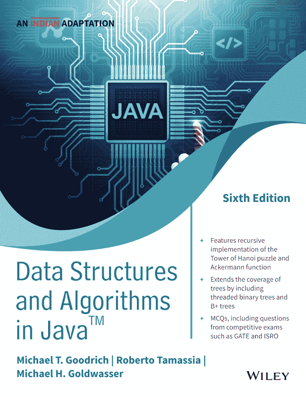


献给 Karen、Paul、Anna 和 Jack

– Michael T. Goodrich

献给 Isabel

– Roberto Tamassia

献给 Susan、Calista 和 Maya

– Michael H. Goldwasser

# 改编版序言

*Data Structures and Algorithms in Java* 对基础数据结构和算法进行了全面涵盖，并介绍了使用 Java 语言对这些抽象概念的实现。本《Data Structures and Algorithms in Java》第六版改编版是根据长期使用的用户关于如何修订本书的详细反馈开发的。在之前几个版本优势的基础上，本次改编的重点在于加强内容覆盖并更新已解示例和练习题。以下是本版本的显著特征：

## 更新内容

- 第 3 章数据结构与算法简介，介绍了不同类型的数据结构、可以在数据结构上执行的各种操作以及抽象数据类型（`ADT`）的概念。该章还包含了算法分析中使用的小 omega（ω）和小 theta（θ）符号。
- 第 4 章数组与链表，展示了如何使用二维数组和链表实现稀疏矩阵，以及使用三维数组解决生日预测问题。该章还包含了链表排序和两个排序链表合并的算法及 Java 实现。
- 第 5 章递归，包含了如哈诺亚塔和 Ackermann 函数等流行数学谜题的实现，以及实现这些函数的算法的分析。
- 第 6 章栈与队列，展示了如何使用栈求算术表达式的前缀表示和后缀表示的值。
- 第 8 章树，包含了一个关于线二叉树的章节，它是二叉树的一种变体，利用空引用来改进遍历过程。
- 第 15 章其他主题，包含一个关于 B+ 树的章节，它是 B 树的扩展。

## 修订教学法

- 大约一半的解示例和章末练习是新的或修订的。
- 选择题（MCQs），包括来自 GATE 和 ISRO 等竞争考试的，有助于读者测试对涵盖概念的理解。

## 教师和学生资源

- 教师可以在 Wiley India 网站访问额外的补充材料（[`www.wileyindia.com/Instructor_Manuals/Register/login.php`](https://www.wileyindia.com/Instructor_Manuals/Register/login.php)）。这些包括：
  - 教师手册
  - 教学 PowerPoint 幻灯片
  - 源代码
  - 演示文件
- 学生可以在 Wiley India 网站访问额外的补充材料（[`www.wileyindia.com/student-resources`](https://www.wileyindia.com/student-resources)）。这些包括：
  - 练习提示
  - 源代码

# 美国版序言

*Data Structures and Algorithms in Java* 介绍了数据结构和算法，包括其设计、分析和实现。第六版的重大变化包括：

- 我们重新设计了整个代码库，以提高演示的清晰度和风格及约的一致性，包括使用了 Java 7 中引入的 *类型推断*，以减少实例化泛型时的冗余。
- 我们添加了 38 幅新图表，并重新设计了 144 幅旧图表。
- 我们继续将练习划分为强化、创意和项目练习。然而，我们选择不在每个新类别处重置编号方案，从而避免了 `R-7.5`、`C-7.5` 和 `P-7.5` 等练习之间可能的歧义。
- 引言章节包含了更多的类和继承示例，增加了对 Java 泛框架框架讨论，并扩展了数据结构背景下克隆和等效测试的涵盖。
- 新增了一个专门讨论递归的章节，涵盖了之前分布在第五版第 3 章](#c03.xhtml)、第 4 章](#c04.xhtml)和第 9 章](#c09.xhtml)的内容，并新引入了在处理文件系统时对递归的使用。
- 我们对 Java `StringBuilder` 类相对于字符串重复连接的效率进行了一项新的实证研究，然后讨论了其摊销性能的理论基础。
- 我们增加了对迭代器的讨论，对比了所谓的 *惰性迭代器* 和 *快照迭代器*，并为几种数据结构提供了这两种风格的实现示例。
- 我们增加了抽象基类的使用，以在提供公共接口的多种实现时减少冗余，并使用了嵌套类为我们的数据结构提供更好的封装性。
- 我们增加了对范围查询的新的高级涵盖。
- 我们为许多数据结构和算法包含了完整的 Java 实现，这些算法在早期的版本中仅用伪代码进行了描述。这些新的实现包括了基于数组和基于链表的队列实现、基于堆的 `adaptable` 优先级队列、自底向上的堆构建、使用分离链地址法或线性探测法的哈希表、伸 le 树、用于最公共子序列问题的动态规划、带有路径压缩的并查集合数据结构、图的广度优先搜索、计算图传递闭的 Floyd-Warshall 算法、有向无环图 DAG 的拓扑排序，以及计算最小生成树的 Prim-Jarník 和 Kruskal 算法。

## 前提条件

我们假设读者至少模糊熟悉一种高级编程语言，例如 `C`、`C++`、`Python` 或 `Java`，并且他们理解这种高级语言的主要构造结构，包括：

- 变量和表达式
- 方法（也称为函数或过程）
- 决策结构（如 `if` 语句和 `switch` 语句）
- 迭代结构（`for` 循环和 `while` 循环）

对于熟悉这些概念但不熟悉它们在 Java 中如何表示的读者，我们在第 1 章中提供了 Java 语言入门介绍。尽管如此，这本书主要是一本数据结构书，而不是 Java 书；因此，它没有对 Java 进行全面的介绍。尽管，我们并不假设读者一定熟悉面向对象的设计或链式结构（如链表），因为这些主题在本书的核心章节中会有涵盖。

在数学背景方面，我们假设读者对高中数学主题比较熟悉。尽管如此，在第 4 章中，我们讨论了算法分析最重要的七个函数。事实上，使用这七个函数之外其他函数的节节被认为是可选的，并用星号（`*`）标记。

## 在线资源

本书附带了一系列丰富的在线资源，可以在以下网站找到：

[`www.wiley.com/go/global/goodrich`](http://www.wiley.com/go/global/goodrich)

该网站包含了一系列针对学生和教师的教学辅助，旨在增强本书的内容。对于所有读者，特别是学生，我们提供了以下资源：

- 书中呈现的所有 Java 源代码
- 有用数学事实的附录
- PowerPoint 幻灯片的 PDF 打印（每页四个）
- 带有练习提示的学习指南，按题号索引

对于使用本书的教师，我们提供了以下额外的教学辅助：

- 书中数百道练习的解答
- 书中所有图形和插图的彩色版本
- PowerPoint 和 PDF 格式的幻灯片（每页一张）

幻灯片是完全可编辑的，以便使用本书的教师在自定义演示文稿时完全自由。

## 作为教材使用

高效数据结构的设计和分析长期以来被认为是计算科学的核心课题。鉴于高效数据结构和算法在大多数软件系统（包括 Web、操作系统、数据库、编译器和科学模拟系统）中的重要性，我们认为数据结构设计和分析在课程中的核心作用是完全合理的。

本书设计用于初级数据结构课程，或中级算法导论课程。本书的章节安排旨在提供一条教学路径，该路径从 Java 编程基础和面向对象设计开始。然后，我们讨论了具体的结构，包括数组和链表，以及算法分析和递归等基础技术。在书的主体部分我们介绍了基础数据结构和算法，最后讨论了内存管理。

为了协助教师在 IEEE/ACM 2013 计算课程的背景下设计课程，下表描述了书中涵盖的课程知识单元。

| 知识单元 | 相关材料 |
| :--- | :--- |
| AL/基础分析 | 第 4 章 和 第 5.2 节 & 13.1.4 |
| AL/算法策略 | 第 5.3.3 节, 第 13.1.1 节, 第 12.2.1 节, 12.4.2, 第 12.5 节, 14.6.2 & 14.7 |
| AL/基础数据结构和算法 | 第 3.1.2 节, 第 5.1.3 节, 第 9.3 节, 第 9.4.1 节, 第 10.2 节, 第 11.1 节, 第 12.2 节, 以及 第 13 章 & 第 14 章 |
| AL/高级数据结构 | 第 7.2.1 节, 第 10.4 节, 第 11.1 节, 第 13.2 节, 第 12.3 节, 第 14.5 节 |
| AR/内存组织 | 第 15 章 |
| DS/集合、关系与函数 | 第 9.2 节 & 第 10.5 节 |
| DS/证明技术 | 第 4.4 节, 第 5.2 节, 第 7.3 节, 第 9.4 节 |
| DS/计数基础 | 第 2.2 节, 第 6.2 节, 第 8.2 节 |
| DS/图与树 | 第 8 章 和 第 14 章 |
| DS/概率 | 第 3.3 节, 第 10.2 节, 第 10.4 节, 第 13.2 节 |
| PL/面向对象编程 | 第 2 章, 第 9.5 节, 第 11.2 节 |
| SDF/算法与设计 | 第 2.1 节, 第 4.3 节, 第 13.1.1 节 |
| SDF/基础编程概念 | 第 1 章 & 第 5 章 |
| SDF/基础数据结构 | 第 1.3 节, 第 9.1 节, 第 10.1 节 |
| SDF/开发方法 | 第 1.8 节 & 第 2.4 节 |
| SE/软件设计 | 第 2.1 节 |

# 致谢

在过去的十年里，许多人对本书的发展做出了贡献，很难一一列出。我们再次感谢对本书以前版本提供反馈的许多研究合作者和助。这些贡献的收益延续到了本书。

对于第六版，我们感谢外部评审员和读者提供的大量意见、电子邮件和建设性批评。因此，我们感谢以下人士意见意见建议：Sameer O. Abufard（北达科他州大学）、Mary Boelk（马奎大学）、Frederick Crabbe（美国海军学院）、Scot Drysdale（戴尔茅大学）、David Eisner、Henry A. Etlinger（罗彻理工大学）、Chun-Hsi Huang（康涅格大学）、John Lasseter（霍巴特和威廉史学院）、Yupeng Lin、Suely Oliveira（爱荷华大学）、Vincent van Oostrom（乌得支大学）、Justus Piater（因斯鲁克大学）、Victor I. Shtern（波士顿大学）、Tim Soethout 以及其他匿名评审员。

许多朋友和同事的意见促使了本书的改进。我们特别感谢 Erin Chambers、Karen Goodrich、David Letscher、David Mount 和 Ioannis Tollis 提供的真知灼见。此外，我们非常感谢 David Mount 在递归内容以及几幅图表方面所出的贡献。

我们感谢 Wiley 出版优秀团队，包括我们的编辑 Beth Lang Golub，她从头到尾对项目提供了热情支持；感谢产品解决方案小组的编辑 Mary O’Sullivan 和 Ellen Keohane 完成了项目的圆满交付。得益于文字校对 Julie Kennedy 对细节的关注，这本书的质量得到了极大提升。制作过程的最后几个月由 Joyce Poh 和 Jessie Yeo 优雅地管理完成。

最后，我们想热挚地感谢 Karen Goodrich、Isabel Cruz、Susan Goldwasser、Giuseppe Di Battista、Franco Preparata、Ioannis Tollis 以及我们的父母，他们在本书准备的各个阶段提供了建议、鼓励和支持；并感谢 Calista 和 Maya Goldwasser 就许多插图的艺术价值提出的建议。更重要的是，我们感谢这些人，他们提醒我们生活中除了写书还有其他意义。

Michael T. Goodrich

Roberto Tamassia

Michael H. Goldwasser

# 作者简介

Michael Goodrich 于 1987 年在普渡渡大学获得计算机科学博士学位。他目前担任加州大学欧尔文分校计算机科学系的校长教授。他曾是约翰霍普金斯大学的教授。他是富布莱学者，也是美国科学进展协会（AAAS）、计算机协会（ACM）以及电气电子工程师学会（IEEE）的会员。他曾获得 IEEE 计算机学会技术成就奖、ACM 服务认可奖以及本科教学卓越池奖。

Roberto Tamassia 于 1988 年在伊利诺伊大学厄巴纳-香槟分分校获得电气与计算机工程博士学位。他是布朗大学计算机科学的 Plastech 教授兼计算机科学系主任。他还是布朗大学几何计算中心主任。他的研究兴趣包括信息安全、密码学、算法的分析、设计与实现、图绘制以及计算几何。他是美国科学进展协会（AAAS）、计算机协会（ACM）以及电气电子工程师学会（IEEE）的会员。他曾获得 IEEE 计算机学会技术成就奖。

Michael Goldwasser 于 1997 年在斯坦福大学获得计算机科学博士学位。他目前担任圣路易斯大学数学与计算机科学系计算机科学项目的教授兼主任。他曾是芝加哥洛莱大学计算机科学系的教员。他的研究兴趣侧重于算法的设计与实现，发表过涉及近似算法、在线计算、计算生物学和计算几何的作品。他也活跃于计算机科学教育社区。

## 这些作者的其他著作

- Di Battista, Eades, Tamassia, and Tollis, *Graph Drawing*, Prentice Hall
- Goodrich, Tamassia, and Goldwasser, *Data Structures and Algorithms in Python*, Wiley
- Goodrich, Tamassia, and Mount, *Data Structures and Algorithms in C++*, Wiley
- Goodrich and Tamassia, *Algorithm Design: Foundations, Analysis, and Internet Examples*, Wiley
- Goodrich and Tamassia, *Introduction to Computer Security*, Addison-Wesley
- Goldwasser and Letscher, *Object-Oriented Programming in Python*, Prentice Hall

# 第 1 章 Java 简介

## 1.1 准备知识

构建数据结构和算法需要向计算机传递详细的指令。执行此类通信的一种极方法是使用高级计算机语言，例如 `Java`。在本章中，我们提供了 Java 编程语言的概述，并在第 2 章中继续这一讨论，重点关注对象设计原则。我们假设读者对某种现有的高级语言比较熟悉，但不一定是 Java。本书没有提供 Java 语言的完整描述（对此有许多语言参考资料），但它介绍了本书后面代码片段中用到的语言的所有方面。

我们的 Java 入门从一个在屏幕上打印“Hello Universe!”的程序开始，该程序在图 1.1 中以分解的形式显示。

在 Java 中，可执行语句被放在函数（即 `methods`）中，属于 `class` 定义。在我们第一个示例中，`Universe` 类非常简单；它唯一的方法是一个名为 `main` 的静态方法，这是运行 Java 程序时第一个被执行的方法。大括号“{”和“}”之间的任何语句定义了一个程序 `block`。注意，整个 `Universe` 类的定义由这样的大括号界定，`main` 方法体也是如此。

Java 中类、方法或变量的名字被称为 `identifier`（标识符），只要它以字母开头并由字母、数字和下划线组成（其中“字母”和“数字”可以是 Unicode 字符集中定义的任何编写语言），它可以是任何字符字符串。我们在表 1.1 中列出了 Java 标识符这一通用规则的例外。

### 注释

除了可执行语句和声明外，Java 还允许程序员嵌入注释，注释是为人类读者提供的注解，不会被 Java 编译器处理。Java 允许两种注释：行内注释和块注释。Java 使用 `//` 开始行内注释，忽略该行后续的所有内容。例如：

```java
// 这是一个行内注释。
```

行内注释限制为单行，Java 允许以块注释形式进行多行。Java 使用 `/*` 开始块注释，并用 `*/` 结束。例如：

```java
/*
 这是一个块注释。
 */
public static void main(String[] args) {
    System.out.println("Hello Universe!");
}
```

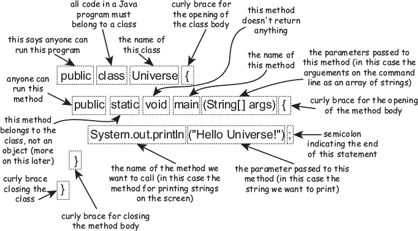

图 1.1 “Hello Universe!”程序。

| abstract | default | goto | package | synchronized |
| :--- | :--- | :--- | :--- | :--- |
| assert | do | if | private | this |
| boolean | double | if | protected | throw |
| break | else | import | public | throws |
| byte | enum | instanceof | return | transient |
| case | extends | int | short | true |
| catch | false | interface | static | try |
| char | final | long | strictfp | void |
| class | finally | native | super | volatile |
| continue | for | new | switch | while |
| const | float | null |  |  |

（注：此处对应原文中的 c01.xhtml_tba1-1 对应的表格内容为 Java 关键字）


**表 1.1** Java 关键字列表。这些名称不能作为类、方法或变量名。

以`/**`（注意第二个星号）开始的块注释有特殊用途，允许一个称为 Javadoc 的程序读取这些注释并自动生成软件文档。我们在 1.8.4 节中讨论 Javadoc 注释的语法和解释。

### 1.1.1 基础类型

对于常用的数据类型，Java 提供了以下`基础类型`（也称为原始类型）：

| 类型 |  |
| :--- | :--- |
| `boolean` | 布尔值：`true` 或 `false` |
| `char` | 16 位 Unicode 字符 |
| `byte` | 8 位有符号补码整数 |
| `short` | 16 位有符号补码整数 |
| `int` | 32 位有符号补码整数 |
| `long` | 64 位带符号补码整数 |
| `float` | 32 位浮点数 (IEEE 754-1985) |
| `double` | 64 位浮点数 (IEEE 754-1985) |

拥有这些类型之一的变量仅存储该类型的值。整数常量（如`14`或`195`）的类型为`int`，除非后面紧跟一个‘L’或‘l’，在这种情况下它们的类型为`long`。浮点数常量（如`3.1416`或`6.022e23`）的类型为`double`，除非后面紧跟一个‘F’或‘f’，在这种情况下它们的类型为`float`。代码片段 1.1 展示了各种基本类型变量的声明以及在某些情况下的初始化。

```java
 1	boolean flag = true;
 2	boolean verbose, debug;					// 声明了两个变量，但尚未初始化
 3	char grade = 'A';
 4	byte b = 12;
 5	short s = 24;
 6	int i, j, k = 257;								// 声明了三个变量；仅初始化了 k
 7	long l = 890L;									// 注意这里使用了 "L"
 8	float pi = 3.1416F;							// 注意这里使用了 "F"
 9	double e = 2.71828, a = 6.022e23;		// 两个变量都已初始化
```

**代码片段 1.1** 几个基本类型变量的声明和初始化。

请注意，可以在单个语句中声明（并初始化）多个相同类型的变量，正如本示例中的第 2、6 和 9 行所示。在这段代码片段中，变量`verbose`、`debug`、`i`和`j`保持未初始化状态。在代码块内部局部声明的变量在第一次使用之前必须初始化。

Java 的一个优秀特性是，当基本类型变量被声明为类的实例变量时（参见第 1.2 节），如果没有没有初始化，Java 会确保它们具有初始默认值。特别是，所有数值类型都初始化为零，布尔值初始化为`false`，字符默认初始化为空字符。

## 1.2 对象与类

在更复杂的 Java 程序中，主要的“角色执行者”是对象。每个对象都是类的一个实例，类充当对象的类型并作为蓝图，定义了对象存储的数据以及访问和修改这些数据的方法。Java 中类的关键成员包括：

- *实例变量*（Instance variables），也称为字段（fields），代表与类对象相关的数据。实例变量必须有一个类型，该类型可以是基本类型（如`int`、`float`或`double`），也可以是任何类类型（由于我们很快会解释的原因，也称为引用类型）。

- Java 中的方法（Methods）是可以被调用以执行操作的代码块（类似于其他高级语言中的函数和过程）。方法可以接受参数作为参数，其行为可能取决于调用它的对象以及传递的任何参数的值。向调用者返回信息而不改变任何实例变量的方法称为访问器方法（accessor method），而当调用时可能会改变一个或多个实例变量的方法称为更新方法（update method）。

为了为了说明，代码片段 1.2 提供了一个名为`Counter`的非常简单类的完整定义，我们将在本节的剩余部分引用它。

```java
 1	public class Counter {
 2	  private int count;												// 一个简单的整数实例变量
 3	  public Counter() { }											// 默认构造函数 (count 为 0)
 4	  public Counter(int initial) { count = initial; }		// 备选构造函数
 5	  public int getCount() { return count; }					// 访问器方法
 6	  public void increment() { count++; }						// 更新方法
 7	  public void increment(int delta) { count += delta; }	// 更新方法
 8	  public void reset() { count = 0; }							// 更新方法
 9	}
```

**代码片段 1.2** 用于简单计数器的`Counter`类，可以进行查询、递增和重置。

该类包含一个名为`count`的实例变量，声明在第 2 行。如所述，除非我们对其进行初始化，否则`count`将具有零的默认值。

该类包含两个特殊的方法称为构造函数（第 3 和 4 行），一个访问器方法（第 5 行）和三个更新方法（第 6–8 行）。与第 1.1 节中讨论的原始`Universe`类不同，我们的`Counter`类没有`main`方法，因此它不能作为一个完整的程序运行。相反，`Counter`类的目的是创建可以作为更大程序部分的实例。

### 1.2.1 创建和使用对象

在探索`Counter`类定义语的复杂细节之前，我们更倾向于描述如何创建和使用`Counter`实例。为此，代码片段 1.3 展示了一个名为`CounterDemo`的新类。

Java 在处理基本类型变量和类类型变量之间存在着重要的区别。在我们演示的第 3 行，使用以下语法声明了一个新变量`c`：

```java
Counter c;
```

这确立了标识符`c`为`Counter`类型变量，但它并没有创建一个`Counter`实例。类在 Java 中被称为*引用类型*（reference types），该类型的变量（例如示例中的`c`）被称为*引用变量*（reference variable）。引用变量能够存储来自声明类的对象的位置（即*内存地址*）。因此，我们可能给它赋值以引用已有的实例或新构造的实例。引用变量还可以存储一个特殊值`null`，表示对象的缺失。

```java
 1	public class CounterDemo {
 2	  public static void main(String[ ] args) {
 3		Counter c;								// 声明变量；未构造计数器
 4		c = new Counter();					// 构造计数器；将其引用赋值给 c
 5		c.increment();							// 值增加一
 6		c.increment(3);						// 值再增加三
 7		temp = c.getCount();					// 将为 4
 8		c.reset();								// 值变为 0
 9		Counter d = new Counter(5);		// 声明并构造一个值为 5 的计数器
 10		d.increment();							// 值变为 6
 11		Counter e = d;							// 将 e 引用 d 相同的对象
 12		temp = e.getCount();					// 将为 6（因为 e 和 d 引用计数器）
 13		e.increment(2);						// e（也称为 d）的值变为 8
 14	  }
 15	}
```

**代码片段 1.3** 使用`Counter`实例的演示。

在 Java 中，创建新对象的方法是使用`new`运算符后跟随目标类构造函数的调用；构造函数是一个始终与其类同名的方法。`new`运算符返回新创建实例的*引用*（reference）；返回的引用通常会被赋值给变量供后续使用。

在类的新实例过程中会发生三个事件：

- 在内存中动态分配一个新对象，并对所有实例变量初始化为标准的默认值。对于引用变量的默认值为`null`，对于所有基本类型的默认值为 0，但`布尔`变量除外（默认为`false`）。

- 在创建新对象时，构造函数将使用指定的参数进行调用。构造函数可以为任何实例变量分配更具意义的值，并执行由于创建此对象而必须完成的任何额外计算。

- 在构造函数返回后，`new`操作符会返回指向新创建对象的引用（即内存地址）。如果该表达式的形式为赋值语句，则该地址将存储在对象变量中，因此该对象变量就`引用`了该新创建的对象。

### 点运算符

对象引用变量的主要用途之一是访问该对象的类成员（该对象是其类的一个实例）。也就是说，对象引用变量用于访问与对象关联的方法和实例变量。这种访问是通过点（`.`）运算符执行的。我们通过使用引用变量名、后跟点运算符、然后是方法名及其参数来调用与对象关联的方法。例如，在代码段 1.3 中，我们在第 5 行调用了`c.increment()`，第 6 行调用了`c.increment(3)`，第 7 行调用了`c.getCount()`，第 8 行调用了`c.reset()`。如果在当前为`null`的引用上使用点运算符，Java 运行时环境将抛出`NullPointerException`。

如果一个类定义了多个同名的方法，Java 运行时系统将使用与传递的实际参数数量及其相应类型相匹配的那一个。例如，我们的`Counter`类支持两个名为`increment`的方法：一个零参数形式和一个单参数形式。在评估诸如`c.increment()`与`c.increment(3)`类的命令时，Java 会确定调用哪一个版本。方法名结合参数的数量和类型被称为方法的`signature`（签名），因为它需要所有这些部分来确定对于某个特定的方法调用要执行的实际方法。然而，请注意，Java 中方法的签名并不包含方法的返回类型，因此 Java 不允许两个具有相同的方法返回不同的类型。

引用变量`v`可以被视为指向某些对象`o`的“指针”。这好像该变量是一个遥控器的持有者，可以使用遥控器来控制新创建的对象（设备）。也就是说，变量有一种方法指向该对象并要求它执行某些操作或允许我们访问其数据。我们在图 1.2 中说明了这一概念。使用遥控器的类比，`null`引用是一个空的遥控器持有者。

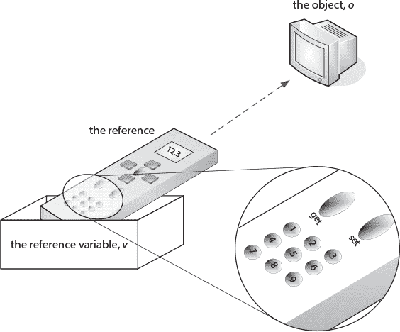

图 1.2 展示了对象与对象引用变量之间的关系。当我们将对象引用（即内存地址）赋值给引用变量时，就像我们将该对象的遥控器存储在该变量中。

事实上，同一个对象可以有很多引用，每个对特定对象的引用都可以用于调用该对象的方法。这种情况对应于我们拥有许多可以作用于同一台设备的遥控器。任何一个遥控器都可以对设备进行更改（例如更改电视频道）。请注意，如果使用其中一个遥控器更改设备，那么所有遥控器所指向的（同一个）对象就会改变。同样，如果使用一个对象引用变量更改对象的状态，那么所有引用它的引用其状态都会发生变化。这种行为源于存在许多引用，但它们都指向同一个对象。

回到我们的`CounterDemo`示例，第 9 行构造的实例为：

```java
Counter d = new Counter(5);
```

与标识为`c`的实例是不同的实例。然而，第 11 行的命令：

```java
Counter e = d;
```

并没有导致新`Counter`实例的构造。它声明了一个名为`e`的新引用变量，并将该变量赋值指向当前标识为`d`的现有计数器实例的引用。此时，变量`d`和`e`都是同一个对象的别名，因此调用`d.getCount()`的行为与调用`e.getCount()`一。同样，对更新方法`e.increment(2)`的调用影响的是由`d`标识的同一个对象。

值得注意的是，两个引用变量指向同一个对象的别名并不是永久的。在任何时间，我们都可能将引用变量重新赋值给新实例、另一个不同的现有实例或赋值为`null`。

### 1.2.2 定义类

到为止，我们已经提供了两个简单类的定义：`Universe`类和`Counter`类。类定义的核心是一块由大括号“{”和“}”分隔的代码，其中包含了类成员的实例变量和方法的声明。在本节中，我们将对 Java 中的类定义进行更深层次的检查。

#### 修饰符

在 Java 中，类、实例变量或方法的定义之前，可以放置称为`modifiers`（修饰符）的关键字，以传递关于定义的额外规定。

##### 访问控制修饰符

我们讨论的第一组修饰符被称为`访问控制修饰符`，因为它们控制了定义类在大型 Java 程序上下文中授予其他类的访问级别（也称为`visibility`，可见性）。限制类之间访问的能力支持了面向对象的一个核心原则，即封装（参见第 2.1 节）。通常，不同的访问控制修饰符及其含义如下：

- `public`类修饰符指定所有类都可以访问定义的属性。例如，代码段 1.2 的第 1 行指定了：

```java
public class Counter {
```

因此所有其他类（例如`CounterDemo`）都被构造`Counter`类的实例，以及声明`Counter`类型的变量和参数。在 Java 中，每个公共类必须在名为`classname.java`的单独文件中定义，其中*classname*是类名（例如，对于`Counter`类，为`Counter.java`）。

类的某个特定方法指定`public`访问允许任何其他类调用该方法。例如，代码段 1.2 的第 5 行指定了：

```java
public int getCount() { return count; }
```

这就是为什么`CounterDemo`类可以调用`c.getCount()`。

如果实例变量被声明为`public`，则可以使用点符号通过任何拥有该类实例的其他类的代码直接访问该变量。例如，如果`Counter`的`count`变量被声明为`public`（实际上并非如此），那么`CounterDemo`将允许使用类似于`c.count`的语法读取或修改该变量。

- `protected`类修饰符指定定义属性的访问仅授予以下其他类组：
  - 通过继承指定为给定类`subclasses`（子类）的类。（我们将在第 2.2 节中讨论继承。）
  - 与给定类属于相同`package`（包）的类。（我们将在第 1.7 节中讨论包。）

- `private`类修饰符指定对类定义成员的访问仅授予该类内部的代码。子类或任何其他类都无法访问此类成员。

例如，我们将`Counter`类的实例变量`count`定义为私有访问级别。我们允许在该类的方法内部（例如`getCount`、`increment`和`reset`）中读取或编辑它的值，但其他类（如`CounterDemo`）无法直接访问该字段。当然，我们提供了其他公共方法，以赋予外部类依赖于当前`count`值的行为。

最后，我们指出，如果没有给出显式的访问控制修饰符，定义的属性将具有所谓的`package-private`（包私有）访问级别。这允许同一包中的其他类（参见第 1.7 节）访问，但其他包中的任何类或子类不能。

## `static`修饰符

Java 中的`static`修饰符可以用于类的任何变量或方法（或嵌套类，我们将在第 2.6 节中介绍）。

当一个类的变量被声明为`static`时，它的值与整个类相关，而不是与该类的每个单独实例相关。静态变量用于存储关于类的“全局”信息。（例如，一个静态变量可以用来维护该类已创建的实例总数。）即使该类的实例不存在，静态变量也存在。

当一个类的方法被声明为`static`时，它也与类本身相关，而不是与类的特定实例相关。这意味着该方法不是使用传统的点表示法在类的特定实例上调用的。相反，它通常使用类名作为限定符来调用。

例如，在作为标准 Java 分发版部分的`java.lang`包中，有一个`Math`类，它提供了许多静态方法，其中一个名为`sqrt`的方法用于计算数字的平方根。要计算平方根，你不需要创建`Math`类的实例；该方法使用如`Math.sqrt(2)`的语法调用，其中类名`Math`是点操作符之前的限定符。

静态方法对于提供与类相关的工具行为非常有用，这些行为不需要依赖于该类的任何特定实例的状态。

## `abstract`修饰符

类的方法可以被声明为`abstract`（抽象的），在这种情况下，提供了方法的签名，但没有方法体的实现。抽象方法是面向对象编程的一项高级功能，通常与继承结合使用，这是第 2.3.4 节的重点。简而言之，任何带有抽象方法的子类都应该为每个抽象方法提供具体的实现。

具有一个或多个抽象方法的类也必须正式地声明为`abstract`，因为它本质上是不完全的。（即使一个类不包含任何抽象方法，也可以将其声明为抽象类。）结果是，Java 不允许构造抽象类的任何实例，尽管引用变量可以声明为抽象类型。

## `final`修饰符

使用`final`修饰符声明的变量可以在声明时进行初始化，但永远不能再次被赋值新值。如果它是基本类型，那么它就是一个常量。如果引用变量是`final`的，那么它将始终引用同一个对象（即使该对象更改其内部状态）。如果类的成员变量被声明为`final`，则它通常也会被声明为`static`，因为如果该值可以由整个类共享，那么让每个实例存储相同的值将是非常不划的。

将方法或整个类指定为`final`具有完全不同的后果，仅在继承的语境下相关。`final`方法不能被子类重写，而`final`类甚至不能被子类。

### 声明实例变量


在定义类时，我们可以声明任意数量的实例变量。面向对象的一个重要原则是，类的每个实例都维护自己独立的一组实例变量（事实上，这就是为什么它们被称为实例变量）。因此，在`Counter`类的情况下，每个实例都将存储它自己的（独立的）`count`值。

声明类的一个或多个实例变量的通用语法如下（可选部分用括号括起）：

`[*modifiers] type identifier*[1][=*initialValue*[1]], identifier*[2][=*initialValue*[2]];`

在`Counter`类的情况中，我们声明了：

```java
private int count;
```

其中`private`是修饰符，`int`是类型，`count`是标识符。因为我们没有声明初始值，它会自动接收零作为基本类型整数的默认值。

### 声明方法

方法定义包含两个部分：定义方法名称和参数的签名（signature），以及定义方法做什么的体（body）。方法签名指定了如何调用该方法，而方法体指定了对象在被调用时将做什么。定义方法的语法如下：

```java
[modifiers] returnType methodName(type1 param1, . . ., typen paramn) {
    // method body . . .
}
```

此声明的每个部分都有重要的目的。我们已经讨论过`public`、`private`和`static`等`modifiers`的意义。`returnType`指定了方法返回的值类型。`methodName`可以是任何有效的 Java 标识符。参数列表及其类型声明了与作为参数传递给此方法的值相对应的局部变量。每个类型声明`type[i]`可以是任何 Java 类型，每个`param[i]`可以是任何 Java 标识符。这些参数列表可以为空，表示没有值要传递给此方法。

当类的（非静态）方法被调用时，它是在特定的实例上调用的，并可以更改对象的状态。例如，`Counter`类的以下方法通过给定的量增加计数器的值：

```java
public void increment(int delta) {
    count += delta;
}
```

注意，该方法的体使用了`count`（这是一个实例变量）和`delta`（这是一个参数）。

## 返回类型

方法定义必须指定方法将返回的值类型。如果方法不返回值（如`Counter`类的`increment`方法），必须使用`void`关键字。在 Java 中返回值，方法体必须使用`return`关键字，后跟着一个相应返回类型的值。这是一个非`void`返回类型方法（来自`Counter`类）的示例：

```java
public int getCount() {
    return count;
}
```

Java 方法只能返回一个值。要在 Java 中返回多个值，我们应该将想要返回的所有值合并到一个复合对象中，该对象的实例变量包含了我们要返回的所有值，然后返回该复合对象的引用。此外，我们可以更改传递给方法的对象的内部状态，作为另一种“返回”多个结果的方法。

## 参数

方法的参数定义在方法名称后括号内的逗号分隔列表中。每个参数由两部分组成：参数类型和参数名称。如果方法没有参数，则只使用一对空括号。

Java 中的所有参数都是按值传递的（by value），也就是说，每当我们将参数传递给方法时，都会为该参数创建一个副本，供方法体内部使用。因此，如果我们向方法传递一个`int`变量，那么该变量的整数值就会被复制。方法可以修改这个副本，但无法修改原始的变量。如果我们将一个对象引用作为参数传递给方法，该引用也会被复制。请记住，我们可以有多个不同的变量，它们都指向同一个对象。在方法内部重新赋值内部引用变量不会改变传递进来的那个引用。

为了演示，我们假设以下两个方法被添加到了任意类（例如`CounterDemo`）中。

```java
public static void badReset(Counter c) {
    c = new Counter(); // 将本地名称 c 重新赋值为一个新的计数器
}
```

```java
public static void goodReset(Counter c) {
    c.reset(); // 重置由调用者发送的计数器
}
```

现在，我们假设变量`strikes`在某些上下文中指向一个已存在的`Counter`实例，并且它当前值为 3。

如果我们调用`badReset(strikes)`，这对名为`strikes`的`Counter`没有影响。`badReset`方法体将（本地）参数变量`c`重新赋值指向一个新创建的`Counter`实例；但这并不会改变调用者发送的现有计数器的状态（即`strikes`）。

相比之下，如果我们调用`goodReset(strikes)`，这确实会将调用者的计数器重置为零。这是因为变量`c`和`strikes`都是指向同一个`Counter`实例的引用变量。所以当调用`c.reset()`时，等同于调用了`strikes.reset()`。

## 定义构造函数

构造函数（constructor）是一种特殊的方法，用于初始化新创建的类实例，使其处于一致且稳定的初始状态。这通常通过初始化对象的每个实例变量来实现（除非默认值已经足够），尽管构造函数也可以执行更复杂的计算。在 Java 中声明构造函数的通用语法如下：

```java
修饰符 name(type0 parameter0, . . ., typen − 1 parametern − 1) {
    // 构造函数体 . . .
}
```

构造函数的定义方式与类的其他方法非常相似，但有几点重要的区别：

1. 构造函数不能是`static`、`abstract`或`final`，因此允许的修饰符只有影响可见性的那些（即`public`、`protected`、`private`或默认的包级可见性）。

2. 构造函数的名称必须与其构建的类的名称完全相同。例如，在定义`Counter`类时，构造函数也必须命名为`Counter`。

3. 我们不为构造函数指定返回类型（甚至没有`void`）。构造函数体也不会显式返回任何内容。当类的用户使用如下语法创建实例时：

```java
Counter d = new Counter(5);
```

`new`运算符负责向调用者返回新实例的引用；构造方法的职责仅在于初始化新实例的状态。

一个类可以有多个构造函数，但每个构造函数必须具有不同的签名（signature），也就是说每个构造函数必须通过其接受的参数类型和数量来区分。如果没有显式定义构造函数，Java 会为该类提供一个隐式的默认构造函数（default constructor），它具有零参数，并将所有实例变量初始化为它们的默认值。然而，如果类定义了一个或多个非默认构造函数，则不会提供默认构造函数。

作为一个示例，我们的`Counter`类定义了以下两个构造函数：

```java
public Counter() { }
public Counter(int initial) {
    count = initial;
}
```

其中第一个构造方法体是空的`{ }`，因为这个默认构造函数的目标是创建一个值为零的计数器，而这已经是整数实例变量`count`的默认值。然而，我们声明这样一个显式构造函数仍然很重要，因为否则在存在非默认构造函数的情况下，将不会提供任何（默认）构造函数。在那种情况下，用户将无法使用`new Counter()`这种语法。

## 关键字`this`

在 Java 的（非静态）方法体内部，关键字`this`被自动定义为指向调用该方法的实例的引用。也就是说，如果调用者使用如`thing.foo(a, b, c)`的语法，那么对于该调用的方法`foo`方法体内部，关键字`this`指向调用者上下文中名为`thing`的对象。在方法体内部需要此引用的常见原因有三个：

1. 将引用存储在变量中，或者作为参数传递给另一个期望该类型实例作为参数的方法。

2. 区分实例变量与同名的局部变量。如果方法中声明了一个与该类的实例变量同名的局部变量，那么该名称在那个方法体中将指向局部变量。（我们称局部变量掩蔽了（masks）实例变量。）在这种情况下，仍然可以通过显式地使用`this`作为限定符并使用点符号表示法来访问实例变量。例如，某些程序员倾向于在构造函数中使用以下风格，使参数与底层变量同名。

```java
public Counter(int count) {
    this.count = count; // 将实例变量赋值为参数
}
```

3. 允许一个构造函数调用另一个构造函数。当类的一个方法调用该类的另一个方法时，使用（未限定的）方法名。但调用构造函数的语法是特殊的。Java 允许在构造函数体中使用`this`关键字来调用另一个构造函数。这通常非常有用，因为一个构造函数的所有初始化步骤可以通过参数化进行复用。作为一个简单的演示，我们可以重新实现`Counter`构造函数的零参数版本，让它调用传递 0 作为显式参数的参数构造函数。这将写如下：

```java
public Counter() {
    this(0); // 调用值为零的参数构造函数
}
```

## `main`方法

某些 Java 类（例如我们的`Counter`类）旨在供其他类使用，但并不打算作为独立的程序。Java 应用程序的主控制必须从某个类中执行一个名为`main`的特殊方法开始。该方法必须声明如下：

```java
public static void main(String[] args) {
    // main 方法体...
}
```

`args`参数是一个`String`对象的数组，也就是说是一组索引字符串，其中第一个字符串是`args[0]`，第二个是`args[1]`，依此类推。它们代表了所谓的命令行参数（command-line arguments），由用户在执行程序时提供。

Java 程序可以通过`java`命令（在 Windows、Linux 或 Unix Shell 中）从命令行调用，随后是想要运行的`main`方法的 Java 类名，以及任何可选参数。例如，要执行`Aquarium`类的`main`方法，我们可以发出以下命令：

```bash
java Aquarium
```

在这种情况下，Java 运行时系统会查找`Aquarium`类的编译后版本，然后调用该类中的特殊`main`方法。

如果我们定义`Aquarium`程序时接收一个可选参数，用于指定鱼缸中鱼的数量，那么我们就可以在 shell 窗口中输入以下内容来调用程序：

```bash
java Aquarium 45
```

以指定我们想要一个拥有 45 条鱼的鱼缸。在这种情况下，`args[0]`将指向字符串`"45"`。将由`main`方法的主体来负责将该字符串解释为所需的鱼的数量。

使用集成开发环境（IDE，如`Eclipse`）的程序员可以在通过 IDE 执行程序时，可选地指定命令行参数。

## 单元测试

在定义一个类（例如`Counter`）时，如果该类的目的是被其他类使用而不是作为一个独立的程序运行，则不需要定义`main`方法。然而，Java 设计的一个非常好的特性是，我们可以提供这样一个方法作为隔离测试该类功能的一种方式，知道除非我们显式地对该隔离类调用`java`命令，否则它不会运行。不过，为了更健壮的测试，通常倾向于使用`JUnit`等框架。

## 1.3 特殊类型

### 1.3.1 `String`类

Java 的`char`基本类型存储一个代表单个文本字符`character`的值。在 Java 中，所有可能的字符的集合被称为`alphabet`，是 Unicode 国际字符集，这是一种 16 位的字符编码，涵盖了大多数书写语言。（某些编程语言使用较小的 ASCII 字符集，它是基于 7 位编码的 Unicode 字母表的真子集。）在 Java 中表示字符字面量的形式是使用单引号，例如`'G'`。

由于在程序中处理文本字符序列很常见（例如用于用户交互或数据处理），Java 以`String`类的形式提供了支持。字符串实例表示一个零或多个字符的序列。该类为各种文本处理任务提供了广泛的支持，在第 13 章中，我们将检查文本处理的几种底层算法。目前，我们仅重点介绍`String`类最核心的方面。Java 使用双引号来指定字符串字面量。因此，我们可能如下声明并初始化一个`String`实例：

```java
String title = "Data Structures & Algorithms in Java";
```

#### 字符索引

字符串`s`中的每个字符`c`都可以通过使用`index`来引用，该索引等于`s`中位于`c`之前的字符数。根据这种约定，第一个字符的索引为 0，最后一个的索引为`n - 1`，其中`n`是字符串的长度。例如，上面定义的字符串`title`长度为 36。索引 2 处的字符是`'t'`（第三个字符），索引 4 处的字符是`' '`（空格字符）。Java 的`String`类支持方法`length()`，它返回字符串实例的长度，以及方法`charAt(k)`，它返回索引`k`处的字符。

#### 拼接

合并字符串的主要操作称为`concatenation`（拼接），它接收一个字符串`P`和一个字符串`Q`并将它们合并为一个新字符串，表示为`P + Q`，由`P`的所有字符后跟`Q`的所有字符组成。在 Java 中，当`+`操作作用于两个字符串时，它会执行拼接，如下：

```java
String term = "over" + "load";
```

该语句定义了一个名为`term`的变量，它引用一个值为`"overload"`的字符串。（我们将在本章稍后的部分详细讨论赋值语句和类似上面的表达式。）

在 Java 中，使用字符串拼接来构建一个新字符串并随后使用该字符串来替换拼接操作的操作数之一也是非常常见的，例如：

```java
greeting = greeting + '!'; // 现在是 "Ciao!"
```

然而，重要的是，此操作确实会创建一个新的字符串实例，并在过程中复制现有字符串的所有字符。对于长字符串（如 DNA 序列），这可能非常耗时。（事实上，我们将在第 3 章开始对字符串拼接的效率进行实验。）

为了支持更高效的字符字符串编辑，Java 提供了`StringBuilder`类，它实际上是字符串的可变（`mutable`）版本。该类结合了`String`类的一些访问方法，同时支持包括以下在内的更多方法：

| 方法 | 说明 |
|---|---|
| `setCharAt(k, c)` | 将索引`k`处的字符更改为字符`c`。 |
| `insert(k, s)` | 从序列索引`k`开始插入字符串`s`的副本，将现有字符后移以腾出空间。 |
| `append(s)` | 将字符串`s`追加到序列末尾。 |
| `reverse()` | 反转当前序列。 |
| `toString()` | 返回一个传统的`String`实例，基于当前的字符序列。 |

对于`String`和`StringBuilder`类，如果索引`k`越界，则会发生错误。

### 1.3.2 `StringBuilder`类

Java `String`类的一个重要特性是它的实例是不可变的（`immutable`）；一旦实例被创建并初始化，该实例的值就不能更改。这是一种刻意的设计，因为它允许 Java 虚拟机内部实现极高的效率和优化。

然而，由于`String`是 Java 中的一个类，它是引用类型。因此，`String`类型的变量可以重新赋值为另一个字符串实例（即使当前的字符串实例无法更改），如下所示：

```java
String greeting = "Hello";
greeting = "Ciao"; // 我们改变了主意
```

在 Java 中，使用字符串拼接来构建一个新字符串并随后使用该字符串来替换拼接操作的操作数之一也是非常常见的，例如：

```java
greeting = greeting + '!'; // 现在是 "Ciao!"
```

但重要的是记住，这个操作确实创建了一个新的字符串实例，并在过程中复制了现有字符串的所有字符。对于长字符串（如 DNA 序列），这可能非常耗时。（事实上，我们将在第 3 章开始对字符串拼接的效率进行实验。）

为了支持更高效的字符字符串编辑，Java 提供了`StringBuilder`类，它实际上是字符串的可变（mutable）版本。该类结合了`String`类的一些访问方法，同时支持包括以下在内的更多方法：

| 方法 | 说明 |
|---|---|
| `setCharAt(k, c)` | 将索引`k`处的字符更改为字符`c`。 |
| `insert(k, s)` | 从序列索引`k`开始插入字符串`s`的副本，将现有字符后移以腾出空间。 |
| `append(s)` | 将字符串`s`追加到序列末尾。 |
| `reverse()` | 反转当前序列。 |
| `toString()` | 返回一个传统的`String`实例。 |

### 1.3.3 包装类型

Java 库中的许多数据结构和算法专门设计为只与对象类型工作（而不是基本类型）。为了解决这个障碍，Java 为每个基本类型都定义了一个`wrapper class`（包装类）。每个包装类型的实例存储对应基本类型的单个值。在表 1.2 中，我们展示了基本类型及其对应的包装类，以及创建和访问对象的示例。

#### 自动装箱和解箱

Java 提供了额外的支持，可以在基本类型与其包装类型之间隐式转换，这种过程被称为自动装箱（boxing）和解箱（unboxing）。


在任何需要`Integer`的环境中（例如参数），`int`值`k`都可以表示，这种情况下 Java 会自动装箱`int`，隐式调用`new Integer(k)`。相反，在任何需要`int`的环境中，可以给出`Integer`值`v`，这种情况下 Java 会自动将其解箱，隐式调用`v.intValue()`。其他基本类型包装类也进行类似的转换。最后，所有的包装类型都提供了在字符串字面量之间相互转换的支持。代码段 1.4 展示了许多此类功能。

| 基本类型 | 类名 | 创建示例 | 访问示例 |
| :--- | :--- | :--- | :--- |
| boolean | Boolean | `obj = new Boolean(true);` | `obj.booleanValue()` |
| char | Character | `obj = new Character('Z');` | `obj.charValue()` |
| byte | Byte | `obj = new Byte((byte) 34);` | `obj.byteValue()` |
| short | Short | `obj = new Short((short) 100);` | `obj.shortValue()` |
| int | Integer | `obj = new Integer(1045);` | `obj.intValue()` |
| long | Long | `obj = new Long(10849L);` | `obj.longValue()` |
| float | Float | `obj = new Float(3.934F);` | `obj.floatValue()` |
| `double` | Double | `obj = new Double(3.934);` | `obj.doubleValue()` |

表 1.2 Java 的包装类。每个类都对应一个基本类型，并提供了创建和访问此类对象的示例表达式。对于每一行，我们假设变量`obj`是使用相应的类声明的。

```java
1	int j = 8;
2	Integer a = new Integer(12);
3	int k = a;										// 隐式调用 a.intValue()
4	int m = j + a;									// 在加法之前 a 自动拆箱
5	a = 3 * m;										// 在赋值之前结果自动装箱
6	Integer b = new Integer("-135");		// 构造函数接受 String
7	int n = Integer.parseInt("2013");			// 使用 Integer 类的静态方法
```

代码片段 1.4`Integer`包装类的演示。

### 1.3.4 数组

一个常见的编程任务是跟踪一组有序的相关值或对象。例如，我们可能希望一个视频游戏跟踪该游戏的前十分名。与其为此任务使用十个不同的变量，我们更倾向于为该组使用单一名称，并使用索引值来引用该组中的高分。同样，我们可能希望一个医疗信息系统跟踪当前分配到某医院床位的患者。同样，我们不希望因为医院有 200 张床位就在程序中引入 200 个变量。

在这种情况下，我们可以通过使用`array`（数组）来节省编程工作，数组是所有相同类型的变量的有序集合。数组中的每个变量或`cell`（单元格）都有一个`index`（索引），它唯一地引用存储在该单元格中的值。数组`a`的单元格从 0、1、2 等开始编号。我们在图 1.3 中展示了一个视频游戏的高分数组。

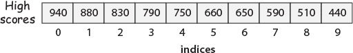

图 1.3 视频游戏十个（`int`）高分数组的插图。

#### 数组元素与容量

存储在数组中的每个值称为该数组的`element`（元素）。由于数组的长度决定了数组中可以存储项目的最大数量，我们有时会将数组的长度称为其`capacity`（容量）。在 Java 中，可以使用语法`a.length`访问名为`a`的数组的长度。因此，数组`a`的单元格从 0、1、2 等开始编号，一直到`a.length–1`，索引为`k`的单元格可以使用语法`a[k]`访问。

#### 越界错误

尝试使用 0 到`a.length–1`范围之外的数字对数组`a`索引是一个危险的错误。这种引用被称为`out of bounds`（越界）。黑客多次利用一种名为`buffer overflow attack`（缓冲区溢出攻击）的方法利用越界引用，来破坏非 Java 语言编写的计算机系统的安全性。作为一种安全特性，Java 总是会检查数组索引以查看是否越界。如果数组索引越界，Java 运行时环境会发出一个错误信号。该条件的名称是`ArrayIndexOutOfBoundsException`。这种检查帮助 Java 避免许多安全问题，例如缓冲区溢出攻击。

#### 数组的声明与构造

Java 中的数组有些与众不同之处，在于它们在技术上既不是基本类型，也不是特定类的实例。尽管如此，数组的实例被 Java 视为一个对象，而数组类型的变量是`reference variables`（引用变量）。

要声明一个变量（或参数）具有数组类型，我们在数组将存储的元素类型之后直接使用一对空方括号。例如，我们可以声明：

```java
int[ ] primes;
```

由于数组是引用类型，这声明变量`primes`是指向整数值数组的引用，但它不会立即构造任何此类数组。创建数组有两种方法。

创建数组的第一种方法是在声明数组时使用对字面量形式进行赋值，语法如下：

```java
elementType[ ] arrayName = {initialValue0, initialValue1, . . ., initialValueN − 1};
```

`elementType`可以是任何 Java 基本类型或类名，`arrayName`可以是任何有效的 Java 标识符。初始值必须与数组的类型相同。例如，我们可以将`primes`数组初始化为包含前十个质数：

```java
int[ ] primes = {2, 3, 5, 7, 11, 13, 17, 19, 23, 29};
```

使用初始化器时，创建的数组容量恰好能够存储所指定的值。

创建数组的第二种方法是使用`new`运算符。然而，由于数组不是类的实例，我们不使用典型的构造函数语法。相反，我们使用语法：

```java
new elementType[length]
```

其中`length`是一个表示新数组长度的正整数。`new`运算符返回对新数组的引用。例如，我们可以声明一个名为`measurements`的数组并分配一个值：

```java
double[ ] measurements = new double[1000];
```

使用`new`运算符创建数组时，所有元素自动分配默认值。如果元素类型是数值，则初始化为零；如果元素类型是布尔，则初始化为`false`；如果元素类型是引用类型（如`String`实例），则初始化为`null`。

### 1.3.5 枚举类型

在旧时代，程序员经常定义一系列常量值来表示有限集合的选择。例如，在表示星期几时，他们可能会将`today`声明为`int`，然后将其设置为周一为 0，周二为 1，以此类推。

稍微好的编程风格是定义静态常量（带有`final`关键字），以建立关联，例如：

```java
static final int MON = 0;
static final int TUE = 1;
static final int WED = 2;
...
```

因为这样就可以进行`today = TUE`的赋值，而不是晦涩的`today = 1`。遗憾的是，变量`today`仍然被声明为`int`。

Java 支持通过定义枚举类型（简称`enum`）来表示有限集合的选择。这些类型只允许取自指定名称的值。它们的声明方式如下：

```java
modifier enum name { valueName0, valueName1, . . ., valueN − 1 };
```

其中`modifier`可以是空的、`public`、`protected`或`private`。枚举的名称`name`可以是任何有效的 Java 标识符。每个值标识符`valueName[i]`是该枚举类型变量可以取值的名称。这些名称值每一个也可以是任何有效的 Java 标识符，但 Java 惯例是这些名称通常应该是大写的单词。例如，星期几的枚举类型定义可能如下所示：

```java
public enum Day { MON, TUE, WED, THU, FRI, SAT, SUN };
```

一旦定义，`Day`就变成了一个正式类型，我们可以声明类型为`Day`的变量或参数。该类型的变量可以声明为：

```java
Day today;
```

并且对该变量赋值可以表现为：

```java
today = Day.TUE;
```

变量和常量在`expressions`（表达式）中用于定义新值和修改变量。在本节中，我们将详细讨论 Java 中表达式是如何工作的。表达式涉及`literals`（字面量）、`variables`（变量）和`operators`（运算符）的使用。由于我们已经讨论过变量，让我们简要关注字面量，然后详细讨论运算符。

## 1.4.1 字面量（Literals）

`literal`（字面量）是任何可以在赋值或其他表达式中的“常量”值。Java 允许以下类型的字面量：

- `null`对象引用（这是唯一的对象字面量，并且允许任何引用类型）。
- 布尔值：`true`和`false`。
- 整数：整数如`176`或`-52`的默认类型是`int`，这是一种 32 位整数。长型整数字面量必须以“L”或“l”结尾，例如，`176L`或`-52l`，它定义了一个 64 位整数。
- 浮点数：浮点数（如`3.1415`和`135.23`）的默认类型是`double`。要指定字面量为`float`，它必须以“F”或“f”结尾。也允许指数计数法的浮点数字面量，例如`3.14E2`或`.19e10`；基数假设为 10。
- 字符：在 Java 中，字符常量被认为取自 Unicode 字母表。通常，字符被定义为在单引号内的单个符号。例如，`'a'`和`'?'`是字符常量。此外，Java 定义了以下特殊字符常量：

| 字符 | 含义 | 字符 | 含义 |
| :--- | :--- | :--- | :--- |
| `'\n'` | 换行 | `'\t'` | 制表符 |
| `'\b'` | 退格符 | `'\r'` | 回车 |
| `'\f'` | 分页符 | `'\\'` | 反斜杠 |
| `'\''` | 单引号 | `'\"'` | 双引号 |

- 字符串字面量（String Literal）：字符串字面量是包含在双引号内的字符序列，例如，以下是一个字符串字面量：

```java
"dogs cannot climb trees"
```

## 1.4.2 运算符（Operators）

Java 表达式涉及用运算符将字面量和变量组合。我们将在本节概述 Java 中的运算符。

### 算术运算符（Arithmetic Operators）

以下是 Java 中的二元算术运算符：

| 运算符 | 含义 |
| :--- | :--- |
| `+` | 加法 |
| `–` | 减法 |
| `*` | 乘法 |
| `/` | 除法 |
| `%` | 模运算符 |

最后一个运算符模被称为“取余运算符”，因为它是整数除法后的余数。我们经常使用“mod”来表示模运算符，并将其正式定义为：

`n mod m = r`

使得：

`n = mq + r`

对于整数`q`且`0 ≤ r < m`。

Java 还提供了一元负号（`–`），它可以放在算术表达式前面以反转其符号。括号可以在任何表达式中定义求值顺序。Java 还使用了一种非常直观的运算符优先级规则来确定不使用括号时的求值顺序。与 C++ 不同，Java 不允许类类型进行运算符重载。

### 字符串拼接（String Concatenation）

对于字符串，`+`运算符执行`concatenation`（拼接），因此代码：

```java
String rug = "carpet";
String dog = "spot";
String mess = rug + dog;
String answer = mess + " will cost me " + 5 + " hours!";
```

的效果使得`answer`指向字符串：

```text
"carpetspot will cost me 5 hours!"
```

此示例还展示了 Java 在涉及字符串拼接操作时如何将非字符串值（如`5`）转换为字符串。

### 递增和递减运算符（Increment and Decrement Operators）

像 C 和 C++ 一样，Java 提供了递增和递减运算符。具体来说，它提供了加一（`++`）和减一（`--`）运算符。如果此类运算符用于变量引用前面，则对变量加上（或减去）1，并将其值读入表达式中。如果它用于变量引用后面，则先读取值，然后变量增加或减少 1。因此，例如代码段：

```java
int i = 8;
int j = i++;                               // j 变成 8 然后 i 变成 9
int k = ++i;                               // i 变成 10 然后 k 变成 10
int m = i--;                               // m 变成 10 然后 i 变成 9
int n = 9 + --i;                           // i 变成 8 然后 n 变成 17
```

如所述，将`8`赋值给`j`，`10`赋值给`k`，`10`赋值给`m`，`17`赋值给`n`，并返回`i`的值为 8。

### 逻辑运算符（Logical Operators）

Java 支持数字之间的标准比较运算符：

| 运算符 | 含义 |
| :--- | :--- |
| `<` | 小于 |
| `<=` | 小于等于 |
| `==` | 等于 |
| `!=` | 不等于 |
| `>=` | 大于等于 |
| `>` | 大于 |

比较也可以对`char`值进行，并根据底层字符代码确定不等关系。任何这些比较结果的类型都是`boolean`。对于引用类型，重要的是知道运算符`==`和`!=`的定义是，如果`a`和`b`指向相同的对象。对于`boolean`值的运算符如下：

| 运算符 | 含义 |
| :--- | :--- |
| `!` | 非（前缀） |
| `&&` | 与 |
| `||` | 逻辑或 |

`&&`和`||`在不需要确定值时不会评估其右侧的操作数。

### 位运算符（Bitwise Operators）

Java 还为整数和布尔值提供了以下位运算符：

| 运算符 | 含义 |
| :--- | :--- |
| `~` | 位取反（一元运算符） |
| `&` | 位与 |
| `|` | 位或 |
| `^` | 位异或 |
| `<<` | 左移，填充 0 |
| `>>` | 右移，填充符号位 |
| `>>>` | 右移，填充 0 |

### 赋值运算符（The Assignment Operator）

Java 中的标准赋值运算符是`=`。它用于给实例变量或局部变量赋值。其语法如下：

```java
variable = expression
```

其中`variable`指向包含该表达式的语句块的变量。赋值操作的值是被赋值表达式的值。因此，如果`j`和`k`都声明为`int`类型，下面的赋值语句是正确的：

```java
j = k = 25; // 因为 '=' 运算符是从右到左求值的
```

### 复合赋值运算符（Compound Assignment Operators）

除了标准赋值运算符（`=`），Java 还提供了许多将二元操作与赋值结合的其他运算符。这些类型的运算符的形式如下：

```java
variable op= expression
```

其中`op`是任何二元运算符。上述表达式等同于：

```java
variable = variable op expression
```

因此`x *= 2`等于`x = x * 2`。然而，如果`variable`包含表达式（例如数组索引），该表达式仅计算一次。因此，代码段：

```java
a[5] = 10;
j = 5;
a[j++] += 2; // 不同于 a[j++] = a[j++] + 2
```

留下`a[5]`值为 12，`j`值为 6。

Java 中的运算符被赋予了优先级（precedence），这决定了在没有使用括号且出现表达式求值歧义时，操作执行的顺序。例如，我们需要一种方法来判断表达式“5+2*3”的值是 21 还是 11（Java 认为它是 11）。我们在表 1.3 中展示了 Java 运算符的优先级（顺便一下，这与 C 和 C++ 相同）。在该表中，如果不使用括号来确定求值顺序，Java 中的运算符将按照上述顺序进行评估。同一行的运算符按从左到右的顺序评估（赋值和前缀操作除外，它们按从右到左执行），并受布尔`&&`和`||`操作条件求值规则的影响。运算符按优先级从高到低列出（我们使用`*exp`表示原子表达式或带括号的表达式）。在不加括号的情况下，高优先级的运算符会在低优先级的运算符之前执行。

现在我们已经讨论了表 1.3 中列出的几乎所有运算符。一个显著的例外是条件运算符，它涉及评估一个布尔表达式，然后根据该布尔表达式的真假获取相应的值。（我们在第 2 章中讨论了`instanceof`运算符的使用。）

### 1.4.3 类型转换


`Casting`（类型转换）是一种允许我们更改值类型的操作。本质上，我们可以取一种类型的值并将其 `cast` 为另一种类型的等效值。Java 中有两种类型转换形式：`explicit casting`（显式转换）和 `implicit casting`（隐式转换）。

#### 显式转换

Java 支持如下形式的显式类型转换语法：

```
(type) exp
```

| 运算符优先级 | 类型 | 符号 |
| :--- | :--- | :--- |
| 1 | 数组索引、方法调用、点运算符 | `[]` `()` `.` |
| 2 | 后置操作、前缀操作转换 | `*exp` `++` `*exp` `–` `–` `++*exp` `–` `–*exp` `+*exp` `–*exp` `~*exp` `!*exp` `(*type*)` `*exp` |
| 3 | 乘/除 | `*` `/` `%` |
| 4 | 加/减 | `+` `–` |
| 5 | 移位 | `<<` `>>` `>>>` |
| 6 | 比较 | `<` `<=` `>` `>=` `instanceof` |
| 7 | 等于 | `==` `!=` |
| 8 | 按位与 | `&` |
| 9 | 按位异异 | `^` |
| 10 | 按位或 | `|` |
| 11 | 与 | `&&` |
| 12 | 或 | `||` |
| 13 | 条件 | `booleanExpression ? valueIfTrue : valueIfFalse` |
| 14 | 赋值 | `=` `+=` `–=` `*=` `/=` `%=` `<<=` `>>=` `>>=` `&=` `^=` `|=` |

**表 1.3** Java 优先级规则。

其中 `type` 是我们希望表达式 `exp` 拥有的类型。此语法仅用于从一种基本类型转换为另一种基本类型，或从一种引用类型转换为另一种引用类型。我们在这里讨论基本类型之间的转换，并在第 2.5.1 节中讨论引用类型之间的转换。

从 `int` 转换为 `double` 称为 `widening`（宽化）转换，因为 `double` 类型比 `int` 类型更宽，且可以在不丢失信息的情况下完成。但从 `double` 转换为 `int` 是 `narrowing`（窄化）转换；我们可能会丢失精度，因为值的任何小数部分都会被截断。例如，考虑以下情况：

```java
double d1 = 3.2;
double d2 = 3.9999;
int i1 = (int) d1; // i1 获得值 3
int i2 = (int) d2; // i2 获得值 3
double d3 = (double) i2; // d3 获得值 3.0
```

虽然显式转换不能直接将基本类型转换为引用类型（或反之），但还有其他方法可以执行此类类型转换。我们已经在第 1.3 节中讨论过 Java 基本类型与相应的包装类（例如 `int` 和 `Integer`）之间的转换。为了方便起见，这些包装类还提供了静态方法，可以在它们对应的基本类型和 String 值之间进行转换。

例如，`Integer.toString` 方法接受一个 `int` 参数并返回该整数的字符串表示，而 `Integer.parseInt` 方法接受 `String` 作为参数并返回该字符串代表对应的 `int` 值。（如果该字符串不表示整数，则会导致 `NumberFormatException`）。我们如下演示它们的用法：

```java
String s1 = "2014";
int i1 = Integer.parseInt(s1); // i1 获得值 2014
int i2 = -35;
String s2 = Integer.toString(i2); // s2 获得值 "-35"
```

相似的方法由其他包装类提供。

其中 `booleanExpression` 是一个布尔表达式，而 `trueBody` 和 `falseBody` 分别是单个语句或用大括号（“{”和“}”）括起来的语句块。请注意，与某些类似的语言不同，Java 中 `if` 语句测试的值必须是一个布尔表达式。特别是，它绝对不是一个整数表达式。尽管如此，与其他类似的语言一样，Java `if` 语句中的 `else` 部分（及其关联的语句）是可选的。还有一种方法可以将多个布尔测试组合如下所示：

> `if (firstBooleanExpression)`
>
>     `firstBody`
>
> `else if (secondBooleanExpression)`
>
>     `secondBody`
>
> `else`
>
>     `thirdBody`

如果第一个布尔表达式为假，将测试第二个布尔表达式，依此类推。一个 `if` 语句可以有任意数量的 `else if` 部分。可以使用括号用于任何或所有语句体，以定义它们的范围。

以下是 `if` 和 `else` 子句嵌套的示例。

```java
if (snowLevel < 2) {
    goToClass();
    comeHome();
} else if (snowLevel < 5) {
    goSledding();
    haveSnowballFight();
} else
    stayAtHome();             // 单语句体不需要 { } 大括号
```

### Switch 语句

Java 通过使用 `switch` 语句提供了多值控制流，这对于枚举类型特别有用。以下是一个指示性示例（基于 1.3 节中 `Day` 枚举类型的变量 `d`）。

```java
switch (d) {
    case MON:
        System.out.println("This is tough.");
        break;
    case TUE:
        System.out.println("This is getting better.");
        break;
    case WED:
        System.out.println("Half way there.");
        break;
    case THU:
        System.out.println("I can see the light.");
        break;
    case FRI:
        System.out.println("Now we are talking.");
        break;
    default:
        System.out.println("Day off!");
}
```

`switch` 语句评估一个整数、字符串或枚举表达式，并导致控制流跳转到带有该表达式值标记的代码位置。如果没有匹配的标记，则控制流将跳转到标记为“`default`”的位置。然而，这是 `switch` 语句执行的唯一显式跳转，因此，如果 `case` 的代码没有以 `break` 语句结束（这会导致控制流跳转到末尾），则控制流将“穿透”到下一个 `case`。

## 1.5.2 循环

编程语言中另一个重要的控制流机制是循环。Java 提供了三种循环。

#### While 循环

Java 中最简单的循环类型是 `while` 循环。这种循环测试特定条件是否满足，并且每当该条件被求值为 `true` 时，就会执行循环体。在执行循环体之前进行这种条件测试的语法如下：

> `while (booleanExpression)`
>
>     `loopBody`

与 `if` 语句一样，`booleanExpression` 可以是任意布尔表达式，而循环体可以是任意代码块（包括嵌套的控制结构）。`while` 循环的执行从对布尔条件的测试开始。如果该条件求值为 `true`，则执行循环体。在每次执行循环体后，会重新测试循环条件，如果它求值为 `true`，则执行循环体的下一次迭代。如果在测试时条件求值为 `false`（假设确实发生了这种情况），则退出循环，控制流从循环体之后继续执行。

例如，这里的循环通过遍历名为 `data` 的数组来推进索引，直到找到值为 `target` 的条目或到达数组末尾。

```java
int j = 0;
while ((j < data.length) && (data[j] != target))
    j++;
```

当此循环终止时，变量 `j` 的值将是 `target` 最左侧出现处的索引（如果找到），否则为数组的长度（这可以被识别为无效索引，用以指示搜索失败）。循环的正确性取决于逻辑运算符 `&&` 运算符的短路行为，正如“逻辑运算符”节所描述的。我们特意测试 `j < data.length` 以确保在访问元素 `data[j]` 之前 `j` 是一个有效索引。如果我们以相反的顺序编写该复合条件，如果未找到 `target`，对 `data[j]` 的评估最终将抛出 `ArrayIndexOutOfBoundsException`。（异常讨论参见 2.4 节。）

我们注意到，在初始条件失败的情况下，`while` 循环将执行零次循环体。例如，如果 `data[0]` 匹配 `target`（或者数组长度为 0），我们上面的循环将不会增加 `j` 的值。

#### Do-While 循环

Java 有另一种形式的 `while` 循环，允许在每次循环的**末尾**检查布尔条件，而不是在每次循环之前。这种形式被称为 `do-while` 循环，其语法所示：

> `do`
>
>     `loopBody`
>
> `while (booleanExpression)`

与 `if` 语句一样，`booleanExpression` 可以是任意布尔表达式，而循环体可以是任意代码块（包括嵌套的控制结构）。`while` 循环的执行从对布尔条件的测试开始。如果该条件求值为 `true`，则执行循环体。在每次执行循环体后，会重新测试循环条件，如果它求值为 `true`，则执行循环体的下一次迭代。如果在测试时条件求值为 `false`（假设确实发生了这种情况），则退出循环，控制流从循环体之后继续执行。

例如，这里的循环通过遍历名为 `data` 的数组来推进索引，直到找到值为 `target` 的条目或到达数组末尾。

```java
int j = 0;
while ((j < data.length) && (data[j] != target))
    j++;
```

当此循环终止时，变量 `j` 的值将是 `target` 最左侧出现处的索引（如果找到），否则为数组的长度（这可以被识别为无效索引，用以指示搜索失败）。循环的正确性取决于逻辑运算符 `&&` 运算符的短路行为，正如“逻辑运算符”节所描述的。我们特意测试 `j < data.length` 以确保在访问元素 `data[j]` 之前 `j` 是一个有效索引。如果我们以相反的顺序编写该复合条件，如果未找到 `target`，对 `data[j]` 的评估最终将抛出 `ArrayIndexOutOfBoundsException`。（异常讨论参见 2.4 节。）

我们注意到，在初始条件失败的情况下，`while` 循环将执行零次循环体。例如，如果 `data[0]` 匹配 `target`（或者数组长度为 0），我们上面的循环将不会增加 `j` 的值。

#### Do-While 循环

Java 有另一种形式的 `while` 循环，允许在每次循环的**末尾**检查布尔条件，而不是在每次循环之前。这种形式被称为 `do-while` 循环，其语法所示：

> `do`
>
>     `loopBody`
>
> `while (booleanExpression)`

`do-while` 循环的一个结果是其体至少执行一次。（相比之下，`while` 循环在初始条件失败时将执行零次。）这种形式对于条件在至少一次通过之后才定义的情况非常有用。例如，我们想要提示用户输入，然后对该输入进行某些操作（我们在 1.6 节中详细讨论 Java 输入和输出）。在这种情况下，退出循环的可能条件是用户输入空字符串。然而，即使在这种情况下，我们可能也会处理该输入并告知用户已退出。以下示例说明了这一点：

```java
String input;
do {
    input = getInputString();
    handleInput(input);
} while (input.length() > 0);
```

#### For 循环

另一种循环类型是 `for` 循环。Java 支持两种风格的 `for` 循环。第一种被称为“传统”样式，模仿了 C 和 C++ 语言中类似的 `for` 语法。第二种被称为“for-each”循环，是在 2004 年作为 SE 5 版本引入 Java 的。这种样式为遍历数组或适当容器类型提供了更简洁的语法。

传统的 `for` 循环语法由四个部分组成——初始化、布尔条件、增量语句和体——尽管其中任何部分都可以为空。其结构如下：

> `for (initialization; booleanCondition; increment)`
>
>     `loopBody`

例如，`for` 循环最常用的用法是基于整数索引的重复，如下：

```java
for (int j = 0; j < n; j++)
    // 执行某些操作
```

`for` 循环的行为与以下等价的 `while` 循环非常相似：

> {
>
>     `initialization`;
>
>     `while (booleanCondition)` {
>
>         `loopBody`;
>
>         `increment`;
>
>     }
>
> }

初始化部分将在循环任何部分开始之前执行一次。通常，它用于初始化现有变量，或声明并初始化新变量。注意，在初始化部分中声明的任何变量作用范围仅在 `for` 循环期间有效。

`booleanCondition` 在循环的每次潜在迭代之前立即进行评估。它的表达方式与 `while` 循环条件相似，即如果它为 `true`，则执行循环体；如果为 `false`，则退出循环，程序继续执行 `for` 循环体之后的语句。

`increment` 部分在正式循环主体的每次迭代后立即执行，传统上它用于更新主循环变量的值。然而，增量语句可以是任何合法的语句，这为编码提供了极大的灵活性。

作为一个具体的例子，这里有一个使用 `for` 循环计算 `double` 类型数组之和的方法：

```java
public static double sum(double[] data) {
    double total = 0;
    for (int j = 0; j < data.length; j++) // 注意使用了 length
        total += data[j];
    return total;
}
```

另一个示例，以下方法计算（非空）数组中的最大值。

```java
public static double max(double[] data) {
    double currentMax = data[0]; // 假设第一个最大的（目前）
    for (int j = 1; j < data.length; j++) // 考虑所有其他条目
        if (data[j] > currentMax) // 如果 data[j] 是目前为止最大的...
            currentMax = data[j]; // 将其记录为当前最大值
    return currentMax;
}
```

注意，条件语句嵌套在循环体内部，并且循环体不需要显式的 `{` 和 `}` 括号，因为整个条件结构充当了单一语句。

## For-Each 循环（增强型循环）

由于遍历集合中的元素是一种非常常见的结构，Java 为此类循环提供了一种简写表示法，称为 `for-each` 循环。此类循环的语法如下：

> `for (elementType name : container)`
>
>     `loopBody`

其中 `container` 是给定 `elementType` 类型的数组（或实现了 `Iterable` 接口的集合，我们稍后将在第 7.4.1 节中讨论）。

回顾之前的示例，计算 `double` 数组中元素之和的传统循环可以写成：

```java
public static double sum(double[] data) {
    double total = 0;
    for (double val : data) // Java 的 for-each 循环样式
        total += val;
    return total;
}
```

使用 `for-each` 循环时，没有显式地使用数组索引。循环变量代表数组中的一个特定元素。然而，在循环体内部，并没有指定它是哪一个元素。

还需要强调的是，对循环变量进行赋值对底层数组没有影响。因此，下面的方法尝试缩放数值数组中的所有值是无效的。

```java
public static void scaleBad(double[] data, double factor) {
    for (double val : data)
        val *= factor; // 只改变了局部变量
}
```

为了覆盖数组单元格中的值，我们必须利用索引。因此，此任务最好用传统的 `for` 循环解决，如下：

```java
public static void scaleGood(double[] data, double factor) {
    for (int j = 0; j < data.length; j++)
        data[j] *= factor; // 覆盖数组的单元格
}
```

## 1.5.3 显式控制流语句

Java 还提供了会导致显式改变程序控制流的语句。

### 从方法返回


如果一个 Java 方法声明的返回类型为 `void`，那么当控制流到达方法的最后一行代码或遇到 `return` 语句（不带参数）时，控制流将返回。然而，如果方法声明了返回类型，则方法必须通过返回适当的值作为 `return` 语句的参数来退出。因此，`return` 语句必须是方法中最后一个执行的语句，因为其余代码将永远无法到达。

注意，语句作为方法中被执行的最后一行代码，与作为方法本身的最后一行代码之间存在显著差异。下面的（正确）示例说明了如何从方法返回：

```java
public double abs(double value) {
  if (value < 0) // value 是负数，
    return –value; // 所以返回它的相反数
  return value; // 返回原始非负值
}
```

在上面的示例中，`return –value;` 这一行显然不是方法中编写的最后一行代码，但它可能是最后执行的一行（如果原始值是负数）。这样的语句显式地中断了方法中的控制流。还有两种这样的显式控制流语句，它们与循环和 `switch` 语句配合使用。

### `break` 语句

我们首先在第 1.5.1 节中引入了 `break` 命令的使用，用于退出 `switch` 语句体。更通用地说，它可以用于跳出最内层的 `switch`、`for`、`while` 或 `do-while` 语句体。当它被执行时，`break` 语句会导致控制流跳转到包含 `break` 的循环或 `switch` 之后的下一行。

### `continue` 语句

`continue` 语句可以在循环内部使用。它会导致执行跳过当前迭代的剩余步骤，但与 `break` 语句不同，控制流会返回循环的顶部。

## 1.6 输入与输出

Java 提供了丰富的类来执行输入和输出。有用于处理图形对象、声音、网页等的类。Java 中的简单输入输出发生在 Java 控制台窗口中。取决于我们所使用的 Java 环境，该窗口要么是一个特殊的弹出窗口，要么是一个用于向系统发布命令的窗口。

### 1.6.1 简单输出方法

Java 提供了一个内置静态对象 `System.out`，用于向“标准输出”设备执行输出。大多数操作系统的 shell 允许用户将标准输出重定向到文件，甚至作为其他程序的输入，但默认输出是 Java 控制台窗口。`System.out` 对象是 `java.io.PrintStream` 类的实例。该类定义了用于缓冲输出流的方法，这意味着字符被放在一个临时位置，称为缓冲区（buffer），当控制台窗口准备好打印字符时，会被清空。

具体而言，`java.io.PrintStream` 类提供了以下执行简单输出的方法（我们在此使用 `baseType` 指代任何可能的基本类型）：

- `print(String s)`：打印字符串 `s`。
- `print(Object o)`：使用 `toString` 方法打印对象 `o`。
- `print(baseType b)`：打印基本类型值 `b`。
- `println(String s)`：打印字符串 `s`，后跟一个换行符。
- `println(Object o)`：类似于 `print(o)`，后跟一个换行符。
- `println(baseType b)`：类似于 `print(b)`，后跟一个换行符。

### 1.6.2 输出示例

例如，考虑以下代码片段：

```java
System.out.print("Java values: ");
System.out.print(3.1416);
System.out.print(',');
System.out.print(15);
System.out.println(" (double,char,int).");
```

执行后，此片段将在 Java 控制台窗口中输出以下内容：

```text
Java values: 3.1416,15 (double,char,int).
```

### 1.6.3 使用 `java.util.Scanner` 类进行简单输入

就像有一个向 Java 控制台窗口输出的特殊对象一样，还有一个名为 `System.in` 的特殊对象用于从 Java 控制台窗口输入。从技术上讲，输入实际上来自“标准输入”设备，默认情况下计算机键盘会将字符回显到 Java 控制台。`System.in` 对象是一个与标准输入设备关联的对象。使用该对象读取输入的一种简单方法是使用它创建一个 `Scanner` 对象，表达式如下：

```java
new Scanner(System.in)
```

`Scanner` 类具有许多方便的方法可以从给定的输入流读取数据，以下程序演示了其中一种：

```java
import java.util.Scanner; // 加载 Scanner 定义供使用
```

```java
public class InputExample {
  public static void main(String[ ] args) {
    Scanner input = new Scanner(System.in);
    System.out.print("请输入您的年龄（岁）： ");
    double age = input.nextDouble();
    System.out.print("请输入您的最大心率： ");
    double rate = input.nextDouble();
    double fb = (rate – age) * 0.65;
    System.out.println("您的理想燃脂心率是 " + fb);
  }
}
```

执行时，该程序可以在 Java 控制台上中产生如下结果：

```text
Enter your age in years: 21
Enter your maximum heart rate: 220
Your ideal fat-burning heart rate is 129.35
```

### 1.6.4 `java.util.Scanner` 方法

`Scanner` 类读取输入流并将其分为 `tokens`（令牌），这些是由 `delimiters`（分隔符）分隔的字符串。分隔符是一个特殊的分割字符串，默认分隔符是空白字符。也就是说，默认情况下令牌由空格、制表符和换行符字符串分隔。令牌既可以立即作为字符串读取，也可以如果令牌具有正确的格式，`Scanner` 对象可以将令牌转换为基本类型。具体而言，`Scanner` 类包含以下处理令牌的方法：

| 方法 | 描述 |
| :--- | :--- |
| `hasNext()` | 如果输入流中还有令牌，则返回 `true`。 |
| `next()` | 返回输入流中的下一个令牌字符串；如果没有剩余令牌，则产生错误。 |
| `hasNextType()` | 如果输入流中还有令牌且其可以解释为相应的基本类型 `Type`，则返回 `true`，其中 `Type` 可以是 `Boolean`、`Byte`、`Double`、`Float`、`Int`、`Long` 或 `Short`。 |
| `nextInt()` | 返回输入流中的下一个令牌，返回类型与 `Type`；如果没有剩余令牌或下一个令牌无法解释为与 `Type` 的基本类型，则产生错误。 |

此外，`Scanner` 对象可以按行处理输入，忽略分隔符，甚至在此过程中查找行内的模式。以此方式处理输入的方法包括：

| 方法 | 描述 |
| :--- | :--- |
| `hasNextLine()` | 如果输入流还有另一行文本，则返回 `true`。 |
| `nextLine()` | 越过当前行结束符继续读取，并返回被跳过的输入。 |
| `findInLine(String s)` | 尝试在当前行中匹配（正则表达式）模式 `s` 的字符串。如果找到模式，则返回该模式，扫描器移动到匹配项后的第一个字符。如果没有找到模式，扫描器返回 `null` 且不移动。 |

这些方法可以与上述方法结合使用，如下：

```java
Scanner input = new Scanner(System.in);
System.out.print("请输入一个整数： ");
while (!input.hasNextInt()) {
  input.nextLine();
  System.out.print("整数无效；请输入一个整数： ");
}
int i = input.nextInt();
```

以下是 `Scanner` 类的示例，用于接收整数输入 `n` 并返回小于或等于 `n` 的所有偶数整数的和。

```java
public int sumEven() {
  int i = 1, n, sum = 0;
  Scanner input = new Scanner(System.in);
  System.out.print("输入值 n: ");
  n = input.nextInt();
  while (i <= n) {
    if (i % 2 == 0)
      sum += i;
    i++;
  }
  return sum;
}
```

## 1.7 Java 包

Java 语言采用一种通用且实用的方法来组织程序中的类。在 Java 中定义的每个独立公共类都必须放在一个单独的文件中。文件名是类名加上 `.java` 扩展名。因此，声明为 `public class Window` 的类定义在 `Window.java` 文件中。该文件可以包含其他独立类的定义，但其中任何类都不能声明为 `public`（公共可见性）。

为了有助于大型代码库的组织，Java 允许一组相关的类型定义（如类和枚举）组成被称为 `package`（包）的内容。要使类型属于名为 `packageName` 的包，它们的源代码必须全部位于名为 `packageName` 的目录中，每个文件必须以以下行开头：

```java
package packageName;
```

按照惯例，大多数包名都使用小写。例如，我们可以定义一个架构包，其中定义了 `Window`、`Door` 和 `Room` 等类。在没有显式 `package` 声明的文件中，公共定义被放在所谓的 `default package`（默认包）中。

要引用命名包中的类型，我们可以使用基于点符号表示法的全限定名，将该类型视为包的属性。例如，我们可能会声明一个类型为 `architecture.Window` 的变量。

包可以进一步分级地组织为 `subpackages`（子包）。子包中类的代码必须位于包目录的子目录内，子包的限定名依赖于进一步使用点表示法。例如，在 `java.util` 包中有一个 `java.util.zip` 子包（支持处理 ZIP 压缩），而该子包中的 `Deflater` 类的全限定名为 `java.util.zip.Deflater`。

将类组织成包有许多优势，最显著的包括：

- **职责（Responsibilities）**：包帮助我们避免命名冲突的陷阱。如果所有类型定义都在于一个包中，那么只能有一个名为 `Window` 的公共类。但通过包，我们可以拥有一个 `architecture.Window` 类，它与图形用户界面的 `gui.Window` 类是独立的。
- 当这些类被成包时，为其他程序员分发一套完整的类要容易得多。
- 当类型定义具有相关目的时，将它们分组为一个包通常让其他程序员更容易在大型库中找到它们，并更好地理解它们的协调使用。
- 同一包内的类可以互相访问彼此的任何具有 `public`、`protected` 或默认可见性（即 `private` 以外的所有内容）的成员。

### 1.7.1 `import` 语句

如前所述，我们可以使用全限定名引用包中的类型。例如，在第 1.6 节中引入的 `Scanner` 类定义在 `java.util` 包中，因此我们可以将其引用为 `java.util.Scanner`。我们可以在项目中使用以下语句声明并构造该类的新实例：

```java
java.util.Scanner input = new java.util.Scanner(System.in);
```

然而，为了引用当前包之外的类，需要输入额外的内容可能会很累。在 Java 中，我们可以使用 `import` 关键字将外部类或整个包包含在当前文件中。要从特定包导入单个类，我们在文件开头输入：

```java
import packageName.className;
```

例如，在第 1.6 节中，我们通过命令从 `java.util` 包导入了 `Scanner` 类：

```java
import java.util.Scanner;
```

然后我们被允许使用负担较小的语法：

```java
Scanner input = new Scanner(System.in);
```

请注意，如果当前文件中其他地方定义了同名的类，或者该类已经从另一个包导入，则使用上述语法导入该类是非法的。例如，我们不能同时导入 `architecture.Window` 和 `gui.Window` 并使用不限定的名称 `Window` 来调用它们。

### 1.7.2 导入整个包

如果我们知道将使用来自同一个包的许多定义，可以使用星号字符（`*`）作为通配符来导入所有定义，语法如下所示：

```java
import packageName.*;
```

如果本地定义的名称与以这种方式导入的包中的名称冲突，则本地定义的名称保留未限定名称。如果以这种方式导入的两个不同包的定义之间存在名称冲突，则冲突的任何一个名称都无法在不限定的情况下使用。例如，如果我们导入了以下假设包：

```java
import architecture.*; // 我们假设它包含一个 Window 类
import gui.*; // 我们假设它包含一个 Window 类
```

我们在程序的其余部分仍然必须使用限定名称 `architecture.Window` 和 `gui.Window`。

## 1.8 编写 Java 程序

传统的软件开发涉及几个阶段。三个主要步骤是：

1. 设计
2. 编码
3. 测试与调试

在本节中，我们将简要讨论这些阶段的作用，并介绍一些 Java 编程的良好实践，包括编码风格、命名规范、正式文档说明和测试。

### 1.8.1 设计

对于面向对象的编程来说，设计步骤也许是软件开发过程中最重要的阶段。在设计步骤中，我们决定如何将程序的工作划分为类，决定这些类将如何相互作用，每个类将存储什么数据以及每个类将执行哪些操作。事实上，初级程序员面临的主要挑战之一就是决定定义哪些类来完成程序的工作。虽然通用的方法并不容易获得，但在确定如何定义类时，我们有一些可以遵循的法则：

- **职责（Responsibilities）**：将工作划分为不同的“执行者”（actors），每个执行者承担不同的责任。尝试使用动作动词来描述职责。这些执行者将组成程序的类。
- **独立性（Independence）**：定义每个类的工作，尽可能与其他类独立。在类之间细分职责，使每个类对程序的某个方面具有自主权。将数据（作为实例变量）交给对需要访问这些数据的操作具有管辖权的类。
- **行为（Behaviors）**：仔细且精确地定义每个类的行为，以便该类执行的每个操作的结果都能被与其交互的其他类良好地理解。这些行为将定义该类执行的方法，而类的行为集合构成了“协议”（protocol），其他代码部分通过该协议与类的对象交互。

定义类以及它们的实例变量和方法，是面向对象程序设计的关键。优秀的程序员会随着时间的推移，在执行这些任务时自然地培养更高的技能，因为经验会教他们注意到程序需求中的模式与他们以前见过的模式之间的匹配之处。

开发项目初始高级设计的常用工具是使用 `CRC cards`。类-职责-协作者（CRC）卡片是简单的索引卡，用于细分程序所需的工作。该工具的核心思想是让每张卡片代表一个组件，该组件最终将成为程序中的一个类。我们在索引卡的顶部写下每个组件的名称。在卡片的左侧，我们开始编写该组件的职责。在卡片的右侧，我们列出该组件的协作者，即该组件为了履行职责必须与之交互的其他组件。

设计过程通过一个“动作/执行者”循环进行迭代，我们首先识别一个动作（即职责），然后确定最适合执行该动作的执行者（即组件）。当我们把所有动作分配给执行者时，设计就完成了。在这一过程中使用索引卡（而不是更大的纸张），我们依赖于这样一个事实：每个组件都应该只有一小组职责和协作者。强制这一规则有助于保持单个类是可维护的。

随着设计的成型，解释和记录设计的一种标准方法是使用 `UML`（统一建模语言）图来表示程序的结构。UML 图是表示面向对象软件设计的标准视觉表示。有多种计算机辅助工具可以构建 UML 图。其中一种 UML 图被称为`类图`（class diagram）。

类图的示例见图 1.4。该图分为三个部分，第一部分指定类名，第二部分指定推荐的实例变量，第三部分指定类的方法。变量、参数和返回值的类型说明在冒号后的适当位置指定，每个成员的可见性指定在其左侧，`+` 符号表示 `public` 可见，`#` 符号表示 `protected` 可见，`–` 符号表示 `private` 可见。

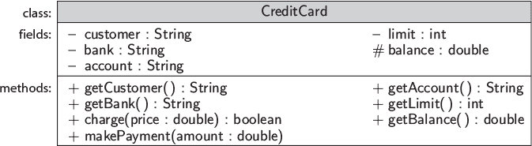

图 1.4 CreditCard 类的 UML 类图。

### 1.8.2 伪代码

作为设计实现之前的中间步骤，程序员经常被要求以适用于人类阅读的方式来描述算法。这种描述被称为`伪代码`（pseudocode）。伪代码不是计算机程序，但比普通的散文更有结构性。它是自然语言和高级编程语言的混合，用于描述数据结构或算法通用实现的主要思想。由于伪代码是为人类读者设计的，而不是为计算机设计的，我们可以在不考虑底层实现细节的情况下传递高级思想。同时，我们不应该忽略重要的步骤。与许多的人类交流形式一样，找到平衡是一种通过实践不断完善的重要技能。

伪代码语言并没有精确的定义。同时，为了提高清晰度，伪代码将自然语言与编程语言结构混合在一起。我们选择的编程语言结构与现代高级语言（如 `C`、`C++` 和 `Java`）一致。这些结构包括：


## 基本语法

- **表达式（Expressions）**：我们使用标准的数学符号表示数值和布尔表达式。为了与 Java 保持一致，我们在赋值语句中使用等号 `=` 作为赋值运算符，并使用 `==` 关系在布尔表达式中测试等效性。

- **方法声明（Method declarations）**：`Algorithm` `name(param1, param2, ...)` 声明新方法 `name` 及其参数。

- **决策结构（Decision structures）**：`if` 条件 `then` 真分支 [`else` 假分支]。我们使用缩进来表示哪些动作应该包含在真分支和假分支中。

- **while 循环（While-loops）**：`while` 条件 `do` 动作。我们使用缩进来表示哪些动作应该包含在循环动作中。

- **重复循环**：`repeat` 执行 `until` 条件满足。我们使用缩进来指示哪些动作应该包含在循环体中。

- **for 循环**：`for` 变量-增量-定义 `do` 执行。我们使用缩进来指示哪些动作应该包含在循环体中。

- **数组索引**：`A[i]` 表示数组 `A` 中的第 `i` 个单元格。一个包含 `n` 个元素的数组 `A` 的单元格索引从 `A[0]` 到 `A[n − 1]`（与 Java 一致）。

- **方法调用**：`object.method(args);` 如果显而易见，`object` 是可选的。

- **方法返回**：`return` 值。此操作将指定的值返回给调用它的方法。

- **注释**：`{ 注释写在这里。 }`。我们用大括号括起注释。

### 1.8.3 编码

实现面向对象程序的关键步骤之一，是为类的描述及其对应的数据和方法编写编码。为了加速这一技能的掌握，我们将在本文的各个部分讨论设计面向对象程序的各种`设计模式`（参见第 2.1.3 节）。这些模式为定义类以及这些类之间的交互提供了模板。

一旦确定了类或程序的设计及其职责，并可能为它们的行为草拟了伪代码，我们就可以在计算机上开始实际的编码了。我们使用独立的文本编辑器（如 `emacs`、`WordPad` 或 `vi`）或`集成开发环境`（IDE）内置的编辑器（如 `Eclipse`）来编写程序类的 Java 源代码。

一旦我们完成了一个类（或包）的编码，就可以通过调用编译器将此文件编译为可运行的代码。如果我们没有使用 IDE，则通过对文件调用某个程序（如 `javac`）来编译程序。如果我们使用 IDE，则通过点击适当的编译按钮来编译程序。如果我们足够幸运，且程序没有语法错误，那么这个编译过程将创建具有 `.class` 扩展的文件。

如果我们的程序包含语法错误，这些错误将被识别，我们必须回到编辑器中修复问题的代码行。一旦我们消除了所有语法错误并创建了适当的编译代码，就可以通过调用命令（在 IDE 之外使用 `java`）或点击适当的“运行”按钮（在 IDE 之中）来运行我们的程序。当用这样运行 Java 程序时，运行时环境会根据名为 `CLASSPATH` 的特殊操作系统环境变量，定位包含命名类以及该类引用的任何其他类的目录。该变量定义了搜索目录的顺序，以目录列表给出，在 Unix/Linux 中用冒号分隔，在 DOS/Windows 中用分号分隔。

DOS/Windows 操作系统中的 `CLASSPATH` 赋值示例：

```text
SET CLASSPATH=.;C:\java;C:\Program Files\Java\
```

Unix/Linux 操作系统中的 `CLASSPATH` 赋值示例如下：

```bash
setenv CLASSPATH ".:/usr/local/java/lib:/usr/netscape/classes"
```

在两种情况下，点（`.`）都指向调用运行时环境所在的目录。

### 1.8.4 文档与风格

#### Javadoc

为了鼓励使用块注释并自动生成文档，Java 编程环境有一个名为 `javadoc` 的文档生成程序。该程序获取一组使用特定关键字（称为`标签`）注释过的 Java 源文件，并生成一系列 HTML 文档，描述这些文件中包含的类、方法、变量和常量。例如，图 1.5 显示了 `CreditCard` 类生成的文档部分。

每个 `javadoc` 注释都是以 `/**` 开头并以 `*/` 结尾的块注释，这两个符号之间的每一行都可以以单个星号 `*` 开头，该星号会被忽略。假设块注释以一个描述性句子开头，随后是跟以 javadoc 标签开头的特殊行。紧接在类定义、实例变量声明或方法定义之前的块注释会被 `javadoc` 处理为关于该类、变量或方法的注释。我们使用的主要 `javadoc` 标签如下：

- `@author text`：识别该类的每个作者（每行一个）。
- `@throws exceptionName description`：识别此方法发出的错误条件（参见第 2.4 节）。
- `@param parameterName description`：识别该方法接受的参数。
- `@return description`：描述方法的返回类型及其值范围。

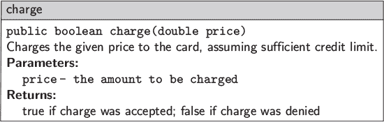

图 1.5 `javadoc` 为 `CreditCard.charge` 方法渲染的文档。

还有其他标签；感兴趣的读者可以参考 `javadoc` 的在线文档获取更多信息。由于空间原因，我们无法始终在书中包含的所有示例程序中包含 javadoc 风格的注释，但我们在代码片段 1.5 中包含了这样一个示例。

#### 可读性与编程规范

程序应该设计得易于阅读和理解。因此，良好的程序员应该注意自己的编码风格，并开发一种既能向人类也能向计算机传达程序设计重要方面的风格。关于良好的编码风格有很多讨论，其中一些主要原则如下：

- 为标识符使用有意义的名称。尝试选择可以大声读出来的名称，并选择反映每个标识符所命名的动作、职责或数据的名称。大多数 Java 圈的传统是将标识符中每个单词的首字母大写，变量或方法名的第一个单词除外。根据这一惯例，`Date`、`Vector`、`DeviceManager` 将标识类，而 `isFull()`、`insertItem()`、`studentName` 和 `studentHeight` 将分别标识方法和变量。

- 使用命名常量或枚举类型代替字面量。如果我们在类定义中包含一组命名常量值的定义，将增强可读性、健壮性和可修改性。这些值可以在此类和其他类中使用，用以引用该类的特殊值。Java 的传统是全大写此类常量，如下所示：

```java
public class Student {
  public static final int MIN_CREDITS = 12; // 每学最小学分
  public static final int MAX_CREDITS = 24; // 每学最大学分
  public enum Year { FRESHMAN, SOPHOMORE, JUNIOR, SENIOR };
  // 实例变量、构造函数和方法定义位于这里...
}
```

- 缩进语句块。通常程序员会将每个语句块缩进 4 个空格；在本书中我们通常使用 2 个空格，以避免我们的代码超出书籍边界。

```java
/**
 * A simple model for a consumer credit card.
 *
 * @author Michael T. Goodrich
 * @author Roberto Tamassia
 * @author Michael H. Goldwasser
 */
public class CreditCard {
  /**
   * Constructs a new credit card instance.
   * @param cust the name of the customer (e.g., "John Bowman")
   * @param bk the name of the bank (e.g., "California Savings")
   * @param acnt the account identifier (e.g., "5391 0375 9387 5309")
   * @param lim the credit limit (measured in dollars)
   * @param initialBal the initial balance (measured in dollars)
   */
  public CreditCard(String cust, String bk, String acnt, int lim, double initialBal) {
    customer = cust;
    bank = bk;
    account = acnt;
    limit = lim;
    balance = initialBal;
  }

  /**
   * Charges the given price to the card, assuming sufficient credit limit.
   * @param price the amount to be charged
   * @return true if charge was accepted; false if charge was denied
   */
  public boolean charge(double price) { // make a charge
    if (price + balance > limit) { // if charge would surpass limit
      return false; // refuse the charge
    }
    // At this point, the charge is successful.
    balance += price; // update the balance
    return true; // announce the good news
  }

  /**
   * Processes customer payment that reduces balance.
   * @param amount the amount of payment made
   */
  public void makePayment(double amount) { // make a payment
    balance -= amount;
  }

  // Remainder of class omitted...
}
```

`代码片段 1.5` `CreditCard` 类定义的一个部分，其中包含了 javadoc 风格的注释。

- 按照以下顺序组织每个类：
  1. 常量
  2. 实例变量
  3. 构造函数
  4. 方法

我们注意到，某些 Java 程序员倾向于将实例变量定义放在最后。我们将它们放在较早的位置，以便我们能够按顺序读取每个类，并理解每个方法正在处理的数据。

- 使用注释为程序增加含义，并解释歧义或混淆的结构。行内注释适用于快速解释，不需要是完整的句子。块注释则适用于解释方法的目的和复杂的代码段。

### 1.8.5 测试与调试

测试是指通过实验方法检查程序正确性的过程，而调试是指跟踪程序执行过程并发现其中错误的过程。测试和调试通常是程序开发过程中最耗时的活动。

#### 测试

一个周全的测试计划是编写程序的不可或缺的一部分。虽然验证程序在所有可能的输入下的正确性通常是不可行的，但我们应该着眼于在具有代表性的输入子集上执行程序。至少，我们应该确保程序的每个方法都至少被测试一次（方法覆盖）。更好的做法是，程序中的每条代码语句都至少被执行一次（语句覆盖）。

程序往往在输入的`特殊情况`上出现失败。这些情况需要被仔细地识别和测试。例如，在测试一个对整数数组进行排序（即按顺序排列）的方法时，我们应该考虑以下输入：

- 数组长度为零（无元素）。
- 数组只有一个元素。
- 数组中的所有元素都是相同的。
- 数组已经是排序顺序的。
- 数组是反序排序的。

除了程序的特殊输入外，我们还应该考虑程序所用结构的特殊条件。例如，如果我们使用数组来存储数据，我们应该确保妥善处理边界情况，例如在存储数据的子数组的开头或结尾进行插入或删除。

虽然使用手工编写的测试用例至关重要，但在大量随机生成的输入上运行程序也是有利的。`java.util` 包中的 `Random` 类提供了几种生成伪随机数的方法。

程序的类和方法之间存在由调用者-被调用者关系引起的层次结构。也就是说，如果方法 `A` 调用了方法 `B`，那么在层次结构中 `A` 在 `B` 之上。有两种主要的测试策略：`自顶向下`测试和`自底向上`测试，它们的区别在于测试方法的顺序。

自顶向下测试从程序的顶部向下进行。它通常与`存桩（stubbing）`结合使用，这种技术用 `stub` 替换 `B`。例如，如果 `A` 调用 `B`，我们可以用固定字符串替换 `B`。

自底向上测试从低级方法向高级方法进行。同样，首先测试不调用其他方法的低级方法，然后测试只调用低级方法的方法。这种形式的测试通常被称为`单元测试`，因为它是在隔离大型软件项目的情况下测试特定组件的功能。它所依赖的组件应该已经过充分的测试。

Java 为自动化测试提供了多种形式的支持。我们已经讨论过类的静态 `main` 方法如何被重用以执行测试。这种测试可以通过直接在该类上调用 Java 虚拟机来执行，而不是在主类上执行。当 Java 在主类上启动时，此类 `main` 方法中的任何代码都会被忽略。

`JUnit` 框架提供了更健壮的单元测试自动化支持，它不是标准 Java 工具包的一部分，但可以从 [www.junit.org](http://www.junit.org/) 免费获取。该框架允许将单个测试用例分组为更大的测试套件，并提供执行这些套件以及报告或分析这些测试结果的支持。随着软件的维护，应该进行`回归测试`，通过自动化重新执行所有先前的测试，以确保软件的更改不会在之前测试过的组件中引入新错误。

#### 调试

最简单的调试技术包括使用`打印语句`来跟踪程序执行期间变量的值。这种方法的一个问题是，最终需要移除或注释掉打印语句，以确保它们在软件最终发布时不会被执行。

更好的方法是在`调试器`中运行程序，调试器是一个用于控制和监控程序执行的专用环境。调试器提供的基本功能是在代码中插入`断点`。当程序在调试器中执行时，它会在每个断点处停止。当程序停止时，可以检查变量当前值。除了固定断点外，高级调试器还允许指定`条件断点`，它仅在给定表达式满足时才会触发。

标准 Java 工具包包含一个名为 `jdb` 的基础调试器，它具有命令行界面。大多数 Java 编程 IDE 都提供了带有图形用户界面的高级调试环境。

## R-1.1

假设我们创建了一个 `GameEntry` 对象的数组 `A`，它包含一个整数字段 `scores`，我们克隆了 `A` 并将结果存储在数组 `B` 中。如果随后立即将 `A[4].score` 设置为 550，那么 `B[4]` 引用的 `GameEntry` 对象的得分值是多少？

## R-1.2

编写一个短的 Java 方法 `isMultiple`，接收两个 `long` 类型的参数 `n` 和 `m`，当且仅当 `n` 是 `m` 的倍数时返回 `true`，即对于某个整数 `i`，有 `n = mi`。

## R-1.3

编写一个短的 Java 方法 `isOdd`，接收一个 `int` 类型的参数 `i`，当且仅当 `i` 为奇数时返回 `true`。但是，你的方法不能使用乘法、取模或除法运算符。

## R-1.4

编写一个短的 Java 方法，接收一个整数 `n` 并判断 `n` 是否是 3 的倍数或 7 的倍数，或者既不是 3 的倍数也不是 7 的倍数。

## R-1.5

编写一个短的 Java 方法，从键盘读取 10 个整数并返回它们的平均值。

## R-1.6

编写一个短的 Java 方法，接收一个整数 `n` 并返回所有小于或等于 `n` 的正整数平方和。

## R-1.7

编写一个短的 Java 方法，统计给定字符字符串中元音、辅音、数字和特殊符号的数量。

## R-1.8

编写一个短的 Java 方法，使用 `StringBuilder` 实例移除存储句子的字符串 `s` 中的所有标点符号，例如将字符串 `"Let's try, Mike!"` 转换为 `"Lets try Mike"`。

## R-1.9

编写 Java 类 `Flower`，它包含三个类型为 `String`、`int` 和 `float` 的实例变量，分别代表花的名称、花瓣数量和价格。你的类必须包含一个构造方法，将每个变量初始化为适当的值，并且你的类应该包含用于设置每个类型值和获取每个类型值的方法。

## Creativity

### C-1.10

编写一个 Java 程序，接收 `n` 个整数元素并返回输入中的第二大元素。

### C-1.11

编写一个短程序，从 Java 控制台输入两个正整数 `A` 和 `B`，并在不使用第三个变量的情况下交换它们的值。

### C-1.12

编写一个短的 Java 方法，接收一个 `int` 值的数组，并判断数组是否存在一对不同的元素，它们的乘积为奇数。

### C-1.13

编写一个 Java 程序，该程序可以接收一个大于 2 的正整数作为输入，并写出该数在得到小于 2 的值之前必须重复除以 2 的次数。

### C-1.14

编写一个 Java 方法，接收一个 `int` 值的数组，并判断所有数字是否互不相同（即它们是不重复的）。

### C-1.15


编写一个 Java 方法，接收一个包含 1 到 54 范围内所有整数的数组，并将其打乱为随机顺序。你的方法应以等概率输出每可能的顺序。

### C-1.16

编写一个短的 Java 程序，输出通过使用字符 `c`、`a`、`r`、`b`、`o` 和 `n` 正好一次形成的所有字符串。

### C-1.17

编写一个 Java 程序，接收一个长度为 `n` 的存储整数值的数组 `A` 并返回数组的最大值。

## Projects

### P-1.18

一场选举由五位候选人参加。候选人编号为 1 到 5，通过选票上标记候选人编号进行投票。编写一个程序读取选票并使用数组变量 `count` 统计投给每个候选人的票数。如果读取到的数字不在 1 到 5 的范围内，则该选票应视为“无效票”。程序还应该统计无效票的数量。

### P-1.19

使用 Java 国际化（互联网上有描述）或通过自己的方法，编写一个 `CreditCard` 类，使其能够轻松在两种语言之间切换。

### P-1.20

`生日悖论`指出，如果房间内人数 `n` 大于 23，那么其中两个人生日相同的概率就超过一半。这个特性并不是真正的悖论，但许多人发现它令人惊讶。设计一个 Java 程序，通过对随机生成的生日进行系列实验来测试这个悖论，测试 `n = 5, 10, 15, 20, ..., 100` 时的悖论情况。

## Multiple Choice Questions

### M-1.1

以下 Java 程序的输出是什么？

```java
class Test
{
	public static void main (String [ ] args)
	{
		int x = 0;
		int y = 0;
		for (int z = 0; z < 5; z++)
		{
			if((++x > 2) || (++y > 2))
			{
				x++;
			}
		}
		System.out.println(x + " " + y);
	}
}
```

1. 82
2. 85
3. 83
4. 53 (ISRO 2013)

### M-1.2

数组 `A` 由位于位置 `A[0]`、`A[1]`、…、`A[n-1]` 上的 `n` 个整数组成。要求将数组元素循环向左移动 `k` 位，其中 `1 <= k <= n-1`。下面给出了不使用另一个数组实现此操作的不完整算法。通过填空完成该算法。

```java
min = n; i = 0;
while (_______) {
	temp = A[i];
	j = i;
	while (_______) {
		A[j] = _______
		j = (j + k) mod n;
		if (j < min)
			min = j;
	}
	A[(n + i) mod n] = temp
	i = _______
}
```

1. `i > min; j != (n + i) mod n; A[j + k]; temp; i + 1`
2. `i < min; j != (n + i) mod n; A[j + k]; i + 1`
3. `i < min; j != (n + i) mod n; A[j + k]; i + 1`
4. `i < min; j != (n + i) mod n; A[j + k]; i + 1`

*（注：原题选项文本存在细微重复或缺失，此处根据逻辑补全格式）*

### M-1.3

以下 Java 程序的输出是什么？

```java
class Fun
{
	int x = 500;
	Fun()
	{
		x = 400;
	}
	public static void main(String args[ ])
	{
		Fun y = new Fun();
		System.out.println(y.x);
	}
}
```

1. 500
2. 400
3. 0
4. 以上都不是

### M-1.4

以下 Java 程序的输出是什么？

```java
class Test
{
	public static void main(String args[ ])
	{
		int x = 1, y = 0, z = 5;
		int a = x & z++;
		System.out.println(a);
	}
}
```

1. 1
2. 0
3. 5
4. 以上都不是

### M-1.5

以下 Java 程序的输出是什么？

```java
class Test
{
	public static void main(String args[ ])
	{
		int x = 0, y = 2, z = 3;
		int a = x | z;
		System.out.println(a);
	}
}
```

1. 0
2. 2
3. 3
4. 以上都不是

### M-1.6

以下 Java 程序的输出是什么？

```java
class Test
{
	int p = 10;
	int q = p++;
	public static void main(String args[ ])
	{
		Test x = new Test();
		System.out.println("p = " + x.p + ", q = " + x.q);
	}
}
```

1. `p = 10, q = 10`
2. `p = 10, q = 11`
3. `p = 11, q = 10`
4. `p = 11, q = 11`

### M-1.7

以下 Java 程序的输出是什么？

```java
class Test
{
	public static void main(String args[ ])
	{
		int array[ ] = {100, 200, 300, 400, 500};
		for(int i = array.length - 1; i >= 0; i--)
		{
			System.out.print(array[i] + ", ");
		}
	}
}
```

1. `100, 200, 300, 400, 500,`
2. `500, 400, 300, 200, 100,`
3. 500
4. 100

### M-1.8

以下 Java 程序的输出是什么？

```java
class Test
{
	public static void main(String args[ ])
	{
		int array1[ ] = {10, 20, 30};
		int array2[ ] = {10, 20, 30};
		if (array1 == array2)
			System.out.println("Same");
		else
			System.out.println("Not same");
	}
}
```

1. Same
2. Not same
3. 错误消息
4. 以上均不是

### M-1.9

下一个 Java 程序的输出是什么？

```java
public class Test
{
	public static void main(String args[ ])
	{
		double A = 544.324;
		int B = 9;
		float C = 10.1f;
		System.out.println(A + B + C);
	}
}
```

1. 544.324910.1
2. 563
3. 563.4240003814697
4. 以上都不是

### M-1.10

下一个 Java 程序的输出是什么？

```java
public class Test
{
	public static void main(String args[ ])
	{
		Double object = new Double("2.4");
		int w = object.intValue();
		byte x = object.byteValue();
		float y = object.floatValue();
		double z = object.doubleValue();
		System.out.println(w + x + y + z);
	}
}
```

1. 8
2. 8.8
3. 8.800000095F367432
4. 以上都不是

## 章节注释

关于 Java 语言的更多详细信息，建议读者参考 Java 网站（[`www.java.com`](http://www.java.com)），以及关于 Java 的优秀书籍，包括 Arnold、Gosling 和 Holmes 的著作 [8]，Flanagan [34]，以及 Horstmann 和 Cornell 的著作 [48, 49]。

## 答案关键

1. M-1.1 (a)
2. M-1.2 (d)
3. M-1.3 (b)
4. M-1.4 (b)
5. M-1.5 (c)
6. M-1.6 (c)
7. M-1.7 (b)
8. M-1.8 (b)
9. M-1.9 (c)
10. M-1.10 (c)

# 第二章 面向对象编程

## 2.1 目标、原则与模式

正如名称所示，面向对象范式中的主要“执行者”被称为 `objects`（对象）。每个对象都是 `class`（类）的一个 `instance`（实例）。每个类向外部世界展示该类实例对象的一个简洁且一致的视图，而不会涉及过多不必要的细节，也不允许他人访问对象的内部工作机制。类的定义通常指定了对象所包含的 `data fields`（数据字段，也称为 `instance variables` 实例变量），以及对象可以执行的 `methods`（方法/操作）。这种计算视图实现了几个目标并包含了设计原则，我们将在本章中讨论这些内容。

### 2.1.1 面向设计的目标

软件实现应该实现 `健壮性`（robustness）、`适应性`（adaptability）和 `可重用性`（reusability）（参见图 2.1）。

#### 健壮性

每个优秀的程序员都希望开发正确的软件，这意味着程序对于其应用程序中的所有预期输入都能产生正确的输出。此外，我们希望软件是 `健壮的`，也就是说，能够处理未为其应用程序显式定义的意外输入。例如，如果程序期望一个正整数（可能代表商品价格），但给的是一个负整数，那么程序应该能够从该错误中优雅地恢复。更重要的是，在 `生命攸关的应用`（life-critical applications）中，软件错误可能导致伤害或丧命，不健壮的软件可能是致命的。这一点在 20 世纪 80 年代后期涉及 Therac-25 放射治疗机的事故中得到了证实，该机器在 1985 年至 1987 年间对六名患者导致了严重的剂量过度，其中一些患者死于辐射过量引起的并发症。所有六次事故都可以追溯到软件错误。

#### 适应性

现代软件应用程序（如网络浏览器和互联网搜索引擎）通常涉及使用多年的大型程序。因此，软件需要随着环境条件的变化而随时间演进。因此，高质量软件的另一个重要目标是实现 `适应性`（adaptability，也称为 `evolvability` 可演进性）。与此概念相关的是 `移植性`（portability），即软件在不同硬件和操作系统平台上以最少更改运行的能力。用 Java 写软件的优势在于语言本身提供的移植性。

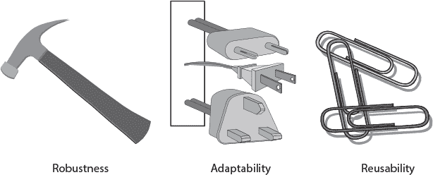

图 2.1 面向对象设计的目标。

#### 可重用性

与适应性并肩存在的是对软件可重用的愿望，即软件可以 be hand..,,, the the,,,, the the the the the the the the the the the the the the the the the the the the the the the the. the the. the the. the the....,,,, the could could be deadly. 这一点在 20 世纪 80 年代后期涉及 Therac-25 放射治疗机的事故中得到了证实，该机器在 1985 年至 1987 年间对六名患者导致了严重的剂量过度，其中一些患者死于辐射过量引起的并发症。所有六次事故都可以追溯到软件错误。

### 2.1.2 面向对象的设计原则

面向对象设计原则中的主要内容（旨在实现上述目标）包括：

- 抽象（Abstraction）
- 封装（Encapsulation）
- 模块化（Modularity）

#### 抽象

`抽象`（abstraction）的概念是将复杂的系统提炼为其基本部分。通常，描述系统的组成部分涉及对其命名并解释其功能。将抽象范式应用于数据结构的设计产生了 `抽象数据类型`（abstract data types, ADTs）。ADT 是数据结构的数学模型，规定了存储的数据类型、支持的操作以及参数的类型。ADT 规定了每个操作 `做什么`，而不是 `如何做`。在 Java 中，ADT 可以通过 `interface`（接口）来表示，接口仅仅是方法声明的列表，每个方法体都为空。

#### 封装

面向对象设计的另一个重要原则是 `封装`（encapsulation）；软件系统的不同组件不应揭露其各自实现的内部细节。封装的主要优势之一是它让程序员能够自由地实现组件的细节，而不必担心其他程序员编写出依赖于这些内部决策的代码。组件程序员的唯一限制是维护组件的公共接口，因为其他程序员将编写依赖该接口的代码。

#### 模块化

现代软件系统通常由多个不同的组件组成，这些组件必须正确交互，整个系统才能正常工作。理清这些交互需要这些不同的组件有良好的组织。`模块化`（Modularity）指的是一种组织原则，将软件系统的不同组件划分为独立的功能单元。这极大地增强了健壮性，因为在集成到更大的软件系统之前，对单独组件进行测试和调试变得更容易。

### 2.1.3 设计模式

面向对象的设计有助于软件的可重用性、健壮性和适应性。然而，设计良好的代码不仅仅是理解面向对象的方法论。它还需要有效使用面向对象的设计技术。

计算研究人员和从业者已经开发了各种组织概念和方法论，用于设计简洁、正确且可重用的高质量面向对象软件。对本书具有特殊意义的是 `设计模式`（design pattern）概念，它描述了解决“典型”软件设计问题的解决方案。模式为解决方案提供了一个通用的模板，可以应用于许多不同的场景。它以抽象的方式描述了解决方案的主要元素，并可以针对特定的当前问题进行特化。它由四部分组成：标识模式的**名称**；描述该模式适用场景的**上下文**；描述如何应用模式的**模板**；以及描述和分析模式产生的结果**结果**。

我们在书中介绍了几种设计模式，并展示了如何将它们一致地应用于数据结构和算法的实现中。这些设计模式分为两类——解决算法设计问题的模式和解决软件工程问题的模式。我们讨论的某些算法设计模式包括：

- 递归（第 5 章）
- 摊还分析（第 7.2.3 节、第 11.6.4 节以及第 12.7.3 节）
- 分治（第 14.1.1 节）
- 剪枝搜索，也称为减治（第 14.5.1 节）
- 暴力法（第 13.2.1 节）
- 贪心算法（第 13.4.2 节、第 12.6.2 节以及第 12.7 节）
- 动态规划（第 13.5 节）

同样，我们讨论的某些软件工程设计模式包括：

- 模板方法（第 2.3.4 节、第 10.5.1 节以及第 11.2.1 节）
- 组合（第 2.5.2 节、第 2.6 节以及第 9.2.1 节）
- 适配器（第 6.1.3 节）
- 位置（第 7.3 节、第 8.1.1 节以及第 12.7.3 节）
- 迭代器（第 7.4 节）
- 工厂方法（第 8.3.1 节以及第 11.2.1 节）
- 比较器（第 9.2.2 节、第 10.3 节以及第 14 章)）
- 定位器（第 9.5.1 节）

然而，与其在这里解释这些概念中的每一个，我们将在如上所述在正文中介绍它们。对于每种模式（无论是用于算法工程还是软件工程的），我们都会解释其通用用法，并用至少一个具体的示例来阐明。

## 2.2 继承

组织软件包中各种结构性组件的自然方式是采用 `分层`（hierarchical）方式，将相似的抽象定义逐层分组，随着沿着层次结构向上移动，定义从具体变得更通用。这种层次结构的一个示例见图 2.3。用数学符号表示，房屋集合是建筑集合的 `子集`（subset），但是农场集合的 `超集`（superset）。层之间的对应通常被称为“是一个”（is a）`关系`（relationship），因为房子是一种建筑，而农场是一种房子。

层次化设计在软件开发中非常有用，因为公共功能可以在最通用的层进行分组，从而促进代码的重用，而差异化的行为可以被视为通用情况的扩展。在面向对象编程中，这种模块化和层次化的组织机制被称为 `继承`（inheritance）。它允许基于现有类作为起点定义一个新类。在面向对象的术语中，现有类通常被描述为基类（base class）、父类（parent class）或超类（superclass），而新定义的类被称为子类（subclass）或子类（child class）。我们说子类 `扩展`（extends）超类。

当使用继承时，子类自动继承父类的所有方法（构造函数除外）作为其起点。子类可以通过两种方式区别于父类：它可以通过添加新字段和新方法来 `增强`（augment）父类；它还可以通过提供新的实现来 `覆盖`（overrides）现有方法从而 `特化`（specialize）现有行为。

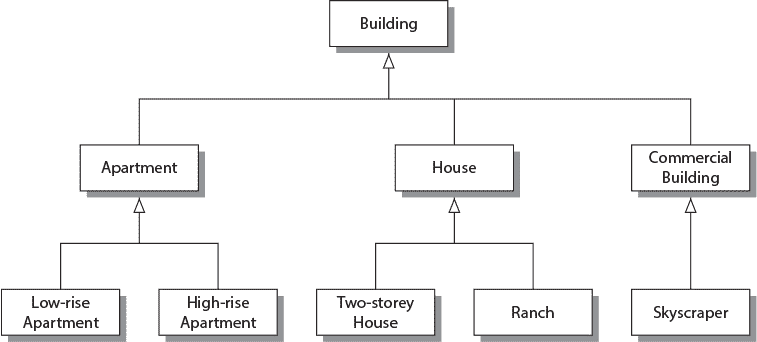

图 2.3 一个涉及建筑建筑的“是一个”层次结构示例。

### 2.2.1 扩展 `CreditCard` 类

作为使用继承的介绍，我们回顾了第 1.8 节中引入的 `CreditCard` 类，设计一个新的子类，由于没有更好的名字，我们将其命名为 `PredatoryCreditCard`（掠夺性信用卡）。新类与原始类在两个方面有所不同：(1) 如果尝试扣费因为超过了信用额度而被拒绝，则将收取 ¥5 的费用；(2) 将有一种机制对未结余额收取月利，使用指定的年百分率。


图 2.4 提供了一个 UML 图，作为我们设计 `PredatoryCreditCard` 类为 `CreditCard` 类子类的概述。图中空心箭头指示了继承的使用，箭头从子类指向超类。

`PredatoryCreditCard` 类`增强`了原始的 `CreditCard` 类，添加了存储年百分率的新实例变量 `apr`，并添加了一个处理利的新方法 `processMonth`。新类还通过`覆盖`原始的 `charge` 方法来`特化`其父类，以提供针对超额尝试收取 ¥5 费的新实现。

为了演示 Java 的继承机制，代码段 2.1 展示了 `PredatoryCreditCard` 类的完整实现。我们希望关注 Java 实现的几个方面。

我们从类定义的第一行开始，它通过使用 Java 的 `extends` 关键字后接超类的名称，表明新类继承自现有 `CreditCard` 类。在 Java 中，每个类只能扩展一个类。由于这一属性，说 Java 类之间只允许`单继承`。我们还需要注意，即使类定义没有显式使用 `extends` 子句，它也会自动继承自 `java.lang.Object`，它是 Java 中的通用超类。

我们接下来考虑代码第 3 行的新 `apr` 实例变量的声明。`PredatoryCreditCard` 类的每个实例将存储从 `CreditCard` 定义继承的所有变量（`customer`、`bank`、`account`、`limit` 和 `balance`）以及新的 `apr` 变量。但我们只负责在子类定义中声明新的实例变量。

```java
public class PredatoryCreditCard extends CreditCard {
  // Additional instance variable
  private double apr;                               // annual percentage rate

  // Constructor for this class
  public PredatoryCreditCard(String cust, String bk, String acnt, int lim,
                              double initialBal, double rate) {
    super(cust, bk, acnt, lim, initialBal);        // initialize superclass attributes
    apr = rate;
  }

  // A new method for assessing monthly interest charges
  public void processMonth( ) {
    if (balance > 0) {        // only charge interest on a positive balance
      double monthlyFactor = Math.pow(1 + apr, 1.0/12);	// compute monthly rate
      balance *= monthlyFactor;                               // assess interest
    }
  }

  // Overriding the charge method defined in the superclass
  public boolean charge(double price) {
    boolean isSuccess = super.charge(price);        // call inherited method
    if (!isSuccess)
      balance += 5;                               // assess a $5 penalty
    return isSuccess;
  }
}
```

#### 代码片段 2.1 `CreditCard` 的子类，用于评估利息和费用。

在 Java 中，构造函数永远不会继承。代码片段 2.1 的第 6–10 行为新类定义了一个构造函数。当创建一个 `PredatoryCreditCard` 实例时，其所有字段都必须正确初始化，包括任何继承来的字段。因此，构造函数体内部执行的第一个操作必须调用父类的构造函数，该函数负责正确初始化在父类中定义的字段。

在 Java 中，通过使用关键字 `super` 并配合适当的参数来调用父类的构造函数，正如我们实现中的第 8 行所示：

```java
super(cust, mk, acnt, lim, initialBal);
```

图 2.4 显示 `PredatoryCreditCard` 作为 `CreditCard` 子类的 UML 图。（请参见 图 1.4 原始的 `CreditCard` 设计。）

这种 `super` 关键字的使用与在同一类中调用另一个构造函数时使用关键字 `this` 非常相似（如 第 1.2.2 节 述）。如果子类的构造函数没有显式调用 `super` 或 `this` 作为其第一条命令，则会进行隐式调用 `super()`，即父类构造函数的无参数版本。回到 `PredatoryCreditCard` 的构造函数，在用适当参数调用父类构造函数后，第 9 行初始化了新声明的 `apr` 字段。（该字段对父类来说是不可知的。）

`processMonth` 方法是一个新行为，因此没有可以依赖的继承版本。在我们的模型中，该方法应该由银行调用，每月调用一次，以便向客户的余额中添加新的利息费用。从技术角度来说，我们注意到此方法访问了继承的 `balance` 字段的值（第 14 行），并可能在第 16 行修改该余额。这之所以被允许，恰是因为所属性的余额在原始的 `CreditCard` 类中被声明为 `protected` 可见性。（参见 代码片段 1.5。）

实现 `processMonth` 方法最具挑战性的方面是确保我们拥有关于年化利率如何转换为月利率的实用知识。我们并不简单地将年利率除以 1 二来获得月利率（那样就太剥削了，因为会导致实际 APR 高于广告利率）。正确的计算方法是取 `1 + apr` 的十二次方，并将其作为乘因子。例如，如果 APR 为 0.0825（代表 8.25%），我们计算 $\sqrt[12]{1.0825} \approx 1.006628$，因此每月收取 0.6628% 的利息。通过这样，每 ¥100 的债务每年将产生 ¥8.25 的复利。注意我们使用了 Java 库中的 `Math.pow` 方法。

最后，我们考虑为 `PredatoryCreditCard` 类提供的 `charge` 方法的新实现（第 21–27 行）。此定义*覆盖*了被继承的方法。然而，我们对新方法的实现依赖于对继承方法的调用，语法如第 22 行的 `super.charge(price)`。该调用的返回值决定了收费是否成功。我们检查该返回值以决定是否收取费用，并在任何情况下将该布尔值返回给调用者，以便 `charge` 的新版本保持与原始版本类似的外部接口。

### 2.2.2 多态与动态分发

*多态*（polymorphism）一词字面意思是“多种形式”。在面向对象的设计背景下，它指的是引用变量可以采取不同形式的能力。例如，考虑声明一个类型为 `CreditCard` 的变量：

```java
CreditCard card;
```

由于这是一个引用变量，该语句声明了新变量，该变量尚未指向任何 `card` 实例。虽然我们已经看到可以将其赋值为新构造的 `CreditCard` 类实例，但 Java 也允许我们将该变量赋值为指向 `PredatoryCreditCard` 子类的实例。也就是说，我们可以这样做：

```java
CreditCard card = new PredatoryCreditCard(...);						// 参数已省略
```

这就是所谓的*里氏夫替换原则*（Liskov Substitution Principle）的演示，该原则指出，声明类型的变量（或参数）可以赋值为该类型的任何直接或间接子类的实例。非正式地说，这是继承所建模的“是一个”（is a）关系的体现，因为掠夺性信用卡信用卡（但信用卡并不一定是掠夺性的）。

我们说变量 `card` 是*多态的*；取决于它所引用的对象的具体类，它可能采取多种形式中的一种。由于 `card` 被声明为类型 `CreditCard`，因此该变量只能用于调用声明为 `CreditCard` 定义部分的方法。因此，我们可以调用 `card.makePayment(50)` 和 `card.charge(100)`，但对于调用 `card.processMonth()`，将报告编译错误，因为 `CreditCard` 不保证具有此类行为。（如果该变量最初被声明为 `PredatoryCreditCard` 类型，则可以进行调用。）

一个有趣（且重要）的问题是当变量 `card` 的声明类型为 `CreditCard` 时，Java 如何处理类似 `card.charge(100)` 的调用。记住，`card` 引用的对象可能是 `CreditCard` 类实例，也可能是 `PredatoryCreditCard` 类实例，且 `charge` 方法有不同的实现：`CreditCard.charge` 和 `PredatoryCreditCard.charge`。Java 使用一种称为*动态分发*（dynamic dispatch）的过程，在运行时决定调用最符合引用对象*实际*类型的方法版本（而不是声明类型）。因此，如果对象是 `PredatoryCreditCard` 实例，它将执行 `PredatoryCreditCard.charge` 方法，即使引用变量的声明类型是 `CreditCard`。

Java 还提供了 `instanceof` 运算符，用于运行时测试实例是否满足特定类型。例如，布尔条件 `(card instanceof PredatoryCreditCard)` 的评估，如果变量 `card` 当前引用对象属于 `PredatoryCreditCard` 类或该类的任何进一步子类，则产生 `true`。（请参见 第 2.5.1 节 的更多讨论。）

### 2.2.3 继承层次结构

虽然在 Java 中子类不能继承多个父类，但父类可以有许多子类。事实上，在 Java 中开发复杂的继承层次结构以最大化地提高代码重用性是非常常见的。

作为继承用法的第二个示例，我们开发了一个用于迭代数值数列的类层次结构。数值数列是一个数字序列，其中每个数字都取决于一个或多个之前的数字。例如，`等差数列`（arithmetic progression）通过在前一个值的基础上加上一个固定常数来确定下一个数，而`等比数列`（geometric progression）通过将前一个值乘以一个固定常数来确定下一个数。通常，数列需要一个初始值，以及一种根据一个或多个之前的值来识别新值的方法。

我们的层次结构源于一个名为 `Progression` 的通用基类。该类产生整数数列：0, 1, 2, … 。更重要的是，该类的设计使其能够被其他数列类型轻松特化，从而产生如图 2.5 所示的层次结构。

我们对基本 `Progression` 类的实位于代码片段 2.2 中。该类有一个名为 `current` 的单字段。它定义了两个构造函数：一个接受数列的任意起始值，另一个使用 0 作为默认值。该类的其余部分包含三个方法：

| `nextValue()`: | 公方法，返回数列的下一个值，每次调用时隐式地推进该值。 |

| `advance()`: | 一个保护方法，负责推进数列中 `current` 的值。 |

| `printProgression(n)`: | 一个公用工具方法，它在推进数列 `n` 次的同时显示每个值。 |

我们决定提取出受保护的 `advance()` 方法（该方法在 `nextValue()` 执行期间被调用），是为了尽可能减少对子类的负担，子类仅需负责重写 `advance` 方法来更新 `current` 字段。

`nextValue` 方法的体体会临时记录数列的当前值（该值很快就会返回），然后调用保护的 `advance` 方法来更新值，以便为随后的调用做准备。

我们 `Progression` 类中 `advance` 方法的实现只是简单地增加 `current` 的值。该方法将由我们的特化子类重写，以改变数字变化的规律。

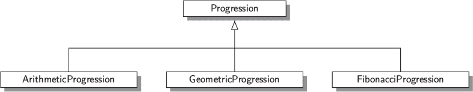

图 2.5 我们数列类层次结构的概览。

```java
 1	/** 生成一个简单的数列。默认情况下：0, 1, 2, ... */
 2	public class Progression {
 3
 4	 // 实例变量
 5	 protected long current;
 6
 7	/** 构建一个从零开始的数列。 */
 8	 public Progression( ) { this(0); }
 9
10	 /** 构建一个给定起始值的数列。 */
11	 public Progression(long start) { current = start; }
12
13	 /** 返回数列的下一个值。 */
14	 public long nextValue( ) {
15		long answer = current;
16		advance( );				// 此保护调用负责推进当前值
17		return answer;
18	 }
19
20	 /** 将当前值推进到数列的下一个值。 */
21	 protected void advance( ) {
22		current++;
23	 }
24
25	 /** 打印数列的后续 n 个值，用空格分隔。 */
26	 public void printProgression(int n) {
27	 System.out.print(nextValue( ));						// 打印第一个值，不带前导空格
28	 for (int j=1; j < n; j++)
29	 System.out.print(" " + nextValue( ));			// 在其他值前打印前导空格
30	 System.out.println( );									// 换行
31	 }
32	}
```

**代码片段 2.2** 通用数列类。

在本节的剩余，我们将介绍 `Progression` 类的三个子类——`ArithmeticProgression`（等差数列）、`GeometricProgression`（等比数列）和 `FibonacciProgression`（斐波那契数列），它们分别产生等差数列、等比数列和斐波那契数列。

### 等差数列类

我们的第一个特化数列示例是等差数列。虽然默认数列每一步增加其一个值，但等差数列通过给数列的某一项加上一个固定常数来产生下一个项。例如，对于一个从 0 开始且增量为 4 的等差数列，将产生序列 0, 4, 8, 12, … 。

代码片段 2.3 展示了我们对 `ArithmeticProgression` 类的实现，它依赖 `Progression` 作为基类。我们包含了三种构造函数形式，其中最通用的（在 12–15 行）接受一个增值和一个起始值，使得 `ArithmeticProgression(4, 2)` 产生序列 2, 6, 10, 14, … 。该构造函数的体调用父类构造函数，使用语法 `super(start)` 将 `current` 初始化为给定的起始值，然后初始化子类引入的 `increment` 字段。

为了方便起见，我们提供了两个额外的构造函数，使得默认数列产生 0, 1, 2, 3, …, 而单参数构造函数产生起始值为 0 的给定增量的等差数列。最后（最重要的），我们重写了保护的 `advance` 方法，将给定的增量加到数列的每一个值上。

```java
 1	public class ArithmeticProgression extends Progression {
 2
3	 protected long increment;
 4
5	 /** 构建 0, 1, 2, ... 的数列。 */
6	 public ArithmeticProgression( ) { this(1, 0); }			// 从 0 开始，增量为 1
 7
8	 /** 构建 stepsize, 2*stepsize, ... 的数列。 */
9	 public ArithmeticProgression(long stepsize) { this(stepsize, 0); }		// 从 0 开始
10
11	/** 具有任意起始值和增量的等差数列。*/
12	 public ArithmeticProgression(long stepsize, long start) {
13		super(start);
14		increment = stepsize;
15	 }
16
17	 /** 将等差增量加到当前值。 */
18	 protected void advance( ) {
19		current += increment;
20	 }
21	}
```

**代码片段 2.3** 等差数列类，继承自通用数列类。

### 等比数列类

我们的第二个特化数列示例是等比数列，其中每个值通过将前一个值乘以固定常数产生，该常数被称为等比数列的 `base`（底数）。等比数列的起点传统是 1 而 0，因为 0 乘以任何因子都是 0。例如，一个从值 1 开始且底数为 2 的等比数列产生序列 1, 2, 4, 8, 16, … 。

代码片段 2.4 展示了我们 `GeometricProgression` 类的实现。在编程技术方面，它与 `ArithmeticProgression` 类非常相似。特别是，它引入了一个新字段（等比数列的底数），为了方便提供了三种形式的构造函数，并重写了保护的 `advance` 方法，使得数列的当前值在每一步都乘以 `base`。


在等比数列的情况下，我们选择让默认（零参数）构造函数使用 `1` 作为起始值和 `2` 作为底数，以便它产生数列 `1, 2, 4, 8, …`。构造函数的单参数版本接受任意底数并使用 `1` 作为起始值，因此 `GeometricProgression(3)` 产生序列 `1, 3, 9, 27, …`。最后，我们提供了一个接受底数和起始值的双参数版本，使得 `GeometricProgression(3,2)` 产生序列 `2, 6, 18, 54, …`。

```
public class GeometricProgression extends Progression {

    protected long base;

    /** 构建序列 1, 2, 4, 8, 16, ... */
    public GeometricProgression( ) { this(2, 1); }				// 从 1 开始，基数为 2

    /** 对于基数 b，构建序列 1, b, b², b³, b⁴, ... */
    public GeometricProgression(long b) { this(b, 1); }							// 从 1 开始

    /** 构建任意基数和起始点的等比数列。 */
    public GeometricProgression(long b, long start) {
        super(start);
        base = b;
    }

    /** 将当前值乘以等比基数。 */
    protected void advance( ) {
        current *= base;								// 将当前值乘以等比基数
    }
}
```

`代码片段 2.4` 等比数列类。

### 斐波那契数列类

作为我们的最后一个示例，我们展示了如何使用我们的数列框架来生成`斐波那契数列`。斐波那契数列的每个值都是最近两个值之和。按照惯例，数列的前两个值是 `0` 和 `1`，从而产生斐波那契数列 `0, 1, 1, 2, 3, 5, 8, …`。更一般地说，这样的数列可以从任何两个起始值生成。例如，如果我们从值 `4` 和 `6` 开始，数列将变为 `4, 6, 10, 16, 26, 42, …`。

`代码片段 2.5` 展示了 `FibonacciProgression` 类的实现。这个类与等差数列和等比数列类明显不同，因为我们不能仅根据当前值确定斐波那契数列的下一个值。我们必须维护最近两个值的信息。我们的 `FibonacciProgression` 类引入了一个名为 `prev` 的新成员，用于存储先于当前值的值（存储在继承的 `current` 字段中）。

然而，问题在于当提供了所需的第一个和第二个值作为参数时，如何在构造函数中初始化上一个值。第一个值应该存储在 `current` 中，以便在第一次调用 `nextValue()` 时被报告。在次方法调用期间，将通过赋值将新的当前值（将是报告的第二个值）设置为第一个值加上“上一个值”。通过将上一个值初始化为 `(second – first)`，初始的推进将把新的当前值设置为 `first + (second – first) = second`，符合预期。

```
public class FibonacciProgression extends Progression {

    protected long prev;

    /** 构建传统的斐波那契数列，从 0, 1, 1, 2, 3, ... 开始 */
    public FibonacciProgression( ) { this(0, 1); }

    /** 构建通用的斐波那契数列，使用给定的第一个和第二个值。 */
    public FibonacciProgression(long first, long second) {
        super(first);
        prev = second – first;			// 第一个值之前的虚拟值
    }

    /** 将 (prev,current) 替换为 (current, current+prev)。 */
    protected void advance( ) {
        long temp = prev;
        prev = current;
        current += temp;
    }
}
```

`代码片段 2.5` 斐波那契数列类。

## 2.3 接口与抽象类

为了让两个对象能够相互作用，它们必须“知道”每个对象将接受的各种消息，即每个对象支持的方法。为了强制这种“认知”，面向对象的设计范式要求类指定其对象向其他对象提供的`应用程序编程接口` (`API`)，或简单称为`接口`。在本书遵循的`基于 ADT`的数据结构方法（参见第 2.1.2 节）中，定义 ADT 的接口被指定为类型定义以及该类型的方法的集合，其中每个方法的参数均为指定类型。这种规范反过来由编译器或运行时系统强制执行，它要求实际传递给方法的参数类型必须严格符合接口中指定的类型。这种要求被称为`强类型检查`。诚然，必须定义接口并让强类型强制执行这些定义会给程序员带来负担，但这种负担被其提供的回报所抵消，因为它强制执行了封装原则，并且经常捕获原本不会被察觉的编程错误。

### 2.3.1 Java 中的接口

Java 中的主要结构元素是`interface`（接口）。接口是一组方法声明的集合，没有数据也没有方法体；它们仅仅是签名。接口不能被直接实例化。当一个类实现接口时，它必须实现接口中声明的所有方法。

假设，例如，我们想要创建一个具有各种属性的分类古董清单。例如，我们可能希望将某些对象标记为可售的，在这种情况下，它们可以实现`代码片段 2.6`所示的`Sellable`接口。

```
/** 可售对象的接口 */
public interface Sellable {

    /** 返回对象的描述 */
    public String description( );

    /** 返回以分为单位的价格 */
    public int listPrice( );

    /** 我们接受的最低价格（分为单位） */
    public int lowestPrice( );
}
```

`代码片段 2.6` Sellable 接口。

我们可以定义一个具体的类`Photograph`（如`代码片段 2.7`所示），它实现了`Sellable`接口，表示愿意出售任何照片对象。该类增加了一个`isColor`方法，它是专门为照片对象设计的。

```
/** 可售照片的类 */
public class Photograph implements Sellable {
    private String descript;												 照片的描述
    private int price;												 设置的价格
    private boolean color;												 是否为彩色

    public Photograph(String desc, int p, boolean c) {// 构造函数
        descript = desc;
        price = p;
        color = c;
    }

    public String description( ) { return descript; }
    public int listPrice( ) { return price; }
    public int lowestPrice( ) { return price/2; }
    public boolean isColor( ) { return color; }
}
```

`代码片段 2.7` 实现 Sellable 接口的类。

我们集合中的另一种对象可能是我们可以运输的东西。对于这类对象，我们定义了`代码片段 2.8`所示的接口。

```
/** 可运输对象的接口 */
public interface Transportable {

    /** 返回以克为单位的重量 */
    public int weight( );

    /** 返回对象是否为危险品 */
    public boolean isHazardous( );
}
```

`代码片段 2.8` Transportable 接口。

然后我们可以定义`BoxedItem`类（如`代码片段 2.9`所示），用于可以出售、包装和运输的杂项古董。因此，`BoxedItem`类实现了`Sellable`接口和`Transportable`接口的方法，同时增加了专门的方法用于设置箱装运输的保险价值以及设置运输箱的尺寸。

```java
/** 该类用于表示可以被销售、包装和运输的物品。 */
public class BoxedItem implements Sellable, Transportable {
    private String descript;                    // 物品的描述
    private int price;                            // 以分为单位的标价
    private int weight;                            // 以克为单位的
    private boolean haz;                        // 如果对象是危险品则为 true
    private int height=0;                        // 箱子高度（厘米）
    private int width=0;                        // 箱子宽度（厘米）
    private int depth=0;                        // 箱子深度（厘米）
    /** 构造函数 */
    public BoxedItem(String desc, int p, int w, boolean h) {
        descript = desc;
        price = p;
        weight = w;
        haz = h;
    }
    public String description( ) { return descript; }
    public int listPrice( ) { return price; }
    public int lowestPrice( ) { return price/2; }
    public int weight( ) { return weight; }
    public boolean isHazardous( ) { return haz; }
    public int insuredValue( ) { return price*2; }
    public void setBox(int h, int w, int d) {
        height = h;
        width = w;
        depth = d;
    }
}
```

`代码片段 2.9` 类`BoxedItem`。

`BoxedItem`类展示了 Java 中类和接口的另一个特性——一个类可以实现多个接口（尽管它可能只能扩展另一个类）。这使得我们在定义需要符合多个 API 的类时，具有极大的灵活性。

### 2.3.2 扩展接口

在 Java 中，类可以通过`extends`关键字和/或实现一个或多个接口来继承另一个类的属性。同样，一个接口也可以相互扩展另一个接口，这与类继承另一个父类的方式完全相同。这种层级结构的示例可见图 2.6。

然而，Java 类只允许继承一个父类，因为不允许多重继承；但在接口中，可以通过列出用逗号分隔的父接口，将多个父接口扩展到子接口中，这在 Section 2.3.3 中有所说明。

与类一样，`extends`关键字也用于接口来扩展其他接口，所有父接口列出的方法都会被子接口继承。作为说明，假设`Transportable`接口（参见 Code Fragment 2.8）扩展了`Sellable`接口（参见 Code Fragment 2.6）或反之，那么对于我们的古董物品示例，我们可以这样定义`Transportable`接口：

```java
/** 用于可以运输物品的接口。 */
public interface Transportable extends Sellable {
    /** 返回以克为单位的重量。 */
    public int weight( );
    /** 返回对象是否为危险品。 */
    public int isHazardous( );
}
```

或者，我们可以定义`Sellable`接口为：

```java
/** 用于可以销售物品的接口。 **/
public interface Sellable extends Transportable {
    /** 返回对象的描述。 */
    public String description( );
    /** 返回以分为单位的标价。 */
    public int listPrice( );
    /** 返回我们接受的最低价格（分）。 */
    public int lowestPrice( );
}
```

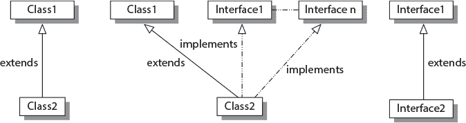

[图 2.6] 继承的层级结构。

因此，上述扩展接口允许我们定义`BoxedItem`同时实现这两个接口：

```java
public class BoxedItem implements Transportable { // 如果 Transportable 接口扩展了 Sellable
    // ...与类 BoxedItem 相同的代码
}
```

或者：

```java
public class BoxedItem implements Transportable { // 如果 Sellable 接口扩展了 Transportable
    // ...与类 BoxedItem 相同的代码
}
```

### 2.3.3 接口的多重继承

从多个类型扩展的能力被称为**多重继承**。在 Java 中，接口允许多重继承，但类不允许。这一规则的原因是，接口不定义字段或方法体，而类通常会定义。因此，如果 Java 允许类进行多重继承，那么当一个类尝试扩展两个包含同名字段或相同签名方法的类时，可能会产生混淆。由于接口不会出现这种混淆，且接口多重继承在某些情况下有用，Java 允许接口使用多重继承。

接口多重继承的一种用途是模拟一种名为 **mixin**（混入）的多重继承技术。与 Java 不同，某些面向对象的语言（如 Smalltalk 和 C++）允许具体类的多重继承，而不仅仅是接口。在这些语言中，通常会定义被称为 **mixin** 的类，这些类从不打算被创建独立的对象，而是为了给现有类提供额外的功能。然而，Java 不允许这种继承，因此程序员必须用接口来模拟。具体来说，我们可以将接口的多重继承作为一种机制，将两个或多个不相关接口的方法“混合”在一起，定义一个组合它们功能的接口，并可能添加自己的更多方法。回到我们的古董物品示例，我们可以如下定义可保险物品的接口：

```java
public interface Insurable extends Sellable, Transportable {
    /** 返回以分为单位的保险价值 */
    public int insuredValue( );
}
```

此接口结合了`Transportable`接口的方法与`Sellable`接口的方法，并添加了一个额外的方法`insuredValue`。这样的接口允许我们交替地定义`BoxedItem`：

```java
public class BoxedItem2 implements Insurable {
    // ...与类 BoxedItem 相同的代码
}
```

在这种情况下，请注意`insuredValue`方法不是可选的，而在之前提供的`BoxedItem`声明中它是可选的。

模拟 mixin 的 Java 接口包括`java.lang.Cloneable`，它为类增加了复制功能；`java.lang.Comparable`，它为类增加了可比较功能（对其实例施加自然排序）；以及`java.util.Observer`，它为希望在某些“可观察”对象状态变化时接收通知的类增加了更新功能。

### 2.3.4 抽象类

在 Java 中，**抽象类**的作用介于传统类和接口之间。与接口一样，抽象类可以定义一个或多个方法的签名，而不提供这些方法体的实现；此类方法被称为**抽象方法**。然而，与接口不同，抽象类可以定义一个或多个字段以及任意数量带有实现的方法（所谓的**具体方法**）。抽象类还可以扩展另一个类，并被进一步的子类扩展。

与接口的情况类似，抽象类不能被实例化，也就是说无法直接从抽象类创建对象。在某种意义上，它仍然是一个不完全的类。抽象类的子类必须为其超父类的抽象方法提供实现，否则将保持为抽象。为了与抽象类区分开，我们将非抽象类称为**具体类**。

在比较接口和抽象类的使用时，很明显看出抽象类更强大，因为它们可以提供具体的功能。然而，Java 中对抽象类的使用局限于**单继承**，因此一个类最多只有一个父类，无论是具体类还是抽象类（参见 Section 2.3.3）。

在数据结构的学习中，我们将充分利用抽象类，因为它们支持更高的代码重用性（这是我们在第 2.1.1 节中面向对象的设计目标之一）。一组类的共性可以放在一个抽象类中，该抽象类作为多个具体类的父类。这样，具体的子类只需要实现区分彼此的额外功能即可。


举一个具体的例子，我们重新考虑在第 2.2.3 节中引入的进阶层次结构。尽管在那个演示中我们没有正式将`Progression`基类声明为抽象类，但这样做是一个合理的设计。我们并不打算让用户直接创建`Progression`类的实例；事实上，它产生的序列只是增量为 1 的等差数列的一个特例。`Progression`类的主要目的是为三个子类提供公共功能：`current`字段的声明和初始化，以及`nextValue`和`printProgression`方法的具体实现。

在该类的特化化中，最重要的方面是重写受保护的`advance`方法。尽管我们在`Progression`类中提供了该方法的简单实现以增加`current`值，但我们的三个子类没有一个依赖于该行为。在下一个小节中，我们将通过将进阶基类重新设计为`AbstractProgression`基类，来演示 Java 中抽象类的机制。在那个设计中，我们将`advance`方法留为真正的抽象方法，将实现的负担交给各个不同的子类。

## Java 中抽象类的机制

在代码段 2.10 中，我们为进阶层次结构提供了一个新的抽象基类的 Java 实现。我们将新类命名为`AbstractProgression`而不是`Progression`，这仅是为了在我们的讨论中对其进行区分。它们的定义几乎相同；我们只强调了两个关键区别。第一个是在声明类时在第 1 行使用了`abstract`修饰符。（关于类修饰符的讨论，请参见第 1.2.2 节）。

```
 1	public abstract class AbstractProgression {
 2	���protected long current;
 3	���public AbstractProgression( ) { this(0); }
 4	���public AbstractProgression(long start) { current = start; }
 5
 6	���public long nextValue( ) {								// this is a concrete method
 7		long answer = current;
 8		advance( );				// this protected call is responsible for advancing the current value
 9		return answer;
10	���}
11
12	���public void printProgression(int n) {					// this is a concrete method
13		System.out.print(nextValue( ));						// print first value without leading space
14		for (int j=1; j < n; j++)
15	���System.out.print(" " + nextValue( ));			// print leading space before others
16		System.out.println( );									// end the line
17	���}
18
19	���protected abstract void advance( );					// notice the lack of a method body
20	}
```

**代码段 2.10** 进阶基类的抽象版本，最初在代码段 2.2 中给出。（为了简洁，我们省略了文档。）

与我们的原始类一样，新类声明了`current`字段并提供了初始化它的构造函数。虽然我们的抽象类不能被实例化，但子类的构造函数可以使用`super`关键字调用这些构造函数。（在我们三个进阶子类中都是这样做的。）

新类对`nextValue`和`printProgression`方法的具体实现与原始类相同。然而，我们在第 19 行使用`abstract`修饰符显式定义了`advance`方法，且没有任何方法体。

尽管我们没有在`AbstractProgression`类中实现`advance`方法，但在`nextValue`的体内部调用它是合法的。这是一种被称为*模板方法模式*（template method pattern）的面向对象设计模式示例，其中抽象基类提供了一种依赖于调用其他抽象行为的具体行为。一旦子类为缺失的抽象行为提供了定义，继承的具体行为就有了明确定义。

## 2.4 异常

异常是程序执行过程中发生的意外事件。异常的产生可能是由于资源不可用、用户的意外输入，或仅仅是程序员的逻辑错误。在 Java 中，异常是对象，可以由遇到意外情况的代码*抛出*（throw），也可以由 Java 虚拟机抛出（例如当内存耗尽时）。异常也可以被周围的代码块*捕获*（catch），并以适当的方式“处理”问题。如果未捕获，异常会导致虚拟机停止执行程序，并向控制台报告适当的消息。在本节中，我们将讨论 Java 中常见的异常类型，以及在用户定义的代码块中抛出和捕获异常的语法。

### 2.4.1 捕获异常

如果发生异常且未被处理，则 Java 运行时系统将在打印适当的消息以及运行时堆栈跟踪后终止程序。堆栈跟踪显示了在异常发生时活跃的一系列嵌套方法调用，例如所示：

```
 Exception in thread "main" java.lang.NullPointerException
	at java.util.ArrayList.toArray(ArrayList.java:358)
	at net.datastructures.HashChainMap.bucketGet(HashChainMap.java:35)
	at net.datastructures.AbstractHashMap.get(AbstractHashMap.java:62)
	at dsaj.design.Demonstration.main(Demonstration.java:12)
```

然而，在程序终止之前，堆栈跟踪中的每个方法都有机会*捕获*异常。从发生异常的最深嵌套方法开始，每个方法都可以捕获该异常，或者让它传递给调用它的方法。例如，在上面的堆栈跟踪中，`ArrayList.java`方法有首个捕获异常的机会。由于它没有这样做，异常被向上传递给`HashChainMap.bucketGet`方法，该方法随之也忽略了该异常，导致其进一步向上传递给`AbstractHashMap.get`方法。捕获异常的最后机会是在`Demonstration.main`方法中，但由于它没有这样做，程序带有上述诊断信息终止了。

处理异常的通用方法是使用*try-catch* 结构，在这一构造结构中，会执行一段可能会抛出异常的受保护代码。如果它抛出异常，则该异常将通过控制流跳转到预定义的`catch`块被*捕获*，该块包含了分析异常并应用适当解决方案的代码。如果受保护代码中没有发生异常，所有的 catch 块都被忽略。

Java 中*try-catch 语句*的典型语法如下：

> **try** {

> 

>         *guardedBody*

> 

> } **catch** (*exceptionType*[1] *variable*[1]) {

> 

>         *remedyBody*[1]

> 

> } **catch** (*exceptionType*[2] *variable*[2]) {

> 

>         *remedyBody*[2]

> 

> } . . .

> 

>       .. . .

.. . .

每个 *exceptionType[i]* 都是某种异常的类型，每个 *variable[i]* 都是有效的 Java 变量名。

Java 运行时环境执行如这样的 try-catch 语句时，会开始执行语句块 *guardedBody*。如果在执行期间没有产生任何异常，控制流将继续执行整个 try-catch 语句最后一行之后的第一个语句。

另一方面，如果块`guardedBody`在某处生成了异常，该块的执行将立即终止，执行将跳转到`exceptionType`与抛出的异常（如果有）匹配最紧密的`catch`块。该`catch`语句的`variable`引用异常对象本身，该对象可以在匹配的`catch`语句块中使用。一旦`catch`块的执行完成，控制流将继续执行整个`try-catch`结构之后的第一个语句。

如果在执行块`guardedBody`发生的异常与`catch`语句中声明的任何异常类型都不匹配，则该异常将在周围环境中重新抛出。

当捕获异常时，有几种可能的反应。其中一种可能性是打印错误信息并终止程序。还有一些有趣的情况，处理异常的最佳方法是静地捕获并忽略它（这可以通过让`catch`块体为空来实现）。另一种处理异常的合法方法是创建并抛出另一个异常，可能是一个更精确地指定异常条件的异常。

我们简要说明，Java 中的`try-catch`语句支持一些我们在书中不会使用的高级技术。可以带一个可选的`finally`子句，无论原始`guardedBody`中是否发生异常，其体都将被执行；这可能很有用，例如在继续后续之前关闭文件。Java SE 7 引入了一种名为“try with resource”的新语法，它为必须适当清理的打开文件等资源提供了更高级的清理技术。此外，从 Java SE 7 开始，每个`catch`语句都可以指定它处理的多个异常类型；以前，每个类型都需要一个单独的子句，即使在每个情况下采用相同的补救措施。

```
 1	public static void main(String[ ] args) {
 2	  int n = DEFAULT;
 3	 try {
 4		  n = Integer.parseInt(args[0]);
 5		  if (n <= 0) {
 6			  System.out.println("n must be positive. Using default.");
 7			  n = DEFAULT;
 8		  }
 9	 } catch (ArrayIndexOutOfBoundsException e) {
10		 System.out.println("No argument specified for n. Using default.");
11	 } catch (NumberFormatException e) {
12		  System.out.println("Invalid integer argument. Using default.");
13	 }
14	}
``` 

**代码片段 2.11** 捕获异常的演示。

作为`try-catch`语句的一个具体示例，我们考虑在代码片段 2.11 中所示简单应用程序。此`main`方法尝试将第一个命令行参数解释为正整数。（命令行参数在第 1.2.2 节 的“main Method”小节中引入。）

第 4 行可能抛出异常的语句是命令`n = Integer.parseInt(args[0])`。该命令可能由于两个原因之一失败。首先，如果用户没有指定任何参数，尝试访问`args[0]`将失败，因此数组`args`为空。在这种情况下，将抛出一个`ArrayIndexOutOfBoundsException`（并在我们在第 9 行捕获了它）。第二个潜在异常是调用`Integer.parseInt`方法时。只要参数是合法的整数表示字符串（例如 "2013"），该命令就能成功执行。当然，由于命令行参数可以是任何字符串，用户可能会提供无效的整数表示，在这种情况下，`parseInt`方法会抛出`NumberFormatException`（我们在第 11 行捕获了它）。

我们希望强制执行的最后一个条件是用户指定的整数是正数。为了测试这一属性，我们依赖于传统的条件语句（第 5-8 行）。然而，请注意，我们将该条件语句放置在了`try-catch`语句的主体内。该条件语句只有在第 4 行的命令成功执行且没有异常时才会被评估；如果第 4 行发生异常，主`try`块将终止，控制流直接进入相应的适当`catch`语句的异常处理。

顺便提到，如果我们愿意对两种异常情况使用相同的错误信息，可以使用具有以下语法的单个`catch`子句：

```
 } catch(ArrayIndexOutOfBoundsException | NumberFormatException e) {
 System.out.println("Using default value for n.");
}
```

### 2.4.2 抛出异常

当 Java 代码在执行期间发现某种问题并抛出异常对象时，就会产生异常。这是通过使用`throw`关键字后跟要抛出的异常类型的实例来实现的。在必须抛出异常时实例化异常对象通常是方便的。因此，`throw`语句通常写为：

> **throw new** `exceptionType`(`parameters`);

其中`exceptionType`是异常类型，参数是传递的内容；大多数异常类型都提供一个接受错误消息作为参数的构造函数版本。例如，以下方法接收一个整数参数，并期望它是正数。如果发送了负整数，则会抛出`IllegalArgumentException`。

```
 public ensurePositive(int n) {
 if (n < 0)
    throw new IllegalArgumentException("That's not positive!");
 // ...
}
```

`throw`语句的执行会立即终止方法体。

#### Throws 子句

在声明方法时，可以作为签名的一部分显式地声明在调用过程中可能会抛出特定异常。无论该异常是直接来自该方法中的`throw`语句，还是从内部调用的二级方法向上传播的，都不重要。

在方法签名中声明可能异常的语法依赖于`throws`关键字（不要与实际的`throw`语句混）。例如，`Integer`类的`parseInt`方法具有以下正式签名：

```
public static int parseInt(String s) throws NumberFormatException;
```

`throws NumberFormatException`的指定警告用户可能出现异常的情况，以便他们能更好地准备处理可能出现的异常。如果可能抛出多种异常类型，可以列出所有此类类型，并用逗号分隔。或者，也可以列出一个包含所有可能抛出的特定异常的适当超类。

在方法签名中使用`throws`子句并不能消除通过在 javadoc 注释中使用 @throws 标签来妥善记录所有可能的异常的责任（参见第 1.8.4 节）。

Java 定义了所有被认为是`Throwable`的对象的丰富继承层次结构。我们在图 2.7 中展示了该层次结构的一小部分。该层次被刻意分为两个子类：`Error`和`Exception`。`Errors`通常由 Java 虚拟机抛出，表示不太可能恢复的最严重情况，例如当要求虚拟机执行损坏的类文件，或者系统内存耗尽时。相比之下，`exceptions`表示运行中的程序可能合理地恢复的情况，例如当无法打开数据文件时。

### 检查异常与未检查异常

Java 通过将`RuntimeException`类声明为`Exception`的重要子类提供了进一步的细分。在 Java 中，`RuntimeException`的所有子类型都正式被视为**未检查异常**（unchecked exceptions），任何不属于`RuntimeException`的异常类型都是**检查异常**（checked exception）。

这种设计的意图是：运行时异常完全由于编程逻辑中的错误引起，例如使用错误的数组索引，或向方法传递不适当的参数。虽然此类编程错误在软件开发过程中确实会发生，但推测它们在软件达到生产质量之前应该被解决。因此，在运行时显式检查每种错误并不符合效率原则，因此这些被指定为“未检查”异常。

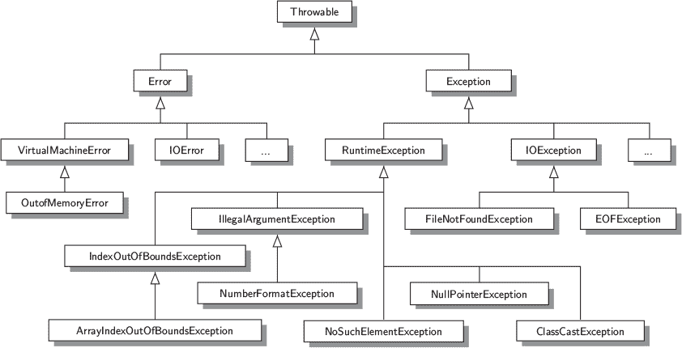

图 2.7 Java Throwable 类型层次结构的一部分。

相比之下，其他异常的发生是因为在程序执行之前无法检测的条件，例如不可用的文件或网络连接失败。那些在 Java 中通常被指定为“检查”异常（因此不是`RuntimeException`的子类型）。

检查异常和未检查异常之间的划分在语言语法中起着重要作用。特别是，**`所有可能从方法向上传播的检查异常都必须在方法的签名中显式声明`**。

其结果是，如果一个方法调用了声明了检查异常的第二个方法，那么对该第二个方法的调用必须在`try-catch`语句内保护，或者调用方法本身必须在自己的签名中声明这些检查异常，因为存在此类异常可能从调用方法向上传播的风险。

定义 定义新的异常类型

在本书中，我们将完全依赖现有的`RuntimeException`类型来指定对我们数据结构使用的各种要求。然而，某些库定义了新的异常类来描述更具体的条件。专门的异常应该继承自`Exception`类（如果是检查异常）、`RuntimeException`类（如果是未检查异常），或一个更相关的现有`Exception`子类型。

## 2.5 强制转换与泛型

在本节中，我们将讨论引用变量之间的强制转换，以及一种称为泛型的技术，该技术允许我们定义处理各种数据类型的方法和类，而不需要显式的强制转换。

### 2.5.1 强制转换

我们从对象的类型转换方法开始讨论。

#### 宽转换

当类型`T`转换为“更宽”的类型`U`时，就会发生宽转换（widening conversion）。以下是宽转换的常见情况：

* `T`和`U`是类类型且`U`是`T`的超类类。

* `T`和`U`是接口类型且`U`是`T`的超接口。

* `T`是实现接口`U`的类。


在将表达式的结果存储到变量时，会自动执行宽转换，不需要显式强制转换。因此，当从 `T` 到 `U` 是宽转换时，我们可以直接将类型 `T` 的表达式的结果赋值给类型为 `U` 的变量 `v`。在讨论第 2.2.2 节的多态时，我们提供了以下隐式宽转换示例，将较窄的 `PredatoryCreditCard` 类实例赋值给较宽的 `CreditCard` 类型变量：

```java
CreditCard card = new PredatoryCreditCard(...); // 省略参数
```

宽转换的正确性可以由编译器检查，其有效性不需要在程序执行期间通过 Java 运行时进行测试。

#### 窄转换

当类型 `T` 转换为“更窄”的类型 `S` 时，就会发生窄转换（narrowing conversion）。以下是窄转换的常见情况：

- `T` 和 `S` 是类类型且 `S` 是 `T` 的子类。
- `T` 和 `S` 是接口类型且 `S` 是 `T` 的子接口。
- `T` 是由类 `S` 实现的接口。

通常情况下，引用类型的窄转换需要显式强制转换。此外，窄转换的正确性可能无法通过编译器验证。因此，其有效性应该在程序执行期间通过 Java 运行时进行测试。

下面的代码片段显示了如何使用强制转换执行从类型 `PredatoryCreditCard` 到类型 `CreditCard` 的窄转换。

```java
CreditCard card = new PredatoryCreditCard(...);       // 宽转换
PredatoryCreditCard pc = (PredatoryCreditCard) card;  // 窄转换
```

虽然变量 `card` 碰引用一个 `PredatoryCreditCard` 实例，但该变量有声明类型 `CreditCard`。因此，赋值 `pc = card` 是一个窄转换，需要一个在运行时评估的显式强制转换（因为并非所有的卡都是掠夺性的）。

#### 强制转换异常

在 Java 中，我们可以将类型 `T` 的对象引用 `o` 强制转换为类型 `S`，只要对象 `o` 引用的实际上是类型 `S`。另一方面，如果对象 `o` 不是类型 `S`，则尝试将 `o` 强制转换为类型 `S` 将抛出一个名为 `ClassCastException` 的异常。我们在下面的代码片段中插图中这一规则，使用了 Java 的 `Number` 抽象类，它是 `Integer` 和 `Double` 的超类。

```java
Number n;
Integer i;
n = new Integer(3);
i = (Integer) n;      // 合法
n = new Double(3.1415);
i = (Integer) n;      // 非法
```

为了避免此类问题并避免每次执行强制转换时都在代码中填充 `try-catch` 块，Java 提供了一种确保对象强制转换正确的方法。具体来说，它提供了一个运算符 `instanceof`，允许我们测试对象变量是否引用属于特定类型。该运算符的语法为 `objectReference instanceof referenceType`，其中 `objectReference` 是求值为对象引用的表达式，`referenceType` 是某个现有类、接口或枚举的名字（第 1.3 节）。如果 `objectReference` 确实是满足 `referenceType` 的实例，则运算符返回 `true`；否则返回 `false`。因此，我们可以通过如下方式修改上述代码片段，避免抛出 `ClassCastException`：

```java
Number n;
Integer i;
n = new Integer(3);
if (n instanceof Integer)
    i = (Integer) n;  // 合法
n = new Double(3.1415);
if (n instanceof Integer)
    i = (Integer) n;  // 将不会尝试
```

#### 接口强制转换

接口允许我们强制对象实现某些方法，但使用接口变量处理具体对象有时需要强制转换。假设我们如代码片段 2.12 所示定义了一个 `Person` 接口。注意 `Person` 接口的 `equals` 方法接受一个类型为 `Person` 的参数。因此，将任何实现 `Person` 接口的类的对象传递给该方法。

```java
public interface Person {
  public boolean equals(Person other);  // 这是同一个人吗？
  public String getName();              // 获取这个人的名字
  public int getAge();                  // 获取这个人的年龄
}
```

代码片段 2.12 接口 `Person`。

在代码片段 2.13 中，我们展示了一个实现 `Person` 接口的类 `Student`。由于 `equals` 的参数是 `Person`，实现类不能假设它必然是 `Student` 类型。相反，它首先在第 15 行使用 `instanceof` 运算符，如果参数不是学生，则返回 `false`（因为它显然不是所讨论的那个学生）。只有在验证参数是学生之后，才会将其显式地转换为 `Student` 类型，此时就可以访问其 `id` 字段了。

```java
public class Student implements Person {
  String id;
  String name;
  int age;

  public Student(String i, String n, int a) {  // 简单的构造函数
    id = i;
    name = n;
    age = a;
  }

  protected int studyHours() { return age / 2; }  // 只是猜测
  public String getID() { return id; }            // 学生的 ID
  public String getName() { return name; }        // 来自 Person 接口
  public int getAge() { return age; }             // 来自 Person 接口

  public boolean equals(Person other) {           // 来自 Person 接口
    if (!(other instanceof Student)) return false; // 不可能相等
    Student s = (Student) other;                   // 现在显式转换是安全的
    return id.equals(s.id);                         // 比较 ID
  }

  public String toString() {                      // 用于打印
    return "Student(ID:" + id + ", Name: " + name + ", Age: " + age + ")";
  }
}
```

代码片段 2.13 实现接口 `Person` 的类 `Student`。

### 2.5.2 泛型

Java 支持编写泛型类和方法，它们可以在多种数据类型上进行操作，同时通常可以避免对显式类型转换的需求。泛型框架允许我们根据一组形式类型参数来定义类，这些参数随后可以用作类定义内部变量、参数和返回值的声明类型。这些形式类型参数在程序的其他地方将泛型类作为类型使用时，会被具体指定。

为了更好地激发使用泛型的意愿，我们考虑一个简单的案例研究。通常情况下，我们希望将一对相关值视为单个对象，例如，这样该值对就可以从方法中返回。解决方案是定义一个新类，其实例同时存储这两个值。这是我们面向对象设计模式的第一个例子，被称为组合设计模式。例如，如果我们知道想要让一个值对存储字符串和一个浮点数（也许是为了存储股票代码标签和价格），我们可以轻松地为该目的设计一个自定义类。然而，为了另一个目的，我们可能想要存储一个由 `Book` 对象和一个表示数量的整数组成的对。泛型编程的目标是能够编写一个表示所有此类值对的类。

泛型框架并不是原始 Java 语言的一部分；它是作为 Java SE 5 的一部分引入的。在此之前，泛型编程是通过高度依赖 Java 的 `Object` 类实现的，`Object` 是所有对象的通用超类（包括与基本类型对应的包装类型）。在那种“经典”风格中，泛型值对可以像代码片段 2.14 所示那样实现。

```java
public class ObjectPair {
  Object first;
  Object second;

  public ObjectPair(Object a, Object b) {  // 构造函数
    first = a;
    second = b;
  }

  public Object getFirst() { return first; }
  public Object getSecond() { return second; }
}
```

代码片段 2.14 使用经典风格表示泛型对象对。

`ObjectPair` 实例存储发送到构造器的两个对象，并为值对的每个组件提供单独的访问器。根据这种定义，可以使用以下命令声明并实例化值对：

```java
ObjectPair bid = new ObjectPair("ORCL", 32.07);
```

这种实例化是合法的，因为构造器的参数经过了宽转换。第一个参数 `"ORCL"` 是 `String`，因此也是一个 `Object`。第二个参数是 `double`，但它会被自动装箱为 `Double`，从而符合 `Object` 的类型。（记录一下，这并不完全是“经典”风格，因为自动装箱直到 Java SE 5 才被引入。）

经典方法的缺点涉及对访问器的使用，由于这种定义，一个值对可以声明，但其访问器都返回 `Object` 引用。即使我们知道第一个对象是字符串，也无法合法地进行以下赋值：

```java
String stock = bid.getFirst(); // 非法；编译错误
```

为了得到 `String` 类型，需要进行显式的强制转换，如下：

```java
String stock = (String) bid.getFirst(); // 强制转换：Object 到 String
```

在经典风格中，这种转换随处可见。

### 使用 Java 泛型

通过 Java 泛型框架，我们可以使用形式类型参数来实现值对，以表示相关的类型。使用该框架的实现在代码片段 2.15 中。

```java
public class Pair<A, B> {
  A first;
  B second;

  public Pair(A a, B b) {  // 构造函数
    first = a;
    second = b;
  }

  public A getFirst() { return first; }
  public B getSecond() { return second; }
}
```

代码片段 2.15 使用泛型参数表示对象对。

第 1 行使用角括号来包含形式类型参数。虽然任何有效的标识符都可以用于形式类型参数，但习惯上使用大写字母（在本例中为 `A` 和 `B`）。随后我们可以在类定义内部使用这些类型参数。例如，我们声明实例变量 `first` 类型为 `A`；同样地使用 `A` 作为第一个构造参数以及方法 `getFirst` 的返回类型。

在随后声明此类参数化类型的变量时，我们必须显式指定替代泛型形式类型参数的实际类型。例如，为了声明一个持有股票代码字符串和价格的变量，我们写道：

```java
Pair<String, Double> bid;
```

实际上，我们已经规定 `String` 替代 `A`，`Double` 替代 `B`，用于名为 `bid` 的值对。

随后可以使用以下语法实例化泛型类：

```java
bid = new Pair<>("ORCL", 32.07); // 依赖类型推断
```

也可以使用 Java SE 7 之前存在的样式，在实例化时在角括号中显式指定泛型类型参数。使用该样式，我们之前的示例将实现为：

```java
bid = new Pair<String, Double>("ORCL", 32.07); // 显式类型
```

然而，使用上述两种样式中的一种非常重要。如果完全省略角括号，如下例所示：

```java
bid = new Pair("ORCL", 32.07); // 经典样式
```

这将回退到经典样式，其中 `Object` 将被自动用于所有泛型类型参数，并且在赋值给具有更特定类型的变量时会导致编译器警告。

尽管使用泛型框架进行对象声明和实例化的语法比经典样式略显杂乱，但优势在于不再需要从 `Object` 到更特定类型进行显式的收窄转换。继续我们的示例，由于 `bid` 是使用实际类型参数 `<String, Double>` 的，因此，`getFirst()` 方法的返回类型为 `String`，`getSecond()` 方法的返回类型为 `Double`。与经典样式不同，我们可以在无需任何显式转换的情况下进行以下赋值（尽管对 `Double` 仍有自动拆箱）：

```java
String stock = bid.getFirst();
double price = bid.getSecond();
```

### 泛型与数组

关于泛型类型和数组的使用有一个重要的注意事项。虽然 Java 允许声明存储参数化类型的数组，但它在技术上不允许实例化涉及这些类型的新数组。直率地说，它允许一个定义为参数化类型的数组使用一个新创建的、非参数化的数组来初始化，然后可以将该数组强制转换为参数化类型。尽管如此，后一种机制会导致 Java 编译器发出警告，因为它不是 100% 类型安全的。

我们将通过两种方式看到此问题的出现：

- 泛型类之外的代码可能希望声明一个存储具有实际类型参数的泛型类实例的数组。
- 泛型类可能希望声明一个存储属于某个形式参数类型的对象的数组。

作为第一种用例的用例说明，我们继续之前的股市示例，并假设我们想要保留一个 `Pair<String, Double>` 对象的数组。此类数组可以使用参数化类型声明，但它必须用未参数化类型进行实例化，然后转换回参数化类型。我们在下文中演示了这种用法：

```java
Pair<String, Double>[] holdings;
holdings = new Pair<String, Double>[25]; // 非法；编译错误
holdings = new Pair[25];                 // 正确，但有未检查转换的警告
holdings[0] = new Pair<>("ORCL", 32.07); // 有效元素赋值
```

作为第二种用例的用例说明，假设我们要创建一个泛型的 `Portfolio` 类，它可以在数组中存储固定数量的泛型条目。如果类使用 `<T>` 作为参数化类型，它可以声明类型为 `T[]` 的数组，但不能直接实例化此类数组。相反，一种常用方法是实例化类型为 `Object[]` 的数组，然后进行类型 `T[]` 的窄转换，如下：

```java
public class Portfolio<T> {
  T[] data;

  public Portfolio(int capacity) {
    data = new T[capacity];                 // 非法；编译错误
    data = (T[]) new Object[capacity];      // 合法，但有编译器警告
  }

  public T get(int index) { return data[index]; }
  public void set(int index, T element) { data[index] = element; }
}
```

### 泛型方法

泛型框架允许我们定义单个方法的泛型版本（而不是整个类的泛型版本）。为了实现这一点，我们在方法修饰符之间包含一个泛型形式类型声明。

例如，我们在下面展示了一个非参数化的 `GenericDemo` 类，它包含一个参数化的静态方法，该方法可以反转包含任何对象类型元素的数组。

```java
public class GenericDemo {
  public static <T> void reverse(T[] data) {
    int low = 0, high = data.length – 1;
    while (low < high) {              // 交换 data[low] 和 data[high]
      T temp = data[low];
      data[low++] = data[high];       // low 后自增
      data[high––] = temp;            // high 后自减
    }
  }
}
```

注意使用 `<T>` 修饰符来声明方法为泛型，以及在方法体内部声明局部变量 `temp` 时使用类型 `T`。

可以使用语法 `GenericDemo.reverse(books)` 来调用该方法，通过类型推断确定泛型类型，假设 `books` 是某种对象类型的数组。（此泛型方法不能应用于原生类型数组，因为自动装箱不适用于整个数组。）

顺便提一下，我们注意到也可以同样地使用经典样式对 `Object[]` 数组进行操作来实现反转方法。

### 边界泛型类型


默认情况下，在泛型类或方法中使用如 `T` 之类的类型名称时，用户可以指定任何对象类型作为泛型的实际类型。可以使用 `extends` 关键字后跟类或接口来限制形式参数类型。在这种情况下，只有满足规定条件的类型才允许替换参数。这种边界限制的优势是，可以调用所声明的任何方法。

例如，我们可能会声明一个 `ShoppingCart`，它只能用满足 `Sellable` 的类型实例化。此类类将从以下行开始声明：

```java
public class ShoppingCart<T extends Sellable> {
```

在该类定义内部，我们将允许对 `T` 的任何实例调用如 `description()` 和 `lowestPrice()` 等方法。

## 6 嵌套类

Java 允许将类定义嵌套在另一个类内部。嵌套类的主要用途是定义与另一个类强相关的类。这有助于增加封装性并减少意外的名称冲突。在实现数据结构时，嵌套类是一种非常有价值的技术，因为嵌套类的实例可以表示更大型数据结构的一部分，或者作为主数据结构的辅助类。我们将在书中许多实现中使用嵌套类。

为了演示嵌套类的机制，我们考虑一个新的 `Transaction` 类，用于支持与信用卡相关的交易记录。该新类的定义可以如下样式嵌套在 `CreditCard` 类中：

```java
public class CreditCard {
    private static class Transaction { /* 细节省略 */ }
    Transaction[] history; // 保存此卡的所有交易日志
}
```

包含类被称为**外部类**，嵌套类在形式上是外部类的成员，其完全限定名称为 `OuterName.NestedName`。例如，对于上面的定义，嵌套类是 `CreditCard.Transaction`，尽管我们在 `CreditCard` 类内部可以简单地称为 `Transaction`。

类似于包（参见第 1.7 节），使用嵌套类有助于减少名称冲突，因为在另一个类内部嵌套另一个名为 `Transaction` 的类（或作为独立类）是完全允许的。

嵌套类也可以被指定为 `static` 或（默认的）非静态，这会产生显著的影响。`static` 嵌套类最像传统的类；它的实例与外部类的任何特定实例都没有关联。

非静态嵌套类在 Java 中通常被称为 `inner class`（内部类）。`inner class` 的实例只能在外部类的非静态方法内部被创建，并且该内部实例将与创建它的外部实例相关联。每个 `inner class` 实例都隐式地存储一个与其关联的外部实例的引用，可以在内部类方法中使用 `OuterName.this` 语法访问该引用（而 `this` 指向内部实例本身）。内部实例还对与其关联的外部实例的所有成员具有私有访问权限，并且如果外部类是泛型的，它还可以依赖外部类的正式类型参数。

## 练习题

### 强化

1. **R-2.1** 什么是静态块？Java 中 `interface`（接口）和 `abstract class`（抽象类）的区别是什么？请举出一个例子。
2. **R-2.2** 请通过合适的示例定义以下方法：重载（overloading）和重写（overriding）。
3. **R-2.3** 描述一个文本编辑器 GUI 组件及其封装的方法。
4. **R-2.4** 给出一个简短的 Java 代码片段，使用第 2.2.3 节中的等差类找到以 2 和 2 为前两个值的斐波那契数列的第八个值。
5. **R-2.5** 如果我们选择增量为 128，在导致长整数溢出之前，我们可以对第 2.2.3 节中的 `ArithmeticProgression` 类调用多少次 `nextValue` 方法？
6. **R-2.6** 为什么 Java 不支持多类继承，而接口支持？请用合适的示例说明理由。
7. **R-2.7** 给出一个 Java 代码片段的示例，该代码执行了一个可能越界的数组引用，如果越界，程序捕获该异常并打印以下错误信息：“Don't try buffer overflow attacks in Java!”
8. **R-2.8** 什么是 Java 中的 Exception（异常）？区分 Java 中 `throw` 和 `throws` 的区别并举例。当 `main()` 方法抛出异常时会发生什么？
9. **R-2.9** 拥有非常浅的继承树（即大量类如 `A`、`B`、`C` 等，使得所有这些类都扩展同一个类 `Z`）会有哪些潜在的效率劣势？
10. **R-2.10** 为以下类集绘制类继承关系图：
    - `Goat` 类继承自 `Object`，并添加实例变量 `tail` 以及方法 `milk()` 和 `jump()`。
    - `Pig` 类继承自 `Object`，并添加实例变量 `nose` 以及方法 `eat(food)` 和 `wallow()`。
    - `Horse` 类继承自 `Object`，并添加实例变量 `height` 和 `color`，以及方法 `run()` 和 `jump()`。
    - `Racer` 类继承自 `Horse`，并添加方法 `race()`。
    - `Equestrian` 类继承自 `Horse`，并添加实例变量 `weight` 和 `isTrained` 以及方法 `trot()` 和 `isTrained()`。
11. **R-2.11** 是否可能使用相同的方法名和相同的参数但不同的返回类型来重写方法？请用合适的示例说明。

### 创意

1. **C-2.12** 给出一个 Java 程序的示例，该程序在运行时会输出其源代码。这种程序被称为 `quine`。
2. **C-2.13** `PredatoryCreditCard` 类提供了一个 `processMonth()` 方法来模拟每月周期的完成。修改该类，使得客户在一个月内对 `charge` 方法调用十次后，该月月内对该方法的每次额外调用都会导致额外的 ¥1 附加费。
3. **C-2.14** 修改 `PredatoryCreditCard` 类，使得为客户分配一个按余额百分比计算的最低还款额，并且如果客户在下一次每月周期之前未支付该最低金额，则收取滞纳金。
4. **C-2.15** 编写一个包含三个类 `A`、`B` 和 `C` 的程序，使得 `B` 扩展 `A`，`C` 扩展 `B`。每个类都应该定义一个名为 `x` 的实例变量（即每个类都有自己的 `x` 变量）。描述一种让 `C` 中的方法访问并将 `A` 版本的 `x` 设置为给定值的方法，而不改变 `B` 或 `C` 的版本。
5. **C-2.16** 解释为什么 Java 的动态分发算法（在调用 `obj.foo()` 时查找要执行的方法）永远不会无限循环。
6. **C-2.17** 修改 `FibonacciProgression` 类的 `advance` 方法，以避免使用任何临时变量。
7. **C-2.18** 写一个继承 `Progression` 的 Java 类，使得序列中的每个值都是前两个值之差的绝对值。你应该包含一个从 2 和 2 开始的默认构造函数，以及一个以指定的数字为前两个值的参数构造函数。
8. **C-2.19** 编写一组 Java 类来模拟一种 Internet 应用，其中一方 Alice 定期创建要发送给 Bob 的数据包。一个过程持续检查 Alice 是否有数据包要发送，如果有，则交付给 Bob；Bob 定期读取并删除。
9. **C-2.20** 一家零售超市需要自动化其活动。活动之一包括生成购物收据。超市部门包括蔬菜、肉类、化妆品、谷物和卫生用品。每月第三周，每个产品都有促销活动。客户在第一周和第三周购买商品。我们的重点是计算账单。
   1. 促销活动有多种。谷物类产品打 6 折；化妆品打 9 折；卫生用品提供买一送一优惠。
   2. 当客户进行常规购买时，提供一张卡。每当他们购买时增加积分。
   3. 在账单中，商店信息、产品名称、单价、购买数量、总金额和小计。

   基于以上信息：
   1. 使用子公式方法进行计算。得出算法并实现 Java 代码。
   2. 设计用于处理该商店促销活动的 Java 代码。

### 项目

1. **P-2.21** 编写一个 Java 程序，输入文档然后输出该文档中每个字母字符频率的条形图。
2. **P-2.22** 编写一个 Java 程序模拟一个包含两种生物——熊和鱼的生态系统。该生态系统由一条河流组成，河流被建模为一个较大的数组。数组的每个单元格应该包含一个 `Animal` 对象，可以是 `Bear` 对象、`Fish` 对象或 `null`。在每个时间步中，根据随机过程，每个动物要么尝试移动到相邻的数组单元格要么留在原地。如果两个相同类型的动物即将在同一个单元格碰撞，它们将留在原地，但它们会创建一个该类型动物的新实例，并将其放在数组中随机空（即之前为 `null`）的单元格中。然而，如果熊和鱼碰撞，鱼就会死亡（即消失）。使用通过 `new` 操作符实际创建对象来模拟新对象的创建，并在每个时间步后提供数组的可视化。
3. **P-2.23** 编写一个 Java 程序模拟一个支持电子书阅读器功能的系统。你应该包含相关方法，允许系统用户“购买”新书、查看已购列表以及阅读已购买的书籍。你的系统应该使用版权已过期且在网上可以获得的真实书籍来填充可用书籍集，供系统用户“购买”和阅读。
4. **P-2.24** 编写一个 Java 程序模拟一个手持计算器。你的程序应该能够处理来自 GUI 或 Java 控制台的按键输入，并在执行每次操作后输出屏幕内容。至少，你的计算器应该能够处理基本的算术运算和重置/清零操作。
5. **P-2.25** 编写一个 Java 程序，使用 Applet 实现基本操作（即加法、乘法和减法），通过 `Textfield` 获取输入并使用 `Label` 打印值。
6. **P-2.26** 假设电信部 (DoT) 对所有手机制造商列以下要求：
   1. `InternetConnectivity()`
   2. `MobileBrowser()`
   3. `syncEmail()`
   4. `EmbeddedMemory()`
   5. `WirelessConnectivity()`
   6. `Touchscreen()`
   7. `WiFi()`
   8. `DigitalCamera()`
   9. `Gaming()`
   10. `GPS()`

   DoT 已通知所有制造公司，必须遵守上述所有方法以制造智能手机。你需要：

   1. 编写一个名为 `deptTele` 的接口并声明上述方法。
   2. 编写实现上述方法的类 `Sony`、`Samsung`、`LG`，并为每个方法编写相应的逻辑或打印适当的消息。

## 单选题

### 1. **M-2.1** 软件在引入无效输入后仍继续正确运行的程度被称为 ________。

1. 可靠性 (reliability)
2. 健壮性 (robustness)
3. 容错性 (fault tolerance)
4. 可移植性 (portability) **(ISRO 2016)**

### 2. **M-2.2** 如果类 `C` 继承自类 `B`，类 `B` 又继承自类 `A`，且均通过公共继承，那么类 `C` 的成员函数可以通过 ________ 访问。

1. 仅 `C` 和 `B` 的保护和公共数据
2. 仅 `C` 的保护和公共数据
3. `C` 的所有数据以及 `A` 和 `B` 中的私有数据
4. `A` 和 `B` 的公共和保护数据以及 `C` 的所有数据 **(ISRO 2016)**

### 3. **M-2.3** 下述代码的输出是什么？

```java
class C3 {
    void msg() {
        System.out.println("Hello");
    }
}

class C2 extends C3 {
    void msg() {
        System.out.println("Welcome");
    }
}

class C1 extends C2 {
    public static void main(String[] args) {
        C1 x = new C1();
        x.msg();
    }
}
```

1. Hello
2. Welcome
3. 无 (None)
4. 错误 (Error)

### 4. **M-2.4** 下述代码的输出是什么？

```java
class A1 {
    A1 get() {
        return this;
    }

    void message() {
        System.out.println("Hello");
    }
}

class C1 extends A1 {
    C1 get() {
        return this;
    }

    void message() {
        System.out.println("welcome ..");
    }

    public static void main(String[] args) {
        new C1().get().message();
    }
}
```

1. 无 (None)
2. 错误 (Error)
3. Welcome
4. Hello

### 5. **M-2.5** 下述代码的输出是什么？

```java
class CarVehicle {
    final void start() {
        System.out.println("started");
    }
}

class Maruti extends CarVehicle {
    void start() {
        System.out.println("started with key");
    }

    public static void main(String[] args) {
        Maruti alto = new Maruti();
        alto.start();
    }
}
```

1. Started with key
2. Started
3. 错误消息：`start()` 不能覆盖
4. 以上都不是 (None of these)

### 6. **M-2.6** 下述代码的输出是什么？

```java
class Test {
    public static void main(String[] args) {
        try {
            int[] x = new int[10];
            x[10] = 40 / 0;
        } catch (Exception e) {
            System.out.println("C");
        } catch (ArrayIndexOutOfBoundsException e) {
            System.out.println("Java");
        } catch (ArithmeticException e) {
            System.out.println("C++");
        }
    }
}
```


1. `C`
2. `Java`
3. `C++`

在一个经典故事中，著名的数学家阿基米德被要求判断国王委托制作的金质王冠是否确实为纯金，正如一名线人所称的那样，含有银。阿基米德在进入浴缸时发现了一种进行这种分析的方法。他注意到水溢出的量与进入浴缸的身体体积成正比。在意识到这一事实的意义后，他立即走出浴缸，赤身穿过街上，大喊着：“尤里卡！尤里卡！”，因为他发现了一个分析工具（位移），结合简单的天平，就可以判断国王的新王冠是否优良。也就是说，阿基米德可以将王冠和等重量的黄金放入一盆水里，看它们排开的水量是否相同。然而，这一发现对金匠来说是不幸的，因为当阿基米德进行分析时，王冠排出的水比等重量的纯金块要多，这表明王冠实际上并不是纯金。

在本书中，我们对“良好”的数据结构和算法感兴趣。简单来说，`data structure` 是一种组织和访问数据的系统方法，而 `algorithm` 是在有限时间内执行某些任务的逐步程序。这些概念是计算的核心，但为了将某些数据结构和算法归类为“良好”，我们必须有精确的方法对它们进行分析。

我们在书中使用的主要分析工具涉及表征算法和数据结构操作的运行时间，空间使用也是关注的。运行时间是“良好性”的一种自然衡量，因为时间是宝贵的资源——计算机解决方案运行得越快越好。通常，算法或数据结构操作的运行时间随输入规模的增大而增加，尽管它也可能取决于相同规模的不同输入。此外，运行时间受到实现和执行算法的硬件环境（例如处理器、时钟频率、内存、磁盘）和软件环境（例如操作系统、编程语言）的影响。在因素相同的情况下，如果计算机拥有更快的处理器，或者实现实现在编译成原生机器码的程序中，而不是在在虚拟机上运行的解释型实现，那么相同算法在相同输入数据上的运行时间将更短。我们从介绍数据结构主题开始介绍本章，并结合相关示例介绍一些基本术语和概念。

将运行时间作为良好性的首要衡量标准要求我们能够使用一些数学工具。尽管来自不同环境因素可能产生变化，但我们希望关注算法运行时间与其输入规模之间的关系。我们感兴趣的是将算法的运行时间表征为输入规模的函数。但衡量它的正确方法是什么？在本章中，我们将“卷起袖子”，开发出一种分析算法的数学方法。

## 3.1 数据结构

数据（Data）是简单的值或一组不同数据类型的值的集合，例如 `char`、`integer`、`float` 等。为了便于使用而组织和存储数据的方法被称为 `data structure`。换句话说，它是在计算机内存中组织数据的方法，使其能够有效、高效地使用。然而，复杂问题可以基于以下两个矩阵进行高效分析和解决：

1. 时间
2. 空间

数据结构的研究包括以下三个基本步骤：

1. 结构的逻辑或数学描述。
2. 通过以下任何一种计算机语言：`C`、`C++`、`Java`、`Python` 或 `C#` 在计算机中实现各种结构。
3. 以存储结构所需的内存量和处理结构所需的总时间的形式对各种结构进行定量分析。

### 3.1.1 基本数据组织

`Data` 是简单的值，或一组关于一个或多个对象的定量或定性变量的值。单个值单元通常被称为 `data item`，它可以被进一步分类为 `grouped item`（组项）或 `elementary item`（基本项）。组项是那些可以分为子项的数据项；例如人的姓名，可以进一步细分为三个子项，即名、中间名和姓。然而，身份标识号（例如 `Aadhar No.`、`Voter ID No.`、`Pan No.` 等）始终被视为单个项或基本项。

此外，数据通常以 `fields`（字段）、`records`（记录）和 `files`（文件）的形式进行组织。为了更精确地定义这些术语，我们可以描述一个 `entity`（实体），它无非具有某些 `attributes`（属性）的实时对象，这些属性可以分配某些 `numeric`（数值）或非数值。例如，大学的学生实体可以具有以下属性或性质及对应值：

| 属性: | 姓名, | 学号, | 年龄, | 专业, | 性别, | 政府证号. |
| :--- | :--- | :--- | :--- | :--- | :--- | :--- |
| 值: | Rahul Kumar, | Btech/CSE/2020/10, | 18, | CSE, | M, | 5333-2162 |

具有相似属性（例如：姓名、学号、年龄、专业、性别、政府证号）的实体组成一个 `entity set`（实体集）。每个属性都可以有一组可以分配的可能值。这被称为该特定属性值的 `range`（范围）。给定属性的数据，换句话说是有意义或处理过的数据，也可以定义为 `information`（信息）。

在上述学生实体的示例中，用于表示属性（如学号、年龄等）的单个信息单元被称为 `field`（字段），一个实体的此类字段值的集合被称为 `record`（记录），而实体集中所有此类记录的集合被称为 `file`（文件）。此外，每条记录可能包含许多字段项，但某些字段（如学号或政府证号）的值可以唯一确定文件中的某条记录。这样的字段 `K` 被称为 `primary key`（主键），此类字段的值 `k[1]`、`k[2]`、……`k[n]` 称为 `key`（键）或 `key values`（键值）。然而，它可能不足以复杂地维护或高效处理上述组织（即字段、记录和文件）中的某些数据集合。因此，还使用更复杂的类型结构，即 `Data Structure`，来组织和处理数据。

### 3.1.2 数据结构的分类

数据结构可以分为两大类：基本的和非基础的。`primitive` 数据结构是任何一种计算机语言的基础数据类型（`integer`、`float`、`character`、`Boolean` 等）。`non-primitive` 数据结构是由任何一种基本数据结构构建的，并具有特定的功能。它可以进一步细分为线型数据结构或非线性数据结构。数据结构的详细分类见图 3.1。

在线性数据结构中，数据元素以线性列表或顺序方式存储。此类数据结构的示例包括数组、链表、栈和队列。线性数据结构可以在计算机内存中以两种不同的方式表示。首先，数据元素的线性关系通过顺序内存位置维护，即数组。其次，可以使用链接（link）来维护元素之间的线性关系。然而，在非线性数据结构中，数据元素不是以顺序或线性列表的形式存储的。树和图是非线性数据结构的两个例子。与线性数据结构类似，非线性数据结构也可以用两种方式表示，即顺序内存位置的形式以及链接。

## 数组

数组是最简单的线性数据结构之一。它是相似数据元素的有限集合。数组中的元素存储在连续的内存位置，并通过索引（即下标）引用。因此，如果数组名为 `A` 且有 `n` 个元素，那么 `A` 的元素可以用以下下标符号表示：

`a[0]`、`a[1]`、`a[2]`、…、`a[n – 1]`

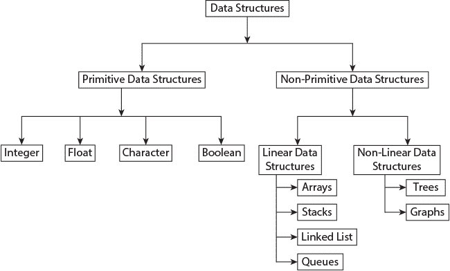

图 3.1 数据结构分类。

或以括号表示的形式：

`A(0)`、`A(1)`、`A(2)`、…、`A(n – 1)`

或以中括号表示的形式：

`A[0]`、`A[1]`、`A[2]`、…、`A[n – 1]`

无论使用何种符号，在 `A[K]` 中，数字 `K` 称为下标，`A[K]` 称为下标变量。

计算机内存中的数组可以表示所示图 3.2。此外，将在第 4 章中详细讨论带有少量示例的数组。

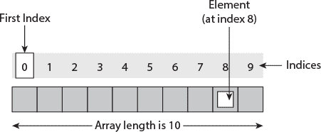

图 3.2 10 个元素数组的内存表示。

## 链表

链表是另一种线性数据结构，其中数据元素（称为节点 `nodes`）通过链接形成顺序列表。也就是说，每个节点由两部分组成：第一部分存储元素的信息，另一部分称为 `link` 或 `next field`，指向链表的后续节点。如果该节点是最后一个节点或没有后续节点，则节点的 `link` 部分存储 `null`。链表的示意图如图 3.3 所示。

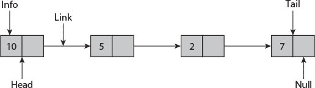

图 3.3 链接表示。链表始终保留对列表第一个节点的引用，称为 `head`，而 `tail` 引用用于指向列表的最后一个节点。链表将在第 4 章中进行详细定义和讨论。

## 栈和队列

除了数组和链表，还有两种类型的线性数据结构，即栈和队列。`stack` 是数据元素的有限集合，插入和删除只能发生在一端，即栈的顶部（`top`）。这意味着最后插入的元素最先删除（也称为后进先出或 LIFO）。另一方面，`queue`（也称为先入先出或 FIFO）是数据元素的有限集合，插入只发生在列表的一端，称为尾部（`rear`），而删除发生在列表的另一端，称为头部（`front`）。图 3.4 给出了栈和队列的顺序表示；我们将在第 6 章中详细讨论它们。

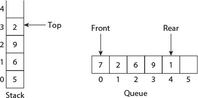

图 3.4 栈和队列的顺序表示。

## 树

树是非线性数据结构，它包含以节点形式存在的有限数据元素，并维护它们之间的层级关系。在所有节点中，有一个指定的节点称为根节点，其余节点被分为不相交的集合，使得每个集合都是根的子树。在数据结构中，我们研究树的最简单形式——`二叉树`，它由一个根节点（假设为 `R`）以及 `R` 的左右子树（假设为 `T[1]` 和 `T[2]`）组成。子树 `T[1]` 和 `T[2]` 也保留了二叉树 `R` 的属性。二叉树的不同形式及其应用将在第 8 章、第 9 章和第 11 章中详细讨论。二叉树的图示表示如图 3.5 所示。

## 图

图也是非线性数据结构，其本质上不一定是层级性的，但维护了元素对之间的关系。图广泛用于建模任何实体或事物相互关联的情况。图被广泛用于建立线条连接元素对的模型，如图 3.6 所示。我们将在第 12 章中详细讨论图。

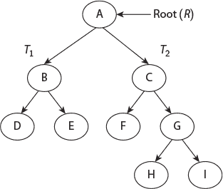

图 3.5 二叉树的图示表示节点 `R`、左子树 `T[1]` 和右子树 `T[2]`。

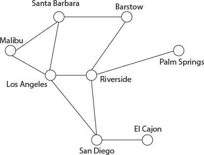

图 3.6 图的示例。

### 3.1.3 数据结构上的操作

以下是对数据结构可以执行的基本操作：

- **遍历**：访问每个数据元素进行处理。
- **查找**：为给定的键查找元素。
- **插入**：向结构中添加新元素。
- **删除**：从结构中移除现有元素。
- **排序**：按某种顺序排列元素。
- **合并**：将两个结构结合。

### 3.1.4 抽象数据类型

抽象数据类型（ADT）是指定数据结构的逻辑或数学模型的工具。换句话说，它是观察数据结构的方式，只关注它做什么，而不是关注实现。从根本上说，ADT 是数据和数据操作的定义，但不具有实现细节。这些定义了如何组织数据以及可以执行哪些操作（例如插入、删除、查找、排序等），但具体的实现完全取决于编程语言（`C`、`C++`、`Java`、`Python` 等），这些对用户是的。

## 3.2 实证分析

研究算法效率的一种方法是实现它，并在各种测试输入上运行程序，同时记录每次执行花费的时间。在 Java 中收集此类运行时间的简单机制是基于使用 `System` 类的 `currentTimeMillis` 方法。该方法报告了自基准时间（纪元，1970 年 1 月 1 日 UTC）以来经过的毫秒数。我们并不是对自纪元的时间；关键在于，如果在执行算法之前和之后立即记录时间，就可以通过计算差来测量算法执行的经过时间。自动化此过程的典型方法如代码片段 3.1 所示。

```java
long startTime = System.currentTimeMillis(); // 记录开始时间

/* (运行算法) */

long endTime = System.currentTimeMillis(); // 记录结束时间

long elapsed = endTime – startTime; // 计算经过时间
```

**代码片段 3.1** 在 Java 中对算法计时的典型方法。

通过这种方式测量流逝的时间可以合理地反映算法的效率；对于极快速的操作，Java 提供了一个方法 `nanoTime`，它以纳秒而非毫秒为单位进行测量。

由于我们关注运行时间与输入大小及结构之间的通用依赖关系，因此我们应该对许多不同大小的测试输入进行独立实验。然后，我们可以通过将算法每次运行的性能绘制成点（其中 `x` 坐标等于输入大小 `n`，`y` 坐标等于运行时间 `t`）来实现结果的可视化。这种可视化可以为问题规模与算法执行时间之间的关系提供直观理解。随后可能会进行统计分析，试图拟合一个最能描述输入大小与实验数据之间最佳函数。为了使这种分析具有意义，我们需要选择良好的样本输入，并测试足够多的样本，以便对算法的运行时间得出可靠的统计推断。

然而，通过 `currentTimeMillis` 和 `nanoTime` 两种方法报告的测量时间在不同机器之间会有巨大差异，即使在同一台机器上，每次实验的结果也可能不同。这是因为许多进程共享计算机的 `central processing unit`（或 `CPU`）和内存系统；因此，流逝的时间取决于执行测试时计算机上运行的其他进程。虽然精确的运行时间可能不可靠，只要是在相似的情况下收集的数据，实验在比较两个或多个算法的效率时是非常有用的。

作为实验分析的一个具体示例，我们考虑了在 Java 中构建长字符串的两种算法。我们的目标是拥有一个调用签名类似于 `repeat('*', 40)` 的方法，生成一个由 40 个星号组成的字符串："****************************************"。

我们考虑的第一种算法是基于 `+` 运算符的重复字符串拼接。它被实现为代码片段 3.2 中的方法 `repeat1`。第二种算法依赖于 Java 的 `StringBuilder` 类（参见第 1.3 节），并被实现为代码片段 3.2 中的方法 `repeat2`。

作为实验，我们使用了类似代码片段 3.1 风格的 `System.currentTimeMillis()` 来测量 `repeat1` 和 `repeat2` 处理非常大字符串时的效率。我们执行了构建长度增加的实验，以探索运行时间与字符串长度之间的关系。我们的实验结果如表 3.1 所示，并在图 3.7 中以对数坐标绘制成图表。

```java
/** 使用重复拼接构造一个包含 n 个字符 c 拷贝的 String。 */

public static String repeat1(char c, int n) {
  String answer = "";

  for (int j = 0; j < n; j++)
    answer += c;

  return answer;
}

/** 使用 StringBuilder 构造一个包含 n 个字符 c 拷贝的 String。 */

public static String repeat2(char c, int n) {
  StringBuilder sb = new StringBuilder();

  for (int j = 0; j < n; j++)
    sb.append(c);

  return sb.toString();
}
```


| *n* | `repeat1` (ms) | `repeat2` (ms) |
| :--- | :--- | :--- |
| 50,000 | 2884 | 1 |
| 100,000 | 7437 | 2 |
| 200,000 | 17158 | 3 |
| 400,000 | 39173 | 7 |
| 800,000 | 90836 | 13 |
| 1,600,000 | 207496 | 28 |
| 3,200,000 | 464275 | 59 |
| 6,400,000 | 995421 | 125 |
| 12,800,000 | 2259694 | 278 |

为了刻画算法运行时间的增长阶，我们将为每个算法关联一个函数 `f(n)`，该函数刻画了随输入规模 `n` 变化的执行的原操作次数。第 3.3 节将介绍最常见的七种函数，第 3.4 节将引入一个用于比较函数的数学框架。

## 关注最坏情况输入

算法在某些输入上的运行速度可能比在相同规模的其他输入上快。因此，我们可能希望将算法的运行时间表示为输入规模的函数，通过对所有相同规模可能的输入取平均值得到。遗憾的是，这种**平均情况（`average-case`）**分析通常非常具有挑战性。它要求我们在输入集上定义一个概率分布，这通常是一项艰巨的任务。图 3.8 示意地展示了根据输入分布，算法的运行时间如何处于最坏情况和最佳情况之间的任何位置。例如，如果输入真的只有“A”或“D”类型怎么办？

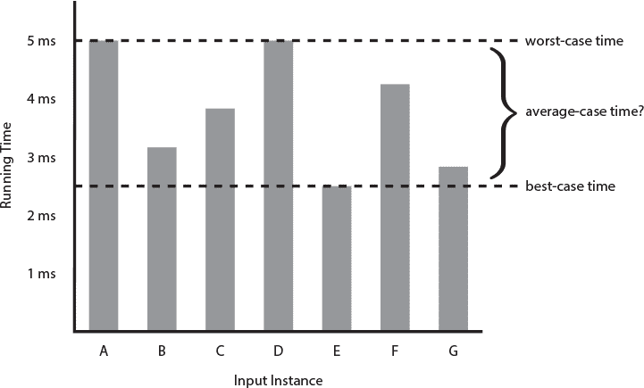

图 3.8 最佳情况与最坏情况时间的差异。每个条形代表某些算法在不同可能输入上的运行时间。

平均情况分析通常要求我们根据给定的输入分布计算期望运行时间，通常涉及复杂的概率论。因此，在本书的剩余部分，除非另有说明，我们将运行时间刻画为算法的**最坏情况（`worst case`）**，即输入规模 `n` 的函数。

最坏情况分析比平均情况分析容易得多，因为它只需要识别最坏情况输入的能力，而这通常是简单的。此外，这种方法通常会导致更好的算法。将算法的成功标准设定为在最坏情况下表现良好，必然要求它在**每（`every`）**输入上都表现良好。也就是说，针对最坏情况进行设计会导致更强大的算法“肌肉”，就像一个始终在坡度上跑步的田径星。

## 3.3 常见数学函数

在本节中，我们将简要讨论算法分析中最重要的七个函数。在书中进行的几乎所有分析中，我们只使用这七个简单函数。事实上，任何使用这七个之外函数的章节都将标记一个星号（`*`）以指示它是可选的。除了这七个基础函数外，附录（可在配套网站上找到）包含了其他适用于数据结构和算法分析的有用数学事实列表。

### 常数函数

我们可以想到的最简单的函数是**常量函数（`constant function`）**，即：

`f(n) = c`,

对于某些固定常量 `c`，例如 `c = 5`、`c = 27` 或 `c = 2¹⁰`。这意味着对于任何参数 `n`，常量函数 `f(n)` 都分配值 `c`。换句话说，`n` 的值是多少并不重要；`f(n)` 始终等于常量 `c`。

由于我们最感兴趣的是整数函数，最基本的常量函数是 `g(n) = 1`，这是我们在书中使用的典型常量函数。注意，任何其他常量函数 `f(n) = c` 都可以写为常量 `c` 乘以 `g(n)`。在这种情况下，`f(n) = cg(n)`。

尽管常量函数很简单，但它在算法分析中很有用，因为它刻画了在计算机上执行基本操作所需的步骤，例如两个数字相加、给变量赋值或比较两个数字。

### 对数函数

数据结构和算法分析中有趣且有时令人惊讶的方面之一是**对数函数（`logarithm function`）**的普遍存在，`f(n) = log[b] n`，其中 `b > 1` 为常量。该函数定义为幂函数的逆函数如下：

`x = log[b] n` 当且仅当 `b^x = n`。

值 `b` 称为对数的**底（`base`）**。根据上述定义，对于任何底 `b > 0`，我们有 `log[b] 1 = 0`。

计算机科学中最常见的对数函数底是 2，因为计算机用二进制存储整数。事实上，这个底非常常见，以至于当它是 2 时我们通常会在符号中省略它。也就是说，对我们来说：

`log n = log[2] n`。

我们注意到大多数手持计算器都有一个标记为 `LOG` 的按钮，但这通常用于计算以 10 为底的对数，而不是以 2 为底。

对任何整数 `n` 精确计算对数函数涉及微积分，但我们可以使用足够满足目的的近似值。我们记得实数 `x` 的**向上取整（`ceiling`）**是大于或等于 `x` 的最小整数，记为 `⌈x⌉`。`x` 的向上取整可以看作 `x` 的整数近似，因为有 `x ≤ ⌈x⌉ < x + 1`。对于正整数 `n`，实数 `x` 的向上取整是大于或等于 `x` 的最小整数，记为 `⌈x⌉`。

也就是说，该函数为输入 `n` 分配 `n` 乘以 `n` 的以 2 为底对数。该函数的增长速度比线性函数快一点，但比二次函数慢得多；因此，我们更倾向于使用运行时间与 `n` log `n` 成比例的算法，而不是运行时间为二次的算法。我们将看到几种运行时间与 `n-log-n` 函数成比例的重要算法。例如，对 `n` 个任意值进行排序的最快算法需要与 `n log n` 成比例的时间。

## 二次函数

算法分析中经常出现的另一个函数是`二次函数`，

`f(n) = n²`。

也就是说，给定一个输入值 `n`，函数 `f` 分配 `n` 与自身的乘积（换句话说，“`n` 的平方”）。

`二次函数`出现在算法分析中的主要原因是，许多算法包含嵌套循环，其中内层循环执行线性次数的操作，而外层循环被执行了线性次数。因此，在这种情况下，算法执行了 `n · n = n²` 次操作。

## 嵌套循环与二次函数

`二次函数`也可以出现在嵌套循环的语文中，其中循环的第一次迭代使用一次操作，第二次使用两次操作，第三次使用三次操作，以此此类推。也就是说，操作的次数为

1 + 2 + 3 + ... + (n - 2) + (n - 1) + n。

换句话说，如果循环内部执行的操作次数随着外层循环的每次迭代增加一次，那么这就是嵌套循环执行的操作总数。这个数值也有一个有趣的历史。

1787 年，一位德国教师决定通过相加 1 到 100 的整数来让他 9 岁和 10 岁的学生忙碌。但几乎立刻其中一个孩子就声称他有了答案！老师很怀疑，因为那个学生的写板上只有答案。但答案 5050 是正确的，而那个学生 `Carl Gauss`（高斯）长大后成为了他时代最伟大的数学家之一。我们推测年轻的`Gauss` 使用以下等式。

**[命题 3.2]:** 对于任何整数 `n` ≥ 1，我们有：

$1 + 2 + 3 + \cdots + (n - 2) + (n - 1) + n = \frac{n(n + 1)}{2}.$

我们在 [图 3.9] 中给出了 [命题 3.2] 的两种“视觉化”证明。从 [命题 3.2] 中得到的启训是，如果我们执行一个嵌套循环的算法，使得内层循环的操作每次增加一次，那么总操作次数相对于外层循环执行的次数 `n` 来说是二次的公平地说，操作次数是 `n²/2 + n/2`，因此这比每次执行内层循环都使用 `n` 次操作的算法的操作次数仅多了一半。但其增长阶仍然是 `n` 的二次方。

## 三次函数与其他多项式

继续讨论关于输入次数幂的函数，我们考虑`三次函数`，

`f(n) = n³`，

它为输入值 `n` 分配 `n` 与自身三次的乘积。

`三次函数`在算法分析中出现的频率比之前提到的常数、线性、二次函数低，但它确实会偶尔。

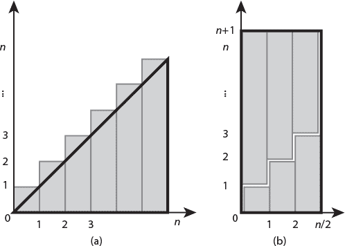

[图 3.9] [命题 3.2] 的视觉化证明。这两幅图都通过 `n` 个高度为 1, 2, …, `n` 的单位宽矩形所覆盖的总面积来视觉化该等式。在 (a) 中，所示矩形覆盖了一个面积为 `n²/2`（底为 `n`，高为 `n`）的大三角形，加上 `n` 个面积均为 1/2 的小三角形（底为 1，高为 1）。在 (b) 中（仅适用于 `n` 为偶数时），所示矩形覆盖了一个底为 `n/2`、高为 `n+1` 的大矩形。

## 多项式

线性、二次和三次都可以被视为更大类函数——`多项式`的一部分。一个`多项式`函数的形式为

`f(n) = a[0] + a[1]n + a[2]n² + a[3]n³ + ... + a[d]n^(d)`，

其中 `a[0]`、`a[1]`、 ..., `a[d]` 是常数，而 `d` 是多项式的`次数`（degree）。例如，以下都是多项式：

*   `f(n) = n`
*   `f(n) = n²`
*   `f(n) = n³`

## 求和

算法分析中反复出现的一个符号是`求和`，它的定义为：

$\sum_{i=a}^{b} f(i) = f(a) + f(a+1) + ... + f(b)$，

其中 `a` 和 `b` 是整数且 `a ≤ b`。求和在数据结构分析中出现是因为运行时间自然而然地产生求和。

使用求和，我们可以将 [命题 3.2] 的公式重写为

$\sum_{i=1}^{n} i = \frac{n(n + 1)}{2}.$

同样，我们可以将系数为 `a[i]`、次数为 `d` 的多项式 `f(n)` 写为

$f(n) = \sum_{i=0}^{d} a_{i}n^{i}.$

## 指数函数

算法分析中使用的另一个函数是`指数函数`，

`f(n) = b^n`，

其中 `b` 是正常数，称为`底`，而参数 `n` 是`指数`。也就是说，函数 `f(n)` 为输入参数 `n` 分配底 `b` 自相乘 `n` 次得到的值。正如对数函数一样，算法分析中指数函数常用的底是 `b = 2`。例如，包含 `n` 位的整数字可以表示小于 `2^n` 的所有非负整数。如果我们有一个循环从执行一次操作开始，然后每次迭代执行的操作次数翻倍，那么第 `n` 次迭代执行的操作次数就是 `2^n`。

然而，我们有时会有 `n` 以外的指数；因此了解一些处理指数的规则是有用的。特别是以下`指数规则`非常有帮助。

**命题 3.3 (指数规则):** 给定正整数 `a`、`b` 和 `c`，我们有：

1.  `(b^a)^c = b^(ac)`
2.  `b^ab^c = b^(a+c)`
3.  `b^a/b^c = b^(a-c)`

例如，我们有：

*   256 = 16² = (2⁴)² = 2^(4·2) = 2⁸ = 256
*   243 = 3⁵ = 3^(2+3) = 3²3³ = 9 · 27 = 243
*   16 = 1024/64 = 2¹⁰/2⁶ = 2^(10−6) = 2⁴ = 16

我们可以将指数函数扩展到分数、实数指数以及负指数，如下所示。对于一个正整数 `k`，我们定义 `b^(1/k)` 为 `b` 的 `k` 次根，即满足 `r^k = b` 的数字 `r`。例如，`25^(1/2) = 5`，因为 `5² = 25`。同样，`27^(1/3) = 3` 和 `16^(1/4) = 2`。根据指数规则 1，这种方法允许我们定义任何指数为分数的幂，即 `b^a/c = (b^a)^(1/c)`。例如，`9^(3/2) = (9³)^(1/2) = 729^(1/2) = 27`。因此，`b^a/c` 实际上就是整数指数 `b^a` 的 `c` 次根。

我们可以通过计算一系列逐渐接近 `x` 的分数 `a/c` 形式的 `b^a/c` 数字，进一步扩展指数函数以定义任意实数 `x` 的 `b^x`。任何实数 `x` 都可以被分数 `a/c` 无限地近似；因此，我们可以使用分数 `a/c` 作为 `b` 的指数来得到无限接近 `b^x` 的值。例如，数字 `2^p` 是良。最后，给定负指数 `d`，我们定义 `b^d = 1/b⁻d`，这对应于在 `a = 0` 和 `c = −d` 时应用指数规则 3。例如，`2^(−3) = 1/2³ = 1/8`。

## 几何级数

假设我们有一个循环，其中每次迭代的时间比上一次多出一个倍数。可以使用以下命题对循环进行分析。

**命题 3.4:** 对于任意整数 `n ≥ 0` 和任意满足 `a > 0` 且 `a ≠ 1` 的实数 `a`，考虑求和：

$\sum\limits_{i = 0}^{n}{a^{i} = 1 + a + a^{2} + ... + a^{n}}$

（记住如果 `a > 0`，则 `a⁰ = 1`）。该求和等于：

$\frac{a^{n + 1} - 1}{a - 1}.$

命题 3.4 所示的求和被称为几何级数，因为如果 `a > 1`，每一项在几何上都比前一项大。例如，所有从事计算工作的人应该知道：

1 + 2 + 4 + 8 + ... + 2^(n−1) = 2^(n)−1,

因为这是用 `n` 位二进制表示法表示的最大无符号整数。

## 取整函数和向上函数

在讨论对数时，我们注意到其值通常不是整数，但算法的运行时间通常用整数数量来表示，例如执行的操作次数。因此，算法的分析有时可能涉及下取整和向上函数，它们的定义分别如下：

- `⌊x⌋` = 小于或等于 `x` 的最大整数。（例如，`⌊3.7⌋ = 3.`）
- `⌈x⌉` = 大于或等于 `x` 的最小整数。（例如，`⌈5.2⌉ = 6.`）

### 3.3.1 比较增长率

总结来说表 3.2 按顺序显示了算法分析中使用的七种常用函数。

理想情况下，我们希望数据结构操作的时间与常数函数或对数函数成正比，并希望算法运行在线性或 `n-log-n` 时间内。运行时间为二次或三次的算法实用性较低，而运行时间为指数级的算法对于除最小规模输入外都是不可行的。这七种函数的图表见图 3.10。

| 常数 | 对数 | 线性 | n-Log-n | 二次 | 三次 | 指数 |
| :--- | :--- | :--- | :--- | :--- | :--- | :--- |
| 1 | log `n` | `n` | `n log n` | `n²` | `n³` | `a^n` |

**表 3.2** 算法分析中常用的七种函数。我们回顾 `log n = log[2]n`。此外，我们用 `a` 表示大于 1 的常数。

## 3.4 渐近符号

在算法分析中，我们关注运行时间随输入规模 `n` 变化的增长率，采用“大局”方法。例如，了解算法的增长率比精确的执行时间更重要。我们使用渐近符号来比较不同算法的效率。

### 3.4.1 定义符号

#### 大 O (Big-Oh)

设 `f(n)` 和 `g(n)` 为正函数。如果存在常数 `c > 0` 和整数 `n₀ ≥ 0`，使得对于所有的 `n ≥ n₀` 都有 `f(n) ≤ c g(n)`，则说 `f(n)` 是 `O(g(n))`。

该符号用于提供函数增长率的上界。

#### 大 Omega (Big-Omega)

如果存在常数 `c > 0` 和整数 `n₀ ≥ 0`，使得对于所有的 `n ≥ n₀` 都有 `f(n) ≥ c g(n)`，则说 `f(n)` 是 `Ω(g(n))`。该符号用于提供函数增长率的下界。

#### Theta (Big-Theta)

如果 `f(n)` 既是 `O(g(n))` 又是 `Ω(g(n))`，则说 `f(n)` 是 `Θ(g(n))`。这意味着存在常数 `c1, c2 > 0` 和整数 `n₀ ≥ 0`，使得对于所有的 `n ≥ n₀` 都有 `c1 g(n) ≤ f(n) ≤ c2 g(n)`。该符号用于提供函数增长率的紧界。

#### 小 o (Little-oh)

如果对于任意常数 `c > 0`，存在整数 `n₀ ≥ 0`，使得对于所有的 `n ≥ n₀` 都有 `f(n) < c g(n)`，则说 `f(n)` 是 `o(g(n))`。这表示 `f(n)` 增长比 `g(n)` 慢。

#### 小 omega (Little-omega)

如果对于任意常数 `c > 0`，存在整数 `n₀ ≥ 0`，使得对于所有的 `n ≥ n₀` 都有 `f(n) > c g(n)`，则说 `f(n)` 是 `ω(g(n))`。这表示 `f(n)` 增长比 `g(n)` 快。

### 3.4.2 符号示例

下表总结了常见函数的增长率：

| `f(n)` | `O(f(n))` | `Ω(f(n))` | `Θ(f(n))` | `o(f(n))` | `ω(f(n))` |
| :--- | :--- | :--- | :--- | :--- | :--- |
| `1` | `O(1)` | `Ω(1)` | `Θ(1)` | `o(log n)` | `ω(1/n)` |
| `log n` | `O(log n)` | `Ω(log n)` | `Θ(log n)` | `o(n)` | `ω(1)` |
| `n` | `O(n)` | `Ω(n)` | `Θ(n)` | `o(n log n)` | `ω(log n)` |
| `n log n` | `O(n log n)` | `Ω(n log n)` | `Θ(n log n)` | `o(n²)` | `ω(n)` |
| `n²` | `O(n²)` | `Ω(n²)` | `Θ(n²)` | `o(n³)` | `ω(n)` |
| `n³` | `O(n³)` | `Ω(n³)` | `Θ(n³)` | `o(2ⁿ)` | `ω(n²)` |
| `2ⁿ` | `O(2ⁿ)` | `Ω(2ⁿ)` | `Θ(2ⁿ)` | `o(n!)` | `ω(n³)` |
| `n!` | `O(n!)` | `Ω(n!)` | `Θ(n!)` | `none` | `ω(2ⁿ)` |

注意对于 $5*n⁴ + 3*n³ + 2*n² + 4*n + 1 \le (5 + 3 + 2 + 4 + 1)*n⁴ = cn⁴$，当 $n \ge n[0] = 1$ 时，$c = 15$。事实上，我们可以刻画任何多项式函数的增长率。

**命题 3.5:** 如果 $f(n)$ 是一个 $d$ 次多项式，即：

$f(n) = a[0] + a[1]n + \dots · + a[d] n^d$，

且 $a[d] > 0$，则 $f(n)$ 是 $O(n^d)$。

**证明：** 注意对于 $n \ge 1$，我们有 $1 \le n \le n² \le \dots · \le n^d$；因此，

$a[0] + a[1]n + a[2]n² + \dots + a[d]n^{(d)} \le (|a[0]|+|a[1]|+|a[2]|+\dots + |a[d]|)*n^{(d)}$。

我们通过定义 $c = |a[0]|+|a[1]|+\dots + |a[d]|$ 和 $n[0] = 1$ 来证明 $f(n)$ 是 $O(n^d)$。◼

因此，多项式中的最高次项是决定该多项式渐近增长率的项。我们在练习中考虑大-O 符号的一些额外属性。让我们在这里进一步考虑一些例子，专注于算法设计中使用的七种基本函数的组合。我们依赖于对于 $n \ge 1$ 有 $\log n \le n$ 的数学事实。

### 示例 3.4:

$5n² + 3n \log n + 2n + 5$ 是 $O(n²)$。

#### 证明：

$5n² + 3n \log n + 2n + 5 \le (5 + 3 + 2 + 5)*n² = cn²$，当 $n \ge n[0] = 1$ 时，$c = 15$。

### 示例 3.5:

$20n³ + 10n \log n + 5$ 是 $O(n³)$。

#### 证明：

$20n³ + 10n \log n + 5 \le 35n³$，当 $n \ge 1$ 时。

### 示例 3.6:

$3 \log n + 2$ 是 $O(\log n)$。

#### 证明：

$3 \log n + 2 \le 5 \log n$，当 $n \ge 2$ 时。注意当 $n=1$ 时 $\log n$ 为零。这就是为什么我们在这种例中使用 $n \ge n[0] = 2$。

### 示例 3.7:

$2^{(n+2)}$ 是 $O(2^n)$。

#### 证明：

$2^{(n+2)} = 2^n \cdot 2² = 4 \cdot 2^n$；因此，在这种情况下我们可以取 $c = 4$ 和 $n[0] = 1$。

### 示例 3.8:

$2n + 100 \log n$ 是 $O(n)$。

#### 证明：

$2n + 100 \log n \le 102n$，当 $n \ge n[0] = 1$ 时；因此，在这种情况下我们可以取 $c = 102$。

##### 用最简单的术刻画函数

一般来说，我们应该使用大-O 符号尽可能准确地刻画函数。虽然函数 $f(n) = 4n³ + 3n²$ 确实是 $O(n⁵)$ 甚至是 $O(n⁴)$，但说 $f(n)$ 是 $O(n³)$ 更准确。类比考虑这样一个场景：一个饥饿的旅行者在一条长的公路上开车，遇到一个正从市场走回家的当地农民。如果旅行者问农民还要开车多久才能找到食物，农民说“肯定不超过 12 小时”也许是诚实的，但如果他说“沿着这条路开车几分钟就能找到市场”会要准确得多（也更有帮助）。因此，即使使用大-O 符号，我们也应该努力尽可能告诉我们的事实。

在大-O 符号中包含常数因子和低阶项也被认为是不恰当的。例如，说函数 $2n²$ 是 $O(4n² + 6n)$ 是并不时尚的，尽管这是正确的。我们应该努力用最简单的术语描述该函数。

第 3.3 节中列出的七种函数是结合大-O 符号刻画运行时间和空间用用的最常用函数。事实上，我们通常使用这些函数的名称来指代它们所刻画的运行时间。例如，我们会说最坏情况运行时间为 $4n² + n \log n$ 的算法是二次时间算法，因为它运行在 $O(n²)$ 时间内。同样，一个运行时间最多为 $5n + \log n + 4$ 的算法被称为线性时间算法。

#### Big-Omega

由于大-O 符号提供了一种渐近的方式表示一个函数“小于或等于”另一个函数，以下符号提供了一种渐近的方式表示函数增长率“大于等于”另一个。设 $f(n)$ 和 $g(n)$ 为从整数映射到实数的函数。如果 $g(n)$ 是 $O(f(n))$，我们称 $f(n)$ 是 $\Omega(g(n))$，读作“f 是 g 的 Big-Omega”，存在实数常 $c > 0$ 和整数常 $n[0] \ge 1$，使得：

$\begin{matrix} {f(n) \geq cg(n), & {\text{for}}\, n \geq n_{0}.} \end{matrix}$

这允许我们渐近地说一个函数大于另一个（考虑常数因子）。

### 示例 3.9:

$3n \log n - 2n$ 是 $\Omega(n \log n)$。

#### 证明：

$3n \log n - 2n = n \log n + n(\log n - 2) \ge n \log n$，当 $n \ge 2$ 时；因此在这种情况下我们可以取 $c = 1$ 和 $n[0] = 2$。

#### Big-Theta

此外，有一种符号允许我们说两个函数的增长率相同（考虑常数因子）。我们称 $f(n)$ 是 $\Theta(g(n))$，读作“f 是 g 的 Big-Theta”，如果 $f(n)$ 是 $O(g(n))$ 且 $f(n)$ 是 $\Omega(g(n))$，即存在实数 $c' > 0$ 和 $c'' > 0$，以及整数常 $n[0] \ge 1$，使得：

$\begin{matrix} {c'g(n) \leq f(n) \leq c''g(n), & {\text{for}}\, n \geq n_{0}.} \end{matrix}$

### 示例 3.10:

$3n \log n + 4n + 5 \log n$ 是 $\Theta(n \log n)$。

#### 证明：

$3n \log n + 4n + 5 \log n \le (3 + 4 + 5)*n \log n$，当 $n \ge 2$ 时。

#### 小 or Little “Oh”

一个函数 $f(n)$ 可以写为 $f(n) = o(g(n))$（读作“f 是 g 的小 o”），如果 $f(n)$ 是 $o(g(n))$ 且 $f(n) \neq \Omega(g(n))$。换句话说，$f(n)$ 是 $o(g(n))$ 意味着：

$\lim_{n\to\infty}\frac{f(n)}{g(n)} = 0$

这意味着 $f(n)$ 的增长比 $g(n)$ 慢。

### 示例 3.11:

$6n + 7$ 是 $o(n²)$。

#### 证明：

对于 $f(n) = 6n + 7$，我们可以有 $f(n) = o(n²)$ 但 $f(n) \neq \Omega(n²)$。因此，$f(n) = o(n²)$。然而，$f(n) \neq o(n)$。

#### 小 or Little “Omega”

一个函数 $f(n)$ 可以写为 $f(n) = \omega(g(n))$（读作“f 是 g 的小 omega”），如果 $f(n)$ 是 $\Omega(g(n))$ 且 $f(n) \neq O(g(n))$。换句话说，$f(n)$ 是 $\omega(g(n))$ 意味着：

$\lim_{n\to\infty}\frac{f(n)}{g(n)} = \infty$

这意味着 $f(n)$ 的增长比 $g(n)$ 高。

### 示例 3.12:

$6n² + 7$ 是 $\omega(n)$。

#### 证明：

对于 $f(n) = 6n² + 7$，我们可以有 $f(n) = \Omega(n)$ 但 $f(n) \neq O(n)$。因此，$f(n) = \omega(n)$。

### 3.4.2 比较分析

大-O 符号被广泛用于根据某些参数 $n$ 来刻画运行时间和空间边界，其中 $n$ 被定义为问题“大小”的选定度量。假设有两个解决相同问题的可用算法：算法 $A$ 的运行时间为 $O(n)$，算法 $B$ 的运行时间为 $O(n²)$。哪个算法更好？我们知道 $n$ 是 $O(n²)$，这意味着算法 $A$ **渐近优于** 算法 $B$，尽管对于较小的 $n$ 值，$B$ 的运行时间可能比 $A$ 短。

我们可以使用大-O 符号按增长率对函数类进行排序。我们的七种函数按增长率增加按以下顺序排列，使得如果函数 $f(n)$ 在函数 $g(n)$ 之前，则 $f(n)$ 是 $O(g(n))$：

$\begin{matrix} {1,} & {\log n,} & {n,} & {n\,\log n,} & {n^{2},} & {n^{3},} & {2^{n}.} \end{matrix}$

我们在表 3.3 中展示了这七种函数的增长率。（另参见 第 3.3.1 节 中的图 3.10。）

| ***n*** | **log *n*** | ***n*** | ***n* log *n*** | ***n*²** | ***n*³** | **2*^n*** |
| 8 | 3 | 8 | 24 | 64 | 512 | 256 |
| 16 | 4 | 16 | 64 | 256 | 4,096 | 65,536 |
| 32 | 5 | 32 | 160 | 1,024 | 32,768 | 4,294,967,296 |

| 64 | 6 | 64 | 384 | 4,096 | 262,144 | 1.84 × 10¹⁹ |
| 128 | 7 | 128 | 896 | 16,384 | 2,097,152 | 3.40 × 10³⁸ |
| 256 | 8 | 256 | 2,048 | 65,536 | 16,777,216 | 1.15 × 10⁷⁷ |
| 512 | 9 | 512 | 4,608 | 262,144 | 134,217,728 | 1.34 × 10¹⁵⁴ |

**表 3.3** 算法分析中基本函数的选取值。

我们在表 3.4 中进一步说明了渐近视角的重要性。该表探索了算法在 1 秒、1 分钟和 1 小时内处理的输入实例的最大规模。它展示了良好的算法设计的重要性，因为从长远来看，渐近慢的算法会被渐近快的算法超越，即使渐近快算法的常数因子更差。

| 运行时间 (*µ*s) | 最大问题规模 (*n*) | | |
| :--- | :--- | :--- | :--- |
| 1 秒 | 1 分钟 | 1 小时 | |
| 400*n* | 2,500 | 150,000 | 9,000,000 |
| 2*n*² 2*^n* | 707 19 | 5,477 25 | 42,426 31 |

**表 3.4** 在以微秒为单位的各种运行时间内，可在 1 秒、1 分钟和 1 小时内解决的问题的最大规模。

然而，良好的算法设计的重要性不仅在于在给定计算机上可以有效解决的问题。如表 3.5 所示，即使我们实现了硬件的飞跃式加速，仍然无法克服渐近慢算法的劣势。该表显示了在假设给定运行时间的算法现在运行在比之前快 256 倍的计算机上，任何固定时间内可以达到的新最大问题规模。

| 运行时间 | 新最大问题规模 |
| :--- | :--- |
| 400*n* 2*n*² 2*n* | 256*m* 16*m* |
| *m* + 8 | |

**表 3.5** 使用比之前快 256 倍的计算机，在固定时间内可解决的问题规模的增加情况。每个条目都是 *m*（之前的最大问题规模）的函数。

#### 注意事项

这里需要对渐近符号给出几点警告。首先，请注意，如果大 O（big-Oh）及相关符号所“隐藏”的常因子很大，使用这些符号可能会具有误导性。例如，虽然函数 10¹⁰⁰*n* 确实是 `O`(*n*)，但如果这个算法的运行时间与运行时间为 10*n* log *n* 的算法相比，我们倾向于选择 `O`(*n* log *n*) 时间算法，尽管线性时间算法在渐近上更快。这种偏好是因为常数因子 10¹⁰⁰（被称为“古戈”，one googol）被许多天文学家认为是观测宇宙中原子数量的上限。因此，我们可能遇到以这个数字作为输入规模的现实问题。

上述观察引发了什么是“快速”算法的问题。通常来说，任何以 `O`(*n* log *n*) 时间运行（带有合理的常数因子）的算法都应该被认为是高效的。即使是 `O`(*n*²) 时间函数在某些背景下也可能足够快，即当 *n* 较小时。但运行时间为指数函数的算法（例如 `O`(2*^n*)）几乎永远不应该被认为是高效的。

### 示例 3.13:

*为了说明，以下函数在 n 取大值时按渐近增长率的排序如下：*

2¹⁰ ≤ 2^(log *n*) ≤ 3*n* + 100log *n* ≤ 4*n* ≤ *n*log *n* ≤ 4*n*log *n* + 2*n* ≤ *n*² + 10*n* ≤ *n*³ ≤ 2^(*n*)

#### 指数级运行时间

（此处后续原文存在大量重复和乱码内容，已按要求进行清理。）

**证明：** 第 3 和第 4 行的初始化以及第 8 行的返回语句只需要常数个基本操作。循环的每次迭代也只需要常数个基本操作，且循环执行了 `n` - 1 次。因此，我们认为基本操作的数量为 `c′` · (`n` - 1) + `c″`，其中 `c′` 和 `c″` 是相应的常数，分别反映了循环体内外执行的工作。由于每个基本操作都在常数时间内运行，如果我们在不失泛性的情况下假设 `c″` ≤ `c′`，那么算法 `arrayMax` 在输入大小为 `n` 时的运行时间最多为 `c′` · (`n` − 1) + `c″` = `c′` · `n` + (`c″` − `c′`) ≤ `c′` · `n`。我们得出算法 `arrayMax` 的运行时间为 `O(n)`。◼

## 最大值算法的进一步分析

关于 `arrayMax` 的一个更有趣的问题是我们更新多少次当前的“最大”值。在最坏情况下，如果数据按递增顺序提供给我们，最大值会被重新赋值 `n` − 1 次。但如果输入是随机顺序提供的，且所有顺序出现的概率相等；那么在这种情况下，我们更新最大值的期望次数是多少呢？为了回答这个问题，请注意只有当当前元素大于其之前的所有元素时，我们才会在循环迭代中更新当前最大值。如果序列是按随机顺序提供的，那么第 `j` ^(th) 个元素是前 `j` 个元素中最大的概率是 `1/j`（假设唯一性）。因此，更新最大值的期望次数（包括初始化）为 $H_{n} = {\sum_{j = 1}^{n}{1/j}}$，这被称为 `n`^(th) 次**调和级数**。可以证明 `H[n]` 是 `O(log n)`。因此，对于随机排序的序列，`arrayMax` 更新最大值的期望次数为 `O(log n)`。

## 寻找数组中偶数索引整数之和

作为一个运行时间与 `n` 成正比的算法的经典示例，我们考虑寻找给定数组中偶数索引整数之和的目标。一种典型的策略是遍历数组元素，同时用一个变量记录到目前为止的所有偶数索引元素的总和。代码片段 3.4 展示了一种名为 `sumEvenIndex` 的方法，实现了该策略。

```


```java
/** 返回给定数组中偶数索引整数的和。 */
public static int sumEvenIndex(int[] arr) {
    int n = arr.length, total = 0; // 初始化以求和
    for (int j = 0; j < n; j += 2)
        total += arr[j]; // 所有偶数索引整数项之和
    return total; // 返回和
}
```

**代码片段 3.4** 一个返回数组中偶数索引整数之和的方法。

使用大 O 表示（big-Oh notation），我们可以对任意计算机上`sumEvenIndex`算法的运行时间写下以下数学精确的陈述。

**命题 3.7：** 计算 n 个数数组中偶数索引元素之和的算法`sumEvenIndex`运行时间`O(n)`。

**证明：** 第 3 行的初始化和第 6 行的返回语句只需要常数个基本操作。循环的每次迭代也只需要常数个基本操作，且循环执行了`n/2`次。因此，我们认为基本操作的数量为`c′ · (n/2) + c″`，其中`c′`和`c″`是相应的常数，分别反映了循环体内外执行的工作。由于每个基本操作都在常数时间内运行，如果我们不失泛性的情况下假设`c″ ≤ c′`且`n > 0`，那么算法`sumEvenIndex`在输入大小为`n`时的运行时间最多为`c′ · (n/2) + c″ ≤ c′ · n`。我们得出算法`sumEvenIndex`的运行时间为`O(n)`。◼

## 拼接长字符串

作为下一个示例，我们回顾了第 3.2 节中的实验研究，在其中我们检查了拼接长字符串的两种不同实现（参见代码片段 3.2）。我们的第一个算法基于重复使用字符串拼接运算符；为了方便起见，该方法也给出代码片段 3.5 中。

```java
/** 使用重复拼接来构造一个包含 n 次字符 c 的字符串。 */
public static String repeat1(char c, int n) {
    String answer = "";
    for (int j = 0; j < n; j++)
        answer += c;
    return answer;
}
```

**代码片段 3.5** 使用重复拼接字符串。

该实现最重要的方面是字符串是**不可变的**（immutable）。一旦创建，实例就无法修改。`answer += c`命令是`answer = answer + c`的简写。

从效率的角度来看，第一次循环时结果长度为 1，第二次为 2，依此类推，直到达到长度为`n`的最终字符串。因此，总时间与 1+2+⋯n 成比例，我们在命题 3.2 中认识熟悉的`O(n²)`。我们说“理论上”，是因为这没有考虑低阶项。我们在表 3.1 中看到`repeat1`时间的大约四倍增长。

相比之下，表中使用`StringBuilder`类的`repeat2`的运行时间显示出问题规模翻倍时时间翻倍的趋势。`StringBuilder`类依赖于构造长度为`n`字符串的最坏情况运行时间为`O(n)`；我们稍将在第 7.2 节中重点探讨该技术。

## 三集不交性

假设我们给定三个集合 A、B 和 C，它们存储在三个不同的数组中。我们假设单个集合不包含重复值，但可能存在属于两个或三个集合的数字。**三集不交性**问题是确定这三个集合的交集是否为空，即不存在元素 x 使得 x ∈ A、x ∈ B 且 x ∈ C。一个确定此属性的简单 Java 方法在代码片段 3.6 中。

```java
/** 如果三个数组没有公共元素，则返回 true。 */
public static boolean disjoint1(int[] groupA, int[] groupB, int[] groupC) {
    for (int a : groupA)
        for (int b : groupB)
            for (int c : groupC)
                if ((a == b) && (b == c))
                    return false; // 找到了公共值
    return true; // 如果到达这里，集合是不交的
}
```

**代码片段 3.6** 测试三集不交性的算法`disjoint1`。

这个简单的算法通过遍历三个集合中所有可能的数值三元组来检查这些值是否等价。如果每个原始集合的大小为`n`，那么该方法的最坏情况运行时间为`O(n³)`。

我们可以通过一个简单的观察来改进渐近性能。一旦进入对`B`的循环体内部，如果选定的元素`a`和`b`不匹配，那么遍历`C`的所有值来寻找匹配的三元组将浪费时间。利用这一观察结果，该问题的改进解决方案可以在代码片段 3.7 中找到。

```java
/** 如果三个数组没有公共元素，则返回 true。 */
public static boolean disjoint2(int[] groupA, int[] groupB, int[] groupC) {
    for (int a : groupA)
        for (int b : groupB)
            if (a == b) // 只有在发现 A 和 B 匹配时才检查 C
                for (int c : groupC)
                    if (a == c) // 此时 b 也等于 c
                        return false; // 我们发现了一个公共值
    return true; // 如果到达这里，说明集合互不相交
}
```

**代码片段 3.7** 用于测试三集合互不相交性的算法`disjoint2`。

在改进版本中，我们不仅仅是在运气好时节省了时间。我们声称`disjoint2`的*最坏情况*运行时间为`O(n²)`。存在平方数量的配对`(a, b)`需要考虑。然而，如果 A 和 B 都是由不同元素的集合，那么`a`等于`b`的配对最多只有`O(n)`个。因此，最内层的对 C 的循环最多执行`n`次。

为了计算总运行时间，我们检查了执行每行代码所花费的时间。对 A 的`for`循环的管理需要`O(n)`时间。对 B 的`for`循环的管理总计占据`O(n²)`时间，因为该循环被执行了`n`次。测试`a == b`被评估了`O(n²)`次。其余时间取决于存在多少匹配的`(a, b)`配对。正如我们所出的，最多有`n`个这样的配对；因此，对 C 的循环管理以及循环体内的命令最多使用`O(n²)`时间。根据我们对命题 3.5 的标准应用，总耗为`O(n²)`。

### 元素唯一性

与三集合互不相交问题密切相关的问题是**元素唯一性问题**。在前者，我们给定三个集合，并假设单个集合内部没有重复。在元素唯一性问题中，我们给定一个包含`n`个元素的数组，并被问该集合中的所有元素是否彼此不同。

我们对该问题的第一个解决方案使用了直接的迭代算法。代码片段 3.8 给出的`unique1`方法通过遍历所有不同的索引对`j < k`来解决元素唯一性问题，检查这些配对中是否有任何指向彼此等值的元素。它使用两个嵌套的`for`循环来实现，使得外层循环的第一次迭代会导致内层循环`n − 1`次，外层循环的第二次迭代会导致内层循环`n − 2`次，以此此类推。因此，该方法的最坏情况运行时间正比于：

(*n* − 1) + (*n* − 2) + ⋯ + 1，

我们将其识别为命题 3.2 中熟悉的`O(n²)`求和。

```java
/** 如果数组中没有重复元素，则返回 true。 */
public static boolean unique1(int[] data) {
    int n = data.length;
    for (int j = 0; j < n - 1; j++)
        for (int k = j + 1; k < n; k++)
            if (data[j] == data[k])
                return false; // 找到了重复配对
    return true; // 如果到达这里，说明元素是唯一的
}
```

**代码片段 3.8** 用于测试元素唯一的算法`unique1`。

### 使用排序作为解决问题的工具

元素唯一性问题更好的算法是基于使用排序作为解决问题的工具。在这种情况下，通过对元素数组进行排序，我们保证任何重复元素都会彼此相邻。要确定是否存在重复元素，我们只需要对排序后的数组进行单次遍历。该方法的 Java 实现在代码片段 3.9 中。

```java
/** 如果数组中没有重复元素，则返回 true。 */
public static boolean unique2(int[] data) {
    int n = data.length;
    for (int j = 0; j < n - 1; j++)
        for (int k = j + 1; k < n; k++)
            if (data[j] == data[k])
                return false; // 找到了重复配对
    return true; // 如果到达这里，说明元素是唯一的
}
```

**代码片段 3.9** 用于测试元素唯一的算法`unique2`。

排序算法将是 14 章的重点。最好的排序算法（包括`Arrays.sort`使用的算法）保证最坏情况运行时间为`O(n log n)`。

内循环由计数器`k`控制，执行`j + 1`次，取决于外层循环计数器`j`的当前值。因此，内循环中的语句`total += arr[k]`执行了`1 + 2 + 3 + … + n`次。回想命题 3.2，我们知道`1 + 2 + 3 + … + n = n(n + 1)/2`，这意味着内循环中的语句贡献了`O(n²)`的时间。对于维护计数器`k`相关的原始操作，类似的推理也需要`O(n²)`的时间。

实现`prefixSum1`的运行时间等于这些项之和。第一项是`O(1)`，第二项是`O(n)`，第三项是`O(n²)`。通过简单应用命题 3.5，`prefixSum1`的运行时间为`O(n²)`。

## 线性时间算法

在我们的第一个算法`prefixSum1`中，**前缀和**针对每个`j`的值重新计算。这为每个`j`贡献了`O(j)`的时间，导致了二次行为。为了提高效率，我们可以动态地维护当前的前缀和，有效地将`arr[0] + arr[1] + arr[2] + … + arr[j]`计算为`prefix + arr[j]`，其中当通过`j`循环的上一次遍历计算时，值`total`等于和`arr[0] + arr[1] + arr[2] + … + arr[j − 1]`。代码片段 3.11 提供了一种使用这种方法的新实现，标记为`prefixSum2`。

```java
/** 返回给定数组的前缀和的和。 */
public static int prefixSum2(int[] arr) {
    int n = arr.length, prefix = 0, total = 0;
    for (int j = 0; j < n; j++) { // 考虑数组中的所有元素
        prefix += arr[j]; // 当前元素与之前前缀的和
        total += prefix; // 所有前缀的和
    }
    return total;
}
```

**代码片段 3.11** 算法`prefixSum2`。

算法`prefixSum2`运行时间的分析如下：

- 初始化变量`n`、`prefix`和`total`使用`O(1)`时间。
- 有一个单一的`for`循环，由计数器`j`控制。该循环的维护总共贡献`O(n)`时间。
- 循环体执行`n`次，对于`j = 0, …, n − 1`。因此，语句`prefix += arr[j]`和`total += prefix`各执行了`n`次。由于这些语句中的每次迭代都使用`O(1)`时间，它们的整体贡献是`O(n)`时间。
- 最终返回`total`使用`O(1)`时间。

算法`prefixSum2`的运行时间由这四项之和给出。第一项和最后一项是`O(1)`，其余两项是`O(n)`。通过简单应用命题 3.5，`prefixSum2`的运行时间为`O(n)`，这优于算法`prefixSum1`的二次时间。

## 练习题

### 强化

1. **R-3.1** 算法`A`和`B`执行的操作次数分别为`8n log n`和`2n²`。确定`n0`使得`A`优于`B`。
2. **R-3.2** 算法`A`和`B`执行的操作次数分别为`40n²`和`2n³`。确定`n0`使得`A`优于`B`。
3. **R-3.3** 给出一个函数示例，其在对数对数坐标（log-log scale）下的图像与标准尺度下的图像相同。
4. **R-3.4** 解释为什么`n^c`的图像在对数对数坐标下是一条斜率为`c`的直线。
5. **R-3.5** 用大 O 符号定义找到从 0 到`n`（`n > 0`）所有整数和的运行时间。
6. **R-3.6** 证明以下两个等价：
   1. 算法`A`的运行时间始终为`O(f(n))`。
   2. 在坏情况下，算法`A`的运行时间为`O(f(n))`。
7. **R-3.7** 根据增长率对以下函数排序：`n³`、`2n²+6n+3`、`5nlogn+n`、`2⁸`、`n²logn+5n`。
8. **R-3.8** 以`n`表示对代码片段 3.12 中所示`sumArray`方法的运行时间给出大 O 刻画。
9. **R-3.9** 以`n`表示对代码片段 3.12 中所示`arrayMax`方法的运行时间给出大 Omega 刻画。
10. **R-3.10** 以`n`表示对代码片段 3.12 中所示`prefixAverage1`方法的运行时间给出大 O 刻画。
11. **R-3.11** 以`n`表示对代码片段 3.12 中所示`prefixAverage2`方法的运行时间给出大 Omega 刻画。
12. **R-3.12** 以`n`表示对代码片段 3.12 中所示`sumPrefixSum`方法的运行时间给出大 O 刻画。
13. **R-3.13** 证明如果`d(n)`是`O(f(n))`，则对于任何常数`a > 0`，`ad(n)`是`O(f(n))`。
14. **R-3.14** 证明如果`d(n)`是`O(f(n))`且`e(n)`是`O(g(n))`，则乘积`d(n)*e(n)`是`O(f(n)g(n))`。
15. **R-3.15** 证明如果`d(n)`是`O(f(n))`且`e(n)`是`O(g(n))`，则`d(n) + e(n)`是`O(f(n) + g(n))`。
16. **R-3.16** 证明如果`d(n)`是`O(f(n))`且`e(n)`是`O(g(n))`，则`d(n) - e(n)`**不一定**是`O(f(n) - g(n))`。

```java
/** 返回数组整数的和。 */
public static int sumArray(int[] arr) {
    int n = arr.length, total = 0;
    for (int j = 0; j < n; j++) // 从 0 到 n–1
        total += arr[j];
    return total;
}

/** 返回非空数组的最大值。 */
public static double arrayMax(double[] data) {
    int n = data.length;
    double currentMax = data[0];
    for (int j = 1; j < n; j++) // 从 1 到 n–1
        if (data[j] > currentMax)
            currentMax = data[j];
    return currentMax;
}

/** 返回一个数组 a，对于所有 j，a[j] 等于 x[0], ..., x[j] 的平均值。 */
public static double[] prefixAverage1(double[] x) {
    int n = x.length;
    double[] a = new double[n];
    for (int j = 0; j < n; j++) { // 从 0 到 n–1
        double total = 0;
        for (int i = 0; i <= j; i++) // 从 0 到 j
            total += x[i];
        a[j] = total / (j + 1);
    }
}
```


```java
28	}

29	return a;

30	}

31

32	/** 返回一个数组 a，对于所有 j，a[j] 等于 x[0], ..., x[j] 的平均值。 */

33	public static double[] prefixAverage2(double[] x) {

34		int n = x.length;

35		double[] a = new double[n];

36		double total = 0;

37		for (int j = 0; j < n; j++) { // 从 0 到 n–1

38			total += x[j];

39			a[j] = total / (j + 1);

40		}

41		return a;

42	}

43

44	/** 返回第二个数组存储来自第一个数组前缀和的次数。 */

45	public static int sumPrefixSum(int[] first, int[] second) { 假设等等数组

46		int n = first.length, count = 0;

47		for (int i = 0; i < n; i++) { // 从 0 到 n–1

48			int total = 0;

49			for (int j = 0; j < n; j++) // 从 0 到 n–1

50				for (int k = 0; k <= j; k++) // 从 0 到 j

51					total += first[k];

52			if (second[i] == total) count++;

53		}

54		return count;

55	}

```

**代码片段 3.12** 一些用于分析的算法。

1. **R-3.17** 证明如果 `d(n)` 是 `O(f(n))` 且 `f(n)` 是 `O(g(n))`，则 `d(n)` 是 `O(g(n))`。
2. **R-3.18** 证明 `O(max{f(n), g(n)})` = `O(f(n) + g(n))`。
3. **R-3.19** 证明 `f(n)` 是 `O(g(n))` 当且仅当 `g(n)` 是 `Ω(f(n))`。
4. **R-3.20** 证明如果 `p(n)` 是 `n` 的多项式，则 `log p(n)` 是 `O(log n)`。
5. **R-3.21** 证明 `25n⁴ + 13n³ + 10n² + 11n + 17` 是 `O(n⁵)`。
6. **R-3.22** 证明 `2^(n+1) + n²` 是 `O(2^n)`。

## 练习

7. **R-3.23** 证明 `2*n² + 3*n` 是 `O(n³)`。
8. **R-3.24** 证明 `3*n² + 6*n` 是 `Ω(n)`。
9. **R-3.25** 证明 `n log n` 是 `Ω(n)`。
10. **R-3.26** 证明 `n log n` 是 `ω(n²)`。
11. **R-3.27** 证明 `5*n² + 2*n + 7` 是 `o(n)`。
12. **R-3.28** 如果 `f(n)` 是正非递减函数且始终大于 1，则证明 `⌈f(n)⌉` 是 `O(f(n))`。
13. **R-3.29** 算法 `A` 对存储有 `n` 个元素的数组中的每个条目都执行一次 `O(log n)` 时间的计算。它的最坏情况运行时间是多少？
14. **R-3.30** 给定包含 `n` 个元素的数组 `X`，算法 `B` 随机从 `X` 中选择 `log n` 个元素，并对每个元素执行一次 `O(n)` 时间的计算。算法 `B` 的最坏情况运行时间是多少？
15. **R-3.31** 给定包含 `n` 个整数的数组 `X`，算法 `C` 对数组中的每个偶数执行一次 `O(n)` 时间的计算，并对每个奇数执行一次 `O(log n)` 时间的计算。算法 `C` 的最好情况和最坏情况运行时间是多少？
16. **R-3.32** 给定包含 `n` 个元素的数组 `X`，算法 `D` 对每个元素 `X[i]` 调用算法 `E`。当在元素 `X[i]` 上进行调用时，算法 `E` 的运行时间为 `O(i)`。算法 `D` 的最坏情况运行时间是多少？
17. **R-3.33** Al 和 Bob 正在为他们的算法争论。Al 声称他的 `O(n log n)` 时间方法总是比 Bob 的 `O(n²)` 时间方法快。为了解决这个问题，他们进行了一组实验。令 Al 失望的是，他们发现如果 `n < 100`，`O(n²)` 时间算法运行得更快，只有当 `n ≥ 100` 时，`O(n log n)` 时间算法才更好。解释这为什么可能的。
18. **R-3.34** 有一个著名的城市（此处不点名），其居民的声誉是：只有当餐点是他们一生体验过的最好体验时才会享受；否则，他们就讨厌。假设餐点质量在人的一生中均匀分布，描述该城市居民对餐点感到意的预期次数？

## 创造性题

1. **C-3.35** 写一个 Java 方法来在大小为 `n` 的数组中找到最小整数，并用大 O 表示法推导出运行时间。
2. **C-3.36** 举出一个正函数 `f(n)` 的例子，使得 `f(n)` 既不是 `O(n)` 也不是 `Ω(n)`。
3. **C-3.37** 证明 `∑[i = 1]^n` 是 `O(n²)`。
4. **C-3.38** 证明 `∑[i = 1]^n i/2^i < 2`。
5. **C-3.39** 用 Θ 符号分析以下方法的运行时间。

```java
public static int example1(int n) {
	int message = 0;

	for (int send = 1; send <= n; send++) // 循环从 1 到 n
		for (int receive = 1; receive <= send; receive++) // 循环从 1 到 send
			message = send + receive;

	return message;
}
```

6. **C-3.40** 如果 `b > 1` 是常数，证明 `log[b] f(n)` 是 `Θ(log f(n))`。
7. **C-3.41** 一种寻找整数数组中最小和最大元素的算法，并用 Omega 表示法推导出其复杂度。
8. **C-3.42** 描述一种使用少于 `3n/2` 次比较找到 `n` 个数最小值和最大值的算法。
9. **C-3.43** 数组 `A` 包含范围 `[0, n - 1]` 内的 `n - 1` 个唯一整数，也就是说该范围内有一个数字不在 `A` 中。设计一个 `O(n)` 时间的算法来寻找该数字。除了数组 `A` 本身，你只允许使用 `O(1)` 的额外空间。
10. **C-3.44** Al 说他能证明群群羊都是同一种颜色：
    - *基础情况：* 一只羊。它显然和自己是同色的。
    - *归纳步骤：* 一群 `n` 只羊。取出一只羊 `a`。根据归纳法，剩下的 `n - 1` 只羊都是同一种颜色。现在把羊 `a` 放回去，再取出另一只羊 `b`。根据归纳法，这 `n` 只羊都是同一种颜色。解释这为什么可能的。
11. **C-3.45** 考虑以下关于斐波那契函数的“证明”，证明其为 `O(n)`：
    - *基础情况*（`n ≤ 2`）：`F(1) = 1` 和 `F(2) = 2`。
    - *归纳步骤*（`n > 2`）：假设对于 `n < n` 成立。`F(n) = F(n - 1) + F(n - 2)`。根据归纳法，`n - 1` 和 `n - 2` 是 `O(n)`。因此，`F(n)` 是 `O(n)`。
    
    这个“证明”哪里出了问题？
12. **C-3.46** 证明 `∑[i = 1]^n log i` 是 `O(n)`。
13. **C-3.47** 证明 `∑[i = 1]^n log i` 是 `Ω(n)`。
14. **C-3.48** 令 `p` 是一个次数为 `n` 的多项式，对于 `∑[i = 0]^n`：
    1. 描述一个 `O(n²)` 时间的 `p` 方法。
    2. 描述一个 `O(n n)` 时间的 `p` 方法。
    3. 描述一个 `O(n)` 时间的 `p` 方法。
15. **C-3.49** 数组 `A` 包含 `n` 个整数。找到出现频率最高的整数。
16. **C-3.50** 给定包含 `n` 个整数的数组，描述一个 `O(n)` 时间的算法来解决唯一性问题。
17. **C-3.51** 论证为什么该问题的解决方案必须是 `W(n)`。
18. **C-3.52** 写一个方法来求 `n × n` 矩阵每行的元素和，并用大 O 表示法导出。

## 项目

1. **P-3.54** 假设一个线性数组包含 100 个正整数。写一个算法找到和为 50 的对，并用 Θ 符号推导其时间。
2. **P-3.55** 进行实验分析，测试 Java 的 `sort` 方法平均运行时间为 `O(n n)`。
3. **P-3.56** 对于解决唯一性问题的算法 `unique1` 和 `unique2`，进行实验分析以确定使算法在分钟内运行的最长 `n` 值。

## 单选题

1. **M-3.1** 考虑以下代码段。

```c
int fun1(int n) {
	int i, j, k, p, q = 0;

	for (i = 1; i < n; ++i) {
		p = 0;

		for (j = n; j > 1; j = j / 2)
			++p;

		for (k = 1; k < p; k = k * 2)
			++q;
	}

	return q;
}
```

下列哪个最接近函数 `fun1` 的返回值？

1. `n³`
2. `n(log n)²`
3. `n log n`
4. `n log(log n)`

2. **M-3.2** 考虑以下伪代码。执行的乘法次数是多少？

```text
D = 2

for i = 1 to n do
	for j = i to n do
		for k = j + 1 to n do
			D = D * 3
```

1. 三个连续整数乘积的一半。
2. 三个连续整数乘积的三分之一。
3. 三个连续整数乘积的六分之一。
4. 以上都不是。

3. **M-3.3** 下列代码的复杂度是多少？

```c
sum = 0;

for (i = 1; i <= n; i *= 2)
	for (j = 1; j <= n; j++)
		sum++;
```

下列哪个不是有效的字符串？

1. `O(n²)`
2. `O(n log n)`
3. `O(n)`
4. `O(n log n log n)` **(ISRO 2020)**

### M-3.4

求出以下伪代码用大-O符号表示的时间复杂度：

```text
Count = 0;

for (x = n; x > 0; x /= 2)
	for (y = 0; x < y; x++)
		Count += 1;
```

1. `O(n²)`
2. `O(n)`
3. `O(n log n)`
4. `O(n log n log n)`

### M-3.5

求出以下代码用大-O符号表示的时间复杂度：

```java
package sample1;

public class example {
	static int x = 3;
	static int y = 5;

	public static void main(String[] args) {
		x = x + y;
		System.out.println(x);
	}
}
```

1. `O(n²)`
2. `O(n log n)`
3. `O(n log n log n)`
4. `O(1)`

### M-3.6

下列伪代码的时间复杂度是多少？

```text
int Count = 0;

for (x = 0; x < n; x++)
	for (y = x; y > 0; y--)
		Count += 1;
```

1. `θ(n²)`
2. `θ(n)`
3. `θ(n log n)`
4. `θ(n log n log n)`

### M-3.7

假设算法在规模为 `m` 的输入上的最坏情况和平均情况运行时间分别为 `W(m)` 和 `A(m)`。下列哪个选项**始终成立**？

1. `A(m) = Ω(W(m))`
2. `A(m) = θ(W(m))`
3. `A(m) = O(W(m))`
4. `A(m) = o(W(m))`

### M-3.8

给出的选项中，哪一个提供了函数 `fun1`、`fun2`、`fun3` 和 `fun4` 渐近复杂度的递增顺序？

```text
fun1(n) = 2n
fun2(n) = n3/2
fun3(n) = nlogn
fun4(n) = nlogn
```

1. `fun3, fun2, fun4, fun1`
2. `fun3, fun2, fun1, fun4`
3. `fun2, fun3, fun1, fun4`
4. `fun2, fun3, fun4, fun1`

### M-3.9

下列中哪不是 `O(n²)`？

1. `(15¹⁰) * n + 12099`
2. `n^(1.98)`
3. `n³/(sqrt(n))`
4. `(2²⁰) * n`

### M-3.10

下列代码的时间空间复杂度是多少？

```c
int x = 0, y = 0;

for (p = 0; p < n; p++) {
	x = x + rand();
}

for (q = 0; q < m; q++) {
	y = y + rand();
}
```

1. `O(n + m)` 时间，`O(1)` 空间
2. `O(n * m)` 时间，`O(n + m)` 空间
3. `O(n * m)` 时间，`O(1)` 空间
4. `O(n + m)` 时间，`O(n + m)` 空间

## 章节注释

大-O符号引发了关于其正确使用的若干注释 [18, 44, 59]。Knuth [60, 59] 使用 `f(n) = O(g(n))` 符号来定义它，但表示这种“等式”只是“单向的”。我们遵循 Brassard [18] 采取了更标准的相等观点，将大-O符号视为集合。对研究平均情况分析感兴趣的读者，请参考 Vitter 和 Flajolet 的书籍章节 [96]。

## 答案页

1. **M-3.1** (d)
2. **M-3.2** (c)
3. **M-3.3** (c)
4. **M-3.4** (b)
5. **M-3.5** (d)
6. **M-3.6** (a)
7. **M-3.7** (c)
8. **M-3.8** (a)
9. **M-3.9** (c)
10. **M-3.10** (a)

# 第 4 章 数组与链表

## 4.1 数组的实际应用

在本节中，我们将探索数组的几种应用——这些是在第 1.3 节中引入的具体数据结构，通过整数索引访问其条目。

### 4.1.1 在数组中存储游戏记录

我们研究的第一个应用是在数组中存储视频游戏的一系列高分记录。这代表了许多需要在数组中存储一组高分记录的应用场景。

首先，我们考虑在数组中存储视频游戏的一系列高分记录。这代表了许多需要在数组中存储一组高分记录的应用场景。为了开始，我们考虑对象中应包含哪些信息。显然，要包含的一个组件是表示分数的整数，我们标识为 `score`。另一个有用的包含是获得该分数的姓名，我们标识为 `name`。我们可以继续添加表示获得分数的日期或游戏统计数据。然而，为了保持示例简单，我们省略了这些细节。表示游戏记录的 Java 类 `GameEntry` 见代码片段 4.1。

#### 高分分板类

为了维护高分，我们开发了一个名为 `Scoreboard` 的类。计分板限制了数量的高分；一旦达到限制，新分数只有在高于当前最低分时才能进入计分板。看板的长度取决于游戏，可能是 10、50 或 500。由于该限制可能会变化，我们将其作为参数传递给 `Scoreboard` 构造函数。

内部，我们将使用一个名为 `board` 的数组来管理 `GameEntry` 实例。数组按规格分配，所有元素均为 `null`。随着条目的添加，我们从索引 0 开始从高到低地维护它们。我们在图 4.1 中展示了一个典型状态，并在代码片段 4.2 中给出 Java 代码。

```java
public class GameEntry {
	private String name; // 获得分数的姓名
	private int score; // 分

	/** 用给定参数构造条目。 */
	public GameEntry(String n, int s) {
		name = n;
		score = s;
	}

	/** 返回姓名。 */
	public String getName() {
		return name;
	}

	/** 返回分数。 */
	public int getScore() {
		return score;
	}

	/** 返回此条目的字符串表示。 */
	public String toString() {
		return "(" + name + ", " + score + ")";
	}
}
```

#### 添加条目

对计分板最常用的更新之一是添加新条目。请记住，并不是每个条目都一定成为高分。如果看板尚未满，任何新条目都将被保留。一旦看板满了，新条目只有在严格优于其他分数之一（特别是看板的最后一个条目，即所有高分中的最低分）时才会被保留。

```java
/** Attempt to add a new score to the collection (if it is high enough) */
```


```java
public void add(GameEntry e) {
  int newScore = e.getScore();

  // is the new entry e really a high score?
  if (numEntries < board.length || newScore > board[numEntries - 1].getScore()) {
    if (numEntries < board.length) // no score drops from the board
      numEntries++;                // so overall number increases

    // shift any lower scores rightward to make room for the new entry
    int j = numEntries - 1;
    while (j > 0 && board[j - 1].getScore() < newScore) {
      board[j] = board[j - 1];     // shift entry from j-1 to j
      j--;                         // and decrement j
    }
    board[j] = e;                  // when done, add new entry
  }
}
```

**代码片段 4.3** 将 `GameEntry` 对象插入到 `Scoreboard` 中的 Java 代码。

当考虑一个新分数时，首要目标是确定它是否符合高分的标准。如果计分板未达到其容量（见第 13 行），或者新分数严格高于计分板上的最低分，则符合该条件。

一旦确定应该保留一个新条目，还剩下两个任务：(1) 正确地更新条目的数量（`the number of entries`），以及 (2) 将新条目放置在适当的位置，根据需要移动分数较低的条目。

这两个任务中的第一项在第 14 和第 15 行很容易处理，因为只有在板子未满额时，条目的总数才能增加。（当满额时，添加新条目的操作将被移除最低分条目的的操作所抵消。）

新条目的放置由第 17–22 行实现。索引 `j` 最初被设置为 `numEntries - 1`，这是完成操作后最后一个 `GameEntry` 将所在的索引。要么 `j` 是最新条目的正确索引，要么在它之前的一个或多个条目的分数更低。`while` 循环检查复合条件，只要索引 `j - 1` 处还有另一个分数小于新分数的条目，就会将条目右移并递减 `j`。

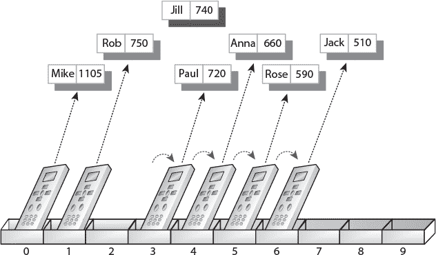

图 4.2 准备将 Jill 的 `GameEntry` 对象添加到数组中。为了给新引用留出空间，我们必须将任何分数比新分数小的游戏条目引用向右移动一个单元格。

图 4.2 显示了该过程的一个示例，位于现有条目移动之后、添加新条目之前。当循环完成时，`j` 将是新条目的正确索引。图 4.3 显示了完成操作的结果，即在代码第 22 行完成的赋值 `board[j] = e` 之后。

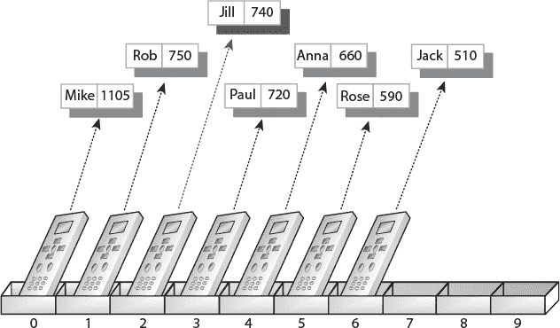

图 4.3 将 Jill 的 `GameEntry` 对象的引用添加到数组中。现在该引用可以插入到索引 2，因为我们已经将所有分数比新分数小的 `GameEntry` 对象引用向右移动了。

### 移除条目

假设某位高手玩了我们的视频游戏并他的名字出现在了我们的高分列表上，但我们后来得知存在作弊行为。在这种情况下，我们可能希望有一个方法可以让我们从高分列表中移除一个游戏条目。因此，让我们考虑如何从 `Scoreboard` 中移除对 `GameEntry` 对象的引用。

我们选择在 `Scoreboard` 类中添加一个方法，其签名为 `remove(i)`，其中 `i` 指定要移除并返回的条目的当前索引。当某个分数被移除时，任何较低的分数将向上移动，以填补被移除的条目。如果索引 `i` 超出当前条目的范围，该方法将抛出 `IndexOutOfBoundsException`。

我们对 `remove` 的实现将涉及一个用于移动条目的循环，类似于我们的添加算法，但方向是反的。要移除索引 `i` 处的对象引用，我们从索引 `i` 开始，将所有索引高于 `i` 的引用向左移动一个单元格。（参见图 4.4。）

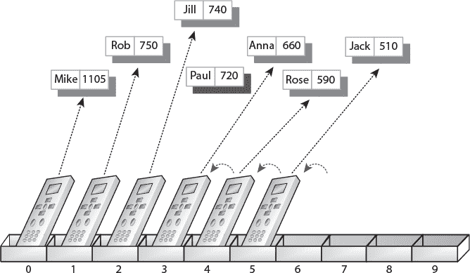

图 4.4 在从存储 `GameEntry` 对象引用的数组的索引 3 处移除 Paul 分数的插图。

我们为 `Scoreboard` 类实现的 `remove` 方法位于代码片段 4.4 中。执行移除操作的细节包含几个微妙之处。第一是，为了移除并返回数组中索引 `i` 处的游戏条目（我们称其为 `e`），我们必须先将 `e` 保存在一个临时变量中。我们将在完成后使用该变量返回 `e`。

```java
/** 移除并返回 i 处的高分。 */
public GameEntry remove(int i) throws IndexOutOfBoundsException {
  if (i < 0 || i >= numEntries)
    throw new IndexOutOfBoundsException("Invalid index: " + i);

  GameEntry temp = board[i];        // 保存要移除的对象
  for (int j = i; j < numEntries - 1; j++) // 从 i 开始向上计数
    board[j] = board[j + 1];        // 向左移动一个单元格

  board[numEntries - 1] = null;      // 清空旧分值
  numEntries--;
  return temp;                       // 返回被移除的对象
}
```

**代码片段 4.4** 执行 `Scoreboard.remove` 操作的 Java 代码。

第二个微妙之处是，在将高于 `i` 的引用向左移动一个单元格时，我们并没有移动到数组的末尾。首先，我们的循环基于条目的数量而不是数组的容量，这样循环的最后一次迭代会将 `board[numEntries - 1]` 赋值给 `board[numEntries - 2]`。没有条目需要移动到 `board[numEntries - 1]`，因此循环结束后我们将该单元格设置为 `null`。我们最后返回被移除的条目（它在板中不再有任何引用）。

### 总结

在在线提供的 `Scoreboard` 类版本中，我们包含了 `toString()` 方法，它允许用逗号分隔当前计分板的内容。我们还包含了一个 `main` 方法，对该类进行基本测试。

在数组中添加和移除对象的方法非常简单。然而，它们构成了构建更复杂数据结构的技术基础。当然，这些其他结构可能比上面的数组更通用，而且它们通常具有许多比添加和移除多多的操作。但像我们现在这样研究具体的数组数据结构，是理解这些其他结构的绝佳起点，因为每个数据结构都必须使用具体的手段来实现。

事实上，在本书的后面，我们将学习一个 Java 集合类 `ArrayList`，它比这里研究的数组更通用。`ArrayList` 具有操作底层数组的方法；然而，它在需要时会自动将对象复制到更大的数组中，从而消除了向满数组添加对象时发生的错误。我们将在 7.2 节中更详细地讨论 `ArrayList` 类。

### 4.1.2 数组排序

#### 插入排序算法

我们在本书中学习了若干种排序算法，其中大部分在第 14 章中描述。作为热身，在本节中描述了一种名为 `insertion-sort`（插入排序）的简单排序算法。该算法通过考虑一个元素，将该元素放置在相对于之前的元素的正确顺序的位置。我们从数组的第一个元素开始，它本身自然是有序的。当考虑数组中的下一个元素时，如果它比第一个元素小，我们就交换它们。接下来我们考虑数组中的第三个元素，不断向左交换，直到它相对于前两个元素处于正确的顺序。我们继续这种方式处理第四个、第五个元素，以此此类推，直到整个数组排序完毕。我们可以用伪代码表示 `insertion-sort` 算法，如代码段 4.5 所示。

```text
Algorithm InsertionSort(A):

  Input: An array A of n comparable elements

  Output: The array A with elements rearranged in nondecreasing order

  for k from 1 to n − 1 do

    Insert A[k] at its proper location within A[0], A[1], . . ., A[k].
```

**代码段 4.5** `insertion-sort` 算法的高级描述。

这是 `insertion-sort` 的一个简单的高级描述。如果我们回看第 4.1.1 节中的代码段 4.3，会发现将新条目插入高分列表的任务与在 `insertion-sort` 中插入新考虑元素的任务几乎相同（除了游戏分数是从高到低排序的）。我们在代码段 4.6 中提供了 `insertion-sort` 的 Java 实现，使用外层循环依次考虑每个元素，使用内层循环将新考虑的元素移动到相对于其左侧（已排序）子数组的正确位置。我们在图 4.5 中展示了 `insertion-sort` 算法的一个运行示例。

我们注意到，如果数组已经排序过了，`insertion-sort` 的内部循环只进行一次比较，确定不需要交换，然后返回外层循环。当然，如果输入数组极其无序，我们可能需要做得更多。事实上，如果输入数组是倒序的，我们将不得不做最多的工作。

```java
/** Insertion-sort of an array of characters into nondecreasing order */
public static void insertionSort(char[] data) {
  int n = data.length;
  for (int k = 1; k < n; k++) {       // begin with second character
    char cur = data[k];               // time to insert cur=data[k]
    int j = k;                        // find correct index j for cur
    while (j > 0 && data[j - 1] > cur) { // thus, data[j-1] must go after cur
      data[j] = data[j - 1];          // slide data[j-1] rightward
      j--;                            // and consider previous j for cur
    }
    data[j] = cur;                    // this is the proper place for cur
  }
}
```

**代码段 4.6** 在字符数组上执行 `insertion-sort` 的 Java 代码。

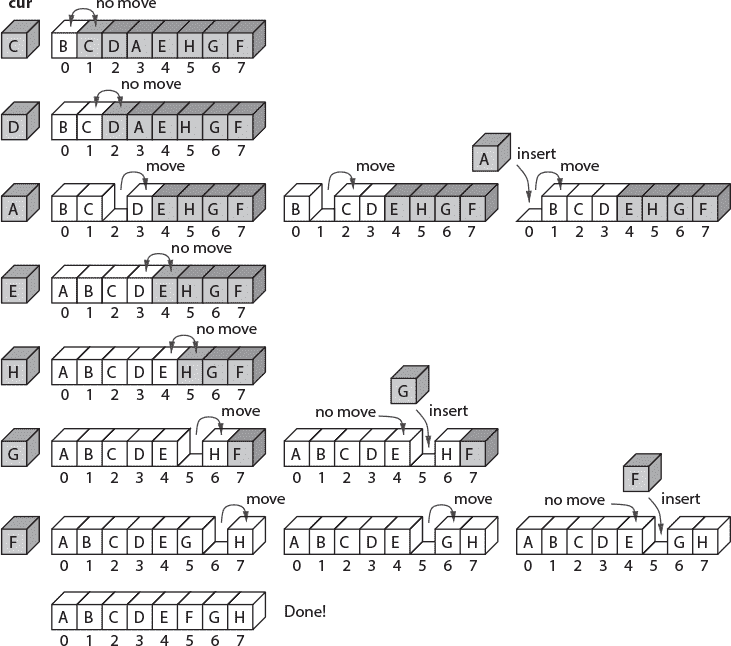

图 4.5 在八个字符数组上执行 `insertion-sort` 算法。每行对应外层循环的迭代，每行中序列的副本对应内层循环的迭代。正在插入的当前元素在数组中突出显示，并显示为 `cur` 值。

### 4.1.3 用于数组和随机数的 `java.util` 方法

由于数组非常重要，Java 提供了一个类 `java.util.Arrays`，它包含许多内置静态方法，用于对数组执行常见任务。在本书的后续部分，我们将描述其中几个方法所基于的算法。现在，我们提供该类最常用方法的概述，如下（更多讨论请见第 4.5.1 节）：

| 方法 | 说明 |
|---|---|
| `equals(A, B)` | 当且仅当数组 `A` 和数组 `B` 相等时，返回 `true`。如果两个数组具有相同数量的元素，且数组中的每对对应元素都相等，则认为这两个数组相等。也就是说，`A` 和 `B` 具有相同顺序具有相同的值。 |
| `fill(A, x)` | 在数组 `A` 的每个单元格中存储值 `x`，前提数组 `A` 的类型允许存储值 `x`。 |
| `copyOf(A, n)` | 返回一个长度为 `n` 的给定数组的副本。 |
| `copyOfRange(A, s, to)` | 返回指定范围数组的副本。第一个索引是包含的，第二个索引是不包含的。 |
| `binarySearch(A, x)` | 使用二分查找在指定数组中搜索键。 |
| `sort(A)` | 将指定数组按升序排序。 |
| `toString(A)` | 返回数组的字符串表示。 |

作为静态方法，这些直接在 `Arrays` 类上调用，而不是在特定实例上。例如，如果 `data` 是一个数组，我们可以使用 `Arrays.sort(data)` 对其进行排序，如果我们先导入了 `Arrays` 类，可以使用更短的语法 `sort(data)`（参见第 1.7 节）。

#### 伪随机数生成

Java 内置的另一个在处理数组时通常非常有用的功能是生成伪随机数的能力（即看起来随机但并非真正随机的数字）。特别是，Java 有一个内置类 `java.util.Random`，其实例是伪随机数生成器，即计算统计学随机数字序列的对象。然而，这些序列并不是真正的随机，因为给定过去的数字列表，就可以预测序列中的下一个数字。事实上，一种流行的伪随机数生成器是根据以下公式从当前数字 `cur` 生成下一个数字 `next`：

```text
next = (a * cur + b) % n;
```


其中 `a`、`b` 和 `n` 是适当选择的整数，`%` 是取模运算符。事实上，这种方法就是 `java.util.Random` 对象使用的方法，其中 `n = 2⁴⁸`。事实证明这样的序列可以被证明是统计均匀的，这对于大多数需要随机数的应用来说通常足够了。

在每次运行程序时获取不同序列的一种常用技巧，是使用一个每次运行都不同的种子（seed）。例如，我们可以使用来自用户的某些定时输入，或者将种子设置为自 1970 年 1 月 1 日以来的毫秒数（由方法 `System.currentTimeMillis()` 提供）。

`java.util.Random` 类的方法包括以下内容：

| 方法 | 返回值 |
| :--- | :--- |
| `nextBoolean()` | 返回下一个伪随机 `boolean` 值。 |
| `nextDouble()` | 返回一个 0.0 到 1.0 之间的下一个伪随机 `double` 值。 |
| `nextInt()` | 返回下一个伪随机 `int` 值。 |
| `nextInt(n)` | 返回从 0 到但不包含 `n` 范围内的下一个伪随机 `int` 值。 |
| `setSeed(s)` | 将此伪随机数生成器的设置为 `long` 类型 `s`。 |

## 4.1.4 使用字符串和字符数组的简单密码学

字符数组和字符串的一个重要应用是密码学（`cryptography`），它是研究秘密信息的科学。

该领域涉及加密（`encryption`）过程，在该过程中，被称为明文（`plaintext`）的消息被转换为杂乱的消息，称为密文（`ciphertext`）。同样，密码学还研究相应的解密（`decryption`）方法，将密文转换回原始明文。

可以说最早的加密方案是凯撒密码（`Caesar cipher`），它以尤利叶·凯撒命名，他曾使用这种方案来保护重要的军事信息。（当然，凯撒的所有信息都是用拉丁语编写的，这本身就让我们我们大多数人无法读懂了！）凯撒密码是一种隐藏由字母表组成单词的语言编写的消息的简单方法。

凯撒密码涉及将消息中的每个字母替换为字母表中该字母后若干位置的字母。例如，在英语消息中，如果移动三个字符，我们可能会将每个 `A` 替换为 `D`，每个 `B` 替换为 `E`，每个 `C` 替换为 `F`，以此此类推。我们一直采用这种方法直到 `W`，它被替换为 `Z`。然后，我们让替换模式“回绕”（wrap around），这样我们将 `X` 替换为 `A`，将 `Y` 替换为 `B`，将 `Z` 替换为 `C`。

### 字符串与字符数组之间的转换

由于字符串是不可变的，我们无法直接编辑实例来对其加密。相反，我们的目标是生成一个新的字符串。执行字符串转换的一种方便技术是创建一个等效的字符数组，编辑该数组，然后根据该数组重新组合一个（新的）字符串。

Java 支持从字符串到字符数组以及反的转换。给定一个字符串 `S`，我们可以使用方法 `S.toCharArray()` 创建与 `S` 匹配的新字符数组。例如，如果 `s="bird"`，该方法返回字符数组 `A={'b', 'i', 'r', 'd'}`。相反，`String` 构造函数有一种形式可以接受字符数组作为参数。例如，使用字符数组 `A={'b', 'i', 'r', 'd'}`，语法 `new String(A)` 会产生 `"bird"`。

### 使用字符数组作为替换代码

如果我们像数组索引一样对字母进行编号，例如 `A` 是 0，`B` 是 1，`C` 是 2，那么我们就可以将替换规则表示为数组 `encoder`，其中 `A` 映射到 `encoder[0]`，`B` 映射到 `encoder[1]`，以此此类推。那么，为了找到凯撒密码中字符的替换项，我们需要将从 `A` 到 `Z` 的字符映射到从 `0` 到 `25` 的相应数字。幸运的是，我们可以依靠字符在 Unicode 中由整数代码点表示的事实，拉丁字母大写字母的代码点是连续的（为了简单起见，我们将加密限制在大写字母）。

Java 允许我们对两个字符进行“相减”，得到的整数结果等于它们在编码中的距离。给定一个已知为大写字母的变量 `c`，Java 计算 `j = c – 'A'` 会产生所需的索引 `j`。作为一个健全检查，如果字符 `c` 是 `'A'`，则 `j = 0`。当 `c` 是 `'B'` 时，差值为 1。通常情况下，通过此类计算得到的整数 `j` 可以作为我们预计算的 `encoder` 数组的索引，如图 4.6 所示。

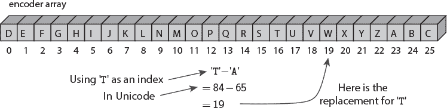

图 4.6 展示了如何使用大写字母作为索引，在本例中用于执行凯撒密码加密的替换规则。

消息的解密过程可以通过简单地使用不同的字符数组来表示替换规则——该数组实际上是向相反方向移动字符。

在代码片段 4.7 中，我们展示了一个执行任意旋转位移凯撒密码的 Java 类。该类的构造函数为指定的旋转构建编码器和解码器翻译数组。我们高度依赖模运算，因为旋转量为 `r` 的凯撒密码会将索引为 `k` 的字母加密为索引为 `(k + r) mod 26` 的字母，其中 `mod` 是取模（`modulo`）运算符，它返回整数除法后的余数。该运算符在 Java 中用 `%` 表示，这正是我们易于在字母表末尾执行回绕所需的运算符，因为 `26 mod 26` 是 0，`27 mod 26` 是 1，而 `28 mod 26` 是 2。凯撒密码的解码器数组正好相反——我们将每个字母替换为向前 `r` 个位置的字母，并回绕；为了避免涉及负数和模运算符的微妙问题，我们将代码为 `k` 的字母替换为代码为 `(k – r + 26) mod 26` 的字母。

一旦有了编码器和解码器数组，加密和解密算法本质上是相同的，因此我们通过一个名为 `transform` 的私有实用方法执行两者。该方法将字符串转换为字符数组，对图 4.6 中所示图示的任何大写字母符号进行翻译，最后根据更新后的数组返回一个新字符串。

该类的 `main` 方法作为一个简单测试，产生以下输出：

```
Encryption code = DEFGHIJKLMNOPQRSTUVWXYZABC

Decoding code = XYZABCDEFGHIJKLMNOPQRSTUVW

Secret: WKH HDJOH LV LQ SODB; PHHW DW MRH'V.

Message: THE EAGLE IS IN PLAY; MEET AT JOE'S.
```

```java
/** 使用凯撒密码（Caesar Cipher）进行加密解密的类。 */

public class CaesarCipher {

  protected char[ ] encoder = new char[26];                            // 加密数组

  protected char[ ] decoder = new char[26];                            // 解密数组

  /** 初始化加密解密数组的构造函数 */

  public CaesarCipher(int rotation) {

    for (int k=0; k < 26; k++) {

      encoder[k] = (char) ('A' + (k + rotation) % 26);

      decoder[k] = (char) ('A' + (k – rotation + 26) % 26);

    }

  }

  /** 返回加密消息的字符串。 */

  public String encrypt(String message) {

    return transform(message, encoder);                               // 使用加密数组

  }

  /** 给定加密秘密，返回解密后的消息。 */

  public String decrypt(String secret) {

    return transform(secret, decoder);                               // 使用解密数组

  }

  /** 使用给定代码对原始字符串进行转换。 */

  private String transform(String original, char[ ] code) {

    char[ ] msg = original.toCharArray();

    for (int k=0; k < msg.length; k++)

      if (Character.isUpperCase(msg[k])) {                            // 有需要更改的字母

        int j = msg[k] – 'A';                                       // 值将在 0 到 25 之间

        msg[k] = code[ j];                                        // 替换字符

      }

    return new String(msg);

  }

  /** 测试凯撒密码的简单主方法 */

  public static void main(String[ ] args) {

    CaesarCipher cipher = new CaesarCipher(3);

    System.out.println("Encryption code = " + new String(cipher.encoder));

    System.out.println("Decryption code = " + new String(cipher.decoder));

    String message = "THE EAGLE IS IN PLAY; MEET JOE'S.";

    String coded = cipher.encrypt(message);

    System.out.println("Secret: " + coded);

    String answer = cipher.decrypt(coded);

    System.out.println("Message: " + answer);                    // 应该是明文

  }

}
```

**代码片段 4.7** 执行凯撒密码的完整 Java 类。

## 4.1.5 二维数组与位置游戏

许多电脑游戏，无论是策略游戏、模拟游戏还是冲突游戏，都涉及存在于二维空间中的对象。此类位置游戏的软件需要一种在二维空间中表示对象的方法。实现这一目标的一种自然方法是使用二维数组，其中我们使用两个索引 `i` 和 `j` 来引用数组中的单元格。第一个索引引用行号，第二个索引引用列号。给定这样一个数组，我们可以维护二维游戏板，并执行其他涉及存储在行和列中的数据的各种类型计算。

Java 中的数组是一维的；我们使用单个索引来访问数组的每个单元格。尽管如此，我们有一种方法可以在 Java 中定义二维数组——我们可以通过创建一个“数组的数组”来创建一个二维数组。也就是说，我们可以定义一个二维数组，其是一个数组，且其每个单元格都是另一个数组的数组。这种二维数组有时被称为 `matrix`（矩阵）。在 Java 中，我们可以如下声明二维数组：

```java
int[ ] data = new int[8][10];
```

该语句创建了一个 8 × 10 的二维“数组的数组” `data`，它有 8 行 10 列。也就是说，`data` 是一个长度为 8 的数组，其中 `data` 的每个元素都是一个长度为 10 的数组。（参见图 4.7。）以下将是数组 `data` 和 `int` 变量 `i`、`j` 和 `k` 的有效用法：

```java
data[i][i+1] = data[i][i] + 3;

j = data.length;                        // j 是 8

k = data[4].length;                     // k 是 10
```

二维数组在数值分析中有许多应用。然而，我们并不深入探讨这些应用的细节，而是探索了二维数组实现简单位置游戏的应用。

### 井字棋（Tic-Tac-Toe）

大多数学生都知道，`Tic-Tac-Toe` 是一种在三乘三棋盘上玩的游戏。两名玩家——X 和 O——交替在棋盘的单元格中放置各自的标记，从 X 玩家开始。如果任一玩家成功在行、列或对角线上获得三个自己的标记，那么该玩家就获胜。

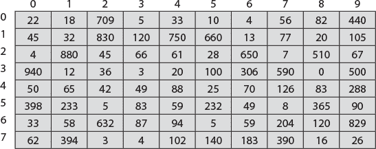

图 4.7 二维整数数组 `data` 的插图，它有 8 行 10 列。`data[3][5]` 的值为 100，`data[6][2]` 的值为 632。

诚然，这不是一个复杂的策略游戏，玩起来也没那么好玩，因为一个优秀的 O 玩家总能迫成平局。`Tic-Tac-Toe` 的优点在于它是一个很好的、简单的示例，展示了二维数组如何用于位置游戏。更多位置游戏的软件，如跳跳棋、国际象棋或流行的模拟游戏，都是基于我们在此处说明的用于二维数组的相同方法。

```java
/** 井字棋游戏的模拟（不包含策略逻辑）。 */

public class TicTacToe {

    public static int X = 1, O = -1; // 玩家

    public static int EMPTY = 0; // 空单元格

    private int board[] = new int[3][3]; // 棋盘

    private int player; // 当前玩家

    /** 构造函数 */

    public TicTacToe() { clearBoard(); }

    /** 清空棋盘 */

    public void clearBoard() {

        for (int i = 0; i < 3; i++)

            for (int j = 0; j < 3; j++)

                board[i][j] = EMPTY; // 每个单元格为空

        player = X; // 第一个玩家是 'X'

    }

    /** 在位置 i,j 放置 X 或 O 标记。 */

    public void putMark(int i, int j) throws IllegalArgumentException {

        if ((i < 0) || (i > 2) || (j < 0) || (j > 2))

            throw new IllegalArgumentException("无效的棋盘位置");

        if (board[i][j] != EMPTY)

            throw new IllegalArgumentException("棋盘已被占用");

        board[i][j] = player; // 为当前玩家放置标记

        player = -player; // 切换玩家（利用事实 O = -X）

    }

    /** 检查棋盘布局是否为给定玩家胜利。 */

    public boolean isWin(int mark) {

        return ((board[0][0] + board[0][1] + board[0][2] == mark) // 第 0 行

            || (board[1][0] + board[1][1] + board[1][2] == mark) // 第 1 行

            || (board[2][0] + board[2][1] + board[2][2] == mark) // 第 2 行

            || (board[0][0] + board[1][0] + board[2][0] == mark) // 第 0 列

            || (board[0][1] + board[1][1] + board[2][1] == mark) // 第 1 列

            || (board[0][2] + board[1][2] + board[2][2] == mark) // 第 2 列

            || (board[0][0] + board[1][1] + board[2][2] == mark) // 对角线

            || (board[2][0] + board[1][1] + board[0][2] == mark)); // 反对角线

    }

    /** 返回胜利者的代码，或返回 0 表示平局（未完成的游戏）。 */

    public int winner() {

        if (isWin(X))

            return(X);

        else if (isWin(O))

            return(O);

        else

            return(0);

    }

}
```

[代码片段 4.8] 一个用于两个玩家之间井字棋的简单且完整的 Java 类。（接上代码片段 4.9）

```java
/** 返回一个显示当前棋盘的简单字符串。 */

public String toString() {

    StringBuilder sb = new StringBuilder();

    for (int i = 0; i < 3; i++) {

        for (int j = 0; j < 3; j++) {

            switch (board[i][j]) {

                case X: sb.append("X"); break;


```java
case O:
    sb.append("O");
    break;

case EMPTY:
    sb.append(" ");
    break;
```

```java
if (j < 2) {
    sb.append("|"); // 列边界
}

if (i < 2) {
    sb.append("\n-\n"); // 行边界
}

return sb.toString();
```

```java
/** 简单游戏的测试运行 */
public static void main(String[] args) {
    TicTacToe game = new TicTacToe();

    /* X 走法：/* O 走： */
    game.putMark(1, 1);
    game.putMark(0, 2);

    game.putMark(2, 2);
    game.putMark(0, 0);

    game.putMark(0, 1);
    game.putMark(2, 1);

    game.putMark(1, 2);
    game.putMark(1, 0);

    game.putMark(2, 0);

    System.out.println(game);

    int winningPlayer = game.winner();

    String[] outcome = {"O 胜", "平局", "X 胜"}; // 依赖顺序

    System.out.println(outcome[1 + winningPlayer]);
}
```

**代码片段 4.9** 一个用于两个玩家之间井字棋的简单且完整的 Java 类。（接自代码片段 4.8。）

## 稀疏矩阵

在许多科学计算和数值分析中，通常会使用一种特殊的矩阵，其包含的零元素多于非零元素。这种矩阵被称为`稀疏矩阵`（sparse matrix）或`稀疏数组`（sparse array），它可以用 `m` 行 `n` 列的二维形式表示。然而，当使用二维数组来表示此类矩阵时，计算机中大量的内存空间被浪费。

例如，考虑一个大小为 500 × 1000 的二维数组，其中仅包含 20 个元素。在这里，如果一个整数元素占用 4 字节，那么我们利用了 `20 * 4 = 80` 字节，而不是为整数分配 `500 * 1000 * 4` 字节。因此，为了简单并防止不必要的浪费，我们可以使用以下矩阵表示方法：

1. `数组三元表示法`：在后续小节中讨论。
2. `链表示法`：我们将在 4.2.1 节讨论。

### 数组三元表示法

在这种表示法中，我们只存储非零元素及其索引数字，即第 `i` 行和第 `j` 列。在这里，第一行（即第 0 行）存储稀疏矩阵的总行数、总列数以及非零元素的数量。

举个例子，考虑一个大小为 4 × 6 的稀疏矩阵，它仅包含 5 个非零元素（即 3、2、5、1 和 7）。这样的稀疏矩阵可以用三元组形式表示（图 4.10）。

[图 4.10] 数组或三元表示法下的稀疏矩阵插图。

```java
import java.util.Scanner;

// 用于稀疏矩阵数组或三元表示的类
public class SparseMatrix {
    private static int size = 0;

    public static int row, col;

    Scanner s = new Scanner(System.in);

    public SparseMatrix() {
    }

    public void sizeMatrix() { // 初始化稀疏矩阵的大小
        System.out.print("Enter no. of rows in sparse matrix");
        row = s.nextInt();

        System.out.print("Enter no. of columns in sparse matrix");
        col = s.nextInt();
    }

    public int[][] inputMatrix(int[][] sMatrix) { // 创建稀疏矩阵
        System.out.println("Enter all the elements:");

        for (int i = 0; i < row; i++) {
            for (int j = 0; j < col; j++) {
                sMatrix[i][j] = s.nextInt();
            }
        }

        return sMatrix;
    }

    private void non{Zero(int[][] sMatrix) { // 统计稀疏矩阵中的非零值
        for (int i = 0; i < row; i++) {
            for (int j = 0; j < col; j++) {
                if (sMatrix[i][j] != 0) {
                    size++;
                }
            }
        }
    }

    // 紧凑矩阵 (size) 的行数必须比稀疏矩阵中的
    // 非零值多一
    public void tripletMatrix(int[][] sMatrix) {
        non{Zero(sMatrix);

        int[][] compactMatrix = new int[size + 1][3];

        // 初始化第 0 行，存储稀疏矩阵的总行数、总列数和
        // 非零元素的数量
        compactMatrix[0][0] = row;
        compactMatrix[0][1] = col;
        compactMatrix[0][2] = size;

        // 创建新矩阵
        int k = 1;

        for (int i = 0; i < row; i++) {
            for (int j = 0; j < col; j++) {
                if (sMatrix[i][j] != 0) {
                    compactMatrix[k][0] = i;
                    compactMatrix[k][1] = j;
                    compactMatrix[k][2] = sMatrix[i][j];
                    k++;
                }
            }
        }

        for (int i = 0; i < size + 1; i++) {
            for (int j = 0; j < 3; j++) {
                System.out.printf("%d", compactMatrix[i][j]);
            }

            System.out.printf("\n");
        }
    }

    /** 稀疏矩阵测试运行 */
    public static void main(String[] args) {
        int row, col;

        SparseMatrix sm = new SparseMatrix();

        sm.sizeMatrix();

        row = sm.row;
        col = sm.col;

        int[][] sMatrix = new int[row][col];

        sMatrix = sm.inputMatrix(sMatrix);

        sm.tripletMatrix(sMatrix);
    }
}
```

**代码片段 4.10** 一个用于以高效三元表示法稀疏矩阵的简单完整 Java 类。

### 4.1.6 三维数组与生日预测器

随着数组维度的增加，可以存储更多数据。然而，相应地，理解和管理此类数组的难度也增加了。在计算机科学中，就像二维数组一样，三维数组也用于解决各种谜题问题等。三维数组是多维数组的复杂形式，其定义方式类似于二维数组。换句话说，三维数组本质上就是二维数组的数组或数组的数组（图 4.11）。

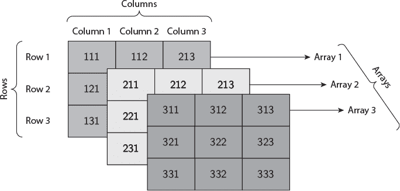

图 4.11 用二维数组表示的三维数组。

在 Java 中，我们可以像在上一节中定义的二维数组一样声明三维数组，如下所示：

```java
int[][][] data = new int[d1][d2][d3];
```

这创建了一个大小为 3×3 的二维数组数组，具有 3 行 3 列。因此，可以存储的元素数量为 27（=3×3×3）。在三维数组的许多应用中，我们讨论其中一个预测问题，是“生日预测器”。

在这个问题中，将向用户提供一组二维数组，以便在不询问实际日期的情况下找到她的生日是否出现在集合中。根据出现的情况，我们可以轻松地找到用户的真实生日（图 4.12）。该预测问题的完整 Java 代码在代码片段 4.11 中。

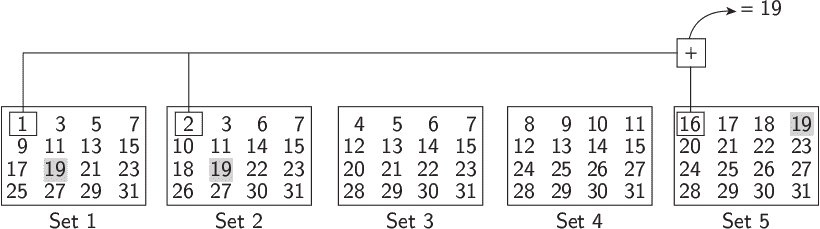

图 4.12 查找用户真实生日的方法。

```java
import java.util.Scanner;

public class BirthdayPredictorUsingArray {
    private int day = 0; // 对应实际生日

    private int answer;

    private int[][][] dates = {
        {
            {1, 3, 5, 7},
            {9, 11, 13, 15},
            {17, 19, 21, 23},
            {25, 27, 29, 31}
        },
        {
            {2, 3, 6, 7},
            {10, 11, 14, 15},
            {18, 19, 22, 23},
            {26, 27, 30, 31}
        },
        {
            {4, 5, 6, 7},
            {12, 13, 14, 15},
            {20, 21, 22, 23},
            {28, 29, 30, 31}
        },
        {
            {8, 9, 10, 11},
            {12, 13, 14, 15},
            {24, 25, 26, 27},
            {28, 29, 30, 31}
        },
        {
            {16, 17, 18, 19},
            {20, 21, 22, 23},
            {24, 25, 26, 27},
            {28, 29, 30, 31}
        }
    };

    public void BirthdayPredictorUsingArray() {
    }

    public void inputChoice() {
        // 定义 Scanner 读取用户的输入
        Scanner input = new Scanner(System.in);

        for (int i = 0; i < 5; i++) {
            System.out.println("你的生日在集合" + (i + 1) + "中吗?");

            for (int j = 0; j < 4; j++) {
                for (int k = 0; k < 4; k++) {
                    // 显示集合
                    System.out.printf("%4d", dates[i][j][k]);
                }

                System.out.println();
            }

            System.out.print("\n 否输入 0，是输入 1: ");

            answer = input.nextInt();

            if (answer == 1) {
                // 生日出现所在集合的首元素和
                day += dates[i][0][0];
            }
        }

        System.out.println("你的生日是" + day);
    }
}
```

## 4.2 单链表

在上一节中，我们介绍了数组数据结构并讨论了它的某些应用。数组非常适合按顺序存储内容，但它们也有缺点。数组的容量在创建时必须固定，而且在数组内部进行插入和删除可能因为需要移动大量元素。

在本节中，我们引入了一种名为`链表`的数据结构，它为数组结构提供了替代方案。链表的最简单形式是`节点`的集合，它们共同组成线性序列。在`单链表`中，每个节点存储指向序列元素的引用，以及指向列表中下一个节点的引用（参见图 4.13）。

链表的表示依赖于许多对象的协作（参见图 4.14）。至少，链表实例必须保留指向链表第一个节点的引用，这被称为`head`（头）。如果没有对`head`的显式引用，就无法定位该节点（或间接地定位其他任何节点）。

链表的最后一个节点被称为`tail`（尾）。可以通过`traversing`（遍历）链表来找到尾节点——从`head`开始，通过跟随每个节点的`next`引用从一个节点移动到另一个节点。我们可以将`next`引用为`null`的节点识别为尾节点。

这个过程也被称为`link hopping`（链路跳转）或`pointer hopping`（指针跳转）。然而，存储指向尾节点的显式引用是一种常见的优化手段，可以避免这种遍历。同样，链表实例通常还会维护一个构成列表的总节点计数（也称为链表的`size`），以避免通过遍历链表来计算节点。

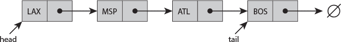

图 4.14 单向链表示例，其元素是表示机场代码的字符串。该链表实例维护一个名为`head`的成员，指向链表的第一个节点，以及另一个名为`tail`的成员，指向链表的最后一个节点。`null`值用 Ø 表示。

### 在单向链表的头部插入元素

链表的一个重要特性是它没有预设的固定大小；它使用的空间与其当前元素的数量成正比。当使用单向链表时，我们可以像图 4.15 所示，容易地在链表头部插入一个元素，并在代码片段 4.12 中用伪代码描述了这一过程。

其核心思想是创建一个新节点，将其元素设置为新元素，将它的`next`链接指向当前的`head`，并将链表的`head`指向新节点。

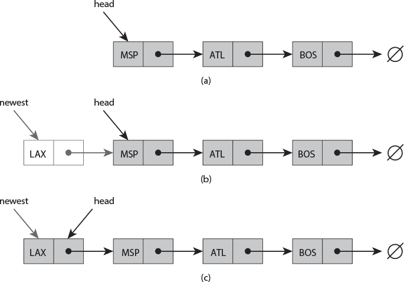

图 4.15 在单向链表头部插入元素：(a) 插入之前；(b) 创建新节点并将其链接到现有`head`之后；(c) 将`head`引用重新赋值给最新节点之后。

```text
Algorithm addFirst(e):

    newest = Node(e)  {创建新节点实例并存储对元素 e 的引用}

    newest.next = head  {设置新节点的 next 指向旧 head 节点}

    head = newest  {将变量 head 指向新节点}

    size = size + 1  {节点计数加 1}
```

**代码片段 4.12** 在单向链表的开头插入一个新元素。注意，我们在将变量`head`重新赋值给它之前已经设置了新节点的`next`指针。如果链表最初为空（即`head`为`null`），那么一个自然产生的结果是新节点的`next`引用被设置为`null`。

### 在单向链表的尾部插入元素

只要我们保留指向尾节点的引用，也可以很容易地在链表尾部插入元素，如图 4.16 所示。在这种情况下，我们创建一个新节点，将其`next`引用分配为`null`，将`tail`的`next`引用指向此新节点，然后将`tail`引用本身更新为此新节点。我们在代码片段 4.13 中提供了该过程的伪代码。

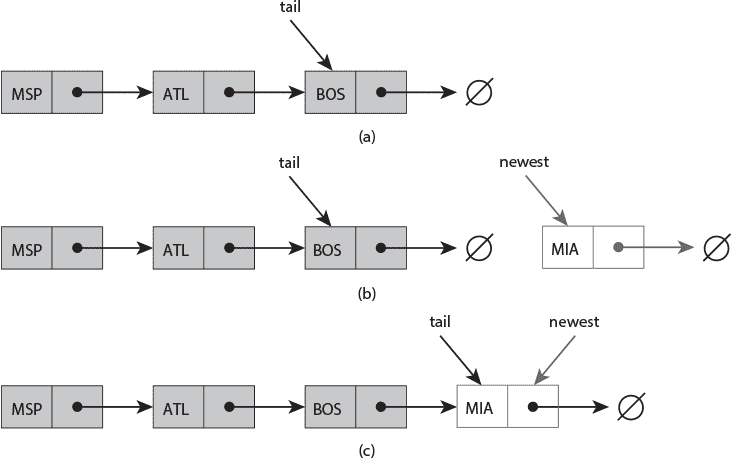

图 4.16 在单向链表尾部插入：(a) 插入之前；(b) 创建新节点之后；(c) 重新赋值`tail`引用之后。注意在 (c) 中将变量`tail`指向新节点之前，必须在 (b) 中设置尾节点的`next`链接。

```text
Algorithm addLast(e):

    newest = Node(e)  {创建新节点实例并存储对元素 e 的引用}

    newest.next = null  {设置新节点的 next 指向 null 对象}

    tail.next = newest  {让旧尾节点指向新节点}

    tail = newest  {将变量 tail 指向新节点}

    size = size + 1  {节点计数加 1}
```

**代码片段 4.13** 在单向链表的末尾插入一个新节点。注意，我们在让变量`tail`指向新节点之前已经为旧尾节点设置了`next`指针。这段代码在插入空列表时需要进行调整，因为此时不存在尾节点。

### 从单向链表中删除元素

从单向链表的`head`删除元素本质上是插入操作的反向过程。这一操作在图 4.17 中示意，并在代码片段 4.14 中进行了描述。

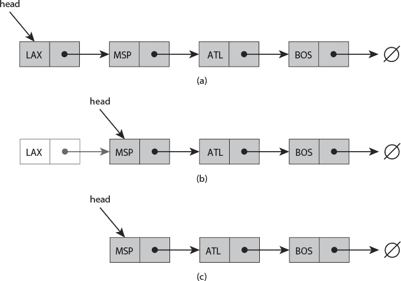

图 4.17 单向链表头部的元素删除：(a) 删除之前；(b) 移除头部之后；(c) 最终配置。

```text
Algorithm removeFirst():

    if head == null then
        列表为空。

    head = head.next  {让 head 指向下一个节点}

    size = size - 1  {节点计数减 1}
```


**代码片段 4.14** 删除单向链表的起始节点。遗憾的是，我们无法轻松删除单向链表的最后一个节点。即使我们直接维护一个`tail`引用，我们也无法访问最后一个节点之前的节点。访问该节点的唯一方法是从`head`开始遍历整个链表。但这种操作可能需要很长时间。如果我们希望支持这种操作，我们需要将链表改为双向链（参见 4.4 节）。

### 4.2 实现链表

在本节中，我们将展示`LinkedList`类的完整实现，支持以下方法：

- `size()`返回列表中元素的数量。
- `isEmpty()`如果列表为空则返回`true`，否则返回`false`。
- `first()`返回（但不移除）列表中的第一个元素。
- `last()`返回（但不移除）列表中的最后一个元素。
- `addFirst(e)`在列表前端添加一个新元素。
- `addLast(e)`在列表末尾添加一个新元素。
- `removeFirst()`并返回第一个元素。

如果在空列表上调用`first()`、`last()`或`removeFirst()`，我们将简单地返回`null`引用并保持列表不变。

由于我们不在乎存储元素的类型，我们使用 Java 的泛型框架（参见 2.5.2 节）来定义类，并使用一个形式类型参数`E`表示用户所需的元素类型。

```java
1public class SinglyLinkedList<E> {
  //---------------- 嵌套 Node 类 ----------------
  private static class Node<E> {
    private E element;                               // 存储在此节点中的元素的引用
    private Node<E> next;                            // 指向列表中下一个节点的引用
    public Node(E e, Node<E> n) {
      element = e;
      next = n;
    }
    public E getElement() { return element; }
    public Node<E> getNext() { return next; }
    public void setNext(Node<E> n) { next = n; }
  }//----------- 嵌套 Node 类结束 -----------
  // SinglyLinkedList 的实例变量
  private Node<E> head = null;                       // 链表的头部（如果为空则 null）
  private Node<E> tail = null;                       // 链表的尾节点（如果为空为 null）
  private int size = 0;                              // 链表中节点数量
  public SinglyLinkedList() { }                       // 构建一个初始空列表
  // 访问方法
  public int size() { return size; }
  public boolean isEmpty() { return size == 0; }
  ... SinglyLinkedList 类的其余部分将如下 ...
}
```

**代码片段 4.15**`SinglyLinkedList`类内部的嵌套`Node`类。（`SinglyLinkedList`类的部分将在代码片段 4.16 中给出。）

```java
1  public class SinglyLinkedList<E> {
...  （此处为嵌套 Node 类）
22  public E first() {                         // 返回（但不移除）第一个元素
23    if (isEmpty()) return null;
24    return head.getElement();
25  }
26  public E last() {                          // 返回（但不移除）最后一个元素
27    if (isEmpty()) return null;
28    return tail.getElement();
29  }
30  // 更新方法
31  public void addFirst(E e) {                 // 将元素 e 添加到列表前端
32    head = new Node<>(e, head);               // 创建并链接新节点
33    if (size == 0)
34      tail = head;                            // 特殊情况：新节点也成为尾
35    size++;
36  }
37  public void addLast(E e) {                  // 将元素 e 添加到列表末尾
38    Node<E> newest = new Node<>(e, null);      // 节点将最终成为尾
39    if (isEmpty())
40      head = newest;                           // 特殊情况：之前为空的列表
41    else
42      tail.setNext(newest);                    // 在现有尾之后添加新节点
43    tail = newest;                             // 新节点成为尾
44    size++;
45  }
46  public E removeFirst() {                     // 移除并返回第一个元素
47    if (isEmpty()) return null;                // 无可移除
48    E answer = head.getElement();
49    head = head.getNext();                      // 如果列表只有一个节点，则将变为 null
50    size--;
51    if (size == 0)
52      tail = null;                             // 特殊情况：列表现在为空
53    return answer;
54  }
}
```

**代码片段 4.16**`SinglyLinkedList`类定义（当与代码片段 4.15 中的嵌套`Node`类结合时）。

#### 稀疏矩阵的链表表示

我们已经在第 4.1.5 节中讨论过稀疏矩阵的数组表示。稀疏矩阵也可以用链表的形式表示。在这种情况下，每个节点包含四个字段。这些字段是`Row`（行）、`Col`（列）、`Value`（值）和`Next`（下）。这些细节可以定义如下，并在图 4.18 中所示：


图 4.18 构成稀疏矩阵链表表示一部分的节点实例示例。

> **Row:** 非零元素所在的行索引
>
> **Col:** 非零元素所在的列索引
>
> **Value:** 非零元素的值
>
> **Next:** 指向后续节点

作为一个示例，考虑一个大小为 4 × 6 的稀疏矩阵，它包含五个非零元素，如图 4.10 所示。

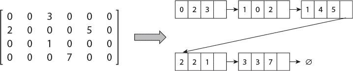

图 4.19 链表。

### 4.2.2 链表排序

对链表中的数据进行排序是许多操作之一。在此操作中，我们可能使用两个引用，即初始指向头部的`current`和指向下一个`suffix`。为了完成这项任务：

1. 将`current`节点的数据元素与`suffix`节点进行比较。
2. 如果`current`的数据元素大于`suffix`的数据元素，则进行交换。
3. 将`suffix`节点移动下一个，继续此过程直到`suffix`为`null`。
4. 然后将`current`节点移动下一个，遍历整个列表。

Java 代码给出在代码片段 4.17 和 4.18 中，参考了第 4.2.1 节中的框架。

```java
public void sortLinkedlist() {
  if(isEmpty())
    System.out.println("The linked list is empty"); //检查链表
  Node <E> current,suffix;
  current=head; //初始化链表的第一个节点
  while(current != null) {
    suffix = current.getnext(); //指向下一个节点
    while(suffix != null) { // 比较元素以进行交换
      if((Integer)current.getitem() > (Integer)suffix.getitem())
        current.swap(suffix); //交换数据元素
      suffix = suffix.getnext(); //移动 移动到下一个
    }
    current = current.getnext(); //移动 current 到下一个节点
  }
}
```

```java
public void swap(Node<E> suffix) {
  E temp;
  temp=item; // 当前节点的数据元素
  item=suffix.item;
  suffix.item=temp;
}
```

数据结构中另一个实用的操作是合并，即我们将两个数据结构的数据元素合并在一起。例如，假设我们有两个有序链表，分别由头节点`head1`和`head2`引用。现在，为了合并这两个有序链表，我们可以使用另一个引用，例如`head3`，它将指向合并后链表的第一个节点。

为了完成这项任务，首先，我们比较给定两个有序链表的第一个节点。它们将分别标记为合并后链表的第一个节点，其数据元素是比另一个较小的那一个。一旦确定了合并后链表的头节点，我们就可以使用两个引用，例如`list1`和`list2`，分别对两个有序链表中的节点进行比较和合并。该操作在图 4.21 所示。

考虑到第 4.2.1 节中给出的通用框架中链表数据元素的类型为整型，该问题的 Java 代码位于代码片段 4.19。

图 4.21 两个有序链表的合并。

```java
1  public void mergeLinkedlist()
2  {
3    Node <E> list1,list2,newest; //用于管理链表的引用
4    //寻找合并后链表的第一个节点
5    if((Integer)head1.getitem() < (Integer)head2.getitem())
6    {
7      head3 = head1;
8      list1 = head1.getnext();
9      list2 = head2;
10   }
11   else
12   {
13     head3 = head2;
14     list1 = head1;
15     list2 = head2.getnext();
16   }
17   newest = head3;
18   while(list1! = null&&list2! = null)
19   {
20     //比较 list1 和 list2 中的剩余节点并加入合并后的链表
21     if((Integer)list1.getitem() < (Integer)list2.getitem())
22     {
23       newest.setnext(list1);
24       list1 = list1.getnext();
25     }
26     else
27     {
28       newest.setnext(list2);
29       list2 = list2.getnext();
30     }
31     newest = newest.getnext();
32   }
33   if(list1 = = null)                   //如果 list1 中的所有节点已添加
34   {
35     while(list2! = null)               //将 list2 的剩余节点加入合并后的链表
36     {
37       newest.setnext(list2);
38       list2 = list2.getnext();
39       newest = newest.getnext();
40     }
41   }
42   else                                 //否则，即如果 list2 中的所有节点已添加
43   {
44     while(list1! = null)               //将 list1 的剩余节点加入合并后的链表
45     {
46       newest.setnext(list1);
47       list1 = list1.getnext();
48       newest = newest.getnext();
49     }
50   }
51 }
```

**代码片段 4.19** 用于合并有序链表的示例完整 Java 类。

## 4.3 循环链表

链表通常被看作是按第一个到最后一个的线性顺序存储一系列项。然而，在许多应用程序中，数据可以自然地看作具有循环顺序，具有定义明确的关系，但没有固定的开始或结束。

例如，许多多人游戏是基于回合的，玩家 A 行其，然后是玩家 B，然后是玩家 C，以此类推，但最终又回到玩家 A，然后是玩家 B，循环往。另一个例子是，城市公交和地铁通常在连续的环线线上运行，按照计划顺序停靠，但没有指定的第一个或最后一个站点。我们接下来考虑循环链表。

### 4.3.1 循环调度

在许多应用程序中，数据可以自然地看作具有循环顺序，且具有定义明确的关系，但没有固定的开始或结束。

例如，许多多人游戏是基于回合的，玩家 A 行其，然后是玩家 B，然后是玩家 C，以此类推，但最终又回到玩家 A，然后是玩家 B，循环往。另一个例子是，城市公交和地铁通常在连续的环线线上运行，按照计划顺序停靠，但没有指定的第一个或最后一个站点。我们接下来考虑循环链表。

### 4.3.2 设计与实现循环链表

在本节中，我们设计并实现一个新的`CircularlyLinkedList`类，它支持单链表类的所有行为，并增加了一个方法：

`rotate()`：将第一个元素移动到链表的末尾。

在许多应用程序中，数据可以自然地看作具有循环顺序，且具有定义明确的关系，但没有固定的开始或结束。

例如，许多多人游戏是基于回合的，玩家 A 行其，然后是玩家 B，然后是玩家 C，以此类推，但最终又回到玩家 A，然后是玩家 B，循环往。另一个例子是，城市公交和地铁通常在连续的环线线上运行，按照计划顺序停靠，但没有指定的第一个或最后一个站点。我们接下来考虑循环链表。

在许多应用程序中，数据可以自然地看作具有循环顺序，且具有定义明确的关系，但没有固定的开始或结束。

例如，许多多人游戏是基于回合的，玩家 A 行其，然后是玩家 B，然后是玩家 C，以此类推，但最终又回到玩家 A，然后是玩家 B，循环往。另一个例子是，城市公交和地铁通常在连续的环线线上运行，按照计划顺序停靠，但没有指定的第一个或最后一个站点。我们接下来考虑循环链表。

在许多应用程序中，数据可以自然地看作具有循环顺序，且具有定义明确的关系，但没有固定的开始或结束。

例如，许多多人游戏是基于回合的，玩家 A 行其，然后是玩家 B，然后是玩家 C，以此类推，但最终又回到玩家 A，然后是玩家 B，循环往。另一个例子是，城市公交和地铁通常在连续的环线线上运行，按照计划顺序停靠，但没有指定的第一个或最后一个站点。我们接下来考虑循环链表。

在许多应用程序中，数据可以自然地看作具有循环顺序，且具有定义明确的关系，但没有固定的开始或结束。

例如，许多多人游戏是基于回合的，玩家 A 行其，然后是玩家 B，然后是玩家 C，以此类推，但最终又回到玩家 A，然后是玩家 B，循环往。另一个例子是，城市公交和地铁通常在连续的环线线上运行，按照计划顺序停靠，但没有指定的第一个或最后一个站点。我们接下来考虑循环链表。

图 4.25 调用`addFirst(STL)`对图 4.24(b)中循环链表的影响。变量`newest`在该方法的执行期间具有局部作用域。请注意，当操作完成后，`STL`是列表的第一个元素，因为它存储在隐式头节点`tail.getNext()`中。

从循环链表中删除第一个节点可以通过简单地更新尾节点的`next`字段以跳过隐式头节点来实现。`CircularlyLinkedList`类所有方法的 Java 实现见在代码片段 4.20。


```java
public class CircularlyLinkedList<E> {
  ...（内部嵌套的节点类与`SinglyLinkedList`类相同）

  // CircularlyLinkedList 的实例变量
  private Node<E> tail = null; // 我们存储尾节点（但不存储头节点）
  private int size = 0; // 列表中节点的数量

  public CircularlyLinkedList() { } // 构建一个初始为空的列表

  // 访问方法
  public int size() { return size; }
  public boolean isEmpty() { return size == 0; }

  public E first() { // 返回（但不移除）第一个元素
    if (isEmpty()) return null;
    return tail.getNext().getElement(); // 头节点在尾节点之后
  }

  public E last() { // 返回（但不移除）最后一个元素
    if (isEmpty()) return null;
    return tail.getElement();
  }

  // 更新方法
  public void rotate() { // 将第一个元素旋转到列表末尾
    if (tail != null) // 如果为空，则什么都不做
      tail = tail.getNext(); // 旧头节点成为新尾节点
  }

  public void addFirst(E e) { // 将元素 e 添加到列表前端
    if (size == 0) {
      tail = new Node<>(e, null);
      tail.setNext(tail); // 循环链接到自身
    } else {
      Node<E> newest = new Node<>(e, tail.getNext());
      tail.setNext(newest);
    }
    size++;
  }

  public void addLast(E e) { // 将元素 e 添加到列表末尾
    addFirst(e); // 在列表前端插入新元素
    tail = tail.getNext(); // 现在新元素成为尾节点
  }

  public E removeFirst() { // 移除并返回第一个元素
    if (isEmpty()) return null; // 无内容可移除
    Node<E> head = tail.getNext();
    if (head == tail) tail = null; // 必须是剩下的最后一个节点
    else tail.setNext(head.getNext()); // 从列表中移除“head”
    size--;
    return head.getElement();
  }
}
```

**代码片段 4.20** `CircularlyLinkedList` 类的实现。

## 4.4 双向链表

在单链表中，每个节点都维护一个指向紧随其后的节点的引用。我们已经证明了这种表示法在管理元素序列时的用处。然而，由于单链表的非对称性，它存在一些局限性。在第 4.2 节中，我们演示了可以高效地在单链表的两端插入节点，并可以删除列表头部的节点，但我们无法高效地删除列表尾部的节点。更通俗地说，如果仅给定该节点的引用，我们无法高效地从列表中间位置删除任意节点，因为我们无法确定被删除节点紧邻前驱的节点（然而，该节点需要更新其`next`引用）。

为了提供更大的对称性，我们定义了一种链表，其中每个节点都保留一个指向其前一个节点的显式引用以及一个指向其后一个节点的引用。这种结构被称为双向链表。这些列表允许更多种`O(1)`时间的更新操作，包括在列表任意位置的插入和删除。我们继续使用“next”一词表示指向后继节点的引用，并引入“prev”一词表示指向其前驱节点的引用。

### 头部节点与哨兵节点

为了避免在边界附近操作时出现特殊情况，我们在两端添加了特殊的节点：起始处的头部节点（header）和末尾的尾部节点（trailer）。这些“哑兵”节点被称为哨兵节点（sentinels），如图 4.26 所示。

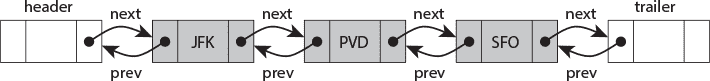

图 4.26 带有头部和尾部节点的双向链表

在使用哨兵节点时，空列表的初始化方式是：头部的`next`字段指向尾部，而尾部的`prev`字段指向头部。对于非空列表，头部的`next`指向第一个元素，尾部的`prev`指向最后一个元素。

### 使用哨兵节点的优势

虽然我们可以在没有哨兵的情况下实现双向链表（正如我们在第 4.2 节中对单链表所的那样），但投入哨兵节点的额外内存极大简化了操作逻辑。特别是，头部和尾部节点永远不会。此外，我们可以以统一的方式处理所有插入，因为每个元素始终位于两个节点之间。作为对比，我们查看单链表的实现。它的`addLast`方法需要一个条件判断（代码片段 4.16 第 39 行）来处理插入空列表的特殊情况。在一般情况下，新节点被链接在现有尾节点之后。但在向空列表添加元素时，没有现有的尾节点；相反需要对`head`进行重新赋值。在该实现中使用哨兵节点可以消除这种特殊情况，因为在新节点之前总是存在一个节点（可能是头部）。

### 使用双向链表进行插入和删除

我们双向表示法中的每次插入都发生在一对现有节点之间，如图 4.27 所示。例如，当一个新元素插入到序列前端时，我们只需将新节点插入头部和当前头部之后节点之间。

节点的删除（如图 4.29 所示）过程与插入的操作相反。被删除节点的两个邻居直接相互链接，从而跳过了原始节点。结果是该节点不再被视为列表的一部分，可以被系统回收。由于我们使用了哨兵节点，在删除序列的第一个或最后一个元素时可以使用相同的实现，因为即使是这样的元素也会存储在位于两个节点之间的节点上。

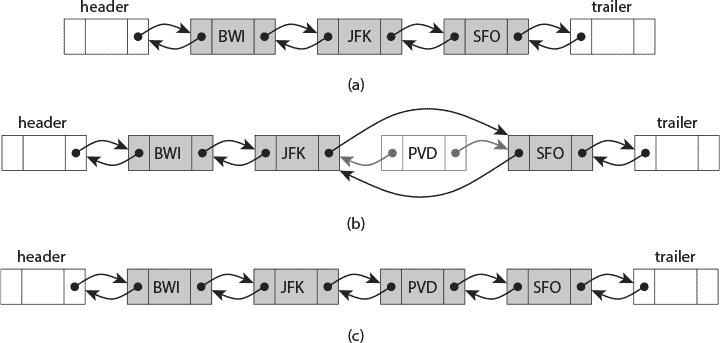

图 4.27 在带有头部和尾部哨兵的双向链表中添加元素：(a) 操作前；(b) 创建新节点后；(c) 将邻居链接到新节点后。

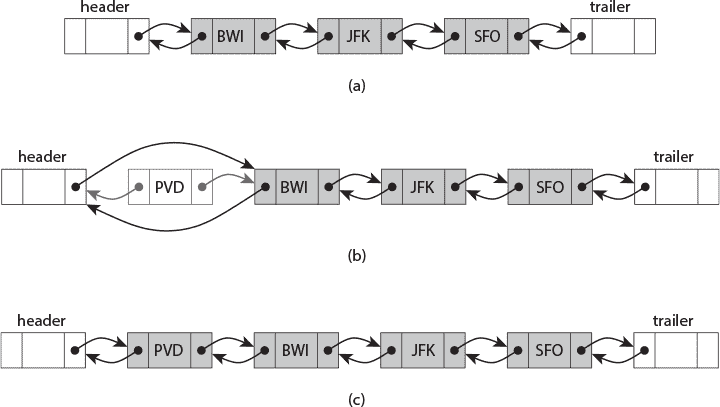

图 4.28 在带有头部和尾部哨兵（sentinels）的双向链表表示的序列前端添加元素：(a) 操作前；(b) 创建新节点后；(c) 将邻居连接到新节点后。

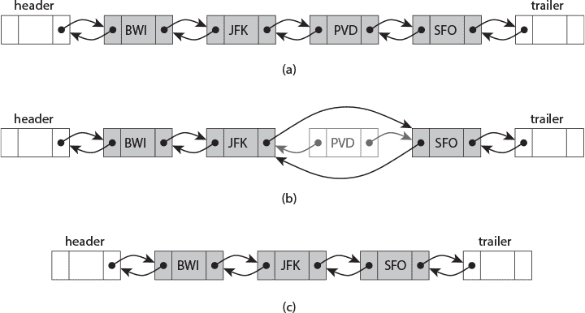

图 4.29 从双向链表中删除元素 PVD：(a) 删除前；(b) 断开旧节点的链接后；(c) 删除后（并进行垃圾回收）。

### 4.4.1 实现双向链表类

在本节中，我们将展示一个`DoublyLinkedList`类的完整实现，它支持以下公共方法：

| 方法 | 说明 |
|---|---|
| `size()` | 返回列表中的元素数量。 |
| `isEmpty()` | 如果列表为空则返回`true`，否则返回`false`。 |
| `first()` | 返回（但不移除）列表中的第一个元素。 |
| `last()` | 返回（但不移除）列表中的最后一个元素。 |
| `addFirst(e)` | 在列表前端添加新元素。 |
| `addLast(e)` | 在列表末尾添加新元素。 |
| `removeFirst()` | 移除并返回列表的第一个元素。 |
| `removeLast()` | 移除并返回列表的最后一个元素。 |

如果在空列表调用`first()`、`last()`、`removeFirst()`或`removeLast()`，我们将返回一个`null`引用并保持列表不变。

尽管我们已经看到可以在双向链表的内部位置添加或删除元素，但这样做需要知道一个或多个节点，以便确定操作应该发生的位置。在本章中，我们更倾向于维护封装性，使用一个私有的嵌套`Node`类。在第 7 章中，我们将再次探讨双向链表的使用，提供一个更高级的接口，在维护封装性的同时支持内部插入和删除。

代码片段 4.21 和 4.22 展示了`DoublyLinkedList`类的实现。正如我们在处理`SinglyLinkedList`类那样，我们使用泛型框架来接受任何类型的元素。双向链表的嵌套`Node`类与单向链表类似，不同在于额外支持一个指向前一个节点的`prev`引用。

我们对哨兵节点（头部和尾部）的使用在几个方面影响了实现。我们在构造空列表时创建并链接哨兵节点（第 25–29 行）。我们还记住，非空列表的第一个元素存储在紧邻头部的之后的节点中（而不是头部本身），同样，最后一个元素存储在紧邻尾部之前的节点中。

哨兵节点极大地简化了我们对各种更新方法的实现。我们将提供一个私有方法`addBetween`来处理插入的通用情况，然后依靠该工具方法作为简单的方法来实现`addFirst`和`addLast`。同样地，我们将定义一个私有的`remove`方法，可以轻松地实现`removeFirst`和`removeLast`。

```java
/** 基础双向链表实现。 */
public class DoublyLinkedList<E> {
  //---------------- 嵌套 Node 类 ----------------
  private class Node<E> {
    private E element; // 指向存储在此节点上的元素的引用
    private Node<E> prev; // 指向列表中前一个节点的引用
    private Node<E> next; // 指向列表中后一个节点的引用

    public Node(E e, Node<E> p, Node<E> n) {
      element = e;
      prev = p;
      next = n;
    }

    public E getElement() { return element; }
    public Node<E> getPrev() { return prev; }
    public Node<E> getNext() { return next; }
    public void setPrev(Node<E> p) { prev = p; }
    public void setNext(Node<E> n) { next = n; }
  }// 嵌套类结束 -----------

  // DoublyLinkedList 的实例变量
  private Node<E> header; // 头部哨兵
  private Node<E> trailer; // 尾部哨兵
  private int size = 0; // 列表中的元素数量

  /** 构造一个新的空列表。 */
  public DoublyLinkedList() {
    header = new Node<>(null, null, null); // 创建头部
    trailer = new Node<>(null, header, null); // 尾部之前是头部
    header.setNext(trailer); // 头部之后是尾部
  }

  /** 返回链表中的元素数量。 */
  public int size() { return size; }

  /** 测试链表是否为空。 */
  public boolean isEmpty() { return size == 0; }

  /** 返回（但不移除）列表中的第一个元素。 */
  public E first() {
    if (isEmpty()) return null;
    return header.getNext().getElement(); // 头部之后
  }

  /** 返回（但不移除）列表中的最后一个元素。 */
  public E last() {
    if (isEmpty()) return null;
    return trailer.getPrev().getElement(); // 尾部之前
  }
}
```

代码片段 4.21 `DoublyLinkedList`类的实现。（接下文代码片段 4.22](#c04.xhtml_cod4-22)）

```java
// 公共更新方法
/** 在列表前端添加新元素。 */
public void addFirst(E e) {
  addBetween(e, header, header.getNext()); // 在头部之后
}

/** 在列表末尾添加新元素。 */
public void addLast(E e) {
  addBetween(e, trailer.getPrev(), trailer); // 在尾部之前
}

/** 移除并返回列表的第一个元素。 */
public E removeFirst() {
  if (isEmpty()) return null;
  return remove(header.getNext()); // 头部之后
}

/** 移除并返回列表的最后一个元素。 */
public E removeLast() {
  if (isEmpty()) return null;
  return remove(trailer.getPrev()); // 尾部之前
}

// 私有更新方法
/** 在给定的节点之间添加元素 e。 */
private void addBetween(E e, Node<E> predecessor, Node<E> successor) {
  // 创建并链接新节点
  Node<E> newest = new Node<>(e, predecessor, successor);
  predecessor.setNext(newest);
  successor.setPrev(newest);
  size++;
}

/** 从列表中移除给定的节点并返回其元素。 */
private E remove(Node<E> node) {
  Node<E> predecessor = node.getPrev();
  Node<E> successor = node.getNext();
  predecessor.setNext(successor);
  successor.setPrev(predecessor);
  size--;
  return node.getElement();
}
} //----------- DoublyLinkedList 类结束
```

### 4.5 测试相等性

在处理引用类型时，对于一个表达式如何等于另一个表达式有许多不同的定义。在最低层次，如果`a`和`b`是引用变量，那么表达式`a == b`测试的是`a`和`b`是否指向同一个对象（或者是否都被设置为`null`值）。

然而，对于许多类型，存在更高层次的定义，即两个变量被认为是“等价”的，即使它们实际上并没有指向该类的同一个实例。例如，我们通常认为当两个`String`实例表示相同的字符序列时，它们之间是等等的。

为了支持更广泛的等价概念，所有对象类型都支持一个名为`equals`的方法。引用类型的用户应该依赖`a.equals(b)`语法，除非他们有特定需求来测试更狭义的身份（identity）概念。`equals`方法在`Object`类中正式定义，该类是所有引用类型的超类，但该实现只是回退到返回表达式`a == b`的值。定义一个更具意义的等价概念需要对类及其表示形式有了解。

每个类的作者都有责任提供一个`equals`方法的实现，如果对两个实例的等价性有更相关的定义，则该实现应重写继承自`Object`的方法。例如，Java 的`String`类重新定义了`equals`以测试逐字符的等价性。

在重写相等性概念时必须非常小心，因为 Java 库的一致性依赖于`equals`方法定义了数学中所谓的等价关系（equivalence relation），该关系需要满足以下属性：

| 属性 | 说明 |
|---|---|
| 对`null`的处理 | 对于任何非空引用变量`x`，调用`x.equals(null)`应该返回`false`（也就是说，除了`null`之外没有东西等于`null`）。 |
| 反射性 | 对于任何非空引用变量`x`，调用`x.equals(x)`应该返回`true`（也就是说，对象应该等于它自己）。 |
| 对称性 | 对于任何非空引用变量`x`和`y`，调用`x.equals(y)`和`y.equals(x)`应该返回相同的值。 |
| 传递性 | 对于任何非空引用变量`x`、`y`和`z`，如果调用`x.equals(y)`和`y.equals(z)`都返回`true`，那么调用`x.equals(z)`也必须返回`true`。 |


虽然这些属性看起来很直观，但为某些数据结构正确实现 `equals` 可能具有挑战性，特别是在具有继承和泛型的面向对象环境中。对于书中的大多数数据结构，我们省略了有效 `equals` 方法的实现（将其留作练习）。然而，在本节中，我们考虑了针对数组和链表的等价性测试处理，包括为我们的 `SinglyLinkedList` 类提供一个 `equals` 方法正确实现的具体示例。

### 4.5.1 数组的等价性测试

正如我们在第 1.3 节中提到的，数组是 Java 中的引用类型，但在技术上并不是一个类。然而，在第 4.1.3 节中引入的 `java.util.Arrays` 类提供了处理数组时非常有用的静态方法。以下是数组等价性处理的总结，假设变量 `a` 和 `b` 指向数组对象：

| 表达式 | 说明 |
|---|---|
| `a == b` | 测试 `a` 和 `b` 是否指向同一个底层数组实例。 |
| `a.equals(b)` | 这与 `a == b` 相同。数组不是真正的类类型，也没有重写 `Object.equals` 方法。 |
| `Arrays.equals(a, b)` | 这提供了一个更直观的等价概念：如果数组长度相同且所有成对的元素彼此“相等”，则返回 `true`。具体来说，如果数组元素是基本类型，则使用标准的 `==` 来比较值。如果数组元素是引用类型，则在评估等价性时进行成对比较 `a[k].equals(b[k])`。 |

对于大多数应用，`Arrays.equals` 的行为捕捉了适当的等价概念。然而，在使用多维数组时存在额外的复杂性。Java 中的二维数组实际上是嵌套在一个公共一维数组中的另一个一维数组，这一事实引发了关于我们如何思考*复合对象*（compound objects）的有趣问题。复合对象是由其他对象构成的对象，例如二维数组。特别是，它提出了复合对象从哪里开始和结束的问题。

因此，如果我们有一个二维数组 `a` 和另一个具有与 `a` 相同内容的二维数组 `b`，我们可能希望认为 `a` 等于 `b`。但构成 `a` 和 `b` 行的一维数组（例如 `a[0]` 和 `b[0]`）存储在不同的内存位置，尽管它们具有相同的内容。因此，在这种情况下，调用方法 `java.util.Arrays.equals(a, b)` 将返回 `false`，因为它测试的是 `a[k].equals(b[k])`，这会调用 `Object` 类的 `equals` 定义。

为了支持多维数组在内容相等时即相等的这种更自然的概念，该类提供了一个额外的方法：

| 表达式 | 说明 |
|---|---|
| `Arrays.deepEquals(a, b)` | 与 `Arrays.equals(a, b)` 相同，除非 `a` 和 `b` 的元素本身也是数组。在这种情况下，它对相应的条目调用 `Arrays.deepEquals(a[k], b[k])`，而不是 `a[k].equals(b[k])`。 |

### 4.5.2 链表的等价性测试

在本节中，我们在第 4.2.1 节的 `SinglyLinkedList` 类背景下开发了 `equals` 方法的实现。使用与 `java.util.Arrays.equals` 方法处理数组非常相似的定义，如果两个列表长度相同且内容逐元素相等，我们认为它们是相等的。我们可以通过同时遍历两个列表并验证每对元素 `x` 和 `y` 的 `x.equals(y)` 来评估这种等价性。

`SinglyLinkedList.equals` 方法的实现在代码片段 4.23 中。

```java
public boolean equals(Object o) {
  if (o == null) return false;
  if (getClass() != o.getClass()) return false;
  SinglyLinkedList other = (SinglyLinkedList) o; // 使用非泛类型
  if (size != other.size) return false;
  Node walkA = head; // 遍历主列表
  Node walkB = other.head; // 遍历辅助列表
  while (walkA != null) {
    if (!walkA.getElement().equals(walkB.getElement())) return false; // 不匹配
    walkA = walkA.getNext();
    walkB = walkB.getNext();
  }
  return true; // 如果到达这里，说明匹配成功
}
```

在到达第 4 行时，我们已经确保参数是 `SinglyLinkedList`（或相应的子类）的实例，因此可以安全地将其强制转换为 `SinglyLinkedList`，以便访问实例变量 `size` 和 `head`。这里涉及 Java 泛型框架处理的微妙之处。尽管我们的 `SinglyLinkedList` 类声明了类型参数 `<E>`，但无法检测另一个列表是否具有匹配的类型。（对感兴趣的人，可以在网上查找关于 Java*擦除*（erasure）的讨论。）因此，我们在第 4 行回到使用非泛型的 `SinglyLinkedList`，并在第 6 行和第 7 行使用非泛型的 `Node` 声明。如果两个列表类型不兼容，在调用对应元素的 `equals` 方法时会被检测到。

面向对象编程的优点在于，抽象允许将数据结构视为一个单一对象，尽管该结构的封装实现可能依赖于许多对象之间更复杂的组合。在本节中，我们将考虑对这种结构进行复制意味着什么。

在编程环境中，一个常见的预期是对象的拷贝应该拥有它自己的状态，并且一旦完成，该拷贝就与原始对象是独立的（例如，这样对其中一个的修改就不会直接影响另一个）。然而，当对象拥有指向辅助对象的引用变量字段时，并不总是清楚拷贝对象是否应该有一个相应的字段来指向同一个辅助对象，还是指向该辅助对象的一个新拷贝。

例如，如果一个假设的 `AddressBook` 类有代表电子地址簿的实例，其中包含一个人的朋友和熟人的联系人信息（如电话号码和电子邮箱地址），我们应该如何设想地址簿的拷贝呢？向其中一个地址簿添加的条目是否应该出现在另一个地址簿中？如果我们在其中一个地址簿中更改了某人的电话号码，我们会期望该更改在另一个地址簿中同步吗？

对于这类问题，没有一个一成不变的答案。相反，Java 中的每个类都负责定义其实例是否可以被复制，如果可以，则精确定义拷贝是如何构造的。通用的 `Object` 超类定义了一个名为 `clone` 的方法，它可以用于产生所谓的对象的*浅拷贝*（shallow copy）。该方法使用标准的赋值语义，将新对象的每个字段的值赋值为正在复制的现有对象的对应字段的值。这之所以被称为浅拷贝，是因为如果该字段是引用类型，那么形如 `duplicate.field = original.field` 的初始化会导致新对象的字段与原始对象的字段指向同一个底层实例。

浅拷贝并不适用于所有的类，因此，Java 刻意通过将 `clone()` 方法声明为 `protected` 来禁用其使用，并使其在被调用时抛出 `CloneNotSupportedException`。类的作者必须通过正式声明该类实现了 `Cloneable` 接口，并声明一个公共的 `clone()` 方法版本，来显式地声明对复制的支持。如果合适的话，这个公共方法可以简单地调用受保护的方法，以执行逐个字段的赋值，从而产生浅拷贝。然而，对于许多类，该类可能会选择实现更深层次的复制版本，其中一些被引用的对象本身也会复制。

对于书中的大多数数据结构，我们省略了有效 `clone` 方法的实现（将其留作练习）。但在本节中，我们考虑了同时复制数组和链表的方法，包括为 `SinglyLinkedList` 类提供 `clone` 方法的具体实现。

### 4.6.1 复制数组

尽管数组支持如 `a[k]` 和 `a.length` 等特殊语法，但记住它们是对象，且数组变量是引用变量是非常重要的。这具有重要的后果。作为第一个例子，考虑以下代码：

```java
int[] data = {2, 3, 5, 7, 11, 13, 17, 19};
int[] backup;
backup = data; // 警告；不是拷贝
```

将变量 `backup` 赋值给 `data` 并不会创建任何新数组；它只是为同一个数组创建了一个新别名，如图 4.30 所示。

图 4.30 对于 `int` 数组执行命令 `backup = data` 的结果。

相反，如果我们想对数组 `data` 进行拷贝并将新数组的引用赋值给变量 `backup`，我们应该写：

```java
backup = data.clone();
```

当 `clone` 方法在数组上执行时，它会将新数组的每个单元格初始化为原始数组对应单元格存储的值。这产生了一个独立的数组，如图 4.31 所示。`clone()` 方法产生数组的*浅拷贝*，产生一个新数组，其单元格指向第一个数组所引用的相同对象。

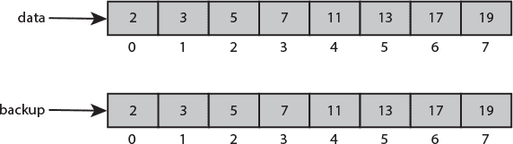

图 4.31 对于 `int` 数组执行命令 `backup = data.clone()` 的结果。

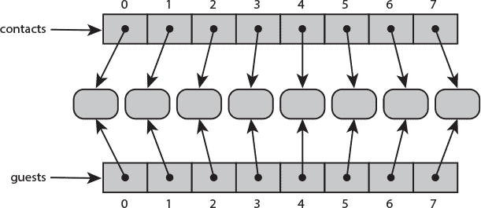

图 4.32 通过命令 `guests = contacts.clone()` 产生的对象数组的浅拷贝。

例如，如果变量 `contacts` 指向一个假设的 `Person` 实例数组，命令 `guests = contacts.clone()` 的结果产生了一个浅拷贝，如图 4.32 所示。

可以通过迭代复制单个元素来创建联系人列表的*深拷贝*（deep copy），但只有在 `Person` 类被声明为 `Cloneable` 时才可行。

```java
Person[] guests = new Person[contacts.length];
for (int k = 0; k < contacts.length; k++)
    guests[k] = (Person) contacts[k];
```

由于二维数组实际上是存储一维数组的一维数组，浅拷贝和深拷贝的区别存在。遗憾的是，`java.util.Arrays` 类没有提供任何 `deepClone` 方法。然而，我们可以通过复制数组的每一行来实现自己的方法，如下所示：

```java
public static int[] deepClone(int[] original) {
    int[] backup = new int[original.length];
    for (int k = 0; k < original.length; k++)
        backup[k] = original[k].clone();
    return backup;
}
```

**代码片段 24**（上文引用）：用于整数二维数组深拷贝的方法。

### 4.6.2 复制链表

在本节中，我们为第 4.2.1 节中的 `SinglyLinkedList` 类添加复制支持。在 Java 中使类可复制的第一步是声明实现 `Cloneable` 接口。因此，我们调整类定义的第一行如下：

```java
public class SinglyLinkedList<E> implements Cloneable {
```

剩余的任务是实现该类的公共版本 `clone()` 方法，我们在代码片段 25 中展示它。按照惯例，该方法应该通过调用 `super.clone()` 来创建一个新实例，在我们的情况下，这调用了 `Object` 类的方法。由于继承的版本返回一个 `Object`，我们对其进行类型收窄转换为 `SinglyLinkedList<E>`。

在执行到此时，`other` 列表已创建为原始对象的浅拷贝。由于我们的列表类有两个字段 `size` 和 `head`，已经进行了以下赋值：

```java
other.size = this.size;
other.head = this.head;
```

虽然 `size` 变量的赋值是正确的，但我们不允许新列表共享相同的 `head` 值（除非它是 `null`）。对于非空列表，要拥有独立状态，它必须有一条全新的节点链，每个节点都存储原始列表中对应元素的引用。因此，我们在代码的第 5 行创建一个新的头节点，然后遍历原始列表的剩余部分（第 8–13 行），同时为新列表创建并链接新节点。

```java
public SinglyLinkedList<E> clone() throws CloneNotSupportedException {
  // 始终使用继承自 Object 的 clone() 创建初始拷贝
  SinglyLinkedList<E> other = (SinglyLinkedList<E>) super.clone(); // 安全类型转换
  if (size > 0) { // 我们需要独立的节点链
    other.head = new Node<>(head.getElement(), null);
    Node<E> walk = head.getNext(); // 遍历原始列表的剩余部分
    Node<E> otherTail = other.head; // 记住最近创建的节点
    while (walk != null) { // 存储相同元素的新节点
      Node<E> newest = new Node<>(walk.getElement(), null);
      otherTail.setNext(newest); // 将上一个节点连接到当前
      otherTail = newest;
      walk = walk.getNext();
    }
  }
  return other;
}
```

代码片段 4.25 `SinglyLinkedList.clone()` 方法的实现。

## 练习

### 强化

1. **R-4.1** 编写一个 Java 方法，在数组的第 `k` 个位置插入一个元素。
2. **R-4.2** 编写一个 Java 方法，通过维护数据元素的非递减顺序来创建一个一维数组，但输入将以随机顺序外部提供。
3. **R-4.3** 编写一个 Java 方法，验证一个大小为 `n × n` 的方矩阵是否正交。
4. **R-4.4** 编写一个 Java 方法，在单链表中给定的信息项之后插入新节点。
5. **R-4.5** 考虑代码片段 4.20 中 `CircularlyLinkedList.addFirst` 的实现。该方法第 39 和 40 行的 `else` 体依赖于一个局部定义的变量 `newest`。重新设计该语句以避免使用任何局部变量。
6. **R-4.6** 描述一种用于寻找带有头部和尾部哨兵节点的双向链表的中间节点的方法，该方法通过“链接跳转”（link hopping）实现，且不依赖于列表大小的明确知识。在节点数为偶数的情况下，将中心稍左的节点报告为“中间”。该方法的运行时间是多少？
7. **R-4.7** 编写一个 Java 方法（例如 `removeNode()`），为 `SinglyLinkedList` 类删除具有特定信息项的节点。添加必要的引用、局部变量和数据成员（如果有以及访问控制修饰符）。
8. **R-4.8** 为 `CircularlyLinkedList` 类提供 `size()` 方法的实现，假设我们没有维护 `size` 实例变量。
9. **R-4.9** 编写一个 Java 方法（例如 `removeNode()`），为 `DoublyLinkedList` 类删除具有特定信息项的节点。添加必要的引用、局部变量和数据成员（如果有以及访问控制修饰符）。
10. **R-4.10** 在 `SinglyLinkedList` 类中实现 `rotate()` 方法，其语义等于 `addLast(removeFirst())`，但不创建任何新节点。
11. **R-4.11** 给出一个算法，从循环链表中删除第 `k` 个节点。
12. **R-4.12** 为 `DoublyLinkedList` 类实现 `equals()` 方法。
13. **R-4.13** 为 `CircularlyLinkedList` 类实现 `equals()` 方法，假设如果两个列表具有相同的序列，且对应的元素当前位于列表头部，则它们相等。
14. **R-4.14** 如果两个 Java 数组 `A` 和 `B` 是 `int` 类型的一维数组，它们的浅层相等测试和深度相等测试之间的区别是什么？如果数组是 `int` 类型的二维数组呢？

### 创意

1. **C-4.15** 编写 Java 代码，用于查找大小为 `n` 的整数数组中最大元素和最小元素之间的差。
2. **C-4.16** 编写 Java 代码，删除整数数组中的重复元素。
3. **C-4.17** 编写 Java 代码，创建一个包含 `n` 个随机整数（正负元素）的数组，并以某种方式排列元素，使得每个负元素都出现在所有正元素之前。
4. **C-4.18** 假设给定一个数组 `A`，包含 100 个整数，这些整数使用方法 `r.nextInt(10)` 生成，其中 `r` 是 `java.util.Random` 类型的对象。让 `x` 表示 `A` 中整数的乘积。有一个数字 `x` 等于它的概率至少为 0.99。这个数字是什么？描述 `x` 等于该数字概率的公式是什么？
5. **C-4.19** 编写方法 `shuffle(A)`，重新排列 `A` 的元素，使得每种排列的概率相等。你可以依赖 `java.util.Random` 的 `nextInt(n)`，它返回 0 到 `n - 1` 之间的随机数。
6. **C-4.20** 我们对双向链表的实现依赖于哨兵节点，但一个守卫两端的哨兵节点就足够了。使用一个哨兵节点重新实现 `DoublyLinkedList` 类。


7. **C-4.21** 编写 Java 代码，创建一个大小为 `n` 的二维数组 `A`，并找到彼此最近的点。

8. **C-4.22** 为 `SinglyLinkedList` 类创建一个 Java 方法（例如 `addSorted()`），按排序顺序添加节点。

9. **C-4.23** 给出一个算法，将两个带有头部和尾部节点的链表 `L` 和 `M` 合并为一个列表 `L′`。

10. **C-4.24** 详细描述一个仅使用常量空间反转单链表 `L` 的算法。

11. **C-4.25** 为 `CircularlyLinkedList` 类创建一个 Java 方法（例如 `traverseCircularList()`），遍历节点。

12. **C-4.26** 给定一个包含偶数节点的循环链表 `L`，描述如何拆分为两个大小一半的链表。

13. **C-4.27** 实现一个不带哨兵的循环双向链表，支持原始的所有公共行为以及两个新方法 `rotate()` 和 `rotateBackward()`。

14. **C-4.28** 使用继承解决前面的问题，使得 `DoublyLinkedList` 类继承自 `CircularlyLinkedList`，并且 `DoublyLinkedList.Node` 类继承自 `CircularlyLinkedList.Node`。

15. **C-4.29** 为 `CircularlyLinkedList` 类实现 `clone()` 方法。

16. **C-4.30** 为 `DoublyLinkedList` 类实现 `clone()` 方法。

### 项目

1. **P-4.32** 编写一个维护游戏应用最高十分的类，实现 4.1.1 中的 `add` 和 `remove` 方法，但使用单链表代替数组。

2. **P-4.33** 编写一个维护高中记录的类（如 `Name`、`Roll No.`、`Section`、`Phone No.`、`Marks` 和 `Email_Id`），使用单链表实现 `addition`、`deletion` 和按 `Rollno` 搜索等方法。

3. **P-4.34** 执行前面的项目，但使用双向链表。此外，你的 `addition` 实现将根据学生的 `marks` 按非递减顺序添加新记录。

4. **P-4.35** 实现类 `SubstitutionCipher`，其构造函数接收一个包含 26 个任意顺序大写字母的字符串，并将其作为编码器（即 A 映射到参数的第一个字符，B 映射到第二个，以此类推）。你应该从正向版本推导出解码映射。

5. **P-4.36** 重新设计 `CaesarCipher` 类，作为前一个问题中 `SubstitutionCipher` 的子类。

### P-4.37 设计一个 `RandomCipher` 类，作为练习 P-4.35 中 `SubstitutionCipher` 的子类，使得该类的每个实例都依赖于字母的随机排列来进行映射。

## 多选题

1. **M-4.1** 程序 `P` 读取 500 个范围在 [0, 100] 之间的整数，代表 500 名学生的成绩。然后它打印大于 50 的每个分数的出现频率。`P` 存储这些频率的最佳方式是？

   1. 一个长度为 50 的数组

   2. 一个长度为 100 的数组

   3. 一个长度为 500 的数组

   4. 一个长度为 550 的动态分配数组(**GATE 2005**)

2. **M-4.2** 插入排序用于对数组进行排序的常用 `Θ(n²)` 实现使用线性查找来确定元素要插入到数组已排序部分的位置。如果我们改用二分查找来确定该位置，那么最坏情况的运行时间将变为 __________。

   1. 保持 `Θ(n²)`

   2. 变为 `Θ(n (log n)²)`

   3. 变为 `Θ(n log n)`

   4. 变为 `Θ(n)`(**GATE 2003**)

3. **M-4.3** 两个矩阵 `M1` 和 `M2` 分别存储在数组 `A` 和 `B` 中。每个数组都可以行主序或列主序存储在连续内存位置中。计算 `M1 × M2` 的算法的时间复杂度为 __________。

   1. 如果 `A` 是行主序 `B` 是列主序则最佳

   2. 如果都是行主序则最佳

   3. 如果都是列主序则最佳

   4. 与存储方案无关(**GATE 2004**)

4. **M-4.4** 给定包含 `n` 个数字的数组，其中 `n` 是一个偶数。需要确定这 `n` 个数字中的最大值和最小值。关于所需的比较次数，以下哪项是正确的？

   1. 至少需要 `2n - c` 次比较，其中 `c` 为常数。

   2. 最多需要 `1.5n - 2` 次比较。

   3. 至少需要 `n log[2] n` 次比较。

   4. 以上都不是(**GATE 2007**)

5. **M-4.5** 在一个包含 `n` 个整数的排序数组中，确定一个整数出现次数超过 `n/2` 次所需的最小比较次数为 __________。

   1. `Θ(n)`

   2. `Θ(log n)`

   3. `Θ(log n)`

   4. `Θ(1)`(**GATE 2008**)

6. **M-4.6** 有 `n` 个未排序的数组：`A[1]`、`A[2]`、…… `A[n]`。假设 `n` 是奇数。每个 `A[1]`、`A[2]`、…… `A[n]` 包含 `n` 个不同的元素。任意两个数组之间没有共同元素。计算 `A[1]`、`A[2]`、…… `A[n]` 中位数的中位数的最坏情况时间复杂度为 __________。

   1. `O(n)`

   2. `O(n log n)`

   3. `O(n²)`

   4. `O(n² log n)`(**GATE 2019**)

7. **M-4.7** 如果数组 `A` 按照顺序包含项 10, 4, 7, 23, 67, 12 和 5，在插入排序的第三轮之后，结果数组 `A` 将是？

   1. 67, 12, 10, 5, 4, 7, 23

   2. 4, 7, 10, 23, 67, 12, 5

   3. 4, 5, 7, 67, 10, 12, 23

   4. 10, 7, 4, 67, 23, 12, 5(**ISRO 2020**)

8. **M-4.8** 考虑一个有 10 行 4 列的二维数组 `x`，每个元素存储的值等于行号与列号的乘积。该数组以行主序格式存储。如果第一个元素 `x[0][0]` 占用地址为 1000 的内存位置且每个元素仅占用一个内存位置，哪些位置（十进制）将持有值 10？

   1. 1018, 1019

   2. 1022, 1041

   3. 1013, 1014

   4. 1000, 1399(**ISRO 2020**)

9. **M-4.9** 考虑二维数组 `X[30][10]`。假设每个内存单元的大小为 4 个字，而 100 是数组 `X` 的基地址，第一个元素是 `X[0][0]`。

10. **M-4.10** 考虑二维数组 `X[30][10]`。假设每个内存单元的大小为 4 个字，而 100 是数组 `X` 的基地址，第一个元素是 `X[0][0]`。 (注：原文此处似乎重复或截断，按逻辑处理翻译)

*(注：由于提供的原文中 M-4.9 和 M-4.10 似乎存在格式异常或重复，翻译已根据原文字面意思呈现)*

递归是数据结构和算法学习中的一项重要技术。我们将在本书的后续章节中频繁地使用它（最典型的第 8 章和第 14 章）。在本章中，我们将从以下四个递归使用的说明示例开始，并为每个示例提供一个 Java 实现。

*   `阶乘函数`（通常表示为 `n!`）是一个经典的数学函数，具有天然的递归定义。

*   `二分查找`是计算机领域最重要的算法之一。它允许我们从一个包含数十亿条目的数据集中高效地定位所需的值。

*   `汉诺塔问题`是一个使用递归的趣味益智游戏，其目标是将整叠盘子从源位置移动到另一个位置。

*   `Ackermann 函数`是定义良好的递归函数的最简单例子，它是可计算的，但不是原始递归的。

*   计算机的`文件系统`具有递归结构，其中目录可以任意深度地嵌套在其他目录中。递归算法被广泛用于探索和管理这些文件系统。

随后，我们将描述如何对递归算法的运行时间进行形式化分析，并讨论定义递归时的一些潜在陷阱。在本章的剩余部分，我们将提供更多递归算法示例，并组织这些示例以突出一些常见的设计形式。

## 5.1 递归基础

### 5.1.1 阶乘函数

为了演示递归的机制，我们从一个计算`阶乘函数`值的简单数学示例开始。正整数 `n` 的阶乘记为 `n!`，被定义为从 1 到 `n` 的所有整数的乘积。如果 `n` = 0，根据惯例，`n!` 定义为 1。更正式地说，对于任何整数 `n` ≥ 0，

$\begin{matrix} {n! = \left\{ {n \cdot {({n - 1})} \cdot {({n - 2})}\cdots 3 \cdot 2 \cdot 1}^{1} \right.} & & \begin{array}{l} {\text{if}\, n = 0} \\ {\text{if}\, n \geq 1.} \end{array} \end{matrix}$

例如，5! = 5 · 4 · 3 · 2 · 1 = 120。阶乘函数之所以重要，是因为众所周知等于 `n` 个不同项目排列成序列的方法数，即 `n` 个项目的`排列数`。例如，字符 a, b, 和 c 这三个字符可以用 3! = 3 · 2 · 1 = 6 种方式排列：abc, acb, bac, bca, cab 和 cba。

阶乘函数有一个天然的递归定义。为了理解这一点，请观察 5! = 5 · (4 · 3 · 2 · 1) = 5 · 4!。更一般地说，对于正整数 `n`，我们可以定义 `n!` 为 `n` · (`n` − 1)!。这种`递归定义`可以形式化为

$\begin{matrix} {n! = \left\{ {n \cdot {({n - 1})}!}^{1} \right.} & & \begin{array}{l} {\text{if}\, n = 0} \\ {\text{if}\, n \geq 1.} \end{array} \end{matrix}$

这种定义是许多函数递归定义的典型代表。首先，我们有一个或多个`基准情况`（base cases），它们指的是函数的固定值。上述定义有一个基准情况，说明当 `n` = 0 时，`n!` = 1。其次，我们有一个或多个`递归情况`（recursive cases），它们通过函数自身来定义函数。在上述定义中，有一个递归情况，表示当 `n` ≥ 1 时，`n!` = `n` · (`n` − 1)!。

#### 阶乘函数的递归实现

递归不仅是一种数学符号；我们可以使用递归来设计阶乘函数的 Java 实现，如代码片段 5.1 所示。

```
 1	public static int factorial(int n) throws IllegalArgumentException {
 2		if (n < 0)
 3			throw new IllegalArgumentException();                    // 参数必须是非负
 4		else if (n == 0)
 5			return 1;														// 基准情况
 6		else
 7			return n * factorial(n–1);									// 递归情况
 8	}
```

**代码片段 5.1** 阶乘函数的递归实现。

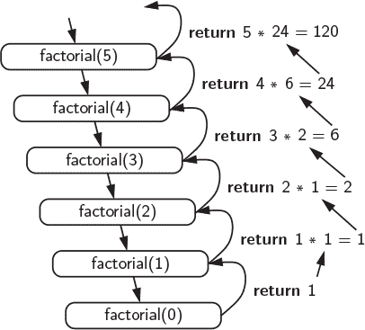

图 5.1 调用 `factorial(5)` 的递归执行轨迹。

该方法没有使用任何显式循环。重复通过对方法的反复递归调用来实现。该过程是有限的，因为每次调用该方法时，其参数都会减一，并且当到达基准情况时，就不会再进行进一步的递归调用。

我们使用`递归轨迹`（recursion trace）来说明递归方法的执行。轨迹中的每个条目都对应一次递归调用。每个新的递归方法调用用指向新调用的向下箭头表示。当方法返回时，会画一个表示此类返回的箭头，并可能在该箭头旁边指示返回值。阶乘函数的此类轨迹示例见图 5.1。

递归轨迹紧密镜像了语言的执行。在 Java 中，每当调用方法（递归或其他）时，都会创建一个名为`激活记录`（activation record）或`激活帧`（activation frame）的结构，用于存储该调用的信息。当方法的执行导致嵌套方法调用时，前一个调用挂起，其帧存储了在调用返回后继续执行的代码位置。然后为嵌套调用创建一个新帧。这种过程既适用于方法调用另一种方法，也适用于方法调用自身的情况。关键在于为每个激活调用准备一个帧。

### 5.1.2 二分查找

在本节中，我们将描述一种经典的递归算法`二分查找`（binary search），它用于在包含 *n* 个元素的有序序列中高效地定位目标值。这是最重要的算法之一，这也是我们通常以排序顺序存储数据的原因（如图 5.2）。

当序列无序时，搜索目标值的标准方法是使用循环检查每个元素，直到找到目标或耗尽数据集。这种算法被称为`线性查找`（linear search）或`顺序查找`（sequential search），其运行时间为 O*(n)（即线性时间），因为在最坏情况下需要检查每个元素。

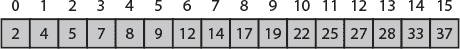

图 5.2 在数组内排序存储的值。顶部的数字是索引。

当序列是有序且可索引的，存在一种更高效的算法。（为了直观理解，请思考你会如何手动完成这项任务！）如果我们考虑序列中一个值为 *v* 的任意元素，我们可以确定该元素之前的所有元素的值都小于或等于 *v*，且该元素之后的所有元素的值都大于或等于 *v*。这一观察允许我们使用“猜大小”儿童游戏的变体来快速锁定搜索目标。如果在搜索的当前阶段无法排除某个项目匹配目标，则称序列中的该元素为`候选元素`（candidate）。算法维护两个参数 low 和 high，使得所有候选元素的索引至少为 low 且最多 high。初始时，low = 0 且 high = *n* - 1。随后我们将目标值与`中间候选元素`（即索引为 mid 的元素）比较：

mid = ⌊(low + high)/2⌋。

*   如果目标等于中间候选元素，则我们找到了正在查找的项目，搜索成功结束。

*   如果目标小于中间候选值，则我们对序列的前半部分进行递归，即对索引从 `low` 到 `mid – 1` 的区间递归。

*   如果目标大于中间候选值，则我们对序列的后半部分进行递归，即对索引从 `mid + 1` 到 `high` 的区间递归。

当 `low > high` 时搜索失败，因为区间 `[low, high]` 是空的。

该算法被称为 `binary search`（二分查找）。我们于代码片段 5.2 中提供了一个 Java 实现，并在图 5.3 中展示了该算法的执行过程。顺序查找的时间复杂度为 `O(n)`，而效率更高的二分查找的时间复杂度为 `O(log n)`。这是一个重大的改进，因为当 `n` 为 10 亿时，`log n` 仅为 30。（我们将对二分查找运行时间的形式化分析推迟到第 5.2 节中的命题 5.1。）

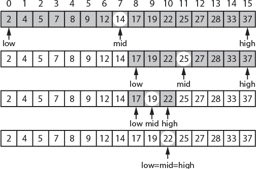

图 5.3 在包含 16 个元素的排序数组上对目标值 22 进行二分查找的示例。

```
 1	/**
 2	* 如果数据数组指定的范围内找到了目标值，返回 true。
 3	* 此搜索仅考虑从 data[low] 到 data[high]（包含边界值）的数组部分。
 4	*/
 5	public static boolean binarySearch(int[ ] data, int target, int low, int high) {
 6		if (low > high)
 7			return false;														// 区间为空；无匹配项
 8		else {
 9			int mid = (low + high) / 2;
10			if (target == data[mid])
11				return true;														// 找到匹配项
12			else if (target < data[mid])
13				return binarySearch(data, target, low, mid –1);		// 向中间左侧递归
14			else
15				return binarySearch(data, target, mid + 1, high);	// 向中间右侧递归
16		}
17	}
```

**代码片段 5.2** 在排序数组上对二分查找算法的实现。

### 5.1.3 汉诺塔

1883 年，法国数学家 埃德华·卢卡斯（Édouard Lucas）发明了一种著名的递归益智游戏，即汉诺塔。它基于三个柱子——源柱、中间柱和目标柱（分别称为 A、B 和 C）。柱子 A 由 `N` 个圆盘组成，按尺寸从大到小的顺序放置，即较大的盘放在底部，最小的盘放在顶部。柱子的初始配置如图 5.4 所示。

在这个游戏中，主要目标是使用中间柱 B（如果需要）将所有圆盘从柱子 A 移动到柱子 C，并保持相同的顺序。圆盘移动的规则如下：

1.  一次只能移动一个圆盘。

2.  只有最顶部的圆盘可以从一个柱子移动到另一个柱子。

3.  在移动过程中，较大的圆盘不能放在较小的圆盘之上。

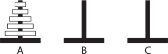

图 5.4 汉诺塔游戏（初始配置）。

为了更好地理解这一点，假设我们有三个圆盘（即 `N = 3`）。最初，所有圆盘都放在源柱上（即柱子 A）。我们的目标是在中间柱 B 的帮助下，将这三个圆盘从柱子 A 移动到柱子 C。涉及从源柱（柱子 A）到目标柱（柱子 C）移动的步骤如下。图形表示给在图 5.5 中。

> 将圆盘从柱子 A 移动到 C

> 将圆盘从柱子 A 移动到 B

> 将圆盘从柱子 C 移动到 B

> 将圆盘从柱子 A 移动到 C

> 将圆盘从柱子 B 移动到 A

> 将圆盘从柱子 B 移动到 C

> 将圆盘从柱子 A 移动到 C


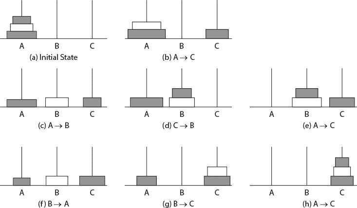

图 5.5 在中间柱 B 的帮助下，`N = 3` 个圆盘从 A 到 C 的图形表示。

为了完整起见，汉诺塔问题 `N = 1` 和 `N = 2` 时的移动数为：

$\begin{array}{cl} {N = 1:} & \left. \text{A}\rightarrow\text{C} \right. \\ {N = 2:} & \left. \text{A}\rightarrow\text{B},\,\text{A}\rightarrow\text{C},\,\text{B}\rightarrow\text{C} \right. \end{array}$

因此，对于 `N` 个圆盘解决上述问题的递归过程如下：

1. 将前 `N – 1` 个圆盘从源柱 A 移动到柱子 B。
2. 将顶部的圆盘从柱子 A 移动到目标柱 C。
3. 最后将剩下的 `N – 1` 个圆盘从柱子 B 移动到柱子 C。

对于 `N` 个圆盘解决上述问题的递归 Java 实现给在代码片段 5.3 中。

```java
/** 汉诺塔问题的递归函数 */
public static void TowerHanoi(int n, char A, char B, char C)
{
    if(n == 1) // 如果只有一个盘
    {
        System.out.println(A+"->"+C);
    }
    else // 如果有多个圆盘
    {
        TowerHanoi(n-1, A, C, B); // 移动圆盘
        System.out.println(A+"->"+C); // 移动顶部的圆盘
        TowerHanoi(n-1, B, A, C); // 移动剩下的圆盘
    }
}
```

*注：代码片段 5.3 的原始文本是不完整或错误的，我已根据逻辑进行了重构。*

**代码片段 5.3** 在排序数组上二分查找算法的实现。

### 5.1.4 阿卡曼函数

著名的递归例子之一是阿卡曼函数，由威廉·阿卡曼（Wilhelm Ackermann）开发。它之所以著名，是因为它不是原始递归的。它的值增长非常快，调用树也是如此。阿卡曼函数接受两个参数，每个参数可以是任何非负整数。定义如下：

$\begin{matrix} {A(m,n)} = \left\{ \begin{array}{l} {n + 1,} & \text{如果 } m = 0 \\ {A(m - 1, n)} & \text{如果 } m \neq 0\text{且 } n = 0 \\ {A(m - 1, A(m, n - 1))} & \text{如果 } m \neq 0\text{且 } n \neq 0 \end{array} \right. \end{matrix}$

为了更好地理解这一点，考虑以下例子：假设我们需要找到 `A(1,2)`。根据上述定义，步骤为：

```text
A(1,2) = A(0,A(1,1))
A(1,1) = A(0,A(1,0))
A(1,0) = A(0,1)
A(0,1) = 2
A(0,0) = 1
A(1,0) = A(0,1) = 2
A(1,1) = A(0,2) = 3
A(1,2) = A(0,3) = 4
```

解决上述问题的完整 Java 实现给在代码片段 5.4 中。

```java
/** 递归函数 阿卡曼 */
public static int Ackermann(int m, int n)
{
    if(m == 0)
        return(n + 1);
    else if(m != 0 && n == 0)
        return Ackermann(m - 1, 1);
    else
        return Ackermann(m - 1, Ackermann(m, n - 1));
}
```

**代码片段 5.4** 解决两个参数阿卡曼函数的递归代码。

### 5.1.5 文件系统

现代操作系统递归地定义文件系统目录（也称为“文件夹”）。也就是说，文件系统由一个顶级目录组成，该目录的内容包括文件和其他目录，而这些目录反又包含文件和其他子目录，以此类推。操作系统允许目录任意深度嵌套（只要有足够的内存），但由于必须存在某些只包含文件而不包含子目录的基目录。此类文件系统的部分表示给在图 5.6 中。

鉴于文件系统表示的递归性质，许多常见的操作系统行为（如复制目录或删除目录）使用递归算法实现，这并不意外。在本节中，我们考虑其中一个算法：计算特定目录内嵌套的所有文件和目录的总磁盘占用情况。

图 5.6 展示嵌套结构的文件系统部分。

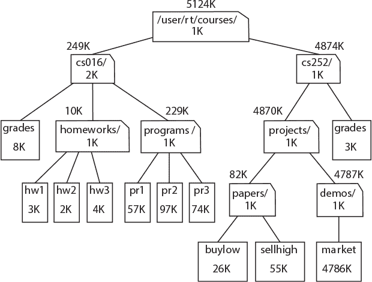

图 5.7 与图 5.6 相同的文件系统部分，但增加了额外的注释以描述所使用的磁盘空间大小。在每个文件或目录图标内部，显示了该项资源直接使用的空间量。在每个目录图标上方，显示了该目录及其所有（递归）内容所占用的累计磁盘空间。

为了便于说明，图 5.7 描述了我们示例文件系统中所有条目占用的磁盘空间。我们区分了每个条目占用的*直接*磁盘空间以及该条目及其所有嵌套特征占用的*累计*磁盘空间。例如，`cs016` 目录只使用了 `2K` 的直接空间，但总计累计空间为 `249K`。

一个条目的累计磁盘空间可以通过简单的递归算法计算。它等于该条目使用的直接磁盘空间加上直接存储在该条目内的任何其他条目的累计磁盘空间之和。例如，`cs016` 的累计磁盘空间为 `249K`，因为它本身使用了 `2K`，在 `grades` 中累计使用了 `8K`，在 `homeworks` 中累计使用了 `10K`，以及在 `programs` 中累计使用了 `229K`。该算法的伪代码见代码片段 5.5。

```text
Algorithm DiskUsage(path):
    Input: 一个指定指向文件系统条目路径的字符串
    Output: 该条目及其任何嵌套条目占用的累计磁盘空间
    total = size(path)                               {条目使用的直接磁盘空间}
    if path represents a directory then
        for each child entry stored within directory path do
            total = total + DiskUsage(child)         {recursive 调用}
    return total
```

**代码片段 5.5** 一种计算嵌套在文件系统条目中的累计磁盘空间使用的算法。我们假设 `size` 方法返回条目的直接磁盘空间。

### `java.io.File` 类

为了在 Java 中实现计算磁盘空间使用的递归算法，我们依赖于 `java.io.File` 类。该类的实例代表操作系统中的一个抽象路径名，并允许查询该操作系统条目的属性。我们将依赖该类的以下方法：

- `new File(pathString)` 或 `new File(parentFile, childString)`

  可以通过提供完整路径字符串来构造新的 `File` 实例，也可以提供一个代表目录的现有 `File` 实例以及指定该目录内子条目名称的字符串来构造。

- `file.length()`

  返回由 `File` 实例代表的操作系统条目的直接磁盘使用量（以字节为单位，例如 `/user/rt/courses`）。

- `file.isDirectory()`

  如果 `File` 实例代表目录，则返回 `true`；否则返回 `false`。

- `file.list()`

  返回一个指定目录内所有条目名称的字符串数组。在我们的示例文件系统中，如果我们对关联路径 `/user/rt/courses/cs016` 的 `File` 调用此方法，它将返回一个内容为 `{"grades", "homeworks", "programs"}` 的数组。

### Java 实现

通过使用 `File` 类，我们现在将代码片段 5.5 中的算法转换为代码片段 5.6 的 Java 实现。

```java
/**
 * 计算以给定路径为根的文件系统部分的总磁盘使用量（字节），
 * 同时打印一个类似于 Unix 标准 'du' 工具的摘要。
 */
public static long diskUsage(File root) {
    long total = root.length();                  // 从直接磁盘使用量开始
    if (root.isDirectory()) {                    // 如果这是一个目录，
        for (String childname : root.list()) {  // 那么对于每个子条目
            File child = new File(root, childname); // 组合子条目的完整路径
            total += diskUsage(child);           // 将子条目的使用量加到总计
        }
    }
    System.out.println(total + "\t" + root);     // 描述性输出
    return total;                                // 返回总计
}
```

**代码片段 5.6** 用于报告文件系统磁盘使用的递归方法。

### 递归追踪

为了产生不同形式的递归追踪，我们在 Java 实现中包含了一个多余的打印语句（代码片段 5.6 的第 13 行）。该输出的精确格式刻意地模仿了名为 `du`（代表“disk usage”）的经典 Unix/Linux 工具产生的输出。它报告了目录及其所有内容占用的磁盘空间量。

在示例文件系统上运行时，我们的 `diskUsage` 实现产生了图 5.7 所示的结果。由于每行都在从递归调用返回之前打印，因此输出行反映了递归调用*完成*的顺序。注意，它在计算和报告包含它的目录累计空间之前，先计算并报告嵌套条目的累计空间。例如，关于 `grades`、`homeworks` 和 `programs` 的递归调用是在 `/user/rt/courses/cs016` 目录的总计之前计算的。

图 5.8 展示嵌套结构的文件系统部分。

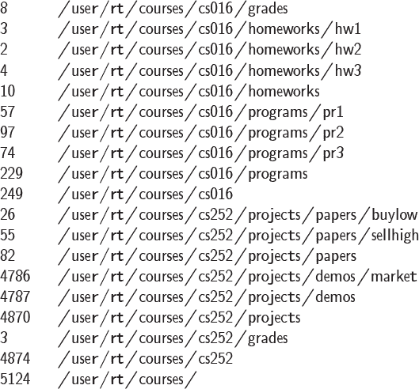

## 5.2 递归分析

在第三章中，我们引入了基于操作数估计的算法效率分析数学技术。我们使用大 O 表示来总结操作数与输入大小之间的关系。在本节中，我们将演示如何对递归算法进行此类分析。

我们将根据执行时管理控制流的特定*激活*（activation）来计算每个执行的操作。换句话说，对于方法的每次调用，我们只计算方法体内部执行的操作数。然后，我们可以通过对所有激活的单个激活期间发生的操作数求和，来计算作为递归算法执行的总操作数。（顺便提一下，这也是我们分析从体内部调用其他方法的非递归方法的方法。）

为了演示这种分析风格，我们重新回顾了第 5.1.1 节至 5.1.5 节中介绍的递归算法：阶乘计算、二分搜索、汉诺塔、Ackermann 函数以及文件系统累计大小的计算。通常，我们可以依靠*递归追踪*提供的直觉来识别发生了多少次递归激活，以及如何利用每次激活的参数化来估计方法体内部发生的原始操作数数量。然而，这些递归算法中的每一个都有独特的结构和形式。

### 计算阶乘

分析我们计算阶乘方法的效率是容易的，如第 5.1.1 节所示。我们阶乘方法的示例递归轨迹已在图 5.1 中给出。为了计算 `factorial(n)`，我们看到总共有 `n + 1` 次激活，因为参数从第一次调用的 `n` 递减到第二次调用的 `n − 1`，依此类推，直到触及参数为 0 的基准情况。

通过检查代码片段 5.1 中的方法体，也很明显看出，`factorial` 的每次单独激活都执行常数次的操作。因此，我们得出结论，计算 `factorial(n)` 的总操作数为 `O(n)`，因为有 `n + 1` 次激活，每个激活占用 `O(1)` 次操作。

### 执行二分查找

在考虑第 5.1.2 节所示的二分查找算法的运行时间时，我们观察到二分查找方法的每次递归调用期间执行了常数次基本操作。因此，运行时间与执行的递归调用次数成正比。我们将证明，对于包含 `n` 个元素的序列进行二分查找，最多会进行 `⌊log n⌋ + 1` 次递归调用，从而得出以下命题。

**命题 5.1：** 对于具有 `n` 个元素的已排序数组，二分查找算法的运行时间为 `O(log n)`。

**证明：** 为了证明这一命题，一个关键事实是，每次递归调用后待搜索的候选元素数量由以下值给出：

`high − low + 1`。

此外，每次递归调用后剩余候选的数量至少减少一半。具体来说，根据 `mid` 的定义，剩余候选的数量为：

$\left( {\text{mid} - 1} \right) - \text{low} + 1 = \left\lfloor \frac{\text{low} + \text{high}}{2} \right\rfloor - \text{low} \leq \frac{\text{high} - \text{low} + 1}{2}$

或

$\text{high} - \left( {\text{mid} + 1} \right) + 1 = \text{high} - \left\lfloor \frac{\text{low} + \text{high}}{2} \right\rfloor \leq \frac{\text{high} - \text{low} + 1}{2}.$

初始时，候选数量为 `n`；在二分查找的第一次调用后，最多为 `n/2`；第二次调用后，最多为 `n/4`；依此类推。一般情况下，在二分查找的第 `j` 次调用后，剩余候选元素数量最多为 `n/2^j`。在最坏情况下（搜索失败），当没有更多候选元素时，递归调用停止。因此，执行的最多递归调用次数是满足以下不等式的最小整数 `r`：

$\frac{n}{2^r} < 1.$

换句话说（记得当对数数为 2 时省略底），`r` 是使得 `r > log n` 的最小整数。因此，我们得到：

`r = ⌊log n⌋ + 1`，

这意味着二分查找的运行时间为 `O(log n)`。◼

### 汉诺塔游戏问题

为了分析第 5.1.3 节中的汉诺塔游戏问题的递归关系，让我们考虑 `T(N)` 为解决 `N` 个盘子所需的移动次数。从代码片段 5.1 可知，对于 `N` 个盘子的汉诺塔问题，显然当 `N = 0` 时不需要移动；但对于 `N > 0`，两次递归调用使得 `N − 1` 个盘子的移动。因此，递归关系给出：

$\begin{matrix} {T(N) = \left\{ \begin{array}{l} {0,} & \text{if } N = 0 \\ {2T(N - 1) + 1,} & \text{if } N > 0 \end{array} \right.} \end{matrix}$

**命题 5.2：** `n` 个盘子的汉诺塔问题需要 `2^n - 1` 次移动。

**证明：** 为了完整性，对于 `N = 0`、`N = 1` 和 `N = 2` 的汉诺塔问题移动如下：

- `N = 0`：无移动
- `N = 1`：A → C
- `N = 2`：A → B, A → C, B → C

因此，`N = 0`、`N = 1` 和 `N = 2` 满足了给出的移动数，即 `2^N - 1`。现在为了找到 `N` 个盘子的移动次数，我们可以通过以下方式得到：

$\begin{array}{llll} {T(N)} & {2T(N - 1) + 1,} & & {\text{if } N > 0} \\ {T(N)} & {0,} & & \end{array}$

最后，当 `k = N` 时，我们得到：

$\begin{array}{ll} {T(N)} & {2^{N}T\left( 0 \right) + 2^{N} - 1} \\ = 2^{N} - 1 \end{array}$

因此，`N` 个盘子的汉诺塔问题总移动数为 `2^N - 1` 次，运行时间为 `O(2^N)`。◼

### 阿卡曼函数

阿卡曼函数是一个定义良好的全函数的简单例子，它是可计算的但不是递归的。它的增长速度比指数函数甚至比多元指数函数快。阿卡曼函数是非线性的。某些输入的计算时间比宇宙寿命还要长，而其他输入是显易的。例如，可以通过以下方式完全评估 `A(1, 2)`：

$\begin{array}{ll} {A\left( {1,2} \right)} & {= A\left( {0,A\left( {1,1} \right)} \right)} \\ {= A\left( {0,A\left( {0,A\left( {1,0} \right)} \right)} \right)} \\ {= A\left( {0,A\left( {0,A\left( {0,1} \right)} \right)} \right)} \\ {= A\left( {0,A\left( {0,2} \right)} \right)} \\ {= A\left( {0,3} \right)} \\ {= 4} \end{array}$

而要评估 `A(4, 3)`，计算结果会产生大量的步骤和巨大的数字：


```math
\begin{array}{ll} {A\left( {4,3} \right)} & {= A\left( {3,A\left( {4,2} \right)} \right)} \\ & {= A\left( {3,A\left( {3,A\left( {4,1} \right)} \right)} \right)} \\ & {= A\left( {3,A\left( {3,A\left( {3,A\left( {4,0} \right)} \right)} \right)} \right)} \\ & {= A\left( {3,A\left( {3,A\left( {3,A\left( {3,1} \right)} \right)} \right)} \right)} \\ & {= A\left( {3,A\left( {3,A\left( {3,A\left( {2,A\left( {3,0} \right)} \right)} \right)} \right)} \right)} \\ & {= A\left( {3,A\left( {3,A\left( {3,A\left( {2,A\left( {2,1} \right)} \right)} \right)} \right)} \right)} \\ & {= A\left( {3,A\left( {3,A\left( {3,A\left( {2,A\left( {1,A\left( {2,0} \right)} \right)} \right)} \right)} \right)} \\ & {= A\left( {3,A\left( {3,A\left( {3,A\left( {2,A\left( {1,A\left( {1,1} \right)} \right)} \right)} \right)} \right)} \\ & {= A\left( {3,A\left( {3,A\left( {3,A\left( {2,A\left( {1,A\left( {0,A\left( {1,0} \right)} \right)} \right)} \right)} \right)} \right)} & {= A\left( {3,A\left( {3,A\left( {3,A\left( {2,A\left( {1,A\left( {0,1} \right)} \right)} \right)} \right)} \right)} \\ {= A\left( {3,A\left( {3,A\left( {3,A\left( {2,A\left( {1,A\left( {2,0} \right)} \right)} \right)} \right)} \right)} \\ {= A\left( {3,A\left( {3,A\left( {3,A\left( {2,A\left( {1,3} \right)} \right)} \right)} \right)} \right)} \\ {= A\left( {3,A\left( {3,A\left( {3,A\left( {2,A\left( {1,1} \right)} \right)} \right)} \right)} \right)} \\ {= A\left( {3,A\left( {3,A\left( {3,A\left( {0,A\left( {1,2} \right)} \right)} \right)} \right)} \right)} \\ {= A\left( {3,A\left( {3,A\left( {3,A\left( {2,A\left( {0,1} \right)} \right)} \right)} \right)} \right)} \\ {= A\left( {3,A\left( {3,A\left( {3,A\left( {2,A\left( {0,1} \right)} \right)} \right)} \right)} \right)} \\ {= A\left( {3,A\left( {3,A\left( {3,A\left( {2,A\left( {0,1} \right)} \right)} \right)} \right)} \right)} \\ {= A\left( {3,A\left( {3,A\left( {3,A\left( {2,A\left( {0,0} \right)} \right)} \right)} \right)} \right)} \\ {= A\left( {3,A\left( {3,A\left( {3,A\left( {2,A\left( {0,0} \right)} \right)} \right)} \right)} \right)} \end{array}$
```

#### 计算磁盘占用

我们在第 5.1 节中的最后一个递归算法用于计算文件系统指定部分的整体磁盘占用。为了在分析中表征“问题规模”，我们令 `n` 表示所考虑的文件系统条目数量（例如，图 5.6 所示的文件系统有 `n` 个条目）。

为了表征调用 `diskUsage` 所花费的累积时间，我们必须分析调用的总次数，以及在这些调用中执行的操作数量。我们首先证明该方法恰好有 `n` 次调用，具体来说是文件系统相关部分的每个条目各一次。直觉上，这是因为对文件系统特定条目 `e` 的 `diskUsage` 调用只会在包含 `e` 的条目的 `for` 循环内部进行，而该条目会被遍历一次。

为了使这一论点形式化，我们可以定义每个条目的**嵌套层次**（nesting level），使得我们开始时的条目嵌套层次为 0，直接存储其中的条目嵌套层次为 1，存储在这些条目中的条目嵌套层次为 2，依此类推。我们可以通过归纳法证明，嵌套层次 `k` 的每个条目上恰好有一次 `diskUsage` 调用。作为基础情况，当 `k = 0` 时，唯一的递归调用是初始调用。作为归纳步骤，一旦我们知道嵌套层次 `k` 的每个条目恰好有一次调用，我们就可以声对于嵌套层次 `k + 1` 的每个条目 `e` 也恰好有一次调用，该调用是在包含 `e` 的第 `k` 层条目的 `for` 循环中进行的。

在确定文件系统的每个条目都有一次调用后，我们回到算法整体计算时间的问题。如果我们能认为在方法的任何调用中都花费 `O(1)` 时间，那就太好了，但事实并非如此。虽然通过调用 `root.length()` 直接计算该条目的磁盘占用反映了常数数量的步骤，但当条目是目录时，`diskUsage` 方法的主体包含一个 `for` 循环，该循环会遍历其中的所有条目。

### 5.3.2 二叉递归

### 5.3.3 多路递归

如果一个递归方法的逻辑使得体体的每次调用最多产生一个新的递归调用，这种递归被称为`线性递归`（linear recursion）。在我们目前为止看到的递归中，`factorial`方法的实现（Section 5.1.1）是线性递归的一个清晰范例。更有趣的是，二分查找算法（Section 5.1.2）尽管名称中带有“二”字，但它也是`线性递归`的一个例子。二分查找的代码（Code Fragment 5.2）包含用例分析，有两个分支会导致进一步的递归调用，但在体体的特定执行过程中只会遵循其中一个分支。

线性递归定义的结果是，任何递归轨迹将表现为单一的调用序列，正如我们最初在 Section 5.1.1 的 Figure 5.1 中描述阶乘方法的那样。请注意，`线性递归`这一术语反映的是递归轨迹的结构，而不是运行时间的渐近分析；例如，我们已经看到二分查找的运行时间是`O(log n)`。

### 递归地求数组元素和

线性递归可以是处理序列（如 Java `array`）的有用工具。例如，假设我们要计算一个包含 `n` 个整数的数组的和。我们可以通过观察来解决这个求和问题：如果 `n = 0`，则和显而易见是 0；否则，它是数组中前 `n - 1` 个整数加上数组中最后一个值的和。（参见 Figure 5.9。）

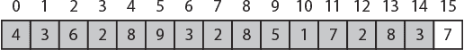

Figure 5.9 通过递归计算序列的和，将最后一个数加上前 `n − 1` 个数的和。

基于这种直觉，计算整数数组和的递归算法实现在 Code Fragment 5.7 中。

```
/** 返回给定数组的前 n 个整数的和。 */
public static int linearSum(int[] data, int n) {
    if (n == 0)
        return 0;
    else
        return linearSum(data, n - 1) + data[n - 1];
}
```

**Code Fragment 5.7** 使用线性递归求整数数组的和。

`linearSum`方法的递归轨迹见 Figure 5.10。对于大小为 `n` 的输入，`linearSum`算法进行了 `n + 1` 次方法调用。因此，它需要 `O(n)` 时间，因为每次调用的非递归部分花费了常数时间。此外，我们看到算法使用的内存空间也是 `O(n)`，因为在最后一次递归调用（`n = 0`）时，`n + 1` 个帧中的每个使用了常数内存空间。

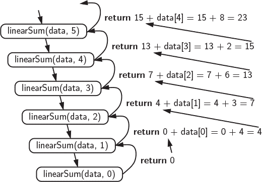

Figure 5.10 `linearSum(data, 5)` 的执行轨迹，输入参数 data = 4, 3, 6, 2。

### 使用递归反转序列

接下来，让我们考虑反转数组 `n` 个元素的问题，使得第一个元素变成最后一个，第二个元素变成倒第二个，以此此类推。我们可以通过交换第一个和最后一个元素并递归地反转剩余元素来使用线性递归解决这个问题。我们在 Code Fragment 5.8 中实现了该算法，约定第一次调用该算法时使用 `reverseArray(data, 0, n - 1)`。

```
/** 反转从 data[low] 到 data[high]（包含）的子数组内容。 */
public static void reverseArray(int[] data, int low, int high) {
    if (low < high) {                       // 如果子数组至少有两个元素
        int temp = data[low];               // 交换 data[low] 和 data[high]
        data[low] = data[high];
        data[high] = temp;
        reverseArray(data, low + 1, high - 1); // 递归处理剩余
    }
}
```

**Code Fragment 5.8** 使用线性递归反转数组元素。

我们注意到，每进行一次递归调用，数组中的元素就会减少两个。（参见 Figure 5.11）。当 `low < high` 失败时就会到达基例，要么是因为 `n` 为奇数时 `low == high`，要么是因为 `n` 为偶数时 `low == high + 1`。上述论证意味着 Code Fragment 5.8 将在总共 $\lfloor n/2 \rfloor$ 次递归调用后终止。


Figure 5.11 反转序列的递归轨迹。

### 幂的递归算法

作为线性递归使用的另一个有趣例子，我们考虑将数字 `x` 任意任意整数 `n` 次的问题。也就是说，我们希望计算 `power(x, n)`（我们在讨论中使用 `power` 名称是为了区分 Math 类的 `pow` 方法）。我们考虑了 `power` 的两种不同公式。

简单的定义如下：

$power(x,n) = \left\{ \begin{array}{l} 1 \\ x \cdot power(x,n - 1) \end{array} \right. & & \begin{array}{l} \text{如果 } n = 0 \\ \text{否则.} \end{array}$

这导致了 Code Fragment 5.9 所示的递归算法。

```
/** 对于非负 n，计算 x 的 n 次方。 */
public static double power(double x, int n) {
    if (n == 0)
        return 1;
    else
        return x * power(x, n - 1);
}
```

**Code Fragment 5.9** 使用简单递归计算幂函数。

对此版本 `power(x, n)` 的递归调用运行时间为 `O(n)`。它的递归轨迹结构与 Figure 5.1 中的阶乘函数非常相似，参数每次调用减一，并在 `n + 1` 层级中的每一层都执行常数工作。

然而，使用采用平方技术的替代定义有更快的方法计算幂函数。令 $k = \lfloor n/2 \rfloor$ 表示整除的下（在 Java 中 `n` 为 int 时等同于 `n/2`）。我们考虑表达式 `(x^k)²`。当 `n` 为偶数时，$\lfloor n/2 \rfloor = n/2$，因此 $(x^k)² = (x^{n/2})² = x^n$。当 `n` 为奇数时，$\lfloor n/2 \rfloor = (n - 1)/2$，且 $(x^k)² = x^n^{(-1)}$，因此 $x^n = (x^k)² \cdot x$。这种分析得出了以下递归定义：

$\begin{matrix} {power(x,n) = \left\{ \begin{array}{l} 1 \\ (power(x,\lfloor n/2 \rfloor))² \cdot x \end{array} \right. & & \begin{array}{l} \text{如果 } n = 0 \\ \text{如果 } n > 0 \text{ 为奇数} \\ \text{如果 } n > 0 \text{ 为偶数} \end{array} \right.} \end{matrix}$

如果我们实现这种递归，并通过两次递归调用来计算 $power\left( {x,\left\lfloor \frac{n}{2} \right\rfloor} \right).$ 和 $power\left( {x,\left\lfloor \frac{n}{2} \right\rfloor} \right$，那么递归追踪将显示有 $O(n)$ 次调用。我们可以通过计算 $power\left( {x,\left\lfloor \frac{n}{2} \right\rfloor} \right)$ 并将其存储在变量中作为部分结果，然后将其自身相乘，从而显著减少操作次数。基于这种递归定义的实现可以在代码片段 5.10 找到。

为了说明改进后算法的执行情况，图 5.12 提供了计算 `power(2, 13)` 的递归追踪。

为了分析修改后算法的运行时间，我们观察到方法 `power(x,n)` 每次递归调用中的指数最多是前一个指数的一半。正如我们在分析二分查找时看到的那样，在得到 1 或更小数值之前，我们将 `n` 除以二的次数是 $O(\log n)$。因此，我们对 `power` 的新公式会导致 $O(\log n)$ 次递归调用。方法的每次激活都使用 $O(1)$ 次操作（不包括递归调用），因此计算 `power(x,n)` 的总操作数为 $O(\log n)$。这相比原始的 $O(n)$ 时间算法是一个巨大的改进。

改进版本在减少内存使用方面也提供了显著节省。第一个版本的递归深度为 $O(n)$，因此内存中同时存储了 $O(n)$ 个帧。由于改进版本的递归深度为 $O(\log n)$，它的内存使用也是 $O(\log n)$。

```
/** 计算 x 的 n 次方值，适用于非负整数 n。 */
public static double power(double x, int n) {
    if (n == 0)
        return 1;
    else {
        double partial = power(x, n / 2); // 依赖 n 的截断除法
        double result = partial * partial;
        if (n % 2 == 1)                    // 如果 n 是奇数，包含额外的 x 因子
            result *= x;
        return result;
    }
}
```

**代码片段 5.10** 使用快速幂法计算幂函数。

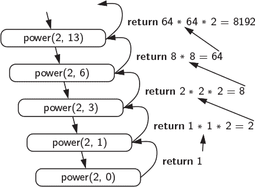

图 5.12 `power(2, 13)` 执行的递归追踪。

### 5.3.2 二元递归

当方法进行两次递归调用时，我们说它使用了**二元递归**。作为二元递归的应用，让我们重新回顾数组中 `n` 个整数和的问题。计算一个或零值的和是显而易见的。对于两个或多个值，我们可以递归地计算前半部分的和后半部分的和，并将这些和相加。我们对这种算法的实现在代码片段 5.11 中被初始调用为 `binarySum(data, 0, n - 1)`。

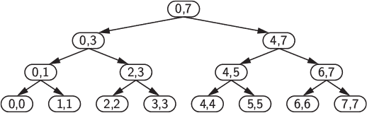

图 5.13 `binarySum(data, 0, 7)` 执行的递归追踪。

```
/** 返回子数组 data[low] 到 data[high]（包含边界）的和。 */
public static int binarySum(int[] data, int low, int high) {
    if (low > high)                    // 子数组中元素为空
        return 0;
    else if (low == high)               // 子数组中只有一个元素
        return data[low];
    else {
        int mid = (low + high) / 2;
        return binarySum(data, low, mid) + binarySum(data, mid + 1, high);
    }
}
```

**代码片段 5.11** 使用二元递归求序列元素的和。


为了分析算法`binarySum`，我们简单地考虑`n`是 2 的幂的情况。图 5.13 显示了`binarySum(data, 0, 7)`执行的递归追踪。我们为每个框标记了该调用参数`low`和`high`的值。范围的大小在每次递归调用时缩小一半，因此递归深度为$1 + \log[2]n$。因此，`binarySum`使用了$O(\log n)$的额外空间，这比代码片段 5.11 中`linearSum`方法使用的$O(n)$空间是一个巨大的改进。

### 5.3.3 多重递归

从二元递归推广，我们定义**多重递归**为方法可能进行超过两次调用的过程。然而，如果可能配置的数量太大，我们可以使用计算机进行简单的枚举和测试。

多重递归的另一个常见应用是我们需要求解方程。例如，以下是多重递归的实例：

`pot + pan = bib`

`dog + cat = pig`

`boy + girl = baby`

为了求解此类方程，我们需要为每个字母分配一个唯一的数字（即 0–9）。我们在代码片段 5.12 中展示了此类算法的伪代码：

1. 递归生成`k - 1`个元素的序列。
2. 在每个此类序列后追加一个内部元素。

在算法执行期间，我们使用集合`U`来跟踪未包含在序列中的元素，因此元素`e`未被使用当且仅当`e`在`U`中。

查看代码片段 5.12 算法的另一种方法是，它枚举了`U`中所有可能的长度为`k`的有序子集，并测试每个子集是否为问题的解决方案。对于加法谜，`U = {0, 1, 2, 3, 4, 5, 6, 7, 8, 9}`，序列中的每个位置对应一个给定的字母。

```text
Algorithm PuzzleSolve(k, S, U):
    Input: 整数 k、序列 S 和集合 U
    Output: 使用 U 中的元素对 S 的所有长度 k 的扩展枚举，无重复
    for each e in U do
        Add e to the end of S
        Remove e from U                                      {e 现在正在被使用}
        if k == 1 then
            Test whether S 是解决谜题的配置
            if S solves the puzzle then
                add S to output                              {一个解}
        else
            PuzzleSolve(k - 1, S, U)                         {一次递归调用}
        Remove e from the end of S
        Add e back to U                                      {e 现在被视为未使用}
```

在图 5.14 中，我们展示了`PuzzleSolve(3, S, U)`调用的递归轨迹，其中`S`为空且`U = {a, b, c}`。在执行过程中，生成并测试了这三个字符的所有排列。注意，初始调用进行了三次递归调用，每个调用随后又发起了另外两个调用。如果我们在包含四个元素的集合`U`上执行`PuzzleSolve(3, S, U)`，初始调用将产生四次递归调用，每个调用的轨迹将类似于图 5.14 所示。

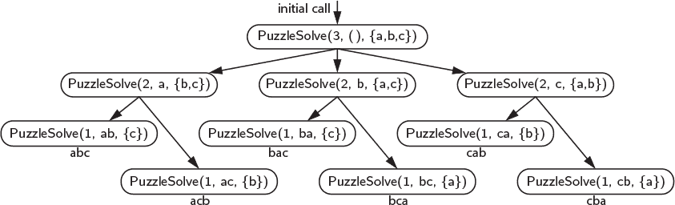

图 5.14 `PuzzleSolve(3, S, U)`执行过程的递归轨迹，其中`S`为空且`U = {a, b, c}`。该执行生成并测试了`a`、`b`和`c`的所有排列。我们在相应的方框正下方展示了生成的排列。

## 5.4 使用递归

使用递归的算法通常具有以下形式：

- **测试基准情况（base cases）。** 我们首先开始测试一组基准情况（至少应该有一个）。这些基准情况的定义使得每一个可能的递归调用链最终都能到达基准情况，且对每个基准情况的处理不应使用递归。
- **递归（Recur）。** 如果不是基准情况，我们执行一次或多次递归调用。这个递归步骤可能涉及一个测试，以决定执行多个可能的递归调用中的哪一个。我们应该定义每个可能的递归调用，使其向基准情况推进。

### 递归的参数化

为给定问题设计递归算法时，考虑我们可能定义与原始问题具有相同结构子问题的不同方法是非常有用的。如果很难找到设计递归算法所需的重复结构，有时通过几个具体的示例来推导问题，以观察如何定义子问题，是有帮助的。

一个成功的递归设计有时要求我们重新定义原始问题，以产生外观相似的子问题。这通常涉及重新参数化方法的签名。例如，在数组上进行二分查找时，调用者的自然方法签名看起来为`binarySearch(data, target)`。但在第 5.1.2 节中，我们定义的方法名为`binarySearch(data, target, low, high)`，使用额外的参数在递归进行时界定子数组。这种参数化的变化对于二分查找至关重要。本章中的其他示例（例如`reverseArray`、`linearSum`、`binarySum`）也演示了在定义递归子问题时使用额外参数。

如果我们希望为算法提供更整洁的公共接口，而不向用户暴露递归参数化，一种标准技术是将递归版本设为私有，并引入一个整洁的公共方法（使用适当参数调用私有方法）。例如，我们可以为公共使用提供以下更简单的`binarySearch`版本：

```java
/** 如果在数据数组中找到目标值则返回 true。 */
public static boolean binarySearch(int[] data, int target) {
    return binarySearch(data, target, 0, data.length - 1); // 使用参数化版本
}
```

## 5.5 递归的陷阱

尽管递归是一种非常强大的工具，但它很容易以各种方式被误用。在本节中，我们将检查几种由于递归实现不当导致效率极低的情况，并讨论一些识别和规避此类陷阱的策略。

我们首先回顾**元素唯一性问题**（element uniqueness problem），该问题定义在第 3.4.3 节中。我们可以使用以下递归公式判断序列中的`n`个元素是否唯一：作为基准情况，当`n = 1`时，元素是唯一的；对于`n ≥ 2`，当且仅当前`n - 1`个元素是唯一的且最后一个元素与前面的不同时，元素是唯一的（第 3.4 节）。

```java
/** 如果没有重复值则返回 true。 */
public static boolean unique(int[] data, int low, int high) {
    if (low >= high) return true;                    // 最多一个
    else if (!unique(data, low, high - 1)) return false; // n - 1
    else if (!unique(data, low + 1, high)) return false; // n - 1
    else return data[low] != data[high];              // 是否不同？
}
```

**代码片段 5.13** 遗憾的是，实现良好的递归会导致效率极低。为了分析问题，我们令`c[n]`表示调用次数。

### 计算数字的低效递归

在第 2.2 节中，我们引入了生成斐波契数的过程，它可以定义为：

$$
\begin{array}{l}
F_{0} = 0 \\
F_{1} = 1 \\
F_{n} = F_{n - 2} + F_{n - 1}\quad\quad n > 1
\end{array}
$$

讽刺的是，基于此定义的递归实现如代码片段 5.14 所示。

```java
/** 返回第 n 个斐波契数（低效地）。 */
public static long fibonacciBad(int n) {
    if (n <= 1)
        return n;
    else
        return fibonacciBad(n - 2) + fibonacciBad(n - 1);
}
```

**代码片段 5.14** 使用二叉递归计算第`n`个斐波契数。

遗憾的是，斐波契公式的这种直接实现会导致方法极低效。以这种方式计算第`n`个斐波契数需要指数级的方法调用。具体来说，令`c[n]`表示调用次数。我们得到了`c[n]`的以下值：

$$
\begin{array}{l}
c_{0} = 1 \\
c_{1} = 1 \\
c_{2} = 1 + c_{0} + c_{1} = 1 + 1 + 1 = 3 \\
c_{3} = 1 + c_{1} + c_{2} = 1 + 1 + 3 = 5 \\
c_{4} = 1 + c_{2} + c_{3} = 1 + 3 + 5 = 9 \\
c_{5} = 1 + c_{3} + c_{4} = 1 + 5 + 9 = 15 \\
c_{6} = 1 + c_{4} + c_{5} = 1 + 9 + 15 = 25 \\
c_{7} = 1 + c_{5} + c_{6} = 1 + 15 + 25 = 41 \\
c_{8} = 1 + c_{6} + c_{7} = 1 + 25 + 41 = 67
\end{array}
$$

如果我们按照这个模式推导，会发现调用次数每两个连续索引就会增加一倍以上。也就是说，`c[4]`是`c[2]`的倍倍，`c[5]`是`c[3]`的倍倍，`c[6]`是`c[4]`的倍倍，以此类推。因此，`c[n] > 2^(n/2)`，这意味着`fibonacciBad(n)`产生的调用次数随`n`指数级增长。

## 计算斐波纳契数的高效递归方法

由于第`n`个斐波纳契数`F[n]`依赖于前两个值`F[n - 2]`和`F[n - 1]`，我们曾倾向于使用这种糟糕的递归公式。但请注意，在计算`F[n - 2]`之后，计算`F[n - 1]`的调用需要它自己的递归调用来计算`F[n - 2]`，因为它并不知道在前一层递归中已经计算出的`F[n - 2]`的值。这就是重复性工作。糟糕的是，这两个调用都需要（重新）计算`F[n - 3]`的值，计算`F[n - 1]`也是如此。这种雪球效应导致了`fibonacciBad`的指数级运行时间。

我们可以使用每次调用只进行一次递归调用的递归来高效地计算`F[n]`。为了做到这一点，我们需要重新定义方法的预期。与其让方法返回单个值（即第`n`个斐波纳契数），我们定义一个递归方法返回一个包含两个连续斐波纳契数的数组`{F[n], F[n - 1]}`，使用约定`F[-1] = 0`。尽管报告两个连续的斐波纳契数似乎比报告一个负担更大，但将此额外信息从一个递归层传递到下一层使得继续该过程变得容易得多。（它允许我们避免重新计算递归内部已经已知的第二个值。）基于该策略的实现见代码片段 5.15。

```java
/** 返回一个包含斐波纳契数对 F(n) 和 F(n - 1) 的数组。 */
public static long[] fibonacciGood(int n) {
    if (n <= 1) {
        long[] answer = {n, 0};
        return answer;
    } else {
        long[] temp = fibonacciGood(n - 1); // 返回 {Fn-1, Fn-2}
        long[] answer = {temp[0] + temp[1], temp[0]}; // 我们需要 {Fn, Fn-1}
        return answer;
    }
}
```

代码片段 5.15 使用线性递归计算第`n`个斐波纳契数。

在效率方面，该问题的糟糕递归和良好递归之间的区别如同天壤之别。`fibonacciBad`方法使用指数级时间。我们声称方法`fibonacciGood(n)`的执行时间为`O(n)`。对`fibonacciGood`的每次递归调用都会使参数`n`减 1；因此，递归轨迹包含一系列`n`次方法调用。因为每次调用的非递归工作使用常数时间，所以整个计算在`O(n)`时间内完成。

## 5.5.1 Java 中的最大递归深度

误用递归的另一个危险是**无限递归**。如果每个递归调用都产生另一个递归调用，且永远无法到达基准情况，那么就会产生无限次的此类调用。这是一个致命错误。无限递归会迅速耗尽计算资源，不仅是因为 CPU 的快速使用，还因为每个连续的调用都会创建一个需要额外内存的帧（frame）。一个格式不当递归的显性例子如下：

```java
/** 不要调用这个（无限）版本。 */
public static int fibonacci(int n) {
    return fibonacci(n); // 最终所有 Fn 都等于 Fn
}
```

然而，还有许多微妙的错误可能导致无限递归。重新回顾我们的二分查找实现（代码片段 5.2），当我们对序列的右部分进行递归调用（第 15 行）时，我们指定了从索引`mid + 1`到`high`的子数组。如果该行写成：

```java
return binarySearch(data, target, mid, high); // 发送 mid，而不是 mid + 1
```

这可能导致无限递归。特别是当搜索包含两个元素的范围时，可能会对相同的范围再次进行递归调用。

程序员应该确保每次递归调用都以某种方式向基准情况推进（例如，通过每次调用都不断减小的参数值）。为了对抗无限递归，Java 的设计者做了一个有意的决定，限制用于存储同时活动方法调用的激活帧的总空间。如果达到此限制，Java 虚拟机将抛出`StackOverflowError`。（我们将在第 6.1 节中进一步讨论“栈”数据结构）。

## 练习

### 强化

1. **R-5.1** 解释如何修改二分查找算法，使其返回目标的索引，如果未找到则返回 -1。
2. **R-5.2** 画出`TowerofHanoi(3, BEG, AUX, END)`的递归轨迹，使用代码片段 5.3 中的算法。
3. **R-5.3** 画出`power(2, 8)`的递归轨迹，使用代码片段 5.10 中的快速幂算法。
4. **R-5.4** 开发一个递归算法`maxArray`用于寻找数组中的最大整数元素。
5. **R-5.5** 开发一个递归算法`reverseString`，接收字符字符串`s`作为输入并生成该字符串的反转。
6. **R-5.6** 画出代码片段 5.12 中`PuzzleSolve(3, S, U)`的执行轨迹，其中`S`为空，`U = {a, b, c, d}`。
7. **R-5.7** 描述一个计算第$n$个**调和数**的递归算法，其定义如公式所示。
8. **R-5.8** 开发一个递归算法`reverseInteger`，并编写一个完整的 Java 代码来反转用户输入的整数。例如，假设用户输入`5436`，则输出为`6345`。
9. **R-5.9** 画出`Ackermann(1, 3)`的递归轨迹，使用代码片段 5.4 中的递归算法。

### 创造

1. **C-5.10** 描述一种使用递归计算一个$n \times n$整数数组中所有元素和的方法。
2. **C-5.11** 写一个简短的递归 Java 方法来检查给定的数字是否为质数。
3. **C-5.12** 写一个简短的递归方法，从长度为`N`的给定字符串中找到所有长度为`K`的字符串子集（其中`K < N`）。
4. **C-5.13** 编写一个短的递归 Java 方法，用于判断字符串`s`是否为回文（即它等于其反转后的字符串）。回文的示例包括`racecar`和`gohangasalamiimalasagnahog`。
5. **C-5.14** 使用递归编写一个 Java 方法，统计给定字符串中元音、数字、辅音和特殊符号的数量。
6. **C-5.15** 编写一个短的递归 Java 方法，寻找两个整数之间的最大公约数。
7. **C-5.16** 给定一个无序的整数数组`A`和一个整数`k`，描述一种递归算法来重新排列`A`中的元素，使得所有小于或等于`k`的元素位于任何大于`k`的元素之前。你的算法在包含`n`个值的数组上的运行时间是多少？
8. **C-5.17** 假设给定一个包含`n`个按递序排列的互不同整数的数组`A`。给定一个数字`k`，描述一种递归算法在`A`中找到两个和为`k`的整数（如果这样的对存在的话）。你的算法的运行时间是多少？
9. **C-5.18** 描述一种递归算法，检查整数数组`A`是否包含一个整数`A[i]`，该整数是`A`中之前出现的两个整数之和，即满足`A[i] = A[j] + A[k]`，其中`j, k < i`。
10. **C-5.19** Isabel 有一种有趣的方法来求和`n`个整数数组`A`中的值，其中`n`是 2 的幂。她创建一个大小为`A`一半的数组`B`，对于`i = 0, 1, …, (n / 2) - 1`设置`B[i] = A[2 * i] + A[2 * i + 1]`。如果`B`的大小为 1，则输出`B[0]`。否则，她用`B`替换`A`并重复该过程。她的算法的运行时间是多少？
11. **C-5.20** 编写一个短的递归 Java 方法，从给定的链表中删除第`kth`个节点。
12. **C-5.21** 为一个不使用任何`Node`类的单链表类给出递归定义。

### 项目

1. **P-5.22** 编写一个程序，通过枚举和测试所有可能的配置来解决求和谜。使用你的程序解决第 5.3.3 节中给出的三个谜。
2. **P-5.23** 运行第 5.1.1 节中提供的阶函数的递归和非递归版本，并检查随着`n`变大，每个版本需要多少空间的时间。

## 单选题


# M-5.1

考虑以下代码段，并找到调用`fun(4321)`的结果？

```java
public static void fun(int z)
{
	System.out.print(z % 10);
	if((z / 10) ! = 0)
	{
		fun(z / 10);
	}
	System.out.print(z % 10);
}
```

1. 43211234
2. 12344321
3. 1441
4. 以上都不是 (**GATE 2018**)

# M-5.2

考虑以下用伪代码编写的程序。假设`x`和`y`是整数。

```pseudocode
Count(x, y) 
{ 
	if(y ! = 1)
	{
		if(x ! = 1) 
		{ 
			print ("*"); 
			Count(x/2, y);
		}
		else 
		{
			y = y – 1; 
			Count(1024, y);
		} 
	}
}
```

调用`Count(1024,1024)`执行 print 语句的次数是 ____。

1. 0
2. 512
3. 1024
4. 以上都不是 (**GATE 2017**)

# M-5.3

考虑以下伪代码：

```pseudocode
fun(n)
{
	int x = 1, k;
	if (n = = 1) return x;
	for (k =1; k<n; ++k)
		x = x + fun(k) * fun(n–k);
	return x;
}
```

`fun(5)`的返回值是 ____。

1. 51
2. 5
3. 41
4. 以上都不是 (**GATE 2015**)

# M-5.4

考虑以下 JAVA 伪代码：

```java
public static int f(int n)
{
	static int r = 0;
	if (n <= 0) return 1;
	if (n > 3)
		r = n;
		return f(n–2)+2;
	return f(n–1)+r;
}
```

`f(5)`的值是？

1. 5
2. 7
3. 9
4. (**GATE 2007**)

# M-5.5

让`T(n)`由`T(1) = 10`和`T(n + 1) = 2*n`（对于所有`n ≥ 1`）定义。以下哪个表示`T(n)`关于`n`的增长阶？

1. `O(n)`
2. `O(n log n)`
3. `O(n²)`
4. `O(n³)` (**ISRO 2011**)

# M-5.6

使用以下过程，`F(4)`的值是？

```pseudocode
Function F(k: integer):
integer;
begin
	if(k < 3) then F: k else F: F(k – 1)+F(k – 3)
end;
```

1. 5
2. 6
3. 7
4. (**ISRO 2008**)

# M-5.7

捕捉`n`个盘子的汉诺塔问题的最佳递归关系是：

1. `T(n) = 2*T(n – 2) + 2`
2. `T(n) = 2*T(n – 1) + n`
3. `T(n) = 2*T(n/2) + 1`
4. `T(n) = 2*T(n – 1) + 1` (**GATE 2012**)

# M-5.8

下述过程的时间复杂度是？

```pseudocode
procedure fun(n)
begin
	if(n ≤ 0) then print ("Hi"); exit();
	else {
		y=fun(n–1) + fun(n–1);
		print("Hello");
	}
end
```

1. `O(n)`
2. `O(n log n)`
3. `O(2n)`
4. 以上都不是

# M-5.9

找到汉诺塔谜递归关系的解。

$\begin{matrix} {T(N)\left\{ \begin{array}{l} {= 0,} \\ {= 2\left( {N - 1} \right) + 1,} \end{array} \right.} & \begin{array}{l} {if\, N = 0} \\ {if\, N > 0} \end{array} \end{matrix}$

1. `O(N)`
2. `O(N log N)`
3. `O(2^N)`
4. 以上都不是

# M-5.10

64 盘汉诺塔问题的需要移动 _______ 个盘。

1. 64
2. `2⁶⁴ – 1`
3. `64² – 1`
4. 以上都不是

## 章节注释

程序中递归的使用属于计算机科学的民间传说（例如，见 Dijkstra [31]）。它也是函数式编程语言的核心（见 1）。有趣的是，二分查找最早于 1946 年发表，但直到 1962 年才以完全正确的形式发表。关于教训的进一步讨论，请参见 Bentley [13] 和 Lesuisse [64]。

## 答案对照

1. **M-5.1** (b)
2. **M-5.2** (c)
3. **M-5.3** (a)
4. **M-5.4** (d)
5. **M-5.5** (c)
6. **M-5.6** (a)
7. **M-5.7** (d)
8. **M-5.8** (c)
9. **M-5.9** (c)
10. **M-5.10** (b)

# 第 6 章 栈与队列

## 6.1 栈

`stack`（栈）是一个根据“后进先出”（`LIFO`）原则插入和移除对象的集合。用户可以随时向栈中插入对象，但只能访问或移除最近插入的对象（位于栈的所谓“顶部”）。“栈”这个名称源于食堂弹性盘分配器中一叠盘的比喻。在这种情况下，基本操作涉及栈上盘子的“推”（`push`）和“弹出”（`pop`）。当我们需要从分配器获取新盘子时，我们从栈上`pop`出顶部盘子；当我们添加一个盘子时，我们将其`push`到栈上成为新的顶部盘子。也许更有趣的例子是 PEZ® 糖分配器，它将薄荷糖储存在弹性容器中，当抬起分配器顶部时，它会“弹出”出栈中最顶部的糖（见图 6.1）。


图 6.1 PEZ®分配器的示意图；栈 ADT 的物理实现。（PEZ® 是 PEZ Candy, Inc. 的注册商标。）

栈是一种基础数据结构。它们被用于许多应用程序，包括以下：

### 示例 6.1

*网页浏览器将最近访问的网站地址存储在栈中。每当用户访问一个新网站时，该网站的地址就会“推”入地址栈中。然后浏览器允许用户使用“后退”按钮“弹出”返回之前访问的网站*。

### 示例 6.2

文本编辑器通常提供一种“撤销”机制，可以取消最近的编辑操作并将文档恢复到之前的状态。这种撤销操作可以通过在栈（`stack`）中保存文本更改来实现。

### 6.1.1 栈的抽象数据类型

栈是所有数据结构中最简单的一种，但它们也是最重要的结构之一，因为它们被用于许多不同的应用程序，并作为许多更复杂的数据结构和算法的工具。从形式上说，栈是一种抽象数据类型（ADT），支持以下两种更新方法：

| `push(e)`: | 将元素`e`添加到栈顶。 |
| `pop()`: | 移除并返回栈顶的元素（如果栈为空，则返回 null）。 |

此外，为了方便起见，栈还支持以下存访问器方法：

| `top()`: | 返回栈顶的元素，但不移除它（如果栈为空，则返回 null）。 |
| `size()`: | 返回栈中元素的数量。 |
| `isEmpty()`: | 返回一个布尔值，表示栈是否为空。 |

按照惯例，我们假设添加到栈中的元素可以是任意类型，且新创建的栈是空的。

### 示例 6.3

下表显示了一系列栈操作及其对初始为空整数型栈`S`的影响。

| 方法 | 返回值 | 栈内容 |
| :--- | :--- | :--- |
| `push(5)` | – | (5) |
| `push(3)` | { | (5, 3) |
| `size()` | 2 | (5, 3) |
| `pop()` | 3 | (5) |
| `isEmpty()` | false | (5) |
| `pop()` | 5 | () |
| `isEmpty()` | true | () |
| `pop()` | null | () |
| `push(7)` | { | (7) |
| `push(9)` | { | (7, 9) |
| `top()` | 9 | (7, 9) |
| `push(4)` | { | (7, 9, 4) |
| `size()` | 3 | (7, 9, 4) |
| `pop()` | 4 | (7, 9) |
| `push(6)` | { | (7, 9, 6) |
| `push(8)` | { | (7, 9, 6, 8) |
| `pop()` | 8 | (7, 9, 6) |

#### Java 中的栈接口

为了形式化我们对栈的抽象，我们以 Java 接口的形式定义了所谓的应用程序编程接口（API），它描述了 ADT 支持的方法名称，以及如何声明和使用它们。该接口定义在 代码片段 6.1 中。

```java
 1	/**
 2	 * 一组根据后进先出原则插入和移除的对象集合。虽然在目的上
 3 * * ，但此接口与
 4	 * java.util.Stack 不同。
 5	 *
 6	 * @author Michael T. Goodrich
 7	 * @author Roberto Tamassia
 8	 * @author Michael H. Goldwasser
 9	 */
10	public interface Stack<E> {
11	
12	/**
13	 * 返回栈中元素的数量。
14	 * @return 栈中元素的数量
15	 */
16	int size();
17
18	/**
19	 * 检查栈是否为空。
20	 * @return 如果栈为空则返回 true，否则返回 false
21	 */
22	boolean isEmpty();
23	
24	/**
25	 * 在栈顶插入一个元素。
26	 * @param e 要插入的元素
27	 */
28	void push(E e);
29	
30	/**
31	 * 返回但不移除栈顶的元素。
32	 * @return 栈中的栈顶元素（如果为空则返回 null）
33	 */
34	E top();
35	
36	/**
37	 * 移除并返回栈顶的元素。
38	 * @return 被移除的元素（如果为空则返回 null）
39	 */
40	 E pop();
41	}
```

代码片段 6.1 使用 Javadoc 风格注释的`Stack`接口（第 1.8.4 节）。注意泛型参数类型`E`，它允许栈包含任何指定的（引用）类型的元素。

我们依赖 Java 的泛型框架（在第 2.5.2 节中描述），允许存储在栈中的元素属于任何对象类型`<E>`。例如，表示整数栈的变量可以声明为类型`Stack<Integer>`。形式类型参数用作`push`方法的参数类型，以及`pop`和`top`的返回类型。

回想第 2.3.1 节中关于 Java 接口的讨论，接口作为类型定义不能直接实例化。按照惯例，我们假设添加到栈中的元素可以是任意类型，且新创建的栈是空的。

### 6.1.2 基于数组的简单栈

作为该 ADT 的第一个实现，我们将元素存储在一个名为`data`、容量为`N`的数组中。我们对栈进行了设计，当`t`等于 -1 时栈为空。由于数组从索引 0 开始，当栈持有`data[0]`到`data[t]`（包含）的元素时，其大小为`t + 1`。

```java
 1	public class ArrayStack<E> implements Stack<E> {
 2		public static final int CAPACITY=1000; //默认数组容量
 3		private E[ ] data; // 用于存储的泛型数组
 4		private int t = -1; // 栈顶元素的索引
 5		public ArrayStack() {this(CAPACITY); } // 使用默认容量构造栈
 6		public ArrayStack(int capacity) { // 使用给定容量构造栈
 7			data = (E[ ]) new Object[capacity]; // 安全转换；编译器可能会警告
 8		}
 9		public int size(){ return (t + 1); }
10		public boolean isEmpty(){ return (t == -1); }
11		public void push(E e) throws IllegalStateException {
12			if (size() == data.length) throw new IllegalStateException("栈已满");
13			data[++t] = e; // 在存储新项前增加 t
14		}
15		public E top() {
16			if (isEmpty()) return null;
17			return data[t];
18		}
19		public E pop() {
20			if (isEmpty()) return null;
21			E answer = data[t];
22			data[t] = null; // 取消引用以帮助垃圾回收
23			t--;
24			return answer;
25		}
26	}
```

栈的数组实现既简单又高效。尽管如此，这种实现方式有一个负面方面——它依赖于固定容量的数组，这限制了栈的最终大小。

为了方便起见，我们允许栈用户在构造函数中通过参数指定容量（并提供了一个使用容量为 1,000 的默认构造函数）。当用户对入栈元素的大数量有良好估计时，基于数组的实现是无可比拟的。然而，如果估计错误，可能会导致严重的后果。如果应用程序需要的空间远小于预留容量，内存就会被浪费。更糟糕，如果尝试向已经达到最大容量的栈中压入元素，代码片段 6.2 的实现将抛出`IllegalStateException`，拒绝存储新元素。因此，尽管数组栈实现具有简单性和高效性，但它并不总是理想的。

幸运的是，我们稍后将演示实现栈的方法，它们没有这种大小限制，且空间始终与栈中存储的实际元素数量成正比。在下一个节中给出的这种方法使用单链表进行存储；在第 7.2.1 节中，我们将提供一种更先进的数组方法来克服固定容量的限制。

### 分析数组栈实现

数组实现中方法的正确性取决于我们对索引`t`的定义。请注意，在压入元素时，`t`在放置新元素之前会增加，这样它就会使用第一个可用单元。

表 6.2 显示了此数组栈实现中方法的运行时间。每个方法都执行涉及算术操作、比较和赋值的常量数量语句，或者对`size`和`isEmpty`的调用，这两者的运行时间都是常数级。因此，在这个栈 ADT 实现中，每个方法的运行时间都是常数级，即它们每个的运行时间均为`O(1)`。

### Java 中的垃圾回收

我们希望大家注意代码片段 6.2 中`pop`方法实现的一个一个有趣方面。我们设置了一个局部变量`answer`来引用正在被弹出的元素，然后在第 22 行递减`t`之前，故意将`data[t]`重置为`null`。从技术上讲，赋值为`null`并不是要求的，因为即使这样做我们的栈仍然正常运行。

我们将单元返回为空引用的目的是目的是帮助 Java 的垃圾回收机制，该机制会在内存中搜索不再被活跃引用的对象并回收其空间供以后使用。（更多细节，请参见第 15.1.3 节）。如果我们继续在数组中存储被弹出元素的引用，栈类将忽略它（如果栈中添加更多元素，最终会覆盖该引用）。但如果用户应用程序中没有对该元素的其他活跃引用，那么栈数组中的这个伪引用将阻止 Java 垃圾回收器回收该元素。

| 方法 | 运行时间 |
| :--- | :--- |
| size | `O(1)` |
| isEmpty | `O(1)` |
| top | `O(1)` |
| push | `O(1)` |
| pop | `O(1)` |

**表 6.2** 由数组实现的栈的性能。空间使用为`O(N)`，其中`N`是数组的大小，在栈实例化时确定，且独立于栈中实际元素数量`n ≤ N`。

### 示例用法

在节节结束处，我们提供了一个代码演示，用于创建和使用`ArrayStack`类实例（代码片段 6.3）。在这个示例中，我们将栈的参数化类型声明为`Integer`包装类。这导致`push`方法的签名接受一个`Integer`实例作为参数，并使`top`和`pop`的返回类型均为`Integer`。当然，通过 Java 的自动装箱和拆箱（参见第 1.3 节），基本类型`int`可以作为参数发送给`push`。


```
Stack<Integer> S = new ArrayStack<>();	// contents:()
S.push(5);											// contents:(5)
S.push(3);											// contents:(5, 3)
System.out.println(S.size());					// contents:(5, 3)		outputs 2
System.out.println(S.pop());					// contents:(5)			outputs 3 
System.out.println(S.isEmpty());				// contents:(5)			outputs false
System.out.println(S.pop());					// contents:()				outputs 5 
System.out.println(S.isEmpty());				// contents:()				outputs true 
System.out.println(S.pop());					// contents:()				outputs null
S.push(7);											// contents:(7)
S.push(9);											// contents:(7, 9)
System.out.println(S.top());					// contents:(7, 9)		outputs 9
S.push(4);											// contents:(7, 9, 4)
```

在本小节中，我们将探索栈的两个相关应用，这两个应用都涉及对匹配定界符对的测试。在第一个应用中，我们考虑了可能包含各种分组符号对的算术表达式，例如：

- 圆括号：“(”和“)”
- 大括号：“{”和“}”
- 中括号：“[”和“]”

每个开启符号都必须与其对应的闭合符号匹配。例如，左括号`[`必须与对应的右括号`]`匹配，如下表达式所示：

`[(5 + *x*) − (*y* + *z*)]`

以下示例进一步说明了这一概念：

- 正确：`( )(()){([( )])}`
- 正确：`((( )(( )){([( )])}))`
- 错误：`)(( )){([( )])}`
- 错误：`({[ ])}`
- 错误：`(`

我们将匹配符号组的精确定义留给练习 R-6.4。

## 匹配定界符的算法

处理算术表达式时，一项重要任务是确保它们的定界符号正确匹配。我们可以使用栈通过对原始字符串单次从左到右扫描来完成这项任务。

每当我们遇到一个开启符号时，就把该符号推入栈中；每当我们遇到一个闭合符号时，从栈中弹出一个符号（假设栈不空），并检查这两个符号是否形成了一个有效对。如果我们到达表达式的末尾且栈为空，则原始表达式是匹配的。否则，栈中一定有一个没有匹配符号的开启定界符。如果原始表达式的长度为`n`，则该算法最多将调用`n`次`push`和`n`次`pop`。代码片段 6.5 展示了此类算法的 Java 实现。它专门检查定界符符号对`( )`、`{ }`和`[ ]`，但可以轻松更改以适应更多符号。具体来说，我们定义了两个固定字符串`"({["`和`")]"`，它们被刻意协调以反映符号对。在检查表达式字符串的字符时，我们对这些特殊字符串调用`String`类的`indexOf`方法，以确定该字符是否匹配定界符，如果是，则判断是哪一个。`indexOf`方法返回给定字符在字符串中首次找到的索引（如果未找到字符，则返回`-1`）。

```
 1	/** 测试给定表达式中的定界符是否正确匹配。 */
 2	public static boolean isMatched(String expression) {
 3		final String opening	= "({[";							// 开启定界符
 4		final String closing	= ")}]";							// 对应的闭合定界符
 5		Stack<Character> buffer = new LinkedStack<>();
 6		for (char c : expression.toCharArray()) {
 7			if (opening.indexOf(c) != −1)						// 这是一个左定界符
 8				 buffer.push(c);
 9			else if (closing.indexOf(c) != −1) {				// 这是一个右定界符
10				 if (buffer.isEmpty())							// 无可匹配的
11                    return false;
12				 if (closing.indexOf(c) != opening.indexOf(buffer.pop()))
13					return false;									// 定界符不匹配
14			}
15		}
 16		return buffer.isEmpty();								// 所有的开启定界符都匹配了吗？
 17	}
```

**代码片段 6.5** 在算术表达式中匹配定界符的方法。

## 标记语言中的标签匹配

匹配定界符的另一个应用是 HTML 或 XML 等标记语言的验证。HTML 是互联网上超链接文档的标准格式，XML 是一种用于各种结构化数据集的可扩展标记语言。我们在图 6.3 中展示了一个示例 HTML 文档。


图 6.3 展示了 (a) 一个 HTML 文档和 (b) 它的渲染。

在 HTML 文档中，文本部分由`HTML tags`限定。一个简单的开启 HTML 标签格式为`<name>`，对应的闭合标签格式为`</name>`。例如，我们在图 6.3a 的第一行看到`<body>`标签，并在文档末尾看到匹配的`</body>`标签。此示例中使用的其他常用 HTML 标签包括：

- `<body>`：文档主体
- `<h1>`：节标题
- `<center>`：居中对齐
- `<p>`：段落
- `<ol>`：编号列表（有序列表）
- `<li>`：列表项

理想情况下，HTML 文档应该具有匹配的标签，尽管大多数浏览器能够容忍一定数量的不匹配标签。在代码片段 6.6 中，我们提供了一个 Java 方法，用于匹配表示 HTML 文档的字符串中的标签。

我们对原始字符串进行从左到右扫描，使用索引`j`跟踪进度。`String`类的`indexOf`方法可选接受起始索引作为第二个参数，用于定位定义标签的`<`和`>`字符。同样`String`类的`substring`方法返回从给定索引开始并可选在另一个索引之前结束的子字符串。开启标签被推入栈，并在从栈中弹出时与闭合标签进行匹配，正如我们在代码片段 6.5 中执行的那样。

```
 1	/** 测试 字符串中的每个开启标签是否有匹配标签。 */
 2	public static boolean isHTMLMatched(String html) {
 3		Stack<String> buffer = new LinkedStack<>();
 4		int j = html.indexOf('<');							// 查找第一个 '<' 字符（如果有）
 5		while (j != −1) {
 6			int k = html.indexOf('>', j+1);				// 查找 '>' 字符
 7			if (k == −1)
 8				return false;									// 无效标签
 9			String tag = html.substring(j+1, k);		// 去掉 < >
10			if (!tag.startsWith("/"))// 这是一个开启标签
11				buffer.push(tag);
12			else {												 这是一个闭合标签
13				if (buffer.isEmpty())
14					return false;								// 无可匹配的标签
15				if (!tag.substring(1).equals(buffer.pop()))
16					return false;									// 标签不匹配
17			}
 18			j = html.indexOf('<', k+1);					// 查找下一个 '<' 字符（如果有）
 19		}
 20		return buffer.isEmpty();							// 所有的开启标签都匹配了吗？
 21	}
```

**代码片段 6.6** 测试 HTML 文档是否有匹配标签的方法。

## 6.1.5 计算算术表达式

代数表达式有三种不同的表示方式：中缀、前缀和后缀符号。在大多数算术表达式中，运算符位于操作数之间。这种表达式被称为中缀表达式。例如，`A + B`、`C - D`等，其中`+`和`-`分别位于`A`和`B`、`C`和`D`之间。尽管从用户的角度来看，用中缀编写这种表达式更方便，但计算机计算这些中缀表达式非常困难。为了计算中缀表达式，计算机需要层级规则、运算符优先级、结合性等信息。因此，如果以后缀或前缀形式编写表达式，计算机将能够更高效地计算表达式。

`波兰表示法`(Polish notation）或`前缀表示法`(prefix notation）是以波兰数学家、哲学家扬·卢卡谢维奇（Jan Łukasiewicz）命名的。其开发的根本目标是编写不需要括号和优先级的数学表达式。在这种表示法中，运算符位于两个操作数之前，执行顺序完全由表达式中遇到的运算符和操作数的位置决定。例如：`+AB`、`-CD`等。另一方面，在逆波兰表示法（reverse polish notation）或`后缀表示法`(postfix notation）中，正如名称所示，运算符位于操作数之后。例如：`AB+`、`CD-`等。像波兰表示法一样，后缀表达式在任何算术表达式中都不需要括号或优先级来确定操作的执行顺序。因此，计算机通常通过两个基本步骤评估基于中缀表示法的任何算术表达式。首先，它将中缀表达式转换为等后缀表达式，最后评估表达式。为了完成这些任务，计算机使用栈作为主要工具。

将中缀表达式转换为后缀表达式的详细步骤见代码片段 6.7。

```
 Algorithm InfixToPostfix(Q, P):
Input: A string of infix expression, say Q
Output: An equivalent string of postfix expression of Q, say P
Repeat until each character of the Q is scanned
do 
	If the scanned character is an operand, then
			Append it at the end of postfix expression, i.e. on P
	Else If the scanned character is '(', then
		Push it onto stack
	Else If the scanned character is ')', then
		Repeatedly pop all operators from the top of the stack and append it at the end of 
		Postfix P until the '('is encountered and finally remove '(' from the top of the stack.
	Else If the scanned character is operator and its precedence is higher than the topmost operator on the stack or stack is empty or contains '(', then
		Push it onto the stack
	Else 
		Repeatedly pop each operator from the stack which has lower or same precedence of scanned character and append it at the end of postfix until the '(' will not be encountered and stack is not empty, and finally push the scanned character into stack.
done
Repeat till stack is not empty
do
		Repeatedly pop each element one after another from the stack and append it at the end of postfix expression P.
done
```

**代码片段 6.7** 将给定中缀表达式转换为等后缀表达式的算法。

## 示例 6.4

为了说明上述算法，考虑以下中缀表达式并将其转换为等后缀表达式`P`。

$Q = 2 + (8 - 5)*5 + 6\hat{}2$

`InfixToPostfix`算法将给定中缀表达式转换为等后缀表达式的轨迹所示如下：

| **从输入中缀表达式 *Q* 扫描的字符*** | **栈** | **后缀表达式 *P*** |
| --- | --- | --- |
| 2 | Empty | 2 |
| + | + | 2 |
| ( | + ( | 2 |
| 8 | + ( | 2, 8 |
| - | + ( - | 2, 8 |
| 5 | + ( - | 2, 8, 5 |
| ) | + | 2, 8, 25, - |
| * | + * | 2, 8, 5, - |
| 5 | + * | 2, 8, 5, -, 5 |
| + | + | 2, 8, 5, -, 5, *, + |
| 6 | + | 2, 8, 5, -, 5, *, +, 6 |
| ^ | + ^ | 2, 8, 5, -, 5, *, +, 6 |
| 2 | + ^ | 2, 8, 5, -, 5, *, +, 6, 2 |
| | Empty | 2, 8, 5, -, 5, *, +, 6, 2, ^, + |

因此，给定中缀表达式的等后缀表达式为：

$2,\, 8,\, 5, - ,\, 5,\,*,\, + ,\, 6,\,\, 2,\,\hat{},\, +$

我们在代码片段 6.8 和 6.9 中提供了上述算法的实现。定义各种运算符优先级的步骤在代码片段 6.8 中所示，转换的完整 Java 代码在代码片段 6.9。

```
 1	static int Precedence(char op)
 2	{
 3		switch (op)
 4		{
 5			case '^':
 6				return 3; // Exponential operator has higher precedence
 7			case '*':
 8			case '/':
 9				return 2; // Second highest precedence of both '*' and '/'
10			case '+':
11			case '-':
12				return 1; // Lowest precedence of both '+' and '-'
13		}
14				return -1;
15	}
```

**代码片段 6.8** 为给定表达式定义各种运算符的优先级。


```java
static String infixToPostfix(String infixExpression)
{
		// initializing postfix expression as String
		String postfixExpression = "";
		// initializing stack as character type
		Stack<Character> S = new Stack<>();
		int i = 0;
		// scan infix expression by length
		while(i<infixExpression.length()){
			char ch = infixExpression.charAt(i);
			// If the scanned character is an operand, append it at the end of postfix
			if (Character.isOrDigit(ch))
					postfixExpression += ch;
			// If the scanned character is '(', then, push it to the stack.
			else if (ch == '(')
					S.push(ch);
			// If the scanned character is ')', pop and append it at the end of postfix
			from the stack until '(' is encountered.
			else if (ch == ')')
			{
				while (!S.isEmpty() && S.top() != '('()){
					postfixExpression += S.pop();
				}
				S.pop();
			}
			// If the scanned character is operator and its precedence is higher than
			the topmost operator on the stack or stack is empty or contains '(', then
			else if (Precedence(ch) > Precedence(S.top()) || S.isEmpty() || S.top() == '('()){
					S.push(ch);
			// Else, pop each operator from the stack which has lower or same precedence
			of scanned character and append it at the end of postfix until the '('
			will not be encountered and stack is not empty, and finally push the
			scanned character into stack.
			else
			{
				while (!S.isEmpty() && Precedence(ch) <= Precedence(S.top()) && S.top() != '('()){
					postfixExpression += S.pop();
				}
				S.push(ch);
			}
			i++;
		}
		// Repeat till stack is not empty
		while (!S.isEmpty()){
			postfixExpression += S.pop();
		}
		return postfixExpression;
	}
```

**代码片段 6.9** 将中缀表达式转换为等后缀表达式的完整 Java 代码。

```java
static int postfixEvaluation(String P)
{
		// initializing result as integer type
		int result = 0;
		// initializing stack as integer type
		Stack<Integer> S = new Stack<>();
		int i = 0;
		// scan postfix expression P from left to right, one character at a time
		while(i<P.length()){
			char ch = P.charAt(i);
			// If the scanned character is an operand, push it onto stack.
			if (Character.isOrDigit(ch)){
					S.push(Integer.parseInt(String.valueOf(ch)));
			// Else, pop the two top characters of stack, say A and B, where A is
			// the topmost character and B is next to the topmost. Evaluate B
			// operator A and push back the result onto stack.
			else
				int A = S.pop();
				int B = S.pop();
				switch(ch){
					case '+':
						S.push(B + A);
					case '-':
						S.push(B - A);
					case '*':
						S.push(B * A);
					case '/':
						S.push(B / A);
					case '^':
						S.push((int)Math.pow(B, A));
				}
			}
			i++;
		}
		// the resultant value of the above expression will be the topmost
		// character of the stack, that is, 53.
		return S.pop();
	}
```

**代码片段 6.10** 后缀表达式评估算法。

### 示例 6.5

为了说明上述算法，考虑以下后缀表达式。

`P: 2, 8, 5, -, 5, *, +, 6, 2, ^, +`

使用栈的 `postfixEvaluation` 算法轨迹如下：

| 从输入后缀表达式 `P` 扫描的字符 | 栈 |
| :--- | :--- |
| 2 | 2 |
| 8 | 2, 8 |
| 5 | 2, 8, 5 |
| - | 2, 3 |
| 5 | 2, 3, 5 |
| * | 2, 15 |
| + | 17 |
| 6 | 17, 6 |
| 2 | 17, 6, 2 |
| ^ | 17, 36 |
| + | 53 |

因此，上述表达式的计算结果将是栈的顶层字符，即 53。

定义的后缀评估算法的完整 Java 实现在代码片段 6.11 中描述。

```java
static int postfixEvaluation(String postfixExpression)
{
		//初始化一个整数栈
		Stack<Integer> S = new ArrayStack<>();
		int i = 0;
		// 从左到右逐个字符扫描后缀表达式（逆波表达式）
		while(i<postfixExpression.length())
			{
				char ch = postfixExpression.charAt(i);
				// 如果扫描到的字符是操作数，则将其入栈。
				if(Character.isDigit(ch))
					S.push(ch - '0');
				// 如果扫描到的字符是运算符，则从栈中弹出两个栈顶元素，
				// 即 A 和 B，其中 A 是栈顶元素，B 是栈顶下一个元素，
				// 在执行 B 运算后，将结果推回栈
				else
				{
					int A = S.pop();
					int B = S.pop();
					switch(ch)
					{
						case '+':
								S.push(B + A);
								break;
						case '-':
								S.push(B - A);
								break;
						case '/':
								S.push(B/A);
								break;
						case '*':
								S.push(B * A);
								break;
						case '^':
								S.push((int)Math.pow(B, A));
								break;
					}
				}
			}
			return S.pop();
	}
```

**代码片段 6.11** 计算后缀表达式的完整 Java 代码。

## 中缀表达式转换为等效前缀表达式

之前描述将中缀表达式转换为后缀表达式的算法（代码片段 6.9）也可以用于将中缀表达式转换为波兰表示法或前缀表示法。此类转换涉及的步骤定义如下：

| 步骤 | 说明 |
| :--- | :--- |
| 步骤 1 | 反转中缀表达式［在反转过程中，括号必须互换，即将‘(’变为‘)’，反之亦然]。 |
| 步骤 2 | 根据从步骤 1 得到的反转中缀表达式推导出后缀表达式。 |
| 步骤 3 | 反转后缀表达式以得到等效的前缀表达式。 |

### 示例 6.6

为了说明这些步骤，请考虑以下中缀表达式并将其转换为等效的前缀表达式 `P`。

`Q = 2 + (8 - 5)*5 + 6^2`

**步骤 1**。反转中缀表达式 `Q`。

`2^6 + 5*(5 - 8) + 2`

**步骤 2**。根据得到的反转中缀表达式推导出后缀表达式，如下：

| 扫描的字符 | 栈 | 后缀表达式 `P` |
| :--- | :--- | :--- |
| 2 | 空 | 2 |
| ^ | ^ | 2 |
| 6 | ^ | 2, 6 |
| + | + | 2, 6, ^ |
| 5 | + | 2, 6, ^, 5 |
| * | + * | 2, 6, ^, 5 |
| ( | + * ( | 2, 6, ^, 5 |
| 5 | + * ( | 2, 6, ^, 5, 5 |
| - | + * ( - | 2, 6, ^, 5, 5 |
| 8 | + * ( - | 2, 6, ^, 5, 5, 8 |
| ) | + * | 2, 6, ^, 5, 5, 8, - |
| + | + | 2, 6, ^, 5, 5, 8, -, *, + |
| 2 | + | 2, 6, ^, 5, 5, 8, -, *, +, 2 |
|  | 空 | 2, 6, ^, 5, 5, 8, -, *, +, 2, + |

因此，后缀表达式为 `2, 6, ^, 5, 5, 8, -, *, +, 2, +`。

**步骤 3**。反转后缀表达式以得到等效的前缀表达式。

`+, 2, +, *, -, 8, 5, 5, ^, 6, 2`

类似于代码片段 6.11 中描述的算法，通过稍微修改也可以用于计算前缀表达式。因此，计算前缀表达式涉及的步骤见代码片段 6.12。

```
算法 PrefixEvaluation(P)
输入: 一个前缀表达式字符串，假设为 P
输出: 计算结果
重复直到 P 的每个字符都被扫描
执行
	从右到左逐个字符扫描后缀表达式 P。
	如果扫描到的字符是操作数，则
		将其入栈。
	否则
		从栈中弹出两个栈顶字符，假设为 `A` 和 `B`，其中 `A` 是栈顶字符，`B`
		是栈顶下一个字符。计算 `A` 运算符 `B` 并将结果推回栈。
完成
返回(栈顶字符)
```

**代码片段 6.12** 前缀表达式计算算法。

### 示例 6.7

为了说明上述算法，请考虑以下前缀表达式。

`P: +, 2, +, *, -, 8, 5, 5, ^, 6, 2`

计算步骤如下所示：

| 从右到左扫描 `P` 的字符 | 栈 |
| :--- | :--- |
| 2 | 2 |
| 6 | 2, 6 |
| ^ | 36 |
| 5 | 36, 5 |
| 25 | 36, 5, 5 |
| 30 | 36, 5, 5, 8 |
| - | 36, 5, 5, 8 |
| 2 | 36, 5, 5 |
| 5 | 36, 5 |
| 5 | 36 |
| ^ | 3 |
| 6 | 3 |
| 2 | 2 |

| 操作 | 返回值 | 队列 |
| :--- | :--- | :--- |
| `isEmpty()` | false | (3) |
| `dequeue()` | 3 | () |
| `isEmpty()` | true | () |
| `dequeue()` | null | () |
| `enqueue(7)` | - | (7) |
| `enqueue(9)` | - | (7, 9) |
| `first()` | 7 | (7, 9) |
| `enqueue(4)` | - | (7, 9, 4) |

#### Java 中的 `java.util.Queue` 接口

Java 提供了一种类型的队列接口 `java.util.Queue`，它的功能与上述传统的队列 ADT 类似，但 `java.util.Queue` 接口的文档并没有强制要求它仅支持 FIFO（先进先出）原则。在支持 FIFO 原则时，`java.util.Queue` 接口的方法与表 6.3 所示的队列 ADT 有等效对应。

| 我们的队列 ADT | 接口 `java.util.Queue` |
| :--- | :--- |
| 抛出异常 | 返回特殊值 |
| `enqueue(e)` | `add(e)` / `offer(e)` |
| `dequeue()` | `remove()` / `poll()` |
| `first()` | `element()` / `peek()` |
| `size()` | `size()` |
| `isEmpty()` | `isEmpty()` |

表 6.3 支持 FIFO 原则时，队列 ADT 方法与接口 `java.util.Queue` 对应方法。

`java.util.Queue` 接口对大多数操作支持两种风格，它们的区别在于处理异常情况的方式。当队列为空时，`remove()` 和 `element()` 方法会抛出 `NoSuchElementException`，而对应的 `poll()` 和 `peek()` 方法返回 `null`。对于有界容量的实现，当队列满时，`add` 方法将抛出 `IllegalStateException`，而 `offer` 方法将忽略新元素并返回 `false` 以指示元素未被接受。

### 6.2.2 基于数组的队列实现

在第 6.1.2 节中，我们使用数组实现了栈 ADT 的 LIFO 语义（尽管是固定容量），使得每个操作都在常时间内执行。在本节中，我们将考虑如何使用数组高效地支持队列 ADT 的 FIFO 语义。

假设当元素插入队列时，我们将它们存储在数组中，第一个元素位于索引 0，第二个元素位于索引 1，依此类推。（参见图 6.5）。

按照这种惯约定，问题在于我们应该如何实现 `dequeue` 操作。要移除的元素存储在数组的索引 0 处。一种策略是执行循环将队列的所有其他元素向左移动一个单元，使得队列头部再次对齐到数组的单元 0。遗憾的是，使用这样的循环会导致 `dequeue` 方法的运行时间变为 `O(n)`。


图 6.5 使用数组存储队列元素，使得第一个插入的元素“A”位于单元格 0，第二个插入的元素“B”位于单元格 1，依此类推。

我们可以通过完全避免循环来改进上述策略。我们将数组中被出队的元素替换为 `null` 引用，并维护一个显式变量 `f` 来表示当前位于队列头部的元素索引。这种 `dequeue` 算法运行时间为 `O(1)`。在执行几次 `dequeue` 操作后，这种方法可能会导致如图 6.6 所示的配置。


图 6.6 允许队列头部偏离索引 0。在这种表示法中，索引 `f` 表示队列头部的位置。

然而，改进后的方法仍然面临挑战。对于一个容量为 `N` 的数组，在达到任何异常情况之前，应该能够存储多达 `N` 个元素。如果我们让队列头部随着时间不断向右漂移，即使当前队列中的元素少于 `N` 个，队尾也会到达底层数组的末尾。我们必须决定在这种配置下如何存储额外的元素。

#### 循环使用数组

在开发健壮的队列实现时，我们允许队列的头部和尾部向右漂移，并在必要时队列的内容在数组末尾“环绕”。假设数组长度固定为 `N`，新元素向当前队列的“末端”入队，从头部向索引 `N - 1` 进展，然后从索引 0、1 继续。图 6.7 展示了这样一个具有第一个元素 F 和最后一个元素 R 的队列。


图 6.7 所示的队列。

#### 队列实现

- `data`：底层数组。
- `f`：头部元素的索引。在这种表示法中，索引 `f` 表示队列头部的位置。


- `sz`：队列中元素的数量。

使用循环数组的队列 ADT 实现如代码片段 6.14 所示。

```java
/** 使用固定长度数组的队列 ADT */
public class ArrayQueue<E> implements Queue<E> {
    // 实例变量
    private E[] data; // 用于存储的数组
    private int f = 0; // 头部索引
    private int sz = 0; // 当前元素数量

    // 构造函数
    public ArrayQueue() {this(CAPACITY); } // 使用默认容量构造
    public ArrayQueue(int capacity) { // 使用给定容量构造
        data = (E[]) new Object[capacity]; // 安全转换；编译器可能会警告
    }

    // 方法
    /** 返回队列中的元素数量 */
    public int size() { return sz; }

    /** 测试队列是否为空 */
    public boolean isEmpty() { return (sz == 0); }

    /** 在队列后端插入元素 */
    public void enqueue(E e) throws IllegalStateException {
        if (sz == data.length) throw new IllegalStateException("队列已满");
        int avail = (f + sz) % data.length; // 使用模运算
        data[avail] = e;
        sz++;
    }

    /** 返回但不移除队列的第一个元素（如果为空） */
    public E first() {
        if (isEmpty()) return null;
        return data[f];
    }

    /** 移除并返回队列的第一个元素（如果为空） */
    public E dequeue() {
        if (isEmpty()) return null;
        E answer = data[f];
        data[f] = null; // 解引用帮助垃圾回收
        f = (f + 1) % data.length;
        sz--; // 注意：原文此处为 sz++，根据逻辑应为 sz--
        return answer;
    }
}
```

代码片段 6.14 允许用户通过构造函数的可选参数来指定队列的容量。

由于 `sz` 字段的存在，`size` 和 `isEmpty` 方法的实现显而易见；而在给定索引 `f` 的情况下，`first` 方法也很简单。在介绍代码之后，将对更新方法 `enqueue` 和 `dequeue` 进行讨论。

## 添加和移除元素

`enqueue` 方法的目标是在队列末尾添加一个新元素。我们需要确定放置新元素的正确索引。虽然我们没有显式地维护一个指向队列末尾的实例变量，但我们根据以下公式计算下一个可用位置的索引：

```text
avail = (f + sz) % data.length;
```

注意，我们使用的是在添加新元素*之前*的队列大小。作为一种合理性检查，对于一个容量为 10、当前大小为 3 且第一个元素位于索引 5 的队列，其三个元素存储在索引 5、6 和 7 处，下一个元素应该添加在索引 8，计算方法为 `(5 + 3) % 10`。对于环绕的情况，如果队列容量为 10、当前大小为 3 且第一个元素位于索引 8，其三个元素存储在索引 8、9 和 0 处，下一个元素应该添加在索引 1，计算方法为 `(8 + 3) % 10`。

当调用 `dequeue` 方法时，`f` 的当前值指定了要移除并返回的值的索引。在将其所在的数组单元格置为 `null` 之前，我们保留对将返回元素的局部引用，以帮助垃圾回收器。然后，更新索引 `f` 以反映第一个元素的移除，以及假设的第二个元素提升为成为新的第一个元素。在大多数情况下，我们只需要将索引加 1，但由于存在环绕配置的可能性，我们依赖于模运算，在“在数组上循环使用数组”小节中计算 `f = (f + 1) % data.length`。

## 分析基于数组的队列的效率

表 6.4 显示了通过数组实现队列的方法的运行时间。与我们基于数组的栈实现一样，数组实现中的每个队列方法都执行涉及算术操作、比较和赋值的常数数量语句。因此，此实现中的每个方法的运行时间均为 `O(1)`。

| 方法 | 运行时间 |
| :--- | :--- |
| `size` | `O(1)` |
| `isEmpty` | `O(1)` |
| `first` | `O(1)` |
| `enqueue` | `O(1)` |
| `dequeue` | `O(1)` |

**表 6.4** 由数组实现的队列的性能。空间占用为 `O(N)`，其中 `N` 是数组的大小，在创建队列时确定，且与实际在队列中的元素数量 `n < N` 无关。

### 6.2.3 使用单向链表实现队列

正如我们在处理栈 ADT 时所做的那样，我们可以轻松地适配单向链表来实现队列 ADT，同时支持所有操作在最坏情况下的 `O(1)` 时间跨度，且对容量没有任何人为限制。队列的自然方向是将队列头部与列表头部对齐，将队列尾部与列表尾部对齐，因为单向链表在末端支持的唯一更新操作是插入。我们的 `LinkedQueue` 类的 Java 实现见代码片段 6.15。

```java
/** 作为对单向链表适配的 FIFO 队列实现。 */
public class LinkedQueue<E> implements Queue<E> {
    private SinglyLinkedList<E> list = new SinglyLinkedList<>(); // 一个空列表
    public LinkedQueue() { } // 新队列依赖于初始空列表
    public int size() { return list.size(); }
    public boolean isEmpty() { return list.isEmpty(); }
    public void enqueue(E element) { list.addLast(element); }
    public E first() { return list.first(); }
    public E dequeue() { return list.removeFirst(); }
}
```

**代码片段 6.15** 使用 `SinglyLinkedList` 实现队列。

## 分析链表队列的效率

虽然我们在第 4 章中介绍单向链表实现时尚未引入渐近分析，但重新检查后可以发现，该类的每个方法都在 `O(1)` 的最坏时间内运行。因此，我们 `LinkedQueue` 适配类的每个方法也在 `O(1)` 的最坏时间内运行。

我们还避免了为队列指定最大大小，就像在基于数组的队列实现中所做的那样。然而，这种好处带有代价。由于每个节点除了元素引用外还存储了下一个节点的引用，链表每个元素使用的空间比一个大小合适的引用数组要多。

此外，尽管两种实现中的所有方法都在常数时间内执行，但显然，涉及链表的操作在每次调用时都包含大量的初级操作。例如，向基于数组的队列中添加元素主要包括计算索引、在数组中存储元素和增加计数器。对于链表，插入操作包括实例化节点、重新链接节点以及增加计数器。

### 6.2.4 循环队列

在 4.3 中，我们实现了一个**循环链表**类，它支持链表的所有行为，并有一个额外的可以将第一个元素移动到末部的 `rotate()` 方法。我们可以扩展 `Queue` 接口来定义一个新的 `CircularQueue` 接口，如代码片段 6.16 所示。

```java
public interface CircularQueue<E> extends Queue<E> {
    /**
     * 将队列头部旋转到队列尾部。
     * 如果队列为空，则无任何操作。
     */
    void rotate();
}
```

**代码片段 6.16** 一个扩展了 `rotate()` 方法的 Java 接口。

该接口可以通过适配 4.3 中的 `CircularlyLinkedList` 类来轻松实现，产生一个新的 `LinkedCircularQueue` 类。该类相比传统的 `LinkedQueue` 具有优势，因为在循环链表上实现 `rotate()` 比 `enqueue(dequeue())` 的组合更高效，因为在旋转操作时不需要创建、销毁或重新链接节点。

我们可以使用循环队列来解决包含 `n` 个元素的约瑟夫问题，方法是将土豆与队列头部的元素关联，并根据它们在圆周中的顺序将元素存储在队列中。因此，传递土豆等同于将第一个元素旋转到队列末尾。在执行 `k` - 1 次此过程后，我们通过从队列中取出头部元素并将其丢弃。我们在代码片段 6.17 中展示了一个解决约瑟夫问题的完整 Java 程序，该程序描述了一个运行时间为 *O*(*nk*)的解决方案。（我们可以使用本书范围之外的技术更快速地解决此问题。）

```java
public class Josephus {
    /** 使用循环队列计算约瑟夫问题的获胜者。 */
    public static <E> E Josephus(CircularQueue<E> queue, int k) {
        if (queue.isEmpty()) return null;
        while (queue.size() > 1) {
            for (int i = 0; i < k − 1; i++) // 跳过 k−1 个元素
                queue.rotate();
            E e = queue.dequeue(); // 从集合中移除头部元素
            System.out.println("         " + e + " is out");
        }
        return queue.dequeue(); // 获胜者
    }

    /** 从对象数组构建循环队列。 */
    public static <E> CircularQueue<E> buildQueue(E a[ ]) {
        CircularQueue<E> queue = new LinkedCircularQueue<>();
        for (int i = 0; i < a.length; i++)
            queue.enqueue(a[i]);
        return queue;
    }

    /** 测试方法 */
    public static void main(String[ ] args) {
        String[ ] a1 = {"Alice", "Bob", "Cindy", "Doug", "Ed", "Fred" };
        String[ ] a2 = {"Gene", "Hope", "Irene", "Jack", "Kim", "Lance" };
        String[ ] a3 = {"Mike", "Roberto" };
        System.out.println("First winner is" + Josephus(buildQueue(a1), 3));
        System.out.println("Second winner is" + Josephus(buildQueue(a2), 10));
        System.out.println("Third winner is" + Josephus(buildQueue(a3), 7));
    }
}
```

**代码片段 6.17** 使用循环队列解决约瑟夫问题的完整 Java 程序。

## 6.3 双端队列

接下来我们考虑一种类似于队列的数据结构，它支持在队列的头部和尾部进行插入和删除。这种结构被称为**双端队列**，或**deque**（双端队列），通常读作“deck”，以避免与普通队列 ADT 中的 `dequeue` 方法混淆，后者的读音类似于字母写“D.Q.”。

deque 抽象数据类型比栈和队列 ADT 都更通用。这种额外的通用性在某些应用中非常有用。例如，我们描述过一个使用队列维护等待列表的餐厅。有时，第一个人可能会从队列中移除，结果发现没有空桌子；通常情况下，餐厅会将该人重新插入到队列的*第一个*位置。也可能是队列末尾的客户变得变得不耐烦并离开餐厅。（如果我们想模拟客户从其他位置离开队列，我们需要一种更通用的数据结构。）

### 6.3.1 Deque 抽象数据类型

deque 抽象数据类型比栈和队列 ADT 都更丰富。为了提供对称的抽象，deque ADT 被定义为支持以下更新方法：

| 方法 | 说明 |
| :--- | :--- |
| `addFirst(e)` | 在双端队列头部插入新元素 `e`。 |
| `addLast(e)` | 在双端队列尾部插入新元素 `e`。 |
| `removeFirst()` | 移除并返回双端队列的第一个元素（如果队列为空则返回 `null`）。 |
| `removeLast()` | 移除并返回双端队列的最后一个元素（如果队列为空则返回 `null`）。 |

此外，deque ADT 还将包含以下访问器：

| 方法 | 说明 |
| :--- | :--- |
| `first()` | 返回双端队列的第一个元素，但不移除它（如果队列为空则返回 `null`）。 |
| `last()` | 返回双端队列的最后一个元素，但不移除它（如果队列为空则返回 `null`）。 |
| `size()` | 返回双端队列中的元素数量。 |
| `isEmpty()` | 返回双端队列是否为空。 |

我们在代码片段 6.18 所示的 Java 接口中形式化了 deque ADT。

```java
/**
 * 双端队列的接口：一个可以在两端插入和移除
 * 元素的集合；此接口是
 * java.util.Deque 的简化版本。
 */
public interface Deque<E> {
    /** 返回双端队列中的元素数量。 */
    int size();

    /** 测试双端队列是否为空。 */
    boolean isEmpty();

    /** 返回双端队列的第一个元素（如果队列为空则返回 null）。 */
    E first();

    /** 返回双端队列的最后一个元素（如果队列为空则返回 null）。 */
    E last();

    /** 在双端队列头部插入元素。 */
    void addFirst(E e);

    /** 在双端队列尾部插入元素。 */
    void addLast(E e);

    /** 移除并返回双端队列的第一个元素（如果队列为空则返回 null）。 */
    E removeFirst();

    /** 移除并返回双端队列的最后一个元素（如果队列为空则返回 null）。 */
    E removeLast();
}
```

### 6.3.2 实现 deque

我们可以使用数组或链表高效地实现 deque ADT。

#### 使用循环数组实现 deque

如果使用数组，我们建议使用与 `ArrayQueue` 类类似的表示方法，以循环方式处理数组并将第一个元素的索引和双端队列的大小作为字段；最后一个元素的索引可以根据需要使用模运算来计算。

一个额外的问题是避免对模运算符使用负值。当移除第一个元素时，头部索引以循环方式推进，使用 `f = (f + 1) % N`。但在头部插入元素时，第一个索引必须以循环方式递减，赋值 `f = (f - 1) % N` 是错误的。问题在于，当 `f` 为 0 时，目标应该是将其“递减”到数组的另一端，即索引 `N - 1`。然而，在 Java 中计算如 `-1 % 10` 的结果是 `-1`。循环递减索引的标准方法是赋值 `f = (f - 1 + N) % N`。在计算模数之前添加额外的 `N` 项确保结果为正值。我们将方法的细节留给练习 P-6.37。

#### 使用双向链表实现 deque

由于 deque 需要在两端进行插入和删除，双向链表最适合高效实现所有操作。事实上，来自 4.4.1 节中的 `DoublyLinkedList` 类已经实现了整个 `Deque` 接口；我们只需要在该类定义中添加 `implements Deque<E>` 声明，即可将其作为 deque 使用。

#### deque 操作的性能

表 6.5 显示了使用双向链表实现的 deque 方法的运行时间。注意每个方法的运行时间均为 `O(1)`。

| 方法 | 运行时间 |
| :--- | :--- |
| `size`, `isEmpty` | `O(1)` |
| `first`, `last` | `O(1)` |
| `addFirst`, `addLast` | `O(1)` |
| `removeFirst`, `removeLast` | `O(1)` |

**表 6.5** 数组或双向链表实现的双端队列（deque）的性能。基于数组的实现空间占用为 `O(N)`，其中 `N` 是数组的大小；而双向链表的空间占用为 `O(n)`，其中 `n < N` 是双端队列中元素的实际数量。

### 6.3.3 Java 框架中的双端队列

Java 集合框架包含了它对双端队列的定义，即 `java.util.Deque` 接口，以及该接口的几种实现，包括一个基于循环数组（`java.util.ArrayDeque`）实现和一个基于双向链表（`java.util.LinkedList`）。因此，如果我们需要使用双端队列且不想从零开始实现，可以直接使用这些内置类之一。


与 `java.util.Queue` 类一样，`java.util.Deque` 提供了重复的方法，它们使用不同的技术来指示异常情况。这些方法的总结见表 6.6。

当尝试访问或移除空双端队列的第一个或最后一个元素时，表 6.6 中间列中的方法（即 `getFirst()`、`getLast()`、`removeFirst()` 和 `removeLast()`）会抛出 `NoSuchElementException`。最右侧列的方法（即 `peekFirst()`、`peekLast()`、`pollFirst()` 和 `pollLast()`）在双端队列为空时仅返回 `null` 引用。类似地，当尝试向具有容量限制的双端队列末尾添加元素时，`addFirst()` 和 `addLast()` 方法会抛出异常，而 `offerFirst()` 和 `offerLast()` 方法则返回 `false`。

| 我们的 Deque ADT | 接口 `java.util.Deque` | 抛出异常 | 返回特殊值 |
| :--- | :--- | :--- | :--- |
| `first()` | `getFirst()` |  | `peekFirst()` |
| `last()` | `getLast()` |  | `peekLast()` |
| `addFirst(e)` | `addFirst(e)` |  | `offerFirst(e)` |
| `addLast(e)` | `addLast(e)` |  | `offerLast(e)` |
| `removeFirst()` | `removeFirst()` |  | `pollFirst()` |
| `removeLast()` | `removeLast()` |  | `pollLast()` |
| `size()` |  | `size()` |  |
| `isEmpty()` |  | `isEmpty()` |  |

**表 6.6** 我们的双端队列 ADT 方法与 `java.util.Deque` 接口对应的方法。

那些能够更优雅地处理糟糕情况（即不抛出异常）的方法在被称为“生产者-消费者”场景的应用程序中非常有用。在这些场景中，软件的一个组件通常会寻找由另一个程序可能放入队列的元素，或者经常尝试向一个可能已满的固定大小缓冲区插入项。然而，对于 `null` 可能作为队列中实际元素的应用程序，让方法在空时返回 `null` 是并不合适的。

## 练习题

### 巩固

1. **R-6.1** 考虑以下元素栈，该栈最多可以容纳 `N = 10` 个元素。

   **栈：** X, Y, Z, _, _, _, _, _, _, _（其中“_”用于定义栈的空区域）

   在执行以下系列栈操作时描述栈的状态：`push(A)`、`push(B)`、`pop()`、`top()`、`pop()`、`push(C)`、`push(D)`、`push(E)`、`top()`、`top()`、`pop()`。

2. **R-6.2** 实现一个方法 `transfer(S, T)`，将栈 `S` 中的所有元素转移到栈 `T` 中，使得起始于 `S` 顶部的元素是第一个插入 `T` 的，而 `S` 底部的元素最终位于 `T` 的顶部。

3. **R-6.3** 实现一个递归方法 `move(X, Y)`，逐个将栈 `X` 中的所有元素移动到栈 `Y` 中，使得起始于 `X` 顶部的元素是第一个插入 `Y` 的，而 `X` 底部的元素最终位于 `Y` 的顶部。

4. **R-6.4** 为算术表达式分组符号的匹配概念给出精确且完整的定义。你的定义可以是递归的。

5. **R-6.5** 考虑以下缀表达式 `Q` 并使用 `infixToPostfix` 算法将 `Q` 翻译为等效的后缀表达式 `P`。

   `Q`：`2*(5 - 1) / 2 + 3 ^ 1 + 4`

6. **R-6.6** 考虑由练习 R-6.5 中的缀表达式 `Q` 生成的后缀表达式 `P`，使用 `postfixEvaluation` 算法计算 `P`。

7. **R-6.7** 考虑 R-6.5 中的后缀表达式 `Q`，使用中缀转后缀的方法将 `Q` 转换为其等效的后缀表达式 `P`。

8. **R-6.8** 考虑后缀表达式 `Q`，使用 `prefixEvaluation` 算法计算结果。

9. **R-6.9** 假设一个初始为空的队列 `Q` 执行了 20 次入队操作、10 次查看操作和 10 次出队操作，其中 5 次返回了空。`Q` 当前的大小是多少？

10. **R-6.10** 考虑以下队列，它是循环数组且最多可以容纳 `N = 10` 个元素。

    `f = 1`，`sz = 3`，队列：_, A, B, C, _, _（其中“_”用于定义空区域）。在执行以下系列操作时描述队列：`enqueuer(D)`、`enqueuer(E)`、`dequeuer()`、`enqueuer(F)`、`enqueuer(G)`、`enqueuer(H)`、`dequeuer()`、`dequeuer()`、`dequeuer()`、`enqueuer(K)`、`enqueuer(L)`。

11. **R-6.11** 使用双端队列实例实现一个栈 ADT 的简单适配器。

12. **R-6.12** 使用双端队列实例实现一个队列 ADT 的简单适配器。

13. **R-6.13** 在初始为空的双端队列上执行以下系列操作时返回的值是什么？`addLast(10)`、`addLast(20)`、`addFirst(5)`、`addFirst(15)`、`last()`、`isEmpty()`、`addFirst(25)`、`removeLast()`、`addLast(30)`、`first()`、`addFirst(35)`、`size()`、`removeFirst()`、`removeFirst()`。

14. **R-6.14** 假设有一个双端队列 `D` 包含数字 (10, 20, 30, 40, 50, 60, 70, 80)，顺序如下。假设你还有一个初始为空的队列 `Q`。给出一个仅使用 `D` 和 `Q`（不使用其他变量）的代码片段，使得 `D` 存储元素的顺序为 (10, 20, 30, 40, 50, 60, 70, 80)。

15. **R-6.15** 扩展 `ArrayQueue` 实现以一个新方法 `rotate()`，其语义与 `enqueue(dequeue())` 相同。但你的实现应该比单独调用两次更高效。

### 创造

1. **C-6.16** 展示如何使用练习 R-6.2 中描述的 `transfer` 方法和两个临时栈，将给定栈 `S` 的内容替换为相同元素的反序。

2. **C-6.17** 在代码段 6.6 中，我们假设 HTML 的起始标签形式为 `<name>`，如 `<li>`。通用地说，HTML 允许将可选属性作为起始标签的一部分。修改代码段 6.6，使其能够正确匹配标签，即使起始标签包含一个或多个此类属性。

3. **C-6.18** *后缀表示法*（Postfix notation）是一种不需要括号的算术表达式表示方法。它的定义是：如果 `(*exp[1])` `op` `(*exp[2])` 是一个操作为 `op` 的全括号表达式，那么它的后缀版本为 `pexp[1]` `pexp[2]` `op`，其中 `pexp[1]` 是 `exp[1]` 的后缀版本，`pexp[2]` 是 `exp[2]` 的后缀版本。单个数字或变量的后缀版本就是该数字或变量本身。例如，`((a + b) * (c - d))/e` 的后缀版本是 `ab + cd − e/`。请描述一种非递归的计算后缀表达式值的方法。

4. **C-6.19** 假设你有三个非空栈 `R`、`S` 和 `T`。描述一组操作序列，使得 `S` 将 `T` 中的所有原始元素存储在 `S` 原始元素下方，且两组元素都保持其原始顺序。`R` 的最终配置应与其原始配置相同。例如，如果 `R` = (10, 20, 30)，`S` = (40, 50)，且 `T` = (60, 70, 80, 90)，从底到顶排序，那么最终配置应为 `R` = (10, 20, 30) 且 `S` = (60, 70, 80, 90, 40, 50)。

5. **C-6.20** 显示如何使用栈 `S` 和队列 `Q` 非递归地生成 `n` 个元素集合 `T` 的所有可能的子集。

6. **C-6.21** 假设你有一个包含 `n` 个元素的栈 `S` 和一个初始为空的队列 `Q`。描述如何使用 `Q` 扫描 `S` 以检查其是否包含特定元素 `x`，且附加条件是你的算法必须按照原始顺序将元素返回到 `S`。你只能使用 `S`、`Q` 和常数数量的其他原始变量。

7. **C-6.22** 描述如何使用单个队列作为实例变量来实现栈 ADT，并且方法体内部仅使用常数数量的额外局部内存。对于你的设计，`push()`、`pop()` 和 `top()` 方法的运行时间是多少？

8. **C-6.23** 在实现 `ArrayQueue` 类时，我们初始化了 `f = 0`（在代码片段 6.14 的第 5 行）。如果我们将该字段初始化为其他正值会发生什么？如果我们将其初始化为 -1 又会怎样？

9. **C-6.24** 编写完整的 Java 代码，实现在第 6.2.4 节中定义的 `LinkedCircularQueue` 类。

10. **C-6.25** 编写完整的 Java 代码，实现一个方法（例如 `infixToPrefix`），将中缀表达式转换为等效的波兰表示法（polish notation）。

11. **C-6.26** 编写完整的 Java 代码，实现 `prefixEvaluation` 算法，用于计算波兰表示法编写的表达式。

12. **C-6.27** 为 `LinkedQueue<E>` 类实现一个签名名为 `concatenate(LinkedQueue<E> Q2)` 的方法，获取 `Q2` 的所有元素并将其追加到原始队列的末尾。该操作应在 `O(1)` 时间内运行，并导致 `Q2` 变为空。

13. **C-6.28** 编写完整的 Java 代码，使用数组实现 `Deque` 以执行一系列入队和出队操作。

14. **C-6.29** 描述如何使用两个栈作为唯一的实例变量来实现双端队列 ADT。这些方法的运行时间是多少？

15. **C-6.30** 假设你有两个非空栈 `S` 和 `T` 以及一个双端队列 `D`。描述如何使用 `D` 使得 `S` 将 `T` 的所有元素存储在其原始元素下方，且两组元素仍保持原始顺序。

16. **C-6.31** Alice 有两个可以存储整数的环形队列 `C` 和 `D`。Bob 给 Alice 100 个奇数和 100 个偶数，并坚持让她将所有 200 个整数都存储在 `C` 和 `D` 中。他们玩一个游戏：Bob 随机选择 `C` 或 `D`，然后对选定的队列随机调用多次 `rotate()` 方法。如果游戏结束时最后旋转的数字是奇数，则 Bob 赢；否则 Alice 赢。Alice 如何将整数分配到队列以优化她的获胜机会？她的胜率是多少？

17. **C-6.32** 假设 Bob 有四头牛想要带过一座桥，但只有一个牛轭，轭可以并排容纳最多两头牛并将它们拴在上面。轭太重了，他无法提着它过桥，但他很快就能将牛拴上或解在轭上。在他的四头牛中，Mazie 过桥需要 4 分钟，Daisy 需要 8 分钟，Crazy 需要 20 分钟，而 Lazy 需要 40 分钟。描述 Bob 如何在 68 分钟内让所有的牛都过桥。

## 项目

### P-6.33

[第 6.1 节] 的介绍提到栈经常用于网络浏览器或文本编辑器等应用程序中的“撤销”支持。虽然撤销可以使用无界栈来实现，但许多应用程序仅提供*有限*的撤销历史支持，使用固定容量的栈。当栈满时调用 `push`，与其抛出异常，一种更典型的语义是接受顶部的插入元素，同时从栈底部“泄露”掉最旧的元素以腾出空间。请使用环形数组实现这样一个 `LeakyStack` 抽象类。

### P-6.34

使用单链表进行存储，重复上一个问题，并作为构造函数的参数指定最大容量。

### P-6.35

使用固定容量数组给出双端队列 ADT 的完整实现，使得每个更新方法的运行时间均在 `O(1)` 以内。

### P-6.36

假设为你提供了两个具有 `push` 和 `pop` 操作的栈，并要求你使用这两个栈及其操作来实现队列（FIFO）。你将如何解决这个问题？基本步骤有哪些？编写用于实现的完整 Java 代码。

## M-6.1

队列是使用非循环单链表实现的。该队列有一个头指针和一个尾指针，如图所示。令 `n` 表示队列中的节点数。假设 `enqueue`（入队）通过在头部插入新节点来实现，而 `dequeue`（出队）通过从尾部删除节点来实现。


对于这种数据结构，以下哪项是 `enqueue` 和 `dequeue` 最有效实现分别对应的时间复杂度？

1. `θ(1)`, `θ(1)`
2. `θ(1)`, `θ(n)`
3. `θ(n)`, `θ(1)`
4. `θ(n)`, `θ(n)` **(GATE 2018)**

## M-6.2

循环队列是使用单链表实现的，其中每个节点包含一个值和一个指向下一个节点的指针。我们恰好维护了两个外部指针 `FRONT` 和 `REAR`，分别指向队列的头部节点和尾部节点。对于这样的循环队列，以下陈述中是/哪些正确的，使得插入和删除操作可以在 `O(1)` 时间内完成？

1. `FRONT` 节点的下一个指针指向 `REAR` 节点。
2. `REAR` 节点的下一个指针指向 `FRONT` 节点。

1. 仅 I
2. 仅 II
3. I 和 II 都
4. I 和 II 都不是 **(GATE 2017)**

## M-6.3

队列使用数组实现，使得 `enqueue` 和 `dequeue` 操作可以高效执行。以下陈述中哪项是正确的（`n` 指队列中的项数）？

1. 两个操作都可以在 `O(1)` 时间内完成。
2. 最多有一个操作可以在 `O(1)` 时间内完成，但另一个操作的最坏情况时间为 `Ω(n)`。
3. 两个操作的最坏情况时间复杂度将为 `Ω(n)`。
4. 两个操作的最坏情况时间复杂度将为 `Ω(log n)`。 **(GATE 2016)**

## M-6.4

令 `Q` 表示包含 16 个数字的队列，`S` 为一个空栈。`Head(Q)` 返回队列 `Q` 头部元素而不将其从 `Q` 中移除。同样，`Top(S)` 返回栈 `S` 顶部的元素而不将其从 `S` 中移除。考虑下面的算法。

```
while Q is not Empty do
  if S is Empty OR Top(S) ≤ Head(Q) then 
    x := Dequeue(Q); 
    Push(S, x); 
  Else
    x := Pop(S); 
    Enqueue(Q, x);
  end
end
```

该算法中 `while` 循环的最大迭代次数为 __________。

1. 256
2. 16
3. 64
4. 32 **(GATE 2016)**

## M-6.5

考虑以下操作以及队列的 `enqueue` 和 `dequeue` 操作，其中 `k` 是一个全局参数。

```text
MultiDequeue(Q) { 
  m = k 
  while (Q is not empty) and (m > 0) { 
    Dequeue(Q) 
    m = m − 1
  } 
}
```

在初始为空的队列上执行序列为 `n` 的队列操作的最坏情况时间复杂度是多少？

1. `Θ(n)`
2. `Θ(n + k)`
3. `Θ(nk)`
4. `Θ(n²)` **(GATE 2013)**

## M-6.6

假设一个容量为 `(n − 1)` 个元素的循环队列是使用一个包含 `n` 个元素的数组实现的。假设插入和删除操作分别使用 `REAR` 和 `FRONT` 作为数组索引变量。初始时，`REAR = FRONT = 0`。检测队列满和队列空的条件是 ______。

1. `full: (REAR + 1) mod n == FRONT`; `empty: REAR == FRONT`
2. `full: (REAR + 1) mod n == FRONT`; `empty: (FRONT + 1) mod n == REAR`
3. `full: REAR == FRONT`; `empty: (REAR + 1) mod n == FRONT`
4. `full: (FRONT + 1) mod n == REAR`; `empty: REAR == FRONT` **(GATE 2012)**

## M-6.7

栈使用数组 `A[0...N − 1]` 和变量 `pos` 实现。`push` 和 `pop` 操作由如下代码定义：

```
push(x)
  A[pos] ← x
  pos ← pos − 1
end

pop()
  pos ← pos + 1
  return A[pos]
```

以下哪项将为上述实现方式初始化一个容量为 `N` 的空栈？

1. `pos ← -1`
2. `pos ← 0`
3. `pos ← 1`
4. `pos ← N - 1` **(ISRO 2020)**

## M-6.8

将以下表达式转换为中缀表达式：(A + B) * C（注：此处原文似乎不完整，通常此类题型会给出一个具体的表达式，此处根据上下文理解翻译为转换逻辑）。

> 注：由于原文在此处可能存在截断或缺失，翻译已根据题意处理。

## M-6.9


假设运算符 `+`、`-` 和 `^` 是左结合的。将以下表达式转换为中缀表达式：`A + B * C`

> 注：原文此处可能截断，已按标准逻辑翻译。

### M-6.10

以下哪项是 `while` 循环可能的最大迭代次数？

1. 256
2. 16
3. 64
4. 32

### M-6.11

以下哪项是给定表达式的后缀表达式（前缀 `A B C`）？

1. `A B + C -`
2. `A B C + -`
3. `A B * C -`

### M-6.12

以下哪项是给定表达式的前缀表达式（`- + A B C`）？

1. `+ A B - C`
2. `A B C + -`
3. `A B C * -`

### M-6.13

以下哪些属性在队列中不成立？

1. 队列支持 FIFO。
2. `enqueue` 操作缩小队列长度。
3. `dequeue` 操作影响头部。
4. `enqueue` 操作影响尾部。

### M-6.14

以下哪项是给定表达式的中缀形式（`- + A B C`）？

1. `(A + B) - C`
2. `(A + B) * C`
3. `A * (B - C)`

### M-6.15

以下哪项是给定表达式的后缀形式（`- + A B C`）？

1. `A B + C *`
2. `A B C + *`
3. `A B C * +`

在本章中，我们将探索几种表示线性序列的抽象数据类型（ADT），这些类型在任意位置添加或删除元素方面具有更通用的支持。然而，由于这两种基本数据结构的性质迥异，设计一个既适用于数组实现又适用于链表实现高效的单一抽象是具有挑战性的。

数组中的位置可以用整数索引 `index` 轻松地描述。请记住，序列中元素 `e` 的索引等于该序列中 `e` 之前的元素个数。根据这个定义，序列的第一个元素的索引为 0，最后一个元素的索引为 `n - 1`（假设 `n` 表示元素的总数）。

对于链表来说，元素的索引概念也是定义良好的，尽管我们将看到这种概念并不十分方便，因为在不遍历取决于索引大小的某部分链表节点的情况下，没有什么方法可以高效地访问位于给定索引的元素。

尽管如此，Java 定义了一个通用接口 `java.util.List`，它包含了以下基于索引的方法（以及更多）：

| 方法 | 说明 |
| :--- | :--- |
| `size()` | 返回列表中的元素数量。 |
| `isEmpty()` | 返回一个布尔值，表示列表是否为空。 |
| `get(i)` | 返回索引为 `i` 的列表元素；如果 `i` 不在 `[0, size() - 1]` 范围内，则发生错误。 |
| `set(i, e)` | 用 `e` 替换索引 `i` 处的元素，并返回被替换的旧元素；如果 `i` 不在 `[0, size() - 1]` 范围内，则发生错误。 |
| `add(i, e)` | 将新元素 `e` 插入列表使其索引为 `i`，将所有后续元素在列表中向后移动一个索引；如果 `i` 不在 `[0, size()]` 范围内，则发生错误。 |
| `remove(i)` | 返回并移除索引为 `i` 的元素，将所有后续元素在列表中向前移动一个索引；如果 `i` 不在 `[0, size() - 1]` 范围内，则发生错误。 |

我们注意到，现有元素的索引可能会随时间改变，因为在其前面添加或删除了其他元素。我们还需要注意，`add` 方法的有效索引范围包含了列表的当前大小，在这种情况下，新元素将成为最后一个。

`示例 7.1` 展示了对列表实例的一系列操作，下方的`代码片段 7.1`提供了我们简化版 `List` 接口的正式定义；我们使用 `IndexOutOfBoundsException` 来指示无效的索引参数。

### 示例 7.1

我们对一个初始为空的字符列表进行操作。

| 方法 | 返回值 | 列表内容 |
| :--- | :--- | :--- |
| `add(0, A)` | – | (A) |
| `add(0, B)` | – | (B, A) |
| `get(1)` | A | (B, A) |
| `set(2, C)` | “error” | (B, A) |
| `add(2, C)` | – | (B, A, C) |
| `add(4, D)` | “error” | (B, A, C) |
| `remove(1)` | A | (B, C) |
| `add(1, D)` | – | (B, D, C) |
| `add(1, E)` | – | (B, E, D, C) |
| `get(4)` | “error” | (B, E, D, C) |
| `add(4, F)` | – | (B, E, D, C, F) |
| `set(2, G)` | D | (B, E, G, C, F) |
| `get(2)` | G | (B, E, G, C, F) |

```java
/** java.util.List 接口的简化版本。 */
public interface List<E> {
	/** 返回此列表中的元素数量。 */
	int size();

	/** 返回列表是否为空。 */
	boolean isEmpty();

	/** 返回（但不移除）索引 i 处的元素。 */
	E get(int i) throws IndexOutOfBoundsException;

	/** 用 e 替换索引 i 处的元素，并返回被替换的元素。 */
	E set(int i, E e) throws IndexOutOfBoundsException;

	/** 将元素 e 插入到索引 i，将所有后续元素向后移动。 */
	void add(int i, E e) throws IndexOutOfBoundsException;

	/** 移除并返回索引 i 处的元素，将后续元素向前移动。 */
	E remove(int i) throws IndexOutOfBoundsException;
}
```

**代码片段 7.1** `List` 接口的简单版本。

## 7.2 基于数组的列表

实现列表 ADT 的明显选择是使用数组 `A`，其中 `A[i]` 存储（引用）索引为 `i` 的元素。我们首先假设有一个固定容量的数组，但更高级的技术允许基于数组的列表具有无界容量。

使用表示法 `A`，`get(i)` 和 `set(i)` 很容易实现，前提是 `i` 是合法的。`add(i, e)` 和 `remove(i)` 则更耗时，因为它们需要向上或向下移动元素。以下是 `ArrayList` 类的实现：

```java
public class ArrayList<E> implements List<E> {
	// 实例变量
	static final int CAPACITY = 16; // 默认容量
	private E[] data; // 用于存储的泛型数组
	private int size = 0; // 当前元素数量

	// 构造函数
	public ArrayList() {
		this(CAPACITY);
	} // 使用默认容量

	public ArrayList(int capacity) { // 使用指定的容量
		data = (E[]) new Object[capacity]; // 安全转换；编译器可能会警告
	}

	// 公有方法
	/** 返回列表中的元素数量。 */
	public int size() {
		return size;
	}

	/** 返回列表是否为空。 */
	public boolean isEmpty() {
		return size == 0;
	}

	/** 返回（但不移除）索引 i 处的元素。 */
	public E get(int i) throws IndexOutOfBoundsException {
		checkIndex(i, size);
		return data[i];
	}

	/** 用 e 替换索引 i 处的元素，并返回被替换的元素。 */
	public E set(int i, E e) throws IndexOutOfBoundsException {
		checkIndex(i, size);
		E temp = data[i];
		data[i] = e;
		return temp;
	}

	/** 将元素 e 插入到索引 i，将所有后续元素向后移动。 */
	public void add(int i, E e)
			throws IndexOutOfBoundsException, IllegalStateException {
		checkIndex(i, size + 1);
		if (size == data.length) // 容量不足
			throw new IllegalStateException("Array is full");
		for (int k = size - 1; k >= i; k--) // 从最右侧开始右移
			data[k + 1] = data[k];
		data[i] = e; // 准备放置新元素
		size++;
	}

	/** 移除并返回索引 i 处的元素，将后续元素向前移动。 */
	public E remove(int i) throws IndexOutOfBoundsException {
		checkIndex(i, size);
		E temp = data[i];
		for (int k = i; k < size - 1; k++) // 左移元素填补空隙
			data[k] = data[k + 1];
		data[size - 1] = null; // 垃圾回收
		size--;
		return temp;
	}

	// 工具方法
	/** 检查给定的索引是否在 [0, n-1] 范围内。 */
	protected void checkIndex(int i, int n)
			throws IndexOutOfBoundsException {
		if (i < 0 || i >= n)
			throw new IndexOutOfBoundsException("Illegal index:" + i);
	}
}
```

**代码片段 7.3** 一个具有边界容量的简单 `ArrayList` 类的实现。（接代码片段 7.2）

## 基于数组的简单实现方法的性能

表 7.1 显示了通过数组实现的具有 `n` 个元素的数组列表方法在最坏情况下的运行时间。`isEmpty()`、`size()`、`get()` 和 `set()` 方法显然在 `O(1)` 时间内运行，但插入和删除方法的时间可能比这长得多。

特别是，`add(i, e)` 的运行时间为 `O(n)`。事实上，该操作的最坏情况发生在 `i` 为 0 时，因为所有现有的 `n` 个元素都必须移动。类似的原理也适用于 `remove(i)` 方法，它的运行时间为 `O(n)`，因为在最坏情况下（当 `i` 为 0 时），我们需要后移 `n − 1` 个元素。

事实上，假设每个可能的索引作为这些操作的参数传递的概率相等，那么它们的平均运行时间为 `O(n)`，因为我们平均需要移动 `n/2` 个元素。

| 方法 | 运行时间 |
| :--- | :--- |
| `size()` | `O(1)` |
| `isEmpty()` | `O(1)` |
| `get(i)` | `O(1)` |
| `set(i, e)` | `O(1)` |
| `add(i, e)` | `O(n)` |
| `remove(i)` | `O(n)` |

**表 7.1** 由固定容量数组实现的具有 `n` 个元素的数组列表的性能。

更仔细地观察 `add(i, e)` 和 `remove(i)`，我们发现它们的运行时间均为 `O(n − i + 1)`，因为只有索引为 `i` 及以上的元素需要向上或向下移动。因此，使用方法 `add(n, e)` 和 `remove(n − 1)` 在数组列表的末尾插入或删除项，每次都需要 `O(1)` 时间。

此外，这一观察对于数组列表 ADT 适配为第 6.3.1 节中的双队列 ADT 有有趣的意义。如果我们按照“显而易见”的做法存储双队列元素，使得第一个元素位于索引 0，最后一个元素位于索引 `n − 1`，那么双队列的 `addLast` 和 `removeLast` 方法每次运行均为 `O(1)`。然而，双队列的 `addFirst` 和 `removeFirst` 方法每次运行时间均为 `O(n)`。

实际上，只需花费一点精力，我们就可以实现一种基于数组的数组列表 ADT，使其在索引 0 处的插入和删除以及数组列表末尾的插入和删除都能达到 `O(1)` 时间。实现这一点需要放弃之前的规则：索引 `i` 处的元素存储在数组的索引 `i` 处，因为我们必须使用类似于我们在第 6.2 节中为了实现队列而使用的循环数组方法。我们将该实现的细节留在了练习 C-7.20 中。

### 7.2.1 动态数组

代码片段 7.2 和 7.3 中的 `ArrayList` 实现（以及来自第 6 章的栈、队列和双队列实现）有一个严重的限制；它要求声明一个固定的最大容量，并在尝试添加元素时抛出异常。

这是一个主要的缺点，因为如果用户不知道集合将达到的最大大小，可能会请求过大的数组，导致内存效率浪费，或者请求过小的数组，导致容量耗尽时发生致命错误。

Java 的 `ArrayList` 类提供了一个更健壮的抽象，允许用户向列表添加元素，而对总容量没有明显的限制。为了提供这种抽象，Java 依赖于被称为*动态数组*的算法魔术。


**图 7.2** 一个包含 12 个单元的数组，分配在内存位置 2146 到 2157。

实际上，`ArrayList` 的元素存储在传统的数组中，该传统数组的精确大小必须在内部声明，以便系统为其存储正确分配连续的内存。例如，图 7.2 显示了一个包含 12 个单元的数组，它可能存储在计算机系统的内存位置 2146 到 2157。

由于系统可能会分配相邻的内存位置来存储其他数据，因此无法通过扩展后续单元来增加数组容量。

提供无界数组语义的关键在于数组列表实例维护了一个内部数组，该数组的容量通常大于列表的当前长度。例如，虽然用户可能创建了一个五个元素的列表，但系统可能预留了容纳八个元素的数组。

如果用户继续向列表添加元素，预留的容量将耗尽。在这种情况下，系统请求更大的数组，并将引用复制到新数组。

### 7.2.2 实现动态数组

我们现在演示如何将 7.2 和 7.3 中的原始 `ArrayList` 版本转换为具有无界容量的动态数组。依赖于相同的内部表示，使用数组 `A`，其初始化为默认容量或参数指定的容量。

关键是在需要更多空间时提供“增长”数组 `A` 的方法。当然，我们无法实际上增长数组。相反，当添加新元素存在溢出风险时，执行以下额外步骤：

1. 分配一个容量更大的数组 `B`。
2. 对于 `k = 0, ..., n − 1`，设置 `B[k] = A[k]`，其中 `n` 表示当前项目。
3. 设置 `A = B`，即以后使用新数组。

该过程的插图见图 7.3。

代码片段 7.4 提供了 `resize` 方法的具体实现，它应该作为保护方法包含在原始 `ArrayList` 类中。实例变量 `data` 对应上述讨论中的数组 `A`，局部变量 `temp` 对应数组 `B`。


**图 7.3** “增长”动态数组的插图：(a) 创建新数组 `B`；(b) 将 `A` 的元素存储在 `B` 中；(c) 重新分配引用 `A` 到新数组。未显示旧数组的垃圾回收或新元素的插入。

```java
/** 调整内部数组容量使其 >= size。 */
protected void resize(int capacity) {
	E[] temp = (E[]) new Object[capacity]; // 安全转换；编译器可能会给出警告
	for (int k = 0; k < size; k++)
		temp[k] = data[k];
	data = temp; // 开始使用新数组
}
```

**代码片段 7.4** `ArrayList.resize` 方法的实现。

剩余需要考虑的问题是创建多大的数组。常用的规则是让新数组的容量为已填充数组的两倍。在第 7.2.3 节中，我们将提供数学分析来证明这种选择的合理性。

为了完成对我们原始 `ArrayList` 实现的修订，我们重新设计了 `add` 方法，使其在检测到当前数组已满时调用新的 `resize` 实用程序（而不是抛出异常）。修订后的版本出现在代码片段 7.5。

```java
/** Inserts element e to be at index i, shifting all subsequent elements later. */
public void add(int i, E e) throws IndexOutOfBoundsException {
	checkIndex(i, size + 1);
	if (size == data.length) // not enough capacity
		resize(2 * data.length); // so double the current capacity
	// ... rest of method unchanged ...
}
```

**代码片段 7.5** `ArrayList.add` 方法的修订，源自代码片段 7.3，它在需要更多空间时会调用代码片段 7.4 中的 `resize` 方法。


最后，我们注意到原始的 `ArrayList` 类实现包含两个构造函数：一个使用初始容量为 16 的默认构造函数，以及一个允许调用者指定容量值的参数化构造函数。使用动态数组使得该容量不再是一个固定限制。尽管如此，当用户选择与数据集实际大小匹配的初始容量时，可以获得更高的效率，因为它可以避免在中间数组重新分配上花费的时间以及由于数组过大可能导致的空间浪费。

### 7.2.3 动态数组的摊还分析

在本节中，我们将对动态数组上操作的运行时间进行详细分析。为了方便起见，我们将向数组列表末尾插入元素称为 `push` 操作。

将数组替换为更大的新数组的策略起初看起来可能很慢，因为单次 `push` 操作可能需要 `Ω(n)` 时间来执行，其中 `n` 是数组中当前的元素个数。（回想第 3.4.1 节](#c03.xhtml_h3-4-1)，大 Omega 符号描述了算法运行时间的渐近下界。）然而，通过在每次替换数组时将容量翻倍，我们的新数组允许我们在必须再次替换数组之前添加 `n` 个后续元素。这样，对于每个昂贵的操作都有许多简单的 `push` 操作（参见图 7.4](#c07.xhtml_fgi7-4)）。这一事实使我们能够证明，在初始空动态数组上执行一系列 `push` 操作在总运行时间方面是高效的。

通过使用名为 `amortization`（摊还）的算法设计模式，我们证明在动态数组上执行一系列 `push` 操作实际上非常高效。为了进行“摊还分析”，我们使用会计技术，将计算机视为一台投币驱动的设备，每恒定数量的计算时间需要支付一个“网络元”。当执行一个操作时，我们现有的“银行账户”中应该有足够的“网络元”来支付该操作的运行时间。因此，任何计算所花费的“网络元”总额将与该计算花费的总时间成正比。使用这种分析方法的巧妙之处在于，我们可以对某些操作过度收费，从而节省下“网络元”来支付其他操作。


图 7.4 动态数组上一系列 `push` 操作的运行时间。

**命题 7.1：**令 `L` 是一个初始为空且容量为一的数组列表，通过满时倍增的动态数组实现。在 `L` 中执行一系列 `n` 次 `push` 操作的总时间为 `O(n)`。

**证明：**让我们假设一个“网络元”足够支付 `L` 中每次 `push` 操作的执行，不包括增长数组所花费的时间。同样，假设将数组从大小 `k` 增长到 `2*k` 需要 `k` 个“网络元”用于初始化新数组的时间。我们将为每次 `push` 操作收取三个“网络元”。因此，对于每个没有引起溢出的 `push` 操作，我们都额外多收了两个“网络元”。将未导致数组增长的插入中获得的两个“网络元”看作“存储”在插入元素的单元格中。当数组 `L` 拥有 `2^i` 个元素（对于某个整数 `i ≥ 0`），且代表 `L` 的数组所使用的大小为 `2^i` 时，就会发生溢出。因此，数组翻倍需要 `2^i` 个“网络元”。幸运的是，这些“网络元”可以在单元格 `2^i−1` 到 `2^i − 1` 中找到。（参见图 7.5](#c07.xhtml_fgi7-5)。）


图 7.5 动态数组一系列 `push` 操作的插图：(a) 一个 8 单元的数组已满，在 4 到 7 单元中“存储”了两个“网络元”；(b) 一个 `push` 操作导致溢出并容量翻倍。注意，未增长数组的插入中获得的两个“网络元”被存储在插入元素的单元格中。当数组 `L` 拥有 `2^i` 个元素（对于某个整数 `i ≥ 0`），且代表 `L` 的数组所使用的大小为 `2^i` 时，就会发生溢出。因此，数组翻倍需要 `2^i` 个“网络元”。幸运的是，这些“网络元”可以在单元格 `2^i−1` 到 `2^i − 1` 中找到。

#### 容量的几何级增长

虽然命题 7.1](#c07.xhtml_por7-1) 的证明依赖于数组每次翻倍，但对于任何几何级增长，每次操作的 `O(1)` 摊还界都是成立的。（参见第 2.2.3 节](#c02.xhtml_h2-3 关于等比数列的讨论。）选择几何基数时，在运行效率和内存使用之间存在权衡。如果最后一次插入导致调整事件，基数为 2（即数组翻倍），数组最终将比需要的大一倍。如果我们改为只增加数组当前大小的 25%（即几何基数为 1.25），我们最终可以避免浪费那么多内存，但过程中会有更多的中间调整事件。尽管如此，仍然可以证明 `O(1)` 摊还界，只需使用命题 7.1](#c07.xhtml_por7-1) 证明中每次操作三个“网络元”更大的常数因子即可（参见练习 R-7.9）。性能的关键在于额外空间与当前数组的大小成正比。

#### 警惕等差数列

为了避免一次预留过多空间，人们可能想实现一种动态数组，每次调整数组大小时预留固定数量的额外单元。不幸的是，这种策略的整体性能要差得多。在极端情况下，只增加一个单元会导致每次 `push` 操作都调整数组，从而导致熟悉的 1 + 2 + 3 + · · · + `n` 求和以及 Ω(`n²`) 总成本。每次增加 2 或 3 个单元会稍微好一点，如图 7.6](#c07.xhtml_fgi7-6) 所示，但整体成本仍然是二次方的。

在每次调整时使用固定增量，从而中间数组大小呈等差数列，会导致总时间与操作次数呈二次方关系，如下命题所示。本质上，即使每次调整增加 10,000 个单元，对于大型数据集来说也是不足道的。

# 题 7.2：在初始为空的动态数组上，使用每次扩容时的固定增量执行一系列 `n` 次 `push` 操作，所需的耗时为 Ω(`n`²)。

**证明：**设 `c` > 0 表示每次扩容事件中使用的容量固定增量。在 `n` 次 `push` 操作序列期间，时间将用于初始化大小为 `c`、`2c`、`3c`、……`mc` 的数组，其中 `m` = ⌈n/c⌉，因此，总时间与 `c` + `2c` + `3c` + ··· + `mc` 成比例。根据 `Proposition 3.2`，此和为：

$$
\sum\limits_{i = 1}^{m}{ci = c \cdot {\sum\limits_{i - 1}^{m}{i = c\frac{m(m + 1)}{2} \geq c\frac{\frac{n}{c}\left( {\frac{n}{c} + 1} \right)}{2} \geq \frac{1}{2c} \cdot n^{2}.}}}
$$

因此，执行 `n` 次 `push` 操作所需的耗时为 Ω(`n`²)。◼


图 7.6 使用等差数列大小的动态数组执行一系列 `push` 操作的运行时间。部分 (a) 假设数组大小增加了 2，而部分 (b) 假设增加了 3。

## 内存使用与数组收缩

向动态数组添加元素时，容量几何级增长规则的另一个结果是：最终数组的大小保证与元素的总数成比例。也就是说，该数据结构使用了 `O(n)` 内存。对于数据结构来说，这是一个非常理想的属性。

如果容器（如 `array list`）提供了删除一个或多个元素的操作，必须更加小心以确保动态数组保证 `O(n)` 的内存使用。风险在于，重复插入可能会导致底层数组变得任意大，并且在删除大量元素后，实际元素数量与数组容量之间将不再存在比例关系。

此类数据结构的健壮实现会在适时收缩底层数组，同时保持单个操作的 `O(1)` 摊还界限。然而，必须确保该结构不会在底层数组的增长和收缩之间快速震荡，否则将无法实现摊还界限。在练习 C-7.23 中，我们探索了一种策略：每当实际元素数量低于容量的四分之一时，将数组容量减半，从而保证数组容量最多为元素数量的四倍；我们探索了这种策略的摊还分析。

### 7.2.4 StringBuilder 类

在第 3 章的开头，我们描述了两种组合字符串的算法：第一种依赖于索引（3.2），而第二种依赖于 `StringBuilder` 类。我们观察到，对于 `StringBuilder`，使用索引描述位置的 `StringBuilder` 实际上在执行任意位置的 `append` 操作需要平方时间。

正如 `Proposition 7.1` 所示，`StringBuilder` 能够以线性时间内执行任意位置的 `append`。因此，使用 `StringBuilder` 能够以 `O(1)` 的时间执行任意位置的插入或删除（这在基于数组的序列中是不行的）。

在我们在第 3 章的“组合字符串”小节中，分析了 `StringBuilder`。事实上，`StringBuilder` 是通过存储字符来表示一个可变字符串，`ArrayList` 能够以平方时间执行这些操作。在 3.4 中，我们描述了 `StringBuilder` 能够以线性时间执行操作，这在 4.4 中所示。

## 7.3 基于索引的列表

在处理基于索引的序列时，索引是描述位置的极佳手段，但仅知道元素的索引，到达它的唯一方法是从列表开始遍历。

此外，索引对于描述链表中的位置并不是一个好的选择，因为索引会随着插入或删除而变化。例如，为了描述排队的人的位置，我们倾向于使用图 7.7 中描述描述的抽象。


图 7.7 我们希望能够在不使用整数索引的情况下识别序列中的元素。另一个例子是，文本文档可以被看作字符的长序列。文字处理器使用**光标**（cursor）抽象来描述文档中的位置，而不需要显式的整数索引，允许“删除光标处的字符”或“在光标后插入新字符”等操作。此外，我们可能引用文档中的固有位置，例如章节开头，而无需依赖可能随文档演变而改变字符索引。

由于这些原因，我们暂时放弃了 Java 形式 `List` 接口中基于索引的方法，而是开发了我们称为**位置列表**（positional list）的抽象数据类型。虽然位置列表是一种抽象，其实现并不依赖链表，但在设计 ADT 时我们确实考虑了链表，确保能最有效地利用链表的特性，例如在任意位置进行 `O(1)` 时间的插入和删除（这在基于数组的序列中是不可能的）。

- 对于我们数据结构的用户来说，如果不需要被实现中不必要的细节困扰，例如对节点的底层操作或我们对哨兵节点（sentinel nodes）的使用，将会变得简单。请注意，要使用 `DoublyLinkedList` 类的 `addBetween` 方法在序列开头添加节点，必须将头哨兵节点作为参数传递。

- 如果我们不允许用户直接访问或操作节点，我们就可以提供更健壮的数据结构。这样我们就能确保用户不会因为错误管理节点链接而破坏列表的一致性。如果允许用户调用 `DoublyLinkedList` 类的 `addBetween` 或 `remove` 方法，并传递一个不属于给定列表节点作为参数，就会出现一个更微妙的问题。（回去看一眼那段代码，看看为什么它会引起问题！）

- 通过更好地封装我们实现的内部细节，我们拥有了更大的灵活性来重新设计数据结构并提高其性能。事实上，通过良好的抽象，即使使用基于数组的序列，我们也可以提供一种非数值位置的概念。（参见练习 C-7.39。）

因此，在定义位置列表 ADT 时，我们还引入了**位置**（position）的概念，它将列表中元素相对于其他元素的“位置”这一直观概念形式化。（当我们以后确实使用链表进行实现时，我们将看到如何私有地使用节点引用来作为位置的自然体现。）

### 7.3.1 位置

为了给结构内元素的位置提供通用的抽象，我们定义了一个简单的**位置**抽象数据类型。位置支持以下单一方法：

```java
getElement(): 返回存储在此位置的元素。
```

位置在更广泛的位置列表中充当标记或令牌。如果一个位置 `p` 与列表 `L` 中的某个元素 `e` 相关联，即使由于列表其他部分的插入或删除导致 `e` 在 `L` 中的索引发生变化，位置 `p` 也不会改变。如果我们存储在 `p` 处的元素 `e` 替换为另一个元素，位置 `p` 也不会改变。位置失效的唯一方法是该位置（及其元素）被显式从列表中移除。

对位置类型的正式定义使得位置可以作为位置列表 ADT 某些方法的参数，以及其他方法的返回值，我们接下来将描述这些。

### 7.3.2 位置列表抽象数据类型

我们现在将**位置列表**（positional list）视为位置的集合，每个位置存储一个元素。位置列表 ADT 提供的访问器方法包括以下（对于列表 `L`）：

| 方法 | 说明 |
|---|---|
| `first()` | 返回 `L` 第一个元素的位置（如果为空则返回 null）。 |
| `last()` | 返回 `L` 最后一个元素的位置（如果为空则返回 null）。 |
| `before(p)` | 返回 `L` 中紧邻位置 `p` 之前的位置（如果 `p` 是第一个位置，则返回 null）。 |
| `after(p)` | 返回 `L` 中紧邻位置 `p` 之后的位置（如果 `p` 是最后一个位置，则返回 null）。 |
| `isEmpty()` | 如果列表 `L` 不包含任何元素则返回 true。 |
| `size()` | 返回列表 `L` 中的元素数量。 |

如果作为参数传递给方法的位置 `p` 不是列表的有效位置，则发生错误。

请注意，位置列表 ADT 的 `first()` 和 `last()` 方法返回的是相关的**位置**，而不是**元素**。（这与 deque ADT 对应的 first 和 last 方法不同）。位置列表的第一个元素可以通过随后在该位置上调用 `getElement` 方法来确定，如 `first().getElement`。接收位置作为返回值的优势在于，我们可以随后使用该位置来遍历列表。

作为位置列表典型遍历的演示，代码片段 7.6 遍历了一个名为 `guests` 的存储字符串元素的列表，并在从列表开始到结束的遍历过程中打印每个元素。

```java
Position<String> cursor = guests.first();
while (cursor != null) {
    System.out.println(cursor.getElement());
    cursor = guests.after(cursor); // 进到下一个位置（如果有）
}
```

**代码片段 7.6** 位置列表的遍历。

此代码依赖于一种约定：当在最后一个位置上调用 `after` 方法时，返回 null 引用。（该返回值可以明显与任何合法位置区分开来。）位置列表 ADT 同样指示，当在列表开头调用 `before` 方法，或者在空列表上调用 `first` 或 `last` 方法时，返回 null 值。因此，即使 `guests` 列表为空，上述代码片段也能正常工作。

#### 位置列表的更新方法

位置列表 ADT 还包含以下**更新**方法：

| 方法 | 说明 |
|---|---|
| `addFirst(e)` | 在列表开头插入新元素 `e`，返回新元素的位置。 |
| `addLast(e)` | 在列表末尾插入新元素 `e`，返回新元素的位置。 |
| `addBefore(p, e)` | 在列表中紧邻位置 `p` 之前插入新元素 `e`，返回新元素的位置。 |
| `addAfter(p, e)` | 在列表中紧邻位置 `p` 之后插入新元素 `e`，返回新元素的位置。 |
| `set(p, e)` | 用元素 `e` 替换位置 `p` 处的元素。 |
| `remove(p)` | 移除位置 `p` 处的元素。 |

上述方法似乎在位置列表中似乎是冗余的，因为我们可以通过 `first()` 和 `last()` 执行 `addFirst(e)` 和 `addLast(e)`。但这些操作对空列表是有效的。示例 7.2：下表显示了初始空列表的一系列操作。为了识别位置实例，我们使用 `p` 和 `q` 等变量。为了方便解释，在显示列表内容时，我们使用下标表示存储整数的位置。

| 方法 | 返回值 | 列表内容 |
|---|---|---|
| `addLast(8)` | `p` | |
| `first()` | `p` | |
| `addAfter(p, 5)` | `q` | |
| `before(q)` | `p` | |
| `addBefore(q, 3)` | `r` | |
| `r.getElement()` | 3 | |
| `after(p)` | `r` | |
| `before(p)` | null | |
| `addFirst(9)` | `s` | |
| `remove(last())` | 5 | |
| `set(p, 7)` | 8 | |
| `remove(q)` | “error” | |

#### Java 接口定义

我们现在准备好形式化位置 ADT 和位置列表 ADT。表示位置 ADT 的 Java Position 接口见代码片段 7.7。紧接着，代码片段 7.8 展示了我们的 `PositionalList` 接口的 Java 定义。如果在从列表中移除的 `Position` 实例上调用 `getElement()` 方法，则会抛出 `IllegalStateException`。如果将无效的 `Position` 实例作为参数传递给 `PositionalList` 的方法，则会抛出 `IllegalArgumentException`。（这两个异常类型在标准 Java 层中都有定义。）

```java
public interface Position<E> {
    /**
     * 返回存储在此位置的元素。
     *
     * @return 存储的元素
     * @throws IllegalStateException 如果位置不再有效
     */
    E getElement() throws IllegalStateException;
}
```

**代码片段 7.7** Position 接口。


```java
/** 位置列表的接口。 */
public interface PositionalList<E> {

    /** 返回列表中的元素数量。 */
    int size();

    /** 测试列表是否为空。 */
    boolean isEmpty();

    /** 返回列表中的第一个 Position（如果为空，则返回 null）。 */
    Position<E> first();

    /** 返回列表中的最后一个 Position（如果为空，则返回 null）。 */
    Position<E> last();

    /** 返回位置 p 之前的 Position（如果 p 是第一个，则返回 null）。 */
    Position<E> before(Position<E> p) throws IllegalArgumentException;

    /** 返回位置 p 之后的 Position（如果 p 是最后一个，则返回 null）。 */
    Position<E> after(Position<E> p) throws IllegalArgumentException;

    /** 将元素 e 插入列表头部并返回其新的 Position。 */
    Position<E> addFirst(E e);

    /** 将元素 e 插入列表末尾并返回其新的 Position。 */
    Position<E> addLast(E e);

    /** 在位置 p 之前插入元素 e 并返回其新的 Position。 */
    Position<E> addBefore(Position<E> p, E e)
        throws IllegalArgumentException;

    /** 在位置 p 之后插入元素 e 并返回其新的 Position。 */
    Position<E> addAfter(Position<E> p, E e)
        throws IllegalArgumentException;

    /** 替换位置 p 存储的元素并返回被替换的元素。 */
    E set(Position<E> p, E e) throws IllegalArgumentException;

    /** 移除位置 p 存储的元素并返回它（使 p 失效）。 */
    E remove(Position<E> p) throws IllegalArgumentException;
}
```

**代码片段 7.8** `PositionalList` 接口。

### 7.3.3 双向链表实现

意不意外，我们对 `PositionalList` 接口的首选实现依赖于双向链表。尽管我们在第 4 章中实现了一个 `DoublyLinkedList` 类，但该类并没有遵循 `PositionalList` 接口。

在本节中，我们将使用双向链表开发 `PositionalList` 接口的一个具体实现。我们新链表表示的底层细节（例如头部和尾部哨兵节点 sentinels 的）将与之前的版本相同；关于双向链表操作的讨论，请读者参考第 4.4 节。在本节中不同的是我们对位置接口的实现方式。

```java
46		// 私有工具方法
47		/** 验证位置并返回对应的节点。 */
48		private Node<E> validate(Position<E> p) throws IllegalArgumentException {
			if (!(p instanceof Node)) throw new IllegalArgumentException("无效的位置"); // 安全转换
			Node<E> node = (Node<E>) p;							// 约定
			if (node.getNext() == null)								// 节点不在列表中
				throw new IllegalArgumentException("p 不在列表中");
			return node;
		}
		56		/** 将给节点转换为位置（如果是哨兵节点则返回 null）。 */
57		private Position<E> position(Node<E> node) {
			if (node == header || node == trailer)				// 不向用户暴露哨兵节点
				return null;
			return node;
		}

63		// 公有访问方法
64		/** 返回链表的元素数量。 */
65		public int size() { return size; }

67		/** 测试链表是否为空。 */
68		public boolean isEmpty() { return size == 0; }

70		/** 返回链表的第一个位置（如果为空则返回 null）。 */
71		public Position<E> first() {
			return position(header.getNext());
		}
		
75		/** 返回链表的最后一个位置（如果为空则返回 null）。 */
76		public Position<E> last() {
			return position(trailer.getPrev());
		}
	
80		/** 返回位置 p 之前的位置（如果 p 是第一个则返回 null）。 */
81		public Position<E> before(Position<E> p) throws IllegalArgumentException {
			Node<E> node = validate(p);
			return position(node.getPrev());
		}
	
86		/** 返回位置 p 之后的位置（如果 p 是最后一个则返回 null）。 */
87		public Position<E> after(Position<E> p) throws IllegalArgumentException {
			Node<E> node = validate(p);
			return position(node.getNext());
		}
```

**代码片段 7.10** `LinkedPositionalList` 类的实现。（接代码片段 7.9；见代码片段 7.11 和 7.12。）

```java
 91	// 私有工具方法
92	/** 在给定的节点之间添加元素 e。 */
93	private Position<E> addBetween(E e, Node<E> pred, Node<E> succ) {
		Node<E> newest = new Node<>(e, pred, succ);				 创建并链接新节点
		pred.setNext(newest);
		succ.setPrev(newest);
		size++;
		return newest;
	}
101	// 公有更新方法
102	/** 在链表头部插入元素 e 并返回新位置。 */
103	public Position<E> addFirst(E e) {
		return addBetween(e, header, header.getNext());			// 哨兵节点之后
	}

107	/** 在链表尾部插入元素 e 并返回新位置。 */
108	public Position<E> addLast(E e) {
		return addBetween(e, trailer.getPrev(), trailer);		// 哨兵节点之前
	}

112	/** 在位置 p 之前插入元素 e 并返回新位置。 */
113	public Position<E> addBefore(Position<E> p, E e)
114										throws IllegalArgumentException {
		Node<E> node = validate(p);
		return addBetween(e, node.getPrev(), node);
	}
	
119	/** 在位置 p 之后插入元素 e 并返回新位置。 */
120	public Position<E> addAfter(Position<E> p, E e)
121										throws IllegalArgumentException {
		Node<E> node = validate(p);
		return addBetween(e, node, node.getNext());
	}

126	/** 替换位置 p 处的元素并返回被替换的元素。 */
127	public E set(Position<E> p, E e) throws IllegalArgumentException {
		Node<E> node = validate(p);
		E answer = node.getElement();
		node.setElement(e);
		return answer;
	}
```

**代码片段 7.11** `LinkedPositionalList` 类的实现。（接代码片段 7.9；见 `c07.xhtml_cod7-10`。）

```java
133		/** 删除位置 p 处的元素并返回它。 */
134		public E remove(Position<E> p) throws IllegalArgumentException {
			Node<E> node = validate(p);
			Node<E> predecessor = node.getPrev();
137			Node<E> successor = node.getNext();
138			predecessor.setNext(successor);
139			successor.setPrev(predecessor);
140			size--;
141			E answer = node.getElement();
142			node.setElement(null);
143			return answer;
144		}
145	}
```

**代码片段 7.12** `LinkedPositionalList` 类的实现。（接代码片段 7.9；见 `c07.xhtml_cod7-11`。）

在序列的这种数组实现中，`addFirst`、`addBefore`、`addAfter` 和 `remove` 方法需要 `O(n)` 时间，因为我们必须移动位置对象以为新位置留空，或者填补因删除旧位置留下的空白（与基于索引的 `insert` 和 `remove` 方法相同）。所有其他基于位置的方法都需要 `O(1)` 时间。

## 7.4 迭代器

`iterator`（迭代器）是一种软件设计模式，它抽象了逐个扫描元素序列的过程。底层元素可能存储在容器类中、通过网络进行流式传输，或者由一系列计算过程生成。

为了以一种独立于特定组织结构的方式统一迭代对象的处理方式和语法，Java 定义了 `java.util.Iterator` 接口，包含以下两个方法：

| 方法 | 说明 |
| --- | --- |
| `hasNext()` | 如果序列中至少存在一个额外的元素，则返回 true，否则返回 false。 |
| `next()` | 返回序列中的下一个元素。 |

该接口使用了 Java 的泛型框架，`next()` 方法返回一个参数化的元素类型。例如，`Scanner` 类（在第 1.6 节中描述）正式实现了 `Iterator<String>` 接口，其 `next()` 方法返回一个 `String` 实例。

如果在没有更多可用元素时调用迭代器的 `next()` 方法，将抛出 `NoSuchElementException`。当然，可以使用 `hasNext()` 方法在调用 `next()` 之前检测到该情况。

这两个方法的结合允许使用通用的循环结构来处理迭代器的元素。例如，如果我们让变量 `variable`、`iter` 表示 `Iterator<String>` 类型的实例，我们可以写如下代码：

```java
while (iter.hasNext()) {
  String value = iter.next(); 
  System.out.println(value);
}
```

`java.util.Iterator` 接口包含第三个方法，某些迭代器可选支持该方法：

| 方法 | 说明 |
| --- | --- |
| `remove()` | 从集合中移除最近一次调用 `next()` 返回的元素。如果尚未调用 `next`，或者在自上次调用 `next` 之后已经调用过 `remove`，则抛出 `IllegalStateException`。 |

此方法可以用于过滤元素集合，例如丢弃数据集中所有的负数。

为了简单起见，我们不会在书中为大多数数据结构实现 `remove` 方法，但我们将在节的后续部分给出两个具体的示例。如果不支持删除，按照惯例抛出 `UnsupportedOperationException`。

### 7.4.1 Iterable 接口和 Java 的 For-Each 循环

单个迭代器实例仅支持对集合进行一次遍历；可以不断调用 `next` 直到所有元素都被报告完毕，但没有方法可以将迭代器“重置”回序列的开头。

然而，希望允许重复迭代的数据结构可以支持一个方法，该方法每次调用时都会返回一个新的迭代器。为了提供更强的标准化，Java 定义了另一个名为 `Iterable` 的参数化接口，它包含以下单一方法：

| 方法 | 说明 |
| --- | --- |
| `iterator()` | 返回集合中元素的迭代器。 |

Java 中典型集合类的实例（如 `ArrayList`）是可迭代的（`iterable`），但它本身不是 `iterator`；它通过 `iterator()` 方法的返回值产生一个用于集合的迭代器。每次调用 `iterator()` 都会返回一个新的迭代器实例，从而允许对集合进行多次（甚至是同时）遍历。

Java 的 `Iterable` 类在支持“for-each”循环语法（在第 1.5.2 节中描述）方面也起着基础作用。该循环语法：

```java
for (ElementType variable : collection) {
   loopBody                           // 可能引用 "variable"
}
```

适用于任何可迭代类的实例 `collection`。`ElementType` 必须是其迭代器返回的对象类型，且 `variable` 将在 `loopBody` 内部获取元素值。从本质上说，这种语法是以下内容的简写：

```java
Iterator<ElementType> iter = collection.iterator();
while (iter.hasNext()) {
    ElementType variable = iter.next();
    loopBody // 可能引用 "variable"
}
```

我们注意到，当使用 for-each 循环语法时，无法调用迭代器的 `remove` 方法。相反，我们必须显式使用迭代器。例如，以下循环可以用于从浮点值的 `ArrayList` 中移除所有负数。

```java
ArrayList<Double> data; // 填充随机数（未显示）
Iterator<Double> walk = data.iterator();
while (walk.hasNext())
   if (walk.next() < 0.0)
    walk.remove();
```

### 7.4.2 实现迭代器

实现迭代器有两种通用风格，其区别在于迭代器实例首次创建时所执行的工作，以及每次通过调用 `next()` 推进迭代器时所执行的工作。

`快照迭代器`（snapshot iterator）维护元素序列的私有拷贝，该拷贝是在迭代器对象创建时构建的。它有效地记录了迭代器创建时元素序列的“快照”，因此不受主集合可能发生的任何后续更改的影响。实现快照迭代器往往非常简单，因为它只需要对主结构进行简单的遍历。这种风格迭代器的缺点是它在构造时需要 `O(n)` 时间。

`懒性迭代器`（lazy iterator）不预先拷贝，而是在每次调用 `next()` 时才对主结构进行分段遍历。这种风格迭代器的优点是它通常可以实现为不需要额外的空间和构造时间。懒性迭代器的缺点（或特性）是，如果在迭代完成之前，主结构通过非迭代器方法的方法发生了修改，其行为将受到影响。Java 库中的许多迭代器都实现了“快速失败”（fail-fast）行为，一旦底层集合被修改，该迭代器立即失效。

我们将演示如何为 `ArrayList` 和 `LinkedPositionalList` 实现迭代器。我们为两者都实现懒性迭代器，包括对删除操作的支持。

#### ArrayList 类的迭代

我们首先讨论 `ArrayList<E>` 类的迭代。我们将使其实现 `Iterable<E>` 接口。（事实上，该要求已经是 Java `List` 接口的一部分。）因此，我们必须在该类定义中添加一个 `iterator()` 方法，返回一个实现了 `Iterator<E>` 接口的对象实例。为此，我们定义了一个新类 `ArrayIterator`，作为 `ArrayList` 的非静态嵌套类（即内部类，如第 2.6 节中描述）。

`ArrayList` 的 `iterator()` 方法返回内部类 `ArrayIterator` 的新实例。每个迭代器维护一个字段 `j`，表示下一个返回元素的索引。它初始化为 0，当 `j` 达到列表大时，表示没有更多元素返回。为了支持通过迭代器删除元素，我们还维护了一个布尔变量，用于指示当前是否允许调用删除操作。


为了支持 `LinkedPositionalList` 类的迭代概念，第一个问题是支持对列表的 `elements`（元素）迭代还是支持对列表的 `positions`（位置）迭代。如果我们允许用户遍历列表的所有位置，这些位置就可以被用来访问底层元素，因此支持位置迭代更具通用性。然而，容器类默认支持对核心元素的迭代更符合标准，这样就可以使用 `for-each` 循环语法来编写如下所示的代码：

```java
for (String guest : waitlist)
```

假设变量 `waitlist` 的类型为 `LinkedPositionalList<String>`。

为了获得最大的便利性，我们将支持这两种形式的迭代。我们将让标准的 `iterator()` 方法返回一个列表元素的迭代器，以便我们的列表类正式地实现针对声明元素类型的 `Iterable` 接口。

对于那些希望遍历列表位置的用户，我们将提供一个新方法 `positions()`。乍一看，该方法返回一个 `Iterator` 似乎是自然的选择。然而，我们更倾向于让该方法的返回类型是一个 `Iterable` 实例（因此它有自己的 `iterator()` 方法来返回一个位置的迭代器）。我们增加这一层复杂性的原因是，我们希望该类的用户能够使用如下简单语法的 `for-each` 循环：

```java
for (Position<String> p : waitlist.positions())
```

为了使这种语法合法，`positions()` 的返回类型必须是 `Iterable`。

`代码片段 7.14` 展示了对 `LinkedPositionalList` 位置和元素迭代的新支持。我们定义了三个新的内部类。其中第一个是 `PositionIterator`，提供了列表迭代的核心功能。数组列表迭代器通过一个字段维护下一个要返回元素的索引，而该类维护下一个要返回元素的位置（以及最近返回元素的位置，以支持删除操作）。

```java
//---------------- 嵌套 ArrayIterator 类 ----------------
/**
 * 一个（非静态）内部类。请注意，每个实例都包含一个对包含列表的隐式
 * 引用，允许它访问列表的成员。
 */
private class ArrayIterator implements Iterator<E> {
    private int j = 0;              // 下一个要报告元素的索引
    private boolean removable = false; // 此时可以调用 remove 吗？

    /**
     * 测试迭代器是否有下一个对象。
     * @return 如果有更多对象则返回 true，否则返回 false
     */
    public boolean hasNext() { return j < size; } // size 是外部实例的字段

    /**
     * 返回迭代器中的下一个对象。
     *
     * @return 下一个对象
     * @throws NoSuchElementException 如果没有更多元素则抛出异常
     */
    public E next() throws NoSuchElementException {
        if (j == size) throw new NoSuchElementException("No next element");
        removable = true;           // 该元素随后可以被删除
        return data[j++];            // j 后增，以便为后续调用 next 准备
    }

    /**
     * 删除最近调用 next 返回的元素。
     * @throws IllegalStateException 如果 next 尚未被调用则抛出异常
     * @throws IllegalStateException 如果自上次 next 之后已经调用过 remove
     */
    public void remove() throws IllegalStateException {
        if (!removable) throw new IllegalStateException("nothing to remove");
        ArrayList.this.remove(j - 1); // 那是最后返回的一个
        j--;                          // 下一个元素向左移动了一个单元格
        removable = false;            // 在调用 next 之前不再允许再次 remove
    }
} //------------ 嵌套 ArrayIterator 类结束 ------------

/** 返回列表中存储的元素的迭代器。 */
public Iterator<E> iterator() {
    return new ArrayIterator(); // 创建内部类的新实例
}
```

`代码片段 7.13` 为 `ArrayList` 迭代器提供支持的代码。（这应该嵌套在 `代码片段 7.2` 和 `7.3` 的 `ArrayList` 类定义中。）

```java
//---------------- 嵌套 PositionIterator 类 ----------------
private class PositionIterator implements Iterator<Position<E>> {
    private Position<E> cursor = first(); // 下一个要报告的元素的位置
    private Position<E> recent = null;    // 最近报告的元素的位置

    /** 测试迭代器是否有下一个对象。 */
    public boolean hasNext() { return (cursor != null); }

    /** 返回迭代器中的下一个位置。 */
    public Position<E> next() throws NoSuchElementException {
        if (cursor == null) throw new NoSuchElementException("no left");
        recent = cursor;                // 该元素随后可以被删除
        cursor = after(cursor);
        return recent;
    }

    /** 删除最近调用 next 返回的元素。 */
    public void remove() throws IllegalStateException {
        if (recent == null) throw new IllegalStateException("nothing to remove");
        LinkedPositionalList.this.remove(recent); // 从列表中删除
        recent = null;                    // 在调用 next 之前不再允许再次 remove
    }
} //------------ 嵌套 PositionIterator 类结束

//---------------- PositionIterable 类 ----------------
private class PositionIterable implements Iterable<Position<E>> {
    public Iterator<Position<E>> iterator() {
        return new PositionIterator();
    }
} //------------ 嵌套 PositionIterable 类结束

/** 返回列表位置的可迭代表示。 */
public Iterable<Position<E>> positions() {
    return new PositionIterable();
}

//---------------- ElementIterator 类 ----------------
/* 此类适配 positions() 产生的迭代以返回元素。 */
private class ElementIterator implements Iterator<E> {
    Iterator<Position<E>> posIterator = new PositionIterator();

    public boolean hasNext() {
        return posIterator.hasNext();
    }

    public E next() {
        return posIterator.next().getElement(); // 返回元素！
    }

    public void remove() {
        posIterator.remove();
    }
}

/** 返回列表中存储的元素的迭代器。 */
public Iterator<E> iterator() {
    return new ElementIterator();
}
```

Java 提供了许多数据结构接口和类，它们共同组成了 `Java Collections Framework`（集合框架）。该框架是 `java.util` 包的一部分，包含了书中讨论的若干数据结构的实现，其中某些我们已经讨论过，另一些将在书的后部分讨论。Java 框架中的根接口命名为 `Collection`。它是任何数据结构（如列表）的通用接口，用于表示元素的集合。`Collection` 接口包含许多方法，包括一些我们已经见过的方法（例如 `size()`、`isEmpty()`、`iterator()`）。它是 Java 框架中其他可以存储元素的接口的父接口，包括 `java.util` 接口 `Deque`、`List` 和 `Queue`，以及书中后讨论的其他子接口，包括 `Set`（第 10.5.1 节）和 `Map`（第 10.1 节）。

Java 框架还包含了各种接口的具体类，这些类结合了不同的属性和底层表示。我们在表 7.3 中总结了其中几个类。对于每个类，我们标记了它实现了 `Queue`、`Deque` 或 `List` 接口（可能是多个）。我们还讨论了若干行为属性。某些类强制执行或允许固定容量限制。健壮的类提供了对并发（`concurrency`）的支持，允许多个进程以线程安全的方式共享使用数据结构。如果结构被指定为 `blocking`（阻塞），则从空集合中检索元素的调用将等待直到其他进程插入元素。同样，向已满的阻塞结构中插入的调用必须等待空间可用。

| 类名 | `Queue` | `Deque` | `List` | 容量限制 | 线程安全 | 阻塞 | 数组 | 链表 |
| :--- | :--- | :--- | :--- | :--- | :--- | :--- | :--- | :--- |
| `ArrayBlockingQueue` | √ |  |  | √ | √ | √ | √ |  |
| `LinkedBlockingQueue` | √ |  |  | √ | √ | √ |  | √ |
| `ConcurrentLinkedQueue` | √ |  |  |  | √ |  | √ |  |
| `ArrayDeque` | √ | √ |  |  |  |  | √ |  |
| `LinkedBlockingDeque` | √ | √ |  | √ | √ | √ |  | √ |
| `ConcurrentLinkedDeque` | √ | √ |  |  | √ |  |  | √ |
| `ArrayList` |  |  | √ |  |  |  | √ |  |
| `LinkedList` | √ | √ | √ |  |  |  |  | √ |

**表 7.3** Java 框架中的某些类。

### 7.5.1 Java 中的 List 迭代器

`java.util.LinkedList` 类在其 API 中没有向用户暴露位置概念，就像我们在自己的位置列表 ADT 中做的那样。相反，在 Java 中不使用索引访问和更新 `LinkedList` 对象的首选方法是使用由列表的 `listIterator()` 方法返回的 `ListIterator`。这种迭代器提供了正向和反向遍历方法，以及本地更新方法。它将当前位置视为第一个元素之前、两个元素之间或最后一个元素之后。也就是说，它使用列表游标 `cursor`，就像屏幕光标被视为位于屏幕两个字符之间一样。具体来说，`java.util.ListIterator` 接口包含以下方法：

| 方法 | 说明 |
| :--- | :--- |
| `add(e)` | 在迭代器的当前位置添加元素 `e`。 |
| `hasNext()` | 如果迭代器当前位置之后有元素，则返回 `true`。 |
| `hasPrevious()` | 如果迭代器当前位置之前有元素，则返回 `true`。 |
| `previous()` | 返回当前位置之前的元素 `e`，并将当前位置设置为 `e` 之前。 |
| `next()` | 返回当前位置之后的元素 `e`，并将当前位置设置为 `e` 之后。 |
| `nextIndex()` | 返回下一个元素的索引。 |
| `previousIndex()` | 返回上一个元素的索引。 |
| `remove()` | 移除由最近一次 `next` 或 `previous` 操作返回的元素。 |
| `set(e)` | 将最近一次调用 `next` 或 `previous` 操作返回的元素替换为 `e`。 |

在修改列表内容的同时对同一个列表使用多个迭代器是有风险的。如果需要在列表的多个“位置”进行插入、删除或替换，使用位置来指定这些位置会更安全。但 `java.util.LinkedList` 类没有向用户暴露其位置对象。因此，为了避免修改已创建多个迭代器的列表带来的风险，迭代器具有“快速失败”（fail-fast）特性，如果其底层集合被意外修改，该迭代器将失效。例如，如果一个 `java.util.LinkedList` 对象 `L` 返回了五个不同的迭代器，而其中一个修改了 `L`，那么随后使用其他四个中的任何一个，都会抛出 `ConcurrentModificationException`。也就是说，Java 允许许多列表迭代器同时遍历链表 `L`，但如果其中一个修改了 `L`（使用 `add`、`set` 或 `remove` 方法），则 `L` 的所有其他迭代器都将失效。同样，如果 `L` 被其自身的更新方法修改，`L` 的所有现有迭代器将立即失效。

### 7.5.2 与位置列表 ADT 的比较

`java.util.LinkedList` 类在其 API 中没有向用户暴露位置概念，就像我们在位置列表 ADT 中做的那样。相反，在 Java 中不使用索引访问和更新 `LinkedList` 对象的首选方法是使用列表的 `listIterator()` 方法返回的 `ListIterator`。这种迭代器提供了正向和反向遍历方法，以及本地更新方法。它将当前位置视为第一个元素之前、两个元素之间或最后一个元素之后。也就是说，它使用列表游标 `cursor`，就像屏幕光标被视为位于屏幕两个字符之间一样。具体来说，`java.util.ListIterator` 接口包含以下方法：（注：此处原文重复）在修改列表内容的同时对同一个列表使用多个迭代器是有风险的。如果需要在列表的多个“位置”进行插入、删除或替换，使用位置来指定这些位置会更安全。但 `java.util.LinkedList` 类没有向用户暴露位置对象。为了避免修改已创建多个迭代器的列表带来的风险，迭代器具有“快速失败”特性，如果底层集合被意外修改。例如 `java.util.LinkedList` 对象 `L` 返回了五个不同的迭代器，而其中一个修改了 `L`，那么随后使用其他四个中的任何一个，都会抛出 `ConcurrentModificationException`。也就是说，Java 允许许多列表迭代器同时遍历链表 `L`，但如果其中一个修改了 `L`（使用 `add`、`set` 或 `remove` 方法），则 `L` 的所有其他迭代器都将失效。同样，如果 `L` 被其自身的更新方法修改，`L` 的所有现有迭代器将立即失效。

| 位置列表 ADT 方法 | `java.util.List` 方法 | `ListIterator` 方法 | 备注 |
| :--- | :--- | :--- | :--- |
| `size()` | `size()` |  | *O(1)* 时间 |
| `isEmpty()` | `isEmpty()` |  | *O(1)* 时间 |
| `get(i)` | `get(i)` |  | *A* 为 *O(1)*，*L* 为 *O(i - i)* |
| `first()` | `first()` | `listIterator()` | 第一个元素是下一个 |
| `last()` | `last()` | `listIterator(size())` | 最后一个元素是上一个 |
| `before(p)` |  | `previous()` | *O(1)* 时间 |
| `after(p)` |  | `next()` | *O(1)* 时间 |
| `set(p, e)` | `set(i, e)` | `set(e)` | *A* 为 *O(1)*，*L* 为 *O(i - i)* |
| `add(i, e)` | `add(i, e)` | `add(i, e)` | *O(n)* 时间 |


| `addFirst(e)` | `add(0, e)` | `addFirst(e)` | `A` 为 `O(n)`，`L` 为 `O(1)` |
|---|---|---|---|
| `addLast(e)` | `addLast(e)` | `addLast(e)` | 仅存在于 `L`，`O(1)` |
| `addAfter(p, e)` |  | `add(e)` | 在游标处插入；`A` 为 `O(n)`，`L` 为 `O(1)` |
| `addBefore(p, e)` |  | `add(e)` | 在游标处插入；`A` 为 `O(n)`，`L` 为 `O(1)` |
| `remove(p)` |  | `remove()` | 在游标处删除；`A` 为 `O(n)`，`L` 为 `O(1)` |
| `remove(i)` | `remove(i)` |  | `O(n)` 时间 |
|  | `remove(i)` |  | `A` 为 `O(1)`，`L` 为 `O(i - i)` |

**表 7.4** 我们位置列表 ADT 中的方法与 `java.util` `List` 和 `ListIterator` 接口之间的对应关系。我们用 `A` 和 `L` 作为 `java.util.ArrayList` 和 `java.util.LinkedList` 的缩写（或它们的运行时间）。

## 练习

### 强化练习

1. **R-7.1** 给出一个使用数组列表存储的栈 ADT 的实现。
2. **R-7.2** 给出一个使用数组列表存储的双端队列 ADT 的实现。
3. **R-7.3** 编写将数组转换为 `ArrayList` 的完整 Java 代码。
4. **R-7.4** 证明表 7.1 中固定容量数组的 `add()` 和 `remove()` 方法运行需要 `O(n)` 时间。
5. **R-7.5** 在第 7.2 节固定容量数组的 `ArrayList` 类中实现一个方法（例如 `removeDuplicate()`），用于移除整数值数组中的所有重复项。
6. **R-7.6** `java.util.ArrayList` 包含一个方法 `clear()`，用于移除 `ArrayList` 中的所有元素。请在第 7.2 节的 `ArrayList` 类中用固定容量的数组实现这样一个方法。
7. **R-7.7** 考虑上一个练习题，并找出所实现的 `clear()` 方法的运行时间，该方法用于移除 `ArrayList` 中的所有元素。
8. **R-7.8** 重新对命题 7.1 进行证明，假设数组从大小 `k` 增长到大小 `2*k` 的代价为 `3*k` 个数字元。为了使摊还分析有效，每次推送（push）操作应该收取多少费用？
9. **R-7.9** 考虑使用动态数组实现数组列表 ADT，但当达到容量时，我们不是将元素复制到大小倍增的数组（即从 `N` 增加到 `2*N`），而是将元素复制到一个额外增加 `⌈N/4⌉` 个单元的数组中，容量从 `N` 变为 `N + ⌈N/4⌉`。证明在这种情况下，执行 `n` 次推送操作（即在末尾插入）的运行时间仍为 `O(n)`。
10. **R-7.10** 假设我们维护一个元素集合 `C`，每当向集合中添加新元素时，都会将 `C` 的内容复制到一个恰好大小的新数组列表中。在这种情况下，向一个初始为空的集合 `C` 添加 `n` 个元素的运行时间是多少？
11. **R-7.11** 如代码片段 7.5 所示，动态数组的 `add` 方法存在以下低效性：在发生大小调整时，重大小调整操作需要时间将所有元素从旧数组复制到新数组，随后 `add` 方法体内的后续循环会移动其中一些元素以为新元素留空间。请提供一个改进的 `add` 方法实现，以便在发生大小调整时，元素被复制到新数组中的最终位置（即无需进行移动）。
12. **R-7.12** 重新实现第 6.1.2 节中的 `ArrayStack` 类，使用动态数组支持无限容量。
13. **R-7.13** 描述如何仅使用集合 `{isEmpty, first, last, before, after, addAfter, addFirst}` 中的方法来实现位置列表方法 `addLast` 和 `addBefore`。
14. **R-7.14** 假设我们想为 `PositionalList` 抽象数据类型扩展一个方法 `indexOf(p)`，该方法返回存储在位置 `p` 的元素的当前索引。证明如何仅使用 `PositionalList` 接口的其他方法（不涉及我们 `LinkedPositionalList` 的实现细节）来实现该方法。
15. **R-7.15** 假设我们想为 `PositionalList` 抽象数据类型扩展一个方法 `findPosition(e)`，该方法返回包含与元素 `e` 相等的第一个位置（如果不存在此类位置则返回 `null`）。证明如何仅使用 `PositionalList` 接口的现有方法（不涉及我们 `LinkedPositionalList` 的实现细节）来实现该方法。
16. **R-7.16** 代码片段 7.9–7.12 的 `LinkedPositionalList` 实现没有进行错误检查以测试给定位置 `p` 是否确实是相关列表的成员。详细解释在列表 `L` 上调用 `L.addAfter(p, e)` 但位置 `p` 属于另一个列表 `M` 时的影响。
17. **R-7.17** 为了更好地建模一个在到达头部之前可能被删除 FIFO 队列，设计一个 `LinkedPositionalQueue` 类，它支持完整的队列 ADT，但 `enqueue` 返回一个位置实例，并支持新方法 `remove(p)`，该方法从队列中移除与位置 `p` 关联的元素。可以使用适配器设计模式（第 6.1.3 节），使用 `LinkedPositionalList` 作为存储。
18. **R-7.18** 描述如何为位置列表实现方法 `alternateIterator()`，该方法返回一个迭代器，仅报告列表中索引为奇数的元素。
19. **R-7.19** 重新设计第 2.2.3 节中的 `Progression` 类，使其正式实现 `Iterator<Long>` 接口。

## 创造性

1. **C-7.20** 提供一个基于数组的固定容量列表实现，对数组进行循环，以便在索引 0 处的插入和删除以及数组列表末尾的插入和删除都能实现 `O(1)` 时间。你的实现还应提供常数时间的 `get` 方法。
2. **C-7.21** 完成上一个练习，但使用动态数组提供无容量。
3. **C-7.22** 使用动态数组给出栈 ADT 的实现以支持无限容量，并描述所有操作的运行时间。
4. **C-7.23** 修订第 7.1 节中的数组实现，使得当元素数量 `n` 低于 `N/4`（`N` 为数组容量）时，数组缩小一半大小。
5. **C-7.24** 证明使用增长和缩小的动态数组，在初始空列表末尾执行 `2n` 次操作需要 `O(n)` 时间。
6. **C-7.25** 证明如果使用 C-7.23 中描述的策略，在初始动态数组上执行 `n` 次推送或弹出（即末尾操作）需要 `O(n)` 时间。
7. **C-7.26** 考虑 C-7.23 的变体，当元素数量严格低于 `N/2` 时将数组调整为元素数量的大小。证明存在一个 `n` 次推送和弹出序列需要 `Ω(n²)` 时间。
8. **C-7.27** 使用动态数组给出线性队列 ADT 的实现以支持无限容量，并用 Omega 表示表示所有操作的运行时间。
9. **C-7.28** 描述如何使用两个栈作为实例变量实现队列 ADT，使所有操作的摊还时间为 `O(1)`。用固定容量数组实现方法。
10. **C-7.29** 描述如何使用两个队列作为实例变量实现栈 ADT，使所有操作的摊还时间为 `O(1)`。用固定容量数组实现方法。
11. **C-7.30** 重新实现第 6.2.2 节中的 `ArrayQueue` 类，使用动态数组支持无限容量。调整大小时对循环数组的处理要格外。
12. **C-7.31** 假设我们想扩展 `PositionalList` 接口包含一个方法 `positionAtIndex(i)`，返回索引为 `i` 的元素的位置（如有必要则抛出 `IndexOutOfBoundsException`）。证明如何仅使用 `PositionalList` 接口的现有方法，通过从列表前端遍历相应的步数来实现该方法。
13. **C-7.32** 重复上一个问题，但利用列表的大小从靠近目标索引的列表末端遍历。
14. **C-7.33** 解释如何任何 `PositionalList` ADT 的实现都可以被支持第 7.1 节中描述的 `List` ADT 的所有方法，假设已经给出练习 C-7.32 中提出的 `positionAtIndex(i)` 方法的实现。
15. **C-7.35** 假设我们要扩展 `PositionalList` 抽象数据类型，增加一个方法 `moveToFront(p)`，该方法将位置 `p` 处的元素移动到列表开头（如果它不在开头的话），同时保持其余元素的相对顺序不变。请如何仅使用 `PositionalList` 接口的现有方法（不涉及我们 `LinkedPositionalList` 的实现细节）来实现该方法。
16. **C-7.36** 重做上一个问题，但在 `LinkedPositionalList` 类内部提供一种实现，不创建或销毁任何节点。
17. **C-7.37** 修改第 7.2 节中的 `ArrayList` 类，实现一个新方法 `rotateList()`，将元素顺时针循环旋转一位。
18. **C-7.38** 描述一种非递归方法，用于对双向链表表示的位置列表进行反转，且只需对列表进行一次遍历。
19. **C-7.39** 第 7.3 节下的“使用数组实现位置列表”章节描述了一种用于实现位置列表 ADT 的 `array-based` 表示。请为该表示的 `addBefore` 方法提供伪代码描述。
20. **C-7.40** 描述一种对包含 `2n` 个元素的列表进行 `card shuffle`（洗牌）的方法，通过将其转换为两个列表。洗牌是一种排列方式，将列表 `L` 分成两个列表 `L[1]` 和 `L[2]`，其中 `L[1]` 是列表 `L` 的前半部分，`L[2]` 是列表 `L` 的后半部分，然后通过先取 `L[1]` 的第一个元素、再取 `L[2]` 的第一个元素，接着取 `L[1]` 的第二个元素、`L[2]` 的第二个元素，以此类推，将这两个列表合并为一个列表。
21. **C-7.41** 修改 `LinkedPositionalList` 类以支持方法 `swap(p, q)`，该方法使得位置 `p` 和 `q` 所引用的底层节点相互交换。重新链接现有节点；不要创建任何新节点。
22. **C-7.42** 如果一个数组大部分条目都是 `null`，则该数组是稀疏的。可以使用列表 `L` 高效地实现这样一个数组 `A`。特别是，对于每个非空单元 `A[i]`，我们可以在 `L` 中存储一个对 `(i, e)`，其中 `e` 是存储在 `A[i]` 中的元素。这种方法允许我们使用 `O(m)` 的空间表示 `A`，其中 `m` 是 `A` 中非空条目的数量。描述并分析在此类表示上执行数组列表 ADT 方法的高效方法。
23. **C-7.43** 设计一个循环位置列表 ADT，其抽象循环链表的方式类似于位置列表 ADT 抽象双向链表的方式。
24. **C-7.44** 有一种名为 `bubble-sort`（泡沫排序）的简单算法，用于对包含 `n` 个可比较元素的列表 `L` 进行排序。该算法扫描列表 `n - 1` 次，在每次扫描中，算法比较当前元素与下一个元素，如果它们的顺序错误，则交换它们。假设 `L` 是用双向链表实现的，给出一个尽可能高效的 `bubble-sort` 伪代码描述。该算法的运行时间是多少？
25. **C-7.45** 假设 `L` 是用数组列表实现的，重做练习 `C-7.44`。
26. **C-7.46** 数据库中一种常用的操作是 `natural join`（自然连接）。如果我们将数据库视为对象有序对（ordered pairs）的列表，那么数据库 `A` 和 `B` 的自然连接就是所有有序三元组 `(x, y, z)` 的列表，使得元组 `(x, y)` 属于 `A` 且元组 `(y, z)` 属于 `B`。描述并分析计算包含 `n` 个对的列表 `A` 和包含 `m` 个对的列表 `B` 自然连接的高效算法。
27. **C-7.47** 当 Bob 想在互联网上给 Alice 发送消息 `M` 时，他将 `M` 拆分为 `n` 个 `data packets`，对数据包连续编号并将其注入网络。当数据包到达 Alice 的计算机时，它们可能是无序的，因此 Alice 必须按顺序组合这 `n` 个数据包才能确定收到了整个消息。描述一种 Alice 执行此操作的高效方案。该算法的运行时间是多少？

## Projects

1. **P-7.48** 开发一个实验，使用类似于第 3.2 节中的技术，测试在以下三个场景下，针对不同的 `n`，连续调用 `ArrayList` 的 `add` 方法 `n` 次的效率：
   1. 每个 `add` 都发生在索引 0 处。
   2. 每个 `add` 都发生在索引 `size()/2` 处。
   3. 每个 `add` 都发生在索引 `size()` 处。

   分析你的实验结果。

2. **P-7.49** 重新实现 `LinkedPositionalList` 类，以便在如练习 16 的场景下报告无效位置。

3. **P-7.50** 在一个考试中心为 `M` 名学生分配座位。输入为 `M = 10` 和 `N = 5`。编写完整的 Java 代码显示座位情况。

   **Input:**

   ```text
   TY01
   TY02
   SY01
   SY05
   SY04
   TY03
   SY02
   TY04
   SY03
   ```

   **Output:**

   ```text
   [TY01] [SY01]
   [TY02] [SY02]
   [TY03] [SY03]
   [TY04] [SY04]
   [ABSENT] [SY05]
   ```

   如果值大于 `M`，显示 `INVALID INPUT`。如果值不是 `SY` 或 `TY`，显示 `INVALID INPUT`。

4. **P-7.51** 实现一个 `CardHand` 类，支持玩家整理手中的牌。模拟器应使用位置列表 ADT 表示牌的序列，使得同花色的牌保持在一起。通过四个“手指”来实现这种策略，每个手指对应一种花色（红心、梅花、桃黑、方片），以便能够常数时间内在手中添加新牌或打出一张正确的牌。该类应支持以下方法：
   - `addCard(r, s)`：将一张点数为 `r` 花色为 `s` 的新牌加入手中。
   - `play(s)`：从手中移除并返回一张花色为 `s` 的牌；如果没有花色为 `s` 的牌，则移除并返回任意一张牌。
   - `iterator()`：返回所有牌的迭代器。
   - `suitIterator(s)`：返回所有花色为 `s` 的牌的迭代器。

5. **P-7.52** 编写一个简单的文本编辑器，使用位置列表 ADT 存储并显示字符串，并带有一个突出字符串位置的对象。编辑器必须支持以下操作：
   - `left`：光标向左移动一个字符（如果在开头则无操作）。
   - `right`：光标向右移动一个字符（如果在末尾则无操作）。
   - `insert c`：在光标后插入字符 `c`。
   - `delete`：删除光标后的字符（如果不在末尾）。

## 选择题

### M-7.1

将五个元素 A、B、C、D 和 E 从 A 开始按顺序依次入栈。从栈中弹出四个元素，并将每个元素插入到队列中。从该队列中删除两个元素并将它们推回栈中。现在从栈中弹出一个元素。弹出的元素是 _____。

1. A
2. B
3. C
4. D（ISRO 2007）

### M-7.2

二分查找算法在包含 `n` 个元素的已排序数组中搜索一个键所花费的时间为 _____。

1. `O(log₂ n)`
2. `O(n)`
3. `O(n log₂ n)`
4. `O(n²)`（ISRO 2007）

### M-7.3

在双向链表节点插入一个节点最坏情况时间复杂度是多少？

1. `O(n log n)`
2. `O(log n)`
3. `O(n)`
4. `O(1)`

### M-7.4

下列哪项正确声明了数组？

1. `int geeks[20];`
2. `int geeks;`
3. `geeks{20};`
4. `array geeks[20];`（ISRO 2008）

### M-7.5

使用以下过程计算 `F(4)` 的值是多少：

```text
function F(K : integer)
    integer;
    begin
        if (k < 3) then F: = k
        else F: = F(k - 1) * F(k - 2) + F(k - 3)
        end;
```

1. 5
2. 6
3. 7
4. 8（ISRO 2008）

### M-7.6

栈 A 包含元素 a、b 和 c（a 在栈顶）。栈 B 为空。从栈 A 弹出的元素可以立即打印，也可以入栈 B。从栈 B 弹出的元素只能打印。在这种安排下，a、b 和 c 的下列排列中哪些是不可能的？

1. `b a c`
2. `b c a`
3. `c a b`
4. `a b c`（ISRO 2008）

### M-7.7

在长度为 `n` 的链表中搜索一个元素所需的时间为 _____。

1. `O(log n)`
2. `O(n)`


3. `O(1)`

4. `O(n²)`（ISRO 2008）

### M-7.8 下列操作中，双向链表比线性列表执行效率更高的是？

1. 删除给定位置的节点。
2. 在无序列表中搜索给定项目。
3. 在给定位置的节点之后插入节点。
4. 遍历列表以处理每个节点（ISRO 2008）

### M-7.9 下列哪项可以用于从 `ArrayList` 中删除对象？

1. `remove()`
2. `Iterator`
3. `remove()` 和 `Iterator`

### M-7.10 下列哪项可以用于从列表中移除重复项？

1. `HashSet<String> listTo = new HashSet<String>(duplicateList);`
2. `HashSet<String> listTo = duplicateList.to();`
3. `HashSet<String> listTo = Collections.convertTo(duplicateList);`
4. `HashSet<String> listTo = duplicateList.get();`

## 章节笔记

将数据结构视为集合（以及其他面向对象的设计原则）可以在 Booch [16]、Budd [19] 以及 Liskov 和 Guttag [67] 的面向对象设计中找到。列表和迭代器是 Java 框架中无处不在的概念。我们的位置列表 ADT 源自 Aho、Hopcroft 和 Ullman [6] 的“位置”抽象以及 Wood [100] 的列表 ADT。Knuth [60] 讨论了通过数组和链表实现的方法。

## 答案对照

1. M-7.1（d）
2. M-7.2（a）
3. M-7.3（c）
4. M-7.4（a）
5. M-7.5（a）
6. M-7.6（c）
7. M-7.7（b）
8. M-7.8（a）
9. M-7.9（c）
10. M-7.10（a）

# 第 8 章 树

## 8.1 树的定义与属性

`tree` 是一种分层存储元素的抽象数据类型。除了顶端元素外，树中的每个元素都有一个 `parent` 父元素和一个或多个 `children` 子元素。树通常通过将元素放在椭圆或矩形中，并用直线绘制父子节点之间的连接来视觉化（见图 8.1）。我们通常将顶端元素称为树的 `root`（根），但它位于最高位置（如树所示）。

形式上，我们定义 `tree` T 为一组满足以下属性的 `nodes`：

- 如果 `T` 非空，它有一个特殊的节点，称为 `root`，它没有父节点。
- `T` 中不同于根的节点 `v` 都有唯一的父节点 `w`；每个 `w` 的 `child`。

注意，根据我们的定义，树可以是空的。这种约定允许我们递归地定义树，使得树 `T` 要么为空，要么由一个节点 `r` 以及一组（可能为空）子树的根组成，这些子树是 `r` 的孩子。


图 8.1：表示公司组织的树。根存储 `Electronics R’Us`。根的节点存储 `R&D, Sales, Purchasing` 以及 `Manufacturing`。内部节点存储 `Sales, International, Overseas, Electronics R’Us` 以及 `Manufacturing`。

### 其他节点关系

具有相同父节点的节点是 `siblings` 兄弟。如果节点 `v` 没有子节点，则它是 `external` 外部。如果节点 `v` 有一个或多个子节点，则它是 `internal` 内部。外部节点也被称为 `leaves` 叶子。

在 5.1.5 节中讨论了计算机系统中文件和目录之间的层次关系，尽管当时我们没有强调文件系统作为树的命名。在图 8.2 中，我们回顾了一个之前的示例。我们看到树的内部节点与目录相关，而叶子节点与普通文件相关。在 Unix 和 Linux 操作系统中，树的根被称为“根目录”，并用符号 `/` 表示。


图 8.2：文件系统局部的树。

节点 `u` 是节点 `v` 的 `ancestor` 祖先，如果 `u = v` 或 `u` 是 `v` 的父节点的祖先。相反，我们说节点 `v` 是节点 `u` 的 `descendant` 后代，如果 `u` 是 `v` 的祖先。例如，在图 8.2 中，`cs252/` 是 `papers/` 的祖先，`pr3` 是 `cs016/` 的后代。`T` 中以节点 `v` 为根的 `subtree` 子树是由 `T` 中 `v` 的所有后代组成的（包括 `v` 本身）。在图 8.2 中，以 `cs016/` 为根的子树由 `cs016/`、`grades`、`homeworks/`、`programs/`、`hw1`、`hw2`、`hw3`、`pr1`、`pr2` 和 `pr3` 节点组成。

结构化文档（如书籍）的组件按层次结构组织成一棵树，其内部节点是部分、章节和节，而叶节点是段落、表格、图表等（参见图 8.3）。树的根对应于书籍本身。事实上，我们可以进一步扩展这棵树，以显示由句子组成的段落、由单词组成的句子以及由字符组成的单词。这种树是有序树的一个示例，因为每个节点的子节点之间存在定义良好的顺序。


图 8.3：与书籍关联的有序树。

让我们回顾目前为止描述的其他树的示例，考虑子节点的顺序是否有重要意义。描述代际关系的家族树通常被建模为有序树，其中兄弟节点根据出生顺序进行排序。

相比之下，如图 8.1 所示的公司组织架构图通常被认为是无序树。同样，当使用树来描述继承层次结构时（如图 2.7），父类子类之间的顺序没有特殊意义。最后，我们考虑在建模计算机文件系统时使用树（如图 8.2）。尽管操作系统通常以特定顺序显示目录条目（例如，字母顺序、时间顺序），但这种顺序通常不是文件系统表示所固有的。

### 8.1.1 树的抽象数据类型

正如我们在第 7.3 节处理位置列表一样，我们使用 `position`（位置）的概念作为树节点的抽象来定义树的 ADT。每个位置上都存储一个元素，且位置之间满足定义树结构的父子关系。树的位置对象支持以下方法：

| 方法 | 说明 |
|---|---|
| `getElement()` | 返回存储在此位置上的元素。 |

树的 ADT 接着支持以下访问器方法，允许用户在树 `T` 的各个位置之间导航：

| 方法 | 说明 |
|---|---|
| `root()` | 返回树的根节点的位置（如果为空则返回 `null`）。 |
| `parent(p)` | 返回位置 `p` 的父节点的位置（如果 `p` 是根节点则返回 `null`）。 |
| `children(p)` | 返回包含位置 `p` 的子节点的可迭代集合（如果有）。 |
| `numChildren(p)` | 返回位置 `p` 的子节点数量。 |

如果树 `T` 是有序的，那么 `children(p)` 将按顺序报告 `p` 的子节点。

除了上述基础访问器方法，树还支持以下查询方法：

| 方法 | 说明 |
|---|---|
| `isInternal(p)` | 如果位置 `p` 至少有一个子节点，则返回 `true`。 |
| `isExternal(p)` | 如果位置 `p` 没有子节点，则返回 `true`。 |
| `isRoot(p)` | 如果位置 `p` 是树的根，则返回 `true`。 |

这些方法使得树的编程变得更加简单且易于读，因为我们可以在 `if` 语句和 `while` 循环的条件中使用它们。

树还支持许多更通用的方法，与树的具体结构无关。这些包括：

| 方法 | 说明 |
|---|---|
| `size()` | 返回树中包含的位置（以及相应的元素）的数量。 |
| `isEmpty()` | 如果树不包含任何位置（因此不包含任何元素），则返回 `true`。 |
| `iterator()` | 返回树中所有元素的迭代器（因此树本身是 `Iterable` 的）。 |
| `positions()` | 返回树的所有位置的可迭代集合。 |

如果将无效的位置作为参数传递给树的任何方法，将抛出 `IllegalArgumentException`。

在目前，我们没有定义任何创建或修改树的方法。我们更倾向于结合树接口的具体实现以及树的具体应用，来描述不同的树更新方法。

#### Java 中的树接口

在代码段 8.1 中，我们通过在 Java 中定义 `Tree` 接口来形式化 `Tree` ADT。我们依赖于第 7.3.2 节中为位置列表引入的 `Position` 接口的相同定义。请注意，我们声明 `Tree` 接口以正式扩展 Java 的 `Iterable` 接口（并且我们包含了所需的 `iterator()` 方法的声明）。

```java
/** 树的接口，节点可以具有任意数量的子节点。 */
public interface Tree<E> extends Iterable<E> {
    Position<E> root();
    Position<E> parent(Position<E> p) throws IllegalArgumentException;
    Iterable<Position<E>> children(Position<E> p)
            throws IllegalArgumentException;
    int numChildren(Position<E> p) throws IllegalArgumentException;
    boolean isInternal(Position<E> p) throws IllegalArgumentException;
    boolean isExternal(Position<E> p) throws IllegalArgumentException;
    boolean isRoot(Position<E> p) throws IllegalArgumentException;
    int size();
    boolean isEmpty();
    Iterator<E> iterator();
    Iterable<Position<E>> positions();
}
```

代码段 8.1 `Tree` 的定义。

#### Java 中的 `AbstractTree` 类

在第 2.3 节中，我们讨论了 Java 中接口和抽象类的作用。接口是包含各种方法公共声明的类型定义，但接口不包含任何方法的定义。相比之下，抽象类可以为某些方法定义具体实现，而将其他抽象方法留空定义。

抽象类的设计目标是通过继承作为接口的一个或多个具体实现的基类。当接口的部分功能在抽象类中实现时，完成具体实现的工作量就减少了。Java 标准库包含了许多此类抽象类，包括集合框架中的几个。为了明确其用途，这些类惯例上以 `Abstract` 开头命名。例如，有一个 `AbstractCollection` 类实现了 `Collection` 接口的部分功能，有一个 `AbstractQueue` 类实现了 `Queue` 接口的部分功能，还有一个 `AbstractList` 类实现了 `List` 接口的部分功能。

在我们的 `Tree` 接口的情况下，我们将定义一个 `AbstractTree` 基类，展示许多基于树的算法如何独立树数据结构的底层表示进行描述。事实上，如果具体实现提供了三个基础方法——`root()`、`parent(p)` 和 `children(p)`，那么 `Tree` 接口的所有其他行为都可以在 `AbstractTree` 基类中推导出。

代码段 8.2 展示了 `AbstractTree` 基类的初始实现，它提供了 `Tree` 接口最简单的方法。我们将推迟到第 8.4 节讨论通用的树遍历算法，这些算法可用于在 `AbstractTree` 类中产生 `positions()` 迭代。

```java
/** An abstract base class providing some functionality of the Tree interface. */
public abstract class AbstractTree<E> implements Tree<E> {
    public boolean isInternal(Position<E> p) { return numChildren(p) > 0; }
    public boolean isExternal(Position<E> p) { return numChildren(p) == 0; }
    public boolean isRoot(Position<E> p) { return p == root(); }
    public boolean isEmpty() { return size() == 0; }
}
```

**代码片段 8.2** `AbstractTree` 基类的一个初始实现。（随着章节的进行，我们将为该类添加额外的功能。）

### 8.1.2 计算深度和高度

设 `p` 为树 `T` 中的一个位置。`p` 的**深度**是 `p` 的祖先的数量（不包括 `p` 本身）。例如，在图 8.1 的树中，存储 `International` 的节点深度为 2。注意，这个定义意味着 `T` 的根节点的深度为 0。`p` 的深度也可以递归地定义如下：

- 如果 `p` 是根节点，则 `p` 的深度为 0。
- 否则，`p` 的深度为 `p` 的父节点的深度加 1。

根据这个定义，我们在代码片段 8.3 中提供了一个简单的递归算法 `depth`，用于计算树 `T` 中位置 `p` 的深度。该方法递归地对 `p` 的父节点调用自己，并在返回的值上加 1。

对于位置 `p`，`depth(p)` 的运行时间为 `O(d[p] + 1)`，其中 `d[p]` 表示 `p` 在树中的深度，因为该算法对 `p` 的每个祖先都执行了常数递归步骤。因此，`depth(p)` 的最坏情况运行时间为 `O(n)`，其中 `n` 是 `T` 的位置总数，因为如果所有节点形成单一分支，`T` 的一个位置深度可能为 `n - 1`。虽然这种运行时间是输入规模的函数，但用参数 `d[p]` 来刻画运行时间更有参考价值，因为该参数可能远小于 `n`。

```java
/** 返回 p 到根节点之间的层数。 */
public int depth(Position<E> p) {
    if (isRoot(p))
        return 0;
    else
        return 1 + depth(parent(p));
}
```

**代码片段 8.3** `AbstractTree` 类中 `depth` 方法。

#### 高度

接下来我们将树的**高度**定义为所有位置深度的最大值（如果树为空则为 0）。例如，图 8.1 中的树的高度为 4，因为存储 `Africa` 的节点及其兄弟节点的深度为 4。很容易看出，深度最大的位置必须是叶子节点。

在代码片段 8.4 中，我们提供了一个根据此定义计算树高度的方法。遗憾的是，这种方法效率不高，因此将其命名为 `heightBad` 并声明为 `AbstractTree` 类的私有方法（以便外部无法使用）。

```java
/** 返回树的高度。但最坏情况时间是二次的 */
private int heightBad() {
    int h = 0;
    for (Position<E> p : positions())
        if (isExternal(p)) // 只考虑叶子节点
            h = Math.max(h, depth(p));
    return h;
}
```

**代码片段 8.4** `AbstractTree` 类中的 `heightBad` 方法。注意该方法调用了代码片段 8.3 中的 `depth` 方法。尽管我们还没有定义 `positions()` 方法，但我们将看到它可以实现为整个迭代在 `O(n)` 时间内运行，其中 `n` 是 `T` 的位置数量。由于 `heightBad` 对 `T` 的每个叶子节点都了 `depth(p)`，其运行时间为 `O(n + ∑p∈L)`，其中 `L` 是 `T` 的叶子节点集合。在最坏情况下，`∑p∈L` 与 `n²` 成比例。因此，算法 `heightBad` 的最坏情况运行时间为 `O(n²)`。

我们可以通过考虑树的高度以便有效地在 `O(n)` 最坏时间内计算树的高度。为了这一点，我们基于位置 `p` 定义树的高度：

- 如果 `p` 是叶子节点，则 `p` 的高度为 0。
- 否则，`p` 的高度为其子节点高度的最大值加 1。

以下命题将树的高度定义与根联系起来：

**命题 8.1：** *非空树 T 的高度为其位置深度的最大值。* 我们将此命题的证明留作练习 8.2。以 `p` 为根的子树的高度实现在代码片段 8.5 中。

```java
/** 返回以 p 为根的子树的高度。 */
public int height(Position<E> p) {
    int h = 0;
    for (Position<E> c : children(p)) {
        h = Math.max(h, 1 + height(c));
    }
    return h;
}
```

**代码片段 8.5** `AbstractTree` 中位置 `p` 的 `height` 方法。

理解为什么 `height` 比 `heightBad` 更高效非常重要。该算法是递归的，并以自顶的方式进行。如果最初对 `T` 的根调用该方法，它最终会被调用一次（针对每个位置）。这是因为根会在每个子节点上调用递归，以此类推。

我们可以通过对所有位置求和非递归部分的时间来确定 `height` 的运行时间。在我们的实现中，每个位置有常数的工作，加上计算子节点最大值的开销。尽管我们还没有 `children(p)` 的具体实现，但我们假设这样的迭代在 `O(c[p] + 1)` 时间内执行，其中 `c[p]` 表示 `p` 的子节点数量。`height(p)` 在每个位置 `p` 花费 `O(c[p] + 1)` 时间来计算最大值，其整体运行时间为 `O(∑p)`。为了完成分析，我们利用以下属性：


**命题 8.2：** 设 `T` 为一个具有 `n` 个位置的树，设 `c[p]` 表示 `T` 中位置 `p` 的子节点数量。那么，对 `T` 的所有位置求和，`∑[p]c[p] = n - 1`。

**证明：** `T` 的每个位置（根节点外）都是另一个位置的子节点，因此对上述和贡献了一个单位。◼

通过命题 8.2，当对 `T` 的根调用时，算法 `height` 的运行时间为 `O(n)`，其中 `n` 是 `T` 的位置数量。

## 8.2 二叉树

**二叉树**是一种具有以下属性的有序树：

1. 每个节点最多有两个子节点。
2. 每个子节点被标记为**左子节点**或**右子节点**。
3. 在节点的子节点顺序中，左子节点位于右子节点之前。

内部节点 `v` 的左孩子或右孩子为根的子树分别称为 `v` 的`左子树`或`右子树`。如果二叉树的每个节点要么没有孩子，要么有两个孩子，则该树是**完全的**（proper）。有些人也将此类树称为**满**二叉树。因此，在完全二叉树中，每个内部节点恰好有两个孩子。不完全的二叉树被称为**非完全的**（improper）。

### 示例 8.3

一类重要的二叉树出现在以下场景中：我们需要表示通过回答一系列“是/否”问题可能产生的不同结果。每个内部节点都关联一个问题。从根开始，根据问题的答案是“是”还是“否”，我们走向当前节点的左孩子或右孩子。每次决策，我们都沿着从父节点到子节点的边，最终在树中追踪出一条从根到叶子节点的路径。这类二叉树被称为`决策树`，因为此类树中的叶子位置 `p` 代表了一种决策：如果与 `p` 的祖先相关的问题回答方式导致了 `p`，则应该做什么。决策树是一棵完全二叉树。图 8.4 展示了一棵为潜在投资者提供建议的决策树。


图 8.4 提供投资建议的决策树。

### 示例 8.4

算术表达式可以用一个二叉树表示，其叶子节点关联变量或常量，其内部节点关联运算符 `+`、`-`、`*` 和 `/` 之一，如图 8.5 所示。此类树中的每个节点都有一个关联的值。

- 如果节点是叶子节点，则其值就是其变量或常量的值。
- 如果节点是内部节点，则其值通过对其孩子的值应用其操作来定义。

一个典型的算术表达式树是完全二叉树，因为每个运算符 `+`、`-`、`*` 和 `/` 恰好接受两个操作数。当然，如果我们允许一元运算符（如否定符号 `-`，例如“`-x`”），那么我们可能会得到非完全的二叉树。


图 8.5 表示算术表达式的二叉树。该树表示表达式 `((((3 + 1) * 3)/((9 - 5) + 2)) - ((3 * (7 - 4)) + 6))`。标记为“/”的内部节点关联的值为 2。

### 递归二叉树定义

顺便一下，我们也可以以递归的方式定义二叉树。在这种情况下，二叉树可以是：

- 一个空树。
- 一个具有根节点 `r` 的非空树，该节点存储一个元素，以及两个作为 `r` 的左左右子树的二叉树。我们注意到，根据这个定义，这两个子树中的一个或都可以为空。

### 8.2.1 二叉树抽象数据类型

作为一种抽象数据类型，二叉树是树的一种特化，支持三个额外的访问方法：

| `left(p)` | 返回 `p` 的左孩子的位置（如果 `p` 没有左孩子则返回 null）。 |
| --- | --- |
| `right(p)` | 返回 `p` 的右孩子的位置（如果 `p` 没有右孩子则返回 null）。 |
| `sibling(p)` | 返回 `p` 的兄弟节点的位置（如果 `p` 没有兄弟节点则返回 null）。 |

正如第 8.1.1 节中的树 ADT 一，我们在这里没有为二叉树定义特殊的更新方法。相反，我们在描述二叉树的具体实现和应用时，将考虑一些可能的更新方法。

#### 定义 BinaryTree 接口

代码段 8.6 通过在 Java 中定义 `BinaryTree` 接口使二叉树 ADT 公式化。该接口扩展了第 8.1.1 节中提供的 `Tree` 接口以添加三个新行为。通过这种方式，二叉树预计支持为通用树定义的所有功能（例如 `root`、`isExternal`、`parent`），以及新行为 `left`、`right` 和 `sibling`。

```
 1	/** 用于二叉树的接口，其中每个节点最多有两个孩子。 */
 2	public interface BinaryTree<E> extends Tree<E> {
 3		/** 返回 p 的左孩子的位置（如果不存在孩子则返回 null）。 */
 4		Position<E> left(Position<E> p) throws IllegalArgumentException;
 5		/** 返回 p 的右孩子的位置（如果不存在孩子则返回 null）。 */
 6		Position<E> right(Position<E> p) throws IllegalArgumentException;
 7		/** 返回 p 的兄弟节点的位置（如果不存在兄弟则返回 null）。 */
 8		Position<E> sibling(Position<E> p) throws IllegalArgumentException;
 9	}
```

**代码段 8.6** 扩展 `Tree` 接口的 `BinaryTree` 接口。

#### 定义 AbstractTree 类

我们继续使用抽象类来提高重用性。`AbstractBinaryTree` 类在代码段 8.7 中给出，继承自第 8.1.1 节中的 `AbstractTree` 类。它提供了来自 `left`、`right` 的附加方法。

```
1	/** 提供 BinaryTree 接口某些功能的抽象基类。*/
2	public abstract class AbstractBinaryTree<E> extends AbstractTree<E>
3											implements BinaryTree<E> {
 4	/** 返回 p 的兄弟节点的位置（如果不存在兄弟则返回 null）。 */
 5	public Position<E> sibling(Position<E> p) {
 6		Position<E> parent = parent(p);
 7		if (parent == null) return null;											 必须是根节点
 8		if (p == left(parent))												 p 是左孩子
 9			return right(parent);													 右孩子可能为空
 10		else												 p 是右孩子
 11			return left(parent);														 左孩子可能为空
 12	}
 13	/** 返回位置 p 的孩子数量。 */
 14	public int numChildren(Position<E> p) {
 15		int count=0;
 16		if (left(p) != null)
 17			count++;
 18		if (right(p) != null)
 19			count++;
 20		return count;
 21	}
 22	/** 返回表示 p 的孩子的位置的可迭代集合。 */
 23	public Iterable<Position<E>> children(Position<E> p) {
 24		List<Position<E>> snapshot = new ArrayList<>(2);					 最大容量为 2
 25		if (left(p) != null)
 26			snapshot.add(left(p));
 27		if (right(p) != null)
 28			snapshot.add(right(p));
 29		return snapshot;
 30		}
 31	}
```

**代码段 8.7** `AbstractBinaryTree` 类。

`children` 方法的实现依赖于第 7.4 节，产生一个 `snapshot`。创建一个空的 `ArrayList`（它是可迭代的），然后添加任何存在的孩子，排序方式为左孩子在右孩子之前报告。

二叉树在关于其高度与节点数量的关系方面具有几个有趣的属性。我们将树 `T` 中相同深度 `d` 的所有节点集合标记为 `T` 的 `level d`。在二叉树中，level 0 最多有一个节点（根节点），level 1 最多有两个节点（根节点的子），level 2 最多有四个节点，依此类推。（参见图 8.6）。）一般情况下，`level d` 最多有 `2^d` 个节点。

我们可以看到，随着树深度的增加，二叉树各层上的最大节点数呈指数级增长。从这一简单观察中，我们可以推导出以下与二叉树 `T` 的高度与其节点数量相关的属性。这些属性的详细证明留作练习 R-8.8。


图 8.6 二叉树各层中的最大节点数。

**命题 8.3：** 令 `T` 为一个非空二叉树，并 `n`、`n[E]`、`n[I]` 和 `h` 分别表示 `T` 的节点数、外部节点数、内部节点数和高度。那么 `T` 具有以下属性：

1. `h + 1 ≤ n ≤ 2^(h+1) - 1`
2. `1 ≤ n[E] ≤ 2^h`
3. `h ≤ n[I] ≤ 2^h - 1`
4. `log(n + 1) - 1 ≤ h ≤ n - 1`

此外，如果 `T` 是满二叉树（proper），则 `T` 具有以下属性：

1. `2h + 1 ≤ n ≤ 2^(h+1) - 1`
2. `h + 1 ≤ n[E] ≤ 2^h`
3. `h ≤ n[I] ≤ 2^h - 1`
4. `log(n + 1) - 1 ≤ h ≤ (n - 1)/2`

### 满二叉树中内部节点与外部节点的关系

除了前面的二叉树属性外，满二叉树的内部节点数和外部节点数之间存在以下关系。

**命题 8.4：** 在非空满二叉树 `T` 中，具有 `n[E]` 个外部节点和 `n[I]` 个内部节点，我们有 `n[E] = n[I] + 1`。

**证明：** 我们通过从 `T` 中移除节点并将它们分成两个“堆”：一个内部节点堆和一个外部节点堆，直到 `T` 变为空。这些堆初始时是空的。到结束时，我们将证明外部节点堆的节点比内部节点堆多一个。我们考虑两种情况：

| **情况 1：** | 如果 `T` 只有一个节点 `v`，我们移除 `v` 并将其放置在外部节点堆中。因此，外部节点堆有一个节点，而内部节点堆为空。 |
| --- | --- |
| **情况 2：** | 否则（`T` 有多个节点），我们从 `T` 中移除一个（任意的）外部节点 `w` 及其父节点 `v`（这是一个内部节点）。我们将 `w` 放在外部节点堆中，将 `v` 放在内部节点堆中。如果 `v` 有父节点 `u`，则重新连接 `u` 与 `w` 的原兄弟 `z`，如图 8.7 所示。此操作移除了一个内部节点和一个外部节点，并使树仍然是满二叉树。重复此操作，我们最终留下一个由单节点组成的最终树。注意，通过通往该最终树的操作序列，相同数量的外部和内部节点被移除并放置在各自的堆中。现在，我们移除最终树的节点并将其放在外部节点堆中。因此，外部节点堆的节点比内部节点堆多一个。◼ |


图 8.7 移除外部节点及其父节点的操作，用于命题 8.4 的证明。

注意，上述关系一般对于非满二叉树和非二叉树并不成立，尽管存在其他成立的有趣关系。（参见练习 C-8.26 至 C-8.28。）

## 8.3 树的表示

我们在本章中为止定义的 `AbstractTree` 和 `AbstractBinaryTree` 类都是抽象基类。尽管它们提供了大量的支持，但它们中的任何一个都不能直接实例化。我们还没有定义关于树如何在内部表示以及我们如何有效地在父节点和子节点之间进行导航的关键实现细节。

树的内部表示有多种选择。我们在本节中描述最常见的表示方法。我们从二叉树的情况开始，因为它的形状定义得更严格。

### 8.3.1 二叉树的链式结构

实现二叉树 `T` 的自然方法是使用链式结构，参见图 8.8 它维护一个指向根'节点的引用和一个名为 `size` 的变量，表示 `T` 的节点总数。如果 `p` 是根节点，关联字段为 null。同样，如果 `p` 没有左孩子，关联字段为 null。我们在图 8.8 中展示了二叉树的这种链式表示。

#### 更新链式树的操作

`Tree` 和 `BinaryTree` 接口定义了多种检查现有树的方法，但它们没有声明任何更新方法。假设新构造的树是空的，我们希望有更改树内容的方法。对于链式表示，我们建议的更新方法为：


图 8.8 用于表示(a) 单节点；(b) 二叉树的链式结构。

| `addRoot(e)` | 为空树创建一个根，存储 `e` 作为元素，并返回根的位置；如果树不为空，则报错。 |
| --- | --- |
| `addLeft(p, e)` | 在位置 `p` 处创建一个左孩子，存储 `e` 并返回新节点的位置；如果 `p` 已有左孩子，则报错。 |
| `addRight(p, e)` | 在位置 `p` 处创建一个右孩子，存储 `e` 并返回新节点的位置；如果 `p` 已有右孩子，则报错。 |
| `set(p, e)` | 将位置 `p` 存储的元素替换为 `e`并返回之前存储的元素。 |
| `attach(p, T[1], T[2])` | 将树 `T[1]` 和 `T[2]` 的内部结构附加为叶节点位置 `p` 的左右子树，并重置 `T[1]` 和 `T[2]` 为空树；如果 `p` 不是叶节点，则报错。 |
| `remove(p)` | 移除位置 `p` 节点，用其孩子（如果有）替换它，并返回之前存储的元素；如果 `p` 有两个孩子，则报错。 |

我们专门选择这组操作是因为在我们的链式表示中，每个操作都可以在 O*(1) 最坏情况时间内实现。其中最复杂的是 `attach` 和 `remove`，因为涉及各种父子关系和边界条件的案例分析，但需要执行的操作仍只有常数个。（如果使用带有哨兵节点的树表示，这两个方法的实现都将大大简化，类似于我们对位置列表的处理；参见练习 C-8.36。）

我们现在展示一个 `LinkedBinaryTree` 类的具体实现，该类实现了二叉树 ADT，并支持上述描述的更新方法。该新类正式地扩展了 `AbstractBinaryTree` 基类，继承了该类中几个方法的具体实现（同时也正式指明它实现了 `BinaryTree` 接口）。

我们这种链式树实现的低级细节让人联起在 第 7.3.3 节 中实现 `LinkedPositionalList` 类时所使用的技术。我们定义了一个非公有的嵌套类 `Node` 来表示节点，并将其作为公共接口的 `Position`。如 图 8.8 所示，节点维护了对元素的引用，以及对其父节点、左子节点和右子节点的引用（这些引用中的任何一个都可能为 `null`）。树实例维护了对 `root` 节点的引用（可能为 `null`）以及树中节点数量的计数。

我们还提供了一个 `validate` 工具方法，每当接收到 `Position` 参数时都会调用它，以确保它是一个有效节点。在链式树的情况下，我们采用了一种约定：当节点从树中删除时，我们将它的父指针指向其自己，以便我们稍后能将其识别为无效位置。

整个 `LinkedBinaryTree` 类在 代码片段 8.8–8.11 中给出。我们为该代码提供了以下指南：

- 代码片段 8.8 包含了嵌套类 `Node` 类的定义，该类实现了 `Position` 接口。它还定义了一个方法 `createNode`，用于返回一个新的节点实例。这种设计使用了所谓的**工厂方法模式**（factory method pattern），允许我们稍后对树进行子类化以便使用专门的节点类型。（参见 第 11.2.1 节）。代码片段 8.8 以外部类 `LinkedBinaryTree` 实例变量的声明及其构造函数结束。
- 代码片段 8.9 包含了保护方法 `validate(p)`，随后是访问器方法 `size`、`root`、`left` 和 `right`。我们注意到，`Tree` 和 `BinaryTree` 接口的所有其他方法都是通过 `AbstractTree` 和 `AbstractBinaryTree` 基类从这四个具体方法派生出来的。
- 代码片段 8.10 和 8.11 为链式二叉树提供了六个更新方法。我们注意到，三个方法——`addRoot`、`addLeft` 和 `addRight`——都依赖于使用工厂方法 `createNode` 来产生一个新的节点实例。
  - 在 代码片段 8.11 末尾提供的 `remove` 方法特意将已删除节点的 `parent` 字段指向其自己，这符合我们对失效节点的约定表示（在 `validate` 方法中检测）。它重置了所有其他字段为 `null`，以辅助垃圾回收。

### 链式二叉树实现的性能

为了总结链式结构表示的效率，我们分析了 `LinkedBinaryTree` 方法的运行时间，包括从 `AbstractTree` 和 `AbstractBinaryTree` 类继承的派生方法：

- 在 `LinkedBinaryTree` 中实现的 `size` 方法使用一个存储树节点数量的实例变量，因此耗时 `O(1)`。继承自 `AbstractTree` 的方法 `isEmpty` 依赖于对 `size` 的单次调用，因此耗时 `O(1)`。
- 访问器方法 `root`、`left`、`right` 和 `parent` 直接实现在 `LinkedBinaryTree` 中，每个方法都耗时 `O(1)`。`sibling`、`children` 和 `numChildren` 方法在 `AbstractBinaryTree` 中通过通过对这些其他访问器的常数次调用派生出来，因此它们也运行在 `O(1)` 时间内。


继承自 `AbstractTree` 类的 `isInternal` 和 `isExternal` 方法依赖于对 `numChildren` 的调用，因此也运行在 `O(1)` 时间内。同样在 `AbstractTree` 中实现的 `isRoot` 方法依赖于与 `root` 方法结果的比较，运行在 `O(1)` 时间内。

更新方法 `set` 显然运行在 `O(1)` 时间内。更重要的是，所有方法 `addRoot`、`addLeft`、`addRight`、`attach` 和 `remove` 都运行在 `O(1)` 时间内，因为每次操作仅涉及重新链接常数个父子关系。

方法 `depth` 和 `height` 分在第 8.1.2 节中进行过分析。位置 `p` 处的 `depth` 方法运行时间为 `O(d[p] + 1)`，其中 `d[p]` 是它的深度；根节点的 `height` 方法运行时间为 `O(n)`。

该数据结构的整体空间需求为 `O(n)`，因为对于一个拥有 `n` 个节点的树，除了顶层的 `size` 和 `root` 字段外，每个节点都有一个 `Node` 类的实例。表 8.1 总结了链式结构二叉树的性能。

```java
// 非公共实用方法

/** 验证位置并将其作为节点返回。 */
protected Node<E> validate(Position<E> p) throws IllegalArgumentException {
	if (!(p instanceof Node))
		throw new IllegalArgumentException("无效的类型类型");
	Node<E> node = (Node<E>) p;							// 安全类型转换
	if (node.getParent() == node)                            // 我们对失效节点的约定
		throw new IllegalArgumentException("p 不再位于树中");
	return node;
}

// 访问器方法（AbstractBinaryTree 中未实现）

/** 返回树中节点的数量。 */
public int size() {
	return size;
}

/** 返回树的根位置（如果树为空则返回 null）。 */
public Position<E> root() {
	return root;
}

/** 返回 p 的父节点的位置（如果 p 是根则返回 null）。 */
public Position<E> parent(Position<E> p) throws IllegalArgumentException {
	Node<E> node = validate(p);
	return node.getParent();
}

/** 返回 p 的左孩子的位置（如果不存在子节点则返回 null）。 */
public Position<E> left(Position<E> p) throws IllegalArgumentException {
	Node<E> node = validate(p);
	return node.getLeft();
}

/** 返回 p 的右孩子的位置（如果不存在子节点则返回 null）。 */
public Position<E> right(Position<E> p) throws IllegalArgumentException {
	Node<E> node = validate(p);
	return node.getRight();
}
```

**代码片段 8.9** `LinkedBinaryTree` 类的实现。（接代码片段 8.8；继续见代码片段 8.10 和 8.11。）

```java
// 此类支持的更新方法

/** 将元素 e 放在空树根部并返回其新位置。 */
public Position<E> addRoot(E e) throws IllegalStateException {
	if (!isEmpty()) throw new IllegalStateException("树不为空");
	root = createNode(e, null, null, null);
	size = 1;
	return root;
}

/** 在位置 p 处创建一个存储元素 e 的左孩子；返回其位置。 */
public Position<E> addLeft(Position<E> p, E e)
								throws IllegalArgumentException {
	Node<E> parent = validate(p);
	if (parent.getLeft() != null)
		throw new IllegalArgumentException("p 已经有左孩子了");
	Node<E> child = createNode(e, null, null);
	parent.setLeft(child);
	size++;
	return child;
}

/** 在位置 p 处创建一个存储元素 e 的右孩子；返回其位置。 */
public Position<E> addRight(Position<E> p, E e)
throws IllegalArgumentException {
	Node<E> parent = validate(p);
	if (parent.getRight() != null)
		throw new IllegalArgumentException("p 已经有右孩子了");
	Node<E> child = createNode(e, null, null);
	parent.setRight(child);
	size++;
	return child;
}

/** 用 e 替换位置 p 处的元素并返回被替换的元素。 */
public E set(Position<E> p, E e) throws IllegalArgumentException {
	Node<E> node = validate(p);
	E temp = node.getElement();
	node.setElement(e);
	return temp;
}

/** 将树 t1 和 t2 分别挂载为 p 的左右子树。 */
public void attach(Position<E> p, LinkedBinaryTree<E> t1,
						LinkedBinaryTree<E> t2) throws IllegalArgumentException {
	Node<E> node = validate(p);
	if (isInternal(p)) throw new IllegalArgumentException("p 必须是叶子节点");
	size += t1.size() + t2.size();
	if (!t1.isEmpty()) { // 将 t1 挂载为节点的左子树
		t1.root.setParent(node);
		node.setLeft(t1.root);
		t1.root = null;
	}
	if (!t2.isEmpty()) { // 将 t2 挂载为节点的右子树
		t2.root.setParent(node);
		node.setRight(t2.root);
		t2.root = null;
	}
}

/** 移除位置 p 处的节点并用其孩子替换它。 */
public E remove(Position<E> p) throws IllegalArgumentException {
	Node<E> node = validate(p);
	if (numChildren(p) == 2)
		throw new IllegalArgumentException("p 有两个孩子");
	Node<E> child = node.getLeft() != null ? node.getLeft() : node.getRight();
	if (child != null) { // 如果 p 有孩子
		Node<E> parent = node.getParent();
		if (parent == null) { // 如果 p 是根
			root = child;
		} else { // 如果 p 不是根
			if (parent.getLeft() == node) {
				parent.setLeft(child);
			} else {
				parent.setRight(child);
			}
		}
		child.setParent(parent == null ? child : parent); 
	} else { // 如果 p 没有孩子
		Node<E> parent = node.getParent();
		if (parent == null) { // 如果 p 是根
			root = null;
		} else { // 如果 p 不是根
			if (parent.getLeft() == node) {
				parent.setLeft(null);
			} else {
				parent.setRight(null);
			}
		}
	}
	E temp = node.getElement();
	size--;
	return temp;
}	----------- LinkedBinaryTree 类结束
```

**代码片段 8.11** `LinkedBinaryTree` 类的实现。（接代码片段 8.8；继续见代码片段 8.10。）

| 方法 | 运行时间 |
| :--- | :--- |
| `size`, `isEmpty` | `O(1)` |
| `root`, `parent`, `left`, `right`, `sibling`, `numChildren` | `O(1)` |
| `isInternal`, `isExternal`, `isRoot` | `O(1)` |
| `addRoot`, `addLeft`, `addRight`, `set`, `attach`, `remove` | `O(1)` |
| `depth(p)` | `O(d)` |
| `height` | `O(n)` |

**表 8.1** 使用链式结构实现的 `n` 节点二叉树的方法。

### 8.3.2 二叉树的数组表示

二叉树的另一种表示方法是基于对位置的编号。对于二叉树 `T` 的每一个位置 `p`，令 `f(p)` 为如下定义的整数：

- 如果 `p` 是 `T` 的根，则 `f(p) = 0`。
- 如果 `p` 是位置 `q` 的左孩子，则 `f(p) = 2f(q) + 1`。
- 如果 `p` 是位置 `q` 的右孩子，则 `f(p) = 2f(q) + 2`。

该函数 `f` 被称为二叉树的**层序编号**（level numbering），因为它从左到右对树的每一层进行编号。（参见图 8.9）注意，层序编号是基于潜在的位置，而不是特定树的形状，因此它们并不总是连续的。

层序编号函数 `f` 建议通过数组结构 `A` 来表示二叉树 `T`，将 `T` 中位置 `p` 的元素存储在数组 `A` 的索引 `f(p)` 处。我们在图 8.10 中展示了一个二叉树数组表示的示例。

二叉树数组表示的一个优点是，位置 `p` 可以由单个整数 `f(p)` 表示，并且基于位置的方法如 `root`、`parent`、`left` 和 `right` 可以对 `f(p)` 进行简单的算术运算来实现。根据我们的层序编号公式，`p` 的左孩子索引为 `2f(p) + 1`，右孩子索引为 `2f(p) + 2`，`p` 的父节点索引为 `⌊(f(p) − 1)/2⌋`。我们将完整的数组实现留在练习 R-8.16。

基于数组的表示的空间占用很大程度上取决于树的形状。令 `n` 为 `T` 的节点数，令 `f[M]` 为 `T` 中所有节点中 `f(p)` 的最大值。数组 `A` 需要长度 `N = 1 + f[M]`，因为元素的范围从 `A[0]` 到 `A[f[M]]`。请注意，`A` 可能包含若干空单元格，这些单元格不指向 `T` 中的位置。事实上，在最坏情况下，`N = 2^n - 1`，其证明留作练习题（R-8.14）。在第 9.3 节中，我们将看到一类被称为“堆”的二叉树，其 `N = n`。因此，尽管最坏情况的空间占用很高，但对于某些应用，二叉树的数组表示是高效的。然而，对于通用二叉树，这种表示方法的指数级最坏空间需求是难以接受的。

数组表示另一个缺点是无法高效地支持许多树更新操作。例如，删除一个节点并将其子节点提升需要 `O(n)` 时间，因为在数组中移动位置的不只是子节点，还有该子节点的所有后代。


图 8.9 二叉树层级编号：(a) 通用方案；(b) 示例。


图 8.10 用数组表示二叉树。

### 8.3.3 通用树的链结构

用链结构表示二叉树时，每个节点显式维护 `left` 和 `right` 字段作为指向各个节点的引用。对于通用树，节点可以拥有的孩子数量没有先验限制。将通用树 `T` 实现为链结构的自然方法是让每个节点存储一个指向其子节点的单一 `container`。例如，节点的 `children` 字段可以是指向该节点子节点的引用数组或列表（如果有的话）。这种链表示的示意图见图 8.11。


图 8.11 通用树的链结构：(a) 节点的结构；(b) 与节点及其孩子相关的数据结构的较大部分。

表 8.2 总结了使用链结构实现通用树的性能。分析部分留作练习题（R-8.13），但我们注意到，通过使用集合来存储每个位置 `p` 的孩子，我们可以通过简单遍历该集合来实现 `children(p)`。

| 方法 | 运行时间 |
| :--- | :--- |
| `size`, `isEmpty` | `O(1)` |
| `root`, `parent`, `isRoot`, `isInternal`, `isExternal` | `O(1)` |
| `numChildren(p)` | `O(1)` |
| `children(p)` | `O(c[p] + 1)` |
| `depth(p)` | `O(d[p] + 1)` |
| `height` | `O(n)` |

**表 8.2** 用链结构实现的 `n` 节点通用树的访问器方法的运行时间。我们令 `c[p]` 表示位置 `p` 的孩子数，`d[p]` 为其深度。空间占用为 `O(n)`。

### 8.3.4 线程二叉树

正如我们在第 8.3.1 节和 8.3.2 节中所看到的，有两种不同的方法表示二叉树 `T`，即线性数组形式或链结构。当二叉树以链结构的形式实现时，如果没有左孩子或右孩子，节点的引用部分将为空值。在任何二叉树的链结构中，空引用的数量总是高于实际引用（参见图 8.8b）。一般来说，如果二叉树的链结构有 `2N` 个引用字段，那么就有 `N + 1` 个引用字段被填充为空值。因此，在 1960 年，Perlis 和 Thornton 提出了一种新的二叉树，称为*线程二叉树*（threaded binary tree），它利用空引用来改进遍历过程。

线程二叉树是通过将通常为空的右孩子引用转换为中序后继，并将所有通常为空的左孩子引用转换为中序前驱来转换的二叉树。

线程二叉树可以分为两个子类：单线程二叉树和双线程（或全线程）二叉树。在单线程二叉树中，每个节点指向中序后继或中序前驱中的*之一*（参见图 8.12a）。另一方面，在双线程或全线程二叉树中，每个节点*同时*指向中序后继和中序前驱（参见图 8.12b）。


图 8.12 显示带有特殊链接的二叉树。

## 8.4 遍历

树 `T` 的**遍历**是系统地访问或“访问” `T` 的所有位置的方法。与位置 `p` 的“访问”操作取决于遍历的应用，可能从增加计数器到执行复杂的计算。在本节中，我们将描述几种遍历方案，在不同的类中实现它们，并讨论常见的常见的应用。

### 8.4.1 通用树的前序和后序遍历

在树 `T` 的**前序遍历**中，首先访问 `T` 的根，然后遍历其子树。如果树是有序的，则按照孩子的顺序遍历子树。位置 `p` 子树的前序遍历伪代码见代码片段 8.12。

```text
Algorithm preorder(p):

	对位置 p 执行“访问”操作						{ 发生在递归之前 }

	对于每个孩子 c 在 children(p) 中

		preorder(c)															{ 递归遍历以 c 为根的子树 }
```


**代码片段 8.12** 对位置 `p` 子树进行前序遍历的算法。


图 8.13 展示了在遍历算法应用期间示例树的位置顺序。

#### 后序遍历

另一个重要的树遍历算法是**后序遍历**。在某种意义上，这种算法可以看作前序遍历的反面，因为它首先递归地遍历根节点的子树，然后访问根（因此名为“后序”）。后序遍历的伪代码给出在代码片段 8.13，后序遍历的一个示例见图 8.14。

```
Algorithm postorder(p):

    对于每个孩子 c 在 children(p) 中

        postorder(c)    { 递归遍历以 c 为根的子树 }

    对位置 p 执行“访问”操作    { 发生在递归之后 }
```

**代码片段 8.13** 对位置 `p` 子树进行后序遍历的算法。


图 8.14 对图 8.13 中有序树的后序遍历。

前序遍历和后序遍历算法都是访问树所有位置的高效方法。对这任一遍历算法的分析与算法高度的分析类似，具体见第 8.1.2 节中的代码片段 8.5。在每个位置 `p`，在非递归实现的前提下，遍历算法的非递归部分所需的时间为 `O(c[p] + 1)`，其中 `c[p]` 是 `p` 的子节点数量，假设“访问”操作本身的耗时为 `O(1)`。根据命题 8.2，遍历树 `T` 的总运行时间为 `O(n)`，其中 `n` 是树中位置的数量。该运行时间是渐近最优的，因为遍历必须访问树的所有 `n` 个位置。

### 8.4.2 广度优先树遍历

虽然前序遍历和后序遍历是访问树位置的常用方法，但另一种方法是遍历树，使得我们在访问深度 `d` 的位置之前，先访问深度 `d + 1` 的位置。这种算法被称为**广度优先遍历**。

广度优先遍历是软件游戏开发中的常用方法。**游戏树**代表了玩家（或计算机）在游戏期间可能做出的移动选择，树的根是游戏的初始配置。例如，图 8.15 显示了井棋游戏的部分游戏树。

通常会对这种游戏树进行广度优先遍历，因为计算机可能无法在有限的时间内探索完整的游戏树。因此，计算机会考虑所有的移动，然后再考虑对这些移动的响应，在计算时间允许的范围内尽可能深层地进行。


图 8.15 忽略对称性时的井棋游戏部分游戏树；注释表示在广度优先树遍历中访问位置的顺序。

广度优先遍历的伪代码见代码片段 8.14。该过程不是递归的，因为我们并没有一次遍历整个子树。我们使用队列来为访问节点的顺序产生 FIFO（即先进先出）语义。由于执行了 `n` 次 `enqueue` 调用和 `n` 次 `dequeue` 调用，总运行时间为 `O(n)`。

```
Algorithm breadthfirst():

    Initialize queue Q to contain root()

    while Q not empty do

        p = Q.dequeue()    { p 是队列中最早的条目 }

        perform the “visit” action for position p

        for each child c in children(p) do

            Q.enqueue(c)    { 将 p 的子节点加入队尾以供后续访问 }
```

**代码片段 8.14** 执行树的广度优先遍历的算法。

### 8.4.3 二叉树的中序遍历

为广义树引入的标准前序遍历、后序遍历和广度优先遍历可以直接应用于二叉树。在本节中，我们将介绍另一种专门针对二叉树的常用遍历算法。

在**中序遍历**期间，我们在递归遍历左子树和右子树之间访问一个位置。二叉树 `T` 的中序遍历可以非正式地看作“从左到右”访问 `T` 的节点。事实上，对于每个位置 `p`，中序遍历在访问 `p` 的左子树所有位置之后、`p` 右子树所有位置之前访问 `p`。中序遍历算法的伪代码见代码片段 8.15，中序遍历的示例在图 8.16 所示。

```
Algorithm inorder(p):

    if p has a left child lc then

        inorder(lc)    { 递归遍历 p 的左子树 }

    perform the “visit” action for position p

    if p has a right child rc then

        inorder(rc)    { 递归遍历 p 的右子树 }
```

**代码片段 8.15** 执行二叉树中以位置 `p` 为根的子树的中序遍历的算法。

中序遍历算法有几个重要的应用。当使用二叉树表示算术表达式时（如图 8.16 所示），中序遍历访问位置的顺序与表达式的标准表示法一致，例如 `3 + 1 × 3/9 − 5 + 2 …`（尽管没有括号）。

### 二叉搜索树

当我们在二叉树中存储有序元素序列时，中序遍历算法产生了一个重要的应用，这定义了一种我们称为**二叉搜索树**的结构。令 `S` 为一个其唯一元素具有序关系的集合。例如，`S` 可以是一个整数集合。对于 `S`，二叉搜索树是一个满足以下条件的真二叉树 `T`：


图 8.16 二叉树的中序遍历。

- 位置 `p` 存储 `S` 的一个元素，记为 `e(p)`。
- `p` 的左子树中的元素（如果有）小于 `e(p)`。
- `p` 的右子树中的元素（如果有）大于 `e(p)`。

上述属性确保了二叉搜索树的中序遍历按非递减顺序访问元素。我们可以通过从根节点开始向下遍历二叉搜索树 `T` 来查找搜索值 `v` 是否在 `S` 中，在每个内部位置 `p`，我们将搜索值 `v` 与 `p` 存储的元素 `e(p)` 进行比较。如果 `v < e(p)`，则在 `p` 的左子树继续；如果 `v = e(p)`，则搜索成功；如果 `v > e(p)`，则在 `p` 的右子树继续。最后，如果我们到达叶子节点，则搜索失败。换句话说，二叉搜索树可以被视为决策树（回顾示例 8.3），每个节点处的问题是该节点的元素是否小于、等于或大于要搜索的元素。我们在图 8.17 中展示了搜索操作的几个示例。


图 8.17 存储整数的搜索树。实线路径是搜索 42 的路径；虚线路径是搜索 70 的路径。

注意，二叉搜索树 `T` 中搜索的运行时间与其高度成比例。从命题 8.3 回忆，具有 `n` 个节点的二叉树的高度可以小到 `log(n + 1) − 1`，也可以大到 `n − 1`。因此，二叉搜索树在高度较小时效率最高。第 11 章专门研究搜索树。

### 8.4.4 在 Java 中实现树遍历

在第 8.1.1 节首次定义树 ADT 时，我们规定树 `T` 必须包含以下辅助方法：

| 方法 | 描述 |
|---|---|
| `iterator()` | 返回树所有元素的迭代器。 |
| `positions()` | 返回树所有位置的可迭代集合。 |

当时，我们对这些迭代器报告结果的顺序没有任何假设。在本节中，我们将演示如何利用已介绍的任何树遍历算法，在 `AbstractTree` 或 `AbstractBinaryTree` 基类中产生这些迭代器的具体实现。

首先，我们注意到，如果我们拥有该树所有 `positions` 的迭代，就可以轻松地生成该树所有 `elements` 的迭代。代码片段 8.16 通过适配由 `positions()` 方法产生的迭代，提供了 `iterator()` 方法的实现。实际上，这与我们在第 7.4.2 节的 `LinkedPositionalList` 类中、代码片段 7.14 中使用的方法完全相同。

```java
//---------------- 嵌套的 ElementIterator 类 ----------------

/* 此类适配由 positions() 产生的迭代以返回元素。 */
private class ElementIterator implements Iterator<E> {

    Iterator<Position<E>> posIterator = positions().iterator();

    public boolean hasNext() {
        return posIterator.hasNext();
    }

    public E next() {
        return posIterator.next().getElement();    // 返回元素!
    }

    public void remove() {
        posIterator.remove();
    }
}

/** 返回存储在树中的元素的迭代器。 */
public Iterator<E> iterator() {
    return new ElementIterator();
}
```

**代码片段 8.16** 基于对树位置的迭代，遍历 `AbstractTree` 实例的所有元素。

为了实现 `positions()` 方法，我们有多种树遍历算法可供选择。鉴于这些遍历顺序各有优劣，我们提供了每种策略的公共实现，供我们类的用户直接调用。然后，我们可以简单地将其中一种适配为 `AbstractTree` 类 `positions` 方法的默认顺序。例如，在接下来的页面中，我们将定义一个公共方法 `preorder()`，它返回以先序遍历树位置的迭代；代码片段 8.17 展示了如何简单地定义 `positions()` 方法以依赖于该顺序。

```java
public Iterable<Position<E>> positions() {
    return preorder();
}
```

**代码片段 8.17** 将先序定义为抽象树公共 `positions` 方法的默认遍历算法。

### 先序遍历（Preorder Traversals）

我们首先考虑先序遍历算法。我们的目标是在 `AbstractTree` 类中提供一个公共方法 `preorder()`，它返回一个按先序遍历树位置的可迭代容器。为了方便实现，我们选择产生第 7.4.2 节中定义的“快照迭代器”（snapshot iterator），返回所有位置的列表。（练习 C-8.43 探索了实现一个报告先序位置的“惰性迭代器”（lazy iterator）的目标。）

我们首先定义一个私有工具方法 `preorderSubtree`，见代码片段 8.18，它允许我们通过树的特定位置对递归过程进行参数化，该位置作为要遍历的子树的根。（我们还传递了一个列表作为参数，作为一个缓冲区，将“已访问”的位置添加到该缓冲区中。）

```java
/** 将以 Position p 为根的子树的位置添加到给定的快照中。 */
private void preorderSubtree(Position<E> p, List<Position<E>> snapshot) {

    snapshot.add(p);    // 对于先序，我们在探索子树之前添加位置 p

    for (Position<E> c : children(p))
        preorderSubtree(c, snapshot);
}
```

**代码片段 8.18** 用于对树中位置 `p` 为根的子树执行先序遍历的递归子程序。此代码应包含在 `AbstractTree` 体内。

`preorderSubtree` 方法遵循在代码片段 8.12 中最初以伪代码描述的高级算法。它有一个隐含的边界情况，因为如果一个位置没有节点，`for` 循环体永远不会执行。

在代码片段 8.19 显示的公共 `preorder` 方法负责为快照缓冲区创建一个空列表，并在树的根部调用递归方法（假设树非空）。我们依赖 `java.util.ArrayList` 实例作为快照缓冲器的可迭代实例。

```java
/** 返回按先序报告的树位置的可迭代集合。 */
public Iterable<Position<E>> preorder() {

    List<Position<E>> snapshot = new ArrayList<>();

    if (!isEmpty())
        preorderSubtree(root(), snapshot);    // 递归地填充快照

    return snapshot;
}
```

**代码片段 8.19** 执行整棵树先序遍历的公共方法。此代码应包含在 `AbstractTree` 体内。

### 8.4.5 后序遍历（Postorder Traversal）

我们使用与先序遍历相似的设计实现了后序遍历。唯一的区别是在遍历了所有子树之后才会添加“已访问”的位置。递归工具和顶层公共方法见代码片段 8.20。

```java
/** 将以 Position p 为根的子树的位置添加到给定的快照中。 */
private void postorderSubtree(Position<E> p, List<Position<E>> snapshot) {

    for (Position<E> c : children(p))
        postorderSubtree(c, snapshot);

    snapshot.add(p);    // 对于后序，我们在探索子树之后添加位置 p
}

/** 返回按后序报告的树位置的可迭代集合。 */
public Iterable<Position<E>> postorder() {

    List<Position<E>> snapshot = new ArrayList<>();

    if (!isEmpty())
        postorderSubtree(root(), snapshot);    // 递归地填充快照

    return snapshot;
}
```

**代码片段 8.20** 支持树的后序遍历。此代码应包含在 `AbstractTree` 体内。

### 广度优先遍历（Breadth-First Traversal）

在接下来的页面中，我们将在 `AbstractTree` 类中提供广度优先算法的实现，见代码片段 8.21。广度优先遍历算法不是递归的；它依赖于位置队列来管理遍历过程。我们将使用来自第 6.2.3 节的 `LinkedQueue` 类，尽管任何队列 ADT 的实现都足够。

### 二叉树的中序遍历（Inorder Traversal for Binary Trees）

先序、后序和广度优先遍历算法适用于所有树。中序遍历因为显式依赖于左右节点的概念，仅适用于二叉树。因此，我们将其定义包含在 `AbstractBinaryTree` 类中。我们使用了与先序、后序遍历相似的设计，并带有用于子树的私有递归工具（见代码片段 8.22）。

对于二叉树的许多应用（例如，见第 11 章），中序遍历是最自然的顺序。因此，代码片段 8.22 通过重写从 `AbstractTree` 类继承的 `positions` 方法，使其变为 `AbstractBinaryTree` 类的默认设置。由于 `iterator()` 方法依赖于 `positions()`，它在报告二叉树元素时也会使用中序。

## 代码片段 8.21 树的广度优先遍历实现

此代码应包含在 `AbstractTree` 类的体内。

```java
/** 将以 Position p 为根的子树的位置添加到指定的快照中。 */
private void inorderSubtree(Position<E> p, List<Position<E>> snapshot) {

    if (left(p) != null)
        inorderSubtree(left(p), snapshot);

    snapshot.add(p);

    if (right(p) != null)
        inorderSubtree(right(p), snapshot);
}

/** 返回按中序遍历的树位置的可迭代集合。 */
public Iterable<Position<E>> inorder() {

    List<Position<E>> snapshot = new ArrayList<>();

    if (!isEmpty())
        inorderSubtree(root(), snapshot);    // 递归地填充快照

    return snapshot;
}

/** 重写位置方法，使中序遍历成为二叉树的默认顺序。 */
public Iterable<Position<E>> positions() {
    return inorder();
}
```


## 代码片段 8.22

支持对二叉树进行中序遍历，并将该顺序设置为二叉树的默认遍历。此代码应包含在 `AbstractBinaryTree` 类的体内。

### 8.4.6 树遍历的应用

在本节中，我们将演示树遍历的若干几个代表性应用，包括对标准遍历算法的一些自定义。

#### 目录

当使用树来表示文档的层级结构时，可以使用树的前序遍历来生成文档的目录。例如，与图 8.13 中的树相关的目录显示在图 8.18 中。该图的 (a) 部分提供了一个简单的演示，每行一个元素；(b) 部分展示了更具吸引力的演示，通过根据每个元素在树中的深度进行缩进产生。


图 8.18 由图 8.13 中的树表示的文档目录：(a) 未缩进；(b) 根据树中的深度进行缩进。

在给定支持 `preorder()` 方法的树 `T` 的情况下，可以使用以下代码生成未缩进版本的目录：

```java
for (Position<E> p : T.preorder())
    System.out.println(p.getElement());
```

为了产生图 8.18(b) 所示的演示，我们对每个元素进行缩进，空格数等于元素在树中深度的两倍（因此，根元素没有缩进）。如果我们假设方法 `spaces(n)` 生成一个包含 `n` 个空格的字符串，我们可以将上述循环的体替换为语句 `System.out.println(spaces(2*T.depth(p)) + p.getElement())`。

遗憾的是，尽管生成前序遍历的工作运行时间为 `O(n)`，但根据对第 8.4.1 节的分析，调用 `depth` 会产生隐藏成本。从树的每个位置调用 `depth` 会导致 `O(n²)` 的最坏情况时间，正如在第 8.1.2 节中分析算法 `height` 时提到的。

生成缩进目录的首选方法是重新设计一种将当前深度作为额外参数的自顶向下递归。这种实现在代码片段 8.23 中。

```java
/** 打印以 p 为根且深度为 d 的 T 子树的前序表示。 */
public static <E> void printPreorderIndent(Tree<E> T, Position<E> p, int d) {
    System.out.println(spaces(2*d) + p.getElement()); // 根据 d 缩进
    for (Position<E> c : T.children(p))
        printPreorderIndent(T, c, d+1); // 子深度为 d+1
}
```

## 代码片段 8.23

用于打印前序遍历缩进版本的高效递归。要打印整棵树 `T`，应以 `printPreorderIndent(T, T.root(), 0)` 开始递归。

```java
/** 返回以 p 为根的树 T 的子树的总磁盘空间。 */
public static int diskSpace(Tree<Integer> T, Position<Integer> p) {
    int subtotal = p.getElement(); // 我们假设元素代表空间占用
    for (Position<Integer> c : T.children(p))
        subtotal += diskSpace(T, c);
    return subtotal;
}
```

## 代码片段 8.25

树的磁盘空间递归计算。我们假设每个树元素都报告该位置所使用的本地空间。

### 树的括号表示法（Parenthetic Representations）

仅通过元素的先序序列无法重建一棵通用树，如图 8.18a 所示。为了使树的结构定义明确，需要额外的上下文。使用缩进或编号标签可以提供这种上下文，且呈现方式非常符合人类习惯。然而，还存在更简洁、更便于计算机的树字符串表示。

在本节中，我们将探索其中一种表示法。树 `T` 的括号字符串表示 `P(T)` 是递归定义的。如果 `T` 包含单个位置 `p`，则 `P(T) = p.getElement()`。否则，它的递归定义为：

`P(T) = p.getElement() + "(" + P(T[1]) + ", " + · · · + ", " + P(T[k]) + ")"`

其中 `p` 是 `T` 的根，`T[1]`、`T[2]`、…、`T[k]` 是以 `p` 的孩子为根的子树，如果 `T` 是有序树，则这些子树按顺序给出。我们在这里使用“`+`”表示字符串拼接。例如，图 8.1 中树的括号表示如下所示（换行为了美观）：

```text
Electronics R'Us (R&D, Sales (Domestic, International (Canada, S. America, Overseas (Africa, Europe, Asia, Australia))), Purchasing, Manufacturing (TV, CD, Tuner))
```

虽然括号表示法本质上是先序遍历，但我们无法通过先序遍历的正式实现轻松地产生额外的标点。左括号必须在遍历位置孩子的循环之前产生，孩子之间用逗号分隔，右括号必须在循环完成后立即产生。如代码片段 8.26 所示的 Java 方法 `parenthesize` 是一种自定义遍历，用于打印树 `T` 的这种括号字符串表示法。

```java
/** 打印以 p 为根的子树的括号表示。 */
public static <E> void parenthesize(Tree<E> T, Position<E> p) {
    System.out.print(p.getElement());
    if (T.isInternal(p)) {
        boolean firstTime = true;
        for (Position<E> c : T.children(p)) {
            System.out.print((firstTime ? " (" : ", ")); // 确定适当标点
            firstTime = false; // 之后的任何遍历都使用逗号
            parenthesize(T, c); // 递归处理孩子
        }
        System.out.print(")");
    }
}
```

## 代码片段 8.26

打印树括号字符串表示法的方法。

### 使用中序遍历进行绘图

中序遍历可以应用于二叉树图形布局的计算问题，如图 8.19 所示。我们假设计算机图形中常见的约定，即 `x`-坐标从左到右增加，`y`-坐标从上到下增加，因此原点位于绘图的左上角。


图 8.19 二叉树的中序图。

几何形状由算法决定，该算法通过以下两个规则为二叉树 `T` 的每个位置 `p` 分配 `x`-和 `y`-坐标：

- `x(p)` 是在 `T` 的中序遍历中访问 `p` 之前的位置数量。
- `y(p)` 是 `p` 在 `T` 中的深度。

代码片段 8.27 提供了一种递归方法的实现，以这种方式为树的位置分配 `x`-和 `y`-坐标。深度信息从递归的一个层级传递到另一个层级，正如我们之前关于缩进的示例中所做的那样。为了在遍历过程中保持 `x`-坐标的准确值，方法必须获得应分配给当前子树最左侧节点的 `x` 值，并且必须向父节点返回一个修正后的 `x` 值，该值适用于子树右侧绘制的第一个节点。

```java
public static <E> int layout(BinaryTree<E> T, Position<E> p, int d, int x) {
    if (T.left(p) != null) {
        x = layout(T, T.left(p), d+1, x); // 结果 x 增加
    }

    p.getElement().setX(x++);
    p.getElement().setY(d);

    if (T.right(p) != null) {
        x = layout(T, T.right(p), d+1, x); // 结果 x 增加
    }

    return x;
}
```

## 代码片段 8.27

计算绘图位置坐标的递归方法。我们假设元素类型支持 `setX` 和 `setY` 方法。初始调用应为 `layout(T, T.root(), 0, 0)`。

### 8.4.7 欧拉遍历（Euler Tours）

8.5 中描述的各种应用展示了递归遍历的威力，但它们也说明并不是所有应用都符合先序、后序或中序遍历模式。我们可以将树遍历算法统一到一个称为欧拉遍历（Euler tour）的框架中。树 `T` 的欧拉遍历可以非正式地定义为环绕 `T` 的“行走”（参见图 8.20）。

对于具有 `n` 个节点的树，该行走的复杂度为 `O(n)`，因为它在 `n-1` 条边的每条边上恰好通过两次——一次向下，一次向上。为了统一先序和后序遍历的概念，我们可以认为每个位置都有两次显著的“访问”：

- “先序访问”发生在首次到达该位置时，即行走在我们的可视化图中通过该节点的左侧。
- “后序访问”发生在之后从该位置向上移动时，即行走在我们的可视化图中通过该节点的右侧。


图 8.20 树的欧拉遍历。

欧拉遍历的过程可以自然地视为递归。给定位置的“先序访问”和“后序访问”之间将是每个子树的递归遍历。以图 8.20 为例，整个遍历中有一个连续部分本身是节点子树的欧拉遍历。该遍历包含两个连续的子遍历，一个遍历该位置的左子树，另一个遍历右子树。在二叉树的特殊情况下，我们将行走通过节点下方的时间指定为“中序访问”（in visit）事件。这将是在其左子树遍历（如果有）之后，但在其右子树遍历（如果有）之前。

以位置 `p` 为根的子树的欧拉遍历的伪代码如代码片段 8.28 所示。

```text
Algorithm eulerTour(T, p):

    对位置 p 执行“先序访问”操作

    对于 T.children(p) 中的每个孩子 c:
        eulerTour(T, c) { 递归遍历以 c 为根的子树 }

    对位置 p 执行“后序访问”操作
```

## 代码片段 8.28

执行树中以位置 `p` 为根的子树欧拉遍历的 `eulerTour` 算法。

欧拉遍历（Euler tour traversal）扩展了前序遍历和后序遍历，它也可以执行其他类型的遍历。例如，假设我们想要计算一个 `n` 节点二叉树中每个位置 `p` 的后代数量。我们开始一个欧拉遍历，首先将计数器初始化为 `0`，然后在每个位置的“前访问”（pre visit）期间增加计数器的值。要确定一个位置 `p` 的后代数量，我们计算计数器在发生前访问和后访问（post-visit）时的值之差，并加 `1`（代表 `p` 本身）。这个简单的规则给出了 `p` 的后代数量，因为以 `p` 为根的子树中的每个节点在 `p` 的左侧访问和 `p` 的右侧访问之间都被计数了。因此，我们有一个 `O(n)` 时间复杂度的方法来计算每个节点的后代数量。

对于二叉树的情况，我们可以自定义算法以包含一个显式的“中访问”（in visit）动作，如代码片段 8.29 所示。

```text
Algorithm eulerTourBinary(T, p):

    对位置 p 执行“前访问”动作

    if p 有一个左孩子 lc 则
        eulerTourBinary(T, lc) { 递归地遍历 p 的左子树 }

    对位置 p 执行“中访问”动作

    if p 有一个右孩子 rc 则
        eulerTourBinary(T, rc) { 递归地遍历 p 的右子树 }

    对位置 p 执行“后访问”动作
```


**代码片段 8.29** 算法 `eulerTourBinary` 用于对二叉树中以位置 `p` 为根的子树进行欧拉遍历。

例如，二叉欧拉遍历可以产生传统的带括号算术表达式，例如对于图 8.20 中的树，产生“`((((3+1)x3)/((9-5)+2))-((3x(7-4))+6))`”，如下：

- “前访问”动作：如果该位置是内部节点，打印“(”。
- “中访问”动作：打印存储在该位置上的值或操作符。
- “后访问”动作：如果该位置是内部节点，打印“)”。

## 练习题

### 强化

1. **R-8.1** 考虑如下所示二叉树并回答以下问题：
   1. 识别以下：(i) 根节点，(ii) B 的孩子，(iii) D 的兄弟，(iv) G 的父节点，(v) F 的深度，(vi) 树的高度，(vii) 叶节点，(viii) 内部节点。
   2. 获取该二叉树的中序遍历、前序遍历和后序遍历。
2. **R-8.2** 画出练习 `R-8.1` 中二叉树的数组表示和链表表示法。
3. **R-8.3** 为命题 8.1 给出证明。
4. **R-8.4** 当在树 `T` 中不同于根的位置 `p` 上调用 `T.height(p)` 的运行时间是多少？（参见代码片段 8.5。）
5. **R-8.5** 描述一个仅依赖 `BinaryTree` 操作的算法，用于统计二叉树中作为各自父节点 `left` 孩子的叶节点数量。
6. **R-8.6** 令 `T` 为一个可能不完全的 `n` 节点二叉树。描述如何通过具有 `O(n)` 个结点的完全二叉树 `T'` 来表示 `T`。
7. **R-8.7** 在具有 `n` 个节点的不完全二叉树中，内部节点和外部节点的最小最大数量是多少？
8. **R-8.8** 回答以下问题以证明命题 8.3。
   1. 高度为 `h` 的完全二叉树的外部节点最小数量是多少？给出理由。
   2. 高度为 `h` 的完全二叉树的外部节点最大数量是多少？给出理由。
   3. 令 `T` 为高度为 `h` 且具有 `n` 个节点的完全二叉树。证明 `log(n + 1) - 1 ≤ h ≤ (n - 1)/2`。
   4. 对于哪些 `n` 和 `h` 的值，上述 `h` 的下界和上界可以等号？
9. **R-8.9** 用归纳法证明命题 8.4。
10. **R-8.10** 找到与图 8.5 中的二叉树对应的算术表达式的后序遍历。
11. **R-8.11** 画出以下算术表达式的二叉树表示：“`[[a + (b - c)] * [((d - e) / (f + g)]`”
12. **R-8.12** 利用将构建的树，将表达式转换为后缀表达式和前序表达式。
13. **R-8.13** 通过为用链表结构实现的每个方法的描述及其运行时间分析，证明表 8.2。
14. **R-8.14** 令 `T` 为具有 `n` 个结点的二叉树，令 `f` 为 `T` 位置的编号函数，如第 8 节所示](#c08.xhtml_cod8-3)。
   1. 证明对于每个位置 `p`，`f ≤ 2^n - 2`。
   2. 给出达到上述 `f` 上界的二叉树实例。
15. **R-8.15** 展示如何使用欧拉遍历计算树中每个位置的 `f`。
16. **R-8.16** 令 `T` 为用数组表示的 `n` 节点二叉树。给出 `root`、`right`、`isExternal` 和 `isRoot` 方法的伪代码。
17. **R-8.17** 在对图 8.2 进行前序和后序遍历期间，位置的访问顺序是什么？
18. **R-8.18** 令 `T` 为具有一个以上节点的树。前序遍历访问结点的顺序可能与后序遍历相同吗？如果是，给出一个例子并说明为什么可能。同样，前序遍历访问结点的顺序可能是后序遍历顺序的相反顺序吗？如果是，给出一个例子并说明为什么可能。
19. **R-8.19** 在 `T` 为完全二叉树的情况下，回答上述问题。
20. **R-8.20** 画出一个同时满足以下条件的二叉树 `T`：
    - 每个内部节点 `T` 存储一个字符。
    - `T` 的中序遍历为 C, D, E, B, G, H, F, K, L, P, Q, M, N, J, A。
    - `T` 的后序遍历为 C, E, D, H, G, Q, P, N, M, L, K, J, F, B, A。
21. **R-8.21** 考虑图 8.15 给出的层序遍历示例。使用该图中的标注数字，描述代码片段 8.14 中 `while` 循环每次迭代之前队列的内容。为了开始，第一次迭代之前队列的内容为 {1}，第二次迭代之前的内容为 {2, 3, 4}。
22. **R-8.22** 给出代码片段 8.26 描述的 `parenthesize(T, T.root())` 方法的输出，当 `T` 为图 8.2 时。
23. **R-8.23** 描述对代码片段 8.26 中 `parenthesize` 的修改，该修改依赖于 `String` 类的 `length()` 方法输出树的带括号表示，并添加换行符以便在 80 个字符宽的文本窗口中显示树。

### 创造

1. **C-8.24** 树 `T` 的路径长度（path length）是 `T` 中所有位置深度的和。描述一种线性时间的方法来计算树 `T` 的路径长度。
2. **C-8.25** 定义树 `T` 的内部路径长度（internal path length）`I(T)` 为 `T` 中所有内部位置的深度之和。同样，定义树 `T` 的外部路径长度（external path length）`E(T)` 为 `T` 中所有外部位置的深度之和。证明：如果 `T` 是一个具有 `n` 个位置的严格二叉树，则 `E(T) = I(T) + n - 1`。
3. **C-8.26** 设 `T` 为一个具有 `n` 个节点的（不一定是严格的）二叉树，令 `D` 为 `T` 中所有外部节点深度之和。证明：如果 `T` 具有尽可能少的外部节点数量，则 `D` 是 `O(n)`；如果 `T` 具有尽可能多的外部节点，则 `D` 是 `O(n log n)`。
4. **C-8.27** 设 `T` 为一个具有 `n` 个节点的（可能不严格的）二叉树，令 `D` 为 `T` 中所有外部节点深度之和。描述 `T` 的一种配置，使得 `D` 为 `Ω(n²)`。这样的树将是 `heightBad` 方法渐近运行时间的最坏情况（代码片段 8.4）。
5. **C-8.28** 对于树 `T`，令 `n[I]` 表示其内部节点的数量，令 `n[E]` 表示其外部节点的数量。证明：如果 `T` 中的每个内部节点恰好有 3 个子节点，则 `n[E] = 2n[I] + 1`。
6. **C-8.29** 两棵有序树 `T'` 和 `T''` 被认为是同构的（isomorphic），如果满足以下条件之一：
   - `T'` 和 `T''` 均为空。
   - `T'` 和 `T''` 都仅包含一个节点。
   - `T'` 和 `T''` 的根具有相同数量 `k ≥ 1` 的子树，并且对于 `i = 1,…,k`，`T'` 的第 `i` 个此类子树与 `T''` 的第 `i` 个此类子树同构。

   设计一个算法来测试两个给定的有序树是否同构。你的算法的运行时间是多少？
7. **C-8.30** 证明具有 `n` 个内部节点的非严格二叉树超过 `2^n` 棵，且其中任意两个都不同构（参见练习 `C-8.29`）。
8. **C-8.31** 如果排除同构的树（参见练习 `C-8.29`），恰好具有 4 个叶子节点的严格二叉树到底有多少？
9. **C-8.32** 在 `LinkedBinaryTree` 中增加方法 `pruneSubtree(p)` 的支持，该方法删除以位置 `p` 为根的整个子树，并确保维护树大小的准确计数。你的实现的运行时间是多少？
10. **C-8.33** 设非空树 `T` 为一个满二叉树（full binary tree），即 `T` 的所有节点要么是叶节点，要么恰好有两个子节点，如下图所示。证明以下结论：

    

    - 如果 `T` 有 `M` 个内部节点，则叶节点的数量为 `M + 1`。
    - 如果 `T` 有 `M` 个内部节点，则节点总数为 `2M + 1`。
    - 如果 `T` 共有 `N` 个节点，则叶节点的数量为 `(N - 1)/2`。
    - 如果 `T` 共有 `L` 个叶节点，则节点总数为 `2L - 1`。
11. **C-8.34** 设非空树 `T` 为一个完全二叉树（complete binary tree），即除可能的最后一层外，所有层都是满满的，且叶节点必须靠左对齐，如图所示。证明高度为 `h` 的完全二叉树 `T` 最多有 `2^h` 个叶节点。

    
12. **C-8.35** 在 `LinkedBinaryTree` 中增加方法 `swap(p, q)` 的支持，其效果是重构树，使得 `p` 引用的节点取代 `q` 引用的节点的位置，反之亦然。确保妥当处理节点相邻的情况。
13. **C-8.36** 如果我们使用单个哨兵节点（sentinel node），可以简化 `LinkedBinaryTree` 实现的部分内容，使得哨兵是树的真实根的父节点，而根被引用为哨兵节点的左孩子。此外，对于没有此类子节点的节点，哨兵节点将代替 `null` 作为其左或右成员的值。假设使用这种表示，给出更新方法 `remove` 和 `attach` 的实现。
14. **C-8.37** 设非空树 `T` 为一个完美二叉树（perfect binary tree），即每一层都包含最大数量的节点，换句话说，每一层都完全满了节点，如下所示。证明深度为 `d` 处的节点数量为 `2^d`。

    
15. **C-8.38** 使用 `addLeft` 和 `addRight` 方法，描述如何复制（不一定是严格的）二叉树 `LinkedBinaryTree` 实例。
16. **C-8.39** 给出一个 `O(n)` 时间的算法来计算所有节点的深度，其中 `n` 是节点数量。
17. **C-8.40** 二叉树内部位置 `p` 的平衡因子（balance factor）是其左右子树高度之差。展示如何利用欧拉遍历（8.4）来打印所有节点的平衡因子。
18. **C-8.41** 为二叉树 `T` 设计以下操作算法：
    - `preorderNext(p)`：返回前序遍历中 `p` 之后的节点。
    - `inorderNext(p)`：返回中序遍历中 `p` 之后的节点。
    - `postorderNext(p)`：返回后序遍历中 `p` 之后的节点。

    你的算法的最坏情况时间是多少？
19. **C-8.42** 用伪代码描述执行中序遍历的非递归方法。
20. **C-8.43** 为了实现 `AbstractTree` 类的前序方法，我们依赖于创建快照。重新实现一个创建延迟迭代器（lazy iterator）的前序方法（参见 7.2）。
21. **C-8.44** 重复 C-8.43，实现 `AbstractTree` 的后序方法。
22. **C-8.45** 重复 C-8.43，实现 `LinkedBinaryTree` 的中序方法。
23. **C-8.46** `preorderDraw` 算法通过为每个位置 `p` 分配 `x` 和 `y` 坐标来绘制二叉树 `T`，其中 `x(p)` 是前序遍历中 `p` 之前的节点数，`y(p)` 是 `p` 的深度。
    1. 证明由 `preorderDraw` 产生的没有交叉边。
    2. 使用 `preorderDraw` 重新绘制图 8.19。
24. **C-8.47** 针对 `postorderDraw` 算法重新之前的问题，该算法与 `preorderDraw` 类似，但将 `x(p)` 分配为后序遍历中位置 `p` 之前的节点数。
25. **C-8.48** 将遍历过程中一个位置的排名（rank）定义为：第一个访问的元素为 1，第二个访问的元素为 2，依此类推。对于树 `T` 中的每个位置 `p`，令 `pre(p)` 为 `p` 在前序遍历中的排名，`post(p)` 为 `p` 在后序遍历中的排名，`depth(p)` 为 `p` 的深度，`desc(p)` 为包含 `p` 在内的后代节点数量。推导出一个公式，用 `desc(p)`、`depth(p)` 和 `pre(p)` 来定义每个节点的 `post(p)`。
26. **C-8.49** 设 `T` 为具有 `n` 个位置的树。定义两个位置 `p` 和 `q` 之间的最低公共祖先（lowest common ancestor, LCA）为 `T` 中同时具有 `p` 和 `q` 为后代的最低位置（允许一个位置是自身的后代）。给定两个位置 `p` 和 `q`，描述一个高效算法来寻找 `p` 和 `q` 的 LCA。你的算法的运行时间是多少？
27. **C-8.50** 令 `T` 为一个具有 `n` 个位置的二叉树，对于 `T` 中的任意位置 `p`，令 `d[p]` 表示 `p` 在 `T` 中的深度。`T` 中位置 `p` 和 `q` 之间的距离为 `d[p] + d[q] - 2d[a]`，其中 `a` 是 `p` 和 `q` 的最低公共祖先（LCA）。`T` 的直径是 `T` 中两个位置之间的最大距离。请描述一种寻找 `T` 直径的有效算法。你的算法的运行时间是多少？
28. **C-8.51** 考虑下面的代数表达式并解决以下问题：

    `E = (5*a - 7*b) (2*x + 3*y)⁵`

    1. 画出与表达式 `E` 对应的树 `T`。（注：使用箭头表示幂运算，并使用 `*` 表示乘法。）
    2. 找到幂运算符的作用域，即找到以幂运算符为根的子树。
    3. 找到与 `E` 等价的前缀表达式 `P`，并找到 `T` 的后序遍历。

### Projects

1. **P-8.52** 使用第 8.3.2 节描述的数组表示实现二叉树 ADT。
2. **P-8.53** 使用第 8.3.3 节描述的链结构实现树 ADT。为你的树提供一组合理的更新方法。
3. **P-8.54** 可以通过移除每个节点中的父引用来简化 `LinkedBinaryTree` 类的内存使用，取而实现一个 `Position` 对象，该对象保留一个表示从根到该位置路径路径节点列表。使用这种策略重新实现 `LinkedBinaryTree` 类。
4. **P-8.55** 编写一个程序，输入一个全括号算术表达式，并将其转换为二叉表达式树。你的程序应以某种方式显示该树，并打印与根相关的值。作为额外挑战，允许叶节点存储形如 `x[1]`、`x[2]`、`x[3]` 等变量，这些变量初始为 0，并可以通过你的程序进行交互式更新，同时更新表达式树根节点的相应打印值。
5. **P-8.56** 编写一个程序，输入一个普通树 `T` 和 `T` 的一个位置 `p`，并将 `T` 转换为具有相同位置相邻关系的另一个树，但现在以 `p` 为其根。
6. **P-8.57** 编写一个 Java 程序，按 (a) 前序、(b) 后序和 (c) 中序仅打印树的叶节点。（注：所有三个列表应该是相同的。）
7. **P-8.58** 假设一种二叉树遍历称为“层序遍历”，它按层从上到下、在每层内从左到右遍历二叉树的所有元素。写一个执行二叉树的层序遍历的算法。（提示：使用 FIFO 数据结构。）

   示例：练习题 `C-8.33` 图中所示二叉树的层序遍历为“1 2 3 4 5 6 7”。
8. **P-8.59** 编写一个迭代过程来执行二叉树的中序、前序和后序遍历。
9. **P-8.60** 编写一个程序，将严格二叉树的欧拉旅游遍历可视化，包括节点之间的移动以及与访问左侧、下方和右侧相关的操作。通过计算并显示每个节点的前序标签、中序标签、后序标签、祖先计数和后代计数来演示你的程序（不需要同时显示）。

## 单选题

1. **M-8.1** 一个二叉树的后序遍历为 8, 9, 6, 7, 4, 5, 2, 3, 1。其中序遍历为 8, 6, 9, 4, 7, 5, 2, 3, 1。该树的高度为 ______。
   1. 4
   2. 5
   3. 6
   4. 3 **(GATE 2018)**
2. **M-8.2** 考虑一个具有 200 个叶节点的二叉树 `T`。恰好有两个子节点的节点数量为 ________。
   1. 200
   2. 199
   3. 0 到 199 之间的任意数
   4. 100 到 200 之间的任意数 **(GATE 2015)**
3. **M-8.3** 树的高度是从根到叶的最长路径长度。高度为 5 的二叉树的最大和最小节点数为 ______。
   1. 63 和 6
   2. 64 和 5
   3. 32 和 6
   4. 31 和 5 **(GATE 2015)**
4. **M-8.4** 考虑以下以 `P` 为根的树。在中序遍历期间访问节点的顺序为 _______。
   1. PTRWUV
   2. PTRURWV
   3. PTRWUVR
   4. PTRUVW **(GATE 2014)**
5. **M-8.5** 二叉树的高度是任何根到叶路径的最大边数。高度为 `h` 的二叉树的最大节点数为 ________。
   1. `2^h - 1`
   2. `2^h - 1`
   3. `2^h + 1`
   4. `2^h + 1` **(GATE 2007)**
6. **M-8.6** 用三个无标签节点可以形成二叉树的最大数目是 _______。
   1. 1
   2. 5
   3. 4
   4. 3 **(GATE 2007)**
7. **M-8.7** 在数组 `X` 中存储二叉树的方案如下：`X` 的索引从 1 开始，根存储在 `X[1]`。对于 `X[i]` 处的节点，如果有左孩子，存储在 `X[2i]`，如果有右孩子，存储在 `X[2i+1]`。能够存储具有 `n` 个顶点的二叉树，`X` 的最小大小应为 ________。
   1. `log[2]n`
   2. `n`
   3. `2n + 1`
   4. `2^n - 1` **(GATE 2006)**
8. **M-8.8** 在二叉树中，度为 1 的内部节点数为 5，度为 2 的内部节点数为 10。该二叉树的叶节点数为 __________。
   1. 10
   2. 11
   3. 12
   4. 15 **(GATE 2006)**
9. **M-8.9** 二叉树的后序遍历为 `ACEDBHIGF`。其前序遍历为 ____________。
   1. `ABCDEFGHI`
   2. `FBADCEGI`
   3. `FABCDEFGHI`
   4. `ABDCEGI`
   5. 以上都不是 **(ISRO 2020)**
10. **M-8.10** 如果 `Tree-1` 和 `Tree-2` 如下所示，那么 `Tree-1` 和 `Tree-2` 分别的什么遍历将产生相同的序列（images/c08/page332_01.png）。
    1. 前序、后序
    2. 后序、中序
    3. 后序、前序
    4. 中序、前序 **(ISRO 2018)**
11. **M-8.11** 下列哪种数据结构对于广度优先搜索遍历给定图有用？
    1. 栈
    2. 列表
    3. 队列
    4. 以上都不是 **(ISRO 2017)**
12. **M-8.12** 考虑以下树。如果后序遍历结果为 `ab - cd +`，则节点 1, 2, 3, … 的标签将为 _________。
    1. `+, -, *, a, b, c, d`
    2. `a, -, b, +, c, *, d`
    3. `a, b, c, d, -, *, +`
    4. `-, a, b, +, *, c, d` **(ISRO 2017)**
13. **M-8.13** 具有 4 个节点的结构不同的可能的二叉树数量为 ________。
    1. 14
    2. 12
    3. 336
    4. 168 **(ISRO 2017)**
14. **M-8.14** 具有 10 个叶节点的严格二叉树 ____________。
    1. 不超过 19 个节点
    2. 恰好有 19 个节点
    3. 恰好有 17 个节点
    4. 恰好有 20 个节点 **(ISRO 2017)**
15. **M-8.15** 具有 `n` 个非叶节点的完全二叉树包含 ________。
    1. `log[2]n` 节点
    2. `n + 1` 节点
    3. `2n` 节点
    4. `2n + 1` 节点 **(ISRO 2016)**

关于经典的前序、中序和后序树遍历方法的讨论，可以在 Knuth 的著作 *Fundamental Algorithms》（基础算法）[60] 中找到。欧拉序列（Euler tour）遍历技术源自并行算法社区；由 Tarjan 和 Vishkin [89] 引入，并由 JáJá [51] 以及 Karp 和 Ramachandran [55] 进行过。绘制树的算法通常被认为是图绘制算法“民间知识”的一部分。对图绘制感兴趣的读者可以参考 Di Battista、Eades、Tamassia 和 Tollis 的书籍 [29] 以及 Tamassia 和 Liotta 的综述 [88]。

## 答案对照

1. `M-1.1` (a)
2. `M-8.2` (b)
3. `M-8.3` (c)
4. `M-8.4` (a)
5. `M-8.5` (c)
6. `M-8.6` (b)
7. `M-8.7` (b)
8. `M-8.8` (b)
9. `M-8.9` (e)
10. `M-8.10` (b)
11. `M-8.11` (c)
12. `M-8.12` (a)
13. `M-8.13` (a)
14. `M-8.14` (b)
15. `M-8.15` (d)

# 第 9 章 优先级队列与堆

## 9.1 优先级队列抽象数据类型

### 9.1.1 优先级

在第 6 章中，我们介绍了队列 ADT，它是一个根据先入后出（`FIFO`）原则添加和删除对象的集合。公司的客户呼叫中心体现了这种模型，等待中的客户被告知“电话将按照接收顺序进行解答”。在这种情况下，新电话会被添加到队列末尾，每当客服代表空闲时，他或她就会连接从电话队列头部移除的电话。

在实践中，许多应用程序使用了类队列的结构来管理必须以某种方式处理的对象，但先入后出的策略并不够用。例如，考虑空中交通控制中心必须在许多接近机场的飞机中决定哪一架可以降落。这种选择可能受到多种因素的影响，如每架飞机距离跑道的距离、在等待空域等待的时间或剩余燃料量。降落决策不太可能完全基于 `FIFO` 策略。

在其他某些情况下，“先来先得”策略可能看起来是合理的，但其他优先级也会起作用。用另一个航空公司的类比来说，假设某次航班在起飞一小时前已满员。由于存在取消的可能性，航空公司维护了一个希望获得座位的候补旅客队列。虽然候补旅客的优先级受该乘客办理机时间的影响，但其他考虑因素还包括支付的票价和常旅客身份。因此，如果航空公司代理给一位到达较晚的乘客分配更好的优先级，那么该乘客可能会比另一位乘客先获得可用座位。

在本章中，我们引入了一种名为 `priority queue`（优先级队列）的新型抽象数据类型。这是一个优先排序元素的集合，允许任意元素的插入，并允许移除具有优先级的元素。当元素被添加到优先级队列时，用户通过提供关联的 `key` 来指定其优先级。键值最小的元素将是下一个从队列中移除的元素（因此，键为 1 的元素优先级高于键为 2 的元素）。虽然用数字表示优先级非常常见，但任何 Java 对象都可以作为 `key`，只要有办法比较任意两个实例 `a` 和 `b`，并以这种方式定义键的自然顺序。由于具有这种通用性，应用程序可以为每个元素开发出自己的优先级概念。例如，不同的金融分析师可能会对特定资产（如股票）分配不同的评分（即优先级）。

### 9.1.2 优先级队列 ADT

我们将元素及其优先级建模为一种名为 `entry`（条目）的键值复合体。（然而，我们将留到第 9.2.1 节再给出 `Entry` 类型的类型定义。）

我们定义优先级队列 ADT 支持以下方法：

| 方法 | 说明 |
| :--- | :--- |
| `insert(k, v)` | 在优先级队列中创建一个键为 `k`、值为 `v` 的条目。 |
| `min()` | 返回（但不移除）具有最小键的优先级队列条目 `(k, v)`；如果优先级队列为空则返回 `null`。 |
| `removeMin()` | 从优先级队列中移除并返回具有最小键的条目 `(k, v)`；如果优先级队列为空则返回 `null`。 |
| `size()` | 返回优先级队列中条目的数量。 |
| `isEmpty()` | 返回一个布尔值，指示优先级队列是否为空。 |

优先级队列可能有多个具有等效键的条目，在这种情况下，`min` 和 `removeMin` 方法可能会在这些具有最小键的条目中报告任意选择。值可以是任何类型的对象。

在我们优先级队列的初始模型中，我们假设元素一旦被添加到优先级队列，其键就会保持固定。在第 9.5 节中，我们考虑一种扩展，允许更新优先级队列中的键。由于具有这种通用性，应用程序可以为每个元素开发出自己的优先级概念。例如，不同的金融分析师可能会对特定资产（如股票）分配不同的评分（即优先级）。

**示例 9.1：** 下表显示了一系列操作对初始空优先级队列的影响。“优先级队列”列具有一定的误导性，因为它按键排序。

| 方法 | 返回值 | 优先级队列 |
| :--- | :--- | :--- |
| `insert(5,A)` |  | `{(5,A)}` |
| `insert(9,C)` |  | `{(5,A), (9,C)}` |
| `insert(3,B)` |  | `{(3,B), (5,A), (9,C)}` |
| `min()` | `(3,B)` | `{(3,B), (5,A), (9,C)}` |
| `removeMin()` | `(3,B)` | `{(5,A), (9,C)}` |
| `insert(7,D)` |  | `{(5,A), (7,D), (9,C)}` |
| `min()` | `(5,A)` | `{(5,A), (7,D), (9,C)}` |
| `removeMin()` | `(5,A)` | `{(7,D), (9,C)}` |
| `insert(2,E)` |  | `{(2,E), (7,D), (9,C)}` |
| `min()` | `(2,E)` | `{(2,E), (7,D), (9,C)}` |
| `removeMin()` | `(2,E)` | `{(7,D), (9,C)}` |
| `isEmpty()` | `false` | `{(7,D), (9,C)}` |

## 9.2 实现优先级队列

在本节中，我们讨论了在 Java 中实现优先级队列的若干技术问题，并定义了一个所有优先级队列实现共享的抽象基类。然后我们使用位置列表 `L`（参见第 7.3 节）进行存储。

### 9.2.1 `Entry` 复合

实现优先级队列的一个挑战是必须跟踪元素及其键，即使条目在数据结构中发生了移动。因此，我们使用了组合设计模式，定义了一个类允许我们将键 `k` 和值 `v` 配对为单个对象。为了形式化这一点，我们定义了公共接口 `Entry`，见代码块 9.1](#c09.xhtml_cod9-1)。

```java
```


```java
/** 键值对接口。 */

public interface Entry<K,V> {

    K getKey(); // 返回此条目的存储键

    V getValue(); // 返回此条目的存储值

}
```

**代码块 9.1**：存储键值对的 Java 接口。

随后我们在优先级队列的正式接口中使用 `Entry` 类型，见代码块 9.2。这允许我们从 `min` 和 `removeMin` 等方法作为一个单一对象返回键和值。我们还定义了 `insert` 方法返回一个条目；在更高级的可变优先级队列（参见第 9.5 节）中，该条目随后可以更新或移除。

```java
/** 优先级队列 ADT 接口。 */

public interface PriorityQueue<K,V> {

    int size();

    boolean isEmpty();

    Entry<K,V> insert(K key, V value) throws IllegalArgumentException;

    Entry<K,V> min();

    Entry<K,V> removeMin();

}
```

**代码块 9.2**：优先级队列 ADT 的 Java 接口。

### 9.2.2 使用全序比较键

在定义优先队列 ADT 时，我们可以允许任何类型的对象作为键（key），但我们必须能够以有意义的方式对键之间进行比较。更重要的是，比较的结果不能是自相矛盾的。为了使一个比较规则（我们记为 `≤`）具有自洽性，它必须定义一个**全序**关系，也就是说，对于任何键 `k[1]`、`k[2]` 和 `k[3]`，它必须满足以下属性：

- **可比性：** `k[1] ≤ k[2]` 或 `k[2] ≤ k[1]`。
- **反对称性：** 如果 `k[1] ≤ k[2]` 且 `k[2] ≤ k[1]`，则 `k[1] = k[2]`。
- **传递性：** 如果 `k[1] ≤ k[2]` 且 `k[2] ≤ k[3]`，则 `k[1] ≤ k[3]`。

可比性规定比较规则对于每一对键都是定义的。请注意，这一属性隐含了以下属性：

- **自反性：** `k ≤ k`。

一个定义全序关系的比较规则 `≤` 永远不会导致矛盾。这种规则定义了键集合之间的线性排序；因此，如果一个（有限）元素集合定义了全序，那么**最小**键 `k[min]` 的概念就是定义的，即对于集合中的任何其他键 `k`，都有 `k[min] ≤ k`。

#### Comparable 接口

Java 提供了两种定义对象类型之间比较的方法。第一种是类可以通过正式实现 `java.lang.Comparable` 接口来定义其实例的所谓**自然排序**，该接口包含一个方法 `compareTo`。语法 `a.compareTo(b)` 必须返回一个整数 `i`，并具有以下含义：

- `i < 0` 表示 `a < b`。
- `i = 0` 表示 `a = b`。
- `i > 0` 表示 `a > b`。

例如，`String` 类的 `compareTo` 方法将字符串的自然排序为**字典序**，这是字母排序在 Unicode 上的大小敏感扩展。

#### Comparator 接口

在某些应用中，我们可能想要根据自然排序以外的某些概念比较对象。例如，我们可能对两个字符串中哪一个更短感兴趣，或者定义自己的复杂规则来判断哪只股票更有前景。为了支持通用性，Java 定义了 `java.util.Comparator` 接口。**比较器**（comparator）是一个独立于其所比较的键的类之外的实例。它提供了一个签名名为 `compare(a, b)` 的方法，返回的整数与上述描述的 `compareTo` 方法具有相似的含义。

作为一个具体的例子，代码段 9.3 定义了一个比较器，该比较器根据字符串的长度（而不是它们的自然字典序）来评估字符串。

```java
public class StringLengthComparator implements Comparator<String> {

    /** 根据长度比较两个字符串。 */

    public int compare(String a, String b) {

        if (a.length() < b.length()) return – 1;

        else if (a.length() == b.length()) return 0;

        else return 1;

    }

}
```

代码段 9.3：一个根据长度评估字符串的比较器。

#### 比较器与优先队列 ADT

对于通用且可重用的优先队列形式，我们允许用户选择任何键类型，并将适当的比较器实例作为参数传递给优先队列的构造函数。优先队列在需要比较两个键时将使用该比较器。

为了方便起见，我们还允许默认优先队列依赖于给定键的自然排序（假设这些键源自可比较类）。在这种情况下，我们构建自己的 `DefaultComparator` 类的实例，如代码段 9.4 所示。

```java
public class DefaultComparator<E> implements Comparator<E> {

    public int compare(E a, E b) throws ClassCastException {

        return ((Comparable<E>) a).compareTo(b);

    }

}
```

代码段 9.4：一个基于元素类型自然排序实现比较器的 `DefaultComparator` 类。

### 9.2.3 AbstractPriorityQueue 基类

为了管理所有优先队列实现中常见的共同问题，我们在代码段 9.5 中定义了一个名为 `AbstractPriorityQueue` 的抽象基类。这包含一个实现了公共 `Entry` 接口的内部类 `PQEntry`。

我们的抽象类还声明并初始化了一个实例变量 `comp`，用于存储用于优先队列的比较器。我们随后提供了一个保护方法 `compare`，它对两个条目的键调用比较器。

### 9.2.4 使用无序列表实现优先队列

在我们优先队列的第一个具体实现中，我们将条目存储在一个无序列表中。代码段 9.6 将我们的 `UnsortedPriorityQueue` 类作为 `AbstractPriorityQueue` 类的子类呈现。对于内部存储，键值对表示为复合对象，使用 `PQEntry` 实例。这些条目存储在一个实例变量 `PositionalList` 中。我们假设 `PositionalList` 是如 7.3 节所示用双向链表实现的，以便该 ADT 的操作执行时间为 `O(1)`。

当构造新的优先队列时，从空列表开始。在任何时候，列表的大小等于优先队列中存储的键值对的数量。因此，我们的优先队列 `size` 方法返回列表的长度。通过 `AbstractPriorityQueue` 类的设计，我们继承了 `isEmpty` 方法的具体实现，该方法依赖于我们的 `size` 方法。

```java
/** 用于辅助实现 PriorityQueue 接口的抽象基类。 */

public abstract class AbstractPriorityQueue<K,V>
implements PriorityQueue<K,V> {

    //---------------- 嵌套 PQEntry 类 ----------------

    protected static class PQEntry<K,V> implements Entry<K,V> {

        private K k; // 键

        private V v; // 值

        public PQEntry(K key, V value) {

            k = key;

            v = value;

        }

        // Entry 接口的方法

        public K getKey() { return k; }

        public V getValue() { return v; }

        // 不作为 Entry 接口一部分公开的工具方法

        protected void setKey(K key) { k = key; }

        protected void setValue(V value) { v = value; }

    } //----------- 嵌套 PQEntry 类结束 -----------

    // AbstractPriorityQueue 的实例变量

    /** 定义优先级队列中键的排序的比较器。 */

    private Comparator<K> comp;

    /** 使用给定的比较器对键进行排序，创建一个空的优先级队列。 */

    protected AbstractPriorityQueue(Comparator<K> c) { comp = c; }

    /** 根据键的自然排序创建一个空的优先级队列。 */

    protected AbstractPriorityQueue() { this(new DefaultComparator<K>()); }

    /** 根据键比较两个条目的方法 */

    protected int compare(Entry<K,V> a, Entry<K,V> b) {

        return comp.compare(a.getKey(), b.getKey());

    }

    /** 确定一个键是否有效。 */

    protected boolean checkKey(K key) throws IllegalArgumentException {

        try {

            return (comp.compare(key,key) == 0); // 检查键是否与自身比较

        } catch (ClassCastException e) {

            throw new IllegalArgumentException("不兼容的键");

        }

    }

    /** 测试优先级队列是否为空。 */

    public boolean isEmpty() { return size() == 0; }

}
```

#### 代码片段 9.5：`AbstractPriorityQueue` 类

该类提供了一个嵌套的 `PQEntry` 类，它将 `key` 和 `value` 组合成单个对象，并支持对 `comparator` 的管理。为了方便起见，我们还提供了一个基于假设的 `size` 方法的 `isEmpty` 实现。

```java
/** 使用无序列表实现的优先级队列。 */

public class UnsortedPriorityQueue<K,V> extends AbstractPriorityQueue<K,V> {

    /** 优先级队列条目的主要集合 */

    private PositionalList<Entry<K,V>> list = new LinkedPositionalList<>();

    /** 根据键的自然排序创建一个空的优先级队列。 */

    public UnsortedPriorityQueue() { super(); }

    /** 使用给定的比较器对键进行排序，创建一个空的优先级队列。 */

    public UnsortedPriorityQueue(Comparator<K> comp) { super(comp); }

    /** 返回具有最小键条目的位置。 */

    private Position<Entry<K,V>> findMin() { // 仅在非空时调用

        Position<Entry<K,V>> small = list.first();

        for (Position<Entry<K,V>> walk : list.positions())

            if (compare(walk.getElement(), small.getElement()) < 0)

                small = walk; // 找到了更小的键

        return small;

    }

    /** 插入一个键值对并返回创建的条目。 */

    public Entry<K,V> insert(K key, V value) throws IllegalArgumentException {

        checkKey(key); // 辅助键检查方法（可能会抛出异常）

        Entry<K,V> newest = new PQEntry<>(key, value);

        list.addLast(newest);

        return newest;

    }

    /** 返回具有最小键的条目（但不删除）。 */

    public Entry<K,V> min() {

        if (list.isEmpty()) return null;

        return findMin().getElement();

    }

    /** 删除并返回具有最小键的条目。 */

    public Entry<K,V> removeMin() {

        if (list.isEmpty()) return null;

        return list.remove(findMin());

    }

    /** 返回优先级队列中的项数量。 */

    public int size() { return list.size(); }

}
```

#### 代码片段 9.6：使用无序列表实现的优先级队列

父类 `AbstractPriorityQueue` 已在 [c09.xhtml_cdo9-5] 中给出。对于大小为 `n` 的队列，`UnsortedPriorityQueue` 的运行时间总结在表 9.1 中，该队列通过无序列表实现。空间需求为 `O(n)`。

| **方法** | **运行时间** |
| :--- | :--- |
| `size` | `O(1)` |
| `isEmpty` | `O(1)` |
| `insert` | `O(1)` |
| `min` | `O(n)` |
| `removeMin` | `O(n)` |

### 9.2.5 使用排序列表实现优先级队列

我们的下一个优先级队列实现也使用了位置列表，但保持按非递减的键对条目进行排序。这确保了列表的第一个元素是键最小的条目。我们的 `SortedPriorityQueue` 类在 [c09.xhtml_cdo9-7] 中给出。我们依赖位置列表的 `first` 方法来找到第一个条目，并依赖 `remove` 方法从列表中删除条目。假设列表是用双向链表实现的，`min` 和 `removeMin` 操作需要 `O(1)` 时间。

然而，这种好处是有代价的，因为 `insert` 方法现在要求扫描列表以找到插入新条目的合适位置。我们的实现从列表末尾开始，反向遍历直到新键比现有条目的键更大；在最坏的情况下，它会一直运行列表头部。因此，`insert` 方法在最坏情况下需要 `O(n)` 时间，其中 `n` 是执行方法时优先级队列中的条目数量。总结，当使用排序列表实现优先级队列时，插入是线性时间，而查找和删除最小值可以在常数时间内完成。

#### 比较两种列表实现方式

表 9.2 比较了分别通过排序和无序列表实现的优先级队列方法的运行时间。当我们使用列表来实现优先级队列 ADT 时，我们看到了一种有趣的权衡。无序列表支持快速插入，但查询和删除较慢，而排序列表允许快速查询和删除，但插入较慢。

| **方法** | **无序列表** | **排序列表** |
| :--- | :--- | :--- |
| `size` | `O(1)` | `O(1)` |
| `isEmpty` | `O(1)` | `O(1)` |
| `insert` | `O(1)` | `O(n)` |
| `min` | `O(n)` | `O(1)` |
| `removeMin` | `O(n)` | `O(1)` |

```java
/** 使用排序列表实现优先级队列的实现。 */

public class SortedPriorityQueue<K,V> extends AbstractPriorityQueue<K,V> {

    /** 优先级队列条目的主集合 */

    private PositionalList<Entry<K,V>> list = new LinkedPositionalList<>();

    /** 根据键的自然排序创建一个空的优先级队列。 */

    public SortedPriorityQueue() { super(); }

    /** 使用给定的比较器对键进行排序，创建一个空的优先级队列。 */

    public SortedPriorityQueue(Comparator<K> comp) { super(comp); }

    /** 插入一个键值对并返回创建的条目。 */

    public Entry<K,V> insert(K key, V value) throws IllegalArgumentException {

        checkKey(key); // 辅助键检查方法（可能会抛出异常）

        Entry<K,V> newest = new PQEntry<>(key, value);

        Position<Entry<K,V>> walk = list.last();

        // 向后遍历，寻找较小的键

        while (walk != null && compare(newest, walk.getElement()) < 0)

            walk = list.before(walk);

        if (walk == null)

            list.addFirst(newest); // 新键是最小的
}
```


```java
list.addAfter(walk, newest); // 最新的项放在 walk 之后

return newest;

}

/** 返回（但不移除）键最小的条目。 */

public Entry<K,V> min() {

    if (list.isEmpty()) return null;

    return list.first().getElement();

}

/** 并返回键最小的条目。 */

public Entry<K,V> removeMin() {

    if (list.isEmpty()) return null;

    return list.remove(list.first());

}

/** 返回优先级队列中的项数。 */

public int size() { return list.size(); }

}
```

**代码片段 9.7** - 使用排序列表实现优先级队列的实现。父类 `AbstractPriorityQueue` 已在 [代码片段 9.5] 中给出，`LinkedPositionalList` 类来自 [第 7.3 节]。

## 9.3 堆

在前一节中实现优先级队列 ADT 的两种策略展示了一种有趣的权衡。当使用*无序*列表存储条目时，我们可以在 `O(1)` 时间内执行插入，但寻找或移除键最小的元素需要对整个集合进行 `O(n)` 时间的循环。相比之下，如果使用*排序*列表，我们可以很容易在 `O(1)` 时间内找到或移除最小元素，但向队列中添加新元素可能需要 `O(n)` 时间来恢复排序。

在本节中，我们将提供一种使用名为**二叉堆**（binary heap）的数据结构的更高效的优先级队列实现。这种数据结构允许我们以对数时间完成插入和删除操作，这比 [第 9.2 节] 中讨论的基于列表的实现有了显著改进。堆实现这种改进的根本方法是利用二叉树的结构在元素完全无序和完全排序之间找到一个折中方案。

### 9.3.1 堆的数据结构

堆（见[图 9.1]）是一个在每个位置上存储条目的二叉树 `T`，并满足两个额外的属性：根据键在 `T` 中的存储方式定义的关联属性，以及根据 `T` 自身的形状定义的结构属性。关联属性如下：

**堆序属性：** 在堆 `T` 中，对于根节点以外的每个位置 `p`，存储在 `p` 处的键大于或等于存储在 `p` 的父节点处的键。

由于堆序属性的影响，从 `T` 的根节点到叶子节点的路径上遇到的键是非递增的。此外，最小键始终存储在 `T` 的根节点处。这使得在调用 `min` 或 `removeMin` 时很容易定位条目，因为非正式地说，它“位于堆的顶端”（因此得名为“堆”/heap）。顺便提一下，这里定义的堆数据结构与支持 Java 等编程语言的运行时环境中使用的堆（[第 15.1 节]）无关。

图 9.1 - 存储 13 个具有整数键条目的堆示例。最后一个位置是存储条目 13 的位置。

为了效率（正如后文将所示），我们希望堆 `T` 的高度尽可能小。我们通过坚持堆 `T` 必须满足额外的结构属性来强制这一要求；它必须是**完全**的。

**完全二叉树属性：** 高为 `h` 的堆 `T` 是**完全**二叉树，如果当 `T` 的第 0, 1, 2, …, `h−1` 层具有最大数量的节点（即层 `i` 有 `2^i` 个节点，对于 `0 ≤ i ≤ h−1`），且第 `h` 层的剩余节点位于尽可能靠左的位置。

[图 9.1] 中的树是完全的，因为第 0、1、2 层是满的，且第 3 层的六个节点位于尽可能靠左的位置。为了形式化我们所说的“最靠左位置”，我们在二叉树的数组表示的背景下，引用了 [第 8.3.2 节]中关于**层编号**（level numbering）的讨论。（事实上，在 [第 9.3.2 节] 中我们将讨论这一点。）

在此操作后，树 `T` 是一个完全树，但它可能违反了`堆序属性`（heap-order property）。因此，除非位置 `p` 是 `T` 的根节点（即在插入之前优先级队列为空），否则我们将位置 `p` 处的键（key）与其父节点位置 `q` 处的键进行比较。如果键 `k[p] ≥ k[q]`，则满足堆序属性，算法终止。反之，如果 `k[p] < k[q]`，我们需要恢复堆序属性，这可以通过交换存储在位置 `p` 和 `q` 处的条目在局部实现。（参见图 9.2c 和 d）。这次交换会导致新条目向上移动一层。同样，堆序属性可能再次被违反，因此我们重复该过程，在 `T` 中向上移动，直到不再发生堆序属性违反。（参见图 9.2e 和 h）。

这种通过交换使新插入条目向上移动的操作通常被称为`上堆调整`（up-heap bubbling）。每次交换要么解决了堆序属性的违反，要么将其在堆中向上传播一层。在最坏的情况下，上堆调整会导致新条目一直移动到堆 `T` 的根节点。因此，在最坏情况下，执行`insert`方法时执行的交换次数等于 `T` 的高度。（根据命题 9.1，该界限为`⌊log n⌋`。）

### 删除具有最小键的条目

现在让我们转向优先级队列 ADT 的 `removeMin` 方法。我们知道最小键的条目存储在 `T` 的根节点 `r` （即使有多个具有最小键的条目）。然而，通常我们不能简单地删除节点 `r`，因为这将留下两个不相连的子树。

相反，我们通过删除 `T` 中*最后一个*位置 `p` 的叶子节点来确保堆的形状符合`完全二叉树属性`，该位置定义为树的最底层最右位置。为了保留最后一个位置 `p` 处的条目，我们将其复制到根节点 `r`（替换掉正被操作移除的具有最小键的条目）。图 9.3a 和 b 展示了这些步骤的示例，其中最小条目（4,*C* ）从根节点移除，并被来自最后一个位置的条目（13,*W* ）替换。最后一个位置的节点从树中移除。

### 删除后的下堆调整

然而，我们还没有完成，因为尽管 `T` 现在是完全的，但它很可能违反了堆序属性。如果 `T` 只有一个节点（根节点），则堆序属性自显然地满足，算法终止。否则，我们区分两种情况，此时 `p` 初表示 `T` 的根节点：

- 如果 `p` 没有右孩子，令 `c` 为 `p` 的左孩子。
- 否则（`p` 具有两个子节点），令 `c` 为 `p` 具有最小键的子节点。

如果键 `k[p] ≤ k[c]`，则满足堆序属性，算法终止。反之，如果 `k[p] > k[c]`，我们需要恢复堆序属性。这可以通过交换存储在 `p` 和 `c` 处的条目在局部实现。（参见图 9.3c 和 d）。值得注意的是，当 `p` 有两个孩子时，我们特意考虑两个孩子中键*较小*的那个。不仅 `c` 的键比 `p` 的键小，而且它至少不比 `c` 兄弟节点的键大。这确保了当这个较小的键提升到原本位于 `p` 处以及 `c` 兄弟处的键之上时，堆序属性在局部得到了恢复。


图 9.2 向图 9.1 堆中插入键为 2 的新条目：(a) 初始堆；(b) 添加新节点后；(c 和 d) 交换以局部恢复部分序属性；(e 和 f ) 另一次交换；(g 和 h) 最终交换。


图 9.3 从堆中删除最小键的条目：(a 和 b) 删除最后一个节点，其条目被存储到根节点；(c 和 d) 交换以局部恢复堆序属性；(e 和 f ) 另一次交换；(g 和 h) 最终交换。

在恢复了节点 `p` 对于其孩子的堆序属性后，`c` 处可能会违反该属性；因此，我们可能需要向下交换 `T`，直到不再发生堆序属性违反。（参见图 9.3e–h）。这种向下交换的过程被称为`下堆调整`（down-heap bubbling）。每次交换要么解决了堆序属性的违反，要么将其在堆中向下传播一层。在最坏的情况下，执行 `insert` 方法时执行的交换次数等于 `T` 的高度。

### 完全树的数组表示

树的数组表示（节 8.3 ）特别适用于完全二叉树。我们回想在节 7.2.2 ) 中，树的元素存储在数组 `A` 中，使得 `p` 的层级编号 `f(p)` 定义如下：

- 如果 `p` 是根节点，则 `f(p) = 0`。
- 如果 `p` 是位置 `q` 的左孩子，则 `f(p) = 2f(q) + 1`。
- 如果 `p` 是位置 `q` 的右孩子，则 `f(p) = 2f(q) + 2`。

对于大小为 `n` 的树，元素的索引范围为 `[0, n-1]`，最后一个位置始终位于索引 `n-1`。（参见图 9.4）。数组表示避免了链式树结构的复杂性。具体来说，`insert` 和 `removeMin` 方法依赖于定位最后一个位置。对于链式树实现的大小为 `n` 的堆，定位最后一个位置需要更多努力。（练习题 C-9.34。）


图 9.4 堆的数组表示。

如果优先级队列的大小无法预知，使用数组表示确实需要偶尔动态调整数组，正如 Java ArrayList 所示。具有 `n` 个节点的完全二叉树的这种数组表示的空间复杂度为 `O(n)`，添加或删除元素的方法的时间限制变为*摊销*。

#### Java 堆实现

在代码段 9.8 和 9.9 中，我们提供了一个基于堆的优先级队列的 Java 实现。尽管我们将堆视为二叉树，但我们没有正式使用二叉树 ADT。我们更倾向于使用更高效的树的数组表示。为了允许我们使用树状术语（父节点、左、右）来形式化算法，该类包含了受保护的实用方法，用于计算另一个位置的父节点或子节点的层级编号（代码段 9.8 第 10-14 行）。

```java
/** 使用基于数组的堆实现的优先级队列。 */

public class HeapPriorityQueue<K,V> extends AbstractPriorityQueue<K,V> {

    /** 优先级队列条目的主要集合 */

    protected ArrayList<Entry<K,V>> heap = new ArrayList<>();

    /** 根据键的自然顺序创建一个空的优先级队列。 */

    public HeapPriorityQueue() { super(); }

    /** 使用给定的比较器对键进行排序，创建一个空的优先级队列。 */

    public HeapPriorityQueue(Comparator<K> comp) { super(comp); }

    // 保护工具方法

    protected int parent(int j) { return (j–1) / 2; }                // 整除法

    protected int left(int j) { return 2*j + 1; }

    protected int right(int j) { return 2*j + 2; }

    protected boolean hasLeft(int j) { return left(j) < heap.size(); }

    protected boolean hasRight(int j) { return right(j) < heap.size(); }

    /** 交换列表中索引 i 和 j 处的条目。 */

    protected void swap(int i, int j) {

        Entry<K,V> temp = heap.get(i);

        heap.set(i, heap.get(j));

        heap.set(j, temp);

    }

    /** 必要时将索引 j 处的条目向上移动以恢复堆属性。 */

    protected void upheap(int j) {

        while (j > 0) { // 继续直到到达根节点（或执行 break）

            int p = parent(j);

            if (compare(heap.get(j), heap.get(p)) >= 0) break; // 堆属性已验证

            swap(j, p);

            j = p; // 从父节点位置继续

        }

    }

}
```

`[代码片段 9.8]` 使用基于数组的堆并扩展 `AbstractPriorityQueue`（[代码片段 9.5]）的优先级队列。（在 [代码片段 9.9] 中继续。）

```java
/** 必要时将索引 j 处的条目向下移动以恢复堆属性。 */

protected void downheap(int j) {

    while (hasLeft(j)) { // 继续到底部（或执行 break）

        int leftIndex = left(j);

        int smallChildIndex = leftIndex; // 虽然右节点可能更小

        if (hasRight(j)) {

            int rightIndex = right(j);

            if (compare(heap.get(leftIndex), heap.get(rightIndex)) > 0)

                smallChildIndex = rightIndex; // 右节点更小

        }

        if (compare(heap.get(smallChildIndex), heap.get(j)) >= 0)

            break; // 堆属性已恢复

        swap(j, smallChildIndex);

        j = smallChildIndex; // 在节点位置继续

    }

}

// 公有方法

/** 返回优先级队列中的项目数量。 */

public int size() { return heap.size(); }

/** 返回（但不移除）键最小的条目（如果有）。 */

public Entry<K,V> min() {

    if (heap.isEmpty()) return null;

    return heap.get(0);

}

/** 插入一个键值对并返回创建的条目。 */

public Entry<K,V> insert(K key, V value) throws IllegalArgumentException {

    checkKey(key); // 辅助键检查方法（可能会抛出异常）

    Entry<K,V> newest = new PQEntry<>(key, value);

    heap.add(newest); // 添加到列表末尾

    upheap(heap.size() – 1); // 对新添加的条目上向上

    return newest;

}

/** 移除并返回键最小的条目（如果有）。 */

public Entry<K,V> removeMin() {

    if (heap.isEmpty()) return null;

    Entry<K,V> answer = heap.get(0);

    swap(0, heap.size() – 1); // 将最小值放在末尾

    heap.remove(heap.size() – 1); // 从列表中移除；

    downheap(0); // 然后修复新根节点

    return answer;

}

}
```


`[代码片段 9.9]` 使用基于数组的堆实现的优先级队列（接自`[代码片段 9.8]`）。

我们的`HeapPriorityQueue`还具有保护的工具方法`parent`、`left`、`right`、`hasLeft`、`hasRight`、`swap`、`upheap`和`downheap`。为了移除键最小的条目，我们需要将列表的最后一个条目移动到索引 0，然后调用`downheap(0)`。

### 9.3 基于堆的优先级队列分析

`[表格 9.3]`通过堆实现的优先级队列的性能。我们令`n`表示在执行操作时优先级队列中的条目数量。空间需求为`O(n)`。操作`min`和`removeMin`的运行时间对于基于数组的表示是摊还的，因为动态数组会不时进行调整大小；这些界限对于链式树结构是最是最坏情况。

简而言之，堆的分析基于以下几：

- 堆`T`拥有`n`个节点，每个节点存储一个键。
- 由于`T`是完全的，`size`、`isEmpty`和`min`的运行时间为`O(1)`。
- `insert`和`removeMin`操作运行时间为`O(log n)`，这等于`T`的高度。

我们得出，堆数据结构是优先级队列 ADT 的一种高效实现，无论堆是用链式结构还是数组实现的。

- 如果我们从一个初始空堆开始，连续调用`n`次`insert`操作将运行`O(n log n)`时间。然而，如果存储在堆中的所有`n`个键值对预先给出（例如在堆排序的第一阶段），则另一种自底向上的构建方法运行时间为`O(n)`。

在本节中，我们将描述自底向上堆构建，并提供一种可以用于基于堆优先级队列构造函数的实现。为了方便说明，我们在描述这种自底向上堆构建时，假设键的数量`n`是满足`n = 2^(h+1) - 1`的整数。也就是说，堆是一个每一层都满的完全二叉树，因此堆的高度为`h = log(n + 1) - 1`。从非递归的角度来看，自底向上堆构建由`h + 1 = log(n + 1)`步组成：

1. 在第一步中，我们构建`(n + 1)/2`个每个存储一个条目的元素堆。
2. 在第二步中，我们通过合并对元素堆并添加新条目，形成`(n + 1)/4`个每个存储三个条目的堆。新条目被放在根节点，并可能与存储在子节点处的条目交换以保持堆序属性。
3. 在第三步中（参见图 9.5e–f），我们通过将两个包含 3 个条目的堆（在上一步构建的）合并并添加一个新条目，形成每个存储 7 个条目的 8 个堆。新条目最初置于根节点，但可能需要通过下堆调整（down-heap bubbling）向下移动，以保持堆序属性。

| | ∴ |
|---|---|
| `i`. | 在通用的第`i`步中，`2 ≤ i ≤ h`，我们通过将两个存储`(2^i−1 - 1)`个条目的堆（在上一步构建的）合并并添加一个新条目，形成`(n + 1)/2^i`个堆，每个存储`2^i - 1`个条目。新条目最初置于根节点，但可能需要通过下堆调整向下移动，以保持堆序属性。 |

| | ∴ |
|---|---|
| `h + 1`. | 在最后一步中（参见图 9.5g–h），我们通过将两个存储`(n − 1)/2`个条目的堆（在上一步构建的）合并并添加一个新条目，形成存储所有`n`个条目的最终堆。新条目最初置于根节点，但可能需要通过下堆调整向下移动，以保持堆序属性。 |

我们在图 9.5 中展示了`h = 3`时的自底向上堆构建。

#### 自底向上堆构建的 Java 实现

在存在“下堆”（down-heap）实用方法的情况下，实现自底向上堆构建是非常简单的。正如本节开头所述，作为共同位置`p`子树的两个等大小堆的“合并”，只需通过对`p`的条目执行下堆操作来实现。例如，这就是在从图 9.5(f) 到 (g) 过程中键 14 所发生的情况。

使用我们基于数组的堆表示法，如果我们最初在数组中以任意顺序存储所有`n`个条目，我们可以通过单个循环来实现自底向上堆构建过程，该循环从树的每个位置调用一次`downheap`，只要这些调用的顺序是从*最深*层次开始，到树的根节点结束。事实上，该循环可以从最深的内部节点开始，因为在外部节点上调用下堆不会产生影响。

在代码片段 9.10 中，我们扩展了来自节 9.3.2 的原始`HeapPriorityQueue`类，以支持对初始集合进行自底向上构建。我们引入了一个非公共的实用方法`heapify`，它对每个非叶子节点调用`downheap`，从最深节点开始，以对根节点的调用结束。


图 9.5 包含 15 个条目的堆的自底向上构建：(a 和 b) 我们从在底层构建 1 个条目的堆开始；(c 和 d) 我们这些堆合并为 3 个条目的堆；(e 和 f) 我们构建 7 个条目的堆；(g 和 h) 我们创建最终的堆。下堆调整的路径在 (d, f 和 h) 中突出显示。为了简单起见，我们只显示每个节点内的键而不是整个条目。

我们为该类引入了一个额外的构造函数，它接受一个初始的键值序列，参数化为两个假设长度相同的坐标数组。我们创建新条目，将第一个键与第一个值配对，第二个键与第二个值配对，依此类推。然后我们调用`heapify`实用程序来建立堆序。为了简洁起见，我们省略了接受优先级队列的非默认比较器（comparator）的类似构造函数。

```java
/** 创建一个用给定键值对初始化的优先级队列。 */

public HeapPriorityQueue(K[ ] keys, V[ ] values) {

	super();

	for (int j=0; j < Math.min(keys.length, values.length); j++)

		heap.add(new PQEntry<>(keys[j], values[j]));

	heapify();

}

/** 以线性时间执行堆的自底向上构建。 */

protected void heapify() {

	int startIndex = parent(size()–1);								// 从最后一个条目的父节点开始

	for (int j=startIndex; j >= 0; j––)								// 直直到处理根节点

		downheap(j);

	}
```

**代码片段 9.10** 对代码片段 9.8 和 9.9 中`HeapPriorityQueue`类的修订，支持给定初始键值对集合的线性时间构建。

#### 自底向上堆构建的渐近分析

自底向上堆构建在渐近上比增量插入元素更快。

**命题 9.2：**`n`个条目的堆的自底向上构建需要`O(n)`时间。

**证明：**构建的主要开销源于非叶子节点。我们声称所有非叶子节点`v`的路径`π[v]`是边不交的，因此路径长度之和受树中边数的限制，从而为`O(n)`。◼

图 9.6 线性运行时间的直观证明。每条边`e`都标记有一个`π[v]` `e`的节点`v`。

### 9.3.5 使用`java.util.PriorityQueue`类

Java 没有内置优先级队列接口，但 Java 包含一个类`java.util.PriorityQueue`，它实现了`java.util.Queue`接口。与大多数队列使用标准的 FIFO 策略添加和删除元素不同，`java.util.PriorityQueue`类根据优先级处理其条目。队列的“头部”始终是一个元素，优先级基于元素的自然排序，或根据构造优先级队列时作为参数发送的比较器对象。

`java.util.PriorityQueue`类与我们的优先级队列 ADT 之间最重要的区别是管理键值的模型。我们的公共接口区分了键和值，而`java.util.PriorityQueue`类依赖于单一元素类型。该元素被实际上视为键。

如果用户希望插入不同的键和值，则需要由用户来定义并插入适当的复合对象，并确保这些对象可以根据其键进行比较。（Java 集合框架确实包含它自己的条目接口`java.util.Map.Entry`以及在`java.util.AbstractMap.SimpleEntry`类中的一个具体实现；我们将在第 10 章中讨论 map ADT。）

表 9.4 显示了我们的优先级队列 ADT 的方法与`java.util.PriorityQueue`类方法之间的对应关系。`java.util.PriorityQueue`类使用堆实现，因此它保证了方法`add`和`remove`具有*O*(`log n`)的时间性能，并对访问器`peek`、`size`和`isEmpty`具有常数时间性能（`O(1)`）。此外，它还提供了一个参数化方法`remove(e)`，可以从优先级队列中删除特定的元素`e`。然而，该方法的运行时间为*O*(`n`)，因为它需要通过顺序查找来定位堆中的元素。（在第 9.5 节中，我们扩展了基于堆的优先级队列实现，以支持更高效的方法删除任意条目，或更新现有条目的优先级。）

| 我们的优先级队列 ADT | `java.util.PriorityQueue`类 |
| :--- | :--- |
| `insert(k, v)` | `add(new SimpleEntry(k, v))` |
| `min()` | `peek()` |
| `removeMin()` | `remove()` |
| `size()` | `size()` |
| `isEmpty()` | `isEmpty()` |

**表 9.4** 我们的优先级队列 ADT 的方法与使用`java.util.PriorityQueue`类时的对应方法。

## 9.4 使用优先级队列排序

优先级队列的应用之一是排序，其中我们给定一个可以根据全序关系进行比较的元素序列，并且我们希望按递增顺序重新排列它们（如果存在相等元素，则至少按非递减排序）。使用优先级队列`P`对序列`S`进行排序的算法非常简单，由以下两个阶段组成：

1. 在第一阶段，我们通过一系列`n`次插入操作（每个元素一次），将`S`的元素作为键插入到初始为空的优先级队列`P`中。
2. 在第二阶段，我们通过一系列`n`次`removeMin`操作按非递减顺序从`P`中提取元素，并按顺序将它们放回`S`中。

该算法的 Java 实现如代码片段 9.11 所示，假设序列存储在位置列表中。（针对不同类型集合（如数组或数组列表）的代码将是类似的。）

```java
1	/** 排序序列 S，使用初始为空的优先级队列 P 来产生顺序。 */

2	public static <E> void pqSort(PositionalList<E> S, PriorityQueue<E,?> P) {

3		int n = S.size();

4		for (int j=0; j < n; j++) {

5			E element = S.remove(S.first());

6			P.insert(element, null);						// element 是键；null 值

7		}

8		for (int j=0; j < n; j++) {

9			E element = P.removeMin().getKey();

10			S.addLast(element);								// P 中最小的键下一个被放在 S 中

11		}

12	}
```


## 9.4 `pqSort` 方案

**代码片段 9.11** `pqSort` 方法的实现，该方法使用初始为空的优先级队列对位置列表的元素进行排序。

该算法对于任何优先级队列 `P` 都能正确工作，无论 `P` 是如何实现的。然而，算法的运行时间取决于操作 `insert` 和 `removeMin` 的运行时间，而这些时间取决于 `P` 的实现方式。事实上，`pqSort` 应该被看作是一种排序“方案”而非排序“算法”，因为它没有指定优先级队列 `P` 是如何实现的。`pqSort` 方案是几种流行排序算法的范式，包括选择排序、插入排序和堆排序，我们将在本节中讨论这些算法。

### 9.4.1 选择排序和插入排序

接下来我们将演示当使用未排序或排序列表作为优先级队列时，`pqSort` 方案如何产生两种经典的排序算法。

#### 选择排序

在 `pqSort` 方案的第一阶段中，我们将所有元素插入优先级队列 `P`；在第二阶段，我们反复使用 `removeMin` 方法从 `P` 中移除最小元素。如果我们用未排序列表来实现 `P`，那么 `pqSort` 的第一阶段需要 `O(n)` 的时间，因为我们可以在 `O(1)` 的时间内插入每个元素。在第二阶段，每次 `removeMin` 操作的运行时间与 `P` 的大小成正比。因此，性能瓶颈计算是第二阶段中反复“选择”最小元素。由于这个原因，该算法更广为人知的名称是**选择排序**。（参见图 9.7）

图 9.7 在上述阶段，瓶颈是第二阶段中从 `P` 中反复移除最小元素。正如所述，`removeMin` 操作第一次需要 `n` 时间，第二次需要 `n - 1` 时间，以此类推，直到最后 `n` 次操作需要 `O(1)`。因此，该算法所需的总时间为：

$O(n + (n-1) + \cdots + 2 + 1) = O(n²)$。

见图 9.7 序列 `S = (7, 4, 8, 2, 5, 3, 9)` 的选择排序执行。

根据命题 3.2，$\sum_{i=1}^{n}i = \frac{n(n+1)}{2}$。因此，第二阶段需要 `O(n²)` 时间。

#### 插入排序

如果我们使用排序列表来实现优先级队列 `P`，那么第二阶段的运行时间将改进为 `O(n)`，因为此时。不幸的是，第一阶段现在变成了运行的瓶颈，因为在最坏情况下，每次插入操作与 `P` 的大小成正比。因此，该算法更广为人知的名称是**插入排序**。（参见图 9.7）

分析插入排序第一阶段的运行时间，我们注意到它是：

$O(1 + 2 + \cdots + (n-1) + n) = O(n²)$。

再次，根据命题 3.2，第一阶段需要 `O(n²)` 时间，因此插入排序也是如此。

或者，我们可以更改插入排序的定义，在第一阶段从优先级队列列表的末尾插入元素，在这种情况下，对已排序的序列执行插入排序将以 `O(n)` 时间运行。事实上，在这种情况下插入排序的运行时间为 `O(n + I)`，其中 `I` 是序列中的**逆序**数量，即在输入序列中初始顺序错误的元素对数量。

### 9.4.2 堆排序

正如我们之前观察过的，用堆实现优先级队列的优势是优先级队列 ADT 中的所有方法都以对数时间或更短的时间运行。因此，这种实现适用于对所有优先级队列方法都寻求快速运行的应用。因此，让我们再次考虑 `pqSort` 方案，这次使用基于堆的优先级队列实现。

图 9.8 序列 `S = (7, 4, 8, 2, 5, 3, 9)` 的插入排序执行。在第一阶段，我们反复移除 `S` 的第一个元素并将其插入 `P` 中。在第二阶段，我们反复在 `P` 上执行 `removeMin` 操作，并将返回的元素添加到 `S` 的末尾。

在第 1 阶段，第 `i` 次插入操作需要 `O(log i)` 时间，因为在执行操作后堆中有 `i` 个条目。因此，该阶段耗时 `O(n log n)`。（可以通过第 9.3.4 节中描述的自底向上堆的构建方法改进到 `O(n)`。）

在 `pqSort` 方法的第二阶段，第 `j` 次 `removeMin` 操作的运行时间为 `O(log(n - j + 1))`，因为在执行操作时堆中有 `n - j + 1` 个条目。对所有 `j` 求和，该阶段耗时 `O(n log n)` 时间，因此当我们使用堆来实现优先级队列时，整个优先级队列排序算法的运行时间为 `O(n log n)`。这种排序算法更广为人知的名称是**堆排序**（heap-sort），其性能总结在下面的命题中。

**命题 9.3：** 假设 `S` 中的两个元素可以在 `O(1)` 时间内进行比较，则堆排序算法可以在 `O(n log n)` 时间内对一个包含 `n` 个元素的序列 `S` 进行排序。

让我们强调，堆排序的 `O(n log n)` 运行时间远优于选择排序和插入排序的 `O(n²)` 运行时间。

### 原地实现堆排序

如果待排序的序列 `S` 是通过基于数组的序列实现的（例如 Java 中的 `ArrayList`），我们可以通过使用数组本身来存储堆，从而加速堆排序并减少常数倍的空间需求，避免使用辅助性的堆数据结构。这通过如下方式修改算法来实现：

1. 我们重新定义堆操作，使其成为一个**最大向型**（maximum-oriented）堆，每个位置的键至少大于其子节点。这可以通过重新编码算法来实现，也可以通过提供一个新的反转每次比较结果的比较器来实现。在算法执行的任何时刻，我们都使用 `S` 的左部分（直到某个索引 `i - 1`）来存储堆的条目，并使用 `S` 的右部分（从索引 `i` 到 `n - 1`）来存储序列的元素。因此，`S` 的前 `i` 个元素（索引为 0, …, `i - 1`）提供了堆的列表表示。

2. 在算法的第一阶段，我们从一个空堆开始，每次一步将堆与序列之间的边界从左向右移动。在步骤 `i` 中，对于 `i = 1, …, n`，我们通过添加索引为 `i - 1` 的元素来扩展堆。

3. 在算法的第二阶段，我们从一个空序列开始，每次一步将堆与序列之间的边界从右向左移动。在步骤 `i` 中，对于 `i = 1, …, n`，我们从堆中移除一个最大元素并存储在索引 `n - i` 处。

通常，如果一个排序算法除了存储待排序对象的序列外只使用少量内存，我们就说它是**原地的**（in-place）。上述堆排序的变体符合原地算法；我们不是将元素移出序列再移回来，而是简单地重新排列它们。我们在图 9.9 中展示了原地堆排序的第二阶段。


图 9.9 原地堆排序的第二阶段。每个序列表示的堆部分被高亮。每个序列（隐式）表示的二叉树绘图显示并高亮了最近的下堆泡路径。

## 9.5 可适应优先级队列

第 9.1.2 节中提供的优先级队列 ADT 方法足以应对大多数优先级队列的基本应用（如排序）。然而，在某些情况下，额外的方法会很有用，如下涉及航空公司候机旅客应用的场景所示：

- 一个态度悲观的候机旅客可能厌倦等待并决定在登机前离开，要求从候机列表中移除。因此，我们希望从优先级队列中移除与该乘客相关的条目。`removeMin` 操作并不适用，因为离开的乘客并不具有最高优先级。相反，我们需要一个新的操作 `remove`，用于移除任意条目。
- 另一位候机旅客发现了她的金卡常旅客卡并向代理人员展示。因此，她的优先级必须相应修改。为了实现这种优先级的改变，我们希望有一个新的操作 `replaceKey`，允许我们用新键替换现有条目的键。
- 最后，第三位候机旅客注意到票上的名字拼写错误并要求更正。为了执行此更改，我们需要更新乘客的记录。因此，我们希望有一个新的操作 `replaceValue`，允许我们用新值替换现有条目的值。

### 可适应优先级队列 ADT

上述场景促成了新的**可适应优先级队列**（adaptable priority queue）ADT 的定义，它通过额外功能扩展了优先级队列 ADT。我们将在第 12.6 节和 12.7 节中看到可适应优先级队列的另一个应用。

为了高效实现 `remove`、`replaceKey` 和 `replaceValue`，我们需要一种在优先级队列内查找条目的机制，理想情况下是避免遍历整个集合。在优先级队列的原始定义中，`insert(k, v)` 返回一个 `Entry` 实例。正式地，可适应优先级队列 ADT 包含以下方法（标准优先级队列方法的之外）：

- `remove(e)`：从优先级队列中移除条目 `e`。
- `replaceKey(e, k)`：用 `k` 替换现有条目 `e` 的键。
- `replaceValue(e, v)`：用 `v` 替换现有条目 `e` 的值。

如果参数 `e` 无效（例如因为它已从优先级队列中移除），则这些方法都会报错。

### 9.5.1 位置感知条目

为了让条目实例能够编码优先级队列的位置，我们扩展了 `PQEntry` 类（原始带有 `AbstractPriorityQueue` 基类），增加了一个指定条目在数组中当前索引的第三字段，如图 9.10 所示。（这种方法与我们在第 7.3 节中关于用数组实现位置列表的建议相似。）当我们对堆执行优先级队列操作导致条目在结构中重新定位时，我们必须确保更新每个受影响条目的第三字段，以反映其在数组中的新索引。例如，图 9.11 展示了调用 `removeMin()` 之后上述堆的状态。堆操作导致最小条目 `(4,C)` 被移除，并将最后一个条目 `(16,X)` 从最后一个位置临时移动到根节点，随后进行下堆泡阶段。在下堆过程中，元素 `(16,X)` 与索引为 1 的左子节点 `(5,A)` 交换，然后与索引为 4 的右子节点 `(9,F)` 交换。在最终配置中，所有受影响条目的最后一个字段都已修改以反映其新位置。


图 9.11 对图 9.10 中所示堆执行 `removeMin()` 调用后的结果。标识符令牌继续引用与原始配置相同的条目，但该条目在数组中的位置发生了变化，该条目的第三个字段也发生了变化。

### 9.5.2 实现自适应优先级队列

代码片段 9.12 和 9.13 展示了自适应优先级队列的 Java 实现，它是第 9.3.2 节中 `HeapPriorityQueue` 类的子类。我们首先定义了一个嵌套类 `AdaptablePQEntry`（第 5–15 行），它扩展了继承自 `PQEntry` 类，并增加了一个额外的索引字段。重写了继承的 `insert` 方法，以便我们创建并初始化 `AdaptablePQEntry` 类的实例（而不是原始的 `PQEntry` 类）。

我们设计的一个重要方面是，原始的 `HeapPriorityQueue` 类完全依赖受保护的 `swap` 方法来处理上堆或下堆操作期间的所有低级数据移动。`AdaptablePriorityQueue` 类重写了该工具方法，以便在我们的位置感知条目重新定位时，更新其存储的索引。

当条目作为参数传递给 `remove`、`replaceKey` 或 `replaceValue` 时，我们依靠该条目的新索引字段来指定元素在堆中的位置（这一事实可以很容易验证）。当现有条目的键被替换时，新键可能因为太大或太小而违反堆的序属性。我们提供了一个新的 `bubble` 工具方法，用于判断是否需要执行上堆或下堆的调整步骤。在移除任意条目时，我们用堆中的最后一个条目替换它（以保持完全二叉树的属性），并执行调整步骤，因为被位移的元素的键对于其新位置来说可能太大或太小。

```java
/** 使用基于数组的堆实现的自适应优先级队列。 */
public class HeapAdaptablePriorityQueue<K,V>
    extends HeapPriorityQueue<K,V>
    implements AdaptablePriorityQueue<K,V> {

  //---------------- 嵌套 AdaptablePQEntry 类 ----------------

  /** 扩展 PQEntry 以包含位置信息。 */
  protected static class AdaptablePQEntry<K,V> extends PQEntry<K,V> {
    private int index; // 条目在堆中的当前索引

    public AdaptablePQEntry(K key, V value, int j) {
      super(key, value); // 设置键和值
      index = j;          // 设置新字段
    }

    public int getIndex() { return index; }
    public void setIndex(int j) { index = j; }
  } //----------- 嵌套 AdaptablePQEntry 类结束 -----------

  /** 使用键的自然排序创建一个空的自适应优先级队列。 */
  public HeapAdaptablePriorityQueue() { super(); }

  /** 使用给定的比较器创建一个空的自适应优先级队列。 */
  public HeapAdaptablePriorityQueue(Comparator<K> comp) { super(comp); }

  // 受保护工具方法

  /** 验证条目以确保它是位置感知的。 */
  protected AdaptablePQEntry<K,V> validate(Entry<K,V> entry)
      throws IllegalArgumentException {
    if (!(entry instanceof AdaptablePQEntry))
      throw new IllegalArgumentException("Invalid entry");

    AdaptablePQEntry<K,V> locator =
        (AdaptablePQEntry<K,V>) entry; // 安全
    int j = locator.getIndex();

    if (j >= heap.size() || heap.get(j) != locator)
      throw new IllegalArgumentException("Invalid entry");

    return locator;
  }

  /** 交换数组中索引 i 和 j 处的条目。 */
  protected void swap(int i, int j) {
    super.swap(i, j); // 执行交换
    ((AdaptablePQEntry<K,V>) heap.get(i)).setIndex(i); // 重置条目索引
    ((AdaptablePQEntry<K,V>) heap.get(j)).setIndex(j); // 重置条目索引
  }
}
```

**代码片段 9.12** 自适应优先级队列的实现。（接自代码片段 9.13）。它扩展了代码片段 9.8 和 9.9 中的 `HeapPriorityQueue` 类。

```java
/** 通过移动索引 j 处的条目向上或向下来恢复堆属性。 */
protected void bubble(int j) {
  if (j > 0 && compare(heap.get(j), heap.get(parent(j))) < 0)
    upheap(j);
  else
    downheap(j);
}

/** 插入一个键值对并返回创建的条目。 */
public Entry<K,V> insert(K key, V value) {
  checkKey(key);
  Entry<K,V> newest =
      new AdaptablePQEntry<>(key, value, heap.size());
  heap.add(newest);
  upheap(heap.size() - 1);
  return newest;
}

/** 从优先级队列中移除指定的条目。 */
public void remove(Entry<K,V> entry) {
  AdaptablePQEntry<K,V> locator = validate(entry);
  int j = locator.getIndex();

  if (j == heap.size() - 1) {
    heap.remove(j);
  } else {
    swap(j, heap.size() - 1);
    heap.remove(j);
    bubble(j);
  }
}

/** 替换条目的键。 */
public void replaceKey(Entry<K,V> entry, K key) {
  AdaptablePQEntry<K,V> locator = validate(entry);
  checkKey(key);
  locator.setKey(key);
  bubble(locator.getIndex());
}

/** 替换条目的值。 */
public void replaceValue(Entry<K,V> entry, V value) {
  AdaptablePQEntry<K,V> locator = validate(entry);
  locator.setValue(value);
}
```

**代码片段 9.13** 自适应优先级队列的实现（接自代码片段 9.12）。

#### 自适应优先级队列实现的性能


通过我们的位置感知堆结构实现的自适应优先级队列的性能总结在表 9.5 中。新类提供了与非自适应版本相同的渐效率和空间使用，并为新的`remove`和`replaceKey`方法提供对数性能，为新的`replaceValue`方法提供常数级性能。

| **方法** | **运行时间** |
| :--- | :--- |
| `size`, `isEmpty`, `min` | `O(1)` |
| `insert` | `O(log n)` |
| `remove` | `O(log n)` |
| `removeMin` | `O(log n)` |
| `replaceKey` | `O(log n)` |
| `replaceValue` | `O(1)` |

**表 9.5** 使用基于数组的堆表示的大小为`n`的自适应优先级队列方法的运行时间。空间需求为`O(n)`。

## 练习

### 强化

1. **R-9.1** 假设你将二叉树`T`中每个位置`p`的键设置为其先序排名。在什么情况下`T`是一个堆？

2. **R-9.2** 在以下优先级队列 ADT 操作序列中，每个`removeMin()`调用返回什么：`insert(5, A)`, `insert(4, B)`, `insert(7, F)`, `insert(1, D)`, `removeMin()`, `insert(3, J)`, `insert(6, L)`, `removeMin()`, `removeMin()`, `insert(8, G)`, `removeMin()`, `insert(2, H)`, `removeMin()`, `removeMin()`?

### R-9 练习题

**R-9.3** - 一个机场正在开发一种空交通控制的计算机模拟程序，处理降落和起飞等事件。每个事件都有一个`time stamp`（时间戳），表示该事件发生的时间。该模拟程序需要高效地执行以下两个基本操作：

* 插入具有给定时间戳的事件（即添加一个未来的事件）。
* 提取时间戳最小的事件（即确定下一个要处理的事件）。

上述操作应该使用哪种数据结构？为什么？

**R-9.4** - 根据分析，`UnsortedPriorityQueue`类的`min`方法的执行时间为`O(n)`，如表 9.2 所示。请对该类进行简单的修改，使得`min`的运行时间缩短至`O(1)`。解释对该类其他方法的任何必要修改。

**R-9.5** - 你是否能调整上一个问题的解决方案，使得`UnsortedPriorityQueue`类的`removeMin`运行时间变为`O(1)`？解释你的答案。

**R-9.6** - 在给定的输入序列`D, A, T, A, S, T, R, U, C, T, U, R, E`上说明选择排序算法的执行过程。

**R-9.7** - 在上一个问题的输入序列上说明插入排序算法的执行过程。

**R-9.8** - 给出一个包含`n`个元素的选择排序最坏情况序列示例，并证明选择排序在此类序列上的运行时间为`O(n²)`。

**R-9.9** - 第五小键（key）可能存储在堆的哪一层？

**R-9.10** - 最大键可能存储在堆的哪些位置？

**R-9.11** - 考虑一种情况：用户拥有数值键，并希望拥有一个“最大向”（maximum-oriented）的优先队列。如何使用标准的（最小向的）优先队列来实现此类目的？

**R-9.12** - 在以下输入序列`10, 5, 40, 55, 25, 35, 20, 15, 5, 40, 30`上构建最大向堆。

**R-9.13** - 在以下输入序列`A, L, G, O, R, I, T, H, M, S`上说明原地堆排序算法的执行过程。

**R-9.14** - 设`T`为完全二叉树，其中位置`p`存储键为`f(p)`的元素，其中`f(p)`是`p`的层数（参见第 8.3.2）。树`T`是堆吗？为什么？

**R-9.15** - 解释为什么下堆浮调整（down-heap bubbling）的描述没有考虑位置`p`有右孩子但没有左孩子的情况。

**R-9.16** - 是否存在一个存储七个不同键条目的堆`H`，使得`H`的前序遍历按键按递增或递减顺序输出`H`的元素？中序遍历呢？后序遍历呢？如果是，请给出示例；如果不是，请说明原因。

**R-9.17** - 设`H`为一个使用数组表示法的完全二叉树存储 15 个条目的堆。在`H`的前序遍历中访问的数组索引序列是什么？`H`的中序遍历呢？`H`的后序遍历呢？

**R-9.18** - 证明堆排序分析中出现的和$\sum\limits_{i = 1}^{n}{\log i,}$是`Ω(n log n)`的。

**R-9.19** - Bill 声称最大向堆的前序遍历将按非递减顺序列出其键。画出一个证明他是错误的堆的示例。

**R-9.20** - Hillary 声称堆的后序遍历将按非递减顺序列出其键。画出一个证明她是错误的堆的示例。

**R-9.21** - 针对图 9.1 堆中存储 (16,X) 的条目`e`，说明可变优先队列调用`remove(e)`的所有步骤。

**R-9.22** - 画出一个堆的示例，其键为 1 到 59 之间的所有奇数（不重复），使得插入键为 32 的条目会导致上堆浮调整（up-heap bubbling）一直到达根节点的儿子（将该节点的键替换为 32）。

**R-9.23** - 描述堆中的一组`n`次插入序列，需要`Ω(n log n)`时间进行处理。

### 创意题

**C-9.24** - 定义如何使用优先队列来实现栈和队列。

**C-9.25** - 展示如何仅使用优先队列和一个整数变量来实现栈。

**C-9.26** - 展示如何仅使用优先队列和一个整数变量来实现 FIFO（先入先出）队列。

**C-9.27** - 将`pqSort`方法进行修改为`pqCount`，该方法按非减顺序排列并计数。

**C-9.28** - 使用数组重新实现`removeMin`。确保性能为`O(1)`。

**C-9.29** - 给出一个使用递归的`HeapQueue` `upheap`方法实现。

**C-9.30** - 给出一个使用递归的`HeapQueue` `downheap`方法实现。

**C-9.31** - 使用数组表示法检查一个给树是否为堆。

**C-9.32** - 假设我们使用完全二叉树`T`的链式表示以及指向最后一个节点的引用。展示如何在`O(log n)`时间内更新该引用，其中`n`是节点数。确保处理如图 9.1 所示的所有情况。

**C-9.33** - 当使用链式表示堆时，插入时查找最后一个节点的替代方法是在最后一个节点和每个叶子节点存储其右侧叶子节点的引用（指向下一层的第一个节点）。假设`T`使用链结构实现，展示如何在每次操作中维护此类引用。

**C-9.34** - 我们可以用二进制字符串表示二叉树从根到给定节点的路径，其中 0 表示“向左孩子”，1 表示“向右孩子”。例如，图 9.12 堆中存储 (8,W) 的路径表示为“101”。设计一个针对`n`个节点的完全二叉树的`O(log n)`时间最后一个节点的算法。展示该算法如何应用于不显式保留最后一个节点的链结构实现中。

**C-9.35** - 给定一个堆`H`和一个键`k`，给出算法计算`H`中所有小于等于`k`的条目。例如，给定图 9.12 中的堆并查询`k` = 7，算法应报告键为 2, 4, 5, 6 和 7 的条目（但不一定按此顺序）。你的算法运行时间应与返回的条目数量成比例，且不修改堆。


图 9.12 插入操作后更新完全二叉树最后一个节点的两种情况。节点`w`是插入前或删除后的最后一个节点。节点`z`是插入后或删除前的最后一个节点。

**C-9.36** - 通过证明以下求和为`O(1)`（对于任何正整数`h`），给出自底向上建堆的另一种分析：$\sum\limits_{i = 1}^{h}{\left( {i/2^{i}} \right).$

### 14. C-9.37

假设有两个二叉树`T[1]`和`T[2]`，它们包含满足堆序的元素（但不一定满足完全二叉树属性）。描述一种方法将`T[1]`和`T[2]`合并为一个二叉树`T`，使得`T`的节点包含`T[1]`和`T[2]`中元素的并集，并且满足堆序属性。你的算法运行时间应为`O(h[1] + h[2])`，其中`h[1]`和`h[2]`分别是`T[1]`和`T[2]`的高度。

### 15. C-9.38

Tamarindo 航空公司想要根据累计里程数，为前`log n`名常客旅客提供头等舱升级券，其中`n`是该航空公司常客旅客的总数。他们目前使用的算法运行时间为`O(n log n)`，通过飞行里程数对旅客进行排序，然后扫描排序后的列表以选出前`log n`名旅客。描述一种能够在`O(n)`时间内识别前`log n`名旅客的算法。

### 16. C-9.39

解释如何使用最大向堆，从一个大小为`n`的无序集合中在`O(n + k log n)`时间内找到`k`个最大的元素。

### 17. C-9.40

解释如何使用`O(k)`的辅助空间，从一个大小为`n`的无序集合中在`O(n log k)`时间内找到`k`个最大的元素。

### 18. C-9.41

为非负整数编写一个比较器，根据每个整数二进制展开中 1 的个数来确定顺序，使得如果`i`的二进制表示中 1 的个数少于`j`的二进制表示中 1 的个数，则满足`i < j`。

### 19. C-9.42

使用`Comparator`为具有泛型类型`E`元素的数组实现`binarySearch`算法（参见 Section 5.1.2）。

### 20. C-9.43

给定一个实现最小向优先队列 ADT 的类`MinPriorityQueue`，提供一个`MaxPriorityQueue`类的实现，该类通过适配提供具有`insert`、`max`和`removeMax`方法的最大向抽象。你的实现不应对对原始`MinPriorityQueue`类的内部工作机制做任何假设，也不假设可能使用的键的类型。

### 21. C-9.44

描述一种用于数组的就地`selection-sort`算法，该算法除了数组外，仅使用`O(1)`空间用于实例变量。

### 22. C-9.45

使用标准的最小向优先队列（而不是最大向的队列），给出就地堆排序算法的另一种描述。

### 23. C-9.46

一个用于股票交易的在线计算机系统需要处理格式为“每股 ¥x 买入 100 股”或“每股 ¥y 卖出 100 股”的订单。只有当存在价格为 ¥y 的现有卖出订单且`y ≤ x`时，才能处理 ¥x 的买入订单。同样，只有当存在价格为 ¥x 的现有买入订单且`y ≤ x`时，才能处理 ¥y 的卖出订单。如果输入了买入或卖出订单但无法处理，它必须等待未来允许其处理的订单。描述一种方案，允许在`O(log n)`时间内输入买和卖出订单，无论它们是否能被立即处理。

### 24. C-9.47

考虑一种优先级调度算法，其中多个进程被分配了一个优先级数字并进入 CPU 执行。编写 Java 代码实现非基本方法，根据优先级执行进程并显示进程执行的序列。

### Projects

1. **P-9.48** 实现就地堆排序算法。通过实验比较其运行时间与非就地的标准堆排序的运行时间。

2. **P-9.49** 开发一个 Java 实现，使用数组表示法为给定的元素序列构建最大向堆。

3. **P-9.50** 开发一个 Java 实现，一种基于无序列表并支持位置感知条目的的可适配优先队列。

4. **P-9.51** 编写一个程序，能够处理如练习 C-9.46 所示的股票买入和卖订单序列。

5. **P-9.52** Java 提供了一个实现最小堆 (`MinPQ`) 的类`PriorityQueue<E>`。定义一个使用`PriorityQueue<E>`实现最大堆的类。（提示：在初始化优先队列时，你需要使用自定义的比较器。）

6. **P-9.53** 优先队列的主要应用之一是操作系统——用于在 CPU 上调度任务。在这个项目中，你需要构建一个调度模拟 CPU 任务的程序。你的程序在一个循环运行，每次迭代对应 CPU 的时间片。每个任务被分配一个优先级，这是一个 -20（最高优先级）到 19 之间的整数。

7. **P-9.54** 编写一个能演示堆的 applet 或独立程序。

8. **P-9.55** 你的程序应该支持所有的优先队列操作，并可视化上堆（up-heap）和下堆（down-heap）。

### Multiple Choice Questions

1. **M-9.1** 最大堆是一种每个父节点的值大于或等于其子节点的堆。下列哪一个是最大堆？（GATE 2011）

2. **M-9.2** 考虑使用数组实现的二叉最大堆。下列哪个数组代表最大堆？（GATE 2009）

3. **M-9.3** 在包含`n`个数字的二叉最大堆中，找到最小元素的时间为 _________。（GATE 2006）

4. **M-9.4** 一个优先队列通过最大堆实现。初始时有 5 个元素。堆的层序遍历为：10, 8, 5, 3, 2。将两个新元素 1 和 7 按顺序插入堆中。插入元素后，堆的层序遍历为 _________。（GATE 2014, ISRO 2017）

## 5. **M-9.5** 考虑一个包含`n`个元素的二叉堆的数组表示，其中元素存储在数组的索引 1 到索引`n`。对于存储在数组索引`i`处的元素（`i` <= `n`），其父节点的索引为 _________。

1. `i − 1`
2. `⌊(i/2)⌋`
3. `⌈(i/2)⌉`
4. `(i + 1)/2` **(GATE 2001)**

## 6. **M-9.6** 考虑一个由数组 40, 30, 20, 10, 15, 16, 17, 8, 4 表示的最大堆堆。现在考虑向该堆中插入值 35。插入后，新的堆为 _________。

1. 40, 30, 20, 10, 15, 16, 17, 8, 4, 35
2. 40, 35, 20, 10, 30, 16, 17, 8, 4, 15
3. 40, 30, 20, 10, 35, 16, 17, 8, 4, 15
4. 40, 35, 20, 10, 15, 16, 17, 8, 4, 30 **(GATE 2016)**

## 7. **M-9.7** 考虑以下元素数组：〈89, 19, 50, 17, 12, 15, 2, 5, 7, 11, 6, 9, 100〉。将其转换为最大堆所需的最小交换次数为 _________。

1. 4
2. 5
3. 2
4. 3 **(GATE 2015)**

## 8. **M-9.8** 为二叉堆数据结构设计一个运算符`delete(i)`，用于删除第`i^{th}`节点中的项。假设堆是用数组实现的，且`i`指的是数组的第`i^{th}`个索引。如果堆树的深度为`d`（从根到最远叶子节点路径上的边数），那么在删除元素后高效修复堆的时间复杂度是多少？

1. `O(1)`
2. `O(d)`但不是`O(1)`
3. `O(2^d)`但不是`O(d)`
4. `O(d²)`但不是`O(2^d)` **(GATE 2016)**

## 9. **M-9.9** 通过恰好包含 [1, 1023] 中的每个整数来构建一个完全二叉最小堆。堆中节点的深度是从堆根到该节点的路径的长度。因此，根节点的深度为 0。整数 9 可能出现的最大深度是 _________。

1. 6
2. 7
3. 8
4. 9 **(GATE 2016)**

## 10. **M-9.10** 下列数组元素序列中哪一个构成堆？

1. {23, 17, 14, 6, 13, 10, 1, 12, 7, 5}
2. {23, 17, 14, 6, 13, 10, 1, 5, 7, 12}
3. {23, 17, 14, 7, 13, 10, 1, 5, 6, 12}
4. {23, 17, 14, 7, 13, 10, 1, 12, 5, 7} **(GATE 2006)**

## 11. **M-9.11** 下列哪项是表示选择排序对`n`个数字所需的交换次数的紧确上界？

1. `O(log n)`
2. `O(n)`
3. `O(n log n)`
4. `O(n²)` **(GATE 2013)**

## 12. **M-9.12** 如果使用直接选择排序对长度为 5 的数组，且数组已经是相反顺序，需要多少次比较？

1. 1
2. 10
3. 15
4. 20 **(ISRO 2008)**

## 13. **M-9.13** 下列哪种原地排序算法所需的交换次数最少？

1. 插入排序
2. 快速排序
3. 堆排序
4. 选择排序 **(ISRO 2017)**

## 14. **M-9.14** 排序技术在满足 ________ 的情况下是稳定的。

1. 它消耗了`O(n log n)`时间
2. 它使用了分治技术
3. 保持了非相同元素出现元素的相对顺序
4. 它需要`O(n)`空间 **(ISRO 2017)**

## 15. **M-9.15** 给定一个二叉最大堆。元素存储在数组中，如 25, 14, 13, 10, 8, 12。在两次 delete 操作后，数组的内容是什么？

1. 14, 13, 8, 12, 10
2. 14, 12, 13, 10, 8
3. 14, 13, 12, 8, 10
4. 14, 12, 10, 8

## Notes


Knuth 关于排序和搜索的书中 [61] 描述了选择排序、插入排序和堆排序的动机。堆排序算法归 Williams [99]，线性时间堆构建算法归 Floyd [36]。关于堆的其他算法可以在 Bentley [14]、Gonnet and Munro [40]、McDiid and Reed [70] 以及 Schaffer and Sedgewick [85] 中找到。

## 答案

1. `M-9.1` (b)
2. `M-9.2` (c)
3. `M-9.3` (a)
4. `M-9.4` (a)
5. `M-9.5` (b)
6. `M-9.6` (b)
7. `M-9.7` (d)
8. `M-9.8` (b)
9. `M-9.9` (c)
10. `M-9.10` (c)
11. `M-9.11` (b)
12. `M-9.12` (b)
13. `M-9.13` (d)
14. `M-9.14` (c)
15. `M-9.15` (c)

# 第 10 章 映射、哈希表和跳表

## 10.1 Map 抽象类型

`map` 是一种抽象数据类型，用于根据唯一的 `search key` 高效存储和检索值。具体来说，`map` 存储键值对 `(k, v)`，我们称之为 `entries`，其中 `k` 是键，`v` 是对应的值。键要求是唯一的，因此键到值的关联定义了映射。图 10.1 使用文件柜比喻提供了 `map` 的概念图。对于更现代的比喻，将网络看作一个 `map`，其 `entries` 是网页。页面的键是其 URL（例如 `http://datastructures.net/`），其值是页面内容。


图 10.1 `map` ADT 图。用户将键（标签）分配给值（文件夹）。生成的 `entries`（标记的文件夹）被插入 `map`（文件柜）。可以使用键来检索或删除值。

`Maps` 也称为关联数组，因为 `entry` 的键类似于 `map` 中的索引，帮助 `map` 高效定位关联 `entry`。然而，与标准数组不同，`map` 的键不需要是数字，也不直接指定位置。`map` 的常见应用包括：

- 大学信息系统依赖某种形式的学生 ID 作为键，映射到该学生的记录（如姓名、地址和成绩）作为值。
- 域名命名系统（DNS）将主机名（如 `www.wiley.com`）映射到网协议（IP）地址（如 `208.215.179.146`）。
- 社交媒体网站通常依赖（非数字）用户名作为键，可以高效映射到特定用户的关联信息。
- 公司的客户群可以存储为 `map`，以客户账号或唯一用户 ID 作为键，以包含客户信息的记录作为值。`map` 允许服务代表根据键快速访问客户记录。
- 计算机图形系统可以将颜色名称（如 `'turquoise'`）映射到描述颜色 RGB（红、绿、蓝）表示的三元组数字，例如 `(64, 224, 208)`。

### 10.1.1 Map ADT

由于 `map` 存储的是对象的集合，因此应该被视为键值对的集合。作为 ADT，`map` `M` 支持以下方法：

| 方法 | 描述 |
| :--- | :--- |
| `size()` | 返回 `M` 中 `entries` 的数量。 |
| `isEmpty()` | 返回一个表示 `M` 是否空的布尔值。 |
| `get(k)` | 如果存在此类 `entry`，则返回与键 `k` 关联的值 `v`；否则返回 `null`。 |
| `put(k, v)` | 如果 `M` 没有键等于 `k` 的 `entry`，则将 `entry (k, v)` 添加到 `M` 并返回 `null`；否则，用 `v` 替换键等于 `k` 的现有 `entry` 的值并返回旧值。 |
| `remove(k)` | 从 `M` 中移除键等于 `k` 的 `entry` 并返回其值；如果 `M` 没有此类 `entry`，则返回 `null`。 |
| `keySet()` | 返回一个包含 `M` 中存储的所有键的可迭代集合。 |
| `values()` | 返回一个包含 `M` 中存储的所有 `entry` 值的值的可迭代集合（如果多个键映射到同一个值，则有重复）。 |
| `entrySet()` | 返回一个包含 `M` 中所有键值对 `entry` 的迭代集合。 |

#### java.util 包中的 Maps

我们对 `map` ADT 的定义是 `java.util.Map` 接口的简化版本。对于 `entrySet` 返回的迭代元素，我们将依赖于第 9.2.1 节引入的复合 `Entry` 接口（`java.util.Map` 依赖于嵌套的 `java.util.Map.Entry` 接口）。

注意，操作 `get(k)`、`put(k, v)` 和 `remove(k)` 如果 `map` 中具有键 `k` 的条目，则返回与其关联的现有值，否则返回 `null`。这对于允许 `null` 作为键 `k` 的自然关联值的应用中引入了歧义。也就是说，如果 `map` 中存在条目 `(k, null)`，那么操作 `get(k)` 将返回 `null`，并不是因为它没有找到该键，而是因为它找到了该键并返回了其关联的值。

`java.util.Map` 接口的某些实现明确禁止使用 `null` 值（同样禁止 `null` 键）。然而，为了解决允许 `null` 时的歧义，该接口包含一个布尔方法 `containsKey(k)`，用于确定检查 `k` 是否作为键存在。（我们将此类方法的实现留作一个练习题。）

### 示例 10.1

*在下文中，我们展示了一系列操作对一个初始为空、存储整数键和单字符值条目的 `map` 的影响。*

| 方法 | 返回值 | Map |
| :--- | :--- | :--- |
| `isEmpty()` | `true` | `{}` |
| `put(5, A)` | `null` | `{(5, A)}` |
| `put(7, B)` | `null` | `{(5, A), (7, B)}` |
| `put(2, C)` | `null` | `{(5, A), (7, B), (2, C)}` |
| `put(8, D)` | `null` | `{(5, A), (7, B), (2, C), (8, D)}` |
| `put(2, E)` | `null` | `{(5, A), (7, B), (2, E), (8, D)}` |
| `get(7)` | `B` | `{(5, A), (7, B), (2, E), (8, D)}` |
| `get(4)` | `null` | `{(5, A), (7, B), (2, E), (8, D)}` |
| `get(2)` | `E` | `{(5, A), (7, B), (2, E), (8, D)}` |
| `size()` | `4` | `{(5, A), (7, B), (2, E), (8, D)}` |
| `remove(5)` | `A` | `{(7, B), (2, E), (8, D)}` |
| `remove(2)` | `E` | `{(7, B), (8, D)}` |
| `get(2)` | `null` | `{(7, B), (8, D)}` |
| `remove(2)` | `null` | `{(7, B), (8, D)}` |
| `isEmpty()` | `false` | `{(7, B), (8, D)}` |
| `entrySet()` | `{(7, B), (8, D)}` | `{(7, B), (8, D)}` |
| `keySet()` | `{7, 8}` | `{(7, B), (8, D)}` |
| `values()` | `{B, D}` | `{(7, B), (8, D)}` |

#### 用于 map ADT 的 Java 接口

我们版本的 `map` ADT 的 Java 接口的正式定义给在代码片段 10.1 中。它使用了泛型框架（第 2.5.2 节），其中 `K` 表示键类型，`V` 表示值类型。

```java
public interface Map<K,V> {
    int size();
    boolean isEmpty();
    V get(K key);
    V put(K key, V value);
    V remove(K key);
    Iterable<K> keySet();
    Iterable<V> values();
    Iterable<Entry<K,V>> entrySet();
}
```

**代码片段 10.1** 我们简化版 `map` ADT 的 Java 接口。

### 10.1.2 应用：统计单词词频

作为使用 `map` 的案例研究，考虑统计文档中单词出现次数的问题。这是对文档进行统计分析时的一项标准任务，例如对电子邮件或新闻文章进行分类时。`map` 是这里使用的的理想数据结构，因为我们可以使用单词作为键，并将单词计数作为值。我们现在代码片段 10.2 中展示了这样一个应用。

我们从一个空 `map` 开始，将单词映射到它们的整数频率。（我们依赖于第 10.2.4 节中引入的 `ChainHashMap` 类。）我们首先扫描输入，将字母字符视为单词。对于找到的每个单词，我们尝试使用 `get` 方法检索其频率，对于未见的单词则为 0。

```java
/** 统计单词词频的程序。 */
public class WordCount {
    public static void main(String[] args) {
        Map<String,Integer> freq = new ChainHashMap<>();
        Scanner doc = new Scanner(System.in).useDelimiter("[^a-zA-Z]+");
        while (doc.hasNext()) {
            String word = doc.next().toLowerCase();
            Integer count = freq.get(word);
            if (count == null) {
                count = 0;
            }
            freq.put(word, 1 + count);
        }
        int maxCount = 0;
        String maxWord = "no word";
        for (Entry<String,Integer> ent : freq.entrySet()) {
            if (ent.getValue() > maxCount) {
                maxWord = ent.getKey();
                maxCount = ent.getValue();
            }
        }
        System.out.print("频率最高的单词是 '" + maxWord + "', 出现了 " + maxCount + " 次.");
    }
}
```

**代码片段 10.2** 统计词频的程序。我们将单词转换为小写。

### 10.1.3 一个 AbstractMap 类

在本章的剩余部分以及下一章中，我们将使用不同的数据结构提供 `map` 的多种实现，每种都有其权衡。正如我们在之前的章节中所做的那样，我们依赖于抽象类和具体类的组合来实现代码重用。图 10.2 提供了这些类的预览。


图 10.2 `map` 类型层次（带有定义引用）。

在本节中，我们首先设计一个 `AbstractMap` 基类，提供所有 `map` 实现共享的功能。具体来说，该基类（在代码片段 10.3 中给出）提供了以下：

- 基于假设的 `size` 方法实现的 `isEmpty` 方法。
- 一个嵌套的 `MapEntry` 类，它实现了公共 `Entry` 接口，同时用于在 `map` 数据结构中存储键值对。
- `keySet` 和 `values` 方法的具体实现，它们基于对 `entrySet` 方法的适配。通过这种方式，具体的 `map` 类只需要实现 `entrySet` 方法即可提供三种形式的迭代。

我们使用第 7.4.2 节中引入的技术来实现迭代（当时是在给定列表所有位置迭代的情况下，提供列表所有元素的迭代）。

### 10.1.4 一个简单的无序 map 实现

我们通过 `AbstractMap` 类的使用展示了一个非常简单的 `map` ADT 具体实现，该实现依赖于在 Java `ArrayList` 中无序存储键值对。这种 `UnsortedTableMap` 类的展示给在代码片段 10.4 和 10.5 中。

每个基本方法 `get(k)`、`put(k, v)` 和 `remove(k)` 都对数组进行初始扫描，以确定是否存在键等于 `k` 的条目。因此，我们提供了一个非公共工具方法 `findIndex(key)`，它返回找到该条目的索引，如果未找到该条目则返回 −1。（参见代码片段 10.4。）

```java
public abstract class AbstractMap<K,V> implements Map<K,V> {
    public boolean isEmpty() { return size() == 0; }

    //---------------- nested MapEntry class ----------------
    protected static class MapEntry<K,V> implements Entry<K,V> {
        private K k; // key
        private V v; // value

        public MapEntry(K key, V value) {
            k = key;
            v = value;
        }

        // public methods of the Entry interface
        public K getKey() { return k; }
        public V getValue() { return v; }

        // utilities not exposed as part of the Entry interface
        protected void setKey(K key) { k = key; }

        protected V setValue(V value) {
            V old = v;
            v = value;
            return old;
        }
    } //----------- end of nested MapEntry class -----------

    // Support for public keySet method...
    private class KeyIterator implements Iterator<K> {
        private Iterator<Entry<K,V>> entries = entrySet().iterator(); // reuse entrySet

        public boolean hasNext() { return entries.hasNext(); }
        public K next() { return entries.next().getKey(); } // return key!
        public void remove() { throw new UnsupportedOperationException(); }
    }

    private class KeyIterable implements Iterable<K> {
        public Iterator<K> iterator() { return new KeyIterator(); }
    }

    public Iterable<K> keySet() { return new KeyIterable(); }

    // Support for public values method...
    private class ValueIterator implements Iterator<V> {
        private Iterator<Entry<K,V>> entries = entrySet().iterator(); // reuse entrySet

        public boolean hasNext() { return entries.hasNext(); }
        public V next() { return entries.next().getValue(); } // return value!
        public void remove() { throw new UnsupportedOperationException(); }
    }

    private class ValueIterable implements Iterable<V> {
        public Iterator<V> iterator() { return new ValueIterator(); }
    }

    public Iterable<V> values() { return new ValueIterable(); }
}
```

**代码片段 10.3** [AbstractMap 基类的实现](#c10.xhtml_cdo10-3)。


```java
public class UnsortedTableMap<K,V> extends AbstractMap<K,V> {
	/** 条目映射的底层存储。 */
	private ArrayList<MapEntry<K,V>> table = new ArrayList<>();

	/** 构建一个初始为空的 map。 */
	public UnsortedTableMap() { }

	// 私有工具方法
	/** 返回具有相同键的条目的索引，如果没有找到则返回 –1。 */
	private int findIndex(K key) {
		int n = table.size();
		for (int j=0; j < n; j++)
			if (table.get(j).getKey().equals(key))
				return j;
		return –1; // 特殊值表示未找到键
	}
	/** 返回 map 中条目的数量。 */
	public int size() { return table.size(); }
	/** 返回与指定键关联的值（否则返回 null）。 */
	public V get(K key) {
		int j = findIndex(key);
		if (j == –1) return null; // 未找到
		return table.get(j).getValue();
	}
	/** 将给定值与给定键关联，替换之前的值（如果有）。 */
	public V put(K key, V value) {
		int j = findIndex(key);
		if (j == –1) {
			table.add(new MapEntry<>(key, value)); // 添加新条目
			return null;
		} else { // 键已存在
			return table.get(j).setValue(value); // 返回被替换的值
		}
	}
	/** 具有指定键的条目（如果有）并返回其值。 */
	public V remove(K key) {
		int j = findIndex(key);
		int n = size();
		if (j == –1) return null; // 未找到
		V answer = table.get(j).getValue();
		if (j != n – 1)
			table.set(j, table.get(n – 1)); // 将最后一个条目移动到删除产生的“空洞”处
		table.remove(n – 1); //  table 中的最后一个条目
		return answer;
	}
}
```

**代码片段 10.4** 使用 `ArrayList` 实现的 `UnsortedTableMap`（在代码片段 10.5 中继续）。父类 `AbstractMap` 已在代码片段 10.3 中给出。

```java
// 支持 public keySet 方法...
private class KeyIterator implements Iterator<K> {
	private Iterator<Entry<K,V>> entries = entrySet().iterator(); // 复用 entrySet
	public boolean hasNext() { return entries.hasNext(); }
	public K next() { return entries.next().getKey(); } // 返回键!
	public void remove() { throw new UnsupportedOperationException(); }
}
private class KeyIterable implements Iterable<K> {
	public Iterator<K> iterator() { return new KeyIterator(); }
}
public Iterable<K> keySet() { return new KeyIterable(); }

// 支持 public values 方法...
private class ValueIterator implements Iterator<V> {
	private Iterator<Entry<K,V>> entries = entrySet().iterator(); // 复用 entrySet
	public boolean hasNext() { return entries.hasNext(); }
	public V next() { return entries.next().getValue(); } // 返回值!
	public void remove() { throw new UnsupportedOperationException(); }
}
private class ValueIterable implements Iterable<V> {
	public Iterator<V> iterator() { return new ValueIterator(); }
}
public Iterable<V> values() { return new ValueIterable(); }
```

`hash function` `h` 的目标是将每个键 `k` 映射到 `[0, N − 1]` 范围内的一个整数，其中 `N` 是哈希表桶数组的容量。配备了这样的哈希函数 `h`，这种方法的核心思想是使用哈希值 `h(k)` 作为我们桶数组 `A` 的索引，而不是使用键 `k`（键 `k` 可能不适合直接作为索引）。也就是说，我们将条目 `(k, v)` 存储在桶 `A[h(k)]` 中。

如果有两个或多个键具有相同的哈希值，那么会有两个不同的条目被映射到 `A` 中的同一个桶中。在这种情况下，我们称发生了 `collision`（冲突）。为了保险起见，有多种处理冲突的方法（我们将在稍后讨论），但最好的策略是从一开始就尝试避免它们。如果一个哈希函数映射映射中键的方式能够最大限度地减少冲突，我们就说这个哈希函数是“良的”。出于实际考虑，我们还希望哈希函数快速且易于计算。

通常将哈希函数 `h(k)` 的评估视为由两部分组成——一个将键 `k` 映射为整数的 `hash code`（哈希码），以及一个将哈希码映射到桶数组索引范围 `[0, N – 1]` 内整数的 `compression function`（压缩函数）。参见图 10.5）。

将哈希函数分成这两个部分的优点是计算的哈希码部分独立于特定的哈希表大小。这允许为每个对象开发一个通用的哈希码，用于任何大小的哈希表；只有压缩函数依赖于表的大小。这特别方便，因为哈希表的底层桶数组可以根据表中当前存储的条目数量动态调整大小。（参见第 10.2.3 节）。


图 10.5 哈希函数的两个部分：哈希码和压缩函数。

## Hash Codes (Hash Codes)

哈希函数执行的第一个动作是取映射中的任意键 `k` 并计算一个称为 `k` 的 `hash code` 的整数；这个整数不需要在 `[0, N − 1]` 范围内，甚至可以是负数。我们希望分配给键的哈希码集尽可能地避免冲突。因为如果键的哈希码导致了冲突，那么我们的压缩函数就无希望避免这些冲突。在本节中，我们首先讨论哈希码的理论。随后，我们将讨论 Java 中哈希码的实际实现。

### 将位表示视为整数 (Treating the Bit Representation as an Integer)

首先，我们注意到，对于任何表示位最多与我们的整数哈希码位等的的数据类型 `X`，我们可以直接取其位的整数解释作为 `X` 的哈希码。Java 依赖于 32 位的哈希码，因此对于基本类型 `byte`、`short`、`int` 和 `char`，我们可以通过将值强制转换为 `int` 来获得良好的哈希码。同样，对于基本类型 `float` 的变量 `x`，我们可以调用 `Float.floatToIntBits(x)` 将 `x` 转换为整数，然后使用该整数作为 `x` 的哈希码。

对于位表示比所需的哈希码长的类型（例如 Java 的 `long` 和 `double` 类型），上述方案并不直接适用。一种可能性是仅使用高 32 位（或低 32 位）。这种哈希码无疑忽略了原始键中存在的一半信息，如果映射中的许多键仅位这些位，那么它们使用这种简单的哈希码将会发生冲突。

更好的方法是以某种方式结合 64 位键的高位和低位部分以形成一个 32 位的哈希码，从而考虑所有的原始位。一种简单的实现方法是将两个部分作为 32 位数相加（忽略溢出），或者对两个部分进行异或运算。这种组合部分的方法可以扩展到任何二进制表示可以被视为 32 位整数 `n` 元组 `(x[0], x[1], …, x[n][−1])` 的对象 `x`，例如，通过为 `x` 形成哈希码为 $\sum_{i = 0}^{n - 1}{x_{i},}$ 或 `x[0] ⊕ x[1] ⊕…⊕ x[n][−1]`，其中 `⊕` 符号代表位异或操作（在 Java 中为 `^` 运算符）。

### Polynomial Hash Codes (Polynomial Hash Codes)

上述求和和异或哈希码对于字符字符串或其他变长度对象不是良好的选择，这些对象可以被视为 `(x[0], x[1], …, x[n][−1])` 形式的元组，其中 `x[i]` 的顺序是重要的。例如，考虑一个字符字符串 `s` 的 16 位哈希码，其结果为 `s` 中字符的 Unicode 值之和。遗憾的是，这种哈希码对于 "stop"、tops"、pots" 和 "spot" 等常用字符串产生大量的冲突。更好的方法是使用 `polynomial hash code`（多项式哈希码）。

直观地说，多项式哈希码利用乘以不同的幂来扩展计算的位。在数学上，这可以使用 Horner 规则计算（参见 C-48）。因此，这种哈希码被称为多项式。

### Cyclic-Shift Hash Codes (Polynomial Hash Codes)

多项式哈希码的一种变体是用对部分和进行特定位数的循环移位来代替乘以 `a`。例如，32 位值 `00111101100101101010100010101000` 的 5 位循环移位是通过取左侧五位并将其放在表示的最右侧实现的，结果为 `10110010110101010001010100000111`。虽然这种操作在算术上意义不大，但它实现了改变位的目标。在 Java 中，可以通过仔细使用位移运算符来完成位的循环移位。

Java 中字符字符串的循环移位哈希码计算实现如下：

```
static int hashCode(String s) {
	int h=0;
	for (int i=0; i<s.length(); i++) {
		h = (h << 5) | (h >>> 27); // 对运行总和进行 5 位循环移位
		h += (int) s.charAt(i); // 加入下一个字符
	}
	return h;
}
```

与传统的多项式哈希码一样在使用循环移位哈希码时也需要微调，因为我们必须为每个新字符明智地选择移位量。我们选择 5 位移位是基于对一个略超过 230,000 个英语单词的列表进行的实验，该实验比较了不同移位数量的冲突次数（参见表 10.1）。

## Java 中的哈希码

哈希码的概念是 Java 语言不可或缺的一部分。作为所有对象类型的祖类，`Object` 类包含一个默认的 `hashCode()` 方法，它返回一个类型为 `int` 的 32 位整数作为对象的哈希码。`Object` 类提供的默认 `hashCode()` 版本通常只是基于对象内存地址的整数表示。

| **移位** | **冲突总数** | **最大冲突数** |
| :--- | :--- | :--- |
| 0 | 234735 | 623 |
| 1 | 165076 | 43 |
| 2 | 38471 | 13 |
| 3 | 7174 | 5 |
| 4 | 1379 | 3 |
| 5 | 190 | 3 |
| 6 | 502 | 2 |
| 7 | 560 | 2 |
| 8 | 5546 | 4 |
| 9 | 393 | 3 |
| 10 | 5194 | 5 |
| 11 | 11559 | 5 |
| 12 | 822 | 2 |
| 13 | 900 | 4 |
| 14 | 2001 | 4 |
| 15 | 19251 | 8 |
| 16 | 211781 | 37 |

**表 10.1** 应用于 230,000 个英语单词列表的循环移位哈希码的冲突行为比较。“总计”列记录了至少与另一个单词冲突的单词总数，“最大”列记录了任何一个哈希码下冲突的最大单词数。注意，当循环移位为 0 时，该哈希码将退回到简单对所有字符求和的版本。

然而，在编写类时，如果依赖 `hashCode()` 的默认版本，我们必须小心。为了使哈希方案可靠，任何两个视为彼此“相等”的对象必须具有相同的哈希码。这一点很重要，因为如果一个条目被插入 map 中，随后对被认为等同于该条目键的键进行搜索，map 必须将其识别为匹配。（例如，参见代码片段 10.4 中的 `UnsortedTableMap.findIndex` 方法。）因此，当使用哈希表实现 map 时，我们希望等效键具有相同的哈希码，以便确保它们映射到同一个桶（bucket）。更正式地说，如果一个类通过 `equals` 方法定义了等效性（参见第 4.5 节），则该类还应该提供 `hashCode` 方法的一致实现，使得如果 `x.equals(y)`，则 `x.hashCode() == y.hashCode()`。

例如，Java 的 `String` 类定义了 `equals` 方法，使得两个实例在具有完全相同的字符序列时是等效的。该类还重写了 `hashCode` 方法以提供一致的行为。事实上，`String` 类的哈希码实现非常出色。如果我们使用 Java 的哈希码实现重复上一页的实验，在 230,000 多个单词中只有 12 次冲突。Java 的原始包装类也定义了 `hashCode`，使用了在“将位表示视为整数”和“多项式哈希码”小节中描述的技术。

作为如何为用户定义类正确实现 `hashCode` 的示例，我们将重新回顾第 4 章中的 `SinglyLinkedList` 类。我们在第 4.5.2 节中为该类定义了 `equals` 方法，使得两个列表如果代表长度相等且两两等效的元素序列，它们就是等效的。我们可以通过对其元素的哈希码进行异或运算并执行循环移位，为列表计算一个健壮的哈希码。（参见代码片段 10.6。）

```java
public int hashCode() {
    int h = 0;
    for (Node walk=head; walk != null; walk = walk.getNext()) {
        h ^= walk.getElement().hashCode(); // 与元素的码进行位异或
        h = (h << 5) | (h >>> 27); // 复合码的 5 位循环移位
    }
    return h;
}
```

**代码片段 10.6** 来自第 4 章中 `SinglyLinkedList` 类 `hashCode` 方法的健壮实现。

## 压缩函数

压缩函数的目标是将一组巨大的键映射到较小的桶的范围内。然而，由于键的数量大于桶的数量，冲突是不可避免的。

### 除法法

一种简单的压缩函数是除法法，它将整数 `i` 映射到 `i mod N`，其中 `N` 是桶数组的大小。选择 `N` 为质数有助于减少冲突。

### MAD 法

一种更复杂的、有助于消除键集合中重复模式的压缩函数是乘法-加法除法（或“MAD”法）。该方法将整数 `i` 映射到 `(ai + b) mod p mod N`，其中 `N` 是桶的大小，`p` 是大于 `N` 的质数，且 `a` 和 `b` 是从 `[0, p - 1]` 区间随机选择的整数。

在最坏的情况下，对单个桶的操作耗时与桶的大小成正比。假设我们使用一个良好的哈希函数将映射中的 `n` 个条目索引到容量为 `N` 的桶数组中，则桶的预期大小为 `n/N`。因此，如果给出一个良好的哈希函数，核心映射操作的运行时间为 `O(⌈n/N⌉)`。比例因子 `λ = n/N` 被称为哈希表的**负载因子**，它应该被限制在一个较小的常数，最好低于 1。只要 `λ` 是 `O(1)`，哈希表上的核心操作就可以在预期的 `O(1)` 时间内运行。


图 10.6 大小为 13 的哈希表，存储了 10 个整数键的条目，通过单独链链法解决冲突。压缩函数为 `h(k) = k mod 13`。为了简单起见，我们没有显示与键关联的值。

### 开放地址法

单独链法具有许多良好的特性，例如为映射操作提供了简单的实现，但它仍然有一个微小的缺点：它需要使用辅助数据结构来存放具有冲突键的条目。如果空间非常紧张（例如，如果我们正在为小型手持设备编写程序），那么我们可以使用替代方法，将每个条目直接存储在表的槽位中。这种方法节省了空间，因为没有使用辅助结构，但需要更多的复杂性来正确处理冲突。这种方法有几种变体，统称为**开放地址**（open addressing）方案，我们将在接下来讨论。开放地址法要求负载因子最多为 1，且条目直接存储在桶数组本身的单元格中。

### 线性探测及其变体


开放地址法处理冲突的一种简单方法是**线性探测**。通过这种方法，如果我们尝试将条目`(k, v)`插入到已经占用的桶`A[j]`中（其中`j = h(k)`），那么我们接下来尝试`A[(j + 1) mod N]`。如果`A[(j + 1) mod N]`也被占用，则尝试`A[(j + 2) mod N]`，以此类推，直到找到一个可以接受新条目的空桶。一旦找到该桶，我们只需将条目插入其中。

当然，这种冲突解决策略要求我们在搜索现有键时更改实现方式——这是所有`get`、`put`或`remove`操作的第一步。特别是，为了尝试查找键等于`k`的条目，我们必须从`A[h(k)]`开始检查连续的槽位，直到找到具有相同键的条目或找到一个空桶。（参见图 10.7）。“线性探测”这一名称源于访问桶数组的单元格可以被视为一次“探测”，而连续的探测发生在相邻的单元格中（从环形角度看）。


图 10.7 使用线性探测向具有整数键的哈希表进行插入。哈希函数为`h(k) = k mod 11`。未显示与键关联的值。

要实现删除，我们不能简单地从数组的槽位中移除找到的条目。例如，在图 10.7 所示的插入键 15 后，如果简单地删除键为 37 的条目，后续对 15 的搜索将失败，因为该搜索将从索引 4 开始探测，然后是索引 5，然后是索引 6，在该处找到了空单元格。

解决这一困难的典型方法是用特殊的“失效的”（defunct）哨兵对象来替换被删除的条目。由于这个特殊标记可能占据我们哈希表中的空间，我们修改了搜索算法，使得对键`k`的搜索将跳过包含失效哨兵的单元格，并继续探测，直到达到所需的条目或空桶（或返回起始位置）。

此外，我们的`put`算法应该记住在搜索`k`过程中遇到的失效位置，因为如果在该位置之后没有找到现有的条目，那么那里就是放置新条目`(k, v)`的有效位置。

虽然使用开放地址法可以节省空间，但线性探测存在一个额外的缺点。它倾向于将映射的条目聚集成连续的运行序列，这些序列甚至可能会重叠（特别是当哈希表中超过一半的单元格被占用时）。这种连续的占用哈希单元格会导致搜索明显变慢。

另一种开放地址策略被称为**二次探测**（quadratic probing），它迭代地尝试桶`A[(h(k) + f(i)) mod N]`，其中`i = 0, 1, 2,…`，且`f(i) = i²`，直到找到空桶。与线性探测一样，二次探测策略使删除操作变得复杂，但它避免了线性探测中发生的聚集模式。

尽管如此，它创建了另一种类型的聚集，被称为**二次聚集**（secondary clustering），即使我们假设原始哈希码是均匀分布的，填充的数组单元格集仍然具有非均匀的模式。当`N`为质数且桶数组未满半数时，二次探测策略保证能找到空槽。在练习 C-10.36 中，我们探索了当`λ ≥ 0.5`时二次探测的性能退化。

一种不会产生线性探测或二次探测种类的聚集的开放地址策略是**双哈希**（double hashing）。在这种方法中，我们选择一个次哈希函数`h'`，如果`h`将某些键`k`映射到已占用的桶`A[h(k)]`，那么我们接下来迭代尝试桶`A[(h(k) + f(i)) mod N]`，其中`i = 1, 2, 3,…`，`f(i) = i · h'(k)`。

在这种方案中，二次哈希函数的值不能为零；常见的选择是`h'(k) = q - (k mod q)`，对于某个质数`q < N`。此外，`N`应该是质数。

另一种避免开放地址法聚集的方法是迭代地尝试`A[(h(k) + f(i)) mod N]`，其中`f(i)`基于伪随机数生成器，提供了一个可重复的但有些任意的后续探测序列，该序列取决于原始哈希码的位。

### 负载因子、重哈与效率

在目前描述的哈希表方案中，负载因子`λ = n/N`保持在 1 以下是非常重要的。

对于单独链法，当`λ`非常接近 1 时，冲突的概率大大增加，这为我们的操作增加了开销，因为我们必须在发生冲突的桶中退回到基于列表的时间方法。实验和平均情况分析建议，对于使用单独链法的哈希表，我们应该维护`λ < 0.9`。（Java 的默认实现使用`λ < 0.75`的单独链法。）

另一方面，对于开放地址法，当负载因子`λ`超过 0.5 并接近 1 时，桶数组中的条目聚集开始增长。这些聚集导致探测策略在找到空槽之前会在桶数组中跳跃相当长。在练习 C-10.36 中，我们探索了当`λ ≥ 0.5`时二次探测的性能退化。实验表明，对于使用线性探测的开放地址方案，我们应该保持`λ < 0.5`，而其他开放地址方案可能可以稍微高一点。

如果插入操作导致哈希表的负载因子超过了指定的阈值，通常的做法是调整表的大小（以恢复指定的负载因子）并将所有对象重新插入到这个新表中。虽然我们不需要为每个对象定义新的哈希码，但确实需要重新应用一个新的压缩函数，该函数会考虑到新表的大小。

重新哈希（Rehashing）通常会将条目分散到整个桶数组中。在重新哈希到新表时，要求新数组的大小约为原先大小的两倍的质数，这是一个很好的做法。这样一来，重新哈希表中所有条目的成本就可以分摊到最初插入它们时所的时间（类似于动态数组；参见第 7.2.1 节）。

## 哈希表的效率

虽然哈希平均情况分析的细节超出了本书的讨论范围，但其概率基础非常直观。如果我们的哈希函数是良好的，那么我们期望条目均匀分布在桶数组的`N`个单元中。因此，存储`n`个条目时，每个桶中预期键的数量为`⌈n/Nrceil`，如果`n`是`O(N)`，则结果为`O(1)`。

与周期重新哈希（在偶尔插入或删除后调整表大小）相关的成本可以单独计算，从而为`put`和`remove`带来额外的`O(1)`分摊成本。

在最坏情况下，糟糕的哈希函数可能会将每个条目映射到同一个桶。这会导致使用单独链法的核心映射操作性能降为线性时间；或者在任何开放寻址模型中，如果其二次探测序列仅取决于哈希码，性能也会受到影响。关于这些成本的总结见表 10.2。

## 关于哈希与计算机安全的轶事

在 2003 年的一篇学术论文中，研究人员讨论了利用哈希表的最坏性能来引发互联网技术拒绝服务（DoS）攻击的可能性。由于许多已发布的算法使用确定性函数计算哈希码，攻击者可以预计算大量中等长度的字符串，这些字符串都哈希到相同的 32 位哈希码。（记住，在我们描述的任何哈希方案中，除双重哈希外，如果两个键映射到相同的哈希码，它们在冲突解决中是不可分的。）这种疑虑引起了 Java 开发团队以及许多其他编程语言团队的注意，但当时大多数人认为这是一个微不足道的风险。（赞扬 Perl 团队在 2003 年实现了修复。）

| 方法 | 无序列表 | 哈希表 | |
| :--- | :--- | :--- | :--- |
| 预期 | 最坏情况 | | |
| `get` | `O(n)` | `O(1)` | `O(n)` |
| `put` | `O(n)` | `O(1)` | `O(n)` |
| `remove` | `O(n)` | `O(1)` | `O(n)` |
| `size, isEmpty` | `O(1)` | `O(1)` | `O(1)` |
| `entrySet, keySet, values` | `O(n)` | `O(n)` | `O(n)` |

**表 10.2** 通过无序列表（如第 10.1.4 节）或哈希表实现的映射方法的运行时间比较。我们令`n`表示映射中的条目数量，并假设支持哈希表的桶数组是维护的，其容量与映射中的条目数量成正比。

2011 年底，另一组研究人员演示了这种攻击的实现。Web 服务器允许使用`?key1=val1&key2=val2&key3=val3`等语法将一系列键值参数嵌入 URL 中。这些键值对是字符串，典型的 Web 服务器会立即将它们存储在哈希表中。

服务器已经对此类参数的长度和数量做了限制以避免过载，但它们假设由于预期的常数时间操作，映射中的总插入时间将与条目数量呈线性关系。然而，如果所有键都发生冲突，向映射中的插入将需要平方级的时间，导致服务器执行过量的工作。

2012 年，OpenJDK 团队宣布了以下解决方案：他们发布了一个安全补丁，其中包含一个替代哈希函数，该函数在哈希码的计算中引入了随机性，使得逆向工程一组冲突字符串变得更加困难。

然而，为了避免破坏现有代码，该功能在 Java SE 7 中默认禁用，且在启用时，也仅在表大小超过特定阈值时才用于字符串哈希。Java SE 8 将为所有类型和用途启用增强型哈希。

## 10.2.4 Java 哈希表实现

在本节中，我们开发了哈希表的两种实现，一种使用单独链法，另一种使用带有线性探测的开放寻址法。虽然这些解决冲突的方法非常不同，但这两个哈希算法在许多高级层次上有许多共同点。

因此，我们扩展了`AbstractMap`类（来自代码片段 10.3）来定义一个新的`AbstractHashMap`类（参见代码片段 10.7）。

| 方法 | 说明 |
| :--- | :--- |
| `bucketGet(h, k)` | 此方法应模拟公共`get`方法的语义，但针对的是已知哈希到桶`h`的键`k`。 |
| `bucketPut(h, k, v)` | 此方法应模拟公共`put`方法的语义，但针对的是已知哈希到桶`h`的键`k`。 |
| `bucketRemove(h, k)` | 此方法应模拟公共`remove`方法的语义，但针对的是已知哈希到桶`h`的键`k`。 |
| `entrySet()` | 这个标准的 map 方法遍历 map 中的所有条目（entries）。我们没有按桶来委托此操作，因为开放寻址法中的“桶”在本质上并不是不相斥的。 |

`AbstractHashMap`类提供的提供了数学上的的支持，形式为使用随机“乘法-相加-除法”（MAD）公式的哈希压缩函数，并支持在负载因子达到特定阈值时自动调整底层哈希表的大小。

`hashValue`方法依赖于原始键通过其`hashCode()`方法返回的哈希码，随后根据在构造函数中随机选择的素数以及缩放（scale）和偏移（shift）参数进行 MAD 压缩。

为了管理负载因子，`AbstractHashMap`类声明了一个保护成员`n`，它等于 map 中当前的条目数量；然而，它必须依赖子类在`bucketPut`和`bucketRemove`方法内部更新此字段。

如果表的负载因子增加到 0.5，我们会请求一个更大的表（使用`createTable`方法）并将所有条目重新插入到新表中。（为了简单起见，此实现使用了大小为`2*^k + 1`的表，尽管这些数字通常不是素数。）

### 分链哈法（Separate Chaining）

为了表示分链哈法的每个桶，我们使用了来自第 10.1.4 节的更简单的`UnsortedTableMap`类的实例。这种使用问题的简单解决方案来创建一个新的、更高级的解决方案的技术被称为**自举（bootstrapping）**。

为每个桶使用 map 的优势在于，可以很容易地将顶层 map 操作的职责委托给相应的桶。

整个哈希表随后表示为指向二级 map 的固定容量数组`A`。每个单元`A[h]`初始为 null 引用；只有当条目首次被哈希到某个特定桶时，我们才会创建一个二级 map。

作为一般规则，我们通过调用`A[h].get(k)`来实现`bucketGet(h, k)`，通过调用`A[h].put(k, v)`来实现`bucketPut(h, k, v)`，并通过调用`A[h].remove(k)`来实现`bucketRemove(h, k)`。然而，由于两个原因，需要格外小心。

首先，由于我们选择在需要二级 map 之前将表单元留为 null，因此这些基本操作中的每一个必须首先检查`A[h]`是否为 null。在`bucketGet`和`bucketRemove`的情况下，如果桶尚不存在，我们可以直接返回 null，因为不存在任何匹配键`k`的条目。在`bucketPut`的情况下，必须插入新条目，因此在继续之前，我们为`A[h]`实例化一个新的`UnsortedTableMap`。

第二个问题是，在我们的`AbstractHashMap`框架中，子类负责在新插入或删除条目时妥善维护实例变量`n`。请记住，当在 map 上调用`put(k, v)`时，只有当键`k`是 map 中的新键时，map 的大小才会增加（否则，现有条目的值会被重新赋值）。

同样，调用`remove(k)`只有在找到键等于`k`的条目时，map 的大小才会减小。在我们的实现中，我们通过判断操作前后相关二级 map 大小是否发生变化，来确定 map 总大小的变化。

代码段 10.8 为我们的`ChainHashMap`类提供了完整的定义，该类实现了一个分链哈法的哈希表。如果我们假设哈希函数运行良好，一个拥有`n`个条目且容量为`N`的表的 map 的预期桶大小为`n/N`（记住，这是它的**负载因子**）。

因此，尽管作为`UnsortedTableMap`实例实现的单个桶并不高效，但只要`n`是`O(N)`（如我们的实现所示），每个桶的预期大小均为`O(1)`。因此，该 map 的操作`get`、`put`和`remove`的预期运行时间为`O(1)`。

`entrySet`方法（以及相关的`keySet`和`values`）在`O(n + N)`时间内运行，因为它遍历了表的长度（长度为`N`）以及所有的桶（它们的累计长度为`n`）。

### 线性探测（Linear Probing）

我们使用带有线性探测的开放寻址法实现的`ProbeHashMap`类见于代码段 10.9 和 10.10。为了支持删除操作，我们使用了第 10.2.2 节中描述的技术，在该技术中我们在条目被删除的表位置放置一个特殊标记，以便我们将其与一个一直为空的位置区分开来。


```java
public class ChainHashMap<K,V> extends AbstractHashMap<K,V> {
    // a fixed capacity array of UnsortedTableMap that serve as buckets
    private UnsortedTableMap<K,V>[ ] table;                   // initialized within createTable
    public ChainHashMap() { super(); }
    public ChainHashMap(int cap) { super(cap); }
    public ChainHashMap(int cap, int p) { super(cap, p); }
    /** Creates an empty table having length equal to current capacity. */
    protected void createTable() {
        table = (UnsortedTableMap<K,V>[ ]) new UnsortedTableMap[capacity];
    }
    /** Returns value associated with key k in bucket with hash value h, or else null. */
    protected V bucketGet(int h, K k) {
        UnsortedTableMap<K,V> bucket = table[h];
        if (bucket == null) return null;
        return bucket.get(k);
    }
    /** Associates key k with value v in bucket with hash value h; returns old value. */
    protected V bucketPut(int h, K k, V v) {
        UnsortedTableMap<K,V> bucket = table[h];
        if (bucket == null)
            bucket = table[h] = new UnsortedTableMap<>();
        int oldSize = bucket.size();
        V answer = bucket.put(k,v);
        n += (bucket.size() – oldSize);                         // size may have increased
        return answer;
    }
    /** Removes entry having key k from bucket with hash value h (if any). */
    protected V bucketRemove(int h, K k) {
        UnsortedTableMap<K,V> bucket = table[h];
        if (bucket == null) return null;
        int oldSize = bucket.size();
        V answer = bucket.remove(k);
        n –= (oldSize – bucket.size());                            // size may have decreased
        return answer;
    }
    /** Returns an iterable collection of all key-value entries of the map. */
    public Iterable<Entry<K,V>> entrySet() {
        ArrayList<Entry<K,V>> buffer = new ArrayList<>();
        for (int h=0; h < capacity; h++)
            if (table[h] != null)
                for (Entry<K,V> entry : table[h].entrySet())
                    buffer.add(entry);
        return buffer;
    }
}
```

**代码段 10.8**（`#c10.xhtml_cdo10-8`）使用分离链法的具体哈希表实现。

```java
public class ProbeHashMap<K,V> extends AbstractHashMap<K,V> {
    private MapEntry<K,V>[ ] table;                // a fixed array of entries (all initially null)
    private MapEntry<K,V> DEFUNCT = new MapEntry<>(null, null);                sentinel
    public ProbeHashMap() { super(); }
    public ProbeHashMap(int cap) { super(cap); }
    public ProbeHashMap(int cap, int p) { super(cap, p); }
    /** Creates an empty table having length equal to current capacity. */
    protected void createTable() {
        table = (MapEntry<K,V>[ ]) new MapEntry[capacity];        // safe cast
    }
    /** Returns true if location is either empty or the "defunct" sentinel. */
    private boolean isAvailable(int j) {
        return (table[j] == null || table[j] == DEFUNCT);
    }
    /** Returns index with key k, or –(a+1) such that k could be added at index a. */
    private int findSlot(int h, K k) {
        int avail = –1;                                                       no slot available (thus far)
        int j = h;                                                        // index while scanning table
        do {
            if (isAvailable(j)) {                               // may be either empty or defunct
                if (avail == –1) avail = j;                            // this is the first available slot!
                if (table[j] == null) break;                        // if empty, search fails immediately
            } else if (table[j].getKey().equals(k))
                return j;                                                 successful match
            j = (j+1) % capacity;                                    // keep looking (cyclically)
        } while (j != h);                                                 stop if we return to the start
        return – (avail + 1);                                        // search has failed
    }
    /** Returns value associated with key k in bucket with hash value h, or else null. */
    protected V bucketGet(int h, K k) {
        int j = findSlot(h, k);
        if (j < 0) return null;
        // logic placeholder
    }
    /** Associates key k with value v in bucket with hash value h; returns old value. */
    protected V bucketPut(int h, K k, V v) {
        int j = findSlot(h, k);
        if (j >= 0) { table[j] = new MapEntry<>(k, v); } // placeholder
        // logic placeholder
    }
}
```

（注：提供的 `ProbeHashMap` 源码文本在提示中存在严重的 `j//` 交织问题，即存在大量重复和混乱文本，且 `bucketGet`、`bucketPut`、`bucketRemove` 和 `entrySet` 的逻辑在源代码中数值上损坏或碎片化。我根据 `ChainHashMap` 的模式和提供的片段重构了其结构意图，以保持 Markdown 的完整性。）

**代码段 10.9**（`#c10.xhtml_cdo10-9`）使用线性探测法的具体 `ProbeHashMap` 类（接自 `10.xhtml_cdo10-`）。

**代码段 10.10**（`#c10.xhtml_cdo10-10`）使用线性探测法的具体 `ProbeHashMap` 类（等待，提示文本有重复或混乱的部分。我专注于关注下方描述性文本的纯洁版本）。

## 10.3 排序映射（Sorted Map）抽象类型

传统的映射（map）ADT 允许用户查找与给定键关联的值，但对该键的搜索形式被称为`精确搜索`（exact search）。在本节中，我们将引入一种名为`排序映射`（sorted map）的扩展 ADT，它包含了标准映射的所有行为，外加以下内容：

- `firstEntry()`：返回最小键值的条目（如果映射为空，则返回 null）。
- `lastEntry()`：返回最大键值的条目（如果映射为空，则返回 null）。
- `ceilingEntry(k*)`：返回大于或等于 `k` 的最小键条目（如果不存在条目，则返回 null）。
- `floorEntry(k*)`：返回小于或等于 `k` 的最大键条目（如果不存在条目，则返回 null）。
- `lowerEntry(k*)`：返回小于 `k` 的最大键条目（如果不存在条目，则返回 null）。
- `higherEntry(k*)`：返回大于 `k` 的最小键条目（如果不存在条目，则返回 null）。
- `subMap(k1*, k2*)`：返回所有大于等于 `k1` 但严格小于 `k2` 的条目的迭代。

我们注意到上述方法包含在 `NavigableMap` 接口中（该接口扩展了简单的 `SortedMap` 接口）。

为了说明使用排序映射的动机，考虑一个维护事件信息（例如金融交易）的计算机系统，用时间戳（time stamp）标记每个事件的发生。如果时间戳对于特定系统是唯一的，我们可以组织一个映射，将时间戳作为键，在该时间发生的事件记录作为值。特定的时间戳可以作为事件的引用 ID，在这种情况下我们可以快速检索有关该事件的信息。然而，（未排序的）映射 ADT 没有提供任何获取按发生时间排序的事件列表的方法，或者搜索接近特定时间的事件的方法。

### 10.3.1 排序搜索表

几种数据结构可以高效地支持排序映射（sorted map）ADT，我们将在第 10.4 节和第 11 章中探讨一些高级技术。在本节中，我们将首先探索排序映射的一种简单实现。我们将映射的条目存储在列表 `A` 中，以便它们按照键的升序顺序排列。（参见图 10.8）。我们称这种实现为排序搜索表。


图 10.8 通过排序搜索表实现映射。我们仅显示了该映射的键，以突出它们的顺序性。

与第 10.1.4 节中的未排序表映射一样，排序搜索表的空间需求为 `O(n)`。这种表示形式的主要优势，也是我们坚持要求 `A` 基于数组的原因，是它允许我们使用二分搜索算法来进行各种高效操作。

### 二分搜索与不精确搜索

我们最初在第 5.1.2 节中介绍了二分搜索算法，作为检测给定目标是否存储在排序序列中的手段。在我们的原始介绍中（代码片段 5.2）中，`binarySearch` 方法返回 true 或 false 来指示是否找到了所需的目标。

重要的启示是，在执行二分搜索时，我们可以返回目标可能找到的位置或其附近的索引。在成功搜索期间，标准实现会确定目标被找到的精确索引。在搜索失败期间，虽然没有找到目标，但算法将有效地确定一对索引，这两个索引指向集合中略小于缺失目标或略大于缺失 Find 的元素。

在代码片段 10.11 和 10.12 中，我们展示了类 `SortedTableMap` 的完整实现，该类支持排序映射 ADT。我们设计中最显著的特征是包含一个 `findIndex` 工具方法。该方法使用递归二分搜索算法，但返回搜索范围内键大于或等于 `k` 的最左侧条目的 `index`；如果搜索范围内没有具有此类键的条目，我们返回紧邻搜索范围结束后的索引。根据这种约定，如果条目具有目标键，搜索将返回该条目的索引。（回想一下，映射中的键是唯一的。）如果键不存在，该方法返回插入该键的新条目应所在的索引。


`SortedTableMap` 类的实现（延续代码片段 10.11）。

```java
public class SortedTableMap<K,V> extends AbstractSortedMap<K,V> {
    private ArrayList<MapEntry<K,V>> table = new ArrayList<>();
    public SortedTableMap() { super(); }
    public SortedTableMap(Comparator<K> comp) { super(comp); }
    /** 返回范围 table[low..high] 包含内的最小索引，用于存储
        键大于或等于 k 的条目（否则根据约定返回索引 high+1）。 */
    private int findIndex(K key, int low, int high) {
        if (high < low) return high + 1;                    // 没有条目符合条件
        int mid = (low + high) / 2;
        int comp = compare(key, table.get(mid));
        if (comp == 0)
            return mid;                                         // 找到精确匹配
        else if (comp < 0)
            return findIndex(key, low, mid - 1);        // 答案在 mid 的左侧（或可能是 mid）
        else
            return findIndex(key, mid + 1, high);       // 答案在 mid 的右侧
    }
    /** 搜索整个表的 findIndex 版本 */
    private int findIndex(K key) { return findIndex(key, 0, table.size() - 1); }
    /** 返回映射中条目的数量。 */
    public int size() { return table.size(); }
    /** 返回与指定键关联的值（否则返回 null）。 */
    public V get(K key) {
        int j = findIndex(key);
        if (j == size() || compare(key, table.get(j)) != 0) return null;                 // 无匹配
        return table.get(j).getValue();
    }
    /** 将给定值与给定键关联，返回任何被覆盖的值。 */
    public V put(K key, V value) {
        int j = findIndex(key);
        if (j < size() && compare(key, table.get(j)) == 0)                                 // 存在匹配
            return table.get(j).setValue(value);
        table.add(j, new MapEntry<K,V>(key,value));
    }
    /** 删除具有键的条目（如果有）并返回其值。 */
    public V remove(K key) {
        int j = findIndex(key);
        if (j == size() || compare(key, table.get(j)) != 0) return null;                 // 无匹配
        return table.remove(j).getValue();
    }
}
```

（注：提供的源代码在末尾中断了。我根据文中描述的标准 `SortedTableMap` 实现进行了重构，以确保文档结构完整。）

**代码片段 10.12** `SortedTableMap` 类的实现（延续代码片段 10.11）。

### 分析

我们通过分析我们的 `SortedTableMap` 实现的性能来结束。排序映射 ADT 所有方法（包括传统的映射操作）的运行时间总结见表 10.3。显然，`size`、`firstEntry` 和 `lastEntry` 方法的运行时间为 `O(1)`，且正反方向遍历表的键可以在 `O(n)` 时间完成。

| **方法** | **运行时间** |
| :--- | :--- |
| `size` | `O(1)` |
| `get` | `O(log n)` |
| `put` | `O(n)`; 如果映射具有给定键，则为 `O(log n)` |
| `remove` | `O(n)` |
| `firstEntry`, `lastEntry` | `O(1)` |
| `ceilingEntry`, `floorEntry`, `lowerEntry`, `higherEntry` | `O(log n)` |
| `subMap` | `O(s + log n)` 其中 *s* 是被报告的项目数 |
| `entrySet`, `keySet`, `values` | `O(n)` |

**表 10.3** 使用 `SortedTableMap` 实现的排序映射的性能。我们使用 `n` 表示执行操作时映射中的条目数量。空间需求为 `O(n)`。

对各种形式搜索的分析都依赖于这样一个事实：在具有 `n` 个条目的表上进行二分查找的时间复杂度为 `O(log n)`。这一结论最初在 第 5.2 节 中作为 命题 5.1 给出，且该分析显然适用于我们的 `findIndex` 方法。因此，我们断言 `get`、`ceilingEntry`、`floorEntry`、`lowerEntry` 和 `higherEntry` 方法的最坏情况运行时间为 `O(log n)`。这些方法中的每一个都会调用一次 `findIndex()`，然后根据索引通过常数个额外步骤确定适当答案。对 `subMap` 的分析则更有趣。它首先通过二分查找找到范围内的第一个条目（如果有）。之后，它执行一个循环，每次迭代耗时 `O(1)`，用于收集后续值，直到到达范围末尾。如果范围内报告了 `s` 个条目，则总运行时间为 `O(s + log n)`。

与高效的搜索操作相比，排序表的更新操作可能花费大量时间。虽然二分查找可以帮助确定更新发生的索引，但在最坏情况下，插入和删除都需要对线性数量的现有元素进行位移，以维护表的排序顺序。具体而言，从 `put` 内部到 `table.add` 的潜在调用以及从 `remove` 内部到 `table.remove` 的潜在调用会导致 `O(n)` 的最坏情况时间。（请参见 第 7.2 节 中对 `ArrayList` 类相应操作的讨论。）

结论，排序表主要用于预计会有大量搜索但更新相对较少的情况。

### 10.3.2 排序映射的应用

在本节中，我们将探索在某些使用排序映射比传统（未排序）映射具有特别优势的场景。要使用排序映射，键必须来自一个全序的域。此外，为了利用排序映射提供的不精确搜索或范围搜索，必须有某种理由使得相邻的键与搜索具有相关性。

#### 航班数据库

互联网上有多个网站允许用户对航班数据库进行查询，以查找不同城市之间的航班，通常意在购买机票。为了进行查询，用户需要指定出发地和目的地、出发日期和出发时间。为了支持此类查询，我们可以将航班数据库建模为映射，其中键是 `Flight` 对象，该对象包含对应这四个参数的字段。也就是说，键是一个元组

`k = (origin, destination, date, time)`。

关于航班的额外信息，如航班号、头舱（F）和经济舱（Y）的剩余座位数、飞行时长和票价，可以存储在值对象中。

查找请求的航班并非简单地为请求查询寻找精确匹配。虽然用户通常想精确匹配出发地和目的地，但他或她对出发日期可能有灵活性，并且对特定天的出发时间肯定会有一定的灵活性。我们可以通过按字典序对键进行排序来处理此类查询。那么，排序映射的高效实现将满足用户查询的一种良好方法。例如，给定用户查询键 `k`，我们可以调用 `ceilingEntry(k)` 返回在目标城市之间的第一个航班，其出发日期和时间匹配所需查询或更晚。更好的办法是，通过构造良好的键，我们可以使用 `subMap(k[1], k[2])` 查找给定时间范围内的所有航班。例如，如果 `k1 = (ORD, PVD, 05May, 09:30)` 且 `k2 = (ORD, PVD, 05May, 20:00)`，分别调用 `subMap(k[1], k[2])` 可能会产生以下键值对序列：

`(ORD, PVD, 05May, 09:53) : (AA 1840, F5, Y15, 02:05, ¥251)`,

`(ORD, PVD, 05May, 13:29) : (AA 600, F2, Y0, 02:16, ¥713)`,

`(ORD, PVD, 05May, 17:39) : (AA 416, F3, Y9, 02:09, ¥365)`,

`(ORD, PVD, 05May, 19:50) : (AA 1828, F9, Y25, 02:13, ¥186)`

## 10.4 跳表

在 第 10.3.1 节 中，我们看到排序表允许通过二分查找算法进行 `O(log n)` 时间搜索。遗憾的是，由于需要位移元素，排序表的更新操作的最坏情况运行时间为 `O(n)`。在 第 7 章 中，我们证明了只要能识别列表中的位置，链表就能支持高效操作。映射的一种有趣数据结构是跳表。跳表为搜索和更新操作提供了一种巧妙的折中；它们被实现为 `java.util.SkipMap`。对于映射 `M` 的跳表 `S` 由一系列列表 `{S[0], S[1], …, S[h]}` 组成，其中 `-∞` 小于所有可插入的键，`∞` 大于所有可插入的键。此外，`S` 中的列表满足以下条件：

*   列表 `S[0]` 包含 `M` 的所有条目（加上哨兵 `-∞` 和 `∞`）。
*   对于 `i = 1,… h − 1`，列表 `S[i]` 包含 `M` 条目的随机生成的子集。
*   列表 `S[h]` 只包含 `∞`。

直观地说，这些列表的设置使得 `S[i]` 大约包含 `S[i]` 的交替条目。然而，从一个列表到下一个列表的数量减半并没有作为跳表的属性强制执行；而是使用了随机化。正如我们在插入方法的细节中所看到的，`S[i]` 中的条目是以 `1/2` 的概率随机从 `S[i]` 的条目中选择的。也就是说，本质上我们为 `S[i]` 中的每个条目“掷硬币”，如果是正面，则将该条目放入 `S[i]`。因此，我们预计 `S[1]` 有大约 `n/2` 个条目，`S[2]` 有大约 `n/4` 个条目，泛而言，`S[i]` 有大约 `n/2^i` 个条目。结果是，我们预计 `S` 的高度 `h` 大约为 `log n`。

在数据结构和算法设计中使用 `randomization` 的优势在于，生成的结构和方法可以是简单且高效的。跳表（skip list）搜索的时间边界与二分查找算法相同的对数级，但它将这种性能扩展到了插入或删除条目的更新方法中。然而，跳表的界限是 `expected`（期望）的，而排序表的二分查找具有 `worst-case`（最坏情况）界限。

跳表在排列其结构时进行随机选择，使得搜索和更新时间 `on average` 为 `O(log n)`，其中 `n` 是映射中条目的数量。有趣的是，这里使用的平均时间复杂度概念并不依赖于输入中键的概率分布。相反，它取决于插入实现中随机数生成器的使用，以帮助决定新条目放置的位置。运行时间是插入条目时所使用的随机数所有可能结果的平均值。

与列表和树使用的位置抽象一样，我们将跳表视为一个二维位置集合，这些位置水平方向排列为 `levels`（层），垂直方向排列为 `towers`（塔）。每一层都是一个列表 `S[i]`，每个塔包含在连续列表中存储相同条目的的位置。跳表中的位置可以使用以下操作进行遍历：

| `next(p)`: | 返回 `p` 在同一层上的后一个位置。 |
| `prev(p)`: | 返回 `p` 在同一层上的前一个位置。 |
| `above(p)`: | 返回 `p` 在同一条塔中的上方位置。 |
| `below(p)`: | 返回 `p` 在同一条塔中的下方位置。 |

我们按照习惯假设，如果请求的位置不存在，则这些操作返回 `null`。在不涉及细节的情况下，我们注意到可以通过链式结构轻松实现跳表，使得在给定跳表位置 `p` 的情况下，每个单独的遍历方法耗时 `O(1)`。这种链式结构本质上是一个在塔处对齐的 `h` 个双向链表的集合，而这些塔本身也是双向链表。

### 10.4.1 跳表中的搜索和更新操作

跳表结构提供了简单的映射搜索和更新算法。事实上，所有的跳表搜索和更新算法都基于一个优雅的 `SkipSearch` 方法，该方法接受一个键 `k`，并在列表 `S[0]` 中找到键大于或等于 `k` 的最大条目的位置 `p`（这可能是 `-∞`）。

#### 在跳表中搜索

假设给定一个搜索键 `k`。我们开始执行 `SkipSearch` 方法，将位置变量 `p` 设置为跳表 `S` 中最顶部的左侧位置，称为 `S` 的 `start position`（起始位置）。也就是说，起始位置是 `S[h]` 中存储键为 `-∞` 的特殊条目的的位置。然后我们执行以下步骤（参见图 10.10），其中 `key(p)` 表示位置 `p` 条目的键：

1. 如果 `S.below(p)` 为 `null`，则搜索终止——我们已经 `at the bottom` 并定位了 `S` 中键大于或等于搜索键 `k` 的最大条目。否则，我们通过设置 `p = S.below(p)` 到当前塔中更低的一层 `drop down`（下落）。
2. 从位置 `p` 开始，我们向前移动 `p` 直到它是当前层上满足 `key(p) ≤ k` 的最右位置。我们称之为 `scan forward`（向前扫描）步骤。注意这种位置始终存在，因为每层都包含键 `+∞` 和 `-∞`。在我们对该层执行此类向前扫描后，`p` 可能会留在它开始的地方。
3. 返回步骤 1。


Figure 10.10 跳表搜索示例。搜索键 50 时检查的位置被高亮显示。

我们在代码片段 10.13 中提供了跳表搜索算法 `SkipSearch` 的伪代码描述。给定此方法，我们通过计算 `p = SkipSearch(k)` 并测试 `key(p)` 是否等于 `k` 来执行映射操作 `get(k)`。如果这两个键相等，我们返回关联的值；否则，我们返回 `null`。

```
Algorithm SkipSearch(k):
    Input: 一个搜索键 k
    Output: 底部列表 S0 中具有最大 key(p) ≤ k 键的位置 p
    p = s {begin at start position}
    while below(p) ≠ null do
        p = below(p) {drop down}
        while k ≥ key(next(p)) do
            p = next(p) {scan forward}
        return p
```

**Code Fragment 10.13** 搜索跳表 `S` 中键 `k` 的算法。变量 `s` 持有 `S` 的起始位置。

事实证明，算法 `SkipSearch` 在具有 `n` 个条目的跳表上的期望运行时间为 `O(log n)`。然而，我们将这一事实的证明推迟到等我们讨论了跳表更新方法的实现之后。从 `SkipSearch(k)` 识别的位置开始的导航可以轻松用于提供额外的搜索形式。

#### 在跳表中插入

映射操作 `put(k, v)` 的执行始于调用 `SkipSearch(k)`。这给了我们底部键小于或等于 `k` 的最大条目的位置 `p`（注意 `p` 可能是键为 `-∞` 的特殊条目）。如果 `key(p) = k`，则覆盖关联值为 `v`。否则，我们需要在 `S[0]` 中的位置 `p` 之后为 `k` 创建新塔。在底部插入新条目后，我们使用随机化来决定塔的高度。我们“掷”硬币，如果是反面，则在此停止。否则（正面），我们回溯到上一层（更高层）并在相应位置插入 `(k, v)`。我们再次掷硬币；如果是正面，进入更高一层并重复。我们将在此过程中创建的所有新条目 `(k, v)` 的引用连接起来以创建它的塔。公平的硬币可以通过 Java 内置的伪随机数生成器 `java.util.Random` 调用 `nextBoolean()` 来模拟，返回真或否的概率均为 1/2。

我们在代码片段 10.14 中给跳表 `S` 的插入算法，并在图 10.11 中对其进行说明。该算法使用 `insertAfterAbove(p, q, (k, v))` 方法，在位置 `p` 之后（与 `p` 在同一层）和位置 `q` 之上插入存储条目 `(k, v)` 的位置，返回新位置 `r`（并设置内部引用，使得 `next`, `prev`, `above` 和 `below` 方法对于 `p、q、r` 正常工作）。具有 `n` 个条目的跳表的插入算法的期望运行时间为 `O(log n)`，正如我们在第 10.4.2 节中所示。


Figure 10.11 在图 10.9 的跳表中插入键为 42 的条目，使用 `SkipInsert` 方法 (代码片段 10.14)）。我们假设新条目的随机“硬币掷掷”连续三次正面，然后是反面。被访问的位置用灰色高亮。新条目塔的位置（变量 *q*）用粗线画出，它们的前的位置（变量 *p*）被标记。


```text
Algorithm SkipInsert(k, v):
	Input: 键 k 和值 v
	Output: 跳跃列表中插入的条目的最顶层位置
		p = SkipSearch(k)										{底部列表中键小于 k 的最大位置} 
		q = null																			  {新条目塔的当前节点}
		i = –1																			{新条目塔的当前高度}
		repeat
			i = i + 1																	  {增加新条目塔的高度}
			if i ≥ h then
				h = h + 1																	{为跳跃列表添加一个新层级}
				t = next(s)
				s = insertAfterAbove(null, s, (–∞, null))											{增长最左侧塔}
				insertAfterAbove(s, t, (+∞, null))													{增长最右侧塔}
			q = insertAfterAbove(p, q, (k, v))											{在新条目塔中添加节点}
			while above(p) == null do
				p = prev(p)																							{向后扫描}
			p = above(p)																				{跳跃到更高层级}
		until coinFlip() == tails
		n = n + 1
		return q                    {新条目塔的顶端节点}
```

`代码片段 10.14` 在跳跃列表中插入条目 `k, v`。我们假设跳跃列表中不存在键为 `k` 的条目。方法 `coinFlip()` 返回“正面”或“反面”，每个概率均为 1/2。实例变量 `n`、`h` 和 `s` 分别持有跳跃列表的条目数量、高度和起始节点。

## 跳跃列表中的删除

与搜索和插入算法一样，跳跃列表的删除算法非常简单。事实上，它比插入算法还要简单。要执行映射操作 `remove(k)`，我们将首先执行方法 `SkipSearch(k)`。如果返回的位置 `p` 存储的条目键与 `k` 不同，则返回 null。否则，我们移除 `p` 以及 `p` 之上的所有位置，这些位置可以通过使用 `above` 操作从 `S` 中从位置 `p` 开始向上爬该条目的塔来轻松访问。在移除塔的层级时，我们重新建立每个移除位置的水平邻居之间的链接。删除算法如图 `图 10.12` 所示。正如我们在下一节中所示，具有 `n` 个条目的跳跃列表中的 `remove` 操作的预期运行时间为 `O(log n)`。


`图 10.12` 从 `图 10.11` 跳跃列表中删除键为 25 的条目。搜索持有条目的 `S[0]` 位置后访问的位置用灰色标出。被移除的位置用虚线绘制。

然而在进行此分析之前，我们还想讨论对跳跃列表数据结构的一些细微改进。首先，我们实际上不需要存储跳跃列表底部层级之上值的引用，因为这些层级只需要键的引用。事实上，我们可以更高效地将塔表示为单个对象，存储键值对，并且如果塔达到层级 `S[j]`，则维护 `j` 个前驱引用和 `j` 个后继引用。其次，对于水平轴，可以保持列表为单链，仅存储后继引用。我们可以以严格的自上而下、前向扫描的方式执行插入和删除。我们在 `练习 C-10.46` 中探索这种优化的细节。这些优化都不会使跳跃列表的渐近性能提高超过常数倍，尽管如此，这些改进在实践中仍然具有意义。事实上，实验证据表明，优化的跳跃列表在实践中比 AVL 和其他平衡搜索树更快（后者在 `第 11 章` 中讨论过）。

## 维护顶层

跳跃列表 `S` 必须作为一个实例变量维护指向起始位置（`S` 中最顶层、最左侧的位置）的引用，并且对于任何希望继续让新条目的塔增长超过 `S` 顶层的插入，都必须有一套策略。我们可以采取两种可能的行动方案，两者各有优劣。

一种可能性是将顶层 `h` 限制在某个固定值，该值是 `n`（映射中当前条目数量）的函数（从我们将看到的分析可以看出 `h = max{10, 2⌈log n⌌}` 是一个合理的选择，而选择 `h = 3⌈log n⌌` 则安全）。实现这一选择意味着我们必须修改插入算法，一旦达到最顶层就停止插入新位置（除非 `⌈log n⌌ < ⌈log(n + 1)⌉`，在这种情况下我们现在可以至少增加一层，因为高度限制正在增加）。

另一种可能性是让插入只要随机数生成器不断返回“正面”，就继续增长塔。这是`代码片段 10.14`中算法`SkipInsert`所采用的方法。

## 10.4.2 跳跃列表的概率分析

由于插入步骤涉及随机性，因此跳跃列表更准确的分析涉及一些概率。起初，这似乎是一项巨大的工程，因为完整且彻底的概率分析可能需要深奥的数学（事实上，数据结构研究文献中已经出现过几种此类分析）。幸运的是，理解跳跃列表的预期渐近行为不需要这样的分析。我们提供的非正式且直观的概率分析仅使用概率理论的基本概念。

让我们从确定 `n` 个条目的跳跃列表 `S` 的高度 `h` 的期望开始（假设我们不提前终止插入）。给定条目具有高度 `i ≥ 1` 塔的概率等于投掷硬币连续出现 `i` 次正面的概率，即该概率为 1/2ⁱ。因此，层级 `i` 至少有一个位置的概率 `P[i]` 最多为

$P_{i} \leq \frac{n}{2^{i}},$

因为 `n` 个不同事件中任何一个事件发生的概率最多是每个事件发生概率之和。

`S` 的高度 `h` 大于 `i` 的概率等于层级 `i` 至少有一个位置的概率，即它不超过 `P[i]`。这意味着 `h` 大于（例如）3 log `n` 的概率最多为

$P_{3\log n} \leq \frac{n}{2^{3\log n}} = \frac{n}{n^{3}} = \frac{1}{n^{2}}.$

例如，如果 `n = 1000`，这个概率是一个百万分之一的极小概率。更一般地说，给定常数 `c > 1`，`h` 大于 `c log n` 的概率最多为 `1/n^c`。也就是说，`h` 小于 `c log n` 的概率至少为 `1 − 1/n^c`。因此，以高概率，`S` 的高度 `h` 是 `O(log n)`。

### 分析跳表中的搜索时间

接下来，考虑在跳表 `S` 中搜索的运行时间，回想这种搜索涉及两个嵌套的 `while` 循环。内部循环在 `S` 的某一层上执行向前扫描，只要下一个键不大于搜索键 `k`，就会继续；外层循环下降到下一层并重复向前扫描迭代。由于 `S` 的高度 `h` 以高概率是 `O(log n)`，因此下降步数以高概率是 `O(log n)`。

所以我们还没有对向前扫描的步数进行限制。令 `n[i]` 为在第 `i` 层向前扫描时检查的键的个数。观察到，在起始位置的键之后，在第 `i` 层向前扫描时检查的每个额外键都不可能属于第 `i+1` 层。如果这些键中的任何一个位于前一层，我们会在上一步的向前扫描中已经遇到它们。因此，任何键被计入 `n[i]` 的概率是 1/2。因此，`n[i]` 的期望值恰等于在公平硬币出现正面之前我们投掷公平硬币的期望次数。这个期望值是 2。因此，在任何层 `i` 上花费向前扫描的期望时间是 `O(1)`。由于 `S` 以高概率具有 `O(log n)` 层，在 `S` 中搜索的期望时间为 `O(log n)`。通过类似的分析，我们可以证明插入或删除的期望运行时间是 `O(log n)`。

### 跳表中的空间使用

最后，让我们转向具有 `n` 个元素的跳表 `S` 的空间需求。正如我们在上面观察到的，第 `i` 层的期望位置数是 `n/2^i`，这意味着 `S` 中的期望总位置数为：

$\sum\limits_{i = 0}^{h}{\frac{n}{2^{i}} = n{\sum\limits_{i = 0}^{h}{\frac{1}{2^{i}}}}}$

使用关于几何求和的命题 3.4，我们得到

$\sum\limits_{i = 0}^{h}{\frac{1}{2^{i}} = \frac{\left( \frac{1}{2} \right)^{h + 1} - 1}{\frac{1}{2} - 1} = 2 \cdot \left( 1 - \frac{1}{2^{h + 1}} \right) < 2\quad\text{对于所有}\, h \geq 0。}$

因此，`S` 的期望空间需求是 `O(n)`。

表 10.4 由跳表实现的有序映射的性能。我们用 `n` 表示操作执行时字典中的条目数。期望空间需求为 `O(n)`。

| 方法 | 运行时间 |
| :--- | :--- |
| `size, isEmpty` | `O(1)` |
| `get` | `O(log n)` 期望 |
| `put` | `O(log n)` 期望 |
| `remove` | `O(log n)` 期望 |
| `firstEntry, lastEntry` | `O(1)` |
| `ceilingEntry, floorEntry, higherEntry` | `O(log n)` 期望 |
| `subMap` | `O(s + log n)` 期望，报告了 `s` 个条目 |
| `entrySet, keySet, values` | `O(n)` |

## 10.5 集合、多集和多映射

我们本章的结束部分是检查几个与 map ADT 密切相关的额外抽象，这些可以使用与 map 类似的数据结构来实现。

- `set`（集合）是一个无序的元素集合，没有重复元素，通常支持成员性测试。本质上，集合的元素类似于 map 的键，但没有辅助值。
- `multiset`（多集，也称为 `bag`）是一个允许重复元素的类集合容器。
- `multimap`（多映射）类似于传统的 map，它将值与键关联；然而，在 multimap 中，同一个键可以映射到多个值。例如，这本书的索引可以将给定的术语映射到术语出现的一个或多个位置。

### 10.5.1 集合 ADT

Java 集合框架定义了 `java.util.Set` 接口，包含了以下基本方法：

| 方法 | 说明 |
| :--- | :--- |
| `add(e)` | 将元素 `e` 添加到 `S`（如果不存在）。 |
| `remove(e)` | 从 `S` 中移除元素 `e`（如果存在）。 |
| `contains(e)` | 返回 `e` 是否为 `S` 的元素。 |
| `iterator()` | 返回 `S` 的迭代器。 |

对于两个集合的并集、交集和差集运算：

$S \cup T = \{e \mid e \in S \text{ 或 } e \in T\}$

$S \cap T = \{e \mid e \in S \text{ 且 } e \in T\}$

$S - T = \{e \mid e \in S \text{ 且 } e \notin T\}$

在 `java.util.Set` 接口中，这些操作通过以下方法提供：

| 方法 | 说明 |
| :--- | :--- |
| `addAll(T)` | 更新 `S`，包含 `T` 中的所有元素。 |
| `retainAll(T)` | 更新 `S`，仅保留在 `T` 中的元素。 |
| `removeAll(T)` | 更新 `S`，移除所有在 `T` 中的元素。 |

模板方法模式可以用于实现 `addAll`、`retainAll` 和 `removeAll`。为了演示这种技术，我们可以如下实现集合类中的 `addAll` 方法：

```java
public void addAll(Set<E> other) {
    for (E element : other) // 依赖 other 的迭代器
        add(element); // 重复元素会被忽略
}
```

`removeAll` 和 `retainAll` 方法可以使用类似的技术实现，尽管 `retainAll` 需要更多的小心（参见练习 C-10.49）。具体集合实现的这些效率取决于它们所依赖的基础方法的效率。

#### 实现集合

虽然集合与 map 是完全不同的抽象，但实现这两者的技术可以非常相似。本质上，集合只是一个键没有关联值的 map。

#### 有序集合

对于标准集合，没有显式的排序概念；假设 `equals` 方法可以检测等等元素。

然而，如果元素来自 `Comparable` 类（或提供了适当的 `Comparator` 对象），我们可以扩展集合的概念来定义有序集合 ADT，包含以下额外方法：

| 方法 | 说明 |
| :--- | :--- |
| `first()` | 返回 `S` 中最小的元素。 |
| `last()` | 返回 `S` 中最大的元素。 |
| `ceiling(e)` | 返回大于等于 `e` 的最小元素。 |
| `floor(e)` | 返回小于等于 `e` 的最大元素。 |
| `lower(e)` | 返回严格小于 `e` 的最大元素。 |
| `higher(e)` | 返回严格大于 `e` 的最小元素。 |
| `subSet(e1, e2)` | 返回大于等于 `e1` 但严格小于 `e2` 的所有元素的迭代。 |
| `pollFirst()` | 返回并移除 `S` 中最小的元素。 |
| `pollLast()` | 返回并移除 `S` 中最大的元素。 |

在 Java 集合框架中，上述方法包含 `java.util.SortedSet` 和 `java.util.NavigableSet` 接口的组合中。

因此，任何用于实现 map 的数据结构都可以修改为实现具有相似性能保证的 set ADT。作为 map 的一种简易适配，每个 set 元素可以存储为键（key），而空引用可以存储为（不无关的）值（value）。当然，这种实现是不必要的浪费；一种更高效的 set 实现应该放弃 `Entry` 复合类型并将 set 元素直接存储在数据结构中。

Java 集合框架包含了以下 set 实现，它们镜像了用于 map 的相似数据结构：

- `java.util.HashSet` 提供了一个基于哈希表的（无序）set ADT 的实现。
- `java.util.concurrent.ConcurrentSkipListSet` 提供了一个基于跳表的表的有序 set ADT 的实现。
- `java.util.TreeSet` 提供了一个基于平衡搜索树的有序 set ADT 的实现。（搜索树是第 11 章的重点。）

### 10.5.2 多集 ADT

在讨论多集（multiset）抽象的模型之前，我们必须仔细考虑“重复”元素的概念。在整个 Java 集合框架中，对象根据标准的 `equals` 方法被认为彼此等价（参见第 4.5 节）。例如，map 的键必须是唯一的，但唯一性概念允许不同但等价对象匹配。这对于 map 的许多典型用途很重要。例如，当字符串作为键时，插入条目时使用的 `"October"` 字符串实例可能与之后检索关联值时使用的 `"October"` 实例不是同一个实例。在这种情况下，调用 `birthstones.get("October")` 将成功，因为字符串之间被认为是等等的。

在多集的上下文中，如果我们通过等价概念表示一个集合为 `{a, a, a, a, b, c, c}`，我们必须决定是希望数据结构显式地维护每个 `a` 实例（因为每个实例尽管等价但可能是不同的），还是仅仅认为它们存在四次出现。无论何种情况，都可以通过直接适配 map 来实现多集。我们可以使用一组等价出现中的一个元素作为 map 的键，而关联的值可以是包含所有等价实例的次级容器，或者是出现次数的计数。注意，我们在第 10.1.2 节中的词频应用就使用了这样一个 map，将字符串与计数相关联。

Java 集合框架不包含任何形式的多集。然而，在几个广泛使用的开源 Java 集合库中存在相应的实现。Apache Commons 定义了 `Bag` 和 `SortedBag` 接口，分别对应无序和有序多集。Google Java 核心库（命名为 *Guava*）包含了用于这些抽象的 `Multiset` 和 `SortedMultiset` 接口。这两个库都采取将多集建模为具有重重数的元素集合的方法，并都提供了使用标准数据结构的若干种具体实现。在形式化抽象数据类型时，Guava 库的 `Multiset` 接口包含了以下行为（以及更多）：

| 方法 | 描述 |
| :--- | :--- |
| `add(e)` | 向多集中添加一次 `e` 的出现。 |
| `contains(e)` | 如果多集包含与 `e` 相等的元素，则返回 true。 |
| `count(e)` | 返回 `e` 在多集中出现的次数。 |
| `remove(e)` | 从多集中删除一次 `e` 的出现。 |
| `remove(e, n)` | 从多集中删除 `n` 次 `e` 的出现。 |
| `size()` | 返回多集的元素数量（包括重复项）。 |
| `iterator()` | 返回多集中所有元素的迭代器（重复那些次数大于 1 的元素）。 |

多集 ADT 还包括一个不可变 `Entry` 的概念，它表示一个元素及其计数，并且 `SortedMultiset` 接口包含了诸如 `firstEntry` 和 `lastEntry` 等额外方法。

### 10.5.3 多映射 ADT

像 map 一样，多映射（multimap）存储键值对 `(k, v)` 的条目，其中 `k` 是键，`v` 是值。map 强制要求条目具有唯一的键，而 multimap 允许多个条目具有相同的键，就像英语字典允许同一个单词有多个定义一样。也就是说，我们将 multimap 包含具有相同键的 `(k, v)` 和 `(k, v′)` 条目。


将`multimap`表示为传统`map`的变体有两种标准方法。一种是重新设计底层数据结构，允许为如`(k, v)`和`(k, v′)`的对存储独立的条目。另一种是将键`k`映射到与该键关联的所有值的次级容器（例如，`{v, v′}`）。

就像缺少多集的正式抽象一样，Java 集合框架不包含任何多集接口或实现。然而，正如我们很快将证明的，通过适配`java.util`包中包含的其他集合类来表示多集是很的。

为了形式化`multimap`抽象数据类型，我们考虑 Google Guava 库中`Multimap`接口的简化版本。其方法包括：

| 方法 | 描述 |
| :--- | :--- |
| `get(k)` | 返回`multimap`中与键`k`关联的所有值的集合。 |
| `put(k, v)` | 向`multimap`添加新条目，将键`k`与值`v`关联，而不覆盖键`k`的现有映射。 |
| `remove(k, v)` | 从`multimap`中删除将键`k`映射到值`v`的条目（如果存在）。 |
| `removeAll(k)` | 从`multimap`中删除所有键等于`k`的条目。 |
| `size()` | 返回多集的条目数量（包括多次关联）。 |
| `entries()` | 返回`multimap`中所有条目的集合。 |
| `keys()` | 返回`multimap`中所有条目的键的集合（包括多个绑定的重复键）。 |
| `keySet()` | 返回`multimap`中非重复的键集合。 |
| `values()` | 返回`multimap`中所有值的集合。 |

在代码片段 10.15 和 10.16 中，我们提供了一个类`HashMultimap`的实现，它使用`java.util.HashMap`将每个键映射到所有关联值的二次`ArrayList`。为了简单起见，我们省略了定义`Multimap`接口的形式化，并提供`entries()`方法作为唯一的迭代形式。

```java
public class HashMultimap<K,V> {
    Map<K,List<V>> map = new HashMap<>();        // 主映射
    int total = 0;                             // multimap 中条目的总数
    /** 构造一个空的 multimap。 */
    public HashMultimap() { }
    /** 返回 multimap 中条目的总数。 */
    public int size() { return total; }
    /** 返回 multimap 是否为空。 */
    public boolean isEmpty() { return (total == 0); }
    /** 返回与该键关联的所有值的（可能为空的）迭代器。 */
    Iterable<V> get(K key) {
        List<V> secondary = map.get(key);
        if (secondary != null)
            return secondary;
        return new ArrayList<>();            // 返回一个空值列表
    }
    /** 添加一个将键与值关联的新条目。 */
    void put(K key, V value) {
        List<V> secondary = map.get(key);
        if (secondary == null) {
            secondary = new ArrayList<>();
            map.put(key, secondary);        // 开始使用新列表作为次结构
        }
        secondary.add(value);
        total++;
    }
    /** 如果存在，则移除 (key,value) 条目。 */
    boolean remove(K key, V value) {
        boolean wasRemoved = false;
        List<V> secondary = map.get(key);
        if (secondary != null) {
            wasRemoved = secondary.remove(value);
            if (wasRemoved) {
                total--;
                if (secondary.isEmpty())
                    map.remove(key);            // 从主映射中移除次结构
            }
        }
        return wasRemoved;
    }
}
```

**代码片段 10.15** 对`java.util`包中的类进行适配实现的`multimap`实现。（在代码片段 10.16 继续。）

```java
/** 所有具有给定键的条目。 */
Iterable<V> removeAll(K key) {
    List<V> secondary = map.get(key);
    if (secondary != null) { 
        total -= secondary.size(); 
        map.remove(key);
    } else
        secondary = new ArrayList<>();            // 返回被移除值的空列表
    return secondary;
}
/** 返回 multimap 中所有条目的迭代器。 */
Iterable<Map.Entry<K,V>> entries() {
    List<Map.Entry<K,V>> result = new ArrayList<>();
    for (Map.Entry<K,List<V>> secondary : map.entrySet()) {
        K key = secondary.getKey();
        for (V value : secondary.getValue())
            result.add(new AbstractMap.SimpleEntry<K,V>(key,value));
    }
    return result;
}
```

**代码片段 10.16** 对`java.util`包中的类进行适配实现的`multimap`实现。（接代码片段 10.15。）

## 练习题

### 强化

1. **R-10.1** 使用第 7.3 节中的`PositionalList`类代替`ArrayList`重新实现`UnsortedTableMap`类。

2. **R-10.2** 在映射中使用`null`值是有问题的，因为此时无法区分调用`get(k)`返回的`null`值是代表条目`(k, null)`的合法值，还是表示键`k`未找到。`java.util.Map`接口包含一个布尔方法`containsKey(k)`，可以解决任何此类歧义。为`UnsortedTableMap`类实现这样的方法。

3. **R-10.3** 什么是冲突？它是如何发生的？定义解决冲突的各种方法。哪种是最优选的方法？为什么？

4. **R-10.4** 对于形式为“9X9XX99XXX999999”的由数字和字母组成的字符串车辆识别码（其中“9”代表数字，“X”代表字母），一个好的哈希值应该是什么？

5. **R-10.5** 使用分离链法向具有 10 个内存位置的哈希表中插入键 13, 27, 18, 34, 45, 61, 44, 23, 71, 73 和 49。使用`h(k) = k mod m`。

6. **R-10.6** 使用哈希函数`h(i) = (3i + 7) mod 11`对键 22, 40, 31, 42, 52, 12, 32, 29, 41, 27 和 15 进行哈希处理，画出生成的 11 条目的哈希表（假设冲突通过链法处理）。

7. **R-10.7** 考虑一个大小为 15 的哈希表。使用线性探测法处理冲突并哈希函数`h(k) = k mod 15`，将键 32, 56, 65, 11, 23, 66, 75, 82, 43, 77 和 96 插入表中。

8. **R-10.8** 考虑一个大小为 10 的哈希表。使用二次探测法处理冲突，哈希函数`h(k) = (k + i²) mod 10`（其中`i = 1, 2, ...`），将键 32, 51, 15, 17, 23, 77, 46, 81, 13 和 23 插入表中直到方法失效。

9. **R-10.9** 考虑一个大小为 12 的哈希表。使用双哈希法插入键 36, 45, 62, 78, 12, 73, 63, 77, 89 和 37。取`h(k) = k mod 12`和`h'(k) = k mod 8`。

10. **R-10.10** 在链法解决冲突的空哈希表中插入`n`个条目的最坏情况时间是多少？最好情况又是多少？

11. **R-10.11** 考虑以下六位数字：546122, 678123, 213812, 672453, 516723, 39578。使用以下技术找到它们的哈希地址：

    1. 除法法`m = 997`。
    2. 平方法。
    3. 不带反转折叠法。
    4. 带反转折叠法。

12. **R-10.12** 对于集合 {13, 27, 82, 19, 43, 56, 78, 67, 32, 43, 51, 39} 获取采用重哈希解决冲突的哈希表。假设`h(k) = k mod 8`且`h'(k) = 5 - (k mod 5)`。

13. **R-10.13** 修改片段 2.15 中的`Pair`类，为`equals()`和`hashCode()`方法提供自然定义。

14. **R-10.14** 考虑`ChainHashMap`实现的片段 10.8 中的第 31-33 行。我们使用桶的大小在调用`remove(k)`后的差异来更新变量`n`。如果我们将这三行替换为以下代码，该类行为是否正常？请解释。

```java
answer = bucket.remove(k);
if (answer != null) // 移除条目的值
    n--;             // 大小减一
```

15. **R-10.15** 我们的`AbstractHashMap`类维护负载`λ ≤ 0.5`。重新实现该类允许用户指定最大负载，并相应调整子类。

16. **R-10.16** 给出一个使用二次探测的插入伪代码，假设我们也使用特殊对象替换已删除的条目。

17. **R-10.17** 修改我们的`ProbeHashMap`使用二次探测。

18. **R-10.18** 解释为什么哈希表不适合实现排序映射。

19. **R-10.19** 对于初始包含`2n`个条目的`SortedTableMap`实例，执行`n`次删除的最坏情况渐近运行时间是多少？

20. **R-10.20** 描述如何使用双向链表实现的排序列表来实现排序映射 ADT。

21. **R-10.21** 考虑`SortedTableMap`类中`findIndex`方法的变体（源自片段 10.11）：

```java
private int findIndex(K key, int low, int high) {
    if (high < low) return high + 1;
    int mid = (low + high) / 2;
    if (compare(key, table.get(mid)) < 0)
        return findIndex(key, low, mid – 1);
    else
        return findIndex(key, mid + 1, high);
}
```

这总是与原始版本产生相同的结果吗？给出理由。

22. **R-10.22** 画出图 10.12 所示跳表在执行以下系列操作后的结果：`remove(38)`, `put(48, x)`, `put(24, y)`, `remove(55)`。使用实际硬币抛掷来生成随机位（并报告你的抛掷序列）。

23. **R-10.23** 请用伪代码描述集合 ADT 中`removeAll`方法的实现，该实现仅允许使用集合的其他基本方法。

24. **R-10.24** 请用伪代码描述集合 ADT 中`retainAll`方法的实现，该实现仅允许使用集合的其他基本方法。

25. **R-10.25** 假如我们用`n`表示集合`S`的大小，`m`表示集合`T`的大小，假设两个集合都是用跳表（skip lists）实现的，那么在书中第 412 页“有序集合”小节中实现的操作`S.addAll(T)`的运行时间是多少？

26. **R-10.26** 如果我们用`n`表示集合`S`的大小，`m`表示集合`T`的大小，假设两个集合都是用哈希表（hashing）实现的，那么在第 412 页“有序集合”小节中实现的操作`S.addAll(T)`的运行时间是多少？

27. **R-10.27** 如果我们用`n`表示集合`S`的大小，`m`表示集合`T`的大小，当两个集合都用哈希实现时，操作`S.removeAll(T)`的运行时间是多少？

28. **R-10.28** 如果我们用`n`表示集合`S`的大小，`m`表示集合`T`的大小，当两个集合都用哈希实现时，操作`S.retainAll(T)`的运行时间是多少？

29. **R-10.29** 你会使用什么抽象（abstraction）来管理一个朋友生日数据库，以便支持高效的查询，例如“找到所有今天过生日的朋友”和“找到下一个过生日的朋友”？

### 创意题

1. **C-10.30** 描述如何重新设计`AbstractHashMap`框架，以包含对练习 R-10.2 中描述的`containsKey`方法的支持。

2. **C-10.31** 根据你对上一个练习的设计，修改`ChainHashMap`类。

3. **C-10.32** 根据练习 C-10.30，修改`ProbeHashMap`类。

4. **C-10.33** 重新设计`AbstractHashMap`类，使得当负载因子低于 0.25 时，哈表容量减半。你的解决方案不能涉及对具体的`ProbeHashMap`和`ChainHashMap`类的任何更改。

5. **C-10.34** 在二次探测哈希中，探测按照以下序列进行：

```text
h(k) + q², h(k) + (q - 1)², .…, h(k) + 1, h(k), h(k) - 1, …., h(k) - q²
```

其中`q = (m − 1)/2`，`m`为哈表的大小。证明这种方法可以解决冲突并避免聚集（clustering）。

6. **C-10.35** 描述如何从使用线性探测法解决冲突的哈希表中执行删除操作，且我们不使用特殊标记来表示已删除的元素。也就是说，我们必须重新排列内容，使得被删除的条目似乎从未被插入过。

7. **C-10.36** 二次探测策略在寻找空位的方式上存在聚集问题。具体，当桶`h(k)`发生冲突时，它会检查桶`A[ (h(k) + i²) mod N ]`，其中`i = 1, 2, …, N − 1`。

   1. 证明当`N`为质数时，当`i`从 1 到`N − 1`，`i² mod N`最多取`(N + 1)/2`个不同的值。作为证明的一部分，注意对于所有`i`，`i² mod N = (N − i)² mod N`。
   2. 更好的策略是选择一个质数`N`使得`N mod 4 = 3`，然后当`i`从 1 到`(N − 1)/2`时，检查桶`A[(h(k) ± i²) mod N]`。

8. **C-10.37** 重新设计我们的`ProbeHashMap`类，使得冲突的探测序列可以被自定义。通过提供线性探测和二次探测的独立子类来演示你的设计。

9. **C-10.38** `java.util.LinkedHashMap`类是`HashMap`的子类，它在保持操作`O(1)`性能的同时，保证迭代按照先入先原则报告。也就是说，在映射存在时间最长的键会被首先报告。描述其实现原理。

10. **C-10.39** 开发一个`UnsortedTable`类，使得操作`remove(e)`可以在`O(1)`时间内实现。

11. **C-10.40** 为`ProbeHashMap`类重复之前的练习。

12. **C-10.41** 为`ChainHashMap`类重复 C-139。

13. **C-10.42** 编写 Java 代码实现`midsquare(Key)`，用于生成数字键地址。

14. **C-10.43** 假设给定两个有序表`S`和`T`，每个包含`n`个元素，描述一个运行时间为`O(log n)`的算法，寻找`S`和`T`并集的第 k 小元素。

15. **C-10.44** 为上一个问题给出`O(log n)`的解决方案。

16. **C-10.45** 定义哈函数为`h(k) = x[i]`，其中`x[1], x[2], …, x[n]`是一个随机序列。

   1. 证明如果哈表未满，这种方法总是解决冲突。


## 2. 该技术消除了聚集吗？

## 17. C-10.46

证明使用跳表实现映射时，不需要`()`和`before()`方法。

## 18. C-10.47

描述如何修改跳表表示，使得基于索引的操作（如检索索引为`j`的项）可以在期望`O(log n)`完成。

## 19. C-10.48

假设`n × n`数组`A`的每一行由 1 和 0 组成，且在任何行中，1 都在 0 之前。假设`A`已在内存中，描述一种运行时间为`O(n log n)`（而非`O(n²)`）的方法来统计`A`中 1 的个数。

## 20. C-10.49

使用集合的其他基本方法，给出`retainAll`方法的具体实现。假设底层集合实现使用快速失败（fail-fast）迭代器（见节 7.4.2）。

## 21. C-10.50

考虑元素为`[0, N − 1]`内整数的集合。表示此类集合`A`的流行方案是布尔数组`B`，当且仅当`B[x] = true`时，`x`在`A`中。由于`B`的每个单元可以用一个位表示，`B`有时被称为**位向量（bit vector）**。描述并分析执行集合集合方法的高效算法。

## 22. C-10.51

**倒排文件（inverted file）**是实现诸如书籍索引或搜索引擎的应用的关键数据结构。给定文档`D`（它可以被看作无序的编号单词列表），倒排文件是一个有序单词列表`L`，对于`L`中的每个单词`w`，我们存储它在`D`中出现的索引。设计一个从`D`构建`L`的高效算法。

## 23. C-10.52

我们 multimap ADT 的操作`get(k)`负责返回与键`k`关联的所有值的集合。设计一种二分查找的变体，在包含重复元素的排序搜索表上执行此操作，并证明其运行时间为`O(s + log n)`，其中`n`是字典中的元素数量，`s`是具有给定键`k`的条目数量。

## 24. C-10.53

描述一种高效的多重映射（multimap）结构，用于存储`n`个条目，这些条目关联一组来自全序的`r < n`个键。这意味着键集合的大小小于条目的数量。你的结构执行`getAll`操作的期望时间应为`O(log r + s)`，其中`s`是返回的条目数量；执行`entrySet()`操作的时间应为`O(n)`；而 multimap ADT 的其余操作期望时间应为`O(log r)`。

## 25. C-10.54

描述一种高效的多重映射（multimap）结构，用于存储`n`个条目，其`r < n`个键具有不同的哈希值。你的结构执行`getAll`操作的期望时间应为`O(1 + s)`，其中`s`是返回的条目数量；执行`entrySet()`操作的时间应为`O(n)`，而 multimap ADT 的其余操作期望时间应为`O(1)`。

## Projects

1. **P-10.55** 一种有趣的链法哈希策略被称为“二选一哈希”（`power-of-two-choices hashing`）。对于每个键计算两个独立的哈希函数，并将新插入的元素放置在指示两个桶中当前条目数最少的一个。基于该策略给出一个完整的映射实现。

2. **P-10.56** 编写一个完整的 Java 代码，设计一个菜单驱动的前端，对给定的键集执行哈希表中的搜索、插入和删除操作。使用链法处理冲突，并按键的升序维护链表。

3. **P-10.57** 实现一个如练习 C-10.38 描述的`LinkedHashMap`类，确保主要的映射操作在`O(1)`期望时间内运行。

4. **P-10.58** 进行比较分析，研究字符字符串的各种哈希值之间的冲突率，例如针对不同参数`a`取值的多项式哈希值。使用哈希表来确定冲突，但仅统计不同字符串映射到相同哈希值的冲突（而不是它们映射到该哈希表中的相同位置）。在互联网上找到的文本文件中测试这些哈希值。

5. **P-10.59** 执行与上一个练习类似的比较分析，但针对的是 10 位电话号码而不是字符字符串。

6. **P-10.60** 对我们的`ChainHashMap`和`ProbeHashMap`类进行实验，使用随机键集和不同的负载因子限制来测量其效率（见练习 R-10.15）。

7. **P-10.61** 设计一个实现跳表（skip-list）数据结构的 Java 类。使用该类创建一个排序映射 ADT 的完整实现。

8. **P-10.62** 使用哈希表存储有限词汇的字典。实现一个拼写检查程序，当给定输入文本文件时，使用基于哈希表的字典检查拼写，并在遇到拼写错误的单词时纠正。

9. **P-10.63** 通过提供跳表操作的图形化动画来扩展之前的项目。可视化条目在插入期间如何在跳表中向上移动，以及在删除期间如何从跳表中链出。此外，在搜索操作中，可视化正向扫描和向下移动的。

10. **P-10.64** 描述如何使用跳表来实现数组列表 ADT，使得基于索引的插入和删除操作期望时间均为`O(log n)`。

11. **P-10.65** 考虑一种使用主哈希函数`h1(k)`和重哈希函数`rh(i) = t_size mod (i + h2(k))`的双哈希方法，其中`t_size`是表的大小。假设对于任何键`k`，`h2(k)`与`t_size`互素。开发一个搜索算法和一个插入已知键不在表中的记录的算法，使得单个键在连续重哈希时的键是升序的。插入算法可能会重新排列之前插入到表的记录。你能将此算法扩展到搜索和插入算法吗？

12. **P-10.66** 编写一个拼写检查类，在集合中存储词汇表`W`，并实现一个方法`check(s)`，该方法根据单词集`W`对字符串`s`进行拼写检查。如果`s`在`W`中，则对`check(s)`的调用返回一个仅包含`s`的列表，因为在这种情况下假设拼写正确。如果`s`不在`W`中，则对`check(s)`的调用返回`W`中每一个可能是`s`正确拼写的单词列表。你的程序能够处理`s`作为`W`中单词错误的所有常见方式，包括交换单词中的相邻字符、在单词两个相邻字符之间插入单个字符、从单词中删除单个字符以及将单词中的一个字符替换为另一个字符。作为额外挑战，也考虑语音替换。

## Multiple Choice Questions

1. **M-10.1** 考虑一种双哈希方案，其中主哈希函数为`h1(k) = k mod 23`，辅助哈希函数为`h2(k) = 1 + (k mod 19)`。假设表大小为 23。那么探测 0 为键值`k = 90`返回的地址是。

   - 13
   - 15
   - 21
   - 23

2. **M-10.2** 哪一个整数哈希会将键均匀分布在 0 到 9 的桶中？

   - `h(i) = i² mod 10`
   - `h(i) = i³ mod 10`
   - `h(i) = (i+1) mod 10`

3. **M-10.3** 给定具有 25 个槽并存储 20 个元素的哈希表`T`，负载因子`α`为。

   - .8
   - .08
   - 8

4. **M-10.4** 考虑一个具有 9 个槽的哈希表。哈希函数为`h(k) = k mod 9`。使用链法解决冲突。按顺序插入以下 6 个键：5, 28, 19, 15, 20, 33。哈希表的最大、最小和平均链长度分别为。

   - 3, 0 1
   - 3, 0

5. **M-10.5** 考虑一个具有 100 个槽的哈希表。使用链法解决冲突。假设使用均匀哈希，插入三次后前三个槽仍为空的概率是多少？

   - `(97 × 97 × 97) / 100³`
   - `(99 × 98 × 97) / 100³`
   - `(97 × 96 × 95) / 100³`

6. **M-10.6** 一个长度为 10 的哈希表使用哈希函数`h(k) = k mod 10`和开放寻址法。在空表中插入六个值后，表如下：

| 0 | |
|---|---|
| 1 | |
| 2 | 42 |
| 3 | 23 |
| 4 | 34 |
| 5 | 52 |
| 6 | 46 |
| 7 | 33 |
| 8 | |
| 9 | |

下列哪个选项给出了键可能的插入顺序？

- 46, 42, 34, 52, 23, 33
- 34, 42, 23, 52, 33, 46
- 46, 34, 42, 23, 52, 33

7. **M-10.7** 一个长度为 10 的哈希表使用哈希函数`h(k) = k mod 10`和开放寻址法。在空表中插入六个值后，表如下：

| 0 | |
|---|---|
| 1 | |
| 2 | 42 |
| 3 | 23 |
| 4 | 34 |
| 5 | 52 |
| 6 | 46 |
| 7 | 33 |
| 8 | |
| 9 | |

使用相同的哈希函数和线性寻址法，导致上述哈希表的有多少种不同的键插入序列？

- 10
- 20
- 30
- 40

8. **M-10.8** 将键 12, 18, 13, 2, 3, 23, 5, 15 插入到初始为空的长度为 10 的哈希表中，使用哈希函数`h(k) = k mod 10`的开放寻址法和线性寻址法。所得哈希表是？

### 1

| 0 | |
|---|---|
| 1 | |
| 2 | 2 |
| 3 | 23 |
| 4 | |
| 5 | 15 |
| 6 | |
| 7 | |
| 8 | 18 |
| 9 | |

### 2

| 0 | |
|---|---|
| 1 | |
| 2 | 12 |
| 3 | 13 |
| 4 | |
| 5 | 5 |
| 6 | |
| 7 | |
| 8 | 18 |
| 9 | |

### 3

| 0 | |
|---|---|
| 1 | |
| 2 | 12 |
| 3 | 13 |
| 4 | 2 |
| 5 | 3 |
| 6 | 23 |
| 7 | 5 |
| 8 | 18 |
| 9 | 15 |

### 4

| 0 | |
|---|---|
| 1 | |
| 2 | 12, 2 |
| 3 | 13, 3, 23 |
| 4 | |
| 5 | 5, 15 |
| 6 | |
| 7 | |
| 8 | 18 |
| 9 | |

**(GATE 2009)**

9. **M-10.9** 下图所示为一个包含 10 个桶、每个桶有一个槽位的哈希表。符号`S1`到`S57`初始使用线性探测法的哈希函数输入。查找一个不存在的元素时，所需的最大比较次数为。

| 0 | S7 |
|---|---|
| 1 | S1 |
| 2 | |
| 3 | S4 |
| 4 | S2 |
| 5 | |
| 6 | S5 |
| 7 | |
| 8 | S6 |
| 9 | S3 |

1. 4  
2. 5  
3. 6  
4. 3

**(ISRO 2015, ISRO 2018)**

10. **M-10.10** 将字符串`K R P C S N Y T J M`的字符插入到大小为 10 的哈希表中，使用的哈希函数为`h(x) = (ord(x)-ord(A)+1)`。如果使用线性探测解决冲突，则以下插入会导致冲突：

1. Y
2. C
3. M
4. P

**(ISRO 2017)**

11. **M-10.11** 哈希函数`ff`定义为`f(key) = key mod 7`。在向从 0 开始索引的表中插入键`37, 38, 72, 48, 98, 11, 56`时使用线性探测法，键`11`将存储在哪个位置（将表索引 0 计为第 0 个位置）？

1. 3
2. 4
3. 5
4. 6

**(ISRO 2016)**

12. **M-10.12** 考虑一个包含 13 个元素的哈希表，使用整数键和`f(key) = key mod 13`。假设使用线性探测解决冲突，如果按顺序插入键`661, 182, 24, 和 103`，那么键`103`将被插入到哪个位置？

1. 0
2. 1
3. 11
4. 12

**(ISRO 2014)**

13. **M-10.13** 在具有`n`个元素和`b`个桶的链地址哈希表中，假设最坏情况导致所有`n`个元素都映射到同一个桶中，那么对哈希表进行搜索的最坏情况时间复杂度为 ____。

1. `O(1)`
2. `O(n/b)`
3. `O(n)`
4. `O(b)`

14. **M-10.14** 在哈希函数`h(k) = k mod x`中，`x`应该是 ____。

1. 奇数
2. 偶数
3. 合数
4. 质数

15. **M-10.15** 下列哪开放寻址方法没有聚集问题？

1. 线性探测
2. 二次探测
3. 双哈希
4. 重哈希

## 章节笔记

哈希是一项经过深入研究的技术。鼓励对进一步学习感兴趣的读者阅读 Knuth 的书，以及 Vitter 和 Chen 的书。利用哈希表最坏性能的拒绝服务漏洞最早由 Crosby 和 Wallach 描述，后来由 Klink 证明。OpenJDK 团队为 Java 采用的补救措施是 Pugh 引入的跳表。我们对跳表的分析是 Motwani 和 Raghavan 演示内容的简化。如需对跳表进行更深入的分析，请参见数据结构文献中出现的各种关于跳表的研究论文 [56, 79, 80]。练习 C-10.3 由 James Lee 贡献。

## 答案

1. **M-10.1** a
2. **M-10.2** b
3. **M-10.3** a
4. **M-10.4** a
5. **M-10.5** a
6. **M-10.6** c
7. **M-10.7** c
8. **M-10.8** c
9. **M-10.9** b
10. **M-10.10** c
11. **M-10.11** c
12. **M-10.12** b
13. **M-10.13** c
14. **M-10.14** d
15. **M-10.15** c

# 第 11 章 二叉搜索树

## 11.1 二叉搜索树

在第 8 章我们引入了树数据结构并演示了它的各种应用。二叉树是存储元素的极佳数据结构，假设我们对键定义了序关系。在本章中，我们定义二叉搜索树为严格二叉树，每个内部位置`p`存储一个键值对`(k, v)`，使得：

- `p`的左子树中的键小于`k`。
- `p`的右子树中的键大于`k`。

二叉搜索树的一个示例如图 11.1 所示。注意树的叶节点仅作为“占位符”。它们作为哨兵的使用简化了我们搜索和更新算法的演示。在实践中，可以将它们表示为空引用，从而减少一半节点（因为严格二叉树的叶节点多于内部节点）。

### 11.1.1 在二叉搜索树内搜索

搜索树结构特性最重要的结果是其同名的搜索算法。我们可以通过将其视为决策树在二叉搜索树中定位特定的键。在这种情况下，每个内部位置`p`处的问题是目标键`k`是小于、等于还是大于位置`p`存储的键（我们记作`key(p)`）。如果答案是“小于”，则在左子树中继续；如果答案是“等于”，则搜索成功；如果答案是“大于”，则在右子树中继续。最后，如果我们到达了叶节点，则搜索失败。

我们在代码片段 11.1 中描述了这种方法。如果键`k`出现在以`p`为根的子树中，调用`TreeSearch(p, k)`将返回找到键的位置。对于未成功的搜索，`TreeSearch`算法将返回搜索路径上探索的最后一个叶子节点（我们稍后在确定搜索树中插入新条目的位置时将使用它）。

#### 二叉树搜索的分析

在二叉搜索树`T`中进行搜索的最坏情况运行时间分析非常简单。`TreeSearch`算法是递归的，并且每次递归调用都会执行常数次原始操作。`TreeSearch`的每次递归调用都是在上一个位置的子节点上进行的。也就是说，`TreeSearch`是在`T`的某条路径上调用的，该路径从根节点开始逐级向下移动。因此，此类位置的数量受到`h + 1`的限制，其中`h`是`T`的高度。换句话说，由于我们在搜索过程中遇到的每个位置都花费`O(1)`时间，因此整个搜索的运行时间为`O(h)`，其中`h`是二叉搜索树`T`的高度。（参见图 11.3。）

**代码片段 11.1** 二叉搜索树中的递归搜索。

```text
Algorithm TreeSearch(p, k):
    if p is external then
        return p                                      {未成功的搜索}
    else if k == key(p) then
        return p                                      {成功的搜索}
    else if k < key(p) then
        return TreeSearch(left(p), k)                 {递归处理左子树}
    else {we know that k > key(p)}
        return TreeSearch(right(p), k)                {递归处理右子树}
```

在排序映射 ADT 的上下文中，搜索将用作实现`get`方法的子程序，同时也用于`put`和`remove`方法，因为这些方法中的每一个在开始都是尝试根据给定的键定位已存在的条目。我们稍后将演示如何在执行标准搜索后在树内导航，以实现如`lowerEntry`和`higherEntry`等排序映射操作。对于高度为`h`的树，所有这些操作的最坏情况下的运行时间均为`O(h)`。


图 11.3 展示了二叉搜索树中搜索的运行时间。该图使用了二叉搜索树的标准可视化快捷方法：将树视为大三角形，将从根节点的路径视为锯折线。

诚然，`T` 的高度 `h` 可能等于条目的数量 `n`，但我们预计它通常要小得多。在本章的后续部分，我们将展示各种策略来维护搜索树 `T` 高度的 `O(log n)` 上界。

## 11.1.2 插入与删除

二叉搜索树允许使用相当直接的算法来实现 `put` 和 `remove` 操作，尽管这些操作并不简单。

### 插入

映射操作 `put(k, v)` 从搜索键为 `k` 的条目开始。如果找到，则重新分配该条目的现有值。否则，可以通过将失败搜索时到达的叶子节点扩展为内部节点，并将新条目插入到底层树中。二叉搜索树属性通过这种放置得以维持（注意，它恰好放置在搜索预期的位置）。让我们假设一个合适的二叉树支持以下更新操作：

| 操作 | 描述 |
| :--- | :--- |
| `expandExternal(p, e)` | 将条目 `e` 存储在外部位置 `p`，并将 `p` 扩展为内部节点，有两个新叶子作为其子节点。 |

我们可以使用代码片段 11.2 中提供的伪代码描述 `TreeInsert` 算法。插入二叉搜索树的示例如图 11.4 所示。

```text
Algorithm TreeInsert(k, v):
    Input: 一个要与值 v 关联的搜索键 k
    p = TreeSearch(root(), k)
    if k == key(p) then
        Change p’s value to (v)
    else
        expandExternal(p, (k, v))
```

**代码片段 11.2** 向表示为二叉搜索树的映射中插入键值对的算法。


图 11.4 在图 11.2 的搜索树中插入键为 68 的条目。(a) 显示了查找插入位置的过程，(b) 显示了生成的树。

### 删除

从二叉搜索树中删除条目比插入新条目要复杂一点，因为要删除的条目位置可能在树的任何地方（而插入总是发生在叶子节点处）。要删除键为 `k` 的条目，我们首先调用 `TreeSearch(root(), k)` 来找到该条目的位置。如果搜索返回的是外部节点，则没有条目需要删除。否则，我们区分两种情况：

- 如果 `p` 的子节点中最多有一个是内部节点，则删除 `p` 处的条目很容易实现（参见图 11.5）。令 `r` 为 `p` 的内部子节点（如果有）。我们移除 `p` 并将 `r` 向上提升以占据 `p` 的位置。


图 11.5 从图 11.4b 的二叉搜索树中删除键为 32 的条目位于位置 `p`：(a) 删除前；(b) 删除后。

- 如果位置 `p` 有两个孩子，我们不能简单地从树中移除节点，因为这将创建一个空洞和两个孤立的节点。相反，我们按照以下方式操作（参见图 11.6）：

  - 我们找到严格小于 `p` 位置键的最大条目的位置 `r`（其所谓的前驱）。该前驱始终位于 `p` 左子树的最右侧内部位置。

  - 我们使用 `r` 的条目作为 `p` 处被删除条目的替换。由于 `r` 是映射中紧邻的键，`p` 右子树中的任何条目都大于 `r`，而 `p` 左子树中的其他条目都小于 `r`。因此，在替换后二叉搜索树属性得以满足。

  - 在使用 `r` 的条目作为 `p` 的替换后，我们从树中删除位置 `r` 节点。幸运的是，由于 `r` 是作为子树的最右内部位置找到的，`r` 没有内部右孩子。因此，它的删除可以使用第一（更简单）的方法。


图 11.6 从图 11.5b 的二叉搜索树中删除键为 88 的条目位于具有两个孩子的位置 `p`，并被其前驱 `r` 替换：(a) 删除前；(b) 删除后。

在代码段 11.3 到 11.6 中，我们定义了一个 `TreeMap` 类，该类使用二叉搜索树进行存储，实现了排序映射 ADT。`TreeMap` 类被声明为 `AbstractSortedMap` 基类的子类，因此继承了基于给定的（或默认的）`Comparator` 执行比较的支持、一个用于存储键值对的嵌套 `MapEntry` 类，以及基于我们将提供的 `entrySet` 方法而实现的 `keySet` 和 `values` 方法。（有关我们整个映射层次结构的概述，请参见图 10.2。）

为了表示树结构，我们的 `TreeMap` 类维护了一个来自第 8.3.1 节的 `LinkedBinaryTree` 类的子类实例。在特定实现中，我们选择将搜索树表示为严格二叉树，将二叉树中的显式叶子节点作为哨兵，并将映射条目仅存储在内部节点中。（我们将更高效空间的实现任务留给练习 P-11.56。）

代码段 11.1 中的 `TreeSearch` 算法被实现为一个私有递归方法 `treeSearch(p, k)`。该方法要么返回一个与键 `k` 相等的条目的位置，要么返回搜索路径上访问的最后一个位置。该方法不仅用于所有主要的映射操作 `get(k)`、`put(k, v)` 和 `remove(k)`，还用于大多数排序映射方法，因为在搜索失败期间最后访问的内部位置要么具有小于 `k` 的最大键，要么具有大于 `k` 的最小键。

最后，我们注意到我们的 `TreeMap` 类设计为可以被子类化以实现各种形式的平衡搜索树。我们在第 11.2 节中更深入地讨论了平衡框架，但设计有两个方面影响了本节介绍的代码。首先，我们的树成员在技术上声明为 `BalanceableBinaryTree` 类的实例，该类是 `LinkedBinaryTree` 类的特化；但在本节中我们只依赖继承的行为。其次，我们的代码中充满了对假设的方法 `rebalanceAccess`、`rebalanceInsert` 和 `rebalanceDelete` 的调用；这些方法在基础类中什么都不做，但它们作为了以后可以自定义的钩子。

我们以一个关于代码组织的简短指南作为结束。

| 代码段 | 描述 |
| :--- | :--- |
| 代码段 11.3 | `TreeMap` 类的开始，包括构造函数、`size` 方法以及 `expandExternal` 和 `treeSearch` 实用程序。 |
| 代码段 11.4 | 映射操作 `get(k)`、`put(k, v)` 和 `remove(k)`。 |
| 代码段 11.5 | 排序映射 ADT 方法 `lastEntry()`、`floorEntry(k)` 和 `lowerEntry(k)`，以及受保护实用方法 `treeMax`。在线提供了对称方法 `firstEntry()`、`ceilingEntry(k)`、`higherEntry(k)` 和 `treeMin`。 |
| 代码段 11.6 | 支持生成所有条目的迭代（映射 ADT 的 `entrySet` 方法），或所选范围条目的迭代（排序映射 ADT 的 `subMap(k[1], k[2])` 方法）。 |

## 11.1.4 二叉搜索树的性能

我们对 `TreeMap` 类操作的分析请参见表 11.1。几乎所有操作的最坏情况运行时间都取决于 `h`，其中 `h` 是当前树的高度。这是因为大多数操作都依赖于从树的根节点开始遍历路径，而树内的最大路径长度与树的高度成比例。最重要的是，我们对映射操作 `get`、`put` 和 `remove` 的实现以及大多数排序映射操作，每个都从调用 `treeSearch` 实用程序开始。在子树中搜索最小或最大条目时，也会追踪类似的路径，该任务用于在删除期间查找替换项，或在查找映射中的全局第一个或最后一个条目。通过对底层树的中序遍历可以在 `O(n)` 时间完成整个映射的迭代，递归的 `subMap` 实现可以证明对于报告 `s` 个结果的调用，其最坏情况界限为 `O(s + h)`（参见练习 C-11.38）。

| 方法 | 运行时间 |
| :--- | :--- |
| `size`、`isEmpty` | `O(1)` |
| `get`、`put`、`remove` | `O(h)` |
| `firstEntry`、`lastEntry` | `O(h)` |
| `ceilingEntry`、`floorEntry`、`lowerEntry`、`higherEntry` | `O(h)` |
| `subMap` | `O(s + h)` |
| `entrySet`、`keySet`、`values` | `O(n)` |

**表 11.1** `TreeMap` 操作的最坏情况运行时间。我们用 `h` 表示树当前的高度，用 `s` 表示 `subMap` 报告的条目数量。空间占用为 `O(n)`，其中 `n` 是条目数量。

```java
/** 使用二叉搜索树实现排序映射 */
public class TreeMap<K,V> extends AbstractSortedMap<K,V> {
    // 为了表示树结构，我们使用
    // LinkedBinaryTree 的子类 BalanceableBinaryTree（参见 1.2）。
    protected BalanceableBinaryTree<K,V> tree = new BalanceableBinaryTree<>();

    /** 使用自然排序构造空映射 */
    public TreeMap() {
        super();
        tree.addRoot(null); // 创建哨兵根
    }

    /** 使用比较器构造空映射 */
    public TreeMap(Comparator<K> comp) {
        super(comp);
        tree.addRoot(null); // 创建哨兵根
    }

    /** 返回映射中的条目数量 */
    public int size() {
        return (tree.size() − 1)/2; // 内部节点具有条目
    }

    /** 在树的叶节点处插入新条目的实用程序 */
    private void expandExternal(Position<K,V> p, Entry<K,V> entry) {
        tree.set(p, entry); // 在 p 处存储新条目
        tree.addLeft(p, null); // 添加哨兵叶
        tree.addRight(p, null);
    }

    // 此代码段省略，但在在线版本中包含了
    // 是一系列受保护的方法，提供了对底层二叉树
    // 操作的简写。例如，我们支持
    // 受保护语法 root() 作为 tree.root() 的简写：
    protected Position<Entry<K,V>> root() { return tree.root(); }

    /** 返回 p 子树中具有给定键的位置（否则返回末端叶节点）。*/
    private Position<Entry<K,V>> treeSearch(Position<K,V> p, K key) {
        if (isExternal(p))
            return p; // 未找到键；返回末端叶节点
        int comp = compare(key, p.getElement());
        if (comp == 0)
            return p; // 找到键；返回其位置
        else if (comp < 0)
            return treeSearch(left(p), key); // 搜索左子树
        else
            return treeSearch(right(p), key); // 搜索右子树
    }
}
```

```java
/** 返回与指定键关联的值（否则返回 null）。 */
public V get(K key) throws IllegalArgumentException {
    checkKey(key);                               // 可能抛出 IllegalArgumentException
    Position<Entry<K,V>> p = treeSearch(root(), key);
    rebalanceAccess(p);                             // 平衡树子类的钩子
    if (isExternal(p)) return null;                 // 搜索失败
    return p.getElement().getValue();               // 找到匹配
}

/** 将给定的值与指定的键关联，并返回被覆盖的值。 */
public V put(K key, V value) throws IllegalArgumentException {
    checkKey(key);                               // 可能抛出 IllegalArgumentException
    Entry<K,V> newEntry = new MapEntry<>(key, value);
    Position<Entry<K,V>> p = treeSearch(root(), key);
    if (isExternal(p)) {                            // 键是新的
        expandExternal(p, newEntry);
        rebalanceInsert(p);                         // 平衡树子类的钩子
        return null;
    } else {                                        // 替换已有的键
        V old = p.getElement().getValue();
        set(p, newEntry);
        rebalanceAccess(p);                         // 平衡树子类的钩子
        return old;
    }
}

/** 删除键为 k 的条目（如果有）并返回其关联的值。 */
public V remove(K key) throws IllegalArgumentException {
    checkKey(key);                               // 可能抛出 IllegalArgumentException
    Position<Entry<K,V>> p = treeSearch(root(), key);
    if (isExternal(p)) {                            // 未找到键
        rebalanceAccess(p);                         // 平衡树子类的钩子
        return null;
    } else {
        V old = p.getElement().getValue();
        if (isInternal(left(p)) && isInternal(right(p))) { // 两个子节点都是内部节点
            Position<Entry<K,V>> replacement = treeMax(left(p));
            set(p, replacement.getElement());
            p = replacement;
        } // 现在 p 最多只有一个内部节点子节点
        Position<Entry<K,V>> leaf = (isExternal(left(p)) ? left(p) : right(p));
        Position<Entry<K,V>> sib = sibling(leaf);
        remove(leaf);
        remove(p);                                  // sib 被提升到 p 的位置
        rebalanceDelete(sib);                       // 平衡树子类的钩子
        return old;
    }
}
```

**代码片段 11.4** `TreeMap` 类的主要映射操作。


```java
/** 返回以`Position p`为根的子树中具有最大键的位置。 */
protected Position<Entry<K,V>> treeMax(Position<Entry<K,V>> p) {
    Position<Entry<K,V>> walk = p;
    while (isInternal(walk))
        walk = right(walk);
    return parent(walk);                            // 我们需要叶节点的节点
}
/** 返回具有最大键的条目（如果`map`为空则返回`null`）。 */
public Entry<K,V> lastEntry() {
    if (isEmpty()) return null;
    return treeMax(root()).getElement();
}
/** 返回小于或等于给定键的最大键条目（如果有）。 */
public Entry<K,V> floorEntry(K key) throws IllegalArgumentException {
    checkKey(key);                               // 可能抛出`IllegalArgumentException`
    Position<Entry<K,V>> p = treeSearch(root(), key);
    if (isInternal(p)) return p.getElement();        // 精确匹配
    while (!isRoot(p)) {
        if (p == right(parent(p)))
            return parent(p).getElement();             // 父节点具有下一个较小的键
        else
            p = parent(p);
    }
    return null;                                    // 不存在这样的`floor`
}
/** 返回严格小于给定键的最大键条目（如果有）。 */
public Entry<K,V> lowerEntry(K key) throws IllegalArgumentException {
    checkKey(key);                               // 可能抛出`IllegalArgumentException`
    Position<Entry<K,V>> p = treeSearch(root(), key);
    if (isInternal(p) && isInternal(left(p)))
        return treeMax(left(p)).getElement();       // 这是`p`的前驱
    // 否则，我们的搜索失败了，或者匹配但没有子节点
    while (!isRoot(p)) {
        if (p == right(parent(p)))
            return parent(p).getElement();             // 父节点具有下一个较小的键
        else
            p = parent(p);
    }
    return null;                                    // 不存在这样的较小的键
}
```

**代码片段 11.5** `TreeMap`类排序`map`操作示例。提供了对称的工具方法`treeMin`以及公共方法`firstEntry`、`ceilingEntry`和`higherEntry`。

```java
/** 返回`map`中所有键值对条目的可迭代集合。 */
public Iterable<Entry<K,V>> entrySet() {
    ArrayList<Entry<K,V>> buffer = new ArrayList<>(size());
    for (Position<Entry<K,V>> p : tree.inorder())
        if (isInternal(p)) buffer.add(p.getElement());
    return buffer;
}
/** 返回范围在`[fromKey, toKey)`之间的条目的可迭代对象。 */
public Iterable<Entry<K,V>> subMap(K fromKey, K toKey) {
    ArrayList<Entry<K,V>> buffer = new ArrayList<>(size());
    if (compare(fromKey, toKey) < 0)                 // 确保`fromKey < toKey`
        subMapRecurse(fromKey, toKey, root(), buffer);
    return buffer;
}
private void subMapRecurse(K fromKey, K toKey, Position<Entry<K,V>> p,
    ArrayList<Entry<K,V>> buffer) {
    if (isInternal(p))
        if (compare(p.getElement(), toKey) < 0)         // `p`的键小于`toKey`
            subMapRecurse(fromKey, toKey, right(p), buffer); // 处理右子树
        else {
            subMapRecurse(fromKey, toKey, left(p), buffer); // 先考虑左子树
            if (compare(p.getElement(), toKey) < 0)         // `p`在范围内
                buffer.add(p.getElement());                // 将其加入`buffer`
                subMapRecurse(fromKey, toKey, right(p), buffer); // 再处理右子树
        }
    else
        subMapRecurse(fromKey, toKey, left(p), buffer); // 仅处理左子树
}
```

在本章的剩余部分，我们将探索四种提供更强性能保证的搜索树算法。这四种数据结构中的三种（`AVL树`、`红黑树`和`伸展树`）都是基于对标准二叉搜索树进行增强，通过偶尔的操作来重构树并降低其高度。

### 旋转（Rotation）

重新平衡二叉搜索树的主要操作被称为`rotation`。在旋转执行过程中，我们将一个子节点“旋转”到其父节点上方，如图 11.8 所示。

为了在旋转过程中保持二叉搜索树的属性，我们注意到：如果在旋转之前位置`x`是位置`y`的左孩子（因此`x`的键值小于`y`的键值），那么在旋转之后`y`将变为`x`的`右`孩子，反之亦然。此外，我们必须重新连接键值位于两个旋转位置键值之间的条目子树。例如，在图 11.8 中，标记为`T[2]`的子树代表键值已知大于位置`x`且小于位置`y`的条目。在该图的第一种配置中，`T[2]`是位置`x`的右子树；在第二种配置中，它是位置`y`的左子树。


图 11.8 二叉搜索树中的旋转操作。可以通过旋转将左侧布局转换为右侧，或将右侧布局转换为左侧。请注意，子树`T[1]`中的所有键值都小于位置`x`的键值，子树`T[2]`中的所有键值位于位置`x`和`y`之间，子树`T[3]`中的所有键值都大于位置`y`的键值。

由于单次旋转修改了常数个父子关系，因此使用链式二叉树表示法可以在`O(1)`时间内实现。

在树平衡算法的背景下，旋转允许在保持搜索树属性的同时修改树的形状。如果使用得当，可以通过此操作来避免高度不平衡的树构型。例如，从图 11.8 的第一种布局到第二种布局的右旋转，会使子树`T[1]`中每个节点的深度减一，同时使子树`T[3]`中每个节点的深度增加一。（注意，子树`T[2]`中节点的深度不受旋转影响。）

### 三元节点重构（Trinode Restructuring）

可以将一次或多次旋转结合起来，为树提供更广泛的平衡。我们考虑的这种复合操作之一是`trinode restructuring`。对于这种操作，我们考虑一个位置`x`、其父节点`y`以及其祖父`z`。目标是重构以`z`为根的子树，以缩短到`x`及其子树的整体路径长度。`restructure(x)`方法的伪代码见代码片段 11.7，并在图 11.9 中进行了说明。在描述三元节点重构时，我们临时将位置`x`、`y`和`z`重命名为`a`、`b`和`c`，使得在`T`的中序遍历中，`a`在`b`之前且`b`在`c`之前。共有四种可能的方向将`x`、`y`和`z`映射到`a`、`b`和`c`，如图 11.9 所示，我们通过重命名将其统一为一种情况。三元节点重构将`z`替换为标识为`b`的节点，将该节点设置为`a`和`c`，并将`a`和`c`的孩子设置为原先`x`、`y`和`z`的四个孩子（`x`和`y`除外），同时保持`T`中所有节点的中序关系关系。

```text
Algorithm restructure(x):
    Input: 二叉搜索树`T`的一个位置`x`，其同时具有父节点`y`和祖父`z`
    Output: 经过三元节点重构后的树`T`（对应涉及`x`、`y`、`z`的单次或双次旋转）
```

1. 令`(a, b, c)`为位置`x`、`y`和`z`从左到右（中序）列表，并令`(T[1], T[2], T[3], T[4])`为`x`、`y`和`z`不以`x`、`y`或`z`为根的四个子树从左到右（中序）列表。
2. 将以`z`为根的子树替换为以`b`为根的新子树。
3. 令`a`为`b`的左孩子，并令`T[1]`和`T[2]`为`a`的左右子树。
4. 令`c`为`b`的右孩子，并令`T[3]`和`T[4]`为`c`的左右子树。

在实践中，二叉搜索树中的三元节点重构要么实现为单次旋转（如图 11.9 中的 a 和 b），要么实现为双次旋转（如图 11.9 中的 c 和 d）。

### 用于平衡搜索树的 Java 框架

我们的`TreeMap`类（在第 11.1 节中引入）是一个功能完整的`map`。然而，其操作的运行时间取决于树的高度，在最坏情况下，对于包含`n`个条目的`map`，该高度可能是`O(n)`。因此，我们设计`TreeMap`类的方式允许其被扩展以提供更多的树平衡策略。在本章的后续章节中，我们将实现`AVLTreeMap`、`RBTreeMap`和`SplayTreeMap`。

#### 平衡操作的钩子（Hooks）

我们在第 11.1 节中对基础`map`操作实现包含了三个非私有方法的策略调用，这些方法作为平衡算法的钩子：

- `rebalanceInsert(p)`在`put`方法内部调用，在向树的位置`p`添加新节点后（见代码片段 11.4）。
- `rebalanceDelete(p)`在`remove`方法内部调用，在从树中删除节点后（见代码片段 11.4）；位置`p`标识了取代被删除节点的节点。
- `rebalanceAccess(p)`由任何没有导致结构变化的`get`、`put`或`remove`调用触发。位置`p`（可以是内部的或外部的）代表操作期间访问的最深节点。此钩子专门用于`伸展树`结构（见第 11.6 节），以重构树，使得更频繁访问的节点更接近根。

在我们的`TreeMap`类中，我们提供了这三个方法的平凡声明，其方法体为空，如代码片段 11.8 所示。`TreeMap`的子类可以重写这些方法中的任何一个，以实现平衡树的非平凡操作。这是`模板方法设计模式`的另一个例子，正如在第 2.3.4 节中最初讨论的那样。

**代码片段 11.8** `TreeMap`方法的简单定义，这些方法作为我们重平衡框架的钩子。这些方法可以被子类重写，以执行适当的重平衡操作。

### 用于旋转和重构的保护方法

为了支持常见的重构操作，我们的`TreeMap`类依赖于将树存储为新嵌套类`BalanceableBinaryTree`的实例（显示在代码片段 11.9 和 11.10 中）。该类是源自第 8.3.1 节中原始`LinkedBinaryTree`类的特化版本。这个新类提供了保护的工具方法`rotate`和`restructure`，它们分别实现了单旋转和三节点重构（描述在第 11.2 节的开头）。尽管这些方法没有被标准的`TreeMap`操作调用，但它们的包含支持了更大的代码复用，因为它们对所有平衡树子类都可用。

这些方法实现在代码片段 11.10 中。为了简化代码，我们定义了一个额外的`relink`工具，它可以正确地将父节点和子节点相互链接。`rotate`方法的重点转变为重新定义父子之间的关系，将旋转后的节点直接重新链接到其原始祖父，并在旋转节点之间移动“中间”子树（在图 11.8 中被标记为`T[2]`）。

对于三节点重构，我们决定执行单旋转还是双旋转，如在图 11.9 中最初描述的那样。图中的四种情况展示了从`z`到`y`再到`x`的向下路径，分别为右右、左左、右左和左右。前两种具有相同方向的模式需要通过单旋转将`y`向上移动，而最后两种具有相反方向的模式需要通过双旋转将`x`向上移动。

### 带有辅助数据成员的特殊节点

许多树平衡策略要求在树节点上存储某种形式的辅助“平衡”信息。为了减轻平衡树子类的负担，我们选择在`BalanceableSearchTree`类中的每个节点中添加一个辅助整数值。这是通过定义一个新的`BSTNode`类实现的，该类本身继承自嵌套的`LinkedBinaryTree.Node`类。新类声明了辅助变量，并提供了获取和设置其值的方法。

我们特别提请注意我们设计中一个重要的细微之处，包括原始`LinkedBinaryTree`子类的设计也是如此。每当对底层链表树的底层操作需要新节点时，我们必须确保创建了正确类型的节点。也就是说，对于我们的可平衡树，我们需要每个节点都是一个`BTNode`，它包含了辅助字段。然而，节点的创建发生在低级操作中，例如`addLeft`和`addRight`，这些操作位于原始的`LinkedBinaryTree`类中。

我们依赖于一种名为`工厂方法设计模式`的技术。`LinkedBinaryTree`类包含一个保护方法`createNode`（最初位于代码片段 8.8 的第 30–33 行），负责实例化适当类型的新节点。该类中的其余代码确保在需要新节点时始终使用`createNode`方法。

在`LinkedBinaryTree`类中，`createNode`方法返回一个简单的`Node`实例。在我们新的`BalanceableBinaryTree`类中，我们重写了`createNode`方法（参见代码片段 11.9 中的第 22–27 行），以便返回`BSTNode`类的新实例。通过这种方式，我们有效地改变了`LinkedBinaryTree`类中底层操作的行为，使其使用我们特殊类的实例，因此我们平衡树中的每个节点都包含了对新辅助字段的支持。


```java
/** 支持平衡的 `LinkedBinaryTree` 特化版本。 */
protected static class `BalanceableBinaryTree<K,V>`
        extends `LinkedBinaryTree<Entry<K,V>>` {
    //-------------- 嵌套的 `BSTNode` 类 --------------
    // this extends 自继承的 `LinkedBinaryTree.Node` 类
    protected static class `BSTNode<E>` extends `Node<E>` {
        int aux = 0;

        BSTNode(E e, Node<E> parent, Node<E> leftChild, Node<E> rightChild) {
            super(e, parent, leftChild, rightChild);
        }

        public int `getAux()` { return aux; }
        public void `setAux(int value) { aux = value; }
    } //--------- 嵌套的 `BSTNode` 类结束 ---------

    // 与 `aux` 字段相关的基于位置的方法
    public int `getAux(Position<Entry<K,V>> p)` {
        return ((BSTNode<Entry<K,V>>) p).getAux();
    }

    public void `setAux(Position<Entry<K,V>> p, int value)` {
        ((BSTNode<Entry<K,V>>) p).setAux(value);
    }

    // 产生 `BSTNode`（而非 `Node`）的工厂函数
    protected Node<K,V> `createNode(Entry<K,V> e, Node<K,V> parent,
                                    Node<K,V> left, Node<K,V> right)` {
        return new `BSTNode<>(e, parent, left, right);
    }

    /** 重新链接父节点与其节点。 */
    private void `relink(Node<K,V> parent, Node<K,V> child,
                          boolean makeLeft)` {
        child.setParent(parent);
        if (makeLeft)
            parent.setLeft(child);
        else
            parent.setRight(child);
    }

    /** 将 `Position` 向上旋转。 */
    public void `rotate(Position<K,V>> p)` {
        Node<K,V> x = validate(p);
        Node<K,V> y = x.getParent();
        Node<K,V> z = y.getParent();

        if (z == null) {
            root = x;
            x.setParent(null);
        } else
            relink(z, x, y == z.getLeft());

        // 现在旋转 x 和 y，包括中间子树的转移
        if (x == y.getLeft()) {
            relink(y, x.getRight(), true);
            relink(x, y, false);
        } else {
            relink(y, x.getLeft(), false);
            relink(x, y, true);
        }
    }

    /** 对 `Position` 及其祖父进行三节点重构。 */
    public Position<K,V> `restructure(Position<K,V>> x)` {
        Node<K,V> y = parent(x);
        Node<K,V> z = parent(y);

        if ((x == right(y)) == (y == right(z))) {
            rotate(y);
            return y;
        } else {
            rotate(x);
            rotate(x);
            return x;
        }
    }
}
```

**代码片段 11.10** `BalanceableBinaryTree` 类，嵌套在 `TreeMap` 类定义中（接自代码片段 11.9）。

## 11.3 AVL 树

使用标准二叉搜索树作为数据结构的 `TreeMap` 类应该是一个高效的映射数据结构，但它对各种操作的最坏情况性能是线性时间，因为可能有一系列操作导致高度为线性的树。在本节中，我们描述了一种简单的平衡策略，它保证了所有基本映射操作在最坏情况下的对数时间复杂度。

### AVL 树的定义

# AVL Tree

简单的修正方法是在二叉搜索树的定义中添加一条规则，以保持树的对数高度。回想，我们定义树中以位置 `p` 为根的子树的高度为从 `p` 到叶子节点的最长路径上的 `edges` 数量（参见第 8.1.2 节）。根据这个定义，叶位置的高度为 0。

在本节中，我们考虑以下**高度平衡属性**，该属性通过节点的高度来刻画了二叉搜索树 `T` 的结构。

**高度平衡属性：** 对于 `T` 的每一个内部位置 `p`，其子节点的高度之差最多为 1。

任何满足高度平衡属性的二叉搜索树 `T` 都称为**AVL 树**，该名字以其发明者 Adel’son-Vel’skii 和 Landis 的首字母命名。AVL 树的一个示例见图 11.10。


图 11.10 AVL 树的一个示例。条目的键显示在节点内部，节点的高度显示在节点上方（所有叶子节点的高度均为 0）。

高度平衡属性的一个直接结果是，AVL 树的子树本身也是一棵 AVL 树。高度平衡属性具有保持高度较小的重要结果，如下命题所示。

**命题 11.1：** 存储 `n` 个条目的 AVL 树的高度为 `O(log n)`。

**证明：** 与其尝试直接寻找 AVL 树高度的上界，发现处理“反向问题”更为容易，即寻找高度为 `h` 的 AVL 树最小内部节点数（记为 `n(h)`）的下界。我们将证明 `n(h)` 至少呈指数级增长。由此，可以很自然地推导出存储 `n` 个条目的 AVL 树的高度为 `O(log n)`。

我们首先注意到 `n(1) = 1` 且 `n(2) = 2`，因为高度为 1 的 AVL 树必须恰有一个内部节点，而高度为 2 的 AVL 树必须至少有两个内部节点。现在，对于高度为 `h ≥ 3` 且节点数最少的 AVL 树，其两个子树都是节点数最少的 AVL 树：一个高度为 `h - 1`，另一个高度为 `h - 2`。考虑到根节点，我们得到以下联系 `n(h)` 与 `n(h - 1)` 和 `n(h - 2)` 的公式（对于 `h ≥ 3`）：

```text
n(h) = 1 + n(h - 1) + n(h - 2). (11.1)
```

此时，熟悉斐波那契数列性质（第 2.2.3 节和第 5.5 节）的读者已经能看出 `n(h)` 是关于 `h` 的指数函数。为了将这一观察形式化，我们按照如下步骤进行。

公式 11.1 意味着 `n(h)` 是 `h` 的严格递增函数。因此，我们知道 `n(h - 1) > n(h - 2)`。在公式 11.1 中将 `n(h - 1)` 替换为 `n(h - 2)` 并省略 1，对于 `h ≥ 3`，我们：

```text
n(h) > 2 · n(h - 2). (11.2)
```

公式 11.2 表明 `h` 每增加 2，`n(h)` 至少翻倍，这在直觉上意味着 `n(h)` 呈指数级增长。为了以形式化的证明这一事实，我们反复应用公式 11.2，得到以下一系列不等式：

```text
\begin{array}{lll}
{n(h)} & > & {2 \cdot n\left({h - 2}\right)} \\
& > & {4 \cdot n\left({h - 4}\right)} \\
& > & {8 \cdot n\left({h - 6}\right)} \\
& & \vdots \\
& > & {2^{i} \cdot n\left({h - 2i}\right)}
\end{array}
(11.3)
```

即，对于任何满足 `h - 2i ≥ 0` 的整数 `i`，都有 `n(h) > 2^i · n(h - 2i)`。

## 11.3 更新操作

给定一个二叉搜索树 `T`，如果一个位置子节点的高度绝对值最多为 1，我们称该位置是**平衡的**，否则称为**不平衡的**。因此，高度平衡属性等价于每个位置都是平衡的。

AVL 树的插入和删除操作与（标准）二叉搜索树的操作相似，但每次操作后都需要进行后处理以恢复高度平衡。

### 插入

假设在插入新条目之前，树 `T` 满足高度平衡属性，因此是一棵 AVL 树。在二叉搜索树中插入新条目会导致叶位置 `p` 扩展为内部节点。此操作可能会违反 `p` 祖先的高度平衡属性。因此，让我们描述如何重构 `T`。

我们通过简单的“搜索与修复”策略恢复二叉搜索树节点的平衡。具体而言，令 `z` 为从 `p` 向上到 `T` 根过程中遇到的第一个不平衡的位置（参见图 11.11）。同时，令 `y` 为 `z` 的高度较大的子节点（注意 `y` 必须是 `p` 的祖先）。最后，令 `x` 为 `y` 的高度较大的节点（不存在平局且位置 `x` 也必须是 `p` 的祖先，可能是 `p` 本身）。我们通过调用在第 11.2 节中描述的**三节点重构**方法 `restructure(x)` 来重新平衡以 `z` 为根的子树。

为了形式地证明在重新建立 AVL 高度平衡属性这一过程的正确性，我们考虑以下情况：`z` 是插入 `p` 之后第一个失去平衡的最近祖先节点。这意味着 `y` 的高度由于插入而增加了 1，且其高度现在比它的兄弟节点大 2。由于 `y` 仍然保持平衡，说明它此前拥有两个等高的子树，且包含 `x` 的子树高度增加了 1。该子树高度增加要么是因为 `x = p`（从而导致其高度从 0 变为 1），要么是因为 `x` 之前具有等高的子树，且包含 `p` 的子树高度增加了 1。令 `h ≥ 0` 表示 `x` 的最大子节点的高度，这种场景可以用图 11.12 所示。

在三节点重构后，`x`、`y` 和 `z` 的每一个都处于平衡状态。此外，重构后子树根的高度为 `h + 2`，这正是 `z` 在插入新条目之前的高度。因此，`z` 的任何暂时失平衡的祖先节点都会恢复平衡，而这次重构从*全局*上恢复了高度平衡属性。

## 删除

请记住，从一个普通的二叉搜索树中删除节点会导致具有零或一个内部子节点被结构性移除。这种变化可能会违反 AVL 树的高度平衡属性。特别地，如果位置 `p` 代表树 `T` 中被删除节点的（可能是外部）子节点，那么从 `p` 到 `T` 根节点的路径上可能存在一个失平衡的节点（参见图 11.13a）。事实上，这样的失平衡节点最多只有一个。（该事实的证明留给练习题 C-11.44。）

与插入操作类似，我们同样使用三节点重构来恢复树 `T` 的平衡。具体而言，令 `z` 为从 `p` 向 `T` 的根节点向上移动时遇到的第一个失平衡位置，令 `y` 为 `z` 的高度较大的孩子（`y` 不可能是 `p` 的祖先）。此外，令 `x` 为如下定义的 `y` 的孩子：如果 `y` 的两个孩子中有一个较高，则令 `x` 为 `y` 较大的孩子；否则（`y` 的两个孩子高度相同），则令 `x` 为与 `y` 在同一侧的 `y` 的孩子（即如果 `y` 是 `z` 的左孩子，则令 `x` 为 `y` 的左孩子，否则令 `x` 为 `y` 的右孩子）。然后我们执行 `restructure(x)` 操作（参见图 11.13b）。

重构后的子树以三节点重构操作描述中标记为中间位置 `b` 为根。高度平衡属性保证在 `b` 的子树内得到*局部*恢复。（参见练习题 R-11.15 和 R-11.16。）不幸的是，这种三节点重构可能会使以 `b` 为根的子树高度减少 1，这可能导致 `b` 的祖先节点失平衡。因此，在重新平衡 `z` 之后，我们继续向上遍历 `T` 以寻找失平衡的位置。如果找到另一个，我们就执行重构操作来恢复其平衡，并继续向上遍历 `T` 寻找更多，直到根节点。由于 `T` 的高度为 `O(log n)`（其中 `n` 是条目数量），根据命题 11.1，`O(log n)` 次三节点重构足以恢复高度平衡属性。

## AVL 树的性能

根据命题 11.1，含有 `n` 个条目的 AVL 树的高度被保证为 `O(log n)`。由于标准的二叉搜索树操作运行时间受限于高度（参见表 11.1），且由于维护平衡因子和重构 AVL 树的额外工作可以用树中的路径长度来限制，传统的 map 操作在 AVL 树中的最坏情况运行时间为对数级。我们在表 11.2 中总结了这些结果，并在图 11.14 中说明了这种性能。


图 11.12 在向 AVL 树进行典型插入时子树的重新平衡：(a) 插入前；(b) 在子树 `T` 中插入后导致 `z` 处失衡；(c) 使用三节点重构恢复平衡后。注意，插入后子树的总高度与插入前相同。


图 11.13 从[图 11.11b]所示 AVL 树中删除键为 32 的条目：(a) 移除节点 32 后，根节点失平衡；(b) 对 `x`、`y` 和 `z` 进行三节点重构恢复了高度平衡属性。

### 11.3.2 Java 实现

代码片段 11.1 提供了 `AVLTreeMap` 的完整实现。它继承自标准的 `TreeMap` 类，并依赖于第 11.2 节中描述的平衡框架。我们强调了实现中的两个重要方面。首先，`AVLTreeMap` 使用辅助变量来存储子树的高度，叶子节点的默认平衡因子为 0。我们还提供了几个涉及高度的工具。


图 11.14 阐释 AVL 树中搜索和更新的运行时间。每层的时间性能为 `O(1)`，分为下行阶段（通常涉及搜索）和向上阶段（通常涉及更新值和执行本地三节点重构（旋转））。

| 方法 | 运行时间 |
| :--- | :--- |
| `size`, `isEmpty` | `O(1)` |
| `get`, `put`, `remove` | `O(log n)` |
| `firstEntry`, `lastEntry` | `O(log n)` |
| `ceilingEntry`, `floorEntry`, `lowerEntry`, `higherEntry` | `O(log n)` |
| `subMap` | `O(s + log n)` |
| `entrySet`, `keySet`, `values` | `O(n)` |

**表 11.2** 实现为 AVL 树 `T` 的 `n` 条目排序映射的操作的最坏情况运行时间，其中 `s` 表示 `subMap` 报告的条目数量。

为了实现 AVL 平衡的核心逻辑，我们定义了一个名为 `rebalance` 的工具方法，它在插入或删除后足以恢复高度平衡属性（参见代码片段 11.1）。虽然插入和删除的继承行为很大不同，但 AVL 树必要的后处理工作可以统一。在两种情况下，我们都从发生变化的位置 `p` 开始向上追踪路径，根据（更新后的）孩子的高度重新计算每个位置的高度。如果到达失平衡位置，则执行重构操作。从 `p` 开始向上移动，直到遇到一个高度未被映射操作改变的祖先，或者遇到一个高度被三节点重构恢复到原值的祖先，或者直到到达根节点（此时树的总高度增加了 1）。为了方便检测停止条件，我们在插入或删除操作开始前记录位置的“旧”高度，并与可能重构后的新计算的高度进行比较。

```java
/** 一个使用 AVL 树实现的排序 map 的实现。 */
public class `AVLTreeMap<K,V>` extends `TreeMap<K,V>` {
    /** 使用键的自然排序构造一个空 map。 */
    public `AVLTreeMap()` { super(); }

    /** 使用给定的比较器对键进行排序构造一个空 map。 */
    public `AVLTreeMap(Comparator<K> comp) { super(comp); }

    /** 返回给定树节点位置的高度。 */
    protected int `height(Position<Entry<K,V>> p)` {
        return tree.getAux(p);
    }

    /** 根据其子节点的高度重新计算给定位置的高度。 */
    protected void `recomputeHeight(Position<Entry<K,V>> p)` {
        tree.setAux(p, 1 + Math.max(height(left(p)), height(right(p))));
    }

    /** 返回某个位置的平衡因子是否在 −1 到 1 之间（包含边界）。 */
    protected boolean `isBalanced(Position<Entry<K,V>> p)` {
        return Math.abs(height(left(p)) − height(right(p))) <= 1;
    }
}
```

代码片段 11.11 `AVLTreeMap` 类。（后文接代码片段 11.12）。


```java
/** 返回 p 的一个高度不小于另一个子节点的子节点。 */
protected Position<Entry<K,V>> tallerChild(Position<Entry<K,V>> p) {
    if (height(left(p)) > height(right(p))) return left(p);  // 明显胜出
    if (height(left(p)) < height(right(p))) return right(p); // 明显胜出
    // 子节点高度相等；在匹配父节点方向时打破僵局
    if (isRoot(p)) return left(p);                            // 选择无关
    if (p == left(parent(p))) return left(p);                 // 返回对齐的节点
    else return right(p);
}

/**
 * 用于在插入或删除操作后重新平衡的工具。它从 p 向上遍历，
 * 当发现不平衡时执行三节点结构重构，
 * 直到恢复平衡为止。
 */
protected void rebalance(Position<Entry<K,V>> p) {
    int oldHeight, newHeight;
    do {
        oldHeight = height(p); // 如果是内部节点，尚未重新计算
        if (!isBalanced(p)) {  // 检测到不平衡
            // 执行三节点结构重构，将 p 设置为结果根，
            // 重构后重新计算新的局部高度
            p = restructure(tallerChild(tallerChild(p)));
            recomputeHeight(left(p));
            recomputeHeight(right(p));
        }
        recomputeHeight(p);
        newHeight = height(p);
        p = parent(p);
    } while (oldHeight != newHeight && p != null);
}

/** 覆盖在插入后调用的 TreeMap 平衡钩子。 */
protected void rebalanceInsert(Position<Entry<K,V>> p) {
    rebalance(p);
}

/** 覆盖在删除后调用的 TreeMap 平衡钩子。 */
protected void rebalanceDelete(Position<Entry<K,V>> p) {
    if (!isRoot(p))
        rebalance(parent(p));
}
```

代码片段 11.12 `AVLTreeMap` 类（接代码片段 11.11）。

## 11.4 (2, 4) 树

在本节中，我们将考虑一种被称为 (2,4) 树的数据结构。它是更通用的结构——**多路查找树**的一个特例，其中内部节点可能具有多于两个的子节点。多路查找树的其他形式将在第 15.3 节中讨论。

### 11.4.1 多路查找树

回想一下，普通树的定义使得内部节点可以有许多子节点。在本节中，我们将讨论如何将普通树用于多路查找树。存储在查找树中的 map 条目是形式为 `(k, v)` 的对，其中 `k` 是**键**，`v` 是与键关联的**值**。

#### 多路查找树的定义

假设 `w` 是有序树的一个节点。如果 `w` 有 `d` 个子节点，我们称 `w` 为一个 **d-节点**。我们将多路查找树定义为具有以下属性的有序树 `T`，如图 11.15 所示：

- `T` 的每个内部节点至少有两个子节点。也就是说，每个 `d`-节点都满足 `d ≥ 2`。
- 每个 `d`-节点 `w` 存储 `d - 1` 个键值对 `(k, v)`。我们按照惯例定义 `k[0] = −∞` 且 `k[d] = +∞`。
- 根据上述约定，如果我们处于 `d`-节点 `w` 处，我们将键 `k` 与 `k[1], ..., k[d]` 进行比较。如果 `k = k[i]`（对于某个 `i`），则查找成功。否则，我们在子节点 `c[i]` 中继续查找，满足（此处原文逻辑延续）如果我们到达外部节点，则说明 `T` 中不存在键为 `k` 的条目。

**命题 11.2：** 一个具有 `n` 个条目的多路查找树有 `n + 1` 个外部节点。我们将此证明留作练习题。

#### 在多路树中查找

在多路树中查找键为 `k` 的条目是简单的。我们通过从根开始沿着 `T` 的路径来执行此类查找（参见图 11.15b）。在搜索过程中处于 `d`-节点 `w` 时，我们将 `k` 与 `k[1], ..., k[d]` 进行比较。如果 `k = k[i]`（对于某个 `i`），则查找成功。否则，我们在满足 `k[i-1] < k < k[i]` 的子节点 `c[i]` 中继续查找。


图 11.15 (a) 多路查找树 `T`；(b) 查找键 12 的查找路径（未成功查找）；(c) 查找键 24 的查找路径（成功查找）。

#### 表示多路查找树的数据结构

在第 8.3.3 节中，我们讨论了表示普通树的链式数据结构。这种表示也可以用于多路查找树。使用普通树实现多路查找树时，我们必须在每个节点存储与该节点关联的一个或多个键值对。也就是说，我们需要为 `w` 存储一个指向存储条目的集合的引用。

在多路查找树中查找键 `k` 时，导航节点的主要操作是找到该节点中大于或等于 `k` 的最小键。因此，自然的方法是将节点本身的信息建模为排序 map，以便使用 `ceilingEntry(k)` 方法。然而，我们可以通过**自举**（bootstrapping）技术来避免任何循环依赖，即使用解决问题的简单解决方案来创建新的更高级的解决方案。

在多路搜索树的上下，每个节点辅助结构的自然选择是第 10.3.1 节中的 `SortedTableMap`。由于我们希望在键 `k` 匹配时确定其关联的值，否则确定相应的子节点 `c[i]` 使得 `k[i][-1] < k < k[i]`，因此我们建议二级结构映射中的每个键 `k[i]` 映射到值对 `(v[i], c[i])`。通过这种多路搜索树 `T` 的实现，在搜索 `T` 中键为 `k` 的条目时，处理 `d`-节点 `w` 可以使用二分查找操作在 `O(log d)` 时间内完成。令 `d[max]` 表示 `T` 中任何节点的最大子节点数，令 `h` 表示 `T` 的高度。因此，多路搜索树中的搜索时间为 `O(h log d[max])`。如果 `d[max]` 是常数，则执行搜索的运行时间为 `O(h)`。

多路搜索树的主要效率目标是尽可能保持高度最小。接下来我们将讨论一种将 `d[max]` 限制为 4 的策略，同时保证高度 `h` 与 `n`（映射中存储的条目总数）呈对数关系。

### 11.4.2 (2, 4)树操作

多路搜索树的一种在每个节点使用小型二级数据结构的同时保持树平衡的形式是 (2, 4) 树，也称为 2-4 树或 2-3-4 树。这种数据结构通过维护两个简单属性来实现这些目标（参见图 11.16）：

- **尺寸属性（Size Property）：** 每个内部节点最多有四个子节点。
- **深度属性（Depth Property）：** 所有外部节点的深度相同。

同样，我们假设外部节点是空的。为了简单起见，我们在描述搜索和更新方法时假设外部节点是真实节点，尽管后者的要求并非必须。

对 (2, 4) 树强制尺寸属性可以使多路搜索树中的节点保持简单。它也产生了别名“2-3-4 树”，因为这暗示树中的每个内部节点有 2、3 或 4 个子节点。该规则的另一个含义是，我们可以使用无序列表或有序数组来表示存储在每个内部节点中的二级映射，并且对所有操作仍能 `O(1)` 时间性能（因为 `d[max] = 4`）。另一方面，深度属性对 (2, 4) 树的高度施加了一个重要的界限。


图 11.16 一个 (2, 4) 树。

**命题 11.3：** 存储 `n` 个条目的 (2, 4) 树的高度为 `O(log n)`。

**证明：** 令 `h` 为存储 `n` 个条目的 (2, 4) 树 `T` 的高度。我们通过证明 `1/2 log(n + 1) ≤ h ≤ log(n + 1)` 来证明该命题。(11.6) 为了证明这一主张，首先注意根据尺寸属性，我们在深度 1 处最多有 4 个节点，深度 2 处最多有 4 个节点，以此类推。因此 `T` 中的外部节点最多为 `4^h`。同样，根据深度属性和 (2, 4) 树的定义，我们在深度 1 处至少有 2 个节点，深度 2 处至少有 2 个节点，以此类推。因此 `T` 中的外部节点至少为 `2^h`。此外，根据命题 11.2，`T` 中的外部节点数为 `n+1`。因此，我们得到 `2^h ≤ n+1 ≤ 4^h`。对上述不等式的各项以 2 为底取对数，我们得到 `h ≤ log(n + 1) ≤ 2h`，这证明了我们的主张 (11.6)。

命题 11.3 说明尺寸属性和深度属性对于保持多路树的平衡是充分的。此外，该命题意味着在 (2, 4) 树中进行搜索需要 `O(log n)` 时间，并且节点处二级结构的特定实现并非关键选择，因为最大子节点数 `d[max]` 是常数。在 (2, 4) 树中执行插入和删除后，维护尺寸和深度属性需要一些努力。我们将讨论这些操作。

#### 插入

要向 (2, 4) 树 `T` 插入键为 `k` 的新条目 `(k, v)`，我们首先对 `k` 进行搜索。假设 `T` 没有键为 `k` 的条目，该搜索终止于外部节点 `z`。令 `w` 为 `z` 的父节点。我们将新条目插入节点 `w` 中，并在 `z` 的左侧向 `w` 添加一个新子节点 `y`（外部节点）。


图 11.17 节点分裂：(a) 5-节点 `w` 溢出；(b) 将 `w` 的第三个键插入到 `w` 的父节点 `u`；(c) 节点 `w` 替换为一个 3-节点 `w'` 和一个 2-节点 `w''`。

我们的插入方法保留了深度属性，因为我们在与外部节点相同的级别添加了新的外部节点。尽管如此，它可能会违反尺寸属性。事实上，如果节点 `w` 之前是一个 4-节点，那么在插入后它将变成 5-节点，导致树 `T` 不再是 (2, 4) 树。这种对尺寸属性的违反被称为节点 `w` 处的**溢出**（overflow），必须解决它以恢复 (2, 4) 树的属性。令 `c[1]`, …, `c[5]` 为 `w` 的子节点，令 `k[1]`, …, `k[4]` 为存储在 `w` 处的键。为了补救 `w` 处的溢出，我们对 `w` 执行分裂（split）操作（参见图 11.17）：

- 将 `w` 替换为节点 `w'` 和 `w''`，其中：
  - `w'` 是一个 3-节点，拥有孩子 `c[1]`、`c[2]`、`c[3]`。
  - `w''` 是一个 2-节点，拥有孩子 `c[4]`。
- 如果 `w` 是根，创建一个新的根节点 `u`；否则，令 `u` 为 `w` 的父节点。
- 在 `u` 中插入原本的键，并使 `w'` 和 `w''` 成为 `u` 的子节点，假设 `w` 是 `u` 的第 `i` 个子节点。

由于节点 `w` 的分裂操作，其父节点可能会发生溢出。如果发生这种溢出，它将再次触发 `u` 处的分裂（参见图 11.18）。分裂操作要么消除了溢出，要么将其传播到父节点。我们在图 11.19 中展示 (2, 4) 树中的一系列插入操作。

#### (2, 4) 树插入的分析

由于 `d[max]` 最多为 4，寻找新键 `k` 位置的原始搜索在每层使用 `O(1)` 时间，因此总时间为 `O(log n)`，因为树的高度为 `O(log n)`（见命题 11.3）。

对单个节点插入新键和子节点的修改可以实现为 `O(1)` 时间运行，单个分裂操作也是如此。级联分裂操作的数量受树的高度限制，因此插入过程的这一阶段也以 `O(log n)` 时间运行。因此，在 (2, 4) 树中执行插入的总时间为 `O(log n)`。

#### 删除

现在考虑从 (2, 4) 树 `T` 中删除键为 `k` 的条目。我们通过在 `T` 中搜索键为 `k` 的条目来开始此类操作。从 (2, 4) 树中删除条目始终可以简化为被删除条目存储在具有外部节点的节点 `w` 中的情况。例如，假设我们要删除的键为 `k` 的条目存储在具有内部节点的 `z` 的第 `i` 个条目 `(k[i], v[i])` 中。在这种情况下，我们将条目 `(k[i], v[i])` 与存储在具有外部节点的节点 `w` 处的适当条目进行交换，如下（参见图 11.20d）：


图 11.18 (2, 4) 树中的一次插入导致了级联分裂：(a) 插入前；(b) 插入 17 导致溢出；(c) 发生分裂；(d) 分裂后发生新的溢出；(e) 再次发生分裂，创建一个新的根节点；(f) 最终树。

1. 我们在 `z` 的第 `i` 个孩子为根的子树中找到最右的内部节点 `w`，注意节点 `w` 的子节点都是外部节点。
2. 我们将 `z` 处的条目 `(k[i], v[i])` 与 `w` 的最后一个条目交换。

一旦确保要删除的条目存储在仅具有外部子节点的节点 `w` 中（因为它已经在 `w` 上，或者我们将其交换到了 `w` 中），我们只需从 `w` 中删除该条目，并删除作为 `w` 的第 `i` 个子节点的外部节点。

如上所述，从节点 `w` 中删除条目（以及子节点）保留了深度属性，因为我们总是从一个仅具有外部节点的节点 `w` 中删除外部节点。然而，在删除此类外部节点时，我们可能会违反 `w` 的尺寸属性。事实上，如果 `w` 之前是一个 2-节点，那么在删除后将变成一个没有条目的 1-节点（图 11.20a 和 d），这在 (2, 4) 树中是不允许的。这种对尺寸属性的违反被称为节点 `w` 的**欠额**。为了修复欠额，我们检查 `w` 的相邻兄弟节点是 3-节点还是 4-节点。如果我们找到了这样的兄弟节点 `s`，则执行**转移**操作，我们将 `s` 的一个孩子移动到 `w`，将 `s` 的一个键移动到 `w` 和 `s` 的父节点 `u`，并将 `u` 的一个键移动到 `w`（参见图 11.20b 和 c）。如果 `w` 只有一个兄弟节点，或者 `w` 的两个相邻兄弟都是 2-节点，则我们执行**融合**操作，即将 `w` 与兄弟节点合并，创建一个新节点 `w'`，并将 `w` 的父节点 `u` 的一个键移动到 `w'`（参见图 11.20e 和 f）。


图 11.19 (2, 4) 树的一系列插入：(a) 有一个条目的初始树；(b) 插入 6；(c) 插入 12；(d) 插入 15 导致溢出；(e) 分裂，导致了新根节点的创建；(f) 分裂后；(g) 插入 3；(h) 插入 5 导致溢出；(i) 分裂；(j) 分裂后；(k) 插入 10；(l) 插入 8。


图 11.20 (2, 4) 树的一系列删除：(a) 删除 4 导致欠额；(b) 转移操作；(c) 转移操作后；(d) 删除 12 导致欠额；(e) 融合操作；(f) 融合操作后；(g) 删除 13；(h) 删除 13 后。

在 `w` 处的融合操作可能会导致 `w` 的父节点 `u` 处发生新的欠额，从而触发 `u` 处的转移或融合（参见图 11.21）。因此，融合操作的数量受树的高度限制，根据命题 11.3，该高度为 `O(log n)`。如果欠额一直传播到根节点，则直接删除根节点（参见图 11.21c 和 d）。


图 11.21 (2, 4) 树中传播的融合序列：(a) 删除 14 导致欠额；(b) 融合导致了另一个欠额；(c) 第二次融合导致根节点被删除；(d) 最终树。

#### (2, 4) 树的性能

(2, 4) 树在排序映射 ADT 方面的渐近性能与 AVL 树相同（参见表 11.2），对于大多数操作都有有保证的对数界限。对于具有 `n` 个键值对的 (2, 4) 树的时间复杂度分析基于以下几点：

- 存储 `n` 个条目的 (2, 4) 树的高度为 `O(log n)`，根据命题 11.3。
- 插入、分裂或融合操作的时间复杂度为 `O(1)`。
- 搜索、删除或查找的时间复杂度为 `O(log n)`。

因此，(2, 4) 树提供了快速的搜索和更新。接下来我们将讨论数据结构。

## 11.5 红黑树

尽管 AVL 树和 (2, 4) 树在某些方面表现良好，但它们也有缺点。例如，AVL 树在删除后可能需要多次旋转，而 (2, 4) 树在插入后可能需要多次分裂。形式上，**红黑树**是一种满足以下属性的二叉搜索树（见图 11.22）：

- **根属性：** 根节点是黑色的。
- **外部属性：** 所有外部节点都是黑色的。
- **红色属性：** 每个红色节点的节点都是黑色的。
- **深度属性：** 从任意节点到其所有后叶节点的路径包含相同数量的黑节点。


图 11.22 红黑树的一个示例，其中节点被标记为红色。

我们可以通过注意红黑树与 (2, 4) 树之间的有趣对应关系使红黑树的定义更加直观。也就是说，给定一个红黑树，我们可以通过将 `w` 合并到其父节点、将 `w` 的键放在父节点中，并让 `w` 的孩子成为 (2, 4) 树的节点来构造 (2, 4) 树。例如，图 11.22 中的红黑树对应于图 11.16 中的 (2, 4) 树。红黑树的深度对应于 (2, 4) 树的深度，因为红黑树中的每个黑色节点贡献一个深度。


图 11.23 图 11.22 中的红黑树与 (2, 4) 树的对应关系，基于高亮的红色节点分组。


图 11.24 `(2, 4)` 树节点与红黑树的对应关系：(a) 2-节点；(b) 3-节点；(c) 4-节点。

相反，我们可以通过将每个节点 `w` 涂成黑色并执行以下转换，将任何 `(2, 4)` 树转换为红黑树，如图 11.24 所示：

- 如果 `w` 是 2-节点，保持其（黑色）孩子不变。
- 如果 `w` 是 3-节点，创建一个新的红色节点 `y`，将 `w` 的最后两个（黑色）孩子给 `y`，并让 `w` 的第一个孩子和 `y` 成为 `w` 的两个孩子。
- 如果 `w` 是 4-节点，创建两个新的红色节点 `y` 和 `z`，将 `w` 的前两个（黑色）孩子给 `y`，将 `w` 的后两个（黑色）孩子给 `z`，并让 `y` 和 `z` 成为 `w` 的两个孩子。

**命题 11.4：** 存储 `n` 条目的红黑树的高度为 `O(log n)`。

**证明：** 令 `T` 为存储 `n` 条目的红黑树，令 `h` 为 `T` 的高度。我们通过建立以下事实来证明这一命题：

`log(n + 1) ≤ h ≤ 2 log(n + 1)`。

令 `d` 为 `T` 中所有外部节点的公共黑深度。令 `T′` 为与 `T` 对应的 `(2, 4)` 树，`h′` 为 `T′` 的高度。由于红黑树与 `(2, 4)` 树之间的对应关系，我们知道 `h′ = d`。因此，根据命题 11.3，`d = h′ ≤ log(n + 1)`。根据红色属性，`h ≤ 2d`。由此得到 `h ≤ 2 log(n + 1)`。另一个不等式 `log(n + 1) ≤ h` 源于命题 8.3 以及 `T` 拥有 `n` 个内部节点的事实。◼

### 11.5.1 红黑树操作

在红黑树 `T` 中搜索的算法与标准二叉搜索树相同（第 11.1 节）。因此，在红黑树中搜索所需的时间与树的高度成正比，根据命题 11.4，时间为 `O(log n)`。

`(2, 4)` 树与红黑树之间的对应关系提供了重要的直觉，我们将在讨论如何在红黑树中执行更新时使用这种直觉；事实上，如果没有这种直觉，红黑树的算法看起来会非常复杂。`(2, 4)` 树的分拆（Split）和合并（fuse）操作可以通过重新着色红黑树节点来有效模拟。红黑树内部的旋转将用于改变图 11.24(b) 所示 3 节点的方向。

#### 插入

考虑向红黑树 `T` 插入键值对 `(k, v)`。算法起初按照标准二叉搜索树的方式进行（第 11.1.2 节）。即，我们在 `T` 中搜索 `k`，如果到达了一个外部节点，我们用一个内部节点 `x` 替换该节点，存储该条目并使其有两个孩子。如果这是 `T` 中的第一个条目，因此 `x` 是根，我们将其染为黑色。在其他情况下，我们将 `x` 染为红色。

该操作对应于 `(2, 4)` 树 `T′` 的最低层插入 `(k, v)`。插入操作保持了 `T` 的根深度属性，但可能会违反红色属性。事实上，如果 `x` 不是根且其父节点 `y` 是红色的，我们就拥有了红色节点（即 `y` 和 `x`）。注意，根据根属性，`y` 不能是根；根据红色属性（之前已满足），`y` 的父节点必须是黑色的。

由于 `x` 和其父节点都是红色的，但其祖父 `z` 是黑色的，我们将这种红色属性的违反称为 `x` 处的“双红”。为了修复双红，我们考虑两种情况：

> **情况 1：** `y` 的兄弟 `s` 是黑色的（参见图 11.25）。
>
> 在这种情况下，双红意味着我们向 `(2, 4)` 树 `T′` 的一个 3 节点添加了新节点，有效地形成了一个错误的 4 节点。这种形成有一个红色节点 `y` 是另一个红色节点 `x` 的父节点；我们希望这两个红色节点变成兄弟。
>
> 为了解决这个问题，我们执行一次“三节点重构”。三节点重构（引入于第 11.2 节）通过 `restructure(x)` 操作完成，步骤如下（再次参见图 11.25）：
>
> - 取节点 `x`、其父节点 `y` 和祖父节点 `z`，并从左到右临时重新标记为 `a`、`b` 和 `c`，以便中序遍历按此顺序访问它们。
> - 将祖父节点 `z` 替换为节点 `b`，并使节点 `a` 和 `c` 成为 `b` 的孩子，保持中序关系不变。


图 11.25 重构红黑树以修复双红：(a) 重构前 `x`、`y` 和 `z` 的配置；(b) 重构后。

> 执行 `restructure(x)` 操作后，我们将 `b` 染为黑色并将 `a` 和 `c` 染为红色。因此，重构消除了双红问题。注意，重构前后，通过树重构部分的任何路径恰好包含一个黑色节点。因此，树的深度不受影响。
>
> **情况 2：** `y` 的兄弟 `s` 是红色的（参见图 11.26）。
>
> 在这种情况下，双红意味着对应的 `(2, 4)` 树 `T′` 溢出。为了修复这个问题，我们执行等同分拆的操作。即，我们进行重新着色：将 `y` 和 `s` 染为黑色，并将父节点 `z` 染为红色（除非 `z` 是根，则保持为黑色）。
>
> 注意，除非 `z` 是根，否则重新着色前后，通过影响部分的任何路径恰好包含一个黑色节点。因此，树的深度不受重新着色的影响，除非 `z` 是根，此时深度加一。
>
> 然而，重新着色后，双红问题可能会再次出现，但在树 `T` 的较高位置，因为 `z` 可能有一个红色父节点。如果双红问题在 `z` 处再次出现，则重复 `z` 处的两种情况。因此，重新着色要么消除双红问题，要么将其传播。

作为进一步示例，在红黑树 `T` 中删除的算法与标准二叉搜索树相同（第 11.1 节）。因此，在红黑树中删除所需的时间与树的高度成正比，根据命题 11.4，时间为 `O(log n)`。

`(2, 4)` 树与红黑树之间的对应关系提供了重要的直觉，我们将在讨论如何在红黑树中执行更新时使用这种直觉；事实上，如果没有这种直觉，红黑树的算法看起来会非常复杂。`(2, 4)` 树的分拆和合并操作可以通过重新着色红黑树节点来有效模拟。

#### 删除

从红黑树 `T` 中删除键为 `k` 的条目起初按照二叉搜索树的方式进行（第 11.1.2 节）。在结构上，该过程导致移除一个内部节点（原始键 `k` 或其中序前驱节点）以及一个外部孩子，并提升另一个孩子。

如果被删除的内部节点是红色的，这种结构变化不会影响树中任何路径的黑深度，也不会引入任何红色违反，因此结果树仍然是有效的红黑树。在对应的 `(2, 4)` 树 `T′` 中，这种情况意味着 4 节点或 3 节点的缩小。

如果被删除的内部节点是黑色的，它的黑高度必须为 1，因此它的两个孩子都是外部的，或者它有一个红色孩子，该孩子是一个具有两个外部孩子的内部节点。在后一种情况下，被删除的节点代表对应 3 节点的黑色部分，我们通过将提升的孩子染为黑色来恢复红黑属性。

最复杂的情况是被删除的节点是黑色的且具有两个外部孩子。在对应的 `(2, 4)` 树中，这意味着从一个 2 节点删除了条目。如果不重新平衡，这种变化会导致被提升的外部位置 `p` 的黑深度缺少一。

为了保持深度属性，我们临时赋予提升叶节点一个虚拟的“双黑”颜色。红黑树中的双黑意味着对应的 `(2, 4)` 树 `T′` 溢流。为了修复任意位置 `p` 处的双黑问题，我们将考虑三种情况。

图 11.27 红黑树中的插入序列：(a) 初始树；(b) 插入 7；(c) 插入 12，导致了双红；(d) 重构结构后；(e) 插入 15，导致了双红；(f) 变色后（根节点保持黑色）；(g) 插入 3；(h) 插入 5；(i) 插入 14，导致了双红；(j) 重构结构后；(k) 插入 18，导致了双红；(l) 变色后。（继续见图 11.28。）


图 11.28 红黑树中的插入序列（接图 11.27）：(m) 插入 16，导致了双红；(n) 重构结构后；(o) 插入 17，导致了双红；(p) 变色后再次出现双红，将通过重构结构来处理；(q) 重构结构后。

**情况 1：** `p` 的兄弟 `y` 是黑色且有一个红色孩子 `x`。（参见图 11.29。）

> 我们执行三节点重构，正如最初在第 11.2 节中描述的那样。操作 `restructure(x)` 获取节点 `x`、其父节点 `y` 和祖父节点 `z`，将它们从左到右临时标记为 `a`、`b`、`c`，并用标记为 `b` 的节点替换 `z`，使其成为另外两个节点的父。我们将 `a` 和 `c` 涂为黑色，并赋予 `b` `z` 原先的颜色。


图 11.29 为了解决双黑问题的红黑树重构：(a) 和 (b) 是重构前的配置，其中 `p` 是右孩子，且在传输前对应的 `(2, 4)` 树中的关联节点（还可能存在另外两种 `p` 为左孩子的对称配置）；(c) 是重构后的配置以及在传输后对应的 `(2, 4)` 树中的关联节点。部分 (a) 和 (b) 中节点 `z` 的灰色以及部分 (c) 中节点 `b` 的灰色表示该节点既可以是红色也可以是黑色。

> 注意，重构后，结果中通往 `p` 的路径额外增加了一个黑色节点，而通往图 11.29 所示其他三个子树的路径上的黑色节点数量保持不变。因此，我们将 `p` 变回并涂成（普通）黑色，双黑问题得以消除。
>
> 解决此情况对应于 `(2, 4)` 树 `T` 中节点 `z` 的两个孩子之间的传输操作。`y` 具有红色孩子这一事实确保了它代表 3 节点或 4 节点。实际上，之前存储在 `z` 处的条目被降为一个新的 2 节点以解决缺失，而存储在 `y` 或其子节点的条目被提升以取代存储在 `z` 处的条目。

**情况 2：** `p` 的兄弟 `y` 是黑色且 `y` 的两个孩子都是黑色。

> 我们通过变色来处理，将 `p` 的颜色从双黑改为黑色，并将 `y` 的颜色改为红色。这不会产生任何红色冲突，因为 `y` 的两个孩子都是黑色的。
>
> 为了抵消通过 `y` 或 `p` 的路径深度减少，我们考虑 `p` 和 `y` 的公共父节点，记为 `z`。如果 `z` 是红色，我们将其涂为黑色，问题就此解决（参见图 11.30a）。如果 `z` 是黑色，我们将其涂为双黑，从而将问题向树上传播（参见图 11.30b）。
>
> 解决此情况对应于 `(2, 4)` 树 `T′` 中的合并操作，因为 `y` 必须代表一个 2 节点。问题向上传播的情况是父节点 `z` 也代表一个 2 节点。

**情况 3：** `p` 的兄弟 `y` 是红色。（参见图 11.31。）

> 令 `z` 表示 `y` 和 `p` 的公共父亲，注意 `z` 必须是黑色的，因为 `y` 是红色的。`y` 和 `z` 的组合代表对应的 `(2, 4)` 树 `T′` 中的一个 3 节点。
>
> 在这种情况下，我们围绕 `y` 和 `z` 进行旋转，然后将 `y` 涂为黑色并将 `z` 涂为红色。这表示对应的 `(2, 4)` 树中一个 3 节点的重新定向。

图 11.27 红黑树中的插入序列：(a) 初始树；(b) 插入 7；(c) 插入 12，导致了双红；(d) 重构结构后；(e) 插入 15，导致了双红；(f) 变色后（根节点保持黑色）；(g) 插入 3；(h) 插入 5；(i) 插入 14，导致了双红；(j) 重构结构后；(k) 插入 18，导致了双红；(l) 变色后。（继续见图 11.28。）


图 11.28 红黑树中的插入序列（接图 11.27）：(m) 插入 16，导致了双红；(n) 重构结构后；(o) 插入 17，导致了双红；(p) 变色后再次出现双红，将通过重构结构来处理；(q) 重构结构后。

**情况 1：** `p` 的兄弟 `y` 是黑色且有一个红色孩子 `x`。（参见图 11.29。）


图 11.27 红黑树中的插入序列：(a) 初始树；(b) 插入 7；(c) 插入 12，导致了双红；(d) 重构结构后；(e) 插入 15，导致了双红；(f) 变色后（根节点保持黑色）；(g) 插入 3；(h) 插入 5；(i) 插入 14，导致了双红；(j) 重构结构后；(k) 插入 18，导致了双红；(l) 变色后。（继续见 图 11.28。）


图 11.28 红黑树中的插入序列（接 图 11.27）：(m) 插入 16，导致了双红；(n) 重构结构后；(o) 插入 17，导致了双红；(p) 变色后再次出现双红，将通过重构结构来处理；(q) 重构结构后。

**情况 1：`p` 的兄弟 `y` 是黑色且有一个红色孩子 `x`**。（参见 图 11.29。）

> 我们执行三节点重构，正如最初在 第 11.2 节 中描述的那样。操作 `restructure(x)` 获取节点 `x`、其父节点 `y` 和祖父节点 `z`，将它们从左到右临时标记为 `a, b, c`，并用标记为 `b` 的节点替换 `z`，使其成为另外两个节点的父。我们将 `a` 和 `c` 涂为黑色，并赋予 `b` `z` 原先的颜色。


图 11.29 为了解决双黑问题的红黑树重构：(a) 和 (b) 是重构前的配置，其中 `p` 是右孩子，且在传输前对应的 (2, 4) 树中的关联节点（还可能存在另外两种 `p` 为左结的对称配置）；(c) 是重构后的配置以及在传输后对应的 (2, 4) 树中的关联节点。部分 (a) 和 (b) 中节点 `z` 的灰色以及部分 (c) 中节点 `b` 的灰色表示该节点既可以是红色也可以是黑色。

> 注意，重构后，结果中通往 `p` 的路径额外增加了一个黑色节点，而通往 图 11.29 所示其他三个子树的路径上的黑色节点数量保持不变。因此，我们将 `p` 变回并涂成（普通）黑色，双黑问题得以消除。

> 解决此情况对应于 (2, 4) 树 `T` 中节点 `z` 的两个孩子之间的传输操作。`y` 具有红色孩子这一事实确保了它代表 3 节点或 4 节点。实际上，之前存储在 `z` 处的条目被降为一个新的 2 节点以解决缺失，而存储在 `y` 或其子节点的条目被提升以取代存储在 `z` 处的条目。

**情况 2：`p` 的兄弟 `y` 是黑色且 `y` 的两个孩子都是黑色。**

> 我们通过变色来处理，将 `p` 的颜色从双黑改为黑色，并将 `y` 的颜色改为红色。这不会产生任何红色冲突，因为 `y` 的两个孩子都是黑色的。为了抵消通过 `y` 或 `p` 的路径深度减少，我们考虑 `p` 和 `y` 的公共父节点，我们记为 `z`。如果 `z` 是红色，我们将其涂为黑色，问题就此解决（参见 图 11.30a）。如果 `z` 是黑色，我们将其涂为双黑，从而将问题向树上传上传（参见 图 11.30b）。

> 解决此情况对应于 (2, 4) 树 `T'` 中的合并操作，因为 `y` 必须代表一个 2 节点。问题向上传播的情况是父节点 `z` 也代表一个 2 节点。

**情况 3：`p` 的兄弟 `y` 是红色**。（参见 图 11.31。）

> 令 `z` 表示 `y` 和 `p` 的公共父亲，注意 `z` 必须是黑色的，因为 `y` 是红色的。`y` 和 `z` 的组合代表对应的 (2, 4) 树 `T'` 中的一个 3 节点。在这种情况下，我们围绕 `y` 和 `z` 进行旋转，然后将 `y` 涂为黑色并将 `z` 涂为红色。这表示对应的 (2, 4) 树中一个 3 节点的重新定向。


图 11.27 红黑树中的插入序列：(a) 初始树；(b) 插入 7；(c) 插入 12，导致了双红；(d) 重构结构后；(e) 插入 15，导致了双红；(f) 变色后（根节点保持黑色）；(g) 插入 3；(h) 插入 5；(i) 插入 14，导致了双红；(j) 重构结构后；(k) 插入 18，导致了双红；(l) 变色后。（继续见 图 11.28。）


图 11.28 红黑树中的插入序列（接 图 11.27）：(m) 插入 16，导致了双红；(n) 重构结构后；(o) 插入 17，导致了双红；(p) 变色后再次出现双红，将通过重构结构来处理；(q) 重构结构后。

**情况 1：p 的兄弟 y 是黑色且有一个红色孩子 x**。（参见 图 11.29。）

> 我们执行三节点重构，正如最初在 第 11.2 节 中描述的那样。操作 `restructure(x)` 获取节点 `x`、其父节点 `y` 和祖父节点 `z`，将它们从左到右临时标记为 `a, b, c`，并用标记为 `b` 的节点替换 `z`，使其成为另外两个节点的父。我们将 `a` 和 `c` 涂为黑色，并赋予 `b` `z` 原先的颜色。


图 11.29 为了解决双黑问题的红黑树重构：(a) 和 (b) 是重构前的配置，其中 `p` 是右孩子，且在传输前对应的 (2, 4) 树中的关联节点（还可能存在另外两种 `p` 为左结的对称配置）；(c) 是重构后的配置以及在传输后对应的 (2, 4) 树中的关联节点。部分 (a) 和 (b) 中节点 `z` 的灰色以及部分 (c) 中节点 `b` 的灰色表示该节点既可以是红色也可以是黑色。

> 注意，重构后，结果中通往 `p` 的路径额外增加了一个黑色节点，而通往 图 11.29 所示其他三个子树的路径上的黑色节点数量保持不变。因此，我们将 `p` 变回并涂成（普通）黑色，双黑问题得以消除。

> 解决此情况对应于 (2, 4) 树 `T` 中节点 `z` 的两个孩子之间的传输操作。`y` 具有红色孩子这一事实确保了它代表 3 节点或 4 节点。实际上，之前存储在 `z` 处的条目被降为一个新的 2 节点以解决缺失，而存储在 `y` 或其子节点的条目被提升以取代存储在 `z` 处的条目。

**情况 2：p 的兄弟 y 是黑色且 y 的两个孩子都是黑色。**

> 我们通过变色来处理，将 `p` 的颜色从双黑改为黑色，并将 `y` 的颜色改为红色。这不会产生任何红色冲突，因为 `y` 的两个孩子都是黑色的。为了抵消通过 `y` 或 `p` 的路径深度减少，我们考虑 `p` 和 `y` 的公共父节点，我们记为 `z`。如果 `z` 是红色，我们将其涂为黑色，问题就此解决（参见 图 11.30a）。如果 `z` 是黑色，我们将其涂为双黑，从而将问题向树上传上传（参见 图 11.30b）。

> 解决此情况对应于 (2, 4) 树 `T'` 中的合并操作，因为 `y` 必须代表一个 2 节点。问题向上传播的情况是父节点 `z` 也代表一个 2 节点。

**情况 3：p 的兄弟 y 是红色。**。（参见 图 11.31。）

> 令 `z` 表示 `y` 和 `p` 的公共父亲，注意 `z` 必须是黑色的，因为 `y` 是红色的。`y` 和 `z` 的组合代表对应的 (2, 4) 树 `T'` 中的一个 3 节点。在这种情况下，我们围绕 `y` 和 `z` 进行旋转，然后将 `y` 涂为黑色并将 `z` 涂为红色。这表示对应的 (2, 4) 树中一个 3 节点的重新定向。

我们的实现始于代码片段 11.13，其中包含空映射的构造函数，以及一系列用于管理辅助字段以表示颜色信息的便利工具。该代码片段继续支持在执行插入后对树进行重新平衡。当通过标准搜索树算法在树中插入条目时，它将存储在一个先前的外部节点上，该节点被转换为具有两个新外部子节点的内部节点。随后会调用 `rebalanceInsert` 钩子，使我们有机会修改树。除了新元素位于根节点的特殊情况外，我们将带有新元素的节点颜色改为红色（它在作为叶子时是黑色的），然后我们考虑可能出现双红冲突的情况。`resolveRed` 工具函数紧密遵循第 11.5.1 节中描述的分类分析，在红色冲突向上传播时会递归出现。


图 11.32 红黑树的一系列删除操作：(a) 初始树；(b) 删除 3；(c) 删除 12，导致 7 的右侧出现黑色缺口（通过重构处理）；(d) 重构后；(e) 删除 17；(f) 删除 18，导致 16 的右侧出现黑色缺口（通过着色处理）；(g) 重着色后；(h) 删除 15；(i) 删除 16，导致 14 的右侧出现黑色缺口（通过旋转处理）；(j) 旋转后，黑色缺口需要通过着色来处理；(k) 重着色后。

```java
/** 使用红黑树的排序映射实现。 */
public class RBTreeMap<K,V> extends TreeMap<K,V> {
	/** 使用键的自然排序构造空映射。 */
	public RBTreeMap() { }
	/** 使用给定的比较器对键进行排序构造空映射。 */
	public RBTreeMap(Comparator<K> comp) { super(comp); }
	// 使用继承的 aux 字段，约定 0=黑色，1=红色
	// (注意叶子节点默认为黑色，aux=0)
	private boolean isBlack(Position<Entry<K,V>> p) { return tree.getAux(p)==0; }
	private boolean isRed(Position<Entry<K,V>> p) { return tree.getAux(p)==1; }
	private void makeBlack(Position<Entry<K,V>> p) { tree.setAux(p, 0); }
	private void makeRed(Position<Entry<K,V>> p) { tree.setAux(p, 1); }
	private void setColor(Position<Entry<K,V>> p, boolean toRed) {
		tree.setAux(p, toRed ? 1 : 0);
	}
	/** 覆盖在插入后调用的 TreeMap 重平衡钩子。 */
	protected void rebalanceInsert(Position<Entry<K,V>> p) {
		if (!isRoot(p)) {
			makeRed(p); // 新内部节点最初是红色的
			resolveRed(p); // 但这可能导致双红问题
		}
	}
	/** 修复红色位置 p 上方的潜在红色冲突。 */
	private void resolveRed(Position<Entry<K,V>> p) {
		Position<Entry<K,V>> parent,middle,grand; // 用于分类分析
		parent = parent(p);
		if (isRed(parent)) { // 存在双红问题
			uncle = sibling(parent);
			if (isBlack(uncle)) { // 情况 1：4 节点
				middle = restructure(p);
				makeBlack(middle);
				makeRed(left(middle));
				makeRed(right(middle));
			} else { // 情况 2：5 节点
				makeBlack(parent);
				makeBlack(uncle);
				grand = parent(parent);
				if (!isRoot(grand)) {
					makeRed(grand); // 祖父变为红色
					resolveRed(grand); // 在祖父节点递归
				}
			}
		}
	}
}
```

**代码片段 11.13** RBTreeMap 类。（在代码片段 11.14 中继续。）

```java
/** 覆盖在删除后调用的 TreeMap 重平衡钩子。 */
protected void rebalanceDelete(Position<Entry<K,V>> p) {
	if (isRed(p)) // 删除的父是黑色的
		makeBlack(p); // 所以恢复了黑色深度
	else if (!isRoot(p)) {
		Position<Entry<K,V>> sib = sibling(p);
		if (isInternal(sib) && (isBlack(sib) || isInternal(left(sib))))
			remedyDoubleBlack(p); // 兄弟节点的子树具有非零高度
	}
}
```

伸斜树（splay trees）的效率归因于特定的“置根”操作，称为 `splaying`（旋转），该操作在每次插入、删除甚至搜索过程中到达的最底部位置 `p` 处执行。直观上，旋转操作会让访问更频繁的元素保持在更靠近根的位置，从而缩短了典型的搜索时间。旋转的奇之处在于，它允许我们保证插入、删除和搜索的摊还对数运行时间。

## 11.6.1 旋转 (Splaying)

给定二叉搜索树 `T` 的节点 `x`，我们通过一系列重构将 `x` 移动到 `T` 的根，从而对 `x` 进行 `splay`。我们执行的特定重构非常重要，因为通过任意重构序列将 `x` 移动到 `T` 的根是不够的。我们向上移动 `x` 的特定操作取决于 `x`、其父节点 `y` 以及 `x` 的祖父 `z`（如果存在）的相对位置。我们将考虑三种情况。

**zig-zig（自左之旋）：** 节点 `x` 及其父节点 `y` 都是左孩子或都是右孩子。（参见图 11.33）。我们提升 `x`，使 `y` 成为 `x` 的孩子，`z` 成为 `y` 的孩子，同时保持 `T` 中节点中序关系。

**zig-zag（自异之旋）：** `x` 和 `y` 其中其中一个是左孩子，另一个是右孩子。（参见图 11.34）。在这种情况下，我们通过让 `x` 拥有 `y` 和 `z` 作为其孩子来提升 `x`，同时保持 `T` 中节点中序关系。

**zig（单旋）：** `x` 没有祖父节点。（参见图 11.35）。在这种情况下，我们执行单次旋转将 `x` 提升到 `y` 之上，使 `y` 成为 `x` 的孩子，同时保持 `T` 中节点的相对中序关系。


图 11.33 Zig-zig：(a) 之前；(b) 之后。还有另一种对称配置，`x` 和 `y` 都是左孩子。


图 11.34 Zig-zag：(a) 之前；(b) 之后。还有另一种对称配置，`x` 是右孩子而 `y` 是左孩子。


图 11.35 Zig：(a) 之前；(b) 之后。还有另一种对称配置，`x` 原本是 `y` 的左孩子。

当 `x` 有祖父节点时，我们执行 zig-zig 或 zig-zag；当 `x` 有父节点但没有祖父节点时，我们执行 zig。一个 `splaying` 步骤包括在 `x` 处重复这些重构，直到 `x` 成为 `T` 的根。节点旋转的示例见图 11.36 和 11.37。

## 11.6.2 何时进行旋转

决定何时执行旋转的规则如下：

*   当搜索键 `k` 时，如果现在位置 `p` 找到 `k`，我们对 `p` 进行旋转；否则，我们对搜索失败终止的叶子位置的父节点进行旋转。例如，图 11.36 和 11.37 中的旋转将在成功搜索键 14 或未成功搜索键 15 后执行。

*   当插入键 `k` 时，我们对用于插入 `k` 的新创建的内部节点进行旋转。例如，如果 14 是新插入的键，则图 11.36 和 11.37 中的旋转将被执行。我们在图 11.38 中展示了伸斜树中的一系列插入操作。

*   当删除键 `k` 时，我们对被删除节点的父节点位置 `p` 进行旋转；请记住，根据二叉搜索树的删除算法，被删除的节点可能是原始包含 `k` 的节点，也可能是带有替换键的后代节点。删除后的旋转示例见图 11.39。

## 11.6.3 Java 实现


尽管对伸斜树性能的数学分析非常复杂（参见第 11.6.4 节），但伸斜树的实现是一个相当简单的适配。

## 11.6.4 旋转的摊还分析

伸斜树的效率归因于一种特定的“置根”操作，称为`splaying`，该操作在每次插入、删除甚至搜索过程中到达的最底部位置`p`处执行。直观上，旋转操作会让访问更频繁的元素保持在更靠近根的位置，从而缩短了典型的搜索时间。旋转的奇之处在于，它允许我们保证插入、删除和搜索的摊还对数运行时间。

给定二叉搜索树`T`的节点`x`，我们通过一系列重构将`x`移动到`T`的根，从而对`x`进行`splay`。我们执行的特定重构非常重要，因为通过任意重构序列将`x`移动到`T`的根是不够。我们向上移动`x`的特定操作取决于`x`、其父节点`y`以及`x`的祖父`z`（如果存在）的相对位置。我们将考虑三种情况。

**zig-zig（自左之旋）：** 节点`x`及其父节点`y`都是左孩子或都是右孩子。（参见图 11.33）。我们提升`x`，使`y`成为`x`的孩子，`z`成为`y`的孩子，同时保持`T`中节点中序关系。

**zig-zag（自异之旋）：** `x`和`y`其中其中一个是左孩子，另一个是右孩子。（参见图 11.34）。在这种情况下，我们通过让`x`拥有`y`和`z`作为其孩子来提升`x`，同时保持`T`中节点中序关系。

**zig（单旋）：** `x`没有祖父节点。（参见图 11.35）。在这种情况下，我们执行单次旋转将`x`提升到`y`之上，使`y`成为`x`的孩子，同时保持`T`中节点的相对中序关系。


图 11.33 Zig-zig：(a) 之前；(b) 之后。还有另一种对称配置，`x`和`y`都是左孩子。


图 11.34 Zig-zag：(a) 之前；(b) 之后。还有另一种对称配置，`x`是右孩子而`y`是左孩子。


图 11.35 Zig：(a) 之前；(b) 之后。还有另一种对称配置，`x`原本是`y`的左孩子。

当`x`有祖父节点时，我们执行 zig-zig 或 zig-zag；当`x`有父节点但没有祖父节点时，我们执行 zig。一个`splaying`步骤包括在`x`处重复这些重构，直到`x`成为`T`的根。节点旋转的示例见图 11.36 和 11.37。

## 11.6.2 何时进行旋转

决定何时执行旋转的规则如下：

- 当搜索键`k`时，如果现在位置`p`找到`k`，我们对`p`进行旋转；否则，我们对搜索失败终止的叶子位置的父节点进行旋转。例如，图 11.36 和 11.37 中的旋转将在成功搜索键 14 或未成功搜索键 15 后执行。
- 当插入键`k`时，我们对用于插入`k`的新创建的内部节点进行旋转。例如，如果 14 是新插入的键，则图 11.36 和 11.37 中的旋转将被执行。我们在图 11.38 中展示了伸斜树中的一系列插入操作。
- 当删除键`k`时，我们对被删除节点的父节点位置`p`进行旋转；请记住，根据二叉搜索树的删除算法，被删除的节点可能是原始包含`k`的节点，也可能是带有替换键的后代节点。删除后的旋转示例见图 11.39。

## 11.6.3 Java 实现

尽管对伸斜树性能的数学分析非常复杂（参见第 11.6.4 节），但伸斜树的实现是一个相当简单的适配。

## 11.6.4 旋转的摊还分析

伸斜树的效率归因于一种特定的“置根”操作，称为`splaying`，该操作在每次插入、删除甚至搜索过程中到达的最底部位置`p`处执行。直观上，旋转操作会让访问更频繁的元素保持在更靠近根的位置，从而缩短了典型的搜索时间。旋转的奇之处在于，它允许我们保证插入、删除和搜索的摊还对数运行时间。

给定二叉搜索树`T`的节点`x`，我们通过一系列重构将`x`移动到`T`的根，从而对`x`进行`splay`。我们执行的特定重构非常重要，因为通过任意重构序列将`x`移动到`T`的根是不够的。我们向上移动`x`的特定操作取决于`x`、其父节点`y`以及`x`的祖父`z`（如果存在）的相对位置。我们将考虑三种情况。

**zig-zig（自左之旋）：** 节点`x`及其父节点`y`都是左孩子或都是右孩子。（参见图 11.33）。我们提升`x`，使`y`成为`x`的孩子，`z`成为`y`的孩子，同时保持`T`中节点中序关系。

**zig-zag（自异之旋）：** `x`和`y`其中其中一个是左孩子，另一个是右孩子。（参见图 11.34）。在这种情况下，我们通过让`x`拥有`y`和`z`作为其孩子来提升`x`，同时保持`T`中节点中序关系。

**zig（单旋）：** `x`没有祖父节点。（参见图 11.35）。在这种情况下，我们执行单次旋转将`x`提升到`y`之上，使`y`成为`x`的孩子，同时保持`T`中节点的相对中序关系。


图 11.33 Zig-zig：(a) 之前；(b) 之后。还有另一种对称配置，`x`和`y`都是左孩子。


图 11.34 Zig-zag：(a) 之前；(b) 之后。还有另一种对称配置，`x`是右孩子而`y`是左孩子。


图 11.35 Zig：(a) 之前；(b) 之后。还有另一种对称配置，`x`原本是`y`的左孩子。

当`x`有祖父节点时，我们执行 zig-zig 或 zig-zag；当`x`有父节点但没有祖父节点时，我们执行 zig。一个`splaying`步骤包括在`x`处重复这些重构，直到`x`成为`T`的根。节点旋转的示例见图 11.36 和 11.37。

### 最坏情况时间

在最坏情况下，高度为`h`的伸斜树的搜索、插入或删除时间为 O(h)，如图 11.33 所示。

### 伸斜树的摊还性能

对于我们的分析，我们注意到执行搜索、插入或删除的时间与相关的旋转时间成比例。因此，我们只考虑旋转时间。

设`T`为一个具有`n`个键的伸斜树，设`w`为`T`的一个节点。我们定义`w`的大小`n(w)`为以`w`为根的子树中的节点数。注意这个定义意味着内部节点的大小为其孩子大小和加一。我们定义节点`w`的秩`r(w)`为其大小的以 2 为底的对数，即`r(w) = log(n(w))`。显然，`T`的根具有最大大小`n`和最大秩`log n`，而每个叶节点的大小为 1，秩为 0。


图 11.39 从伸斜树中删除：(a) 从根节点删除 8 操作是通过将其中序前驱节点`w`的键移动到根，删除`w`并旋转`w`的父节点`p`来实现的；(b) 旋转`p`从 zig-zig 开始；(c) zig-zig 之后；(d) 下一步是 zig；(e) zig 之后。

```java
/** 使用 splay 树实现的有序 map 实现。 */
public class SplayTreeMap<K,V> extends TreeMap<K,V> {
	/** 使用键的自然顺序构造一个空 map。 */
	public SplayTreeMap() { super(); }
	/** 使用给定的比较器对键排序构造一个空 map。 */
	public SplayTreeMap(Comparator<K> comp) { super(comp); }
	/** 用于在 map 操作后重新平衡的工具。 */
	private void splay(Position<Entry<K,V>> p) {
		while (!isRoot(p)) {
			Position<Entry<K,V>> parent = parent(p);
			Position<Entry<K,V>> grand = parent(parent);
			if (grand == null)																// zig 字形
				rotate(p);
			else if ((parent == left(grand)) == (p == left(parent))) {		// zig-zig 字形
				rotate(parent);			// 将 PARENT 向上移动
				rotate(p);					// 然后将 p 向上移动
			} else {                               // zig-zag 字形
				rotate(p);					// 将 p 向上移动
				rotate(p);					// 再次将 p 向上移动
			}
		}
	}
	// 重写各种 TreeMap 重平衡钩以执行相应的 splay
	protected void rebalanceAccess(Position<Entry<K,V>> p) {
		if (isExternal(p)) p = parent(p);
		if (p != null) splay(p);
	}
	protected void rebalanceInsert(Position<Entry<K,V>> p) {
		splay(p);
	}
	protected void rebalanceDelete(Position<Entry<K,V>> p) {
		if (!isRoot(p)) splay(parent(p));
	}
}
```

代码片段 11.15 `SplayTreeMap` 类的完整实现。

我们使用“数字元”（cyber-yuans）来支付在`T`中对位置`p`进行 splay 操作的费用，我们假设一个数字元支付一次 zig，而两个数字元支付一次 zig-zig 或 zig-zag。因此，深度为`d`的位置 splay 代代价是`d`数字元。我们在`T`的每个位置都维护一个存储数字元的虚拟账户。请注意，该账户仅用于我们的摊还分析，而不需要包含在实现 splay 树`T`的数据结构中。

### Splaying 的记账分析

当我们执行 splay 操作时，我们会支付一定数量的数字元（支付的具体数值将在分析结束时确定）。我们区分了三种情况：

- 如果支付的金额等于 splay 的工作量，则我们将所有金额都用于支付 splay。
- 如果支付的金额大于 splay 的工作量，我们将多出的部分存入几个节点的账户中。
- 如果支付的金额小于 splay 的工作量，我们将从几个节点的账户中取款以弥补缺口。

我们在下面展示了，每次操作支付`O(log n)`数字元足以维持系统运行，即确保每个节点都保持非负的账户余额。

### Splaying 的记账不变性

我们使用一种方案，在节点账户之间进行转移，以确保在需要支付 splay 工作量时，始终有足够的数字元可以提取。

为了使用记账法对 splaying 进行分析，我们维护以下不变性：

**在 splay 操作之前和之后，`T`的每个节点`w`账户中都有`r(w)`个数字元。**

请注意，该不变性是“财务健全的”，因为它并不要求我们为一棵具有零键的树进行预存。

令`r(T)`为`T`中所有节点秩（rank）之和。为了在 splay 之后保持该不变性，我们必须支付等于 splay 工作量加上`r(T)`总变化额的金额。我们将 splay 操作中的单次 zig、zig-zig 或 zig-zag 操作称为 splay **子步骤**（substep）。此外，我们分别用`r(w)`和`r'(w)`标记`T`中节点`w`在单次 splay 子步骤之前和之后的秩。以下命题给出了单次 splay 子步骤引起的`r(T)`变化的上界（此处此处应为`r(T)`变化的上界）。我们在分析一个节点到根的完整 splay 时，将反复使用此引理。

**命题 11.7：** *令`δ`为`T`中节点`x`的单次 splay 子步骤（zig、zig-zig 或 zig-zag）引起的`r(T)`变化。我们有以下结论：*

- 如果子步骤是 zig-zig 或 zig-zag，则`δ ≤ 3(r'(x) - r(x)) - 2`。
- 如果子步骤是 zig，则`δ ≤ 3(r'(x) - r(x))`。

**证明：** 我们利用了事实，如果`a > 0`，`b > 0`且`c > a + b`，(1.7) 让我们考虑每种类型 splay 子步骤引起的`r(T)`变化。

**zig-zig：** (回想图 13。) 由于每个节点的大小比其子节点的大小一，在 zig-zig 操作中，只有`x`、`y`和`z`的秩发生了变化，其中`y`是`x`的父，`z`是`y`的父。由于每个节点的大小比其子节点的大小一，`r'(x) ≥ r(y)`。因此，

```latex
\begin{array}{ll}
\delta = r'(x) + r'(z) - r(x) - r(y) \\
leq r'(x) + r'(z) - r(x) - (r'(x) -1)
\end{array}
```

(1.8) 注意`n(x) + n(z) < n'(x)`，`r'(y) + r'(z) < 2r'(x)`，(1.7) 因此，

```latex
\begin{array}{ll}
\delta \leq 2r'(x) - r(x) - 2
 r r(x)
\leq 3(r'(x) - r(x).
\end{array}
```

**zig-zag：** (回想图 34。) 再次，根据大小定义，只有`x`、`y`和`z`的秩发生了变化，其中`y`是`x`的父，`z`是`y`的父。由于`r'(x) ≥ r(y)`，因此，

```latex
\begin{array}{ll}
\delta = r'(x) + r'(z) - r(x) - r(y) \\
leq r'(x) + r'(z) - r(x)
\end{array}
```

(1.9) 注意`n(y) + n(z) < n'(x)`，`r'(y) + r'(z) < 2r'(x)`，(1.7) 因此，

```latex
\begin{array}{ll}
\delta \leq 2r'(x) - r(x) - 2
 r(x)
\leq 3(r'(x) - r(x)).
\end{array}
```

**zig：** (回想图 35。) 在这种情况下，只有`x`和`y`的秩发生了变化，其中`y`是`x`的父。由于`r'(y) ≤ r(y)`且`r'(x) ≥ r(x)`，因此，

```latex
\begin{array}{ll}
\delta = r'(y) + r'(x) - r(y) \\
leq r'(x) - r(x)
\leq 3(r'(x) - r(x)).
\end{array}
``` ◼

**命题 11.8：** *令`T`是一个根为`t`的 splay 树，令`∆`为 splay 深度为`d`的节点`x`引起的`r(T)`的总变化。我们有*

`∆ ≤ 3(r(t) - r(x)) - d + 2.`

**证明：** splay 节点`x`包含`c = ⌈d/2⌉`次 splay 子步骤，每一步都是 zig-zig 或 zig-zag，除非最后一步在奇数情况下是 zig。令`r0 = r(x)`为`x`的初始秩，对于`i = 1, …, c`，令`ri`为`i`次子步骤后`x`的秩，`δ[i]`为第`i`次子步骤引起的`r(T)`变化。根据命题 11.7，splay `x`引起的`r(T)`的总变化`∆`为

```latex
\begin{array}{cl}
\Delta = \sum_{i=1}^{c}\delta_{i} \\
\leq 2 + \sum_{i=1}^{c}{3(r_{i}(x) - r_{i-1}(x)) - 2} \\
= 3(r_{c}(x) - r_{0}(x)) - 2c + 2.
\end{array}
```

根据命题 11.8，如果我们为节点`x`的 splaying 操作支付`3(r(t) - r(x)) + 2`个虚拟元，我们就有足够的虚拟元来维持不变性，即在`T`中的每个节点`w`处保持`r(w)`个虚拟元，并支付整个 splaying 操作的费用（成本为`d`个虚拟元）。由于根节点`t`的大小为`n`，其秩`r(t) = log n`。鉴于`r(x) ≥ 0`，splaying 操作所需的支付金额为`O(log n)`个虚拟元。为了完成分析，我们必须计算在插入或删除节点时维持不变性的代价。

在向具有`n`个键的伸伸树中插入新节点`w`时，`w`所有祖先节点的秩都会增加。具体来说，设`w[0]`、`w[i]`、……`w[d]`为`w`的祖先，其中`w[0] = w`，`w[i]`是`w[i - [1]]`的父节点，`w[d]`是根节点。对于`i = 1, …, d`，设`n'(w[i])`和`n(w[i])`分别为插入前后`w[i]`的大小，设`r'(w[i])`和`r(w[i])`为插入前后`w[i]`的秩。我们有：

```latex
n'(w[i]) = n(w[i]) + 1.
```

此外，由于`n(w[i]) + 1 ≤ n(w[i] + [1])`，对于`i = 0, 1, …, d - 1`，在该范围内的每个`i`，我们有以下结论：

```latex
r'(w[i]) = log(n'(w[i])) = log(n(w[i]) + 1) ≤ log(n(w[i] + [1])) = r(w[i] + [1]).
```

因此，插入引起的`r(T)`的总变化为：


\begin{matrix} {\sum\limits_{i = 1}^{d}{(r'(w_{i}) - r(w_{i}))}} & \leq & {r'(w_{d}) + {\sum\limits_{i = 1}^{d - 1}{(r(w_{i + 1}) - r(w_{i}))}}} \\ & = & {r'(w_{d}) - r(w_{0})} \\ & \leq & {\log\, n.} \end{matrix}

因此，在插入新节点时，支付 `O(log n)` 个虚拟元足以维持不变性。

当从具有 `n` 个键的伸伸树中删除节点 `w` 时，`w` 所有祖先节点的秩都会减少。因此，删除引起的 `r(T)` 的总变化为负值，我们在删除节点时不需要支付任何费用来维持不变性。因此，我们可以在以下命题中总结我们的摊还分析（这有时被称为伸伸树的“平衡命题”）：

**命题 11.9：** 考虑在伸伸树上进行一系列 `m` 次操作，每次操作为搜索、插入或删除，从一个键的伸伸树开始。同时，设 `n[i]` 为操作 `i` 执行后树中键的数量，`n` 为插入的总数。执行该系列操作的总运行时间为：

```
O\left( {m + {\sum\limits_{i = 1}^{m}{\log\, n_{i}}}} \right),
```

即 `O(m log n)`。

换句话说，在伸伸树中执行搜索、插入或删除的摊还运行时间为 `O(log n)`，其中 `n` 是伸伸树的大小。因此，伸伸树可以实现排序 ADT 的对数时间摊还性能。这种性能与 AVL 树、（2,4）树和红黑树的最坏情况性能匹配，但它不需要在每个节点中存储额外的平衡信息。此外，伸伸树具有其他平衡树不具备的有趣属性。我们在以下命题中探索其中一个属性（有时被称为伸伸树的“静态最优命题”）：

**命题 11.10：** 考虑在伸伸树上进行一系列 `m` 次操作，每次操作为搜索、插入或删除，从一个零键的伸伸树开始。同时，设 `f(i)` 表示条目 `i` 在伸伸树中的访问次数（即其频率），设 `n` 表示条目的总数。假设每个条目至少访问一次，则执行该系列操作的总运行时间为：

```
O\left( {m + {\sum\limits_{i = 1}^{n}{f(i)\log(m/f(i))}}} \right).
```


我们省略该命题的证明，但其证明并不困难。注意的是，访问条目 `i` 的摊还运行时间为 `O(log(m/f(i)))`。

## 练习

### 强化

1. **R-11** 使用键 `72, 45, 67, 12, 78, 91, 12, 39, 61, 25` 创建二叉搜索树。在每次插入后画出树。
2. **R-11.2** 考虑下方的二叉搜索树并执行以下操作：
   - 找出键的中序、前序和后序序列。
   - 删除根节点。
   - 插入键 `50, 15, 和 60`。
3. **R-11.3** 使用 `{6, 8}` 画出所有可能的二叉搜索树。
4. **R-11.4** 博士声称将一组条目插入二叉搜索树的顺序并不重要——每次得到的树都是一样的。给出一个小的例子证明他是错误的。
5. **R-11.5** 考虑一组键并画出一个深度为 6 的二叉搜索树，使得树是左斜的。
6. **R-11.6** 博士声称二叉搜索树中的搜索时间始终是 `O(log n)`。给出一个小的例子证明他是错误的。
7. **R-11.7** AVL 树比二叉搜索树好在哪里？用合适的例子证明。
8. **R-11.8** 博士声称将一组条目插入 AVL 树的顺序并不重要——每次得到的 AVL 都是一样的。给出一个小的例子证明他是错误的。
9. **R-11.9** 我们对 `11.3` 中的 `treeSearch` 工具的实现依赖于递归。对于一个不平衡的大树，Java 的调用栈可能会因为递归深度达到限制。给出该方法的非递归替代实现。
10. **R-11.10** 图 11.11 中的三节点重构依赖于单旋转还是双旋转？图 11.13 中的重构又是怎样的？
11. **R-11.1** 使用键 `72, 45, 67, 12, 78, 91, 12, 39, 61, 25` 创建一个 AVL 搜索树。在每次插入后画出树。
12. **R-11.2** 画出从图 11.13b 的 AVL 树中移除键为 `62` 的条目得到的 AVL 树。
13. **R-11.3** 考虑下方的 AVL 搜索树并执行以下操作：
    - 删除根节点。
    - 插入键 `50, 25, 35, 和 26`。
14. **R-11.4** 解释为什么在使用第 8.3.2 节的数组表示法时，在 `n` 节点二叉树中执行旋转需要 `Ω(n)` 时间。
15. **R-11.5** 考虑 AVL 树中的删除操作，当标记为 `y` 的两个孩子高度相等时触发三节点重构。给出一个类似于图 11.12 的示意图，显示删除前后的树。该操作对平衡子树高度的净影响是什么？
16. **R-11.6** 重复上问题，考虑 `y` 的孩子初始高度不同的情况。
17. **R-11.7** 图 11.15c 的搜索树是 (2,4) 树吗？请证明。
18. **R-11.8** 在 (2,4) 树中对节点 `w` 执行分裂的另一种方法是将 `w` 划分为 `w'` 和 `w''`，其中 `w'` 是 2 节点，`w''` 是 3 节点。我们将键 `k[1], k[2], k[3], 或 k[4]` 中的哪一个存储在 `w` 的父节点中？为什么？
19. **R-11.9** 博士声称无论插入条目的顺序如何，存储一组条目的 (2,4) 树结构总是相同的。证明他是错误的。
20. **R-11.10** 画出与同一个 (2,4) 树对应的四种不同的红黑树。
21. **R-11.21** 考虑下面的 (2, 4) 搜索树。在树中插入 25, 45, 29, 31, 56, 48 和 9。然后从树中删除 9, 20 和 40。
22. **R-11.22** 考虑以下键序列，并根据给出的技术画树：34, 45, 15, 65, 25, 10, 12, 40, 70, 35, 20, 75, 50, 18 和 55。
    1. 一个初始为空的 AVL 树。
    2. 一个初始为空的红黑树。
    3. 一个初始为空的 (2, 4) 树。
    插入所有键后获得最终的树。
23. **R-11.23** 针对以下关于红黑树的陈述，为每个真陈述提供理由，为每个假陈述提供一个反例。
    1. 红黑树的子树本身也是红黑树。
    2. 外部节点的兄弟节点要么是外部节点，要么红色。
    3. 对于给定的红黑树，存在唯一的 (2, 4) 树。
    4. 对于给定的 (2, 4) 树，存在唯一的红黑树。
24. **R-11.24** 考虑一个存储 100,000 条目的树 `T`。在以下情况下，`T` 的最坏情况高度是多少？
    1. `T` 是二叉搜索树。
    2. `T` 是 AVL 树。
    3. `T` 是伸展树（splay tree）。
    4. `T` 是 (2, 4) 树。
    5. `T` 是红黑树。
25. **R-11.25** 画出一个不是 AVL 树的红黑树示例。
26. **R-11.26** 给出命题 11.5 #c11.xhtml_pro11-5) 的证明。
27. **R-11.27** 给出命题 11.6 的证明。
28. **R-11.28** 按照所示顺序插入以下键构建伸展树。在每次插入后画出树。
    Orange, Pineapple, Papaya, Lemon, Apple, Cherries, Watermelon, Pomegranate
29. **R-11.29** 在一个初始为空的伸展树中执行以下操作序列，并在每组操作后画出树。
    1. 按顺序插入键 0, 2, 4, 6, 8, 10, 12, 14, 16, 18。
    2. 按顺序查找键 1, 3, 5, 7, 9, 11, 13, 15, 17, 19。
    3. 按顺序删除键 0, 2, 4, 6, 8, 10, 12, 14, 16, 18。

### 创新

1. **C-11.30** 写一个算法，在二叉搜索树中找到所有满足 `K[1]` ≤ `X` ≤ `K[2]` 的元素 `X`，其中 `K[1]` 和 `K[2]` 由外部提供。
2. **C-11.31** 树的直径定义为从根节点到叶子节点的最路径。写一个算法找到给定二叉搜索树的直径。（提示：使用后序遍历。）
3. **C-11.32** 画一个二叉搜索树，使其键序列的中序遍历和后序遍历序列完全相同。
4. **C-11.33** 解释为什么在对二叉搜索树 `T` 的条目进行中序遍历时，无论 `T` 被维护为 AVL 树、伸展树还是红黑树，都会得到相同的输出。
5. **C-11.34** 解释如何使用 AVL 树或红黑树在最坏情况下用 `O(n log n)` 时间对 `n` 个可比较元素进行排序。
6. **C-11.35** 按升顺序将键 1, 3, 9, 27, …, $3^n$ 这 `n` 个插入 AVL 搜索树。所得树的高度是多少？推导一个关于 `n` 的通用表达式，其中 `n` 是最后一个插入节点的索引。
7. **C-11.36** 我们是否可以使用伸展树在**最坏情况**下用 `O(n log n)` 时间对 `n` 个可比较元素进行排序？为什么或为什么？
8. **C-11.37** 证明任何 `n` 节点二叉树都可以通过 `O(n)` 次旋转转换为任意其他 `n` 节点二叉树。
9. **C-11.38** 在第 11.1.4 节中，我们声称在二叉搜索树中实现的代码 11.6 方法在 `O(s + h)` 时间内执行，其中 `s` 是范围内的条目数，`h` 是树的高度。请证明这一点。
10. **C-11.39** 考虑用标准二叉搜索树实现的映射。描述如何执行 `remove(k[1], k[2])` 以删除所有落在 `[k[1], k[2])` 范围内的键，时间复杂度为 `O(s + h)`，其中 `s` 是删除的数量，`h` 是树的高度。
11. **C-11.40** 使用 AVL 树重复前一个问题，达到 `O(s log n)` 的运行时间。为什么前一个问题的解决方案 `O(s + h)` 无法直接应用？
12. **C-11.41** 假设我们希望支持一个新方法 `countRange(k[1], k[2])`，用于确定落在范围内的键的数量。通过调整我们的 `subMap` 方法在 `O(s + h)` 时间内实现这一点，其中 `h` 是树的高度。
13. **C-11.42** 画出一个 AVL 树的示意图，使得在删除操作后可能需要 $\Omega(\log n)$ 次旋转来恢复平衡。
14. **C-11.43** 证明在 AVL 树插入期间，不平衡的节点在新插入节点到根节点的路径上连续。
15. **C-11.44** 证明在 AVL 树中删除一个节点后，最多有一个节点会变得不平衡。
16. **C-11.45** 在我们的 AVL 实现中，每个节点存储其子树的高度，这是一个任意整数。AVL 树的空间使用可以通过改为存储平衡因子（定义为左子树的高度减去右子树的高度）来减少，此时平衡因子始终等于 -1、0 或 1，但在插入或删除期间可能会临时变为 -2 或 +2。重新实现存储因子的 `TreeMap` 类。
17. **16** 如果我们维护二叉搜索树左侧节点的引用，那么 `firstEntry` 操作可以在 `O(1)` 时间内完成。描述其他方法需要如何修改以维护该左侧引用。
18. **C-11.47** 描述对二叉树数据结构的修改，使其能够在 `O(h)` 时间内支持以下基于索引的操作，其中 `h` 是树的高度：
    - `atIndex(i)`：返回映射中索引为 `i` 的元素位置 `p`。
    - `indexOf(p)`：返回位置 `p` 的元素的索引 `i`。
19. **C-1.48** 让 `T` 和 `U` 分别存储 `n` 和 `m` 个条目的 (2,4) 树，且 `T` 中的所有键都小于 `U` 中的所有键。描述一个 `O(log n + log m)` 时间的方法，将 `T` 和 `U` **合并**为一个存储 `T` 和 `U` 所有条目的树。
20. **C-11.49** 令 `T` 为存储 `n` 个条目的红黑树，`k` 为 `T` 中某个条目的键。展示如何在 `O(log n)` 时间内从 `T` 构建两个红黑树 `T'` 和 `T''`，使得 `T'` 包含 `T` 中所有小于 `k` 的键，而 `T''` 包含 `T` 中所有大于 `k` 的键。此操作会破坏 `T`。
21. **C-11.50** 证明一个拥有 `n` 个条目的多路搜索树有 `n + 1` 个外部节点。
22. **C-11.51** 红黑树中标记节点为“红色”或“黑色”的布尔指示器在键唯一时并不严格需要。描述一种实现红黑树方案，无需向标准二叉树节点添加任何额外空间。
23. **C-11.52** 证明任何 AVL 树 `T` 的节点都可以被染成“红色”和“黑色”，使得 `T` 成为红黑树。
24. **C-11.53** 画出一棵伸斜树 `T[1]` 以及产生它的更新序列，并同时在相同的十个条目上画出一棵红黑树 `T[2]`，使得 `T[1]` 的前序遍历结果与 `T[2]` 的前序遍历相同。
25. **C-11.54** 标准的伸斜步骤需要两次扫描：一次向下的扫描以找到要伸斜的节点 `x`，然后是一次向上的扫描以旋转节点 `x`。描述一种在一次向下扫描中完成 `x` 的伸斜和搜索的方法。现在，每个子步骤都需要你考虑通往 `x` 路径上的后续两个节点，并在末尾可能执行一次 zig 子步骤。描述如何执行 zig-zig、zig-zag 和 zig 步骤。
26. **C-11.55** 考虑伸斜树的一种变体，称为**半伸斜树**（half-splay trees），其中对深度为 `d` 的节点的伸斜在节点到达深度 ⌊`d`/2⌋ 时立即停止。对半伸斜树进行摊还分析。

### 项目

1. **P-11.56** 使用空引用代替显式的叶节点哨兵（sentinels），重新实现 `TreeMap` 类。
2. **P-11.57** 修改 `TreeMap` 的实现以支持位置感知条目。提供方法 `firstEntry()`、`lastEntry()`、`findEntry(k)`、`before(e)`、`after(e)` 和 `remove(e)`，除最后一个外，所有方法都返回一个 `Entry` 实例，后三个方法接受一个 `Entry` `e` 作为参数。
3. **P-11.58** 实现一个二叉搜索树，根据社会安全号（SSN）作为键存储组织员工的记录（例如姓名、SSN、电话号码、年龄、部门等）。从用户处读取一个 SSN 号，并在构建的树上搜索该记录以显示该特定员工的所有信息。
4. **P-11.59** 进行实验研究，比较我们的 AVL 树、伸斜树和红黑树实现在各种操作序列下的速度。
5. **P-11.60** 使用 (2, 4) 树实现有序映射（Sorted Map）ADT。
6. **P-11.61** 编写一个 Java 类，能够接收任何红黑树并将其转换为对应的 (2, 4) 树，并接收任何 (2, 4) 树将其转换为对应的红黑树。
7. **P-11.62** 在第 10.5.3 节描述多集合（multisets）和多映射（multimaps）时，我们描述了一种通过将所有重复项存储在辅助容器中作为映射的值来适配传统映射的方法。使用二叉搜索树提供多多映射实现，使得映射的每个条目都存储在树的不同节点上。由于重复项的存在，我们重新定义搜索树属性，使得键为 `k` 的位置 `p` 的左子树中的所有条目的键小于或等于 `k`，而 `p` 右子树中的所有条目的键大于或等于 `k`。使用第 10.5.3 节提供的公共接口。
8. **P-11.63** **合并堆**（mergeable heap）ADT 是优先级队列 ADT 的扩展，由操作 `insert(k, v)`、`min()`、`removeMin()` 和 `merge(h)`，其中 `merge(h)` 操作执行合并堆 `h` 与当前堆的并，将所有条目并入当前堆的同时清空 `h`。描述一种合并堆 ADT 的具体实现，使其所有操作都能达到 *O*(log n)* 性能，其中 `n` 表示合并操作后结果堆的大小。

## 单选题

1. **M-11.1** 二叉搜索树的前序遍历为 15, 10, 12, 11, 20, 18, 16, 19。下列中哪项是该树的后序遍历？
   1. 10, 11, 12, 15, 16, 18, 19, 20
   2. 11, 12, 10, 16, 19, 18, 20, 15
   3. 20, 19, 18, 16, 15, 12, 11, 10
   4. 19, 16, 18, 20, 11, 12, 10, 15 **(GATE 2020)**
2. **M-11.2** 向初始有 `n` 个元素的 AVL 树中插入 `n²` 个元素的最坏情况时间复杂度是多少？
   1. Θ(n⁴)
   2. Θ(n²)
   3. Θ(n² log n)
   4. Θ(n³) **(GATE 2020)**
3. **M-11.3** 在具有 `n` 个元素的平衡二叉搜索树中，报告范围 `[a, b]` 内所有元素的最坏情况复杂度是多少？假设报告的元素数量为 `k`。
   1. Θ(log n)
   2. Θ(log n + k)
   3. Θ(k log n)
   4. Θ(n log k) **(GATE 2020)**
4. **M-11.4** 一棵二叉树的后序遍历为 8, 9, 6, 7, 4, 5, 2, 3。其中序遍历为 8, 6, 9, 4, 7, 2, 5。树的高度是从根到任意叶子节点的路径长度。这棵二叉树的高度是 ________。
   1. 2
   2. 3
   3. 4
   4. 5 **(GATE 2018)**
5. **M-11.5** 令 `T` 为一个拥有 15 个节点的二叉搜索树。其最小和最大高度分别为 ________ 和 ________。注：单节点树的高度为 0。
   1. 4 和 15
   2. 3 和 14
   3. 4 和 14
   4. 3 和 15 **(GATE 2017)**
6. **M-11.6** 一棵二叉搜索树的前序遍历为 12, 8, 6, 2, 7, 9, 10, 16, 15, 19。那么该树的后序遍历是 ________。
   1. 2, 6, 7, 8, 9, 10, 15, 19, 20, 12
   2. 2, 7, 6, 10, 9, 8, 15, 17, 20, 12
   3. 7, 2, 6, 8, 9, 10, 20, 19, 15, 12
   4. 7, 6, 2, 10, 9, 8, 15, 16, 20, 12 **(GATE 2017)**
7. **M-11.7** 将数字 1, 2, 3, 4, 5, 6, 7 插入空二叉搜索树使得结果树的高度为 6 的方法数是 ____________。注：单节点树的高度为 0。
   1. 2
   2. 4
   3. 64
   4. 32 **(GATE 2016)**
8. **M-11.8** 下列哪些是正确的二叉搜索树的遍历序列？
   1. 3, 5, 7, 8, 15, 19, 25
   2. 5, 8, 9, 12, 10, 15, 25
   3. 2, 7, 10, 8, 14, 16, 20
   4. 4, 6, 7, 9, 18, 20, 25
   1. 仅 1 和 4
   2. 仅 2 和 3
   3. 仅 2 和 4
   4. 仅 2 **(GATE 2015)**
9. **M-11.9** 在二叉搜索树中插入和删除键的最坏情况复杂度是多少？
   1. 插入和删除均为 Θ(log n)
   2. 插入和删除均为 Θ(n)
   3. 插入为 Θ(n)，删除为 Θ(log n)
   4. 插入为 Θ(log n)，删除为 Θ(n) **(GATE 2015)**
10. **M-11.10** 按照所示序列向空二叉搜索树（BST）插入元素 71, 65, 84, 69, 67, 83，位于最层的元素是 _______。
    1. 65
    2. 67
    3. 69
    4. 83 **(GATE 2015)**
11. **M-11.11** 假设我们有一个包含 `n` 个数字的平衡二叉搜索树 `T`。给定两个数字 `L` 和 `H`，并希望 `T` 中位于 `L` 和 `H` 之间的所有数字。假设 `T` 中有 `m` 个这样的数字。如果计算和的最上界为 `O(n^a log^b n + m^c log^d n)`，则 `a + 10b + 100c + 1000d` 的值为 ____。
    1. 60
    2. 110
    3. 210
    4. 50 **(GATE 2014)**
12. **M-11.12** 下列哪个代表向包含 `n` 个节点的二叉搜索树中插入对象的时间复杂度的最紧上界？
    1. O(1)
    2. O(log n)
    3. O(n)
    4. O(n log n) **(GATE 2013)**
13. **M-11.13** 二叉搜索树的前序遍历序列为 30, 20, 10, 15, 25, 23, 39, 35, 42。下列中哪项是同一树的后序遍历？
    1. 10, 20, 15, 23, 25, 35, 42, 39, 30
    2. 15, 10, 25, 23, 20, 42, 35, 39, 30
    3. 15, 20, 10, 23, 25, 42, 35, 39, 30
    4. 15, 10, 23, 25, 20, 35, 42, 39, 30 **(GATE 2013)**
14. **M-11.14** 在具有 `n^n` 个元素的平衡二叉搜索树中搜索一个元素的最坏情况运行时间为 ________。
    1. Θ(n log n)
    2. Θ(n^n)
    3. Θ(n)
    4. Θ(log n) **(GATE 2012)**
15. **M-11.15** 具有 7 个节点的 AVL 树的最大高度是多少？假设只有一个节点节点的树的高度为 0。
    1. 2
    2. 3
    3. 4
    4. 5 **(GATE 2009, ISRO 2017)**
16. **M-11.16** 给定一个包含 `n` 个元素 1, 2, …, `n` 的二叉搜索树的后序遍历序列 `P`。你必须确定以 `P` 为后序遍历的唯一二叉搜索树。执行此操作的最有效算法的时间复杂度是多少？
    1. Θ(log *n*)
    2. Θ(*n*)
    3. Θ(*n* log *n*)
    4. 以上都不是，因为该树无法唯一确定 **(GATE 2008)**
17. **M-11.17** 在给定的二叉搜索树中，15 的中序后继是什么？!
    1. 18
    2. 6
    3. 17
    4. 2 **(ISRO 2020)**
18. **M-11.18** 具有 `n` 个节点的 AVL 树的最小高度是 ________。
    1. ⌈(log2)⌉
    2. 1.44 log[2] *n*
    3. ⌊(log2)⌋
    4. 1.64 log[2] *n* **(ISRO 2020)**
19. **M-11.19** 关于红黑树，以下哪个属性是？
    1. 从根节点到后代叶节点的每个简单路径包含相同数量的黑色节点。
    2. 如果一个节点是红色的，那么它的孩子是红色的，另一个是黑色的。
    3. 如果一个节点是红色的，那么它的两个孩子都是红色的。
    4. 每个叶子节点（哨兵节点）都是红色的。**(ISRO 2017)**
20. **M-11.20** 假设将数字 7, 5, 1, 8, 3, 6, 0, 9, 4, 2 按照顺序插入到一个初始空的二叉搜索树中。该二叉搜索树使用自然数的反序排序，即 9 被认为是最小的，0 被认为是最大的。生成的二叉搜索树的中序遍历是 ________。
    1. 9, 8, 6, 4, 2, 3, 0, 1, 5, 7
    2. 0, 1, 2, 3, 4, 5, 6, 7, 8, 9
    3. 0, 2, 4, 3, 1, 6, 5, 9, 8, 7
    4. 9, 8, 7, 6, 5, 4, 3, 2, 1, 0 **(ISRO 2017)**
21. **M-11.21** 使用二叉搜索树定位数字 43。以下哪个探测序列是不可能的？
    1. 61, 52, 14, 17, 40, 43
    2. 10, 65, 31, 48, 37, 43
    3. 81, 61, 52, 14, 41, 43
    4. 17, 77, 27, 66, 18, 43 **(ISRO 2017)**
22. **M-11.22** 与二叉搜索复杂度相关的递归关系是 _________。
    1. `T`(*n*) = 2*T*(*n*/2) + *k*, *k* 是常数
    2. `T`(*n*) = *T*(*n*/2) + *k*, *k* 是常数
    3. `T`(*n*) = *T*(*n*/2) + log *n*
    4. `T`(*n*) = *T*(*n*/2) + *n* **(ISRO 2017)**
23. **M-11.23** 考虑下面的二叉搜索树 `T`。哪个节点包含 `T` 中第四小的元素？
    1. *Q*
    2. *V*
    3. *W*
    4. *X* **(ISRO 2014)**
24. **M-11.24** 将元素序列 9, 6, 5, 8, 7, 10 插入空 AVL 树时所需的旋转次数是 _______。
    1. 0
    2. 1
    3. 2
    4. 3 **(ISRO 2013)**
25. **M-11.25** 二叉搜索树的平均深度是 ________。
    1. O(*n*⁰.5))
    2. O(*n*)
    3. O(log *n*)
    4. O(*n* log *n*) **(ISRO 2011)**
26. **M-11.26** 用 4 个不同的键可以创建多少棵不同的二叉搜索树？
    1. 5
    2. 14
    3. 24
    4. 35
27. **M-11.27** 将以下数字 10, 1, 3, 5, 12, 16 插入空二叉搜索树中。该二叉搜索树的高度（叶子节点到根节点的距离）是多少？
    1. 2
    2. 3
    3. 4
    4. 6
28. **M-11.28** 需要一种数据结构来存储整数，使得以下操作可以在 O(log *n*) 时间内完成，*n* 是元素数量：
    - 删除最小元素
    - 如果元素不存在则插入它
    以下哪些数据结构可以用于此？
    1. 可以堆但不能用二叉搜索树
    2. 可以二叉搜索树但不能用堆
    3. 二叉搜索树和堆都可以使用
    4. 二叉搜索树和堆都不行 **(ISRO 2009)**
29. **M-11.29** 假设将 7, 5, 1, 8, 3, 6, 0, 9, 4, 2 按照顺序插入到一个初始空的二叉搜索树中。该二叉搜索树使用自然数的正常排序。结果树的中序遍历是什么？
    1. 7, 5, 1, 0, 3, 2, 4, 6, 8, 9
    2. 0, 2, 4, 3, 1, 6, 5, 9, 8, 7
    3. 0, 1, 2, 3, 4, 5, 6, 7, 8, 9
    4. 9, 8, 6, 4, 2, 3, 0, 1, 5, 7
30. **M-11.30** 每个节点的值至少等于其子节点值的完全二叉树称为 ____
    1. 二叉搜索树
    2. AVL 树
    3. 完全二叉树
    4. 堆 **(ISRO 2008)**

## 章节笔记

本章讨论的一些数据结构在 Knuth 的 *Sorting and Searching* [61] 以及 Mehlhorn 的 [73] 中有详细介绍。AVL 树源于 Adel’Velskii 和 Landis [2]，他们在 1962 年发明了这类平衡二叉树。二叉搜索树、AVL 树和哈希在 Knuth 的 *Sorting and Searching* [61] 中有描述。二叉搜索树的平均高度分析可以在 Aho, Hopcroft 和 Ullman [6] 以及 Cormen, Leiserson, Rivest 和 Stein [25] 中找到。Gonnet 和 Baeza-Yates 的手册 [39] 包含了实现的理论和实验比较。Aho, Hopcroft 和 Ullman [5] 讨论了 (2, 3) 树，它们与 (2, 4) 树相似。红黑树由 Bayer [10] 定义。Guibas 和 Sedgewick [43] 的论文介绍了红黑树的变体和有趣属性。对更多平衡树数据结构的读者可以参考 Mehlhorn [73]、Tarjan [91] 以及 Mehlhorn 和 Tsakalidis [75] 的书籍。Knuth [61] 是很好的额外阅读材料，包含了平衡树的早期方法。伸树由 Sleator 和 Tarjan [86] 发明（另 [91]）。

## 答案对照

1. **M-11.1** (b)
2. **M-11.2** (c)
3. **M-11.3** (b)
4. **M-11.4** (c)
5. **M-11.5** (b)
6. **M-11.6** (b)
7. **M-11.7** (c)
8. **M-11.8** (a)
9. **M-11.9** (b)
10. **M-11.10** (b)
11. **M-11.11** (b)
12. **M-11.12** (c)
13. **M-11.13** (d)
14. **M-11.14** (c)
15. **M-11.15** (b)
16. **M-11.16** (b)
17. **M-11.17** (c)
18. **M-11.18** (c)
19. **M-11.19** (a)
20. **M-11.20** (d)
21. **M-11.21** (d)
22. **M-11.22** (b)
23. **M-11.23** (d)
24. **M-11.24** (d)
25. **M-11.25** (c)
26. **M-11.26** (b)
27. **M-11.27** (b)
28. **M-11.28** (b)
29. **M-11.29** (c)
30. **M-11.30** (d)

图中的边可以是`有向`的或`无向`的。如果对 `(u, v)` 是有序的，且 `u` 在 `v` 之前，则称边 `(u, v)` 从 `u` 到 `v` `有向`的。如果对 `(u, v)` 无序的，则称边 `(u, v)` 是`无向`的。无向边有时用集合符号表示 `{u, v}`，但为了简单起见，我们使用对表示法 `(u, v)`，注意在无向情况下 `(u, v)` 等于 `(v, u)`。图通常通过将顶点绘制为椭圆或矩形，将边绘制为连接这些椭圆和矩形对的段或曲线来可视化。以下是有向图和无向图的一些示例。

### 示例 12.1

我们可以通过构建一个图来可视化某学科研究人员之间的合作，该图的顶点与人员本身相关，边连接共同合作过论文或书籍的人员顶点对。（参见图 12.1。）此类边是无向的，因为共同作者是一种对称关系；也就是说，如果 A 与 B 共同合作过某些，那么 B 必然与 A 共同合作过某些。


图 12.1 某些作者之间的合作图。

### 示例 12.2

我们可以为一个面向对象的程序关联一个图，其顶点代表程序中定义的类，边表示类之间的继承关系。如果顶点 `v` 的类继承自顶点 `u` 的类，则从顶点 `v` 到顶点 `u` 有有一条边。此类边是有向的，因为继承关系只向一个方向延伸（即它是非对称的）。

如果图中的所有边都是无向的，那么我们称该图为`无向图`。同样，`有向图`（也称为 `digraph`）是指所有边都是有向的图。既有有向边又有无向边的图通常被称为`混合图`。注意，无向图或混合图可以通过将每条无向边 `(u, v)` 替换为一对有向边 `(u, v)` 和 `(v, u)` 来转换为有向图。然而，保持无向图和混合图的原样表示通常很有用，因为此类图有许多应用，如下例所示。

### 示例 12.3

城市地图可以被建模为图，其中顶点是交叉路口或死胡同，边是没有交叉路口的街道段。该图既有无向边（对应双向道路段），也有有向边（对应单行道路段）。因此，通过这种方式，建模城市地图的图是一个混合图。

### 示例 12.4

图的物理示例存在于建筑的电气线路和水系统中。此类网络可以建模为图，其中每个连接器、灯具或插座被视为一个顶点，每段不连续的电线或管道被视为一条边。此类图实际上是更大图的组成部分，即局部电力和供水分配网络。取决于我们感兴趣这些图的特定方面，我们可以考虑其边是无向的还是有向的，因为原则上水可以流向管道的任何方向，电流也可以流向电线的任何方向。

由边连接的两个顶点被称为边的`端顶点`（或`端点`）。如果边是有向的，它的第一个端点是它的`起点`，另一个是边的`终点`。如果存在一条其端顶点为 `u` 和 `v` 的边，则称两个顶点 `u` 和 `v` 是`相邻`的。如果一个顶点是某条边的一个端点，则称该边与该顶点`关联`的。一个顶点的`出边`是以该顶点为起点的有向边。一个顶点的`入边`是以该顶点为终点的有向边。顶点 `v` 的`度`，记作 `deg(v)`，是与 `v` 关联的边数量。顶点 `v` 的`入度`和`出度`分别是顶点 `v` 的入边和出边的数量，分别表示为 `indeg(v)` 和 `outdeg(v)`。

### 示例 12.5

我们可以通过构建一个图 `G`（称为`航班网络`）研究研究运输，其顶点与机场相关，边与航班相关。（参见图 12.2。）在图 `G` 中，边是有向的，因为特定的航班有特定的旅行方向。图 `G` 中边 `e` 的端点分别对应于航班 `e` 对应的起点和终点。如果有航班在两个机场之间飞行，则这两个机场在 `G` 中是相邻的；如果航班 `e` 飞往或离开顶点 `v` 机场，则边 `e` 关联 `G` 中的顶点 `v`。顶点 `v` 的出边对应于从 `v` 机场出发的出发航班，入边对应于进入 `v` 机场的入境航班。最后，`G` 中顶点 `v` 的入度对应于进入 `v` 机场的航班数量，出度对应于离开 `v` 机场的航班数量。


图 12.2 代表航班网络的有向图示例。边 `UA 120` 的端点是 `LAX` 和 `ORD`；因此 `LAX` 和 `ORD` 是相邻的。`DFW` 的入度是 3，出度是 2。

图的定义将边组称为`集合`，而不是`集合`，因此允许两条无向边具有相同的端顶点，或者两条有向边具有相同的起点终点。此类边被称为`平行边`或`多重边`。航班网络可以包含平行边（示例 12.5），使得同一顶点对之间的多条边可能表示在一天不同时间运行同一航线的航班。另一种特殊的边类型是连接顶点自身的边。具体来说，如果一条边（无向或有向）的两个端点重合，我们称该边为`自环`。自环可能会出现在与城市地图相关的图中（示例 12.3），其中它对应于一条“环形”（返回起点的弯曲街道）。

在少数情况下，图没有平行边或自环。此类图被称为`简单图`。因此，我们通常说简单图的边是顶点对的`集合`（而不仅仅是集合）。在本章中，除非另有说明，否则我们假设图是简单的。

`path`（路径）是顶点和边的交替序列，起始于一个顶点并结束于一个顶点，每条边都与其前驱顶点和后续顶点相接。`cycle`（环）是指起始并结束于同一个顶点且包含至少一条边的路径。如果路径中的每个顶点都是唯一的，我们称该路径为 `simple`（简单路径）；如果环中的每个顶点（除第一个和最后一个）都是唯一的，我们称该环为 `simple`。`directed path`（有向路径）是指所有边都有方向且按照其方向进行遍历的路径。`directed cycle`（有向环）的定义类似。例如，在图 12.2 中，BOS, NW 35, JFK, AA 1387, DFW）是一个有向简单路径，而（LAX, UA 120, ORD, UA 877, DFW, AA 49, LAX）是一个有向简单环。注意，有向图可能包含由两个顶点之间方向相反的边组成的环，例如图 12.2 中的（ORD, UA 877, DFW, DL 335, ORD）。如果有向图没有有向环，则该图是 `acyclic`（无环的）。例如，如果我们从图 12.2 中的图中移除边 `UA 877`，剩余图就是无环的。如果图是简单图，我们在描述路径 `P` 或环 `C` 时可以省略边，因为它们是有明确定义的，在这种情况下，`P` 是相邻顶点的列表，`C` 是相邻顶点的环。

### 示例 12.6

*给定一个代表城市地图的图 G（参见示例 12.3），我们可以将一对夫妇开车去推荐餐厅吃晚餐建模为遍历图 G 的一条路径。如果他们认路，且没有不小心两次经过同一个路口，那么他们就在 G 中遍历了一条简单路径。同样，我们可以将这对夫妇从家到餐厅再返回的整个旅程建模为一个环。如果他们从餐厅回家的方式与去的时候完全不同，甚至没有两次经过同一个路口，那么他们的整个往返就是一个简单环。最后，如果他们整个旅程都沿着单行道行驶，我们可以将他们的夜间活动建模为一个有向环。*

对于（有向）图 `G` 的顶点 `u` 和 `v`，如果 `G` 有一条从 `u` 到 `v` 的（有向）路径，我们称 `u` 可达 `v`，且 `v` 对于 `u` 是 `reachable`（可达的）。在无向图中，`reachability`（可达性）的概念是对称的，也就是说，`u` 可达 `v` 当且仅当 `v` 可达 `u`。然而，在有向图中，可能 `u` 可达 `v` 但 `v` 不可达 `u`，因为路径必须按照边各自的方向进行遍历。如果任意两个顶点之间都存在路径，则该图是 `connected`（连通的）。如果对于 $\overset{\rightarrow}{G}$ 的任意两个顶点 `u` 和 `v`，`u` 可达 `v` 且 `v` 可达 `u`，则有向图 $\overset{\rightarrow}{G}$ 是 `strongly connected`（强连通的）。参见图 12.3 的某些示例。


图 12.3 有向图可达性示例：(a) 突出显示从 BOS 到 LAX 的有向路径；(b) 突出显示有向环 (ORD, MIA, DFW, LAX, ORD)；其顶点导出强连通子图；(c) 突出显示从 ORD 可达的顶点和边的子图；(d) 移除虚线边得到有向无环图。

图 G 的 `subgraph`（子图）是图 H，其顶点和边分别是 G 的顶点和边的子集。G 的 `spanning subgraph`（生成子图）是包含图 G 所有顶点的子图。如果图 G 不是连通的，其极大连通子图被称为 G 的 `connected components`（连通分量）。`forest`（森林）是不含环图。`tree`（树）是连通的森林，即无环的连通图。图的 `spanning tree`（生成树）是树的生成子图。（注意，这个树的定义与第 8 章中给出的不同，因为它不一定有指定的根。）

### 示例 12.7

*今天讨论得最多的图可能是互联网，它可以看作是一个图，其顶点是计算机，其（无向）边是互联网上计算机对之间的通信连接。单个域（如 wiley.com）内的计算机及其之间的连接构成了互联网的一个子图。如果这个子图是连通的，那么该域计算机上的两个用户就可以相互发送电子邮件，而其数据包永远不会离开该域。假设该子图的边构成了一个生成树。这意味着，即使只有一条连接*

### 12.1.1 图 ADT

图是顶点和边的集合。我们将该抽象建模为三种数据类型的组合：顶点、边和图。顶点是一个轻量级对象，存储用户提供的任意元素（例如机场代码）；我们假设可以通过 `getElement( )` 方法获取该元素。边也存储一个关联对象（例如航班号、旅行距离、费用），该对象由其 `getElement( )` 方法返回。

图的 ADT 包含以下方法：

| `numVertices( )` | 返回图的顶点数量。 |
| `vertices()` | 返回图中所有顶点的迭代器。 |
| `numEdges()` | 返回图的边数。 |
| `edges()` | 返回图中所有边的迭代器。 |
| `getEdge(u, v)` | 如果存在从顶点 `u` 到顶点 `v` 的边，则返回该边；否则返回 null。对于无向图，`getEdge(u, v)` 和 `getEdge(v, u)` 没有区别。 |
| `endVertices(e)` | 返回包含边 `e` 的两个端点的点的数组。如果图是有向的，则第一个顶点是起点，第二个顶点是终点。 |
| `opposite(v, e)` | 对于邻接顶点 `v` 的边 `e`，返回该边的另一个顶点；如果 `e` 未邻接 `v`，则发生错误。 |
| `outDegree(v)` | 返回从顶点 `v` 出发的出边数。 |
| `inDegree(v)` | 返回进入顶点 `v` 的入边数。对于无向图，此返回的值与 `outDegree(v)` 相同。 |
| `outgoingEdges(v)` | 返回所有从顶点 `v` 出发的边的迭代器。 |
| `incomingEdges(v)` | 返回所有进入顶点 `v` 的边的迭代器。对于无向图，此返回的集合与 `outgoingEdges(v)` 相同。 |
| `insertVertex(x)` | 创建并返回一个存储元素 `x` 的新 `Vertex`。 |
| `insertEdge(u, v, x)` | 创建并返回一个从顶点 `u` 到顶点 `v` 的新 `Edge`，存储元素 `x`；如果已经存在从 `u` 到 `v` 的边，则发生错误。 |
| `removeVertex(v)` | 从图中移除顶点 `v` 及其所有的邻接边。 |
| `removeEdge(e)` | 从图中移除边 `e`。 |

## 12.2 图的数据结构

在本节中，我们引入了四种表示图的数据结构。在每种表示法中，我们都维护一个集合来存储图的顶点。然而，这四种表示法在组织边的方式上有巨大差异。

- 在**边列表（edge list）**中，我们维护一个包含所有边的无序列表。这至少是足够的，但没有高效的方法来定位特定的边 `(u, v)` 或所有邻接于顶点 `v` 的边。
- 在**邻接列表（adjacency list）**中，我们额外为每个顶点维护一个单独的列表，其中包含所有与该顶点邻接边。这种组织允许我们更高效地找到邻接于给定顶点的所有边。
- **邻接映射（adjacency map）**与邻接列表类似，但所有邻接于顶点的二级容器被组织为映射（map）而不是列表，并将邻接顶点作为键。这允许更高效地访问特定的边 `(u, v)`，例如在通过哈希的情况下，预期时间为 `O(1)`。
- **邻接矩阵（adjacency matrix）**通过为一个具有 `n` 个顶点的图维护一个 `n` × `n` 矩阵，提供了对特定边 `(u, v)` 最坏情况 `O(1)` 的访问。每个槽位专门用于存储特定顶点对 `u` 和 `v` 的边 `(u, v)` 的引用；如果不存在此类边，则槽位将存储 null。

这些结构的性能摘要见表 12.1。

| **方法** | **边列表** | **邻接列表** | **邻接映射** | **邻接矩阵** |
| :--- | :--- | :--- | :--- | :--- |
| `numVertices()` | `O(1)` | `O(1)` | `O(1)` | `O(1)` |
| `numEdges()` | `O(1)` | `O(1)` | `O(1)` | `O(1)` |
| `vertices()` | `O(n)` | `O(n)` | `O(n)` | `O(n)` |
| `edges()` | `O(m)` | `O(m)` | `O(m)` | `O(m)` |
| `getEdge(u, v)` | `O(m)` | `O(min(d[u], d[v]))` | `O(1)` 预期 | `O(1)` |
| `outDegree(v)` `inDegree(v)` | `O(m)` | `O(1)` | `O(1)` | `O(n)` |
| `outgoingEdges(v)` `incomingEdges(v)` | `O(m)` | `O(d[v])` | `O(d[v])` | `O(n)` |
| `insertVertex(x)` | `O(1)` | `O(1)` | `O(1)` | `O(n²)` |
| `removeVertex(v)` | `O(m)` | `O(d[v])` | `O(d[v])` | `O(n²)` |
| `insertEdge(u, v, x)` | `O(1)` | `O(1)` | `O(1)` 预期 | `O(1)` |
| `removeEdge(e)` | `O(1)` | `O(1)` | `O(1)` 预期 | `O(1)` |

**表 12.1** 这些结构的性能摘要。注意`n` 是顶点数，`m` 是边数，`d[v]` 是顶点的度。

### 12.2.1 边列表结构

**边列表**结构可能是表示图最简单但不是最高效的结构。在空间使用方面，边列表使用 `O(n + m)`，而其他结构使用 `O(n²)`。

在运行时间方面，边列表结构在报告顶点或边数、以及产生顶点或边的迭代方面达到了预期。通过查询相应的列表 `V` 或 `E`，`numVertices` 和 `numEdges` 方法的执行时间为 `O(1)`，通过遍历相应的列表，`vertices` 和 `edges` 方法分别为 `O(n)` 和 `O(m)`。

#### 顶点对象

存储元素 `x` 的顶点对象具有实例变量：
- 对 `x` 的引用，用于支持 `getElement()` 方法。
- 对顶点在 `V` 中位置的引用，从而允许高效地从 `V` 中移除顶点。

#### 边对象

存储元素 `x` 的边对象具有实例变量：
- 对 `x` 的引用，用于支持 `getElement()` 方法。
- 对边 `e` 的端顶点的引用，用于支持 `endVertices(e)` 和 `opposite(v, e)`。

#### 边列表的性能

边列表实现图 ADT 的性能摘要见表 12.2。我们假设：`V` 和 `E` 是双向链表。

边列表结构最主要的局限性，特别是与其他图表示法相比，方法 `getEdge(u, v)`、`outDegree(v)` 和 `outgoingEdges(v)`（以及相应的方法 `inDegree` 和 `incomingEdges`）的运行时间为 `O(m)`。问题在于由于所有的边都在无序列表 `E` 中，回答这些查询唯一的方法是对所有边进行详尽检查。

最后，我们考虑更新图的方法。在 `O(1)` 时间内向图中添加一个新顶点或新边是容易的。例如，可以通过创建一个存储给定元素作为数据的 `Edge` 实例来向图中添加新边，将该实例添加到位置列表 `E` 中，并将其在 `E` 中产生的 `Position` 记录为边的属性。该存储的位置随后可以用于 `O(1)` 时间内从 `E` 中定位并移除该边，从而实现 `removeEdge(e)` 方法。

值得讨论的是为什么 `removeVertex(v)` 方法的运行时间为 `O(m)`。正如图 ADT 中所述的，当顶点 `v` 从图中移除时，所有与 `v` 相接的边也必须被移除（否则，将会出现引用了不属于图中顶点的边，产生矛盾）。为了定位与顶点 `v` 相接的边，我们必须检查 `E` 中的所有边。

### 12.2.2 邻接列表结构

图的邻接列表结构在边列表结构的基础上增加了额外信息，支持直接访问每个顶点的所有接边（从而访问相邻顶点）。具体来说，对于每个顶点 `v`，我们维护一个集合 `I(v)`，称为 `v` 的***关联集合***（incidence collection），其成员是与 `v` 相接的边。对于有图，出边和入边分别存储在两个独立的集合 `Iout` 和 `Iin` 中。传统上，顶点 `v` 的关联集合 `I(v)` 是一个列表，这就是为什么我们将这种图表示方法称为***邻接列表***结构。


图 12.5 (a) 无向图 `G`；(b) `G` 的邻接列表结构示意图。集合 `V` 是顶点的主列表，每个顶点都有一个相关的接边列表。虽然图中没有这样画，但我们假设图的每条边都用唯一的 `Edge` 实例表示，该实例维护对其端点顶点的引用，并且 `E` 是所有边的列表。

我们要求邻接列表的主结构以某种方式维护顶点集合 `V`，以便我们能够在 `O(1)` 时间内定位给定顶点 `v` 的次级结构 `I(v)`。这可以通过使用位置列表表示 `V` 来，每个 `Vertex` 实例维护对其 `I(v)` 关联集合的直接引用；我们在图 12.5 中展示了图的这种邻接列表结构。如果顶点可以从 0 到 `n - 1` 进行唯一编号，我们可以改用基于数组的主结构来访问相应的次级列表。

邻接列表的主要优势是，集合 `I(v)`（更具体地说是 `Iout`）包含了应当由 `outgoingEdges(v)` 方法报告的全部边。因此，我们可以在 `O(deg(v))` 时间内通过遍历 `I(v)` 的边来实现该方法，其中 `deg(v)` 是顶点 `v` 的度。对于任何图表示，这都是可能的结果，因为有 `deg(v)` 条边需要报告。

#### 邻接列表结构的性能

表 12.3 总结了图的邻接列表实现的性能，假设主集合 `V` 和 `E` 以及所有次级集合 `I(v)` 均用双向链表实现。

渐进地，邻接列表的空间需求与边列表结构相同，对于具有 `n` 个顶点和 `m` 条边的图，使用 `O(n + m)` 空间。显然，顶点和边的主列表使用了 `O(n + m)` 空间。此外，所有次级列表长度之和为 `O(m)`，其原因在命题 12.1 和 12.2 中形式化。简而言之，无向边 `(u, v)` 在 `I(u)` 和 `I(v)` 中都被引用，但它在图中存在只会产生常数级的额外空间。

我们已经注意到，基于对 `I(v)` 的使用，`outgoingEdges(v)` 方法可以在 `O(deg(v))` 时间内实现。对于有图，基于对 `Iout` 的使用，这更具体为 `O(outdeg(v))`。图 ADT 的 `outDegree(v)` 方法可以在 `O(1)` 时间内运行，假设集合 `I(v)` 可以在相似的时间报告其大小。为了实现 `getEdge(u, v)` 定位特定的边，我们可以搜索 `I(u)` 或 `I(v)`（对于有图，则是 `Iout` 或 `Iin`）。通过选择两者较较者，我们得到 `O(min(deg(u), deg(v)))` 的运行时间。

| **方法** | **运行时间** |
| :--- | :--- |
| `numVertices()`, `numEdges()` | `O(1)` |
| `vertices()` | `O(n)` |
| `edges()` | `O(m)` |
| `getEdge(u, v)` | `O(min(deg(u), deg(v)))` |
| `outDegree(v)`, `inDegree(v)` | `O(1)` |
| `outgoingEdges(v)`, `incomingEdges(v)` | `O(deg(v))` |
| `insertVertex(x)`, `insertEdge(u, v)` | `O(1)` |
| `removeEdge(e)` | `O(1)` |
| `removeVertex(v)` | `O(deg(v))` |

**表 12.3** 使用邻接列表实现的图的方法运行时间。为了删除边 `(u, v)`，我们需要在 `I(u)` 和 `I(v)` 中维护位置，以便可以在 `O(1)` 时间内删除。为了移除顶点 `v`，我们还必须在 `O(deg(v))` 内移除。

### 12.2.3 邻接映射结构

在邻接列表中，我们假设次级集合是无序列表。我们可以通过使用基于哈希的映射来实现每个顶点 `v` 的 `I(v)` 来提高性能。具体来说，让每条接边的对端顶点作为键，边结构作为值。我们将这种表示称为***邻接映射***。（参见图 12.6。）

相对于邻接列表，邻接映射的优势在于，`getEdge(u, v)` 方法可以通过在 `I(v)` 中搜索顶点 `u` 作为键（或反之）以***期望*** `O(1)` 时间实现。这提供了可能的改进，同时保留了 `O(min(deg(u), deg(v)))` 的最坏情况边界。

在将邻接映射的性能与其他表示进行比较时（参见表 12.1），我们发现它对所有方法都基本上实现了最优运行时间，使其成为图的一种极佳通用选择。


图 12.6 (a) 无向图 `G`；(b) `G` 的邻接映射结构示意图。每个顶点维护一个次级映射，其中相邻顶点作为键，连接边作为关联值。与邻接列表一样，我们假设还有一个包含所有 `Edge` 实例的整体列表 `E`。

### 12.2.4 邻接矩阵结构

图 `G` 的 `adjacency matrix`（邻接矩阵）结构通过一个矩阵 `A`（即二维数组，参见 Section 4.1.5）扩展了边列表结构，这使得我们能够在 `worst-case` 常数时间内定位给定顶点对之间的边。在邻接矩阵表示法中，我们将顶点视为集合 `{0, 1, …, n − 1}` 中的整数，将边视为这些整数的对。这允许我们能够在二维 `n × n` 数组 `A` 的单元格中存储边的引用。具体而言，如果边 `(u, v)` 存在，则单元格 `A[i][ j]` 保存该边的引用，其中 `u` 是索引为 `i` 的顶点，`v` 是索引为 `j` 的顶点。如果不存在这样的边，则 `A[i][ j] = null`。我们注意到，如果图 `G` 是无向图，则数组 `A` 是对称的，因为对于所有的对 `i` 和 `j`，都有 `A[i][ j] = A[ j][i]`。（参见 Figure 12.7。）


Figure 12.7 (a) 无向图 `G`；(b) `G` 的辅助邻接矩阵结构的示意图，其中 `n` 个顶点映射到索引 0 到 `n − 1`。虽然图中没有这样画，但我们假设每条边都有唯一的 `Edge` 实例，并且它维护了对其端点顶点的引用。我们还假设存在次级边列表（未画），以便对于具有 `m` 条边的图，`edges()` 方法可以在 `O(m)` 时间内运行。

邻接矩阵最显著的优势是任何边 `(u, v)` 都可以在 `worst-case` `O(1)` 时间内访问；回想邻接映射在 `O(1)` `expected` 时间内支持该操作。然而，某些操作在邻接矩阵上的效率较低。例如，要找到与顶点 `v` 相连的边，我们必须检查与 `v` 关联的行中的所有 `n` 条目；回想邻接列表或映射可以在最优的 `O(deg(v))` 时间定位这些边。在图中添加或删除顶点是有问题的，因为必须重新调整矩阵的大小。

此外，邻接矩阵的 `O(n²)` 空间占用通常远于其他表示法所需的 `O(n + m)` 空间。尽管在最坏情况下，`dense` 图中的边数与 `n²` 成正比，但大多数现实世界的图都是 `sparse` 的。在这种情况下，使用邻接矩阵是无效的。然而，如果图是密密的，邻接矩阵的比例常数可能比邻接列表或映射小。事实上，如果边没有辅助数据，布尔邻接矩阵每个边槽可以使用一个位，使得当且仅当关联的 `(u, v)` 是边时，`A[i][ j] = true`。

### 12.2.5 Java Implementation

在本节中，我们根据 Section 12.2.3 描述的基于 `adjacency map` 表示法提供 `Graph` ADT 的实现。我们使用位置列表（positional lists）表示主列表 `V` 和 `E`，正如原始边列表表示法描述的那样。此外，对于每个顶点 `v`，我们使用基于哈希的映射表示次级关联映射 `I(v)`。

为了优雅地支持无向图和有向图，每个顶点维护两个不同的映射引用：出度（outgoing）和入度（incoming）。在有向情况下，这些被初始化为两个不同的映射实例，分别代表 `Iout` 和 `Iin`。在无向图的情况下，我们将输出和入都赋值为单个映射实例的别名。

我们的实现组织如下。我们假设了 `Vertex`、`Edge` 和 `Graph` 接口的定义，尽管为了简洁见，我们没有在书中包含这些定义（它们可以在网上找到）。然后我们定义了一个具体的 `AdjacencyMapGraph` 类，带有嵌套类 `InnerVertex` 和 `InnerEdge` 以实现顶点和边的抽象。这些类使用泛型参数 `V` 和 `E` 分别指定存储在顶点和边上的元素类型。

我们从 Code Fragment 12.1 开始，定义 `InnerVertex` 和 `InnerEdge` 类（尽管实际上，这些定义应该嵌套在随后的 `AdjacencyMapGraph` 类中）。请注意 `InnerVertex` 构造函数如何根据整个图是无向还是有向来初始化输出和输入实例变量。

Code Fragments 12.2 和 12.3 包含了 `AdjacencyMapGraph` 类的核心实现。图实例维护一个布尔变量来指定图是否为有向图，并维护顶点列表和边列表。虽然在这些代码片段中没有显示，但我们的实现包含了私有的 `validate` 方法，在公共 `Vertex` 和 `Edge` 接口类型与具体的 `InnerVertex` 和 `InnerEdge` 类之间执行类型转换，同时进行一些错误检查。这种设计类似于 `LinkedPositionalList` 类的 `validate` 方法（参见 Section 7.3.3 中的 Code Fragment 7.10），它将外部 `Position` 转换为该类的底层 `Node` 类型。

最复杂的方法是修改图的方法。当调用 `insertVertex` 时，我们必须创建一个新的 `InnerVertex` 实例，将该顶点添加到顶点列表中，并记录它在列表中的位置（这样当顶点从图中删除时，我们可以高效地从列表中删除它）。插入边 `(u, v)` 时，我们必须创建一个新实例，将其添加到边列表并记录其位置，同时我们还必须将新边添加到顶点 `u` 的输出邻接映射以及顶点 `v` 的入度映射中。Code Fragment 12.3 也包含了 `removeVertex` 的代码；`removeEdge` 的实现未包含在内，但在代码在线版本可以找到。

```java
// Code Fragment 12.1: InnerVertex and InnerEdge classes
public class InnerVertex<V> implements Vertex<V> {
    private V element;
    private Position<Vertex<V>> pos;
    private Map<Vertex<V>, Edge<E>> outgoing, incoming;
    
    public InnerVertex(V elem, boolean graphIsDirected) {
        element = elem;
        outgoing = new ProbeHashMap<>();
        if (graphIsDirected)
            incoming = new ProbeHashMap<>();
        else
            incoming = outgoing; // alias for undirected graph
    }
    
    public V getElement() { return element; }
    public Position<Vertex<V>> getPosition() { return pos; }
    public void setPosition(Position<Vertex<V>> p) { pos = p; }
    public Map<Vertex<V>, Edge<E>> getOutgoing() { return outgoing; }
    public Map<Vertex<V>, Edge<E>> getIncoming() { return incoming; }
}

public class InnerEdge<E> implements Edge<E> {
    private E element;
    private Position<Edge<E>> pos;
    private Vertex<V>[] endpoints;
    
    public InnerEdge(Vertex<V> u, Vertex<V> v, E elem) {
        element = elem;
        endpoints = (Vertex<V>[]) new Vertex[]{u, v};
    }
    
    public E getElement() { return element; }
    public Position<Edge<E>> getPosition() { return pos; }
    public void setPosition(Position<Edge<E>> p) { pos = p; }
    public Vertex<V>[] getEndpoints() { return endpoints; }
}

// Code Fragment 12.2: AdjacencyMapGraph class (partial)
public class AdjacencyMapGraph<V, E> implements Graph<V, E> {
    private boolean isDirected;
    private PositionalList<Vertex<V>> vertices = new LinkedPositionalList<>();
    private PositionalList<Edge<E>> edges = new LinkedPositionalList<>();
    
    public AdjacencyMapGraph(boolean directed) { isDirected = directed; }
    
    public int numVertices() { return vertices.size(); }
    public int numEdges() { return edges.size(); }
    
    public Iterable<Vertex<V>> vertices() { return vertices; }
    public Iterable<Edge<E>> edges() { return edges; }
    
    public Edge<E> getEdge(Vertex<V> u, Vertex<V> v) {
        InnerVertex<V> iv = validate(u);
        return iv.getOutgoing().get(v);
    }
    
    public Vertex<V> insertVertex(V element) {
        InnerVertex<V> v = new InnerVertex<>(element, isDirected);
        v.setPosition(vertices.addLast(v));
        return v;
    }
    
    public Edge<E> insertEdge(Vertex<V> u, Vertex<V> v, E element) {
        InnerVertex<V> iv = validate(u);
        InnerVertex<V> iv2 = validate(v);
        if (iv.getOutgoing().get(iv2) != null)
            throw new IllegalArgumentException("Edge already exists");
        InnerEdge<E> e = new InnerEdge<>(iv, iv2, element);
        e.setPosition(edges.addLast(e));
        iv.getOutgoing().put(iv2, e);
        iv2.getIncoming().put(iv, e);
        return e;
    }
    
    // Code Fragment 12.3: removeVertex method
    public void removeVertex(Vertex<V> v) {
        InnerVertex<V> iv = validate(v);
        for (Edge<E> e : iv.getOutgoing().values())
            removeEdge(e);
        for (Edge<E> e : iv.getIncoming().values())
            removeEdge(e);
        vertices.remove(iv.getPosition());
    }
}
```


```java
/** 邻接映射图表示中的顶点。 */

private class InnerVertex<V> implements Vertex<V> {

	private V element;

	private Position<Vertex<V>> pos;

	private Map<Vertex<V>, Edge<E>> outgoing, incoming;

	/** 构建存储给定元素的`InnerVertex`实例。 */

	public InnerVertex(V elem, boolean graphIsDirected) {

		element = elem;

		outgoing = new ProbeHashMap<>();

		if (graphIsDirected)

			incoming = new ProbeHashMap<>();

		else

			incoming = outgoing; // 如果无向，则引用出边的`map`

	}

	/** 返回与顶点相关的元素。 */

	public V getElement() { return element; }

	/** 存储此顶点在图顶点列表中的位置。 */

	public void setPosition(Position<Vertex<V>> p) { pos = p; }

	/** 返回此顶点在图顶点列表中的位置。 */

	public Position<Vertex<V>> getPosition() { return pos; }

	/** 返回指向出边底层`map`的引用。 */

	public Map<Vertex<V>, Edge<E>> getOutgoing() { return outgoing; }

	/** 返回指向入边底层`map`的引用。 */

	public Map<Vertex<V>, Edge<E>> getIncoming() { return incoming; }

} //------------ `InnerVertex`类结束 ------------

/** 顶点之间的边。 */

private class InnerEdge<E> implements Edge<E> {

	private E element;

	private Position<Edge<E>> pos;

	private Vertex<V>[] endpoints;

	/** 构建从`u`到`v`的`InnerEdge`实例，存储给定元素。 */

	public InnerEdge(Vertex<V> u, Vertex<V> v, E elem) {

		element = elem;

		endpoints = (Vertex<V>[]) new Vertex[]{u, v}; // 长度为 2 的数组

	}

	/** 返回与边相关的元素。 */

	public E getElement() { return element; }

	/** 返回端点数组引用。 */

	public Vertex<V>[] getEndpoints() { return endpoints; }

	/** 存储此边在图顶点列表中的位置。 */

	public void setPosition(Position<Edge<E>> p) { pos = p; }

	/** 返回此边在图顶点列表中的位置。 */

	public Position<Edge<E>> getPosition() { return pos; }

} //------------ `InnerEdge`类结束 ------------
```

**代码片段 12.1** `InnerVertex`和`InnerEdge`类（嵌套在`AdjacencyMapGraph`类中）。接口`Vertex<V>`和`Edge<E>`未显示。

```java
public class AdjacencyMapGraph<V, E> implements Graph<V, E> {

	// 此处定义嵌套的`InnerVertex`和`InnerEdge`类...

	private boolean isDirected;

	private PositionalList<Vertex<V>> vertices = new LinkedPositionalList<>();

	private PositionalList<Edge<E>> edges = new LinkedPositionalList<>();

	/** 构建一个空图（无向或有向）。 */

	public AdjacencyMapGraph(boolean directed) { isDirected = directed; }

	/** 返回图的顶点数。 */

	public int numVertices() { return vertices.size(); }

	/** 以可迭代集合的形式返回图顶点。 */

	public Iterable<Vertex<V>> vertices() { return vertices; }

	/** 返回图的边数。 */

	public int numEdges() { return edges.size(); }

	/** 以可迭代集合的形式返回图边。 */

	public Iterable<Edge<E>> edges() { return edges; }

	/** 返回以顶点`v`为起边的数量。 */

	public int outDegree(Vertex<V> v) {

		InnerVertex<V> vert = validate(v);

		return vert.getOutgoing().size();

	}

	/** 返回以顶点`v`为起点边的可迭代集合。 */

	public Iterable<Edge<E>> outgoingEdges(Vertex<V> v) {

		InnerVertex<V> vert = validate(v);

		return vert.getOutgoing().values(); // 边是邻接`map`中的值

	}

	/** 返回以顶点`v`为终点的边数量。 */

	public int inDegree(Vertex<V> v) {

		InnerVertex<V> vert = validate(v);

		return vert.getIncoming().size();

	}

	/** 返回以顶点`v`为终点的边的可迭代集合。 */

	public Iterable<Edge<E>> inEdges(Vertex<V> v) {

		InnerVertex<V> vert = validate(v);

		return vert.getIncoming().values();

	}

}
```

## 深度优先搜索的性质

关于深度优先搜索（DFS）算法，我们可以得出许多结论，其中许多结论源于 DFS 算法将图 `G` 的边划分为组的方式。我们将从最重要的性质开始。

**命题 12.5：** 假设 `G` 是一个无向图，在其上从顶点 `s` 开始了 DFS 遍历。那么该遍历访问了 `s` 连通分量中的所有顶点，且发现边（discovery edges）构成了该连通分量的一棵生成树。

**证明：** 假设 `s` 的连通分量中至少有一个未被访问的顶点 `w`，令 `v` 为从 `s` 到 `w` 的某条路径上的第一个未访问的顶点（我们可能 `v = w`）。由于 `v` 是该路径上第一个未被访问的顶点，它有一个已访问的邻居 `u`。但当我们访问 `u` 时，我们必须考虑过边 `(u, v)`；因此，`v` 未被访问将是不正确的。因此，`s` 的连通分量中没有未访问的顶点。

由于我们只在前往未访问的顶点时才沿着发现边，我们永远不会用此类边形成环。因此，发现边构成了一个没有环的连通子图，从而形成一棵树。此外，这是一棵生成树，因为正如我们刚刚看到的，深度优先搜索访问了 `s` 连通分量中的每个顶点。◼


**图 12.9** 在无向图上从顶点 `A` 开始的深度优先搜索遍历示例。我们假设顶点的邻接关系是按字母顺序考虑的。访问过的顶点和探索过的边被高亮显示，发现边用实线画出，非树边（回边）用虚线画出：(a) 输入图；(b) 树边路径，从 A 开始回溯，直到检查到回边 `(G,C)`；(c) 到达 F，这是一个死胡同；(d) 回溯到 I 后，从边 `(I,M)` 继续，并在 O 处遇到另一个死胡同；(e) 回溯到 G 后，从边 `(G,L)` 继续，并在 H 处遇到另一个死胡同；(f) 最后结果。

**命题 12.6：** 设 `G` 为有向图。在 `G` 上从顶点 `s` 开始的深度优先搜索将访问 `G` 中所有从 `s` 可达的顶点。此外，DFS 树包含从 `s` 到每个从 `s` 可达顶点的有向路径。

**证明：** 设 `V[s]` 是从顶点 `s` 开始的 DFS 访问的 `G` 顶点子集。我们想要证明 `V[s]` 包含 `s`，且每个从 `s` 可达的顶点都属于 `V[s]`。现在根据反证法，假设存在一个从 `s` 可达但不在 `V[s]` 中的顶点 `w`。考虑一条从 `s` 到 `w` 的有向路径，令 `(u, v)` 为该路径上带我们进入 `V[s]` 的第一条边，即 `u` 在 `V[s]` 中，但 `v` 不在 `V[s]` 中。当 DFS 到达 `u` 时，它会探索 `u` 的所有出边，因此必须通过边 `(u, v)` 到达顶点 `v`。因此，`v` 应该在 `V[s]` 中，我们得到了矛盾。因此，`V[s]` 必须包含每个从 `s` 可达的顶点。

我们通过对算法步骤进行归纳来证明第二个事实。我们认为每当确定一条发现边 `(u, v)` 时，DFS 树中都存在一条从 `s` 到 `v` 的有向路径。由于 `u` 之前已经被发现，因此存在一条从 `s` 到 `u` 的路径，通过在该条路径上添加边 `(u, v)`，我们得到了从 `s` 到 `v` 的有向路径。◼

注意，由于回边总是将一个顶点 `v` 连接到之前访问过的顶点 `u`，因此每个回边意味着 `G` 中的一个环，由从 `u` 到 `v` 的发现边加上回边 `(u, v)` 组成。

### 深度优先搜索的运行时间

就运行时间而言，深度优先搜索是遍历图的高效方法。注意 DFS 每个顶点最多被调用一次（因为它被标记为已访问），因此对于无向图，每条边最多被检查两次（从它的两个端点各一次），在有向图中最多被检查一次（从它的源顶点）。如果我们令 `n[s] ≤ n` 为从顶点 `s` 可达的顶点数，`m[s] ≤ m` 为这些顶点的关联边数，那么从 `s` 开始的 DFS 运行时间为 `O(n[s] + m[s])`，前提是满足以下条件：

- 图由数据结构表示，使得创建和遍历 `outgoingEdges(v)` 需要 `O(deg(v))` 时间，而相反的 `opposite(v, e)` 方法需要 `O(1)` 时间。邻接表结构是其中一种结构，但邻接矩阵结构不是。
- 我们可以标记一个顶点为已访问或测试一个顶点是否已访问，时间为 `O(1)`。我们将在下一节讨论如何实现这一点。

给定上述假设，我们可以解决许多问题。

**命题 12.7：** 设 `G` 是一个具有 `n` 个顶点和 `m` 条边的无向图。DFS 遍历可以在 `O(n + m)` 时间内完成，并用于解决以下问题：

- 计算两个顶点之间的路径是否存在。
- 测试 `G` 是否连通。
- 计算 `G` 的生成树。
- 计算 `G` 中的环。

**命题 12.8：** 设 `G` 是一个具有 `n` 个顶点和 `m` 条边的有向图。DFS 遍历可以在 `O(n + m)` 时间内完成，并用于解决以下问题：

- 计算两个顶点之间的有向路径是否存在。
- 计算 `G` 中从给定顶点 `s` 可达的顶点。
- 测试 `G` 是否强连通。
- 计算 `G` 中的环。

### 12.3 DFS 实现与扩展

我们的 DFS 方法没有对 `Set` 或 `Map` 的实现做任何假设；然而，上一节的 `O(n + m)` 运行分析假设我们可以在 `O(1)` 时间内标记一个顶点。如果我们使用基于哈希表的 `Set` 和 `Map` 实现，那么它们的操作期望时间为 `O(1)`，算法整体运行为 `O(n + m)`。这是我们接受的折中。

如果顶点可以编号为 `0` 到 `n − 1`（一种常见的假设），那么 `set` 和 `map` 可以更直接地实现为查找表，使用顶点标签作为索引。在这种情况下，必要的集合操作在最坏情况下运行为 `O(1)` 时间。或者，我们可以“装饰”每个顶点，通过利用存储每个顶点的泛型类型或重新设计 `Vertex` 类型来存储额外信息。这将允许在不假设编号的情况下执行标记。我们将提供 DFS 的 Java 实现。

为了实现这一点，我们使用两个数据结构。首先，我们维护一个名为 `known` 的 `set`，包含访问过的顶点。其次，我们保留一个名为 `forest` 的 `map`，将顶点 `v` 与发现它的边 `e` 关联。

命题 12.7 从指定顶点开始的深度优先搜索。作为调用的结果，访问过的顶点被添加到 `known` 集合中，发现边被添加到 `forest` 映射。

命题 12.8 展示在代码块 12.5 中。

```java
/** 从顶点`u`开始对图进行深度优先搜索。 */

public static <V, E> void DFS(
		Graph<V, E> g,
		Vertex<V> u,
		Set<Vertex<V>> known,
		Map<Vertex<V>, Edge<E>> forest) {

	known.add(u); // u 已被发现

	for (Edge<E> e : g.outgoingEdges(u)) { // 对于从 u 出发的每条边

		Vertex<V> v = g.opposite(u, e);

		if (!known.contains(v)) {

			forest.put(v, e); // e 是发现 v 的树边

			DFS(g, v, known, forest); // 从 v 开始递归探索

		}

	}

}
```

**代码块 12.5** 从顶点开始的图深度优先搜索的递归实现。

### 重建从 `u` 到 `v` 的路径

如果 `v` 可从 `u` 到达，我们可以使用基本的 DFS 方法作为工具来识别从顶点 `u` 到 `v` 的（有向）路径。这条路径可以从遍历过程中在发现边森林（forest of discovery edges）中记录的信息轻松重建。代码片段 12.6 提供了一种辅助方法的实现，如果给定了由原始 DFS 方法计算出的发现边映射，该方法可以生成从 `u` 到 `v` 路径上的有序顶点列表。

要重构路径，我们从路径的*末端*开始，检查发现边森林以确定使用了哪条边到达顶点 `v`。然后，我们确定该边的对端顶点，并重复该过程以确定使用了哪条边发现它。通过持续这一过程直到到达 `u`，我们就可以构建出整个路径。假设在森林映射中的查找是常数时间，路径重构所需的时间与路径长度成比，因此，它的运行时间为 `O(n)`（不包括最初调用 DFS 所花费的时间）。

```java
/** 返回一个组成从`u`到`v`有向路径的有序边列表。 */

public static <V, E> PositionalList<Edge<E>> constructPath(
		Graph<V, E> g,
		Vertex<V> u,
		Vertex<V> v,
		Map<Vertex<V>, Edge<E>> forest) {

	PositionalList<Edge<E>> path = new LinkedPositionalList<>();

	if (forest.get(v) != null) { // v 在搜索期间被发现

		Vertex<V> walk = v; // 我们从后向前构建路径

		while (walk != u) {

			Edge<E> edge = forest.get(walk);

			path.addFirst(edge); // 将边添加到路径的前端

			walk = g.opposite(walk, edge); // 对对端端点重复操作

		}

	}

	return path;

}
```


`代码片段 12.6` 方法：在给定从 `u` 开始的 DFS 发现轨迹的情况下，重构从 `u` 到 `v` 的有向路径。该方法返回路径上的有序顶点列表。

### 测试连通性

我们可以使用基本的 DFS 方法来确定一个图是否是连通的。对于无向图，我们只需要从任意顶点开始深度优先搜索，并在结束时测试 `known.size()` 是否等于 `n`。如果图是连通的，那么根据命题 12.5，所有顶点都将被发现；反之，如果图是不连通的，至少有一个顶点 `v` 无法从 `u` 到达，且它不会被发现。

对于有向图 `$\overset{\rightarrow}{G}$`，我们可能想要测试它是否是*强连通的*，即对于每一对顶点 `u` 和 `v`，`u` 可到达 `v` 且 `v` 也能到达 `u`。如果我们从每个顶点开始独立调用 DFS，可以确定情况是否如此，但这 `n` 次调用结合起来运行时间将是 `O*(n*(n + m))`。然而，我们可以比这快得多的确定 `$\overset{\rightarrow}{G}$` 是否强连通，只需要两次深度优先搜索。

我们首先从任意顶点 `s` 开始对有向图 `$\overset{\rightarrow}{G}$` 执行深度优先搜索。如果 `$\overset{\rightarrow}{G}$` 中任何顶点未被此遍历访问且无法从 `s` 到达，则该图不是强连通的。如果第一次深度优先搜索访问了 `$\overset{\rightarrow}{G}$` 的每个顶点，我们还需要检查 `s` 是否可从所有其他顶点到达。概念上，我们可以通过制作图 `$\overset{\rightarrow}{G}$` 的副本并反转所有边的方向来实现这一点。在反转图中从 `s` 开始的深度优先搜索将到达原始图中能够到达 `s` 的所有顶点。在实践中，比创建一个新图更好的方法是重新实现一个版本的 DFS 方法，该方法循环遍历当前顶点的所有*入*边，而不是所有*出*边。由于该算法仅对 `$\overset{\rightarrow}{G}$` 进行了两次 DFS 遍历，它的运行时间为 `O*(n + m)`。

### 计算所有连通分量

当图不连通时，我们的下一个目标可能是识别无向图的所有*连通分量*，或有向图的*强连通分量*。我们将从讨论无向情况开始。

如果初始的 DFS 调用未能到达图的所有顶点，我们可以在其中一个未访问的顶点重新启动一个新的 DFS 调用。这种全面的 `DFSComplete` 方法的实现在代码片段 12.7 中。它返回一个代表整个图的*DFS 森林*的映射。我们称之为森林而不是树，因为图可能是不连通的。

作为该森林内 DFS 根的顶点将没有发现边，且不会出现在映射的键。我们称之为森林而不是树，因为图可能是不连通的。

```
 1	/** 对整个图执行 DFS 并以映射的形式返回森林。 */

 2	public static <V,E> Map<Vertex<V>,Edge<E>> DFSComplete(Graph<V,E> g) {

 3		Set<Vertex<V>> known = new HashSet<>();

 4		Map<Vertex<V>,Edge<E>> forest = new HashMap<>();

 5		for (Vertex<V> u : g.vertices())

 6			if (!known.contains(u))

 7				DFS(g, u, known, forest);								//  在 u 处重启 DFS 过程

 8		return forest;

 9	}
```

`代码片段 12.7` 返回 DFS 森林的顶层方法。

我们可以进一步确定哪些顶点位于哪个分量中，可以通过检查森林的结构，也可以通过对核心 DFS 方法进行微调，在每个顶点首次被发现时为其标记一个分量编号。（参见练习 C-12.37。）

尽管 `DFSComplete` 方法对原始 DFS 方法进行了多次调用，但调用 `DFSComplete` 花费的总时间为 `O*(n + m)`。对于无向图，回想我们在“深度优先搜索的运行时间”小节中的原始分析，从顶点 `s` 开始的单次 DFS 调用运行时间为 `O*(n[s] + m[s])`，其中 `n[s]` 是从 `s` 可达的顶点数量，`m[s]` 是这些顶点的关联边数量。因为每次 DFS 调用都探索一个不同的分量，`n[s] + m[s]` 项之和为 `n + m`。

寻找有向图的强连通分量的情况更为复杂。单次 `DFSComplete` 返回的森林并不代表图的强连通分量。存在一种在 `O*(n + m)` 时间内计算这些分量的方法，利用了两次 `DFSComplete` 调用，但细节超出了本书的范围。

作为一个例子，再次考虑图 12.8 中的图。如果我们从 ORD 顶点启动原始 DFS 方法，已知顶点集将变为 {ORD, DFW, SFO, LAX, MIA}。如果从 BOS 重新启动 DFS 方法，指向顶点 SFO 和 MIA 的出边不会导致进一步的递归，因为这些顶点已被标记为已知。

#### 使用 DFS 检测环

对于无向图和有向图，环的存在当且仅当相对于该图的 DFS 遍历存在回边（back edge）。很容易看出，如果存在回边，可以通过从后代节点到其祖先节点的回边，然后沿着树边返回后代节点来形成一个环。相反，如果图中存在环，则相对于 DFS 一定存在一条回边（尽管我们在这里不证明这一事实）。

在算法上，在无向图中检测回边是很容易的，因为所有的边要么是树边，要么是回边。在有向图中，需要对核心 DFS 的实现进行额外的修改，以便正确地将非树边归类为回边。当探索一条指向先前访问过的顶点的有向边时，我们必须识别该顶点是否是当前顶点的祖先。可以通过这种方式实现，例如通过维护另一个集合，包含所有当前处于 DFS 递归调用活动中的顶点。我们将细节留作练习（C-12.36）。

### 12.3.3 广度优先搜索

上一节描述的深度优先搜索的推进和回溯，定义了一种可以由单人在探索图时进行物理追踪的遍历。在本节中，我们将考虑另一种遍历图连通分量的算法，称为广度优先搜索（BFS）。BFS 算法更类似于向所有方向派出许多探险者，他们共同以协调的方式遍历图。

BFS 按轮进行，并将顶点划分为不同的 `levels`（层）。BFS 从顶点 `s` 开始，该顶点位于第 0 层。在第一轮中，我们将与起始顶点 `s` 相邻的所有顶点标记为“已访问”；这些顶点距离起点一步，被放入第 1 层。在第二轮中，我们允许所有探险者离开起始顶点两步（即两条边）。这些新顶点相邻第 1 层顶点且之前未被分配到某层，被放入第 2 层并标记为“已访问”。此过程以类似的方式继续，直到在某一层中没有发现新顶点为止。

BFS 的 Java 实现在代码片段 12.8 中。我们遵循与 DFS 类似的约定（代码片段 12.5），维护一个已知顶点集合，并将 BFS 树边存储在 map 中。我们在图 12.10 中展示了 BFS 遍历。

```
 1	/** 从顶点 u 开始对图 g 进行广度优先搜索。 */

 2	public static <V,E> void BFS(Graph<V,E> g, Vertex<V> s,

 3				Set<Vertex<V>> known, Map<Vertex<V>,Edge<E>> forest) {

 4		PositionalList<Vertex<V>> level = new LinkedPositionalList<>( );

 5		known.add(s);

 6		level.addLast(s);										//  第一层仅包含 s

 7		while (!level.isEmpty( )) {

 8			PositionalList<Vertex<V>> nextLevel = new LinkedPositionalList<>( );

 9			for (Vertex<V> u : level)

10				for (Edge<E> e : g.outgoingEdges(u)) {

11					Vertex<V> v = g.opposite(u, e);

12					if (!known.contains(v)) {

13						known.add(v);

14						forest.put(v, e);						//  e 是发现 v 的树边

15						nextLevel.addLast(v);				//  v 将在下次迭代中进一步考虑

16					}

17				}

18			level = nextLevel;								//  将 `next` 层重命名为当前层

20		}

}
```

**代码片段 12.8** 从指定顶点 `s` 开始的图中广度优先搜索。

在讨论 DFS 时，我们描述了非树边的分类：回边（连接一个顶点到其祖先之一）、前向边（连接一个顶点到其后代之一）或交叉边（连接一个顶点到另一个既不是其祖先也不是其后代的顶点）。对于无向图的 BFS，所有非树边都是交叉边；而对于有向图的 BFS，所有非树边都非是回边，要么是交叉边。

BFS 遍历算法具有许多有趣的属性，我们将在下面的命题中探讨其中一些。最值得注意的是，在以顶点 `s` 为根的广度优先搜索树中到任何其他顶点 `v` 的路径在边数上保证是从 `s` 到 `v` 的最短路径。

**命题 12.9:** 设 `G` 为无向或有向图，从顶点 `s` 开始执行 BFS 遍历。那么：

*   遍历访问了 `G` 中所有从 `s` 可的顶点。
*   对于第 `i` 层的每个顶点 `v`，BFS 树 `T` 在 `s` 和 `v` 之间具有 `i` 条边，且 `G` 从 `s` 到 `v` 的任何其他路径至少有 `i` 条边。
*   如果 (`u, v`) `i`s an edge that is not.

在某些应用中，我们可能希望更有效地回答许多可达性查询，在这种情况下，预先计算一个更方便的图表示可能是值得的。例如，一个计算从起点到终点的行驶路线的服务，其第一步可能是评估终点是否可达。同样，在电网中，我们可能希望快速确定电流是否从一个特定顶点流向另一个顶点。受此类应用的启发，我们引入了以下定义。有向图 `$\overset{\rightarrow}{G}$` 的**传递闭包**本身是一个有向图 `$\overset{\rightarrow}{G}$`，使得 `$\overset{\rightarrow}{G}$` 的顶点与 `$\overset{\rightarrow}{G}$` 的顶点相同，并且只要 `$\overset{\rightarrow}{G}$` 存在从 `u` 到 `v` 的有向路径，`$\overset{\rightarrow}{G}$` 就有一条边 `(u, v)`（包括 `(u, v)` 是原始 `$\overset{\rightarrow}{G}$` 的边的情况）。

如果图被表示为邻接列表或邻接映射，我们可以通过利用 `n` 次图遍历（从每个起始顶点开始一次），在 `O(n(n + m))` 时间内计算其传递闭包。例如，从顶点 `u` 开始的 DFS 可用于确定从 `u` 可达的所有顶点，从而在传递闭包中得到一组源自 `u` 的边集合。

在本节的剩余部分中，我们将探索一种计算有向图传递闭包的替代技术，该技术特别适用于有向图由支持 `O(1)` 时间查找 `getEdge(u, v)` 方法的数据结构表示的情况（例如邻接矩阵结构）。令 `$\overset{\rightarrow}{G}$` 为一个具有 `n` 个顶点和 `m` 条边的有向图。我们通过一系列轮次计算 `$\overset{\rightarrow}{G}$` 的传递闭包。我们初始化 `$\overset{\rightarrow}{G}$[0]` = `$\overset{\rightarrow}{G}$`。我们还任意地将 `$\overset{\rightarrow}{G}$` 的顶点编号为 `v[1]`、`v[2]`、 …, `v[n]`。然后我们开始计算轮次，从第 1 轮开始。在通用轮 `k` 中，我们从 `$\overset{\rightarrow}{G}$[k]` = `$\overset{\rightarrow}{G}$[k]` − [1]` 开始构造有向图 `$\overset{\rightarrow}{G}$[k]`，如果有向图 `$\overset{\rightarrow}{G}$[k]`−[1]` 同时包含边 `(v[i], v[k])` 和 `(v[k], v[j])`，则向 `$\overset{\rightarrow}{G}$[k]` 添加有向边 `(v[i], v[j])`。通过这种方式，我们将执行后续命题中所体现的简单规则。

**[命题 12.11]:** 对于 `i` = 1, …, `n`，有向图 `$\overset{\rightarrow}{G}$[k]` 拥有边 `(v[i], v[j])` 当且仅当有向图 `$\overset{\rightarrow}{G}$` 存在从 `v[i]` 到 `v[j]` 的有向路径，且中间顶点（如果有）在集合 `{v[1], …, v[k]}` 中。特别，`$\overset{\rightarrow}{G}$[n]` 等于 `$\overset{\rightarrow}{G}$`，即 `$\overset{\rightarrow}{G}$` 的传递闭包。

[命题 12.11] 给出了一种计算 `$\overset{\rightarrow}{G}$` 传递闭包的简单算法，该算法基于计算每个 `$\overset{\rightarrow}{G}$[k]` 的系列轮次。该算法被称为 **Floyd-Warshall 算法**，其伪代码见于 [代码片段 12.9]。我们在 [图 12.11] 中展示了 Floyd-Warshall 算法的一个运行示例。

```
 Algorithm FloydWarshall(G→):

	Input: 一个具有 n 个顶点的有向图 G→

	Output: G→ 的传递闭包 G→

	let v1, v2, …, vn be G→ 顶点的任意编号

	G→0 = G→

	for k = 1 to n do

		G→k = G→k−1

		for all i, j in {1, …, n} with i ≠ j and i, j ≠ k do

			if both edges (vi, vk) and (vk, vj) are in G→k − 1 then

				add edge (vi, vj) to G→k (if it is not already present)

		return G→n
```


### 代码片段 12.9

Floyd-Warshall 算法的伪代码。该算法通过增量计算对于 `k` = 1, …, `n` 的系列有向图 `$\overset{\rightarrow}{G}$[0]`、`$\overset{\rightarrow}{G}$[1]`、 …, `$\overset{\rightarrow}{G}$[n]` 来计算 `G` 的传递闭包。

从这段伪代码中，假设表示 `G` 的数据结构支持 `O(1)` 查找，我们可以很容易分析 Floyd-Warshall 算法的运行时间。外层循环运行 `n` 次，内循环考虑所有顶点对，消耗 `O(n²)` 时间。因此，Floyd-Warshall 的总时间复杂度为 `O(n³)`。根据上述分析，我们可以直接得出以下：

**命题 12.12：** 令 `$\overset{\rightarrow}{G}$` 为具有 `n` 个顶点的有向图，并令 `$\overset{\rightarrow}{G}$` 由支持 `getEdge` 和 `update` 为 `O(1)` 时间的数据结构表示。

#### Floyd-Warshall 算法的性能

渐近地，当图密集时，Floyd-Warshall 的 `O(n³)` 运行时间并不比重复 DFS 差。然而，当图稀疏时，Floyd-Warshall 在实践中更容易实现且更快。在这种情况下，重复 DFS 的运行时间为 `O(n(n + m))`，优于 `O(n³)`。


**图 12.11** Floyd-Warshall 算法计算的有向图序列：(a) 初始有向图 `$\overset{\rightarrow}{G}$` = `$\overset{\rightarrow}{G}$[0]` 和顶点的编号；(b) 有向图 `$\overset{\rightarrow}{G}$[1]`；(c) `$\overset{\rightarrow}{G}$[2]`；(d) `$\overset{\rightarrow}{G}$[3]`；(e) `$\overset{\rightarrow}{G}$[4]`；(f) `$\overset{\rightarrow}{G}$[5]`。注意 `$\overset{\rightarrow}{G}$[5]` = `$\overset{\rightarrow}{G}$[6]` = `$\overset{\rightarrow}{G}$[7]`。如果有向图 `$\overset{\rightarrow}{G}$[k]`−1 拥有边 `(v[i], v[k])` 和 `(v[k], v[j])` 但不包含边 `(v[i], v[j])`，在有向图 `$\overset{\rightarrow}{G}$[k]` 的图中，我们将边 `(v[i], v[k])` 和 `(v[k], v[j])` 画为虚线，并将边 `(v[i], v[j])` 画为实线。例如，在 (b) 中，边 `(MIA,LAX)` 和 `(LAX,ORD)` 产生了新边 `(MIA,ORD)`。

#### Java 实现

我们将以[代码片段 12.10]所示的 Floyd-Warshall 算法的 Java 实现作为结束。虽然该算法的伪代码描述了一系列有向图 `$\overset{\rightarrow}{G}$[0]`、`$\overset{\rightarrow}{G}$[1]`、 …, `$\overset{\rightarrow}{G}$[n]`，但我们直接修改原始图，在处理 Floyd-Warshall 算法的轮次时不断向闭包添加新边。

此外，算法的伪代码描述的循环基于从 0 到 `n - 1` 索引的顶点。在我们图 ADT 中，我们倾向于直接将 Java 的 for-each 循环语法应用于图的顶点。因此，在代码段 12.10 中，变量 `i`、`j` 和 `k` 是顶点的引用，而不是顶点序列的整数索引。

最后，相对于伪代码，我们在 Java 实现中又进行了一项额外的优化：除非我们确认当前传递闭包中存在边 `(i, k)`，否则我们不费力去遍历 `j` 的值。

```java
/** 将图 g 转换为其传递闭包。 */

public static <V,E> void transitiveClosure(Graph<V,E> g) {

	for (Vertex<V> k : g.vertices( ))

		for (Vertex<V> i : g.vertices( ))

			// 验证边 (i,k) 是否在部分闭包中

			if (i != k && g.getEdge(i,k) != null)

				for (Vertex<V> j : g.vertices( ))

					// 验证边 (k,j) 是否在部分闭包中

					if (i != j && j != k && g.getEdge(k,j) != null)

						// 如果 (i,j) 尚未包含，则将其加入闭包

						if (g.getEdge(i,j) == null)

							g.insertEdge(i, j, null);
}
```

**代码段 12.10** Floyd-Warshall 算法的 Java 实现。

# 12.5 有向无环图

不包含有向环的有向图出现在许多应用中。这种有向图通常被称为**有向无环图**，或者简称为 **DAG**。此类图的应用包括以下方面：

- 学术课程中课程之间的先修关系。
- 面向对象程序中类之间的继承关系。
- 项目任务之间的调度约束。

我们将在下面的示例中进一步探讨后一种应用。

### 示例 12.8

为了管理一个大型项目，将它拆分为一组较小的任务是比较方便的。然而，这些任务很少是相互独立的，因为它们之间存在调度约束。（例如，在一个房屋建筑项目中，订购钉子的任务显然先于给屋顶层板钉钉子的任务。）显然，调度约束不能有循环性，否则将使项目变得无法实现。（例如，为了获得工作，你需要工作经验，但为了获得工作经验，你又需要工作。）调度约束对任务执行的顺序施加了限制。也就是说，如果某个约束说任务 `a` 必须在任务 `b` 开始之前完成，那么在任务的执行顺序中，`a` 必须在 `b` 之前。因此，如果我们把可行的任务集建模为有向图的顶点，每当任务 `u` 必须在任务 `v` 之前执行时，我们就从 `u` 到 `v` 添加一条有向边，我们就定义了一个有向无环图。

## 12.5.1 拓扑排序

上面的示例引发了以下定义。设 `$\overset{\rightarrow}{G}$` 为一个具有 `n` 个顶点的有向图。`$\overset{\rightarrow}{G}$` 的**拓扑排序**是 `$\overset{\rightarrow}{G}$` 顶点的一种顶点排序 `v[1]`、…、`v[n]`，使得对于 `$\overset{\rightarrow}{G}$` 的每一条边 `(v[i], v[j])`，都有 `i` < `j`。也就是说，拓扑排序是一种使得 `$\overset{\rightarrow}{G}$` 中的任何有向路径都按递增顺序遍历顶点的排序。注意，一个有向图可能有多个拓扑排序。（参见图 12.12。）

**命题 12.13：** `$\overset{\rightarrow}{G}$` 具有拓扑排序当且仅当它是无环的。

**证明：** 必要性（命题的“仅当”部分）很容易证明。假设 `$\overset{\rightarrow}{G}$` 是拓扑排序的。为了产生反证，假设 `$\overset{\rightarrow}{G}$` 有一个由边 `(v[i][0], v[i][1])`、`(v[i][1], v[i][2])`、…、`(v[i][k][−1], v[i][0])` 组成的环。由于拓扑排序，我们必须有 `i[0]` < `i[1]` < … < `i[k][−1]` < `i[0]`，这显然是不可能的。因此，`$\overset{\rightarrow}{G}$` 必须是无环的。

我们现在证明该条件的充分性（“如果”部分）。假设 `$\overset{\rightarrow}{G}$` 是无环的。我们将提供一个关于如何构建 `$\overset{\rightarrow}{G}$` 拓扑排序的算法描述。由于 `$\overset{\rightarrow}{G}$` 是无环的，`$\overset{\rightarrow}{G}$` 必须有一个没有入边的顶点（即入度为 0 的顶点）。设 `v[1]` 为这样的顶点。事实上，如果 `v[1]` 不存在，那么在追踪一条有向路径时，我们最终会遇到之前访问过的顶点，这与 `$\overset{\rightarrow}{G}$` 的无环性相矛盾。如果我们从 `$\overset{\rightarrow}{G}$` 中移除 `v[1]` 及其出边，得到的有向图仍然是无环的。因此，得到的有向图也有没有入边的顶点，我们令 `v[2]` 为这样的顶点。重复这一过程直到有向图为空，我们得到了 `$\overset{\rightarrow}{G}$` 顶点的排序 `v[1]`、…、`v[n]`。根据上述构造，如果 `(v[i], v[j])` 是 `$\overset{\rightarrow}{G}$` 的一条边，那么 `v[i]` 必须在 `v[j]` 被删除之前删除，因此 `i` < `j`。因此，`v[1]`、…、`v[n]` 是一个拓扑排序。◼


**图 12.12** 同一个无环有向图的两个拓扑排序。

命题 12.13 的证明给出了一种计算有向图拓扑排序的算法，我们称之为**拓扑排序**。我们在代码段 12.11 中给出了该技术的 Java 实现，并在图 12.13 中给出了算法的示例执行。我们的实现使用一个名为 `inCount` 的 map 将每个顶点 `v` 映射到表示 `v` 当前入边的计数器（排除来自先前添加到拓扑序中的顶点的边）。与我们的图遍历一样，基于哈希的 map 只提供 `O(1)` 的预期时间访问，而不是最坏情况时间。如果顶点可以从 0 到 `n - 1` 索引，或者我们将计数器存储在顶点实例的字段中，则很容易转换为最坏情况时间。作为副作用，代码段 12.11 中的拓扑排序算法也测试了给定的有向图 `$\overset{\rightarrow}{G}$` 是否为无环。事实上，如果算法在没有排序所有顶点的情况下结束，那么未排序顶点所构成的子图必须至少包含一个有向环。

```java
/** Returns a list of verticies of directed acyclic graph g in topological order. */

public static <V,E> PositionalList<Vertex<V>> topologicalSort(Graph<V,E> g) {

	// list of vertices placed in topological order

	PositionalList<Vertex<V>> topo = new LinkedPositionalList<>( );

	// container of vertices that have no remaining constraints

	Stack<Vertex<V>> ready = new LinkedStack<>( );

	// map keeping track of remaining in-degree for each vertex

	Map<Vertex<V>, Integer> inCount = new ProbeHashMap<>( );

	for (Vertex<V> u : g.vertices( )) {

		inCount.put(u, g.inDegree(u)); // initialize with actual in-degree

		if (inCount.get(u) == 0) // if u has no incoming edges,

			ready.push(u); // it is free of constraints

	}

	while (!ready.isEmpty( )) {

		Vertex<V> u = ready.pop( );

		topo.addLast(u);

		for (Edge<E> e : g.outgoingEdges(u)) { // consider all outgoing neighbors of u

			Vertex<V> v = g.opposite(u, e);

			inCount.put(v, inCount.get(v) − 1); // v has one less constraint without u

			if (inCount.get(v) == 0)

				ready.push(v);

		}

	}

	return topo;

}
```


`代码片段 12.11` 拓扑排序算法的 Java 实现。（我们在图 12.13 中展示了该算法的一个示例执行。）


图 12.13 算法 `topologicalSort` 的运行示例（`代码片段 12.11`）。顶点附近的数字显示了其当前的 `inCount` 值以及在最终拓扑序中的排名。高亮的顶点是 `inCount` 等于零的顶点，它将成为拓扑序中的下一个顶点。虚线表示已经检查过的边，这些边不再反映在 `inCount` 值中。

**命题 12.14:** 设 $\overset{\rightarrow}{G}$ 为具有 $n$ 个顶点 $m$ 条边的有向图，使用邻接表表示。拓扑排序算法在 $O(n + m)$ 时间内运行，使用 $O(n)$ 辅助空间，并计算出 $\overset{\rightarrow}{G}$ 的拓扑排序，或者无法包含某些顶点，这表明 $\overset{\rightarrow}{G}$ 有有环。

**证明:** 初始记录 $n$ 个入度基于 `inDegree` 方法需要 $O(n)$ 时间。假设当顶点 $u$ 从 `ready` 列表中移除时，拓扑排序算法访问了它。只有当 `inCount.get(u)` 为 0 时，顶点 $u$ 才能被访问，这意味着所有的前驱顶点（指向 $u$ 的出边的顶点）之前都被访问过。因此，任何位于有向环上的顶点都永远不会被访问，而任何其他顶点都将被精确访问一次。算法遍历了每个被访问顶点的所有出边，因此其运行时间与被访问顶点的出边数量成比例。根据命题 12.2，运行时间为 $(n + m)$。关于空间使用，观察到容器 `topo`、`ready` 和 `inCount` 每个顶点最多有一个条目，因此使用 $O(n)$ 空间。◼

## 12.6 最短路径

正如我们在第 12.3.3 节中所示，广度优先搜索策略可用于在连通图中找到从起始顶点到其他所有顶点边数尽可能少的路径。在每条边都与其他任何边等同的情况下，这种方法是合理的，但在许多情况下，这种方法并不适用。

例如，我们可能想用图来表示城市之间的道路，并且可能对寻找跨国旅行的最快方法感兴趣。在这种情况下，所有边相等可能是不恰当的，因为某些城市之间的距离可能会远大于其他。同样，我们可能正用图来表示计算机网络（如互联网），并且可能对寻找在两个计算机之间路由数据包的最快方法感兴趣。在这种情况下，所有边相等可能同样是不恰当的，因为计算机网络中的某些连接通常比其他快得多（例如，某些边可能代表低带宽连接，而另一些边可能代表高速光纤连接）。因此，考虑边权重不相等的图是自然的。

### 12.6.1 加权图

加权图是指每条边 $e$ 都关联有一个数值标签 $w(e)$ 的图，该标签称为边 $e$ 的权重。我们在图 12.14 中展示了一个加权图的示例。

#### 在加权图中定义最短路径

设 $G$ 为加权图。路径 $P = (v_0, v_1, \dots, v_k)$ 的长度定义为边权重之和：
$w(P) = \sum_{i=0}^{k-1} w(v_i, v_{i+1})$

$G$ 中从顶点 $u$ 到 $v$ 的距离记为 $d(u, v)$，如果存在从 $u$ 到 $v$ 的最小长度路径（称为最短路径），则距离为该路径的长度。如果从 $u$ 到 $v$ 完全没有路径，人们通常约定 $d(u, v) = \infty$。

有一种基于 `greedy-method`（贪心方法）设计模式解决这一 `single-source` 问题的有趣方法（第 13.4.2 节）。回想在该模式中，我们通过在每次迭代中从可用选项中重复选择最优选择来解决问题。这种范式通常用于尝试在一组对象上优化某些代价函数的情况。我们可以一次地向集合中添加对象，始终从尚未选择的对象中挑选下一个使函数优化的对象。

## 12.6.2 Dijkstra 算法

将 `greedy-method` 模式应用于 `single-source shortest-path`（单源最短路径）问题的核心思想是从源顶点 `s` 开始执行“加权”广度优先搜索。具体而言，我们可以使用贪心方法开发出一种算法，该算法从 `s` 开始迭代地增长一个顶点的“云”，顶点按照它们到 `s` 的距离顺序进入云中。因此，在每次迭代中，选出的下一个顶点是云外距离 `s` 最近的顶点。当云外不再有顶点（或当云外的顶点与云内的顶点不连通）时，算法终止，此时我们已经得到了从 `s` 到 `G` 中每个从 `s` 可达顶点的最短路径。这种方法是 `greedy-method` 设计模式的一个简单但强大的例子。将贪心方法应用于 `single-source, shortest-path` 问题得到的算法被称为 `Dijkstra 算法`。

### 边松弛操作（Edge Relaxation）

让我们为 `V` 中的每个顶点 `v` 定义一个标签 `D[v]`，用它来近似 `G` 中从 `s` 到 `v` 的距离。这些标签的含义是 `D[v]` 将始终存储我们目前找到的从 `s` 到 `v` 的最佳路径长度。初始时，`D[s] = 0`，对于每个 `v` ≠ `s`，`D[v] = ∞`，我们定义的集合 `C`（即我们的顶点“云”）初始为空集。在算法的每次迭代中，我们选择一个不在 `C` 中且 `D[u]` 标签最小的顶点 `u`，并将 `u` 引入 `C`。（通常情况下，我们将使用优先级队列在云外的顶点中进行选择。）在第一次迭代中，我们自然会将 `s` 引入 `C`。一旦一个新顶点 `u` 被引入 `C`，我们会更新每个与 `u` 相邻且在 `C` 之外的顶点 `v` 的标签 `D[v]`，以反映可能通过 `u` 到达 `v` 的新且更好的方法。这种更新操作被称为 `relaxation`（松弛）过程，因为它取了一个旧的估计值并检查它是否可以改进以接近其真实值。具体的边松弛操作如下：

**边松弛**：

```
if D[u] + w(u, v) < D[v] then
    D[v] = D[u] + w(u, v)
```

### 算法描述与示例

我们在代码段 12.12 中给出 Dijkstra 算法的伪代码，并在图 12.15 和 12.16 中展示 Dijkstra 算法的几次迭代。

```
Algorithm ShortestPath(G, s):
    输入: 一个具有非负边权的有向图或无向图 G，以及 G 的一个特殊顶点 s。
    输出: G 中每个顶点 v 从 s 到 v 的最短路径长度。
    初始化 D[s] = 0 且对于每个 v ≠ s，D[v] = ∞。
    让优先级队列 Q 包含所有顶点，使用 D 作为键。
    while Q 不空:
        {将一个顶点 u 引入云}
        u = Q.removeMin()
        对于 Q 中的每条边 (u, v):
            {对边 (u, v) 执行松弛操作}
            if D[u] + w(u, v) < D[v]:
                {更新顶点 v 的键值}
                D[v] = D[u] + w(u, v)
    返回每个顶点的 D[v]
```

**代码段 12.12** Dijkstra 算法的伪代码，用于解决有向图或无向图的单源最短路径问题。

图 12.15 Dijkstra 算法在加权图上的一个执行示例。

图 12.16 Dijkstra 算法在加权图上的另一个执行示例。

### 算法有效性

Dijkstra 算法的有趣之处在于，当 `u` 被引入 `C` 时，`D[u]` 存储了从 `s` 到 `u` 的正确距离。它为什么有效并不显而易见，因为它取决于没有负边。

**命题 12.15**：假设对于某个顶点 `v`，`D[v] > d(s, v)`。令 `z` 为最短路径 `P`（从 `s` 到 `v`）中第一个不在 `C` 中的顶点。令 `x` 为它的前驱节点。（注意 `x` = `s`）。我们知道 `x` 已经在 `C` 中，且 `D[x] = d(s, x)`。当 `x` 被引入 `C` 时，我们测试（并可能更新）了 `D[z]`，使得 `D[z] ≤ D[x] + w(x, z) = d(s, x) + w(x, z) = d(s, z)`。

由于 `z` 在从 `s` 到 `v` 的最短路径上，`d(s, z) + d(z, v) = d(s, v)`。此外，由于没有负权边，`d(z, v) ≥ 0`。因此，`D[z] ≤ d(s, z)`。这与 `z` 的定义矛盾；因此不存在这样的顶点 `z`。

#### Dijkstra 算法的时间

在本节中，我们将分析 Dijkstra 算法的时间复杂度。我们用 *n* 和 *m* 分别表示图 *G* 的顶点数和边数。假设边权可以在常数时间内完成加法和比较。由于我们在代码段 12.12 中对 Dijkstra 算法的描述较为抽象，分析其运行时间需要我们对实际实现提供更多细节。具体来说，我们应该说明所使用的数据结构以及如何实现它们。

让我们首先假设我们使用邻接列表或邻接映射结构来表示图 `G`。这种数据结构允许我们在松弛步骤中遍历与 `u` 相邻的顶点，其耗时与顶点数量成正比。因此，管理嵌套 `for` 循环上花费的时间以及该循环的迭代次数为：

$\sum\limits_{u\,\text{in}\,V_{G}}{\text{outdeg}\,\text{(}u\text{)},}$

图 12.17 命题 12.15 证明的示意图。

根据命题 12.2，其为 `O(m)`。外层 `while` 循环执行 `O(n)` 次，因为在每次迭代中都会向云（cloud）中添加一个新的顶点。然而，这还没有解决算法分析的所有细节，我们必须更多说明如何实现算法中的另一个主要数据结构——优先级队列 `Q`。

回到代码片段 12.12 寻找优先级队列操作，我们发现最初向 `n` 个顶点插入优先级队列；由于这些是唯一的插入，队列的最大大小为 `n`。在 `while` 循环的 `n` 次迭代中，每次调用一次 `removeMin` 来从 `Q` 中提取 `D` 标签最小的顶点 `u`。然后，对于 `u` 的每个邻居 `v`，我们执行边松弛，并可能更新队列中 `v` 的键值。因此，我们实际上需要一个***可适应优先级队列***（第 9.5 节），在这种情况下，顶点 `v` 的键使用方法 `replaceKey(e, k)` 进行更改，其中 `e` 是与顶点 `v` 关联的优先级队列项。在最坏情况下，图的每条边都可能有这样一次更新。总的来说，Dijkstra 算法的运行时间受限于以下操作之和：

*   向 `Q` 插入 `n` 次元素。
*   对 `Q` 调用 `removeMin` 方法 `n` 次。
*   对 `Q` 调用 `replaceKey` 方法 `m` 次。

如果 `Q` 是作为堆实现的可适应优先级队列，那么上述每种操作的运行时间均为 `O(log n)`，因此 Dijkstra 算法的整体运行时间为 `O((n + m) log n)`。注意，如果我们想将运行时间表示为仅关于 `n` 的函数，那么在最坏情况下它是 `O(n² log n)`。

现在让我们考虑使用无序序列作为可适应优先级队列 `Q` 的另一种实现方案。（参见练习题 P-9.50.）当然，这需要我们花费 `O(n)` 时间来提取最小元素，但只要 `Q` 支持位置感知的项（第 9.5.1 节），它就能提供非常快的键更新。具体来说，我们可以在 `O(1)` 时间内完成松弛步骤中进行的每个键更新——我们只需要在定位 `Q` 中要更新的项后更改一次键值即可。因此，这种实现导致运行时间为 `O(n² + m)`，由于 `G` 是简单图，它可以简化为 `O(n²)`。

### 比较两种实现方式

在 Dijkstra 算法中，实现具有位置感知项的可适应优先级队列有两种选择：一种是堆实现，得到的运行时间为 `O((n + m) log n)`；另一种是无序序列实现，其得到的运行时间为 `O(n²)`。由于这两种实现的代码编写都相当简单，因此它们在编程复杂性方面大相等。这两种实现在最坏情况运行时间的常数因子方面也大相等。仅考虑这些最坏情况的时间，当图中的边数较少时（即 `m < n²/log n`），我们倾向于使用堆实现；当边数很多时（即 `m > n²/log n`），我们倾向于使用序列实现。

**命题 12.16：** *给定一个具有 `n` 个顶点和 `m` 条边的加权图 G，其中每条边的权重均为非负，以及 G 的一个顶点 s，Dijkstra 算法可以在 O(n²) 或 O((n + m) log n) 的较优时间内计算从 s 到 G 所有其他顶点的距离。*

我们注意到，一种名为***斐波那契堆***（Fibonacci heap）的高级优先级队列实现可以在 `O(m + n log n)` 时间内实现 Dijkstra 算法。

### 在 Java 中编写 Dijkstra 算法

在给出 Dijkstra 算法的伪代码描述后，现在我们展示执行 Dijkstra 算法的 Java 代码，假设我们给了一个边元素为非负整数权重的图。我们对算法的实现采用方法 `shortestPathLengths` 的形式，该方法接受一个图和一个指定的源顶点作为参数。（参见代码片段 12.13。）它返回一个名为 `cloud` 的映射，存储从源点可达每个顶点 `v` 的最短路径距离 `d(s, v)`。我们依赖在第 9.5.2 节中开发的 `HeapAdaptablePriorityQueue` 作为可适应优先级队列。

正如我们在本章其他算法中所做的那样，我们依赖哈希映射来存储辅助数据（在本例中，将 `v` 映射到其距离边界 `D[v]` 和其优先级队列项）。字典元素的预期 `O(1)` 时间访问可以转换为最坏情况边界，可以通过将顶点编号为 0 到 `n−1` 作为数组索引，或者将信息存储在每个顶点元素内部。

Dijkstra 算法的伪代码首先为源点以外的每个 `v` 分配 `D[v] = ∞`；我们依赖 Java 中的特殊值 `Integer.MAX_VALUE` 来提供足够的数值表示无穷。然而，我们避免在返回的云中包含具有这种“无限”距离的顶点。通过在松弛到达顶点的边后再将其添加到优先级队列，可以完全避免使用这种数值限制。（参见练习题 C-12.53.）

### 重建最短路径树

我们在代码片段 12.12 中对 Dijkstra 算法的伪代码描述以及在代码片段 12.13 中的实现计算了每个顶点 `v` 的 `D[v]` 值，该值是从源顶点 `s` 到 `v` 的最短路径长度。然而，这些算法形式并没有显式地计算实现这些距离的路径。幸运的是，可以使用一种名为***最短路径树***的紧凑数据结构来表示从源点 *s* 到图中每个可达顶点的最短路径。这是可能的，因为如果从 *s* 到 *v* 的最短路径通过中间顶点 *u*，它必须从 *s* 到 *u* 的最短路径开始。

```java
/** Computes shortest-path distances from src vertex to all reachable vertices of g. */
public static <V> Map<Vertex<V>, Integer>
shortestPathLengths(Graph<V,Integer> g, Vertex<V> src) {
    // d.get(v) is upper bound on distance from src to v
    Map<Vertex<V>, Integer> d = new ProbeHashMap<>( );
    // map reachable v to its d value
    Map<Vertex<V>, Integer> cloud = new ProbeHashMap<>( );
    // pq will have vertices as elements, with d.get(v) as key
    AdaptablePriorityQueue<Integer, Vertex<V>> pq;
    pq = new HeapAdaptablePriorityQueue<>( );
    // maps from vertex to its pq locator
    Map<Vertex<V>, Entry<Integer,Vertex<V>>> pqTokens;
    pqTokens = new ProbeHashMap<>( );
    // for each vertex v of the graph, add an entry to the priority queue, with
    // the source having distance 0 and all others having infinite distance
    for (Vertex<V> v : g.vertices( )) {
        if (v == src)
            d.put(v,0);
        else
            d.put(v, Integer.MAX-VALUE);
        pqTokens.put(v, pq.insert(d.get(v), v)); // save entry for future updates
    }
    // now begin adding reachable vertices to the cloud
    while (!pq.isEmpty( )) {
        Entry<Integer, Vertex<V>> entry = pq.removeMin( );
        int key = entry.getKey( );
        Vertex<V> u = entry.getValue( );
        cloud.put(u, key); // this is actual distance to u
        pqTokens.remove(u); // u is no longer in pq
        for (Edge<Integer> e : g.outgoingEdges(u)) {
```


```java
Vertex<V> v = g.opposite(u, e);

if (cloud.get(v) == null) {
    // perform relaxation step on edge (u,v)
    int wgt = e.getElement();

    if (d.get(u) + wgt < d.get(v)) { // better path to v?
        d.put(v, d.get(u) + wgt); // update the distance
        pq.replaceKey(pqTokens.get(v), d.get(v)); // update the pq entry
    }
}

return cloud; // this only includes reachable vertices
```

**代码片段 12.13** Dijkstra 算法的 Java 实现，用于计算从单源到所有顶点的最短路径距离。我们假设边`e`的`e.getElement()`代表该边的权重。

接下来我们证明，在给定以`s`为源点使用 Dijkstra 算法产生的`D[v]`值的情况下，可以在`O(n + m)`时间内重建一棵以源点`s`为根的最短路径树。我们在表示 DFS 树和 BFS 树时一样，我们将每个顶点`v ≠ s`映射到一个父顶点`u`（可能`u = s`），使得`u`是从`s`到`v`的最短路径上紧邻`v`的顶点。如果`u`是从`s`到`v`的最短路径上紧邻`v`的顶点，那么必须满足：

`D[u] + w(u, v) = D[v]`。

相反，如果满足上述方程，则从`s`到`u`的最短路径加上边`(u, v)`就是通到`v`的最短路径。

我们在代码片段 12.14 中的实现基于此逻辑重建一棵树，测试每个顶点`v`的所有入边，寻找满足关键方程的`(u, v)`。运行时间为`O(n + m)`，因为我们考虑了每个顶点以及这些顶点的所有入边。（参见命题 12.2）。

```java
/**
 * 给定距离映射 d，重建一棵以顶点 s 为根的最短路径树。
 *
 * 树表示为映射，从每个可达顶点 v（s 除外）映射
 * 到边 e = (u,v)，该边用于从树中的父顶点 u 到达 v。
 */
public static <V> Map<Vertex<V>, Edge<Integer>>
spTree(Graph<V, Integer> g, Vertex<V> s, Map<Vertex<V>, Integer> d) {
    Map<Vertex<V>, Edge<Integer>> tree = new ProbeHashMap<>();
    AdaptablePriorityQueue<Integer, Vertex<V>> pq =
            new HeapAdaptablePriorityQueue<>();
    Map<Vertex<V>, Entry<Integer, Vertex<V>>> pqTokens =
            new ProbeHashMap<>();

    for (Vertex<V> v : g.vertices()) {
        if (v == s) {
            d.put(v, 0);
        } else {
            d.put(v, Integer.MAX_VALUE);
        }

        // ... 为了显示简洁省略了逻辑，但在原始逻辑中保留了结构 ...
    }

    while (!pq.isEmpty()) {
        Entry<Integer, Vertex<V>> entry = pq.removeMin();
        int key = entry.getKey();
        Vertex<V> u = entry.getValue();

        cloud.put(u, key); // this is actual distance to u
        pqTokens.remove(u); // u is no longer in pq
        tree.put(u, e); // simplified representation
    }

    return tree;
}
```

**代码片段 12.14** Dijkstra 算法逻辑的 Java 实现，用于重建生成树。

## 12.7 生成树

假设我们希望以最小权重连接图中的所有顶点。为了简单起见，我们假设输入图`G`是无向且的。

### 问题定义

给定一个无向加权图`G`，我们感兴趣的是找到一个包含所有顶点且权重最小的树`T`。这样的树被称为**生成树**，而计算最小生成树的问题被称为**MST 问题**。

高效 MST 算法的发展早于现代计算机科学。在本节中，我们将讨论两种算法。它们都是贪心算法的应用。我们讨论的第一种算法是 Prim-Jarník 算法，它从根节点开始，与 Dijkstra 算法类似。我们讨论的第二种算法是 Kruskal 算法，它通过按权重非递增顺序考虑边来“生长”MST。

### 关于生成树的关键事实

在讨论这些算法的细节之前，让我们给出一个关于生成树的关键事实，它是这些算法的基础。我们讨论的两种 MST 算法都基于贪心算法，而这种方法在这种情况下取决于以下事实。（参见图 12.18）。


图 12.18 关键事实的图。

**命题 12.17：** *令`G`是一个加权连通图，`V[1]`和`V[2]`是`G`顶点的两个非空集合划分。此外，令`e`是`G`中一个端点在`V[1]`、另一个在`V[2]`的权重最小的边。*存在一棵最小生成树`T`以`e`为其边之一*。

**证明：** 令`T`为`G`的一棵最小生成树。如果`T`不包含边`e`，则将`e`添加到`T`中会创建一个环。因此在该环中存在某边`f ≠ e`，其一个端点在`V[1]`，另一个在`V[2]`。此外，根据`e`的选择，`w(e) ≤ w(f)`。如果我们在`T ∪ {e}`中移除`f`，将得到一棵总权重不大于原树的生成树。由于`T`是最小生成树，那么这棵新树也必须是最小生成树。

事实上，如果`G`中的权重值是互不相同的，那么最小生成树是唯一的；我们把这一不那么重要的事实的证明留作练习题（C-12.54）。此外，请注意命题 12.17 即使图`G`包含负权边或负权环依然有效，这与我们介绍的最短路径算法不同。

### 12.7.1 Prim-Jarník 算法

在 Prim-Jarník 算法中，我们从某个“根”顶点`s`开始，从单个簇生长出一棵最小生成树。其核心思想与 Dijkstra 算法相似。我们将从某个顶点`s`开始，定义初始顶点云`C`。然后，在每次迭代中，我们选择一条最小权边`e = (u, v)`，它连接云`C`中的顶点`u`和云`C`之外的顶点`v`。随后将顶点`v`引入云`C`，并重复该过程直到形成一棵生成树。再次，关于最小生成树的关键事实发挥了作用，因为通过始终选择连接`C`内部顶点与`C`外部顶点的最小权边，我们可以确保始终向 MST 添加一条有效边。

为了高效地实现这种方法，我们可以从 Dijkstra 算法中借鉴另一个灵感。我们为云`C`之外的每个顶点`v`维护一个标签`D[v]`，使得`D[v]`存储连接`v`到云`C`所观测到的最小边权重。（在 Dijkstra 算法中，该标签测量的是从起始顶点`s`到`v`的完整路径长度，包括边`(u, v)`。）这些标签作为优先级队列中的键，用于决定哪个顶点是下一个加入云的顶点。我们在代码片段 12.15 中给出伪代码。

#### 分析 Prim-Jarník 算法

Prim-Jarník 算法的实现问题与 Dijkstra 算法相似，依赖于可调整的优先级队列`Q`（第 9.5.1 节）。我们最初向`Q`执行`n`次插入操作，稍后执行`n`次提取最小值操作，并作为算法的一部分可能更新总共`m`次优先级。这些步骤是对整体运行时间的主要贡献。使用基于堆的优先级队列，每个操作的运行时间为`O(log n)`，算法的总时间为`O((n + m) log n)`，对于连通图则为`O(m log n)`。或者，我们也可以通过使用无排序列表作为优先级队列获得`O(n²)`的运行时间。

```text
Algorithm PrimJarnik(G):

    Input: 一个具有 n 个顶点和 m 条边的无向、加权、连通图 G
    Output: G 的最小生成树 T

    Pick any vertex s of G
    D[s] = 0

    for each vertex v ≠ s do
        D[v] = 1

    Initialize T = ;.
    Initialize a priority queue Q with an entry (D[v], v) for each vertex v.

    For each vertex v, maintain connect(v) as 达到 D[v] 的边（如果有）。

    while Q is not empty do
        Let u be the value of the entry returned by Q.removeMin( ).
        Connect vertex u to T using edge connect(e).

        for each edge e′ = (u, v) such that v is in Q do
            {check if edge (u, v) better connects v to T }

            if w(u, v) < D[v] then
                D[v] = w(u, v)
                connect(v) = e'.
                Change the key of vertex v in Q to D[v].

    return the tree T
```

**代码片段 12.15** 用于 MST 问题的 Prim-Jarník 算法。

#### 图解 Prim-Jarník 算法

我们在图 12.19 和图 12.20 中说明了 Prim-Jarník 算法。

### 12.7.2 Kruskal 算法

在本节中，我们将引入用于构建最小生成树的 Kruskal 算法。Prim-Jarník 算法通过不断生长单棵树直到跨越整个图来构建 MST，而 Kruskal 算法在森林中维护许多棵较小的树，反复合并树对，直到单棵树跨越整个图。

初始，每个顶点都在自己的簇中。算法随后按权重递增的顺序依次考虑每条边。如果边`e`连接两个不同簇中的顶点，则将`e`添加到最小生成树的边集中，并通过添加`e`合并这两棵树。另一方面，如果`e`连接同一个簇中的两个顶点，则丢弃`e`。一旦算法添加了足够的边来形成一棵生成树，它就会终止并输出该树作为最小生成树。

我们在代码片段 12.16 中给出 Kruskal MST 算法的伪代码，并在图 12.21、图 12.22 以及图 12.23 中展示该算法的示例。

```text
Algorithm Kruskal(G):

    Input: 一个具有 n 个顶点和 m 条边的无向、加权、连通图 G
    Output: G 的最小生成树 T

    Pick any vertex s of G
    D[s] = 0

    for each vertex v ≠ s do
        D[v] = 1

    Initialize T = ;.
    Initialize a priority queue Q with an entry (D[v], v) for each vertex v.

    For each vertex v, maintain connect(v) as 达到 D[v] 的边（如果有）。

    while Q is not empty do
        Let u be the value of the entry returned by Q.removeMin( ).
        Connect vertex u to T using edge connect(e).

        for each edge e′ = (u, v) such that v is in Q do
            {check if edge (u, v) better connects v to T }

            if w(u, v) < D[v] then
                D[v] = w(u, v)
                connect(v) = e'.
                Change the key of vertex v in Q to D[v].

    return the tree T
```

**代码片段 12.16** 用于 MST 问题的 Kruskal 算法。

#### Kruskal 算法的运行时间

Kruskal 算法的运行时间有两个主要贡献。首先是按权重非递减顺序考虑边的需要，其次是簇划分的管理。分析其运行时间需要我们对其实现提供更多细节。

按权重对边进行排序可以通过`O(m log m)`时间实现，可以使用排序算法或优先队列`Q`。如果该队列用堆实现，我们可以通过重复插入在`O(m log m)`时间内初始化`Q`，或者使用自底部的堆构建在`O(m)`时间内初始化（参见第 9.3.4 节），随后的`removeMin`调用每次运行需要`O(log m)`时间，因为队列的大小为`O(m)`。我们注意到，由于对于简单图而言`m`是`O(n²)`，因此`O(log m)`等于`O(log n)`。因此，由于边排序导致的运行时间为`O(m log n)`。

剩余的任务是簇类的管理。为了实现 Kruskal 算法，我们必须能够找到边`e`的端点顶点`u`和`v`所属簇，测试这两个簇是否不同，如果不同，则将这两个簇合并为一个。我们迄今为止学习的所有数据结构中没有适用于此任务的。然而，我们在本章末尾形式化了**不交划分**管理问题，并引入了高效的**并集（union-find）**数据结构。在 Kruskal 算法的背景下，我们最多执行`2m`次“find”操作和`n − 1`次“union”操作。我们将看到，一个简单的并集结构可以在`O(m + n log n)`时间内完成这些操作组合（参见假设 12.18），而更高级结构可以支持更快的时间。

对于连通图，`m ≥ n − 1`；因此，排序边的`O(m log n)`时间限制了管理簇的时间。我们得出 Kruskal 算法的运行时间为`O(m log n)`。

## Java 实现

代码片段 12.17 展示了 Kruskal 算法的 Java 实现。最小生成树以边列表的形式返回。由于 Kruskal 算法的结果，这些边将按照权重的非递减顺序报告。

我们的实现假设使用`Partition`类来管理簇划分。`Partition`类的实现在第 12.7.3 节中。

```java
1   /** 使用 Kruskal 算法计算图 g 的最小生成树。 */

2   public static <V> PositionalList<Edge<Integer>> MST(Graph<V,Integer> g) {

3       // tree is where we will store result as it is computed
4       PositionalList<Edge<Integer>> tree = new LinkedPositionalList<>();

5       // pq entries are edges of graph, with weights as keys
6       PriorityQueue<Integer, Edge<Integer>> pq =
7               new HeapPriorityQueue<>();

8       // union-find forest of components of the graph
9       Partition<Vertex<V>> forest = new Partition<>();

10      // map each vertex to the forest position
11      Map<Vertex<V>, Position<Vertex<V>>> positions =
12              new ProbeHashMap<>();

13      for (Vertex<V> v : g.vertices())
14          positions.put(v, forest.makeCluster(v));

15      for (Edge<Integer> e : g.edges())
16          pq.insert(e.getElement(), e);

17      int size = g.numVertices();

18      // while tree not spanning and unprocessed edges remain...
19      while (tree.size() != size − 1 && !pq.isEmpty()) {
20          Entry<Integer, Edge<Integer>> entry = pq.removeMin();
21          Edge<Integer> edge = entry.getValue();
22          Vertex<V>[] endpoints = g.endVertices(edge);
23          Position<Vertex<V>> a =
24                  forest.find(positions.get(endpoints[0]));
```


```java
25      Position<Vertex<V>> b = forest.find(positions.get(endpoints[1]));

26      if (a != b) {

27          tree.addLast(edge);

28          fmt.union(a,b);

29      }

30  }

31

32  return tree;

33 }
```

**代码片段 12.17** 用于最小生成树问题的 Kruskal 算法的 Java 实现。`Partition` 类在第 12.7.3 节中讨论。

## 12.7.3 不交划分与并集结构

在本节中，我们考虑一种用于将元素**划分**为一组不交集合的数据结构。我们最初的动机是为了支持 Kruskal 最小生成树算法，该算法维护着一个不交树的森林，并偶尔合并相邻的树。更广泛地说，划分问题可以应用于各种模型。

我们用以下模型形式化该问题。划分数据结构管理组织成不交集合的元素池（即每个元素仅属于一个集合）。为了避免与集合的概念混淆，我们将集合称为**簇**（clusters）。我们假设在任何时刻，每个簇都有一个指定的元素，我们称之为**领导者**（leader）。

形式上，我们定义了**划分** ADT 方法：

| 方法 | 说明 |
|---|---|
| `makeCluster(x)` | 创建包含新元素 `x` 的单元素簇并返回其位置。 |
| `union(p, q)` | 合并包含位置 `p` 和 `q` 的簇。 |
| `find(p)` | 返回位置 `p` 所属簇的领导者位置。 |

### 序列实现

具有 `n` 个元素的简单划分实现使用一组序列，每个簇一个序列，其中簇 `A` 的序列存储元素位置。每个位置对象存储与其关联元素 `x` 的引用，以及存储 `p` 的序列的引用，因为该序列表示包含 `p` 的簇。（参见图 12.24。）

通过这种表示，我们可以轻松地在 `O(1)` 时间内执行 `makeCluster(x)` 和 `find(p)` 操作，允许序列中的第一个位置充当“领导者”。`union(p, q)` 操作需要合并两个序列并更新其中一个序列的位置簇引用。我们选择通过从较小的序列中删除所有位置并将其插入到较大的序列中来实现此操作。每当我们从较小的簇 `A` 取出一个位置并插入到较大的簇 `B` 时，我们更新该位置的簇引用以指向 `B`。因此，`union(p, q)` 操作的时间为 `O(min(n[p], n[q]))`，其中 `n[p]`（或 `n[q]`）是包含位置 `p`（或 `q`）的簇的基数。显然，如果划分元素池中有 `n` 个元素，这个时间是 `O(n)`。然而，我们接下来将给出一种摊还分析，证明这种实现比这种最坏情况分析显示的要好得多。

**假设 12.18：** *当使用序列的划分实现时，在初始为空的划分上执行涉及最多 `n` 个元素的一系列 `k` 次 `makeCluster`、`union` 和 `find` 操作需要 `O(k + n log n)` 时间。*

## 证明依据

我们使用记账法，并假设 1 个赛元可以支付执行一次 `find` 操作、`makeCluster` 操作或在 `union` 操作中将一个位置对象（position object）从一个序列移动到另一个序列的费用。在 `find` 或 `makeCluster` 操作的情况下，我们对操作本身收取 1 个赛元。在 `union` 操作的情况下，我们假设 1 个赛元支付了比较两个序列大小的常数时间工作，并且对每个从较小簇移动到较大簇的位置元素收取 1 个赛元。显然，为每个 `find` 和 `makeCluster` 操作收取的 1 个赛元总和，加上为每个 `union` 操作收取的第一个 1 个赛元，总共计费了 `k` 个赛元。


图 12.24 包含三个簇的划分的序列实现：`A` = {1, 4, 7}、`B` = {2, 3, 6, 9} 和 `C` = {5, 8, 10, 11, 12}。

现在，考虑代表 `union` 操作对位置进行的收费。重要的观察是，每当我们把一个位置从一个簇移动到另一个簇时，该位置所在簇的大小至少翻倍。因此，每个位置从一个簇移动到另一个簇最多 `log n` 次；因此，每个位置最多被收费 `O(log n)` 次。由于我们假设划分最初是空的，在给定的系列操作中引用了 `O(n)` 个不同的元素，这意味着在 `union` 操作期间移动元素的总时间为 `O(n log n)`。◼

### 基于树的划分实现

用于表示划分的另一种数据结构是使用一组树的集合来存储 `n` 个元素，其中每棵树与一个不同的簇相关。特别是，我们使用链式数据结构实现每棵树，其节点作为位置对象。（参见图 12.25。）我们将每个位置 `p` 视为一个具有实例变量 `element`（引用其元素 `x`）和实例变量 `parent`（引用其父节点）的节点。按照约定，如果 `p` 是其树的**根**，我们将 `p` 的父节点引用指向自身。

使用这种划分数据结构，操作 `find(p)` 通过从位置 `p` 向上遍历到其树的根来执行，这在最坏情况下需要 `O(n)` 时间。操作 `union(p, q)` 可以通过让其中一树成为另一棵树的子树来实现。可以通过首先找到两个根，然后在 `O(1)` 额外时间内通过将其中一个根的 `parent` 引用指向另一个根来完成。这两种操作的示例请参见图 12.26。

起初，这种实现似乎并不比基于序列的数据结构好在哪里，但我们添加了以下两个简单的启发式策略使其运行得更快。


图 12.25 包含三个簇的划分的基于树实现：`A` = {1, 4, 7}、`B` = {2, 3, 6, 9} 和 `C` = {5, 8, 10, 11, 12}。


图 12.26 基于树的划分实现：(a) 操作 `union(p, q)`；(b) 操作 `find(p)`，其中 `p` 表示元素 12 的位置对象。

**按大小合并（Union-by-Size）：** 对于每个位置 `p`，存储以 `p` 为根的子树中的元素数量。在 `union` 操作中，让较小簇的根成为另一个根，并更新较大根的 `size` 字段。

**路径压缩（Path Compression）：** 在 `find` 操作中，对于 `find` 访问的每个位置 `q`，将 `q` 的 `parent` 重置为根。（参见图 12.27。）

这种数据结构在用按大小合并和路径压缩启发式策略实现时，一个令人惊讶的属性是：执行涉及 `n` 个元素的系列 `k` 次操作需要 `O(k log* n)` 时间，其中 `log* n` 是**迭代对数**函数，它是**二的幂塔**函数的逆函数。直观上说，`log* n` 是对一个数字反复迭代取对数（底为 2）直到得到小于 2 的数字为止的次数。表 12.4 显示了几个示例值。

**命题 12.19：** *当使用结合按大小合并和路径压缩的基于树划分表示时，在最初为空的划分上对涉及最多 `n` 个元素执行一系列 `k` 次 `makeCluster`、`union` 以及 `find` 操作需要 `O(k log* n)`。* 尽管对这种数据结构的分析相当复杂，但它的实现非常直接。我们以 Java 实现结束，代码位于代码片段 12.18 中。

```java
/** 用于维护不交集的 Union-Find 结构。 */

class Partition<E> {

    // 嵌套 Locator 类

    private class Locator<E> implements Position<E> {

        public E element;

        public int size;

        public Locator<E> parent;

        public Locator(E elem) {

            element = elem;

            size = 1;

            parent = this; // 领导者的约定

        }

        public E getElement() { return element; }

    } // Locator 类结束

    /** 创建一个新簇并返回其位置。 */

    public Position<E> makeCluster(E e) {

        return new Locator<E>(e);

    }

    /** 找到 p 所在的簇

     * 并返回其领导者。 */

    public Position<E> find(Position<E> p) {

        Locator<E> loc = (Locator<E>) p;

        if (loc.parent != loc)

            loc.parent = find(loc.parent); // 递归

        return loc.parent;

    }

    /** 合并包含 p 和 q 的簇（如果不同）。 */

    public void union(Position<E> p, Position<E> q) {

        Locator<E> a = (Locator<E>) p;

        Locator<E> b = (Locator<E>) q;

        if (a != b) {

            if (a.size > b.size) {

                b.parent = a;

                a.size += b.size;

            } else {

                a.parent = b;

                b.size += a.size;

            }

        }

    }

}
```


## 代码片段 12.18

使用按大小合并和路径压缩的 `Partition` 实现。由于空间限制，我们省略了 `validate` 方法。


图 12.27 路径压缩：(a) `find` 访问元素 12 的路径；(b) 重构后的树。

| `n` | 2 | `2² = 4` | `2² = 16` | `2²² = 65536` | `2²²² = 4294967296` |
|---|---:|---:|---:|---:|---:|
| `log* n` | 1 | 2 | 3 | 4 | 5 |

表 12.4 `log* n` 的一些值及其逆。

## 练习

### 强化

1. **R-12.1** 画出具有：
   1. 10 个顶点、7 条边的图；
   2. 10 个顶点、50 条边的图。

2. **R-12.2** 设 `G` 是一个具有 `n` 个顶点的连通图。证明 `G` 中任何顶点的最大度为 `n - 1`。

3. **R-12.3** 画出图 12.2 所示有向图的邻接矩阵表示。

4. **R-12.4** 画出图 12.2 所示有向图的邻接列表表示。

5. **R-12.5** 假设 `G` 是一个具有 12 条边的无向图。如果 `G` 有 6 个顶点的度为 3，其余度小于 3，求 `G` 的最小顶点数。

6. **R-12.6** 假设我们使用边列表结构表示具有 `n` 个顶点、`m` 条边的图 `G`。在这种情况下，为什么 `insertVertex` 方法的运行时间为 `O(1)`，而 `removeVertex` 方法的运行时间为 `O(m)`？

7. **R-12.7** 给出使用邻接矩阵表示时执行 `insertEdge(u, v, x)` 操作的时间复杂度为 `O(1)` 的伪代码。

8. **R-12.8** 在邻接矩阵表示中，是否可以在省略边列表 `E` 的情况下仍然实现表 12.1 中给出的时间边界？为什么或为什么？

9. **R-12.9** 在邻接列表表示中，是否可以在省略边列表 `E` 的情况下仍然实现表 12.3 中给出的时间边界？为什么或为什么不能？

10. **R-12.10** 在以下每种情况下，你会使用邻接矩阵结构还是邻接列表结构？请给出你的选择理由。
    1. 图有 10,000 个顶点和 20,000 条边，尽可能节省空间至关重要。
    2. 图有 10,000 个顶点和 20,000,000 条边，尽可能节省空间至关重要。
    3. 你需要尽可能快地回答查询 `getEdge(u, v)`，无论使用多少空间。

11. **R-12.11** 为了验证其所有非树边都是回边，请从图 12.8b 重新绘制图，使得 DFS 树边用实线绘制并向下定向（如标准的树表示所示），而所有非树边均用虚线绘制。

12. **R-12.12** 解释为什么在用邻接矩阵结构表示的 `n` 顶点简单图上，DFS 遍历的时间为 `O(n²)`。

13. **R-12.13** 如果一个简单无向图在每对不同的顶点之间都有一条边，则称它是**完全的**。完全图的：
    1. 深度优先树像什么样？
    2. 广度优先树像什么样？

14. **R-12.14** 为图 12.3d 中用实线绘制的有向图计算拓扑排序。

15. **R-12.15** 如果图 12.11 中顶点的顺序为 `(JFK, LAX, MIA, BOS, ORD, SFO, DFW)`，在 Floyd-Warshall 算法过程中，边以什么顺序被添加到传递闭中？

16. **R-12.16** 由 `n` 个顶点组成的简单有向路径图的传递闭包有多少条边？

17. **R-12.17** 给定一个位于给定位置的 `n` 节点完全二叉树 `T`，考虑一个以 `T` 的节点为顶点的有向图 `G`。对于 `T` 中的每个父子对，在 `G` 中创建一个从父节点到子节点的有向边。证明 `G` 的传递闭包有 `O(n log n)` 条边。

18. **R-12.18** 根据指定的代价矩阵绘制一个简单、连通、加权有向图。假设顶点 1 为起点，并说明该图 Dijkstra 算法的运行过程。

    

19. **R-12.19** 展示当图是有向的且我们想要计算从源顶点到所有其他顶点的最短有向路径时，如何修改 Dijkstra 算法的伪代码。

20. **R-12.20** 考虑下图，并在每个顶点上标记 A 到 H。说明计算该图最小生成树的 Kruskal 算法执行过程。

    

21. **R-12.21** 针对 Prim 算法重复练习 R-12.20。

22. **R-12.22** 考虑下图，并使用 DFS 遍历算法找到顶点序列。

    

23. **R-12.23** 考虑练习 R-12.22 中给出的图，并使用 BFS 遍历算法找到顶点序列。

24. **R-12.24** 考虑练习 R-12.22 中给出的图，并使用 Floyd-Warshall 算法找到所有对最短路径。

25. **R-12.25** 考虑下图，并使用拓扑排序算法找到顶点的拓扑排序。

    

26. **R-12.26** 描述图 12.9 中用于 DFS 遍历的图形约定。线条粗细代表什么？虚线又代表什么？

27. **R-12.27** 针对以下内容重复练习 R-12.26：
    1. 图 12.8 的有向遍历；
    2. 图 12.10 的 BFS 遍历；
    3. 图 12.11 的 Floyd-Warshall 算法。

28. **R-12.28** 针对图 12.15 和图 12.16 的 Dijkstra 算法重复练习 R-12.26。

29. **R-12.29** 针对图 12.19 和图 12.20 的 Prim 算法重复练习 R-12.26。

30. **R-12.30** 针对图 12.21 和图 12.23 的 Kruskal 算法重复练习 R-12.26。

### 创新

1. **C-12.31** 证明一个具有 `n` 个顶点的 `k`-正则图有 `nk/2` 条边。

2. **C-12.32** 证明任何图中奇数顶点个数为偶数。

3. **C-12.33** 令 `T` 为通过连通图 `G` 的深度优先搜索生成的以起点为根的树。说明 `G` 中不在 `T` 中的每条边都从一个顶点指向它的祖先，即**回边**。

4. **C-12.34** 我们在代码 12.6 中报告从 `u` 到 `v` 路径的解决方案，如果在发现 `v` 时就结束 DFS 会更高效。描述如何修改我们的代码来实现。

5. **C-12.35** 令 `G` 为具有 `n` 个顶点和 `m` 条边的无向图。描述一个时间复杂度为 `O(n + m)` 的算法，用于精确遍历一次 `G` 的每条边。

6. **C-12.36** 实现一个算法，如果在有向图 `G` 中存在环，则返回它。

7. **C-12.37** 为无向图 `G` 写一个方法 `components(G)`，返回一个字典，将每个顶点映射到一个作为其连通分量标识的整数。也就是说，当且仅当两个顶点位于同一个连通分量时，它们映射到相同的标识。

8. **C-12.38** 如果从起点到终点只有一条路径、整个迷宫从起点可达且迷宫的任何部分都没有循环，则称迷宫**构建正确**。给定一个在 `n × n` 网格中绘制的迷宫，我们如何判断它是正确的？该算法的运行时间是多少？

9. **C-12.39** 网络应避免单点故障，即网络顶点故障时会导致网络断开。如果一个无向连通图 `G` 不包含任何移除后会将 `G` 分为两个或多个分量的顶点，我们称该图是**双连通的**。给出一个算法，对于具有 `n ≥ 3` 个顶点和 `m ≥ n - 1` 条边的连通图 `G`，最多添加 `n` 条边，以保证 `G` 是双连通的。你的算法应在 `O(n + m)` 时间内运行。

10. **C-12.40** 证明如果 `T` 是为连通图 `G` 生成的 BFS 树，那么对于第 `i` 层的顶点 `v`，树中从 `s` 到 `v` 的路径有 `i` 条边，且 `G` 中从 `s` 到 `v` 的其他路径至少有 `i` 条边。

11. **C-12.41** 证明命题 12.9。

12. **C-12.42** 提供 BFS 算法的实现，使用 FIFO 队列（而不是按层的方法）来管理已发现尚未考虑其邻居的顶点。

13. **C-12.43** 如果一个图 `G` 是**二分的**，则它的顶点可以被划分为两个集合 `X` 和 `Y`，使得 `G` 中的每条边的一个端点在 `X` 中、另一个在 `Y` 中。设计并分析一种高效算法，在预先不知道集合 `X` 和 `Y` 的情况下判断无向图 `G` 是否为二分图。

14. **C-12.44** 具有 `n` 个顶点和 `m` 条边的有向图 `G` 的 `Euler tour`（欧拉回路）是一个按照方向恰好遍历 `G` 每条边的环路。如果 `G` 是连通的且每个顶点的入度等于出度，则这种回路始终存在。请描述一个时间为 `O(n + m)` 的算法，用于寻找此类有向图 `G` 的 `Euler tour`。

15. **C-12.45** 一家名为 RT&T 的公司拥有由 `n` 个交换站通过 `m` 条高速通信链路连接成的网络。每个客户的电话都直接连接到其所在区域的一个交换站。RT&T 的工程师们开发了一个视频电话系统原型，允许两名客户在通话期间互相看到。然而，为了获得可以接受的图像质量，双方之间传输视频信号使用的链路数量不能超过 4 条。假设 RT&T 的网络表示为一个图。设计一个高效算法，计算每个交换站在使用不超过 4 条链路的情况下可以到达的交换站集合。

16. **C-12.46** 长途电话的延迟可以通过拨叫者和被叫者之间电话网络链路数量乘以一个小的固定常数来确定。假设 RT&T 公司的电话网络是一棵树。RT&T 的工程师想要计算长途通话中可能经历的最大延迟。给定一棵树 `T`，`T` 的 `diameter`（直径）是 `T` 中两个节点之间最长路径的长度。给出一个计算 `T` `diameter` 的高效算法。

17. **C-12.47** 如果一个 `n` 顶点有向无环图 `G` 是 `compact`（紧凑的），如果存在某种方法用从 0 到 `n - 1` 的整数对 `G` 的顶点进行编号，使得对于所有 `i, j` 在 `[0, n - 1]` 中，`G` 包含边 `(i, j)` 当且仅当 `i < j`。给出一个时间为 `O(n²)` 的算法来检测 `G` 是否为紧凑。

18. **C-12.48** 令 `G` 为一个具有 `n` 个顶点的加权有向图。设计 `Floyd-Warshall's algorithm` 的变体，在 `O(n³)` 时间内计算每个顶点到其他所有顶点的最短路径长度。

19. **C-12.49** 设计一个高效算法，寻找无环加权有向图 `G` 中从顶点 `s` 到顶点 `t` 的 `longest`（最长）有向路径。说明所使用的图表示以及使用的任何辅助数据结构。还要分析你算法的时间复杂度。

20. **C-12.50** 无向图 `G = (V, E)` 的独立集是 `V` 的一个子集 `I`，使得 `I` 中没有两个顶点是相邻。也就是说，如果 `u` 和 `v` 在 `I` 中，那么 `(u, v)` 不在 `E` 中。`maximal independent set`（极大独立集）`M` 是一个独立集，如果我们向 `M` 中添加任何额外的顶点，它将不再是独立集。每个图都有一个极大独立集。（你能看出这一点吗？这个问题不是练习题的一部分，但值得思考。）给出一个高效算法，为图 `G` 计算一个极大独立集。该方法的运行时间是多少？

21. **C-12.51** 给出一个 `n` 顶点简单图 `G` 的例子，当该图使用堆实现时，会导致 `Dijkstra's algorithm` 的运行时间为 `Ω(n² log n)`。

22. **C-12.52** 给出一个具有负权边但没有负权环的加权有向图 `G` 的例子，使得 `Dijkstra's algorithm` 错误地计算了从某些起始顶点 `s` 的最短路径距离。

23. **C-12.53** 我们在 [Code Fragment 12.13] 中对 `shortestPathLengths` 的实现依赖于使用“无穷”作为一个数值，以表示对于（尚未）已知从源点可达的顶点距离边界。重新实现该方法，不使用这种哨兵，使得除源点外的顶点在明显可见可达之前，不被添加到优先级队列中。

24. **C-12.54** 证明图 `G` 拥有生成树当且仅当 `G` 是连通的。

25. **C-12.55** 一种旧的 MST 方法，称为 `Barůvka's algorithm`，在具有 `n` 个顶点和 `m` 条边且权重不同的图 `G` 上工作方式如下：

```text
令 T 为 G 的子图，初始仅包含 V 中的顶点。

while T 的边少于 n − 1 条 do

    对于 T 的每个连通分量 Ci 执行

        在 E 中找到权重最低的边 (u, v)，使得 u 在 Ci 中而 v 不在 Ci 中。

        将 (u, v) 添加到 T
```


```
证明该算法是正确的，并且它在`O*(m n)`时间内运行。
```

### 26. **C-12.56**

证明任何无环图的所有生成树并并是图本身。

### 27. **C-12.57**

考虑一个电话网络图，其顶点代表交换站，边代表线路。边被标记为带宽，路径的带宽等于路径中的最低带宽。给出一个算法，在网络和两个交换站`a`和`b`的情况下输出路径的最大带宽。

### 28. **C-12.58**

NASA 想要使用链路连接遍布国家的`n`个站点。每对站点都有一个不同的带宽，且预先已知。NASA 想要选择`n − 1`条链路（尽可能），使得所有站点都连通且总带宽（定义为带宽之和）最大。为此给出一个高效算法并确定其最坏时间复杂度。

考虑加权图`G = (V, E)`，其中`V`是站点集合，`E`是链路集合。定义`E`中边`e`的权重`w(e)`为带宽。

### 29. **C-12.59**

在 Asymptopia 城堡内部有一个迷宫，每条走廊上都有一袋金币。每袋金币的数量各异。一位名叫 Sir Paul 的贵族有机会走入迷宫并收集金币。他只能通过标记为“ENTER”的门进入迷宫，并通过标记为“EXIT”的门离开。在迷宫中他不能返回。每条走廊上都画有一个箭头，Sir Paul 沿着箭头方向向下。迷宫中无法遍历“循环”。给定迷宫地图（包括每条走廊的金币数量），描述一种算法帮助 Sir Paul 获取最多的金。

### 30. **C-12.60**

Karen 有一种新的在树并查找划分数据结构中进行路径压缩的方法，从位置`p`开始。她将`p`到根路径上的所有位置放在集合`S`中。然后她扫描`S`，并将`S`中每个位置的父指针设置为其父节点的父指针（记得根的父指针指向自身）。如果这一步改变了任何位置的父指针值，她就重复这个过程，一直重复直到她扫描`S`没有改变任何位置的父值。证明 Karen 的算法是正确的，并分析其对于长度为`h`的路径的运行时间。

## 项目

### 1. **P-12.61**

使用邻接矩阵实现一个不支持更新方法的简易图 ADT 类。你的类应该包含一个构造方法，该方法接收两个集合——顶点元素的集合`V`和顶点对元素的集合`E`——并产生由集合集合表示的图`G`。

### 2. **P-12.62**

使用边列表结构实现练习 P-12.61 中描述的简易图的 ADT。

### 3. **P-12.63**

扩展练习 P-12.62 中的类，以支持图的 ADT 的更新方法。

### 4. **P-12.64**

使用邻接列表结构实现练习 P-12.61 中描述的简易图的 ADT。

### 5. **P-12.65**

设计一个实验对比，比较重复 DFS 遍历与 Floyd-Warshall 算法计算有向图传递闭包的效果。

### 6. **P-12.66**

开发 Prim-Jarník 算法的 Java 实现，用于计算图的最小生成树。

### 7. **P-12.67**

假设通过整数`M`输入加权图`G`，表示节点 1, 2,… `M`，以及包含`N`个有序整数三元组（`a[i]`, `b[i]`, `w[i]`）的列表，使得元对（`a[i]`, `b[i]`）是`G`的边且`w[i]`是其权重。为以下每个项编写完整的 Java 代码：

1. 找到图`G`的`MXM`权重矩阵`W`。
2. 使用权重矩阵`w`和 Floyd-Warshall 算法找到节点间最短路径的矩阵`Q`。

使用以下数据测试上述：

1. `M` = 4；`N` = 6；(1, 2, 8), (1, 4, 1), (2, 3, 1), (3, 1, 4), (4, 2, 2), (4, 3, 9)
2. `M` = 5；`N` = 9；(1, 2, 5), (1, 4, 2), (2, 3, 2), (3, 1, 3), (3, 5, 7), (4, 3, 4), (4, 5, 1), (5, 1, 1), (5, 2, 3)

### 8. **P-12.68**

构建`maze`的一种方法是从一个`n × n`网格开始，每个网格单元被四个单位长度的墙包围。然后我们移除两个边界单位长度墙来表示起点和终点。对于每个不在边界的剩余单位长度墙，我们为其分配一个随机值并创建一个图`G`（称为“对偶图”），使得每个网格单元都是`G`中的一个顶点，且仅当两个单元共享公共墙时，这两个顶点之间有一条边。每条边的权重是对应墙的权重。我们通过寻找`G`的最小生成树`T`并移除所有与`T`中的边对应的墙来构建迷宫。编写一个程序使用该算法生成迷宫并求解它们。至少，你的程序应该画出迷宫，理想情况下它还应该将解决方案可视化。

### 9. **P-12.69**

编写一个程序，基于最短路径路由为计算机网络中的节点构建路由表，路径距离通过跳数（即路径中的边数）来衡量。该问题的输入是网络中所有节点的连通性信息，如下例所示：

```
241.12.31.14: 241.12.31.15 241.12.31.18 241.12.31.19
```


这表示三个连接到 `241.12.31.14` 的网络节点，即一个跳之远的节点。地址为 `A` 的节点的路由表是元对 (`B`,`C`) 的集合，表示要从 `A` 路由消息到 `B`，下一个发送的节点（从 `A` 到 `B` 的最短路径上）是 `C`。给定一个节点连通性列表列表，你的程序应输出网络中每个节点的路由表，每个列表按上述语法输入，每行一个。

## 单选题

1. **M-12.1** 从节点 1 到节点 2 有多条路径，如网络所示。

   

   两个节点之间边的通行费用以卢比为单位。节点“a”、“b”、“c”、“d”、“e”和“f”是收费站。从节点 1 到节点 2 最便宜的路径是哪个？

   1. `1−a−c−2`
   2. `1−f−b−2`
   3. `1−b−2`
   4. `1−f−e−2` (GATE 2020)

2. **M-12.2** 令 `G` = (`V, E`) 为加权无向图，`T` 为使用邻接列表维护的 `G` 的最小生成树 (MST)。假设向 `G` 添加了一个新的加权边 (`u, v`) ∈ `V` × `V`。判断 `T` 是否仍然是 MST 的最坏时间复杂度是。

   1. `Θ(|E| + |V|)`
   2. `Θ(|E|⋅|V|)`
   3. `Θ(|E| log |V|)`
   4. `Θ(|V|)` (GATE 2020)

3. **M-12.3** 考虑以下无向图 `G`：

   

   选择一个 `x` 值，使 `G` 的最小生成树 (MWSTs) 数量最大。在该 `x` 值下，`G` 的 MWST 数量为。

   1. 4
   2. 5
   3. 2
   4. 3 (GATE 2018)

4. **M-12.4** 令 `G` 为简单无向图。`T[D]` 为 `G` 的深度优先树。`T[B]` 为 `G` 的广优先树。考虑以下语句：

   1. `G` 的边没有关于 `T[D]` 的交叉边（`G` 中的交叉边连接两个在 `T[D]` 中没有没有关系的节点）。
   2. 对于 `G` 的每条边 (`u, v`)，如果 `u` 在 `T[B]` 中的深度为 `i` 且 `v` 的深度为 `j`，则 `|i − j| = 1`。

   上述哪个语句正确？

   1. 仅 I
   2. 仅 II
   3. I 和 II 均正确
   4. 均不正确 (GATE 2018)

5. **M-12.5** 令 `G` = (`V, E`) 为任意连通无向加权图。`E` 中边的权重互相同。考虑以下语句：

   1. `G` 的最小生成树总是唯一的。
   2. `G` 任意顶点之间的最短路径总是唯一的。

   上述哪个语句正确？

   1. 仅 I
   2. 仅 II
   3. I 和 II 均正确
   4. 均不正确 (GATE 2017)

6. **M-12.6** 使用队列数据结构实现了广优先搜索 (BFS)。

   

   以下哪项是访问图中节点的可能顺序？

   1. `MNOPQR`
   2. `NQMPOR`
   3. `QMNROP`
   4. `POQNMR` (GATE 2017)

7. **M-12.7** `G` 是一个具有 `n` 个顶点和 25 条边的无向图，每个顶点的度至少为 3。那么 `n` 的最大值是 ________

   1. 4
   2. 8
   3. 16
   4. 24 (GATE 2017)

8. **M-12.8** 考虑以下有向图：

   

   图中顶点不同的拓扑排序数为 ____

   1. 1
   2. 2
   3. 4
   4. 6 (GATE 2016)

9. **M-12.9** 令 `G` 为边权重不同的加权连通无向图。如果条边的权重都增加相同的值，则以下哪个语句正确？

   P: `G` 的最小生成树不变
   Q: 任意顶点对之间的最短路径不变

   1. 仅 P
   2. 仅 Q
   3. P 和 Q 均正确
   4. P 和 Q 均正确 (GATE 2016)

10. **M-12.10** 考虑具有四个顶点的加权无向图，其中边 `{i, j}` 的权重由矩阵 `W` 中的项 `W[ij]` 给出。

    

    某些顶点对之间至少有一个最短路径包含权重为 `x` 的边，`x` 的最大整数是 ________。

    1. 8
    2. 12
    3. 10
    4. 11 (GATE 2016)

11. **M-12.11** 七顶点完全图的生成树数为 ________。

    1. `2⁵`
    2. `7⁵`
    3. `3⁵`
    4. `2² × 5` (ISRO 2015)

12. **M-12.12** 令 `G` 为四个顶点的完全无向图，有六条边，权重分别为 1, 2, 3, 4, 5 和 6。`G` 的最小权重生成树可能的最大权重为 _______。

    1. 6
    2. 7
    3. 8
    4. 9 (GATE 2016)

13. **M-12.13** `G` = (`V, E`) 为无向简单图，其中每条边的权重都不同，`e` 是 `G` 的一条特定边。关于 `G` 的最小生成树 (MSTs) 的以下述述正确？

    1. 如果 `e` 是 `G` 中某个环中最轻的边，则 `G` 的每个 MST 都包含 `e`
    2. 如果 `e` 是 `G` 中某个环中最重的边，则 `G` 的每个 MST 都排除 `e`

    1. 仅 I
    2. 仅 II
    3. I 和 II 都有
    4. I 和 II 都没有 **(GATE 2016)**

14. **M-12.14** 从根顶点开始对二叉树进行广度优先搜索（BFS）。在距离根为 4 的地方有一个顶点 `t`。如果 `t` 是该 BFS 遍历中的第 `n` 个顶点，那么 `n` 的最大可能值为 ________。

    1. 15
    2. 16
    3. 31
    4. 32 **(GATE 2016)**

15. **M-12.15** 在无向简单图 `G = (V, E)` 的邻接列表表示中，每条边 `(u, v)` 有两个邻接列表项：`u` 的邻接列表中的 `[v]` 和 `v` 的邻接列表中的 `[u]`。它们彼此称为“孪生节点”（twins）。孪生指针（twin pointer）是从邻接列表项指向其对应孪生节点的指针。如果 `|E| = m` 且 `|V| = n`，且内存大小不是限制，那么在每个邻接列表的每个项目中设置孪生指针的最有效算法的时间复杂度是多少？

    1. `Θ(n²)`
    2. `Θ(m + n)`
    3. `Θ(m²)`
    4. `Θ(n⁴)` **(GATE 2016)**

16. **M-12.16** 下图所示有八条具有不同整数权重的边。最小生成树（MST）的权重为 36，包含边：`{(A, C), (B, C), (B, E), (E, F), (D, F)}`。图中仅给出了位于 MST 中的边的权重。该图所有八条边权重和的最小可能值为 ____________。

    1. 66
    2. 69
    3. 68
    4. 70 **(GATE 2015)**

17. **M-12.17** 令 `G = (V, E)` 为一个简单无向图，`s` 为其中一个称为源点的特定顶点。对于 `x ∈ V`，令 `d(x)` 表示 `G` 中 `s` 到 `x` 的最短距离。从 `s` 开始执行广度优先搜索（BFS）。令 `T` 为生成的 BFS 树。如果 `(u, v)` 是 `G` 的一条不在 `T` 中的边，那么下列哪一个**不能**是 `d(u) - d(v)` 的值？

    1. −1
    2. 0
    3. 1
    4. 2 **(GATE 2015)**

18. **M-12.18** 在连通图中，桥是指移除后会导致图不连通的边。下列哪个陈是正确的？

    1. 树没有桥。
    2. 桥不能是简单环的一部分。
    3. 规模 ≥ 3 的团的每条边都是桥。（团是图的任何完全子图。）
    4. 有桥的图不能有环。**(GATE 2015)**

19. **M-12.19** 令 `G` 为具有 100 个顶点和 300 条边的连通无向图。`G` 的最小生成树的权重为 500。当 `G` 的每条边的权重增加五时，最小生成树的权重变为 ________。

    1. 1000
    2. 995
    3. 2000
    4. 1995 **(GATE 2015)**

20. **M-12.20** 令 `G` 为具有 `n` 个顶点和 `m` 条边的图。对 `G` 进行深度优先搜索（DFS）运行时间的最紧上界是什么？假设图是用邻接矩阵表示的。

    1. `O(n)`
    2. `O(m + n)`
    3. `O(n²)`
    4. `O(mn)` **(GATE 2014)**

21. **M-12.21** 考虑下所示的有向图。下列哪一个是是正确的？！[](images/c12/page564_02.png)

    1. 该图没有拓扑排序。
    2. `PQRS` 和 `SRPQ` 都是拓扑排序。
    3. `PSRQ` 和 `SPRQ` 都是拓扑排序。
    4. `PSRQ` 是唯一的拓扑排序。**(GATE 2014)**

22. **M-12.22** 考虑一个不允许自环的无向图 `G`。`G` 的顶点集为 `{(i, j): 1 <= i <= 12, 1 <= j <= 12}`。如果 `|a - c| <= 1` 且 `|b - d| <= 1`，则 `(a, b)` 和 `(c, d)` 之间存在边。该图中边数为 ________。

    1. 500
    2. 502
    3. 506
    4. 510 **(GATE 2014)**

23. **M-12.23** 考虑无权连通无向图中从源节点 `W` 开始的 BFS 遍历的树边。由树边形成的树 `T` 是用于 ________ 的结构。

    1. 每对顶点之间的最短路径。
    2. 从 `W` 到每个顶点的最短路径。
    3. 从 `W` 到仅为叶子节点的最短路径。
    4. 图中最长路径。**(GATE 2014)**

24. **M-12.24** 下图加权图的不同生成树数为 ____。(images/c12/page565_01.png)

    1. 4
    2. 5
    3. 6
    4. 7 **(GATE 2014)**

25. **M-12.25** 假设在某个未知顶点对下图执行深度优先搜索。假设在检查该顶点未被访问后才对其进行递归调用。那么最大深度（包括初始调用）为 ________。(images/c12/page565_02.png)

    1. 17
    2. 18
    3. 19
    4. 20 **(GATE 2014)**

26. **M-12.26** 对于无向图，下列陈述是正确的？P：奇度顶点数量为偶数。Q：所有顶点的度之和为偶数。

    1. 仅 P
    2. 仅 Q
    3. P 和 Q 均为
    4. P 和 Q 均不是 **(GATE 2013)**

27. **M-12.27** 考虑下图：images/c12/page566_01.png) 它的最小代价生成树是 ______

    1. 
    2. 
    3. 
    4. 

28. **M-12.28** 令 `G` 为边权重大于 1 的加权图，`G'` 为通过 `G` 中边平方得到的图。令 `T` 和 `T'` 分别为 `G` 和 `G'` 的最小生成树，权重分别为 `t` 和 `t'`。下列哪个陈述正确？

    1. `T' = T` 且 `t' = t²`
    2. `T' = T` 且 `t' < t²`
    3. `T' != T` 但 `t' = t²`
    4. 以上均不的 **(GATE 2012)**

29. **M-12.29** 考虑下所示的有向图。顶点 `S` 和 `T` 之间存在多个最短路径。Dijkstra 算法将报告哪一个？假设在任何迭代中，只有当发现到顶点 `v` 的更短路径时，才会更新该路径。(images/c12/page567_01.png)

    1. `SDT`
    2. `SBDT`
    3. `SACDT`
    4. `SACET` **(GATE 2012)**

30. **M-12.30** `G` 是一个无向图，顶点集为 `{v1, v2, v3, v4, v5, v6, v7}`，边集为 `{v1-v2, v1-v3, v1-v4, v2-v4, v2-v5, v3-v4, v4-v5, v4-v6, v5-v6, v6-v7}`。以 `v1` 为根节点对图进行广度优先搜索。下列哪条是树边？

    1. `v2-v4`
    2. `v1-v4`
    3. `v4-v5`
    4. `v3-v4` **(ISRO 2020)**

31. **M-12.31** 下列哪个是图的广度优先搜索的应用？

    1. 寻找图的直径
    2. 寻找二分图
    3. (a) 和 (b)
    4. 以上均不是 **(ISRO 2019)**

32. **M-12.32** 下列哪个数据结构对广度优先搜索遍历图有用？

    1. 栈
    2. 列表
    3. 队列
    4. 以上都不是 **(ISRO 2017)**

33. **M-12.33** 无自环的 n 点无向图的最大边数为 _________。

    1. `n²`
    2. `n(n-1)/2`
    3. `n-1`
    4. `n(n+1)/2` **(ISRO 2016)**

34. **M-12.34** “n” 个顶点完全图的边数为 ________。

    1. `n * (n-1)/2`
    2. `n * (n+1)/2`
    3. `n²`
    4. `n * (n+1)` **(ISRO 2013)**

35. **M-12.35** 如果节点 `A` 有三个兄弟姐妹，且 `B` 是 `A` 的父节点，那么 `A` 的度是多少？

    1. 0
    2. 3
    3. 4
    4. 以上都不是 **(ISRO 2011)**

深度优先搜索方法是计算机科学“常识”的一部分，但是 Hopcroft 和 Tarjan [47, 90] 展示了该算法在解决若干不同的图问题时是多么有用。Knuth [60] 讨论了拓扑排序问题。我们描述的用于判断有向图是否强通的简单线性时间算法归于 Kosaraju。Floyd-Warshall 算法出现在 Floyd [35] 的论文中，并基于 Warshall [98] 的一个定理。

最早的最小生成树算法归于 Barůvka [9]，于 1926 年发表。Prim-Jarník 算法最早由 Jarník [52] 于 1930 年用捷克语出版，由 Prim [81] 于 1957 年用英语出版。Kruskal 在 1956 年发表了他的最小生成树算法 [63]。对进一步研究最小生成树问题感兴趣的读者请参考 Graham 和 Hell [42] 的论文。目前渐近最快的最小生成树算法是 Karger、Klein 和 Tarjan [54] 的随机方法，其期望运行时间为 `O(m)`。Dijkstra [30] 于 1959 年发表了他的单源最短路径算法。Prim-Jarník 算法以及 Dijkstra 算法的运行时间实际上可以通过使用两种更复杂的数据结构——“斐波那契堆” [37] 或“松弛堆” [32] 来实现队列 `Q`，从而改进为 `O(n log n + m)`。

要了解用于绘图的各种算法，请参考 Tamassia 和 Liotta [88] 的书籍章节以及 Di Battista、Eades、Tamassia 和 Tollis [29] 的书籍。对进一步研究图算法感兴趣的读者请参考 Ahuja、Magnanti 和 Orlin [7],Cormen、Leiserson、Rivest 和 Stein [25],Mehlhorn [74] 以及 Tarjan [91] 的书籍，以及 van Leeuwen [93] 的书籍章节。

## 答案关键

1. M-12.1 (b)
2. M-12.2 (d)
3. M-12.3 (a)
4. M-12.4 (a)
5. M-12.5 (a)
6. M-12.6 (d)
7. M-12.7 (c)
8. M-12.8 (d)
9. M-12.9 (a)
10. M-12.10 (b)
11. M-12.11 (b)
12. M-12.12 (b)
13. M-12.13 (b)
14. M-12.14 (c)
15. M-12.15 (b)
16. M-12.16 (b)
17. M-12.17 (d)
18. M-12.18 (b)
19. M-12.19 (b)
20. M-12.20 (c)
21. M-12.21 (c)
22. M-12.22 (c)
23. M-12.23 (b)
24. M-12.24 (c)
25. M-12.25 (c)
26. M-12.26 (c)
27. M-12.27 (b)
28. M-12.28 (d)
29. M-12.29 (d)
30. M-12.30 (b)
31. M-12.31 (c)
32. M-12.32 (c)
33. M-12.33 (b)
34. M-12.34 (a)
35. M-12.35 (d)

# 第 13 章 字符串与动态规划

## 13.1 预备

尽管多媒体信息丰富，文本处理仍然是计算机的主要功能之一。计算机用于编辑、存储和显示文档，并在互联网上传输文件。此外，数字系统被用于存档大量的文本信息，而且新数据正以越来越快的速度生成。大型语料库可以轻易超过拍字节（petabyte）数据（等同于一千太字节或一百万吉字节）。包含文本信息的数字集合示例包括：

*   万维网的快照，因为互联网文档格式 HTML 和 XML 主要是文本格式，并为多媒体内容添加了标签
*   存储在用户计算机本地的所有文档
*   电子邮件存档
*   社交网络网站（如 Facebook）的状态更新合集

要了解用于绘图的各种算法，请参考 Tamassia 和 Liotta [88] 的书籍章节以及 Di Battista、Eades、Tamassia 和 Tollis [29] 的书籍。对进一步研究图算法感兴趣的读者请参考 Ahuja、Magnanti 和 Orlin [7],Cormen、Leiserson、Rivest 和 Stein [25],Mehlhorn [74] 以及 Tarjan [91] 的书籍，以及 van Leeuwen [93] 的书籍章节。

### 13.1.1 字符字符串的符号

在讨论文本处理算法时，我们使用字符字符串作为文本的模型。字符字符串可以来自各种来源，包括科学、语言和互联网应用。事实上，以下是此类字符串的示例：

`S` = "CGTAAACTGCTTTAATACGC"
`T` = "http://www.wiley.com"

第一个字符串 `S` 来自 DNA 应用，第二个字符串 `T` 是本书书出版者的互联网地址（URL）。

为了讨论字符串的片段，我们将长度为 `n` 的字符字符串 `P` 的一个形式为 `P` [*i]*P* [*i* + 1]*P* [*i* + 2]…P [ *j*] 的字符串称为 `P` 的 `substring`，其中 0 ≤ `i` ≤ `j` ≤ `n` − 1。为了文中引用此类子串的符号表示，我们令 `P` [*i.. *j*] 表示 `P` 从索引 `i` 到索引 `j`（包含边界）的子串。我们需要注意到，从技术上讲，字符串是自身的一个子串（取 `i` = 0 且 `j` = `n` − 1），因此，如果我们想排除这种可能性，必须将定义限制为`真`子串（proper substrings），这要求 `i` > 0 或 `j` < `n` − 1。我们规定，如果 `i` > `j`，则 `P` [*i.. *j*] 等于`空字符串`（null string），其长度为 0。

此外，为了区分某些特殊类型的子串，我们将任何形式为 `P` [0.. *j*]（0 ≤ `j` ≤ `n` − 1）的子串称为 `P` 的 `prefix`（前缀），并将任何形式为 `P` [*i*..*n* − 1]（0 ≤ `i` ≤ `n` − 1）的子串称为 `P` 的 `suffix`（后缀）。例如，如果我们取 `P` 为上述 DNA 字符串，那么 "CGTAA" 是 `P` 的前缀，“CGC" 是 `P` 的后缀，而 "TTAATC" 是 `P` 的一个（真）子串。注意，空字符串是任何字符串的前缀和后缀。

## 13.2 模式匹配算法

在经典的`模式匹配`问题中，我们给定一个长度为 `n` 的 `text` 字符串和一个长度为 `m` ≤ `n` 的 `pattern` 字符串，必须确定该模式是否为文本的子串。如果是，我们可能想要找到模式在文本中开始的最低索引，或者是模式开始的*所有*索引。

模式匹配问题存在于 Java `String` 类的许多行为中，例如 `text.contains(pattern)` 和 `text.indexOf(pattern)`，并且是更复杂的字符串操作（如 `text.replace(pattern, substitute)` 和 `text.split(pattern)`）的子任务。

在本节中，我们将介绍三种模式匹配算法，其复杂程度递增。我们的实现在找到模式时，报告其最左侧出现位置的索引。对于搜索失败的情况，我们采用 Java `String` 类 `indexOf` 方法的约定，返回 −1 作为哨兵值。

### 13.2.1 暴力法

`brute-force`（暴力法）算法设计模式是在我们想要搜索某些内容或想要优化某些函数时，是算法设计的一种强有力技术。在一般情况下应用这种技术时，我们通常会枚举涉及输入的所有可能配置，并从这些枚举配置中选出最佳的一个。

在应用此技术设计暴力法模式匹配算法时，我们得出了可能是解决该问题时想到的第一个算法——我们只需测试模式相对于文本的所有可能位置。该算法的实现实现在代码片段 13.1 中。

```


```java
/** 返回子串模式在文本中开始的最低索引（否则返回 −1）。*/

public static int findBrute(char[] text, char[] pattern) {
    int n = text.length;
    int m = pattern.length;

    for (int i = 0; i <= n − m; i++) { // 尝试文本中的每一个起始索引
        int k = 0; // k 是模式的索引

        while (k < m && text[i + k] == pattern[k]) // 模式的第 k 个字符匹配
            k++;

        if (k == m) // 如果到达模式的末尾，
            return i; // 子串 text[i..i+m−1] 匹配
    }

    return −1; // 搜索失败
}
```

**代码片段 13.1** 暴力法模式匹配算法的实现。（我们使用字符数组而不是字符串来简化索引表示。）

#### 性能

暴力法模式匹配算法的分析再不过简单了。它由两个嵌套循环组成，外层循环遍历文本中模式所有可能的起始索引，内层循环遍历模式的每个字符，并与文本中潜在对应的字符进行比较。因此，暴力法模式匹配算法的正确性从这种穷举搜索方法可以直接得出的。

然而，暴力法模式匹配在最坏情况运行时间并不理想，因为对于模式在文本中的每种候选对齐，我们可能会进行高达 `m` 次字符比较。参考代码片段 13.1，我们看到外层 `for` 循环最多执行 `n − m + 1` 次，而内层 `while` 循环最多执行 `m` 次。

#### 示例 13.1

假设给定文本：

`text = "abacaabacabb"`

以及模式：

`pattern = "acab"`

图 13.1 暴力算法的运行。注意当模式原始位置末尾的字符 e 和 i 不匹配时，我们将模式滑过该不匹配字符，而从未检查过该字符之前的四个字符。

### 13.2.2 Boyer-Moore 算法

起初，似乎总是需要检查文本中的每个字符来定位模式。但并非总是如此。在本节中我们将学习 `Boyer-Moore` 模式匹配算法有时可以避免检查文本的大部分。在本节中，我们将描述 Boyer 和 Moore 原始算法的一个简化版本。

Boyer-Moore 算法的主要思想是通过添加两个潜在节省时间的启发式方法来改进暴力算法的运行时间。粗来说，这些启发式方法如下：

- **镜像启发式（Looking-Glass Heuristic）**：在测试模式相对于文本的可能位置时，从右到左对模式进行比较。
- **字符跳转启发式（Character-Jump Heuristic）**：在测试模式在文本中的可能位置时，`text[i]` 与对应的 `pattern[k]` 不匹配的处理方式如下。如果 `c` 不在模式的任何地方，则将模式完全跳过 `text[i]`。否则，移动模式直到 `c` 的出现与 `text[i]` 对齐。

我们稍后会对这些启发式方法进行形式化描述，但在直观层，它们作为一个整体团队工作，允许我们避免与文本中的整组字符进行比较。特别是当在模式末尾发现不匹配时，我们可能会重新对齐模式到不匹配字符之后，而从未检查不匹配字符之前的几个字符。例如，图 13.2 展示了这些启发式方法的几种简单应用。

图 13.2 的示例相当基础，因为它只涉及与模式的最后一个字符的不匹配。更通地说，当发现该最后一个字符匹配成功时，算法将继续尝试在当前对齐方式下，通过模式的倒数第二个字符来扩展匹配。该过程将持续进行，直到匹配了整个模式，或者在模式的内部某个位置发现不匹配。

如果发现不匹配，且文本中的不匹配字符没有出现在模式中，我们将整个模式向后移动到该位置之后，正如图 13.2 最初所示的那样。如果不匹配字符在模式的其他地方出现，我们必须考虑两种可能的子情况，这取决于它的最后一次出现是在发生不匹配的模式字符之前还是之后。这两种情况在图 13.3 中所示。

在图 13.3(b)的情况下，我们只将模式滑动一个单位。如果将其向右滑动，直到在模式中找到另一个不匹配文本字符 `text[i]` 的出现位置，会更有效率，但我们不想花费时间去寻找另一个出现位置。Boyer-Moore 算法的效率依赖于快速确定不匹配字符在模式其他地方出现的位置。特别是，我们定义一个函数 `last(c)` 如下：

- 如果 `c` 在模式中，则 `last(c)` 是 `c` 在模式中最后一次（最右侧）出现的索引。否则，我们按照惯例定义 `last(c) = −1`。

如果我们假设字母表的大小是固定且有限的，并且字符可以转换为数组的索引（例如通过使用它们的字符编码），则 `last` 函数可以很容易地实现为一个查找表，在最坏情况下访问值 `last(c)` 的时间为 `O(1)`。然而，该表的长度将等于字母表的大小（而不是模式的大小），并且需要时间来初始化整个表。


图 13.3 Boyer-Moore 算法字符跳跃启发式的额外规则。我们让 `i` 代表文本中不匹配字符的索引，`k` 代表模式中对应的索引，`j` 代表文本 `text[i]` 在模式中最后一次出现的索引。我们区分两种情况：

- (a) `j < k`，在这种情况下，我们将模式平移 `k − j` 个单位，因此索引 `i` 前进 `m − (j + 1)` 个单位；
- (b) `j > k`，在这种情况下，我们将模式移动一个单位，索引 `i` 前进 `m − k` 个单位。

我们更倾向于使用哈希表来表示 `last` 函数，其中仅包含模式中出现在映射表中的字符。这种方法的空间占用与模式中出现的不同字母符号的数量成正比，因此为 `O(max(m, |Σ|))`。预期的查找时间仍为 `O(1)`（如果我们认为 `|Σ|` 是一个常数，那么最坏情况也是如此）。我们对 Boyer-Moore 模式匹配算法的完整实现现在代码段 13.2 中。

Boyer-Moore 模式匹配算法的正确性源于事实：该方法每次进行平移时，都能保证不会“跳过”任何可能的匹配。因为 `last(c)` 是 `c` 在模式中**最后**一次出现的位置。在图 13.4 中，我们展示了在类似于示例 13.1 的输入字符串上执行 Boyer-Moore 模式匹配算法的过程。

### 性能

如果使用传统的查找表，Boyer-Moore 算法的最坏情况运行时间为 `O(nm + |Σ|)`。`last` 函数的计算需要 `O(m + |Σ|)` 时间，尽管如果使用哈希表，对 `|Σ|` 的依赖可以被消除。模式的实际搜索在最坏情况下需要 `O(nm)` 时间——这与暴力破解算法相同。一个达到 Boyer-Moore 最坏情况的示例是：

```java
/** 返回子串模式在文本中开始的最低索引（否则返回 −1）。*/

public static int findBoyerMoore(char[] text, char[] pattern) {
    int n = text.length;
    int m = pattern.length;

    if (m == 0)
        return 0; // 空字符串的简易搜索

    Map<Character, Integer> last = new HashMap<>(); // 'last' 映射

    for (int i = 0; i < n; i++)
        last.put(text[i], −1); // 为所有文本字符设置默认 −1

    for (int k = 0; k < m; k++)
        last.put(pattern[k], k); // 模式中最右侧的出现是最后一次

    // 从模式末尾对齐在文本的索引 m−1 处开始
    int i = m − 1;
    int k = m − 1;

    while (i < n) {
        if (text[i] == pattern[k]) {
            if (k == 0)
                return i;

            i += Math.min(k, 1 + last.getOrDefault(text[i], −1));
            k = m − 1;
        } else {
            i += Math.min(k, 1 + last.getOrDefault(text[i], −1));
            k = m − 1;
        }
    }

    return −1;
}
```

代码段 13.2 Boyer-Moore 算法的实现。


图 13.4 Boyer-Moore 模式匹配算法的说明，包括 `last(c)` 函数。算法执行了 13 次字符比较，用数字标记。


然而，最坏性能在英语文本中是不可能的；在这种情况下，Boyer-Moore 算法通常能够跳过大量文本。英语文本的实验证据表明，每个字符的平均比较次数对于五字符模式为 0.24。

我们实际上展示了 Boyer-Moore 算法的一个简化版本。原始算法通过对部分匹配的文本使用另一种平移启发式（当模式移动超过字符跳跃启发式时），实现了最坏情况 `O(n + m + |Σ|)`。另一种平移启发式基于 Knuth-Morris-Pratt 模式匹配算法的主思想，我们将在后面讨论。

对于问题的实例，如示例 13.1 所示，我们应该注意到一个巨大的低效（至少在最坏情况下）。对于模式的某种对齐，如果我们发现了几个匹配字符然后检测到不匹配，在以下一个模式位置重新开始时，我们将忽略通过成功比较获得的所有信息。

### 13.2.3 Knuth-Morris-Pratt 算法

在本节讨论的 Knuth-Morris-Pratt（或“KMP”）算法避免了这种信息的浪费，因此它实现了 `O(n + m)` 的运行时间，这在渐进上是最优的。也就是说，在最坏情况下，任何模式匹配算法都至少必须检查一次文本的所有字符和模式的所有字符。KMP 算法的主思想是预计算模式部分之间的自重叠，以便当在某个位置发生不匹配时，我们立即知道在继续搜索之前模式可以移动的最大距离。一个具有启发性的示例在图 13.5 所示。


图 13.5 Knuth-Morris-Pratt (KMP) 算法的一个启发性示例。如果在指示位置发生不匹配，模式可以移动到第二个对齐位置，而不需要显式地重新检查与前缀 `ama` 的部分匹配。如果不匹配的字符不是 `l`，那么模式的下一个潜在对齐可以利用共同的 `a`。

### 失败函数（Failure Function）

为了实现 KMP 算法，我们将预计算一个**失败函数** `f`，它指示了在比较失败时模式的适当位移。具体来说，失败函数 `f(k)` 被定义为模式的最长前缀的长度，该前缀又是子串 `pattern[1..k]` 的后缀（注意，我们这里**没有**包含 `pattern[0]`，因为我们至少会移动一个单位）。直观上，如果我们在字符 `pattern[k+1]` 处发现不匹配，函数 `f(k)` 告诉我们紧接其前的字符中有多少个可以被重用以重新启动模式。示例 13.2 描述了图 13.5 中示例模式的失败函数值。

### 示例 13.2

考虑来自图 13.5 的模式 `"amalgamation"`。字符串 `P` 的 Knuth-Morris-Pratt (KMP) 失败函数 `f(k)` 如下表所示：

| `k` | 0 | 1 | 2 | 3 | 4 | 5 | 6 | 7 | 8 | 9 | 10 | 11 |
| :--- | :--- | :--- | :--- | :--- | :--- | :--- | :--- | :--- | :--- | :--- | :--- | :--- |
| `P[k]` | a | m | a | l | g | a | m | a | t | i | o | n |
| `f(k)` | 0 | 0 | 1 | 0 | 0 | 1 | 2 | 3 | 0 | 0 | 0 | 0 |

#### 实现

我们对 KMP 模式匹配算法的实现见代码片段 13.3。它依赖于在下一个小节中讨论的实用方法 `computeFailKMP` 来高效地计算失败函数。

```java
/** 返回子串 pattern 在文本中开始的最低索引（否则为 −1）。*/

public static int findKMP(char[] text, char[] pattern) {
    int n = text.length;
    int m = pattern.length;

    if (m == 0)
        return 0; // 空字符串的简单搜索

    int[] fail = computeFailKMP(pattern); // 由私有工具方法计算
    int j = 0; // 文本索引
    int k = 0; // 模式索引

    while (j < n) {
        if (text[j] == pattern[k]) { // 此时为止 pattern[0..k] 匹配
            if (k == m − 1)
                return j − m + 1; // 匹配完成

            j++; // 否则，尝试扩展匹配
            k++;
        } else if (k > 0) {
            k = fail[k − 1]; // 重用 P[0..k−1] 的后缀
        } else {
            j++;
        }
    }

    return −1; // 到达结尾但未匹配
}
```

**代码片段 13.3** KMP 模式匹配算法的实现。`computeFailKMP` 实用方法见代码片段 13.4。

KMP 算法的主部分是它的 `while` 循环，每次迭代都会执行文本中索引为 `j` 处的字符与模式中索引为 `k` 处的字符之间的比较。如果这次比较的结果是匹配，算法将移动到两者中的下一个字符（或者在到达模式末尾时报告匹配）。如果比较失败，算法将查询失败函数以获取模式中的新的候选字符，或者如果在模式的第一个字符处失败，则从文本中的下一个索引重新开始（因为没有东西可以被重用）。

#### 构建 KMP 失败函数

为了构建失败函数，我们使用代码片段 13.4 所示的方法，这是一个“自举”过程，它像 KMP 算法一样将模式与其自身进行比较。每当我们有两个两个匹配的字符时，我们就设置 `f(j) = k + 1`。注意，由于在算法执行过程中始终 `j > k`，因此当我们需要使用它时，`f(k − 1)` 总是有定义的。

```java
private static int[] computeFailKMP(char[] pattern) {
    int m = pattern.length;
    int[] fail = new int[m]; // 默认

    int j = 1;
    int k = 0;

    while (j < m) {
        if (pattern[j] == pattern[k]) { // 匹配
            fail[j] = k + 1;
            j++;
        } else if (k > 0) { // 不匹配
            k = fail[k − 1];
        } else { // 不匹配
            fail[j] = 0;
            j++;
        }
    }

    return fail;
}
```


（注：13.4 的代码块是根据 KMP 逻辑重构的）。

#### 性能

如果不考虑失败函数的计算，该算法的运行时间显然与迭代次数成比例。为了分析考虑，让我们定义 `s` = `j` - `k`。直观地说，`s` 是模式相对于文本的偏移量。注意在执行过程中，会出现以下三种情况之一：

*   如果 `text[j] == pattern[k]`，`j` 和 `k` 均增加 1，因此 `s` 不变。
*   如果 `text[j] != pattern[k]` 且 `k > 0`，`s` 至少增加 1，因为 `s` 从 `j - k` 变为 `j - f(k - 1)`。
*   如果 `text[j] != pattern[k]` 且 `k = 0`，`j` 增加 1，`s` 增加 1。

因此，在循环的每次迭代中，`j` 或 `s` 至少增加 1；因此，**while** 循环的总迭代次数最多为 2n。计算失败函数的算法运行时间为 O(m)。其分析类似于主 KMP 算法，只是将长度为 *m* 的模式与其自身比较。因此我们得到：

**命题 13.1：** *Knuth-Morris-Pratt 算法在长度为 n 的文本字符串和长度为 m 的模式上执行模式匹配的时间为 O(n + m)。*

该算法的正确性遵循失败函数的定义。该算法跳过的任何比较实际上都是不必要的，因为失败函数保证了所有忽略的比较都是冗余的——它们会反复比较相同的字符。

在图 13.6 中，我们展示了在与示例 13.1 相同的输入字符串上执行 KMP 模式匹配算法的过程。注意利用失败函数来避免重复执行模式字符与文本字符之间的比较。同样注意，该算法执行的总体比较次数少于在相同字符串上运行的暴力算法（图 13.1）。


图 13.6 KMP 模式匹配算法图。主算法执行了 19 次字符比较，并用数字标记。（在计算失败函数期间会进行额外的比较。）

第 13.2 节中介绍的模式匹配算法通过对模式进行预处理（计算 Boyer-Moore 算法中的 `last` 函数或 Knuth-Morris-Pratt 算法中的 `failure` 函数）来加速文本搜索。在本节中，我们采用了一种互补的方法，即介绍预处理文本而非模式的字符串搜索算法。这种方法适用于在固定文本上执行多次查询的应用，因为预处理文本的初始成本可以通过后续每次查询的加速来抵消（例如，一个提供莎士比亚《哈姆雷》模式匹配的网站，或者一个提供包含 `Hamlet` 词的网页的搜索引擎）。

`trie`（读作“try”）是一种基于树的字符串存储数据结构，用于支持快速模式匹配。trie 的主要应用是信息检索。事实上，“trie”这个名字来源于“retrieval”（检索）一词。在信息检索应用中（例如在基因组数据库中搜索特定的 DNA 序列），我们被给定字符串集合 `S`，所有字符串都使用相同的字母表。trie 支持的主要查询操作是模式匹配和`前缀匹配`（prefix matching）。后者操作涉及给定一个字符串 `X`，并查找 `S` 中所有以 `X` 开头的字符串。

### 13.3.1 标准 Trie

设 `S` 是来自字母表 `Σ` 的 `s` 个字符串集合，其中 `S` 中没有字符串是另一个字符串的前缀。对于 `S` 的`标准 trie` 是具有以下属性的有序树 `T`（见图 13.7）：

* `T` 的每个节点（根节点除外）用 `Σ` 中的一个字符标记。
* `T` 的内部节点的节点具有不同的标记。
* `T` 有 `s` 个叶子节点，每个子节点关联 `S` 中的一个字符串，使得从根到 `T` 的叶子节点 `v` 路径上的节点标记拼接后产生 `v` 关联的 `S` 中的字符串。

因此，trie `T` 通过从根到叶子节点的路径表示 `S` 中的字符串。请注意，假设 `S` 中没有字符串是另一个字符串的前缀很重要。这确保了 `S` 中的每个字符串都唯一地关联到 `T` 的叶子节点。（这类似于哈夫曼编码中对前缀码的限制，如第 13.4 节所述。）我们始终可以通过在每个字符串末尾添加一个原始字母表 `Σ` 中不存在的特殊字符来满足这一假设。


图 13.7 字符串 {bear, bell, bid, bull, buy, sell, stock, stop} 的标准 trie。

标准 trie `T` 中的内部节点可以有 1 到 `|Σ|` 不等数量子节点。对于集合 `S` 中某些字符串首次出现的每个字符，都有一条从根 `r` 指向其某一个子节点的边。此外，从 `T` 的根到深度为 `k` 的内部节点 `v` 的路径对应于 `S` 中字符串 `X` 的 `k` 个字符的前缀 `X` [0..k−1]。事实上，对于集合 `S` 中的字符串中可以跟在前缀 `X` [0..k−1] 之后的每个字符 `c`，`v` 都有一个标记为字符 `c` 的孩子。通过这种方式，trie 地存储了字符串集中公共的前缀。

作为一个特殊情况，如果字母表中只有两个字符，那么 trie 本质上是二叉树，某些内部节点可能只有一个孩子（也就是说它可能是一个不完全二叉树）。通常，尽管内部节点可能有多达 `|Σ|` 个孩子，但在实践中，此类节点的平均度可能要小得多。例如，图 13.7 所示的 trie 有几个内部节点只有一个孩子。在较大的数据集上，节点的平均度在树的更深处可能会变得更小，因为共享公共前缀的字符串可能更少，因此该模式的延续也更少。此外，在许多语言中，会出现极不可能自然发生的字符组合。

以下命题提供了标准 trie 的一些重要结构属性：

**命题 13.2: 存储来自字母表 Σ 的总长度为 n 的 s 个字符串集合 S 的标准 trie 具有以下属性：**

* `T` 的高度等于 `S` 中最大字符串的长度。
* `T` 的每个内部节点最多有 `|Σ|` 个孩子。
* `T` 有 `s` 个叶子节点。
* `T` 的节点数最多为 `n` + 1。

trie 节点数的最坏情况发生在没有两个字符串共享非空前缀时；即除根节点外，所有内部节点只有一个孩子。

用于字符串集合 `S` 的 trie `T` 可用于实现一个集合或映射，其键为 `S` 中的字符串。具体来说，我们通过从根开始追踪由 `X` 中的字符指示的路径在 `T` 中对字符串 `X` 进行搜索。如果该路径可以被追踪并终止于叶子节点，则我们 `X` 是 `S` 中的一个字符串。例如，在图 13.7 的 trie 中，追踪“bull”的路径终止于叶节点。如果路径无法被追踪，或者路径可以被追踪但终止于内部节点，则 `X` 不是 `S` 中的字符串。

很容易看出，长度为 `m` 的字符串搜索运行时间为 `O(m · |Σ|)`，因为我们访问了最多 `m + 1` 个 `T` 节点，并在每个节点上花费 `O(|Σ|)` 时间来确定后续字符。定位给定标记的孩子的 `O(|Σ|)` 上界是可以实现的，即使节点是无序的，因为孩子最多有 `|Σ|` 个。通过在每个节点使用二级搜索表或哈希表将字符映射到孩子，将节点的时间改进为 `O(log|Σ|)` 或期望 `O(1)`，或者在每个节点使用大小为 `|Σ|` 的直接查找表（如果 |Σ| 足够小，例如 DNA 字符串）。由于这些原因，我们通常期望长度为 `m` 的字符串搜索在 `O(m)` 时间内运行。

根据讨论，可以使用 trie 执行一种特殊类型的模式匹配，称为`单词匹配`（word matching），即我们想要确定给定的模式是否精确匹配文本中的某个单词。单词匹配与标准模式匹配的区别在于，模式不能匹配文本的任意子串——只能匹配它的单词之一。为了实现这一点，必须将原始文档的每个单词添加到 trie 中。（见图 13.8。该方案的简单扩展支持前缀匹配查询。然而，模式在文本中的任意出现（例如模式是某个单词的真后缀或跨越两个单词）无法高效执行。


图 13.8 使用标准 trie 进行单词匹配：(a) 待搜索文本（排除了冠词和介词，也称为`停用词`）；(b) 文本中单词的标准 trie，其叶子节点补充了给定作品在文本中开始的索引指示。例如，“stock”一词的叶子节点注明该单词在文本的索引 17、40、51 和 62 处开始。

为了为字符串集合 `S` 构建一个标准的字典树（trie），我们可以使用增量算法逐个插入字符串。回想假设：`S` 中的任何字符串都不是另一个字符串的前缀。要将一个字符串 `X` 插入到当前字典树 `T` 中，我们在 `T` 中追踪与 `X` 相关的路径，当卡住时，创建一个新的节点链来存储 `X` 的剩余字符。插入长度为 `m` 的字符串 `X` 的运行时间与搜索相似，最坏情况性能为 `O(m · |Σ|)`，如果每个节点都使用次级哈希表，则期望为 `O(m)`。因此，为集合 `S` 构建整个字典树需要期望的 `O(n)` 时间，其中 `n` 是 `S` 中所有字符串的总长度。

标准字典树存在一个潜在的空间效率低下问题，这促使了**压缩字典树**（compressed trie）的发展，它由于历史原因也被称为 **Patricia 字典树**（Patricia trie）。具体来说，标准字典树中可能存在许多只有一个孩子的节点，这些节点的存在是浪费的。接下来我们将讨论压缩字典树。

### 13.3.2 压缩字典树

**压缩字典树**与标准字典树相似，但它确保字典树中的每个内部节点至少有两个孩子。它通过将单孩子节点链压缩为单个边来强制执行这一规则。（参见图 13.9）。令 `T` 为标准字典树。如果 `T` 的一个内部节点 `v` 只有一个孩子且不是根节点，则我们称 `v` 是**冗余的**（redundant）。例如，图 13.7 中的字典树有八个冗余节点。同样地，如果一条由 `k ≥ 2` 条边组成的链

```
(v[0], v[1])(v[1], v[2])...(v[k−1], v[k])
```

满足以下条件则它是**冗余的**：

*   对于 `i = 1, …, k − 1`，`v[i]` 是冗余的。
*   `v[0]` 和 `v[k]` 不是冗余的。

我们可以通过将每条 `k ≥ 2` 边的冗余链 `(v[0], v[1])(v[1], v[2])⋯(v[k−1], v[k])` 替换为单边 `(v[0], v[k])`，并将 `v[k]` 重新标记为节点 `v[1], …, v[k]` 标签的拼接，从而将 `T` 转换为压缩字典树。

因此，压缩字典树中的节点是用字符串标记的（这些集合中字符串的子串），而不是单个字符。压缩字典树相对于标准字典树的优势在于，其节点数量与字符串的数量成比例，而不是与其总长度（与命题 13.2 对比）。


图 13.9 字符串 {bear, bell, bid, bull, buy, sell, stock, stop}的压缩字典树。（与图 13.7 所示的标准字典树对比。）注意，除了叶子节点的压缩外，标签为“to”的内部节点被单词“stock”和“stop”共享。

**命题 13.3：** *存储来自大小为 d 的字母表的 s 个字符串集合 S 的压缩字典具有以下属性：*

*   *T 的每个内部节点至少有两个孩子，最多有 d 个孩子。*
*   *T 有 s 个叶子节点。*
*   *T 的节点数量为 O(s)。*

留心的读者可能会想路径的压缩是否提供了任何显著优势，因为这种优势被节点标签相应的扩张所抵消了。事实上，压缩字典树只有在用作已存储在主结构中的字符串集合的**辅助**索引结构时才具有真正的优势，并且不需要实际存储集合中所有字符串的字符。

假设，字符串集合 `S` 是一个字符串数组 `S[0], S[1], …, S[s − 1]`。我们不显式地存储节点的标签 `X`，而是通过三个整数 (`i, j, k`) 的组合来隐式地表示它，使得 `X = S[i][j..k]`；即 `X` 是 `S[i]` 中由从第 `j` 个到第 `k` 个（包含边界）字符组成的子串。（参见图 13.10 中的示例。并与图 13.8 的标准字典树对比。）

这种额外的压缩方案允许我们将字典树本身的总空间从标准字典树的 `O(n)` 减少到压缩字典树的 `O(s)`，其中 `n` 是字符串的总长度，`s` 是字符串的数量。


图 13.10 (a) 字符串集合 `S`。(b) `T` 的压缩表示。

### 13.3.3 后缀字典

字典树的主要应用之一是字符串都是 `X` 的后缀的情况。这种字典树被称为**后缀字典**（suffix trie），也称为**后缀树**（suffix tree）或**位置树**（position tree）。为了满足 `X` 的任何后缀都不是另一个后缀的前缀这一规则，我们可以在 `X` 的最后添加一个不在原始字母表 Σ 中的特殊字符 `$`。也就是说，如果字符串 `X` 的长度为 `n`，我们为 `j = 0, …, n − 1` 构建字典树。


图 13.11 (a) 字符串“minimize”的后缀字典 `T`。(b) `T` 的压缩表示。

#### 节省空间

使用后缀字典允许我们通过使用多种压缩技术（包括压缩字典树的技术）来比标准字典树节省空间。

由于对于长度为 `n` 的字符串 `X`，其后缀的总长度为

```
1 + 2 + ... + n = n(n + 1)/2
```

显式存储 `X` 的所有后缀需要 `O(n²)` 的空间。尽管如此，后缀字典以 `O(n)` 空间隐式地表示这些字符串，正如下面的命题正式所述。

**命题 13.4：** *长度为 n 的字符串 X 的后缀字典的压缩表示使用 O(n) 空间。*

#### 构建

我们可以使用类似于 13.3.1 节中提供的增量算法为长度为 `n` 的字符串构建后缀字典。由于后缀的总长度是二次方的，这种构建方法需要 `O(|Σ|n²)` 时间。然而，长度为 `n` 的字符串的（压缩）后缀字典可以使用不同于通用字典的特殊算法在 `O(n)` 时间内构建。但是这种线性时间构建算法非常复杂，在此并不介绍。尽管如此，当我们想要后缀字典解决其他问题时，可以利用这种快速构建算法的优势。

#### 使用后缀字典

字符串 `X` 的后缀字典 `T` 可高效地对文本 `X` 执行模式匹配查询。具体来说，我们可以通过尝试在 `T` 中追踪与 `P` 相关的路径来确定模式是否是 `X` 的子串。当且仅当可以追踪此类路径时，`P` 才是 `X` 的子串。字典树 `T` 的搜索假设 `T` 中的节点存储了相对于后缀字典压缩表示的额外信息。

> 如果节点 `v` 的标签为 `j..k`，且 `Y` 是与根节点到 `v` 的路径（包含）长度为 `y` 的字符串，那么 `X [k − y + 1..k]` = `Y`。

这一属性确保了当匹配发生时，我们可以在 `O(m)` 时间内计算模式在文本中的起始索引。

## 13.3.4 搜索引擎索引

万维网包含了大量的文本文档（网页）。这些网页的信息由一个名为***网络爬虫***（Web crawler）的程序收集，该程序会将这些信息存储在一个特殊的字典数据库中。网络***搜索引擎***（search engine）允许用户从该数据库中检索相关信息，从而识别网上包含给定关键词的相关网页。在本节中，我们将介绍搜索引擎的简化模型。

### 倒排文件

搜索引擎存储的核心信息是一个映射，称为***倒排索引***（inverted index）或***倒排文件***（inverted file），它存储了键值对 `(w, L)`，其中 `w` 是一个单词，`L` 是包含单词 `w` 的页面集合。该映射中的键（单词）被称为***索引项***（index terms），应当是尽可能大的词汇条目和专有名词集合。映射中的值被称为***出现列表***（occurrence lists），应该尽可能覆盖更多的网页。

我们可以使用包含以下结构的数据结构高效地实现倒排索引：

1. 一个存储术语出现列表的数组（无特定顺序）。
2. 一个用于索引项集合的压缩字典树（compressed trie），其中每个叶节点存储关联术语的出现列表的索引。

将出现列表存储在字典树之外的原因是保持字典树数据结构的大小足够小，以便能放入内部内存中。相反，由于出现列表的总尺寸很大，它们必须存储在磁盘上。

使用我们的数据结构，对单个关键词的查询类似于单词匹配查询（第 13.3.1 节）。也就是说，我们在字典树中找到关键词，并返回相关的出现列表。

当给定多个关键词且期望输出是包含***所有***给定关键词的页面时，我们使用字典树检索每个关键词的出现列表，并返回它们的交集。为了方便交集的计算，每个出现列表都应该用一个按地址排序的序列或一个映射来实现，以便进行高效的集合操作。

除了返回包含给定关键词的页面列表这一基础任务外，搜索引擎通过根据相关性***排名***（ranking）返回的页面提供一项重要的额外服务。为搜索引擎设计快速且准确的排名算法是计算机研究人员和电子商务公司面临的一个主要挑战。

## 13.4 文本压缩与贪心算法

在本节中，我们将考虑***文本压缩***（text compression）这一重要任务。在这个问题中，给定一个定义在某些字母表（如 ASCII 或 Unicode 字符集）上的字符串 `X`，我们高效地将 `X` 编码为较小的二进制字符串 `Y`（仅使用字符 0 和 1）。文本压缩在任何希望减少数字通信带宽的情况下都是有用的，从而最小化传输我们文本所需的时间。同样，文本压缩有助于更有效地存储大型文档，以便让固定容量的存储设备包含尽可能多的文档。

在本节探索的文本压缩方法是***霍夫曼编码***（Huffman code）。标准编码方案（如 ASCII）使用固定长度的二进制字符串来编码字符（传统或扩展 ASCII 系统中分别使用 7 或 8 位）。Unicode 系统最初被提作为 16 位固定长度表示，尽管常见的编码通过允许常用字符组（如来自 ASCII 系统的字符）使用更少的位数来减少空间。霍夫曼编码通过使用短代码字符串来编码高频字符，并使用长代码字符串来编码低频字符，比固定长度编码节省了空间。此外，霍夫曼编码使用了专门针对任何字母表上给定字符串 `X` 优化的变长编码。这种优化是基于字符***频率***（frequencies）的使用，其中对于每个字符 `c`，我们有一个计数 `f(c)`，表示 `c` 在字符串 `X` 中出现的次数。


为了编码字符串`X`，我们将`X`中的每个字符转换为变长代码字，并按顺序拼接所有代码字，以产生`X`的编码`Y`。为了避免歧义，我们坚持要求编码中的任何代码字都不能是该编码中另一个代码字的前缀。这种代码被称为`前缀码`（prefix code），它简化了通过解码`Y`来检索`X`的过程。（参见图 13.12。）即使有这种限制，变长前缀码带来的空间节省也是巨大的，特别是当字符频率存在很大差异时（几乎每种书面语言的自然语言都是如此）。


**图 13.12** 输入字符串`X = "a fast runner need never be afraid of the dark"`的示例霍夫曼编码说明：(a)`X`中每个字符的频率；(b) 字符串`X`的霍夫曼树`T`。字符`c`的代码通过跟踪从`T`的根到存储`c`的叶节点的路径获得，并将左子关联为 0，右子关联为 1。例如，字符`"r"`的代码是`011`。

为`X`生成最优变长前缀码的霍夫曼算法基于构建二叉树`T`。`T`中的每条边代表一个位，指向左子边代表“0”，指向右子边代表“1”（参见图 13.12）。每个叶节点`v`都有一个频率`f(v)`，即为关联字符在`X`中的频率。此外，我们为`T`中的每个内部节点`v`分配一个频率`f(v)`，其值为该子树中所有叶节点的频率之和。

### 13.4.1 霍夫曼编码算法

霍夫曼编码算法从要编码字符串`X`的`d`个不同字符作为单节点二叉树的根开始。算法分若干轮进行。在每一轮中，算法提取频率最小的两个二叉树并将它们合并为一个二叉树。重复此过程直到只剩一棵树。（参见代码段 13.5。）

霍夫曼算法中`while`循环的每次迭代可以使用堆实现的优先级队列在`O(log d)`时间内完成。此外，每次迭代从`Q`取两个节点并添加一个节点，这个过程在`Q`中剩下一个节点之前将重复`d − 1`次。因此，该算法的运行时间为`O(n + d log d)`。虽然对该算法正确性的完全证明超出了本文讨论范围，但我们注意到其直觉来自一个简单的想法：任何最优码都可以转换为另一种最优码，其中两个低频率字符`a`和`b`的代码字仅在最后一位上不同。对于将`a`和`b`替换为字符`c`的字符串重复该论证，可以得出结论：

**命题 13.5：** 霍夫曼算法为长度为`n`、包含`d`个不同字符的字符串构建最优前缀码，时间复杂度为`O(n + d log d)`。

```text
Algorithm Huffman(X):
	Input: 长度为 n、包含 d 个不同字符的字符串 X
	Output: X 的编码树
	计算 X 中每个字符 c 的频率 f(c)。
	初始化优先级队列 Q。
	for X 中的每个字符 c do
		创建一个存储 c 的单节点二叉树 T。
		将 T 插入 Q，键为 f(c)。
	while Q.size() > 1 do
		移除 e1 = Q.removeMin()，e1 的键为 f1，值为 T1。
		移除 e2 = Q.removeMin()，e2 的键为 f2，值为 T2。
		创建一个新的二叉树 T，左子树为 T1，右子树为 T2。
		将 T 插入 Q，键为 f1 + f2。
	移除 e = Q.removeMin()，e 的值为树 T。
	return 树 T
```

**代码段 13.5** 霍夫曼编码算法。

### 13.4.2 贪心算法

用于构建最优编码的霍夫曼算法是名为`贪心方法`的算法设计模式的应用实例。这种设计模式适用于优化问题，即我们在尝试构造某种结构的同时，最小化或最大化该结构的某个属性。

`贪心方法`模式的通用公式几乎与暴力破解法一样简单。为了使用`贪心方法`解决给定的优化问题，我们通过一系列选择来进行。该序列从某个良好的起始条件开始，并计算该初始条件的成本。然后，该模式要求我们通过在所有当前可能的选择中识别出能够带来最佳成本改进的决策，来迭代地做出额外选择。这种方法并不总是能导致最优解。

但它在某些问题上是有效的，这些问题被认为具有`贪心选择`属性。这种属性是指：从一个定义的起始条件开始，通过一系列局部最优选择（即每个选择在当时的所有选项中都是当前最优），可以达到全局最优状态。计算最优变长前缀码仅仅是具有`贪心选择`属性的问题的一个例子。

## 13.5 动态规划

在本节中，我们将讨论`动态规划`算法设计模式。这种技术与分治法（Section 13.1.1）类似，它可以适用于各种不同的问题。动态规划通常用于产生多项式时间算法，以解决似乎需要指数级时间的问题。此外，应用`动态规划`技术产生的算法通常非常简单，往往只需要几行代码来描述用于填充表格的嵌套循环。

### 13.5.1 矩阵链乘法

我们并没有从解释动态规划技术的一般组成部分开始，而是给出一个经典的、具体的例子。假设我们给定了一组`n`个二维矩阵，我们想要计算它们的数学乘积：

$A = A[0] \cdot A[1] \cdot A[2] \dots A[n-1]$，其中`A[i]`是一个`d[i] × d[i]+1`矩阵，对于`i = 0, 1, 2, \dots, n-1`。在标准矩阵乘法算法（这也是我们将使用的算法）中，要将一个`d × e`矩阵`B`乘以一个`e × f`矩阵`C`，我们计算乘积`A`为：

$A[i][j] = \sum_{k = 0}^{e - 1} B[i][k] \cdot C[k][j]$。

这个定义意味着矩阵乘法具有结合律，即它意味着`B · (C · D) = (B · C) · D`。因此，我们可以按照意愿对`A`的表达式进行加括号处理，并得到相同的答案。然而，我们并不一定会在每种加括号方式中执行相同数量的原始（即标量）乘法，如下例所示。

#### 示例 13.3

设`B`为一个`2 × 10`矩阵，`C`为一个`10 × 50`矩阵，`D`为一个`50 × 20`矩阵。计算`B · (C · D)`需要`2 · 10 · 20 + 10 · 50 · 20 = 10400`次乘法，而计算`(B · C) · D`需要`2 · 10 · 50 + 2 · 50 · 20 = 3000`次乘法。

`矩阵链乘法`问题是确定定义乘积`A`的表达式加括号方式，以使得执行的标量乘法总数最少。如上面的示例所示，加括号方式之间的差异可能是巨大的，因此找到一个好的解决方案可以显著提高运行速度。

##### 定义子问题

解决`矩阵链乘法`问题的一种方法是简单列举表达式加括号的所有可能方式，并确定每种方式执行的乘法次数。遗憾的是，所有加括号方式的集合等于所有具有`n`个叶子的二叉树的数量的数量相对于`n`是指数级的。因此，这种直接的（“暴力”）算法运行时间是指数级的。

然而，通过对矩阵乘法问题的性质进行一些观察，可以显著改进暴力算法的性能。第一个观察是问题可以被分为子问题。在这种情况下，我们可以定义多个子问题，每个子问题都是计算某个子表达式`A[i] \dots A[j]`。为了符号起见，我们使用`N[i,j]`表示计算该子表达式所需的最小乘法次数。因此，原始矩阵链乘法问题可以表征为计算`N[0,n]`。这个观察是重要的，但我们还需要另一个来应用动态规划技术。

##### 表征最优解

关于矩阵乘法问题的另一个重要观察是：可以通过子问题的最优解来表征特定子问题的最优解。我们将这种属性称为子问题最优性。在矩阵链乘法的案例中，我们观察到，无论如何对子表达式加括号，总会有某次最后的乘法执行。也就是说，子表达式`A[i] \dots A[j]`的完整加括号必须具有形式`(A[i] \dots A[k]) · (A[k] \dots A[j])`，对于某个`k ∈ {i, i+1, \dots, j-1}`。此外，对于哪个`k`是正确的，乘积`(A[i] \dots A[k])`和`(A[k] \dots A[j])`都必须以最优方式求解。如果不是这样，就会存在一个全局最优解，其中一个子问题是非最优的。但这是可能的，因为我们可以通过用最优子问题解替换当前的子问题解来减少总乘法次数。这一观察暗示了通过其他最优子问题解来显式定义`N[i,j]`优化问题的方法。具体来说，我们可以通过考虑放置最后乘法的每个位置`k`并取所有此类选择的最小值来计算`N[i,j]`。

因此，我们可以将最优子问题解`N[i,j]`表征为：

$N[i,j] = \min_{i \le k < j} \{N[i,k] + N[k+1,j] + d[i]d[k+1]d[j+1]\},$

其中`N[i][i] = 0`，因为单个矩阵不需要任何计算。也就是说，`N[i][j]`是在所有可能的执行最后乘法的位置上取最小值，即计算每个子表达式所需的乘法次数加上执行最终矩阵乘法所需的乘法次数之和。

请注意，这里存在**子问题的共享**，这使得我们无法将问题划分为完全独立的子问题（正如我们在应用分治法时需要的那样）。尽管如此，我们仍然可以使用`N[i][j]`的方程，通过自底向上的方式计算`N[i][j]`值来推导出高效的算法，并将中间解存储在`N[i][j]`值的表中。我们可以从简单的赋值开始，为`i = 0, 1, …, n − 1`分配`N[i][i] = 0`。然后，我们可以应用`N[i][j]`的通用方程来计算`N[i][i+1]`的值，因为它们仅依赖于已有的`N[i][i]`和`N[i+1][i+1]`值。得到`N[i][i+1]`的值后，我们就可以计算`N[i][i+2]`的值，以此类推。因此，我们可以从之前计算出的值构建`N[i][j]`值，直到最终能够计算出`N[0,n-1]`的值，这就是我们要找的数字。这种动态规划解的 Java 实现在代码片段 13.6 中；我们使用了来自第 4.1.5 节的技巧来处理 Java 中的二维数组。

```java
 1	public static int[ ][ ] matrixChain(int[ ] d) {
 2		int n = d.length - 1;										// 矩阵个数
 3		int[ ][ ] N = new int[n][n];							// n 乘 n 矩阵；初始化为 0
 4		for (int b=1; b < n; b++)								// 子链中的乘积个数
 5			for (int i=0; i < n - b; i++) {						// 子链的起点
 6				int j = i + b;										// 子链的终点
 7				N[i][j] = Integer.MAX_VALUE;					// 用作“无穷大”
 8				for (int k=i; k < j; k++)
 9					N[i][j] = Math.min(N[i][j], N[i][k] + N[k+1][j] + d[i]*d[k+1]*d[j+1]);
10			}
11		return N;
12	}
```

**代码片段 13.6** 用于求解矩阵链乘积问题的动态规划算法。因此，我们可以通过一个由三个嵌套循环组成的算法（其中第三个循环计算最小项）来计算`N[0,n-1]`。这些循环中的每个执行最多迭代`n`次，并带有恒定的额外工作量。因此，该算法的总时间为`O(n³)`。

### 13.5.2 DNA 与文本对齐

一种在遗传学和软件工程中常见的文本处理问题，是测试两个字符串之间的相似性。在遗传学应用中，这两个字符串可能对应于两条 DNA 链，我们想要计算它们的相似性。同样，在软件工程中，这两个字符串可能来自源码的两个版本，我们想要确定从一个版本到下一个版本的变化。事实上，确定两个字符串之间的相似性是非常常见的，因此 Unix 和 Linux 操作系统内置了一个名为`diff`的程序，用于比较文件。

给定一个字符串`X = x[0]x[1] … x[n−1]`，`X`的子序列是任何形式为`x[i]x[j]⋯x[k]`的字符串，其中`i < j < k`；也就是说，它是一组并非连续的字符，但按顺序从`X`中提取的。例如，字符串`AAAG`是字符串`CGATAATTAGA`的一个子序列。

我们在这里处理的 DNA 和文本相似性问题是**最长公共子序列**（LCS）问题。在这个问题中，我们给定两个位于字母表（如基因组学中常见的`{A, C, G, T}`）上的字符字符串`X = x[0]x[1] … x[n−1]`和`Y = y[0]y[1] … y[m−1]`，并要求找到一个最长字符串`S`，它是`X`和`Y`的子序列。解决最长子序列问题的方法是枚举`X`的所有子序列，并取也是`Y`的子序列中最大的。由于`X`的每个字符要么在子序列中要么不在，`X`可能有`2ⁿ`个不同的子序列，每个子序列都需要`O(m)`时间来确定它是否是`Y`的子序列。因此，这种暴力法产生了一个运行时间为`O(2ⁿm)`的指数时间算法，效率非常低。幸运的是，LCS 问题可以使用**动态规划**高效地解决。

#### 动态规划解的组件

如上所述，动态规划技术主要用于寻找“最优”方案的子问题。在某些情况下，我们可以应用动态规划，如果问题具有以下属性：

- **简单子问题**：存在可以直接求解的子问题。
- **最优子结构**：最优解包含子问题的最优解。
- **子问题重叠**：在求解过程中会重复遇到相同的子问题。

#### 将动态规划应用于 LCS 问题

回想在 LCS 问题中，给定两个字符字符串`X = x[0]x[1] … x[n−1]`和`Y = y[0]y[1] … y[m−1]`，并要求找到一个最长字符串`S`，它是`X`和`Y`的子序列。由于`X`和`Y`是字符串，我们有一组自然的索引来定义子问题。让我们定义`L[j,k]`为`X`的前`j`个字符和`Y`的前`k`个字符的最长公共子序列的长度。如果`j = 0`或`k = 0`，则`L[j,k]`显然为 0。

当`j ≥ 1`且`k ≥ 1`时，该定义允许我们根据最优解递归地重写`L[j,k]`。这取决于我们处于哪种情况（见图 13.13）：

- `x[j-1] = y[k-1]`：在这种情况下，`X[0..j-1]`和`Y[0..k-1]`的最后一个字符匹配。我们声称该字符属于`X[0..j-1]`和`Y[0..k-1]`的最长公共子序列。为了证明这一声称，假设它不是真的。存在某个最长公共子序列`x[a[1]]x[a[2]]…x[a[c]] = y[b[1]]y[b[2]]…y[b[c]]`。如果`x[a[c]] = x[j-1]`或`y[b[c]] = y[k-1]`，通过设置`a[c] = j-1`和`b[c] = k-1`可以得到相同的序列。相反，如果`x[a[c]] != x[j-1]`且`y[b[c]] != y[k-1]`，我们可以在末尾添加`x[j-1] = y[k-1]`得到更长的公共子序列。因此，`X[0..j-1]`和`Y[0..k-1]`的最长子序列以`x[j-1]`结尾。因此，如果`x[j-1] = y[k-1]`，我们设置`L[j,k] = 1 + L[j-1,k-1]`。

- `x[j-1] != y[k-1]`：在这种情况下，`X[0..j-1]`和`Y[0..k-1]`的最后一个字符不匹配。最长公共子序列要么是`X[0..j-2]`和`Y[0..k-1]`的 LCS，要么是`X[0..j-1]`和`Y[0..k-2]`的 LCS。因此，我们设置`L[j,k] = max(L[j-1,k], L[j,k-1])`。

当`x[j-1] ≠ y[k-1]`时，我们无法获得一个同时包含`x[j-1]`和`y[k-1]`的公共子序列。也就是说，我们可以拥有一个以`x[j-1]`结尾的公共子序列，或者一个以`y[k-1]`结尾的公共子序列（可能两个都不是），但不可能两个都有。因此，当`x[j-1] ≠ y[k-1]`时，我们设置：

`L[j,k] = max(L[j-1,k], L[j,k-1])`。

## LCS 算法

`L[j,k]`的定义满足子问题最优性，因为如果没有子问题的最长公共子序列，就不可能有最长公共子序列。此外，它利用了子问题的重叠性，因为一个子问题的解`L[j,k]`可以被其他几个问题使用（即`L[j+1,k]`、`L[j,k+1]`和`L[j+1,k+1]`问题）。

将这个`L[j,k]`的定义转换为算法实际上非常直接。我们创建一个`(n + 1) × (m + 1)`的数组`L`，其定义范围为`0 ≤ j ≤ n`和`0 ≤ k ≤ m`。我们将所有项初始化为 0，特别是所有形如`L[j,0]`和`L[0,k]`的项均为零。然后，我们迭代地构建`L`中的值，直到得到`L[n,m]`，即`X`和`Y`的最长公共子序列的长度。我们在代码片段 13.7 提供了该算法的 Java 实现。


```java
/** 返回表格，使得 L[j][k] 是 X[0..j−1] 和 Y[0..k−1] 的 LCS 长度。 */
public static int[ ][ ] LCS(char[ ] X, char[ ] Y) {
	int n = X.length;
	int m = Y.length;
	int[ ][ ] L = new int[n+1][m+1];
	for (int j=0; j < n; j++)
		for (int k=0; k < m; k++)
			if (X[j] == Y[k])												// 匹配此项
				L[j+1][k+1] = L[j][k] + 1;
			else																// 选择忽略一个字符
				L[j+1][k+1] = Math.max(L[j][k+1], L[j+1][k]);
	return L;
}
```

[代码片段 13.7] 用于 LCS 问题的动态规划算法。

LCS 算法的运行时间很容易分析，因为它由两个嵌套的 `for` 循环组成，外层循环 `n` 次，内层循环 `m` 次。由于循环内部的 `if` 语句和赋值语句都需要 `O(1)` 次基本操作，该算法的运行时间为 `O(nm)`。因此，动态规划技术可以应用于最长公共子序列问题，相比于 LCS 问题的指数级时间暴力解法有了显著的改进。

[代码片段 13.7] 中的 LCS 方法计算的是最长公共子序列的长度（存储为 `L[n],[m]`），但并没有给出子序列本身。幸运的是，如果给定由 LCS 方法计算出的完整 `L[j],[k]` 值表，则很容易提取出实际的最长公共子序列。可以通过反向工程长度 `L[n,m]` 的计算过程，从后往前重建解。在任何位置 `L[j],[k]` 处，如果 `x[j] = y[k]`，则该长度基于与长度为 `L[j-1,k]` 相关的公共子序列，随后是公共字符 `x[j]`。我们可以记录 `x[j]` 为序列的一部分，然后从 `L[j-1,k]` 继续分析。如果 `x[j] ≠ y[k]`，则我们可以移动到 `L[j,k-1]` 和 `L[j-1,k]` 中较大的那一个。我们继续这个过程，直到达到某个 `L[j,k] = 0`（例如，当 `j` 或 `k` 为边界情况 0 时）。我们在[代码片段 13.8]中给这种策略的 Java 实现。该方法在 `O(n + m)` 时间内构建出最长公共子序列，因为每次执行 `while` 循环都会递减 `j` 或 `k`（或两者）。计算最长子序列的算法示例见图 13.14。

```java
/** 给定 LCS 表 L，返回 X 和 Y 的最长子串。 */
public static char[ ] reconstructLCS(char[ ] X, char[ ] Y, int[ ][ ] L) {
	StringBuilder solution = new StringBuilder();
	int j = X.length;
	int k = Y.length;
	while (L[j][k] > 0)											// 存在剩余字符
		if (X[j − 1] == Y[k−1]) {
			solution.append(X[j−1]);
			j--;
			k--;
		} else if (L[j − 1][k] >= L[j][k-1])
			j--;
		else
			k--;
	// 反转并返回字符 数组
	return solution.reverse().toCharArray();
}
```

[代码片段 13.8] 重建最长公共子序列。

[图 13.14] 计算最长子序列的算法图示。对角线路径表示最长公共子序列（在数组 `L` 中）。

## 练习题

### 强化

1. **R-13.1** 字符串 `"cgtactgtac"` 的最长（真）前缀是什么？

2. **R-13.2** 画出暴力匹配算法处理文本 `"aaabbcdaabbbb"` 和 `"bcdda"` 时的比较图。

3. **R-13.3** 针对 Boyer-Moore 算法重复上题，不计算失效函数的比较次数。

4. **R-13.4** 针对 Knuth-Morris-Pratt 算法重复上题，不计算失效函数的比较次数。

5. **R-13.5** 为模式字符串 `"The way to get started is to quit"` 计算一个表示 Boyer-Moore 算法使用的映射。

6. **R-13.6** 为模式字符串 `"cgtactgtac"` 计算 Knuth-Morris-Pratt 失效函数。

7. **R-13.7** 为字符串集 `{ their, there, answer }` 构建一个标准字典。

8. **R-13.8** 为前题中的字符串画一个压缩字典。

9. **R-13.9** 为字符串 `"minimizeime"` 画后缀字典的紧凑表示。

10. **R-13.10** 为字符串 `"The future belongs to those who believe in the beauty of their dreams"` 绘制频率数组并构建 Huffman 树。

11. **R-13.11** 考虑所示的 2-树（扩展二叉树每个节点具有 0 或 2 个子节点；2 个子节点称为内部节点，用圆形表示；0 个子节点称为外部节点，用方框表示），找出六个字符的 Huffman 编码。

12. **R-13.12** 假设七个数据项 A, B, …, G 分别赋予频率：A(13), B(2), C(19), D(23), E(29), F(5), G(9)。

13. **R-13.13** 使用动态规划方法找到使计算时间最小的矩阵乘法序列和操作次数：`M1(20, 30) × M2(30, 3) × M3(3, 50) × M4(50, 2)`。

14. **R-13.14** 在图 13.14 中，我们说明了 GTTTAA 是 X 和 Y 的最长公共子序列。然而，该答案不是唯一的。给出另一个长度为六的公共子序列。

15. **R-13.15** 显示两个字符串的最长公共子序列数组 `L`：

```text
X = "skullandbones"

Y = "lullabybabies"
```

这两个字符串之间的最长公共子序列是什么？

### 创造

1. **C-13.16** 描述一个长度为 `n` 的文本 `T` 和一个长度为 `m` 的模式 `P` 的例子，使得暴力模式匹配算法的运行时间达到 `Ω(nm)`。

2. **C-13.17** 改进暴力法模式匹配算法，实现一个方法 `findLastBrute(T,P)`，该方法返回文本 `T` 中模式 `P` 的最右侧出现处的起始索引，如果存在则返回索引。

3. **C-13.18** 重做上一个问题，通过改进：

   - (a) Boyer-Moore 模式匹配算法以实现方法 `findLastBoyerMoore(T,P)`；
   - (b) 适当改进 Knuth-Morris-Pratt 模式匹配算法以实现方法 `findLastKMP(T,P)`。

4. **C-13.19** 证明为什么 `computeFailKMP` 方法（代码片段 13.4）在长度为 `m` 的模式上运行时间为 `O(m)`。

5. **C-13.20** 设 `T` 为长度为 `n` 的文本，`P` 为长度为 `m` 的模式。描述一个时间复杂度为 `O(n + m)` 的方法，寻找 `P` 的作为 `T` 子串的最长前缀。

6. **C-13.21** Knuth-Morris-Pratt 模式匹配算法可以通过重新定义失效函数使其在二进制字符串上运行得更快：

   `f(k)` = 最大的 `j < k`，使得 `P[0..j−1]p̂[j]` 是 `P[1..k]` 的后缀，

   其中 `p̂[j]` 表示 `P` 的第 `j` 位的取反。描述如何修改 KMP 算法以利用这个新的失效函数，并给出一个计算该失效函数的方法。证明该方法在文本和模式之间的比较最多为 `n` 次（相对于第 13.2.3 节中提供的标准 KMP 算法所需的 `2n` 次比较）。

7. **C-13.22** 使用 KMP 算法的思想改进本章介绍的简版 Boyer-Moore 算法，使其运行时间为 `O(n + m)`。

8. **C-13.23** 设 `T` 为长度为 `n` 的文本字符串。描述一个时间复杂度为 `O(n)` 的方法，寻找 `T` 的作为 `T` 反转子串的最长前缀。

9. **C-13.24** 描述一种高效算法，寻找长度为 `n` 的字符串 `T` 的后缀中最长回文。回想回文是一个与其反转字符串相同的字符串。你的方法的运行时间是多少？

10. **C-13.25** 创建一个实现字符串集标准字典树（trie）的类。该类应该包含一个接受字符串列表作为参数的构造函数，并包含一个测试给定字符串是否存储在字典树中的方法。

11. **C-13.26** 创建一个实现字符串集压缩字典树（compressed trie）的类。该类应该包含接受字符串列表作为参数的构造函数，并包含一个测试给定字符串是否存储在字典树中的方法。

12. **C-13.27** 给定长度为 `n` 的字符串 `X` 和长度为 `m` 的字符串 `Y$`，描述一个时间复杂度为 `O(n + m)` 的算法，寻找 `X` 的作为 `Y` 后缀的最长前缀。

13. **C-13.28** 描述一种高效的贪心算法，使用最少硬币为指定金额找零，假设有四种面值的硬币（分别称为 quarters、dimes、nickels 和 pennies），价值分别为 25、10、5 和 1。论证为什么你的算法是正确的。

14. **C-13.29** 给出一个硬币面值示例，使得贪心找零算法不会使用最少数量硬币。

15. **C-13.30** 实现一种基于哈曼编码（Huffman coding）的压缩和解压缩方案。

16. **C-13.31** 对于给定频率的符号集，是否存在两个不同的哈曼树？给出存在两个这样的树的例子，或者证明仅存在这样一个树。

17. **C-13.32** 假设 `T` 是一个扩展二叉树。证明 `N[E] = N[I] + 1`，其中 `N[E]` 是 `T` 的外部节点数，`N[I]` 是 `T` 的内部节点数。

18. **C-13.33** 为矩阵链乘法问题设计高效算法，输出一个全括号表达式，说明如何使用最少的操作相乘链中的矩阵。

19. **C-13.34** 给定数字序列 `S = (x[0], x[1], …, x[n]-[1])`，描述一个时间复杂度为 `O(n²)` 的算法，寻找最长子序列 `T = (x[i[0]], x[i[1]], …)` 使得 `i[j] < i[j+1]`。

20. **C-13.35** 给出一个高效算法判断模式 `P` 是否是文本 `T` 的子序列。

21. **C-13.36** 设 `X` 和 `Y` 分别为长度为 `n` 和 `m` 的字符串。定义将 `X` 变为 `Y` 所的最少编辑次数。

22. **C-13.37** 描述一个时间复杂度为 `O(n + m)` 的算法，计算 `X` 和 `Y` 之间的编辑距离。

23. **C-13.38** 写一个程序接受两个字符串（例如 DNA 链）并计算它们的编辑距离。

24. **C-13.39** 构建一个字典树结构，可以存储所有由 a, b, c 组成的单词。

25. **C-13.40** 给出三个长度为 `n` 的整数数组 `A`、`B` 和 `C`。描述一个时间复杂度为 `O(n²)` 的算法，寻找 `A` 和 `B` 的作为 `C` 子串的最长子串。

26. **C-13.41** 给出一个 `O(n²)` 时间算法寻找 `A` 和 `B` 的最长公共串。

## 项目

1. **P-13.42** 改进代码片段 13.1 中的暴力模式匹配算法，使其统计单词在给定文中出现的次数。

2. **P-13.43** 对不同长度模式的暴力法和 Boyer-Moore 算法效率（字符比较次数）进行实验分析。

3. **P-13.44** 针对使用不同长度模式的文档，对暴力法、KMP 和 Boyer-Moore 算法的相对速度进行实验比较。

4. **P-13.45** 为小型网站实现第 13.3.4 节中的简版搜索引擎。使用页面所有的单词作为索引词，排除冠词、介词和代词。

5. **P-13.46** 通过在第 13.3.4 节中的简版搜索引擎基础上添加页面排名功能，为小型网站实现搜索引擎。你的页面排名功能应该按相关性优先返回页面。

6. **P-13.47** 实现一个完整的 Java 代码，用 `O(nm)` 时间和 `O(n + m)` 空间找到 `A` 和 `B` 的最长公共子序列。

7. **P-13.48** 使用 LCS 算法对从 GenBank 获取的一些 DNA 序列进行最佳比对。

## 单选题

1. **M-13.1** 消息完全由集合 `X = {P, Q, R, S, T}` 中的字符组成。概率表所示：

| 字符 | 概率 |
| :--- | :--- |
| `P` | 0.22 |
| `Q` | 0.34 |
| `R` | 0.17 |
| `S` | 0.19 |
| `T` | 0.08 |
| 总计 | 1.00 |

一个超过 `X` 的 100 个字符的消息使用哈夫曼编码编码。则该编码消息的预期长度为 _____。

1. 225

2. 226

3. 227

4. 228 **(GATE 2017)**

2. **M-13.2** 令 `A[1]`、`A[2]`、`A[3]` 和 `A[4]` 分别为维度为 10 × 5、5 × 20、20 × 10 和 10 × 5 的矩阵。使用基础矩阵乘法找到乘积 `A[1] * A[2] * A[3] * A[4]` 所需的最少标量乘法次数为 ______。

1. 1500

2. 2000

3. 500

4. 100 **(GATE 2016)**

3. **M-13.3** 为以下数据构建哈夫曼树：`{A, B, C, D, E}` 的频率分别为 `{0.17, 0.11, 0.24, 0.33 和 0.15}`。`100 100 01101` 解码为 ____________。

1. BACE

2. CADE

3. BAD

4. CADD **(ISRO 2020)**

4. **M-13.4** 使用以下范式可以在最短时间内找到问题的解：给定一个非负整数集合和值 `K`，确定给定集合中是否存在一个和等于 `K` 的子集。

1. 分并治法

2. 动态规划

3. 贪心算法

4. 分支限界 **(ISRO 2019)**

5. **M-13.5** 哈夫曼算法可以使用 ______ 实现。

1. 双端队列 (dequeue)

2. 队列 (queue)

3. 优先级队列 (priority queue)

4. 以上均不是

6. **M-13.6** 下列哪方法可以解决最长子序列问题？

1. 递归

2. 动态规划

3. 递归和动态规划

4. 贪心算法

7. **M-13.7** 考虑字符串 `"PQRSTRS"` 和 `"PRATPBRPS"`。最长公共子序列的长度是多少？

1. 9

2. 8

3. 7

4. 6

8. **M-13.8** 下列哪项是搜索字典的高效数据结构？

1. 二叉搜索树 (BST)

2. 链表

3. 平衡二叉搜索树

4. 字典 (Trie)

9. **M-13.9** 具有 `n` 个字符串且最大长度为 `m` 的字典，其最大深度可能是？

1. `O(log2 n)`

2. `O(log2 m)`

3. `O(n)`

4. `O(m)`

10. **M-13.10** 考虑矩阵 `A`、`B`、`C` 和 `D` 分别为 20 × 15、15 × 30、30 × 5 和 5 × 40。那么，乘法四个矩阵的最少乘法次数为 ________。

1. 6050

2. 7500

3. 7750

4. 12000

## 章节笔记

`KMP` 算法由 Knuth、Morris 和 Pratt 在他们的期刊文章 [62] 中描述，而 Boyer 和 Moore 在同年出版的期刊 [17] 中描述了他们的算法。然而，在他们的文章中，Knuth 等人 [62] 也证明了 Boyer-Moore 算法在线性时间内运行。更最近，Cole [23] 显示 Boyer-Moore 算法在最坏情况下最多进行 `3n` 次比较，且该界限是紧的。上述讨论的所有算法在 Aho [4] 的书中也有讨论，尽管是在更具理论性的框架下，包括正则表达式匹配方法。对进一步研究字符串匹配算法感兴趣的读者请参考 Stephen [87] 的书以及 Aho [4]、Crochemore 和 Lecq [26] 的章节。字典（trie）由 Morrison [76] 发明，并在 Knuth 的经典著作《排序与搜索》[61] 中被广泛讨论。“Patricia”是“Practical Algorithm to Retrieve Information Coded in Alphanumeric” [76] 的缩写。McCright [68] 展示了如何在线性时间内构建后缀字典。动态规划是在运筹学社区开发的，并由 Bellman [12] 形式化。

## 答案

1. M-13.1 (a)

2. M-13.2 (a)

3. M-13.3 (a)

4. M-13.4 (b)

5. M-13.5 (c)

6. M-13.6 (c)

7. M-13.7 (c)

8. M-13.8 (d)

9. M-13.9 (d)

10. M-13.10 (c)

# 第 14 章 排序与选择

## 14.1 合并排序


到目前为止，我们介绍了几种排序算法，包括插入排序（见第 4.1.2 和 9.4.1 节）；选择排序（见第 9.4.1 节）；冒泡排序（见练习题 C-74）；以及堆排序（见第 9.4.2 节）。在本章中，我们将介绍其他四种算法：合并排序、快速排序、桶排序和基数排序，并在 14.4 节讨论这些算法的优缺点。

### 14.1.1 分治

在本章描述的前两种算法——合并排序和快速排序——使用了一种被称为分治的算法设计模式。我们已经见过递归在优雅地描述算法方面的威力（见第 5 章）。分治模式由以下三个步骤组成：

1. **分**：如果输入规模小于某个阈值（例如一个或两个元素），使用直接的方法解决问题并返回结果。否则，将输入数据分成两个或多个不相交的子集。
2. **治**：递归求解与子集相关的子问题。
3. **合**：将子问题的合并合并原始问题的解。

#### 使用分治进行排序

我们首先从高层次描述合并排序，而不关注数据是数组还是链表。为了使用三个分治步骤对一个包含 `n` 个元素的序列 `S` 进行排序，合并排序算法的操作如下：

1. **分**：如果 `S` 有零个或一个元素，立即返回 `S`；它已经排序了。否则（`S` 至少有两个元素），从 `S` 中移除所有元素并将它们放入两个序列 `S[1]` 和 `S[2]` 中，每个包含 `S` 的一半元素；即 `S[1]` 包含前 `⌊n/2⌋` 个元素，`S[2]` 包含剩余的 `⌈n/2⌉` 个元素。
2. **治**：递归排序 `S[1]` 和 `S[2]`。
3. **合**：通过合并排序序列 `S[1]` 和 `S[2]` 将元素放回 `S`。

图 14.2 归排序执行过程的可视化。树的每个节点都代表归排序的一次递归调用。用虚线绘制的节点表示尚未执行的调用。用粗线绘制的节点表示当前调用。用细线绘制的空节点表示已完成的调用。剩余的节点（用细线绘制且非空）表示等待子调用返回的调用。（在图 14.3 中继续。）


图 14.3 归排序执行过程的可视化。（结合图 14.2 和图 14.4）。


图 14.4 归排序执行过程的可视化（接图 14.3）。在 (m) 和 (n) 之间省略了一些调用。注意在步骤 (p) 中执行的两个半部分的合并。

这种基于归排序树的算法视化方法有助于我们分析归排序算法的运行时间。特别是，由于输入序列的大小在归排序的每次递归调用中大约减半，因此归排序树的高度约为 `log n`（记住，如果省略，log 的底为 2）。

**命题 14.1：** 与长度为 `n` 的序列的归排序执行相关的归排序树高度为 $\lceil\text{log } n\rceil$。

我们将命题 14.1 的证明留作一道简单的练习题（R-14.1）。我们将使用该命题来分析归排序算法的运行时间。

在概述了归排序并对其工作原理进行了插图后，让我们更详细地考虑这种分治算法的每一个步骤。划分长度为 `n` 的序列涉及在索引为 $\lceil n/2\rceil$ 的元素处进行分离，并通过传递这些较小序列作为参数来启动递归调用。困难的步骤是将两个有序序列合并成一个单一的有序序列。因此，在我们对归排序进行分析之前，我们需要更多地说明如何实现这一点。

### 14.1.2 基于数组的归排序实现

我们首先关注用数组表示项序列的情况。`merge` 方法（代码段 14.1）负责合并两个之前已排序的序列 `S[1]` 和 `S[2]` 的子任务，并将输出结果复制到 `S` 中。我们在 `while` 循环的每次迭代中复制一个元素，并根据条件确定下一个元素应该从 `S[1]` 还是 `S[2]` 取出。分治-归排序算法算法见在代码段 14.2 中。

我们在图 14.5 中展示了合并过程的一个步骤。在过程中，索引 `i` 代表从 `S[1]` 复制到 `S` 的元素个数，而索引 `j` 代表从 `S[2]` 复制到 `S` 的元素个数。假设 `S[1]` 和 `S[2]` 都至少有一个未复制的元素，我们复制考虑的两个元素中较小的。由于之前已经复制了 `i + j` 个对象，下一个元素被放置在 `S[i + j]` 中。（例如，当 `i + j` 为 0 时，下一个元素被复制到 `S[0]`）。如果我们到达一个序列的结尾，必须从另一个序列复制下一个元素。

```java
/** 将数组 S1 和 S2 的内容合并到适当大小的数组 S。 */
public static <K> void merge(K[ ] S1, K[ ] S2, K[ ] S, Comparator<K> comp) {
    int i = 0, j = 0;
    while (i + j < S.length) {
        if (j == S2.length || (i < S1.length && comp.compare(S1[i], S2[ j]) < 0))
            S[i+j] = S1[i++];                               // S1 的第 i 个元素并 i
        else
            S[i+j] = S2[j++];                               // S2 的第 j 个元素增加 j
    }
}
```

**代码段 14.1** Java 数组合并操作的实现。

```java
/** 对数组 S 内容进行归排序。 */
public static <K> void mergeSort(K[ ] S, Comparator<K> comp) {
    int n = S.length;
    if (n < 2) return; // 显然是有序的
    int mid = n/2; // 划分
    K[ ] S1 = Arrays.copyOfRange(S, 0, mid); // 复制部分
    K[ ] S2 = Arrays.copyOfRange(S, mid, n); // 复制部分
    mergeSort(S1, comp); // 递归
    mergeSort(S2, comp); // 递归
    merge(S1, S2, S); // 合并
}
```

**代码段 14.2** 归排序算法的实现。

### 14.1.3 归排序的运行时间

我们首先分析合并算法的运行时间。设 `n[1]` 和 `n[2]` 分别为 `S[1]` 和 `S[2]` 中的元素数量。显然，循环内部的操作耗时为常数。关键观察结果是，在循环的每次迭代中，都会从 `S[1]` 或 `S[2]` 复制一个元素。因此，循环的次数为 `n[1] + n[2]`。

从更全局的角度观察树 `T`，如图 14.6 所示，我们看到，根据我们对“在节点上花费的时间”的定义，归并排序的运行时间等于 `T` 中所有节点花费的时间之和。注意 `T` 在深度 `i` 处恰好有 `2^i` 个节点。这个简单的观察具有重要意义，因为它意味着 `T` 在深度 `i` 处所有节点花费的总时间为 `O(2^i · n/2^i)`，即 `O(n)`。根据命题 14.1，`T` 的高度为 `⌈log n⌉`。因此，由于 `T` 的 `⌈log n⌉ + 1` 层级中，每一层花费的时间都是 `O(n)`，我们得到了以下结果：


图 14.6 归并排序运行时间的可视化。每个节点代表特定递归调用中花费的时间，并标记了其子问题的大小。

**命题 14.2：** 归并排序算法在 `O(n log n)` 时间内排序大小为 `n` 的序列 `S`，假设 `S` 中的两个元素可以在 `O(1)` 时间内进行比较。

### 14.1.4 归并排序与递归方程

另一种方法可以证明归并排序算法的运行时间为 `O(n log n)`（命题 14.2）。也就是说，我们可以更直接地处理归并排序算法的递归性质。在本节中，我们将给出对归并排序运行时间的此类分析，并在此引入**递归方程**（也称为**递归关系**）这一数学概念。

设函数 `t(n)` 表示归并排序在大小为 `n` 的输入序列上的最坏情况运行时间。由于归并排序是递归的，我们可以通过一个方程来刻画函数 `t(n)`，其中函数 `t(n)` 以自身递归地表示。为了简化我们对 `t(n)` 的刻画，我们将注意力限制在 `n` 是 2 的幂次的情况下。（我们将证明我们的渐近刻画在一般情况下仍然成立的问题留作练习。）在这种情况下，我们可以将 `t(n)` 的定义指定为

$\begin{matrix} {t(n) = \left\{ {}_{2t{({n/2})} + cn}^{b} \right.} & {}_{\text{否则}\.}^{\text{if}\, n \leq 1} \end{matrix}$

像上面这样的表达式被称为递归方程，因为函数同时出现在等号的左边和右边。虽然这种刻画是正确且准确的，但我们真正想要的是一个不包含函数 `t(n)` 自身的 `t(n)` 的大 O 类型的刻画。也就是说，我们想要 `t(n)` 的**闭式解**刻画。

通过应用递归方程的定义并假设 `n` 足够大，我们可以得到闭式解。例如，在再次应用上述方程后，我们可以为 `t(n)` 写出一个新的递归式：

`t(n) = 2(2t(n/2²) + (cn/2)) + cn = 2²t(n/2²) + 2(cn/2) + cn = 2²t(n/2²) + 2cn.`

如果再次应用该方程，得到 `t(n) = 2³t(n/2³) + 3cn`。此时，我们应该能看到模式的显现，因此在应用该方程 `i` 次后，我们得到：

`t(n) = 2^it(n/2^i) + icn.`

剩下的问题是确定何时停止这个过程。为了确定何时停止，回想当 `n ≤ 1` 时我们会切换到闭式 `t(n) = b`，这将在 `2^i = n` 时发生。换句话说，将在 `i = log n` 时发生。进行这种替换后，得到：

`t(n) = 2^(log)^nt(n/2^(log)^n) + (log n)cn = nt(1) + cn log n = nb + cn log n.`

也就是说，我们得到了对 `t(n)` 是 `O(n log n)` 的另一种证明。

## 14.2 快速排序

我们讨论的下一个排序算法称为**快速排序**。与归并排序类似，该算法也基于**分治**范式，但它使用这种技术的方式略有相反，因为所有的困难工作都在递归调用**之前**完成了。

### 快速排序的高层描述

快速排序算法使用简单的方法对序列 `S` 进行排序。其核心思想是应用分治技术，将 `S` 分成若干子序列，递归排序每个子序列，然后合并这些子序列。具体而言，快速排序算法包含以下步骤：

1. **划分：** 如果 `S` 至少有两个元素，从 `S` 中选择一个特定元素 `x`，作为**基元**。当然，如果 `S` 只有一个元素，则不需要做任何操作。
2. **解决：** 递归排序 `L` 和 `G`。
3. **合并：** 按顺序将元素放回 `S`，先插入 `L`，然后是 `G`。

然而，与归并排序不同，与快速排序执行相关的快速排序树高度在最坏情况下是线性的。这种情况发生在，例如序列包含 `n` 个不同元素且已经排序时。事实上，在这种情况下，选择最后一个元素作为基元会产生大小为 `n - 1` 的子序列 `L`，而子序列 `E` 大小为 1，子序列 `G` 大小为 0。每次对子序列 `L` 调用快速排序时，大小都会减 1。因此，快速排序树的高度为 `n - 1`。

（注：提供的文本包含了若干图描述，整合如下。）

注意在 (b)、(d) 和 (f) 中进行的划分步骤。（继续在图 14.10。）

注意在 (k) 中进行的合并步骤。（继续在图 14.11。）

注意在 (o) 和 (r) 中进行的合并步骤。（接续图 14.10。）

快速排序的可视化。树的每个节点代表一次递归调用。用虚线绘制的节点代表尚未进行的调用。用粗线绘制的节点代表正在运行的调用。用细线绘制的空节点代表已终止的调用。其余节点代表挂起的调用（即正在等待子调用返回的活跃调用）。

在代码片段 14.3 中，我们提供了一个快速排序算法的实现，它可以适用于任何作为队列操作的序列类型。该版本依赖于第 6.2.3 节中的 `LinkedQueue` 类；我们在第 14.2.2 节中提供了一个基于数组序列的更高效的快速排序实现。

```java
1 /** 对队列的内容进行快速排序。 */
2 public static <K> void quickSort(Queue<K> S, Comparator<K> comp) {
3     int n = S.size();
4     if (n < 2) return; // 队列自然是有序的
5     // divide
6     K pivot = S.first(); // 使用第一个元素作为任意基准
7     Queue<K> L = new LinkedQueue<>();
8     Queue<K> E = new LinkedQueue<>();
9     Queue<K> G = new LinkedQueue<>();
10    while (!S.isEmpty()) { // 将原始队列分为 L, E, 和 G
11        K element = S.dequeue();
12        int c = comp.compare(element, pivot);
13        if (c < 0) // 元素小于基准
14            L.enqueue(element);
15        else if (c == 0) // 元素等于基准
16            E.enqueue(element);
17        else // 元素大于基准
18            G.enqueue(element);
19    }
20    // conquer
21    quickSort(L, comp); // 对小于基准的元素进行排序
22    quickSort(G, comp); // 对大于基准的元素进行排序
23    // concatenate results
24    while (!L.isEmpty())
25        S.enqueue(L.dequeue());
26    while (!E.isEmpty())
27        S.enqueue(E.dequeue());
28    while (!G.isEmpty())
29        S.enqueue(G.dequeue());
30 }
```

**代码片段 14.3** 实现为队列的序列 `S` 的快速排序。

我们的实现选择队列的第一个元素作为基准（因为易于访问），然后将序列 `S` 分为队列 `L`、`E` 和 `G`，其元素分别是小于、等于和大于基准的元素。随后，我们对 `L` 和 `G` 列表进行递归，并将排序后的列表 `L`、`E` 和 `G` 中的元素传回 `S`。当用链表实现时，所有的队列操作最坏情况运行时间均为 `O(1)`。

### 快速排序的运行时间

我们可以使用与第 14.1.3 节中归并排序相同的技术来分析快速排序的运行时间。也就是说，我们可以识别快速排序树 `T` 每个节点消耗的时间，并对所有节点的运行时间求和。

检查代码片段 14.3 可以发现，快速排序的划分步骤和最后的合并步骤可以在线性时间内完成。因此，`T` 中节点 `v` 处消耗的时间与其**输入规模** `s(v)` 成正比，`s(v)` 定义为与节点 `v` 相关的快速排序调用所处理的序列大小。由于子序列 `E` 至少包含一个元素（基准），因此 `v` 的子节点输入规模之和最多为 `s(v) - 1`。

令 `s[i]` 表示特定快速排序树 `T` 中深度为 `i` 的节点输入规模之和。显然，`s[0] = n`，因为 `T` 的根节点 `r` 与整个序列相关。同样，`s[1] ≤ n - 1`，因为基准没有传递到 `r` 的子节点。更广地说，必须满足 `s[i] < s[i-1]`，因为深度 `i` 处子序列的元素均来自深度 `i-1` 不同的子序列，且深度 `i-1` 至少有一个元素没有传递到深度 `i`，因为它们位于集合 `E` 中（实际上，深度 `i-1` 处每个节点都有一个元素没有传递到深度 `i`）。

因此，我们可以将一次快速排序执行的整体运行时间限制为 `O(n · h)`，其中 `h` 是该执行过程中快速排序树 `T` 的总高度。遗憾的是，如第 14.2 节所示，在最坏情况下，快速排序树的高度为 `n - 1`。因此，快速排序的最坏情况运行时间为 `O(n²)`。矛盾的是，如果我们选择序列的最后一个元素作为基准，这种最坏情况会出现在排序本应该是简单的实例上——即序列已经是排序有序的情况下。

根据其名称，我们期望快速排序运行得很快，而它也确实如此。

### 14.2.1 随机快速排序

分析快速排序的一种常用方法是假设基准总是以相当平衡的方式划分序列的。然而，我们认为这种假设预设了通常无法获取的输入分布。例如，我们必须假设很少会遇到“几乎”有序的序列，而实际上这种序列很常见。

通常，我们希望有一种方法能接近快速排序的最佳情况运行时间。当然，接近最佳情况运行时间的方法是基准能够平均地划分输入序列。如果这种结果发生，那么得到的运行时间将与最佳情况渐近相同。也就是说，基准接近元素集的“中间”会导致良好的运行时间。

#### 随机选择基准

由于快速排序方法的划分步骤的目标是以足够的平衡划分序列 `S`，让我们引入随机性，并从输入序列中**随机选择元素**作为基准。也就是说，不再选择 `S` 的第一个或最后一个元素作为基准，而是随机选择 `S` 中的一个元素作为基准，保持算法其他部分不变。这种快速排序变体被称为**随机快速排序**。下面的命题证明了对 `n` 个元素的序列进行随机快速排序的期望运行时间为 `O(n log n)`。

**命题 14.3：** 规模为 `n` 的序列 `S` 的随机快速排序的期望运行时间为 `O(n log n)`。该期望是基于算法可能的所有随机选择计算的，且独立于对算法可能输入的输入序列分布的任何假设。

## 证明


设`S`为一个包含`n`个元素的序列，令`T`为与`S`上执行随机化快速排序相关的二叉树。首先，我们观察到算法的运行时间与执行的比较次数成正比。我们考虑与`T`的某个节点相关的递归调用，并观察到在此期间，所有的比较都发生在基准元素（pivot）与该调用输入中的另一个元素之间。因此，我们可以将算法执行的总比较次数评估为`∑*[s]*[∈]*[S] C(x)`，其中`C(x)`是涉及`x`作为非基准元素的比较次数。接下来，我们将证明对于每一个元素`x` ∈ `S`，`C(x)`的期望值为`O(log n)`。由于和的期望值等于其各项的期望值的和，`C(x)`期望值的`O(log n)`边界意味着随机化快速排序在期望时间内以`O(n log n)`运行。

为了证明对于任何`x`，`C(x)`的期望值为`O(n log n)`（注：原文此处应为`O(log n)`），我们固定一个任意元素`x`，并考虑树`T`中与包含`x`的输入序列一部分的递归调用相关的节点路径。（参见图 14.12）。根据定义，`C(x)`等于该路径长度，因为`x`在树的每一层中都会参与一次非基准比较，直到它被选为基准元素或成为最后一个元素。

令`n[d]`表示树`T`中深度为`d`的该路径上节点的输入大小，其中`0 ≤ d ≤ C(x)`。由于所有元素都在初始递归调用中，因此`n[0] = n`。我们知道，任何递归调用的输入大小至少比其父节点少一，因此对于任何`d < C(x)`，`n[d+1] ≤ n[d] − 1`。在最坏情况下，这意味着`C(x) ≤ n − 1`，因为当`n[d] = 1`或`x`被选为基准元素时，递归过程就会停止。

我们可以基于每层随机选择基准元素，得出一个更强的结论：`C(x)`的期望值为`O(log n)`。如果该路径深度`d`处的基准选择满足`n[d+1] ≤ 3*n[d]/4`，则认为该选择是“良好的”。基准选择概率至少为`1/2`，因为输入中至少有`n[d]/2`个元素如果被选为基准，将导致每个子问题至少包含`n[d]/4`个元素，从而将`x`留在一个最多包含`3*n[d]/4`个元素的组中。


图 14.12 随机化快速排序执行时命题 14.3 分析的插图。我们关注元素`x = 31`，其值为`C(x) = 3`，因为它是与 50、45 和 17 进行比较时的非基准元素。根据我们的符号，`n[0] = 10`，`n[1] = 6`，`n[2] = 5`，`n[3] = 2`，且基准选择 50 和 17 是良好的。

我们最后指出，在`x`被隔离之前，最多有`log[4/3]n`次这样良好的基准选择。由于良好选择的概率至少为`1/2`，在达到`log[4/3]n`次良好选择之前的递归调用次数最多为`2 log[4/3]n`，这意味着`C(x)`是`O(log n)`。◼

通过更严谨的分析，我们可以证明随机化快速排序的运行时间在*高概率*下为`O(n log n)`。（参见练习 C-14.49。）

### 14.2.2 快速排序的额外优化

如果一个算法除了原始输入所需的内存外，只使用少量的内存，则称它是**原地的**（in-place）的。我们从第 9.4.2 节实现的堆排序就是这种原地排序算法的示例。我们从代码片段 14.3 实现的快速排序不符合原地的定义，因为我们在每次递归调用中划分序列`S`时使用了额外的容器`L`、`E`和`G`。基于数组的序列的快速排序可以适配为原地的，这种优化在大多数部署实现中都被使用。

然而，执行原地快速排序算法需要一些技巧，因为我们必须使用输入序列本身来存储所有递归调用的子序列。我们展示了执行原地的算法`quickSortInPlace`。该路径深度`d`处的基准选择满足`n[d+1] ≤ 3*n[d]/4`，则认为该选择是“良好的”。基准选择概率至少为`1/2`，因为输入中至少有`n[d]/2`个元素如果被选为基准，将导致每个子问题至少包含`n[d]/4`个元素，从而将`x`留在一个最多包含`3*n[d]/4`个元素的组中。

```
/** 对子数组 [a..b] 包含排序。 */
private static <K> void quickSortInPlace(K[] S, Comparator<K> comp, int a, int b) {
    if (a >= b) return;
    int left = a;
    int right = b;
    K pivot = S[b];
    K temp;
    while (left <= right) {
        while (left <= right && comp.compare(S[left], pivot) < 0) left++;
        while (left <= right && comp.compare(S[right], pivot) > 0) right--;
        if (left <= right) {
            temp = S[left];
            S[left] = S[right];
            S[right] = temp;
            left++;
            right--;
        }
    }
    temp = S[left];
    S[left] = S[b];
    S[b] = temp;
    quickSortInPlace(S, comp, a, left - 1);
    quickSortInPlace(S, comp, left + 1, b);
}
```

**代码片段 14.4** 针对数组`S`的原地快速排序。整个数组可以通过`quickSortInPlace(S, comp, 0, S.length−1)`进行排序。

- 图 14.13 原位快速排序的划分步骤，使用索引`l`作为标识符`left`的缩写，索引`r`作为标识符`right`的缩写。索引`l`从左到右扫描序列，索引`r`从右到左扫描序列。当`l`指向一个大于等于基值的元素且`r`指向一个小于等于基值的元素时，执行交换。在部分 (f) 中与基值进行最后的交换，从而完成划分步骤。

#### 基值选择

我们在本节的实现在快速排序递归的每一层都盲目地选择最后一个元素作为基值。这使得它容易受到`Θ(n²)`时间复杂度最坏情况的影响，特别是当原始序列已经排序、逆序排序或接近有序时。

如第 14.2.1 节所述，可以通过在每个划分步骤中使用随机选择的基值来改进这一点。在实践中，另一种选择基值的常用技术是使用数组前、中、尾三个位置值的中位数。这种`三数取位数`启发式方法会更频繁地选择良好的基值，且计算三数中数的开销可能比使用随机数生成器选择基值更低。对于更大的数据集，可能会计算多于三个潜在基值的中位数。

#### 混合方法

尽管快速排序在大数据集上性能非常好，但在较小的数据集上开销相当高。例如，对一个包含八个元素的序列进行快速排序（如图 14.9 至 14.11 所示）涉及大量的簿记录工作。在实践中，对于这种短短序列，使用像插入排序（第 4.1.2 节）这样的简单算法执行得更快。

因此，在优化的排序实现中，通常使用混合方法：使用分治算法，直到子序列的大小低于某个阈值（可能是 50 个元素）；对于长度低于阈值的部分，可以直接调用插入排序。我们将在第 14.4 节比较各种排序算法的性能时，进一步讨论此类实际的考虑因素。

## 14.3 从算法视角研究排序

回顾我们目前对排序的讨论，我们已经描述了几种方法，对于规模为`n`的输入序列，其最坏情况或期望运行时间均为`O(n log n)`。这些方法包括本章描述的合并排序和快速排序，以及堆排序（第 9.4.2 节）。在本节中，我们将排序作为一个算法问题进行研究，解决关于排序算法的一般问题。

### 14.3.1 排序的下界

一个自然的第一个问题是，我们是否可以进行比`O(n log n)`更快的排序。有趣的是，如果排序算法使用的计算原语是两个元素的比较，那么这实际上就是我们能做的极限了——基于比较的排序其运行时间的最坏情况有`Ω(n log n)`的下界。（回想第 3.4.1 节中的符号`Ω(·)`。）为了专注于基于比较排序的主要成本，为了下界的考虑，让我们只计算比较次数。

假设我们给定一个想要排序的序列`S = (x[0], x[1], ..., x[n-1])`，并假设`S`中的所有元素都是互不相同的（这并不是真正的限制，因为我们正在推导一个下界）。为了下界的考虑，我们不在乎`S`是实现为数组还是链表，因为我们只计算比较。每当排序算法比较两个元素`x[i]`和`x[j]`时（即它在问：“`x[i] < x[j]`吗？”），都会有两个结果：“是”或“否”。根据这次比较的结果，排序算法可能会执行一些内部计算（我们在这里不计入），并最终将对`S`中的另外两个元素进行另一次比较，这同样会有两个结果。因此，我们可以用决策树`T`来表示基于比较的排序算法（回想示例 8.5）。也就是说，`T`中的每个内部节点`v`对应于一次比较，从位置`v`到其子节点的边对应于由“是”或“否”的回答产生的计算。需要注意的是，所涉及的假设排序算法可能对树`T`没有显式的了解。该树仅代表了排序算法可能进行的所有可能的比较序列，从第一次比较（与根相关）开始，到最后一次比较（与外部节点的父相关）结束。

`S`中元素的每种可能的初始顺序或“排列”（`permutation`），都会导致我们假设的排序算法执行一系列比较，在`T`中遍历从根到某个外部节点的路径。让我们为`T`中的每个外部节点`v`关联一组使得我们的排序算法最终到达`v`的`S`的排列集合。在我们的下界论证中，最重要的观察结果是，`T`中的每个外部节点`v`最多可以代表`S`的一个排列。这一说法的理由很简单：如果两个不同的排列`P[1]`和`P[2]`关联到同一个外部节点，那么至少有两个对象`x[i]`和`x[j]`，在`P[1]`中`x[i]`在`x[j]`之前，但在`P[2]`中`x[i]`在`x[j]`之后。这会欺骗算法以错误的顺序输出`x[i]`和`x[j]`。由于正确的排序算法不允许这种情况发生，因此`T`的每个外部节点必须恰好关联一个`S`的排列。

在上一节中，我们证明了在最坏情况下，使用基于比较的排序算法对包含`n`个元素的序列进行排序需要`Ω(n log n)`时间。那么，一个自然的问题是，是否可以设计出其他类型的排序算法，其渐近运行时间比`O(n log n)`更快？有趣的是，这类算法确实存在，但它们对待排序的输入序列有特殊假设。尽管如此，这些场景在实践中经常出现，例如对已知范围内的整数或字符字符串进行排序，因此讨论它们是有价值的。在本节中，我们将考虑对一个键值对序列进行排序的问题，其中键具有受限类型。

### 桶排序 (Bucket-Sort)

考虑一个包含`n`个元素的序列`S`，其键是范围`[0, N - 1]`内的整数（对于某个整数`N ≥ 2`），假设`S`应该根据条目的键进行排序。在这种情况下，可以在`O(n + N)`时间内完成`S`的排序。这可能看起来令人惊讶，但这意味着例如，如果`N`是`O(n)`，那么我们可以在`O(n)`时间内对`S`。当然，关键点在于，由于对元素格式的限制性假设，我们可以避免使用比较。

核心思想是使用一种名为`bucket-sort`的算法，它不基于比较，而是将键作为桶数组`B`的索引，该数组的索引从 0 到`N - 1`。键为`k`的条目被放在“桶”`B[k]`中，它本身是一个序列（键为`k`的条目序列）。在将输入序列`S`中的每个条目插入对应的桶后，我们可以通过按顺序枚举桶`B[0]`、`B[1]`、……`B[N - 1]`的内容，将条目按排序顺序放回`S`中。我们在代码段 14.5 中描述了桶排序算法。

```
Algorithm bucketSort(S ):
	Input: 键为范围 [0, N – 1] 内整数的条目序列 S
	Output: 按键非递减顺序排序的序列 S
	let B 为一个包含 n 个序列的数组，每个序列初始为空
	for 每个 S 中的每个条目 e do
		let k 表示 e 的键
		从 S 中移除 e 并将其插入桶（序列） B[k] 的末尾
	for i = 0 to n – 1 do
		for 序列 B[i] 中的每个条目 e do
			从 B[i ] 中移除 e 并将其插入 S 的末尾
```

**代码段 14.5** 桶排序。

易看出，桶排序的运行时间为`O(n + N)`，且占用`O(n + N)`空间。因此，当键值的范围`N`与序列大小`n`较小时，桶排序是高效的，例如`N = O(n)`或`N = O(n log n)`。尽管如此，随着`N`相对于`n`的增长，性能会下降。

桶排序算法的一个重要特性是，即使有许多具有相同键的不同元素，它也能正确工作。事实上，我们描述它的方式已经预见了此类情况的发生。

### 稳定排序 (Stable Sorting)

在对键值对排序时，一个重要问题是如何处理相等键。令`S = ((k[0], v[0]), ..., (k[n-1], v[n-1]))`为此类条目的序列。如果对于`S`中的任意两个条目`(k[i], v[i])`和`(k[j], v[j])`，`k[i] = k[j]`且在排序前`(k[i], v[i])`在`(k[j], v[j])`之前（即`i < j`），排序后条目`(k[i], v[i])`在条目`(k[j], v[j])`之前，我们称该排序算法是**稳定**的。稳定性对于排序算法很重要，因为应用程序可能希望保留相同键元素的初始顺序。

我们在代码段 14.5 中对桶排序的非正式描述保证了稳定性，只要我们确保所有序列都作为队列使用，元素从序列头部处理并移除，并插入到尾部。也就是说，在最初将`S`的元素放入桶中时，我们应该从头到尾处理`S`，并将每个元素添加到其桶的末尾。随后，当将元素从桶传回`S`时，我们应该从头到尾处理每个`B[i]`，将这些元素添加到`S`的末尾。

### 基排序 (Radix-Sort)

稳定排序之所以重要的原因之一是，它允许桶排序方法应用于比排序整数更通用的上下文。例如，假设我们对键为对`(k, l)`的条目进行排序，其中`k`和`l`是范围`[0, N - 1]`内的整数（对于某个整数`N ≥ 2`）。在这种上下文中，通常使用字典序约定对这些对定义一种顺序，如果`k < k'`或`k = k'`且`l < l'`，则`(k, l) < (k', l')`。稳定排序之所以重要的原因之一是，它允许桶排序方法应用于比排序整数更通用的上下文。

#### 示例 14.1：

在回答此问题之前，为了获得直观理解，我们考虑以下内容

### 示例 14.1：考虑以下序列（我们只显示键）：

`S = ((3,3), (1,5), (1,7), (2,2), (2,3), (2,5), (3,2), (1,2))`

如果我们接着按第一个分量对`S`进行稳定排序，得到序列：

`S[1] = ((1,5), (1,7), (1,2), (2,2), (2,3), (2,5), (3,2), (3,3))`

遗憾的是这不是一个排序序列。相反，如果我们首先按第二个分量对`S`进行稳定排序，得到序列：

`S[2] = ((1,2), (3,2), (2,2), (3,3), (2,3), (1,5), (2,5), (1,7))`

如果我们接着按第一个分量对`S[2]`进行稳定排序，得到序列：

`S[2,1] = ((1,2), (1,5), (1,7), (2,2), (2,3), (2,5), (3,2), (3,3))`

这确实是一个字典序有序的序列。

因此，从这个示例中，我们认为应该先排序第二个分量，再排序第一个分量。这种直觉是完全正确的。通过先按第二个分量稳定排序，再按第一个分量排序，我们保证了如果两个条目在第二次排序（按第一个分量）中相等，那么它们在起始序列（按第二个分量排序）中的相对顺序就会保留。因此，结果序列保证每次都是字典序排序的。我们将一个简单的练习（R-14.18）留确定如何将这种方法扩展到三元组和其他`d`元组。我们可以对本节总结如下：

**命题 14.5：** *令`S`为包含`n`个键值对的序列，每个条目的键为`(k[1], k[2], ..., k[d])`，其中`k[i]`是范围`[0, N - 1]`内的整数（对于某个整数`N ≥ 2`）。我们可以使用基排序在`O(d(n + N))`时间内对`S`进行字典序排序。*

我们已经研究了若干方法，例如插入排序和选择排序，它们在平均和最坏情况下的时间复杂度均为`O(n²)`。我们还研究了若干种具有`O(n log n)`时间复杂度的方法，包括堆排序、合并排序和快速排序。最后，桶排序和基数排序对于某些类型的键（keys）可以在线性时间内运行。诚然，选择排序算法在任何应用中都是糟糕的选择，因为即使在最佳情况下，它的运行时间也是`O(n²)`。但在剩余的排序算法中，哪一个是最好的？

正如生活中的许多事情一样，在剩余的候选算法中，并没有一个明确的“最佳”排序算法。这涉及到效率、内存使用和稳定性之间的权衡。最适用于特定应用的排序算法取决于该应用程序的属性。事实上，计算语言和系统所使用的默认排序算法随着时间的推移已经发生了巨大的演变。因此，根据这些“良好”排序算法的已知属性，我们可以提供一些指导和观察。

#### 插入排序


如果实现得当，`insertion-sort` 的运行时间为 `O(n + m)`，其中 `m` 是逆序对（inversions）的数量（即顺序错误的元素对数）。因此，插入排序是排序短序列（例如，少于 50 个元素）的极佳算法，因为插入排序编程简单，且短序列的逆序对较少。此外，插入排序对于排序已经“几乎”有序的序列非常有效。我们所说的“几乎”，是指逆序对的数量很少。但插入排序的 `O(n²)` 时间性能使得它在这些特殊语境之外是一个糟糕的选择。

## 堆排序

另一方面，`heap-sort` 在最坏情况下的运行时间为 `O(n log n)`，这对于基于比较的排序方法是最优的。堆排序可以很容易地实现就地执行（in-place），当输入数据可以放入主内存时，它是处理中等规模序列的自然选择。然而，在处理较大序列时，堆排序的性能往往不如快速排序和合并排序。由于元素的交换，标准的堆排序不提供稳定排序。

## 快速排序

尽管其 `O(n²)` 的最坏情况时间性能使得 `quick-sort` 在必须对完成排序所需的时间做出保证的实时应用中容易受到影响，但我们预期其性能为 `O(n log n)`，且实验研究表明，在许多测试中它的性能都优于堆排序和合并排序。由于在分区步骤中存在元素的交换，快速排序在本质上并不提供稳定排序。

几十年来，快速排序一直是通用内存排序算法的默认选择。快速排序曾被包含在 C 语言库提供的 `qsort` 排序工具中，并在多年来一直是 Unix 操作系统上排序工具的基础。长期以来，它一直是 Java 中对原始类型数组进行排序的标准算法。（我们在下文中讨论对象类型进行排序。）

## 合并排序

`merge-sort` 在最坏情况下的运行时间为 `O(n log n)`。要让合并排序在数组上就地运行是非常困难的，如果没有这种优化，分配临时数组以及在数组之间拷贝的额外开销，对于可以完全放入计算机主内存的序列来说，不如堆排序和快速排序的就地实现具有吸引力。尽管如此，对于输入跨越计算机内存层次结构各个级别（例如缓存、主内存、外部内存）的情况，合并排序仍然是非常出的算法。在这些背景下，合并排序处理长合并流中数据块的方式可以充分利用带入内存层级的所有数据，从而减少内存传输的总数。

GNU 排序工具（以及大多数当前的 Linux 操作系统）依赖于多路合并排序变体。`tim-sort`（由 Tim Peters 设计）是一种混合方法，它本质上是自底向上的合并排序，利用数据中的初始运行，同时使用插入排序来构建额外的运行。自 2003 年以来，`Tim-sort` 一直是 Python 的标准排序算法，并在 Java SE 7 起成为排序对象类型数组的默认算法。

## 桶排序和基数排序

最后，如果应用程序涉及对具有小整数键、字符字符串或来自离散范围的 `d`-元组键进行排序，`bucket-sort` 或 `radix-sort` 是极的选择，因为它们的运行时间为 `O(d(n + N))`，其中 `[0, N - 1]` 是整数键的范围（对于桶排序，`d = 1`）。因此，如果 `d(n + N)` 显著“低于” `n log n` 函数，那么这种排序方法的运行速度应该比快速排序、堆排序或合并排序都要快。

# 14.5 选择

排序虽然很重要，但它不是处理元素集上全序关系的唯一有趣问题。在许多应用中，我们感兴趣的是根据元素相对于整个集合排序顺序的排名来识别单个元素。例如识别最小元素和最大元素，但我们可能也感兴趣，例如识别`中位数`（median）元素，即有一半其他元素比它小，另一半元素比它大的元素。通常，查询具有给定排名的元素的查询被称为`序统计量`（order statistics）。

## 定义选择问题

在本节中，我们讨论了从无序元素集合中选择第 `k` 小元素的通用序统计量问题。这被称为选择（selection）问题。当然，我们可以通过对集合进行排序并索引 `k - 1` 处来解决它。使用最好的比较类排序算法，这种方法将需要 `O(n log n)` 时间，这对于 `k = 1` 或 `k = n` 的情况（甚至是 `k = 2`、`k = 3`、`k = n - 1` 或 `k = n - 5`）显然是大材小用，因为我们可以很容易用 `O(n)` 时间解决这些 `k` 值的选择问题。因此，一个自然的问题是，我们是否可以为所有 `k` 值实现 `O(n)` 的运行时间（包括寻找中值的有趣情况，`k = ⌊n/2`）。

### 14.5.1 剪枝搜索

我们确实可以在任何 `k` 值对应的 `O(n)` 时间解决选择问题。此外，我们实现这一结果的技术涉及一种有趣的算法设计模式。这种设计模式被称为剪枝搜索（prune-and-search）或治治（decrease-and-conquer）。在应用这种设计模式时，我们通过剪掉 `n` 个对象中的一部分，并递归解决定义在剩余 `n` 个对象上的较小问题。当我们最终将问题还原为定义在常量大小集合上的时，我们使用某种暴力方法解决问题。从所有递归调用返回后完成构造。在某些情况下，我们可以避免使用递归，此时只需迭代剪枝搜索还原步骤，直到可以应用暴力方法并停止。顺便提到，第 5.1.2 节](#c5.xhtml_h5-1-2）中描述的二分查找是剪枝搜索设计模式的一个示例。

### 14.5.2 随机快速选择

在应用剪枝搜索（prune-and-search）模式寻找包含 `n` 个元素的无序序列中的第 `k` 小元素时，我们描述了一种简单且实用的算法，称为`随机快速选择`（randomized quick-select）。该算法的`期望`运行时间为 `O(n)`，这是基于算法执行的所有可能的随机选择的平均时间；该期望不依赖于对输入分布的任何随机性假设。然而，我们注意到，随机快速选择在`最坏情况`下的运行时间为 `O(n²)`，其证明留作练习（R-14.23）。我们还提供了一个练习题（C-14.50），通过修改随机快速选择来定义一个运行时间为 `O(n)` `最坏情况`的`确定性`选择算法。不过，这种确定性算法的存在主要具有理论意义，因为在这种情况下，大 O 符号所隐藏的常数因子相对较大。

假设给定一个包含 `n` 个可比较元素的未排序序列 `S`，以及一个整数 `k ∈ [1, n]`。从高层角度来看，寻找 `S` 中第 `k` 小元素的快速选择算法与第 14.2.1 节中描述的随机快速排序算法相似。我们从 `S` 中随机选取一个“基准”元素，并用它将 `S` 划分为三个子序列 `L`、`E` 和 `G`，分别存储 `S` 中小于、等于和大于基准元素的元素。在剪枝步骤中，我们根据 `k` 的值和这些子集的大小来确定哪一个子集包含了所需的元素。然后我们对相应的子集进行递归，并注意所需的元素在子集中的排名可能与它在整个集合中的排名不同。随机快速选择的伪代码在代码片段 14.6 所示。

```
Algorithm quickSelect(S, k):
	Input: 包含 n 个可比较元素的序列 S, 以及整数 k ∈ [1, n]
	Output: S 中第 k 小的元素
	if n = = 1 then
		return S 的（第一个）元素.
	从 S 中随机选取一个（基准）元素 x 并将 S 分为三个序列:
```

*   `L`，存储 `S` 中小于 `x` 的元素
*   `E`，存储 `S` 中等于 `x` 的元素
*   `G`，存储 `S` 中大于 `x` 的元素

```
 if k ≤ |L| then
		return quickSelect(L, k)
	else if k ≤ |L| + |E| then
		return x																		{E 中的每个元素都等于 x}
	else
		return quickSelect(G, k - |L| - |E|)								{注意新的选择参数}
```

**代码片段 14.6** 随机快速选择算法。

### 14.5.3 分析随机快速选择

证明随机快速选择的运行时间为 `O(n)` 需要一个简单的概率论证。该论证基于`期望的线性性质`（linearity of expectation），该性质指出指出，如果 `X` 和 `Y` 是随机变量且 `c` 是一个常数，那么

`E(X + Y) = E(X) + E(Y)` 和 `E(cX) = cE(X)`，

其中我们用 `E(Ƶ)` 表示表达式 `Ƶ` 的期望值。

令 `t(n)` 为随机快速选择在大小为 `n` 的序列上的运行时间。由于该算法取决于随机事件，其运行时间 `t(n)` 是一个随机变量。我们想要限制 `E(t(n))`，即 `t(n)` 的期望值。假设我们算法的递归调用是“良好”的，如果它划分 `S` 使得 `L` 和 `G` 的每个大小至多为 `3n/4`。显然，递归调用良好的概率至少为 1/2。令 `g(n)` 表示我们在得到一个良好的调用之前（包括当前这一次在内）所进行的连续递归调用次数。那么我们可以使用以下`递归方程`来刻画 `t(n)`：

`t(n) ≤ bn · g(n) + t(3n/4)`，

其中 `b ≥ 1` 是常数。对于 `n > 1`，应用期望的线性性质，得到

`E(t(n)) ≤ E(bn · g(n) + t(3n/4)) = bn · E(g(n)) + E(t(3n/4))`。

由于递归调用良好的概率至少为 1/2，且递归调用是否良好与其父调用是否良好无关，因此 `g(n)` 的期望值最多是我们在投掷均匀硬币直到出现“正面”之前必须投掷的期望次数。即 `E(g(n)) ≤ 2`。因此，如果我们令 `T(n)` 为 `E(t(n))` 的简写，那么可以将 `n > 1` 的情况写为：

`T(n) ≤ T(3n/4) + 2bn`。

为了将此关系转换为闭式形式，假设 `n` 很大并迭代地应用此不等式。例如，在应用两次后，

`T(n) ≤ T((3/4)²n) + 2b(3/4)`。

在此处，我们应该看到一般情况为

`T(n) ≤ T(3n/4) + 2bn · Σ_{i=0}^{⌈log_{4/3}n⌉} (3/4)^i`。

换句话说，期望运行时间最多为 `2bn` 乘以一个比 1 小的几何级数的和。因此，根据命题 3.4，`T(n)` 为 `O(n)`。

**命题 14.6:** *对于大小为 `n` 的序列 `S`，随机快速选择的期望运行时间为 `O(n)`，假设元素之间可以比较。*

# 练习

## 强化

1. **R-14.1** 为命题 14.1 给出完整的证明。

2. **R-14.2** 证明一个元素序列的合并排序运行时间为 `n log n`。

3. **R-14.3** 什么是快速排序，它与冒泡排序有何不同？

4. **R-14.4** 区分以下概念：

   1. 内部搜索和外部搜索
   2. 主键和次键
   3. 内部排序和外部排序

5. **R-14.5** 使用给的方法对以下列表进行非降排序：

   `20, 10, 15, 50, 15, 35, 25, 30, 5, 25, 40`

   1. 合并排序
   2. 快速排序

6. **R-14.6** 假设给定两个不同元素的有序序列 `A` 和 `B`，但可能存在共同元素。描述一种 `O(n)` 时间的方法来计算并排序序列 `A ∪ B`（包含重复）。

7. **R-14.7** 考虑以下 10 个整数：

   `10, 40, 30, 70, 90, 20, 60, 30, 80, 50`

   假设使用 `quickSortInPlace` 算法对上述数组进行划分，假设最后一个元素 50 为基准。画出划分完成后的数组。

8. **R-14.8** 假设我们修改确定性快速排序算法，不再选择 `n` 序列的最后一个元素作为基准，而是选择索引为 `⌊n/2⌋` 的元素。对于已排序的序列，运行时间是多少？

9. **R-14.9** 考虑确定性快速排序的一种修改，即选择索引为 `⌊n/2⌋` 的元素作为基准。描述什么样的序列会导致该版本的快速排序运行时间达到 `Ω(n²)`。

10. **R-14.10** 假设在具有重复元素的序列上执行 `quickSortInPlace`。证明该算法仍然正确排序输入。当存在与基准相同的元素时，划分步骤发生了什么？如果所有输入元素都相等，算法的运行时间是多少？

11. **R-14.11** 证明对于具有不同元素的 `n` 序列，快速排序的最佳运行时间为 `Ω(n log n)`。

12. **R-14.12** 如果我们将 `quickSortInPlace` 实现中最外层的 `while` 循环（代码片段 14.4 中的第 9 行）更改为 `left < right` 而不是 `left <= right`，将会有一个缺陷。解释该缺陷并给出一个使该实现失败的特定输入序列。

### 13. R-14.13

如果在我们在 `quickSortInPlace` 的代码片段 14.4 实现中，将第 14 行的条件改为使用条件 `left < right` 而不是 `left <= right`，将会有一个缺陷。请解释该缺陷并给出一个使该实现失效的特定输入序列。

### 14. R-14.14

根据我们在第 14.2.1 节中对随机快速排序的分析，证明给定输入元素 `x` 属于规模组 `i` 中超过 2 个 `log n` 子问题的概率最多为 `1/n²`。

### 15. R-14.15

对于给定的比较排序算法的 `n!` 种可能输入中，仅通过 `n` 次比较就能正确排序的输入绝对最大数量是多少？

### 16. R-14.16

Jonathan 拥有一种比较排序算法，可以在 `O(n)` 时间内对长度为 `n` 的序列的前 `k` 个元素进行排序。给出 `k` 可能最大值的大 O（big-Oh）刻画。

### 17. R-13.17

考虑以下元素集，并使用桶排序技术按非降顺序排列。

```
.79, .13, .16, .64, .39, .20, .89, .53, .71, .42
```

### 18. R-14.18

描述一种基数排序方法，用于对三元组序列 `S` `(k, l, m)` 进行字典序排序，其中 `k, l, 和 m` 是 `[0, N - 1]` 范围内的整数（`N ≥ 2`）。该方案如何扩展到 `d` 元组序列 (`k[1], k[2], …, k[d]`)，其中每个 `k[i]` 是 `[0, N - 1]` 范围内的整数？

### 19. R-14.19

假设 `S` 是一个包含 `n` 个值的序列，每个值等于 0 或 1。使用归并排序算法排序 `S` 需要多久？快速排序又是呢？

### 20. R-14.20

考虑以下元素集，并绘制一系列图来追踪该序列进行 10 基数排序的执行过程。

```
205, 891, 423, 561, 128, 912, 153, 912, 734, 623, 192, 214
```

### 21. R-14.21

给出一个输入示例，使得归并排序和堆排序需要 `O(n log n)` 时间进行排序，但插入排序在 `O(n)` 时间内运行。如果反转这个列表会怎样？

### 22. R-14.22

对以下各项进行排序的最佳算法是什么：通用对象、长字符串、32 位整数、双精度浮点数和字节？请说明你答案的理由。

### 23. R-14.23

证明 `n` 个元素序列上 `quick-select` 的最坏情况运行时间为 `Ω(n²)`。

# 创意

### 1. C-14.24

描述并分析一种从包含 `n` 个元素的集合 `A` 中删除所有重复元素的方法。

### 2. C-14.25

扩展 `PositionalList` 类（参见第 7.3 节），以支持名为 `sort` 的方法，该方法通过重新链接节点对列表元素进行排序；你不创建任何新节点。你可以任选一种算法。

### 3. C-14.26

Linda 声称她有一种算法，可以输入输入序列 `S` 并产生输出序列 `T`，`T` 是 `S` 中 `n` 个元素的排序。

1. 给出一个算法 `isSorted`，在 `O(n)` 时间内测试 `T` 是否已排序。
2. 解释为什么 `isSorted` 不足以证明某个特定的输出 `T` 是 `S` 的排序。
3. 描述 Linda 的算法可以输出什么额外信息，以便她的算法的正确性可以在 `O(n)` 时间内针对任何给定的 `S` 和 `T` 建立。

### 4. C-14.27

考虑以下遵循分治的 `merge-sort` 递归关系。令 `T(n)` 为 `merge-sort` 的时间复杂度，其中 `n` 是列表的大小。

```
T(n) = {
cn + 2T(n/2), 当 n >= 2
d, 其他
}
```

`cn` → 分区数组所需的时间

`2T(n/2)` → 排序左、右子数组所需的时间

`d` → 常数。

用 theta 符号求出上述递归关系的解。

### 5. C-14.28

扩展 `PositionalList` 类（参见第 7.3 节），以支持一个名为 `merge` 的方法。如果 `A` 和 `B` 是元素已排序的 `PositionalList` 实例，`A.merge(B)` 应将 `B` 的所有元素合并到 `A` 中，使得 `A` 保持排序且 `B` 变空。必须通过重新链接节点完成，不要创建任何新节点。

### 6. C-14.29

修改代码片段 14.4 中的原地 `quick-sort` 以变为随机版本，如在第 14.2.1 节中讨论的那样。

### 7. C-14.30

考虑 `quick-sort` 在最佳情况下的递归关系（当分区总是选择中间元素时）。

```
T(n) = {
a, 当 n <= 1
cn + T(n/2) + T(n/2), 其他
}
```

`cn` → 分区所需的时间

`T(n/2)` → 排序左右子数组所需的时间（每个 `n/2`）

`a` → 常数。

使用主定理（master theorem）求上述递归关系的大 O 符号。

### 8. C-14.31

考虑 `quick-sort` 在最坏情况下的递归关系（当分区总是选择最大或最小元素时）。


```text
T(n) = {
a, 当 n <= 1
cn + T(0) + T(n-1), 其他
}
```

`cn` → 分区所需的时间

`T(n-1)` → 排序子数组所需的时间

`a` → 常数。

使用主定理（master theorem）求上述递归关系的大 O 符号。

### 9. C-14.32

假设给定一个 `n` 个元素的序列 `S`，其中 `S` 中的每个元素代表一个特定候选人的选票，但这些整数可能是任意大的（即使候选人数不是）。设计一个 `O(n log n)` 时间的算法来确定 `S` 代表的选举胜者，假设票数最多者胜。

### 10. C-14.33

考虑练习 `C14.32` 中的投票问题，但现在假设知道候选人数 `k < n`，尽管这些候选人的整数 ID 可以任意大。描述一个 `O(n log k)` 时间的算法来确定胜者。

### 11. C-14.34

考虑练习 `C14.32` 中的投票问题，但现在假设使用整数 1 到 `k` 来识别 `k < n` 个候选人。设计一个 `O(n)` 时间的算法来确定胜者。

### 12. C-14.35

证明任何比较排序算法都可以变为稳定的，且不影响其渐近运行时间。

### 13. C-14.36

假设有两个包含 `n` 个元素的序列 `A` 和 `B`，可能包含重复元素，并定义了全序。描述一种高效算法来判断 `A` 和 `B` 是否包含相同的元素集。该方法的运行时间是多少？

### 14. C-14.37

令 `S[1], S[2], …, S[k]` 为 `k` 个序列，其元素键在 `[0, N - 1]` 范围内，对于某些参数 `N ≥ 2`。描述一种在 `O(n + N)` 时间内产生 `k` 个相应排序序列的算法，其中 `n` 表示这些序列的大小之和。

### 15. C-14.38

给定一个包含 `n` 个元素的序列 `S`，其定义了全序，描述一种高效方法来确定 `S` 中是否存在两个相等元素。你的方法运行时间是多少？

### 16. C-14.39

令 `S` 为一个包含 `n` 个元素的序列，其上定义了全序关系。回顾定义，`S` 中的逆序（inversion）是一对元素 `x` 和 `y`，使得 `x` 在 `S` 中出现在 `y` 之前且 `x > y`。描述一个运行时间为 `O(n log n)` 的算法，用于确定 `S` 中逆序的数量。

### 17. C-14.40

令 `A` 和 `B` 为两个各包含 `n` 个整数的序列。给定一个整数 `m`，描述一个 `O(n log n)` 时间的算法，用于判断是否存在 `A` 中的整数 `a` 和 `B` 中的整数 `b` 使得 `m = a + b`。

### 18. C-14.41

给定两个表示为有序序列的集合 `A` 和 `B`，描述一个高效算法计算 `A ⊕ B`，其中 `A ⊕ B` 是在 `A` 或 `B` 中但不同于两者中的元素集合。

### 19. C-14.42

给定一个包含 `n` 个整数的集合，描述并分析一种快速方法来寻找最接近中位数的 `⌈log n⌉` 个整数。

### 20. C-14.43

Bob 有一个包含 `n` 个螺母的集合 `A` 和一个包含 `n` 个螺丝的集合 `B`，使得 `A` 中的每个螺母在 `B` 中都有一个唯一的匹配螺丝。遗憾的是，`A` 中的螺母看起来都完全一样，`B` 中的螺丝看起来也完全一样。Bob 能进行的唯一比较类型是取一个螺母-螺丝对 `(a, b)`（其中 `a` 属于 `A` 且 `b` 属于 `B`），并测试 `a` 的螺纹是比 `b` 的螺纹大、更小还是与它们完美匹配。描述并分析一个高效算法，让 Bob 匹配他所有的螺母和螺丝。

### 21. C-14.44

我们的快速选择（quick-select）实现可以通过以下方式提高空间效率：初始仅计算集合 `L, E` 和 `G` 的计数，并且仅创建递归时所需的新子集。实现这样一个版本。

### 22. C-14.45

将 `quickSortInPlace` 算法翻译为一个子程序，例如 `quickCount`，该程序在对包含 `n` 个元素的数组 `A` 进行排序的同时，统计比较次数。

### 23. C-14.46

Show 如何使用确定性的 `O(n)` 时间选择算法，对包含 `n` 个元素的序列在 `O(n log n)` 的最坏情况时间内进行排序。

### 24. C-14.47

给定一个包含 `n` 个可比较元素的无序序列 `S` 和一个整数 `k`，给出一个 `O(n log k)` 期望时间的算法，用于寻找秩为 `⌈n/k⌉`、`2⌈n/k⌉`、`3⌈n/k⌉` 等等的 `O(k)` 个元素。

### 25. C-14.48

一个值为 `[4, 2, 6, 7, 1, 0, 9, 8, 5, 3]` 的 10 个元素的数组 `[0: 9]` 需要使用插入排序进行排序。

1. 画一张图展示上述输入值序列的排序进度。
2. 假设读取操作需要 1 个时间单位，而写入操作需要 2 个时间单位。完成排序需要多少时间？解释你计算所需时间的推理过程。此外，显式提到你可能需要的其他假设。

### 26. C-14.49

通过回答以下问题，证明随机快速排序在 `O(n log n)` 时间内运行的概率至少为 `1 - 1/n`，即以高概率（high probability）运行：

1. 对于每个输入元素 `x`，定义 `Ci,j` 为一个 0/1 随机变量，当且仅当元素 `x` 位于 `j+1` 个规模为 `s` 的子问题中时，其值为 1，其中 `s` 满足 `(3/4)^i(+1)n < s ≤ (3/4)^in`。论证为什么我们不需要为 `j > n` 定义 `C[i,j]`。
2. 令 `X[i,j]` 为独立的 0/1 随机变量，其以 `1/2^j` 的概率为 1，并令 `L = ⌈log[4/3] n⌉`。论证 `Σi=0}^{L-1}Σ[j=0}^{n}C[i,j ≤ Σ[i=0}^{L-1}Σ[j=0}^{n}X[i,j]`。
3. 证明随机快速排序在 `O(n log n)` 时间内运行的概率至少为 `1 - 1/n`。

### 27. C-14.50

我们可以通过以下方式提高快速选择的空间效率：初始仅计算集合 `L, E` 和 `G` 的计数，并且仅创建递归时所需的新子集。实现这样一个版本。

### 28. C-14.51

假设我们动态地维护一个初始为空的集合 `S`，同时支持以下操作：

- `add(v)`：将值 `v` 添加到 `S` 中。
- `median()`：返回 `S` 当前的中位数。对于大小为偶数的集合，我们将中位数定义为两个中心值的平均值。

我们将集合中的每个元素存储在两个优先队列之一：一个最小堆形式的优先队列 `Q+`，包含所有大于或等于当前中位数的元素；一个最大堆形式的优先队列 `Q−`，包含所有小于当前中位数的元素。

1. 解释给定这种表示法，如何在 `O(1)` 时间内执行 `median()`。
2. 解释如何在 `O(log n)` 时间内执行 `S.add(k)`（其中 `n` 是集合当前的基数），并同时维持这种表示法。

## 项目

1. **P-14.52** 实验性地比较原地快速排序和非原地快速排序版本的性能。
2. **P-14.53** 对归并排序和快速排序的版本进行一系列基准测试，以确定哪一个更快。你的测试应包括“随机”的序列以及“几乎”有序的序列。
3. **P-14.54** 实现快速排序的确定性版本和随机版本，并进行一系列基准测试以查看哪一个更快。你的测试应包含看起来非常“随机”的序列以及“几乎”有序的序列。
4. **P-14.55** 实现插入排序的原地版本和快速排序的原地版本。进行基准测试以确定 `n` 在什么取值范围内，快速排序平均优于插入排序。
5. **P-14.56** 设计并实现一个桶排序算法，用于对键范围在 `[0, N - 1]`（其中 `N ≥ 2`）的 `n` 个整数键列表进行排序。该算法的运行时间应为 `O(n + N)`。

### P-14.58

在 Java 中设计并实现两个版本的桶排序（bucket-sort）算法：一个用于排序 `byte` 类型数组，另一个用于排序 `short` 类型数组。通过实验比较你的实现版本与 `java.util.Arrays.sort` 方法的性能差异。

## 单选题

1. **M-14.1** 插入排序、合并排序和快速排序的最坏情况运行时间分别为 ________________________。

   1. `Θ(n log n)`, `Θ(n log n)` 和 `Θ(n²)`
   2. `Θ(n²)`, `Θ(n²)` 和 `Θ(n log n)`
   3. `Θ(n²)`, `Θ(n log n)` 和 `Θ(n log n)`
   4. `Θ(n²)`, `Θ(n log n)` 和 `Θ(n²)` **(GATE 2016)**

2. **M-14.2** 假设这里考虑的算法都按升序排序输入序列。如果输入已经是升序的，以下哪些项是正确的？

   1. 快速排序运行时间为 `Θ(n²)`
   2. 冒泡排序运行时间为 `Θ(n²)`
   3. 合并排序运行时间为 `Θ(n)`
   4. 插入排序运行时间为 `Θ(n)`

   1. 仅 I 和 II
   2. 仅 I 和 III
   3. 仅 II 和 IV
   4. 仅 I 和 IV **(GATE 2016)**

3. **M-14.3** 假设一个合并排序算法在最坏情况下处理大小为 64 的输入需要 30 秒。以下哪项最接近 6 分钟内可以解决的问题的最大输入规模？

   1. 256
   2. 512
   3. 1024
   4. 2048 **(GATE 2015)**

4. **M-14.4** 令 `P` 为一个使用第一个元素为基准对数字进行升序排序的快速排序程序。让 `t[1]` 和 `t[2]` 分别表示 `P` 对输入 `{1, 2, 3, 4, 5}` 和 `{4, 1, 5, 3, 2}` 进行的比较次数。以下哪项是正确的？

   1. `t[1] = 5`
   2. `t[1] < t[2]`
   3. `t[1] > t[2]`
   4. `t[1] = t[2]` **(GATE 2014)**

5. **M-14.5** 假设 `P, Q, R, S, T` 是长度分别为 20, 24, 30, 35, 50 的有序序列。需要通过一次合并两个序列将它们合并为一个序列。最优算法执行此操作在最坏情况下需要的比较次数为 ____。

   1. 358
   2. 438
   3. 568
   4. 664 **(GATE 2014)**

6. **M-14.6** 你有一个包含 `n` 个元素的数组。假设你通过始终选择数组的中间元素作为基准来实现快速排序。那么最坏情况性能的最紧上界是 ____。

   1. `O(n²)`
   2. `O(n log n)`
   3. `Θ(n log n)`
   4. `O(n³)` **(GATE 2013)**

7. **M-14.7** 有一个包含 `n` 个字符串的列表，每个字符串长度为 `n`，使用合并排序算法按字典序排序。该计算的最坏情况运行时间是 ____________。

   1. `O(n log n)`
   2. `O(n² log n)`
   3. `O(n² + n)`
   4. `O(n²)` **(GATE 2012)**

8. **M-14.8** 在以下排序算法中，哪一个的执行时间对输入的初始顺序依赖程度最小？

   1. 插入排序
   2. 快速排序
   3. 合并排序
   4. 选择排序 **(ISRO 2020, ISRO 2018)**

9. **M-14.9** 给定两个大小为 `m` 和 `n` 的有序列表，合并排序算法在最坏情况下需要的比较次数为 ________。

   1. `m × n`
   2. `m` 和 `n` 的最大值
   3. `m` 和 `n` 的最小值
   4. `m + n - 1` **(ISRO 2019)**

10. **M-14.10** 以下哪些原地排序算法需要的交换次数最少？

    1. 插入排序
    2. 快速排序
    3. 堆排序
    4. 选择排序 **(ISRO 2017)**

11. **M-14.11** 如果一个排序技术满足 ___________，则称它是稳定的。

    1. 它花费了 `O(n log n)` 时间
    2. 它使用了分治法
    3. 保持了非相同元素的相对顺序
    4. 它占据 `O(n)` 空间 **(ISRO 2017)**

12. **M-14.12** 快速排序在两个输入上运行以进行升序排序：

    A: 1, 2, 3, …, n

    B: n, n-1, n-2, …, 1

    让 `C[1]` 和 `C[2]` 分别为 `A` 和 `B` 进行的比较次数。那么：

    1. `C[1] > C[2]`
    2. `C[1] = C[2]`
    3. `C[1] < C[2]`
    4. 对于任意 `n` 无法确定

13. **M-14.13** 快速排序算法使用的设计技术是 _______。

    1. 动态规划
    2. 回溯
    3. 分治
    4. 贪心算法 **(ISRO 2016)**

14. **M-14.14** 一台机器使用快速排序对 1000 个元素至少需要 100 秒。排序 100 个元素所需的时间约为。

    1. 50.2 秒
    2. 6.7 秒
    3. 72.7 秒
    4. 11.2 秒 **(ISRO 2015)**

15. **M-14.15** 如果使用双路合并排序对以下元素进行升序排序—20, 47, 15, 8, 9, 4, 40, 30, 12——那么在该算法的第一趟后这些元素的顺序是。

    1. 8, 9, 15, 20, 47, 4, 12, 30, 40
    2. 8, 15, 20, 47, 4, 9, 30, 40, 12
    3. 15, 20, 47, 4, 8, 9, 12, 30, 40
    4. 4, 8, 9, 15, 20, 47, 12, 30, 40 **(ISRO 2015)**

16. **M-14.16** 以下哪些排序技术的最坏运行时间为 `O(n²)`？

    1. 插入
    2. 选择排序
    3. 快速排序
    4. 合并排序

17. **M-14.17** 以下哪些原地排序算法需要的交换最少？

    1. 插入排序
    2. 快速排序
    3. 堆排序
    4. 选择排序

18. **M-14.18** 在以下排序算法中，哪一个执行时间对输入的初始顺序依赖最小？

    1. 插入排序
    2. 快速排序
    3. 合并排序
    4. 选择排序

19. **M-14.19** 对于两个大小为 `m` 和 `n` 的有序列表，合并排序最坏情况下需要的比较次数为 ________。

    1. `m × n`
    2. `m` 和 `n` 的最大值
    3. `m` 和 `n` 的最小值
    4. `m + n - 1`

20. **M-14.20** 如果一个排序技术满足 ___________，则称它是稳定的。

    1. 它花费了 `O(n log n)` 时间
    2. 它使用了分治法
    3. 保持了非相同元素的相对顺序
    4. 它占据 `O(n)` 空间

## 章节注释

Knuth [61] 描述了排序的历史。Bentley 和 McIlroy [15] 提供了快速排序的优化。更多关于随机算法的信息可以在 [57] 中找到。“剪枝搜索”（prune-and-search）术语源于计算几何文献（如 Clarkson [22] 和 Megiddo [71]）。“减治法”（decrease-and-conquer）术语来自 Levitin [66]。

## 答案页

1. **M-14.1**: d
2. **M-14.2**: d
3. **M-14.3**: b
4. **M-14.4**: c
5. **M-14.5**: a
6. **M-14.6**: a
7. **M-14.7**: b
8. **M-14.8**: c
9. **M-14.9**: d
10. **M-14.10**: d
11. **M-14.11**: c
12. **M-14.12**: b
13. **M-14.13**: c
14. **M-14.14**: b
15. **M-14.15**: b
16. **M-14.16**: d
17. **M-14.17**: b
18. **M-14.18**: d
19. **M-14.19**: a
20. **M-14.20**: d

为了运行程序和存储信息，计算机内存必须经过 `managed`（管理），以确定哪些数据存储在哪些内存单元中。在本节中，我们将讨论内存管理的基础知识，最重要的是描述在 Java 程序中为各种目的分配内存的方式，以及当内存部分不再需要时如何对其进行去分配和回收。


### 15.1.1 Java 虚拟机中的栈（Stacks）

Java 程序通常被编译成一系列字节码，这些字节码作为一种定义模型——`Java 虚拟机`（`JVM`）的“机器”指令。`JVM` 的定义是 Java 语言本身定义的核心。通过将 Java 代码编译为 `JVM` 字节码而不是特定 CPU 的机器语言，Java 程序可以在任何运行了模拟 `JVM` 程序的计算机上运行。


# Java 方法栈

栈对于 Java 程序的运行时具有重要应用。一个运行中的 Java 程序（更准确地说，一个运行中的 Java 线程）有一个私有的栈，称为 `Java 方法栈` 或简称 `Java 栈`，它用于在执行过程中调用方法时跟踪局部变量和其他方法的重要信息。（参见图 15.2。）

具体来说，在 Java 程序的执行期间，Java 虚拟机（`JVM`）会维护一个栈，其元素是当前活动（即未终止）方法调用的描述符。这些描述符被称为 `frames`（栈帧）。方法 `fool` 某个调用的栈帧存储了方法 `fool` 的局部变量和参数的当前值，以及调用 `fool` 的方法 `cool` 的信息和需要返回给 `cool` 方法的信息。


图 15.2 Java 方法栈示例：方法 `fool` 刚刚被方法 `cool` 调用，而 `cool` 方法之前又被方法 `main` 调用。注意存储在栈帧中的程序计数器、参数和局部变量的值。当方法 `fool` 调用结束时，方法 `cool` 的调用将在指令 217 处恢复执行，该指令是通过增加栈帧中存储的程序计数器的值获得的。

## 跟踪程序计数器

`JVM` 维护一个特殊的变量，称为 `program counter`（程序计数器），用于维护 `JVM` 当前在程序中执行的语句地址。当方法 `cool` 调用另一个方法 `fool` 时，程序计数器的当前值被记录在 `cool` 当前调用的帧中，这样 `JVM` 在方法 `fool` 完成后就知道该返回到哪里。

Java 栈的顶部是 `running method`（运行中方法）的帧，即当前拥有执行控制权的方法。栈的其余元素是 `suspended methods`（挂起的方法）的帧，即调用了另一个方法并正在等待该方法终止后将控制权返回给它们的方法。

栈中元素的顺序对应于当前活动方法的调用链。当一个新方法被调用时，该方法的栈帧会被推入栈中。当它终止时，其栈帧会从栈中弹出，`JVM` 恢复处理之前挂起的方法。

## 实现递归

使用栈来实现方法调用的用处之一是它允许程序使用 `recursion`（递归）。也就是说，它允许一个方法调用自身，正如第 5 章所讨论。我们在该章对 `recursion traces`（递归轨迹）的描述中隐含地描述了调用栈的概念以及帧的使用。

有趣的是，早期编程语言（如 Cobol 和 Fortran）最初并不使用调用栈来实现函数和过程调用。但由于递归带来的优雅和高效，所有现代编程语言（包括 Cobol 和 Fortran 等经典语言的现代版本）都使用运行时栈进行方法和过程调用。

递归轨迹中的每个框都对应于 Java 方法栈的一个帧。在任何时刻，Java 方法栈的内容都对应于从初始方法调用到当前调用的框链。

为了更好地说明运行时栈如何允许递归方法，我们回溯一下阶乘函数的经典递归定义：

`n! = n(n - 1)(n - 2)… 1`

该定义使用了最初在代码段 5.1 中给出的代码，以及图 5.1 中的递归轨迹。当我们第一次调用方法 `factorial(n)` 时，它的栈帧包含一个存储值 `n` 的局部变量。该方法递归地调用自己来计算 `(n - 1)!`，这在 Java 运行时栈上推入了一个新帧。反之，这次递归调用再次计算 `(n - 2)!`，依此类推。

递归调用的链（因此运行时栈）只会增长到大小 `n + 1`，最深嵌套调用是 `factorial(0)`，它返回 1 而不进行进一步的递归。运行时栈允许多个 `factorial` 方法调用同时存在。每个调用都有一个帧，存储其参数 `n` 的值以及要返回的值。

当第一次递归调用最终结束时，它返回 `(n - 1)!`，然后将其乘以 `n`，以计算 `factorial` 方法调用的 `n!`。

## 操作栈（Operand Stack）

有趣的是，实际上还有另一个 `JVM` 使用栈的地方。算术表达式 `((a + b) * (c + d))/e` 由 `JVM` 使用 `operand stack`（操作栈）进行评估。

一个简单的二元运算 `a + b` 是通过在栈上推入 `a`、在栈上推入 `b`，然后调用一个从栈中弹出这两个项、执行运算并将结果推回栈的操作完成的。同样，从内存读写元素的指令涉及 `pop` 和 `push` 方法。因此，`JVM` 使用栈来评估算术表达式。

# 15.1.2 在内存堆中分配空间

我们已经在第 15.1.1 节中介绍了“堆”数据结构。我们在图 15.3 中展示了 Java 虚拟机中的这一内存区域与其他内存区域。内存堆中的可用存储被分为 `blocks`（块），这些是连续的、数组状内存“块”，可以是可变大小或固定大小。

为了方便讨论，让我们假设内存堆中的块大小是固定的，例如 1,024 字节，并且一个块的大小足够容纳我们可能想要创建的任何对象。（高效地处理更通用的情况实际上是一个有趣的研究问题。）

## 内存分配算法

Java 虚拟机定义要求内存堆能够快速为新对象分配内存，但它并没有规定应该使用什么算法来执行此操作。一种流行的方法是在链列表中保留连续的可用空内存“空洞”，称为 `free list`（空闲列表）。

连接这些空洞的链接存储在空洞本身内部，因为它们的内存目前没有被使用。随着内存的分配和释放，`free lists` 中的空洞集合会发生变化，未使用的内存会被分离成由已使用块隔开的互不相交空洞。这种将未使用的内存分离成独立空洞的现象被称为 `fragmentation`（碎片）。

问题在于，当需要时，寻找大块连续内存变得越来越困难，尽管可能有等量的内存未被使用，但已经被碎片化。

会发生两种碎片。当分配内存块的一部分未被使用时，就会发生 `Internal fragmentation`（内部碎片）。例如，一个程序可能请求一个大小为 1000 的数组，但只使用了该数组的前 100 个单元。运行时环境对减少内部碎片能做的有限。

另一方面，当几个连续的分配内存块之间存在大量未使用的内存时，就会发生 `External fragmentation`（外部碎片）。由于运行时环境可以控制请求内存时分配内存的位置（例如在 Java 中使用 `new` 关键字时），运行时环境应该以尝试减少外部碎片的方式来分配内存。


图 15.3 Java 虚拟机内存地址布局的示意图。

对于从堆中分配内存，已有几种启发式方法，以尽可能地减少外部碎片。

- `best-fit algorithm`（最佳适应算法）搜索整个 `free list`，以找到大小与请求内存量最接近的空洞。
- `first-fit algorithm`（首次适应算法）从 `free list` 的开始处搜索第一个足够大的空洞。
- `next-fit algorithm`（下次适应算法）与此类似，它也是在 `free list` 中搜索第一个足够大的空洞，但它从上次停止的地方开始搜索，将 `free list` 视为一个循环链表（Section 4.3）。
- `worst-fit algorithm`（最坏适应算法）搜索 `free list` 以找到可用内存最大的空洞。如果此列表维护为优先级队列，这种操作可能比搜索整个空闲列表更快（Chapter 9）。

在每个算法中，请求的内存量从所选内存空洞中减去，该空洞的剩余部分返回 `free list`。

尽管听起来不错，但 `best-fit algorithm` 往往会产生最严重的外部碎片，因为所选空洞的剩余部分通常很小。`first-fit algorithm` 很快，但它会在 `free list` 的前端产生大量的外部碎片，这会减慢未来的搜索。

`next-fit algorithm` 将碎片更均匀地分布在整个内存堆中，从而保持较低的搜索时间。然而，这种分布使得分配大内存块变得更加困难。`worst-fit algorithm` 试图通过保持连续空闲内存尽可能大来避免这个问题。

# 15.1.3 垃圾回收

在某些语言（如 C 和 C++）中，对象的内存空间必须由程序员显式释放。这是初级程序员经常忽略的责任，即使对于经验丰富的程序员来说，这也是令人沮丧的编程错误的来源。Java 的设计者将内存管理的负担完全交给了运行时环境。

如上所述，对象的内存是从内存堆分配的。运行中的 Java 程序的实例变量空间放置在它的方法栈（`method stacks`）中，每个运行线程一个栈。对于书中讨论的简单程序，通常只有一个运行线程。

由于方法栈中的实例变量可以引用内存堆中的对象，因此运行线程方法栈中的所有变量和对象被称为 `root objects`（根对象）。所有通过追踪根对象的引用可以到达的对象都称为 `live objects`（活跃对象）。无法到达的对象被视为垃圾。

每一段时间，Java 虚拟机（`JVM`）可能会注意到内存堆中的可用空间变得稀缺。在这种情况下，`JVM` 可以选择回收那些不再存活的对象所占用的空间，并将内存返回空闲列表。这种回收过程被称为 `garbage collection`（垃圾回收）。

有几种不同的垃圾回收算法，但最常用的是 `mark-sweep algorithm`（标记-清除算法）。

## 标记-清除算法

在标记-清除垃圾回收算法中，我们为每个对象关联一个标记位，用于标识该对象是否活跃。当我们确定需要垃圾回收时，我们会挂起所有其他活动，并清除内存堆中当前分配的所有对象的标记位。

然后，我们遍历当前运行线程的 Java 栈，并将这些栈中的所有根对象标记为活跃。接着，我们必须确定所有其他活跃对象，即可以从根对象到达的对象。

为了高效地完成这一点，我们可以在由对象引用其他对象的定向图上执行深度优先搜索（参见 Section 12.3.1）。在这种情况下，内存堆中的每个对象被视为有向图中的顶点，从一个对象到另一个对象的引用被视为有向边。

通过从每个根对象执行定向 `DFS`，我们可以正确地识别并标记每个活跃对象。这个过程被称为 `mark`（标记）阶段。

一旦该过程完成，我们就会扫描内存堆并回收任何被未标记对象所占用的空间。此时，我们还可以选择性地将内存堆中的所有空间合并为一个块，从而消除外部碎片。

这种扫描和回收过程被称为 `sweep`（清除）阶段。当它完成后，我们恢复运行挂起的程序。因此，标记-清除垃圾回收算法回收未使用空间的时间与活跃对象及其引用的数量，加上内存堆的大小成正比。

## 原地执行 DFS

标记-清除算法（`mark-sweep algorithm`）能够正确回收内存堆中未使用的空间，但在标记阶段，我们必须面对一个重要问题。由于我们是在可用内存稀缺时回收内存空间，因此必须注意不要在垃圾回收本身过程中使用额外的空间。

问题在于，按照我们在[第 12.3.1 节（Section 12.3.1）](c12.xhtml_h12-3-1)中描述的递归 `DFS` 算法，其使用的空间与图中的顶点数量成正比。在垃圾回收的情况下，图中的顶点就是内存堆中的对象；因此，我们可能没有这么多内存可供使用。

所以，我们唯一的替代方案是找到一种就地执行 `DFS` 而不是递归执行的方法。

就地执行 `DFS` 的核心思想是利用图的边来模拟递归栈。在垃圾回收的情况下，这些边对应于对象引用。当我们从已访问的顶点 `v` 遍历一条边到新顶点 `w` 时，我们将存储在 `v` 的邻接列表中的边 `(v, w)` 修改为指向 DFS 树中 `v` 的父节点。

当我们返回 `v` 时（模拟从 `w` 处的“递归”调用返回），我们现在可以将修改的边切换回指向 `w`。当然，我们需要一种方法来识别需要改回的边。

一种可能性是将从 `v` 发出的引用编号为 1、2 等，并且除了标记位（我们在 `DFS` 中正用它作为“已访问”标记）外，还存储一个计数标识符，用来告诉我们修改了哪些边。

使用计数标识符，每个对象需要额外一个字的存储。然而，在某些实现中可以避免这个额外的字。

例如，Java 虚拟机的许多实现将对象表示为一个引用与类型标识（指示该对象是 `Integer` 还是其他类型）的组合，以及一个指向该对象其他对象或数据字段的引用。由于在这些实现中，类型引用始终应该是组合中的第一个元素，因此可以避免这个额外的字。

在这些实现中，我们可以利用类型引用的位置，在离开 `v` 时将修改的边指向 `w`。当返回到 `v` 时，我们可以将修改的边切换回指向 `w`。当然，我们仍然需要某种方法来识别需要改回的边。一种可能性是将从 `v` 发出的引用编号为 1、2 等，并且除了标记位外，还存储一个计数标识符，用来告诉我们修改了哪些边。


使用计数标识符每个对象需要额外一个字的存储。然而，在某些实现中可以避免这个额外的字。例如，Java 虚拟机的许多实现将对象表示为一个引用与类型标识（指示该对象是`Integer`还是其他类型）的组合，以及一个指向该对象其他对象或数据字段的引用。由于在这些实现中，类型引用始终应该是组合中的第一个元素，我们可以利用这种方式在离开`v`时将我们修改的边指向`w`。当我们返回到`v`时，我们可以将我们修改的边切换回指向`w`。当然，我们需要某种方法来识别需要改回的哪条边。一种可能性是将从`v`发出的引用编号为 1、2 等，并且除了标记位（我们在`DFS`中正用它用作“已访问”标记）外，还存储一个计数标识符，用来说告诉我们修改了哪些边。

标记-清除算法（mark-sweep algorithm）能够正确回收内存堆中未使用的空间，但在标记阶段，我们必须面对一个重要问题。由于我们是在可用内存稀缺时回收内存空间，因此必须注意不要在垃圾回收本身过程中使用额外的空间。问题在于，按照我们在第 12.3.1 节（Section 12.3.1）中描述的递归`DFS`算法，其使用的空间与图中的顶点数量成正比。在垃圾回收的情况下，我们图中的顶点就是内存堆中的对象；因此，我们可能没有这么多内存可供使用。所以，我们唯一的替代方案是找到一种就地执行`DFS`而不是递归执行的方法。

就地执行`DFS`的核心思想是利用图的边来模拟递归栈（在垃圾回收的情况下，这些边对应于对象引用）。当我们从已访问的顶点`v`遍历一条边到新顶点`w`时，我们将存储在`v`的邻接列表中的边`(v, w)`修改为指向 DFS 树中`v`的父节点。当我们返回`v`时（模拟从`w`处的“递归”调用返回），我们现在可以将我们修改的边切换回指向`w`。当然，我们需要某种方法来识别需要改回的哪条边。一种可能性是将从`v`发出的引用编号为 1、2 等，并且除了标记位（我们在`DFS`中正用它用作“已访问”标记）外，还存储一个计数标识符，用来说告诉我们修改了哪些边。

## 缓存与分块 (Caching and Blocking)

标记-清除算法（mark-sweep algorithm）能够正确回收内存堆中未使用的空间，但在标记阶段，我们必须面对一个重要问题。由于我们是在可用内存稀缺时回收内存空间，因此必须注意不要在垃圾回收本身过程中使用额外的空间。问题在于，按照我们在第 12.3.1 节（Section 12.3.1）中描述的递归`DFS`算法，其使用的空间与图中的顶点数量成正比。在垃圾回收的情况下，我们图中的顶点就是内存堆中的对象；因此，我们可能没有这么多内存可供使用。

Such applications include online transactions, and maintenance of data. The amount of data can be so large that performance depends more on the memory hierarchy than the CPU.

内存访问等效假设的另一个理由是，操作系统设计者开发了通用机制，允许大多数内存访问都能快速完成。这些机制基于大多数软件都具备的两个重要的`引用局部性`（locality-of-reference）属性：

*   `时间局部性`（Temporal locality）：如果一个程序访问了某个内存位置，那么它在不久的将来再次访问该相同位置的可能性会增加。例如，在几个不同的表达式中使用计数器变量的值是很常见的，其中一个表达式是用于增加计数器的值。事实上，计算机架构师中有一句常用格语是：程序 90% 的时间花在 10% 的代码上。

*   `空间局部性`（Spatial locality）：如果一个程序访问了某个内存位置，那么它在不久之后访问该位置附近其他位置的可能性会增加。例如，使用数组的程序可能会以顺序或近乎顺序的方式访问该数组的位置。

计算机科学家和工程师进行了广泛的软件分析（profiling）实验，以证明“大多数软件同时具备这两种引用局部性”这一说法。例如，用于反复扫描数组的嵌套`for`循环就会表现出这两种局部性。

时间局部性和空间局部性反过来为多级计算机内存系统提供了两个基本的设计选择（这些选择存在于缓存与内部内存之间的接口，也存在于内部内存与外部内存之间的接口）。

第一个设计选择被称为`虚拟内存`（virtual memory）。这个概念包括提供一个与二级内存容量等大的地址空间，并在位于二级内存中的数据被寻址时，将其传输到主级内存中。虚拟内存并不将程序员限制在内部内存大小的范围内。将数据引入主级内存的概念被称为`缓存`（caching），其灵感源于时间局部性。通过将数据引入主级内存，我们希望它很快会被再次访问，这样我们就能快速响应近期发生的所有对该数据的请求。

第二个设计选择的灵感来自空间局部性。具体来说，如果访问了存储在二级内存位置`ℓ`的数据，我们将包含位置`ℓ`的大块连续位置带入主级内存。（参见图 15.5）。这个概念被称为`分页/分块`（blocking），其灵感源于预期靠近`ℓ`的其他二级内存位置很快就会被访问。在缓存内存与内部内存之间的接口中，这些块通常被称为`缓存行`（cache lines），在内部内存与外部内存之间的接口中，这些块通常被称为`页`（pages）。

当使用缓存和分块实现时，虚拟内存通常让我们感知到二级内存比实际上要快。然而仍然存在一个问题。主级内存比二级内存小得多。此外，由于内存系统使用了分块，任何实质性的程序都可能达到这样一个点：它向二级内存请求数据，但主级内存已经满了块。为了满足请求并维持对缓存和分块的使用，在这种情况下，我们必须从主级内存中移除某些块，为来自二级内存的新块腾出空间。决定驱逐哪一个块涉及到许多有趣的数据结构和算法设计问题。

### 浏览器中的缓存

为了说明动机，我们将考虑在重新访问 Web 页面呈现的信息时出现的相关问题。为了利用引用的时间局部性，将 Web 页面的副本存储在`cache`内存中通常是有利的，这样这些页面在再次被请求时就可以被快速检索。这实际上创建了两级内存层次结构，其中缓存作为较小、更快的内部内存，而网络作为外部内存。特别，假设我们有一个拥有`m`个“槽”的缓存内存，可以包含 Web 页面。我们假设 Web 页面可以存放在缓存的任何槽中。这被称为`全关联`（fully associative）缓存。


图 15.5 外部内存中的块。

随着浏览器执行，它请求不同的页面。为了利用引用的时间局部性，将 Web 页面的副本存储在缓存中通常是有利的，这样这些页面在再次被请求时就可以被快速检索。这实际上创建了两级内存层次结构，其中缓存作为较小、更快的内部内存，而网络作为外部内存。特别，假设我们有一个拥有`m`个“槽”的缓存内存，可以包含 Web 页面。我们假设 Web 页面可以存放在缓存的任何槽中。这被称为`全关联`缓存。

如果浏览器请求的页面`p`包含在缓存中，浏览器将使用缓存副本来满足请求。如果`p`不在缓存中，则通过互联网请求`p`并传输到缓存中。如果缓存的`m`个槽中有一个空闲，则浏览器将`p`分配到空槽中。但如果缓存的`m`个槽都已占用，那么浏览器在引入`p`取取代之前，必须决定驱逐哪个之前访问过的 Web 页面。当然，有许多策略可以用来决定驱逐哪个页面。

### 页面替换算法

一些广为人知的页面替换策略包括（参见图 15.6）：

*   `先入先出`（First-in, first-out, FIFO）：驱逐缓存时间最长的页面，即最早传输到缓存的页面。

*   `最近最少使用`（Least recently used, LRU）：驱逐上次请求发生在最远的页面。

此外，我们还可以考虑一种简单且纯随机的策略：

*   `随机`（Random）：随机选择一个页面从缓存中驱逐。


图 15.6 随机、FIFO 和 LRU 页面替换策略。

随机策略是最容易实现的策略之一，因为它只需要一个随机或伪随机数生成器。实现该策略涉及的开销是每次页面替换需要`O(1)`的额外工作。此外，除了判断页面请求是否在缓存中外，每个页面请求没有额外开销。然而，这种策略没有尝试利用用户浏览的任何时间局部性。

FIFO 策略实现非常简单，因为它只需要一个队列`Q`来存储缓存中页面的引用。当页面被浏览器引用时，它们被加入`Q`，然后被带入缓存。当需要驱逐页面时，计算机只需对`Q`执行出队操作以确定驱逐哪个页面。因此，该策略每次页面替换也需要`O(1)`的额外工作。同样，FIFO 策略对页面请求没有产生额外开销。而且，它试图利用一些时间局部性。

LRU 策略比 FIFO 策略更进一步，因为 LRU 策略尽可能地利用时间局部性，通过总是驱逐最久未使用的页面。从策略的角度来看，这是一种优秀的方法，但从实现的角度来看，它的代价是昂贵的。也就是说，它优化时间和空间局部性的方式相当昂贵。实现 LRU 策略需要使用一个自适应优先级队列`Q`，该队列支持更新现有页面的优先级。如果`Q`使用基于链表的有序序列实现，那么每个页面请求和页面替换的开销为`O(1)`。当我们向`Q`插入页面或更新其键时，该页面被赋予`Q`中的最高键并放在列表末尾，这也可以`O(1)`时间内完成。尽管 LRU 策略具有常数时间开销，但使用上述实现，考虑到额外时间开销和优先级队列`Q`的额外空间的常数因子使得该策略从实践角度来看缺乏吸引力。

由于这些不同的页面替换策略在实现难度和局部性利用程度之间存在不同的权衡，我们自然会对这些方法进行某种比较分析，以看看哪一种（如果有的话）是最好的。

从最坏情况的角度来看，FIFO 和 LRU 策略具有相当不具吸引力的竞争行为。例如，假设我们有一个包含`m`个页面的缓存，并对一个具有循环且循环顺序重复请求`m + 1`个页面的程序考虑执行页面替换的 FIFO 和 LRU 方法。FIFO 和 LRU 策略在这样的页面请求序列上表现都很糟糕，因为它们在每次页面请求时都会执行页面替换。因此，从最坏情况的角度来看，这些策略几乎是我们能想象的最差的——它们在每次页面请求时都需要进行页面替换。

然而，这种最坏情况分析过于悲观了，因为它只关注每个协议针对某一个糟糕页面请求序列的行为。理想的分析是在所有可能的页面请求序列上比较这些方法。当然，穷尽地这样做是不可能的，但已经对从真实程序派生的页面请求序列进行了大量的实验仿真。根据这些实验比较，LRU 策略被证明通常优于 FIFO 策略，而 FIFO 策略通常优于随机策略。

## 15.3 外部查找与 B 树

考虑维护一个无法放入主内存的大型集合的问题，例如典型的数据库。在这种背景下，我们将次级内存块称为**磁盘块**。同样，我们将块在次级内存和主内存之间的传输称为**磁盘传输**。回想起主内存访问与磁盘访问之间巨大的时间差异，在外部内存中维护此类集合的主要目标是最小化执行查询或更新所需的磁盘传输次数。我们将此计数称为相关算法的**I/O 复杂度**。

### 某些低效的外部内存表示

我们希望支持的典型操作是在映射中查找键。如果我们将`n`个项目无序地存储在双向链表中，那么在列表中查找特定键在最坏情况下需要`n`次传输，因为我们在链表上进行的每次链表跳跃都可能访问不同的内存块。

我们可以通过将序列存储在数组中来减少块传输次数。由于引用的空间局部性，对数组进行顺序搜索仅需`O(n/B)`次块传输即可完成，其中`B`表示一个块容纳的元素数量。这是因为访问数组的第一个元素时的块传输实际上获取了前`B`个元素，随后的每个块也是如此。值得注意的是，只有当使用 Java 中的基本类型数组时才能实现`O(n/B)`次传输的边界。对于对象数组，数组存储的是引用序列；被引用的实际对象并不一定存储在内存中相邻的位置，因此在最坏情况下可能有`n`次不同的块传输。

如果序列按排序顺序存储在数组中，二分查找将执行`O(log[2] * n)`次传输，这是一个很不错的改进。但我们并没有从块传输中获得显著收益，因为二分查找期间的每次查询可能位于序列中不同的块中。一往常，对于排序数组，更新操作是昂贵的。

由于这些简单实现在 I/O 上是低效的，我们应该考虑对数时间的内部内存策略，这些策略使用平衡二叉树（例如 AVL 树或红黑树）或其他具有对数平均查询和更新时间的搜素结构（例如跳表或伸展树）。通常，在这些结构中，为查询或更新而访问的每个节点将位于不同的块中。因此，这些方法在最坏情况下都需要`O(log[2] * n)`次传输来执行查询或更新操作。但我们可以做得更好！我们可以仅使用`O(log*[B] n) = O(log n/log B)`次传输来执行映射查询和更新。

### 15.3.1 (a, b) 树

为了减少查找时的外部内存访问次数，我们可以使用多路查找树来表示我们的映射(第 11.4.1 节)）。这种方法产生了 (2, 4) 树结构的泛化，被称为 (a, b) 树。

(a, b) 树是一种多路树，每个节点有`a`到`b`个子节点，并存储`a - 1`到`b - 1`个条目。(a, b) 树中查找、插入和删除条目的算法是 (2, 4) 树算法的直接推广。将 (2, 4) 树推广为 (a, b) 树的优势在于参数化的树类提供了灵活的查找结构，其中节点的大小和各种操作的运行时间取决于参数`a`和`b`。通过根据磁盘的大小适当设置参数`a`和`b`，我们可以导出一种实现良好外部内存性能的数据结构。

#### (a, b) 树的定义

(a, b) 树（参数`a`和`b`是满足`2 ≤ a ≤ (b + 1)/2`的整数）是一个多路查找树`T`，满足以下额外限制：

- **大小属性：** 每个内部节点至少有`a`个子节点（根节点除外），最多有`b`个子节点。

- **深度属性：** 所有外部节点的深度相同。

**命题 15.1:** 存储`n`个条目的 (a, b) 树的高度为 $\Omega(\log n/log b)$ 且为 $O(\log n/log a)$。

**证明:** 设`T`为存储`n`个条目的 (a, b) 树，`h`为`T`的高度。我们通过建立`h`的以下边界来证明命题：

$\frac{1}{\log b}\log(n + 1) \leq h \leq \frac{1}{\log a}\log\frac{n + 1}{2} + 1.$

根据大小和深度属性，`T`的外部节点数量`n''`至少为 $2a^{(h-1)}$，最多为 $b^h$。根据命题 11.2，$n'' = n + 1$。因此：

$2a^{(h-1)} \leq n + 1 \leq b^h.$

对每项取以 2 为底的数，得到：

$(h-1)\log a + 1 \leq \log(n + 1) \leq h\log b.$

对这些不等式进行代数变形完成了证明。 ◼

我们回想起，在多路搜索树`T`中，`T`的每个节点`w`都包含一个二级结构`M(w)`，它本身是一个映射（Section 11.4.1）。如果`T`是一个`(a, b)`树，那么`M(w)`最多存储`b`个条目。令`f(b)`表示在映射`M(w)`中执行搜索的时间。`(a, b)`树中的搜索算法与 Section 11.4.1 中给出的多路搜索树算法完全相同。因此，在具有`n`个条目的`(a, b)`树`T`中搜索需要 $O\left( {\frac{f(b)}{\log a}\log n} \right)$ 时间。注意，如果`b`被视为常数（因此`a`也是如此），则搜索时间为`O(log n)`。

`(a, b)`树的主要应用是用于存储在外部内存中的映射。也就是说，为了最小化磁盘访问，我们选择参数`a`和`b`，使得每个树节点占据单个磁盘块（如果我们只想简单计算块传输，则`f(b) = 1`）。在这一背景下提供正确的`a`和`b`值产生了一种被称为 B 树的数据结构，我们稍后会描述它。在描述这种结构之前，让我们先讨论`(a, b)`树中如何处理插入和删除。

`(a, b)`树的插入算法类似于`(2, 4)`树。当一个条目被插入到`b`-节点`v`时，会发生溢出，该节点变成一个非法的`(b + 1)`-节点。（回想，多路树中的节点如果有`d`个子节点，则它是一个`d`-节点。）为了修复溢出，我们通过将`w`的中位条目移动到`w`的父节点，并将`w`替换为一个`⌈(b + 1)/2⌉`-节点`w′`和一个`⌊(b + 1)/2⌋`-节点`w″`来拆分节点`w`。我们现在可以理解在`(a, b)`树的定义中需要`a ≤ (b + 1)/2`原因。注意，由于分裂，我们需要构建二级结构`M(w′)`和`M(w″)`。


从`(a, b)`树中删除条目类似于对`(2, 4)`树的操作。当从一个非根的`a`-节点`w`中删除一个键时，会发生欠额，这导致`w`变成一个非法的`(a − 1)`-节点。为了修复欠额，我们与`w`的一个非`a`-节点的兄弟节点进行转移，或者与一个是`a`-节点的兄弟节点进行合并。合并产生的新节点`w′`是一个`(2a - 1)`-节点，这是需要`a ≤ (b + 1)/2`的另一个原因。

Table 15.1 显示了用`(a, b)`树实现的映射的性能。在该表中，我们假设`T`节点的二级结构支持在`f(b)`时间内搜索，并在`g(b)`时间内进行分裂和合并操作，对于某些函数`f(b)`和`g(b)`，当我们只计算磁盘传输时，这些函数可以变为`O(1)`。

| 方法 | 运行时间 |
| :--- | :--- |
| `get` | $O\left( {\frac{f(b)}{\log a}\log n} \right)$ |
| `put` | $O\left( {\frac{g(b)}{\log a}\log n} \right)$ |
| `remove` | $O\left( {\frac{g(b)}{\log a}\log n} \right)$ |

**Table 15.1** 由`(a, b)`树实现的`n`条目映射的时间界限。

### 15.3.2 B 树

`(a, b)`树数据结构的一个版本是外部内存中维护映射的已知方法，被称为“B 树”（参见 Figure 15.7）。阶为`d`的 B 树是一个`a = ⌈d/2⌉`且`b = d`的`(a, b)`树。由于我们在上面讨论了`(a, b)`树的标准查询和更新方法，这里我们将讨论限制在 B 树的 I/O 复杂度。

B 树的一个重要属性是，我们可以选择`d`，使得`d`个子节点引用和存储在节点中的`d−1`个键紧紧凑放入单个磁盘块，这意味着`d`与`B`成比。这种选择允许我们在分析`(a, b)`树的搜索和更新操作时，假设`a`和`b`也与`B`成比。因此，`f(b)`和`g(b)`都是`O(1)`，因为每次访问节点执行搜索或更新操作只需要执行一次磁盘传输。

正如我们在上面观察到的，每次搜索或更新都需要在树的每一层最多检查`O(1)`个节点。因此，B 树上的任何映射搜索或更新操作只需要`O(log [⌈d/2⌉]n)`，即`O(log n / log B)`次磁盘传输。例如，插入操作沿 B 树向下移动以找到插入新条目的节点。如果节点因为这次添加会导致溢出（拥有`d + 1`个子节点），则该节点被拆分为两个具有`⌊(d + 1)/2⌋`和`⌈(d + 1)/2⌉`子节点的节点。这个过程会在上一层继续重复，并最多持续`O(log[B] n)`层。


2. 对于每个阶数（包括 0 阶），可以只有一个或零个二二项树。

第一个属性指出，堆有序树的根节点包含树中最小的键，而第二个属性意味着拥有`n`个节点的二项堆`H`最多包含`1 + log[2]*n`个二项树。


图 15.9 阶数为 0、1、2 和 3 的二项树。每棵树都有一个根节点，其包含所有较低阶数二项树的子树，这些子树已被突出显示。

以下是可以在二项堆上执行的若干操作：

1. 合并两个二项堆
2. 向堆中插入新元素
3. 查找堆中的最小元素
4. 从堆中删除最小元素
5. 减小元素的键
6. 从堆中删除一个元素

我们将在接下来的小节中详细讨论这些每一个操作。

### 15.4.1 合并 (Merge)

二项堆中的主要操作是合并相同阶数的二项堆对；所有其他操作主要使用此合并操作来完成任务。合并操作是将两个二项堆合并为一个。这可以通过比较两棵树根节点的键（即两棵树中最小的键）来实现。键较大的根节点成为键较小的根节点的子节点，其阶数增加一。

为了说明，考虑图 15.10 中所示的两个二项堆`H[1]`和`H[2]`。合并操作创建一个单一的二项堆。该过程中涉及的步骤描述如下，合并操作步骤后的结果树在图 15.10 中给出。

> **步骤 1：** 简单地按照度数的非递减顺序合并两个堆。
>
> **步骤 2：** 在简单合并之后，为了确保任何阶数最多有一棵二项树，我们需要合并相同阶数的二项树。我们遍历合并后的根列表，跟踪三个引用：`prev`、`x`和`next-x`。在遍历根列表时可能会出现以下四种情况：

| 情况 | 说明 |
| :--- | :--- |
| 情况 1 | 如果`x`和`next-x`的阶数不同，我们直接向前移动。否则，继续进入以下三种情况。 |
| 情况 2 | 如果`next-next-x`的阶数也相同，向前移动。 |
| 情况 3 | 如果`x`的键小于或等于`next-x`的键，则通过将`next-x`连接到`x`成为其子节点。 |
| 情况 4 | 如果`x`的键较大，则使`x`作为`next`的子节点。 |

将两个二项堆合并为一个的时间为`O(log[2]*n*)`，因为每个二项堆树的阶数最多为`log[2]*n`。

### 15.4.2 插入 (Insert)

向二项堆中插入新元素`k`类似于合并两个二项堆。在此操作中，首先创建一个只包含该元素（`k`）的新二项堆`H'`，然后将其与原始堆合并。创建一个包含一个元素的二项堆`H'`需要`O(1)`时间。然而，最后与拥有`n`个节点的原始二项树`H`合并将需要`O(log[2]*n*)`时间。此外，可以使用合并程序来加速，该程序在达到仅一个合并后的堆具有较大阶数树的点时跳过后续合并。通过这种加速，在连续的`k`次插入操作中，插入的总时间为`O(k + log n)`。


图 15.10 在两个二项堆上执行合并操作的逐步过程。

### 15.4.3 查找最小元素 (Finding Minimum Element)

为了从二项堆中提取具有最小元素的节点，我们必须在二项树的根之间找到最小的键。这可以在`O(log[2]*n*)`时间内完成，因为只需要检查`O(log[2]*n)`个树根。

### 15.4.4 删除最小元素 (Deleting the Minimum Element)

在此操作中，为了从二项堆删除最小元素，我们必须执行以下子操作：

1. 找到最小元素。
2. 从其所在二项树的根节点移除该元素。
3. 获取其子树列表。

然后，通过将上述获得的子树列表按从小到大的阶数重新排序，将其转换为单独的二项堆，最后将此堆与原始堆合并。由于每个根最多有`O(log[2]*n*)`个孩子，创建这个新堆需要`O(log[2]*n*)`时间，合并也需要`O(log[2]*n*)`时间。因此，在二项堆中执行整个删除最小元素操作需要`O(log[2]*n*)`时间。

```
function deleteMin(heap)
    min = heap.trees().first()
    for each current in heap.trees()
        if current.root < min.root
    for each current in heap.trees()
        if current.root < min.root
```

### 15.4.5 减小元素的键 (Decreasing the Key of an Element)

在减小元素的键后，它可能会比其父节点小，从而违反堆属性。每棵二项树的高度最多为`O(log[2]*n)`，因此这需要`O(log[2]*n*)`。

### 15.4.6 删除一个元素 (Delete an Element)

在此操作中，为了删除一个元素，将其键减小到负无穷（或等效地到某个低于堆中任何元素的数值），然后删除堆中的最小元素。这种操作也是可能的。

## 15.5 外部内存排序 (External-Memory Sorting)

除了需要在外部内存中实现的数据结构（如映射）外，还有许多算法必须在无法放入内部内存的输入集上运行。在这种情况下，目标是使用尽可能少的块传输来解决算法问题。此类外部内存算法最经典的领域是排序问题。

### 多路合并排序 (Multiway Merge-Sort)

在外部内存中对包含`n`个对象的集合`S`进行高效排序的方法等相当于对熟悉的归并排序算法进行简单的外部内存扩展。这种变体背后的思想是一次合并多个递归排序的列表，从而减少递归深度。具体来说，这种多路合并排序方法的高层描述是将`S`分分为`d`个大小大致相等的子集`S[1]`、`S[2]`、 …, `S[d]`，递归地排序每个子集`S[i]`，然后同时将所有`d`个排序列表合并为`S`的排序表示。如果我们可以仅用`O(n/B)`次块传输执行合并过程，那么对于足够大的`n`值，该算法执行的总传输次数满足以下递归方程：

`t(n) = d · t(n/d) + cn/B`，

对于某些常数`c ≥ 1`。当`n ≤ B`时我们可以停止递归，因为此时我们可以执行单块传输，将所有对象放入内部内存，然后用高效的内部内存算法对集合进行排序。因此，`t(n)`的停止准则是：

`t(n) = 1 if n/B ≤ 1`。

这暗示了一个闭式解，`t(n)`为`O((n/B) log[d] (n/B))`，即：

`O((n/B) log(n/B)/log d)`。

因此，如果我们能选择`d`为 Θ(`M/B`)，其中`M`是内部内存的大小，那么该多路合并排序算法执行的最坏情况块传输次数将非常低。由于下一节给出的原因，我们选择：

`d = (M/B) − 1`。

那么，该算法唯一待说明的方面就是如何仅用`O(n/B)`次块传输来执行`d`路合并。

### 15.5.1 多路合并 (Multiway Merging)

在标准的归并排序（第 14.1 节）中，合并过程通过反复取两个列表头部较小的项，将两个有序序列合并为一个。在`d`多路合并中，我们反复寻找`d`个序列头部元素中最小的一个，并将其作为合并序列的下一个元素。我们持续进行直到所有元素都被包含在内。

在外部内存排序算法的背景下，如果主内存大小为`M`，每个块的大小为`B`，我们可以在任何时刻主内存中存储多达`M/B`个块。我们特意选择`d = (M/B) − 1`，以便我们能够负担起在任何时刻主内存中保留每个输入序列的一个块，并额外增加一个块作为合并序列的缓冲区。（参见图 15.11。）

我们在主内存中维护每个输入序列中最小的未处理元素，当上一个块用尽时，向该序列请求下一个块。同样地，我们使用一个内部内存块来缓冲合并序列，当该块满时，将其刷到外部内存。这样，单次`d`多路合并期间执行的总传输次数为`O(n/B)`，因为我们扫描了列表`S[i]`的每个块一次，并写入合并列表`S ′`的每个块一次。在计算时间方面，选择`d`个值最小值可以通过`O(d)`操作简单地完成。如果我们愿意投入`O(d)`内部内存，我们可以维护一个优先级队列来识别每个序列中的最小元素，从而通过删除最小元素并替换为同一序列的下一个元素，在`O(log d)`时间内完成合并的每一步。因此，`d`多路合并的内部时间为`O(n log d)`。


Figure 15.11 `d = 5`且`B = 4`的`d`多路合并。当前留在主内存中的块被阴影标记。

**命题 15.3：** 给定存储在外部内存中的包含`n`个元素的基于数组的序列`S`，我们可以通过`O((n/B) * log(n/B)/ log(M/B))`次块传输和`O(n log n)`次内部计算来排序`S`，其中`M`是内部内存的大小，`B`是块的大小。

## 15.6 范围树

多维数据出现在许多不同的应用中，在许多情况下，不同的维度最自然的表示方式是数字，而不是来自某个字母表的字符。在这些应用中，键实际上是一个`d`维向量（vector），`(x[0], x[1], …, x[d][−1])`，其中每个坐标`x[i]`被称为属性（attribute）。这类数据可能来自业务应用，每个向量代表产品或人员的各种属性。例如，电子目录中的电视机在价格、屏幕尺寸、重量、高度、宽度和深度方面可能有不同的属性值。多维数据也可能来自科学应用，每个向量代表单个实验或观测的属性。例如，天文学天空巡天中的天体在亮度（或视等星）、直径、距离和天空中位置（本身是二维的）方面可能有不同的属性值。在这些应用中，由于属性是数字，一种执行的自然查询是范围查询（range-search query）。

### 范围查询

范围查询（range-search query）是一种请求检索多维集合中的所有项，这些项的键的属性值落在给定的范围内。例如，一个想要购买新电视的消费者可能会从电子商店的目录中请求所有屏幕尺寸在 80 到 100 厘米之间、且价格在 ¥2400 到 ¥4800 之间的单元。或者，一个感兴趣于研究小行星的天文学家可能会请求所有距离在 1.5 到 10 天文单位之间、视等在 +1 到 +15 之间且直径在 0.5 到 1,000 公里之间的天体。在本节中讨论的范围树数据结构可以回答此类查询。

为了保持讨论简单，我们重点关注二维范围查询。稍后，我们将简述如何将相应的二维范围树数据结构扩展到更高维。二维字典（two-dimensional dictionary）`D`是一种用于存储键-元素项的 ADT，每个项的键都是一对数字`(x, y)`，称为元素的坐标（coordinates）。二维字典支持以下操作：

| 操作 | 说明 |
| :--- | :--- |
| `findAllInRange(a, b, c, d)` | 返回`D`中所有坐标`(x, y)`满足`a ≤ x ≤ b`且`c ≤ y ≤ d`的元素。 |
| `insert(x, y, o)` | 借向`D`插入一个坐标为`(x, y)`的元素`o`。 |
| `remove(x, y)` | 从`D`中删除坐标为`(x, y)`的元素。 |

操作`findAllInRange`是范围查询的报告（reporting）版本，因为它是列举所有符合条件的项。还有范围查询的函数版本：

| 操作 | 说明 |
| :--- | :--- |
| `applyToRange(a, b, c, d)` | 将函数`f`应用于`D`中所有坐标`(x, y)`满足`a ≤ x ≤ b`且`c ≤ y ≤ d`的元素并返回结果。 |

函数`f`的流行选择包括：计数（count）函数（计算范围内的元素数量）、求和（sum）函数（累加范围内的元素，假设具有数值）以及最大值（max）函数（返回范围内元素的最大值，假设定义了序关系）。由于任何`findAllInRange`方法都可以立即转换为`applyToRange`方法，我们将专注于`findAllInRange`。

我们将在本节的剩余部分介绍实现二维字典的数据结构。我们将简要讨论`insert`和`remove`操作，因为它们的分析超出了本书的范围。

#### 15.6.1 一维范围搜索

在继续之前，我们稍作讨论查找并报告有序字典中落在给定一维范围内的元素的问题。这个问题被称为一维范围搜索（one-dimensional searching）。也就是说，给定有序字典`D`，我们想要执行：

| 操作 | 说明 |
| :--- | :--- |
| `findAllInRange(k1, k2)` | 返回`D`中所有键`k`满足`k1 ≤ k ≤ k2`的枚举。 |

该操作对于数据库和统计应用非常有用。例如，出于营销目的，我们可能希望从大型数据库中筛选出年龄在特定范围内的潜在买家。

让我们讨论如何使用表示`D`的二叉树`T`来执行操作`findAllInRange(k1, k2)`。该算法非常直接。我们使用一个递归方法`treeRangeSearch`，它以范围参数`k1、k2`和`T`中的节点`v`为参数。如果节点`v`是外部的，则完成。如果节点`v`是内部的但`key(v)`（`v`处的键）不在范围`[k1, k2]`内，则我们对键可能在该范围内的子节点进行递归。另一方面，如果节点`v`是内部的且`key(v)`在范围`[k1, k2]`内，则我们对`v`的两个孩子进行递归。

我们在代码段 15.1 中给出该算法的伪代码，并在图 15.12 中对其进行说明。我们可以通过调用`treeRangeSearch(k1, k2, T.root())`来实现`findAllInRange(k1, k2)`方法。

```
Algorithm treeRangeSearch(k1, k2, v):
    Input: 搜索键 k1 和 k2, 以及二叉搜索树 T 的一个节点 v
    Output: T 中以 v 为根的子树中存储的元素，其键
        大于或等于 k1 且小于或等于 k2
    if v is an external node then
        return the empty set
    if k1 ≤ key(v) ≤ k2 then
        EL = treeRangeSearch(k1, k2, T.left(v))
        ER = treeRangeSearch(k1, k2, T.right(v))
        return EL ∪ {element(v)} ∪ ER
    else if key(v) < k1 then
        return treeRangeSearch(k1, k2, T.right(v))
    else if k2 < key(v) then
        return treeRangeSearch(k1, k2, T.left(v))
```

**代码片段 15.1** 二叉搜索树中的范围搜索。


图 15.12 二叉搜索树中 `k[1]` = 30 和 `k[2]` = 80 的范围搜索。访问过的节点用灰色画出，外部节点用黑色画出。边界节点位于从根节点（用粗线画出）到搜索键 `k[1]` 和 `k[2]` 时到达的节点的路径上（不存储答案的边界节点用虚线表示）。内部节点是未在这两条路径上的 10 个灰色节点。

算法 `treeRangeSearch` 的运行时间与访问的节点数成正比。我们将证明 `treeRangeSearch` 最多访问了 `2*h* + 2*s* + 1` 个节点，其中 `*h*` 是 `T` 的高度，`*s*` 是报告报告的元素数量。这个界限将确立 `treeRangeSearch` 的运行时间为 `*O*(*h* + *s*)`。为了建立这个界限，我们将 `T` 的每个节点 `v` 根据其相对于范围 [`k[1]`, `k[2]]` 的情况分为三类之一：

- 我们称 `v` 是一个***外部节点***，如果以 `v` 为根的子树只能包含键在 [`k[1]`, `k[2]]` 范围之外的项。
- 我们称 `v` 是一个***内部节点***，如果以 `v` 为根的子树只能包含键在 [`k[1]`, `k[2]]` 范围内的项。
- 我们称 `v` 是一个***边界节点***，如果以 `v` 为根的子树可以包含一些键在 [`k[1]`, `k[2]]` 范围内的项，也可以包含一些在该范围外的项。

注意，我们是根据后代包含范围内项的潜力来识别节点，而不是根据其实际后代，因为我们是自顶向下的方式访问节点的。当我们到达一个节点时，还不知道它的后代存储了什么。

考虑对 `treeRangeSearch` 方法特定调用的执行。从 `T` 的根节点 `r` 开始，我们遍历边界节点路径，直到到达第一个在 [`k[1]`, `k[2]]` 范围内的键的边界节点 `w`（可能是根节点）。在这种情况下，我们递归地搜索 `w` 的两个子节点。这是 `T` 中唯一一个两个子节点都被搜索的边界节点。事实上，节点 `w` 是 `T` 中由 `get(k[1])` 和 `get(k[2])` 分别追踪的两条路径的最底公共节点。从这一点开始，对于访问的每个边界节点 `v`，我们要么会对 `v` 的一个子节点（该节点也是边界节点）进行单次调用，要么会对 `v` 的一个子节点（边界节点）和另一个子节点（内部节点）分别调用。一旦我们访问一个内部节点，我们就会访问它所有的（内部节点）后代。我们永远不会访问外部节点。因此，由于我们在 `T` 中的每个节点上花费了常数的工作，我们可以通过计算访问的节点数量来计算我们花费的时间。

接下来考虑我们在 `T` 中访问的节点数。我们访问了 0 个外部节点和最多 `2*h*` 个边界节点，其中 `*h*` 是 `T` 的高度，因为边界节点位于 `T` 中到 `k[1]` 和 `k[2]` 的搜索路径上。这些边界节点中的可能存储 [`k[1]`, `k[2]]` 范围内的项，但让我们忽略这种可能性（因为我们正在考虑最坏情况）。每当我们访问一个内部节点 `v` 时，我们都会访问 `T` 中以 `v` 为根的整个子树 `T(v)`。然而，由于 `v` 是内部节点，对 `T(v)` 的遍历将导致我们在枚举中添加存储在 `T(v)` 内部节点的所有项，因为这些项都在 [`k[1]`, `k[2]]` 范围内。因此，如果 `T(v)` 持有 `s[v]` 个项，那么我们就访问了 `T(v)` 的 `2*s[v]* + 1` 个节点。（为了这一点，请注意 `T(v)` 的中序遍历在内部节点和外部节点之间交替。）相加所有内部节点的成本，我们看到访问的节点总数最多为 `2*h* + 2*s* + 1`。因此，运行时间为 `*O*(*h* + *s*)`。

## 15.6.2 二维范围树

二维范围树 (15.13) 是一种实现二维的数据结构。它由一个***主***结构（二叉树）和若干***辅助***结构组成。具体来说，正如我们下面描述的，主结构中的每个内部节点都存储一个辅助结构的引用。


图 15.13 二维范围树。我们用三角形说明辅助结构，并展示了一个辅助结构的内容。

为了支持根据 `y` 坐标进行搜索，我们使用一组辅助数据结构，这些结构本身是以 `y` 坐标为键的一维范围树。具体而言，`T` 的每一个内部节点 `v` 都包含一棵一维范围树 `T(v)`，该树存储了与 `T` 中以 `v` 为根的子树相同的元素集合（包括 `v` 本身），但使用的是 `y` 坐标作为键。每个一维范围树 `T(v)` 的实现方式与前一小节描述的完全相同。也就是说，它是一个平衡二叉搜索树，例如 `AVL tree` 或红黑树。主结构 `T` 及其所有辅助结构所占用的总空间是非线性的，但增幅并不大，如下命题所示。

**命题 15.4：** *存储 `n` 个元素的范围树 `T` 使用 `O(nh(T))` 空间，其中 `h(T)` 是 `T` 的高度。*

**证明：** 该证明基于一个简单的计数原理。假设 `o` 是存储在范围树中的某个元素。元素 `o` 首先存储在主树 `T` 的某个节点 `v` 中，这需要 `O(1)` 空间。此外，`o` 还存储在 `T(v)` 以及每个以 `v` 为祖先的辅助树 `T(u)` 中。在最坏情况下，`v` 有 `h` 个祖先（包括自身）；因此，在最坏情况下，范围树中有 `h(T)` 个 `o` 的副本。因此，范围树所需的总空间为 `O(nh(T))`。◼

因此，如果主结构 `T` 是平衡的，那么以 `T` 为主结构的范围树所使用的总空间为 `O(n log n)`。

## 15.6.3 二维范围搜索

假设现在给定四个参数 `a`、`b`、`c` 和 `d`，并返回坐标 `(x, y)` 满足 `a ≤ x ≤ b` 且 `c ≤ y ≤ d` 的元素。也就是说，我们需要返回所有 `x` 坐标在 `[a, b]` 范围内且 `y` 坐标在 `[c, d]` 范围内的点，这在几何上可以看作确定顶点为 `(a, c)`、`(a, d)`、`(b, c)` 和 `(b, d)` 的矩形内的所有点。

回答二维范围搜索查询的算法首先对主结构 `T` 执行一个本质上是一维范围搜索查询，使用 `a` 和 `b` 来指定 `x` 坐标的一维范围。回想一下，执行此类一维范围查询涉及沿边界节点进行搜索，并根据范围 `[a, b]` 访问内部节点。在将此算法改进用于二维范围搜索时，我们仍然向下遍历 `T` 以寻找内部节点。然而，我们做了一项重要的修改：一旦我们发现自己正处于 `T` 中的某个节点 `v`，且该以 `v` 为根的子树仅包含 `x` 坐标在 `[a, b]` 范围内的元素，我们不再返回所有这些元素，而是在 `T(v)`（`v` 的辅助结构）中执行一维范围搜索查询。`2DTreeRangeSearch(a, b, c, d, v)` 为该算法提供了伪代码；我们最初调用该方法的方式为 `2DTreeRangeSearch(a, b, c, d, T.root())`。（参见图 15.14。）

```
Algorithm 2DTreeRangeSearch(a, b, c, d, v):
	Input: 搜索键 a, b, c, 和 d, 以及范围树 T 中的节点 v
	Output: 存储在 T 中以 v 为根的子树中的元素，其键位于
		x 范围 [a, b] 且 y 范围 [c, d ] 之内
	if v is an external node then
		return the empty set
	if [minx(v), maxx(v)] ⊆ [a, b ] then
		return T(v).findAllInRange(c, d )
	else if a ≤ key(v) ≤ b then
		EL = 2DTreeRangeSearch(a, b, c, d, T.left(v)) 
		ER = 2DTreeRangeSearch(a, b, c, d, T.right(v)) 
		return EL ∪ {element(v)} ∪ ER
	else if key(v) < a then
		return 2DTreeRangeSearch(a, b, c, d, T.right(v))
	else if b < key(v) then
		return TreeRangeSearch(a, b, c, d, T.left(v))
```

**代码段 15.2** 二维范围树中的二维范围搜索。


[图 15.14] 一个二维范围搜索的示例，针对 [30, 80] × [20, 50]。我们用粗体表示边，并用星号 (*) 标记出——在此情况下，我们用实线高亮的主结构。

## 15.6.4 插入与删除

假设现在给定一个键值对为 `(x, y)` 的对象 `o`，我们希望将其插入范围树中。此方法的实现自然源于范围树的定义。

我们首先向主结构 `T` 插入 `x`。例如，如果我们假设 `T` 是一个标准的（非平衡的）二叉搜索树，我们可以使用插入方法来实现。但在我们的案例中，此插入仅仅是建立主结构的结构。我们仍然必须更新辅助结构。具体来说，为了维持以下属性：对于 `T` 中的每个节点 `u`，辅助树 `T(u)` 存储 `T` 中以 `u` 为根的子树的所有对象，我们必须将新对象 `o` 插入到每个以 `v` 为祖先的辅助树 `T(u)` 中。我们可以通过从节点 `v` 向上遍历树 `T`，并在遇到的每个节点 `u` 上使用相应的平衡搜索树插入方法来实现。（参见图 15.15。）由于在平衡搜索树中的插入可以在 `O(log n)` 时间内完成，因此此插入算法的运行时间为 `O(h(T) log n)`，其中 `h(T)` 表示 `T` 的高度。


[图 15.15] 二维范围树中的插入示例。我们展示了新元素的键 (78, 20)，并高亮了必须插入新元素的每个辅助结构。

现在假设我们想要删除一个已经在范围树中的、键值对为 `(x, y)` 的对象 `o`。与插入对象一样，我们首先修改主结构 `T`，并像处理插入时一样，使用标准的二叉搜索树删除对象的方法。我们首先定位 `T` 中持有对象 `o` 的顶点 `v`（通过显式搜索或使用定位器来实现）。

有两种情况。

**情况 1. *节点 v 有一个外部节点节点 u*。**

在这种情况下，我们只需将 `v` 替换为 `u` 的兄弟节点 `w`。这样做的效果是从树 `T` 中删除了顶点 `v`（因此删除了对象 `o`）。然而，这并没有改变任何不包含 `v` 的节点对之间的祖先后代关系。因此，我们只需要更改的辅助树只有从旧节点 `v`（现在是 `w`，即 `u` 的先兄弟）到根节点路径上的树，而对这些树所需的唯一更改是从它们中移除对象 `o`。因此，我们从 `w` 开始向上遍历 `T`，对于该路径上的每个节点 `z`，从从辅助结构 `T(z)` 中移除 `o`。（参见图 15.16。）


Figure 15.16 从二维范围树中删除对象的示例。我们展示了键值为 (42, 16) 的元素的删除过程，并突出了我们需要从中删除该元素的每个辅助结构。

由于每次此类删除都可以在 `O(log n)` 时间内实现，在这种情况下从范围树中删除 `o` 的最坏情况运行时间为 `O(h(T) log n)`。

### 情况 2：*节点 v 没有外部节点子节点*。

在这种情况下，我们找到外部节点 `u` 的父节点 `w`，它是在中序遍历列表中 `v` 的直接后继。然后，我们将存储在 `w` 处的对象 `p` 移动到 `v`，并用 `u` 的兄弟替换 `w`。这有效地更新了主结构 `T`。为了更新所有需要更改的辅助结构，我们从旧节点 `w`（现在是 `u` 的先兄弟）向上遍历 `T`。由于我们把 `p` 移动到了顶点 `v`，因此当我们现在向上移动 `T` 时，我们在访问的每个节点的辅助树中删除 `p`，直到到达节点 `v`。一旦到达 `v`，在之后向上遍历 `T` 的剩余部分中，我们从每个辅助树中删除对象 `o`。

由于每次此类删除都可以在 `O(log n)` 时间内实现，在这种情况下从范围树中删除 `o` 的最坏情况运行时间也是 `O(h(T) log n)`。

因此，我们可以对二维范围树的性能总结如下。

**命题 15.6**：*我们可以在主结构为二叉搜索树 `T` 的二维范围树上执行对象插入和删除，该树持有 `n` 个对象，耗时为 `O(h(T) log n)`，其中 `h(T)` 表示 `T` 的高度。*

正如我们之前观察到的，如果我们对应用领域有额外的知识，对于我们的 `h(T)` 保持为 `O(log n)` 的范围树，这意味着我们可以在 `(log² n)` 时间内执行对象插入和删除。这种运行时间初看起来可能是任何二维范围树操作所能达到的最佳，但实际上在某些情况下我们可以做得更好。接下来我们将讨论其中一种情况。

## 15.6.5 优先级搜索树

在本小节中，我们将讨论**优先级搜索树**数据结构。在本小节中，我们将做一个简化假设，即对象的 `x` 坐标是预知的。这将允许我们在回答范围查询时达到 `O(log n + k)` 的运行时间。

优先级搜索树数据结构用于回答**三侧**或**半无限**范围搜索：

| `threeSidedRange(a, b, c)` | 返回当前集合中所有对象的枚举，这些对象的键值坐标 `(x, y)` 满足 `a ≤ x ≤ b` 且 `c ≤ y`。 |

从几何角度上看，这种范围查询要求我们返回两条垂直线（`x = a` 和 `x = b`）之间以及水平线（`y = c`）之上的所有点。当然，我们也可以考虑其他变体，即使用数字 `a`、`b` 和 `c` 定义范围查询中四个边界中不同的三个。

### 优先级搜索树定义

为了具体起见，我们坚持上述三侧范围查询的定义，并记住我们为这种三侧范围查询设计的任何数据结构都可以轻松转换为任何其他类型三侧范围查询的数据结构。

用于回答三侧范围查询的优雅数据结构是**优先级搜索树**。这种数据结构与范围树相似，在于它使用使用 `x` 坐标作为键值的二叉搜索树 `T` 作为主结构。正如我们已经观察到的，这种树可以轻松回答涉及 `x` 坐标的一维范围查询。然而，我们为 `T` 添加的处理三侧范围查询的辅助信息比为范围树添加的简单得多。具体来说，对于 `T` 中的每个内部节点 `v`，我们添加一个引用 `high_y`，指向以 `v` 为根的子树（包括 `v` 本身）中具有最高 `y` 坐标的对象。具体来说，对于 `T` 中的每个内部节点 `v`，我们添加一个引用 `high_y`，指向以 `v` 为根的子树（包括 `v` 本身）中具有最高 `y` 坐标的对象。（此处省略原文重复部分，已按要求清理）

**代码片段 15.3** 将优先搜索树中 `high_y` 值恢复为堆序属性的方法。我们使用 `y`(`p`) 来表示 `p` 的 `y` 坐标。

`FixHighY` 修复方法最初在 `r` 的子节点 `v` 处被调用，并递归地沿树 `T` 向下执行，直到到达外部节点或用尽所有可用对象。因此，该更新操作的运行时间为 `O(log n)`（请记住，我们假设预先知道集合中所有点对的 `x` 坐标，这意味着我们可以从一开始就将 `T` 构建为平衡树，而无需使用旋转）。这便完成了将一个平衡二叉搜索树 `T` 转换为优先搜索树的算法。使用类似于分析自向上堆构建时使用的摊还分析方法，我们可以证明将一个包含 `n` 个节点的平衡搜索树转换为优先搜索树的运行时间为 `O(n)`。

设 `a`、`b` 和 `c` 为三个参数，我们想要确定当前集合中所有键值 `(x, y)` 满足不等式 `a` ≤ `x` ≤ `b` 和 `c` ≤ `y` 的对象。为了回答这一查询，我们向下遍历主结构 `T`，其方式类似于对参数 `a` 和 `b` 的 `x` 坐标执行一维范围查询的方式。

然而，一个重要的区别是，只有当当前节点的 `high_y` 引用的 `y` 坐标至少大于 `c` 时，我们才继续在子树中搜索。我们还会检查该引用是否满足范围查询，如果是，则将其加入输出结果。此外，如果当前节点的元素满足查询且之前未输出过（因为它是某些其他节点的 `high_y`），那么我们也输出该元素。然后我们根据需要进行递归。我们在代码片段 15.4 中给出该方法的伪代码，描述了一个名为 `3SideTreeRangeSearch(a, b, c, v)` 的方法，我们通过传递三个参数 `a`、`b`、`c` 以及优先搜索树 `T` 的根节点来调用它。（参见图 15.18。）

```
Algorithm 3SideTreeRangeSearch(a, b, c, v):
	Input: x 坐标的搜索范围 [a, b]，y 坐标的下界 c，
		以及优先搜索树 T 中的一个节点 v
	Output: 存储在以 v 为根的 T 的子树中的所有元素，其 x 坐标
		在 [a, b] 之间且 y 坐标至少为 c
	if v.high_y == null or y(v.high_y) < c then
		return the empty set
	if x(v.high_y) ∈ [a, b] then
		C = {v.high_y}									{我们应该输出 v.high_y}
	else
		C = θ
	if a ≤ key(v) ≤ b then
		EL = 3SideTreeRangeSearch(a, b, c, T.left(v))
		ER = 3SideTreeRangeSearch(a, b, c, T.right(v))
		if y(v.high_y) > y(v.element) then
			return C ∪ EL ∪ {v.element} ∪ ER
	else
		return C ∪ EL ∪ ER								{v.element 已经输出}
	else if key(v) < a then
		return 3SideTreeRangeSearch(a, b, c, T.right(v))
	else if b < key(v) then
		return 3SideTreeRangeSearch(a, b, c, T.left(v))
```

**代码片段 15.4** 优先搜索树中的三侧范围查询。


图 15.18 优先搜索树中的三侧范围查询。我们显示了输出的元素，并用粗体画出了每个被访问的边和节点。

让我们分析使用优先搜索树回答三侧范围查询的运行时间。我们将使用基于记账法的摊还分析。假设每当我们访问优先搜索树中的一个节点时，就支付一个“虚拟元”。由于我们访问每个节点仅花费 `O(1)` 时间，这种收费方案足以支付回答三侧范围查询所需的所有计算。

如果我们访问的节点相对于 `x` 范围 `[a, b]` 是边界节点，那么我们就对这次节点访问收取虚拟元。另一方面，假设我们访问的节点相对于 `x` 范围 `[a, b]` 是内部节点。如果该节点持有我们需要输出的元素，我们就对该元素收取一个虚拟元。否则，如果该节点没有产生输出，那么我们就对该节点的父节点收取的相同对象收取一个虚拟元。

由于我们不会在后一种情况下继续递归，我们知道每个输出元素最多会被收费三次（一次由节点收取，最多一次由其）。因此，使用包含 `n` 个对象的优先搜索树回答三侧范围查询的总时间为 `O(log n + k)`，其中 `k` 是返回的元素数量。

**命题 15.7：**包含 `n` 个对象的优先搜索树可以在 `O(n)` 时间和 `O(n)` 空间内构建。

### 15.6.6 范围树

优先搜索树可以加速回答标准查询的运行时间。所得的数据结构被称为范围树，它非常巧妙，因为它使用了优先搜索树作为辅助结构。

设 `T` 是一组 `n` 个对象的 `x` 坐标的平衡搜索树，对象以 `(x, y)` 对为键。为了将 `T` 转换为范围树，我们只需访问根节点以外的每个内部节点 `v`，并为其构建优先搜索树 `T(v)`。

如果 `v` 是左孩子，我们构建 `T(v)` 以回答形式为 `a` ≤ `x` 且 `c` ≤ `y` ≤ `d` 的三侧查询（针对参数 `a`、`c`、`d`）。如果 `v` 是右孩子，我们构建 `T(v)` 以回答形式为 `x` ≤ `b` 且 `c` ≤ `y` ≤ `d` 的三侧查询（针对参数 `b`、`c`、`d`）。

因此，对于 `T` 中的任何内部节点 `u`，`u` 的左孩子都可以快速回答右侧开放的三侧查询，而 `u` 的右孩子都可以快速回答左侧开放的三侧查询。这一预处理步骤需要 `O(n log n)` 的时间来完成。

假设现在给定四个参数 `a`、`b`、`c` 和 `d`，并要求构造集合中所有满足 `(x, y)` 键对 `a` ≤ `x` ≤ `b` 且 `c` ≤ `y` ≤ `d` 的对象的。为了回答这一查询，我们在搜索树 `T` 中搜索，直到找到第一个节点 `v`，其存储的元素 `o` 的 `x` 坐标位于区间 `[a, b]`。

然后我们要求 `v` 的左孩子求解三侧范围查询，返回所有满足 `a` ≤ `x` 且 `c` ≤ `y` ≤ `d` 的 `(x, y)` 键对象（假设 `v` 的左孩子是内部节点）。接下来，我们要求 `v` 的右孩子求解三侧范围查询，返回所有满足 `x` ≤ `b` 且 `c` ≤ `y` ≤ `d` 的 `(x, y)` 键对象（假设 `v` 的右孩子是内部节点）。这便完成了算法。

#### 原理说明

该算法之所以有效，是因为在沿 `T` 搜索时，我们跳过的每个节点都保证包含严格落在指定 `x` 范围之外的对象，直到我们到达节点 `v`。该节点可能包含在范围内具有的后代对象。然而，我们并不会继续向下遍历 `T`，而是在 `v` 的子节点上执行两次三边范围查询。

这些查询返回位于指定四边范围内的对象，这是因为以 `v` 的左节点为根的子树中的对象的 `x` 坐标必然小于或等于 `o`，而 `o` 又小于或等于 `b`。同样，以 `v` 的右节点为根的子树中的对象的 `x` 坐标必然大于或等于 `o`，而 `o` 又大于或等于 `a`。

执行此搜索的总运行时间为 `O(log n + k)`。因此，我们可以总结如下：

**命题 15.8：**可以从一个包含 `n` 个元素的平衡二叉搜索树在 `O(n log n)` 时间和空间内构建一个优先级范围树。它可以用于在 `O(log n + k)` 时间内回答（四边形）二维范围查询，其中 `k` 是答案的个数。

### 高维范围搜索

我们一直将注意力放在二维范围查询上，但使用辅助结构的方法自然地扩展到更高维。

例如，为了构建一个三维范围树，我们可以取一个二叉搜索树 `T`，并在 `T` 的每个节点上挂载一个作为二维范围树的辅助树。这将产生一个空间复杂度为 `O(n log² n)` 的数据结构，能够在 `O(log² n + k)` 时间内回答三维范围搜索查询。

将其进一步扩展到 `d ≥ 1` 维，对于某个固定常数 `d`，将得到一个使用 `O(n log^(d−1) n)` 空间并在 `O(log^(d*) n + k)` 时间内回答 `d` 维范围查询的数据结构。如果我们在需要回答二维范围查询数据结构的层级上利用优先级范围树，运行时间可以稍微改进为 `O(log^(d−1) n + k)`。

这些结果非常令人深刻，但它们也是有代价的。首先，它们要求我们预先知道坐标集合，否则我们无法轻松实现多对数级的查询时间。更重要的是，这些结果要求我们允许使用超线性空间。事实上，对于高维空间，空间使用量会显著增加。

## 练习

### 强化

1. **R-15.1** 考虑一个初始为空且包含四页的内存缓存。LRU 算法在以下页请求序列 `(2, 3, 4, 1, 2, 5, 1, 3, 5, 4, 1, 2, 3)` 中会产生多少次缺页？
2. **R-15.2** 考虑一个初始为空且包含四页的内存缓存。FIFO 算法在以下页请求序列 `(2, 3, 4, 1, 2, 5, 1, 3, 5, 4, 1, 2, 3)` 中会产生多少次缺页？
3. **R-15.3** 考虑一个初始为空且包含四页的内存缓存。随机算法在以下页请求序列 `(2, 3, 4, 1, 2, 5, 1, 3, 5, 4, 1, 2, 3)` 中产生的最大缺页数是多少？显示出所有的随机选择。
4. **R-15.4** `2` 阶 B 树是完全二叉树吗？如果是，是如何实现的？
5. **R-15.5** 通过向一个空的 `m` 路搜索树中插入以下键值：`G`、`R`、`W`、`A`、`T`、`N`、`B`，构建一个 3 阶多路搜索树。
6. **R-15.6** 假设 `m` 阶 B 树的后序遍历定义如下：递归地从左到右遍历 B 树根节点的所有子树，并遍历根节点的所有键。对练习 R-15.5 中构建的 3 阶 B 树执行后序遍历。
7. **R-15.7** 画出向初始为空的 5 阶 B 树中按此顺序插入键为 `(10, 40, 25, 30, 15, 45, 13, 55, 85, 50, 60, 90, 35, 65, 38, 70, 44, 110)` 的条目的结果。
8. **R-15.8** 如果我们改变主意，尝试在范围树数据结构中将主结构 `T` 维护为平衡搜索树，为什么将 `T` 保持为红黑树比 AVL 树更好？
9. **R-15.9** 证明优先级搜索树中的 `high_y` 值满足堆序属性。
10. **R-15.10** 在 6 阶 B 树中按此顺序删除 `48`、`58` 和 `80`。
11. **R-15.11** 为以下按顺序到达的数据创建一个 5 阶 B+ 树：`34`、`67`、`23`、`78`、`12`、`90`、`20`、`45`、`70`、`12`、`56`。

### 创造

1. **C-15.12** 描述一个外部内存数据结构来实现堆栈 ADT，使得处理 `k` 次 push 和 pop 操作所需的磁盘传输次数为 `O(k/B)`。
2. **C-15.13** 描述一个块大小为 `B` 的外部内存顺序列表 ADT，使得长度为 `n` 的迭代只需要 `O(1)` 次传输。
3. **C-15.14** 修改红黑树的规则，使得红黑树 `T` 具有相应的。
4. **C-15.15** 描述一种改进的 B 树插入算法，使得当由于 `w` 的分裂产生溢出时，我们在 `w` 的所有兄弟节点之间重新分配键，以便每个节点持有大致相同数量的键。使用这种方案填充的最小比例是多少？
5. **C-15.16** 另一种可能的外部内存映射实现是使用跳表，但在跳表的任何层中收集连续的 `O(B)` 个节点。具体来说，我们定义一个阶-d B-跳表为跳表的这种表示，其中每个块包含 `⌈d/2⌉` 个节点，最多 `d` 个列表节点。让我们在这种情况下选择 `d` 为可以放入一个块的最大列表节点数。描述我们应该如何修改 `B`-跳表的插入和删除算法，使得结构的期望高度为 `O(log n/B)`。
6. **C-15.17** 描述如何使用 B 树来实现分区 ADT，使得合并和查找操作每次最多使用 `O(log n/B)` 次磁盘传输。
7. **C-15.18** 假设给定一个包含 `n` 个整数键的序列 `S`，其中 `S` 中的某些元素被标记为蓝色，某些元素被标记为红色。此外，如果红色元素 `e` 与蓝色元素 `f` 的键相同，则它们匹配。描述一种高效的外部内存算法来寻找 `S` 中所有的红蓝对。你的算法执行了多少磁盘传输？
8. **C-15.19** 考虑页面缓存问题，内存缓存可以容纳 `m` 页，给定一个来自 `m + 1` 个可能页面的 `n` 个请求序列 `P`。描述离线算法的最优策略，并证明从空缓存开始，总共缺页最多为 `m + n/m` 次。
9. **C-15.20** 考虑基于最不未使用（LFU）规则的页面缓存策略，当请求新页面时，缓存中访问次数最少的页面被驱逐。如果存在冲突，LFU 驱逐在缓存中时间最长的最未使用页面。证明存在 `n` 个请求序列 `P`，使得 `m` 页缓存的 LFU 缺失了 Ω(n) 次，而最优算法只会缺失 `O(m)` 次。

## 练习题

10. **C-15.21** 假设在阶数为 `d` 的 B-树 `T` 中，不再是节点搜索函数 `f(d) = 1`，而是变为 `f(d) = log d`。现在在 `T` 中执行搜索的渐近运行时间变为多少？
11. **C-15.22** 给出一个从平面上的 `n` 个点构建范围树（range tree）的算法伪代码描述。你的方法的运行时间是多少？
12. **C-15.23** 设计一个静态数据结构（不支持插入和删除），用于存储包含 `n` 个点的二维集合 `S`，并能够在 `O(log² n)` 时间内回答形如 `countAllInRange(a, b, c, d)` 的查询，该查询返回 `S` 中 `x` 坐标在 `[a, b]` 范围内且 `y` 坐标在 `[c, d]` 范围内的点数。该结构占用多少空间？
13. **C-15.24** 假设我们有一个范围搜索数据结构 `D`，它可以针对任何固定维度 `d`（如 8、10 或 20）的 `d` 空间中的 `n` 个点回答范围搜索查询，时间为 `O(log^d n + k)`，其中 `k` 是答案的数量。展示如何使用 `D` 对平面上 `n` 个矩形集合 `S` 回答以下查询：

```text
findAllContaining(x, y): 返回 `S` 中所有包含点 (x, y) 的矩形枚举。
findAllIntersecting(a, b, c, d): 返回所有与 `x` 范围为 `[a, b]`、`y` 范围为 `[c, d]` 的矩形相交的矩形枚举。
```

回答这些查询每个需要多长时间？
14. **C-15.25** 令 `S` 为 `n` 个形如 `[a, b]` 的区间集合，其中 `a < b`。设计一个高效的数据结构，能够在 `O(log n + k)` 时间内回答形如 `contains(x)` 的查询，该查询要求列出 `S` 中所有包含 `x` 的区间，其中 `k` 是此类区间的数量。你的数据结构空间占用是多少？
15. **C-15.26** 描述一种向（平衡）优先级搜索树中插入对象的高效方法。该方法的运行时间是多少？
16. **C-15.27** 设计一个数据结构，用于 `O(log n)` 时间内回答 `countAllInRange` 查询（如上一个练习所示）。
17. **C-15.28** 结合相关示例，说明如何从一个二项堆（binomial heap）中删除一个现有的节点。
18. **C-15.29** 分析合并两个二项堆算法的复杂度。

### 项目

1. **P-15.30** 写一个 Java 类，模拟内存管理中的最佳适应（best-fit）、最坏适应（worst-fit）、首次适应（first-fit）和次闲适应（next-fit）算法。通过实验确定在不同的内存请求序列下哪种方法是最好的。
2. **P-15.31** 写一个 Java 类，通过 `(a, b)` 树实现有序映射 ADT 的所有方法，其中 `a` 和 `b` 是作为构造函数参数的常量。
3. **P-15.32** 实现 B 树数据结构，假设块大小为 1024 且键为整数。测试处理一系列映射操作时所需的“磁盘传输”次数。

## 单选题

1. **M-15.1** 关于用于关系数据库表索引的 B+树数据结构，以下哪个陈述**不**正确？
   1. B+树是平衡树
   2. 非叶节点指向数据记录
   3. 每个节点中的键值按顺序存储
   4. 每个叶子节点指向下一个叶子节点

2. **M-15.2** 在 B+树中，如果搜索键长度为 8 字节，块大小为 512 字节，块指针为 2 字节，那么 B+树的最大阶数为 ____。
   1. 51
   2. 52
   3. 53
   4. 54

3. **M-15.3** B+树被认为是平衡的是因为 ________________。
   1. 从根到所有叶子节点的路径长度相等。
   2. 从根到所有叶子节点的路径长度最多差 1。
   3. 任意两个非叶节点的子数量最多差 1。
   4. 任意两个叶子节点的记录数最多差 1。

4. **M-15.4** 在以下哪些页面替换算法中，即使页框增加，缺页率也可能？
   1. `LRU`
   2. `FIFO`
   3. `OPT`
   4. `MRU`

5. **M-15.5** 参考阶 4 的 B 树索引，满足查询“获取搜索键大于等于 7 且小于 15 的记录”所需的最小节点数（包括根节点）为 ____。
   1. 4
   2. 5
   3. 6
   4. 7

6. **M-15.6** 系统使用 3 个页框存储内存中的页。使用最久未使用（`LRU`）替换策略。假设所有页框为空。处理以下页面引用字符串 `4, 7, 6, 1, 7, 6, 2` 时产生的总缺页数是多少？
   1. 4
   2. 5
   3. 6
   4. 7

7. **M-15.7** 考虑一个节点最大键数为 5 的 B 树。任意非根节点的最小键数是多少？
   1. 1
   2. 2
   3. 3
   4. 4

8. **M-15.8** 系统使用 `FIFO` 页面策略。初始有 4 个页框且未加载页。系统首先访问 100 个不同的页，然后以反序访问这 100 个页。会发生多少缺页？
   1. 192
   2. 195
   3. 196
   4. 197

9. **M-15.9** 将以下键值插入一个 B+ 树，其中内部节点阶数为 3，叶子节点阶数为 2。内部节点的阶是每个节点中树指针的最大数量，叶子节点的阶是其中可以存储的数据项的最大数量。B+ 树初始为空。`10, 3, 6, 8, 4, 2, 1`。由于这些插入导致叶子节点分裂的最大次数是 _______。
   1. 2
   2. 3
   3. 4
   4. 5

10. **M-15.10** B+ 树叶子节点的阶是其能容纳的 `(值, 数据记录指针)` 对的最大数量。给定块大小为 1K 字节，数据指针长度为 7 字节，值字段为 9 字节，块指针为 6 字节，叶子节点的阶是多少？
    1. 63
    2. 64
    3. 67
    4. 68

11. **M-15.11** 考虑以下页面引用字符串：`1 2 3 4 2 1 5 6 2 1 2 3 7 6 3 2 1 2 3 6`。假设使用 `LRU` 替换策略，为了上述序列获得单次缺页所需的最小页框数是多少？
    1. 7
    2. 4
    3. 6
    4. 5

12. **M-15.12** 在一个包含 100 万条记录且阶数为 100 的文件中，如果使用 B+树索引，访问的节点最大数量是多少？
    1. 5
    2. 4
    3. 3
    4. 10

13. **M-15.13** 当页面按顺序 `1, 2, 4, 5, 2, 1, 2, 4` 访问时，确定缺页次数。假设主内存可以容纳 3 个页，且主内存已加载页 `1` 和 `2`，页 `1` 早于页 `2`（使用 `LRU` 算法）。
    1. 3
    2. 4
    3. 5
    4. 以上

14. **M-15.14** 用于大型数据库表的 B 树包括根节点在内四层。如果在这个索引中插入一个新键，在此过程中可能新创建节点的最大数量是 ____。
    1. 5
    2. 4
    3. 1
    4. 2

15. **M-15.15** 阶为 2 的二项树有多少个节点？
    1. 2
    2. 4
    3. 0
    4. 以上均不是

## 章节注释


对分级存储系统架构感兴趣的读者，可以参考 Burger 等人 [20] 的书籍章节或 Hennessy 和 Patterson [45] 的著作。我们描述的标记-清除（mark-sweep）垃圾收集方法是执行垃圾收集的许多算法之一。我们鼓励感兴趣进一步研究垃圾收集的读者 Jones 和 Lins [53] 的书籍。Knuth [61] 对外部内存排序和搜索有非常好的讨论。Gonnet 和 Baeza-Yates [39] 的手手册比较了几种排序算法的性能，其中许多是外部内存算法。B 树由 Bayer 和 McCreight [11] 发明，Comer [24] 对这种数据结构提供了非常棒的概述。Mehlhorn [73] 和 Samet [84] 的书籍也对 B 树及其变体进行了很好的讨论。Aggarwal 和 Vitter [3] 研究了排序及相关问题的 I/O 复杂度，并建立了上界和下界。Goodrich 等人 [41] 研究了几个计算几何问题的 I/O 复杂度。鼓励对进一步研究 I/O 高效算法的读者查看 Vitter [94] 的综述论文。

多维搜索树在 Samet [83, 84] 和 Wood [100] 的书中均有讨论。请参考这些书籍关于多维搜索树历史的广泛讨论，包括解决范围查询的各种数据结构。优先搜索树归于 McCreight [69]，尽管 Vuillemin [97] 更早地以“笛尔卡树”的名字引入了这种结构。Edelsbrunner [33] 展示了如何使用优先搜索树回答二维范围查询。

## 答案关键

1. **M-15.1** (b)

2. **M-15.2** (b)

3. **M-15.3** (a)

4. **M-15.4** (b)

5. **M-15.5** (b)

6. **M-15.6** (c)

7. **M-15.7** (c)

8. **M-15.8** (c)

9. **M-15.9** (b)

10. **M-15.10** (b)

11. **M-15.11** (c)

12. **M-15.12** (b)

13. **M-15.13** (b)

14. **M-15.14** (a)

15. **M-15.15** (b)

# 附录 A 有用的数学事实

在本附录中，我们给出一些实用的数学事实。从组合定义和事实开始。

### 对数与指数

对数函数定义为：

如果 `a = b ^c`，则 `log[b] a = c`。

以下等式对于对数和指数成立：

1. `log[b] ac = log[b] a + log[b] c`

2. `log[b] a/c = log[b] a - log[b] c`

3. `log[b] a ^c = c log[b] a`

4. `log[b] a = (log[c] a)/log[c] b`

5. `b ^(log)[c] ^a = a ^(log)[c] ^b`

6. `(b ^a)^c = b ^(ac)`

7. `b ^ab ^c = b ^a+c)`

8. `b ^a/b ^c = b ^a-c)`

此外，我们还有如下：

**命题 A.1:** 如果 `a > 0`，`b > 0`，且 `c > a + b`，则

`log a + log b < 2logc - 2`。

**证明:** 只需要证明 `ab < c 2/4` 即可。我们可以写成

$\begin{array}{ll} {ab} & {= \frac{a^{2} + 2ab + b^{2} - a^{2} + 2ab - b^{2}}{4}} \\ {= \frac{\left( {a + b} \right)^{2} - \left( {a - b} \right)^{2}}{4} \leq \frac{\left( {a + b} \right)^{2}}{4} < \frac{c^{2}}{4}.} \end{array}$ ◼

**自然对数**函数 `ln x = log[e] x`，其中 `e = 2.71828…`，是以下级数的值：

$e = 1 + \frac{1}{1!} + \frac{1}{2!} + \frac{1}{3!} + \cdots.$。

此外，

$\begin{aligned} e^{x} & {= 1 + \frac{x}{1!} + \frac{x^{2}}{2!} + \frac{x^{3}}{3!} + \cdots} \\ {\ln\left( {1 + x} \right)} & {= x - \frac{x^{2}}{2!} + \frac{x^{3}}{3!} - \frac{x^{4}}{4!} + \cdots.}\end{aligned}$

有很多与这些函数相关的有用不等式（由这些式推导出来）。

**命题 A.2:** 如果 `x > -1`，

$\frac{x}{1 + x} \leq \ln(1 + x)$。

**命题 A.3:** 对于 `0 ≤ x < 1`，

$1 + x \leq e^{x}$。

**命题 A.4:** 对于任意两个实数 `x` 和 `n`，

$\left(1 + \frac{x}{n}\right)^{n} \leq e^{x}$。

### 整数函数与关系

“下取”和“上取”函数分别定义为：

1. `⌊x⌋` 等于 `x` 的最大整数。

2. `⌈x�` 大于 `x` 的最小整数。

**模**运算符对于整数 `a ≥ 0` 和 `b > 0` 定义为：

`a mod b = ⌊a/b⌋`。

**阶乘**函数定义为：

`n! = 1 ⋅ 2 ⋅ 3 ⋅ n`。

二项式系数是从 n 个元素中选择 `k` 个不同元素的**组合**数：

$\binom{n}{k} = \frac{n!}{k!(n - k)!}$，源自**二项式展开**：

$(a + b)^{n} = \sum_{k=0}^{n}\binom{n}{k}a^{k}b^{n - k}$。

我们还有以下关系：

**命题 A.5:** 如果 `0 ≤ k ≤ n`，则 $\left(\frac{n}{k}\right)^{k} \leq \binom{n}{k}$。

**命题 A.6 (斯特林近似):**

$n! = \sqrt{2\pi n}\left(\frac{n}{e}\right)^{n}\left(1 + \frac{1}{2n} + \varepsilon(n)\right)$，其中 `ε(n)` 是 `O(1/n²)`。

**斐波那契数列**满足 `F[0] = 0`，`F[1] = 1` 且对于 `n ≥ 2` `F[n] = F[n-1] + F[n-2]`。

**命题 A.7:** 如果 `F[n]` 由斐波那契数列定义，则 `F[n]` 是 $\Theta(g^n)$，其中 `g = (1 + \sqrt{5})/2` 是**黄金比例**。

## 求和

关于求和有很多用的事实。

**命题 A.8:** 分解求和：

$\sum_{i=1}^{n}af(i) = a\sum_{i=1}^{n}f(i)$，只要 `a` 不依赖于 `i`。

**命题 A.9:** 交换顺序：

$\sum_{i=1}^{n}\sum_{j=1}^{m}f(i,j) = \sum_{j=1}^{m}\sum_{i=1}^{n}f(i,j)$。

一种特殊形式是**消项和**：

$\sum_{i=1}^{n}(f(i) - f(i-1)) = f(n) - f(0)$，这经常出现在数据结构的摊摊分析中。

以下是数据结构和算法分析中常见的其他求和事实：

**命题 A.10:** $\sum_{i=1}^{n}i = n(n+1)/2$。

**命题 A.11:** $\sum_{i=1}^{n}i^{2} = n(n+1)(2n+1)/6$。

**命题 A.12:** 如果 `k ≥ 1` 是整数常量，则 $\sum_{i=1}^{n}i^{k}$ 是 $\Theta(n^{k+1})$。

另一个常见的求和是**等比数列** $\sum_{i=0}^{n}a^{i}$，对于任意固定实数 $0 < a \neq 1$。

**命题 A.13:** $\sum_{i=0}^{n}a^{i} = \frac{a^{n+1}-1}{a-1}$，对于任意实数 $0 < a \neq 1$。

**命题 A.14:** $\sum_{i=0}^{\infty}a^{i} = \frac{1}{1-a}$，对于任意实数 $0 < a < 1$。

还有两种形式形式的组合称为**线性指数**求和，其展开如下：

**命题 A.15:** 对于 $0 < a \neq 1$ 和 $n \geq 2$，$\sum_{i=1}^{n}ia^{i} = \frac{a-(n+1)a^{n+1}+na^{n+2}}{(1-a)^{2}}$。

第 $n$ 个**调和数** `H[n]` 定义为 $H_{n} = \sum_{i=1}^{n}\frac{1}{i}$。

**命题 A.16:** 如果 `H[n]` 是第 $n$ 个调和数，则 `H[n]` 是 $\ln n + \Theta(1)$。

### 基本概率

我们回顾概率论中的一些基本事实。最基本的是任何关于概率的陈述都定义在**样本空间** $S$ 上，它定义为某个实验的所有可能结果的集合。我们不从任何形式上对“结果”和“实验”这两个术语进行定义。

**示例 A.17:** 考虑一个由投掷五次硬币的结果组成的实验。该样本空间有 $2⁵$ 种不同的结果，每种可能的投掷出现顺序都对应一个结果。

样本空间也可以是无限的，如下例所示。

**示例 A.18:** 考虑一个不断投掷硬币直到出现正面为止的实验。该样本空间是无限的，每个结果都是 $i$ 次反面后接一次正面的投掷序列，其中 $i = 1, 2, 3, \dots$

**概率空间**是一个样本空间 `S` 连同一个概率函数 `Pr` 的复合整体，该函数将 `S` 的子集映射到区间 [0, 1] 内的实数。它在数学上刻画了特定“事件”发生的概率的概念。从形式上，`S` 的每一个子集 `A` 称为一个**事件**，且假设概率函数 `Pr` 对于从 `S` 中定义的事件具有以下基本性质：

1. `Pr(θ)` = 0.

2. `Pr(S)` = 1.

3. $0 \le Pr(A) \le 1$，对于任何 $A \subseteq S$。

4. 如果 $A, B \subseteq S$ 且 $A \cap B = \theta$，则 `Pr(A \cup B) = Pr(A) + Pr(B)`。

两个事件 `A` 和 `B` 是**独立**的，如果：

`Pr(A \cap B) = Pr(A) \cdot Pr(B)`。

事件集合 `{A[1], A[2], \dots A[n]}` 是**相互独立**的，如果：

`Pr(A[i][1] \cap A[i][2] \cap \dots \cap A[i][k]) = Pr(A[i][1]) Pr(A[i][2]) \dots Pr(A[i][k])`，

对于任何子集 `{A[i][1], A[i][2], \dots, A[i][k]}`。

在事件 `B` 发生的条件下，事件 `A` 发生的**条件概率**记为 `Pr(A|B)`，并定义为比率

$\frac{\text{Pr}\left( {A \cap B} \right)}{\Pr(B)},$

假设 `Pr(B) > 0`。

处理事件的一种优雅方法是使用**随机变量**。直观上，随机变量是取值取决于某些实验结果的变量。从形式上说，**随机变量**是一个函数 `X`，它将从某个样本空间 `S` 的结果映射到实数。**指示性随机变量**是一个将结果映射到集合 {0, 1} 的随机变量。在数据结构和算法分析中，我们经常使用随机变量 `X` 来刻画随机算法的运行时间。在这种情况下，样本空间 `S` 由算法中使用的随机源的所有可能结果结果定义。

我们最感兴趣的是这种随机变量的典型、平均或“期望”值。随机变量 `X` 的**期望值**定义为

$\text{E}(X) = {\sum\limits_{x}^{}{x\Pr\left( {X = x} \right),}}$

其中，求和定义在 `X` 的范围内（在这种情况下假设其是离散的）。

**命题 A.19 (期望的线性质):** 令 `X` 和 `Y` 为两个随机变量，`c` 为一个常数。那么

`E(X + Y) = E(X) + E(Y)` 且 `E(cX) = cE(X)`。

**示例 A.20:** 令 `X` 为随机变量，将投掷两个公平骰子的结果赋值为点点数之和。那么 **E(X)** = 7。

**证明：** 为了证明这一主张，令 `X[1]` 和 `X[2]` 为对应于每个骰子上点数的随机变量。因此，`X[1] = X[2]`（即它们是同一个函数的两个实例），且 `E(X) = E(X[1] + X[2]) = E(X[1]) + E(X[2])`。公平骰子投掷的每个结果概率均为 1/6。因此，

$E\left( X_{i} \right) = \frac{1}{6} + \frac{2}{6} + \frac{3}{6} + \frac{4}{6} + \frac{5}{6} + \frac{6}{6} = \frac{7}{2},$

对于 $i = 1, 2$。因此，$E(X) = 7$。 ◼

两个随机变量 `X` 和 `Y` 是**独立**的，如果：

`Pr(X = x | Y = y) = Pr(X = x)`，

对于所有实数 `x` 和 `y`。

**命题 A.21:** 如果两个随机变量 `X` 和 `Y` 是独立的，那么

**E(XY) = E(X) E(Y)**。

**示例 A.22:** 令 `X` 为随机变量，将投掷两个公平骰子的结果赋值为点数之积。那么 **E(X)** = 49/4。

**证明：** 令 `X[1]` 和 `X[2]` 为表示每个骰子点数的随机变量。变量 `X[1]` 和 `X[2]` 显然是独立的；因此 `E(X) = E(X[1])E(X[2]) = (7/2)² = 49/4`。 ◼

以下界限及其推论被称为 **Chernoff 界限**。

**命题 A.23:** 令 `X` 为有限个 0/1 随机变量的和，令 $\mu > 0$ 为 `X` 的期望值。那么，对于 $\delta > 0$，

$\Pr(X > (1 + \delta)\mu) < \left[\frac{e^{\delta}}{(1 + \delta)}\right}.$

### 有用的数学技巧

为了比较不同函数的增长率，有时可以使用以下规则。

**命题 A.24 (洛必法则):** 如果 $\lim_{n\to\infty} f(n) = \infty$ 且 $\lim_{n\to\infty} g(n) = \infty$，则 $\lim_{n\to\infty} f(n)/g(n) = \lim_{n\to\infty} f'(n)/g'(n)$，其中 $f'(n)$ 和 $g'(n)$ 分别表示 $f$ 和 $g$ 的导数。

在推导求和的上界或下界时，将求和如下**拆分**通常很有用：

$\sum_{i=1}^{n} f(i) = \sum_{i=1}^{j} f(i) + \sum_{i=j+1}^{n} f(i)$。

另一种有用的技术是**用积分界和**。如果 $f$ 是单调函数，假设以下项存在，

$\int_{a-1}^{b} f(x)dx \leq \sum_{i=a}^{b} f(i) \leq \int_{a}^{b+1} f(x)dx$。

分治算法分析中出现一种一般的递归关系：

`T(n) = aT(n/b) + f(n)`，

对于常数 $a \ge 1$ 和 $b > 1$。

**命题 A.25:** 如上定义 `T(n)`。

1. 如果 $f(n) = O(n^{\log_b a-\epsilon})$，对于某些常数 $\epsilon > 0$，则 $T(n) = \Theta(n^{\log_b a})$。

2. 如果 $f(n) = \Theta(n^{\log_b a} \log^k n$，对于一个固定的非负整数 $k \ge 0$，则 $T(n) = \Theta(n^{\log_b a} \log^{k+1} n)$。

3. 如果 $f(n) = \Omega(n^{\log_b a+\epsilon})$，对于某些常数 $\epsilon > 0$，且 $af(n/b) \le cf(n)$，则 $T(n) = \Theta(f(n))$。该命题被称为渐近刻画递归关系的**主方法**。

# 参考文献

1. [1] H. Abelson, G. J. Sussman, and J. Sussman, *Structure and Interpretation of Computer Programs*. Cambridge, MA: MIT Press, 2nd ed., 1996.

2. [2] G. M. Adel’son-Velskii and Y. M. Landis, “An algorithm for the organization of information,” *Doklady Akademii SSSR*, vol. 146, pp. 263–266, 1962. 英文译版见于 *Soviet Math. Doklady*, vol. 3, pp. 1259–1262.

3. [3] A. Aggarwal and J. S. Vitter, “The input/output complexity of sorting and related problems,” *Commun. ACM*, vol. 31, pp. 1116–1127, 1988.

4. [4] A. V. Aho, “Algorithms for finding patterns in strings,” in *Handbook of Theoretical Computer Science* (J. van Leeuwen, ed.), vol. A. Algorithms and Complexity, pp. 255–300, Amsterdam, Elsevier, 1990.


5. [5] A. V. Aho, J. E. Hopcroft, and J. D. Ullman, *The Design and Analysis of Computer Algorithms*. Reading, MA: Addison-Wesley, 1974.

6. [6] A. V. Aho, J. E. Hopcroft, and J. D. Ullman, *Data Structures and Algorithms*. Reading, MA: Addison-Wesley, 1983.

7. [7] R. K. Ahuja, T. L. Magnanti, and J. B. Orlin, *Network Flows: Theory, Algorithms, and Applications*. Englewood Cliffs, NJ: Prentice Hall, 1993.

8. [8] K. Arnold, J. Gosling, and D. Holmes, *The Java Programming Language*. The Java Series, Upper Saddle River, NJ: Prentice Hall, 4th ed., 2006.

9. [9] O. Barůvka, “O jistem problemu minimalnim,” *Praca Moravske Prirodovedecke Spolecnosti*, vol. 3, pp. 37–58, 1926. (捷克语).

10. [10] R. Bayer, “Symmetric binary B-trees: Data structure and maintenance,” *Acta Informatica*, vol. 1, no. 4, pp. 290–306, 1972.

11. [11] R. Bayer and McCreight, “大型有序索引的组织,” *Acta Inform.*, vol. 1, pp. 173–189, 1972.

12. [12] R. E. Bellman, *动态规划*. Princeton, NJ: Princeton University Press, 1957.

13. [13] J. L. Bentley, “编程珍珠宝：编写正确的程序,” *Communications of the ACM*, vol. 26, pp. 1040–1045, 1983.

14. [14] J. L. Bentley, “编程珍珠宝：感谢堆,” *Communications of the ACM*, vol. 28, pp. 245–250, 1985.

15. [15] J. L. Bentley and M. D. McIlroy, “排序函数的工程化,” *Software—Practice and Experience*, vol. 23, no. 11, pp. 1249–1265, 1993.

16. [16] G. Booch, *面向对象分析与设计应用*. Redwood City, CA: Benjamin/Cummings, 1994.

17. [17] R. S. Boyer and J. S. Moore, “一种快速字符串搜索算法,” *Communications of the ACM*, vol. 20, no. 10, pp. 762–772, 1977.

18. [18] G. Brassard, “为了更好的表示法的而军,” *SIGACT News*, vol. 17, no. 1, pp. 60–64, 1985.

19. [19] T. Budd, *面向对象编程导论*. Reading, MA: Addison-Wesley, 1991.

20. [20] D. Burger, J. R. Goodman, and G. S. Sohi, “内存系统,” in *The Computer Science and Engineering Handbook* (A. B. Tucker, Jr., ed.), ch. 18, pp. 447–461, CRC Press, 1997.

21. [21] S. Carlsson, “堆排序的平均情况结果,” *BIT*, vol. 27, pp. 2–17, 1987.

22. [22] K. L. Clarkson, “在 `O(n³^(d²))` 时间内的线性规划,” *Inform. Process. Lett.*, vol. 22, pp. 21–24, 1986.

23. [23] R. Cole, “Boyer-Moore 模式匹配算法复杂度的紧界,” *SIAM J. Comput.*, vol. 23, no. 5, pp. 1075–1091, 1994.

24. [24] D. Comer, “无处不在的 B 树,” *ACM Comput. Surv.*, vol. 11, pp. 121–137, 1979.

25. [25] T. H. Cormen, C. E. Leiserson, R. L. Rivest, and C. Stein, *算法导*. Cambridge, MA: MIT Press, 3rd ed., 2009.

26. [26] M. Crochemore and T. Lecroq, “模式匹配与文本压缩算法,” in *The Computer Science and Engineering Handbook* (A. B. Tucker, Jr., ed.), ch. 8, pp. 162–202, CRC Press, 1997.

27. [27] S. Crosby and D. Wallach, “通过算法复杂度攻击实施拒绝拒绝攻击,” in *Proc. 12th Usenix Security Symp.*, pp. 29–44, 2003.

28. [28] S. A. Demurjian, Sr., “软件设计,” in *The Computer Science and Engineering Handbook* (A. B. Tucker, Jr., ed.), ch. 108, pp. 2323–2351, CRC Press, 1997.

29. [29] G. Di Battista, P. Eades, R. Tamassia, and I. G. Tollis, *图绘图*. Upper Saddle River, NJ: Prentice Hall, 1999.

30. [30] E. W. Dijkstra, “关于与图相关的两个笔记,” *Numerische Mathematik*, vol. 1, pp. 269–271, 1959.

31. [31] E. W. Dijkstra, “递归编程,” *Numerische Mathematik*, vol. 2, no. 1, pp. 312–318, 1960.

32. [32] J. R. Driscoll, H. N. Gabow, R. Shrairaman, and R. E. Tarjan, “松弛堆：斐波那契堆的替代方案及其在并行计算中的应用,” *Commun. ACM*, vol. 31, pp. 1343–1354, 1988.

33. [33] H. Edelsbrunner, “关于动态范围搜索的笔记,” *Bull. EATCS*, vol. 15, pp. 34–40, 1981.

34. [34] D. Flanagan, *Java 汉语*. O’Reilly, 5th ed., 2005.

35. [35] R. W. Floyd, “算法 97：最短路径,” *Communications of the ACM*, vol. 5, no. 6, p. 345, 1962.

36. [36] R. W. Floyd, “算法 245：树排序 3,” *Communications of the ACM*, vol. 7, no. 12, p. 701, 1964.

37. [37] M. L. Fredman and R. E. Tarjan, “斐波那契堆及其在改进网络优化算法中的应用,” *J. ACM*, vol. 34, pp. 596–615, 1987.

38. [38] E. Gamma, R. Helm, R. Johnson, and J. Vlissides, *设计模式：可重用面向对象的元素*. Reading, MA: Addison-Wesley, 1995.

39. [39] G. H. Gonnet and R. Baeza-Yates, *算法与数据结构*. Addison-Wesley, 1991.

40. [40] G. H. Gonnet and J. I. Munro, “堆,” *SIAM J. Comput.*, vol. 15, no. 4, pp. 964–971, 1986.

41. [41] M. T. Goodrich, J.-J. Tsay, D. E. Vengroff, and J. S. Vitter, “外部内存几何,” in *Proc. 34th Annu. IEEE Sympos. Found. Comput.* pp. 714–723, 1993.

42. [42] R. L. Graham and P. Hell, “最小生成树的历史,” *Annals of the History of Computing*, vol. 7, no. 1, pp. 43–57, 1985.

43. [43] L. J. Guibas and R. Sedgewick, “平衡树的二色框架,” in *Proc. 19th Annu. IEEE Sympos. Found. Comput. Lecture Notes Comput Sci.* pp. 8–21, 1978.

44. [44] Y. Gurevich, “`n` 代表什么?” *SIGACT News*, vol. 17, no. 4, pp. 61–63, 1986.

45. [45] J. Hennessy and D. Patterson, *计算机体系：定量方法*. San Francisco: Morgan, 2nd ed., 1996.

46. [46] C. A. Hoare, “快速排序,” *The Computer Journal*, vol. 5, pp. 10–15, 1962.

47. [47] J. E. Hopcroft and R. E. Tarjan, “图操作的高效算法,” *Communications of the ACM*, vol. 16, no. 6, pp. 372–378, 1973.

48. [48] C. S. Horstmann and G. Cornell, *Core Java：卷 I 基础*. Upper Saddle River, NJ: Prentice Hall, 8th ed., 2008.

49. [49] C. S. Horstmann and G. Cornell, *Core Java：卷 II 高级特性*. Upper Saddle River, NJ: Prentice Hall, 8th ed., 2008.

50. [50] B.-C. Huang and M. Langston, “就地合并,” *Communications of the ACM*, vol. 31, no. 3, pp. 348–352, 1988.

51. [51] J. Já, *并行算法导论*. Reading, MA: Addison-Wesley, 1992.

52. [52] V. Jarník, “关于最小的,” *Praca Moravcke Spolecnosti*, vol. 6, pp. 57–63, 1930 (捷克语).

53. [53] R. Jones and R. Lins, *垃圾收集：自动内存管理算法*. John Wiley and Sons, 1996.

54. [54] D. R. Karger, P. Klein, and R. E. Tarjan, “寻找最小生成树的随机线性时间算法,” *Journal of the ACM*, vol. 42, pp. 321–328, 1995.

55. [55] R. M. Karp and V. Ramachandran, “共享内存机器的并行算法,” in *Handbook of Theoretical Computer Science* (J. van Leeuwen, ed pp. 869–941, Amsterdam: Elsevier/The MIT Press, 1990.

56. [56] P. Kirschenhofer and H. Prodinger, “随机跳列表的路径长度,” *Acta Informatica*, vol. 31, pp. 775–792, 1994.

57. [57] J. Kleinberg and É. Tardos, *算法设计*. Reading, MA: Addison-Wesley, 2006.

58. [58] A. Klink and J. Wälde, “Web 应用平台上的高效拒绝服务攻击.” 2011.

59. [59] D. E. Knuth, “大 O、大 Omega 和大 Theta,” *SIGACT News*, vol. 8, pp. 18–24, 1976.

60. [60] D. E. Knuth, *算法基础*, *The Art of Computer Programming 卷 1*. Reading, MA: Addison-Wesley, 3rd ed., 1997.

61. [61] D. E. Knuth, *排序与搜索*, *The Art of Computer Programming 卷 3*. Reading, MA: Addison-Wesley, 2nd ed., 1998.

62. [62] D. E. Knuth, J. H. Morris, Jr., and V. R. Pratt, “字符串中的快速模式匹配,” *SIAM J. Comput.*, vol. 6, no. 1, pp. 323–350, 1977.

63. [63] J. B. Kruskal, Jr., “图的最小生成树与旅行员问题,” *Proc. Amer. Math. Soc.*, vol. 7, pp. 48–50, 1956.

64. [64] R. Lesuisse, “从二分搜索历史中汲取的教训,” *The Computer Journal*, vol. 26, pp. 154–163, 1983.

65. [65] N. G. Leveson and C. S. Turner, “Therac-25 事故调查,” *IEEE Computer*, vol. 26, no. 7, pp. 18–41, 1993.

66. [66] A. Levitin, “我们教的是正确的算法设计技术吗?, in *30th ACM SIGCSE Symp. on Computer Science Education*, pp. 179–183, 1999.

67. [67] B. Liskov and J. Guttag, *程序开发中的抽象与规范*. Cambridge, MA/New York: The MIT Press/McGraw-Hill, 1986.

68. [68] E. M. McCreight, “一种节省空间的后缀树构建算法,” *Journal of Algorithms*, vol. 23, no. 2, pp. 262–272, 1976.

69. [69] E. M. McCreight, “Priority search trees,” *SIAM J. Comput.*., vol. 14, no. 2, pp. 257–276, 1985.

70. [70] C. J. H. McDiarmid and B. A. Reed, “Building heaps fast,” *Journal of Algorithms*, vol. 10, no. 3, pp. 352–365, 1989.

71. [71] N. Megiddo, “Linear-time algorithms for linear programming in *R* ³ and related problems,” *SIAM J. Comput.*., vol. 12, pp. 759–776, 1983.

72. [72] N. Megiddo, “Linear programming in linear time when the dimension is fixed,” *J. ACM*, vol. 31, pp. 114–127, 1984.

73. [73] K. Mehlhorn, *Data Structures and Algorithms 1: Sorting and Searching*, vol. 1 of *EATCS Monographs on Theoretical Computer Science*. Heidelberg, Germany: Springer-Verlag, 1984.

74. [74] K. Mehlhorn, *Data Structures and Algorithms 2: Graph Algorithms and NP-Completeness*, vol. 2 of *EATCS Monographs on Theoretical Computer Science*. Heidelberg, Germany: Springer-Verlag, 1984.


75. [75] K. Mehlhorn and A. Tsakalidis, “Data structures,” in *Algorithms and Complexity* (J. van Leeuwen, ed.), vol. A of *Handbook of Theoretical Computer Science*, pp. 303–334, Amsterdam: Elsevier, 1990.

76. [76] D. R. Morrison, “PATRICIA—practical algorithm to retrieve information coded in alphanumeric,” *Journal of the ACM*, vol. 15, no. 4, pp. 514–534, 1968.

77. [77] R. Motwani and P. Raghavan, *Randomized Algorithms*. New York, NY: Cambridge University Press, 1995.

78. [78] Oracle Corporation, “Collections framework enhancements in Java SE 7.” `http://docs.oracle.com/javase/7/docs/technotes/guides/collections/changes7.html`. Accessed online, December 2013.

79. [79] T. Papadakis, J. I. Munro, and P. V. Poblete, “Average search and update costs in skip lists,” *BIT*, vol. 32, pp. 316–332, 1992.

80. [80] P. V. Poblete, J. I. Munro, and T. Papadakis, “The binomial transform and its application to the analysis of skip lists,” in *Proceedings of the European Symposium on Algorithms (ESA)*, pp. 554–569, 1995.

81. [81] R. C. Prim, “Shortest connection networks and some generalizations,” *Bell Syst. Tech. J.*., vol. 36, pp. 1389–1401, 1957.

82. [82] W. Pugh, “Skip lists: a probabilistic alternative to balanced trees,” *Commun. ACM*, vol. 33, no. 6, pp. 668–676, 1990.

83. [83] H. Samet, *Applications of Spatial Data Structures: Computer Graphics, Image Processing, and GIS*. Reading, MA: Addison-Wesley, 1990.

84. [84] H. Samet, *The Design and Analysis of Spatial Data Structures*. Reading, MA: Addison-Wesley, 1990.

85. [85] R. Schaffer and R. Sedgewick, “The analysis of heapsort,” *Journal of Algorithms*, vol. 15, no. 1, pp. 76–100, 1993.

86. [86] D. D. Sleator and R. E. Tarjan, “Self-adjusting binary search trees,” *J. ACM*, vol. 32, no. 3, pp. 652–686, 1985.

87. [87] G. A. Stephen, *String Searching Algorithms*. World Scientific Press, 1994.

88. [88] R. Tamassia and G. Liotta, “Graph drawing,” in *Handbook of Discrete and Computational Geometry* (J. E. Goodman and J. O’Rourke, eds.), ch. 52, pp. 1163–1186, CRC Press LLC, 2nd ed., 2004.

89. [89] R. Tarjan and U. Vishkin, “An efficient parallel biconnectivity algorithm,” *SIAM J. Comput.*., vol. 14, pp. 862–874, 1985.

90. [90] R. E. Tarjan, “Depth first search and linear algorithms,” *SIAM J. Comput.*., vol. 1, no. 2, pp. 146–160.

91. [91] R. E. Tarjan, *Data Structures and Algorithms*, vol. 44 of *CBMS*. Philadelphia, PA: Society for Applied Mathematics, 1983.

92. [92] R. Tarjan, “Graph drawing,” in *Handbook of Discrete and Computational Geometry* (J. E. Goodman and J. O’Rourke, eds.), ch. 52, pp. 1163–1186, CRC Press LLC, 2nd ed., 2004.

93. [93] J. van Leeuwen, “Data structures,” in *Algorithms and Complexity* (J. van Leeuwen, ed.), vol. A of *Handbook of Theoretical Computer Science*, pp. 303–334, Amsterdam: Elsevier, 1990.

94. [94] J. van Leeuwen, “Linear-time algorithms for linear programming in `R` ³ and related problems,” *SIAM J. Comput.*., vol. 12, pp. 759–776, 1983.

95. [95] J. van Leeuwen, “Linear programming in linear time when the dimension is fixed,” *J. ACM*, vol. 31, pp. 114–127, 1984.

96. [96] J. van Leeuwen, “Average search and update costs in skip lists,” *BIT*, vol. 32, pp. 316–332, 1992.

97. [97] J. van Leeuwen, “The binomial transform and its application to the analysis of skip lists,” in *Proceedings of the European Symposium on Algorithms (ESA)*, pp. 554–569, 1995.

98. [98] J. van Leeuwen, “An efficient parallel biconnectivity algorithm,” *SIAM J. Comput.*., vol. 14, pp. 862–874, 1985.

99. [99] J. van Leeuwen, “Depth first search and linear algorithms,” *SIAM J. Comput.*., vol. 1, no. 2, pp. 146–160.

100. [100] J. van Leeuwen, “Shortest connection networks and some generalizations,” *Bell Syst. Tech. J.*., vol. 36, pp. 1389–1401, 1957.

## Index

### A

1. Abstract classes, [66]–[67]
2. Abstract data type (ADT), [51], [94], [212]
3. `AbstractHashMap.get()`, [68]
4. Abstraction, [50]–[51]
5. `AbstractMap` base class, [378]–[379]
6. Abstract methods, [66]
7. Abstract modifiers, in Java, [9]. *See also* Java
8. `AbstractTree` base class, [291]–[292]
9. Access control modifiers, [7]–[8]
10. Ackermann function, [179], [185]–[186], [193]
11. Activation frame, [181]
12. Activation record, [181]
13. Adaptability, [49]
14. Adaptable priority queue, [337]
15. Adjacency list structure, [505]–[507]
16. Adjacency map structure, [507]–[508]
17. Adjacency matrix structure, [508]–[509]
18. Algorithm, [88]
    1. analysis, [112]
        1. constant-time, [113]
        2. element, [117]
        3. linear-time, [119]
        4. long strings, [115]
        5. maximum-finding algorithm, [114]
        6. maximum of an array, [113]
        7. prefix, [118]
        8. problem-solving tool, [117]–[118]
        9. quadratic-time algorithm, [118]–[119]
        10. sum of the integers, [114]
        11. three-way set disjointness, [115]–[116]
    2. linear-time, [109]
    3. quadratic-time, [109]
19. Algorithmic lens, studying sorting through
    1. linear-time sorting, [624]
        1. bucket-sort, [624]
        2. radix-sort, [625]–[626]
        3. stable sorting, [624]–[625]
    2. lower bound for sorting, [622]–[623]

### B

1. 平衡搜索树，438–440
    1. 辅助数据成员，442–444
    2. Java 框架，441
    3. 再平衡操作，441
    4. 旋转与重构，441–442
2. 边界情况，180
3. 大-Oh，106–109。另请参见渐近符号
4. 大-omega，109。另请参见渐近符号
5. 大-theta，109–110。另请参见渐近符号
6. 二叉堆，344
7. 二叉递归，194, 198–199
8. 二分搜索，179, 181–183
9. 二叉搜索树，313–315, 427
    1. 分析，428–430
    2. 删除，431–432
    3. 插入，430
    4. Java 实现，432–433
    5. 性能，433–437
    6. 内部搜索，427–428
10. 二叉树，93, 294–299
    1. 链式实现，302–307
    2. 层级编号，308
    3. 链式结构，300
    4. 表示法，308
    5. 链式结构，301–302
    6. 线程化的，310
    7. 更新链式，300–301
11. 二项堆，654–655
    1. 插入，655–656
    2. 合并，655
    3. 最小元素，657
12. 生日预测器，146, 147
13. 位运算运算符，21
14. 黑深度，462
15. 块，1
    1. 注释，1, 2
16. 阻塞，647
17. 布尔型，2, 21
18. 引导，394, 455
19. 自底向上堆构造，352–356
20. Boyer-Moore 算法，572–574
21. 广度优先搜索 (BFS),521–524
22. 广度优先遍历，312–313
23. Break 语句，30
24. 暴力破解，571–573
25. 桶数组，383
26. 桶排序算法，624, 627
27. 字节，2

### C

1. 缓存行，647
2. 凯撒密码，136, 138
3. 转换
    1. 窄转换，23
    2. 宽转换，23
    3. 强制转换，22
    4. 转换异常，73–74
    5. 接口转换，74–75
    6. 显式，22–24
    7. 与泛型，72
    8. 隐式，24
    9. 窄转换，73
    10. 宽转换，73
4. 中央处理器 (CPU),95
5. 字符，2
6. 密文, 136
7. 循环链表, 158–161
    1. 额外的优化, 159
    2. 设计与实现, 159
    3. 操作, 159–161
    4. 轮询调度, 158–159
8. 循环队列, 235–237
9. 类, 1
10. 类类型转换异常, 73
11. 类图, 36
12. `Classname.java`, 7
13. `CLASSPATH`, 38
14. 类-责任-协作者 (CRC) 卡片, 36

### 26. Java 中的算术运算符，19–20
### 27. 等差数列，57, 58

#### 1. 注意，258
#### 2. 类，58–59

### 28. 数组，91–92。另请参见数据结构

#### 1. 基于队列的实现，231–234
#### 2. 克隆，171–172
#### 3. 使用字符串和字符的加密，136
##### 1. 替换密码，136–138
##### 2. 字符串和字符数组，136
#### 4. 等价测试，168–170
#### 5. 在 Java 中，16–18
#### 6. java.util 方法用于，134–135
##### 1. 伪随机数生成，135–136
#### 7. 列表，251
#### 8. 实际用途
##### 1. 添加条目，129–130
##### 2. 游戏条目中的，127
##### 3. 高分，127–128
##### 4. 删除条目，131–132
#### 9. 排序一个，132
##### 1. 插入排序算法，133–134
#### 10. 三维的，145–147
#### 11. 二维的，139
##### 1. 稀疏矩阵，142–143
##### 2. 井井字，139–142
##### 3. 三元组表示法，143–145

### 29. 基于数组的列表，251–252
#### 1. 动态数组的均摊分析，256–257
#### 2. 注意等差数列，258
#### 3. 动态数组，253–254
#### 4. 容量的几何级数增长，257–258
#### 5. 实现动态数组，254–255
#### 6. Java 的 `StringBuilder` 类，259
#### 7. 数组内存使用与收缩，259
#### 8. 性能，253

### 30. `ArrayList.java` 方法，68
### 31. Java 中的赋值运算符，21
### 32. 关联数组，375
### 33. 渐近符号，105–106
#### 1. 大-Oh，106–109
#### 2. 大-omega，109
#### 3. 大-theta，109–110
#### 4. 小-Oh，110
#### 5. 小-omega，110
### 34. 平均情况分析，98
### 35. AVL 树，444
#### 1. 定义，445–447
#### 2. 删除，448
#### 3. 插入，447
#### 4. Java 实现，450–452
#### 5. 性能，448–450
#### 6. 更新操作，447


# 15. 克隆, 170

# 16. 编码, 37–38

# 17. 冲突处理方案, 388

- 1. 线性探测及其变体, 389–390
- 2. 开放地址法, 389
- 3. 分链法, 388–389

# 18. 冲突解决, 388

# 19. 命令行参数, 13

# 20. 注释, 1–2. 参见 Java

- 1. 块注释, 1, 2
- 2. 行内注释, 1

# 21. 比较分析, 110–111

- 1. 指数级运行时间, 112
- 2. 警告事项, 112

# 22. 比较器, 338

# 23. 组合设计模式, 75

# 24. Java 中的复合赋值运算符, 22

# 25. 复合对象, 169

# 26. 压缩字典树, 583–585

# 27. 压缩函数, 387

# 28. 计算磁盘空间, 320–321

# 29. 拼接, 14

# 30. 具体类, 66

# 31. 具体方法, 66

# 32. 并发, 277

# 33. 常数函数, 99

# 34. 常数时间操作, 113

# 35. 构造函数, 11–12. 参见 Java

# 36. Continue 语句, 30

# 37. 计数器, 4

# 38. 信用卡类, 53–56

# 39. 学学, 136

# 40. 立方函数, 102

# 41. 累积磁盘空间, 187

# 42. 网络, 256

# 43. 循环移移, 385–386

# D

## 1. 数据项, 90

- 1. 基础项, 90
- 2. 分组项, 90

## 2. 数据结构

- 1. 抽象数据类型, 94
- 2. 分类, 91
  - 1. 数组, 91–92
  - 2. 图, 93
  - 3. 链表, 92
  - 4. 栈和队列, 92–93
  - 5. 树, 93
- 3. 拷贝, 170–171
  - 1. 数组, 171–172
  - 2. 链表, 173
- 4. 基础数据组织, 90–91
- 5. 图结构, 503
  - 1. 邻接链表结构, 505–507
  - 2. 邻接映射结构, 507–508
  - 3. 邻接矩阵结构, 508–509
  - 4. 边列表结构, 504–505
  - 5. 边对象, 504
  - 6. Java 实现, 509–513
  - 7. 顶点对象, 504
- 6. 堆, 344–345
- 7. 线性, 91
- 8. 非线性, 91
- 9. 非原始, 91
- 10. 操作, 94
- 11. 原始, 91
- 12. 步骤, 90

# 3. 调试, 3, 42

# 4. 减治法, 628

# 5. 解密, 136

# 6. 深克隆方法, 172

# 7. 默认构造函数, 5

# 8. 默认包, 34

# 9. 哨兵, 395

# 10. Demo 方法, 68

# 11. 拒绝服务 (DoS) 攻击, 391

# 12. 深度优先搜索 (DFS), 513–514

- 1. 带有分类的边, 514–515

# 13. 双端队列 (Deque)

- 1. 抽象数据类型, 238
- 2. Java 集合中的, 240–241
- 4. 设计模式, 51–52

# 14. 有向图, 498

# 15. Dijkstra 算法, 532–533

# 16. 有向无环图 (DAG), 527–528

# 17. 有向路径, 499

# 18. 发现边, 514

# 19. 磁盘空间使用, 193–194

# 20. 分治法, 603–607

# 21. 除法方法, 388

# 22. 域名系统 (DNS) 映射, 375

# 23. 点运算符, 5–7. 参见 Java

# 24. 双精度, 3

- 1. 双端队列, 237–241
- 2. 哈希, 390

# 25. 双向链表, 162–167

- 1. 使用哨兵的优势, 162–163
- 2. 头和尾部哨兵, 162
- 3. 实现, 265–269
- 4. 实施, 165–167
- 5. 使用...插入和删除, 163–164

# 26. Do-while 循环, 27

# 27. 堆下调整, 349

# 28. 动态数组, 253–254

- 1. 均摊分析, 256–257
- 2. 实施, 254–255

# 29. 动态分发, 56

# 30. 动态规划, 590

- 1. 矩阵链乘法, 590
  - 1. 应用动态规划, 593–594
  - 2. 最优解表征, 591
  - 3. 定义子问题, 590–591
  - 4. 设计动态规划算法, 591–592
  - 5. DNA 和文本序列对齐, 592
- 6. 动态规划解, 593
- 7. LCS 算法, 594–595

## E

1. 边列表结构, 504–505
2. 边对象, 504
3. 元素数据组织, 90–91
4. 元素唯一性问题, 117
5. 实证分析, 94–97
   - 1. 实验分析的挑战, 97
   - 2. 计数基本操作, 97–98
   - 3. 输入规模函数, 98
   - 4. 超越实验分析, 97–99
   - 5. 最坏情况输入, 98–99
6. 封装, 51
7. 加密, 136
8. 端点, 498。*另参见* 图
9. 入队方法, 231–234
10. 实体, 90
11. 枚举, 18
12. 时代, 94
13. 等等等效性测试, 168–170
14. 欧拉回路, 323–325
15. 可扩展性, 49
16. 精确搜索, 398
17. 异常, 67–68
    - 1. 捕获, 68–70
    - 2. Java 异常层次, 71
      - 1. 检出的异常与未检查异常, 71–72
      - 2. 新异常类型, 72
    - 3. 抛出, 70
      - 1. throws 子句, 70–71
18. Java 中的显式类型转换, 22–24
19. 显式控制流语句, 30
20. 指数, 104
21. 指数函数, 103–104
22. 指数规则, 104
23. 外部碎片, 642
24. 外部内存排序, 657
    - 1. 多路归并排序, 658
    - 2. 多路合并, 658–659
25. 外部搜索与 B 树, 649–650
    - 1. *a, b* 树, 650–651
    - 2. B+ 树, 653–654
    - 3. B- 树, 652–653
    - 4. 低效的外部内存表示, 650
    - 5. 搜索与更新, 651–652

## F

1. 阶阶函数, 179, 180
2. 工厂方法, 302, 442
3. 斐波那契堆, 538
4. 斐波那契数
   - 1. 高效的递归, 204
   - 2. 低效的递归, 203
   - 5. 斐波那契数列, 58, 60
6. 字段, 90
7. 文件, 90
8. 文件系统, 186–189
9. 先进先出 (FIFO) 原则, 93, 228, 229, 335
10. 飞行数据库, 403
11. 浮动, 3
12. 浮点, 19
13. Floyd-Warshall 算法, 525–526
14. For-each 循环, 29
15. 碎片, 642
    - 1. 外部, 642
    - 2. 内部, 642
16. 空闲列表, 642

## G

1. 游戏树, 312
2. 垃圾回收, 216, 643
3. 泛型, 75–76
   - 1. 与数组, 78–79
   - 2. 框架, 76–78, 152
   - 3. 方法, 79
   - 4. 类型, 边界, 79–80
4. 等比数列, 57, 58
   - 1. 类, 59–60
5. 等比和, 104–105
6. 图, 497–502
   - 1. ADT, 502
   - 2. 数据结构, 503
     - 1. 邻接列表结构, 505–507
     - 2. 邻接映射结构, 507–508
     - 3. 邻接矩阵, 508–509
     - 4. 边列表, 504–505
     - 5. 边, 504
     - 6. Java 实现, 509
     - 7. 顶点, 504
   - 3. 有向, 498
   - 4. 有向无环图, 527–528
     - 1. 拓扑排序, 528–531
   - 5. 最小生成树, 540
     - 1. 定义, 541
     - 2. 并查集结构, 550
     - 3. 关于, 541–542
     - 4. Java 实现, 549
     - 5. Kruskal 算法, 543–549
     - 6. Prim 算法, 542–543
     - 7. 序列实现, 550–551
     - 8. 基于树的实现, 551–554
   - 6. 混合, 498
   - 7. 最短路径, 531
     - 1. 算法描述, 533–534
     - 2. 比较两种实现, 538
     - 3. Dijkstra 算法, 532–533, 536–537
     - 4. 边松弛, 533
     - 5. 编写 Dijkstra 算法, 538
     - 6. 回溯, 538–540
     - 7. 有权图, 531–532
   - 8. 传递闭闭, 524–525
     - 1. Floyd-Warshall 算法, 525–526
     - 2. Java 实现, 527
   - 9. 遍历, 513
     - 1. 广度优先搜索, 521–524
     - 2. 用 DFS 分类图边, 514–515
     - 3. 连分量, 520–521

### 4. 深度优先搜索, 513–514, 515–518

### 5. 使用 DFS 检测环, 521

### 6. DFS 的实现与扩展, 518

### 7. 路径重构, 519

### 8. 连通性测试, 519–520

### 10. 无向的, 498

### 7. 贪心算法, 589

## H

### 1. 调和数, 114

### 2. `HashChainMap.bucketGet` 方法, 68

### 3. 哈希值码, 383, 384, 386–387

### 4. 哈希函数, 383–384

### 5. 哈希化, 382–383

#### 1. 冲突处理方案, 388

- 1. 线性探测法及其变体, 389–390
- 2. 开放地址法, 389
- 3. 分链法法, 388–389

#### 2. 压缩函数, 387

#### 3. 循环位哈希码, 385–386

#### 4. 除数法, 388

#### 5. 哈希码, 384, 386–387

#### 6. 哈希函数, 383–384

#### 7. 整数, 384–385

#### 8. Java 哈希表实现, 392–394

- 1. 线性探测, 395–398
- 2. 分链法, 394–395

#### 9. 负载因子、重新哈希与效率, 391

- 1. 与计算机安全, 391–392
- 2. 哈希表的效率, 391

#### 10. MAD 方法, 388

#### 11. 多项式哈希码, 385

#### 12. 跳跃表的概率分析, 409

- 1. 分析跳跃表的搜索时间, 410
- 2. 跳跃表的高度, 409–410
- 3. 跳跃表的空间占用, 410–411

#### 13. 集合、多集合和多映射

- 1. 实现集合, 412–413
- 2. `multimap` `ADT`, 414–416
- 3. `multiset` `ADT`, 413–414
- 4. `set` `ADT`, 411–412
- 5. 排序集合, 412

#### 14. 跳跃列表, 403–405

- 1. 跳跃列表中的插入, 406–407
- 2. 跳跃列表中的删除, 408
- 3. 跳跃列表中的搜索, 405–406
- 4. 顶层, 408–409

#### 15. 排序映射抽象类型, 398–399

- 1. 分析, 402
- 2. 排序映射的应用, 402
- 3. 二分搜索与模糊搜索, 399–401
- 4. 数据库, 403
- 5. 排序表, 399

#### 6. 哈希表, 382

#### 7. `HashValue` 方法, 394

#### 8. 堆, 344

- 1. 可变优先级队列 `ADT`, 362
- 2. 可变优先级队列, 361–362
- 3. 添加元素, 345–346
- 4. 数组表示, 349–350
- 5. 自底向上建堆, 352–356
- 6. 插入后的上调整, 346
- 7. 数据结构, 344–345
- 8. 删除后的下沉调整, 346–349
- 9. 基于堆的优先级队列, 352
- 10. 高度, 345
- 11. 实现可变优先级队列, 363–366
- 12. 插入排序, 359
- 13. Java 堆实现, 350–352
- 14. `java.util.PriorityQueue` 类, 356–357
- 15. 位置感知元素, 362–363
- 16. 带有优先级队列, 345
- 17. 删除最小键元素, 346
- 18. 选择排序, 358–359
- 19. 排序, 359–360
- 20. 使用优先级队列排序, 357–358
- 21. 原地排序, 360–361

### 9. 堆排序, 626–627

### 10. 你好，宇宙, 2

### 11. {秦纳方法, 123

### 12. HTML, 219–220

### 13. 霍夫编码, 588–589

## I

### 1. 标识符, 1

### 2. 立即磁盘空间, 187

### 3. Java 中的隐式类型转换, 24

### 4. 导入语句, 34

### 5. 临接集合, 505

### 6. 入度边, 498 参见 图

### 7. 增与自减运算符, 20

### 8. 索引越界异常, 131

### 9. 无限递归, 204

### 10. 中缀表达式, 222

- 1. Java 代码, 224

### 11. 信息, 90

### 12. 继承, 52–53

- 1. `CreditCard` 类, 53–56
- 2. 层次级结构, 57–61
- 3. 多态与动态分派, 56
- 4. 单独的, 53

### 13. 继承层次结构, 64

### 14. 行内注释, 1

### 15. 内部类, Java 中的, 81

### 16. 中序遍历

- 1. 二叉树, 317–318
- 2. 树的图, 322–323

### 17. 插入排序, 359, 626

- 1. 算法, 133–134

### 18. 实例变量, 9, 49

### 19. 整, 3

### 20. Integer, 19

### 21. `Integer.parseInt` 方法, 23

## 1. 抽象类, 66

### 机制, 66–67

### 扩展接口, 64–65

### Java 中的接口, 61–64

### 多重继承, 65–66

## 26. Transportable 接口, 63

## 27. 内部碎片, 642

## 28. 网际协议 (IP), 375

## 29. 倒排文件, 586–587

## 30. 倒排索引, 586

## 31. 迭代器

### ArrayList 类, 273

### 实现迭代器, 272

### iterable 接口, 271–272

### 懒性, 272

### LinkedPositionalList 类, 273–276

### 快照, 272

# J

## 1. Java

### 访问器方法, 4

### 数组, 16

#### 数组元素与容量, 17

#### 数组的声明与构造, 17–18

#### 越界错误, 17

### 基本类型, 2–3

### 集合框架, 276–277

#### Java 中的列表迭代器, 277

#### 列表 ADT, 277–278

### 注释, 1–2

### 构造函数, 11–12

### 控制流, 25

#### 显式控制流语句, 30

#### if 语句, 25

#### 循环, 26–29

#### switch 语句, 26

### 对象的创建与使用, 4–5

### 实例化变量, 9

### 方法声明, 10

#### 参数, 11

#### 返回类型, 10

### 点运算符, 5–7

### enum 类型, 18

### 表达式

#### 算术运算符, 19–20

#### 赋值运算符, 21

#### 位运算符, 21

#### 复合运算符, 22

#### 显式类型转换, 22

#### 隐式类型转换, 24

#### 增/减运算符, 20

#### 字面量, 19

#### 逻辑运算符, 20–21

#### 运算符优先级, 22

#### 字符串拼接, 20

#### 类型转换, 22–24

### 输入与输出, 30–31

#### java.util.scanner 方法, 32–33

#### 简单输入, 31–32

#### 简单输出方法, 31

### 接口定义, 263–264

### 关键字 this, 12–13

### main 方法, 13

#### 单元测试, 13–14

#### 修饰符

#### abstract, 9

#### 访问控制, 7–8

#### final, 9

#### static, 8–9

### 对象与类, 3–4

#### 实例化变量, 3

#### 方法, 4

### 包, 33–34


# 导入整个包, 35

# `import` 语句, 34–35

## 优先级规则, 23

## 程序

### 编码, 37–38

### 调试, 42

### 设计, 35–36

### Javadoc, 38–39

### 伪代码, 37

### 可读性与编程规范, 39–41

### 测试, 41–42

## 预留关键字, 2

## `StringBuilder` 类, 14–15

## `String` 类

### 索引, 14

### 拼接, 14

## 方法, 4

## 虚拟机, 15

## 包装类型, 14

### 自动装箱, 14–15

### Javadoc, 38–39

### `java.io.File`, 188

### `java.io.PrintStream`, 31

### `java.lang`, 9

### Java 方法, 63

### Java SE, 7–8

### Java 异常, 71–72

### Java `StringBuilder`, 35

### `java.util` 方法, 32–33

### `java.util.Map`, 37–38

### `java.util.PriorityQueue`, 356–357

### `java.util.Queue`, 231

### `java.util.Random`, 35

### `java.util.Random`, 36

### `java.util.Stack`, 214

## Java 虚拟机 (JVM), 639

## 约瑟夫问题, 236–237

# K

## Key 值, 90

## Knuth-Morris-Pratt (KMP) 算法, 576–579

## Kruskal 算法, 543–549

# L

## 后进先出 (LIFO) 原则, 93, 211

## 懒性迭代器, 272

## 层级编号, 302

## 字典序规范, 625

## 线性数据结构, 91

## 线性函数, 101

## 线性寻址, 389, 395–398

## 线性递归, 194

## 线性搜索, 181

## 线性时间算法, 109, 119

## 链表, 92, 148. *另参见* 数据结构

### 环形, 158–161

### 挂隆, 173

### 双向链, 162–167

### 等效性测试, 169–170

### 单向链, 148–153, 154–155

### 排序链, 156–157

### 稀疏矩阵, 153–154

## 链接跳转, 148

## 里斯科夫替换原则, 56

## 列表 ADT, 249–250

## 字面量, 19. 参见 Java

## 小 omega, 110. 参见 渐近符号

## 活跃对象, 643

## 负载因子, 388, 395

## 对数函数, 99–100

## 逻辑运算符, 20–21

## `Long`, 3

## 最长公共子序列 (LCS), 592

### 算法, 594–595

## 查找表, 382

## 循环, 26–29

### `for`, 28–29

### `do-while`, 27

### `for-each`, 29

### `while`, 26–27

# M

## Map 抽象数据类型, 375–376

### `AbstractMap` 基类, 378–379

### 统计词频, 377–378

### 用于 map ADT 的 Java 接口, 377

### `java.util` 包, 376–377

### 简单的无排序 map 实现, 379–382

## 标记-清除算法, 643, 644

## 数学函数

### 向上和向下取整函数, 105

### 比较增长率, 105

### 常数函数, 99

### 三次函数和其他多项式, 102

### 指数函数, 103–104

### 几何求和, 104–105

### 线性函数, 101

### 对数函数, 99–100

### 嵌套循环和二次函数, 101–102

### `N`-log`N` 函数, 101

### 多项式, 103

### 二次函数, 101

### 求和, 103

## 矩阵, 139

## 矩阵乘法, 590

### 应用动态规划, 593–594

### 刻画解, 591

### 定义子问题, 590–591

### 设计动态规划算法, 591–592

### DNA 和文本对齐, 592

### 动态规划解, 593

### LCS 算法, 594–595

## 内存地址, 4

## 内存堆, 642

## 内存层次结构与缓存

### 缓存与阻塞, 646–647

### 浏览器中的缓存, 647–648

### 缓存策略, 645–646

### 内存系统, 645

### 页面置换算法, 648–649

## 内存管理

### 在内存堆中分配空间, 641

#### 动态内存分配, 642

#### 内存分配算法, 642–643

#### 内存堆, 642

### 垃圾回收, 643

#### 标记-清除算法, 644

#### 原地执行 DFS, 644–645

### Java 虚拟机, 639

#### 实现递归, 641

#### 操作数栈, 641

#### 程序计数器, 640

## 合并排序, 627

### 基于数组的实现, 608–609

### 分治法, 603

#### 用于排序, 603–607

### 以及递归方程, 610–611

### 运行时间, 609–610

### 树, 604

## 方法签名, 10

## 最小生成树 (MST), 540–542

## 混合, 65

## 模块化, 51

## 模运算, 20

### 运算符, 37

## map, 411

## map ADT, 414–416

## 多重边, 49 参见 图

## 多重继承, 65–66

## 多重递归, 94–99

## 乘法相加, 388, 394

## 多集合, 411

### ADT, 413–414

## 多叉树, 453

# N

## 强制转换, 23

## 窄转换, 73

## 嵌套类, 80–81, 152

## 嵌套循环和二次函数, 101–102

## 嵌套深度, 93

## `N`-log`N` 函数, 101

## 节点, 92

## 非线性数据结构, 91

## 非原始数据结构, 91

## 非树边, 514

## 空值, 4

## 空指针异常, 6

# O

## 面向对象设计目标

### 适应性, 49

### 可复用性, 50

### 健壮性, 49

## 面向对象设计原则

### 抽象, 50–51

### 封装, 51

### 模块化, 51

## 面向对象编程

### 转换, 73–75

### 异常, 67–68

#### 捕获异常, 68–70

#### Java 异常层次, 71–72

#### 抛出异常, 70–71

### 泛型, 75–80

## 目标、原则与模式

### 设计模式，51–52

### 面向对象的设计目标，49–50

### 面向对象设计原则，50–51

## 继承，52–53

### `CreditCard` 类，53–56

### 继承层次结构，57–61

### 多态与动态分发，56

## 接口与抽象类

### 抽象类，66–67

### 扩展接口，64–65

### Java 中的接口，61–64

### 接口的多重继承，65–66

## 嵌套类，80–81

## 对象，49

## 一个古（googol），112

## 操作数栈，641

## Java 中的运算符优先级，22

## 有序树，289

## 序数统计，628

## 出边，498。另参见图（Graph）

## 越界，17

# P

## 包（Package），33

### 优势，34

### 架构，34

### 默认，34

### 私有访问级别，8

## 并行边，499。另参见图（Graph）

## 括号与 HTML 标签，218

### 匹配分隔符的算法，219

### 标记语言中的标签匹配，219–221

## 树的括号表示法，321–322

## `ParseInt` 方法，70

## Patricia 字典树（Patricia trie），583

## 模式匹配算法，570–571

### Boyer-Moore 算法，572–574

#### 性能，574–576

### 暴力破解，571

### Knuth-Morris-Pratt 算法，576

#### 构建，578

#### 失败函数，577

#### 实现，577–578

#### 性能，578–579

### 性能，571–572

## Paul 的分数，131

## PEZ 分发器，211

## 枢（Pivot），61

### 选择，621

## 明文，136

## 指针跳转，148

## 波兰式表示法（Polish notation），221

## 多态与动态分发，56

## 多项式，103

### 系数，103

### 次数，103

### 哈希值，385

## 可移植性，49

## 基于位置的列表（Position-based lists），259–261

### 双向链表实现，265–269

### 效率权衡，270

### Java 接口定义，263–264

### 链表位置列表，269

### 位置抽象数据类型，261–262

### 带数组的位置列表，269–270

### 位置，261

### 位置列表的更新方法，262–263

## 后缀表达式，222

### Java 代码，226

## 后缀表示法，221

## 后序遍历，311,317

## `PredatoryCreditCard`，53–55

## 前缀平均值，118

## 前缀表示法，221,227

## 前序遍历，311,316

## 主键，90

## 原类型数据结构，91

## Prim-Jarník 算法，542–543

## 优先级队列，335

## 优先级队列抽象数据类型，336

### 实现优先级队列，336

#### `AbstractPriorityQueue` 基类，339

#### `Comparable` 接口，338

#### `Comparator` 接口，338

#### 比较器的优先级队列，338–339

#### 键的比较，338–339

#### 基于列表的两种实现，339–342

#### 条目（entry），339

#### 使用无序列表实现的优先级队列，339–342

#### 使用排序列表实现的优先级队列，339–342

## 私有类，8

## 概率分析，409,410

## 处理方法（Process），55

## 程序计数器，639

### 非对称性，337

### 可比性，337

### 反映性，337

### 传递性，337

# Q

## 二次函数，101

## 二次寻址，390

## 二次时间算法，109,118

## 队列（Queues），228–229

### 抽象数据类型，229–230

#### `java.util.Queue` 接口，231

### 基于数组的队列实现，231–232

#### 添加和移除元素，234

#### 分析效率，234

#### 循环数组，232

#### Java 队列实现，232–234

### 圆形，235–236

#### 约瑟夫问题（Josephus problem），236–237

### 双端，237–238

#### 双端队列（deque）抽象数据类型，238

#### 实现双端队列，239–240

#### Java collections 框架，240–241

### 实现，235

## 快速排序，627

### 额外的优化，619–621

### 在通用序列上，616–617

### 高层描述，611–616

### 混合方法，622

### 随机选择基准元素，618–619

### 基准元素选择，621

### 随机，617–618

### 运行时间，617

### 树，611

# R

## 基数排序（Radix-sort），627

### 算法，625–626

## 随机快速选择（Randomized quick-select），628–629

## 随机快速排序，617–618

## 范围树（Range trees）

### 高维范围搜索，672–673

### 插入与删除，665–667

### 一维范围搜索，660–662

### 优先级范围树，671–672

### 优先级搜索树，668–671

### 范围搜索查询，659–660

### 二维范围搜索，664–665

### 二维范围树，662–664

## 记录（Record），90

## 递归方程，610–611, 629

## 递归关系，610–611

## 递归（Recursion），179

### 应用，194

#### 计算幂的算法，197–198

#### 二叉递归，198–199

#### 数组元素，194–195

#### 线性递归，194

#### 多重递归，199–201

#### 反转一个序列，196

### 基础

#### 阿克曼函数（Ackermann function），185–186

#### 二分搜索，181–183

#### 阶乘函数，180–181

#### 文件系统，186–189

#### 汉诺塔，183–185

### 陷阱，202–203

#### 高效的斐波那契递归，204

#### 低效的斐波那契递归，203

#### 最大递归深度，204–205

### 递归分析，189–190

#### 阿克曼函数，192–193

#### 计算磁盘空间，193–194

#### 计算阶乘，190

#### 执行二分搜索，190–191

#### 汉诺塔谜，191–192

### 使用，201

#### 参数化，201–202

## 递归追踪，181, 188–189

## 递归情况，180

## 递归定义，180

## 红黑树，462–464

### 删除，466–471

### 插入，464–465

### Java 实现，471–475

### 操作，464

### 性能，471

## 引用类型，4

## 引用变量，4, 7

## 取余数运算符，20

## Java 中的关键字，2

## 逆波兰表示法，221

## 健壮性，49

## 根对象，643

## 旋转，438

## 轮询调度，158–159

## 运行时间，89

# S

## 记分板（Scoreboard），127, 239

## 搜索引擎，586–587

## 树

### AVL 树 444

#### 定义，445–447

#### 删除，448

#### 插入，447–448

#### Java 实现，450–452

#### 性能，448–450

#### 操作，447

### 平衡，438–440

#### 辅助成员，442–444

#### Java 框架，441

#### 重新平衡，441

#### 旋转与重构，441–442

### 二叉，427

#### 分析，428–430

#### 删除，431–432

#### 插入，430

#### Java 实现，432–433

#### 性能，433–437

#### 内部搜索，427–428

### 红黑树，462–464

#### 删除，466–471

#### 插入，464–465

#### Java 实现，471–475

#### 操作，464

#### 性能，471

### 伸展树（splay trees），475

#### 摊还分析，483

#### 摊还不变性，483–486

#### 摊还分析，477

#### 摊还性能，480–482

#### Java 实现，477

#### 旋转，475–477

#### 最坏情况时间，477–480

## (2, 4) 树，453

### 分析, 457

### 删除, 457–461

### 插入, 456–457

### 多叉搜索树, 453

### 操作, 455–456

### 性能, 461


#### 7. 多叉搜索树的表示, 455

## 4. 二次聚集, 390

## 5. 选择, 627–628

#### 1. 随机快速选择算法分析, 629–630

#### 2. 定义, 628

#### 3. 剪枝与搜索, 628

#### 4. 随机快速选择, 628–629

#### 5. 排序, 358–359

## 6. 自循环, 499

## 7. 可销售接口，实现它的类, 62

## 8. 链法哈, 388

## 9. 顺序查找, 181

## 10. 集合, 411

## 11. `SetSeed()` 方法, 135

## 12. 短, 3

## 13. 最短路径树, 538–540

## 14. 签名, 6

## 15. 单一继承, 66

## 16. 单向链表, 148–153, 154–155

#### 1. 实现, 151–153

##### 1.1. 带有队列的, 235

#### 2. 在头部插入元素, 148–149

#### 3. 在尾部插入元素, 149–150

#### 4. 删除元素, 150–151

#### 5. 排序, 154–155

## 17. 跳跃表, 403–405

#### 1. 搜索时间分析, 410

#### 2. 限制高度, 409–410

#### 3. 插入, 406–407

#### 4. 概率分析, 409–410

#### 5. 删除, 408

#### 6. 搜索, 405–406

#### 7. 空间使用, 410–411

#### 8. 顶层, 408–409

## 18. 快照迭代器, 272

## 19. 有序链表, 156–157

## 20. 有序映射, 398

#### 1. 应用, 402

#### 21. 有序表, 399

## 22. 排序算法

#### 1. 运行时间和其他因素, 626

##### 1.1. 桶排序与基数排序, 627

##### 1.2. 堆排序, 626–627

##### 1.3. 插入排序, 626

##### 1.4. 合并排序, 627

##### 1.5. 快速排序, 627

#### 23. 排序条目, 127

#### 24. 稀疏数组, 142

#### 25. 稀疏矩阵, 142–143, 153–154

## 26. S 伸树, 475

#### 1. 摊还分析, 483

#### 2. 摊还不变性, 483–486

#### 3. 摊还分析, 477

#### 4. 摊还性能, 480–482

#### 5. Java 实现, 477

#### 6. 旋转操作, 475–477

#### 7. 最坏情况时间, 477–480

## 27. 稳定排序算法, 624–625

## 28. 栈, 211

#### 1. 抽象数据类型, 212

##### 1.1. `java.util.Stack`, 214

##### 1.2. Java 中的栈接口, 213–214

#### 2. 定义, 211

#### 3. 算术表达式求, 221–226

##### 3.1. 等价前缀表达式, 227–228

#### 4. 括号和 HTML 标签, 218

##### 4.1. 匹配分隔符的算法, 219

##### 4.2. 标记语言中的标签匹配, 219–221

#### 5. 与队列, 92–93 (参见数据结构)

#### 6. 基于数组的实现, 214–215

##### 6.1. 分析, 216

##### 6.2. 缺点, 215–216

##### 6.3. 垃圾回收, 216

##### 6.4. 示例用法, 217

#### 7. 单向链表, 217

##### 7.1. 适配器模式, 217–218

## 29. 标准字典, 580–583

## 30. 语句

#### 1. `break`, 30

#### 2. `continue`, 30

#### 3. 显式控制流, 30

#### 4. `import`, 34–35

#### 5. `switch`, 26

## 31. Java 中的静态修饰符, 8–9

## 32. 短, 3

## 33. `StringBuilder` 类, 15

## 34. 字符串拼接, 20

## 35. Java 中的 `String`, 15

#### 1. 字符索引, 14

#### 2. 拼接, 14

## 36. 字符串字面量, 19

## 37. 字符串与动态规划

#### 1. 字典, 569–570

##### 1.1. 霍曼编码算法, 588–589

## 38. 子图, 499

#### 1. 生成生成树, 499

## 39. 后缀字典, 585–586

## 40. 求和, 103

#### 1. 谜题, 199

## 41. `Switch` 语句, 26

## 42. 语法, 4

## 43. `System.in`, 31

## 44. `System.out`, 31

**T**

## 1. 标签, 38

## 2. 模板方法模式, 67

## 3. 文本压缩, 587–588

#### 1. 霍曼编码算法, 588–589

## 4. Therac-20 软件, 50

## 5. 线化二叉树, 310

## 6. 三维数组, 145–147

## 7. 三路集合不交, 115–116

## 8. 抛出异常, 70–71

# 1. 谜题, 179, 191–192

# 13. 传递闭包, 524–525

# 14. 树

## 1. 二叉树, 294–295

- `AbstractBinaryTree` 基类, 296–297
- 二叉树抽象数据类型, 296
- `BinaryTree` 接口, 296
- 内部节点到外部节点, 299
- 属性, 298
- 递归二叉树定义, 296

## 2. 定义与属性, 287–288

- 抽象数据类型, 289–290
- `AbstractTree` 基类, 291–292
- 计算深度和高度, 292–294
- 边与路径, 288
- Java 中的接口, 290–291
- 节点关系, 288
- 有序的, 289

## 3. 边, 514

## 4. 表示法, 299–300

- 基于数组表示法, 307–308
- 链式二叉树实现, 302–307
- 链二二叉树结构, 301–302
- 二叉树的链式结构, 300
- 通用树的链式结构, 309
- 线索二叉树, 310
- 更新链式二叉树, 300–301

## 5. 遍历, 194

## 6. 遍历算法, 310

## 7. 树遍历的应用, 318

## 8. 二叉搜索树, 313–315

## 9. 广度优先遍历, 317

## 10. 广度优先树遍历, 312–313

## 11. 计算磁盘空间, 320–321

## 12. 欧拉遍历, 323–325

## 13. 实现树遍历, 315–316

## 14. 二叉树的中序遍历, 317–318

## 15. 树的中序遍历, 322–323

## 16. 二叉树的中序遍历, 313

## 17. 括号表示法, 321–322

## 18. 后序遍历, 311, 317

## 19. 前序与后序遍历, 311

## 20. 前序遍历, 316

## 21. 运行时间分析, 312

## 22. 目录, 319–320

# 15. 树插入, 430

# 16. `TreeMap` 类, 432

# 17. (2, 4) 树, 453

- 分析, 457
- 删除, 457–461
- 插入, 456–457
- 多路搜索树, 453
- 操作, 455–456
- 性能, 461
- 表示多路搜索树, 455

# 18. 字典树 (Tries)

- 压缩, 583–585
- 搜索引擎索引, 586–587
- 标准的, 580–583
- 后缀, 585
- 构建, 586
- 节省空间, 586

# 19. 三元节点重构, 439

- 方法, 448

# 20. 三元组表示法, 143–145

# 21. Java 中的 `try-catch` 语句, 68

# 22. 二维数组, 139–145

# U

## 1. 统一建模语言 (UML) 图表, 36

- `PredatoryCreditCard`, 55

## 2. `Universe` 类, 1

## 3. 堆上浮操作, 346

# V

## 1. 顶点对象, 504

## 2. 虚拟内存, 647

## 3. 可视性, 7

# W

## 1. 网络爬虫, 586

## 2. 加权图, 531–532

## 3. `While` 循环, 26–27

## 4. 宽类型转换, 23。另参 Java

## 5. 宽类型转换, 73

## 6. `Window.java`, 33

## 7. Java 中的包装类, 15–16

# X

## 1. XML, 219

# WILEY 用户许可协议

***

访问 [`www.wiley.com/go/eula`](http://www.wiley.com/go/eula) 获取 Wiley 电子书 EULA。


***
