# Java 数据结构与程序设计：自学入门指南

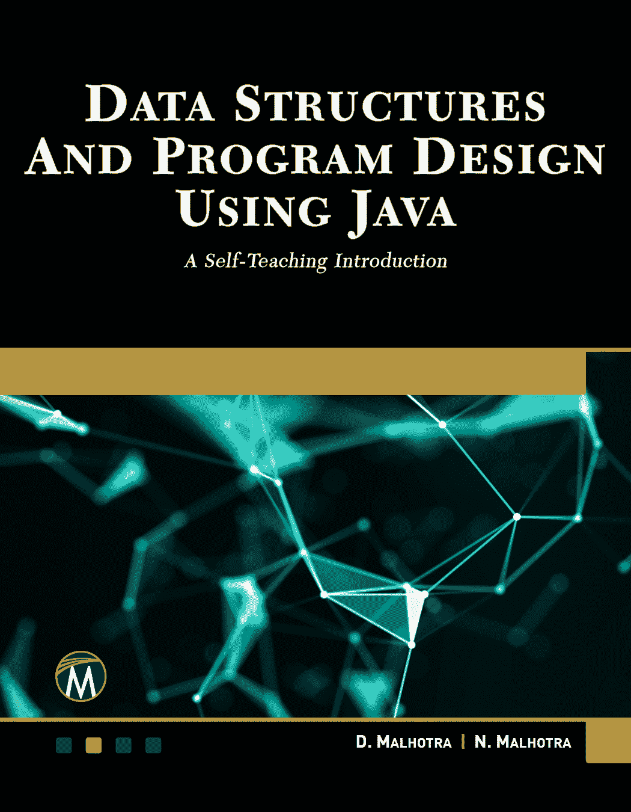


*献给我们亲爱的父母和学生们*

*序言*

*致谢*

## 1.1 简介

## 1.2 数据结构的类型

### 1.2.1 线性与非线性数据结构

### 1.2.2 静态与动态数据结构

### 1.2.3 均质与非均质数据结构

#### 1.2.4 基础与非基础数据结构

### 1.2.5 数组

### 1.2.6 队列

### 1.2.7 栈

### 1.2.8 链表

### 1.2.9 树

### 1.2.10 图

## 1.3 数据操作

## 1.4 算法

## 1.5 算法设计

## 1.6 算法分析

## 1.7 抽象数据类型

## 1.8 O 符号

## 1.9 总结

## 1.10 习题

## 2.1 简介

## 2.2 特性

## 2.3 概览

## 2.4 编译 Java 程序

## 2.5 面向对象

## 2.6 字符集

## 2.7 标记

## 2.8 数据类型

## 2.9 Java 程序结构

## 2.10 运算符

## 2.11 控制语句

## 2.12 循环语句

## 2.13 break 和 continue 语句

## 2.14 方法

## 2.15 总结

## 2.16 习题

## 3.1 简介

## 3.2 数组定义

## 3.3 数组声明

## 3.4 初始化

## 3.5 元素地址计算

## 3.6 数组操作

## 3.7 2D 数组/二维数组

## 3.8 二维数组声明

## 3.9 二维数组操作

## 3.10 多维数组/N 维数组

## 3.11 三维数组地址计算

## 3.12 数组及其应用

## 3.13 稀疏矩阵

## 3.14 稀疏矩阵类型

## 3.15 稀疏矩阵表示

## 3.16 总结

## 3.17 练习

### 3.17.1 理论题

### 3.17.2 编程题

### 3.17.3 选择题

## 4.1 引言

## 4.2 链表的定义

## 4.3 链表中的内存分配

## 4.4 链表的类型

### 4.4.1 单向链表

### 4.4.2 单向链表的操作

### 4.4.3 循环链表

### 4.4.4 循环链表的操作

### 4.4.5 双向链表

### 4.4.6 双向链表的操作

## 4.5 空链表

## 4.6 链表的应用

## 4.7 多项式的表示

## 4.8 总结

## 4.9 练习

### 4.9.1 理论题

### 4.9.2 编程题

### 4.9.3 选择题

## 5.1 引言

## 5.2 队列的定义

## 5.3 队列的实现

### 5.3.1 使用数组实现队列

### 5.3.2 使用链表实现队列

### 5.3.2.1 链队列的插入

### 5.3.2.2 链队列的删除

## 5.4 队列的操作

### 5.4.1 插入

### 5.4.2 删除

## 5.5 队列的类型

### 5.5.1 循环队列

### 5.5.1.1 线性队列的局限性

### 5.5.1.2 在循环队列中插入元素

### 5.5.1.3 从循环队列中删除元素

### 5.5.2 优先级队列

### 5.5.2.1 优先级队列的实现

### 5.5.2.2 链优先级队列的插入

### 5.5.2.3 链优先级队列的删除

### 5.5.3 双端队列 (De-Ended Queues)

## 5.6 队列的应用

## 5.7 总结

## 5.8 练习

### 5.8.1 理论题

### 5.8.2 编程题

### 5.8.3 选择题

# 第 6 章 搜索与排序

## 6.1 搜索引言

## 6.2 线性搜索或顺序搜索

### 6.2.1 线性搜索的缺点

### 6.3.1 二分搜索算法

### 6.3.2 二分搜索的复杂度

### 6.3.3 二分搜索的缺点

## 6.4 插值搜索

### 6.4.1 插值搜索的原理

### 6.4.2 插值搜索的复杂度

## 6.5 排序引言

### 6.5.1 排序的类型

## 6.6 外部排序

## 6.7 总结

## 6.8 练习

### 6.8.1 理论题

### 6.8.2 编程题

### 6.8.3 选择题

## 7.1 引言

## 7.2 栈的定义

## 7.3 栈溢出与上空

## 7.4 栈的操作

## 7.5 栈的实现

### 7.5.1 使用数组实现栈

### 7.5.2 使用链表实现栈

### 7.5.2.1 链栈的推送操作

### 7.5.2.2 链栈的弹出操作

## 7.6 栈的应用

### 7.6.1 波兰表达式与逆波兰表达式

### 7.6.2 中缀表达式到后缀表达式的转换

### 7.6.3 中缀表达式到前缀表达式的转换

### 7.6.4 后缀表达式的求值

### 7.6.5 前缀表达式的求值

### 7.6.6 括号平衡

## 7.7 总结

## 7.8 练习

### 7.8.1 理论题

### 7.8.2 编程题

### 7.8.3 选择题

## 8.1 引言

## 8.2 定义

## 8.3 二叉树

### 8.3.1 二叉树的类型

### 8.3.2 二叉树的内存表示

## 8.4 二叉搜索树

### 8.4.1 二叉搜索树的操作

### 8.4.2 二叉树的遍历方法

### 8.4.3 使用遍历方法创建二叉树

## 8.5 AVL 树

### 8.5.1 高度平衡树的需求

### 8.5.2 AVL 树的操作

## 8.6 总结

## 8.7 练习

### 8.7.1 理论题

### 8.7.2 编程题

### 8.7.3 选择题

## 9.1 引言

## 9.2 B 树

## 9.3 B 树的操作

### 9.3.1 B 树的插入

### 9.3.2 B 树的删除

## 9.4 B 树的应用

## 9.5 总结

## 9.6 练习

### 9.6.1 理论题

### 9.6.2 选择题

# 第 10 章 哈希

## 10.1 引言

### 10.1.1 哈希与直接寻址的区别

## 10.2 哈希表

## 10.3 哈希函数

## 10.4 冲突

### 10.4.1 冲突解决技术

### 10.4.1.1 链地址法

### 10.4.1.2 开放寻址法

## 10.5 总结

## 10.6 练习

### 10.6.1 理论题

### 10.6.2 选择题

## 11.1 引言

## 11.2 术语

## 11.3 文件操作

## 11.4 文件分类

## 11.5 C vs C++ vs Java 文件处理

## 11.6 文件组织

## 11.7 顺序文件组织

## 11.8 索引顺序文件组织

## 11.9 相对文件组织

## 11.10 倒排文件组织

## 11.11 总结

## 11.12 练习

### 11.12.1 理论题

### 11.12.2 选择题

## 12.1 引言

## 12.2 定义

## 12.3 图的表示

### 12.3.1 邻接矩阵表示

### 12.3.2 邻接列表表示

## 12.4 图遍历技术

### 12.4.1 广度优先搜索

### 12.4.2 深度优先搜索

## 12.5 拓扑排序

## 12.6 最小生成树

### 12.6.1 Prim 算法

### 12.6.2 Kruskal 算法

## 12.7 总结

## 12.8 练习

### 12.8.1 理论题

### 12.8.3 单选题

### 单选题答案

### 索引

# 前言

数据结构是计算机科学的基石。本书的目标是强调数据结构作为一门入门课程的基础性知识。它专为想要学习数据结构基础以及使用`Java`编程语言实现它们的初学者设计。本着这一重点，我们介绍了该学科的各种基础知识，并辅以大量的现实世界类比，以便快速理解技术概念，并帮助识别合适的数据结构来解决特定的实际问题。本书将作为教材/参考书，特别是对信息技术、工程、计算机应用和信息科学等各个课程的本科生或研究生有极大帮助。

## 核心特性

* **实际应用：** 全书穿插了大量现实世界的类比作为实际应用，以便快速理解并将数据结构的基础知识与日常、现实场景联系起来。这种方法反过来将帮助读者培养能力，即为特定的现实世界问题识别最合适且高效的数据结构。

* **常见问题：** 书中内容在相关主题内整合了许多理论/实践常见问题，以帮助读者掌握该学科。

* **算法与程序：** 为了从通用层面更好地理解数据结构的基础知识，随后展示了其在`Java`中的面向对象实现，书中全程讨论了与语法无关的算法以及用`Java`实现的程序。这种呈现方式将帮助读者在一本书中同时获取算法及其相应的实现。

* **数值与概念题：** 为了帮助读者建立该学科的坚实基础，书中包含了各种数值和概念题。

* **单选题：** 为了帮助学生应对各种 IT 领域的就业导向考试，我们专门挑选了几项练习并以单选题的形式给出。

**Dheeraj Malhotra 博士**

**Neha Malhotra 博士**

2020 年 2 月

# 鸣谢

我们非常感谢 VIPS 主席 S.C. Vats 博士、受尊敬的管理层、VSIT 主席以及维韦卡瓦哈纳专业学习学院（GGS IP University）的 VSIT 院长。他们始终是我们的灵感源泉，他们对我们的信任让我们感到非常荣幸。

我们还借此机会感谢我们的导师 O.P. Rishi 博士（科塔大学）、Sushil Chandra 博士（印度政府研究组织 DRDO）和 Udyan Ghose 博士（GGS IP University），他们为我们执行此项目提供了动力。

我们深感谢 Stuti Suthar 女士（VIPS, GGSIPU）和 Deepanshu Gupta 先生（马德拉有限公司）帮助我们对手稿中的代码进行校对和编译。

没有出版商的支持，书籍是不可能完成的。感谢 Mercury Learning and Information 的 David Pallai 和 Jennifer Blaney 在整个项目期间的热情投入。

向我们的父母、兄弟姐妹和家人致以诚挚的敬意，他们在顺境时支持我们，在逆境时鼓励我们。

最后，我们一直从读者（尤其是美国、加拿大和印度读者）那里深受启发。他们对我们前两部著作 **Data Structures using C** 和 **C++**（均由 MLI 出版）的极度喜爱和积极反馈，帮助我们进一步完善了现有的这部著作。

**Dheeraj Malhotra 博士**

**Neha Malhotra 博士**

2020 年 2 月

# 第 1 章

## 1.1 引言

数据结构是在计算机内存中存储和组织数据元素的一种高效方法。数据意味着一个值或一组值的集合。结构指的是组织数据的方法。数据在内存中的数学或逻辑表示法称为数据结构。数据结构的目标是高效地存储、检索和更新数据。数据结构可以被视为归类在一个名称下的元素。这些数据元素被称为成员，它们可以是不同的类型。数据结构几乎应用于每一个程序和软件系统。有各种类型的数据结构适用于不同类型的应用。数据结构是程序的基石。为了让程序高效运行，程序员必须选择合适的数据结构。数据结构是数据管理至关重要的部分。正如名称所示，数据管理是一项包含了数据收集、将数据组织成结构等不同活动的任务。使用数据结构的示例包括栈、队列、数组、二叉树、链表、哈希表等。

数据结构帮助我们理解一个元素与另一个元素之间的关系并在内存中对其组织。它是内存中数据的数学或逻辑表示或组织。数据结构广泛应用于以下领域：

* 编译器设计

* 数据库管理系统 (DBMS)

* 人工智能

* 网络与数值分析

* 统计分析软件包

* 图形学

* 操作系统 (OS)

* 仿真

正如我们在上一个列表中看到的，许多应用都使用了不同的数据结构来执行操作。某些数据结构为了内存的高效利用而牺牲速度，而另一些则牺牲内存利用率以获得更快的速度。

线性数据结构是指数据元素按照线性或顺序方式存储的结构；也就是说，数据存储在连续的内存位置中。线性数据结构可以通过两种方式表示：通过利用连续的内存位置建立各种元素之间的线性关系来表示（例如数组），或者通过从一个元素到另一个元素的链接建立元素之间的线性关系来表示（例如链表）。线性数据结构的示例包括数组、链表、栈、队列等。

非线性数据结构是指数据不以任何顺序或连续的内存位置存储的结构。这种结构中的数据元素以层级顺序表示。非线性数据结构的示例包括图、树等。

静态数据结构是内存中的一组数据，其大小是固定的，且在运行时不能更改。必须提前知道其大小，因为在程序后期无法重新分配内存。一个例子是`array`（数组）。

动态数据结构是内存中的一组数据，在程序执行期间可以重新分配内存。程序员可以根据需要添加或删除元素。示例包括链表、图、树等。

## 1.2.3 同质与非同质数据结构

同质数据结构包含相同类型的数据元素，例如数组。

非同质数据结构包含不同类型的数据元素，例如结构（`struct`）。

## 1.2.4 基础与非基础数据结构

基础数据结构是编程语言支持的基础预定义数据结构。基础结构类型的示例有`int`、`float`、`char`等。

非基础数据结构是使用基础结构创建的相对复杂的数据结构。非基础数据结构的示例有数组、链表、栈、队列等。

不同数据结构的分类如图 1.1 所示。

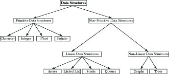

*图 1.1. 不同数据结构的分类。*

我们知道`Java`支持各种数据结构。因此，现在我们将介绍这些数据结构，并在接后的章节中进行详细讨论。

## 常见问题

### 2. 请写出基础数据结构与非基础数据结构之间的区别。

**答：** 基础数据结构：通常由机器级指令操作的数据结构，如`int`、`float`、`char`等，被称为基础结构。

非基础数据结构：不属于基础的数据结构被称为非基础数据结构。

### 3. 请解释线性与非线性数据结构之间的区别。

**答：** 线性与非线性数据结构的主要区别在于数据元素的组织方式。在线性数据结构中，元素按顺序组织，因此在计算机内存中易于实现。在非线性数据结构中，一个数据元素可以连接到多个其他元素，以表示它们之间存在的特定关系。

### 1.2.5 数组

数组是连续内存中同质（相似）类型数据元素的集合。数组是一种线性结构，因为数组的所有元素都是按线性顺序存储的。数组的各种元素通过其索引值（也称为下标）引用。在`Java`中，使用以下语法声明数组：

**语法** – `<Data type> array name [size];`

元素存储在数组中的情况如图 1.2 所示。

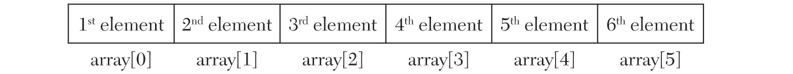

*图 1.2. 数组的内存表示。*

数组用于存储大量类型的数据。它们具有各种优点和局限性。

**使用数组的优点：**

1. 元素存储在相邻的内存位置；因此，速度非常快，可以轻松访问任何元素。

2. 数组不支持动态内存分配，因此所有内存管理都由编译器完成。

**使用数组的局限性：**

1. 数组元素的插入和删除非常复杂且极其耗时，因为需要移动元素。

2. 数组是静态的；因此必须提前知道大小。

3. 数组中的元素存储在连续的内存位置，这些位置可能可用也可能不可。

### 1.2.6 队列

队列是数据元素的线性集合，其中第一个插入的元素是第一个出来的元素；也就是说，队列是一种 FIFO（先进先出）数据结构。队列是一种常用的线性数据结构，第一个元素从一个称为`REAR`（也称为尾部）的端插入，而元素的删除在另一个称为`FRONT`（也称为头部）的端进行。

**实际应用**

为了简单地说明队列，设想有一排人站在公交站等车。因此，排在队里的第一个人将先上车。

在计算机内存中，队列可以使用数组或链表实现。图 1.3 显示了队列的数组实现。每个队列都有`FRONT`和`REAR`变量，分别指向删除和插入的位置。

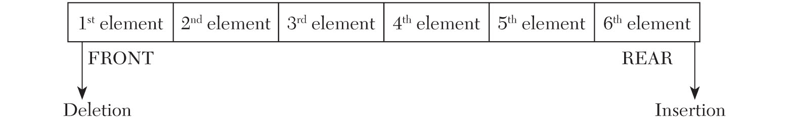

*图 1.3. 队列的内存表示。*

### 1.2.7 栈

栈是数据元素的线性集合，其中插入和删除只在栈顶进行。栈是一种 LIFO（后进先出）数据结构，因为最后一个推入栈的元素将是第一个被删除的元素。在栈上执行的操作包括`PUSH`、`POP`和`PEEP`。`PUSH`操作将元素输入到栈顶，而`POP`操作从栈中删除元素。`PEEP`操作返回栈顶元素的值但不删除它。

**实际应用**

栈的一个现实例子是桌子上堆的一叠盘子。人会从栈顶取走第一个盘子。

在计算机内存中，栈可以使用数组或链表实现。图 1.4 显示了栈的数组实现。

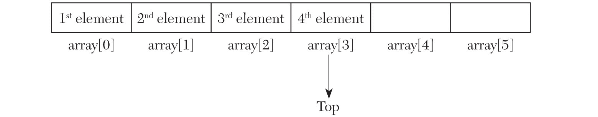

每个栈都有一个与其相关的`TOP`变量。`TOP`节点存储栈顶元素的地址。`TOP`是插入和删除的位置。

### 1.2.8 链表

数组的主要局限是必须提前知道大小或元素数量。因此，这一局限产生了链表的新概念。链表是数据元素的线性集合。这些数据元素被称为节点，每个节点存储下一个节点的地址。链表是节点的序列，每个节点包含一个或多个数据字段和一个存储下一个节点地址的地址字段。此外，链表是动态的；也就是说，内存根据需要进行分配。

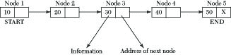

*图 1.5. 链表的内存表示。*

在之前的图中，我们制作了一个链表，其中每个节点被分为两个槽：

1. 第一个槽包含信息/数据。

2. 第二个槽包含下一个节点的地址。

## 实际应用

一个简单的现实生活例子是火车；在这里，每节车厢都与其前节和下一节车厢连接（第一节和最后一节车厢除外）。

最后一个节点的地址部分存储一个名为`NULL`的特殊值，表示链表的结束。链表相比于数组的优势是现在插入和删除数据元素更加容易，因为我们不需要每次都进行移动。然而，搜索一个元素变得困难了。此外，搜索一个元素需要更多的时间，而且需要较大的内存空间。因此，当需要一组数据元素但事先不知道集合中数据元素的数量时，就会使用链表。

### 4. 定义“链表”术语。


**答：** 链表或单向列表是一种称为“节点”的数据元素的线性集合，它们给出一个线性顺序。它是一种流行的动态数据结构。链表中的节点并不存储在连续的内存位置中。链表中节点中的每个数据项都有一个关联的地址字段，该字段给出链表中下一个节点的地址位置。

### 1.2.9 树

树是一种流行的非线性数据结构，其中数据元素或节点以分层顺序表示。在这里，其中一个节点被显示为树的根节点，其余节点被分为两个不相交的集合，使得每个集合都是子树的一部分。树使得搜索过程非常简单，其递归编程使得程序经过优化且易于理解。

二叉树是树的最简单形式。二叉树由一个根节点和两个子树称为左子树和右子树组成，这两个子树也是二叉树。树中的每个节点由三部分组成，即最左部分存储左子树的地址，中间部分包含数据元素，最右部分存储右子树的地址。根是树的最顶端元素。当树中没有节点时，即`ROOT = NULL`，它被称为空树。

例如，考虑一个二叉树，其中`R`是树的根节点。`LEFT`和`RIGHT`分别是`R`的左子树和右子树。节点`A`指定为树的根节点。节点`B`和`C`分别是`A`的左孩子和右孩子。节点`B`、`D`、`E`和`G`构成根节点的左子树。同样，节点`C`、`F`、`H`和`I`构成根节点的右子树。

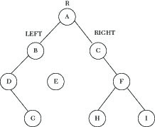

图 1.6。二叉树。

### 树的优点

1. 树中的搜索过程非常快。
2. 与其他数据结构相比，元素的插入和删除变得更加容易。

### 5. 定义“二叉树”术语。

**答：** 二叉树是一种分层数据结构，其中每个节点最多有两个孩子，即左孩子和右孩子。在二叉树中，每个节点的度数最多为二。二叉树用于实现二叉搜索树，用于高效的搜索和排序。`BST`的变体是`AVL树`，其左、右子树的高度差为一。二叉树是`k叉树`的流行子类型，其中`k`为 2。

### 1.2.10 图

图是一种没有父子关系的通用树。它是一种非线性数据结构，由顶点（也称为节点）和连接这些顶点的边组成。在图中，可以存在任何复杂的关系。图`G`可以定义为顶点`V`集合和边`E`的有限集。因此，`G = (V, E)`，其中`V`是顶点集，`E`是边集。图用于数学和计算机科学的各种应用。与树的根节点不同，图没有根节点；节点可以连接到图中的任何节点。当两个节点通过边连接时，称为相邻节点。

## 实际应用

图的现实生活例子可以是工作站，几台计算机通过网络连接在一起。

例如，考虑一个具有六个顶点和八条边的图`G`。在这里，`Q`和`Z`是`P`的邻居。同样，`R`和`T`是`S`的邻居。

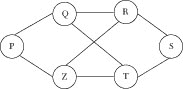

图 1.7。图。

## 1.3 数据结构的操作

在这里我们将讨论在数据结构上执行的各种操作。

* **创建：** 创建数据结构的过程。在这里完成数据结构的声明和初始化。这是第一个操作。
* **删除：** 从给定的数据元素集合中移除特定数据元素的过程，例如移除离开公司的员工的名字。
* **更新：** 修改数据结构数据元素的过程。例如，如果学生的地址发生了变化，则应该进行更新。
* **搜索：** 用于根据给定的键找到特定数据元素或所有数据元素的位置，例如，查找住在纽约的人。
* **排序：** 将数据元素按某种顺序排列的过程。例如，按字母顺序排列名字。
* **合并：** 将两个不同列表的数据元素合并以形成单一列表的过程。
* **遍历：** 访问每个数据元素一次的过程，以便进行处理。例如，打印所有学生的名字。
* **销毁：** 删除整个数据结构的过程。这是数据结构中的最后一个操作。

## 1.4 算法

算法是解决复杂问题的系统指令集。它是一系列有限的指令序列，每条指令都有明确的含义并可以在有限时间内以最少的努力执行。通常情况下，算法是编写程序的蓝图。一旦我们有了解决方案的蓝图，就可以在任何`C`、`C++`、`Java`等高级语言中实现它。它将问题分解为有限的步骤。用编程语言编写的算法被称为程序。计算机是没有大脑或智能的机器。因此，必须指示计算机以无歧的步骤执行给定任务。因此，程序员必须用英文算法的形式定义他的问题。这样的算法应该具有以下特征：

1. 算法应该是简单简洁的。
2. 它应该是高效有效的。
3. 它应该没有歧义；即逻辑必须清晰。

同样，算法必须具有以下特点：

* **输入：** 读取给定问题的数据。
* **输出：** 必须产生预期的结果。
* **过程/确定性：** 每一步或指令必须是无歧的。
* **有效性：** 每一步都应该是准确简洁的。预期结果应在有限时间内产生。
* **有限性：** 步骤数应该是有限的。

### 1.4.1 开发算法

开发算法建议采取步骤：

1. 定义或理解问题。
2. 识别问题的结果或输出。
3. 识别问题所需的输入并选择最佳输入。
4. 从给定的输入设计逻辑以获得预期输出。
5. 对不同的输入进行算法测试。
6. 重复上述步骤，直到对所有输入都产生预期的结果。

## 1.5 算法设计方法

复杂的算法被划分为较小的单元，称为模块。然后这些模块进一步划分为子模块。通过这种方式，复杂的算法可以很容易地解决。将算法划分为模块的过程称为模块化。设计算法有两种流行的方法：

* 自顶向下法 (Top-Down Approach)
* 自底向上法 (Bottom-Up Approach)

现在让我们来理解这两种方法。

1. **自顶向下法：** 自顶向下法指出，复杂/困难的问题或算法应该被分为更小的模块。这些较小的模块进一步划分为子模块。重复这个分解过程，直到我们达到模块复杂度的预期输出。自顶向下法从顶层模块开始，相应地增加模块，直到达到不再需要子模块的级别，即达到了所需的复杂度水平。

   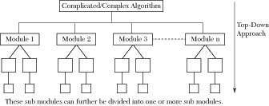

   图 1.8。自顶向下法。

2. **自底向上法：** 自底向上的算法设计方法是自顶向下法的反面。在这种方法中，我们首先从设计基础模块开始，进一步向设计高级模块进。将子模块组合形成一个更高层次的模块。同样，将所有高级模块组合形成更高级的模块。因此，重复这种组合子模块的过程，直到我们获得算法的预期输出。

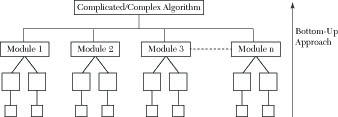

图 1.9。

## 1.6 算法分析

算法可以从两个因素进行分析，即空间和时间。我们的目标是开发一种能够充分利用这两种资源的算法。分析算法是为了衡量算法的效率。算法的效率通过速度和时间复杂度来衡量。算法的复杂度是一个根据输入规模衡量算法所用空间时间的函数。

**时间复杂度：** 算法的时间复杂度是算法完全运行程序所需的时间。它是程序的运行时间。算法的时间复杂度取决于输入的大小。时间复杂度通常用大 O 表示表示。例如，线性搜索的时间复杂度为`O(n)`。

**空间复杂度：** 算法的空间复杂度是完全运行程序所需的内存空间。算法的空间复杂度取决于输入的大小。

时间复杂度分为三类：

1. **最坏情况运行时间 (Best-Case Running Time)：** 算法的性能在最优条件下是最好的。例如，二分查找的最优情况发生在目标元素是列表的中间元素时。另一个例子可以是排序；即，如果元素已经在列表中排好序，那么算法将以最佳时间执行。
2. **平均情况运行时间 (Average-Case Running Time)：** 它表示当输入从给定的集合或分布中随机抽取时算法的行为。它是对“平均”输入运行时间的估计。通常假设给定规模的所有输入都可能以相等的概率出现。
3. **最坏情况运行时间 (Worst-Case Running Time)：** 在这种情况下，算法的行为涉及输入实例的最坏可能情况。算法的最坏情况运行时间是任何输入运行时间的上界。例如，线性搜索的最坏情况发生在目标元素是列表中的最后一个元素，或者该元素不在列表中时。

### 常见问题

**6. 定义时间复杂度**

**答：** 时间复杂度是一种衡量标准，它通过作为输入规模的函数来评估给定算法所执行的操作计数。它是执行算法所需步骤数量的近似值。它通常用渐近记法表示，即`O(g)`表示法，也称为大 O 表示法，其中`g`是输入数据规模的函数。

## 1.6.1 时间空间权衡

在计算机科学中，时间空间权衡是用更少的时间更多的内存空间或用更多的时间更少的内存空间来解决特定问题。但从实际角度来看，设计一种既能节省空间又能节省时间的算法是一项挑战性任务。因此，我们可以使用多个算法来解决问题。其中一个可能需要少的时间，而另一个可能需要更少的内存空间来执行。因此，我们为了另一个牺牲另一个。因此，算法之间存在时间空间或内存权衡。这种时间空间权衡从知情的角度为程序员提供了一个理性的选择。如果时间对程序员来说很重要，那么他可能会选择一个执行时间短或最短的程序。另一方面，如果空间是程序员的首要考虑，那么在这种情况下，他可能会选择一个以更多时间为代价使用更少内存程序。

抽象数据类型 (ADT) 是数据对象的流行数学模型，它定义了数据类型以及在这些对象上操作的各种。为了理解抽象数据类型的含义，我们将简单地将该词分为两个部分，即“数据类型”和“抽象”。变量的数据类型是变量可以取值的值的集合。Java 中有各种数据类型，包括`integer`、`float`、`character`、`long`、`double`等。当我们在数据结构的背景下讨论“抽象”一词时，它的意味着详细的规范。它可以被视为对带有操作列表的结构描述。因此，抽象数据类型是数据类型的规范，指定了数据的数学和逻辑模型。例如，当我们使用`stacks`和`queues`时，在那个点我们主要关注的是数据类型和对其的操作。我们不担心数据如何存储在内存中。同样，我们也不关心`push()`和`pop()`是如何工作的。

复杂度为`O(log[2]n)`的算法被认为是最好的算法之一，而复杂度为`O(2^n)`的算法被认为是最差的算法。各种类型函数中所需的计算复杂度或迭代次数可以比较如下：

`O(log[2]n) < O(n) < O(n log[2]n) < O(n²) < O(n³) < O(2^n)`

# 1.9 总结

* 数据结构决定了在计算机内存中存储和组织数据元素的方法。数据意味着一个值或一组值的集合。结构指的是组织数据的方法。内存中数据的数学或逻辑表示称为数据结构。
* 数据结构分为若干类型，包括线性数据结构和非线性数据结构、基本数据结构和非基本数据结构、静态和动态数据结构以及同构和异构数据结构。
* 线性数据结构是指数据元素按线性或顺序存储的结构；即数据存储在连续的内存位置中。非线性数据结构是指数据不以任何顺序或连续内存位置存储的结构。
* 静态数据结构是内存中大小固定且在运行期间不能更改的数据集合。动态数据结构是在程序执行期间可以重新分配内存的数据集合。
* 基本数据结构是编程语言支持的基础型数据结构或预定义数据结构。非基本数据结构是使用基本数据结构创建的相对复杂的数据结构。
* 同构数据结构包含所有相同类型的数据元素。异构数据结构包含不同类型的数据元素。
* 数组是存储在连续内存中的同构（相同）类型数据元素的集合。
* 队列是数据元素的线性集合，其中先插入的元素将先取出，即先进先出（FIFO）数据结构。队列是一种线性数据结构，元素从一个称为`REAR`（尾部）的端插入，删除发生在另一个称为`FRONT`（头部）的端。
* 链表是节点序列，每个节点包含一个或多个数据字段以及一个存储下一个节点地址的地址字段。
* 栈是数据元素的线性集合，插入和删除只发生在称为`TOP`（栈顶）的一端。栈是一种后进先出（LIFO）数据结构，因为最后添加到栈顶的元素将是第一个从栈顶删除的元素。
* 树是一种非线性数据结构，数据元素或节点按层次顺序表示。在这里，初始节点被指定为树的根节点，其余节点被分为两个不相交的集合，每个集合都是一个子树的一部分。
* 二叉树是树的最简单形式。二叉树由一个根节点两个称为左树和右树的子树组成，这两个子树也是二叉树。
* 图是没有父子关系的通用树。它是一种非线性数据结构，由顶点（节点）和连接这些顶点的边组成。
* 算法是用于解决复杂问题的系统指令集。它是一系列逐步步进的指令序列，每条指令都有明确的含义，并可以在有限时间内以最少的精力执行。
* 将算法划分为模块的过程称为模块化。
* 算法的时间复杂度描述为算法完全运行程序所需的时间量。它是程序的运行时间。
* ADT（抽象数据类型）是数据对象的数学模型，它定义了数据类型以及用于操作这些对象的函数。
* 大 O 符号法是最流行的分析表征方案之一，因为它提供了算法复杂度的上界。

# 1.10 练习

## 1.10.1 理论题

1. 如何定义一个好的程序？
2. 解释数据结构的分类。
3. 什么是算法？讨论算法的特征。
4. 数据结构上可以执行哪些操作？请用例子说明每一种。
5. 区分数组和链表。
6. 解释时间复杂和空间复杂的术语。
7. 写关于图的简短笔记。
8. 模块化的过程是什么？
9. 用例子区分栈和队列。
10. 抽象数据类型（ADT）是指什么？请详细解释。
11. 你如何定义算法的复杂度？讨论算法的最坏情况、最好情况和平均情况时间复杂度。
12. 写关于树的简短笔记。
13. 解释你如何开发算法来解决复杂问题。
14. 详细解释时间空间权衡。

## 1.10.2 单选题

1. 下列种数据结构是先进先出（FIFO）数据结构？
   (a) 数组
   (b) 栈
   (c) 队列

2. 二叉树可以有多少个子节点？
   (a) 0
   (b) 2
   (c) 1
   (d) 3

3. 下列哪种数据结构使用动态分配？
   (a) 图
   (b) 链表
   (c) 树
   (d) 以上都是

4. 队列的删除总是从哪里进行？
   (a) 头部
   (b) 尾部
   (c) 中间
   (d) 以上都不是

5. 哪种数据结构表示节点之间的关系？
   (a) 链表
   (b) 树
   (c) 栈
   (d) 图

6. 下列哪是异构数据结构的例子？
   (b) 结构
   (c) 链表
   (d) 以上都不是

7. 在栈中，插入和删除发生在：
   (a) 底部
   (b) 中间
   (c) 栈顶
   (d) 以上都是

8. 下列哪项不是抽象数据类型（ADT）描述的一部分？
   (a) 操作
   (b) 数据
   (c) (a) 和 (b)
   (d) 以上都不是

9. 下列哪种数据结构允许只在一端进行删除？
   (a) 栈
   (b) 队列
   (c) (a) 和 (b)
   (d) 以上都不是

10. 下列种数据结构是线性的？
    (a) 树
    (b) 图
    (c) 队列
    (d) 以上都不是

11. 下列哪种在存储数据并需要反序检索时是有益的？
    (a) 栈
    (b) 链表
    (c) 队列
    (d) 以上都是

12. 左右子树高度差最大为 1 的二叉搜索树是：
    (a) 红黑树
    (b) 多叉搜索树
    (c) AVL 树
    (d) 以上都不是

13. 处理列表中每个元素的操作称为：
    (a) 遍历
    (b) 合并
    (c) 插入
    (d) 排序

14. 下列哪是衡量算法效率的两个主要指标？
    (a) 数据 & 时间
    (b) 数据 & 空间
    (c) 时间 & 空间
    (d) 时间 & 复杂度

15. 下列哪种情况在复杂度理论中不存在/不发生？
    (a) 平均情况
    (b) 最坏情况
    (c) 最优情况
    (d) 最小情况

# 第 2 章：Java 语言简介

## 2.1 引言

Java 是一种广泛使用的编程语言，由 James Gosling、Mike Sheridan、Chris Warth、Ed Frank 和 Patrick Naughton 于 1991 年于 Sun Microsystems 公司创建。Sun Microsystems 于 1996 年发布了 Java 1.0 的第一个公共实现。开发 Java 的主要动机是需要一种平台无关的语言，用于创建可以嵌入到不同电子设备（如洗衣机、遥控器、电视机等）中的软件。目前有多种类型的 CPU 可作为控制器，它们主要被设计为通过 C、C++、Java 和其他编程语言针对特定目标进行编译。但一个局限性是创建编译器的过程非常耗时；此外，编译器的成本昂高。因此，为了克服这一限制并找到一种更简单、更具效益的解决方案，James Gosling 与他的同事开始研究一种可移植且平台无关的语言，这种语言可以生成能够在不同环境下各种 CPU 上运行的代码，这最终导致了 Java 语言的诞生。创建 Java 语言主要有三个核心目标，如下：

* 它必须是简单的、面向对象的且熟悉的语言。
* 它必须是可移植的、分布式的且平台无关的。
* 它必须是健壮的、安全的且可靠的。

## 2.2 Java 及其特性

尽管 Java 的许多特性源自 C 和 C++，但它并不是 C++ 的增强版本。它使用了 C 语言的语法，并体现了 C++ 语言的面向对象特性。Java 是一种非常强大的语言，被称为专业程序员的语言。Java 编程语言有几个不同的特性，以下如下：

* Java 是一种非常简单的语言，非常易学习，其语法简单易于理解。
* Java 是一种面向对象的编程语言。Java 中的一切皆都是对象。
* Java 以其安全性闻名。由于 Java 中的所有内容都被视为对象，这增加了它的安全性。此外，Java 是安全的，因为它不使用显式指针，并且 Java 程序运行在虚拟机沙箱内部。
* Java 是一种健壮的语言，因为它使用了强内存管理概念并包含了自动垃圾回收机制。所有这些特性都使 Java 变得健壮。
* Java 是可移植的，因为 Java 代码可以运行在任何平台上。它不需要任何额外的实现。
* Java 比其他传统的解释型编程语言快，因为 Java 字节码非常“接近”原生代码，因此提供了高性能。
* Java 是一种分布式的、多线程的动态语言。

## 2.3 Java 概述


在 Java 中，最初所有的源代码都写在以`.java`（dot java）扩展结尾的纯文本文件中。然后，所有源文件由`javac`编译器编译成`.class`文件。`.class`文件不包含适用于处理器的原生代码；相反，它包含字节码，这是 Java 虚拟机（JVM）的机器语言。最后，`java`启动工具通过`JVM`实例运行应用程序。由于`JVM`可用于不同的操作系统，相同的`.class`文件能够在 Windows、macOS、Linux 等不同的操作系统上运行。

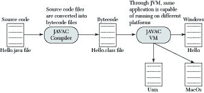

图 2.1. Java SE 流程的概览。

## 2.4 编译 Java 程序

Java 中的每个文件都使用`.java`文件扩展名。此外，在 Java 中，所有代码必须位于类（class）内部。最重要的任务是，按照约定，类的名称应与持有程序的文件的名称匹配。

要编译程序，请在系统中打开命令提示符。在以下命令提示符上运行编译器`javac`（Java 编译器），指定源文件：

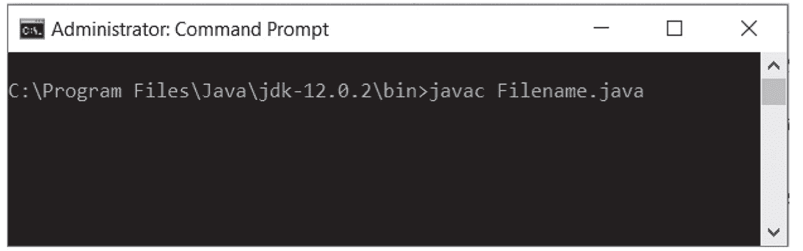

源文件被编译器编译成`.class`文件。现在，将创建一个`Filename.class`文件，其中包含程序的字节码。要运行程序，请使用称为`java`的 Java 启动工具。

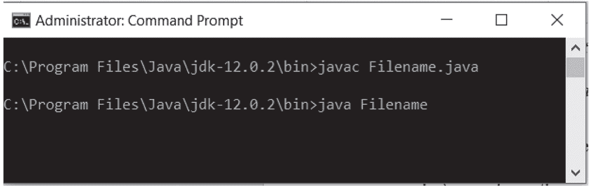

最后，当程序执行时，输出显示：

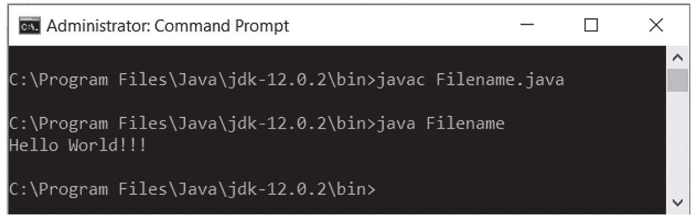

## 2.5 面向对象编程

面向对象编程是 Java 编程语言的核心。面向对象编程（OOP）对于 Java 来说是必要的，因此最好理解它的基本原理。OOP 围绕数据以及一组对数据良好定义的接口来组织程序。以下是面向对象编程的各种特性或特点：

* **对象（Objects）：** 对象是一个容器，数据以变量、方法和数据结构的组合存储在其中。对象是程序中与其他部分/片段交互的组件。对象是程序的基本运行时实体。

* **类（Classes）：** Java 通向面向对象编程的构建模块是类。类实际上是一个用户定义的数据类型，持有它自己的数据成员和成员方法。它是将数据成员和方法结合在一起。可以通过创建该类的对象来访问该类。类提供了一种方便的方法，将一组相关的数据项和方法打包在一起。

* **封装（Encapsulation）：** 封装是将数据成员和方法封装成单个单元的过程。它是保护代码和数据免受外部干扰的机制。它意味着没有授予直接访问；即它是隐藏的。这意味着为了访问数据，我们与负责该数据的对象交互。这被称为数据隐藏。

### 实际应用

封装最常见的例子是胶囊。在胶囊中，所有的药物都封装在一个胶囊内。

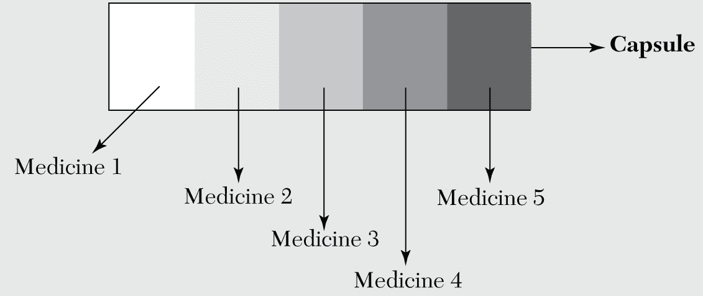

1. **单继承（Single Inheritance）：** 从单个基类派生的类被称为单继承。

   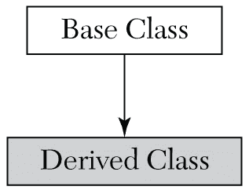

2. **多级继承（Multilevel Inheritance）：** 从已派生的类派生的类被称为多级继承。

   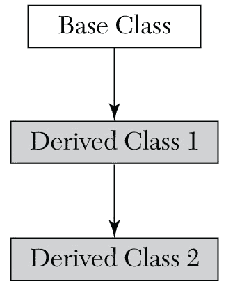

3. **多重继承（Multiple Inheritance）：** 从多个基类派生的类被称为多重继承。这在 Java 中不通过类直接实现。它是通过接口实现的，接口将在后面的章节中介绍。

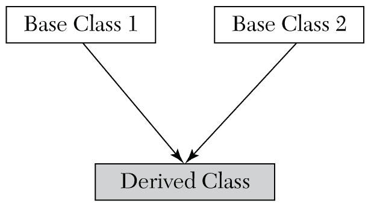

### 常见问题

**1. 基类和派生类有什么区别？**

### 继承

在创建类时，程序员不需要编写完全新的数据成员和成员方法，而是可以指定新类继承现有类的成员。这个现有的类被称为基类（base class/parent class），而新类被称为派生类（derived class）。一个类可以派生自多个类，这意味着它可以从多个基类继承数据和方法。

#### 实际应用

继承最常见的现实例子是你的家庭，其中爷爷是家的一顶柱（基类/父类），父亲是爷爷的孩子（派生类），而你是父亲的孩子（派生类）。


### 多态

`polymorphism`一词源于单词`poly`（意为“多”）和`morph`（意为“形式”）。因此，以超过一种形式存在的事物都被称为多态。因此，多态意味着产生多种形式的能力。多态通常发生在存在类层级结构且类之间通过继承关系相关联时。多态被认为是面向对象编程最重要的特性之一。多态有两种类型：

1. **编译时多态（静态多态）：** 通过`method overloading`（方法重载）实现。

#### 实际应用

一个人在不同的情况下表现出不同的角色；即：他/她是父亲的孩子，是老师的学生，是朋友的朋友，以此类推。

### 抽象

抽象的过程与隐藏非本质数据的思想有些相似。抽象是指只显示本质特征，并隐藏演示所需的背景细节和解释。这也被数据抽象。抽象是 Java 语言提供的关键特性之一。在 Java 中，抽象通过`abstract classes`（抽象类）和`interfaces`（接口）实现。

#### 实际应用

考虑一个正在开公交车的男人。这个人只知道加速会增加速度，刹车会降低速度。因此，他并不了解内部机制。

### 常见问题

**2. 解释抽象和封装之间的区别。**

**答：** 数据抽象是指向外部世界提供本质信息并隐藏背景细节，即在程序中表示所需的信息而不展示所有细节。另一方面，封装是一种面向对象编程的概念，将数据和操作数据的方法结合在一起，使其不受外部世界的影响。

### 消息传递

消息传递是对象之间通信的过程。面向对象的程序由对象组成，对象通过相互发送和接收信息进行通信。发送对象的消息是对执行过程的请求，因此它将调用接收对象中的方法以生成所需的结果。消息传递涉及三点：对象的名称、方法的名称和发送的数据。

### 动态绑定

动态绑定是指给定的过程调用需要执行的代码在运行时而非编译时已知的过程。它也被称为`dynamic dispatch`（动态分发）。这是一个面向对象编程的概念，与继承和多态有关。

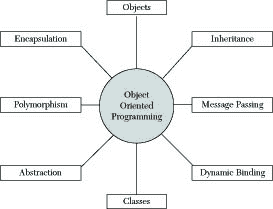

图 2.2 面向对象编程的特性。

## 2.6 Java 使用的字符集

Java 允许的字符集由以下字符组成：

* **字母表：** 包括英语的大写和小写字母，即`{A, B, C... ., Z}`和`{a, b, c... ., z}`。

* **空白字符：** 包括空格、回车和制表符。

* **特殊字符：** 由特殊符号组成，包括`{ !, ?, #, <, >, (, ), %, &, ^, *, <<, >>, [, ], +, =, /, -, _, :, ;, }`。

## 2.7 Java 标记

Java 标记帮助我们编写 Java 程序。Java 支持多种类型的标记：

* 关键字

* 标识符

* 常量

* 变量

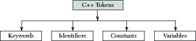

图 2.3 各种 Java 标记。

现在，让我们讨论所有的标记。

### 关键字

Java 中的关键字是具有特殊含义的保留字。它们以小写形式。关键字不能作为标识符使用。示例有`auto`, `int`, `float`, `char`, `break`, `continue`, `double`, `long`, `short`, `while`, `for`, `else`, `new`, `void`等。

### 标识符

标识符是赋予常量、变量、方法或数组的名字。定义标识符的规则如下：

1. 标识符可以包含字母、数字或下划线。

2. 它不能以数字开头。

3. 它可以下划线或字母开头。

4. 标识符不能包含特殊符号或空格。

5. 关键字不能用作标识符。

**例如：**


### 常量

常量是 Java 中永远不能改变的固定值。常量也被称为字面量。例如，`pi`的值是固定的。常量可以是任何数据类型。Java 有两种类型的常量，如下：

* **数值常量：** 仅分配整数值的常量。它由整数常量、浮点常量或实数常量组成。

* **字符常量：** 仅分配字符值的常量。

### 变量

变量是用于引用内存位置的名字。在处理变量时，我们指的是存储数据的内存地址。Java 支持两种类型的变量，包括字符变量和数值变量。

* **数值变量：** 用于存储整数或浮点类型的值。

* **字符变量：** 在这种变量中，单字符被包含在单引号内。

## 2.8 Java 数据类型

数据类型是定义数据类型以及变量持有数据量的特殊关键字。Java 中五种基本数据类型，如下：

* **整数 (int)：** 即 23, -98, +786 等。

* **字符 (char)：** 即 ‘A’, ‘x’, ‘u’ 等。

* **布尔 (boolean)：** 即 true/false 或 1/0。

* **浮点型 (float)：** 即 1.7, -4.6, +9.6 等。

* **双精度浮点型 (double)：** 即 -87.55653, +9867.3467 等。

有各种修饰符用于改变基本数据类型的含义，`void`除外。这些修饰符是符号、无、短和长。所有修饰符都可以应用于整数。然而，只有符号和无应用于字符。

## 2.9 Java 程序结构

与 C 和 C++ 不同，Java 程序需要类来执行。在 C 和 C++ 中，可执行代码或结构可能不包含类。但在 Java 中，一切都限制在类中。

现在，让我们通过一个简单的程序来看。

```java
class Example {/*创建一个包含数据成员和成员方法的类*/ {
    private int a, b, sum; /*a, b & sum 是该类的私有数据成员*/
    public void sum()/*sum() 方法被声明为公共*/ {
        a = 10, b = 20;
        sum = a + b;
        System.out.println("Sum" + sum); /*在屏幕上打印输出*/
    }
    public static void main(String[] args) /*主方法*/ {
        Example obj = new Example(); /*obj 是 Example 类的对象*/
        obj.sum();
    }
}
```

### 常见问题

#### 3. Java 中是如何获取输入以及如何显示输出的？请解释。

**答：** 在 Java 中，使用`Scanner`类来获取输入。它是一个预定义类，可以通过创建它的对象来访问。输出使用`System.out.println();`语句进行显示。

示例：

```java
import java.util.Scanner; /*导入 Scanner 类*/
public class ABC{
    public static void main(String[]args){
        Scanner obj=new Scanner(System.in);
        System.out.println("Enter a value:");
        System.out.println(x);
    }
}
```

## 2.10 Java 中的运算符

Java 中的运算符用于在不同的变量和常量之间执行特定的操作。Java 支持多种运算符，如下所示：

* 算术运算符

* 逻辑运算符

* 赋值运算符

* 关系运算符/ 比较运算符

* 条件运算符/ 三元运算符

* 位运算符

* 一元运算符

现在，让我们讨论所有这些运算符。

### 算术运算符

算术运算符是用于数学计算或运算的运算符。Java 中有效的算术运算符如表所示。

假设`x`和`y`是两个变量。

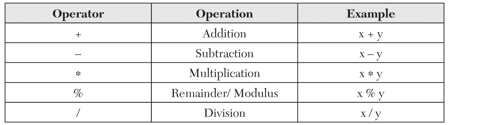

### 逻辑运算符

Java 支持三种逻辑运算符，如下所示：

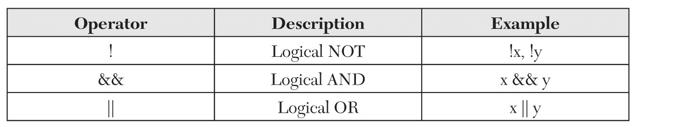

**逻辑非 (Logical NOT):** 它是一个一元运算符。该运算符接收单个表达式，并反转结果，使得`true`变为`false`，反之亦然。逻辑非的真值表如下：

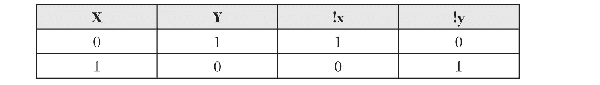

**逻辑与 (Logical AND):** 它是一个二元运算符。因此，它接收两个输入或表达式。如果两个输入都是`true`，则整个表达式为`true`。如果两个输入中的任何一个为`false`，则整个表达式将为`false`。逻辑与的真值表如下：

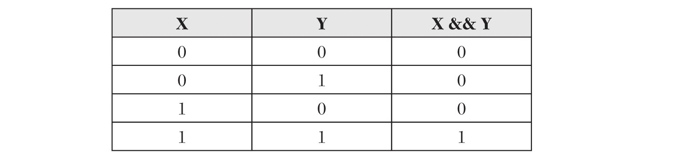

**逻辑或 (Logical OR):** 它也是一个二元运算符；也就是说，它也接收两个表达式。如果两个输入都是`false`，则输出为`false`。如果一个或两个输入都是`true`，则输出为`true`。逻辑或的真值表如下：

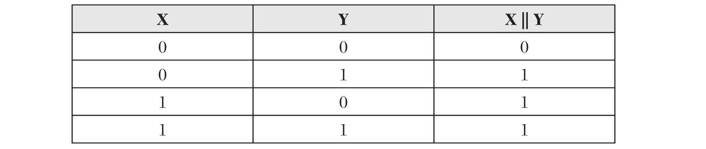

### 赋值运算符

赋值运算符负责为变量赋值。这些运算符总是从右到左求值。Java 支持多种赋值运算符，如下所示：

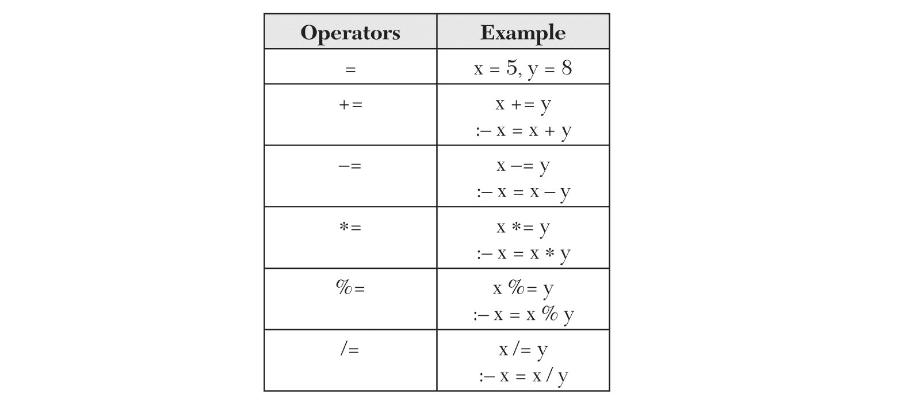

### 关系运算符

关系运算符用于两个值或表达式之间的比较。它们也被称为比较运算符。这些运算符总是从左到右求值。Java 中使用的各种关系运算符如下：

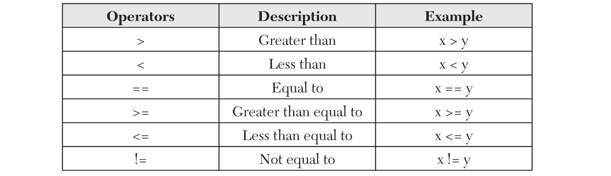

### 条件运算符

条件运算符就输入而言也称为三元运算符；它接受三个操作数。该运算符的语法如下：

其中，`expression 1`首先被求值。如果`expression 1`为`true`，则求值`expression 2`，`expression 2`将是整个表达式的答案；否则求值`expression 3`，`expression 3`将是整个表达式的答案。条件运算符可以找到两个数中的较大者。

`Greatest = (x > y)? X: y;`

在这里，如果`x > y`为`true`，则`x`大于`y`；即`(greatest = x)`；否则`y`大于`x`，即`(greatest = y)`。

### 位运算符

位运算符是在用于位位上执行操作的特殊运算符。Java 支持多种位运算符，包括：

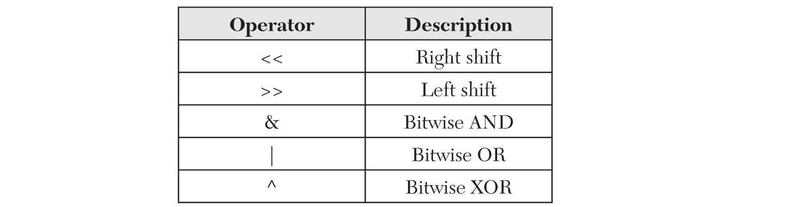

### 一元运算符

一元运算符是指需要单个操作数即可工作的。Java 支持两种运算符：增 (`++`) 和减 (`--`)。两种变体是后置和前置。在后置表达式中，运算符应用于操作数之后。相反，在前置表达式中，运算符应用于操作数之前。

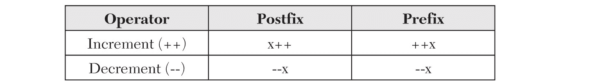

## 2.11 Java 中的决策语句

当我们谈论用 Java 编写的程序时，我们知道程序总是按顺序执行，即逐行执行。最初，执行第一行。然后执行第二行，依此类推。控制语句是允许程序员执行代码块并指定执行顺序的语句。它们决定了控制流。因此，它们也被称为决策语句。Java 使用以下方式执行控制语句：

* IF 语句

* IF-ELSE 语句

* 嵌套 IF-ELSE 语句

* Switch Case

现在，让我们讨论所有的。

IF 语句是一种双向控制语句，用于测试条件并采取可能的行动之一。它是简单的决策控制语句，被频繁用于决策。IF 语句的一般语法如下：

```
if (condition){
    Statement Block of if; //如果条件为真，执行 if 的语句
}
```


IF 语句将检查条件，如果条件为真，则只执行 IF 块内的语句。然而，IF 块外的语句将独立于条件始终执行。IF 块可以包含包含在大括号内的一个或多个语句。此外，简单 IF 语句中的 ELSE 是可选的，因为如果条件为假，控制直接跳转到下一个语句。记住，条件后面没有分号，因为条件和语句应该作为一个整体语句使用。

例如：

编写一个显示使用 IF 语句的程序。

```java
import java.util.*;
public class If{
    public static void main(String[]args){
        Scanner src=new Scanner(System.in);
        System.out.println("Enter two values:");
        int x=src.nextInt();
        int y=src.nextInt();
        if(y>x){
            System.out.println("Y is greater:"+y);
        }
        System.out.println("End of the program");
    }
}
```

程序的输出显示所示：

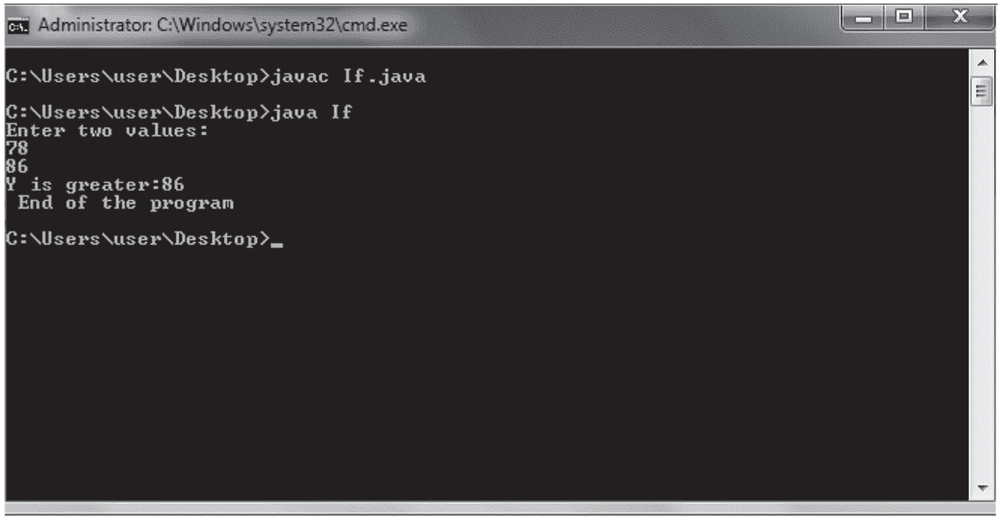

**IF-ELSE 语句**

在讨论了`IF`语句的使用后，我们了解到当条件为假时，`IF`语句不会执行任何操作。它只是将控制权交给`IF`块之外的下一个语句。`IF-ELSE`语句处理了这一问题。`IF-ELSE`语句的一般语法如下：

```java
if (condition){

  Statements X; //如果条件为真，执行语句 X

}else{

  Statements Y; //如果条件为假，执行语句 Y

}
```

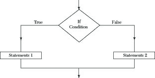

图 2.5. IF-ELSE 语句流程图。

`IF-ELSE`语句会检查条件。如果条件为真，则执行语句集`X`，并且不执行`ELSE`块。否则，如果条件为假，则执行语句集`Y`，并且不执行`IF`块。`IF`或`ELSE`块可以包含一个或多个语句。

例如：

```java
//Write a program to show the use of IF-ELSE.

import java.util.*;

public class IfElse{

    public static void main(String[] args) {

      Scanner src = new Scanner(System.in);
```


`System.out.println("Enter two values:");`

`int x = src.nextInt();`

`int y = src.nextInt();`

`if(y>x) {`

  `System.out.println("Y is greater:" +y);`

`}`

`else {`

  `System.out.println("X is greater:" +x);`

`}`

`System.out.println("End of the program");`

程序的输出所示：

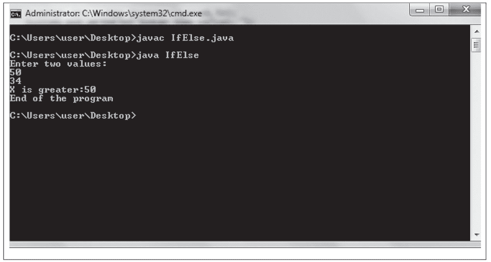

### 嵌套 IF-ELSE 语句

嵌套的 `IF-ELSE` 语句也称为 `IF-ELSE-IF 梯形`。`IF-ELSE-IF` 语句的工作方式与普通 `IF` 语句相同。嵌套 `IF-ELSE` 语句的一般语法如下：

```java
Statements 1; //如果条件 1 为真，执行 If 的语句.
} else if (condition 2){
Statements 2; //如果条件 2 为真，执行 else if 的语句;
} else {
Statements 3; //如果条件 2 为假，执行 else 的语句。
}
```

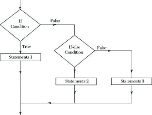

图 2.6。嵌套 IF-ELSE 语句流程图。

`IF-ELSE-IF` 梯形的工作方式如下：首先，检查 `IF` 条件。如果条件为真，则执行语句集 `1`。如果条件为假，则检查 `ELSE-IF` 条件。如果 `ELSE-IF` 条件为真，则执行语句集 `2`。否则，执行语句集 `3`。记住，在第一个 `IF` 表达式之后，我们可以根据需要测试的表达式数量设置任意的 `ELSE-IF` 分支。

**例如：**

```java
// Write a program to show the use of Nested IF-ELSE.
import java.util.*;

public class IfElse{
    public static void main(String[] args) {
        Scanner src = new Scanner(System.in);
        System.out.println("Enter three values:");
        int x = src.nextInt();
        int y = src.nextInt();
        int z = src.nextInt();

        if(x > y && x > z) {
            System.out.println("X is greatest:" +x);
        }
        else if(y > x && y > z) {
            System.out.println("Y is greatest:" +y);
        }
        else {
            System.out.println("Z is greatest:" +z);
        }
        System.out.println("End of the program");
    }
}
```

程序的输出所示：

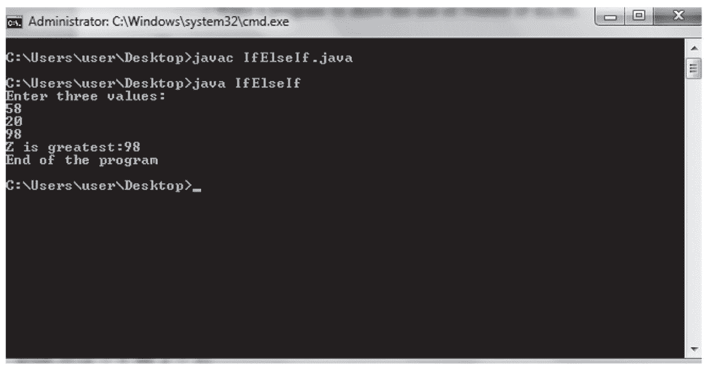

### SWITCH 语句

众所周知，`IF` 语句用于检查给定条件并根据条件的真假选择一个选项。但如果我们有多个选项可供选择，那么对每个选项都使用 `if` 语句将不是一个好主意，因为会变得非常复杂。因此，为了避免这种问题，使用了 `switch` 语句。`switch` 语句是一种多向的控制语句。它是 `IF-ELSE-IF` 语句的简化版本。它从我们提供的多个选项中选择一个。因此，它也被称为选择语句。它的执行速度比 `IF-ELSE-IF` 结构快。此外，`switch` 语句相对容易理解和调试。`switch` 语句的一般语法如下：

```java
switch (choice){
    case constant 1: Statements 1 ;break ;
    case constant 2: Statements 2 ;break ;
    case constant 3: Statements 3 ;break ;
    ...
    case constant n: Statements n ;break ;
    default: Statements D ;
}
```

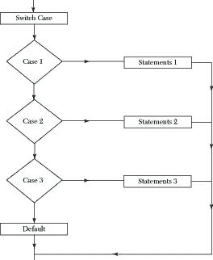

图 2.7。Switch 语句流程图。

**switch 语句的工作原理如下：**

*   最初，将表达式的值与 `switch` 结构中的 `case` 常量进行比较。
*   如果表达式的值与 `switch` 语句匹配，则执行相应的块，直到遇到 `break`。一旦遇到 `break`，控制就会退出 `switch` 语句。
*   如果 `switch` 语句中没有匹配项，则执行 `default` 的语句集。
*   所有 `case` 常量的值必须是唯一的。
*   整个 `switch` 语句中只能有一个 `default` 语句。`default` 语句是可选的；如果不存在且与任何 `case` 常量都不匹配，则不会操作发生。控制直接跳出 `switch` 语句。

**例如：**

```java
//Write a program to demonstrate the switch case.
import java.util.*;

public class Switch{
    public static void main(String[] args) {
        Scanner src = new Scanner(System.in);
        System.out.println("Enter your choice:");
        int choice = src.nextInt();

        switch(choice) {
            case 1:
                System.out.println("Inside First Case");
                break;
            case 2:
                System.out.println("Inside Second Case");
                break;
            case 3:
                System.out.println("Inside Third Case");
                break;
            default:
                System.out.println("Wrong Choice");
        }
        System.out.println("End of the program");
    }
}
```

### WHILE 循环

`while` 循环是一种入口控制循环，因为条件在循环开始时检查。如果条件为真，则执行循环体。如果条件为假，则控制权跳出循环，不执行循环体。因此，`while` 循环可能执行零次或多次。`while` 循环的通用语法如下：

```java
while (condition){
    block of statements/ body of loop ;
    increment/ decrement ;
}
```

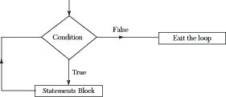

图 2.8。while 循环流程图。

`while` 循环的执行如下：

1. 测试条件。
2. 如果条件为真，则执行语句并重复步骤 1。
3. 如果条件为假，则终止循环，控制权跳出循环以执行程序的剩余部分。

例如：

```java
// 写一个执行 while 循环的程序。
public class While{
    public static void main(String[] args) {
        int i = 1;
        while(i < 10) {
            System.out.println(i);
            i = i + 1;
        }
    }
}
```

程序的输出所示：

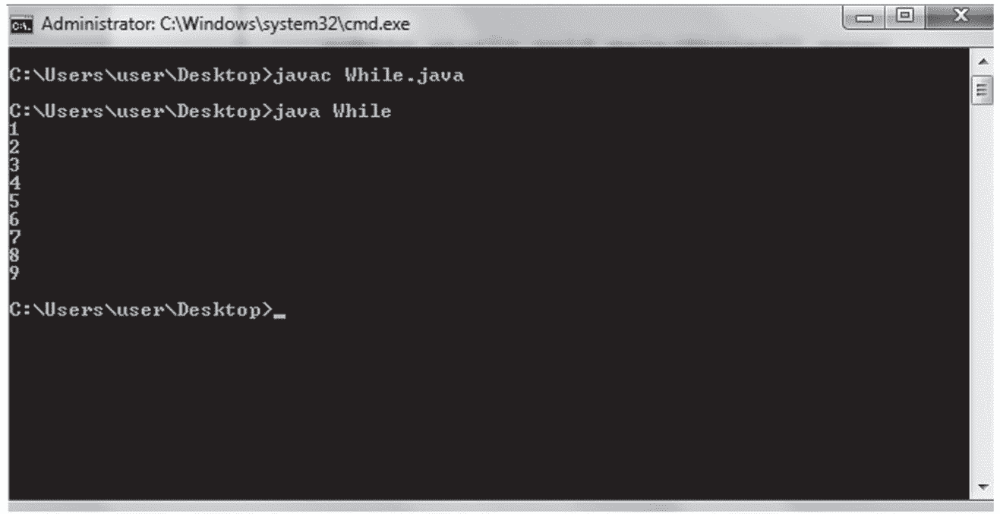

在上例中，`i` 被初始化为 1，且 1 小于 10，因此条件为真。因此，打印 `i` 的值并将其加 1。当 `i` 变为 10 时，条件将变为假，因此在该条件下，循环将结束。

### DO-WHILE 循环

`do-while` 循环与 `while` 循环相似。唯一的区别在于，与 `while` 循环在循环开始时检查条件不同，`do-while` 循环在循环结束时检查条件。因此，它也被称为退出控制循环。这意味着在 `do-while` 循环中，语句至少执行一次，即使条件为假也是，因为条件是在循环结束时检查的。`do-while` 循环的通用语法如下：

```java
do{
    block of statements/ body of loop ;
    increment/ decrement ;
} while (condition);
```

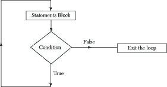

图 2.9。do-while 循环流程图。

`do-while` 循环持续执行，直到条件求值为假为止。`do-while` 循环通常用于我们需要程序至少执行一次的情况，例如在菜单驱动的程序中。使用 `do-while` 循环的一个主要缺点是，即使条件为假，`do-while` 循环也会至少执行一次。因此，如果用户输入了某些无关数据，它仍然会执行。

例如：

```java
// 写一个程序说明 do-while 循环。
public class dowhile{
    public static void main(String[] args) {
        int i = 0;
        do {
            System.out.println(i);
            i = i + 1;
        } while(i < 10);
    }
}
```

程序的输出所示：

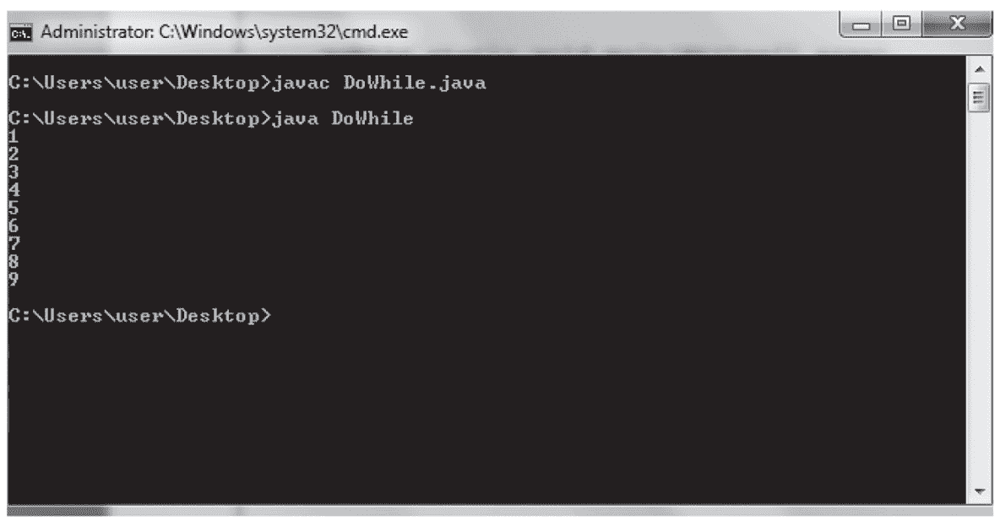

在之前的代码中，`i` 被初始化为 0，因此打印 `i` 的值并将其加 1。执行一次循环后，现在将检查条件。现在 `i = 1` 且条件为真。因此，循环将执行。当 `i` 等于 10 时，条件将变为假。在这种情况下，循环将终止。

### FOR 循环

`for` 循环是一种预确定次数的循环；也就是说，它是由计数控制的循环，程序员提前知道 `for` 循环将执行多少次。在 `for` 循环中，循环变量始终只初始化一次。`for` 循环的通用语法如下：

```java
for (initialization; condition; increment/decrement){
    block of statements/ body of loop ;
}
```

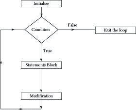

图 2.10。for 循环流程图。

在 `for` 循环中，条件始终在循环顶部检查。此外，在循环的每次迭代中，都会检查变量和条件。如果条件为真，则执行在 `for` 循环内部的语句；否则，控制权移出循环，`for` 循环终止。正如我们在语法中所看到的，初始化意味着最初为变量分配一个特定值。其次，条件指定了循环是继续执行还是终止。条件在循环的每次迭代中都会被检查。迭代意味着通过增加或减少变量的值来更新该值。此外，`for` 循环中的每个部分都用分号隔开。因此，其中一个部分可能是空的。`for` 循环广泛用于执行有限次数的特定语句集。

例如：

```java
// 写一个程序演示 for 循环。
public class For{
    public static void main(String[] args) {
        for(int i = 1 ; i <= 10 ; i++) {
            System.out.println(i);
        }
    }
}
```

程序的输出所示：

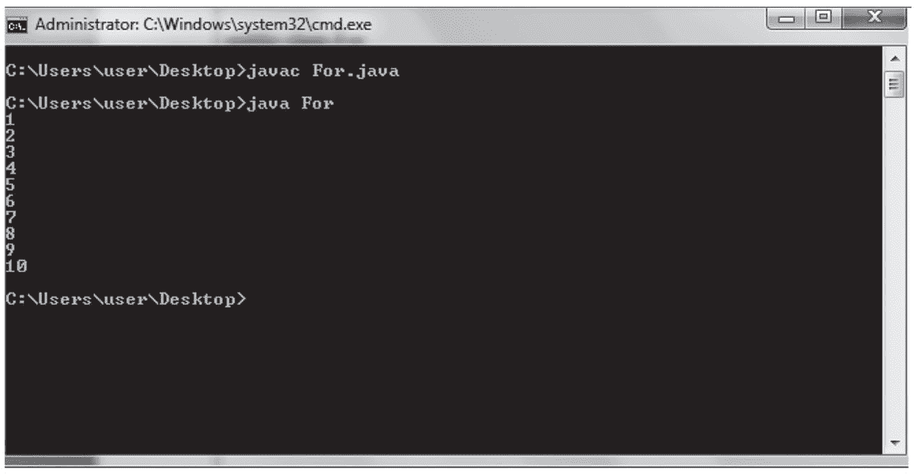

在上例中，`i` 是一个初始化为 1 的计数变量。现在检查条件，因为 1 小于 10。因此，条件为真，所以打印 `i` 的值。在每次迭代后，`i` 的值加 1，并检查条件。当 `i` 变为 11 时，条件将变为假，因此此时 `for` 循环将终止，控制权将离开循环。

### 2.13 Break 和 Continue 语句

在 Java 中，`break` 语句用于循环和 `switch` 语句。它们用于终止循环的执行。`break` 语句会导致从语句所在的循环中途退出。我们已经在 `switch` 语句中见过它的用法，它被用于退出 `switch` 语句。当遇到 `break` 时，控制权会跳出循环。`break` 语句通常用于发生某些错误或我们不想执行循环剩余部分的情况。它的语法非常简单：

语法 – `break;`

```java
// 写一个程序说明 break 语句的使用。
public class Break{
    public static void main(String[] args) {
        int num = 0;
        while(num < 5) {
            if(num == 2) {
                System.out.println("Hello!!");
                break;
            }
            System.out.println("Number = " +num);
            num = num + 1;
        }
    }
}
```

程序的输出所示：

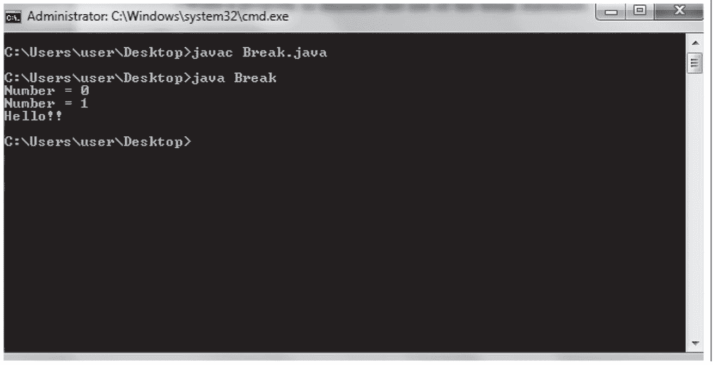

在之前的代码中，当 `num` 的值等于 2 时，执行 `break` 语句，控制权跳出 `while` 循环来到后面的语句。因此，`break` 语句用于从任意一点退出循环。

正如我们看到 `break` 语句用于退出特定的循环，而 `continue` 语句用于执行循环的下次迭代。`continue` 语句也用于循环。与 `break` 语句不同，遇到 `continue` 语句时循环不会终止。`continue` 语句跳过剩余语句，并将控制权转移到循环的延续部分。因此，循环的执行将从下一次迭代恢复。`continue` 语句的语法如下：

语法 – `continue;`

例如：

```java
// 写一个程序说明 continue 语句的使用。
public class Continue{
    public static void main(String[] args) {
        int n;
        for(n = 0 ; n <= 8 ; n++) {
            if(n == 4)
                continue;
            System.out.println(n);
        }
    }
}
```

程序的输出所示：

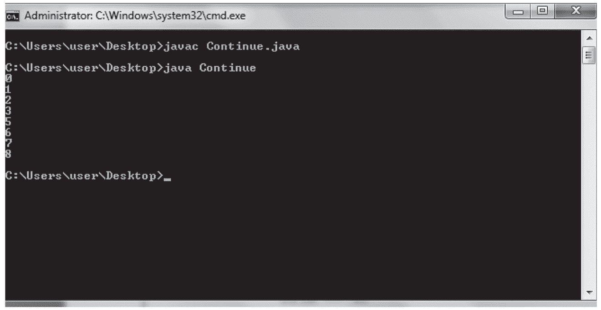

在之前的代码中，一旦 `n` 的值等于 4，就会执行 `continue` 语句，并跳过 `System.out.println(n)` 语句。控制权转移到表达式，该表达式增加了 `n` 的值。因此，控制语句是 `break` 语句的反面。

### 2.14 方法（Methods）

作为 Java 程序员，我们经常会遇到程序变得过大且复杂性也随之增加。因此，此时对于程序员来说，阅读整个代码并检查其中的任何错误是非常困难的。为了解决这个问题，Java 语言允许我们将整个程序拆分为较少的模块或段。这些模块或段被称为“方法（methods）”。因此，方法是一个用于执行特定任务的预定义代码块。方法用于提高程序的效率。方法可以减少冗余并帮助代码易于理解。每个方法都设计用于执行一个特定的任务。方法分为两类：

1. **库方法（Library Methods）：** 库方法是那些预定义的方法。
2. **用户定义方法（User-Defined Methods）：** 与预定义的库方法不同，这些方法由程序员或用户定义。我们可以轻松地创建这类方法。用户定义方法的通用形式如下：

```java
[return type] <Method name> (parameters/ arguments){
    Statements;
    return;
}
```

其中：

(a) **返回类型（Return Type）：** 返回类型用于标识方法将返回什么种类的值。返回类型即数据类型。如果一个方法不返回任何值，则返回类型为 `void`。

(b) **方法名（Method Name）：** 它标识方法的名称。方法名不应是 Java 库中的保留字。

(c) **参数（Parameters/Arguments）：** 这些是带有其数据类型传递给方法执行各种操作的变量或值。

(d) **语句（Statements）：** 语句是方法执行的特定步骤。

### 2.15 总结

* Java 语言由 James Gosling、Patrick Naughton、Chris Warth、Ed Frank 和 Mike Sheridan 于 1991 年在 Sun Microsystems, Inc. 公司创建并开发。

* Java 语言支持 C 语言的所有特性、灵活性属性。它还引入了各种支持面向对象编程的新功能。Java 最初以“带类的 C（C with Classes）”这一新名称为人。因此，Java 是 C 的面向对象版本。

* `object`（对象）是一个容器，数据以变量、方法和数据结构的组合形式存储其中。

* `class`（类）基本上是一种用户定义的数据类型，它持有自己的数据成员和成员方法。它是将数据成员及其方法结合在一起的一种。可以通过创建该类的对象来访问该类。

* `Encapsulation`（封装）是将数据成员和成员方法封装成单个单元的过程。它是保护代码和数据免受外部干扰安全的机制。

* `Inheritance`（继承）是从现有类派生新类的过程。现有类被称为“基类”、“父类”或“超类”。新类被称为“派生类”、“子类”或“子类”。

* `polymorphism`（多态）一词源于单词 `poly`（意思是“多”）和单词 `morph`（意思是“形式”）。多态意味着产生多种形式的能力。


多态有两种类型：编译时多态和运行时多态。

`Abstraction`（抽象）指的是只显示基本特征，并隐藏演示不需要的背景细节和解释的行为。这也被称为数据抽象。

Java 中的关键字（Keywords）是具有特殊含义的保留字。它们采用小写字母。关键字不能用作标识符。标识符是赋予常量、变量、方法或数组的名字。

Java 中的数据类型是定义变量所持的数据类型和数据量的特殊关键字。

Java 中使用的四种基本数据类型是`int`、`char`、`float`和`boolean`。

Java 中的运算符（Operators）用于在不同的变量和常量之间执行某些操作。

算术运算符（Arithmetic operators）是用于数学计算的运算符。

赋值运算符（Assignment operators）用于给变量赋值。这些运算符总是从右向左求值。

关系运算符（Relational operators）用于两个值或表达式之间的比较。它们也被称为比较运算符。

条件运算符（Conditional operator）也称为三元运算符，因为它接受三个操作数。

位运算符（Bitwise operators）是用于在位位上执行操作的特殊运算符。

一元运算符（Unary operator）是只需要单个操作数即可工作的运算符。Java 支持两种一元运算符：增运算符（`++`）和减运算符（`--`）。这些运算符分别用于增加或减少变量的值。

控制语句（Control statements）是允许程序员执行特定代码块的语句，并指定程序中各种指令需要执行的顺序。它们决定了控制流。

`IF`语句是一种双向控制语句，用于测试条件并采取可能的行动之一。

嵌套的`IF-ELSE`语句也称为`IF-ELSE-IF`阶。

`switch`语句是一种多向条件控制语句。它是`IF-ELSE-IF`语句的简化版本。

循环语句（Looping statements）也称为迭代语句，是一组重复执行的指令，直到某个条件或表达式变为假。

`while`循环是一种循环，用于重复一组一个或多个指令/语句，直到特定条件变为假。

`do-while`循环与`while`循环类似。唯一的区别是，与`while`循环在开始时检查条件不同，`do-while`循环在结束时检查条件。

`for`循环是一种预定的循环；也就是说，它是一种计数循环，程序预先知道要执行多少次。

`break`语句会导致从其所在的循环中途退出。`continue`语句跳过剩余的语句，并将控制转移到循环开头。

## 2.16 练习

### 2.16.1 理论题

1. 解释 Java 语言的各种特性。

2. 什么是继承？详细说明其类型。

3. 定义数据抽象。解释数据隐藏和数据抽象的区别。

4. Java 中的类是什么？

5. 定义多态。多态有哪些类型？

6. Java 中使用了哪些不同的运算符？详细讨论它们。

7. Java 中的数据类型是什么？详细解释。

8. 解释面向对象编程（OOP）的优势。

9. 面向对象编程语言具有哪些特性？

10. 你对 Java 标记（tokens）了解什么？详细讨论。

11. 定义标识符。标识符有哪些规则？给出示例。

12. 你对条件运算符了解什么？通过示例解释。

13. Java 中的决策控制语句有哪些？

14. 区分`while`循环和`do-while`循环。

15. 简单`IF`和`IF-ELSE`语句有什么区别？通过示例解释。

17. 创建一个类，其中两个成员声明为私有（private），三个成员声明为公有（public）。

18. 解释`switch`语句。使用`switch`语句有哪些优点？

19. 你对 Java 中的迭代语句是如何理解的？简要讨论所有类型。

20. 请给出合适的示例说明`break`语句和`continue`语句之间的区别。

21. 解释对象如何帮助我们访问类的私有数据成员。

22. 区分前置自增和后置自增运算符。

### 2.16.2 编程题

1. 编写一个 Java 程序在屏幕上打印“Hello World”。

2. 编写一个程序，读取五个整数并显示它们。

3. 编写一个 Java 程序计算两个浮点数之和。

4. 编写一个程序检查给定的数字是偶数还是奇数。

5. 编写一个程序找到三个给定数字中的最大值。

6. 编写一个菜单驱动程序，执行两个数的加、减、乘、除运算。

7. 编写一个在程序同时执行`IF`和`ELSE`语句的程序。

8. 编写一个程序使用`for`循环计算一个数的阶乘。

9. 编写一个程序接受用户输入的字符串，并检查该字符串是否为回文。

10. 编写一个 Java 程序，使用`continue`语句打印 1 到 10 排除 5 的数字。

11. 编写一个 Java 程序打印到 200 的斐波那契数列。

1. 能够用于将数据成员和成员方法绑定在一起。

   (a) 对象

   (b) 类

   (c) 数组

   (d) 以上都不是

2. 条件运算符也称为三元运算符，因为它有 _______ 个操作数。

   (a) 1

   (b) 3

   (c) 2

   (d) 4

3. 不同对象相互通信的过程被称为 ______。

   (a) 消息传递

   (b) 动态绑定

   (c) 通信

   (d) 多态

4. 从现有类派生新类的过程被称为 _____。

   (a) 多态

   (b) 抽象

   (c) 继承

   (d) 封装

5. 下列哪个是 Java 中有效的标识符？

   (a) a_43

   (b) cd bd

   (c) apple

   (d) (a) 和 (c)

6. 哪种运算符用于值之间的比较？

   (a) 赋值运算符

   (b) 算术运算符

   (c) 位运算符

   (d) 关系运算符

7. 在下列哪个循环中，语句块将在不检查条件的情况下至少执行一次？

   (a) For 循环

   (b) While 循环

   (c) Do-while 循环

   (d) 以上所有

8. 将数据成员和成员方法封装成单元被称为 ______。

   (a) 多态

   (b) 抽象

   (c) 继承

   (d) 封装

# 第 3 章

# 数组

## 3.1 引言

在上一章中，我们学习了数据结构和 Java 中的编程基础，其中我们的目标是设计良好的程序。在这里，良好的程序是指通过占用较少内存空间运行正确且高效，并且运行和执行时间更短的程序。无疑，当一个程序以较少的内存空间和最短的时间执行时，它被说成是高效的。在这一章中，我们将学习数组的概念。数组是一种用户定义的数据类型，将相关信息存储在一起。接下来的章节将详细讨论数组。

数组是连续内存中同构（相同）类型数据元素的集合。数组是一种线性数据结构，因为数组的所有元素按线性顺序存储。让我们来看一个例子，假设级上有十个学生，我们要求存储这十个学生的成绩；那么我们需要名为数组的数据结构。

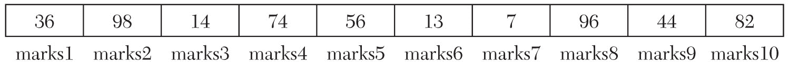

图 3.1. 十个元素数组的表示。

在前面的示例中，数据元素存储在连续的内存位置，并通过索引号（也称为下标）标识，即`A^i`或`A[i]`。下标是一个用于标识数组元素的序数。数组的元素具有相同的数据类型，数组中的每个元素都可以使用相同的名称访问。

### 常见问题

**1. 什么是数组？我们如何标识数组中的元素？**

答：数组是连续内存中同构（相同）类型数据元素的集合。数组中的元素可以通过其索引号来标识，这也称为下标。

## 3.3 数组的声明

我们知道，所有变量在程序中使用之前都必须声明。因此，相同的概念也适用于数组变量。数组在使用之前必须先声明。在声明数组期间，必须指定数组的大小。

- **数据类型**：数据类型意味着它可以存储的值的种类。数据类型可以是`int`、`float`、`char`或任何其他。

- **数组名称**：名称是指用于标识数组的名称。

- **大小**：数组的大小是指数组可以包含的最大值数量。

**语法：** `data_type [] array_name = new data_type[size]`

示例：`int [] salary = new int[10]`上面的示例声明`salary`为具有十个元素的数组。在 Java 中，索引从零开始。数组的第一个元素将存储在`salary[0]`，第二个元素将存储在`salary[1]`，依此类推。同样，最后一个元素将存储在`salary[9]`。

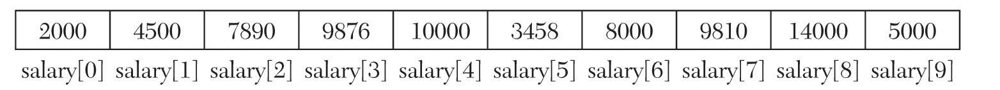

图 3.2. 数组的内存表示。这里方括号中的 0, 1, 2 ... 9 表示我们标识特定元素的下标。

数组的初始化可以通过以下方式进行：

1. **编译时初始化**：在编译时对数组元素进行初始化是在声明时初始化普通变量相同的方法。当初始化数组时，需要为数组中的每个元素提供一个特定值。

初始化数组的通用形式为：`data_type [] array_name = {值列表}`

在初始化数组时，我们可以省略数组的大小。例如：`int [] age = {20, 25, 23, 28, 30};`

在前面的示例中，编译器将为所有初始化的数组元素分配内存。如果提供的值少于大小，则此类元素将取零作为赋值值。例如：

```java
int [] marks;
marks = new int [] {56, 69, 40, 99, 82, 96, 72};
```

这里数组的大小为 10，但只有七个元素；因此，剩余元素将被视为零。

2. **运行时初始化**：在运行时对数组元素进行初始化是从键盘输入值的方法。在这种方法中，采用`while`、`do-while`或`for`循环来输入数组的值。`scanner`类用于从用户处输入。为了使用`scanner`类对象，首先从`java.util`库导入`scanner`类，然后创建其实例以使用内置函数。

```java
import java.util.Scanner; // Importing scanner class for input
public class ArrayDemo {
    public static void main(String[] args) {
        Scanner scn = new Scanner(System.in);
        int[] salary = new int[15];
            salary[i] = scn.nextInt(); // Inputting the values
        }
        //End of for
    }
    //End of main
}
//End of class
```

图 3.4。

输入值的代码。

在之前的述代码中，索引`i`从 0 开始，由于数组有 15 个元素，值将为从 0 到 14 的索引值进行输入。

## 3.5 计算数组元素的地址

一维数组中元素的地址可以非常容易地计算出来，因为数组在连续的内存位置存储其所有数据元素，并存储了基地址（数组第一个元素的地址）。因此，利用基地址可以轻松地计算出其他数据元素的地址。找到一维数组中元素地址的公式如下：

`数据元素地址，A[i] = 基地址 (BA) + w (i – 下界)*`

其中`A`是数组，`i`是要计算地址的元素的索引，`BA`是数组`A`的基地址，`w`是每个元素的大小（例如，`int`的大小为 2 字节，`char`的大小为 1 字节，等）。

### 常见问题

**2. 给定一个数组 int marks [6] = {34, 53, 87, 100, 98, 65}；如果基地址为 3000，计算 marks [3] 的地址。**

**答：已知数组的基地址为 3000，我们知道整数的大小为 2 字节。因此，我们可以很容易地找到`marks[3]`的地址。**

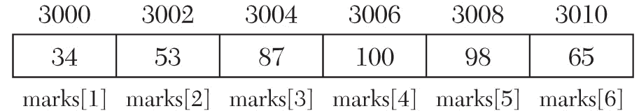

*marks[3] 的地址 = 3000 + 2 (3 – 1)*

= *3000 + 2 (2)*

*marks[3] 的地址 = 3004*

## 3.6 数组操作

本节讨论了可以在数组上执行的各种操作。这些操作包括：

*   遍历数组

*   在数组中插入元素

*   在数组中删除元素

*   在数组中查找元素

*   合并两个数组

*   对数组排序

### 1. 遍历数组

*遍历数组意味着准确地访问数组中的每个元素，以便对其进行处理*。示例包括统计所有数据元素、对这些元素执行任何处理等。由于数组的线性结构（所有元素都存储在连续的内存位置中），遍历数组元素是一个非常简单的过程。

#### 实际应用

如果有一排人一个一个地站着，一个男孩正向队中的每个人逐个发放广告传单。

```java
import java.util.Scanner; // Importing scanner class for input
public class ArrayDemo {
    public static void main(String[] args) {
        int[] num = new int[5];
        System.out.println("Enter the elements of array: ");
        for (int i = 0; i < num.length; i++) {
            num[i] = scn.nextInt(); // Inputting the values
        } // End of loop1
        System.out.println("The elements of array are: ");
        for (int i = 0; i < num.length; i++) {
            System.out.print(num[i] + "\t");
        } // End of loop2
    } // End of main
} // End of class
```

程序的输出所示：

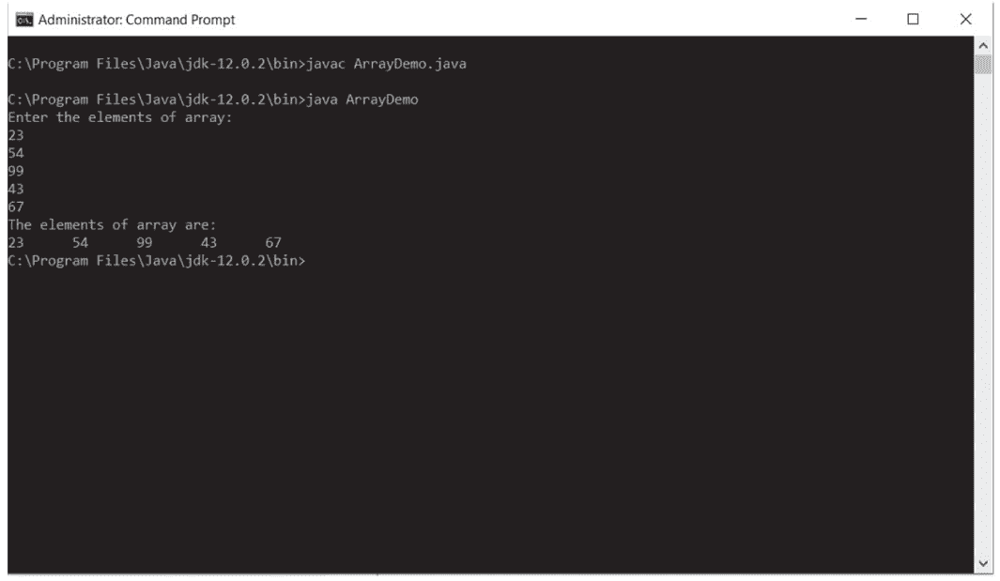

在之前的代码中展示了数组的遍历。在第一个 for 循环中输入了元素。在第二个 for 循环中进行了数组的遍历。

### 2. 在数组中插入元素

*在数组中插入元素是指向数组添加一个元素的操作。*在这种情况下，我们假设数组有足够的空间。例如，如果一个数组可以容纳 15 个元素，而它只包含了 15 个元素，那么我们就有空间容纳。数组的插入可以通过三种方式完成：

(a) 在开头插入

(b) 在指定位置插入

(c) 在末尾插入

#### (a) 在开头插入

在这种情况下，要插入的新元素被插入在开头。例如，如果一个数组被声明为容纳 10 个元素，而它只包含了 7 个元素，并且给定新元素要插入在开头，如下：

移动元素并将新元素插入到第一个位置，新数组将是：

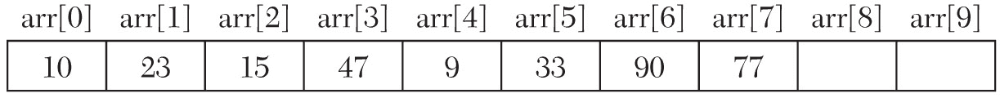

**开头插入的算法**

我们假设`ARR`是一个具有`N`个元素的数组。数组中可以存储的最大元素由`SIZE`定义。我们应该首先检查数组是否有空位来存储元素，然后进行插入操作。

START

IF `N = SIZE`

    Print OVERFLOW

ELSE

    `N = N + 1`

    `I = N`

    WHILE `I >= 0`

        `ARR[I+1] = ARR[I]`

`ARR[0] = New_Element`

END

#### (b) 在指定位置插入

在这种情况下，要插入的新元素插入在用户指定的的位置。例如，如果一个数组被声明为容纳 10 个元素，而它只包含了 8 个元素，并且给定新元素要插入在数组的第五位置，如下：

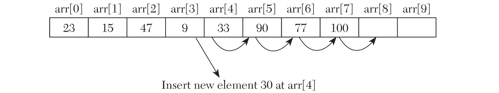

移动中间的元素并将新元素插入到中间，新数组将是：

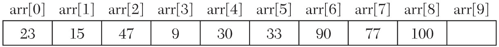

**指定位置插入的算法**

我们假设`ARR`是一个具有`N`个元素的数组。数组中存储的最大元素由`SIZE`定义。让`POS`定义要插入新元素的位置。我们应该首先检查数组是否有可用空间来存储元素，然后进行该过程。

START

IF `N = SIZE`

    Print OVERFLOW

ELSE

    `N = N + 1`

    `I = N`

    WHILE `I >= POS`

        `ARR[I+1] = ARR[I]`

`ARR[POS] = New_Element`

END

#### (c) 在末尾插入

在这种情况下，要插入的新元素被插入在数组的末尾。因此，在这种情况下不需要交换元素。我们只需要检查数组是否有足够的空间。例如，如果一个数组被声明为容纳 10 个元素，而它只包含了 9 个元素，那么插入就可以发生。


现在最后一个元素将被插入到最后一个位置，即`arr [9]`，该位置是空的。因此，插入后的新数组将是：


## 实际应用

这就像普通的排队，一个人来到并加入队伍末尾；因此，在这个过程中不需要任何元素移动。

## 在末尾插入的算法

假设`ARR`是一个包含`N`个元素的数组。数组可以存储的最大元素数量由`SIZE`定义。我们应该首先检查数组是否有可用空间来存储新元素，然后进行插入过程。

- **步骤 1:** `START`

- **步骤 2:** `IF N = SIZE`，打印`OVERFLOW`；`ELSE` `N = N + 1`

- **步骤 3:** `SET ARR[N] = New_Element`

- **步骤 4:** `EXIT`


# 数组操作

## 1. 数组插入

编写一个菜单驱动的程序来实现 1-D 数组的插入，并讨论所有三种情况。

```java
// 编写一个菜单驱动的程序来实现 1-D 数组的插入，并讨论所有三种情况。

import java.util.Scanner;
public class ArrayInsertionDemo {
    public static void main(String[] args) {
        Scanner scn = new Scanner(System.in);
        int[] arr = new int[10];
        System.out.println("Enter the number of elements in array:");
        int n = scn.nextInt();
        System.out.println("Enter the elements of array:");
        for (int i = 0; i < n; i++) {
            arr[i] = scn.nextInt();
        }
        System.out.println("***MENU***");
        System.out.println("1\. Insertion from beginning");
        System.out.println("2\. Insertion from specified location");
        System.out.println("3\. Insertion from end");
        System.out.println("Enter your choice:");
        int choice = scn.nextInt();
        int value = 0;
        if (n == 10) {
            System.out.println("Overflow error");
        } else {
            switch (choice) {
                case 1:
                    for (int i = n - 1; i >= 0; i--) {
                        arr[i + 1] = arr[i];
                    }
                    System.out.println("Enter new value:");
                    value = scn.nextInt();
                    arr[0] = value;
                    System.out.println("After insertion array is");
                    for (int i = 0; i <= n; i++) {
                        System.out.print(arr[i] + "\t");
                    }
                    break;
                case 2:
                    System.out.println("Enter position");
                    int pos = scn.nextInt();
                    for (int i = n - 1; i >= pos - 1; i--) {
                        arr[i + 1] = arr[i];
                    }
                    System.out.println("Enter new value:");
                    value = scn.nextInt();
                    arr[pos - 1] = value;
                    System.out.println("After insertion array is");
                    for (int i = 0; i <= n; i++) {
                        System.out.print(arr[i] + "\t");
                    }
                    break;
                case 3:
                    System.out.println("Enter new value:");
                    value = scn.nextInt();
                    arr[n] = value;
                    System.out.println("After insertion array is");
                    for (int i = 0; i <= n; i++) {
                        System.out.print(arr[i] + "\t");
                    }
                    break;
                default:
                    System.out.println("Wrong Choice");
                    break;
            }
        }
    }
}
```

## 2. 数组删除

编写一个菜单驱动的程序来实现 1-D 数组的删除，并讨论所有三种情况。

```java
import java.util.Scanner;
public class ArrayDeletionDemo {
    public static void main(String[] args) {
        Scanner scn = new Scanner(System.in);
        int[] arr = new int[10];
        System.out.println("输入数组中的元素个数:");
        int n = scn.nextInt();
        System.out.println("输入数组的元素:");
        for (int i = 0; i < n; i++) {
            arr[i] = scn.nextInt();
        }
        System.out.println("***菜单***");
        System.out.println("1\. 从开头删除");
        System.out.println("2\. 从指定位置删除");
        System.out.println("3\. 从尾删除");
        System.out.println("输入您的选择:");
        int choice = scn.nextInt();
        if (n == 10) {
            System.out.println("溢出错误");
        } else {
            switch (choice) {
                case 1:
                    for (int i = 0; i < n - 1; i++) {
                        arr[i] = arr[i + 1];
                    }
                    System.out.println(" 删除后的数组为");
                    for (int i = 0; i < n - 1; i++) {
                        System.out.print(arr[i] + "\t");
                    }
                    break;
                case 2:
                    System.out.println(" 输入位置");
                    int pos = scn.nextInt();
                    for (int i = pos - 1; i < n - 1; i++) {
                        arr[i] = arr[i + 1];
                    }
                    System.out.println(" 删除后的数组为");
                    for (int i = 0; i < n - 1; i++) {
                        System.out.print(arr[i] + "\t");
                    }
                    break;
                case 3:
                    n = n - 1;
                    System.out.println(" 删除后的数组为");
                    for (int i = 0; i < n; i++) {
                        System.out.print(arr[i] + "\t");
                    }
                    break;
                default:
                    System.out.println("错误的选择");
                    break;
            }
        }
    }
}
```

程序的输出所示：


## 3. 在数组中查找元素

在数组中查找元素意味着查找某个特定值是否存在于数组中。如果找到了该特定值，则认为搜索成功，并返回该特定值的位置/位点。如果没有找到该值，则认为搜索失败。搜索有两种方法：线性搜索和二分查找。在本章中，我们只详细讨论线性搜索，二分查找技术将在后续章节中讨论。现在，我们将学习线性搜索是如何工作的。

### 线性搜索

线性搜索是一种非常简单的技术，用于在数组中搜索特定值。它也被称为顺序搜索，因为它通过将要搜索的值与数组中的每个元素按顺序进行比较，直到找到匹配项为止。

例如，让我们取一个声明为十元素的数组：

```java
int [] array = new int [10];
array = {23, 15, 47, 9, 30, 33, 90, 77, 100, 11}
```

并在数组中搜索`90`；那么，数组的每个元素将与`90`比较，直到找到`90`为止。


通过这种方式，线性搜索用于搜索数组中的特定值。以下是线性搜索的程序。

```java
// 写一个程序使用线性搜索技术在数组中查找元素。

import java.util.Scanner;
public class LinearSearchDemo {
    public static void main(String[] args) {
        Scanner scn = new Scanner(System.in);
        int[] arr;
        System.out.println("***线性搜索***");
        System.out.println("输入数组中的元素个数:");
        int n = scn.nextInt();
        arr = new int[n];
        System.out.println("输入数组的元素:");
        for (int i = 0; i < n; i++) {
            arr[i] = scn.nextInt();
        }
        System.out.println("输入要搜索的值:");
        int value = scn.nextInt();
        int r = linear_search(arr, n, value);
        if (r == -1) {
            System.out.println(" 未找到值");
        } else {
            System.out.println(value + " 找到第 " + (r + 1) + " 位置");
        }
    }
    public static int linear_search(int[] arr, int n, int value) {
        int i;
        for (i = 0; i < n; i++) {
            if (arr[i] == value) {
                return i;
            }
        }
        return (-1);
    }
}
```

程序的输出所示：


## 4. 两个数组的合并

合并数组意味着将第一个和第二个数组的元素复制到第三个数组中。合并的解释如下：让我们考虑两个有序数组，**数组** **数组** **数组** 数组 3 显示如何使用有序数组 1 和 2 来形成。

### 实际应用

现实中的合并示例是，如果两个不同的队伍需要根据身高进行合并到一个新队伍中，新队伍将由两个队伍的高度进行排列的。

```java
// 写一个程序合并两个数组。

import java.util.Scanner;
public class MergeArraysDemo {
    public static void main(String[] args) {
        Scanner scn = new Scanner(System.in);
        int i = 0, j = 0, k = 0;
        int[] arr1, arr2, arr3;
        System.out.println("输入数组 1 的元素个数:");
        int m1 = scn.nextInt();
        arr1 = new int[m1];
        System.out.println("输入数组 1 的元素:");
        for (int s = 0; s < m1; s++) {
            arr1[s] = scn.nextInt();
        }
        System.out.println("输入数组 2 的元素个数:");
        int m2 = scn.nextInt();
        arr2 = new int[m2];
        System.out.println("输入数组 2 的元素:");
        for (int s = 0; s < m2; s++) {
            arr2[s] = scn.nextInt();
        }
        arr3 = new int[m1 + m2];
        while (i < m1 && j < m2) {
            if (arr1[i] < arr2[j]) {
                arr3[k] = arr1[i];
                k++;
                i++;
            } else if (arr2[j] < arr1[i]) {
                arr3[k] = arr2[j];
                j++;
                k++;
            } else {
                arr3[k] = arr1[i];
                k++;
                i++;
                arr3[k] = arr2[j];
                k++;
                j++;
            }
        }
        // 循环结束
        while (i < m1) {
            arr3[k] = arr1[i];
            k++;
            i++;
        }
        while (j < m2) {
            arr3[k] = arr2[j];
            k++;
            j++;
        }
        System.out.println("合并后的新数组为:");
        for (int s = 0; s < (m1 + m2); s++) {
            System.out.print(arr3[s] + " ");
        }
    }
}
```

程序的输出所示：


# 6. 数组排序

**例如：**假设我们有一个声明为十个元素的数组：

```java
int [] array = {78, 12, 47, 55, 61, 6, 99, 84, 32, 10}
```

那么在排序之后，新数组将是：

```java
array = {6, 10, 12, 32, 47, 55, 61, 78, 84, 99}
```

有多种排序技术，包括`选择排序`、`插入排序`和`合并排序`；我们将在本章中学习选择排序，其他技术将在后续章节中讨论。

## 选择排序

选择排序是一种排序技术，它通过找到数组中的最小值并将其放在第一个位置来工作。之后，它会找到第二个最小值并将其放在第二个位置。这个过程重复进行直到整个数组排序完成。这是一个非常简单的技术，而且比任何其他排序技术都更容易实现。选择排序通常用于排序大型记录。

## 选择排序技术

考虑一个包含`N`个元素的数组。

**第 1 遍：**在包含`N`个元素的数组中找到最小值的位置`POS`，并交换`ARR[POS]`与`ARR[0]`。因此，`A[0]`完成排序。

**第 2 遍：**在包含`N-1`个元素的数组中找到最小值的位置`POS`，并交换`ARR[POS]`与`A[1]`。因此，`A[1]`完成排序。

⋮

**第 N-1 遍：**找到元素`ARR[N-2]`和`ARR[N-1]`之间较小元素的位置`POS`，并交换`ARR[POS]`与`ARR[N-2]`。因此，`ARR[0]`、`ARR[1]`到`ARR[N-1]`完成排序。


这就是选择排序技术的工作原理。以下是给出的选择排序程序。

```java
//写一个程序使用选择排序技术排序数组。

import java.util.Scanner;
public class SelectionSortDemo {
    public static void main(String[] args) {
        Scanner scn = new Scanner(System.in);
        int[] arr;
        int min = 0;
        int pos = 0;
        int temp = 0;
        System.out.println("Enter number of elements in array:");
        int n = scn.nextInt();
        arr = new int[n];
        System.out.println("Enter elements of array:");
        for (int i = 0; i < n; i++) {
            arr[i] = scn.nextInt();
        }
        System.out.println("***Selection Sort***");
        for (int i = 1; i < n; i++) {
            min = arr[i - 1];
            pos = i - 1;
            for (int j = i; j < n; j++) {
                if (arr[j] < min) {
                    min = arr[j];
                    pos = j;
            }
            if (pos != i - 1) {
                temp = arr[pos];
                arr[pos] = arr[i - 1];
                arr[i - 1] = temp;
            }
        }
        System.out.println("After sorting array is:");
        for (int i = 0; i < n; i++) {
            System.out.print(arr[i] + " ");
        }
    }
}
```

程序的输出所示：


## 3.7 二维数组

我们已经讨论一维数组（1-D arrays）以及它们各种各种类型和操作。现在我们将学习二维数组。与一维数组不同，二维数组是以网格或表格的形式组织的。它们是一维数组的集合。一维数组在内存中是线性排列的。二维数组由两个下标组成：

1. 第一个下标：表示行
2. 第二个下标：表示列

二维数组的表示如图所示：


## 3.8 二维数组的声明

正如我们声明一维数组一样，我们也可以声明二维数组。为了声明二维数组，我们必须知道数组的名称、每个元素的数据类型以及每个维度的大小（行和列的大小）。

**语法：**

`data_type[][] array_name = new int[row_size][column_size];`

二维数组也称为`m X n`数组，因为它包含`m X n`个元素，通过下标`i`和`j`访问，其中`i < m`且`j < n`。

**例如：**考虑一个 3x3 的数组：

```java
int marks[3][3];
```


在上面的图中，`marks[0][0]`是第一个元素，`marks[0][1]`是第二个元素，`marks[0][2]`是第三个元素，`marks[1][0]`是第四个元素，`marks[1][1]`是第五个元素，`marks[1][2]`是六个元素，`marks[2][0]`是第七个元素，`marks[2][1]`是第八个元素，`marks[2][2]`是第九个元素。

如果我们在二维数组中初始化元素：

```java
int marks[3][3] = {{10, 20, 30}, {40, 50, 60}, {70, 80, 90}};
```

此时，`marks[0][0]`是 10，`marks[2][2]`是 90。


在上面的图中，`marks[0][0]`是 10，`marks[0][1]`是 20，`marks[0][2]`是 30，`marks[1][0]`是 40，`marks[1][1]`是 50，`marks[1][2]`是 60，`marks[2][0]`是 70，`marks[2][1]`是 80，`marks[2][2]`是 90。


在上面的图中，`marks[0][0]`是 10，`marks[0][1]`是 20，`marks[0][2]`是 30，`marks[1][0]`是 40，`marks[1][1]`是 50，`marks[1][2]`是 60，`marks[2][0]`是 70，`marks[2][1]`是 80，`marks[2][2]`是 90。


如果我们使用嵌套循环来遍历二维数组：

```java
for (int i = 0; i < 3; i++) {
    for (int j = 0; j < 3; j++) {
        System.out.println(marks[i][j]);
    }
}
```

## 3.9 二维数组的操作

有多种在二维数组上执行的操作，包括：

- **求和：**令`A[ij]`和`B[ij]`为两个相加的矩阵，并将结果存储在第三个矩阵`C[ij]`中。当两个矩阵相互兼容时，就可以相加；也就是说它们应该具有相同的行数和列数。

  `C[ij] = A[ij] + B[ij]`

- **差值：**设`A[ij]`和`B[ij]`为两个要相减的矩阵，结果存储在第三个矩阵`C[ij]`中。当两个矩阵相互兼容时，可以进行减法；即它们具有相同的行数和列数。

  `C[ij] = A[ij] - B[ij]`

- **乘积：**设`A[ij]`和`B[ij]`为两个要相乘的矩阵，结果存储在第三个矩阵`C[ij]`中。如果第一个矩阵的列数等于第二个矩阵的行数，则两个矩阵可以乘。因此，如果`n=p`，则`m X n`矩阵`A`可以与`p X q`矩阵`B`相乘。

  `C[ij] = A[ik] X B[kj] for k=1 to n`

- **转置：**`m X n`矩阵`A`的转置等于`n X m`矩阵`B`，其中：

  `B[ij] = A[ij.]`

// 编写一个程序读取并显示一个 3 X3 数组。

```java
import java.util.Scanner;

public class TwoDimensionalArrayDemo {

    public static void main(String[] args) {

        Scanner scn = new Scanner(System.in);

        int[][] array = new int[3][3];

        System.out.println("Enter the elements of array:");

        for (int i = 0; i < 3; i++) {

            for (int j = 0; j < 3; j++) {

                array[i][j] = scn.nextInt();

            }

        }

        System.out.println("The array is:");

        for (int i = 0; i < 3; i++) {

            System.out.println();

            for (int j = 0; j < 3; j++) {

            }

        }

    }

}
```

程序的输出所示：


// 编写一个程序求两个矩阵之和。

```java
import java.util.Scanner;

public class SumOfDemo {

    public static void main(String[] args) {

        Scanner scn = new Scanner(System.in);

        int[][] A = new int[2][2];

        int[][] B = new int[2][2];

        int[][] C = new int[2][2];

        System.out.println("Enter elements of A:");

        for (int i = 0; i < 2; i++) {

            for (int j = 0; j < 2; j++) {

                A[i][j] = scn.nextInt();

            }

        }

        System.out.println("Enter elements of B:");

        for (int i = 0; i < 2; i++) {

            for (int j = 0; j < 2; j++) {

                B[i][j] = scn.nextInt();

            }

        for (int i = 0; i < 2; i++) {

            for (int j = 0; j < 2; j++) {

                C[i][j] = A[i][j] + B[i][j];

            }

        }

        System.out.println("Resultant matrix is :");

        for (int i = 0; i < 2; i++) {

            for (int j = 0; j < 2; j++) {

                System.out.println(C[i][j]);

            }

        }

    }

}

```

程序的输出所示：


// 编写一个程序求一个 3 X3 矩阵的转置。

```java
import java.util.Scanner;

public class TransposeDemo {

    public static void main(String[] args) {

        Scanner scn = new Scanner(System.in);

        int[][] matrix = new int[3][3];

        int[][] transpose = new int[3][3];

        System.out.println("Enter elements of matrix:");

        for (int i = 0; i < 3; i++) {

            for (int j = 0; j < 3; j++) {

            }

        }

        System.out.println("The elements of matrix are:");

        for (int i = 0; i < 3; i++) {

            System.out.println();

            for (int j = 0; j < 3; j++) {

                System.out.print(matrix[i][j] + " ");

            }

        }

        for (int i = 0; i < 3; i++) {

            for (int j = 0; j < 3; j++) {

                transpose[i][j] = matrix[j][i];

            }

        }

        System.out.println("\nElements of transposed matrix:");

        for (int i = 0; i < 3; i++) {

            System.out.println();

            for (int j = 0; j < 3; j++) {

                System.out.print(matrix[i][j] + " ");

            }

        }

    }

}
```


### 3. 数组

数组非常有用，因为我们可以在它们上执行各种操作。

## 3.13 稀疏矩阵

稀疏矩阵是指零元素比例较高的矩阵。稀疏矩阵能够高效地利用内存空间。在矩阵中存储空元素会浪费内存，因此我们采用了一种技术，只在稀疏矩阵中存储非空元素。

例如：


图 3.7。  
稀疏矩阵的表示。

## 3.14 稀疏矩阵的类型

稀疏矩阵有三种类型，分别为：

1. **下三角矩阵：** 在这类稀疏矩阵中，主对角线以上的所有元素必须为零，或者换句话说，我们可以说主对角线以下的所有元素只包含非零元素。这种矩阵被称为下三角矩阵。

   

   图 3.8。  
   下三角矩阵。

2. **上三角矩阵：** 在这类稀疏矩阵中，主对角线以上的所有元素只包含非零元素，或者换句话说，我们可以说主对角线以下的所有元素必须为零。这种矩阵被称为上三角矩阵。

   

   图 3.9。  
   上三角矩阵。

3. **三对角矩阵：** 在这种类型中，非零元素只能出现在对角线上或相邻对角线的位置。这种矩阵被称为三对角矩阵。

   

   图 3.10。  
   三对角矩阵。

## 3.15 稀疏矩阵的表示

稀疏矩阵有两种表示方式，如下：

1. **数组表示/三元组表示：** 这种表示包含三行，第一行表示稀疏矩阵的行数、列数和非零元素/值的数量，其他元素提供了非零元素的位置和值的信息。

   例如，让我们考虑一个稀疏矩阵。

   

   上述稀疏矩阵的数组表示将是：

   

2. **链表表示：** 稀疏矩阵也可以用链表形式表示。在这种表示中，我们在单个节点中存储行数、列数和非零元素数量，并有一个地址字段存储下一个位置。让我们通过一个例子来更清楚地理解。

   让我们考虑一个稀疏矩阵：

   

   上述稀疏矩阵的链表表示如下：

   

   图 3.12。  
   稀疏矩阵的链表表示。

### 常见问题

**6. 解释稀疏矩阵。**

**答：零元素数量远大于非零元素数量的矩阵被称为稀疏矩阵。用二维数组在内存中表示矩阵的自然方法可能不适用于稀疏矩阵。可以通过只存储非零元素来节省空间。我们可以使用三元组存储法来表示稀疏矩阵：**

- 行优先法
- 列优先法

## 3.16 本章要点

- 数组是连续内存中同质类型（相似）类型数据元素的集合。数组是一种线性数据结构，因为数组的所有元素都是按线性顺序存储的。
- 数组在使用之前必须声明。
- 编译时对数组元素的初始化方式与在声明时初始化普通或常规变量的方式相同。
- 运行时数组元素的初始化指的是从键盘输入值的方法。
- `1-D` 数组中元素的地址可以很容易地计算，因为数组将其所有数据元素存储在连续的内存位置，并存储了基地址。
- 遍历数组意味着准确地访问数组中的每一个元素，以便对其进行处理。
- 在数组中插入元素是指向数组中添加元素的操作。这可以通过三种方式完成。
- 从数组中删除元素是指从数组中移除元素的操作。删除也通过三种方式完成。
- 在数组中搜索元素意味着查找某个特定值是否存在于数组中。如果找到了该特定值，则认为搜索成功，并返回该特定值的位置/索引。如果未找到该值，则被认为搜索失败。
- 线性搜索是一种用于在数组中搜索特定值的非常简单的技术。
- 合并两个数组意味着将第一个和第二个数组的元素复制到第三个数组中。
- 排序数组意味着按照指定的顺序（升序或降序）排列数据结构中的数据元素。
- 选择排序是一种排序技术，它通过找到数组中的最小值并将其放在第一个位置来工作。之后，它再次找到数组中的第二个较小值。
- 与一维数组不同，`2-D` 数组组织在网格或表格中。
- 对于声明二维数组，我们必须知道数组的名称和元素的大小。
- 多维数组也称为 `n` 维数组。它是数组的集合。
- 稀疏矩阵是指零元素比例较高的矩阵。稀疏矩阵能够高效地利用内存空间。

## 3.17 练习

### 3.17.1 理论题

1. 如何定义数组以及在内存中如何表示？
2. 数组上可以进行哪些操作？请讨论。
3. 解释二维数组的概念。
4. 数组可以以多少方式初始化？请解释。
5. 考虑一个声明为 `int[] arr = new int[10]` 的数组，如果基地址为 200，元素大小为 2，计算 `arr[7]` 的地址。
6. 排序数组意味着什么？请解释。
7. 写出执行选择排序技术的算法。说明使用选择排序数组元素的优势。
8. 解释合并两个数组的过程并给出算法。
10. 给出数组的一些应用。
11. 你理解什么是线性搜索？给出算法。
12. 什么是稀疏矩阵？并解释它的类型。
13. 考虑一个三维数组 `A(2:6, -1:7, 9:10)`，在行优先和列优先的情况下计算 `A(9, 6, 8)` 的地址，其中基地址为 2000，`w = 4`。
14. 详细解释稀疏矩阵的链表表示。
15. 写出计算 `2-D` 和 `3-D` 数组中行优先和列优先元素地址的公式。

### 3.17.2 编程题

1. 写一个遍历整个数组的 Java 程序。
2. 写一个在一维数组指定位置插入元素的 Java 程序。
3. 写一个两个矩阵相乘的 Java 程序。
4. 写一个读取矩阵并显示其：
   - **(a)** 行元素和的 Java 程序。
   - **(b)** 各列元素之和。
   - **(c)** 对角线元素之和。
5. 写一个 Java 程序，实现从开头删除元素的操作。
6. 写一个菜单驱动的 Java 程序，使用 `switch` 语句在数组中执行各种插入和删除操作。
7. 写一个程序，使用类来读取并显示方矩阵。
8. 写一个反转数组的算法。
10. 写一个 Java 程序，读取一个包含十个整数的数组，然后找到数组中的最大值。
11. 写一个 Java 程序，使用类来相两个稀疏矩阵。

### 3.17.3 单选题

1. 如果数组声明为 `int[][] array = new int[20][20]`，那么它可以存储多少个元素？
   - **(a)** 20
   - **(b)** 40
   - **(c)** 400
   - **(d)** 以上均不是

2. 数组元素始终存储在 ________ 内存位置上。
   - **(a)** 随机
   - **(b)** 连续
   - **(c)** 都是
   - **(d)** 以上均不是

3. 给定程序的输出是什么？

```java
public class Demo {

    int[] arr = new int[5];

    int a;
    int b;
    int c;

    for (int i = 1; i <= 5; i++)
        arr[i - 1] = 5 * i;

    a = ++arr[1];
    b = a++;
    c = arr[2]++;

    System.out.println(a + ", " + b + ", " + c);
}
```

- **(a)** 11, 12, 15
- **(b)** 12, 11, 15
- **(c)** 13, 12, 15
- **(d)** 12, 13, 20

4. 执行以下程序后，输出是什么？

```java
public class Demo {

    public static void main(String[] args) {

        int[] arr = new int[5];

        for (int i = 1; i <= 5; i++)
            arr[i - 1] = 5 * i;

        System.out.println(arr[6]);
    }
}
```


### 选择题

**(a)** 10

**(b)** 垃圾值

**(c)** 运行时错误

**(d)** 以上均不是

### 5. 如果数组声明为 `int[] array = new int []`，则可以通过以下方式访问第 n 个元素：

- **(a)** `array[n]`
- **(b)** `*(array + n)`
- **(c)** `*(n + array)`
- **(d)** 以上均不是
- **(e)** 以上都是

### 6. `Array[5] = 19` 用值 19 初始化数组的第 ______ 个元素。

- **(a)** 第 4
- **(b)** 第 5
- **(c)** 第 6

### 7. 默认情况下，数组的第一个下标是 ______。

- **(a)** 2
- **(b)** 1
- **(c)** -1
- **(d)** 0

### 8. 简单来说，多维数组是一个：

- **(a)** 数组的数组
- **(b)** 地址的数组
- **(c)** 者都是
- **(d)** 以上都不是

### 9. 使用循环来访问数组的所有元素。

- **(a)** 错误
- **(b)** 正确
- **(c)** 以上都不是

### 10. 声明数组意味着指定了 _______、________ 和 ________。

- **(b)** 数据元素、名称、数据类型
- **(c)** 名称、尺寸、地址
- **(d)** 以上均是

### 11. 稀疏矩阵具有 _________。

- **(a)** 高比例的零
- **(b)** 低比例的零
- **(c)** (a) 和 (b)
- **(d)** 以上都不是

# 第 4 章 链表

## 4.1 引言

我们已经学习过数组是存储在连续内存位置的数据元素集合。此外，我们学习过数组是静态的；也就是说，在声明数组时必须指定数组的大小，这限制了数组中可以存储的元素数量。例如，如果我们声明一个数组为 `int[] array = new int[15]`，那么该数组最多包含十五个元素，不能更多。这种内存分配方法对于……的。

## 4.2 链表的定义

链表是存储在连续内存位置的数据元素集合（注：此处原文逻辑描述似乎与数组混淆）。……在声明数组时必须指定数组的大小，这限制了数组中可以存储的元素数量。

链表的过程或概念支持动态内存分配。现在，动态内存分配是指什么？这个简单问题的答案是：在程序执行过程中分配内存的过程，或者在运行时为变量分配内存的过程被称为动态内存分配。到目前为止，我们学习了数组，在初始化时声明了数组的大小，例如 `array[50]`。该语句在执行后会为五十个整数分配内存。但如果我们只使用了 30% 的内存，而剩余的分配内存被浪费，就会出现问题。因此，为了克服内存空间浪费的问题，或者说，为了高效利用内存，使用了动态内存分配，它允许我们分配/预留实际所需的内存。因此，它将克服数组情况下出现的内存空间浪费问题。当我们无法预知内存需求时，动态内存分配是最佳选择。

## 4.4 链表的类型

本节将讨论不同类型的链表。这些包括：

1. 单链表
2. 循环链表
3. 双链表
4. 头节点链表

现在我们将详细讨论所有类型。

### 4.4.1 单链表

单链表是最简单的一种链表，其中每个节点包含某些信息/数据，并且仅有一个指向链表中下一个节点的节点。单链表中数据元素的遍历只能以一种方式进行。


图 4.2。

单链表。

### 4.4.2 单链表上的操作

单链表上可以执行各种操作，包括：

- 遍历链表
- 在链表中查找给定值
- 在链表中插入新节点
- 从链表中删除节点
- 对链表进行排序
- 反转链表

现在让我们详细详细讨论所有这些操作。

#### (a) 遍历链表

遍历链表意味着精确地访问一次链表中的所有节点。链表始终包含一个 `START` 节点，它存储链表第一个节点的地址，并代表链表的开始；以及一个 `NULL` 节点，它代表链表的末尾。为了遍历链表，我们将使用另一个节点变量 `node`，它将指向当前正在访问的节点。遍历链表的算法所示：

**遍历链表的算法**

**步骤 1：** 设置 `NODE = START`  
**步骤 2：** 当 `NODE != NULL` 时，重复步骤 3 和 4  
**步骤 3：** 打印 `NODE.INFO`  
**步骤 4：** 设置 `NODE = NODE.NEXT` [循环结束]  
**步骤 5：** 退出

#### (b) 在链表中查找给定值

在链表中查找一个值意味着在链表中找到一个特定的元素/值。正如我们之前讨论的，链表中的节点包含两个部分：一部分是信息部分，另一部分是地址部分。因此，搜索是指查找给定值是否存在于任何节点的信息部分的过程。如果该值存在，则返回该特定值的地址并认为搜索成功；否则，搜索失败。链表始终包含一个 `START` 节点，它存储链表第一个节点的地址并代表链表的开始；以及一个 `NULL` 节点，它代表链表的末尾。还有另一个变量 `NODE`，它将指向当前正在访问的节点。`SEARCH_VAL` 是要在链表中查找的值，而 `POS` 是找到该值的节点的位置/地址。在链表中查找一个值的算法如下：

**在链表中查找一个值的算法**

**步骤 1：** 设置 `NODE = START`  
**步骤 2：** 当 `NODE != NULL` 时，重复步骤 3  
**步骤 3：** IF `SEARCH_VAL = NODE.INFO` 设置 `POS = NODE`，打印“搜索成功！”，跳转到步骤 5 [If 结束] ELSE 设置 `NODE = NODE.NEXT` [循环结束]  
**步骤 4：** 打印“搜索失败！”  
**步骤 5：** 退出

例如，如果我们有一个链表并且我们要在列表中查找 15，那么步骤所示：

图 4.3。

查找链表的示例。

#### (c) 在链表中插入新节点

在这里，我们将学习如何在现有的链表中插入新节点。我们将讨论插入过程，这些过程包括：

1. 在头部插入新节点。
2. 在尾部插入新节点。
3. 在给定节点之后插入新节点。

**1. 在头部插入新节点**

在向链表头部插入新节点的情况的情况下，我们首先会检查溢出条件，即内存是否可用。如果内存不可用，则显示溢出信息；否则，为新节点分配内存。然后我们将初始化信息部分，其地址部分将包含第一个节点的地址。现在为了更好地理解，让我们来看一个例子。考虑如下所示所示的具有五个节点的链表；新节点将插入在头部。


图 4.4。

在头部插入新节点。

通过上一个例子，我们清楚了如何在现有链表中插入新节点。现在让我们理解它的算法：

**在头部插入新节点的算法**

**步骤 1：** `START`  
**步骤 2：** IF `NODE = NULL` 打印溢出，跳转到步骤 8 [If 结束]  
**步骤 3：** 设置 `NEWNODE = NODE`  
**步骤 4：** 设置 `NODE = NODE.NEXT`  
**步骤 6：** 设置 `NEWNODE.NEXT = START`  
**步骤 7：** 设置 `START = NEW NODE`  
**步骤 8：** 退出

**2. 在尾部插入新节点**

要在链表尾部插入新节点，我们首先会检查溢出条件，即内存是否可用。如果内存不可用，则显示溢出信息；否则，为新节点分配内存。然后创建一个 `NODE` 变量，它初始指向 `START` 并用于遍历链表直到到达最后一个节点。当到达最后一个节点时，最后一个节点的 `NEXT` 部分将存储新节点的地址，而 `NEW NODE` 的 `NEXT` 部分将包含 `NULL`，这代表链表的结束。

**在尾部插入新节点的算法**

**步骤 1：** `START`  
**步骤 2：** IF `NEWNODE = NULL` 打印溢出，跳转到步骤 8 [If 结束]  
**步骤 3：** 设置 `NEWNODE.INFO = VALUE`  
**步骤 4：** 设置 `NEWNODE.NEXT = NULL`  
**步骤 5：** 设置 `TEMP = START`  
**步骤 6：** 当 `TEMP.NEXT != NULL` 时，重复步骤 6 设置 `TEMP = TEMP.NEXT` [循环结束]  
**步骤 7：** 设置 `TEMP.NEXT = NEW NODE`  
**步骤 8：** 退出

通过上一个算法我们理解了如何在现有链表尾部插入新节点。现在我们将通过一个示例进一步学习。考虑如下所示的具有四个节点的链表；新节点将插入在链表的尾部：


图 4.5。

在链表尾部插入新节点。

在这种情况下，新节点被插入到链表中给定的节点之后。与其他其他情况一样，我们将再次检查溢出条件。如果新节点的内存可用，则对其进行分配；否则，将打印溢出信息。然后创建一个 `NODE` 变量，其初始指向 `START`，并使用该 `NODE` 变量遍历链表，直到到达要插入新节点之前的那个值/节点。当到达该节点/值时，则该节点的 `NEXT` 部分将存储新节点的地址，而 `NEW NODE`（新节点）的 `NEXT` 部分将存储其在链表中后继结的地址。让我们通过一个例子来理解这一点。考虑一个包含四个节点的链表，要在给定的节点后插入一个新节点：


图 4.6。

在链表的指定节点后插入新节点。

从上一个例子中，我们学习了如何在给定的节点后插入节点。现在我们将通过算法来理解这一点。

## 在链表的指定节点后插入新节点的算法

**步骤 1：** `START`  
**步骤 2：** IF `NEW NODE = NULL` 打印 `OVERFLOW` [If 结束]  
**步骤 3：** 设置 `NEW NODE.INFO = VALUE`  
**步骤 4：** 设置 `NEW NODE.NEXT = NULL`  
**步骤 5：** 设置 `PREV = NODE`  
**步骤 6：** 重复步骤 6 直到 `PREV.INFO != GIVEN_VAL` 设置 `PREV = PREV.NEXT` [循环结束]  
**步骤 9：** 设置 `NEW NODE.NEXT = PREV`  
**步骤 10：** 设置 `PREV.NEXT = NEW NODE`  
**步骤 11：** `EXIT`

# (d) 从链表中删除节点

在本节中，我们将学习如何从已存在的链表中删除节点。我们将在删除过程中讨论三种情况，包括：

1. 从链表的头部删除节点。
2. 从链表的末尾删除节点。
3. 从链表的给定节点之后删除节点。

## 1. 从链表头部删除节点

在从链表头部删除节点的情况下，我们将首先检查上空条件，该条件发生在我们尝试从一个空的链表中删除节点时。当 `START` 节点等于 `NULL` 时存在此情况。如果条件为真，则在屏幕上打印上空信息；否则，从链表中删除该节点。考虑如下所示具有五个节点的链表；该节点将从链表的头部删除。


图 4.7。

从链表头部删除节点。

从上一个例子中，可以清楚地看到如何从已存在的链表中删除节点。现在让我们来理解它的算法：

## 从链表头部删除节点的算法

**步骤 1：** `START`  
**步骤 2：** IF `START = NULL` 打印 `UNDERFLOW` [If 结束]  
**步骤 3：** 设置 `START = START.NEXT`  
**步骤 4：** `EXIT`

在以前的算法中，我们首先检查上空条件，即链表中是否存在节点。如果没有节点，则将打印上空信息；否则，我们移动到步骤 3，在步骤 3 中我们将 `NODE` 初始化为 `START`；也就是说，`NODE` 现在将存储第一个节点的地址。在下一步中，`START` 移动到第二个节点，因为现在 `START` 将存储第二个节点的地址。因此，第一个节点被删除了，`NODE` 占据的内存（初始为链表的第一个节点）被释放了。

## 2. 从链表末尾删除节点

在从链表末尾删除节点的情况下，我们将首先检查上空条件。当 `START` 节点等于 `NULL` 时存在此情况。因此，如果条件为真，则在屏幕上打印上空信息；否则，从链表中删除该节点。考虑如下所示具有五个节点的链表；该节点将从链表的末尾删除。


图 4.8。

从链表末尾删除节点。

现在让我们理解从链表末尾删除节点的算法。

## 从链表末尾删除节点的算法

**步骤 1：** `START`  
**步骤 2：** IF `START = NULL` 打印 `UNDERFLOW` [If 结束]  
**步骤 3：** 设置 `PREV = START`  
**步骤 4：** 重复步骤 4 直到 `TEMP.NEXT != NULL` 设置 `PREV = TEMP`，设置 `TEMP = TEMP.NEXT` [循环结束]  
**步骤 5：** 设置 `PREV.NEXT = NULL`  
**步骤 6：** `EXIT`

（注：提供的原始文本在该算法的步骤编号上存在逻辑不一致；我已根据文中提供的逻辑清理了流程)。

在以前的算法中，我们首先检查上空条件。如果没有节点，则将打印上空信息；否则，我们移动到步骤 3，在步骤 3 中我们将 `PREV` 初始化为 `START`。

## 3. 从链表的给定节点之后删除节点

在从链表的给定节点之后删除节点的情况下，我们将再次检查上空条件。当 `START` 节点等于 `NULL` 时存在此情况。如果条件为真，则打印上空信息；否则，从链表中删除该节点。考虑如下所示具有五个节点的链表；该节点将在给定节点后删除。


图 4.9。

在给定节点后删除节点。

## 在链表的给定节点后删除节点的算法

**步骤 1：** `START`  
**步骤 2：** IF `START = NULL` 打印 `UNDERFLOW` [If 结束]  
**步骤 3：** 设置 `TEMP = START`  
**步骤 4：** 设置 `PREV = START`  
**步骤 5：** 重复步骤 5 直到 `PREV.INFO != GIVEN_VAL` 设置 `PREV = TEMP`，设置 `TEMP = TEMP.NEXT` [循环结束]  
**步骤 6：** 设置 `PREV.NEXT = TEMP.NEXT`  
**步骤 7：** `EXIT`

# (e) 两个链表的合并

合并链表是通过将两个不同大小的链表合并为一个链表的过程。让我们通过函数来理解合并的概念：

```java
public void concatenate(Node node1, Node node2) {
    Node temp = new Node();

    temp = node1;

    while (temp.next != null) {
        temp = temp.next;
    }

    temp.next = node2;
}
```

# (f) 链表排序

排序是将数据元素按顺序排列的过程，无论是升序还是降序。在此处，我们对链表的信息按顺序排列。

# (g) 反转链表

在反转线性链表的过程中，我们将使用三个节点变量，即 `PREV`、`NODE` 和 `NEW`，它们将分别存储链表中前驱节点、当前节点和后继节点的地址。我们将从第一个节点的地址开始，该地址存储在另一个节点变量 `START` 中并赋值给 `NODE`，而 `PREV` 被赋值为 `NULL`。现在，让我们通过函数来理解它：

```java
public void reverse_list() {
    Node = start;

    Node prev = null;

    while (node != null) {
        Node newnode = node.next;

        node.next = prev;

        prev = node;

        node = newnode;
    }
}
```

为单链表编写一个菜单驱动程序，实现所有情况的插入和删除。

```java
public class LinkedList {
    private class Node {
        int data;
        Node next;
    }

    private Node start;
    private int size;

    private Node create_new_node(int item) throws Exception {
        Node = new Node();

        if (node == null) {
            throw new Exception("Memory not allocated");
        } else {
            node.data = item;
            node.next = null;
            return node;
        }
    }

    public void insertion(int item, int pos) throws Exception {
        if (pos < 0 || pos > size) {
            throw new Exception("Invalid Index");
        }

        if (pos == 0) {
            insertion_at_beginning(item);
        } else if (pos == size) {
            insertion_at_end(item);
        } else {
            Node = create_new_node(item);

            Node prev = getNodeAt(pos - 1);

            node.next = prev.next;


```java
prev.next = node;

size++;

}

}

private void insertion_at_beginning(int item) throws Exception {

Node = create_new_node(item);

Node temp = new Node();

if (start == null) {

start = node;

start.next = null;

} else {

temp = start;

start = node;

start.next = temp;

}

size++;

}

private void insertion_at_end(int item) throws Exception {

Node = create_new_node(item);

Node temp = new Node();

temp = start;

while (temp.next != null) {

temp = temp.next;

}

temp.next = node;

size++;

}

public void deletion(int pos) throws Exception {

if (pos < 0 || pos == size) {

throw new Exception("Invalid Index");

}

if (size == 0) {

throw new Exception("Linked List is Empty");

}

if (pos == 0) {

deletion_at_beginning();

} else if (pos == size - 1) {

deletion_at_end(pos);

} else {

Node prev = getNodeAt(pos - 1);

Node next = getNodeAt(pos + 1);

prev.next = next;

}

size--;

}

private void deletion_at_beginning() {

start = start.next;

}

private void deletion_at_end(int pos) throws Exception {

Node prev = getNodeAt(pos - 1);

prev.next = null;

}

public void display() throws Exception {

if (size == 0) {

throw new Exception("Linked List is Empty");

}

Node temp = start;

while (temp != null) {

System.out.print(temp.data + "->");

temp = temp.next;

}

System.out.print("NULL \n");

}

public Node getNodeAt(int idx) throws Exception {

if (size == 0) {

throw new Exception("Linked List is Empty");

}

if (idx < 0 || idx >= size) {

throw new Exception("Invalid Index");

}

Node temp = start;

for (int i = 0; i < idx; i++) {

temp = temp.next;

}

return temp;

}

}
```

```java
import java.util.Scanner;

public class LLClient {

public void main(String[] args) {

Scanner scn = new Scanner(System.in);

LinkedList list = new LinkedList();

boolean flag = true;

try {

while (flag) {

System.out.println("\n***MENU***");

System.out.println("1. Insertion");

System.out.println("2. Deletion");

System.out.println("3. Display");

System.out.println("4. Exit");

System.out.println("Enter your choice: ");

int choice = scn.nextInt();

int item = 0, pos = 0;

switch (choice) {

case 1:

System.out.println("Enter value of node: ");

item = scn.nextInt();

System.out.println("Enter position of node:");

pos = scn.nextInt();

list.insertion(item, pos);

System.out.println(item + " inserted successfully at " + pos);

break;

case 2:

System.out.println("Enter position of node:");

pos = scn.nextInt();

list.deletion(pos - 1);

System.out.println("Item deleted successfully");

break;

case 3:

list.display();

break;

case 4:

flag = false;

System.out.println("Terminated.....");

break;

default:

System.out.println("Wrong choice");

break;

}

}

}

} catch (Exception e) {

System.out.println(e.getMessage());

}

}

}

```

程序的输出所示：


在讨论了单链表后，我们现在学习另一种类型的链表，即循环链表。

### 4.4.3 循环链表

循环链表是单链表的一种类型，其中最后一个节点的地址部分将存储第一个节点的地址，这与单链表最后一个节点的地址部分存储一个唯一值 `NULL` 不同。在遍历循环链表时，我们可以从任何节点开始并向任何方向进行遍历，因为循环链表没有固定的头或尾节点。表示循环链表的内存声明与线性链表相同。


图 4.10. 循环链表。

### 4.4.4 循环链表的操作

在循环链表上可以执行各种操作，包括：

1. 在循环链表中插入新节点。
2. 从循环链表中删除节点。

让我们现在详细讨论一下这两种情况。

#### (a) 在循环链表中插入新节点

在这里，我们将学习如何向现有的链表中插入新节点。在插入过程中，我们将讨论三种主要情况，包括：

1. 在循环链表的头部插入新节点。
2. 在循环链表的末尾插入新节点。
3. 在给定节点之后插入新节点（与单链表相同）。

在向循环链表头部插入新节点时，我们首先会检查溢出条件，即是否有可用内存为新节点分配。如果内存不可用，则打印溢出信息；否则，则为新节点分配内存。现在我们将初始化该节点并设置其信息部分（info），其地址部分将包含链表第一个节点的地址，即 `START` 节点。因此，新节点作为链表的第一个节点被添加，且 `START` 节点将指向链表的第一个节点。现在让我们来看一个例子。考虑如下所示的具有四个节点的链表；现在要向该循环链表的头部插入一个新节点。


图 4.11。

在循环链表头部插入新节点。

现在，让我们通过算法来理解上述情况。

### 在循环链表头部插入新节点的算法

```
Step 1: START

Step 2: IF NEW NODE = NULL

    Print OVERFLOW

    [End Of If]

Step 3: Repeat while TEMP.NEXT != START

    Set TEMP = TEMP.NEXT

    [End of Loop]

Step 4: Set NEW NODE.INFO = VAL

Step 5: Set NEW NODE.NEXT = START

Step 6: Set TEMP.NEXT = NEW NODE

Step 7: Set START = NEW NODE

Step 8: EXIT
```

### 2. 在循环链表尾部插入新节点

在这种情况下，我们首先会检查溢出条件，即是否有可用内存为新节点分配。如果内存不可用，则打印溢出信息；否则，则为新节点分配内存。然后创建一个 `NODE` 变量，它初始指向 `START`，该 `NODE` 变量将用于遍历链表，直到到达最后一个节点。当到达最后一个节点时，最后一个节点的 `NEXT` 部分将存储新节点的地址，而 `NEW NODE` 的 `NEXT` 部分将包含链表第一个节点的地址，通常用 `START` 表示。让我们通过算法来理解它：

### 在循环链表尾部插入新节点的算法

```
Step 1: START

Step 2: IF NEW NODE = NULL

    Print OVERFLOW

    [End Of If]

Step 3: Repeat while TEMP.NEXT != START

    Set TEMP = TEMP.NEXT

    [End of Loop]

Step 4: Set NEW NODE.INFO = VAL

Step 5: Set NEW NODE.NEXT = START

Step 6: Set TEMP.NEXT = NEW NODE

Step 7: EXIT
```

让我们举一个例子来理解它。考虑如下所示的具有四个节点的链表；现在要向该循环链表的尾部插入一个新节点。


图 4.12。

在循环链表尾部插入新节点。

### (b) 从循环链表中删除节点

在本节中，我们将学习如何从一个已存在的循环链表中删除节点。我们将讨论删除过程中的三种情况，包括以下内容：

1. 从循环链表的头部删除节点。
2. 从循环链表的尾部删除节点。
3. 在给定节点之后删除节点（与单链链表相同）。

### 1. 从循环链表头部删除节点

在从链表头部删除节点的情况下，我们首先会检查上溢条件（underflow condition），即当我们尝试从一个空链表中删除节点时发生的情况。这种情况在 `START` 节点等于 `NULL` 时存在。因此，如果条件为真，则显示上溢信息；否则，则从链表中删除该节点。考虑如下所示的具有四个节点的链表；第一个节点将从链表中删除。


图 4.13。

从循环链表头部删除节点。

从上一个例子中可以清楚地看到如何从一个已存在的链表中删除节点。现在让我们理解它的算法：

### 从循环链表头部删除节点的算法

```
Step 1: START

Step 2: IF START = NULL

    Print UNDERFLOW

    [End Of If]

Step 3: Repeat while TEMP.NEXT != START

    Set TEMP = TEMP.NEXT

    [End of Loop]

Step 4: Set TEMP.NEXT = START.NEXT

Step 5: Set START = START.NEXT

Step 6: EXIT
```

上一个算法展示了如何从链表头部删除节点。首先，我们检查上溢条件。现在使用一个节点变量 `NODE`，它将遍历整个链表，直到到达链表的最后一个节点。现在，我们修改 `NODE` 的下一个部分，以存储链表第二个节点的地址。因此，占据第一个节点的内存被释放了。最后，第二个节点现在变成了链表的第一个节点。

### 2. 从循环链表尾部删除节点

在这种情况下，我们首先会检查上溢条件，即当我们尝试从一个空链表中删除节点时发生的情况。这种情况在 `START` 节点等于 `NULL` 时发生。因此，如果条件为真，则打印上溢信息；否则，则从链表中删除节点。考虑如下所示的具有四个节点的链表；最后一个节点将从链表中删除。


图 4.14。

从循环链表尾部删除节点。

现在让我们理解它的算法：

### 从循环链表尾部删除节点的算法

```
Step 1: START

Step 2: IF START = NULL

    Print UNDERFLOW

    [End Of If]

Step 3: Set TEMP = START

Step 4: Repeat while TEMP.NEXT != START

    Set PREV = TEMP

    Set TEMP = TEMP.NEXT

    [End of Loop]

Step 5: Set PREV.NEXT = TEMP.NEXT

Step 6: EXIT
```

上一个算法展示了如何从链表尾部删除节点。首先，我们检查上溢条件。现在使用一个节点变量 `NODE` 遍历整个链表，直到到达链表的最后一个节点。在循环中，我们将使用另一个节点变量 `PREV`，它始终指向 `NODE` 的前驱。当我们到达最后一个节点及其前驱（即倒数第二个节点）时，现在修改 `PREV` 的下一个部分以存储 `START` 的地址。因此，占据最后一个节点的内存被释放了。最后，倒数第二个节点现在变成了链表的最后一个节点。通过这种方式，就可以完成循环链表的删除节点。

编写一个循环链表的菜单驱动程序，执行所有情况的插入和删除。

```java
public class CircularLinkedList {

  private class Node {

    int data;

    Node next;

  }

  private Node start;

  private Node end;

  private int size;

  private Node create_new_node(int item) throws Exception {

    Node node = new Node();

    if (node == null) {


```java
throw new Exception("Memory not allocated");
```

```java
} else {
  node.data = item;
  node.next = null;
  return node;
}
```

```java
public void insertion(int item, int idx) throws Exception {
  if (idx < 0 || idx > size) {
    throw new Exception("Invalid Index");
  }
  if (idx == 0) {
    insertion_at_beginning(item);
  } else if (idx == size) {
    insertion_at_end(item);
  } else {
    Node node = create_new_node(item);
    Node prev = getNodeAt(idx - 1);
    node.next = prev.next;
    prev.next = node;
    end.next = start;
    size++;
  }
}
```

```java
private void insertion_at_beginning(int item) throws Exception {
  Node node = create_new_node(item);
  if (size == 0) {
    start = end = node;
  } else {
    node.next = start;
    start = node;
  }
  end.next = start;
  size++;
}
```

```java
private void insertion_at_end(int item) throws Exception {
  Node node = create_new_node(item);
  if (size > 0) {
    end.next = node;
    end = node;
  }
  if (size == 0) {
    start = end = node;
  }
  end.next = start;
  size++;
}
```

```java
public void deletion(int pos) throws Exception {
  if (pos < 0 || pos == size) {
    throw new Exception("Invalid Index");
  }
  if (size == 0) {
    throw new Exception("Linked List is Empty");
  }
  if (pos == 0) {
    deletion_at_beginning(pos);
  } else if (pos == size - 1) {
    deletion_at_end(pos);
  } else {
    Node prev = getNodeAt(pos - 1);
    Node next = getNodeAt(pos + 1);
    prev.next = next;
  }
  size--;
}
```

```java
private void deletion_at_beginning(int pos) {
  end.next = start.next;
  start = start.next;
}
```

```java
private void deletion_at_end(int pos) throws Exception {
  Node prev = getNodeAt(pos - 1);
  prev.next = start;
  end = prev;
}
```

```java
public void display() throws Exception {
  if (size == 0) {
    throw new Exception("Linked List is Empty");
  }
  Node temp = start;
  while (temp != end) {
    System.out.print(temp.data + "->");
    temp = temp.next;
  }
  System.out.print(end.data + "->");
  System.out.print("NULL ");
}
```

```java
public Node getNodeAt(int idx) throws Exception {
  if (size == 0) {
    throw new Exception("Linked List is Empty");
  }
  if (idx < 0 || idx >= size) {
    throw new Exception("Invalid Index");
  }
  Node temp = start;
  for (int i = 0; i < idx; i++) {
    temp = temp.next;
  }
  return temp;
}
```

```java
// 类
import java.util.Scanner;

public class CLLClient {
  public static void main(String[] args) {
    Scanner scn = new Scanner(System.in);
    CircularLinkedList list = new CircularLinkedList();
    boolean flag = true;
    try {
      while (flag) {
        System.out.println("\n ***MENU***");
        System.out.println("1. Insertion");
        System.out.println("2. Deletion");
        System.out.println("3. Display");
        System.out.println("4. Exit");
        System.out.println("Enter your choice: ");
        int choice = scn.nextInt();
        int item = 0, pos = 0;
        switch (choice) {
          case 1:
            System.out.println("Enter value of node: ");
            item = scn.nextInt();
            System.out.println("Enter position of node:");
            pos = scn.nextInt();
            list.insertion(item, pos - 1);
            System.out.println(item + " inserted successfully at " + pos);
            break;
          case 2:
            System.out.println("Enter position of node:");
            pos = scn.nextInt();
            list.deletion(pos - 1);
            System.out.println("Item deleted successfully");
            break;
          case 3:
            list.display();
            break;
          case 4:
            flag = false;
            System.out.println("Terminated.....");
            break;
          default:
            System.out.println("Wrong choice");
            break;
        }
      }
    } catch (Exception e) {
      System.out.println(e.getMessage());
    }
  }
}
```


程序的输出显示所示：


从上一个例子中可以清楚地看到如何在已存在的双向链表中插入新节点。现在让我们来理解它的算法：

### 在双向链表头部插入新节点的算法

**Step 1:** START  
**Step 2:** IF `NEW NODE` = `NULL` Print `OVERFLOW` [End of If]  
**Step 3:** Set `NEW NODE.INFO = VALUE`  
**Step 4:** Set `NEW NODE.PREV = NULL`  
**Step 5:** Set `NEW NODE.NEXT = START`  
**Step 7:** Set `START.PREV = NEW NODE`  
**Step 8:** Set `START = NEW NODE`  
**Step 9:** EXIT

### 2. 在双向链表的末尾插入新节点

在向链表末尾插入新节点的情况下，我们首先会检查溢出条件，即是否有足够的内存用于新节点。如果内存不可用，则打印溢出信息；否则，则为新节点分配内存。然后创建一个`NODE`变量，它初始指向`START`，并使用该`NODE`变量遍历链表直到到达最后一个节点。当到达最后一个节点时，最后一个节点的`NEXT`部分将存储新节点的地址，而`NEW NODE`的`NEXT`部分将包含`NULL`，这表示链表的结束。`NEW NODE`的`PREV`部分将存储由`NODE`变量所指向的节点地址。让我们通过算法来理解它：

### 在链表末尾插入新节点的算法

**Step 1:** START  
**Step 2:** IF `NODE` = `NULL` Print `OVERFLOW` [End of If]  
**Step 3:** Set `NEW NODE.INFO = VALUE`  
**Step 4:** Set `NEW NODE.NEXT = NULL`  
**Step 5:** Set `NEW NODE.NEXT = NULL`  
**Step 6:** Set `TEMP = START`  
**Step 8:** Repeat while `TEMP.NEXT != NULL` Set `TEMP = TEMP.NEXT` [End of Loop]  
**Step 9:** Set `TEMP.NEXT = NEW NODE`  
**Step 10:** Set `NEW NODE.PREV = TEMP`  
**Step 11:** EXIT

通过上一个算法我们理解了如何在双向链表的末尾插入新节点。现在，我们将通过一个示例来进一步研究。考虑如下所示具有四个节点的链表；新节点将插入到双向链表的末尾：


图 4.17。在双向链表的末尾插入新节点。

### 3. 在双向链表的给定节点之后插入新节点

在这种情况下，新节点被插入到双向链表的给定节点之后。与其他情况一样，我们再次会检查其溢出条件。如果为新节点的内存可用，则进行分配；否则，显示溢出信息。然后创建一个`NODE`变量，它初始指向`START`，并使用该`NODE`变量遍历链表，直到其值等于要插入新节点之前的值。当到达该节点/值时，该节点的`NEXT`部分将存储新节点的地址，而`NEW NODE`的`PREV`部分将存储前一个节点的地址。让我们通过以下算法来理解它：

### 在链表的给定节点之后插入新节点的算法

**Step 1:** START  
**Step 2:** IF `NODE` = `NULL` Print `OVERFLOW` [End of If]  
**Step 3:** Set `NEW NODE.INFO = VALUE`  
**Step 4:** Set `TEMP = START`  
**Step 5:** Repeat while `TEMP.INFO != GIVEN_VAL` Set `TEMP = TEMP.NEXT` [End of Loop]  
**Step 6:** Set `TEMP2 = TEMP.NEXT`  
**Step 7:** Set `NEW NODE.NEXT = TEMP.NEXT`  
**Step 8:** Set `NEW NODE.PREV = NODE`  
**Step 9:** Set `TEMP.NEXT = NEW NODE`  
**Step 10:** Set `TEMP2.PREV = NEW NODE`  
**Step 11:** EXIT

现在，我们将通过一个示例来了解更多内容。考虑如下所示具有四个节点的双向链表；新节点将插入到链表的给定节点之后：


图 4.18。在双向链表的给定节点之后插入新节点。

### 4. 在双向链表的给定节点之前插入新节点

在这种情况下，新节点被插入到双向链表的给定节点之前。与其他情况一样，我们再次会检查其溢出条件。如果为新节点的内存可用，则进行分配；否则，显示溢出信息。然后创建一个`NODE`变量，它初始指向`START`，并使用该`NODE`变量遍历链表，直到其值等于要插入新节点之前。当到达该节点/值时，该节点的`NEXT`部分将存储新节点的地址，而`NEW NODE`的`PREV`部分将存储前一个节点的地址。

### (b) 从双向链表中删除节点

在本节中，我们将学习如何从现有的双向链表中删除节点。我们将考虑删除过程的四种情况：

1. 从链表头部删除节点。
2. 从链表末尾删除节点。
3. 从链表的给定节点之后删除节点。
4. 从链表的给定节点之前删除节点。

现在让我们详细讨论上述情况。

### 1. 从双向链表头部删除节点

在从双向链表头部删除节点的情况下，我们首先会检查溢出条件，即尝试从空链表中删除节点时的情况。这种情况发生在`START`节点等于`NULL`时。因此，如果条件成立，则显示下溢信息；否则，则从链表中删除节点。考虑如下所示具有五个节点的链表；将从双向链表的头部删除节点：


图 4.20。从双向链表头部删除节点。

让我们通过算法来理解这一点：

### 从双向链表头部删除节点的算法

**Step 1:** START  
**Step 2:** IF `START` = `NULL` Print `UNDERFLOW` [End of If]  
**Step 3:** Set `START = START.NEXT`  
**Step 4:** Set `START.PREV = NULL`  
**Step 5:** EXIT

在删除链表末尾的节点时，我们首先会检查溢出条件。当`START`节点等于`NULL`时，就会出现这种情况。因此，如果条件为真，则在屏幕上打印溢出信息；否则，则从链表中删除该节点。考虑如下所示的具有五个节点的链表；将从链表的末尾删除一个节点。


图 4.21。从双向链表的末尾删除节点。

从上一个例子中，可以清楚地看到如何从已的双向链表中删除节点。现在让我们来理解它的算法：

### 从双向链表中删除末尾节点的算法

**Step 1:** START  
**Step 2:** IF `START = NULL` Print `UNDERFLOW` [End Of If]  
**Step 3:** Set `TEMP = START`  
**Step 4:** Repeat while `TEMP.NEXT != NULL` Set `TEMP = TEMP.NEXT` [End of Loop]  
**Step 5:** Set `TEMP2 = TEMP.PREV`  
**Step 6:** Set `TEMP2.NEXT = NULL`  
**Step 7:** EXIT

在上一个算法中，我们再次检查了溢出条件。如果条件为真，则打印溢出信息。否则，`NODE`初始化为`START`节点；即`NODE`指向链表的第一个节点。在循环中，`NODE`一直遍历直到到达链表的最后一个节点。到达链表的最后一个节点后，我们也可以通过从最后一个节点的`PREV`部分获取地址来访问倒数第二个节点。因此，最后一个节点被删除，原本占据`NODE`的内存现在被释放。

### 3. 从双向链表中删除给定节点之后的节点

在从链表中删除给定节点之后的节点时，我们将再次像在其他两种情况中那样检查溢出条件。当`START`节点等于`NULL`时，就会出现这种情况。因此，如果条件为真，则显示溢出信息；否则，则从链表中删除该节点。考虑如下所示的具有五个节点的链表；将从链表的给定节点之后删除一个节点。


图 4.22。从双向链表中删除给定节点之后的节点。

现在让我们借助算法来理解上一个情况。

### 从链表中删除给定节点之后节点的算法

**Step 1:** START  
**Step 2:** IF `START = NULL` Print `UNDERFLOW` [End Of If]  
**Step 3:** Set `TEMP = START`  
**Step 4:** Repeat while `TEMP.INFO != GIVEN_VAL` Set `TEMP = TEMP.NEXT` [End of Loop]  
**Step 5:** Set `TEMP2 = TEMP.NEXT.NEXT`  
**Step 6:** Set `TEMP.NEXT = TEMP2`  
**Step 7:** Set `TEMP2.PREV = TEMP`  
**Step 8:** EXIT

在上一个算法中，首先我们检查溢出条件。如果条件为真，则打印溢出信息。否则，`NODE`初始化为`START`节点；即`NODE`指向链表的第一个节点。在循环中，`NODE`一直移动直到它的信息部分等于要删除节点的前一个节点。到达链表的该节点后，我们也可以通过从该节点的`NEXT`部分获取地址来访问后续节点。因此，该节点被删除，原本由`TEMP`占据的内存现在被释放。

### 4. 从双向链表中删除给定节点之前的节点

在从链表中删除给定节点之前的节点时，我们将再次像在其他两种情况中那样检查溢出条件。当`START`节点等于`NULL`时，就会出现这种情况。因此，如果条件为真，则打印溢出信息；否则，则从链表中删除该节点。考虑如下所示的具有五个节点的链表；将从链表的给定节点之前删除一个节点。


图 4.23。从双向链表中删除给定节点之前的节点。

从上一个例子中，可以清楚地看到如何从已的双向链表中删除节点。现在让我们来理解它的算法：

### 从双向链表中删除给定节点之前的算法

**Step 1:** START  
**Step 2:** IF `START = NULL` Print `UNDERFLOW` [End Of If]  
**Step 3:** Set `TEMP = START`  
**Step 4:** Repeat while `TEMP.INFO != GIVEN_VAL` Set `TEMP = TEMP.NEXT` [End of Loop]  
**Step 5:** Set `TEMP2 = TEMP.PREV.PREV`  
**Step 6:** Set `TEMP.PREV = TEMP2`  
**Step 7:** Set `TEMP2.NEXT = TEMP`  
**Step 10:** EXIT

在上一个算法中，首先我们正在检查溢出条件。如果条件为真，则打印溢出信息。否则，`NODE`初始化为`START`节点；即`NODE`指向链表的第一个节点。在循环中，`NODE`一直移动直到它的信息部分等于要删除节点的前一个节点。到达链表的该节点后，我们也可以通过从该节点的`PREV`部分获取地址来访问前一个节点。因此，该节点被删除，原本由`TEMP`占据的内存现在被释放。

//编写一个双向链表的菜单驱动程序，执行所有情况的插入和删除。

```java
// 客户端类

import java.util.Scanner;

public class DLLClient {

    public static void main(String[] args) {

        Scanner scn = new Scanner(System.in);

        DoublyLinkedList list = new DoublyLinkedList();

        boolean flag = true;

        try {

            while (flag) {

                System.out.println("\n***菜单***");

                System.out.println("1. 插入");

                System.out.println("2. 删除");

                System.out.println("3. 显示");

                System.out.println("4. 退出");

                System.out.println("请输入您的选择： ");

                int choice = scn.nextInt();

                int item = 0, pos = 0;

                switch (choice) {

                    case 1:

                        System.out.println("请输入节点值： ");

                        item = scn.nextInt();

                        System.out.println("请输入节点位置：");

                        pos = scn.nextInt();

                        list.insertion(item, pos - 1);

                        System.out.println(item + " 已成功插入到 " + pos);

                        break;

                    case 2:

                        System.out.println("请输入节点位置：");

                        pos = scn.nextInt();

                        list.deletion(pos - 1);

                        System.out.println("已删除位置 " + pos + " 元素");

                        break;

                    case 3:

                        list.display();

                        break;

                    case 4:

                        flag = false;

                        System.out.println("程序终止.....");

                        break;

                    default:

                        System.out.println("选择错误");

                        break;

                }

            }

        } catch (Exception e) {

            System.out.println(e.getMessage());

        }

    }

}
```

（注：由于您提供的文本中`DoublyLinkedList`类定义部分在代码块内，且根据规则代码块不需要翻译，因此此处仅对`DLLClient`类中的输出字符串进行了本地化处理，以符合翻译逻辑。）

```java
public class HeaderLinkedList {

    private class Node {

        int data;

        Node next;

    }

    private Node start;

    private Node header;

    private int size;

    private Node create_new_node(int item) throws Exception {

        Node node = new Node();

        if (node == null) {

            throw new Exception("Memory not allocated");

        } else {

            node.data = item;

            node.next = null;

            return node;

        }

    }

    public void insertion(int item, int pos) throws Exception {

        if (pos < 0 || pos > size) {

            throw new Exception("Invalid Index");

        }

        if (pos == 0) {


# `HeaderLinkedList` 实现

```java
public class HeaderLinkedList {

    private class Node {
        int data;
        Node next;
    }

    private Node start;
    private Node header;
    private int size = 0;

    private Node create_new_node(int item) throws Exception {
        Node node = new Node();
        if (node == null) {
            throw new Exception("Memory not allocated");
        } else {
            node.data = item;
            node.next = null;
            return node;
        }
    }

    public void insertion(int item, int pos) throws Exception {
        if (pos < 0 || pos > size) {
            throw new Exception("Invalid Index");
        }

        if (pos == 0) {
            insertion_at_beginning(item);
        } else if (pos == size) {
            insertion_at_end(item);
        } else {
            Node node = create_new_node(item);
            Node prev = getNodeAt(pos - 1);
            node.next = prev.next;
            prev.next = node;
            size++;
        }
    }

    private void insertion_at_beginning(int item) throws Exception {
        Node node = create_new_node(item);
        Node temp = new Node();
        if (start.next == null) {
            header.next = node;
            node.next = null;
        } else {
            temp = start.next;
            header.next = node;
            node.next = temp;
        }
        size++;
    }

    private void insertion_at_end(int item) throws Exception {
        Node node = create_new_node(item);
        Node temp = new Node();
        temp = header;
        while (temp.next != null) {
            temp = temp.next;
        }
        temp.next = node;
        size++;
    }

    public void deletion(int pos) throws Exception {
        if (pos < 0 || pos == size) {
            throw new Exception("Invalid Index");
        }
        if (size == 0) {
            throw new Exception("Linked List is Empty");
        }
        if (pos == 0) {
            deletion_at_beginning();
        } else if (pos == size - 1) {
            deletion_at_end(pos);
        } else {
            Node prev = getNodeAt(pos - 1);
            Node next = getNodeAt(pos + 1);
            prev.next = next;
        }
        size--;
    }

    private void deletion_at_beginning() {
        Node temp = start.next;
        header.next = temp.next;
    }

    private void deletion_at_end(int pos) throws Exception {
        Node prev = getNodeAt(pos - 1);
        prev.next = null;
    }

    public void display() throws Exception {
        if (size == 0) {
            throw new Exception("Linked List is Empty");
        }
        Node temp = header.next;
        while (temp != null) {
            System.out.print(temp.data + "->");
            temp = temp.next;
        }
        System.out.print("NULL \n");
    }

    public Node getNodeAt(int idx) throws Exception {
        if (size == 0) {
            throw new Exception("Linked List is Empty");
        }
        if (idx < 0 || idx >= size) {
            throw new Exception("Invalid Index");
        }
        Node temp = header;
        for (int i = 0; i < idx; i++) {
            temp = temp.next;
        }
        return temp;
    }
}
```

# 客户端类

```java
import java.util.Scanner;

public class HLLClient {
    public static void main(String[] args) {
        Scanner scn = new Scanner(System.in);
        HeaderLinkedList list = new HeaderLinkedList();
        boolean flag = true;
        try {
            while (flag) {
                System.out.println("\n***菜单***");
                System.out.println("1. 插入");
                System.out.println("2. 删除");
                System.out.println("3. 显示");
                System.out.println("4. 退出");
                System.out.println("Enter 选择: ");
                int choice = scn.nextInt();
                int item = 0, pos = 0;
                switch (choice) {
                    case 1:
                        System.out.println("输入节点值: ");
                        item = scn.nextInt();
                        System.out.println("输入节点位置:");
                        pos = scn.nextInt();
                        list.insertion(item, pos - 1);
                        System.out.println(item + " 插入成功于 " + pos);
                        break;
                    case 2:
                        System.out.println("输入节点位置:");
                        pos = scn.nextInt();
                        list.deletion(pos - 1);
                        System.out.println("元素删除成功");
                        break;
                    case 3:
                        list.display();
                        break;
                    case 4:
                        flag = false;
                        System.out.println("终止.....");
                        break;
                    default:
                        System.out.println("无效选择");
                        break;
                }
            }
        } catch (Exception e) {
            System.out.println(e.getMessage());
        }
    }
}
```

# `CircularHeaderLinkedList` 实现

```java
public class CircularHeaderLinkedList {

    private class Node {
        int data;
        Node next;
    }

    private Node start;
    private Node header;
    private Node end;
    private int size = -1;

    private Node create_new_node(int item) throws Exception {
        Node node = new Node();
        if (node == null) {
            throw new Exception("Memory not allocated");
        } else {
            node.data = item;
            node.next = null;
            return node;
        }
    }

    public void insertion(int item, int idx) throws Exception {
        if (idx < 0 || idx > size) {
            throw new Exception("Invalid Index");
        }
        if (idx == 0) {
            insertion_at_beginning(item);
        } else if (idx == size) {
            insertion_at_end(item);
        } else {
            Node node = create_new_node(item);
            Node prev = getNodeAt(idx - 1);
            node.next = prev.next;
            prev.next = node;
            end.next = start;
            size++;
        }
    }

    private void insertion_at_beginning(int item) throws Exception {
        Node node = create_new_node(item);
        if (size == 0) {
            start.next = node;
            header = start;
            end = node;
        } else {
            Node temp = start.next;
            node.next = temp;
            header.next = node;
        }
        end.next = start;
        size++;
    }

    private void insertion_at_end(int item) throws Exception {
        Node node = create_new_node(item);
        if (size > 0) {
            end.next = node;
            end = node;
        }
        if (size == 0) {
            start = header = end = node;
        }
        end.next = start;
        size++;
    }

    public void deletion(int pos) throws Exception {
        if (pos < 0 || pos == size) {
            throw new Exception("Invalid Index");
        }
        if (size == 0) {
            throw new Exception("Linked List is Empty");
        }
        if (pos == 0) {
            deletion_at_beginning(pos);
        } else if (pos == size - 1) {
            deletion_at_end(pos);
        } else {
            Node prev = getNodeAt(pos - 1);
            Node next = getNodeAt(pos + 1);
            prev.next = next;
        }
        size--;
    }

    private void deletion_at_beginning(int pos) {
        Node temp = start.next;
        header.next = temp.next;
    }

    private void deletion_at_end(int pos) throws Exception {
        Node prev = getNodeAt(pos - 1);
        prev.next = start;
        end = prev;
    }

    public void display() throws Exception {
        if (size == 0) {
            throw new Exception("Linked List is Empty");
        }
        Node temp = header.next;
        while (temp != end) {
            System.out.print(temp.data + "->");
            temp = temp.next;
        }
        System.out.print(end.data + "->");
        System.out.print("NULL ");
    }

    public Node getNodeAt(int idx) throws Exception {
        if (size == 0) {
            throw new Exception("Linked List is Empty");
        }
        if (idx < 0 || idx >= size) {
            throw new Exception("Invalid Index");
        }
        Node temp = header;
        for (int i = 0; i < idx; i++) {
            temp = temp.next;
        }
        return temp;
    }
}
```

# 类

```java
import java.util.Scanner;

public class CHLLClient {
    public static void main(String[] args) {
        Scanner scn = new Scanner(System.in);
        CircularHeaderLinkedList list = new CircularHeaderLinkedList();
        boolean flag = true;
        try {
            while (flag) {
                System.out.println("\n***MENU***");
                System.out.println("1. Insertion");
                System.out.println("2. Deletion");
                System.out.println("3. Display");
                System.out.println("4. Exit");
            }
        } catch (Exception e) {
            System.out.println(e.getMessage());
        }
    }
}
```


`System.out.println("Enter your choice: ");`

`int choice = scn.nextInt();`

`int item = 0, pos = 0;`

`switch (choice) {`

`case 1:`

`System.out.println("Enter value of node: ");`

`item = scn.nextInt();`

`System.out.println("Enter position of node:");`

`pos = scn.nextInt();`

`list.insertion(item, pos - 1);`

`System.out.println(item + " inserted successfully at " + pos);`

`break;`

`case 2:`

`System.out.println("Enter position of node:");`

`pos = scn.nextInt();`

`list.deletion(pos - 1);`

`System.out.println("Item deleted successfully");`

`break;`

`case 3:`

`list.display();`

`break;`

`case 4:`

`flag = false;`

`System.out.println("Terminated.....");`

`break;`

`default:`

`System.out.println("Wrong choice");`

`break;`

`}`

`}`

`} catch (Exception e) {`

`System.out.println(e.getMessage());`

`}`

`}`

`}`

# 1. 什么是链表？它与数组有什么区别？

2. 链表有几种类型？请详细解释。

3. 单链表和双向链表之间有什么区别？

4. 列出链表相对于数组的各种优点。

5. 什么是循环链表？循环链表相对于普通链表有什么优点？

6. 定义头结点链表并解释其用途。

7. 给出以下多项式 `10x²y – 6x + 7` 的链表表示。

8. 说明头结点链表中头节点的作用。

9. 列出在链表中可以执行的各种操作。

### 4.9.2 编程题

1. 编写一个算法/程序，在循环链表的指定位置插入一个节点。

2. 编写一个 Java 程序，使用类在双向链表的头部实现插入和删除节点。

3. 编写一个反转单链表的算法。

4. 编写一个 Java 程序，从头结点链表中删除一个节点。

5. 编写一个合并两个链表的算法。

6. 编写一个 Java 程序实现一个循环头结点链表。

7. 编写一个 Java 程序，使用类统计头结点链表中非零值的个数。

8. 编写一个 Java 程序，在链表的给定节点之前插入一个节点。

9. 编写一个算法从给定的线性链表中查找一个元素。

10. 编写一个程序，在双向链表的给定节点之后插入一个节点。

## 4.9.3 单选题

1. 链表最适用于：

   (a) 数据结构

   (b) 结构的大小和数据不断变化

   (c) 结构的大小和数据是固定的

   (d) 以上都不是

2. 链表中的每个节点必须包含 ______ 个字段。

   (a) 四个

   (b) 三

   (c) 一个

   (d) 两个

3. 哪种类型的链表在最后一个节点的地址字段中存储头节点的地址？

   (a) 双向链表

   (b) 循环头结点链表

   (c) 单链表

   (d) 头结点链表

4. 链表中 `START = NULL` 的情况是：

   (a) 溢出 (Overflow)

   (b) 上溢 (Underflow)

   (c) 两者皆

   (d) 以上都不是

5. 链表可以用什么类型结构实现？

   (a) 队列

   (b) 树

   (c) 栈

   (d) 以上所有

6. 哪种类型的链表包含指向下一个和上一个节点的指针？

   (a) 双向链表

   (b) 单链表

   (c) 循环链表

   (d) 头结点链表

7. 链表的第一个节点被称为 ______。

   (a) 尾 (End)

   (b) 中间 (Middle)

   (c) 起 (Start)

   (d) 开始 (Begin)

8. 链表在编译期间不能增长或缩小。

   (a) 错误

   (b) 它可能会增长

   (c) 正确

   (d) 以上都不是

9. `NULL` 在链表中代表什么？

   (a) 列表开始

   (b) 列表结束

   (c) 以上都不是

# 第 5 章

# 队列

## 5.1 引言

队列是一种重要的数据结构，广泛应用于许多计算机应用中。可以通过我们日常生活中已经熟悉的许多例子来直观地理解队列。队列的一个非常简单的例子是电影院外排队入场的人。排队中的第一个人将首先进入电影院。同样，在日常生活中也有许多例子可以看到队列的实现。因此，我们观察到，每当我们谈论队列时，第一个位置的元素会被首先处理。因此，队列可以被描述为 FIFO（先进先出）数据结构；也就是说先插入的元素将是第一个被取出的元素。现在，让我们详细讨论队列。

## 5.2 队列的定义

队列是数据元素的线性集合，其中先插入的元素将是先被取出的元素（即队列是一个 FIFO 数据结构）。队列是一种抽象数据结构，与栈相似。与栈不同，队列在两端都是开放的。队列是一种线性数据结构，第一个元素插入在称为 `REAR`（也称为尾部）的一端，而元素的删除发生在另一个称为 `FRONT`（也称为头部）的端。一端始终用于插入数据，另一端用于移除数据。

队列可以用数组或链表来实现。我们将在本节中讨论使用数组和链表实现队列。

### 实际应用

* 队列的一个现实生活例子是人在扶电梯上移动。先上扶电梯的人将先走下来。

* 队列的另一个例子是站在公交站等公交车的人群。因此，排队中的第一个人将先上车。

## 5.3 队列的实现

队列可以用两种数据结构表示：

1. 使用数组表示队列。

2. 使用链表表示队列。

现在，让我们详细讨论这两种方法。

### 5.3.1 使用数组实现队列

队列可以使用数组轻松实现。初始时，队列的头部端和尾部端都指向数组的第一个位置。当我们向队列插入新元素时，尾部不断增加，指向下一个插入的位置，而头部保持不变。使用数组表示队列所示：


图 5.1 队列的数组表示。

### 5.3.2 使用链表实现队列

我们已经学习了如何使用数组实现队列。现在讨论使用链表实现。我们已经知道在链表中会发生动态内存分配；也就是说，内存是在运行时分配的。但在数组的情况下，内存是在开始时分配的。我们在链表章节中讨论过。如果我们预先知道队列的最大尺寸，那么使用数组实现队列将是高效。但如果预未知大小，我们将使用链表的概念，其中会动态内存分配。众所周知，链表有两个部分，第一部分包含节点的信息，第二部分存储链表中下一个元素的地址。同样，我们也可以实现链队列。链表的 `START` 节点成为链队列的 `FRONT` 节点，队列的末尾由 `REAR` 表示。所有的插入操作只在尾部进行。同样，所有的删除操作只在头部进行。


图 5.2 链队列。

### 5.3.2.1 链队列的插入

插入向现有队列添加新元素的过程。队列中的新元素总是从尾部插入。最初，我们检查 `FRONT = NULL`。如果条件为真，则队列为空；否则，为新节点分配新内存。我们将通过算法进一步理解：

**在链队列中插入新元素的算法**

```
步骤 1: 开始

步骤 2: 设置 NEW NODE.INFO = VAL

    IF FRONT = NULL

        设置 FRONT = REAR = NEW NODE

        设置 FRONT.NEXT = REAR.NEXT = NEW NODE

    ELSE

        设置 REAR.NEXT = NEW NODE

        设置 NEW NODE.NEXT = NULL

        设置 REAR = NEW NODE

步骤 3: 退出
```

在在上一个算法中，我们首先为新节点分配内存。然后，我们用要存储的信息对其进行初始化。接下来，我们检查新节点是否为队列的第一个节点。如果新节点是队列的第一个节点，则在它的节点的地址部分存储 `NULL`。在这种情况下，新节点同时被标记为 `FRONT`（队头）和 `REAR`（队尾）。然而，如果新节点不是队列第一个节点，那么它将被插入到队列的 `REAR` 尾。

例如：考虑一个包含五个元素的链式队列；要在队列中插入一个新元素。


图 5.3 插入前的链式队列。

在队列中插入新元素后，更新后的队列所示：


图 5.4 插入后的链式队列。

#### 5.3.2.2 链式队列中的删除

删除是从已存在的队列中移除元素的过程。队列中的元素始终从前端删除。起初，我们将检查下溢条件，即 `FRONT` = `NULL`。如果该条件为真，则队列为空，这意味着我们无法从其中删除任何元素。因此，在这种情况下，屏幕上会显示下溢错误消息。我们将通过算法来进一步理解它：

**从队列中删除元素的算法**

**步骤 1:** 开始

**步骤 2:** 如果 `FRONT` = `NULL` 打印 UNDERFLOW ERROR [If 结束]

**步骤 3:** 设置 `TEMP` = `FRONT`

**步骤 4:** 设置 `FRONT` = `FRONT.NEXT`

**步骤 5:** 退出

在上一个算法中，我们首先检查下溢条件，即队列是否为空。如果该条件为真，则将显示下溢错误消息；否则，我们将使用一个节点变量 `TEMP`，它将指向 `FRONT`。在下一步中，`FRONT` 现在指向队列中的第二个节点。最后，第一个节点从队列中被删除。

例如：考虑一个包含五个元素的链式队列；要从队列中删除一个元素。


图 5.5 删除前的链式队列。

从队列中删除一个元素后，更新后的队列所示：


图 5.6 删除后的链式队列。

```java
// 写一个菜单驱动的程序，实现链式队列的插入和删除操作。

public class Queue {

    private class Node {

        int data;

        Node next;

    }

    private Node front;

    private Node rear;

    public void insertion(int item) {

        Node node = new Node();

        node.data = item;

        node.next = null;

        if (front == null) {

            front = rear = node;

        } else {

            rear.next = node;

            rear = node;

        }

    }

    public int deletion() throws Exception {

        if (front == null) {

            throw new Exception("Queue is Empty");

        }

        int temp = front.data;

        front = front.next;

        return temp;

    }

    public void display() throws Exception {

        if (front == null) {

            throw new Exception("Queue is Empty");

        }

        Node temp = front;

        while (temp != null) {

            System.out.print(temp.data + "->");

            temp = temp.next;

        }

        System.out.print("NULL ");

    }

}

import java.util.Scanner;

public class Client {

    public static void main(String[] args) {

        Scanner scn = new Scanner(System.in);

        Queue q = new Queue();

        boolean flag = true;

        try {

            while (flag) {

                System.out.println("\n***MENU***");

                System.out.println("1. Insertion");

                System.out.println("2. Deletion");

                System.out.println("3. Display");

                System.out.println("4. Exit");

                System.out.println("Enter your choice: ");

                int choice = scn.nextInt();

                int item = 0;

                switch (choice) {

                    case 1:

                        System.out.println("Enter value of node: ");

                        item = scn.nextInt();

                        q.insertion(item);

                        System.out.println(item + " inserted successfully");

                        break;

                    case 2:

                        System.out.println(q.deletion() + " deleted successfully");

                        break;

                    case 3:

                        q.display();

                        break;

                    case 4:

                        flag = false;

                        System.out.println("Terminated.....");

                        break;

                    default:

                        System.out.println("Wrong choice");

                        break;

                }

            }

        } catch (Exception e) {

            System.out.println(e.getMessage());

        }

    }

}
```


程序的输出所示：


### 常见问题

**1. 定义队列；队列可以通过什么方式实现？**

**答：** 队列是一种线性数据结构，其中元素从一端（称为 `REAR` 端或队尾）插入，从另一端（称为 `FRONT` 端或队头）删除。每种队列可以通过两种方式实现：

- 数组表示（静态表示）
- 链表表示（动态表示）

## 5.4 队列操作

可以在队列上执行的两种基本操作如下：

### 5.4.1 插入

插入是在队列中添加新元素的过程。然而，在队列中插入任何新元素之前，我们必须检查溢出条件，这发生在尝试向已满队列插入元素时。溢出可以通过检查以下条件确定：如果 `REAR = MAX - 1`，其中 `MAX` 是队列的大小。因此，如果溢出条件为真，则屏幕上会显示溢出消息；否则，元素插入队列。插入始终在后端进行。插入被称为入队（en-queue）。

例如：假设有一个包含五个元素的队列。假设我们要在其插入另一个元素 `50`；那么 `REAR` 将增加 `1`。因此，新元素被插入到 `REAR` 指向的位置。现在，让我们通过下图查看插入是如何进行的：


在其插入 `50` 后，新队列将变为：


图 5.7 插入新元素后的队列。

#### 向队列中插入新元素的算法

**步骤 1:** 开始  
**步骤 2:** 如果 `REAR = MAX - 1` 打印 `OVERFLOW ERROR` [If 结束]  
**步骤 3:** 如果 `FRONT = -1` 且 `REAR = -1`，设置 `FRONT = 0`，设置 `REAR = 0`；否则 `REAR = REAR + 1` [If 结束]  
**步骤 4:** 设置 `QUE[REAR] = ITEM`  
**步骤 5:** 退出  

### 5.4.2 删除

删除是从队列中移除元素的过程。然而，在从队列中删除任何元素之前，我们必须始终检查上溢（underflow）条件，当尝试从一个空队列中删除元素时，就会发生上溢条件。可以通过以下方式检查上溢条件：如果 `FRONT > REAR` 或 `FRONT = -1`。因此，如果上溢条件成立，则屏幕上将显示上溢信息；否则，从队列中删除该元素。删除始终在队端进行。删除也被称为出队（de-queue）。

#### 示例

让我们取包含五个元素的队列。假设我们想从队列中删除元素 `7`；那么 `FRONT` 将加 `1`。因此，新元素将从 `FRONT` 指向的位置被删除。现在，让我们看看下图中队列是如何执行删除操作的：


在删除 `7` 之后，新队列将是：


图 5.8. 删除元素后的队列。

#### 从队列中删除元素的算法

**步骤 1:** 开始（START）  
**步骤 2:** 如果 `FRONT > REAR` 或 `FRONT = -1`，打印 `UNDERFLOW ERROR` [If 结束]  
**步骤 3:** 设置 `ITEM = QUE[FRONT]`  
**步骤 4:** 设置 `FRONT = FRONT + 1`  
**步骤 5:** 退出（EXIT）  

在上述算法中，我们首先检查上溢条件，即检查队列是否为空。如果队列为空，则不进行删除；否则，`FRONT` 增加到队列中的下一个位置。最后，从队列中删除元素。

```java
// Write a menu-driven program for a linear queue, performing insertion and deletion operations.

public class SQueue {

    static int MAX = 50;

    private int[] data;

    private int front;

    private int rear;

    public void insertion(int item) throws Exception {

        if (rear == MAX - 1) {

            throw new Exception("Queue is full");

        } else {

            data[rear++] = item;

        }

    }

    public int deletion() throws Exception {

        if (front == rear) {

            throw new Exception("Queue is Empty");

        }

        int temp = data[front];

        front++;

        return temp;

    }

    public void display() throws Exception {

        if (front == rear) {

            throw new Exception("Queue is Empty");

        }

        for (int i = front; i < rear; i++) {

            System.out.print(data[i] + " ");

        }

    }

}

// CLIENT CLASS

import java.util.Scanner;

public class SQClient {

    public static void main(String[] args) {

        Scanner scn = new Scanner(System.in);

        SQueue q = new SQueue();

        boolean flag = true;

        try {

            while (flag) {

                System.out.println("\n***MENU***");

                System.out.println("1. Insertion");

                System.out.println("2. Deletion");

                System.out.println("3. Display");

                System.out.println("4. Exit");

                System.out.println("Enter choice: ");

                int choice = scn.nextInt();

                int item = 0;

                switch (choice) {

                    case 1:

                        System.out.println("Enter value of node: ");

                        item = scn.nextInt();

                        q.insertion(item);

                        System.out.println(item + " inserted successfully");

                        break;

                    case 2:

                        System.out.println(q.deletion() + " deleted successfully");

                        break;

                    case 3:

                        q.display();

                        break;

                    case 4:

                        flag = false;

                        System.out.println("Terminated.....");

                        break;

                    default:

                }

            }

        } catch (Exception e) {

            // Handle exceptions

        }

    }

}
```

# 插入

在现有队列中插入新元素时，我们首先要检查溢出（overflow）条件。如之前所述，当我们尝试向已满的队列插入元素时，就会发生溢出。新插入元素的位置可以使用以下公式计算：

`REAR = (REAR + 1) % MAX`，其中 `MAX` 等于队列的大小。

**示例：** 让我们考虑一个包含三个元素的循环队列。假设我们向其中插入一个元素 `56`。让我们看看循环队列中是如何进行插入的。

**步骤 1：** 初始状态队列包含三个元素。`FRONT` 表示循环队列的开头，`REAR` 表示循环队列的末尾。


图 5.10 插入元素前的初始循环队列。

**步骤 2：** 现在，要在队列中插入新元素。因此，`REAR = REAR + 1`；即 `REAR` 将加 `1`，以便它指向队列中的下一个位置。


图 5.11 `REAR` 加 `1` 以便指向下一个位置。

**步骤 3：** 最后，在这一步中，新元素被插入 `REAR` 指向的位置。因此，插入后的队列所示所示：


图 5.12 插入新元素后的最终队列。

## 在循环队列中插入元素的算法

这里 `QUEUE` 是一个包含 `N` 个元素的数组。`FRONT` 和 `REAR` 分别指向队列的头部和尾部元素。`ITEM` 是要插入的值。

**步骤 1：** `START`（开始）  
**步骤 2：** `IF (FRONT = 0 && REAR = MAX – 1) OR (FRONT = REAR + 1)` 打印 `OVERFLOW ERROR`（溢出错误）  
**步骤 3：** `ELSE`（否则）  
　　`IF (FRONT = -1)` 设置 `FRONT = 0`  
　　设置 `REAR = 0`  
**步骤 4：** `ELSE`（否则）  
　　`IF (REAR = MAX - 1)` 设置 `REAR = 0`  
　　`ELSE REAR = REAR + 1`  
　　[If 结束]  
　　[If 结束]  
**步骤 5：** 设置 `CQUEUE[REAR] = ITEM`  
**步骤 6：** `EXIT`（退出）

在之前的算法中，我们首先检查溢出条件。其次，我们检查队列是否为空。如果队列为空，则将 `FRONT` 和 `REAR` 设置为零。在步骤 4 中，如果 `REAR` 达到了容量上限，我们设置 `REAR = 0`；否则，`REAR` 加 `1`，使其指向要插入新元素的下一个位置。最后，将元素插入队列中。

### 5.5.1.3 从循环队列中删除元素

在从现有队列中删除元素时，我们首先要检查下溢（underflow）条件。当我们尝试从空队列中删除元素时，就会发生下溢。从循环队列中删除元素后，`FRONT` 端的位置可以通过以下公式计算：

`FRONT = (FRONT + 1) % MAX`，其中 `MAX` 等于队列的大小。

**示例：** 让我们考虑一个包含七个元素的循环队列。假设我们要从中删除元素 `45`。让我们看看循环队列中是如何进行删除的。

**步骤 1：** 初始队列包含七个元素。`FRONT` 表示循环队列的开头，`REAR` 表示循环队列的末尾。


图 5.13 删除元素前的初始循环队列。

**步骤 2：** 现在，要从队列中删除元素。因此，`FRONT = FRONT + 1`，即 `FRONT` 将加 `1`，指向队列中的下一个位置。同时，值从队列中删除。因此，删除后的队列所示：


图 5.14 删除元素后的最终队列。

## 从循环队列中删除元素的算法

这里 `CQUEUE` 是一个包含 `N` 个元素的数组。`FRONT` 和 `REAR` 指向队列的头部和尾部元素。`ITEM` 是要删除的值。

**步骤 1：** `START`（开始）  
**步骤 2：** `IF (FRONT = -1)` 打印 `UNDERFLOW ERROR`（下溢错误）  
**步骤 3：** `ELSE`（否则）  
　　设置 `ITEM = CQUEUE[FRONT]`  
**步骤 4：** `IF (FRONT = REAR)` 设置 `FRONT = -1`  
　　设置 `REAR = -1`  
**步骤 5：** `ELSE IF (FRONT = MAX – 1)` 设置 `FRONT = 0`  
　　`ELSE FRONT = FRONT + 1`  
　　[If 结束][If 结束]  
**步骤 6：** `EXIT`（退出）

在之前的算法中，我们首先检查下溢条件。其次，我们将要删除的元素存储在 `ITEM` 中。第三，我们检查删除后队列是否为空。此外，如果 `FRONT` 达到了最大容量，我们设置 `FRONT = 0`；否则，`FRONT` 加 `1`，使其指向下一个位置。最后，元素从队列中删除。

## 优先队列

优先队列（priority queue）是队列的另一种变体，根据分配的优先级对元素进行处理。优先队列中的每个元素都被分配了一个称为“优先级”的特殊值。优先队列中的元素根据以下规则进行处理：

1. 优先处理优先级较高的元素，然后处理优先级较低的元素。
2. 如果两个元素的优先级相同，则按照先来后（First Come First Served）的原则进行处理。元素的优先级通过其值选择，称为隐式优先级（implicit priority），而每个元素赋予的优先级称为显式优先级（explicit priority）。

优先队列类似于修改过的队列或栈数据结构，但额外为每个元素关联了一个“优先级”。在优先队列中，插入和删除操作也是根据分配的优先级完成的。如果我们想从优先队列中删除一个元素，则首先处理并删除优先级最高的元素。插入的情况也是如此。队列中元素的优先级基于几个因素。优先队列常用于操作系统，以优先执行高优先级进程。分配给这些进程的优先级可能基于 CPU 完全执行这些进程所需的时间。

## 实际应用

在操作系统中，如果有四个进程需要执行，其中第一个进程需要 `3ns` 完成，第二个进程需要 `5ns` 完成，第三个进程需要 `9ns` 完成，第四个进程需要 `8ns` 完成，那么第一个进程将获得最高优先级，并成为所有进程中第一个执行的。

现在优先队列进一步分为两种类型：

1. **升序优先队列（Ascending Priority Queue）：** 在这种优先队列中，元素可以任意顺序插入，但在从队列删除元素时，会首先查找并删除最小元素。
2. **降序优先队列（Descending Priority Queue）：** 在这种优先队列中，元素可以任意顺序插入。但在从队列删除元素时，会首先查找并删除最大的元素。例如：操作系统、路由。

## 常见问题解答

### 3. 定义优先队列

答：优先队列是一个元素集合，其中每个元素都被分配了一个优先级，且元素的删除和处理顺序遵循以下规则：

(a) 高优先级的元素在任何低优先级元素之前被处理。  
(b) 两个优先级相同的元素按照它们被加入队列的顺序进行处理。

优先队列中的数组元素可以具有以下结构：

```java
private class Node {

    int priority;

    int data;

    Node next;

}
```


## 5.5.2.1. 优先队列的实现

优先队列可以通过两种方式实现：

1. 优先队列的数组表示
2. 优先队列的链表表示

现在我们来详细讨论这两种实现方式。

### 1. 使用数组实现优先队列

在使用数组实现优先队列时，必须考虑以下点：

* 为每个优先级级别或优先级编号维护一个单独的队列。
* 每个队列将出现在自己的环形数组中，并且必须有自己的节点对，即头部（`FRONT`）和尾部（`REAR`）。
* 如果为每个队列分配相同数量的内存，可以使用二维数组代替线性数组。

**例如：** `FRONT[K]` 和 `REAR[K]` 是包含队列第“K”行头部和尾部值的节点，其中 `K` 是优先级编号。如果我们想插入一个优先级为 `K` 的元素，我们将在第 `K` 行的 `REAR` 端添加该元素；`K` 既是该元素的行号，也是它的优先级编号。如果我们添加优先级编号为 4 的 `F`，则队列所示所示：


图 5.15 插入新元素后的优先队列。

### 2. 使用链表实现优先队列

优先队列可以使用链表实现。在使用链表实现优先队列时，每个节点将包含三个部分：

(a) 信息部分
(b) 元素的优先级编号
(c) 下一个元素的地址

高优先级的元素将位于低优先级元素之前。此外，优先级编号和优先级之间是相反的；即，优先级编号越小的元素意味着其优先级越高。例如，如果有优先级编号分别为 2 和 7 的两个元素 `X` 和 `Y`，则将先处理 `X`，因为它的优先级更高。


图 5.16 链式优先队列。

## 5.5.2.2. 链式优先队列的插入

在链式优先队列中插入新元素时，我们首先遍历整个队列，直到找到一个优先级比新元素低的节点。因此，新元素被插入在优先级较低的元素之前。此外，如果队列中与新元素优先级相同的元素，则在这种情况下，新元素将插入在该元素之后。

**例如：** 考虑一个具有所示四个元素的优先队列：


图 5.17 插入前的链式优先队列。

现在要插入一个信息为 `A` 优先级编号为 3 的新元素；因此，该元素将插入在优先级为 4 的元素 `R` 之前，其优先级较低。插入新元素后的优先队列所示：


图 5.18 插入新元素后的链式优先队列。

## 5.5.2.3. 链式优先队列的删除

从链式优先队列中删除元素是一个简单的过程。在这种情况下，删除优先队列中的第一个节点并首先处理该节点的信息。

**例如：** 考虑一个具有所示五个元素的优先队列：


图 5.19 删除前的链式优先队列。

现在删除队列第一个节点。因此，删除后的优先队列所示：


图 5.20 删除第一个节点后的链式优先队列。

```java
// 编写一个菜单驱动的优先队列程序，执行插入和删除操作。

public class PriorityQueue {

  private class Node {

    int priority;

    int data;

    Node next;

  }

  private Node front;

  public void insertion(int item, int prior) {

    Node node = new Node();

    node.data = item;

    node.priority = prior;

    node.next = null;

    if (front == null || prior <= front.priority) {

      node.next = front;

      front = node;

    } else {

      Node temp = front;

      while (temp.next != null && (temp.next).priority <= prior) {

        temp = temp.next;

      }

      node.next = temp.next;

      temp.next = node;

    }

  }

  public int deletion() throws Exception {

    if (front == null) {

      throw new Exception("Queue is Empty");

    }

    int temp = front.data;

    front = front.next;

    return temp;

  }

  public void display() throws Exception {

    if (front == null) {

      throw new Exception("Queue is Empty");

    }

    Node temp = front;

    System.out.println("Priority \t\t Value");

    while (temp != null) {

      System.out.println(temp.priority + " \t\t\t " + temp.data);

      temp = temp.next;

    }

  }

}
```

```java
// 客户端类
import java.util.Scanner;

public class PQClient {
  public static void main(String[] args) {
    Scanner scn = new Scanner(System.in);
    PriorityQueue q = new PriorityQueue();
    boolean flag = true;
    try {
      while (flag) {
        System.out.println("\n***菜单***");
        System.out.println("1. 插入");
        System.out.println("2. 删除");
        System.out.println("3. 显示");
        System.out.println("4. 退出");
        System.out.println("请输入您的选择: ");
        int choice = scn.nextInt();
        int item = 0, prior = 0;
        switch (choice) {
          case 1:
            System.out.println("输入节点的值: ");
            item = scn.nextInt();
            System.out.println("输入节点的优先级: ");
            prior = scn.nextInt();
            q.insertion(item, prior);
            System.out.println(item + " 插入成功");
            break;
          case 2:
            System.out.println(q.deletion() + " 删除成功");
            break;
          case 3:
            q.display();
            break;
          case 4:
            flag = false;
            System.out.println("程序终止.....");
            break;
          default:
            System.out.println("选择错误");
            break;
        }
      }
    } catch (Exception e) {
      System.out.println(e.getMessage());
    }
  }
}
```

```java
public class DQueue {
  static int MAX = 10;
  private int[] data = new int[MAX];
  private int front = -1;
  private int rear = -1;

  public void insertion_at_beginning(int item) throws Exception {
    if (rear == MAX - 1) {
      throw new Exception("Queue is full");
    }
    if (front == -1) {
      front = rear = 0;
      data[front] = item;
    } else {
      for (int i = rear; i >= front; i--) {
        data[i] = data[i + 1];
      }
      data[front] = item;
      display();
    }
  }

  public void insertion_at_end(int item) throws Exception {
    if (rear == MAX - 1) {
      throw new Exception("Queue is full");
    }
    data[++rear] = item;
  }

  public int deletion_from_beginning() throws Exception {
    if (front == rear) {
      throw new Exception("Queue is Empty");
    }
    int temp = data[front];
    front++;
    return temp;
  }

  public int deletion_from_end() throws Exception {
    if (front == rear) {
      throw new Exception("Queue is Empty");
    }
    int temp = data[rear];
    rear--;
    return temp;
  }

  public void display() throws Exception {
    if (front == -1) {
      throw new Exception("Queue is Empty");
    }
    for (int i = front; i < rear; i++) {
      System.out.print(data[i] + "->");
    }
    System.out.println("NULL");
  }
}
```

```java
// 客户端类

import java.util.Scanner;

public class DQClient {

  public static void main(String[] args) {

    Scanner scn = new Scanner(System.in);

    DQueue q = new DQueue();

    boolean flag = true;

    try {

      while (flag) {

        System.out.println("\n***菜单***");

        System.out.println("1\. 头部插入");

        System.out.println("2\. 尾部插入");

        System.out.println("3\. 头部删除");

        System.out.println("4\. 尾部删除");

        System.out.println("5. 显示");

        System.out.println("6. 退出");

        System.out.println("请输入您的选择: ");

        int choice = scn.nextInt();

        int item = 0;

        switch (choice) {

          case 1:

            System.out.println("输入节点值: ");

            item = scn.nextInt();

            q.insertion_at_beginning(item);

            System.out.println(item + " 插入成功");

            break;

          case 2:

            System.out.println("输入节点值: ");

            item = scn.nextInt();

            q.insertion_at_end(item);

            System.out.println(item + " 插入成功");

            break;

          case 3:

            System.out.println(q.deletion_from_beginning() + " 删除成功");

            break;

          case 4:

            System.out.println(q.deletion_from_end() + " 删除成功");

            break;

          case 5:

            q.display();

            break;

          case 6:

            flag = false;

            System.out.println("终止");

            break;

        default:

          System.out.println("选择错误");

          break;

      }

    } catch (Exception e) {

      System.out.println(e.getMessage());

    }

  }

}
```

(d) `Front = MAX – 1` 和 `Rear = MAX – 1`

4. 如果将元素 `P`、`Q`、`R` 和 `S` 放入队列并逐个删除，它们的删除顺序将是怎样的？
(a) `PQRS`
(b) `SRQP`
(c) `PRQS`
(d) `SRQP`

5. 能够从前端和后端插入或删除元素的数据结构是：
(a) 线性队列
(b) 双端队列 (De-queue)
(c) 优先级队列
(d) 循环队列

6. 电影院外的一队队伍代表 __________。
(a) 链表
(b) 数组
(c) 队列
(d) 栈

7. 在队列中，删除操作始终在 ______ 进行。
(a) 顶部
(b) 后端
(c) 前端
(d) 尾端

8. 在优先级队列中，优先级相同的两个元素按照先来服务（FCFS）原则处理。
(a) 错误
(b) 正确

9. 向队列中插入元素的函数被称为 ________。
(a) `Push`
(b) 入队 (En-queue)
(c) `Pop`
(d) 出队 (De-queue)

10. 当队列大小未知时，哪种队列实现方式更好？
(a) 链表表示
(b) 数组表示
(c) 均可
(d) 以上均不是

# 第 6 章
# 搜索与排序

## 6.1 搜索引论

众所周知，计算机系统通常用于存储大量数据。我们需要一些搜索机制来从计算机系统存储的海量数据中检索特定的记录。搜索意味着查找某个特定数据项是否存在于数组/列表中。*在列表或数组中寻找特定值的过程被称为搜索。* 如果该特定值存在于数组中，则称搜索成功，搜索过程会返回该特定值的位置。然而，如果该值不存在，则称搜索失败。这里有很多不同的搜索算法，但三种流行的搜索技术如下：

* 线性搜索或顺序搜索
* 二分查找
* 插值查找

在这里，我们将详细讨论所有这些方法。

## 6.2 线性搜索或顺序搜索

线性搜索也称为顺序搜索。这是一种用于在数组中搜索特定值的非常简单的技术。*线性搜索的工作原理是将待搜索的键值与数组中的每个元素按线性顺序进行比较，直到找到匹配项为止*。如果读取了所有数据元素但未找到所需的元素，则搜索将失败。以下是一些重要要点：

* 这是在列表中搜索元素最简单的方法。
* 无论数组是有序还是无序的，它都会顺序搜索数据元素。

**例如：** 让我们取一个包含十个元素的数组，声明如下：

```java
int array[10] = {87, 25, 14, 39, 74, 1, 99, 12, 30, 67};
```


在数组中要搜索的值为`VALUE = 74`，然后搜索 74 是否存在于数组中。如果值存在，则返回其位置。这里`VAL = 74`的位置是`POS = 4`（索引从 0 开始），如下图所示：

**第 1 轮：** 将 87 与 74 进行比较。由于 87 不等于 74，我们将移动到下一轮。


**第 2 轮：** 将 25 与 74 进行比较。由于 25 不等于 74，我们将移动到下一轮。


**第 3 轮：** 将 14 与 74 进行比较。由于 14 不等于 74，我们将移动到下一轮。


**第 4 轮：** 将 39 与 74 进行比较。由于 39 不等于 74，我们将移动到下一轮。


**第 5 轮：** 将 74 与 74 进行比较。由于 74 等于 74，我们将返回 74 所在的位置，在这种情况下位置为 4。


图 6.1 线性搜索的工作原理。

通过这种方式，线性搜索被用于在数组中搜索特定值。现在，让我们通过算法进一步理解它。

## 实际应用

线性搜索的一个简单且现实的例子是人在电话簿中查找另一个人的电话号码。所以，如果这个人不知道对方的确切姓名，但知道名字以 A 开头，那么他/她将从电话簿开始开始搜索。

## 线性搜索算法

设`ARR`为一个包含`n`个元素的数组，`ARR[1]`、`ARR[2]`、`ARR[3]`，. . `ARR[n]`，其中`VAL`是要搜索的元素。那么算法将找到`VAL`在`ARR`中的位置`POS`。

**步骤 1：** 开始  
**步骤 2：** 设置`I = 0`，`POS = -1`  
**步骤 3：** 重复直到`I < N`

```text
IF (ARR[I] == VAL)
  POS = I
  PRINT POS
  跳转到步骤 5
[End IF]
[End Loop]
```

**步骤 4：** `IF (POS == -1)`

```text
  PRINT "未找到"
[End IF]
```

**步骤 5：** 退出

## 线性搜索的复杂度

*线性搜索的执行时间表示为线性函数*，其中`n`是数组中元素的数量。线性搜索的最佳情况是数据元素等于数组中的第一个元素。显然，最坏情况是当数据元素位于数组的末尾时，需要进行`n`次比较。

答：假设`ARR`是一个具有`N`个元素的数组。`ITEM`是要搜索的值。那么我们有以下几种情况：

*情况 1：无序列表*：将`ITEM`与数组的每一个元素进行比较。如果找到了该元素，则不需要再进行进一步的比较。如果比较并检查了所有元素，则未找到`ITEM`。

*情况 2：有序列表*：如果`ITEM`大于列表的第一个元素且小于最后一个元素，则通过将列表中的每个元素与`ITEM`比较来执行搜索；否则，报告`ITEM`为“未找到”。

## 6.3 二分查找

与线性查找相比，二分查找是一种极高效率的搜索算法。*二分查找仅在数组/列表已经排序时才有效。*在二分查找中，我们首先将值`VAL`与数组中间位置的数据元素进行比较。如果找到了匹配项，则返回该元素的位置`POS`；否则，如果该值小于中间元素，我们从数组的下半部分开始搜索，反之亦然。因此，我们在数组的下半部分和上半部分重复此过程。

### 6.3.1 二分查找算法

让我们现在理解这种二分查找算法在数组中是如何工作的。

1. 找到数组的中间元素，即`n/2`是包含`n`个元素的数组的中间元素。
2. 现在，将数组的中间元素与要搜索的数据元素进行比较。
   1. 如果中间元素是目标元素，则搜索成功。
   2. 如果要搜索的数据元素小于数组的中间元素，则只搜索数组的下半部分，即中间元素左侧的元素。
   3. 如果要搜索的数据元素大于数组的中间元素，则只搜索数组的上半部分，即中间元素右侧的元素。

重复这些步骤，直到找到匹配项为止。

#### 实际应用

二分查找的一个现实应用是，当我们在字典中查找特定单词时，我们首先从中间部分的某处打开字典。现在我们将目标单词与该页上的第一个单词进行比较。如果目标单词在打开页的第一个单词之后，我们将在字典的后半部分查找；否则，将在前半查找。现在，我们再次在后半部分打开一页，并将目标单词与该页上的第一个单词进行比较，重复相同的过程，直到找到目标单词为止。

#### 二分查找算法

`Binary_Search(ARR, Lower_bound, Upper_bound, VAL)`

**步骤 1：** START  
**步骤 2：** 设置`BEG = lower_bound`，`END = upper_bound`，`POS = -1`  
**步骤 3：** 当`BEG <= END`时重复步骤 4 和 5  
**步骤 4：** 设置`MID = (BEG+END)/2`  
**步骤 5：** IF (`ARR[MID] = VAL`) `POS = MID`, `PRINT POS`，跳转到步骤 7；ELSE IF (`ARR[MID] > VAL)` 设置`END = MID – 1`；ELSE 设置`BEG = MID + 1` [If 结束] [循环结束]  
**步骤 6：** IF (`POS = -1`) `PRINT "VALUE NOT FOUND, SEARCH UNSUCCESSFUL"` [IF 结束]  
**步骤 7：** EXIT

在算法的步骤 2 中，我们正在初始化`BEG`、`END`和`POS`的值。在步骤 3 中执行一个 while 循环。在步骤 3 中，计算出`MID`的值。在步骤 4 中，我们将检查要搜索的值是否等于数组`MID`处的值。如果找到匹配项，则打印该元素的位置。如果未找到匹配项，且要搜索的值小于数组`MID`处的值，则修改`END`；否则，如果要搜索的值大于数组`MID`处的值，则修改`BEG`。在最后一步中，如果所有元素都已比较过且没有找到匹配项，则说明搜索失败了；也就是说，该值不在数组中。

#### 示例：

让我们现在考虑一个在有序数组中搜索特定值的示例。

考虑一个声明为十个元素的数组：

`int array[10] = {0, 10, 20, 30, 40, 50, 60, 80, 90, 100};`

且要搜索的值为`VAL = 20`。那么算法将按如下方式进行：

**解法：**

**第 1 轮：**

`BEG = 0`, `END = 10`  
`MID = (BEG + END)/2` = (0 + 10)/2 = 5

现在`VAL = 20`且`ARR[5] = 50`。

由于`ARR[5] = 50 > VAL`，我们现在将在数组的下半部分搜索该值。因此`END`和`MID`的值被修改，我们移动到下一轮。

**第 2 轮：**

`END = MID – 1 = 4`  
`MID = (0 + 4)/2 = 2`

现在`VAL = 20`且`ARR[2] = 20`。

因此搜索成功，位于位置 2。

插值搜索（Interpolation search），也称为外推搜索（extrapolation search），是一种在有序数组中查找特定值的技术。如果数组中的元素是有序的，这种搜索技术会比二分查找更高效。插值搜索的技术类似于我们在电话簿中查找“Abbey”这个名字；我们不会从中间开始，因为我们知道它会靠近最左侧，所以我们从开头开始并从那里着手。这就是插值搜索的核心思想；即我们不是将列表平分为固定的两部分，而是根据一个最可能成功的量进行切分。

## 实际应用

如果我们想在目录中查找“Adda”，那么我们始终会在目录的最左侧进行搜索。

### 6.4.1 插值搜索算法的工作原理

在这一搜索技术的每一步中，都会计算待搜索值的剩余搜索区域。计算是基于搜索区域边界处的值以及待搜索的值完成的。因此，在该位置找到的值现在将与待搜索的值进行比较。如果两个值相等，则认为搜索成功。如果两个值不相等，则根据比较的结果，剩余搜索区域将缩小为初始位置之前或之后的部分。

考虑一个包含`n`个元素的数组`ARR`，其中元素按有序排列。初始时，`low`设置为 0，`high`设置为`n-1`。现在我们要在`ARR`中`ARR[LOW]`和`ARR[HIGH]`之间查找一个值`VAL`。在这种情况下，`MID`将通过以下公式计算：

`MID = LOW + (HIGH - LOW) X ((VAL – ARR[LOW] / (ARR[HIGH] – ARR[LOW]))`

如果在`MID`处找到了值`VAL`，则搜索完成；否则，如果该值小于`ARR[MID]`，则重置`HIGH = MID – 1`；如果值大于`ARR[MID]`，则重置`LOW = MID + 1`。重复这些步骤直到找到该值。

因此，我们可以说插值搜索与二分查找技术非常相似。这些技术之间的主要区别在于，在二分查找中，选定的值总是列表的中间值，并且根据待搜索值与估计位置找到的值之间的比较来丢弃一半的值。让我们通过一个算法来理解插值搜索：

### 插值搜索算法

`INTERPOLATION_SEARCH(ARR, Lower_bound, Upper_bound, VAL)`

**步骤 1:** 开始  
**步骤 2:** 设置`LOW = lower_bound`, `HIGH = upper_bound`, `POS = -1`  
**步骤 3:** 当`LOW<= HIGH`时，重复步骤 4 和 5  
**步骤 4:** 设置`MID = LOW + (HIGH - LOW) X ((VAL – ARR[LOW] / (ARR[HIGH] – ARR[LOW]))`  
**步骤 5:** IF (`ARR[MID] = VAL`)

```text
POS = MID
打印 POS
跳转到步骤 7
ELSE IF (`ARR[MID] > VAL`)
设置 `HIGH = MID – 1`
ELSE
设置 `LOW = MID + 1`
[结束 IF]
[结束循环]
```

**步骤 6:** IF (`POS = -1`)

```text
打印 "未找到值，失败"
[结束 IF]
```

**步骤 7：** 退出

例如：考虑一个声明为如下的七个数字的数组：`int array[] = {5, 16, 23, 34, 45, 56}`，要查找的值为`45`。

**解决方案**

**第 1 轮:**

`LOW = 0`, `HIGH = 7 - 1 = 6`, `VAL = 45`  
`ARR[LOW] = ARR[0] = 5`, `ARR[HIGH] = ARR[6] = 65`

现在，`MID = LOW + (HIGH - LOW) × ((VAL – ARR[LOW]) / (ARR[HIGH] – ARR[LOW]))`

`= 0 + (6 – 0) × ((45 – 5)/(65 – 5))`

`= 0 + 6 × (40/60) = 4`

如果(`VAL == ARR[MID]`)即`45 == ARR[4] = 45`，`45 = 45`


图 6.3 插值搜索的工作原理。因此，找到了该值。

### 6.4.2 插值搜索算法的复杂度

当列表中有`n`个元素且元素均匀分布时，插值搜索大约进行`log(log(n))`次比较。显然，当元素数量呈指数增加时，会发生最坏情况；在这种情况下，算法可能需要高达`O(n)`次比较。

编写一个程序使用插值搜索技术在数组中查找元素。

```java
import java.util.Scanner;

public class InterpolationSearchDemo {

    static Scanner scn = new Scanner(System.in);

    public static void main(String[] args) {

        int[] array = takeInput();

        System.out.print("\nEnter value to search:");

        int val = scn.nextInt();

        int pos = interpolation_search(array, val);

        if (pos < 0) {

            System.out.print("\n" + val + " not found");

        } else {

            System.out.print("\n" + val + " fount at position " + (pos + 1));

        }

    }

    public static int interpolation_search(int[] array, int value) {

        int low = 0, high = array.length - 1;

        while (low <= high) {

            int mid = low + ((high - low) * (value - array[low])) / (array[high] - array[low]);

            if (array[mid] == value) {

                return mid;

            } else if (array[mid] < value) {

                low = mid + 1;

            } else {

                high = mid - 1;

            }

        }

        return -1;

    }

    public static int[] takeInput() {

        // Implementation not provided in snippet

        return new int[0];

    }

}
```

选择排序是一种排序技术，它通过找到数组中的最小值并将其放在第一个位置来工作。之后，它会找到第二个最小值，并将其放在第二个位置。这个过程不断重复，直到整个数组排序完成。因此，选择排序的工作原理是找到整个数组中剩余的未排序最小元素，然后将其与下一个填充位置的元素交换。这是一种非常简单的技术，实现起来也比其他排序技术更容易。选择排序用于排序具有大记录的文件。

## 选择排序技术

假设我们有一个包含`N`个元素的数组`ARR`。现在，选择排序技术的操作如下：

首先，我们将在整个数组中找到最小值，并将该值放在数组的第一个位置。然后，我们将在数组中找到第二个最小值，并将其放在数组的第二个位置。现在，我们将重复这个过程，直到整个数组排序完成。

- **第一轮通过**：在包含`N`个元素的数组中找到最小值的位置`POS`，并将`ARR[POS]`与`ARR[0]`交换。因此，`ARR[0]`已排序。
- **第二轮通过**：在包含`N-1`个元素的数组中找到最小值的位置`POS`，并将`ARR[POS]`与`A[1]`交换。因此，`A[1]`已排序。
- **第 N-1 轮通过**：找到`ARR[N-2]`和`ARR[N-1]`元素中较小元素的位置`POS`，并将`ARR[POS]`与`ARR[N-2]`交换。因此，`ARR[0]`、`ARR[1]`、……`ARR[N-1]`已排序。

让我们通过详细的算法来讨论。

## 选择排序算法

考虑一个从`ARR[0]`到`ARR[N-1]`有`N`个元素的数组`ARR`。`I`和`J`是循环变量，`POS`是交换变量。

```text
SELECTION SORT(ARR, N)

Step 1: START

Step 2: Repeat Steps 3 & 4 for I = 1 to N - 1

Step 3: Call MIN(ARR, I, N, POS)

Step 4: Swap ARR[I] with ARR[POS] [End of Loop]

Step 5: EXIT

MIN(ARR, I, N, POS)

Step 1: Set SMALLEST = ARR[I]

Step 2: Set POS = I

Step 3: Repeat Step 4 for J = I + 1 to N – 1

Step 4: IF (ARR[J] < SMALLEST)

    Set SMALLEST = ARR[J]

    Set POS = J

[End of IF]

[End of Loop]

Step 5: Return POS
```

## 示例：使用选择排序对给定数组


**解答：**


图 6.4。选择排序的工作原理。

因此，排序后的新数组为：


## 选择排序算法的复杂度

选择排序是一种简单的排序技术。在这种方法中，如果数组中有`n`个元素，则会进行`(n-1)`次比较或迭代。因此，选择排序技术的复杂度为`O(n^²)`。

```java
//写一个程序使用选择排序方法对数组进行排序。

import java.util.Scanner;

public class SelectionSortDemo {

  static Scanner scn = new Scanner(System.in);

  public static void main(String[] args) {

        int[] array = takeInput();

        selection_sort(array);

        display(array);

  }
```


`public static int[] takeInput()` {

    `System.out.print("\nEnter 数组元素个数:");`

    `int size = scn.nextInt();`

    `int[] arr = new int[size];`

    `System.out.print("\nEnter 数组元素:");`

    `System.out.println();`

    `for (int i = 0; i < arr.length; i++)` {

        `System.out.print("输入元素 "+(i+1)+": ");`

        `arr[i] = scn.nextInt();`

    }

    `return arr;`

}

`public static void selection_sort(int[] array)` {

    `int n = array.length - 2;`

    `for (int c = 0; c <= n; c++)` {

        `int min=c;`

        `for (int j = c+1; j <= n+1; j++)` {

            `if (array[j]<array[min])` {

                `min=j;`

            }

        }

        `int temp = array[min];` // 注意：此处原始逻辑略有错误，但保留了核心结构

    }

}

`public static void display(int[] arr)` {

    `System.out.print("\n 排序后的数组为: ");`

    `for (int val : arr)` {

        `System.out.print(val + " ");`

    }

}

程序的输出为：


# 常见问题

## 3. 定义选择排序。

**答**：选择排序是一种排序技术，它通过从数组中找到最小元素并将其放在第一个位置来工作。然后它找到第二个最小元素并将其放在第二个位置。重复此过程，直到整个数组排序完成。

## 2. 插入排序

插入排序是另一种非常简单的算法，正如其名，它通过将每个元素插入到正确位置来工作，为了节省内存，我们可以将其与先前的元素进行交换，直到它处于正确位置。

# 实际应用

我们通常在玩桥牌游戏时使用这种技术。

# 插入排序技术

**第一轮通过**：初始列表中只有一个元素，已经是排序的。因此，我们继续。

- **第二轮通过**：在第一次迭代中，列表的前两个元素进行比较。最小值占据列表的第一个位置。
- **第三轮通过**：在第二次迭代中，列表的前三个元素进行比较。最小值占据第一个位置，第二个位置由第二个最小元素占据，以此此类推。

此过程对数组的所有元素重复 `(n-1)` 次迭代。

## 插入排序算法

```
INSERTION SORT(ARR, N)

Step 1: START

Step 2: Repeat Steps 3 to 6 for I = 1 to N - 1

Step 3: Set POS = ARR[I]

Step 4: Set J = I - 1

Step 5: Repeat while POS <= ARR[J]

    Set ARR[J + 1] = ARR[J]

    Set J = J – 1

[while 循环结束]

Step 6: Set ARR[J + 1] = POS

[循环结束]

Step 7: EXIT
```

在之前的算法中，在步骤 2 中执行循环，对数组中的每个元素都会执行。在步骤 3 中，我们将 `I` 元素的值存储在 `POS` 中。在步骤 5 中，再次执行循环，插入排序后的元素。最后，元素存储在 `(J+1)` 位置。

**例如：**考虑以下数组。使用插入排序技术对数组给值进行排序。


**解答：**


**第一轮**：
**第二轮**：
**第三轮**：
**第四轮**：
**第五轮**：

```java
import java.util.Scanner;

public class InsertionSortDemo {

    static Scanner scn = new Scanner(System.in);

    public static void main(String[] args) {

        int[] array = takeInput();

        insertion_sort(array);

        display(array);

    }

    public static int[] takeInput() {

        System.out.print("\nEnter no of elements of array:");

        int size = scn.nextInt();

        int[] arr = new int[size];

        System.out.print("\nEnter the elements of array:");

        System.out.println();

        for (int i = 0; i < arr.length; i++) {

            System.out.print("Enter element "+(i+1)+": ");

            arr[i] = scn.nextInt();

        }

        return arr;

    }

    public static void insertion_sort(int[] array) {

        int n = array.length;

        for (int c = 0; c < n; c++) {

            int temp = array;

            int j = c - 1;

            while (j >= 0 && array[j] > temp) {

                array[j + 1] = array[j];

                j--;

            }

            array[j + 1] = temp;

        }

    }

    public static void display(int[] arr) {

        System.out.print("\nAfter sorting array is: ");

        for (int val : arr) {

            System.out.print(val + " ");

        }

    }

}
```

程序的输出显示如下：


# 3. 合并排序

合并排序是一种遵循分治策略的排序方法。分治法是一种非常好的方法，其中“分”意味着将包含 `n` 个元素的数组划分为两个各包含 `n/2` 个元素的子数组。然而，如果列表/数组中不存在元素，或者数组只包含一个元素，那么它已经是排序过的了。但是，如果数组有更多元素，则它会被划分为两个包含相等数量元素的子数组。“治”是指使用合并排序递归地对两个子数组进行排序的过程。最后，两个子数组被合并为一个单一的排序数组。

## 合并排序技术

1. 如果数组中只有零或一个元素，则不需要对该数组进行排序，因为它已经是排序过的。
2. 否则，如果数组中有更多元素，则将数组分为两个包含相同数量元素的子数组。
3. 现在每个子数组都使用合并排序递归地排序。
4. 最后，将两个子数组合并为一个单一的排序数组。

## 合并排序算法

`MERGE SORT(ARR, BEG, END)`

步骤 1: 开始
步骤 2: 如果 (`BEG < END`)
步骤 3: 设置 `MID = (BEG + END)/2`
调用 `MERGE SORT (ARR, BEG, MID)`
调用 `MERGE SORT (ARR, MID + 1, END)`
调用 `MERGE (ARR, BEG, MID, END)`
[结束 如果]
步骤 4: 退出

`MERGE(ARR, BEG, MID, END)`
步骤 1: 开始
步骤 2: 设置 `I = BEG`, `J = MID + 1`, `K = 0`
步骤 3: 重复直到 (`I <= MID && J <= END`)
如果 (`ARR[I] > ARR[J]`)
设置 `TEMP[K] = ARR[J]`
设置 `J = J + 1`
设置 `K = K + 1`
其他如果 (`ARR[J] > ARR[I]`)
设置 `TEMP[K] = ARR[I]`
设置 `I = I + 1`
设置 `K = K + 1`
否则
设置 `TEMP[K] = ARR[J]`
设置 `J = J + 1`
设置 `K = K + 1`
设置 `TEMP[K] = ARR[I]`
设置 `I = I + 1`
设置 `K = K + 1`
[结束 如果]
[结束循环]
步骤 4: （复制左数组的剩余元素，如果有）
重复直到 (`I <= MID`)
设置 `TEMP[K] = ARR[I]`
设置 `I = I + 1`
设置 `K = K + 1`
[结束循环]
步骤 5: （复制右数组的剩余元素，如果有）
重复直到 (`J <= END`)
设置 `TEMP[K] = ARR[J]`
设置 `J = J + 1`
设置 `K = K + 1`
[结束循环]
步骤 6: 设置 `IND = 0`
步骤 7: 重复直到 (`IND < K`)
设置 `ARR[IND] = TEMP[IND]`
设置 `IND = IND + 1`
[结束循环]
步骤 8: 退出

**例如：** 使用合并排序排序以下数组。
`int array[] = { 40, 10, 86, 44, 93, 26, 17 }`

**解：**


图 6.6. 合并排序的工作原理。

从上一个示例中，我们可以看到合并排序算法是如何工作的。首先，合并排序算法递归地将数组划分为更小的子数组。在将数组划分为更小的子数组后，我们将这些子数组合并成单一的排序数组。合并排序的运行时间在平均和最坏情况下都是 `O(n log n)`，而在最好情况下可以达到 `O(n)`（如果数组已经是排序好的）。

第三轮遍历：在第三次迭代中，数组中第三大的值被放置在倒数第三个的位置，依此类推。

重复此过程，直到数组中的所有元素都被扫描并放置在它们正确的位置，这意味着数组已经排序完成。

## 泡排序算法

```
BUBBLE SORT(ARR, N)

Step 1: START

Step 2: Repeat Step 3 for I = 0 to N - 1

Step 3: Repeat for J = 0 to N - 1

Step 4: IF (ARR[J] > ARR[J+1])

          INTERCHANGE ARR[J] & ARR[J + 1]

        [End of Inner Loop]

      [End of Outer Loop]

Step 5: EXIT
```

**例如：** 考虑以下数组。使用泡排序技术对数组中的给定的值进行排序。


**解：** 在给定的数组中，元素数量为 5，因此迭代次数为 `(n – 1) = 4`。

**第一轮：**


(a) 比较 40 和 50。由于 `40 < 50`，不进行交换。


(b) 比较 50 和 20。由于 `50 > 20`，将进行交换。


(c) 比较 50 和 90。由于 `50 < 90`，不进行交换。


(d) 比较 90 和 30。由于 `90 > 30`，进行交换。


第一轮结束后，数组中最大的元素被放置在数组的最高位置，但所有其他元素仍然未排序。现在让我们进入第二轮。

**第二轮：**


(a) 比较 40 和 20。由于 `40 > 20`，进行交换。


(b) 比较 40 和 50。由于 `40 < 50`，不进行交换。


(c) 比较 50 和 30。由于 `50 > 30`，进行交换。


第二轮结束后，数组中第二大的元素被放置在数组的倒数位置，但所有其他元素仍然未排序。现在让我们进入第三轮。

**第三轮：**


(a) 比较 20 和 40。由于 `20 < 40`，不进行交换。


(b) 比较 40 和 30。由于 `40 > 30`，进行交换。


第三轮结束后，数组中第三大的元素被放置在数组的第三大位置上，但所有其他元素仍然未排序。现在让我们进入第四轮。

**第四轮：**


(a) 比较 20 和 40。由于 `20 < 40`，不进行交换。

第四轮结束后，我们可以看到列表中的所有元素都已排序。因此，排序后新数组将是：


图 6.7。泡排序的工作原理。

## 泡排序的复杂度

在最好的情况下，泡排序的运行时间为 `O(n)`，即数组已经排序完毕。否则，它在平均和最坏情况下的复杂度级别为 `O(n²)`。

```java
//编写一个程序使用泡排序方法对数组进行排序。

import java.util.Scanner;

public class BubbleSortDemo {

  static Scanner scn = new Scanner(System.in);

  public static void main(String[] args) {

    int[] array = takeInput();

    bubble_sort(array);

    display(array);

  }

  public static int[] takeInput() {

    System.out.print("\nEnter 数组的元素个数:");

    int size = scn.nextInt();

    int[] arr = new int[size];

    System.out.print("\nEnter 数组的元素:");

    System.out.println();

    for (int i = 0; i < arr.length; i++) {

      System.out.print("输入元素 "+(i+1)+": ");

      arr[i] = scn.nextInt();

    }

    return arr;

  } 

  public static void bubble_sort(int[] array) {

    int n = array.length - 2;

    for (int c = 0; c <= n; c++) {

      for (int j = 0; j <= n - c; j++) {

        if (array[j] > array[j + 1]) {

          int temp = array[j];

          array[j] = array[j + 1];

          array[j + 1] = temp;

        }

      }

    }

  } 

  public static void display(int[] arr) {

    System.out.print("\n 排序后的数组为: ");

    for (int val : arr) {

      System.out.print(val + " ");

    }

  }

}
```


程序的输出显示所示：


## 5. 快速排序

`Quick sort`（快速排序），也称为 `partition exchange sort` 分交换排序，由 C. A. R. Hoare 开发，是一种广泛使用的排序算法，它也使用了分治法，正如我们在归并排序中讨论过的那样。在这里，我们也将把一个未排序的数组划分为两个较小的子数组。分治方法意味着将较大的问题分为两个较小的问题，然后将那两个较小的问题分为更小的问题。

## 步骤 1: 开始

## 步骤 2: 设置 `LEFT = BEG`, `RIGHT = END`, `POS = BEG`, `TEMP = 0`

## 步骤 3: 当 `TEMP = 0` 时，重复步骤 4 到 7

## 步骤 4: 当 `ARR[RIGHT] >= ARR[POS] && POS != RIGHT` 时循环
设置 `RIGHT = RIGHT - 1`
[循环结束]

## 步骤 5: IF `(POS = RIGHT)`
设置 `TEMP = 1`
ELSE IF (`ARR[POS] > ARR[RIGHT]`)
交换 `ARR[POS]` 与 `ARR[RIGHT]`
设置 `POS = RIGHT`
[If 结束]

## 步骤 6: IF `TEMP = 0`
当 `ARR[POS] >= ARR[LEFT] && POS != LEFT` 时循环
设置 `LEFT = LEFT + 1`
[循环结束]

## 步骤 7: IF `(POS = LEFT)`
设置 `TEMP = 1`
ELSE IF (`ARR[LEFT] > ARR[POS]`)
交换 `ARR[POS]` 与 `ARR[LEFT]`
设置 `POS = LEFT`
[If 结束]
[If 结束]
[循环结束]

## 步骤 8: 退出

### 例如：使用快速排序算法对给定数组中的值进行排序。


### 解：

### 步骤 1：选择第一个元素作为基准。现在设置 `POS = 0`, `LEFT = 0`, `RIGHT = 5`。


`POS`, `LEFT` `RIGHT`

### 步骤 2：从右到左遍历列表。由于 `ARR[POS] < ARR[RIGHT]`，即 `25 < 52`，`RIGHT = RIGHT – 1 = 4`。


`POS`, `LEFT` `RIGHT`

### 步骤 3：由于 `ARR[POS] < ARR[RIGHT]`，即 `25 < 30`，`RIGHT = RIGHT – 1 = 3`。


`POS`, `LEFT` `RIGHT`

### 步骤 4：由于 `ARR[POS] > ARR[RIGHT]`，即 `25 > 17`，我们将交换这两个值并设置 `POS = RIGHT`。


`LEFT`, `RIGHT`, `POS`

### 步骤 5：从左到右遍历列表。由于 `ARR[POS] > ARR[LEFT]`，即 `25 > 17`，`LEFT = LEFT + 1`。


`LEFT` `RIGHT`, `POS`

### 步骤 6：由于 `ARR[POS] > ARR[LEFT]`，即 `25 > 7`，`LEFT = LEFT + 1`。


`LEFT` `RIGHT`, `POS`

### 步骤 7：由于 `ARR[POS] < ARR[LEFT]`，即 `25 < 39`，我们将交换值并设置 `POS = LEFT`。


`LEFT`, `POS`

### 步骤 8：从右到左遍历列表。由于 `ARR[POS] < ARR[LEFT]`，`RIGHT = RIGHT - 1`。


`LEFT`, `POS`, `RIGHT`

现在，`RIGHT = POS`，因此过程结束，数组的基准元素（即 `25`）被放置在正确的位置。因此，所有小于 `25` 的元素都放置在它之前，所有大于 `25` 的元素都放在它之后。因此，17 和 7 是左子数组中的元素，39 和 52 是右子数组中的元素，两者都已排序。

图 6.8 快速排序的工作原理。

### 排序

快速排序在平均和最好情况下的运行时间为 `O(n log n)`。然而，如果数组已经排序且选择最左侧元素作为基准，就会发生最坏情况。在最坏的情况下，它的效率为 `O(n²)`。

### 写一个程序，使用快速排序方法对数组进行排序。

```java
import java.util.Scanner;

class QuickSortDemo {

    static Scanner scn = new Scanner(System.in);

    public static void main(String[] args) {

        int[] array = takeInput();

        quick_sort(array, 0, array.length - 1);

        display(array);

    }

    public static int[] takeInput() {

        System.out.print("\nEnter 数组元素个数:");

        int size = scn.nextInt();

        int[] arr = new int[size];

        System.out.print("\nEnter 数组的元素:");

        System.out.println();

        for (int i = 0; i < arr.length; i++) {

            System.out.print("输入元素 " + (i + 1) + ": ");

            arr[i] = scn.nextInt();

        }

        return arr;

    }

    public static void quick_sort(int[] arr, int lo, int hi) {

        if (lo >= hi) {

            return;

        }

        int mid = (lo + hi) / 2;

        int pivot = arr[mid];

        int left = lo;

        int right = hi;

        while (left <= right) {

            while (arr[left] < pivot) {

                left++;

            }

            while (arr[right] > pivot) {

                right--;

            }

            if (left <= right) {

                int temp = arr[left];

                arr[left] = arr[right];

                arr[right] = temp;

                left++;

                right--;

            }

        }

        if (lo < right) quick_sort(arr, lo, right);

        if (left < hi) quick_sort(arr, left, hi);

    }

    public static void display(int[] arr) {

        System.out.print("排序后的数组:");

        for (int i : arr) {

            System.out.print(i + " ");

        }

        System.out.println();

    }

}
```

- 归并排序是一种遵循分治法的排序方法。划分是指将包含 `n` 个元素的数组划分为两个各包含 `n/2` 个元素的子数组。解决是指使用归并排序递归地对两个子数组进行排序。最后，将两个子数组合并为一个单一的排序数组。
- 冒泡排序，也称为交换排序，是一种非常简单的排序方法。它通过不断将最大元素移动到数组的高位来工作。
- 快速排序是一种算法，它选择一个基准元素并对值进行重新排列，使得所有小于基准元素的元素都出现在它之前，所有大于基准元素的元素都出现在它之后。
- 外部排序是一种在数据量巨大时使用的的排序技术。

## 6.8 练习题

### 6.8.1 理论题

1. 定义排序。写出排序的重要性。
2. 有哪些不同类型的排序技术？详细讨论每种技术。
3. 讨论插入排序的局限性和优点。
4. 结合合适的示例解释冒泡排序的工作原理。为什么冒泡排序被称为“泡泡”？
5. 定义查找。在数组中查找元素时，你倾向于使用哪种查找技术？
6. 如何使用线性查找寻找元素？结合合适的示例解释插入排序的工作原理。
7. 解释不同类型的查找技术。给出一个合适的示例来说明二分查找。
8. 为什么快速排序被称为“快”？
9. 解释外部排序的概念。
10. 区分二分查找和插值查找。给出一个合适的示例。

### 6.8.2 编程题

1. 写一个 Java 程序实现冒泡排序技术。
2. 写一个算法实现插值查找技术。
3. 写一个算法执行归并排序。展示数据在归并排序过程中的各个阶段： 11, 2, 9, 13, 57, 25, 17, 1, 90, 和 3。
4. 写一个 Java 程序实现插入排序。
5. 写一个程序使用二分查找技术查找元素。
6. 写一个 Java 程序执行比较排序。
7. 写一个算法执行分区交换排序技术。展示数据在处理过程中的各个阶段：24, 52, 98, 12, 45, 6, 59, 和 90。
8. 写一个算法/程序实现线性查找技术。

### 6.8.3 单选题

1. 二分查找算法可以应用于 ________。
   (a) 有序数组
   (b) 有序链表
   (c) 未排序的链表
   (d) 二叉树
2. 冒泡排序算法的时间复杂度是：
   (d) O(log n)
   (b) O(n)
   (c) O(n.log n)
   (d) O(n²)
3. 哪种排序算法被称为分区交换排序？
   (a) 选择排序
   (b) 归并排序
   (c) 快速排序
   (d) 冒泡排序
4. 当使用线性查找查找的元素等于数组的第一个元素时，会出现哪种情况？
   (a) 最优情况
   (b) 最坏情况
   (c) 平均情况
   (d) 以上都不是
5. 快速排序比 ________ 快。
   (a) 冒泡排序
   (b) 选择排序
   (c) 插入排序
   (d) 以上所有
6. 当数据量巨大时，首选哪种排序类型？
   (a) 内部排序
   (b) 外部排序
   (c) 两者都是
   (d) 以上都不是
7. 当查找的值位于中间时，哪种查找技术最好？
   (a) 线性查找
   (b) 插值查找
   (c) 二分查找
   (d) 以上都是
8. 二分查找算法的复杂度是 ______。
   (a) O(n²)
   (b) O(log n)
   (c) O(n)
   (d) O(n log n)
9. 选择排序具有线性运行时间。
   (a) 正确
   (b) 错误
   (c) 不可能

# 第 7 章 栈

## 7.1 引言

栈是一种重要数据结构，广泛应用于许多场景。栈可以通过日常生活中许多熟悉的例子来视觉化。栈的一个非常简单的插图是一叠书，其中一本书放在另一本书上面。当我们想取某本书时，我们先取上面的那本。因此，我们只能在一个位置（即顶部位置）添加或删除元素（即书）。在日常生活中还有许多其他例子可以让我们看到栈是如何实现的。我们观察到，每当我们谈论栈时，最后位置的元素会被先处理。因此，栈可以描述为一种 `LIFO`（后进先出）数据结构；也就是说最后插入的元素将是第一个被取出的。现在，让我们详细讨论栈。


图 7.1. 书堆。

## 7.2 栈的定义

栈是数据元素的线性集合，其中最后插入的元素将是第一个取出的元素（即栈是 `LIFO` 数据结构）。栈是一种抽象数据结构，与队列相似。与队列不同，栈只在一个端开放。栈是一种线性数据结构，插入和删除只在称为 `TOP` 的端进行。一端总是关闭的，另一端用于插入和删除。

栈可以使用数组或链表来实现。在本节中我们将讨论使用数组和链表来实现栈。


图 7.2. 栈的表示。

### 实际应用

1. 栈的一个生活实例是一叠书，其中一本书放在另一本书上面。当我们想取某本书时，我们先取上面的那本。
2. 栈的另一个生活实例是一叠碟子，其中一片碟子放在另一片碟子上面。当我们想取某片碟子时，我们先取上面的那片。

## 7.3 栈的溢出与上溢

让我们详细讨论栈的溢出和上溢：

1. **栈溢出**：当我们尝试向已经满的栈插入元素时发生溢出情况。在向栈中插入任何新元素之前，我们必须始终检查溢出情况，即栈已经满时的插入尝试。可以通过以下公式进行检查，如果 `TOP = MAX – 1`，其中 `MAX` 是栈的大小。
2. **栈上溢**：当我们尝试从栈中移除元素但栈已经空时，就会发生上溢情况。如果尝试从已经空的栈中删除值，将打印上溢消息。可以通过以下公式进行检查：
   `TOP = NULL`，其中 `MAX` 是栈的大小。

### 常见问题

**1. 定义栈并列出对栈的操作。**

**答：栈是一种线性数据结构，其插入和删除只在称为 `TOP` 的端进行。它在性质上是 `LIFO`（即后进先出）。对栈执行的不同操作有：**
(a) Push 操作
(b) Pop 操作
(c) Peek 操作

## 7.4 栈的操作

可以在栈上执行的三个基本操作：

**1. 入栈 (PUSH)**

`push` 操作是向栈中添加新元素的过程。然而，在栈中插入任何新元素之前，我们必须始终检查溢出情况，即当我们尝试向已经满的栈插入元素时发生的情况。可以通过以下方式检查溢出条件，如果 `TOP = MAX – 1`，其中 `MAX` 是栈的大小。因此，如果溢出条件为真，则在屏幕上显示溢出消息；否则将元素插入到栈中。

例如：假设我们有一个包含五个元素的栈。假设我们想向栈中插入另一个元素 10；那么 `TOP` 将增加 1。因此，新元素被插入到 `TOP` 指向的位置。现在，让我们通过下面的图看看栈中是如何发生推（push）操作的：


在插入 10 后，新栈将变为：


图 7.3。

插入新元素后的栈。

#### 栈推操作的算法

```
Step 1: START

Step 2: IF TOP = MAX – 1             Print OVERFLOW ERROR             Go to Step 5             [End of If]

Step 3: Set TOP = TOP + 1

Step 4: Set STACK[TOP] = ITEM

Step 5: EXIT
```

在上述算法中，我们首先检查溢出条件。在步骤 3 中，`TOP` 增加以便使其指向下一个位置。最后，新元素被插入到栈中 `TOP` 指向的位置。

## 2. POP

弹出（pop）操作是从从栈中移除元素的过程。然而，在从栈中删除元素之前，我们必须始终检查下空（underflow）条件，当尝试从已经为空的栈中删除元素时就会发生下空。可以通过如下方式检查下空：如果 `TOP = NULL`。因此，如果下空条件为真，则屏幕上将显示下空信息；否则，从栈中删除该元素。

例如：假设我们有一个包含五个元素的栈。假设我们想从栈中删除一个元素 35；那么 `TOP` 将减少 1。因此，元素从 `TOP` 指向的位置被删除。现在，让我们通过下面的图看看栈中是如何发生弹出（pop）操作的：

在删除 35 后，新栈将变为：


图 7.4。

删除元素后的栈。

#### 栈弹出操作的算法

```
Step 1: START

Step 2: IF TOP = NULL             Print UNDERFLOW ERROR             Go to Step 5             [End of If]

Step 3: Set ITEM = STACK[TOP]

Step 4: Set TOP = TOP - 1

Step 5: EXIT
```

在上述算法中，我们首先检查下空条件，即栈是否为空。如果栈为空，则不进行删除操作；否则，`TOP` 减到栈中的上一个位置。最后，元素从栈中删除。

## 3. PEEK

查看（peek）是一个返回栈顶元素值的操作。它在不删除数组栈顶元素的情况下完成。然而，查看操作首先检查下空条件。可以通过如下方式检查下空：如果 `TOP = NULL`。因此，如果下空条件为真，则屏幕上将显示下空信息；否则，返回元素的值。


图 7.5。

返回栈顶值的栈。

#### 栈查看操作的算法

```
Step 1: START

Step 2: IF TOP = NULL             Print UNDERFLOW ERROR             Go to Step 4             [End of If]

Step 3: Return STACK[TOP]
```


## Step 4: EXIT

```
// 为栈编写一个菜单驱动程序，执行所有操作。
```

```java
public class Stack {

  static int MAX = 10;

  private int[] data = new int[MAX];

  private int top;

  public void push(int item) throws Exception {

        if (top == MAX) {

            throw new Exception("Stack is Full");

        }

        top++;

        data[top] = item;

  }

  public int pop() throws Exception {

        if (top == 0) {

            throw new Exception("Stack is Empty");

        }

        int temp = peek();

        data[top] = 0;

        top--;

        return temp;

  }

  public int peek() throws Exception {

        if (top == 0) {

            throw new Exception("Stack is Empty");

        }

        return data[top];

  }

  public void display() throws Exception {

        if (top == 0) {

            throw new Exception("Stack is Empty");

        }

        for (int i = top; i > 0; i--) {

            System.out.print(data[i] + "->");

        }

        System.out.println("NULL");

  }

}

// CLIENT

import java.util.Scanner;

public class StackClient {

  public static void main(String[] args) {

    Scanner scn = new Scanner(System.in);

    Stack s = new Stack();

    boolean flag = true;

    try {

      while (flag) {

        System.out.println("\n***MENU***");

        System.out.println("1. Push");

        System.out.println("2. Pop");

        System.out.println("3. Display");

        System.out.println("4. Exit");

        System.out.println("Enter your choice: ");

        int choice = scn.nextInt();

        int item = 0;

        switch (choice) {

          case 1:

            System.out.println("Enter value of node: ");

            item = scn.nextInt();

            s.push(item);

            System.out.println(item + " inserted successfully");

            break;

          case 2:

            System.out.println(s.pop() + " deleted successfully");

            break;

          case 3:

            s.display();

            break;

          case 4:

            flag = false;

            System.out.println("Terminated.....");

            break;

          default:

            System.out.println("Wrong choice");

            break;

        }

      }

    } catch (Exception e) {

      System.out.println(e.getMessage());

    }

  }

}
```

程序的输出如下：


## 7.5 栈的实现

栈可以用两种数据结构表示：

1. 使用数组表示栈。
2. 使用链表表示栈。

现在，让我们详细讨论这两种。

### 7.5.1 使用数组实现栈

栈可以使用数组轻松实现。最初，栈的`TOP`指向数组的位置位置。当我们向栈中插入新元素时，`TOP`会不断增加，始终指向将插入下一个元素的位置。使用数组表示栈的情况所示：


图 7.6。

栈的数组表示。

### 7.5.2 使用链表实现栈

我们已经学习了如何使用数组实现栈。现在让我们使用链表实现相同的功能。我们已经知道在链表中会发生动态内存分配；即在运行时分配内存。而在数组的情况下，内存是在程序开始时分配的。如果我们预先知道栈的最大尺寸，那么使用数组实现栈是有效的。但如果预未知大小，我们就会使用链表的概念，链表允许动态内存分配。正如大家所知，链表有两个部分；第一部分包含节点的信息，第二部分存储下一个元素的地址。同样，我们可以实现链栈。现在，链表的`START`将成为栈的`TOP`。所有的插入和删除操作都在`TOP`指向的节点上进行。

### 7.5.2.1 链栈中的推操作

`push`操作（入操作）是向现有栈中添加新元素的过程。栈中的新元素始终插入在栈的最顶位置。最初，我们将检查`TOP = NULL`是否成立。如果该条件为真，则栈为空；否则，为新节点分配新内存。我们将通过算法来进一步理解它：

### 链式栈中插入新元素的算法

**第 1 步:** 开始
**第 2 步:** 设置`NEW_NODE.INFO = VAL`
IF `TOP = NULL`
    设置`NEW_NODE.NEXT = NULL`
    设置`TOP = NEW_NODE`
ELSE
    设置`NEW_NODE.NEXT = TOP`
    设置`TOP = NEW_NODE`
[If 结束]
**第 3 步:** 退出

#### 示例：考虑一个包含四个元素的链式栈；需要向栈中插入一个新元素。


图 7.8 插入前的链式栈。

在栈中插入新元素后，更新后的栈如图所示：


图 7.9 插入新节点后的链式栈。

### 7.5.2.2 链式栈中的 Pop 操作

`pop`操作（出操作）是从现有栈中移除元素的过程。栈中的元素始终从`TOP`指向的节点删除。最初，我们将检查`TOP = NULL`是否成立。如果该条件为真，则栈为空，这意味着我们无法从中删除任何元素。因此，在这种情况下，屏幕上会显示上溢错误（underflow）错误信息。我们将通过算法来进一步理解它：

### 从链式栈中删除元素的算法

**第 1 步:** 开始
**第 2 步:** IF `TOP = NULL`
    打印 UNDERFLOW ERROR
[If 结束]
**第 3 步:** 设置`TEMP = TOP`
**第 4 步:** 设置`TOP = TOP.NEXT`
**第 5 步:** 退出

#### 示例：考虑一个包含五个元素的链式栈；需要从栈中删除一个元素。


图 7.10 删除前的链式栈。

从栈中删除一个元素后，更新后的栈如图所示：


图 7.11 删除顶端节点/元素后的链式栈。

```java
// 写一个菜单驱动的程序，实现执行 push 和 pop 操作的链式栈。

public class StackUsingLinkedList {

    private class Node {

        int data;

        Node next;

    }

    Node top;

    int size;

    private Node create_new_node(int item) throws Exception {

        Node node = new Node();

        if (node == null) {

            throw new Exception("Memory not allocated");

        } else {

            node.data = item;

            node.next = null;

            return node;

        }

    }

    public void push(int item) throws Exception {

        Node nn = create_new_node(item);

        if (size == 0) {

            top = nn;

        } else {

            nn.next = top;

            top = nn;

        }

        size++;

    }

    public int pop() throws Exception {

        if (size == 0) {

            throw new Exception("Stack is Empty");

        }

        int val = peek();

        top = top.next;

        return val;

    }

    public int peek() throws Exception {

        if (size == 0) {

            throw new Exception("Stack is Empty");

        }

        return top.data;

    }

    public void display() throws Exception {

        if (size == 0) {

            throw new Exception("Stack is Empty");

        }

        Node temp = top;

        while (temp != null) {

            System.out.print(temp.data + " -> ");

            temp = temp.next;

        }

        System.out.println("NULL");

    }

}

// CLIENT

import java.util.Scanner;

public class StackLLClient {

    public static void main(String[] args) {

        Scanner scn = new Scanner(System.in);

        StackUsingLinkedList s = new StackUsingLinkedList();

        boolean flag = true;

        try {

            while (flag) {

                System.out.println("\n***MENU***");

                System.out.println("1. Push");

                System.out.println("2. Pop");

                System.out.println("3. Display");

                System.out.println("4. Exit");

                System.out.println("Enter your choice: ");

                int choice = scn.nextInt();

                int item = 0;

                switch (choice) {

                    case 1:

                        System.out.println("Enter value of node: ");

                        item = scn.nextInt();

                        s.push(item);

                        System.out.println(item + " inserted successfully");

                        break;

                    case 2:

                        System.out.println(s.pop() + " deleted successfully");

                        break;

                    case 3:

                        s.display();

                        break;

                    case 4:

                        flag = false;

                        System.out.println("Terminated...");

                        break;

                    default:

                        System.out.println("Wrong choice");

                        break;

                }

            }

        } catch (Exception e) {

            System.out.println(e.getMessage());

        }

    }

}
```


程序的输出所示：


## 7.6 栈的应用

在本节中，我们将讨论栈的各种应用。本节将涵盖以下主题：

* 波兰表示法与逆波兰表示法
* 中缀表达式转后缀表达式
* 中缀表达式转前缀表达式
* 后缀表达式的求值
* 前缀表达式的求值
* 括号匹配

现在，让我们详细了解每一个主题。

### 7.6.1 波兰表示法与逆波兰表示法

#### (a) 波兰表示法（Polish Notations）

波兰表示法是指将运算符放在操作数之前的表示法。波兰表示法是以波兰数学家扬·卢卡斯耶维奇（Jan Lukasiewicz）命名的。我们也可以说将表达式转换格式称为波兰表示法。代数表达式可以用三种形式表示。所有这些形式都涉及到运算符相对于操作数的相对位置。

1. **前缀形式（Prefix Form）**：表达式中，如果运算符放在操作数之前，即`+XY`，则被称为前缀形式。
2. **中缀形式（Infix Form）**：表达式中，如果运算符放在操作数之间，即`X + Y`，则被称为中缀形式。
3. **后缀形式（Postfix Form）**：表达式中，如果运算符放在操作数之后，即`XY+`，则被称为后缀形式。

#### (b) 逆波兰表示法（Reverse Polish Notation）

这种表示法通常指后缀表示法或后缀符号。它是将运算符放在两个操作数之后的表示法，即`XY + AF BC`。

#### (c) 波兰表示法与逆波兰表示法的特性

计算机系统求值波兰表示法相对容易；系统不需要检查各种运算符的执行优先级（例如`BODMAS`括号、除、乘、加、减规则），因为前缀或后缀表达式中的所有运算符都会按照它们的优先级顺序出现。

### 7.6.2 中缀表达式转后缀表达式

在任何表达式中，我们观察到存在两类型的组合部分/组件。它们是操作数和运算符。运算符指示要执行的操作，而操作数是运算符作用的对象。运算符有它们的执行优先级。为了算法的简单，我们将仅使用加（`+`）、减（`-`）、取模（`%`）、乘（`*`）和除（`/`）运算符。这些运算符的优先级如下：

`*`, `^`, `/`, `%`（高优先级）`+`, `-`（低优先级）

这些运算符的计算顺序可以通过括号来改变。例如，表达式`X * Y + Z`可以被求解，首先执行`X * Y`，然后将结果与`Z`相加。但如果用括号将相同表达式写成`X * (Y + Z)`，现在先计算`Y + Z`，然后将结果与`X`相乘。

我们可以使用栈将中缀表达式（infix expression）转换为后缀表达式（postfix expression）。首先，我们从左到右扫描表达式。在表达式中，可能包含一些运算符、操作数和括号。因此，我们必须记住一些基本规则，如下所示：

- 每当我们遇到一个操作数时，将其直接添加到后缀表达式中。
- 每当我们获取一个运算符时，我们应该始终检查栈顶以确定运算符的优先级。
- 如果栈顶运算符的优先级高于或等于当前运算符的优先级，则将其反复从栈中弹出并添加到后缀表达式中。否则，将其推入栈。
- 每当我们遇到左括号时，直接将其推入栈中；同样，如果遇到右括号，我们将反复从栈中弹出它并将运算符添加到后缀表达式中。同时，将左括号从栈中删除。

现在，让我们通过一个算法来理解它，该算法的第一步是将左括号推入栈中，并在中缀表达式的末尾添加一个右括号。重复该算法，直到栈为空。

### 将中缀表达式转换为后缀表达式的算法

**步骤 1:** 开始
**步骤 2:** 在中缀表达式的末尾添加`)`括号。
**步骤 3:** 将`(`括号推入栈。
**步骤 4:** 重复上述步骤直到中缀表达式中的每个字符都被扫描完毕：
- (a) 如果发现`(`括号，将其推入栈中。
- (b) 如果遇到操作数，将其添加到后缀表达式中。
- (c) 如果发现`)`括号，遵循以下步骤：
    - 持续从栈中弹出并添加到后缀表达式中，直到遇到`(`括号。
    - 消除`(`括号。
- (d) 如果发现运算符，遵循以下步骤：
    - 持续从栈中弹出优先级与当前运算符优先级相同或更高的运算符到后缀表达式中。
    - 将当前运算符推入栈。
**步骤 5:** 持续从栈中弹出到后缀表达式中，直到栈为空。
**步骤 6:** 退出

#### 例如：将以下中缀表达式转换为后缀表达式。

(a) `(A + B) * C / D`

(b) `[((A +B) * (C – D)) + (F – G)]`

**解：**


编写一个程序将中缀表达式转换为后缀表达式。

```java
import java.util.Scanner;

class InfixToPostfix {

    static int COUNT;

    public static String convert(String str) {

        String ans = "";

        char[] stack = new char[str.length()];

        for (int i = 0; i < str.length(); i++) {

            char c = str.charAt(i);

            if (priority(c) > 0) {

                while (isEmpty(stack) == false && priority(peek(stack)) >= priority(c)) {

                    ans += pop(stack);

                }

                push(stack, c);

            } else if (c == ')') {

                char x = pop(stack);

                while (x != '(') {

                    ans += x;

                    x = pop(stack);

                }

            } else if (c == '(') {

                push(stack, c);

            } else {

                ans += c;

            }

        }

        for (int i = 0; i <= size(stack); i++) {

            ans += pop(stack);

        }

        return ans;

    }

    public static int size(char[] stack) {

        return COUNT;

    }

    public static void push(char[] stack, char c) {

        COUNT++;

        stack[COUNT - 1] = c;

    }

    public static char pop(char[] stack) {

        char ch = stack[COUNT - 1];

        COUNT--;

        return (ch);

    }

    public static char peek(char[] stack) {

        if (size(stack) == 0)

            return 0;

        else

            return stack[COUNT - 1];

    }

    public static boolean isEmpty(char[] stack) {

        if (size(stack) == 0)

            return true;

        else

            return false;

    }

    public static int priority(char c) {

        switch (c) {

            case '+':

                return 1;

            case '-':

                return 1;

            case '*':

                return 2;

            case '/':

                return 2;

            case '^':

                return 3;

            default:

                return -1;

        }

    }

    public static void main(String[] args) {

        Scanner scn = new Scanner(System.in);

        System.out.println("Enter your Infix Expression");

        String exp = scn.next();

        System.out.println("Infix Expression: " + exp);

        System.out.println("Postfix Expression: " + convert(exp));

    }

}
```

```java
import java.util.Scanner;

public class InfixToPrefixConversion {

    static int COUNT;

    public static String convert(String inp) {

        String str = reverse(inp);

        str = reverseBrackets(str);

        String ans = "";

        char[] stack = new char[str.length()];

        for (int i = 0; i < str.length(); i++) {

            char c = str.charAt(i);

            if (priority(c) > 0) {

                while (isEmpty(stack) == false && priority(peek(stack)) >= priority(c)) {

                    ans += pop(stack);

                }

                push(stack, c);

            } else if (c == ')' && COUNT > 0) {

                char x = pop(stack);

                while (x != '(') {

                    ans += x;

                    x = pop(stack);

                }

            } else if (c == '(') {

                push(stack, c);

            } else {

                ans += c;

            }

        }

        for (int i = 0; i <= size(stack); i++) {

            ans += pop(stack);

        }

        String result = reverse(ans);

        return result;

    }

    public static int size(char[] stack) {

        return COUNT;

    }

    public static void push(char[] stack, char c) {

        COUNT++;

        stack[COUNT - 1] = c;

    }

    public static char pop(char[] stack) {

        char ch = stack[COUNT - 1];

        COUNT--;

        return (ch);

    }

    public static char peek(char[] stack) {

        if (size(stack) == 0)

            return 0;

        else

            return stack[size(stack) - 1];

    }

    public static boolean isEmpty(char[] stack) {

        if (COUNT == 0)

            return true;

        else

            return false;

    }

    public static int priority(char c) {

        switch (c) {

            case '+':

                return 1;

            case '-':

                return 1;

            case '*':

                return 2;

            case '/':

                return 2;

            case '%':

                return 2;

            case '^':

                return 3;

            default:

                return -1;

        }

    }

    public static String reverse(String inp) {

        String result = "";

        for (int i = inp.length() - 1; i >= 0; i--) {

            result += inp.charAt(i);

        }

        return result;

    }

    public static String reverseBrackets(String str) {

        String rev = "";

        for (int i = 0; i < str.length(); i++) {

            char c = str.charAt(i);

            if (c == '(')

                rev += ")";

            else if (c == ')')

                rev += "(";

            else

                rev += c;

        }

        return rev;

    }

    public static void main(String[] args) {

        Scanner scn = new Scanner(System.in);

        System.out.println("Enter your In Expression");

        String exp = scn.next();

        System.out.println("Infix Expression: " + exp);

        System.out.println("Prefix Expression: " + convert(exp));

    }

}
```


程序的输出显示如下：


### 7.6.4 后缀表达式求值

借助栈的帮助，可以很容易地计算任何后缀表达式。后缀表达式中的每个字符都从左到右扫描。求后缀表达式的步骤在算法中给出。

**求后缀表达式的算法**

**步骤 1：** 开始

**步骤 2：** 如果遇到操作数，将其入栈。

**步骤 3：** 如果遇到运算符`op1`，则执行以下步骤：

1. 从栈中弹出两个顶部元素，其中`X`是栈顶元素，`Y`是`X`下方的下一个元素。
2. 计算`X op1 Y`。
3. 将结果入栈。

**步骤 4：** 将结果设置为栈顶元素。

**步骤 5：** 退出。

**示例：** 求值以下后缀表达式。

(a) `2 3 4 + 5 6 7 8 + * +`

(b) `T F T F F AND T XOR AND OR`

**解**

(a)


(b)


(b)


// 写一个用于后缀表达式求值的程序。

```java
import java.util.Scanner;

public class PostfixEvaluation {

    static int COUNT;

    static evaluate(String exp) {

        int[] stack = new int[exp.length()];

        for (int i = 0; i < exp.length(); i++) {

            char c = exp.charAt(i);

            if (Character.isDigit(c))

                push(stack, c - '0');

            else {

                int val1 = pop(stack);

                int val2 = pop(stack);

                switch (c) {

                    case '+':

                        push(stack, val2 + val1);

                        break;

                    case '-':

                        push(stack, val2 - val1);

                        break;

                    case '/':

                        push(stack, val2 / val1);

                        break;

                    case '*':

                        push(stack, val2 * val1);

                        break;

                }

            }

        }

    }

    // ... 其他方法 size, push, pop, peek, isEmpty ...

}
```

```java
import java.util.Scanner;

public class PrefixEvaluation {

    static int COUNT;

    static int evaluate(String exp) {

        int[] stack = new int[exp.length()];

        for (int i = 0; i < exp.length(); i++) {

            char c = exp.charAt(i);

            if (Character.isDigit(c))

                push(stack, c - '0');

            else {

                int val2 = pop(stack);

                int val1 = pop(stack);

                switch (c) {

                    case '+':

                        push(stack, val1 + val2);

                        break;

                    case '-':

                        push(stack, val1 - val2);

                        break;

                    case '/':

                        push(stack, val1 / val2);

                        break;

                    case '*':

                        push(stack, val1 * val2);

                        break;

                }

            }

        }

        return pop(stack);

    }

    public static int size(int[] stack) {

        return COUNT;

    }

    public static void push(int[] stack, int c) {

        COUNT++;

        stack[COUNT - 1] = c;

    }

    public static int pop(int[] stack) {

        int ch = stack[COUNT - 1];

        COUNT--;

        return (ch);

    }

    public static int peek(int[] stack) {

        if (size(stack) == 0)

            return 0;

        else

            return stack[size(stack) - 1];

    }

    public static boolean isEmpty(int[] stack) {

        if (COUNT == 0)

            return true;

        else

            return false;

    }

    public static String reverse(String inp) {

        String result = "";

        for (int i = inp.length() - 1; i >= 0; i--) {

            result += inp.charAt(i);

        }

        return result;

    }

    public static void main(String[] args) {

        Scanner scn = new Scanner(System.in);

        System.out.println("Enter your Expression");

        String exp = scn.next();

        exp = reverse(exp);

        System.out.println("Pre Evaluation: " + evaluate(exp));

    }

}
```

程序的输出是：


### 7.6.5 括号平衡

栈可以用于检查任何算术或代数表达式中括号的有效性。我们已经知道，在有效表达式中，括号或中括号成对出现；也就是说，如果出现了一个左括号，它在表达式中必须有一个对应的右括号。例如，`(X + Y – Z`是无效的。但`(X + Y – Z)`看起来像是一个有效的表达式。因此，有一些关键点需要记住：

- 每当遇到`(`时，都应该将其压入栈中。
- 每当遇到`)`时，都会检查栈。
- 如果栈已经是空的，那么`)`就没有对应的`(`，因此该表达式是无效的。
- 如果栈不空，我们将栈元素弹出，并检查弹出的元素是否与`)`匹配。
- 当我们到达栈的末尾，栈必须是空的。否则，有一个或多个`(`没有对应的`)`，因此表达式将变为无效。

**例如：** 检查以下给定的表达式是否有效。

(a) `((A – B) * Y`

(b) `[(A + B) – {X + Y} * [C – D]]`

**解决方案：**


**答案：** 由于栈不空，因此表达式是无效的。


**答案：** 由于栈为空，该表达式是有效的。

编写一个程序来实现括号平衡。

```java
import java.util.Scanner;

public class Parenthesis {

    static class stack {

        int top = -1;

        char arr[] = new char[30];

        public void push(char x) {

            if (top == arr.length - 1) {

                System.out.println("Stack full");

            } else

                arr[++top] = x;

        }

        public char pop() {

            if (top == -1) {

                System.out.println("Stack underflow");

                return 0;

            } else

                return arr[top--];

        }

        public boolean isEmpty() {

            if (top == -1)

                return true;

            } else

                return false;

        }

    }

    static boolean isPair(char c1, char c2) {

        if (c1 == '(' && c2 == ')')

            return true;

        else if (c1 == '{' && c2 == '}')

            return true;

        else if (c1 == '[' && c2 == ']')

            return true;

        else

            return false;

    }

    static boolean isBalanced(char exp[]) {

        stack s = new stack();

        for (int i = 0; i < exp.length; i++) {

            if (exp[i] == '(' || exp[i] == '{' || exp[i] == '[') {

                s.push(exp[i]);

            } else if (exp[i] == ')' || exp[i] == '}' || exp[i] == ']') {

                if (s.isEmpty()) {

                    return false;

                } else {

                    if (!isPair(s.pop(), exp[i])) {

                        return false;

                    }

                }

            }

        }

        if (s.isEmpty())

            return true;

        } else

            return false;

    }

    public static void main(String[] args) {

        Scanner scn = new Scanner(System.in);

        System.out.println("Enter the expression:");

        String input = scn.next();

        char[] exp = new char[input.length()];

        for (int i = 0; i < input.length(); i++) {

            exp[i] = input.charAt(i);

        }

        if (isBalanced(exp)) {

            System.out.println("Balanced");

        } else {

            System.out.println("Not Balanced");

        }

    }

}
```


## 7.7 总结

- 栈是一种线性集合，其中后进入的元素先取出（LIFO）。
- 在内存中，栈可以使用数组或链表实现。
- 当尝试向栈中插入元素但栈已满时，发生栈溢。
- 当尝试从栈中删除元素但栈为空时，发生栈下溢。
- 在栈上执行的基本操作有`push`、`pop`和`peek`。
- `push`操作是在栈中添加新元素的过程。
- `pop`操作是从栈中移除元素的过程。
- `peek`操作是返回栈顶元素的值。
- 波兰表示是将运算符放在操作数之前。
- 中缀、前缀和后缀表示是表示表达式的三种等价方式。

### 7.8 习题

#### 7.8.1 理论题

1. 什么是栈？举出一个例子。
2. 什么是栈溢和栈下溢？
3. 什么是链栈？它与线性栈的区别是什么？
4. 在栈上可以执行的操作。
5. 解释波兰表示和逆波兰表示。
6. 栈有哪些应用？请详细说明。
7. 为什么栈被称为后进先出结构？
8. 表达式有哪些不同的表示法？哪种在计算机中最常用？
9. 解释链栈的概念并讨论插入和删除是如何进行的。
10. 在空栈上连续执行以下操作时，画出栈结构：
    (a) 入栈 1, 2, 6, 17, 100
    (b) 弹出三个数字
    (c) 查看栈顶
    (d) 入栈 50, 23, 198, 500
    (e) 显示
11. 将以下中缀表达式转换为等效的后缀表达式：
    (a) `A + B + C – D * E / F`
    (b) `[A – C] + {D * E}`
    (c) `[X / Y] % (A * B) + (C % D)`
    (d) `[(A – C + D) % (B – H + G)]`
    (e) `18 / 9 * 3 – 4 + 10 / 2`
12. 检查给定代数表达式的有效性。
    (a) `(([A – V – D] + B)`
    (b) `[(X – {Y * Z})]`
    (c) `[A + C + E)`
13. 将以下中序表达式转换为相应的前缀表达式。
    (a) `18 / 9 * 3 – 4 + 10 / 2`
    (b) `X * (Z / Y)`
    (c) `[(A + B) – (C + D)] * E`
14. 求出给定后缀表达式的值。
    (a) `1 2 3 * * 4 5 6 + + *`
    (b) `12 4 / 45 + 3 *`

#### 7.8.2 编程题

1. 编写一个 Java 程序用数组实现栈。
2. 编写一个程序将中序表达式转换为前缀表达式。
3. 编写一个程序将内容从一个栈复制到另一个栈。
4. 编写一个 Java 程序将表达式`x + y`转换为`xy+`。
5. 编写一个程序求后缀表达式的值。
6. 编写一个程序求前缀表达式的值。
7. 编写一个程序将`b - c`转换为`-bc`。
8. 编写一个函数在链栈中执行`push`操作。

#### 7.8.3 单选题

1. 栈中的新元素总是从哪里插入：
   (a) 前
   (b) 栈顶
   (c) 尾端
   (d) (a) 和 (c)
2. 栈是一个 _______ 结构。
   (a) FIFO 先进先出
   (b) LIFO 后进先出
   (c) FILO 后进后出
   (d) LILO 先进后出
3. 栈溢出条件发生在：
   (a) `TOP = NULL`
   (b) `TOP = MAX`
   (c) `TOP = MAX – 1`
   (d) 以上均不是
4. 将元素插入栈的函数称为 ________。
   (a) `Push()`
   (b) `Peek()`
   (c) `Pop()`
   (d) 以上均不是
5. 堆积在其他元素之上的代表 _______。
   (a) 队列
   (b) 栈
   (c) 树
   (d) 链表
6. 反波兰表达式（Reverse Polish notation）的另一个名称是：
   (a) 后缀表达式
   (b) 前缀表达式
   (c) 中序表达式
   (d) 以上所有
7. 栈可以用表示：
   (a) 仅链表
   (b) 仅数组
   (c) a) 和 b)
   (d) 以上都不是
8. 如果将数字 10, 45, 13, 50 和 32 推入栈，`pop`返回什么？
   (a) 10
   (b) 45
   (c) 50
   (d) 32
9. 表达式`(2 – b) * (a + 10) / (c * 8)`的后缀表示将是：
   (a) `8 a * c 10 + b 2 - * /`
   (b) `/ 2 a c * + b 10 *`
   (c) `2 b – a 10 + * c 8 * /`
   (d) `10 a + * 2 b - / c 8 *`

## 第 8 章：树

### 8.1 引言

在之前的章节中，我们学习了各种数据结构，如数组、链表、栈和队列。所有这些数据结构都是线性数据结构。虽然线性数据结构具有灵活性，但要用它们将数据组织成层次表示是非常困难的。因此，为了克服这个问题或局限性，我们创建了一种名为“树”的新数据结构。树被定义为一个或多个节点组成的集合，它允许我们建立父子关系。在树中，一个节点被指定为根节点或父节点，所有其余节点可以被划分为非空集合，每个集合都是根的一个子树。与自然树不同，树数据结构是倒置的，根在顶部，叶子在底部。此外，根节点没有父节点。根节点只能有子节点。相反，叶节点或叶子是指没有节点的节点。当树中没有节点时，树被称为空树（null tree）。树广泛应用于各种日常应用中。此外，树的递归编程使得程序经过优化且易于理解。树也用于表示数学公式的结构。图 8.1 表示了一棵树。在下面的树中，A 是树的根节点。X、Y 和 Z 是根节点 A 的子节点。它们也形成了树的子树。此外，B、C、Y、D 和 E 是树的叶节点，因为它们没有孩子。


图 8.1. 一棵树。

#### 实际应用

1. 家庭成员可以可视化为一棵树，其中根节点可以可视化为祖父。他的两个孩子可以可视化为子节点。孙子们则形成了树的子树。
2. 树用于数据库系统中组织信息，并用于表示编译器中源程序的语法结构。

### 8.2 定义

- **节点**：节点是树数据结构的主要组件。它存储数据以及指向其他节点的链接。


图 8.2. 节点的结构。

- **根**：根是树顶部的节点。它没有父节点。如果根为空，则树为空。
- **父节点**：父节点是节点的先驱。在图中，X 是 Y 的父节点。
- **子节点**：子节点是节点的后继节点。位于左侧的是左孩子，同样，位于右侧的是右孩子。
- **叶节点**：没有孩子的节点。
- **子树**：B、X 和 Y 根的左子树。同样，C 和 Z 是 A 的右子树。
- **路径**：从给定源到达目的地所需的连续边的唯一序列。从根节点 A 到 Y 的路径为 A-B-Y。
- **深度**：树中的每个节点都分配了一个深度。根位于深度 0，根的孩子位于深度 1，依此类推。
- **高度**：树的高度是节点的最大深度加 1。包含单个节点的树的高度为 1。同样，空树的高度为 0。
- **祖先节点**：节点的祖先是根到目的地路径上的任何先驱节点。根节点没有祖先。A 和 B 是 X 的祖先。
- **后代节点**：节点的后代是给定源到叶节点路径上的任何后继节点。叶节点没有后代。这里，B、X 和 Y 是节点 A 的后代。
- **兄弟节点**：给定父节点的子节点被称为兄弟节点。在图 8.8 中，X 和 Y 是 B 的兄弟。

### 8.3 二叉树

二叉树是节点集合，每个节点包含三个部分，即左子节点地址、右子节点地址和数据项。左子节点地址存储左子树根节点的内存位置，右子节点地址存储右子树根节点的内存位置。二叉树最顶部的元素被称为根节点。根节点存储根节点的内存位置。正如其名所示，二叉树最多有两个孩子，也就是说一个父节点可以有零个、一个或最多两个孩子。此外，如果`root = NULL`，则意味着树是空的。图 8.9 表示了一个二叉树。

在接下来的图中，A 代表树的根节点。B 和 C 是根节点 A 的孩子。节点 B、D、E、F 和 G 构成了左子树。同样，节点 C、H、I 和 J 构成了右子树。现在，节点 G、E、F、I 和 J 是二叉树的终端节点/叶子节点，因为它们没有孩子。因此，节点 A 有两个后继 B 和 C。节点 B 有两个后继 D 和 G。同样，节点 D 也有两个后继 E 和 F。节点 G 没有后继。节点 C 只有一个后继 H。节点 H 有两个后继 I 和 J。由于节点 E、F、G、I 和 J 没有后继，它们被认为具有空子树。


图 8.9. 二叉树。

#### 8.3.1 二叉树的类型

二叉树有两种类型：

1. **完全二叉树（Complete Binary Trees）：** 完全二叉树是一种满足以下两个属性的二叉树：
   (a) 首先，完全二叉树中除最后一层外，每一层都必须完全满。
   (b) 第二地，完全二叉树中的所有节点尽可能向左出现出现。
   在完全二叉树中，第`n`层的节点数量为`2^n`个。此外，深度为`d`的完全二叉树的节点总数等于 0 到`d`之间每层节点数之和。

   

   图 8.10. 完全二叉树。

2. **扩展二叉树（Extended Binary Trees）：** 扩展二叉树也被称为 2T 树。一个二叉树被认为是扩展二叉树，当且仅当树中的每个节点要么没有零孩子，要么有两个孩子。在扩展二叉树中，拥有两个孩子的节点被称为内部节点。相反，没有种子的节点被称为外部节点。在接下来的图中，内部节点用`I`表示，外部节点用`E`表示。

   

   图 8.11. 扩展二叉树。

#### 8.3.2 二叉树的内存表示

二叉树可以用以下任一种方式在计算机内存中表示：

1. 二叉树的数组表示
2. 二叉树的链表表示

现在，让我们详细讨论一下这两种方式。

##### 二叉树的数组表示

二叉树使用计算机内存中的数组来表示。它也被称为顺序表示。二叉树的顺序表示是使用一维（1-D）数组完成的。这种表示法是静态的，因此效率低下，因为必须预先知道大小，从而需要大量的内存空间。使用以下规则来决定内存中每个节点的位置：

(a) 树的根节点存储在第一个位置。
(b) 如果父节点位于位置`k`，则左孩子存储在位置`2k`，右孩子存储在位置`(2k + 1)`。
(c) 数组的最大大小为`2^h - 1`，其中`h`是树的高度。

**例如：** 二叉树如下所示。数组表示在内存中。


图 12. 二叉树及其数组表示。

##### 二叉树的链表表示

二叉树也可以使用链表在计算机内存中表示。这种表示法是动态的，因为在需要时动态分配内存，从而避免了内存的浪费。在链表表示中，每个节点有三个部分：

1. 第一部分是左孩子，包含左子树的地址。
2. 第二部分是数据部分，包含节点的信息。
3. 第三部分是右孩子，包含右子树的地址。

节点的类定义如下：

```java
private class Node {
    int data;
    Node left;
    Node right;
}
```

当节点没有孩子时，相应的字段为`NULL`。

**例如：** 二叉树如下所示。链表表示在内存中。


图 13. 二叉树及其链表表示。

### 8.4 二叉搜索树

二叉搜索树（BST）是二叉树的一种变。二叉搜索树的特殊属性是左子树中的所有节点都小于根节点。同样，右子树中的所有节点都大于根节点。因此，二叉搜索树被称为有序二叉树，因为二叉搜索树中的所有节点都是有序的。此外，左右子树也是二叉搜索树，因此相同的属性适用于每个子树。图 8.14 表示了一个二叉搜索树，其中所有的键都是有序的。


图 14. 二叉搜索树。

在之前的图中，根节点是`50`。根的左子树由节点 19、7、32、25 和 43 组成。我们可以看到这些节点的值都比根节点小，因此构成了左子树。同样，根节点的右子树由节点 75、87、80 和 99 组成。在这里我们同样看到所有这些节点的值都比根节点大，因此构成了右子树。

#### 8.4.1 二叉搜索树的操作

在本节中，我们将讨论在二叉搜索树上进行的各种操作，包括：

- 在二叉搜索树中查找节点/键
- 在二叉搜索树中插入节点/键
- 从二叉搜索树中删除节点/键
- 删除整个二叉搜索树
- 查找二叉搜索树的镜像
- 查找二叉搜索树中最小节点
- 查找二叉搜索树中最大的节点
- 确定二叉搜索树的高度

现在，让我们详细讨论所有这些操作。

##### 1. 在二叉搜索树中查找节点/键

搜索操作是二叉搜索树中执行的最常见操作之一。该操作用于查找给定的键是否存在于树中。搜索从根节点开始。首先，它会检查树是否为空。如果树为空，则说明我们要查找的节点/键不在树中，算法在此时终止并显示相应的消息。如果树不为空且树中存在节点，则搜索函数将检查要查找的节点/值，并将其与当前节点的键值进行比较。如果要查找的节点/键小于当前节点的键值，那么在这种情况下，我们将递归地调用左子节点。相反，如果要查找的节点/键大于当前节点的键值，我们将递归地调用右子节点。现在，让我们来看在二叉搜索树中查找键的算法。

###### 在二叉搜索树中查找节点/键的算法

```
SEARCH(ROOT, VALUE)
Step 1: START
Step 2: IF(ROOT == NULL)
            Return NULL
            Print "Empty Tree"
        ELSE IF(ROOT.INFO == VALUE)
            Return ROOT
        ELSE IF(ROOT.INFO > VALUE)
            SEARCH(ROOT.LCHILD, VALUE)
        ELSE IF(ROOT.INFO < VALUE)
            SEARCH(ROOT.RCHILD, VALUE)
        ELSE
            Print "Value not found"
        [End of IF]
      [End of IF]
  [End of IF] [End of IF]
Step 3: END
```

在上述算法中，我们首先检查树是否为空。如果树为空，则我们返回`NULL`。如果树不为空，我们则检查当前节点（`ROOT`）中存储的值是否等于我们要查找的节点/键。如果`ROOT`节点的值等于要查找的键值，则我们返回树的当前节点，即`ROOT`节点。否则，如果要查找的键值小于当前节点存储的值，我们递归地调用左子树。如果要查找的键值大于当前节点存储的值，则我们递归地调用右子树。最后，如果未找到该值，则会在屏幕上打印一条相应的消息。

**例如：** 我们被给出一个二叉搜索树。现在，在二叉搜索树中查找值为 20 的节点。

最初，给出的二叉搜索树如下：


图 8.15(a)

**步骤 1：** 首先，检查根节点，即 41。


图 8.15(b)

**步骤 2：** 第二，由于根节点中存储的值不等于我们要查找的值，但我们知道 20 < 41，因此我们将遍历左子树。


图 8.15(c)

**步骤 3：** 我们知道 10 不是要查找的值，但 20 > 10；因此，我们现在针对 10 遍历右子树。


图 8.15(d)

**步骤 4：** 再次 25 不是要查找的值，但 20 < 25；因此我们现在针对 25 遍历左子树。


图 8.15. 在二叉搜索树中查找值为 20 的节点。

最后，在二叉搜索树中成功找到了值为 20 的节点。

##### 2. 在二叉搜索树中插入节点/键

插入操作用于在二叉搜索树中插入一个具有给定值的新节点。新节点将按照二叉搜索树的约束插入在正确的位置。它不应违反二叉搜索树的属性。插入操作同样从根节点开始。首先，它会检查树是否为空。如果树为空，我们将为新节点分配内存。如果树不为空，我们将待插入的键值与存储在当前节点中的的值进行比较。如果要插入的节点/键小于当前节点的键值，则将新节点插入左子树。相反，如果要插入的节点/键大于当前节点的键值，则将新节点插入右子树。现在，让我们讨论在二叉搜索树中插入节点的算法。

###### 在二叉搜索树中插入节点/键的算法

```
INSERT(ROOT, VALUE)
Step 1: START
Step 2: IF(ROOT == NULL)
            Allocate memory for ROOT
            Set ROOT.INFO = VALUE
            Set ROOT.LCHILD = ROOT.RCHILD = NULL
        [End of IF]
Step 3: IF(ROOT.INFO < VALUE)
            INSERT(ROOT.LCHILD, VALUE)
        ELSE
            INSERT(ROOT.RCHILD, VALUE)
        [End of IF]
Step 4: END
```


在上述算法中，我们首先检查树是否为空。如果树为空，我们将为`ROOT`分配内存。如果树不为空，我们将待插入的键值与当前节点存储的键值进行比较（注：此处原文逻辑似乎与代码描述相反，代码中`ROOT.INFO < VALUE`时调用`LCHILD`，此处按代码描述逻辑翻译）。如果待插入的键值小于当前节点存储的值，则我们递归地调用左子树。否则，我们将递归地调用右子树。对于`ROOT`。

**例如：**我们被给出一个二叉搜索树。现在，在二叉搜索树中插入一个值为 7 的新节点。

最初，给出的二叉搜索树如下：

首先，我们检查树是否为空。如果为空，我们将分配内存。如果树不为空，我们将待插入的键值与当前节点存储的值进行比较。如果待插入的键值小于当前节点存储的值，则我们递归地调用左子树。否则，我们将右子树。`ROOT`。

# 3. 从二叉搜索树中删除节点/键

从二叉搜索树中删除节点/键是最关键的过程。在执行删除操作时必须小心；删除节点时，我们必须确保不违反二叉搜索树的属性，以免在此过程中丢失必要的节点。删除操作分为以下三种：

## 情况 1：删除没有子节点的节点

这是最简单的删除情况，因为可以直接移除或删除没有子节点的节点。查看图 8.17 所示的二叉搜索树，看看在这种情况下是如何删除的。

**例如：**我们被给出一个二叉搜索树。现在，从二叉搜索树中删除值为 61 的节点。

首先，我们检查根节点。由于根节点不为空，我们将开始删除操作。

第二，由于根节点存在，我们将待删除的值与当前节点存储的值进行比较。由于 61 > 24，我们将递归地遍历右子树。

第三，再次，我们知道 61 > 42，我们将递归地遍历右子树。

最后，值为 61 的节点从二叉搜索树中被删除。

## 情况 2：删除有一个子节点的节点

在这种删除情况下，要删除的节点（即父节点）简单地被其子节点替换。查看图 8.18 所示的二叉搜索树，看看在这种情况下是如何执行删除的。

### 例如：从二叉搜索树中删除值为`10`的节点

初始的二叉搜索树如下：


图 8.18(a)

#### 步骤 1：检查树是否为空

首先，我们通过检查根节点来检查树是否为空。


图 8.18(b)

#### 步骤 2：比较待删除的值

其次，由于根节点存在，我们将待删除的值与当前节点存储的值进行比较。由于`10 < 24`，我们将递归地遍历左子树。


图 8.18(c)

#### 步骤 3：替换并删除节点

现在，由于找到了待删除节点且它只有一个孩子，该待删除节点现在被其子节点替换，并且实际节点被删除。


图 8.18。从二叉搜索树中删除值为`10`的节点。

## 情况 3：删除具有两个孩子的节点

在这种情况下，要删除的节点简单地被其中序前驱（即左子树中的最大值）或其中序后继（即右子树中的最小值）替换。此外，可以使用上述两种情况中的任何一种来删除中序前驱或中序后继。现在，查看图 8.19 所示的二叉搜索树，看看在这种情况下删除是如何发生的。

让我们讨论一下从二叉搜索树中删除节点的算法。

### 例如：从二叉搜索树中删除值为`42`的节点

初始的二叉搜索树如下：


图 8.19(a)

#### 步骤 1：检查树是否为空

首先，我们通过检查根节点来检查树是否为空。


图 8.19(b)

#### 步骤 2：比较待删除的值

其次，由于根节点存在，我们将待删除的值与当前节点存储的值进行比较。由于`42 > 24`，我们将递归地遍历右子树。


图 8.19(c)

#### 步骤 3：查找并替换中序前驱

由于找到了待删除节点且它有两个孩子，现在我们找到当前节点（`42`）的中序前驱，并用其中序前驱替换当前节点，以便删除实际的节点`42`。


图 8.19。从二叉搜索树中删除值为`42`的节点。

### 从二叉搜索树中删除节点/键的算法

```text
DELETE_NODE(ROOT, VALUE)

Step 1: START

Step 2: IF(ROOT == NULL)

            Print "Error"

        [End of IF]

Step 3: IF(ROOT.INFO > VALUE)

            DELETE_NODE(ROOT.LCHILD, VALUE)

        ELSE IF(ROOT.INFO < VALUE)

            DELETE_NODE(ROOT.RCHILD, VALUE)

        ELSE IF(ROOT.LCHILD = NULL & ROOT.RCHILD = NULL)

            ROOT = NULL

        ELSE

            IF(ROOT.LCHILD & ROOT.RCHILD)

            TEMP = FIND_LARGEST(ROOT.LCHILD)

            OR

            TEMP = FIND_SMALLEST(ROOT.RCHILD)

            Set ROOT.INFO = TEMP.INFO

        ELSE

            IF(ROOT.LCHILD != NULL)

            Set TEMP = ROOT.LCHILD

            Set ROOT.INFO = TEMP.INFO

        ELSE

            Set TEMP = ROOT.RCHILD

            Set ROOT.INFO = TEMP.INFO

        [End of IF]

   [End of IF]

      [End of IF]

Step 4: END
```

在之前的算法中，我们首先检查树是否为空。如果树为空，则不存在待删除的节点。否则，如果树为空，我们将检查待删除的节点/值是否小于当前节点存储的值。如果待删除的值较小，我们将递归地调用左子树。如果待删除的值大于当前节点存储的值，我们将递归地调用右子树。如果待删除的节点有两个孩子（即左右孩子都存在），我们将使用`FIND_LARGEST(ROOT.LCHILD)`找到中序前驱，或使用`FIND_SMALLEST(ROOT.RCHILD)`找到中序后继，并用该值替换当前节点存储的值。最后，如果待删除的节点只有一个孩子，则当前节点的值被其孩子替换。

### 删除整个搜索树

删除二叉搜索树非常简单。首先，我们将删除左子树中存在的所有节点，然后删除右子树中的节点。最后，删除根节点。

**删除整个搜索树的算法**

```text
DELETE_BST(ROOT)

Step 1: START

Step 2: IF(ROOT != NULL)

            DELETE_BST(ROOT.LCHILD)

            DELETE_BST(ROOT.RCHILD)

            ROOT = NULL

        [End of IF]

Step 3: END
```

### 查找镜像

树的镜像意味着交换每个节点的左右子树。

**查找镜像的算法**

```text
MIRROR_IMAGE(ROOT)

Step 1: START

Step 2: IF(ROOT != NULL)

            MIRROR_IMAGE(ROOT.LCHILD)

            MIRROR_IMAGE(ROOT.RCHILD)

            Set TEMP = ROOT.LEFT

            Set ROOT.LEFT = ROOT.RCHILD

            Set ROOT.RIGHT = TEMP

        [End of IF]

Step 3: END
```

### 查找二叉搜索树中的最小值

我们知道二叉搜索树的一个特性是，最小值出现在左子树的最左侧。如果没有左子树，根节点的值就是最小的。

**查找最小值的算法**

```text
SMALLEST_VALUE(ROOT)

Step 1: START

Step 2: IF(ROOT.LCHILD != NULL)

            Return SMALLEST_VALUE(ROOT.LCHILD)

        ELSE

            Return ROOT.INFO

Step 3: END
```

### 查找二叉搜索树中的最大值

我们知道二叉搜索树的一个特性是，最大值出现在右子树的最右侧。如果没有右子树，根节点的值就是最大的。

**查找最大值的算法**

```text
LARGEST_VALUE(ROOT)

Step 1: START

Step 2: IF(ROOT.RCHILD != NULL)

            Return LARGEST_VALUE(ROOT.RCHILD)

        ELSE

            Return ROOT.INFO

Step 3: END
```

### 计算树的高度

`CALCULATE_HEIGHT(ROOT)`

**步骤 1：**开始

**步骤 2：**如果`ROOT = NULL`

打印 `"Can't find height of the tree."`

否则：

设置`LHEIGHT = CALCULATE_HEIGHT(ROOT.LCHILD)`

设置`RHEIGHT = CALCULATE_HEIGHT(ROOT.RCHILD)`

如果`(LHEIGHT < RHEIGHT)`：

返回`(RHEIGHT) + 1`

否则：

返回`(LHEIGHT) + 1`

[结束 IF]

[结束 IF]

**步骤 3：**结束

## 8.4.2 二叉树遍历方法

遍历是指按照特定顺序访问树中每个节点的过程。我们都知道树是一种非线性数据结构，因此树可以用多种方式进行遍历。共有三种类型的遍历，它们是：

- 先序遍历（Pre-Order Traversal）
- 中序遍历（In-Order Traversal）
- 后序遍历（Post-Order Traversal）

现在，我们将详细讨论所有这些遍历方法。

### 先序遍历

在先序遍历中，每个节点上都会递归地执行以下操作：

1. 访问根节点。
2. 遍历左子树。
3. 遍历右子树。

先序中的“先（pre）”字决定了根节点在访问树中任何其他节点之前被访问。因此，它也被`DLR`遍历，即数据-左-右（Data Left Right）。因此，在`DLR`遍历中，首先访问根节点，然后是左子树和右子树。现在，让我们来看先序遍历的例子。

**例如：**找到给定单词 EDUCATION 的二叉树的先序遍历。


上一个二叉树的先序遍历是：

E D C A U T I O N

现在，让我们来看先序遍历的函数。

**先序遍历函数**

```java
public void preorder() {
    preorder(root);
    System.out.println();
}

private void preorder(Node node) {
    if (node == null)
        return;

    System.out.print(node.data + " ");
    preorder(node.left);
    preorder(node.right);
}
```

### 中序遍历

在中序遍历中，每个节点上都会递归地执行以下操作：

1. 遍历左子树。
2. 访问根节点。
3. 遍历右子树。

中序中的“中（in）”字决定了根节点在左子树和右子树之间被访问。因此，它也被`LDR`遍历，即左-数据-右（Left Data Right）。因此，在`LDR`遍历中，首先遍历左子树，然后是根节点和右子树。现在，让我们来看中序遍历的例子。

**例如：**找到给定单词 EDUCATION 的二叉树的中序遍历。


上一个二叉树的中序遍历是：

A C D E I N O T U

现在，让我们来看中序遍历的函数。

**中序遍历函数**

```java
public void inorder() {
    inorder(root);
    System.out.println();
}

private void inorder(Node node) {
    if (node == null)
        return;

    inorder(node.left);
    System.out.print(node.data + " ");
    inorder(node.right);
}
```

### 后序遍历

在后序遍历中，每个节点上都会递归地执行以下操作：

1. 遍历左子树。
2. 遍历右子树。
3. 访问根节点。

后序中的“后（post）”字决定了根节点左子树和右子树之后最后被访问。因此，它也被`LRD`遍历，即左-右-数据（Left Right Data）。因此，在`LRD`遍历中，首先遍历左子树，然后是右子树和根节点。现在，让我们来看后序遍历的例子。

**例如：**找到给定单词 EDUCATION 的二叉树的后序遍历。


上一个二叉树的后序遍历是：

A C D N O I T U E

现在，让我们来看后序遍历的函数。

**后序遍历函数**

```java
public void postorder() {
    postorder(root);
    System.out.println();
}

private void postorder(Node node) {
    if (node == null)
        return;

    postorder(node.left);
    postorder(node.right);
    System.out.print(node.data + " ");
}
```

```java
//写一个程序创建一个二叉搜索树并对其进行不同的操作。
```

```java
public class BinarySearchTree {

    private class Node {
        int data;
        Node left;
        Node right;
    }

    private Node root;

    public void Search(int item) {
        boolean ans = Search(root, item);

        if (ans) {
            System.out.println(item + " 在树中找到");
        } else {
            System.out.println(item + " 在树中未找到");
        }
    }

    private boolean Search(Node node, int item) {
        if (node == null) {
            return false;
        }

        if (item < node.data) {
            return Search(node.left, item);
        } else if (item > node.data) {
            return Search(node.right, item);
        } else {
            return true;
        }
    }

    public void insert(int item) {
        if (root == null) {
            Node nn = new Node();
            nn.data = item;
            root = nn;
        } else {
            insert(root, item);
        }

        System.out.println("插入成功!!!");
        System.out.print("插入后的树是: ");
        display();
        System.out.println();
    }

    private void insert(Node node, int item) {
        if (node == null) {
            return;
        }

        if (item <= node.data) {
            if (node.left == null) {
                Node nn = new Node();
                nn.data = item;
                node.left = nn;
                return;
            }

            insert(node.left, item);
        } else {
            if (node.right == null) {
                Node nn = new Node();
                nn.data = item;
                node.right = nn;
```


```java
return;
}

insert(node.right, item);
}
}

public void delete(int item) {
    if (root.data == item) {
        if (root.left == null) {
            root = root.right;
        } else if (root.right == null) {
            root = root.left;
        } else {
            delete(root, null, item);
        }
    } else {
        delete(root, null, item);
    }

    System.out.println("删除成功!!!");
    System.out.print("删除后的树是: ");
    display();
    System.out.println();
}

private void delete(Node node, Node parent, int item) {
    if (node == null) {
        return;
    }

    if (item > node.data) {
        delete(node.right, node, item);
    } else if (item < node.data) {
        delete(node.left, node, item);
    } else {
        if (node.left == null && node.right == null) { // 情况 1
            if (item <= parent.data) {
                parent.left = null;
            } else {
                parent.right = null;
            }
        } else if (node.left != null && node.right == null) { // 情况 2
            if (item <= parent.data) {
                parent.left = node.left;
            } else {
                parent.right = node.left;
            }
        } else if (node.left == null && node.right != null) { // 情况 3
            if (item <= parent.data) {
                parent.left = node.right;
            } else {
                parent.right = node.right;
            }
        } else { // 情况 4
            int max = max(node.left);
            delete(node.left, node, max);
            node.data = max;
        }
    }
}

public void min() {
    System.out.println("树中的最小元素是: " + min(root));
}

private int min(Node node) {
    if (node.left == null) {
        return node.data;
    }

    return min(node.left);
}

public void max() {
    System.out.println("树中的最大元素是: " + max(root));
}

private int max(Node node) {
    if (node.right == null) {
        return node.data;
    }

    return max(node.right);
}

public void height() {
    System.out.println("树的高度是: " + height(root));
}

private int height(Node node) {
    if (node == null) {
        return -1;
    }

    int ht = 0;
    int lh = height(node.left);
    int rh = height(node.right);

    if (lh > rh) {
        ht += lh;
    } else {
        ht += rh;
    }

    return ht + 1;
}

public void preorder() {
    preorder(root);
    System.out.println();
}

private void preorder(Node node) {
    if (node == null) {
        return;
    }

    System.out.print(node.data + " ");
    preorder(node.left);
    preorder(node.right);
}

public void postorder() {
    postorder(root);
    System.out.println();
}

private void postorder(Node node) {
    if (node == null) {
        return;
    }

    postorder(node.left);
    postorder(node.right);
    System.out.print(node.data + " ");
}

public void inorder() {
    inorder(root);
    System.out.println();
}

private void inorder(Node node) {
    if (node == null) {
        return;
    }

    inorder(node.left);
    System.out.print(node.data + " ");
    inorder(node.right);
}

public void display() {
    inorder();
}
```

## 二叉搜索树

上述代码展示了二叉搜索树的 Java 代码实现。

```java
// 测试类
public class BinarySearchTreeClient {
    public static void main(String[] args) {
        BinarySearchTree bst = new BinarySearchTree();

        bst.insert(60);
        bst.insert(20);
        bst.insert(90);
        bst.insert(40);
        bst.insert(50);
        bst.insert(80);
        bst.insert(30);

        bst.Search(40);
        bst.Search(100);
        bst.min();
        bst.max();
        bst.height();
        bst.preorder();
        bst.postorder();
        bst.inorder();

        bst.delete(40);
        bst.delete(20);
        bst.delete(60);

        bst.min();
        bst.max();
        bst.height();
        bst.preorder();
        bst.postorder();
        bst.inorder();
    }
}
```

该程序的输出如下：

```text
插入成功!!!

插入后的树是: 20 30 40 50 60 80 90 

插入成功!!!

插入后的树是: 20 30 40 50 60 80 90 

插入成功!!!

插入后的树是: 20 30 40 50 60 80 90 

插入成功!!!

插入后的树是: 20 30 40 50 60 80 90 

插入成功!!!

插入后的树是: 20 30 40 50 60 80 90 

插入成功!!!

插入后的树是: 20 30 40 50 60 80 90 

40 在树中找到

100 在树中未找到

树中的最小元素是: 20

树中的最大元素是: 90

树的高度是: 3

60 20 30 40 50 80 90 

30 20 50 40 90 80 60 

20 30 40 50 60 80 90 

删除成功!!!

删除后的树是: 30 50 60 80 90 

删除成功!!!

删除后的树是: 30 50 60 80 90 

删除成功!!!

删除后的树是: 30 50 80 90 

树中的最小元素是: 30

树中的最大元素是: 90

树的高度是: 2

80 30 50 90 

30 30 50 80 90 

30 50 80 90 
```


### 二叉树的构造

3. 现在，根节点的左孩子将是前序遍历序列中根节点 `E` 之后的第一个节点。因此，`D` 是根节点 `E` 的左孩子。


4. 同样，根节点的右孩子将是前序遍历序列中左子树节点之后的第一个节点。因此，`U` 是根节点 `E` 的右孩子。


5. 在中序序列中，`A` 和 `C` 位于 `D` 的左侧。因此，`A` 和 `C` 将形成 `D` 的左子树。


6. 现在，中序序列中的元素是 `T` 和 `I`。同样，在中序序列中，`T` 和 `I` 位于 `U` 的左侧。因此，`T` 和 `I` 将形成 `U` 的左子树。


7. 前序序列中的下一个元素是 `O`。在中序序列中，`O` 位于 `I` 的右侧。因此，`O` 将形成 `I` 的右子树。前序序列中的最后一个元素是 `N`。在中序序列中，`N` 位于 `O` 的左侧。因此，`N` 将形成 `O` 的左子树。


最后，根据给定的遍历序列创建二叉树。

### 常见问题

#### 1. 根据给定的遍历序列创建二叉树

**中序** – `d b e a f c g`

**前序** – `a b d e c f g`

**答案：**

**步骤 1**：`a` 是二叉树的根节点。


**步骤 2**：在中序序列中，`d`、`b` 和 `e` 位于节点 `a` 的左侧。因此，`d`、`b` 和 `e` 是根节点 `a` 的左子树。同样，`d` 是 `b` 的左子树，`e` 是 `b` 的右子树。


**步骤 3**：在中序序列中，`f`、`c` 和 `g` 位于根节点 `a` 的右侧。因此，`f`、`c` 和 `g` 是根节点 `a` 的右子树。同样，`f` 是 `c` 的左子树，`g` 是 `c` 的右子树。


## 8.5 AVL 树

AVL 树由 Adelson-Velski 和 Landis 于 1962 年发明，并以发明者的名字命名。AVL 树是第一个平衡二叉搜索树。它是一种自平衡二叉搜索树。由于节点两个子树的高度之差最多为 1，AVL 树也被称为高度平衡树。AVL 树在执行查找、插入和删除操作方面非常高效，因为执行所有这些操作需要 `O(log n)` 时间。

### 8.5.1 高度平衡树的必要性

AVL 树与二叉搜索树非常相似，但有一个细微的区别。AVL 树关联有一个名为“平衡因子”的特殊变量。AVL 树中的每个节点都关联一个平衡因子。平衡因子通过左子树的高度减去右子树的高度来确定。因此，平衡因子为 `-1`、`0` 或 `1` 的节点被称为高度平衡树节点。高度平衡树的主要需求是搜索过程变得非常快。这种平衡条件还确保了树的深度为 `O(log n)`。平衡因子的计算公式如下：

`Balance Factor = Height(Left subtree) – Height(Right subtree)`

- 如果树的平衡因子为 `-1`，则意味着该节点右子树的高度比左子树的高度高 1。
- 如果树的平衡因子为 `0`，则意味着节点左子树和右子树的高度相等。
- 如果树的平衡因子为 `1`，则意味着该节点左子树的高度比右子树的高度高 1。

因此，高度平衡树的整体优势有助于快速查找。


图 8.21 平衡的 AVL 树。

### 8.5.2 AVL 树上的操作

在本节中，我们将讨论在 AVL 树上进行的各种操作。这些操作包括：

- 在 AVL 树中查找节点
- 在 AVL 树中插入新节点

现在，让我们详细讨论这两项。

1. **在 AVL 树中查找节点**

   在 AVL 树中查找节点的过程与二叉搜索树相同。

2. **在 AVL 树中插入新节点**

   在 AVL 树中插入新节点的过程与二叉搜索树非常相似。新节点总是作为终端节点/叶子节点插入到 AVL 树中。但插入新节点可能会破坏 AVL 树的平衡，因为平衡因子可能会受到干扰。因此，为了保持树的平衡，可能需要旋转。

#### AVL 旋转

（注：根据提供的文本上下文，旋转描述和示例如下。）


在 AVL 树中插入新节点 5。


图 8.26(b)

在 AVL 树中插入 5 后，节点 25 的平衡因子被破坏。因此，25 是关键节点。于是，我们将应用 LL 旋转来恢复树的平衡因子。旋转后，节点 12 成为根节点，节点 5 和节点 25 分别成为树的左孩子和右孩子。


图 8.26。AVL 树中的 LL 旋转。

因此，执行了 LL 旋转，每个节点的平衡因子也得到了恢复。

## RR 旋转

RR 旋转也称为右旋转（Right-Right rotation），因为新节点插入在关键节点的右子树的右子树中。它也是单旋转。让我们来看一个例子并在其中执行 RR 旋转。

### 例如

初始 AVL 树如下：


图 8.27(a)

在 AVL 树中插入新节点 25。


图 8.27(b)

在 AVL 树中插入 25 后，节点 5 的平衡因子被破坏。因此，5 是关键节点。于是，这里我们将应用 RR 旋转来恢复树的平衡因子。旋转后，节点 12 成为根节点，节点 5 和节点 25 分别成为树的左孩子和右孩子。


图 8.27。AVL 树中的 RR 旋转。

因此，执行了 RR 旋转，每个节点的平衡因子也得到了恢复。

## RL 旋转

RL 旋转也称为右左旋转（Right-Left rotation），因为新节点插入在关键节点的右子树的左子树中。它是双重旋转。让我们来看一个例子并在其中执行 RL 旋转。

### 例如

初始 AVL 树如下：


图 8.28(a)

在 AVL 树中插入新节点 15。


图 8.28(b)

在 AVL 树中插入 15 后，节点 12 的平衡因子被破坏。因此，12 是关键节点。于是，这里我们将应用 RL 旋转来恢复树的平衡因子。旋转后，节点 15 成为根节点，节点 12 和节点 25 分别成为树的左孩子和右孩子。


图 8.28。AVL 树中的 RL 旋转。

因此，执行了 RL 旋转，每个节点的平衡因子也得到了恢复。

## LR 旋转

LR 旋转也称为左右旋转（Left-Right rotation），因为新节点插入在关键节点的左子树的右子树中。它也是双重旋转。让我们来看一个例子并在其中执行 LR 旋转。

### 例如

初始 AVL 树如下：


图 8.29(a)

在 AVL 树中插入新节点 15。


图 8.29(b)

在 AVL 树中插入 15 后，节点 25 的平衡因子被破坏。因此，25 是关键节点。于是，这里将应用 LR 旋转来恢复树的平衡因子。旋转后，节点 15 成为根节点，节点 12 和节点 25 分别成为树的左孩子和右孩子。


图 8.29。AVL 树中的 LR 旋转。

因此，执行了 LR 旋转，每个节点的平衡因子也得到了恢复。

## 常见问题

通过插入以下元素：60, 10, 20, 30, 19, 120, 100, 80 创建一个 AVL 树。

**答：**

步骤 1：插入 60。


步骤 2：插入 10。此外，不需要重新平衡。


步骤 3：插入 20。现在，需要重新平衡。我们将执行 LR 旋转。


步骤 4：执行 LR 旋转后，AVL 树如下：


步骤 5：插入 30。不需要重新平衡。


步骤 6：插入 19。此外，不需要重新平衡。


步骤 7：插入 120。不需要重新平衡。


步骤 8：插入 100。不需要重新平衡。


步骤 9：插入 80。现在，需要重新平衡。我们将执行 LL 旋转。


步骤 10：执行 LL 旋转后，AVL 树如下：


步骤 11：插入 19。现在，需要重新平衡。我们将执行 RR 旋转。


步骤 12：执行 RR 旋转后，AVL 树如下：


## 8.6 总结

- 树被定义为节点的集合，其中每个节点的左子树和右子树的高度之差不超过 1。根节点是树的顶部。叶节点没有孩子。
- 路径是到达目的地的唯一序列。
- 节点的度等于它所拥有的子节点数。
- 二叉树由三部分组成：左孩子、右孩子和数据项。二叉树的每个节点可以有 0、1 或 2 个孩子。
- 二叉树有两种类型：完全二叉树和扩展二叉树。
- 在完全二叉树中，除了最后层外，每一层都必须填满。此外，节点尽可能靠左排列。
- 当且仅当二叉树中的每个节点都有 0 或 2 个孩子时，它是扩展二叉树（称为 2T 树）。
- 二叉树可以在内存中用两种方式表示：数组表示和链表表示。数组表示（也称为顺序表示）使用一维数组完成。
- 二叉搜索树（BST）是二叉树的一种变体，其中左子树的所有节点都小于根节点的值。同样，右子树的所有节点都大于根节点的值。它称为有序二叉树。
- 搜索操作是二叉树中最常用的操作之一。该操作用于查找树中是否存在特定的键。
- 插入操作用于在二叉搜索树中插入给定值的新节点。
- 二叉树的镜像意味着每个节点的左右子树。
- 遍历是按照特定顺序访问树中每个节点的过程。树可以通过多种方式进行遍历，如前序遍历、中序遍历和后序遍历。
- 前序遍历中的“pre”意味着在访问树中的任何其他节点之前访问根节点。因此，它也称为 DLR 遍历，即数据左右。
- 中序遍历中的“in”意味着在左孩子和右子树之间访问根节点。因此，它也称为 LDR 遍历，即左数据右。
- 后序遍历中的“post”意味着在访问左孩子和右子树之后访问根节点。因此，它也称为 LRD 遍历，即左右数据。
- 如果我们至少给出两个遍历结果，就可以构造出一棵二叉树，前提是其中一种遍历必须是中序遍历，而另一种可以是前序遍历或后序遍历。
- AVL 是一种自平衡二叉搜索树。AVL 树中的每个节点都关联着一个平衡因子。平衡因子的计算方法是用左子树的高度减去右子树的高度。因此，平衡因子为 -1、0 或 1 的节点被称为高度平衡树。

## 8.7 练习题

### 8.7.1 理论题

1. 什么是树？讨论树的各种应用。
2. 区分树中的高度（height）和深度（level）。
3. 解释二叉树的概念。
4. 二叉树可以用何种方式在计算机内存中表示？
5. 什么是二叉搜索树？
6. 列出在二叉搜索树上执行的各种操作。
7. 如何从二叉搜索树中删除一个节点？结合示例详细讨论所有情况。
8. 通过插入以下键：76, 12, 56, 31, 199, 17, 40, 76, 75 创建一棵二叉搜索树。同时找到该二叉搜索树的高度。
9. 通过执行操作创建一棵二叉搜索树：
   - (a) 插入 50, 34, 23, 87, 100, 67, 43, 51, 18 和 95。
   - (b) 从二叉搜索树中删除 100, 34, 95 和 50。
   - (c) 找到二叉搜索树中的最小值。
10. 我们如何找到二叉搜索树的镜像？
11. 列出二叉树的各种遍历方法。
12. 你对 AVL 树如何理解？
13. 解释 AVL 树中平衡因子的概念。
14. 列出 AVL 树的优点。
15. 考虑以下二叉搜索树并执行以下操作：
    - (a) 找到树的前序和后序遍历。
    - (b) 在树中插入 25, 32, 50, 75 和 87。
    - (c) 找到树中的最大值。
    - (d) 删除根节点。

    

16. 给出上述二叉搜索树的链表表示。
17. 为单词 VIVEKANANDA 构建一棵二叉搜索树。找到它的前序、中序和后序遍历。
18. 通过向树插入以下键：50, 19, 59, 90, 100, 12, 10 和 150 创建一棵 AVL 树。
19. 考虑以下 AVL 搜索树并在其中执行各种操作：
    - (a) 向树中插入 100, 58, 93, 40 和 7。
    - (b) 在 AVL 树中查找 93。

    

20. 讨论 AVL 树中执行的各种类型的旋转。
21. 以下哪一个更好？为什么？(i) AVL 树或 (ii) 二叉搜索树。
22. 考虑以下树并回答以下问题：
    - (a) 确定树的高度。
    - (b) 命名叶子节点。
    - (c) C 的兄弟节点。
    - (d) 节点 J 的层数。
    - (e) 树的根节点。
    - (f) 左子树和右子树。
    - (g) 树的深度。
    - (h) E 的祖先。
    - (i) H 的后代。
    - (j) 从节点 A 到 F 的路径。

    

### 8.7.2 编程题

1. 写一个查找二叉搜索树高度的函数。
2. 写一个 Java 程序在二叉搜索树中插入和删除节点。
3. 写一个 Java 程序展示 AVL 树中的插入操作。
4. 写一个计算树中节点总数的函数。
5. 写一个 Java 程序遍历二叉搜索树，并显示所有遍历方法。
6. 写一个查找二叉搜索树中最大值的函数。
7. 写一个算法显示二叉搜索树的后序遍历。
8. 写一个算法查找二叉搜索树中内部节点的总数。
9. 写一个在二叉搜索树中查找结点的函数。

### 8.7.3 单选题

1. 具有 $n$ 个节点的二叉树的最大高度为 ________。
   - (a) 0
   - (b) `n`
   - (c) `n+1`
   - (d) `n-1`
2. 终端节点的度始终为 ________。
   - (a) 1
   - (b) 2
   - (c) 3
3. 二叉树是这样的树：
   - (a) 每个节点都必须有两个孩子
   - (b) 每个节点都至少有两个孩子
   - (c) 没有任何节点可以超过两个孩子
   - (d) 以上都是
4. 后序遍历为 的 的序遍历的是？
   - (a) ABCD
   - (b) EF
   - (c) BACH
   - (d) ABCD
5. 在构造 AVL 树时，需要多少次旋转？36, 51, 39, 24, 29, 60, 79, 20。
   - (a) 3 左旋
   - (b) 2 左旋
   - (c) 3 右旋
   - (d) 2 右旋
6. 高度为 $h$ 的二叉树至少有多少节点。
   - (a) 2
   - (b) `2^h`
   - (c) `h – 1`
   - (d) `h + 1`
7. 由四个键可以创建多少棵二叉树？
   - (a) 5
   - (b) 12
   - (c) 14
   - (d) 23
8. 共享父节点的节点。
   - (a) 旁系
   - (b) 兄弟
   - (c) 祖先
   - (d) 后代
9. 节点的平衡因子通过计算。
   - (a) 左子树高度 - 右子树高度
   - (b) 右子树高度 - 左子树高度
   - (c) 左子树高度 + 右子树高度
   - (d) 右子树高度 + 左子树高度
10. 以下序列插入到空搜索树中：6, 11, 26, 5。遍历类型是？
    - (a) 前序遍历
    - (b) 中序遍历
    - (c) 后序遍历
    - (d) 以上都不是
11. 在树创建中，哪种数据结构最合适？
    - (a) 栈
    - (b) 链表
    - (c) 队列
    - (d) 数组
12. 二叉树可以表示为：
    - (a) 链表
    - (b) 数组
    - (c) 以上都是
    - (d) 以上都不是
13. 有 $n$ 个节点的二叉树恰有 $n+1$ 条边。
    - (a) 正确
    - (b) 错误
    - (c) 无法判断
14. 树的中序遍历产生元素的有序列表。
    - (a) 二叉堆
    - (b) 二叉树
    - (c) 二叉搜索树
    - (d) 以上都是
15. 平衡因子为 -1、0 或 1 的 AVL 树，从根节点到新插入节点路径上最近的祖先节点是？
    - (a) 父节点
    - (b) 子节点
    - (c) 根节点
    - (d) 关键节点

# 第 9 章：多叉搜索树

## 9.1 引言

我们已经学习了二叉搜索树，并讨论了二叉搜索树中的每个节点包含三个部分，即信息部分以及左孩子和右孩子，它们存储了指向左右子树的地址。相同的概念也用于多叉搜索树。*多叉搜索树是一种每个节点包含 (M – 1) 个值的树*。它也有 M 个子树。在多叉搜索树中，M 被称为节点的度。当多叉搜索树不为空时，每个节点具有以下属性：


其中 `P[0]`、`P[1]`、`P[2]`、`. . .`、`P[n]` 是节点的子树，而 `K[0]`、`K[1]`、`K[2]`、`. . .`、`K[n]` 是存储在节点中的键值。

2. 节点中的键值按升序存储，即 `K[i] < K[i+1]`，其中 `i = 0, 1, 2, . . . n-2`。

3. 左子树中存储的所有键值始终小于根节点。

4. 右子树中存储的所有键值始终大于根节点。

5. 对于 `i = 0, 1, 2, . . . n`，`P[i]` 指向的子树也是多路搜索树。


图 9.1。4 阶的多路搜索树。

## 9.2 B 树（B-Trees）

B 树是一种特殊的多路树，广泛用于磁盘访问。B 树由 Rudolf Bayer 和 Ed McCreight 于 1970 年开发。在 B 树中，每个节点可能包含大量的键。B 树的设计是为了在单个节点中存储大量键，从而保持高度相对较小。阶为 `m` 的 B 树具有多路搜索树的所有属性。此外，它还具有以下属性：

1. 所有叶节点都位于底部或同一层。
2. B 树中的每个节点最多有 `m` 个子节点。
3. 如果根节点不是叶节点，则它至少有两个子节点；如果它是叶节点，则显然可以没有子节点。
4. B 树中的除根节点和叶节点外，每个节点至少有 `(m/2)` 个子节点。
5. 每个叶节点必须至少包含 `ceil [(m/2) – 1]` 个键。

例如：5 阶 B 树至少可以有 `ceil [5/2] = 3` 个子节点和 `ceil [(5/2) – 1] = 2` 个键。显然，一个节点可以拥有的最大子节点数为 5。每个叶节点必须包含至少 2 个键。


图 9.2。4 阶 B 树。

### 实际应用

在数据库程序中，数据量太大，无法放入内存；因此，它们被存储在辅助存储设备中，即磁带或磁盘。

## 9.3 B 树的操作

B 树存储已排序的数据，我们可以对其执行以下操作：

- 在 B 树中插入新元素
- 从 B 树中删除元素

因此，让我们详细讨论这两个操作。

### 9.3.1 在 B 树中插入

首先，B 树的插入是在叶节点层完成的。在 B 树中插入元素的步骤如下：

**步骤 1**：在步骤 1 中，我们将搜索 B 树以找到要插入新键的叶节点。

**步骤 2**：现在，如果该叶节点已满（即它已经包含了 `(m – 1)` 个键），则按照以下步骤操作：

1. 按顺序将新键插入到现有的键集中。
2. 现在，节点被分成两半。
3. 最后，将中间元素（中位数）向上推到其父节点。同样，如果父节点也满了，则按照这些步骤拆分父节点。

**步骤 3**：如果叶节点未满（即它包含 `(m – 1)` 个键），则将新键插入节点中，保持节点元素有序。（注：原文此处逻辑应为 m-1 且未满时直接插入）

### 常见问题

**1. 构建一个 5 阶 B 树并向插入以下值：**

**待插入的值** – `B, N, G, A, H, E, J, Q, M, D, V, L, T, Z`

**答：**

*1. 由于阶数 = 5，我们可以在单个节点中至少存储 3 个值，最多存储 4 个值。因此，我们将按顺序将 `B, N, G, A` 插入 B 树中。*


图 9.3(a)

*2. 现在要在 G 和 N 之间插入 H，所以现在的顺序将是 A B G H N，这是可能的，因为单个节点最多只能容纳 4 个值。因此现在我们将拆分节点，中间元素 G 将成为根节点。*


图 9.3(b)

*3. 现在我们向 B 树中插入 `E`、`J` 和 `Q`。*


图 9.3(c)

图 9.3(c)

*4. `M` 要插入到右子树中。但节点最多只能存储 4 个值，所以现在我们将中间元素（即 `M`）推入根节点。因此，节点被分成两半。*


图 9.3(d)

*5. 现在我们向树中插入 `D`、`V`、`L`、`T`。*


图 9.3(e)

*6. 最后，要插入 `Z`。它将被插入。*


图 9.3(f)

`A B+ tree` 是 `B-tree` 的变体，它像 `B-tree` 一样也存储有序数据。`B-tree` 的结构是数据库系统中索引的标准组织形式。`B+ tree` 实现了多级索引；即叶子节点构成一个密密索引，而非叶子节点构成一个稀疏索引。`B+ tree` 是一种略有不同的数据结构，它允许对数据进行顺序处理，并将所有数据存储在树的最低层。`B-tree` 可以在其内部节点中同时存储记录和键，而 `B+ tree` 在其叶子节点中存储所有记录，在内部节点中存储键。在 `B+ tree` 中，叶子节点通过链表的形式相互连接。`B+ tree` 通常用于存储无法存在内存中的大量数据。因此，在 `B+ tree` 中，叶子节点存储在辅助存储中，而内部节点存储在内存中。

在 `B+ tree` 中，所有的内部节点被称为 `index nodes`，因为它们存储了索引值。同样，所有的外部节点都被称为 `data nodes`，因为它们存储了键。`B+ tree` 始终保持平衡，并且对于数据查找非常高效，因为所有数据都存储在叶子节点中。`B+ tree` 的各种优点如下：

- (a) `B+ tree` 总是平衡的，与其它树结构相比，树的高度始终保持较小。
- (b) 所有的叶子节点相互连接，这使其非常高效。
- (c) 叶子节点也与上层节点连接；因此，它可以轻松地用于广泛的搜索查询。
- (d) 记录可以在等量的磁盘访问次数被获取。
- (e) 记录可以按顺序或随机方式进行访问。
- (f) 数据搜索变得非常简单，因为所有信息只存储在叶子节点中。
- (g) 同样，删除操作也非常简单，因为它只会发生在叶子节点中。


图 9.7。阶为 3 的 `B+ tree`。

## 9.6 总结

- `M-way search tree` 每个节点有 `M – 1` 个值和 `M` 个子树。`M` 被称为节点的度。
- `B-tree` 是一种专门的多路查找树，广泛用于磁盘访问。`B-tree` 由 Rudolf Bayer 和 Ed McCreight 于 1970 年开发。
- 阶为 `m` 的 `B-tree` 具有多路查找树的所有属性。
- `B-tree` 的主要应用是将大量数据或巨大的记录集组织成文件结构。
- `B+ tree` 是 `B-tree` 的一种变体，它像 `B-tree` 一样也存储有序数据。`B-tree` 的结构是数据库系统中索引的标准组织形式。`B+ tree` 是一种略有不同的数据结构，它允许对数据进行顺序处理，并将所有数据存储在树的最低层。

## 9.7 练习题

### 9.7.1 复习题

1. 定义：
   - (a) `M-way search tree`
   - (b) `B-tree`
   - (c) `B+ tree`
2. 写出 `B-trees` 和 `B+ trees` 的区别。
3. 构造一个阶为 3 的 `B-tree`，按从左到右顺序插入键 `10, 20, 50, 60, 40, 80, 100, 70, 130, 90, 30, 120, 140, 25, 35, 160, 180`。显示删除 `190` 和 `60` 树。
4. 解释 `B-tree` 中节点的插入和删除。
5. 结合例子解释 `B+ tree` 索引。
6. 你 `B-trees` 指什么？写出创建 `B-tree` 的步骤。构造一个阶为 4 的 `M-way search tree` 并插入值 `34, 45, 98, 1, 23, 41, 78, 100, 234, 122, 199, 10, 40`。
7. 为什么我们在 `B-tree` 中总是倾向于更高的 `m` 值？请解释。
8. 阶为 2 的 `B-trees` 是完全二叉树吗？请解释。

### 9.7.2 单选题

1. 数据库中 `B+ trees` 优于二叉树的原因是：
   - (a) 磁盘容量大于内存容量。
   - (b) 磁盘访问比内存访问慢。
   - (c) 磁盘数据传输率低于内存数据传输率。
   - (d) 磁盘比内存更可靠。
2. 在 `M-way search tree` 中，`M` 代表 ________。
   - (a) 节点的度
   - (b) 外部节点
   - (c) 内部节点
   - (d) 以上都不是
3. 构建了一个阶为 4 的 `B-tree`。键的最大数量是多少？
   - (a) 5
   - (b) 2
   - (c) 4
   - (d) 3
4. 在阶为 4 的 `B-tree` 中，节点最多有多少个子？
   - (a) `M + 1`
   - (b) `M - 1`
   - (c) `M`
   - (d) `M/2`
5. 哪种结构最适合搜索？
   - (a) `B-tree`
   - (b) `M-way search tree`
   - (c) `B+ tree`
   - (d) 二叉树
6. 二叉树搜索的最佳情况是：
   - (a) `O(n)`
   - (b) `O(log n)`
   - (c) `O(n)`
   - (d) `O(n²)`
7. 外部节点称为：
   - (a) `index nodes`
   - (b) `data nodes`
   - (c) `value nodes`
   - (d) 以上都不是
8. `B+ tree` 冗余键。
   - (a) 错误
   - (b) 正确
   - (c) 不可能
   - (d) 要注释
9. 阶为 5 的 `B-tree` 至少可以存储多少键？
   - (a) 0
   - (b) 1
   - (c) 2
   - (d) 3

答：`Hashing`（哈希）是将键映射到哈希表中相应位置的过程。它是在数组或哈希表中查找值的最有效的技术。

### 10.1.1 哈希与直接寻址法的区别

在直接寻址法中，我们将键存储在与键值相同的地址上，如图图 10.3。

图 10.3。使用直接寻址法对键进行映射。

### 10.1.2 哈希表

哈希表是一种支持高效搜索技术（即哈希）的数据结构。哈希表是一个数组，通过名为 `key` 的特殊索引来访问数据。在哈希表中，键通过哈希函数映射到数组位置。哈希函数是一个函数或数学公式，当应用于 `key` 时，它会产生一个整数，该整数用作索引在哈希表中查找键。因此，在哈希函数的帮助下，可以在 `O(1)` 时间内搜索存储在哈希表的值。哈希表的核心思想是建立键与数组索引之间的直接映射。


图 10.4。使用哈希法将键映射到哈希表。

### 10.1.3 哈希函数

哈希函数是一个数学公式，当它应用于 `key` 时，它会产生一个整数，该整数用作索引在哈希表中查找键。

#### 哈希函数的特征

哈希函数有四个主要特征，如下所示：

1. 哈希函数使用了所有的输入数据。
2. 哈希函数必须能够生成不同的哈希值。
3. 哈希值完全由被哈希的数据决定。
4. 哈希函数必须将键均匀地分布在整个哈希表中。

#### 不同类型的哈希函数

在本节中，我们将讨论一些常见的哈希函数：

1. **除法法（Division Method）**

   在除法法中，通过取 `k` 除以 `m` 的余数将键 `k` 映射到 `m` 个槽中的一个。简单来说，我们可以说这种方法将一个整数（例如 `x`）除以 `m`，然后使用得到的余数。这是简单的哈希方法。哈希函数为：

   

   例如，如果 `m = 5` 且键 `k = 10`，那么 `h(k) = 2`。因此，除法法运行非常快，因为只需要一次除法操作。虽然这种方法对于任何 `m` 值都是有效的，但请考虑如果 `m` 是偶数，那么当 `k` 的值为偶数时，`h(k)` 为偶数；同样，当 `k` 的值为奇数时，`h(k)` 为奇数。因此，如果偶键和奇键几乎相等，则没有问题。但如果偶键较多，那么除法法就不是理想的，因为它不会在哈希表中均匀地分布键。此外，我们还要避免某些特定的 `m` 值；即 `m` 不应该是 2 的幂，因为如果 `h(k) = k mod 2^x`，那么 `h(k)` 将提取 `k` 的低 `x` 位。除法法的主要缺点是许多键会映射到连续的哈希值，这会影响性能。

   ##### 常见问题

   **2. 给定一个具有 50 个位置的哈希表，使用除法法计算键 10 和 75 的哈希值。**

   答：`m = 50, k1 = 10, k2 = 75`。哈希值的计算如下：

   `h(10) = 10 % 50 = 10`

   `h(75) = 75 % 50 = 25`

2. **平方位法（Mid Square Method）**

   在平方位法中，我们将给定键的平方。得到数字后，从数字中间提取一些数字作为地址。

   例如，如果键 `k = 5025`，那么 `k² = 25250625`。因此，`h(5025) = 50`。

   这种方法效果非常好，因为键的所有数字对输出都有贡献；即所有数字都贡献了中间数字的产生。此外，这种方法必须从所有键中选择相同的 `r` 位。

   ##### 常见问题

   **3. 给定一个具有 100 个位置的哈希表，使用平方位法计算键 2045 和 1357 的哈希值。**

   答：现在有 100 个内存位置，索引从 0 到 99。因此，取两位来映射键。所以，`h(2045) = 05`，`h(1357) = 35`。

3. **折叠法（Folding Method）**

   在折叠法中，我们将键分成若干部分并将它们相加。

   ##### 常见问题

   **4. 给定一个具有 100 个位置的哈希表，使用折叠法计算键 2486 和 179 的哈希值。**

   答：`h(2486) = 10`，`h(179) = 26`。

## 2. 从链法哈希表中删除元素

从链法哈希表中删除元素的过程与我们在单链表中使用的方法相同。首先，我们将执行搜索操作，然后像单链表的情况一样执行删除操作。从链法哈希表中删除元素的运行时间复杂度为 `O(m)`，其中 `m` 是该位置链表中存在的元素个数。

## 3. 在链法哈希表中查找

在链法哈希表中查找元素的过程也非常简单。首先，我们通过哈希表中的哈希函数获取键的哈希值。然后我们在链表中查找该元素。在链法哈希表中查找元素的运行时间复杂度为 `O(m)`，其中 `m` 是该位置链表中存在的元素个数。

### 常见问题

### 5. 在具有 10 个内存位置的链法哈希表中插入键 4, 9, 20, 35 和 49。使用哈希函数 `h(k) = k mod m`。

**答：初始给定的哈希表如下：**


现在，我们将向哈希表插入 4。

**第 1 步：**

要插入的键 = 4

`h(4) = 4 mod 10`

`h(4) = 4`

现在，为位置 4 创建一个链表，并将键元素 4 存储其中。


**第 2 步：**

要插入的键 = 9

`h(9) = 9 mod 10`

`h(9) = 9`

现在，为位置 9 创建一个链表，并将键元素 9 存储其中。


**第 3 步：**

要插入的键 = 20

`h(20) = 20 mod 10`

`h(2) = 2`

现在，为位置 2 创建一个链表，并将键元素 20 存储其中。


**第 4 步：**

要插入的键 = 35

`h(35) = 35 mod 10`

`h(35) = 5`

现在，为位置 5 创建一个链表，并将键元素 35 存储其中。


**第 5 步：**

要插入的键 = 49

`h(49) = 49 mod 10`

`h(9) = 9`

现在，我们将 49 插入到位置 9 链表的末尾。


### 链法的优缺点

该方法的主要优点是完全解决了冲突问题。即使要存储在哈希表中的键元素多于哈希表的位置数，它仍然有效。然而，显而易见，随着键元素数量的增加，该方法的性能将会下降。

该方法的缺点是存储空间的浪费，因为键元素存储在链表中；此外，每个元素都需要引用来访问，这反过来消耗了更多空间。

### 10.1.5.2 开放定址法

在开放定址法中，所有元素都存储在哈希表本身。一旦发生冲突，开放定址法将使用探测序列计算新位置，并将下一个元素或下一个记录存储在该位置。探测是检查哈希表在内存位置的过程。当我们在开放定址法中执行插入操作时，我们首先连续探测/检查哈希表，直到找到一个可以插入新键的空槽位。开放定址法可以使用以下方法实现：

- 线性探测
- 二次探测
- 双重哈希

现在，让我们详细讨论所有方法。

#### 线性探测

线性探测是解决哈希中冲突问题最简单的方法。在该方法中，如果键已经存储在由哈希函数 `h(k)` 生成的位置，则可以通过以下哈希函数解决该情况：

`h(k) = (h(k) + i) = mod m`

其中 `h(k) = k mod m`

`i` = 探测次数 = `0, 1, 2, 3(m - 1)`

`m` = 槽位数

现在，让我们理解这项技术的工作原理。对于给定的键 `k`，首先探测由 `(h(k) + 0) mod m` 生成的位置，因为第一次探测 `i = 0`。如果生成的位置是空闲，则将键存储其中。否则，将由哈希函数 `(h(k) + 1) mod m` 生成 `i = 1` 的第二次探测。同样，如果生成的位置是空闲，则将键存储其中；否则，将生成后续的探测，如 `(h(k) + 2) mod m`、`(h(k) + 3) mod m` 等，直到我们找到一个空位置。

#### 常见问题

**给定 `k = 13, 25, 14, 35`，使用线性探测将这些键映射到大小为 `m = 5` 的哈希表中。**

**答：初始给定的哈希表如下：**


**第 1 步：**

`i = 0`

要插入的键 = 13

`h(13) = 13 mod 5`

`h(13) = 3`

现在，由于位置 `T[3]` 是空闲，将 13 插入到 `T[3]`。

**第 2 步：**

`i = 0`

要插入的键 = 25

`h(25) = 25 mod 5`

`h(25) = 0`

现在，由于位置 `T[0]` 是空闲，将 25 插入到 `T[0]`。

**第 3 步：**

`i = 0`

要插入的键 = 14

`h(14) = 14 mod 5`

`h(14) = 4`

现在，由于位置 `T[4]` 是空闲，将 14 插入到 `T[4]`。

**第 4 步：**

`i = 0`

要插入的键 = 35

`h(35) = 35 mod 5`

`h(35) = 0`

现在，由于位置 `T[0]` 不空闲，则计算下一个探测序列，即 `i = 1`：

`i = 1`

`h(35) = (35 % 5 + 1) % 5`

`h(35) = (0 + 1) % 5`

`h(35) = 1 % 5 = 1`

现在，由于位置 `T[1]` 是空闲，将 35 插入到 `T[1]`。

因此，最终的哈希表所示：


# 线性探测法

写一个程序来显示冲突解决方法的线性探测技术。

```java
import java.util.Scanner;

public class LinearProbing {

    static int SIZE = 10;

    static int[] arr = new int[SIZE];

    public static void main(String[] args) {

        Scanner scn = new Scanner(System.in);

        boolean flag = true;

        for (int i = 0; i < SIZE; i++) {

            arr[i] = 0;

            while (flag == true) {

                System.out.println("\nMENU");

                System.out.println("1\. Insert Keys");

                System.out.println("2\. Search Keys");

                System.out.println("3\. Display Keys");

                System.out.println("4\. Exit ");

                System.out.println("\nSelect Operation: ");

                int ch = scn.nextInt();

                switch (ch) {

                    case 1:

                        System.out.println("Enter values of key: ");

                        int k1 = scn.nextInt();

                        if (k1 != -1) {

                            insertion(k1, arr);

                        }

                        System.out.println("Inserted Successfully!!!");

                        break;

                    case 2:

                        System.out.println("Enter key value to search: ");

                        int k2 = scn.nextInt();

                        lprob(k2, arr);

                        break;

                    case 3:

                        display(arr);

                        break;

                    case 4:

                        System.out.println("Terminated...");

                        flag = false;

                        break;

                    default:

                        System.out.println("Wrong Choice");

                }

            }

        }

    }

    public static void insertion(int k, int arr[]) {

        int position;

        position = k % SIZE;

        while (arr[position] != 0) {

            position = ++position % SIZE;

        }

        arr[position] = k;

    }

    public static void lprob(int k, int arr[]) {

        int position;

        position = k % SIZE;

        while ((arr[position] != k) && (arr[position] != 0)) {

            position = ++position % SIZE;

        }

        if (arr[position] != 0)

            System.out.println("Successfully searched at: " + position);

        else

            System.out.println("Unsuccessfull search");

    }

    public static void display(int arr[]) {

        int i;

        System.out.println(" List of keys :\n");

        for (i = 0; i < SIZE; i++)

            System.out.println("\t" + arr[i]);

    }

}
```

程序的输出显示所示：


## 线性探测法的优缺点

线性探测法是一种非常好的技术，该算法通过良好的地址局部性提供了优异内存缓存。但该方法的主要缺点会导致聚类（clustering）。由于聚类，发生冲突的风险更高。此外，搜索所需的时间随着簇的大小增大而增加。现在我们可以说，冲突次数越高，找到空闲位置所需的探测次数就越多，性能也就越低。这被称为一级聚类。我们可以通过二次探测和双重哈法等技术来避免这种聚类。

## 二次探测

二次探测是解决冲突问题的另一种方法。在这种方法中，如果键已经存储在哈希函数`h(k)`生成的位置上，可以通过以下哈希函数解决：`h'(k) = (h(k) + c1*i + c2*i²) mod m`，其中`h(k) = k mod m`，`i = 0, 1, 2, 3...`，`c1`、`c2`不等于零。二次探测法比线性探测更好，因为它由于其搜索速度终止了一级聚类现象；也就是说，对于给定的键`k`，第一次探测由`(h(k) + 0 + 0) mod m`生成的位置`i = 0`。如果生成的位置是空闲的，则将键存储其中。否则，后续位置的偏移量取决于探测次数`i`。二次探测法的效果比线性探测好，但`m`、`c1`和`c2`的值受到限制。

## 常见问题解答

### 给定键`k = 25, 13, 14`和`35`，使用二次探测`c1 = 1`和`c2 = 3`将这些键映射到大小为`m = 5`的哈希表中。

**答：** 初始哈希表如下：


**步骤 1：** `i = 0`, `c1 = 1`, `c2 = 3`。
要插入的键 = `25`。
`h'(k) = (k mod m + c1*i + c2*i²) mod m`
`h'(25) = (25 % 5 + 1*0 + 3*0²) % 5`
`h'(25) = (0 + 0) % 5`
由于位置`T[0]`是空闲的，`25`插入到`T[0]`。


**步骤 2：** `i = 0`, `c1 = 1`, `c2 = 3`。
要插入的键 = `13`。
`h'(13) = (13 % 5 + 1*0 + 3*0²) % 5`
`h'(13) = (3 + 0) % 5`
由于位置`T[3]`是空闲的，`13`插入到`T[3]`。


**步骤 3：** `i = 0`, `c1 = 1`, `c2 = 3`。
要插入的键 = `14`。
`h'(14) = (14 % 5 + 1*0 + 3*0²) % 5`
`h'(14) = (4 + 0) % 5`
由于位置`T[4]`是空闲的，`14`插入到`T[4]`。


**步骤 4：** `i = 0`, `c1 = 1`, `c2 = 3`。
要插入的键 = `35`。
`h'(35) = (35 % 5 + 1*0 + 3*0²) % 5`
`h'(35) = (0 + 0) % 5 = 0`
由于位置`T[0]`不空闲，下一个探测序列为`i = 1`：
`i = 1`, `c1 = 1`, `c2 = 3`。
`h'(35) = (35 % 5 + 1*1 + 3*1²) % 5`
`h'(35) = (0 + 1 + 3) % 5 = 4`
由于位置`T[4]`不空闲，下一个探测序列为`i = 2`：
`i = 2`, `c1 = 1`, `c2 = 3`。
`h'(35) = (35 % 5 + 1*2 + 3*2²) % 5`
`h'(35) = (0 + 2 + 12) % 5 = 4`
由于位置`T[2]`是空闲的，`35`插入到`T[2]`。

```java
import java.util.Scanner;

public class QuadraticProbing {

    static int SIZE = 10;

    static int[] arr = new int[SIZE];

    public static void main(String[] args) {

        Scanner scn = new Scanner(System.in);

        boolean flag = true;

        for (int i = 0; i < SIZE; i++) {

            arr[i] = 0;

            while (flag == true) {

                System.out.println("\nMENU");

                System.out.println("1\. Insert Keys");

                System.out.println("2\. Search Keys");

                System.out.println("3\. Display Keys");

                System.out.println("4\. Exit ");

                System.out.println("\nSelect Operation: ");

                int ch = scn.nextInt();

                switch (ch) {

                    case 1:

                        System.out.println("Enter values of key: ");

                        int k1 = scn.nextInt();

                        if (k1 != -1) {

                            insertion(k1, arr);

                        }

                        System.out.println("Inserted Successfully!!!");

                        break;

                    case 2:

                        System.out.println("Enter key value to search: ");

                        int k2 = scn.nextInt();

                        qprob(k2, arr);

                        break;

                    case 3:

                        display(arr);

                        break;

                    case 4:

                        System.out.println("Terminated...");

                        flag = false;

                        break;

                    default:

                        System.out.println("Wrong Choice");

                }

            }

        }

    }

    public static void insertion(int k, int arr[]) {

        int position;

        position = k % SIZE;

        while (arr[position] != 0) {

            position = ++position % SIZE;

        }

        arr[position] = k;

    }

    public static void qprob(int k, int arr[]) {

        int position;

        position = k % SIZE;

        while ((arr[position] != k) && (arr[position] != -1)) {

            position = ++position % SIZE;

        }

        if (arr[position] != 0)

            System.out.println("Successfully searched at: " + position);

        else

            System.out.println("Unsuccessfull search");

    }

    public static void display(int arr[]) {

        int i;

        System.out.println(" List of keys :\n");

        for (i = 0; i < SIZE; i++) {

            System.out.println("\t" + arr[i]);

        }

    }

}
```


程序的输出如所示：


### 二次探测法的优缺点

如之前讨论的，二次探测法的最大优点之一是它消除了初聚集（primary clustering）现象。然而，该方法的一个主要缺点是，连续探测序列可能只覆盖哈希表的一个部分，而且这部分可能非常小。因此，如果发生这种情况，尽管哈希表并未满，我们也很难在哈希表中找到空位置。因此，二次探测遇到了被称为次级聚集（secondary clustering）的问题。在这种方法中，随着哈希表逐渐变满，多次冲突的概率会增加。这种情况可以通过双哈法来克服。

### 双哈法

双哈法是开放定址法中最好的方法之一。顾如其名，该方法使用两个哈希函数进行操作，而不是单个哈希函数。哈希函数如下：`h'(k) = (h1(k) + i*2(k)) mod m`，其中 `h1(k) = k mod m` 且 `h2(k) = k mod m'`，`m` 是哈希表的大小，`m'` 小于 `m`（可以是 `m – 1` 或 `m – 2`），`i` 是从 `0` 到 `m – 1` 的探测次数。

现在，让我们理解这项技术的工作原理。对于给定的键 `k`，首先探测由 `h1(k) mod m` 生成的第一个，因为第一次 `i = 0`。如果生成的位置是空闲的，则将键存储其中。否则，后续的探测生成的位置距离上一个位置具有 `h2(k) mod m` 的偏移量。此外，偏移量可能会随每次探测而变化，取决于第二个哈希函数生成的值，即 `h2(k) mod m`。结果是，双哈法的性能非常接近“理想”均匀哈散（uniform hashing）方案的性能。

### 常见问题

**8\. 给定键 k = 71, 29, 38, 61 和 100，使用双哈法将这些键映射到大小为 m = 5 的哈希表中。取 `h1(k) = (k mod 5)` 且 `h2(k) = (k mod 4)`。**

**答：**

初始哈希表给所示：


**第 1 步：**

`i = 0`
要插入的键 = `71`
`h'(k) = (h1(k) + i*2(k)) mod m`
`h'(k) = (k mod m + i*(k mod m')) mod m`
`h'(71) = (71 % 5 + (0 * 71 % 4)) % 5`
`h'(71) = (1 + (0 * 3)) % 5`
`h'(71) = 1 % 5 = 1`
现在，由于位置 `T[1]` 是空闲的，将 71 插入到 `T[1]`。


**第 2 步：**

`i = 0`
要插入的键 = `29`
`h'(k) = (h1(k) + i*2(k)) mod m`
`h'(k) = (k mod m + i*(k mod m')) mod m`
`h'(29) = (29 % 5 + (0 * 29 % 4)) % 5`
`h'(29) = (4 + (0 * 1)) % 5`
`h'(29) = 4 % 5 = 4`
现在，由于位置 `T[4]` 是空闲的，将 29 插入到 `T[4]`。


**第 3 步：**

`i = 0`
要插入的键 = `38`
`h'(k) = (h1(k) + i*2(k)) mod m`
`h'(k) = (k mod m + i*(k mod m')) mod m`
`h'(38) = (38 % 5 + (0 * 38 % 4)) % 5`
`h'(38) = (3 + (0 * 2)) % 5`
`h'(38) = 3 % 5 = 3`
现在，由于位置 `T[3]` 是空闲的，将 38 插入到 `T[3]`。


**第 4 步：**

`i = 0`
要插入的键 = `61`
`h'(k) = (h1(k) + i*2(k)) mod m`
`h'(k) = (k mod m + i*(k mod m')) mod m`
`h'(61) = (61 % 5 + (0 * 61 % 4)) % 5`
`h'(61) = (1 + (0 * 1)) % 5`
`h'(61) = 2 % 5 = 2`
现在，由于位置 `T[2]` 是空闲的，将 61 插入到 `T[2]`。

- 在折叠法中，我们将键拆分为若干部分，使得每个部分（最后一段外）具有相同的位数，最后一段的位数可能比其他部分少。现在，将这些各个部分相加，从而形成哈希值。

- 冲突（Collision）是指哈希函数将两个不同的键映射到哈希表中的同一个/相同位置的情况。

- 使用冲突解决技术来克服哈希中的冲突问题。有两种用于解决冲突的流行方法，即：链地址法（chaining method）和开放地址法（open addressing method）。

- 在链地址法中，维护一个具有相同哈希地址的元素链。哈希表中的每个位置都存储一个指向链表的地址，该链表包含所有哈希到该位置的键元素。这种方法的缺点是由于键元素存储在链表中，因此浪费了存储空间；此外，每个元素都需要地址才能访问，这反过来消耗了更多空间。

- 在开放地址法中，所有元素都存储在哈希表本身。这种方法不需要提供地址，这是该方法最大的优势。一旦发生冲突，开放地址法会使用探测序列（probe sequence）计算新位置，并将下一个元素或下一个记录存储在该位置。

- 探测（Probing）是检查哈希表中内存位置的过程。

- 线性探测（Linear probing）是解决哈希冲突问题最简单的方法。在这种方法中，如果一个键已经存储在哈希函数 `h(k)` 生成的位置上，则可以通过以下哈希函数解决冲突：

```
h’(k) = (h(k) + i) mod m
```

- 二次探测（Quadratic probing）是另一种解决哈希冲突问题的方法。在这种方法中，如果一个键已经存储在哈希函数 `h(k)` 生成的位置上，则可以通过以下哈希函数解决冲突：

```
h’(k) = (h(k) + c[1]i + c[2]i²) mod m
```

- 双重哈希（Double hashing）是开放地址法中最好的方法之一。如名所示，该方法使用两个哈希函数进行操作，而不是单个哈希函数。哈希函数给出：

```
h’(k) = (h1 + ih2) mod m
```


## 10.3 练习

### 10.3.1 复习题

1. 什么是哈希表？
2. 什么是哈希？给出它的一些实际应用。
3. 定义哈希函数，并解释哈希函数的各种特性。
4. 哈希中的冲突是什么？如何解决它？
5. 解释不同类型的哈希函数并举例说明。
6. 讨论哈希中的冲突解决技术。
7. 哈希中的聚集（clustering）是什么？聚集分哪两种？
8. 你对双重哈希有何理解？
9. 定义以下术语：
    (a) 二次探测
    (b) 线性探测
10. 哈希中的链地址法是什么？它如何帮助解决冲突？
11. 考虑一个大小为 10 的哈希表。使用线性探测将其插入键 12, 45, 67, 122, 78 和 34。
12. 考虑一个大小为 9 的哈希表。使用双重哈希将其插入键 4, 17, 30, 55, 90, 11, 54 和 77。取 `h[1] = k mod 9` 和 `h[2] = k mod 6`。
13. 考虑一个大小为 11 的哈希表。使用二次探测将其插入键 10, 45, 56, 97, 123 和 1。
14. 开放地址法如何用于解决冲突？
15. 编写一个 Java 函数，使用线性探测和二次探测从哈希表中检索项。

### 10.3.2 单选题

1. 下列哪种冲突解决技术不会产生聚集现象？
    (a) 线性探测
    (b) 二次探测
    (c) 双重哈希
    (d) 以上均不是
2. 检查内存位置的过程称为 ________。
    (a) 探测
    (b) 哈希
    (c) 链地址
    (d) 寻址
3. 使用链地址法作为冲突解决技术的哈希表会退化为：
    (a) 树
    (b) 图
    (c) 数组
    (d) 链表
4. 哪种探测技术受到主聚集问题的影响？
    (a) 二次探测
    (b) 线性探测
    (c) 双重哈希
    (d) 以上都是
5. 给定哈希函数 `h(k) = k mod 6`，使用开放地址法存储键序列 16, 20, 45, 68 会发生多少冲突？
    (a) 1
    (b) 3
    (c) 2
    (d) 5
6. 在哈希表中，一个元素是 ________。
    (a) k
    (b) h²
    (c) h(k)
    (d) 注释
7. 一个好的哈希函数可以消除。
    (a) 
    (b) 错误
    (c) 不可能
    (d) 注释
8. 给定大小为 7 的哈希函数 `h(k) = k mod 7`，使用线性探测插入以下键：29, 36, 16 和 30，会发生多少冲突？
    (a) 1
    (b) 2
    (c) 3
    (d) 4
9. ________ 是将键映射到哈希表中适当位置的过程。
    (a) 探测
    (b) 哈希
    (c) 冲突
    (d) 寻址

1. **文件创建 (File Creation)**：如果文件尚未创建，这是对文件执行的第一项操作。通过指定名称和模式来创建文件。通过写入模式打开文件，并将记录插入到文件中。一旦所有记录都插入到文件中，该文件就可以用于未来的读写操作。例如，我们创建一个名为 `EMPLOYEE` 的新文件。

(a) **更新文件 (Updating a File)**：意味着更改文件的内容。通常通过以下方式实现：

(b) **向文件中插入 (Inserting into a File)**：将新记录插入文件中。例如，如果有一个新员工加入组织，其/她的记录将被插入到 `EMPLOYEE` 文件。

(c) **修改文件 (Modifying a File)**：修改文件中现有记录。例如，如果员工的地址发生变化，则必须在 `EMPLOYEE` 文件中修改新地址。

(d) **从文件中删除 (Deleting from a File)**：从文件中删除现有记录。例如，如果某个员工离职，其/她的记录将从 `EMPLOYEE` 文件中删除。

2. **从文件中检索 (Retrieving from a File)**：指的是从文件中提取某些有用数据的过程。通常通过以下方式实现：

(a) **查询 (Enquiring)**：从文件中检索少量数据。

(b) **生成报告 (Generating a Report)**：从文件中检索大量数据。


图 11.1。

文件上的操作。

## 11.4 文件分类 (File Classification)

文件被分为两类，如下：

1. **文本文件 (Text Files)**：文本文件，通常称为扁平文件（flat file），是使用其相应的 `ASCII` 值存储所有数值或非数值数据的文件。数据可以是字母、数字或特殊符号的字符串。因此，它也被 `ASCII` 文件。通常，文本文件有一个被称为“文件结束标记”的特殊标记，表示文件的结束。

2. **二进制文件 (Binary Files)**：二进制文件是包含 1 和 0 的二进制形式所有数据的文件。它以与主内存相同的形式存储数据。因此，人类无法读取二进制文件。二进制文件由计算机程序读取，由程序将二进制文件解码为有意义的内容。数据在二进制文件中被高效地存储。

## 11.5 C vs C++ vs Java 文件处理

文件处理是一个重要的过程，无论使用哪种语言，都必须意识到文件处理过程。但当涉及到 C、C++ 和 Java 文件处理时，理解文件上的操作和过程会变得有点困难，因为这些语言拥有许多相似的函数/操作符。因此，在处理文件时有一些需要记住的要点，讨论如下：

| C | C++ | Java |
| --- | --- | --- |
| 在 C 中，直接调用 `fopen`、`fclose`、`fwrite`、`fread`、`fseek`、`fprint`、`fscanf` 以及其他函数，不需要对象。 | 在 C++ 中，通过对象的帮助调用 `open`、`close` 和其他函数，例如 `fstream f`。在这里，`f` 是流类的对象，所有函数将通过像 `f.open`、`f.close`、`f.read`、`f.write` 等对象来调用。 | 在 Java 中，导入包 `java.io` 并创建类 `File`、`FileReader` 或 `FileWriter` 的类的对象。类对象通过对象访问类的内置构造函数和/或方法。 |
| 在 C 中，模式为 `r`（读）、`w`（写）和 `a`（追加），这些可以直接使用。 | 在 C++ 中，模式为 `in`、`out`、`bin` 等，这些通过作用域解析运算符（如 `ios::in`、`ios::out` 等）的帮助使用。 | Java 使用 `Stream`（流）的概念，即数据序列。 |

## 11.6 文件组织 (File Organization)

文件组织是指记录在存储设备上的物理排列方式。此外，它可能与单个键或多个键相关。因此，根据其物理存储和用于访问记录的键，文件被分为顺序文件、相对文件、索引顺序文件和倒排文件。在选择特定的文件组织类型时，应该考虑各种因素，包括：

1. 记录检索的易用性。
2. 存储经济性。
3. 可靠性，即文件组织是否可靠。
4. 安全性，即文件组织是否安全。

现在，我们将讨论一些常用于文件组织的技术。

## 11.7 顺序文件组织 (Sequence File Organization)

顺序文件组织是组织文件中一组记录的最基本方法。顺序文件组织是指在创建文件时，记录按顺序一个接一个写入，并且当文件用于输入时，只能按照写入的顺序进行访问。所有记录都从 0 开始编号。因此，如果文件中有 `N` 条记录，那么第一条记录编号为 0，最后一条编号为 `N-1`。在某些情况下，顺序文件的记录按每个记录中某些字段的值进行排序。用于对记录排序的字段被称为排序键（sort key）。如果文件按排序键排序，那么当记录 `i` 的键字段值小于或等于记录 `j` 的键字段值时，记录 `i` 排在记录 `j` 之前。文件也可以按一个或多个字段的排序键升序或降序排列。由于顺序文件只能按顺序访问，这些文件在批处理中比在交互处理中更常用。例如，顺序文件用于生成按姓名排序的电话黄页。


图 11.2。

顺序文件组织的结构。

**顺序组织的优点**
1. 易于处理。
2. 不涉及额外开销。
3. 在这种组织中记录可以具有不同长度。
4. 它可以存储在磁磁盘和磁带上。

**顺序组织的缺点**
1. 记录只能按顺序访问。
2. 不支持文件之间的更新操作。
3. 不支持交互式应用程序。

## 11.8 索引顺序文件组织 (Indexed Sequential File Organization)

索引顺序文件组织是在需要按键值进行顺序访问以及按相同键值进行单独访问时的一种高效记录组织方式。它提供了顺序文件或相对文件支持的访问类型组合。索引被结构化为二叉搜索树。该索引用于请求访问特定记录，而顺序数据文件本身用于支持对整个集合的顺序访问。由于其支持顺序和直接访问的能力，索引顺序文件组织用于支持同时需要批处理和交互处理的应用。

**索引顺序组织的优点**
1. 记录可以顺序和随机访问。
2. 支持批处理以及交互式应用程序。
3. 支持文件中记录之间的更新操作。

**索引顺序文件组织的缺点**
1. 在这种组织中，文件只能存储在磁磁盘上。
2. 在维护方面涉及额外开销。
3. 记录只能是固定长度，因为我们像维护链表一样维护每个节点的结构。


图 11.3。

使用二叉搜索树和顺序文件提供索引顺序访问。

## 11.9 相对文件组织 (Relative File Organization)

相对文件组织提供了一种直接访问单个记录的有效方法。在相对文件组织中，键与记录在文件中的位置之间存在一种可预测的关系。记录并不一定按照其键的顺序在物理上出现。那么，如何找到给定的记录呢？将指定一种用于在键值与物理地址之间进行转换的关系，例如 `R(Key value -> address)`。当要把一个记录写入相对文件时，使用映射函数 `R` 将记录的键转换为地址，该地址指示了记录要存储的位置。用于映射函数 `R` 的基本技术是目录查找和地址计算（哈希）。

*   **目录查找技术：** 这是实现映射函数 `R` 最简单的技术。该技术的基本思想是维护一个“键值：地址”对的目录。要在相对文件中找到某条记录，首先在目录中定位其键值，然后使用指示的地址在存储设备上找到该记录。目录可以以二叉搜索树的形式进行组织。
*   **地址计算技术：** 实现映射函数 `R` 的另一种常用技术是对键值进行计算（哈希），使得结果为相对地址。

### 相对文件组织的优点

1.  记录可以按非顺序访问。
2.  它非常适合交互式应用程序。
3.  它支持文件之间的更新操作。

### 相对文件组织的缺点

1.  它只能存储在磁磁盘上。
2.  它还涉及维护索引形式的额外开销。

## 11.10 倒排文件组织

提供索引与文件之间链接的一种基本方法称为倒排（inversion）。键的倒排索引包含该键在文件记录中所拥的所有值。倒排索引中的每个键值条目都指向所有具有相应值的数据记录。那么，该文件在该键上就是倒排的。提供多键访问的倒排方法已成为商用关系型 DBMS（如 `Oracle`、`DB2` 等）中物理数据结构的基础。这些系统设计用于通过设计者感兴趣的尽可能多的倒排键来快速访问记录。它们拥有用户友好、类自然语言的查询语言来帮助用户制定查询。一个完整的倒排文件对每个数据字段都有倒排索引。如果一个文件没有完全倒排，但至少有一个倒排索引，则被称为部分倒排文件。

### 倒排文件组织的优点

1.  布尔查询对于每条满足查询的记录只需要一次访问，外加上一些处理索引的访问。
2.  记录可以以任何方式存储，例如按主键顺序排序、按主键随机链接顺序排序等。
3.  与其它文件结构相比，它还能节省空间。

### 倒排文件组织的缺点

由于索引条目是变长的，索引的维护变得更加复杂。

## 11.11 总结

*   文件是记录的集合。它通常存储在次级存储设备上。
*   数据在文件中按层次结构组织。这种层次结构包括记录、字段等项。
*   如果文件尚未创建，则文件创建是对文件执行的首要操作。通过指定其名称和模式来创建文件。
*   文件分为两类：文本文件和二进制文件。
*   文本文件（通常称为扁平文件，flat file）是使用其相应的 `ASCII` 值存储所有数值或非数值数据的文件。数据可以是字母、数字或特殊符号的字符串。
*   二进制文件是以 1 和 0 的二进制形式包含所有数据的文件。它以与主内存相同的形式存储数据。
*   文件组织是指记录在存储设备上的组织方式。顺序文件组织是按键值顺序排列的记录集合。

## 11.12 练习

### 11.12.1 复习题

1.  什么是文件？
2.  为什么需要以这种方式存储数据？
3.  你了解记录和字段吗？
4.  讨论对文件执行的各种操作。
5.  区分文本文件和二进制文件。
6.  关于属性写一个简短。
7.  你了解文件组织吗？讨论。
8.  解释顺序文件组织。
9.  什么是倒排文件？讨论。
10. 解释索引顺序文件组织。
11. 索引顺序文件组织的优缺点。
12. 什么是相对文件组织？讨论其优缺点。

### 11.12.2 单选题

1.  相关字段的集合被称为：
    (a) 数据
    (b) 记录
    (c) 字段
    (d) 文件
2.  标记为只读的文件不能被修改或删除。
    (a) 隐藏
    (b) 只读
    (c) 归档
    (d) 以上均非
3.  哪一个通常被称为扁平文件？
    (a) 二进制文件
    (b) 文本文件
    (c) 字符串文件
    (d) 以上均非
4.  ________ 是以某种方式组织的、便于更新、检索等操作的数据集合。
    (a) 记录
    (b) 数据字
    (c) 字段
    (d) 文件
5.  相对文件可以用于随机访问也可以用于顺序访问吗？
    (a) 对
    (b) 错
    (c) 无法判断
6.  标记为隐藏的文件不在目录中显示。
    (a) 只读
    (b) 归档
    (c) 隐藏
    (d) 以上均非
7.  数据字段的特征是：
    (a) 类型
    (b) 大小
    (c) 模式
    (d) (a) 和 (b)
8.  _______ 用于存储文件的集合。
    (a) 记录
    (b) 字典
    (c) 目录
    (d) 系统

到目前，我们已经学习了各种类型的线性数据结构，它们被广泛应用于各种场景。但到目前为止我们学习过的唯一非线性数据结构是树。在树中，我们讨论了父子关系，即一个父节点可以有多个孩子。但在图中，这种父子关系的限制较少，也就是说，可以存在任何复杂的关系。因此，树可以泛化为一种特殊的图。因此，图是一种具有广泛现实应用的非线性数据结构。图是由若干顶点（节点）和连接这些顶点的边组成的。图 12.1 展示了一个图。


图 12.1。

图。

因此，图 `G` 可以定义为顶点和边的有序集合 `(V, E)`，其中 `V(G)` 代表顶点集合，`E(G)` 代表连接这些顶点的边集合。在之前的图中，`V(G) = {A, B, C, D, P, Q}` 代表顶点集，而 `E(G) = {(A, B), (B, D), (D, C), (C, A), (C, Q), (Q, D), (A, P), (P, C)}` 代表边集。

## 实际应用

图的一个简单说明是，当我们在社交媒体（例如 Facebook）上与朋友建立联系时，每个用户都是一个顶点，两个用户之间相互连接就形成了一条边。

图有两种类型：

1. **无向图（Undirected Graph）：** 在无向图中，边没有与其关联的任何方向。如图所示，节点 `A` 和 `B` 可以沿着两个方向进行遍历，即既可以从 `A` 到 `B`，也可以从 `B` 到 `A`。因此，无向图不提供任何关于方向的信息。

   

   图 12.2。

   无向图。

2. **有向图（Directed Graph）：** 在有向图中，边具有与其关联的方向。如图所示，节点 `A` 和 `B` 只能沿着一个方向进行遍历，即只能从 `A` 到 `B`，而不能从 `B` 到 `A`。因此，在边 `(A, B)` 中，节点 `A` 被称为起始节点，节点 `B` 被称为终点节点。

   

   图 12.3。

   有向图。

## 12.2 定义

* **顶点/节点度（Degree of a vertex/node）：** 节点的度是与该特定节点的边总数。在这里，节点 `B` 的度为三，因为有三条边与节点 `B` 相连。

   

   图 12.4。

   显示节点 `B` 度的图。

* **入度（In-degree of a node）：** 节点的入度等于到达该特定节点的边数。

* **出度（Out-degree of a node）：** 出度等于离开该特定节点的边数。

   

   图 12.5。

   显示节点 `C` 入、出度的图。

* **孤立节点/顶点（Isolated Node/Vertex）：** 具有零条边的节点被称为孤立节点。此类节点的度为零。

   

   图 12.6。

   两个孤立节点 `X` 和 `Y`。

* **悬挂节点/顶点（Pendant Node/Vertex）：** 具有一条边的节点被称为悬挂节点。此类节点的度为一。

   

   图 12.7。

   两个悬挂节点 `X` 和 `Y`。

* **相邻节点（Adjacent Nodes）：** 对于每一个连接节点 `A` 和 `B` 的边 `e = (A, B)`，节点 `A` 和 `B` 称为相邻节点。

* **平行边（Parallel Edges）：** 如果同一对节点之间存在多条边，那么它们被称为平行边。

   

   图 12.8。

   `A` 和 `B` 之间的平行边。

* **自环（Loop）：** 如果一条边的起点和终点是同一个节点，即 `e = (A, A)`，则它被称为自环。

   

   图 12.9。

   一个自环。

* **简单图（Simple Graph）：** 如果图 `G(V, E)` 不包含任何自环或平行边，则被称为被称为简单图。

* **完全图（Complete Graph）：** 图 `G(V, E)` 且且仅当图中的每个节点都与其他节点连接，且任何节点上都没有自环时，才被称为完全图。

   

   图 12.10。

   完全图。

* **正则图（Regular Graph）：** 正则图是指每个节点的度相同的图。如果每个节点的度都是 `r`，则该图称为度为 `r` 的正则图。在给出的图中，所有节点的度相同，即为 2；因此，它被称为 2-正则图。

   

   图 12.11。

   2-正则图。

* **多图（Multi-graph）：** 如果图 `G(V, E)` 包含自环、平行边或两者兼有，则被称为多图。

   

   图 12.12。

   多图。

* **环（Cycle）：** 它是一个包含一条或多条边的路径，从特定节点开始并终止于同一个节点。

* **环图（Cyclic Graph）：** 包含环图被称为环图。

* **无环图（Acyclic Graph）：** 不包含任何环图被称为无环图。

* **连通图（Connected Graph）：** 如果从图中任何节点到图中另一个节点都存在路径，使得对于每一对不同的节点都必须存在路径，则图 `G(V, E)` 称为连通图。

   

   图 12.13。

   连通图。

* **强连通图（Strongly Connected Graph）：** 如果有向图中从每个节点到每个其他节点都有路径，则被称为强连通图。

* **图的大小（Size of a Graph）：** 图的大小等于图中存在的边总数。

* **加权图（Weighted Graph）：** 如果图 `G(V, E)` 中的所有边都分配了数据，则被称为加权图。

## 12.3 图的表示

图可以在计算机内存中通过以下方式表示：

1. 使用邻接矩阵的顺序表示法
2. 使用邻接链的链表示法

现在，让我们详细讨论这两种。

### 12.3.1 邻接表示

邻接矩阵用于表示节点之间的信息。只有当两个节点之间存在边时，这两个节点才是相邻的。对于具有 `n` 个节点的图，邻接矩阵的维度为 `(n x n)`。设图 `G(V, E)` 有顶点 `V = {V[1], V[2], V[3]...V[n]}`，那么邻接矩阵表示 `(n x n)` 如下：


邻接矩阵也被称为位矩阵或布尔矩阵，因为它只包含 0 和 1。现在，让我们通过例子更清楚地讨论并理解它。

**示例 1：** 考虑有向图并找到它的邻接矩阵。


图 12.16。

有向图。

图的邻接矩阵为：

**示例 2：** 现在，考虑给定的无向图并找到它的邻接矩阵。


图 12.17。

无向图。

图的邻接矩阵为：

**示例 3：** 现在，考虑给定的加权图并找到它的邻接矩阵。


图 12.18。

有向加权图。

图的邻接矩阵为：

**示例 4：** 考虑给定的无向多图并找到它的邻接矩阵。


图 12.19。

无向多图。

图的邻接矩阵为：

从前面的示例中，我们可以得出结论：

* 使用邻接矩阵表示图所需的内存空间为 `n²` 位。
* 无向图的邻接矩阵始终是对称的。
* 有向图的邻接矩阵不需要是对称的。
* 无自环或并边的简单图的邻接矩阵在对角线上将始终包含 0。
* 加权图的邻接矩阵始终包含连接节点的边权重，而不是 0 和 1。
* 无向多图的邻接矩阵包含连接顶点的边数，而不是 1。

### 12.3.2 邻接列表表示

邻接矩阵表示存在一些主要的缺点。首先，在图中插入或删除节点非常困难，因为需要相应地改变矩阵的大小，这是一个非常耗时的过程。此外，矩阵有时包含许多零（稀疏矩阵）。因此，它不是一种健康的表示方式。因此，在内存中表示稀疏图时，优先使用邻接列表表示。在这种表示中，每个节点都连接到所有其他相邻节点的列表中。邻接列表表示使得添加或删除节点变得更容易。此外，它还能显示特定节点的相邻节点。现在，让我们举例来更清楚地讨论和理解它。

**示例 1：** 考虑给定的无向图并找到它的邻接列表表示。


图 12.20。
一个无向图。

图的邻接列表表示为：


**示例 2：** 考虑给定的有向图并找到它的邻接列表表示。


图 12.21。
一个有向图。

图的邻接列表表示为：


**示例 3：** 现在，考虑给定的加权图并找到它的邻接列表表示。


图 12.22。
一个有向加权图。

图的邻接列表表示为：


## 12.4 图遍历技术

在本节中，我们将讨论用于遍历图的各种类型的技术。众所周知，图是节点和边的集合。因此，遍历图是以某种系统方法访问每个节点和边的过程。因此，有两种标准的图遍历技术，它们是：

1. 广度优先搜索 (BFS)
2. 深度优先搜索 (DFS)

现在我们将详细讨论这两种技术。

### 12.4.1 广度优先搜索

广度优先搜索是一种遍历技术，它使用队列作为辅助数据结构来遍历图的所有成员节点。在这种技术中，我们首先在图中选择任意节点作为起始节点，然后获取所有与起始节点相邻的节点。对于所有其他节点，我们将保持相同的方法。此外，我们将在队列中维护所有已遍历/访问节点的状态，以便节点不再重复遍历。现在，让我们取一个图并应用 BFS 来遍历该图。


图 12.23。
一个示例图。

现在，我们将以上一个示例中的节点 A 为起始节点开始遍历图。然后，我们将遍历所有与起始节点 A 相的节点。可以看到，B、C 和 E 是 A 的相邻节点。因此，我们将以任何顺序遍历这些节点，例如 E、C、B。所以，遍历顺序为：

A, E, C, B

现在，我们将遍历所有与 E 相的节点。节点 C 与节点 E 相邻。但节点 C 已经被遍历过了，所以我们将忽略它并移动到下一步。现在，我们将遍历所有与节点 C 相的节点。可以看到，D 是 C 的相邻节点。因此，我们将遍历节点 D，遍历顺序为：

A, E, C, B, D

现在我们可以看到所有节点都已经被遍历，因此这就是以节点 A 为起始节点的广度优先搜索遍历。

现在，我们将借助队列来实现广度优先搜索遍历技术。在此过程中，我们将维护一个数组，用于存储所考虑的节点的所有相邻且未访问的邻居节点。初始时，队头和队尾设置为 `-1`。我们还用一个布尔数组维护已访问节点的状态，如果节点已访问则值为 1，如果未访问则值为 0。

* 首先，我们将起始节点入队/插入队列中。
* 第二，从队列中删除第一个节点/元素，并将所有相邻且未访问的节点插入队列。重复此过程，直到队列为空。

**例如：** 考虑以下示例图并使用广度优先搜索技术遍历图。


图 12.24。
一个示例图。

图的适当邻接列表表示如下：

| 节点 | 邻接列表 |
| --- | --- |
| A | B, C |
| B | C |
| C | D |
| D | B |

在这个示例中，我们取 A 作为起始节点。

**步骤 1：** 首先，将节点 A 插入队列。


**步骤 2：** 从队列中删除节点 A 并队头加 `1`。现在，将所有与 A 相的节点（B 和 C）增加队尾。此外，节点 A 已经被遍历。


**步骤 3：** 同样，从队列中删除节点 B 并队头加 `1`。现在，将所有与 B 相的节点（节点 C）增加队尾。但 C 已经插入队列了。所以现在在这种情况下，节点 C 同样通过队头加 `1` 被删除，与 C 相的节点（即 D）被插入队列。因此，节点 A、B 和 C 已经被遍历。


**步骤 4：** 现在我们再次从队列中删除队头元素 D。我们将插入 D 的相邻节点，即 B。但它已经被遍历过了。最后，当我们删除队头元素 D 时，我们注意到 `FRONT > REAR`，这是不可能的。因此，我们已经遍历了图中所有的节点。


因此，图的广度优先搜索遍历为：

A, B, C, D

现在，让我们看看广度优先搜索遍历的函数。


# 广度优先搜索遍历程序

以下是一个使用 Java 实现的广度优先搜索（BFS）遍历程序。

## 图类（`Graph`）

```java
import java.util.HashMap;
import java.util.LinkedList;

public class Graph {

    private int numV;
    private boolean[][] matrix;

    public Graph(int v) {
        numV = v;
        matrix = new boolean[numV + 1][numV + 1];
    }

    public void addEdge(int u, int v) {
        matrix[u][v] = true;
        matrix[v][u] = true;
    }

    public boolean BFS(int source, int destination) {
        // Using predefined HashMap and LinkedList
        HashMap<Integer, Boolean> visited = new HashMap<>();
        LinkedList<Integer> queue = new LinkedList<>();

        queue.addLast(source);

        while (!queue.isEmpty()) {
            int r = queue.removeFirst();

            if (visited.containsKey(r)) {
                continue;
            }

            visited.put(r, true);

            if (r == destination) {
                return true;
            }

            for (int i = 1; i < matrix[0].length; i++) {
                if (matrix[r][i] && !visited.containsKey(i)) {
                    int n = i;
                    queue.addLast(n);
                }
            }
        }

        return false;
    }
}
```

## 客户端类（`GraphClient`）

```java
import java.util.Scanner;

public class GraphClient {

    public static void main(String[] args) {
        Scanner scn = new Scanner(System.in);

        Graph g = new Graph(7);
        g.addEdge(1, 2);
        g.addEdge(1, 4);
        g.addEdge(2, 3);
        g.addEdge(3, 4);
        g.addEdge(4, 5);
        g.addEdge(5, 6);
        g.addEdge(6, 7);
        g.addEdge(5, 7);

        int v1, v2;
        System.out.println("Enter the pair to be searched:");
        v1 = scn.nextInt();
        v2 = scn.nextInt();

        if (g.BFS(v1, v2)) {
            System.out.println("Pair found");
        } else {
            System.out.println("Pair not found");
        }
    }
}
```


程序的输出显示所示：


## 12.4.2 深度优先搜索

深度优先搜索是另一种遍历技术，它使用栈作为辅助数据结构来遍历图的所有成员节点。在这一技术中，我们首先选择图中的任意节点作为起始节点，然后沿着从起始节点开始的路径进行旅行。我们将访问起始节点的相邻节点，再次访问上一个节点的相邻节点，以此类推。我们对所有节点都保持这种方法。现在，让我们取一个图并应用 DFS 来遍历该图。


一个示例图。现在我们将以节点`A`为起始节点开始遍历图。然后我们将遍历与起始节点相邻的任意节点。我们可以看到，`B`、`C`和`E`都是`A`的相邻节点。如果我们遍历节点`E`，我们将遍历`E`的相邻节点，即`C`。在遍历`C`后，我们将遍历`C`的相邻节点，即`D`。现在，`D`没有相邻节点；因此，我们到达了死胡同。因此，到为止的遍历顺序为：`A`、`E`、`C`、`D`。

由于死胡同，我们将回退。现在到达节点`C`。我们将检查`C`是否还有其他相邻节点。没有这样的节点，因此我们再次回退。现在我们到达`E`。我们将检查`E`是否还有其他相邻节点。没有这样的节点，因此我们再次回退。现在我们到达`A`。我们将检查`A`是否还有其他相邻节点。有两个节点`B`和`C`与`A`相邻。由于`C`已经被遍历过，它将被忽略。现在我们将遍历节点`B`。在遍历`B`后，我们将遍历`B`的相邻节点，即`D`，但`D`已经被遍历过了。我们无法向前或向后移动。因此，我们完成了遍历。最终的遍历结果为：`A`、`E`、`C`、`D`、`B`。

现在我们将借助栈来实现深度优先搜索技术。在此过程中，我们将维护一个数组，用于存储给定节点的所有未访问的相邻节点。初始时，栈顶被设置为`-1`。我们还将用一个布尔数组维护已访问节点的状态，如果节点被访问，则值为`1`，如果未被访问，则为`0`。

- 首先，我们将起始节点推入栈中。
- 其次，从栈中弹出顶部的节点/元素并进行遍历。如果它已经遍历过，则忽略它。
- 第三，将弹出节点/元素的所有相邻未访问节点推入栈中。重复此过程，直到栈为空。

例如：考虑以下示例图，并使用广度优先搜索技术遍历图。


一个示例图。在这个例子中，我们以`A`为起始节点。

**第一步**：将`A`推入栈。
**第二步**：从栈中弹出`A`并遍历。
**第三步**：将`A`的所有相邻节点`B`、`C`、`E`推入栈。
**第四步**：从栈中弹出`E`并遍历。
**第五步**：将`E`的所有未访问相邻节点`C`推入栈。
**第六步**：从栈中弹出`C`并遍历。
**第七步**：将`C`的所有未访问相邻节点`D`推入栈。
**第八步**：从栈中弹出`D`并遍历。由于`D`没有未访问的相邻节点，回退。
**第九步**：从栈中弹出`C`，由于`C`已访问，跳过。
**第十步**：从栈中弹出`E`，由于`E`已访问，跳过。
**第十一步**：从栈中弹出`B`，跳过。
**第十二步**：从栈中弹出`B`并遍历。
**第十三步**：将`B`的所有未访问相邻节点`D`推入栈（但`D`已访问）。

遍历顺序为`A`、`E`、`C`、`D`、`B`。

**记忆辅助**

为了记忆实现广度优先搜索和深度优先搜索时使用哪些数据结构，可以使用这种记忆方法。广度优先搜索使用队列（Queue）实现，而深度优先搜索使用栈（Stack）实现，这可以通过字母顺序来记忆：B (Breadth First Search) 和 Q (Queue) 在 D (Depth First Search) 和 S (Stack) 之前。

拓扑排序是一种确定有向无环图（也称为 DAG）节点线性排序的过程，使得图中每一条从节点`a`到节点`b`的边在排序中`a`都在`b`之前。这种排序的核心思想是：如果图中存在某个节点的入度为 0，那么该节点应该被选为顺序中的第一个元素。拓扑排序仅适用于有向无环图。它被广泛应用于任务调度等领域。现在，让我们来看拓扑排序的算法。

## 拓扑排序算法

- **步骤 1:** 开始
- **步骤 2:** 找到所有节点的入度。
- **步骤 3:** 将所有入度为 0 的节点插入队列。
- **步骤 4:** 重复步骤 5 和 6，直到队列为空。
- **步骤 5:** 从队列头部删除一个节点并将`FRONT`增 1。
- **步骤 6:** 对于节点`P`的每个邻居`M`：
  - (a) 删除从`P`到`M`的边，并将`M`的入度减 1。
  - (b) 如果`M`的入度为 0，则将`M`加入队列尾部。
- **步骤 7:** 结束

### 示例：考虑一个给定的有向无环图并找到它的拓扑排序。


图 12.27。有向无环图。之前的图邻接列表表示如下：

| 节点 | 邻接列表 |
| --- | --- |
| A | B, C |
| B | E |
| C | B, D |
| D | - |
| E | - |

#### 步骤 1: 所有节点的入度：

入度 (A) – 0
入度 (B) – 2
入度 (C) – 1
入度 (D) – 1
入度 (E) – 1

现在有一个入度为 0 的节点`A`；因此`A`将加入队列。

#### 步骤 2: 现在，将节点`A`插入队列。

`FRONT = 1`, `REAR = 1`, `QUEUE = A`

#### 步骤 3: 现在，从队列中删除节点`A`。同时删除从`A`出发的所有边。

`FRONT = 0`, `REAR = 0`, `拓扑排序 = A`

因此，图变为：


现在所有节点的入度：

入度 (B) – 1
入度 (C) – 0
入度 (D) – 1
入度 (E) – 1

现在有一个入度为 0 的节点`C`；因此`C`将加入队列。

#### 步骤 4: 现在，将节点`C`插入队列。

`FRONT = 1`, `REAR = 1`, `QUEUE = C`

#### 步骤 5: 现在，从队列中删除节点`C`。同时删除从`C`出发的所有边。

`FRONT = 0`, `REAR = 0`, `拓扑排序 = A, C`

因此，图变为：


现在所有节点的入度：

入度 (B) – 0
入度 (D) – 0
入度 (E) – 1

现在有两个入度为 0 的节点`B`和`D`；因此`B`和`D`将加入队列。

#### 步骤 6: 现在，将节点`B`和`D`插入队列。

`FRONT = 1`, `REAR = 2`, `QUEUE = B, D`

#### 步骤 7: 现在，从队列中删除节点`B`。同时删除从`B`出发的所有边。节点的入度不会发生变化。

`FRONT = 1`, `REAR = 1`, `拓扑排序 = A, C, B`, `QUEUE = D`

#### 步骤 8: 现在，从队列中删除节点`D`。同时删除从`D`出发的所有边。

`FRONT = 0`, `REAR = 0`, `拓扑排序 = A, C, B, D`

因此，图变为：


现在所有节点的入度：

入度 (E) – 0

现在有一个入度为 0 的节点`E`；因此`E`将加入队列。

#### 步骤 9: 现在，将节点`E`插入队列。

`FRONT = 1`, `REAR = 1`, `QUEUE = E`

#### 步骤 10: 现在，从队列中删除节点`E`。同时删除从`E`出发的所有边。

`FRONT = 0`, `REAR = 0`, `拓扑排序 = A, C, B, D, E`

现在图中没有剩余节点。因此，该图的拓扑排序为`A, C, B, D, E`。

## 最小生成树

生成树是连通无向图的一个子图，它包含了图中所有的顶点且没有环。最小生成树（MST）是边权最小的生成树。有两种流行的算法可以寻找最小生成树：

### 1. Prim 算法

Prim 算法是一种贪心算法，它一次一个顶点地构建生成树。它从一个任意顶点开始，添加连接树内顶点与树外顶点的最廉边。

### 2. Kruskal 算法

Kruskal 算法也是一种贪心算法，它通过对图的所有边进行排序并逐个添加（只要不形成环）来寻找 MST。

## 总结

- 图是顶点（节点）和连接这些顶点的边的集合。
- 节点的度是连接到该特定节点的边的总数。
- 当图`G (V, E)`中的每个节点都与另一个节点连接，且任何节点上都没有自环时，该图被称为且仅被称为完全图。
- 邻接矩阵通常用于表示相互相邻节点的信息。邻接矩阵也称为位矩阵或布尔矩阵，因为它只包含 0 和 1。

## 图形概念

- 在邻接表表示法中，每个节点都连接到所有与其相邻的节点组成的列表。
- 遍历图是以某种系统化的方法访问每个节点和每条边的过程。
- 广度优先搜索（BFS）是一种遍历技术，它使用`queue`（队列）作为辅助数据结构来遍历图的所有成员节点。在这种技术中，我们首先选择图中的任意节点作为起始节点，然后获取与起始节点相邻的所有节点。我们将对所有其他节点保持相同的方法。
- 深度优先搜索（DFS）是另一种遍历技术，它使用`stack`（栈）作为辅助数据结构来遍历图的所有成员节点。同样，我们首先选择图中的任意节点作为起始节点，然后沿着从起始节点开始的路径进行旅行。我们将访问起始节点的相邻节点，再次访问上一个节点的相邻节点，依此类推。
- 拓扑排序（Topological sort）是一种确定无环有向图（也称为`DAG`）节点线性排序的过程，其中每个节点都位于所有前驱为零的节点之前。
- 最小生成树（`MST`）定义为一种与边相关的权重/成本的生成树，使得生成树的总权重/成本最小。

## 12.8 习题

### 12.8.1 理论题

1. 什么是图？请解释它的特征。
2. 你对完全图了解多少？
3. 什么是多图？
4. 图如何在计算机内存中表示？请进行讨论。
5. 区分有向图和无向图，并为每种图各举例。
6. 考虑以下图形并找到以下内容：
   (a) 邻接矩阵表示法。
   (b) 每个节点的度。
   (c) 该图是完全图吗？
   (d) 悬节点（Pendant nodes）。
   
7. 解释为什么在存储稀疏矩阵时，邻接表表示法比邻接矩阵表示法更优。
8. 有哪些类型的图遍历技术？请结合示例详细解释每种技术。
9. 你对拓扑排序了解多少？
10. 拓扑排序可以用什么样的图？
11. 区分广度优先搜索和深度优先搜索。
12. 考虑以下图形并找出它的 BFS 和 DFS 遍历。
    
13. 什么是生成树？
14. 为什么最小生成树被称为生成树？请进行讨论。
15. 考虑给定的邻接矩阵并画出有向图。
    
16. 关于 Prim 算法（Prim’s algorithm）的短记。
17. 解释 Kruskal 算法（Kruskal’s algorithm）。
18. 列出图的一些现实应用。
19. 考虑以下图形并使用以下方法找到最小生成树：
    (a) Prim 算法
    (b) Kruskal 算法
    

### 12.8.2 编程题

1. 写一个 Java 程序来创建并显示图。
2. 编写一个算法对图进行拓扑排序。
3. 编写一个算法找到图中节点`N`的度。
4. 写一个 Java 程序使用深度优先搜索遍历图。
5. 编写一个算法使用广度优先搜索遍历图。
6. 写一个 Java 程序使用 Prim 算法找到最短路径。
7. 写一个 Java 程序使用 Kruskal 算法找到最短路径。

### 12.8.3 单选题

1. 为了实现广度优先搜索，使用的数据结构是：
   (a) 栈 (Stack)
   (b) 队列 (Queue)
   (c) 树 (Trees)
   (d) 链表 (Linked List)
2. 具有多边的图被称为 ____。
   (a) 连通图 (Connected Graph)
   (b) 完全图 (Complete Graph)
   (c) 简单图 (Simple Graph)
   (d) 多图 (Multi-graph)
3. 起点和终点在节点的边被称为：
   (a) 度 (Degree)
   (b) 环 (Cycle)
   (c) 自环 (Loop)
   (d) 并边 (Parallel Edge)
4. 邻接矩阵也称为：
   (a) 位矩阵 (Bit Matrix)
   (b) 布尔矩阵 (Boolean Matrix)
   (c) 以上两者都是
   (d) 以上都不是
5. 为了实现深度优先搜索，使用的数据结构是：
   (a) 栈 (Stack)
   (b) 队列 (Queue)
   (c) 树 (Trees)
   (d) 链表 (Linked List)
6. 拓扑排序仅作用于：
   (a) 有环有向图 (Cyclic Directed Graphs)
   (b) 无环有向图 (Acyclic Directed Graphs)
   (c) 以上两者都是
   (d) 以上都不是
7. 以下哪个节点的度为零？
   (a) 简单节点 (Simple node)
   (b) 孤立节点 (Isolated node)
   (c) 悬节点 (Pendant node)
   (d) 以上都不是
8. ________ 是图中节点的总数。
   (a) 度 (Degree)
   (b) 入度 (In-degree)
   (c) 出度 (Out-degree)
   (d) 规模 (Size)
9. 图`G`可以有很多棵生成树。
   (a) 正确
   (b) 错误
   (c) 无法判断

## 附录

## 单选题答案

### 第 1 章 数据结构引论

单选题
**1.** (b) **2.** (b) **3.** (d) **4.** (a) **5.** (d) **6.** (c) **7.** (b) **8.** (d) **9.** (c) **10.** (d) **11.** (a) **12.** (c) **13.** (b) **14.** (d)

### 第 2 章 Java 语言

单选题
**1.** (b) **2.** (b) **3.** (a) **4.** (c) **5.** (d) **6.** (b) **7.** (b) **8.** (c) **9.** (d)

### 第 3 章 数组

单选题
**1.** (c) **2.** (b) **3.** (b) **4.** (c) **5.** (d) **6.** (a) **7.** (c) **8.** (d) **9.** (a)

### 第 4 章 链表

单选题
**1.** (b) **2.** (d) **3.** (d) **4.** (b) **5.** (a) **6.** (c) **7.** (d) **8.** (b)

### 第 5 章 队列

单选题
**1.** (a) **2.** (a) **3.** (b) **4.** (a) **5.** (b) **6.** (c) **7.** (d) **8.** (b) **9.** (a)

### 第 6 章 搜索与排序

单选题
**1.** (a) **2.** (d) **3.** (c) **4.** (a) **5.** (d) **6.** (b) **7.** (c) **8.** (b) **9.** (c)

### 第 7 章 栈

单选题
**1.** (b) **2.** (b) **3.** (c) **4.** (a) **5.** (b) **6.** (c) **7.** (d) **8.** (c)

### 第 8 章 树

单选题
**1.** (d) **2.** (c) **3.** (c) **4.** (d) **5.** (d) **6.** (c) **7.** (b) **8.** (a) **9.** (d) **10.** (d) **11.** (b) **12.** (c) **13.** (b) **14.** (c) **15.** (d)

### 第 9 章 多叉树

单选题
**1.** (b) **2.** (a) **3.** (d) **4.** (c) **5.** (c) **6.** (b) **7.** (b) **8.** (b) **9.** (c)

### 第 10 章 哈希

单选题
**1.** (c) **2.** (a) **3.** (d) **4.** (b) **5.** (a) **6.** (c) **7.** (b) **8.** (c)

### 第 11 章 文件

单选题
**1.** (b) **2.** (b) **3.** (b) **4.** (a) **5.** (b) **6.** (c) **7.** (d) **8.** (c)

### 第 12 章 图

单选题
**1.** (b) **2.** (a) **3.** (c) **4.** (c) **5.** (a) **6.** (b) **7.** (c) **8.** (d) **9.** (a)

## 索引

**A**

抽象 (Abstraction), 27
算术运算符 (Arithmetic Operators), 32
数组 (Array), 4, 61–102
2-D (二维的), 83–90
声明 (Declaration of), 84–86
操作 (Operations on), 86–90
应用 (Applications of), 93
计算地址 (Calculating the address of), 64–65
3-D, 91–92
声明, 62
定义, 61–62
初始化, 63–64
引言, 61
多维/N 维, 90–91
数组操作, 65–83
在...中删除元素, 71–76
在...中插入元素, 66–71
两个数组的合并, 78–81
在...中查找元素, 76–78
数组排序, 81–83
遍历, 65–66
稀疏矩阵, 93–96
表示法, 95–96
类型, 94
总结, 96–98
赋值运算符, 34

**B**

二叉树, 8, 287, 291
位运算符, 35
自底向上法, 12

**C**

类, 24
列主序, 85
条件运算符, 35

**D**

数据, 1
数据隐藏, 24
数据结构, 1–20
抽象数据类型, 14–15
算法, 10–11
分析一个, 13–14
设计一个的方法, 12–13
...的类别, 13–14
开发一个, 11
...的特征与特性, 11
应用领域, 2
大 O 表示法, 15
分类, 4
练习, 17
引言, 1
操作, 10
总结, 16
类型, 2–9
数组, 4
图, 9
同质与非同质的, 3
线性与非线性, 3
链表, 7
原始与非原始的, 3
队列, 5
栈, 6
静态与动态, 3
树, 8
Do-while 循环, 47–49
动态绑定或分发, 28

**E**

封装, 24, 55

**F**

先进先出 (FIFO), 5, 163
文件, 381–391
C++ 与 Java 文件处理, 384
分类, 383
操作, 382–383
创建与检索, 382
索引文件组织, 386–387
引言, 382
散列文件组织, 388
组织, 384
相对文件组织, 387–388
地址计算技术, 387
目录查找技术, 387
顺序文件组织, 385–386
优缺点, 386
总结, 388
术语, 381–382
For 循环, 49–51
Frank, Ed, 21

**G**

Gosling, James, 21
图, 393–424
定义, 394–397
引言, 393–394
无向与有向, 394
最小生成树, 414–418
Prim 算法, 414–416
Kruskal 算法, 416–418
表示法, 398–402
邻接矩阵表示法, 398–400
邻接列表表示法, 400–402
总结, 418
拓扑排序, 410–414
遍历技术, 402–410
广度优先搜索 (BFS), 402–406
深度优先搜索 (DFS), 406–410

**H**

散列, 353–380
双重法, 374–376
引言, 353–356
散列与直接寻址的区别, 354–355
散列函数, 356
散列表, 355
函数, 356–376
链地址法, 358–363
冲突, 358–376
除法法, 356–357
嵌套法, 357–358
平方法, 357–358
开放寻址法, 363–376
总结, 376–378

**I**

IF 语句, 36–38
IF-ELSE 语句, 38–40
继承, 25
单继承、多级继承与多继承, 25–26

**J**

Java 语言, 21–60
Break 和 continue 语句, 51–53
...的特性, 22
使用的字符集, 28
编译程序, 23–25
数据类型中的, 30–31
决策控制语句中的, 36–45
引言, 21
创建...的主要目标, 21
循环或迭代语句中的, 45–51
方法中的, 54
库定义与用户定义的, 54
运算符中的, 32–36
概览, 22–23
面向对象编程 (OOP), 24–28
...的结构, 31–32
总结, 55–57
标记, 29–30
常量, 30
标识符, 29
关键字, 29
变量, 30
Java 虚拟机 (JVM), 22

**L**

后进先出 (LIFO), 5, 241
线性探测法, 363–368
线性查找, 76
链表(s), 7, 103–162
应用, 159
链表的定义, 103–105
简介, 103
链表中的内存分配, 105–106
环形链表的操作, 123–133
在环形链表中删除节点, 126–133
在环形链表中插入节点, 123–125
双向链表的操作, 134–148
在双向链表中删除节点, 139–148
在双向链表中插入节点, 134–139
单向链表的操作, 106–122
两个链表的合并, 117
从链表中删除节点, 112–116
在链表中插入节点, 108–112
反转, 117
查找给定值, 107–108
排序, 117
遍历链表, 107
多项式表示, 159
总结, 159
链表的类型, 106–158
环形链表, 122–133
双向链表, 133–148
头链表, 149–158
单向链表, 106–122

**M**

逻辑运算符, 34
成员, 1
消息传递, 28
模块化, 12
多路查找搜索树(s), 339–352
B+ 树, 349
B 树, 340–350
应用, 349
B 树中的删除, 343–349
B 树中的插入, 341–343
操作, 341–350
简介, 339–340
总结, 350

**N**

Naughton, Patrick, 21
嵌套 IF-ELSE 语句, 40–42
节点, 7, 283
NULL, 7

**O**

对象, 24

**P**

Polymorph, 26
多态, 26
类型, 27
程序, 11

**Q**

二次探测法, 368–374
缺点, 373–374
队列(s), 5, 163–200
应用, 197
定义, 163–164
实现, 164, 170, 186
使用数组, 164, 186, 192
使用链表, 164, 170, 186, 187
简介, 163
操作, 170–175
删除, 171–175
插入, 170–171
总结, 197
队列, 175–196
环形, 175–184
双端队列 (De-queue), 192–196
优先级队列, 185–192

**R**

关系运算符, 34
行主序, 85

**S**

查找, 201–214
简介, 201
二分查找, 206–210
复杂度, 208–210
缺点, 208–210
查找算法, 206–208
插值法查找, 210–214
复杂度, 212–214
算法原理, 211
线性查找或顺序查找, 201–205
缺点, 204–205
查找算法, 203
选择排序技术, 81–82
Sheridan, Mike, 21
排序, 214–239
外部排序, 214
总结, 236
排序类型, 215–235
冒泡排序, 226–230
插入排序, 218–221
合并排序, 221–226
快速排序或分区, 230–235
选择排序, 215–218
空间复杂度, 13
栈(s), 241–281
应用, 255–277
中缀表达式转后缀表达式, 256–261
中缀表达式转前缀表达式, 262–266
后缀表达式求值, 266–270
前缀表达式求值, 270–274
括号匹配, 270–277
波兰表示法与逆波兰表示法, 255–256
定义, 242
实现, 249, 255
使用数组, 249, 255
使用链表, 249, 255
简介, 241
操作, 243–249
栈顶 (Peek), 245–249
出栈 (Pop), 244–245
入栈 (Push), 243–244
栈溢与栈空, 242–243
总结, 278

**T**

树, 283–338
AVL 树, 319–330
高度平衡的必要性, 319–320
上的操作, 320–321
旋转, 321–330
二叉树, 287–290
二叉树的数组与链表表示, 289
完全二叉树, 288
扩展二叉树, 288
二叉树的内存表示, 289
二叉搜索, 291–305
从二叉树中删除节点/键, 297–303
删除整个二叉树, 303
二叉树的高度, 305
查找最大的节点, 304–305
查找镜像, 303–304
查找最小节点, 304
在二叉树中插入节点/键, 295–297
查找节点/键, 292–295
二叉树遍历方法, 305–319
创建一个二叉树, 315–319
中序遍历, 307–308
后序遍历, 308–315
前序遍历, 306–307
定义, 284–287
引言, 283–284
总结, 330–338

**U**

一元运算符, 35

**W**

Warth, Chris, 21
WHILE 循环, 46–47
