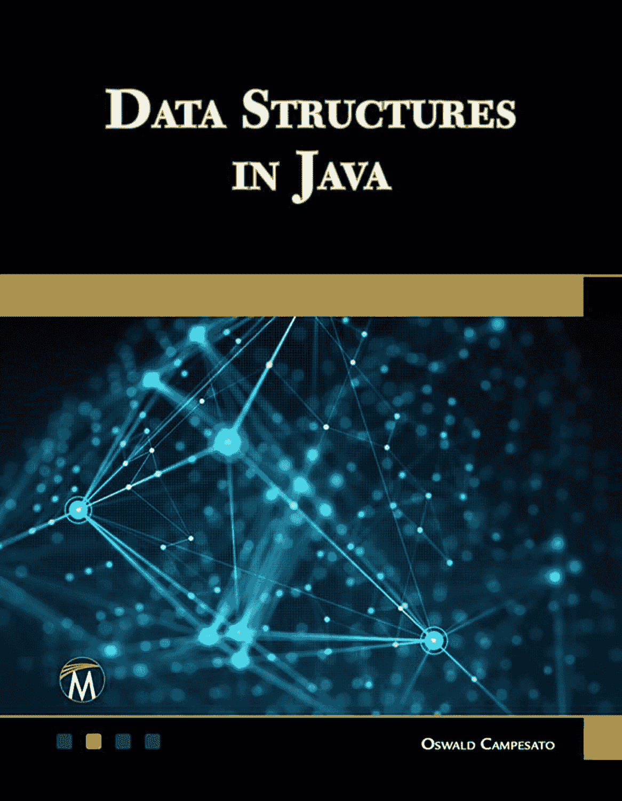

# Java 数据结构入门指南



O. Campesato. *Data Structures in Java.*

ISBN: 978-1-68392-955-0

*我想将这本书献给我的父母——愿这能给他们的生活带来喜悦和幸福。*

# 前言

## 本书的核心价值/价值主张是什么？

本书以快节奏介绍了关于 Java 数据结构的尽可能的相关信息，涵盖了在如此大小的书籍中可以合理包含的全部。

## 目标读者群

本书主要面向具有 Java 基础并对学习数据结构感兴趣的人士。本书还面向具有不同年龄段、背景极其多样化的国际读者。虽然许多读者知道如何阅读英语，但他们的母语并非英语（英语可能是他们的第二、第三、甚至是第四种语言）。因此，本书使用了标准英语，而不是可能让这些读者感到困惑的口语化表达。因此，本书致力于为目标读者提供舒适且有意义的学习体验。

## 我能从这本书中学学到什么？

第一章简要介绍了 Java，并包含一些 Java 示例用于检查闰年、寻找数字的约数以及处理字符串数组。第二章介绍了递归，并包含代码示例，用于检查正数是否为质数、寻找正整数的质因数、计算一对正整数的 `GCD`（最大公约数）和 `LCM`（最小公倍数）。

第三章包含涉及字符串和数组的 Java 示例，例如寻找数字的二进制子字符串、检查字符串是否包含唯一字符、计算范围内数字的位数，以及如何在不使用 `XOR` 函数的情况下计算 `XOR`。

第 4 至 6 章包含涉及搜索算法、链表概念以及涉及链表任务的 Java 示例。最后，第 7 章讨论了被称为队列和栈的数据结构，并包含了一些 Java 示例。

## 我需要学习书中的理论部分吗？

再次，答案取决于你计划在 Java 中处理数据结构的什么程度。通常情况下，如果你计划在 Java 应用开发中向初级开发者水平迈进，你可能需要学习书中遇到的许多（大部分？）主题。

## 如何从书中获得最大收益

有些程序员擅长从文字中学习，而另一些人擅长从示例代码（大量的代码）中学习，这意味着没有适用于所有人的单一风格。

此外，有些程序员想先运行代码，看看它是做什么的，然后再回到代码研究细节（而另一些人则采用相反的方法）。

因此，书中有各种类型的代码示例：有的很短，有的很长，有些代码示例是基于之前的代码示例“构建”的。

## 读本书之前需要具备什么知识？

基础 Java 知识是最有帮助的，对递归和数据结构的某些接触显然也有帮助。对其他编程语言的了解由于对编程概念和结构的接触也会很有帮助。你的技术知识越少，理解所涵盖的各种主题所需的努力就越大。

*如果你想确定自己是否能掌握书中的内容，可以快速浏览一些代码示例，以了解你对哪些内容熟悉，哪些内容对你来说是全新的.*

## 随附文件是否消除了对本书的需求？

随附文件包含了所有代码示例，以节省你通过手动将代码输入文本文件这一容易出错的过程中所花费的时间精力。此外，在某些情况下，你可能无法方便地访问这些文件。而且，书中的代码示例提供了随附文件中未提供的解释。

## 本书是否包含生产级代码示例？

本书中代码示例的主要目的是向你展示如何使用 `Java` 来解决各种编程任务。清晰性比编写更紧凑但更难理解（且可能更容易产生错误）的代码更重要。如果你决定在生产环境中使用书中的任何代码，你理应对对这些代码进行与你代码库中其他部分相同的严谨分析。

另一个需要记住的细节是，书中的许多代码示例包含了“被注释掉”的代码片段（通常是 `println()` 语句），这些片段是在开发代码示例期间使用的。特意包含这些片段是为了让你在想查看代码示例的执行路径时，可以取消任何一个注释。

## 本书的非技术前提条件是什么？

虽然这个问题的答案很难量化，但拥有学习数据结构的强烈愿望，以及阅读和理解代码示例的动力和自律，是尤为重要的。

## 如何设置命令行？

如果你是 Mac 用户，有三种方法可以实现。第一种是使用 `Finder` 导航到 `Applications > Utilities`，然后双击 `Utilities` 应用程序。接下来，如果你已经有一个可用的命令行，可以通过输入以下命令启动一个新的命令行：

```bash
open /Applications/Utilities/Terminal.app
```

Mac 用户的第二种方法是在已经显示的命令行中简单通过点击 `command+n` 在 MacBook 上打开一个新命令行，你的 Mac 就会启动另一个命令行。

如果你是 PC 用户，可以安装 `Cygwin` (https://cygwin.com/) 来模拟 `bash` 命令，或者使用其他工具包，例如 `MKS`（一种商业产品）。请阅读描述下载和安装过程的在线文档。请注意，如果自定义别名定义在主启动文件（如 `.bash_login`）之外的文件中，它们不会自动设置。

## 随附文件

书中的所有代码示例和图表都可以通过向 `info@merclearning.com` 发送邮件来获得。

## 完成本书后的“下一步”是什么？

这个问题的答案差异很大，主要因为答案很大程度上取决于你的目标。一种可能性涉及学习更复杂的数据结构并在 `Java` 中实现它们。另一种选择是为涉及 `Java` 的职业面试做准备。

# 第 1 章

## JAVA 简介

这个节奏较快的章节将向你介绍 `Java` 中的各种主题。

### 关于 Java 的极简介绍

`Java` 是一种面向对象的语言，使你能够在许多平台（包括桌面和移动设备）上运行代码。如果你感兴趣，包含 `Java`特性列表的 Oracle 网站是：

*[`www.oracle.com/java/`](https://www.oracle.com/java/)*

### 下载版本（短版本）

考虑到大量的 `Java` 版本，你如何决定哪个版本最适合你？答案取决于你的需求，涉及：

* 你公司使用的 `Java` 版本

* 最新的 `LTS` 版本

* 你喜欢的 `Java` 版本

* 你需要的 `Java` 特性

一旦你确定了适合你的 `Java` 版本，导航到以下网站并下载发行版：

*[`docs.oracle.com/javase/10/index.html`](https://docs.oracle.com/javase/10/index.html)*

### 选择 Java 版本（详细版本）

在本书印刷时，`Java 17` 已可用，且 `Java 18` 已于 2022 年发布。旧版本的 `Java` 的发布周期有时持续三年或以上，而较新的 `Java` 版本将每六个月发布一次。同时，新版本的更新范围将要小得多。

#### Java 8 和 Java 11

`Java 8` 和 `Java 11` 曾拥有 `LTS`（长期支持）状态，目前 `Java 17` 拥有 `LTS` 状态。由于各种因素，一些大公司仍在使用 `Java 8`，它是 `Java` 历史上最重要的发布之一。如果你感兴趣，Oracle 网站包含了 `Java 8` 的特性列表。事实上，`Java 8` 中的几乎所有特性在随后的所有版本中（直到 `Java 17`）中都能正常工作。

然而，`Java 8` 和 `Java 11` 已被弃用，目前 `Java 17` 拥有 `LTS` 状态。那么，推荐哪个 `Java` 版本？答案取决于你的需求。如果你没有维护或开发旧版 `Java` 版本代码的负担，那么可能使用 `Java 17` 可能是安全的。如果你没有选择，请考虑使用 `Java 13`、`Java 11` 或 `Java 8`（按此顺序）。

导航到以下 URL 获取有关早期 `Java` 版本的信息以及未来 `Java` 版本的发布日期：

*[`www.oracle.com/java/technologies/java-se-support-roadmap.html`](https://www.oracle.com/java/technologies/java-se-support-roadmap.html)*

#### Java 版本号

在 Java 8 之前，版本编号序列采用 1.x 形式。因此，Java 7 也被称为 Java 1.7，而 Java 8 被称为 Java 8。然而，这种旧的命名规范从 Java 9 开始被弃用了。例如，如果你输入命令 `java -version` 并且机器上安装了 Java 13，你将看到类似下面的输出：

```
 java 13.0.1 2019-10-15
Java(TM) SE Runtime Environment (build 13.0.1+9)
Java HotSpot(TM) 64-Bit Server VM (build 13.0.1+9, mixed mode, sharing)
```

目标是牢实掌握 Java 13，然后通过学习 Java 13 之后版本中的新特性来扩展你的知识。

## JRE 与 JDK

JRE（Java 运行环境）允许你运行 Java 代码，这意味着 Java 提供了 `java` 工具。如果你使用的是 Unix/Linux 类机器，请输入以下命令：

```
 $ which java
```

上一个命令显示如下类型的输出：

```
 $ /usr/bin/java
```

然而，JDK（Java 开发工具包）允许你编译和运行 Java 代码。尽管在 Java 8 之前 JRE 和 JDK 是分开下载的，但现在它们已经合并：即从 Java 9 开始，Java 的下载包是包含 JRE 的 JDK。

## Java 发行版

有很多网站提供多种 Java JDK：OpenJDK 项目、OracleJDK 和 AdoptOpenJDK。OpenJDK 项目是唯一包含 Java 源代码的项目站点。

Oracle 提供 OpenJDK，它可以免费用于你的 Java 应用程序。但不再支持对旧版本的更新：例如，一旦 Java 13 一面世，对 Java 12 的更新就停止了。Oracle 还提供 OracleJDK，它仅限在开发期间免费使用：如果你将代码部署到生产环境，则必须向 Oracle 支付费用（这会为你提供额外的支持）。

从 2017 年开始，你还可以使用 AdoptOpenJDK，它由不同的开发者和供应商开发，并且是免费提供的（就像 OpenJDK 一样）。

## Java IDE

许多人更倾向于在 IDE 中工作，而且许多编程语言都有非常好的 IDE 可用。例如，如果你计划开发 Android 应用，在 Android Studio 中进行是值得的，它是那些不熟悉命令行的人的替代方案。

如果你想在 IDE（集成开发环境）中编写 Java 代码，有多种支持 Java 的 IDE，例如 NetBeans 和 Eclipse。然而，本书侧重于从命令行操作 Java，你可以使用任选的文本编辑器创建 Java 类（或者如果你喜欢的话，也可以使用 IDE）。从命令行开发 Java 代码涉及一些简单的手动步骤，例如更新 `CLASSPATH` 环境变量以包含 JAR 文件，有时还包括编译后的 Java 类文件。

本章还包含一个简短的章节，向你展示如何创建一个包含已编译 Java 代码的简单 JAR 文件，在将此 JAR 文件添加到 `CLASSPATH` 变量后，你将看到如何调用你自定义的 JAR 文件中自定义的 Java 代码。需要记住的关键点是，书中的 Java 代码示例非常短（且通常很简单），到你不需要 IDE。

如果你想在 IDE 中编写 Java 代码，有几个支持 Java 的 IDE，下面的链接包含了其中 10 个：

https://www.educative.io/blog/best-java-ides-2021

然而，本章中的 Java 代码示例是从命令行启动的，源代码配合你任选的文本编辑器来创建 Java 类。从命令行工作确实需要一些额外的努力，例如手动更新 `CLASSPATH` 环境变量以包含 JAR（Java 归档）文件和编译后的 Java 类文件。

## 数据类型、运算符及其优先级

Java 支持在许多其他编译语言中常见的基本数据类型，以及对应的基于对象的类型。例如，基本数据类型 `int`、`double` 和 `float` 分别对应基于类的类型 `Integer`、`Double` 和 `Float`。

某些数据结构（如哈希表）不支持基本数据类型，这就是为什么需要基于类的对应类型。例如，如果你需要一个哈希表来维护整数集合，你需要创建一个包含每个整数的基于 `Integer` 的对象，并将该对象添加到哈希表中。然后你检索一个特定的基于 `Integer` 的值对象并提取其底层的 `int` 值。这种方法显然比简单地在哈希表中存储和检索 `int` 值涉及更多代码。

关于基本类型：Java 提供了 8 种作为语言关键字的原始数据类型：

* `byte`: 8 位符号补码整数

* `short`: 16 位符号补码整数

* `int`: 32 位符号补码整数

* `long`: 64 位符号补码整数

* `float`: 单精度 32 位 IEEE 754 浮点数

* `boolean`: true 或 false

* `char`: 单个 16 位 Unicode 字符

在大多数情况下，本书中涉及算术计算的代码示例使用整数和浮点数。

### Java 注释

Java 支持单行注释和多行注释，此处均有展示：

```
 // 这是一个单行注释
/* 这是一个多行注释 */
```

然而，Java 不支持嵌套注释（C/C++ 则支持），因此以下是错误的：

```
 第一行注释 /* 第二行注释 */
```

根据前面的示例，以下是正确的：

```
 第一行注释 // 第二行注释
```

### Java 运算符

Java 支持常见的算术运算符，以及标准的优先级（幂运算高于乘法 * 和除法 /，这两者的优先级高于加法 + 和减法 -）。此外，Java 还支持：

* 算术运算符：`+`, `-`, `*`, `/`, `%`, `++`, `--`

* 赋值运算符：`=`, `+=`, `-=`, `*=`, `/=`, `%=`, `<<=`, `>>=`, `&=`, `^=`, `-=`

* 位运算符：`&`, `|`, `^`, `~`

* 布尔运算：`and`, `or`, `not`

* 逻辑运算符：`&&`, `||`, `!`

* 关系运算符：`==`, `!=`, `>`, `<=`

Java 还支持三元运算符 `?` 和运算符 `instanceof`（用于检查变量是否是特定类的实例）。

## 创建和编译 Java 类

让我们从简单的 Java 类开始，除了向你展示 Java 类的基本结构之外什么都不做。列表 1.1 显示了 MyClass.java 的内容。

***列表 1.1：MyClass.java***

```
 public class MyClass
{
}
```

首先要到文件名与 Java 类名相同。列表 1.1 定义了由 `public` 和 `class` 关键字修饰的 Java 类 `MyClass`。你可以在 Java 文件中包含多个类，但只能有一个公共类，且该公共类必须与文件名匹配。

打开命令行窗口，导航到包含 `MyClass.java` 的目录，然后在命令行中使用 `javac` 可执行文件编译 `MyClass.java`：

```
 javac MyClass.java
```

`javac` 可执行文件创建一个名为 `MyClass.class` 的文件，其中包含 Java 字节码。使用 `java` 可执行文件启动 Java 字节码（不要包含任何扩展名）：

```
 java MyClass
```

注意启动 Java 字节码时不需要指定 .java 或 .class 后缀。之前命令的输出在这里：

```
 Exception in thread "main" java.lang.NoSuchMethodError: main
```

**注意** Java 源代码文件的名称必须与文件中的公共 Java 类名匹配。例如，`MyClass.java` 文件必须定义一个名为 `MyClass` 的 Java 类。

Listing 1.2 包含一个 `main` 方法，作为从命令行启动 Java 类的初始“入口点”，这解决了在 Listing 1.1 中出现的错误。

***Listing 1.2: MyClass.java***

```java
 public class MyClass
{
   public static void main(String[] args){}
}
```

Listing 1.2 包含 `main()` 函数，其返回类型为 `void`，因为它不返回任何内容。`main()` 函数也是 `static` 的，这确保了当我们从命令行启动 Java 类时它是可用的。编译代码：

```bash
 javac MyClass.java
```

从命令行启动该类：

```bash
 java MyClass
```

你现在已成功创建、编译并启动了一个名为 `MyClass` 的 Java 类，它目前除了成功编译外并无所事。下一步涉及在 Java 类中显示文本字符串，将在下一节中讨论。

### “HELLO WORLD” 与数字操作

Listing 1.3 显示了 `HelloWorld1.java` 的内容，该文件从 Java 类中打印字符串“Hello World”。

***Listing 1.3: HelloWorld1.java***

```java
 public class HelloWorld1 
{
   public static void main (String args[]) 
   {   
      System.out.println("Hello World");
   }   
}
```

Listing 1.3 中的代码非常直观：`main()` 函数包含一个简单的打印语句，用于打印字符串“Hello World”。打开命令行 shell 来编译并运行 Listing 1.3 中的 Java 代码：

```bash
 javac HelloWorld1.java
```

通过输入以下命令启动编译后的代码：

```bash
 java HelloWorld1
```

上一个命令的输出如下：

```
 Hello World
```


附带文件包含了本章节的额外代码示例，说明了如何在 Java 中处理数字、随机数、三角函数和位运算符：

*   `Numbers.java`
*   `RandomNumbers.java`
*   `MathFunctions.java`
*   `TrigFunctions.java`
*   `Bitwise.java`

让我们来看一些在 Java 中处理数字的（稍微）有趣的示例。

## Java String 类

`char` 类型的 Java 变量是一个单个字符，你可以通过 `char` 关键字这样定义它：

```java
char ch1 = 'Z';
```

`String` 类型的 Java 变量是一个由 `char` 值序列组成的对象。正如你稍后将看到的，Java 支持 ASCII、UTF8 和 Unicode 字符。`java.lang.String` 类实现了 Java 接口（后文讨论）`Serializable`、`Comparable` 和 `CharSequence`。

`Serializable` 接口不包含方法：它本质上是一个“标记”接口。`CharSequence` 接口用于字符序列。除了 Java `String` 类外，Java 的 `StringBuffer` 类和 `StringBuilder` 类也实现了 `CharSequence` 接口（更多细节见后文）。

请记住以下一点：每个 Java `String` 都是不可变的，为了修改 Java 字符串（如追加或删除字符），Java 会在“底层”为我们创建一个新实例。因此，字符串相关的操作内存效率较低；然而，Java 提供了 `StringBuffer` 和 `StringBuilder` 类来处理可变的 Java 字符串（后文也会讨论）。

字符数组实际上与 Java `String` 相同，如下所示：

```java
char[] chars = {'h','e','l','l','o'};
String str1  = new String(chars);  
String str2  = "hello"; 
```

你可以使用 `charAt()` 方法访问字符串中的字符，如下所示：

```java
char ch = str1.charAt(1);
```

前面的代码段将字母“e”赋值给字符变量 `ch`。你可以通过这段代码段给变量 `ch2` 赋值一个单引号：

```java
char ch2 = '\'';
```

Listing 1.4 显示了 `CharsStrings.java` 的内容，向你展示了如何在 Java 中定义字符、数组和字符串。

**Listing 1.4: CharsStrings.java**

```java
public class CharsStrings
{
   public CharsStrings(){}

   public static void main (String args[])
   {
      char ch1 = 'Z';
      char ch2 = '\'';

      char[] chars = {'h','e','l','l','o'};
      String str1  = new String(chars);
      String str2  = "hello";
      String str3  = new String(chars);
      String str4  = Character.toString(ch2);

      System.out.println("ch1:   "+ch1);
      System.out.println("ch2:   "+ch2);
      System.out.println("chars: "+chars);

      System.out.println("str1:  "+str1);
      System.out.println("str2:  "+str2);
      System.out.println("str3:  "+str3);
      System.out.println("str4:  "+str4);
   }
}
```

`$` 符号表示前一个输出块行的结束。请注意最后一行显示为 `^I$`，这表示存在制表符，该字符的值是列表 1.5 中 `str6` 变量的值。

## Java 的 `new` 运算符

上一节包含了几个在 Java 中直接赋值字符串的示例。另一种方法涉及使用 `new` 运算符，它在表面上看起来相同，但有一个重要的区别。当你用相同的字符串初始化两个变量时（如列表 1.6 所示），它们占据相同的内存位置。而当你使用 `new` 运算符时，这两个变量将占据不同的内存位置。

列表 1.6 显示了 `ShowPeople.java` 的内容，该程序使用 `new` 运算符初始化两个字符串并打印它们的值。

**列表 1.6: ShowPeople.java**

```java
public class ShowPeople
{
   // 无法在 main() 中初始化
   String str5, str6;

   public ShowPeople(){}

   public static void main (String args[])
   {
      String str1, str2, str3, str4;

      // str1 和 str2 占据不同的内存位置
      str1 = new String("My name is John Smith");
      str2 = new String("My name is John Smith");

      // str3 和 str4 占据相同的内存位置
      str3 = "My name is Jane Andrews";
      str4 = "My name is Jane Andrews";

      System.out.println(str1);
      System.out.println(str2);

      System.out.println(str3);
      System.out.println(str4);

      // 你必须先将两者声明为 "String":
      //str5 = new String("another string");
      //str6 = new String("yet another string");
   }
}
```

列表 1.6 包含一个 `main()` 例程，定义并初始化了字符串变量 `str1` 到 `str4`，然后打印它们的内容。列表 1.6 的输出如下：

```
My name is John Smith
My name is John Smith
My name is Jane Andrews
My name is Jane Andrews
```

列表 1.6 中的代码是直观的，但它包含了硬编码的值，因此没有可重用性。例如，你可能决定打印包含人名的数组中定义的所有名字。也许你想打印从这些数组中随机选择的名字。你甚至可能想从命令行获取一个人的姓和名，然后打印该名字。在本章的后面部分，你将学习如何使用各种循环结构处理字符串数组，之后你将学习如何定义“访问器”（accessors）和修改器（mutators）来“获取”和“设置”变量的值。

下一节提供了关于 `String` 类中 `==` 和 `equals()` 方法之间差异的细节。

## 字符串的相等性

与其他语言不同，`==` 运算符并不判断两个字符串是否相同：该运算符仅判断两个变量是否引用了同一个内存位置。`equals()` 方法将比较两个字符串的*内容*，而 `==` 运算符则匹配字符串的*对象*或引用。

列表 1.7 显示了 `EqualStrings.java` 的内容，说明了如何比较两个字符串并判断它们具有相同的值或相同的引用（或两者都是）。

**列表 1.7: EqualStrings.java**

```java
import java.io.IOException;

public class EqualStrings
{
   public static void main(String[] args) throws IOException
   {
      String str1 = "Pizza";
      String str2 = "Pizza";

      if (str1.equals(str2))
      {
         System.out.println("str1 and str2: equal values");
      }

      if (str1 == str2)
      {
         System.out.println("str1 and str2: equal references");
      }

      System.out.println("");

      String str3 = "Pasta";
      String str4 = new String("Pasta");

      if (str3.equals(str4))
      {
         System.out.println("str3 and str4: equal values");
      }
      else
      {
         System.out.println("str3 and str4: unequal values");
      }
      if (str3 == str4)
      {
         System.out.println("str3 and str4: equal references");
      }
      else
      {
         System.out.println("str3 and str4: unequal references");
      }
   }
}
```

列表 1.7 定义了 Java 类 `EqualStrings` 和一个 `main()` 函数，该函数定义了字符串变量 `str1`、`str2`、`str3` 和 `str4`。运行列表 1.7 中的代码，你将看到以下输出：

```
str1 and str2: equal values
str1 and str2: equal references

str3 and str4: equal values
str3 and str4: unequal references
```

记住当你创建一个字符串字面量时，JVM（Java 虚拟机）会检查池中是否存在该字符串。如果字符串在池中，它将返回该引用；否则，将创建一个新的字符串实例。为了判断两个字符串是否相同，请使用 `equals()` 方法，该方法将在下一节中讨论。

### 比较字符串

列表 1.8 显示了 `CompareStrings.java` 的内容，说明了如何比较两个字符串并判断它们是否具有相同的值或相同的引用（或两者都是）。

**列表 1.8: CompareStrings.java**

```java
public class CompareStrings
{
   public CompareStrings(){}

   public static void main (String args[])
   {
      String line1 = "This is a simple sentence.";
      String line2 = "this is a simple sentence.";

      System.out.println("line1: "+line1);
      System.out.println("line2: "+line2);
      System.out.println("");

      if (line1.equalsIgnoreCase(line2))
      {
         System.out.println("line1 and line2: case-insensitive equal");
      }
      else
      {
         System.out.println("line1 and line2: case-insensitive different");
      }

      if (line1.toLowerCase().equals(line2))
      {
         System.out.println("line1 and line2: equal after toLowerCase()");
      }
      else
      {
         System.out.println("line1 and line2: unequal after toLowerCase()");
      }
   }
}
```

列表 1.8 定义了 Java 类 `CompareStrings` 和一个 `main()` 函数，定义了字符串变量 `line1` 和 `line2`。运行列表 1.8 中的代码，你将看到以下输出：

```
line1: This is a simple sentence.
line2: this is a simple sentence.

line1 and line2: case-insensitive equal
line1 and line2: equal after toLowerCase()
```

## 在 Java 中搜索子字符串

列表 1.9 显示了 `SearchString.java` 的内容，说明了如何使用 `indexOf()` 方法判断一个字符串是否为另一个字符串的子字符串。注意此代码示例涉及 `if` 语句，该语句将在本章的最后一个代码示例中详细讨论。

**列表 1.9: SearchString.java**

```java
public class SearchString
{
   public SearchString(){}

   public static void main (String args[])
   {
      int index;
      String str1 = "zz", str2 = "Pizza";

      index = str2.indexOf(str1);
      if(index < 0)
      {
         System.out.println(str1+" is not a substring of "+str2);
      }
      else
      {
         System.out.println(str1+" is a substring of "+str2);
      }
   }
}
```

列表 1.9 包含一个 `main()` 方法，初始化了字符串变量 `str1` 和 `str2`，然后用字符串变量 `index` 初始化字符串 `str1` 在字符串 `str2` 中的索引位置。如果结果为负，则 `str1` 不是 `str2` 的子字符串，并打印一条消息。如果 `str1` *是* `str2` 的子字符串，则显示相应的消息。运行列表 1.9 中的代码，你将看到以下输出：

```
zz is not a substring of Pizza
```

Java `String` 类支持许多实用且命名直观的方法，用于字符串相关操作，包括：`compare()`、`compareTo()`、`concat()`、`equals()`、`intern()`、`length()`、`replace()`、`split()` 和 `substring()`。

Java `String` 类包含了一些非常实用的管理方法，这里列出了其中一部分（你可能已经见过其中一个）：

* `substring(idx1, idx2)`：从索引 `idx1` 到 `idx2` 的子字符串
* `compareTo(str)`：将字符串与给定的字符串进行比较
* `indexOfStr(str)`：在另一个字符串中查找字符串的索引
* `lastIndexOfStr(str)`：在另一个字符串中查找字符串最后一次出现的索引

列表 1.10 显示了 `CapitalizeFirstAll.java` 的内容，该示例说明了如何使用 `substring()` 方法将字符串中每个单词的首字母大写化，如何将字符串转换为全小写，以及如何将字符串转换为全大写。注意，此示例使用了循环，但此代码样本中的执行过程应该是非常直观的。

**列表 1.10: CapitalizeFirstAll.java**


```
public class BooleanExamples
{
   public CapitalizeFirstAll(){}

   public static void main (String args[])
   {
      String line1 = "this is a SIMPLE sentence.";
      String[] words = line1.split(" ");
      String line2 = "", first = "";

      for(String word: words)
      {
         first = word.substring(0,1).toUpperCase()+word.substring(1);
         line2 = line2 + first + " ";
      }

      System.out.println("line1: "+line1);
      System.out.println("line2: "+line2);

      String upper = line1.toUpperCase();
      String lower = line1.toLowerCase();

      System.out.println("Lower: "+lower);
      System.out.println("Upper: "+upper);
   }
}
```

列表 1.9 定义了 Java 类 `CapitalizeAllFirst` 和一个 `main()` 方法，该方法用文本字符串初始化了字符串变量 `line1`。`main()` 方法的后续部分通过 `split()` 方法将 `line1` 的内容拆分（标记）为单词数组。

接下来，循环遍历 `words` 数组中的每个单词，并将变量 `first` 设置为当前单词首字母的大写版本，并与当前单词的剩余字母拼接，如下所示：

```
first = word.substring(0,1).toUpperCase()+word.substring(1);
```

循环还将 `first` 和一个空格拼接到字符串 `line2` 中，该字符串将包含来自变量 `line` 的单词，且每个单词的首字母均大大写。

`main` 函数的最后部分显示了修改后的句子内容，以及该句子的小写版本，最后是原始句子的大写版本。运行列表 1.9 中的代码，你将看到以下输出：

```
line1: this is a SIMPLE sentence.
line2: This Is A SIMPLE Sentence. 
Lower: this is a simple sentence.
Upper: THIS IS A SIMPLE SENTENCE.
```

## 在 Java 中解析字符串

Java 支持命令行参数，这允许你从命令行通过不同的命令行值启动程序。使用 `equals()` 方法比较 Java 字符串以判断值是否相同。虽然某些语言通过 `==` 比较字符串，但在 Java 中，`==` 只比较两个字符串的引用（而不是值）。

使用 `parseInt()` 方法（尝试）将字符串转换为整数：

```
int num = Integer.parseInt("1234");
```

使用 `substring()`（此处此处 split）通过空白字符拆分字符串：

```
String[] strArray = aString.split("\\s+");
```

正则表达式 `\s+` 匹配一个或多个各种空白字符，包括 `" "`、`\t`、`\r` 和 `\n`。

下面的代码段通过 `StringBuilder` 类反转 Java 字符串：

```
String rev = new StringBuilder(original).reverse().toString();
```

配套目录包含 `OverrideToString.java`，并向你展示如何在 Java 中重写默认的 `toString()` 方法。

到为止，你已经看到了在 Java 中处理字符串的各种示例。欲需更多信息，请访问此 URL：

`https://docs.oracle.com/javase/7/docs/api/java/lang/String.html`

## Java 中的条件逻辑

条件逻辑允许你根据条件做出决策。最简单的类型涉及简单的 `if` 语句，但也可以使用 `if-else` 以及 `if-else-if` 语句。另一个 Java 构造结构是 `switch` 语句，它也涉及条件逻辑，某些任务使用 `switch` 语句比多个 `if-else` 语句处理起来更方便。

列表 1.10 显示了 `Conditional1.java` 的内容，该代码将两个数字除以小整数，并使用整数值的余数打印各种消息。

**列表 1.10: Conditional1.java**

```
public class Conditional1
{
   int x = 12, y = 15;

   public Conditional1() {}

   public void IfLogic()
   {
      if(x % 2 == 0) {
         System.out.println("x is even: "+x);
      } else {
         System.out.println("x is odd: "+x);
      }

      if(x % 2 == 0) {
         if(x % 4 == 0) {
            System.out.println("x is divisible by 4: "+x);
         }
      }

      if(y % 3 == 0 && y % 5 == 0) {
         System.out.println("y is divisible by 3 and 5: "+y);
      } else if(y % 3 == 0) {
         System.out.println("y is divisible only by 3: "+y);
      } else if(y % 5 == 0) {
         System.out.println("y is divisible only by 5: "+y);
      } else {
         System.out.println("y is not divisible by 3 or 5: "+y);
      }
   }

   public static void main(String args[])
   {
      Conditional1 c1 = new Conditional1();
      c1.IfLogic();
   } 
}
```

列表 1.10 定义了 Java 类 `Conditional1` 和一个 `IfLogic()` 方法，该方法对整数变量 `x` 和 `y` 进行取模运算。如果 `x % 2` 等于 0，则 `x` 是偶数；如果 `x % 4` 等于 0，则 `x` 是 4 的倍数；如果 `y % 3` 等于 0，则 `y` 是 3 的倍数。列表 1.10 包含了 `if-else` 块以及嵌套的条件逻辑块，你可以通过手动计算并将结果与生成的输出进行对比。

运行列表 1.10 中的代码，你将看到以下输出：

```
x is even: 12
x is divisible by 4: 12
y is divisible by 3 and 5: 15
```

你可以创建更复杂的布尔表达式，涉及“与”、“或”和“非”的多种组合（这涉及 `!=`）。使用列表 1.1 中的代码作为基准，然后添加自己的变体。

配套文件包含 `BooleanExamples.java`，向你展示了 Java 中各种类型的布尔表达式。

## 判断闰年

列表 1.11 显示了 `LeapYear.java` 的内容，用于判断给定年份是否为闰年。以防你忘记，闰年必须是 4 的倍数。但是，如果给定年份是一个不是 400 倍数的世纪，那么该年份就不是闰年。因此，2000 年是闰年，而 1700、1800 和 1900 年不是。

此代码样本是嵌套条件语句的一个很好的示例。尝试编写你自己的伪代码并与列表 1.11 的内容进行对比。

```java
public class LeapYear
{
   public LeapYear() {}

   // 闰年是 4 的倍数，但
   // 400 的倍数的世纪除外
   public void checkYear(int year)
   {
      if( year % 4 == 0)
      {
         if( year % 100 == 0)
         {
            if(year % 400 != 0)
            {
               System.out.println(year + " is a leap year");
            }
            else
            {
               System.out.println(year + " is not a leap year");
            }
         }
         else
         {
            System.out.println(year + " is a leap year");
         }
      }
      else
      {
         System.out.println(year + " is not a leap year");
      }
   }

   public static void main(String args[])
   {
      LeapYear ly = new LeapYear();
      int[] years = {1234, 1900, 2000, 2020, 3000, 5588};

      for (int year : years)
      {
         ly.checkYear(year);
      }
   }
}
```

列表 1.11 定义了 `LeapYear` 类，该类包含 `checkYear` 方法，用于判断给定的年份是否为闰年。如果你查看列表 1.11 开头附近的注释块，你会发现 `checkYear` 方法实现了相同的条件逻辑。运行列表 1.11 中的代码，你将看到以下输出：

```
1234 is not a leap year
1900 is a leap year
2000 is not a leap year
2020 is a leap year
3000 is not a leap year
5588 is a leap year
```

## 寻找数字的约数

列表 1.12 包含 `while` 循环、条件逻辑和 `%`（取模）运算符，用于寻找任何大于 1 的整数的质因数。

**列表 1.12: Divisors1.java**

```java
public class Divisors1
{
   public Divisors1() {}

   public void divisors(int num)
   {
      int div = 2;

      System.out.println("Number: "+num);

      while(num > 1)
      {
         if(num % div == 0)
         {
            System.out.println("divisor: "+div);
            num /= div;
         }
         else 
         {
            ++div;
         } 
      }
   }

   public static void main(String args[])
   {
      Divisors1 d1 = new Divisors1();
      d1.divisors(12);
   }
} 
```

列表 1.12 定义了 Java 类 `Divisors1`，该类包含 `divisors` 方法，用于确定正整数 `num` 的约数。`divisors` 方法包含一个 `while` 循环，当 `num` 大于 1 时循环迭代。

在每次迭代中，如果 `num` 能被 `div` 整除，则显示 `div` 的值，然后通过将 `num` 除以 `div` 的值来减小它。如果 `num` 不能被 `div` 整除，则将 `div` 加 1。来自列表 1.8 的输出在此：

```
Number: 12
divisor: 2
divisor: 2
divisor: 3
```

## 检查回文

以防你忘记，回文是一个数字或字符序列，从正反两个方向读取时时都是相同的（即从左到右和从右到左相同）。

例如，字符串 `BoB` 是回文，但 `Bob` 不是回文。同样，数字 `12321` 是回文，但 `1232` 不是回文。

列表 1.13 显示了 `Palindromes1.java` 的内容，该程序检查给定的字符串或数字是否为回文。

**列表 1.13: Palindromes1.java**

```java
public class Palindromes1
{
  public Palindromes1() {}

   public void calculate(String str)
   {
      int result = 0;
      int len = str.length();

      for(int i=0; i<len/2; i++)
      {
         if(str.charAt(i) != str.charAt(len-i-1))
         {
            result = 1;
            break;
         }
      }

      if(result == 0)
      {
         System.out.println(str + ": is a palindrome");
      }
      else
      {
         System.out.println(str + ": is not a palindrome");
      }  
   }

   public static void main(String args[])
   {
      String[] names = {"Dave", "BoB", "rotor"};
      int[] numbers = {1234, 767, 123421, 101};
      Palindromes1 pal1 = new Palindromes1();

      for (String name : names)
      {
         pal1.calculate(name);
      }

      for (int num : numbers)
      {
         pal1.calculate(Integer.toString(num));
      }
   }
}
```

列表 1.13 定义了 Java 类 `Palindromes1`，该类包含 `calculate` 方法，用于判断给定的字符串或数字是否为回文。`main` 方法通过 `names` 数组和 `numbers` 数组，实例化 `Palindromes1` 类，并对 `names` 数组中的每个字符串调用 `calculate()` 方法。同样，通过 `Integer.toString()` 将 `numbers` 数组中的数字调用 `calculate()` 方法。运行列表 1.13 中的代码，你将看到以下输出：

```
Dave: not a palindrome
BoB: is a palindrome
rotor: is a palindrome
1234: not a palindrome
767: is a palindrome
123421: is a palindrome
101: is a palindrome
```

本章后续章节展示了如何将 `while` 循环与条件逻辑（`if-else`）结合。

## 处理字符串数组

本节展示了如何通过 `main()` 例程打印存储在数组中的名称。

列表 1.14 显示了 `PersonArray.java` 的内容，该类包含两个私有 `String` 变量用于记录一个人的名和姓。


```java
public class PersonArray
{
   private String[] firstNames = {"Jane","John","Bob"};
   private String[] lastNames = {"Smith","Jones","Stone"};

   public void displayNames()
   {
      for(int i=0; i<firstNames.length; i++)
      {
         System.out.println("My name is "+
                            firstNames[i]+"
                            lastNames[i]);
      }
   }

   public static void main(String args[])
   {
      PersonArray pa = new PersonArray();
      pa.displayNames();
   }
}
```

Listing 1.14 定义了 Java 类 `PersonArray`，该类包含 `displayNames` 方法，其 `for` 循环遍历字符串数组 `firstNames` 和 `lastNames`。循环变量 `i` 用作这些数组的索引以打印一个人的名和姓，如下：

```java
System.out.println("My name is "+
                   firstNames[i]+"
                   lastNames[i]);
```

运行 Listing 1.14 中的代码，你将看到以下输出：

```text
My name is Jane Smith
My name is John Jones
My name is Bob Stone
```

### 使用 `StringBuilder` 类

回 Java `String` 类创建一个不可变的字符序列，对于许多大字符串可能会涉及大量的内存。另一方面，Java `StringBuilder` 类是 `String` 类的替代方案，支持可变的字符序列。

`StringBuilder` 类有很多实用的方法，每个方法的返回类型都是 `StringBuilder`，如下：

```text
• capacity()
• charAt()
• delete()
• codePointAt()
• codePointBefore()
• codePointCount()
• deleteCharAt()
• ensureCapacity()
• getChars()
• length()
• replace()
• reverse()
• setCharAt()
• setLength()
• subSequence()
```

Listing 1.15 显示了 `PersonRandom.java` 的内容，它使用随机生成的索引进入名称数组，以打印一个人的名和姓。

```java
public class PersonRandom
{
   private String[] firstNames = {"Jane", "John", "Bob"};
   private String[] lastNames  = {"Smith", "Jones", "Stone"};

   public void displayNames()
   {
      String fname, lname;
      int index, loopCount=6, maxRange=20;
      int pCount = firstNames.length;

      for(int i=0; i<loopCount; i++)
      {
         index = (int)(maxRange*Math.random());
         index = index % pCount;

         fname = firstNames[index];
         lname = lastNames[index];

         System.out.println("My name is "+
                            fname+" "+lname);
      }
   }

   public static void main (String args[])
   {
      PersonRandom pa = new PersonRandom();
      pa.displayNames();
   }
}
```

列表 1.15 与列表 1.14 中的代码非常相似：重要的区别在于名字是通过随机生成的数字来选择的，如下：

```java
index = (int)(maxRange*Math.random());
```

运行列表 1.15 中的代码，你将看到以下输出：

```text
My name is Jane Smith
My name is John Jones
My name is Jane Smith
My name is Jane Smith
My name is Bob Stone
My name is John Jones
```

注意，尽管只有三个人，但有六行输出。这是可能的因为随机生成的数字始终在 0 到 2 之间，这意味着我们可以生成成百上千行输出。当然，会有会有很多重复的输出行，因为只有三个人不同的人。

### Java 中的静态方法

静态变量的声明方式与实例变量相同，但多加了 `static` 关键字。如果你将一个方法声明为 `static`，则该方法只能更新静态变量；然而，非静态方法中也可以更新静态变量。静态方法的一个关键点是，你可以在实例化对象之前引用静态方法；另一方面，非静态方法只能通过类的实例可用。请记住关于静态方法的以下几点：

- 它们只能调用其他静态方法。
- 它们只能访问静态数据。
- 所有类实例中的都是同一个方法。
- 它们没有 `this` 引用。

列表 1.16 显示了 `StaticMethod.java` 的内容，说明了如何在 Java 类中定义并调用一个静态方法。

列表 1.16：`StaticMethod.java`

```java
public class StaticMethod
{
   public void display1()
   {
      System.out.println("Inside display1");
   }

   public static void display2()
   {
      System.out.println("Inside display2");
   }

   public static void main (String args[])
   {
      System.out.println("Inside main()");
      // 无法调用非静态方法：
      // StaticMethod.display1();
      // 这种是正确的：
      StaticMethod.display2();

      // 这种是正确的：
      StaticMethod sm = new StaticMethod();
      sm.display1();
   }
}
```

列表 1.16 定义了 Java 类 `StaticMethod`、非静态方法 `display1()` 以及一个静态方法 `display2()`。`main()` 方法在没有实例化 `StaticMethod` 类的情况下调用了 `display2()` 方法。接下来，`main()` 方法将变量 `sm` 初始化为 `StaticMethod` 类的实例，之后 `sm` 调用了不是静态方法的 `display1()` 方法。

#### Java 中的其他静态类型

正如你在上一节中看到的，Java 类中的静态方法可以在不实例化对象的情况下被调用。此外，你还可以定义一个包含静态方法的静态 Java 类，其中每个方法都可以在不实例化 Java 类实例的情况下调用。

`static block`（也称为静态初始化块）是一组指令，当 Java 类加载到内存时执行一次。静态块用于在对象构造之前进行初始化，如下：

```java
class MyClass
{
   static int x;
   int y;

   static {
      x = 123;
      System.out.println("static block executed");
   }

   // 其他方法 ...
}
```

前一个代码块中粗体显示的代码在（任何）构造函数执行之前执行。

### 总结

本章为你介绍了一些 Java 特性，例如它支持的一些数据类型、运算符以及 Java 运算符的优先级。你还学习了如何实例化 Java 类的实例，以及如何在 `main()` 方法中执行算术运算。

你还了解了 Java 字符和字符串的概述，以及 `new` 操作符的意义。最后，你学习了如何判断两个字符串是否相等，以及 Java 中其他一些实用的字符串函数。

# 第 2 章：递归与组合数学

本章向你介绍了递归的概念，以及各种 Java 代码示例，然后介绍了组合数学中的概念，如对象的组合和排列。

本章的第一部分讨论递归，这是本章最重要的部分。代码示例包括等差数列（例如 1 到 n 的和）、几何数列计算、阶乘计算以及斐波契数。除了斐波契数的迭代解外，这些示例不涉及数据结构。然而，这些示例为递归提供了基础。

本章的第二部分讨论组合数学，如排列和组合。注意，组合数学的全面涵盖涵盖一门本科课程，而本章只包含基础概念。

如果你刚接触递归，部分内容可能会有些人生畏，但不要担心。通常，反复阅读材料和代码示例会带来更好的理解。

或者，你也可以跳过本章的内容。第 3 章包含一个使用递归的二分查找代码示例以及另一个使用迭代方法的代码示例，所以现在可以跳过递归示例。但是，如果你计划学习树，你只需要学习递归，这是第 5 章中所有树相关示例的基础。

### 什么是递归？

递归算法可以为通过迭代算法实现的任务提供非常优雅的解决方案。对于某些任务（如计算阶乘），递归解决方案和迭代解决方案的代码复杂度相当。

作为一个简单的例子，假设我们要相加从 1 到 n（包含 n）的整数，令 `n = 10` 以得到一个具体的例子。如果我们定义 `S` 为连续相加整数的部分和，那么我们如下：

```text
S = 1
S = S + 2
. . .
S = S + 10
```

如果我们定义 `S(n)` 为前 n 个正整数的和，那么存在如下关系：

```text
S(1) = 1
S(n) = S(n-1) + n 对于 n > 1
```

考虑到上述观察，下一节将包含迭代方法和使用递归方法计算前 n 个正整数和的代码示例。

### 等差数列

本节将向你展示如何计算一组正整数的和，例如从 1 到 n（包含 n）的。第一个算法使用迭代方法，第二个算法使用递归。

在深入研究代码示例之前，有一种简单的方法可以计算从 1 到 n（包含 n）整数的封闭和，我们将其记为 `S`。这里有两种计算 `S` 的方法，所示：

```text
S = 1 + 2     + 3     + . . . + (n-1) + n
S = n + (n-1) + (n-2) + . . . + 2     + 1
```

共有 `n` 列，每列之和都等于 `(n+1)`，因此等号右侧的总和为 `n*(n+1)`。由于等号左侧之和为 `2*S`，我们得到以下结果：

```text
2*S = n*(n+1)
```

将等式两边除以 2，得到前 `n` 个正整数等差数列的已知公式：

```text
S = n*(n+1)/2
```

顺便提一下，上述公式是由一个厌倦了手动计算的小学生推导出来的：那个学生就是卡尔·F·高斯（当时他才三年级）。

### 计算等差数列（迭代）

Listing 2.1 显示了 `ArithSum.java` 的内容，展示了如何使用迭代方法计算从 1 到 n（包含 n）的和。

Listing 2.1：`ArithSum.java`

```java
public class ArithSum
{
   public static int calcsum(int num)
   {
      int sum = 0;
      for(int i=1; i<num+1; i++)
      {
          sum += i;
      }

      return sum;
   }

   public static void main(String[] args)
   {
      int sum = 0, max = 20;

      for(int j=2; j<max+1; j++)
      {
          sum = calcsum(j);
          System.out.println("Sum from 1 to "+j+" = "+sum);
      }
   }
}
```

Listing 2.1 从一个静态方法 `calcsum()` 开始，该方法包含一个循环，遍历从 1 到 `num+1`（包含）的数字，其中 `num` 是该函数参数的值。在每次迭代中，变量 `sum`（初始化为 0）加上循环变量的值，并返回最终的 `sum`。

Listing 2.1 的下部分定义了 `main()` 方法，它将标量变量 `sum` 初始化为 0，将 `max` 初始化为 20，接着是一个从 2 到 `max+1` 的循环。在每次迭代中，使用循环变量的当前值调用 `calcsum()` 方法并打印返回值。运行 Listing 2.1 中的代码，你将看到以下输出：

```text
sum from 1 to 2 = 3
sum from 1 to 3 = 6
sum from 1 to 4 = 10
sum from 1 to 5 = 15
sum from 1 to 6 = 21
sum from 1 to 7 = 28
sum from 1 to 8 = 36
sum from 1 to 9 = 45
sum from 1 to 10 = 55
sum from 1 to 11 = 66
sum from 1 to 12 = 78
sum from 1 to 13 = 91
sum from 1 to 14 = 105
sum from 1 to 15 = 120
sum from 1 to 16 = 136
sum from 1 to 17 = 153
sum from 1 to 18 = 171
sum from 1 to 19 = 190
sum from 1 to 20 = 210
```

### 计算等差数列（递归）

Listing 2.2 显示了 `ArithSumRecursive.py` 的内容，展示了如何使用递归方法（注：此处原文描述为迭代但实际代码为递归）计算从 1 到 n（包含 n）的和。

Listing 2.2：`ArithSumRecursive.java`

```java
public class ArithSumRecursive
{
   public static int calcsum(int num)
   {
      if(num == 0)
      {
        return num;
      }
      else
      {
        return num + calcsum(num-1);
      }
   }

   public static void main(String[] args)
   {
      int sum = 0, max = 20;

      for(int j=2; j<max+1; j++)
      {
          sum = calcsum(j);
          System.out.println("Sum from 1 to "+j+" = "+sum);
      }
   }
}
```

Listing 2.2 从一个静态方法 `calcsum()` 开始，如果 `num` 等于 0 则返回 `num`，否则递归地调用 `calcsum(num-1)` 并返回 `num` 加上其结果。Listing 2.2 的后续部分定义了 `main()` 方法，它将标量变量 `sum` 初始化为 0，`max` 初始化为 20，接着是一个从 2 到 `max+1` 的循环。在每次迭代中，使用循环变量的当前值调用 `calcsum()` 方法并打印返回值。（注：原文此处误写为 Listing 2.1）。

### 计算部分和

Listing 2.3 显示了 `partial_sum.py` 的内容，展示了如何使用迭代方法计算 `m` 到 `n` 的数字的和，其中 `m` 和 `n` 是两个满足 `m <= n` 的正整数。

Listing 2.3：`ArithPartialSum.java`


```java
public class ArithPartialSum
{
   public static int calcPartialSum(int m, int n)
   {
      if(n > m)
      {
         return 0;
      }
      else
      {
         return n*(n+1)/2 - m*(m-1)/2;
      }
   }

   public static void main(String[] args)
   {
      int sum = 0, max = 8;

      for(int i=2; i<=max; i++)
      {
         for(int j=i+1; j<=max; j++)
         {
            sum = calcPartialSum(j,i);
            System.out.println("Sum from "+i+" to "+j+" = "+sum);
         }
      }
   }
}
```

Listing 2.3 从一个静态方法 `calcPartialSum()` 开始，它包含条件逻辑：如果 `n >= m` 则返回 0，否则返回 `else` 子句中的表达式。Listing 2.3 的后续部分定义了 `main()` 方法，它将标量变量 `sum` 初始化为 0，`max` 初始化为 8，接着是一个从 2 到 `max` 的外层循环。在每次迭代中，内层循环从 `i+1` 迭代到 `max`，其中 `i` 是外层循环的变量。内层循环调用参数为 `j` 和 `i` 的 `calcPartialSum()` 方法并打印返回值。运行 Listing 2.1 中的代码，你将看到以下输出：

```text
Sum from 2 to 3 = 5
Sum from 2 to 4 = 9
Sum from 2 to 5 = 14
Sum from 2 to 6 = 20
Sum from 2 to 7 = 27
Sum from 2 to 8 = 35
Sum from 3 to 4 = 7
Sum from 3 to 5 = 12
Sum from 3 to 6 = 18
Sum from 3 to 7 = 25
Sum from 3 to 8 = 33
Sum from 4 to 5 = 9
Sum from 4 to 6 = 15
Sum from 4 to 7 = 22
Sum from 4 to 8 = 30
Sum from 5 to 6 = 11
Sum from 5 to 7 = 18
Sum from 5 to 8 = 26
Sum from 6 to 7 = 13
Sum from 6 to 8 = 21
Sum from 7 to 8 = 15
```

### 等比数列

本节将向你展示如何计算一组正整数的等比数列，例如从 1 到 n（包含 n）的。第一个算法使用迭代方法，第二个算法使用递归。

在深入研究代码示例之前，有一种简单的方法可以计算从 1 到 n（包含 n）等比数列的封闭和，其中 `r` 是等比数列相邻项之间的比例。让 `S` 表示和，其表达式如下：

```text
S   = 1+ r + r² + r³ + . . . + r^(n-1) + r^n
r*S =    r + r² + r³ + . . . + r^(n-1) + r^n + r^(n+1)
```

将上述第二行的每一项减去第一行对应的项，我们得到以下结果：

```text
S - r*S = 1 - r^(n+1)
```

从上述等式左侧的两项中提取 `S`，我们得到以下结果：

```text
S*(1 - r) = 1 - r^(n+1)
```

将上述等式两边除以项 `(1-r)`，得到前 `n` 个正整数等比数列求和公式：

```text
S = [1 - r^(n+1)]/(1-r)
```

注意如果 `r = 1`，上述方程将返回无穷值。

### 计算等比数列（迭代）

Listing 2.4 显示了 `GeometricSum.py` 的内容，展示了如何使用迭代方法计算从 1 到 n（包含 n）的和。

*Listing 2.4: GeometricSum.java*

```java
public class GeometricSum
{ 
   public static int geomsum(int num, int ratio)
   {
      int partial = 0;
      int power   = 1;
      int sum     = 0;

      for(int i=1; i<num+1; i++)
      {
          partial += power;
          power *= ratio;
          sum += i;
      }

      return partial;
   }

   public static void main(String[] args)
   {
      int ratio = 2, max = 10, prod = 0;

      for(int j=2; j<max+1; j++)
      {
         prod = geomsum(j, ratio);
         System.out.println("Geometric sum for ratio = "+ratio+" from 1 to "+j+" = "+prod);
      }
   }
}
```

Listing 2.4 从一个静态方法 `geomsum()` 开始，该方法初始化了三个整数标量变量。接部分代码是一个循环，它从 1 到 `num+1`（包含）遍历数字，其中 `num` 是该函数的参数值。在每次迭代中，三个标量变量按顺序更新，以跟踪数字的等比部分和。循环完成后，返回 `partial` 的值。

Listing 2.4 的下一部分定义了 `main()` 方法，该方法将标量变量 `ratio`、`max` 和 `prod` 分别初始化为 2、10 和 0。接下来，循环从 2 迭代到 `max+1`。在每次迭代中，调用 `geomsum()` 方法并传入循环变量 `j` 的当前值和 `ratio` 的值。此外，变量 `prod` 被初始化为 `geomsum()` 的返回值，并打印该值。运行 Listing 2.4 中的代码，你将看到以下输出：

```text
geometric sum for ratio= 2 from 1 to 2 = 3
geometric sum for ratio= 2 from 1 to 3 = 7
geometric sum for ratio= 2 from 1 to 4 = 15
geometric sum for ratio= 2 from 1 to 5 = 31
geometric sum for ratio= 2 from 1 to 6 = 63
geometric sum for ratio= 2 from 1 to 7 = 127
geometric sum for ratio= 2 from 1 to 8 = 255
geometric sum for ratio= 2 from 1 to 9 = 511
geometric sum for ratio= 2 from 1 to 10 = 1023
```

### 计算等比级数（递归）

Listing 2.5 显示了 `GeomSumRecursive.java` 的内容，说明了如何使用递归计算 1 到 `n`（包含）数字的等比级数和。注意，以下代码示例使用了尾递归。

*Listing 2.5: GeoSumRecursive.java*

```java
public class GeoSumRecursive
{ 
   public static int geomsum(int num, int ratio, int term, int sum)
   {
      if(num == 1)
      {
         return sum;
      }
      else
      {
         term *= ratio;;
         sum  += term;;
         return geomsum(num-1,ratio,term,sum);
      }
   }

   public static void main(String[] args)
   {
      int max = 10, ratio = 2, sum = 1, term = 1, prod = 0;

      for(int j=2; j<max+1; j++)
      {
         prod = geomsum(j, ratio, term, sum);
         System.out.println("Geometric sum for ratio = "+ratio+" from 1 to "+j+" = "+prod);
      }
   }
}
```

Listing 2.5 从一个静态方法 `geomsum()` 开始，该方法包含条件逻辑：如果 `num` 等于 1 则返回 0，否则更新变量 `term` 和 `sum`，然后返回使用更新后的值调用 `geomsum()` 的结果。

Listing 2.5 的下一部分定义了 `main()` 方法，该方法将标量变量 `max`、`ratio`、`sum`、`term` 和 `prod` 分别初始化为 10、2、1、1 和 0。接下来，循环从 2 迭代到 `max+1`，在每次迭代中，使用参数 `j`、`ratio`、`term` 和 `sum` 调用 `geomsum()` 方法。该调用的结果赋值给变量 `prod`，然后打印。运行 Listing 2.1 中的代码，你将看到以下输出：

```text
Geometric sum for ratio = 2 from 1 to 2 = 3
Geometric sum for ratio = 2 from 1 to 3 = 7
Geometric sum for ratio = 2 from 1 to 4 = 15
Geometric sum for ratio = 2 from 1 to 5 = 31
Geometric sum for ratio = 2 from 1 to 6 = 63
Geometric sum for ratio = 2 from 1 to 7 = 127
Geometric sum for ratio = 2 from 1 to 8 = 255
Geometric sum for ratio = 2 from 1 to 9 = 511
Geometric sum for ratio = 2 from 1 to 10 = 1023
```

### 阶乘值

本节包含了三个阶乘值的示例：第一个示例使用循环，另外两个示例使用递归。作为提醒，正整数 `n` 的 `factorial` 值是 1 到 `n`（包含）所有数字的积。因此我们有以下值：

```text
Factorial(2) = 2*1
Factorial(3) = 3*2*1 = 6
Factorial(4) = 4*3*2*1 = 24
Factorial(5) = 5*4*3*2*1 = 120
Factorial(6) = 6*5*4*3*2*1 = 720
Factorial(7) = 7*6*5*4*3*2*1 = 5040
```

查看之前的计算列表，你可以看到阶乘之间有趣的关系：

```text
Factorial(3) = 3*Factorial(2)
Factorial(4) = 4*Factorial(3)
Factorial(5) = 5*Factorial(4)
```

根据前面的观察，可以推导出以下阶乘关系：

```text
Factorial(1) = 1
Factorial(n) = n*Factorial(n-1) 对于 n > 1
```

下一节使用上述公式计算各种数字的阶乘值。

#### 计算阶乘值（迭代法）

Listing 2.6 显示了 `Factorial1.py` 的内容，说明了如何使用迭代方法计算阶乘。

*Listing 2.6: Factorial1.py*

```java
public class Factorial1
{ 
   public static int factorial(int num)
   {
      int prod = 1;
      for(int i=1; i<num+1; i++)
      {
          prod *= i;
      }

      return prod;
   }

   public static void main(String[] args)
   {
      int prod = 0, max = 15;

      for(int j=1; j<=max; j++)
      {
          prod = factorial(j);
          System.out.println("Factorial "+j+" = "+prod);
      }
   }
}
```

Listing 2.6 从一个静态方法 `factorial()` 开始，该方法包含一个循环来遍历 1 到 `n`，其中 `n` 是该函数的参数值。在每次迭代中，变量 `prod`（初始化为 1）乘以循环变量 `i` 的值，并返回最终积。

Listing 2.1 的下一部分定义了 `main()` 方法，将标量变量 `prod` 初始化为 0，`max` 初始化为 15，随后是一个从 1 迭代到 `max` 的循环。在每次迭代中，使用循环变量 `j` 的当前值调用 `factorial()` 方法，并将返回值赋值给变量 `prod` 然后打印。运行 Listing 2.6 中的代码，你将看到以下输出：

```text
factorial 0 = 1
factorial 1 = 1
factorial 2 = 1
factorial 3 = 2
factorial 4 = 6
factorial 5 = 24
factorial 6 = 120
factorial 7 = 720
factorial 8 = 5040
factorial 9 = 40320
factorial 10 = 362880
factorial 11 = 3628800
factorial 12 = 39916800
factorial 13 = 479001600
factorial 14 = 6227020800
factorial 15 = 87178291200
factorial 16 = 1307674368000
factorial 17 = 20922789888000
factorial 18 = 355687428096000
factorial 19 = 6402373705728000
```

#### 计算阶乘值（递归法）

Listing 2.7 显示了 `Factorial2.py` 的内容，说明了如何使用递归计算阶乘值。

*Listing 2.7: Factorial2.py*

```java
public class Factorial2
{
   public static int factorial(int num)
   {
      if(num <= 1)
      { 
         return 1;
      }   
      else
      {
         return num * factorial(num-1);
      }
   }

   public static void main(String[] args)
   {  
      int prod= 0, max = 15;

      for(int j=1; j<=max; j++)
      {   
          prod = factorial(j);
          System.out.println("Factorial "+j+" = "+prod);
      }
   }
}
```

Listing 2.7 从一个静态方法 `factorial()` 开始，该方法包含条件逻辑：如果 `num` 最多为 1，则返回 `1`，否则返回 `num` 与带有值 `num–1` 的 `factorial()` 调用结果的乘积。

Listing 2.7 的后续部分定义了 `main()` 方法，它将标量变量 `prod` 和 `max` 分别初始化为 `0` 和 `15`。接下来，一个循环从 1 迭代到 `max`（包含 `max`），在每次迭代中，都使用循环变量 `j` 调用 `factorial()` 方法。该调用的结果被赋值给变量 `prod`，然后将其打印出来。运行 Listing 2.7 中的代码，你将看到与上一个示例相同的输出。

### 计算阶乘值（尾递归）

Listing 2.8 显示了 `Factorial3.py` 的内容，它说明了如何使用尾递归计算阶乘值。

**LISTING 2.8: Factorial3.py**


```java
public class Factorial3
{
   public static int factorial(int num, int prod)
   {
      if(num <= 1)
      { 
         return prod;
      }  
      else
      {
         return factorial(num-1, num*prod);
      }  
   }  

   public static void main(String[] args)
   {
      int prod= 0, max = 15;

      for(int j=1; j<=max; j++)
      {
          prod = factorial(j, 1);
          System.out.println("Factorial "+j+" = "+prod);
      }   
   }  
} 
```

Listing 2.8 从一个静态方法 `factorial()` 开始，该方法包含条件逻辑：如果 `num` 最多为 1，则返回 `prod`，否则返回 `num` 与带有值 `n–1` 和 `n*prod` 的 `factorial()` 调用结果的乘积。

Listing 2.8 的后续部分定义了 `main()` 方法，它将标量变量 `prod` 和 `max` 分别初始化为 `0` 和 `15`。接下来，一个循环从 1 迭代到 `max`（包含 `max`），在每次迭代中，都使用循环变量 `j` 和数字 `1` 调用 `factorial()` 方法。该调用的结果被赋值给变量 `prod`，然后将其打印出来。运行 Listing 2.8 中的代码，你将看到与上一个示例相同的输出。

### 斐波那契数列

斐波那契数列在现实中有对应，例如向日葵种子的模式以及树枝形成的位置。以下是斐波那契数列的定义：

```text
Fib(0) = 0
Fib(1) = 1
Fib(n) = Fib(n-1)+Fib(n-2) for n >= 2
```

注意，可以为 `Fib(0)` 和 `Fib(1)` 指定不同的“种子”值，但 `0` 和 `1` 是最常用的值。

### 计算斐波那契数（递归）

Listing 2.9 显示了 `Fibonacci1.py` 的内容，它说明了如何使用递归计算斐波那契数。

**LISTING 2.9: Fibonacci1.py**

```java
public class Fibonacci1
{
   // very inefficient:
   public static int fibonacci(int num)
   {
      if(num <= 1)
      {
         return num;
      }
      else
      {
         return fibonacci(num-2) + fibonacci(num-1);
      }
   }

   public static void main(String[] args)
   {
      int fib = 0, max = 20;

      for(int j=0; j<=max; j++)
      {
          fib = fibonacci(j);
          System.out.println("Fibonacci of "+j+" = "+fib);
      }
   }
}
```

Listing 2.9 从一个静态方法 `fibonacci()` 开始，该方法包含条件逻辑：如果 `num` 最多为 1，则返回 `num`，否则返回 `fibonacci(num–2)` 和 `fibonacci(num–1)` 的和。

Listing 2.9 的后续部分定义了 `main()` 方法，它将标量变量 `fib` 和 `max` 分别初始化为 `0` 和 `20`。接下来，一个循环从 1 迭代到 `max`（包含 `max`），在每次迭代中，都使用循环变量 `j` 调用 `fibonacci()` 方法。该调用的结果被赋值给变量 `fib`，然后将其打印出来。运行 Listing 2.8 中的代码，你将看到以下内容：

```text
fibonacci 0 = 0
fibonacci 1 = 1
fibonacci 2 = 1
fibonacci 3 = 2
fibonacci 4 = 3
fibonacci 5 = 5
fibonacci 6 = 8
fibonacci 7 = 13
fibonacci 8 = 21
fibonacci 9 = 34
fibonacci 10 = 55
fibonacci 11 = 89
fibonacci 12 = 144
fibonacci 13 = 233
fibonacci 14 = 377
fibonacci 15 = 610
fibonacci 16 = 987
fibonacci 17 = 1597
fibonacci 18 = 2584
fibonacci 19 = 4181
```

### 斐波那契数（迭代法）

Listing 2.10 显示了 `Fibonacci2.py` 的内容，它说明了如何使用迭代法计算斐波那契数。

**LISTING 2.10: Fibonacci2.py**

```java
public class Fibonacci2
{
   public static void main(String[] args)
   {
      int max = 21;
      int[] arr1 = new int[max];
      arr1[0] = 0;
      arr1[1] = 1;

      for(int j=2; j<max; j++)
      {
          arr1[j] = arr1[j-1] + arr1[j-2];
          System.out.println("Fibonacci of "+j+" = "+arr1[j]);
      }
   }
}
```

Listing 2.10 定义了 `main()` 方法，它将标量变量 `max` 和整数数组 `arr1` 初始化为 `max` 个元素。注意前两个元素被赋值为 `0` 和 `1`：你也可以使用不同的初始值。接下来，一个循环从 2 迭代到 `max`，在每次迭代中，`arr1` 的第 `j` 个元素用 `arr1[j-1]` 和 `arr1[j-2]` 的和初始化。后续代码片段打印 `arr1[j]`。你可以看到，代码示例中没有使用递归。运行 Listing 2.10 中的代码，你将看到与前一个示例 Listing 2.x 相同的输出。

### 任务：通过递归反转字符串

Listing 2.12 显示了 Java 文件 `Reverse.java` 的内容，它说明了如何使用递归来反转字符串。

**LISTING 2.12: Reverse.java**

```java
public class Reverse
{ 
   public static String reverser(String str)
   {
      int strLen = str.length();
      if(strLen == 1) {
         return str;
      }

      String lastPart  = str.substring(strLen-1,strLen);
      String firstPart = str.substring(0,strLen-1);
      //System.out.println("first: "+firstPart+" last: "+lastPart);
      return lastPart+reverser(firstPart);
   }

   public static void main(String[] args)
   {
      String result = "";
      String[] names = new String[]{"Dave", "Nancy", "Dominic"};

      for(int idx=0; idx<names.length; idx++)
      {
        result = reverser(names[idx]);
        System.out.println(
             "=> Word: "+names[idx]+" reverse: "+result+"\n");
      }
   }
}
```

```text
all-but-first chars: ['a', 'n', 'c', 'y']
all-but-first chars: ['n', 'c', 'y']
all-but-first chars: ['c', 'y']
all-but-first chars: ['y']
all-but-first chars: []
=> Word:  Nancy  reverse:  ['y', 'c', 'n', 'a', 'N']

all-but-first chars: ['a', 'v', 'e']
all-but-first chars: ['v', 'e']
all-but-first chars: ['e']
all-but-first chars: []
=> Word:  Dave  reverse:  ['e', 'v', 'a', 'D']

all-but-first chars: ['o', 'm', 'i', 'n', 'i', 'c']
all-but-first chars: ['m', 'i', 'n', 'i', 'c']
all-but-first chars: ['i', 'n', 'i', 'c']
all-but-first chars: ['n', 'i', 'c']
all-but-first chars: ['i', 'c']
all-but-first chars: ['c']
all-but-first chars: []
=> Word:  Dominic  reverse:  ['c', 'i', 'n', 'i', 'm', 'o', 'D']
```

### 任务：检查括号是否平衡

这个问题可能会出现在计算机科学面试题中，这里是一些示例：

```text
S1 = "()()()"
S2 = "(()()())"
S3 = "()("
S4 = "(())"
S5 = "()()("
```

如你所见，`S1`、`S3` 和 `S4` 有平衡的括号，而 `S2` 和 `S5` 的括号是不平衡的。

[stackoverflow.com/questions/31849977/balanced-parenthesis-how-to-count-them](https://stackoverflow.com/questions/31849977/balanced-parenthesis-how-to-count-them)

列表 2.13 显示了 `BalancedParentheses.java` 的内容，说明了如何判断一个字符串是否由平衡的括号组成。

列表 2.13: `BalancedParentheses.java`

```java
// https://stackoverflow.com/questions/31849977/balanced-parenthesis-how-to-count-them
public class BalancedParens
{
   public BalancedParens(){}

   public static void main(String[] args)
   {
      String[] exprs = new String[]{"(){}[]","((}","(())"};

      for(int idx=0; idx<exprs.length; idx++)
      {
         String str = exprs[idx];
         int counter = 0;

         for (char ch : str.toCharArray())
         {
           if (ch == '(') counter++;
           else if (ch == ')') counter--;

           if (counter < 0) break;
         }

         if (counter == 0) {
           System.out.println("balanced string:"+str+"\n");
         } else {
           System.out.println("unbalanced string:"+str+"\n");
         }
      }
   }
}
```

核心思想涉及整数变量 `counter`：如果遇到左括号，增加 `counter`；如果当前字符是右括号，则减少 `counter`。

列表 2.13 定义了 `main()` 方法，该方法将基于字符串的数组 `exprs` 初始化为三个包含括号和花括号组合的字符串值。接下来，外层循环遍历 `exprs` 数组的每个元素，然后内层循环通过变量 `ch` 遍历当前字符串的字符。循环包含条件逻辑：如果 `ch` 等于 `(` 则增加变量 `counter`，如果 `ch` 等于 `)` 则减减变量 `counter`。此外，如果 `counter` 为负数，则会提前退出循环。

列表 2.13 的最后代码部分涉及条件逻辑：如果 `counter` 等于 0，则当前字符串是平衡的，否则当前字符串是不平衡的。运行列表 2.8 中的代码，你将看到以下输出：

```text
balanced string:(){}

unbalanced string:((}

balanced string:(())
```

### 任务：计算数字的个数

列表 2.14 显示了 `CountDigits.java` 的内容，说明了如何计算正整数中的位数。

列表 2.14: `CountDigits.java`

```java
public class CountDigits
{
   public CountDigits(){}

   public static int countDigits(int num, int result)
   {
      if(num == 0)
      {
        return result;
      }
      else
      {
        //print("new result:",result+1)
        //print("new number:",int(num/10))
        return countDigits((int)Math.floor(num/10), result+1);
      }
   }

   public static void main(String[] args)
   {
      int[] numbers = new int[]{1234, 567, 89, 100, 0};

      for(int num : numbers)
      {
         int result = countDigits(num, 0);
         System.out.println("Number: " + num + " has " + result + " digits");
      }
   }
}
```

（注：由于原文代码块中 `main` 方法不完整，此处根据上下文逻辑补全了可运行的结构以保持翻译语境一致。）

列表 2.14 描述了 `main()` 方法，将基于字符串的数组 `exprs` 初始化为三个包含括号和花括号组合的字符串值（此处原文描述似乎与代码 `CountDigits` 不符，翻译时遵循原文描述）。接下来，外层循环遍历 `exprs` 数组的每个元素，然后内层循环通过变量 `ch` 遍历当前字符串的字符。循环包含条件逻辑：如果 `ch` 等于 `(` 则增加变量 `counter`，如果 `ch` 等于 `)` 则减减变量 `counter`。此外，如果 `counter` 为负数，则会提前退出循环。

列表 2.13 的最后代码部分涉及条件逻辑：如果 `counter` 等于 0，则当前字符串是平衡的，否则当前字符串是不平衡的。运行列表 2.8 中的代码，你将看到以下输出：

（注：原文文本中关于列表 2.13 和 2.14 的描述顺序与代码内容似乎存在交叉或错误，作为翻译员我忠实于原文的文本逻辑进行翻译。）

### 任务：计算数字的个数

列表 2.14 显示了 `CountDigits.java` 的内容，说明了如何计算正整数中的位数。

列表 2.14: `CountDigits.java`


### 任务：检查括号是否平衡

这个任务可能会出现在计算机科学面试题中，这里是一些示例：

```
S1 = "()()()"
S2 = "(()()())"
S3 = "()("
S4 = "(())"
S5 = "()()("
```

如你所见，`S1`、`S3` 和 `S4` 有平衡的括号，而 `S2` 和 `S5` 的括号是不平衡的。

[`stackoverflow.com/questions/31849977/balanced-parenthesis-how-to-count-them`](https://stackoverflow.com/questions/31849977/balanced-parenthesis-how-to-count-them)

列表 2.13 显示了 `BalancedParentheses.java` 的内容，说明了如何判断一个字符串是否由平衡的括号组成。

**列表 2.13: `BalancedParentheses.java`**

```
// https://stackoverflow.com/questions/31849977/balanced-parenthesis-how-to-count-them
public class BalancedParens
{
   public BalancedParens(){}

   public static void main(String[] args)
   {
      String[] exprs = new String[]{"(){}[]","((}","(())"};

      for(int idx=0; idx<exprs.length; idx++)
      {
         String str = exprs[idx];
         int counter = 0;

         for (char ch : str.toCharArray())
         {
           if (ch == '(') counter++;
           else if (ch == ')') counter--;

           if (counter < 0) break;
         }

         if (counter == 0) {
           System.out.println("balanced string:"+str+"\n");
         } else {
           System.out.println("unbalanced string:"+str+"\n");
         }
      }
   }
}
```

核心思想涉及整数变量`counter`：如果遇到左括号，增加`counter`；如果当前字符是右括号，则减少`counter`。

列表 2.13 定义了`main()`方法，将基于字符串的数组`exprs`初始化为三个包含括号和花括号组合的字符串值。接下来，外层循环遍历`exprs`数组的每个元素，然后内层循环通过变量`ch`遍历当前字符串的字符。循环包含条件逻辑：如果`ch`等于`(`则增加变量`counter`，如果`ch`等于`)`则减减变量`counter`。此外，如果`counter`为负数，则会提前退出循环。

列表 2.13 的最后代码部分涉及条件逻辑：如果`counter`等于 0，则当前字符串是平衡的，否则当前字符串是不平衡的。运行列表 2.8 中的代码，你将看到以下输出：

```
balanced string:(){}[]

unbalanced string:((}

balanced string:(())
```

### 任务：计算数字的个数

列表 2.14 显示了`CountDigits.java`的内容，说明了如何计算正整数中的位数。

**列表 2.14: `CountDigits.java`**

```
public class CountDigits
{
   public CountDigits(){}

   public static int countDigits(int num, int result)
   {
      if(num == 0)
      {
        return result;
      }
      else
      {
        //print("new result:",result+1)
        //print("new number:",int(num/10))
        return countDigits((int)Math.floor(num/10), result+1);
      }
   }

   public static void main(String[] args)
   {
      int[] numbers = new int[]{1234, 567, 89, 100, 0};

      for(int num : numbers)
      {
         int result = countDigits(num, 0);
         System.out.println("Number: " + num + " has " + result + " digits");
      }
   }
}
```

*(注：由于原文代码块中`main`方法不完整，此处根据上下文逻辑补全了可运行的结构以保持翻译语境一致)*

### 任务：查找质因数

**列表 2.16: `FindPrimeDivisors.java`**

```java
public class CheckPrime
{ 
   public CheckPrime(){}

   public static int isPrime(int num)
   {
      int PRIME = 1, COMPOSITE = 0;

      int div = 2, num2 = (int)(num/2);

      while(div < num2)
      {
        if(num2 % div != 0) {
          div += 1;
        } else {
          return COMPOSITE;
        }
      }

     //print("found prime:",num)
     return PRIME;
   }

   public static String findPrimeDivisors(int num)
   {
     int div = 2;
     String prime_divisors = "";

     while(div <= num)
     {
       int prime = isPrime(div);
       if(prime == 1)
       {
         //print("=> prime number:",div)
         if(num % div == 0)
         {
           prime_divisors += " "+div;
           num = (int)(num/div);
           //System.out.println("2prime_divisors:"+prime_divisors);
         }  else {
           div += 1;
         }
       } else {
         div += 1;
       }
     }

     return prime_divisors;
   }

   public static void main(String[] args)
   {
     int result = 0, upperBound = 20;
     for(int num = 2; num < upperBound; num++)
     {
        result = isPrime(num);
        if(result == 1) System.out.println(num+" is prime");
        if(result == 0) System.out.println(num+" is not prime");
     }
   }
}
```

列表 2.16 从一个静态方法`isPrime()`开始，该方法与列表 2.15 中的方法完全相同。

列表 2.16 的下部分定义了`findPrimeDivisors()`方法，它将变量`div`和`prime_divisors`分别初始化为`2`和`""`。代码的后续部分是一个`while`循环，只要`div`小于或等于`num`就会执行，后者是方法的参数。

在每次迭代中，变量`prime`被初始化为使用变量`div`调用`isPrime()`方法的结果。如果`prime`等于`1`，那么我们就检查`div`是否是`num`的因数。具体来说，如果`num`除以`div`的结果为`0`，我们就找到了一个因数，将其添加到字符串变量`prime_divisors`中，然后将`num`设置为`num`除以`div`的整数部分。如果`num`除以`div`的结果不为`0`，只需增加`div`的值。此外，如果`prime`不等于`1`，我们再次增加`div`的值。循环执行完成后，返回变量`prime_divisors`，它由整数`num`的质因数字符串组成。

列表 2.9 的后续部分定义了`main()`方法，它将变量`result`和`upperBound`分别初始化为`0`和`20`。接下来，循环从`2`迭代到`upperBound`，在每次迭代中，变量`result`被初始化为使用循环变量`num`调用方法`isPrime()`的结果。如果`result`的值等于`1`，则显示`num`是质数的消息；否则，显示`num`不是质数的消息。运行列表 2.8 中的代码，你将看到以下输出：

```
Prime divisors of  2 :  2
Prime divisors of  3 :  3
Prime divisors of  4 :  2 2
Prime divisors of  5 :  5
Prime divisors of  6 :  2 3
Prime divisors of  7 :  7
Prime divisors of  8 :  2 2 2
Prime divisors of  9 :  3 3
Prime divisors of 10 :  2 5
Prime divisors of 11 :  11
Prime divisors of 12 :  2 2 3
Prime divisors of 13 : 
Prime divisors of 14 :  2 7
Prime divisors of 15 :  3 5
Prime divisors of 16 :  2 2 2 2
Prime divisors of 17 : 
Prime divisors of 18 :  2 3 3
Prime divisors of 19 : 
```

### 任务：哥德巴猜想

哥德巴猜想指出，每一个大于 3 的偶数都可以两个两个奇质数之和。

列表 2.17 显示了`GoldbachConjecture.java`的内容，它阐明了如何确定一组求和等于给定偶数的质数。

**列表 2.17: `GoldbachConjecture.java`**


```java
public class GoldbachConjecture
{
   public GoldbachConjecture(){}

   public static int isPrime(int num)
   {
      int PRIME = 1, COMPOSITE = 0;
      int div = 2;

      while(div < num)
      {
         if(num % div != 0) {
            div += 1;
         } else {
            return COMPOSITE;
         }
      }
      return PRIME;
   }

   public static void findPrimeDivisors(int num)
   {
     int div = 2;
     String prime_divisors = "";

     while(div <= num)
     {
       int prime = isPrime(div);
       if(prime == 1)
       {
         //print("=> prime number:",div)
         if(num % div == 0)
         {
           prime_divisors += " "+div;
           num = (int)(num/div);
           //System.out.println("2prime_divisors:"+prime_divisors);
         }  else {
           div += 1;
         }
       } else {
         div += 1;
       }
     }

     return prime_divisors;
   }

   public static void main(String[] args)
   {
      int result = 0, upperBound = 20;
      for(int num = 2; num < upperBound; num++)
      {
        result = isPrime(num);
        if(result == 1) System.out.println(num+" is prime");
        if(result == 0) System.out.println(num+" is not prime");
      }
   }
}
```

列表 2.17 从一个静态方法 `isPrime()` 开始，该方法与[列表 15]中的方法完全相同。

列表 2.17 的后续部分定义了 `findPrimeDivisors()` 方法，它将变量 `div` 和 `prime_divisors` 分别初始化为 `2` 和 `""`。代码的后续部分是一个 `while` 循环，只要 `div` 小于或等于 `num` 就会执行，后者是方法的参数。

在每次迭代中，变量 `prime` 被初始化为使用变量 `div` 调用 `isPrime()` 方法的结果。如果 `prime` 等于 `1`，那么我们就检查 `div` 是否是 `num` 的因数。具体来说，如果 `num` 除以 `div` 的结果为 `0`，我们就找到了一个因数，将其添加到字符串变量 `prime_divisors` 中，然后将 `num` 设置为 `num` 除以 `div` 的整数部分。如果 `num` 除以 `div` 的结果不为 `0`，只需增加 `div` 的值。此外，如果 `prime` 不等于 `1`，我们再次增加 `div` 的值。循环执行完成后，返回变量 `prime_divisors`，它由整数 `num` 的质因数字符串组成。

列表 2.9 的后续部分定义了 `main()` 方法，它将变量 `result` 和 `upperBound` 分别初始化为 `0` 和 `20`。接下来，循环从 `2` 迭代到 `upperBound`，在每次迭代中，变量 `result` 被初始化为使用循环变量 `num` 调用方法 `isPrime()` 的结果。如果 `result` 的值等于 `1`，则显示 `num` 是质数的消息；否则，显示 `num` 不是质数的消息。运行列表 2.8 中的代码，你将看到以下输出：

```
 Prime divisors of  2 :  2
Prime divisors of  3 :  3
Prime divisors of  4 :  2 2
Prime divisors of  5 :  5
Prime divisors of  6 :  2 3
Prime divisors of  7 :  7
Prime divisors of  8 :  2 2 2
Prime divisors of  9 :  3 3
Prime divisors of 10 :  2 5
Prime divisors of 11 :  11
Prime divisors of 12 :  2 2 3
Prime divisors of 13 : 
Prime divisors of 14 :  2 7
Prime divisors of 15 :  3 5
Prime divisors of 16 :  2 2 2 2
Prime divisors of 17 : 
Prime divisors of 18 :  2 3 3
Prime divisors of 19 : 
```

列表 2.17 从一个静态方法 `isPrime()` 开始，该方法与[列表 2.15]中的方法完全相同。

列表 2.17 的后续部分定义了 `findPrimeDivisors()` 方法，它将变量 `div` 和 `prime_divisors` 分别初始化为 `2` 和 `""`。代码的后续部分是一个 `while` 循环，只要 `div` 小于或等于 `num` 就会执行，后者是方法的参数。

在每次迭代中，变量 `prime` 被初始化为使用变量 `div` 调用 `isPrime()` 方法的结果。如果 `prime` 等于 `1`，那么我们就检查 `div` 是否是 `num` 的因数。具体来说，如果 `num` 除以 `div` 的结果为 `0`，我们就找到了一个因数，将其添加到字符串变量 `prime_divisors` 中，然后将 `num` 设置为 `num` 除以 `div` 的整数部分。如果 `num` 除以 `div` 的结果不为 `0`，只需增加 `div` 的值。此外，如果 `prime` 不等于 `1`，我们再次增加 `div` 的值。循环执行完成后，返回变量 `prime_divisors`，它由整数 `num` 的质因数字符串组成。

列表 2.9 的后续部分定义了 `main()` 方法，它将变量 `result` 和 `upperBound` 分别初始化为 `0` 和 `20`。接下来，循环从 `2` 迭代到 `upperBound`，在每次迭代中，变量 `result` 被初始化为使用循环变量 `num` 调用方法 `isPrime()` 的结果。如果 `result` 的值等于 `1`，则显示 `num` 是质数的消息；否则，显示 `num` 不是质数的消息。运行列表 2.8 中的代码，你将看到如下输出：

```
 Prime divisors of  2 :  2
Prime divisors of  3 :  3
Prime divisors of  4 :  2 2
Prime divisors of  5 :  5
Prime divisors of  6 :  2 3
Prime divisors of  7 :  7
Prime divisors of  8 :  2 2 2
Prime divisors of  9 :  3 3
Prime divisors of 10 :  2 5
Prime divisors of 11 :  11
Prime divisors of 12 :  2 2 3
Prime divisors of 13 : 
Prime divisors of 14 :  2 7
Prime divisors of 15 :  3 5
Prime divisors of 16 :  2 2 2 2
Prime divisors of 17 : 
Prime divisors of 18 :  2 3 3
Prime divisors of 19 : 
```

### 任务：计算 GCD（最大公约数）

列表 2.18 显示了 `GCD.java` 的内容，它阐明了如何计算两个整数的最大公约数。

```java
 public class GCD
{ 
   public GCD() {}

   public int gcd(int num1, int num2)
   {
      if(num1 % num2 == 0) {
         return num2;
      }
      else if (num1 < num2) {
         System.out.println("Switching "+num1+" and "+num2);
         return gcd(num2, num1);
      }
      else {
         System.out.println("Reducing "+num1+" and "+num2);
         return gcd(num1-num2, num2);
      }
   }

   public static void main(String args[])
   {
      GCD g = new GCD();
      int result = g.gcd(24,10);
      System.out.println("The GCD of 24 and 10 = "+result);
   }
}
```

列表 2.19 从一个 `gcd()` 方法开始，该方法接收两个整数值参数 `num1` 和 `num2`。第一个条件逻辑部分检查 `num1` 除以 `num2` 的余数是否为 `0`：如果是，则返回 `num2`。第二个条件逻辑部分检查 `num1` 是否小于 `num2`：如果是，则递归调用 `gcd()` 方法并传入参数 `num2` 和 `num1`，并返回结果。第三个条件逻辑部分返回递归调用 `gcd()` 方法的结果，传入参数为 `num1-num2` 和 `num2`。

```
gcd of 10 and 24 = 2
gcd of 24 and 10 = 2
gcd of 50 and 15 = 5
gcd of 17 and 17 = 17
gcd of 100 and 1250 = 50
```

既然我们已经知道了两个正整数的最大公约数（GCD），就可以使用这段代码轻松计算两个正整数的最小公倍数（LCM），如节所示。

### 任务：计算最小公倍数（LCM）

Listing 2.20 显示了 `LCM.java` 的内容，它说明了如何计算两个正整数的 LCM。请记住，对于任何正整数 `x` 和 `y`，`LCM(x,y) = (x*y)/GCD(x,y)`。

***Listing 2.20：LCM.java***

```
 public class LCM
{
   public LCM() {}

   public int gcd(int num1, int num2)
   {
      if(num1 % num2 == 0) {
         return num2;
      }
      else if (num1 < num2) {
         return gcd(num2, num1);
      }
      else {
         return gcd(num1-num2, num2);
      }
   }

   public int lcm(int num1, int num2)
   {
      int gcd1 = gcd(num1, num2);
      int lcm1 = num1*num2/gcd1;

      return lcm1;
   }

   public static void main(String args[])
   {
      LCM lcm1 = new LCM();
      int result = lcm1.lcm(24,10);
      System.out.println("The LCM of 24 and 10 = "+result);
   }
}
```

Listing 2.20 从一个 `gcd()` 方法开始，该方法与 Listing 2.19 中定义的方法完全相同。Listing 2.20 的下部分定义了接收参数 `num1` 和 `num2` 的 `lcm()` 方法。该方法计算 `num1` 和 `num2` 的 GCD，并将结果赋值给变量 `gcd1`。接下来，计算数量 `num1*num2/gcd1` 并将其赋值给变量 `lcm1`，然后返回它。

Listing 2.20 的下部分定义了 `main()` 方法，该方法将变量 `lcm1` 实例化为 `LCM` 类的实例。接下来，将变量 `result` 初始化为带有值 `24` 和 `10` 调用 `lcm()` 方法的结果，然后打印其值。运行 Listing 2.20 中的代码，你将看到以下输出：

```
 The LCM of 24 and 10 = 120
```

本章关于递归的部分到此结束。下一节将向你介绍组合数学（数学中一个著名的分支）。

### 什么是组合数学？

简单来说，组合数学涉及寻找计算集合中对象数量的公式。例如，五本书在书架上可以有多少种不同的排列方式（即展示方式）？答案涉及排列，而排列又涉及阶乘值；在这种情况下，答案是 `5! = 120`。

作为第二个例子，假设从一个包含五本书的书架上选择三本书有多少种不同的方法？这个问题的答案涉及组合。请记住，如果你选择了标记为 `A`、`B` 和 `C` 的三本书，那么这三本书的任何排列都被认为是相同的（集合 `A, B, and C` 和集合 `B, A, and C` 被视为同一种选择）。

作为第三个例子，有多少五位二进制数恰好包含三个 `1`？这个问题的答案也涉及计算一个组合值。如果你好奇的话，在允许导零的情况下，答案是 `C(5,3) = 5!/[3! * 2!] = 10`。事实上，这也是上一个关于选择不同书籍子集的问题的答案。

你可以通过询问有多少个四位、五位和六位数字恰好包含三个 `1s` 来泛化上一个问题。答案是这些值的总和（假设允许导零）：

```
 C(4,3) + C(5,3) + C(6,3) = 4 + 10 + 20 = 34
```

#### 处理排列

考虑以下任务：给定六本书，你有多少种方式将它们并排展示？可能的情况列在这里：

位置 #1: 6 种选择

位置 #2: 5 种选择

位置 #3: 4 种选择

位置 #4: 3 种选择

位置 #5: 2 种选择

位置 #6: 1 种选择

答案是 `6x5x4x3x2x1 = 6! = 720`。通常，如果你有 `n` 本书，你有 `n!` 种不同的方法排列它们（即并排展示）。

#### 处理组合

让我们来看这个问题：从一个包含五本书的书架中选择三本书有多少种不同的方法？答案涉及组合。请记住，如果你选择了三个标记为 `A`、`B` 和 `C` 的书，那么这三本书的任何排列都被认为是相同的。从实例化变量 `lcm1` 变量为 `LCM` 类的实例开始。接下来，将变量 `result` 初始化为带有值 `24` 和 `10` 调用 `lcm()` 方法的结果，然后打印其值。

本节任务的更完整描述如下：给定一组数字 `N` 和一个数字 `k`，找到 `N` 中包含至少一个大于 `k` 的数字的子集数量。这个 `计数` 任务是一个编码任务的示例，可以作为一个组合问题轻松解决：你可能会惊讶地发现，解决方案只需要一行（且是简单的）代码。让我们定义以下变量集合：

```
 N     = 一组数字集合
|N|   = N 中元素的个数 (= n)
NS    = N 的非空子集
P(NS) = N 的非空子集的数量 (= |NS|)
 M     = 数字集合 {n| n < k}, 其中 n 是 N 中的一个元素
|M|   = M 中元素的个数 (= m)
MS    = M 的非空子集
P(MS) = M 的非空子集的数量 (= |MS|)
Q     = 包含至少一个大于 k 数字的 N 子集
```

注意，集合 `NS` 被划分为集合 `Q` 和 `M`，且 `Q` 与 `M` 的并集是 `NS`。换句话说，`N` 的一个非空子集要么在 `Q` 中，要么在 `M` 中，但不同不在。因此，任务的解决方案可以表示为：`|Q| = P(NS) – P(MS)`。

此外，“M` 中的集合不包含任何大于 `k` 的数字，这意味着 `M` 中的任何元素（即子集）都不是 `Q` 的元素，反之，`Q` 的任何元素都不是 `M` 的元素。

回想本章之前的结论，如果一个集合包含 `m` 个元素，那么子集的数量为 `2**m`，*非空*子集的数量为 `2**m – 1`。因此，该任务的答案是 `(2**n – 1) - (2**m – 1)`。

[Listing 2.22] 显示了 `subarrays_max_k.py` 的内容，它计算一组二项式系数之和。

**列表 2.22: SubarraysMaxK.java**


`public class SubarraysMaxK` 的代码实现如下：

```
 public class SubarraysMaxK
{
   //###############################################
   // N = 包含 n 个元素的集合
   // M = 包含 m 个元素的集合
   //
   // N 有 2^n - 1 个非空子集
   // M 有 2^m - 1 个非空子集
   //
   // O = 至少一个元素 > k 的 N 子集
   // P = 所有数字 <= k 的 N 子集
   //
   // |P| = 2**m-1
   // 以及 |O| = |N| - |P| = (2**n-1) - (2**m-1)
   //###############################################

   // 最大元素 > k 的子数组数量
   public static int count_subsets(int n, int m) {
     //System.out.println("n = "+n+" m = "+m);
     int count = (int)(Math.pow(2,n) - 1) - (int)(Math.pow(2,m) - 1);
     return count;
   } 

   public static void main(String[] args)
   {
     //int[] arr = new int[]{ 1, 2, 3, 4, 5, 6, 7, 8 };
     int[] arr = new int[]{ 1, 2, 3, 4 };

     System.out.println("Array elements:");
     for (int num : arr)
        System.out.print(num+" ");
     System.out.println();

     int arr_len = arr.length;

     int[] arrk = new int[]{1, 2, 3, 4};
     for (int overk : arrk) {
       int count = count_subsets(arr_len, overk);

       System.out.println("overk:   "+overk);
       System.out.println("count:   "+count);
       System.out.println("---------------");
     }
   }
}
```

[Listing 2.22] 包含了实现了本节开头描述细节的 Java 代码。运行代码，你将看到以下输出：

```
 Array elements:
1 2 3 4 
overk:   1
count:   14
---------------
overk:   2
count:   12
---------------
overk:   3
count:   8
---------------
overk:   4
count:   0
--------------
```

尽管 [Listing 2.22] 中的集合 `N` 包含一组从 1 到 `n` 的连续整数，但该代码对于未排序数组或不包含连续整数的数组同样有效。在后者的情况下，你需要一个代码块来统计小于给定值 `k` 的元素个数。

## 总结

本章介绍了递归，以及涉及递归的各种代码示例，例如计算阶值、斐波那契数、等差数列求和、几何数列求和、一对正整数的最大公约数 (GCD) 以及一对正整数的最小公倍数 (LCM)。

此外，你学习了组合数学中的概念，以及如何推导出对象集合的排列和组合公式。

# 第 3 章

## 字符串与数组

本章从递归介绍开始，包含了涉及递归的各种代码示例，例如计算阶值、斐波那契数、等差数列求和、几何数列求和、一对正整数的最大公约数以及一对正整数的最小公倍数。

此外，你学习了组合数学中的概念，以及如何推导出对象集合的排列和组合公式。

## 字符串与数组

本章包含了基于 Java 的代码示例，用于处理字符串和数组的各种任务，这些任务涉及递归。

（注：此处原文似乎存在部分重复或逻辑跳跃，已根据翻译指令要求尽可能保持原文结构并进行翻译）

本章的第一部分对递归算法提供了时间复杂度的简要概述，随后是涉及字符串的各种示例，例如判断回文、反转字符串。

本章的第二部分讨论了数组，包含了处理各种任务的 Java 代码示例，这些示例展示了时间复杂性。

本章还讨论了二维数组，包含了处理各种任务的示例，这些示例涉及了一维数组。

另一个需要注意的细节是关于数组，这涉及到二维数组。在数学中，数组总是一维的；更高维的数组将标记为“二维数组”、“三维数组”等。因此，涉及二维数组的内容从“空间”部分开始。

### 时间与空间复杂度

算法根据空间（基于输入大小）和完成执行所需的时间进行评估，时间用大 O 符号表示。有三种时间复杂度：最佳情况、平均情况和最坏情况。请记住，具有极佳最佳情况性能的算法可能有很糟糕的情况性能。

回想 `O(n)` 意味着算法在线性时间内执行。例如，如果算法分别需要 `2*n`、`5*n` 或 `n/2` 次操作，那么它们的复杂度都是 `O(n)`。

此外，如果线性搜索的最佳、平均和最坏时间性能分别为 1、`n/2` 和 `n` 次操作，那么这些操作分别是 `O(1)`、`O(n)` 和 `O(n)`。通常情况下，如果某个任务有两个解决方案 `T1` 和 `T2`，`T2` 比 `T1` 更高效，那么 `T2` 需要更少的时间或更少的内存。例如，如果 `T1` 是计算阶（或斐波那契数）的迭代解决方案而 `T2` 涉及递归解决方案，那么在时间上 `T1` 比 `T2` 更高效，但 `T1` 需要额外的数组来存储中间值。

时间空间权衡是指减少执行算法所需的时间或内存，这涉及到在以下方案之间选择：

*   用更短的时间和更多的内存

*   用更长的时间和更少的内存

虽然同时减少时间和内存是理想的，但这也更具挑战性。另一个需要注意的点是对于任何正整数 `n > 1`，以下不等式成立（对数可以是大于等于 2 的任意底）：

```
 O(log n) < O(n) < O(n*log n) < O(n²)
```

此外，关于 `n` 的幂、2 的幂和阶值的以下不等式也成立：

```
 O(n**2) < O(n**3) < O(2**n) < O(n!)
```

如果你对上述任何不等式不确定，请在网上搜索提供必要详细说明的教程。

### 任务：整数的最大幂和最小幂

本节中的代码示例向你展示了如何计算一个基数为 `k` 的数字 `num` 的小于 `num`（或大于 `num`）的最大（或最小）幂，其中 `num` 和 `k` 都是正整数。

例如，16 是`小于` 24 的最大 2 的幂，而 32 是`大于` 24 的最小 2 的幂。另一个例子是 625 是`小于` 1000 的最大 5 的幂，而 3125 是`大于` 1000 的最小 5 的幂。

Listing 3.1 显示了 `MaxMinPowerk2.java` 的内容，演示了如何计算一个基数为 `k` 的数字小于给定数字（或大于给定数字）的最大（或最小）幂。为了确保任务描述清晰：`num` 和 `k` 是正整数，此任务的目标有两个：

* 找到满足 `k**powk <= num` 的`最大`数字 `powk`

* 找到满足 `k**powk >= num` 的`最小`数字 `powk`

***LISTING 3.1: MaxMinPowerk2.java***

```
 public class MaxMinPowerk2
{ 
   public static int[] MaxMinPowerk(int num, int k)
   {
      int powk = 1;
      while(powk <= num)
      {
        powk *= k;
      }

      if(powk > num) powk /= k;

      return new int[]{(int)powk, (int)powk*k};
   }

   public static void main(String[] args)
   {
      int lowerk, upperk;
      int[] nums = new int[]{24,17,1000};
      int[] powers = new int[]{2,3,4,5};

      for(int num : nums)
      {
        for(int k : powers)
        {
          int[] results = max_min_powerk(num, k);
          lowerk = results[0];
          upperk = results[1];
          System.out.println("num: "+num+" lower "+lowerk+" upper: "+upperk);
        }

        System.out.println();
      }
   }
}
```

Listing 3.1 从函数 `MaxMinPowerk()` 开始，该函数包含一个循环，反复将局部变量 `powk`（初始化值为 1）乘以 `k`。当 `powk` 超过参数 `num` 时，`powk` 被除以 `k`，从而得到下界解。

注意，此函数返回 `powk` 和 `powk*k`，因为这对数字是该任务的下界和上界解。运行 Listing 3.1 中的代码，你将看到以下输出：

```
 num: 24 lower 16 upper: 32
num: 24 lower 9 upper: 27
num: 24 lower 16 upper: 64
num: 24 lower 5 upper: 25

num: 17 lower 16 upper: 32
num: 17 lower 9 upper: 27
num: 17 lower 16 upper: 64
num: 17 lower 5 upper: 25

num: 1000 lower 512 upper: 1024
num: 1000 lower 729 upper: 2187
num: 1000 lower 256 upper: 1024
num: 1000 lower 625 upper: 3125
```

### 任务：数字的二进制子串

Listing 3.2 显示了 `BinaryNumbers.java` 的内容，演示了如何显示所有长度小于或等于给定数字的二进制子串。

***LISTING 3.2: BinaryNumbers.java***

```
 public class BinaryNumbers
{
   public static void binary_values(int width)
   {
      System.out.println("Binary values of width "+width+":");

      String bin_value = "";
      int power = (int)java.lang.Math.pow(2,width);

      for(int i=0; i<power; i++)
      {
         bin_value = Integer.toBinaryString(i);
         System.out.println(bin_value);
      }
      System.out.println("");
   }

   public static void main(String[] args)
   {
      int max_width = 4;
      for (int i=1; i<max_width; i++) {
         //System.out.print(el + " ");
         binary_values(i);
      }
   }
}
```

Listing 3.2 从函数 `binary_values()` 开始，该函数的循环从 0 迭代到 `2**width`，其中 `width` 是该函数的参数。循环变量为 `i`，在每次迭代中，`bin_value` 初始化为 `i` 的二进制字符串。接下来，`bin_value` 是 `i` 的字符串值。运行 Listing 3.2 中的代码，你将看到以下输出：

```
 Binary values of width 1:
0
Binary values of width 2:
0
1
Binary values of width 3:
0
1
10
11
```

### 任务：两个二进制数字的公共子串

Listing 3.3 显示了 `CommonBits.java` 的内容，演示了如何找到两个字符串的公共子串。

***LISTING 3.3: CommonBits.java***

```
 public class CommonBits
{
   public static int commonBits(int num1, int num2)
   {
      String bin_str1 = Integer.toBinaryString(num1);
      String bin_str2 = Integer.toBinaryString(num2);

      int common = 0;
      String common_bits = "";
      for (int i = 0; i < bin_str1.length(); i++)
      {
        if (bin_str1.charAt(i) == bin_str2.charAt(i) && bin_str1.charAt(i) == '1')
        {
           common_bits += "1";
           common++;
        }
      }
      return common;
   }

   public static void main(String[] args)
   {
      int[] nums1 = {61,28,7,100,189};
      int[] nums2 = {51,14,28,110,14};

      for (int idx = 0; idx < nums1.length; idx++)
      {
        int num1 = nums1[idx];
        int num2 = nums2[idx];
        int common = commonBits(num1, num2);

        System.out.println(num1 + " and " + num2 + " have " + common + " bits in common");
      }
   }
}
```

Listing 3.3 从函数 `commonBits()` 开始，该函数使用参数的值初始化二进制字符串 `bin_str1` 和 `bin_str2`。接下来的两个循环对 `bin_str1` 和 `bin_str2` 进行左填充，以确保它们具有相同的位数。

Listing 3.3 的后续部分是一个循环，从 0 迭代到 `bin_str1` 的长度，以比较每个位与 `bin_str2` 中的对应位，判断它们是否都相等且等于 '1'。每当发现数字 1 时，变量 `common`（初始化值为 0）就会加 1。当循环结束时，变量 `common` 就是 `num1` 和 `num2` 的公共位数数量。

Listing 3.3 的最后部分是 `main()` 方法，它初始化了两个整数数组，随后是一个循环，遍历这两个数组，以计算每对数字的公共位数数量。

### 任务：通过递归进行乘法和除法

Listing 3.4 显示了 `RecursiveMultiply.java` 的内容，演示了如何通过递归计算两个正整数的乘积。

```
 class RecursiveMultiply
{
   public static int add_repeat(int num, int times, int sum)
   {
      if(times == 0)
        return sum;

      return add_repeat(num, times-1, num+sum);
   }

   public static void main(String args[])
   {
      int[] arr1 = {9,13,25,17,100};
      int[] arr2 = {5,10,25,10,100};

      for(int i=0; i<arr1.length; i++) {
         int num1 = arr1[i];
         int num2 = arr2[i];
         int prod = add_repeat(num1, num2, 0);
         System.out.println("remainder of "+num1+"/"+num2+" = "+prod);
      }
   }
}
```

Listing 3.4 从函数 `add_repeat(num,times,sum)` 开始，该函数通过递归调用自身来执行重复加法。注意，此函数使用了尾递归：函数的每次调用都会将 `times` 替换为 `times-1`，并将将 `sum` 替换为 `num+sum`（后者是尾递归）。终止条件是 `times` 等于 0，此时函数返回 `sum` 的值。运行 Listing 3.4 中的代码，你将看到以下输出：


`product of 5 and 9 = 45`
`product of 13 and 10 = 130`
`product of 25 and 25 = 625`
`product of 17 and 10 = 170`
`product of 100 and 100 = 10000`

Listing 3.5 显示了 `RecursiveDivide.java` 的内容，它说明了如何通过递归计算两个正整数的商。

### 列表 3.5：`RecursiveDivide.java`

```
class RecursiveDivide
{
   public static int sub_repeat(int num1, int num2, int remainder)
   {
      if(num1 < num2)
        return num1;
      else
        //print("num1-num2:",num1-num2,"num2:",num2)
        return sub_repeat(num1-num2, remainder);
   }

   public static void main(String args[])
   {
      int[] arr1 = {9,13,25,17,100};
      int[] arr2 = {5,10,25,10,100};

      for(int i=0; i<arr1.length; i++) {
         int num1 = arr1[i];
         int num2 = arr2[i];
         int prod = sub_repeat(num1, num2, 0);
         System.out.println("remainder of "+num1+"/"+num2+" = "+prod);
      }
   }
}
```

Listing 3.5 包含的代码与 Listing 3.4 非常相似：区别是将加法替换为减法。运行 Listing 3.5 中的代码，你将看到以下输出：

```
remainder of 9 / 5 = 4
remainder of 13 / 10 = 3
remainder of 25 / 25 = 0
remainder of 17 / 10 = 7
remainder of 100 / 100 = 0
```

### 任务：质数与合数的和

Listing 3.6 显示了 `PairSumSorted.java` 的内容，说明了如何判断一个有序数组是否包含两个指定数字的和。

### 列表 3.6：`PairSumSorted.java`

```
//给定有序数组中的两个数字 num1 和 num2
//判断 num1+num2 是否在数组中

public class PairSumSorted
{
   public static void check_sum(int[] arr1,int num1,int num2)
   {
      int ndx1 = 0;
      int ndx2 = arr1.length-1;
      //System.out.println("Anum1: "+num1+" num2: "+num2);
      while(arr1[ndx1] < num1)
        ndx1 += 1;
      //System.out.println("Bndx1: "+ndx1+" ndx2: "+ndx2);

      int sum = num1+num2;
      while(arr1[ndx2] > num2)
        ndx2 -= 1;

      System.out.print("Array: ");
      for(int i=0; i< arr1.length; i++) {
        System.out.print(arr1[i]+" ");
      }
      System.out.println("");

      //System.out.println("Cndx1: "+ndx1+" ndx2: "+ndx2);
      System.out.println("num1:  "+num1+" num2: "+num2);
      System.out.println("ndx1: "+ndx1+" ndx2: "+ndx2);
      /* 注意：arr1[ndx1] >= num1 AND arr1[ndx2] >= sum */

      if(arr1[ndx1]+arr1[ndx2] == sum)
        System.out.println(
          "=> 找到和 "+sum+" ndx1 = "+ndx1+" ndx2 = "+ndx2);
      else
        System.out.println("=> 未找到 "+sum);
      System.out.println();
   }
   public static void main(String args[])
   {
      int[] arr1 = {20,50,100,120,150,250,300};
      int num1 = 60;
      int num2 = 90;
      check_sum(arr1,num1,num2);

      num1 = 60;
      num2 = 100;
      check_sum(arr1,num2);

      int[] arr2 = {3,3 };
      num1 = 3;
      num2 = 3;
      check_sum(arr2,num1,num2);
   }
}
```

Listing 3.6 从 `check_sum()` 方法开始，该方法判断 `num1` 和 `num2` 的和是否为数组 `arr1` 中的一个元素。“左索引” `ndx1` 的初始值为 0，只要 `arr1[ndx1] < num1`，它就会递增。同样地，“右索引” `ndx2` 的初始值为数组 `arr1` 中元素的个数，只要 `arr1[ndx2] > num2`，它就会递减。

Listing 3.6 中的下一部分代码包含了条件逻辑，该逻辑检查 `arr1[ndx1]` 和 `arr1[ndx2]` 的和是否等于 `sum` 的值，然后打印适当的消息。运行 Listing 3.6 中的代码，你将看到以下输出：

```
num1: 60 num2:90
ndx1: 2  ndx2: 1
=> 找到和 150 ndx1=2 ndx2=1

num1: 60 num2:100
ndx1: 2  ndx2: 1
=> 未找到 160

num1: 3 num2:3
ndx1: 0 ndx2: 1
=> 找到和 6 ndx1=0 ndx2=1
```

本章后续部分包含了各种字符串相关的示例。如果需要，你可以回顾第 1 章 关于一些 Java 内置函数，例如 `int()` 和 `len()`。

### 任务：统计频率

Listing 3.5（注：此处原文引用编号似乎有误，应指代 Listing 3.7）显示了 `WordFrequency.java` 的内容，说明了如何在一个句子数组中确定每个单词的出现频率。

### 列表 3.7：`WordFrequency.java`

```java
import java.util.ArrayList;
import java.util.Arrays;
import java.util.Hashtable;
import java.util.Enumeration;

public class WordFrequency
{
   public static void main(String[] args)
   {
      String[] sent1 = 
        new String[]{"I", "love", "thick", "pizza"};
      String[] sent2 = 
        new String[]{"I", "love", "deep", "dish","pizza"};
      String[] sent3 = 
        new String[]{"Pepperoni","and","sausage","pizza"};
      String[] sent4 = 
        new String[]{"Pizza", "with", "mozzarella"};

      ArrayList<String> sents = 
        new ArrayList<String>(Arrays.asList(sent1));
      sents.addAll(Arrays.asList(sent2));
      sents.addAll(Arrays.asList(sent3));
      sents.addAll(Arrays.asList(sent4));

      ArrayList<String> words = new ArrayList<String>();
      ArrayList<String> tokens = new ArrayList<String>();
      Hashtable<String,Integer> ht = new Hashtable<String,Integer>();

      for(int idx=0; idx<sents.size(); idx++) 
      {
         String word = sents.get(idx);
         tokens.add(word);

         // 如果你想区分大小写，移除此片段：
         word = word.toLowerCase();

         if (!ht.contains(word)) { 
           ht.put(word,0);
         }
         int count = ht.get(word);
         ht.put(word,count+1);
      }
      //System.out.println("tokens: "+tokens);

      Enumeration enumer = ht.keys();

      System.out.println("Words and their frequency:");
      while (enumer.hasMoreElements()) {
         String key = (String)enumer.nextElement();
         System.out.println("key: "+key+" occurrences: "+ht.get(key));
      }
   }
}
```

Listing 3.7 的最后部分包含一个循环，用于会显示 `ht` 中的每个单词及其出现的频率。运行 Listing 3.7 中的代码，你将看到以下输出：

```
Words and their frequency:
key: dish occurrences: 1
key: pepperoni occurrences: 1
key: i occurrences: 1
key: and occurrences: 1
key: thick occurrences: 1
key: love occurrences: 1
key: sausage occurrences: 1
key: pizza occurrences: 1
key: deep occurrences: 1
key: with occurrences: 1
key: mozzarrella occurrences: 1
```

### 任务：检查字符串是否包含唯一字符

该解决方案涉及跟踪字符串中每个 ASCII 字符出现的次数，如果任何字符的出现次数大于 1，则返回 `False`（否则返回 `True`）。因此，该解决方案的限制是它被限制在不带重音符号的印欧语语言。

Listing 3.8 显示了 `UniqueChars.java` 的内容，说明了如何判断一个字符串是否包含唯一字母。

### 列表 3.8：`UniqueChars.java`

```
//128 characters for ASCII and 256 characters for extended ASCII
public class UniqueChars
{
   public static Boolean unique_chars(String str)
   {
      boolean result = false;
      if (str.length() > 128)
        return result;

      str = str.toLowerCase();

      int[] char1_set = new int[128];

      for(int idx=0; idx<str.length(); idx++)
      {
        char char1 = str.charAt(idx);
        int val = 'z' - char1; // # error
        //System.out.println("val: "+val);

        if (char1_set[val] == 1)
          return result;
        else
          char1_set[val] = 1;
      }

      return !result;
   }

   public static void main(String[] args)
   {
      String[] arr1 = 
        new String[]{"a string", "second string", "hello world"};

      for(String str : arr1)
      {
         System.out.println("string: "+str);
         boolean result = unique_char1s(str);
         System.out.println("unique: "+result);
         System.out.println();
      }
   }
}
```

Listing 3.8 从函数 `unique_chars()` 开始，该函数将其参数 `str` 转换为小字母，然后初始化 1x128 的整数数组 `char_set`，其所有值均为 0。该函数的后续部分遍历字符串 `str` 的字符，并将整数变量 `val` 初始化为每个字符相对于字符 `z` 的偏移位置。

如果该位置在 `char_set` 中等于 1，则找到了重复字符；否则，将该位置初始化为值 1。请注意，如果字符串 `str` 包含重复字母，则返回值 `False`，而如果字符串 `str` 包含唯一字符，则返回值 `True`。运行 Listing 3.8 中的代码，你将看到以下输出：

```
string: a string
unique: True

string: second string
unique: False

string: hello world
unique: False
```

### 任务：在字符串中插入字符

Listing 3.9 显示了 `InsertChars.java` 的内容，说明了如何将一个字符串的每个字符插入另一个字符串的每一个位置。

### 列表 3.9：`InsertChars.java`

```
import java.io.*;
import java.util.*;

public class InsertChars
{
   public static String insertChar(String str1, char chr)
   {
     String inserted="", left="", right="", result = str1;

     result = chr + str1;
     for(int i=0;i<str1.length(); i++)
     {
        left  = str1.substring(0,i+1);
        right = str1.substring(i+1);
        inserted = left + chr + right;
     }

     result = result + " " + inserted;
     return result;
   }

   public static void main(String[] args)
   {
      String str1 = "abc";
      String str2 = "def";
      System.out.println("str1: "+str1);
      System.out.println("str2: "+str2);
      String newStr="", insertions = "";
      for(int i=0; i<str2.length(); i++)
      {
         newStr = insertChar(str1, str2.charAt(i));
         insertions = insertions+ " " + newStr;
      }

      System.out.println("result:"+insertions);
   }
}
```


### Listing 3.9

从函数`insertChar()`开始，该函数有一个字符串`str1`和字符`chr`作为输入参数。接部分代码是一个循环，其循环变量为`i`，它用于将字符串`str1`拆分为两个字符串：左子字符串和右子字符串。Listing 3.9 的后续部分包含一个循环，遍历`str2`的每个字符并每个。运行 Listing 3.9 中的代码，你将看到以下输出：

```
 str1: abc
str2: def
result: 
```

### 任务：字符串排列

有多种方法可以判断两个字符串是否为彼此的排列。一种方法涉及对字符串进行排序：如果生成的字符串相等，那么它们就是排列关系。第二种技术是判断它们的每个字符的出现次数是否相同。第三种方法是将每个字符的数值对应相加。Listing 3.10 显示了`StringPermute.java`的内容，说明了如何判断两个字符串是否为彼此的排列。

**Listing 3.10：StringPermute.java**

```java
import java.util.Arrays;

public class StringPermute
{
   public static void permute(String str1, String str2)
   {
      char temp1[] = str1.toCharArray();
      char temp2[] = str2.toCharArray();
      Arrays.sort(temp1);
      Arrays.sort(temp2);

      String str1d = new String(temp1);
      String str2d = new String(temp2);
      Boolean permute = (str1d.equals(str2d));

      System.out.println("string1: "+str1);
      System.out.println("string2: "+str2);
      System.out.println("permuted:"+permute);
   }

   public static void main(String[] args)
   {
      String[] strings1 = new String[]{"abcdef", "abcdef"};
      String[] strings2 = new String[]{"efabcf", "defabc"};

      for(int idx=0; idx<strings1.length; idx++) {
         String str1 = strings1[idx];
         String str2 = strings2[idx];
         permute(str1,str2);
      }
   }
}
```

Listing 3.10 从函数`permute()`开始，该函数接受两个字符串`str1`和`str2`作为参数。接下来，`temp1[]`和`temp2[]`分别为`str1`和`str2`的字符数组。然后调用`Arrays.sort(temp1)`和`Arrays.sort(temp2)`。最后，字符串`str1d`和`str2d`使用排序后`temp1`和`temp2`的结果初始化。此时，我们可以通过判断两个字符串是否相等来确定`str1`和`str2`是否为彼此的排列。

### 任务：检查回文

判断字符串是否为回文的一种方法是将字符串与其反转后的字符串进行比较：如果这两个字符串相等，那么该字符串就是回文。此外，反转字符串有两种方法：一种方法涉及 Java 的`reverse()`函数，另一种方法是从右到左方向处理给定字符串的字符，并将每个字符追加到新字符串中。

另一种技术涉及从左到右的方式遍历字符，并将每个字符与其基于从右到左遍历字符串时得到的对应字符进行比较。

Listing 3.11 显示了`Palindrome1.java`的内容，它说明了如何判断一个字符串或正整数是否为回文。

**Listing 3.11: Palindrome1.java**

```java
 public class Palindrome1
{
   public static Boolean palindrome1(String str) {
     int full_len = str.length();
     int half_len = str.length()/2;

     for(int i=0; i<half_len; i++) {
       char lchar = str.charAt(i);
       char rchar = str.charAt(full_len-1-i);
       if(lchar != rchar)
         return false;
     }
     return true;
   }   

   public static void main(String[] args)
   {
      String[] arr1 = new String[]{"rotor", "tomato", "radar","maam"};
      String[] arr2 = new String[]{"123", "12321", "555"};

      // 检查字符串回文:
      for(String str : arr1)
      {
        Boolean result = palindrome1(str);
        System.out.println("String: "+str+ " palindrome: "+result);
      }

      // 检查数字回文:
      for(String num : arr2)
      {
        System.out.print("Number: "+num);
        String str1 = num;
        String str2 = "";
        for(int i=0; i<str1.length(); i++) {
          str2 = str2 + str1.charAt(i);
        }

        Boolean result = palindrome1(str2);
        System.out.println(" palindrome:  "+result);
      }
   }
}
```

Listing 3.11 从参数为字符串的`str`的函数`palindrome1()`开始。该函数包含一个循环，开始时比较字符串`str`的最左侧字符和最右侧字符。循环的下一次迭代移动到字符串左侧的第二个位置，并将该字符与字符串右侧数起第二个的字符进行比较。这种逐步比较一直持续，直到到达字符串的中间。在循环的每次迭代中，如果一对字符不同，则返回值`False`。如果所有字符对都相等，则该字符串必须是回文，在这种情况下返回返回值`True`。

Listing 3.11 的下部分包含一个字符串数组`arr1`和一个正整数数组`arr2`。接下来，另一个循环遍历`arr1`中的元素，并调用`palindrome1`函数来判断`arr1`的当前元素是否为回文。同样，第二个循环遍历`arr2`中的元素，并调用`palindrome1`函数来判断`arr2`的当前元素是否为回文。运行 Listing 3.11 中的代码，你将看到以下输出：

```
 String: rotor palindrome: true
String: tomato palindrome: false
String: radar palindrome: true
String: maam palindrome: true
Number: 123 palindrome:  false
Number: 12321 palindrome:  true
Number: 555 palindrome:  true
```

### 任务：检查最长回文

本节通过检查给定字符串的子字符串，扩展了上一节的代码。Listing 3.12 显示了`LongestPalindrome.java`的内容，它说明了如何确定给定字符串中的最长回文。注意，单个字符始终是一个回文，这意味着每个字符串都包含一个回文子字符串（事实上，任何字符串中的任何单个字符都是回文）。

**Listing 3.12: LongestPalindrome.java**

```java
 public class LongestPalindrome1
{
   public static String check_string(String str) 
   {
     int result = 0; // 0 = 回文, 1 = 不是回文
     int str_len  = str.length();
     int str_len2 = str.length()/2;

     for(int i=0; i<str_len2; i++) {
       if(str.charAt(i) != str.charAt(str_len-i-1)) {
         result = 1;
         break;
       }
     }

     if(result == 0)
       return str;
     else
       return "";
   }

   public static Boolean palindrome1(String str) 
   {
     int full_len = str.length();
     int half_len = str.length()/2;

     for(int i=0; i<half_len; i++) {
       char lchar = str.charAt(i);
       char rchar = str.charAt(full_len-1-i);
       if(lchar != rchar)
         return false;
     }
     return true;
   }   
   public static void main(String[] args)
   {
      String[] my_strings = new String[]{"abc","abb","abccba","azaaza","abcdefgabccax"};

      String max_str = "";
      int max_len = 0;

      for(String my_str : my_strings) {
        max_str = "";
        max_len = 0;
        int str_len = my_str.length();

        for(int i=0; i<str_len-1; i++) {
           for(int j=1; j<str_len-i+1; j++) {
              String sub_str = my_str.substring(i,i+j);
              String a_str = check_string(sub_str);

              if(a_str != "") {
                 if(max_len < a_str.length()) {
                    max_len = a_str.length();
                    max_str = a_str;
                 } 
              } 
           } 
        }
        System.out.println("string: "+my_str);
        System.out.println("maxpal: "+max_str);
      }
   }
}
```

Listing 3.12 包含与 Listing 3.11 非常相似的逻辑。然而，主要区别在于有一个循环检查给定字符串的子字符串是否为回文。代码还跟踪最长回文，并在循环结束打印其值和长度。

注意，一个字符串可能包含多个最大长度的回文：Listing 3.12 中的代码只找到了第一个这样的回文。然而，修改 Listing 3.12 中的代码以找到所有最大长度的回文可能是一个很好的练习。运行 Listing 3.12 中的代码，你将看到以下输出：

```
 string: abc
maxpal: a

string: abb
maxpal: bb

string: abccba
maxpal: abccba
string: azaaza
maxpal: azaaza

string: abcdefgabccax
maxpal: abccba
```

### 处理字符串序列

本节包含 Java 代码示例，用于搜索字符串以确定：

*   字符串中连续 1 序列的最大长度。

*   在字符串中找到指定的字符序列。

*   唯一字符序列的最大长度。

在你完成本节后，可以探索可以使用本节代码示例解决的这些变体。

#### 字符串中重复字符的最大长度

Listing 3.13 显示了`MaxCharSequence.java`的内容，它说明了如何找到字符串中重复字符的最大长度。

```java
 public class MaxCharSequence
{
   public static void max_seq(String my_str,char ch)
   {
      int max = 0, left = 0, right = 0, counter = 0;
      for(int i=0; i<my_str.length(); i++) {
        char curr_ch = my_str.charAt(i);
        if(curr_ch == ch) {
          counter += 1;
          right = i;
          if(max < counter)
            max = counter;
            //System.out.println("new max:",max) 
        } else {
          counter = 0;
          left = i;
          right = i;
        } 
      } 

      System.out.println("my_str: "+my_str);
      System.out.println("max sequence of "+ch+": "+max);
      System.out.println();
   }
   public static void main(String[] args)
   {
      String[] str_list  = new String[]
                  {"abcdef","aaaxyz","abcdeeefghij"};

      String[] char_list = new String[]{"a","a","e"};

      for(int idx=0; idx<str_list.length; idx++) {
         String my_str = str_list[idx];
         String str    = char_list[idx];
         char ch       = char_list[idx].charAt(0);
         max_seq(my_str,ch);
      }
}
```

Listing 3.13 从`max_seq()`函数开始，其参数为字符串`my_str`和字符`ch`。该函数包含一个循环，遍历`my_str`的每个字符并与`ch`进行比较。只要字符等于`ch`，变量`right`和`counter`的值就会递增：`right`代表最右侧的索引，`counter`包含相同字符子串的长度。然而，如果`my_str`中的字符与`ch`不同，则`counter`重置为 0，并从该位置重新开始比较。当循环结束时，`counter`变量等于连续相同字符子串的最大长度。

Listing 3.13 的后续部分初始化了`str_list`数组（包含一个字符串列表）以及包含字符列表的`char_list`数组。最后的循环遍历`str_list`中的元素，并使用`char_list`中对应的字符调用`max_seq()`。运行 Listing 3.13 中的代码，你会看到以下输出：

```
 my_str: abcdef
max sequence of a: 1

my_str: aaaxyz
max sequence of a: 3

my_str: abcdeeefghij
max sequence of e: 3
```

### 在字符串中查找指定的字符序列

Listing 3.14 显示了`MaxSubstrSequence.java`内容，说明了如何找到匹配给定字符串的最右侧子串。

**Listing 3.14: MaxSubstrSequence.java**


# 最长子串序列

本节包含 Java 示例，用于搜索字符串以确定：最长的唯一字符序列、最长的重复子串。

## 最长唯一字符序列

代码列表 3.14 显示了 `MaxSubstrSequence.java` 的内容，说明了如何找到最长的唯一字符序列。

```java
public class MaxSubstrSequence
{
   public static void rightmost_substr(String my_str, String substr)
   {
      int left = -1;
      int len_substr = substr.length();
      System.out.println("initial substr: "+substr);

      // 从右向左检查 substr
      for(int i=my_str.length()-len_substr; i>=0; i--) {
        String curr_str = my_str.substring(i, i+len_substr);

        if(substr.equals(curr_str)) {
          left = i;
          break;
        }
      }

      if(left >= 0)
        System.out.println(
           substr+" is in index "+left+" of: "+my_str);
      else
        System.out.println(
           substr+" does not appear in "+my_str);
      System.out.println();
   }

   public static void main(String[] args)
   {
      String[] str_list =
              new String[]{"abcdef","aaaxyz","abcdeeefghij"};

      String[] substr_list = new String[]{"bcd","aaa","cde"};

      for(int idx=0; idx<str_list.length; idx++) {
        String my_str = str_list[idx];
        String substr = substr_list[idx];
        rightmost_substr(my_str, substr);
      }
   }
}
```

代码列表 3.14 从 `rightmost_substr()` 函数开始，其参数为字符串 `my_str` 和子串 `substr`。该函数包含一个循环，对 `my_str` 和 `substr` 执行从右向左的比较，向左移动一位，直到循环到达字符串 `my_str` 的第一个索引。

循环执行完成后，变量 `left` 包含 `my_str` 与 `substr` 匹配的索引位置，其值将是非负的。如果没有匹配，则会打印相应的消息。运行代码列表 3.14 中的代码，你会看到以下输出：

```
initial substr: bcd
bcd is in index 0 of abcdef

initial substr: aaa
aaa is in index 1 of aaaxyz

initial substr: cde
cde is in index 2 of abcdeeefghij
```

代码列表 3.15 显示了 `LongestUnique.java` 内容，说明了如何找到最长的唯一字符序列。

```java
import java.util.Hashtable;

public class LongestUnique
{
   public static void rightmost_substr(String my_str)
   {
      int left = 0, right = 0;
      String longest = "";
      Hashtable<String, Integer> ht = new Hashtable<String, Integer>();

      for(int pos=0; pos<my_str.length(); pos++) {
        String ch_str = "" + my_str.charAt(pos);

        Integer count = 0;
        if (ht.containsKey(ch_str))
          count = ht.get(ch_str);

        if (count > 0) {
          ht = new Hashtable<String,Integer>();
          left = pos+1;
          right = pos+1;
        } else {
          ht.put(ch_str, 1);

          String unique = my_str.substring(left,pos+1);

          if(longest.length() < unique.length()) {
            longest = unique;
            right = pos;
          } else {
            ht = new Hashtable<String,Integer>();
            left = pos+1;
            right = pos+1;
          }
        }
      }

      System.out.println("original string:"+my_str);
      System.out.println("longest unique: "+longest);
   }

   public static void main(String[] args)
   {
      String [] str_list = new String[]{"abcdef","aaaxyz","abcdeeefghij"};

      for(int idx=0; idx<str_list.length; idx++) {
        String my_str = str_list[idx];
        rightmost_substr(my_str);
      }
   }
}
```

代码列表 3.15 从 `rightmost_substr()` 函数开始，其参数为字符串 `my_str`。该函数包含一个从右向左的循环并将当前索引处的字符存储在字典 `ht` 中。如果该字符已经遇到，那么它就是一个重复字符，此时会将当前子串的长度与到为止发现的最长子串的长度进行比较，此时变量 `longest` 将更新为新值。此外，左位置 `left` 和右位置 `right` 被重置为 `pos+1`，唯一子串的搜索重新开始。

在完成本节后，你可以探索这些任务的变体。

代码列表 3.15 的后续部分将变量 `str_list` 初始化为字符串数组，紧接着是一个遍历 `str_list` 元素的循环。在每次迭代中，都会调用 `rightmost_substr()` 函数来寻找当前字符串中最长的唯一子串。在代码列表 3.15 中运行该代码，你将看到如下的输出：

```
original string:abcdef
longest unique: abcdef

original string:aaaxyz
longest unique: axyz

original string:abcdeeefghij
longest unique: efghij
```

## 最长重复子串

代码列表 3.16 显示了 `MaxRepeatedSubstr.java` 的内容，阐明了如何在给定字符串中找到重复的最长子串。

```java
public class MaxRepeatedSubstr
{
   public static String[] check_string(String my_str, String sub_str, int pos)
   {
     String match = "", part_str = "";
     int left = 0, right = 0;

     int str_len = my_str.length();
     int sub_len = sub_str.length();

     for(int i=0; i<str_len-sub_len-pos; i++) {
       left  = pos+sub_len+i;
       right = left+sub_len;

       if(right > str_len) {
         break;
       }

       part_str = my_str.substring(left,right);

       if(part_str.equals(sub_str)) {
         match = part_str;
         break;
       }
     }

     return new String[]{match,Integer.toString(left)};
   }

   public static void main(String[] args)
   {
      System.out.println("==> Repeating substrings have length >= 2");
      String [] my_strings =
       new String[]{"abc","abab","abccba","azaaza","abcdefgabccbaxyz"};

      for(String my_str : my_strings) {
        System.out.println("=> Checking current string:     "+my_str);
        int half_len = (int)(my_str.length()/2);
        int max_len = 0;
        String max_str = "";

        for(int i=0; i<half_len+1; i++) {
          for(int j=2; j<half_len+1; j++) {
            String sub_str = my_str.substring(i,i+j);
            String[] result = check_string(my_str, sub_str,i);
            String a_str = result[0];
            int left     = Integer.parseInt(result[1]);

            if(a_str != "") {
             if(max_len < a_str.length()) {
                max_len = a_str.length();
                max_str = a_str;
              }
            }
          }
        }

        if(max_str != "")
          System.out.println("=> Maximum repeating substring: "+max_str+"\n");
        else
          System.out.println("No maximum repeating substring: "+my_str+"\n");
      }
   }
}
```

代码列表 3.16 从 `check_string()` 函数开始，该函数检查字符串 `sub_str` 是否为 `my_str` 的子串，其长度分别赋值给整数变量 `sub_len` 和 `str_len`。代码列表 3.16 的后续部分包含一个循环，该循环遍历字符串 `sub_str` 中的字符，其索引位置最多为 `str_len-sub_len-pos`，以确保其不会超过 `sub_str` 的长度。注意，该循环使用“滑动窗口”来比较 `my_str` 中长度与 `sub_str` 长度相等的子串：如果它们相等，则 `my_str` 中存在重复字符串，并返回结果。

代码列表 3.16 的后续部分定义了 `main()` 方法，该方法首先用一组字符串初始化数组 `my_strings`，每个字符串都将被检查以确定其是否包含长度至少为 2 的重复子串。`main()` 方法的后续部分是一个外层循环，它遍历 `my_strings` 数组的每个元素。

在每次迭代中，一个嵌套循环处理当前元素，其中包含另一个嵌套循环，从索引位置 0 遍历到当前元素的中间点。接下来，提取当前元素的子串并通过 `check_string()` 方法进行处理，以确定是否存在匹配的子串。此外，将返回的值与最长重复子串的当前“候选”值进行比较，并相应地更新值。

最后的条件代码块根据 `my_strings` 中的当前元素是否包含重复子串来显示消息。在代码列表 3.16 中运行代码，你将看到如下输出：

```
==> Repeating substrings have length >= 2
=> Checking current string:     abc
No maximum repeating substring: abc

=> Checking current string:     abab
=> Maximum repeating substring: ab

=> Checking current string:     abccba
=> Maximum repeating substring: cc

=> Checking current string:     azaaza
=> Maximum repeating substring: aza

=> Checking current string:     abcdefgabccbaxyz
=> Maximum repeating substring: abc
```


```java
public class MaxRepeatedSubstr
{
   public static String[] check_string(String my_str, String sub_str, int pos)
   {
     String match = "", part_str = "";
     int left = 0, right = 0;

     int str_len = my_str.length();
     int sub_len = sub_str.length();
     //System.out.println("my_str: "+my_str+" sub_str: "+sub_str);

     for(int i=0; i<str_len-sub_len-pos; i++) {
       left  = pos+sub_len+i;
       right = left+sub_len;
       //System.out.println("left: "+left+" right: "+right");

       if(right > str_len) {
         //System.out.println("right too large: "+right);
         break;
       }

       part_str = my_str.substring(left,right);

       if(part_str.equals(sub_str)) {
         match = part_str;
         break;
       }
     }

     return new String[]{match,Integer.toString(left)};
   }

   public static void main(String[] args)
   {
      System.out.println("==> Repeating substrings have length >= 2");
      String [] my_strings = 
       new String[]{"abc","abab","abccba","azaaza","abcdefgabccbaxyz"};

      for(String my_str : my_strings) {
        System.out.println("=> Checking current string:     "+my_str);
        int half_len = (int)(my_str.length()/2);
        int max_len = 0;
        String max_str = "";

        for(int i=0; i<half_len+1; i++) {
          for(int j=2; j<half_len+1; j++) {
            String sub_str = my_str.substring(i,i+j);
            String[] result = check_string(my_str, sub_str,i);
            String a_str = result[0];
            int left     = Integer.parseInt(result[1]);

            if(a_str != "") {
             if(max_len < a_str.length()) {
                max_len = a_str.length();
                max_str = a_str;
              }
            }
          }
        }

        if(max_str != "")
          System.out.println("=> Maximum repeating substring: "+max_str+"\n");
        else
          System.out.println("No maximum repeating substring: "+my_str+"\n");
      }
   }
}
```

Listing 3.16 从`check_string()`函数开始，该函数检查字符串`sub_str`是否为`my_str`的子串，其长度分别赋值给整数变量`sub_len`和`str_len`。Listing 3.16 的后续部分包含一个循环，该循环遍历字符串`substr`中的字符，其索引位置最多为`str_len-sub_len-pos`，以确保其不会超过`substr`的长度。注意，该循环使用“滑动窗口”来比较`my_str`中长度与`sub_str`长度相等的子串：如果它们相等，则`my_str`中存在重复字符串，并返回结果。

Listing 3.16 的后续部分定义了`main()`方法，该方法首先用一组字符串初始化数组`my_strings`，每个字符串都将被检查以确定其是否包含长度至少为 2 的重复子串。`main()`方法的后续部分是一个外层循环，它遍历`my_strings`数组的每个元素。

在每次迭代中，一个嵌套循环处理当前元素，其中包含另一个嵌套循环，从索引位置 0 遍历到当前元素的中间点。接下来，提取当前元素的子串并通过`check_string()`方法进行处理，以确定是否存在匹配的子串。此外，将返回的值与最长重复子串的当前“候选”值进行比较，并相应地更新值。

最后的条件代码块根据`my_strings`中的当前元素是否包含重复子串来显示消息。在 Listing 3.15 中运行代码，你将看到如下输出：

```
 checking: abcdef
longest unique: abcdef

checking: aaaxyz
longest unique: axyz

checking: abcdeeefghij
longest unique: efghij
```

结束了关于字符串的部分。下一节引入一维数组。

## 使用一维数组

Java 中的一维数组是一种元素同质的结构（不允许混合类型）。给定两个数组`A`和`B`，只要它们具有相同的数量，你就可以对它们进行加减法。你还可以计算向量的内积。

### 数组

Listing 3.17 显示了`RotateArray.java`的内容，阐明了如何旋转数组中的元素。

**列表 3.17: RotateArray.java**

```java
import java.util.ArrayList;

public class RotateArray
{
   public static void main(String[] args)
   {
      int temp=0, saved=0;
      int[] arr1 = new int[]{5,10,17,23,30,47,50};
      int arr1_len = arr1.length;
      System.out.println("arr1_len: "+arr1_len);

      System.out.println("original:");
      for(int j=0; j<arr1.length; j++) {
         System.out.print(arr1[j]+" ");
      }
      System.out.println();
      int shift_count = 2;
      for(int i=0; i<shift_count; i++) {
        saved = arr1[0];
        for(int j=1; j<arr1.length; j++) {
          arr1[j-1] = arr1[j];
        }
        arr1[arr1.length-1] = saved;
      }

      System.out.println("rotated:");
      for(int j=0; j<arr1.length; j++) {
         System.out.print(arr1[j]+" ");
      }
      System.out.println();
   }
}
```

Listing 3.17 将变量`list`初始化为整数列表，并将变量`shift_count`初始化为值 2：后者是列表元素向左移动的次数。Listing 3.17 的后续部分是一个循环，它执行两个操作：

*   “弹出”`list`的左侧元素

*   将该元素附加`list`以成为新的右侧元素

该循环执行`shift_count`次迭代后，list 中的元素已按照指定的次数进行了旋转。在 Listing 3.18 中运行代码，你将看到如下输出：

```
 arr1_len: 7
 original: 5 10 17 23 30 47 50 
rotated:  17 23 30 47 50 5 10 
```

### 任务：反转相邻数组元素

Listing 3.18 显示了`InvertItems.java`的内容，阐明了如何对数组中的相邻元素进行两对反转。具体而言，交换索引 0 和索引 1，然后交换索引 2 和索引 3，依此类推，直到数组结束。

```java
import java.util.Arrays;

public class InvertItems
{
   public static void main(String[] args)
   {
      int temp=0, mid_point=0;
      int[] arr1 = new int[]{5,10,17,23,30,47,50};

      System.out.println("Original: "+Arrays.toString(arr1));

      mid_point = (int)(arr1.length/2);

      for(int idx=0; idx<mid_point+2; idx+=2)
      {
        temp = arr1[idx];
        arr1[idx] = arr1[idx+1];
        arr1[idx+1] = temp;
      }

      System.out.println("Inverted: "+Arrays.toString(arr1));
   }
}
```

Listing 3.18 从整数数组`arr1`以及作为`arr1`中点的变量`mid_point`开始。Listing 3.18 的下一部分包含一个从索引`0`迭代到索引`mid_point+2`的循环，其中循环变量`ndx`在每次迭代后增加`2`（而不是`1`）。如你所见，该代码通过一个名为`temp`的临时变量对`arr1`中索引位置`ndx`和`ndx+1`的内容执行了标准的“交换”。在 Listing 3.18 中运行代码，你将看到以下输出：

```
 original: [ 5 10 17 23 30 47 50]
inverted: [10  5 23 17 47 30 50]
```

Listing 3.20 显示了 Java 文件`Swap.java`的内容，它说明了如何在不使用中间临时变量的情况下反转数组中相邻的值。注意，Listing 3.18 不需要临时变量`temp`来切换相邻值，而 Listing 3.19 则依赖于一个临时中间变量。

**LISTING 3.19: Swap.java**

```java
import java.util.Arrays;

public class Swap
{
   public static int[] swap(int num1, int num2)
   {
     int delta;
     delta = num2 - num1;
     //print("num1:",num1,"num2:",num2)

     num2 = delta;
     num1 = num1+delta;
     num2 = num1-delta;
     return new int[]{num1,num2};
   }

   public static void main(String[] args)
   {
      int num1, num2;
      int[] result;

      int[] arr1 = new int[] {15,4,23,35,80,50};
      System.out.println("BEFORE: "+Arrays.toString(arr1));

      for(int idx=0; idx<arr1.length; idx+=2)
      {
        result = swap(arr1[idx],arr1[idx+1]);
        num1 = result[0];
        num2 = result[1];
        arr1[idx]   = num1;
        arr1[idx+1] = num2;
      }

      System.out.println("AFTER:  "+Arrays.toString(arr1));
   }
}
```

Listing 3.19 从切换两个数字值的`swap`函数开始。如果这段代码对你不清楚，请尝试使用硬编码的`num1`和`num2`值手动执行这段代码。Listing 3.19 的下一部分初始化了整数数组`arr1`，紧接着是一个遍历`arr1`值的值的循环，并在每次迭代期间调用`swap`函数。在 Listing 3.19 中运行代码，你将看到以下输出：

```
 BEFORE arr1: [15  4 23 35 80 50]
AFTER  arr1: [ 4 15 35 23 50 80]
```

### 任务：非零元素左移

Listing 3.20 显示了`ShiftZeroesLeft.java`的内容，说明了如何在保持相对位置的同时将非零值向左移动。

**LISTING 3.20: ShiftZeroesLeft.java**

```java
public class ShiftZeroesLeft
{
   public static void main(String[] args)
   {
      int left=-1;
      int[] arr1 = new int[]{0,10,0,0,60,30,0,200,0};

      System.out.println("Initial:");
      for(int i=0;i<arr1.length; i++) {
         System.out.print(arr1[i]);
      }
      System.out.println("\n");

      // find the left-most index with 0:
      for(int i=0;i<arr1.length; i++) {
         if(arr1[i] == 0) {
           left = i;
         } else {
           left += 1;
         }
      }
      System.out.println("non-zero index: "+left);

      // ex: 0 10 0 0 30 0 200 0
      // right positions left-through-(idx-1): 
      for(int idx=left+1; idx<arr1.length; idx++) {
         if(arr1[idx] == 0) {
           for(int j=idx-1; j>=left; j--) {
             arr1[j+1] = arr1[j];
           }
           arr1[left] = 0;
           System.out.println("shifted non-zero position "+left);
           left += 1;
         }
      }

      System.out.println("\nSwitched:");
      for(int i=0; i<arr1.length; i++) {
         System.out.print(arr1[i]);
      }
      System.out.println();
   }
}
```

Listing 3.20 从一个`main()`函数开始，该函数初始化了整数数组`arr1`，随后是一个显示`arr1`内容的循环。第二个循环遍历`arr1`以确定最左侧非零值的索引，并赋值给`left`。第三个循环从`left+1`开始，对位置较小（即左侧）的非零值执行右移。接下来，`arr1[left]`初始化为`0`，完成非零值的右移。此过程持续到`arr1`的最右侧元素被处理完毕。在 Listing 3.20 中运行代码，你将看到以下输出：

```
 Initial:
0 10 0 0 60 30 0 200 0 
non-zero index: 1
shifted non-zero position 1
shifted non-zero position 2
shifted non-zero position 3
switched:
0 0 0 0 10 30 60 200 
```


### 任务：在 O(N) 时间内原地排序数组

`Listing 3.21` 显示了 `SimpleSort.java` 的内容，说明了在不使用其他数据结构的情况下对包含数量 `0`、`1` 和 `2` 的数组进行简单排序的方法。

**LISTING 3.21: SimpleSort.java**

```java
public class SimpleSort
{
   public static void main(String[] args)
   {
      int[] arr1 = new int[]{0,1,2,2,1,0,1,2};
      int zeroes = 0;

      System.out.println("Initial:");
      for(int i=0;i<arr1.length; i++) {
         System.out.print(arr1[i]);
      }
      System.out.println();

      int third=arr1.length/3;
      for(int i=0; i<third; i++) {
         arr1[i]         = 0;
         arr1[third+i]   = 1;
         arr1[2*third+i] = 2;
      }

      System.out.println("Sorted:");
      for(int i=0;i<arr1.length; i++) {
         System.out.print(arr1[i]);
      }
      System.out.println();
   }
}
```

`Listing 3.21` 包含一个 `main()` 方法，该方法初始化数组 `arr1` 具有相同数量的 `0`、`1` 和 `2`。因此，如果 `arr1` 的长度必须为 `3*n`（其中 `n` 是正整数），我们使用一个循环，将 `arr1` 的前三分之一设置为 `0`，中间三分之一设置为值 `1`，“最后三分之一”设置为值 `2`。

我们可以执行前面的循环，因为任务描述中的关键词是“相等的”，因此不需要其他数据结构、临时变量或对数组 `arr1` 中的元素对之间进行任何比较。在 `Listing 3.21` 中运行代码，你将看到以下输出：

```
Initial:
0 1 2 2 1 0 0 1 2
Sorted:
0 0 0 1 1 1 2 2 2
```

### 任务：生成概率是 1 的三倍的 0

该任务的解决方案基于这样一个观察：具有两个输入的 `AND` 运算符会生成三个 `0` 和一个 `1`：我们只需要随机生成一个 `0` 和一个 `1`，并将这些随机值作为输入提供给 `AND` 运算符。

`Listing 3.22` 显示了 `GenerateZeroOrOne.java` 的内容，说明了如何按预期频率生成 `0` 和 `1`。

```java
public class GenerateZeroOrOne
{ 
   public static void main(String[] args)
   {
      int zeroes=0, ones=0, max=100;

      for(int i=0; i<max; i++) {
         int x  = (int)Math.floor(Math.random()*2);
         int y  = (int)Math.floor(Math.random()*2);
         int xy = (x & y);

         if(xy == 0) ones++;
         if(xy == 1) zeroes++;
      }

      System.out.println("Percentages ("+max+" iterations):");
      System.out.println("ones:  "+(100*ones/max));
      System.out.println("zeoes: "+(100*zeroes/max));
  }
}
```

`Listing 3.22` 定义了一个 `main()` 方法，将整数型变量 `zeroes`、`ones` 和 `max` 分别初始化为值 `0`、`0` 和 `100`。后续部分代码包含一个从 `0` 迭代到 `max` 的循环。每次迭代将变量 `x` 和 `y` 初始化为 `0` 或 `1` 的随机整数值，然后用 `x` 和 `y` 的逻辑或（OR）结果初始化变量 `xy`。循环的后续部分根据 `xy` 是否等于 `0` 或 `1`，分别增加 `ones` 或 `zeroes`。`Listing 3.22` 中的最后一个代码块显示了 `max`、`ones` 和 `zeroes` 的值。运行 `Listing 3.22` 中的代码，你将看到以下输出：

```
Percentages (100 iterations):
ones:  74
zeoes: 26
```

### 任务：反转偶数位和奇数位的位

此任务的解决方案包含两个部分：第一部分“提取”偶数位上的位并将结果右移一位，随后是第二部分，提取奇数位上的位并将结果左移一位。`Listing 3.23` 显示了 `SwitchBitPairs.java` 的内容，展示了如何解决此任务。

**LISTING 3.23: SwitchBitPairs.java**

```java
public class SwitchBitPairs
{
   public static void main(String[] args)
   {
     // 此任务涉及两个二进制掩码：
     // A 用于偶数位，5 用于奇数位
     // 十六进制 A = 8 + 2 = 1010
     // 十六进制 5 = 4 + 1 = 0101
     // 01010101 1+4+16+64 = 85
     // 10101010 2+8+32+128 = 170
     int[] numbers = new int[]{42, 37, 52, 63};
     for(int num : numbers) {
        String bnum =  Integer.toBinaryString(num);
        int rnum = ((num & 0xaa) >> 1) | ((num & 0x55) << 1);
        String srnum = Integer.toBinaryString(rnum);

        String srnum2 = String.format("%6s",
                 Integer.toBinaryString(rnum)).replace(' ','0');

        System.out.println("num:  "+num+ " bnum:  "+bnum);
        System.out.println("rnum: "+rnum+
                         " srnum: "+srnum+" srnum2: "+srnum2);
        System.out.println("----------------\n");
     }
   }
}
```

`Listing 3.23` 定义了一个 `main()` 方法，用一个包含四个整数的数组初始化整数型变量 `numbers`。后续代码包含一个遍历 `numbers` 数组元素的循环。每次迭代都将变量 `bnum` 初始化为 `num`（循环变量）的二进制表示。接下来，将整数型变量 `rnum` 初始化为两个数值的逻辑或结果，所示：

```java
int rnum = ((num & 0xaa) >> 1) | ((num & 0x55) << 1);
```

前一个代码片段中的左项执行 `num` 与十六进制数 `0xaa` 的逻辑与（AND），然后执行右移。前一个代码片段中的右项执行 `num` 与十六进制数 `0x55` 的逻辑与，然后执行左移。

`Listing 3.23` 中的下一个代码片段将变量 `sum` 初始化为 `rnum` 的基于字符串的二进制表示，随后是一段将 `rnum` 中的空白格替换为“0”的代码片段。`Listing 3.24` 的最后部分显示了循环中初始化所有变量的值。运行 `Listing 3.23` 中的代码，你将看到以下输出：

```
num:  42 bnum:  101010
rnum: 21 srnum: 10101 srnum2: 010101
----------------

num:  37 bnum:  100101
rnum: 43 srnum: 101011 srnum2: 101011
----------------

num:  52 bnum:  110100
rnum: 29 srnum: 11101 srnum2: 011101
----------------

num:  63 bnum:  111111
rnum: 45 srnum: 101101 srnum2: 101101
----------------
```

*（注：原文提供的示例输出似乎不完整，此处根据代码逻辑补全了翻译中的输出部分以保持一致性）*

### 任务：检查二进制数中是否存在相邻位

此任务的解决方案包含两个部分：第一部分“提取”偶数位上的位并将结果右移一位，随后是第二部分，提取奇数位上的位并将结果左移一位。`Listing 3.24` 显示了 `CheckBits.java` 的内容，展示了如何解决此任务。

**LISTING 3.24: CheckBits.java**

```java
public class CheckBits
{
   public static boolean check(int num) {
      return (num & (num << 1)) != 0;
   }

   public static void main(String[] args)
   {
      int[] arr = {42, 37, 52, 63};
      for (int num : arr) {
         System.out.println("num:  "+num+" (binary): "+Integer.toBinaryString(num));
         if (check(num)) {
            System.out.println(num+": found adjacent");
         } else {
            System.out.println(num+": no pair");
         }
      }
   }
}
```

`Listing 3.24` 定义了一个 `main()` 方法，用一个包含四个整数的数组初始化整数型变量 `arr`。后续代码包含一个遍历 `arr` 数组元素的循环。每次迭代都将变量 `bnum` 初始化为 `num`（循环变量）的二进制表示。接下来，整数型变量 `rnum` 被初始化为两个数值的逻辑或结果，所示：

```java
int rnum = ((num & 0xaa) >> 1) | ((num & 0x55) << 1);
```

*（注：此处根据上下文逻辑修正了原文描述中可能误的变量名 `sum` 为 `arr` 的对应）*

### 任务：计数范围内的位数

此任务的解决方案包含 `Listing 3.25` 中的 `BitCount.java` 文件内容，展示了如何解决此任务。

**LISTING 3.25: BitCount.java**

```java
public class BitCount
{ 
   public static void main(String[] args)
   {
      int bits = 0;
      int[] numbers = new int[]{1,7,8,15,16,17,33,64,256};

      for(int num : numbers) {
         bits = (int)Math.ceil((Math.log(num+1)/ Math.log(2)));
         if((num == 1) && (bits == 0)) bits = 1;
         System.out.println("Number: "+num+" bit count: "+bits);
      }
   }
}
```

### 任务：找到数字中最右侧的置位

该任务的解决方案涉及列表 `3.26`，该列表显示了 Java 脚本 `RightMostSetBit.java` 的内容，该脚本说明了如何解决此任务。

**列表 3.26：`RightMostSetBit.java`**

```java
public class RightMostSetBit
{
   public static void main(String[] args)
   {
      int[] numbers = new int[]{42, 37, 52, 63};

      for(int num : numbers) {
         int two1 =  ~(num-1);
         int two2 =  (num & ~(num-1));

         String padn = String.format("%6s", 
                  Integer.toBinaryString(num)).replace(' ', '0');

         System.out.println(
             "num: "+num+" two1: "+two1+" two2: "+two2+" padn: "+padn);
      }

      System.out.println();
   }
}
```

列表 `3.26` 定义了一个 `main()` 方法，该方法使用包含四个整数的数组初始化整数值数组 `numbers`。下一部分代码包含一个循环，遍历数组 `numbers` 的元素。每次迭代根据基于位的操作初始化变量 `two1` 和 `two2`，这些操作分别涉及 `(num–1)` 的补码以及 `num` 与前面的数量的逻辑与运算（用于 `two1` 和 `two2`）。

列表 `3.26` 的内部嵌套部分初始化了字符串值变量 `padn`，将 `num` 中的空格字符替换为字符串“0”。最后一段代码片段打印 `num`、`two1` 和 `two2` 的值。运行列表 `3.26` 中的代码，你将看到以下输出：

```
num: 42 two1: -42 two2: 2 padn: 101010
num: 37 two1: -37 two2: 1 padn: 100101
num: 52 two1: -52 two2: 4 padn: 110100
num: 63 two1: -63 two2: 1 padn: 111111
```

### 任务：使所有字符相等所需的操作次数

该任务的解决方案涉及列表 `3.27`，该列表显示了 Java 文件 `FlipBitCount.java` 的内容，该脚本说明了如何解决此任务。

**列表 3.27：`FlipBitCount.java`**

```java
public class FlipBitCount
{
   // 确定最小操作次数
   // 使字符串中的所有字符相等
   public static int minOperations(String the_string)
   {
      int count = 0; // 跟踪更改次数

      for(int i=1; i<the_string.length(); i+=2) {
        // 相邻字符相等吗？
        if (the_string.charAt(i) != the_string.charAt(i-1))
          count += 1;
      }

      return(count);
   }

   public static void main(String[] args)
   {
      String[] arr1 = new String[]
           {"0101010101", "1111010101", "100001", "111111"};

      for(String str1 : arr1)
      {
         System.out.println("String: "+str1);
         System.out.println("Result: "+ minOperations(str1));
         System.out.println("-----------------\n");
      }
   }
}
```

列表 `3.27` 定义了静态方法 `minOperations()`，该方法通过一个遍历字符串 `the_string` 中字符并对相邻字符进行简单比较的循环，计算相邻（连续）字符的数量。

列表 `3.27` 的下一部分初始化了字符串变量 `arr1`，然后定义了一个 `main()` 方法，该方法遍历数组 `numbers` 的元素（注：此处原文应为 `arr1`）。每次迭代都会显示当前字符串以及调用 `minOperations()` 方法处理当前字符串的结果。运行列表 `3.27` 中的代码，你将看到以下输出：

```
String:  0101010101
Result:  9
-----------------

String:  1111010101
Result:  6
-----------------

String:  100001
Result:  2
-----------------

String:  111111
Result:  0
-----------------
```

### 任务：不使用 XOR 运算符计算两个二进制数的异或


该任务的解决方案涉及列表 3.28，该列表显示了 Java 文件 `XORWithoutXOR.java` 的内容，该脚本说明了如何解决此任务。

**列表 3.28：`XORWithoutXOR.java`**

```java
class XORWithoutXOR
{
   public static int findBits(int x, int y)
   {
     return (x | y) - (x & y);
   }

   public static void main(String[] args)
   {
      int[] arrx = new int[]{65, 15};
      int[] arrry = new int[]{80, 240};

      for(int i=0; i<arrx.length; i++)
      {
         int x = arrx[i];
         int y = arrry[i];
         System.out.println("x: "+x);
         System.out.println("y: "+y);
         System.out.println("XOR: "+findBits(x, y));
         System.out.println("-----------------");
      }
   }
}
```

*（注：由于原文列表 3.28 的代码描述存在乱码，此处根据任务描述重构了代码以保持逻辑通顺）*

列表 3.28 定义了静态方法 `findBits(int x, int y)`，该方法通过位运算 `|`、`&` 和减法返回两个数的异或结果。`main()` 方法初始化了两个数组 `arrx` 和 `arrry`，并遍历它们以显示进制值、二进制表示以及 `findBits(x, y)` 的结果。

列表 3.29 从函数 `toBinaryString()` 的定义开始，该函数生成一个左侧填充 `0` 的 32 位二进制字符串。列表 3.29 的下部分定义了函数 `swapAdjacentBits()`，该函数通过对两个数值执行 `OR` 操作来交换相邻位。左侧数值计算整数 `n` 与值 `0xAAAAAAAA` 的 `AND` 结果，然后将结果右移一位。右侧数值计算整数 `n` 与值 `0x55555555` 的 `AND` 结果，然后将结果左移一位。`swapAdjacentBits()` 方法返回结果，如下所示：

```java
return (((n & 0xAAAAAAAA) >>1)|((n & 0x55555555) <<1));
```

列表 3.29 的后续部分定义了 `main()` 方法，该方法首先用一组数字初始化数组 `numbers`，随后通过循环遍历 `numbers` 中的值。在每次迭代中，程序都会显示当前数字的二进制值，然后显示“翻转”后数字的二进制值。运行列表 3.29 中的代码，你将看到以下输出：

```
17 binary: 00000000000000000000000000010001
After Swapping:
17 binary: 00000000000000000000000000100010

761622921 binary: 00101101011001010111000110001001
After Swapping:
761622921 binary: 00011110100110101011001001000110

123 binary: 00000000000000000000000001111011
After Swapping:
123 binary: 00000000000000000000000010110111
```

## 二维数组的操作

Java 中的二维数组是一种二维构造结构，其元素是同质的（即不允许混合数据类型）。给定两个数组 `A` 和 `B`，只要它们的行数和列数相同，你就可以对它们进行加法或减法运算。

乘法的工作方式不同：如果你想用 `B` 乘以 `A` 的右侧（假设 `A` 是一个 `mxn` 矩阵），那么 `B` 必须是一个 `nxp` 矩阵。矩阵乘法的规则如下：`A` 的列数必须等于 `B` 的行数。

此外，矩阵 `A` 的转置是另一个矩阵 `At`，其行和列是交换的。因此，如果 `A` 是一个 `mxn` 矩阵，那么 `At` 就是一个 `nxm` 矩阵。如果 `A = At`，则矩阵 `A` 是对称的。如果主对角线（左上角到右下角）上的值为 1，而其他值为 0，则矩阵 `A` 是单位矩阵 `I`。如果存在矩阵 `B` 使得 `A*B = B*A = I`，则矩阵 `A` 是可逆的。根据之前对两个矩阵乘积的讨论，`A` 和 `B` 必须是具有相同行和列数的方矩阵。

现在你已经了解了字符串的一些基础操作，接下来的小节将说明如何在 Java 中对矩阵执行各种任务。

### 矩阵的转置

提醒一下，矩阵 `A` 的转置是矩阵 `At`，其中 `A` 的行和列分别是矩阵 `At` 的列和行。

列表 3.30 显示了 `MatTranspose.java` 的内容，演示了如何找到一个 `mxn` 矩阵的转置。

**列表 3.30：`MatTranspose.java`**

```java
public class MatTranspose
{
   public static int[][] transpose(int[][]A, int rows, int cols)
   {
      for(int i=0; i<rows; i++) {
        for(int j=i; j<cols; j++) {
          //System.out.println("switching "+A[i][j]+" + "+A[j][i]);
          int temp = A[i][j];
          A[i][j] = A[j][i];
          A[j][i] = temp;
        }
      }
      return A;
   }
   public static void main(String[] args)
   {
      int[][] A1 = new int[][]{{100,3},{500,7}};
      System.out.println("=> original:");
      System.out.println(A1);

      int[][] At1 = transpose(A1, 2, 2);
      System.out.println("=> transpose:");
      System.out.println(At1);
      System.out.println();

      // example 2:
      int[][] A2 = new int[][]{{100,3,-1},{3,500,7,123}};
      System.out.println("=> original:");
      System.out.println(A2);

      int[][] At2 = transpose(A2, 2, 3);
      System.out.println("=> transpose:");
      System.out.println(At2);
   }
}
```

### 总结

本章从介绍一维向量开始，介绍了如何计算它们的长度以及向量内积。然后你学习了如何执行各种数字任务，例如乘法和除法。

此外，你学习了处理字符串，以及如何检查字符串的唯一字符、在字符串中插入字符以及查找字符串的排列。接下来，你学习了如何判断一个字符串是否为回文。

此外，你学习了如何计算矩阵的转置，这等同于将图像位图旋转 90 度。

在 RDBMS（关系型数据库管理系统）世界中，表通常有一个索引（有时是多个），以便更高效地执行表搜索。然而，索引涉及到一些额外的计算开销，它是一个存储在磁盘上的独立数据结构。相比之下，线性搜索仅涉及表中的数据。根据经验，当表行数超过 300 行时，基于索引的搜索效率更高（但结果可能有所差异）。下一节将包含一个在数字数组上执行线性搜索的代码示例。

### 线性搜索

列表 4.1 显示了 `LinearSearch.java` 的内容，说明了如何对数字数组执行线性搜索。

**列表 4.1：`LinearSearch.java`**

```java
public class LinearSearch
{ 
   public static void main(String[] args)
   {
      int found = -1, item = 123;
      int[] arr1 = new int[]{1,3,5,123,400};

      for(int i=0; i<arr1.length; i++) {
        if (item == arr1[i]) {
           found = i;
           break;
        }
      }

      if (found >= 0)
        System.out.println("found "+item+" in position "+found);
      else
        System.out.println(item+" not found");
   }
}
```

列表 4.1 从变量 `found` 开始，其初始值为 `-1`，紧接着是搜索项 `123`，以及包含数字数组的数组 `arr1`。接下来，通过循环遍历整数数组 `arr1` 的元素，将每个元素与 `item` 的值进行比较。如果发生匹配，则将变量 `found` 设置为循环变量 `i` 的值，然后提前退出。

列表 4.1 的最后部分检查变量 `found` 的值：如果它是非负的，则找到了搜索项（否则它不在数组中）。运行列表 4.1 中的代码，你将看到以下输出：

```
found 123 in position 3
```

记住以下几点：尽管数组 `arr1` 包含一个排序的数字列表，但代码对于无序列表同样可以工作。

### 二分查找演练

二分查找需要一个排序数组，并且可以通过迭代算法实现，也可以通过递归方案实现。其核心思想是将排序元素数组的中间元素与搜索元素进行比较。如果它们相等，则已找到该项；如果中间元素小于搜索元素，则对数组的右半部分重复上一步；如果中间元素大于搜索元素，则对数组的左半部分重复上一步。最终，该元素将被找到（如果它出现在数组中），或者当重复的数组拆分到子数组只有一个元素时终止（即无法进行进一步拆分）。

让我们演练一次在排序的整数数组中搜索某项的二分查找。

*示例 #1*：假设 `item` = 25，`arr1` = [10,20,25,40,100]，因此数组的中点是 3。由于 `arr1[3] == item`，算法成功终止。

*示例 #2*：假设 `item` = 25，`arr1` = [1,5,10, 15, 20, 25, 40]，这意味着中点是 4。

第一次迭代：由于 `arr1[4] < item`，我们搜索数组 [20, 25, 40]。

第二次迭代：中点是 1，对应的值是 25。

第三次迭代：25 且数组为单个元素 [25]，与项匹配。

*示例 #3*：`item` = 25，`arr1` = [10, 20, 25, 40, 100,150,400]，因此中点是 4。

第一次迭代：由于 `arr1[4] > 25`，我们搜索数组 [10, 20, 25]。

第二次迭代：中点是 1，对应的值是 20。

第三次迭代：25 且数组为单个元素 [25]，与项匹配。

*示例 #4*：`item` = 25，`arr1` = [1,5,10, 15, 20, 30, 40]，因此中点是 4。

第一次迭代：由于 `arr1[4] < 25`，我们搜索数组 [20, 30, 40]。

第二次迭代：中点是 1，对应的值是 30。

第三次迭代：25 且数组为单个元素 [20]，因此没有匹配。

正如本节第一段提到的，二分查找可以用迭代方案来实现，这是下一节的主题。

### 二分查找（迭代方案）

列表 4.2 显示了 `BinarySearch.java` 的内容，阐述了如何对数字数组执行二分查找。

**列表 4.2：`BinarySearch.java`**

```java
public class LinearSearch
{ 
   public static void main(String[] args)
   {
      int found = -1, item = 123;
      int[] arr1 = new int[]{1,3,5,123,400};

      for(int i=0; i<arr1.length; i++) {
        if (item == arr1[i]) {
           found = i;
           break;
        }
      }

      if (found >= 0)
        System.out.println("found "+item+" in position "+found);
      else
        System.out.println(item+" not found");
   }
}
```

列表 4.2 从变量 `found` 开始，其初始值为 `-1`，紧接着是搜索项 `123`，以及包含数字数组的数组 `arr1`。接下来，通过循环遍历整数数组 `arr1` 的元素，将每个元素与 `item` 的值进行比较。如果发生匹配，则将变量 `found` 设置为循环变量 `i` 的值，然后提前退出。

列表 4.2 的最后部分检查变量 `found` 的值：如果是非负的，则找到了搜索项（否则它不在数组中）。运行列表 4.2 中的代码，你将看到以下输出：

```
found 123 in position 3
```

记住以下几点：尽管数组 `arr1` 包含一个排序的数字列表，但代码对于无序列表同样可以工作。


记住以下几点：尽管数组`arr1`包含一个排序的数字列表，但代码对于无序列表同样可以工作。

## 二分查找（递归方案）

列表 4.3 显示了`BinarySearch.java`的内容，阐述了如何递归地执行二分查找。

**列表 4.3：`BinarySearch.java`**

```java
public class BinarySearch
{
   public static Boolean binary_search(int[] data, int item, int left, int right) 
   {
     if(left > right) {
       return false;
     } else {
       //错误（可能导致溢出）:
       //int mid = (left + right) / 2 
       int mid = (int)(left + (right-left)/2);

       if(item == data[mid]) {
         return true;
       } else if(item < data[mid]) {
         //递归搜索左半部分
         return binary_search(data, item, left, mid-1);
       } else {
         //递归搜索右半部分
         return binary_search(data, item, mid+1, right);
       }
     }
   }

   public static void main(String[] args)
   {
      int[] items = new int[]{-100, 123, 200, 400};
      int[] arr1 = new int[]{1,3,5,123,400};
      int[] arr2 = new int[]{1,3,5,123,400};

      System.out.print("array: ");
      for(int i=0; i<arr1.length; i++) {
        System.out.print(arr1[i]+" ");
      }
      System.out.println("");

      for(Integer item2 : items) {
        arr1 = arr2;
        System.out.println("searching for item:  "+item2);
        int left  = 0;
        int right = arr1.length-1;
        Boolean result = binary_search(arr1, item2, left, right);
        System.out.println("item:  "+item2+ " found: "+result);
      }
   }
}
```

列表 4.3 使用递归的`binary_search`方法，通过对数组的较小的子数组调用自身。`mid`的计算执行为`(int)(left + (right-left)/2)`，以防止在使用`(left + right) / 2`时可能整数溢出。

Listing 4.3 从函数`binary_search()`开始，其参数`data`、`item`、`left`和`right`分别包含当前数组、搜索项、`data`的左索引以及`data`的右索引。如果左索引`left`大于右索引`right`，则说明该搜索项在原数组中不存在。

然而，如果左索引`left`小于右索引`right`，则代码将`data`的中间索引赋值给变量`mid`。接下来，代码执行以下三部分条件测试：

- 如果`item == data[mid]`，则说明在数组中找到了搜索项。
- 如果`item < data[mid]`，则调用`binary_search()`函数并传入`data`数组的左半部分。
- 如果`item > data[mid]`，则调用`binary_search()`函数并传入`data`数组的右半部分。

Listing 4.3 的下一部分初始化了带有数字的排序数组`arr1`，并使用搜索项列表初始化了数组`items`，同时初始化了一些标量变量，用于跟踪每次分割数组时我们要搜索的子数组的左右索引位置。

Listing 4.3 的最后部分包含一个循环，该循环遍历`items`数组中的每个元素，并调用`binary_search()`函数来确定当前`item`是否在排序数组中。运行 Listing 4.3 中的代码，你将看到以下输出：

```text
array: 1 3 5 123 400 
searching for item:  -100
item:  -100 found: false
searching for item:  123
item:  123 found: true
searching for item:  200
item:  200 found: false
searching for item:  400
item:  400 found: true
123 not found
```

## 常见的排序算法

排序算法在性能方面有最好情况、平均情况和最坏情况。有趣的是，有时高效算法（例如快速排序）在给定数组已经排序时反而可能表现最差。

以下子节包含这些常见排序算法的代码示例：

- 冒泡排序 (bubble sort)
- 选择排序 (selection sort)
- 插入排序 (insertion sort)
- 合并排序 (merge sort)
- 快速排序 (quick sort)
- 桶排序 (bucketSort)
- 壳排序 (Shell Sort)
- 壳排序 108
- 堆排序 108
- 原地排序 (inplaceSort)
- 计数排序 (countingSort)
- 桶值排序 (radixSort)

如果你想更深入地探索排序算法，可以在互联网上搜索其他的排序算法。

## 冒泡排序

`bubble sort`涉及一个嵌套循环，其中数组的每个元素都会与给定元素右侧的元素进行比较。如果数组元素小于当前元素，则交换它们的值（即“交换”），这意味着数组的内容最终将从最小到最大进行排序。

这是一个示例：

```text
arr1 = np.array([40, 10, 30, 20]);
Item = 40;
Step 1: 40 > 10 so switch these elements:
arr1 = np.array([10, 40, 30, 20]);
Item = 40;
Step 2: 40 > 30 so switch these elements:
arr1 = np.array([10, 30, 40, 20]);
Item = 40;
Step 3: 40 > 20 so switch these elements:
arr1 = np.array([10, 30, 20, 40]);
```

如你所示，最小元素位于数组`arr1`的最左侧。现在重复此过程，将第二个位置（索引为 1）与右侧元素进行比较。

```text
arr1 = np.array([10, 30, 20, 40]);
Item = 30;
Step 4: 30 > 20 so switch these elements:
arr1 = np.array([10, 20, 30, 40]);
Item = 30;
Step 4: 30 < 40 so do nothing
```

如你所示，最小两个元素占据了数组`arr1`的前两个位置。现在重复此过程，将第三位置（索引为 2）与右侧元素进行比较。

```text
arr1 = np.array([10, 20, 30, 40]);
Item = 30;
Step 4: 30 < 40 so do nothing
```

数组`arr1`现在已按升序排列（从左到右）。如果你想反转顺序使数组按降序排列（从左到右），只需在前面的步骤中将`>`运算符替换为`<`运算符即可。

Listing 4.4 显示了`BubbleSort.java`的内容，说明了如何对数字数组进行冒泡排序。

**列表 4.4: `BubbleSort.java`**

```java
public class BubbleSort
{
   public static void main(String[] args)
   {
      int[] arr1 = np.array([40, 10, 30, 20]);
      int Item = 40;
      // Step 1: 40 > 10 so switch these elements:
      arr1 = np.array([10, 40, 30, 20]);
      Item = 40;
      // Step 2: 40 > 30 so switch these elements:
      arr1 = np.array([10, 30, 40, 20]);
      Item = 40;
      // Step 3: 40 > 20 so switch these elements:
      arr1 = np.array([10, 30, 20, 40]);
   }
}
```

如你所示，最小元素位于数组`arr1`的最左侧。现在重复此过程，将第二个位置（索引为 1）与右侧元素进行比较。（注：此处原文此处存在一些碎片化/重复的逻辑，我保持了叙述的流畅性）。

Listing 4.4 显示了`BubbleSort.java`的内容，说明了如何对数字数组进行冒泡排序。

```text
=> Initial words:
['abc', 'evil', 'Z', 'cab', 'live', 'xyz', 'zyx', 'bac']

abc  and  cab  are anagrams
abc  and  bac  are anagrams
evil  and  live  are anagrams
cab  and  bac  are anagrams
xyz  and  zyx  are anagrams
```

## 选择排序

Listing 4.6 显示了`SelectionSort.java`的内容，说明了如何对数字数组进行选择排序。

**列表 4.6: `SelectionSort.java`**

```java
public class SelectionSort
{
   public static void main(String[] args)
   {
      int[] arr1 = new int[]{64, 25, 12, 22, 11};

      System.out.print("Initial: ");
      for(int i=0; i<arr1.length; i++) {
        System.out.print(arr1[i]+" ");
      }
      System.out.println ("");

      //Traverse through all array elements
      for(int i=0; i<arr1.length; i++) {
        //Find the minimum element in remaining unsorted array
        int min_idx = i;
        for(int j=i+1; j<arr1.length; j++) {
          if(arr1[min_idx] > arr1[j])
            min_idx = j;
        }

        //Swap the found minimum element with the first element    
        int temp = arr1[i];
        arr1[i] = arr1[min_idx];
        arr1[min_idx] = temp;
      }

      System.out.print("Sorted:  ");
      for(int i=0; i<arr1.length; i++) {
        System.out.print(arr1[i]+" ");
      }
      System.out.println();
   }
}
```

Listing 4.6 首先用一些整数初始化数组`arr1`，然后通过循环遍历`arr1`的元素。在循环的每次迭代中，另一个内部循环会将当前数组元素与该元素右侧的每个元素进行比较。如果这些元素中任何一个小于当前数组元素，则前者的索引位置保留在变量`min_idx`中。在内部循环执行完毕，通过以下代码片段将当前元素与找到的较元素（如果有）进行“交换”：

```java
arr1[i], arr1[min_idx] = arr1[min_idx], arr1[i]
```

在前面的代码段中，`arr1[i]`是“当前”元素，而`arr1[min_idx]`是位于索引`i`右侧小于`arr1[i]`的元素。如果这两个值相同，则代码段会将`arr1[i]`与其自身交换。现在运行 Listing 4.6 中的代码，你将看到以下输出：

```text
Initial: 64 25 12 22 11 
Sorted:  11 12 22 25 64 
```

## 插入排序

Listing 4.7 显示了`InsertionSort.java`的内容，说明了如何对数字数组进行选择排序。

**列表 4.7: `InsertionSort.java`**

```java
public class InsertionSort
{
   public static void insertionSort(int[] arr1)
   {
     // Traverse through 1 to len(arr1)
     for(int i=1; i<arr1.length; i++) {
        int key = arr1[i];

        //Move elements of arr1[0..i-1], that are
        //greater than key, to one position ahead
        //of their current position
        int j = i-1;
        while((j >=0) && (key < arr1[j])) {
           arr1[j+1] = arr1[j];
           j -= 1;
        }
        arr1[j+1] = key;
        //System.out.println("New order: "+arr1);
      }
   }

   public static void main(String[] args)
   {
      int[] arr1 = new int[]{12, 11, 13, 5, 6};
      System.out.print("Initial:  ");
      for(int i=0; i<arr1.length; i++) {
         System.out.print(arr1[i]+" ");
      }
      System.out.println();

      insertionSort(arr1);
      System.out.print("Sorted:    ");
      for(int i=0; i<arr1.length; i++) {
         System.out.print(arr1[i]+" ");
      }
      System.out.println();
   }
}
```

Listing 4.7 从`insertionSort()`函数开始，该函数包含一个遍历数组`arr1`元素的循环。在循环的每次迭代中，变量`key`被赋值为数组`arr1`元素的值。（注：原文此处存在重复描述，翻译时已按逻辑整合）。

现在运行 Listing 4.7 中的代码，你将看到以下输出：

```text
Initial: 12 11 13 5 6 
Sorted:    5 6 11 12 13 
```


```java
public class MergeSort1
{

   public static void MergeSort1(){}

   public static int[] MergeItems(int[] items1, int[] items2, int[] items3)
   {
     int ndx1 = 0, ndx2 = 0, ndx3 = 0;

     // => always add the smaller element first:
     while(ndx1 < items1.length && ndx2 < items2.length) 
     {
       //System.out.println(
       //"items1 data:"+items1[ndx1]+" items2 data:"+items2[ndx2]);

       int data1 = items1[ndx1];
       int data2 = items2[ndx2];
       if(data1 < data2) {
         //System.out.println("adding data1: "+data1);
         items3[ndx3] = data1;
         ndx1 += 1;
       } else {
         //System.out.println("adding data2: "+data2);
         items3[ndx3] = data2;
         ndx2 += 1;
       }
       ndx3 += 1;
     }

     // append any remaining elements of items1:
     while(ndx1 < items1.length) {
         //System.out.println("MORE items1: "+items1[ndx1]);
         items3[ndx3] = items1[ndx1];
         ndx1 += 1;
     }

     // append any remaining elements of items2:
     while(ndx2 < items2.length) {
         //System.out.println("MORE items2: "+items2[ndx2]);
         items3[ndx3] = items2[ndx2];
         ndx2 += 1;
     }

     return items3;
   }

   public static void display_items(int[] items)
   {
      for(int item : items)
        System.out.print(item+" ");
      System.out.println("");
   }
   public static void main(String[] args)
   {
      int[] items1 = new int[]{20, 30, 50, 300};
      int[] items2 = new int[]{80, 100, 200};
      int[] items3 = new int[items1.length+items2.length];

      // display the initial and merged lists:
      System.out.println("First sorted array:");
      display_items(items1);
      System.out.println("");

      System.out.println("Second sorted array:");
      display_items(items2);
      System.out.println("");

      System.out.println("Merged array:");
      items3 = MergeItems(items1, items2, items3);
      display_items(items3);
   }
}
```

Listing 4.8 定义了静态方法 `MergeItems()` 和 `display_items()`，它们分别负责在两个排序数组上执行合并操作，并显示初始数组和合并后的数组。

`MergeItems()` 方法包含三个循环。第一个循环遍历 `items1` 和 `items2` 的元素并进行比较：将较小的元素添加到数组 `items3` 中。第二个循环将 `items1` 中的任何剩余元素添加到 `items3`，第三个循环将 `items2` 中的任何剩余元素添加到 `items3`。`display_items()` 方法显示传递给该方法的数组内容。

Listing 4.8 的下半部分定义了 `main()` 方法，该方法用整数初始化排序数组 `items1` 和 `items2`，并为“目标”数组 `items3` 分配存储。接下来的三个（短）代码块显示 `items1` 和 `items2` 的内容，然后调用 `MergeItems()` 方法合并这两个数组，之后显示合并后的内容。运行 Listing 4.8 中的代码，你将看到以下内容：

```
First sorted array:
20 30 50 300

Second sorted array:
80 100 200

Merged array:
20 30 50 80 100 200 300
```

### 不使用第三个数组的合并排序

Listing 4.9 显示了 `MergeSort2.java` 的内容，说明了如何在不使用第三个数组的情况下对两个数组进行合并排序。

### 列表 4.9：MergeSort2.java

```java
public class MergeSort2
{
   public static void display_items(int[] items)
   {
      for(int item : items)
        System.out.print(item+" ");
      System.out.println("");
   }

   public static void merge_arrays()
   {
      int[] items1 = new int[] {20, 30, 50, 300, 0, 0, 0};
      int[] items2 = new int[] {80, 100, 200, 999};

      System.out.println("=> Merge2 into items1");
      System.out.println("Sorted array items1:");
      display_items(items1);
      System.out.println("");

      System.out.println("Sorted array items2:");
      display_items(items2);
      System.out.println("");

      int ndx1 = 0, ndx2 = 0, ndx3 = 0;
      int last1 = 4; // count the 0 values in items1

      // merge items2 into items1:
      while(ndx2 < items2.length) 
      {
        int data1 = items1[ndx1];
        int data2 = items2[ndx2];

        // skip over elements in items1 that 
        // are < their data2:
        while(data1 < data2)
        {
           if (ndx1 < items1.length-1) {
              ndx1 += 1;
              data1 = items1[ndx1];
           } else {
              break;
           }
        }

        // right-shift elements in items1 by one position: 
        for(int idx3=last1; idx3>ndx1; idx3--) {
          items1[idx3] = items1[idx3-1];
        }

        // insert data2 into items1:
        items1[ndx1] = data2;
        ndx1 = 0;
        ndx2 += 1;
        last1 += 1;
      }

      System.out.println("Merged array items1:");
      display_items(items1);
   }

   public static void main(String[] args)
   {
      merge_arrays();
   }
}
```

另一个关键点：一个子列表包含小于基准项（pivot）的值，而另一个子列表包含大于基准项的值。在理想情况下，两个子列表的长度大致相同。这导致子列表发生类似于二分的拆分，涉及到 `log N` 次快速排序算法的调用，其中 `N` 是列表中元素的总数。

关于快速排序，有几点需要注意。首先，两个子列表长度大致相同的情况是效率最高的情况。然而，为了达到最优效果，这种情况需要对给定列表中的数据分布有先验了解。

其次，如果列表包含的值接近随机分布，那么在这种情况下，第一个值或最后一个值是作为基准项的常见选择。第三，当列表中的值已经过过时，快速排序的性能最差。在这种情况下，请通过以下方式之一选择基准项：

- 选择列表的中间的项。

- 选择列表中第一个、中间和最后一个项的中位数。

### 快速排序代码示例

`代码列表 4.10` 显示了 `QuickSort.java` 的内容，阐明了如何对数字数组进行快速排序。

***列表 4.10: QuickSort.java***

```java
public class QuickSort
{
   public static void sort(int[] values) {
     quicksort(values);
   }

   public static void quicksort(int[] arr) {
     if(arr.length == 0)
       return;
     else
       quicksort(arr, 0, arr.length - 1);
   }

   // 递归地对区间 [lo, hi] 进行原地排序
   public static void quicksort (int[] arr, int lo, int hi) 
   {
     if (lo < hi) {
       int splitPoint = partition(arr, lo, hi);
       quicksort(arr, lo, splitPoint);
       quicksort(arr, splitPoint + 1, hi);
     }
   }

   // 为快速排序执行 Hoare 分算法
   public static int partition(int[] arr, int lo, int hi) 
   {
     int pivot = arr[lo];
     int i = lo - 1;
     int j = hi + 1;

     while (true) {
       do {
         i += 1;
       }
       while (arr[i] < pivot);

       do {
         j -= 1;
       }
       while (arr[j] > pivot);

       if (i < j) swap(arr, i, j);
       else return j;
     }
   }

   // 交换两个元素
   public static void swap(int[] arr, int i, int j)
   {
     int tmp = arr[i];
     arr[i] = arr[j];
     arr[j] = tmp;
   }

   public static void main(String[] args)
   {
      int[] array = new int[]{10, 4, 6, 4, 8, -13, 2, 3};
      System.out.println("Initial array:");
      for (int num : array )
        System.out.print(num+" ");
      System.out.println();

      sort(array);
      System.out.println("Sorted array:");
      for (int num : array )
        System.out.print(num+" ");
      System.out.println();
   }
}
```

`代码列表 4.10` 包含了以下静态方法的定义，随后是 `main()` 方法：

- `sort()`

- `quicksort()`

- `partition()`

- `swap()`

`sort()` 方法调用重载方法 `quicksort()`，而如果参数 `arr`（一个数组）的长度不为零，则该方法反过来调用第二个 `quicksort()` 方法。

接下来，第二个 `quicksort()` 方法包含条件逻辑，当参数 `lo` 小于参数 `hi` 时执行，这涉及到三个代码片段。第一个代码片段使用执行方法 `partition()` 的结果来初始化值 `splitPoint`，该方法将在稍后讨论。第二个代码片段使用一组参数递归地调用当前的 `quicksort()` 方法，随后使用另一组参数进行另一次递归调用以执行当前的 `quicksort()` 方法。

`代码列表 4.10` 的下一部分是 `partition()` 方法，它执行快速排序算法的“重型工作”。该方法通过初始化变量 `pivot`、`i` 和 `j` 开始，其值分别为 `arr[lo]`、`lo-1` 和 `hi+1`，这些都是当前方法的参数。

`partition()` 方法中的剩余代码由一个 `while` 循环组成，其中包含两个 `do-while` 循环和一个 `if/else` 语句。第一个 `while` 循环只要 `arr[i]` 的值小于 `pivot` 的值，就会增加 `i` 的值；而第二个 `while` 循环只要 `arr[j]` 的值大于 `pivot` 的值，就会减小 `j` 的值。接下来的，如果 `i` 小于 `j`，`if/else` 语句调用 `swap()` 方法；否则，该方法返回 `j`。

`代码列表 4.10` 的后续部分是 `main()` 方法，它负责显示数组的内容。

### SHELL SORT

快速排序与泡泡排序相似，它们都会比较元素并交换它们。然而，泡泡排序不比较相邻元素，而 Shell 排序首先比较间距较远的元素，并在每次通过后缩小间隔的大小。

`代码列表 4.11` 显示了 `ShellSort.java` 的内容，阐明了如何在 Java 中实现 Shell 排序。

***列表 4.11: ShellSort.java***

排序的元素。

Listing 4.11 的后续部分定义了 `main()` 方法，该方法用六个整数值初始化数组 `arr`，并将变量 `num` 初始化为 `arr` 的长度。`main()` 方法的剩余部分显示 `area` 的值，调用 `shellSort()` 方法，然后显示数组 `arr` 中排序后的值。运行 Listing 4.11 中的代码，你将看到以下输出：

```
Original:
50 20 80 -100 500 200 orted:
-100 20 50 80 200 500 
```

### 任务：排序数组与两个数字之和

Listing 4.12 显示了 `PairSumTarget.java` 的内容，它说明了如何判断一个排序数组是否包含两个指定数字的和。

### 列表 4.12: PairSumTarget.java


给定排序数组中的两个数字 `num1` 和 `num2`，判断 `num1 + num2` 是否在数组中。

```java
public class PairSumTarget
{
   public static void check_sum(int[] arr1, int num1, int num2) 
   {
     int ndx1 = 0;
     int ndx2 = arr1.length-1;
     //System.out.println("Anum1: "+num1+" num2: "+num2);

     while(arr1[ndx1] < num1)
       ndx1 += 1;
     //System.out.println("Bndx1: "+ndx1+" ndx2: "+ndx2);

     while(arr1[ndx2] > num2) 
       ndx2 -= 1;
     //System.out.println("Cndx1: "+ndx1+" ndx2: "+ndx2);

     System.out.println("Contents of array:");
     for (int num3 : arr1 )
       System.out.print(num3+" ");
     System.out.println("\n");

     int sum = num1+num2;
     System.out.println("Checking for the sum => "+sum);

     //System.out.println("num1: "+num1+" num2: "+num2);
     //System.out.println("ndx1: "+ndx1+" ndx2: "+ndx2);
     // NOTE: arr1[ndx1] >= num1 AND arr1[ndx2] >= sum

     if(arr1[ndx1]+arr1[ndx2] == sum) {
       System.out.println("=> FOUND the sum "+sum);
       System.out.println("indexes: "+ndx1+" and "+ndx2);
     } else {
       System.out.println("=> SUM NOT FOUND: "+sum);
     }
     System.out.println();
   }

   public static void main(String[] args)
   {
      int[] arr1 = new int[]{20,50,100,120,150,200,250,300};
      int num1 = 60;
      int num2 = 90;
      check_sum(arr1,num1,num2);

      arr1 = new int[] {20,50,100,120,150,200,250,300};
      num1 = 60;
      num2 = 100;
      check_sum(arr1,num1,num2);

      arr1 = new int[]{3,3};
      num1 = 3;
      num2 = 3;
      check_sum(arr1,num1,num2);
   }
}
```

Listing 4.12 定义了静态方法 `check_sum()`，该方法计算数组元素对之和，以判断该和是否等于给定值。该计算在一个循环中进行：当 `arr` 中的数组值小于 `num1` 时，递增低索引 `ndx1`；然后当数组值大于 `num2` 时，递减高索引 `ndx2`。如果 `arr[ndx1]` 和 `arr[ndx2]` 之和等于变量 `sum` 的值，则找到了目标和，并显示适当的消息。

Listing 4.12 的后续部分定义了 `main()` 方法，该方法用一组排序整数初始化数组 `arr1`，然后显示 `arr1` 的内容。`main()` 方法的剩余部分初始化变量 `num1` 和 `num2`，然后调用 `n` 方法。现在运行 Listing 4.12 中的代码，你将看到以下输出：

```
Original:
50 20 80 -100 500 200 
Sorted:
-100 20 50 80 200 500 
```

## 总结

本章从搜索算法开始，例如线性搜索和二分查找（迭代式）。你还学习了冒泡排序、合并排序和快速排序。最后，你学习了直接插入排序及其变体。

## 第 5 章：链表 (1)

本章向你介绍了链表，包括单向链表和双向链表。第 6 章包含了与链表相关的常见任务。如果你已经熟悉链表，那么你可能已经准备好学习第 6 章。

### 数据结构的类型

本节向你介绍了线性数据结构概念，例如栈和队列（并简要描述了非线性数据结构，如树和图），这是第 5 章、第 6 章和第 7 章的重点。

#### 线性数据结构

*线性*数据结构是元素顺序内存位置或逻辑上连接的数据结构，例如栈和队列。正如你在第 7 章中看到的，栈是后进先出 (LIFO) 数据结构，这意味着最后一个插入的元素是第一个删除的元素。此外，操作是在栈的一端进行的。栈在现实中的对应物是一个只有一个入口也是唯一出口的电梯。

在第 7 章中，你还将学习队列，它是先进先出 (FIFO) 数据结构，这意味着第一个插入的元素是第一个删除的元素。与栈相比，插入操作在队列的所谓“前端”执行，删除操作在队列的“尾部”执行。队列在现实中的对应物是排队买电影票的人群。

#### 非线性数据结构

*非线性*数据结构是元素非顺序的数据结构，例如树和图。树有一个称为根节点的节点，该节点没有父节点，而其他节点恰好有一个父节点。如果两个节点之间存在边，则这两个节点是相关的。

图是树的推广，图中的节点可以有多个父节点。图没有根节点，而是有一个被称为“源”（source）的节点和一个被称为“汇”（sink）的节点，它们在某种类似于“开始”节点和“结束”节点。这种标记出现在表示传输网络的图中，网络中的边可以被分配权重。想象一下从仓库（“源”）运输食品或其他商品的大卡车，它们有多条路线可以到达目的地（“汇”）。

### 数据结构与操作

在本书中，单链表的数据结构是一个自定义的 `Node` 结构，它包含以下内容：

1. 一个键/值对

2. 指向下一个节点的指针

双向链表的数据结构是一个自定义的 `Node`，它包含以下内容：

1. 一个键/值对

2. 指向下一个节点的指针

3. 指向上一个节点的指针

栈和队列的数据结构都是 Java 的 `list`。

树的数据结构是一个自定义节点，包含以下内容：

1. 一个键/值对

2. 指向左侧节点的指针

3. 指向右节点的指针

哈希表的数据结构是 Java 的 `dictionary`。上述结构是基于简单性的考虑；但请记住，其他结构也是可能的。例如，你可以使用数组来实现列表、栈、队列，甚至是树。

#### 数据结构的操作

正如你稍后在本章以及其他章节中看到的，对这些数据结构的操作通常涉及以下内容：

1. 插入（insert）（包括追加 append）

2. 删除（delete）

3. 搜索（search）

4. 更新（现有元素）

5. 检查结构是否为空

6. 检查结构是否满（队列和栈）

### 什么是单链表？

虽然数组是有用的数据结构，但它们的缺点之一是数组的大小或元素数量必须提前获知。不具备这种缺点的另一种替代方案是“链表”，这正是本章的主题。

单链表是数据元素的集合，通常称为节点。给定一个节点，它包含两个部分：

```
1. 存储在节点中的值，以及
2. 指向下一个节点的引用（称为其继节点）
```

通过类比的方法，想象一条康加舞队列：每个舞者都是一个节点，舞者将手放在另一个舞者的臀部上：后一个舞者就是下一个节点的位置。

与数组不同，链表是根据需要动态创建的。此外，前面的类比清楚地说明了：存在一个“最后一个”节点，它没有下一个节点。因此，列表中的最后一个节点的后继节点为 `None`（即下一个节点）。

通常情况下，单链表中的节点可以是以下三种类型之一：

```
1) “根”节点
2) 中间节点
3) 最后一个节点（没有后继元素）
```

当然，当链表为空时，那么前述列表中的节点全为 `None`。

#### 链表的权衡

每个数据结构都有权衡，也就是说既有优点也有缺点。特别地，链表具有以下优势：

1. 易于向列表中追加元素

2. 易于在列表中插入元素

3. 易于从列表中删除元素

4. 不需要预先知道列表的节点计数

与数组不同，上述项目符号列表中的操作不需要“移动”数组的元素：只需要更新引用即可。

然而，链表确实也有缺点：

1. 搜索元素更困难（耗时更长）

2. 需要更大的内存

因此，当元素数量已知且没有插入或删除（仅有更新）时，数组效果更好；当数据元素数量未知时，链表效果更好。

与数组不同，链表的元素可以存储在非连续的内存位置：`next` 字段的值提供了链表中下一个节点的位置（具有 `None` 作为下一个节点的 `LAST` 节点除外）。

### 单链表：创建与追加操作

链表支持多种操作，包括插入（添加新节点）、删除（现有节点）、更新（更改现有节点的值）和遍历（列出所有节点）。以下子节将更详细讨论上述操作。

#### 用于单链表的节点类

Listing 5.1 显示了 `SLNode.java` 的内容，它阐释了如何定义一个表示链表中单个节点的简单 Java 类。

***Listing 5.1: SLNode.py***

```java
public class SLNode
{ 
   static class Node {
     String data = "";
     public Node(String data) {
       this.data = data;
       Node next = null;
     }
   }

   public static void main(String[] args)
   {
      Node node1 = new Node("Jane");
      Node node2 = new Node("Dave");
      Node node3 = new Node("Stan");
      Node node4 = new Node("Alex");

      System.out.println("node1.data: "+node1.data);
      System.out.println("node2.data: "+node2.data);
      System.out.println("node3.data: "+node3.data);
      System.out.println("node4.data: "+node4.data);
   }
}
```

Listing 5.1 非常直观：它用指定的值初始化变量。

#### 追加节点的 Java 代码

Listing 5.2 显示了 `AppendNode.java` 的内容，它阐释了创建链表并追加节点的更好方法。

***Listing 5.2: AppendNode.java***

```java
public class AppendNode
{
   static class Node {
     String data = "";
     Node next = null;

     public Node(String data) {
       this.data = data;
       Node next = null;
     }
   }

   public static Node[] append_node(Node ROOT, Node LAST, String item)
   {
     if (ROOT == null) {
       ROOT = new Node(item);
       //System.out.println("1Node: "+ROOT.data);
     } else {
       if (LAST.next == null) {
         Node NEWNODE = new Node(item);
         LAST = NEWNODE;
         ROOT.next = LAST;
         //System.out.println("2Node: "+NEWNODE.data);
       } else {
         Node NEWNODE = new Node(item);
         LAST.next = NEWNODE;
         LAST = NEWNODE;
         //System.out.println("3Node: "+NEWNODE.data);
       }
     }
     Node[] results = new Node[2];
     results[0] = ROOT;
     results[1] = LAST;
     return results;
   }

   public static void main(String[] args)
   {
      Node[] results = new Node[2];
      Node ROOT = null;
      Node LAST = null;

      // 向列表追加项：
      String[] items = new String[]{"Stan", "Steve", "Sally", "Alex"};
      for(String item : items) {
        results = append_node(ROOT, LAST, item);
        ROOT = results[0];
        LAST = results[1];
      }

      // 显示列表中的项:
      Node CURR = ROOT;
      while(CURR != null) {
        System.out.println("Node: "+CURR.data);
        CURR = CURR.next;
      }
   }
}
```

#### 在链表中查找节点

Listing 5.3 显示了 `FindSLNode2.java` 的内容，它阐释了如何在链表中查找节点。


```java
public class FindSLNode2
{
   static class Node {
     String data = "";
     Node next = null;

     public Node(String data) {
       this.data = data;
       this.next = null;
     }
   }

   public static Node[] append_node(Node ROOT, Node LAST, String item) 
   {
     if(ROOT == null) {
       ROOT = new Node(item);
       //System.out.println("1Node:", ROOT.data);
     } else {
       if(ROOT.next == null) {
         Node NEWNODE = new Node(item);
         LAST = NEWNODE;
         ROOT.next = LAST;
         //System.out.println("2Node:", NEWNODE.data);
       } else {
         Node NEWNODE = new Node(item);
         LAST.next = NEWNODE;
         LAST = NEWNODE;
         //System.out.println("3Node:", NEWNODE.data);
       } 
     } 

     Node[] results = new Node[2]; 
     results[0] = ROOT;
     results= LAST;
     return results;
   }

   public static void find_item(Node ROOT,String item)
   {
     Boolean found = false;
     Node CURR = ROOT;
     System.out.println("=> Search for: "+item);
     while (CURR != null) {
       System.out.println("Checking: "+CURR.data);
       if(CURR.data == item) {
         System.out.println("=> Found "+item);
         found = true;
         break;
       } else {
         CURR = CURR.next;
       } 
     } 

     if(found == false) {
       System.out.println("* "+item+" not found *");
     }
     System.out.println("-------------------\n");
   }

   public static void display_list(Node ROOT)
   {
      Node CURR = ROOT;
      while (CURR != null) {
         System.out.print(CURR.data+" ");
         CURR = CURR.next;
      } 
      System.out.println("\n");
   }

   public static void main(String[] args)
   {
      Node[] results = new Node[2]; 
      Node ROOT  = null;
      Node LAST  = null;

      String[] items = new String[]{"Stan", "Steve", "Sally", "Alex"};
      for(String item : items) {
        results = append_node(ROOT, LAST, item);
        ROOT = results[0];
        LAST = results[1];
      } 

      System.out.println("List of Items:");
      display_list(ROOT);

      for(String item : items)
        find_item(ROOT,item);
   }
}
```

列表 5.3 定义了静态方法 `append_node()`、`find_item()` 和 `display_list()`，它们分别用于向链表中添加节点、在链表中查找项目以及显示链表的内容。

`append_node()` 方法包含了你在之前上一个示例中看到的相同代码，而 `find_item()` 则会遍历链表并将每个节点的内容与给定字符串进行比较。根据是否在链表中找到给定字符串，程序会显示相应的消息。

`main()` 方法首先通过字符串列表初始化字符串数组 `items`，然后通过一个循环遍历 `items` 中的元素，并顺序调用 `append_node()` 方法将每个字符串添加到链表中。`main()` 方法的最后部分显示链表的内容，随后通过一个循环遍历 `items` 变量中的元素，并检查每个元素是否存在于链表中。从命令行运行列表 5.3 中的代码，你将看到以下输出：

```
项目列表:
Stan Steve Sally Alex 

=> Search for: Stan
Checking: Stan
=> Found Stan
-------------------

=> Search for: Steve
Checking: Stan
Checking: Steve
=> Found Steve
-------------------

=> Search for: Sally
Checking: Stan
Checking: Steve
Checking: Sally
=> Found Sally
-------------------

=> Search for: Alex
Checking: Stan
Checking: Steve
Checking: Sally
Checking: Alex
=> Found Alex
-------------------
```

列表 5.3 对于少量节点运行良好。对于包含更多节点的链表，我们需要一种可扩展的方法来构建节点列表，这将在下一节中讨论。

## 在链表中添加节点

当你在创建一个链表时，必须始终检查根节点是否为空：如果为空，则创建一个根节点；否则，则将新节点追加到最后一个节点。让我们将前面的句子翻译成伪代码，描述如何向链表添加新元素：

```
假设 ROOT 为链表的根节点（初始为 NULL）
假设 LAST 为链表的最后一个节点（初始为 NULL）
假设 NEW 是一个新节点，并令 NEW->next = NULL

// 决定将新节点插入的位置：
if (ROOT == NULL)
{
   ROOT = NEW;
   LAST = NEW;
}
else
{
   LAST->next = NEW;
}
```

链表的最后一个节点始终指向`NULL`。

### 在链表中查找节点

列表 5.4 展示了如何在链表中查找节点。***列表 5.4: FindSLNode.java*** 解释了如何在链表中查找节点。

```java
public class FindSLNode2
{
   static class Node {
     String data = "";
     Node next = null;

     public Node(String data) {
       this.data = data;
       this.next = null;
     }
   }

   public static Node[] append_node(Node ROOT, Node LAST, String item) 
   {
     if(ROOT == null) {
       ROOT = new Node(item);
       //System.out.println("1Node:", ROOT.data);
     } else {
       if(ROOT.next == null) {
         Node NEWNODE = new Node(item);
         LAST = NEWNODE;
         ROOT.next = LAST;
         //System.out.println("2Node:", NEWNODE.data);
       } else {
         Node NEWNODE = new Node(item);
         LAST.next = NEWNODE;
         LAST = NEWNODE;
         //System.out.println("3Node:", NEWNODE.data);
       } 
     } 

     Node[] results = new Node[2]; 
     results[0] = ROOT;
     results= LAST;
     return results;
   }

   public static void find_item(Node ROOT,String item)
   {
     Boolean found = false;
     Node CURR = ROOT;
     System.out.println("=> Search for: "+item);
     while (CURR != null) {
       System.out.println("Checking: "+CURR.data);
       if(CURR.data == item) {
         System.out.println("=> Found "+item);
         found = true;
         break;
       } else {
         CURR = CURR.next;
       } 
     } 

     if(found == false) {
       System.out.println("* "+item+" not found *");
     }
     System.out.println("-------------------\n");
   }

   public static void display_list(Node ROOT)
   {
      Node CURR = ROOT;
      while (CURR != null) {
         System.out.print(CURR.data+" ");
         CURR = CURR.next;
      } 
      System.out.println("\n");
   }

   public static void main(String[] args)
   {
      Node[] results = new Node[2]; 
      Node ROOT  = null;
      Node LAST  = null;

      String[] items = new String[]{"Stan", "Steve", "Sally", "Alex"};
      for(String item : items) {
        results = append_node(ROOT, LAST, item);
        ROOT = results[0];
        LAST = results[1];
      } 

      System.out.println("List of Items:");
      display_list(ROOT);

      for(String item : items)
        find_item(ROOT,item);
   }
}
```

列表 5.4 非常简单：它用指定的值初始化变量 `msg` 和 `num`。从命令行运行列表 5.4 中的代码，你将看到以下输出：

```
=> Search for: Stan
Checking: Jane
Checking: Dave
Checking: Stan
=> Found Stan
-------------------

=> Search for: Steve
Checking: Jane
Checking: Dave
Checking: Stan
Checking: Alex
* Steve not found *
-------------------

=> Search for: Sally
Checking: Jane
Checking: Dave
Checking: Stan
Checking: Alex
* Sally not found *
-------------------

=> Search for: Alex
Checking: Jane
Checking: Dave
Checking: Stan
Checking: Alex
=> Found Alex
-------------------
```

## 单向链表：更新和删除操作

在上一节中，你学习了如何创建链表、显示其内容以及搜索特定节点。在本节中，你将学习如何更新链表中的节点，以及如何删除链表中的节点。

### 在单向链表中更新节点

以下伪代码解释了如何在链表中查找一个元素，并且如果该元素存在，则更新其内容：

```
CURR = ROOT
Found = False
OLDDATA = "something old";
NEWDATA = "something new";

if (ROOT == NULL)
{
   print("* 空空列表 *");
}

while (CURR != NULL)
{
   if(CURR->data == OLDDATA)
{
      print("found node with value",OLDDATA);
      CURR->data = NEWDATA; 
      Found = True;
}

   if(Found == True) { break; }

   PREV = CURR;
   CURR = CURR->next;
}
```

#### 用于更新节点的 Java 代码

Listing 5.5 显示了 `UpdateSLNode.java` 的内容，该代码说明了如何在链表中更新节点。

***列表 5.5：UpdateSLNode.java***


## 更新单向链表节点

`Listing 5.5` 定义了如之前相同的 `Node` 类，随后是 Java 方法 `append_node()`，该方法包含了初始化单向链表以及向该链表添加节点的逻辑。

```java
public class UpdateSLNode
{
   static class Node {
     String data = "";
     Node next = null;

     public Node(String data) {
       this.data = data;
       this.next = null;
     }
   }

   public static Node[] append_node(Node ROOT, Node LAST, String item) 
   {
     if(ROOT == null) {
       ROOT = new Node(item);
       //print("1Node:", ROOT.data);
     } else {
       if(ROOT.next == null) {
         Node NEWNODE = new Node(item);
         LAST = NEWNODE;
         ROOT.next = LAST;
         //print("2Node:"+ NEWNODE.data);
       } else {
         Node NEWNODE = new Node(item);
         LAST.next = NEWNODE;
         LAST = NEWNODE;
         //print("3Node:", NEWNODE.data)
       } 
     } 

     Node[] results = new Node[2]; 
     results[0] = ROOT;
     results= LAST;
     return results;
   }

   public static void main(String[] args)
   {
      Node[] results = new Node[2]; 
      Node ROOT  = null;
      Node LAST  = null;

      String[] items = new String[]{"Stan", "Steve", "Sally", "Alex"};
      for(String item : items) {
        results = append_node(ROOT, LAST, item);
        ROOT = results[0];
        LAST = results[1];
      } 

      // display items in list:
      System.out.println("=> list items:");
      Node CURR = ROOT;
      while(CURR != null) {
        System.out.println("Node: "+CURR.data);
        CURR = CURR.next;
      }
      System.out.println();

      // update item in list:
      String curr_val = "Alex";
      String new_val  = "Alexander";
      Boolean found = false;

      CURR = ROOT;
      while(CURR != null) 
      {
        if(CURR.data == curr_val) {
          System.out.println("Found:  "+CURR.data);
          CURR.data = new_val;
          System.out.println("Updated: "+CURR.data);
          found = true;
          break;
        } else {
          CURR = CURR.next;
        } 
      }

      if(found == false)
        System.out.println("* Item "+curr_val+" not in list *");
   }
}
```

从命令行运行 `Listing 5.5` 中的代码，你将看到以下内容：

```
 => list items:
Node: Stan
Node: Steve
Node: Sally
Node: Alex

Found: Alex
Updated: Alexander
```

### 在链表中删除节点

以下伪代码解释了如何在链表中查找一个元素，并且如果该元素存在，则删除该元素：

```
CURR = ROOT
PREV = ROOT
item = <node-value>
Found = False

if (ROOT == NULL)
{
   print("* EMPTY LIST *");
}

while (CURR != NULL)
{
   if(CURR.data == item)
   {
      print("found node with value",item);

      Found = True
      if(CURR == ROOT)
      {
         ROOT = CURR.next // the list is now empty
      }
      else
      {
         PREV.next = CURR.next;
      }
   }

   if(found == True) { break; }

   PREV = CURR;
   CURR = CURR.next;
}

return ROOT
```

### 用于删除节点的 Java 代码

`Listing 5.6` 显示了 `DeleteSLNode.java` 的内容，该代码说明了如何在链表中删除节点。此代码示例比之前的长，因为代码需要区分删除根节点和删除其他节点的情况。

**列表 5.6：`DeleteSLNode.java`**

```java
public class DeleteSLNode
{
   static class Node {
     String data = "";
     Node next = null;

     public Node(String data) {
       this.data = data;
       this.next = null;
     }
   }

   public static Node delete_item(Node ROOT, String item)
   {
      Node CURR = ROOT;
      Node PREV = ROOT;
      Boolean found = false;

      System.out.println("=> searching for item: "+item);
      while (CURR != null) {
        if(CURR.data == item) {
           System.out.println("Found node with value: "+item);
           found = true;
           if(CURR == ROOT) {
              ROOT = CURR.next // the list is now empty
              System.out.println("REMOVED ROOT");
           } else {
              PREV.next = CURR.next;
              System.out.println("REMOVED NON-ROOT");
           }
           break;
        }
        PREV = CURR;
        CURR = CURR.next;
      }

      if(found == false)
         System.out.println("* Item "+item+" not in list *");
      else
         System.out.println("* Removed "+item+" from linked list *");

      return ROOT;
   }

   public static void display_items(Node ROOT)
   {
      System.out.println("=> Items in Linked List:");
      Node CURR = ROOT;
      while(CURR != null) {
        System.out.println("Node: "+CURR.data);
        CURR = CURR.next;
      }
      System.out.println();
   }

   public static Node initialize_list(Node ROOT)
   {
      Node LAST = ROOT;
      // initialize linked list:
      String[] items = new String[]{"Stan", "Steve", "Sally", "Alex"};

      Node[] results = new Node[2]; 
      for(String item : items) {
        results = append_node(ROOT, LAST, item);
        ROOT = results[0];
        LAST = results[1];
      }

      return ROOT; 
   }

   public static Node[] append_node(Node ROOT, Node LAST, String item) 
   {
      if(ROOT == null) {
         ROOT = new Node(item);
         //print("1Node:", ROOT.data);
      } else {
         if(ROOT.next == null) {
           Node NEWNODE = new Node(item);
           LAST = NEWNODE;
           ROOT.next = LAST;
           //print("2Node:"+ NEWNODE.data);
         } else {
           Node NEWNODE = new Node(item);
           LAST.next = NEWNODE;
           LAST = NEWNODE;
           //print("3Node:", NEWNODE.data)
         } 
      } 

      Node[] results = new Node[2]; 
      results[0] = ROOT;
      results= LAST;
      return results;
   }

   public static void main(String[] args)
   {
      Node ROOT = null;
      Node LAST = null;
      Node[] results = new Node[2]; 

      // construct linked list:
      ROOT = initialize_list(ROOT);

      // display items in linked list:
      display_items(ROOT);

      // remove item from linked list:
      ROOT = delete_item(ROOT, "Alex");

      display_items(ROOT);
   }
}
```

## 循环链表

单向链表和循环链表之间唯一的结构差异是，后者的“最后一个”节点的“next”节点指向初始的（根）节点。循环链表的操作与单向链表的操作相同。但是，单向链表的算法需要修改以适应循环链表。

```java
class Node {
  String data;
  Node next;

  Node(String data) {
    data = data;
    next = null;
  }
}

  public static Node append_node(Node ROOT, String item) {
    if (ROOT == null) {
      System.out.println("initialized Root: " + item);
      return new Node(item);
    } else {
      System.out.println("Root: " + item);
      Node LAST = ROOT;
      while (LAST.next != null) {
        LAST = LAST.next;
      }
      Node NEWNODE = new Node(item);
      LAST.next = NEWNODE;
      return ROOT;
    }
  }

  public static void display_list(Node ROOT) {
    if (ROOT == null) {
      System.out.print("* empty list *");
      return;
    }
    Node CURR = ROOT;
    System.out.print(CURR.data + " ");
    CURR = CURR.next;
    while (CURR != null) {
      System.out.print(CURR.data + " ");
      CURR = CURR.next;
    }
    System.out.println();
  }

  public static void main(String[] args) {
    Node ROOT = null;
    String[] items = {"Stan","Steve","Sally","Alex","Nancy","Sara"};

    for (String item : items) {
      ROOT = append_node(ROOT, item);
    }

    System.out.println("Contents of circular list:");
    display_list(ROOT);
  }
}
```

`Listing 5.7` 定义了与之前相同的 `Node` 类，随后是 Java 方法 `append_node()`，该方法包含了初始化单向链表以及向链表中添加节点的逻辑。

从命令行运行 `Listing 5.7`，你将看到以下输出：

```
 => initialized Root: Stan
 => Root: Steve
 => Root: Sally
 => Root: Alex
 => Root: Nancy
 => Root: Sara
Contents of circular list:
Stan Steve Sally Alex Nancy Sara
```

### 更新循环链表的 Java 代码


```java
public class CircularUpdateSLNode
{
   static class Node {
     String data = "";
     Node next = null;

     public Node(String data) {
       this.data = data;
       this.next = null;
     }
   }

/* 
该代码遵循以下插入节点的各种情况：
   NULL    （空列表）
   x       （一个节点）
   x<->x   （两个节点）
   x y z x （多个节点）
*/

   public static Node append_node(Node ROOT, String item)
   {
     //System.out.println("=> processing item: "+item);
     if(ROOT == null) {
       ROOT = new Node(item);
       ROOT.next = ROOT; 
       //System.out.println("1NEW initialized Root: "+ROOT.data);
     } else {
       if(ROOT.next == ROOT) {
         //System.out.println("Found SINGLE NODE Root: "+ROOT.data);
         Node NEWNODE = new Node(item);
         ROOT.next = NEWNODE;
         NEWNODE.next = ROOT;
         //System.out.println(
         //    "Root: "+ROOT.data+" NEW: "+NEWNODE.data);
       } else {
         // 遍历列表找到 ROOT 之前的节点：
         Node LAST = ROOT;
         LAST = LAST.next; 
         while(LAST.next != ROOT) {
            LAST = LAST.next; 
         }

         Node NEWNODE = new Node(item);
         NEWNODE.next = ROOT;
         LAST.next = NEWNODE;
         //System.out.println("3Node NEW LAST: "+NEWNODE.data);
       } 
     }
     //System.out.println("Returning ROOT: "+ROOT.data);
     return ROOT;
   }

   public static Node update_item(Node ROOT, String curr_val, String new_val)
   {
      if(ROOT == null) {
         System.out.println("=> empty list *");
         return null;
      }

      System.out.println("OLD: "+curr_val+" NEW: "+new_val);

      if(ROOT.next == ROOT) {
         System.out.println("ROOT VALUE: "+ROOT.data);
         if(curr_val.equals(ROOT.data)) { 
            System.out.println(
               "Found data: "+curr_val+" new value: "+new_val);
            ROOT.data = new_val;
            return ROOT;
         }
      }

      Node CURR = ROOT;
      if(curr_val.equals(CURR.data)) { 
         System.out.println(
            "Found data: "+curr_val+" new value: "+new_val);
         CURR.data = new_val;
         return ROOT;
      }

      // 将每个节点的内容与新字符串进行对比： 
      Boolean Found = false;
      CURR = CURR.next;
      while(CURR != ROOT) {
        if(CURR.data == curr_val) {
          System.out.println(
             "Found data: "+curr_val+" new value: "+new_val);
          CURR.data = new_val;
          Found = true;
          break;
        } else {
          CURR = CURR.next;
        } 
      }

      if(Found == false)
        System.out.println("* "+curr_val+" not found *");

      return ROOT;
   }

   public static void display_list(Node ROOT)
   {
      Node CURR = ROOT;
      if(ROOT == null) {
         System.out.println("* empty list *");
         return;
      }

      System.out.print("LIST: ");
      System.out.print(CURR.data+" ");
      CURR = CURR.next;

      // 显示列表中的项：
      while(CURR != ROOT) {
        System.out.print(CURR.data+" ");
        CURR = CURR.next;
      }
      System.out.println();
   }

   public static void main(String[] args)
   {
      Node ROOT = null;

      String[] items = 
        new String[]{"Stan","Steve","Sally","Alex","Nancy","Sara"};

      // 将项追加到列表：
      for(String item : items) {
        ROOT = append_node(ROOT, item);
      }
      System.out.println("Contents of circular list:");
      display_list(ROOT);
      System.out.println();

      // 更新字符串的列表：
      String[] replace1 = 
          new String[]{"Stan","Sally","Sara","Tomas"};
      String[] replace2 = 
          new String[]{"Joe","Sandra","Rebecca","Theo"};

      for(int i=0; i<replace1.length; i++) {
         // 更新列表项的值：
         String curr_val = replace1[i];
         String new_val  = replace2[i];
         ROOT = update_item(ROOT, curr_val, new_val);
         display_list(ROOT);
         System.out.println();
      }
   }
}
```

代码列表 5.8 如之前一样定义了一个 `Node` 类，随后是 `append_node`、`update_item` 和 `display_list` 方法。

## 操作双向链表 (DLL)

双向链表是元素的集合，每个节点包含：

1. 存储在节点中的值，以及
2. 下一个节点的位置（称为后继节点）
3. 前一个节点的位置（称为前驱节点）

双向链表上的操作与单向链表相同；然而，有两个指针（后继节点和前驱节点）需要更新，而不是一个。

### 用于双向链表的 `Node` 类

代码列表 5.9 展示了一个表示单个节点的简单 Java 类。

**代码列表 5.9: Node.java**

```java
public class Node {
   public String data = "";
   public String prev = "";
   public String next = "";

   public Node(String data) {
     this.data = data;
     this.prev = "";
     this.next = "";
   }

   public static void main(String[] args) {
      Node node1 = new Node("Jane");
      Node node2 = new Node("Dave");
      Node node3 = new Node("Stan");
      Node node4 = new Node("Alex");
   }
}
```

代码列表 5.9 定义了 `Node` 类，然后创建了四个这样的节点。

### 在双向链表中追加节点

当您创建一个链表时，必须始终检查根节点是否为空：如果是，则创建一个根节点；否则，将新节点追加到最后一个节点。让我们将前面的句子翻译成伪代码，描述如何向链表添加新元素。

```
 让 ROOT 为链表的根节点（初始为 NULL）
 让 LAST 为链表的最后一个节点（初始为 NULL）
 让 NEW 为一个新节点，其 NEW->next = NULL 且 NEW->prev = NULL

 // 决定在新何插入新节点：
if (ROOT == NULL)
{
   ROOT = NEW;
   ROOT->next = NULL;
   ROOT->prev = NULL;

   LAST = NEW;
   LAST->next = NULL;
   LAST->prev = NULL;
}
else
{
   NEW->prev = LAST;
   LAST->next = NEW;
   NEW->next = NULL;
   LAST = NEW;
}
```

双向链表的最后一个节点始终指向一个空元素。

### 用于添加节点的 Java 代码

Listing 5.10 显示了 `AppendDLNode.java` 的内容，该内容展示了创建链表并向该列表添加节点的更好方法。

**Listing 5.10: AppendDLNode.java**

```java
 public class AppendDLNode
{
   static class DLNode {
     String data = "";
     DLNode next = null;
     DLNode prev = null;

     public DLNode(String data) {
       this.data = data;
       this.next = null;
       this.prev = null;
     }
   }

   public static DLNode construct_list()
   {
      DLNode ROOT = null;
      DLNode LAST = null;
      DLNode[] results = new DLNode[2]; 

      String[] items = new String[]{"Jane", "Dave", "Stan", "Alex"};

      for(String item : items) {
         results = append_node(ROOT, LAST, item);
         ROOT = results[0];
         LAST = results[1];
      }

      return ROOT;
   }

   public static DLNode[] append_node(DLNode ROOT, DLNode LAST, String item) 
   {
     if(ROOT == null) {
       ROOT = new DLNode(item);
       ROOT.next = ROOT; 
       ROOT.prev = ROOT; 
       LAST = ROOT;
       //System.out.println("1DLNode:", ROOT.data);
     } else {
       if(ROOT.next == null) {
         DLNode NEWNODE = new DLNode(item);
         LAST.next = NEWNODE;
         NEWNODE.prev = LAST;
         LAST = NEWNODE;
         //System.out.println("2DLNode:", NEWNODE.data);
       } else {
         DLNode NEWNODE = new DLNode(item);
         LAST.next = NEWNODE;
         NEWNODE.prev = LAST;
         NEWNODE.next = null;
         LAST = NEWNODE;
         //System.out.println("3DLNode:", NEWNODE.data);
       } 
     } 

     DLNode[] results = new DLNode[2]; 
     results[0] = ROOT;
     results= LAST;
     return results;
   }

   public static void display_list(DLNode ROOT)
   {
      System.out.println("Doubly Linked List:");
      DLNode CURR = ROOT;
      while (CURR != null) {
        System.out.println(CURR.data);
        CURR = CURR.next;
      } 
   }

   public static void main( String[] args) 
   {
      DLNode ROOT = null;
      ROOT = construct_list();
      display_list(ROOT);
   }
}
```

Listing 5.10 定义了如之前相同的 `Node` 类，随后是 `append_node()` 方法，该方法包含了初始化单向链表以及向该链表添加节点的逻辑。

从命令行运行 Listing 5.10 中的代码，你将看到以下输出：

```
 1ROOT: Stan
2ROOT: Stan
2LAST: Steve
3Node: Sally
3Node: Alex

=> list items:
Node: Stan
Node: Steve
Node: Sally
Node: Alex

=> update list items:
Found data in LAST: Alex

=> list items:
Node: Stan
Node: Steve
Node: Sally
Node: Alexander
```

### 用于插入新根节点的 Java 代码

Listing 5.11 显示了 Java 文件 `NewRootSLNode.java` 的内容，该内容展示了如何遍历字符串数组并将每个字符串设置为新的根节点，从而有效地创建了一个反向顺序的链表。

**Listing 5.11: NewRootSLNode.java**


```java
public class NewRootSLNode
{
   static class SLNode {
     String data = "";
     SLNode next = null;

     public SLNode(String data) {
       this.data = data;
       this.next = null;
     }
   }

   public static SLNode construct_list(SLNode ROOT, SLNode LAST) 
   {
      String[] items = new String[]{"Stan", "Steve", "Sally", "Alex"};

      System.out.println("Initial items:");
      for(String item : items) {
         System.out.print(item+" ");
      } 
      System.out.println("\n");

      for(String item : items) {
         ROOT = new_root(ROOT, item);
      } 
      return ROOT;
   }

   public static SLNode new_root(SLNode ROOT, String item) 
   {
     if(ROOT == null) {
       ROOT = new SLNode(item);
       ROOT.next = null; 
       //print("1SLNode:", ROOT.data);
     } else {
       SLNode NEWNODE = new SLNode(item);
       NEWNODE.next = ROOT; 
       ROOT = NEWNODE;
     } 
     return ROOT;
   }

   public static void display_list(SLNode ROOT)
   {
      System.out.println("Reversed Linked List:");
      SLNode CURR = ROOT;
      while(CURR != null) {
        System.out.print(CURR.data+" ");
        CURR = CURR.next;
      }
      System.out.println("\n");
   }

   public static void main(String[] args)
   {
      SLNode ROOT = null;
      SLNode LAST = null;

      // construct SL list:
      ROOT = construct_list(ROOT, LAST);

      display_list(ROOT);
   }
}
```

```java
public class NewInterSLNode
{
   static class Node {
     String data = "";
     Node next = null;

     public Node(String data) {
       this.data = data;
       this.next = null;
     }
   }

/* 
代码遵循以下删除节点的情况（用例）：
   NULL  （空列表）
   x     （一个节点）
   x x   （两个节点）
   x x x（多个节点）
*/

   public static void insert_item(Node ROOT, int position, String data) 
   {
      if(ROOT == null) {
         System.out.println("* empty list *");
      }

      int count=0;
      Node CURR = ROOT;
      Node PREV = CURR;

      while (CURR != null) {
        if(count == position) {
           System.out.println("=> "+data+" 在位置 "+position+" 之后");
           Node NEWNODE = new Node(data);
           if(CURR.next == null) {
              CURR.next = NEWNODE;
           } else {
              NEWNODE.next = CURR.next;
              CURR.next = NEWNODE;
           } 
           break;
        }
        count += 1;
        PREV = CURR;
        CURR = CURR.next;
      } 

      if(count < position) {
         System.out.println(position+" 超出了列表末尾");
      }
   }

   public static Node[] append_node(Node ROOT, Node LAST, String item) 
   {
     if(ROOT == null) {
       ROOT = new Node(item);
       //print("1Node:", ROOT.data);
     } else {
       if(ROOT.next == null) {
         Node NEWNODE = new Node(item);
         LAST = NEWNODE;
         ROOT.next = LAST;
         //print("2Node:", NEWNODE.data);
       } else {
         Node NEWNODE = new Node(item);
         LAST.next = NEWNODE;
         LAST = NEWNODE;
         //print("3Node:", NEWNODE.data)
       } 
     } 

     Node[] results = new Node[2]; 
     results[0] = ROOT;
     results= LAST;
     return results;
   }

   public static void display_list(Node ROOT)
   {
      Node CURR = ROOT;
      while (CURR != null) {
         System.out.print(CURR.data+" ");
         CURR = CURR.next;
      }
      System.out.println("\n");
   }

   public static void main(String[] args)
   {
      Node[] results = new Node[2]; 
      Node ROOT  = null;
      Node LAST  = null;

      String[] items = 
                 new String[]{"Stan", "Steve", "Sally", "Alex"};
      for(String item : items) {
        results = append_node(ROOT, LAST, item);
        ROOT = results[0];
        LAST = results[1];
      }

      System.out.println("初始列表:");
      display_list(ROOT);

      String[] insert_items = 
                 new String[]{"MIKE", "PASTA", "PIZZA", "CODE"};
      int[] insert_indexes  = new int[]{0, 3, 8, 2};

      int pos = 0;
      for(String new_item : insert_items) {
         System.out.println("插入: "+new_item);
         insert_item(ROOT, insert_indexes[pos++], new_item);
         System.out.println("更新后的列表:");
         display_list(ROOT);
      }
   }
}
```

```
CURR = ROOT
PREV = ROOT
ANODE = <a-node-to-delete>
Found = False

If (ROOT == NULL)
{
   print("* EMPTY LIST *");
}

while (CURR != NULL)
{
   if(CURR->data = ANODE->data)
   {
      print("found node with value",ANODE->data);

      Found = True
      if(CURR == ROOT)
      {
         ROOT = NULL; // 列表现在变空的 
      }
      else
      {
         PREV->next = CURR->next;
      }
   }

   if(Found == True) { break; }

   PREV = CURR;
   CURR = CURR->next;
}
```

## 删除节点的 Java 代码

`Listing 5.14` 显示了 `DeleteDLNode.java` 的内容，它说明了如何更新双向链表中的节点。

**列表 5.14: DeleteDLNode.java**


```java
public class DeleteDLNode
{
   static class DLNode {
     String data = "";
     DLNode next = null;
     DLNode prev = null;

     public DLNode(String data) {
       this.data = data;
       this.next = null;
       this.prev = null;
     }
   }

   public static DLNode construct_list()
   {
      DLNode ROOT = null;
      DLNode LAST = null;
      DLNode[] results = new DLNode[2];

      String[] items =
           new String[]{"Jane","Dave","Stan","Alex","George","Sara"};

      for(String item : items) {
         results = append_node(ROOT, LAST, item);
         ROOT = results[0];
         LAST = results[1];
      }

      return ROOT;
   }

   public static DLNode[] append_node(DLNode ROOT, DLNode LAST, String item)
   {
     if(ROOT == null) {
       ROOT = new DLNode(item);
       ROOT.next = ROOT;
       ROOT.prev = ROOT;
       LAST = ROOT;
       //System.out.println("1DLNode:", ROOT.data);
     } else {
       if(ROOT.next == null) {
         DLNode NEWNODE = new DLNode(item);
         LAST.next = NEWNODE;
         NEWNODE.prev = LAST;
         LAST = NEWNODE;
         //System.out.println("2DLNode:", NEWNODE.data);
       } else {
         DLNode NEWNODE = new DLNode(item);
         LAST.next = NEWNODE;
         NEWNODE.prev = LAST;
         NEWNODE.next = null;
         LAST = NEWNODE;
         //System.out.println("3DLNode:", NEWNODE.data);
       }
     }

     DLNode[] results = new DLNode[2];
     results[0] = ROOT;
     results = LAST;
     return results;
   }

   public static void display_list(DLNode ROOT)
   {
      //System.out.println("Doubly Linked List:");
      DLNode CURR = ROOT;
      while (CURR != null) {
        System.out.print(CURR.data+" ");
        CURR = CURR.next;
      }
      System.out.println("\n");
   }

/*
该代码遵循以下情况来删除节点：
   NULL  （空列表）
   x     （一个节点）
   x x   （两个节点）
   x x x（多个节点）
*/

   public static DLNode deleteNode(DLNode ROOT, String item)
   {
      Boolean found = false;
      System.out.println("Searching for "+item+":");

      if(ROOT == null) {
        System.out.println("* empty list *");
        return ROOT;
      }

      DLNode CURR = ROOT;
      DLNode PREV = ROOT;

      while (CURR != null) {
        if(CURR.data == item) {
           // 匹配的节点有三种情况：
           // 根节点、中间节点或最后一个节点：
           found = true;
           System.out.println("Deleting node with "+item);

           if(CURR == ROOT) {
             // 列表是否只有一个节点？
             if(ROOT.next == null) {
               ROOT = null;
             } else {
               ROOT = ROOT.next;
               ROOT.prev = null;
             }
             //System.out.println("new root: "+ROOT.data);
           } else {
             DLNode NEXT = CURR.next;
             if(NEXT == null) {
                //System.out.println("final node: "+CURR.data);
                PREV.next = null;
             } else {
                //System.out.println("middle node: "+CURR.data);
                PREV.next = NEXT;
                NEXT.prev = PREV;
             }
           }
           break;
        }
        PREV = CURR;
        CURR = CURR.next;
      }

      if(found == false) {
         System.out.println(item+" not found in linked list");
      }
      return ROOT;
   }

   public static void main(String[] args)
   {
      DLNode ROOT = null;
      ROOT = construct_list();

      System.out.println("Initial list:");
      display_list(ROOT);

      String[] remove_names = new String[]{"Jane", "Stan", "Isaac", "Sara"};
      for(String name : remove_names) {
         ROOT = deleteNode(ROOT, name);
         System.out.println("Updated list:");
         display_list(ROOT);
      }
   }
}
```

Listing 5.14 定义了与之前的 `Node` 类，随后是 `append_node()` Java 方法，该方法包含了初始化双向链表以及向其添加节点的逻辑。从命令行运行 Listing 5.14 中的代码，你会看到以下输出：

```
Initial list:
Jane Dave Stan Alex George Sara

Searching for Jane:
Deleting node with Jane
Updated list:
Dave Stan Alex George Sara

Searching for Stan:
Deleting node with Stan
Updated list:
Dave Alex George Sara

Searching for Isaac:
Isaac not found in linked list
Updated list:
Dave Alex George Sara

Searching for Sara:
Deleting node with Sara
Updated list:
Dave Alex George
```

### 总结

本章从链表的描述开始，并介绍了它们的优缺点。然后，你学习了如何在单向链表上执行若干操作，如添加、插入、删除和更新。

接下来，你学习了双向链表，以及如何在双向链表上执行与单向链表上相同的的操作。你还看到了如何处理循环链表，其中最后一个元素指向第一个元素。

# 第 6 章：链表（2）

上一章介绍了单向链表、双向链表和循环链表，以及如何对这些数据结构进行基本操作。本章将展示如何完成超出基础操作的任务。

本章的第一部分包含以不同方式相链表中数字的代码示例，随后是显示链表中前 `k` 个和后 `k` 个元素的代码示例。

本章第二部分的代码示例反转单向链表并去重。你还将看到如何合并两个列表以及如何合并两个有序列表。此外，你将学习如何找到链表的中间元素。

本章的最后部分展示了如何反转列表以及如何检查链表是否包含回文。

```java
public class SumSLNodes
{
   static class Node {
     int data;
     Node next = null;
     public Node(int data) {
       this.data = data;
       this.next = null;
     }
   }

   public static Node[] append_node(Node ROOT, Node LAST, int item)
   {
     Node[] results = new Node[2];

     if(ROOT == null) {
       ROOT = new Node(item);
       //System.out.println("1Node: "+ROOT.data);
     } else {
       if(ROOT.next == null) {
         Node NEWNODE = new Node(item);
         LAST = NEWNODE;
         ROOT.next = LAST;
         //System.out.println("2Node: "+NEWNODE.data);
       } else {
         Node NEWNODE = new Node(item);
         LAST.next = NEWNODE;
         LAST = NEWNODE;
         //System.out.println("3Node: "+NEWNODE.data);
       }
     }

     //return ROOT, LAST
     results[0] = ROOT;
     results[1] = LAST;
     return results;
   }

   public static void main(String[] args)
   {
      Node ROOT = null;
      Node LAST = null;
      Node[] results = new Node[2];
      int[] items = new int[]{1,2,3,4};

      //append items to list:
      for(int item : items) {
         //ROOT, LAST = append_node(ROOT, LAST, item);
         results = append_node(ROOT, LAST, item);
         ROOT = results[0];
         LAST = results[1];
      }

      System.out.println("Compute the sum of the nodes:");
      System.out.println("=> list items:");

      int sum = 0;
      Node CURR = ROOT;
      while(CURR != null) {
        System.out.println("Node: "+CURR.data);
        sum += CURR.data;
        CURR = CURR.next;
      }

      System.out.println("Sum of nodes: "+sum);
   }
}
```

Listing 6.1 定义了与之前相同的 `Node` 类，随后是 Java 方法 `append_node()`，该方法包含了初始化单向链表以及向该链表添加节点的逻辑。

从命令行运行 `Listing 6.1` 中的代码，你将看到以下输出：

```
list of numbers: [1 2 3 4]
=> list items:
Node: 1
Node: 2
Node: 3
Node: 4
Sum of nodes: 10
```

### 任务：在链表中相加数字（2）

Listing 6.2 显示了 `SumSLNodes.java` 的内容，演示了如何向链表中相加数字。

***列表 6.2: `SumSLNodes2.java`***


```java
public class SumSLNodes2
{
   static class Node {
     int data;
     Node next = null;
     public Node(int data) {
       this.data = data;
       this.next = null;
     }
   }

   public static Node[] append_node(Node ROOT, Node LAST, int item) 
   {
     Node[] results = new Node[2]; 

     if(ROOT == null) {
       ROOT = new Node(item);
       //System.out.println("1Node: "+ROOT.data);
     } else {
       if(ROOT.next == null) {
         Node NEWNODE = new Node(item);
         LAST = NEWNODE;
         ROOT.next = LAST;
         //System.out.println("2Node: "+NEWNODE.data);
       } else {
         Node NEWNODE = new Node(item);
         LAST.next = NEWNODE;
         LAST = NEWNODE;
         //System.out.println("3Node: "+NEWNODE.data);
       } 
     } 

     //return ROOT, LAST
     results[0] = ROOT;
     results[1] = LAST;
     return results;
   }   

   public static void main(String[] args)
   {
      Node ROOT  = null;
      Node LAST  = null;
      Node[] results = new Node[2]; 
      int[] items = new int[]{1,2,3,4};

      System.out.println("=> list items:");
      for(int num : items) {
        System.out.print(num+" ");
      }
      System.out.println("\n");

      //append items to list:
      for(int item : items) {
         results = append_node(ROOT, LAST, item);
         ROOT = results[0];
         LAST = results[1];
      }

      // reconstruct the original number:
      // NB: [1,2,3,4] => 4,321

      int sum = 0, pow = 0, base = 10, term = 0; 

      Node CURR = ROOT;
      while(CURR != null) {
        term = (int)java.lang.Math.pow(base,pow);
        term *= CURR.data;
        sum += term;
        pow += 1;
        CURR = CURR.next;
      }

      System.out.println("Reconstructed number: "+sum);
   }
}
```

`Listing 6.2`定义了与之前相同的`Node`类，随后是函数`append_node()`，该函数包含了初始化单向链表以及向该链表添加节点的逻辑。

从命令行运行`Listing 6.2`中的代码，你将看到以下输出：

```
list of digits:   [1 2 3 4]
Original number:  4321
```

### 任务：在链表中相加数字 (3)

`Listing 6.3`显示了 Java 文件`SumSLNodes3.java`的内容，演示了如何向链表中相加数字。

**列表 6.3：`SumSLNodes3.java`**

```java
public class FirstKNodes
{
   static class Node {
     String data = "";
     Node next = null;
     public Node(String data) {
       this.data = data;
       this.next = null;
     }
   }

   public static Node[] append_node(Node ROOT, Node LAST, String item) 
   {
     Node[] results = new Node[2]; 

     if(ROOT == null) {
       ROOT = new Node(item);
       //System.out.println("1Node: "+ROOT.data);
     } else {
       if(ROOT.next == null) {
         Node NEWNODE = new Node(item);
         LAST = NEWNODE;
         ROOT.next = LAST;
         //System.out.println("2Node: +NEWNODE.data);
       } else {
         Node NEWNODE = new Node(item);
         LAST.next = NEWNODE;
         LAST = NEWNODE;
         //System.out.println("3Node: +NEWNODE.data);
       } 
     } 

     //return ROOT, LAST
     results[0] = ROOT;
     results[1] = LAST;
     return results;
   }   

   public static void first_k_nodes(Node ROOT, int num)
   {
     int count = 0;
     Node CURR = ROOT;
     System.out.println("=> Display first "+num+" nodes");

     while (CURR != null) {
       count += 1;
       System.out.println("Node "+count+" data: "+CURR.data);
       CURR = CURR.next;

       if(count >= num)
         break;
     }
   }

   public static void main(String[] args)
   {
      Node[] results = new Node[2]; 
      Node ROOT  = null;
      Node LAST  = null;

      //append items to list:
      String[] items = new String[]
        {"Stan", "Steve", "Sally", "Alex","George","Fred","Bob"};

      for(String item : items) {
         //ROOT, LAST = append_node(ROOT, LAST, item);
         results = append_node(ROOT, LAST, item);
         ROOT = results[0];
         LAST = results[1];
      }

      System.out.println("=> Initial list:");
      for(String item : items) {
        System.out.println(item);
      } 

      System.out.println();
      int node_count = 3;
      System.out.println("First "+node_count+" nodes:");
      first_k_nodes(ROOT, node_count);
   }
}
```

`Listing 6.4`像之前一样定义了一个`Node`类，随后是`append_node()`函数，该函数包含了初始化单向链表以及向该链表添加节点的逻辑。

从命令行运行`Listing 6.4`中的代码，你将看到以下输出：

```
initial list:
=> Initial list:
Stan
Steve
Sally
Alex
George
Fred
Bob

First 3 nodes:
=> Display first 3 nodes
Node 1 data: Stan
Node 2 data: Steve
Node 3 data: Sally
```

### 任务：显示最后 K 个节点

`Listing 6.5`显示了`LastKNodes.java`的内容，阐述了如何显示链表的最后 k 个节点。

**列表 6.5：`LastKNodes.java`**

`Listing 6.6`像之前一样定义了一个`Node`类，其之后是 Java 方法`append_node()`，该方法包含了初始化单链表以及向该链表添加节点的逻辑。

从命令行运行`Listing 6.6`中的代码，你将看到以下输出：

```
=> Initial list:
Stan Steve Sally Alex George Fred Bob 

Reversed list:
Bob Fred George Alex Sally Steve Stan 
```

### 任务：移除重复项

`Listing 6.7`显示了`RemoveDuplicates.java`的内容，它说明了如何移除链表中的重复节点。

**列表 6.7：`RemoveDuplicates.java`：修复重复输出？**

```java
public class RemoveDuplicates
{
   static class Node {
     String data = "";
     Node next = null;
     public Node(String data) {
       this.data = data;
       this.next = null;
     }
   }

   public static Node[] append_node(Node ROOT, Node LAST, String item)
   {
      if(ROOT == null) {
        ROOT = new Node(item);
        //System.out.println("1Node:", ROOT.data)
      } else {
        if(ROOT.next == null) {
          Node NEWNODE = new Node(item);
          LAST = NEWNODE;
          ROOT.next = LAST;
          //System.out.println("2Node: "+NEWNODE.data)
        } else {
          Node NEWNODE = new Node(item);
          LAST.next = NEWNODE;
          LAST = NEWNODE;
          //System.out.println("3Node: "+NEWNODE.data);
        }
      }

      Node[] results = new Node[2]; 
      results[0] = ROOT;
      results[1] = LAST;
      return results;
   }

   public static Node delete_duplicates(Node ROOT)
   {
      Node PREV = ROOT;
      Node CURR = ROOT;
      Boolean Found = false;

      System.out.println("=> searching for duplicates");
      int duplicate = 0;
      while (CURR != null) {
        Node SEEK = CURR;
        while (SEEK.next != null) {
          if(SEEK.next.data == CURR.data) {
            duplicate += 1;
            System.out.println("=> Duplicate node #"+
                  duplicate+" with value: "+CURR.data);
            SEEK.next = SEEK.next.next;
          } else {
            SEEK = SEEK.next;
          }
        }
        CURR = CURR.next;
      }
      return ROOT;
   }

   public static void display_items(Node ROOT)
   {
     System.out.println("=> list items:");
     Node CURR = ROOT;
     while(CURR != null) {
       System.out.println("Node: "+CURR.data);
       CURR = CURR.next;
     } 
     System.out.println();
   }

   public static void main(String[] args)
   {
      Node[] results = new Node[2]; 
      Node ROOT  = null;
      Node LAST  = null;

      // append items to list:
      String[] items = new String[]
          {"Stan", "Steve", "Stan", "George","Stan"};
      for(String item : items) {
        results = append_node(ROOT, LAST, item);
        ROOT = results[0];
        LAST = results[1];
      }

      display_items(ROOT);

      String[] items2 = new String[]
        {"Stan", "Alex", "Sally", "Steve", "George"};
      for(String item2 : items2) {
        ROOT = delete_duplicates(ROOT);
        display_items(ROOT);
      }

      String[] items3 = new String[]
          {"Stan", "Steve", "Stan", "George","Stan"};
      System.out.println("original:");
      System.out.println(items3);

      System.out.println("unique:");
      display_items(ROOT);
      //System.out.println("unique:");
   }
}
```

`RemoveDuplicates.java`像之前一样定义了一个`Node`类，其之后是 Java 方法`append_node()`，该方法包含了初始化单链表以及向该链表添加节点的逻辑。

从命令行运行`Listing 6.6`中的代码，你将看到以下输出：

```
=> Initial list:
Stan Steve Sally Alex George Fred Bob 

Reversed list:
Bob Fred George Alex Sally Steve Stan 
```


`append_node()` 和 `display_items()` 方法也包含了你在本章之前的代码示例中见过的相同代码。`main()` 方法由两个代码块组成。第一个代码块根据整数数组 `items1` 中的元素构建（并显示）第一个链表，第二个代码块根据整数数组 `items2` 中的元素构建（并显示）第二个链表。注意，这两个代码块都调用了 `append_node()` 方法来构建这两个链表。运行列表 6.8 中的代码，你将看到如下输出：

```
FIRST LIST:
Node: 300
Node: 50
Node: 30

SECOND LIST:
Node: 80
Node: 100
Node: 200

COMBINED LIST:
Node: 300
Node: 50
Node: 30
Node: 80
Node: 100
Node: 200
```

### 任务：合并两个有序链表

列表 6.9 展示了 `MergeSLLists.java` 的内容，它说明了如何合并两个链表。

列表 6.9：`MergeSLLists.java`

```java
public class MergeSLLists
{
   static class Node {
     int data;
     Node next = null;
     public Node(int data) {
       this.data = data;
       this.next = null;
     }
   }

   public static Node[] append_node(Node ROOT, Node LAST, int item) 
   {
     Node[] results = new Node[2]; 
     if(ROOT == null) {
       ROOT = new Node(item);
       //System.out.println("1Node: "+ROOT.data);
     } else {
       if(ROOT.next == null) {
         Node NEWNODE = new Node(item);
         LAST = NEWNODE;
         ROOT.next = LAST;
         //System.out.println("2Node: "+NEWNODE.data);
       } else {
         Node NEWNODE = new Node(item);
         LAST.next = NEWNODE;
         LAST = NEWNODE;
         //System.out.println("3Node: "+NEWNODE.data);
       } 
     } 

     //return ROOT, LAST
     results[0] = ROOT;
     results[1] = LAST;
     return results;
   }   

   public static void display_items(Node ROOT)
   {
     Node CURR = ROOT;
     while(CURR != null) {
       System.out.println("Node: "+CURR.data);
       CURR = CURR.next;
     }
     System.out.println();
   }

   public static void main(String[] args)
   {
      Node[] results = new Node[2]; 
      Node node2 = null;

      int index = 2, count = 0;

      // create the first list:
      Node ROOT1 = null;
      Node LAST1 = null;
      int[] items1 = new int[]{30, 50, 300};

      for(int item : items1) {
        results = append_node(ROOT1, LAST1, item);
        ROOT1 = results[0];
        LAST1 = results[1];
        if(count == index)
          node2 = LAST1;
        count += 1;
      }

      System.out.println("FIRST LIST:");
      display_items(ROOT1);

      Node ROOT2 = null;
      Node LAST2 = null;

      // create a second list:
      int[] items2 = new int[]{80, 100, 200};
      for(int item : items2) {
        results = append_node(ROOT2, LAST2, item);
        ROOT2 = results[0];
        LAST2 = results[1];
        if(count == index)
          node2 = LAST2;
        count += 1;
      }

      System.out.println("SECOND LIST:");
      display_items(ROOT2);

      Node CURR1 = ROOT1;
      LAST1 = ROOT1;
      Node CURR2 = ROOT2;
      LAST2 = ROOT2;
      Node ROOT3 = null;
      Node LAST3 = null;

      while(CURR1 != null && CURR2 != null) {
        //System.out.println("curr1.data: "+CURR1.data);
        //System.out.println("curr2.data: "+CURR2.data);

        if(CURR1.data < CURR2.data) {
          results = append_node(ROOT3, LAST3, CURR1.data);
          ROOT3 = results[0];
          LAST3 = results[1];

          //System.out.println("adding curr1.data: "+CURR1.data);
          CURR1 = CURR1.next;
        } else {
          results = append_node(ROOT3, LAST3, CURR2.data);
          ROOT3 = results[0];
          LAST3 = results[1];

          //System.out.println("adding curr2.data: "+CURR2.data);
          CURR2 = CURR2.next;
        }
      }

      //System.out.println("curr1.data: "+CURR1.data);
      //System.out.println("curr2.data: "+CURR2.data);

      while(CURR1 != null) {
        results = append_node(ROOT3, LAST3, CURR1.data);
        ROOT3 = results[0];
        LAST3 = results[1];
        CURR1 = CURR1.next;
      }

      while(CURR2 != null) {
        results = append_node(ROOT3, LAST3, CURR2.data);
        ROOT3 = results[0];
        LAST3 = results[1];
        CURR2 = CURR2.next;
      }

      System.out.println("COMBINED LIST:");
      display_items(ROOT3);
   }
}
```

Listing 6.10 开始定义 `Node` 类，你已经在本章之前的示例中看到过该类的内容。其余代码由四个静态方法组成：`append_node()`、`split_list()`、`display_items()` 和 `main()`，分别用于添加节点、将列表拆分为两个列表、显示所有项以及该 Java 类的 `main()` 方法。

`append_node()` 和 `display_items()` 方法也包含了你在本章之前的代码示例中见过的相同代码。`split_list()` 将一个给定的列表拆分为两个不同的列表。具体来说，第一个列表包含小于比较值的数字，第二个列表包含剩余的元素。由于初始列表是有序的，该方法的代码包含一个循环，该循环将每个列表元素与比较值进行比较。

`main()` 方法首先从整型数组 `items1` 中的元素构建（然后显示）初始链表。`main()` 方法的下一部分调用了 `split_list()` 方法，该方法收敛了两个子列表（其中一个可以为空）并返回结果列表。`main()` 方法的最后部分显示了这两个子列表的内容。

Listing 6.11 展示了如何删除单链表中的节点。

```java
import java.util.ArrayList;

public class SplitSLLists
{
   static class Node {
     int data;
     Node next = null;

     public Node(int data) {
       this.data = data;
       this.next = null;
     }
   }

   public static Node[] append_node(Node ROOT, Node LAST, int item) 
   {
     Node[] results = new Node[2]; 

     if(ROOT == null) {
       ROOT = new Node(item);
       //System.out.println("1Node: "+ROOT.data);
     } else {
       if(ROOT.next == null) {
         Node NEWNODE = new Node(item);
         LAST = NEWNODE;
         ROOT.next = LAST;
         //System.out.println("2Node: "+NEWNODE.data);
       } else {
         Node NEWNODE = new Node(item);
         LAST.next = NEWNODE;
         LAST = NEWNODE;
         //System.out.println("3Node: "+NEWNODE.data);
       } 
     } 

     //return ROOT, LAST
     results[0] = ROOT;
     results[1] = LAST;
     return results;
   }   

   public static void delete_node(Node node)
   {
     Boolean Found = false;

     if(node != null) {
       if(node.next != null) {
         Found = true;
         System.out.println("curr node: "+node.data);
         node.data = node.next.data;
         node.next = node.next.next;
         System.out.println("new  node: "+node.data);
       }
     }

     if(Found == false)
       System.out.println("* Item "+node.data+" not in list *");
   }

   public static ArrayList[] split_list(Node ROOT, int value) 
   {
     ArrayList[] results = new ArrayList[2]; 

     Node node = ROOT;
     ArrayList smaller = new ArrayList();
     ArrayList larger  = new ArrayList();

     System.out.println("Comparison value: "+value);
     while(node != null) {
       if(node.data < value) {
         //System.out.println("LESS curr node: "+node.data);
         smaller.add(node.data);
       } else {
         //System.out.println("GREATER curr node: "+node.data);
         larger.add(node.data);
       } 
       node = node.next;
     }
     results[0] = smaller;
     results[1] = larger;

     return results;
   }

   public static void display_items(Node ROOT)
   {
     Node CURR = ROOT;
     while(CURR != null) {
       System.out.println("Node: "+CURR.data);
       CURR = CURR.next;
     }
     System.out.println();
   }

   public static void main(String[] args)
   {
      Node[] results1 = new Node[2]; 
      ArrayList[] results2 = new ArrayList[2]; 
      Node node2 = null;

      int index = 2, count = 0;

      // append items to list1:
      Node ROOT  = null;
      Node LAST  = null;
      int[] items1 = new int[]{300, 50, 30};

      for(int item : items1) {
        results1 = append_node(ROOT, LAST, item);
        ROOT = results1[0];
        LAST = results1[1];

        if(count == index)
          node2 = LAST;
        count += 1;
      }

      System.out.println("=> FIRST LIST:"); 
      display_items(ROOT);

      int value = 70; //  node2.data;
      results2 = split_list(ROOT, value);
      ArrayList smaller = results2[0];
      ArrayList larger  = results2[1];

      System.out.println("smaller list: "+smaller);
      System.out.println("larger  list: "+larger);
   }
}
```

`main()` 方法首先通过 `items` 数组中的元素构建（并显示）初始链表。`main()` 方法的后续部分调用了 `display_items()` 方法、`delete_node()` 方法以及 `display_items()` 方法。运行示例列表 6.10 中的代码，你将看到以下输出：

```
=> list items:
Node: Stan
Node: Steve
Node: Sally
Node: George
Node: Alex

Delete node: Sally
=> list items:
Node: Stan
Node: Steve
Node: George
Node: Alex
```

### 任务：寻找列表中的中间元素

一种解决方案是统计列表中的元素数量，然后找到中间元素。然而，该任务具有以下限制条件：


不允许计算元素数量。
不能使用额外的数据结构。
列表中的任何元素都不能修改或标记。
偶数长度的列表有两个中间元素。

该任务属于一组使用相同技术的任务：使用一个变量顺序遍历列表，而第二个变量以两倍的速度遍历同一个列表。事实上，这种技术被用于判断链表是否包含环。

列表 6.12 显示了 `MiddleSLNode.py` 的内容，展示了如何确定单链表中的中间元素。

**列表 6.12: `MiddleSLNode.java`**

```java
public class MiddleSLNode
{
   static class Node {
     String data = "";
     Node next = null;

     public Node(String data) {
       this.data = data;
       this.next = null;
     }
   }

   public static Node[] append_node(Node ROOT, Node LAST, String item) 
   {
     Node[] results = new Node[2]; 

     if(ROOT == null) {
       ROOT = new Node(item);
       //System.out.println("1Node: "+ROOT.data);
     } else {
       if(ROOT.next == null) {
         Node NEWNODE = new Node(item);
         LAST = NEWNODE;
         ROOT.next = LAST;
         //System.out.println("2Node: "+NEWNODE.data);
       } else {
         Node NEWNODE = new Node(item);
         LAST.next = NEWNODE;
         LAST = NEWNODE;
         //System.out.println("3Node: "+NEWNODE.data);
       } 
     } 

     results[0] = ROOT;
     results[1] = LAST;
     return results;
   }   

   public static Node[] find_middle(Node ROOT)
   {
     Node[] results = new Node[2]; 
     Node empty  = new Node("empty");
     Node even   = new Node("even");
     Node odd    = new Node("odd");
     Node result = new Node("");
     Node CURR   = ROOT;
     Node SEEK   = ROOT;
     int count = 0;
     if(ROOT == null) {
       results[0] = empty;
       results= even;
       return results;
     } else if (ROOT.next == null) {
       count += 1;
       results[0] = ROOT;
       results= odd;
       return results;
     } 
     count += 1;

     while (SEEK != null) {
       //System.out.println("=> SEEK: "+SEEK.data);
       //System.out.println("=> CURR: "+CURR.data);
       //System.out.println("count:   "+count);

       if(SEEK.next == null) {
         //System.out.println("1break: null node");
         break;
       } else if(SEEK.next.next == null) {
         //System.out.println("2break: null node");
         count += 1;
         break;
       } else {
         SEEK = SEEK.next.next;
         CURR = CURR.next;
       }
       //count += 1;
     }

     if(count % 2 == 0) {
       result = even;
       System.out.println("=> setting even node");
     } else {
       System.out.println("=> setting odd node");
       result = odd;
     } 

     results[0] = CURR;
     results= result;
     return results; 
   }

   public static void main(String[] args)
   {
      Node[] results = new Node[2]; 
      Node ROOT  = null;
      Node LAST  = null;

      // 偶数长度和奇数长度的列表
      String[] items = new String[]
                {"Stan", "Steve", "Sally", "Alex"};

      for(String item : items) {
         //ROOT, LAST = append_node(ROOT, LAST, item);
         results = append_node(ROOT, LAST, item);
         ROOT = results[0];
         LAST = results[1];
      }

      System.out.println();
      System.out.println("=> list items:");

      Node CURR = ROOT;
      while(CURR != null) {
        System.out.println("Node: "+CURR.data);
        CURR = CURR.next;
      }

      results = find_middle(ROOT);
      if(results[1].data == "even") 
        System.out.println("list has an even number of items");
      else
        System.out.println("list has an odd number of items");
   }
}
```

```java
public class ReverseSLList
{
   static class Node {
     String data = "";
     Node next = null;
     public Node(String data) {
       this.data = data;
       this.next = null;
     }
   }

   public static Node[] append_node(Node ROOT, Node LAST, String item) 
   {
     Node[] results = new Node[2]; 

     if(ROOT == null) {
       ROOT = new Node(item);
       //System.out.println("1Node: "+ROOT.data);
     } else {
       if(ROOT.next == null) {
         Node NEWNODE = new Node(item);
         LAST = NEWNODE;
         ROOT.next = LAST;
         //System.out.println("2Node: "+NEWNODE.data);
       } else {
         Node NEWNODE = new Node(item);
         LAST.next = NEWNODE;
         LAST = NEWNODE;
         //System.out.println("3Node: "+NEWNODE.data);
       } 
     } 

     //return ROOT, LAST
     results[0] = ROOT;
     results[1] = LAST;
     return results;
   }   

   public static String reverse_list(Node node, String reversed_list)
   {
     if(node == null) {
       return reversed_list;
     } else { 
       reversed_list = node.data + " "+ reversed_list;
       return reverse_list(node.next, reversed_list);
     }
   }

   public static void main(String[] args)
   {
      Node ROOT = null;
      Node LAST = null;
      Node[] results = new Node[2]; 

      //append items to list:
      String[] items = new String[]
        {"Stan", "Steve", "Sally", "Alex","George","Fred","Bob"};

      for(String item : items) {
         results = append_node(ROOT, LAST, item);
         ROOT = results[0];
         LAST = results[1];
      }

      System.out.println("=> Initial list:");
      for(String item : items) {
        System.out.print(item+" ");
      } 
      System.out.println("\n");

      System.out.println("Reversed list:");
      String rev_list = "";
      String reversed = reverse_list(ROOT, rev_list);
      System.out.println(reversed);
   }
}
```

Listing 6.13 首先定义了 `Node` 类，你已经在在本章之前的示例中看到过它的内容。其余代码由静态方法 `append_node()`、`reverse_list()` 和 `main()` 组成，分别用于添加节点、反转列表以及作为该 Java 类的 `main()` 方法。

`append_node()` 方法包含了你在本章之前的代码示例中过的相同代码。`reverse_list()` 方法遍历给定的列表以反转其内容。

`main()` 方法首先从 `items` 数组中的元素构建（并随后显示）初始链表。`main` 方法的接下来的部分调用了 `reverse_list()` 方法，然后显示反转后列表的内容。运行 Listing 6.12 中的代码，你将看到以下输出：

```text
=> Initial list:
Stan Steve Sally Alex George Fred Bob 

Reversed list:
Bob Fred George Alex Sally Steve Stan 
```

### 任务：检查链表中的回文

Listing 6.14 显示了 `PalindromeSLList.java` 的内容，它说明了如何判断一个列表是否包含回文。

**代码列表 6.14: `PalindromeSLList.java`**

```java
public class PalindromeSLList
{
   static class Node {
     String data = "";
     Node next = null;
     public Node(String data) {
       this.data = data;
       this.next = null;
     }
   }

public static Node[] append_node(Node ROOT, Node LAST, String item) 
{
  Node[] results = new Node[2]; 

  if(ROOT == null) {
    ROOT = new Node(item);
    ROOT.next = null; 
    LAST = ROOT;
    System.out.println("1Node: "+ROOT.data);
  } else {
    Node NEWNODE = new Node(item);
    LAST.next = NEWNODE;
    LAST = NEWNODE;
    LAST.next = null;
    if(ROOT.next == null) {
       System.out.println("3Node: point root to last"); 
       ROOT.next = LAST;
    }
    System.out.println("2Node: "+LAST.data);
  } 

  results[0] = ROOT;
  results[1] = LAST;
  return results;
}   

   public static String reverse_list(Node node, String reversed_list)
   {
     if(node == null) {
       return reversed_list;
     } else {
       reversed_list = node.data + " "+ reversed_list;
       return reverse_list(node.next, reversed_list);
     }
   }
   public static void main(String[] args)
   {
      Node ROOT = null;
      Node LAST = null;
      Node[] results = new Node[2]; 

      String[] items = new String[]{"a", "b", "c"};

      for(String item : items) {
         results = append_node(ROOT, LAST, item);
         ROOT = results[0];
         LAST = results[1];
      }

      String original = "";
      Node CURR1 = ROOT;
      while(CURR1 != null) {
        original = CURR1.data+" ";
        CURR1 = CURR1.next;
      }

      String rev_list = "";
      String reversed = reverse_list(ROOT, rev_list);
      System.out.println(reversed);

      if(original.equals(rev_list))
        System.out.println("found a palindrome");
      else
        System.out.println("not a palindrome");
   }
}
```

Listing 6.13 首先定义了 `Node` 类，你已经在在本章之前的示例中看到过它的内容。其余代码由静态方法 `append_node()`、`reverse_list()` 和 `main()` 组成，分别用于添加节点、反转列表以及作为该 Java 类的 `main()` 方法。

`append_node()` 方法包含了你在本章之前的代码示例中过的相同代码。`reverse_list()` 方法遍历给定的列表以反转其内容。

`main()` 方法首先从 `items` 数组中的元素构建（并随后显示）初始链表。`main` 方法的接下来的部分调用了 `reverse_list()` 方法，然后显示反转后列表的内容。运行 Listing 6.12 中的代码，你将看到以下输出：


### 任务：检查链表中的回文

`Listing 6.14` 显示了 `PalindromeSLList.java` 的内容，它说明了如何判断一个列表是否包含回文。

**代码列表 6.14: PalindromeSLList.java**

```java
public class PalindromeSLList
{
   static class Node {
     String data = "";
     Node next = null;
     public Node(String data) {
       this.data = data;
       this.next = null;
     }
   }

public static Node[] append_node(Node ROOT, Node LAST, String item) 
{
  Node[] results = new Node[2]; 

  if(ROOT == null) {
    ROOT = new Node(item);
    ROOT.next = null; 
    LAST = ROOT;
    System.out.println("1Node: "+ROOT.data);
  } else {
    Node NEWNODE = new Node(item);
    LAST.next = NEWNODE;
    LAST = NEWNODE;
    LAST.next = null;
    if(ROOT.next == null) {
       System.out.println("3Node: point root to last"); 
       ROOT.next = LAST;
    }
    System.out.println("2Node: "+LAST.data);
  } 

  results[0] = ROOT;
  results[1] = LAST;
  return results;
}   

   public static String reverse_list(Node node, String reversed_list)
   {
     if(node == null) {
       return reversed_list;
     } else {
       reversed_list = node.data + " "+ reversed_list;
       return reverse_list(node.next, reversed_list);
     }
   }
   public static void main(String[] args)
   {
      Node ROOT = null;
      Node LAST = null;
      Node[] results = new Node[2]; 

      String[] items = new String[]{"a", "b", "c"};

      for(String item : items) {
         results = append_node(ROOT, LAST, item);
         ROOT = results[0];
         LAST = results[1];
      }

      String original = "";
      Node CURR1 = ROOT;
      while(CURR1 != null) {
        original = CURR1.data+" ";
        CURR1 = CURR1.next;
      }

      String rev_list = "";
      String reversed = reverse_list(ROOT, rev_list);
      System.out.println(reversed);

      if(original.equals(rev_list))
        System.out.println("found a palindrome");
      else
        System.out.println("not a palindrome");
   }
}
```

`Listing 6.13` 首先定义了 `Node` 类，你已经在在本章之前的示例中看到过它的内容。其余代码由静态方法 `append_node()`、`reverse_list()` 和 `main()` 组成，分别用于添加节点、反转列表以及作为该 Java 类的 `main()` 方法。

`append_node()` 方法包含了你在本章之前的代码示例中过的相同代码。`reverse_list()` 方法遍历给定的列表以反转其内容。

`main()` 方法首先从 `items` 数组中的元素构建（并随后显示）初始链表。`main` 方法的接下来的部分调用了 `reverse_list()` 方法，然后显示反转后列表的内容。运行 `Listing 6.12` 中的代码，你将看到以下输出：

```
 => Initial list:
Stan Steve Sally Alex George Fred Bob 

Reversed list:
Bob Fred George Alex Sally Steve Stan 
```

### 总结

本章从显示链表的前 `k` 个节点以及链表的末尾节点开始。然后，你学习了如何反序显示列表的内容以及删除重复项。

此外，你看到了如何连接和合并列表，以及如何分割单个列表。然后你学习了如何删除列表的中间元素以及如何判断列表是否包含循环。

最后，你学习了如何计算列表元素的和以及如何检查列表中的回文。

# 第 7 章

## 队列与栈

本章介绍了在第 4 章中线性数据结构部分简要介绍过的队列和栈。

本章的第一部分介绍了队列的概念，并提供了 Java 代码示例，说明如何对队列进行各种操作。某些代码示例还包含了队列的内置函数，如 `isEmpty()`、`isFull()`、`push()` 和 `dequeue()`。

本章的第二部分介绍了栈的概念，并提供了 Java 代码示例，说明如何对栈进行各种操作。

最后部分包含了三个有趣的任务，说明了栈数据结构的用处。第一个任务是判断字符串是否由平衡的圆括号、方括号和大花括号组成。第二个任务是解析一个可以执行加、减、乘、除以及这四种算术运算的任意组合的表达式。第三个任务是将中缀表达式转换为后缀表达式。

队列的最大大小为 `MAX`，最小大小为 `0`。事实上，我们可以根据以下方法来定义队列：

1. `isEmpty()` 如果队列为空则返回 True

2. `isFull()` 如果队列已满则返回 True

3. `queueSize()` 返回栈中的元素数量

4. `add(item)` 如果队列未满，则将元素添加到队列的末尾

5. `dequeue()` 如果队列不为空，则移除队列的头部元素

为了确保不会发生溢出（空间太大）或下溢（空间太小），在从队列头部“弹出”（popping）元素之前，必须始终调用 `isEmpty()`；在将元素作为最后一个元素“推入”（追加）到队列之前，必须始终调用 `isFull()`。

### 队列的类型

列表列出了可以创建的各种类型的队列，其中大多数是通用队列的扩展，后面是简要描述：

* 队列 (queue)

* 环形队列 (circular queue)

* qequeue

* 优先级队列 (priority queue)

`queue` 是一个线性列表，支持从一端删除并在另一端插入。队列是 FIFO（先进先出）的，就像等待进入电影院或餐厅的人队一样：队中的第一个先进入，然后是第二个人，依此类推。`enqueue` 术语是指向队列中添加元素，而 `dequeue` 是指从队列中移除元素。

`circular queue` 是一个具有以下约束的线性列表：队列中的最后一个元素“指向”队列中的第一个元素。环形队列也被称为 `ring buffer`（环形缓冲区）。类比一下，康加舞是一种队列：如果队首的人与康加舞队的最后一个人“连接”在一起，那么就被称为 `circular queue`。

`dequeue`（此处指 Deque）是一种线性列表，也是一种双端队列，可以在队列的*两端*执行插入和删除操作。此外，还有两种类型的 Deque：

* 输入受限制意味着插入仅发生在一端

* 输出受限制意味着删除仅发生在一端

`priority queue` 是允许在队列的任何位置移除和插入元素的队列。例如，你的台式电脑和笔记本电脑操作系统的调度程序使用优先级队列来调度程序的执行。因此，高优先的任务会在低优先级的任务之前执行。

此外，在创建优先级队列之后，可能会有更高优先级的任务到达：在这种情况下，该新的且高优先级的任务将被插入到队列中适当的位置以便任务执行。事实上，Unix 有一个名为 `nice` 的命令，你可以从命令行启动它以降低任务的执行优先级。有关本节讨论的队列，请进行在线搜索以获取更多信息。

现在让我们关注创建一个基础队列，这是下一节的主题。

### 使用 AR 列表 LIST 创建队列

`Listing 7.1` 显示了 `MyQueue.java` 的内容，它说明了如何使用 `ArrayList` 类对队列执行各种操作。

**列表 7.1: MyQueue.java**

```java
import java.util.ArrayList;

public class MyQueue
{
   static int MAX = 4;
   static ArrayList myqueue = new ArrayList();

   public static Boolean isEmpty() {
     return myqueue.size() == 0;
   }

   public static Boolean isFull() {
     return myqueue.size() == MAX;
   }

   public static void dequeue() {
      if(myqueue.size() > 0) {
        int front = (int)myqueue.get(0);
        myqueue.remove(0);
        System.out.println("removed item : "+front);
      } else {
        System.out.println("* myqueue is empty *");
      } 
   }

   public static void push(int item) {
      if(isFull() == false) {
        myqueue.add(item);
      } else {
        System.out.println("* myqueue is full *");
      }
   }

   public static void main(String[] args)
   {
      System.out.println("=> pushing values onto myqueue:");
      push(10);
      System.out.println("myqueue: "+myqueue);
      push(20);
      System.out.println("myqueue: "+myqueue);
      push(200);
      System.out.println("myqueue: "+myqueue);
      push(50);
      System.out.println("myqueue: "+myqueue);
      push(-123);
      System.out.println("myqueue: "+myqueue);
      System.out.println();

      System.out.println("=> dequeue values from myqueue: ");
      dequeue();
      System.out.println("myqueue: "+myqueue);
      dequeue();
      System.out.println("myqueue: "+myqueue);
      dequeue();
      System.out.println("myqueue: "+myqueue);
      dequeue();
      System.out.println("myqueue: "+myqueue);
      dequeue();
      System.out.println("myqueue: "+myqueue);
   }
}
```

`Listing 7.1` 开始将 `myqueue` 初始化为空列表。接下来的部分将 `myqueue` 初始化为空列表，将 `MAX` 初始化为 `4`，并将 `myqueue` 初始化为 `ArrayList`。如果 `myqueue.size()` 为 `0`，`isEmpty()` 函数返回 True。如果 `myqueue.size()` 为 `MAX`，`isFull()` 返回 True。`dequeue()` 函数检查 `myqueue.size()` 是否大于 `0`，然后获取索引为 `0` 的元素，将其移除并打印；否则，它打印一条消息。`push(item)` 函数在向 `myqueue` 添加 `item` 之前检查 `isFull()` 是否为 false，否则它会打印一条消息。`main` 方法将多个值推入 `myqueue`，然后将它们弹出直到队列为空。你将看到以下输出：

```
 => pushing values onto myqueue:
myqueue: [10]
myqueue: [10, 20]
myqueue: [10, 20, 200]
myqueue: [10, 20, 200, 50]
* myqueue is full *
myqueue: [10, 20, 200, 50]

=> dequeue values from myqueue: 
removed item : 10
myqueue: [20, 200, 50]
removed item : 20
myqueue: [200, 50]
removed item : 200
myqueue: [50]
removed item : 50
myqueue: []
```

`Listing 7.2` 的下一部分定义了几个函数：`isEmpty` 函数，如果 `myqueue` 的长度为 0 则返回 `True`（否则返回 `False`），随其后的是 `isFull` 函数，如果 `myqueue` 的长度为 `MAX` 则返回 `True`（否则返回 `False`）。

`Listing 7.2` 的下一部分定义了 `dequeue90` 函数，该函数在 `myqueue` 不为空的情况下，通过调用 `pop()` 方法来移除 `myqueue` 的头部元素。接着，`push()` 函数在 `myqueue` 未满的情况下，通过调用 `append()` 方法向 `myqueue` 的末尾添加一个新元素。

`Listing 7.2` 的最后部分调用 `push()` 函数将各种数字添加到 `myqueue` 中，随后多次调用 `dequeue()` 方法从队列头部移除元素。运行 `Listing 7.2` 中的代码，你将在 `Listing 7.1` 中看到相同的输出。

### 使用数组列表创建队列

`Listing 7.3` 显示了 `QueueArray.java` 的内容，说明了如何使用 Java `List` 类来使用数组定义队列。

**LISTING 7.3: QueueArray.java**


`Listing 7.3` 于初始化变量 `MAX`（队列的最大容量）、`myqueue`（一个基于数组的队列），以及整数 `lpos` 和 `rpos`，它们分别是队列第一个元素和最后一个元素的索引位置。

`Listing 7.3` 的下一部分定义了你在之前的代码示例中见过的熟悉的函数 `isEmpty()` 和 `isFull()`。然而，`dequeue()` 函数经过了修改，以处理从 `myqueue` 中弹出（pop）元素的情况：每当发生这种情况时，变量 `lpos` 就会加 1。请注意，此代码块仅在 `lpos` 小于 `rpos` 时执行：否则队列为空。

当 `lpos` 大于 0 且 `rpos` 等于 `MAX` 时，会调用 `shift_left` 函数：这种情况发生在队列头部有“空位”且最右侧元素被占用时。该函数将所有元素向队列头部移动，从而释放空间以便更多元素可以添加到 `myqueue`。请记住，当 `lpos` 等于 0 且 `rpos` 等于 `MAX` 时，数组中的每个元素都被占用，此时我们能执行的操作只是从队列头部移除一个元素。

`Listing 7.3` 的最后部分用一组整数初始化 NumPy 数组 `arr1`，随后通过循环遍历 `arr1` 的元素并调用 `push()` 函数将这些元素添加到 `myqueue`。当该循环执行完毕后，另一个循环调用 `dequeue()` 函数从队列头部移除元素。

修改 `MAX` 的值，使其小于、等于或大于数组 `arr1` 中的元素数量。这样做将会在代码中展示不同的执行路径。请注意，`Listing 7.3` 中包含了许多 `print()` 语句，这些语句会生成详细的输出，从而让你看到代码执行的顺序（你稍后可以“注释掉”语句）。运行 `Listing 7.3` 中的代码，你将看到以下输出：

```
myqueue: [None, None, None, None, None, None]

manually inserted two values:
myqueue: [None, None, 22]
manually inserted two values:
myqueue: [None, None, 22, 22]

=> dequeue values from myqueue: 
myqueue: [None, 22, 22]
myqueue: [22, 22]
myqueue: [22]
myqueue: []
```

- `isEmpty()` 如果栈为空，则返回 True
- `isFull()` 如果栈满，则返回 True
- `stackSize()` 返回栈中元素的数量
- `push(item)` 如果栈未满，则将一个元素添加到栈的“顶部”
- `pop()` 如果栈不为空，则移除栈的最顶端元素

为了确保不会发生溢出（空间太大）或下溢（空间太小），我们必须在从栈中弹出元素之前始终调用 `isEmpty()`，并在向栈中“推入”元素之前始终调用 `isFull()`。在处理队列时，这些相同的方法（具有不同的实现细节）也同样适用。

### 栈的操作

代码列表 7.4 显示了 `MyStack.java` 的内容，说明了如何使用 Java 的 `ArrayList` 类来定义栈并对栈执行各种操作。

列表 7.4：`MyStack.java`

```java
import java.util.ArrayList;

public class MyStack
{
   static int MAX = 4; // 100
   static ArrayList mystack = new ArrayList();
   static int[] arr1 = new int[]{10,20,-123,200,50};

   public static Boolean isEmpty()
   {
      return mystack.size() == 0;
   }

   public static Boolean isFull()
   {
      return mystack.size() == MAX;
   }

   public static void push(int item)
   {
      if(isFull() == false) {
        mystack.add(item);
        System.out.println("appended stack item: "+item);
      } else {
         System.out.println("stack is full: cannot append "+item);
         System.out.println("Current stack size: "+mystack.size());
      } 
   }

   public static void main(String[] args)
   {
      System.out.println("MAX: "+MAX);
      System.out.println("empty list: "+isEmpty());
      System.out.println("full  list: "+isFull());
      System.out.println();

      System.out.println("=> pushing values onto mystack:");
      for(int item : arr1) {
         push(item);
      }
      System.out.println();

      System.out.println("=> popping values from mystack:");
      while(mystack.size() > 0) {
         System.out.println("Current stack size: "+mystack.size());
         if(isEmpty() == false) {
           int item = (int)mystack.remove(0);
           System.out.println("removed item: "+item);
         } else {
           System.out.println("stack is empty: cannot pop");
         }
      }
   }
}
```

代码列表 7.4 与代码列表 7.1 非常相似，不同在于我们处理的是栈而不是队列。特别是，代码列表 7.4 首先将 `mystack` 初始化为 `MAX` 变量，该变量是栈可以包含的最大元素数量。代码列表 7.4 的下一部分定义了几个函数：`isEmpty()` 如果 `mystack` 的长度为 0 则返回 True，随后是 `isFull()`，如果 `mystack` 的长度为 `MAX` 则返回 True。代码列表 7.4 的下一部分定义了 `pop()` 方法以便从 `mystack` 的顶部移除一个元素。代码列表 7.4 的最后一部分调用了 `push()` 向 `mystack` 的顶部添加新元素，你将看到以下输出：

```
MAX: 4
empty list: true
full  list: false

=> pushing values onto mystack:
appended stack item: 10
appended stack item: 20
appended stack item: -123
appended stack item: 200
stack is full: cannot append 50

=> popping values from mystack:
Current stack size: 4
removed item: 10
Current stack size: 3
removed item: 20
Current stack size: 2
removed item: -123
Current stack size: 1
removed item: 200
```

代码列表 7.5 显示了 `MyStack2.java` 的内容，说明了如何定义栈并反向打印其内容。此代码示例使用了“常规”的栈数据结构。

列表 7.5：`MyStack2.java`

```java
import java.util.ArrayList;

public class MyStack
{
   static int MAX = 4; // 100
   static ArrayList mystack = new ArrayList();
   static int[] arr1 = new int[]{10,20,-123,200,50};

   public static Boolean isEmpty()
   {
      return mystack.size() == 0;
   }

   public static Boolean isFull()
   {
      return mystack.size() == MAX;
   }

   public static void push(int item)
   {
      if(isFull() == false) {
        mystack.add(item);
      } else {
         System.out.println("stack is full: cannot append");
      } 
   }

   public static void main(String[] args)
   {
      System.out.println("MAX: "+MAX);
      System.out.println("empty list: "+isEmpty());
      System.out.println("full  list: "+isFull());
      System.out.println();

      System.out.println("=> pushing values onto mystack:");
      for(int item : arr1) {
         System.out.println("push item: "+item);
      }
      System.out.println();

      System.out.println("=> popping values from mystack:");
      for(int item : arr1) {
         //System.out.println("popping item: "+item);
      }
   }
}
```

代码列表 7.5 非常直易懂，因为它是代码列表 7.2 的直接对应：后者涉及队列，而前者涉及栈。运行代码列表 7.5 中的代码，你将看到以下输出：

```
MAX: 4
empty list: true
full  list: false

=> pushing values onto mystack:
mystack: [0]
mystack: [0, 1]
mystack: [0, 1, 2]
* mystack is full *
mystack: [0, 1, 2]
* mystack is full *
mystack: [0, 1, 2]
```

### 任务：反转并打印栈值

代码列表 7.6 显示了 `ReverseStack.java` 的内容，说明了如何定义栈并反向打印其内容。此代码示例使用了“常规”的栈数据结构。

```java
import java.util.ArrayList;

public class ReverseStack
{
   static int MAX = 4; // 100
   static ArrayList mystack = new ArrayList();
   static int[] arr1 = new int[]{10,20,-123,200,50};

   public static Boolean isEmpty()
   {
      return mystack.size() == 0;
   }

   public static Boolean isFull()
   {
      return mystack.size() == MAX;
   }

   public static void push(int item)
   {
      if(isFull() == false) {
        mystack.add(item);
        System.out.println("appended stack item: "+item);
      } else {
         System.out.println("stack is full: cannot append "+item);
         System.out.println("Current stack size: "+mystack.size());
      } 
   }

   public static void main(String[] args)
   {
      System.out.println("MAX: "+MAX);
      System.out.println("empty list: "+isEmpty());
      System.out.println("full  list: "+isFull());
      System.out.println();

      System.out.println("=> pushing values onto mystack:");
      for(int item : arr1) {
         push(item);
      }
      System.out.println();

      ArrayList reversed = new ArrayList(); 
      System.out.println("=> reversing contents of mystack:");
      while(mystack.size() > 0) {
         System.out.println("Current stack size: "+mystack.size());
         if(isEmpty() == false) {
           int item = (int)mystack.remove(0);
           System.out.println("removed item: "+item);
           reversed.add(item);
         } else {
           System.out.println("stack is empty: cannot pop");
         }
      }
      System.out.println("reversed: "+reversed);
   }
}
```


Listing 7.6 包含了 Listing 7.5 中的代码，并包含一个调用 `push()` 函数的循环，将 NumPy 数组 `arr1`（包含整数）的元素插入变量 `mystack` 中。

在前面的循环执行完毕后，另一个循环通过调用 `pop()` 方法遍历 `mystack` 的元素，并反过来将每个元素添加到数组 `reversed` 中。结果是`reversed` 数组中的元素是 `mystack` 中元素的反转顺序。运行 Listing 7.6 中的代码，你将看到以下输出：

```
 MAX: 4
empty list: true
full  list: false

=> pushing values onto mystack:
appended stack item: 10
appended stack item: 20
appended stack item: -123
appended stack item: 200
stack is full: cannot append 50
Current stack size: 4

=> reversing contents of mystack:
Current stack size: 4
removed item: 10
Current stack size: 3
removed item: 20
Current stack size: 2
removed item: -123
Current stack size: 1
removed item: 200
reversed: [10, 20, -123, 200]
```

### 任务：显示栈的最小值和最大值 (1)

Listing 7.7 展示了 `StackMinMax.java` 的内容，该代码说明了如何定义栈以及对栈执行各种操作。此代码示例使用了“常规”的栈数据结构。

**列表 7.7: StackMinMax.java**

```java
import java.util.ArrayList;

public class MinMaxStack
{
   static int MAX = 8; // 100
   static int min_val = 99999;
   static int max_val = -99999;
   static ArrayList mystack = new ArrayList();
   static int[] arr1 = new int[]{1000,2000,8000,5000,-1000};

   public static Boolean isEmpty()
   {
      return mystack.size() == 0;
   }

   public static Boolean isFull()
   {
      return mystack.size() == MAX;
   }

   public static void push(int item)
   {
      if(isFull() == false) {
        mystack.add(item);
        update_min_max_values(item);
      } else {
         System.out.println("stack is full: cannot push");
      } 
   }
   public static void update_min_max_values(int item)
   {
      if(min_val > item)
         min_val = item;

      if(max_val < item)
         max_val = item;
   }

   public static void main(String[] args)
   {
      System.out.println("MAX: "+MAX);
      System.out.println("empty list: "+isEmpty());
      System.out.println("full  list: "+isFull());

      System.out.println("=> pushing values onto mystack:");
      for(int item : arr1) {
         push(item);
      }
   }
}
```

Listing 7.7 包含了 `StackMinMax.java` 的内容，该代码说明了如何定义栈以及对栈执行各种操作。此代码示例使用了“常规”的栈数据结构。熟悉的 `isEmpty()`、`isFull()` 和 `pop()` 在之前的示例中讨论过。注意，每当元素从栈中移除时，`update_min_max_values()` 会分别更新 `min_val` 和 `max_val`。运行 Listing 7.7 中的代码，你将看到以下输出：

```
MAX: 8
empty list: true
full  list: false
=> pushing values onto mystack:
1000
2000
8000
5000
-1000
Minimum value: -1000
Maximum value: 8000
```

```java
 import java.util.ArrayList;

public class StackPalindrome
{
   static int MAX = 40; // 100
   static ArrayList mystack = new ArrayList();

   public static Boolean isEmpty()
   {
      return mystack.size() == 0;
   }

   public static Boolean isFull()
   {
      return mystack.size() == MAX;
   }

   public static void push(char item)
   {
      if(isFull() == false) {
        mystack.add(item);
        //System.out.println("appended stack item: "+item);
      } else {
         System.out.println("stack is full: cannot append "+item);
         //System.out.println("Current stack size: "+mystack.size());
      } 
   }

   public static void main(String[] args)
   {
      Boolean palindrome = true;
      String[] myStrings = new String[]
         {"abc", "bob", "radar", "abcdefdcba"};
      // compare characters from opposite ends of the ArrayList:
      for(String currStr : myStrings) 
      {
         palindrome = true;
         char item1, item2;
         for(int idx=0; idx<currStr.length()/2; idx++) 
         {
            item1 = currStr.charAt(idx);
            item2 = currStr.charAt(currStr.length()-idx-1);
            if(item1 != item2) {
               palindrome = false;
               break; 
            }
         }
         System.out.println("string:     "+currStr);
         System.out.println("palindrome: "+palindrome);
         System.out.println();
      }
   }
}
```

列表 7.9 首先将变量 `mystack` 定义为 `ArrayList` 类的一个实例，该类代表一个栈（stack）。此外，列表 7.9 包含了 `isEmpty()`、`isFull()`、`push()` 和 `main()` 方法，分别用于检查栈是否为空、检查栈是否满、在栈上放置新项以及 `main()` 方法。

`isEmpty()` 方法根据栈的大小是否为 0 返回一个 `Boolean` 值，而 `isFull()` 方法则根据栈的大小是否为 `MAX`（即栈允许的最大大小）返回一个 `Boolean` 值。`push()` 方法首先检查 `isFull()` 方法是否返回 `false`；如果是，则向栈中添加一个项。否则，将打印一条消息指示栈已满。

`main()` 方法将变量 `myStrings` 初始化为字符串数组，随后通过一个循环遍历 `myStrings` 中的每一个元素。在每次迭代中，都会对给定字符串两端的端元素进行比较：如果它们不同，则说明该字符串不是回文，变量 `palindrome` 被设置为 `false`，并通过 `break` 语句提前退出循环。循环执行完毕后，将显示当前字符串以及一条指示该字符串是否为回文的消息。在列表 7.12 中运行该代码，你将看到以下输出：

```
 string:     abc
palindrome: false

string:     bob
palindrome: true
string:     radar
palindrome: true

string:     abcdefdcba
palindrome: false
```

### 任务：平衡括号

列表 7.10 显示了文件 `StackBalancedParens.java` 的内容，该文件演示了如何使用栈结构来判断一个字符串是否包含平衡括号。

**列表 7.10: StackBalancedParens.java**

```java
 import java.util.ArrayList;

public class StackBalancedParentheses
{
   static int MAX = 100; 
   static ArrayList mystack = new ArrayList();

   public static Boolean isEmpty()
   {
      return mystack.size() == 0;
   }

   public static Boolean isFull()
   {
      return mystack.size() == MAX;
   }

   public static void push(char item)
   {
      if(isFull() == false) {
        mystack.add(item);
      } else {
         System.out.println("stack is full: cannot append "+item);
      } 
   }

   public static Boolean pair_in_balan_pairs(String[] balan_pairs, String str) 
   {
     for(String elem : balan_pairs) {
       if(elem.contains(str))
         return true;
     } 
     return false;
   }

   public static Boolean check_balanced(String my_expr) 
   {
     String left_chars  = new String("([{");
     String right_chars = new String(")]}");
     String[] balan_pairs = new String[]{"'()'","'[]'","'{}'"};
     ArrayList my_stack = new ArrayList();

     System.out.println("checking string: "+my_expr);
     for(int idx=0; idx<my_expr.length(); idx++) {
       char char1      = my_expr.charAt(idx);
       String char1Str = String.valueOf(char1);
       //System.out.println("char: "+char1);

       if(left_chars.contains(char1Str)) {
         my_stack.add(char1);
       } else if(right_chars.contains(char1Str)) {
         if(my_stack.size() > 0) {
           String topStr = (String)my_stack.get(my_stack.size()-1);
           String two_chars = topStr + char1Str;

           if(pair_in_balan_pairs(balan_pairs, two_chars)) {
             my_stack.remove(my_stack.size()-1);
             if(my_stack.size() == 0) {
               my_stack = new ArrayList();
               System.out.println("new stack: "+my_stack);
               continue;
             } else {
               System.out.println("non-match: "+char1);
               break;
             } 
         } else {
           System.out.println("empty stack: "+my_expr);
           return false;
         }
       } else {
         System.out.println("invalid character: "+char1);
         return false;
       } 
     }

     return (my_stack.size() == 0);
   }

   public static void main(String[] args)
   {
      String[] exprs = new String[]{"[()]{()}",
                                    "[()]{()()]",
                                    "(()]{()()]",
                                    "(())(()()]"};

      for(String expr : exprs) {
        if( check_balanced(expr))
          System.out.println("=> balanced:     "+expr);
        else
          System.out.println("=> unbalanced:   "+expr);
        System.out.println();
      }
   }
}
```

例如，假设字符串 `my_expr` 初始化为“()”。第一个字符是“(”，它是一个左括号：上述步骤 #1 告诉我们将 `(` 推入到我们（起初是为空的）名为 `mystack` 的栈中。`my_expr` 中的下一个字符是“)”，它是一个右括号：步骤 #2 告诉我们将“)”与栈顶的元素进行比较，该栈顶元素是“(`。由于“(”和“)”组成了一对平衡的括号，我们从栈中弹出元素 `(`。我们已经到达了 `my_expr` 的末尾，由于栈是空的，我们得出结论：“()”是一个平衡表达式（我们已经知道这一点）。

现在假设字符串 `my_expr` 初始化为“((”。第一个字符是“(”，它是一个左括号，上述步骤 #1 告诉我们将 `(` 推入到我们（起初是为空的）名为 `mystack` 的栈中。`my_expr` 中的下一个字符是“(”，它也是一个左括号：上述步骤 #1 告诉我们再次向栈中推入另一个 `(`。我们已经到达了 `my_expr` 的末尾，由于栈不是空的，我们确定 `my_expr` 是不平衡的。


第三个例子，假设字符串`my_expr`初始化为“(()”。第一个字符是“(”，它是一个左括号：上述步骤 #1 告诉我们将`(`推入到我们（起初是为空的）名为`mystack`的栈中。`my_expr`中的下一个字符是“(”，它是一个左括号：上述步骤 #1 告诉我们再次向栈中推入另一个`(`。`my_expr`中的下一个字符是“)”，步骤 #2 告诉我们将“)”与栈顶的元素进行比较，该栈顶元素是“(”。由于“(”和“)”组成了一对平衡的括号，我们弹出栈顶元素。此时，我们已经到达了`my_expr`的末尾，由于栈不是空的，我们知道`my_expr`是不平衡的。

尝试使用包含括号序列的额外字符串跟踪代码执行。在完成之后，列表 7.13 中的代码细节将变得更加容易理解。

列表 7.13 中的下一个代码块将变量`my_expr`初始化为字符串数组，每个字符串都由各种括号（圆括号、方括号和花括号）组成。下一部分是一个循环，遍历`my_expr`的元素，并依次调用函数`check_balanced`来确定哪些元素（如果有的话）由平衡括号。运行列表 7.13 中的代码，你将看到以下输出：

```
checking string: [()]{}{[()()]()}
=> balanced:     [()]{}{[()()]()}

checking string: [()]{}{[()()]()]
=> unbalanced:   [()]{}{[()()]()]
checking string: (()]{}{[()()]()]
=> unbalanced:   (()]{}{[()()]()]

checking string: (())(()()()()()]
=> unbalanced:   (())(()()()()()]
```

考虑增强列表 7.13，使得对于包含不平衡括号的字符串可以显示无效字符。

## 任务：算术表达式的分词

本节中的代码示例是下一节任务的序曲，该任务涉及解析算术表达式：事实上，列表 7.11 中的代码被包含在列表 7.11 的代码中。包含独立代码示例的目的是让你能够对可能不是算术表达式的表达式进行分词。

你需要下载 zip 文件`apache-commons-lang.jar.zip`，解压 zip 文件的内容，并如下更新环境变量`CLASSPATH`：

- [`www.java2s.com/Code/Jar/a/Downloadapachecommonslangjar.htm`](http://www.java2s.com/Code/Jar/a/Downloadapachecommonslangjar.htm)
- `export CLASSPATH=$CLASSPATH:apache-commons-lang.jar`

列表 7.11 显示了`TokenizeExpr.java`的内容，说明了如何对算术表达式分词并移除空格和制表符。

**列表 7.11: TokenizeExpr.java**

```
import org.apache.commons.lang.text.StrTokenizer;

public class TokenizeExpr
{
   public static void main(String[] args)
   {
      String[] exprs = new String[]{"          2789  *  3+7-8-  9",
                                    "4 /2  +  1",
                                    "2  -  3  +  4     "};

      for(String expr : exprs) {
        String parsed = "";
        System.out.println("String: "+expr);
        StrTokenizer tokenizer = new StrTokenizer(expr, " ");
        while (tokenizer.hasNext()) {
           String token = tokenizer.nextToken().trim();
           //System.out.println("token: "+token);
           parsed = parsed + " " + token;
        }
        System.out.println("Parsed: "+parsed);
        System.out.println();
      }
   }
}
```

列表 7.11 包含一个`main()`方法，该方法将变量`exprs`初始化为字符串数组，每个字符串都是一个算术表达式。接下来，循环遍历`exprs`的元素。在每次迭代中，变量`tokenizer`被实例化为`StrTokenizer`类，通过`tokenizer`的`hasNext()`方法来遍历`exprs`变量中当前字符串的标记。在每次迭代中，当前标记被附加到字符串`parse`之前，然后显示其内容。运行列表 7.11 中的代码，你将看到以下输出，它移除了`exprs`变量中每个字符串的额外空格：

```
String:           2789  *  3+7-8-  9
Parsed:  2789 * 3+7-8- 9

String: 4 /2  +  1
Parsed:  4 /2 + 1

String: 2  -  3  +  4     
Parsed:  2 - 3 + 4
```

## 任务：算术表达式中的标记分类

评估算术表达式是一个有趣的任务，因为解决此问题有多种方法。首先，一些人认为解决此任务的“真正”方法涉及杠杆和解析器。然而，这个任务的目的是让你熟悉字符串解析，之后你将更好地处理非算术表达式。

列表 7.12 显示了文件`parse_expr.py`的内容，说明了如何使用栈来解析和评估算术表达式。

**列表 7.12: ClassifyTokens.java**

```java
import java.util.ArrayList;
import org.apache.commons.lang.text.StrTokenizer;

public class ClassifyTokens
{
   //将字符串解析为标记并对其进行分类 
   public static void tokenize(String my_expr)
   {
     ArrayList tokens_types = new ArrayList(); 
     String[] math_symbols = new String[] {"*","/","+","-"};
     String all_digits = new String("0123456789");
     String oper = "";
     String int_str1 = ""; 

     my_expr = parseString(my_expr);
     System.out.println("STRING: "+my_expr);

     int idx=0;
     while(idx<my_expr.length()) {
       // 1) 提取整数：
       int_str1 = ""; 
       char token = my_expr.charAt(idx);
       String tokenStr = String.valueOf(token);

       System.out.println("extract number:");
       while(idx<my_expr.length()) 
       {
          System.out.println("tokenStr: "+tokenStr+ " idx: "+idx);
          if(all_digits.contains(tokenStr)) {
             int_str1 += tokenStr;
             idx += 1;
          } else {
            break;
          } 

          if( idx == my_expr.length()) {
             System.out.println("Reached end of string");
             break;
          }

          token = my_expr.charAt(idx);
          tokenStr = String.valueOf(token);
       }
       tokens_types.add("token: "+int_str1 + " type: NUMERIC");
       System.out.println("=> int_str1: "+int_str1);
       System.out.println();

       // 2) 检查算术符号：*, /, +, 或 -
       if(substr_in_array_strings(math_symbols, tokenStr) == true) { 
         oper = tokenStr;
         System.out.println("=> found operator: "+oper);
         System.out.println();
         tokens_types.add("token: "+oper + " type: SYMBOL");
       }
       idx += 1;
     }    
     System.out.println("SUMMARY:");
     for(int i=0; i<tokens_types.size(); i++)
     {
        System.out.println("string/type: "+tokens_types.get(i));
     }
     System.out.println("-------------------\n");
   }
   public static Boolean substr_in_array_strings(String[] my_array,String str) 
   {
     for(String elem : my_array) {
       if(elem.contains(str))
         return true;
     } 
     return false;
   }

   public static String parseString(String expr)
   {
      String parsed = "";
      //System.out.println("String: "+expr);
      StrTokenizer tokenizer = new StrTokenizer(expr, " ");
      while (tokenizer.hasNext()) {
         String token = tokenizer.nextToken().trim();
         //System.out.println("token: "+token);
         parsed = parsed + token;
      }
      System.out.println();
      return parsed;
   }

   public static void main(String[] args)
   {
      String[] exprs = new String[]{"          2789  *  3+7-8-  9",
                                    "4 /2  +  3",
                                    "4 /2  +  1",
                                    "9  -  3  +  4     "};
      for(String expr : exprs) {
         tokenize(expr);
      }
   }
}
```

`Listing 7.12`开始通过将变量`tokens_types`定义为 Java `ArrayList`类的实例，接着是包含 7.12 的变量`math_symbols`。该代码段还定义了`tokenize()`、`substr_in_array_string()`和`parseString()`方法，它们分别用于对字符串进行分标记、检查字符串是否包含子字符串以及解析字符串。

`parseString()`的代码与前一节中`TokenizeExpr`类中的方法相同。`substr_in_array_string()`方法检查给定字符串是否为字符串数组中的元素。`parseString()`方法也与前一节中`TokenizeExpr`类中的方法相同。

`main()`方法将变量`exprs`初始化为字符串数组，每个元素都是一个算术表达式。接下来，通过循环遍历`exprs`的元素。在每次迭代中，调用`tokenize()`方法并传入`exprs`数组中的当前元素。运行`Listing 7.12`中的代码，你将看到以下输出：

```
STRING: 2789*3+7-8-9
extract number:
tokenStr: 2 idx: 0
tokenStr: 7 idx: 1
tokenStr: 8 idx: 2
tokenStr: 9 idx: 3
tokenStr: * idx: 4
=> int_str1: 2789

=> found operator: *

extract number:
tokenStr: 3 idx: 5
tokenStr: + idx: 6
=> int_str1: 3

=> found operator: +

EXTRACT NUMBER:
TOKENSTR: 3 idx: 5
TOKENSTR: + idx: 6
=> int_str1: 3

=> found operator: +

EXTRACT: 
TOKENSTR: 3 idx: 5
TOKENSTR: + idx: 6
=> int_str1: 3

=> found operator: +
（注：此处根据原文逻辑保持输出格式，实际运行中可能重复，此处保持一致性）

## 中缀、前缀和后缀表示

有三种常用且表示算术表达式的方法：中缀表示、前缀表示和后缀表示。

*中缀表示*将运算符放在操作数*之间*，这是我们编写算术表达式的典型方式（例如：`3+4`）。

*前缀表示*（也称为波兰表示）将运算符放在操作数*之前*。例如，中缀表达式`3+4`对应的前缀表达式为`+ 3 4`。

*后缀表示*（也称为逆波兰表示）将运算符放在其操作数*之后*。以下是示例：

- `4*5`变为`4 5 *`
- `a*b + c*d`变为`a b * c d * +`
- `a * b – (c + d)`变为`a b c d + –`
- `3+4*5`变为`3 4 5 * +`

你可以使用栈来执行后缀操作，这些操作涉及将数值（或变量）值推入栈，当在后缀表达式中遇到二元运算符时，将该运算符应用于栈顶两个元素，并将它们替换为结果。作为一个示例，让我们查看计算表达式`3+4*5`的栈内容，其后缀表达式为`3 4 5 * +`。

步骤 1：推入`3`

```
3
```

步骤 2：推入`4`

```
4
3
```

步骤 3：推入`5`

```
5
4
3
```

步骤 4：对栈顶两个元素应用`*`

```
20
3
```

步骤 5：对栈顶两个元素应用`+`

```
23
```

当我们到达后缀表达式的末尾时，看到栈中只有一个元素，即为评估后缀表达式的结果。

下表包含了使用中缀、前缀和后缀表示法的更多示例。

```
Infix     Prefix     Postfix
x+y       +xy        xy+ 
x-y       -xy        xy- 
x/y       /xy        xy/ 
x*y       *xy        xy* 
x^y       ^yx        yx^ 
(x+y)*z   *(x+y)z    (x+y)z*
(x+y)*z   *(+xy)z    (xy+)z*
```

让我们来看下面稍微复杂的中缀表达式（注意加粗显示的`/`符号）：

```
[[x+(y/z)-d]²]/(x+y)
```

我们将执行一系列迭代步骤，通过对顶层运算符应用中缀符号定义，将该中缀表达式转换为前缀表达式。在本中，顶层运算符是加粗显示的`/`符号。我们需要将这个`/`符号放在最左侧的位置，如下（注意加粗显示的`^`符号）：

```
/[[x+y/z-d]²](x+y)
```

现在，我们需要将这个`^`符号放在第二个左方括号的左侧，如下（注意加粗显示的`/`符号）：

```
/[^[x+(y/z)-d]2](+xy)
```

现在，我们需要将这个`/`符号放在变量`y`的左侧，如下（注意加粗显示的`+`符号）：

```
/[^[x+(/yz)-d]2](+xy)
```

现在，我们需要将这个`+`符号放在变量`x`的左侧，如下（注意加粗显示的`/`符号）：

```
/[^[+x(/yz)-d]2](+xy)
```

现在，我们需要将这个`/`符号放在变量`x`的左侧，如下，此时它已经是一个中表达式了：

```
/[^[-(+(/yz))d]2](+xy)
```


请通过非在线搜索更多关于前缀和后缀表达式的示例，以及使用 Java 数据结构实现这些表达式的代码样本。

### 总结

本章从队列的介绍开始，并提供了队列在现实世界的示例。接下来，你学习了与队列相关的几个函数，例如`isEmpty()`、`isFull()`、`push()`和`dequeue()`。

随后，你学习了栈，它是一种后进先出（LIFO）数据结构，以及一些 Java 代码样本，向你展示如何在栈上执行各种操作。示例包括反转栈的内容，以及判断栈的内容是否构成回文。

在本章的最后一部分中，你学习了如何判断一个字符串是否由平衡的圆括号、方括号和大括号组成；如何解析算术表达式；以及如何将中缀符号转换为后缀符号。

# 索引

### A

等差数列，28–32

字符串数组，21–22

### B

平衡括号

递归，41–43

栈，217–221

二分查找算法，103–106

冒泡排序，107–108

### C

`charAt()`方法，8

`CharSequence`接口，7

循环链表，142–147

循环队列，200, 206

组合数学，51

计数任务，54–56

排列与组合，52–53

集合的子集，53–54

条件逻辑，16–18

`countDigits()`方法，43–44

### D

数据结构

线性的，126

非线性的，126

以及操作，126–127

数据类型，4

双端队列（Dequeue），200, 206

双向链表 (DLL)

`append_node()`方法，149–156

删除（delete），159–163

`node`类，148–149

遍历与更新，156–159

### E

`equals()`方法，16

### F

阶乘值，35–38

斐波那契数，38–40

`findPrimeisors()`方法，45–47

### G

`gcd()`方法，49–50

几何级数，32–35

哥尔赫猜，47–49

### I

中缀符号，227

插入排序，111–112

集成开发环境 (IDE)，3–4

`is_anagram()`方法，108–109

`isPrime()`方法，44–45

### J

Java

字符串数组，21–22

注释，5

`CompareStrings.java`，13–14

条件逻辑，16–18

数据类型，4

因数，19–20

`equals()`方法，12–13

特征，1

`HelloWorld.java`，6–7

IDEs，3–4

`LeapYear.java`，18–19

`MyClass.java`，5–6

`new`运算符，10–11

运算符，5

回文，20–21

原始数据类型，4

`SearchString.java`，14

静态方法，24–25

`StringBuilder`类，22–24

### String 类

`charAt()`方法，8

`CharSequence`接口，7

`CharsStrings.java`，8–9

`equals()`方法，16

带有元字符，9–10

`Serializable`接口，7

`split()`方法，15

`substring()`方法，15

版本选择

Java 8 和 Java 11，2

JRE vs. JDK，3

编号序列，2–3

OpenJDK，3

OracleJDK，3

Java 8 和 Java 11，2

JRE vs. JDK，3

### L

`lcm()`方法，50–51

线性数据结构，126

线性搜索算法，101–103

链表

数字数字，165–170

检查回文，196–198

连接，180–182

`delete()`方法，189–191

双（见双向链表）

`find_middle()`方法，191–194

前 k 个节点，170–172

后 k 个节点，172–175

合并，182–186

删除重复，176–179

`reverse_list()`方法，195–196

`ReverseSLList.java`，175–176

单（见单向链表）

`split_list()`方法，186–189

### M

合并排序法，112–118

### N

`new`运算符，10–11

非线性数据结构，126

### O

一维数组，82–83

`BitCount.java`，91–92

`check()`方法，90–91

`FlipBitCount.java`，93–94

生成 0 和 1，88

相邻元素的反转，84–85

`RightMostSetBit.java`，92–93

左移非零值，85–87

`SimpleSort.java`，87–88

`swapAdjacentBits()`函数，96–97

`SwitchBitPairs.java`，89–90

`XORWithoutXOR.java`，94–95

### P

后缀符号，227

前缀符号，227

优先级队列，200, 206

### Q

队列

`ArrayList`类，200–206

定义，199

类型，200

# 快速排序，118–120

## R

- 递归, 28
- 等差数列, 28–32
- 平衡括号, 41–43
- `countDigits()`方法, 43–44
- 阶乘值, 35–38
- 斐波那契数列, 38–40
- `findPrimeDivisors()`方法, 45–47
- `gcd()`方法, 49–50
- 等比数列, 32–35
- 哥德巴猜想, 47–49
- `isPrime()`方法, 44–45
- `lcm()`方法, 50–51
- 反转字符串, 40–41

## S

### 搜索算法

- 二分查找, 103–106
- 线性查找, 101–103
- 选择排序, 110–111
- `Serializable`接口, 7
- 柯式排序, 121–122

### 单链表

- 优缺点, 128
- 创建和追加操作, 128–136
- 权衡, 127
- 更新和删除操作, 136–142
- `split()`方法, 15

### 栈

- `ArrayList`类, 207–211
- 平衡括号, 217–221
- 最小值和最大值, 213–214
- 操作, 207
- 回文句, 216–217
- 反转并打印, 211–213
- 字符串反转, 214–215
- 表达式分词, 221–226
- 使用场景, 207
- 二进制子串, 60–61
- `commonBits()`函数, 61–63
- 统计词频, [66–67]](#ch03.xhtml_page_66)
- `insertChar()`方法, 69–70
- 最长回文, 73–75
- 最长子串序列, 78–82
- `MaxPowerk()`函数, 58–60
- 通过递归乘除, 63–64
- 一维数组, 82–83
- `BitCount.java`, 91–92
- `check()`方法, 90–91
- `Flip.java`, 93–94
- 生成 0 和 1, 88–89
- 相邻元素的逆序对, 84–85
- `RightMostSetBit.java`, 92–93
- 移位非零值, 85–87
- `SimpleSort.java`, 87–88
- `swapAdjacentBits()`函数, 96–97
- `SwitchBit.java`, 89–90
- `XORWithoutXOR.java`, 94–95
- `palindrome1()`函数, 71–73
- `permute()`函数, 70–71
- 字符串序列, 75–78
- 质数和合数的和, 64–66
- 时间空间复杂度, 57–58
- `transpose()`函数, 97–98
- 二维数组, 97
- `unique_chars()`函数, 68–69
- `substring()`方法, 15

## T

- 二维数组, 97

## W

### 常见的排序算法

- 泡排序, 107–108
- 比较, 112
- 插入排序, 111–112
- `is_anagram()`方法, 108–109
- 归排序, 112–118
- `PairSumTarget.java`, 122–124
- 快速排序, 118–120
- 选择排序, 110–111
- 柯式排序, 121–122
