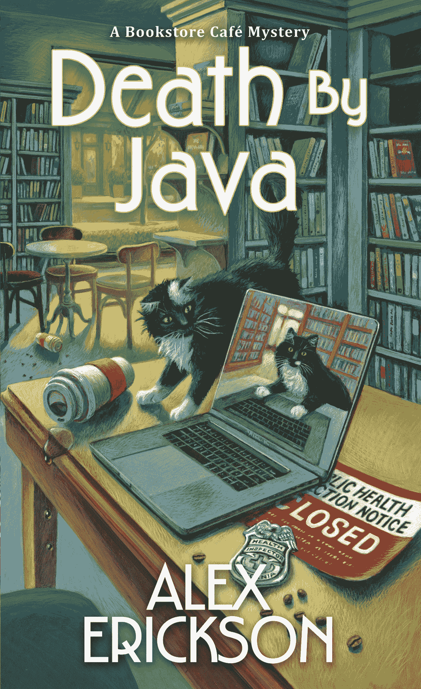

# Java 死亡之道

莱尔在“咖啡之死”（Death by Java）内部被发现。他之所以进去，是因为有钥匙的人让他进去的；我确定这一点。这意味着杀手必然是瓦莱里（Valerie）、米奇（Mickey）或者她的员工之一——那群穿着粉色连衣裙、系着白色丝结的女人。我知道女性也可以像男性一样成为杀手，但很难想象像法拉拉（Farrah）这样的人会杀掉莱尔，尽管莱尔身材很小，而且她当时还穿着一件粉色连衣裙。

而且现场没有血迹。难道是女人中的某一个勒死他的？用钝器击死的？如果是这样，用的是什么？我需要知道死因，才能开始思考。

“杀掉他的人一定有充分的理由，”父亲打断了我的思绪。“我不认为这和某些轻微的健康违规有关。也许他看到了不该看到的东西。或者他在瓦莱里之外还有敌人……”

焦虑感几要涌上心头，我用力捏紧手机压制它。想起 Rita 让我想起了`Death by Coffee`以及我们大楼一直以来的电力问题。这些问题才刚几天前开始的，我们做什么似乎都没什么用。我急切地想给我的合伙人兼好朋友`Vicki Lawyer`打个电话确认一下，但她让我承诺过，我会享受我的假期，并让她来处理。

我又坚持了一个小时，也许是两个，最后还是崩溃拨打了电话。

“我们本该天气很好，”爸爸说，“我们应该计划在未来两周内至少去几次海滩，利用一下好天气。”他尽力转过脖子看看坐在他正后方的保罗，“你以前去过大海滩吗？”

`Paul`摇了摇头。“我没没这个荣幸。”

“你会喜欢的。”爸爸转回椅子，发出一声呻吟，骨头咯咯作响。“我还在想我们可以逛逛村里的一些景点。我们这里很有意思的历史。有些人认为它之所以叫`Redwood Village`是是因为红杉树，但正如你所看到的，这里并没有红杉树。它其实是一种花……”

我让爸爸的声音渐渐远去，将注意力重新回到窗外。我们刚刚进入村里的市中心。这个时间段交通不算太糟糕，但我知道可能会变得很混乱，尤其是在交接班期间。宽阔且维护良好的人行道上人流如龙，路边装饰着各种花卉，在当季还有红杉木草。尽管有这么多人挤满了步道，村子里依然保持着我一直喜爱的温馨氛围。

一抹满意的微笑开始在我脸上散开，但当我的目光落在一家直到那一刻我才听说过的店面时，我的笑容凝固了。

那栋建筑位于繁忙街角的热街上，是人流量的绝佳位置。门上方的招牌画着一杯冒着热气的咖啡，上面写着`Death by Java`字样。底座散落着一些咖啡豆，旁边是一叠叠在一起的书。

“你一定是在开我玩笑，”我低声抱怨。我知道我的高中欺凌者`Valerie Kemp`要开一家咖啡书馆，而且她正用我自己的店作为灵感，但亲眼看到完全是另一回事。

我看不清咖啡馆内部，但我注意到大多数人径之而过，并没有多看它一眼。好奇心和烦躁在心中斗争。我急切地想知道里面长什么样，看看 Valerie 是否完全照抄了`Death by Coffee`的布局，还是她想出了原创的东西。`Death by Java`比我的店要大，但它位于一个更大的镇上，所以规模增加也是可以理解的。

“你想进去看看吗，`Buttercup`？”爸爸问道，用了他从小起就叫我的昵称。

我咬了咬唇。我该进去吗？如果 Valerie 在那里，她会闹出一场面子的。我知道她一定会自豪地解释她的店比我的那么好得多，同时还表现得像是在夸我。

“我们停下来看看吧，”保罗说，捏了捏我的手。“现在解决它比让它一直折磨你的心里要好。”

我不愿承认，但他是对的。如果我不进去看一眼，我会一直纠结这件事直到我进去为止，这会毁掉所有人的旅行。“好吧。走吧。”

`Laura`花了五分钟才为我们找到停车位。又花了两分钟才把我们挤进两辆大车之间的空间。在`Pine Hills`路边停车可能很糟，但在村子里，这一直是一场噩梦。

我们下了车，全身因动作而呻吟。伸了个筋腰后，保罗握住我的手，给了我一个安心的微笑，然后我们四个人走了一小段路到达`Death by Java`。

“好了吗？”爸爸问道，手放在门上。

“没准备好。但还是进去吧。”

他给了我一个安心的微笑，然后推开了门。

“你清楚自己在做什么！”

我们一进去，那声大喊就迎面而来。`Valerie Kemp`留着她喷过的瓶金色头发，修长而优美的双腿，以及挑衅意味的紧致身材，她站在那里，双手——修剪整齐的指甲——有力地插在腰间，对着一个背向我们、戴着棒球帽的矮男人对峙。她穿着高跟鞋和一件紧得过分的蓝色连衣裙，几乎遮不住什么。她看起来正准备好出去彻夜狂欢。

“我去一下洗手间，”爸爸说，带着淡淡的兴趣观察着这场对峙。“我的膀胱不如以前了。”

“我想加入你们，”保罗说。“那飞机飞太久了，我觉得我快要飘起来了。”

“算我一个。”Laura 转向我，“你想一起去探路一下隔间吗？”

“不了，”我说，依然看着 Valerie 和那个戴帽的男人继续争吵。“我没事。”

爸爸和 Laura 走向后方，那里的洗手间用大字标示着一边是男厕，另一个是女厕，在每个下面，用较小但清晰的字体写着`NO EXCEPTIONS`。

保罗犹豫了。

“去吧，”我告诉他。“我会事的。我宁愿在没你们看着的情况下和 Valerie 谈谈。”

男人看了看米奇，又看了看瓦莱里，决定及时止损，转身走出了“Java 死亡”（Death by Java）。我半预料到米奇会在身后大喊一声“以后别再来了！”，但他只是拍了拍手掌，仿佛在拍掉灰尘，然后转身走回柜台后，穿过一扇门走进了后屋。

这使得除了瓦莱里和她的员工外，用餐区只剩下我一个人。

“克里西·汉考克？”瓦莱里说道，目光锁定在我身上。“真的是你吗？”

我嘴边正要否认，但最后笑了。“是我。你好，瓦莱里。”

高跟鞋发出`咯哒`声，瓦莱里走过我们之间的距离，一个拥抱让我大了一惊——那个拥抱几乎只有手臂，我们之间还隔着很多空气。

“见到你真好！”她说，然后转向她的两名员工。“迪。纳迪亚。这是克里西。就是我告诉过你们的那个开小咖啡馆的人。”

迪和纳迪亚都对我露出了僵硬的微笑，然后继续空洞地环顾着房间。

尽管受到了对“咖啡死亡”（Death by Coffee）的讽刺，我还是强撑着微笑。在瓦莱里面前，这种事是在意料之中的。她从不擅长夸奖别人，除了自己。小时候，她是那种傲慢人气女的典型代表，只关心自己，而她显然从未改掉这个习惯。

“那个人是谁？”我问道，朝出口点点头。

“他？”瓦莱里皱了个脸。“莱尔·卡里根。无名小辈。只是个健康检查员，过去一个月左右他一直在尽力让我的生活变得痛苦。”

一个健康检查员。突然间，我对买咖啡没兴趣了，尽管长途飞行后我需要咖啡因。

“什么风让你来加加州的？”瓦莱里问道，后退了一步打量着我。“不看你这打扮，不像为了什么特别的事来的。你在密歇根那边就听说我们这里了？”

“是俄亥州，”我纠正道，“松林丘。”

瓦莱里在脸面前挥了下表示不在乎的手。“随便吧。都一样。”

她的语气真的让我很不不快，这就是为什么当我开口时，烦躁情绪占据了上风：“这儿看起来死气沉沉的。一直是这样吗？”

我本以为瓦莱里会说几句刻薄的话说她的地方比我的好得多，但她让我意外地说道：“我不知道是怎么了。我所做的都是正确的。我看了你的做法并在每个方面都做了改进，但我似乎还是吸引不到顾客！”

也许这和你的态度有关。我抿了抿嘴，准备回敬反击，但谢感谢爸爸、劳拉和保罗恰好在那时候回来，阻止了我开口。

“我感觉好多了，”爸爸加入我们说。“瓦莱里。见到你真好。”

她给了他一个短暂的、不完全算微笑的表情，处于无礼的边缘。

“你点什么吗？”保罗问道，一边拉起我的手。“我想喝咖啡。”

瓦莱里的目光落在在我们的手上，奇怪的是，她僵硬了。“你看到米奇了对吧？他和最近开始交往。他是个好人。他帮店里了很多忙。艾伦和休斯有空也会过来。我似乎没法把他们赶走。”随后是一阵咯咯的笑声。

艾伦是她的前夫，正如我之前提到的，休斯也是她的前任，所以我很难相信这两个男人哪个会过来。话虽如此，瓦莱里选择男朋友又不是基于智力，所以谁又知道呢？

“真不错，”我说，一边拉着保罗的手慢慢朝门口走去。“我们真的该走了了。见到你很高兴，瓦莱里。”

恐慌在瓦莱里脸上闪过。“你知道的，我不介意如果你很快再光临。也许你可以教教我怎么把人招进你的店里？我试过打广告，送过样品，但没什么用。我不确定为什么大家会忽视我们，也许你能……我不知道，帮上忙。”

我环顾了一下咖啡馆，看着这空旷的场所，感到了一丝短暂的内疚和同情。瓦莱里和我从不合得来，但我不是那种会怀恨过去的人。“我会考虑的，”我说。“但接下来的几周是留给家人的。如果有机会，我会——”

“谢谢你！”瓦莱里抓住我另一只空着的手用力捏了。“如果我因为这里的人不知道好东西而被迫关门，我不知道该怎么办。”

我从瓦莱里的手里抽回，努力忍住了一个大大的白眼。“祝你好运。回见，瓦莱里。”

我带路走出门门。当我回到阳光下，远离瓦莱里的绝望感时，如释感涌上心头。我为她感到难过，真的。但我觉得，她那书店咖啡馆的问题更多源于她对待顾客的方式，而不是可见度问题或他们对“Java 死亡”存在的认知问题。

“真有意思，”爸爸在我们关上门后说道。

“闭嘴，你。”劳拉用肘撞了他，尽管她脸上带着笑。

“噢，好吧，那小聚会只有维基和另外几个人。”我想奇那些高中老同学可能在哪里，他们的生活过得怎么样。据我所知，他们还住在村子里，尽管我并不确定。我跟维基读的是同一所大学，所以我们一直保持着联系，但我的其他朋友选择了不同的道路。在那个年代，没有现在这种先进的手机和社交媒体，保持联系并不容易，所以我们慢慢地疏远了。

“我猜瓦莱莉可能不是那些朋友之一。”

我冷哼了一声，再次闭上眼睛。“不太可能。我觉得她只进过一次那房子，也许是两次。我在高中的西班牙语课上和她搭档，为了某个愚蠢的比赛得做辣椒酱。她出现了，眼睁睁地看着我完成所有的工作，还不停地批评我。”

“你赢了吗？”

“没有。获胜的辣椒酱没法吃。他们用了能找到的最辣的辣椒，这意味着它得了所有的票，因为那让萨拉泽先生病了。”

“意料之中。”他咯笑道，然后严肃起来。“那么，睡觉安排是怎样的？”

我没看他，拍了拍床。“大够两个人睡。”

停了一片刻。“你不觉得我应该睡地板上吗？或者在另一个房间？我不介意睡沙发。”

“爸爸不会答应的。如果你不想睡在我身边……”

“噢不，我愿意。我只是……”

“我明白。对我来说也很奇怪。”尽管我已经够大了，本不该如此。这是我住在这里从未从未过真正的男朋友所付出的代价。这让睡在某人身边这么简单的事情变成了一种新体验，一种让我感到奇怪紧张的体验。

“浴室在哪里？”保罗问。“我觉得我需要洗洗脸。”

“右边第一扇门，”我说，朝那个方向比了一个模糊的手势，然后直起身看向他。“你还好吗？这对比你来说不会太过了吧？”

“我很好。”他的笑容里带着一丝不确定。“只是紧张。”

“别紧张。你知道爸爸和劳拉爱你你。”

“我知道。我只是不想引起任何麻烦。”

“你不会的。”

“睡个好觉我就会过去的。”他俯身吻了吻我的额头。“我马上回来。”说完，他溜出门门，轻轻地关上了门。

他一走，我立刻掏出手机拨通了电话。

“嘿，克西，”维基说道，听起来气喘吁吁的。“我猜你顺利到了？”

“平安无事。‘死亡咖啡店’那边怎么样？”

沉默了一下，然后接着说：“很好。梅森看过了——”

我没忍不住；呻了一声。

“别冲我呻。他想干活的时候还是挺能干的。”

“抱歉。”我起身时咕囔道。“刚才的呻不是因为我以为梅森没能力修理任何东西。我的床正试图吃了我。”

“你话里好像有个笑话，我就不计了，”维基说道。“幸好梅森没听到你这么说。”

“噢，我很庆幸。”停顿了一下，然后我问：“他发现了什么？”

“与其说是他没发现什么。灯又灭了，既然梅森当时在场，而且他带着工具，他就去看了一下。他没发现任何问题。所有该亮的地方都亮了，其他一切也都检查过了，无论那是什么意思。我又给电工打了了电话，得到的还是那套托词，谁知道他们什么时候才会来。”

“如果会来的话。”

“我知道。已经三天了，而且似乎变得更糟了。有些不对劲，我担心哪里有短路，如果不处理，最终会引发火灾。”她发出了沮丧的声音。“我甚至不知道这是否可能。我跟街上的其他几个店主聊过，他们没一个遇到问题，所以似乎只局限于我们这地方。”

“你觉得我们应该关门营业吗？”我问，害怕得到那个答案。关门意味着没有生意。没有生意就意味着很难付账单，特别是如果那个电工——一个以慢得像冰闻名的男人——一直拖延不把我们排进日程表。”

“还没。我正在密切关注。而且，你在加利福尼亚。你不应该担心这些。”

“我知道，但是——”

“没有可是。玩得开心点。如果你想惩罚自己，去跟我父母打个招呼。我确定他们有很多话要对你说。”

我笑了。“我打赌。”维基的父母，吉娜和弗雷德里克·帕特森，怪维基没有选择通过拍低预算电影来走他们的后尘，他们并不怕让我知道这一点。“我想我该走了。”走廊尽头，浴室的门吱的一一声开了。“我过两天再回来联系你。”

“你那样做吧。希望那时我有消息。”

就在保罗回来时，我挂断了电话。劳拉紧跟在他后面，穿着跑步短裤和无背心。

## 与保罗的对话

“噢，好吧，那小聚会只有维基和另外几个人。”我想奇那些高中老同学可能在哪里，他们的生活过得怎么样。据我所知，他们还住在村子里，尽管我并不确定。我跟维基读的是同一所大学，所以我们一直保持着联系，但我的其他朋友选择了不同的道路。在那个年代，没有现在这种先进的手机和社交媒体，保持联系并不容易，所以我们慢慢地疏远了。

“我猜瓦莱莉可能不是那些朋友之一。”

我冷哼了一声，再次闭上眼睛。“不太可能。我觉得她只进过一次那房子，也许是两次。我在高中的西班牙语课上和她搭档，为了某个愚蠢的比赛得做辣椒酱。她出现了，眼睁睁地看着我完成所有的工作，还不停地批评我。”

“你赢了吗？”

“没有。获胜的辣椒酱没法吃。他们用了能找到的最辣的辣椒，这意味着它得了所有的票，因为那让萨拉泽先生病了。”

“意料之中。”他咯笑道，然后严肃起来。“那么，睡觉安排是怎样的？”

我没看他，拍了拍床。“大够两个人睡。”

停了一片刻。“你不觉得我应该睡地板上吗？或者在另一个房间？我不介意睡沙发。”

“爸爸不会答应的。如果你不想睡在我身边……”

“噢不，我愿意。我只是……”

“我明白。对我来说也很奇怪。”尽管我已经够大了，本不该如此。这是我住在这里从未从未过过的真正的男朋友所付出的代价。这让睡在某人身边这么简单的事情变成了一种新体验，一种让我感到奇怪紧张的体验。

“浴室在哪里？”保罗问。“我觉得我需要洗洗脸。”

“右边第一扇门，”我说，朝那个方向比了一个模糊的手势，然后直起身看向他。“你还好吗？这对比你来说不会太过了吧？”

“我很好。”他的笑容里带着一丝不确定。“只是紧张。”

“别紧张。你知道爸爸和劳拉爱你。”

“我知道。我只是不想引起任何麻烦。”

“你不会的。”

“睡个好觉我就会过去的。”他俯身吻了吻我的额头。“我马上回来。”说完，他溜出门门，轻轻地关上了门。

他一走，我立刻掏出手机拨通了电话。

“嘿，克西，”维基说道，听起来气喘吁吁的。“我猜你顺利到了？”

“平安无事。‘死亡咖啡店’那边怎么样？”

沉默了一下，然后接着说：“很好。梅森看过了——”

我没忍不住；呻了一声。

“别冲我呻。他想干活的时候还是挺能干的。”

“抱歉。”我起身时咕囔道。“刚才的呻不是因为我以为梅森没能力修理任何东西。我的床正试图吃了我。”

“你话里好像有个笑话，我就不计了了，”维基说道。“幸好梅森没听到你这么说。”

“噢，我很庆幸。”停顿了一下，然后我问：“他发现了什么？”

“与其说是他没发现什么。灯又灭了，既然梅森当时在场，而且他带着工具，他就去看了一下。他没发现任何问题。所有该亮的地方都亮了，其他一切也都检查过了，无论那是什么意思。我又给电工打了了电话，得到的还是那套托词，谁知道他们什么时候才会来。”

“如果会来的话。”

“我知道。已经三天了，而且似乎变得更糟了。有些不对劲，我担心哪里有短路，如果不处理，最终会引发火灾。”她发出了沮丧的声音。“我甚至不知道这是否可能。我跟街上的其他几个店主聊过，他们没一个遇到问题，所以似乎只局限于我们这地方。”

“你觉得我们应该关门营业吗？”我问，害怕得到那个答案。关门意味着没有生意。没有生意就意味着很难付账单，特别是如果那个电工——一个以慢得像冰闻名的男人——一直拖延不把我们排进日程表。”

“还没。我正在密切关注。而且，你在加利福尼亚。你不应该担心这些。”

“我知道，但是——”

“没有可是。玩得开心点。如果你想惩罚自己，去跟我父母打个招呼。我确定他们有很多话要对你说。”

我笑了。“我打赌。”维基的父母，吉娜和弗雷德里克·帕特森，怪维基没有选择通过拍低预算电影来走他们的后尘，他们并不怕让我知道这一点。“我想我该走了。”走廊尽头，浴室的门吱的一开了。“我过两天再回来联系你。”

“你那样做吧。希望那时我有消息。”

就在保罗回来时，我挂断了电话。劳拉紧跟在他后面，穿着跑步短裤和无背心。

“浴室在哪里？”保罗问。“我觉得我需要洗洗脸。”

“右边第一扇门，”我说，朝那个方向比了一个模糊的手势，然后直起身看向他。“你还好吗？这对你来说不会太过了吧？”

“我很好。”他的笑容里带着一丝不确定。“只是紧张。”

“别紧张。你知道爸爸和劳拉爱你。”

“我知道。我只是不想引起任何麻烦。”

“你不会的。”

“睡个好觉我就会过去的。”他俯身吻了吻我的额头。“我马上回来。”说完，他溜出门，轻轻地关上了门。

他一走，我立刻掏出手机拨通了电话。

“嘿，克西，”维基说道，听起来气喘吁吁的。“我猜你顺利到了？”

“平安无事。‘死亡咖啡店’那边怎么样？”

沉默了一下，然后接着说：“很好。梅森看过了——”

我没忍住，呻了一声。

“别冲我呻。他想干活的时候还是挺能干的。”

“抱歉。”我起身时咕哝道。“刚才的呻不是因为我以为梅森没能力修理任何东西。我的床正试图吃了我。”

“你话里好像有个笑话，我就不计了，”维基说道。“幸好梅森没听到你这么说。”

“噢，我很庆幸。”停顿了一下，然后我问：“他发现了什么？”

“与其说是他*没*发现什么。灯又灭了，既然梅森当时在场，而且他带着工具，他就去看了一下。他没发现任何问题。所有该亮的地方都亮了，其他一切也都检查过了，无论那是什么意思。我又给电工打了电话，得到的还是那套托词，谁知道他们什么时候才会来。”

“如果会来的话。”

“我知道。已经三天了，而且似乎变得更糟了。有些不对劲，我担心哪里有短路，如果不处理，最终会引发火灾。”她发出了沮丧的声音。“我甚至不知道这是否可能。我跟街上的其他几个店主聊过，他们没一个遇到问题，所以似乎只局限于我们这地方。”

“你觉得我们应该关门营业吗？”我问，害怕得到那个答案。关门意味着没有生意。没有生意就意味着很难付账单，特别是如果那个电工——一个以慢得像冰闻名的男人——一直拖延不把我们排进日程表。”

“还没。我正在密切关注。而且，你在加利福尼亚。你不应该担心这些。”

“我知道，但是——”

“没有可是。玩得开心点。如果你想惩罚自己，去跟我父母打个招呼。我确定他们有很多话要对你说。”

我笑了。“我打赌。”维基的父母，吉娜和弗雷德里克·帕特森，怪维基没有选择通过拍低预算电影来走他们的后尘，他们并不怕让我知道这一点。“我想我该走了。”走廊尽头，浴室的门吱的一声开了。“我过两天再回来联系你。”

“你那样做吧。希望那时我有消息。”

就在保罗回来时，我挂断了电话。劳拉紧跟在他后面，穿着跑步短裤和无背心。

我不认为事情就是那样，但我还是把它放下了。谈起这些只会让我感到忧郁，就好像我离开了，而这个村庄在没有我的情况下继续运转。*这本就是世界的常态。* 奇怪的是，在你直面这种事实之前，你永远不会那样想过它。“你和爸爸最近怎么样？”我问。

劳拉的笑容点亮了她的整张脸。“其实很好。我搬进那间房子时确实经历过小波折，但更多是因为我对此感到很局促。他在那里住了多年了，而我却搬进来，感觉自己像是在试图取代你妈妈。”她笑着摇头，笑容消失了，“我知道没有别人会那样想，但我控制不住。”

“妈妈会为他感到高兴的，”我说，我是发真心的，“她不希望爸爸孤单。她会喜欢你的。”

劳拉快速地眨着眼睛，用手捂住嘴咳嗽，显然被触动了。她沉默了一会儿才再次开口。“我们谈过搬家的事。”她意味性地看了我一眼，“你知道的吗？找一个完全属于自己的地方重新开始？虽然是他提起这个话题的，但我看得出来他其实并不想搬。”

我的心咯噔了一下。我在这房子里住的时间比我愿意承认的要多，但一想到那里不再是爸爸的房子，我就觉得好像要失去我自己的家了。他的搬家意味着当我回来时，将住在另一个地方，一个陌生的地方。那里将不再像是家了。

“然后呢？”我问。

“我不认为搬家对他有好处。那里有太多的美好回忆了。即使没有，那是一间好房子，位置也很好。我觉得那里像家一样，我知道他也是。”

在前方，红木城市中心映入眼帘。大多数商店已经关门或临近营业，所以交通流量稀少。人行道上还有相当数量的行人，享受着舒适的夜空气，但他们大多数人是为了购物以外的目的出来。酒吧和餐厅可能都坐满了，尽管是工作日，它们也会持续到深夜。

劳拉和我进入了一种舒适的节奏，双腿手臂摆动。我们不是在快走，但也再也不是随意的散步了。多亏于最近的锻炼习惯，我应付得还可以，尽管我的身体对这个时间有点困惑，因为在俄亥俄州的家里，此时我应该正和我的橘色长毛猫“不合群”度过夜晚。

“那里开着灯。”

我朝劳拉指向的地方看去。

`Death by Java`内部确实开着灯，尽管光线很弱。书店咖啡馆外除了几个路过的人，没有人在外面。隔壁的`Tito`熟肉店已经关门了，一片漆黑，这让从瓦莱莉店里透出的柔和光芒显得更加奇怪。

“奇怪，”我说，“也许她正在修理卫生检查员投诉的某些东西。”

“你打算帮她吗？”劳拉在斑马线处停下，然后我们穿过马路，走在通往`Death by Java`的路上。“我们之前离开时，她看起来很绝望。”

“我不确定。”我试着不想太多。

既然我们已经朝那边走了，我们就继续向`Death by Java`走。看一眼并无大碍，并不意味着我计划帮助瓦莱莉。坦白地说，我很好奇。闭门后开灯其实并不怎么奇怪，我无数次在下班后待在`Death by Coffee`。而且，真的，现在还早，黑暗尚未完全降临。

门锁着，门上的告示牌如预期所示，显示书店咖啡馆已打烊。光线是从后屋传来的，门被某种我从外面看不见的东西顶着。光芒稳定了几秒钟，然后发生了偏移，导致光变暗。片刻后，它再次稳定了。

“真奇怪，”劳拉说。

我发出了一个含糊的回应。我感觉到那个地方很诡。灯光的移动让我想起了手电筒而不是顶灯，尽管很难判断，因为后屋的门只开了一部分，我看不到里面的情况。据我所知，那里有一盏台灯，瓦莱莉或她的某个员工曾走过它面前。

“我散步时经常经过这里，但从未见过在这么晚开着灯。”劳拉双手聚在眼睛前，透过玻璃向内窥。

“我们也许该走了，免得别人以为我们在闯入。”没有人理我们，但我感到心里发毛。

劳拉点了点头，我们沿着原来的路往回。

回爸爸家的路上一帆风顺，充满了对未来两周计划的闲聊。购物和海滩之游是议程上的重点，我不能说我对此不开心。不过，在晚上造访了`Death by Java`之后，我在想至少可以和瓦莱莉谈谈，看看能从她的麻烦中了解到些什么。

*并且确保里面真的是她，而不是小偷。* 尽管我不知道为什么会从一家苦苦经营的书店咖啡馆里偷东西。

当我们到达房子时，我已经精疲力竭。劳拉和我静静地进入屋内，屋里的温暖迎接着我们。“晚安，”当我们朝楼梯走时她轻声说。“晚安，”我回答道。

我尴尬极了，逃了出去，决定把卧室的门大开并开灯，不仅是为了今晚，而是为了接下来的整个两周。

# 3

在等待咖啡萃取时，我忍着打了个哈欠。我天刚亮就起床下床了，在去厨房开始煮咖啡之前已经静静地洗完晨澡。`Paul`还在睡得正香，把自己裹在毯子里像木乃伊一样，他 wrapped around himself, as if making sure there was no chance we’d accidentally touch during the night. It was kind of cute—and appreciated, considering Rita’s comments.

Down the hall, a door opened. A few moments later, `Laura` appeared, wrapped in a blue robe that was cinched at the waist. Her hair was only slightly mussed from sleep. When she saw me at the counter, she smiled and came over to join me.

“Did you sleep okay?” she asked as she leaned against the counter.

我用手做了一个比比比的手势。“Let’s just say Rita’s parting shot had me wishing for bunk beds.”

Laura laughed. “You’re not the only one it got to. Your dad spent most of the night at the edge of the bed, like he was afraid you might walk in on us at any moment. I swear, he nearly fell out of it at least twice.”

“I think Paul was about to go sleep on the couch.”

“Maybe we should arrange a little living room campout for the boys. I’m sure they’d love it. It might send them right back to their childhoods.”

“Send who, where?” Dad spoke through a yawn as he entered the kitchen.

Laura winked at me before pushing away from the counter. “Pancakes? I’m cooking.”

等煎饼做完咖啡也上好时，`Paul`加入了我们，looking as rough as I felt. We sat around the small, circular table, like a real family. No one was married here, and Dad and I were the only two who were related, but there was definitely a sense of *right* as we dug in.

然而……

我戳着我的`pancakes`，barely tasting them. They were good, don’t get me wrong, but my mind was elsewhere, and I couldn’t seem to get it focused on the here and now.

“What’s wrong, Buttercup?” Dad asked, setting aside his fork.

“It’s nothing.”

大家在桌旁相视了一眼。

“That doesn’t sound like nothing,” Paul said while the other two nodded.

“It’s just …” I sighed. “It’s Valerie. I know I don’t owe her anything, yet I feel guilty for not helping her when she asked. I’m pretty sure we could all tell that `Death by Java` was struggling.”

“I’m not sure there’s much you can do to save that place,” Laura said. “I hate to say it, but it’s true. There’s a negative vibe that I think the customers can feel.”

“I know.” I stabbed at a square of pancake with my fork and let it hang there, uneaten. “But if she is forced to close and I didn’t at least *try* to give her a few pointers, I’d feel terrible. I mean, it’s not like I’m some great businesswoman or anything. Vicki takes care of a lot of the business side of things, but some of the basics …” I shoved the bite into my mouth, talked through it. “I could do that.”

“Why don’t you talk to her?” Dad asked. “Stop in, take her on a tour of her own place. You could point out any problem areas you see, tell her what you think she should do to fix them. You could talk to her employees, show them how you do things, and if they take your advice, great. If not …” He shrugged. “That’s on them.”

“Your dad and I can show Paul around town while you do that,” Laura said.

“Take him to that park I mentioned yesterday,” Dad added.

我琢磨了一下，露了个鬼脸。“I’m here for you,” I said. “Not Valerie. I’d feel bad skipping out on you for this.”

“You’re here for two weeks,” Dad said. “I’m pretty sure we could spare you for a few hours. It’s not like I’m saying you should spend all day there. Go in, have your say, and then be done with it. It’ll make you feel better.”

“Otherwise, you’ll obsess over it all week,” Paul added.

他是对的，但我不想让他那样。我假装嘟嘴并咕道：“I don’t obsess.”

大家在桌旁再次相视。谢天，没人反驳我，否则我会整天都在纠结*that*那件事。

“We can drop you off once we’re done here,” Dad said. “We’ll take Paul to that park, show him around.” He grinned. “I have a few stories I can tell him about some of the trouble you got into as a kid. Do you remember that time you saw the squirrel go into that hole and you—”

“*Not* another word!”我用叉子威胁性地指向他。

爸爸举起双手投降，尽管那淘气的微笑告诉我*that*little tale wouldn’t be our secret for long.

“Are you sure you don’t want me to come along?” I asked, aiming the question at Paul. “I don’t want you to feel abandoned. We’re here together.”

他把我拉入单臂拥抱，吻了吻我的太阳穴。“I’ll be fine. Go. Help.”

“那么……”我从娜迪亚看向法拉，“你们中有人能帮我大声叫一下瓦莱莉吗？”

沉默了一刻后，娜迪亚说道：“好。我去叫她。”

娜迪亚转过身，*咯哒*着走向后方。法拉盯着我看了会儿，然后从她粉色裙子下面的某处掏出一部手机。她点了几次，粉色的指甲敲击屏幕时发出*咯哒*声，听起来像是在上面划着。

“我猜粉色是制服的一部分？”我问道，换来了一个半带的微笑和一个微妙的点头，我以为那是认同。“你喜欢在这里工作吗？”

“还行吧。”接着，她并不怎么显眼地向我后退了一小步。

*行吧。*我领会了意图并不再提这件事，而是选择对用餐区进行一次更彻底的巡视。尽管快要营业了，但地板上已经有了垃圾，一个座位上还有一抹看起来像巧克力的污渍。洗手间的标志上挂着一个蜘蛛网，我注意到其中一扇门没有完全关上，留下了一个任何人都可以窥视的缝隙。我决定不去看洗手间隔间的情况如何，至少现在不想。

我朝前走回，沿路捡起咖啡杯并扔进垃圾桶。法拉透过手机上方看着我，神情中是不赞同，但当我弯腰捡起一张揉成团的纸巾扔掉时，她并没有叫我停下。

过了五分钟，娜迪亚才回来。瓦莱莉紧跟在她身后飘了出来。

“克丽丝？”瓦莱莉绕过柜台来到我身旁。她穿着平底鞋，打扮比我上次见到她时少张扬了一些，尽管牛仔裤很紧且有时尚的破洞，她的衬衫洁如雪，暗示着她打算避免任何脏乱的工作。“你在这里干什么？”

“你好，瓦莱莉。我想了你昨天说的话，然后……”我张开双臂。“我在这儿。”

当她露出那种虚假的微笑时，鼻子皱了一下出卖了她的心思——那是她试图礼貌、但比任何时候都显得傲慢的笑。“那太棒了。不过现在确实有点不对。”

“你们的制冰机。”顺着她的点头，我说，“我进来时听到你和莱尔在谈这件事。”

“我不知道发生了什么。”她发出一声焦躁的。“我昨晚离开时还好好的。我甚至在关门后回来了一趟，因为我忘了——”

她突然停住，看了我一眼，仿佛我试图诱唆她犯某种犯罪似的。“噢，管那干什么。我离开时一切都井井有序。你在这里时检查过制冰机吗？”

“嗯，没*检查*过。但我在后方，所以我看到了。地板上没有水，我也听到它在制冰时发出了那种嘈杂声。”我考虑了一下，然后问：“你几点离开的？”

“我不知道？也许六点吧？我没留意时间。六点在我去散步之前很久了。我在天快黑时路过这里，看到后方有一盏灯，以为也许是——不。”她的眼睛再次闪躲开。“我离开时灯还是亮的。当我弯腰捡起一张揉成团的纸巾扔掉时，她并没有叫我停下。”

“这里没人，”瓦莱莉强硬道。“灯没开。”

法拉的眼睛从手机上移开。她极短地摇了摇头，然后又回到她忙的事情上。

“看到吧？”瓦莱莉转向我。

“没有。正如我所说，你一定搞错了。也许你看到的是隔壁的反射，或者以为是这里的灯。”

我想继续说下去，但为什么呢？她显然不相信我，或者至少不承认她可能比说的要晚。也许是她自己破坏了自己的机器。但至于她为什么要那样做，我完全不知道。

“如果就这样的话……”瓦莱莉向我离开。“我真的有很多事要做。我正在等修理工，我还有事情要处理。”

打电话叫他来的冲动很强烈，但我知道如果现在离开，我会后悔的。我来这里是有目的，尽管瓦莱莉在顾闪——还有态度——我想把这件事解决。

“我对着店里进行一次彻底的巡视怎么样？”我问。“我会列一份清单，并就你如何改进提供一些建议。你确实想吸引更多顾客，对吧？这就是我们这样做的方法。”

瓦莱莉做了个表情，仿佛一想到我在她的书店里转悠就让她感到恶心。然而，在她拒绝这个想法之前，门开了，一个看起来像冒充修理工的舞男走了进来。他衬衫上面的三个扣子没扣，露出古铜色、无毛的胸膛。腰间松松地挂着一条看起来从没用过的工具带。他穿着短裤和凉鞋，左脚踝上戴着那种绳结脚链。

“罗马！谢天谢地你来了。”瓦莱莉转过身冲向他。“我简直快要担心疯了。”

“嘿，宝贝，”罗马大笑着说，露出了整齐、珍珠般洁白的牙齿。“看起来是什么问题？”

“在后方。”

于是他们一起离开了。

在被遗弃后，我决定直接开始我的巡视，无论瓦莱莉是否许可。

纳迪亚一边嚼着口香糖，一边思考了一刻。“我的意思是，他只是咬了几个人而已。只要不离得太近，你就没事的。”她停顿了一下，“所以，如果你想在这儿待着的话，是不是该买点什么什么啊？”

咬了几个人。

如果莱尔还没见过奥斯卡，我敢肯定他一定很想知道书店里住着一只野浪猫。

但我不想做那个揭发奥斯卡的人。瓦莱里让他留在那儿并不是他的错处。他可能只是在找一个舒服的地方睡觉。这不禁让我纳奇，她到底有没有稍微照顾过他，有没有给他打过疫苗，甚至有没有喂过他。在刚才匆匆瞥了一眼之后，我没看到水盆或食物盆，更不用说猫砂盆了。

下次见到瓦莱里时，我会提一下这件事的。

纳迪亚走向收银台，这显然是在暗示让我点饮料或者离开。

“好吧，”我叹了口气说，“你们有饼干吗？”

扫了一眼空空如展示柜，我知道没有，但我还是问了。现在我真的很想来一块浸过咖啡的巧克力碎饼干。

“现在没有，”纳迪亚说，“制冰机坏了。”

我张了嘴想问制冰机烤饼干有什么关系，但又闭上了嘴，没发表评论，随它去吧。

“黑咖啡就行。”

纳迪亚发出一声无奈的叹息，转身去给我拿咖啡，而法拉继续低头盯着她的手机，对周围的世界漠若闻。

# 4

时间的流逝比“Java 死亡法”（Death by Java）的生意要慢得多，这已经说明了许多问题。我抿了一口咖啡，老实话，味道并没有我预想中那么糟。在完成对用餐区域的巡视后，我走向了书架。我没有入侵奥斯卡的领地；他仍然窝在自己的角落里露营，我不想打扰他，免得变成被咬者之一。

我认出了大部分书名，这很好。这里的组织方式令人费疑，同一个作者的书被放在不同的地方，完全没有理由可言为什么要分开。正如我之前注意到的那样，有些书是叠在一起的，而另一些直立着。虽然楼上有一个员工可以结账的柜台，但现在那里没人，自从我来之后，也没看到有人上去过。

这让我很好奇如果我想买一本书会发生什么。法拉会帮我吗？还是我得把书带下楼去付？纳迪亚几分钟前离开了，尽管我不确定她是去休息了还是已经下班了。由于瓦莱里还没从后面出来，法拉是唯一负责接待顾客的人了。

当然，得先有顾客才行。

我在手机上输入了最后一个笔记，看了一眼时间，然后由于没别的事可做，我走向收银台，法拉在那里正忙碌地盯着她自己的设备屏幕。

“你好，”我说。

法拉抬起头，疑惑地挑了一下单边眉毛，然后直接回去盯着手机，没等我继续说。

我压抑了心中的烦躁。我必须把员工态度加入到我需要解决的问题清单里，但现在不是提这件事的时候。

“我想知道我能不能去后面转转。瓦莱里还在那儿，对吧？”

法拉耸了耸肩。没抬头。

“我这边忙完了，不过如果我能去柜台后面看一眼东西是怎么分类的，会很有帮助的。”

又是一个耸肩。我开始怀疑法拉压根没听进我说的任何话。

“介意我快速看一眼然后去后面吗？我不会挡着你的。”又不是她正忙干什么事。

“随你便吧。”

法拉点点手机，对着她看到的内容笑了起来。

我等了一会儿，然后绕过收银台。我半预料会发现瓶子被胡乱无章地塞在架子上，咖啡袋被倒了，里面的东西洒在地板上。也许还有两滩水。

相反，柜台后的空间非常整洁，所有的东西都妥善密封并正确摆放。是莱尔的影响吗？还是说因为瓦莱里和女孩们确实得在后面工作，她们不想在洒掉的咖啡豆上滑倒？

感到很满意，我转转向后门，门是关着的，而且没有窗户。店的这个区域没有别的门，所以不像“咖啡死亡法”（Death by Coffee），这里没有一个显而易见的办公室。

我瞥了一眼完全没理会我的法拉，推开门走了进去。

瓦莱里和罗马站在几英尺外的制冰机旁，距离近得让人不安。瓦莱里的手按在罗马的脸颊上，嘴角带着娇羞的微笑。罗马手里松散地握着一把螺丝刀，另一只手搭在瓦莱里挺起的臀部上。他们没有亲吻，没有怪异的摸索，但我感觉自己就像是撞见了他们正在做某些比实际发生的情况要“不全级”得多的事。

“呃……”不理性的恐慌席卷了全身。我试图移开视线，却无法做到。瓦莱里男朋友，可她现在却在这儿，似乎在和另一个男人调情。

“你有什么事吗？”她问道，听起来几乎很无聊，随后离开了罗马的怀抱。

“我只是……看看，”我撒了谎，心脏在肋骨处剧烈跳动。

瓦莱里没有回答，她转看向罗马，而我留在了后室冰冷、无菌的光线下。

“搞定。”罗马曼（Roman）直起身子，将螺丝刀甩向空中，灵巧地接住，然后滑进工具带。“这东西不会再给你惹什么麻烦了。”他靠在制冰机上。“当然，我会留在这儿确保它运行一切正常。等你有空的时候，我们再商量报酬的事。”

“谢谢你，罗马曼，”瓦莱莉（Valerie）说道。她避开了我的目光，但我很确定她在转过头看向我之前，向他眨了眨眼。

“所以，你的意思是我得替这群野蛮人收拾垃圾，就因为他们太懒了，自己都不扔垃圾？”

“是你，或者是你的员工之一，”我说。“这是工作的一部分。”

“我是这个地方的主人，所以这不该由我来，”瓦莱莉说道，语气变得沉思起来，“但我可以让我的女孩们去做。”

这是个开始。

“我把清单发给你，”我说，“让她们在接下来的几天里处理一下，我肯定你会开始看到业务额的增长。这可能需要一些时间，但一点口碑会起很大作用。”

瓦莱莉报出了她的手机号码和邮箱地址。我将两者都存入了联系人，然后把做好的清单发给了她。接着，我推开门带路回到前台，瓦莱莉尽职地跟在后面。她竟然在听我的，简直是个小奇迹，所以我决定指出几个更紧迫的问题。

“现在，还有关于猫的问题。我——”

“克西·汉考克（Krissy Hancock）？是你吗？”

听到那个似曾熟悉的声音，我停下脚步，导致瓦莱莉撞到了我身上。

“老天，真的是你啊。伙计们！是学校的克西。”

三个我以为这辈子再也见不到笑脸出现在柜台的对面。我的大脑花了一点时间来计算高中以来的岁月，但很快就对上了脸和名字。

布雷·埃克莱斯（Bray Eckles）左眼上方还有那块大黑痣，这在他青少年时期并没有减损他的帅气，现在也是如此。塔玛拉·凯瑞（Tamara Carey）曾拥有超级模模的身材，这些年变得丰满了，尽管她的穿衣风格依然像是随时准备好走红毯。而贝比·隆（Bebe Long）还是，嗯，还是贝比。她看起来和几十年前一模一样。深色的头发。透着妩媚感的褐色眼睛。皮肤如玻璃般完美无瑕。

用两个词形容，她们就是瓦莱莉的小跟班。

多年遭受言语虐待的本能让我想要逃进后屋。我不确定这几个人是否曾有哪一个对我说过一句好话。也许这些年来他们也给过一两次明里暗暗的赞美，就像瓦莱莉喜欢说的那种，但没有一句是真诚的。

“克西？”塔玛拉歪着头，显然没认出我。

“是啊，小个子，”布雷说道，“你记得吧？我们以前经常和你开玩笑。”他转转向我，“在一起在一起可开心了。不是吗，克西？”

开玩笑并不是他们做过的事，但我笑了并点了点头。

“好，我记得。”

“噢是，”塔玛拉说道，上上下打量着我，“这些年你真的丰了很多，不是吗？”

我用力咬住唇，差点出血。是的，我高中时要瘦得多，但我认识的几乎所有人都是如此，包括塔玛拉。

“你怎么回这儿了？”布雷问。“我以为你跟着维基·帕特森（Vicki Patterson）搬到俄亥州了。”

“等等，他们在一起过？”贝比问道，她直到那为止几乎没怎么注意。

“没，她离开时是在和罗伯特·邓希（Robert Dunhill）交往，”布雷说道，令我很惊讶他竟然记得，因为罗伯特和我是在高中之后才认识的。“他们现在可能结婚了。”

“实际上——”还没等我告诉他们罗伯特和我已经在离开之前就分手了，或者她现在姓维基·劳耶（Vicki Lawyer）了，门开了，保罗（Paul）走了进来。

看到他就像感受到一阵清凉舒爽的风。我冲出柜台后，飞快地向他跑去。当我抓住他的手时，动作就像一个极度渴望拯救的人，坦白说，我确实是那样。

我亲了他的脸颊，然后问：“爸爸和拉拉在哪？”

“他们决定走回去，把车留给我了。”他一边给我看钥匙，一边盯着那三个人。瓦莱莉似乎被保罗的出现吸引了，绕过柜台加入了她的伙伴中。

“你的朋友？”他问。

“当然是朋友。老朋友了，”布雷说道，笑得很发自真。“克西年轻的时候很有趣。”

很有趣的捉弄对象。

“抱歉，伙计们。我希望留不下，我和保罗有地方要去。”

贝比和塔玛拉似乎并不在意，但布雷看起来很失望。他真的会认为我们曾经是朋友吗？我明白并不是所有人都能意识到过去的行为，但他绝不可能忘记那些我因为他们的言语虐待而几乎落泪的时刻。他可能忘记吗？

“啊，哥们儿，”他摇着摇头。“我希望我们能叙叙旧。”他的眼睛睁大了。“我知道了！你们这周六晚上来 `Hooties`，大约……”他看向其他人。当他们没有跳出来提建议时，他又看向其他人。

“给他们几分钟，”我说道，把托盘放在桌子中间，“否则你们会烫着自己的。”

“嘿，克丽西，”保罗说，朝我肩膀后方的某点点了点头，“那不是我们昨天在‘Java 死亡之旅’看到他正和瓦莱莉争吵的那个家伙吗？”

我转过头，惊讶地看到 `Lyle Carrigan` 正在从办公室后面匆忙走出来，腋下夹着平板电脑。意大利卷饼店（Italian Roll）的老板 `Marco Rossi` 皱着眉跟在他后面。他看着莱尔离开，然后沮丧地摇了摇头，走回了柜台后方。

“你觉得这里有违反卫生规定的行为吗？”保罗问道，他拿起一个披萨卷，然后又迅速地把它放回托盘，对着自己发红的指尖吹了气。

“我不知道。”我的脑子里进行了一场短暂的斗争，然后我站了起来。“我马上回来。”

“克丽西……”

“我知道，我知道，”我说，“但如果这个叫莱尔的家伙在纠扰镇上多家店，可能会让瓦莱莉感觉好受些。”我不知道自己为什么这么在意，但我确实在意。“给我五分钟，然后我们就可以吃了。”

保罗叹了口气，但点了点头。我留下他自己对付烧伤的手指，来到柜台加入了马可的行列。

“有什么可以帮你的吗？”他问道，几乎没有从收银机上抬起头。

“你好，马可。你可能不记得我了。我小时候经常来这里。”

他抬头看了一眼。他的眼神里甚至没有一丝认出的意思。

“很高兴你回来了。点餐了吗？”

“点过了。我们只是在等它凉。”我笑了笑，得到的却只有一个注视。“我在想……”我瞥了一眼莱尔刚刚离开的门口。“那个是莱尔·卡里根，对吧？那个卫生检查员？”

停顿了一下。

“是吧。”

“这里没问题，对吧？我很喜欢这个地方，而且——”

“不，不，不是那样的，”马可说道，“莱尔和我认识很久了。”

“我懂了。”我偷了一眼保罗。他试图再次拿起另一个披萨卷，结果又把它掉回了托盘。“我在‘Java 死亡之旅’和 Tito 熟食店见过他，所以有点好奇奇。看起来他经常在附近转悠。”

马可叹了口气。“莱尔在履行职责，尽管并不是所有人都能理解。这很遗憾，因为我我很想把‘意大利卷饼’搬到镇上的那个区域，但我的出价没人比。他们为什么不能让自己的店符合标准，特别是在这样一个充满潜力的地区，我永远不知道。”他摇了摇头。“失涵我一下，我需要……”他指向了收银机。

感谢他的时间后，我回到桌边。

“一切还好吗？”

“看起来不错。”

那个女人可能错了吗？瓦莱里（Valerie）看起来很沮丧，但这可能是因为那个留着胡子的警察不让任何人进去，而不是有人去世了。既然瓦莱里显然还健康无恙，我心中涌起一丝模糊的希望，希望这一切只是一个糟糕的传言，确实是制冰机引起了骚乱。

但我迫切想知道真相。

我果断决定，向前一步。

皮尔警官（Officer Peel）立即举起一只手，掌心朝外。“禁止进入。这里是犯罪现场。在另行通知之前，这里关闭了。”

“我不是顾客，”我说，听到“犯罪现场”三个字不由得缩了缩脖，“我最近一直在帮老板。”我向瓦莱里点了点头，她还没注意到我。“如果有什么我可以帮忙的什么——”

“你现在的帮忙就是后退一步。”

“至少告诉瓦莱里我在这儿。她是老板，瓦莱里·坎普（Valerie Kemp）。”我露出我最完美的微笑。“我是克丽西·汉科克（Krissy Hancock）。那是我爸，詹姆斯·汉科克（James Hancock）。”

如果我曾希望提一下当地著名作者的名字会有帮助，那我就太失望了。皮尔警官只是调整了一下眼镜，挺了挺他瘦削的肩膀。“不准进入。后退，否则我得带你回留。”

“我听有人去世了，”我说，“你至少能告诉我那是真的吗？”

皮尔警官抖着胡子，双手交叉在胸前。他的下颌动了动，虽然我看不到他的眼睛，但我感觉到他在纠结是该执行他逮捕我的威胁，还是干脆无视我。

还没等他做出决定，门就被推开了，一个神色慌乱的瓦莱里·坎普出现了。“克丽西！”她抓住我的胳膊，硬生生地把我拉过了受惊的皮尔警官。“告诉她，这件事与我没关系！”

我踉跄着走进 `Death by Java` 的门口，差点脸朝地摔在了一个穿着西装裤和深蓝色衬衫、双臂交叉的高个黑人女性面前。她的头发紧紧地向后梳，露出一张惊人的脸，高高的颧骨和极其光滑的皮肤让她那清澈的棕色眼睛在脸上脱颖而出。那双眼睛眯着看着我，似乎表明她并不喜欢我的突然出现。

“告诉麦肯西侦探（Detective McKensie）！”瓦莱里催促道。“克丽西昨天在这儿。她看到他离开了。他那时还活着，之后就再也没回来过，在我们在这儿期间。问问她吧！”

那个女人——侦探——没有问。她只是盯着我。

“我们在说谁呢？”我问，“我不知道发生了什么。”

沉默过了一刻，我确信麦肯西侦探会一句话不说直接把我扔出去。她打量着我，就像看汤里的小虫子一样，然后重重地叹了口气。

“我想既然你在这儿，我应该听听你想说什么，”她说。她的声音像黄油一样顺滑，几乎带着磁性。如果情况不同，这种声音会让大多数人对她心服口服。

“克丽西，是吧？”

我点了点头。“克丽西·汉科克。”

“你住在这里附近吗？”

“以前住。我现在住在俄亥俄州。我来这里探亲。”

她的眼神向瓦莱里闪烁了一下，搞得我差点笑出来。

“不，我们没有亲缘关系。我们是高中同学。我跟我爸在这儿。”我隔着门指向他。他还是站在我离开时的那个地方。

“我明白了。你昨天也在这儿？”

“我在这儿。”我瞥了一眼房间里的其他警察。他们正观察着这场互动，面无表情。现场没有别人了。“谁去世了？”

麦肯西侦探听到问题后抿了抿嘴唇。她没有其他回答。

“克丽西在这里待的时间几乎和我我一样长，”瓦莱里说。

“工作？”侦探问，眼睛盯着我。

“不，”我说，“不完全是。我在俄亥俄州有一家书店咖啡馆。瓦莱里想让我到处转转，看看她可以如何改进她的店来吸引更多生意。”

“‘改进’是个很重的词，”瓦莱里说道，这引来了一个白眼，随后麦肯西才转回看向我。

“你在这儿的时候看到其他人了吗？”

“当然有瓦莱里，”我说，“还有她的两个员工，纳迪亚（Nadia）和法拉（Farrah）。我不知道她们的姓。”

麦肯西侦探点了点头，仿佛我只是证实了她已经知道的事。

“我在这里干活时来过一个修理工。他叫罗马曼（Roman）。”我睁大了眼睛。“死的是他吗？”

“请停止猜测，”麦肯西侦探说，“那是完整的人员吗？顾客？其他员工？”

我开始摇头，然后想起来。

“莱尔·卡里根（Lyle Carrigan），”我说，“我到这时他已经在那儿了。他还有两个顾客。他们把杯子留在桌子上……”

当麦肯西的表情变暗时，我的声音变小了。“莱尔本要因为制冰机坏了对瓦莱里进行指控，而那正是罗马曼来这儿修的。”

“你见到卡里根先生了？”

“我见过。他和瓦莱里在争论——”

“‘争论’是个很重的词，”瓦莱里说。

麦肯西对瓦莱里做了一个闭嘴的手势，然后向我走近了一步。“卡里根先生什么时候离开的？”

“他是死掉的那个，”我说，并不是疑问。在那刻，根据提问和瓦莱里对问题的反应，这是显而易见的。

瓦莱莉极力忍受着。她盯着自己那双华丽的鞋尖看了好几秒钟，然后颓然了下去。

“罗宾斯。他的名字叫米基·罗宾斯。”

当麦肯西侦探问道“罗宾斯先生昨晚在哪儿？”时，她的语气里没有任何得意的感觉。

在瓦莱莉回答之前，门开了，皮尔警官探出头进来。“侦探。外面来了一个警察。他说想和你聊一会儿。”

当 `McKensie` 说“让他进来”时，她的眼睛一直没有离开过瓦莱莉。

`Peel` 犹豫了一下，抽动着胡子须显示出他的不耐烦，随后他消失在门外。

“米基是无辜的，”瓦莱莉说，“他整晚都跟我在一起。”

即使是我也不相信她，而且我并没有受过识破谎言训练。瓦莱莉真的不擅长撒谎。她的眼睛在房间里乱转，声音语调起伏不定。也许这些并不是欺骗的迹象，但确实让她看起来很不像在说真话。

我身后的门开了。我本以为会有另一个红木村的警察进来，但进来的却是保罗·达尔顿，他穿着跑步短裤和无袖背心。

`McKensie` 看到他时似乎也和我一样惊讶。

“你是？”

“保罗·达尔顿警官，”他一边走上前，一边拍了一下我的手臂，伸出一只手。“松树丘警察局的。我知道这不是我的管辖范围，但我想顺路过来看看能不能帮上什么。”

“我猜松树丘是在俄亥俄州？”`McKensie` 说，“你就是前面提到的那个男朋友？”

我再次对 `McKensie` 反应如此之快感到惊讶。

“是的。”

保罗的笑容一如既往地迷人。“是的。我是他。克丽西遇到麻烦了吗？”

麦肯西侦探笑了。“没有。她可以走了，不过如果她能把联系方式留外面的 `Peel` 警官，我会很感激，以防我还有后续问题。”

我松了一口气。“我们不打扰你们了——”

“事实上，”`McKensie`打断了我的话，“我想和这里的达尔顿先生聊几分钟。”她朝门口比了比。“你可以在外面等他。”

反对的话已经到了嘴边。保罗知道的没我多得少。他现在出现在这里是因为他正好在外面跑步，看到了动静。他可能发现了爸爸的车，或者是发现了爸爸本人，于是过来调查。然后，在听到我在里面和警察交谈后，他进来确保我一切无事。

*或者为了确保我没有让自己卷入一场谋杀调查。*

“去去吧，”保罗说，“这只需要几分钟。”

尽管如此，我还是犹豫了。我想知道`McKensie`侦探会问保罗什么，她是会核实我的说法，还是会试图在故事中找破绽。保罗是对的；这不是他的管辖范围，她为什么要找他谈话？他帮不上她。他不是这里的警察。

不过话说回来，我也不是。我在*任何地方*都不是警察。

“我和爸爸在一起，”我说。我接过他的手，捏了捏，然后朝门口走去。

爸爸在稀疏许多的人群中等着我。“还好吗？”他问。

“不太好。”我交叉双臂，不安地跺脚，紧张得无法站稳。我低声问：“你还记得那个健康检查员吗？第一天来这里的那个？”

“我记得。”停顿了一下，然后说，“是他吗？”

“是的。我不知道发生了什么，但里面的侦探表现得就像是*谋杀*一样。”我几乎是耳语出这个词，但它引起了周围人的注意，他们立刻开始交头接耳。

提托附近的动静引起了我的注意。我本以为是提托回到了外面，或者是他的某个员工走了出来看热闹，但这两者都不是。

是米基·罗宾斯。

“爸爸……”我低声说，指了指米基站的地方。

“我看到了。”

米基正伸着脖子看`Death by Java`内部，但他并没有走得近到让`Peel`警官注意到他。事实上，尽管他显得很紧张，但他极力让自己在*所有人*面前显得不显眼。他用左手揉着右手，起初我以为那只是紧张的动作，但很快我意识到不仅于此。他的右手指节上缠着绷带。我不确定，但那只手的指似乎肿了，好像他击中了足够硬的东西，被打断了两根骨头。

米基观察这一幕整整好了一分钟，也许两分钟。然后，在环顾四周确保没有看到后，他悄悄离开了。

# 6

“你还好吗，小宝贝？”

我低头看着咖啡，不理智地希望自己喝的是最近习惯了的那种香料奶茶。在倒咖啡前放进那个缺口咖啡杯里的巧克力奇干饼产生的泡沫早已消失，几块软塌塌的碎屑浮在水面上。爸爸声称，杯上的缺口是象征性的。他说这反映了生活中，即使是受损的东西仍然可以发挥作用。事实上，他对待碗具和低水龙头时总是粗心。

“我猜松树丘是在俄亥俄州？”`McKensie`说。“你就是前面提到的那个男朋友？”我再次对`McKensie`反应如此之快感到惊讶。

“是的。”

保罗的笑容一如既往地迷人。“是的。我是他。克丽西遇到麻烦了吗？”

麦肯西侦探笑了。“没有。她可以走了，不过如果她能把联系方式留给外面的`Peel`警官，我会很感激，以防我还有后续问题。”

我松了一口气。“我们不打扰你们了——”

“事实上，”`McKensie`打断了我的话，“我想和这里的达尔顿先生聊几分钟。”她朝门口比了比。“你可以在外面等他。”

反对的话已经到了嘴边。保罗知道的没我多少。他现在出现在这里是因为他正好在外面跑步，看到了动静。他可能发现了爸爸的车，或者是发现了爸爸本人，于是过来调查。然后，在听到我在里面和警察交谈后，他进来确保我一切无事。

*或者为了确保我没有让自己卷入一场谋杀调查。*

“去去吧，”保罗说，“这只需要几分钟。”

尽管如此，我还是犹豫了。我想知道知道`McKensie`侦探会问保罗什么，她是会核实我的说法，还是会试图在故事中找破绽。保罗是对的；这不是他的管辖范围，她为什么要找他谈话？他帮不上她。他不是这里的警察。

不过话说回来，我也不是。我在*任何地方*都不是警察。

“我和爸爸在一起，”我说。我接过他的手，捏了捏，然后朝门口走去。

爸爸在稀疏许多的人群中等着我。“还好吗？”他问。

“不太好。”我交叉双臂，不安地跺脚，紧张得无法站稳。我低声问：“你还记得那个健康检查员吗？第一天来这里的那个？”

“我记得。”停顿了一下，然后说，“是他吗？”

“是的。我不知道发生了什么，但里面的侦探表现得就像是*谋杀*一样。”我几乎是耳语出这个词，但它引起了周围人的注意，他们立刻开始交头接耳。

提托附近的动静引起了我的注意。我本以为是提托回到了外面，或者是他的某个员工走了出来看热闹，但这两者都不是。

是米基·罗宾斯。

“爸爸……”我低声说，指了指米基站的地方。

“我看到了。”

米基正伸着脖子看`Death by Java`内部，但他并没有走得近到让`Peel`警官注意到他。事实上，尽管他显得很紧张，但他极力让自己在*所有人*面前显得不显眼。他用左手揉着右手，起初我以为那只是紧张的动作，但很快我意识到不仅于此。他的右手指节上缠着绷带。我不确定，但那只手的似乎肿了，好像他击中了足够硬的东西，被打断了两根骨头。

米基观察这一幕整整好了一分钟，也许两分钟。然后，在环顾四周确保没有看到后，他悄悄离开了。

“你还好吗，小宝贝？”

我低头看着咖啡，不理智地希望自己喝的是最近习惯了的那种香料奶茶。在倒咖啡前放进那个缺口咖啡杯里的巧克力奇干饼产生的泡沫早已消失，几块软塌塌的碎屑浮在水面上。爸爸声称，杯上的缺口是象征性的。他说这反映了生活中，即使是受损的东西仍然可以发挥作用。事实上，他对待碗具和低水龙头时总是粗心。

“我怀疑他们甚至不会获准开门，所以我我不确定能做什么，”我说，“我已经给过`Valerie`一份她可以修改的清单，只要她按照那个清单做，我就没什么可为了。而且如果我跑去她家找她谈谈，她可能会直接把我踢出去。或者根本无视我。”

“但如果你愿意努力，向她表现出你的诚意，她可能对你的态度会软化一些，”爸爸说道，“我知道在你小的时候，`Valerie Kemp`并不是你最喜欢的人。你试图掩盖这一点，但我看到她是怎么对待你的。”他简短地抿了抿嘴，接着继续道，“但人会变的。我知道她现在很难相处，但总有一种可能，那是一场戏，是她维持面子的方式。”

“装作一个得自是的坏蛋女孩的面子吗？”劳拉问道。

我考虑了一下。我不认为`Valerie`有了多大的变化，但这重要吗？一个男人死了。这事发生在她的书店咖啡馆里。

她认识的人可能卷了其中。

“Mickey的手包着，”我说，“而且他没有试图进去查看`Valerie`。如果他没做任何错事，你不认为他至少会*尝试*穿过`Mr. Mustache`去确保她无事吗？”

“`Mr. Mustache`？”劳拉笑着问。

“外面的那个警察。警官……”我皱起眉。

“`Peel`，”爸爸提供了信息，“他的名牌上写着`Peel`。”

“就是他。”我的手指在桌子上敲击着，“`Officer Peel`守着门，但我成功绕过了他。”当然，`Valerie`把我拉进屋子让他有些措手不及，但我还是进去了。“Mickey躲在视线之外，表现得像是不希望任何人看到他。我上次看到他时，手还是完好的。”而那恰恰就是他几乎威胁过`Lyle Carrigan`的一天。

“你真的觉得这个叫`Mickey`的家伙是杀手吗？”爸爸问。

“我不确定是否*真的*有杀手，”我说，“侦探是在假设`Lyle`被谋杀的前提下工作的，但她并没有直接说是他。这可能是场意外。也许`Lyle`是非法呆那里的，然后心脏发作或类似的情况。她可能是在试图弄清楚他为什么在那儿。”

当然，根据她问的问题，我怀疑不是那样。`Lyle`被谋杀了。`Valerie`的男朋友是头号嫌疑人，至少在我心里是这样。一旦`Detective McKensie`知道了他的受伤和可疑行为，他也会成为她的目标。

“假设这*是*谋杀，”爸爸说，“我们知道什么？”

我考虑了一下，说道：“Mickey冲到`Lyle`脸前，警告他离开`Valerie`。”

“`Death by Java`现在已经很挣扎了，”爸爸补充道，“如果卫生检查员把他们关停掉，哪怕只是几天，也可能对他们伤害太大，让他们不得不永久关闭。”

“冰冰机昨天坏了，”我说，“`Lyle`坚持要为了这件事给`Valerie`开罚单，说他以后会回来检查。”

“这让Mickey不爽，他之前已经告诉过`Lyle`放远点。”

“所以，他对质了健康检查员，可能是在检查员回来执行检查的时候。”

“然后，*砰！*”爸爸用拳头撞了一下手掌。“他杀了他。也许是意外。也许`Lyle`拒绝退缩，他在对方来得及提交报告之前解决了他。”

“但为什么要把尸体留在`Death by Java`呢？”我问。

“他可能恐慌了。”

“或者有人路过。”我仔细思索着，“如果这件事发生在清晨，比如，就在开门之前，第一批员工到达之前……”

“他们吵吵起来，Mickey杀了他，但他没有时间在有人出现之前处理掉那个检查员。他从后门溜出去——”

“我不确定有没有后门，”我说，“或者至少，我在那里的时候没有注意到。”话虽如此，当时我进后面时被`Valerie`和`Roman`分了些神，所以也有可能我忽略了。”

“好，那么也许他躲在某个地方，等尸体被发现后，再趁混乱溜出去，”爸爸修正道，“他之后又回来看看发生了什么。就像那种杀手回到犯罪现场的陈词滥调。”

“你们两个真是不可理喻。”劳拉起身摇了摇头。

“你的意思是，我们是极其出色的侦探，而且可能处于正确的轨道上，”爸爸对我眨了眨眼。

劳拉翻了个白眼。“我要去找`Find`部轻松的电影，洗洗我脑子里这些关于谋杀的话题。你们两个想和我一起去吗？”

“我去弄爆米花，”爸爸站起来伸了个懒腰，“我觉得我们都需要休息一下。你觉得呢，小菊？”

现在吃爆米花和看电影有点早了，但话虽如此，这一天已经够长了。几个小时的无脑娱乐听起来是让自己自己远离麻烦的完美方式。

“好，”我说，“看电影很棒。”

提到瓦莱莉；她一定看到我们走过来了，因为当我和父亲走到门口时，她已经为我们开着门。

“警察今天让我们关门歇业了，”当我们进去时，她说，“可能要关一周了。我不知道我该怎么办。”

餐厅里空空如也，只有我们三个人。大部分桌子上都放着`Death by Java`的咖啡杯。我猜警察是把它们留下的，因为顾客们肯定没留这么多。大部分杯子都是空的，但附近一张桌子上的三个杯还有半满，正冒着热气。

“你为什么在这儿？”瓦莱莉交叉双臂，看着我问道，“来幸灾乐祸的吗？”

“我想来看看你的情况，”我说，“看看我能做什么帮到你。”

“我们很担心，”父亲补充道。

瓦莱莉眨了眨眼，用手指擦了一下眼角。“没必要担心。”她的语气却说明不是。

“瓦莱莉——”我被打断了，这时浴室门开了，两个男人悠闲地走了。

我一眼认出了`Hugh`，瓦莱莉的前男友。一头金色的头发垂在他满是雀斑的鼻子旁。他皮肤黝黝的，对于瓦莱莉通常喜欢的类型来说，身材显得有些瘦。我不认识他的姓，只知道他曾和瓦莱莉交往过，并曾帮她为`Death by Java`做过研究。我所说的研究，是指他偷偷溜进`Death by Coffee`拍照并报道我所做的每一件事。

然而，另一个男人，我花了一会儿时间才认出来。

我已经多年没见过`Aaron Middleton`了，他是瓦莱莉的前夫。在高中时期，他是运动明星，她是她的啦啦队队长。他不像`Mickey`那么强壮，从来不是，但看起来依然很精干且有肌肉。他留着小络胡，考虑到他头上浅褐色的头发，胡子显然是漂白过的。甚至他的眉毛似乎也做过手术，考虑到我对`Aaron`所做过的事，这并不令人意外。

“嘿，Val，你出来——”`Hugh`在看到我和父亲时打断了。

瓦莱莉露出一丝勉强的微笑。“Hugh，你还记得`Krissy`吧？”

`Hugh`点了点头，似乎被我的出现震得说不出话。

在他旁边，`Aaron`挠了挠小络胡。“你是Hancock家的孩子吧？我想我记得你。”

如果他真的记得，我会很惊讶。在高中时，他并没有瓦莱莉那样对我表现出敌意。事实上，我不确定他是否注意到过我，即使我就站在他面前。像`Aaron Middleton`这样的人通常不会理圈子之外的任何人。

“我是`James`，”父亲走上前伸出手，“Krissy的父亲。”两个男人握了手。“听到这个消息我很难过。是谋杀吗？”

直奔主题，不愧父亲的风格。

“看起来像是，”瓦莱莉说。

“警察有办法是谁干的吗？”我问她。

“我怎么知道警察怎么想？”她皱着眉，看着地方唯独不看我。

于是我直接问她：“`Mickey`怎么样？”

“他怎么了？”瓦莱莉说话时下颌紧绷。“他当时不在人儿，他怎么知道是谁杀了`Lyle`？”

“瓦莱莉……”我向她走了一步，低了声音，“警察在这里时，我在外面看到了`Mickey`。他的手包着绷。”

“那又怎样？他跟这一切没关系。”

“发生了什么？”父亲问道，“我假设`Lyle`是在`Death by Java`里面去世的？”

瓦莱莉抱着自己点了点头。“在后面。”停顿了一下，然后说，“我可以给你们看。”

我惊讶地眨了眨眼。“警察没有封锁那里？”

她摇摇头。“没必要。他们带走了所有的证据，而且现场并没有什么血。他们告诉我不要再回去，但偷偷看一眼又伤不了什么。”

“你们两个去吧，”父亲说，“我留在这里。”他给了我一个意味深长的眼神，然后微微看向`Hugh`和`Aaron`。*他会和他们谈谈。*

瓦莱莉带路绕过柜台来到后门。她在那里短短地停了一下，似乎在怀疑自己的决定，然后推门进去。她为我开着门，然后开了灯。当门在我们身后关上时，她指向房间尽头的另一扇门，那是我之前没有注意到的门。“他被发现在那儿。”

正如她所说，地板上没有血，没有任何迹象显示发生过任何不顺。“那扇门通向巷子吗？”我问。

她点了点头。“那是我们放垃圾桶的地方。我从不在那条路进出，所以我认为是别人忘了没锁门，他就进来了。可能有人在跟着他。也许是抢劫犯之类的。”

当然，问题是，为什么`Lyle`会从一个没锁的巷子门里溜进进来，即使他正被小偷追赶，但我没有问。“有打斗的痕迹吗？”我反而问道。门看起来很陈旧但完好。没有被踢开过的裂痕。门周围地上也没有碎片。

“他死了，”瓦莱莉面无表情地说。“难道不说明发生过斗争吗？”

我深吸了一口气，心里数了三秒，才开口。“我的意思是，房间里有没有东西被撞倒？”我指了指周围的架子，它们都很整齐。

“这就是为什么在我们离开之前，你想去那条小巷吗？”

我点了点头。“门框上，甚至锁周围，连道划痕都没有。我确定有其他方法不用钥匙就能打开门，但完全没有任何痕迹，这让我怀疑是不是杀手有钥匙并让他进得来的。”

“门还是可能被撬开的，”爸爸说，“如果你想看的话，我可以给你演示一下？”

我考虑了一下，摇了摇头。“不用，没事。”爸爸有一套开锁工具，那是他在为自己的一本书做研究时学会使用的。詹姆斯·汉考因为追求写作的准确而有很多才华，但如果他真的使用这些才华，大部分会让他处于法律的对面。“我相信你。但是……”

“我明白。如果你愿意，我们可以详细聊聊，”他说，“我是那场谋杀。当你和瓦莱莉在后面时，我确实和那两个年轻人谈了。我想他们是她的前男友。”

“呢？”

“他们都声称对谋杀案一无所知。”

“这并不意外。”

“不，并不意外，”爸爸赞同道，“但他们*确实*暗示那个叫米基的家伙可能参与了。”

瞥了他一眼。“他们说为什么那样想吗？”因为如果`Aaron`或`Hugh`想要回瓦莱莉，指控她的男朋友杀人是一个除掉他且不弄脏自己手的好办法。

“没有直接说。他们都提到米基本应该守在瓦莱莉身边的，质问他为什么不在。他们还提到了他的脾气，说他们多次看到他对卫生检查员大吼。从他们说话的语气，好像他爆发并杀了对方只是时间问题。”

如果`Hugh`和`Aaron`不是瓦莱莉的前男友，那这话就有意义了。他们可能只是嫉妒米基，单纯想让他消失。

但他的手*确实*包了着。

“制冰机被凹陷了，”我说。“莱尔（`Lyle`）的尸体是在门口发现的，但这并不意味着战斗是从那里开始的。”

“你是说你认为发生了肢体冲突？”爸爸问。

“是冲突，或者是一场升级到有人拳击制冰机的争吵。我无法理解的是，莱尔为什么会在那里。”

“警察知道他是什么时候被死的吗？”爸爸问。“如果他是那天晚上关门左右出现的，可能发生在那时，而不是今天早晨。”

“也许吧。”我皱着眉，盯着远方。“但我总是在早上在`Death by Java`看到他。最晚也是下午早。他说他回来检查制冰机，但为什么不等等到正常的时间呢？而且关门时周围会有人。在街上。在咖啡馆里。我的意思是，我很确定他们关门时天还没亮。在大光天日下杀人很难。”

“所以，你认为他是在开门之前出现的，那时天还黑，然后和米基发生了争吵——”

“或者和任何开门的人。”

“——然后呢？他们杀了他是因为他仍然计划因为制冰机给他们罚单？这似乎不值为了杀命。”

不，不值。除非他打算更进一步。但一个卫生检查员除了开具罚单并可能让地方关门，还能做什么呢？

几个跑步者路过。其中一个狗主拽住了小狗，向另外两个说了*再见*。松鼠在某个时候离开了它们的栖息地，半矮墙除了一个被丢弃的橡果壳外空空如也。

“瓦莱莉不会杀他的，”我说。“我不认为她会让米基去做。”

“但如果不是他，是谁？”

到底是谁呢？

我仔细思索了一下，想出了几个主意。莱尔是在`Death by Java`内部发现的。他进去是因为某个有钥匙的人让他进去的；我很确定。这意味着杀手必须是瓦莱莉、米基或者她的员工之一，那是一群穿着粉色裙、系着白色丝结的女性。我知道女性也可以是杀手，就像一样，但很难想象像法拉（`Farrah`）那样的人杀了莱尔，尽管莱尔那么瘦小，而她还穿着粉色裙。

而且现场没有血。其中一个女性会勒死他吗？用东西砸死他？如果是的话，用什么？我需要知道死因才能知道怎么想。

“这些人必须有一个充分的理由杀他，”爸爸打断了我的思路。“我怀疑这和某些轻微的卫生违规有关。他可能看到了他不不该看到的东西。或者他在瓦莱莉之外还有敌人。”

灵光一闪。“马可（`Marco`）。”

爸爸皱起眉。“谁？”

“意大利卷饼的老板——马可·罗西（`Marco Rossi`）。我昨天看到莱尔和他在一起。马可说他和莱尔认识很久了，尽管当莱尔离开时，马可看起来很不开心。”

“就像他们打过架一样？”

“或者是莱尔说的什么让他不快了。”现在回想起来，马可完全不像我最初想的那样对莱尔生气。“如果莱尔告诉马可米基欺负了他呢？”

“你认为他会去`Death by Java`对质这个米基家伙吗？然后呢？莱尔由于某种原因卷入了火中？”

“如果发生了打架，也许莱尔试图插手阻止。他被打倒了，头部撞击了，然后……”

我们进入房间时，我瞥了一眼父亲。他正打量着房间，目光像他故事里的侦探一样扫视着四周。当`Marco`关上并锁好身门时，我决定由我开头。他指向附近的一张桌子，在我回答之前，我们都坐了那里。

“还没有。这就是为什么我想和你谈谈。”

“我不认为我能说什么管用的话，”他说，“我不知道他身上发生了什么，只知道他被杀了。”

在开口之前，我简短地想警察是否已经出来承认这是一起谋杀案，或者`Marco`是否知道什么我不知道的事情。随后我说道：“你和莱尔是朋友。”

他的神情中闪过一丝瞬即的哀伤，随即恢复了平静。“我们确实是朋友，”他说，“当然，我们也有分歧。他是一名健康检查员，而我开着餐厅，所以有时他过来时，我们之间会产生摩擦。比如冷柜和烤箱温度之类的问题。没什么大不了，没到需要进行几番责备的程度。我们总能过去。我明白他只是在履行职责，就像我一样。”

“但并不是每个人都那样看问题，”父亲说。

`Marco`看了他一眼。“不，他们不是那样看的。村子里食品行业的大多数人都讨厌那个家伙。莱尔在做他的工作，而且做得很好。但他不喜欢冲突，有些人趁机欺负他。”

“我看到提托·阿托（Tito Adornetto）把他从他的熟食店里推出去，”我说，“肢体冲突。”

`Marco`指着我说。“就像那样。他会提醒他们冷藏设置、肉类和奶酪的储存方式，但总会有反对意见。他们都知道他是对的，但没有人喜欢被告诉自己搞砸了。当你被开具罚单时，就会出现在任何人都能网上查到的报告里，如果违规情节严重，可能会导致顾客流失。”

“莱尔曾因为开具罚单而导致有人不得不关门吗？”我问，“或者因此被人解雇？”

“据我所知没有。”`Marco`闭上眼睛，用布满老茧的手揉了揉，“他尽了自己的责任，但他也有同情心。他试着给人们容疑的空间。我想，某人因为他指出了他们的违规行为而被解雇，这并不是不可能。这是不可避免的。老板们喜欢找个替罪羊，无论他们是否真的是导致罚单的原因。”

这让我怀疑，也许`Death by Java`的某人是因为莱尔的投诉而被解雇了。纳迪之前不是提到过`Dee`前几天没来上班吗？

“莱尔昨天在这儿，”我说，“当他离开时，你看起来并不开心。”

`Marco`放下手，严厉地盯着我。“你在指控我什么吗，小姐？”

“没有，但我很好奇是怎么了。这会不会和他被杀的原因有关？”

`Marco`凝视了一会儿，似乎在判断我是否诚实，然后回答道。“问题不在于我或我的店，如果你是那样想的话。莱尔进来时说他和某人相处得很艰难。他担心如果自己继续施压，他身上可能会发生什么事。我告诉他他反应过度了。他因为我不认真对待而生气，就走了。”

“然后他就去世了，”父亲说。

`Marco`缩了了一下，仿佛被打了一样。“这就是我今天关门的原因。我一听到发生了什么，就觉得莱尔的死部分是我的错。”他深吸了一口气，颤抖着，“我本应该听他的，把他的顾虑放在心里。我让他就这样离开了这里，甚至没有提议帮忙调解。我本可以打电话，给几个人打个招呼的。但我没有。莱尔的死是因为我什么都没做。”他拳头重砸在桌子上，震得桌子和我都跳了一下。“为什么在我有机会的时候不听呢？”

他推开椅子走开了。他穿过房间，收拾起桌上残留的垃圾。把垃圾倒进桶后，他站在那里背对着我们站了很久，才回来，但他并没有坐。“我想回家了，所以如果你们愿意……”他指向门口。

父亲和我一起站了。“我还有一个问题，”我推回椅子时说道。

`Marco`的表情紧绷了一下，但他示意我继续说。

“莱尔害怕的人是谁？”我很确定自己已经知道答案，但我想从别人口中听听。

`Marco`带我们走到门口，一路上下颌紧绷，仿佛在把话说出口之前必须先反复嚼一遍。他在手按锁上时停了下来，转过头直视我的眼睛。他声音里的热气简直能烫掉漆。

“是那个呆货瓦莱莉·坎普（Valerie Kemp）所谓的男朋友，”他吐口道。“米基·罗宾斯（Mickey Robbins）。是他威胁莱尔的人，如果他不是杀手，我会感到很意外。”

# 8

`米基·罗宾斯`。在每个地方，他的名字——以及本人——似乎都在出现。

电视开着，但没人看。父亲手里拿着平板电脑，正盯着他经纪人发来的最新版合同。我不确定合同是否有争议点，又说他紧锁的眉头是因为还是看不懂那些法律术语。

`Laura`在过去的一小时里进进出出，关照着我们，但没有过度打听我们发现了什么。她已经准备好了去海滩所需的所有物品，并问了我们两次是否还计划去。我们都向她保证过。

我不确定她是否相信我们。

还有保罗……在我们从意大利卷饼回来后，接到一个简电话，告知他仍在协助当地警方处理案件。他承诺很快就会回来，随后他就离开了。

所以，在无事可做时，我在脑海中反复演练所知的一切，希望能产生灵感来解决案件，让我能无压力地享受接下来的假期。

`Death by Java`陷入了困境。健康检查员莱尔·卡里根（Lyle Carrigan）威胁要给他们开具罚单。瓦莱莉认为莱尔在骚扰她。提托对自己的店面也有同样的想法。米基不喜欢这一点，他几乎当着大家的面威胁了莱尔。连`Marco`都知道这件事。

她笑了起来。“对。你们离开后，达尔顿警长觉得是时候让我接手一部分保罗的案件了。我和贝卡分一组，所以没那么糟。”贝卡·加里森是松树山镇当地的警官之一。我喜欢她，而且我知道她的出现会对莉娜产生镇静的作用。而帕特里亚·达尔顿警长是保罗的妈妈，也是他以及莉娜的老板。“但布坎南探员似乎总是在每个角落潜伏，盯着我的一举一动，好像他指望我会变成我正在追捕的那些犯罪分子一样。”

“这并不意外。”约翰·布坎南和我之间有一段过节，通常他会因为我插手他的谋杀案而威胁要把我关进监狱。如果他发现我也卷入了其中一起案件，哪怕只是边缘性的，他一点也不会感到意外。

“我害怕做任何事。万一我搞砸了怎么办？我做的事情也不过是发罚单，但尽管如此。贝卡处理所有的大案，所以我的失误不会导致某个杀人犯或小偷逃脱。我想这只是让我变得疑神疑鬼。比如，我预计他随时会从我的衣柜里跳出来。”

一阵吱呀声，我以为是莉娜在打开那个衣柜，以确保布坎南没有躲在里面。

“达尔顿警长怎么说？”我问。

莉娜哼了一声。“她说我做得很好。贝卡也是这么说的。但他们可能只是在客气。你知道的，就像那种老师，总是夸你做得好，就在给你还回那张打着大大 D 的试子之前。到目前为止，我从布坎南探员那里得到的只有哼声和监视的。”

“他可能只是对你的进展好奇，”我说，“你和他合作过很多次了，不是吗？”

“是。”她不情愿地说道，好像知道这会导致什么结果。

“布坎南想要一切的功劳。我不光是指破案。当你成为我们都知道的那个成功人士时，他也想要分一杯功。他会说你的一切都是从他那里学的，可能还会因此要求一个奖励。”

“我知道，但是——”

“没有但是，”我说，“我可能不在现场亲眼见证，但我知道你做得很好。如果他们不认为你能够胜任，他们就不会把保罗工作量的哪怕分之一交给你。”

在莉娜吸收这些话时，陷入了长久的沉默。“我想你是对的。”她的声音听起来既松了口气又有些沮丧。“我可能只是在无缘无故。”

“这没什么‘可能’的。”

接着是一声轻笑，“那边怎么样？阳光充沛吗？”

“明天是海滩日，”我说，“我完全预计在一天结束前我会变得像只小龙虾。”

“听起来很有趣。我希望我在那里。我确实需要一些休息时间。”

“也许下次保罗和我来这边时，我带上你。我们可以在海滩呆一整周，忘掉所有的约翰·布坎南。”

“我会记住你说的。丽塔已经在计划参加你的下一次旅行了。我昨天和她聊过……呼。她兴奋极了，而且不怕让所有人知道。”听到一阵摩擦的响声，接着她说，“我该让你回去忙了。替我向你爸爸问好。”

“我会的。”一个新念头。“在你走之前，‘死亡咖啡’店怎么样了？”

“是指人还是地方本身？”

“两个都是。”

“灯还亮着——大部分时候是——生意和往常一样。我们都很想你，包括客户在内。”

*灯亮着。*

一个闪回：莱尔被杀前那个晚上，“死亡咖啡”店里变动的光。是手电筒？还是别的什么？法拉声称第二天没有开灯，所以无论是谁在那里，在离开时都关掉了灯——或者把灯带走了。

然后，大约二十四小时后，莱尔·卡里根被发现死在同一个后室里。巧合？还是线索？

莉娜的声音将我从思绪中拉回来。“等你回来见，克莉丝。”

“到时候见。”我挂断了电话，脑海中盘旋着各种可能性。

瓦莱里声称她不知道关于灯的事。她说真话吗？还是在撒谎？米奇有没有去过那里，然后撞坏了制冰机？当罗马在第二天修理它时，我没有发现凹痕，但我并没有刻意去找。而且由于罗马和瓦莱里也站在它面前，距离近得让人不安，所以我一直把注意力转向别处，免得看到会让我做噩梦的东西。

“家里一切都好吗？”爸爸问道，把平板电脑放在腿上。“如果你想聊聊……”

“一切都好。”我站了起来。“我需要打个电话。”我匆忙离开房间，回到卧室以保持隐私。我在身后关上门，等了几秒确保爸爸没有跟进来，然后拨通了电话。

电话响了四声，气喘吁吁的瓦莱里才接了电话，语气简短地问：“谁打？”

“是我，克莉丝。”

停顿，然后……

不对。那事实。我可以想象出可能发生的情况。如果出轨的不是`Mickey`而是 Valerie，而且是某个手艺工，可能是在深夜，唯一的光源只有一盏为了防止别人察觉而打开的手电筒光……

这让我想到了另一个想法。

“你说在`Lyle`被发现的地方附近的地板上有一把螺丝刀，”我说道，语气平淡，“你真的认为那是`Roman`的吗？”她声称他可能是掉进去的，但她确定吗？还是说她只是认为那是他的？

沉默了一片刻后，她才说：“我不知道。也许吧？”随后听到了一阵沙沙声。“我真的得走了。我们以后再聊，好吗？”

等我还没来得及回答时，她已经离开了。

我皱眉放下手机。Valerie在撒谎。是为了保护她自己还是保护`Mickey`，这并不重要。不，我不需要知道她和Mickey之间，或者与其他任何人的每一个肮脏细节——但如果这能洗清他们的谋杀罪名，为什么不至少`try`解释一下呢？回避只会让她看起来很心虚。

我闭上眼睛想象了那个场景。Valerie在`Death by Java`与`Roman`会面。或者可能是`Mickey`和书店咖啡馆的一名员工，比说是`Farrah`好。无论如何，他们在后屋里嬉闹时开着手电筒。`Lyle`恰巧经过，就像我昨晚一样，他看到了那道光。也许他以为那是不小心留下的后屋灯光，于是想出了一个可以借此指控他们的办法。也许他看到了动静，决定进去谈谈制冰机的事。他抓住了其中一个人的出轨现场，威胁要指控他们……因为我想象在咖啡馆后屋的这种偷情行为会是严重的卫生违规。

然后呢？`Mickey`——或者`Roman`——因为这事杀了他？这意味着Valerie，或者不管Mickey和谁出轨的某个人，目睹了谋杀的发生？

卧室门传来的轻声敲门声让我睁开了眼睛。

“Krissy？醒了没？”Paul轻轻推开门。

“醒了。只是在想。”

“对不起我来这么晚，”他走进卧室，“Gabby发现了一些涉案当方的有趣细节，想听听我的看法。你知道警察办案进展得有多慢。”

“像冰川一样慢。”

他点了点头，重重地坐在床边。“显然，`Lyle Carrigan`在一个多星期前向警察报了`Mickey Robbins`和`Valerie Kemp`。他声称`Robbins`是应`Kemp`的命令出现在他家那里的。`Robbins`没做什么，只是站在外面盯着，但这让他很不安。”

“哇，”我说，“这对`Mickey`来说听起来不妙。”

“不，不妙。算上后来`Death by Java`里的那个场景，再加上`Mickey`现在的失踪，对他来说完全不乐观。”

我眨了眨眼睛。“`Mickey`失踪了？”

Paul摊了摊手。“他不接电话，自从发现尸体后，他没有回家，也没有去过`Valerie Kemp`家。我知道你认识他们——”

“我认识Valerie，”我说，“Mickey对我来说很新。”

他承认了这一点。“他通过躲避警察来让自己显得有罪。如果他还不尽快露面，就会变成头号嫌疑犯。”

*如果他现在不是的话。*我考虑过告诉Paul我学到的事情，关于Valerie对光和制冰机的事情闪烁其词，以及我怀疑他们其中一个或两人都在出轨，但我打消了此念。Paul没有值。他在这里没有管辖权。如果我告诉他，他会觉得需要和Gabby谈这件事，这意味着他为了帮她办案又要浪费一天时间，而不是陪我去海滩。

“你觉得我们今天晚上就此结束，忘记关于`Mickey Robbins`和谋杀案的事怎么样？”我问，“我们明天还有大事要做。”

Paul笑了。“你，穿着一件很暴露的比基尼，在沙滩上。”

我做了个鬼脸。“比基尼，可以。暴露？做梦去。”

他伸出一只手，当我握住时，他把我拉到他身边的床上。“你一直在监视我的梦吗？”

“我真的需要吗？”我亲了吻他的太阳穴。“我很确定已经知道你脑子里在想什么。”

他又抱了我几分钟，低语着一些我不会在这里重复的话。这么说吧，等他忙完，我很想关上门，因为我不想让爸爸或Laura看到我脸红。这不是第一次，我希望我们在城里找间酒店住，而不是住在爸爸家里，因为在家人家里做客时，有些事情是你不想——也做不到的。

# 9

“东西都带齐了吗？”爸爸皱着眉扫过那堆海滩用品。“我觉得我们忘了什么。”

“都在那儿，”Laura说，“我已经检查了三遍。我甚至还多带了额外的防晒霜，万一你不喜欢我的味道呢，我知道你，你不会喜欢的。”

爸爸捏住鼻子，在面前挥了挥手，然后转向我。

我从口袋里掏出手机，脸上写满了痛苦。扫了一眼屏幕，发出一声低沉的呻吟，在回答之前口中念了一句：“对不起。”

“嗨，瓦莱莉。我们正准备——”

“克丽丝！谢天谢地你接电话。我快崩溃了，我不知道该怎么办！”瓦莱莉的声音听起来非常恐慌，“我的整个生活就在我眼前崩塌了。”

我离开汽车走了几步。“发生什么事了，瓦莱莉？他们因为莱尔的谋杀案逮捕人了吗？”

“没有！”她哀嚎道，“这正是问题所在。我想起了你昨天说的话。那些问题。我没有回答你，是因为我不知道该如何回答。我不想相信，但我还能想什么呢？我需要你现在就过来。在我发疯之前，我需要和你谈谈。”

“慢点，”我说，只听清了她的一半话，“准确告诉我到底发生了什么。”

她深吸了几口气才说：“是关于莱尔谋杀案的。那个可怜的男人。”她试图在声音里注入同情之情，但失败了。“我考虑过谁可能是凶手，以及为什么有人想杀他，经过认真考虑后，我……我担心我可能是下一个。”

“又发生其他事了吗？”我问道，脑海中想象着米奇像个恐怖电影里的反派一样站在她家外。

“没有。如果发生了，我可能还会好受点。让我担心的是那些没有发生的事情。”她的声音低了下去，变得异常模糊，仿佛在用手挡住麦克风。“你能过来吗？我不想在电话里讨论。谁知道谁在偷听？我真的需要和你谈谈。”

“你不能找别人聊聊吗？”这个问题就在我的嘴边，但我忍了下去。即使她可以，我现在也没有办法去海滩享受乐趣了。面对一桩悬而未决谋杀案，而且瓦莱莉听起来像是在担心自己的生命。她可能在夸大其词，可能为了达到目的而表现得过度戏剧化，但我真的能抛下她吗？

我叹了口气。“好吧。告诉我想在哪里见面。”

“我家里。我觉得在这里很安全。”她飞快地报出了地址，我不得不让她重复了两遍才记在心里。“太感谢你了，克丽丝。我知道……”她咳嗽了几，清了清嗓子。“我知道这些年来我对你不是最好的。话总在我意识到要说出口之前就脱口而出了，你懂那种感觉，对吧？我有形象要维持，所以我没法在大家都能听见的地方直接道歉。”

“我明白。”我不喜欢这样，但我理解。对瓦莱莉来说，名声就是她的生命。在青少年时期，她不能被看到和像我这样卑微的人友好。而且她绝对不能被看作犯过错。“我二十分后到。”

我们挂断了电话，我就站在那里，背对着其他人，揉着眼睛。一阵头痛正在袭来，我预感这将是持续一整天的头痛。

“刚才是瓦莱莉·坎普吧？”爸爸问。

我点了点头，又叹了口气，然后转过身。“有些事发生了。”

“我们知道了，”Laura说。

“对不起。我不能丢下她。”我希望我可以，但我真的做不到。

“不用道歉，”Paul说，“我们理解。如果你愿意，我可以——”

“不。”我举起一根手指打断了他。“你们三个去海滩吧。”

他们交换了一个眼神。是爸爸回答的。“我们可以一直等你处理完——”

我手指指向他。“不。去吧。我不知道这要花多久，甚至不知道她到底在怕什么。”除了米奇。我捏紧手机，很想把它扔出去，然后把它放回口袋。“如果这只需要几分钟，我会打辆`Uber`在那里和你们汇。否则，等你们回来再见。”

“我不——”当我用手指威胁他时，保罗抿了抿嘴。

“如果你确定的话……”Laura听起来有些犹豫。

“我很确定，”我说，我很讨厌这种确定。“去海滩吧。玩得开心。带保罗看看所有的风景。如果我今天去不了，下周还可以。”

“我们至少可以送你一程吗？”Laura问，“既然我们在这儿，你没理由还要叫`Uber`。”

担心爸爸或Paul会以此为借口跟我进瓦莱莉家里，这种想法差点让我拒绝了，但她是正确的。“那太好了。”

我把瓦莱莉的地址给了Laura，然后我们挤进了车里。爸爸和Laura坐在前面，Paul和我坐在后座。我们刚系好安全带，Paul就握住我的手，平静地看着我。

“如果你改变主意想让我陪你一起进去，说一声就行。”

“我会没事的，”我说。“瓦莱莉可能在把整件事夸大其词。”

“没关系的，”我说道，然后将注意力转向那个显然不想引起注意的男人。“嗨，休格。我很惊讶在这里见到你。”

“克丽丝。”他用手指理了刘海，仿佛在试图把刘海拉长一点，好遮住他的脸。“我刚好在附近，就想过来看看，确认一下瓦莱莉过得好不好。”

“我刚给你打电话，他就出现了，”瓦莱莉补充道。“我很高兴他来了。”她对他露出一个微笑，既充满感激，又显得不合时宜。

“你还想聊吗？”我问。“如果不的话，我——”

“不，我想聊。”瓦莱莉拿起一张纸巾，扯着边缘。“你知道的，我开`Death by Java`是想给社区做回些贡献。我觉得村子里需要一些高端咖啡。这就是为什么在选我的店时，我选择了`java`而不是像你用的那种普通咖啡。它的味道好得多，我觉得顾客能感得出来。”

我咬着脸颊内侧，防止自己说出事后可能会后悔的话。了解她的性格，她可能真的相信她说的每一句话。

“但看看发生了什么！”她继续说道，撕下纸巾的一小角。她盯着看，仿佛对它竟然敢被撕碎感到震惊，然后把撕掉的小角揉成一团，和剩下的纸巾放在一起免得弄丢。“莱尔日夜不停地纠缠我，威胁要因为没关系关掉我的店。而现在……这种事！”

“我知道他不是好东西，”休格说道。“我第一天看到你们在一起时就告诉过你了。”

“但那是……那是……米奇！”仿佛这句话解释说明了一切。

“我觉得我漏掉了什么，”我说道，大脑因为这突如其来的转折而眩晕。“我以为我们是在谈论莱尔。米奇那边发生什么事了吗？”

“他在躲着我，”瓦莱莉有些气地跺了跺踩着凉鞋的脚。“就像我在电话里说的，我一直在考虑你提出的关于米奇的那些问题，以及他最近在忙什么。这引起了我的思考，我意识到有好几个晚上我完全不知道他在哪里。我给他打电话，他不接。或者如果他接了，说话也闪闪其辞，不告诉我在哪。我只是以为他是在跟某个老女友睡觉了。”她说话的语气仿佛她根本不在乎他是否真的那样。“但万一他根本没在干那样呢？”

“莱尔死的那个晚上，米奇在哪里？”我问。

“我不知道！”她哀嚎起来，把揉成团的纸巾捂在嘴上。“说实话，我不知道这几周他去过哪儿。他向我保证过没事，但万一不是呢？万一是他杀了莱尔呢？万一他认为我知道细节，下一步就会轮到我呢？万一——”

休格从椅子上跳了起来，冲向瓦莱莉此时正近乎过度呼吸的地方。他将她搂在怀里，狠狠瞪了我一眼，仿佛她的恐慌是我的错一样。她任由他紧紧地搂着她，两人一起坐回沙发上，恢复了我在透过窗户注意到的那个姿势。

“她非常难过，”当她的抽泣声——无论是真的还是夸张的——平息后，他解释道。“米奇对她来说意义重大，而现在他却这样。如果我不是个温柔的人，我或许会自己去找他谈几句。”

我觉得这很难相信。米奇可以轻易地把休格扭成麻花状，而我很确定休格知道这一点。

“她向警察提过这些事吗？”我问。

这就像我对她用了电击棒一样。瓦莱莉猛地直起身体，头顶撞到了休格的下巴。休格牙齿用力`咯哒`响了几声，他在后退时几乎从沙发上掉下来。瓦莱莉猛地站起来，朝我方向快速走了两步。

“你不能告诉他们任何我们在这里聊的内容！”她要求道。“他们会逮捕米奇的，到时候大家会怎么看我？我会变成一个笑话。我没脸在镇上抬头了，到时候我该去哪？”

`活命一条`，我想。“如果你担心他可能杀了莱尔，而且他正来找你，你不觉得警察`应该`知道这件事吗？”我问。“如果你是你举报了他的话，没人会埋怨你的。事实上，他们可能会称你为英雄。很勇敢。”

瓦莱莉一边思考一边眨着眼睛。没错，我确实说得有点过了，但说实话，如果这能让她做对正确的事，那就值得了。“我不知道……”

“听她的，瓦尔，”休格一边揉着下巴，一边咬着牙说道。“让他们知道，总比他半夜出现在这里好。如果这让你感觉好受点，我今晚可以留在这里。”

瓦莱莉看起来仍在犹豫，于是我从口袋里掏出手机举给她看。“让我给他们打电话。我会陪你等麦肯西探探出现。你把告诉我的话也告诉她，给她任何其他关于莱尔和米奇之间互动的细节。”

# 10

麦肯西探探独自到达。我站在瓦莱莉的窗边，看着她停车，从一辆对她的体型来说太小的车里出来。她看了一眼我的车，又看了看休格的，然后走向正门。她观察了一切，连敞开的窗帘都没有放过，她在记录每一个视觉和听觉细节。

“那个鳄鱼男。”这不是一个问题，但休还是回答了。

“是啊，你知道是哪个。”随后是一声紧张的笑。“他很久以前还在电视上出现过。我想我们的名字可能不一样，但我的意思是我们的姓——”

“这些都和休无关，”莱莉莉在休进一步让自己难堪之前打断了话。“这件事是关于米奇的。”

“我明白了。”麦肯西继续盯着休，休正局促不安，看起来像是要生病了。“要不我和你聊聊，让这两个人在另一个房间等？”她的目光闪过莱莉莉，然后又回到休身上。“在让你们所有人离开之前，我想和这里的每个人都谈谈。”

休脸变白了。“我真的该走了。”

麦肯西的笑容露出了牙齿。“这不会很久的。”

“你可以在卧室等，”莱莉莉对休说，“你知道路。”

这让麦肯西挑起了眉毛。休没有注意到，因为他已经转身匆忙地走向了走廊。侦探期待地看向我。

“我会等在外面，”我说。我没打算和她的前男友一起进莱莉莉·坎普的卧室。“反正我也需要打个电话。”

“别去任何地方，”麦肯西侦探警告道。

“我不会的。”我穿过两个女人来到门外，在经历了莱莉莉周围那种紧张、阴郁的气氛后，这阳光显得有些过于刺眼。我花了一段时间闭上眼睛，让温暖渗透进身体，然后给保罗发了一条短短信，告诉他我希望在半小时内出发。

回复来得很快：`在那里见到你。`后面跟着一个亲吻的表情符号，让我笑了。

我纠结要不要回他一个，但爸爸可能会看到的念头让我没有采取行动。有趣的是，无论我长多大，只要涉及到把个人生活与父亲隔离开，我还是觉得自己像个孩子。

我用手机拍着手掌，思考接下来该怎么办。我的意思是，我知道我`想要`做什么，但不确定是否应该这样做。我不想让别人觉得我是个忧虑过度的人，但是，好吧，如果事实如此……

我按下拨号键，在听着铃声时咬着大拇指。

“克丽丝？加州怎么样？”

“嗨，朱尔斯。不错。”朱尔斯·潘是林山最好的糖果店——幻影糖果（`Phantastic Candies`）的所有者兼经营者。他还是我的邻居，我离开时曾委托他照看我的猫。“不合格怎么样？”

朱尔斯笑了。“被宠坏了。它完全接管了你的房子，以至于我不确定如果没有它的许可你是否还能搬回去。”

我笑了。“意料之中。”

“它能忍受我进去喂它，但那一结束，它就像我不存在了一样。如果我让它下台面或试图移动它，它变得比马埃斯特（`Maestro`）还要固执。”他的那只白色马士犬。“我没见过像你猫咪那样能把爪子扣进台面，并让自己感觉起码重了一百磅的猫。”

“所以，它表现很正常，”我笑着说道。

“是的。等一下。”他的声音变得闷闷的，听到一声`咔`的，我推测那是他的收银机。“好了。抱歉啊。”

“不，我不该打扰你的。你在工作。”

“没关系。我正好需要一下。”他呻吟道，我想象他靠在柜台上，交叉叠着穿着他某一套鲜艳服装的腿。“我很惊讶你会打电话。我以为你正和保罗在哪里晒太阳呢。”

“我计划这样做，”我说。“事实上，我很快就会和他去海滩。”我希望是这样。“只是……”

“我明白。你想知道关于‘咖啡致命’（`Death by Coffee`）的情况，但不想让其他人发现你并没有享受假期，因为你忙于担心那些无法控制的事物？”

“差不多吧。”

朱尔斯咯笑道。“维基一切都在控制之中。我按照你的要求过去过好几次，虽然电力有些波动，但没有东西发生爆炸，也没有完全完全中断超过一两秒。至少，我在那里的时候没有。”

“她看起来还好吗？”我问。“我是说维基。我跟她聊过天，但你知道她的性格。”`我的性格`才是我心里真正想的，但他没有拆穿我。

“她很好。我们都很好。真的，克丽丝，没必要担心。唯一看起来对你的缺席感到难过的人——别介意——是里塔。在过去的两天里她至少来过四次，问我有没有收到你的消息。她说提到了视频聊天——”

我呻吟道。“是的。和爸爸一起。他们几天晚上在他的电脑上进行了一次愉快的交谈。她又在尝试联系他了吗？”

“是的。她认为你拿走了他的平板电脑。”

“什么？我没有！”

“我早上见到她时这么告诉她的。她认为你因为某种原因在罚她。老实说我觉得她只是寂寞。我们都知道她对你父亲的感情。”

这意味着亚伦并没有把他看作竞争对手，与米奇不同。

虽然他没有说出口，但显而易见，亚伦想要莱莉莉回来。只要看他看她的眼神，看他对她的担忧，一眼就能看出来。

但是他对莱莉莉·坎普的这种，我敢称之为`执念`，是否会让他杀死像莱尔·卡里根这样的人，仅仅为了让米奇·罗宾斯显得难看？

我正试图构思某种问题，既能给我答案，同时又不会让我的想法表现得太明显，这时门开了，麦肯西侦探走了出来。“里面都处理好了，”她说道。如果她对在车道上看到亚伦感到惊讶，她也没有表现出来。“汉考克小姐，能聊吗？”

亚伦向门口走了一步，随即又改变了主意。“我可以检查一下莱莉莉吗？”他对侦探问道，极尽礼貌。

麦肯西审视了他片刻，然后点了点头。“她在里面。”她看着亚伦匆忙走进屋里。“那个女人身上的粘人简直比魔术贴毛衫还多。”她转向我。“坎普小姐给你打电话了？”

`魔术贴毛衫？`我甩掉这个念头。“她打了。”

“她对她的男朋友有担心，而且她打给了`你`。”最后一个词上的重音伴随着一个未说出口的问题。`为什么？`

“我们认识很长时间了，”我说，尽管`认识`这个词用得有点重了。“而且这几天我一直在`Death by Java`帮忙，我想她可能认为我对于正在发生的事情会有一些见解。”

“关于她的恋爱关系？”她语气平淡。“从我所了解，你们两个几乎互不认识。你不再住在这附近了，对吗？”

“不，我不住在这里了，”我承认道。“而且说实话，我不知道莱莉莉为什么要打电话，除了我比较方便。也许她不想和她的前任们谈论她现在的男朋友，因为那样会很尴尬，可能会伤到一些人的感情。”

“那为什么不给朋友打电话呢？”麦肯西问道。“她经常见的人。你们现在简直是陌生人。”

我对此感到反感，但老实说，她没错。“她可能想要一个新鲜的观点。我了解米奇仅限于表面。我对他没有先入为主的观念，没有过去的历史。”

“一个局外人的意见？”

我点头。“她担心米奇可能是伤害莱尔的人。由于他们过去的感情关系，休格和亚伦很可能会倾向于同意她的观点。我想她的某些朋友可能也有同感，特别是如果他们对米奇有负面评价的话。”

“你呢？”

“我不知道，”我说。“这不是我评价的范围。我来这里，告诉莱莉莉她应该把她知道的一切都告诉你们，然后……”我朝她比了比，仿佛在说，`“现在我的任务完成了。”`

麦肯西注视了我良久，才问道：“关于卡里根先生的平板电脑，你能告诉我什么？”

我犹豫了，对这种突然转折感到惊讶。“他的平板电脑？那个带着橡胶壳的？”

“我想是那个。”

事实突然涌上心头，我睁大了眼睛。“丢了？”

麦肯西只是盯着，既不确认也不否定。但如果她问的是平板电脑，那么很有可能是警方还没有找到它。莱莉莉确实提到过它不在他的尸体旁。我本以为他把它留在了车里，或者在家里，但万一杀手拿走了呢？

“我每次看到他时，他都带着它，”我思索着。“他用它工作，所以我不知道他是否曾为了私用随身携带。”

“你最后一次看到它是什么时候？”

我回想起来。“我想是我最后见到他的时候。”

麦肯西的表情变得不耐烦。“是时候……？”

“在意大利卷饼，”我说，尽管不确定性破坏了语气。“我很确定那是我最后一次见到他。”

“‘很确定’？”

“几乎肯定，”我纠正道。“就在我到达时他正离开。那时他带着平板电脑。”我等了一下，然后说道：“莱莉莉告诉我，她发现他的尸体时他没有带平板电脑。我推测你们没有在他家里找到它？”

我简直像是在对着墙说话。“如果你还记得其他可能见到卡里根先生的场合，请告诉我。”她看了一眼手表，皱起眉头。“我想和你谈谈罗宾斯先生，但我还有别的地方要去。”

“我不确定能关于米奇告诉你比莱莉莉已经告诉你的更多的信息，”我说。“正如我之前提到的，我几乎不认识他。”

“尽管如此，我想和你聊聊。我会联系保罗，安排一次见面。”当她提到保罗这个名字时，她的神色发生了变化。眼神亮了些，紧张感消失了。那是我每当想到他时都会产生的反应，而这对我来说是正常的。我不喜欢在另一个女人的脸上看到这种反应。

“我不确定我们会有多少时间，”我说，努力不让语气里带着刺。我并不嫉妒。不，真的，我并不嫉妒。

并不真的。

“我相信我们能想办法的，”我说，努力不让语气里带着刺。我并不嫉妒。不，真的，我并不嫉妒。

并不真的。

“我相信我们能想办法的，”我说，努力不让语气里带着刺。我并不嫉妒。不，真的，我并不嫉妒。

并不真的。

“我相信我们能想办法的，”我说，努力不让语气里带着刺。我并不嫉妒。不，真的，我并不嫉妒。

并不真的。

“去吧，”她说道，做了一个请出去的手势，“现在是女孩时间。”

休（`Hugh`）和亚伦（`Aaron`）视了一眼，接着像前面提到的被遗弃的小狗一样，耷着脸走了。

“男人，”瓦莱莉（`Valerie`）翻了个白眼说，“那么，我们要去哪片海滩？”

我还没来得及回答，瓦莱莉的手机响了。她对我比起一个手指示意一下，然后用简短的语气接起电话：“什么事？”随后是一片刻的沉默。“你确定吗？你不能——”又是一段空白，我隐约听到一个女性的声音在提高音量，但因为声音太小，很难听清。“好吧。我会过去的。”她挂了电话，回看向我，脸上带着歉意的神。

我的心沉了下去。“你不打算带我去了吗？”

“对不起，”瓦莱莉看着我，“有些急事，我得去一趟。”

“奥斯卡！”迪叫道，发出了更多亲吻的声音，然后回答道：“谁知道呢？我总是在天黑前就离开那里了，所以谢天谢地，我不用看到发生了什么。早上看到证据就已经够糟糕的了。”

“什么证据？”

垃圾罐拿出来了，她还从另一个口袋里掏出一个小银勺子。她边敲着罐子边说：“别误会我，不是说这种情况经常发生。通常我只是在后后的地上发现一些东西，就像某人在做不该做的事时把它们从架子上撞下来一样。”她意味深长地看了我一眼。“我还没发现过丢弃的衣服之类的东西，如果你是想那个的话。如果我真的发现了，那我就彻底受够了。”

我无法想象如果我来到“死亡咖啡馆”，发现某人的内裤躺在咖啡豆旁边我会怎么办。很可能得进行烟熏消毒。

“你确定不是只是最后下班的人不粗心吗？”我问道。

“不是。我曾问过法拉（Farrah）这件事，她告诉我她离开时一切都正常。不过，那天晚上米基（Mickey）和瓦莱里都在那里，我们推断出了一些事情。”她停下脚步转过来面对我。“这些话绝对不能传到瓦莱里耳朵里好吗？我知道她是你的朋友——”

“我不是，”我打断了她，“我不会告诉她任何事的。保证。”

迪咬着下唇，眼睛环视着四周。这一次，我不太确定她是否在寻找奥斯卡。“我百分之九十确定瓦莱里在对米基不轨，”她说，“他们那天晚上可能在一起，但还有其他晚上，我去跑晚晚的差事，路过时会看到她和其他男人在一起，通常是她的某个前男友。她并不知道我知道，所以……”

我做了一个比划心口和封住嘴唇的动作。“你说‘看到她和其他男人在一起’时，是什么意思？”

迪考虑了一会儿才回答道。“我不是说我见过她和别人接吻之类的。那更多是一种感觉。你看到两个人在一起，你就知道他们之间一定有猫腻。”

我明白了。看到瓦莱里和休（Hugh）以及阿伦（Aaron）在一起时也有同样的感受，这引出了我的下一个问题。“你见过她和谁在一起？我是说除了休和阿伦。”

迪打量了我一会儿，然后问道：“发生什么了？为什么‘死亡咖啡馆’关门了？”

我纠结该告诉她什么，但选择了实话。这又不是什么秘密。如果她回家打开新闻，就会发现的。

我正准备开口告诉她关于莱尔（Lyle）被杀的事，这时大楼通往小巷的门打开了，一个胡子垂到胸口的大男人提着一袋垃圾走了出来。他怀疑地看了我们一眼，然后把袋子扔进垃圾桶。又是一个怀疑的眼神，接着他重重地走回室内。

“我们可能该回去了，”迪叹了口气，“这样是找不到奥斯卡的。”

我表示赞同。

我们开始回“死亡咖啡馆”，由于她没有追问这个问题，我以为对话已经结束了，但迪开口让我大吃一惊。

“我不认为瓦莱里想伤害米基，或她对他出轨的任何男人，”她说，“她只是不知道该怎么表现。她好像觉得她的外貌就证明了她的存在价值。”

“没问题，”我说，“如果我们能让他进箱子，我们就能带他去兽医那里。所有的费用我来。”

Dee 站了起来，眼睛睁大了。“真的吗？你确定吗？”她瞥了一眼奥斯卡，它还在埋头苦脸地吃着。“你不必这么做的。我很感激，但我——”

“我很确定的，”我打断了她的话，“你去提猫箱的时候，我在这里看着他。”

Dee 笑了起来。“好。行。我马上回来。”

Dee 动作很快但很小心，以免惊到猫，她匆忙穿过`Death by Java`，走向我推测她停汽车的地方。

我看着奥斯卡吃东西，心在想是谁在莱尔死的那个晚上把它放出来的。瓦莱莉（Valerie）没有，Dee 也没有。难道是其他员工中的某人干的？我觉得这不太可能，考虑到他们看起来似乎和那只猫没任何关系。

但如果不是他们，那是谁呢？

“你知道是谁杀了莱尔的吗？”我问道，压低了声音免得别人听到。

奥斯卡甚至连抬头都没看我一眼。即使它`could`说话，我也不确定它是否会告诉我。

# 12

当我在前手臂肘窝下方贴上最后一张创可贴时，我不禁皱起眉头。说奥斯卡对被塞进猫箱并拖到兽医那里并不开心，那太是轻描了。那只猫全身都是爪子和牙齿，发出我从未从任何动物身上听过的声音，更何况是一只猫了。但在 Dee 和我之间，我们还是把它弄进了箱子，而且对我们造成的伤害算得上是最小的。

开车去一家周末营业的兽医诊所，花些心思劝说让他们在没有预约的情况下收一只流浪猫，然后决定让他们把奥斯卡留在那几天以确保它处于最佳状态，这耗费了漫长的几个小时。之后，Dee 把我送到了我爸家。瓦莱莉可不想错过在沙滩上放松的机会，所以在我们还没完全安顿好奥斯卡之前她就已经离开了。

我用我爸的一条手毛巾擦了擦还没干的手臂。涂了双氧水后又涂了霉霉素（Neosporin），以防奥斯卡的爪子比看起来的要脏。伤口都不太深，但我不想冒险，尤其是考虑到我最近的运气一直很糟糕。

做完这些后，我走到客厅，整个人倒在沙发上，一边看电视，一边为没能参加沙滩之行而懊闷。我爸一整天不断给我发更新信息，感叹那里有多漂亮，说他会帮我照看保罗（Paul），因为正如他所说的，那个“视觉盛宴”相当“壮观”。接着是一张照片，一群大学年龄的男女穿着极小的泳衣在打排球，那泳衣让瓦莱莉自己的看起来像件雨披。

时间流逝了。我不确定过了多久。我几乎没有注意到电视上在放什么。我一直在想着瓦莱莉和米奇（Mickey），他们是莱尔谋杀案的核心。我很难想象他们`could’t`卷入其中。案件发生在他们的店里。他们都在闪烁其词——米奇完全消失了踪迹。他们还不如直接在头上写上“有罪”两个字完了。

尽管我不愿承认，但我发现自己很期待即将到来的聚会。瓦莱莉的朋友会来，还有认识大多数与犯罪有关人员的人。而且由于我预计瓦莱莉本人也会出现，带着从沙滩晒出来的古铜色，这会给我又一次机会从她那里套出一些有用的信息。

还没到晚上，保罗、我爸和拉拉（Laura）笑着进了大门。我爸的鼻子是红的，而拉拉看起来和离开时一样。另一方面，保罗脸上发光，就像被放射了一样。

“忘了带防晒霜了？”我笑着问道。

“我用它洗了澡。”他手指进耳朵揉了揉。“我到处都是沙。”

“我有一个理论，认为沙是有意识且会移动的，”我爸说，“它会找到进入每一个缝隙、每一个设备、你身体每一个毛孔的方法，无论你如何努力把它隔绝在外。”

“等你去洗澡再说，”拉拉补充道，“等你洗完，你会站在一个沙丘里，完全不知道那些沙是从哪来的。”

“我想我现在就去洗。”保罗开始朝走廊走去，但在看清我时停住了。“你怎么了？”

“我和一只猫摔了一场跤，”我说，举起贴满创可贴的手臂和手。

“这儿有猫？”我爸问道，环顾四周，好像怕会有只猫从桌底下钻出来。

“没有，但我抓到了那只在`Death by Java`的猫并把它带去了兽医那里。说来很长。”

“让我洗个澡，然后你再详细告诉我，”保罗用手抓了抓头发。沙子倾泻落在他的肩膀上，就像他患了严重的头皮屑。“你今晚还想去参加聚会吗？我打算去，但如果你不想去，我们可以留在家里。”

“我想去，”我说，拍掉他肩膀上的沙。“现在，去洗澡吧。”

“他当时不知道该怎么办，”他笑着说道，“我真怕他会当场就把我抓了。幸好他没那么做，因为我没法用合理的理由解释为什么我手里会拿着那只橡鸭。”

“准备好了吗？”我问道，不想知道他指的是什么。

“准备好了，”保罗说，还在为那个故事咯咯直笑。

“你们两个玩得开心点。”爸爸把车钥匙递给了保罗，“别做任何我不会做的事。”

“这话可真没什么分量，”劳拉说道，“尤其是在听完那个故事之后。”

除了我以外，大家都笑了。不，我真的不想知道他刚才告诉了他们什么。

保罗和我很快就上路了，他开车，我盯着副驾驶席的窗外，胃里紧张得翻江倒海。我以前从未想过参加同学聚会，虽然这次是非正式的，但我曾经认识过的人会出现在那里。

当然，见到一些老朋友可能会很有趣。但我甚至不确定他们中是否有人会来。这很可能只是瓦莱里和她的朋友的聚会，而我和保罗被硬挤进去。那简直就像噩梦成真。

想想莱尔吧，当保罗开车进入`Hooties`的停车场时，我提醒自己。他关闭引擎时，汽车的屏幕变暗了，留下我们坐在门上方那个刺眼的红蓝灯`Hooties`招牌投射的光影里。停车场里停着几辆车，大概有十辆，这预示着不会像布雷预测的那样有五十多名老同学座无虚席。

“我在里面应该期待看到什么？”保罗问道，打量着涂成近乎黑色的正门和窗户。透过它们什么也看不见。甚至连最微弱的光线或轮廓都没有告诉我们穿过那些深色屏障后在等着我们什么。

“没什么太疯狂的，”我说，“我只进去过一次，但那是几年前的事了。那时候到处都是街机游戏和油腻的食物。它曾被认为是学校里所有酷孩子聚集的地方。从那以后可能已经变了，但我总觉得怀疑。”

“它没……”他摇摇头，“算了。”

我转过身面对他。“不，告诉我。你在想什么？”

他脸上露出了尴尬的微笑。“我以前从外面见过像这样的地方。再加上这个名字，我只是认为那种色膜是因为里面的每一个人都不想让路人看到他们在做什么。”

“噢。”我做了个鬼脸，“你真的觉得我会带你去那样的地方吗？”

他坏笑。“那取决于你之后想从我身上得到什么。”

在我们一起下车之前，我拍了拍他的手臂。这种轻快的开玩笑对我的神经起到了奇妙的作用，这可能正是他的意图。我挽住保罗的手，平复了最后的一丝紧张，我们一起进入了`Hooties`。

## 感觉就像回到了过去

自从我上次去那里以后，这些年什么都没有改变。空间被几十台街机游戏照亮了，每台机器都在用各种哐当声、叮当声和撞击声争夺注意力。散落在房间各处的扬声器里播放着流行摇滚。它试图盖过机器的噪音，但实际上只是增添了嘈杂。我们正对面是一个酒吧，由于那里经常出没青少年而非成年人，酒吧那里只提供可乐和雪碧水。

就在那里，三三两两地像小圈一样聚在一起，那是布雷发起的同学聚会的参与者们——一共十二个人。

布雷、塔玛拉和贝贝当然聚在一起。没有瓦莱里。没有米奇。在机器投射出的眩晕灯光中，附近站着几个我不认识的男人。我假设他们是同学，但如果是的话，我想不起他们的名字。酒吧另一端有一组五个女性，其中三个我认出是老同学。另外两个完全陌生，我不禁好奇是不是某些男人的妻子。

“你准备好了吗？”保罗问。

“你呢？”

在我们回答之前，布雷注意到了我们。他的整张脸都亮了起来，对着空气挥手，仿佛在这个几乎空空的房间里看不到我。“克莉西！这边！”他转向其他人，“嘿，大家好！”和我穿过房间来到大家等候的地方时，所有的目光都转向了我们。我突然对手臂上的创可贴感到局促，我希望自己能找到其他不那么明显的方法遮住那些猫抓。在街机的灯光下，它们几乎在发光。

“布雷，”当我们加入他们时，我说，“你记得保罗·达尔顿吗？”我甚至不确定前几天在`Death by Java`见面时是否正式介绍过保罗，但布雷的表现就好像他们是老友一样，他抓着保罗的手臂，脸上带着大大的、傻傻的微笑。

“记得，记得，”他说，“我记得。基因。伙计们。”他招了招那群男人过来。“你们记得克莉西，对吧？”

“当然了。”当其中一个男人走过来时，他的名字在我脑海中响了起来。基因·里克特。他确实在我的班级，但我从未和他有过互动，甚至连路过打个招呼都没有。当布雷介绍他时，他伸出手握了我的手，又握了保罗的手。“你是那个让奥格特里老师被解雇的人。”

“噢，我——”

“不，那是他自找的，”布雷打断道，转向保罗，“克莉西在这里发现了学校的清洁工在地下室抽烟，她把他举报给校长。那家伙试图辩解。”

“噢，我——”

“不，那是他自找的，”布雷打断道，转向保罗，“克莉西在这里发现了学校的清洁工在地下室抽烟，她把他举报给校长。那家伙试图辩解。”

“噢，我——”

“不，那是他自找的，”布雷打断道，转向保罗，“克莉西在这里发现了学校的清洁工在地下室抽烟，她把他举报给校长。那家伙试图辩解。”

“噢，我——”

“不，那是他自找的，”布雷打断道，转向保罗，“克莉西在这里发现了学校的清洁工在地下室抽烟，她把他举报给校长。那家伙试图辩解。”

（注：由于原文文本中“不，那是他自找的，”布雷打断道，转向保罗，“克莉西在这里发现了学校的清洁工在地下室抽烟，她把他举报给校长。那家伙试图辩解。”以及“噢，我——”的重复似乎是输入时的错误，已按原文逻辑完成翻译。）

“两杯可乐，”布雷说，把杯子滑过吧台推向保罗和我。“那么，保罗，你是做什么职业的？你们怎么认识我们这儿克莉西的？”

虽然我本可以站在那里解释我为什么`never`是“她们的”克莉西，但我脑子里有更重要的事情。“我就回来，”我说。在保罗或任何其他人阻止我之前，我冲过房间，穿过大门，消失在夜色中。

米基已经走到了停车场的一半处，他走得很快。

“米基！”我大声道，“等我一下。”

他肩回头看了我一眼，然后叹了口气，宽阔的肩膀随之起伏了一下，他转过身，等我跑过停车场与他汇合。

“抱歉。我是克莉西·汉考克，蕾拉莉的朋友。”话从我嘴里说出来听起来很生硬，但我不知道还能说些什么才不会让他打发我离开。

“我记得。”他低头看着那些花，然后把它们递给我。“我想，这些是送给你的。”

我并不想要它们，但还是接了过来，特意留意了米基的手。他的手不再包着带，但指节上有几处看起来很难看的淤青和结痂。“发生什么了？”我问，指了指伤口。

米基皱着脸动了动手指。“健身时用力过猛了点。没事。”他把手背在身后。“你有什么事吗？”

“我猜这些原本是送给蕾拉莉的？”我举起那些花，诚然，这确实是一束不错的花，尽管我叫不出其中一半的名字。

米基耸了耸肩，移开了目光。“我想是送给她的。”

“她不在儿。”

“我看到了。”

这进展得真顺利。“她没告诉你们她要翘掉聚会吗？”

“没。我们最近没说话。”

我在这句话之前心里思索了一刻，然后问：“你们俩之间还好吗？”我知道他们并不好，但我很好奇他会说什么。

米基用舌尖抵过牙齿，避开目光。“这几天过得不好，”他说。“我的蕾莉因为莱尔那档事心事很重，我最近也不太顺心。这把一切都搞乱了。”

“他发生那种事真遗憾，”我说。“从我观察来看，你们俩相处并不愉快。我是说你和莱尔。”

他转过头看向我，眼睛眯了起来。“这算某种指控吗？”

“只是个观察，”我说。“看来你不是唯一一个。隔壁的提托似乎也不喜欢莱尔。”

“没人喜欢他。”米基轻哼了一声，然后用那没受伤的手擦了擦鼻子，目光环顾着停车场。这个动作简直是直接从《硬汉手册》里学出来的。“他死掉是很遗憾的，但我不能说我对此有多心碎。他一直在纠扰蕾莉，在镇上到处丢人脸。如果你问我的话，那是不可避免的。”

有人杀掉他是不可避免的吗？我觉得这很难置信。“你知道他是怎么进到‘死亡咖啡’店后室的吗？”我问。

又是一次耸肩、一次轻哼和一次擦鼻子。“完全没头绪。可能是闯进去的。”接着，就像那样，他收起了脸。“听着，我不知道那家伙发生了什么。但如果你和蕾莉莉聊天，能不能让她给我打电话？我真的很想和她谈谈，这样我们可以消除隔阂。”

为了什么？我拼命想问这个问题，但我忍住了。我敏锐地意识到，虽然“胡蒂酒吧”里有十几个人，但停车场里只有我们几个。如果米基·罗宾斯是个杀手，而他觉得我打听得太多，谁知道他会做什么？

“我会告诉她的，”我承诺道。然后，因为好奇，我问：“你试过自己给她打电话吗？”

米基看向远方，一时间，我不确定他是否会回答。“她不接，”他说，眼睛滑向我。“每当我尝试联系她，都像撞了墙壁。我发誓，这一定和那两个人，艾隆和休伊有关。”当提到蕾拉莉的前任时，他的脸变得僵硬。“只是……让她给我打电话，好吗？”

然后，米基没有道别，转身进了车里。片刻后，他发动引擎，离了。

我在停车场的灯光下站了很久，一直在思考。蕾拉莉曾声称米基在躲着她，但他刚刚说事实恰相反。他们其中一个在撒谎。但是哪一个？

我回到“胡蒂酒吧”，脑海中盘旋着各种可能性。休伊和艾隆可能参与其中吗？但如果是那样，怎么做到的？难道其中一人找到了方法在蕾拉莉的手机上屏蔽米基的号码，或者反之？这听起来很离谱，但感觉确实有可能。我不认为这两个人是那种犯罪天才，但如果他们集思广益……也许吧。

还有一个大问题：如果艾隆和休伊那么想插足在米基和蕾拉莉之间，那么想象他们可能会是否并不太离谱。

# 13 翌

第二天早晨，当我准备好时，太阳才刚升起。保罗洗澡洗得很快。在爸爸和劳拉莉喝完第一杯咖啡之前，我们俩已经出门了，去和肯西吃早餐了。

她选择了一家叫“胡安的”的小餐馆。它坐落在警察局对面马街的两栋建筑之间，这让她在那里进行采访非常方便。当我们从玻璃正门进去时，一股浓烈的油烟味扑面而来。肯西坐在角落的卡座上，喝着咖啡。她笑着向我们招手。

“谢谢你们这么临时就过来，”她说，指了指对面的位置。“咖啡还很热。”热水壶放在桌边。两个米白色的马克杯倒扣在她指引的位置面前。

“我不确定我们能帮上你什么忙，”保罗坐下时说。“克莉西和我是来度假的，几乎不认识这里的人。”他把我们的两个杯子都倒了过来，然后满了咖啡，遗憾的是，没有小饼干。

“明白了，”肯西说。“如果你不介意的话，我还是想问过几件事。克莉西确实和案件中有关的人联系过，我很想听听她的见解。”她在转向保罗之前看了我一眼。

一个满身油渍的服务生无精打采地走到了我们桌旁。我们花了一会儿时间点餐，然后他一言不发地拖着身体回了后厨。

“他不是个晨起型的人，”肯西（McKensie）笑着说道，“这么早的时候，很难从他那里多听出一点哼声了——而且我试过了。”

这告诉我，胡安餐厅（Juan’s）正如所料，是她的常去之处。

“所以，”她在又喝了一口咖啡后说道，“告诉我坎普小姐（Ms. Kemp）还有那些像一群孤独小狗一样围在她身边的男人。”她双手交叉放在桌子上，用她那双警察般的眼睛盯着我。

“我不确定能说什么，”我说，“瓦莱莉里（Valerie）曾和亚伦（Aaron）结婚，他是她的高中恋人。在我搬出小镇后的某个时候他们离婚了。之后她开始和休奇（Hugh）交往，然后和他分手了。他们什么时候在一起的？什么时候分手的？我一概不知。现在她和米基（Mickey）在一起。”或者说曾经在一起。由于他身上背着谋杀嫌疑，我不太确定这种关系还能维持多久。“这就是我知道的全部了。”

“你看，这正是我明白的，”肯西说，“离婚。分手。然而，每当我看到她，她总是和这些所谓的已经不再关系的男人中的一个在一起。”

“分手后仍然可以做朋友，”保罗（Paul）指出道。

“没错，但感觉不仅仅于此。”

“瓦莱莉里是个调情种子，”我说，“高中时她就总是让亚伦吃醋。据我所知，他们从没有为此吵过架，但我记得亚伦对几个被她撩过的男生投过好眼色，因为她喜欢那种关注，而那些男生又足够单纯，给予了这种关注。”

“我明白了。”肯西沉思了一刻，“除了那三个人之外，最近还有什么其他男人在竞争坎普小姐的注意力吗？我是指最近。我不认为高中的调情对过去这几天发生的事情有多大影响。”

我想起我和迪（Dee）的那次谈话，她怀疑瓦莱莉里对米基不轨了。她直接指出的只有休奇和亚伦，尽管她暗示可能还有别人。“我不确定她是否在外面有人人。”

肯西身体前倾。“但是？”

“但是有推测说瓦莱莉里可能在对米基不轨。不过注意，我并没有证据。”我停顿了一下，“虽然前几天我看到她和一个叫罗曼（Roman）的男人处境有些暧昧。”

“罗曼·汉斯（Roman Haines）。”肯西的脸色沉了下来，“我认识他。”

“我不知道他们是否有什么关系，”我说，“或者瓦莱莉里只是想找个办法降低维修费，但是……”我耸耸肩，负罪感让话语戛止。我讨厌当八卦者，而这感觉正如此。这是里塔·贾布隆斯基（Rita Jablonski）和她的朋友们以此为乐的话题。我呢？我不。

“我去跟他谈谈。”肯西用勺子搅拌着咖啡，尽管她并没有在里面加任何东西。“你能想到她可能和谁撩过的其他人吗，即使是无意的？”停片刻，她对上了我的目光，“也许是卡里根先生（Mr. Carrigan）？”

还没等我回答，服务生就回来了。他放下了食物，一言不发地离开了。我厌恶地看着我涂满黄油的煎蛋，以及像湿面条一样软塌塌的培根。肯西和保罗似乎并不介意这一桌油腻，开始开吃，而我的胃却在翻江倒海。

“克丽丝（Krissy）？”肯西嘴里塞着食物问道。

我戳我的煎蛋，看着它毫无食欲地抖动着。“我不确定她是不是真的在撩莱尔（Lyle），”我说，“他本打算因为冰机坏了给她开罚单，而她正试图说服他。”

“通过搭讪他？”肯西问。

“算是一种吧？”我做了个表情，“我不认为她会付诸行动。他拒绝了她，反正已经没意义了。”

“他拒绝了她？”肯西咬着一片软塌塌的培根，眼神变得深远，“有意思。”

负罪感让我低下了头。我并不是故意的，但我刚刚在瓦莱莉里的背上画了一个靶子。不需要老爸的超能力能力也能知道，肯西在想瓦莱莉里是否对莱尔的拒绝感到不悦，并邀请他回“死亡咖啡馆”（Death by Java）并为此杀害了他。又也许莱尔改变了主意，回来接受她的提议，结果却发现自己面对的是米基或瓦莱莉里的某个前任。

尽管我的食物像肥皂水一样难吃，我还是开始吃，主要是因为我觉得如果我的嘴是满的，我就说不出任何其他会让瓦莱莉里败馅的话。我感觉她很快就会再次见到肯西探员。

“我告诉了坎普小姐她可以在周一开咖啡馆，”她过了一会儿说，“我们已经从那里获取了物理上能拿的所有物证，现在剩下的就是观察是否有人行为反常。”

“如果杀手在那儿工作，他们可能不会来上班，”保罗说。

“或者他们会来，并且犯错，”肯西补充道。

“Krissy？”她一边推开门一边问道。她的头发扎成一个凌乱的丸子，脸上满汗水和泥土。她甚至穿了一件简单的白色 T 恤和牛仔裤。这`very`不像瓦莱莉的风格。“你在这里干什么？”

“嗨，瓦莱莉。我想来看看你。”当我走进门口时，瓦莱莉移动了身体给我让路。“我听你说周一就能获准重新营业了。”

“我们可以营业了，”她说，倒在椅子上。“这也是我现在来这里。我在想，开始处理你给我的那个清单可能是个好主意，看看是否会有什么变化。我有些怀疑，但目前我没什么别的事可以做了。”

我环顾了一下空空的书店咖啡馆。“这里没别人了吗？”

她把手套扔在桌上，叹了口气。“只有我。阿伦和休格很忙，否则我该叫他们来了。还有我的女孩们……”她耸了耸肩。

“你收到米基的消息了吗？”我问。

瓦莱莉的肩膀微微紧了一下，这是她表现出的唯一反应。“没有，我没有。”

“我昨晚见到他了，”我说，观察她的脸看是否有反应。没有任何反应。“他出现在聚会上了。他带了花。”

她快速地眨了几下眼睛。“他带了？”

“当他意识到你不在时，把花给了我，”我说。“他看起来很不心心。”

瓦莱莉咬着下唇，不看我。“那么……他说了什么？”

“不多，”我承认道。“他是为了你来的，既然你不在，他立刻就走了。我留住了他，我们聊了几分钟。他说你们最近没说过过。”我停顿了一下，补充道，“而且你一直在避开他的电话。”

瓦莱莉双腿交叉，脚尖不安地动着，显然很焦虑，但她一句话也没说。

“你听起来倒像是他在躲着你，”我逼道。“瓦莱莉，到底是怎么了？”当她仍然没有回答时，我继续说道：“如果你和米基之间发生了什么事，不仅仅是你担心他可能卷入了莱尔的死亡那么简单，你需要告诉某人。你越试图隐瞒，看起来就越像有鬼。尤其是在我对麦肯西探员说完那些话之后，”我没有补充这句话。

瓦莱莉叹了口气，肩膀垮了。“米基和我之间什么事也没有。我们只是处于一段低谷期。这种事会发生的。”

“你曾担心他可能杀了莱尔，”我指出。“这可不仅仅是低谷期。”

“他没干那。”

这让我很意外。“我以为你没跟他说话。”

“我没说过过。”她又叹了口气，这次带着不耐。“但我又想了想，意识到米基没有可能这么做。我只是太闹心了，草率下结论。我可能见过他并假装没见过一次。仅此而已。”

“但是——”

瓦莱莉突然起身，朝后屋走去。她走到一半时停下脚步，回头看我。“来吗？”

我不确定发生了什么，跟着她进了后屋，那里看起来和我上次看到它时几乎一样。制冰机门上还有那个凹痕，但那是唯一看起来不对劲的地方。

“看到了吗？”她问道，张开手臂指向整个空间。

我犹豫了一下，然后说：“没有？”

“没错，”她说，尽管我不知道她指什么。“米基不会在这里杀死莱尔。阿伦、休格或者我的任何一个员工都不会。你可能并不看好我们任何一个人，但我们都比那聪明得多。”

“这不公平，瓦莱莉。我不认为——”

她用力摇头打断了我的话。“别人进在这里干的。我不知道是谁，但我意识到不是我自己的人。这不可能。你比我真正在乎的人更有可能是杀手。”

我本可以因这种间接的侮辱感到受伤，但因为是瓦莱莉，所以我选择了放过。“你知道那天晚上是谁把奥斯卡放出来的吗？”我问，眼神向后巷的门闪过。“取决于他们作手的时间，他们可能看到某个不该在这里的人在附近徘。”

“我完全不知道，”她说。“不是我。”

我猜想也是如此。“有人杀了莱尔·卡里根，”我说。“虽然你可能不相信，但他们是在这里下手的，这表明与‘Java 之死’或这里这里的人有关。”

“我不认同。我们这里没有人有理由伤害他。”

“他本打算因你违反卫生条例而开罚单，”我指出。“而且有人告诉我，米基去过莱尔的家里，站在外面神情威胁性。”

“他就会做那种事，”瓦莱莉不在乎地挥了挥手。“米基希望那能把他吓走。”

“但并没用。那么，下一步是什么？尝试用武力把他吓走吗？”我放软了语气。“听着，瓦莱莉，仅仅因为你不想相信你认识的人可能犯下杀案，证据似乎指向了方向。”

她交叉抱在胸前，但一句话也没说。

当我走到户外时，微风拂过皮肤的感觉很舒服。汽车在街道上穿梭，大多数遵守限速，尽管有几辆在超速。行人以寻常的速度从我身边走过。“Death by Java”确实坐落在一个黄金地段。生意应该红火才对。从我在`Tito’s`窗外看到的几乎满目的桌子来看，那家肉铺店经营得不错。甚至更好。经营得非常好。

然而，“Death by Java”几乎没有引起路人的的一顾。几个月来糟糕的服务、令人存疑的卫生状况已经杀死了人们对这个地方的任何兴趣。

但感觉并不仅仅于此。到处都是那种桌子肮脏、员工缺乏热情的地方，尽管有这些缺点，它们依然运行得完完好。许多违反卫生规定而被警告的企业也是如此。`Lyle`进过`Tito’s`，没错，他被直接赶了出去，但我很确定根据`Tito`对待他的方式，他一定给了他们差评。顾客们似乎并不在乎。

那么，为什么“Death by Java”过得如此艰难呢？

我一边用手机给`Paul`打电话，一边观察那家肉铺店。我的脑海中缓慢地旋转各种可能性，包括`Lyle`因为某种偏袒而害死的可能。他在第二个铃响时接了电话。

“嗨，小花儿。”

“呃。别那样，”我说，做了一个鬼脸。

`Paul`笑了。“听起来没有我预想中那么自然。”

“我不希望它那么自然，”我说，“从爸爸那里，我已经习惯了。你呢？我觉得‘Krissy’完全没问题。”

“知道了。你那边忙完了吗，`Krissy`？”他低声念出这个名字，导致我的背脊一阵发栗——是那种很舒服的感觉。

“忙完了，”我说，这时一个滑板少年滑过。不知为何，他在半拥挤的人行道上竟然没有撞到任何人。“我在想我们可以和爸爸还有`Laura`一起在`Tito’s Deli`吃午饭。”

“是 Death by Java 旁边的那家吗？”他问道。

“是。既然我已经在在这里了，我可以帮我们占个位子。我累了，真的很想坐会儿。”

沉默了一小刻，我很清楚`Paul`觉得我对我们的午饭另有意图，我想他是对的。我想问问`Tito`关于`Lyle`的事，但我需要用一种不会让他怀疑的方式来问。

祝你好运吧。

“给我们十五分钟时间，”`Paul`说，“我去问问`James`和`Laura`，确保他们没有其他计划。无论如何，我们会在那里等你。”

“太好了。我等。”

我挂了电话，走完短段距离来到`Tito’s Deli`。里面凉爽且宜人，尽管有一点拥挤，尤其是在午餐时间。桌子之间的距离太近了，而且由于几乎每一桌都满了，占座椅子之间完全没有行走空间。

我看到房间另一头有一张空桌，被迫绕远路才走过去。桌面上抹着芥末，旁边放着一张被揉成团的纸巾。那里只有三把椅子。第四把被五个戴着反戴棒球帽、带着油腻笑意的哥们儿占据了，他们正挤在附近的一张本可以坐四人的桌子旁。

尽管如此，那也是剩下的了，我希望`Paul`带着爸爸和`Laura`到达时，他们已经离开了，我就可以拿回那个椅子。

“对不起，对不起。”一个留着玉米色头发的娇小青少年向桌子跑过来。她脸上满了斑斑，这在她擦拭桌子时反而更加衬托出她的脸红。“我们真的很忙，我刚才忙着洗碗了。”

“没关系。”

她对我微笑一笑，露出了牙套。“这只需要几秒钟。”

我等她擦完桌子才问道：“`Adornetto`先生在吗？”

恐慌掠过她的脸，她的手伸向了名牌，仿佛想把它盖住。Birdie（小鸟）。根据我对这个女孩的极少观察来看，这个名字很合适。

“我不是来投诉的，”给了她一个安慰微笑，“这是关于其他的事。保证。”

她看着我的眼神有些不确定，但她点了点头。“他在后面。需要让我去帮你叫他吗？”

“请吧。”我坐下，依然带着微笑。

`Birdie`在那里多停留了一会儿，然后匆向后跑去。隔壁桌，那几个哥们儿爆发出一阵大笑，互相推着手肘，好像其中一个人开了个超级搞笑的笑话。这引来了几乎所有其他桌客的白眼，但他们并不屑于注意。

手机震了一下。我回头确认`Tito`没过来，然后检查屏幕。未知号码，但是本地号码。我皱了皱眉，又回头看了一眼，好奇地接道：“喂？”

“Krissy？”

声音听起来有些熟悉，但我认不出来。“我在。”

“是`Larissa`。”停顿了一下，仿佛她说出自己名字的那一刻并没有像由于怀旧的重锤一样击中了我，她补充道：“Larissa Sweeny。”

“Larissa! 嘿！”我忍住了涌上的泪水。`Larissa`是我高中的老朋友之一，是我很久以前失去联系的人，我曾希望她出现在`Bray’s`的同学聚会上。

我假定那个“白痴”就是米奇。“你几天前把莱尔（Lyle）从你的熟食店赶走了，”我说，“当你赶走他时，你说过他是拿钱来骚扰店主的。你那是什么意思？”

提托（Tito）笑了起来。“你觉得我什么意思？他在卫生部门工作。他的工作就是到处盯着，寻找食品行业的问题。”他停顿了一下，表情中的幽默感消失了。“我想，那曾经是他的工作。我不知道里面在发生什么，但我确定他们有指标。他需要达到那些指标。他会进来，编造一些关于机器运行不正常或清洁剂放错架子的荒唐传言，在他那个平板电脑上写下他的小罚单，然后就去领他的奖金，或者是什么促使他做那些事的奖励。”

“你不喜欢那样。”

“我们中都不喜欢。我不喜欢。瓦莱丽·坎普（Valerie Kemp）也不喜欢。”

“马可·罗西（Marco Rossi）呢？”

“当然。”他向前倾了身体，“你知道马可想把他的店搬到那个转角吗？”他指了指“Java 死亡”（Death by Java）。“我很确定他已经安排好了一切。定金都付了。然后坎普小姐带着她那令人致命的完美头发和身材出现了。和卖家进行了一次闭门会议，然后你猜怎么着？她拿下了那个位置。我不怪她那样利用自己的个人优势，但马可确实非常不喜欢。”

“你认为瓦莱莉诱引了卖家吗？”我问，希望自己能比现在表现得更怀疑一点。

提托耸了耸肩。“你告诉我吧。你是帮她的人。你了解她是什么样的人。我们都一样。”

在短暂的瞬间，我在想马可是否会怨恨瓦莱莉的行为并因此采取杀杀。但为什么要杀莱尔呢？瓦莱莉、米奇或者她的某一个员工都是更好的目标。除掉他们，那个位置就空出来了，他完全可以重新杀回来抢占。杀死莱尔，可能会让她感到不便，但也能除去她眼中的刺，尤其是因为没有证据将她与犯罪联系起来。那么，他能从中得到什么好处呢？”

“提托，你晚上几点离开这里？”我问，转换了话题。

“等我忙完这里，”他耸了肩说，“有时候早，有时候晚。”

“案发当晚？”

他上上下量了我一眼，眼神变得犀利。“你为什么要问这个？你是暗示我可能和莱尔·卡里根死亡有关？”

“不，”我说，“但瓦莱莉在她的店里养了一只猫。”

他皱起眉。“什么？”

“一只猫。黑白相间的。它叫奥斯卡（Oscar）。”

“我见过它，”提托说，“它钻进我的垃圾桶撕开袋子。如果你不小心，那家伙受惊时会在你脚心间穿梭。那东西是个害虫。如果我是个胆小的人，我会对它做些什么。我怀疑坎小姐并没有怎么照顾它，否则它不会那么胆小。”

“莱尔被杀的那个晚上，奥斯卡在店里，”我说，“或者至少，‘Java 死亡’的每个人都是这么认为的。”

提托等了一下，然后问：“然后呢？”

“而且有人放它出去了。我在想你是否可能看到是谁干的。”

他脸上闪过的不可置信的神色让我尴尬得脸红。“你以为我在意隔壁进出的是谁或什么？我们是生意邻居，不是朋友。我有自己的问题要处理。我不在乎那只猫在哪里，只要它不弄我的垃圾或不进我的店就行。”他看了一眼手表，动作快到完全没有可能读到。“你的五分钟到了。我得回去工作了。”他开始站起来。

“等一下。还有一个问题。”

提托犹豫了一下，又坐了下来，尽管他很紧张。他的下颌动动着，那双深褐色的眼睛看起来像深色的黑洞。

“关于莱尔的那个平板电脑，”我说。

仿佛房间里的空气被抽干了。我发誓提托停止呼吸了整整五秒，才用平静的声音：“它怎么了？”

“你上次看到它是什么时候？”我问，仔细观察着他。他的反应并不是我预期的。

提托的眼睛在我的脸上来来跳去，仿佛在寻找某种欺骗。“我猜是我最后一次见到他的时候。”

“那是……？”

他眨眼动作缓慢而有力。“我打赌是在我把他踢出去的时候。”

假设。打赌。提托在这里非常小心。“你有没有见过莱尔没带他的平板电脑？”

他用手摸了摸头皮。在他身后，那几个哥们儿爆发出一阵刺耳的大笑离开了。

我正要催提托说话，他突然站了起来。

“我回答了你的问题。如果你不介意的话，我想回去工作。”他的目光掠过空桌子。“而且请，不要逗留。如果你不打算吃饭，我会请你离开，让付费客户坐你的位置。”他转过身朝后面走去。

我看着他离开，忧虑愈增。在我们开始聊天时，提托还相对放松。

“或者他拿着它。”我身体前倾，双手用力按在桌子上，仿佛那是唯一让我没有立刻跳起来冲出门门的支撑。“如果他杀了莱尔（Lyle）并拿走了他的平板电脑呢？如果他现在还有那个东西呢？”

“他为什么要拿？”爸爸问道，随后他似乎反应过来了，“莱尔因为某事给他开了一具罚单。”

“如果那张罚单严重到可能让提托肉店（Tito’s Deli）关门呢？”

“提托不会希望那样。”

“不，他不会的。他那天晚上可能在‘Death by Java’咖啡馆外遇到了莱尔，看到他拿着平板电脑，然后他们可能为了它打了一架。他可能是不小心杀了了他，然后由于不知道该怎么处理尸体，就把他拖进了书店咖啡馆的后房间。”

“他是怎么进去的？”

我张了张嘴，又又闭上了。他是怎么进入‘Death by Java’的？我很确定瓦莱里（Valerie）没有给过提托钥匙，即使是紧急情况下也不行。

`Mickey`可能在那里。他看到了那场打斗，决定通过藏匿尸体来帮助提托。但为什么要选择瓦莱里的生意场所，而不是其他地方，比如巷子尽头的某个垃圾桶？

我脑中灵光一闪。如果`Mickey`认为瓦莱里在对他不忠，他可能决定诬陷她杀人以此作为惩罚。这或许可以解释为什么他那天早晨在书店咖啡馆外那么紧张，为什么他不想被看到。

“即使他没杀他，只要有提托有那个平板电脑的可能性，他就可能意识到拥有它会让自己看起来很有罪。”爸爸意味深长地看了我一眼。

“他可能会把它毁掉。”

爸爸点了点头。“如果我们说的对的，如果莱尔是因为某项严重违规给他开罚单的，他可能认为警察会把这当作作案动机。这还没提到他拥有平板电脑这件事本身就会自动让他列入警方嫌疑人名单的前列。”

“我应该给麦肯西侦探（Detective McKensie）打电话的，”我说，看了一眼手机。“但如果我错了，他并没有拿它怎么办？”

爸爸思考了很久，然后耸了耸肩。“对此你做不了什么。而且，说实话，我不确定警察能做些什么。”

“你什么意思？”

“你可以告诉他们你认为提托有那个平板电脑，”他说，“他们会问你为什么这么想。你会说他行为古异。他们会要求证据，而你什么也没有。”

“这并不能给他们提供合理理由（probable cause），”我说。

他点了点头。“侦探可以去找提托，问他这件事，但你我清楚，他很可能会否认一切。虽然我不是专家，但我很确定，如果没有任何东西能把提托和平板电脑或莱尔联系起来，警察就不能闯进他家，他们绝对不能搜查那个地方。”

“他们束手无策了。”

“没错。”这也许是我的幻觉，但我能感觉到那句“‘但你没有束手’。”

“提托可能现在正离开肉店，”我嘟囔着，看了一眼钟。

爸爸站了起来。“我去看看一下劳拉（Laura）和保罗（Paul）。她把他关在我的办公室里，正在核对谁知道些什么。”他轻笑道，“我预计他们还要忙一会儿。我完全可以去插几句话，让他们再忙上，噢，比多出十分分钟。”

我站起来把手机揣进口兜。“能改成三十分吗？”

“看看吧。只是……别让自己陷入危险，小花儿（Buttercup）。”他走出房间，然后停顿了一下。“钥匙在柜台上的盘子里。”然后他就离开了。

向爸爸无声地表示感谢，我从盘子里夺过钥匙，然后溜出门门。我并不确定自己打算做什么，但我知道这会涉及到探访提托那栋豪华大房子，至少，那是个起点。

开车去提托家的这段短距离路程时，紧张得我坐得笔直。那房子坐在一条长而弯曲的道路尽头，这条路通向一个中产阶级居住的小社区。富裕企业主的住宅紧邻药剂师和夜总会老板的房屋。院子大小适中，房子很大，但还没大到需要雇佣人来维护的程度。

提托的房子内部灯火通明，他的车停在车道上，就在路边两个装满的垃圾桶后面。我沿着街回开了一小段，停在一个看起来空无一人的黑暗房子附近，尽管门前并没有贴售卖标志。我从后视镜里看到提托的家，但透过遮住大前窗的半掩窗帘，我看不明任何细节。

我熄了引擎，在那里坐了很久，听着它发出的`滴嗒`声。我有几个选择，但都充满风险。我可以走到门口敲门。如果提托来应门，我可以直截了当地问他是否拿了莱尔的平板电脑。

代价是什么？如果他真的拿了，这意味着他可能杀了那个健康检查员，或者至少参与了其中。如果他谋杀了莱尔，那还有什么能阻止他对我做同样的事呢？

不，取消这个念头。

我可以找个借口去找他，就说之前在提托肉店的提问表示歉意。我可以告诉他我并不是故意让他不高兴，我只是……

楼上一个房间里出现了一个黑影。片刻后，灯灭了。我紧张地期待着，在脑子里数着秒数，接着 Tito 出现了，他穿得很休闲，穿着宽松的运动裤和一件背心。一只毛茸茸的雪白猫跟在他脚后，而 Tito 在咖啡桌前踱步，显然非常焦躁。

在漫长的几分钟里，没有发生其他任何事情。Tito 用手抓过凌乱的头发，似乎在自言自语——或者，根据养猫人士的经验（我自己也是其中之一），是在对着他的猫念叨。他手里并没有那块显眼的平板电脑，但我很清楚那是他所担心的。

看着他，我口袋里的手机显得格外沉重。我现在可以打电话给 `Detective McKensie`，但我能告诉她什么呢？我没有证据证明 Tito 做了任何错事。她不能凭我的话就搜查他的房子寻找丢失的平板电脑，而且我怀疑如果她问起他，Tito 不会承认任何事情。我需要证据，即使是微小的证据，也能让我拥有比推测更有根据的东西。

那只猫似乎厌倦了跟在 Tito 身后转，它跳上猫架向外望去。它那双大绿眼睛立刻发现了我，耳朵由于兴趣竖了起来。

“走开，”我低声说，示意猫跳下来，尽管我知道这是徒劳无功，“走开，免得你……”

等我话还没说完，Tito 停止了踱步，穿过房间来到窗边。我躲回树后，心脏在胸腔里剧跳，呼吸仿佛凝在喉子里。我等了整整一分钟，才胆敢再次向房子瞥了一眼。

猫不见了，窗帘紧闭着。

是时候该走了。

我又观察了窗户几分钟，以确保 Tito 或他的猫不会回来，然后从树后走出来。我肩膀紧绷，穿过院子走向他的车，正当我到达那里时，Tito 动门把手的咯吱声让我立刻双膝跪在车后。

从车底下我看不清太多什么，但我所看到的景象让我的耳朵里血流如涌。Tito 穿着棕色拖鞋，正朝我躲藏的这辆车走来。我的大脑意识到他没穿袜子，同时我还在徒劳地试图找出一个合理的解释，说明我为什么潜伏在他的车道上。

然而，Tito 并没有像我预想的那样绕过车辆进入驾驶座，而是继续往前走，朝车道尽头的垃圾桶去。我保持蹲姿，慢慢绕过保险杠来到汽车一侧，祈祷他没有注意到我的运动鞋在铺装路面的声音。

当他在垃圾桶旁停下时，我看不他在做什么，但我能听到。随着一声咚的，他打开了塑料盖并让它掉在桶侧。接着是一阵塑料的响动声，然后是像拍打同一个塑料表面的声音。片刻后，又是一声新的咚，我以为是他关上了盖子，接着是 Tito 匆忙走回房子时裤腿摩擦的沙沙声。

我一听到门再次关上的声音，就瘫在轮胎旁，呼吸急促而剧烈。刚才实在太近了。

街的另一头，一扇门开了，一个留着短发的女人走出门外，手里提着一袋垃圾。她把它扔进车库外的一个桶里，然后拖着刺耳的声音把那个桶拖到车道尽头。她环顾了一下四周，目光似乎直接穿过了坐在 Tito 车旁的我，然后转身走回了自己的房子。门关上了，发出一声结实的砰声，在街上回荡。

我颤抖着腿站起来，越过 Tito 的车向外看。客厅的灯还亮着，窗帘依然关着。我的目光转向垃圾桶，心中涌起一阵好奇。Tito 可能只是扔掉了一袋猫砂，但我并不这么认为。我看到他在里面时他很焦躁。而且我很确定我们之前的对话就是原因。

*给 McKenzie 侦探打电话！*

然后告诉她什么？告诉我怀疑 Tito Adornetto 刚刚扔掉了 Lyle Carrigan 丢失的平板电脑？我不够熟悉法律，不知道她是否可以在没有充分理由的情况下搜查他的垃圾。我的意思是，那是垃圾，在路边，任何人都可以路过并翻找。

而任何人包括我。

我脚步轻快而坚定，冲向垃圾桶。我不确定他打开了两个中的哪一个，所以我从最近的一个开始检查。里面放着一个黑色的垃圾袋。它的抽绳被拉紧并系了结。我检查了它的两侧，一无所获，于是关上盖子，走向下一个，并回头看了 Tito 的房子。一切没有变化，但我能感觉到时间正在流逝。

我打开盖子，看到那个破了的袋子时，心脏漏了一拍。不，一个破的垃圾袋不能证明任何事，而且太黑了看不清里面有什么。我咬着牙，手伸进破口，避开了一个摸起来像香蕉皮的东西，和一个让我想起最喜欢的百朗蛋糕混合粉的长方形盒子。我胡乱摸索着，手背在盒子上划过，碰到了一个铝罐、一个玻璃瓶，还有……

橡胶。

我愣住了，被自己可能是对的这一事实震惊了。

我深着缓慢而克制的呼吸，手指顺着边缘移动，直到碰到了它。

“你看，”爸爸说，“我们下午可以去去烤肉。这样你今晚还是可以见你的朋友。”

“我们需要去一趟商店，”`Laura`说，“我们没货了。”

McKensie 还没有现身，但我按照 Peel 的指示，很快进入了一个我以为是她办公室的地方。侦探坐在一张狭小拥挤且堆满 `stuff` 的办公桌后。桌上有一个由洛杉矶天使队玻璃杯制成的笔筒。一个满是划痕的木盒上面叠着一叠文件夹。订书机旁边放着一个铁丝架，衣架被弯成了一个心形。更多的纸张，更多的文件夹。而且奇怪的是，一个崭新的擀面杖正摇摇欲坠地停在办公桌的一角上。

“坐吧，”McKensie 说，朝她对面的椅子比了比。

我坐下时紧紧抓着我的手包。“抱歉这样打扰你。”

McKensie 挥了挥手。“我猜你已经对这个案件了解了一些情况，否则你不会来这儿。我宁愿你打断我，也不希望你把那些事情憋在心里。”她交叉双臂，靠在椅子背上。“那么……说出来吧。”

我对她如此随意的态度感到惊讶。这种柔和的语气让我放松了，这可能正是她的目的。

“别生气，”我说。“但我发现了一些你可能想要的东西。”

McKensie 眨了眨眼睛，没有其他反应。

`Quit procrastinating`，我在心里对自己说，然后从手包里掏，拿出 Lyle 的平板电脑。我一言不发地递给了她。

McKensie 侦探皱着眉接过了它。她在手里翻转了两次，然后测试了电源按钮。屏幕连闪烁一下都没有。我不确定是因为屏幕裂了还是电池没电了，我并不知道。拿到它时我没试过，带过来之前也没想过插上电源。她把电脑举向我，挑起眉表示询问。

“我在 Tito Adornetto 的垃圾桶里找到它的。”

McKensie 叹了口气，然后把平板电脑扔在桌上的一堆杂物中。“所以，是你干的？”

“什么？”

“昨晚。我们接到举报，说有人在一个富人街区附近溜荡，翻找别人的垃圾。那就是你。”

“我只翻了 Tito 的垃圾，”我说。“我这么做是因为我看到他把平板电脑扔掉了。我知道我必须做点什么。”

“你本可以报警的，”McKensie 指出。

“我本可以，但我并不确定他扔的是不是那个。据我所知，那可能是猫砂。找你看起来很有风险，所以我想——我得去检查一下确保那是平板电脑。”

“当你发现确实是平板电脑时，你打算怎么办？就这么带着它跑掉？”

我强忍了一下。“Tito 回到了外面的。我恐慌了。”

McKensie 侦探闭上眼睛，揉了揉太阳穴。在长时间的沉默后，她开口道：“让我理清楚。你半夜去 Adornetto 先生的家里是为了……？”

“确认他的情况？”这听起来像是个提问。

她哼了一声，继续说道。“你恰好看到他扔了某样东西，然后决定翻垃圾。接着，你发现了有关 Adornetto 先生杀害 Carrigan 先生的证据。你没有打电话给我，而是决定把这些证据带走，留了一晚上，然后在今天早上带给我。我对这一系列事件的逻辑表述清楚吗？”

“差不多吧，”我说，这次没能掩饰自己的抽动。“抱歉。”

McKensie 对我口型了一句“抱歉，”然后摇了摇头。“我不知道该怎么想。”

“我知道这不能证明 Tito 杀了 Lyle，”我说。“但他确实有那个平板电脑。我知道我本应该把它留在原处的，但正如我所说，他看到我了，我恐慌了。如果我把它扔回垃圾桶，他会把它拿走并藏在别地方，可能会把它毁掉。而且上面可能有些东西能提供 Lyle 死的动机。”

McKensie 盯着平板电脑看了很久，然后抬头看向我。“你让我处于一个很尴尬的境地，Hancock 女士，”她说。“我很感激你的初衷，但我希望你是打电话给我，而不是自己采取行动。”

“不会有下次了。”

McKensie 站起来依然并不高兴。“我想我需要去拜访 Adornetto 先生，看看能从他那里打听出什么。但首先……”她拿起平板电脑，在手里掂了重量。“我去看看能不能让这台机器运行起来。希望你是对的，上面有什么东西能让其他事情都变得无关紧。”她指着我。“你最好希望这不会让我漏掉一次逮捕。如果我是你，我会在在这里的剩余时间里多陪陪你的家人。”

我站了起来。“我打算这么做。”

当我离开警察局时，我感到如释重负。不仅平板电脑离开了我的手，而且 McKensie 侦探也没有逮捕我。她当然对我并不满意，但如果我的贡献最终能让一个杀手落入法网，我可以接受这一点。

完成了主要任务后，我开车去了 Death by Java，至少假装在做我说过要做的事。隔壁的 Tito’s Deli 开着门，我在想 Tito 是在里面，还是 Tito 是在里面。

“那是……”她再次向法拉投去忧虑的目光。“迪最近又请了几假。现在纳迪亚也来不了。我发誓，我给他们的工资已经足够了，但万一他们是在找新工作呢？光是他们三个人就已经够难的了。我不知道该怎么办！”

“你到底付给他们多少钱？”我问道。我记得几个月前瓦莱莉曾给我打过电话，问我给自己的员工发多少工资，因为她想给自己的员工发低于最低工资的薪。

“那并不重要，”瓦莱莉说，“财务方面——”

“我不是问这种问题的人，”我说，我是我是认真的。维基才是那个处理金钱和业务方面的人。

“是的，但是……”当我回头看向爸爸时，瓦莱莉的声音变成了嗡嗡声。

“先等一下那个话题，”我说道，然后走向桌子。“里塔？”

“是的，亲爱的？”她回答道。

“你在‘咖啡之死’（Death by Coffee）。”这是一个陈述句，因为我看到她确实在那儿。“维基在那里吗？”

里塔眨了眨眼睛。“嗯，我想她在。至少，几分钟前还在。如果你是担心灯光，从我到这儿起灯就一直开着。完全没有电力波动，不过我刚进来的时候灯光稍微变暗了一下，我当时以为是我的眼睛在适应，所以我这点可能是错的。”

“你能帮我去把她叫来吗？”我问道，没有理会关于灯的部分。我现在完全不需要担心那个。“拜了。”

里塔看起来很忧心，但点了点头。“当然可以，亲爱的。这很快的，对吧？”

“不应该慢。”我对她笑了笑。“谢谢。”

里塔起身走向柜台消失在视线中，尤金在那里等着。

“发生什么事了？”爸爸问。

当维基出现在屏幕上时，里塔跟在她身后，我避开了这个问题。

“嗨，克莉西。玩得开心吗？詹姆斯。”

“嗨，维基。见到你很好，”爸爸说。

“我能借你分钟吗？”我问道。“瓦莱莉对财务有几个问题。我不确定该怎么回答她，我觉得你和她谈谈可能更好。”

在背景中，里塔说：“用我的平板电脑吗？”

“视觉辅助可能有帮助，”我说。“你可以直视她的眼睛，看看她是不是在耍花招。”

“没问题，”维基说，“如果大家方便的话，我有几分钟时间？”

“我没问题，”爸爸说。“我确定里塔不会介意的。”

“当然不介意，亲爱的。你去忙吧。詹姆斯我可以以后再结束聊天。”尽管从她的语气中听出，她并不高兴。

得到许可后，我拿起爸爸的平板电脑走到瓦莱莉那里，她在接过电脑时带着一丝困惑：“这是什么？”就在这时她认出了屏幕上的人是谁。“维基？是你吗？”

我没费力解释，直接回到了爸爸坐的地方。我坐在他对面的椅子上。“抱歉。她几分钟后就会带回来。”

“不，没关系。”爸爸手托着下巴，用期待的眼神看着我。“现在，”他说，“能告诉我昨晚发生了什么事，让你今天早上急匆匆地赶往什么鬼地方吗？还有，小宝贝，什么都别漏掉。”

# 17

在我回顾在提托家的那个晚上，以及随后早上前往红木村警察局与麦肯西侦探谈话的十分钟里，“咖啡之死”的生意依然毫无起色。瓦莱莉在我快结束时回了，她递过爸爸的平板电脑，低声说了声谢谢，然后跺脚走回后去。显然，她和维基谈完后并不愉快，这并不令人意外，考虑到瓦莱莉不愿给员工支付生活工资。

“里塔不会高兴的，”爸爸晃了晃手中的平板电脑说。“我预计随时都会收到她的消息。”

仿佛接到了信号一样，他的手机“叮”的一声。他检查了一下，给我看里塔的短信：她挂了我的电话！，然后花了一时间回复。接着是一声“叮”。又是一声。

“她会一直给你发短信，直到你回她为止，”我说。

“你可能是的。”他无奈地叹了口气。“给我几分钟和她和好，然后我们就可以回家。”他起身走向咖啡馆内空出的书区域，尽管他完全可以坐在座位上打电话，而不打扰到任何人，因为用餐区除了我和在柜台后玩手机的法拉之外，真的没有别人了。

我透过窗户向提托肉铺的方向望去，好奇心在表面下暗动。我好奇提托是否在里面，在我和爸爸说话期间，麦肯西侦探是否到达了。我可以过去看看，但那又怎样？如果提托在那儿并认出我是那个偷垃圾的人，谁知道他会做什么。不仅如此，爸爸还和我在一起。而且保罗和劳拉现在可能已经在回爸爸家的路上了，如果他们还没到的的话。

咖啡之死的的大门开了。我回头看到罗曼·汉斯走了进来。

“嗨，克莉西。玩得开心吗？詹姆斯。”

“嗨，维基。见到你很好，”爸爸说。

“我能借你分钟吗？”我问道。“瓦莱莉对财务有几个问题。我不确定该怎么回答她，我觉得你和她谈谈可能更好。”

在背景中，里塔说：“用我的平板电脑吗？”

“视觉辅助可能有帮助，”我说。“你可以直视她的眼睛，看看她是不是在耍花招。”

“没问题，”维基说。“如果大家方便的话，我有几分钟时间？”

“我没问题，”爸爸说。“我确定里塔不会介意的。”

“当然不介意，亲爱的。你去忙吧。詹姆斯我可以以后再结束聊天。”尽管从她的语气中听出，她并不高兴。

得到许可后，我拿起爸爸的平板电脑走到瓦莱莉那里，她在接过电脑时带着一丝困惑：“这是什么？”就在这时她认出了屏幕上的人是谁。“维基？是你吗？”

我没费力解释，直接回到了爸爸坐的地方。我坐在他对面的椅子上。“抱歉。她几分钟后就会带回来。”

“不，没关系。”爸爸手托着下巴，用期待的眼神看着我。“现在，”他说，“能告诉我昨晚发生了什么事，让你今天早上急匆匆地赶往什么鬼地方吗？还有，小宝贝，什么都别漏掉。”

“不过，我觉得有点不好意思，”他继续说道，语气稍微低了下去，“我并不太了解那个健康检查员，但我认识他妻子一点。我们几年前见过过几次面。”那副自傲的笑容又回来了，但在我的意识里几乎没有引起任何波澜。

“他妻子？”我问，“莱尔（Lyle）结过婚？”

“结过，”他说，“名字叫莉安（Leanne）。大约一个月前我修了他们的水泵。或者也许是两三周前。” 想起这里时，他的眼神变得有些空远，然后摇了摇头。“反正，我想也许她可能想再聚聚，你懂的，为了叙叙旧？”

“好啊，”我说，“她感兴趣吗？”

“不。她当时太心烦了。”

“心烦？为了什么？”

罗曼耸了耸肩。“我也不知道。她提到了关于她丈夫和他的工作。我想也许是因为他面临着高层的压力，要求他更努力之类的。那时，我的活也快干完了了，既然她又不想弄脏，我就等不及要离开了。我我已经约了另一份工作，那份工作在额外福利部门的前景要好得多。”

*噢天哪。* 这个家伙太自以为了，他似乎没有意识到他的吹嘘在听起来既猥态又带有性别歧视。

“之后你和她谈过天吗？”我问，设法让自己的声音里听不出厌恶，“或者和莱尔谈过？”

还没等他回答，后门就开了，瓦莱里（Valerie）冲了出来，法拉（Farrah）紧跟在她后面。“罗曼！谢天谢地你在这儿了。我们需要谈谈。”

“马上来，宝贝，”他说，然后转向我，“你知道的，如果你想多聊聊这件事，我们随时可以再见面。我认识这地方——”

“不用了，”在他说完之前我就打断了他，“我已经有计划了。”

他耸了耸肩，似乎对这种拒绝并不在乎。“如果你改变主意，可以在网上找到我的号码，”他说完，对着瓦莱里露出了灿烂的笑容。“我完全听你的，”他对她说道，她领着他走向了后方。

“他太恶心了，”法拉说道，然后拿出手机，看都不看我就把我打发了。

他确实很恶心。但尽管罗曼很恶心，但他并非完全没用。我们刚才的短谈让我获得了一个我之前没有过的重要信息。

莱尔结过婚。

不仅如此，他的妻子在他被杀前几周还心烦意乱。她是对莱尔不爽吗？气到要杀了他吗？还是完全因为其他什么事情？

只有一个办法可以找到真相。

“呼，”爸爸稍后走到了我身边，“我不确定自己能不能脱开身。。莉塔（Rita）一旦说起来，就停不下来了，对吧？”他停顿了一下，观察着我。“我错过了什么吗，小宝贝（Buttercup）？”

我考虑过告诉他没什么，我们应该回家里去见劳拉（Laura）和保罗（Paul），但我知道我做不到。而且，现在还早。我们足够的时间在回到爸爸那里之前再去停留一个地方。

“你愿意再进行一次实地考察吗？”我问他，在空中晃着他的车钥匙。

爸爸笑着从我手里夺过钥匙，“告诉我想去哪儿就行。”

莱尔和莉安·卡里根（Carrigan）的地址在网上并不难找。等爸爸和我上车时，爸爸已经提醒过劳拉和保罗我们可能会晚几分钟，而我已经把地址调到了导航屏幕上。爸爸按照指示行驶，没有问任何问题，尽管我感觉到他身上散发出阵阵好奇。

卡里根一家住在一个安静的社区，那里的房子规模适中，但对我来说离得稍微近了点。没有人家的车库——只有路边停车，街道本身相当挤，除了几个标有残疾人标志的显眼空隙外。那些房子门都有通往前门的坡道。

卡里根的房子没有那种坡道。我们在附近找到了停车位，从街道走到那块作为前门台的小块混凝土地。那里没有门铃，所以我敲了敲门。

门几乎立刻开了，一个眼睛通红、留着浅褐色头发、身材瘦削的女性回答道。“什么事？”她问道，声音在每个字上都颤抖。

“莉安·卡里根？”看到她点头，我继续道，“我是克西·汉考（Krissy Hancock）。这是我父亲詹姆斯（James）。我认识你丈夫莱尔。如果你有时间，我希望能和你简短聊聊。”

莉安无言地侧开了身子。过去的几天里她可能见过各种各样的访客，多来几个又怎么？爸爸和我进了一间光线昏暗、充满一生回忆的房子。书籍、收藏品和各种东西填满了几乎每一个空间。所有的东西都擦了灰并保持整洁，但这赋予了房子一种生活气息、充满活力的感觉，让我的心微微作痛。

莉安带我们来到一个小小的用餐角。桌子足够两个人坐下来舒服地吃饭，但再多就有挑战了。只有两把椅子。莉安示意我和爸爸坐，而她选择靠在门框上，双臂交叉防御姿态，仿佛她担心我们会告诉她一些她不想听过。

“你们能来真好，”在我们坐好后她说，“莱尔是个好人，但他也有问题。”

她叹了口气。“我们在一起度了很多时间，尽管我们并不交流。彼此陪伴就足够了。”她擦掉了眼泪。

显然，我需要保持简短，让莉安·卡里根继续她的哀悼，但我不知道如何在不让她心烦的情况下问出我想问的问题。

“我见到莱尔时，他似乎专注于工作，”我说，“他从未提到过他的家庭生活或工作之余的事。在和叫罗曼的人聊天之前，我甚至不知道他结过婚。”

莉安的脸上闪过一刻刻薄的情绪，取代了她的哀伤。“我明白了。”

莉安抠弄着她的指甲。我注意到她的指甲已经变红了，显得局促不安。

“那是……我不知道，两年前的事了？也许三年前吧。莱尔当时在外面参加什么培训，我一个人留在这里。因为冰箱出问题了，我给罗马曼打了电话。他过来后调戏了我。这让我措手不及，所以我花了一会儿才反应过来，而他却把这当成了邀请。他吻了我，我想我起初可能没有推开，但随后这一切感瞬间涌上心头，我推开了他。我让他离开，但他不肯走。我差点就报警了。谢天莱尔正好在那时候打来电话，在我还没告发他之前，他就匆忙地溜出了门。”

这并不是罗马曼描述他们之间关系的方式，但我不想去开那个惹麻烦的匣子。

“你告诉过莱尔罗马曼做过的事了吗？”

莉安从指甲上抬起头，注视了我们良久。

“即便你对莱尔只有一点点了解，你也会意识到，告诉他那种事情会毁掉他的。他不会怪我，也不会对罗马曼生气。不，相反，莱尔会怀疑自己的价值。明明什么都没有发生，但他总会认为罗马曼之所以出手是因为他知道莱尔是多么不配得，而这与事实大相径远。”

她颤抖着吸了一口气。

内疚感让我站了起来。

“对不起，莉安。我不是故意的让你难过。”

我示意了一下父亲，他也站了起来。我想问问她罗马曼上一次和她说话时她在生什么气，但现在觉得这还不是合适的时机。

“我们可能该走了。”

她点了点头，领我们走向正门，但没有立刻开门。她站在那里，背对着我们，手按在门把上，一动不动，沉默不语。显然，她在消化某些情绪，我让她自己待着。

“莱尔总是让别人欺负他，”过了一会儿她说，“他的工作导致他与那些被迫他开罚单的企业主之间产生了矛盾。他不喜欢那样，每当事情发生时，他总是会感到内疚。”

父亲和我相视一眼，等她平复情绪。

“但最近，情况变得太糟糕了，莱尔开始感到担心。以前我说过他从不抱怨，但那并不完全准确。在过去的几周里，他非常难心。我问他为什么，起初他告诉我没什么。他说他会处理好的。然后，那个男人出现在了外面。”

“米奇·罗宾斯（Mickey Robbins），”我说。

她点了点头。

“莱尔告诉我关于他的一点情况，关于他为什么对他发火。他说是因为一些他被迫开具的罚单，说那个叫罗宾斯的家伙在保护他的女朋友、妻子或者其他别的什么。但我知道，这不仅仅是一个简单的卫生违规问题就能让那个男人大发雷霆的。我能从莱尔的声音里听出来。”

“你后来查到到底是怎么事了吗？”

她摇了摇头。

“我打过他的单位，但他们什么都不知道。至少他们是这么说的。莱尔……他……”

她深深地颤抖着吸了一口气，然后继续说道：

“这是我没有告诉警察的事。我不知道我为什么没有说什么。我想我是害怕了。莱尔只是——”

她的手抓紧了门把手。

“他死了，我想，如果我说了些什么，他的杀手可能会轮到来找我。我以为是那个罗宾斯，或者是罗马曼，因为我拒绝过他不止一次，而是两次。”

她转过身，眼中满是泪水。

“但我不太确定是否如此。你明白，米奇·罗宾斯确实有理由对莱尔发火，尽管当他出现在这里外面时并并这一点。”

她开了门，侧过身。阳光洒了进来，照亮了昏暗的室内。父亲和我走过莉安，走向光亮。她没有为我们关上门，而是站在那里，泪水顺着通红的脸颊滑落。她按门把的手指节发白。

“去找马可·罗宾斯吧，”她说，“问问他莱尔以及他们之间的交易。如果有的话，那就是我丈夫去世的原因。如果说有谁该负责，那就是他。”

然后，她没再多说什么，退后关上了门。

# 18

“是的，很抱歉遇到这种事，”父亲对着电话说。“好。嗯。”

他看了我一眼，眨了眨眼。

“最多一个小时。行。等会见。”

他挂了电话，把手机塞进口袋。

“我不认为她相信我的。”

“她当然不信，”我打开车门跨了出去，“轮胎爆胎了？真的吗？”

“我不知道还能说什么，”父亲在人行道上与我在一起，“我不想告诉劳拉我们要像我小说里的落魄主角一样去追捕杀手。”

“她知道的，爸爸。她知道。”

我们并肩走向走不远的意式披萨卷店。食客们坐在外面吃着他们的披萨卷，那些旧的回忆再次涌上脑海。但现在，知道马可·罗宾斯极有可能是个杀手，或者与杀手有关，我再也对那些小方块提不起任何兴趣了。

马可脸上的怒气消退了一些。他的皱眉变成了深思的凝锁。

“那么那个杀手下一个可能就要轮到我了。意味着我可能处于危险之中。”

“没错，”我说，“如果有人发现了你俩在密谋要做的什么事——”

“我们可不是‘密谋’，”马可粗鲁地反驳道，但语气没什么力气。他松开了对椅子的死死抓握，坐了下来，“我们是在纠正不公。”

父亲和我交换了一个眼神。他细微的点头示意我可以继续追问下去。

“发生了什么事，马可？”我问道，“我知道你和莱尔是朋友。但‘纠正不公’？我们谈论的是一种什么样的交易？”

马可叹了口气，揉了揉脸。他花了几乎整整一分钟才开口。

“曾有一段时间，村庄的这片地区是热门地点。我刚开业时，那里完美极了。生意极好，顾客源源不穷。”

“但时代变了，”父亲说。

“确实如此。这是一个缓慢的过程，镇上这一端变得越来越没有吸引力，而在另一端，更便利的地点吸引了企业和游客的目光。没多久，我只剩下老客户了，几乎没有新客户知道我的存在。”

马可的眼睛闪向了我一眼，又转看向父亲，最后定格在他面前的桌子上。

“然后，当那个街角空出来时，我抓住了搬迁的机会。我出了价，但遗憾的是，我输了。”

“输给了瓦莱莉。”

马可极力压制着不满，点头。

“‘Java 之死’。”他念出这个名字像在诅咒一样。“我知道她是作弊才进去的，因为她根本没有可能出过我的价。我不说具体是怎么做的，但我确定你完全想象得到。”

“我不需要想象，因为莱尔几乎把一切都解释得很清楚了。而且，很多男人都很讨厌女性击败他们，无论是在游戏、生意还是其他事情上。这一定让你很心不爽，”我说。

马可发出一声干笑。

“可不是吗。我曾试图向任何愿意听的人讲道理，但交易已经达成了。镇上最好的地段，而那——”

他咬紧牙关，从牙缝里挤出来：

“那个女人抢走了我的位置并挥霍无度。她怎么可能在那件事上搞砸，我无法理解。我本不需要拉莱尔帮忙，但我不是个有耐心的人。我等不及让她慢慢死去，我本更快地把她赶出那个地方。”

我脑子中灵光一闪。

“你让莱尔给她开具罚单。”

“不，”马可说，“我告诉他不要做任何违法或不道德的事。只是去那里，好好看看那个地方，然后把她罚到要死。顺便把托托熟肉店（Tito’s Deli）也给报了，并不是因为我对托托有异议，而是我觉得以防瓦莱莉能受住审查，多加一个选项也无妨。他的地方也不错。而且，如果莱尔同时也开了其他企业的罚单，看起来就不像是只针对她的店了。”

“这就是他那天冲门出去时，你俩在谈论的内容，”我说。

马可点头得很缓慢、深思。

“他说他担心事情变得太棘手，他无法应付了。米奇在逼他，威胁他。”

他握紧了拳头。

“我告诉他继续坚持，不要让这事困扰他。他被杀是我的错。如果我让他像想的那样退缩，那么也许……”

他摇了摇头，陷入了沉默。

事情开始变得通顺了。瓦莱莉无论是否使用了卑劣手段，抢占了黄金地段作为她的书店。马可想要那块空间，他想加速她的死亡。他让他的朋友莱尔——莱尔恰好是个健康检查员——进去挑剔他能找到的每一处违规行为，试图迫使她关门。米奇和瓦莱莉对此感到不快并不为奇。托托也是如此，他和他们一起被进了“搅拌机”。他们其中一人——我不确定是哪一个——忍无可了，在莱尔毁掉生意之前杀了他。

但是哪一个呢？有没有可能其他人，无论是休、阿伦还是罗曼，可以代替他介入？

“还有其他人知道这件事吗？”父亲问道，可能和我想了同样的想法。

“当然没有，”马可粗鲁地道，“除非莱尔告诉了别人，否则我绝对没说。你知道如果人们发现我正试图关闭镇上的其他企业，即使是那些已经失败的企业，这会对我产生什么影响吗？我会被当成害群人对待。”

除了莉安恩，我想不出莱尔可能告诉过其他谁，除了他的同事。但即便如此，和同事谈论强制开具罚单的事，难道不会有让他陷入麻烦的风险吗？

“等一下。”

马可睁大了眼睛。

“可能还有一个人知道。”

父亲是那个提问的人。

“那可能是谁？”

马可思考了一下，然后一边说话一边点头。

“我不知道那家伙的名字。事情发生在大约周左右。莱尔在这儿，我们正在聊天。嗯，是他在说话。他变得非常激动并开始大吼。这恰好就在他开始质疑我们的战术并想要停止的时候。通常，他从不提名字，以防有人偷听，但在那天，他提了。”

他停顿了一下，我紧张得几乎要叫出声来。

“我记得抬头看了，因为当莱尔在我办公桌前工作时冲进来后，门还敞开着。”

他拍了拍面前的桌面。

“那个瓦莱莉女人的情人就站在那里。”

“米奇？”我问。

令我惊讶的是，马可摇了摇头。

“不，不是她的男朋友。是她的情人。”

他直视着我的眼睛，那种强度感隔着房间都能感受到。

“那个修理工。如果还有其他人知道我和莱尔之间发生的事，那就是他。”

## 那么蒂托呢？

他拿了莱尔的平板。他是被马可拉进这个局面的，这意味着莱尔对他的纠缠就像对瓦莱里纠缠的一样。她会不会在从罗马曼那里得知莱尔的所作后，告诉了蒂托莱尔在做什么？是否出于一种符合我对那个男人的认知的怒火，蒂托杀了莱尔，并将尸体遗留在`Death by Java`，仅仅是因为他不认可瓦莱里的方法？

但话说回来，如果那样，他是怎么把尸体弄进书店咖啡馆的？我漏掉了一些信息，而且完全不知道是什么。

“你还好吗？”保罗问道，拍了拍我的肩膀。

“好。没事。我为什么不没事呢？”

“你脸上带着那种表情。”

“什么表情？”

保罗握住我的手。

“那种说明你的大脑在每秒万英的速度运转的表情。那种说明你在思考谋杀，以及如何让自己卷入调查的表情。”

“我没——”

一栋建筑引起了我的注意，我从保罗的手里抽回手，指向它。

“爸！靠边。”

他没有多问，顺滑转动方向盘停在路边。我们身后传来一声鸣笛声，紧接着一辆车疾驰而过，速度远比应有的快。

“给我五分钟时间，”我说，推开门走下车，“我就回来。我保证。”

还没等有人回应，我便已匆忙走向那栋位于市中心、周围是一群其他相似且无趣建筑正中的建筑。

红木村健康部门门前是几排窗户，窗户上覆盖着长而厚重的窗帘，让我不禁怀疑为什么要费劲装上窗户。除此之外，它就像一个矩形盒子。穿过正门的一瞬间，一股冷风迎面而来，随着我向建筑深处移动，冷风又消失了。墙上的标牌指向食品安全部门。我顺着箭头走，并不太清楚自己为什么要来这里，但直觉告诉我要进来，所以我就进来了。

“有什么能帮你的吗？”

一个高大的女人坐在一张对她来说太小的桌子后面。她拥有一头令人羡慕的深色卷发，垂落在毛织衫遮下的宽阔肩膀上。

“你好，抱歉打扰了。”我扫视了她身后的区域，几间相同房间里聚集的几张办公桌旁没人。“莱尔·卡里根在这里工作过，对吧？”

女人缩了一下，仿佛被我打了一拳。

“他确实在这过。你是？”

“克莉丝·汉考。我认识他。”

我越过桌面握住女人的手，希望她没有听出我因歪曲事实而声音颤抖。

“贝利，”女人说道，“莱尔是个好人。我不相信会有人想伤害他。”

她叹了口气，然后注意到我对身后空隙的关注。

“今天大多数人都在外面。只有我一个人在这里接电话。”

她指了指那个正保持沉默的电话。

“我不会占用你太多时间的，”我说，“我对莱尔以及他在这里的工作很好奇。你能告诉我一些关于他的事情吗？”

“可以。”

贝利似乎很乐意聊天，考虑到独自坐在这里该有多无聊，这倒也不意外。

“莱尔是一名健康检查员，如你所知。他专注于食品安全，就像我们这里的所有人一样。他主要做抽检，以及标准的计划内检查。没什么特别刺激的，但这毕竟算不上什么刺激的职业。”

没什么新意了。

“你说你负责接电话？”我问，“人们会为了健康违规的事打电话进来吗？”

“偶尔会有，”她说，“但并不频繁。通常情况下，如果人们不喜欢某个吃饭的地方，他们就不再去了。或者他们直接给店里打电话投诉，指望能换来顿免费餐。他们很少为了诉求来找我们，但确实偶尔会发生。”

到目前为止，一切都符合我的预料。

“你知道为什么莱尔在他去世那天晚上会在`Death by Java`吗？”我问。我在试探，但抱有希望。总有人知道*些什么*。有时候只需要向正确的人提出正确的问题，然后砰地一下，一切都会迎刃而解。

贝利低下眼睛，快速画了一个十字，然后回答道：

“我无法确定他那天晚上为什么特别去那里，但我可以说，最近他在那个市区的区域度过了异常大量的时间。”

“他开了很多罚单，”我猜道。

贝利点了点头。

“似乎每天都有新的罚单。而且我*确实*收到了很多关于他常去的那两个地方的电话，所以我并不意外。”

“`蒂托肉店`和`Death by Java`？”

“就是那两个，”她说，指着我。“起初，我们会接到电话，莱尔会进去转完回来声称没那回事。我猜你们把那种电话叫恶作剧电话。我们偶尔会遇到这种电话。你知道那些小孩子是什么样的吗？有时候他们就是控制不住自己。”

走廊里传来脚步声，然后又远去。我身体前倾，默默地催促贝利继续说。

“所以，有一天，电话停止了，”她说，“就像开关被关掉了一样，但奇怪的是，从那时其他事情开始发生了。”

“你什么意思？”

“电话可能停止了，但随后违规行为开始冒了出来。”

“我做了，”我说。我的双腿在面前摊开，拒绝执行任何让它们活动的心理指令。

“但不认为我*能做到*。”

“那可走了好长的一路，”劳拉说，“连我都快累坏了。”

在卫生部门停留之后，我们花了一天中的大部分时间在红木村（Redwood Village）到处乱跑，看了那里几乎所有值得看的地方。我们去哪里完全没有规律。尽管我们中四分之三的人并不是游客，但那里非常游客化。

然而，这一切是那么完美。

“去洗个澡吧，”我说，对他挥了挥手，“你洗完我再进去。”

保罗点头朝浴室走去，而爸爸瘫倒在窗边的椅子上。一天的最后一缕光透过略微敞开的窗帘洒了进来，很快就会消失。

“我去做些柠檬水，”劳拉说，“我忙的时候，你们两个最好别去哪儿。”

“我觉得你不必担心那个，”爸爸说。

劳拉瞪了他一眼，然后离开了。好奇心从她身上散去，但到为止，她还没有问我们今天早些时候陷入了什么麻烦。我希望她永远别这么问。

“所以，”劳拉离开后爸爸说，“愿意分享一下？”

“分享什么？”我问。

爸爸踢掉自己的鞋，动了动穿着丝袜的脚趾。

“你们去了莱尔（Lyle）工作过的卫生部门。你是想说那里没人什么都知道吗？”

噢。是*那个*。

“那里只有一个人，而且她并没有任何具体的线索。”我向他简要复述了我与贝利（Bailey）的对话。

爸爸皱起眉。

“她认为可能是某个同时能接触这两个地方的人？那会是谁呢？”

“老实说？”我问道，“据我所知，没有。不同的员工，不同的建筑，不同的老板。”

“这两个地方的客户会有某些交集，”爸爸自言自语道，“但客户是进不去后门的。”

“而且莱尔是在下班后才被杀死的。”

“一个维修工？”在我回答之前，爸爸摇了摇头。“不，这不合逻辑。如果是商场之类的，那也许吧，但不是不同的人拥有的独立建筑。”

“还有罗马曼，”我说，“他似乎是镇上生意人很受欢迎的修理工。马可用过他。瓦莱莉用过他。我想提托也用过。也许罗马曼在工作时拿到了店里的钥匙并复制了。这样他随时都可以进去。”

“但为什么要这样做呢？”爸爸问，“你觉得他提前计划了谋杀吗？”

“不太像。”我叹了口气。“我不明白。也许我们完全看错了，被无关紧的信息分散了注意力。”

“你什么意思？”

在回答之前，我简单思考了一下。

“因为莱尔和马可在一起工作，并不意味着这就是他被杀的原因。可能仅仅是米基对他生气并杀了他，因为是因为他提到了《Java 之死》（Death by Java）并让瓦莱莉不快。他可能把他留在了后门，是因为他没有时间移动他。”

“我们以前讨论过，”爸爸指出。

“这并不意味着它无关紧，”我说，“但我仍然无法排除提托有莱尔平板电脑的事实。这不可能是巧合。但提托是怎么在下班后进入《Java 之死》后门的呢？”

“瓦莱莉的员工里会不会有他的朋友？”爸爸问，“他们可能让他进去杀了莱尔，而没有意识到自己正在做什么。也许他请求他们留门没锁，这样他就能给瓦莱莉留个惊喜，或者之类的，而他们听从了，却没意识到正在陷害她去谋杀？”

事情真的有那么简单吗？我深表怀疑，但我自己的理论也没有取得什么进展。我的意思是，如果爸爸说的是真的，那个员工现在应该已经告诉某人了吧？或者他们是害怕如果说出来，提托下一个就会轮到他们？

我不知道。我一直在几个嫌疑人之间徘徊，每一个看起来都很有可能。米基和瓦莱莉。提托和马可。罗马曼。甚至艾伦和休在适当的情况下也像是可能的嫌疑人。

但同时，我能想出同样多的理由说明他们中没有会这样做。米基和瓦莱莉不想把尸体留在营业场所。马可的计划实际上因为莱尔的死而泡汤了，为什么要杀他？艾伦和休不想冒险让瓦莱莉为谋杀案背锅。

*但提托和罗马曼呢？*

现在，那两个……除了道德和法律原因之外，我找不出充分、有力的理由来说他们没有犯罪。唯一的问题是，我看不出他们任何一个是如何杀了他并把他留在《Java 之死》里面的。

我们又回到了原点。

“我想门*可能确实*被留没锁，”我说。

“什么门？”劳拉走进房间。她手里拿着一杯柠檬水。在她抿口之前转动杯子，冰块发出*叮当*声。

爸爸和我交换了一个眼神，但当保罗走进房间时（头发还没洗完澡还是湿漉的），我们免于不得不承认我们正在讨论莱尔的谋杀案。

“搞定了，”他说。

我发现 Larissa 和 Renee 坐在角落的桌旁，低声地交谈着。我在被她们发现之前先看到了她们，这给了我一个站在后后感叹时光竟已改变，但与此同时，她们却没有变。Renee 脸上依然带着那种严厉的神情，但被那双棕色的鹿眼柔化了，那双眼睛总是能吸引每一个见到她的人注意。Larissa 的圆脸多年来消瘦了一些，但依然保留着那种曾让我们陷入无数次麻烦的青春活力。当她微笑时，她的整张脸都亮了起来，那种笑容也我不自主地露出了微笑。

Renee 是那个抬头发现我的人。她的眼睛睁大了，然后几乎要从椅子上跳了起来。

“Krissy！你在这儿呢！”

通常情况下，我绝不会在大面前表现得像个十三岁的女孩，但听到她口中说出我的名字，我仿佛被带回了过去，等我反应过来，我正蹦蹦跳跳地尖叫着，像发糖果一样送出拥抱。我发现自己擦掉脸颊上的泪水是幸福的泪，等我们坐下时，整个地方的目光都转向了我们，但我们谁也不在意。在那一刻，我们就是地球上唯一的三个人。

“你最近怎么样？”等我能不再抽泣地说话后，我问 Renee。“好久不见了。”

“是啊，”她说，“我很好。很忙，但很不错。”

“跟我说说吧，”Larissa 说，“Renee 现在代表了整个村子的一半人，所以想找她挤点时间几乎是不可能的。”

“差得远呢，”Renee 说，尽管她看起来很高兴，“但我过得还行。”

“‘代表’？”我问。

“我是一名律师。”她做了一个表情，像是自己说了什么脏话。“我处理当地的冲突，所以没什么大不了的。你不会在电视上看到我，也不会听到我为某个名人辩护之类的。”

“等等，等等。”面对刚才听到的话，我闭上眼睛。“你是个`lawyer`？你？”

我记得 Renee 是我生命中我认为最可能惹上法律的人。提醒你一下，并不是什么可怕的事。但她并不是那种不会搞小恶剧的人，天哪，她以前可真爱闹事。

“有点像那个剧里的家伙，”Larissa 说，一边响着手指试图想个名字。Renee 马上提供了答案。

“`Saul Goodman`，”她笑着说道，“来自《绝命律师师》和《叫我律师老 Saul》。我本该感到被冒犯的，但我并没。很合适。”

Larissa 指着她咧笑，笑得我脸疼。

“那是怎么发生的？”我问，“是有人架走了你强迫你去读法学院的？”

“好，你会喜欢这个……”

在接下来的三十分钟里，我们聊了天南地北的一切。我们点了菜，菜上来了。我们谈笑着。我告诉他们在我在松林山的生活，关于 Paul，以及 Vicki 过得怎么样。Larissa 告诉我她的两段婚姻，现在都成了过去，用她的话说，“谢天谢地。”Renee 说了她的生活，她意识到自己对婚姻或关系完全没有兴趣。我们聊了生活以及之后的一切。

那是我生命中最棒的半小时之一。

接着，随着重逢的喜悦慢慢消退，话题发生了转移。不是一次性的，而是缓慢地转向那件我们都知道无法避免提到的事情——那个人`person`。

“我听你最近一直在和 Valerie Kemp 混在一起，”Renee 说，语气带着轻微的不悦。

我试着不把它看作指责，但考虑到我们和 Valerie 的过事，我不禁如此。“我和她混在一起是因为我们是朋友，”我说，然后解释了她如何请我帮她经营不善的生意。“我觉得有点可怜她，”我补充道，“她在努力，但她还是……你知道的，`Valerie`。”

“跟我说说吧，”Larissa 说，“我大约一个月前遇到她，她没忍住用她那些侮辱之一来攻击我。你懂那种话。”

“你是说那种她`以为`是赞美的侮辱，”Renee 摇头道。“我很确定，我们这辈子当这种话的目标已经够多了了。”

Larissa 点点头。“我试过和她相处，但没可能。你一定是个圣人，竟然愿意帮她。在学校的时候她对你真的很刻，Krissy。”

我耸了耸肩，有些局促。“我试着让过去过去，”我说，“不过，公平地说，”我重复道，“她在努力。”

“我听说明她家里有人死了，”Renee 说。

还没等我确认，Larissa 说道：“Lyle Carrigan。”

“你认识他？”我问。

“不太熟，”Larissa 承认，“但当我到处找工作时，我们曾交集。我想大概是一年前，我们在卫生部门一起工作过。实际上可能是两年前。你你知道时间过得真快。”

天哪，我太清楚了。“`你`竟然是个卫生检查员？”我笑着问，“你以前还从地上捡芝士吃呢！”

“嘿！”Larissa 生气地说。

“怎么说？”我问。关于米基，我所知的都是别人告诉我的，大部分是关于他如何与瓦莱里相处的。他在遇到她之前的经历对我来说完全是个谜团。

服务员回来，利索地收走了我们大空空的盘子。蕾妮等他走远听不见声音后才回答道。

“就像我说的，别引用我的话。记住，这只是传言，所以有些内容可能被夸大了。由于一些我不便在此处详述的原因，这件事一直被秘而不宣，所以很少有人知道细节。”她身体前倾，直视着我的眼睛。“但就在几年前，在瓦莱里遇到他之前，米基·罗宾斯的一个朋友死了。”现场陷入了一阵意味深长的沉默，接着她说，“而且我听说是，米基是杀死他的那。”

## 20

那天晚上，我梦到了朋友们，但并不是什么好梦。

我们回到了高中，在一场足球赛期间，在绕着场场的跑道上走，完全忽略了正在进行的比赛。转眼间，我们回到了我的家里，坐在我的卧室里，聊着男生、电影和世间万事。

然而，在每一个窗户旁、每一个门口，并伴随我们走到哪里，都有米基·罗宾斯。

有时他拿着一把刀。有时他那双长满肉肉的手紧紧拉着一根绳子。这就像那些恐怖电影，凶手慢慢朝受害者走去，无论受害者跑得有多快，都无法逃脱必然的结局——但我们似乎对他的存在毫无察觉。我看到了他，但我不能告诉任何人，只能眼睁睁看着他步步逼近。

当我醒来时，我很疲惫，但很坚定。我不想让关于米基可能会做——或者可能做过什么的想法毁掉我的假期。

“早安，小花朵，”爸爸一边打着哈欠一边倒咖啡，“要来一杯吗？”

“除非你有饼干配咖啡。”

“当然了。”他拿了另一个杯子，丢进一块巧克力碎奇干，然后把咖啡倒在上面。他又打了个哈欠，递给我。

“昨晚没睡好？”我问道，尽量让声音听起来平静。

他透过杯子上方看了我一眼，眨了眨眼。“很累。”我决定不想知道`那`意味着什么。

“早，”保罗挪了过来，“那咖啡呢？”

“是啊！”爸爸又拿出一个杯子，没等我问就倒了水。“我在想——”

保罗的手机响了，吓得我们心里一惊。他看了一眼屏幕，然后迅速接了起来。“我是保罗·丹尔顿。”他听着，眼睛在我和爸爸之间闪烁了一下。“我可以的。”他看了看微波炉上的时间。“给我二十分钟。”他挂了电话。

“是谁的？”我问。

他大口喝了一口咖啡，然后把杯子放在一边。“没什么大碍。等我回来再告诉你。”他匆忙地离开了，大概是去换衣服。

我皱着眉看着他离开。“他没有回答我的问题。”

“可能没什么事，”爸爸说着，同时用杯子指了指我。“我敢打赌是那个侦探。你懂吧？关于那个案子。”

“嗯。”我的皱眉加深了。麦肯西侦探这时候打电话似乎太早了，尤其是保罗实际上和她的调查根本没有关系。而且如果`确实`是她，他为什么不直接告诉我呢？

保罗稍后出现，已经穿好了衣服。他没有刻意打扮，看起来和平时没什么区别，所以那里没有什么线索。他在我脸颊上快速吻了吻，接过爸爸递来的钥匙，然后像火烧了一样冲出了大门。

我抿了一口咖啡，依然皱着眉。并不是说我不信任保罗；我信任他。但我知道麦肯西是怎么看他的。我知道保罗在镇上并不认识别人。他可能要去哪一个他不能带我去、不能告诉我的地方呢？

“你今天有什么计划吗？”爸爸问道，似乎对保罗的突然离开并不像我那么担心。

我又喝了一口咖啡，然后把杯子放在保罗的杯子旁边。“你知道，我想我可以去和瓦莱里聊聊。”如果有人知道关于米基过去的事情，那一定是她。如果她不知道……呃，她的男朋友是某桩旧谋杀案调查的嫌疑人，这是她`应该`知道的事。

“需要陪你吗？”爸爸问道。“拉拉今天有事，所以她不会待在这儿很久。”

“一件‘事’？”

爸爸耸了耸肩。“不知道。她昨晚告诉我的，但我当时心心不在焉。”

“你没在听。”

“我听了。”他笑了笑。“只是没听仔细。”

“噢。”我低头看着自己的睡衣。“我去准备一下出发。这不会花很长时间，所以不用带你一起。”然后，因为我不想让他像我担心保罗那样，“这和蕾妮和拉里莎昨晚告诉我的事情有关。你知道的，女孩闲话。”

“噢。”他做了个鬼脸。“那我可能不想听了。”

我快速在他脸颊上吻了一下，说：“可能不想吧，”尽管我知道事实恰相反。“我回来后给你听简要版的。”

“你这样做就行。”

我忙着自己的事，但脑海里不断回到保罗身上。他现在已经离开了，但那个电话仿佛还悬在空气中。麦肯西侦探。她对保罗想要什么？

我回房间换衣服。我需要见瓦莱里。瓦莱里是唯一能帮我理清米基过去阴影的人。

我绕过柜台走到后面，心想瓦莱里不会介意。我在想本该谁在守前台，但当我看到瓦莱里站在那里，盯着制冰机门上的凹痕看时，我把这事抛到了脑后。直到她用一种缓慢、近乎死寂的声音说话，否则我没觉得她发现了我。

“你是否曾回首过去的人生，意识到自己犯下的错误比正确的选择要多？”

我不确定该如何回答，所以我没有回答。“你还好吗，瓦莱里？”

她瞥了我一眼，露出了一个比安慰更令人恐惧的微笑。“我为什么不会好呢？我的生意陷入了困境。员工不断请假。我的生活一团糟。有人在我的店里被发现死了，而我不知道不是我在乎的人干的。”她的目光移回凹痕上。“而且`你`，偏偏是你这样的人，竟然来救我。我很确定宇宙在恨我。”

我向她迈了一步。“还发生过其他事吗？”

她盯着凹痕多看了一会儿，突然似乎从刚才的某种阴暗状态中回神了过来。“没有。一切都好。”这一次，她的微笑自然了些，尽管她周围依然笼罩着一层阴云。“有什么我能为你做的吗，克丽丝？”

我不相信她这突然的转变。“瓦莱里，”我说，又向她迈了一步，“如果米基做了什么——”

“什么？没有。米基什么都没做。除了在我叫他时他不接电话。或者不回我电话。或者当我独自坐在那里时他不出现，没人能确保我不会掉进……”她深吸了一口气，挂上她那副虚假的微笑。“没事。”

那听起来可不像没事。“跟我聊聊，”我张开双手，做出邀请的姿态，“不能因为我们年轻时合合不来，就意味着我们现在不能相处了。”

一阵复杂的情在她脸上闪过。有预料之中的厌恶和烦躁，紧接着是我看来她真心渴望有人能真正`听`她的话。阿隆和休伊会听，但他们这样做是因为想重新获得她的青睐。而我很确定他们只会告诉她想听的什么，我肯定她意识到了这一点。她可能很浅薄，但并不蠢。

虽然有一个人站在那里，认同他们认为她希望他们同意的任何事可能很好，但那并不是瓦莱里·坎普此时需要的。她需要一个朋友。

遗憾的是，我已经她能得到的最近的朋友了。

“是米基干的，”她指着那个凹痕说。“他冲过去揍了一拳，因为他不不喜欢我在这里和别人在一起的脸。”

“那天晚上。当我看到灯光时？”

瓦莱里穿着一条没有口袋的紧裤。她的手在臀部游走，那里本该有口袋，就像她急切地想把手插进去，却插不进去。“有一小会儿，是的。”

“是罗马吗？”

她皱了起脸。“根本不是。”厌恶的情绪发生了转化，但消失。“是休伊。我们什么都没`做`，”她匆忙补充道，“我们只是聊天。但米基不相信我。他知道我的过去，拒绝相信我已经改变了。”她迎上我的目光，我注意到她的眼睛湿润了，快要流出来了。“我变了。我是真的变了。”

在那一刻，我相信了她。“无论你做了什么，阿隆和休伊依然关心你。”

“我知道，”她带着一丝若有若无的微笑，“我喜欢他们在身边。你可能不懂，但我`需要`他们想要待在我身边。我关注`我`想要的东西太久了，以至于快忘了我的朋友和那些我很在乎的人，以至于他们几乎不再关心我了。”

“布雷和他们——”

她冷笑一声，打断了我的话。“他们那天来这里是为了你，不是为了我。他们假装我们都是最好的朋友，但我们不是。布雷诚实想要弥补他年轻时的行为，尤其是对像你这样的人。”她又冷笑了一下，这次是因为另一个原因。“就好像那能改变什么似的。”

我觉得我们正在偏离重要的话题，于是我把话题引回我认为它该去的地方。“米基揍了制冰机，”我说，“你认为他杀杀了莱尔吗？”

“当然不！”瓦莱里听起来对我竟然会考虑这种念头感到由衷的震惊，尽管她最近也曾想过同样的念头。“他没有那种暴力倾向。”

考虑到那个制冰机，我不这么确定。“我听过传闻，他和几年前的另外一起死亡有关。他的朋友去世了，有传言说米基可能杀了他。”

瓦莱里挥手拒绝了这个念头。“太荒唐了。如果米基`杀`了人，他会告诉我的。”

我差点指出，不，杀手并不经常向任何人供认罪行，更何况是他们有关系的人，但我忍了。听起来瓦莱里对发生过的事情一无所知，所以问她这些没有意义。希望她至少会考虑我说的话，以防事实证明那是真的。

然后我就离开了。我可能不知道是谁杀杀了莱尔·卡里根（Lyle Carrigan），但我开始理解瓦莱莉（Valerie）的生活是如何突然崩溃的，而且这似乎并不是她的错。尽管我们之间存在分歧，但如果我能帮她收拾局面，我会义不辞。

## 21

我没有车。

当我走出`Death by Java`的那一刻，这个念击中了我。我渴望渴望和亚伦（Aaron）、休奇（Hugh），是的，甚至米奇（Mickey）聊天，但不是通过电话。我想和他们面对面，结束关于他们与瓦莱莉关系的各种推测。也许，还能找到一种方法让她的感情生活最终得到解决。

不，这样做解决不了莱尔的谋杀案，但并不是我的目的。

“`你这家!`！”

我被右侧传来的愤怒声音吓了一跳。

提托（Tito）正朝我走来，手指指着我。“是你。”

“提托。”我向他后退了一步，这导致他猛地停下脚步，仿佛突然意识到自己看起来有多有威慑力。“我不知道——”

“别试图否认，”他说。我几乎能看到他从鼻孔里喷出的热气。“昨天警察出现在我家里时，我就知道是你干的。”我想继续反驳，但他举起了一只手，深呼吸了几次来平复情绪，然后说：“我不怪你。尽管我对你的办事的方法感到非常沮丧，但我很高兴你做了。”

我眨着眼睛看着他，感到很惊讶。“你很高兴？”

提托开始回答，但他似乎意识到我们正站在开阔地上，路人能听到我们的说话。他示意我跟着他，朝向后巷走去。我犹豫了一秒，不确定是否应该跟他去，万一他决定攻击我，那里目证人会少得可怜。

然而，好奇最终战胜了。

我跟着提托进入了阴暗的小巷，但感觉那里比我们站在阳光下时奇怪地热得多。`Tito’s Deli`挡住了大部分微风，我想我那紧张的神经也导致了我的手心出汗。

“好了，”等我们走到后门时我说，“我到这儿了。”然后，因为我不想多说，“你拿了莱尔·卡里根的平板。”

提托的嘴唇动了动，手摸了脑后。“我拿了。”

当没有其他进展时，我催促了道。“为什么？”

“我没杀他，如果你是那样想的话。”他的眼神挑衅着让我反驳。“我拿它时并不知道他死了。我在那里发现的平板。”他指了指小巷的尽头。“它就那样躺在那儿，暴露在外面。因为莱尔在上面套了那个橡胶壳，我一眼就认出来了。”

“所以，你就直接拿走了？你没想过告诉任何人吗？”

“我说它只是随手丢在那儿，”他粗鲁地说。“我发现它时它没开，所以我把它带进了室内，那里有充电器。我知道我应该给卫生部门打电话的，因为那可能是他们的财产，但是……”他走来走去，沉默了。他显然很烦躁。

“但莱尔已经死了。”

“不。”他瞪了我一眼。“我的意思是，是的，他确实死了，但我那时不知道。在那一刻，我想的都是莱尔对我的生意提出的各种虚假指控。我想看看设备上有什么，看看他是否还在造假其他的。”

“他造假了吗？”

“我不知道。进不去，因为有密码保护。然后我发现那家伙死了，而我正站那里手里拿着他的财产。我不知道该怎么办。如果我把它交给警察，他们会认为是我杀了他。”

“你可以告诉他们你是在哪里发现的，”我指出。

“那证明不了任何事情。他们还是对我对我更仔细的观察，这种审查又能给我带来什么结果？我已经在处理莱尔指控带来的后果了。我甚至因为这些指控解雇了一个人，尽管我想那是最好的选择。”

“等等。你解雇了一个人？你为什么以前没告诉我这个？”

提托叹了口气，力气消了一些。“我为什么要说？不关你的事。”

确实。“但你确实解雇了一个人？”

“我不得不这样做。我意识到每当这个人——不，我不打算说他的名字——值午晚班时，莱尔第二天早上就会来，发现有些东西被遗落在外面，或者冰箱的温度被设置得错误。这种情况只在那个人上班时才会发生，所以我像任何其他店主会做的那样和他谈了谈。当这没有改变任何事情时，我解雇了他。违规行为几乎立即停止了。”

我的脑子飞转。“他在破坏肉铺店。”

“或者他极其无能，”提托说。“无论如何，一旦他走了，事情就平静了，尽管莱尔还一直找回来。我已经受够他了，所以每当看到他就就把他赶出去。”他向后仰，看着天空。“我和他的死无关，但我不能说我不觉得难过。他让我的生活变得痛苦不堪。”

我在那里又站了至少五分钟，思考着。如果提托说的是实话，那么那个被解雇的员工应该是最近肉铺里发生的一系列违规行为的负责人。他真的像提托说的那样无能吗？还是有什么更阴险的动机？先给卫生部门打了电话，随后违规行为突然增加。我真的开始怀疑那个员工是否在和莱尔合作。我真希望知道他的名字，这样我就能去找他谈谈了。

但提托肉铺的破坏者与《Java 死亡》有什么联系呢？提托暗示他被解雇的员工是男性。瓦莱里书店咖啡馆工作的每个人都是女性。难道那里有人在背叛她？还是说我太努力把不寻常的碎片拼进一个标准的拼图里？

我决定让我的潜意识来处理这个问题，我掏出手机快速搜索起来。片刻后，我已经在通话了，等待接听。

电话在第二个铃声后就响了。“喂？是谁？”

“Hugh？”我问道，尽管我听出了他的声音。“我是`Krissy Hancock`。瓦莱里的朋友。”我缩了缩脸。每当我说出这个名字，听起来都很别扭。

“怎么了？”

“我们需要谈谈。”我停了顿。“关于她的手机，和一个特定的封黑号码。”

随后是一长时间的沉默。我本以为他会装傻问道：*“什么号码？”*，但当他终于开口时，听起来很无奈。“你在哪？”

“在`Java 死亡`外面。”或者说等离开巷子后就会在那里，但现在离得足够近。

“我在附近。给我五分钟。”又是一个停顿。“别进去。我不想让 Val 看到我们在说话。而且……什么都别告诉她，好吗？我们先聊。”在我回答之前他就挂断了电话。

我把手机收回兜里，走向前方的人行道。我刚坐好等待，就听到了一声喇声。Hugh 坐在路对面的那辆小小的电动汽车里，疯狂地向我招手。我看了看左右，然后穿过马路走到他停的地方。

他开了一条窗。“进来吧，”说完后又关上了窗。

一丝忧虑掠过我的心头，但我很快将其抛之脑后。如果 Hugh 试图载着坐在副座的我开车离开，我有把握能制住他。至少可以让他开车变得足够困难，以至于我们在撞上电线杆之前去不了远。这并不理想，但总比被带到一个我永远无法找到的地方要好。

我不认为 Hugh 对我有任何恶意，于是我绕过车坐了进去。

Hugh 双手紧握着方向盘，直视着前方。他看起来很紧张，我想考虑到这种情况，这并不意外。他如此急切想和我谈谈封黑号码的事，说明我是对的，他有责任，至少部分如此。

“她知道吗？”他斜眼看着我。

“关于米基的号码被封黑了？知道。关于是谁干的？还不知道。”

Hugh 靠在椅子上，肩膀垮了下去。“好吧。行。这样就真好。”

“不，Hugh，这不妙，”我说。“你从手机上封黑了米基的号码，我假设你也从米基的手机上封黑了她的号码。”

他皱了皱脸，没有回应。

“为什么？”我问道，随后摇了摇头。“不，没关系。我知道为什么。你还在乎她。”

他闭上眼睛，点了点头。“不是我的主意。”

当然不是。“Aaron？”

“Aaron，”他赞同道，深吸了一口颤抖的气。“这一切不能传到 Val 那里，好吗？我会告诉你一切，但你必须答应我对她一个字不提。”

“Hugh——”

“*求你了*。”他几乎是哭出了这个词。“如果你告诉她，她就再也不会跟我说话了。也不会理 Aaron。我们谁也无法承受。米基对她来说并不合适，所以我们所做的对她来说并不是*坏事*。如果她留在他身边会毁掉她的人生。你和我一样清楚。”

遗憾，从我观察米基和瓦莱里相处来看，我倾向于同意。但也不确定 Aaron 或 Hugh 是否哪一个真的适合她。我把想法留在了心里，示意他继续说。

Hugh 打量着我，似乎认为我的沉默等同于承诺，因为他开始说话了。

“所以，那天……”他清了清嗓子。“那天晚上……”

“在莱尔被杀之后，”我补充道。

“对。就是那时。”他颤抖了一下。“你那天过来了。Val、Aaron 和我都在。”

“我记得。”

“你离开后，我们三个人坐在桌旁聊了很多。她提到了关于米基的几件事，让我有点不爽。Aaron 也是。最后 Val 起身去洗手间了。她把手机留在了那里，这时米基打过电话。我和我让它掉进了语音箱，因为，为什么要不接呢？”他在方向盘上揉搓着手。“那时 Aaron 产生了这个主意。”

“封黑米基的电话？”

“我们知道他们过得很艰难，有了那场谋杀，情况会变得更加困难。我们不知道他是否会收敛，但我们觉得这样做没有坏处。”

我的手指敲击着桌面，面前放着一杯早已放凉且被遗忘的咖啡。我回了爸家，在向他确认一切无事后，我把他留在了办公室里，让他给经纪人打几个电话，很可能是关于他的那份合同。保罗还没回来，劳拉也没有回来，这给了我思考的时间。

问题是，我不知道该想什么。休格说过，他和瓦莱里在我看到后后灯亮着的那个晚上，在打烊时间之前就离开了`Death by Java`。后来，`Valerie`暗示就在那之前的几分钟，但当过几天前我第一次询问她时，她说的话和休格说的大同小异。难道在她和休格晚上散去后的某个时候，她又回了咖啡馆吗？还是说那里还有其他人，某个她正试图保护的人？

这让我想起了米基。最近她对米基的态度反复无常，但她似乎总是想保护他，即使她曾声称担心他可能杀杀了莱尔。如果她知道——甚至怀疑是米基在打烊后出现在了`Death by Java`，那么她撒谎说自己那天在那儿就合情合理了。

但如果确实是他，他为什么那么晚在那儿？莱尔又为什么在那里？

这让我想起了提托提到的关于他开除的那名员工的话。难道莱尔——可能还波及马科——对此负责吗？莱尔和马科达成了一个协议，让莱尔同时对`Death by Java`和`Tito’s Deli`开具罚单，这样其中一家就会被迫关闭，马科就可以趁虚而入将意大利卷搬到更好的地点。也许莱尔需要帮助来让他的罚单不至于被轻易撤销，于是贿赂了`Tito’s`的其中一个员工，后者破坏了那里，让卫生检查员进来对他们伪造的违规行为进行处分。

如果莱尔在`Tito’s`做过那样，那么推断他很可能在`Death by Java`也做了同样的事吗？

那个人在那里，我想着，手指依然敲击着。某个在书店咖啡馆工作的人一直在和莱尔合作。米基并没有留到很，也没有和别人背叛瓦莱里。瓦莱里没有在胡闹——或者像她声称的那样只是在后屋和休格聊天。那些显然对低薪和难看的工装感到不满的女孩中，一定有人同意帮助莱尔。

但是哪一个呢？

我的手机震动了一下吓了我一跳。维基。我心跳加速，接听了电话。

“请告诉我`Death by Coffee`没有爆炸，”我作为回答道。

维基笑了起来。“没，我们还在这儿。麻烦现在正趴在楼上的一个书架上，对书本大指江山，而我正坐在明亮闪亮的用餐区里，心情非常好。”

我坐直了身体。“电力问题呢？”

“处理好了。”我能听到她语气中的松口气。“我们亲切的社区电工终于出现了。他在那里只待了五分钟就修好了。显然，我丈夫对电工作的熟悉程度并没有他自己认为的那么。”

一声很微弱的“我听到了！”让她大笑起来，我也笑了。

“谢天谢地，”我说，吐出一口气，靠回椅子上。“我曾担心出了什么大问题，而且……我不知道。担心我们会长期停电，所有的客户都会停止光临，我们再也无法让他们回流。”

“这就是我给你回电话的原因，”维基说。“我知道如果这里一切悬而未决，你就无法放松。现在你没什么好担心的了。所以，快开心心吧！”

除了谋杀案、瓦莱里倒闭的生意，以及保罗突然离家（很可能是去见那个显然迷上了他的警察侦探），没什么好担心的。

我决定维基不需要听这些，于是问道：“你看到莉娜了吗？”如果松山丘还有什么其他痛点，那就是她过得怎么样。“她几天前打过电话。她担心她的培训进展如何。”

“实际上她今天早些时候在这里，”维基说，随后是一段意味长的沉默，她补充道：“有好消息和坏消息。”

噢。“布坎南做了什么让她不快吗？”

“恰恰相反。看起来莉娜将加入松山丘警察局成为一名全职执法人员。据我听，她将与贝卡·加森搭档，在我看来，那是完美的契合。”

我压制住尖叫，问道：“坏消息是什么？”

“坏消息并不真的是意义上的坏消息。莉娜来是因为她必须提交辞呈。当你大部分时间都在巡逻街道、追捕罪犯时，在书店咖啡馆很难工作。”

“也是。”我允许自己难过了几秒钟，然后甩掉了这种情绪。“我会想念她在柜台后面工作的日子，但她在做她想做的，这才是最重要的。而且她可能每天都会来喝咖啡。感觉就像她从未离开过一样。”

“我同意。”维基叹了口气，我想象她正推起身起身。“我该走了。我只是想告诉你这里一切都好。”

“我们得谈谈，”在经历了几秒煎熬般的漫长等待后，他说，“面对面。”

我瞥了一眼保罗和爸爸离开的地方。“什么时候？”

“现在，如果你办得到的话。”

爸爸的钥匙放在桌上。我完全可以在没人察觉之前离开。

这是一个好主意吗，克丽西（Krissy）？

不，这并不好。但我非常想知道米基（Mickey）想说什么，如果我告诉爸爸或保罗我要去哪里，他们会坚持跟着去。如果他们跟我一起去，米基很有可能不会肯说的。他找`我`是有原因的。

“在哪？”我问。

“你认识村庄公园（Village Park）吗？”

“知道。”

“我五分钟后到那里，坐在其中一张长椅上。”他停顿了一下，紧接着是那句极具戏剧性的，“独自来，”随后他挂断了电话。

我没有犹豫。我抓起爸爸的车钥匙，几乎是冲出了门。

正如他承诺的那样，米基·罗宾斯坐在村庄公园众多长椅之一上，抠着一个从沃尔特（Walt’s）买的椒盐结，将碎片丢进草里，尽管那里并没有松鼠或鸟来吃。他身旁的长椅上放着另一个包装好的椒盐结。我假设那是留给我的。

“米基，”我走过去说。我没有立刻坐下。他拿着椒盐结看起来并无害，但他确实是个大汉子。他可以像对付那块面团一样轻而易地把我撕碎扔给鸟儿吃。

“嘿。”他旁边挪了挪位置，尽管那里有足够的空间让我坐下。“我给你买了一个。如果你不想吃可以不吃。”

“谢谢。”我拿起椒盐结坐下。“我会先留着。”

他耸耸肩，眼睛直视前方。“随你。”

“你想谈谈？”在看着他扯下椒盐结的小碎片片会儿后，我催促了道。地上落满了碎片，告诉我他已经弄了了一会儿——而且在这个过程中他可能已经吃了不止一个椒盐结。

“我和瓦莱莉（Valerie）谈过了，”他斜眼看着我，“据我所知，那得感谢你。”

“没什么大不了，”我说。

“行吧。确实。”他哼了一声，用手抹过鼻梁。“听到她的声音很好，但我意识到……”他摇了摇头，眉头紧锁，“她问了我关于我的过去。那是另一件也得感谢你的。”

“我并不是想……”

他用那只大手挥了打断了我，接着继续破坏那个椒盐结。“没关系。说出来我心里好受。”他喘了口气，把剩下的椒盐结扔进草里。“但我确实想和你化解僵局。不知道为什么，但我就是想这么。”

“好吗？”我问道，带着疑问。

米基盯着远方沉默了很久，才开口。他的声音缓慢而稳重，像一个正在重温他不愿面对的事物的男人。“我当时只是个孩子。也许十九岁。二十岁。很难记起来，因为我真的不想记得，你明白我的意思吧？”

我点头，让他继续说。

“我当时刚开始练举，尽管我不健身时一直很结实。很有力量。你知道的，基因。”他轻笑道。“认识了几个和我相仿的哥们儿，也对同样的事情感兴趣。他们还有一些我不太感兴趣的爱好，但年轻的时候，你可以忽略那些事。有几个可以一起一起做事的人感觉很好，你懂吧？”

我懂。“我猜死掉的是那些家伙中的一个？”

他的点头很慢，几乎带着一丝忧伤。“我不知道发生了什么，真的。我们在凌晨还在外面，大多数聪明的人早睡了。但我们既年轻又蠢。”他紧了紧下巴。“我想我还是那样。”

“米基……”

他再次对我挥了挥那只大手。我花了一会儿才意识到那是他撞冰冰机时受伤的同一只。“当你那个年纪时，你会去冒险。你觉得你是无所不能的。我那时候就是那样，尽管我是团队里比较安静的那个。”他笑了起来。“想象一下，对吧？”

我们身后远处滑板手滑过的声音让他陷入了沉默，直到轮子在路面上的声音消失。只有那时他才继续说道。

“我们在某栋楼顶上闹。好吧，是那些家伙在那儿闹。我和他们其中一个家伙打过架，那个我们叫他`老鼠（Scrat）`的人。我甚至不记得他是怎么起这个名字的了。”他凝视着远方。当他继续说话时，他不再对我说话。“`老鼠`人很结实。举起的重量比体型看起来要大得多。因为这个，他在健身房赢过几次注。”他叹了口气。“总之，我们打架时，`老鼠`跟我打得有上下，打肿了我的鼻子，弄青了我的眼睛，而我只用牙齿咬伤了他的指节。”

“然后他就死了，”我很快拼凑出了事实，“警察因为那场架怪了你。”

“是的。他摔下去了。我真的不知道是怎么发生的，或者是否有人对此负责。我在场，但心不在焉，你懂我的意思吧？我想我那时还在犯傻。”

我们谁都没有。“米奇，”我说。这种期待感快要把我逼疯了。“那天晚上你看到谁了？”

他的双手都握成了紧紧的拳头。他说话时，是咬着牙关说的。“艾伦，”他说，“瓦莱莉的前丈夫。那天晚上，他就一直站在`Death by Java`外面。从他的样子来看，他是在等某人。”

## 23

当我正准备爬回爸爸的车里时，手机响了。

“嘿，爸爸，”我当作是回答，“抱歉我刚才那样不不打招呼就走了。临时发生了一点事。”

“你去哪儿了？”他的声音里有一丝轻微的担忧。“保罗和我刚离开办公室，你就不见了。顺便说一句，你还开着我的车。”

我纠结要不要编造一个急要去商店的故事，但我改变了主意。我需要和`Aaron Middleton`谈谈，我不想一个人去。

“`Mickey Robbins`打过电话，”我说，“他想让我在`Village Park`跟他见面。”

沉默了短短片刻，“然后你一个人去了？”

“那是公共场所。他给我买了一个椒盐饼。”好像这就能让我那冒险的失踪行为变得合理了。“他想澄清一下关于他的某些传言。”

“他是这么说的吗？”

我考虑了一下。`Mickey`完全可以对他的过去、他对他朋友死亡的牵葛撒谎，但我认为他不会。“确实是这么说的。我不认为他杀死了`Lyle Carrigan`。”

“噢？”爸爸的声音里充满了真诚的好奇。“那是谁？”

我看了了一眼带回车里的椒盐饼。它放在副驾驶座上，还没吃。如果我要向`Aaron`质问`Mickey`关于他的那些话，这可算不上什么好的证据。

但爸爸……

“保罗还在那儿吗？”我问，“我是说，在听力范围内吗？”

听到一声轻微的咔哒声，我以为是门关上了。“他在客厅。我告诉他我会给你打电话，看看你跑到哪儿去了。我现在在办公室里。”停顿了一下，接着说，“你需要我做什么？”

“首先，别告诉保罗我去哪儿了。”

“我不会的，”爸爸同意道，“但你下次见到他时应该告诉他。”

“我知道。我会的。但还没到时候。”我的脑海中飞速旋转着各种可能性。“个关于你为什么得离开的故事。比如你的车坏了，你需要见我，也许我们可以一起等拖车吧。”

“他会想来的，”爸爸说，“如果车坏了，我走路去见你也太不合理了。”

“我不知道。随你怎么编怎么编，”我说，“只是……别让他来。”我说这话时缩了缩脸。我不认为保罗会干预我找`Aaron`谈话的计划，但他不会为此高兴。而且，就像对`Mickey`一样，我怀疑如果有一个警察（即使是一个在`Village`没有管辖权的警察）在听他说话，`Aaron`会不会开口。

不，这是我必须做的事，虽然不是完全独自，但不需要官方的支援。

“我会想办法的，”爸爸说，“我们要去哪儿？”

我差点就告诉他了，但我忍住了。我不认为爸爸会泄密，但告诉他意味着当他不可避免地被问及去哪儿时，他将被迫对保罗撒谎。他现在的说法已经在夸大事实了。没必要让情况更糟。

“等我去接你时再告诉你。大约五分钟后，我会在街头的`Kemp`家子外面等你。”

“我想我可能需要更长时间才能在不引起怀疑的情况下脱离这里。”

“没关系。我可以等。”

我挂了电话，脑子里一片空白。我觉得自己快要发现是谁杀了`Lyle`了，那种追逐的快感开始占据主导。是的，我知道我所做的很有风险。是的，我知道我应该直接给`Detective McKensie`打电话，告诉她`Mickey`告诉我的一切，让她处理。

但如果我错了，就会浪费她的宝贵时间，反过来可能让杀手逃脱。而且，我又不是冲到`Aaron`面前让他承认杀杀了`Lyle`。问几个问题不会伤害任何人，特别是如果我把这些问题包装成关于他与`Valerie`关系的问题。

我发动汽车，开了短段路去`Valerie`父母家。我在路边停下停好，但没有熄火。爸爸还没到，所以我向后坐好，一边嚼着`Mickey`买给我的椒盐饼，一边梳理我已知的信息。

`Lyle`一直和`Marco`合作，后者想搬迁经营地点。他利用`Tito’s Deli`的人来帮助破坏生意，制造一些他可以引用的健康违规问题。假设他在`Death by Java`也做了同样的事。由于某种原因，`Lyle`最终死掉了。是因为他的同谋者背叛了他？还是因为他们的计划被发现了？我不知道。

但`Aaron`在谋杀案发生的晚上就在`Death by Java`外面。这意味着他在死亡时间附近出现在了作案现场。即使他没有杀掉`Lyle`，也有可能`Aaron`看到是谁杀了他了，尽管他自己还没意识到。

当爸爸快步走过人道走过来时，我正准备从座位上跳起来。

亚伦摸了摸嘴巴，眼神在我们之间游移，随后他侧身让开。“我最多只能抽十五分钟，然后我真的得走了。”

父亲和我进了屋子。我不确定自己原本期待的是什么，但发现他的家里很整洁，家具布置不错，这让我很惊讶。我在想，墙上的画和散布在房间里的半高档家具是瓦莱莉的手笔，还是说亚伦比我之前认为的要更有深度、更有品味。

他带我们进入一个带餐桌的厨房，示意我们坐下。他没问，直接从冰箱里拿出三罐可乐，分发给我们，然后自己也坐了下来，尽管他坐在椅子的边缘，仿佛随时会起身走人。

“休格怎么说？”他问。他试图表现得自然，但听起来却很紧绷、充满担忧。

“你在瓦莱莉的手机上封锁了米奇的，”我说，“反之亦然。”

他拉开拉罐喝了一口，才回答道：“他把这些都告诉你了？”

“我已经在瓦莱莉的手机上发现号码被封锁了，”我说，“我质问过他，所以别怪他。”

亚伦缓慢地点了点头。“而且他出卖了我。”

这不是一个问题，但我摊了摊手，仿佛在说，我不就在这儿吗？无论如何。

亚伦盯着我看了好久，然后似乎决定了什么，因为他不在乎地耸了耸肩。“我们有机会，就抓住了机会。这并不违法。你知道瓦莱莉和我以前关系有多亲密。米奇把她迷得死死的，而她并没有意识到米奇在对她做什么。休格和我只想加速他们关系的结束，仅此而已。”

“然后，等他们的关系结束了，你们两个就会插足进去，”我说。

亚伦的脸上带着一丝苦涩。“或者至少尝试一下。你得理解，我年轻的时候犯过错。我现在还在为此付出代价。但我变了，真的变了。一旦瓦莱莉看到这一点，她几乎会求我复合她。我不需要强迫她，甚至不需要说服她。我只需要在她需要我的时候守在她身边。”

“但还有休格，”我指出道。“他对她的感情和你的一样多，而且和你一样，他已经和她过关系了。”

“是的，但他只是——”他对着空气模糊地比划着，“一段露情。不一样的。你知道的，就像你一直吃‘岩石路’味冰淇淋，然后你想尝尝最普通的香草味，看看味道如何。过一会儿还行，但那不是你真正渴望的。很快，你又会回到那种满是巧克力块的慰藉感中。”

“那米奇算什么？”父亲问。当我看向他时，他微妙地对我耸了耸肩。

亚伦叹了口气，放下可乐罐。“米奇是二线品牌。你在店里看到他时他看起来不错，坐在你以前最喜欢的旁边，但他无法与正货竞争。”

我决定不再用冰淇淋做比喻，转到了另一个方向。“你觉得米奇杀了莱尔吗？”

亚伦迎上我的目光。当他说“我觉得”时，他的眼神没有动摇。

“你知道休格和瓦莱莉前一天晚上深夜在那儿吗？他们在关门后不久离开了。”

“他们经常那样，”亚伦说，似乎并不介意他的“竞争对手”正和他的前妻独处到深夜。

“你知莱尔死那天晚上他们是否在那儿吗？”

“我怎么知道那个？”他问。“我猜他们可能在那儿。我又不是在盯着她。”

“我不知道，”我说，装作镇定。“既然你那天晚上在那儿，我以为你可能在附近见过她或休格。”

他眨眨眼睛，动作缓慢而克制。“你从哪儿听说的这个？”他去拿可乐，但又收回了手没拿。他的腿在桌子下开始不停地抖动。当父亲和我都没有回答时，他说：“呆在那儿并没有什么不好的。我又不是知道什么似的。”

“所以，你确实在那儿？”我问。

他再次伸出手，这次拿起了可乐。当他喝了一口时，我注意到他的手在抖。

“亚伦，”我说，“如果你那天晚上看到了什么，你应该告诉某人。即使你不觉得重要，它也可能很重要。而且如果你和莱尔吵过架——”

“我们没有，”他用力地摇头打断道。“我从没见过莱尔，也不知道不知道他会在那里。我……”他紧闭双眼，全身紧绷。“别告诉瓦莱莉。”当他睁开眼睛时，看起来很忧虑。“求你了。我会解释一切的。只要……别告诉她，好吗？”

我做了一个比心发心的动作，但我没有口头答应。如果亚伦的行为在某种程度上导致了莱尔的死亡，警察需要知道，这意味着无论我向他承诺什么，瓦莱莉最终都会发现的。

亚伦艰难地咽了口唾水，喉结滑动。他看了看我，又看了看父亲，似乎做出了某种决定，因为他整个人垮了。

“我那天晚上在找别人。”

“谁？”

“一个女孩。不重要。”

爸爸正走向副座，但我把钥匙递给了他，自己而坐了上去。我心不在焉，无法开车。我脑海中反复着“Death by Java”的员工名单，以及上一次见到他们是什么时候。法拉大多数时候都在那里，所以她不是阿伦的女友、情人，或者随你想怎么称呼都行。迪迪最近请了几次假，但就在当天早些时候她还在那里，对着奥斯卡比忙碌碌。

但娜迪亚……

回想起来，我意识到自从莱尔被杀后我就没见过她了。

娜迪亚是内鬼。

如果她一直在和莱尔·卡根合作破坏`Death by Java`，她可能知道他被谋杀的原因。而且我怀疑，由于她突然失踪，她可能也知道凶手是谁。

## 24

电话响了，但直接进入了语音箱。

“拜托，瓦莱莉，”我嘟囔着，再次拨了一号。再一次直接进入了语音箱。这让我怀疑，是不是休格拿了瓦莱莉的手机，并封锁了我，以此报复我干涉他拆散瓦莱莉和米奇的计划。

我曾尝试在网上寻找娜迪亚的地址，但在只有一个名字和工作单位的情况下，这有点难办。寻找电话号码也是如此。但瓦莱莉会知道。如果我能联系上她的话。

“去`Death by Java`？”爸爸问道，尽管我们已经在往那个方向开车了。我试过先打那里电话，但和瓦莱莉的手机一样，没人接听。

我用力地向他点了点头，我们很快就在书店咖啡馆门前停了车。“我马上回来，”我下车时说，“保持引擎熄火。”

我急于和娜迪亚谈谈，以至于我半信如果我不现在和她谈谈，可能会有人死去，或者凶手会逃脱。

我冲进大门，注意到房间里散落着几个人在喝咖啡，直接走向柜台。瓦莱莉正站在那里，和一个背对我的男人说话。我走到他身边时，甚至没有正眼看他。

“我要娜迪亚的地址，”我脱口而出，随后意识到自己很没礼貌。“抱歉这样插话，但很——”我的眼睛睁大了。“马可？”

他并没有怎么嘲笑我，但差不无异。“你尽管说吧。说你想说的就行。反正我在这儿也忙完了。”他向瓦莱莉投去一个嫌的眼神，然后转身走出了门。

“那是怎么回事？”我问她。

瓦莱莉盯着他的背影看了几秒钟，才说：“他试图买断我的股份。”她摇摇头。“我不敢相信他竟然认为我想卖掉。尽管……”她的表情变得若有所思起来。

“你可能会卖掉`Death by Java`？”

她耸了耸肩。“这又不是经营得有多好。也许情况会好转。但如果没有好转，我倒不如留有其他选择。”她把注意力完全集中在我身上。“现在，关于娜迪亚是怎么回事？”

“我需要见她，”我说，“越快越好。”

瓦莱莉皱了皱脸，似乎无法理解我为什么要找她的员工之一。“你为什么要找娜迪亚？”

“她最近几天没来上班。”

“你以为我没注意到吗？”紧接着是一个瓦莱莉牌式的翻白眼。“她有点把我晾在那儿。而且还是在危机关头。”

“我知道。而且我想知道她为什么请假。”

瓦莱莉双手叉腰。“介意分享一下？”

“我……”我想告诉她吗？如果我错了，娜迪亚和莱尔身上发生的事情毫无关系，我可能会平白无故地给她带来麻烦。

“你病了？”我问道，环顾着整个公寓。家具很简陋，但还算体面。电视开着但静音了。咖啡几上放着一盒`Kleenex`纸巾，旁边放着一张揉成团的纸。

纳迪亚回答时有些轻微的犹豫。“嗯，吧。”纳迪亚走过我身边，回到沙发上的位置坐下。她拿起纸巾，擦了擦看起来很干的鼻子，尽管她的眼睛红红的，满是忧虑。

“纳迪亚，”我说，示意父亲跟着我一起进客厅，她正坐在那里。“我和`Aaron`谈过了。”

她眨着眼睛看着我。“噢，然后呢？”

“他说你们俩……”我不知道该怎么收场才不会显得礼貌，于是只是模糊地向她挥了挥手。

这换来她一个巨大的大白眼。“搞在一起？人们确实会做那种事的。”

父亲在我身后冷哼了一声。

我没理他。“你知道他以前和`Valerie`结过婚，对吧？”

“废话。”又是一个大白眼。“我不傻，你知道吗。但他们现在没在一起，我也没打算跟他同住之类。”她似乎放松了些。“如果你是为了这事来的，你可以走了。我没必要跟你谈论我的感情。”

“不，你不需要，但是——”

“你知道的，”纳迪亚站了起来，“我觉得你应该走吧。我不该让你进来的。”

“`Aaron`……”

“不关你的事。”她交叉双臂，抖着光脚。“我要求你离开。别逼我叫管理员。”

我脑海中浮出一个头发稀疏、油光水滑的男人，脖子上挂着一条粗金链，垂在敞开的衬衫里，胸口满是毛，随即我打掉了这个念头。“我——”

“我可以用一下你们洗手间吗？”父亲插话道。“我真的很不想这样打扰你们，但是……”他把手放在肚子上。“我乳糖不耐，我们在过来之前犯了错误买了一杯奶昔。这胀气要了我的命了，如果我不快点缓解一下……”

“好吧，真恶。”纳迪亚本就苍白的脸色泛起了绿光。“左手边第一个门。快点。还有，用完记得用那个喷雾。就在马桶背上。”

“谢谢。”父亲向我眨了一个只有我能看见的眼，然后像真的爆炸了一样大步走进了走廊，仿佛他真的快要爆炸了。

我们都看着他离开，然后转而面对面。

“纳迪亚，”我说，用最和蔼、最温柔的语气，“我来这里不是为了`Aaron`。”

她眨着眼睛看着我。“噢？”

“在`Lyle Carrigan`死的那天晚上，你在`Death by Java`。”

纳迪亚深吸了一口气，手放在了胸口。“我……我不知道你在说什么。”

“`Lyle`和`Marco Rossi`一直在一起干，”我说。“他们试图让`Death by Java`和`Tito’s Deli`关门，这样`Marco`就能把意大利面卷饼搬到新的、更好的地点去。”

“你为什么要告诉我这些？”她问道，尽管从她眼神在房间里游移来看，我知道她完全清楚我为什么要这么说。

我继续说道。“Tito告诉我，他不得不开掉一名员工，因为每当那个员工上班，就会出现卫生违规问题。一旦那个员工走了，违规问题就停止了。”

纳迪亚向后退了一步。“真的。我不知道——”

“你当时和`Lyle`在一起，”我打断了她。“你在帮他破坏`Death by Java`。”

我预料会有另一个否认，但纳迪亚的表情变得硬了起来。“又怎样？如果那地方关门了，我也不会损失什么。看看这地方。”她朝向她那些简陋的家具。“按照`Ms. Kemp`给我的工资，我连披萨都买不起。”

“发生了什么？”我问，尽管内心紧张得不行，但依然保持声音稳定。“那天晚上。你告诉`Aaron`你在`Death by Java`有事，所以他一直在那里等你。”

她叹了口气。“我很蠢。我不是故意要漏口风的。”

“但你确实漏了。他抓到你和`Lyle`会面了吗？”

“什么？没有。`Aaron`在`Lyle`出现之前就离开了，我确认过的。”她那股防御的神态开始动摇。“但当`Lyle`真的到时，他……不一样了。”

“怎么不一样？”

走廊尽头，门微微开启了一缝，告诉我父亲正在听我们说的话。很好。

“他……”她皱起眉。“他不想做。我从未破坏过任何东西。我只需要在`Lyle`出现时开门让他进来。他做他的事，我锁好门，就这样。我的意思是，在他死的那个晚上，他还很好。”

我脑海中灵光一闪。那个我和Laura看到亮着光的晚上，`Lyle`在破坏制冰机，这样他就能在第二天早上出现并以此指控`Valerie`。

“他答应过没有人会受伤，”纳迪亚继续道，“而且不会惹麻烦，因为没有别人知道这件事。然后，当`Death by Java`关门后，`Marco`会给我一份工作，工资比`Ms. Kemp`给我的高。我就可以搬出这个公寓，找个真正的房子，不用再这样过苦日子了。”

“是谁？”马科问道，“卫生部门没有其他人会帮我。如果罚单停止了，那么又会有什么能迫使瓦莱丽·坎普（Valerie Kemp）出手？”他摇了摇头，“我不得不这样做。当莱尔（Lyle）晚上给我打电话时，他告诉我他不干了，再也做不下去了。我不能让那样发生，尤其是当我们离那么近的时候。我说服他等我，这样我们就可以谈谈。他同意了。但当我到达那里时，他拒绝听取理，甚至说他正在考虑自首。你能想象吗？毁了他的生活，为了什么？为了道德吗？”马科几乎是把这些话唾出来的。

纳迪亚瘫坐在沙发上，身体抖得厉害，看起来几乎快要崩溃了。

“所以你杀了他，”我说。

“我还能怎样？”马科说道，“如果他自首了，就会牵连我犯下他的罪行。他只会失去工作，而我会失去我的生意。我不能让那种事情发生。”他颤抖着吸了一口气，“我试图让他明白他不能走掉，如果他这样做，会毁掉我们两个人的生活，但他不听。我抓住他，试图让他清醒。然后……”他迎上我的目光，“我不是故意的。我放开了他，但他当时失去了平衡。他摔倒了。我不知道发生了什么。也许是因为震惊。也许他的头部正好撞到了某个地方。我不知道，但无论是什么，等我回过神时，他就躺在那里，在那家书店咖啡馆那糟糕的后屋里。”

“你本可以叫救护车的，”我说，“他们也许能救救他。”

马科笑了起来，“我为什么要那样做？他们救了他，然后他就告诉大家都发生了什么？我的处境会比以前更糟。”他在房间里来回走着，“我意识到我可以利用局势，于是我把他留在那儿，心想警察非得关掉那个地方。我拿走了他的平板电脑，因为我不知道他在里面存了什么，然后准备离开。”他的表情暗了下来，“因为那头被他们放进店里游走的野兽，我差点也落得像莱尔一样。”

“奥斯卡（Oscar）？”我问。

“它是凭空冲出来的。直接钻过我的脚尖，我差点摔了一跤。我掉了莱尔的平板电脑，它弹到了黑暗中的某处。我本想去找它，但我闹出的声音太大了，我怕有人听见了，所以在被抓到之前离开了它。”

我能感觉到那种转变，也能看到它。当马科将目光锁定在纳迪亚和我时，一种平静的情绪席罩了他的身上。“我本会让一切顺其自然发展，但当你出现并问起纳迪亚时，我知道我必须在你有机会和她说话之前除掉她。我花比我想象中长的时间找到她住的地方，所以我们现在在这里了。”他的手从背部离开，手里握着几分钟前还在推测的枪。“坐。”

“马科——”

“坐！”他的手猛地抬起，“别说了。”

我正开始慢慢坐在沙发上，这时世界在机枪的轰鸣中爆炸了。

我直接趴倒在地板，以为是马科开了火，尽管我完全不知道他那把小枪怎么会发出那么响的声音。在我身边，纳迪亚正尖叫，双手捂着头。在房间另一头，马科同样趴在地板上，一边破口大骂。

走廊尽头，爸爸像一头半疯的牛一样朝我们冲过来。

我错过了大部分发生的事情。机枪“哒哒哒”的声音响彻了纳迪亚的公寓。纳迪亚的尖叫，以及当我试图理解发生了什么时耳朵里随后的鸣响。

爸爸冲过走廊，撞上了马科，马科刚开始从他摔倒的地方站起来。一阵扭斗声，接着是一声沉闷的撞击声。我的心猛地一紧，我挣爬起来想帮帮爸爸，但战斗已经结束了。

爸爸把马科脸朝下按在地上，双臂在背后折曲，那种姿势一定很疼。马科脸的一侧起了一块包，眼神中透着迷茫，告诉我他被打得很重。到处都没有弹孔。

爸爸把手机高高举过头顶。他按了一个按钮，在把设备移到耳边之前，机枪声停止了。“抱歉吵到你了，侦探。嫌疑人已被制服。我们会等你。”他挂掉电话，抓紧了马科的手腕，然后看了我一眼。“你应该去开门，小姑娘。麦肯齐侦探（Detective McKensie）马上就到。”

## 25

叉子碰撞餐子的声音和低声的交语声填满了房间。我坐在爸爸对面，劳拉坐在我的一侧，保罗在另一侧。我们吃饭的地方很贵，与我和保罗到达红木村（Redwood Village）以来去过的任何地方相比，这都是完全不同的体验。

但没关系。考虑到我经历的这一切，这是一种不错的改变。

马科·罗西（Marco Rossi）进牢了。“意大利卷饼店（The Italian Roll）”关门了。`Death by Java`和`Tito’s Deli`还开着，尽管我不确定前者还能维持多久。据我最后听说的，瓦莱丽仍在苦苦维持经营客源。

标签内的文本却是关于`Paul`向`Krissy`求婚的场景。

为了确保翻译的准确性，我将针对你最后一个`[content]`部分（求婚场景）进行翻译：

“克丽丝·汉考，”他坐在我椅子旁的地板上说道，眼睛在天花板灯光下闪闪发光。我的整个世界缩小到他手里拿着的那个黑色小盒上。他动作流利地打开了盖子，露出了一枚比他的眼睛还要闪亮的戒指。“你愿意嫁给我吗？”

时间停止了。现在一切都变得如此清晰。他的紧张。他这几天突然的离开。他的秘密。我的心脏不再跳动；空气无法通过肺部。我无法说话，甚至无法思考。仿佛那一秒钟持续了一个世纪才结束。

而当它结束时，以一个响亮的单词画了句号。

“我愿意。”
