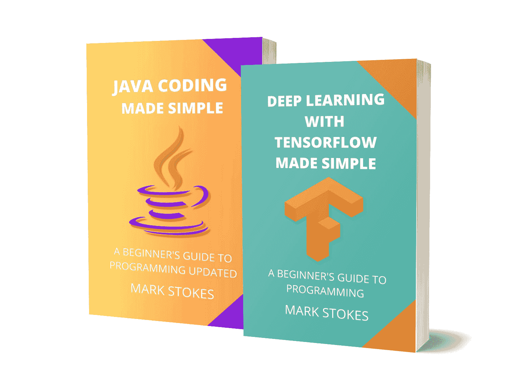

# Tensorflow 与 Java 深度学习：简单代码实践 - 二本书合一



## 目录

- 第 1 章：深度学习简介
- 第 2 章：上手 TensorFlow
- 第 3 章：神经网络基础
- 第 4 章：理解激活函数
- 第 5 章：理解损失函数
- 第 6 章：训练神经网络
- 第 7 章：提升神经网络性能
- 第 8 章：卷积神经网络与循环神经网络
- 第 9 章：生成式深度学习
- 第 10 章：带示例的生成对抗网络 (GANs)
- 第 11 章：带示例的迁移学习与微调
- 第 12 章：深度强化学习
- 第 13 章：使用 TensorFlow 进行自然语言处理
- 第 14 章：使用深度学习进行图像分类
- 第 15 章：使用深度学习进行自然语言生成
- 第 17 章：TensorFlow 中的计算机视觉深度学习
- 第 18 章：TensorFlow 中深度学习的未来

# JAVA 编程

- 第 1 章：Java 编程简介
- 第 2 章：变量与数据类型
- 第 3 章：控制流语句
- 第 4 章：方法
- 第 5 章：数组
- 第 6 章：面向对象编程 (OOP)
- 第 7 章：异常处理与文件 I/O
- 第 9 章：多线程
- 第 10 章：Java 数据库交互
- 第 11 章：使用 Java 进行 Web 开发
- 第 12 章：Java 数据库连接
- 第 13 章：快速开发的 Java 框架与库
- 第 14 章：Java 测试：框架与方法论
- 第 15 章：Java 调试技术与工具

## 书籍简介

《TensorFlow 深度学习入门：学者编程指南》是一本全面且易于理解的书籍，旨在为初学者揭开深度学习领域的神秘面纱。在这本书中，你将开启一段理解深度学习基本概念的之旅，并学习如何使用流行的`TensorFlow`框架来实现它们。

无论你是学生、想要扩展技能的专业人士，还是仅仅是一个充满好奇心的人，这本书都将为你提供开启深度学习之旅所需的知识和实践示例。你不需要任何编程或机器学习的先验经验就可以深入这本书。它专为初学者编写，提供了清晰的解释和循序渐进的指导。

在整本书中，你将探索各种主题，如神经网络、激活函数、卷积神经网络、循环神经网络、生成对抗网络、迁移学习、自然语言处理、强化学习等。每一章都建立在前一章的基础上，逐渐增加所涵盖的概念和技术的复杂性。

读完本书后，你将对深度学习原理有坚实的理解，并能够使用`TensorFlow`构建自己的深度学习模型。你还将对深度学习在现实世界中的应用产生见解，并学习如何部署你的模型在各个领域产生切实的影响。

# 第 1 章：深度学习简介

近年来，深度学习已作为一项突破性技术脱而出，彻底改变了人工智能领域。凭借从海量数据中学习并做出复杂决策的能力，深度学习已从计算机视觉、自然语言处理到机器人和医疗保健等各个领域得到了应用。在本章中，我们将深入深度学习的世界，探索它的基础和核心概念。

## 1.1 深度学习的兴起

深度学习的根源可以追溯到 20 世纪 40 年代人工工神经网络的发展。受人类大脑结构和功能的启发，神经网络是由相互连接的节点（或“神经元”）组成的计算模型，用于处理和传输信息。然而，直到强大的计算资源出现以及大规模数据集的可用，深度学习才真正繁荣起来。

深度学习发展中的一个重要里程碑是具有多层的深度神经网络的引入。这些深度架构允许从原始数据中提取复杂的特征，使机器能够学习分层表示并执行复杂任务。突破性的时刻出现在 2012 年，当时名为`AlexNet`的深度卷积神经网络在`ImageNet`竞赛中优于传统方法。

从那时起，深度学习赢得了巨大的关注，并成为解决许多机器学习问题的首选方法。它的成功归于从数据中自动学习特征的能力，消除了对手工特征工程的需求。深度学习算法擅长捕捉数据中复杂的模式和关系，使其在图像分类、语音识别和自然语言理解任务中非常高效。

## 1.2 神经网络与激活函数

深度学习的核心是神经网络，这是一种受人类大脑中连接的神经元启发的计算模型。神经网络由多个层组成，每层由处理和传输信息的人工神经元组成。这些神经元组织成输入层、隐藏层和输出层，形成能够学习复杂表示的网络结构。

神经网络的关键在于激活函数，它为模型引入了非线性。激活函数根据其输入决定神经元的输出，并在使神经网络近似复杂函数方面起着至关重要的作用。常用的激活函数包括 sigmoid 函数、双曲正切 (`tanh`) 函数和正线性单元 (`ReLU`) 函数。每种激活函数都有其优缺点，而选择哪一个取决于问题的性质。

## 1.3 反向传播：训练深度神经网络

训练深度神经网络涉及优化其参数以最小化预测输出与真实标签之间的差异。这一过程通过称为反向传播的算法实现。反向传播计算网络参数相对于给定损失函数的梯度，允许通过梯度下降或其他优化技术进行调整。

反向传播通过将误差向后传播网络来运行，迭代地调整每个神经元的权重和偏置以减少总损失。这种迭代过程一直持续到网络收敛到一个预测与真实标签紧密一致的状态。尽管反向传播是计算密集型的，但硬件和并行计算的进步使得训练深度神经网络成为可能。

## 1.4 TensorFlow：强大的深度学习框架

为了方便深度学习模型的实现和训练，开发者们开发了许多框架。最广泛使用的框架之一是 TensorFlow。它由 Google 的 Brain 团队创建，为构建和部署深度学习模型提供了一个灵活且高效的生态系统。

TensorFlow 允许开发者定义计算图，表示数据在神经网络中的流。这些图实现了自动微分，使得能够无缝地计算梯度并执行反向传播。此外，TensorFlow 还提供了高层 API，简化了构建神经网络的过程，抽象了低层操作的复杂性。

通过 TensorFlow，你可以利用丰富的预构建神经网络架构，以及用于数据预处理、模型评估和部署的强大工具。它的多功能性和可扩展性使其成为研究和工业应用的首选。

在接下来的章节中，我们将深入探究 TensorFlow 的基础知识，探索其安装过程和各种功能。我们将引导你完成在机器上设置 TensorFlow 的步骤，确保你已准备好开启深度学习之旅。

请关注第 2 章：开始使用 TensorFlow！

# 第 2 章：开始使用 TensorFlow

## 2.1 TensorFlow 简介

TensorFlow 由 Google 的 Brain 团队开发，是一个强大的数值计算和深度学习开源框架。它提供了一个全面的生态系统，允许开发者高效地构建和训练神经网络。在本章中，我们将引导你完成入门 TensorFlow 的过程，从安装到探索其基本功能。

## 2.2 安装 TensorFlow

在深入学习 TensorFlow 之前，你需要在机器上设置该框架。TensorFlow 支持多种平台，包括 Windows、macOS 和 Linux。安装过程可能会根据你的操作系统而异，但在这里我们将提供一个概括。

首先，确保你的机器上安装了兼容版本的 Python。TensorFlow 支持 Python 3.7 及以上版本。你可以访问 Python 官网下载并安装最新版本。

安装 Python 后，你可以使用`pip`包管理器安装 TensorFlow。打开终端或命令提示符并输入以下命令：

```bash
pip install tensorflow
```

此命令将下载并安装 TensorFlow 的最新稳定版本。如果你有特定的版本要求，可以在命令中指定。

安装完成后，你可以通过在 Python Shell 或集成开发环境（IDE，如 Jupyter Notebook）中导入 TensorFlow 来验证安装。如果没有错误，说明 TensorFlow 安装成功。

## 2.3 TensorFlow 基础

现在你已经安装了 TensorFlow，让我们探索它的基本功能。TensorFlow 使用计算图运行，计算图表示数据在网络中的流。数据流通过节点，即操作或张量。

首先，在你的 Python 环境中导入 TensorFlow 库：

```python
import tensorflow as tf
```

### 2.3.1 张量 (Tensors)

张量是 TensorFlow 中的基础数据结构。它们是多维数组，可以存储各种类型的数值。最常见的类型是`float32`、`int32`和`string`。你可以使用`tf.Tensor`类创建张量：

```python
# 创建标量张量
scalar_tensor = tf.constant(5)

# 创建向量张量
vector_tensor = tf.constant([1, 2, 3, 4, 5])

# 创建矩阵张量
matrix_tensor = tf.constant([[1, 2], [3, 4]])

# 创建带有随机值的张量
random_tensor = tf.random.normal(shape=(3, 3))
```

### 2.3.2 操作 (Operations)

TensorFlow 中的操作代表可以在张量上执行的计算。TensorFlow 提供了大量的操作，用于数学计算、数组操作等。以下是几个例子：

```python
# 相加两个张量
addition = tf.add(5, 3)

# 相乘两个张量
multiplication = tf.multiply(2, 4)

# 矩阵乘法
matrix_a = tf.constant([[1, 2], [3, 4]])
matrix_b = tf.constant([[5, 6], [7, 8]])
matrix_multiplication = tf.matmul(matrix_a, matrix_b)
```

### 2.3.3 变量 (Variables)

变量是在 TensorFlow 程序执行期间可以修改值的张量。它们通常用于存储神经网络的可学习参数。要创建一个变量，可以使用`tf.Variable`类：

```python
# 创建一个带有初始值的变量
weight = tf.Variable(0.5)

# 更新变量值
weight.assign(0.7)
```

## 2.4 构建你的第一个神经网络

现在你已经熟悉了 TensorFlow 的基础，让我们构建你的第一个神经网络吧。我们将创建一个带隐藏层的简单前馈网络。

首先，通过指定输入特征、隐藏单元和输出单元的数量来定义网络架构。然后，使用变量初始化网络的权重和偏置。最后，通过应用激活函数和矩阵乘法实现网络的正向传播。

这是一个基础示例：

```python
input_features = 10
hidden_units = 20
output_units = 2

# 初始化权重和偏置
weights_1 = tf.Variable(tf.random.normal(shape=(input_features, hidden_units)))
bias_1 = tf.Variable(tf.zeros(shape=(hidden_units,)))
weights_2 = tf.Variable(tf.random.normal(shape=(hidden_units, output_units)))
bias_2 = tf.Variable(tf.zeros(shape=(output_units,)))

# 正向传播
def neural_network(inputs):
    hidden_layer = tf.nn.relu(tf.matmul(inputs, weights_1) + bias_1)
    output_layer = tf.matmul(hidden_layer, weights_2) + bias_2
    return output_layer
```

在这个示例中，我们定义了一个在隐藏层使用 ReLU 激活函数并在输出层使用线性激活函数的神经网络。根据问题的性质，该网络可以用于分类或回归等任务。

恭喜！你已经成功学习了 TensorFlow 的基础并构建了你的第一个神经网络。在下一章节中，我们将探索更高级的主题，包括不同类型的神经网络和训练技术。

请关注第 3 章：神经网络基础！

# 第 3 章：神经网络基础

## 3.1 神经网络简介

神经网络是深度学习的核心，理解其基本组件对于构建更多模型至关重要。在本章中，我们将深入研究神经网络的基础知识，探索其架构、激活函数和正向传播的概念。

## 3.2 神经网络架构

神经网络由互连的人工神经元层（也称为感知器）组成。每层接收输入，执行计算并将结果传递给下一层。神经网络中的三种主要层类型是输入层、隐藏层和输出层。

输入层表示输入数据的特征。每个输入节点对应特定的特征或属性。隐藏层位于输入层和输出层之间，负责从输入数据中提取复杂的模式。输出层根据网络学习的信息产生最终的预测或输出。

层数和每层中神经元的数量取决于问题的复杂性和可用数据。具有更多隐藏层的深层神经网络可以学习更复杂的表示，但也需要更多的计算资源。

## 3.3 激活函数

激活函数为神经网络引入了非线性，使其能够学习复杂模式并进行非线性预测。激活函数的选择取决于问题和数据的特征。以下是一些常用的激活函数：

- `ReLU (Rectified Linear Unit)`：`ReLU`函数对于负输入返回 0，对于正输入返回输入值本身。由于其简单性以及处理梯度消失问题的能力，它已成为一种流行的选择。

- `Sigmoid`：`sigmoid`函数将输入映射到 0 到 1 之间的值，使其适用于二分类问题。它具有平滑且具有可解释性的输出，但在深层网络中可能会遭受梯度消失问题的影响。

- `Tanh (Hyperbolic Tangent)`：`tanh`函数与`sigmoid`函数类似，但它将输入映射到在 -1 到 1 之间的值。它通常用于隐藏层，并能够捕捉负值。

- `Softmax`：`softmax`函数主要用于多分类任务的输出层。它将网络的原始输出转换为概率，确保所有概率之和为 1。

选择正确的激活函数至关重要，因为它会影响神经网络的学习动力学和性能。

## 3.4 前向传播

前向传播是将输入数据通过神经网络以生成预测的过程。网络中的每个神经元对其输入进行加权求和，应用激活函数，并将结果传递给下一层。

前向传播过程可以总结如下：

1. 使用输入数据初始化输入层。
2. 使用矩阵乘法计算隐藏层中每个神经元的输入加权和和偏置。
3. 对计算出的和应用激活函数。
4. 对后续的隐藏层重复步骤 2 和 3，直到到达输出层。
5. 在输出层计算最终的加权和并应用适当激活函数以生成预测。

然后使用损失函数将神经网络的输出与真实标签（ground truth labels）进行比较，损失函数衡量预测值与实际值之间的差异。损失函数通过为更新模型参数提供反馈信号，在训练神经网络中起着至关重要的作用。

在下一章中，我们将更深入探讨激活函数的概念，并探索神经网络常用的不同类型的激活函数。

请关注第 4 章：理解激活函数！

# 第 4 章：理解激活函数

## 4.1 激活函数简介

激活函数是神经网络中不可或缺的组件。它们引入了非线性，允许神经网络对输入与输出之间的复杂关系建模。在本章中，我们将探索各种类型的激活函数、它们的属性以及它们对不同类型问题的适用性。

### 4.2 Sigmoid 激活函数

Sigmoid 激活函数也称为逻辑函数（logistic function），是二分类问题的流行选择。它将输入映射到 0 到 1 之间的值，代表属于正类别的概率。`sigmoid`函数定义如下：

```
f(x) = 1 / (1 + exp(-x))
```

`sigmoid`函数具有平滑的 S 型曲线且是可微的，这有助于使用基于梯度的优化算法进行训练。然而，它在输入值非常大或非常小时往往会趋于饱和，导致梯度趋近于零。这种饱和导致了梯度消失问题，限制了网络学习复杂模式的能力，尤其是在深层网络中。

### 4.3 ReLU 激活函数

截断线性单元（`ReLU`）激活函数近年来获得了极大的关注。它的定义如下：

```
f(x) = max(0, x)
```

`ReLU`将负输入设为 0，并保持正输入不变。它在计算上是高效的，通过防止正输入的饱和解决了梯度消失问题。`ReLU`在训练深层神经网络方面取得了成功，并被广泛应用于隐藏层。然而，`ReLU`神经元可能会出现“死亡”，即它们变得不再响应，导致产生激活值为 0 的死神经元。

### 4.4 Tanh 激活函数

双曲正切（`tanh`）激活函数是`sigmoid`函数的扩展。它将输入映射到 -1 到 1 之间的值，适用于需要负值的问题。`tanh`函数定义如下：

```
f(x) = (exp(x) - exp(-x)) / (exp(x) + exp(-x))
```

`Tanh`与`sigmoid`函数共享某些属性，但梯度更陡，在捕捉非线性关系方面更有效。然而，与`sigmoid`函数类似，`tanh`在极端输入值下也可能遭受饱和和梯度消失。

### 4.5 其他激活函数

除了`sigmoid`、`ReLU`和`tanh`函数外，还有几种在神经网络中使用的激活函数：

- `Leaky ReLU`：`Leaky ReLU`是`ReLU`函数的变体，为负输入引入了一个很小的斜率，防止死神经元的产生。

- `Softmax`：`Softmax`主要用于多分类问题的输出层。它将原始输出转换为概率，确保概率之和为 1。

- `Exponential Linear Unit (ELU)`：`ELU`与`ReLU`相似，但为负输入引入了平滑曲线，有助于缓解`ReLU`死亡问题。

- `Parametric ReLU (PReLU)`：`PReLU`是`Leaky ReLU`的扩展，允许在训练过程中学习负输入的斜率。

激活函数的选择取决于特定问题、网络架构和数据的特征。找到最适合给定任务的激活函数，通常需要经过实验和微调。

在下一章中，我们将探索损失函数的概念，它们通过量化预测与真实标签之间的差异，在训练神经网络中起着至关重要的作用。

请关注第 5 章：理解损失函数！

# 第 5 章：理解损失函数

### 5.1 损失函数简介


损失函数也称为代价函数或目标函数，衡量神经网络输出与真实标签之间的差异。它们通过提供模型在给定任务上表现的衡量，在训练神经网络中起着至关重要的作用。在本章中，我们将探索不同类型的损失函数及其应用。

## 5.2 均方误差 (MSE)

均方误差（`MSE`）是最常用的损失函数之一，特别是回归问题。它计算预测值与实际值之间的平均平方差。`MSE` 的公式如下：

```
MSE = (1/n) * Σ(y_pred - y_actual)²
```

其中 `n` 是样本数，`y_pred` 是预测值，`y_actual` 是真实值。由于平方项的存在，`MSE` 的惩罚更大，使其对离群值敏感。

## 5.3 二元交叉熵

二元交叉熵常用于二分类问题，神经网络的输出代表属于正类的概率。它衡量预测概率与真实标签之间的不相似。`Binary Cross-Entropy` 的公式如下：

```
Binary Cross-Entropy = - (y_actual * log(y_pred) + (1 - y_actual) * log(1 - y_pred))
```

其中 `y_actual` 是真实值标签（0 或 1），而 `y_pred` 是预测概率。使用对数确保了随着预测概率偏离真实标签，损失随之增加。

## 5.4 分类交叉熵 (Categorical Cross-Entropy)

分类交叉熵用于多分类问题，其中神经网络的输出代表了多个类别的概率。它衡量了预测类别概率与真实标签之间的差异。分类交叉熵的公式如下：

```
Categorical Cross-Entropy = - Σ(y_actual * log(y_pred))
```

其中 `y_actual` 是表示真实标签的独热热编码向量，而 `y_pred` 是跨类别的预测概率向量。损失通过对所有类别求和来计算。

## 5.5 其他损失函数

还有许多其他损失函数可以适用于特定类型的问题：

- **平均绝对误差 (MAE)**：`MAE` 计算预测值与实际值之间的平均绝对差值。与 `MSE` 相比，它对离群值不敏感。

- **合页损失 (Hinge Loss)**：`Hinge Loss` 通常用于支持向量机 (SVM)，适用于二分类问题。它通过对错误分类施加惩罚来鼓励正确分类。

- **Huber 损失 (Huber Loss)**：`Huber Loss` 结合了 `MSE` 和 `MAE` 的特性。对于大误差它的行为类似于 `MSE`，对于小误差则行为类似于 `MAE`，提供了两者之间的平衡。

损失函数的选择取决于问题的性质、模型输出的预期属性以及训练训练数据。

在下一章中，我们将探索神经网络的训练过程，包括优化算法和反向传播，这些使得网络能够从数据学习学习并更新参数。

请关注第 6 章：神经网络训练！

# 第 6 章：神经网络训练

## 6.1 神经网络训练简介

训练神经网络涉及迭代更新其参数以最小化选定的损失函数并提高其在给定任务上的性能。在本章中，我们将探索神经网络的训练过程，包括优化算法、反向传播以及防止过拟合的技术。

## 6.2 优化算法

优化算法在训练神经网络过程中起着至关重要的作用，通过迭代调整模型参数来最小化损失函数。常用的优化算法包括：

- **随机梯度下降 (SGD)**：`SGD` 根据在训练样本子上计算的损失函数梯度来更新参数。它对每个数据小批量（mini-batch）执行参数更新，使其计算效率高，但可能存在噪声。

- **Adam**：`Adam`（自适应动量估计）结合了动量（Momentum）和 `RMSprop` 的思想。它根据过去的梯度及其平方为每个参数自适应学习率，非常适合广泛的问题。

- **Adagrad**：`Adagrad` 根据梯度平方的历史总和为每个参数自适应学习率。它对更新量较小的参数赋予更大的权重，允许在稀疏数据环境中进行有效学习。

- **RMSprop**：`RMSprop` 通过使用梯度平方的指数衰减平均修改 `Adagrad`。它防止学习率随时间推移变得过小，从而改进收敛性。

- **AdamW**：`AdamW` 是 `Adam` 的扩展，包含了权重衰减正则化。它通过惩罚大权重来帮助防止过拟合。

优化算法的选择取决于当前问题、网络架构和可用计算资源等因素。它通常是计算效率和收敛速度之间的平衡。

## 6.3 反向传播

反向传播是训练神经网络的基础算法。它允许损失函数的梯度高效地反向传播通过网络，从而计算参数更新。反向传播涉及的步骤如下：

1. 通过网络进行前向传播以计算预测输出。

2. 通过将预测输出与真实标签进行比较来计算损失。

3. 使用微积分链式法则计算损失对参数的梯度。

4. 使用选定的优化算法（如 `SGD` 或 `Adam`）更新网络中的参数。

反向传播通过将梯度从输出层传播到输入层来高效计算梯度。它允许网络从错误中学习并相应调整参数，随着时间的推移提高其性能。

## 6.4 正则化技术

过拟合是神经网络训练中的一个常见挑战，即模型对训练数据过于专门，导致在新的未见过的数据上表现不佳。正则化技术通过在训练过程中引入额外约束来缓解过拟合。流行的正则化技术包括：

- **L1 正则化**：`L1` 正则化在损失函数中添加惩罚项，鼓励学习到的权重具有稀疏性。它促进了相关特征子集的选择。

- **L2 正则化**：`L2` 正则化（也称为权重衰减）添加惩罚项以鼓励较小的权重。它有助于防止模型过度依赖少数特征。

- **丢弃 (Dropout)**：`Dropout` 在训练期间随机将部分激活值设置为零，有效减少了模型对特定神经元的依赖。它有助于防止对单个神经元的过度依赖并鼓励了鲁棒性。

- **早停 (Early Stopping)**：`早停`涉及监控训练期间模型在验证集上的性能，并在性能开始下降时停止训练过程。它有助于防止过

# 第 7 章：提高神经网络性能

## 7.1 性能提升技术简介

在本章中，我们将探索用于提高神经网络性能的各种技术。这些技术旨在增强模型的准确性、收敛速度、泛化能力以及解决复杂任务的整体有效性。

## 7.2 学习率调度

学习率是训练神经网络中的关键超参数。它决定了优化算法调整模型参数的步长。学习率调度涉及训练期间动态更改学习率以优化收敛过程。常用的学习率调度技术包括：

- **阶梯式衰减 (Step Decay)**：`阶梯式衰减`涉及在固定数量的 epoch 后按因子降低学习率。这种方法允许初期使用较大的步长帮助模型快速进展，并在后期使用较小的步长微调参数。

- **指数衰减 (Exponential Decay)**：`指数衰减` 随时间指数级降低学习率。它逐渐减小步长，允许模型平滑收敛。

- **学习率平台 (Learning Rate Plateau)**：`学习率平台` 根据模型在验证集上的性能调整学习率。如果模型性能停滞，则降低学习率以帮助模型跳出局部最优。

选择合适的学习率调度技术取决于特定的问题、数据集和网络架构。这通常需要实验和微调以找到最佳调度。

## 7.3 批归一化 (Batch Normalization)

批归一化是在训练期间对神经网络每层的输入进行归一化的技术。它有助于解决内部协变量偏移问题，即随着模型参数的更新，每层的输入分布会发生变化。批归一化提供了多种益处，包括：

- **提高训练稳定性**：通过对输入进行归一化，批量归一化降低了模型对参数初始值和学习率的敏感性。这种稳定性允许更快的收敛和更好的泛化。

- **正则化效果**：批量归一化通过在训练期间添加噪声引入了轻微的正则化效果。这种正则化有助于防止过拟合，并提高模型对未见数据的泛化能力。

- **减少对初始化的依赖**：批量归一化减少了模型性能对初始参数值选择的依赖。这一特性使得深度神经网络更容易初始化并获得更好的结果。

## 7.4 数据增强

数据增强是一种通过对现有数据应用各种变换来增加训练数据集规模和多样性的技术。它通过让模型接触更广泛的变和模式，有助于提高模型的泛化能力。一些常用的数据增强技术包括：

- **旋转**：通过特定角度旋转图像，帮助模型对物体的方向具有不变性。

- **平移**：水平或垂直平移图像会引入物体位置的变化，使模型对空间位移更稳健。

- **缩放**：放大或缩小图像会改变物体的大小，使模型能够处理不同尺寸的物体。

- **翻转**：水平或垂直翻转图像提供了额外的变体，对于图像分类等任务特别有用。

- **噪声注入**：在图像中添加随机噪声有助于模型对图像缺陷更具韧性，并增强其泛化能力。

数据增强应该根据任务的性质和数据的特征来选择。这是一种有效的策略，特别是在可用的训练数据有限的情况下。

## 7.5 迁移学习

迁移学习涉及利用在某个任务上训练神经网络获得的知识，并将其应用于另一个但相关的任务中。迁移学习不是从头开始训练过程，而是使用预训练模型作为起点，并在新数据集上进行微调。迁移学习提供了许多优势，包括：

- **更快的训练**：由于预训练模型的初始层已经学习了通用特征，因此在新任务上的训练过程可以更快，因为模型只需要适应特定任务的特征。

- **更好的泛化性**：迁移学习通过利用从更大、更多样化的数据集中学到的知识，有助于提高模型的泛化能力。

- **数据效率**：通过迁移学习，即使新新任务的训练数据有限，模型也可以获得良好的性能。

然而，选择一个适用于新任务的预训练模型至关重要，并确保数据集之间足够相关以使迁移学习有效。

在下一章中，我们将深入深度学习的高级主题，包括卷积神经网络（`CNNs`）和循环神经网络（`RNNs`）。这些架构改变了许多领域，包括计算机视觉和自然语言处理。

请关注第 8 章：卷积神经网络和循环神经网络！

# 第 8 章：卷积神经网络和循环神经网络

## 8.1 卷积神经网络 (CNNs) 简介

卷积神经网络（`CNNs`）是一类专门为处理结构化网格数据（如图像）设计的深度学习模型。它们通过从原始像素数据中自动学习分层表示，彻底改变了计算机视觉任务。在本章中，我们将探索 `CNNs` 的关键组件和操作。

## 8.2 卷积层

`CNN` 的核心构建模块是卷积层。它通过对输入数据应用一组可学习的过滤器（也称为内核）来执行卷积操作。每个过滤器在输入上滑动，计算其权重与局部感受野之间的点积。卷积层的输出被称为特征图或激活图。

卷积层在捕捉图像中的局部模式和空间关系方面非常有效。它们利用了参数共享的特性，即同一组过滤器应用于不同的空间位置，与全连接层相比，显著减少了参数的数量。

## 8.3 池化层

池化层通常用于 `CNNs` 中对从卷积层获得的特征图进行下采样。它们在保留最重要信息的同时缩小空间维度。两种最流行的池化操作是最大池化和平均池化。

最大池化选择每个池化窗口内的最大值，而平均池化计算平均值。池化有助于降低空间分辨率，使模型对小的空间位移更稳健并减少计算需求。

## 8.4 循环神经网络 (RNNs)

循环神经网络（`RNNs`）旨在处理序列数据，例如时间序列或自然语言。与前馈神经网络不同，`RNNs` 具有反馈连接，允许它们维持内部或内存。这种内存使它们能够捕捉跨不同时间步的依赖和模式。

`RNN` 的关键元素是循环连接，它允许信息随时间持续和流动。RNN 每个时间步的隐藏状态受到当前输入和上一个隐藏状态的影响。这种递归性质使得 `RNNs` 非常适用于语音识别、机器翻译和情感分析等任务。

## 8.5 长短期记忆 (LSTM)

RNNs 的一种克服了梯度消失问题并能有效捕捉长距离依赖的变体是长短期记忆（LSTM）网络。与简单的 RNNs 相比，LSTMs 具有更复杂的架构，并包含三个主要组件：输入门、遗忘门和输出门。

`LSTMs` 选择性地保留和更新内存单元中的信息，允许它们在较长的序列中学习和记忆相关信息。它们在广泛的应用中取得了成功，包括语言建模、语音识别和视频分析。

## 8.6 CNN 和 RNN 的应用

`CNNs` 和 `RNNs` 改变了多个领域，并成功应用于各种任务：

- **计算机视觉**：`CNNs` 擅长图像分类、目标检测和图像分割等任务。它们可以自动学习并识别图像中复杂的模式和物体。

- **自然语言处理**：`RNNs`（特别是 LSTM 网络）被广泛应用于语言建模、机器翻译、文本生成、情感分析和语音识别。它们可以捕捉文本数据的序列性质并对词之间的依赖关系。

- **时间序列分析**：`RNNs` 有助于分析时间序列数据，例如金融市场预测、天气预报和生理信号分析。它们可以捕捉时间依赖关系并根据历史模式进行预测。

- **音频处理**：`CNNs` 和 `RNNs` 已用于语音识别、音乐生成和音频分类等任务。它们可以在时域或频域处理音频信号，提取用于分析的有意义特征。

`CNNs` 和 `RNNs` 的结合被称为卷积循环神经网络（`CRNNs`），也被探索用于同时涉及空间和序列依赖的任务。

在下一章中，我们将深入探索迷人的生成式深度学习领域，探索生成新内容（如图像、音乐和文本）的模型。

请关注第 9 章：生成式深度学习！

# 第 9 章：生成式深度学习

## 9.1 生成式深度学习简介

生成式深度学习是一个迷人的领域，专注于训练模型生成与给定数据集相似的新内容。这些模型具有学习数据底层模式和结构的能力，允许它们生成新样本。在本章中，我们将探索各种生成式模型及其应用。

## 9.2 自动编码器

自动编码器是一种生成式模型，旨在学习输入数据的高效表示。它们由一个将输入数据映射到潜空间表示的编码器网络和一个从潜空间重构输入数据的解码器网络组成。自动编码器可用于去噪、降维以及生成与输入数据相似的新样本等任务。

变变分自动编码器（`VAEs`）是自动编码器的一种流行变体，它们引入了概率方法对潜空间进行建模。`VAEs` 通过从学习到的潜空间分布中采样，能够生成新样本。

## 9.3 生成对抗网络 (GANs)

生成对抗网络（`GANs`）是强大的生成式模型，由两个神经网络组成：生成器和判别器。生成器网络生成新样本，而判别器网络试图区分生成的样本与训练数据集中的真实样本。

在训练过程中，生成器的目标是产生欺骗判别器的样本，而判别器的目标是准确分类真实样本和生成样本。这种对抗过程导致了高度真实且多样化的样本的产生。`GANs` 已成功应用于图像合成、风格迁移和文本生成等任务。

## 9.4 用于生成式任务的深度强化学习

深度强化学习（`RL`）技术可以应用于生成式任务，其中代理学习与环境交互并根据奖励和反馈生成内容。在这些场景中，代理学习优化动作以最大化奖励信号。

深度 RL 算法，例如近策略优化（`PPO`）和深度 Q 网络（`DQN`），已用于游戏游戏、机器人控制和对话生成等生成式任务。它们允许代理学习复杂的策略并生成实现特定目标的内容。

## 9.5 生成式深度学习的应用

生成式深度学习在各个领域都有了应用：

- **图像生成**：像 `GANs` 这样的生成模型已用于生成真实图像、创建现有图像的变体，甚至生成类似于给定数据集全新图像。

- **文本生成**：基于 `RNNs` 或 `Transformer` 架构的语言模型已用于文本生成任务，包括语言翻译、对话生成和故事生成。

- **音乐生成**：深度学习模型已用于生成特定风格、流派甚至模仿特定艺术家作品的音乐。

- **数据增强**：生成式模型可以通过生成合成样本来增强数据集，从而增加训练数据的多样性和规模。

- **异常检测**：生成式模型可以在正常数据上进行训练，并用于检测新的未见过数据中的异常或离群值。

- **虚拟现实与游戏**：生成式模型已用于创建真实的虚拟环境、生成游戏关卡并设计虚拟角色。

生成式深度学习领域正在快速发展，不断突破内容生成的可能边界。它为创意应用、数据增强和探索人工智能的新领域开辟了令人兴奋的可能性。

# 第 10 章：带示例的生成对抗网络 (GANs)

## 10.1 生成对抗网络 (GANs) 简介

生成对抗网络（`GANs`）是一种强大的生成式模型，在深度学习社区中引起了极大关注。`GANs` 由两个神经网络组成：生成器和判别器。生成器网络学习生成合成样本（如图像或文本），而判别器网络试图区分生成的样本与训练数据集中的真实样本。这种对抗设置创建了一个竞争性学习过程，生成器不断提高其欺骗判别器的能力，而判别器变得更擅长区分真伪样本。

## 10.2 GAN 架构与训练过程

`GAN` 的架构通常涉及生成器网络和一个判别器网络。生成器将随机噪声或潜向量作为输入并生成样本，而判别器接收样本并输出指示该样本是真实的还是生成的概率。这两个网络以对抗的方式同时进行训练。

在训练过程中，生成器的目标是产生与真实样本无缝区分的样本，而判别器的目标是正确分类真实样本和生成样本。这一过程涉及使用反向传播和随机梯度下降等技术来更新网络参数。

## 10.3 GAN 应用示例

### 10.3.1 图像生成

`GANs` 在生成类似于训练数据的真实图像方面显示了显著成功。一个著名的例子是 `DCGAN`（深度卷积 GAN）架构，它在生成器和判别器网络中都使用了卷积层。`DCGANs` 已用于在人脸、风景和物体等多个领域生成高质量图像。

例如，`StyleGAN` 是一种先进的 `GAN` 架构，能够生成高度真实的人脸，并对年龄、性别和面部表情等属性进行细粒度控制。这项技术已应用于计算机图形、虚拟现实和娱乐。

### 10.3.2 文本生成

`GANs` 也可以用于文本生成任务，其中生成器网络学习基于训练数据生成连贯且上下文相关的文本。`TextGAN` 是用于文本生成的 `GAN` 架构示例。它利用循环神经网络（`RNNs`）或 Transformer 架构生成与输入文本语料相似的单词序列。

`TextGANs` 已应用于语言翻译、对话生成和故事生成等任务。它们具有生成化且符合上下文文本的潜力，使其在自然语言处理中具有价值。

### 10.3.3 数据增强

`GANs` 的另一个应用是数据增强，通过生成合成样本来增加训练数据集的多样性和规模。通过在特定数据集上训练 `GAN`，生成器可以产生与训练数据类似的额外样本。这些合成样本随后与原始数据集相结合，以增强模型的泛化能力并提高性能。

使用 `GANs` 进行的数据增强已应用于计算机视觉任务，如物体识别和图像分类。它有助于解决训练数据有限的挑战，并提高模型的性能和鲁棒性。

## 10.4 挑战与未来方向

尽管 `GANs` 在各个领域取得了令人瞩目的成果，但它们也面临挑战和开放的研究问题。一些主要挑战包括：

- **模式崩溃（Mode Collapse）**：模式崩溃发生在生成器产生有限或重复样本时，未能捕获训练数据的完整多样性。


**稳定性与收敛性（Stability and Convergence）**：`GAN` 的训练可能不稳定，在生成器和判别器网络之间找到正确的平衡存在困难。确保收敛和稳定训练仍然是一个活跃的研究领域。

**评估与指标（Evaluation and Metrics）**：为 `GAN` 生成的样本开发可靠的评估指标是一项挑战性任务。量化生成内容的质量、多样性和保真度是持续的研究工作。

`GAN` 的未来充满了无限的可能性。研究人员正在探索新的架构、训练技术和应用。`GAN` 的进步预计将影响艺术、娱乐、数据生成和数据增强等领域。

总之，生成对抗网络已成为一种生成真实且多样化样本的强大框架。从图像生成到文本生成和数据增强，`GAN` 在各个领域都展示了它们的潜力。随着 `GAN` 研究的不断进步，我们可以期待这项令人兴奋的技术带来更多令人印象深刻且具创意的应用。

# 第 11 章：迁移学习与微调示例

## 11.1 迁移学习简介

迁移学习是深度学习中的一种技术，它利用在某个任务上训练模型获得的知识，并将其应用于另一个不同但相关的任务。它涉及使用预训练模型作为起点，然后通过较小的数据集将其适配到新任务。由于迁移学习能够在有限的数据和计算资源下获得良好的性能，它已成为深度学习中的一种流行方法。

## 11.2 迁移学习的优势

迁移学习具有以下几个优势：

1. **特征提取（Feature Extraction）**：预训练模型在大规模数据集上进行训练，并学习了从原始数据中提取有意义的特征。通过利用这些预训练模型，我们可以从它们捕捉数据中通用模式和结构的能力。

2. **缩短训练时间**：从零开始训练深度学习模型非常耗时，特别是在处理大型数据集时。迁移学习允许我们从预训练模型开始，这显著减少了所需的训练时间和计算资源。

3. **提高泛化能力（Improved Generalization）**：预训练模型从不同的数据集中学习并具有了泛化知识。通过将这些知识迁移到新任务，我们可以提高模型的泛化能力，使其在未见数据上表现良好。

## 11.3 迁移学习技术

### 11.3.1 特征提取

在这种方法中，我们使用预训练模型作为固定的特征提取器。我们移除预训练模型的最后几层，并在上方添加特定于我们新任务的新层。我们冻结预训练层，防止它们在训练期间被更新，并且只训练新添加的层。

例如，在图像分类中，我们可以取一个预训练的卷积（`CNN`），如 `VGG16` 或 `ResNet`，移除顶部的全连接层，并添加特定于我们分类任务的新层。然后，我们只训练新层，而保持预训练层固定。

### 11.3.2 微调（Fine-Tuning）

微调比特征提取更进一步。除了在预训练模型上方添加新层外，我们还允许某些预训练层在训练期间进行更新。这使得模型不仅能够适配新的任务特定层，还能适配某些捕捉更通用特征的低层结构。

微调通常应用于新任务的数据集比原始预训练数据集更大的情况。通过允许模型更新某些预训练层，它可以更好地适应新任务的特定特征。

## 11.4 迁移学习与微调示例

### 11.4.1 图像分类

在图像分类中，可以使用像 `VGG`、`ResNet` 或 `InceptionNet` 等在 `ImageNet` 等大规模数据集上训练的预训练模型作为起点。这些模型已经学习了从数百万图像中识别各种物体和模式。通过利用这些预训练模型并应用迁移学习，我们可以在数据有限的新分类任务上获得卓越的性能。

### 11.4.2 目标检测

目标检测任务涉及识别和定位图像中的物体。`Faster R-CNN`、`SSD` 或 `YOLOv3` 等在 `COCO` 等大型目标检测数据集上训练的预训练模型可以作为基础。我们可以使用这些预训练权重初始化模型，然后在特定的目标检测任务上对其进行微调。

### 11.4.3 自然语言处理

迁移学习也适用于自然语言处理任务。在大文本语料库上训练的 `Word2Vec`、`GloVe` 或 `BERT` 等预训练模型捕捉了词与句之间的语义关系。这些模型可以作为各种 `NLP` 任务的起点，如情感分析、文本分类或命名实体识别。

例如，在情感分析中，我们可以使用预训练的词嵌入如 `Word2Vec` 或 `GloVe` 来初始化词表示，然后训练一个特定于情感分析任务的分类器。

## 11.5 挑战与考虑

尽管具有这些优势，迁移学习也带来一些挑战和考虑：

1. **领域偏移（Domain Shift）**：如果新任务的分布与预训练任务的分布显著不同，迁移学习的效果可能没那么好。考虑预训练与新任务之间的相似性对于确保成功迁移至关重要。

2. **过拟合（Overfitting）**：微调时存在过拟合风险，特别是当新任务数据有限时。适当的正则化技术和对模型性能的监控有助于缓解过拟合。

3. **任务相似性（Task Similarity）**：迁移学习的有效性取决于预训练与新任务之间的相似性。任务越相似，可以迁移的知识越多。

## 11.6 总结

迁移学习和微调是深度学习中强大的技术，允许我们利用预训练模型并将其适配到新任务。通过利用从大规模预训练中获得的知识，我们可以在数据有限的情况下也能获得良好的性能。迁移学习已成功应用于图像分类、目标检测和自然语言处理等多个领域。

我们对迁移学习和微调的探索此结束。在下一章中，我们将深入探索深度强化学习的精彩世界。请关注第 12 章：深度强化学习！

# 第 12 章：深度强化学习

## 12.1 强化学习简介

强化学习（`RL`）是机器学习的一个分支，专注于训练智能体在环境环境中做出序列决策，以最大化奖励信号。与监督学习不同，强化学习不依赖标记训练数据，而是通过与环境的试错交互来学习。

## 12.2 RL 基础

在强化学习（`RL`）中，智能体通过离散的时间步与环境进行交互。在每个时间步，智能体观察环境的当前状态并采取动作。环境转移到新状态，智能体根据其动作接收奖励信号。智能体的目标是学习一种策略，以最大化随时间的累积奖励。

## 12.3 深度强化学习

深度强化学习将强化学习与深度神经网络相结合，允许智能体直接从高维传感器输入（如图像或原始传感器数据）中学习。深度强化学习算法使用深度神经网络作为函数近似器来表示智能体的策略或价值函数。

## 12.4 深度 Q 网络 (DQN)

深度强化学习中的基础算法之一是深度 Q 网络（`DQN`）。`DQN` 将流行的强化学习算法 `Q-learning` 与深度神经网络相结合，以处理高维状态空间。

在 `DQN` 中，智能体使用深度神经网络作为 `Q` 函数近似器，它估计在给定状态下每个可能动作的预期未来累积奖励。智能体通过根据预测 `Q` 值与观测奖励之间的时序误差（temporal difference error）迭代更新 `Q` 网络来学习。

## 12.5 策略梯度方法

策略梯度方法是另一类深度强化学习算法，它们直接优化智能体的策略。策略梯度方法不是估计 `Q` 值，而是使用深度神经网络对智能策略进行参数化，并更新网络权重以最大化预期累积奖励。

流行的策略梯度算法包括 `REINFORCE`、近端策略优化（`PPO`）和信任区域策略优化（`TRPO`）。这些算法使用随机梯度上升和信任区域方法等技术来更新策略网络的参数。

## 12.6 深度强化学习的应用

### 12.6.1 游戏玩

深度强化学习在游戏玩任务中取得了巨大的成功。由 `DeepMind` 开发的 `AlphaGo` 在复杂的围棋游戏中展现了突破性的性能，击败了世界冠军级棋手。深度强化学习在玩视频游戏方面也表现出色，智能体学会了在 `Atari 2600` 等游戏中获得超越人类水平的性能。

### 12.6.2 机器人

深度强化学习具有通过让智能体学习复杂的操纵任务来变革机器人潜力。通过与物理世界交互，智能体可以学习控制机械臂、抓取物体并执行需要灵活性和适应性的复杂任务。

### 12.6.3 自动驾驶

自动驾驶是深度强化学习另一个充满前景的领域。智能体可以学习导航复杂的道路环境、在交叉路口做出决策并适应不断变化的交通状况。深度强化学习算法结合先进的传感器系统，具有提高自动驾驶车辆安全效率的潜力。

## 12.7 挑战与未来方向

### 12.7.1 样本效率

深度强化学习通常需要与环境大量交互以获得良好的性能。提高样本效率是一个关键的研究方向，以减少训练强化学习智能体的数据需求。

### 12.7.2 泛化

确保强化学习智能体将其学习的策略泛化到新的未见的环境中是一项重大挑战。泛化允许智能体在不进行大量重新训练的情况下适应新场景。

### 12.7.3 安全与伦理强化学习

随着强化学习智能体与真实环境交互，确保安全和伦理行为变得至关重要。开发安全且负责的强化学习方法是一项关键研究领域，以防止有害行为或意外后果。

## 12.8 结论

深度强化学习结合了深度神经网络的力量与强化学习的序列决策能力。它在游戏玩、机器人和自动驾驶等多个领域显示了巨大的成功。然而，仍然有很多挑战需要克服，例如样本效率和泛化。

# 第 13 章：使用 TensorFlow 进行自然语言处理

## 13.1 自然语言处理 (NLP) 简介

自然语言处理（`NLP`）是人工智能的一个子领域，专注于让计算机能够理解、解释和生成人类语言。`NLP` 技术允许我们从文本数据中提取含义、情感和上下文，从而实现机器翻译、情感分析和聊天机器人等广泛应用。

## 13.2 用于 NLP 的 TensorFlow

`TensorFlow` 是一个用于构建和训练机器学习模型的流行开源框架，包括用于 `NLP` 任务的模型。它提供了一系列丰富的工具、库和预训练模型，促进了 `NLP` 应用的发展。

## 13.3 使用 TensorFlow 进行文本预处理

在训练 `NLP` 模型之前，需要对文本数据进行预处理，将其转换为适用于建模的格式。`TensorFlow` 提供了各种文本预处理功能，如分词（tokenization）、词干（stemming）和归一化（normalization）。这些预处理步骤有助于减少噪声、提高模型性能并实现有效的文本表示。

## 13.4 使用 TensorFlow 进行词嵌入

词嵌入是许多 `NLP` 模型的基础的基础组件。它们将单词或短语表示为连续空间中的密集向量，捕捉词与词之间的语义关系。`TensorFlow` 提供了 `Word2Vec` 和 `GloVe` 等技术，从大型文本语料库中学习词嵌入或利用预训练嵌入。

例如，在情感分析中，词嵌入可以将词转换为数值表示，允许模型学习一段文本中所表达的情感。

## 13.5 用于 NLP 的循环神经网络 (RNNs)

循环神经网络（`RNNs`）是常用于 `NLP` 任务的一类神经网络。它们通过捕捉随时间变化的依赖关系和上下文，擅长对序列数据建模。`TensorFlow` 提供了 `RNN` 变体，如长短期记忆（`LSTM`）和门控循环单元（`GRU`），它们对于文本分类、语言建模和机器翻译等任务非常有效。

例如，在语言建模中，可以训练一个 `RNN` 根据先前的词预测句子中的下一个词，从而生成连贯且与上下文相关的文本。

## 13.6 用于机器翻译的序列到序列模型

使用 `RNNs` 构建的序列到序列（`Seq2Seq`）模型改变了机器翻译。这些模型可以通过将源句子编码为固定长度的向量，然后解码为目标语言来实现翻译。`TensorFlow` 的 `Seq2Seq` 框架结合注意力机制可以实现准确流畅的翻译。

## 13.7 用于 NLP 的 Transformer

`Transformer` 已成为 `NLP` 中一种强大的架构，在机器翻译和文本生成等任务中超过了传统模型的性能。`Transformer` 模型利用自注意力机制捕捉序列中词的全局依赖关系。`TensorFlow` 提供了如 `BERT`（来自 `Transformer` 的双向编码表示）等库，在各种 `NLP` 基准测试中取得了领先结果。

## 13.8 使用 TensorFlow 的 NLP 应用

### 13.8.1 情感分析

情感分析涉及确定文本中所表达的情感，例如积极、消极或中性。`TensorFlow` 允许你使用循环神经网络或 `Transformer` 等技术构建情感分析模型。这些模型可以在标记数据集上进行训练，以准确分类文本数据中的情感。

### 13.8.2 命名实体识别 (NER)

命名实体识别识别并分类文本中命名实体（如名称、地点、组织）的任务。`TensorFlow` 提供了构建 `NER` 系统的工具和模型，允许你从非结构化文本数据中提取结构化信息。

### 13.8.3 文本生成

文本生成涉及生成连贯且上下文相关的文本。通过使用 `RNN` 或 `transformers` 语言模型等技术，`TensorFlow` 能够创建文本生成模型。这些模型可以在大型文本语料上进行训练，并用于生成多样化且创造性的文本输出。

## 13.9 结论

使用 `TensorFlow` 进行自然语言处理为理解、分析和生成人类语言开辟了无限可能。凭借 `TensorFlow` 强大的工具和模型，开发者和研究人员可以在广泛领域内构建复杂的 `NLP` 应用。`NLP` 技术与 `TensorFlow` 能力的结合，为情感分析、机器翻译和文本生成等领域的创新解决方案铺平了道路。

在下一章，我们将探索计算机视觉领域，并深入探讨使用深度学习进行图像分类的话。请关注第 14 章：深度学习图像分类！

# 第 14 章：深度学习图像分类

## 14.1 图像分类简介

图像分类是计算机视觉中的一项基础任务，涉及为输入图像分配标签或类别。深度学习通过利用卷积神经网络（`CNN`）彻底改变了图像分类，`CNN` 能够自动从图像中学习并提取有意义的特征。

## 14.2 卷积神经网络 (CNNs)

卷积神经网络（`CNNs`）专门为处理图像等视觉数据设计。它们由多个层组成，包括卷积层、池化层和全连接层。`CNN` 利用局部感受野和权重共享的概念来捕捉空间层次结构并学习复杂的特征。

## 14.3 训练图像分类模型

要训练图像分类模型，需要大型标记数据集。`TensorFlow` 提供了工具和库来预处理和增强图像数据，例如缩放、裁剪以及旋转和翻转等数据增强技术。然后，使用随机梯度下降（`SGD`）或 `Adam` 等优化算法利用标记数据集来训练 `CNN` 模型。

## 14.4 图像分类中的迁移学习

迁移学习是图像分类中的一种强大技术，允许我们利用预训练的 `CNN` 模型并将其适配到新任务或数据集。`TensorFlow` 提供了预训练的 `CNN` 模型，例如 `VGG16`、`ResNet` 和 `Inception`，这些模型已经在 `ImageNet` 等海量图像数据集上过训练。通过在特定任务或数据集对这些预训练模型进行微调，即使在标记数据有限的情况下也能获得良好的性能。

## 14.5 评估与性能指标

训练图像分类模型后，评估其性能至关重要。`TensorFlow` 提供了多种指标，如准确率、精确率、召回率和 `F1` 分数，以评估模型在验证集或测试集上的性能。这些指标有助于理解模型的准确性及其正确分类图像的能力。

## 14.6 图像分类的应用

图像分类在不同领域有许多实际应用。一些著名的例子包括：

### 14.6.1 目标识别

图像分类实现了目标识别，其目标是检测并分类图像中的特定物体或实体。这在自动驾驶、监控和机器人等领域有着应用。

### 14.6.2 医学影像

图像分类在医学成像中起着关键作用，用于疾病诊断、肿瘤检测和器官分割等任务。在医学图像数据集上训练的 `CNN` 模型可以协助医疗保健人员进行准确的诊断和治疗规划。

### 14.6.3 质量控制与检测

图像分类用于质量控制和检测过程，通过分析产品或组件的图像来检测缺陷、异常或不符合标准。这有助于维护产品质量并减少制造过程中的错误。

## 14.7 挑战与未来方向

虽然图像分类随深度学习取得了显著进展，但仍有一些挑战需要解决。一些挑战和未来方向包括：

### 14.7.1 数据增强与鲁棒性

改进数据增强技术，并开发能够处理光照条件、视角和物体变化的鲁棒模型，是正在进行的研究领域。

### 14.7.2 可解释性与可理解性

增强 `CNN` 模型的可解释性和可理解性至关重要，特别是在医疗保健等关键领域，理解决策过程对于信任和问责是至关重要的。

### 14.7.3 处理大规模数据集

随着图像数据集规模不断增长，需要高效的技术来处理和训练大规模数据集。分布式计算和并行处理是关注的重点，以实现对海量数据更快速的训练。

## 14.8 结论

使用 `TensorFlow` 进行深度学习图像分类通过实现对图像中物体和模式的准确高效识别，改变了计算机视觉任务。凭借 `CNN` 的力量和迁移学习等技术，开发者可以在各个领域构建稳健的图像分类模型。

在下一章中，我们将深入学习深度学习技术进行自然语言生成的精彩世界。请关注第 15 章：深度学习自然语言生成！

# 第 15 章：深度学习自然语言生成

## 15.1 自然语言生成简介

自然语言生成（`NLG`）是人工智能的一个分支，专注于从计算机系统生成类人类语言。`NLG` 技术利用深度学习模型产生连贯且上下文相关的文本，实现了聊天机器人、内容生成和个性化推荐等应用。

## 15.2 用于 NLG 的循环神经网络 (RNNs)

由于循环神经网络能够对序列数据建模，它们在 `NLG` 任务中被广泛使用。`RNN` 以及长短期记忆（`LSTM`）和门控循环单元（`GRU`）等变体能够捕捉文本中的依赖和上下文，使其适用于语言建模、文本摘要和对话生成等任务。

## 15.3 用于 NLG 的序列序列模型 (Seq2Seq)

使用 `RNN` 或 `transformers` 构建的序列到序列（`Seq2Seq`）模型在机器翻译和文本摘要等 `NLG` 任务中变得流行。这些模型接收输入序列并生成输出序列，使其在生成连贯且上下文相关的文本方面非常有效。

## 15.4 用于 NLG 的 Transformer 模型

`Transformers` 凭借其自注意力机制在 `NLG` 任务中显示出显著改进。如 `GPT`（生成式预训练 `Transformer`）等模型在语言建模和文本生成等任务中取得了领先的结果。`Transformers` 捕捉全局依赖关系并生成高质量的、感知上下文的文本。

## 15.5 条件 NLG

条件 `NLG` 涉及根据特定条件或输入生成文本。这包括根据给定的提示（prompt）生成文本、在对话系统中生成响应或生成个性化推荐。条件 `NLG` 模型经过训练，以产生符合所需条件或输入的文本。

## 15.6 评估 NLG 模型


评估生成文本的质量对于自然语言生成（NLG）任务至关重要。如 `BLEU`（双语言评估辅助）和 `ROUGE`（面向摘要评估的召回率）等指标常用于衡量生成文本与参考文本之间的相似性。人工评估（包括主观评估和用户反馈）对于确保文本的连贯相关性也同样重要。

# 15.7 NLG 的应用

NLG 在各个领域应用广泛。一些显著的应用包括：

## 15.7.1 聊天机器人和虚拟助手

NLG 用于聊天机器人和虚拟助手，对用户的查询生成类人的响应。这些系统可以进行对话、提供信息并协助用户完成各种任务。

## 15.7.2 内容生成

NLG 技术用于内容生成，例如生成新闻文章、产品描述和个性化推荐。NLG 模型可以自动生成连贯且引人胜目的文本，减少对人工内容创作的需求。

## 15.7.3 数据到文本生成

NLG 用于数据到文本生成任务，将结构化数据转换为自然语言描述。这在根据数据输入生成报告、天气预报和财务摘要方面得到了应用。

# 15.8 挑战与未来方向

尽管 NLG 取得了显著进展，但进一步改进仍面临挑战。一些挑战和未来方向包括：

## 15.8.1 风格与语调控制

增强 NLG 模型以生成特定风格、语调或情感的文本是一个持续的研究领域。这涉及控制生成文本中的正式性、礼貌性和情感等因素。

## 15.8.2 可解释且透明的 NLG

提高 NLG 模型的可解释性和可说明性对于建立信任和理解其决策过程至关重要。提供关于生成特定文本原因分析的技术具有很大的研究价值。

## 15.8.3 多语言和多模态 NLG

将 NLG 模型扩展到处理多种语言并整合多模态输入（如文本、图像和视频），为生成丰富多样的内容开辟了新途径。

# 15.9 结论

利用深度学习技术的自然语言生成使计算机系统能够在各种应用中产生类人文本。`RNNs`、`transformers` 和条件 `NLG` 的进步彻底改变了该领域，使得生成连贯且上下文相关的文本成为可能。

# 第 16 章：TensorFlow 中的强化学习

## 16.1 强化学习简介

强化学习（`RL`）是机器学习的一个分支，侧重于训练智能体在环境中做出序列决策以最大化奖励信号。`RL` 算法通过与环境的交互进行学习，采取行动并接收奖励或惩罚形式的反馈。

## 16.2 强化学习中的关键概念

在深入学习使用 `TensorFlow` 进行强化学习之前，让我们先探索一些关键概念：

### 16.2.1 智能体 (Agent)：与环境交互的学习者或决策者。

### 16.2.2 环境 (Environment)：智能体运行的外部系统。

### 16.2.3 状态 (State)：环境的当前表示，为智能体提供信息。

### 16.2.4 动作 (Action)：智能体根据当前状态做出的决策。

### 16.2.5 奖励 (Reward)：智能体采取行动后从环境中接收到的反馈信号。

### 16.2.6 策略 (Policy)：智能体在不同状态下选择动作遵循的策略或行为。

### 16.2.7 价值函数 (Value Function)：对处于特定状态并遵循特定策略的预期回报或累计奖励的估计。

## 16.3 深度 Q 网络 (DQN) 算法

`DQN` 是一种流行的 `RL` 算法，它将深度神经网络与 `Q Learning`（一种基于价值的 `RL` 算法）相结合。它使用深度神经网络（通常用 `TensorFlow` 实现）近似 Q 值函数，该函数估计每个状态-动作对的预期回报。`DQN` 算法在解决复杂的 `RL` 任务方面取得了成功，包括玩雅达游戏和控制机器人。

## 16.4 策略梯度方法

策略梯度方法是一种直接优化智能体策略的 `RL` 算法。它们不是估计价值函数，而是通过最大化预期累计奖励来学习改进策略。`TensorFlow` 提供了实现策略梯度算法的工具，如 `REINFORCE` 和近端策略优化（`PPO`）。

## 16.5 强化学习的应用

强化学习在各个领域有许多应用。以下是几个例子：

### 16.5.1 游戏领域

`RL` 算法在游戏领域取得了巨大成功，在国际象棋、围棋和扑克等游戏中超越了人类水平。使用 `TensorFlow` 训练的深度 `RL` 智能体展示了卓越的决策和战略思维能力。

### 16.5.2 机器人

`RL` 使机器人能够通过与环境的试错交互学习任务。通过使用 `TensorFlow` 和 `RL` 算法训练机器人，它们可以获取技能并执行抓取物体、移动和导航等复杂任务。

### 16.5.3 自动系统

`RL` 在开发自动驾驶汽车和自动无人机等自动系统中起着至关重要的作用。使用 `TensorFlow` 训练的 `RL` 智能体可以学习做出实时决策、导航复杂环境并根据环境反馈优化其行为。

## 16.6 挑战与未来方向

尽管 `RL` 显示了良好的效果，但在将 `RL` 算法扩展到处理复杂和高维环境方面存在挑战。一些挑战和未来方向包括：

### 16.6.1 探索与利用

在 `RL` 中，平衡探索（尝试新动作）与利用（利用已学知识）至关重要。开发优化学习的高效探索策略是一个持续的研究领域。

### 16.6.2 样本效率

样本效率是 `RL` 中的一个挑战，因为学习最优策略通常需要与环境进行大量交互。元学习和迁移学习技术旨在解决这一挑战。

### 16.6.3 泛化与迁移学习

使 `RL` 智能体将其学习的策略泛化到新环境和任务是一个重要领域。允许智能体从一个任务迁移知识到另一个任务的迁移学习技术可以加速新领域的学习。

## 16.7 结论

使用 `TensorFlow` 实现的强化学习提供了一个强大的框架，训练智能体做出序列决策并在与环境的交互中学习。随着 `RL` 算法的进步和深度神经网络的能力，`RL` 有潜力推动各个领域取得重大突破。

在最后一章中，我们将总结本书并回顾使用 `TensorFlow` 进行深度学习的旅程。请期待第 17 章：TensorFlow 深度学习的未来！

# 第 17 章：基于 TensorFlow 的计算机视觉深度学习

## 17.1 计算机视觉简介

计算机视觉是一个专注于使计算机理解和解释来自图像和视频的视觉信息的领域。深度学习通过提供强大的工具和技术来处理复杂的视觉任务（如图像分类、目标检测和图像分割），彻底改变了计算机视觉。

## 17.2 卷积神经网络 (CNNs)

卷积神经网络（`CNN`）是现代计算机视觉系统的骨干。`CNN` 利用卷积层、池化层和非线性激活函数从原始图像数据中学习分层次表示。`TensorFlow` 为构建和训练 `CNN` 模型提供了稳健的平台。

## 17.3 图像分类

图像分类是计算机视觉的基础任务之一。深度学习模型（特别是 `CNN`）在 `ImageNet` 数据集等图像分类挑战中取得了卓越性能。`TensorFlow` 提供了如 `VGG`、`ResNet` 和 `Inception` 等预训练的 `CNN` 模型，允许快速准确的图像分类。

## 17.4 目标检测

目标检测旨在定位并分类图像中的物体。深度学习模型（如 `Faster R-CNN` 和 `YOLO (You Only Look Once)`）显著提升了目标检测能力。`TensorFlow` 为目标检测任务提供了强大的库和预训练模型，实现了对物体的准确实时检测。

## 17.5 图像分割

图像分割涉及为图像中的每个像素分配标签，从而实现精确的物体轮勒。`U-Net` 和 `Mask R-CNN` 等深度学习模型彻底改变了图像分割任务。`TensorFlow` 为图像分割提供了预训练模型和工具，有助于准确且详细的图像分析。

## 17.6 计算机视觉中的生成对抗网络 (GANs)

`GAN` 是一类深度学习模型，它们通过学习训练数据的底层分布来生成新的数据样本。`GAN` 已广泛应用于图像合成、图像到图像转换和图像超分辨率等任务。`TensorFlow` 为 `GAN` 提供了工具和架构，允许生成创造性且写实的图像。

## 17.7 计算机视觉中的迁移学习

迁移学习利用预训练的深度学习模型在有限数据的情况下解决新任务。通过利用从大规模数据中学到的知识，迁移学习允许将深度学习应用于较小的特定领域数据集。`TensorFlow` 为各种计算机视觉任务提供了预训练模型和迁移学习技术，使研究人员和开发者能够用少量数据构建有效模型。

## 17.8 深度学习在计算机视觉中的应用

深度学习已改变了多个领域的计算机视觉应用。示例包括：

### 17.8.1 自动驾驶

深度学习模型在自动驾驶系统中起着关键作用，实现了实时目标检测、车道检测和交通标志识别。这些集成了 `TensorFlow` 的模型使自动汽车更加安全高效。

### 17.8.2 医学影像

深度学习彻底改变了医学影像分析，辅助肿瘤检测、病理分类和器官分割等任务。基于 `TensorFlow` 的模型提高了诊断的准确性和速度，改善了医疗结果。

### 17.8.3 增强现实 (AR) 和虚拟现实 (VR)

深度学习通过提供强大的计算机视觉能力实现了沉浸式的 `AR` 和 `VR` 体验。`TensorFlow` 驱动的模型有助于实时物体识别、姿态估计和场景理解，增强了 `AR` 和 `VR` 应用的真实感和交互。

## 17.9 挑战与未来方向

尽管取得了巨大进展，深度学习在计算机视觉方面仍面临挑战。一些关键挑战和未来方向包括：

### 17.9.1 可解释性与可释性

开发用于解释和解释计算机视觉深度学习模型决策过程的方法仍然是一个活跃的研究领域。理解模型预测背后的推理对于建立信任和可靠性至关重要。

### 17.9.2 对对抗性攻击的鲁棒性

计算机视觉中的深度学习模型容易受到对抗性攻击，这种攻击通过对输入数据进行细微修改导致分类错误或分割错误。增强模型应对此类攻击的鲁棒性是一个关键的研究方向。

### 17.9.3 计算机视觉的伦理与公平使用

随着计算机视觉的日益普及，确保该技术的伦理和公平使用变得至关重要。解决偏见、隐私担忧以及视觉数据的潜在滥用等问题，对于计算机视觉系统的负责任部署至关重要。

## 17.10 结论

深度学习将计算机视觉领域推向了新的高度，使能够能够人类水平的精度理解并解释视觉信息。`TensorFlow` 凭借其全面的工具和预训练模型，赋予了研究人员和开发者处理复杂的计算机视觉任务的能力，并推动了广泛领域的创新。

在最后一章中，我们将结束本书并反思深度学习在 `TensorFlow` 中的变革性力量。请关注第 18 章：`TensorFlow` 中深度学习的未来！

# 第 18 章：TensorFlow 中深度学习的未来

## 18.1 深度学习的进展

在算法、硬件和数据可用性创新推动下，深度学习近年来取得了显著进展。`TensorFlow` 在实现这些进展方面发挥了关键作用，为研究人员和实践者突破可能边界提供了一个强大的平台。

## 18.2 神经架构搜索 (NAS)

神经架构搜索（`NAS`）是一个新兴领域，它实现了神经网络架构设计自动化。与 `TensorFlow` 集成的 `NAS` 算法可以自动为特定任务发现最优网络结构，从而产生更高效、有效的模型。

## 18.3 联邦学习

联邦学习是一种分布式学习方法，能够在保护隐私的同时在去中心化的数据源上训练模型。`TensorFlow Federated`（`TFF`）是 `TensorFlow` 的一个扩展，支持在不共享原始数据的情况下进行协作模型训练。

## 18.4 可解释 AI

可解释 AI 旨在增强深度学习模型的可解释性，使人类能够理解模型决策背后的推理。`TensorFlow` 的可解释性工具和技术（如 `Integrated Gradients` 和 `Grad-CAM`）有助于使 AI 系统更加透明和可靠。

## 18.5 持续学习

持续学习，也称为终身学习或增量学习，侧重于训练可以从新数据中学习而不忘记之前学习知识的模型。基于 `TensorFlow` 的持续学习方法使模型能够在适应新任务的同时保留从之前任务中学到的知识。

## 18.6 量子机器学习

量子计算与深度学习的交叉被称为量子机器学习，在解决复杂问题方面具有巨大前景。`TensorFlow Quantum`（`TFQ`）提供了一个将量子计算与深度学习集成的框架，为量子增强模型和算法铺平了道路。

## 18.7 边缘计算与 TensorFlow Lite

边缘计算将深度学习模型带到边缘设备，实现了实时推理并减少了对云端处理的依赖。`TensorFlow Lite` 提供了 `TensorFlow` 的轻量级版本，针对移动和嵌入式设备进行了优化，使得在边缘设备上部署深度学习模型变得更容易。

## 18.8 伦理、公平与负责任的 AI

随着深度学习变得无处不在，解决伦理问题并确保 AI 的公平和负责任使用变得至关重要。`TensorFlow` 通过提供公平性评估、偏见缓解和模型伦理部署的工具和指南，促进了负责任的 AI 实践。

## 18.9 协作与多态学习

协作和多态学习利用多个数据源和模态来提高模型性能和理解。`TensorFlow` 支持不同数据类型（如图像、文本和音频）的整合，允许更全面、整体的学习。

## 18.10 结论

`TensorFlow` 深度学习的未来充满光明。随着不断的进步和创新，`TensorFlow` 继续赋予研究人员、开发者和实践者突破深度学习成就边界的能力。前沿技术（如 `NAS`、联邦学习和量子机器学习）的整合为解决复杂问题开辟了新途径。

总之，本书探讨了深度学习的基础，深入研究了跨领域的各种应用，并强调了 `TensorFlow` 在推动创新方面的潜力。我们希望这段旅程能带给你知识和灵感，开启你自己的深度学习学习之旅。

感谢加入我们共同探索基于 `TensorFlow` 的深度学习。愿你未来的事业充满突破性的发现和对该领域的巨大贡献。

深度学习快乐！

# JAVA 编码

## 简单上手

### 更新后的初学者编程指南

#### MARK STOKES

# JAVA 编程

## 书籍简介

欢迎阅读《简单 Java 编码》。本书旨在为有抱负编程者提供 `Java` 的全面介绍，`Java` 是世界上最流行、功能最强大的编程语言之一。

无论你是编程领域的完全新手，还是对其他语言有一些先验经验，这本书都将引导你学习 `Java` 的基础知识，并帮助你在软件开发方面建立坚实的基础。`Java` 以其可读性、简单性和广泛的应用而闻名，是初学者的理想语言。

在书中，你将开启一段循序渐进的旅行，从 `Java` 语法的基础开始，逐步过渡到更高级的话题。每一章经过精心设计，以确保流畅的学习体验，概念以易于理解的方式呈现，而不会过多的技术术语 overwhelming。

# 第 1 章：Java 编程简介

在本章中，我们将开启进入 `Java` 编程世界的奇妙旅程。我们将探索 `Java` 的基础、历史以及它在当今技术驱动的世界中的重要性。无论你是编程的新手还是已有经验，本章都将为你的 Java 学习之旅奠定坚实的基础。

## 1.1 什么是 Java?

`Java` 是一种强大的通用编程语言，由 James Gosling 和他的 Sun Microsystems 团队在 2 世纪 90 年代中期开发。它的设计目标是创建一种简单、平台无关且足够用于构建各种领域应用的语言。

`Java` 脱颖而出的特征之一是它的“编写一次，随运行”原则。这意味着一旦你写了一个 `Java` 程序，它就可以在任何安装了 Java 虚拟机（`JVM`）的设备或操作系统上运行。这种平台无关性使得 `Java` 成为开发从桌面软件到 Web 和移动应用程序各种应用的流行选择。


## 1.2 为什么要学习 Java？

学习`Java`有几个引人入胜的理由，特别是对于编程初学者来说：

### 1.2.1 广泛的应用

`Java`被广泛应用于多个领域，包括`Web`开发、移动应用开发（`Android`）、企业软件开发、科学研究等。通过学习`Java`，你将获得处理各种项目的灵活性，并为进入不同行业开启更多机会。

### 1.2.2 职业机会

`Java`一直是就业市场上需求量最大的编程语言之一。许多公司在软件开发需求上依赖`Java`，因此熟练的`Java`开发者非常受青睐。学习`Java`可以增强你的职业前景，并为你令人兴奋的就业机会开启大门。

### 1.2.3 面向对象编程（`OOP`）

`Java`是一种面向对象的语言，这意味着强调使用对象来表示现实世界中的实体和交互。理解面向对象编程的概念对于现代软件开发至关重要，而`Java`为学习`OOP`原则提供了坚实的基础。

### 1.2.4 丰富的生态系统

`Java`拥有庞大的库、框架和工具生态系统，这些工具可以简化并加速开发过程。从`Spring`和`Hibernate`等强力框架，到`IntelliJ IDEA`和`Eclipse`等功能全面的开发环境，`Java`提供了丰富的资源来提高你的工作效率。

## 1.3 入门上手 Java

要开启你的`Java`之旅，你需要配置好开发环境。以下是基本步骤：

### 1.3.1 安装 Java 开发包（`JDK`）

`JDK`是一个软件包，包含了编译、运行和调试`Java`程序所需的各种工具。访问 Oracle 官方网站并下载与你的操作系统兼容的最新版本`JDK`。按照提供的安装说明完成设置。

### 1.3.2 选择集成开发环境（`IDE`）

`IDE`是一种软件应用程序，它提供了一套完整的工具，用于编写、调试和测试你的`Java`代码。流行的`Java IDE`包括`IntelliJ IDEA`、`Eclipse`和`NetBeans`。选择一个适合你偏好的并安装到你的系统上。

### 1.3.3 编写你的第一个 Java 程序

环境设置好后，你就可以编写你的第一个`Java`程序了。使用你选择的`IDE`，创建一个新项目和一个新的`Java class`。在类文件中，编写一个简单的`"Hello, World!"`程序，这是初学者的传统起点。编译并运行程序以查看输出。

恭喜你！你已经迈向成为`Java`程序员的第一步。在下一章中，我们将更详细地探索`Java`的语法和结构，深入研究变量、数据类型和控制流语句。准备好扩展你的知识并释放`Java`的全部潜力。

## 1.4 Java 语法与结构

在本节中，我们将深入探讨`Java`程序的语法和结构。理解这些基础元素对于编写整洁、可读且无误的代码至关重要。

### 1.4.1 注释

注释用于在代码中添加解释性说明，编译器不会执行这些内容。它们能帮助其他程序员更容易地理解你的代码，并作为你对自己的提醒。在`Java`中，有两种类型的注释：

- 单行注释：用两个正斜杠（`//`）表示。同一行中`//`之后的任何内容都被视为注释。

示例：

```java
// 这是一个单行注释
```

- 多行注释：包在`/*`和`*/`之间。它们可以跨越多行。

示例：

```java
/*
这是一个
多行注释
*/
```

### 1.4.2 变量与数据类型

变量用于在`Java`程序中存储和操作数据。在使用变量之前，你必须声明它的数据类型。`Java`支持各种数据类型，包括：

- 基本数据类型：`int`、`float`、`double`、`boolean`、`char`等。
- 引用数据类型：`String`、数组、`objects`等。

示例：

```java
int age = 25;
float price = 9.99f;
String name = "John";
```

### 1.4.3 控制流语句

控制流语句允许你控制程序的执行流。它们包括：

- 条件语句：`if-else`和`switch-case`。
- 循环语句：`for`、`while`和`do-while`。

示例（`if-else`）：

```java
int age = 18;
if (age >= 18) {
    System.out.println("You are an adult.");
} else {
    System.out.println("You are a minor.");
}
```

示例（`for`循环）：

```java
for (int i = 1; i <= 5; i++) {
    System.out.println(i);
}
```

### 1.4.4 类与对象

`Java`是一种面向对象的语言，这意味着它围绕类和对象的概念展开。`class`是创建对象的蓝图，而`object`是`class`的实例。`Classes`定义了对象的属性（特质）和行为（方法）。

示例（类定义）：

```java
public class Car {
    String brand;
    String color;
    void startEngine() {
        System.out.println("Engine started.");
    }
}
```

示例（对象实例化与方法调用）：

```java
Car myCar = new Car();
myCar.brand = "Toyota";
myCar.color = "Red";
myCar.startEngine();
```

### 1.4.5 包与导入语句

`Java`将类组织成包（`packages`）以避免命名冲突。包提供了一种分类相关类的方法，并使其易于复用。要使用其他包中的类，你需要使用`import`语句导入它们。

示例（导入包）：

```java
import java.util.Scanner;
```

## 1.5 总结

在本章中，我们探讨了`Java`编程的基础。我们学习了`Java`的重要性、设置环境步骤以及编写第一个程序。

此外，我们深入研究了`Java`的语法和结构，涵盖了注释、变量、数据类型、控制流语句、类、对象、包和导入语句。这些概念构成了`Java`编程的基石，并将是你成为高效`Java`开发者的基础。

在下一章中，我们将继续重点关注变量和数据类型。准备好深入探索。

# 第 2 章：变量与数据类型

在第 1 章中，我们介绍了`Java`编程的基础，并探讨了`Java`作为多功能语言的重要性。在本章中，我们将探讨`Java`的变量和数据类型。理解变量及其相关的数据类型对于在程序中存储、操作和处理各种信息至关重要。

## 2.1 什么是变量？

在`Java`中，变量是存储值的命名存储位置。它作为程序执行期间可以修改的数据容器。变量允许你对其进行赋值、获取值并对其进行操作。

在使用变量之前，你必须通过指定其数据类型并命名来声明它。这会告诉编译器变量可以存储什么类型的数据，并为其分配内存。

## 2.2 基本数据类型

`Java`提供了几种表示基本类型的基本数据类型。这些数据类型是语言内置的，具有预定义的特性。

这里是常用的基本数据类型：

- `byte`：用于存储 -128 到 127 之间的小型整数。
- `short`：用于存储范围从 -32,768 到 32,767 的整数。
- `int`：用于存储范围从 -2,147,483,648 到 2,147,483,647 的整数。
- `long`：用于存储超出`int`范围的更大整数。
- `float`：用于存储单精度小数。
- `double`：用于存储双精度小数（精度比`float`高）。
- `boolean`：用于存储`true`或`false`值。
- `char`：用于存储单个字符或 ASCII 值。

示例：

```java
int age = 25;
double price = 9.99;
boolean isStudent = true;
char grade = 'A';
```

## 2.3 引用类型

除了基本数据类型外，`Java`还支持引用数据类型，这些类型更复杂，表示对象而不是简单值。引用类型包括类、数组和接口。

- `String`：用于存储字符序列（文本）。尽管`String`是一个引用类型，但由于其被广泛使用，通常被视为一种基本类型。

示例：

```java
String name = "John";
```

## 2.4 类型推断（`var`）

从`Java 10`开始，`var`关键字允许类型推断。你不需要显式地声明数据类型，而是可以使用`var`并让编译器根据赋值的值来进行推断。

示例：

```java
var age = 25; // 编译器推断数据类型为 int
var price = 9.99; // 编译器推断数据类型为 double
```

## 2.5 变量命名

在命名变量时，遵循某些命名规范对于提高代码的可读性非常重要。变量名应该是有意义且描述性的，并以小写字母开头。对于多个单词的名称，使用驼峰命名法（camel case）。

示例：

```java
int studentAge;
double averageGrade;
```

## 2.6 总结

在本章中，我们探索了`Java`中的变量和数据类型。我们学习了变量是存储值的命名存储位置，允许我们在程序中处理数据。我们讨论了基本数据类型，如`int`、`double`、`boolean`和`char`，它们代表基础的数据类型。我们还引入了`String`类作为存储文本信息的引用数据类型。

此外，我们讨论了`Java 10`中使用`var`关键字引入的类型推断概念。我们通过强调变量命名的重要性结束了本章。

# 第 3 章：流程语句

在之前的章节中，我们探索了`Java`编程的基础，包括变量和数据类型。现在，在第 3 章，我们将深入研究流程语句，这些语句允许我们控制程序的执行流。这些语句使我们能够决策、重复操作并创建更具动态性和交互性的程序。

## 3.1 条件语句：`if-else`

条件语句允许我们根据某些条件执行特定的代码块。条件语句的最基本形式是`if-else`语句。

`if-else`语句的语法如下：

```java
if (condition) {
    // 如果条件为真，执行代码
} else {
    // 如果条件为假，执行代码
}
```

示例：

```java
int age = 18;
if (age >= 18) {
    System.out.println("You are eligible to vote.");
} else {
    System.out.println("You are not eligible to vote yet.");
}
```

在上面的示例中，如果条件`age >= 18`求值为真，将显示消息“You are eligible to vote.”否则，如果条件为假，将显示消息“You are not eligible to vote yet.”

## 3.2 Switch 语句

`switch`语句提供了一种根据表达式的值执行多次条件检查的替代方法。它允许你为表达式的不同可能值指定不同的操作。

`switch`语句的语法如下：

```java
switch (expression) {
    case value1:
        // 如果表达式等于 value1，执行代码
        break;
    case value2:
        // 如果表达式等于 value2，执行代码
        break;
    // 更多 case 语句...
    default:
        // 如果没有 case 匹配表达式，执行代码
}
```

示例：

```java
int dayOfWeek = 3;
switch (dayOfWeek) {
    case 1:
        System.out.println("Today is Monday.");
        break;
    case 2:
        System.out.println("Today is Tuesday.");
        break;
    case 3:
        System.out.println("Today is Wednesday.");
        break;
    // 更多 cases...
    default:
        System.out.println("Invalid day of the week.");
}
```

在上面的示例中，如果`dayOfWeek`的值为 3，将显示消息“Today is Wednesday.”。如果没有任何`case`匹配表达式，将执行默认`case`，并显示消息“Invalid day of the week.”

## 3.3 循环语句：`for`、`while`和`do-while`

循环语句允许我们多次重复一个代码块。`Java`提供了三种类型的循环语句：`for`、`while`和`do-while`。

### 3.3.1 `for`循环

`for`循环用于提前知道迭代次数的情况。它由三部分组成：初始化、条件和递增/递减。

`for`循环的语法如下：

```java
for (initialization; condition; increment/decrement) {
    // 需要重复的代码
}
```

示例：

```java
for (int i = 1; i <= 5; i++) {
    System.out.println("Count: " + i);
}
```

在上面的示例中，循环将执行五次，打印从 1 到 5 的计数。

### 3.3.2 `while`循环

`while`循环用于提前不知道迭代次数的情况。只要指定的条件为真，它就会继续执行代码块。

`while`循环的语法如下：

```java
while (condition) {
    // 需要重复的代码
}
```

示例：

```java
int i = 1;
while (i <= 5) {
    System.out.println("Count: " + i);
    i++;
}
```

在上面的示例中，只要`i <= 5`条件为真，循环就会执行，打印从 1 到 5 的计数。

### 3.3.3 `do-while`循环

`do-while`循环类似于`while`循环，但它会在检查条件之前至少执行一次代码块。

`do-while`循环的语法如下：

```java
do {
    // 需要重复的代码
} while (condition);
```

示例：

```java
int i = 1;
do {
    System.out.println("Count: " + i);
    i++;
} while (i <= 5);
```

在上面的示例中，循环至少执行一次，打印从 1 到 5 的计数。

## 3.4 总结：流程语句

在本章中，我们探索了`Java`中的流程语句，这些语句允许我们控制程序的执行流。我们讨论了两种条件语句：`if-else`和`switch`。`if-else`语句允许根据条件执行代码，而`switch`语句提供了一种根据表达式的值进行多次检查的方法。

我们还涵盖了三种循环语句：`for`、`while`和`do-while`。`for`循环用于已知迭代次数的情况，`while`循环用于未知迭代次数的情况，而`do-while`循环确保代码块至少执行一次。

方法签名包含以下元素：

- **返回类型（Return Type）**：指定方法返回值的类型。如果方法不返回值，则使用关键字`void`。
- **方法名（Method Name）**：方法的唯一标识符。
- **参数（Parameters）**：方法的输入。它们是可选的，并封装在括号内。多个参数之间用逗号分隔。
- **访问修饰符（Access Modifier）**：决定方法的可见性（例如，`public`、`private`、`protected`）。

方法声明的语法如下：

```java
accessModifier returnType methodName(parameters) {
    // method body
}
```

示例：

```java
public void greetUser(String name) {
    System.out.println("Hello, " + name + "!");
}
```

在上面的示例中，我们有一个名为`greetUser`的方法，返回类型为`void`（无返回值）。它接受一个类型为`String`的参数`name`。方法体包含一条打印欢迎消息的语句。

## 4.3 调用方法

要执行方法内部的代码，我们需要调用该方法。方法调用允许我们在程序的特定点使用该方法提供的功能。

要调用方法，我们使用以下语法：

```java
methodName(arguments);
```

示例：

```java
greetUser("John");
```

在上面的示例中，使用参数`"John"`调用了`greetUser`方法。这将执行方法代码并在控制台上打印消息"Hello, John!"。

## 4.4 方法重载

方法重载允许我们定义多个同名但参数列表不同的方法。它使我们能够创建执行相似任务但接受不同类型或数量参数的方法。

`Java`根据在方法调用期间传递的参数来确定要执行哪种方法。该决定是在编译时做出的，考虑了参数的数量、类型和顺序。

示例：

```java
public int sum(int a, int b) {
    return a + b;
}

public double sum(double a, double b) {
    return a + b;
}
```

在上面的示例中，我们有两个`sum`方法——一个接受两个`int`参数，另一个接受两个`double`参数。`Java`将根据方法调用时提供的参数类型调用相应的方法。


# 4.5 从方法返回值

方法可以使用 `return` 语句返回值。方法签名中指定的返回类型指示了方法应该返回的值类型。

要从方法返回值，使用以下语法：

```java
return expression;
```

示例：

```java
public int square(int num) {
    return num * num;
}
```

在上面的示例中，`square` 方法接受一个 `int` 参数，并通过将该数与其相乘来返回该数的平方。

# 4.6 总结

在本章中，我们探索了 Java 中方法的概念。我们学习了方法是可重用的代码块，执行特定任务并提供代码的模块化和可重用性。方法由方法签名（包括返回类型、方法名、参数和访问修饰符）和方法体（包含定义方法功能的语句）组成。

我们讨论了如何通过使用方法名后跟括号并传递任何必要参数来调用或执行方法。我们还探索了方法重载，它允许我们定义多个同名但参数列表不同的方法，增加了方法使用的灵活性。

此外，我们还学习了如何使用 `return` 语句从方法返回值。方法签名中指定的返回类型决定了方法应该返回的值类型。通过返回值，方法可以为程序的其他部分提供有用的输出和结果。

方法在构建程序和促进代码重用方面起着关重要的作用。它们有助于将复杂问题分解为更小、更容易管理的任务，并增强代码的可读性、维护性和组织性。

在下一章中，我们将深入数组，数组是允许我们存储和操作元素集合的基础数据结构。准备好探索 Java 中数组的多功能和强大之处。

# 第 5 章：数组

在第四章中，我们了了概念及其如何允许我们组织和重用代码。现在，在第 5 章中，我们将进入数组的世界。数组是 Java 中的基本数据结构，允许我们存储和操作元素集合。它们提供了一种处理相同类型多个值的强大方式。

## 5.1 数组简介

数组是一个容器对象，持有固定数量的相同类型的值。数组中的每个值被称为元素，每个元素通过其索引进行访问。数组提供了一种在单个变量中存储和访问多个相关值的方便方法。

## 5.2 数组的声明和初始化

要使用数组，我们需要对其进行声明和初始化。声明指定了数组将持有的元素类型，而初始化将实际值分配给数组元素。

声明数组的语法如下：

```java
type[] arrayName;
```

示例：

```java
int[] numbers;
```

在上面的示例中，我们声明了一个名为 `numbers` 的数组，它将持有 `int` 类型的元素。然而，此时该数组是未初始化的，不包含任何值。

要初始化数组，可以使用以下方法之一：

### 5.2.1 内联初始化

我们可以在声明时直接使用大括号 `{}` 使用值来初始化数组。

```java
type[] arrayName = {value1, value2, value3, ...};
```

示例：

```java
int[] numbers = {1, 2, 3, 4, 5};
```

在上面的示例中，我们声明并初始化了一个名为 `numbers` 的数组，其值为 1, 2, 3, 4, 5。

### 5.2.2 使用 `new` 运算符初始化

我们也可以使用 `new` 运算符初始化数组。这种方法允许我们指定数组的大小。

```java
type[] arrayName = new type[size];
```

示例：

```java
int[] numbers = new int[5];
```

在上面的示例中，我们声明了一个大小为 5 的名为 `numbers` 的数组。数组初始填充为 `0`。

## 5.3 访问数组元素

可以使用索引访问数组元素，索引从 `0` 开始到 `length - 1`，其中 `length` 代表数组中元素的数量。

访问数组元素的语法如下：

```java
arrayName[index]
```

示例：

```java
int[] numbers = {10, 20, 30};
int firstElement = numbers[0]; // 访问第一个元素 (10)
int secondElement = numbers[1]; // 访问第二个元素 (20)
```

在上面的示例中，我们通过相应的索引访问 `numbers` 数组的第一个和第二个元素。

## 5.4 数组长度

数组的 `length` 返回它可以包含的元素数量。它是一个最终变量，因此无法修改。

获取数组长度的语法如下：

```java
arrayName.length
```

示例：

```java
int[] numbers = {1, 2, 3, 4, 5};
int arrayLength = numbers.length; // 数组长度 (5)
```

在上面的示例中，我们获取 `numbers` 数组的长度并将其存储在变量 `arrayLength` 中。

## 5.5 修改数组元素

可以使用索引和赋值运算符（`=`）为数组元素分配新值来修改它们。

示例：

```java
int[] numbers = {1, 2, 3, 4, 5};
numbers[2] = 10; // 将第三个元素修改为 10
```

在上面的示例中，我们通过分配新值修改了 `numbers` 数组的第三个元素。

## 5.6 遍历数组

为了访问并处理数组的所有元素，可以使用循环，例如 `for` 循环。

示例：

```java
int[] numbers = {1, 2, 3, 4, 5};
for (int i = 0; i < numbers.length; i++) {
    System.out.println(numbers[i]);
}
```

在上面的示例中，我们使用 `for` 循环来遍历 `numbers` 数组中的每个元素。循环从索引 `0` 开始，到 `numbers.length - 1`，并将每个元素打印到控制台。

## 5.7 多维数组

在 Java 中，我们还可以拥有多维数组，即数组的数组。它们允许我们以类似矩阵的结构存储元素。

示例：

```java
int[][] matrix = {
    {1, 2, 3},
    {4, 5, 6},
    {7, 8, 9}
};
```

在上面的示例中，我们声明并初始化了一个名为 `matrix` 的二维数组。它包含三行三列。

要访问多维数组中的元素，我们使用嵌套循环。

示例：

```java
for (int i = 0; i < matrix.length; i++) {
    for (int j = 0; j < matrix[i].length; j++) {
        System.out.print(matrix[i][j] + " ");
    }
    System.out.println();
}
```

在上面的示例中，我们使用嵌套的 `for` 循环遍历 `matrix` 数组的每个元素并逐行打印它们。

## 5.8 总结

在本章中，我们探索了 Java 中数组的概念。数组是强大的数据结构，允许我们存储和操作元素集合。我们学习了如何声明和初始化数组、访问和修改数组元素、获取数组长度，以及使用循环遍历数组。我们还简要提到了多维数组。

数组为处理相同类型的多个值提供了一种方便的方法，并在组织和处理数据方面提供了灵活性。它们被广泛应用于编程场景，例如存储数字列表、管理对象集或表示矩阵。

在下一章中，我们将深入研究面向对象编程（`OOP`）世界，并探索构成类和对象，它们是 `OOP` 的基础。准备好学习封装、抽象和面向对象的设计原则。

# 第 6 章：面向对象编程（`OOP`）

在之前的章节中，我们涵盖了 Java 编程的基础知识，包括变量、控制流、方法和数组。现在，在第 6 章中，我们将深入研究面向对象编程（`OOP`）世界。面向对象编程是一种侧重于建模真实世界对象及其在程序内部交互的编程范式。

## 6.1 面向对象编程简介

面向对象编程（`OOP`）是一种将代码组织成对象（类的实例）的编程范式。它强调封装、继承、多态和抽象的概念。`OOP` 通过将真实实体表示为具有属性（字段）和行为（方法）的对象，允许我们创建模块化、可重用且可维护的代码。

## 6.2 类和对象

在 `OOP` 中，类是定义对象结构和行为的蓝图或模板。它描述了类对象将拥有的属性和方法。而对象是类的实例。它们代表特定的实体并可以相互交互。

要创建一个类，我们使用以下语法：

```java
public class ClassName {
    // 类成员（字段、构造函数、方法）
}
```

示例：

```java
public class Car {
    // 类成员
}
```

在上面的示例中，我们定义了一个名为 `Car` 的类。它作为创建 `Car` 对象的蓝图。

## 6.3 成员：字段和方法

类由两部分组成：字段和方法。字段代表对象的属性或特性。而方法定义了对象可以执行的行为或动作。

示例：

```java
public class Car {
    // 字段
    private String brand;
    private String color;
    private int year;

    // 方法
    public void startEngine() {
        System.out.println("Engine started!");
    }

    public void drive(int distance) {
        System.out.println("Driving " + distance + " kilometers.");
    }
}
```

## 6.4 封装和访问修饰符

封装是 `OOP` 中的一个重要概念，涉及将数据（字段）和方法结合的同时隐藏实现细节。Java 提供了访问修饰符来控制类成员的可性和访问权限：

- `public`：随处可见。
- `private`：仅在类内部可见。
- `protected`：在同一包内以及子类可见。
- 默认（无修饰符）：在同一包内可见。

为了维护数据的完整性，字段应声明为 `private`，并通过 `getter` 和 `setter` 方法提供访问。

示例：

```java
public class Car {
    private String brand;
    private String color;
    private int year;

    // Getter 和 setter
    public String getBrand() {
        return brand;
    }

    public void setBrand(String brand) {
        this.brand = brand;
    }

    public String getColor() {
        return color;
    }

    public void setColor(String color) {
        this.color = color;
    }

    public int getYear() {
        return year;
    }

    public void setYear(int year) {
        this.year = year;
    }
}
```

## 6.5 构造函数

构造函数是一种用于初始化类对象的特殊方法。它在使用 `new` 关键字创建对象时被调用。构造函数与类名相同，且没有返回类型。

示例：

```java
public class Car {
    private String brand;
    private String color;
    private int year;

    // 默认构造函数
    public Car() {
        brand = "Unknown";
        color = "Unknown";
        year = 0;
    }

    // 带参数的构造函数
    public Car(String brand, String color, int year) {
        this.brand = brand;
        this.color = color;
        this.year = year;
    }
}
```

## 6.6 继承

继承是 `OOP` 中的一种机制，允许类（子类）继承另一个类（父类）的属性和行为。子类扩展父类，继承它的字段、方法和构造函数。它促进了代码重用，并支持类之间层次关系的概念。

要创建一个子类，我们使用 `extends` 关键字：

```java
public class SportsCar extends Car {
    // SportsCar 特有的额外成员和方法
}
```

在上面的示例中，我们定义了一个扩展 `Car` 类的 `SportsCar` 类。`SportsCar` 类继承了 `Car` 类的字段方法，还可以定义特定跑车的额外成员和方法。

## 6.7 多态

多态是面向对象编程（`OOP`）中的另一个重要概念，允许不同类的对象被视为共同父类的对象。它允许在子类中重写方法，在保持公共接口的同时提供不同的实现。

示例：

```java
public class Car {
    // ...
    public void drive() {
        System.out.println("Driving a car.");
    }
}

public class SportsCar extends Car {
    // ...
    @Override
    public void drive() {
        System.out.println("Driving a sports car at high speed!");
    }
}

public class SedanCar extends Car {
    // ...
    @Override
    public void drive() {
        System.out.println("Driving a sedan car smoothly.");
    }
}
```

在上面的示例中，`SportsCar` 和 `SedanCar` 类都扩展了 `Car` 类，并用它们特定的实现重写了 `drive()` 方法。当我们调用这些类对象的 `drive()` 方法时，将根据实际的对象类型执行相应的实现。

```java
Car car1 = new Car();
car1.drive();              // 输出: "Driving a car."

Car car2 = new SportsCar();
car2.drive();              // 输出: "Driving a sports car at high speed!"

Car car3 = new SedanCar();
car3.drive();              // 输出: "Driving a sedan car smoothly."
```

在上面的示例中，`drive()` 方法根据实际对象类型表现出不同的行为，展示了多态。

## 6.8 抽象

抽象通过仅表示基本细节并隐藏不必要的复杂性来简化复杂系统的过程。在 Java 中，抽象通过抽象类和接口实现。

抽象类是一种无法实例类，旨在供子类扩展。它可以拥有抽象方法（没有实现的方法）和具体方法（具有实现的方法）。

示例：

```java
public abstract class Vehicle {
    // 抽象方法
    public abstract void start();

    // 具体方法
    public void stop() {
        System.out.println("Vehicle stopped.");
    }
}
```

在上面的示例中，`Vehicle` 类被声明为抽象类，并包含一个必须由子类实现的抽象方法 `start()`。它还有一个具有默认实现的具体方法 `stop()`。

另一方面，接口定义了实现类必须遵守的方法契约。接口可以拥有常量字段和抽象方法，但不能有实例字段或具体方法。

示例：

```java
public interface Driveable {
    // 常量字段
    public static final int MAX_SPEED = 100;

    // 抽象方法
    public void drive();
}
```

在上面的示例中，`Driveable` 接口定义了一个常量字段 `MAX_SPEED` 和一个抽象方法 `drive()`。

类可以实现多个接口，但只能扩展一个类。

## 6.9 总结

在本章中，我们探索了多态、抽象和封装的概念。我们学习了类、对象和访问修饰符。通过使用这些原则，我们可以设计出更灵活、更易维护的代码。在下一章中，我们将探索更高级的主题。

# 第 7 章：异常处理

在之前的章节中，我们涵盖了 Java 的基础知识。现在，在第 7 章中，我们将探索异常处理和文件输入输出。

## 7.1 异常处理简介

异常处理是 Java 中的一种机制，允许我们处理程序执行过程中可能出现的运行时错误或异常情况。通过处理异常，我们可以优雅地从错误中恢复，并向用户提供有意义的信息。

## 7.2 `try-catch-finally` 块

`try-catch-finally` 块用于处理 Java 中的异常。`try` 块包含可能抛出异常的代码。`catch` 块用于捕获并处理异常。`finally` 块是可选的，用于执行无论是否发生异常都会运行的代码。

语法：

```java
try {
    // 可能抛出异常的代码
} catch (ExceptionType1 exception1) {
    // 对 ExceptionType1 的异常处理
} catch (ExceptionType2 exception2) {
    // 对 Exception2 的异常处理
} finally {
    // 始终运行的代码
}
```

示例：


```java
try {
    // 可能抛出异常的代码
    int result = divide(10, 0);
} catch (ArithmeticException ex) {
    // 对 ArithmeticException 的异常处理
    System.out.println("An arithmetic exception occurred: " + ex.getMessage());
} finally {
    // 始终运行的代码
    System.out.println("Inside the finally block.");
}
```

在上面的示例中，`try` 块尝试将 `10` 除以 `0`，这将抛出一个 `ArithmeticException`。`catch` 块捕获该异常并通过打印错误消息来处理它。`finally` 块无论是否发生异常都会执行。

## 7.3 检查异常与未检查异常

在 Java 中，异常分为两类：检查异常和未检查异常。

检查异常是必须在方法签名中使用 `throws` 关键字声明，或使用 `try-catch` 块处理的异常。检查异常的示例包括 `IOException`、`SQLException` 和 `ClassNotFoundException`。

未检查异常（称为运行时异常）不需要显式声明或捕获。它们是 `RuntimeException` 类的子类。未检查异常的示例包括 `ArithmeticException`、`NullPointerException` 和 `ArrayIndexOutOfBoundsException`。

处理或声明检查异常对于确保错误处理和维护代码的健壮性至关重要。另一方面，未检查异常是可以可选处理的。

## 7.4 文件输入输出 (I/O)

文件输入输出 (I/O) 是计算机系统中对文件读写的过程。Java 提供了多个类和方法来执行文件 I/O 操作，允许我们创建、读取、写入和操作文件。

涉及文件 I/O 操作的关键类包括 `File`、`FileReader`、`FileWriter`、`BufferedReader`、`BufferedWriter`、`InputStream`、`OutputStream` 等。

要从文件中读取数据，我们通常遵循以下步骤：

1. 创建表示文件的 `File` 对象。
2. 创建 `FileReader` 对象，并将 `File` 对象作为参数。
3. 将 `FileReader` 对象封装在 `BufferedReader` 对象中以便高效读取。
4. 使用 `BufferedReader` 的 `readLine()` 方法逐行读取文件内容。

示例：

```java
import java.io.BufferedReader;
import java.io.File;
import java.io.FileReader;
import java.io.IOException;

public class FileReadingExample {
    public static void main(String[] args) {
        File file = new File("example.txt"); // Replace "example.txt" with the actual file path
        try (FileReader fileReader = new FileReader(file);
             BufferedReader bufferedReader = new BufferedReader(fileReader)) {
            String line;
            while ((line = bufferedReader.readLine()) != null) {
                System.out.println(line);
            }
        } catch (IOException e) {
            System.out.println("An error occurred while reading the file: " + e.getMessage());
        }
    }
}
```

在上面的示例中，我们创建了一个代表 "example.txt" 文件的 `File` 对象。我们使用 `FileReader` 对象读取文件，并将其封装在 `BufferedReader` 中以实现高效读取。然后，我们使用 `while` 循环通过 `readLine()` 方法读取文件的每一行，直到它返回 `null`（表示文件结束）。每行都会被打印到控制台。

要向文件写入数据，我们遵循类似的步骤：

1. 创建一个代表该文件的 `File` 对象。
2. 创建一个 `FileWriter` 对象，并将 `File` 对象作为参数传递。
3. 将 `FileWriter` 对象封装在 `BufferedWriter` 对象中以高效写入。
4. 使用 `BufferedWriter` 的 `write()` 方法将数据写入文件。

示例：

```java
import java.io.BufferedWriter;
import java.io.File;
import java.io.FileWriter;
import java.io.IOException;

public class FileWritingExample {
    public static void main(String[] args) {
        File file = new File("example.txt"); // Replace "example.txt" with the actual file path
        try (FileWriter fileWriter = new FileWriter(file);
             BufferedWriter bufferedWriter = new BufferedWriter(fileWriter)) {
            String data = "Hello, World!";
            bufferedWriter.write(data);
        } catch (IOException e) {
            System.out.println("An error occurred while writing to the file: " + e.getMessage());
        }
    }
}
```

在上面的示例中，我们创建了一个代表 "example.txt" 文件的 `File` 对象。我们使用 `FileWriter` 对象向文件写入数据，并将其封装在 `BufferedWriter` 中以高效读取。我们使用 `BufferedWriter` 的 `write()` 方法将字符串 "Hello, World!" 写入文件。

通过对文件 I/O 操作使用适当类和方法，我们可以在 Java 中读写文件数据、操作其内容并执行各种与文件相关的任务。

在下一章中，我们将深入探讨另一个重要主题：泛型。泛型允许我们创建可以处理不同数据类型的可重用代码，提供类型安全并消除对类型转换的需要。

# 第 8 章：泛型

在之前的章节中，我们涵盖了 Java 编程的各个方面，包括变量、控制流、方法、面向对象编程 (OOP)、异常处理和文件 I/O。现在，在第 8 章中，我们将探索 Java 中的泛型概念。

## 8.1 泛型简介

泛型提供了一种创建处理不同数据类型的可重用代码的方法。它允许我们对类型、类和方法进行参数化，提供类型安全并消除对显式类型转换的需要。

在 Java 中使用泛型的主要优势是：

1. **类型安全**：泛型确保在编译时使用正确的类型，防止运行时出现类型相关的错误。
2. **代码重用性**：通过泛型，我们可以编写可以用于多种数据类型的代码，提高了代码重用性并减少了冗余。
3. **编译时类型检查**：编译器对泛型代码进行类型检查，在代码执行之前检测出类型相关的错误。

## 8.2 泛型类的语法

要定义泛型类，我们在类名后使用尖括号（`<>`）来指定类型参数。类型参数可以是任何有效的标识符，通常用单个大写字母表示。

语法：

```java
public class ClassName<T> {
    // 类成员和方法
}
```

示例：

```java
public class Box<T> {
    private T item;
    public void setItem(T item) {
        this.item = item;
    }
    public T getItem() {
        return item;
    }
}
```

在上面的示例中，我们定义了一个带有类型参数 `T` 的泛型类 `Box`。`Box` 类有一个类型为 `T` 的私有成员变量 `item`。我们提供了 getter 和 setter 方法来操作 `item` 变量。

## 8.3 在方法中使用泛型

我们也可以在方法中使用泛型创建处理不同数据类型的参数化方法。

语法：

```java
public <T> void methodName(T parameter) {
    // 方法体
}
```

示例：

```java
public <T> void printArray(T[] array) {
    for (T element : array) {
        System.out.println(element);
    }
}
```

在上面的示例中，我们定义了一个泛型方法 `printArray`，它接收一个类型为 `T` 的数组作为参数。该方法遍历数组元素并将每个元素打印到控制台。

## 8.4 边界类型参数

我们可以通过边界类型参数来进一步限制可以使用的类型。边界类型参数允许我们指定类型参数必须是某个类的子类。

语法：

```java
public class ClassName<T extends Type> {
    // 类成员和方法
}
```

示例：

```java
public class Box<T extends Number> {
    private T item;
    public void setItem(T item) {
        this.item = item;
    }
    public T getItem() {
        return item;
    }
}
```

在上面的示例中，我们定义了一个泛型类 `Box`，其类型参数 `T` 必须是 `Number` 的子类。这限制了与 `Box` 类使用的类型。

## 8.5 泛型中的通配符

泛型中的通配符允许我们表示未知类型或类型范围。Java 中的两种通配符类型是 `?`（无边界通配符）和 `? extends Type`（边界通配符）。

语法：

```java
public void methodName(List<?> list) {
    // 方法体
}
```

示例：

```java
import java.util.List;

public void processList(List<?> list) {
    for (Object element : list) {
        System.out.println(element);
    }
}
```

在上面的示例中，我们定义了一个接收带有无边界通配符 `?` 的 `List` 参数的方法。该方法可以接受任何类型的列表。它遍历列表并将每个元素打印到控制台。

## 8.6 泛型的类型推断

在 Java 7 及更高版本中，编译器可以根据方法参数推断泛型方法调用的类型参数。这种特性被称为类型推断。

示例：

```java
List<String> stringList = new ArrayList<>();
stringList.add("Hello");
stringList.add("World");

printList(stringList); // 类型推断生效

public static void printList(List<?> list) {
    for (Object element : list) {
        System.out.println(element);
    }
}
```

在上面的示例中，我们创建了一个 `String` 对象的 `List`。当我们使用 `stringList` 作为参数调用 `printList` 方法时，编译器根据参数类型自动推出类型参数 `String`。因此，我们不需要显式指定类型参数。

## 8.7 擦除与类型边界

Java 使用擦除实现泛型，这意味着类型参数在运行时会被擦除。编译器会将类型参数替换为它们的边界类型，如果没有指定边界，则替换为 `Object` 类型。

示例：

```java
public class Box<T extends Number> {
    private T item;
    public void setItem(T item) {
        this.item = item;
    }
    public T getItem() {
        return item;
    }
}
```

在上面的示例中，尽管我们使用了类型参数 `T`，但在运行时，实际类型会被擦除为它的边界类型 `Number`。这允许编译器在确保类型安全的同时仍保持灵活性。

## 8.8 泛型使用指南

在使用泛型时，请考虑以下指南：

- 当你需要创建可以处理不同数据类型的可重用代码时，请使用泛型。
- 使用边界类型参数来限制可以作为类型参数的类型。
- 利用类型推断来避免显式地指定类型参数。
- 注意类型擦除，并理解类型参数在运行时会被擦除。
- 当你需要表示未知类型或类型范围时，请使用通配符（wildcards）。

通过有效理解和应用泛型，你可以编写更具灵活性、类型安全且可重用的代码。

在下一章中，我们将深入另一个重要的主题：多线程。多线程允许程序并发执行多个任务，提高效率和响应能力。

# 第 9 章：多线程

在之前的章节中，我们涵盖了 Java 的广泛主题，包括变量、控制流、OOP、异常处理、文件 I/O 和泛型。现在，在第 9 章中，我们将探索 Java 中神奇的多线程世界。

## 9.1 多线程简介

多线程是程序并发执行多个线程的能力。线程是程序内部代表独立执行路径的轻级执行单元。多线程允许程序同时执行多个任务，从而提高效率。

## 9.2 创建线程

在 Java 中，创建线程有两种方法：通过扩展 `Thread` 类或实现 `Runnable` 接口。

### 9.2.1 扩展 Thread 类

通过扩展 `Thread` 类来创建线程，我们需要重写 `run()` 方法，它是线程执行的入口点。`run()` 方法包含要在独立线程中执行的代码。

示例：

```java
public class MyThread extends Thread {
    @Override
    public void run() {
        // 在线程中执行的代码
    }
}
```

要启动线程，我们需要创建 `MyThread` 类的实例并调用 `start()` 方法。

示例：

```java
MyThread thread = new MyThread();
thread.start();
```

### 9.2.2 实现 Runnable 接口

创建线程的另一种方法是实现 `Runnable` 接口。`Runnable` 接口代表一个可以并发执行的任务。

示例：

```java
public class MyRunnable implements Runnable {
    @Override
    public void run() {
        // 在线程中执行的代码
    }
}
```

要启动线程，我们创建一个 `MyRunnable` 类的实例，并将其作为参数传递给 `Thread` 对象。然后调用 `Thread` 对象的 `start()` 方法。

示例：

```java
MyRunnable runnable = new MyRunnable();
Thread thread = new Thread(runnable);
thread.start();
```

## 9.3 线程同步

在多线程环境中，经常会遇到多个线程同时访问共享资源的情况。这可能导致数据不一致和竞态条件。线程同步允许我们控制对共享资源的访问，并确保一次只有一个线程可以访问它们。

在 Java 中，我们可以使用 `synchronized` 关键字或使用 `java.util.concurrent.locks` 包中的锁（locks）来实现线程同步。

## 9.4 线程通信

当线程需要协作或交换信息时，线程通信非常重要。Java 提供了几种线程通信方法，例如 `Object` 类中可用的 `wait()`、`notify()` 和 `notifyAll()`。

通过使用这些方法，线程可以进行通信并协调它们各自的活动，防止死锁并提高多线程程序的整体效率。

## 9.5 线程安全

线程安全是多线程编程的一个关键方面。它指的是程序或代码在被多个线程同时访问时能确保行为正确的属性。线程安全的代码消除了竞态条件，并保证了结果的一性和可预测性。为了实现线程安全，我们可以使用同步、原子操作和不可变对象等技术。

## 9.6 线程池

在多线程程序中为每个任务创建一个新线程可能是昂贵且低效的。线程池通过重用预先创建的线程池中的线程提供了解决方案，减少了线程创建的开销。

Java 提供了 `ExecutorService` 框架，允许我们创建和管理线程池。通过利用线程池，我们可以提高多线程应用的性能和可扩展性。

## 9.7 线程干扰与内存一致性


在多线程编程中，当两个或多个线程并发访问共享数据时可能会发生线程干扰，导致意外和错误的结果。为了防止线程干扰，我们需要确保对共享数据进行适当的同步访问。

此外，内存一致性是多线程环境中的重要考虑因素。Java 内存模型（`JMM`）定义了线程与内存交互的规则和保证。理解 `JMM` 及其内存一致性效应对于编写正确可靠的多线程代码至关重要。

## 9.8 线程优先级与线程状态

Java 提供线程优先级来为线程分配不同的重要程度。优先级范围从 1 到 10，1 为最低优先级，10 为最高优先级。然而，应该谨慎使用线程优先级，因为它们依赖于平台，在不同的操作系统之间行为可能不一致。

Java 中的线程存在不同的状态，例如 `NEW`、`RUNNABLE`、`BLOCKED`、`WAITING`、`TIMED_WAITING` 和 `TERMINATED`。理解这些线程状态对于管理和控制线程执行至关重要。

## 9.9 线程死锁与避免死锁

当两个或多个线程无限阻塞并等待对方释放它们持有的资源时，就会死锁。死锁会导致程序挂起或无响应。避免死锁需要对线程进行仔细的设计和同步，以防止循环依赖和资源冲突。为了防止死锁，遵循最佳实践是重要的，例如按照一致的顺序获取锁以及使用资源获取超时。

## 9.10 GUI 应用中的线程安全

在图形用户界面（GUI）应用程序中，多线程在提供响应且交互的用户体验方面起着至关重要的作用。然而，从多个线程更新 GUI 会导致同步问题和不可预测的行为。

为了确保 GUI 应用的线程安全，Java 提供了负责处理 UI 事件的事件调度线程（`EDT`）。所有的 UI 更新都应该在 EDT 上执行，以避免并发问题并保持应用程序的响应性。

## 9.11 Java 并发工具类

Java 在 `java.util.concurrent` 包中提供了一套全面的并发工具，简化了并发和多线程应用的开发。这些工具包括线程池、并发集合、锁、屏障器、信号量和原子变量。

通过利用 Java 并发工具类，我们可以编写高效、可扩展且线程安全的代码，减少与多线程编程相关的复杂性。

在本章中，我们探索了 Java 多线程的基础知识。我们学习了如何创建线程、同步共享资源的访问、进行线程间通信、确保线程安全以及管理线程执行。理解并有效利用多线程概念对于开发健壮且高性能的 Java 应用程序至关重要。

在下一章中，我们将深入数据库世界，探索如何使用 Java 与数据库交互。

# 第 10 章：Java 数据库交互

在当今世界，数据是大多数应用程序的关键组成部分。无论是存储用户信息、管理产品库存还是分析客户行为，数据库在处理和组织数据方面都起着至关重要的作用。在本章中，我们将探索如何使用 Java 与数据库交互。

## 10.1 数据库简介

数据库是结构化的数据集合，其组织和存储方式允许对数据进行高效的检索、管理和操作。数据库为应用程序存储和检索信息提供了可靠的集中存储解决方案。

常见的数据库包括关系型数据库（如 `MySQL`、`Oracle` 和 `PostgreSQL`）、NoSQL 数据库（如 `MongoDB` 和 `Cassandra`）以及内存数据库（如 `Redis`）。

## 10.2 Java Database Connectivity (JDBC)

Java Database Connectivity（`JDBC`）是一个提供与数据库交互标准的 Java API。JDBC 允许 Java 应用连接到数据库、执行 SQL 查询并执行各种数据库操作。

要使用 JDBC，我们需要遵循以下步骤：

1. 加载 JDBC 驱动：我们需要为想要连接的数据库加载相应的 JDBC 驱动。
2. 建立连接：通过提供必要的连接参数（如数据库 URL、用户名和密码）建立数据库连接。
3. 创建语句：创建 `Statement` 或 `PreparedStatement` 实例以执行 SQL 查询。
4. 执行查询：使用 `executeQuery()` 方法检索数据或使用 `executeUpdate()` 修改数据。
5. 处理结果：处理查询结果并检索数据库返回的数据。
6. 关闭连接：完成数据库操作后，关闭数据库连接以释放资源。

示例：

```java
import java.sql.*;

public class DatabaseExample {
    public static void main(String[] args) {
        try {
            // 加载 JDBC 驱动
            Class.forName("com.mysql.jdbc.Driver");
            // 建立连接
            String url = "jdbc:mysql://localhost:3306/mydatabase";
            String username = "root";
            String password = "password";
            Connection connection = DriverManager.getConnection(url, username, password);

            // 创建语句
            Statement statement = connection.createStatement();

            // 执行查询
            String sql = "SELECT * FROM users";
            ResultSet resultSet = statement.executeQuery(sql);

            // 处理结果
            while (resultSet.next()) {
                int id = resultSet.getInt("id");
                String name = resultSet.getString("name");
                System.out.println("ID: " + id + ", Name: " + name);
            }

            // 关闭连接
            resultSet.close();
            statement.close();
            connection.close();
        } catch (Exception e) {
            e.printStackTrace();
        }
    }
}
```

## 10.3 对象关系映射 (ORM)

对象关系映射 (ORM) 框架，例如 `Hibernate`、`JPA` (Java Persistence API) 和 `MyBatis`，为 Java 中的数据库交互提供了更高层次的抽象。ORM 框架将 Java 对象映射到数据库表，抽象了 `SQL` 查询和特定于数据库的操作的复杂性。

ORM 框架提供了自动映射、查询生成、缓存和事务管理等功能，简化了数据库驱动应用程序的开发。

使用 `Hibernate` 的示例：

```java
@Entity
@Table(name = "users")
public class User {
    @Id
    @GeneratedValue(strategy = GenerationType.IDENTITY)
    private Long id;
    @Column(name = "name")
    private String name;
    // Getters and setters
}

// Usage
Session session = HibernateUtil.getSessionFactory().openSession();
Transaction transaction = session.beginTransaction();
User user = new User();
user.setName("John Doe");
session.save(user);
transaction.commit();
session.close();
```

在这个示例中，我们定义了一个带有 `Hibernate` 注解的 `User` 实体类。我们创建了 `User` 的新实例，设置了属性，并使用 `Hibernate` 的 session API 将其保存到数据库中。

ORM 框架提供了一种便捷且面向对象的交互方式，抽象了 `JDBC` 和 `SQL` 的底层细节。

### 10.4 事务管理

事务管理是数据库交互的一个基本方面。事务是一个逻辑工作单元，由多个数据库操作组成，例如插入、更新和删除。事务通过将相关的数据库操作分组并强制 `ACID`（原子性、一致性、隔离性、持久性）属性来确保数据的完整性和一致性。

在 Java 中，我们可以使用 `JDBC` 的 `Connection` 接口或借助 `Hibernate` 等 ORM 框架来管理事务，这些框架为事务管理提供了更高层次的抽象。

使用 `JDBC` 的示例：

```java
Connection connection = DriverManager.getConnection(url, username, password);
connection.setAutoCommit(false);
try {
    // Perform database operations
    // ...
    // Commit the transaction
    connection.commit();
} catch (SQLException e) {
    // 发生错误时回滚事务
    connection.rollback();
    e.printStackTrace();
} finally {
    // 关闭连接
    connection.close();
}
```

在这个示例中，我们禁用了自动提交模式并手动管理事务。如果在执行数据库操作期间发生异常，我们将回滚事务以撤销所做的更改并确保数据一致性。

## 10.5 数据访问模式

在与数据库交互时，遵循良好的数据访问模式对于优化性能和维护代码维护性至关重要。常见的数据访问模式包括：

- 数据访问对象 (DAO)：`DAO` 模式将数据访问逻辑与应用程序的业务逻辑分离。它为对特定实体执行 `CRUD`（创建、查询、更新、删除）操作提供了统一的接口。
- 仓库 (Repository)：`repository` 模式抽象了特定领域实体的数据存储和检索操作。它提供了一个更高层次的 API，用于查询和操作数据，而不暴露底层的数据库细节。
- 查询构建器 (Query Builder)：`query builder` 模式提供了一种流式且编程的方式来构建 `SQL` 查询。它允许根据运行时条件动态生成查询，并有助于代码的重用。

通过遵循这些模式，我们可以编写出更整洁、更易维护的数据库代码。

在本章中，我们探索了使用 Java 与数据库交互的基础知识。我们学习了 `JDBC`（它提供了数据库访问的底层 API）以及 `Hibernate` 等提供高层次抽象的 ORM 框架。我们还讨论了事务管理和常见的数据访问模式。

在下一章中，我们将深入研究 Java Web 开发，并探索如何使用流行的框架和技术构建 Web 应用。

# 第 11 章：Java Web 开发

在当今数字时代，Web 开发是构建交互式和动态应用程序的关键技能。Java 为 Web 开发提供了一个健壮的生态系统，提供了各种简化开发过程的框架和技术。在本章中，我们将探索 Java Web 开发的世界。

## 11.1 Web 开发简介

Web 开发指的是创建在浏览器上运行并与用户交互的 Web 应用程序。它涉及设计、构建和维护网站以及基于 Web 的系统。Web 开发涵盖了应用程序的客户端（前端）和服务端（后端）组件。

客户端技术包括 `HTML`、`CSS` 和 `JavaScript`，它们决定了应用程序的用户界面和交互性。服务端技术处理 Web 应用程序的处理、逻辑和数据管理。

## 11.2 Java Web 技术

Java 为 Web 开发提供了一系列技术和框架。让我们探索一些关键组件：

### 11.2.1 Java Servlets

Java `Servlets` 为使用 Java 构建 Web 应用程序提供了平台无关的方法。`Servlets` 是扩展 `javax.servlet.HttpServlet` 类的 Java 类，用于处理 `HTTP` 请求和响应。它们是 Java 服务端 Web 开发的基础。

`Servlets` 接收请求、执行业务逻辑并生成返回给客户端的动态内容。它们可以处理各种 `HTTP` 方法，如 `GET`、`POST`、`PUT` 和 `DELETE`，在构建 `RESTful APIs` 时非常灵活。

示例 Servlet：

```java
@WebServlet("/hello")
public class HelloServlet extends HttpServlet {
    protected void doGet(HttpServletRequest request, HttpServletResponse response) throws ServletException, IOException {
        response.setContentType("text/html");
        PrintWriter out = response.getWriter();
        out.println("<html><body>");
        out.println("<h2>Hello, Servlet!</h2>");
        out.println("</body></html>");
        out.close();
    }
}
```

在这个示例中，我们创建了一个简单的 Servlet，它返回一个显示“Hello, Servlet!”的 HTML 页面。

### 11.2.2 JavaServer Pages (JSP)

JavaServer Pages (`JSP`) 是一种允许使用 `HTML` 和 Java 代码组合创建动态网页的技术。`JSP` 页面会被编译为 `servlets` 并在服务器上执行，生成发送给客户端的动态内容。

`JSP` 提供了一种便捷的方法，将表示层（HTML）与业务逻辑（Java 代码）分离。它允许在 HTML 模板中嵌入 Java 代码，从而生成动态内容。

示例 JSP：

```jsp
<html>
<body>
    <h2>Hello, JSP!</h2>
    <p>今天是 <%= new java.util.Date() %></p>
</body>
</html>
```

在本示例中，我们使用 JSP 来显示“Hello, JSP!” 消息以及当前日期。

### 11.2.3 JavaServer Faces (JSF)

JavaServer Faces (JSF) 是一个基于组件的 Web 框架，简化了 Java Web 应用程序用户界面的开发。JSF 提供了一套可用的 UI 组件、事件处理和表单处理功能。

JSF 遵循模型-视图-控制器 (MVC) 架构模式，实现了关注点的清晰分离。它提供了数据绑定、校验和国际化等功能，使其成为企业级 Web 应用的热门选择。

### 11.2.4 Spring MVC

Spring MVC 是构建在 Spring 框架之上的强大 Web 框架。它遵循 MVC 模式，为构建 Web 应用程序提供了稳健且灵活的架构。

Spring MVC 提供了路由、请求处理、视图解析和数据绑定等功能。它与其他 Spring 模块（如 `Spring Data` 和 `Spring Security`）无缝集成，是企业级 Web 开发的解决方案。

## 11.3 RESTful Web Services

表现状态转移 (REST) 是一种用于构建 Web 服务的架构风格，具有轻量级、可扩展和无状态的特点。RESTful Web 服务提供了 API，允许客户端使用标准的 HTTP 方法（如 `GET`、`POST`、`PUT` 和 `DELETE`）与服务器资源交互。

Java 提供了几个用于构建 RESTful Web 服务的框架，包括：

### 11.3.1 JAX-RS (Java API for RESTful Web Services)

JAX-RS 是一个简化 RESTful Web 服务开发的 Java API。它提供了注解和类，用于定义资源、处理 HTTP 请求和响应，并将 Java 对象映射到 JSON 或 XML 表示。

示例 JAX-RS 资源：

```java
@Path("/books")
public class BookResource {
    @GET
    @Produces(MediaType.APPLICATION_JSON)
    public List<Book> getAllBooks() {
        // 获取并返回所有书籍
    }

    @POST
    @Consumes(MediaType.APPLICATION_JSON)
    public Response createBook(Book book) {
        // 创建一本新书
        // 返回包含书籍位置的响应
    }

    // 用于检索、更新和删除书籍的其他方法
}
```


在本示例中，我们定义了一个用于管理书籍的 JAX-RS 资源。`@Path` 注解指定了资源的基 URI，HTTP 方法（`@GET`、`@POST` 等）定义了可以在资源上执行的操作。

## 11.3.2 Spring Boot

Spring Boot 是构建基于 Java 的 Web 应用程序（包括 RESTful 服务）的流行框架。它采用约定优于配置的方法，使得可以使用最少的配置设置并部署 Web 应用程序。

Spring Boot 与 `Spring MVC` 无缝集成，并为构建 RESTful API 提供了额外功能，如自动 JSON 序列化/反序列化、错误处理和 API 文档生成。

示例 Spring Boot Controller：

```java
@RestController
@RequestMapping("/books")
public class BookController {
    @Autowired
    private BookService bookService;

    @GetMapping
    public List<Book> getAllBooks() {
        // 获取并返回所有书籍
    }

    @PostMapping
    public ResponseEntity<Book> createBook(@RequestBody Book book) {
        // 创建一本新书
        // 返回包含创建书籍和 HTTP 状态的响应实体
    }

    // 用于检索、更新和删除书籍的其他方法
}
```

在本示例中，我们创建了一个 Spring Boot 控制器来处理与书籍相关的操作。`@RestController` 注解结合了 `@Controller` 和 `@ResponseBody` 注解，表示控制器方法直接返回响应体。`@RequestMapping` 注解指定了控制器的基础 URI。

# 11.4 Web 安全

Web 安全是 Web 开发中的一个关键方面。Java 提供了多种保护 Web 程序的机制，包括：

## 11.4.1 Java 认证和授权服务（JAAS）

JAAS 是一个 Java 框架，为在 Java 应用程序中用户认证和授权提供了一种标准方法。它允许插件式的认证模块，并支持各种认证机制，如用户名/密码、证书和 LDAP。

## 11.4.2 Spring Security

Spring Security 是一个用于 Java Web 应用程序的强大且高度可定制的安全框架。它提供了完善的安全功能，包括认证、授权、会话管理以及针对常见 Web 漏洞的防护。

Spring Security 与 `Spring MVC` 无缝集成，并为保护 Web 应用程序提供了声明式和基于配置的方法。

# 11.5 部署 Java Web 应用程序

一旦我们开发了 Java Web 应用程序，就需要将其部署到 Web 服务器或云平台，以便用户访问。Java Web 应用程序可以部署到：

- Servlet 容器，如 `Apache Tomcat`、`Jetty` 或 `GlassFish`。
- Java EE 应用服务器，如 `JBoss`。

## 11.5.1 云平台

除了 Servlet 容器和 Java EE 应用服务器外，Java Web 应用程序还有其他部署选项。

云平台为部署和扩展 Java Web 应用程序提供了一种方便的方法。像 `Amazon Web Services (AWS)`、`Microsoft Azure` 和 `Google Cloud Platform (GCP)` 等供应商提供了专门为托管和管理 Web 应用程序设计的服务。

这些云平台提供了自动伸缩、负载均衡、数据库服务以及与其他云资源轻松集成等功能。在云平台上部署 Java Web 应用程序提供了灵活性、可扩展性和可靠性。

## 11.5.2 容器化

容器化在部署 Web 应用程序方面变得越来越流行。容器提供了一个轻量且隔离的运行时环境，封装了应用程序及其依赖项。`Docker` 是一个流行的容器化平台，允许开发者将应用程序打包并部署为容器。

通过容器化，Java Web 应用程序可以轻松部署在任何支持 `Docker` 的平台上。容器提供了跨环境的一致性并简化了部署过程，确保应用程序无论底层基础设施如何都能可靠地运行。

## 11.5.3 持续集成与部署（CI/CD）

持续集成与部署（CI/CD）实践简化了构建、测试和部署应用程序的过程。CI/CD 流水线自动化了从开发环境交付到生产环境所需的步骤。

`Jenkins`、`Travis CI` 和 `GitLab CI/CD` 等工具可用于为 Java Web 应用程序设置 CI/CD 流线。这些工具与版本控制系统、构建工具和部署平台集成，实现了高效自动应用程序部署。

通过采用 CI/CD 实践，开发者可以确保更快更可靠的发布，减少错误风险并增强整个开发流程。

## 11.6 结论

使用 Java 进行 Web 开发为创建强大且可扩展的 Web 应用程序提供了无限可能。无论选择使用 servlet、`JavaServer Pages (JSP)`、`JavaServer Faces (JSF)`，还是像 `Spring MVC` 和 `JAX-RS` 这样的框架，Java 都提供了构建强大的 Web 解决方案所需的工具和库。

在本章中，我们探索了 Java 生态中的各种 Web 开发技术，包括 servlet、`JSP`、`JSF`、`Spring MVC`、`JAX-RS` 以及 `JAAS` 和 `Spring Security` 等安全框架。我们还讨论了不同的部署选项，例如 servlet 容器、应用服务器、云平台、容器化和 CI/CD 实践。

通过掌握 Java Web 开发，你可以创建满足现代用户需求的动态交互 Web 应用程序。在下一章中，我们将深入探讨。

# 12 章：Java 数据库连接

在当今的数据驱动世界中，存储、检索和操作数据的能力对于构建健壮可扩展的应用程序至关重要。Java 提供了与数据库交互的强大功能和库。在本章中，我们将探索数据库连接相关内容。

## 12.1 数据库简介

数据库是经过组织的数据集合，易于访问、存储和管理。数据库在应用程序中起着至关重要的作用。有不同类型的数据库，包括关系型数据库（如 `MySQL`、`PostgreSQL` 和 `Oracle`）、NoSQL 数据库（如 `MongoDB` 和 `Cassandra`）以及内存数据库（如 `Redis` 和 `Apache Ignite`）。

## 12.2 JDBC：Java 数据库连接

Java Database Connectivity（`JDBC`）是连接 Java 应用程序到数据库的标准 API。它提供了一系列类和接口，允许开发者使用 SQL 查询与数据库交互。JDBC 允许 Java 应用程序执行必要的数据库操作，如建立连接。

## 12.3 连接数据库

使用 `JDBC` 连接到数据库涉及以下步骤。

### 12.3.1 加载 JDBC 驱动

在建立连接之前，必须加载特定数据库的 JDBC 驱动。驱动提供了连接数据库和执行查询的功能。

加载 `MySQL` JDBC 驱动的示例：

```java
Class.forName("com.mysql.jdbc.Driver");
```

### 12.3.2 建立连接

加载 JDBC 驱动后，需要与数据库服务器建立连接。连接需要 `URL`、`用户名` 和 `密码` 来访问数据库。

连接 `MySQL` 数据库的示例：

```java
String url = "jdbc:mysql://localhost:3306/mydatabase";
String username = "root";
String password = "password";

Connection connection = DriverManager.getConnection(url, username, password);
```

### 12.3.3 执行 SQL 语句

连接建立后，就可以对数据库执行 SQL 语句。语句可以是不同类型，如 `SELECT`、`INSERT`、`UPDATE` 和 `DELETE`。

执行 `SELECT` 查询的示例：

```java
Statement statement = connection.createStatement();
ResultSet resultSet = statement.executeQuery("SELECT * FROM users");

while (resultSet.next()) {
    String username = resultSet.getString("username");
    String email = resultSet.getString("email");

    // 处理检索到的数据
}
```

### 12.3.4 处理事务

JDBC 允许管理事务，确保数据的完整性和一致性。事务将多个数据库操作组合为一个逻辑单元，要么全部成功，要么全部失败。

管理事务的示例：

```java
connection.setAutoCommit(false);

try {
    // 执行多个数据库操作

    connection.commit(); // 如果所有操作成功，则提交更改
} catch (SQLException e) {
    connection.rollback(); // 如果任何操作失败，则回滚更改
} finally {
    connection.setAutoCommit(true);
}
```

## 12.4 对象关系映射（ORM）

对象关系映射（ORM）框架，例如 `Hibernate` 和 `JPA`（Java 持久化层 API），为数据库访问提供了更高层次的抽象。它们允许开发者直接处理 Java 对象，从而抽象化了底层的 `JDBC` 代码。

ORM 框架将 Java 对象映射到数据库表，并提供查询、插入、更新和删除数据的机制。它们处理了对象与关系模型之间的不匹配问题（impedance mismatch），并简化了 Java 应用中的数据库操作。

使用 `Hibernate` 进行对象关系映射的示例：

```java
@Entity
@Table(name = "users")
public class User {
    @Id
    @GeneratedValue(strategy = GenerationType.IDENTITY)
    private Long id;

    @Column(name = "username")
    private String username;

    @Column(name = "email")
    private String email;

    // Getters and setters
}

// 代码中的用法
Session session = HibernateUtil.getSessionFactory().getCurrentSession();
Transaction transaction = session.beginTransaction();

User user = new User();
user.setUsername("john_doe");
user.setEmail("john@example.com");

session.save(user); // 将用户对象持久化到数据库
transaction.commit(); // 提交事务
```

在这个示例中，我们使用 Hibernate 注解定义了一个 `User` 类作为实体。`@Entity` 注解将类标记为持久化实体，`@Table` 注解指定了表名。`@Id` 注解将 `id` 字段标记为主键，`@GeneratedValue` 注解则配置了主键值的自动生成。

然后我们创建一个新的 `User` 对象，设置其属性，并使用 `session.save()` 方法将对象持久化到数据库。最后，我们提交事务以使更改永久生效。

`Hibernate` 等 ORM 框架通过抽象底层的 `JDBC` 代码并提供更面向对象的数据库处理方法，简化了数据库操作。

## 12.5 结论

数据库连接是构建健壮且数据驱动的应用程序的关键方面。在本章中，我们探索了 Java 数据库连接（`JDBC`），它提供了连接 Java 应用程序到数据库的标准 API。我们学习了如何使用 `JDBC` 建立连接、执行 SQL 语句以及管理事务。

我们还简要提到了像 `Hibernate` 这样的对象关系映射（ORM）框架，它们为数据库访问提供了更高层次的抽象，并简化了 Java 应用程序中处理数据库的过程。

通过理解和利用 Java 的数据库连接功能，你可以有效地与数据库交互，存储和检索数据，并构建利用持久化数据存储力量的应用程序。在下一章中，我们将深入研究促进快速开发和提高生产力的 Java 框架和库领域。

# 第 13 章：用于快速开发的 Java 框架和库

从零开始开发应用程序是一项耗时且充满挑战的任务。幸运的是，Java 提供了大量的框架和库，可以显著加快开发速度并提高生产力。在本章中，我们将探索一些能够快速开发的流行 Java 框架和库。

## 13.1 Java 框架简介

Java 框架为构建应用程序提供了结构化且可重用的基础。它们提供了预构建的组件、模块和工具，旨在简化常见任务，促进最佳实践，并为组织代码和实现特定功能提供框架。

框架通常遵循“约定优于配置”的原则，这意味着它们提供了默认配置和预定义结构，减少了开发者需要编写的样板代码。这使得开发者能够更多地关注业务逻辑的实现，而不是处理底层细节。

## 13.2 Spring 框架

`Spring Framework` 是企业级应用开发中最常用的 Java 框架之一。它为构建 Java 应用程序提供了一个全面的编程和配置模型。`Spring Framework` 的关键特性包括：

### 13.2.1 依赖注入（DI）

`Spring` 通过其依赖注入机制促进了松耦合和更易测试。通过 `DI`，对象被提供所需的依赖，而不是在内部创建它们。这提高了模块化、灵活性和可测试性。

### 13.2.2 控制反转（IoC）

`Spring` 实现了控制反转原则，由框架管理对象的生命周期和依赖关系。`IoC` 使开发者能够专注于定义业务逻辑，而不是管理对象的创建和依赖。

### 13.2.3 Spring MVC

`Spring MVC` 是 `Spring` 生态系统中的 Web 框架，便于 Web 应用程序的开发。它遵循模型-视图-控制器（MVC）架构模式，允许开发者分离关注点并实现整洁易于维护的代码库。

### 13.2.4 Spring Boot

`Spring Boot` 是构建在 `Spring Framework` 之上的约定优于配置框架。它简化了基于 Spring 的应用程序的设置和配置，减少了所需的样板代码。`Spring Boot` 提供了嵌入式服务器、自动配置和生产就绪的功能。

## 13.3 Hibernate

`Hibernate` 是一个对象关系映射（ORM）框架，简化了 Java 应用程序中的数据库访问。它将 Java 对象映射到数据库表，允许开发者使用对象而不是直接编写 SQL 查询语句。`Hibernate` 的关键特性包括：

### 13.3.1 对象关系映射（ORM）

`Hibernate` 抽象了底层的 `JDBC` 代码，并为数据库操作提供了更高层次的 API。它处理 Java 对象与数据库表之间的映射，使得持久化和检索数据变得更容易。

### 13.3.2 缓存

`Hibernate` 结合了缓存机制，通过减少数据库查询次数来提高应用程序性能。它支持多种缓存策略，例如一级缓存（会话缓存）和二级缓存（共享缓存）。

### 13.3.3 事务管理

`Hibernate` 与事务管理框架集成，允许声明式地定义和管理事务。这确保了数据库操作期间数据的一致性和完整性。

## 13.4 Apache Maven

`Apache Maven` 是一个用于 Java 项目的强大的构建自动化和依赖管理工具。它提供了一种声明式方法来管理项目依赖、编译源码、运行测试和打包应用程序。`Apache Maven` 的关键特性包括：

### 13.4.1 项目结构与约定

`Maven` 遵循标准的项目结构并提供了一套预定义的约定。这促进了项目之间的一致性并让开发者更容易理解和导航代码库。

### 13.4.2 依赖管理

`Maven` 通过集中化管理外部库和框架简化了依赖管理。它允许开发者在配置文件（`pom.xml`）中指定依赖，并从远程仓库自动下载所需的依赖。

### 13.4.3 构建生命周期与插件

`Maven` 定义了一个构建生命周期，包括 `compile`、`test`、`package` 和 `deploy` 等阶段。每个阶段代表构建过程中的一个特定步骤。插件作为 `Maven` 的扩展，为每个阶段提供了额外功能。开发者可以通过利用插件来配置和自定义构建过程。

## 13.5 Apache Tomcat

`Apache Tomcat` 是一个流行的开源 Web 服务器和 Servlet 容器。它为部署 Java Web 应用程序提供了稳健且高效的平台。`Apache Tomcat` 的关键特性包括：

### 13.5.1 Servlet 容器

`Tomcat` 实现了 Servlet 和 JavaServer Pages（`JSP`）规范，允许开发者使用这些技术构建动态 Web 应用程序。它为执行 servlet 和 JSP 提供了运行时环境。

### 13.5.2 Web 应用程序部署

`Tomcat` 通过提供基于目录的部署模型简化了 Web 应用程序的部署。开发者可以将应用程序打包为 `WAR` 文件并将其部署到 `Tomcat`。服务器会自动部署并管理 Web 应用程序。

### 13.5.3 可扩展性与性能


`Tomcat` 设计用于处理大量流量并提供扩展性选项。它支持集群和负载均衡，允许多个 `Tomcat` 实例协同工作以处理应用程序。此外，它包含了会话管理、缓存和连接池功能，提高了性能。

## 13.6 Apache Kafka

`Apache Kafka` 是一个分布式流平台，提供了高度可扩展且容错的系统。它被广泛用于构建事件驱动架构和处理高吞吐数据流。`Apache Kafka` 的关键特性包括：

### 13.6.1 发布-订阅消息模型

`Kafka` 遵循发布-订阅消息模型，生产者向 `topic` 发布消息，消费者订阅这些 `topic` 以接收消息。这种解耦架构实现了可扩展的数据处理。

### 13.6.2 容错性与复制

`Kafka` 提供容错的数据复制。发布到 `topic` 的每个消息都会复制到多个 `broker`，确保了持久性和高可用性。

### 13.6.3 可扩展性与高吞吐量

`Kafka` 设计用于处理大量数据并支持水平扩展。它可以每秒处理数千条消息。

## 13.7 结论

Java 框架和库在加速开发起着至关重要的作用。在本章中，我们探索了 `Spring`、`Hibernate`、`Apache Maven`、`Apache Tomcat` 和 `Apache Kafka` 等流行框架。这些工具提供了强大的抽象和预定义的结构，简化了复杂任务，促进了最佳实践并提高了生产力。通过利用这些框架和库，开发者可以更高效地构建健壮的可维护应用程序。

# 第 14 章：Java 测试：框架与方法论

测试是软件开发的一个关键方面，确保应用程序的质量和可靠性。在 Java 中，有多种框架和方法论可以执行各种测试。在本章中，我们将探索：

## 14.1 单元测试

单元测试是对应用程序的单个单元或组件进行测试，以确保它们功能正常。单元测试通常由开发者编写并在隔离环境中执行，以验证方法的行为。

### 14.1.1 JUnit

`JUnit` 是 Java 中常用的测试框架之一。它提供了注解、断言和测试运行器，简化了检查检查。

### 14.1.2 Mockito

`Mockito` 是一个流行的 Java Mock 框架，允许开发者在单元测试期间创建 Mock 对象和 Stub。

## 14.2 集成测试

集成测试专注于测试不同组件或模块之间的交互，以确保它们按预期工作。

### 14.2.1 TestNG

`TestNG` 是一个支持单元测试和集成测试的框架。它提供了数据驱动测试和并行执行等功能。

### 14.2.2 Spring Testing

`Spring Framework` 为集成测试提供了稳健的支持，提供了上下文管理、依赖注入和事务测试的工具。

## 14.3 功能测试

功能测试涉及从终端用户的角度对应用程序的功能进行测试，以确保系统行为正确并符合需求。

### 14.3.1 Selenium WebDriver

`Selenium WebDriver` 是用于 Web 应用程序功能测试的流行工具。它提供了与元素交互的编程接口，例如点击按钮和填充表单。

### 14.3.2 Cucumber

`Cucumber` 是一个行为驱动开发 (BDD) 框架，允许开发者和利益相关者以人类可读的格式定义应用程序行为。它使用一种名为 `Gherkin` 的纯文本规范语言。

## 14.4 性能测试

性能测试关注评估应用程序在各种负载条件下的性能和扩展性。它有助于识别性能瓶颈、测量响应时间并确保系统满足需求。

### 14.4.1 Apache JMeter

`Apache JMeter` 是一种广泛使用的开源测试工具。它允许开发者模拟不同的负载场景，向 Web 服务器发送请求并分析性能指标。

### 14.4.2 Gatling

`Gatling` 是一个基于 Scala 的高性能负载测试工具。它提供了一种领域特定语言 (DSL)，能够以可读且表达性的方式定义性能测试。它支持异步和基于事件的架构，并模拟数千个并发用户。

## 14.5 结论

测试是软件开发的关键方面，Java 生态系统提供了丰富的框架和方法论来辅助不同类型的测试。在本章中，我们探索了 `JUnit`、`TestNG`、`Mockito`、`Selenium WebDriver`、`Cucumber`、`Apache JMeter` 和 `Gatling` 等流行框架。这些框架和工具允许开发者执行单元测试、集成测试、功能测试和性能测试，确保可靠性和功能性。通过利用这些测试框架和方法论，开发者可以在开发早期识别并修复漏洞，根据需求验证应用程序的行为，并优化其在各种负载下的性能。
