# Deitel 开发系列面向程序员的 Android 6：应用驱动方法（第 3 版）


“DEITEL 开发者系列”专为专业程序人员设计。该系列针对一系列不断增长的新兴及成熟技术进行了深入讲解，包括 Android™ 应用程序开发、Java++、iOS 开发、Swift++、C# 和 .Net、C++、JavaScript、互联网和 Web 开发等。该系列中的每本书都包含了迪特尔兄弟在《如何编程》系列教科书中使用的“现场编码”方法——在本书中，大多数概念都是在完全编码的实时应用程序语境下呈现的。

## 关于本书

第一代 Android 手机于 2008 年 10 月发布。截至 2015 年，Android 占全球智能手机市场份额的 82.8%，而苹果为 13.9%，微软为 2.6%（http://www.idc.com/prodserv/smartphone-os-market-share_.jsp）。从 Google 下载的应用数以亿计，2014 年全球出货 Android 设备超过 10 亿部（http://www.cnet.com/android-shipments-exceed-1-billion-for-first-time-in-2014/）。Android 开发人员面临的机会是巨大的。


本书为软件开发人员提供了前沿的计算技术。书的核心是迪特尔的应用驱动方法——概念是在完成 Android 应用程序的背景下呈现的，而不是使用代码片段。每一章开头的引言和测试驱动展示了一个或多个示例执行过程。本书的源代码可在`http://www.deitel.com/books/AndroidFP3`获取。

书中的应用程序经过精心设计，包含了关键功能和 API。你将快速学会构建 Android 应用程序所需的所有知识——从第 1 章计算器应用程序的测试驱动开始，在第 2 章至第 9 章每章构建一个新应用。当你到达第 10 章时，你已经准备好创建自己的应用程序并提交到 Google Play 和其他市场。你将掌握 Google Play 订阅服务（包括你自己的应用）。你将决定是出售应用还是免费提供，并学习如何通过社交媒体进行营销，以及通过应用内广告、计费、虚拟商品等方式实现变现。


`www.deitel.com/CourseSmart/`

### JavaScript 基础

- Facebook—`facebook.com/DeitelFan`
- Twitter™—`@deitel`
- Google+—`google.com/+DeitelFan`
- YouTube™—`youtube.com/DeitelTV`
- LinkedIn™—`linkedin.com/company/deitel&-associates`

并注册免费的 Deitel® 在线邮件通讯：

`www.deitel.com/newsletter/subscribe.html`

欲与作者联系，请发送电子邮件至：

`deitel@deitel.com`

欲了解由 Deitel & Associates, Inc. 在全球提供的 Dive-Into® 系列现场研讨会信息，请致信`deitel@deitel.com`或访问：

`www.deitel.com/training/`

欲获取 Pearson/Deitel 的持续动态：

- `www.deitel.com`
- `www.pearsonhigher.com/deitel/`

访问 Deitel 资源中心，将帮助您掌握编程语言、软件开发、Android 和 iOS 应用程序开发以及互联网和 Web 相关主题：

`www.deitel.com/ResourceCenters.html`

> 致 Android 软件工程社区：
>
> 为了创建一个并演进一个能够让应用开发者挑战其想象力极限的平台
>
> Paul 和 Harvey Deitel

### 前言 xxi

### 在开始之前 xxxi

## 目录摘录

### 2 欢迎应用 35

*Dive-Into® Android Studio：引入视觉 GUI 设计、布局、可访问性和国际化*

- 2.2 技术概述 37
- 2.8.2 为本地化资源命名文件夹 68

### 4 国旗测验应用

- 5.8.1 `package` 语句和 `import` 语句 198
- 5.8.2 静态和实例变量 198

Fragment 事务和 Fragment 栈、SQLite、`SQLiteOpenHelper`、`ContentProvider`、`ContentResolver`、`LoaderManager`、`Cursor` 和 GUI 样式 322–356

`http://www.deitel.com/books/AndroidFP3`

我们建议你在阅读章节时，在 IDE 中查看每个应用的源代码。Android 应用开发者的机会非常多。Android 设备的销量和下载量呈指数级增长。第一代 Android 手机于 2008 年 10 月发布。根据 IDC 的数据，在 2015 年前三个月后，Android 占全球智能手机市场份额的 78%，而苹果为 18.3%，微软为 2.7%，黑莓为 0.3%¹。仅 2014 年就出货了超过十亿设备。在 2015 年 Google I/O 大会上，Google 宣布在 12 个月内，Google Play™（Android 应用市场）的应用安装量达到了 500 亿³。移动平台和运营商之间的激烈竞争导致了快速创新和价格下降。此外，数百个 Android 设备制造商之间的竞争推动了 Android 社区硬件和软件的创新。

## 版权声明与代码许可

书中所有的 Android 代码和 Android 应用版权归 Deitel & Associates, Inc 所有。书中的示例 Android 应用根据知识共享署名 3.0 许可协议（http://creativecommons.org/licenses/by/3.0）许可，但例外是它们不能以印刷或数字格式在任何教育教程和教材中重复使用。此外，作者和出版者对这些程序或书中包含的文档不提供任何明示或隐含的保证。在任何情况下，作者和出版者对于与提供、执行或使用这些程序相关的间接或后果性损害均不负责。欢迎你将这些应用作为你自己应用的壳，在其现有功能的基础上（遵循上述许可条款）进行构建。如果你有任何问题，请通过`deitel@deitel.com`与我们联系。

## 目标读者

我们假设你是具有面向对象编程经验的 Java 程序员。我们也假设你熟悉 XML——正如你所看到的，Android 项目包含许多 XML 文件，尽管你通常通过隐藏了大部分或全部 XML 的编辑器与它们交互。我们使用完整、可用的应用；如果你不知道 Java，但在 C#、Swift 或 Objective-C 等基于 C 的语言中具有面向对象编程经验，你应该能够快速掌握这些内容，并在过程中学习大量的 Java 和 Java 风格的面向对象编程。

本书不是 Java 教程。如果你对学习 Java 感兴趣，可能会查看我们的出版物：

- Java for Program, 3/e（`http://www.deitel.com/books/javafp3`）
- Java Fundamentals, 2/e LiveLessons。这些视频供 Safari-BooksOnline.com 订阅者使用，或可以在 Informat 和 Udemy.com 购买。访问`http://www.deitel.com/LiveLessons`获取订阅和购买链接。
- How to Program, 10/e（`http://www.deitel.com/books/jhtp10`；ISBN# 0-1380780-0）

如果你不熟悉 XML，有很多免费的在线教程：

- `http://www.ibm.developerworks/xml/newto`
- `http://www.w3schools.com/xml/default.asp`
- `http://bit.ly/DeitelXMLBasics`
- `http://bit.ly/StructureXMLData`

## 特性

以下是本书的一些关键特性：

- **应用驱动方法。** 第 2–9 章每章介绍了一个完全编码的应用——我们讨论了应用的功能，展示了应用运行的截图、试驾并概述了我们构建它所使用的技术和架构。我们构建了应用的 GUI 和资源源文件，提供了完整的代码和详细的代码解析。我们讨论了编程概念并演示了应用中使用的 Android API 的功能。
- **Android 6 SDK。** 我们涵盖了各种 Android 6 软件开发包（SDK）功能。
- **Android Studio IDE。** 免费的 Android Studio（基于 IntelliJ 社区版）现在是 Google 偏好的 Android 开发 IDE（原始的 Android 开发工具基于 Eclipse IDE）。Android Studio 结合免费的 Android 软件开发包（SDK）和免费的 Java 开发包（JDK），提供了创建、运行和调试 Android 应用所需的所有软件，并将其导出进行分发（例如上传到 Google Play™ 等）。请查看此前言后的“开始之前”部分获取此类软件的下载和安装说明。
- **Material Design。** 随着 Android 5 的发布，Google 引入了基于其 Material 设计规范的新 Android 外观：

`http://www.google.com/design/spec/material-design-introduction.html`

在规范中，Google 概述了 Material 设计的目标和原则，提供了动画技术、屏幕元素样式化、元素定位、特定用户界面组件、用户交互模式、可访问性、国际化等详细信息。Google 现在在其移动和基于浏览的应用中使用 Material Design 原则。

Material 设计是一个巨大的话题。在书中，我们关注 Material 设计的以下方面：

- 使用 Android 内置 Material 主题——这些让 Android 内置的用户界面组件具有与 Material 设计原则一致的外观和感受。
- 使用内置的 Android Studio 应用模板——这些由 Google 设计，旨在遵循 Material 设计准则。
- 使用 Android 内置 Material 主题——这些让 Android 内置的用户界面组件具有与 Material 设计原则一致的外观和感受。
- 使用内置的 Android Studio 应用模板——这些由 Google 设计，旨在遵循 Material 设计准则。
- 使用 Android 内置 Material 主题——这些让 Android 内置的用户界面组件具有与 Material 设计原则一致的外观和感受。
- 使用内置的 Android Studio 应用模板——这些由 Google 设计，旨在遵循 Material 设计准则。

¹ 1. `http://www.idc.com/prodserv/smartphone-os-market-share.jsp`  
2. `http://www.businessinsider.com/android-1-billion-shipments-2014-strategy-analytics-2015`  
3. `http://bit.ly/3teimIOkey`

## 教学特性

### Cloud Test Lab

Google 正在开发一种新的 Cloud Test Lab——这是一个在线网站，可以在各种设备、设备方向、本地化、口语语言和网络条件下测试您的应用程序。您将能够运行自动化测试并接收详细报告，其中包含您的应用程序运行的截图和视频，以及帮助您发现问题并改进应用程序的错误日志。有关更多信息以及注册在 Cloud Test Lab 可用时接收通知：

`http://developers.google.com/cloud-test-lab/`

### Android Wear 和 Android TV

Android Wear 运行在智能手表上。Android TV 直接运行在智能电视和连接到电视的媒体播放器上（通常通过 HDMI 线缆连接）。我们介绍的许多 Android 技术也适用于 Android Wear 和 Android TV 应用开发。Android SDK 提供了 Android Wear 和 Android TV 模拟器，因此即使您没有设备，也可以为这些平台测试您的应用程序。要从开发者的角度了解更多关于这些技术，请访问：

- Android Wear：`http://developer.android.com/wear/index.html`
- Android TV：`http://developer.android.com/tv/index.html`

### 多媒体

应用程序使用一系列 Android 多媒体能力，包括图形、图像、逐帧动画和音频。

### 将应用上传到 Google Play

第 10 章“Google Play 与应用业务问题”讨论了 Google Play 以及设置商户账户，以便您可以出售自己的应用程序。您将学习如何准备应用程序提交到 Google Play，寻找应用程序定价的技巧，并寻找通过应用内广告和虚拟商品应用内销售进行变现的资源。您还将找到营销应用程序的资源。可以在第 1 章之后阅读第 10 章。

## 教学特性

### 语法高亮

为了提高可读性，我们对代码进行了语法高亮，类似于 Android Studio 的语法着色。我们的语法高亮惯例如下：

```text
注释像这样

关键字像这样

常量和字面量值像这样

所有其他代码像这样
```

### 代码突出

我们通过用浅蓝色矩形包围每个程序中的代码段来对其进行强调。

### 使用字体强调

我们使用了多种字体约定：

- 关键术语的定义出现采用粗体蓝色，方便引用。
- 屏幕上的 IDE 组件显示为粗体 Helvetica（例如，“文件”菜单）。
- 源代码显示为 Lucida 字体（例如，`int x = 5`）。

## 前言 xxvi

在书中，您将结合视觉化编程（点击、拖放）和编写代码来创建 GUI。当我们在程序代码中引用 GUI 元素与 IDE 中显示的 GUI 元素时，我们使用不同的字体：

- 当我们引用程序中创建的 GUI 组件时，我们将类名和对象放在 Lucida 字体——例如`Button saveContactButton`。
- 当我们引用 IDE 的一部分 GUI 组件时，我们使用粗体 Helvetica 字体显示组件文本，并使用普通字体显示组件类型——例如“文件”菜单或“运行”按钮。

### 使用字符`>`

我们使用字符`>`来表示从菜单中选择菜单项。例如，我们使用`File > New`符号表示您应该从“文件”菜单中选择“新建”菜单项。

### 源代码

书中的所有源代码均可下载：

`http://www.developer1.com/books/AndroidFP3`

### 文档

开发 Android 应用程序所需的所有 Android 文档均可在`http://developer.android.com`获取。

Android Studio 的概述请访问：

`http://developer.android.com/tools/studio/index.html`

### 章节目标

每章开头都有一个学习目标列表。

### 图表

书中包含了大量的表格、源码和截图。

### 软件工程

我们强调程序的清晰性和性能，并专注于构建工程良好的面向对象的软件。

### 索引

我们包含了一个详尽的索引供参考。每个关键术语的定义出现处以粗蓝色突出。

## 使用开源应用

在线上的大量开源 Android 应用程序是学习 Android 开发的绝佳资源。我们鼓励您下载开源应用并阅读其源代码以了解它们是如何工作的。

注意：开源许可条款差异很大。某些允许您出于任何目的使用应用程序代码，而另一些则规定代码仅供个人使用——不可出售或公开可用。如果您想基于开源应用创建商业应用，应该考虑让产权律师审查许可；请注意这可能会产生大量费用。

## Android 6 开发基础视频课程

Android 6 开发基础课程视频向您展示了使用 Android 6、Java 语言和 Android Studio 构建强大的 Android 应用程序所需的知识。包含了与《Android 6 for Programmers: An App-Driven Approach》同步的约 16–20 个视频。有关 LiveLessons 视频产品的更多信息，请访问：

`http://www.deitel.com/livelessons`

或通过`deitel@deitel.com`与我们联系。如果您订阅了 SafariBooks.com，也可以访问我们的视频。

## 加入 Deitel & Associates, Inc. 社交社区

要接收本书及我们其他出版物的更新、新应用、在线资源中心、全球客户现场培训课程等信息，请加入 Deitel 的社交社区：

- Facebook—`http://facebook.com/Deitel`
- LinkedIn—`http://bit.ly/Deitel`
- Twitter—`http://twitter.com/Deitel`
- Google—`http://google.com/+Deitel`
- YouTube—`http://youtube.com/Deitel`

并订阅 Deitel 通讯：

`http://www.deitel.com/newsletter.html`

## 联系作者

我们诚挚感谢您的评论、批评和改进建议。请通过以下地址向我们提问所有问题并进行联系：

我们会及时回复，并在 Android 演进发布更正和解答：

`http://www.deitel.com/books/AndroidFP3`


在 Facebook、LinkedIn、Google+ 以及：

- 下载代码示例
- 查看不断增长的在线资源中心
- 接收本书更新，订阅免费的 Deitel 邮件通讯：`http://www.deitel.com/newsletter.html`
- 接收我们在全球客户现场提供的 Dive Into 系列编程语言培训课程信息

## 致谢

感谢 Barbara Deitel 为本项目付出的大量工作——她创建了我们 Android 资源中心并耐心研究了数百技术细节。

## xxviii 前言

感谢我们的朋友、专业同事 Mark L. Taub（Pearson Technology Group 总编辑）提供的 20 年指导。Mark 和他的团队出版了我们所有的专业书籍和 LiveLessons 视频。Michelle Houseley 招募了 Android 社区的优秀成员审稿。我们选择了封面艺术，由 Churi Prastisht 设计了封面。John Fuller 管理 Developer 系列书籍的制作。

感谢 Michael Morgana（我们前 Deitel & Associates 同事，现 PHOTO 的 Android 开发者），他合著了本书以及《iPhone for Programmers: An App-Driven Approach》。Michael 是一位才华横溢的软件开发者。

最后，我们感谢 Abbey Deitel，她是 Deitel & Associates, Inc. 前总裁，卡内基梅隆大学 Tepper 管理学院毕业生，获得工业管理学士学位。Abbey 在 Deitel & Associates 管理了 17 年的业务运营，并合著了我们的许多出版物，包括之前版本的第 1 章和第 10 章。

> 《Android 6 for Programmers: An App-Driven Approach》和《Android How to Program》最新版本的的内容评审员

我们要感谢审阅本书及其之前版本的专业人士和学者。他们审查了文本和代码，并提供了无数改进建议：Paul Beusteler（Mobile Developer Solutions 应用程序开发者）、Eric J. Boween（Driving Systems, LLC 运营）、Tony Cantrell（Georgia Northwestern Technical College）、Ian G. Clifton（独立承包商、Android 应用开发者，《Android User Interface: Implementing Design for Developers》第 2 版作者）、Daniel Galpin（Android 倡导者，《Intro to Android Application》作者）、Jim Hathaway（Kellogg Company 应用程序开发者）、Douglas Jones（Fullpower Technologies 高级软件工程师）、Charles Lask（Nauguck Community College）、Enrique Lopez-Manaz（Sext 首席架构师，马德里 Alcala 大学计算机科学教师）、Sebastian Nykholm（Reaktor 首席架构师）、Michael Pardo（Mobiata Android 开发者）、Luis Ramirez（Revern Android Android 工程师）、Ron “Zero” Schwarz（OpenIntents CIO）、Arijit Sengupta（Wright State University）、Donald Smith（Columbia College）、Jesus Ubaldo Quevedo-Torres（University of Wisconsin, Parkside）、Dawn Wick（Southwestern Community College）以及 Frank Xu（Gannon University）。

好了！《Android 6 for Programmers: An App-Driven Approach》将帮助您快速开始使用 Android 6 和 Android Studio 开发 Android 应用程序。我们希望您喜欢这本书就像我们喜欢编写它一样！

Paul Deitel  
Harvey Deitel

## 关于作者

Paul Deitel 是 Deitel & Associates, Inc. 的 CEO 和首席技术官，毕业于 MIT，在那里学习信息技术。他拥有 Java 认证程序员和 Java 开发者认证，并是 Oracle Java Champion。Paul 还曾在 2012-2014 年被评为微软 C# 价值专业人士（MVP）。

## 关于 Deitel & Associates, Inc. xxix

通过 Deitel & Associates, Inc.，他向全球客户交付了数百门编程课程，包括思科、IBM、西门子、Microsystems、Dell、Fideler、肯迪太空中心的 NASA、国家风暴中心、白沙沙漠导弹场、Rogue Wave Software、波音、SunGuard、诺电网络、Puma、iRobot、Invensys 以及他的合著者 Harvey Deitel，他们都是全球畅销教材/专业书籍作者。

Deitel & Associates, Inc. 主席兼首席战略官 Harvey Deitel 博士在计算机领域拥有 50 多年的经验。Deitel 博士在麻省理工学院（MIT）获得电气工程学士和硕士学位，并在波士顿大学获得数学博士学位——在这些学院设立计算机系之前，他在每个项目中都学习计算。他拥有丰富的大学教学经验，在 1991 年与儿子 Paul 共同创立 Deitel & Associates, Inc. 之前，曾在波士顿学院获得终身教授并担任计算机科学系主任。Deitel 家族的出版物获得了国际认可，译文涵盖了日语、德语、俄语、西班牙语、法语、意大利语、简体中文、繁体中文、韩语、葡萄牙语、希腊语、乌尔语和土耳其语。Deitel 博士向企业、学术和军事客户交付了数百门编程课程。

Deitel 学生实习生 Alexander 帮助我们将使用 Eclipse 的 Android 4.3 和 4.4 的书籍和 Android 应用转换为使用 Android Studio 的 Android 6。Alexander 目前在伍斯特理工学院攻读计算机科学学士学位，并获得电气工程硕士学位。他很早就对数学和科学产生兴趣，编写代码已约 9 年。他对创造和创新的热情以及与他人分享知识的兴趣是他的不断进动力。

## 关于 Deitel & Associates, Inc.

Deitel & Associates, Inc. 由 Paul Deitel 和 Harvey Deitel 创立，是一家国际认可的作者和企业培训机构，专门从事 Android 和 iOS 应用开发、计算机编程语言、对象技术以及互联网和 Web 软件技术。公司的客户包括全球许多大型公司、政府机构、军事分支和学术机构。该公司在全球各客户现场提供讲师引导的培训课程，涵盖主要的编程语言和平台，包括 Android 应用开发、iOS 应用开发、Swift™、Java™、C++、Visual C#、Visual Basic®、互联网和 Web 编程以及不断增加的其他编程和软件开发课程。通过与 Prentice Hall/Pearson 合作 40 年的出版伙伴关系，Deitel & Associates, Inc. 出版了领先专业编程书籍、大学教科和 LiveLessons 视频课程。Deitel & Associates, Inc. 及作者的联系方式为：

```text
deitel@deitel.com
```

欲了解更多关于 Deitel Dive-Into® 系列企业培训课程的信息，请访问 `http://www.deitel.com/training`。

如需为贵机构申请全球范围内的现场讲师引导式培训建议书，请向 `deitel@deitel.com` 发送电子邮件。

希望购买 Deitel 书籍和 LiveLessons 视频培训的个人，可以通过 `http://www.deitel.com` 发布的链接购买。企业、政府、军事和学术机构的批量订单应直接向 Pearson 订购。欲更多信息，请访问 `http://www.informit.com/store/sales.aspx`。

## 在开始之前

在本节中，你将为使用本书而配置计算机。Google 经常更新 Android™ 开发工具，因此在阅读本节之前，请检查书籍网站 `http://www.devitel.com/books/AndroidFP3`，查看我们是否发布了更新版本的“在开始之前”章节。

### 软件和硬件系统要求

开发 Android 应用需要 Windows®、Linux® 或 Mac® OS X 系统。要查看最新的操作系统要求，请访问 `http://developer.android.com/sdk/index.html#Requirements` 并滚动到“System Requirements”标题。我们使用以下软件开发了书中的应用：

- Java SE 7 开发工具包
- Android Studio 1.4 集成开发环境（IDE）
- Android 6 SDK（API 23）

你将在后续章节中了解如何获取这些每一个项。

### 安装 Java 开发工具包（JDK）

Android 需要 7 的 Java 开发工具包（JDK 7）。Android Studio 支持 JDK 7 中的所有 Java 语言特性，但 try-with-resources 语句仅支持 API 级别 19 及以上的 Android 平台版本。要下载适用于 Windows、OS X 或 Linux 的 JDK 7，请访问：

```text
https://www.oracle.com/technet/java/javase/downloads/java-archive-downloads-java7-521261.html
```

根据你的计算机硬件和操作系统选择合适的 32 位或 64 位版本。请务必遵循以下处的安装说明：

```text
http://docs.oracle.com/java/7/docs/webnotes/install/index.html
```

Android 不 Java 8 语言特性，例如 lambda 表达式、新接口特性和流 API。你可以使用 JDK 8（正如我们开发本书应用时所的那样），前提是你代码中未使用任何 Java 8 特性。

### 安装 Android Studio

Google 的 Android Studio 带有最新的软件开发工具包（SDK），并基于 JetBrains 流行的 Java IDE——IntelliJ® IDEA。要下载 Android Studio，请访问：

```text
http://developer.android.com/sdk/index.html
```

并点击下载。安装完成后，按照屏幕上的指示操作。如果你之前安装过早期版本，将出现“Welcome to Android”窗口。导入设置。

### 使用预览版

在编写时，Android Studio 提供了预览版。如果你想使用这些版本，请按照以下步骤：

1. 打开 Android Studio。
2. 当“Welcome to Android”窗口出现时，点击 Configure，然后点击 SDK Manager。如果项目窗口出现而非 Welcome to Android 窗口，可以通过 Tools > Android > SDK Manager。
3. 在 SDK Platforms 选项卡中，勾选你想要安装的版本，然后点击 Apply。IDE 将下载并安装这些版本。IDE 还会帮助你更新已安装的版本。
4. 有关最新的模拟器功能和限制，请访问：

   ```text
   http://developer.android.com/tools/devices/emulator.html
   ```

该页面 Hardware Acceleration 部分讨论了可以提高性能的功能，例如使用计算机图形处理器（GPU）来提高图形性能，并使用 Intel HAX（硬件加速执行管理器）来提高整体 AVD 性能。还有更快的第三方模拟器，例如 Genymotion。

在安装完 Android Studio 之后，在模拟器中运行应用程序之前，你必须为 Android 6 创建至少一个 Android 虚拟设备（AVD）。每个 AVD 都定义了你模拟的设备特性，包括：

- 它的以像素为单位的屏幕尺寸
- 它的像素密度
- 它的物理尺寸
- 用于数据存储的 SD 卡大小
- 以及更多。

为了测试移动设备上的应用程序，你可以创建模拟每个独特设备的 AVD。你还可以使用 Google 全新的云测试实验室（Cloud Test Lab）：

```text
https://developers.google.com/cloud-test-lab/
```

该网站允许你上传应用程序并在许多当今流行的 Android 设备上对其进行测试。默认情况下，Android Studio 会为你创建一个 AVD，其配置为使用与 IDE 绑定的 Android 版本。对于本书，我们将为两个 Google 的 Android 参考设备使用 AVD——Nexus 6 手机和 Nexus 9 平板电脑——这些设备运行标准 Android，没有经过许多设备制造商的修改。在 Android Studio 中创建 AVD 是容易的，因为你已经在 IDE 中打开了一个项目。出于这个原因，我们将在第 1.9 节中展示如何创建上述 AVD。

### 为测试应用程序设置 Android 设备

在 Android 设备上测试应用程序通常比使用 AVD 快。请记住，有些功能你只能在实际设备上测试。要在 Android 设备上运行你的应用程序，请遵循以下地址的说明：

```text
http://developer.android.com/tools/device.html
```

如果你在 Microsoft Windows 上进行开发，你还需要之前在本文“在开始之前”节中安装的 Android 设备 USB 驱动程序。在 Windows 的某些情况下，你可能还需要制造商的特定设备的 USB 驱动程序。有关各种设备品牌的 USB 驱动程序网站列表，请访问：

```text
http://developer.android.com/tools/extras/oem-usb.html
```

### 下载书籍的代码示例

《Android 6 for Programmers：一种应用程序驱动的方法》的源代码可以在此处下载处获取：

```text
http://www.deitel.com/books/AndroidFP3/
```

点击“下载代码示例”链接将包含示例的 ZIP 文件下载到你的计算机上。根据你的操作系统，双击 ZIP 文件解压压缩包，或右键点击并选择提取包内容的选项。记住提取出的文件在系统中的位置，以便你稍后访问它们。

### 关于 Android Studio 和 Android SDK 的说明

如果你将我们的其中一个应用程序导入 Android Studio 且它无法编译，这可能是由于 Android Studio 或 Android 平台工具更新导致的。对于此类问题，请在 Stack Overflow 上的 Android 问题与解答中查看：

```text
http://stackoverflow.com/questions/tagged/android
```

以及 Google - Android 开发社区中查看：

```text
http://bit.ly/GoogleAndroidDevelopment
```

或通过以下邮箱向我们写信：

```text
deitel@deitel.com
```


你现在已经安装了所有软件，并下载了通过《Android 6 for Programmers：一种应用程序驱动的方法》学习 Android 应用程序开发以及开始开发自己的应用程序所需的代码示例。享受其中吧！

# Android 简介

## 目标

在本章中，你将介绍到：

- Android 和 Android SDK 的历史。
- 用于下载应用程序的 Google Play 商店。
- 本书中使用的 Android 包，帮助你创建 Android 应用程序。
- 对象技术概念的快速复习。
- Android 应用程序开发的关键软件，包括 Android SDK、Java SDK 和 Android Studio 集成开发环境（IDE）。
- Android 文档。
- 在 Android Studio 中测试驱动一个 Android 计算器应用程序。
- 优秀 Android 应用程序的特征。

## 提纲

| 章节 | 内容 |
|---|---|
| 1.1 | 简介 |
| 1.2 | Android——世界领先的移动操作系统 |
| 1.3 | Android 特性 |
| 1.4 | Android 操作系统 |
| 1.4.1 | Android 2.2（Froyo） |
| 1.4.2 | Android 2.3（Gingerbread） |
| 1.4.3 | Android 3.0 到 3.2（Honeycomb） |
| 1.4.4 | Android 4.0 到 4.0.4（Ice Cream Sandwich） |
| 1.4.5 | Android 4.1–4.4（Jelly Bean） |
| 1.4.6 | Android 4.4（KitKat） |
| 1.4.7 | Android 5.0 和 5.1（Lollipop） |
| 1.4.8 | Android 6（Marshmallow） |
| 1.5 | 从 Google Play 下载应用程序 |
| 1.6 | 包 |
| 1.7 | Android 软件开发包（SDK） |
| 1.8 | 面向对象编程：快速复习 |
| 1.8.1 | 作为对象的汽车 |
| 1.8.2 | 方法与类 |
| 1.8.3 | 实例化 |
| 1.8.4 | 重复用 |
| 1.8.5 | 消息与方法调用 |
| 1.8.6 | 属性与实例变量 |
| 1.8.7 | 封装 |
| 1.8.8 | 继承 |
| 1.8.9 | 面向对象分析与设计（OOAD） |
| 1.9 | 在 Android 设备上测试驱动一个计算器应用程序 |
| 1.9.1 | 在 Android Studio 中打开计算器应用程序 |
| 1.9.2 | 创建虚拟设备（AVD） |
| 1.9.3 | 在 Nexus 6 手机上运行计算器应用程序 |
| 1.9.4 | 在 Android 设备上运行计算器应用程序 |
| 1.10 | 构建优秀的 Android 应用程序 |
| 1.11 | Android 开发资源 |
| 1.12 | 总结 |

## 1.1 简介

欢迎学习 Android！我们希望《Android 6 for Programmers：一种应用程序驱动的方法》将是一段充满启发性、挑战性且有回报的体验。

## 1.2 Android——世界领先的移动操作系统

Android 设备销量正在不断增长，为 Android 开发者创造了巨大的机遇。

- 第一代 Android 手机于 2008 年 10 月发布。截至 2015 年 6 月，Android 占据全球智能手机市场 82.8%，而 Apple 为 13.9%，Microsoft 为 2.6%。
- 从 Google Play 下载了数十亿应用程序。
- 根据 IDC 的数据，2014 年出货了约 23 亿台平板电脑，Android 占 67.3%，iOS 为 27.6%，Windows 为 5.1%。
- Android 设备现在包括智能手机、平板电脑、电子阅读器、机器人、喷气发动机、NASA 卫星、游戏机、冰箱、电视、摄像头、医疗设备、智能手表、汽车信息系统（控制收音机、GPS、电话、温度调节器等）等等。
- 最近报告显示移动收入到 2019 年将达到 990 亿美元。

## 1.3 Android 特性

### 开放性和开源

开发 Android 的优点之一是平台的开放性。该操作系统是开源且免费的。这允许你查看 Android 源码并查看功能是如何实现的。你可以通过报告漏洞来贡献 Android：

```text
http://source.android.com/source/report-bugs.html
```

或通过参与开源项目（OSP）讨论组：

```text
http://source.android.com/community/index.html
```

互联网上有许多来自 Google 及其他提供的开源 Android 应用程序（图 1.1）。图 2 显示了你可以在哪里获取 Android 源码、了解开源操作系统背后的哲学并获取许可信息。

# 第一章 Android 简介

| URL | 描述 |
|---|---|
| `http://en.wikipedia.org/wiki/List_of_open_source_Android_applications` | 丰富的开源应用列表，按类别分类（例如：游戏、通信、模拟器、多媒体、安全）。 |
| `http://developer.android.com/tools/samples/index.html` | 访问 Google 为 Android 平台提供的示例应用的说明；包含大约 100 个展示了各种 Android 能力的应用程序和游戏。 |
| `http://github.com` | GitHub 允许你共享应用和源代码，并为他人的开源项目做出贡献。 |
| `http://f-droid.org` | 数百个免费开源应用。 |
| `http://www.openintents.org` | 可用于增强应用功能的开源库。 |
| `http://www.stackoverflow.com` | Stack Overflow 是一个为程序员提供的问答网站。用户可以对每个答案进行投票，最佳回答将显示在顶部。 |

开源 Android 应用和库资源网站。

| 标题 | URL |
|---|---|
| 获取 Android 源码 | `http://source.android.com/source/download.html` |
| 许可证 | `http://source.android.com/source/licenses.html` |
| 常见问题（FAQs） | `http://source.android.com/source/faqs.html` |

开源 Android 操作系统的资源和源码。

该平台的开放性促进了快速创新。与仅在 Apple 设备上使用的 Apple 私有 iOS 不同，Android 可以在全球数十个原始设备制造商（OEM）和通过电信运营商提供的设备上运行。OEM 与运营商之间的激烈竞争使客户获益。

## Java

Android 应用是用 Java 开发的——Java 是世界上使用最广泛的编程语言之一。Java 是 Android 平台的逻辑选择，因为它是强大、免费、开源的，并且被数百万开发人员使用。经验丰富的 Java 程序员可以利用 Google 的 Android API（应用程序编程接口）以及第三方的工具，快速投入到 Android 开发中。

Java 是面向对象的，并可以访问类库，通过这些你可以快速开发出功能强大的应用。Java 中的 GUI 编程是事件驱动的——在本书中，你将编写响应用户触发事件（如触摸）的应用程序。在应用程序的直接编程部分中，你还将使用 Android Studio IDE 方便地将预定义的对象（如按钮和框）拖放到屏幕上，并对它们进行标记和调整大小。通过使用 Android Studio，你可以快速方便地创建、运行和调试 Android 应用。

## 1.3 Android 特性

### 多点触摸屏

Android 智能手机将手机、互联网客户端、MP3 播放器、游戏机、数字照相机等等功能集成到一个带有全彩多点触摸屏的手持设备中。通过手指轻触，你可以轻松地在手机、运行中的应用、音乐播放、网页浏览等之间切换。屏幕可以显示键盘，用于输入电子邮件、短信以及在应用中输入数据（某些 Android 设备带有实体键盘）。

### 手势

多点触摸屏允许你通过涉及一次或多次触摸的手势来控制设备（图 1.3 所示）。

| 手势名称 | 物理动作 | 用途 |
|---|---|---|
| 触摸（Touch） | 点击屏幕一次。 | 打开应用，“按下”按钮或菜单项。 |
| 双击（Double touch） | 点击两次屏幕。 | 放大图片、Google Maps 和网页。 |
| 长按（Long press） | 触摸屏幕并保持手指在位置。 | 点击两次屏幕以缩小。 |
| 滑动（Swipe） | 触摸屏幕，向某个方向移动手指并释放。 | 选择视图中的项目——滑动会自动停止在下一个项目。 |
| 拖拽（Drag） | 触摸并跨越屏幕移动手指。 | 移动对象或图标，或滚动网页或列表。 |
| 捏指缩放（Pinch zoom） | 将两个手指捏在一起，或分开它们。 | 在屏幕上放大或缩小（例如，调整文本和图片的大小）。 |

一些常见的 Android 手势。

### 内置应用

Android 设备带有若干默认应用，这些应用可能根据设备、制造商或移动运营商而异。通常包含有：电话、信息、浏览器、计算器、时钟和照片。

### Web 服务

Web 服务是存储在某台计算机上的软件组件，可以通过互联网被另一台计算机上的应用（或软件组件）访问。通过 Web 服务，你可以创建组合应用（mashups），让你通过结合来自不同组织的 Web 服务以及可能的其他形式的信息来快速开发应用。例如，100 Destinations 将 Twitter 的照片和推文与 Google Maps 的地图功能相结合，让你能够探索世界各国。

### Programmableweb

`http://www.programmableweb.com/` 提供了一个包含超过 14,000 个 API 和组合应用的目录，以及创建你自己的组合应用的指南。我们在第 7 章中使用 OpenWeather.org 跟踪天气服务。

| Web 服务 | 如何使用 |
|---|---|
| Google Maps | 地图服务 |
| Twitter | 微博博客 |
| YouTube | 视频搜索 |
| Facebook | 社交网络 |
| Instagram | 照片共享 |
| Foursquare | 移动签到 |
| LinkedIn | 商务社交网络 |
| Netflix | 电影租赁 |
| eBay | 网上拍卖 |
| Wikipedia | 协作百科全书 |
| PayPal | 支付 |
| Amazon | 书籍购物 |
| Salesforce | 客户关系管理（CRM） |
| Skype | 网络电话 |
| Microsoft Bing | 搜索 |
| Flickr | 照片共享 |

一些流行的 Web 服务（`http://www.programmableweb.com/category/all/apis`）。

## 1.4 Android 操作系统

Android 操作系统是由 Android, Inc. 开发的，该公司于 2005 年被 Google 收购。2007 年，手机联盟被建立以维护和进化 Android，推动移动技术并改善用户体验。在本节中，我们将介绍 Android 操作系统的演变，展示其版本及其功能。Android 市场是碎片化的——许多设备在使用旧版本——因此作为开发者，了解每个版本引入的功能是有用的。

### 版本命名规范

Android 的每个新版本以甜点命名，按字母顺序排列（图 1.5 所示）。

| Android 版本 | 名称 | Android 版本 | 名称 |
|---|---|---|---|
| Android 1.5 | Cupcake | Android 4.0 | Ice Cream Sandwich |
| Android 1.6 | Donut | Android 4.1–4.3 | Jelly Bean |
| Android 2.0–2.1 | Eclair | Android 4.4 | KitKat |
| Android 2.2 | Froyo | Android 5.0–5.1 | Lollipop |
| Android 2.3 | Gingerbread | | |
| Android 3.0–3.2 | Honeycomb | | |

Android 版本号及对应的名称。

### 1.4.1 Android 2.2（Froyo）

Android 2.2（也称为 Froyo，于 2010 年 5 月发布）引入了外部存储，允许将应用存储在外部存储设备上而不仅仅是 Android 设备的内部内存。它还引入了 Android 云消息（C2DM）服务。云计算允许你使用和存储在“云端”（即通过互联网访问的远程计算机/服务器），而不是存储在你的台式机、笔记本电脑或移动设备上。云计算提供了随时根据需要增加或减少资源的灵活性，比准备足够的硬件以应对偶尔峰值更有效。Android C2DM 允许开发者从服务器发送数据到安装在 Android 设备上的应用，即使应用当前未运行。服务器通知应用直接连接以接收更新的应用或数据。C2DM 现在已废弃，取而代之的是 2012 年引入的 Google Messaging。

有关更多 Android 2.2 功能（OpenGL ES 2.0 图形能力、多媒体框架等），请访问：

`http://developer.android.com/about/versions/android-2.2-highlights.html`

### 1.4.2 Android 2.3（Gingerbread）

Android 2.3 最重大的新功能之一是支持近场通信（NFC）——这是一种短距离无线连接标准，允许几厘米内的两个设备之间进行通信。NFC 的支持和功能因 Android 设备而异。NFC 可用于支付（例如，将您的支持 NFC 的 Android 设备靠近自动售水机的支付设备）、交换联系人等数据、配对设备和配件等。如需了解更多 Android 2.3 开发者功能，请访问：

```text
http://developer.android.com/about/versions/android-2.3-highlights.html
```

### 1.4.3 Android 3.0 到 3.2（Honeycomb）

Android 3.0（Honeycomb）专门针对大屏设备（如平板电脑）引入了用户界面改进，例如重新设计的键盘以提高打字效率、视觉上具有吸引力的 3D 用户界面、应用内屏幕之间更易的导航等。新的 Android 3.0 开发者功能包括：

- 分片（fragments），描述应用用户界面的部分，可以将它们组合在一个屏幕中或跨多个屏幕使用。
- 屏幕顶部的持久操作栏（Action Bar），为用户提供与应用交互的选项。
- 能够为小屏设计的现有应用添加大屏布局，以优化应用在不同屏幕尺寸上的使用。
- 视觉上吸引且功能更强大的用户界面，因其全息视觉效果和体验而被称为“Holo”。
- 一个新的动画框架。
- 改进的图形和多媒体能力。
- 使用多核处理器架构以增强性能。
- 增强的蓝牙支持（例如，允许应用判断是否存在已连接的耳机或键盘等设备）。
- 以及用于用户界面或图形对象动画的动画框架。

如需 Android 3.0 用户和开发者功能以及平台技术的列表，请访问：

```text
http://developer.android.com/about/versions/android-3.0-highlights.html
```

### 1.4.4 Android 4.0 到 4.0.4（冰淇淋三明治）

Android 4.0（Ice Cream Sandwich）于 2011 年发布，将 Android 2.3（Gingerbread）和 Android 3.0（Honeycomb）合并为适用于所有 Android 设备的操作系统。这允许您在智能手机应用中整合此前仅在平板电脑上提供的 Honeycomb 功能——如“Holo”用户界面、新启动器（用于自定义设备主屏幕和启动应用）等——并轻松扩展您的应用以适用于不同的设备。冰淇淋三明治还添加了多个 API，以改进设备间的通信、为残障用户（如视力障碍）提供的无障碍功能、社交网络等（图 1.6）。如需 Android 4.0 API 的完整列表，请参阅：

```text
http://developer.android.com/about/versions/android-4.0.html
```


| 特性 | 描述 |
| --- | --- |
| 人脸检测 | 使用相机，兼容设备可以确定用户眼睛、鼻子和嘴的位置。相机还可以跟踪用户的眼部运动，允许您根据用户注视的位置创建改变视角的应用。 |
| 虚拟摄像机师 | 在拍摄多人的视频时，相机将自动对焦正在说话的人。 |
| Android Beam | 使用 NFC，Android Beam 允许您触摸两个 Android 设备以共享内容（例如联系人、简介、视频）。 |
| Wi-Fi Direct | Wi-Fi P2P（点对点）API 允许您比使用 Wi-Fi 更远的距离无线地连接多个 Android 设备。设备可以通过蓝牙通信。 |
| 社交 API | 在社交网络和应用之间访问并共享联系人信息（需用户许可）。 |
| 日历 API | 跨多个应用添加和共享事件，管理提醒和参会者等。 |
| 无障碍 API | 使用新的无障碍文本转语音 API 增强您的应用对残障人士（如视力障碍）的用户体验等。触碰探索模式允许视力障碍的用户触摸屏幕上的任何位置，并听到对触碰内容的语音描述。 |
| Android@Home 框架 | 使用 AndroidHome 框架创建控制用户家中电器的应用，例如恒温器、灌溉系统、网络灯泡等。 |
| 蓝牙健康设备 | 创建与蓝牙健康设备（如体重秤、心率监测器等）通信的应用。 |

**图 1.6** | 某些 Android 冰淇明治的开发者功能（`http://developer.android.com/about/versions/android-4.0.html`）。

### 1.4.5 Android 4.1–4.3（果冻豆）

Android Jelly Bean 于 2012 年发布，侧重于许多幕后改进，如性能、无障碍、对国际用户的支持等。新功能包括支持增强蓝牙（Bluetooth LE 在 Android 4.3 中引入）、外部显示器、支持在一台平板电脑上使用多个用户、受限的用户配置文件、改进的安全性、外观增强（例如可调整大小的应用、锁屏小部件和增强的通知）、优化的位置和传感器能力、更好的媒体能力（音频/视频）以及应用和屏幕之间更无缝的切换（图 7）。此外，Google 还引入了与 Android 平台版本独立开发的新 API：

- Google Cloud Messaging（谷歌云消息）——一种允许开发者向设备发送消息的跨平台解决方案。
- Google Play 服务——一套用于将 Google 功能整合到您的应用中的 API。

Jelly Bean 功能列表，请参阅：

```text
http://developer.android.com/about/versions/jelly-bean.html
```

| 特性 | 描述 |
| --- | --- |
| Android Beam | 增强了 NFC。 |
| 锁屏小部件 | 在设备锁定时显示跨应用的交互式小部件。 |
| 照片全景 | 通过蓝牙通信，拍摄 360 度照片。 |
| 幻灯 | 在设备停靠或充电时激活的交互式屏幕。 |
| 语言支持 | 新功能帮助您的应用触达国际用户，例如双向文本。 |
| 开发者选项 | 帮助您创建包含错误报告和设备信息的视频。 |

> **图 1.7** | 某些 Android 果冻豆的功能（`http://developer.android.com/about/versions/jelly-bean`）。

### 1.4.6 Android 4.4（面糖）

Android 4.4 KitKat 于 2013 年 10 月发布，包含了许多性能改进。Android KitKat 还包括安全性和无障碍增强、改进的图形和多语言能力。图 1.8 列出了 KitKat 的某些功能。如需完整列表，请参阅：

```text
http://developer.android.com/about/versions/kitkat.html
```

| 特性 | 描述 |
| --- | --- |
| 沉浸式模式 | 屏幕顶部的状态栏和底部的菜单可以隐藏，允许应用填充更多屏幕。 |
| 打印框架 | 在您的应用中构建打印功能，包括通过 Wi-Fi 或云可用打印机。 |
| 存储访问框架 | 创建跨应用浏览、创建和编辑文件（例如文档和图像）。 |
| SMS 提供者 | 使用新的 SMS 提供者创建 SMS（短信）或 MMS（多媒体短信）应用。用户现在可以选择默认消息应用。 |
| 过渡框架 | 新框架使创建过渡动画变得简单。 |
| 屏幕录制 | 录制视频以创建教程和营销材料。 |
| 增强无障碍 | 字幕管理器 API 允许检查用户的字幕偏好（例如语言、字体）。 |
| Chromium WebView | 支持显示内容的最新标准，包括 HTML、CSS3 和更快版本的 JavaScript。 |
| 步检测和计数器 | 创建检测用户是在跑步、行走还是爬楼梯并计数的应用。 |
| 主机卡模拟（HCE） | HCE 允许任何应用执行安全的 NFC 交易（例如移动支付），而无需运营商控制的 SIM 卡安全元件。 |

**图 1.8** | 某些 Android KitKat 的功能。

### 1.4.7 Android 5.0 和 5.1（棒棒糖）

Android Lollipop 于 2014 年 11 月发布，是一次重大更新，为手机和平板提供了数千项 API 增强，并允许开发者为可穿戴设备（如智能手表）、电视和汽车创建应用。最大的变化之一是 Material Design——一套全新的用户界面设计（也用于 Google 的 Web 应用）。其他功能包括：新的 Android 通知（允许用户在不离开当前应用的情况下与通知交互）、网络增强（蓝牙、Wi-Fi、蜂窝网络和 NFC）、高性能图形（OpenGL ES 3.1 和 Android 扩展包）、更好的音频能力（采集、多通道混合、播放以及支持 USB 设备）、增强的相机能力、屏幕共享、新的传感器支持、增强的无障碍功能、多 SIM 支持等。图 1.9 列出了 Lollipop 的部分功能。如需完整列表，请参阅。

# 第 12 章 Android 简介

| 特性 | 描述 |
| --- | --- |
| Material 设计（Material design） | Google 为 Android 和 Web 应用设计的全新视觉风格是 Lollipop 版本中的关键新特性。Material 设计帮助您创建具有良好过渡效果、为用户界面增加深度的阴影以及可操作组件、自定义功能等应用。更多详情请访问 `https://www.google.com/design/spec/material-design/introduction.html`。 |
| ART 运行时 | Google 将原始 Android 运行时替换为 64 位的 ART 运行时，它结合了解释执行、预编译（AOT 编译）和即时编译（JIT 编译）来提高性能。 |
| 最近中的并发文档和活动 | 应用现在可以指定在最近应用屏幕中打开多个活动和文档。例如，如果用户在网络浏览器中打开了多个标签页，或在文本编辑器中打开了多个文档，当用户点击最近应用按钮时，每个浏览器标签页或文档都可以作为一个单独的项目供用户选择。 |
| 屏幕截取与共享 | 应用现在可以捕获设备屏幕并通过网络与其他用户共享内容。 |
| Volta 项目（Project Volta） | 在设备充电、连接到未计费网络（例如使用 Wi-Fi 而非蜂窝数据）或空闲时帮助执行异步任务的功能。 |

**图 1.9** 一些 Android Lollipop 特性（`http://developer.android.com/about/versions/lollipop.html`）。

### 1.4.8 Android 6 Marshmallow

Android Marshmallow 于 2015 年 9 月发布，是本书编写时的当前 Android 版本。一些新特性包括 Now on Tap（用于在应用上下文中获取 Google 信息）、Doze（睡眠模式）和 Standby（待机，用于节省电池）、使应用更易安装的新权限模型、指纹认证、更好的数据保护、更好的文本选择支持、4K 显示支持、新的音视频能力、摄像头功能（手电筒和图像处理 API）等。图 1.10 列出了 Lollipop 的一些关键特性。要查看完整列表，请参：

```text
http://developer.android.com/about/versions/marshmallow/android-6.0-changes.html
```

| 特性 | 描述 |
| --- | --- |
| Doze | 通过软件和传感器，Android 可以检测设备何时静止了一段时间——例如当您夜夜将其放在桌子上时——并防止消耗电池的后台进程。 |

**图 1.10** 一些 Android Marshmallow 特性（`http://developer.android.com/about/versions/marshmallow/android-6.0-changes.html`）。（2 部分中的第 1 部分）

## 1.5 从 Google Play 下载应用

| 特性 | 描述 |
| --- | --- |
| 应用待机（App Standby） | 对于用户已打开但最近未进行交互的应用，Android 会推迟后台网络活动。 |
| Now on Tap | 在任何应用内长按主页键，Google Now 会检查屏幕上的内容并以卡片的形式呈现相关信息。例如，在讨论电影的短信中，会显示一个包含该电影信息的卡片。同样，在提到餐厅名称的短信中，会出现一个带有评分和电话的卡片。 |
| 新权限模型 | 在 Android 6.0 之前，用户在安装时需要提前授予应用可能需要的所有权限——这导致许多人不安装某些应用。使用新模型后，应用在安装时无需请求任何权限。相反，用户仅在首次使用相应功能时才会被要求授予权限。 |
| 指纹认证 | 对于带有指纹识别器的设备，应用现在可以使用指纹验证用户。 |
| 应用链接（App linking） | 允许开发者将应用与其自己的域名关联，并创建可以从同一开发者处启动特定应用的链接。 |
| 自动备份直接共享（Automatic backup Direct Share） | Android 可以自动备份和恢复应用数据。您可以在应用中定义直接共享目标，允许用户与其他应用共享数据。 |
| 语音交互 API 蓝牙支持 | 允许应用对蓝牙笔交互做出响应——例如，在绘图应用中，用力按屏幕产生更粗的线条。 |

**图 1.10** 一些 Android Marshmallow 特性（`http://developer.android.com/about/versions/marshmallow/android-6-changes.html`）。（2 部分中的第 2 部分）

本书编写时，Google Play 上有超过 160 万个应用，且数量正在快速增长。图 1.11 列出了 Google Play 各类别中的热门应用。您可以通过 Android 设备上的 Google Play 商店下载应用。您也可以登录您的 Google Play 账户，并在第 10 章讨论额外的应用商店、定价等问题。`http://www.statista.com/statistics/26610/number-of-available-applications-in-google-play/`

| Google Play 类别 | 该类别中的热门应用 |
| --- | --- |
| 图书与参考 | WolframAlpha, Dictionary.com, Audible for Android, Kindle |
| 商业 | Polaris OfficeSuite, QuickBooks Online, Paypal |
| 通信 | LinkedIn, Instagram, WeChat, Line |
| 教育 | Google Classroom, Star Tracker, Math Tricks |
| 娱乐 | Showtime, History Channel, Discovery Channel |
| 金融 | PayPal, Credit Karma, Google Wallet |
| 游戏 | Angry Birds 2, Fruit Ninja, Tetris, Solitaire |
| 健康与健身 | RunnerKeeper, Viewfinder, Calorie Counter |
| 生活 | Assistant, Horoscope, Food Network, Starbucks |
| 动态壁纸 | Facebook, Next Launcher, Shell Wave |
| 媒体与视频 | Camera Reader, VivaVideo, GIF Keyboard |
| 医疗 | Baby Pro, CareZone, FollowMyHealth, Essential Anatomy |
| 音乐与音频 | SoundCloud, Spotify, Beats Music, iHeartRadio |
| 新闻与杂志 | BBC News, CBS News, NPR News, Reuters, NBC News |
| 摄影 | Google Camera, Retrica, GoPro, Pencil Sketch |
| 效率 | Pocketlist, Microsoft Word, Google Docs, SwiftKey |
| 购物 | Zappos, Groupon, Fancy, Home Depot |
| 社交 | Meetplus, Pinterest, Tumblr |
| 体育 | Fox Sports, theScore, ESPN, CBS Sports |
| 工具 | CM Security Antivirus, Clean Master, Google Translate |
| 交通 | Uber, Lyft, MarineTraffic, BringGo, DigiHUD Speedometer |
| 旅行与本地 | Priceline, Google Earth, Eat24, Hotels.com |
| 天气 | AccWeather, Weather Underground, Yahoo Weather |
| 小组件 | Facebook, Pocket Cash, Tasker, Weather Timeline |

**图 1.11** Google Play 中的热门 Android 应用。

## 1.6 包（Packages）

Android 使用一组包，即相关预定义类的组。某些包是 Android 特有的，某些是 Java 特有的，某些是 Google 特有的。这些包允许您方便地访问 Android OS 功能并将其纳入应用中。Android 包帮助您创建符合 Android 独特的视觉风格和样式指南的应用：

```text
http://developer.android.com/design/index.html
```

图 1.12 列出了书中讨论的许多包。要查看 Android 包的完整列表，请参见：

```text
http://developer.android.com/reference/packages.html
```


我们使用了 Android Support 库中的几个包，它们允许在当前和旧平台上运行的应用中使用新的 Android 功能。要查看 Android Support 库的关键功能，请访问：

<https://developer.android.com/tools/support-library/features.html>

| 包 | 描述 |
| --- | --- |
| `android.animation` | 用于属性动画的类。（第 4 章的 Flag Quiz 和第 5 章的 Doodly）。 |
| `android.app` | 包括 Android 应用模型中的高级类。（第 4 章的 Flag Quiz 和第 5 章的 Doodly）。 |
| `android.content` | 在设备上访问和发布数据。（第 6 章的 Cannon Game）。 |
| `android.content.res` | 用于访问资源（例如媒体、颜色、可绘制等）以及影响应用行为的设备配置信息的类。（第 4 章的 Flag Quiz）。 |
| `android.database` | 处理内容提供者返回的数据。（第 9 章的 Address Book）。 |
| `android.database.sqlite` | 私有数据库的 SQLite 数据库管理。（第 9 章的 Address Book）。 |
| `android.graphics` | 用于向屏幕绘图的图形工具。（第 4 章的 Flag Quiz 和第 5 章的 Doodly）。 |
| `android.graphics.drawable` | 用于显示元素的类（例如渐变等）。（第 4 章的 Flag Quiz）。 |
| `android.hardware` | 设备硬件支持。（第 5 章的 Doodly）。 |
| `android.media` | 处理音频视频接口的类。（第 6 章的 Cannon Game）。 |
| `android.net` | 网络访问类。（第 8 章的 Twitter Searches）。 |
| `android.os` | 操作系统服务。（第 3 章的 Tip Calculator）。 |
| `android.preference` | 处理应用用户设置。（第 4 章的 Flag Quiz）。 |
| `android.provider` | 访问 Android 内容提供者。（第 5 章的 Doodly）。 |
| `android.support.design.widget` | Android 设计库类，包含在当前和旧平台上运行的最新 GUI 增强。（第 7 章的 Weather Viewer）。 |
| `android.support.v4.print` | 用于 API 4 及以上版本的 v4 Android Support 库的一部分。包含了使用 Android 4 打印框架的功能。（第 5 章的 Doodly）。 |
| `android.support.v7.app` | 用于 API 7 及以上版本的 v7 Android Support 库的一部分。包含了应用兼容性库组件，例如栏（以前的操作栏）。（第 7 章的 Weather Viewer）。 |

**图 1.12** | 本书中使用的 Android 和 Java 包，按出现的章节列出。我们将在第二卷中讨论额外的包。（2 部分中的第 1 部分。）

# 16 第 1 章 Android 简介

| 包名 | 描述 |
| --- | --- |
| `android.support.v7.widget` | v7 Android 支持库的一部分，适用于 7 及以上的平台 API 级别。包含 GUI 组件和布局。（第 7 章的天气查看器应用。） |
| `android.text` | 文本的渲染和变化跟踪。（第 3 章的小费计算器应用。） |
| `android.util` | 工具方法和 XML 工具类。（第 4 章的国旗测验应用。） |
| `android.widget` | 用于控件的用户界面类。（第 3 章的小费计算器应用。） |
| `android.view` | 用于布局和用户交互的用户界面类。（第 4 章的国旗测验应用。） |

**图 1.12** | 本书中使用的 Android 和 Java 包，按它们首次出现的章节列出。我们将在第 2 卷中讨论额外的包。（2 部分中的第 1 部分。）

## 1.7 Android 软件开发包（SDK）

Android SDK 提供了构建 Android 应用所需的工具。它随着 Android Studio 一起安装。有关下载开发 Android 应用所需的软件（包括 Java SE 7 和 Android Studio）的详情，请参见“开始之前”部分（序言之后）。

### Android Studio

Android Studio 在 2013 年 Google I/O 开发者大会上发布，是 Google 首选的 Android IDE。该 IDE 包含：

- GUI 设计器
- 支持语法高亮和行号的代码编辑器
- 自动缩进和自动补全（即类型提示）
- 调试器
- 版本控制系统
- 重构支持

以及更多。

### Android 模拟器

包含在 Android SDK 中的 Android 模拟器允许你在 Windows、Mac OS X 或 Linux 内的模拟环境中运行 Android 应用，而无需使用实际的 Android 设备。模拟器显示一个真实的 Android 用户界面窗口。如果你没有 Android 设备进行测试，它将特别有用。你完全可以在将应用上传到 Google Play 之前，先在各种 Android 设备上测试你的应用。

在模拟器中运行之前，你需要创建一个 Android 虚拟设备（AVD），它定义了你想要测试的设备特性，包括硬件、系统镜像、屏幕大小、数据存储等。如果你想为多个 Android 设备测试应用，则需要为每个唯一设备创建单独的 AVD，或者使用 Google 云测试实验室（<https://developers.google.com/cloud-test-lab>）来在许多不同的设备上进行测试。

你可以使用电脑的键盘和鼠标在模拟器上还原大多数 Android 手势（图 1.13）和控件（图 1.14）。模拟器上的手势有些有限，因为你的电脑可能无法模拟所有的 Android 硬件功能。例如，要在模拟器中测试 GPS 应用，你需要创建模拟 GPS 读取数的文件。此外，尽管你可以模拟方向变化（竖屏或横屏模式），但模拟特定的加速度计读取（加速度计允许设备响应上/下、左/右和向前/向后的加速度）需要模拟器未内置的功能。然而，模拟器可以使用连接到电脑的实际 Android 设备的传感器数据，如`http://tools.android.com/tips/hardware-emulator`中所示。

图 1.15 列出了模拟器上不可用的 Android 功能。你可以将应用安装在 Android 设备上以测试这些功能。在第 2 章的“欢迎”应用中，你将开始启动 AVD 并使用模拟器开发 Android 应用。

| 手势 | 模拟器操作 |
| :--- | --- |
| 触摸 | 单击鼠标。在第 3 章的小费计算器应用中引入。 |
| 双次触摸 | 双击鼠标。 |
| 长按 | 点击并按住鼠标。在第 8 章的 Twitter® 搜索应用中引入。 |
| 拖动 | 点击、按住并拖动鼠标。在第 6 章的大炮游戏应用中引入。 |
| 滑动 | 点击并按住鼠标，按滑动方向移动指针并释放鼠标。在第 7 章的天气查看器应用中引入。 |
| 捏指缩放 | 按住 Ctrl（Control）键。会出现两个模拟两次触摸的圆。将圆移动到起始位置，点击并按住鼠标，拖动圆到结束位置。 |

**图 1.13** | 模拟器上的 Android 手势。

| 控件 | 模拟器操作 |
| :--- | --- |
| 返回 | Esc |
| 电话/拨号按钮 | F3 |
| 相机 | `Ctrl-KEYPAD_5`、`Ctrl-F3` |
| 挂断按钮 | F4 |
| 首页 | Home 键 |
| 菜单（左软键） | F2 或 Page Up 键 |

**图 1.14** | 模拟器中的 Android 硬件控件（更多控件请访问 <http://developer.android.com/tools/help/emulator.html>）。（2 部分中的第 1 部分）

| 控件 | 模拟器操作 |
| :--- | --- |
| 电源按钮 | F7 |
| 搜索 | F5 |
| （右软键） | Shift-F2 或 Page Down 键 |
| 旋转反向 | `KEYPAD_7`、`Ctrl-F11` |
| 旋转到下一个方向 | `KEYPAD_9`、`Ctrl-F12` |
| 切换蜂窝网络开关 | F8 |
| 音量加/减按钮 | `KEYPAD_PLUS`、`KEYPAD_MINUS` |

**图 1.15** | 模拟器上不可用的 Android 功能。

- 9. Android Studio 基于 IntelliJ IDEA（<http://www.jetbrains.com/idea/>）。

## 1.8 面向对象编程：快速复习

为了帮助你理解对象，让我们从一个简单的类比开始。假设你想驾驶一辆汽车，油门向汽车发送消息以执行某个任务——即让车变快。正如你无法在厨房里做饭一样，没有工程图纸就无法驾驶汽车。油门隐藏了让汽车变快的复杂机制，正如刹车片让车减速，而方向盘让车转弯。

正如在驾驶汽车之前必须根据工程图纸来制造汽车一样，任何名词都可以表示为具有属性（例如名称、颜色）和行为（例如移动）。

### 1.8.1 汽车作为对象

正如必须先根据工程图纸制造汽车才能实际驾驶它一样，你必须先创建一个类的实例，程序才能执行该类方法定义的任务。类在概念上类似于汽车的工程图纸，它包含了加速踏板、方向盘等部件的设计。

### 1.8.2 方法和类

让我们用这个例子来介绍一些面向对象编程的关键概念。在程序中执行任务需要方法。方法包含了实际执行任务的语句。用户就像汽车的油门一样，向驾驶员隐藏了让汽车变快的机制。类包含了执行类任务的方法。例如，一个代表银行账户的类可能包含一个向账户存款的方法、另一个从账户取款的方法，以及查询账户当前余额的方法。

### 1.8.3 实例化

正如必须先根据工程图纸制造汽车才能实际驾驶一样，你必须先创建一个类的实例，程序才能执行该类方法定义的任务。这个过程被称为实例化。对象被称为类的实例。

### 1.8.4 重用

正如汽车的工程图纸可以多次重复使用以制造许多汽车一样，在构建新类和程序时重用现有类可以节省时间和精力。重用还可以帮助你构建更可靠、更有效的系统，因为现有的类和组件通常经过了广泛的测试、调试和性能优化。

# 20 第 1 章 Android 简介

它调用对象的方法来执行其任务。例如，程序可能会调用特定银行账户对象的存款方法来增加账户余额。

### 1.8.6 属性与实例变量

汽车除了具有完成任务的能力外，还具有属性，例如它的颜色、车门数量、油箱中的汽油量、当前速度以及总行驶里程数的记录（即其里程表读数）。正和它的能力一样，汽车的属性被表示为工程图中的设计的一部分（例如，这些图表会包含里程表和燃油表）。当你驾驶一辆真实的汽车时，这些属性会随着汽车移动。每辆汽车都维护着自己的属性。例如，每辆汽车都知道自己的油箱里有多少汽油，但不知道其他汽车油箱里有多少汽油。

同样，对象在程序中使用时也会携带一些属性。例如，一个银行账户对象有一个余额（`balance`）属性，代表账户中的金额。每个银行账户对象都知道它所代表的账户余额，但不知道银行中其他账户的余额。属性是由类的实例变量指定的。

### 1.8.7 封装

类将属性和方法封装（即包装）到对象中——对象的属性和方法是紧密相关的。对象之间可以相互通信，但它们通常不允许知道其他对象是如何实现的——实现细节被隐藏在对象内部。这种信息隐藏对于良好的软件工程是至关重要的。

### 1.8.8 继承

可以通过继承快速、方便地创建新类型的对象类——新类吸收了现有类的特征，并可能对其进行定制并添加它自己的独特特征。在我们的汽车类比中，“敞篷车”（convertible）无疑是更通用类“汽车”（automobile）的一个对象，但更具体地说，它的车顶可以升起或放下。

### 1.8.9 面向对象的分析与设计（OOAD）

你将如何为程序创建代码？也许你像许多程序员一样，只需打开电脑并开始打字。这种方法对于小型程序可能有效，但如果你被要求创建一个控制大型银行成千上万台自动取款机（ATM）的软件系统会怎样？或者假设你正在一个由 1000 名软件开发人员组成的团队中构建下一代美国空中管制系统？对于如此庞大且复杂的项目，你不应该仅仅坐在那里开始编写程序。

为了创建出解决方案，你应该遵循详细的分析来确定你的项目需求（即定义系统应该做什么），并设计一个满足这些需求的设计（即决定系统应该如何做）。理想情况下，你应该在编写任何代码之前，经历这个过程并仔细审阅设计（并让其他软件专业人士审阅你的设计）。如果这个过程涉及从面向对象的角度对你的系统进行分析和设计，它就被称为面向对象分析与设计（OOAD）过程。像 Java 这样的语言是面向对象的。在这样的语言上进行编程被称为面向对象编程（OOP），允许你将面向对象的设计实现为一个可运行的系统。

## 1.9 在 Android 虚拟设备（AVD）中测试小费计算器应用

在本节中，你将使用 Android 虚拟设备（如果你有的话，也可以使用真实的 Android 设备）运行并交互你的第一个 Android 应用。小费计算器（图 1.16(a)）——你将在第 3 章构建——会计算并显示餐厅账单的小费金额和账单总额。当你通过触摸数字键盘输入账金额的每个数字时，应用会根据你通过应用中的`SeekBar`指定的小费百分比计算并显示小费和小费合计——我们默认使用 15%（图 1.16(a)）。你可以选择 0–100 范围内的小费百分比。

### 1.9.1 在 Android Studio 中打开小费计算器应用

要打开小费计算器应用，执行以下步骤：

1. 检查你的设置。
2. 打开 Android Studio。如果你还没有安装它，请按照“准备工作”章节中的步骤进行。在 Windows 上，快捷方式通常位于菜单中；在 macOS 上，它位于应用程序文件夹；在 Linux 上，快捷方式取决于你的安装方式。一旦打开 Android Studio，你会看到欢迎窗口。
3. 打开小费计算器项目。如果已经打开了其他项目，点击“文件”（File），然后选择“打开项目”（Open Project）。找到你的小费计算器项目目录，点击“打开”（Open）。
4. 等待 Android Studio 加载并索引项目。这可能需要几分钟，取决于你的电脑性能和项目大小。
5. 加载完成后，你将看到项目的界面。熟悉这个界面将非常重要，包括编辑器、项目视图、工具栏和日志窗口。

## 1.9 在 Android 虚拟设备（AVD）上测试小费计算器应用

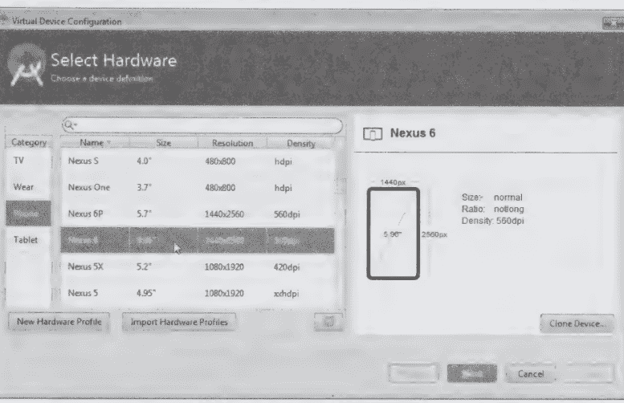

**图 1.21** | 虚拟设备配置窗口。

如果你在上述步骤 5 中保留勾选了“启用键盘输入”（Enable Keyboard Input），你就可以使用电脑键盘向运行在 AVD 中的应用输入数据。然而，这会防止软键盘在屏幕上显示。

你创建的每个 AVD 在`config.ini`文件中都有许多其他选项。为了更精确地匹配特定设备的硬件配置，你可以按照描述修改`config.ini`：

```ini
```


[http://developer.android.com/tools/devices/managing-avds.html](http://developer.android.com/tools/devices/managing-avds.html)

### 1.9.3 在 Nexus 6 手机 AVD 上运行小费计算器

要进行测试，请执行以下步骤：

1. **检查设置。** 如果你还没有执行，请执行“开始之前”（Before You begin）部分中指定的步骤。
2. **启动 Nexus 6 AVD。** 在本次测试中，我们将使用你在 1.9.2 节中配置的 Nexus 6 手机 AVD。启动 Nexus 6 AVD，选择 `Tools > Android Manager` 以显示 Android 虚拟设备管理器对话框（图 1.22）。在 Nexus 6 API 23 AVD 所在行点击“在模拟器中启动此 AVD”（）按钮。AVD 加载可能需要一些时间——在 Android 完成之前，不要尝试运行应用。加载完成后，AVD 将显示锁屏。在实际设备上，你通过用手指向上滑动来解锁。在 AVD 上执行滑动手势的方法是将鼠标悬停在 AVD 的“屏幕”上并用鼠标向上拖动。图 1.23 显示了你解锁后的 AVD。

   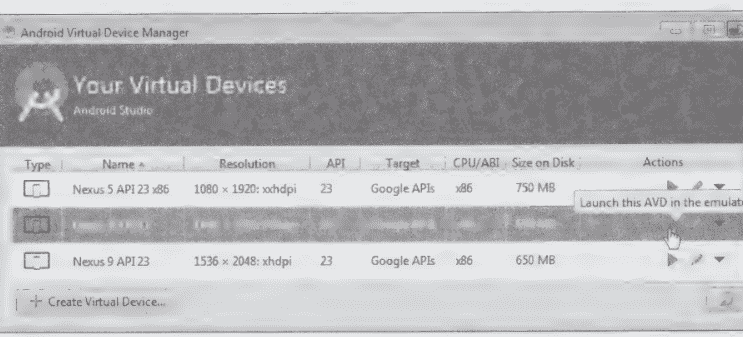

   图 1.22 | Android 虚拟设备管理器对话框。

   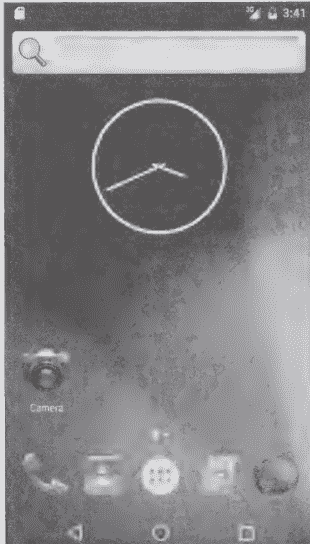

   图 1.23 | 解锁 AVD 后 Nexus 6 AVD 的桌面。

3. **运行应用。** 在 Android Studio 中，选择 `Run > Run 'app'` 或点击 Android Studio 工具栏上的 `Run 'app'` 按钮。这将显示设备选择器对话框（图 1.24），其中已选定当前运行的 AVD。点击 `OK` 即可在你在步骤 2 中启动的 AVD 中运行小费计算器（图 1.25）。¹¹¹ 作为在步骤 2 中打开 Android 虚拟设备管理器对话框的替代方案，你可以点击 Android 工具栏上的 `Run 'app'` 按钮（），随后会出现设备选择器对话框。然后你可以使用对话框底部的“启动模拟器”选项来选择要启动的 AVD，并在其中运行应用。

   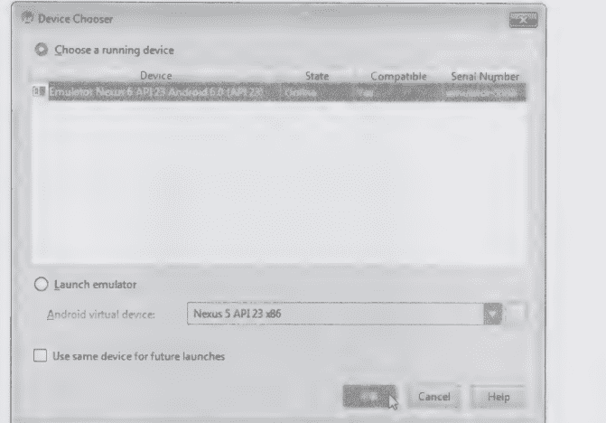

   图 1.24 | 用于选择测试应用的 AVD 或设备的设备选择器。

4. **探索 AVD。** 在 Android 屏幕底部有在设备屏幕上显示的各种软按钮。点击这些按钮与应用和 Android 系统进行交互。在 AVD 中，点击是通过使用鼠标完成的。向下按钮（）会关闭键盘。当没有键盘时，会显示返回按钮（）。点击此按钮将你带回应用屏幕，如果你处于当前应用的初始屏幕，则会返回上一个应用。主按钮（）将你返回设备桌面。最近应用按钮（）允许你查看最近使用的应用列表，屏幕顶部显示应用名称并可能包含其他特定的软按钮——应用顶部的选项数量取决于设备的大小——我们在第 5 章中讨论这个问题。¹¹ 可能根据你的 Android 版本或你是否安装并选择了自定义键盘而有所不同。为了在我们的截图中获得更好的对比：点击 Android 设备上的启动器（）图标。在桌面上，点击设置应用。在个人设置部分，点击语言和输入。在 Android 上，点击外观和布局（AOSP）。在你的设备上点击 Google 键盘（标准键盘）。点击外观和布局，然后点击主题。点击数据以更改深色背景键盘。

   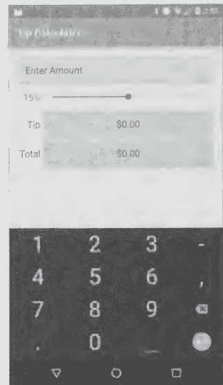

   图 1.25 | 在 AVD 中运行的小费计算器应用。

5. **输入总金额。** 通过点击数字键盘上的数字输入总金额 56.32。如果你输错了，按键盘右下角的删除按钮以删除你输入的最后一个数字。尽管键盘包含小数点，但应用被配置为只能输入数字 0–9。每当你点击或删除数字时，应用都会读取你已输入的内容并转换为数字——如果你删除了所有数字，应用顶部的 `TextView` 显示输入金额。应用将该值除以 100 并在 `TextView` 中显示结果。应用计算并更新显示的小费和总金额。我们使用 Android 的区域格式化功能根据设备当前区域显示货币。对于美国地区，当你输入数字 5、6、3 和 2 时，总金额分别显示为 $0.05、$0.56、$5.63 和 $56.32。
6. **选择自定义小费百分比。** `SeekBar` 允许你选择自定义百分比，`SeekBar` 下方的右侧 `TextView` 显示对应的小费和总金额。向右拖动 `SeekBar` 直到自定义百分比显示 25%。当你拖动滑块时，`SeekBar` 值持续变化。对于每个 `SeekBar` 值，应用都会更新小费百分比、小费金额和总金额，直到你释放滑块。图 1.26 显示了输入金额并选择小费百分比后的应用。

   

   图 1.26 | 输入金额并选择 25% 小费后的小费计算器。

7. **返回桌面。** 你可以通过点击 AVD 上的主页按钮（O）返回桌面。

### 排除 AVD 启动

如果在执行 Android 虚拟设备时遇到问题，可能是分配给 AVD 的内存过多。要减少 AVD 大小：

1. 在 Android Studio 中，选择 `Tools > Android > AVD Manager` 打开 Android 虚拟设备管理器。
2. 你将看到 AVD 列表。对于想要重新配置的 AVD，点击 Actions 列中的铅笔图标。
3. 在虚拟设备配置窗口中，点击显示高级设置（Show Advanced Settings），并滚动到内存和存储部分。
4. 将 RAM 值从默认的 1536 MB（1.5 GB）减少到 1 GB。
5. 点击完成（Finish）。

如果仍然无法运行 AVD，重复这些步骤并将内存减少到 768 MB。

### 1.9.4 在 Android 设备上运行小费计算器应用

如果你有一个 Android 设备，可以轻松在上面运行应用进行测试。

1. **在设备上启用开发者选项。** 首先，你必须在设备上启用调试。为此，进入设置应用，然后选择手机（或平板），找到版本号（列表底部）并点击七次，直到屏幕上显示“您现在是开发者”。这将在设置应用中启用名为“开发者选项”的入口。
2. **在设备上启用调试。** 返回设置应用主界面，选择开发者选项并确保已勾选 USB 调试——这是你首次在设备上启用开发者选项时的默认设置。
3. **连接你的设备。** 接下来，使用设备附带的 USB 线将设备连接到电脑。如果你是 Windows 用户，回想“开始之前”部分，你可能需要为设备安装 USB 驱动程序。访问以下页面查看：

   [http://developer.android.com/tools/device.html](http://developer.android.com/tools/device.html)

   [http://developer.android.com/tools/extras/oem-usb.html](http://developer.android.com/tools/extras/oem-usb.html)


**4. 在设备上运行应用。** 在 Android Studio 中，选择 Run > Run 'app' 或点击 Android 工具栏上的运行按钮 ( )。这将显示你在图 1.24 中看到的设备选择器。从运行的 AVD 和设备列表中选择你的设备。点击 OK 在你选的 Android 设备或 AVD 上运行小费计算器。

## 1.10 构建优秀的 Android 应用

Google Play 中有超过 160 万个应用，你如何创建一个让人们发现、下载、使用并推荐给他人的 Android 应用？考虑如何让应用变得有趣、实用、有吸引力且持久。一个巧妙的应用名称、一个吸引人的图标和一个引人入胜的描述可能会吸引人们在 Google Play 或许多其他 Android 应用商店中下载你的应用。但一旦用户下载了应用，是什么会让他们经常使用它并推荐给他人呢？图 1.27 显示了优秀应用的一些特征。

### 优秀应用的特征

**优秀游戏**
- 娱乐性与趣味。
- 具有挑战性。
- 难度分级递进。
- 显示你的分数并使用排行榜记录高分。
- 提供音频和视觉反馈。
- 提供单机版、多人版和网络版。
- 具有高质量的动画。
- 将输入/输出和计算密集型代码卸载到单独的执行线程，以提高界面响应和应用性能。
- 使用增强现实技术进行创新——用虚拟组件增强真实世界环境；这在视频类应用中尤为流行。

**实用工具类**
- 提供实用的功能和准确的信息。
- 提高个人和业务生产力。
- 让任务更加方便（例如，维护待办事项列表、管理支出）。
- 让用户获取更多信息。
- 提供主题性信息（例如，最新的股价、新闻、暴风雨预警、交通更新）。
- 使用基于位置的服务提供本地化服务（例如，本地企业的优惠券、比价应用、食物外卖）。

**通用特征**
- 跟进最新的 Android 特性，但兼容多个 Android 版本以支持最广泛的受众。
- 运行正常。
- 及时修复 Bug。
- 符合标准的 Android 应用 GUI 规范。
- 启动快速。
- 响应灵敏。

图 1.27 | 优秀应用的特征。（2 部分中的第 1 部分）

**通用特征（续）**
- 不需要过量的内存、带宽或电池电。
- 具有新性和创造力。
- 持久——你的用户会经常使用的东西。
- 使用专业级的图标，这些图标将出现在 Google Play 和用户的设备上。
- 使用高质量的图形、图像、动画、音频和视频。
- 直观且易用（不需要详尽的帮助文档）。
- 残障人士也可以访问（[http://developer.android.com/guide/topics/ui/accessibility/index.html](http://developer.android.com/guide/topics/ui/accessibility/index.html)）。
- 为用户提供推荐应用的理由和途径（例如，你可以让用户将游戏分数发布到 Facebook 或 Twitter）。
- 为内容驱动型应用提供额外内容（例如，游戏关、文章、谜题）。
- 针对提供的每个国家进行本地化（第 2 章）（例如，翻译应用的文本和音频文件，根据区域使用不同的图形等）。
- 比竞争应用提供更好的性能、功能和易用性。
- 利用设备的内置功能。
- 不需要过多的权限。
- 设计为可在各种 Android 设备上优化运行。
- 为新硬件设备做好了未来准备——指定你的应用所使用的确切硬件功能，以便 Google Play 过滤并在商店中向所有兼容设备显示（[http://android-developers.blogspot.com/2010/06/future-proofing-your-app.html](http://android-developers.blogspot.com/2010/06/future-proofing-your-app.html)）。

图 1.27 | 优秀应用的特征。（2 部分中的第 2 部分）

## 1.11 Android 开发资源

图 1.28 列出了来自 Android 开发者网站的一些关键文档。当你深入 Android 应用开发时，你可能会对工具、设计问题、安全等产生疑问。有几个 Android 开发者新闻组和论坛，你可以在那里获取最新公告或提问（图 1.29）。图 1.30 列出了你可以在其中找到 Android 开发技巧、视频和资源的几个网站。

| 标题 | URL |
|---|---|
| 应用组件 | [http://developer.android.com/guide/components/index.html](http://developer.android.com/guide/components/index.html) |
| 使用 Android 模拟器 | [http://developer.android.com/tools/devices/emulator.html](http://developer.android.com/tools/devices/emulator.html) |
| 包索引 | [http://developer.android.com/reference/packages.html](http://developer.android.com/reference/packages.html) |
| 类索引 | [http://developer.android.com/reference/classes.html](http://developer.android.com/reference/classes.html) |

图 1.28 | Android 开发者的关键在线文档。（2 部分中的第 1 部分。）

| 标题 | URL |
| --- | --- |
| Android 设计 | [http://developer.android.com/design/index.html](http://developer.android.com/design/index.html) |
| 数据备份 | [http://developer.android.com/guide/topics/data/backup.html](http://developer.android.com/guide/topics/data/backup.html) |
| 安全技巧 | [http://developer.android.com/training/articles/security-tips.html](http://developer.android.com/training/articles/security-tips.html) |
| Android Studio | [http://developer.android.com/sdk/index.html](http://developer.android.com/sdk/index.html) |
| 调试 | [http://developer.android.com/tools/debugging/index.html](http://developer.android.com/tools/debugging/index.html) |
| 工具帮助 | [http://developer.android.com/tools/help/index.html](http://developer.android.com/tools/help/index.html) |
| 性能技巧 | [http://developer.android.com/training/articles/performance-tips.html](http://developer.android.com/training/articles/performance-tips.html) |
| 保持应用响应 | [http://developer.android.com/training/articles/performance-an.html](http://developer.android.com/training/articles/performance-an.html) |
| 上架清单（针对 Google Play） | [http://developer.android.com/distribute/tools/checklist.html](http://developer.android.com/distribute/tools/checklist.html) |
| 快速上手 Android | [http://developer.android.com/distribute/start.html](http://developer.android.com/distribute/start.html) |
| 管理你的内存 | [http://developer.android.com/training/memory.html](http://developer.android.com/training/memory.html) |
| 开发者协议 | [http://developer.android.com](http://developer.android.com) |

图 1.28 | Android 开发者的关键在线文档。（2 部分中的第 2 部分）

| 标题 | 订阅 | 描述 |
| --- | --- | --- |
| Android 讨论 | 通过邮件订阅 android-discuss@googroups.com | 一个可以获取答案的通用小组。 |
| Stack Overflow | [http://stackoverflow.com/tagged/android](http://stackoverflow.com/tagged/android) | 开发者在此处查找应用问题。 |
| Android 开发者 | [http://groups.google.com/forum/android](http://groups.google.com/forum/android) | 丰富的开发者在此。 |
| Android 论坛 | [http://www.androidforums.com](http://www.androidforums.com) | 与开发者分享技巧。 |

图 1.29 | 新闻组和论坛。

| Android 开发技巧、视频和资源 | URL |
|---|---|
| Google 提供的示例代码和工具 | [https://github.com/google](https://github.com/google)（使用 "android" 过滤） |
| Bright Hub™ 网站，提供 Android 编程技巧和方法 | [http://www.brighthub.com/android.aspx](http://www.brighthub.com/android.aspx) |
| Android 开发者博客 | [http://android-developers.blogspot.com/](http://android-developers.blogspot.com/) |
| HTC Android 开发者中心 | [http://www.htcdev.com/](http://www.htcdev.com/) |
| 美的开发者网站 | [http://developer.motorola.com/](http://developer.motorola.com/) |
| Stack Overflow 上的 Android 用户 | [http://stackoverflow.com/tags/android/topusers](http://stackoverflow.com/tags/android/topusers) |
| Android 周刊 | [http://androidweekly.net/](http://androidweekly.net/) |
| Chet Haase 的 Codependent 博客 | [http://graphics-geeks.blogspot.com/](http://graphics-geeks.blogspot.com/) |
| Romain Guy 的 Android 博客 | [http://www.curious-creature.org/category/android/](http://www.curious-creature.org/category/android/) |
| YouTube 上的 Android 频道 | [http://www.youtube.com/user/androiddevelopers](http://www.youtube.com/user/androiddevelopers) |
| Google I/O 2015 开发者大会视频 | [https://events.google.com/io2015/videos](https://events.google.com/io2015/videos) |

图 1.30 | Android 开发技巧、视频和资源。

## 1.12 本章总结

本章介绍了 Android 的简要历史并讨论了它的功能。我们提供了一些关键在线文档的链接，以及你可以用于连接开发者社区并获取答案的新闻组和论坛。我们讨论了 Android 操作系统的特性。我们介绍了 Java、Android 和 Google 包，这些包使你能够构建各种 Android 应用所需的硬件软件功能。你将在本书中使用许多这些包。我们还讨论了 Java 编程和 Android SDK。你学习了 Android 手势以及如何在 Android 设备和模拟器上执行每个手势。我们快速回顾了基本的对象技术概念，包括类、对象、属性、行为、封装、信息隐藏、继承等。我们还在模拟器上的手机和平板 AVD 上测试了小费计算器应用。

在第 2 章中，你将在 Android Studio 中构建你的第一个 Android 应用。该应用将显示文本和图像。你还将学习 Android 的无障碍功能和国际化。

# 2 欢迎应用 (Welcome App)

Dive-Into® Android Studio：介绍视觉化 GUI 设计、布局、辅助功能与国际化


## 目标

在本章中，你将：

- 理解 Android Studio IDE 的基础，你将用它来编写、测试和调试 Android 应用。
- 使用 IDE 创建新的应用项目。
- 使用 IDE 的布局编辑器以视觉化方式（无需编程）设计图形用户界面（GUI）。
- 在 GUI 中显示文本和图像。
- 编辑视图（GUI 组件）的属性。
- 在 Android 模拟器中构建并启动应用。
- 通过指定用于 Android TalkBack 和“触摸探索”（Explore-by-Touch）功能的字符串，使应用对视力残障人士更具可用性。
- 支持国际化，以便你的应用可以显示不同语言的本地化字符串。

## 36 第 2 章 欢迎应用

## 目录

- 2.1 引言
- 2.2 技术概述
    - 2.2.1 Android Studio
    - 2.2.2 LinearLayout, TextView 和 ImageView
    - 2.2.3 可扩展标记语言 (XML)
    - 2.2.4 应用资源
    - 2.2.5 辅助功能
    - 2.2.6 国际化
- 2.3 创建应用
    - 2.3.1 启动 Android Studio
    - 2.3.2 创建新项目
    - 2.3.3 创建项目对话框
    - 2.3.4 目标 Android 设备
    - 2.3.5 向移动端添加 Activity 的步骤
    - 2.3.6 自定义 Activity 的步骤
- 2.4 Android Studio 窗口
    - 2.4.1 项目窗口
    - 2.4.2 编辑窗口
    - 2.4.3 组件树窗口
    - 2.4.4 应用资源文件
    - 2.4.5 布局编辑器
    - 2.4.6 默认 GUI
    - 2.4.7 默认 GUI 的 XML
- 2.5 使用布局编辑器构建应用的 GUI
    - 2.5.1 向项目添加图像
    - 2.5.2 添加图标
    - 2.5.3 将 RelativeLayout 更改为布局
    - 2.5.4 更改 TextView 的 id 和方向
    - 2.5.5 配置 TextView 的 id 和文本属性
    - 2.5.6 配置 TextView 的 textSize 属性——缩放像素和密度无关像素
    - 2.5.7 设置 TextView 的 textColor 属性
    - 2.5.8 设置 TextView 的 gravity 属性
    - 2.5.9 设置 TextView 的 layout:gravity 属性
    - 2.5.10 设置 TextView 的 layout:weight 属性
    - 2.5.11 添加 ImageView 显示图像
    - 2.5.12 预览设计
- 2.6 运行欢迎应用
- 2.7 你的应用具有可用性
- 2.8 你的应用国际化
    - 2.8.1 本地化
    - 2.8.2 为本地化资源文件夹命名
    - 2.8.3 向应用项目添加字符串翻译
    - 2.8.4 字符串本地化
    - 2.8.5 在西班牙语环境或 AVD 上测试应用
    - 2.8.6 在设备上用西班牙语测试应用
    - 2.8.7 TalkBack 与本地化
    - 2.8.8 本地化
    - 2.8.9 专业翻译
- 2.9 总结

## 2.1 引言

在本章中，你将构建一个显示欢迎消息和图像的欢迎应用。你将使用 Android Studio 创建一个简单的应用（图 2.1），该应用可以在 Android 手机和平板的竖屏和横屏模式下运行：

- 在竖屏模式下，设备的高度大于宽度。
- 在横屏模式下，宽度大于高度。

你将使用 Android Studio 的布局编辑器通过拖放技术来构建 GUI。你还将直接使用 GUI 的 XML。你将在 Android 模拟器和 Android 设备（如果你有的话）上运行你的应用。

你将为应用的图像提供描述性文本，使其对视力残障人士更具可用性。你会看到，Android “触摸探索”允许用户触摸屏幕上的项目并让 TalkBack 读出相应的描述性文本。我们将讨论如何测试这些功能，它们仅在 Android 设备上可用。

## 2.2 技术概述

Android 顶部系统栏显示时间、电量指示器、蜂窝连接状态以及向你发送通知的应用程序图标。


显示应用内容的区域

Android 底部系统栏（从左到右）显示返回、主页和最近应用按钮

**图 2.1 | 在 Android 模拟器中运行的欢迎应用。**

最后，你将初始化应用，以便提供不同语言的本地化字符串。然后你将更改 Android 模拟器上的区域设置，以便用西班牙语测试应用。当你执行应用时，Android 会根据设备的区域选择正确的字符串。我们将展示如何在设备上更改区域。我们假设你已经阅读了“开始之前”和第 1.9 节。

### 2.2.1 Android Studio

在 2.3 中，你将使用 Android Studio 集成环境 (IDE) 创建一个新应用。正如你看到的，IDE 创建了一个简单的应用（图 2.1），它可以在 Android 手机和平板的竖屏和横屏模式下运行：

- 在竖屏模式下，设备的高度大于宽度。
- 在横屏模式下，宽度大于高度。

你将使用 Android Studio 的布局编辑器通过拖放技术构建 GUI。你还将直接使用 GUI 的 XML。你将在 Android 模拟器和 Android 设备上运行应用。你将为图像提供描述性文本，使其对视力残障人士更具可用性。你会看到，Android “触摸探索”允许用户触摸屏幕上的项目并让 TalkBack 读出文本。我们将讨论如何测试这些仅在 Android 设备上运行的功能。

### 2.2.2 LinearLayout, TextView 和 ImageView

Android 顶部系统栏显示时间、电量指示器、蜂窝连接状态以及向你发送通知的应用程序图标。


显示应用内容的区域

Android 底部系统栏（从左到右）显示返回、主页和最近应用按钮

**图 2.1 | 在 Android 模拟器中运行的欢迎应用。**

最后，你将初始化应用，以便提供不同语言的本地化字符串。然后你将更改 Android 模拟器上的区域设置，以便用西班牙语测试应用。当你执行应用时，Android 会根据设备的区域选择正确的字符串。我们将展示如何在设备上更改区域。我们假设你已经阅读了“开始之前”和第 1.9 节。

## 38 第 2 章 欢迎应用

应用的文本显示在 TextView 中，图像显示在 ImageView 中。Android Studio 创建的默认 GUI 包含 TextView。你将使用视图面板（图 2.1）将 ImageView 放到 GUI 上（第 2.5 节）。

### 2.2.3 可扩展标记语言 (XML)

可扩展标记语言 (XML) 是表示 GUI 的自然语言。在 Android 环境中，它帮助你定义使用的布局和组件，以及属性（如尺寸、颜色）。Android Studio 解析 XML 以在布局编辑器中显示设计，并生成运行时的 Java 代码。你还将使用 XML 文件存储应用资源，如字符串、数字和颜色（第 2.4 节）。

### 2.2.4 应用资源

将所有字符串、数值和其他值定义在项目 `res` 文件夹子目录下的 XML 资源文件中是做法。在 2.5.5 节中，你将为字符串（如 TextView 上的文本）和测量（如字体大小）创建资源。对于 TextView 的字体颜色，你将从 Google 的 Material Design 调板中选择颜色资源。


`http://www.google.com/design/spec/style/color.html`


### 2.2.5 辅助功能

Android 提供辅助功能帮助某些残障人士使用设备。视觉人士使用 Android TalkBack 让设备读取屏幕文本或你提供的文本，帮助他们理解视图的作用和内容。Android “触摸探索”允许用户触摸屏幕以听 TalkBack 读出屏幕内容。第 2.7 节展示了如何启用这些功能并为应用的视图配置辅助功能。

### 2.2.6 国际化

Android 设备在全球范围内使用。为了让应用接触更多用户，你应该考虑针对各种区域和语言对其进行定制。将应用配置为可以针对区域定制称为国际化。针对特定区域对应用进行定制称为本地化。第 2.8 节展示了如何为欢迎应用的 `TextView` 和 `ImageView` 辅助字符串提供西班牙语文本，并在 AVD 或配置为西班牙语的设备上测试应用。

## 2.3 创建应用

本书的示例是使用编写时当时的 Android 6 SDK 开发的。本节将向你展示如何使用 Android Studio 创建新项目。我们将在书中介绍 IDE 的更多功能。

### 2.3.1 启动 Android Studio

正如你在 1.9 节中所做的，通过快捷方式打开 Android Studio：

IDE 显示欢迎窗口（图 1.17）或你上次打开的项目。

### 2.3.2 创建新项目

项目是一组相关文件，例如构成应用的代码文件、资源文件和图像。要创建一个应用，必须先创建它的项目。为此，在欢迎窗口中点击“启动一个新的 Android Studio 项目”（Start a new Android Studio project），如果已经打开了一个项目，则选择 `File > New > New Project...`。这将显示创建新项目（Create New Project）对话框（图 2.2）。

创建新项目对话框中正在执行的步骤：


图 2.2 | 创建新项目对话框——新建项目步骤。

### 2.3.3 创建新项目对话框

在创建新项目对话框的配置你的新项目（Configure your new project）步骤（图 2.2）中，指定以下信息，然后点击 Next：

1. **Application name（应用名称）：**——你的应用名称。在此字段中输入 `welcome`。
2. **Company domain（公司域名）：**——你公司的网站域名。我们使用了 `detail.com` 域名。出于学习目的，你可以使用 `example.com`，但如果你打算发布你的应用，则必须更改它。
3. **Package name（包名）：**——你的应用源码的 Java 包名。Android 和 Google Play 商店将其用作应用的唯一标识，在你上传到 Google Play 商店的所有应用版本中，它必须保持一致。包名通常以你的公司或机构的 Company Domain 反序开头——我们的公司域名是 `detail.com`，所以你的 Java 包名以 `com.detail.` 开头，后跟一个点（`.`）以及全小写且删除了任何空格的应用名称。按照惯例，包名仅使用小写字母。IDE 使用 Application Name 和 Company Domain 的文本设置包名。你可以点击生成的包名右侧的 Edit 链接来自定义包名。
4. **Project location（项目位置）：**——你计算机上存储项目的路径。默认情况下，Android 将新项目文件夹放在用户账户目录下的 `AndroidStudioProjects` 子文件夹中。项目的文件夹名称由去除了空格的项目项目名称组成。你也可以通过输入路径或点击位置字段右侧的省略号（`...`）按钮并浏览以存储项目的位置来自定义位置。选择位置后，点击 OK。点击 Next 到下一步。


> **错误预防提示 2.1**
>
> 如果要保存项目的文件夹包含空格，创建新项目对话框将显示消息：*你的位置包含空白字符（Your location contains whitespace）。这在某些平台上可能会导致问题，不建议这样做。*要解决此问题，点击创建新项目对话框 `Project location` 字段右侧的省略号（`...`）按钮，并选择一个不包含空格的位置；否则你的项目可能无法正确编译或执行。

### 2.3.4 目标 Android 设备步骤

在创建新项目对话框的目标 Android 设备（Target Android Devices）步骤中（图 2.3）：

1. 勾选你的应用应该支持的每个 Android 设备类型（手机和平板、电视、穿戴、Android Auto 和 Glass）。对于 Welcome 应用，确保只勾选 Phone 和 Tablet 类型。
2. 接下来，为你选择的每种设备类型在下拉菜单中选择一个 Minimum SDK（最低 SDK），然后点击 Next。Minimum SDK 是运行你的应用所需的最低 Android API 级别。这允许你的应用在支持该 API 级别及更高版本的设备上执行。对于本书的应用，请选择 API23: Android 6.0 (Marshmallow) 并点击 Next。


图 2.4 显示了 Android SDK 版本及其 API 级别——此处未显示的版本已废弃，不应使用。运行每个平台版本的 Android 设备百分比显示在 `http://developer.android.com/about/dashboards/index.html`。

## 软件工程观察 2.1

较低的 Minimum SDK 使得你的应用能够在更多设备上运行——例如，在写本文时，你可以通过 API 15 覆盖 94% 的设备。通常，你应该针对你的应用可以运行的最低 API 级别。当你的应用安装在旧平台上时，你必须禁用旧平台上不可用的新功能。

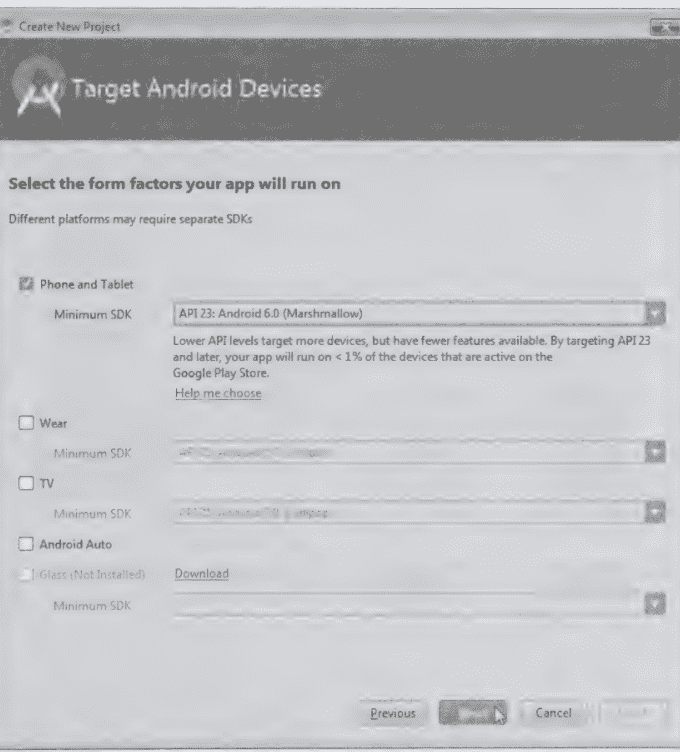

图 2.3 | 创建新项目对话框——目标 Android 设备步骤。

| SDK version | API level | SDK version | API level | SDK version | API level |
| :--- | :--- | :--- | :--- | :--- | :--- |
| 6.0 | 23 | 4.3 | 18 | 2.3.3–2.3.7 | 10 |
| 5.1 | 22 | 4.2.x | 17 | 2.2 | 8 |
| 5.0 | 21 | 4.1.x | 16 | | |
| 4.4 | 19 | 4.0.3–4.0 | 15 | | |

图 2.4 | Android SDK 版本及其 API 级别。（`http://developer.android.com/about/dashboards/index.html`）

### 2.3.5 添加 Activity 步骤

在创建新项目对话框的添加 Activity（Add an Activity）步骤中（图 2.5），你选择一个应用模板。模板为常见的应用设计和逻辑提供了起点。

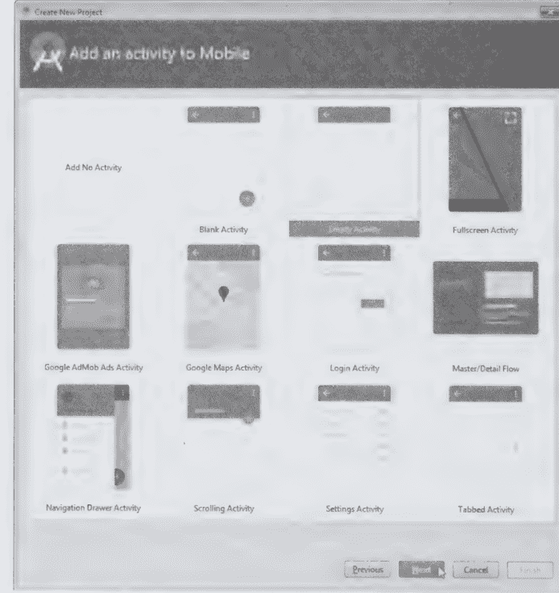

图 2.5 | 创建新项目对话框——添加活动步骤。

### 2.3.6 创建应用

图 2.6 简要描述了 2.5 中常用的模板。对于此应用，选择 Empty Activity，然后点击 Next。此模板定义了一个显示 Hello World! 的单屏幕应用。我们在后续章节中使用其他模板。通过向现有应用添加 Activity 创建多屏幕应用。例如，在第 4 章的应用中，我们将添加一个允许用户设置的 `Settings Activity`。

| 模板 | 描述 |
| :--- | :--- |
| Empty Activity | 用于单屏幕应用，由你构建大部分 GUI。在应用顶部提供应用栏。包含 Material 设计的浮动按钮（`FloatingActionButton`）。 |
| Fullscreen Activity | 用于单屏幕应用（类似于 Blank Activity），占据整个屏幕，可以切换设备状态栏和应用栏的可见性。 |
| Master/Detail Flow | 用于显示主列表并从中选择项目查看详情的应用——类似于内置的邮件和联系人应用。包含允许用户从主列表中选择并在详情视图显示的基本逻辑。对于平板，主列表和详情在同一屏幕上并行显示。对于手机，主列表显示在一个屏幕上，选择项目将在另一个屏幕显示详情。 |

图 2.6 | Activity 模板。

### 2.3.7 自定义 Activity 步骤

此步骤（图 2.7）取决于上一步选择的模板。对于 Empty Activity 模板，此步骤允许你指定：

- Activity Name——`MainActivity` 是 IDE 提供的默认名称。这是控制应用执行的 Activity 子类的名称。从第 3 章开始，我们将修改此类来实现应用的功能。
- Layout Name——`activity_main` 是 IDE 提供的默认名称。该文件（扩展名为 `.xml`）存储应用的 XML 表示，你将在 2.5 中使用视觉化技术构建它。

对于此应用，保持默认设置，然后点击 Finish 创建项目。

## 2.4 Android Studio 窗口

完成项目创建后，IDE 会同时打开 `MainActivity.java` 和 `activity_main.xml`。关闭 `MainActivity.java`，使 IDE 显示得如图 2.8 所示。IDE 显示布局编辑器，因此你可以开始设计应用的 GUI。在本章中，我们只讨论构建 Welcome 应用所需的 IDE 功能。我们将在全书中介绍更多 IDE 功能。

项目窗口（Project window）显示 `app` 节点下的项目文件。编辑器（Editor）——如布局和代码编辑器——显示在这里。组件树（Component Tree）显示属性窗口（Properties window）中当前选中项。

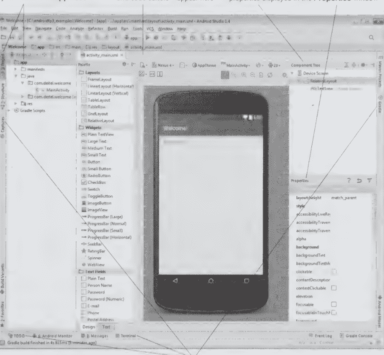

折叠窗口标签页——你可以点击标签页来展开相应的窗口。

图 2.8 | 我们打开 Android Studio 时，项目已处于打开状态。

### 2.4.1 项目窗口

项目窗口提供了对项目所有文件的访问。你可以同时在 IDE 中打开多个项目——每个项目都有自己独立的窗口。图 2.9 显示了项目窗口中 Welcome 应用的项目内容——我们展开了 `res` 文件夹及其嵌套文件夹。`app` 文件夹包含你为创建应用 GUI 和逻辑时而需要编辑的文件。`app` 文件夹的内容被组织在包含文件的嵌套文件夹中。在本章中，你将只使用位于 `res` 文件夹中的文件，我们将在 2.4.4 节讨论这些文件——我们将在后续章节中使用它们时再讨论其他文件夹和文件。

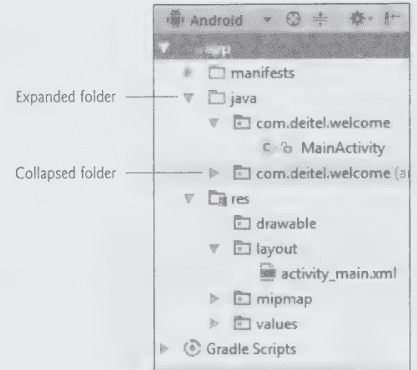

**图 2.9 | 项目窗口。**

### 2.4.2 编辑器窗口

图 2.8 中项目窗口右侧是布局编辑器窗口。其内容根据文件类型显示在相应的窗口中。对于 Java 文件，将显示 Java 源代码编辑器。对于表示 GUI 的 XML 文件（如 `activity_main.xml`），默认显示布局编辑器的 `Design`（设计）选项卡，你可以点击 `Text`（文本）选项卡来与设计预览并查看对应的 XML——如果预览没有出现，你可以通过 `View（视图） > Tool Windows（工具窗口） > Preview（预览）` 来查看。对于其他 XML 文件，将根据 XML 文件的用途显示自定义 XML 编辑器或文本编辑器。Java 和 XML 的代码编辑器通过代码补全帮助你快速准确地编写代码——当你输入代码时，可以按 `Enter`（回车键）自动补全代码元素或 XML 元素名称、属性名或当前在代码补全窗口中高亮显示的值。

### 2.4.3 组件树窗口

当布局编辑器在 `Design` 视图下打开时，组件树会出现在 IDE 的右侧（图 2.8）。此窗口显示了构成 GUI 的布局和视图（GUI 组件）以及父子关系——例如，一个布局（父级）可能包含许多嵌套视图（子级），包括其他布局。

### 2.4.4 App 资源文件

如 `activity_main.xml` 等布局文件是应用资源，存储在项目 `res` 文件夹的子文件夹中。子文件夹包含不同类型的资源。我们在此应用中使用的如图 2.10 所示，其他的（`menu`、`animator`、`anim`、`color`、`mipmap`、`raw` 和 `xml`）将在书中后续需要时进行讨论。

### 2.4.5 布局编辑器

当以 `Design` 视图打开布局编辑器时，组件树会出现在 IDE 的右侧（图 2.8）。此窗口显示了构成 GUI 的布局和视图（GUI 组件）以及父子关系——例如，一个布局（父级）可能包含许多嵌套视图（子级），包括其他布局。

### 2.4.6 默认布局

在 `Design` 视图下打开布局编辑器时，组件树会出现在 IDE 的右侧（图 2.8）。此窗口显示了构成 GUI 的布局和视图（GUI 组件）以及父子关系——例如，一个布局（父级）可能包含许多嵌套视图（子级），包括其他布局。

### 2.4.7 默认布局

在 `Design` 视图下打开布局编辑器时，组件树会出现在 IDE 的右侧（图 2.8）。此窗口显示了构成 GUI 的布局和视图（GUI 组件）以及父子关系——例如，一个布局（父级）可能包含许多嵌套视图（子级），包括其他布局。

### 2.4.8 默认布局

在 `Design` 视图下打开布局编辑器时，组件树会出现在 IDE 的右侧（图 2.8）。此窗口显示了构成 GUI 的布局和视图（GUI 组件）以及父子关系——例如，一个布局（父级）可能包含许多嵌套视图（子级），包括其他布局。

### 2.4.9 默认布局

在 `Design` 视图下打开布局编辑器时，组件树会出现在 IDE 的右侧（图 2.8）。此窗口显示了构成 GUI 的布局和视图（GUI 组件）以及父子关系——例如，一个布局（父级）可能包含许多嵌套视图（子级），包括其他布局。

### 2.4.10 默认布局

在 `Design` 视图下打开布局编辑器时，组件树会出现在 IDE 的右侧（图 2.8）。此窗口显示了构成 GUI 的布局和视图（GUI 组件）以及父子关系——例如，一个布局（父级）可能包含许多嵌套视图（子级），包括其他布局。

### 2.4.11 默认布局

在 `Design` 视图下打开布局编辑器时，组件树会出现在 IDE 的右侧（图 2.8）。此窗口显示了构成 GUI 的布局和视图（GUI 组件）以及父子关系——例如，一个布局（父级）可能包含许多嵌套视图（子级），包括其他布局。

### 2.4.12 默认布局

在 `Design` 视图下打开布局编辑器时，组件树会出现在 IDE 的右侧（图 2.8）。此窗口显示了构成 GUI 的布局和视图（GUI 组件）以及父子关系——例如，一个布局（父级）可能包含许多嵌套视图（子级），包括其他布局。

### 2.4.13 默认布局

在 `Design` 视图下打开布局编辑器时，组件树会出现在 IDE 的右侧（图 2.8）。此窗口显示了构成 GUI 的布局和视图（GUI 组件）以及父子关系——例如，一个布局（父级）可能包含许多嵌套视图（子级），包括其他布局。

### 2.4.14 默认布局

在 `Design` 视图下打开布局编辑器时，组件树会出现在 IDE 的右侧（图 2.8）。此窗口显示了构成 GUI 的布局和视图（GUI 组件）以及父子关系——例如，一个布局（父级）可能包含许多嵌套视图（子级），包括其他布局。

### 2.4.15 默认布局

在 `Design` 视图下打开布局编辑器时，组件树会出现在 IDE 的右侧（图 2.8）。此窗口显示了构成 GUI 的布局和视图（GUI 组件）以及父子关系——例如，一个布局（父级）可能包含许多嵌套视图（子级），包括其他布局。

### 2.4.16 默认布局

在 `Design` 视图下打开布局编辑器时，组件树会出现在 IDE 的右侧（图 2.8）。此窗口显示了构成 GUI 的布局和视图（GUI 组件）以及父子关系——例如，一个布局（父级）可能包含许多嵌套视图（子级），包括其他布局。

### 2.4.17 默认布局

在 `Design` 视图下打开布局编辑器时，组件树会出现在 IDE 的右侧（图 2.8）。此窗口显示了构成 GUI 的布局和视图（GUI 组件）以及父子关系——例如，一个布局（父级）可能包含许多嵌套视图（子级），包括其他布局。

### 2.4.18 默认布局

在 `Design` 视图下打开布局编辑器时，组件树会出现在 IDE 的右侧（图 2.8）。此窗口显示了构成 GUI 的布局和视图（GUI 组件）以及父子关系——例如，一个布局（父级）可能包含许多嵌套视图（子级），包括其他布局。

### 2.4.19 默认布局

在 `Design` 视图下打开布局编辑器时，组件树会出现在 IDE 的右侧（图 2.8）。此窗口显示了构成 GUI 的布局和视图（GUI 组件）以及父子关系——例如，一个布局（父级）可能包含许多嵌套视图（子级），包括其他布局。

### 2.4.20 默认布局

在 `Design` 视图下打开布局编辑器时，组件树会出现在 IDE 的右侧（图 2.8）。此窗口显示了构成 GUI 的布局和视图（GUI 组件）以及父子关系——例如，一个布局（父级）可能包含许多嵌套视图（子级），包括其他布局。

### 2.4.21 默认布局

在 `Design` 视图下打开布局编辑器时，组件树会出现在 IDE 的右侧（图 2.8）。此窗口显示了构成 GUI 的布局和视图（GUI 组件）以及父子关系——例如，一个布局（父级）可能包含许多嵌套视图（子级），包括其他布局。

### 2.4.22 默认布局

在 `Design` 视图下打开布局编辑器时，组件树会出现在 IDE 的右侧（图 2.8）。此窗口显示了构成 GUI 的布局和视图（GUI 组件）以及父子关系——例如，一个布局（父级）可能包含许多嵌套视图（子级），包括其他布局。

### 2.4.23 默认布局

在 `Design` 视图下打开布局编辑器时，组件树会出现在 IDE 的右侧（图 2.8）。此窗口显示了构成 GUI 的布局和视图（GUI 组件）以及父子关系——例如，一个布局（父级）可能包含许多嵌套视图（子级），包括其他布局。

### 2.4.24 默认布局

在 `Design` 视图下打开布局编辑器时，组件树会出现在 IDE 的右侧（图 2.8）。此窗口显示了构成 GUI 的布局和视图（GUI 组件）以及父子关系——例如，一个布局（父级）可能包含许多嵌套视图（子级），包括其他布局。

### 2.4.25 默认布局

在 `Design` 视图下打开布局编辑器时，组件树会出现在 IDE 的右侧（图 2.8）。此窗口显示了构成 GUI 的布局和视图（GUI 组件）以及父子关系——例如，一个布局（父级）可能包含许多嵌套视图（子级），包括其他布局。

### 2.5.1 向项目添加图像

对于此应用，你需要向项目添加一张图像。我们将使用 Deitel 漏洞 Logo 图片（`bug.png`），它位于 `images` 文件夹下的 `welcome` 子文件夹（与书籍示例一起）。图像资源的文件名——以及你在后续章节中使用的所有其他资源——必须是小写字母。

### drawable 文件夹

Android 设备具有各种屏幕尺寸、分辨率和像素密度（即每英寸点数，或 DPI），因此你通常将图像放在各种分辨率中，操作系统会根据设备的像素密度进行选择。这些图像存放在（项目文件夹中的）`drawable` 文件夹中，用于存储具有不同像素密度的图像（图 2.13）。例如，对于在手机 AVD 中使用的 Google Nexus 6 手机（560 dpi）像素密度相似的设备，我们将图像放在 `drawable-xxhdpi` 文件夹中。较低像素密度设备的图像放置在其他 drawable 文件夹中——通常是与实际设备像素密度最接近的文件夹。

| 密度 | 说明 |
|---|---|
| `drawable-ldpi` | 低密度—大约每英寸 120 点 |
| `drawable-mdpi` | 中密度—大约每英寸 160 点 |
| `drawable-hdpi` | 高密度—大约每英寸 240 点 |
| `drawable-xhdpi` | 超高密度—大约每英寸 320 点 |
| `drawable-xxhdpi` | 特超高密度—大约每英寸 480 点 |
| `drawable-xxxhdpi` | 特超超高密度—大约每英寸 640 点 |

**图 2.13** Android 像素密度。

如果你的项目包含多种密度的资源，Android Studio 只显示一个 drawable 文件夹。对于存储在磁盘项目文件夹 `drawable-xxxhdpi` 中的资源，Android Studio 会在项目的 drawable 文件夹中显示 `filename.xml`。

对于此应用，我们只提供了一个版本的图像。如果 Android 无法在 drawable 文件夹中找到最匹配设备像素密度的图像，Android 将根据需要对另一个 drawable 文件夹中的版本进行放大处理。默认情况下，Android Studio 只创建一个不带 DPI 限定符的 drawable 文件夹，我们将将其用于此初始应用。有关在 Android 中支持多个屏幕和多个屏幕尺寸的详细信息，请访问：

```text


http://developer.android.com/guide/practices/screens_support.html

### 注意事项

- 在应用中使用任何图像之前，你应该确保已正确获得该图像的许可。某些图像许可要求你支付图像使用费用，另一些则提供免费的开源或知识产权（`creativecommons.org`）许可。

## 2.5 使用布局编辑器构建应用的 GUI

> **外观与感受观察 2.1**  
> 低分辨率图像的缩放效果不好。为了让图像渲染良好，高像素密度设备比低像素密度设备需要更高分辨率的图像。

### 2.5.1 向项目添加图像

对于此应用，你需要向项目添加一张图像。我们将使用 Deitel 漏洞 Logo 图片（`bug.png`），它位于 `images` 文件夹下的 `welcome` 子文件夹（与书籍示例一起）。图像资源的文件名——以及你在后续章节中使用的所有资源——必须是小写字母。

#### drawable 文件夹

Android 设备具有各种屏幕尺寸、分辨率和像素密度（即每英寸点数，或 DPI），因此你通常将图像放在各种分辨率中，操作系统会根据设备的像素密度进行选择。这些图像存放在（项目文件夹中的）`drawable` 文件夹中，用于存储具有像素密度的图像（图 2.13）。

例如，对于在手机 AVD 中使用的 Google Nexus 6 手机（560 dpi）像素密度相似的设备，我们将图像放在 `drawable-xxhdpi` 文件夹中。较低像素密度设备的图像放置在其他 drawable 文件夹中——通常是与实际设备像素密度最接近的文件夹。

| 密度 | 说明 |
|---|---|
| `drawable-ldpi` | 低密度—大约每英寸 120 点 |
| `drawable-mdpi` | 中密度—大约每英寸 160 点 |
| `drawable-hdpi` | 高密度—大约每英寸 240 点 |
| `drawable-xhdpi` | 超高密度—大约每英寸 320 点 |
| `drawable-xxhdpi` | 特超高密度—大约每英寸 480 点 |
| `drawable-xxxhdpi` | 特超超高密度—大约每英寸 640 点 |

**图 2.13** Android 像素密度。

如果你的项目包含多种密度的资源，Android Studio 只显示一个 drawable 文件夹。对于存储在磁盘项目文件夹 `drawable-xxxhdpi` 中的资源，Android Studio 会在项目的 drawable 文件夹中显示 `filename.xml`。

对于此应用，我们只提供了一个版本的图像。如果 Android 无法在 drawable 文件夹中找到最匹配设备像素密度的图像，Android 将根据需要对另一个 drawable 文件夹中的版本进行放大处理。默认情况下，Android Studio 只创建一个不带 DPI 限定符的 drawable 文件夹，我们将将其用于此初始应用。有关在 Android 中支持多个屏幕和多个屏幕尺寸的详细信息，请访问：

```text
http://developer.android.com/guide/practices/screens_support.html
```

### 将 bug.png 添加到项目

执行以下步骤将图像添加到此 `res` 文件夹中。

1. 在 Project 窗口中，展开项目的 `res` 文件夹。
2. 在文件系统中的书籍示例文件夹中，打开 `images` 文件夹，然后打开 `welcome` 子文件夹。
3. 复制 `bug.png` 文件，然后在 Android Studio 的 Project 窗口中选择 `res` 文件夹下的 `drawable` 文件夹，并将文件粘贴到该子文件夹中。
4. 在出现的 Copy 对话框中，点击 OK。

现在可以在应用中使用该图像了。

### 2.5.2 添加应用图标

当应用安装在设备上时，它的图标和名称将与启动器中的所有应用一起出现，你可以通过设备主屏幕上的图标访问它。要添加应用的启动器图标，右键点击 `res` 文件夹，然后选择 New > Image Asset。这将打开 Asset Studio（图 2.14）。

对于此应用，我们只提供了一个版本的图像。如果 Android 无法在 drawable 文件夹中找到最匹配设备像素密度的图像，Android 将根据需要对另一个 drawable 文件夹中的版本进行放大处理。

1. 在 Project 窗口中，展开项目的 `res` 文件夹。
2. 复制 `bug.png` 文件，然后在 Android Studio 的 Project 窗口中选择 `res` 文件夹下的 `drawable` 文件夹，并将文件粘贴到该子文件夹中。
3. 在出现的 Copy 对话框中，点击 OK。

现在可以在应用中使用该图像了。

### 2.5.3 将布局更改为 LinearLayout

当应用安装在设备上时，它的图标和名称将与启动器中的所有应用一起出现，你可以通过设备主屏幕上的图标访问它。要添加应用的启动器图标，右键点击 `res` 文件夹，然后选择 New > Image Asset。这将打开 Asset Studio（图 2.14）。

1. 在 Project 窗口中，展开项目的 `res` 文件夹。
2. 复制 `bug.png` 文件，然后在 Android Studio 的 Project 窗口中选择 `res` 文件夹下的 `drawable` 文件夹，并将文件粘贴到该子文件夹中。
3. 在出现的 Copy 对话框中，点击 OK。

现在可以在应用中使用该图像了。

### 2.5.4 更改 LinearLayout 的 id 和方向

当应用安装在设备上时，它的图标和名称将与启动器中的所有应用一起出现，你可以通过设备主屏幕上的图标访问它。要添加应用的启动器图标，右键点击 `res` 文件夹，然后选择 New > Image Asset。这将打开 Asset Studio（图 2.14）。

对于此应用，我们只提供了一个版本的图像。

1. 在 Project 窗口中，展开项目的 `res` 文件夹。
2. 复制 `bug.png` 文件，然后在 Android Studio 的 Project 窗口中选择 `res` 文件夹下的 `drawable` 文件夹，并将文件粘贴到该子文件夹中。
3. 在出现的 Copy 对话框中，点击 OK。

现在可以在应用中使用该图像了。

# 54 第 2 章 欢迎应用

属性，在布局的 XML 中通过 `android:id` 属性指定。双击虚拟手机屏幕的白色背景，在 `id:` 字段中输入名称 `welcomeLinearLayout`，然后按回（或 Return）设置值并关闭对话框。

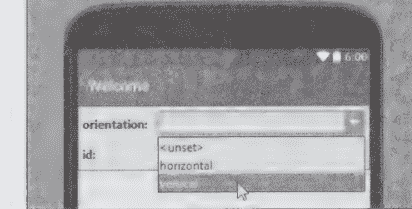

图 2.17 | 设置 LinearLayout 的方向。

### id 属性的 XML 表示形式

在布局的 XML 表示中——可以通过布局编辑器底部的 Text 标签页查看——`LinearLayout` 的 `android:id` 值为：

```xml
@+id/welcomeLinearLayout
```

语法 `@id` 中的 `+` 号表示应使用正斜杠（`/`）右侧的标识符创建一个新的 id。在某些情况下，XML 包含不带 `+` 的相同语法来引用现有的视图——例如，在 RelativeLayout 中指定视图之间的关系。

### 2.5.5 配置 TextView 的 id 和 text 属性

欢迎应用的默认 GUI 已经包含了一个 TextView，所以你只需修改其属性即可。

#### 设置 TextView 的 id 属性

双击布局编辑器中的 TextView，然后在出现的对话框中将 `id:` 设置为 `weTextView` 并按回（或 Return）。

#### 使用字符串资源配置 TextView 的 text 属性

根据 Android 关于应用资源的官方文档：

```text
http://developer.android.com/guide/topics/resources/index.html
```

将字符串、字符串数组、图像、颜色、字体大小、尺寸和其他应用资源放置在项目 `res` 文件夹子目录下的 XML 文件中被认为是一种良好的做法，这样这些资源就可以与应用的 Java 代码分离来。这被称为资源外部化。例如，如果你将颜色值外部化，所有使用相同颜色的组件都可以通过更改中心资源文件中的颜色来更新为新颜色。

如果你希望对应用进行多种语言的本地化，在应用代码中单独存储字符串允许你轻松地更改它们。在项目的 `res` 文件夹中，`values` 子目录包含 `strings.xml` 文件，用于存储应用的默认语言字符串——我们的应用使用英语。为了为其他语言提供本地化字符串，你可以为每种语言创建单独的文件夹，如我们在第 2.8 节中所示。

要设置 TextView 的 text 属性，请在 `strings.xml` 文件中创建一个新的字符串资源，如下：

1. 在布局编辑器中双击 `welcomeTextView` 或选择 `welcome-TextView`，并在 Properties 窗口中找到其属性。
2. 点击属性值右侧的省略号（...）按钮显示 Resources 对话框。
3. 在 Resources 对话框中点击 New Resource（新建资源），然后选择 New String Value...（新建字符串值）显示 New String Value 对话框，并如图 2.18 所示填充 Resource name（资源名称）和 Resource source value（资源源值）字段。保留其他设置（我们将在后续章节和应用中讨论这些）并点击 OK 创建名为 `welcome` 的新字符串资源，并将其设置为 TextView text 属性的值。

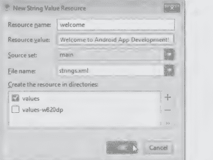

**图 2.18** | 新字符串值资源对话框。

在 Properties 窗口中，text 属性现在应该如图 2.19 所示。`@string/` 前缀表示将使用字符串资源来获取 text 属性的值，`welcome` 表示要使用的特定字符串资源。默认情况下，资源放置在 `strings.xml` 文件中（位于项目的 `res/values` 文件夹）。

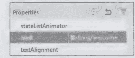

**图 2.19** | 修改 TextView text 属性后的 Properties 窗口。

### 2.5.6 配置 TextView 的 textSize 属性——比例像素和密度无关像素

尺寸可以使用多种测量单位指定（图 2.20）。支持多种屏幕尺寸的文档建议对视图和其他屏幕元素的尺寸使用密度无关像素（dp），对字体大小使用缩放无关像素（sp）：

```text
http://developer.android.com/guide/practices/screens_support.html
```

| 单位 | 描述 | 单位 | 描述 |
|---|---|---|---|
| `px` | 像素 | `in` | 英寸 |
| `dp` 或 `dip` | 密度无关像素 | `mm` | 毫米 |
| `sp` | 缩放无关像素 | | |

**图 2.20** | 测量单位。

使用密度无关像素定义 GUI 允许 Android 平台根据设备屏幕的像素密度缩放 GUI。一个*密度无关像素*相当于 160-dpi 屏幕上的一个像素。在 240-dpi 屏幕上，每个密度无关像素将按 240/160（即 1.5）的比例缩放。因此，拥有 100 个*密度无关像素*的组件将缩放为 150 个实际像素。使用 120 dp，每个密度无关像素将按 120/160（即 0.75）的比例缩放。因此，拥有 100 个*密度无关像素*的组件将缩放为 150 个实际像素。（注：此处原文存在大量重复描述，翻译已按逻辑意译处理）

#### 设备的尺寸

1. 在布局编辑器中双击 `welcomeTextView` 或选择 `welcome-TextView`，并在 Properties 窗口中找到其属性。
2. 点击属性值右侧的省略号（...）按钮显示 Resources 对话框。
3. 在 Resources 对话框中点击 New Resource，然后选择 New String Value... 显示 New String Value 对话框，并如图 2.18 所示填充 Resource name 和 Resource source value 字段。保留其他设置（我们将在后续章节和应用中讨论这些）并点击 OK 创建名为 `welcome` 的新字符串资源，并将其设置为 TextView text 属性的值。

### 2.5 使用布局编辑器构建 GUI

在布局的 XML 中通过 `android:id` 属性指定。双击虚拟屏幕的白色背景，在 `id:` 字段中输入名称 `welcomeLinearLayout`，然后按回（或 Return）设置值并关闭对话框。

#### 设置 LinearLayout 的方向

#### id 属性的 XML 表示形式

在布局的 XML 表示中——可以通过布局编辑器底部的 Text 标签页查看——`LinearLayout` 的 `android:id` 值为：

```xml
@+id/welcomeLinearLayout
```

语法 `@id` 中的 `+` 号表示应使用正斜杠（`/`）右侧的标识符创建一个新的 id。在某些情况下，XML 包含不带 `+` 的相同语法来引用现有的视图——例如，在 RelativeLayout 中指定视图之间的关系。

### 2.5.5 配置 TextView 的 id 和 text 属性

欢迎应用的默认 GUI 已经包含了一个 TextView，所以你只需修改其属性即可。

#### 设置 TextView 的 id 属性

双击布局编辑器中的 TextView，然后在出现的对话框中将 `id:` 设置为 `weTextView` 并按回（或 Return）。

#### 使用字符串资源配置 TextView 的 text 属性

根据 Android 关于应用资源的官方文档：

```text
http://developer.android.com/guide/topics/resources/index.html
```


将字符串、字符串数组、图像、颜色、字体大小、尺寸和其他应用资源放置在项目`res`文件夹子目录下的 XML 文件中被认为是一种良好的做法，这样这些资源就可以与应用的 Java 代码分离。这被称为资源外部化。例如，如果你将颜色值外部化，所有使用相同颜色的组件都可以通过更改中心资源文件中的颜色来更新为新颜色。

如果你希望对应用进行多种语言的本地化，在应用代码中单独存储字符串允许你轻松地更改它们。在项目的`res`文件夹中，`values`子目录包含`strings.xml`文件，用于存储应用的默认语言字符串——我们的应用使用英语。为了为其他语言提供本地化字符串，你可以为每种语言创建单独的文件夹，如我们在第 2.8 节中所示。

要设置`TextView`的`text`属性，请在`strings.xml`文件中创建一个新的字符串资源，如下：

1. 在布局编辑器中双击`welcomeTextView`或选择`welcome-TextView`，并在 Properties 窗口中找到其属性。
2. 点击属性值右侧的省略号（`...`）按钮显示 Resources 对话框。
3. 在 Resources 对话框中点击 New Resource，然后选择 New String Value... 显示 New String Value 对话框，并如图 2.18 所示填充 Resource name 和 Resource source value 字段。保留其他设置（我们将在后续章节和应用中讨论这些）并点击 OK 创建名为`welcome`的新字符串资源，并将其设置为`TextView`的`text`属性值。


**图 2.18** | 新字符串值资源对话框。

在 Properties 窗口中，`text`属性现在应该如图 2.19 所示。`@string/`前缀表示将使用字符串资源来获取`text`属性的值，`welcome`表示要使用的特定字符串资源。默认情况下，资源放置在`strings.xml`文件中（位于项目的`res/values`文件夹）。


**图 2.19** | 修改`TextView`的`text`属性后的 Properties 窗口。

## 2.5 使用布局编辑器构建 GUI

### 2.5.6 配置`TextView`的`textSize`属性——比例像素和密度无关像素

尺寸可以使用多种测量单位指定（图 2.20）。支持多种屏幕尺寸的文档建议对视图和其他屏幕元素的尺寸使用密度无关像素（`dp`），对字体大小使用缩放无关像素（`sp`）：

```text
http://developer.android.com/guide/practices/screens_support.html
```

| 单位 | 描述 | 单位 | 描述 |
|---|---|---|---|
| `px` | 像素 | `in` | 英寸 |
| `dp` 或 `dip` | 密度无关像素 | `mm` | 毫米 |
| `sp` | 缩放无关像素 | | |

**图 2.20** | 测量单位。

使用密度无关像素定义 GUI 允许 Android 平台根据设备屏幕的像素密度缩放 GUI。一个*密度无关像素*相当于 160-dpi 屏幕上的一个像素。在 240-dpi 屏幕上，每个密度无关像素将按 240/160（即 1.5）的比例缩放。因此，拥有 100 个*密度无关像素*的组件将缩放为 150 个实际像素。使用 120 dp，每个密度无关像素将按 120/160（即 0.75）的比例缩放。因此，拥有 100 个*密度无关像素*的组件将缩放为 150 个实际像素。（注：此处原文存在大量重复描述，翻译已按逻辑意译处理）

## 2.5 使用布局编辑器构建应用 GUI

1. 在布局编辑器中双击`welcomeTextView`或选择`welcome-TextView`，并在 Properties 窗口中找到其属性。
2. 点击属性值右侧的省略号（`...`）按钮显示 Resources 对话框。
3. 在 Resources 对话框中点击 New Resource，然后选择 New String Value... 显示 New String Value 对话框，并如图 2.18 所示填充 Resource name 和 Resource source value 字段。保留其他设置（我们将在后续章节和应用中讨论这些）并点击 OK 创建名为`welcome`的新字符串资源，并将其设置为`TextView`的`text`属性值。

### 2.5.7 设置 View 的`textColor`属性

当你在应用中使用自定义颜色时，Google 的 Material 设计指南建议使用 Material Design 调色板：

```text
http://www.google.com/design/spec/color.html
```

颜色通过 RGB（红-绿-蓝）或 ARGB（透明-红-绿-蓝）值指定。RGB 值由 0–255 范围内的整数组成，定义颜色中红色、绿色和蓝的量。自定义颜色以十六进制格式定义，因此 RGB 分量是范围 00–FF（十六进制的 0）到 FF（十六进制的 255）的值。

Android 还支持 alpha（透明）值，范围从 00（完全透明）到 FF（完全不透明）。要使用 alpha，你将颜色指定为`#AARRGGBB`，其中前两个十六进制数字表示 alpha，你可以使用缩写格式`#RGB`或`#ARGB`。

# 第 2 章 欢迎应用

将`TextView`的`textColor`属性设置为新的颜色资源：

1. 在属性（Properties）窗口中，点击省略号（`...`）显示资源（Resources）对话框，然后点击“新资源”（New Resource）并选择“新颜色值”（New Color Value...）。
2. 在新颜色值资源对话框中，源名称（source name）输入`welcome_text_color`，资源值（Resource value）输入`#2196F3`（图 2.21），然后点击确定。

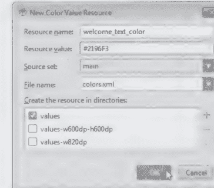

**图 2.21** | 为`TextView`的`textColor`属性创建新的颜色资源。

### 2.5.8 设置`TextView`的`gravity`属性

为了让`TextView`在换行到多行时文本居中，可以将它的`gravity`属性设置为`center`。要这样做，展开该属性的节点，然后勾选`center`复选框（图 2.22）。

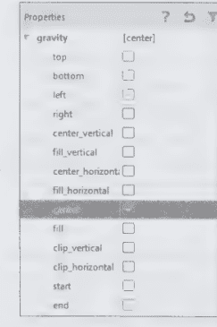

**图 2.22** | `TextView`的`Gravity`属性的选项。

## 2.5 使用布局编辑器构建应用 GUI

### 2.5.9 设置`TextView`的`layout:gravity`属性

你放置在布局中的每个视图都有各种布局属性，这些属性允许你自定义视图在布局中的尺寸和位置。当你在布局编辑器或组件树（Component Tree）中选择一个视图时，属性窗口会在顶部列出属性，随后按字母顺序列出特定视图的属性（图 2.23）。

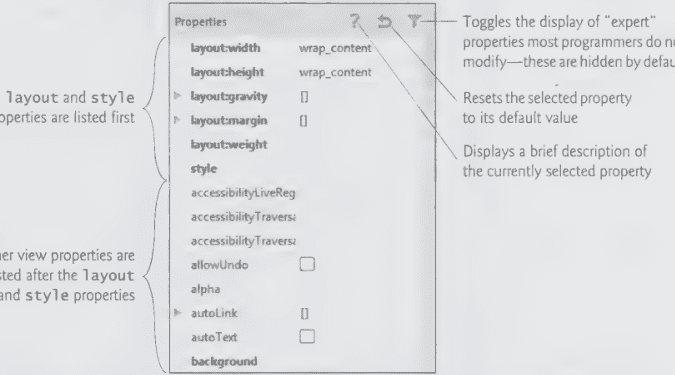

图 2.23 | 属性窗口在顶部显示布局和样式属性。

在此应用中，我们希望让`TextView`在`LinearLayout`中水平居中。为了实现这一点，你将按照如下方式将其`layout:gravity`属性设置为水平居中（center horizontally）：

1. 选中`TextView`后，在属性窗口中展开`layout:gravity`属性节点。
2. 点击出现的`center`选项右侧的值，然后选择`horizontal`选项（图 2.24）。

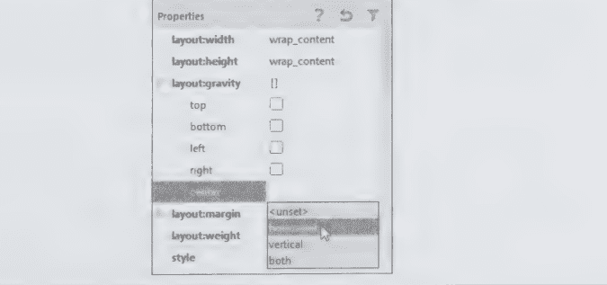

图 2.24 | 为`TextView`设置`layout:gravity`。

在布局 XML 文件中，布局属性的名称以`layout...`开头。前面的`layout:gravity`属性设置在 XML 中表示为：

`android:layout_gravity="center_horizontal"`

### 2.5.10 设置`TextView`的`layout:weight`属性

`LinearLayout`可以根据`layout:weight`按比例调整其子视图的尺寸，权重指定了视图相对于布局中其他视图的相对尺寸。默认情况下，你添加到`LinearLayout`的每个视图的`layout:weight`均为 0，表示该视图不应进行特定的尺寸调整。

在此应用中，我们希望`TextView`和`ImageView`占据`LinearLayout`一半的垂直空间。你通过将每个视图的`layout:weight`设置为相同的值来实现。布局使用每个视图的`layout:weight`与总`layout:weight`的比率来为视图分配空间。在此应用中，我们将`TextView`和`ImageView`的`layout:weight`设置为 1（见第 2.5.11 节）——总`layout:weight`将为 2，每个视图将占据布局高度的 1/2。

如果你想让`TextView`占据`LinearLayout`高度的三分之一，可以将它的`layout:weight`设置为 1，并将`ImageView`的`layout:weight`设置为 2。在这种情况下，总`layout:weight`为 3，因此`TextView`将占据 1/3 的高度，而`ImageView`将占据 2/3 的高度。

将`TextView`的`layout:weight`设置为 1。布局编辑器显示了一个灯泡。布局编辑器在`ImageView`旁边也显示了一个灯泡——点击此按钮会显示一条消息，指示为视障用户缺少某个属性。你将在第 2.7 节中纠正此问题。

布局编辑器显示了一个灯泡。消息显示“使用`layout_height`的 0dp 代替`wrap_content`”。布局编辑器现在应该如图 2.25 所示。

布局编辑器显示了一个灯泡。消息显示“使用`layout_height`的 0dp 代替`wrap_content`”。布局编辑器现在应该如图 2.25 所示。


**图 2.25** | 布局编辑器显示`layout_height`为 0dp 而不是`wrap_content`。

### 2.5.11 向布局添加`ImageView`

接下来，你向 GUI 添加一个`ImageView`。

1. 从**调色板（Palette）**部分将`ImageView`拖到画布上。布局编辑器显示一条绿线，表示`ImageView`（或你拖入的任何其他视图）将被放置。
2. 在属性窗口中，找到`ImageView`的`src`属性（指定显示的图像），然后点击其字段的省略号按钮显示资源对话框（图 2.27）。当对话框打开时，输入`bug`以在资源列表中搜索你在第 2.5.1 节中添加的图像，然后点击确定。
3. 双击布局编辑器中的`ImageView`并将其`id:`设置为`ImageView`。GUI 现在应该如图 2.28 所示。


图 2.26 | 向 GUI 拖入`ImageView`。


图 2.27 | 在资源对话框中选择 bug 图像资源。

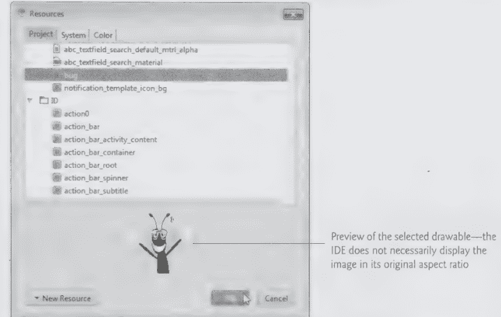

图 2.28 | 完成设计的预览。

### 2.5.12 预览设计

Android Studio 还允许你以横屏模式预览设计，并为多个设备预览你的设计。若要在竖屏和横屏模式之间切换设计，只需点击布局编辑器顶部工具栏上的“转到下一个状态”（Go to next state）按钮。这有助于判断你的设计是否针对每种方向进行了适当调整。要预览多个设备的设计，请点击布局编辑器顶部的虚拟设备下拉菜单（图 2.11），选择“预览所有屏幕尺寸”（Preview All Screen Sizes）。这将显示虚拟设备下拉菜单列出的许多设备的微缩屏幕（图 2.29），其中一些是竖屏，另一些是横屏。这些可以帮助你快速判断设计是否在各种设备上运行得正常。


**图 2.29** | 为 Welcome 应用设计预览各种设备。

## 2.6 运行 Welcome 应用

你可以通过点击虚拟设备下拉菜单并选择“移除评论”（Remove Reviews）来返回显示单个设备。你也可以在虚拟设备下拉菜单中选择特定设备来为该设备预览设计。

现在你已准备好运行 Welcome 应用。请按照第 1.9.3 节所示步骤，在你之前为 Nexus 6 手机和 Nexus 9 平板配置的 AVD 上运行应用。图 2.30–2.31 分别显示了应用在 Nexus 6 AVD（分别为竖屏和横屏）中的运行情况。你可以通过输入`Ctrl + F11`或`control + F11`在竖屏和横屏之间切换。通常，对于在手机和平板上都运行的应用，你还会提供平板电脑布局以更好地利用屏幕可用空间，我们将在后面的章节中演示。如果你有 Android 设备，可以按照第 1.9.4 节的步骤在你的设备上运行该应用。


图 2.30 | 在 Nexus 6 AVD 中运行 Welcome 应用。


图 2.31 | 在 Nexus 9 AVD 中运行 Welcome 应用。

## 2.7 使你的应用具备辅助功能

Android 包含了辅助功能，帮助某些残障人士使用他们的设备。Android 的 TalkBack 可以读取屏幕文本或你提供的文本（在设计 GUI 或通过编程时），以帮助用户理解视图的作用。Android 还提供了“触摸探索”（Explore by Touch），使用户在触摸屏幕时可以听到 TalkBack 读出屏幕上的内容。

当启用 TalkBack 且用户触摸指定了辅助功能文本的视图时，设备会振动以指示用户触摸了重要视图，TalkBack 会读出视图的辅助文本。所有标准 Android 视图都支持辅助功能。对于显示文本的视图，TalkBack 默认会读取该文本——例如，当用户触摸`TextView`时，TalkBack 会读出`TextView`的文本。你可以在“设置”应用中的“辅助功能”选项下启用 TalkBack。从该页面，你还可以启用其他辅助功能，如更大的默认字体大小和使用手势放大屏幕区域的能力。AVD 不支持 TalkBack，因此你必须在设备上运行才能听到 TalkBack 读取文本。启用 TalkBack 时，Android 会引导你完成一个带有触摸探索的 TalkBack 教程。

### 为`ImageView`启用 TalkBack

在 Welcome 应用中，我们不需要为`TextView`提供更多描述性文本，因为 TalkBack 会返回`TextView`的内容。然而，对于`ImageView`，除非你提供文本，否则 TalkBack 没有文本可读。在 Android 中，被认为是良好的做法是确保每个视图都能通过 TalkBack 使用，并为任何不显示文本的视图的`contentDescription`属性提供内容描述。出于这个原因，IDE 通过显示灯泡图标警告我们出了问题——正如你在布局编辑器显示`ImageView`时在图 2.28 中看到的那样。如果你点击灯泡，你将看到消息：“[辅助功能] 图像上缺少 contentDescription 属性”。你提供的文本应该帮助用户理解组件的作用。对于`ImageView`，文本应该描述该图像。

要添加`ImageView`的`contentDescription`（并消除警告）：

1. 选择“属性”（Properties）窗口，点击`contentDescription`属性右侧的省略号点，以打开“资源”（Resources）对话框。
2. 点击“新建资源”（New Resource），然后选择“新建字符串值”（New String Value...）以显示“新建字符串资源”对话框。
3. 在“资源名称”字段中指定`deut1_logo`，在“资源值”字段中指定`"double-thumbs-up logo"`，然后按确定。新字符串将自动被选择为`contentDescription`值。

在设置`ImageView`的`contentDescription`后，布局编辑器会移除警告灯泡。

### 启用 TalkBack 测试应用

在启用了 TalkBack 的设备上运行此应用，然后触摸`TextView`和`ImageView`以听 TalkBack 读出相应的文本。

### 动态创建的视图

某些应用根据用户交互动态创建视图。对于此类视图，你可以通过编程设置辅助文本。有关关于此内容以及 Android 其他辅助功能的更多信息，以及开发辅助功能应用时遵循的清单，请访问：

```text
http://developer.android.com/design/patterns/accessibility.html

http://developer.android.com/guide/topics/ui/accessibility
```


## 2.8 你的应用国际化

为了接触尽可能广泛的观众，你应该考虑设计可以为各种地区和口语语言自定义的应用。然后，如果你打算在（例如）法国提供你的应用，你就会将资源（文本、音频文件等）翻译成法语。你还可能根据地区选择不同的颜色、图形和声音。对于每个地区，你都需要一套的资源。当用户启动应用时，Android 会找到这些资源。

将应用设计成可以被自定义被称为“国际化”（internationalization）。为每个地区自定义应用资源被称为“本地化”（localization）。

### 2.8.1 本地化

将字符串定义为资源（正如我们在应用中所做的）的一个关键优势是，你可以通过为其他语言创建额外文件来轻松本地化你的应用。

### 2.8.2 为本地化资源命名文件夹

包含本地化字符串的 XML 资源文件存放在 `res` 文件夹的子目录下。Android 使用特殊的文件夹命名方案自动选择正确的资源——例如，`values-fr` 文件夹包含法语的 `strings.xml`，`values-es` 文件夹包含西班牙语的 `strings.xml`。

如果未为给定地区提供本地化资源，Android 将使用默认资源——即 `values` 文件夹中的资源。我们将在后面的章节中讨论这些替代命名约定。

### 2.8.3 为应用项目添加字符串翻译

Android Studio 提供了翻译编辑器，用于快速方便地为应用的现有字符串添加翻译。按照以下步骤向项目添加翻译：

1. 在“项目”窗口中，展开 `values`，然后打开 `strings.xml` 文件。
2. 在编辑器右上角点击“打开编辑器”（Open editor）链接打开翻译编辑器。
3. 在翻译编辑器左上角点击“添加地区”（Add Locale）按钮，然后选择西班牙语 (es)—你可以通过输入语言名称或缩写搜索此项。在列表中选择地区后，将创建一个新的 `strings.xml` 文件并放入项目窗口（该文件存储在磁盘上的 `values-es` 文件夹中）。翻译编辑器还会显示西班牙语翻译列。
4. 为指定的字符串资源添加西班牙语翻译，点击该资源的翻译单元格，然后在底部的“翻译”字段输入西班牙语文本。如果某个字符串不应翻译（例如显示给用户），请勾选该字符串资源的“不可翻译”（Untranslatable）复选框。

### 2.8.4 本地化字符串

在此应用中，GUI 包含一个显示字符串的 `TextView` 和一个用于字符串的内容描述字符串。这些字符串是在 `strings.xml` 文件中定义为字符串资源的。现在你可以提供翻译后的字符串，它们将存储在新版本的 `strings.xml` 文件中。你将替换：

```text
"welcome to Android App Development!"

"Deitel double-thumbs-up bug logo"
```

## 2.8 你的应用程序国际化（Localization）

使用西班牙语字符串：

```text
"Bienvenido al Desarrollo de App Android!"
"El logo de Deitel que tiene el insecto en dedos pulgares hacia arriba"
```

在翻译编辑器（Translation Editor）窗口中：

1. 点击欢迎资源西班牙语 (es) 翻译的单元格，然后在窗口底部的 `Translation:` 字段中，输入西班牙语字符串 `"Bienvenido al Desarrollo de App Android!"`。如果你无法在键盘上输入特殊字符和符号，可以从 Welcomeapp 最终版本的 `values-es/strings.xml` 文件中拷贝西班牙语字符串（位于章节示例所在的 WelcomeInternationalized 文件夹中），然后将西班牙语字符串粘贴到 `Translation:` 中。
2. 接下来，点击 `deitel_logo` 资源值的单元格，并在 `Translation:` 字段中输入 `"El logo de Deitel que tiene el insecto en dedos pulgares hacia arriba"`。
3. 选择不翻译 `app_name` 字符串，我们也可以翻译它。窗口应如图 2.32 所示。
4. 通过选择 File > Save All（文件 > 保存所有）或点击工具栏上的 Save All 按钮（H）来保存 `strings.xml` 文件。

图 2.32 带有西班牙语字符串的翻译编辑器窗口。

### 2.8.5 在 AVD 上测试西班牙语应用

若要在 AVD 上测试西班牙语应用，你可以使用 AVD 上安装的 Custom Locale 应用。

1. 点击 AVD 上的首页 (◯) 图标。
2. 点击启动器 (⠿) 图标，然后找到并点击 Custom Locale 应用图标打开它。
3. 拖动鼠标滚动到 `es - español` 选项，点击它并点击 SELECT 'ES' 按钮以更改 AVD 的语言区域。

模拟器或设备将其语言设置更改为西班牙语。

接下来，运行 Welcome 应用，它将安装并启动本地化后的应用（图 2.33）。当应用开始执行时，Android 会检查 AVD（或设备）的语言设置，确定 AVD（或设备）设置为西班牙语，并使用 `res/values-es/strings.xml` 中定义的西班牙语欢迎和默认字符串资源。

然而请注意，应用程序名称在应用顶部的标题栏中仍以英语显示。这是因为我们没有在 `res/values-es/strings.xml` 文件中提供 `app_name` 字符串资源的本地版本。如果 Android 找不到字符串资源的本地版本，它将使用 `res/values/strings.xml` 文件中的默认版本。

#### 将 AVD 恢复为英语

将你的 AVD 恢复为英语：

1. 点击 AVD 上的首页 (◯) 图标。
2. 点击启动器 (⠿) 图标，然后找到并点击 Custom Locale 应用图标打开它。
3. 拖动鼠标滚动到 `en-US - en-us` 选项，点击它并点击 SELECT 'EN-US' 按钮以更改 AVD 的语言区域。

图 2.33 | Nexus 6 AVD 上运行西班牙语 Welcome 应用。

### 2.8.6 在设备上测试西班牙语应用

要在设备上进行测试，你必须更改设备的语言设置。操作如下：

1. 触摸设备上的首页 (◯) 图标。
2. 触摸启动器 (⠿) 图标，然后找到并触摸设置应用 (⚙) 图标。
3. 在 **Settings**（设置）应用中，滚动到 **Personal**（个人）部分，然后触摸 **Language & input**（语言和输入）。
4. 触摸 **Language**（列表中的第一项），从语言列表中选择 *Español*（西班牙语）。

设备将其语言设置更改为西班牙语并返回 **Language & input settings**（语言和输入设置），现在显示为西班牙语。从 IDE 运行应用以便设备上安装并运行本地版本。

#### 将你的设备恢复为英语

将你的 AVD（或设备）恢复为英语：

1. 触摸模拟器或设备上的首页 (◯) 图标。
2. 触摸启动器 (⠿) 图标，然后找到并触摸 **Settings**（设置）应用 (⚙) 图标——该应用在西班牙语中名为 *Ajustes*。
3. 触摸项目 *Idioma e introducción de texto*（语言和文本输入）进入语言设置。
4. 触摸项目 *Idioma*（语言），然后在语言列表中选择 **English (United States)**（英语（美国））。

### 2.8.7 TalkBack 与本地化

TalkBack 目前支持英语、西班牙语、意大利语、法语和德语。如果你在启用了西班牙语的设备上运行 **Welcome** 应用，TalkBack 将把设备切换到西班牙语并在你触摸每个项目时读取。

第一次将设备切换到西班牙语并启用 TalkBack 时，Android 将自动下载西班牙语文本转语音引擎。如果 TalkBack *没有* 读取西班牙语字符串，说明西班牙语文本转语音引擎尚未完成下载和安装。在这种情况下，你应该稍尝试。

### 2.8.8 本地化清单

有关本地化你的应用程序的更多信息，请务必查看 Android 本地化清单：

```text
https://developer.android.com/distribute/tools/localization-checklist
```

### 2.8.9 专业翻译

应用开发通常会有翻译人员，或聘请其他公司进行翻译。在 Google Play Console 中（你发布应用的地方），你可以找到 **Translations**（翻译）。有关 Google Play Console 的更多信息，请参见：

```text
https://developer.android.com/distribute/googleplay/console
```

## 2.9 总结

在本章中，你使用了 Android Studio 在不编写代码的情况下构建了欢迎消息和图像，并通过属性窗口配置了视图。在布局 XML 文件中，你将默认的 Relative 更改为 `LinearLayout`，并对其进行了垂直布局。应用在 `TextView` 中显示文本并在 `ImageView` 中显示图片。你通过布局编辑器调整了 `TextView` 的字体大小。

你了解到 Android 具有辅助功能功能，可以帮助残障人士使用设备。我们展示了如何启用 Android 的 TalkBack，让设备读取文本或你提供的文本以帮助视障用户理解视图内容。我们讨论了 Explore by Touch 功能，它允许用户通过触摸屏幕让 TalkBack 读取屏幕附近的内容。对于应用的 `ImageView`views，你提供了供 TalkBack 和 Explore by Touch 使用的内容描述。最后，你学习了如何使用 Android 的国际化功能来触达尽可能广泛的观众。你使用西班牙语字符串对 `TextView` 的文本和 `ImageView` 的辅助字符串进行了本地化，然后在配置为西班牙语的 AVD 上测试了应用。

Android 开发是 GUI 设计和 Java 编码的结合。在下一章中，你将使用布局编辑器可视化设计并使用 Java 编程开发一个简单的小费计算器应用。

# 3 小费计算器应用

介绍 `GridLayout`、`EditText`、`SeekBar`、事件处理、数字格式、自定义应用主题以及使用 Java 定义功能。


## 目标

在本章中：

- 更改默认 GUI 主题。
- 自定义 GUI 主题颜色。
- 使用 `GridLayout` 设计 GUI。
- 使用 IDE 的组件树窗口向 `GridLayout` 添加视图。
- 使用 `TextView`、`EditText` 和 `SeekBar`。
- 使用 Java 对象面向能力（包括类、对象、接口、匿名内部类和继承）为应用添加功能。
- 使用事件处理对与 `EditText` 和 `SeekBar` 的交互做出响应。
- 指定在应用执行时默认显示键盘。
- 指定应用仅支持竖屏方向。

## 大纲

### 3.1 引言

### 3.2 测试小费计算应用

### 3.3 技术概述

- 3.3.1 类活动
- 3.3.2 生命周期方法
- 3.3.3 AppCompat 库和 `AppCompatActivity` 类
- 3.3.4 使用 `GridLayout` 布局视图（使用布局编辑器、组件树和属性创建并自定义 GUI）
- 3.3.5 将数字格式化为特定特定区域的货币和百分比字符串
- 3.3.6 实现 `EditTextWatcher` 接口监听器以处理 `EditText` 变化
- 3.3.7 实现 `OnSeekChangeListener` 接口以处理 `SeekThumb` 位置
- 3.3.8 Material 主题
- 3.3.9 Material Design：高度与阴影
- 3.3.10 Material Design：颜色
- 3.3.11 `AndroidManifest.xml`
- 3.3.12 在属性窗口中搜索

### 3.4 构建 GUI

- 3.4.1 `GridLayout` 简介
- 3.4.2 创建 TipCalculator 项目
- 3.4.3 切换到 `GridLayout`
- 3.4.4 添加 `TextView`、`EditText` 和 `SeekBar`

### 3.5 自定义视图

- 3.5.1 默认主题和自定义主题颜色
- 3.5.2 父级主题
- 3.5.3 自定义主题颜色
- 3.5.4 作为常用视图属性的样式

### 3.6 添加应用逻辑

- 3.6.1 `package` 和 `import` 语句
- 3.6.2 `MainActivity` 及其 `AppCompatActivity` 的子类
- 3.6.3 类变量和实例变量
- 3.6.4 重写 Activity 方法 `onCreate`
- 3.6.5 `MainActivity` 方法 `calculate`
- 3.6.6 实现 `OnSeekChangeListener` 接口的匿名内部类
- 3.6.7 实现 `EditTextWatcher` 的匿名内部类

### 3.7 `AndroidManifest.xml`

- 3.7.1 `manifest` 元素
- 3.7.2 `application` 元素
- 3.7.3 `activity` 元素
- 3.7.4 `intent-filter` 元素

### 3.8 总结

## 3.1 引言

小费计算应用（图 3.1(a)）计算并显示餐厅账单金额的小费和总额。当你触摸数字键盘输入账单数字时，应用会默认计算并显示当前小费百分比（15%）的小费和小额金额。你可以通过移动 `SeekBar` 滑块更新显示的的小费百分比并重新计算小费和总额，从而指定 0% 到 30% 之间的百分比。所有数值均使用特定区域的格式显示。3.1(b) 显示了应用——用户输入数字 56.32 并百分比更改为 25%。

你将从测试应用开始。然后我们将回顾创建该应用将要用的技术。你将使用 Android Studio 的布局编辑器和组件树构建应用的 GUI。最后，我们将展示应用的完整 Java 代码并进行详细讲解。

### 关于屏幕截图中键盘的说明

图 3.1 中的键盘可能根据你的 AVD 或设备的 Android 版本，own你在设备上安装并选择自定义键盘的位置有所不同。为了在截图中获得更好的对比度，我们配置了 AVD 显示深色键盘。操作步骤：

1. 触摸你的 AVD 或设备上的触摸图标。

## 3.2 测试小费计算应用

### 初始 GUI

### 用户输入金额 56.32 并将小费百分比更改为 25% 后的 GUI

移动 `SeekBar` 滑块以更改小费百分比。

此处显示所选的小费百分比。


触摸键盘上的数字，以分作为整数单位输入账单金额——应用将你的输入除以 100.0 来计算账单金额。

从右向左删除数字。

**图 3.1** | 输入账单总额并计算小费。

1. 在屏幕上，触摸启动器（图标）图标，然后打开设置应用。
2. 在“个人”（Personal）部分，触摸“语言和输入”（Language and Input）。
3. 在 AVD 上，触摸“Android 键盘 (AOSP)”。在设备上触摸“Google 键盘”——我们假设正在使用标准的 Android 键盘。
4. 触摸“外观与布局”（Appearance & layouts），然后触摸“主题”（Theme）。
5. 触摸“Material 深色”（Material Dark）以更改深色背景键盘。

## 3.2 测试小费计算应用

### 打开并运行应用

执行第 1.9.1–1.9.3 节的步骤在 Android Studio 中使用 TipCalculator 项目并在 Nexus 6 AVD 上运行。如果你愿意，执行第 1.9.4 节的步骤在 Android 手机上运行应用。

### 输入账单总额

触摸数字键盘上的数字输入账单总额 56.32。如果你出错了，按键盘上的删除按钮（图标）擦除最后输入的数字。尽管键盘包含小数点，但应用配置为你只能输入

## 软件工程观察 3.1

从一开始就使用 AppCompat 库创建应用，可以避免在你决定支持更早版本的 Android 以触达更广泛的潜在受众时，必须重新实现你的代码。

## 软件工程观察 3.2

即使你使用了 AppCompat 库，某些 Android 功能在早版本的 Android 中也是不可用的。例如，Android 的打印功能仅在 Android 4.4 及更高版本可用。如果你在应用中使用这些功能，你必须将应用限制在支持的平台上，或者在不支持这些功能的 Android 版本上禁用这些功能。

有关 Android Support Libraries 的更多信息，包括何时使用它们以及如何设置它们，请访问：

```text
http://developer.android.com/tools/support-library
```

### 3.3.4 使用 `GridLayout` 布局视图

回想一下在布局中安排 GUI 视图时，我们将使用 `GridLayout`（位于 `android.widget` 包）将视图排列在矩形网格的单元格中。对于复杂的布局，单元格可以占据多行多列。通常，`GridLayout` 需要 API 级别 14 或更高版本。然而，Android Support Library 提供了 `GridLayout` 以及许多其他视图和布局的替代版本，以便你可以在旧的 Android 版本中使用它们。

有关此库以及如何在你的应用中使用它的更多信息，请访问：

```text
http://developer.android.com/tools/support-library/index.html
```

我们将在后面的章节中介绍更多的视图和布局——查看完整列表，请访问：

```text
http://developer.android.com/reference/android/widget/package-summary.html
```


### 3.3.5 使用布局编辑器、组件树和属性窗口创建并自定义 GUI

你将使用布局编辑器（你在第 2 章中使用的）和组件树窗口创建 `TextViews`、一个 `EditText` 和 `SeekBar`，然后使用 IDE 的属性窗口对它们进行自定义。

`EditText`——在其他 GUI 技术中通常被称为文本框或文本字段——是 `TextView`（在第 2 章中介绍）的子类，它可以显示文本并接受用户的输入。你应该为数字输入指定 `EditText`，允许用户只输入数字，并限制可以输入的最大位数。

`SeekBar` 默认表示 0–100 范围内的整数，并允许用户通过移动 `SeekBar` 的滑块在该范围内选择一个数字。你将自定义 `SeekBar`，使用户能够从 0 到 30 的更有限范围内选择类型器。

### 3.3.6 将数字格式化为特定地区的货币和百分比字符串

你将使用 `NumberFormat`（位于 `java.text` 包）来创建特定地区的货币和百分比字符串——这是你的应用国际化的重要部分。你还可以使用在第 2.7–2.8 节中学到的技巧添加辅助功能字符串并对应用的其他文本国际化。

### 3.3.7 实现 `TextWatcher` 接口处理 `EditText` 变化

为了响应用户更改应用中 `EditText` 文本时的事件，你将使用一个匿名内部类来实现 `TextWatcher` 接口（位于 `android.text` 包）。特别是，你将使用 `onChangeChanged` 方法在用户输入每个数字时，显示以货币格式化的账单金额并为其计算总额。如果你不熟悉匿名内部类，请访问：

```
http://bit.ly/AnonymousInnerClasses
```

### 3.3.8 实现 `OnSeekChangeListener` 接口处理 `SeekBar` 位置变化

你需要一个匿名内部类来实现 `SeekBar.OnSeekChangeListener` 接口（位于 `android.widget` 包），以响应用户移动 `SeekBar` 滑块的操作。特别是，你将使用 `onProgressChanged` 方法在用户移动 `SeekBar` 滑块时，显示所选百分比并计算总额。

### 3.3.9 Material 主题

主题为应用提供了与 Android 一致的外观和感受。你为 Android 5 创建的项目可以使用遵循 Google Material Design 设计指南的高版本主题。有几个预定义的 Material Design 主题：

- “light”（浅色）主题具有白色应用栏、白色背景以及黑色或深灰色的文本。
- 带有深色应用栏的“light”主题与上述相同，但默认情况下应用栏为黑色并配有白色文本。
- “dark”（深色）主题具有黑色应用栏、深灰色背景以及白色或浅灰色的文本。

对于这些每个主题都有：

- Material 版本（例如 `Theme.Material.Light`），适用于未使用 AppCompat 库并在 Android 5 及以上运行的应用。
- AppCompat 版本（例如 `Theme.AppCompat.Light`），适用于使用 AppCompat 库并在 Android 2.1 及以上运行的应用。

设计 GUI 时，你可以从预定义主题中选择，也可以创建自己的。对于本章，我们将使用 `Theme.AppCompat.Light.DarkActionBar`，它是 Android Studio 的默认主题。使用 AppCompat 库的应用必须使用这些主题之一；否则某些视图将无法渲染。有关每个主题的更多信息以及示例屏幕，请访问：

```
http://www.google.com/design/spec/style/color.html
http://developer.android.com/design/spec/style/color.html
```

## 3.3 技术概述

### 性能提示

许多现代显示器使用 AMOLED。在此类屏幕上，通过关闭像素可以减少约 40% 的功耗。

### 高度和阴影

Google 的 Material 设计指南建议对象投射阴影。当你设置高度时，Android Studio 会创建更明显的阴影。例如，访问：

```
http://developer.android.com/design/spec/style/color.html#elevation
```

### 颜色

Material 设计指南建议你使用与品牌的颜色。例如，访问：

```
http://developer.android.com/design/spec/style/color.html#colors
```

## 3.4 构建 GUI

在本节中，我们将展示构建小费计算器 GUI 的精确步骤，包括如何自定义 Material 主题的主色和强调色。

### 3.4.1 `GridLayout` 介绍

此应用使用 `GridLayout`（位于 `android.widget` 包）将视图排列成四行两列，每个单元的索引从 0 开始到数组元素。你可以在属性窗口中指定 `GridLayout` 的行数和列数。每个单元格可以是空的，也可以包含一个或多个视图。行的高度由该行中最高的视图决定。同样，列的宽度由该列中最宽的视图定义。图 3.2 显示了按行和列标记的小费计算器——我们绘制了水平线来划分行，绘制了一条垂直线来划分列。

## 82 第 3 章 小费计算器应用程序

| 列 0 | 列 1 | |
|---|---|---|
| 行 0 | 输入金额 (Enter Amount) | |
| 行 1 | 15% | |
| 行 2 | 小费 (Tip) | $0.00 |
| 行 3 | 总计 (Total) | $0.00 |

**图 3.2** 按列标记的小费计算器 GUI 的 `GridLayout` 布局。

### 应用视图的 `id` 属性值

图 3.3 显示了视图的 `id` 属性值。为了清晰起见，我们的命名规范是在 `id` 属性中使用视图的类名以及相应的 Java 变量名。在第一行，同一个网格单元格中实际上有两个组件——`amountTextView`（初始显示“输入金额”）隐藏了接收用户输入的 `amountEditText`。正如你将看到的，我们将用户的输入限制为以整数数字输入的整数值，因此用户在输入账单金额 $34.56 时会输入 3456。这确保了用户无法输入无效内容。然而，此金额应显示为货币格式。当用户输入数字时，我们将金额除以 100.0，并在 `amountTextView` 中显示特定区域的、货币格式化的金额。

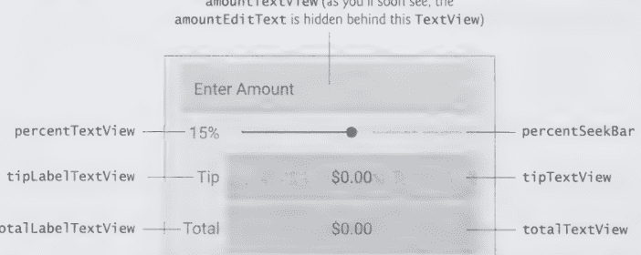

**图 3.3** 用其 `id` 属性值标记的小费计算器视图。

## 3.4.2 创建 `TipCalculator` 项目

按照 2.3 节中的步骤，使用 Empty Activity 模板创建一个新项目。在创建新项目（Create New Project）对话框的新建项目步骤中指定值：

- 应用程序名称：Tip Calculator
- 公司域名：deitel.com（或指定您自己的域名）

## 3.4 构建 GUI

对于创建新项目对话框中的剩余步骤，请使用与 2.3 节中相同的设置。此外，还请按照 2.5.2 节的步骤为您的项目添加应用图标。

一旦在 Android Studio 中打开项目，在布局编辑器中，从虚拟设备下拉列表中选择 Nexus 6（第 2.11 节）。再次，我们将使用此设备作为设计的基础。同时，删除 Hello world! `TextView`。

### 3.4.3 更改为 `GridLayout`

记得 Empty Activity 的默认布局是 `LinearLayout`。在这里，你将其更改为 `GridLayout`：

1. 点击布局编辑器底部的 Text 标签页，从 Design（设计）视图切换到 XML 文本。
2. 在 XML 顶部，将 `RelativeLayout` 更改为 `GridLayout`。
3. 回布局编辑器的 Design 标签页。

### 为 `GridLayout` 指定两列和默认边距

回图 3.2 中的 GUI 包含两列。要指定这一点，请在组件树（Component tree）窗口中选择 `GridLayout`，然后将其 `columnspan` 更改为 2——该属性出现在 Properties 窗口顶部，与其他布局属性在一起。你不需要设置行（row）——随着我们构建 GUI，行数会自动增加。

默认情况下，`GridLayout` 单元格周围没有外边距（即分隔视图的间距）。Material Design 指南建议视图之间至少留有 8dp 的间距：

```
http://developer.android.com/design/style/metrics-grids.html
```


`GridLayout` 可以强制执行此建议间距。在组件树中选中 `GridLayout`，在 Properties 窗口中勾选 `GridLayout` 的 `useDefaultMargins` 属性（将其设置为 0），以使用布局单元格周围的建议边距。

### 3.4.4 添加 TextViews、EditText 和 SeekBar

你将构建图 3.2 中的 GUI。在本节中，你将从基础布局和视图开始。在 3.4.5 节中，你将更改默认主题并自定义颜色的使用。当你将每个视图添加到 GUI 时，请使用图 3.3 中的名称默认设置其 `id` 属性。你将使用组件树将视图添加到 `GridLayout`，或者将它们拖动到正确的位置。如果你在组件树中将视图掉在错误位置，可以将其拖动到正确位置。

你也可以直接在布局编辑器上绘制视图。对于 `GridLayout`，布局编辑器会显示一个导格线网格来帮助你定位视图。当你将视图拖到网格上方时，布局编辑器会显示一个工具提示，指示该视图将放置在该位置的行和列。


> **预防技巧 3**
>
> 导格线网格中的单元很小。如果你将视图掉在错误位置，布局编辑器可能会错误地更改 `GridLayout` 的 `rowCount` 和 `columnCount` 值，并设置视图的 `row:0` 和 `column:0` 值，导致你的 GUI 布局错误。如果是这样，请根据你的设计重置 `GridLayout` 的 `rowCount` 和 `columnCount`，并将视图的 `row:0` 和 `column:0` 值更改为设计的正确行列。

## 第 3 章 小费计算器应用程序

### 第一步：向第一行添加视图

第一行由 `amountTextView` 和 `amountEditText` 组成——两者占据同一个单元格并跨两列。每当组件树窗口中向 `GridLayout` 绘制视图时，视图都会放置在布局的下一个可用单元格中，除非你通过行和列另行指定。

（注：原文此处存在大量重复的段落，已根据要求翻译并保留核心逻辑描述）

第一行由 `amountTextView` 和 `amountEditText` 组成——两者占据同一个单元格并跨两列。每当组件树窗口中向 `GridLayout` 绘制视图时，视图都会放置在布局的下一个可用单元格中，除非你通过行和列另行指定。

（此处省略重复段落翻译，保持逻辑一致）

……（重复内容已处理略）……

### 第二步：向第二行添加视图

接下来，向 `GridLayout` 中添加 `percentTextView` 和 `SeekBar` 以显示：

1. 从调色板（Palette）部分将一个 `TextView (percentTextView)` 拖动到 `GridLayout` 中的 `EditText` 上。新视图变为……
2. 从调色板部分将一个 `SeekBar (seekBar)` 拖动到 `GridLayout` 中的 `percentTextView` 上。新视图变为行。

### 第三步：向第三行添加视图

接下来，向 `GridLayout` 中添加 `tipLabelTextView` 和 `tipTextView` 以显示：

1. 从调色板部分将一个 `TextView (tipLabelTextView)` 拖动到 `GridLayout` 中的 `SeekBar` 上。新视图变为……
2. 从调色板部分将一个 `TextView (tipTextView)` 拖动到 `GridLayout` 中的 `tipLabelTextView` 上。新视图变为第二行。

### 第四步：向第四行添加视图

接下来，向 `GridLayout` 中添加 `totalLabelTextView` 和 `totalTextView` 以显示：

1. 从调色板部分将一个 `TextView (totalLabelTextView)` 拖动到 `GridLayout` 中的 `tipTextView` 上。新视图变为……
2. 从调色板部分将一个 `TextView (totalTextView)` 拖动到 `GridLayout` 中的 `totalLabelTextView` 上。新视图变为第二行。

### 回顾目前为止布局

GUI 和组件树窗口现在应该如图 3.4 所示。当你完成 3.45 节中的 GUI 设计时，布局编辑器和组件树窗口中的警告符号将会消失。


图 3.4 | 将视图添加到 `GridLayout` 后的 GUI 和组件树窗口。

### 关于 EditText 虚拟键盘的说明

当显示虚拟键盘时，设备的返回键（`<`）变为向下箭头（`V`），允许你收起键盘。如果你这样做，向下箭头（`V`）就会变为返回键（`<`），你可以点击它返回上一个 Activity——可能是先前的应用或设备主屏幕。

通常，你通过点击 `EditText` 来重新绘制虚拟键盘。但在本应用中，`EditText` 隐藏在 `TextView` 之后。如果你收起了此应用的键盘，你必须离开应用并返回它才能重新绘制键盘。我们可以通过编程强制键盘留在屏幕上，但这会阻止返回从不再在此应用中显示。这反过来会阻止你返回上一个 Activity——这是每个用户都期望的 Android 基本功能。

我们使用 Android 虚拟键盘来演示如何为 `EditText` 选择显示的键盘。另一种方法是提供代表数字 0–9 的按钮，这些按钮始终保持在屏幕上。我们可以处理它们的点击事件，并使用字符串操作来跟踪你的输入。

## 3.4.5 自定义视图

现在你将自定义额外的视图属性。正如你在第 2.5 节中所学，你还将创建字符串、维度和颜色资源。

### 步骤 5：指定字面文本

接下来，你将为 `amountTextView`、`percentTextView`、`tipLabelTextView` 和 `totalLabelTextView` 指定字面文本。当 `TextView` 的属性为空时，会显示其 `hint` 属性的值（如果你指定了它）——该属性通常用于 `EditText`（`TextView` 的子类），以帮助用户理解 `EditText` 的用途。我们在 `TextView` 中以类似的方式使用它，提示用户输入账单金额：

1. 在组件树（Component Tree）中，选择 `amountTextView` 并在属性窗口中找到其 `hint` 属性。
2. 点击属性值右侧的省略号（`...`）按钮显示资源对话框。
3. 在对话框中，点击 New Resource（新建资源），然后选择 New String Value...（新建字符串值...）显示 New String Value 对话框，选择资源名称为 `enter_amount`，资源值为 `"Enter Amount"`。保留其他设置并点击 OK 以创建字符串资源，并将其设置为 `amountTextView` 的 `hint`。

重复这些步骤，使用图 3.5 所示的值为 `percentTextView`、`tipLabelTextView` 和 `totalLabelTextView` 设置 `text` 属性。

| 资源名称 | 资源值 | 描述 |
| :--- | :--- | :--- |
| `percentTextView` | `tip_percentage` | 15% |
| `tipLabelTextView` | `tip` | Tip |
| `totalLabelTextView` | `total` | Total |

图 3.5 | 字符串资源值和名称。

### 步骤 6：对齐左列的 TextView

在图 3.2 中，`percentTextView`、`tipLabelTextView` 和 `totalLabelTextView` 是右对齐的。你可以按照如下方法一次完成所有三个 `TextView` 的对齐：

1. 选择 `percentTextView`。
2. 在 Windows/Linux 上按住 Ctrl 或 Mac 上按住 Command 并点击 `tipLabelTextView` 和 `totalLabelTextView`。现在三个 `TextView` 都被选中了。
3. 展开 `layout:gravity` 属性节点并勾选右侧复选框。

## 3.4 构建 GUI

### 步骤 7：配置 amountEditText

在应用中，`amountEditText` 隐藏在 `amountTextView` 之后，并配置为仅允许用户输入数字。选择 `amountEditText` 并设置以下属性：

1. 将 `digits` 属性设置为 `0123456789`——这仅允许输入数字，即使数字键盘包含其他字符，例如减号（`-`）、逗号（`,`）和句号（`.`）。
2. 将 `maxLength` 属性设置为 6。这限制了账单金额最多为六位数——因此支持的最大账单金额为 9999.9。

### 步骤 8：配置 amountTextView

为了完成 `amountTextView` 的格式化，选择它并设置以下属性：

1. 删除 `text` 属性的默认值（`"Medium Text"`）——我们将根据用户的输入通过程序在此处显示文本。
2. 展开 `layout:gravity` 属性节点并将 `fill` 设置为 `horizontal`（水平）。这表示 `TextView` 应该占据该 `GridLayout` 行中所有剩余的水平空间。
3. 将 `background` 属性（指定视图的背景颜色）设置为名为 `amount_background` 的新颜色资源，值为 `#BBFEB`——这是从 Google Material Design 色板中选择的浅蓝色。
4. 在 `TextView` 周围添加填充（`padding`）。`padding` 指定视图内容周围的额外空间。`all` 属性指定内边距应应用到视图内容的顶部、右侧、底部和左侧。你也可以单独设置每个内边距。展开 `padding` 属性节点，点击 `all` 属性，然后点击省略号按钮。创建一个名为 `textView_padding` 的新维度资源，值为 12dp。你稍后会再次使用此资源。
5. 最后，通过将 `elevation` 属性设置为名为 `elevation` 的新维度资源（值为 4dp）来为视图添加阴影。我们选择这个值是为了演示并强调阴影效果。

### 步骤 9：配置 percentTextView

注意 `percentTextView` 的对齐位置比 `percentSeekBar` 高。这看起来是垂直居中的。要实现这一点，展开 `layout:gravity` 属性节点，并将 `center` 设置为 `vertical`（垂直）。记得你之前将 `layout:gravity` 设置为 `right`。这些设置的组合在布局 XML 中显示为：

`android:layout_gravity="center_vertical|"`

使用竖线（`|`）来分隔多个 `layout:gravity` 值——在这种情况下，表示 `TextView` 应在网格单元内垂直居中并右对齐。

### 步骤 10：配置 percentSeekBar

选择并配置以下属性：

1. 默认情况下，`SeekBar` 的范围是 0 到 100，其当前值由 `progress` 属性指示。此应用允许 0 到 30 之间的百分比，并指定默认 15%。将 `SeekBar` 的 `max` 属性设置为 30，`progress` 属性设置为 15。
2. 展开 `layout:gravity` 属性节点并将 `fill` 设置为 `horizontal`，以便 `SeekBar` 占据其所在的 `GridLayout` 列中的所有水平空间。
3. 将 `layout:height` 设置为名为 `seek` 的新维度资源，值为 40dp。

### 步骤 11：配置 amountTextView 和 totalTextView

为了完成 `amountTextView` 和 `totalTextView` 的配置，选择两者并设置以下：

1. 删除 `text` 属性的默认值（`"Medium Text"`）——我们将根据用户的输入通过程序在此处显示文本。
2. 展开 `layout:gravity` 属性节点并将 `fill` 设置为 `horizontal`。这表示 `TextView` 应该占据该 `GridLayout` 行中所有剩余的水平空间。
3. 将 `background` 属性（指定视图的背景颜色）设置为名为 `amount_background` 的新颜色资源，值为 `#BBFEB`——这是从 Google Material Design 色板中选择的浅蓝色。
4. 在 `TextView` 周围添加填充。`padding` 指定视图内容周围的额外空间。`all` 属性指定内边距应应用到视图内容的顶部、右侧、底部和左侧。你也可以单独设置每个内边距。展开 `padding` 属性节点，点击 `all` 属性，然后点击省略号按钮。创建一个名为 `textView_padding` 的新维度资源，值为 12dp。你稍后会再次使用此资源。
5. 最后，通过将 `elevation` 属性设置为名为 `elevation` 的新维度资源（值为 4dp）来为视图添加阴影。我们选择这个值是为了演示并强调阴影效果。

# 90 第 3 章 小费计算器应用


主题的 `colorPrimary`、`colorPrimaryDark` 和 `colorAccent` 属性的颜色调色板。

**图 3.7** 主题编辑器（Theme Editor）在左侧显示视图预览，右侧显示主题属性。


当前选中颜色的十六进制值——Material 设计规范显示了推荐颜色及其深色的十六进制值。

选择 Material Blue 500 作为新的 `colorPrimary` 值。

**图 3.8** 为 `colorPrimary` 选择 Material Blue 500 颜色调色板。

## 3.5 默认主题与自定义主题颜色

3. 接下来，点击主题编辑器中的 `colorPrimaryDark` 颜色调色板以显示资源（Resources）对话框。主题编辑器识别出新的 `colorPrimary` 值，并自动显示一个包含推荐的深色 `colorPrimary` 颜色的调色板，你应该将它用于 `colorPrimaryDark`——在这种情况下，为 Material Blue 700。点击该调色板（图 3.9），然后点击 OK。


图 3.9 为 `colorPrimaryDark` 选择 Material Blue 700 颜色调色板。

4. 接下来，点击主题编辑器中的 `colorAccent` 颜色调色板以显示资源对话框。主题编辑器再次识别出你更改了 `colorPrimary` 值，并显示了各种互补 accent 色的切换器。在对话框中，选择 Orange accent 400 颜色调色板，然后点击 OK 更改 `colorAccent` 的值（图 3.10），再次点击 OK。

你已经完成了应用的设计，它应该出现在图 3.11 中。

### 3.5.3 作为样式的常用视图属性

正如你将在后续应用中看到的，样式资源可以定义应应用于多个视图的通用属性值。你通过设置其 `style` 属性将样式应用给定的视图。对样式进行的任何后续更改都会自动应用到所有使用该样式的视图。例如，考虑我们在 3.4.5 节第 11 步中配置相同的 `tipTextView` 和 `totalTextView`。我们可以定义一个样式资源来指定布局：`background`、`gravity`、`padding` 和 `elevation` 属性，然后将两个 `TextView` 的 `style` 属性设置为同一个样式资源。


**图 3.10** 为 `colorAccent` 选择 Orange accent 400 颜色调色板。


**图 3.11** 完成的设计。

## 3.6 添加应用逻辑

`MainActivity` 类（图 3.12–3.18）实现了小费计算器应用的逻辑。它计算小费和总账单金额，然后以特定区域的货币格式显示它们。要查看该文件，在 Project 窗口中，展开 `app/Java/com.deitel.tipcalculator` 节点，并双击 `MainActivity.java`。你需要输入图 3.12–3.18 中的大部分代码。

### 3.6.1 package 和 import 语句

图 3.12 显示了 `MainActivity.java` 中的包语句（package statement）和导入语句（import statements）。

第 3 行的包语句是在你创建项目时插入的。当你在 IDE 中打开 Java 文件时，导入语句是折叠的——其中一个显示在左侧带有一个箭头。你可以点击 `+` 查看导入语句的完整列表。

```java
// MainActivity.java

// 根据小费百分比计算账单总额

package com.deitel.tipcalculator;

import android.os.Bundle; // 用于保存状态信息
import android.support.v7.app.AppCompatActivity; // 基类
import android.text.Editable; // 用于 EditText 事件处理
import android.text.TextWatcher; // EditText 监听器
import android.widget.EditText; // 用于账单金额
import android.widget.SeekBar; // 用于更改小费百分比
```


```java
11 import android.widget.SeekBar.OnSeekBarChangeChangeListener; // SeekBar 监听器
12 import android.widget.TextView; // 用于显示文本
13
14 import java.text.NumberFormat; // 用于货币格式化
15
```

图 3.12 | `MainActivity` 的包和导入语句。

第 5–14 行应用使用了：

- `android.os` 包中的 `Bundle` 类（第 5 行）存储了键值对信息——通常表示应用的状态或需要在 Activity 之间传递的数据。当另一个应用即将出现在屏幕上时——用户接听电话或启动另一个应用——Android 会给当前正在执行的应用提供机会在 `Bundle` 中保存其状态。Android 运行时随后可能会杀死该应用以回收内存。当应用返回时，Android 运行时会将之前保存的状态的 `Bundle` 传递给 `Activity` 的 `onCreate` 方法（第 3.6.4 节）。然后，应用可以使用保存的状态将应用恢复到另一个应用变为活动时的状态。我们使用 `Bundle` 在 Activity 之间传递数据。
- `android.app` 包提供的 `AppCompatActivity` 类提供了基础方法。当你创建项目时，IDE 生成了支持新旧 Android 特性的子类。
- `android.text` 包中的 `Editable` 接口允许修改内容。
- `android.text` 包中的 `TextWatcher` 接口用于 `EditText` 事件。
- `android.widget` 包中的 `EditText` 用于账单金额。
- `android.widget` 包中的 `SeekBar` 用于更改小费百分比。
- `android.widget.SeekBar.OnSeekBarChangeChangeListener` 接口是 `SeekBar` 监听器。
- `android.widget` 包中的 `TextView` 用于显示文本。
- `java.text` 包中的 `NumberFormat` 类用于货币格式化。

图 3.12 | `MainActivity` 的包和导入语句。

第 5–14 行应用使用了：

- `android.os` 包中的 `Bundle` 类（第 5 行）存储了键值对信息——通常表示应用的状态或需要在 Activity 之间传递的数据。当另一个应用即将出现在屏幕上时——用户接听电话或启动另一个应用——Android 会给当前正在执行的应用提供机会在 `Bundle` 中保存其状态。Android 运行时随后可能会杀死该应用以回收内存。当应用返回时，Android 运行时会将之前保存的状态的 `Bundle` 传递给 `Activity` 的 `onCreate` 方法（第 3.6.4 节）。然后，应用可以使用保存的状态将应用恢复到另一个应用变为活动时的状态。我们使用 `Bundle` 在 Activity 之间传递数据。
- `android.app` 包提供的 `AppCompatActivity` 类提供了基础方法。当你创建项目时，IDE 生成了支持新旧 Android 特性的子类。
- `android.text` 包中的 `Editable` 接口允许修改内容。
- `android.text` 包中的 `TextWatcher` 接口用于 `EditText` 监听。
- `android.widget` 包中的 `EditText` 用于账单金额。
- `android.widget` 包中的 `SeekBar` 用于更改小费百分比。
- `android.widget.SeekBar.OnSeekBarChangeChangeListener` 接口是 `SeekBar` 监听器。
- `android.widget` 包中的 `TextView` 用于显示文本。
- `java.text` 包中的 `NumberFormat` 类用于货币格式化。

图 3.12 | `MainActivity` 的包和导入语句。

第 5–14 行应用使用了：

- `android.os` 包中的 `Bundle` 类（第 5 行）存储了键值对信息——通常表示应用的状态或需要在 Activity 之间传递的数据。当另一个应用即将出现在屏幕上时——用户接听电话或启动另一个应用——Android 会给当前正在执行的应用提供机会在 `Bundle` 中保存其状态。Android 运行时随后可能会杀死该应用以回收内存。当应用返回时，Android 运行时会将之前保存的状态的 `Bundle` 传递给 `Activity` 的 `onCreate` 方法（第 3.6.4 节）。然后，应用可以使用保存的状态将应用恢复到另一个应用变为活动时的状态。我们使用 `Bundle` 在 Activity 之间传递数据。
- `android.app` 包提供的 `AppCompatActivity` 类提供了基础方法。当你创建项目时，IDE 生成了支持新旧 Android 特性的子类。
- `android.text` 包中的 `Editable` 接口允许修改内容。
- `android.text` 包中的 `TextWatcher` 接口用于 `EditText` 监听。
- `android.widget` 包中的 `EditText` 用于账单金额。
- `android.widget` 包中的 `SeekBar` 用于更改小费百分比。
- `android.widget.SeekBar.OnSeekBarChangeChangeListener` 接口是 `SeekBar` 监听器。
- `android.widget` 包中的 `TextView` 用于显示文本。
- `java.text` 包中的 `NumberFormat` 类用于货币格式化。

## 3.6 添加应用逻辑

`MainActivity` 类（图 3.12–3.18）实现了小费计算器应用的逻辑。它计算小费和总账单金额，然后以特定区域的货币格式显示它们。要查看该文件，在 Project 窗口中，展开 `app/Java/com.deitel.tipcalculator` 节点，并双击 `MainActivity.java`。你需要输入图 3.12–3.18 中的大部分代码。

### 3.6.1 `package` 和 `import` 语句

图 3.12 显示了 `MainActivity.java` 中的包语句和导入语句。

第 3 行的包语句是在你创建项目时插入的。当你在 IDE 中打开 Java 文件时，导入语句是折叠的——其中一个显示在左侧带有一个箭头。你可以点击 `+` 查看导入语句的完整列表。

```java
1 // MainActivity.java
2 // 根据小费百分比计算账单总额
3 package com.deitel.tipcalculator;
4
5 import android.os.Bundle; // 用于保存状态信息
6 import android.support.v7.app.AppCompatActivity; // 基类
7 import android.text.Editable; // 用于 EditText 事件处理
8 import android.text.TextWatcher; // EditText 监听器
9 import android.widget.EditText; // 用于账单金额
10 import android.widget.SeekBar; // 用于更改小费百分比
11 import android.widget.SeekBar.OnSeekBarChangeChangeListener; // SeekBar 监听器
12 import android.widget.TextView; // 用于显示文本
13
14 import java.text.NumberFormat; // 用于货币格式化
15
```

图 3.12 | `MainActivity` 的包和导入语句。

第 5–14 行应用使用了：

- `android.os` 包中的 `Bundle` 类（第 5 行）存储了键值对信息——通常表示应用的状态或需要在 Activity 之间传递的数据。当另一个应用即将出现在屏幕上时——用户接听电话或启动另一个应用——Android 会给当前正在执行的应用提供机会在 `Bundle` 中保存其状态。Android 运行时随后可能会杀死该应用以回收内存。当应用返回时，Android 运行时会将之前保存的状态的 `Bundle` 传递给 `Activity` 的 `onCreate` 方法（第 3.6.4 节）。然后，应用可以使用保存的状态将应用恢复到另一个应用变为活动时的状态。我们使用 `Bundle` 在 Activity 之间传递数据。
- `android.app` 包提供的 `AppCompatActivity` 类提供了基础方法。当你创建项目时，IDE 生成了支持新旧 Android 特性的子类。
- `android.text` 包中的 `Editable` 接口允许修改内容。
- `android.text` 包中的 `TextWatcher` 接口用于 `EditText` 监听。
- `android.widget` 包中的 `EditText` 用于账单金额。
- `android.widget` 包中的 `SeekBar` 用于更改小费百分比。
- `android.widget.SeekBar.OnSeekBarChangeChangeListener` 接口是 `SeekBar` 监听器。
- `android.widget` 包中的 `TextView` 用于显示文本。
- `java.text` 包中的 `NumberFormat` 类用于货币格式化。

### 3.6.2 `MainActivity` 子类

`MainActivity` 类（图 3.12–3.18）实现了小费计算器应用的逻辑。它计算小费和总账单金额，然后以特定区域的货币格式显示它们。要查看该文件，在 Project 窗口中，展开 `app/Java/com.deitel.tipcalculator` 节点，并双击 `MainActivity.java`。你需要输入图 3.12–3.18 中的大部分代码。

### 3.6.3 类和实例变量

```java
// currency and percent

private static NumberFormat currencyFormat;

private static NumberFormat percentFormat;

private double billAmount;

private double percentage;

private TextView amountTextView;

private TextView percentTextView;

private TextView totalTextView;
```

用户输入的账单金额将被读取并存储为 `double`（第 25 行）。基于 `SeekBar` 滑块的百分比（第 26–30 行）将除以 `100.0` 创建一个 `double`。


### 3.6.4 重写 Activity 方法 `onCreate`

`onCreate` 方法（图 3.15）——在你创建项目时自动生成第 33–36 行——在 Activity 启动时调用。该方法初始化实例变量和视图。此方法越简单越好，以便应用快速加载。事实上，如果应用加载超过五秒，操作系统将显示 ANR（无响应）对话框——赋予用户终止应用的选项。你将在第 9 章学习如何解决这个问题。

```java
// 当 Activity 首次创建时调用
@Override
protected void onCreate(Bundle savedInstanceState) {
    super.onCreate(savedInstanceState); // 调用父类版本
    setContentView(R.layout.activity_main); // 实例化 GUI

    // 获取程序化操作的 TextView
    amountTextView = (TextView) findViewById(R.id.amountTextView);
    percentTextView = (TextView) findViewById(R.id.percentTextView);
    tipTextView = (TextView) findViewById(R.id.tipTextView);
    totalTextView = (TextView) findViewById(R.id.totalTextView);

    // 将文本设为 0
    tipTextView.setText(currencyFormat.format(0));
    totalTextView.setText(currencyFormat.format(0));

    // 设置 EditText 的 TextWatcher
    EditText amountEditText =
        (EditText) findViewById(R.id.amountEditText);
    amountEditText.addTextChangedListener(amountEditTextWatcher);

    // 设置 percentSeekBar 的 OnSeekBarChangeListener
    SeekBar percentSeekBar =
        (SeekBar) findViewById(R.id.percentSeekBar);
    percentSeekBar.setOnSeekBarChangeListener(seekBarChangeListener);
}
```

### 3.5.3 作为样式的常用视图属性

正如你将在后续应用中看到的，样式资源可以定义应应用于多个视图的通用属性值。你通过设置其 `style` 属性将样式应用给定的视图。对样式进行的任何后续更改都会自动应用到所有使用该样式的视图。例如，考虑我们在 3.4.5 节第 11 步中配置相同的 `tipTextView` 和 `totalTextView`。我们可以定义一个样式资源来指定布局：background、gravity、padding 和 elevation 属性，然后将两个 `TextView` 的 `style` 属性设置为同一个样式资源。

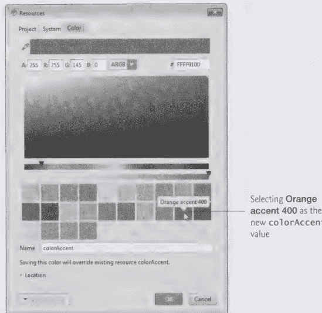

**图 3.10** 为 `colorAccent` 选择 Orange accent 400 颜色调色板。

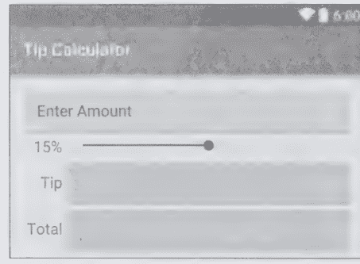

**图 3.11** 完成的设计。

第 5–14 行应用使用了：

- `android.os` 包中的 `Bundle` 类（第 5 行）存储了键值对信息——通常表示应用的状态或需要在 Activity 之间传递的数据。当另一个应用即将出现在屏幕上时——用户接听电话或启动另一个应用——Android 会给当前正在执行的应用提供机会在 `Bundle` 中保存其状态。Android 运行时随后可能会杀死该应用以回收内存。当应用返回时，Android 运行时会将之前保存的状态的 `Bundle` 传递给 `Activity` 的 `onCreate` 方法（第 3.6.4 节）。然后，应用可以使用保存的状态将应用恢复到另一个应用变为活动时的状态。我们使用 `Bundle` 在 Activity 之间传递数据。
- `android.app` 包提供的 `AppCompatActivity` 类提供了基础方法。当你创建项目时，IDE 生成了支持新旧 Android 特性的子类。
- `android.text` 包中的 `Editable` 接口允许修改内容。
- `android.text` 包中的 `TextWatcher` 接口用于 `EditText` 监听。
- `android.widget` 包中的 `EditText` 用于账单金额。
- `android.widget` 包中的 `SeekBar` 用于更改小费百分比。
- `android.widget.SeekBar.OnSeekBarChangeChangeListener` 接口是 `SeekBar` 监听器。
- `android.widget` 包中的 `TextView` 用于显示文本。
- `java.text` 包中的 `NumberFormat` 类用于货币格式化。


- `android.widget` 包中的 `SeekBar` 用于更改小费百分比。
- `android.widget.SeekBar.OnSeekBarChangeChangeListener` 接口是 `SeekBar` 监听器。
- `android.widget` 包中的 `TextView` 用于显示文本。
- `java.text` 包中的 `NumberFormat` 类用于货币格式化。

### 3.6.2 `MainActivity` 子类

`MainActivity` 类（图 3.12–3.18）实现了小费计算器应用的逻辑。它计算小费和总账单金额，然后以特定区域的货币格式显示它们。要查看该文件，在 Project 窗口中，展开 `app/Java/com.deitel.tipcalculator` 节点，并双击 `MainActivity.java`。你需要输入图 3.12–3.18 中的大部分代码。

### 3.6.3 类和实例变量

```java
// currency and percent
private static NumberFormat currencyFormat;
private static NumberFormat percentFormat;
private double billAmount;
private double percentage;
private TextView amountTextView;
private TextView percentTextView;
private TextView tipTextView;
private TextView totalTextView;
```

用户输入的账单金额将被读取并存储为 `double`（第 25 行）。基于 `SeekBar` 滑块的百分比（第 26–30 行）将除以 `100.0` 创建一个 `double`。


## 3.6.4 重写 Activity 方法 `onCreate`

`onCreate` 方法（图 3.15）——在你创建项目时自动生成第 33–36 行——在 Activity 启动时调用。该方法初始化实例变量和视图。此方法越简单越好，以便应用快速加载。事实上，如果应用加载超过五秒，操作系统将显示 ANR（无响应）对话框——赋予用户终止应用的选项。你将在第 9 章学习如何解决这个问题。

```java
// 当 Activity 首次创建时调用
@Override
protected void onCreate(Bundle savedInstanceState) {
    super.onCreate(savedInstanceState); // 调用父类版本
    setContentView(R.layout.activity_main); // 实例化 GUI

    // 获取程序化操作的 TextView 
    amountTextView = (TextView) findViewById(R.id.amountTextView);
    percentTextView = (TextView) findViewById(R.id.percentTextView);
    tipTextView = (TextView) findViewById(R.id.tipTextView);
    totalTextView = (TextView) findViewById(R.id.totalTextView);

    // 将文本设为 0
    tipTextView.setText(currencyFormat.format(0));
    totalTextView.setText(currencyFormat.format(0));

    // 设置 EditText 的 TextWatcher
    EditText amountEditText =
        (EditText) findViewById(R.id.amountEditText);
    amountEditText.addTextChangedListener(amountEditTextWatcher);

    // 设置 percentSeekBar 的 OnSeekBarChangeListener
    SeekBar percentSeekBar =
        (SeekBar) findViewById(R.id.percentSeekBar);
    percentSeekBar.setOnSeekBarChangeListener(seekBarChangeListener);
}
```

# 90 第 3 章 小费计算器应用

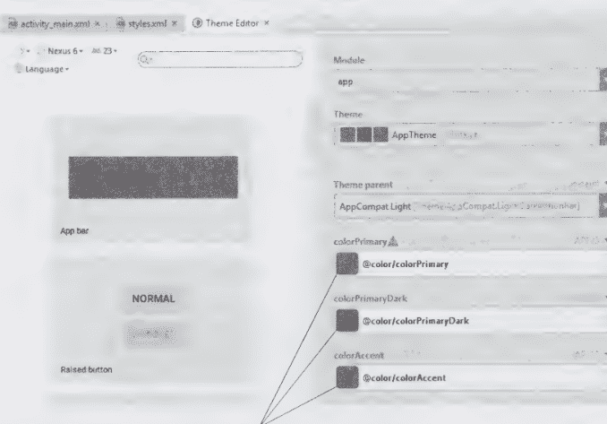

主题的 `colorPrimary`、`colorPrimaryDark` 和 `colorAccent` 属性的颜色调色板。

**图 3.7** 主题编辑器（Theme Editor）在左侧显示视图预览，右侧显示主题属性。

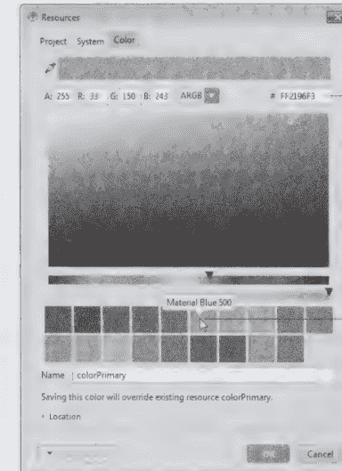

当前选中颜色的十六进制值——material 设计规范显示了推荐颜色及其深色的十六进制值。

选择 Material Blue 500 作为新的 `colorPrimary` 值。

**图 3.8** 为 `colorPrimary` 选择 Material Blue 500 颜色调色板。

## 3.5 默认主题与自定义主题颜色

3. 接下来，点击主题编辑器中的 `colorPrimaryDark` 颜色调色板以显示资源（Resources）对话框。主题编辑器识别出新的 `colorPrimary` 值，并自动显示一个包含推荐的深色 `colorPrimary` 颜色的调色板，你应该将它用于 `colorPrimaryDark`——在这种情况下，为 Material Blue 700。点击该调色板（图 3.9），然后点击 OK。

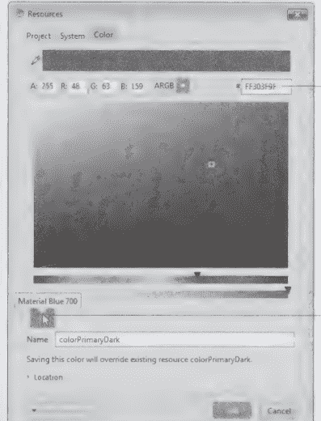

图 3.9 为 `colorPrimaryDark` 选择 Material Blue 700 颜色调色板。

4. 接下来，点击主题编辑器中的 `colorAccent` 颜色调色板以显示资源对话框。主题编辑器再次识别出你更改了 `colorPrimary` 值，并显示了各种互补 accent 色的切换器。在对话框中，选择 Orange accent 400 颜色调色板，然后点击 OK 更改 `colorAccent` 的值（图 3.10），再次点击 OK。

你已经完成了应用的设计，它应该出现在图 3.11 中。

### 3.5.3 作为样式的常用视图属性

正如你将在后续应用中看到的，样式资源可以定义应应用于多个视图的通用属性值。你通过设置其 `style` 属性将样式应用给定的视图。对样式进行的任何后续更改都会自动应用到所有使用该样式的视图。例如，考虑我们在 3.4.5 节第 11 步中配置相同的 `tipTextView` 和 `totalTextView`。我们可以定义一个样式资源来指定布局：`background`、`gravity`、`padding` 和 `elevation` 属性，然后将两个 `TextView` 的 `style` 属性设置为同一个样式资源。


**图 3.10** 为 `colorAccent` 选择 Orange accent 400 颜色调色板。


**图 3.11** 完成的设计。

## 3.6 添加应用逻辑

`MainActivity`（图 3.12–3.18）实现了小费计算器应用的逻辑。它计算小费和总账单金额，然后以特定区域的货币格式显示它们。要查看该文件，在 Project 窗口中，展开 `app/Java/com.deitel.tipcalculator` 节点，并双击 `MainActivity.java`。你需要输入图 3.12–3.18 中的大部分代码。

### 3.6.1 `package` 和 `import` 语句

图 3.12 显示了 `MainActivity.java` 中的包语句和导入语句。

第 3 行的包语句是在你创建项目时插入的。当你在 IDE 中打开 Java 文件时，导入语句是折叠的——其中一个显示在左侧带有一个箭头。你可以点击 `+` 查看导入语句的完整列表。

```java
1 // MainActivity.java
2 // 根据小费百分比计算账单总额
3 package com.deitel.tipcalculator;
4
5 import android.os.Bundle; // 用于保存状态信息
6 import android.support.v7.app.AppCompatActivity; // 基类
7 import android.text.Editable; // 用于 EditText 事件处理
8 import android.text.TextWatcher; // EditText 监听器
9 import android.widget.EditText; // 用于账单金额
10 import android.widget.SeekBar; // 用于更改小费百分比
11 import android.widget.SeekBar.OnSeekBarChangeChangeListener; // SeekBar 监听器
12 import android.widget.TextView; // 用于显示文本
13
14 import java.text.NumberFormat; // 用于货币格式化
15
```

图 3.12 | `MainActivity` 的包和导入语句。

第 5–14 行应用使用了：

- `android.os` 包中的 `Bundle` 类（第 5 行）存储了键值对信息——通常表示应用的状态或需要在 Activity 之间传递的数据。当另一个应用即将出现在屏幕上时——用户接听电话或启动另一个应用——Android 会给当前正在执行的应用提供机会在 `Bundle` 中保存其状态。Android 运行时随后可能会杀死该应用以回收内存。当应用返回时，Android 运行时会将之前保存的状态的 `Bundle` 传递给 `Activity` 的 `onCreate` 方法（第 3.6.4 节）。然后，应用可以使用保存的状态将应用恢复到另一个应用变为活动时的状态。我们使用 `Bundle` 在 Activity 之间传递数据。
- `android.app` 包提供的 `AppCompatActivity` 类提供了基础方法。当你创建项目时，IDE 生成了支持新旧 Android 特性的子类。
- `android.text` 包中的 `Editable` 接口允许修改内容。
- `android.text` 包中的 `TextWatcher` 接口用于 EditText 监听。
- `android.widget` 包中的 `EditText` 用于账单金额。
- `android.widget` 包中的 `SeekBar` 用于更改小费百分比。
- `android.widget.SeekBar.OnSeekBarChangeChangeListener` 接口是 `SeekBar` 监听器。
- `android.widget` 包中的 `TextView` 用于显示文本。
- `java.text` 包中的 `NumberFormat` 类用于货币格式化。

### 3.6.2 `MainActivity` 子类

`MainActivity` 类（图 3.12–3.18）实现了小费计算器应用的逻辑。它计算小费和总账单金额，然后以特定区域的货币格式显示它们。要查看该文件，在 Project 窗口中，展开 `app/Java/com.deitel.tipcalculator` 节点，并双击 `MainActivity.java`。你需要输入图 3.12–3.18 中的大部分代码。

### 3.6.3 类和实例变量

```java
// currency and percent
private static NumberFormat currencyFormat;
private static NumberFormat percentFormat;
private double billAmount;
private double percentage;
private TextView amountTextView;
private TextView percentTextView;
private TextView tipTextView;
private TextView totalTextView;
```

用户输入的账单金额将被读取并存储为 `double`（第 25 行）。基于 `SeekBar` 滑块的百分比（第 26–30 行）将除以 `100.0` 创建一个 `double`。


## 3.6.4 重写 Activity 方法 `onCreate`

`onCreate` 方法（图 3.15）——在你创建项目时自动生成第 33–36 行——在 Activity 启动时调用。该方法初始化实例变量和视图。此方法越简单越好，以便应用快速加载。事实上，如果应用加载超过五秒，操作系统将显示 ANR（无响应）对话框——赋予用户终止应用的选项。你将在第 9 章学习如何解决这个问题。

```java
// 当 Activity 首次创建时调用
@Override
protected void onCreate(Bundle savedInstanceState) {
    super.onCreate(savedInstanceState); // 调用父类版本
    setContentView(R.layout.activity_main); // 实例化 GUI

    // 获取程序化操作的 TextView 
    amountTextView = (TextView) findViewById(R.id.amountTextView);
    percentTextView = (TextView) findViewById(R.id.percentTextView);
    tipTextView = (TextView) findViewById(R.id.tipTextView);
    totalTextView = (TextView) findViewById(R.id.totalTextView);

    // 将文本设为 0
    tipTextView.setText(currencyFormat.format(0));
    totalTextView.setText(currencyFormat.format(0));

    // 设置 EditText 的 TextWatcher
    EditText amountEditText =
        (EditText) findViewById(R.id.amountEditText);
    amountEditText.addTextChangedListener(amountEditTextWatcher);

    // 设置 percentSeekBar 的 OnSeekBarChangeListener
    SeekBar percentSeekBar =
        (SeekBar) findViewById(R.id.percentSeekBar);
    percentSeekBar.setOnSeekBarChangeListener(seekBarChangeListener);
}
```

# 96 第 3 章 小费计算器应用

## `onCreate` 的 `Bundle` 参数

在执行期间，用户可能会更改设备配置——例如，旋转设备、连接蓝牙键盘或弹出实体键盘。为了提供良好的用户体验，应用应该在这些配置更改期间继续顺畅运行。当系统调用 `onCreate` 时，它会创建一个包含 Activity 保存状态的 `Bundle` 参数对象。通常情况下，你会在 Activity 的 `onPause` 或 `onSaveInstanceState` 方法中保存状态（在随后的应用中演示）。第 35 行调用了父类的 `onCreate` 方法，这在重写 `onCreate` 时是要求的。

## 生成的 `R` 类包含 ID

当你构建应用 GUI 并为其添加资源（如 `strings.xml` 中的字符串或 `activity_main.xml` 中的视图）时，IDE 会生成一个名为 `R` 的类，它包含嵌套类，代表项目 `res` 文件夹中的每种类型的资源。这些嵌套类被声明为静态，因此你可以通过 `R.ClassName` 在代码中访问它们。在 `R` 的嵌套类中，IDE 创建了静态 `final` 常量，让你能够以程序化的方式引用应用资源（正如我们稍后讨论的那样）。`R` 中的某些嵌套类包括：

- `R.drawable`——包含任何可绘制项（如图像）的常量，这些项被放在应用 `res` 文件夹中各种 drawable 文件夹内。
- `R.id`——包含 XML 布局文件中视图的常量。
- `R.layout`——包含代表项目每个布局文件（如 `activity_main.xml`）的常量。
- `R.string`——包含 `strings.xml` 文件中每个字符串的常量。

## 填充 GUI


对`setContentView`的调用（第 36 行）接收常量`R.layout.activity_main`，它指示表示 MainActivity GUI 的 XML 文件——在这种情况下，该常量代表`activity_main.xml`文件。`setContentView`方法使用此常量加载相应的 XML 文档，Android 会解析并将其转换为应用的 GUI。这一过程被称为 GUI 的填充（inflating the GUI）。

## 获取组件的引用

一旦布局填充完成，你就可以获取单个组件的引用，以便通过程序化的方式与其交互。为此，请使用`Activity`类的`findViewById`方法。该方法接收一个表示特定视图 ID 的`int`常量，并返回该视图的引用。每个`R.id`常量的名称由你在设计 GUI 时指定的组件`id`属性决定。例如，`amountEditText`的常量是`R.id.amountEditText`。

第 39–42 行获取了我们在应用中程序化更改的`TextView`引用。第 39 行获取了用户输入账单金额时更新的`TextView`引用。第 40 行获取了用户更改百分比类型时更新的`TextView`引用。第 41–42 行获取了显示计算结果的小费和总额的`TextView`。

## 3.6 添加应用逻辑

### 在 TextView 中显示初始值

第 43–44 行通过调用`currencyFormat.format`方法，将`tipTextView`和`totalTextView`设置为 0，并采用特定区域的货币格式。这些`TextView`中的文本会随着用户输入账单金额而改变。

## 注册事件监听器

第 47–49 行使`amountEditText`并调用其`setTextTextChangedListener`方法，注册一个`TextWatcher`，以响应用户更改`EditText`内容时生成的事件。我们将此监听器（图 3.18）定义为一个匿名内部类对象，并将其赋值给`amountEditText`实例变量。虽然我们在第 49 行直接定义了`amountEditTextWatcher`的匿名内部类，但选择在稍后定义它，以便代码更易于读。

## 软件工程观察 3.4

不要在大方法中定义匿名内部类，而是将它们定义为私`final`实例变量，以使你的代码更容易调试、修改和维护。

第 52–53 行获取了`seekBar`的引用。第 54 行调用`SeekBar`的`setOnSeekChangeListener`方法来注册`OnSeekBarChangeListener`，以响应用户移动`SeekBar`滑块时生成的事件。图 3.17 将此监听器定义为一个匿名内部类对象，并赋值给实例变量`seekBarListener`。

### 关于 Android 数据绑定的说明

Android 现在有了一个数据绑定（Data Binding）支持库，你可以将其用于 2.1（API 级别 7）及以上的 Android 应用。你现在可以在布局 XML 文件中包含数据绑定表达式，这些表达式可以操作 Java 对象并动态更新应用用户界面中的数据。

此外，每个带有 ID 视图的层 XML 文件都有一个`public final`实例变量，引用指向自动生成的类。对于每个具有 ID 的视图，你可以创建此“Binding”类的实例，以替换所有对`findViewById`的调用，这可以极大地简化具有复杂用户界面的 Activity Fragment 类中的`onCreate`方法。每个实例变量都是布局中对应视图的标识化（idsified）变量。“Binding”类的名称基于布局的名称——例如，`activity_main.xml`对应的类是`ActivityMainBinding`。

在用此时，数据绑定库处于早期测试阶段，可能会发生重大变化，且数据绑定表达式的语法以及 Android Studio 工具支持也可能如此。你可以在此处了解更多关于 Android 数据绑定的信息：

```text
https://developer.android.com/tools/data-binding/guide.html
```

### 3.6.5 MainActivity 方法

用于`EditText`的`calculate`方法（图 3.16）会在用户每次更改金额时更新`TextView`。第 61–64 行显示小费和总额。第 65 行在`TextView`中显示百分比。第 66–68 行显示布局中设计的方法。

```java
// 显示小费和总额
private void calculate() {
    // 获取小费和总额
    double tip = billAmount * percentage;
    double total = billAmount + tip;

    // 更新小费和总额
    percentTextView.setText(currencyFormat.format(tip));
    totalTextView.setText(currencyFormat.format(total));
}
```

### 3.6.6 MainActivity 方法

第 72–86 行（图 3.17）实现了`OnSeekBarChangeListener`接口。当`SeekBar`滑块改变时，就会调用`onChanged`方法。重写方法要求你重写每一个方法。`onStartTracking`和`stoppingTouch`在接口中，所以我们只需为每个提供一个空体。

```java
// SeekBar 进度监听器
private final OnSeekBarChangeListener seekBarListener = new OnSeekBarChangeListener() {
    // 当用户修改滑块时
    @Override
    public void onProgressChanged(seekBar seekBar, int progress, boolean from) {
        percent = progress / 100.0;
        calculate();
    }

    @Override
    public void onStartTracking(seekBar seekBar) { }

    @Override
    public void stoppingTouch(seekBar seekBar) { }
};
```

### 3.6.7 amountEditText 方法

图 3.18 的第 90–114 行创建了一个匿名内部对象，响应`EditText`事件并将其赋值给实例变量`amountEditTextWatcher`。第 49 行注册了该对象以监听`amountEditText`在文本更改时发生的事件。

```java
// EditText 文本更改监听器
private final TextWatcher amountEditTextWatcher = new TextWatcher() {
// 当用户修改账单金额时
    @Override
    public void onTextChanged(CharSequence s, int start,
            int before, int count) {
        try { // 获取账单金额显示货币格式值
            billAmount = Double.parseDouble(s.toString()) / 100.0;
            amountEditTextWatcher.setText(currencyFormat.format(billAmount));
        } catch (NumberFormatException e) { // 如果 s 为空或非数字
            amountEditTextWatcher.setText("");
            billAmount = 0.0;
        }
    }
calculate(); // 更新小费和总额 TextView
}
```

## 100 第 3 章 小费计算器应用程序

```java
108 @Override
109     public void afterTextChanged(Editable s) {

111     @Override
112     public void beforeTextChanged(CharSequence s, int start, int count, int after) {
114         ;
}
```

图 3.18 | 实现`TextWatcher`接口的匿名内部类（2/2 部分）。

### 重写 TextWatcher 接口中的 textChanged 方法

每当`amountEditText`中的文本被修改时，就会调用`textChanged`方法（行 92–106）。在本示例中，我们只使用了`CharSequence s`，它包含了`editText`文本的副本。其他参数表示从`start`开始的`count`个字符替换了长度为`after`的之前的文本。

第 97 行将来自`amountEditText`的用户输入转换为`double`。我们允许用户仅以分数为单位输入数字，因此我们将计数除以 100.0 以获得实际账单金额——例如，如果用户输入 2495，账单金额为 24.95。第 98 行显示更新后的账单金额。如果发生异常，第 101–102 行将清空`EditText`并账单设置为 0.0。第 105 行调用重新计算并根据当前账单金额显示小费和总额。

### amountEditTextTextWatcher 的其他方法

此应用程序不需要知道文本将发生哪些更改（`beforeChanged`）或文本是否已经更改（`afterTextChanged`），因此我们简单地重写这些`TextWatcher`接口的每个方法并留空方法体（行 108–113），以满足接口约定。

## 3.7 AndroidManifest.xml

在本节中，你将修改`AndroidManifest.xml`文件，以指定应用程序的 Activity 只支持设备的竖屏模式，并且当 Activity 首次显示在屏幕上或导航回 Activity 时，应始终显示虚拟键盘。要打开清单文件，双击项目文件夹中的`AndroidManifest.xml`。图 3.19 显示了完成后的清单，并高亮显示了我们的更改——文件的其余部分是 Android Studio 在我们创建应用程序项目时自动生成的。我们在这里讨论清单的某些方面。有关清单可能包含的所有元素、属性及其值的列表，请访问：

```text
http://developer.android.com/guide/topics/manifest-intro.html
```

```xml
<?xml version="1.0" encoding="utf-8"?>

<manifest xmlns:android="http://schemas.android.com/apk/res/android"

package="com.deitel.tipcalculator">
```

图 3.19 | AndroidManifest.xml 内容。（1/2 部分）。

```xml
<application
  android:allowBackup="true"
  android:icon="@mipmap/ic_launcher"
  android:label="@string/app_name"
  android:supportsRtl="true"
  android:theme="@style/AppTheme">

  <activity
    android:name=".MainActivity"
    android:label="@string/app_name"
    android:screenOrientation="portrait"
    android:windowSoftInputMode="stateAlwaysVisible">

    <intent-filter>
      <action android:name="android.intent.action.MAIN" />
      <category android:name="android.intent.category.LAUNCHER" />
    </intent-filter>
  </activity>
</application>
</manifest>
```


图 3.19 AndroidManifest.xml 内容（2/2 部分）。

### 3.7.1 `manifest` 元素

`manifest` 元素（行 2–24）表示该 XML 文件的内容代表应用程序的清单。该元素的 `package` 属性指定了创建项目时配置的 Java 包名（第 3.4.2 节）。请记住，对于提交到 Google Play 商店的应用程序，包名用作应用程序的唯一标识符。

### 3.7.2 `application` 元素

`manifest` 元素中的 `application` 元素（行 5–21）指定了应用程序的属性，包括：

- `android:allowBackup`——Android 是否自动备份应用程序的数据，以便以后可以将数据恢复到设备或新设备上。
- `android:icon`——你在启动器中点击以运行程序时使用的应用程序图标。
- `android:label`——应用程序的名称，通常显示在启动器的图标下方，并在应用程序运行时通常也显示在应用程序的标题栏中。
- `android:supportsRtl`——界面是否可以水平翻转以支持阿拉伯语和希伯来语等从右到左的语言。
- `android:theme`——定义应用程序视图默认外观和感受的主题。

嵌套在 `application` 元素中的元素定义了应用程序的组件，例如其活动。

### 3.7.3 `activity` 元素

`application` 元素中的 `activity` 元素（行 10–20）描述了一个 Activity。应用程序可以有很多活动，其中一个被指定为用户点击启动器图标运行程序时显示的 Activity。每个 `activity` 元素至少指定以下属性：

- `android:name`——Activity 的类名。`.MainActivity` 是 `com.deitel.MainActivity` 的简写（其中 `com.deitel` 是反写的）。
- `android:label`——应用程序的名称，通常显示在启动器的图标下方，并在应用程序运行时通常也显示在应用程序的标题栏中。
- `android:screenOrientation`——activity 应该支持的方向。例如，竖屏或横屏。
- `android:windowSoftInputMode`——activity 出现时软键盘的行为。例如，`stateAlwaysVisible`。

# 第 3 章 小费计算器

你使用 Android Studio 的布局编辑器、组件树（Component Tree）窗口和属性窗口构建了应用的 GUI。你还编辑了布局的 XML，并使用主题编辑器（Theme Editor）自定义了主题。当你创建项目时，IDE 设置了 `Theme.AppCompat.Light.DarkActionBar` 主题的主色、深色主色和强调色。我们展示了 `MainActivity` 类的代码，它是 `AppCompatActivity` 的子类（也是 `Activity` 的间接子类），定义了应用的逻辑。

在应用的 GUI 中，你使用 `GridLayout` 以行和列的形式排列视图。你在 `TextView` 中显示文本，并从 `EditText` 和 `SeekBar` 接收输入。

`MainActivity` 类需要许多 Java 面向对象编程的能力，包括类、对象、方法、接口、匿名内部类和继承。我们解释了将 GUI 从 XML 文件填充（inflating）到其屏幕表示的概念。你学习了 Android 的 `Activity` 类以及在启动时如何初始化应用。特别是，你重写了 `onCreate` 方法并使用 `findViewById` 获取应用程序化交互的每个视图的引用。你定义了一个实现 `TextWatcher` 接口的匿名内部类，以便用户在 `EditText` 中输入金额时应用可以计算新的小费和总额。你还定义了一个实现 `OnSeekChangeListener` 接口的匿名内部类，以便用户通过移动 `SeekBar` 的滑块更改小费百分比时，应用可以计算新的小费和总额。

最后，你编辑了 `AndroidManifest.xml` 文件，指定 `MainActivity` 只支持竖屏模式，且 `MainActivity` 应始终显示键盘。我们还讨论了创建项目时 Android Studio 置于清单中的其他元素。

在第 4 章中，你将构建国旗测验应用，在该应用中，用户将看到一个国旗图形，并必须从 2、4、6 或 8 个选项中猜出国家。你将使用菜单和复选框来自定义测验，指定猜测选项的数量并将国旗限制在世界的特定区域。

# 国旗测验应用

片段（Fragments）、菜单（Menus）、首选项（Preferences）、显式许可（Explicit Intents）、处理器（Handler）、资源管理器（AssetManager）、补间动画（Tweened Animations）、动画器（Animators）、吐司（Toasts）、颜色状态列表（Color State Lists）、多设备方向布局、用于调试的错误日志记录。

在本章中，你将：

- 使用 `Fragments` 更好地利用 Activity GUI 中可用的屏幕空间。
- 在应用栏上显示设置图标，使用户访问用户偏好。
- 使用 `PreferenceFragment` 自动管理和持久化应用的用户偏好。
- 使用 `SharedPreferences.Editor` 修改与应用关联的数据键值对。
- 使用应用的 `assets` 子文件夹组织图像资源，并使用 `AssetManager` 对其进行操作。
- 定义一个动画并应用到 `View`。
- 使用 `Handler` 调度一个在 GUI 线程上执行的未来任务。
- 使用 `Toasts` 向用户简要显示消息。
- 使用显式 `Intent` 启动特定的 `Activity`。
- 使用 `java.util` 包中的集合。
- 为多个设备方向定义布局。
- 使用 Android 的日志机制记录错误消息。

## 目标

# 第 4 章 国旗测验应用

## 4.1 引言

## 4.2 测试驱动国旗测验应用

### 4.2.1 配置测验设置

### 4.2.2 进行测验

## 4.3 技术概览

### 4.3.1 菜单

### 4.3.2 片段

### 4.3.3 片段生命周期方法

### 4.3.4 管理片段

### 4.3.5 首选项

### 4.3.6 `assets` 文件夹

### 4.3.7 `Resource` 文件夹

### 4.3.8 支持不同的尺寸和分辨率

### 4.3.9 确定设备方向

### 4.3.10 用于显示消息的 `Toasts`

### 4.3.11 使用 `Handler` 在线程中执行 `Runnable`

### 4.3.12 将动画应用到 `View`

### 4.3.13 使用 `AnimationUtils` 创建圆形显现动画器

### 4.3.14 通过颜色状态列表根据 `View` 状态设置颜色

### 4.3.15 `AlertDialog`

### 4.3.16 记录异常消息

### 4.3.17 通过显式 `Intent` 启动另一个 `Activity`

### 4.3.18 Java 数据结构

### 4.3.19 Java SE 7 特性

### 4.3.20 `AndroidManifest.xml`

### 4.4.12 向项目添加类 `SettingsActivity` 和 `SettingsActivityFragment`

## 4.5 构建应用的 GUI

### 4.5.1 竖屏模式设备的 `activity_main.xml` 布局

### 4.5.2 设计 `fragment_main.xml` 布局

### 4.5.3 图形布局编辑器工具栏

### 4.5.4 平板横屏模式设备的 `activity_main.xml` 布局

## 4.6 `MainActivity` 类

### 4.6.1 `package` 语句和 `import` 语句

### 4.6.2 字段

### 4.6.3 重写的 `Activity` 方法 `onCreate`

### 4.6.4 重写的 `Activity` 方法 `onStart`

### 4.6.5 重写的 `Activity` 方法 `onOptionsMenu`

### 4.6.6 重写的 `Activity` 方法 `onOptionsItemSelected`

### 4.6.7 实现 `OnSharedPreferenceChangeListener` 的匿名内部类

## 4.7 `MainActivityFragment` 类

### 4.7.1 `package` 和 `import` 语句

### 4.7.2 字段

### 4.7.3 重写的 `Fragment` 方法 `onCreate`

### 4.7.4 方法 `updateGuessRows`

### 4.7.5 方法 `updateRegions`

### 4.7.6 方法 `resetQuery`

### 4.7.7 方法 `loadNextFlag`

### 4.7.8 方法 `getCountry`

### 4.7.9 方法 `animate`

### 4.7.10 实现 `OnClickListener` 的匿名内部类

### 4.7.11 方法 `disable`

## 4.8 `SettingsActivity` 类

## 4.9 `SettingsFragment` 类

## 4.10 `AndroidManifest.xml`

## 4.11 总结

## 4.2 测试国旗测验

你可以选择 2 个，或者为了增加挑战性，可以选择 6 个或 8 个。触摸 CANCEL（取消）或触摸对话框外的屏幕以返回设置屏幕。

a) 用户点击“选项数量”时显示的菜单

b) 显示选项数量选项的对话框

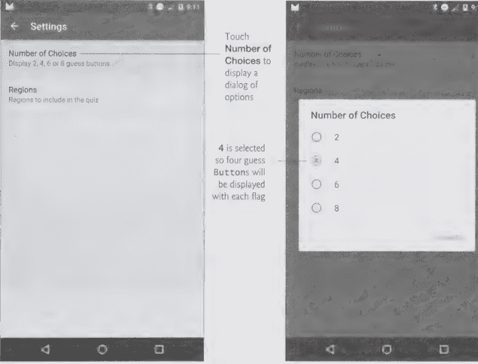

图 4.3 | 国旗测验设置屏幕和“选项数量”对话框。

接下来，点击 Regions（区域）（图 4.4(a)）以显示代表世界区域的复选框（图 4.4(b)）。在默认情况下，应用首次运行时，所有区域都是启用的，因此我们为应用提供的每面国旗都可以随机选择用于测验。点击非洲、亚洲、欧洲、大洋洲（澳大利亚、新西兰及周边岛屿）和南美洲的复选框将其取消——这会将这些地区的国家排除在测验之外。点击 OK 保存你的设置。在手机、平板电脑或竖向布局的 AVD 上，点击返回按钮返回测验屏幕并使用更新后的设置开始新测验。在平板设备或横向布局的平板电脑 AVD 上，屏幕右侧会立即显示带有更新后设置的新测验。

# 第 4 章 国旗测验应用

a) 用户点击“区域”时显示的菜单

b) 显示区域的对话框

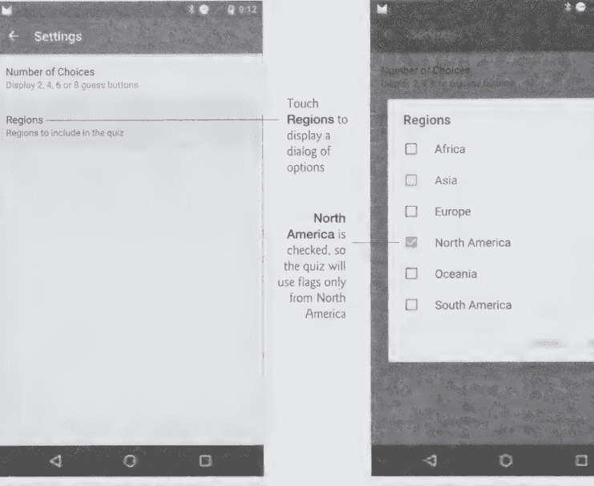

图 4.4 国旗测验设置屏幕和“区域”对话框（取消勾选非洲、亚洲和南美洲后）。

### 4.2.2 进行测验

新测验根据你选择的答案数量开始，并仅包含你选择区域的旗帜。通过点击与每个国旗匹配的按钮来完成测验。

### 选择正确选项

如果选择正确（4.5(a)），应用将禁用所有按钮并绿色显示国家名称，然后在屏幕底部显示一个感叹号（4.5(b)）。经过短时间延迟后，应用将加载下一面旗帜，并通过动画将旗帜和一组新的答案按钮移动到屏幕上。通过圆形动画从当前测验过渡到下一个测验：

- 首先，一个大直径圆在屏幕上缩小，直到直径为零，从而隐藏当前测验的旗帜和按钮。
- 然后，圆的直径从零增大，直到新问题的旗帜和按钮完全可见。

## 4.2 测试国旗应用

选择正确答案

显示正确答案


按钮 VIRGIN ISLANDS（维尔京群岛）具有更高的海拔高度，因此阴影更明显。在猜对后，所有按钮均被禁用。用绿色显示正确答案。

图 4.5 用户选择正确答案并显示正确答案。

### 选择错误选项

对于你点击的每个错误的国家名称按钮（图 4.6(a)），应用将：

- 禁用对应的国家名称。
- 使用动画让旗帜水平抖动。
- 在屏幕底部用红色显示“Incorrect!”（错误！）（图 4.6(b)）。

继续猜测，直到你得到该旗帜的正确答案。

### 完成测验

在你选择 10 个错误的国家名称后，应用上会弹出一个 `AlertDialog` 对话框，显示你的总猜测次数和正确答案百分比（图 4.7）。这是一个模态对话框，因此你必须与之交互才能关闭它。当你点击选择的选项时，应用将使用你更新的设置显示结果并开始新测验。

a) 选择错误答案

b) 显示“Incorrect!”

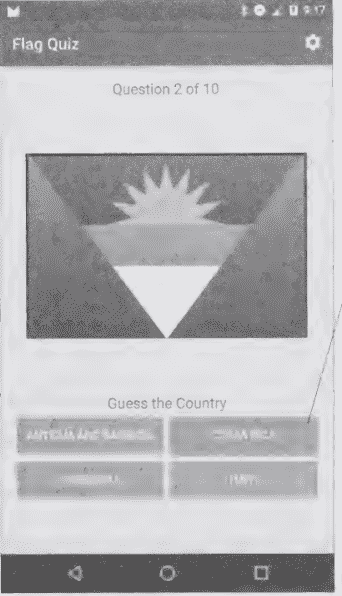

按钮 COSTA RICA（哥斯达黎加）具有更高的海拔高度。错误答案被禁用。用红色显示“Incorrect!”

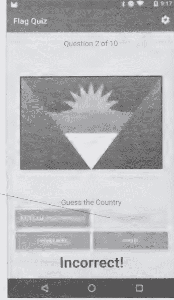

图 4.6 国旗测验应用中的错误答案。


当显示 `AlertDialog` 时，应用呈灰色。

图 4.7 测验完成后的结果显示。

## 4.3 技术概述

本节介绍了构建国旗测验应用时将使用的功能。

### 4.3.1 菜单

当你在 IDE 中创建项目时，`MainActivity` 配置为在操作栏右侧显示菜单。在本应用中，我们仅在竖向布局时显示选项菜单。点击图标会展开一个仅包含 Settings（设置）项目的菜单——这通常用于向用户显示应用设置。在本应用中，我们将通过设置菜单提供图标来修改 XML 文件，这样用户无需打开菜单即可查看设置。你将使用 Vector Asset Studio 向项目中添加材料设计图标。

选项菜单使用 `Menu`（package `android.view`）创建。你重写 `Activity` 方法 `onCreateOptionsMenu`（4.6 节），并使用方法的参数添加菜单项——可以通过编程方式或通过加载描述菜单项的 XML 文档。当用户选择菜单项时，`Activity` 方法 `onOptionsItemSelected`（4.6.6 节）会做出响应。

### 4.3.2 `Fragment`

片段通常代表 `Activity` 用户界面的可重用部分，也可以代表程序逻辑。本应用使用片段来创建和管理应用的一部分。你可以组合多个片段创建适用于平板屏幕尺寸的用户界面。你可以轻松切换片段以使 GUI 更加动态——我们将在第 9 章进行此操作。

一个对应的值。文件中的键必须是字符串（Strings）或原始类型值。此类文件通过 `SharedPreferences` 类（包 `android.content`）的对象进行操作，且该文件仅对创建该文件的应用程序可见。

`PreferenceFragment` 使用 `Preference` 对象（包 `android.preference`）来管理设置，并通过 `SharedPreferences` 对象将这些设置存储在文件中。此应用使用 `ListPreference` 子类来管理每个旗帜（flag）显示的猜测按钮数量，并使用 `MultiListPreference` 子类来管理包含在测验中的区域。`ListPreference` 创建的是一组互斥的单选按钮，其中只能选择一个（图 4.3(b)）。`MultiListPreference` 创建一个包含复选框的 GUI，可以选中其中任意数量的复选框（图 4.4(b)）。你将使用 `PreferenceManager`（package `android.preference`）来访问并与应用程序的默认 `SharedPreferences` 文件交互。

你直接与应用程序的默认 `SharedPreferences` 文件进行交互：

- 在启动测验时，你将查询应用程序的设置以确定显示的猜测按钮数量以及从哪些区域选择旗帜。
- 当用户更改区域设置时，应用程序将确保至少选择了一个区域；否则，测验中将没有旗帜可以包含。如果没有选择任何区域，应用程序将编辑区域以选择北美。

要修改 `SharedPreferences` 文件的内容，你将使用 `SharedPreferencesEditor` 对象（第 4.6.7 节）。

## 4.3.6 `assets` 文件夹

应用的旗帜仅在需要时加载到应用程序中，并位于应用程序的 `assets` 文件夹¹。为了将图像添加到项目中，我们将文件系统中的每个区域的文件夹复制到 Project 窗口中的 `assets` 文件夹中（第 4.4.4 节）。图像位于书籍示例中的 `images/FlagQuizImages` 文件夹。

与应用的 `drawable` 文件夹不同（`drawable` 文件夹要求图像内容位于每个文件夹的根目录级），`assets` 文件夹可以包含任何类型的图像，并可以组织在子文件夹中——我们为每个区域的旗帜维护了一个独立的子文件夹。`assets` 子文件夹中的文件通过 `AssetManager`（package `android.content`）访问，它可以提供指定子文件夹中所有文件名的列表，并可用于访问每个资源。

## 4.3.7 资源文件夹

在第 2.4.4 节中，你学习了应用程序 `res` 文件夹下的 `drawable`、`layout` 和 `view` 子文件夹。在本应用中，你还会使用 `menu`、`anim`、`color` 和 `xml` 资源文件夹。图 4.8 概述了这些文件夹以及 `animator` 和 `raw` 文件夹。

> ¹ 我们从 http://www.free-country-flags.com 获取了图像。

## 第 4 章 旗帜测验应用

| 资源子文件夹 | 说明 |
| --- | --- |
| `anim` | 以 `anim` 开头的文件夹包含定义补间动画（tweened animations）的 XML 文件，这些动画可以随时间改变对象的透明度、大小、位置和旋转。你将在第 4.4.10 节中定义一个动画，然后在第 4.7.10 节中播放它以产生抖动效果，为用户的错误猜测提供视觉反馈。 |
| `animator` | 以 `animator` 开头的文件夹包含定义属性动画（properties animations）的 XML 文件，这些动画会随时间改变对象属性的值。在 Java 中，属性通常在类中以实例的形式实现，并同时具有 setter 和 getter 访问方法。 |
| `color` | 以 `color` 开头的文件夹包含定义颜色状态列表（color state lists）的 XML 文件——即针对各种状态（如按钮的状态：未按下、按下、启用、禁用）的颜色列表。我们将在第 4.4.8 节中使用颜色状态列表来定义当猜测按钮被启用或禁用时的不同颜色。 |
| `raw` | 以 `raw` 开头的文件夹包含资源文件（如音频剪辑），这些文件以字节流的形式被读取到应用程序中。我们将在第 6 章中使用此类资源来播放声音。 |
| `menu` | 以 `menu` 开头的文件夹包含描述菜单内容的 XML 文件。当你创建一个项目时，IDE 会自动定义一个带有 Settings（设置）选项的菜单。 |
| `xml` | 以 `xml` 开头的文件夹包含不符合其他资源类别的 XML 文件——通常是应用程序使用的数据文件。在第 4.4.11 节中，你将定义一个 XML 文件，代表此应用程序的 `SettingsActivityFragment` 显示的设置。 |

图 4.8 | 项目中 `res` 文件夹内的其他子文件夹。

## 4.3.8 支持不同的屏幕尺寸和分辨率

在第 2.5.1 节中，你学习了 Android 设备具有各种屏幕尺寸、分辨率和像素密度（每英寸点数 DPI）。你还学习了可以根据设备的像素密度选择最佳资源。同样，在第 2.8 节中，你学习了如何为不同的语言和区域提供 String 资源。Android 使用带有限定名的资源文件夹来根据设备的像素密度选择合适的图像，并根据设备的语言和区域设置选择正确的语言字符串。这种机制还允许你从第 4.3.7 节讨论的任何资源文件夹中选择资源。

对于此应用的 `Activity`，你将使用最小屏幕宽度和方向限定符来确定使用哪种布局——一个用于手机和平板的竖屏模式，另一个用于平板电脑的横屏模式。为了实现这一点，你将定义两个展示 `MainActivity` 内容布局：

- `content_main.xml` 是默认布局，仅显示 `MainActivity-Fragment`。
- `content_main.xml` (`sw700dp-land`) 仅在设备（即平板电脑）处于横屏模式时使用。

## 4.3.9 技术概述

带限定符的文件夹名（在磁盘上）格式为：`name-qualifiers`，其中限定符由一个或多个限定符组成。目前有 19 种限定符类型可用于指定 Android 何时应该选择资源。我们将在全书中随处解释其他限定符。关于所有 `res` 限定符及其遵循规则的完整描述，请访问：

```http://developer.android.com/guide/topics/providing-resources.html#alternativesources
```


## 4.3.10 设备方向

在本应用中，当应用程序运行在手机设备或平板电脑的竖屏模式运行时显示菜单（第 4.6.5 节）。为了确定这一点，我们将获取`Configuration`类（`package android.content.res`）的对象，它包含表示设备当前方向的公共变量`orientation`（值为`ORIENTRAIT`或`LANDSCAPE`）。

## 4.3.11 用于显示消息的 Toast

`Toast`（`package android.widget`）简要描述消息，然后从屏幕上消失。`Toast`通常用于显示轻微的错误或信息消息。我们如下使用`Toast`：

- 指示在用户更改设置后将重置测验。
- 指示如果用户取消选择所有区域，必须至少选择一个——在这种情况下，应用程序将北美设为测验的默认区域。

## 4.3.13 使用 ViewAnimationUtils 创建圆形展开动画

动画可以让应用程序更具视觉吸引力。在这个应用程序中，在用户做出正确选择后不久，应用程序会将旗帜和答案按钮动画到屏幕上，并将下一个旗帜和答案按钮动画到它们上方。为了实现这一点，在 4.7.9 节中，你将使用`ViewAnimationUtils`类通过调用`createCircularReveal`方法创建一个圆形展开动画器（Circular Reveal Animator）。然后你将分别调用`Animator`的`duration`和`start`方法设置动画时长并启动动画。动画表现为一个缩小或放大的圆形窗口，显示 UI 元素的部分。

## 4.3.14 通过颜色状态列表（Color State List）根据 View 的状态指定颜色

状态列表资源定义了一个根据`View`状态而改变颜色的颜色资源。例如，你可以为按钮的背景颜色定义一个颜色状态列表，为按钮的按下、未按下、启用和禁用状态下指定不同的颜色。同样，对于`CheckBox`，你可以为它的已选中或未选中状态指定不同的颜色。

在这个应用程序中，当用户做出错误猜测时，应用程序会禁用该按钮；当用户做出正确猜测时，应用程序会禁用所有猜测按钮。在禁用的按钮中，白色文字很难阅读。为了解决这个问题，你将定义一个颜色状态列表，根据按钮的启用或禁用状态指定按钮的文本颜色（节 4.4.8）。有关关于颜色状态列表的更多信息，请访问：

```
http://developer.android.com/guide/topics/resources/color-list-resource.html
```

## 4.3.15 AlertDialog

你可以通过`AlertDialog`（`package.android.app`）向应用程序显示消息、选项和确认。`AlertDialog`是模态对话框——当它显示时，用户在对话框关闭（消失）之前无法与应用程序交互。正如你将看到的，你使用`AlertDialog.Builder`对象创建并配置`AlertDialog`，然后使用它来创建`AlertDialog`。

`AlertDialog`可以显示按钮、复选框、单选按钮和项目列表，用户可以触摸它们来响应对话框的消息。它们还可以显示自定义的 GUI。标准的`AlertDialog`最多可以三个按钮，其作用如下：

- 否定操作（Negative action）——取消对话框指定的动作，通常标记为 CANCEL（取消）或 NO（否）。当对话框中有多个按钮时，它是最左侧的按钮。
- 正向操作（Positive action）——接受对话框指定的动作，通常标记为 OK（确定）或 YES（是）。当对话框中有多个按钮时，它是最右侧的按钮。
- 中立操作（Neutral action）——此按钮表示用户不想取消或接受对话框指定的动作。例如，一个要求用户注册以访问额外功能的应用程序可能会提供一个 REMIND ME LATER（稍后提醒我）。

## 4.3 技术概览

我们在测验结束时使用`AlertDialog`向用户显示测验结果（节 4.7.10），并允许用户点击按钮来重置测验。你将实现`DialogInterface.OnClickListener`接口（`package android.content`）来处理按钮事件。你可以了解更多关于 Android 对话框的信息：

```
http://developer.android.com/guide/topics/ui/dialogs.html
```

## 4.3.16 记录异常消息

当发生异常或你想要跟踪代码执行的重要方面时，可以使用 Android 内置的日志记录机制为调试目的记录消息。Android 提供了`Log`（`package android.util`），它包含几个静态方法，用于表示不同详细程度的消息。记录的消息可以在 Android 设备监器底部的 Logcat 或使用 Android logcat 工具查看。你可以通过在 Android Studio 中选择`View > Tools > Android Monitor`打开 Android 设备监器。有关记录消息的更多详情，请访问：

```
http://developer.android.com/guide/tools/debugging-logging.html
```

## 4.3.17 通过显式意图启动另一个 Activity

在 3.7.4 节中学过，Android 使用一种名为“意图消息”（intent messaging）的技术在同一个应用程序内或不同应用程序之间的 Activity 传递信息。`AndroidManifest.xml`中声明的每个 Activity 都可以指定意图过滤器（intent filters），指示哪些 Activity 能够处理请求。在每个应用中，IDE 为应用的唯一 Activity 创建了一个意图过滤器，指示它可以响应预定义的动作名称意图`MAIN`，该意图指定了用于启动应用并开始执行的 Activity。Activity 是通过`Intent`启动的，该 Intent 指明了执行该动作的动作和数据。

## 隐式意图与显式意图

此应用程序使用了显式意图（explicit Intent）。当此应用程序在竖屏模式运行时，其偏设置显示在`SettingsActivity`中（节 4.8）——特定的 Activity 理解如何管理此应用程序的偏设置。4.6.6 节展示了如何使用隐式意图（implicit Intent）启动同一应用程序中的特定 Activity。

Android 还支持隐式意图，你不需要指定哪个组件应该处理该意图。例如，你可以创建一个意图来显示 URL 内容并根据数据类型启动最合适的 Activity（网络浏览器）。如果有多个 Activity 可以处理传递给`startActivity`的动作和数据，系统将显示一个对话框，用户可以在其中选择 Activity（可能是他已安装的多个浏览器之一）。如果系统找不到处理该动作的 Activity，则`startActivity`将抛出`ActivityNotFoundException`。通常情况下，处理此异常是一个良好的做法，可以防止你的应用程序崩溃。你也可以先使用`Intent.resolveActivity`方法判断是否有 Activity 可以处理该意图。有关意图的更多信息，请访问：

```
http://developer.android.com/guide/components/intents.html
```

## 4.3.18 Java 数据结构

此应用程序使用了`java.util`包中的数据结构。应用程序动态加载已启用区域的文件名，并将它们存储在`ArrayList<String>`中。我们使用`Collections.shuffle`为每个新游戏随机化文件名顺序（节 4.7.7）。我们使用第二个`ArrayList<String>`来持有测验中使用的国家图像文件。我们还使用`Set<String>`来存储测验中包含的世界区域。使用泛型类型的变量引用集合对象，这样你就可以轻松更改数据结构而不影响应用程序的其他代码。

![d90d3bd5ccbbbce3d084b689d123695c_157)

## 4.3.19 Java SE 7 特性

Android 完全支持 Java 7。有关 Java 7 引入的功能完整列表，请访问：

```
http://www.oracle.com/network/java/jdk7-relnotes-418459.html
```

此应用程序使用了以下 Java 7 特性：

- 泛型实例创建的类型推断（Type inference for generic instance creation）——如果编译器可以从上下文替换对象的类型，那么在创建对象时你可以将`<type>`替换为`<>`。例如，在旗帜测验的`MainActivity`中`quizList`被声明为`List<String>`，因此编译器知道集合必须包含 String。当我们创建相应的`ArrayList`对象时，可以在以下语句中使用 Java 7 的钻石运算符`<>`，编译器根据`quizList`的声明推断出`<>`应该是`String>`：

```
quizList = new ArrayList<>();
```

- Try 语句（try-with-resources statement）——与其在`try`块中声明资源并在`finally`块中关闭它，不如使用 Try 语句在`try`块的括号中声明资源并在`try`块中使用。当程序控制离开`try`块时，资源会自动关闭。例如，在旗帜测验的`MainActivityFragment`中，我们使用`InputStream`读取应用程序旗帜图像的字节并用于创建 Drawable（节 4.7.7）：

```
try (InputStream stream =
assets.open("/"" + nextImage + ".png")) {
// 可能会抛出异常的代码
}
```

## 4.3.20 AndroidManifest.xml

正如第 3 章中学过的，在创建应用程序时会创建一个`AndroidManifest.xml`文件。Android 应用程序中的所有 Activity 都必须列在应用程序的清单文件中。我们将向你展示如何在项目中添加额外的 Activity。当你设置-

## 4.4 创建项目、资源文件和额外类

在向项目中添加 Activity（第 4.4.12 节）时，IDE 会将其添加到 manifest 文件。有关 AndroidManifest.xml 的完整细节，请参考：

```
http://developer.android.com/guide/manifest/manifest-intro.html
```


我们将在后续应用中介绍`AndroidManifest.xml`文件的其他方面。

## 4.4 创建项目、资源文件和额外类

在本节中，你将创建项目并配置 Flag 应用使用的字符串、数组、颜色和动画资源。你还将为第二个 Activity 创建额外的类，使用户能够更改应用程序的设置。

### 4.4.1 创建项目

按照第 2.3 节的步骤创建一个新项目。在“Create New Project”对话框的“New Project”步骤中，指定以下值：

- 应用程序名称（Application name）：Flag Quiz
- 公司域名（Company Domain）：detail1.com（或指定你自己的域名）

对于“New Project”对话框中的剩余步骤，使用与第 2.3 节中相同的设置，但在“Add an activity to Mobile”步骤中，选择 Activity 而非 Empty Activity，并勾选 Use Fragment 复选框。保留为提供的 Activity Name、Layout Name、Title 和 Menu Resource Name 的默认名称，然后点击 Finish 创建项目。IDE 将创建各种 Java 类和资源文件，包括：

- 一个 `MainActivity` 类
- 一个名为 `MainActivityFragment` 的 `Fragment` 子类，由 `MainActivity` 显示
- `MainActivity` 和 `MainActivityFragment` 的布局文件，以及
- 一个定义 `MainActivity` 选项菜单（options menu）的 `menu_main.xml` 文件。

此外，还按照第 2.5.2 节的步骤向你的项目添加图标。

当项目在 Android Studio 中打开时，IDE 会在布局编辑器中显示`content_main.xml`。从虚拟设备下拉列表中选择 Nexus 6（图 2.11）——我们再次使用此设备作为我们设计的依据。

### 4.4.2 空白 Activity 布局

Blank Activity 是一个向后兼容的模板（适用于 Android 2.1 及更高版本），它使用了 Android Support Library 的功能。该模板可以使用 Fragment 也可以不使用 Fragment。当你选择 Fragment 选项时，IDE 会创建布局`activity_main.xml`、`content_main.xml`和`fragment_main.xml`。

`activity_main.xml`中的布局包含一个`CoordinatorLayout`（来自包`android.support.design.widget`）。`CoordinatorLayout`定义的 Android Studio 应用模板通常包含一个定义为`Toolbar`（包`android.support.widget`）的 app bar。模板显式定义应用，以便与不支持 app bar 的早期 Android 版本向后兼容。`CoordinatorLayout`有助于管理与嵌套视图的 material design 交互——例如当视图动画到屏幕上时将 GUI 的部分移开，并在完成后恢复到其原始位置。

默认的`activity_main.xml`布局嵌入（通过 XML 中的`<include>`元素）了`FloatingActionButton`（悬浮按钮）——这是一个来自 Android Support Library 的圆形按钮，它的高度（elevation）比其他组件高，因此它“悬浮”在 GUI 之上。这强调了用户通过触摸按钮可以执行的重要操作。每个应用模板都包含`FloatingActionButton`以及你将使用的其他 material 特性。

`content_main.xml`布局定义了`MainActivity`的 GUI 中出现在 app bar 下方、系统 bar 上方的部分。当选择 Fragment 选项时，此文件仅包含一个`<fragment>`元素，显示在`fragment_main.xml`中定义的`MainActivity` GUI。如果你不选择 Fragment 选项，此文件将定义一个包含`TextView`的`RelativeLayout`，并在你在这里定义`MainActivity` GUI。

`fragment_main.xml`布局仅在你选择 Fragment 选项时才定义。使用 Fragment 时，这里是你定义主 GUI 的地方。

#### 准备设计 GUI

此应用不需要`FloatingActionButton`，因此请打开`activity_main.xml`布局，并在布局的右下角定义粉色按钮。此外，在 Component Tree（组件树）中选择`CoordinatorLayout`，并将布局的 id 设置为`coordinatorLayout`。打开`fragment_main.xml`布局并删除应用定义的 Hello World! `TextView`。

### 4.4.3 配置 Java SE 支持

我们在这个应用中使用了 Java 7 编程特性。默认情况下，新的 Android Studio 项目使用 Java SE 6。要使用 Java 7：

1. 右键点击项目的`app`文件夹并选择 Open Module Settings 以打开 Project Structure（项目结构）窗口。
2. 确保选择了窗口顶 Properties 选项卡。
3. 在 Source Compatibility（源兼容性）和 Target Compatibility（目标兼容性）下拉列表中均选择 1.7，然后点击 OK。

### 4.4.4 将旗帜图像添加到项目

按照以下步骤创建`assets`文件夹并将旗帜添加到项目：

1. 在 Project 窗口中右键点击`app`文件夹，选择 New > Folder > Assets Folder。在出现的 Customize 对话框中点击 Finish。
2. 导航到包含书籍示例的文件夹，并复制`images/FlagImages`文件夹下的所有文件夹。
3. 在 Project 窗口中点击`assets`文件夹，粘贴上一步复制的文件夹。在出现的 Copy 对话框中，点击 OK 将文件夹及其图像复制到你的项目中。

### 4.4.5 Strings.xml 和格式化字符串资源

在第 3.4.5 节中，你学习了如何使用 Resources（以及许多其他资源）创建字符串。为了准备此应用，我们将在设计 GUI 和从程序代码中使用它们。现在你将使用首次在第 2.8 节中看到的 Translations Editor（翻译编辑器）来创建字符串资源：

1. 在 Project 窗口中，展开`res/values`节点，然后打开`strings.xml`。
2. 在编辑器的右上角点击 Translations 以打开翻译编辑器。
3. 在编辑器的左上角点击 strings 资源。
4. 在出现的对话框中，为 Key 输入默认值，点击 OK。
5. 对每个 strings 资源重复第 4 步。

> Android 设计指南指出文本应该是简洁、友好的。关于写作风格，请参见 http://developer.android.com/design/writing.html。

| Key | Default value |
|---|---|
| number_of_choices | Display 2, 4, 6 |
| world_regions | Regions |
| world_regions_description | Regions to include in the quiz |
| guess_country | Guess the Country |
| results | %1d guesses, $%0.2f correct |
| incorrect_answer | Incorrect! |
| default_region_message | One region must be selected. |
| restarting_quiz | Quiz will restart with |
| question | %1d |
| image_description | Image of the current |
| default_region | North America |

图 4.9 Flag Quiz 使用的。

#### 格式化字符串

`results`和`question`是格式化字符串。当一个字符串资源包含多个占位符时，你必须对其进行编号以便本地化。在`results`中：

```
$%1d guesses, $%0.2f correct
```

`$1s`在`%2f`中表示第一个值应替换`%1d`。同样，`$2s`在`%2f`中表示第二个值应替换`%2f`。占位符中的`d`表示整数，`f`表示格式化浮点数。在`strings.xml`的本地化版本中，可以根据需要重新排列格式字符串。

### 4.4.6 arrays.xml

技术上，`res/values`文件夹中的所有应用资源都可以定义在文件中。然而，为了便于管理不同类型的资源，通常会使用单独的文件。例如，按照惯例，数组资源通常定义在`arrays.xml`中，颜色在`colors.xml`中，字符串在`strings.xml`中，数值在`values.xml`中。此应用使用了三个定义在`arrays.xml`中的数组资源：

- `regions_list`指定了下划线分隔的地区名称——这些值用于从相应的文件夹加载图像文件名，并作为用户在`SettingsActivityFragment`中选择的地区的值。
- `regions_list_for_settings`指定了空格分隔的地区名称——这些值用于在`SettingsActivityFragment`中向用户显示地区名称复选框。
- `guesses_list`指定了字符串 2, 4, 6 和 8——这些值用于在`SettingsActivityFragment`中显示单选按钮，使用户可以选择显示的猜测按钮数量。

图 4.10 显示了这些数组资源的名称和元素值。

| 数组资源名称 | 值 |
|---|---|
| regions_list | Africa, Asia, Europe, North_America, Oceania, South_America |
| regions_list_for_settings | Africa, Asia, Europe, North_America, Oceania, South_America |
| guesses_list | 2, 4, 6, 8 |

**图. 4.10** 定义在`arrays.xml`中的字符串数组资源。

## 4.4 创建项目、资源文件和额外类

要创建`arrays.xml`并配置数组资源，请执行以下步骤：

1. 在项目的`res`文件夹中，右键点击`values`文件夹，然后选择 New（新建） > Values resource file（值资源文件），显示新资源文件对话框。由于你右键点击了`values`文件夹，对话框已预配置为在`values`文件夹中添加资源文件。
2. 在 File name（文件名）字段中指定`arrays.xml`并点击 OK 创建文件。
3. Android Studio 未为字符串数组（String arrays）提供资源编辑器，你需要编辑 XML 来创建字符串数组资源。

每个`string-array`资源具有以下格式：

```xml
<string-array name="resource_name">
  <item>first element value</item>
  <item>second element value</item>
  ...
</string-array>
```

图 4.11 显示了完整的 XML 文件。

```xml
<?xml version="1.0" encoding="utf-8"?>
<resources>
  <string-array name="regions_list">
    <item>Africa</item>
    <item>Asia</item>
    <item>Europe</item>
    <item>North_America</item>
    <item>Oceania</item>
    <item>South_America</item>
  </string-array>
  <string-array name="regions_list_for_settings">
    <item>Africa</item>
    <item>Asia</item>
    <item>Europe</item>
    <item>North America</item>
    <item>Oceania</item>
    <item>South America</item>
  </string-array>
  <string-array name="guesses_list">
    <item>2</item>
    <item>4</item>
    <item>6</item>
    <item>8</item>
  </string-array>
</resources>
```

图 4.11 `arrays.xml`定义了旗旗测验（Flag Quiz）应用中使用的字符串数组资源。

### 4.4.7 colors.xml

此应用用绿色显示正确答案，用红色显示错误答案。对于任何其他资源，颜色都应该在 XML 中定义，这样你可以在不修改应用 Java 源码的情况下轻松更改颜色，并可以使用 Android 的资源选择功能处理各种场景（不同的位置、白天和夜晚等）。通常，颜色定义在`colors.xml`文件中，该文件在大多数 Android Studio 应用模板创建时已生成，或者在你使用 2.5.7 节中的技术定义颜色时创建；否则，你必须手动创建该文件。

Blank Activity 模板已包含一个`colors.xml`文件，定义了主题的主色（primary）、深主色（primary dark）和强调色（accent）资源。在这里，你将为正确和错误答案添加颜色资源，并修改应用的强调色。为了实现这一点，你将直接编辑 XML，而不是像在 3.5 节中所样使用主题编辑器（Theme Editor）修改颜色。

从项目的`res/values`文件夹打开`colors.xml`（图 4.12）并添加第 6 行和第 7 行。此外，将`colorAccent`（第 5 行）的十六进制值从`#FF4081`（应用模板定义的默认亮粉色）更改为`#448AFF`（比`colorPrimary`和`colorPrimaryDark`更浅的蓝色）。注意 IDE 中，XML 编辑器允许在每个颜色左侧进行颜色切换。

```xml
<?xml version="1.0" encoding="utf-8"?>
<resources>
  <color name="colorPrimary">#3F51B5</color>
  <color name="colorPrimaryDark">#303F9F</color>
  <color name="colorAccent">#448AFF</color>
  <color name="correct_answer">#00CC00</color>
  <color name="incorrect_answer">#FF0000</color>
</resources>
```

图 4.12 | `colors.xml`定义了应用的颜色资源。

### 4.4.8 button_text_color.xml

如 4.3.14 节所述，当为`Button`提供颜色状态列表资源（无论是前景还是背景）时，将根据`Button`的状态从颜色列表中选择适当的颜色。对于此应用，你将为答案按钮在启用（enabled）和禁用（disabled）状态下的文本颜色定义颜色。要创建颜色状态列表资源文件：

1. 右键点击项目的`res`文件夹，然后选择 New > Android resource file 显示新资源对话框。
2. 在 File name（文件名）中指定`button_text_color.xml`。
3. 在 Resource type（资源类型）下拉菜单中选择 Color。Root element（根元素）将自动变为 selector，Directory name（目录名称）将自动变为 color。
4. 点击 OK 创建文件。`button_text_color.xml`文件将置于`res/color`文件夹中，IDE 会随文件自动创建该文件夹。
5. 将图 4.13 中的文本添加到文件中。

`<selector>`元素（2–10）包含`<item>`元素，这些元素指定了特定`Button`状态的颜色。在这个颜色列表中，我们在每个`<item>`中分别指定了`android:state-enabled`属性：一次用于启用状态（true，第 3–5 行），一次用于禁用状态（false，第 6–8 行）。

```xml
<?xml version="1.0" encoding="utf-8"?>
<selector xmlns:android="http://schemas.android.com/apk/res/android">
  <item android:color="@color/white" android:enabled="true"/>
  <item android:color="@color/gray" android:enabled="false"/>
</selector>
```


图 4.13 `button_text_color.xml` 定义了启用和禁用状态的颜色。

### 4.4.9 编辑 `menu.xml`

在`menu.xml`中，你将为应用栏添加菜单项。在这里将添加以下项目：

1. 打开`res/menu`文件夹中的`menu.xml`。
2. 在`<item>`元素中添加以下属性。
3. 你可以强制菜单项显示在应用栏，这种情况被称为`action`（操作）。

```xml
<menu xmlns:android="http://schemas.android.com/apk/res/android"
    xmlns:app="http://schemas.android.com/apk/res-auto">

    <item
        android:id="@+id/settings"
        android:title="Settings"
        android:icon="@drawable/ic_settings"
        app:showAsAction="if" />

</menu>
```

### 4.4.10 创建旗帜动画

在本节中，你将创建一个在用户猜测错误时摇晃旗帜的动画。我们将在 4.7.10 节显示应用如何使用此动画。要创建动画：

1. 右键点击项目的`res`文件夹，然后选择 New > Android resource file 打开新资源文件对话框。
2. 在 Name 字段输入`incorrect_shake.xml`。
3. 在 Resource type 下拉菜单中选择 Animation。IDE 将目录变为`anim`。
4. 点击 OK 创建文件。XML 文件立即打开。

IDE 没有为动画提供编辑器，因此你必须如图 4.14 所示修改旗帜的 XML 内容。

```xml
<?xml version="1.0" encoding="utf-8"?>

<set xmlns:android="http://schemas.android.com/apk/res/android"
    android:interpolator="@android:anim/decelerate_interpolator">

    <translate duration="100" android:toXDelta="-5p" />
    <translate duration="100" android:fromXDelta="5p" android:startOffset="100" />
    <translate duration="100" android:fromXDelta="5p" android:startOffset="200" />

</set>
```

图 4.14 `incorrect_shake.xml` 定义了当用户猜测错误时播放的旗帜动画。

## 4.4 创建项目、资源文件和额外类

动画由三个平移动画（translate animations）组成。平移动画使`View`在其父容器内移动。Android 还支持对任何对象的任何属性进行动画处理。

第一个平移动画（第 6–7 行）在指定的时间范围内将`View`从起始位置移动到结束位置。`android:fromDelta`属性是`View`开始动画时的偏移量，而`android:toDelta`属性是动画结束时的偏移量。这些属性可以是：

- 绝对值（以像素为单位）。
- 动画`View`尺寸的百分比。
- 动画父容器尺寸的百分比。

对于`android:fromDelta`属性，我们指定了 0 的绝对值。对于`android:toDelta`属性，我们指定了 -5% 的值，这表示`View`应该向左（由于负号）移动父容器宽度的 5%（由`p`表示）。若要移动`View`自身宽度的 5%，则移除`p`。`android:duration`属性指定了动画持续的时间（单位毫秒）。因此，第 6–7 行的动画在 100 毫秒内将`View`向左移动父容器宽度的 5%。

第二个动画（第 9–10 行）在第一个动画完成后继续，在 100 毫秒内将`View`从 -5p 偏移移动到 +5p 偏移。默认情况下，动画集中的动画是同时应用的（即并行执行），但你可以使用`android:startOffset`属性来指定动画应在未来的某个毫秒数后开始。在这种情况下，第二个动画在第一个动画 100 毫秒后开始。第三个动画（第 12–13 行）与第二个相同，但方向相反，并且它在第一个动画之后 200 毫秒开始。

### 4.4.1 用于指定应用设置的 `preferences.xml`

在本节中，你将创建`preferences.xml`文件，`SettingsFragmentManager`使用它来显示设置。创建文件的步骤如下：

- 右键点击项目的资源文件夹（resource folder），选择 New > Android resource file 以打开新资源对话框。
- 在 File name 字段中，输入名称`preferences.xml`。
- 在 Resource type 下拉列表中选择 XML。根元素将自动变为 Preference，它代表显示设置的屏幕。Directory name 将自动变为`xml`。
- 点击 OK 创建文件。`preferences.xml`文件将被存放在自动创建的`xml`文件夹中。
- 如果 IDE 没有自动打开`res/preferences.xml`，请双击该文件打开它。

现在你将添加两种类型的设置：`ListPreference`和`MultiSelectListPreference`。每个设置都有相应的属性，我们在图 4.15（针对`ListPreference`）和图 4.16（针对`MultiSelectListPreference`）中对这些属性进行了说明。要在文件中添加这些设置及其属性，你需要编辑 XML 文件。图 4.17 显示了完成 XML。

| Property（属性） | Value（值） | Description（描述） |
|---|---|---|
| `entries` | `@array/guesses_list` | 显示在选项列表字符串数组。 |
| `entryValues` | `@array/guesses_list` | 与 Entries 属性中的选项相关的值数组。所选项的值将存储在应用的`SharedPreferences`中。 |
| `key` | `pref_numberOfChoices` | 存储在应用`SharedPreferences`中的设置名称。 |
| `title` | `@string/number_of_choices` | 在 GUI 中显示的设置标题。 |
| `summary` | `@string/number_of_choices_description` | 显示在标题下方的设置摘要描述。 |
| `persistent` | `true` | 设置在应用终止后是否持久化——如果为`true`，`Preference`类会在每次更改值时立即持久化设置值。 |
| `defaultValue` | `4` | Entries 属性中默认选中的项。 |

**图 4.15** `ListPreference`属性值。

| Property（属性） | Value（值） | Description（描述） |
|---|---|---|
| `entries` | `@array/regions_list_for_settings` | 显示在选项列表字符串数组。 |
| `entryValues` | `@array/regions_list` | 与 Entries 属性中的选项相关的值数组。所有选中项的值都将存储在应用的`SharedPreferences`中。 |
| `key` | `pref_regionsToInclude` | 存储在应用`SharedPreferences`中的设置名称。 |
| `title` | `@string/world_regions` | 在 GUI 中显示的设置标题。 |
| `summary` | `@string/world_regions_description` | 显示在标题下方的设置摘要描述。 |
| `persistent` | `true` | 设置在应用终止后是否持久化。 |
| `defaultValue` | `@array/regions_list` | 此设置的默认值数组——在这种情况下，所有区域都将默认选中。 |

**图 4.16** `MultiSelectListPreference`属性值。

## 4.4 创建项目、资源文件和额外类

```xml
<?xml version="1.0" encoding="utf-8"?>

<PreferenceScreen
    xmlns:android="http://schemas.android.com/apk/res/android">

    <ListPreference
        android:entries="@array/guesses_list"
        android:entryValues="@array/guesses_list"
        android:key="pref_numberOfChoices"
        android:title="@string/number_of_choices"
        android:summary="@string/number_of_choices_description"
        android:persistent="true"
        android:defaultValue="4" />

    <MultiSelectListPreference
        android:entries="@array/regions_list_for_settings"
        android:entryValues="@array/regions_list"
        android:key="pref_regionsToInclude"
        android:title="@string/world_regions"
        android:summary="@string/world_regions_description"
        android:persistent="true"
        android:defaultValue="@array/regions_list" />

</PreferenceScreen>
```


图 4.17 显示了完成的 XML。

## 4.5 构建应用程序的 GUI

`questionNumberTextView`

`flagImageView-guessCountryTextView`（等待，查看文本流）

`questionNumberTextView`  
`flagImageView`  
`guessCountryTextView`

这些 `LinearLayout` 中按钮的 id 在此应用中并未使用，因此在图中没有指定它们。

`row1LinearLayout`  
`row2LinearLayout`  
`row3LinearLayout`  
`row4LinearLayout`  
`answerTextView`

**图 4.18** 国旗测验 GUI 的组件，已使用其 id 属性值进行标记——这些组件排列在一个垂直的 `LinearLayout` 中。

使用在第 3 章中学到的技巧，你将构建图 4.18 所示的 GUI。记住，在组件树（Component Tree）窗口选择特定的 GUI 组件是最容易的。你将从基础布局和控件开始，然后自定义控件属性以完成设计。

### 步骤 1：从 `RelativeLayout` 改为 `LinearLayout`

与之前两个应用的 `activity_main.xml` 一样，`fragment_main.xml` 中的默认布局是 `RelativeLayout`。在这里，我们将为此应用的设计更改为垂直的 `LinearLayout`：

1. 打开 `fragment_main.xml` 文件，并切换到 Text（文本）选项卡。
2. 在 XML 中，将 `RelativeLayout` 改为 `LinearLayout`。
3. 回到 Design（设计）选项卡。
4. 在组件树中选择 `LinearLayout`。
5. 在 Properties（属性）窗口中，将 `LinearLayout` 的 orientation（方向）设置为 vertical（垂直），width（宽度）和 height（高度）设置为 match_parent。
6. 将 `LinearLayout` 的 id 设置为 `queryLinearLayout` 以供程序访问。

默认情况下，IDE 将布局的 Padding Left（左内边距）和 Padding Right（右内边距）属性设置为预定义的资源 `@dim/activity_horizontal_margin`——位于项目 `res/values` 文件夹下的 `dims.xml` 文件。该资源值为 16dp，因此左右两侧会有 16dp 的内边距。同样，IDE 将 Padding Top（上内边距）和 Padding Bottom（下内边距）属性设置为 `@dim/activity_vertical_margin`——另一个值为 16dp 的预定义维度资源。布局上下会有 16dp 的内边距。因此，`MainActivityFragment` 的所有 GUI 将相对于 `MainActivity` 的其他 GUI 缩进 16dp。

### 步骤 2：向 `LinearLayout` 添加 `questionNumberTextView`

从 Palette（调板）的 Widgets 部分将一个 Medium Text 组件拖到组件树窗口中的 `quizLinearLayout` 上，然后将其 id 属性设置为 `questionNumberTextView`。使用属性窗口设置以下属性：

- layout:gravity: horizontal——将组件在布局中水平居中。
- layout:margin: `@dim/spacing`——仅为底部边距设置此，以便在该组件下方添加 8dp 的空间。使用第 2.5.6 节中学到的技巧创建此维度资源。
- text: `@string/question`——要设置此属性，点击 text 属性，然后点击省略号（...）。在 Resources（资源）对话框的 Project 选项卡（图 4.19）中，选择 question 资源，然后点击 OK。

### 步骤 3：向 `LinearLayout` 添加 `flagImageView`

从 Palette（调板）的 Widgets 部分将一个 `ImageView` 组件拖到组件树中的 `quizLinearLayout` 上，然后将其 id 属性设置为 `flagImageView`。使用属性窗口设置以下属性：

- layout:width: match_parent
- layout:height: 0dp——这将允许 View 的高度由 layout-weight 属性决定。
- layout:gravity: both
- layout:margin left and right: `@dim/activity_horizontal_margin`——在组件左右两侧添加 16dp 的空间，这样国旗在左右移动的抖动动画期间会显示。
- layout:weight: 1——设置 layout:weight（所有组件默认为 0）使 `flagImageView` 比 `quizLinearLayout` 中的其他组件更重要。当 Android 布局组件时，它们将只使用所需的垂直空间，`flagImageView` 将占据所有剩余空间。IDE 建议将 `flagImageView` 的 layout:height 设置为 0dp，帮助 Android 在运行时布局 GUI。
- adjustBounds: true——将 Adjust Bounds 属性设置为 true（通过勾选此框）表示 `ImageView` 保持其宽高比例。
- contentDescription: `@string/image_description`
- scaleType: fitCenter——这表示 `ImageView` 将缩放图像以填充宽度或高度，同时保持原始宽高比例。如果图像宽度小于 `ImageView`，则图像将水平居中。同样，如果图像高度小于 `ImageView`，则图像将垂直居中。

> **外观观察 4.3**
>
> 记住，在 Android 中，一项最佳实践是确保每个 GUI 组件都能与 TalkBack 配合。对于没有描述性文本的组件（如 `ImageView`），设置组件的 contentDescription。

### 步骤 4：向 `LinearLayout` 添加 `guessCountryTextView`

从 Palette（调板）Widgets 部分将一个 Medium 组件拖到组件树中的 `quizLinearLayout` 上，然后将其 id 属性设置为 `guessCountryTextView`。使用属性窗口设置以下属性：

- layout:gravity center horizontal
- text: `@string/guess_country`

### 步骤 5：向 `LinearLayout` 行添加按钮——每行都是一个水平的 `LinearLayout`

为此，我们按行向布局中添加按钮——你将在步骤 7 中设置八个按钮的属性。按照以下步骤向布局添加八个按钮：

1. 从 Palette 的 Layouts 部分将一个 `LinearLayout (Horizontal)` 拖到组件树中的 `quizLinearLayout`，并将其 id 设置为 `row1LinearLayout`，高度将 height 设置为 `wrap_content`。
2. 从 Palette 的 Widgets 部分将一个 Button 拖到组件树中的 `row1LinearLayout`。你不需要设置它的 id，因为 Java 代码中没有通过 id 引用按钮。
3. 对第一行的另一个按钮重复步骤 2。
4. 对剩余的三个 `LinearLayout` 重复步骤 1–3，并将它们的 ids 设置为图 4.18 所示的值，创建三行按钮。

### 步骤 6：向 `LinearLayout` 添加 `answerTextView`

从 Palette（调板）的 Widgets 部分将一个 Medium Text 组件拖到组件树窗口中的 `quizLinearLayout` 上，然后将其 id 属性设置为 `answerTextView`。使用属性窗口设置以下属性：

- layout:gravity: 勾选 bottom（底部）并将 center 设置为 horizontal（水平）。
- gravity: center_horizontal——当显示两行或更多行时，更改 TextView 的文本。
- textSize: `@dim/answer_size`——将文本大小更改为 36sp。使用第 2.5.6 节中学到的技巧创建此维度资源。
- style: bold

此 `TextView` 的 text 属性将通过程序设置。此时，组件树窗口应如图 4.20 所示。

### 步骤 7：设置按钮的属性

完成步骤 6 后，按照图 4.21 所示的值配置按钮的属性——你可以在组件树中选择所有按钮，然后设置这些属性以同时配置所有按钮：

- 将每个按钮的 layout:width 设置为 0dp，layout:weight 设置为 1，允许给定 `LinearLayout` 中的按钮平分空间。
- 将每个按钮的 layout:height 设置为 match_parent 使按钮的高度等于 `LinearLayout` 的高度。
- 将每个按钮的 lines 属性设置为 2，确保所有按钮的国家名称高度相同——如果按钮文本过长，无法放入两行的文本将简单地截断。
- 将 style 属性设置为 `android:style/Widget.Material.Button.Color`，使按钮根据应用的主题呈现彩色外观。按钮的颜色将是第 4.4.7 节指定的应用程序强调色。要设置此属性，点击省略号（...）打开 Resources 对话框，然后在 System 选项卡中选择 Widget.Material.Colored 并点击 OK。
- 将 textColor 设置为第 4.4.8 节中定义的 `@color/button_text_color` 颜色状态，确保文本根据按钮的启用/禁用状态更改颜色。

| GUI 组件 | 属性 | 值 |
| --- | --- | --- |
| 按钮 | 布局参数 | |
| | layout:width | 0dp |
| | layout:height | match_parent |
| | layout:weight | 1 |
| | 其他属性 | |
| | lines | 2 |
| | textColor | `@color/button_text_color` |
| | style | `@android:style/Widget.Material.Button.Colored` |

**图 4.21** `fragment_main.xml` 中按钮组件的属性值。

## 4.5.3 图形布局编辑器工具栏

你现在已经完成了 `MainActivityFragment` 的 GUI。布局编辑器工具栏（图 4.22）包含了各种按钮，允许你为其他屏幕尺寸和方向设计布局。特别是，你可以查看许多屏幕尺寸和方向的缩略图。要进行此操作，请先打开 `content_main.xml`，然后点击布局编辑器顶部的设备下拉菜单，并选择“预览所有屏幕尺寸”（Preview All Screen Sizes）。图 4.23 显示了布局编辑器工具栏中的某些按钮。

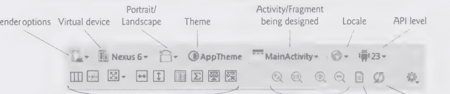

**图 4.22** 画布配置选项。

| 选项 | 说明 |
| --- | --- |
| 渲染选项 (Render options) | 一次显示一个设计屏幕，或同时查看设计在各种屏幕尺寸上的显示。 |
| 虚拟设备 (Virtual device) | Android 运行在各种设备上，因此布局编辑器带有许多设备配置，代表你用于设计 GUI 的各种屏幕尺寸和分辨率。在本书中，我们根据应用使用预定义的 Nexus 6 和 Nexus 9 屏幕。在图 4.22 中，我们选择了 Nexus 6。 |
| 竖屏/横屏 (Portrait/landscape) | 在竖屏和横屏方向之间切换设计区域。 |
| 主题 (Theme) | 可用于设置 GUI 的主题。 |
| 正在设计的 Activity/fragment (Activity/fragment being designed) | 显示与 GUI 对应的 Activity 或 Fragment 类。 |
| 地区 (Locale) | 用于国际化应用（第 2.8 节），允许你选择特定的本地化，以便你可以查看设计在不同语言下的外观。 |
| API 级别 (API level) | 指定设计的目标 API 级别。随着每个新 API 级别的出现，指定的级别中通常会有新的 GUI 特性。 |

**图 4.23** 画布配置选项说明。

## 4.5.4 针对平板电脑布局方向的 `content_main.xml`

如前所述，`MainActivity` 的默认 `content_main.xml` 显示了 `MainActivityFragment` 的 GUI。你现在将为 `MainActivity` 定义横屏方向下的平板电脑布局，该布局将并排显示 `SettingsActivityFragment` 和 `MainActivityFragment`。为了实现此目标，你将创建一个 `content_main.xml` 布局，Android 只会在适当的设备上使用。

### 为横屏下的平板电脑创建 `content_main.xml`

要创建此布局，请执行以下步骤：

- 右键点击项目的 `res/layout` 文件夹，选择 New（新建）> Layout resource file（布局资源文件）。
- 在“新建资源文件”对话框的 FileName（File name）中输入 `content_main.xml`。
- 确保在根元素（Root element）字段中指定了 `LinearLayout`。
- 在“可用限定符”（Available qualifiers）列表中，选择“最小屏幕宽度”（Smallest Screen Width）限定符，然后点击 `>>` 按钮将该限定符添加到限定符列表中，并将其值设置为 `700`——该布局适用于宽度至少为 700 像素的屏幕。
- 在“可用限定符”列表中，选择“方向”（Orientation）限定符，然后点击 `>>` 按钮将该限定符添加到限定符列表中，并将其值设置为 `Landscape`（横屏）。
- 点击 OK。

这将创建一个新的 `content_main.xml` 文件，存储在 `layout-sw700dp-land` 子文件夹中，表示该布局应仅在最小屏幕宽度（sw）至少为 700dp 且设备处于横屏（land）方向的设备上使用。Android 使用 `sw` 和 `land` 限定符在运行时选择合适的资源。

在 Android Studio 中，Project（项目）窗口不会显示独立的 `layout` 和 `layout-sw700dp-land` 文件夹（如果你在磁盘上浏览项目文件夹则会看到它们）。它将两个布局合并到 Project 窗口 `res/layout` 文件夹中的单个节点 `content_main.xml (2)` 节点——这表示该节点中有两个布局。展开此节点将显示：

- `content_main.xml`
- `content_main.xml (sw700dp-land)`

没有括号限定符的布局是默认布局。带有限定符的布局仅在合适时使用。创建文件后，Android Studio 会在布局编辑器中打开该布局。Design（设计）视图以布局方向呈现布局。

### 创建平板电脑布局的 GUI

接下来，你将构建平板电脑布局的 GUI：

- 在 Component Tree（组件树）窗口中选择 `LinearLayout(vertical)`，并将 `orientation` 属性设置为 `horizontal`（水平）。
- 在 Palette（调色板）的自定义部分点击 `<fragment>`。在 Fragments 对话框中，选择 `SettingsActivityFragment` 并点击 OK。然后点击 Component Tree 窗口中的 `LinearLayout` 节点。这将 `<fragment>` 添加到布局中。将此 `<fragment>` 的 id 设置为 `settingsActivityFragment`。
- 重复前面的步骤，这次选择 `MainActivityFragment`。同样，将 `<fragment>` 的 id 设置为 `quizFragment`。
- 在 Component Tree 窗口中选择 `settingsActivityFragment` 节点。将 `layout:width` 设置为 `0dp`，`layout:height` 设置为 `match_parent`，`layout:weight` 设置为 `1`。
- 在 Component Tree 窗口中选择 `quizFragment` 节点。将 `layout:width` 设置为 `0dp`，`layout:height` 设置为 `match_parent`，`layout:weight` 设置为 `2`。`MainActivityFragment` 的 `layout:weight` 为 2，`SettingsActivityFragment` 为 1，因此权重总和为 3，`MainActivityFragment` 将占据布局水平空间的三之二。
- 切换到 Text 标签页并在起始的 `LinearLayout` 标签中添加以下行，以确保布局顶部出现在栏下方，而不是在它后面：

```xml
xml xmlns:app="http://schemas.android.com/apk/res-auto"

app:layout_behavior="@string/appbar_scrolling_view_behavior"
```


## 在布局编辑器中选择 fragment 预览

不带括号限定符的布局是默认布局。带有限定符的布局仅在合适时使用。创建文件后，Android Studio 在布局编辑器中打开布局。通过在 Design 视图或 Component Tree 中点击 fragment——然后在 Resources 对话框中选择布局的名称。

## 4.6 MainActivity 类

应用在竖屏方向运行时显示 `MainActivityFragment`；当应用在平板电脑上以横屏方向运行时，显示 `SettingsActivityFragment` 和 `MainActivityFragment`。

### 4.6.1 包语句和导入语句

图 4.24 显示了 MainActivity 的包语句和导入语句。第 6-19 行导入了应用使用的新的类和接口。

```java
// MainActivity.java

// 在手机上显示 MainActivityFragment

// 在平板电脑上显示两者

package com.flagquiz;

import android.content.Intent;
import android.content.SharedPreferences;
import android.content.SharedPreferences.OnSharedChangeListener;
import android.content.pm.Configuration;
import android.os.Bundle;
import android.preference.PreferenceManager;
import android.support.v7.app.AppCompatActivity;
import android.support.v7.widget.Toolbar;
import android.view.Menu;
import android.view.MenuItem;
import android.widget.Toast;

import java.util.Set;
```

### 4.6.2 字段

图 4.25 显示了 MainActivity 的字段。第 23-24 行定义了你在 4.4 节中创建的偏好常量。你将使用这些来访问偏好值。

```java
public class MainActivity extends Activity {

    // 从 SharedPreferences 读取数据的键

    public static final String CHOICES = "prefnumberOfChoices";

    public static final String REGIONS = "prefregionsToInclude";

    private boolean device = true; // 用于强制竖屏模式

    private boolean preferencesChanged = true; // 偏好改变了？
}
```

### 4.6.3 覆盖的 Activity 方法

图 4.26 显示了覆盖的 Activity 方法 `onCreate`——我们删除了 FloatingActionButton 的事件处理，因为它在应用中没有使用。

#### 设置默认偏好值和注册更改监听器

当你首次安装并启动应用时，第 38 行通过调用 `PreferenceManager.setDefaultValues` 设置应用的默认偏好——这使用你在 `preferences.xml` 中指定的默认值初始化应用的 `SharedPreferences` 文件。该方法需要三个参数：

- `Context`（包名 `android.content`）提供了对应用运行环境信息的访问，并允许你使用各种 Android 服务——在此例中，`Context` 是你正在为其设置默认偏好的 Activity（`this`）。
- 对应于你在第 4.4.11 节中创建的 preferences XML 文件（`R.xml.preferences`）的资源 ID。
- 一个布尔值表示每次调用 `setDefaultValues` 方法时是否应该重置默认值——`false` 表示仅在方法第一次被调用时才使用默认偏好值。

每当用户更改应用的偏好时，MainActivityFragment 的方法 `updateGuessRows` 或 `updateRegions` 就会重新配置测试。MainActivity 注册了一个 `OnSharedPreferenceChangeListener`（第 41–43 行），以便在每次偏好发生变化时收到通知。`PreferenceManager.getSharedPreferences` 返回代表应用偏好的 `SharedPreferences` 对象的引用，而 `SharedPreferences` 方法 `registerOnSharedPreferenceChangeListener` 则注册该监听器（在第 4.4.6 节中定义）。

```java
// 配置 MainActivity

@Override
protected void onCreate(Bundle savedInstanceState) {
    super.onCreate(savedInstanceState);

    setContentView(R.layout.activity_main);

    Toolbar toolbar = (Toolbar) findViewById(R.id.toolbar);

    setSupportActionBar(toolbar);

    // 在应用的 SharedPreferences 中设置默认值

    PreferenceManager.setDefaultValues(this, false);

    // 注册 SharedPreferences 变化变化的监听器

    PreferenceManager.getDefaultShPreferences(this);

    registerOnSharedPreferenceChangeListener(
        preferencesChangeChangeListener);

    // 确定屏幕尺寸

    int screenSize =
        getResources().getConfiguration().screenLayout
        & Configuration.SCREEN_LAYOUT_MASK;

    // 如果设备是平板电脑，将 phoneDevice 设置为 false

    if (screenSize == Configuration.SCREEN_LAYOUT_SIZE_LARGE ||
        screenSize == Configuration.SCREEN_LAYOUT_SIZE_XLARGE)
        phoneDevice = false; // 不是手机大小的设备

    // 如果在手机大小的设备上运行，仅允许竖屏方向

    if (phoneDevice)
        setRequestedOrientation(
            ActivityInfo.SCREEN_ORIENTATION_PORTRAIT);
}
```

**图 4.26** MainActivity 重写的方法 `onCreate`。

### 为手机设备配置竖屏方向

第 46–52 行确定应用是运行在平板电脑还是手机上。继承的方法返回应用的 `Resources` 对象（包名 `android.content.res`），用于访问应用资源并确定有关其环境的信息。`getConfiguration` 方法返回一个 `Configuration` 对象（包名 `android.content`），其中包含公共静态变量 `screenLayout`，它指定了设备的屏幕尺寸类别。

要做到这一点，首先使用位运算符 `&` 组合 `Configuration.SCREEN_LAYOUT_SIZE_MASK`。然后，将结果与常量 `SCREEN_LAYOUT_SIZE_LARGE` 和 `SCREEN_LAYOUT_SIZE_XLARGE` 进行比较（第 50–51 行）。如果其中任一个匹配，则应用运行在平板电脑大小的设备上。最后，如果设备是手机，第 56–57 行调用的继承方法 `setRequestedOrientation` 将强制应用仅以竖屏方向显示 MainActivity。

### 4.6.4 重写的 Activity 方法 `onCreate`

- 重写的生命周期方法 `onCreate`（图 4.27）在两种场景下被调用：
- 当应用首次执行时，`onCreate` 在 `super.onCreate` 之后被调用。在这种情况下，我们使用 `onCreate` 来确保在应用安装并首次执行或随后启动应用时，根据应用的默认偏好正确配置测试。
- 当应用以竖屏运行且用户打开 `SettingsActivity` 时，MainActivity 会停止，同时显示 `SettingsActivity`。当用户返回 MainActivity 时，会再次调用 `onCreate`。在这种情况下，我们使用 `onCreate` 来确保如果用户更改了偏好，测试将被重新配置。

在这两种情况下，如果 `changed` 为 `true`，`onCreate` 会调用 MainActivityFragment 的 `updateQuizRows`（第 4.7.4 节）和 `updateRegions`（第 4.7.5 节）方法来重构测试。要获取 MainActivityFragment 的引用，我们可以调用它的方法，第 68–70 行使用自 `AppCompatActivity` 方法 `getFragmentManager` 获取 `FragmentManager`，然后调用 `findById`。第 71–74 行调用 MainActivity 的 `updateGuessRows` 和 `updateRegions` 方法，并将应用的 `SharedPreferences` 对象作为参数传递，以便方法可以加载当前偏好。第 75 行重置测试，第 76 行将 `changed` 设置回 `false`。

```java
// 在 onCreate 完成执行后调用

@Override
protected void onCreate() {
    super.onCreate();

    if (preferencesChanged) {
        // 现在已经设置了默认偏好

        // 初始化 MainActivityFragment 并开始测试

        MainActivityFragment quizFragment =
            (MainActivityFragment)
            getFragmentManager().findById(R.id.quizFragment);
    }
}
```

图 4.27 | 重写的 Activity 方法 `onCreate`（部分 1，共 2 部分）。

```java
71 quizFragment.updateGuessRows(
72     PreferenceManager.getDefaultSharedPreferences(this));
73 quizFragment.updateRegions(
74     PreferenceManager.getDefaultSharedPreferences(this));
75 quizFragment.resetQuiz();
76
77 preferencesChanged = false;
78 }
79 )
```

图 4.27 | MainActivity 重写的 Activity 方法 `onStart`（部分 2，共 2 部分）。

### 4.6.5 重写的 Activity 方法 `onCreateOptionsMenu`

重写的 Activity 方法 `onCreateOptionsMenu`（图 4.28）在创建菜单时被调用。在此应用中，我们只想在处于竖屏方向时显示菜单。该方法使用设备的配置来检查方向。如果是竖屏，则从资源 ID `main` 填充菜单；否则返回 `false`。

```java
80 // 如果在竖屏下运行显示菜单
81 @Override
82 boolean onCreateOptionsMenu(Menu menu) {

    // 获取设备的方向
4 orientation = getConfiguration().orientation;

    // 仅在竖屏方向显示应用

87 if (orientation == PORTRAIT) {
    // 填充菜单

    getInflater().inflate(R.menu.main, menu);

0 return true;
}
```

图 4.28 | MainActivity 重写的 Activity 方法 `onCreateOptionsMenu`。

### 4.6.6 重写的 Activity 方法 `onOptionsItemSelected`

方法 `onOptionsItemSelected`（图 4.29）在选择项时被调用。在此应用中，如果用户选择了“设置”，我们将创建一个启动 `SettingsActivity` 的显式意图。

```java
// 在手机上运行时显示 SettingsActivity

@Override
public boolean onOptionsItemSelected(MenuItem item) {
    Intent preferencesIntent =
        new Intent(this, SettingsActivity.class);

    startActivity(preferencesIntent);

    return super.onOptionsItemSelected(item);
}
```

图 4.29 | 匿名内部类 Activity 方法 `onOptionsItemSelected`。

### 4.6.7 实现 `PreferenceChangeListener` 的匿名内部类

`preferencesChangeListener` 对象（图 4.30）是一个实现 `PreferenceChangeListener` 接口的匿名内部对象。该对象在 `onCreate` 中注册以监听应用偏好的变化。发生变化时，`onPreferenceChanged` 方法将 `preferences` 设置为 `true`（第 111 行），然后提供 MainActivityFragment 的引用（第 113–115 行），以便可以使用新偏好重置测试。如果 `CHOICES` 偏好发生了变化，第 119 行将调用 MainActivityFragment 的 `updateGuessRows` 方法。

```java
// SharedPreferences 变化的监听器

private PreferenceChangeListener preferencesChangeListener =
    new PreferenceChangeListener() {

    // 当用户更改应用偏好时调用

    @Override
    public void onPreferenceChanged(
        SharedPreferences preferences, String key) {

        preferencesChanged = true; // 用户更改了应用设置

        MainActivityFragment quizFragment =
            (MainActivityFragment)
            getSupportFragmentManager().findFragmentById(
                R.id.quizFragment);

        if (key.equals(CHOICES))
            // 显示的选项发生了变化
            quizFragment.updateGuessRows(preferences);
    }
};
```

图 4.30 | 实现 `SharedPreferenceChangeListener` 的匿名内部类（部分 1，共 2 部分）。

## 第 4 章 国旗测验 App

```java
quizFragment.resetQuiz();

}
else if (key.equals(REGIONS)) {
    // 包含的区域发生了更改

    Set<String> regions =
        sharedPreferences.getStringSet(REGIONS, null);

    if (regions != null && regions.size() > 0) {
        quizFragment.updateRegions(sharedPreferences);
        quizFragment.resetQuiz();
    }
    else {
        // 必须选择一个区域——将北美作为默认区域

        sharedPreferences.Editor editor =
            sharedPreferences.edit();

        regions.add(getString(R.string.default_region));

        editor.putStringSet(REGIONS, regions);
        editor.apply();

        Toast.makeText(
            MainActivity.this,
            R.string.default_region_message,
            Toast.LENGTH_SHORT).show();
    }
```


```java
Toast.makeText(MainActivity.this,

    R.string.restarting_quiz,

    Toast.LENGTH_SHORT).show();

}
```

**图 4.30** 实现 `OnPreferenceChangeListener` 的匿名内部类（部分 2/2）。

如果 `Regions` 偏好发生了更改，第 122–123 行获取已启用区域的 `Set<String>`。`SharedPreferences` 方法 `getString` 根据特定键返回一个 `Set<String>`。测验至少需要启用一个区域，因此如果 `Set<String>` 不为空，第 126–127 行将调用 `MainActivityFragment` 的 `updateRegions` 和 `resetQuiz` 方法。

如果 `Set<String>` 为空，则第 131–135 行将以北美作为默认区域更新 `REGIONS` 偏好。为了获取默认区域的名称，第 133 行调用了 `Activity` 继承的 `getString`，该方法返回指定资源 ID（`R.string.default_region`）对应的字符串。

若要更改 `SharedPreferences` 对象的内容，首先要调用其 `edit` 方法获取一个 `SharedPreferences.Editor` 对象（第 131–132 行），该对象可以向 `SharedPreferences` 文件中添加键值对、删除键值对，并修改与特定键关联的值。第 134 行调用 `SharedPreferences.Editor` 方法 `putSet` 来存储 `regions` 的内容（即 `Set<String>`）。第 135 行通过调用 `SharedPreferences.Editor` 方法 `apply` 来提交（保存）更改，这会立即更改 `SharedPreferences` 在内存中的表示，并在后台异步地将更改写入文件。此外还有一个 `commit` 方法，它可以同步地（立即）将更改写入文件。

第 137–139 行使用 `Toast` 来指示已设置默认区域。`Toast` 方法接收的参数为：显示 `Toast` 的 `Context`、要显示的消息以及 `Toast` 显示的持续时间。`Toast` 方法负责显示该 `Toast`。无论哪种偏好发生了更改，第 143–145 行都会显示一个 `Toast`，指示测验将使用新偏好重置。图 4.31 显示了用户更改 App 偏好后出现的 `Toast`。


**图 4.31** 偏好更改后后的 `Toast`。

## 4.7 `MainActivityFragment` 类

`MainActivityFragment`（图 4.32–44）——Android Support Library `Fragment` 类（包名为 `android.support.v4.app`）的子类——它构建了国旗测验的 GUI 并实现了测验逻辑。

### 4.7.1 包声明和导入语句

图 4.32 显示了 `MainActivityFragment` 的包声明和导入语句。第 5–36 行导入了 App 使用的各种 Java 和 Android 类及接口。我们高亮了关键的 `import` 语句，并在 4.7.2–4.7.11 节遇到它们时，在 4.3 节中讨论了相应的类和接口。

```java
// MainActivityFragment.java

// 包含国旗测验逻辑

package com.detail.flagquiz;

import java.io.IOException;
import java.io.InputStream;
import java.security.SecureRandom;
import java.util.ArrayList;
import java.util.Collections;
import java.util.List;
import java.util.Set;

import android.animation.Animator;
import android.animation.AnimatorListenerAdapter;
import android.app.AlertDialog;
import android.app.Dialog;
import android.content.content.DataLoadInterface;
import android.content.SharedPreferences;
import android.content.res.AssetManager;
import android.graphics.drawable.Drawable;
```

**图 4.32** `MainActivityFragment` 包声明导入语句（部分 1/2）。

```java
21 import android.os.Bundle;
22 import android.support.v4.app.DialogFragment;
23 import android.support.v4.app.Fragment;
24 import android.os.util.Log;
25 import android.view.LayoutInflater;
26 import android.view.View;
27 import android.view.View.OnClickListener;
28 import android.view.View.AnimationUtils;
29 import android.view.ViewGroup;
30 import android.view.animation.Animation;
31 import android.view.animation.AnimationUtils;
32 import android.widget.Button;
33 import android.widget.ImageView;
34 import android.widget.LinearLayout;
35 import android.widget.TextView;
```

**图 4.32** `MainActivityFragment` 包声明导入语句。（部分 2/2）。

### 4.7.2 字段

图 4.33 显示了 `MainActivityFragment` 的字段。这里定义的变量用于控制 UI 和游戏逻辑。

```java
38 public class MainActivityFragment extends Fragment {
39 static final String TAG = "FlagQuiz";
40 static final int FLAGS_QUIZ = 10;
41 private List<String> fileNameList;
42 private List<String> quizCountries;
43 private Set<String> regionsSet;
44 private String correctAnswer;
45 private int totalGesses;
46 private int correctAnswers;
47 private int quizRows;
48 private SecureRandom random;
49 private Handler handler;
50 private Animation shakeAnimation;
51 private LinearLayout quizLinearLayout;
52 private TextView questionNumber;
53 private ImageView imageView;
54 private LinearLayout[] guessLinearLayouts;
55 private TextView answerTextView;
```

**图 4.33** `MainActivityFragment` 字段。

### 4.7.3 重写的 `Fragment` 方法 `onCreateView`

`MainActivity` `onCreate`（图 4.3）布局 GUI 并初始化大部分 `MainActivity` 实例变量——`quizRows` 和 `regionsSet` 在 `MainActivity` 调用 `updateGuess` 和 `updateRegions` 方法时进行初始化。

```java
@Override
public View onCreateView(LayoutInflater inflater, ViewGroup container, Bundle savedInstanceState) {

    View view = inflater.inflate(R.layout.fragment_quiz, container, false);

    // ... 初始化代码 ...

    return view;
}
```

`inflate` 返回一个包含已布局 GUI 的 `View` 引用。将其存储在局部变量中，以便在 `MainActivityFragment` 其他实例变量初始化后由 `onCreate` 返回。[注意：我们删除了该类中的空无参构造函数（由 IDE 在类定义中方法之前创建），编译器会为任何没有构造函数的类提供默认构造函数。）

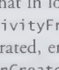

## 150 第4章 旗帜测验 App

```java
// 当其 View 被创建时配置 MainActivity

@Override
public void onCreate(LayoutInflater inflater, ViewGroup container,
    Bundle savedInstanceState) {

    super.onCreate(inflater, container, savedInstanceState);

    View view =
        inflater.inflate(R.layout.fragment_main, container, false);

    List<String> fileNameList = new ArrayList<>(); // 菱形运算符
    quizCountriesList = new ArrayList<>();
    random = new SecureRandom();
    handler = new Handler();

    // 加载用于错误答案的抖动动画
    shakeAnimation = AnimationUtils.loadAnimation(getActivity(),
        R.anim.incorrect_shake);
    shakeAnimation.setRepeatCount(3);

    // 获取 GUI 组件的引用
    quizLayout =
        (LinearLayout) view.findViewById(R.id.quizLayout);

    questionNumberTextView =
        (TextView) view.findViewById(R.id.questionNumberTextView);

    flagImageView =
        (ImageView) view.findViewById(R.id.flagImageView);

    guessLayouts = new LinearLayout[4];

    guessLayouts[0] =
        (LinearLayout) view.findViewById(R.id.row1Layout);

    guessLayouts[1] =
        (LinearLayout) view.findViewById(R.id.row2Layout);

    guessLayouts[2] =
        (LinearLayout) view.findViewById(R.id.row3Layout);

    guessLayouts[3] =
        (LinearLayout) view.findViewById(R.id.row4Layout);

    answerTextView =
        (TextView) view.findViewById(R.id.answerTextView);

    // 为猜猜按钮配置监听器
    for (LinearLayout row : guessLayouts) {
        for (int column = 0; column < row.getChildCount(); column++) {
            Button button = (Button) row.getChild(column);
            button.setOnClickListener(guessButtonListener);
        }
    }

    // 设置 questionNumberTextView 的文本
    questionNumberTextView.setText(
        getString(R.string.question, 1, "FLAGS IN QUIZ"));

    return view; // 返回用于显示的 fragment 的 view
}
```

**图 4.34** `MainActivityFragment` 重写的 `Fragment` 方法：`onCreate`。

第 69–70 行创建了 `ArrayList<String>` 对象，分别存储新创建地理区域的旗帜图像名称以及当前测验中国家的名称。第 71 行创建了 `SecureRandom` 对象，用于测验旗帜和猜猜按钮的随机化处理。第 72 行创建了 `Handler` 对象 `handler`，我们将用它在用户正确猜中当前旗帜后，延迟两秒显示下一面旗帜。

第 75–77 行动态加载抖动动画，当用户做出错误猜答时，该动画将应用于旗帜。`AnimationUtils` 静态方法 `loadAnimation` 从常量 `R.anim.incorrect_shake` 所代表的 XML 文件中加载动画。第一个参数表示包含要动画化的资源的 `Context`——继承自 `Fragment` 方法 `getActivity()` 返回托管此 `Fragment` 的 `Activity`。`Activity` 是 `Context` 的间接子类。第 77 行指定了动画应该重复的次数。

第 80-94 行引用了我们将程序化操作的各种 GUI 和组件。第 97-102 行从四个 `guessLinearLayout` 中获取每个猜猜按钮，并将 `guessButtonListener`（第 4.7.10 节）注册到 `OnClickListener`——我们实现此接口是为了处理用户触摸任何猜猜按钮时触发的事件。

第 105-106 行通过调用 `Fragment` 继承方法 `getString` 的重载版本，将 `questionNumberTextView` 中的文本转换为 `String`。第一个参数用于格式化字符串 `R.string.question`，它代表了格式字符串：

```text
Question %1d of %2d
```

该字符串包含两个整数值的占位符（如第 4.4.5 节所述）。剩余的参数是要插入到格式字符串中的值。第 107 行返回 `MainActivityFragment` 的 GUI。

## 4.7.4 `updateGuessRows`

方法 `updateGuessRows`（图 4.35）在 App 启动且用户更改每面旗帜显示的猜猜按钮数量时，从 App 的 `MainActivity` 调用。第 113-114 行使用方法的 `SharedPreferences` 获取键 `MainActivity.CHOICES` 对应的字符串——该常量包含了 `SettingsActivity` 中存储要显示的猜猜按钮数量的偏好。第 115 行将偏好值转换为 `int` 并除以 2，以确定 `guessRows` 的值，该值指示了每两个按钮应该显示多少个 `guessLinearLayout`。接下来，第 118-119 行隐藏每个 `guessLinearLayout`，第 122-123 行根据 `guessRows` 的值显示相应的 `LinearLayout`。常量 `View.GONE`（第 119 行）表示 Android 在布局布局中的其余组件时不，应考虑指定组件的大小。还有一个常量 `View.INVISIBLE`，它仅仅是隐藏组件，分配给组件的任何空间在屏幕上仍保持为空。

```java
110 根据 根据 SharedPreferences 中的值更新 updateGuessRows
111 public void updateGuessRows(SharedPreferences preferences) {

112 // 获取应该显示的猜猜按钮数量
113 String choices =
114 sharedPreferences.getString(MainActivity.CHOICES, null);
```

**图 4.35** `MainActivityFragment` 方法 `updateGuessRows`（2 部分中的第 1 部分）。

## 4.7.5 `updateGuessRows`

```java
115 guessRows = Integer.parseInt(choices) / 2;

116 // 隐藏每个 guessLinearLayout
117 for (LinearLayout layout : guessLayouts) {
118     layout.setVisibility(View.GONE);
119 }

120 // 显示相应的 LinearLayout
```


```java
121 for (int i = 0; i < guessRows; i++) {
122     guessLayouts[i].setVisibility(View.VISIBLE);
123 }
```

**图 4.35** `MainActivityFragment` 方法 `updateGuessRows`（2 部分中的第 2 部分）。

## 4.7.6 `resetQuiz`

`resetQuiz` 方法（图 4.37）并启动测验。为了访问完整内容，我们使用了针对启用区域的 `AssetManager.list` 方法。

```java
// 设置并启动测验
public void resetQuiz() {
    // 获取启用区域的图像名称
    AssetManager assets = getActivity().getAssets();

    fileNameList.clear(); // 空图像名称列表

    try {
        // 遍历每个区域
        for (String region : regionsSet) {
            // 获取此区域的所有旗帜列表
            String[] paths = assets.list(region);

            for (String path : paths) {
                fileNameList.add(path.replace(".png", ""));
            }
        }
    } catch (IOException exception) {
        Log.e(TAG, "加载图像名称错误", exception);
    }

    correctAnswers = 0; // 重置正确答案数量
    totalGuesses = 0; // 重置总猜答次数
    quizCountriesList.clear(); // 清除之前的国家列表

    int flagCounter = 1;
    int numberOffs = fileNameList.size();

    // 将 FLAGS_IN_QUIZ 个随机文件名添加到 quizCountriesList
    while (flagCounter <= FLAGS_IN_QUIZ) {
        int randomIndex = random.nextInt(numberOffs);

        // 获取随机文件名
        String fileName = fileNameList.get(randomIndex);

        // 如果该区域已启用且尚未被选取过
        if (!quizCountriesList.contains(fileName)) {
            quizCountriesList.add(fileName); // 将文件添加到列表
            flagCounter++;
        }
    }

    loadNextFlag(); // 通过加载第一面旗帜开始测验
}
```

**图 4.37** `MainActivityFragment` 方法 `resetQuiz`。

从 `fileNameList` 中获取一个名称。如果 `quizCountriesList` 尚未包含该文件，我们将其添加到 `quizCountriesList` 并增加 `flagCounter`。我们重复此过程，直到选择了 10 个（`FLAGS_IN_QUIZ`）唯一的名称。然后，第 173 行调用 `loadNext(Fig. 4.38)` 来加载测试的第一个旗帜。

## 4.7.7 Method `loadNext`

Method `loadNext(Fig. 4.38)` 加载并显示下一个旗帜以及对应的答案按钮。`quizCountriesList` 中的图像文件格式为不带 `.png` 后缀。如果 `regionName` 或 `countryName` 包含多个单词，它们用下划线分隔。

```java
// 在用户猜对旗帜后，加载下一个旗帜
private void loadNext() {
    // 获取下一个旗帜的名称并将其从列表中移除
    String nextImage = quizCountriesList.remove(0);

    correctAnswer = nextImage; // 更新正确答案
    answerTextView.setText(""); // 清空 answerTextView

    // 显示当前问题编号
    questionNumberTextView.setText(getString(
        R.string.correct, (correctAnswer + 1), FLAGS_IN_QUIZ));

    // 从下一个图像的名称中提取区域
    String region = nextImage.substring(0, nextImage.indexOf('-'));

    // 使用 AssetManager 从 assets 文件夹加载下一个图像
    AssetManager assets = getActivity().getAssets();

    // 获取代表下一个旗帜的资源的输入流
    try (InputStream stream =
        assets.open(region + "/" + nextImage + ".png")) {

        // 将资源加载为 Drawable 并显示在 flagImageView 上
        Drawable flag = Drawable.createFromStream(stream, nextImage);
        flagImageView.setImageDrawable(flag);

        animate(false); // 将旗帜动画到屏幕上
    } catch (IOException exception) {
        Log.e(TAG, "Error loading " + nextImage, exception);
    }

    Collections.shuffle(fileNameList); // 打乱文件名

    // 将正确答案放在 fileNameList 的末尾
    int correct = fileNameList.indexOf(correctAnswer);
    fileNameList.add(fileNameList.remove(correct));
}
```

**图 4.38** `MainActivityFragment` 方法 `loadNextFlag`（第 1 部分，共 2 部分）。

## 4.7 `MainActivityFragment` Class

```java
213 // 根据 guessRows 的值添加 2, 4, 6 或 8 个猜题按钮
214 for (int row = 0; row < guessRows; row++) {
215     // 在 currentTableRow 中放置按钮
216     for (int column = 0;
217         column < guessLinearLayouts[row].getChildCount();
218         column++) {
219         // 获取按钮的引用以进行配置
220         newGuessButton = (
221             (Button)guessLinearLayouts[row].getChildAt(column);
222             newGuessButton.setEnabled(true);
223
224         // 获取国家名称并将其设置为 newGuessButton 的文本
225         String filename = fileNameList.get(row * 2) + column);
226         newGuessButton.setText(getCountryName(filename));
227     }
228 }
229 // 随机替换一个按钮为正确答案
230 int row = random.nextInt(guessRows); // 随机选择行
231 int column = random.nextInt(2); // 随机选择列
232 LinearLayout randomRow = guessLinearLayouts[row]; // 获取该行
233 String countryName = getCountryName(correctAnswer);
234 ((Button)randomRow.getChildAt(column)).setText(countryName);
235 }
```

**图 48** | `MainActivityFragment` 方法 `loadNext`（第 2 部分，共 2 部分）。

第 179 行从 `countriesList` 中移除第一个测试并将其存储在 `nextImage` 中。我们还将其保存到 `correctAnswer` 中，以便用于判断用户是否猜对。接下来，我们清空 `answerTextView` 并使用格式化字符串 `R.string.question` 在 `questionTextView` 中显示当前问题编号（第 184–185 行）。

第 188 行从 `nextImage` 中提取区域，作为 assets 文件夹名称，我们将从中加载图像。接下来，我们获取 `AssetManager`，然后在 `with-resources` 语句中使用它打开 `InputStream`（`java.io` 包）以读取旗帜图像文件的字节。我们使用该流作为 `Drawable.createFromStream` 类的参数，它会创建一个 `Drawable` 对象（`android.graphics` 包）。通过调用其 `setImageDrawable` 方法将 `Drawable` 设置为 `flagImageView` 项目。如果发生异常，我们将调用它进行调试（第 204 行）。接下来，我们调用带有 `false` 参数的方法，在屏幕上动画化旗帜和答案按钮（第 201 行）。

第 207 行打乱 `fileNameList`，第 210–211 行定位答案并将其移动到 `fileNameList` 的末尾——稍后我们将此答案随机插入到一个猜题按钮中。

第 214–228 行根据当前 `guessRows` 的数量遍历 `guessLinearLayouts` 中的按钮。对于每个按钮：

- 第 220–221 行获取下一个按钮的引用。
- 第 222 行启用该按钮。
- 第 225 行从 `fileNameList` 获取旗帜文件名。
- 第 226 行用国家名称设置按钮文本。

第 231–235 行根据当前 `guessRows` 的数量随机选择行和列，然后设置对应按钮的文本为国家名称。

## 4.7.8 Method `getCountryName`

Method `getCountryName`（图 439）从文件名中解析国家名称。首先，我们从连字符（`-`）开始提取字符串。然后我们调用 `String.replace` 将下划线（`_`）替换为空格。

```java
// 解析旗帜文件名并返回国家名称
private String getCountryName(String name) {
    return name.substring(name.indexOf('-') + 1).replace('_', ' ');
}
```

**图 439** | `MainActivityFragment` 方法 `getCountryName`。

## 4.7.9 Method `animate`

Method `animate`（图 440）在整个布局（`LinearLayout`）上执行圆形展开动画，以实现问题之间的过渡。第 246–247 行直接返回，以便第一个问题直接出现，而不是动画到屏幕上。`animate` 方法接受一个参数 `animateOut`，并可以有两种用法。第 262 行使用 `animateOut` 决定是否隐藏测试。

```java
// 将整个 LinearLayout 动画化
private void animate(boolean animateOut) {
    // 为第一个问题的 UI 执行动画
    if (correctAnswers == 0) {
        return;
    }

    // 计算中心 x 和中心 y
    int centerX = (quizLinearLayout.getLeft() + quizLinearLayout.getRight()) / 2;
    int centerY = (quizLinearLayout.getTop() + quizLinearLayout.getBottom()) / 2;

    // 计算动画半径
    int radius = Math.max(
        quizLinearLayout.getWidth(),
        quizLinearLayout.getHeight()
    );
}
```

**图 440** | `MainActivityFragment` 方法 `animate`（第 1 部分，共 2 部分）。

```java
Animator animator;

// 如果 quizLinearLayout 淡出而不是进入
if (animateOut) {
    // 创建圆形展开动画
    animator = ViewUtils.createCircularReveal(
        quizLinearLayout, centerX, centerY, 0
    );

    animator.addListener(
        new AnimatorListenerAdapter() {
            // 动画结束时调用
            @Override
            public void onAnimationEnd(Animator animation) {
                loadNext();
            }
        }
    );
} else { // 如果 quizLinearLayout 进入
    animator = ViewUtils.createCircularReveal(
        quizLinearLayout, centerX, centerY, radius
    );
}

animator.setDuration(500); // 设置动画时长为 500 毫秒
animator.start(); // 开始动画
```

**图 440** | `MainActivityFragment` 方法 `animate`（第 2 部分，共 2 部分）。

从 `fileNameList` 中获取一个名称。如果 `quizCountriesList` 尚未包含该文件，我们将其添加到 `quizCountriesList` 并增加 `flagCounter`。我们重复此过程，直到选择了 10 个（`FLAGS_IN_QUIZ`）唯一的名称。然后，第 173 行调用 `loadNext(Fig. 4.38)` 来加载测试的第一个旗帜。

## 4.7.7 Method `loadNext`

Method `loadNext(Fig. 4.38)` 加载并显示下一个旗帜以及对应的答案按钮。`quizCountriesList` 中的图像文件格式为不带 `.png` 后缀。如果 `regionName` 或 `countryName` 包含多个单词，它们用下划线分隔。

```java
// 在用户猜对旗帜后，加载下一个旗帜
private void loadNext() {
    // 获取下一个旗帜的名称并将其从列表中移除
    String nextImage = quizCountriesList.remove(0);

    correctAnswer = nextImage; // 更新正确答案
    answerTextView.setText(""); // 清空 answerTextView

    // 显示当前问题编号
    questionNumberTextView.setText(getString(
        R.string.correct, (correctAnswer + 1), FLAGS_IN_QUIZ));

    // 从下一个图像的名称中提取区域
    String region = nextImage.substring(0, nextImage.indexOf('-'));
}
```


// 使用 `AssetManager` 从 `assets` 文件夹加载下一个图像

`AssetManager assets = getActivity().getAssets();`

// 获取代表下一个旗帜的资源的输入流

```java
try (InputStream stream = assets.open(region + "/" + nextImage + ".png")) {
    // 将资源加载为 `Drawable` 并显示在 `flagImageView` 上
    Drawable flag = Drawable.createFromStream(stream, nextImage);
    flagImageView.setImageDrawable(flag);

    animate(false); // 将旗帜动画到屏幕上
} catch (IOException exception) {
    Log.e(TAG, "Error loading " + nextImage, exception);
}

Collections.shuffle(fileNameList); // 打乱文件名

// 将正确答案放在 `fileNameList` 的末尾
int correct = fileNameList.indexOf(correctAnswer);
fileNameList.add(fileNameList.remove(correct));
```

Fig. 4.38 MainActivityFragment method `loadNextFlag`. (Part 1 of 2)

## 4.7 MainActivityFragment 类

```java
// 根据 `guessRows` 的值添加 2, 4, 6 或 8 个猜题按钮
for (int row = 0; row < guessRows; row++) {
    // 在 `currentTableRow` 中放置按钮
    for (int column = 0;
         column < guessLinearLayouts[row].getChildCount();
         column++) {
        // 获取按钮的引用以进行配置
        newGuessButton =
            (Button) guessLinearLayouts[row].getChildAt(column);
        newGuessButton.setEnabled(true);

        // 获取国家名称并将其设置为 `newGuessButton` 的文本
        String filename = fileNameList.get(row * 2 + column);
        newGuessButton.setText(getCountryName(filename));
    }
}

// 随机替换一个按钮为正确答案
int row = random.nextInt(guessRows); // 随机选择行
int column = random.nextInt(2); // 随机选择列
LinearLayout randomRow = guessLinearLayouts[row]; // 获取该行
String countryName = getCountryName(correctAnswer);
((Button) randomRow.getChildAt(column)).setText(countryName);
```

Fig. 48 | MainActivityFragment method `loadNext` (Part 2 of 2)

第 179 行从 `countriesList` 中移除第一个测试并将其存储在 `nextImage` 中。我们还将其保存到 `correctAnswer` 中，以便用于判断用户是否猜对。接下来，我们清空 `answerTextView` 并使用格式化字符串 `R.string.question` 在 `questionTextView` 中显示当前问题编号（第 184–185 行）。

第 188 行从 `nextImage` 中提取区域，作为 `assets` 文件夹名称，我们将从中加载图像。接下来，我们获取 `AssetManager`，然后在 `with-resources` 语句中使用它打开 `InputStream`（`java.io` 包）以读取旗帜图像文件的字节。我们使用该流作为 `Drawable.createFromStream` 类的参数，它会创建一个 `Drawable` 对象（`android.graphics` 包）。通过调用其 `setImageDrawable` 方法将 Drawable 设置为 `flagImageView` 项目。如果发生异常，我们将调用它进行调试（第 204 行）。接下来，我们调用带有 `false` 参数的方法，在屏幕上动画化旗帜和答案按钮（第 201 行）。

第 207 行打乱 `fileNameList`，第 210–211 行定位答案并将其移动到 `fileNameList` 的末尾——稍后我们将此答案随机插入到一个猜题按钮中。

第 214–228 行根据当前 `guessRows` 的数量遍历 `guessLinearLayouts` 中的按钮。对于每个按钮：

- 第 220–221 行获取下一个按钮的引用
- 第 222 行启用该按钮
- 第 225 行从 `fileNameList` 获取旗帜文件名
- 第 226 行用国家名称设置按钮文本

第 231–235 行根据当前 `guessRows` 的数量随机选择行和列，然后设置对应按钮的文本为国家名称。

## 4.7.8 Method `getCountryName`

Method `getCountryName`（Fig. 439）从文件名中解析国家名称。首先，我们从连字符（`-`）开始提取字符串。然后我们调用 `String.replace` 将下划线（`_`）替换为空格。

```java
// 解析旗帜文件名并返回国家名称
private String getCountryName(String name) {
    return name.substring(name.indexOf('-') + 1).replace('_', ' ');
}
```

Fig. 439 | MainActivityFragment method `getCountryName`

## 4.7.9 Method `animate`

Method `animate`（Fig. 440）在整个布局（`LinearLayout`）上执行圆形展开动画，以实现问题之间的过渡。第 246–247 行直接返回，以便第一个问题直接出现，而不是动画到屏幕上。`animate` 方法接受一个参数 `animateOut`，并可以有两种用法。第 262 行使用 `animateOut` 决定是否隐藏测试。

```java
// 将整个 `LinearLayout` 动画化
private void animate(boolean animateOut) {
    // 为第一个问题的 UI 执行动画
    if (correctAnswers == 0) {
        return;
    }

    // 计算中心 x 和中心 y
    int centerX =
        (quizLinearLayout.getLeft() + quizLinearLayout.getRight()) / 2;
    int centerY =
        (quizLinearLayout.getTop() + quizLinearLayout.getBottom()) / 2;

    // 计算动画半径
    int radius = Math.max(
        quizLinearLayout.getWidth(),
        quizLinearLayout.getHeight()
    );
}
```

Fig. 440 | MainActivityFragment method `animate`. (Part 1 of 2)

```java
Animator animator;

// 如果 `quizLinearLayout` 淡出而不是进入
if (animateOut) {
    // 创建圆形展开动画
    animator = ViewUtils.createCircularReveal(
        quizLinearLayout, centerX, centerY, 0
    );

    animator.addListener(
        new AnimatorListenerAdapter() {
            // 动画结束时调用
            @Override
            public void onAnimationEnd(Animator animation) {
                loadNext();
            }
        }
    );
} else { // 如果 `quizLinearLayout` 进入
    animator = ViewUtils.createCircularReveal(
        quizLinearLayout, centerX, centerY, radius
    );
}

animator.setDuration(500); // 设置动画时长为 500 毫秒
animator.start(); // 开始动画
```

Fig. 440 | MainActivityFragment method `animate`. (Part 2 of 2)

## 4.7.10 匿名内部类实现 `OnClickListener`

在 4.34 中，第 97–102 行将 `guessButton`（图 4.41）注册为每个按钮的事件处理对象。实例变量 `guessButtonListener` 指向一个实现 `OnClickListener` 的匿名内部类，用于响应 `Button` 事件。该方法接收点击的视图作为参数 `v`。我们设置了 `Button` 的文本（第 290 行）和传递传入的国家名称（第 291 行），然后增加 `guesses` 计数。如果猜测正确（第 294 行），我们增加 `correctAnswers`。我们将 `answerTextView` 的文本设置为颜色名称，并将颜色更改为常量 `R.color.correct_answer`（绿色）所代表的颜色，然后调用我们的工具方法 `disableButtons`（4.7.11 节）来禁用所有按钮。

```java
// 点击猜测按钮时调用
private OnClickListener guessButtonListener = new OnClickListener() {
    @Override
    public void onClick(View v) {
        Button button = (Button) v;
        String guess = button.getText().toString();
        String answer = getCountryName(answer);

        guesses++; // 增加用户进行的猜测次数

        if (guess.equals(answer)) { // 如果猜测正确
            correctAnswers++; // 增加正确答案的数量

            // 用绿色字体显示正确答案
            answerTextView.setText(answer + "!");
            answerTextView.setTextColor(
                getResources().getColor(R.color.correct)
            );

            disableButtons(); // 禁用所有按钮
        } else {
            // 如果用户正确识别了所有 `FLAGS_IN_QUIZ` 旗帜
            if (correctAnswers == FLAGS_IN_QUIZ) {
                // 用于显示统计数据并开始新测试的 `DialogFragment`
                DialogFragment dialogResults = new DialogFragment() {
                    // 创建 `AlertDialog` 并返回它
                    @Override
                    public Dialog onCreateDialog(Bundle bundle) {
                        AlertDialog.Builder builder =
                            new AlertDialog.Builder(getActivity());

                        builder.setMessage(
                            R.string.results,
                            totalGuesses,
                            (1000 / (double) totalGuesses)
                        );

                        // “重置测试”按钮
                        builder.setPositiveButton(
                            R.string.reset_quiz,
                            new OnClickListener() {
                                @Override
                                public void onClick(
                                    DialogInterface dialog,
                                    int id
                                ) {
                                    resetQuiz();
                                }
                            }
                        );

                        return builder.create(); // 返回 `AlertDialog`
                    }
                };

                // 使用 `FragmentManager` 显示 `DialogFragment`
                quizResults.setCancelable(false);
                quizResults.show(getFragmentManager(), "quiz results");
            }
        }
    }
};
```

图 4.41 | 实现 `OnClickListener` 的匿名内部类。（部分 2）

## 4.7 MainActivityFragment 类

```java
public void onClick(DialogInterface dialog, int id) {
    resetQuiz();
}

return builder.create(); // 返回 `AlertDialog`

// 使用 `FragmentManager` 显示 `DialogFragment`
quizResults.setCancelable(false);
quizResults.show(getFragmentManager(), "quiz results");
} else { // 答案正确但测试未结束
    // 延迟 2 秒后加载下一个旗帜
    handler.postDelayed(
        new Runnable() {
            @Override
            public void run() {
                animate(true); // 将旗帜移出屏幕
            }
        },
        2000
    ); // 2000 毫秒的延迟
}
```


```java
else { // 答案错误

    flagImageView.startAnimation(shakeAnimation); // 动画

    // 用红色显示“错误！”
    answerText.setText(R.string.incorrect_answer);

    answerText.setText(getResources().getColor(
        R.color.incorrect_answer, getContext()));

    guessButton.setEnabled(false); // 禁用错误答案
}
```

图 4.41 | 实现`OnClickListener`的匿名内部类。（部分 1）

如果`Correct`等于`FLAGS_IN_QUIZ`（第 306 行），测试结束。第 308–332 行创建一个扩展`DialogFragment`（`android.support.v4.app`）的匿名内部类，将用于显示测试结果。`DialogFragment`的`onCreate`方法使用`AlertBuilder`配置并创建一个显示测试结果的`AlertDialog`，然后将其返回。当用户点击此对话框的“重置测试”按钮时，会调用`resetQuiz`开始新游戏（第 325 行）。这些行表示对话框是取消的——用户必须与对话框交互，因为点击对话框或返回按钮不会让用户返回测试。为了显示结果，第 336 行调用其`show`方法，将`getFragmentManager`返回的`FragmentManager`和一个字符串作为参数。第二个参数可以配合`FragmentManager`的`getFragment`方法在之后获取`DialogFragment`的引用——我们在这个应用中未使用此功能。

如果`correctAnswers`等于`FLAGS_IN_QUIZ`，则第 340–346 行调用`handler`对象的`postDelayed`方法。第一个参数定义了一个实现`Runnable`接口的匿名内部类——这代表要执行的任务`animate(true)`，将旗帜和答案移出屏幕并开始过渡到下一个问题。第二个参数是毫秒延迟（2000）。如果猜测错误，第 350 行调用了`onCreate`方法中的`loadAnimation`。我们还在第 353–355 行设置了`answerTextView`的文本以显示“错误”，然后禁用`guessButton`以响应错误答案。

# 第 4 章 旗帜测试应用

## 4.4 查看与观察

你可以通过`AlertDialog.Builder`的`setTitle`方法看到`AlertDialog`的标题（显示在对话框消息上方）。根据 Android 对话设计指南（`http://developer.android.com/design/building-blocks/dialogs.html`），大多数对话框不需要标题。对于涉及数据丢失、连接中断、额外费用等的“高风险操作”，对话框应该显示标题。此外，对话框会显示用户标题以指定对话框目的的选项列表。

## 创建并配置 AlertDialog

第 313–329 行使用`AlertDialog.Builder`创建并配置`AlertDialog`。

第 313–314 行创建`AlertDialog.Builder`，将 fragment 作为上下文中的 Activity 传入——对话框将在`MainActivityFragment`所在的 Activity 上下文中显示。第 315–328 行设置了对话框的消息，显示总猜测次数和正确次数的百分比。在这个`AlertDialog`中，我们只需要一个按钮，允许用户确认消息并关闭对话框。在这种情况下，我们提供了一个实现`DialogInterface.OnClickListener`的匿名内部类对象。如果应用需要响应该事件，可以为事件处理器指定为`null`。当你将`SettingsActivity`添加到项目及其层级父类时，IDE 添加了这一行（4.4.12 节）。我们删除了此应用中未使用的剩余自动生成代码。你也可以删除未使用的菜单资源`menu_settings.xml`。

### 4.7 方法 disableButtons

`disableButtons`方法（图 4.42）遍历`guess`并禁用它们。该方法在用户猜测正确时被调用。

```java
// 禁用所有按钮的工具方法

private void disableButtons() {
    for (int row = 0; row < guessRows; row++) {
```

图 4.42 | `MainActivityFragment` `disableButtons`。（部分 1）

## 4.8 SettingsActivity 类

```java
LinearLayout guessRow = guessRows[row];

for (int i = 0; i < guessRow.getChildCount(); i++)

gussRow.getChildAt(i).setEnabled(false);
```

图 4.42 | `MainActivityFragment` `disableButtons`。（部分 2）

## 4.8 SettingsActivity 类

`SettingsActivity`类（图 4.43）在应用以竖向模式运行时托管`SettingsActivityFragment`。重写方法`onCreate`（第 11–18 行）调用`setContentView`查看由`activity_settings`定义的 GUI，然后显示`SettingsActivity`布局中定义的`Toolbar`。第 17 行在应用栏上显示一个按钮，用户点击它可以返回主界面。当你将`SettingsActivity`添加到项目及其层级父类时，IDE 添加了这一行（4.4.12 节）。我们删除了此应用中未使用的剩余自动生成代码。你也可以删除未使用的菜单资源`menu_settings.xml`。

```java
// SettingsActivity.java
// 在手机上显示 SettingsActivityFragment 的 Activity

package com.deitel.flaguiz;

import android.os.Bundle;

import android.support.v7.app.AppCompatActivity;
import android.support.v7.widget.Toolbar;

public class SettingsActivity extends AppCompatActivity {

    // 填充 GUI，显示 Toolbar 并添加“向上”按钮
    @Override
    protected void onCreate(Bundle savedInstanceState) {
        super.onCreate(savedInstanceState);
        setContentView(R.layout.activity_settings);

        Toolbar toolbar = findViewById(R.id.toolbar);
        setSupportActionBar(toolbar);
        getSupportActionBar().setDisplayHomeAsUpEnabled(true);
    }
}
```

图 4.43 | `SettingsActivity`在手机设备和平板电脑的竖向模式下显示`SettingsActivityFragment`。

## 4.9 SettingsActivityFragment 类

`SettingsActivityFragment`类（图 4.44）继承自`PreferenceFragment`（`pack-android.preference`）。当`SettingsActivity`创建时，`onCreate`方法（第 10–14 行）通过继承自`PreferenceFragment`的方法`addPreferencesFromResource`构建了`preferences.xml`文件的 GUI。当用户与偏好 GUI 交互时，配置会自动存储在设备上的`SharedPreferences`文件中。如果文件不存在，则会创建它；否则将对其更新。我们删除了该类中其他未使用的自动生成代码。

```java
1 // SettingsActivityFragment.java
2 // Subclass of PreferenceFragment for managing app settings
3 package com.deitel.flagquiz;
4
5 import android.os.Bundle;
6 import android.preference.PreferenceFragment;
7
8 public class SettingsActivityFragment extends PreferenceFragment {
9 // 从 res/xml 中的 preferences.xml 文件创建 GUI
10 @Override
11 public void onCreate(Bundle bundle) {
12     super.onCreate(bundle);
13     addPreferencesFromResource(R.xml.preferences); // 从 XML 加载
14 }
15 }
```

**图 4.44** `SettingsActivityFragment`作为`PreferenceFragment`显示了应用的配置。

## 4.10 AndroidManifest.xml

图 4.45 显示了 Flag Quiz 应用自动生成的清单。应用中的每个 Activity 必须在`AndroidManifest.xml`中声明；否则 Android 将不知道该 Activity 的存在，并且无法启动它。当你创建应用时，IDE 在`AndroidManifest.xml`中声明了`MainActivity`（第 11–21 行）。第 12 行的符号`.MainActivity`表示该类位于第 2 行指定的包中，它是`com.deitel.flagquiz.MainActivity`的缩写。我们添加了第 14 行，稍后会讨论。

```xml
1 <xml version="1.0" encoding="utf-8"?>

2 <manifest package="com.deitel.flagquiz"
3 xmlns:ns="http://schemas.android.com/apk/res/android">


6 <application
7     android:allowBackup="true"
8     android:icon="@mipmap/ic_launcher"
9     android:label="@string/app_name"
10    android:supportsRtl="true"
11    android:theme="@style/AppTheme">
12     <activity
13         android:name="MainActivity"
14         android:label="@string/app_name">
```

**图 4.45** 声明了 Settings 的`AndroidManifest.xml`。（2 部分中的第 1 部分）

```xml
14   android:launchMode='singleTop'
15   android:theme='style/AppTheme.NoActionBar'
16   <intent-filter>
17      <action android:name='android.intent.action.MAIN'/>

19      <category android:name='android.intent.category.LAUNCHER'/>
20   </intent-filter>
21 </activity>
22 <activity
23   android:name='.SettingsActivity'
24   android:label='@string/title_activity_settings'
25   android:parentActivityName='.MainActivity'
26   android:theme='style/AppTheme.NoActionBar'
27   <meta-data
28     android:name='android.support.PARENT_ACTIVITY'
29     android:value='com.deitel.flagquiz.MainActivity'
30>
31 </activity>
32 </application>
33 </manifest>
```

图 4.45 | 声明了`SettingsActivity`的`AndroidManifest.xml`。（2 部分中的第 2 部分）

当你向项目添加`SettingsActivity`时（第 4.4.1 节），IDE 会将`SettingsActivity`添加到文件中（第 22–30 行）。如果你在不使用 IDE 工具的情况下创建一个新的 Activity，你需要通过插入类似第 22–30 行的`<activity>`元素来声明新 Activity。有关清单文件的完整细节，请访问：

```text
http://developer.android.com/guide/topics/manifest/manifest-intro.html
```

## Launch Mode

第 14 行指定了`MainActivity`的启动模式。默认，你创建的每个 Activity 都使用“standard”启动模式。在这种模式下，当 Android 接收到启动 Activity 的 Intent 时，Android 会创建该 Activity 的新实例。

回第 4.4.12 节，你指定了`SettingsActivity`的层级父类。再次，这使得 Android 在应用栏上定义一个向上按钮，用户可以点击它返回到指定的父 Activity。当用户点击此按钮且父 Activity 使用“standard”启动模式时，Android 将使用 Intent 启动父 Activity。这将导致`MainActivity`的一个新的实例。这也会导致 Flag Quiz 应用在`MainActivity`的`OnPreferenceChangeListener`（第 4.6.7 节）中崩溃，因为它尝试更新已不再存在的`quizFragment`——该 fragment 是定义在不同的 Activity 实例中的。

第 14 行通过将`MainActivity`的启动模式更改为“singleTop”修复了这个问题。在这种模式下，当用户点击向上按钮时，Android 会将现有的`MainActivity`带到前台，而不是创建一个新的`MainActivity`对象。有关`<activity>`元素的启动模式值的更多信息，请访问：

```text
https://developer.android.com/guide/topics/manifest/activity-element.html#launchMode
```


## 4.11 总结

在本章中，你构建了一个 Flag Quiz 应用，用于测试用户识别国旗的能力。本章的一个关键特性是使用 Fragments 创建 Activity 的 GUI 的部分。你使用了两个 Fragments 来创建 Activity GUI 的部分。（注：源文本似乎存在重复。）

# 第 5 章 Doodly 应用

## 目录

- 5.1 引言
- 5.2 在 Android 虚拟设备 (AVD) 中测试 Doodly 应用
- 5.3 技术概述
  - 5.3.1 Activity 和 Fragment 生命周期周期方法
  - 5.3.2 自定义 View
  - 5.3.3 使用 `SensorManager` 监听加速度计事件
  - 5.3.4 自定义 `DialogFragments`
  - 5.3.5 使用 `Canvas` 和 `Bitmap` 绘图
  - 5.3.6 处理多控事件并将线条存储在 `Path` 中
  - 5.3.7 保存到设备
  - 5.3.8 打印与 Android Support Library 的辅助类
  - 5.3.9 新 Android 6.0 (Marshmallow) 运行时权限模型
  - 5.3.10 使用网格系统添加依赖
- 5.4 创建项目与资源
  - 5.4.1 创建项目
  - 5.4.2 Gradle：向项目添加库
  - 5.4.3 `strings.xml`
  - 5.4.4 为应用菜单项导入 Material Icons
  - 5.4.5 `MainActivityFragmentMenu`
  - 5.4.6 在 `AndroidManifest.xml` 中添加权限
- 5.5 构建应用 GUI
  - 5.5.1 Activity 的 `content_main.xml` 布局
  - 5.5.2 `MainActivity` 的 `fragment_main.xml` 布局
  - 5.5.3 `ColorDialogFragment` 的 `fragment_color.xml` 布局
  - 5.5.4 `LineWidthDialogFragment` 的 `line_width.xml` 布局
  - 5.5.5 添加类 `EraseImageDialogFragment`
- 5.6 `MainActivity`
- 5.7 `MainActivityFragment`
  - 5.7.1 `package` 语句、`import` 语句和字段
  - 5.7.2 重写的 Fragment 方法 `onCreate`、`onResume` 方法以及 `enableAccelerometerListening`
  - 5.7.4 `MethodsOnPause` 和 `disableAccelerometer`
  - 5.7.5 用于处理加速度计事件的匿名内部类
  - 5.7.6 方法 `confirmErase`
  - 5.7.7 重写的 Fragment 方法 `onCreateOptionsMenu` 和 `onItemItemSelected`
  - 5.7.8 方法 `saveImage`
  - 5.7.9 重写的方法 `onRequestPermissionResult`
  - 5.7.10 方法 `getDoodlyView` 和 `setOnDialogChange`
- 5.8 `DoodleClass`
  - 5.8.1 `package` 语句和 `import` 语句
  - 5.8.2 静态变量与实例变量
  - 5.8.3 重写的 View 方法 `onChanged`
  - 5.8.4 方法 `draw`、`getColor`、`setLineWidth` 和 `getLineWidth`
  - 5.8.6 重写的 View 方法 `onTouchEvent`
  - 5.8.8 `touchStarted`
  - 5.8.9 `touchMoved`
  - 5.8.10 `touchEnded`
  - 5.8.11 `Save` 方法
  - 5.8.12 `printImage`
- 5.9 `DialogFragment` 类
  - 5.9.1 重写的 `DialogFragment` 方法 `onCreateDialog`
  - 5.9.2 方法 `getDoodlyFragment`
  - 5.9.3 重写的生命周期方法 `onAttach` 和 `onDetach`
  - 5.9.4 响应 Alpha、Red、Green、Blue `SeekBar` 事件的匿名内部类
- 5.10 `LineWidthDialogFragment` 类
  - 5.10.1 方法 `onCreateDialog`
  - 5.10.2 响应 `SeekBar` 事件的匿名内部类
- 5.11 `EraseImageDialogFragment` 类
- 5.12 总结

## 5.1 引言

Doodly 应用允许你通过在屏幕上拖动一个或多个手指来绘画（图 5.1）。该应用提供了设置绘图颜色和线宽的选项。额外选项允许你：

- 清除屏幕；
- 将当前绘画保存到设备上；以及
- 打印当前绘画。

根据设备屏幕的大小，应用的部分或全部选项将以图标直接显示在应用栏上——任何无法容下的选项将以文本形式显示在应用栏上溢出选项菜单 (⋮) 中。


**图 5.1** 显示完成绘画的 Doodly 应用。

此应用引入了 Android 6.0 的新权限机制。例如，Android 需要用户许可才能允许应用在设备上保存文件（如此应用的绘画）。在 Android 6.0 中，应用不再在安装时通过列出应用所需的完整权限列表来提示用户，而是在首次执行特定任务需要该权限时，才逐个请求每项权限。在本应用中，当用户首次尝试保存绘画时，Android 会弹出权限请求。

首先，你将测试该应用。然后，我们将概述构建它所使用的技术。接下来，你将设计 GUI。最后，我们将遍历应用的完整源代码，强调应用的新功能。

## 5.2 在 Android 虚拟设备 (AVD) 中测试 Doodly 应用

### 打开并运行应用

打开 Android Studio，并从书籍示例文件夹中的 Doodle1 文件夹打开 Doodly 应用，然后在 AVD 或设备上运行该应用。这将构建应用。

根据设备屏幕的大小，应用的部分或全部选项将以图标直接显示在应用栏上——任何无法容下的选项将以文本形式显示在应用栏上溢出选项菜单 (⋮) 中。

> 注：所提供的第 204–206 页的 OCR 文本包含严重的损坏和重复伪迹。根据“Doodly 应用”教程的上下文和提供的目录，文本已经过重构，以反映 Android 教程的逻辑流。

### 在 Android 虚拟设备 (AVD) 171 中测试 Doodle App

1. 选择深绿色作为绘制颜色。
2. 选择更粗的线条。

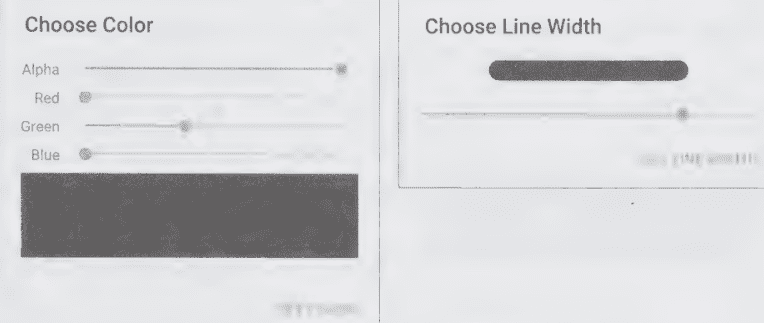

**图 5.6** 将颜色更改为深绿色并加粗线条。


**图 5.7** 绘制茎和草地。

### 完成绘制

接下来，将绘制颜色更改为半透明蓝色（图 5.8(a)）并选择细线（图 5.8(b)）。然后绘制雨滴（图 5.9）。

1. 选择蓝色作为绘制颜色。
2. 选择更细的线条。

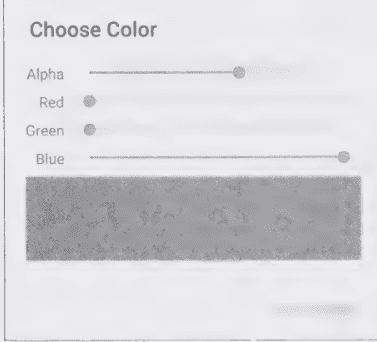

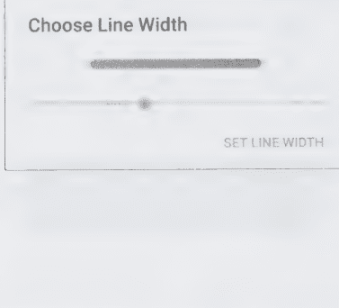

**图 5.8** 将线条颜色更改为蓝色并收窄线条。


**图 5.9** 使用新的线条颜色和宽度绘制雨水。

### 保存图像

你可以将图像保存到设备中，并使用**照片**应用查看它。要执行此操作，点击应用栏上的 `P` 图——如果图标未显示在应用栏上，则从选项菜单中选择**保存**。然后你可以通过打开照片应用查看此图像以及存储在设备上的其他图像。

## 5.3 技术概述

### 打印图像

要打印图像，点击应用栏——如果图标未显示在应用栏上，则从选项菜单中选择**打印**。这将显示一个打印选项的对话框。默认情况下，你可以将图像保存为 PDF 文档。要进行打印，点击“保存为 PDF”并从可用打印机列表中选择。如果列表中没有出现打印机，你需要为你的打印机配置 Google Cloud Print。有关信息请访问此地：

```text
http://www.google.com/cloudprint/learn/
```

本节介绍了我们在 Doodly 应用中使用的新技术。

### 5.3.1 Activity 和 Fragment 生命周期周期方法

Fragment 的生命周期与其父 Activity 绑定。有六个 Activity 生命周期方法具有相应的 Fragment 生命周期周期方法——`onCreate`、`onStart`、`onResume`、`onPause` 和 `onDestroy`。当系统调用 Activity 上的方法时，它也会调用所有附加到 Activity 的 Fragments 上的对应方法（以及可能的其他 Fragment 生命周期方法）。

此应用使用了 Fragment 生命周期方法 `onResume` 和 `onPause`。当 Fragment 位于屏幕上并准备好用户与之交互时，Activity 的 `onResume` 被调用。当一个 Activity 托管 Fragments 且 Activity 恢复时，其所有 Fragments 的 `onResume` 方法都会被调用。在本应用中，`MainActivityFragment` 重写了 `onResume` 以启用监听加速度计事件，这样你就可以摇晃设备来擦除绘制（第 5.7.3 节）。

当另一个 Activity 接收焦点时，Activity 的 `onPause` 被调用，这会暂停失去焦点的 Activity 并将其发送后台。当一个 Activity 托管 Fragments 且 Activity 暂停时，其所有 Fragments 的 `onPause` 方法都会被调用。在本应用中，`MainActivityFragment` 重写了 `onPause` 以挂起摇摇擦除加速度计事件（第 5.7.4 节）。

> **性能提示 5.1**
>
> 当应用暂停时，应该移除传感器事件的监听器，这样这些事件在应用不在屏幕上时就不会传递给应用。这可以节省电池。

我们在需要时讨论其他 Activity 和 Fragment 生命周期方法。有关完整 Activity 生命周期周期的更多信息，请访问：

```text
http://developer.android.com/reference/android/app/Activity.html
#ActivityLifecycle
```

有关完整 Fragment 生命周期周期的更多信息，请访问：

```text
http://developer.android.com/guide/components/fragments.html
#Lifecycle
```


### 5.3.2 自定义视图

你可以通过扩展 `View` 或其一个子类来创建自定义视图，就像我们在 `Doodle`（第 5.8 节）中所做的那样，它扩展了 `View`。要在布局的 XML 文件中添加自定义组件，你必须提供它的完全限定名（即包名和类名），并且在将其添加到布局之前，自定义视图的类必须已经存在。我们在 5.5.2 中演示了如何创建 `Doodle` 类并将其添加到布局中。

### 5.3.3 使用 `SensorManager` 监听加速度计事件

在本应用中，你可以通过摇晃设备来擦除绘制。大多数设备都有加速度计来检测设备移动。其他当前支持的传感器包括重力、陀螺仪、光、线性加速度、磁场、方向、压力、接近距离、旋转向量和温度。你将使用 `Sensor` 的传感器类型常量来指定你的应用接收数据的传感器。`Sensor` 常量列表可以在此处找到：

```text
http://developer.android.com/reference/android/hardware/Sensor.html
```

我们将讨论加速度计处理。关于传感器的完整信息，请参阅传感器概述：

```text
http://developer.android.com/guide/topics/sensors/overview.html
```

### 5.3.4 自定义 Fragments

许多应用使用 Fragments 来显示信息或向用户提问。你可以使用 Fragments 来接收用户响应。在本应用中，我们使用了三个内部类来定义 Fragment：

- `ColorDialogFragment`（第 5.9 节）：使用自定义 View 并选择颜色。
- `WidthDialogFragment`：使用自定义 View 预览并选择线条粗细。
- `EraseDialogFragment`（第 5.11 节）：询问用户是否擦除。

在每个 Fragment 中，你将重写以下生命周期方法：

- `onAttach`：Fragment 附加时调用的第一个生命周期方法。
- `onDestroy`：Fragment 准备卸载时调用的最后一个生命周期方法。

#### 防止多个对话同时出现

处理程序可能会尝试显示已经在屏幕上的对话。为了防止这种情况，我们将使用一个布尔值来指示对话是否在屏幕上。当该布尔值为 `true` 时，我们将允许处理程序显示。

### 5.3.5 使用 `Canvas`、`Paint` 和 `Bitmap` 绘图

你可以使用 `Canvas` 方法绘制文本、线条和圆形。你可以将 `Canvas` 与 `Bitmap` 关联，然后使用 `Canvas` 显示在屏幕上。每个绘制方法使用 `Paint` (`android.graphics`) 对象来指定特征，包括颜色、线条粗细等。这些功能出现在 `Doodle` 方法中。有关使用 `Paint` 指定绘制特征的更多细节，请访问：

```text
http://developer.android.com/reference/android/Paint
```


### 5.3.6 处理多触摸事件并在 `Path` 中存储线条

你可以在屏幕上移动多个手指进行绘制。应用将每个手指的信息存储在 `Path`（`android.graphics`）中。你通过重写 `View` 方法 `onTouch`（第 5.8.7 节）来处理触摸事件。此方法接收一个 `MotionEvent`（`view`），它包含了触摸事件的类型以及产生事件的手指 ID（称为指针）。我们使用 ID 来区分不同的手指并将信息添加到相应的 `Path` 对象。我们使用事件类型判断用户是触摸、拖动还是抬起手指。

除了标准的触摸事件处理，Android 6.0 对使用蓝牙手笔提供了增强支持，包括访问压力数据和手笔压力。在本应用中，你可以使用手笔指定压力数据，或根据手笔压力在用户绘制时动态更改笔触粗细。有关更多信息，请访问：

<https://developer.android.com/about/versions/marshmallow-6.0.html#bluetooth-stylus>

### 5.3.8 打印与 Android Support Library 的 `PrintHelper` 类

在本文应用中，我们使用 Android 打印框架中的 `PrintHelper`（第 5.8.12 节）来打印当前绘图。`PrintHelper` 类提供了用于选择打印机的用户界面，包含一个判断设备是否支持打印的方法，并提供了一个打印 `Bitmap` 的方法。`PrintHelper` 是 Android Support Library 的一部分，该库为当前和旧版本的 Android 提供了新的功能。支持库还包含了支持特定 Android 版本的额外便利功能，例如 `PrintHelper`。

### 5.3.9 新的 Android 6.0（Marshmallow）权限模型

Android 要求应用在写入外部存储之前需要 `android.permission.WRITE_EXTERNAL_PERMISSION` 权限。对于 Doodle 来说，我们需要保存用户绘制的图像。

Android 6.0（Marshmallow）拥有全新的权限模型，旨在提供更好的用户体验。在 Android 6.0 之前，用户在安装时必须预先授予应用可能需要的所有权限——这导致许多人不安装某些应用。使用新模型后，应用安装时不会请求任何权限。相反，用户仅在第一次使用相应功能时才会被要求授予权限。

一旦用户授予了权限，应用将拥有该权限，直到：

- 应用被重新安装；或
- 用户通过 Android 设置应用更改了应用的权限。

你将在第 5.7.8–5.7.9 节学习如何实现这种新的权限模型。

### 5.3.10 使用 Gradle 构建系统添加依赖

Android Studio 使用 Gradle 构建系统将你的代码编译为 APK 文件——可安装的程序。Gradle 还处理依赖关系，包括在构建过程中包含应用所使用的任何库。对于 Doodle，你将为项目添加一个库依赖，以便你可以使用 `PrintHelper` 类打印图像（第 5.4.2 节）。

## 5.4 创建项目与资源

在本节中，你将创建项目，为应用的菜单项导入 Material Design 图标，并编辑供 GUI 和应用 Java 代码使用的资源。

### 5.4.1 创建项目

创建一个新的 Blank Activity。在“Create New Project”对话框的“New Project”步骤中指定以下值：

- 应用名称（Application name）：Doodle
- 公司域名（Company Domain）：detail.com（或指定你自己的域名）

对于“Create New Project”对话框中的剩余步骤，使用与第 4.4.1 节相同的设置。这将创建一个托管 Fragment 的 `MainActivity`。该 Fragment 将定义应用的绘图区域并响应用户的触摸。按照第 2.52 节的步骤为项目添加应用图标。

一旦在 Android Studio 中打开了项目，在布局编辑器中，从虚拟设备下拉列表中选择 Nexus 6（图 2.11）。同时，删除 `fragment_main.xml` 中的 Hello world! `TextView` 以及 `activity_main.xml` 中的 `FloatingActionButton`。使用主题编辑器（第 3.5 节）指定 Material Blue 500 为应用的主色调，Material Blue 700 为深主色调，Light blue accent 400 为强调色。此外，按照第 4.4.3 节的步骤配置项目以支持 Java SE 7。

### 5.4.2 Gradle：为项目添加支持库

这需要 Android Support Library 来使用 `PrintHelper` 类。要将支持库作为项目依赖，请遵循以下步骤：

1. 右键点击 `app` 文件夹，然后选择 Open Module Settings（打开模块设置）。
2. 在弹出的 Project 窗口中，打开 Dependencies（依赖）。
3. 点击 Add 按钮（`+`），然后选择 Library dependency（库依赖）打开 Choose Library Dependency 对话框。
4. 从列表中选择 `support-v4`（`com.android.support:support-v4:23.1.0`），然后点击 OK。依赖项将出现在 Dependencies 选项卡的列表中。
5. 点击 OK。IDE 将显示 Gradle project sync in progress...（Gradle 项目同步中...），此时项目正在配置使用 Android Support Library。

关于如何使用和设置 Android Support Library 的更多信息，请访问：

- <http://developer.android.com/tools/support-library>
- <http://developer.android.com/tools/support-library/setup.html>

### 5.4.3 `strings.xml`

你在之前的章节中创建了资源，因此我们在这里显示一个 String 资源名称及其对应值的表格（图 5.10）。在 `res/values` 文件夹中双击 `strings.xml`，然后点击 Open Editor 链接显示 Translations Editor 以创建这些资源。

> **观感观察 5.2**
>
> 对于支持大写字母的语言，Google 的 Material 设计规范指出，按钮的文本应该使用全大写字母（例如，CANCEL 或 SET COLOR）。

| Key（键） | Default Value（默认值） |
| :--- | :--- |
| `button_erase` | Erase Image |
| `button_set_color` | Set Color |
| `button_set_line_width` | Set Line Width |
| `line_imageview_description` | This displays the line thickness |

**图 5.10** Doodle 应用中使用的字符串资源。（第一部分，共 2 部分）。

| Key（键） | Default Value（默认值） |
| :--- | :--- |
| `label_alpha` | Alpha |
| `label_red` | Red |
| `label_green` | Green |
| `label_blue` | Blue |
| `menuitem_color` | Color |
| `menuitem_delete` | Erase |
| `menuitem_line_width` | Line Width |
| `menuitem_save` | Save |
| `menuitem_print` | Print |
| `message_erase` | Erase |
| `message_error_saving` | There was an error |
| `message_error_printing` | Your device does not support |
| `permission_external` | Write to external |
| `title_color` | Color |
| `title_line_width` | Line Width |

## 5.4.4 为应用导入 Material Design 图标

在第 4 章中，你编辑了应用的默认菜单。在本文应用中，你将为 `MainActivityFragment` 定义你自己的菜单。你将导入以下内容：

- `ic_palette_24dp`
- `ic_brush_24dp`
- `ic_delete_24dp`
- `ic_save_24dp`
- `ic_print_24dp`

括号中的名称是悬停在图像上时显示的工具提示名称。打开 XML 文件并将颜色改为白色。

### 5.4.5 `MainActivityFragment` 菜单

在第 4 章中，你编辑了 IDE 提供的默认菜单。在本文应用中，你将删除项目中的 `menu.xml` 文件。你还应该从 `MainActivity` 中移除 `onCreateOptionsMenu` 和 `onItemSelected` 方法。

#### 针对不同 Android 版本的菜单

请记住，打印功能在 4.4 之前不可用。如果你正在开发适用于多个 Android 版本的应用，可能需要使用资源限定符创建多个菜单资源。例如，你可以为 4.4 之前的 Android 版本创建一个菜单资源，为 4.4 及更高版本创建另一个。在 4.4 之前的菜单资源中，可以省略不可用的菜单选项。

#### 创建菜单

要创建菜单资源，请遵循以下步骤：

1. 右键点击 `res/menu` 文件夹并选择 New > Menu resource file 打开新资源文件对话框。
2. 在 File name 字段输入 `doodle_fragment_menu.xml`，然后点击 OK。IDE 在编辑器中打开文件并显示 XML。你必须直接编辑 XML 向菜单资源添加菜单项。
3. 在此菜单中，我们将使用每个菜单项的 `showAction` 属性来指定如果有空间则将菜单项显示在应用栏上。在使用 Android Support Libraries 提供后兼容应用栏时，必须使用来自 `app` 命名空间的 `showAction` 属性，而不是 `android` 命名空间。
4. 编辑 `<menu>` 标签包含 `app` 命名空间。
5. 将图 5.11 中的第一个菜单项代码添加到 XML 文件中。该菜单项的 id 为 `@id/color`，title 属性为 `@string/menu_item`，icon 属性为 `@drawable/ic_palette_24dp`，其 `showAction` 属性为 `ifRoom`。`ifRoom` 值表示如果有可用空间，Android 将菜单项显示在应用栏上；否则，菜单项将作为文本项出现在应用栏右侧的溢出菜单中。其他的 `showAction` 值可以参考：

```xml
xmlns:app="http://schemas.android.com/apk/res/auto"
```

# 第 5 章 涂鸦 App

```xml
<item
    android:id="@id/color"
    android:title="@string/menuitem_color"
    android:icon="@drawable/ic_palette_24dp"
    app:showAsAction="ifRoom"
/>
```

**图 5.11** 代表菜单项的 `<item>` 元素。

6. 针对图 5.12 中的每个 ID 和标题重复步骤 3，以创建线宽、删除、保存和打印的菜单项，然后保存并关闭菜单文件。完成后的菜单 XML 如图 5.13 所示。

| Id | 标题 |
|---|---|
| `@id/line_width` | `@string/menuitem_line_width` |
| `@id/delete_drawing` | `@string/menuitem_delete` |
| `@id/save` | `@string/menuitem_save` |
| `@id/print` | `@string/menuitem_print` |

**图 5.12** `MainActivityFragment` 的额外菜单项。

```xml
<?xml version="1.0" encoding="utf-8"?>

<menu xmlns:android="http://schemas.android.com/apk/res/android"
    xmlns:app="http://schemas.android.com/apk/res-auto">

    <item
        android:id="@id/color"
        android:title="@string/menuitem_color"
        android:icon="@drawable/ic_palette_24dp"
        app:showAsAction="ifRoom" />

    <item
        android:id="@id/line_width"
        android:title="@string/menuitem_line_width"
        android:icon="@drawable/ic_brush_24dp"
        app:showAsAction="ifRoom" />

    <item
        android:id="@id/delete_drawing"
        android:title="@string/menuitem_delete"
        android:icon="@drawable/ic_delete_24dp"
        app:showAsAction="ifRoom" />

</menu>
```

**图 5.13** `doodle_fragment_menu.xml`。（2 部分中的第 1 部分）。

## 5.5 构建 App 的 GUI

```xml
<item
    android:id="@id/save"
    android:title="@string/menuitem_save"
    android:icon="@drawable/ic_save_24dp"
    app:showAsAction="ifRoom" />

<item
    android:id="@id/print"
    android:title="@string/menuitem_print"
    android:icon="@drawable/ic_print_24dp"
    app:showAsAction="ifRoom" />

</menu>
```

**图 5.13** `doodle_fragment_menu.xml`（2 部分中的第 2 部分）。

### 5.4.6 向 `AndroidManifest.xml` 添加权限

除了使用 Android 6.0 的新权限模型（即 App 动态请求用户授予权限）外，每个 App 还必须在 `AndroidManifest.xml` 文件中指定其使用的任何权限。操作步骤：

1. 展开项目的 `manifests` 文件夹并打开 `AndroidManifest.xml`。
2. 在 `<manifest>` 元素内部且 `<application>` 元素之前，添加：

```xml
<uses-permission
    android:name="android.permission.WRITE_EXTERNAL_STORAGE" />
```


## 5.5 构建 App 的 GUI

在本节中，你将创建 App 的 GUI 并为 App 的布局创建类。

### 5.5.1 MainActivity 的 `content_main.xml` 布局

此 App 的 MainActivity 的 `content_main.xml` 布局仅包含 MainActivity，它是你创建项目时自动生成的。为了提高代码的可读性，请更改 fragment 的 id 属性：

1. 在布局编辑器的 Design（设计）视图中打开 `content_main.xml`。
2. 在组件树（Component Tree）中选择 fragment，然后在属性窗口将 Fragment 的 id 改为 `doodleFragment` 并保存布局。

### 5.5.2 MainActivityFragment 的 `fragment_main.xml` 布局

MainActivity 的 `fragment_main.xml` 布局需要显示 `DoodleView`。该布局是在你创建项目时自动生成的。要将布局的根元素更改为 `DoodleView`，必须先创建 `DoodleView`（`View` 的子类），这样你才能在组件树中选择它：

1. 展开项目窗口中的 java 文件夹。
2. 右键点击 `com.deitelz.doodleApp`，然后选择 New > Java Class。
3. 在弹出的 New Class 对话框中，在 Name 字段输入 `DoodleView`，然后点击 OK。文件会自动打开。
4. 在 `DoodleView.java` 中，通过在类定义中添加 `extends View` 将光标表示 `DoodleView` 是 `View` 的子类。如果 IDE 没有为 `android.view.View` 添加导入，请将光标放在 `extends` 之后。接着，点击 DoodleView 定义开始处出现的红灯泡并选择 Import。
5. IDE 将显示提示你未为新类定义构造函数。要修复此问题，将光标放在 `extends` 之后。点击 DoodleView 定义开始处出现的红灯泡并选择 constructor matching super。在 Choose Super 对话框中，选择两个参数的构造函数，然后点击 OK。IDE 将构造函数添加到类中。当 Android 从布局中加载 DoodleView 时，会调用这个双参数的构造函数——第二个参数指定布局 XML 文件中的 View 属性。
6. 回到布局编辑器中的 `fragment_main.xml` 并点击 Text 标签页。
7. 将 `RelativeLayout` 更改为 `com.deitelz.doodleApp.DoodleView`。
8. 移除上、右、下、左填充属性——DoodleView 应该占据整个屏幕。
9. 在 Design 中，在组件树中选择 `com.deitelz.doodleApp.DoodleView`，然后将 id 设置为 `doodleView`。
10. 保存并关闭 `fragment_main.xml`。

### 5.5.3 ColorDialogFragment 的 `fragment_color.xml` 布局

ColorDialogFragment 的 `fragment_color.xml` 布局包含一个双列 GridLayout，用于显示创建和预览新绘画颜色的 GUI。在本节中，你将创建 ColorDialogFragment 的布局和 ColorDialogFragment 类。要添加 `fragment_color.xml` 布局：

1. 展开项目窗口中的 `res/layout` 节点。
2. 右键点击 layout 文件夹并选择 New > Layout resource file，显示 New Resource File 对话框。
3. 在对话框的 File name 字段输入 `fragment_color.xml`。
4. 在 Root element 中编辑 `GridLayout`，然后点击 OK。
5. 在组件树窗口中选择 `GridLayout`。
6. 在属性窗口中将 id 值更改为 `colorDialogGridLayout`，并将 `columnCount` 改为 `2`。

`http://developer.android.com/reference/android/view/View.html#(Context).context`

## 构建 App 的 GUI

使用布局编辑器的 Palette（调色板），将 TextView 和 SeekBars 拖到组件树中的 GridLayout 节点上。按照图 5.14 所示的顺序排列项。

**图 5.14** `fragment_color.xml` 的组件树。

### 将 `contentView` 添加到布局

由于 Android Studio 不提供拖放方式来添加 View 类的对象，因此需要直接在布局 XML 视图中添加 `contentView`。操作步骤如下：

1. 点击布局底部的 Text 标签页，切换到布局 XML 视图。
2. 在关闭 `</GridLayout>` 标签之前添加图 5.15 所示的代码，以添加 `contentView`。

```xml
<View
    android:layout_width="wrap_content"
    android:layout_height="@dim/color_view_height"
    android:id="@+id/colorView"
    android:layout_column="0"
    android:layout_columnSpan="2"
    android:layout_gravity="fill_horizontal"/>
```

**图 5.15** `fragment_color.xml`。

3. 回到布局编辑器的 Design 标签页。
4. 配置图 5.16 所示的 GUI 组件属性。对于值 `color_view_height`，记住在 Resources 对话框中点击 New Resource 并选择 Dimension，打开 New Dimension Resource 对话框。为 `color_view_height` 指定 `80dp`。
5. 保存并关闭 `fragment_color.xml`。

| 属性 | 值 |
|---|---|
| `colorDialogGridLayout` | `columnCount 2` |
| `orientation` | `vertical` |
| `useDefaultMargins` | `true` |
| `padding top` | `@dimen/activity_vertical_margin` |
| `padding bottom` | `@dimen/activity_vertical_margin` |
| `padding left` | `@dimen/activity_horizontal_margin` |
| `padding right` | `@dimen/activity_horizontal_margin` |
| `alphaTextView` | Layout Parameters |
| `layout:column` | `0` |
| `layout:gravity` | `right, center-vertical` |
| `layout:row` | `0` |
| Other Properties |  |
| `text` | `@string/label_alpha` |
| `alphaSeekBar` | Layout Parameters |
| `layout:column` | `1` |
| `layout:gravity` | `fill_horizontal` |
| `layout:row` | `0` |
| Other Properties |  |
| `max` | `255` |
| `redTextView` | Layout Parameters |
| `layout:column` | `0` |
| `layout:gravity` | `right, center-vertical` |
| `layout:row` | `1` |
| Other Properties |  |
| `text` | `@string/label_red` |
| `redSeekBar` | Layout Parameters |
| `layout:column` | `1` |
| `layout:gravity` | `fill_horizontal` |
| `layout:row` | `1` |
| Other Properties |  |
| `max` | `255` |
| `greenTextView` | Layout Parameters |
| `layout:column` | `0` |
| `layout:gravity` | `right, center-vertical` |
| `layout:row` | `2` |
| Other Properties |  |
| `text` | `@string/label_green` |
| `greenSeekBar` | Layout Parameters |
| `layout:column` | `1` |
| `layout:gravity` | `fill_horizontal` |
| `layout:row` | `2` |
| Other Properties |  |
| `max` | `255` |

**图 5.16** `fragment_color.xml` 中 GUI 组件的属性值。（2 部分中的第 1 部分）。

## 5.5 构建应用程序的 GUI

| GUI 组件 | 属性 | 值 |
|---|---|---|
| `blueTextView` | 布局参数<br>`layout:column`<br>`layout:gravity right, center_vertical`<br>`layout:row 3`<br>其他属性<br>`text` | `@string/label1_blue` |
| `blueSeekbar` | 布局参数<br>`layout:column 1`<br>`layout:gravity fill_horizontal`<br>`layout:row 3`<br>其他属性<br>`max` | `255` |
| `colorView` | 布局参数<br>`layout:height @dimen/color_view_height`<br>`layout:column 0`<br>`layout:columnSpan 2`<br>`layout:gravity fill_horizontal` |  |

**图 5.16** `fragment_color.xml` 中 GUI 组件的属性值。（第 2 / 2 部分。）

### 向项目添加 `ColorDialogFragment` 类

要将 `ColorDialogFragment` 添加到项目中：

1. 在项目的 java 文件夹中，右键点击上层包 `com.deitel.doodlz`，选择 New > Java Class，以显示“创建新类”对话框。
2. 在 Name 字段中输入 `ColorDialogFragment`。
3. 点击 OK 创建该类。你将在 5.9 节中创建此类的代码。

### 5.5.4 LineWidthDialogFragment 的 `fragment_line_width.xml` 布局

LineWidthDialogFragment 的 `fragment_line_width.xml` 包含一个 GridLayout，用于显示用于预览新行线宽的 GUI。在本节中，你将创建 LineWidthDialogFragment 的布局和 LineWidthDialogFragment 类。要将 `fragment_line_width.xml` 节点添加到 Project 窗口中：

1. 展开项目的 `res/layout` 节点。
2. 右键点击 layout 文件夹并选择 New > Layout resource file，显示“新建资源文件”对话框。
3. 在对话框的 File name 字段中输入 `fragment_line_width.xml`。
4. 在 Root element 字段中输入 `GridLayout`，然后点击 OK。
5. 在 Component Tree（组件树）窗口中选择 `GridLayout`，并将 id 值更改为 `LineWidthDialogFragmentLayout`。
6. 使用布局编辑器的 Palette（调色板），将 ImageView 和 SeekBar 拖到 Component Tree 上的 `lineWidthDialogGridLayout` 节点上，使窗口如图 5.17 所示。如图所示设置每个项的 id。

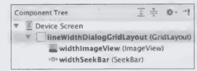

**图 5.17** `fragment_line_width.xml` 的组件树视图。

7. 按照图 5.18 所示的值配置 GUI 组件属性。给维度值 `line_imageview_height` 赋予 `50dp` 的值。
8. 保存并关闭 `fragment_line_width.xml`。

| GUI 组件 | 属性 | 值 |
|---|---|---|
| `lineWidthDialogGridLayout` | `column Count orientation` | `vertical` |
| `useDefaultMargins` | `true` |  |
| `padding top` | `@dim/activity_vertical_margin` |  |
| `padding bottom` | `@dim/activity_vertical_margin` |  |
| `padding left` | `@dim/activity_horizontal_margin` |  |
| `padding right` | `@dim/activity_horizontal_margin` |  |
| `widthImageView` | Layout Parameters<br>`layout:height` | `@dim/line_imageview_height` |
| `layout:gravity` | `fill_horizontal` |  |
| Other Properties `contentDescription` | `@string/line_imageview_description` |  |
| `widthSeekBar` | Layout Parameters<br>`layout:gravity` | `fill_horizontal` |
| Other Properties `max` | `50` |  |

**图 5.18** `fragment_line_width.xml` 中 GUI 组件的属性值。

### 向项目添加 `LineWidthDialogFragment` 类

要将 `LineWidthDialogFragment` 类添加到项目中：

1. 在项目的 java 文件夹中，右键点击上层包 `com.deitel.doodlz`，选择 New > Java Class，以显示“创建新类”对话框。
2. 在 Name 字段中输入 `LineWidthDialogFragment`。
3. 点击 OK 创建该类。

### 5.5.5 添加 `EraseImageDialogFragment` 类

`EraseImageDialogFragment` 不需要布局资源，因为它将显示一个包含文本的简单 AlertDialog。要将 `EraseImageDialogFragment` 类添加到项目中：

1. 在项目的 java 文件夹中，右键点击上层包 `com.deitel.doodlz`，选择 New > Java Class，以显示“创建新类”对话框。
2. 在 Name 字段中输入 `EraseImageDialogFragment`。
3. 点击 OK 创建该类。

## 5.6 `MainActivity` 类

此应用由六类组成：

- `MainActivity`（下文将讨论）——这是应用 Fragments 的父 Activity。
- `MainActivityFragment`（第 5.7 节）——管理 `DoodleView` 和加速度计处理。
- `DoodleView`（第 5.8 节）——提供绘制、保存和打印功能。
- `ColorDialogFragment`（第 5.9 节）——用户选择设置绘制颜色选项时显示的 Dialogfragment。
- `LineWidthDialogFragment`（第 5.10 节）——用户选择设置线宽选项时显示的 DialogFragment。
- `EraseImageDialogFragment`（第 5.11 节）——用户选择擦除选项或摇晃设备以擦除当前绘制时显示的 DialogFragment。

`MainActivity` 的 `onCreate` 方法（图 5.19）填充了 GUI（第 16 行），并配置了布局（第 17 行），然后获取屏幕大小来设置尺寸（第 26 行）。如果应用在平板电脑上运行（第 27 行），则使用横屏模式（第 28 行）；否则使用竖屏模式（第 30-31 行）。

```java
// MainActivity.java

// 设置布局

package com.deitel.doodlz;

import android.content.ActivityInfo;
import android.content.Configuration;
import android.os.Bundle;
import android.support.v7.app.AppCompatActivity;
import android.support.v7.widget.Toolbar;

public class MainActivity extends AppCompatActivity {

    // 设置 onCreate

    @Override
    protected void onCreate(Bundle savedInstanceState) {
        super.onCreate(savedInstanceState);
        setContentView(R.layout.activity_main);
        Toolbar toolbar = (Toolbar) findViewById(R.id.toolbar);
```


```java
setSupportActionBar(toolbar);

// 获取屏幕大小
int screenSize = getResources().getConfiguration().screenWidthDp;

// 对于平板电脑使用横屏模式
if (screenSize >= Configuration.SCREEN_SIZE_LARGE) {
    setOrientation(ActivityInfo.LANDSCAPE);
} else {
    setOrientation(ActivityInfo.PORTRAIT);
}
```

图 5.19 | `MainActivity` 类。（第 1 / 2 部分。）

### 5.7 `MainActivityFragment` 类

`MainActivityFragment`（第 5.7 节）管理 `DoodleView` 和加速度计处理。

### 5.7.1 包语句、导入语句和字段

`MainActivityFragment`（第 5.7）显示了 `DoodleView`（图 5.20）。`DoodleView`（第 24 行）代表绘制区域。使用第 25–27 行的加速度信息来计算加速度的变化，以判断抖动。第 28 行定义了一个默认值为 `false` 的布尔变量，用于确定是否摇动了设备以擦除。第 29–31 行用于在抖动发生时显示对话框。第 35 行的常量用于通过实验来实现擦除功能。

```java
// MainActivityFragment.java

// 显示 DoodleView 的 Fragment

package com.deitel.doodlz;

import android.Manifest;
import android.app.AlertDialog;
import android.content.Context;
import android.content.DialogInterface;
import android.content.pm.PackageManager;
import android.hardware.Sensor;
import android.hardware.SensorEventListener;
import android.hardware.SensorManager;
import android.os.Bundle;
import android.support.v4.app.Fragment;
import android.view.LayoutInflater;
import android.view.Menu;
import android.view.Inflater;
import android.view.MenuItem;
import android.view.View;
import android.view.ViewGroup;

public class MainActivityFragment extends Fragment {
    private DoodleView doodleView; // 处理事件并绘制

    private float acceleration;
    private float currentAcceleration;
    private float lastAcceleration;
    private boolean dialogScreen = false;

    // 用于确定是否摇动设备以擦除
    private static final int ACCELERATION_THRESHOLD = 100000;

    // 用于识别请求使用外部存储，
    // 保存图像功能需要
    private static final int SAVE_IMAGE_PERMISSION_REQUEST_CODE = 1;
}
```

图 5.20 | `MainActivityFragment` 类包语句、导入语句和字段。

### 5.7.2 重写的 `Fragment` 方法 `onCreate`

`onCreate` 方法（图 5.21）填充了 `MainActivityFragment` 的 GUI 并初始化实例变量。`Fragment` 可以在应用程序标题栏或菜单中放置项。为了实现这一点，`Fragment` 必须调用 `setHasOptionsMenu` 并传递参数。如果父 `Activity` 有选项菜单项，那么 `Activity` 和 `Fragment` 的项将放置在应用标题栏或选项菜单中（取决于它们的设置）。

```java
// 当 Fragment 的视图需要创建时调用

@Override
public void onCreateView(LayoutInflater inflater, ViewGroup container,
    Bundle savedInstanceState) {
```

图 5.21 | `onCreate` 的重写 `Fragment` 方法。（第 1 / 2 部分。）

# 190 第 5 章 Doodliz App

```java
super.onCreateView(inflater, container, savedInstanceState);

View view =
    inflater.inflate(R.layout.fragment_main, container, false);

setHasOptionsMenu(true); // 此 fragment 有要显示的菜单项

// 获取 DoodleView 的引用
doodleView = (DoodleView) view.findViewById(R.id.doodleView);

// 初始化加速度值
acceleration = 0.00f;
currentAcceleration = SensorManager.GRAVITY_EARTH;
lastAcceleration = SensorManager.GRAVITY_EARTH;

return view;
}
```

图 5.21 | 重写 `Fragment` 方法 `onCreateView`。（第 2 部分共 2 部分）

第 48 行获取了 `DoodleView` 的引用，第 51–53 行初始化了实例变量，这些变量有助于计算加速度的变化，以判断用户是否摇晃了设备。我们最初将变量 `currentAcceleration` 和 `lastAcceleration` 设置为 `SensorManager` 的 `GRAVITY_EARTH` 常量，它代表地球重力产生的加速度。`SensorManager` 还提供了太阳系中其他行星、月球以及其他有趣的常量，你可以在此处查看：

<http://developer.android.com/reference/android/hardware/SensorManager.html>

## 5.7.3 方法 `onResume` 和 `enableAccelerometerListening`

加速度计监听器应仅在 `MainActivity` 可见时启用。因此，我们重写了 `Fragment` 的生命周期方法 `onResume`（图 5.22，第 58–62 行），该方法在 `Fragment` 处于屏幕上且用户可以与其交互时被调用。在 `onResume` 中调用方法 `enableAccelerometerListening`（第 65–70 行）开始监听加速度计事件。使用 `SensorManager` 来注册加速度事件的监听器。

`enableAccelerometerListening` 方法首先使用 `Activity` 的 `getSystemService` 来获取 `SensorManager` 服务，这使得应用程序能够与设备传感器交互。第 72–74 行使用 `SensorManager` 的 `registerListener` 注册接收加速度事件，该方法接收三个参数：

- 响应事件的 `EventEventListener`（定义在第 5.7.5 节）。
- 代表应用想要接收的传感器数据的 `Sensor` 对象——通过调用 `SensorManager` 的 `getDefaultSensor` 并传递一个 `Sensor` 类型（在本应用中为 `Sensor.TYPE_ACCELEROMETER`）来获取。
- 加速度计交付传感器事件的速率——`SENSOR_DELAY_NORMAL` 表示默认速率。可以使用更高的速率来获取更准确的数据，但这更消耗 CPU 和电量。

## 5.7 `MainActivityFragment` 类 191

```java
57 // 开始监听传感器事件
58 @Override
59 public void onResume() {
60     super.onResume();
61     enableAccelerometerListening(); // 监听摇晃事件
62 }

63

64

65 // 启用加速度事件的监听
66 private void enableAccelerometerListening() {
67     // 获取 SensorManager
68     SensorManager sensorManager =
69         (SensorManager) getActivity().getSystemService(
70             Context.SENSOR_SERVICE);
71 }

72

73 // 注册监听器以监听加速度事件
74 sensorManager.registerListener(sensorEventListener,
75     sensorManager.getDefaultSensor(Sensor.TYPE_ACCELEROMETER),
76     sensorManager.SENSOR_DELAY_NORMAL);
77 }
```

图 5.22 | 方法 `onResume` 和 `enableAccelerometerListening`。

## 5.7.4 方法 `onPause` 和 `disableAccelerometerListening`

为了确保在 `MainActivityFragment` 不在屏幕上时禁用加速度监听，我们重写了生命周期方法 `onPause`（图 5.23，第 77–82 行），该方法调用方法 `disableAccelerometerListening`（第 85–94 行）。`disableAccelerometerListening` 方法使用 `类Manager` 类的 `unregisterListener` 方法停止监听加速度事件。

```java
77 // 停止监听加速度事件
78 @Override
79 public void onPause() {
80     super.onPause();
81     disableAccelerometerListening(); // 停止监听摇晃
82 }

83

84

85 // 禁用加速度事件的监听
86 private void disableAccelerometerListening() {
87     // 获取 SensorManager
88     SensorManager sensorManager =
89         (SensorManager) getActivity().getSystemService(
90             Context.SENSOR_SERVICE);
91 }

92

93 // 停止监听加速度事件
94 sensorManager.unregisterListener(sensorEventListener,
95     sensorManager.getDefaultSensor(Sensor.TYPE_ACCELEROMETER));
96 }
```

图 5.23 | 方法 `onPause` 和 `disableAccelerometerListening`。

## 5.7.5 用于处理加速度事件的匿名内部类

图 5.24 重写了 `SensorEventListener` 的 `onSensorChanged`（第 100–123 行）来处理加速度事件。如果用户移动设备，此方法将判断移动是否足够构成一次摇晃。如果是，第 121 行调用 `confirmErase`（第 5.7.6 节）显示 `ErrorDialogFragment`（第 5.11 节）并确认用户真的想要删除图像。`SensorEventListener` 还包含 `onChanged`（第 127 行）——我们在此应用未使用该方法，因此我们提供了一个空体，因为该方法是接口要求的。

```java
// 加速度计事件处理器
private final SensorEventListener sensorEventListener =
    new SensorEventListener() {

    // 使用加速度计判断用户是否摇晃了设备
    @Override
    public void onSensorChanged(SensorEvent event) {
        // 确保没有显示对话框
        if (!dialogScreen) {
            // 获取 SensorEvent 的 x, y, z
            float x = event.values[0];
            float y = event.values[1];
            float z = event.values[2];

            // 保存上次加速度
            lastAcceleration = currentAcceleration;

            // 计算当前加速度
            currentAcceleration = x * x + y * y + z * z;

            // 计算加速度的变化
            acceleration = currentAcceleration - lastAcceleration;

            // 如果加速度大于阈值
            if (acceleration > ACCELERATION_THRESHOLD) {
                confirmErase();
            }
        }
    }

    // SensorEventListener 的要求方法
    @Override
    public void onAccuracyChanged(Sensor sensor, int accuracy) {
    };
```

图 5.24 | 实现 `SensorEventListener` 以处理加速度事件的匿名内部类。当对话框已显示时，用户可以摇晃设备。这很重要，因为传感器事件发生在不同的线程中。`SensorEvent` 参数包含了传感器的变化信息。对于加速度事件，该参数包含三个元素（米/秒），代表 x（左右）、y（上下）和 z（前后）方向。关于 `SensorEvent` 使用的坐标系的描述和图表可见：

<http://developer.android.com/reference/android/hardware/SensorEvent.html>

此链接还描述了 `SensorEvent` 的 x、y 和 z 值的实际意义。处理传感器事件需要复制数据（如我们所做的），因为传感器数组是复用的。第 105–107 行存储加速度值。第 110 行存储 `lastAcceleration`。然后，通过 `currentAcceleration` 和 `lastAcceleration` 计算出一个可以与 `ACCELERATION_THRESHOLD` 比较的值。如果该值大于常量，用户移动的程度让本应用将其视为摇晃。在这种情况下，我们调用 `confirmErase` 方法。

## 5.7.6 方法 `confirmErase`

`confirmErase` 方法（图 5.25）只是创建一个 `EraseImageDialogFragment`（第 5.11 节）并使用 `DialogFragment` 方法显示它。

```java
130 // 确认是否删除图像
131 private void confirmErase() {
132     EraseImageDialogFragment fragment = new EraseImageDialogFragment();
133     fragment.show(getFragmentManager(), "erase dialog");
134 }
```


> 图 5.25 方法 `confirmErase` 显示 `EraseImageDialogFragment`。

## 5.7 重写的 Fragment 方法 `onCreateMenu` 和 `onOptionsItemSelected`

图 5.26 重写了 Fragment 的 `onCreateMenu` 方法（第 137–141 行），使用方法的 `MenuInflater` 参数将选项项添加到方法的 `Menu` 参数中。当用户选择菜单项时，Fragment 方法 `onOptionsItemSelected`（第 144–169 行）响应该选择。

我们使用 `MenuItem` 参数的 `getItem` 方法（第 147 行）获取选中菜单项的资源 ID，然后根据选择采取不同的操作。操作如下：

- 对于 `R.id.color`，第 149–150 行创建并显示 `ColorDialogFragment`（第 5.9 节），允许用户选择新的绘制颜色。
- 对于 `R.id.line_width`，第 153–155 行创建并显示一个 `LineWidthDialogFragment`（第 5.10 节），允许用户选择新的线宽。
- 对于 `R.id.delete_drawing`，第 158 行调用 `confirmErase` 方法（第 5.7.6 节）显示 `EraseImageDialogFragment`（第 5.11 节），并确认用户是否真的想删除图像。
- 对于 `R.id.save`，第 161 行调用图像方法，在检查并（必要时）请求写入外部存储的权限后，将绘画保存为图像存储在设备的相册中。
- 对于 `R.id.print`，第 164 行调用 `doodle` 的 `printImage` 方法，允许用户将图像保存为 PDF 或打印图像。

```java
// displays the fragment's menu items

@Override
public void onCreateOptionsMenu(Menu menu, MenuInflater inflater) {
    super.onCreateOptionsMenu(menu, inflater);
    inflater.inflate(R.menu.doodle_fragment_menu, menu);
}

// handle choice from options menu

@Override
public boolean onOptionItemSelected(MenuItem item) {
    switch (item.getItemId()) {
        case R.id.color:
            ColorDialog colorDialog = new ColorDialogFragment();
            colorDialog.show(getFragmentManager(), "color dialog");
            return true; // consume the menu event

        case R.id.line_width:
            WidthFragment widthDialog = new LineWidthFragment();
            widthDialog.show(getFragmentManager(), "line width dialog");
            return true; // consume the menu event

        case R.id.delete_drawing:
            confirmErase(); // confirm erasing image
            return true; // consume the menu event

        case R.id.save:
            saveImage(); // check permission and save current image
            return true; // consume the menu event

        case R.id.print:
            doodleView.printImage(); // print the current images
            return true; // consume the menu event
    }

    return super.onOptionItemSelected(item);
}
```

**图 5.26** 在 `onCreateOptionsMenu` 和 `onOptionItemSelected` 上重写的 Fragment 方法。

## 5.7.8 方法 `saveImage`

`saveImage` 方法（图 5.27）在用户从选项菜单中选择 Android Save 选项时，由 `onItemSelected` 方法调用。`saveImage` 方法实现了新 Android 6.0 权限模型的部分，该模型在执行任务之前首先检查应用是否具有所需的权限。如果应用在尝试执行任务之前需要向用户请求权限。

第 176–178 行检查应用是否具有写入外部存储的权限，以便其保存图像。如果应用没有 `android.permission.WRITE_EXTERNAL_STORAGE` 权限，第 181–182 行使用内置的 `shouldShowPermissionRationale` 来确定何时显示关于为什么应用需要此权限的解释。例如，如果用户之前拒绝了权限，该方法返回 `true`。如果你需要向用户解释为什么应用请求权限，第 183–203 行创建并显示一个带有解释的对话框。当用户点击 OK 对话框时，第 195–197 行使用继承的方法 `requestPermissions` 请求 `android.permission.WRITE_EXTERNAL_STORAGE` 权限。如果不需要解释——例如，这是应用第一次需要权限——第 207–209 行立即请求权限。

```java
// requests the permission needed for saving the image if
// necessary or saves the image if the app already has permission

private void saveImage() {
    // checks if the app does not have permission needed
    // to save the image
    if (getContext().checkPermission(
        Manifest.permission.WRITE_EXTERNAL_STORAGE) != PackageManager.PERMISSION_GRANTED) {

        // shows an explanation of why permission is needed
        if (shouldShowRequestPermissionRationale(
            Manifest.permission.WRITE_EXTERNAL_STORAGE)) {

            AlertDialog.Builder builder =
                new AlertDialog.Builder(getActivity());

            // set Alert Dialog's message
            builder.setMessage(R.string.permission_explanation);

            // add an OK button to the dialog
            builder.setPositiveButton(android.R.string.ok,
                new DialogInterface.OnClickListener() {
                    @Override
                    public void onClick(DialogInterface dialog, int which) {
                        // request permission
                        requestPermissions(new String[] {
                            Manifest.permission.WRITE_EXTERNAL_STORAGE
                        }, SAVE_IMAGE_PERMISSION_REQUEST_CODE);
                    }
                });
        }
    }
}
```

图 5.27 | 方法 `saveImage`。（2 部分中的第 1 部分）。

```java
202      // display the dialog
203  builder.create().show();
204  }
205  else {
206      // request permission
207      requestPermissions(
208          new String[] {Manifest.permission.WRITE_EXTERNAL_STORAGE},
209          SAVE_IMAGE_PERMISSION_REQUEST_CODE);
211
212  else { // if app already has permission to write to external storage
213      doodleView.saveImage(); // save the image
214  }
215}
```

**图 5.27** | 方法 `saveImage`。（第 2 部分）。

## 5.7.9 重写方法 `onRequestResult`

`onRequestResult` 方法（图 5.28）在用户授予或拒绝保存图像的权限时，由系统调用。它接收一个权限字符串数组和请求的 `SAVE_IMAGE_PERMISSION_REQUEST_CODE` 整数。此应用只有一个权限，因此 `switch` 语句只有一个 `case`。

```java
// called by the system when the user either grants or denies the
// permission for saving an image

@Override
public void onRequestResult(
    int requestCode, String[] permissions, int[] getResults) {

    // switch appropriate action based on which
    // requested permission
    switch (requestCode) {
        case SAVE_IMAGE_PERMISSION_REQUEST_CODE:
            if (getResults[0] == PackageManager.PERMISSION_GRANTED)
                doodleView.saveImage(); // save the image
            return;
    }
}
```

**图 5.28** | 对话框启用。

## 5.7.10 方法 `getoodleView` 和 `setDialogOnScreen`

`getoodleView` 和 `setDialogOnScreen` 方法（图 5.30）由 `DialogFragment` 子类的方法调用。`getoodleView` 方法返回此 Fragment 的 `DoodleView` 引用，以便 Dialog 设置颜色、线宽或清除图像。`setDialogOnScreen` 由 `DialogFragment` 子类的 Fragment 生命周期方法调用，以指示对话框何时在屏幕上。

## 软件观察 5.2

此应用的 Fragment 之间直接交互。为了本应用的简单性，我们选择了这种紧耦合的方法。通常，由 Activity 管理 Fragment 交互。向 Fragment 传递数据时，Activity 提供参数 `Bundle`。Fragment 类通常提供一个由 Activity 实现的回调接口。当 Fragment 需要通知父级状态更改时，Fragment 调用相应的回调方法。这些技术使得 Fragment 在不同的 Activity 之间更具可重用性。我们将在第 9 章的通讯录应用中演示这些技术。

# 第 5 章 Doodliz App

```java
236   // 表示是否显示了对话框
237   public void setDialogOnScreen(boolean visible) {
238       dialogOnScreen = visible;
239   }
240 }
```

**图 5.30** | `getDoodleView` 和 `setDialogOnScreen` 方法。（2 部分中的 2 部分）。

## 5.8 `DoodleView` 类

`DoodleView` 类（第 5.8.1—5.8.12 节）处理用户的触摸并绘制相应的线条。

### 5.8.1 `package` 语句和 `import` 语句

图 5.31 列出了 `DoodleView` 的包声明和导入语句。这里高亮了新的类和接口。其中许多内容在第 5.3 节中讨论过，其余部分将在我们使用 `DoodleView` 类时进行讨论。

```java
1 // DoodleView.java
2 // Doodliz 应用的主视图。
3 package com.deite1.doodliz;

4
5 import android.content.Context;
6 import android.graphics.Bitmap;
7 import android.graphics.Canvas;
8 import android.graphics.Color;
9 import android.graphics.Paint;
10 import android.graphics.Path;
11 import android.graphics.Point;
12 import android.provider.MediaStore;
13 import android.support.v4.print.AttributeHelper;
14 import android.util.AttributeSet;
15 import android.view.Gravity;
16 import android.view.MotionEvent;
17 import android.view.View;
18 import android.widget.Toast;

19
20 import java.util.HashMap;
21 import java.util.Map;
```

**图 5.31** | `DoodleView` 包声明和导入语句。

### 5.8.2 静态变量和实例变量

`DoodleView` 的静态变量和实例变量（图 5.32）用于管理用户当前正在绘制的线条集合的数据并绘制这些线条。第 34 行创建了 `pathMap`，它将每个手指 ID（称为指针）映射到正在绘制的线条的对应的 `Path` 对象。第 35 行维护了 `previousPointMap`，每个手指——随着每个手指移动，我们从当前点到上一个点绘制一条线条。我们将在使用 `DoodleView` 类时讨论其他字段。

```java
// 用于绘制的自定义 View
public class DoodleView extends View {
    // 用于判断手指移动是否足够远以便再次绘制
    private static final float TOUCH_TOLERANCE = 10;

    private Bitmap bitmap; // 用于保存的绘制区域
    private Canvas canvas; // 用于在 bitmap 上绘图

    private final Paint paintScreen; // 用于在屏幕上绘图
    private final Paint paintLine; // 用于在 bitmap 上绘制线条

    // 当前正在绘制的 Paths 和输入 Points 的映射
    private final Map<Integer, Path> pathMap = new HashMap<>();
    private final Map<Integer, Point> previousPointMap = new HashMap<>();
```


**图 5.32** | DoodleView 状态和实例变量。

### 5.8.3 构造函数

构造函数（第 33 行）初始化了类的几个实例变量——两个 `Map` 在其声明中已初始化。图 5.33 的第 40 行创建了 `Paint` 对象 `paintScreen`，用于在屏幕上显示绘制，第 43 行创建了 `Paint` 对象 `paintLine`，指定我们当前正在绘制的图形。第 44–48 行指定了 `paintLine` 对象的设置。我们将 `true` 传递给 `Paint` 的 `setAntiAlias` 方法以启用抗锯齿，从而平滑线条边缘。接下来，我们将 `Paint` 的样式设置为 `Paint.Style.STROKE` 或 `Paint.Style.FILL`，分别对应实线和带边框的填充形状。默认选项是 `FILL`。我们将应用的默认线宽设置为五个像素。我们还使用 `Paint` 的 `setStrokeCap` 配合 `Paint.ROUND` 将线条末端设置为圆角。

```java
// DoodleView 初始化 DoodleView
public DoodleView(Context context, AttributeSet attrs) {
    // 将 context 传递给 View 的构造函数
    paintScreen = new Paint(); // 用于在屏幕上绘图

    // 设置绘制线条的初始设置
    paintLine = new Paint();
    paintLine.setAntiAlias(true); // 平滑绘制线条的边缘
    paintLine.setColor(Color.BLACK); // 颜色为黑色
    paintLine.setStyle(Paint.Style.STROKE); // 实线
    paintLine.setStrokeWidth(5); // 设置默认线宽
    paintLine.setStrokeCap(Cap.ROUND); // 圆角
}
```

**图 5.33** | DoodleView 构造函数。

### 5.8.4 重写的 View 方法

DoodleView 的大小在它被加载（inflate）并添加到 `MainActivity` 层级之前是不确定的；因此，我们无法在 `Create` 中确定绘制的大小。我们重写了 view 方法 `onChanged`（例如图 5.34），该方法在 DoodleView 大小改变时被调用——例如当用户旋转设备时将其添加到 Activity 的 View 层级时。在此应用中，只有当 DoodleView 被添加到 `MainActivity` 的 View 层级时，才会调用 `onChanged`，此时应用在手机和小板电脑上以竖屏显示，在大平板电脑上以横屏显示。

```java
// 根据 View 大小创建 Bitmap 和 Canvas
@Override
public void onChanged(int w, int h, int oldW, int oldH) {
    bitmap = Bitmap.createBitmap(getWidth(), getHeight(), Bitmap.Config.ARGB_8888);
    canvas = new Canvas(bitmap);
}
```

**图 5.34** | 重写的 View 方法 `onChanged`。

`Bitmap` 的 `createBitmap` 创建了指定宽宽的 `Bitmap`。`Bitmap.Config.ARGB_8888` 指示了 View 的颜色。`canvas = new Canvas(bitmap)` 创建了一个新的 `Canvas`。`bitmap.eraseColor(Color.WHITE)` 清空 `Bitmap` 为白色。`onChanged` 决定了 View 的尺寸。`eraseColor` 方法填充了 `Bitmap` 的像素。`invalidate` 决定了 ` `。`Paint` 指定了绘制的绘制白色。在此应用中，只有当 DoodleView 被添加到 `MainActivity` 的 View 层级时，才会调用 `onChanged`，此时应用在手机和小板电脑上以竖屏显示，在大平板电脑上以横屏显示。

### 5.8.5 clear, getDrawingColor, setLineWidth 方法

图 5.35 定义了方法（第 61–66 行），`clear`（第 69–71 行），`getDrawingColor`（第 74–76 行），`setLineWidth`（第 79–81 行）以及 `getLineWidth`（第 84–86 行），它们从 `MainActivity` 调用。方法 `clear` 清空了 `pathMap` 和 `previousPointMap`，通过设置所有像素为白色来清空 `Bitmap`。`invalidate` 指示 View 需要重绘。`getDrawingColor` 返回当前的颜色。`setLineWidth` 将 `paintLine` 的描边宽度设置为指定的像素。`getLineWidth` 返回当前的描边宽度。

```java
// 清除绘制
public void clear() {
    pathMap.clear(); // 移除所有路径
    previousPointMap.clear(); // 移除所有点
    bitmap.eraseColor(Color.WHITE); // 清空位
    invalidate(); // 刷新屏幕
}
```

```java
// 设置绘制线条的颜色
public void setDrawingColor(int color) {
    paintLine.setColor(color);
}
```

```java
// 返回绘制线条的颜色
public int getDrawingColor() {
    return paintLine.getColor();
}
```

```java
// 设置绘制线条的宽度
public void setLineWidth(int width) {
    paintLine.setStrokeWidth(width);
}
```

```java
// 返回绘制线条的宽度
public int getLineWidth() {
    return (int) paintLine.getStrokeWidth();
}
```

## 202 第 5 章 Doodlz App

```java
// 当 DoodleView 在屏幕上刷新时，执行自定义绘制
@Override
protected void onDraw(Canvas canvas) {
    // 绘制背景屏幕
    canvas.drawBitmap(bitmap, 0, 0, paintScreen);

    // 遍历当前正在绘制的路径
    for (Integer key : pathMap.keySet()) {
        canvas.drawPath(pathMap.get(key), paintLine); // 绘制线条
    }
}
```

图 5.36 | 重写的 View 方法 `onDraw`。

## 5.8.7 重写的 View 方法 onTouchEvent

当 View 接收到触摸事件时，会调用 `onTouchEvent`（图 5.37）。Android 支持多点触控——即多个手指同时触摸屏幕。在任何时候，用户都可以用更多手指触摸屏幕，或从屏幕上移开手指。因此，每个手指（称为指针/pointer）都有一个唯一的 ID，该 ID 在跨触摸事件中进行标识。我们将使用 ID 来跟踪对应的代表当前正在绘制线条的 `Path` 对象。这些 `Path` 存储在 `pathMap` 中。

```java
// 处理触摸事件
@Override
public boolean onTouchEvent(MotionEvent event) {
    int action = event.getActionMasked(); // 事件类型
    int actionIndex = event.getActionIndex(); // 指针（即手指）

    // 确定触摸是开始、结束还是移动中
    if (action == MotionEvent.ACTION_DOWN ||
        action == MotionEvent.ACTION_POINTER_DOWN) {
        touchStarted(event.getX(actionIndex), event.getY(actionIndex), event.getPointerId(actionIndex));
    } else if (action == MotionEvent.ACTION_UP ||
        action == MotionEvent.ACTION_POINTER_UP) {
        touchEnded(event.getPointerId(actionIndex));
    } else {
        touchMoved(event);
    }

    invalidate(); // 重绘
    return true;
}
```

图 5.37 | 重写的 View 方法 `onTouchEvent`。

`MotionEvent` 的 `getActionMasked`（第 102 行）返回一个表示 `MotionEvent` 类型的整数，你可以结合 `MotionEvent` 类中的常量来确定如何处理每个事件。`MotionEvent` 的 `getIndex`（第 103 行）返回一个表示哪个手指引起事件的索引。该索引并不是手指的唯一 ID——它仅仅是手指信息在该 `MotionEvent` 中的所在索引。为了获取在跨 `MotionEvents` 中持续存在直到用户从屏幕上移开手指的手指唯一 ID，我们将使用 `MotionEvent` 的 `getPointerID` 方法（第 109 行和 113 行），并将手指索引作为参数传递。

如果 action 是 `MotionEvent.ACTION_DOWN` 或 `ACTION_POINTER_DOWN`（第 106-107 行），说明用户用新手指触摸了屏幕。第一个触摸屏幕的手指产生 `MotionEvent.ACTION_DOWN` 事件，而所有其他手指产生 `MotionEvent.ACTION_POINTER_DOWN` 事件。对于这些情况，我们调用 `touchStarted` 方法（图 5.38）来存储触摸坐标。如果 action 是 `MotionEvent.ACTION_UP` 或 `MotionEvent.ACTION_POINTER_UP`，说明用户从屏幕上移开了手指，因此我们调用 `touchEnded`（第 5.40 行）将完成的 `Path` 绘制到位图中，我们对该位图有永久记录。对于所有其他触摸事件，我们调用 `touchMoved`（图 5.39）来绘制线条。事件处理后，第 119 行（图 5.37 中）调用继承的 view `invalidate` 来重绘屏幕，第 120 行返回 `true` 表示该事件已处理。

## 5.8.8 touchStarted 方法

`touchStarted` 方法（图 5.38）在手指首次触摸屏幕时被调用。触摸坐标及其 ID 被作为参数提供。如果给定的 ID 已经存在一个 `Path`（第 129 行），我们调用 `Path` 的 `reset` 方法来清除任何现有点，以便我们可以重用该 `Path` 绘制另一个笔画。否则，我们创建一个新的 `Path`，将其添加到 `pathMap` 中，并向之前的 `PathMap` 中添加一个新的 `Point`。第 142–144 行调用 `Path` 的 `moveTo` 来设置 `Path` 的坐标，并设置新 `Point` 的 x 和 y 值。

```java
// 当用户触摸屏幕时调用
private void touchStarted(float x, float y, int lineID) {
    Path path; // 用于存储给定触摸 id 的路径
    Point point; // 用于存储 path 中的最后线条

    // 如果 lineID 已经有一个路径
    if (pathMap.containsKey(lineID)) {
        path = pathMap.get(lineID); // 获取 Path
        path.reset(); // 重置 Path 因为一个新触摸开始了
        point = previousPathMap.get(lineID); // 获取它的最后一个点
    } else {
        path = new Path();
        pathMap.put(lineID, path); // 将 Path 添加到 Map
        point = new Point(); // 创建一个新的 Point
        previousPathMap.put(lineID, point); // 将 Point 添加到 Map
    }
}
```


## 5.8 DoodleView 类 203

```java
// 当用户触摸屏幕时调用
private void touchStarted(float x, float y, int lineID) {
    Path path; // 用于存储给定触摸 id 的路径
    Point point; // 用于存储 path 中的最后线条

    // 如果 lineID 已经有一个路径
    if (pathMap.containsKey(lineID)) {
        path = pathMap.get(lineID); // 获取 Path
        path.reset(); // 重置 Path 因为一个触摸开始了
        point = previousPathMap.get(lineID); // 获取它的最后一个点
    } else {
        path = new Path();
        pathMap.put(lineID, path); // 将 Path 添加到 Map
        point = new Point(); // 创建一个新的 Point
        previousPathMap.put(lineID, point); // 将 Point 添加到 Map
    }
}
```

图 5.38 | `touchStarted` 方法 204

## 5.8.9 touchMoved 方法

`touchMoved` 方法（图 5.39）在用户或多个手指跨屏幕移动时被调用。`MotionEvent` 的 `getCount`（第 150 行）返回手指的数量。对于每个手指，我们获取其指针的 ID 和索引（第 152 行）。然后检查 `pathMap` 中是否存在对应的 `Path`（第 156 行）。如果是，我们使用 `MotionEvent` 的 `getX` 和 `getY` 方法（第 160 行）获取手指的新坐标。如果用户移动的距离大于 `TOUCHOLERANCE`（第 169 行），我们使用 `Path` 的 `quadTo` 方法（第 173–174 行）向新点添加二次曲线。最后更新 `Point` 的坐标（第 177-178 行）。

```java
// 当用户拖动屏幕时调用
private void touchMoved(MotionEvent event) {
    // 对于事件中的每个指针
    for (int i = 0; i < event.getCount(); i++) {
        // 获取指针 ID 和索引
        int pointerID = event.getPointerId(i);
        int pointerIndex = event.getActionIndex(i);

        // 如果 pathMap 中有路径
        if (pathMap.containsKey(pointerID)) {
            // 获取指针的新坐标
            float newX = event.getX(pointerIndex);
            float newY = event.getY(pointerIndex);

            // 计算用户距离点的移动距离
            float deltaX = Math.abs(newX - point.x);
            float deltaY = Math.abs(newY - point.y);

            // 如果移动距离足够大
            if (deltaX > TOUCHOLERANCE || deltaY >= TOUCHOLERANCE) {
                // 向新点添加二次曲线
                path.quadTo(point.x, point.y, (newX + point.x) / 2,
                          (newY + point.y) / 2);
            }

            // 更新坐标
            point.x = (int) newX;
            point.y = (int) newY;
        }
    }
}
```


图 5.39 | `touchMoved` 方法 205

## 5.8.10 `touchEnded` 方法

`touchEnded` 方法（图 5.40）在用户从屏幕上移开手指时调用。该方法接收刚刚结束触摸的手指 ID（`lineID`）作为参数。第 186 行获取对应的 `Path`。第 187 行调用 `bitmapCanvas` 的 `drawPath` 方法将 `Path` 绘制到 `Bitmap` 对象上，然后调用 `Path` 的 `reset` 方法清除该 `Path`。重置 `Path` 不会擦除屏幕上对应的线条，因为这些线条已经绘制到位图中。用户正在绘制的线条将显示在该位图之上。

```java
// 当用户完成触摸时调用
private void touchEnded(int lineID) {
    Path path = pathMap.get(lineID); // 获取对应的 Path
    bitmapCanvas.drawPath(path, paintLine); // 绘制到 bitmapCanvas
    path.reset(); // 重置 Path
}
```

图 5.40 | `touchEnded` 方法 `DoodleView`。

## 5.8.11 `saveImage`

`saveImage` 方法（图 5.41）保存当前的绘制。第 194 行为方法创建一个文件名，然后第 197–199 行通过调用 `MediaStore.Media.insertImage` 类将图像存储在设备的照片应用中。该方法接收四个参数：

- 一个 `ContentResolver` 方法，用于定位图像应存储在设备上的位置
- 要存储的位图
- 图像名称
- 表示图像在设备上位置的描述

`insertImage` 方法返回一个 `String`，如果无法保存图像则返回 `null`。第 201–217 行检查 `Offset` 是否已保存并显示相应的 `Toast`。

```java
// 将当前图像保存到相册
public void saveImage() {
    // 使用 "Doodlez"加上当前时间作为图像名称
    final String name = "Doodlez" + System.currentTimeMillis() + ".jpg";

    // 将图像插入设备中
    String location = MediaStore.Images.insertImage(
        getContext().getContentResolver(), bitmap, bitmap,
        "Doodle Drawing");

    if (location != null) {
        // 显示一条消息表示图像已保存
        Toast message = Toast.makeText(getContext(),
            R.string.saved,
            Toast.LENGTH_SHORT);
        message.setGravity(Gravity.CENTER, message.getXOffset() / 2,
            message.getYOffset() / 2);
        message.show();
    } else {
        // 显示一条消息表示保存时出错
        Toast message = Toast.makeText(getContext(),
            R.string.error_saving, Toast.LENGTH_SHORT);
        message.setGravity(Gravity.CENTER, message.getXOffset() / 2,
            message.getYOffset() / 2);
        message.show();
    }
}
```

图 5.41 | `DoodleView.saveImage`。

### 5.8.12 方法 `printImage`

`print` 方法（图 5.42）使用 Android Support Library 的 `PrintHelper` 类来打印绘图——这仅在运行 Android 4.4 或更高版本的设备上可用。第 222 行确认设备上是否支持打印。如果是，第 224 行创建一个 `PrintHelper` 对象。接下来，第 227 行指定了缩放模式——`PrintHelper.SCALE_MODE_FIT` 表示图像应适应页面的可打印区域。还有 `SCALE_MODE_FILL`，它会导致图像填充页面，可能会导致图像部分被裁剪。最后，第 228 行调用 `PrintHelper` 方法 `getBitmap`，并将打印任务名称（打印机用于识别打印任务）以及包含要打印图像的 `Bitmap` 作为参数。这将显示 Android 的打印对话框，允许用户选择将图像保存为设备上的 PDF 或将其打印到可用的打印机。

```java
// 打印当前图像
public void printImage() {
    if (PrintHelper.systemSupportsPrint()) {
        // 使用 Android Support Library 的 PrintHelper 打印图像
        PrintHelper printHelper = new PrintHelper(getContext());

        // 使图像适应页面边界并打印图像
        printHelper.setScaleMode(PrintHelper.SCALE_MODE_FIT);
        printHelper.setBitmap("DoodleImage", bitmap);
    } else {
        // 显示消息表示系统不允许打印
        Toast message = Toast.makeText(getContext(),
            R.string.error_printing, Toast.LENGTH_SHORT);
        message.setGravity(Gravity.CENTER, message.getXOffset(0) / 2);
        message.setOffsetY(0) / 2);
        message.show();
    }
}
```

图 5.42 | `DoodleView` 方法 `printImage`。

### 5.9 `ColorDialogFragment` 类

`ColorDialogFragment`（图 5.43–57）扩展 `DialogFragment` 以创建一个用于绘制颜色的 `AlertDialog`。该类的实例变量（第 18–23 行）用于引用选择新颜色的 GUI 控件、显示其预览，并将颜色存储为 32 位的 `int` 值，该值代表颜色的 ARGB 值。

```java
// ColorDialogFragment.java
// 允许用户在 DoodleView 上设置绘图颜色
package com.deiteil.doodlez;

import android.app.Activity;
import android.app.AlertDialog;
import android.app.Dialog;
import android.content.DialogInterface;
import android.graphics.Color;
import android.os.Bundle;
import android.support.v4.DialogFragment;
import android.view.View;
import android.widget.SeekBar;
import android.widget.SeekBar.OnSeekChangeListener;

// 用于选择颜色对话框的类
public class ColorDialogFragment extends DialogFragment {
    private SeekBar alphaSeekBar;
    private SeekBar redSeekBar;
```

图 5.43 | `ColorDialogFragment` 的包语句、导入语句和实例变量。（部分，共 2 部分）

```java
20 private SeekBar greenSeekBar;
21 private SeekBar blueSeekBar;
22 private View colorView;
23 private int color;
24
```

> **图 5.43** `ColorDialogFragment` 的包语句、导入语句和实例变量。（部分，共 2 部分）。

### 5.9.1 在 `onCreateDialog` 中重写的 `DialogFragment` 方法

`onCreateDialog` 方法（图 5.44）加载由 `fragment_color.xml` 定义的自定义 `View`（第 31–32 行），该文件包含选择颜色的 GUI，然后通过调用 `AlertDialog.Builder` 的 `setContentView`（第 33 行）将 `View` 附加到 `AlertDialog`。第 39–47 行引用对话框的 `SeekBars`。

```java
// 创建 AlertDialog 并返回它
@Override
public Dialog onCreateDialog(Bundle bundle) {
    // 创建对话框
    AlertDialog.Builder builder = new AlertDialog.Builder(getActivity());

    // 将 GUI 到对话框
    View colorView = getActivity().getLayoutInflater().inflate(
        R.layout.fragment_color, null);
    builder.setContentView(colorView);

    // 设置对话框的标题
    builder.setTitle(R.string.title_color);

    // 获取 SeekBar
    alphaSeekBar = (SeekBar) colorView.findViewById(R.id.phasebar);
    redSeekBar = (SeekBar) colorView.findViewById(R.id.redseekbar);
    greenSeekBar = (SeekBar) colorView.findViewById(R.id.grebar);
    blueSeekBar = (SeekBar) colorView.findViewById(R.id.bluesebar);

    // 使用绘图颜色设置 SeekBar 值
    final DoodleView doodleView = getDoodleFragment().getDoodleView();
    color = doodleView.getDrawingColor();

    // 设置
    alphaSeekBar.setProgress(Color.alpha(color));
    redSeekBar.setProgress(Color.red(color));
    greenSeekBar.setProgress(Color.green(color));
    blueSeekBar.setProgress(Color.blue(color));

    // 注册 SeekBar 监听器
    alphaSeekBar.setOnSeekChangeListener(new ColorChangeListener());
    redSeekBar.setOnSeekChangeListener(new ColorChangeListener());
    greenSeekBar.setOnSeekChangeListener(new ColorChangeListener());
    blueSeekBar.setOnSeekChangeListener(new ColorChangeListener());

    // 添加“设置颜色”按钮
    builder.setPositiveButton(R.string.button_color,
        new DialogInterface.OnClickListener() {
            public void onClick(DialogInterface dialog, int id) {
                doodleView.setDrawingColor(color);
            }
        });

    return builder.create();
}
```

> **图 5.44** 重写的 `DialogFragment` 方法 `onCreate`。（部分，共 2 部分）。

第 56 行（图 5.44）调用 `getDoodleFragment`（图 5.45）获取 `DoodleFragment` 的引用，调用 `MainActivityFragment` 的 `getDoodleView` 方法获取 `DoodleView`。第 57–61 行获取 `DoodleView` 的当前绘图颜色，然后设置每个 `SeekBar` 的值。`Color` 的静态方法 `alpha`、`red`、`green` 和 `blue` 从颜色中提取 ARGB 值，`SeekBar.setProgress` 方法设置滑块位置。第 64–70 行配置 `AlertDialog` 的正按钮以设置 `DoodleView` 的新绘图颜色。第 72 行返回 `AlertDialog`。

### 5.9.2 方法 `getDoodleFragment`

`getDoodleFragment` 方法（图 5.45）简单地使用 `findFragmentById` 获取 `DoodleFragment` 的引用。

```java
// 获取 MainActivityFragment 的引用
private MainActivityFragment getDoodleFragment() {
    return (MainActivityFragment) getFragmentManager().findFragmentById(
        R.id.doodleFragment);
}
```

图 5.45 | `getDoodleFragment` 方法

### 5.9.3 重写的 `DialogFragment` 生命周期方法 `onAttach` 和 `onDetach`

当 `ColorDialogFragment` 被添加到父 Activity 时，`onAttach` 方法（图 5.46，第 82–89 行）获取 `MainActivity` 的引用。如果该引用不为空，第 88 行调用 `MainActivity` 的 `setDialogOnClick` 方法表示现在显示选择颜色。当 `ColorDialogFragment` 从父 Activity 移除时，执行 `onDetach` 方法（第 92–99 行）。调用 `MainActivityFragment.setDialogOnScreen` 方法来表示颜色选择（Choose Color）对话框不再显示在屏幕上。

```java
// tell MainActivityFragment that dialog is now displayed
@Override
public void onAttach(Activity activity) {
    super.onAttach(activity);
    MainActivityFragment fragment = getDoodleFragment();
    if (fragment != null) {
        fragment.setDialogOnScreen(true);
    }
}

// tell MainActivityFragment that dialog is no longer displayed
@Override
public void onDetach() {
    super.onDetach();
    MainActivityFragment fragment = getDoodleFragment();
    if (fragment != null) {
        fragment.setDialogOnScreen(false);
    }
}
```


图 5.46 | 重写的内部类方法 `onAttach` 和 `onDetach`。

## 5.9.4 响应 alpha、红、绿、蓝 `SeekBar` 事件的匿名内部类

图 5.47 定义了一个匿名内部类，实现了 `OnChangeListener` 接口，用于响应用户在颜色选择对话框（Choose Color Dialog）中调整 `SeekBar` 的操作。它在图 5.44 中被注册为 `SeekBar` 的事件处理器（第 50–53 行）。`onProgressBarChanged` 方法（图 5.47，第 105–114 行）在用户移动 `SeekBar` 滑块时（第 109 行）被调用，第 110–112 行存储新颜色。`Color` 的静态方法 `arg` 将 `SeekBar` 的值合并为 `Color`，我们使用 `View` 的 `BackgroundColor` 方法用匹配 `SeekBar` 当前状态的颜色更新 `colorView`。

```java
// OnSeekChangeListener for the SeekBar in the color dialog

private final OnSeekChangeListener colorChangedListener =
    new OnSeekChangeListener() {

        // display the updated color

        @Override
        public void onProgressBarChanged(SeekBar seekBar, int progress,
            boolean fromUser) {
        }
    }
```

图 5.47 | 实现 `OnChangeListener` 接口以响应 alpha、红、绿、蓝 `SeekBar` 事件的匿名内部类。（2 部分中的第 1 部分）

```java
109      if (fromUser) // user, not program, changed SeekBar progress

110          color = Color.argb(alphaSeekBar.getProgress(),

111              redSeekBar.getProgress(), greenSeekBar.getProgress(),

112              blueSeekBar.getProgress());

113          colorView.setBackgroundColor(color);

114

115  }

116  @Override

117  public void onStartTrackingTouch(SeekBar seekBar) { // required

118

119  @Override

120  public void onStopTrackingTouch(SeekBar seekBar) { // required

121  };
```

图 5.47 | 实现 `OnScrollBarChangeListener` 接口以响应 alpha、红、绿、蓝 `SeekBar` 事件的匿名内部类。（2 部分中的第 2 部分。）

## 5.10 `LineWidthDialogFragment` 类

`LineWidthDialogFragment` 类（图 5.48）继承自 `Dialog`，用于创建一个设置线宽的框（Alert-Dialog）。该类与 `colorDialogFragment` 类似，因此我们只讨论关键区别。该类唯一的实例变量是一个 `ImageView`（第 21 行），我们在其中绘制线条以显示当前的线宽设置。

```java
1 // LineWidthDialogFragment.java

2 // Allows user to set the drawing color on the DoodleView

3 package com.deitel.doodlz;

4

5 import android.app.Activity;

6 import android.app.AlertDialog;

7 import android.app.Dialog;

8 import android.content.DialogInterface;

9 import android.graphics.Bitmap;

10 import android.graphics.Canvas;

11 import android.graphics.Paint;

12 import android.os.Bundle;

13 import android.support.v4.app.DialogFragment;

14 import android.view.View;

15 import android.widget.ImageView;

16 import android.widget.SeekBar;

17 import android.widget.SeekBar.OnSeekBarChangeListener;

18

19 // class for the Select Line Width dialog

20 public class LineWidthDialogFragment extends DialogFragment {

21     private ImageView widthImageView;

22
```

图 5.48 | `LineWidthDialogFragment` 类。（3 部分中的第 1 部分。）

```java
// create an AlertDialog and return it

@Override

public void onCreate(Bundle bundle) {

    // create the dialog

    AlertDialog.Builder builder =
        new AlertDialog.Builder(getActivity());

    View lineWidthDialogView =
        getActivity().getLayoutInflater().inflate(
            R.layout.fragment_line_width, null);

    builder.setView(lineWidthDialogView); // add ui to dialog

    // set the AlertDialog's message

    builder.setTitle(R.string.title_line_width_dialog);

    // get the ImageView

    ImageView imageView = (ImageView) lineWidthDialogView.findViewById(
        R.id.lineWidthImageView);

    // configure seekBar

    final DoodleView doodleView = getDoodleFragment().getDoodleView();

    final SeekBar widthSeekBar = (SeekBar) lineWidthDialogView.findViewById(
        R.id.widthSeekBar);

    widthSeekBar.setOnSeekBarChangeListener((seekBar, progress, fromUser) -> {
        widthSeekBar.setProgress(doodleView.getLineWidth());
    });

    // add Set Line Width Button

    builder.setPositiveButton(R.string.set_line_width,
        new DialogInterface.OnClickListener() {

            public void onClick(DialogInterface dialog, int id) {
                doodleView.setLineWidth(widthSeekBar.getProgress());
            }
        });

    return builder.create(); // return dialog
}

// return a reference to MainActivityFragment

private MainActivityFragment getDoodleFragment() {
    return (MainActivityFragment) getFragmentManager().findFragment(
        R.id.doodleFragment);
}

// tell MainActivityFragment that dialog is now displayed

@Override
public void onAttach(Activity activity) {
    super.onAttach(activity);

    MainActivityFragment fragment = getDoodleFragment();

    if (fragment != null) {
        fragment.setDialogOnScreen(true);
    }
}
```

图 5.48 | `LineWidthDialogFragment` 类。（3 部分中的第 2 部分。）

```java
// tell MainActivityFragment that dialog is no longer displayed

@Override
public void onDetach() {
    super.onDetach();

    MainActivityFragment fragment = getDoodleFragment();

    if (fragment != null) {
        fragment.setDialogOnScreen(false);
    }

// OnSeekBarChangeListener for the SeekBar in the width-dialog

private final OnSeekBarChangeListener lineWidthChanged =
    new OnSeekBarChangeListener() {

        final Bitmap bitmap = Bitmap.createBitmap(
            400, 100, Bitmap.Config.ARGB_8888);

        final Canvas canvas = new Canvas(bitmap); // draws into bitmap

        @Override
        public void onProgressBarChanged(
            SeekBar seekBar, int progress, boolean fromUser) {

            // configure a Paint object for the current SeekBar value

            Paint p = new Paint();

            p.setColor(getDoodleFragment().getDoodleView().getColor());

            p.setStrokeCap(Paint.Cap.ROUND);

            p.setStrokeWidth(progress);

            // erase and redraw the line

            bitmap.erase(
                getResources().getColor(android.R.color.transparent),
                getContext().getTheme());

            canvas.drawLine(30, 50, 370, 50, p);

            widthImageView.setImageBitmap(bitmap);
        }

        @Override
        public void onStartTrackingTouch(SeekBar seekBar) {} // required

        @Override
        public void onStopTrackingTouch(SeekBar seekBar) {} // required
    };
```

图 5.48 | `LineWidthDialogFragment` 类。（3 部分中的第 3 部分）

## 5.10.1 `onCreate` 方法

`onCreate` 方法（第 24–58 行）加载由 `fragment_line.xml` 定义的自定义 View（第 29–31 行），显示选择线宽的 GUI，通过调用 `AlertDialog.Builder` 方法（第 32 行）将 View 附加到 `AlertDialog`。第 38–39 行获取绘制线条的 `ImageView` 引用。接下来，第 42–46 行获取 `widthSeekBar` 引用，注册 `lineWidthChanged`（第 87–116 行）为 `SeekBar` 的监听器并将 `SeekBar` 当前值设置为宽度。第 49–55 行定义对话框的正按钮，当用户点击时调用 `DoodleView` 的 `setLineWidth` 方法。第 57 行返回显示的 `AlertDialog`。

## 5.10.2 响应 `widthSeekBar` 事件的匿名内部类

第 87–116 行更改了 `lineWidthChanged` `OnChangeListener`，响应用户在宽度选择对话框（Choose Width dialog）中调整 `SeekBar` 的操作。第 89–90 行创建一个用于显示线条粗度的 `Bitmap`。第 91 行创建一个在 `Bitmap` 上绘制的 `Canvas`。`onProgressBarChanged` 方法（第 93–109 行）根据当前绘制颜色和 `SeekBar` 的值绘制线条。首先，第 97–101 行配置绘制线条的 `Paint` 对象。`Paint` 类的 `setStrokeCap(Paint.CAP.ROUND)` 方法第 102 行指定了线条端的外观——在这里是圆形的。第 104–106 行使用 `erase` 方法将位图背景清除为定义的 Android 颜色 `android.R.color.transparent`。我们使用 `canvas` 绘制线条。最后，第 108 行通过将其传递给 `ImageView` 的 `setImageBitmap` 方法在 `widthImageView` 中显示位图。

## 5.11 `EraseImageDialogFragment` 类

`EraseImageDialogFragment` 类（图 5.49）继承自 `Dialog`，创建一个确认用户想要删除整个图片的框。该类与 `ColorDialogFragment` 和 `LineWidthDialogFragment` 类似，因此我们只使用 `onCreateDialog`（第 15–35 行）。该方法创建一个带有“删除图片”和“取消”按钮的 `AlertDialog`。第 24–30 行将“删除图片”按钮配置为正按钮——当用户点击它时，监听器中的第 27 行调用 `DoodleView` 的删除方法。第 33 行将“取消”配置为负按钮——当用户点击它时，对话框被关闭。在这种情况下，我们使用预定义的 Android 字符串资源 `android.R.string.cancel`。对于其他预定义的字符串资源，请访问：

```text
http://developer.android.com/reference/android/R.string.html
```

第 34 行返回 `AlertDialog`。

```java
1 // EraseImageDialogFragment.java

2 // Allows user to erase image

3 package com.deitel.doodlz;

4

5 import android.app.Activity;

6 import android.app.AlertDialog;

7 import android.app.Dialog;

8 import android.support.v4.app.DialogFragment;

9 import android.content.DialogInterface;

10 import android.os.Bundle;
```

图 5.49 | `EraseImageDialogFragment` 类。（2 部分中的第 1 部分）

## 5.11 `EraseImageDialogFragment` 类

```java
// 用于擦图像对话框的类

public class EraseImageDialogFragment extends DialogFragment {

    // 创建一个 AlertDialog 并返回它

    @Override
    public void onCreate(Bundle bundle) {

        AlertDialog.Builder builder =
            new AlertDialog.Builder(getActivity());

        // 设置 AlertDialog 的消息
```


```java
builder.setMessage(R.string.message_erase);

// 添加擦除按钮

builder.setPositiveButton(R.string.button_erase, new DialogInterface.OnClickListener() {
    public void onClick(DialogInterface dialog, int id) {
        getDoodleFragment().getDoodleView().clear(); // 清除图像
    }
});

// 添加取消按钮

builder.setNegativeButton(android.string.cancel, null);

return builder.create(); // 返回对话框
}

// 获取对 MainActivityFragment 的引用

private MainActivityFragment getDoodleFragment() {
    return (MainActivityFragment) getFragmentManager()
        .findFragmentById(R.id.doodleFragment);
}

// 告诉 MainActivityFragment 对话框已显示

@Override
public void onAttach(Activity activity) {
    super.onAttach(activity);

    MainActivityFragment fragment = getDoodleFragment();

    if (fragment != null) {
        fragment.setDialogOnScreen(true);
    }
}

// 告诉 MainActivityFragment 对话框已隐藏

@Override
public void onDetach() {
    super.onDetach();

    MainActivityFragment fragment = getDoodleFragment();

    if (fragment != null) {
        fragment.setDialogOnScreen(false);
    }
}
```

图 5.49 | `EraseImageDialogFragment` 类。（2 个部分中的第 2 部分。）

## 5.12 总结

在本章中，你构建了 Doodle 应用，该应用允许用户通过在屏幕上滑动一个或多个手指来绘画。你通过使用 Android 的 `SensorManager` 注册一个响应加速度计事件的 `SensorEventListener`，实现了“摇一摇擦除”功能，并学到了 Android 还支持许多其他传感器。

你创建了 `DialogFragment` 的子类，用于在 `AlertDialog` 中显示自定义 View。你还重写了 Fragment 的生命周期方法 `onCreate` 和 `onAttach`，这些方法分别在 Fragment 附加或断离父 Activity 时被调用。

我们展示了如何将 `Canvas` 与 `Bitmap` 关联，然后使用 `Canvas` 绘制到 `Bitmap` 中。我们演示了如何处理多点触摸事件，以便应用程序能够响应多个手指同时在屏幕上滑动的操作。你将每个手指的信息存储为 `Path`。你通过重写 View 的 `onTouchEvent` 方法来处理触摸事件，该方法会接收一个包含事件类型和产生事件的指针（手指）ID 的 `KeyEvent`。我们使用这些 ID 来区分不同的手指，并向相应的 `Path` 对象中添加信息。

你使用了 `ContentResolver` 和 `MediaStore.Images.Media.insertImage` 将图像保存到设备上。为了启用此项功能，你使用了 Android 6.0 的新权限模型，向用户请求以将文件保存到外部存储的权限。

我们展示了如何使用打印框架允许用户打印他们的画作。你使用了 Android Support 库的 `PrintHelper` 来打印 `Bitmap`。`PrintHelper` 显示了一个用户界面，用于选择打印机或将图像保存为 PDF 文档。为了将 Android Support 库的功能集成到应用中，你使用 Gradle 指定了应用对该库的依赖。

在第 6 章，你将使用多线程和逐帧动画创建一个大炮游戏。你将处理触摸手势来发射大炮。游戏循环将尽可能快速更新显示，以创建平滑的动画，并确保无论设备处理器速度如何，游戏感觉都是以相同的速度运行。

# 6 大炮游戏应用

手动逐帧动画、图形、声音、线程、`SurfaceView` 和 `SurfaceHolder`、沉浸式模式和全屏

## 目标

在本章中，你将：

- 创建一个易于编码且好玩的简单游戏应用。
- 创建一个自定义的 `SurfaceView` 子类，用于从单独的执行线程显示游戏图形。
- 使用 `Paints` 和 `Canvas` 绘制图形。
- 重写 View 的 `onTouchEvent` 方法，以便在用户触摸屏幕时发射大炮弹。
- 执行简单的碰撞检测。
- 使用 `SoundPool` 和 `AudioManager` 为你的应用添加声音。
- 重写 Fragment 生命周期周期方法 `onDestroy`。
- 使用沉浸式模式让游戏占据整个屏幕，但仍允许用户访问系统栏。

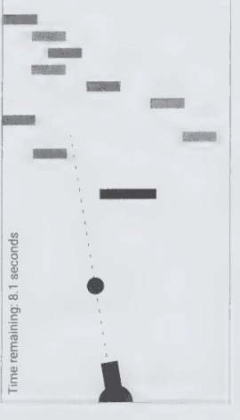

## 218 第 6 章 大炮游戏应用

### 大纲

- 6.1 引言
- 6.2 测试大炮游戏应用
- 6.3 技术概述
- 6.3.1 使用资源文件夹 `res/raw`
- 6.3.2 Activity 和 Fragment 生命周期周期方法
- 6.3.3 重写 View 方法 `onTouchEvent`
- 6.3.4 使用 `SoundPool` 和 `AudioManager` 添加声音
- 6.3.5 使用线程、`SurfaceView` 和 `SurfaceHolder` 进行逐帧动画
- 6.3.6 简单的碰撞检测
- 6.3.7 沉浸式模式
- 6.4 构建 GUI 和资源文件
- 6.4.1 创建项目
- 6.4.2 调整主题以移除应用标题
- 6.4.3 `strings.xml`
- 6.4.4 颜色
- 6.4.5 为应用添加声音
- 6.4.6 添加 `MainActivity`
- 6.4.7 `activity_main`
- 6.4.8 添加 `fragment_main`
- 6.5 应用概述
- 6.6 Activity 的子类
- 6.7 Fragment 的子类
- 6.8 类的子类
- 6.9 元素的类
- 6.10 元素的子类
- 6.11 类
- 11.1 变量和构造函数
- 11.2 对齐
- 11.3 发射炮弹
- 11.4 绘制
- 11.5 方法：获取炮弹、移除炮弹
- 12. 元素的子类
- 12.1 变量和构造函数
- 12.2 方法：半径、碰撞、反转速度
- 12.3 更新
- 12.4 绘制
- 13. `SurfaceView` 的子类
- 13.1 包和导入
- 13.2 变量和构造函数
- 13.3 重写 View：`onSizeChanged`
- 13.5 方法：屏幕宽、高、播放声音
- 13.6 新游戏
- 13.7 更新位置
- 13.8 对齐并发射
- 13.9 显示游戏结束
- 13.10 绘制元素
- 13.11 停止游戏和释放资源
- 13.2 实现 `SurfaceHolder.Callback`
- 13.4 重写 View：`onTouchEvent`
- 13.5 线程以创建游戏循环
- 13.16 方法：隐藏系统栏、显示系统栏
- 14 总结

## 6.1 引言

大炮游戏挑战你在十分过期前摧毁九个目标（见图 6）。游戏由视觉组件组成：一个由你控制的大炮、九个目标以及一个防御目标的障碍。我们要感谢 Hugo Bersini 教授（Editions Informatique 出版的法语面向对象编程书籍作者）为我们原始应用的重构提供的宝贵建议。我们的灵感源自《iOS 8 for Programmers: An App-Driven Approach》。

### 6.1 引言 219

通过触摸屏幕发射大炮——大炮将指向触摸点并向该方向发射大炮弹。

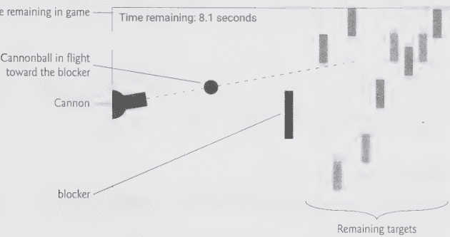

图 6.1 | 完成的应用。

每当你摧毁一个目标时，剩余时间会增加三秒奖金；每当你击中障碍时，剩余时间会扣除两秒惩罚。在时间耗尽前摧毁所有目标即可胜利——如果计时器归零，你就输了。游戏结束时，应用会显示你是赢还是输了，并显示发射次数和经过的时间（见图 6.2）。

| a) 用户摧毁所有目标后显示的对话框 | b) 用户摧毁所有目标前游戏结束显示的对话框 |
|---|---|
| **你赢了！**<br>发射次数：18 次<br>总时间：21.7 秒 | **你输了！**<br>发射次数：5 次<br>总时间：7.0 秒 |
| 重置游戏 | 重置游戏 |

图 6.2 大炮游戏显示胜利和失败的对话框。

当你发射大炮时，游戏会播放发射声。当大炮弹击中目标时，会播放玻璃破碎声，该目标消失。当大炮弹击中障碍时，会播放命中声，大炮弹弹回。障碍无法被摧毁。每个目标和障碍都会以不同的速度垂直移动，并在碰到顶部或底部时改变方向。

注意：Android 模拟器在某些计算机上运行缓慢。为了获得最佳体验，你应该在 Android 设备上测试此应用。在缓慢的模拟器上，大炮弹有时会穿过障碍或目标。

## 6.2 测试大炮游戏应用

### 打开并运行应用

打开 Android Studio，并从书籍示例文件夹中的 `CannonGame` 文件夹打开 `Cannon Game` 应用，在 AVD（Android 模拟器）或设备上运行应用。这将构建项目并运行应用。

### 游戏

点击屏幕以瞄准并发射大炮。只有当屏幕上没有另一把大炮时，你才能发射炮弹。如果你在 AVD 上运行，鼠标就是你的“手指”。尽快摧毁所有目标——计时器结束或你摧毁了所有九个目标时游戏结束。

## 6.3 技术概述

本节将按照在章节中出现的顺序，介绍我们在大炮游戏应用中使用的新技术。

### 6.3.1 使用资源文件夹 `res/raw`

媒体文件（例如大炮游戏应用中使用的声音）放置在应用程序的资源文件夹 `res/raw` 中。第 6.4.5 节讨论了如何创建此文件夹。你会将声音文件拷贝到该文件夹。

### 6.3.2 Activity 和 Fragment 生命周期方法

我们在第 5.3.1 节中介绍了 Activity 和 Fragment 的生命周期方法。此应用使用了 Fragment 生命周期方法 `onDestroy`。当 Activity 关闭时，会调用 `onDestroy` 方法，该方法反过来调用 Activity 托管的所有 Fragment 的 `onDestroy` 方法。我们在 `MainActivityFragment` 中使用此方法来释放 `CannonView` 的声音资源。

> 错误预防提示 6.1  
> `onDestroy` 不保证会被调用，因此它应该只用于释放资源，而不是用于保存数据。Android 文档建议你在 `onPause` 或 `onSaveInstanceState` 中保存数据。

### 6.3.3 重写 View 方法 `onTouchEvent`

用户通过触摸设备屏幕与此应用交互。触摸操作会将大炮对准屏幕上的面朝点，然后发射大炮。为了为 `CannonView` 处理简单的触摸事件，你需要重写 View 方法 `onTouchEvent`（第 6.13.14 节），并使用来自类 `MotionEvent`（包 `android.view`）的常量来测试发生了哪种类型的事件并进行正确处理。

### 6.3.4 使用 `SoundPool` 和 `AudioManager` 添加声音

应用程序的音效通过 `SoundPool`（包 `android.media`）进行管理，我们用它来加载、播放和卸载声音。声音使用 Android 的音频流之一播放，适用于闹钟、音乐、通知、电话铃声、系统声音、电话等。你将配置并创建一个 `SoundPool` 对象。你还将使用 `AudioAttributes.Builder` 创建一个与 `SoundPool` 关联的 `AudioAttributes` 对象。我们调用 `AudioAttributes.setUsage` 方法将游戏设计为音频。Android 文档建议游戏使用音乐音频流播放声音，因为流音量可以通过设备的音量按钮控制。此外，我们使用 Activity 的 `setVolumeStream` 方法来管理游戏音量，由设备的音量按钮控制。该方法接收来自类 `AudioManager`（包 `android.media`）的常量，该类提供了设备音量和电话铃声控制。

### 6.3.5 使用线程、`SearchView` 和 `SurfaceHolder` 进行帧动画

此应用通过从单独执行线程更新游戏元素来手动执行动画。为了实现这一点，我们使用 `Thread` 的子类，并包含一个 `run` 方法，该方法通过绘制我们的自定义画布（Canvas）来更新游戏元素的位置，然后对其进行绘制。`run` 方法驱动逐帧动画——这被称为游戏循环。

所有对应用程序用户面的更新必须在 GUI 执行线程中进行，因为 GUI 组件不是线程安全的——在 GUI 线程之外执行更新可能会损坏 GUI。然而，它们通常需要需要在单独执行线程中执行的复杂逻辑，而这些线程通常需要绘制到屏幕上。对于此类情况，Android 提供了 `SearchView` 类——它是 `View` 的子类，提供了一个专门的绘制区域，其他线程可以在其中线程安全的方式在屏幕上显示图形。

> 性能提示 6.1  
> 尽量减少在 GUI 线程中执行的工作量是关重要的，以确保 GUI 保持响应，且不显示 ANR（应用程序无响应）对话框。

你通过 `SurfaceHolder` 类的对象操作 `SurfaceView`，这允许你获取一个可以在上面绘制图形的 `Canvas`。`SurfaceHolder` 还提供了允许线程独占访问 `Canvas` 进行绘制的方法——一次只有一个线程可以向 `SurfaceView` 绘制。每个 `SurfaceView` 子类都应该实现 `SurfaceHolder.Callback` 接口，该接口包含在 `SurfaceView` 创建、更改（例如其尺寸或方向变化）或销毁时被调用的方法。

### 6.3.6 简单碰撞检测

`Canvas` 执行简单的碰撞检测，以确定炮弹是否已与大炮的任何边缘、阻挡器或目标部分发生碰撞。这些技术在第 6.13.11 节中介绍。

游戏开发框架通常提供更复杂的“像素级”碰撞检测能力。有许多此类框架（免费和基于免费）用于开发从 2D 游戏到最复杂的 3D 主机游戏（如 Sony 的 PlayStation® 和 Microsoft 的 Xbox®）。图 6.3 列出了一些游戏开发框架——有几十个。许多支持多平台，包括 Android 和 iOS，以及某些 C++ 或编程语言。

| 游戏开发框架 |
|---|
| Android | http://android.com |
| Cocos2d | http://cocosd.org |
| GameMaker | http://gamemaker.com |
| libgdx | http://libgdx.org |
| Unity | http://unity.com |
| Unreal Engine | http://unreal.com |

## 6.4 构建 GUI 和资源文件

### 6.4.1 创建项目

对于此应用，我们使用空 Activity。在新建项目对话框中，指定：

- 应用名称：Cannon Game
- 公司名称：（或指定自己的）

在布局中，从 `activity_main.xml` 删除 `Hello world!` TextView。

#### 为应用配置横屏

大炮游戏专为横屏设计。按照第 3.7 节的步骤将屏幕设置为横屏。

### 6.4.2 调整移除标题应用栏

如第 6.3 节所述，游戏开发者通常使用全屏主题，例如 `Theme.Material.NoActionBar`。AppCompat 主题默认不全屏。要这样做：

1. 打开 `styles.xml`。
2. 在 `<style>` 元素中添加以下行：

```xml
<item name="windowNoTitle">true</item>
<item name="windowActionBar">false</item>
<item name="android:windowFullScreen">true</item>
```


第一行表示不显示标题（通常是应用名称）。第二行表示不显示应用栏。最后一行表示应用使用全屏。

### 6.4.3 strings.xml

我们在之前的章节中创建了 String 资源，因此这里只显示 String 名称和对应值的表格（图 6.4）。双击`res/values`文件夹中的`strings.xml`，然后点击 Editor 链接显示创建这些 String 资源的翻译编辑器。

| Key | Value |
|---|---|
| `results_format` | 射次数：%d\n总时间：%2.f |
| `reset_game` | 重置游戏 |
| `win` | 你赢了！ |
| `lose` | 你输了！ |
| `time_remaining_format` | 剩余时间：%f 秒 |

> 图 6.4 应用使用的 String 资源。

### 6.4.4 颜色

此应用在 Canvas 上交替绘制目标。对于此应用，我们在`colors.xml`中添加了以下深蓝色和黄色颜色资源：

```xml
<color name="dark">#1976D2</color>
<color name="light">#FFE100</color>
```

### 6.4.5 为应用添加声音

之前提到的，声音文件存储在应用程序的`res/raw`文件夹中。此应用使用了三个声音文件——`blocker_hit.wav`、`target_hit.wav`和`cannon_fire.wav`，它们位于书籍示例的`sounds`文件夹中。将这些文件添加到你的项目中的：

## 224 第 6 章 大炮游戏 App

1. 右键点击应用程序的`res`文件夹，然后选择 **New > Android directory**，打开“New Resource Directory”对话框。
2. 在 Resource type 下拉菜单中，选择`raw`。目录名称将自动变为`raw`。
3. 点击 **OK** 创建文件夹。
4. 将音频文件复制并粘贴到`res/raw`文件夹。在出现的 Copy 对话框中，点击 **OK**。

### 6.4.6 添加 MainActivityFragment 类

接下来，你将向项目添加`MainActivityFragment`：

1. 在 Project 窗口中，右键点击`com.deitel.cannongame`节点，并选择 **New > Fragment > Fragment (Blank)**。
2. 指定 Name 为`MainActivityFragment`，指定 Fragment Layout Name 为`fragment_main`。
3. 取消勾选 **Include fragment factory methods?** 和 **Include interface callbacks?**。

默认情况下，`fragment_main.xml`包含一个显示`TextView`的`FrameLayout`。`FrameLayout`设计用于显示一个 View，但也可以用于分层视图。移除`TextView`——在此应用中，`FrameLayout`将显示`CannonView`。

### 6.4.7 编辑 activity_main.xml

在此应用中，MainActivity 的布局只显示 MainActivityFragment。按照如下步骤编辑布局：

1. 在布局编辑器中打开`activity_main.xml`并切换到 Text 标签页。
2. 将 Relative 改为`fragment`并移除 padding 属性，使 fragment 元素填充整个屏幕。
3. 切换到 Design 视图，在 Component Tree（组件树）中选择 fragment，然后将 id 设为`fragment`。
4. 将 name 设置为`com.deitel.cannongame.MainActivityFragment`——不要手动输入此内容，点击 name 属性值字段右侧的省略号按钮，然后从出现的 Fragments 对话框中选择该类。

记住，布局编辑器的 Design 视图可以显示特定布局中显示的 fragment 预览。如果不指定要预览哪个 fragment，布局编辑器将显示“Rendering Problems”（渲染问题）消息。要指定预览的 fragment，请在 Design 视图或 Component Tree 中点击 fragment，然后点击 **Choose Preview Layout...**。随后在 Resources 对话框中选择 fragment 布局的名称。

### 6.4.8 为 fragment_main.xml 添加 CannonView

你现在将向`fragment_main.xml`添加`CannonView`。你必须先创建`CannonView`，以便在布局中放置 CustomView 时可以选择`CannonView`：遵循以下步骤创建`CannonView.java`并将 CannonView 添加到布局中：

## 6.5 本应用类概述

1. 展开 Project 窗口中的`java`文件夹。
2. 右键点击包`com.deitel.cannongame`文件夹，然后选择 **New > Java Class**。
3. 在出现的 **Create New Class** 对话框中，在 Name 字段输入`CannonView`，然后点击 **OK**。文件将在编辑器中自动打开。
4. 在`CannonView.java`中，指定`CannonView`继承`SurfaceView`。如果没有出现`android.view.SurfaceView`类的 import 语句，将光标放在类名`SurfaceView`的末尾。点击行开头上方出现的红色灯泡菜单 ( ) 并选择 **Import Class**。
5. 如果你尚未这样做，将光标放在`SurfaceView`的末尾。点击出现的红色灯泡菜单并选择 **Create constructor matching super**。在出现的 **Choose Super Class Constructor** 对话框的列表中选择两个参数的构造函数，然后点击 **OK**。IDE 将自动将构造函数添加到文件中。
6. 回到布局编辑器中`fragment_main.xml`的 **Design** 视图。
7. 点击 Palette（调板）中 **Custom** 部分的 **CustomView**。
8. 在出现的 **Views** 对话框中，选择`CannonView (com.deitel.cannongame)`，然后点击 **OK**。
9. 悬停并点击 Component Tree 中的`FrameLayout`。该视图（CustomView）——即`CannonView`——应该出现在`FrameLayout`内部 Component Tree 中。
10. 确保在 Component 窗口中选择了 view (CustomView)。在 Properties 窗口中，将 **layout:width** 和 **layout:height** 设置为`match_parent`。
11. 在 Properties 窗口中，将 **id** 改为`CannonView`。
12. 保存并关闭`fragment_main.xml`。

此应用由八个类组成：

- MainActivity（Activity 子类；第 6.6 节）——托管 MainActivityFragment。
- MainActivityFragment（第 6.7 节）——显示 CannonView。
- GameElement（第 6.8 节）——用于在屏幕上上下移动（Blocker 和 Target）或横向移动（Cannonball）的物品子类。
- Blocker（第 6.9 节）——代表障碍物，使摧毁目标更具挑战性。
- Target（第 6.10 节）——代表被炮弹摧毁的目标。
- Cannon（第 6.11 节）——代表大炮，每当用户触摸屏幕时都会发射一个炮弹。
- Cannonball（第 6.12 节）——代表用户触摸屏幕时发射的炮弹。
- CannonView（第 6.13 节）——包含游戏逻辑并协调 Blocker、Targets、Cannonball 和 Cannon 的行为。

你必须创建`GameElement`、`Blocker`、`Target`、`Cannonball`和`Cannon`类。对于每个类，右键点击`com.deitel.cannongame`文件夹。

## 6.6 MainActivity Activity 的子类

MainActivity（第 6.5 节）是 MainActivityFragment 的宿。在此应用中，我们重写`onCreate`方法来加载布局。

```java
// MainActivity.java

// MainActivity 显示 MainActivityFragment

package com.deitel.cannongame;

import android.os.Bundle;

import androidx.appcompat.app.AppCompatActivity;

public class MainActivity extends AppCompatActivity {

    // Activity 启动时调用

    @Override
    protected void onCreate(Bundle savedInstanceState) {
        super.onCreate(savedInstanceState);
        setContentView(R.layout.activity_main);
    }
}
```

## 6.7 MainActivityFragment Fragment 的子类

MainActivityFragment（第 6.6 节）创建 Fragment。在此应用中，我们重写`onCreateView`方法返回视图。

```java
// MainActivityFragment.java

// MainActivityFragment 创建 CannonView

package com.deitel.cannongame;

import android.media.AudioManager;
import android.os.Bundle;
import android.support.v4.app.Fragment;
import android.view.LayoutInflater;
import android.view.View;
import android.view.ViewGroup;

public class MainActivityFragment extends Fragment {

    private CannonView cannonView; // 显示游戏的自定义视图

    // 当 Fragment 的视图需要创建时调用

    @Override
    public View onCreateView(LayoutInflater inflater, ViewGroup container,
        Bundle savedInstanceStateState) {

        super.onCreateView(inflater, container, savedInstanceStateState);

        // 加载 fragment_main.xml 布局
        View view =
            inflater.inflate(R.layout.fragment_main, container, false);

        // 获取 CannonView 的引用
        cannonView = (CannonView) view.findViewById(R.id.cannonView);

        return view;
    }

    // 当 Activity 创建后设置音量

    @Override
    public void onCreateCreated(Bundle savedInstanceStateState) {
        super.onCreateCreated(savedInstanceStateState);

        // 允许音量按钮设置游戏量
        getActivity().setVolumeControlStream(AudioManager.STREAMMUSIC);
    }

    // 当 MainActivity 暂停时，停止游戏

    @Override
    public void onPause() {
        super.onPause();
        cannonView.stopGame(); // 停止游戏
    }
}
```

## 228 第 6 章 大炮游戏 App

```java
49 super.onDestroy();
50 cannonView.releaseResources();
51 }
52 }
```

**图 6.6** MainActivityFragment 创建并管理 CannonView。（2部分2部分）

## 6.8 GameElement 类

GameElement（图 6.7）——Blocker（障碍物）、Target（目标）和 Cannonball（炮弹）的父类——包含了大炮游戏应用中移动对象的公共数据和功能。

```java
1 // GameElement.java
2 // 表示一个矩形边界的游戏元素
3 package com.deitel.cannongame;

5 import android.graphics.Canvas;
6 import android.graphics.Paint;
7 import android.graphics.Rect;

9 public class GameElement { // 此 GameElement 的视图
10 protected CanvasView view;
11 protected Paint paint = new Paint(); // 用于绘制此 GameElement 的 Paint
12 protected Rect shape; // GameElement 的矩形边界
13 private float velocityY; // 此 GameElement 的垂直速度
14 private int soundID; // 与此 GameElement 关联的声音

16 // 公有构造函数
17 public GameElement(CanvasView view, int color, int soundID, int x,
18 int y, int width, int length, float velocityY) {
19 this.view = view;
20 paint.setColor(color);
21 shape = new Rect(x, y, x + width, y + length); // 设置边界
22 this.soundID = soundID;
23 this.velocityY = velocityY;
24 }

26 // 更新 GameElement 位置并检查与墙的碰撞
27 public void update(double interval) {
28 // 更新垂直位置
29 shape.offset(0, (int)(velocityY * interval));

30 // 如果此 GameElement 与墙碰撞，反转方向
31 if ((shape.top < 0 && velocityY > 0) ||
32 (shape.bottom > view.getScreenHeight() && velocityY < 0))
33 velocityY *= -1; // 反转此 GameElement 的速度
34 }
```

**图 6.7** GameElement 类表示一个矩形边界的游戏元素。（1部分2部分）

### 6.8 GameElement 类

```java
// 在给定的 Canvas 上绘制此 GameElement
public void draw(Canvas canvas) {
    canvas.drawRect(shape, paint);
}

// 播放与此类型 GameElement 对应的声音
public void playSound() {
    view.playSound(soundId);
}
```


**图 6.7** `GameElement` 类表示一个矩形边界的游戏元素。（2部分2部分）

### 6.8.1 实例变量和构造函数

`GameElement` 构造函数接收 `CannonView`（第 6.13 节）的引用，该视图实现了游戏逻辑并绘制游戏元素。构造函数接收一个表示 `GameElement` 32 位颜色的 `int`，以及一个表示与此 `GameElement` 关联的声音 ID 的 `int`。`CannonView` 存储了游戏中所有的声音，并为每个声音提供一个 ID。构造函数还接收：

- 表示 `GameElement` 左上角 x 和 y 位置的 `int`
- 表示其宽度和高度的 `int`，以及
- 此 `GameElement` 的垂直速度 `velocityY`。

第 20 行设置 `paint` 对象的颜色，使用传递给构造函数的颜色的 `int` 表示。第 21 行计算 `GameElement` 的边界并将其存储在表示矩形的 `Rect` 对象中。

### 6.8.2 方法 `update`、`draw` 和 `playSound`

`GameElement` 拥有以下方法：

- `update`（第 27–35 行）——在游戏循环的每次迭代中，都会调用此方法来更新 `GameElement` 的位置。第 29 行根据垂直速度（`velocityY`）和两次调用 `update` 之间经过的时间（该方法通过 `interval` 接收）来更新 `shape` 的垂直位置。第 32–34 行检查此 `GameElement` 是否与屏幕顶部或底部边缘碰撞，如果是，则反转其垂直速度。
- `draw`（第 38–40 行）——当 `GameElement` 需要在屏幕上绘制时，会调用此方法。该方法接收一个 `Canvas` 并将此 `GameElement` 作为矩形绘制在屏幕上——我们将在 `Cannonball` 类中重写此方法以绘制圆形。`GameElement` 的 `paint` 实例变量指定了矩形的颜色，而 `GameElement` 的 `shape` 指定了矩形在屏幕上的边界。
- `playSound`（第 43–45 行）——每个游戏元素都有一个关联的声音，可以通过调用 `playSound` 方法进行播放。此方法将 `soundId` 实例变量的值传递给 `CannonView` 的 `playSound` 方法。`Cannonball` 类加载并维护了对游戏声音的引用。

## 6.9 `GameElement` 的子类 `Blocker`

`Blocker` 类（图 6.8）——`GameElement` 的子类——表示障碍物，它使得玩家更难破坏目标。如果 `Cannonball` 与 `Blocker` 碰撞，则从剩余时间中减去 `Blocker` 的 `missPenalty`（缺失惩罚）。`getMissPenalty` 方法（第 17–19 行）返回 `missPenalty`——此方法从 `CannonView` 的 `testColorFisions`（第 6.13.11 节）调用。`Blocker` 构造函数（第 9–14 行）将其参数和障碍声音的 ID 传递给父构造函数（第 11 行），由该构造函数初始化 `missPenalty`。

```java
// Blocker.java

// 针对 Blocker 定制的 GameElement 子类

package com.deitel.cannongame;

public class Blocker extends GameElement {

    private int missPenalty; // 此 Blocker 的缺失惩罚

    // 构造函数

    public Blocker(CanvasView view, int color, int missPenalty, int x,

        int y, int width, int length, float velocityY) {

        super(view, color, BLOCKER_SOUND_ID, x, y, width, length);

        this.missPenalty = missPenalty;

    }

    // 返回缺失惩罚

    public int getMissPenalty() {

        return missPenalty;

    }

}
```

**图 6.8** `GameElement` 的子类 `Blocker`

## `GameElement` 的子类 `Target`

`Target` 类（图 6.9）——`GameElement` 的子类——表示玩家可以破坏的目标。如果 `Cannonball` 与 `Target` 碰撞，则 `Target` 的 `hitReward` 加入剩余时间。`getHitReward` 方法（第 17–19 行）返回 `hitReward`——此方法从 `CannonView` 的 `testColorFisions`（第 6.13.11 节）调用。`Target` 构造函数（第 9–14 行）将其参数和目标声音的 ID 传递给父构造函数（第 11 行），由该构造函数初始化 `hitReward`。

```java
// Target.java

// 针对 Target 定制的 GameElement 子类

package com.deitel.cannongame;

public class Target extends GameElement {

    private int hitReward; // 此目标的命中奖励

    // 构造函数

    public Target(CanvasView view, int color, int hitReward, int x,

        int y, int width, int length, float velocityY) {

        super(view, color, TARGET_SOUND_ID, x, y, width, length, velocityY);

        this.hitReward = hitReward;

    }

    // 返回命中奖励

    public int getHitReward() {

        return hitReward;

    }

}
```

**图 6.9** `GameElement` 的子类 `Target`

## 6.11 `Cannon` 类

`Cannon` 类（图 6.10–6.14）代表大炮游戏中的大炮。大炮拥有底座和炮管，并可以发射炮弹。

### 6.11.1 实例变量和构造函数

`Cannon` 构造函数（图 6.10）有四个参数。它接收：

- 该 `Cannon` 所在的 `CannonView`（`view`）
- 大炮底座的半径（`baseRadius`）
- 炮管的长度（`barrelLength`）以及
- 炮管的宽度（`barrelWidth`）。

第 25 行设置 `Point` 对象的描边宽度，以便炮管以给定的 `barrelWidth` 绘制。第 27 行对齐大炮的炮管，使其初始与屏幕顶部和底部边缘平行。`Cannon` 类有一个用于绘制炮管的 `Point barrelEnd`、用于存储炮管当前角度的 `barrelAngle`，以及用于存储最近发射的（如果它仍在屏幕上）的 `cannonball`。

```java
// Cannon.java

// 表示大炮并发射炮弹

package com.deitel.cannongame;

import android.graphics.Canvas;

import android.graphics.Color;

import android.graphics.Paint;

import android.graphics.Point;
```

**图 6.10** `Cannon` 实例变量和构造函数。（1部分2部分。）

## 232 第 6 章 大炮游戏应用

```java
line 10 public class Cannon {

    private int baseRadius; // 大炮底座半径

    private int barrelLength; // 炮管长度

    private Point barrelEnd = new Point(); // 炮管的终点

    private double barrelAngle; // 炮管的角度

    Cannonball cannonball; // 大炮的炮弹

    private Paint paint = new Paint(); // 用于绘制大炮的画

    CannonView view; // 包含大炮的视图

    // 构造函数

    public Cannon(CannonView view, int baseRadius, int barrelLength,

                  int barrelWidth) {

        this.view = view;

        this.baseRadius = baseRadius;

        this.barrelLength = barrelLength;

        paint.setStrokeWidth(barrelWidth); // 设置炮管宽度

        paint.setColor(Color.BLACK); // 大炮颜色为黑色

        align(Math.PI / 2); // 炮管指向右侧

    }

}
```

**图 6.10** 大炮的实例变量和构造函数。（部分 2/2）

### 6.11.2 方法 `align`

`align` 方法（图 6.11）用于瞄准大炮。该方法接收弧度单位的炮角作为参数。我们使用 `cannonLength` 和 `barrelAngle` 来确定炮管终点 `barrelEnd` 的 x-y 坐标值——这被用于从屏幕左边缘的大炮中心到大炮炮管终点绘制直线。第 32 行存储了 `barrelAngle`，以便以后可以按角度发射炮弹。

```java
line 30 // 将大炮炮对齐到给定角度

line 31 public void align(double barrelAngle) {

    line 32 this.barrelAngle = barrelAngle;

    line 33 barrelEnd.x = (int)(barrelLength * Math.sin(barrelAngle));

    line 34 barrelEnd.y = (int)(-barrelLength * Math.cos(barrelAngle)) +

    line 35 view.getHeight() / 2;

}
```

**图 6.11** | 大炮方法 `align`。

### 6.11.3 方法 `fireCannonball`

`fireCannonball` 方法（图 6.12）将炮弹跨越屏幕发射到当前的轨迹（`barrelAngle`）。第 41–46 行计算炮弹速度的水平和垂直分量。第 49–50 行计算炮弹的半径，该半径为屏幕高度的 `CannonView.CANNONBALL_RADIUS_PERCENT`。第 53–56 行“装装大炮”（即创建一个新的 `Cannonball` 并将其放置在大炮内部）。最后，我们播放炮弹的发射音（第 58 行）。

```java
line 38 // 在大炮指向的方向发射炮弹

line 39 public void fireCannonball() {

    line 40 // 计算炮弹速度的 x 分量

    line 41 int velocityX = (int) (CannonView.CANNONBALL_SPEED_PERCENT *

    line 42 view.getScreenWidth() * Math.sin(barrelAngle));

    line 44 // 计算炮弹的 y 分量

    line 45 int velocityY = (int) (CannonView.CANNBALL_SPEED_PERCENT *

    line 46 view.getScreenWidth() * Math.cos(barrelAngle));

    line 48 // 计算炮弹的半径

    line 49 int radius = (int) (view.getScreenHeight()) *

    line 50 CannonView.CANNBALL_RADIUS_PERCENT);

    line 52 // 构建炮弹并将其放置在大炮中

    line 53 cannonball = new Cannonball(view, Color.BLACK,

    line 54 CannonView.CANON_SOUND_ID, -radius,

    line 55 view.getScreenHeight() / 2 - radius, radius, velocityX,

    line 56 velocityY);

    line 58 cannonball.playSound(); // 播放发射炮弹音

}
```

图 6.12 | 大炮方法 `fireCannonball`。

### 6.11.4 方法 `draw`

`draw` 方法（图 6.13）在屏幕上绘制大炮。我们分两部分绘制大炮。首先绘制大炮的炮管，然后绘制大炮的底座。

```java
line 61 // 在画布上绘制大炮

line 62 public void draw(Canvas canvas) {

    line 63 // 绘制炮管

    line 64 canvas.drawLine(0, view.getScreenHeight() / 2, barrelEnd.x,

    line 65 barrelEnd.y, paint);

    line 67 // 绘制大炮底座

    line 68 canvas.drawCircle(0, (int) view.getScreenHeight() / 2,

    line 69 (int) baseRadius, paint);

}
```

图 6.13 | 大炮方法 `draw`。

使用大炮方法 `drawLine` 绘制炮管：我们使用 `drawLine` 方法显示大炮炮（第 64–65 行）。该方法接收五个参数——线条起点和终点的 x-y 坐标，最后一个是指定线条特征（如厚度）的 `Paint` 对象。回想 `paint` 已经配置为使用构造函数中给出的厚度绘制炮管（图 6.10，第 25 行）。

使用 `Canvas` 方法 `drawCircle` 绘制大炮底座：第 68–69 行使用 `drawCircle` 方法绘制底座，中心位于屏幕左边缘。

# 第 236 章 第 6 章 大炮游戏应用

炮弹边界。如果炮弹与 `GameElement` 碰撞，必须满足以下两个条件：

- 炮弹的边界（存储在 `Rect` 形状中）必须与指定的 `GameElement` 形状的边界相交。使用 `Rect` 的 `intersects-rectf` 方法来检查炮弹边界与给定的 `GameElement` 边界是否相交。
- 炮弹必须水平方向向指定的 `GameElement` 移动。炮弹从左向右移动（除非撞击障碍物）。如果 `velocityX`（水平速度）为正，则炮弹正从左向右向指定的 `GameElement` 移动。

**使用 `reverseVelocity` 反转炮弹水平速度**

`reverseVelocity` 方法通过将 `velocityX` 乘以 -1 来反转炮弹的水平速度。如果 `collidesWith` 方法返回 true，View 方法 `testCollisions` 将调用 `reverseVelocity` 来反转球的水平速度，使炮弹向大炮弹回（第 6.13.11 节）。

### 6.12.3 方法 `update`

`update` 方法（图 6.17）首先调用父类的 `update` 方法（第 44 行）来更新炮弹的垂直速度并检查垂直碰撞。第 47 行使用 `Rect` 的 `offset` 方法水平平移该炮弹的边界。我们将水平速度（`velocityX`）乘以经过的时间（`interval`）来确定位移量。第 50–53 行，如果炮弹撞击屏幕边缘之一，则将 `onScreen` 设置为 false。

```java
// updates the Cannonball's position

@Override

public void update(double interval) {

    super.update(interval); // updates Cannonball's vertical velocity

    // update horizontal position

    shape.offset((int) (velocityX * interval));

    // if Cannonball goes off the screen

    if (shape.top < 0 || shape.left < 0 ||

        shape.bottom > view.getScreenHeight() ||

        shape.right > view.getScreenWidth())

        onScreen = false; // set it to be removed

}
```


图 6.17 | 重写的 `GameElement` 方法 `update`。

## 6.12.4 方法 `draw`

`draw` 方法（图 6.18）重写了 `GameElement` 的 `draw` 方法，并使用 `Canvas` 的 `drawCircle` 方法在当前位置绘制炮弹。前几个参数代表圆心的坐标。第三个参数是圆的半径。最后一个参数是指定圆绘制特征的 `Paint` 对象。

# 6.13 `CannonView`（`SurfaceView` 的子类）

`CannonView`（图 6.19–6.33）是 `View` 的自定义子类，它实现了大炮游戏的逻辑并在屏幕上绘制游戏对象。

## 6.13.1 `package` 和 `import` 语句

图 6.19 列出了 `CannonView` 类的 `package` 语句和 `import` 语句。第 6.3 节讨论了 `CannonView` 使用的新类和接口。我们在图 6.19 中高亮了它们。

```java
// CannonView.java

// Displays and controls the Cannon Game

package com.deitel.cannongame;

import android.app.Activity;
import android.app.AlertDialog;
import android.app.Dialog;
import android.app.DialogFragment;
import android.content.Context;
import android.content.DialogInterface;
import android.graphics.Canvas;
import android.graphics.Color;
import android.graphics.Point;
import android.graphics.Point;
import android.media.AudioAttributes;
import android.media.SoundPool;
import android.os.Build;
import android.os.Bundle;
import android.util.AttributeSet;
import android.util.Log;
import android.util.SparseIntArray;
import android.view.MotionEvent;
import android.view.SurfaceHolder;
import android.view.Surface;
import android.view.View;

import java.util.ArrayList;
import java.util.Random;
```

**图 6.19** | `CannonView` 类的 `package` 语句和 `import` 语句。（2 部分中的第 1 部分。）

```java
public class CannonView extends SurfaceView
implements SurfaceHolder.Callback {
```

**图 6.19** | `CannonView` 类的 `package` 语句和 `import` 语句。（2 部分中的第 2 部分。）

## 6.13.2 实例变量和常量

图 6.20 列出了 `CannonView` 类中大量的常量和实例变量。我们将在讨论遇到它们时逐一解释。许多常量用于根据屏幕尺寸缩放游戏元素的大小计算。

```java
private static final String TAG = "CannonView"; // CannonView
```

```java
// draws the Cannonball on the given canvas

@Override
public void draw(Canvas canvas) {
    canvas.drawCircle(shape.left + getRadius(),
        shape.top + getRadius(), getRadius(), paint);
}
```

**图 6.18** | 重写的 `Game` 方法 `draw`。

# 240 第 6 章 大炮 Cannon App

```java
// 为游戏音频配置音频属性

AudioAttributes.Builder attrBuilder = new AudioAttributes.Builder();
attrBuilder.setUsage(AudioAttributes.USAGE_GAME);

// 初始化 SoundPool 以播放 app 的音效

soundPool.builder = new SoundPool.Builder();
builder.setMaxStreams(1);
builder.setAudioAttributes(attrBuilder.build());
soundPool = builder.build();

// 为声音创建映射表并预加载声音

soundMap = new SparseArray(3); // 创建新的 SparseArray
soundMap.put(TARGET_SOUND, ID);
soundPool.load(context, R.raw.target_hit, 1);

soundMap.put(CANON_SOUND_ID, R.raw.cannon_fire, 1);
soundPool.load(context, R.raw.blocker_SOUND_ID, 1);
```

```java
textPaint = new Paint();

backgroundPaint = new Paint();
backgroundPaint.setColor(Color.WHITE);
```

图 6.21 | `CannonView` 构造函数。（第 2 部分，共 2 部分。）

## 注册 `SurfaceHolder.Callback`

第 102 行将此（即 `CannonView`）注册为 `SurfaceHolder.Callback`，当 `SurfaceView` 被创建、更新和销毁时，它会接收方法调用。继承自 `SurfaceView` 的方法 `getHeight` 返回管理 `SurfaceView` 的 `SurfaceHolder` 对象，而 `SurfaceHolder` 的 `addCallback` 则存储实现 `SurfaceHolder.Callback` 的对象。

# 配置 `SoundPool` 并加载声音

第 105–121 行配置了我们在 app 中使用的声音。我们创建了一个 `AudioAttributes.Builder` 对象（第 105 行）并调用了 `setUsage` 方法（第 106 行），该方法接收一个表示音频用途的常量。对于此 app，我们使用 `AudioAttribute.USAGE_GAME` 常量，表示该音频被用作游戏音频。

接下来，我们创建了一个 `SoundPool.Builder` 对象（第 109 行），这将允许我们创建 `SoundPool` 来加载和播放 app 的音效。接着，我们调用 `SoundPool.Builder.setMaxStreams` 方法（第 110 行），它接收一个表示可以同时播放的最大声音流数量的参数。我们一次只播放一个声音，因此传入了 1。一些更复杂的游戏会同时播放许多声音。然后，我们使用 `audioAttributes.Builder.setAudioAttributes` 方法（第 111 行），在创建 `SoundPool` 对象后使用这些音频属性。

第 115 行创建了一个 `SparseArray(soundMap)`，它将整数键映射到整数值。它与 `HashMap<Integer, Integer>` 相似，但对于小数据量来说效率更高。在某种情况下，我们将键值对映射到声音（第 6.20 行，第 86–88 行）。`SoundPool` 的 `load` 方法接收三个参数：`Context`、表示声音文件的 ID 以及优先级（根据文档，最后一个参数用于加载声音，应指定为 1）。第 119 和 121 行返回 `SoundPool` 的值（第 6.21 行，第 117–121 行）。

# 用于绘制背景和文本的 `Paint` 对象

第 123–124 行创建了用于绘制背景和文本的 `Paint` 对象。背景颜色设置为黑色，第 125 行将其设置为白色。

# 6.13.4 重写 `View` 方法

图 6.22 的 `onChanged` 方法在 `View` 添加到层次结构时调用，并在其大小改变时更新。第 126–127 行的 `onChanged` 方法用于重置游戏状态。第 128–129 行的 `onChanged` 方法用于初始化变量。

第 130–131 行的 `onChanged` 方法用于设置计时器。第 132–133 行的 `onChanged` 方法用于设置 �。第 134–135 行的 `onChanged` 方法用于设置 �。第 136–137 行的 `onChanged` 方法用于设置 �。第 138–139 行的 `onChanged` 方法用于设置 �。第 140–141 行的 `onChanged` 方法用于设置 �。

# 6.13.5 `playSound` 方法

`playSound` 方法用于播放声音。它接收一个表示声音的 ID 以及一个音量参数。

# 6.13.6 `newGame` 方法

`newGame` 方法负责重置游戏。它初始化变量、清除目标列表并启动游戏循环。

```java
public void newGame() {
    // 重置变量
    targets.clear();

    // 初始化第一个目标的 x 坐标
    int targetX = (int) (TARGET_X_PERCENT * screenWidth);

    // 计算目标的 y 坐标
    int targetY = (int) (0.5 - TARGET_Y_PERCENT / 2) * screenHeight); // 注意：此处根据逻辑推断原文可能有缺失，通常为 (int)((0.5 - TARGET_Y_PERCENT / 2) * screenHeight)

    // 将 TARGET_PIES 个目标添加到 Target 列表
    for (int n = 0; n < TARGET_PIES; n++) {
        // 确定最小和最大值之间的随机速度
        double velocity = screenHeight * random.nextDouble() *
            (TARGET_MAX_PERCENT - TARGET_MIN_PERCENT) +
            TARGET_MIN_PERCENT;

        // 交替使用浅色和深色目标颜色
        int color = (n % 2 == 0) ?
            getResources().getColor(R.color.dark, getContext()) :
            getResources().getColor(R.color.light, getContext());

        // 为下一个目标重置速度
        velocity *= -1;

        // 创建一个新的目标添加到目标列表
        targets.add(new Target(this, color, HIT_REWARD, targetX, targetY,
            (int) (TARGET_WIDTH_PERCENT * screenWidth),
            (int) (TARGET_LENGTH_PERCENT * screenHeight),
            (int) (velocity));

        // 增加 x 坐标以便将下一个目标放置在屏幕右侧
        targetX += (TARGET_WIDTH_PERCENT + TARGET_SPACING_PERCENT) *
            screenWidth;
    }

    // 从 10 秒开始倒计时
    timeLeft = 10;

    // 设置初始射击数为 0
    shotsFired = 0;

    // 将已用时间置零
    totalElapsedTime = 0.0;

    if (gameOver) { // 在上一次游戏结束后开始新游戏
        gameOver = false; // 游戏未结束
        cannonThread = new CannonThread(getHolder()); // 创建线程
        cannonThread.start(); // 启动游戏循环线程
    }

    hideSystemBars();
}
```

## 第 6 章 大炮游戏 App

第 165 行创建了一个新的 `Random` 对象，用于随机化目标（`Target`）的速度。第 166 行创建了一个目标（`Targets`）数组。第 169 行初始化 `targetX` 为第一个目标在屏幕上距离左侧的像素数。第一个目标位于屏幕宽度的 `TARGET_FIRST_X_PERCENT` 处。第 172–173 行初始化 `targetY`，使所有目标在屏幕上垂直居中。第 176–179 行构建了 9 个（`TARGET_PIECES`）新目标（`Targets`）并将它们添加到 `targets` 数组中。第 180–182 行将新目标的速度设置为屏幕高度的 `TARGET_MIN_SPEED_PERCENT` 与 `TARGET_MAX_SPEED_PERCENT` 之间的随机值。第 185–189 行将新目标的颜色设置为在正速度和负速度之间交替显示。`R.color` 和 `R.color..light` 会在正负速度之间交替变化。第 191 行反转每个新目标的速度，使得某些目标向上移动，某些目标向下移动。第 194–197 行构建并（新目标添加到 `targets` 中。该目标的宽度为屏幕宽度的 `TARGET_WIDTH_PERCENT`，高度为屏幕高度的 `TARGET_HEIGHT_PERCENT`。最后，`targetX` 递增到下一个目标。

第 206–211 行构建了一个新的阻塞物（`blocker`）并将其存储在 `blocker` 中。该阻塞物位于距离左侧屏幕宽度 `BLOCKER_X_PERCENT` 处，并在屏幕上垂直居中。阻塞物的宽度为屏幕宽度的 `BLOCKER_WIDTH_PERCENT`，高度为屏幕高度的 `BLOCKER_HEIGHT_PERCENT`。阻塞物的速度为屏幕高度的 `BLOCKER_SPEED_PERCENT`。

如果变量 `gameOver` 为 `true`（这在第一次游戏完成后发生），第 219 行重置 `gameOver`，第 220–221 行调用新的 `CannonThread` 并调用其方法开始控制游戏的游戏循环。第 224 行调用 `hideSystemBars` 方法（节 6.13.16）将应用置于浸式模式——这会隐藏系统栏，并允许用户通过从屏幕顶部滑动来显示它们。

## 6.13.7 方法 `updatePositions`

`updatePositions` 方法（图 6.25）由 `CannonThread` 的 `run` 方法（节 6.13.15）调用，用于更新屏幕上元素的位置并执行简单的碰撞检测。游戏元素的新位置是根据上一帧和当前帧之间经过的毫秒时间计算的。这使得游戏能够根据设备的刷新率更新每个游戏元素移动的量。我们将在第 6.13.15 节介绍游戏循环时更详细地讨论这一点。

```java
// 由 CannonThread 重复调用以更新游戏元素

private void updatePositions(double elapsedTimeMS) {
    double interval = elapsedTimeMS / 1000.0; // 转换为秒

    // 如果炮弹在屏幕上，则更新其位置
    if (cannon.getCannball() != null) {
        cannon.getCannball().update(interval);
    }

    blocker.update(interval); // 更新阻塞物的位置

    for (GameObject target : targets)
        target.update(interval);
}
```


## 6.13 `CannonView`：`SurfaceView` 的子类

```java
239
240    timeLeft -= interval; // 从剩余时间中减去

242    // 如果计时器到达零
243    if (timeLeft <= 0) {
244        timeLeft = 0.0;
245        gameOver = true; // 游戏结束
246        cannonThread.setRunning(false); // 终止线程
247        showGameOverDialog(R.string.lose); // 显示失败对话框
248    }

250    // 如果所有碎片都被命中
251    if (targets.isEmpty()) {
```


```java
252 cannonThread.setRunning(false); // 终止线程

253 showGameOverDialog(R.string.win); // 显示胜利对话框

254 gameOver = true;

255

256
```

**图 6.25 | `CannonView` 方法 `updatePositions`（2/2 部分）**

### 自上一个动画帧以来的流逝时间

第 229 行将自上次动画帧以来的流逝时间从毫秒转换为秒。此值用于修改各种游戏元素的位置。

### 更新炮弹、阻塞物和目标的位置

为了更新 `GameElements` 的位置，第 232–238 行调用了 `Cannonball`（如果屏幕上有一个）、`Blocker` 以及所有剩余目标的 `update` 方法。`update` 方法接收自上一帧以来的流逝时间，以便根据间隔正确的数值更新位置。

### 更新剩余时间并判断时间是否耗尽

我们通过自上一个动画帧以来经过的时间来减少 `timeLeft`（第 240 行）。如果 `timeLeft` 达到零，则游戏结束；为了防止其为负数，我们将 `timeLeft` 设置为 `0.0`；否则，我们将设置一个显示在屏幕上的负最终值。然后，我们将 `gameOver` 设置为 `true`，通过带参数 `false` 调用其 `running` 方法来终止炮弹，并带参数 `false` 调用 `showGameOverDialog` 方法。

### 6.13.8 方法 `alignPositions`

当用户触摸屏幕时，`onTouch`（节 6.13.14）调用 `alignPositions`（图 6.26）。第 267–272 行计算对准大炮的角度。最后，如果 `Cannonball` 已在屏幕上，第 280–281 行执行发射。

```java
// 在屏幕上时对齐并发射

public void alignAndFire(MotionEvent event) {

    // 获取触摸位置

    Point touchPoint = new Point((int) event.getX(), (int) event.getY());

    double angle = 0; // 初始化角度

    // 计算触摸距离中心的距离

    angle = Math.atan2(touchPoint.y, screenHeight / 2);

    // 在触摸点绘制大炮

    cannon.align(angle);

    // 如果炮弹不在屏幕上，则开启发射

    if (cannon.getCannball() == null || !cannon.getCannball().isOnScreen()) {

        cannon.fireCannonball();

    }

}

}
```

**图 6.26 | `CannonView` 方法 `alignAndFire`。**

### 6.13.9 方法 `showGameOverDialog`

游戏结束时，`showGameOverDialog`（图 6.27）显示一个对话框（使用第 4.7 节中学的技巧），包含玩家胜利或失败、命中次数以及总时长。第 301–311 行调用 `setPositiveButton` 创建一个新游戏的按钮。

```java
// 游戏结束时显示对话

private void showGameOverDialog(final int messageId) {

    // 显示统计数据的 Fragment

    final DialogFragment gameResult = new DialogFragment();

    // 创建对话

    AlertDialog.Builder builder = new AlertDialog.Builder(getActivity());

    // 为 messageId 创建对话框标题

    builder.setTitle(getResources().getString(messageId));

    // 显示命中次数和总时长

    builder.setMessage(getResources().getString(R.string.results_format, shotsFired, totalElapsedTime));

    // 当“重置游戏”按钮被按下时

    builder.setPositiveButton(R.string.reset_game,

        new DialogInterface.OnClickListener() {

            @Override

            public void onClick(DialogInterface dialog, int which) {

                dialogIsDisplayed = false;

                newGame(); // 设置并启动新游戏

            }

        });

    // 返回对话框

    return builder.create();

}

// 在 GUI 线程中使用 FragmentManager 显示 Fragment

activity.runOnUIThread(new Runnable() {

    public void run() {

        showSystemBars(); // 退出浸式模式

        dialogIsDisplayed = true;

        gameResult.setCancelable(false); // 模态对话

        gameResult.show(activity.getFragmentManager(), "results");

    }

});
```

**图 6.27 | `CannonView` 方法 `showGameOverDialog`（1/2 部分）。**

## 6.13.10 方法 `drawGameElements`

`drawGameElements` 方法（图 6.28）使用 `CannonThread`（节 6.13.15）从 `SurfaceView` 的 `SurfaceHolder` 获取的 `Canvas`，在 `SurfaceView` 上绘制大炮、炮弹、阻塞物和目标。

### 使用 `drawRect` 方法清除画布

首先，调用 `Canvas` 的 `drawRect` 方法（第 333–334 行）清除画布，以便在新的位置绘制游戏元素。该方法接收矩形的左上 `x-y` 坐标、宽度和高度，以及指定的 `Paint`——注意 `backgroundPaint` 将颜色设置为白色。

# 第 6 章 Cannon 游戏

```java
// 将游戏绘制到指定的 Canvas 上

public void drawGameElements(Canvas canvas) {

    // 清除背景

    canvas.drawRect(0, 0, canvas.getWidth(), canvas.getHeight(),

        backgroundPaint);

    // 显示剩余时间

    canvas.drawText(getResources().toString(R.string.remaining_format, timeLeft), 50, 100, textPaint);

    cannon.draw(canvas); // 绘制大炮

    // 绘制炮弹

    if (cannon.getCannonball() != null &&

        cannon.getCannonball().isOnScreen())

        cannon.getCannonball().draw(canvas);

    blocker.draw(canvas); // 绘制障碍物

    // 绘制所有目标

    for (GameElement target : targets)

        target.draw(canvas);

}
```

**图 28 | `CannonView` 方法 `drawGameElements`。**

### 使用 `Canvas` 方法 `drawText` 显示剩余时间

接下来，我们调用 `Canvas` 的 `drawText` 方法（第 337–338 行）显示游戏中的剩余时间。传入要显示的字符串、显示它的 `x` 和 `y` 坐标以及 `textPaint`（在图 22 配置，第 138–139 行），来描述文本的形式（即字体大小、颜色和其他属性）。

### 使用 `draw` 方法绘制大炮、炮弹、障碍物和目标

第 339–350 行绘制大炮、炮弹（如果在屏幕上）、障碍物以及每个目标。这些元素都是通过调用它们的 `draw` 方法并传入 `canvas` 来绘制的。

## 6.13.1 方法 `testForCollisions`

`testForCollisions` 方法（图 29）检查炮弹是否与任何目标或障碍物碰撞，如果发生碰撞，会在游戏中应用效果。第 359–360 行检查炮弹是否在屏幕上。如果是，第 362 行调用 `Cannonball` 的 `collidesWith` 方法判断炮弹是否与目标碰撞。如果发生碰撞，第 363 行调用 `Target` 的 `playSound` 方法播放命中声音，第 366 行根据目标对应的奖励增加 `timeLeft`，第 368–369 行从屏幕上移除炮弹和目标。第 370 行递减 `n` 以确保目标位置经过碰撞测试。如果炮弹不在屏幕上，第 376 行销毁与其相关的炮弹。如果炮弹仍在屏幕上，第 380–381 行调用 `collides` 判断炮弹是否与障碍物碰撞。如果是，第 382 行调用 `blocker` 的 `playSound` 方法播放命中声音，第 385 行通过调用 `Cannonball` 的 `reverseVelocityY` 反转炮弹的速度，第 388 行减除障碍物相关的惩罚。

```java
// 检查球是否与障碍物或任何目标碰撞，并处理碰撞

public void testForCollisions() {

    // 移除炮弹碰撞到的任何目标

    if (cannon.getCannonball() != null &&

        cannon.getCannonball().isOnScreen()) {

        for (int n = 0; n < targets.size(); n++) {

            if (cannon.getCannonball().collidesWith(targets.get(n))) // 播放目标声音

                targets.get(n).playSound();

            // 将奖励加入剩余时间

            timeLeft += targets.get(n).getHitReward();

            cannon.removeCannonball(); // 从游戏中移除炮弹

            targets.remove(n); // 移除被命中的目标

                --n; // 确保我们不会跳过新的 n

        }

    }

    else { // 如果炮弹不应在屏幕上，将其移除

        cannon.removeCannonball();

    }

}

// 检查球是否与障碍物碰撞

if (cannon.getCannonball() != null &&

    cannon.getCannonball().collidesWith(blocker)) {

    blocker.playSound(); // 播放命中声音

}

// 反转球的方向

cannon.getCannonball().reverseVelocityX();

// 从剩余时间内减去障碍物的惩罚

timeLeft -= blocker.getMissPenalty();
```

**图 29 | `CannonView` 方法 `testForCollisions`。**

## 6.13.2 方法 `stopGame` 和 `releaseResources`

`MainActivityFragment` 的 `onPause` 和 `onDestroy` 方法（第 6.13 节）分别调用 `CannonView` 类的 `stopGame` 和 `releaseResources` 方法（图 6.30）。`stopGame` 方法（第 393–396 行）从主 `Activity` 调用，在 `Activity` 的 `onPause` 方法被调用时停止游戏——为了简单起见，此示例中没有存储游戏状态。`releaseResources` 方法（第 399–402 行）调用 `SoundPool` 的 `release` 方法释放与 `SoundPool` 相关的资源。

```java
// onPause 方法调用时停止游戏

public void stopGame() {

    if (cannonThread != null) {

        cannonThread.setRunning(false);

    }

}

// onDestroy 方法调用时释放资源

public void releaseResources() {

    if (cannonThread != null) {

        try {

            cannonThread.join();

        } catch (InterruptedException e) {

            Log.e(TAG, "Thread interrupted", e);

        }

    }

    soundPool.release();

}
```

**图 30 | `CannonView` 方法 `stopGame` 和 `releaseResources`。**

## 实现 `SurfaceHolder` 方法

`surfaceCreated` 方法（第 410–418 行）在 `SurfaceView` 创建时调用——当应用加载或恢复时。我们使用 `surfaceCreated` 来启动游戏循环。`surfaceDestroyed` 方法（第 421–436 行）在 `SurfaceView` 销毁时调用——当应用终止时。我们使用 `surfaceDestroyed` 来确保线程正确终止。

```java
// 当 surface 变化时调用

@Override

public void surfaceChanged(SurfaceHolder holder, int width, int height) {

    // 此应用中为空

}

// 当 surface 创建时调用

@Override

public void surfaceCreated(SurfaceHolder holder) {

    if (cannonThread == null) {

        cannonThread = new Thread(this);

        cannonThread.setRunning(true);

        cannonThread.start();

    }

}

// 当 surface 销毁时调用

@Override

public void surfaceDestroyed(SurfaceHolder holder) {

    cannonThread.setRunning(false);

    boolean retry = true;

    while (retry) {

        try {

            cannonThread.join();

            retry = false;

        } catch (InterruptedException e) {

            Log.e(TAG, "Thread interrupted", e);

        }

    }

}
```

**图 31 | `CannonView` 实现 `SurfaceHolder` 方法。**

## 6.13.4 重写 `View` 方法 `onTouchEvent`

在示例中，我们重写了 `View` 方法 `onTouchEvent`（图 6.32），以确定用户何时触摸屏幕。`MotionEvent` 参数包含了有关事件的信息。第 442 行使用 `MotionEvent` 的 `getAction` 方法确定发生了什么动作类型。第 445–446 行确定用户是触摸了屏幕（`ACTION_DOWN`）还是在屏幕上滑动（`ACTION_MOVE`）。在任何情况下，第 448 行都会调用大炮的 `alignAndFireCannonball` 方法在该点对准并发射。第 451 行返回 `true` 表示触摸已处理。

```java
// 当用户在此活动中触摸屏幕时调用

@Override

public boolean onTouchEvent(MotionEvent e) {

    // 获取引起此事件的动作类型整数

    int action = e.getAction();

    // 用户触摸或沿屏幕滑动

    if (action == MotionEvent.ACTION_DOWN ||

        action == MotionEvent.ACTION_MOVE) {

        // 向触摸点发射雪球

        alignAndFireCannonball(e);

    }

    return true;

}
```

**图 32 | 重写 `View` 方法 `onTouchEvent`。**

## 第 6 章 Cannon 游戏 App

```java
451 return true;

452 }

453
```


图 6.32 重写 `view` 方法 `onTouchEvent`。（2 部分中的第 2 部分。）

### 6.13.15 `CannonThread`：使用线程创建游戏循环

图 6.33 定义了一个更新游戏的 `Thread`。该线程维护了对 `Surface` 的 `SurfaceHolder` 的引用（第 456 行）以及一个指示线程正在运行的布尔值。

```java
// 控制游戏循环的线程子类
private class CannonThread extends Thread {
    private SurfaceHolder surfaceHolder; // 用于操作画布
    private boolean isRunning = true; // 默认运行

    // 初始化 surface holder
    public CannonThread(SurfaceHolder holder) {
        surfaceHolder = holder;
        setName("CannonThread");
    }

    // 修改运行状态
    public void setRunning(boolean running) {
        isRunning = running;
    }

    // 控制游戏循环
    @Override
    public void run() {
        Canvas canvas = null; // 用于绘制
        long previousFrameTime = System.currentTimeMillis();

        while (isRunning) {
            try {
                // 获取此线程独占绘制的画布
                canvas = surfaceHolder.lockCanvas(null);

                // 为绘制锁定 surfaceHolder
                synchronized(surfaceHolder) {
                    long currentTime = System.currentTimeMillis();
                    long elapsedTimeMS = currentTime - previousFrameTime;
                    totalElapsedTime += elapsedTimeMS / 1000.0;
                    updatePositions(elapsedTimeMS); // 更新游戏状态
                    testForCollisions(canvas); // 检查 GameElement 碰撞
                    drawGameElements(canvas); // 使用画布绘制
                    previousFrameTime = currentTime; // 更新之前的时间
                }
            }
        }
    }
}
```

**图 6.33** `CannonThread` 管理游戏循环。每隔 `TIME_INTERVAL` 毫秒更新一次游戏元素。（2 部分中的第 1 部分。）

### 6.13 `CannonView` `SurfaceView` 子类

```java
finally {
    // 在 CannonView 上显示画布内容
    // 并允许其他线程使用 Canvas
    if (canvas != null) {
        surfaceHolder.unlockCanvasAndPost(canvas);
    }
}
```

| 图 6.33 | 嵌套类 `Thread` 管理游戏循环，每隔 `TIME_INTERVAL` 毫秒更新一次游戏元素。（2 部分中的第 2 部分。） |
|---|---|

该类的 `run` 方法（第 471–499 行）驱动逐帧动画——这被称为**游戏循环**。屏幕上游戏元素的每次绘制都是根据自上次更新以来经过的毫秒数来执行的。第 474 行在线程开始运行时获取系统当前的毫秒时间。第 476–498 行持续循环，直到 `isRunning` 为 `false`。

首先，我们通过调用 `SurfaceHolder` 方法 `lockCanvas`（第 479 行）获取用于在 `SurfaceView` 上绘制的 `Canvas`。一次时间只有一个线程可以向 `SurfaceView` 绘制。为了确保这一点，你必须通过将 `SurfaceHolder` 指定为 `synchronized` 块括号中的表达式来锁定它（第 482 行）。接下来，我们获取当前的毫秒时间，然后计算已过的时间并将其累加到目前的总时间中——这有助于定义游戏剩余的时间。第 486 行调用 `updatePositions` 来移动所有游戏元素，并将毫秒级的时间作为参数传递。这确保了无论设备速度有多快，游戏都能以相同的速度运行。如果帧之间的时间较长（即设备较慢），则在显示动画的每一帧时，游戏元素移动得更远。如果帧之间的时间较短（即设备较快），则游戏元素在每帧显示时移动得较少。第 487 行调用 `testCollisions` 来判断大炮弹是否撞到了障碍物（`Blocker`）或目标（`Target`）：

- 如果与障碍物发生碰撞，`testCollisions` 会反转大炮弹的速度。
- 如果与目标发生碰撞，`testCollisions` 会移除大炮弹。

最后，第 488 行调用 `drawElements` 方法使用 `SurfaceView` 的 `Canvas` 绘制游戏元素，第 489 行将 `currentTime` 作为 `previousFrameTime`，以便计算此动画帧和下一帧之间流逝的时间。

### 6.13.16 方法 `hideSystemBars` 和 `showSystemBars`

此应用使用了沉浸式模式——在游戏的任何时候，用户都可以从屏幕顶部向下滑动查看系统栏。沉浸式模式仅适用于 Android 4.4 或更高版本的设备。因此，`hideSystemBars` 和 `showSystemBars` 方法（图 6.34）首先检查设备的 Android 版本——`Build.VERSION_SDK_INT` 是否大于或等于 `Build.KITKAT`（API 级别 19）。如果是，两者都使用 `setUiVisibility` 方法来配置系统栏和应用栏（我们已经通过修改此应用拥有了应用栏）。

图 6.34 `DoodleView` 方法 `hideSystemBars` 和 `showSystemBars`。

### 6.14 总结

在本章中，你创建了大炮游戏应用，该游戏要求玩家在十秒内摧毁目标。用户通过触摸屏幕来瞄准并发射大炮。为了在独立线程从屏幕上绘制，你通过扩展 `SurfaceView` 创建了一个自定义视图。你学习了在 XML 布局元素中自定义组件类名必须是完整的。我们展示了额外的 `Fragment` 生命周期方法。你学习了在 `Fragment` 暂停时调用 `onPause`，在 `Fragment` 销毁时调用 `onDestroy`。你通过重写 View 的 `onTouchEvent` 处理触摸。你将音效添加到应用的 `res/raw` 文件夹中并使用 `SoundPool` 管理它们。你还使用了系统的 `AudioManager` 来观察设备的当前媒体量并将其作为播放音量。

此应用通过在独立线程更新 `SurfaceView` 上的游戏元素来手动执行动画。为了实现这一点，你扩展了类并创建了一个 `run` 方法，通过调用 `Canvas` 类的方法来显示图形。你使用 `SurfaceView` 的 `SurfaceHolder` 获取适当的 `Canvas`。你还学习了如何构建一个根据帧之间流逝的时间来控制的游戏循环，以确保游戏在所有设备上都以相同的速度运行。最后，你使用了沉浸式模式使应用能够使用整个屏幕。

# 7 WeatherViewer App

`REST Web Services`、`AsyncTask`、`HttpUrlConnection`、处理 `JSON` 响应、`JSONObject`、`JSONArray`、`ListView`、`ArrayAdapter`、`ViewHolder Pattern`、`TextInputLayout`、`FloatingActionButton`

## 目标

在本章中，你将：

- 使用免费的 `OpenWeatherMap.org REST Web` 服务获取用户指定城市的 16 天天气预报。
- 使用 `AsyncTask` 和 `HttpUrlConnection` 在单独线程中调用 `REST Web` 服务或下载图像，并将结果传递给 GUI 线程。
- 使用 `org.json` 包中的 `JSONObject` 和 `JSONArray` 类处理 `JSON` 响应。
- 定义一个 `ArrayAdapter` 来指定在 `ListView` 中显示的数据。
- 使用 `ViewHolder` 模式复用 `ListView` 中滚动出屏幕的视图，而不是创建新视图。
- 使用 Android Design Support Library 中的物设计组件 `TextInputLayout`、`Snackbar` 和 `FloatingActionButton`。

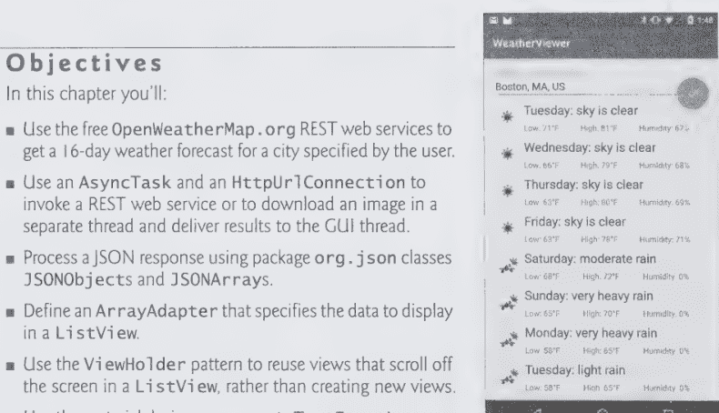

## 7.1 引言

257

## 提纲

## 7.2 测试驱动 `WeatherViewer App`

### 7.2.1 打开并运行 App

### 7.2.2 查看城市的 16 天天气预报

## 7.3 技术概览

### 7.3.1 JavaScript 对象表示（`JSON`）和 `org.json` 包

### 7.3.2 通过 `HttpRequest` 调用 `REST Web` 服务

### 7.3.3 使用 `AsyncTask` 在 GUI 线程之外获取网络请求

### 7.3.4 `ListView`、`ArrayAdapter` 和 `ViewHolder` 模式

### 7.3.5 `FloatingActionButton`

### 7.3.6 `TextInputLayout`

### 7.3.7 `Snackbar`

## 7.4 构建 App 的 GUI 和资源文件

## 7.5 `Weather` 类

### 7.5.1 `package` 语句、`import` 语句和实例变量

### 7.5.2 构造函数

### 7.5.3 方法 `convertTimestampToDay`

## 7.6 `WeatherAdapter` 类

### 7.6.1 `package` 语句和 `import` 语句

### 7.6.2 嵌套类 `ViewHolder`

### 7.6.3 实例变量和构造函数

### 7.6.4 被重写的 `ArrayAdapter` 方法 `getView`

### 7.6.5 用于在单独线程中下载图像的 `AsyncTask` 子类

## 7.7 `MainActivity` 类

### 7.7.1 `package` 语句和 `import` 语句

### 7.7.2 实例变量

### 7.7.3 被重写的 `Activity` 方法 `onCreate`

### 7.7.4 方法 `dismissKeyboard` 和 `createURL`

### 7.7.5 用于调用 Web 服务的 `AsyncTask` 子类

### 7.7.6 方法 `convertJSONToArrayList`

## 7.8 总结

## 7.1 引言

`WeatherViewer App`（图 7.1）使用免费的 `OpenWeather.org Web` 服务来获取指定城市的 16 天天气预报。该 App 以 `JSON`（JavaScript 对象表示）数据格式接收天气数据。天气数据列表将显示在 `ListView` 中——这是一个显示可滚动项目列表的视图。在此 App 中，你将使用自定义的列表项格式显示：

- 天气状况图标
- 星期以及该当天天气的文本描述
- 当天的最低温度和最高温度（单位为 °F）
- 湿度百分比

上述项目代表了返回的预报数据的子集。有关 16 天天气预报 API 返回的数据的详情，请访问：

```text
http://openweathermap.org/forecast16
```

有关 OpenWeatherMap.org 提供的所有天气数据 API 列表，请访问：

```text
http://openweathermap.org/api
```

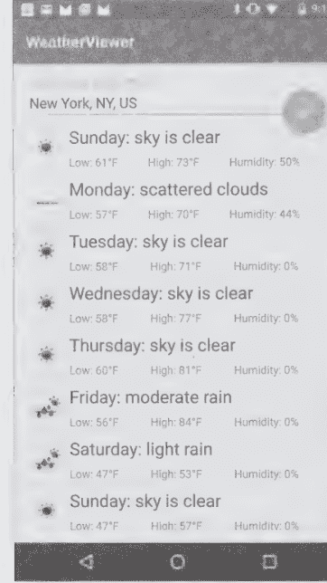

**图 7.1** 显示美国纽约州纽约市天气预报的 Weather Viewer App。

## 7.2 测试驱动 `WeatherViewer App`

### 打开并运行 App

打开 Android Studio，并从书籍示例文件夹中的 `WeatherViewer` 文件夹打开 `WeatherViewer App`。在运行之前，你必须添加你自己的 `OpenWeather.org API` 密钥。请参阅第 7.3.1 节获取如何获取密钥以及将其放置在项目中的信息。**在运行 App 之前必须执行此操作。**将你的 API 密钥添加到项目后，在 AVD 或设备上执行 App。

### 查看城市的 16 天天气预报

当 App 执行时，用户界面顶部的 `EditText` 会获得焦点，虚拟键盘会显示出来，以便你输入城市名称（图 7.2）。你应该考虑在城市名后加上国家和国家代码。在这种情况下，我们输入了 `"New York NY, US"` 来定位美国纽约州纽约市的天气。一旦输入了城市，点击圆形的 `FloatingActionButton` 更改完成图标（✓ 提交给 App，随后 App 请求该城市的 16 天天气预报，见图 7.1）。

## 7.3 技术概览

由 `EditTextLayout` 在 `EditText` 上方显示的提示。

用于输入城市名的 `EditText`。

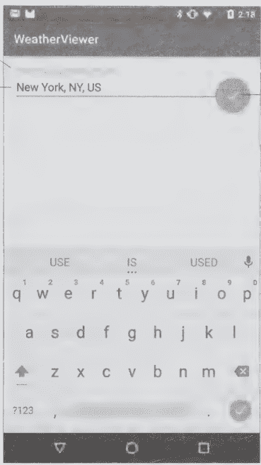

点击完成按钮——一个 `FloatingActionButton`。

**图 7.2** 输入城市。

本节介绍了你将用于构建 `WeatherViewer App` 的所用功能。

### 7.3.1 Web 服务

本章介绍了 Web 服务，它提升了软件的可移植性和可重用性。Web 服务是一种可以通过网络访问的软件组件。运行 Web 机器是 Web 服务主机。客户端通过网络向 Web 服务发送请求。

#### `REST Web` 服务

表述状态转移（`REST`）指一种实现 Web 服务的架构风格。尽管 `REST` 本身不是标准，但 `REST Web` 服务使用了标准，例如超文本传输协议（`HTTP`）。`REST Web` 服务中的每个方法都通过唯一的 `URL` 标识。因此，当服务器接收到请求时，知道要执行什么操作。此类 Web 服务可以用于应用程序，甚至直接用于浏览器。

#### Web 服务通常需要 `API` 密钥

使用 Web 服务通常需要 Web 服务提供者的唯一 `API` 密钥。当你的 App 向 Web 服务发送请求时，`API` 密钥允许提供者：

- 确认你有权限使用 Web 服务。
- 跟踪你的使用情况——许多 Web 服务限制你在特定时间内请求的总数（例如每秒、每分钟、每小时等）。

某些 Web 服务在允许使用之前需要验证——事实上，需要通过程序化登录 Web 服务。

#### `OpenWeatherMap.org Web` 服务

我们在 `WeatherViewer App` 中使用的 `OpenWeatherMap.org Web` 服务是免费的，但 OpenWeatherMap.org 限制了 Web 服务请求的数量——目前的限制为每分钟 1200 次，每天 170 万次。OpenWeatherMap.org 是一种免费增值（freemium）服务——除了你在 App 中使用的免费层外，他们还提供了具有更高请求限制、更频繁的数据更新和其他功能的付费层。有关 OpenWeatherMap.org Web 服务的更多信息，请访问：

```text
http://openweathermap.org/api
```

#### `OpenWeatherMap.org Web` 服务许可

OpenWeatherMap.org 使用共享公共许可其 Web 服务。有关许可条款，请访问：

```text
http://creativecommons.org/licenses/by-sa/2.0/
```

有关许可条款的更多信息，请参阅下处的许可部分：

```text
http://openopenweathermap.org/terms
```

### 获取 `OpenWeatherMap.org API` 密钥

在运行此 App 之前，你必须从以下地址获取自己的 OpenWeatherMap.org API 密钥：

```text
http://openweathermap.org/register
```

注册后，从确认网页上复制十六进制 API 密钥，然后将 `strings.xml` 中的 `YOUR_API_KEY` 替换为该密钥。

### 7.3.2 JavaScript 对象表示（`JSON`）和 `org.json` 软件包

JavaScript 对象表示（`JSON`）是用于表示数据的 XML 的替代方案。`JSON` 是一种基于文本的数据交换格式，用于表示 JavaScript 集合中以字符串表示的键值对对象。`JSON` 是一种简单的格式，使得对象易于创建、读取和解析，而且因为它比 XML 简洁得多，允许程序在互联网上高效地传输数据。每个 `JSON` 对象都表示为包含在花括号中的属性名和值的列表，格式如下：

```json
{propertyName1:value, propertyName2:value}
```


每个属性名都是一个字符串。数组在 JSON 中用方括号表示，格式如下：

```json
[value1, value2, value3]
```

每个元素可以是字符串、数字、JSON 对象、`true`、`false` 或 `null`。图 7.3 是本应用中使用的 OpenWeatherMap.org 每日预报 Web 服务返回的 JSON 示例——该示例包含了天气天气数据（第 1–57 行）。

```json
{
  "city": {
    "id": 5128581,
    "name": "New York",
    "coord": {
      "lon": -74.005966,
      "lat": 40.714272
    },
    "country": "US",
    "population": 0
  },
  "cod": "200",
  "message": 0.0102,
  "list": [{ // 使用此对象数组来获取每日天气
    "dt": 1442419200,
    "temp": {
      "day": 79.9,
      "min": 71.74,
      "max": 82.53,
      "night": 71.85,
      "eve": 82.53,
      "morn": 71.74
    },
    "pressure": 1037.39,
    "humidity": 64,
    "weather": [
      "id": 800,
      "main": "Clear",
      "description": "sky is clear",
      "icon": "01d"
    ]
  }]
```

**图 7.3** 来自 OpenWeatherMap.org 每日预报 Web 服务的 JSON 示例。（部分 1/2）

```json
"speed": 0.92,
"deg": 250,
"clouds": 0

}, // 第一个数组元素结束，第二个数组元素开始

"dt": 1442505600,
"temp": {
  "day": 79.92,
  "min": 66.72,
  "max": 83.1,
  "night": 70.79,
  "eve": 81.99,
  "morn": 66.72
},

"pressure": 1032.46,
"humidity": 62,
"weather": [
  "id": 800,
  "main": "Clear",
  "description": "sky is clear",
  "icon": "01"
]],

"speed": 1.99,
"deg": 224,
"clouds": 0

} // 第二个数组元素结束，数组结束
```

**图 7.3** 来自 OpenWeatherMap.org 每日预报 Web 服务的 JSON 示例。（部分 2/2。）

每日预报返回的 JSON 对象有很多属性。我们只使用 `"list"` 属性——这是一个表示最多 16 天预报的 JSON 对象数组（默认为 7 天，除非另有指定）。每个 `"list"` 数组元素包含许多属性，我们使用了其中的：

- `"dt"`：一个长整数，包含表示自 1970 年 1 月 1 日 GMT 以来秒数的时间戳。我们将其转换为日期名称。
- `"temp"`：一个包含表示当天温度的浮点数的 JSON 对象。我们只使用了最低（`"min"`）和最高（`"max"`）温度，但 Web 服务还返回了白天（`"day"`）、夜间（`"night"`）、晚上（`"eve"`）和早晨（`"morn"`）温度。
- `"humidity"`：一个表示湿度百分比的整数。
- `"weather"`：一个包含多个属性的 JSON 对象，包括天气状况描述（`"description"`）和代表天气状况的图标（`"icon"`）。

### org.json 软件包

你使用 org.json 中的以下类来处理接收到的 JSON 数据：

- `JSONObject`：其构造函数之一将 JSON 数据转换为 `Map<String, Object>`，将 JSON 键映射到对应的值。你通过 `JSONObject` 方法访问代码中的 JSON 属性，获取 JSON 键值的 `boolean`、`double`、`long` 或 `String`。
- `JSONArray`：表示 JSON 数组并提供访问其元素的方法。OpenWeatherMap.org 响应中的 `"list"` 属性将被视为 `JSONArray`。

### 7.3.3 调用 Web 服务

为了调用 OpenWeatherMap.org 每日获取 服务，你需要将 服务的 URL 转换为 `URL` 对象，然后使用 `URL` 打开 `HttpConnection`（7.7）。为了接收 JSON 响应，将从 `HttpConnection` 的 `InputStream` 读取所有数据并将其转换为 `JSONObject` 进行处理。

### 7.3.4 使用 AsyncTask 在 GUI 线程外执行请求

你应该在 GUI 线程外执行会阻塞执行的操作（例如网络、文件和数据库访问），这有助于应用程序的响应，并避免在 Android 无响应时出现无响应（ANR）对话框。回顾第 6 章，由于 GUI 组件不是线程安全的，对用户界面的更新必须在 GUI 线程执行。

Android 提供了 `AsyncTask`（package `android.os`），在一个线程中执行长时间操作并将结果传递给 GUI 线程。其中一个调用 OpenWeatherMap.org 服务（7.7），另一个下载天气图像（7.6）。

### 7.3.5 ListView、ArrayAdapter 和 ViewHolder 模式

本应用在 `ListView`（package `android.widget`）中显示数据——这是一个滚动的项目列表。`ListView` 是 `View`（package `android.widget`）的子类，代表通过 `Adapter` 对象（package `android.widget`）获取数据的视图。

在本应用中，我们使用 `ArrayAdapter` 的子类使用 `ArrayList`（7.6）填充 `ListView`。当应用用天气数据更新 `ArrayList` 时，我们将调用 `Adapter` 的 `notifyDataSetChanged` 方法通知 `ListView` 更新其显示列表。这被称为数据绑定。多种类型的 `View` 可以由 `Adapter` 绑定到数据。在第 9 章中，你将学习如何将数据库绑定到 `ListView`。

关于 Android 数据绑定的更多细节和各种教程，访问：http://developer.android.com/guide/topics/ui/binding.html

### ViewHolder 模式

默认情况下，`ListView` 可以显示一个或两个 `View`。在本应用中，你将自定义 `ListView` 项以在自定义布局中显示 `ImageView` 和多个 `TextView`。

创建自定义 `ListView` 项涉及动态创建新对象的贵的运行时开销。对于具有复杂项布局且用户快速滚动的列表，这种开销会阻止平滑滚动。为了减少这种开销，当新项进入屏幕时，ListView 项离开屏幕。对于复杂的项布局，你可以利用复用列表中的现有 GUI 组件来提高 `ListView` 的性能。

为了实现这一点，引入 `ViewHolder` 模式，你创建一个包含显示 `ListView` 数据视图实例变量的类。当创建一个 `ListView` 项时，你创建一个 `ViewHolder` 对象并用项嵌套视图的引用初始化其实例变量。然后你将该 `ViewHolder` 对象存储在 `ListView` 中（这是一个 `View`）。

类的 `setTag` 方法允许你将任何对象添加到视图中。该对象随后可以通过 `View` 的 `getTag` 方法供使用。我们将 tag 指定为引用 `ListView` 嵌套视图的 `ViewHolder` 对象。

当新项滚动进入屏幕时，`ListView` 会检查是否有可用视图。如果没有，则从布局 XML 文件中填充新视图，并存储 `ViewHolder` 对象的引用。我们将使用 `setTag` 将该对象设置为 `ListView` 项的 tag。

如果有可重用的项，我们将通过 `getTag` 获取该的 tag，它将返回之前为该 `ListView` 项创建的现有 `ViewHolder` 对象。无论我们如何获取 `ViewHolder` 对象，我们都在 `ViewHolder` 的引用视图中显示数据。

## 7.6 FloatingActionButton

用户触摸按钮来启动操作。随着 Android 5.0 引入 Material Design，Google 引入了悬浮按钮（Google 将其称为 FAB）作为一种悬浮在应用界面之上的按钮——即它比用户界面的其他部分具有更高的 Material 设计高度，并指定重要操作。

例如，联系人应用可能会使用一个包含 `+` 图标的悬浮按钮来添加新联系人的操作。在本应用中，我们使用一个包含完成图标（`✓`）的悬浮按钮，使用户将城市同步到应用并为该城市获取预报。

Android 6.0 和 Android 设计支持库将悬浮按钮正式化为 `FloatingActionButton` 类（package `android.support.design.widget`）。在 Android Studio 1.4 中，重新实现了使用 Material Design 的应用模板，大多数新模板默认都包含一个 `FloatingActionButton`。

## 7.4 构建应用程序的 GUI 和资源文件

### 7.3.7 EditTextLayout

在此应用中，你将使用一个 `EditText` 来允许用户输入想要获取气象预报的城市名称。为了帮助用户理解 `EditText` 的用途，你可以在 `EditText` 为空时提供提示文本（hint text）。一旦用户开始输入文本，提示就会消失——这可能会导致用户忘记 `EditText` 的用途。

Android 设计支持库中的 `EditTextLayout`（包名 `android.support.design.widget`）解决了这个问题。在 `TextInputLayout` 中，当 `EditText` 获得焦点时，它会将提示文本从原始大小缩小到较小尺寸，并显示在 `EditText` 上方，这样用户就可以输入数据的同时看到提示（图 7.2）。

在此应用中，`EditText` 在应用开始执行时就会获得焦点，因此 `EditTextLayout` 会立即将提示移动到 `EditText` 上方。

### 7.3.8 Snackbar

`Snackbar`（包名 `android.support.design.widget`）是一个概念上与 `Toast` 类似的 Material 设计组件。`Snackbar` 在屏幕上显示指定的时间限制，而且还具有交互性。用户可以通过滑动将其关闭。`Snackbar` 还可以关联一个操作，在用户触摸 `Snackbar` 时执行。在此应用中，我们将使用 `Snackbar` 来显示信息类消息。

## 7.4 构建应用程序的 GUI 和资源文件

在本节中，我们将回顾 Weather 应用程序中 GUI 和资源文件中的新功能。

### 7.4.1 创建项目

使用 `Blank Activity` 模板创建一个新项目。在 Create Project 级对话框的 New Project 步骤中，指定以下内容：

- Application name（应用名称）：WeatherViewer
- Company Domain（公司域名）：delete1.com（或指定自己的域名）

对于 New Project 对话框中的剩余步骤，使用与第 2.3 节相同的设置。按照第 2.5.2 节的步骤为项目添加图标。此外，按照第 4.4.3 节的步骤为项目配置 Java SE 7 支持。

### 7.4.2 AndroidManifest.xml

WeatherView 设计为竖屏方向。按照第 3.7 节中执行的步骤将 `android:screenOrientation` 属性设置为 `portrait`。此外，在 `<manifest>` 元素的嵌套元素 `<application>` 元素之前，添加以下 Internet 访问权限：

```xml
<uses-permission android:name="android.permission.INTERNET" />
```

这允许应用访问 ，这是调用 Web 服务所必需。

#### Android 6.0 中自动授予的权限

Android 6.0 权限模型（在第 5 节引入）在安装时会自动授予 Internet 权限，因为 Internet 访问被认为是如今应用中的基础能力。

在 Android 6.0 中，Internet 权限以及许多其他符合 Google 标准且“对用户隐私或安全不构成重大风险”的权限会在安装时自动授予——这些权限被归类为 `PROTECTION_NORMAL`。要查看此类权限的完整列表，请访问：

```text
https://developer.android.com/features/runtime-permissions.html#best-practices
```

Android 不会要求用户授予权限，用户也无法从应用撤销权限。因此，你的代码不需要检查应用是否具有特定的 `PROTECTION_NORMAL` 权限。然而，为了与早期的 Android 版本向后兼容，你必须在 `AndroidManifest.xml` 中请求这些权限。

### 7.4.3 strings.xml

双击 `res/values` 文件夹下的 `strings.xml`，然后点击 Open editor 链接显示翻译编辑器（Translations Editor），并创建图 7.4 所示的字符串资源。

| Key（键） | Value（值） |
|---|---|
| `api_key` | 使用你自己的 OpenWeatherMap.org API key 作为此资源的值。 |
| `web_service_url` | http://api.openweathermap.org/data/2.5/forecast/daily?q= |
| `invalid_url` | Invalid URL |
| `weather_condition_image` | 气象条件的图形化表示 |
| `high_temp` | 高温: % |
| `low_temp` | 低温: % |
| `day_description` | %s: $%s |
| `humidity` | 湿度: % |
| `hint_text` | 输入城市（例如，Boston, MA, US） |
| `read_error` | 无法读取天气数据 |
| `connect_error` | 无法连接到 OpenWeatherMap.org |

图 7.4 WeatherViewer 应用程序中使用的字符串资源。

### 7.4.4 colors.xml

Android Studio 的 `Blank Activity` 模板定义了应用的主色、深色主色和强调色。在此应用中，我们在 `colors.xml` 中将模板的强调色（`colorAccent`）更改为蓝色（十六进制值 `#448AFF`）。

### 7.4.5 activity_main.xml

Android Studio 的 `Blank Activity` 模板将 MainActivity 的 GUI 拆分为两个文件：

- `activity_main.xml` 定义了 Activity 的 `Toolbar`（`AppCompatActivity` 中应用标题栏的替代方案）和一个 `FloatingActionButton`，后者默认位于右下角。
- `content_main.xml` 定义了 MainActivity GUI 的其余部分，并通过 `<include>` 元素包含在 `activity_main.xml` 文件中。

对此应用的 `activity_main.xml` 进行以下更改：

1. 为 `CoordinatorLayout` 添加 `id="@+id/coordinatorTo"`——你将用它指定显示 `Snackbar` 的布局。
2. 为项目添加 Material 设计主题（如你在第 4.4 节中所做的那样）。
3. 将 `FloatingActionButton` 移动到布局中。
4. 为 `FloatingActionButton` 使用以下外边距：

```xml
android:layout_margin="16dp"
```


- 5. 最后，添加下方代码。

## 7.4.6 `content_main.xml`

此布局包含在 `activity_main.xml` 中并定义了 `MainActivity` 的 GUI。执行以下步骤：

1. 移除 `TextView` 并将方向改为垂直。
2. 插入一个包含其他视图的 `GridLayout`。
3. 向布局添加一个 `TextView`。
4. 将高度设置为 `0dp`，权重设置为 `1`。

## 7.4.7 `list_item.xml`

现在将 `list_item.xml` 布局添加到项目中，并定义用于在 `ListView` 中显示数据的自定义布局（图 7.5）。

### 步骤 1：创建布局文件并自定义 `LinearLayout` 方向

执行以下步骤创建 `list_item.xml` 布局文件：

1. 右键点击项目文件夹，选择 New > Layout resource file。
2. 在 New Resource file 对话框的 Name 字段中输入 `list_item.xml`。
3. 确保 Root element 字段指定为 `LinearLayout`，然后点击 OK。`list_item.xml` 文件将出现在项目窗口的 layout 目录中并在布局编辑器中打开。
4. 选择 `LinearLayout` 并将其方向改为水平——此布局将由一个 `ImageView` 和包含其他视图的 `GridLayout` 组成。

### 步骤 2：添加显示天气图标的 `ImageView`

执行以下步骤添加并配置 `ImageView`：

1. 从 Palette 拖一个 `ImageView` 到 Component Tree 中的 `LinearLayout`。
2. 将 id 设置为 `conditionImageView`。
3. 将 `layout:width` 设置为 `50dp`——为该值定义维度资源 `image_side_length`。
4. 将 `layout:height` 设置为 `match_parent`——`ImageView` 的高度将匹配 `ListView` 项目的高度。
5. 将 `contentDescription` 设置为第 7.4.3 节中创建的字符串资源 `weather_condition_image`。
6. 将 `scaleType` 设置为 `fitCenter`——图标将适应 `ImageView` 的边界并水平垂直居中。

### 步骤 3：添加用于 `TextView` 的 `GridLayout`

执行以下步骤来添加并配置 `GridLayout`：

1. 从调面板（Palette）将 `GridLayout` 拖到组件树（Component Tree）中的 `LinearLayout` 中。
2. 将 `columnCount` 设置为 `3`，`rowCount` 设置为 `2`。
3. 将 `layout:width` 设置为 `0dp`——此 `GridLayout` 的宽度将由 `layout:weight` 决定。
4. 将 `layout:height` 设置为 `match_parent`——`GridLayout` 高将匹配 `ListView` 项目的高度。
5. 将 `layout:weight` 设置为 `1`——`GridLayout` 的宽度将占据其父级 `LinearLayout` 中剩余的所有水平空间。
6. 使用 `useDefaultMargins` 属性在 `GridLayout` 单元之间添加默认间距。

### 步骤 4：添加 `TextView`

执行以下步骤来添加并配置四个 `TextView`：

1. 在组件树中将一个大文本（Large Text）拖到 `GridLayout` 上，并将其 id 设置为 `textView`，`layout:column` 设置为 `0`，`layout:columnSpan` 设置为 `3`。
2. 在组件树中将三个普通文本（Plain TextViews）拖到 `GridLayout` 上，并将它们的 id 分别设置为 `lowTextView`、`hiTextView` 和 `humidityTextView`。将这些 `TextView` 的 `layout:row` 设置为 `1`，`layout:columnWeight` 设置为 `1`。这些 `TextView` 将全部显示在 `GridLayout` 的第二行，由于它们具有相同的 `layout:columnWeight`，各列的大小将等宽分配。
3. 将 `lowTextView` 的 `layout:column` 设置为 `0`，`hiTextView` 的 `layout:column` 设置为 `1`，`humidityTextView` 的 `layout:column` 设置为 `2`。

这完成了 `list_xml` 布局配置。你不需要更改任何 `TextView` 的 `text` 属性——它们的文本将通过程序进行设置。

## 7.5 `Weather` 类

此应用包含三个类（本节），讨论一天的天气数据。请参见 7.5–7.7：

- `MainActivity` 类将把 JSON 天气数据转换为 `ArrayAdapter<Weather>`。
- `WeatherArrayAdapter` 类（第 7.6 节）定义了一个自定义 `ArrayAdapter` 子类，用于将 `ArrayList<Weather>` 绑定到 `MainActivity` 的 `ListView`。`ListView` 项目从 0 开始索引，每个 `ListView` 项目的嵌套视图将根据 `ArrayList<Weather>` 中相同索引的 `Weather` 对象的数据填充数据。
- `MainActivity` 类（第 7.7 节）定义了应用的用户界面，以及与 OpenWeatherMap.org 每日预报网络服务交互并处理 JSON 响应的逻辑。

在本节中，我们重点关注 `Weather` 类。

### 7.5.1 `package` 语句、`import` 语句和实例变量

图 7-6 包含了包语句、导入语句以及 `Weather` 类的实例变量。你将使用来自 `java.text` 和 `java.util` 包的类（第 5–8 行）将每天天气的时间戳转换为对应的名称（星期一、星期二等）。实例变量被声明为 `final`，因为它们在初始化后不需要修改。我们还将它们设为 `public`——请记住，Java `String` 是不可变的，尽管实例变量是公共的，它们的值也无法改变。

```java
// Weather.java

// 维护一天的天气信息

package com.deitel.weatherviewer;

import java.text.NumberFormat;
import java.text.SimpleDateFormat;
import java.util.Calendar;
import java.util.TimeZone;

class Weather {
    public final String dayOfWeek;
    public final String minTemp;
    public final String maxTemp;
    public final String humidity;
    public final String description;
    public final String iconURL;
}
```

**图 7-6** | `Weather` 类包语句、导入语句和实例变量。

### 7.5.2 构造函数

构造函数（图 7.7）初始化了类的实例变量：

- `NumberFormat` 对象将数值转换为字符串。第 22–24 行配置该对象将浮点值四舍五入为数字。
- 第 25 行调用我们的工具方法 `convertTimestampToToday`（第 7.5.3 节）获取字符串日期名称并初始化 `dayOfWeek`。
- 第 26–27 行使用 `NumberFormat` 对象将当日的最最高温度格式化为数字。我们在每个格式化后的字符串末尾附加 °F，因为我们将请求华氏度——Unicode 转义序列 `\u00b0` 代表度符号 (°）。OpenWeather-Map API 还支持开尔文（默认）和摄氏度温度格式。
- 第 28–29 行使用 `NumberFormat` 进行本地特定的百分比格式化，然后用它格式化湿度百分比。网络服务返回整数，因此我们将其除以 100.0 进行格式化——在美国地区，1.00 被格式化为 100%，0.5 被格式化为 50%，依此类推。
- 第 30 行初始化天气状况描述。
- 第 31–32 行创建一个 URL 字符串。

## 7.5 `Weather` 类

```java
//构造函数

public Weather(long timestamp, double minTemp, double maxTemp, double humidity, String description, String iconName) {

    // NumberFormat 转换为 double

    NumberFormat numberFormat = NumberFormat.getInstance();

    numberFormat.setMaximumFractionDigits(0);

    this.dayOfWeek = convertTimestampToday(timestamp);

    this.minTemp = numberFormat.format(minTemp) + "°F";

    this.maxTemp = numberFormat.format(maxTemp) + "°F";

    this.humidity = numberFormat.format(humidity / 100.0);

    this.description = description;

    this.iconURL = "http://openweathermap.org/img/w/" + iconName + ".png";

}
```

**图 7-7** | `Weather` 构造函数。

### 7.5.3 `convertTimestampToday` 方法

工具方法 `convertTimestampToday`（图 7.8）接收自 1970 年 1 月 1 日的秒数作为参数。执行转换：

- 它使用 `Calendar` 对象通过乘以 1000 设置时间。
- 它获取默认 `TimeZone` 以调整时间。
- 它创建一个 `SimpleDateFormat`（`"EEEE"`）将日期格式化为名称。

```java
public static String convertTimestampToday(long timestamp) {

    // 创建 Calendar

    Calendar calendar = Calendar.getInstance();

    calendar.setTimeInMillis(timestamp * 1000);

    // 获取设备时区

    TimeZone tz = TimeZone.getDefault();

    // 为设备时区调整时间

    calendar.setTimeZone(tz);

    // 返回日期名称的 SimpleDateFormat

    SimpleDateFormat dateFormatter = new SimpleDateFormat("EEEE");

    return dateFormatter.format(calendar.getTime());

}
```

**图 7-8** | `Weather` 方法 `convertTimestampToday`（部分/2）。

## 7.6 `WeatherArrayAdapter`

`WeatherArrayAdapter` 类定义了 `ArrayAdapter` 的子类，用于将 `ArrayList<Weather>` 绑定到 `MainActivity` 的 `ListView`。

### 7.6.1 `package` 语句和 `import` 语句

图 7-9 包含了 `WeatherArrayAdapter` 的包语句和导入语句。我们将在遇到时讨论导入的类型。应用的 `ListView` 项目需要自定义布局。每个项目包含一张图片（天气图标）和代表日期、天气描述、最低温度、最高温度和湿度的文本。为了将天气数据映射到 `ListView` 项目，我们扩展了 `ArrayAdapter` 类（第 23 行），这样就可以重写 `getView` 方法为每个 `ListView` 项目配置自定义布局。

```java
// WeatherArrayAdapter.java

// 用于在 ListView 中显示 List<Weather> 元素的 ArrayAdapter

package com.deitel.weatherviewer;

import android.content.Context;
import android.graphics.Bitmap;
import android.graphics.BitmapFactory;
import android.os.AsyncTask;
import android.view.LayoutInflater;
import android.view.View;
import android.view.ViewGroup;
import android.widget.ArrayAdapter;
import android.widget.ImageView;
import android.widget.TextView;
import java.io.InputStream;
import java.net.HttpConnection;
import java.net.URL;
import java.util.HashMap;
import java.util.List;
import java.util.Map;

class WeatherArrayAdapter extends ArrayAdapter<Weather> {
```

**图 7-9** | `WeatherArrayAdapter` 类包语句和导入语句。

### 7.6.2 嵌套 `ViewHolder`

嵌套类 `ViewHolder`（图 7.10）定义了 `WeatherArrayAdapter` 类在操作 `ViewHolder` 对象时直接访问的实例变量。当创建一个 `ListView` 项目时，我们将一个一个新的 `ViewHolder` 与该项关联。如果存在一个正在被复用的现有 `ListView` 项目，我们将直接获取该项的 `ViewHolder` 对象。

```java
// 用于在列表项滚出或进入屏幕时复用的类

private static class ViewHolder {
    ImageView conditionImageView;
    TextView dayTextView;
    TextView lowTextView;
    TextView hiTextView;
    TextView humidityTextView;
}
```

图 7.10 | 嵌套类 `ViewHolder`。

### 7.6.3 实例变量与构造函数

7.11 定义了 `WeatherArrayAdapter` 类的实例变量和构造函数。我们使用实例变量 `bitmaps`（第 34 行）——一个 `Map<String, Bitmap>`——来缓存已加载的天气图片，这样用户在滚动查看天气时不需要重新下载。缓存的图像将保留在内存中，直到应用程序完成。构造函数（第 37–39 行）简单地调用了父类的三参数构造函数，将 `Context`（即显示 `ListView` 的 activity）和 `List<Weather>`（要显示的数据列表）作为第一个和第三参数传递。父类构造函数表示布局的资源 ID，该布局包含一个在 `ListView` 项目中显示的 `TextView`。参数 `-1` 表示我们在此应用中使用了自定义布局，因此我们可以显示不仅仅是一个 `TextView`。

```java
// 存储已下载的 Bitmaps 以复用

private Map<String, Bitmap> bitmaps = new HashMap<>();
```

```java
// 初始化父类成员的构造函数

public WeatherArrayAdapter(Context context, List<Weather> forecast) {
    super(context, -1, forecast);
}
```

图 7.11 | `WeatherArrayAdapter` 类的实例变量和构造函数。

### 7.6.4 重写的 `getViewAdapter` 方法

`getView` 方法（图 7.12）被调用以获取显示 `ListView` 项目数据的 `View`。重写此方法允许我们把数据映射到自定义的 `ListView` 项目中。该方法接收 `ListView` 项目的位置、代表 `ListView` 项目的 `View`（`convertView`）以及该项的父容器作为参数。通过操作 `convertView`，你可以自定义 `ListView` 项目的内容。第 45 行调用了继承自 `List<Weather>` 的 `getItem` 方法，获取要显示的天气对象。

## 第 7 章 `WeatherViewer` 应用

第 47 行定义了 `ViewHolder` 变量，它将被设置为一个新的 `ViewHolder` 对象或现有的对象，取决于 `getView` 方法的 `convertView` 参数是否为 null。

```java
// 为 ListView 项目创建自定义视图

@Override
public View getView(int position, View convertView, ViewGroup parent) {

    // 获取此指定 ListView 位置的 Weather 对象

    Weather day = getItem(position);
```


```java
ViewHolder viewHolder; // 引用列表项视图的对象

// 检查是否有从滚出屏幕的 ListView 项目中复用的 ViewHolder

// 否则，创建一个新的 ViewHolder

if (convertView == null) { // 没有可复用的 ViewHolder，因此创建一个

    viewHolder = new ViewHolder();

    LayoutInflater inflater = LayoutInflater.from(getContext());

    convertView = inflater.inflate(R.layout.item, parent, false);

    viewHolder.conditionImageView = (ImageView) convertView.findViewById(R.id.conditionImageView);

    viewHolder.dayText = (TextView) convertView.findViewById(R.id.dayText);

    viewHolder.lowText = (TextView) convertView.findViewById(R.id.lowText);

    viewHolder.hiText = (TextView) convertView.findViewById(R.id.hiText);

    viewHolder.humidityText = (TextView) convertView.findViewById(R.id.humidityText);

    convertView.setTag(viewHolder);

} else { // 复用存储在列表项 tag 中的现有 ViewHolder

    viewHolder = (ViewHolder) convertView.getTag();

}

// 如果天气图标已下载，则使用它；
// 否则，在单独线程中下载

if (bitmap.containsKey(day.iconURL)) {

    viewHolder.conditionImageView.setImageBitmap(bitmap.get(day.iconURL));

} else {

    // 下载并显示天气图片

    new LoadImageTask(viewHolder.conditionImageView).execute(day.iconURL);

}

// 从 Weather 对象中获取其他数据并放入视图

Context context = getContext(); // 用于加载字符串资源

viewHolder.dayText.setText(context.getString(R.string.day_description, day.dayOfWeek, day.description));

viewHolder.lowText.setText(context.getString(R.string.temp, day.minTemp));

viewHolder.hiText.setText(context.getString(R.string.high_temp, day.maxTemp));

viewHolder.humidityText.setText(context.getString(R.string.humidity, day.humidity));

return convertView; // 返回要显示的列表项
```

图 7.12 重写的`ArrayAdapter`方法`getView`。（部分 I，共 2 部分）

## 7.6 类 WeatherArrayAdapter

```java
90 viewHolder.textView.setText(
91 context.getString(R.string.high_temp, day.maxTemp));
92 viewHolder.humidityTextView.setText(
93 context.getString(R.string.humidity, day.humidity));
94
95 return convertView; // 返回要显示的列表项
96
97 }
```

图 7.12 重写的`ArrayAdapter`方法`getView`。（部分 II，共 2 部分）

如果`convertView`为 null，第 52 行创建一个新的`ViewHolder`以存储对新`ListView`视图的引用。接下来，第 53 行获取`Context`的`LayoutInflater`，它用于加载布局。第 54–65 行加载布局并设置视图。如果`convertView`不为空，第 66 行从项的 tag 获取现有的`ViewHolder`。第 67–73 行判断天气图片是否已下载；第 74–75 行在`ImageView`中设置。否则，第 76–81 行在单独线程中下载图片。第 82–93 行从`Weather`对象获取数据并放入视图。最后，第 95 行返回要显示的项。

> **软件工程观察：** 每次需要`AsyncTask`都必须创建一个`AsyncTask`对象——每个`AsyncTask`只能执行一次。

### 7.6.5 在单独线程下载图片的 AsyncTask 子类

嵌套类`LoadImage`（图 7.13）继承自`AsyncTask`并定义了如何在单独线程中下载图片，然后将其返回给 GUI 线程。

```java
98 // 在单独线程加载天气图标的 AsyncTask
99 private class LoadImageTask extends AsyncTask<String, Bitmap> {
100     private ImageView imageView; // 显示缩略图
```

图 7.13

```java
// 存储用于设置下载的 Bitmap 的 ImageView

public LoadImageTask(ImageView imageView) {

    this.imageView = imageView;

}

// 加载图片；params[0] 是代表图片的 String URL

@Override
protected Bitmap doInBackground(String... params) {

    Bitmap bitmap = null;

    HttpURLConnection connection = null;

    try {

        URL url = new URL(params[0]); // 创建图片的 URL

        // 打开 HttpURLConnection，获取其 InputStream
        // 并下载图片

        connection = (HttpURLConnection) url.openConnection();

        try (InputStream inputStream = connection.getInputStream()) {

            bitmap = BitmapFactory.decodeStream(inputStream);

            bitmaps.put(params[0], bitmap); // 缓存以备后用

        }

    } catch (Exception e) {

        e.printStackTrace();

    } finally {

        if (connection != null) {

            connection.disconnect(); // 关闭 HttpConnection

        }

    }

    return bitmap;

}

// 在列表项中设置天气

@Override
protected void onPostExecute(Bitmap bitmap) {

    if (bitmap != null) {

        imageView.setImageBitmap(bitmap);

    }

}
```

图 7.13 | 在单独线程下载图片的`AsyncTask`子类。（部分 II，共 2 部分）

## 7.7 MainActivity 类

- 第二个是`AsyncTask`的`onUpdate`方法的变长参数类型列表。该方法在 GUI 线程中执行，用于接收来自长时间运行任务的指定类型的中间更新。重写此方法是可选的。我们在示例中没有使用它，因此我们在这里指定为`void`并忽略该参数。
- 第三个是任务结果的类型（`Bitmap`），它被传递给`AsyncTask`的`onPostExecute`方法（139–143）。该方法在 GUI 线程中执行，允许`ListView`的项显示`AsyncTask`的结果。要更新的`ImageView`作为`LoadAsyncTask`类构造函数的参数（第 103–105 行），并存储在第 100 行的实例变量中。

使用`AsyncTask`的一个主要优势是它可以为你处理创建线程和在适当线程上执行方法的细节，这样你就不需要直接与线程机制交互。

### 下载天气状况

`ImagenMethod`使用`URLConnection`下载天气状况图像。第 114 行将传递给`AsyncTask`的`execute`方法的 URL 字符串（`params[0]`）缓存到`URL`对象中。接着，第 118 行调用`URL`的`openConnection`方法——需要进行强制转换，因为该方法返回一个`URL`。`openConnection`方法返回`URL`指定的内容。第 120 行获取`HTTPConnection`的`InputStream`，我们将其传递给`BitmapFactory`的`decodeStream`方法以读取图像字节并返回包含图像的`Bitmap`对象（第 121 行）。第 112 行将下载的图像缓存到`bitmaps`中供以后重用，第 132 行调用`HTTPConnection`类的`disconnect`方法关闭连接并释放资源。第 135 行返回下载的`Bitmap`，随后将其传递给`onPostExecute`——在 GUI 线程中——以显示图像。

## 7.7 MainActivity 类

`MainActivity`类定义了应用的界面、与`OpenWeatherMap.org`每日预报服务的交互逻辑以及处理网络服务 JSON 响应的逻辑。嵌套的`AsyncTask`子类`GetWeatherData`在单独线程中执行网络服务请求（第 7.7.5 节）。此应用不需要菜单，因此我们从自动生成的代码中删除了`onCreateOptionsMenu`和`onItemItemSelected`方法。

### 7.7.1 包语句和导入语句

图 7.14 包含了`MainActivity`的包语句和导入语句。我们将在遇到时讨论所导入的类型。

```java
1 // MainActivity.java
2 // 显示指定城市的 16 天天气预报
3 package com.deitel.weatherviewer;
```

**图 7.14** | `MainActivity`类的包语句和导入语句。（2 部分中的 1 部分）。

## 第 7 章 WeatherViewer 应用

```java
4 import android.content.Context;

6 import android.os.AsyncTask;
7 import android.os.Bundle;
8 import android.support.design.widget.FloatingActionButton;
9 import android.support.design.widget.Snackbar;
10 import android.support.v7.app.AppCompatActivity;
11 import android.support.v7.widget.Toolbar;
12 import android.view.View;
13 import android.view.input.InputMethodManager;
14 import android.widget.EditText;
15 import android.widget.ListView;

17 import org.json.JSONArray;
18 import org.json.JSONException;
19 import org.json.JSONObject;

21 import java.io.BufferedReader;
22 import java.io.IOException;
23 import java.io.InputStreamReader;
24 import java.net.HttpConnection;
25 import java.net.URL;
26 import java.net.URLEncoder;
27 import java.util.ArrayList;
28 import java.util.List;
```

**图 7.14** `MainActivity`类的包语句和导入语句。（2 部分中的 2 部分。）

### 7.7.2 实例变量

- `MainActivity`类（图 7.15）继承自`AppCompatActivity`并定义了三个实例变量：
- `weatherList`（第 32 行）是一个`ArrayList<Weather>`，存储`Weather`对象——每个对象代表每日预报中的一天。
- `weatherArrayAdapter`将引用一个`WeatherArrayAdapter`对象（第 7.6 节），该对象将`weatherList`绑定到`ListView`的项。
- `listView`将引用`MainActivity`的`ListView`。

```java
30 public class MainActivity extends AppCompatActivity {
31     // 表示预报的 Weather 对象列表
32     private List<Weather> weatherList = new ArrayList<>();
33
34     // 用于将 Weather 对象绑定到 ListView 的适配器
35     private WeatherArrayAdapter weatherArrayAdapter;
36     private ListView listView; // 显示天气信息
```

**图 7.15** `MainActivity`类的实例变量。

### 7.7.3 重写方法 onCreate

重写后的`onCreate`方法（图 75）配置了`MainActivity`的 GUI。第 41–45 行是您在创建此项目时选择“Blank Activity”模板由 Android Studio 生成的。这些行加载了 GUI，创建了应用的`Toolbar`并将`Toolbar`挂载到活动。记住`AppCompatActivity`有它自己的`Toolbar`，因为早期 Android 版本不支持应用栏（以前称为 action bars）。

第 48–50 行配置了`weatherListView`的`ListAdapter`——在这种情况下，这是一个`ArrayAdapter`子类`WeatherArrayAdapter`对象。

```java
// Toolbar,加载布局

@Override
protected void onCreate(Bundle savedInstanceState) {

    super.onCreate(savedInstanceState);

    setContentView(R.layout.activity_main);

    // Toolbar, 设置支持

    Toolbar toolbar = (Toolbar) findViewById(R.id.toolbar);

    setSupportActionBar(toolbar);

    // ListView, 设置适配器

    ListView listView = (ListView) findViewById(R.id.listView);

    WeatherArrayAdapter weatherAdapter = new WeatherArrayAdapter(this, listView);

    listView.setAdapter(weatherAdapter);

    // FAB, 设置点击器

    FloatingActionButton fab = (FloatingActionButton) findViewById(R.id.fab);

    fab.setOnClickListener(new View.OnClickListener() {

        @Override
        public void onClick(View view) {

            EditText locationEditText = findViewById(R.id.locationEditText);

            String url = locationEditText.getText().toString();

            if (url != null) {

                GetWeatherData getWeatherDataTask = new GetWeatherData();

                getWeatherDataTask.execute(url);


```java
} else {
    Snackbar.make(
        findViewById(R.id.coordinatorLayout),
        R.string.invalid_url,
        Snackbar.LENGTH_LONG
    ).show();
}
```

**图 7.16** 重写方法`onCreate`。

第 53–75 行配置了来自“Blank Activity”模板的`FloatingActionButton`。`onClick`监听器是由 Android Studio 自动生成的，但我们重新实现了它的主体。我们获取`EditText`的引用并在第 61 行调用`createURL`。如果成功创建 URL，第 66 行通过调用`dismissKeyboard`（7.7.4 节）隐藏键盘。

如果 URL 未创建成功，第 71–72 行创建一个指示 URL 无效的`Snackbar`。

### 7.7.4 方法`dismissKeyboard`和`createURL`

图 7.17 包含了`MainActivity`方法`dismissKeyboard`和`createURL`。`dismissKeyboard`（79–83 行）在用户触摸`FloatingActionButton`时调用以隐藏软键盘。Android 通过带有适当的上下文`Context.INPUT_METHOD_SERVICE`调用`getSystemService`来提供管理键盘（以及许多其他服务）的服务。该方法可以返回许多不同对象，因此你必须将其返回值强制转换为正确的类型`InputMethodManager`。

```java
// 用户触摸 FAB 时通过代码隐藏键盘
private void dismissKeyboard(View view) {
    InputMethodManager imm =
        (InputMethodManager) getSystemService(
            Context.INPUT_METHOD_SERVICE
        );

    imm.hideSoftInputFromWindow(view.getWindowToken(), 0);
}

// 创建打开服务的 URL
private URL createURL(String city) {
    String apiKey = getString(R.string.api_key);
    String baseUrl = getString(R.string.web_service_url);

    try {
        String urlString =
            baseUrl + URLEncoder.encode(city, "UTF-8")
            + "&units=imperial&cnt=16&APPID=" + apiKey;

        return new URL(urlString);
    } catch (Exception e) {
        e.printStackTrace();
    }

    return null; // 如果 URL 格式错误
}
```

## 7.7 `MainActivity`类

`createURL`方法（86–101 行）组装用于网络服务请求的 URL 字符串表示（92–93 行）。然后，第 94 行尝试创建并返回一个用 URL 字符串初始化的 URL 对象。在第 90 行，我们为网络服务查询添加了参数。

`units`参数可以是英制（华氏度）、公制（摄氏度）或标准（开尔文）——如果不包含`units`参数，则使用标准制。`cnt`参数指定预报中应包含多少天。最大值为 16，默认值为 7——即在七天预报中提供无效的天数。最后，`APID`参数用于你的 OpenWeatherMap.org API 密钥，将其加载到应用程序中。预报以 JSON 格式返回，你可以添加值为`XML`或`HTML`的`mode`参数，分别使用 XML 格式的数据或网页。

### 7.7.5 用于调用网络服务的`AsyncTask`子类

嵌套的`AsyncTask`子类`GetWeather`（图 7.18）在单独线程中执行网络服务请求并处理响应，然后将预报信息作为`JSONObject`传递给 GUI 线程进行显示。

```java
// 发 REST 网络服务调用以获取天气数据并
// 将数据保存到本地 HTML 文件
private class GetWeather
    extends AsyncTask<URL, Void, JSONObject> {

    @Override
    protected JSONObject BitmapFactory(URL... params) {
        HttpURLConnection connection = null;

        try {
            connection = (HttpURLConnection) params[0].openConnection();
            int response = connection.getResponseCode();

            if (response == HttpURLConnection.HTTP_OK) {
                StringBuilder builder = new StringBuilder();

                try (BufferedReader reader = new BufferedReader(
                    new InputStreamReader(connection.getInputStream()))) {

                    String line;
                    while ((line = reader.readLine()) != null) {
                        builder.append(line);
                    }
                }
            }
        } catch (IOException e) {
            Snackbar.make(
                findViewById(R.id.coordinatorLayout),
                R.string.read_error,
                Snackbar.LENGTH_LONG
            ).show();

            e.printStackTrace();
        }

        return new JSONObject(builder.toString());
    } else {
        Snackbar.make(
            findViewById(R.id.coordinatorLayout),
            R.string.connect_error,
            Snackbar.LENGTH_LONG
        ).show();
    }
} catch (Exception e) {
    Snackbar.make(
        findViewById(R.id.coordinatorLayout),
        R.string.connect_error,
        Snackbar.LENGTH_LONG
    ).show();

    e.printStackTrace();
} finally {
    connection.disconnect(); // close the HttpURLConnection
}

return null;

// 处理 JSON 响应并更新 ListView
@Override
protected void onPostExecute(JSONObject weather) {
    convertJsonToArrayList(weather); // 填充适配器
    weatherArrayAdapter.notifyDataSetChanged(); // 重新绑定到 ListView
    listView.smoothScrollToPosition(0); // 滚动到顶部
}
```

**图 7.18** | 用于调用网络服务的`AsyncTask`子类。（2 部分中的第 1 部分）


图 7.18 用于调用网络服务的 `AsyncTask` 子类。（2 部分中的第 2 部分）

对于 `GetWeatherTask`，三个泛型类型参数为：

- `URL`：用于 `AsyncTask` 的 `doInBackground` 方法的可变参数类型（108–151 行）——服务器请求的 URL 作为唯一参数传递给 `GetWeatherTask` 的 `execute` 方法。
- `Void`：用于 `onProgressUpdate` 方法的可变参数类型——由于我们没有使用该方法。
- `JSONObject`：任务结果的类型，传递给 GUI 中的 `onPostExecute`（154–159 行）以显示结果。

`doInBackground` 中的第 113 行创建了用于调用 REST 网络服务的 `HttpURLConnection`。在第 7.6 节中，只需打开连接即可发送请求。第 114 行从服务器获取响应码。如果响应为 `HttpURLConnection.HTTP_OK`，说明 REST 服务已正确调用，并且有响应待处理。在这种情况下，第 119–126 行封装了 `HttpURLConnection` 的 `InputStream`，将其封装在 `BufferedReader` 中，读取响应的每一行并追加到 `StringBuilder`。然后，第 134 行将 `StringBuilder` 中的 JSON 字符串转换为 `JSONObject` 并返回给 GUI。第 147 行断开 `HttpURLConnection`。

如果在读取数据或连接网络服务时发生错误，将由第 129–130 行、137–138 行或 142–143 行处理错误。

通过视图持有者模式（view-holder pattern）重用现有的 `ListView` 项目视图，当项目滚动出屏幕时进行复用。

最后，你使用了 Android Design Support Library 中的几个 Material 设计特性——即使在用户开始输入文本后显示在屏幕上的 `EditText` 提示（hint）、允许用户提交输入的浮动按钮（`FloatingActionButton`）以及向用户显示信息消息的 `Snackbar`。

在第 8 章中，我们将构建 Twitter® Searches 应用。许多移动应用程序都显示项目列表，正如我们在该应用中所做的那样。在第 8 章中，你将使用 `RecyclerView` 从 `ArrayList<String>` 获取数据。对于大型数据集，`RecyclerView` 比 `ListView` 更高效。你还将将应用数据存储为用户配置，并学习如何启动设备的网页浏览器来显示网页。

# 8 Twitter® Searches 应用

`SharedPreferences`、`SharedPreferences.Editor`、隐式 `Intent`、`Intent` 选择器、`RecyclerView`、`RecyclerView.Adapter`、`RecyclerView.ViewHolder`、`RecyclerView.ItemDecoration`

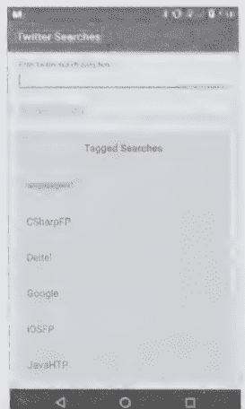

## 目标

在本章中，你将：

- 使用 `SharedPreferences` 存储与应用相关的键值对数据。
- 使用隐式 `Intent` 在浏览器中打开网站。
- 使用隐式 `Intent` 显示包含可以共享文本的应用的意图选择器。
- 在 `RecyclerView` 中显示滚动项目列表。
- 使用 `RecyclerView.Adapter` 的子类指定 `RecyclerView` 的数据。
- 使用 `RecyclerView.ViewHolder` 的子类实现 `RecyclerView` 的视图持有者模式。
- 使用 `RecyclerView.ItemDecoration` 的子类在 `RecyclerView` 项目之间显示分割线。
- 使用 `AlertDialog.Builder` 对象创建一个显示选项列表的 `AlertDialog`。

## 8.1 引言

## 目录

- 8.1 引言
- 8.2 测试驱动应用
- 8.2.1 添加收藏搜索
- 8.2.2 查看 Twitter 搜索结果
- 8.2.3 编辑搜索
- 8.2.4 分享搜索
- 8.2.5 删除搜索
- 8.2.6 滚动查看已保存的搜索
- 8.7 实现 `View.OnClickListener` 的匿名内部类以显示搜索结果
- 8.3 技术概述
- 8.3.1 在 `SharedPreferences` 文件中存储键值数据
- 8.3.2 隐式 `Intent` 和意图选择器
- 8.3.3 `RecyclerView`
- 8.3.4 `RecyclerView.Adapter` 和 `RecyclerView.ViewHolder`
- 8.3.5 `RecyclerView.ItemDecoration`
- 8.4 构建应用的 GUI 和资源文件
- 8.4.1 创建项目
- 8.4.2 `AndroidManifest.xml`
- 8.4.3 添加 `RecyclerView` 库
- 8.4.4 `colors.xml`
- 8.4.5 `strings.xml`
- 8.4.6 `arrays.xml`
- 8.4.7 `dims.xml`
- 8.4 添加保存按钮图标
- 8.5.1 `package` 和 `import` 语句
- 8.5.2 `MainActivity` 字段
- 8.5.3 重写的 `Activity` 方法 `onCreate`
- 8.5.4 `TextWatcher` 事件处理器和方法 `onUpdateSaveFAB`
- 8.5.5 `saveButton.setOnClickListener`
- 8.5.6 `addTaggedSearch`
- 8.5.8 实现 `View.OnClickListener` 的匿名内部类以分享或删除搜索
- 8.5.9 `shareSearch` 方法
- 8.5.10 `deleteSearch` 方法
- 8.6 `SearchesAdapter`（`RecyclerView.Adapter` 的子类）
- 8.6.1 `package` 语句、实例变量和构造函数
- 8.6.2 嵌套 `ViewHolder`（`RecyclerView.ViewHolder` 的子类）
- 8.6.3 重写的 `RecyclerView.Adapter` 方法
- 8.7 `ItemDivider`（`RecyclerView.ItemDecoration` 的子类）
- 8.4.9 `activity_main.xml`
- 8.4.10 `content_main.xml`
- 8.4.11 `RecyclerView` 项目：`list_item.xml`

## 8.1 引言

Twitter 的搜索机制使得能够轻松关注超过 3 亿活跃用户（总账号超过 10 亿）讨论的话题。使用 Twitter 的搜索运算符（第 8.2 节）可以微调搜索，否则在移动设备上输入长搜索字符串将非常耗时且繁琐。Twitter 应用（图 8.1）允许你保存收藏的查询，这些查询以滚动列表的形式显示。然后你可以滚动查看已保存的搜索，只需点击名称即可在指定的帖子上快速查看（图 8.1(b)）。正如你所见，该应用允许你分享、编辑和删除搜索。

1. https://about.twitter.com/
2. http://www.businessinsider.com/twitter-active-users-2015

## 8.8 关于 Fabric：Twitter 的移动开发平台

## 8.9 总结

# 第 8 章 Twitter Searches 应用

a) 带有保存搜索的应用  
b) 用户点击“Deitel”后的应用

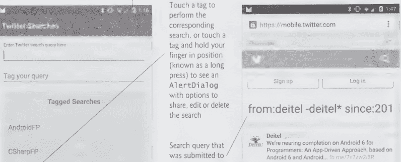

点击标签执行相应的搜索，或者点击标签并按住手指（称为长按）使用带有分享、编辑或删除搜索选项的 `AlertDialog`。

查询被提交给 Twitter——根据查询长度和字体大小部分截断。


图 8.1 | Twitter Searches 应用。

该应用支持竖屏和横屏方向。在 Flag 应用中，我们通过为每个方向提供单独的布局来实现。在 Doodle 应用中，我们通过程序设置方向来实现。在本应用中，我们通过设计一个根据当前方向动态调整的 GUI 支持两种方向。首先，我们将测试应用。然后我们将回顾构建应用的技术。接下来，我们将设计应用的 GUI。最后，我们将详细讨论新功能。

## 8.2 测试驱动应用

### 打开并运行应用

打开 Android Studio，从 TwitterSearches 文件夹打开 Twitter Searches 应用，然后在 AVD 或设备上运行应用（图 8.2）。

### 8.2.1 添加收藏搜索

点击 `EditText`，输入 Deitel 作为搜索查询——运算符定位指定的 Twitter 账号。图 8.3 显示了多个 Twitter 搜索：用于输入表达式的 `EditText`——提示文本“Enter search query”指定了 `EditText` 的用途。用于标记搜索的 `EditText`——提示文本“Tag your query”指定了 `EditText` 的用途。

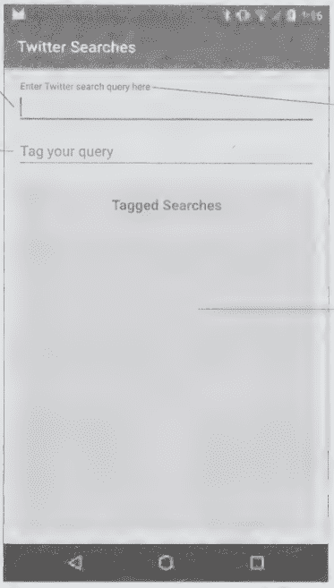

当 `EditText` 接收焦点时，其外层的 `TextInputLayout` 会将提示文本动画到 `EditText` 上方的位置。已保存的搜索显示在这里。

图 8.2 | Twitter Searches 应用首次执行时的状态。

运算符——可以使用多个运算符构建更复杂的查询。完整列表可以找到：

```text
http://bit.ly/TwitterSearchOperators
```


| 示例 | 查找的内容 |
|---|---|
| `google android` | 隐式逻辑运算符——查找包含 `google` 和 `android` 的推文 |
| `google OR android` | 逻辑或运算符——查找包含 `google` 或 `android` 或两者的推文 |
| `"how to program"` | 引号内的字符串（`""`）——查找包含 `"how to program"` 的推文 |
| `android ?` | `?`（问号）——查找关于 `android` 问题的推文 |
| `google -android` | `-`（减号）——查找包含 `google` 但不包含 `android` 的推文 |
| `android :)` | `:)`（笑脸）——查找包含 `android` 的正情绪推文 |
| `android :(` | `:(`（哭脸）——查找包含 `android` 的负情绪推文 |

**图 8.3** 一些搜索运算符（部分 1，共 2 部分）。

| 示例 | 查找的内容 |
|---|---|
| `since:2013-10-01` | 查找发生在指定日期或日期之后的推文，该日期格式必须为 `YYYY-MM-DD` |
| `near:"New York City"` | 查找发送至 `"New York City"` 的推文 |
| `from:GoogleCode` | 查找来自 Twitter 账号 `@GoogleCode` 的推文 |
| `to:GoogleCode` | 查找发送给 Twitter 账号 `@GoogleCode` 的推文 |

**图 8.3** 一些 Twitter 搜索运算符（部分 2，共 2 部分）。

在底部 `EditText` 中输入 `Deitel` 作为搜索查询的标签（图 8.4(a)）。这将是在应用标记搜索部分显示的短名称。点击保存按钮保存搜索——标签 `Deitel` 出现在标记搜索标题下的列表中（图 8.4(b)）。当你保存搜索时，软键盘会隐藏，以便你可以看到已保存的搜索列表（第 8.5.5 节）。

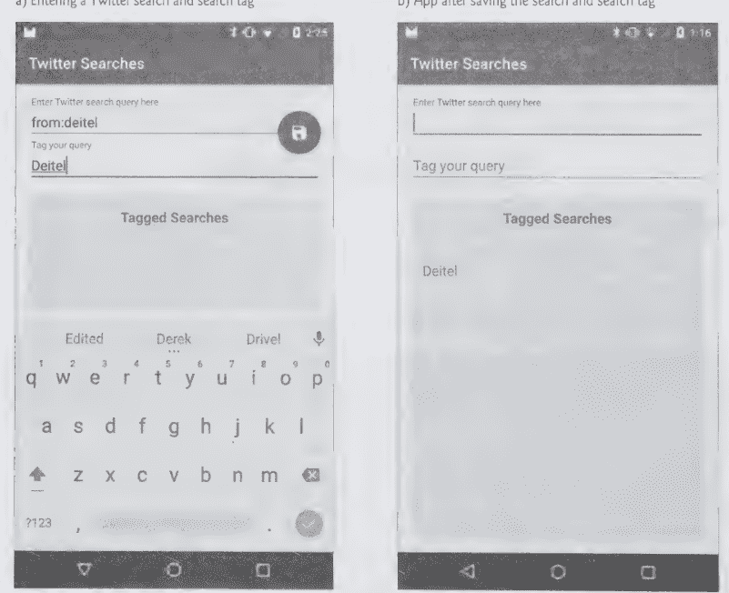

**图 8.4** 输入 Twitter 搜索和搜索标签。

## 8.2.2 查看 Twitter 搜索结果

要查看搜索结果，点击 `Deitel` 标签。这会启动设备的 Web 浏览器并将代表已保存搜索的 URL 传递给 Twitter 网站。Twitter 从 URL 中获取搜索查询，然后将与查询匹配的推文（如果有）以网页的形式返回。随后，Web 浏览器显示结果页面（图 8.5）。当您查看完结果后，点击返回按钮回到 Twitter Searches 应用程序，您可以在该程序中保存、编辑、删除和共享之前保存的搜索。对于 `"from:deitel"` 查询，Twitter 会显示账户名中包含 `deitel` 的相关用户账户以及这些账户的最新推文。


**图 8.5** 查看 `from:deitel` 的搜索结果——为了隐私起见，我们模糊了一个 Twitter 账户。

## 8.2.3 编辑搜索

你可以共享、编辑或删除搜索。要查看这些选项，长按搜索标签——即点击标签并保持手指在屏幕上，直到出现包含共享、编辑和删除选项的对话框。如果你在使用 AVD（Android 模拟器），点击并按搜索上的左鼠标键以执行长按。

当你长按 `Deitel` 时，图 8.6(a) 中的警告对话框（Alert-Dialog）将显示标记为“Deitel”的搜索的共享、编辑和删除选项。如果你不想执行这些任务之一，请点击取消（`CANCEL`）。

a) 选择编辑以编辑现有搜索

b) 编辑保存的“Deitel”搜索

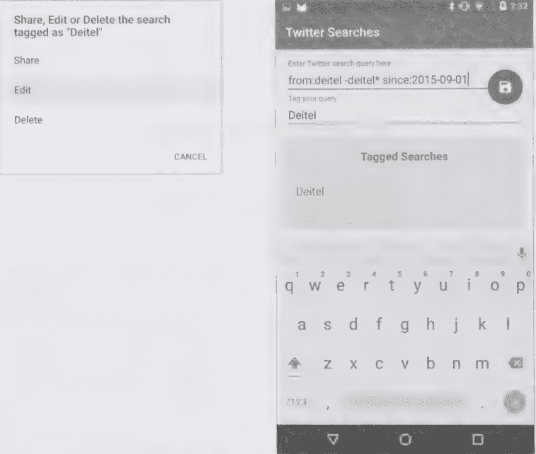

**图 8.6** 编辑已保存的搜索。

要编辑标记为“Deitel”的搜索，请点击对话框的编辑选项。应用程序随后会将搜索查询和标签加载到 `EditText` 中进行编辑。让我们将搜索限制为自 2015 年 9 月 1 日以来来自 `@deitel` 账户的推文。在顶部的 `EditText` 中添加一个空格，然后是查询的结尾（图 8.6(b)）。`<deitel>` 将删除结果中以“deitel”开头的账户的内容。

`since:` 算符将搜索结果限制为在指定日期（`yyyy-mm-dd`）或之后发生的推文。点击保存按钮更新已保存的搜索，然后通过点击应用程序“已标记搜索”（Tagged Searches）部分中的 `Deitel` 查看更新后的结果（图 8.7）。

[注意：更改标签名称将创建一个新的搜索，如果你想创建一个基于之前保存查询的新查询，这将非常有用。]

## 8.2 应用程序测试 293


**图 8.7** 查看更新后的“Deitel”搜索结果。

## 8.2.4 共享搜索

Android 让你能够轻松通过电子邮件、即时消息（短信）、Facebook、Google+、Twitter 等等方式从应用程序共享各种类型的信息。在此应用程序中，你可以通过长按搜索标签并从出现的警告对话框中选择“共享”来共享你喜欢的搜索。

这种所谓的意图选择器（intent chooser）（图 8.8(a)）可能会根据你共享的内容类型以及可以处理内容的应用程序而有所不同。在此应用程序中，我们共享的是文本，意图选择器显示了许多能够处理文本的应用程序。如果没有应用程序可以处理该内容，意图选择器将显示相应的消息。如果只有一个应用程序可以处理该内容，该应用程序将启动，无需从意图选择器中选择应用程序。

为了测试，我们使用了 Gmail。图 8.8(b) 显示了 Gmail 应用程序屏幕，其中预填充了地址、邮件主题和正文。在屏幕截图中，我们为了隐私模糊了发件人邮件地址。

## 294 第 8 章 Twitter 搜索应用程序

a) 显示共享选项的意图选择器

b) 包含“Deitel”搜索邮件的 Gmail **撰写**（Compose）屏幕


**图 8.8** 通过电子邮件共享搜索——Gmail **撰写**窗口默认显示你的电子邮件地址（此处为了隐私已模糊），将光标置于字段中以便输入收件人的电子邮件地址，并预填充邮件主题和内容。

## 8.2.5 删除搜索

要删除搜索，长按搜索标签并从出现的警告对话框中选择**删除**（`Delete`）。应用程序会提示你确认想要删除该搜索（图 8.9）——点击**取消**（`CANCEL`）将返回主屏幕且不删除该搜索。点击**删除**（`DELETE`）将删除该搜索。


**图 8.9** 确认删除的对话框。

## 8.2.6 滚动查看搜索

图 8.10 显示了内容超出显示内容的应用程序。与桌面应用程序不同，用手指触摸即可查看。


**图 8.10** 具有更多内容的应用程序。

## 8.3 技术概览 295

### 8.3.1 使用 `SharedPreferences` 存储键值数据

本节介绍了构建该应用程序所需的功能。每个应用程序都有包含标签（键）和搜索查询（值）的 `SharedPreferences` 文件。在此应用程序中，你将使用 `SharedPreferences` 创建和管理。

> 提示：不要在 UI 线程中进行长时间访问；否则应用程序将显示无响应对话。有关设计响应式应用程序的信息，请见 `http://developer.android.com/training/articles/anr.html`。

### 8.3.2 隐式意图和意图选择器

在第 4 章中，你使用了显式意图启动特定的 `Activity`。Android 也支持不指定处理组件的隐式意图。在此应用程序中使用两个：

- 根据嵌入 URL 的搜索查询启动设备默认浏览器。
- 允许用户从多种可以共享文本的应用程序中选择。

在任何情况下，如果系统找不到活动，则 `startActivity` 会抛出 `ActivityNotFound` 异常。处理此异常是一种良好的做法。有关意图的更多信息，请访问 `http://developer.android.com/guide/components/intents-filters.html`。

当 Android 接收到隐式意图时，它会找到每个可以处理该操作和数据类型的已安装应用程序。只有一个应用程序时，Android 将启动该应用程序中的相应 `Activity`。如果有多个应用程序可以处理该意图，Android 将显示一个对话框，让用户选择哪个应用程序处理该意图。

例如，当此应用程序使用保存的搜索且设备仅有一个浏览器时，Android 会立即启动该浏览器执行搜索并显示结果。如果安装了两个或多个浏览器，用户必须选择哪个浏览器执行此任务。

### 8.3.3 `RecyclerView`

在第 7 章中，你使用了 `ListView` 显示天气预测。许多移动应用程序显示大量列表。例如，电子邮件应用显示邮件列表，地址簿应用显示联系人列表，新闻应用显示标题列表。在每种情况下，用户触摸列表中的项目以查看更多信息——例如所选邮件的内容、所选联系人的详情或所选新闻的文本。

## `RecyclerView` 与 `ListView`

在此应用程序中，你将使用 `RecyclerView`（`package-support.widget.widget`）显示可滚动的标签搜索列表——这是一个灵活、可自定义的视图，允许你控制应用程序如何显示滚动数据列表。`RecyclerView` 设计得比 `ListView` 更好。它提供了数据展示与 `RecyclerView` 能力之间更好的分离（见第 8.3.4 节），并为展示 `RecyclerView` 的各个项提供了更灵活的自定义选项（见第 8.3.5 节）。

例如，`ListView` 的项始终以垂直列表的形式显示，而 `RecyclerView` 拥有布局管理器（layout managers），可以以垂直列表或网格的形式显示项。你可以定义自己的布局管理器。

## `RecyclerView` 布局管理器

对于此应用，`RecyclerView` 将使用 `LinearLayoutManager`——它是 `RecyclerView.LayoutManager` 的子类——来指定项将以垂直列表的形式出现，并且列表项将在 `TextView` 中显示每个搜索的标签（tag）。你还可以为 `RecyclerView` 的项设计自定义布局。

### 8.3.4 `RecyclerView.Adapter` 和 `RecyclerView.ViewHolder`

在第 7 章中，我们使用 `Adapter` 的子类将数据绑定到 `ListView` 上。我们引入了视图持有者模式（view-holder pattern）来重用滚动出屏幕的视图。回想一下，我们创建名为 `ViewHolder` 的类（第 8.6.2 节），它维护了 `ListView` 中视图的引用。`Adapter` 子类为每个 `ListView` 创建一个 `ViewHolder` 对象，以便我们可以重用 `ListView` 的项。你并不强制使用这种模式，但建议这样做以提高 `ListView` 的滚动性能。

`RecyclerView` 通过将视图持有者模式变为强制性要求来使其形式化。你将创建一个 `RecyclerView.Adapter` 子类，以将 `RecyclerView` 的项数据绑定到 `List` 中（见第 8.6 节）。每个 `RecyclerView` 项都有一个对应的 `RecyclerView.ViewHolder` 子类对象（见第 8.6.2 节），该对象维护了用于重用的视图引用。`RecyclerView` 项及其 `RecyclerView.Adapter` 共同工作，以回收滚动出屏幕的视图。

### 8.3.5 `RecyclerView.ItemDecoration`

`List` 类会自动在项与项之间绘制水平线，但 `RecyclerView` 不提供任何默认装饰（decorations）。要在项之间显示水平线，你将定义 `RecyclerView.ItemDecoration` 的子类，在 `RecyclerView` 上绘制分割线（见第 8.7 节）。

### 8.3.6 在对话框中显示选项列表

此应用允许用户长按 `RecyclerView` 项以显示一个 `AlertDialog`，该对话框包含一个选项列表，用户可以从中仅选择一个。你将使用 `AlertDialog.Builder` 的 `setItems` 方法来指定包含要显示选项名称的字符串资源（String resource），并设置用户触摸其中一个选项时调用的事件处理程序。

## 8.4 构建应用的 GUI 和资源文件

在本节中，你将构建 Twitter Searches 应用的 GUI 和资源文件。回想第 8.3.3 节，`RecyclerView` 并没有定义如何渲染其列表项。因此，你还需要创建一个定义列表项 GUI 的布局。`RecyclerView` 会在创建列表项时根据需要膨胀（inflate）此布局。

### 8.4.1 创建项目

使用 `Blank Activity` 模板创建一个新项目。此应用不需要片段（Fragments），因此在配置节点为 `Blank Activity` 节点时，不要勾选 `Use a Fragment` 复选框。在“Create New Project”对话框的“New Project”步骤中指定以下值：

- 应用名称（Application name）：Twitter Searches
- 公司域名（Company Domain）：`deitel.com`（或指定你自己的域名）

遵循你在早期应用中使用的步骤为项目添加图标。删除 `content_main.xml` 中的 `"Hello world!"` `TextView`，因为它没有被使用。此外，按照第 4.4.3 节的步骤为项目配置 Java SE 7 支持。

### 8.4.2 `AndroidManifest.xml`

大多数用户启动此应用是为了执行已保存的搜索。当活动中的第一个 GUI 组件是 `EditText` 时，Android 会在活动显示时赋予该组件焦点。当 `EditText` 接收到焦点时，除非存在硬件键盘，否则相应的虚拟键盘将会显示。在此应用中，我们希望在用户触摸应用的一个选项之前阻止软键盘显示。

### 8.4.3 添加 `RecyclerView` 库

此应用允许用户长按 `RecyclerView` 项以显示一个 `AlertDialog`，该对话框包含一个选项列表，用户可以从中仅选择一个。你将使用 `AlertDialog.Builder` 的 `setItems` 方法来指定包含要显示选项名称的字符串资源，并设置用户触摸其中一个选项时调用的事件处理程序。

### 8.4.4 `colors.xml`

### 8.4.5 `strings.xml`

### 8.4.6 `arrays.xml`

### 8.4.7 `dims.xml`

### 8.4.8 添加按钮

在编写本文时，Android Studio 并不显示来自支持库的布局属性，因此对这些属性的任何更改必须直接在布局的 XML 中实现。

### 8.4.9 `activity_main.xml`

### 8.4.10 `content_main.xml`

## 8.4 构建应用程序的 GUI 和资源文件 301

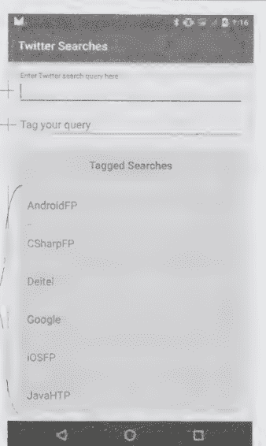

**图 8.14** 标记了 `id` 属性值的 Twitter Searches GUI 组件。

### 第 1 步：添加 `queryTextInputLayout` 及其嵌套的 `EditText`

按照如下方式添加 `queryTextInputLayout` 及其嵌套的 `EditText`：

1. 插入一个 `TextInputLayout`。在布局编辑器的 Design 视图中，点击调色板（Palette）Custom 区域中的 CustomView。在弹出的对话框中，切换到搜索自定义 GUI 组件列表。一旦 IDE 高亮了 `TextInputLayout`，点击 OK。在组件树（Component Tree）中，点击 `RelativeLayout` 以插入 `TextInputLayout` 作为嵌套布局。选择 `TextInputLayout` 并将其 `id` 设置为 `queryTextInputLayout`。

2. 要向 `TextInputLayout` 添加 `EditText`，请切换到编辑器的 Text 视图，然后将 `TextInputLayout` 元素的结束标签 `/>` 改变，以将光标置到 `>` 的右侧，按回车并输入 `<`。IDE 将显示选中了 `EditText` 的自动补全。在 `TextInputLayout` 的起始和结束标签之间，输入 `<EditText`。按回车插入 `EditText`，然后将其 `layout_width` 设置为 `match_parent`，`layout_height` 设置为 `wrap_content`。

3. 回到 Design 视图，在组件树中选择 `EditText`，将其 `imeOptions` 设置为 `auto`（键盘显示跳转到下一个 `EditText` 的按钮），将其 `hint` 设置为字符串资源并勾选 `singleLine`。查看 `imeOptions` 属性，必须首先点击属性窗口顶部的属性。

### 第 2 步：添加 `tagTextInputLayout` 及其嵌套的 `EditText`

使用上一步的技术添加 `tagTextInputLayout` 及其嵌套的 `EditText`，进行以下更改：

1. 添加 `TextInputLayout` 后。

2. 在 Text 视图中，为 `tagTextInputLayout` 的 XML 元素添加以下行，以指示此 `TextInputLayout` 应位于 `queryTextInput` 下方：

```xml


`android:layout_below="@id/queryTextInputLayout"`

- 3. 在 Design 视图中，将字符串资源 `tagTextInputLayout` `EditText` 的 `hint`。
- 4. 将 `EditText` 的 `imeOptions` 设置为 `actionDone`——对于此选项，键盘显示关闭键盘的按钮。

### 第 3 步：添加 LinearLayout

接下来在 `tagTextInputLayout` 下方添加 `LinearLayout`：

- 1. 在 Design 视图中，在组件树中绘制一个 `LinearLayout (vertical)`。
- 2. 在属性窗口中，展开 `layout_align` 属性节点，点击 `top:bottom` 右侧的 `tagTextInputLayout`。这表示 `LinearLayout` 的顶部位于 `tagTextInputLayout` 的底部。

### 第 3 步：添加 LinearLayout 的嵌套 TextView 和 RecyclerView

最后，添加 `LinearLayout` 的嵌套 `TextView` 和 `RecyclerView`：

- 1. 将 `TextView` 拖到组件树中的 `LinearLayout (vertical)` 节点，将其 `layout_width` 设置为 `match_parent`，`text` 设置为字符串资源 `tagged_searches`，`gravity` 设置为 `center_horizontal`，样式设为加粗。同时，展开其 `padding` 属性并将 `top` 和 `bottom` 设置为维度资源 `activity_vertical`。
- 2. 接下来插入 `RecyclerView`。在编辑器的 Design 视图中，点击调面板中的 Custom。输入 `RecyclerView` 搜索 GUI 组件。一旦 IDE 高亮 `RecyclerView`，点击 OK，然后在组件树中点击 `LinearLayout` 以插入 `RecyclerView` 作为嵌套视图。
- 3. 在组件树中选择 `RecyclerView`，将其 `id` 设置为 `recyclerView`，`layout_width` 设置为 `match_parent`，`layout_height` 设置为 `0dp`，`layout_weight` 设置为 `1`——`RecyclerView` 将填充 `LinearLayout` 的剩余空间。同时，展开 `RecyclerView` 的 `padding` 属性并将 `left` 和 `right` 设置为维度资源 `activity_horizontal`。

## 8.4.1 RecyclerView 布局：list_item.xml

在为 `RecyclerView` 填充数据时，必须指定每个列表项的布局。应用程序中的列表项显示 tag 名称。你将创建一个仅包含 `TextView` 的新布局。执行以下步骤：

- 1. 在 Project 窗口中，展开 `res` 文件夹，右键点击 `layout` 文件夹并选择 New > Layout 显示 New Resource 对话框。
- 2. 在 File name 字段指定 `list_item.xml`。
- 3. 在 Root 元素指定 `TextView`。
- 4. 点击 OK。`list_item.xml` 文件将出现在 `res/layout` 文件夹中。

IDE 在布局编辑器中打开布局。在组件树中选择 `TextView`，将其 `id` 设置为 `textView`，然后设置以下属性：

- `layout:width=match_parent`
- `layout:height=?android:attr/listPreferredHeight`——此值是表示列表项首选高度的 Android 资源。


- `gravity=center_vertical`
- `textAppearance=?android:attr/textAppearance`——这是指定文本大小的预定义主题资源。

### 其他预定义的 Android 资源

有很多预定义的 Android 资源用于设置列表项的高度和文本外观。你可以在此处查看完整列表：

要在布局中使用值，请按如下格式指定：

```text
android:attr/resourceName
```

http://developer.android.com/reference/android/R.html

## 8.5 MainActivity 类

应用程序由三个类组成：

- `MainActivity` 类——本节将讨论——配置应用程序的 GUI 并定义逻辑。
- `SearchesAdapter` 类（第 8.6 节）是 `RecyclerView.Adapter` 的子类，定义了如何将用户搜索的标签绑定到 `RecyclerView` 的项。`MainActivity.onCreate` 创建 `SearchesAdapter` 对象作为 `RecyclerView` 的适配器。
- `ItemDivider` 类（第 8.7 节）是 `RecyclerView.ItemDecoration` 的子类，`RecyclerView` 用它绘制项之间的水平线。

第 8.5.1–8.5.10 节详细讨论 `MainActivity`。此应用程序不需要菜单，因此我们删除了 `MainActivity` 的 `onCreateMenu` 和 `onOptionsItemSelected` 方法以及项目 `menu` 文件夹中相应的菜单资源。

### 8.5.1 包和导入语句

图 8.15 显示了 `MainActivity` 的包和导入语句。我们在第 8.3 节以及在 `MainActivity` 中遇到它们时讨论这些内容。

```java
// MainActivity.java

// 管理你喜欢的 Twitter 搜索，方便在
// 设备网络浏览器中访问和显示

package com.deitel.twittersearches;

import android.app.AlertDialog;
import android.content.Context;
import android.content.DialogInterface;
import android.content.content.Intent;
import android.content.content.SharedPreferences;
import android.net.Uri;
import android.os.Bundle;
import android.support.design.widget.FloatingActionButton;
import android.support.design.widget.TextInputLayout;
import android.support.v7.app.AppCompatActivity;
import android.support.v7.LinearLayoutManager;
import android.support.v7.RecyclerView;
import android.support.v7.Toolbar;
import android.text.Editable;
import android.text.TextWatcher;
import android.view.View;
import android.view.View.OnClickListener;
import android.view.View.OnLongClickListener;
import android.view.input.InputMethodManager;
import android.widget.EditText;
import android.widget.TextView;
import java.util.ArrayList;
import java.util.Collections;
import java.util.List;
```

图 8.15 | `MainActivity` 的包和导入语句。

### 8.5.2 MainActivity 字段

与天气应用程序一样，`MainActivity` 类（图 8.16）继承自 `AppCompatActivity`（第 32 行），以便其可以使用应用程序栏并在设备或当前 Android 版本中使用所有 AppCompat 库功能。静态字符串 `SEARCHES`（第 34 行）代表 `SharedPreferences` 文件的名称，该文件将在设备上存储标签-查询对。

## 8.5 MainActivity 类 305

```java
public class MainActivity extends AppCompatActivity {

    // 存储已搜索的 SharedPreferences XML 文件名
    private static final String SEARCHES = "searches";

    private EditText queryEditText; // 用户输入查询的地方

    private EditText tagEditText; // 用户输入查询标签的地方

    private FloatingActionButton saveActionButton; // 保存搜索

    private SharedPreferences savedSearches; // 用户收藏的搜索

    private List<String> tags; // 已保存搜索的标签列表

    private SearchesAdapter adapter; // 用于将数据绑定到 RecyclerView
}
```

图 8.16 | `MainActivity` 字段。

第 36–41 行定义了 `MainActivity` 的实例变量：

- 第 36–37 行声明了我们将使用的 `EditText`，用于访问用户输入的输入的查询内容和标签。
- 第 38 行声明了一个 `FloatingActionButton`，用户可以通过点击它来保存搜索。在 Blank Activity 模板中，它被声明为 `onCreate` 中的局部变量（第 8.5.3 节）——我们重命名了它并将其变为实例变量，这样当 `EditText` 为空或两个 `EditText` 都包含输入时，我们可以隐藏该按钮。
- 第 39 行声明了 `SharedPreferences` 实例变量 `savedSearches`，我们将用它操作表示用户保存搜索的标签-查询对。
- 第 40 行声明了 `List<String> tags`，用于存储用户搜索的排序后的标签名称。
- 第 41 行声明了 `SearchesAdapter` 实例变量 `adapter`，它将指向 `RecyclerView.Adapter` 子类对象，为 `RecyclerView` 提供数据。

## 8.5.3 重写的 Activity 方法 onCreate

重写的 Activity 方法 `onCreate`（图 8.17）初始化了 Activity 的实例变量并配置了 GUI 组件。第 52–57 行包含了对 `queryEditText` 和 `tagEditText` 的引用，并为每个组件注册了一个 `TextWatcher`（第 8.5.4 节），当用户在 `EditText` 中输入或删除更改时，该监听机会收到通知。

```java
// 配置 GUI 并注册事件监听器

@Override
protected void onCreate(Bundle savedInstanceState) {
    super.onCreate(savedInstanceState);
    setContentView(R.layout.activity_main);

    Toolbar toolbar = (Toolbar) findViewById(R.id.toolbar);
    setSupportActionBar(toolbar);
}
```

图 8.17 | 重写的 Activity 方法 `onCreate`（部分 1，共 2 部分）。

```java
// 获取 EditText 的引用并为它们添加 TextWatcher

queryEditText = ((TextInputLayout) findViewById(R.id.queryTextInputLayout)).getEditText();
queryEditText.addTextChanged(textWatcher);

tagEditText = ((TextInputLayout) findViewById(R.id.tagEditLayout)).getEditText();
tagEditText.addTextChanged(textWatcher);

// 获取包含用户保存搜索的 SharedPreferences
savedSearches = getSharedPreferences(SEARCHES, MODE_PRIVATE);

// 将保存的标签存储在 ArrayList 中进行排序
tags = new ArrayList<String>(savedSearches.getAll().keySet());
Collections.sort(tags, String.CASE_INSENSITIVE_ORDER);

// 获取 RecyclerView 的引用进行配置
recyclerView = findViewById(R.id.recyclerView);

// 使用 LinearLayoutManager 在垂直列表中显示项
recyclerView.setLayoutManager(new LinearLayoutManager(this));

// 创建 RecyclerViewAdapter 将标签绑定到 RecyclerView
adapter = new RecyclerViewAdapter(tags, itemClickListener);
recyclerView.setAdapter(adapter);

// 指定自定义的 ItemDecorator 在列表项之间绘制线条
recyclerView.addItemDecorator(new ItemItemDecorator(this));

// 注册监听器以保存新的或编辑过的搜索
saveSavingActionButton = ((FloatingActionButton) findViewById(R.id.saveActionButton));
saveSavingActionButton.setOnClickListener(saveButtonListener);

updateSaveFAB(false); // 隐藏按钮，因为 EditText 最初为空
```


图 8.17 | 重写的 `Activity` 方法 `onCreate`。（部分 2，共 2 部分。）

### 获取 `SharedPreferences` 对象

第 60 行使用 `getSharedPreferences` 方法获取一个 `SharedPreferences` 对象，该对象可以从搜索中读取标签-查询对（如果有的话）。第一个参数指示包含数据的文件名。第二个参数指定了文件的访问级别，并可以设置为：

- `MODE_PRIVATE`——仅限此应用访问。在大多数情况下，你将使用此选项。
- `MODE_WORLD_READABLE`——设备上的任何应用都可以读取该文件。
- `MODE_WORLD_WRITABLE`——设备上的任何应用都可以写入该文件。

这些常量可以使用按位或运算符（`|`）进行组合。

## 8.5 `MainActivity` 类 307

### 获取存储在 `SharedPreferences` 对象中的键

我们希望按字母顺序显示搜索标签，以便用户可以轻松找到搜索。首先，第 63 行获取表示 `SharedPreferences` 对象中键的字符串，并将它们存储在 `tags`（一个 `ArrayList<String>`）中。`SharedPreferences` 方法将所有保存的搜索返回为 `Map`（来自 `java.util` 包）——一个键值对集合。然后我们对 `Map` 调用 `keySet` 方法来获取所有键的 `Set<String>`（`java.util` 包）——一个唯一值的集合。结果是初始化 `tags`。

### 对标签的 `ArrayList` 进行排序

第 64 行使用 `Collections.sort` 对 `tags` 进行排序。由于用户可能使用大小写混合的标签，我们通过将预定义的 `Comparator<String>` 对象 `String.CASE_INSENSITIVE_ORDER` 作为第二个参数传递给 `Collections.sort` 来执行不区分大小写的排序。

### 配置 `RecyclerView`

第 67–79 行配置了 `RecyclerView`：

- 第 67 行获取 `RecyclerView` 的引用。
- `RecyclerView` 能够以不同的方式排列其项。对于此应用，我们使用 `LinearLayoutManager` 接收一个 `Context` 对象，即 `MainActivity` 类。第 71 行调用 `setLayoutManager` 设置新的管理器。
- 第 74–75 行创建适配器以 `RecyclerView` 数据。第 76 行调用 `setAdapter` 设置适配器。
- 第 79 行创建 `RecyclerView.ItemDecorator` 并将其传递给 `addItemDecorator` 方法。这允许 `RecyclerView` 在列表项之间绘制水平线条。

### 为 `FloatingActionButton` 注册监听器

第 82–85 行获取 `FloatingActionButton` 的引用并注册其 `OnClickListener`。实例变量 `saveListener` 指向实现 `OnClickListener` 接口的匿名内部类。

## 8.5.4 `TextWatcher` 事件处理器和 `updateFAB` 方法

图 8.18 定义了一个实现 `TextWatcher` 的匿名类（第 89–103 行）。当每个 `EditText` 的内容变化时，`TextWatcher` 会调用 `updateFAB`（第 54–57 行）。

```java
// 根据 EditText 显示或隐藏 FloatingActionButton

private final TextWatcher textWatcher = new TextWatcher() {

    @Override
    public void beforeTextChanged(CharSequence s, int start, int count, int after) { }

    // 用户更改后显示或隐藏 FloatingActionButton
    @Override
    public void onChanged(CharSequence s, int start, int before, int count) {
        updateFAB();
    }

    @Override
    public void afterTextChanged(Editable s) { }
};

// 显示或隐藏 FloatingActionButton
private void updateFAB() {
    // 检查 EditText 是否都有输入
    if (queryEditText.toString().isEmpty() ||
        tagEditText.toString().isEmpty())
        saveActionButton.hide();
    else
        saveActionButton.show();
}
```

图 8.18 | `TextWatcher` 事件处理器和 `updateFAB`。

### 8.5.5 `saveButton` 的 `OnClickListener`

图 8.19 定义了实例变量 `saveButtonListener`，它指向实现 `OnClickListener` 接口的匿名内部类。第 84 行（图 8.17）为 `saveActionButton` 注册了 `saveButtonListener` 事件处理器。

```java
// 第 119–135 行
@Override
public void onClick(View v) {
    String query = queryEditText.getText().toString();
    String tag = tagEditText.getText().toString();

    if (!query.isEmpty() && !tag.isEmpty()) {
        // 隐藏软键盘
        // ...

        // 存储标签-查询对
        addTaggedSearch(query, tag);

        // 清空两个 EditText
        queryEditText.setText("");
        tagEditText.setText("");

        // 将输入光标置于 query 中
        queryEditText.requestFocus();
    }
}
```

## 8.5 `MainActivity` 类

```java
// saveButtonListener save a tag-query pair into SharedPreferences
private final OnClickListener saveButtonListener =
new OnClickListener() {
    // add update search if any query or tag is empty
    @Override
    public void onClick(View view) {
        String query = queryEdit.getText().toString();
        String tag = tagEdit.getText().toString();

        if (query.isEmpty() && tag.isEmpty()) {
            // hide the virtual keyboard
            ((InputMethodManager)getSystemService(Context.METHOD_SERVICE)).hideSoftInputFromWindow(
                view.getWindowWindow(), 0);
        }

        addTaggedSearch(tag, query); // add/update the search
        tagEditText.setText(""); // clear queryEditText
        tagEditText.setText(""); // clear tagEdit
        queryEditText.requestFocus(); // queryEditText gets focus
    }
};
```

图 8.19 | 实现 `saveButton` `OnClickListener` 的匿名内部类，用于保存新的或更新的搜索内容。

## 8.5.6 `addTaggedSearch` 方法

图 8.19 中的事件处理器调用方法 `addTaggedSearch`（图 8.20）来向 `Searches` 添加新搜索，或通过修改现有的搜索。

```java
// add new search to file, then refresh all buttons
private void addTaggedSearch(String tag, String query) {
    // get a SharedPreferences.Editor to store new tag/query pair
    SharedPreferences.Editor editor = savedSearches.edit();
    editor.putString(tag, query); // store current search
    editor.apply(); // store the updated preferences

    // if tag is new, add to sort tags, then display updated list
    if (!tags.contains(tag)) {
        tags.add(tag); // add new tag
        Collections.sort(tags, String.CASE_INSENSITIVE_ORDER);
    }

    adapter.notifyDataChanged(); // update tags in RecyclerView
}
```

图 8.20 | `MainActivity` 的 `addTaggedSearch` 对象内容

*编辑 `SharedPreferences` 标识的内容*

回顾第 4.6.7 节，要更改 `SharedPreferences` 标识的内容，必须先调用编辑器方法获取一个 `SharedPreferences.Editor` 对象（图 8.20, 141），该对象可以向 `SharedPreferences` 文件添加键值对、删除键值对并修改与特定键相关联的值。第 142 行调用 `SharedPreferences.Editor` 方法 `putString` 来保存搜索（键）和查询（对应的值）——如果该标签已存在于 `SharedPreferences` 中，则会更新此值。第 143 行通过调用 `SharedPreferences.Editor` 方法 `apply` 来提交更改，将更改应用到文件中。

### 通知 `RecyclerView.Adapter` 数据已更改

当用户添加新搜索时，应该更新 `RecyclerView` 以显示它。第 146 行确定是否添加了新标签。因此，第 147–148 行将新搜索的标签添加到 `tags` 列表中，然后对 `tags` 进行排序。第 149 行调用 `RecyclerView.Adapter` 的 `notifyDataSetChanged` 方法，指示 `tags` 中的底层数据已发生变化。作为 `ListView` 适配器，`RecyclerView.Adapter` 通知 `RecyclerView` 更新其显示项列表。

## 8.5.7 实现 `View.OnClickListener` 显示搜索结果的匿名内部类

图 8.21 定义了实例 `itemClickListener`，它引用了一个实现 `OnClickListener` 接口（`View` 的嵌套类）的匿名类对象。第 156–168 行重写了接口的 `onClick` 方法。该方法的参数是用户触摸的 `View`——在本例中是 `RecyclerView` 中显示搜索标签的 `TextView`。

```java
// itemClickListener launches browser to display results
private final OnClickListener itemClickListener =
    new OnClickListener() {
        @Override
        public void onClick(View view) {
            // get query string and create a URL representing the search
            String tag = ((TextView) view).getText().toString();
            String urlString = getString(R.string.search_tag, "UTF-8");
            Uri.encode(savedSearches);

            // create a Intent to launch web browser
            Intent webIntent = new Intent(Intent.ACTION_VIEW,
                Uri.parse(urlString));

            startActivity(webIntent); // show results in web browser
        }
    };
```

图 8.21 | 实现 `View.OnClickListener` 显示搜索结果的匿名内部类。

### 获取 `String` 资源

第 159 行获取用户在 `RecyclerView` 中触摸的 `View` 的文本——这是搜索的标签。第 160–161 行创建一个包含要执行的 URL 的 `String`。第 160 行带一个参数调用 `Activity` 继承的方法获取名为 `search_URL` 的 `String` 资源，然后我们附加查询 `String` 以完成 `urlString`。`SharedPreferences` 方法返回与标签关联的查询。如果标签已不存在，则返回第二个参数（在本例中为 `""`）。第 161 行将查询传递给 `Uri.encode`，它会转义任何特殊字符（如 `?`）并返回一个所谓的 URL 编码字符串。包中的 `Uri`（统一资源标识符）类允许我们将 URL 转换为启动设备网络浏览器的 `Intent` 所需的格式。

### 创建一个用于启动设备网络浏览器的 `Intent`

第 164–165 行创建一个新的 `Intent`，我们将用它来启动设备的浏览器并显示搜索结果。在第 4 章中，我们使用显式 `Intent` 来启动同一应用中的另一个 `Activity`。`Intent` 构造函数的第一个参数是描述动作的常量。`Intent.ACTION_VIEW` 表示我们想要显示数据。许多常量定义在 `Intent` 类中描述搜索、选择和播放。第 165 行的第二个参数是 URL（统一资源定位符）。

### 为指定的数据启动 `Activity`

第 167 行将 `Intent` 传递给继承的方法 `startActivity`，启动一个可以执行特定操作的 `Activity`。在此情况下，由于我们指定了查看 URI，`Intent` 将启动设备的网络浏览器显示相应的页面。

## 8.5.8 实现 `View.OnClickListener` 以共享、编辑或删除搜索的匿名内部类

图 8.22 定义了 `itemOnClickListener`，它引用了一个实现 `OnClickListener` 接口的匿名类对象。第 175–216 行重写了接口的 `onClick` 方法。

- 资源标识符（URI）唯一标识网络上的资源。常见的 URI 类型是统一资源定位符（URL），用于标识网页、图像文件、网络服务等。

```java
// itemClickListener displays a dialog allowing the user to search
// edit or delete a saved search
private final LongClickListener itemClickListener =
new LongClickListener() {
    @Override
    public boolean onClick(View view) {
        // 获取用户触摸的标签
        final String tag = ((TextView) view).getText().toString();

        // 创建一个新的 AlertDialog
        AlertDialog.Builder builder = 
            new AlertDialog.Builder(MainActivity.this);

        // 设置 AlertDialog 的标题
        builder.setTitle(R.string.share_edit_delete_title, tag);

        // 设置要显示的列表并创建事件处理器
        builder.setItems(R.array.dialog_items,
```


实现 `View.OnClickListener` 的匿名内部类

```
new DialogInterface.OnClickListener() {

    @Override
    public void onClick(DialogInterface interface, int which) {

        switch (which) {

            case 0: // 共享

                setSearch(tag);

                break;

            case 1: // 编辑

                // 设置 EditText 以匹配标签和查询

                tagEditText.setText(tag);

                queryEditText.setText(savedSearch.getString(tag, ""));

                break;

            case 2: // 删除

                delete(tag);

                break;

        }

    }

});
```

**图 8.22** 实现 `View.OnClickListener` 的匿名内部类

## 匿名内部类使用的 final 局部变量

第 178 行将用户按项目的标签文本赋值给 `final` 局部变量——对于匿名内部类中使用的任何局部变量或方法参数，`final` 是必须的。

## 显示项目列表的 AlertDialog

第 181–186 行创建了一个 `AlertDialog.Builder` 并将对话框标题设置为一个格式化字符串（`R.string.share_edit_delete_title`），其中 `tag` 替换了格式占位符。第 186 行调用了 `getActivity()` 继承的方法 `getString`，该方法接收多个参数——一个表示格式化字符串的字符串资源 ID，以及应该替换格式化字符串中格式占位符的值。除了按钮外，`AlertDialog` 还可以显示项目列表。第 189–200 行使用 `AlertDialog.Builder` 方法 `setItems` 来指定对话框应该显示字符串数组 `R.array.dialog_items`，并定义了一个匿名内部类，当用户触摸列表中的任何项时该类会做出响应。

## 对话框项目列表的事件处理器

第 190–208 行中的匿名内部类确定了用户在对话框列表中选择了哪一项，并执行相应的操作。如果用户选择“共享（Share）”，将调用 `shareSearch`（第 195 行）。如果用户选择“编辑（Edit）”，第 199–201 行会在 `EditText` 中显示搜索查询内容和 `tag`。如果用户选择“删除（Delete）”，将调用 `deleteSearch`（第 204 行）。

## 配置负性按钮并显示对话框

第 212 行配置了对话框的负性按钮。当负按钮的事件处理器为 `null` 时，触摸负按钮将简单关闭对话框。第 214 行创建并显示对话框。

## 8.5 shareSearch 方法

当用户选择搜索某个搜索时（图 8.22），会调用 `shareSearch` 方法（图 8.23）。第 222–223 行创建了一个表示要共享的搜索结果的 `String`。第 226–232 行创建并配置了一个 `Intent`，允许用户使用可以处理 `Intent.ACTION_SEND` 的 `Activity` 来搜索搜索 URL。

```java
// allow user to choose an app for sharing URL of a saved search
private void shareSearch(String tag) {

    // create the URL representing the search
    String urlString = getString(R.string.search_URL) +
        Uri.encode(savedSearches.getString(tag, ""), "UTF-8");

    // create Intent to share urlString
    Intent shareIntent = new Intent();
    shareIntent.setAction(Intent.ACTION_SEND);
    shareIntent.putExtra(Intent.EXTRA_SUBJECT,
        getString(R.string.share_subject));
    shareIntent.putExtra(Intent.EXTRA_TEXT,
        urlString);
    shareIntent.setType("text/plain");

    // display apps that can share plain text
    startActivity(Intent.createChooser(shareIntent,
        getString(R.string.share_search));
}
```

图 8.23 | `MainActivity` 的 `shareSearch` 方法。

### 向 Intent 添加额外的信息

一个 `Intent` 包含一个 `Bundle` 类型的 `extras`——这是传递给处理该 `Intent` 的 `Activity` 的额外信息。例如，电子邮件 `Activity` 可以接收代表邮件主题、CC 和 BCC 地址以及正文的 `extras`。第 228–231 行使用 `Intent.putExtra` 向 `Intent` 的 `Bundle` 中添加表示 `extras` 的键值对。该方法的第一个参数是表示额外信息用途的 `String`，第二个参数是对应的额外数据。`Extras` 可以是基本类型类型、基本类型数组或 `Bundle` 对象等——请参 `Intent` 文档以获取完整的 `putExtra` 重载方法列表。

第 228–229 行的 `extra` 指定邮件主题。对于不使用主题的 `Activity`（例如在社交网络上共享），此 `extra` 将被忽略。第 230–231 行的 `extra` 代表要共享的文本——一个格式化字符串，其中 `url` 被替换到字符串资源 `R.string.share_message` 中。第 232 行将 `Intent` 的 MIME 类型设置为 `text/plain`——此类数据可以由任何能够发送纯文本消息的 `Activity` 处理。

### 显示 Intent 选择器

为了显示图 8.8(a) 中的意图选择器，我们将 `Intent` 和一个 `String` 传递给 `Intent` 的静态方法 `createChooser`（第 235–236 行）。选择器的标题由第二个参数 `R.string.share_search` 指定。设置此标题很重要，可以提醒用户选择一个 `activity`。你无法控制手机上安装的应用程序或可以启动应用的 `Intent` 过滤器，因此选择器中可能会出现不兼容的 `activity`。`createChooser` 方法返回一个 `Intent`，我们通过 `startActivity` 调用来显示意图选择器。

## 8.5.10 deleteSearchMethod

当用户长按搜索 `tag` 并从图 8.22 代码显示的对话框中选择“删除（Delete）”时，会调用 `deleteSearchMethod`（图 8.24）。在删除搜索之前，应用显示一个 `AlertDialog` 以确认删除。第 243 行（图 8.24）将对话框标题设置为一个格式化字符串，其中替换了搜索资源 `R.string.confirm_message` 中的格式占位符。第 246 行配置对话框的负性按钮以取消删除。第 249–264 行配置对话框的正性按钮以移除搜索。第 252 行从集合中移除 `tag`，第 255–258 行使用 `SharedPreferences.Editor` 从 `SharedPreferences` 中移除搜索。第 261 行通知 `RecyclerView.Adapter` 底层数据已更改，以便 `RecyclerView` 能够更新其显示的项目列表。

```java
// deleteSearchMethod (Fig. 8.24) is called when the user long presses a search tag
// and selects Delete from the dialog displayed by the code in Fig. 8.22. Before deleting the search, the app displays an AlertDialog to confirm the deletion. Line 243 (Fig. 8.24) sets the dialog's title to a formatted String
// in which replaces the format specifier in the search resource R.string.confirm_message. Line 246 configures the dialog's negative button to dismiss the deletion. Lines 249–264 configure the dialog's positive button to remove the search. Line 252 removes the tag from the collections, and lines 255–258 use a SharedPreferences.Editor to remove the search from the SharedPreferences. Line 261 notifies the RecyclerView.Adapter that the underlying data has changed so that the RecyclerView can update its displayed list of items.

private void deleteSearch(String tag) {

    AlertDialog.Builder builder = new AlertDialog.Builder(this);
    builder.setTitle(getString(R.string.confirm_message, tag));

    builder.setButton(AlertDialog.BUTTON_NEGATIVE, "Cancel", (dialog, which) -> {
        dialog.dismiss();
    });

    builder.setButton(AlertDialog.BUTTON_POSITIVE, "OK", (dialog, which) -> {
        tags.remove(tag);
        SharedPreferences.Editor editor = getSharedPreferences("searches", MODE_PRIVATE).edit();
        editor.remove(tag);
        editor.apply();
        notifyDataChanged();
    });

    builder.show();
}
```

图 8.24 | `deleteSearch` 方法。

## 8.6 SearchesAdapter RecyclerView 的子类

本节介绍了将数据绑定到 `RecyclerView` 项目的 `RecyclerView.Adapter`。

```java
package deitel.twittersearches;

import android.view.LayoutInflater;
import android.view.View;
import android.widget.TextView;
import android.support.v7.widget.RecyclerView;
import java.util.List;

public class SearchesAdapter extends RecyclerView.Adapter<SearchesAdapter.ViewHolder> {

    // listeners from MainActivity that are registered for list item
    private final OnClickListener clickListener;
    private final OnLongClickListener longClickListener;

    // List<String> used to obtain in RecyclerView
    private final List<String> tags;

    // constructor
    public SearchesAdapter(List<String> tags,
            View.OnClickListener clickListener,
            OnLongClickListener longClickListener) {

        this.tags = tags;
        this.clickListener = clickListener;
        this.longClickListener = longClickListener;
    }
```

图 8.25 | `SearchesAdapter` 包语句、导入语句和构造函数。

### 8.6.2 嵌套 ViewHolder 子类

`RecyclerView` 中的每个项都必须包装在自己的 `RecyclerView.ViewHolder` 中。对于此应用，我们定义了一个 `RecyclerView.View` 的 `ViewHolder`（图 8.26）。`ViewHolder` 构造函数（第 39–48 行）接收一个 `View` 对象以及 `View` 的 `OnClick` 和 `OnLong` 事件监听器。`View` 代表 `RecyclerView` 中的某一项，并传递给父类的构造函数（第 42 行）。第 43 行存储了该项目的 `TextView` 引用。第 46 行注册了 `TextView` 的 `OnClickListener`，用于显示该 `TextView` `tag` 的搜索结果。第 47 行注册了 `TextView` 的 `OnClickListener`，为该 `TextView` `tag` 使用共享、编辑或删除对话框。构造函数在 `RecyclerView.Adapter` 创建新列表项方法 `onCreateViewHolder` 时调用（见节 8.6.3）。

```java
// nested subclass of RecyclerView.ViewHolder used to implement
// the viewHolder pattern in the context of a RecyclerView--the logic
// of recycling views that have scrolled offscreen is handled for you

public static class ViewHolder extends RecyclerView.ViewHolder {

    public final TextView textView;

    public ViewHolder(View itemView) {
        super(itemView);
        textView = (TextView) itemView.findViewById(R.id.search_text);
    }
}
```

图 8.26 | `SearchesAdapter` 嵌套 `ViewHolder` 子类。

## 8.6 SearchesAdapter RecyclerView.Adapter 的子类

```java
// configures a RecyclerView item's ViewHolder
public ViewHolder(View itemView,
    View.OnClickListener clickListener,
    View.OnLongClickListener longClickListener) {

    super(itemView);
```


`textView = (TextView) itemView.findViewById(R.id.textView);`

```java
// attach listeners to itemView

itemView.setOnClickListener(clickListener);

itemView.setOnLongClickListener(longClickListener);
```

**图 8.26** | `SearchesAdapter` 嵌套的 `RecyclerView.ViewHolder` 子类。（2 部分中的第 2 部分。）

### 8.6.3 重写的 `RecyclerView.Adapter` 方法

图 8.27 定义了重写的 `RecyclerView.Adapter` 方法：`onCreateViewHolder`（第 52–61 行）、`onBindViewHolder`（第 64–67 行）和 `getItemCount`（第 70–73 行）。

```java
// sets new list item and its ViewHolder

@Override

public ViewHolder onCreateViewHolder(ViewGroup parent,

    int viewType) {

    // inflate the list_item layout

    View view = LayoutInflater.from(parent.getContext()).inflate(

        R.layout.list_item, parent, false);

    // create a ViewHolder for current item

    return new ViewHolder(view, clicklistener, longClickListener);

}

// sets the text of the list item to display the search tag

@Override

public void onBindViewHolder(ViewHolder holder, int position) {

    holder.textView.setText(tags.get(position));

}

// returns the number of items that adapter binds

@Override

public int getItemCount() {

    return tags.size();

}
```

**图 8.27** | `SearchesAdapter` 重写的 `RecyclerView.Adapter` 方法：`onCreateViewHolder`、`onBindViewHolder` 和 `getItemCount`。

## 第 8 章 Twitter® Searches 应用

### 重写 `onCreateViewHolder` 方法

`RecyclerView` 会调用每个 `RecyclerView.Adapter` 的 `onCreateViewHolder` 方法（第 56–61 行），来展开每个 `RecyclerView` 项的布局，并将其封装在名为 `ViewHolder` 的 `RecyclerView.ViewHolder` 子类对象中（第 60 行）。随后，这个新的 `ViewHolder` 对象被返回给 `RecyclerView` 用于显示。

### 重写 `onBindViewHolder` 方法

`RecyclerView` 会调用其 `RecyclerView.Adapter` 的 `onBindViewHolder` 方法（第 64–67 行），来设置特定 `RecyclerView` 项上显示的数据。该方法接收：

- 一个我们自定义的 `RecyclerView.ViewHolder` 子类对象，包含显示数据的 `View`——在本例中，是一个 `TextView`；以及
- 一个表示项在 `RecyclerView` 中位置的整数（`int`）。

第 66 行将 `TextView` 的文本设置为 `tags` 中在给定位置的字符串。

### 重写 `getItemCount` 方法

`RecyclerView` 会调用其 `RecyclerView.getItemCount` 方法（第 70–73 行），以获取 `RecyclerView` 需要显示的项目总数——在本例中，即 `tags` 中的项目数量（第 72 行）。

## 8.7 `ItemDivider` `RecyclerView.ItemDecoration` 的子类

`RecyclerView.ItemDecoration` 对象在 `RecyclerView` 上绘制装饰元素——例如项与项之间的分隔符。`RecyclerView.ItemDecoration` 子类（图 8.28）在列表项之间绘制分割线。构造函数中的第 17–18 行获取了预定义的 Android `Drawable` 资源 `R.attr.listDivider`，这是 Android 列表中默认使用的标准 Android 列表项。

```java
// ItemDivider.java

// Class defines dividers displayed by the RecyclerView items;

// based on Google's sample implementation at bit.ly/DividerItemDecoration

package com.deitel.twittersearches;

import android.content.Context;

import android.graphics.Canvas;

import android.graphics.drawable.Drawable;

import android.support.v7.widget.RecyclerView;

import android.view.View;

class ItemDivider extends RecyclerView.ItemDecoration {

    private final Drawable divider;
```

图 8.28 `ItemDivider` 的 `RecyclerView.ItemDecoration` 子类，用于在 `RecyclerView` 的项之间显示水平线。（2 部分中的第 1 部分。）

```java
// constructor loads built-in Android list item divider

public ItemDivider(Context context) {

    int[] attrs = {android.R.attr.listDivider};

    divider = context.obtainStyledAttributes(attrs).getDrawable(0);

}
```

```java
// draws the list items onto the RecyclerView

@Override

public void onDraw(Canvas c, RecyclerView parent,

    RecyclerView.State state) {

    super.onDraw(c, parent, state);

    // calculate the left/right x-coordinates for all dividers

    int left = parent.paddingLeft();

    int right = parent.getWidth() - parent.paddingRight();

    // for every item, draw a line below it

    for (int i = 0; i < parent.getChildCount() - 1; ++i) {

        View item = parent.getChildAt(i); // get each list item

        // calculate the top/bottom y-coordinates for current divider

        int top = item.getBottom() + ((RecyclerView.LayoutParams)item.getLayoutParams()).bottomMargin;

        int bottom = top + divider.getIntrinsicHeight();

        // draw the divider with the calculated bounds

        divider.setBounds(left, top, right, bottom);

        divider.draw(c);

    }

}
```

图 8.28 | `ItemDivider` 的 `RecyclerView.ItemDecoration` 子类，用于在 `RecyclerView` 的项之间显示水平线。（2 部分中的第 2 部分。）

### 重写 `onDraw` 方法

当用户滚动 `RecyclerView` 时，会调用 `RecyclerView.ItemDecoration.onDraw` 方法（第 22–44 行）来绘制装饰元素。该方法接收：

- 一个用于绘制装饰元素的 `Canvas`
- 一个 `RecyclerView` 对象
- 一个 `RecyclerView.State`——一个存储信息的对象

所有分隔符的左右 x 坐标通过调用 `RecyclerView.paddingLeft` 方法计算得出，该方法返回 `RecyclerView` 左侧边缘与内容之间的内边距。右 x 坐标通过调用 `RecyclerView.getWidth` 并减去 `RecyclerView.paddingRight` 方法的结果来确定，该方法返回 `RecyclerView` 右侧边缘与内容之间的内边距。

对于每个项，通过遍历除最后一个项以外的所有项，在每个项下方绘制一条线。当前分隔符的顶部/底部 y 坐标使用项的底部加上该项的外边距（`margin`）计算得出。底部是顶部加上分隔符的高度。然后设置分隔符并将其绘制到 `Canvas` 上。

## 8.8 关于 Fabric 的说明：Twitter 的新开发平台

在第 7 章中，你使用了 REST Web 服务来获取天气预报。Twitter 提供了丰富的 Web 服务，允许你将 Twitter 功能集成到应用程序中。使用这些 Web 服务需要 Twitter 开发者帐户和特殊的身份验证。本章的重点不在于如何使用 Twitter 的 Web 服务。由于由于原因，应用程序执行搜索就像直接在 Twitter 网站上执行搜索一样。Twitter 网站将结果直接返回给设备浏览器。

使用第 7 章的技术直接处理 Twitter Web 服务可能具有挑战性。Twitter 意识到这一点，现在提供了 Fabric——一个针对 Android 和 iOS 的强大移动开发平台。Fabric 将 Twitter Web 服务的细节封装在集成到项目中的库中，让开发者更容易为应用添加 Twitter 功能。此外，你还可以添加移动身份管理（称为 Digits；用于网站和应用）、基于广告的变现能力（称为 MoMob）以及应用崩溃报告（称为 Crashly）。

要使用 Fabric，请访问

```
https://get.fabric.io/
```


并安装 Android Studio 插件。安装后，只需点击插件图标，它将引导你完成将 Fabric 库添加到项目的步骤。

## 8.9 总结

在本章中，你创建了 Twitter Searches 应用。你使用 `SharedPreferences` 文件存储和操作键值对，这些对代表用户保存的 Twitter 搜索。

我们介绍了 `RecyclerView`（来自 `android.support.v7.widget`）——一种灵活、可自定义的视图，允许你控制应用程序如何显示滚动数据列表。你学习了 `RecyclerView` 支持不同的布局管理器，并使用 `LinearLayoutManager`（`RecyclerView.LayoutManager` 的子类）垂直排列了此应用的 `RecyclerView` 项。

我们再次对滚动出屏幕的视图使用了视图保持模式（view-holder pattern）。你学习了 `RecyclerView` 如何将视图保持模式正式化并使其成为强制要求。你创建了 `RecyclerView.Adapter` 的子类，将 `RecyclerView` 的列表项绑定到数据。你还创建了 `RecyclerView.ViewHolder` 的子类，以维护每个列表项视图的引用以便复用。为了在 `RecyclerView` 的项之间显示装饰器，你定义了 `RecyclerView.ItemDecoration` 的子类，用于在 `RecyclerView` 上绘制分割线。

你使用了两个隐式意图（`Intent`），你没有为处理每个意图指定精确的命令。其中一个用于启动设备的默认网络浏览器，根据嵌入 URL 中的搜索查询显示 Twitter 搜索结果；另一个则显示了意图选择器（Intent chooser），允许用户从多种可以共享文本的应用程序中选择。

最后，你显示了一个包含选项列表的 `AlertDialog`，用户从中只能选择一个。你使用 `AlertDialog.Builder.setItems` 来指定一个包含显示选项名称的字符串数组资源，并设置了当用户触碰其中一个选项时调用的事件处理程序。

在第 9 章中，我们将构建一个数据库驱动的通讯录应用，它提供了快速快捷地访问存储的联系人信息，以及添加联系人、删除联系人和编辑现有联系人的功能。你将学习如何在 GUI 中动态切换片段（`Fragments`），并提供优化手机和平板电脑屏幕空间的布局。

## 通讯录应用

`FragmentTransactions` 与 `Fragment` 回退栈（Fragment Back Stack）、`SQLite`、`SQLiteDatabase`、`SQLiteOpenHelper`、`ContentProvider`、`ContentResolver`、`Loader`、`LoaderManager`、`Cursor` 和 GUI 样式

## 目标

在本章中，你将：

- 使用 `FragmentTransactions` 和回退栈动态将 `Fragment` 挂载到 GUI 或从 GUI 中卸载 `Fragment`。
- 使用 `RecyclerView` 显示数据库中的数据。
- 使用 `SQLiteOpenHelper` 创建并打开数据库。
- 使用 `ContentProvider` 和 `SQLiteDatabase` 对象与 SQLite 数据库中的数据进行交互。
- 使用 `ContentResolver` 调用 `ContentProvider` 的方法来执行数据库任务。
- 使用 `LoaderManager` 和 `Loaders` 在 GUI 线程之外异步执行数据库访问。
- 使用 `Cursors` 操作数据库查询结果。
- 定义包含常用 GUI 属性和值的样式，然后将其应用到多个 GUI 组件上。

## 9.1 介绍

## 9.2 测试驱动通讯录应用

- 9.2.1 添加联系人
- 9.2.2 查看联系人
- 9.2.3 编辑联系人
- 9.2.4 删除联系人

## 9.3 技术概述

- 9.3.1 使用 `FragmentTransactions` 显示 `Fragment`
- 9.3.2 在 `Fragment` 与宿主 Activity 之间传递数据
- 9.3.3 操作 SQLite 数据库
- 9.3.4 `ContentProviders` 和 `ContentResolvers`
- 9.3.5 `Loader` 和 Manager-异步数据库访问
- 9.3.6 定义样式并应用到 UI 组件
- 9.3.7 指定 `TextView`

## 9.4 构建 GUI 和资源文件

- 9.4.1 创建项目
- 9.4.2 创建应用类
- 9.4.3 添加图标
- 9.4.4 `strings.xml`
- 9.4.5 `styles.xml`
- 9.4.6 `textview_border.xml`
- 9.4.7 `MainActivity`-Layout
- 9.4.8 `ContactsFragment`-Layout
- 9.4.9 `DetailFragment`-Layout
- 9.4.10 `AddFragment`-Layout
- 9.4.11 `DetailFragment`-Menu

## 9.5 本章类概述

## 9.6 `DatabaseDescription` 类

- 9.6.1 静态字段
- 9.6.2 嵌套类 `Contact`

## 9.7 `AddressBookDatabaseHelper`

## 9.8 `AddressBookContextProvider` 类

- 9.8.1 `AddressBookContentProvider` 字段
- 9.8.2 重写方法 `onCreate` 和 `getType`
- 9.8.3 重写方法 `query`
- 9.8.4 重写方法 `insert`
- 9.8.5 重写方法 `update`
- 9.8.6 重写方法 `delete`

## 9.9 `MainActivity` 类

- 9.9.1 父类、实现的接口和字段
- 9.9.2 重写方法 `onCreate`
- 9.9.3 `ContactsFragment.Contacts-FragmentListener` 方法
- 9.9.4 方法 `displayAllAddFragment`
- 9.9.5 `DetailFragment.Detail-FragmentListener` 方法
- 9.9.6 `AddFragment.Adddit-FragmentListener` 方法

## 9.10 `ContactsFragment` 类

- 9.10.1 父类和实现的接口
- 9.10.2 `ContactsFragmentListener`
- 9.10.3 字段
- 9.10.4 重写 `Fragment` 方法 `onCreateView`
- 9.10.5 重写方法 `onAttach` 和 `onDestroy`
- 9.10.6 重写 `Fragment` 方法 `onActivityCreated`
- 9.10.7 方法 `updateDataList`
- 9.10.8 `Loader.Loader-Callbacks<Cursor>`

## 9.11 `ContactsAdapter` 类

## 9.12 `AddFragment` 类

- 9.12.1 父类和实现的接口
- 9.12.2 `ContactsFragmentListener`
- 9.12.3 字段
- 9.12.4 重写 `Fragment` 方法 `onCreateView`
- 9.12.5 重写方法 `onAttach` 和 `onDestroy`
- 9.12.6 重写 `Fragment` 方法 `onActivityCreated`
- 9.12.7 方法 `updateDataList`
- 9.12.8 `Loader.Loader-Callbacks<Cursor>`

## 9.13 `DetailFragment` 类

- 9.13.1 父类和实现的接口
- 9.13.2 `DetailFragmentListener`
- 9.13.3 字段
- 9.13.4 重写 `Fragment` 方法 `onCreateView`
- 9.13.5 重写方法 `onAttach` 和 `onDestroy`
- 9.13.6 重写 `Fragment` 方法 `onActivityCreated`
- 9.13.7 方法 `updateDataList`

## 9.14 总结

## 9.1 介绍

通讯录应用（图 9.1）提供了快速快捷地访问存储的联系人信息，以及添加联系人、删除联系人和编辑现有联系人的功能。你将学习如何在 GUI 中动态切换片段，并提供优化手机和平板电脑屏幕空间的布局。

该应用提供了：

- 按字母顺序滚动列表
- 点击列表项查看联系人
- 添加新联系人
- 编辑现有联系人

平板布局（图 9.2）将屏幕的三分之一显示联系人列表，其余三分之二显示详情。

## 9.2 测试驱动通讯录应用

### 打开并运行应用

打开 Android Studio，从书籍示例中的 AddressBook 文件夹打开通讯录应用，在 AVD 或设备上执行应用。这会构建项目并运行应用。

### 9.2.1 添加联系人

第一次运行应用时，联系人列表为空。点击 FAB 显示添加新条目的屏幕（图 9.3）。该应用要求每个联系人都有名称，因此只有当 Name `EditText` 不为空时，悬浮按钮才会出现。在添加联系人信息后，点击图标以将联系人存入数据库并返回应用主界面。如果你选择不添加联系人，只需点击设备的返回键即可返回主界面。根据需要可以添加更多联系人。在平板上，添加联系人后，新联系人的详情将显示在联系人列表旁边（图 9.2）。注意，在平板上，联系人列表始终显示。

### 9.2.2 查看联系人

在手机或 AVD 上，触摸您刚刚添加的联系人姓名以查看该联系人的详情（如图 9.1 所示）。同样，在平板电脑上，详情会自动显示在联系人列表的右侧（图 9.2）。

### 9.2.3 编辑联系人

在查看联系人详情时，触摸应用栏（app bar）显示一个包含文本框的屏幕，这些文本框已预填充了联系人的数据（图 9.4）。根据需要编辑数据，然后触摸浮动按钮（`FloatingActionButton`）将更新后的联系人存储到数据库中并返回应用主界面。如果您选择不编辑联系人，只需触摸设备的返回键即可回到上一个屏幕。在平板电脑上，编辑联系人后，更新后的联系人详情将显示在联系人列表的右侧。

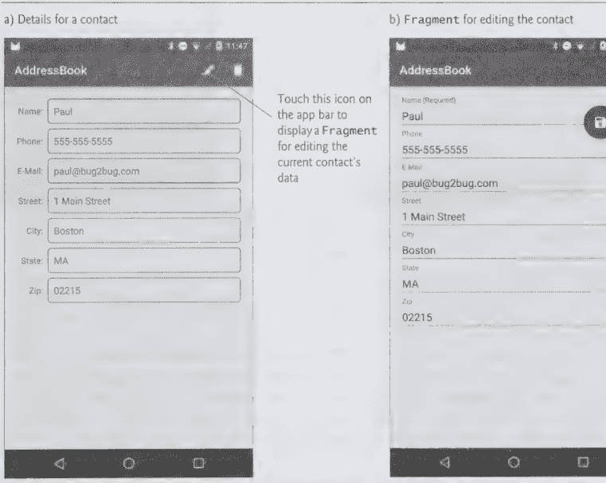

### 9.2.4 删除联系人

在查看联系人详情时，触摸应用栏以删除联系人。一个对话框将要求您确认此操作（图 9.5）。触摸 DELETE（删除）将联系人从数据库中移除，应用将显示更新后的联系人列表。触摸 CANCEL（取消）将保留联系人。

## 第 9 章 通讯录应用

a) 联系人详情

b) 删除选定的联系人

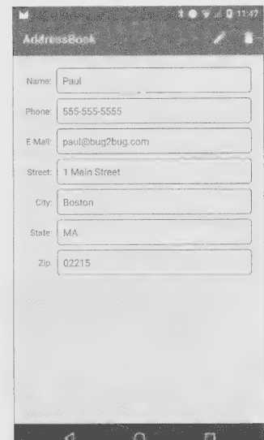

触摸此图标显示对话框，请求用户确认删除


**图 9.5** | 从数据库中删除联系人。

## 9.3 技术概述

本节介绍了您将用于构建通讯录应用的功能。

### 9.3.1 使用 `FragmentTransactions` 显示 `Fragments`

在早期使用 `Fragment` 的应用中，您会在 Activity 的布局中声明每个 `Fragment`，或者对于 `DialogFragment` 调用其 `show` 方法来创建它。Flag Quiz 应用演示了如何使用多个 Activity 在手机设备上托管应用的每个 `Fragment`，以及使用单个 Activity 在平板电脑设备上托管多个 `Fragment`。

在本应用中，您将仅使用一个 Activity 来托管应用所有的 `Fragment`。在手机大小的设备上，您将一次显示一个 `Fragment`。在平板电脑上，您将显示包含联系人列表的 `Fragment`，并显示用于查看的 `Fragment`，始终根据需要添加和编辑内容。为了实现这一点，您将使用 `FragmentManager` 和 `FragmentTransactions` 来动态显示 `Fragments`。此外，您将使用 Android 的返回栈——一种以后进先出（LIFO）顺序存储 `Fragments` 的数据结构——来为 Android 返回键提供自动支持。这使用户能够通过返回键在 `Fragments` 之间返回。关于 `Fragments` 和 `FragmentTransactions` 的更多信息，请访问：

```
http://developer.android.com/guide/components/fragments.html
```

### 9.3.2 在 `Fragment` 和宿主 Activity 之间通信数据

在 `Fragment` 和宿主 Activity 或 Activity 的 `Fragments` 之间通信数据时，最佳实践是通过宿主 Activity 进行——这使得 `Fragment` 更具重用性，因为它们之间没有直接引用。通常，每个 `Fragment` 都定义一个回调方法的接口，这些接口在宿主 Activity 中实现。我们将使用这种技术使此应用的 `MainActivity` 能够接收用户的通知：

- 选择要显示的联系人，
- 触摸内容列表 `Fragment` 的添加 (+) 浮动按钮，
- 触摸联系人详情 `Fragment` 的编辑或操作，
- 或者触摸编辑现有联系人或添加新联系人。

### 9.3.3 操作 SQLite 数据库

联系人信息存储在 SQLite 数据库中。根据 `www.sqlite.org`，SQLite 是世界上部署最广泛的引擎之一。您将使用 `SQLiteHelper`（包 `android.database.sqlite`）的子类来简化数据库的创建，并获取用于操作数据库的 `SQLiteDatabase` 对象（包 `android.database.sqlite`）。数据库查询使用结构化查询语言（SQL）执行。查询结果通过 `Cursor`（包 `android.database`）进行管理。有关 Android 中使用 SQLite 的更多信息，请访问：

```
http://developer.android.com/guide/topics/data/data-storage.html#db
```

### 9.3.4 `ContentProviders` 和 `ContentResolvers`

`ContentProvider`（包 `android.provider`）暴露应用数据以供该应用或其他应用使用。例如，您的应用可以通过 Android 的联系人和日历应用与数据进行交互。还有用于各种电话功能、媒体存储（例如用于图像/视频）和用户字典（用于 Android 的预测文本输入）的 `ContentProviders`。

除了向其他应用暴露数据外，`ContentProviders` 还允许您的应用在用户在设备上执行搜索时提供自定义搜索建议，并被用于支持应用之间的复制粘贴操作。

在本应用中，我们使用 `ContentProvider` 来帮助在 GUI 线程之外异步访问数据库——这在使用 `Loaders` 和 `LoaderManager`（在 9.3.5 节引入）时是必需的。您将定义 `ContentProvider` 的子类以：

- 查询数据库以定位联系人
- 向数据库插入新联系人
- 更新现有联系人
- 从数据库中删除现有联系人

`ContentProvider` 将使用 `SQLiteHelper` 的子类来创建数据库并获取 `SQLiteDatabase` 对象执行任务。当数据库发生变化时，`ContentProvider` 将通知监听者以便在 GUI 中更新数据。

#### Uri

`ContentProvider` 将决定要执行的任务。例如，在本应用中，`ContentProvider` 的 `query` 方法用于两种不同的查询——一个返回单个联系人的 `Cursor`，另一个返回数据库中所有联系人的 `Cursor`。

#### ContentResolver

为了调用 `ContentProvider` 的查询、插入、更新和删除功能，我们将使用 Activity 内置 `ContentResolver`（package `android.content`）的相关方法。每个 `ContentResolver` 接收一个指定要访问的 `ContentProvider` 的 `Uri`。有关 `ContentProviders` 和 `ContentResolvers` 的更多信息，请参阅：

```
http://developer.android.com/guide/topics/providers/content-providers
```


### 9.3.5 Loader 和 LoaderManager——异步数据库访问

正如之前所述，耗时操作或阻塞执行直到完成的操作（例如文件和数据库访问）应该在 GUI 线程之外执行。这主要提高了应用程序的响应能力，并避免 Android 判断 GUI 无响应时出现应用程序未响应（ANR）对话框。`Loader` 和 `LoaderManager` 帮助您从任何 `Activity` 或 `Fragment` 执行异步数据访问。

#### Loader

`Loader`（`package android.content`）执行异步数据访问。与 `ContentProvider` 交互以加载和处理数据时，您通常会使用 `CursorLoader`——使用 `AsyncTask` 在单独线程中执行数据访问的 `AsyncLoader` 子类。`Loader` 还：

- 观察相应数据源的变化并向相应的 `Activity` 或 `Fragment` 提供更新的数据。
- 在发生配置更改时，重新连接到最后一个 `Loader` 的 `Cursor`，而不是执行新查询。

#### LoaderManager 和 LoaderManager.LoaderCallbacks

`Activity` 或 `Fragment` 的 `Loader` 由其 `LoaderManager`（`package android.app`）创建和管理，`LoaderManager` 将每个 `Loader` 的生命周期与其 `Activity` 或 `Fragment` 的生命周期绑定。此外，`LoaderManager` 会调用 `LoaderManager.Callbacks` 接口的方法来通知 `Activity` 或 `Fragment` `Loader`：

- 被创建；
- 完成数据加载；或
- 被重置且数据不再可用。

## 9.3.6 构建 GUI 和资源文件

你将在此应用的多个 `Fragment` 子类中使用 `Loaders` 和 `LoaderManagers`。有关 `Loaders` 和 `LoaderManagers` 的更多信息，请参阅：

```
http://developer.android.com/guide/components/loaders.html
```

## 9.3.7 定义样式并将其应用于 GUI 组件

你可以将常见的 GUI 组件属性-值对定义为样式资源（见第 9.4.5 节）。然后，你可以通过 `style` 属性将样式应用到所有共享这些值的组件（第 9.4.9 节）。你对样式进行的任何后续更改将自动应用到使用该样式的所有 GUI 组件。我们使用此样式用于显示联系人信息的 `TextViews`。关于样式的更多信息，请访问：

```
http://developer.android.com/guide/topics/ui/themes.html
```

### 9.3.8 指定 TextView 背景

默认情况下，`TextView` 没有边框。若要定义边框，可以指定一个 `Drawable` 作为 `TextView` 的 `background` 属性的值。`Drawable` 可以是一张图片，但在本应用中，你将在资源文件中定义一个形状作为 `Drawable`（见第 9.4.6 节）。与图片一样，此类 `Drawable` 的资源文件定义在应用的一个（或多个）`drawable` 文件夹中。有关 `drawable` 资源的更多信息，请访问：

```
http://developer.android.com/guide/topics/resources/drawable-resource.html
```

## 9.4 构建 GUI 和资源文件

在本节中，你将创建地址录额外的 Java 源代码文件、资源文件和 GUI 布局文件。

### 9.4.1 创建项目

使用 `Blank Activity` 模板创建一个新项目。在配置项目时，勾选 `Use a Fragment` 复选框。在 `Create New Project` 对话框的 New Project 步骤中指定以下值：

- Application name：Address Book
- Company Domain：itel.com（或指定你的域名）

按照你在前面的部分使用的步骤为项目添加图标。按照第 4.4.3 节的步骤为项目配置 Java SE 支持。按照第 8.4.3 节的步骤将 `RecyclerView` 库添加到此项目中。在 `colors.xml` 中，将 `colorAccent` 颜色的值更改为 `#FF4081`。

### 9.4.2 创建应用的类

当你创建此项目时，Android Studio 会定义 `MainActivity` 和 `MainActivityFragment` 类。在本应用中，我们将 `MainActivityFragment` 重命名为 `ContactsFragment`。操作如下：

1. 在编辑器中打开 `MainActivityFragment` 类。
2. 右键点击类名，并选择 `Refactor > Rename....`。IDE 会高亮类名以便编辑。
3. 输入 `ContactsFragment` 并按回车。IDE 将重命名该类及其构造函数，并更改类文件。

```java
package com.deitel.addressbook
```

此应用包含七个你必须添加到项目中的额外类（`File > New > Java Class`）。`com.deitel.addressbook` 包中的额外类如下：

- `ContactsAdapter` 类是 `RecyclerView.Adapter` 的子类，用于为 `ContactsFragment` 的 `RecyclerView` 提供数据。
- `AddEditFragment` 类是 `Fragment` 的子类，为添加新联系人或编辑现有联系人提供 GUI。
- `DetailFragment` 类是 `Fragment` 的子类，显示一个联系人的数据并提供编辑和删除该联系人的菜单项。
- `ItemDivider` 类是 `RecyclerView.ItemDecoration` 的子类，`ContactsFragment` 使用它在项目项之间绘制水平线。此类与第 8.7 节中的类相同，因此你可以简单地从 Twitter Searches 应用项目中拷贝此代码，并将其粘贴到 Project 窗口中的 `app > java > com.deitel.addressbook` 节点。

```java
package com.deitel.addressbook.data
```

该类还定义了一个嵌套包 `com.deitel.addressbook.data`，其中包含了用于映射此应用数据库的类。要创建该包：

1. 在 Project 窗口中，右键点击 `com.deitel.addressbook` 包并选择 `New > Package`。
2. 输入 `data` 作为 `com.deitel.addressbook` 的包名。

接下来在 `data` 包中添加以下类：

- `DatabaseDescription` 类描述数据库结构。
- `AddressBookHelper` 类是 `SQLiteHelper` 的子类，用于操作数据库。
- `AddressBookContentProvider` 类是 `ContentProvider` 的子类，用于创建数据库。

在 `AndroidManifest.xml` 的 `<application>` 元素中声明该 `<provider>`。取消勾选 `exported` 复选框，表示该 provider 仅供应用内部使用。我们将在第 9.5 节中讨论这些类的详细信息。

### 9.4.3 添加应用的图标

使用 Android Studio 的 Vector Asset（第 4.4.9 节）为项目添加 `(+)`、编辑和删除图标。前往 `res/drawable`，将 `fillColor` 更改为：

```xml
@color/white
```

### 9.4.4 strings.xml

图 9.6 显示了：

| 资源名称 | 值 |
|---|---|
| `edit` | Edit |
| `delete` | Delete |
| `name` | Required |
| `email` | E-Mail |
| `phone` | Phone |
| `street` | Street |
| `city` | City |
| `zip` | Zip |
| `title` | Are Sure? |
| `message` | This will permanently delete |
| `cancel` | Cancel |
| `added` | Contact added successfully |
| `not added` | Contact was not added |
| `updated` | Contact updated |

### 9.4.5 styles.xml

你可以将常见的 GUI 组件属性-值对定义为样式资源（第 9.4.5 节）。然后，你可以通过 `style` 属性将样式应用到所有共享这些值的组件（第 9.4.9 节）。你对样式进行的任何后续更改将自动应用到使用该样式的所有 GUI 组件。我们使用此样式用于显示联系人信息的 `TextViews`。

在本节中，你将为 `DetailFragment` 的 `TextViews` 定义样式。当你创建一个项目时，IDE 会创建一个包含已定义样式的 `styles.xml` 文件。你创建每个新样式都会指定一个应用的名称以及一个指定属性值的项。要创建新样式，在应用的 `res/values` 文件夹中打开 `styles.xml` 文件，并将图 9.7 中的代码添加到文件的 `</resources>` 标签之前。完成后，保存 `styles.xml`。

```xml
<style name="ContactLabelTextView">
  <item name="android:layout_width">wrap_content</item>
  <item name="android:layout_height">wrap_content</item>
  <item name="android:layout_gravity">right|center_vertical</item>
</style>

<style name="ContactTextView">
  <item name="android:layout_width">wrap_content</item>
  <item name="android:layout_height">wrap_content</item>
  <item name="android:layout_gravity">fill_horizontal</item>
  <item name="android:textSize">16sp</item>
  <item name="android:background">@drawable/textview_border</item>
</style>
```

**图 9.7** 用于构建 `DetailFragment` `TextViews` 的新样式。

## 9.4.6 textviewborder.xml

你在前一节中创建的 `EditText` 样式定义了显示联系人详情的 `EditText` 的外观。你指定了名为 `@drawable/textview_border` 的 `Drawable`（即图像或图形）作为 `TextView` 的 `android:background` 属性的值。在本节中，你将在 `res/drawable` 文件夹中定义 `Drawable`。定义 `Drawable` 的步骤如下：

1. 右键点击 `res/drawable` 文件夹并选择 **New > Drawable resource file**。
2. 将 `textview_border.xml` 指定为文件名并点击 OK。
3. 用图 9.8 中的 XML 代码替换文件内容。

```xml
<?xml version="1.0" encoding="utf-8"?>

<shape xmlns:android="http://schemas.android.com/apk/res/android"
  android:shape="rectangle">

  <corners android:radius="3dp" />

  <stroke android:width="1dp" android:color="#555"/>

  <padding android:top="10dp" android:left="10dp" android:bottom="10dp"
    android:right="10dp" />

</shape>
```

图 9.8 | 使用 `shape` 属性为 `TextView` 添加边框的 `Drawable` 的 XML 表示。

`shape` 元素的 `shape` 属性（第 3 行）的值可以是 `"rectangle"`（本例中使用）、`"oval"`、`"line"` 或 `"ring"`。`corners` 元素（第 4 行）指定了矩形的角半径，使角变为圆角。`stroke` 元素（第 5 行）定义了矩形的线宽和颜色。`padding` 元素（第 6–7 行）指定了应用此 `Drawable` 的元素内容周围的间距。你必须分别指定顶部、左、底部和右部的填充量。定义形状的完整细节可以查看：

> http://developer.android.com/topics/resources/drawable-resource.html#Shape

## 9.4.7 MainActivity Layout

默认情况下，`MainActivity` 包含一个 `FloatingActionButton` 并包含布局文件 `activity_main.xml`。在这个应用中，我们根据需要在应用的 `Fragments` 中提供 `FloatingActionButton`。因此，请打开 `res/layout` 文件夹中的 `activity_main.xml` 并移除预定义的 `FloatingActionButton`。此外，将 `CoordinatorLayout` 的 id 设置为 `coordinatorLayout`——我们在使用 `Snackbars` 时会用到它。从 `MainActivity` 的 `onCreate` 中移除配置 `FloatingActionButton` 的代码。

### 手机布局：content_main.xml

在这个应用中，你将提供两个 `content_main.xml` 布局并包含在 `MainActivity` 中——一个用于手机尺寸设备，另一个用于平板电脑尺寸设备。对于手机布局，打开 `res/layout` 文件夹中的 `content_main.xml` 并将其内容替换为图 9.9 中的 XML。`MainActivity` 动态地显示名为 `fragmentContainer` 的 `FrameLayout` 中的应用 `Fragments`。该布局通过在四周设置 `16dp` 的内边距填充 `MainActivity` 中的可用空间。`app:layout_behavior` 属性（第 20 行）被 `activity_main` 的 `CoordinatorLayout` 用于管理其视图之间的交互。设置此属性可确保 `FrameLayout` 的内容可以滚动 `activity_main.xml` 中定义的 Toolbar。

```xml
<FrameLayout
    android:id="@id/fragmentContainer"
    xmlns:android="http://schemas.android.com/apk/res/android"
    xmlns:app="http://schemas.android.com/apk/res-auto"
    xmlns:tools="http://schemas.android.com/tools"
    android:layout_width="match_parent"
    android:layout_height="match_parent"
    android:paddingBottom="@dim/activity_vertical_margin"
    android:paddingLeft="@dim/activity_horizontal_margin"
    android:paddingRight="@dim/activity_horizontal_margin"
    android:paddingTop="@dim/activity_vertical_margin"
    app:layout_behavior="@string/appbar_scrolling_view_behavior"
    tools:context=".MainActivity">
```


```text
```

**图 9** 用于手机设备的 `content_main.xml`。

### 平板内容：用于大尺寸设备的 `content_main.xml`

创建一个新的平板布局 `content_main.xml`（如第 4.5.4 节所示）。该布局应使用一个水平 `LinearLayout`，其中包含一个 `ContactsFragment` 和一个空的 `FrameLayout`，如图 9.10 所示。第 24 行和第 32 行使用了 `content_divider` 资源（`16dp`）。此 `LinearLayout` 使用了几个我们之前没有讨论过的属性：

- `divider`（第 9 行）——此属性指定用于分隔 `LinearLayout` 中项目的 Drawable 资源。在这种情况下，使用预定义的 Android drawable 主题资源 `?listDivider`。`?android` 表示 `LinearLayout` 列表定义在当前主题中。
- `showDivider`（第 15 行）——此属性与 `divider` 属性配合使用，指定分隔线出现的位置——在这种情况下，`middle` 表示分隔线只出现在 `LinearLayout` 元素之间。你也可以在布局的第一个项目之前（`beginning`）和最后一个项目之后（`end`）显示分隔线，可以使用 `|` 组合这些值。
- `weightSum`（第 16 行）——这有助于分配 `ContactsFragment` 和 `LinearLayout` 之间的水平空间。将 `weightSum` 设置为 3，然后将 `ContactsFragment` 和 `layout_weights` 设置为 1 和 2，表示 `ContactsFragment` 应该占据 `LinearLayout` 宽度的三分之一，而其他部分占据剩余的三之二。

```xml
<?xml version="1.0" encoding="utf-8"?>

<LinearLayout
    xmlns:android="http://schemas.android.com/apk/res/android"
    xmlns:app="http://schemas.android.com/apk/res-auto"
    xmlns:tools="http://schemas.android.com/tools"
    android:layout_width="match_parent"
    android:layout_height="match_parent"
    android:orientation="horizontal"
    android:divider="?android:listDivider"
    android:showDivider="middle"
    android:weightSum="3">

    <fragment
        android:id="@+id/fragmentContainer"
        android:layout_width="0dp"
        android:layout_height="match_parent"
        android:layout_weight="1" />

    <FrameLayout
        android:id="@+id/paneContainer"
        android:layout_width="0dp"
        android:layout_height="match_parent"
        android:layout_weight="2" />

</LinearLayout>
```

**图 9.10** 用于平板设备的 `content_main.xml`。（部分 1）

## 9.4.8 `ContactsFragment` 的布局

除了将 `MainActivity` 重命名为 `ContactsFragment` 之外，我们重命名了相应的布局文件 `fragment_contacts.xml`。我们移除了默认的 `TextView`，将默认布局从 `LinearLayout` 改为 `FrameLayout` 并移除了填充属性。接下来，我们添加了 `RecyclerView` 和 `FloatingActionButton` `addButton`。布局的最终 XML 如图 9.11 所示。

```xml
<FrameLayout xmlns:android="http://schemas.android.com/apk/res/android"
    android:layout_width="match_parent"
    android:layout_height="match_parent">

    <support.v7.widget.RecyclerView
        android:id="@+id/recyclerView"
        android:layout_width="match_parent"
        android:layout_height="match_parent" />

    <android.support.widget.FloatingActionButton
        android:id="@+id/addButton"
        android:layout_width="wrap_content"
        android:layout_height="wrap_content"
        android:layout_gravity="top"
        android:layout_margin="@dimen/fab_margin"
        android:src="@drawable/ic_add_24dp" />

</FrameLayout>
```

**图 9.11** | `fragment_contacts.xml` 布局（部分 1）

## 9.4.9 `DetailFragment` 的布局

当用户在 `MainActivity` 中触摸联系人时，应用会显示 `DetailFragment`（图 9.12）。该 Fragment 布局（`fragment_details.xml`）由一个包含两列 `TextView` 的垂直 `GridLayout` 组成。`ScrollView` 是一个包含视图，它为内容大到无法在屏幕显示的视图提供滚动功能。当设备没有足够的垂直空间来显示图 9.12 中的所有 `TextView` 时，我们在这里使用 `ScrollView` 来滚动联系人的详情。对于此 Fragment，创建一个新的 `fragment_details.xml` 布局资源文件，并指定 `ScrollView` 为根元素。创建文件后，在 `ScrollView` 中添加 `GridLayout`。

## 9.4 构建 GUI 和资源文件

### `GridLayout` 设置

对于 `GridLayout`，我们将 `layout:width` 设置为 `match_parent`，`layout:height` 设置为 `wrap_content`，`columnspan` 设置为 2，并使用 `DefaultMargins` 进行调整。`layout:height` 的值使得 `ScrollView` 能够确定 `GridLayout` 的实际高度，并决定是否提供滚动功能。如图 9.12 所示，向 `GridLayout` 中添加 `TextView`。

### 左列 `TextView` 设置

对于左列中的每个 `TextView`，按照图 9.12 指定设置 `TextView` 的 `id` 属性，并设置：

- `layout:row` 根据行数设置为 0–6 之间的值。
- `layout:column` 设置为 0。
- `text` 设置为 `strings.xml` 中适当的字符串资源。
- `style` 设置为 `@style/ContactLabelTextView`——样式资源使用 `@style/styleName` 语法指定。

### 右列 `TextView` 设置

对于右列中的每个 `TextView`，按照图 9.12 指定设置 `TextView` 的 `id` 属性，并设置：

- `layout:row` 根据行数设置为 0–6 之间的值。
- `layout:column` 设置为 1。
- `style` 设置为 `@style/ContactTextView`。

### 9.4.10 `AddEditFragment` 的布局

当用户触摸 `ContactsFragment` 中的 `+` `FloatingActionButton` 或 `DetailFragment` 中的编辑图标栏时，`MainActivity` 会显示 `AddEditFragment`（图 9.13），其布局片段为 `fragment_add_edit.xml`，根节点为 `FrameLayout`，包含一个 `ScrollView` 和一个 `FloatingActionButton`。`ScrollView` 包含一个七个 `TextInputLayout` 的垂直 `LinearLayout`。

### `ScrollView` 设置

对于 `ScrollLayout`，我们将 `layout:width` 和 `layout:height` 设置为 `match_parent`。

### `LinearLayout` 设置

对于 `LinearLayout`，我们将 `layout:width` 设置为 `match_parent`，`layout:height` 设置为 `wrap_content`，并将 `orientation` 设置为垂直。我们添加了图 9.13 所示带有 id 的七个 `TextInputLayout`，每个 `layout:width` 都设置为 `match_parent`，`layout:height` 设置为 `wrap_content`。

### `EditText` 设置

我们在每个 `TextInput` 中放置了一个 `EditText`，然后将它的 `hint` 属性设置为 `strings.xml` 中适当的字符串资源。我们还设置了每个 `EditText` 的 `inputType` 和 `imeOptions` 属性。对于显示软键盘的设备，`inputType` 指定了对应 `EditText` 使用哪种键盘。这允许我们根据用户在 `EditText` 中输入的特定类型数据来定制键盘。为了在 `name` `TextInputLayout`、`inputTextLayout`、`emailTextLayout`、`streetInputLayout`、`cityInputLayout` 和 `stateInputLayout` 的 `EditText` 软键盘上显示按钮（`*`），我们使用 `imeOptions` 属性设置为 `actionNext`。当其中一个 `EditText` 获得焦点时，触摸操作会将焦点转移到布局中的下一个 `EditText`。如果 `zipTextInputLayout` 中的 `EditText` 获得焦点，可以通过触摸键盘的按钮来隐藏软键盘——对于此 `EditText`，将 `imeOptions` 属性设置为 `actionDone`。

按照如下方式设置 `EditText` 输入属性以显示相应的键盘：

- `nameInputLayout` 的 `EditText`：勾选 `personName` 和 `textCapWords`——用于输入每个单词并大写字母开头。
- `phoneInputLayout` 的 `EditText`：勾选 `phone`——输入电话号码。
- `emailInputLayout` 的 `EditText`：勾选 `textEmailAddress`——输入电子邮件地址。
- `streetInputLayout` 的 `EditText`：勾选 `textPostalAddress` 和 `textWords`——输入地址并每个单词大写字母开头。
- `cityInputLayout` 的 `EditText`：勾选 `textPostalAddress` 和 `textWords`。
- `stateInputLayout` 的 `EditText`：勾选 `textPostalAddress` 和 `textCharacters`——确保州缩写以大写显示。
- `zipInputLayout` 的 `EditText`：勾选 `textNumber`——输入数字。

**图 9.13** | 带有 id 属性值标签的 `EditTextFragment` GUI 组件。此 GUI 的根组件是 `ScrollView`，它包含一个垂直的 `GridLayout`。

### 9.4.11 `DetailFragment` 的菜单

当你创建项目时，IDE 定义了菜单资源 `menu_main.xml`。此应用中的 `MainActivity` 不需要菜单，因此你可以移除 `MainActivity` 的 `onCreateOptionsMenu` 和 `onOptionsSelected`，并重命名菜单资源以供 `DetailFragment` 使用，该片段在应用栏上显示菜单项，用于编辑现有内容和删除联系人。将 `file_menu.xml` 重命名为 `fragment_details_menu.xml`，然后将带有 `android:id` 的 Settings 菜单项替换为图 9.14 中的菜单项。对于每个菜单项的 id，指定你在 9.4.3 节中添加的 drawable 资源。

```xml
<?xml version="1.0" encoding="utf-8"?>

<menu xmlns:android="http://schemas.android.com/apk/res/android"
    xmlns:app="http://schemas.android.com/apk/res-auto">

    <item
        android:id="@id/action_edit"
        android:icon="@drawable/ic_edit_24dp"
        android:orderInCategory="1"
        android:title="@string/menuitem_edit"
        app:showAsAction="always" />

    <item
        android:id="@id/action_delete"
        android:icon="@drawable/ic_delete_24dp"
        android:orderInCategory="2"
        android:title="@string/menuitem_delete"
        app:showAsAction="always" />

</menu>
```


图 9.14 菜单资源 `fragment_menu.xml`。

## 9.5 本章概述

此应用由九个类组成。由于应用规模，我们将概述这些类及其用途。

### `com.detail.addressbook.data` 包

该包包含定义以下内容的三个类：

- `DatabaseDescription`（9.6）——该类包含与应用的 `Content-Provider` 和 `ContentResolver` 使用的静态字段，以及一个描述数据库唯一表及其列的嵌套类。
- `AddressBookDatabaseHelper`（9.7）——`SQLiteHelper` 的子类，用于创建数据库并允许 `AddressBookContentProvider` 访问它。
- `AddressBookContentProvider`（9.8）——`ContentProvider` 的子类，用于执行查询、插入、更新和删除操作。

### `com.detail.addressbook` 包

该包包含以下类：

- `MainActivity`（9.9）——该类管理 `Fragment` 及其用到的适配器。
- `ContactsFragment`（9.10）——该类管理联系人列表 `RecyclerView` 和用于添加联系人的 `FloatingActionButton`。在手机上，这是 `MainActivity` 显示的第一个片段。在平板电脑上，`MainActivity` 始终显示此片段。
- `ContactsAdapter`（9.11）——`RecyclerView.Adapter` 的子类，由 `ContactsFragment` 用于将排序名称列表绑定到 `RecyclerView`。
- `AddEditFragment`（9.12）——该类管理 `TextInputLayout` 以及用于添加新联系人或编辑现有联系人的 `FloatingActionButton`。
- `DetailFragment`（9.13）——该类管理格式化的 `TextView` 显示所选联系人的详情，应用栏项允许用户编辑或删除当前显示的联系人。
- `ItemDivider`——该类定义了显示 `ContactsFragment` `RecyclerView` 项目之间的分割线。

## 9.6 `DatabaseDescription` 类

`DatabaseDescription` 类包含与应用的 `Content-Provider` 和 `ContentResolver` 使用的静态字段，以及一个描述数据库唯一表及其列的嵌套类。

### 9.6.1 字段

`DatabaseDescription` 类定义了两个静态字段（图 9.15；行 12–17），用于定义 `ContentProvider` 的 authority——提供给 `ContentResolver` 用于定位 `ContentProvider` 的名称。authority 通常是 `ContentProvider` 的包名。每个访问特定 `Content-Provider` 的 URI 都以 `"content://"` 加上 authority 开头——这是 `ContentProvider` 的基础 URI。第 17 行使用 `Uri` 方法创建基础 URI。

## 9.6 `DatabaseDescription` 类

```java
// DatabaseDescription.java

// 描述此应用数据库的表名和列名，
// 以及 ContentProvider 需要的所有其他信息

package com.deitel.addressbook.data;

import android.content.ContentUris;
import android.net.Uri;
import android.provider.BaseColumns;

public class DatabaseDescription {

    // ContentProvider 的名称：通常为包名
    public static final String AUTHORITY = "com.deitel.addressbook.data";

    // 用于与 ContentProvider 交互的 base URI
    private static final Uri BASE_URI =
        Uri.parse("content://" + AUTHORITY);
```

图 9.15 | `DatabaseDescription` 类的声明和静态字段。

### 9.6.2 嵌套类 `Contact`

嵌套类（图 9.16）定义了表名（第 21 行）、通过 `ContentProvider` 访问的表 Uri（第 24–25 行）以及表的列名（第 28–31 行）。`AddressBookDatabaseHelper` 类（第 9.7 节）将使用这些表名和列名来创建数据库。`buildContentUri` 方法为数据库表中的特定联系人创建 Uri（第 37–39 行）。`ContentUris` 类（`android.content`）包含了用于操作 `"content://"` Uri 的静态工具方法。`withAppendendedId` 方法在其第一个参数的 Uri 末尾添加斜杠（`/`）和记录 ID。对于每个数据库，你通常会有一个类似于 `class Contact` 的类。

```java
// 嵌套类定义 contacts 表的内容

public static final class Contact implements BaseColumns {

    public static final String TABLE_NAME = "contacts"; // 表名

    // contacts 表的 Uri
    public static final Uri CONTENT_URI =
        BASE_URI.buildUpon().appendPath(TABLE_NAME).build();

    // 表列的列名
    public static final String COLUMN_NAME = "name";
    public static final String COLUMN_PHONE = "phone";
    public static final String COLUMN_EMAIL = "email";
    public static final String COLUMN_STREET = "street";
    public static final String COLUMN_CITY = "city";
    public static final String COLUMN_STATE = "state";
    public static final String COLUMN_ZIP = "zip";
```

图 9.16 | `DatabaseDescription` 嵌套类 `Contact`。（第 1 部分/2 部分）

```java
// 为特定联系人创建 Uri

public static Uri buildContactUri(long id) {
    return ContentUris.withAppendedId(CONTENT_URI, id);
}
```

图 9.16 | `DatabaseDescription` 嵌套类 `Contact`。（第 2 部分/2 部分。）

在数据库中，每行通常都有一个主键，用于唯一标识该行。在与 `ListViews` 和 `Cursors` 工作时，该列的名称必须是 `"id"`——Android 也使用它作为 SQLite 数据库中的 ID 列。`RecyclerView` 不需要此名称，但由于 `ListViews` 和 `RecyclerView` 之间的相似性，而且我们正在使用 `Cursors` 和 SQLite 数据库，因此在这里使用了它。我们没有直接在 `Contact` 类中定义它，而是实现了 `BaseColumns` 接口（包 `android.provider`；第 20 行），它定义了值为 `"id"` 的常量 `_ID`。

## 9.7 `AddressBookDatabaseHelper` 类

`AddressBookDatabaseHelper` 类（图 9.17）继承了 `SQLiteOpenHelper`，它可以帮助应用创建数据库并管理数据库版本更改。

```java
// AddressBookDatabaseHelper.java

// 定义应用数据库的 SQLiteOpenHelper 子类

package com.deitel.addressbook.data;

import android.content.Context;
import android.database.sqlite.SQLiteDatabase;
import android.database.sqlite.SQLiteOpenHelper;
import com.deitel.addressbook.data.DatabaseDescription;

class AddressBookDatabaseHelper extends SQLiteOpenHelper {

    private static final String DATABASE_NAME = "AddressBook.db";
    private static final int DATABASE_VERSION = 1;

    // 构造函数
    public AddressBookDatabaseHelper(Context context) {
        super(context, DATABASE_NAME, null, DATABASE_VERSION);
    }

    // 在创建数据库时创建表
    @Override
    public void onCreate(SQLiteDatabase db) {

        final String CREATE_TABLES_TABLE =
            "CREATE TABLE " + Contact.TABLE_NAME + " (",
            26 Contact.ID + " integer primary key, " +
            27 Contact.COLUMN_NAME + " TEXT, " +
            28 Contact.COLUMN_PHONE + " TEXT, " +
            29 Contact.COLUMN_EMAIL + " TEXT, " +
            30 Contact.COLUMN_STREET + " TEXT, " +
            31 Contact.COLUMN_CITY + " TEXT, " +
            32 Contact.COLUMN_STATE + " TEXT, " +
            33 Contact.COLUMN_ZIP + " TEXT");

        34 db.execSQL(CREATE_CONTACTS_TABLE); // 创建 contacts 表
    }

    // 通常在 _schema 更改时定义如何升级数据库
    @Override
    public void onUpgrade(SQLiteDatabase db, int oldVersion, int newVersion) {
    }
}
```

图 9.17 | `SQLiteOpenHelper` 的子类 `AddressBookDatabaseHelper` 定义应用的数据库。（第 1 部分/2 部分。）

### 构造函数

构造函数（第 16–18 行）仅指定了四个参数：

- 创建数据库的 `Context`
- 数据库名称——如果希望使用内存数据库则为 `null`
- 数据库版本——从 1 开始
- 要使用的 `CursorFactory`

### 重写方法

你必须重写 `onCreate` 和 `onUpgrade`。如果数据库不存在，则调用 `onCreate`。如果存储的版本高于预期版本，则调用 `onUpgrade` 来升级数据库。

## 9.8 `AddressBookProvider` 类

`AddressBookProvider` 子类了如何对应用的数据库执行查询、插入、删除操作。

> 错误预防 9.1：`ContentProviders` 可以被多个进程中的线程调用，因此需要注意它们默认不提供任何同步机制。然而，SQLite 不会对访问进行同步，因此在此应用中有必要提供自己的同步机制。

### 9.8.1 `AddressBookProvider` 字段

`AddressBookProvider` 类（图 9.18）定义了一些字段：

- 实例变量 `dbHelper`（第 17 行）是 `AddressBookDatabaseHelper` 的引用，它负责创建数据库并允许此 `ContentProvider` 获取数据库的读和写访问。
- 类变量 `uriMatcher`（第 20–21 行）是一个 `UriMatcher` 对象（`android.content`）。`ContentProvider` 使用 `UriMatcher` 来帮助执行其查询、插入、删除方法。
- `UriMatcher` 返回整数常量 `CONTACT` 和 `CONTACTS`（第 24–25 行）——`ContentProvider` 在其查询、插入、删除方法的 `switch` 语句中使用这些常量。

```java
// AddressBookProvider.java

// 用于操作数据库的 ContentProvider 子类

package com.deitel.addressbook.data;

import android.content.ContentProvider;
import android.content.ContentValues;
import android.content.UriMatcher;
import android.database.Cursor;
import android.database.SQLException;
import android.database.sqlite.SQLiteQueryBuilder;
import android.net.Uri;

import com.deitel.addressbook.data.DatabaseDescription.Contact;

public class AddressBookProvider extends ContentProvider {

    // 用于访问数据库
    private AddressBookDatabaseHelper dbHelper;

    // UriMatcher 帮助 ContentProvider Determine 要执行的操作
    private static final UriMatcher uriMatcher =
        new UriMatcher(UriMatcher.NO_MATCH);

    // 用于 UriMatcher 的常量，确定要执行的操作
    private static final int CONTACT = 1; // 操作一个联系人
    private static final int CONTACTS = 2; // 操作 contacts 表
}
```

图 9.18 | `AddressBookProvider` 字段。（第 1 部分/2 部分）

## 9.8 `AddressBookContentProvider` 类

```java
// 静态块用于配置此 ContentProvider 的 UriMatcher

static {
    // 用于指定 id (#) 的联系人的 Uri
    uriMatcher.addUri(
        DatabaseDescription.AUTHORITY,
        Contact.TABLE_NAME,
        "#",
        ONE_CONTACT
    );

    // 用于联系人表的 Uri
    uriMatcher.addUri(
        DatabaseDescription.AUTHORITY,
        Contact.TABLE_NAME,
        CONTACTS
    );
}
```


## 图 9.18 | `AddressBookContentProvider` 字段

第 28–36 行添加了一个静态块，用于向静态 `UriMatcher` 添加 Uri——该块在 `AddressBookContentProvider` 类被加载到内存时执行一次。`UriMatcher` 的 `addUri` 方法接受三个参数：

- 一个表示 `ContentProvider` authority 的字符串（在本应用中为 `DatabaseDescription`）。
- 一个表示路径的字符串——你用于调用 `ContentProvider` 的每个 Uri 都包含 `"content://"`，随后跟的是 authority 以及 `ContentProvider` 用来确定要执行任务的路径。
- 当提供给 `ContentProvider` 的 Uri 与 `UriMatcher` 中存储的 Uri 匹配时，`UriMatcher` 返回的 `int` 代码。

第 30–31 行添加了如下形式的 Uri：

`content://com.deitel.addressbook.data/contacts/#`

其中，`#` 是一个匹配数字字符字符串的通配符——在这种情况下，它是 contacts 表中某条记录的唯一主键值。还有一个 `*` 通配符，可以匹配任意数量的字符。当 Uri 匹配此格式时，`UriMatcher` 返回常量 `ONE_CONTACT`。

第 34–35 行添加了如下形式的 Uri：

`content://com.deitel.addressbook.data/contacts`

它代表整个联系人表。当 Uri 匹配此格式时，`UriMatcher` 返回常量 `CONTACTS`。在我们讨论 `AddressBookContentProvider` 类的其余部分时，你将看到 `UriMatcher` 以及常量 `ONE_CONTACT` 和 `CONTACTS` 是如何使用的。

### 9.8.2 重写方法 `onCreate` 和 `getType`

如你所示，你使用 `ContentResolver` 来调用 `ContentProvider` 的方法。当 Android 收到来自 `ContentResolver` 的请求时，它会自动创建相应的 `ContentProvider` 对象——如果之前已经创建过，则使用现有的。当 `ContentProvider` 被创建时，Android 会调用其 `onCreate` 方法来配置 `ContentProvider`（图 9.19，第 39–44 行）。第 42 行添加了 `AddressBookDatabaseHelper` 对象，它使得程序能够访问数据库。当程序第一次被调用写入数据库时，`AddressBookDatabaseHelper` 对象的 `onCreate` 方法将被调用以创建数据库（图 9.17，第 22–35 行）。

```java
// 当 AddressBookContentProvider 被创建时调用

@Override
public boolean onCreate() {
    // 创建 AddressBookDatabaseHelper
    dbHelper = new AddressBookDatabaseHelper(getContext());

    return true; // ContentProvider 成功创建
}
```

图 9.19 - 重写的 `ContentProvider` 方法 `onCreate` 和 `getType`。

`getType` 方法（图 9.19，第 47–50 行）是必需的 `ContentProvider` 方法，在本应用中它仅简单地返回 `null`。此方法通常用于为具有特定 MIME 类型的 Uri 创建并启动 Intent。Android 可以使用 MIME 类型来确定处理 Intent 的适当活动。

### 9.8.3 重写方法 `query`

重写的 `ContentProvider` 方法 `query`（图 9.20）从 provider 的数据源（在本例中为数据库）检索数据。该方法返回一个 `Cursor`，用于与结果进行交互。`query` 方法接收五个参数：

- `uri`—一个表示要检索数据的字符串。
- `projection`—一个表示要检索特定列的字符串。如果此参数为 `null`，则结果将包含所有列。
- `selection`—一个包含选择标准的字符串。这是 SQL 的 `WHERE` 子句，在指定时不包含 `WHERE` 关键字。如果此参数为 `null`，则结果将包含所有行。
- `selectionArgs`—一个包含用于替换选择字符串中任何占位符（`?`）的参数的字符串。
- `sortOrder`—一个表示排序的字符串。这是 SQL 的 `ORDER` 子句，在指定时不包含 `ORDER BY` 键。如果此参数为 `null`，则由 provider 决定排序顺序——除非你提供了适当排序顺序，否则不能返回给应用程序的结果顺序。

#### `SQLiteQueryBuilder`

第 58 行创建了 `SQLiteQueryBuilder`（包 `android.database.sqlite`），用于构建提交给 SQLite 数据库的 SQL 查询。第 59 行使用 `setTables` 指定查询将从数据库的 contacts 表中选择数据。此方法：

```java
// 查询数据库

@Override
public Cursor query(Uri uri, String[] projection,
    String selection, String[] selectionArgs, String sortOrder) {

    // 为查询 contacts 表创建 SQLiteQueryBuilder
    SQLiteQueryBuilder queryBuilder = new SQLiteQueryBuilder();

    queryBuilder.setTables(Contact.TABLE_NAME);

    switch (uriMatcher.match(uri)) {
        case ONE_CONTACT: // 选择具有指定 id 的联系人
            queryBuilder.appendWhere("Contact._id = " + uri.getLastPathSegment());
            break;

        case CONTACTS: // 选择所有联系人
            break;

        default:
            throw new UnsupportedOperationException(
                getContext().getString(R.string.invalid_query_uri) + uri);
    }

    // 执行查询以选择一个或所有联系人
    Cursor cursor = queryBuilder.query(dbHelper.getReadableDatabase(),
        projection, selection, selectionArgs, null, sortOrder);

    // 配置监听内容变化
    cursor.setNotificationUri(getContext().getContentResolver(), uri);

    return cursor;
}
```

图 9.20 | 重写的 `ContentProvider` 方法 `query`。

重写的 `ContentProvider` 方法 `query` 从 provider 的数据源（在本例中为数据库）检索数据。该方法返回一个 `Cursor`，用于与结果进行交互。`query` 方法接收五个参数：

- `uri`—一个表示要检索数据的字符串。
- `projection`—一个表示要检索特定列的字符串。如果此参数为 `null`，则结果将包含所有列。
- `selection`—一个包含选择标准的字符串。这是 SQL 的 `WHERE` 子句，在指定时不包含 `WHERE` 关键字。如果此参数为 `null`，则结果将包含所有行。
- `selectionArgs`—一个包含用于替换选择字符串中任何占位符（`?`）的参数的字符串。
- `sortOrder`—一个表示排序的字符串。这是 SQL 的 `ORDER` 子句，在指定时不包含 `ORDER BY` 键。如果此参数为 `null`，则由 provider 决定此顺序。

#### `SQLiteQueryBuilder`

第 58 行创建了 `SQLiteQueryBuilder`（包 `android.database.sqlite`），用于构建提交给 SQLite 数据库的 SQL 查询。第 59 行使用 `setTables` 指定查询将从数据库的 contacts 表中选择数据。此方法使用 `UriMatcher` 确定执行的操作。

#### 使用 `UriMatcher` 确定执行的操作

在本应用中，有两种查询：

- 选择数据库中的特定联系人并显示其详情。
- 选择数据库中的所有联系人。

第 61–71 行使用 `UriMatcher` 匹配确定查询。如果返回的常量是 `ONE_CONTACT`，则使用 `SQLiteQueryBuilder` 的 `appendWhere` 添加包含 ID 的 `WHERE` 子句。`getLastPathSegment` 返回 URI 的最后段——例如，在 9.8.1 节中，`content://com.deitel.addressbook.data/contacts/5` 的常量是 `CONTACTS`。对于任何不匹配的 Uri，第 69–70 行将抛出异常。

#### 查询数据库

第 74–75 行使用 `SQLiteBuilder` 的 `query` 方法执行数据库查询并获取结果的 `Cursor`。该方法的参数与 `query` 方法接收的参数相似：

- `SQLiteDatabase`—`AddressBookHelper` 的 `getReadableDatabase` 返回只读 `SQLiteDatabase` 对象。
- `projection`—一个表示要检索特定列的字符串。如果此参数为 `null`，则结果将包含所有列。
- `selection`—一个包含选择标准的字符串。这是 SQL 的 `WHERE` 子句，在指定时不包含 `WHERE` 关键字。如果此参数为 `null`，则结果将包含所有行。
- `selectionArgs`—一个包含用于替换选择字符串中任何占位符（`?`）的参数的字符串。
- `groupBy`—一个包含分组标准的字符串。这是 SQL 的 `BY` 子句，在指定时不包含 `GROUP BY` 关键字。如果此参数为 `null`，则不进行分组。
- `having`—当使用 `groupBy` 时，此参数是指示结果中包含哪些组的字符串。这是 SQL 的 `HAVING` 子句，在指定时不包含 `HAVING` 关键字。如果此参数为 `null`，则由 `groupBy` 指定的所有组将包含在结果中。
- `sortOrder`—一个表示排序的字符串。这是 SQL 的 `ORDER` 子句，在指定时不包含 `ORDER BY` 键。如果此参数为 `null`，则由 provider 决定此顺序。

#### 注册 `Cursor` 以监听变化

第 78 行调用 `Cursor` 的 `setNotificationUri`，指示如果其引用的数据发生变化，则应更新 `Cursor`。第一个参数是调用 `ContentProvider` 的 `ContentResolver`，第二个参数是调用 `ContentProvider` 的 Uri。第 79 行返回包含查询结果的 `Cursor`。

### 9.8.4 重写方法 `insert`

重写的 `ContentProvider` 方法 `insert`（图 9.21）向 contacts 表添加新记录。`insert` 方法接收两个参数：

- `uri`—一个表示要插入数据的表的 Uri。
- `values`—一个 `ContentValues` 对象，其中包含键值对，其中列名是键，每个键的值是要插入该列的数据。

第 107–108 行检查 Uri 是否对应 contacts 表——如果不是，则该 Uri 对于插入操作是无效的，第 106–107 行抛出异常。

## 9.8 `AddressBookContentProvider` 类

```java
// 在数据库中插入新的联系人

@Override
public Uri insert(Uri uri, ContentValues values) {
    Uri newContactUri = null;

    switch (uri.match(uri)) {
        case CONTACTS:
            // 插入新联系人——成功返回新联系人的行 ID
            long rowId = dbHelper.getWritableDatabase().insert(
                Contact.TABLE_NAME, null, values);

            // 如果插入成功，创建一个合适的 Uri；
            // 否则，抛出异常
            if (rowId > 0) // SQLite 行 ID 从 1 开始
                newContactUri = Content.buildContactUri(rowId);

            // 通知观察者数据库已更改
            getContext().getContentResolver().notifyChange(uri, null);
        else:
            throw new SQLException(
                getContext().getString(R.string.insert_failed) + uri);

        default:
            throw new UnsupportedOperationException(
                getContext().getString(R.string.invalid_insert_uri) + uri);
    }

    return newContactUri;
}
```

**图 9.21** 重写后的 `ContentProvider` 方法 `insert`。

如果 URI 匹配，则在数据库中插入了新联系人。首先，我们使用 `AddressBookDatabaseHelper.getWritableDatabase` 方法获取一个 `SQLiteDatabase` 对象，用于修改数据库中的数据。

`SQLiteDatabase.insert` 方法将第三个参数 `ContentValues` 对象中的值插入到第一个参数指定的表中（在本例中为联系人表）。第二个参数在应用中未被使用，命名为 `nullClickHandler`，因为 SQLite 不支持向表中插入空行——这等同于向方法传递空的 `ContentValues`，`nullColumnHandler` 用于标识包含 `NULL` 值的列。

方法 `insert` 在插入成功时返回新联系人的唯一 ID，否则返回 -1。第 95 行检查 `rowId` 是否大于 0（SQLite 中的行索引从 1 开始）。如果是，则第 96 行创建一个代表新联系人的 `Uri`，第 99 行通知 `ContentResolver` 数据库已更改，以便 `Resolver` 客户端代码能够响应数据库的变化。如果 `rowId` 不大于 0，则数据库操作失败，第 102–103 行抛出 `SQLException`。

### 9.8.5 重写方法 `update`

重写的 `ContentProvider` 方法 `update`（图 9.22）更新现有记录。`update` 方法接收四个参数：

- `uri`—代表要更新行的 `Uri`。
- `values`—一个包含要更新的列及其对应值的 `ContentValues` 对象。
- `selection`—一个包含选择标准的 `String`。这是 SQL 的 `WHERE` 子句，指定时不带 `WHERE` 关键字。如果此参数为 `null`，则所有行将包含在结果中。
- `selectionArgs`—一个 `String` 数组，包含用于替换 `selection` 字符串中任何参数占位符（`?`）的参数。

```java
// 更新数据库中的现有联系人

@Override
public int update(Uri uri, ContentValues values,
    String selection, String[] selectionArgs) {

    int numberOfRowsUpdated; // 更新成功返回 1；否则返回 0

    switch (uri.match(uri)) {
    case ONE_CONTACT:
        // 获取要更新联系人的 uri id
        String id = uri.getLastPathSegment();

        // 更新联系人
        numberOfRowsUpdated = dbHelper.getWritableDatabase().update(
            Contact.TABLE_NAME, values, Contact.ID + " =" + id,
            selectionArgs);
        break;

    default:
        throw new UnsupportedOperationException(R.string.invalid_update_uri) + uri);
    }

    // 如果发生了更改，通知观察者数据库已更改
}
```


```java
if (numberOfRowsUpdated != 0) {
    getContext().getContentResolver().notifyChange(uri, null);
}

return numberOfRowsUpdated;
}
```

图 9.22 | 重写后的 `ContentProvider` 方法 `update`。

此应用中的更新仅针对特定联系人进行，因此第 119–132 行仅检查了 `ONE_CONTACT` uri。第 122 行获取 `Uri` 参数的最后段，即为联系人的唯一 ID。第 125–127 行获取一个可写的 SQLite 对象，然后调用其 `update` 方法，使用 `Content-Values` 中的值更新指定的联系人。`update` 方法的参数是：

- 要更新的表的 `String` 名称
- 包含要更新的列及其新值的 `ContentValues` 对象
- 代表指定更新行的 SQL `WHERE` 子句的 `String`
- 包含用于替换 `WHERE` 子句中 `?` 占位符的任何参数的 `String`

如果操作成功，方法返回一个指示修改行数的整数；否则返回 0。第 136 行通知 `ContentResolver` 数据库已更改，以便客户端代码能够响应更改。第 139 行返回修改的行数。

### 9.8.6 方法 `delete`

重写的 `ContentProvider` 方法 `delete`（图 9.23）删除现有记录。

`delete` 方法接收三个参数：

- `uri`—代表要删除行的 `Uri`。
- `selection`—包含 `WHERE` 子句的 `String`。
- `selectionArgs`—包含用于替换 `WHERE` 子句中占位符（`?`）的参数的 `String` 数组。

```java
// 从数据库中删除现有联系人

@Override
public int delete(Uri uri, String selection, String[] selectionArgs) {
    int numberOfRowsDeleted;

    switch (uri.match(uri)) {
        case ONE_CONTACT:
            // 获取要删除联系人的 uri id
            String id = uri.getLastPathSegment();

            // 删除联系人
            numberOfRowsDeleted = dbHelper.getWritableDatabase().delete(
                Contact.TABLE_NAME, Contact.ID + " =" + id,
                selectionArgs);
            break;

        default:
            throw new UnsupportedOperationException(
                R.string.invalid_delete_uri) + uri);
    }

    // 如果发生了更改，通知观察者数据库已更改
    if (numberOfRowsDeleted != 0) {
        getContext().getContentResolver().notifyChange(uri, null);
    }

    return numberOfRowsDeleted;
}
```

图 9.23 | 重写后的 `ContentProvider` 方法 `delete`。

此应用中的删除操作仅针对特定联系人进行，因此第 147–159 行检查了 `ONE_CONTACT` uri——其他 URI 表示不支持的操作。第 150 行获取 `Uri` 参数的最后段，即为联系人的唯一 ID。第 153 行获取 SQLite 对象，然后调用其 `delete` 方法删除指定的联系人。参数是要删除的数据库表、`WHERE` 子句以及用于替换 `WHERE` 子句的参数数组。该方法返回删除的行数。第 163 行通知 `ContentResolver` 数据库已更改，以便客户端代码能够响应更改。第 166 行返回删除行数。

## 9.9 `MainActivity` 类

`MainActivity` 管理应用的 Fragment 并协调它们之间的交互。在手机上，`MainActivity` 每次显示一个 Fragment，从 `ContactsFragment` 开始。在平板电脑上，`MainActivity` 在布局左侧显示 `ContactsFragment`，并根据情况在布局右侧三分处显示 `DetailFragment` 或 `AddEditFragment`。

### 9.9.1 超类、实现的接口和字段

`MainActivity`（图 9.24）使用 v4 支持库中的 `FragmentTransaction` 类来添加和移除应用的 Fragment。`MainActivity` 实现三个接口：

- `ContactsFragmentListener`（第 9.10.2 节）包含 `ContactsFragment` 通知 `MainActivity` 的回调方法，当用户在列表中选择联系人或添加新联系人时触发。
- `DetailFragmentListener`（第 9.13.2 节）包含 `DetailFragment` 通知 `MainActivity` 的回调方法，当用户删除联系人或想要编辑现有联系人时触发。
- `AddEditFragment.AddEditFragmentListener`（第 9.12.2 节）包含 `AddEditFragment` 调用 `MainActivity` 的回调方法，当用户保存新联系人或更改现有联系人时触发。

常量 `CONTACT_URI`（第 17 行）用于 `MainActivity` 与其 Fragment 之间键值对的键。实例变量 `ContactsFragment`（第 19 行）用于在添加或删除联系人后通知 `ContactsFragment` 更新显示的联系人列表。

## 9.9 `MainActivity` 类

```java
public class MainActivity extends AppCompatActivity
    implements ContactsFragment.ContactsFragmentListener,
    DetailFragment.DetailFragmentListener,
    AddEditFragment.AddEditFragmentListener {
```

```java
// 用于在传递给 fragment 的 Bundle 中存储联系人 URI 的键

public static final String CONTACT_URI = "contact_uri";

private ContactsFragment contactsFragment; // 显示联系人列表
```

图 9.24 | `MainActivity` 的父类、实现的接口和字段。（2 个部分中的第 2 部分。）

### 9.9.2 重写方法 `onCreate`

重写的 Activity 方法 `onCreate`（见图 9.25）用于加载 `MainActivity` 的 GUI，如果应用运行在手机尺寸的设备上，则会创建并显示 `ContactsFragment`。如果 Activity 在关闭或由于配置更改而重建后被恢复，则 `savedInstanceState` 将为 `null`。在这种情况下，第 43—45 行仅用于获取现有 `ContactsFragment` 的引用——在手机上，它已由安卓系统保存；在平板电脑上，它是第 25 行中加载的 `MainActivity` 布局的一部分。

```java
// 当 MainActivity 首次加载时显示 ContactsFragment

@Override
protected void onCreate(Bundle savedInstanceState) {
    super.onCreate(savedInstanceState);
    setContentView(R.layout.activity_main);

    Toolbar toolbar = (Toolbar) findViewById(R.id.toolbar);
    setSupportActionBar(toolbar);

    // 如果布局包含 ContactsFragment，则正在使用手机布局；
    // 创建并显示 ContactsFragment
    if (savedInstanceState != null &&
        findViewById(R.id.fragmentContainer) != null) {
        contactsFragment = new ContactsFragment();
    }

    // 将 fragment 添加到 FrameLayout
    FragmentTransaction transaction =
        getSupportedFragmentManager().beginTransaction();

    transaction.add(R.id.fragmentContainer, contactsFragment);
    transaction.commit(); // 显示 ContactsFragment
}
else {
    contactsFragment =
        (ContactsFragment) getSupportFragmentManager().
        findById(R.id.contactsFragment);
}
```

图 9.25 | 重写的 Activity 方法 `onCreate`。

## 第 9 章 通讯录应用

如果 `MainActivity` 布局中存在 `R.id.fragmentContainer`（第 32 行），则应用运行在手机上。在这种情况下，第 33 行创建 `ContactsFragment`，然后第 37–40 行使用 `FragmentTransaction` 将 `ContactsFragment` 添加到用户界面中。第 37–38 行调用 `FragmentManager` 的 `beginTransaction` 方法以获取 `FragmentTransaction`。接下来，第 39 行调用 `FragmentTransaction` 方法 `add`，以指定当 `FragmentTransaction` 完成时，`ContactsFragment` 应该附加到作为第一个参数的指定 ID 的 View 上。最后，第 40 行使用 `FragmentTransaction commit` 来完成事务并显示 `ContactsFragment`。

### 9.9.3 `ContactsFragment.ContactsFragmentListener`

图 26 显示了 `MainActivity` 对 `ContactsFragment` 接口中 `ContactsFragment.ContactsFragmentListener` 回调方法的实现。`onItem`（第 50–60 行）由 `ContactsFragment` 调用，用于在用户选择联系人进行显示时通知 `MainActivity`。如果应用运行在手机上（第 52 行），第 53 行调用 `displayContact`（节 9.9.4），它会将 `fragmentContainer`（定义在节 9.4.7 节）中的 `ContactsFragment` 替换为显示联系人信息的 `DetailFragment`。在平板电脑上，第 56 行调用 `FragmentManager` 的 `popBack` 来移除回退栈上的 Fragment（如果有的话），然后第 58 行调用 `displayContact`，它会将 `rightPaneContainer`（定义在节 9.4.7 节）替换为显示联系人的 `DetailFragment`。

```java
// 为选定的联系人显示 DetailFragment

@Override
public void onSelected(Uri uri) {
    if (findViewById(R.id.fragmentContainer) != null) // 手机
        displayContact(uri, R.id.fragmentContainer);
    else // 平板电脑
        // 移除回退栈顶部
        getFragmentManager().popBackStack();

        displayContact(uri, R.id.rightPaneContainer);
}

// 显示 AddEditFragment 以添加新联系人

@Override
public void onAdd() {
    if (findViewById(R.id.fragmentContainer) != null) // 手机
        displayAddEditFragment(R.id.fragmentContainer, null);
    else // 平板电脑
        displayAddEditFragment(R.id.rightPaneContainer, null);
}
```

图 26 | `ContactsFragment.ContactsFragmentListener` 方法。

`onAdd`（第 63–69 行）由 `ContactsFragment` 调用，用于在用户选择添加新联系人时通知 `MainActivity`。如果布局包含 `fragmentContainer`，第 66 行调用 `displayAddEditFragment`（节 9.9.5 节）来显示 `Add-EditFragment`；否则，第 68 行在 `rightPaneContainer` 中显示 Fragment。`displayEditFragment` 的第二个参数是一个 `Bundle`，`AddEditFragment` 使用它来判断是在添加新联系人还是现有联系人。（注：原文此处为 `displayEditFragment`，可能为 `displayAddEditFragment` 的笔误，此处保留原文或按意译）。

## 9.9 `MainActivity` 类

### 9.9.4 `displayContact` 方法

`displayContact` 方法（见图 9.27）由 `ContactsFragment` 调用，用于在用户选择添加新联系人时通知 `MainActivity`。如果布局包含 `fragmentContainer`，第 66 行调用 `displayAddEditFragment`（节 9.9.5 节）来显示 `Add-EditFragment`；否则，第 68 行在 `rightPaneContainer` 中显示 Fragment。`displayAddEditFragment` 的第二个参数是一个 `Bundle`，`AddEditFragment` 使用它来判断是在添加新联系人还是现有联系人。

`displayContact` 方法（见图 9.27）接收一个标识要附加的 `DetailFragment` 的资源，和一个表示联系人的 `Uri`。如果第二个参数为 `null`，则正在添加新联系人。如果 `contactUri` 不为 `null`，则第 76 行将其放入 `Bundle` 中，以便 `DetailFragment` 从内容提供者获取联系人。

```java
// 显示联系人

private void displayContact(Uri contactUri, int viewID) {
    DetailFragment detailFragment = new DetailFragment();

    // 为 DetailFragment 提供参数参数
    Bundle arguments = new Bundle();
    arguments.putParcelable(CONTACT_URI, contactUri);
    detailFragment.setArguments(arguments);

    // 使用 FragmentTransaction 显示 DetailFragment
    FragmentTransaction transaction =
        getSupportFragmentManager().beginTransaction();

    transaction.replace(viewID, detailFragment);
    transaction.addToBackStack(null);
    transaction.commit(); // 显示 DetailFragment
}
```


图 9.27 | `displayContact`。

第 81–82 行获取一个 `FragmentTransaction`，然后第 83 行调用其 `replace` 方法指定当 `FragmentTransaction` 完成时，`DetailFragment` 应该附加到作为第一个参数的指定 ID 的 View 上。第 84 行调用 `FragmentTransaction` 的 `addToStack` 方法将 Fragment 推入回退栈。`addToStack` 参数是一个可选名称。默认情况下只弹出顶部的 Fragment。

## 9.9.5 `displayFragment` 方法

`displayFragment` 方法（见图 9.28）接收一个标识要附加 `AddEditFragment` 的位置，和一个表示要编辑联系人的 `Uri`。如果第二个参数为 `null`，则正在添加新联系人。如果 `contactUri` 不为 `null`，则第 95 行将其放入 `Bundle` 中，用于提供 Fragment 的参数。

```java
// 为添加新联系人或编辑现有联系人显示 fragment
private void displayFragment(int viewID, Uri contactUri) {
    AddEditFragment addEditFragment = new AddEditFragment();

    // 如果编辑现有联系人，提供 contactUri 作为参数
    if (contactUri != null) {
        Bundle arguments = new Bundle();
        arguments.putParcelable(CONTACT_URI, contactUri);
        addEditFragment.setArguments(arguments);
    }

    // 使用 FragmentTransaction 显示 AddEditFragment
    FragmentTransaction transaction =
        supportFragmentManager().beginTransaction();

    transaction.replace(viewID, addEditFragment);
    transaction.addToBackStack(null);

    transaction.commit(); // 显示 AddEditFragment
}
```

图 9.28 | `displayFragment` 方法。

## 9.9.6 `DetailFragment.DetailFragmentListener` 方法

图 9.29 显示了 `MainActivity` 对 `DetailFragment` 接口中 `DetailFragment.DetailFragmentListener` 回调方法的实现。`onContactDeleted`（第 108–113 行）由 `DetailFragment` 调用，用于在用户删除联系人时通知 `MainActivity`。在这种情况下，第 111 行将 `DetailFragment` 从回退栈中弹出，这样就不会显示新删除的联系人信息。第 112 行调用 `ContactsFragment` 的 `updateContactList` 方法来刷新联系人。

```java
// 显示的联系人删除时返回联系人列表
@Override
public void onContactDeleted() {
    // 移除回退栈顶部
    getFragmentManager().popBackStack();

    contactsFragment.updateContactList(); // 刷新联系人
}
```

图 9.29 | `DetailFragment.DetailFragmentListener` 方法。（2 个部分中的第 1 部分）。

## 9.9 `MainActivity` 类 359

```java
115 //向现有联系人显示 AddEditFragment
116 @Override
117 public void onEditContact(Uri contactUri) {
118     if (findViewById(R.id.fragmentContainer) != null) // 手机
119         displayAddEditFragment(R.id.fragmentContainer, contactUri);
120     else // 平板
121         displayAddEditFragment(R.id.rightPaneContainer, contactUri);
}
```

图 9.29 `DetailFragment.DetailFragmentListener` 方法。（2 个部分中的第 2 部分）

方法 `onEditContact`（第 116–122 行）由 `DetailFragment` 调用，当用户触摸栏条目以编辑联系人时通知 `MainActivity`。`DetailFragment` 传递一个代表要编辑联系人的 `Uri`，以便在 `AddEditFragment` 的 `EditText` 中显示并进行编辑。如果布局包含 `fragmentContainer`，第 119 行调用 `addEditFragment`（第 9.9.5 节）在 `fragmentContainer` 中显示 `AddEditFragment`；否则，第 121 行在 `rightPaneContainer` 中显示 `AddEditFragment`。

## 9.9.7 `AddEditFragment.AddEditFragmentListener` 方法

方法 `onEditFragmentCompleted`（图 9.30）来自 `AddEditFragment.AddEditFragmentListener` 接口，由 `AddEditFragment` 调用，当用户保存新联系人或更改现有联系人时通知 `MainActivity`。第 128 行从回退栈中弹出 `AddEditFragment`，第 129 行更新 `ContactsFragment` 的联系人列表。如果应用运行在平板电脑上（第 131 行），第 133 行弹出回退栈以移除 `DetailFragment`（如果存在）。第 136 行在 `rightPaneContainer` 中显示新或更新的联系人详情。

```java
124 // 在保存新联系人或更新的联系人后更新 UI
125 @Override
126 public void onEditFragmentCompleted(Uri contactUri) {
127     //移除回退栈顶层
128     getFragmentManager().popBackStack();
129     contactsFragment.updateContactList(); // 刷新联系人

131     if (findViewById(R.id.fragmentContainer) == null) { // 平板
132         //移除回退栈顶层
133         getFragmentManager().popBackStack();

135         // 在平板电脑上，显示刚刚添加或编辑的联系人
136         displayContact(contactUri, R.id.rightPaneContainer);
138     }
139 }
```

图 9.30 `AddEditFragment.AddEditFragmentListener` 方法。

## 9.10 `ContactsFragment` 类

`ContactsFragment` 在 `RecyclerView` 中显示联系人列表，并提供了一个用户可以触摸以添加新联系人的 `FloatingActionButton`。

### 9.10.1 超类和实现的接口

图 9.31 列出了 `ContactsFragment` 的包语句、导入语句以及类定义的起始部分。`ContactsFragment` 使用 `LoaderManager` 和 `Loader` 来查询 `AddressBookContentProvider`，并使用 `Cursor` 用于 `ContactsAdapter`（第 9.11 节）为 `RecyclerView` 提供数据。`ContactsFragment` 实现了 `LoaderManager.LoaderCallbacks<Cursor>`（第 23 行），以便能够响应来自 `LoaderManager` 的方法调用，从而处理 `AddressBookContentProvider` 返回的结果。

```java
// ContactsFragment.java

// 显示按字母排序的联系人列表的 Fragment 子类
package com.deitel.addressbook;

import android.content.Context;
import android.database.Cursor;
import android.net.Uri;
import android.os.Bundle;
import android.support.design.widget.FloatingActionButton;
import android.support.v4.app.Fragment;
import android.support.v4.app.LoaderManager;
import android.support.v4.content.CursorLoader;
import android.support.v4.content.Loader;
import android.support.v7.widget.LinearLayoutManager;
import android.support.v7.widget.RecyclerView;
import android.view.LayoutInflater;
import android.view.View;
import android.view.ViewGroup;
import com.deitel.addressbook.data.DatabaseDescription;

public class ContactsFragment extends Fragment
implements LoaderManager.LoaderCallbacks<Cursor> {
```

图 9.31 | `ContactsFragment` 超类和实现的接口。

### 9.10.2 `ContactsFragmentListener`

图 9.32 定义了嵌套接口 `ContactsFragmentListener`，它包含了 `MainActivity` 实现的回调方法，以便在用户选择联系人时（第 28 行）以及当用户触摸 `FloatingActionButton` 添加新联系人时（第 31 行）接收通知。

## 9.10 `ContactsFragment` 类 361

```java
// MainActivity 实现的回调方法
public interface ContactsFragmentListener {
    // 当联系人被选中时调用
    void onClickSelected(Uri contactUri);

    // 当按下添加按钮时调用
    void addContact();
}
```

图 9.32 嵌套接口 `ContactsFragmentListener`。

### 9.10.3 字段

图 9.33 `ContactsFragment` 类的字段。第 34 行声明了一个常量，用于在处理从 `AddressBookProvider` 返回的结果时标识该 `Loader`。在这种情况下，我们只有一个 `Loader`——如果一个类使用多个 `Loader`，每个 `Loader` 都应该拥有一个具有唯一整数值的常量，以便你可以在 `LoaderManager.LoaderCallbacks<Cursor>` 中识别并对其进行操作。

```java
// 标识 Loader
private static int CONTACTS_LOADER = 0;

// 用于通知 MainActivity
private ContactsFragmentListener listener;

// 用于 RecyclerView 的适配器
private ContactsAdapter contactsAdapter;
```

图 9.33 | `ContactsFragment` 字段。

### 9.10.4 重写的 Fragment `onCreate`

重写的 Fragment 方法（图 9.34）填充了 Fragment。此方法在之前的章节中介绍过，此处只关注新的。第 47–74 行配置了 `RecyclerView`。此方法的参数是 Fragment 的 GUI。362 应用

```java
// 配置此 GUI
@Override
public View onCreate(LayoutInflater inflater, ViewGroup container, Bundle savedInstanceState) {
    super.onCreate(inflater, container);
    setOptionsMenu(true);

    // 获取 RecyclerView 的引用
    View view = inflater.inflate(R.layout_contacts, container, false);
    RecyclerView recyclerView = (RecyclerView) view.findViewById(R.id.recyclerView);

    // 垂直列表的布局管理器
    recyclerView.setLayoutManager(new LinearLayoutManager(getContext()));

    //为 RecyclerView 创建适配器
    contactsAdapter = new ContactsAdapter(getContext());
    recyclerView.setAdapter(contactsAdapter);

    // 在列表项目之间绘制分割线
    recyclerView.addItemDecoration(new ItemDivider(getContext()));

    // 获取 FloatingActionButton 并配置监听器
    FloatingActionButton addButton =
        (FloatingActionButton) view.findViewById(R.id.addButton);

    addButton.setOnClickListener(new View.OnClickListener() {
        // 当 FAB 被触摸时显示 AddEditFragment
        @Override
        public void onClick(View view) {
            listener.addContact();
        }
    });

    return view;
}
```

图 9.34 | 重写的 `onCreate` 方法。

## 9.10 重写的 Fragment 方法 `onAttach` 和 `onDetach`

`ContactsFragment` 类重写了 Fragment 方法 `onAttach` 和 `onDetach`（图 9.35）。实例变量 `listener` 在挂载时（第 96 行）指向 Activity，并在卸载时（第 103 行）被设置为 `null`。

```java
// Fragment 挂载时设置 ContactsFragmentListener
@Override
public void onAttach(Context context) {
    super.onAttach(context);
    listener = (ContactsFragmentListener) context;
}

// Fragment 卸载时移除 ContactsFragmentListener
@Override
public void onDetach() {
    super.onDetach();
    listener = null;
}
```


### 9.10.6 重写的 Fragment 方法 `getActivityCreated`

生命周期方法 `getActivityCreated`（图 9.36）在 Fragment 的宿主 Activity 创建且 Fragment 的 `onCreate` 方法执行完成后被调用——此时，Fragment 的 GUI 已经是 Activity 视图层次的一部分。我们使用此方法初始化 `LoaderManager` 来初始化一个 Loader——在显示加载的数据之前执行这一点是重要的。第 110 行使用 Fragment 方法 `getLoaderManager` 获取 Fragment 的 `LoaderManager`。接下来我们调用 `LoaderManager` 的 `initLoader` 方法，它返回：

- 用于标识 Loader 的整数 ID。
- 用于 Loader 构造函数的参数的 Bundle，如果没有参数则为 `null`。
- 指向 `LoaderManager.Callbacks<Cursor>` 实现的引用（代表 Adapter）——你将在第 9.10.8 节中看到该接口方法 `onCreateLoader`、`onLoadFinished` 和 `onLoaderReset` 的实现。

如果没有指定 ID 的活跃 Loader，`initLoader` 方法将异步调用 `onCreate` 方法来创建并启动该 ID 的 Loader。如果存在活跃 Loader，`initLoader` 方法将立即调用 `onLoadFinished`。

## 364 第 9 章 通讯录 App

```java
// 当此 fragment 的 activity 创建时初始化一个 Loader

@Override
public void onCreate(Bundle savedInstanceState) {
    super.onCreate(savedInstanceState);
    getLoaderManager().initLoader(CONTACTS_LOADER, null, this);
}
```

**图 9.36** | 重写的 Fragment 方法 `onCreate`。

## 9.10.7 方法 `updateContactList`

`FragmentManager` 方法 `updateContactList`（图 9.37）简单地在数据发生变化时通知 `ContactsAdapter`。当添加新联系人或对现有联系人进行更新或删除操作时，会调用此方法。

```java
// 当其他 Fragment 更新数据库时从 MainActivity 调用

public void updateContactList() {
    contactsAdapter.notifyDataChanged();
}
```

**图 9.37** | ContactsFragment 方法 `updateContactList`。

## 9.10.8 `LoaderManager.LoaderCallbacks<Cursor>` 方法

图 9.38 显示了 `ContactsFragment` 类对 `LoaderManager.LoaderCallbacks<Cursor>` 接口中回调方法的实现。

```java
// 由 LoaderManager 调用以创建 Loader

@Override
public Loader<Cursor> onCreate(int id, Bundle args) {
    // 根据 id 参数创建合适的 Cursor；
    // 此 fragment 中只有一个 Loader，因此 switch 是多必要的

    switch (id) {
        case CONTACTS_LOADER:
            return new CursorLoader(
                getActivity(),
                Content.CONTENT_URI, // 联系人表的 Uri
                null, // null projection 返回所有列
                null, // null selection 返回所有行
                null, // 无选择参数
                Content.COLUMN_NAME + " COLLATE NOCASE ASC"); // 排序顺序
        default:
            return null;
    }
}
```

**图 9.38** | `LoaderManager.LoaderCallbacks<Cursor>` 方法（共 2 部分中的第 1 部分）。

## 9.11 `ContactsAdapter` 类

```java
// 当加载完成时由 Loader 调用

@Override
public void onLoadFinished(Loader<Cursor> loader, Cursor data) {
    contactsAdapter.swapCursor(data);
}
```

```java
// 当 Loader 被重置时由 Loader 调用

@Override
public void onLoadReset(Loader<Cursor> loader) {
    contactsAdapter.swapCursor(null);
}
```

图 9.38 | `LoaderManager.LoaderCallbacks`（共 2 部分中的第 2 部分）。

### 方法 `onCreateLoader`

Loader 调用方法 `onCreateLoader`（第 119–134 行）为指定的 ID 创建并返回一个新的 Loader，该 Loader 由 Fragment 或 Activity 生命周期上下文中的 `LoaderManager` 进行管理。第 123–133 行根据从 `onCreateLoader` 的第一个参数接收到的 ID 来确定要创建的 Loader。

> **良好的编程实践 9.1**  
> 对于 Fragments 来说，我们只需要一个 Loader，因此 `switch` 语句是不必要的。

第 125–130 行创建并返回一个 `AddressBookContentProvider` 可用的 Cursor。`CursorLoader` 构造函数接收的 `Context`、`uri`、`projection`、`selection`、`selectionArgs` 以及 `sortOrder` 参数与 `ContentProvider` 的 `query` 方法（第 9.8 节）相同。在这种情况下，我们为 `projection` 和 `selectionArgs` 指定了 `null`，并指示联系人应以不区分大小的方式进行排序。

### 方法 `onLoadFinished`

`LoaderManager` 在 Loader 完成其数据处理后调用 `onLoadFinished`（第 137–140 行），以便处理 Cursor 中的结果。在这种情况下，我们传入 Cursor 参数调用 `ContactsAdapter` 的 `swapCursor` 方法，以便 `ContactsAdapter` 可以根据新的 Cursor 内容刷新 RecyclerView。

### 方法 `onLoadReset`

当 Loader 重置且数据不再可用时，`LoaderManager` 调用 `onLoadReset`（第 143–146 行）。此时，应用应立即与其断开。在这种情况下，我们传入 `null` 参数调用 `ContactsAdapter` 的 `swapCursor` 方法，表示没有数据需要绑定到 RecyclerView。

## `ContactsAdapter` 类

在第 8.6 节中，我们讨论了如何创建一个将数据绑定到 RecyclerView 的 `RecyclerView.Adapter`。我们突出显示的新代码（图 9.39）帮助 `ContactsAdapter` 从 Cursor 中填充联系人。

## 第 9 章 通讯录 App

```java
// ContactsAdapter.java

// 将联系人绑定到 RecyclerView 的 RecyclerView.Adapter 子类

package com.deitel.addressbook;

import android.database.Cursor;
import android.net.Uri;
import android.support.v7.widget.RecyclerView;
import android.view.LayoutInflater;
import android.view.View;
import android.view.ViewGroup;
import android.widget.TextView;
import com.deitel.addressbook.data.DatabaseDescription;

public class ContactsAdapter extends RecyclerView.Adapter<ContactsAdapter.ViewHolder> {

    // Fragment 实现的接口，用于响应触摸 RecyclerView 中的 item
    public interface ContactClickListener {
        void onClick(Uri contactUri);
    }

    // 用于实现 RecyclerView 上下文中 ViewHolder 模式的 RecyclerView.ViewHolder 嵌套子类
    public class ViewHolder extends RecyclerView.ViewHolder {

        public final TextView textView;
        private long rowID;

        // 配置 RecyclerView item 的 ViewHolder
        public ViewHolder(View itemView) {
            super(itemView);
            textView = (TextView) itemView.findViewById(android.R.id.text);

            // 为 itemView 添加监听器
            itemView.setOnClickListener(new View.OnClickListener() {

                // 点击联系人时执行
                @Override
                public void onClick(View view) {

                    // 将选中的 URI 传递给适配器的 ContactClickListener
                    if (clickListener != null) {
                        clickListener.onClick((Uri) view.getTag());
                    }
                }
            });
        }

        // 设置数据库的 rowID
        public void setID(long rowID) {
            this.rowID = rowID;
        }
    }
}
```

图 9.39 | 将联系人绑定到 RecyclerView 的 `RecyclerView.Adapter` 子类。（共 2 部分中的第 1 部分）。

```java
// ContactsAdapter 变量

private Cursor cursor = null;
private ContactClickListener clickListener;

// 构造函数
public ContactsAdapter(ContactClickListener clickListener) {
    this.clickListener = clickListener;
}

// 设置新的 ViewHolder
@Override
public ViewHolder onCreateViewHolder(ViewGroup parent, int type) {

    // 填充 layout.simple_item_1
    View view = LayoutInflater.from(parent.getContext())
        .inflate(R.layout.simple_item_1, parent, false);
    return new ViewHolder(view);
}

// 将联系人绑定到列表
@Override
public void onBindViewHolder(ViewHolder holder, int position) {

    // 将游标移动到当前位置
    cursor.moveToPosition(position);

    // 设置 ViewHolder 的 rowID
    holder.setID(cursor.getLong(cursor.getColumnIndex("_ID")));

    // 设置 ViewHolder 的文本
    holder.textView.setText(
        cursor.getString(cursor.getColumnIndex("COLUMN_NAME")));
}

// 返回项数
@Override
public int getItemCount() {
    return (cursor != null) ? cursor.getCount() : 0;
}

// 切换此适配器的当前数据
public void swapCursor(Cursor cursor) {
    this.cursor = cursor;
    notifyDataSetChanged();
}
```

图 9.39 | 将联系人绑定到 RecyclerView 的 `RecyclerView.Adapter` 子类。（共 2 部分中的第 2 部分）。

## 9.12 `AddEditFragment` 类

`AddEditFragment` 类提供了用于添加新联系人或编辑现有联系人的 GUI。该类中使用的编程概念在本章或之前的章节中已经介绍过，因此我们在这里重点关注新功能。

### 9.12.1 父类和实现的接口

图 9.40 列出了包语句、导入语句以及 `AddEditFragment` 类的开头。该类扩展了 Fragment 并实现了 `LoaderCallbacks<Cursor>` 接口，以响应 Loader 事件。

```java
// AddEditFragment.java

// 用于添加新联系人或编辑现有联系人的 Fragment

package com.deitel.addressbook;
```

图 9.40 `AddEditFragment` 包语句和导入语句。（共 2 部分中的第 1 部分）。

## 9.12 `AddEditFragment` 类 369

```java
4
5 import android.content.ContentValues;
6 import android.content.Context;
7 import android.database.Cursor;
8 import android.net.Uri;
9 import android.os.Bundle;
10 import android.support.design.widget.CoordinatorLayout;
11 import android.support.design.widget.FloatingActionButton;
12 import android.support.design.widget.Snackbar;
13 import android.support.design.widget.TextInputLayout;
14 import android.support.v4.app.Fragment;
15 import android.support.v4.loader.LoaderManager;
16 import android.support.v4.content.CursorLoader;
17 import android.support.v4.content.Loader;
18 import android.text.Editable;
19 import android.text.Watcher;
20 import android.view.LayoutInflater;
21 import android.view.View;
22 import android.view.ViewGroup;
23 import android.view.inputmethod.InputMethodManager;
24
25 import com.decomlet.addressbook.data.DatabaseDescription.Contact;
26
public class AddEditFragment extends Fragment
    implements LoaderManager.LoaderCallbacks<Cursor> {
```


### 9.12.2 `AddEditFragmentListener`

图 9.41 声明了嵌套接口 `EditFragmentListener`，该接口包含回调方法 `onAddEditCompleted`。`MainActivity` 实现此接口，以便在用户保存新联系人或保存现有联系人的更改时接收通知。

```java
// 定义由 MainActivity 实现的回调方法
public interface AddEditFragmentListener {
    // 当联系人保存时调用
    void onAddEditCompleted(Uri contactUri);
}
```

**图 9.41** | 嵌套接口 `AddEditFragmentListener`。

### 9.12.3 字段

图 9.42 列出了该类的字段：

- 常量 `CONTENT_LOADER`（第 37 行）标识查询 `AddressBookContentProvider` 以检索用于编辑的 Loader。
- 实例变量 `listener`（第 39 行）引用 `AddEditFragmentListener`（`MainActivity`），当用户保存新联系人或更新的联系人时会对其通知。
- 实例变量 `contactUri`（第 40 行）代表要编辑的联系人。
- 实例变量 `addingNewContact`（第 41 行）指定是在正在添加新联系人（`true`）还是正在编辑现有联系人（`false`）。
- 第 44–53 行的实例变量引用 `Fragment-TextInputLayout`、`FloatingActionButton` 和 `CoordinatorLayout`。

```java
// 用于标识 Loader 的常量
private static final int CONTACT_LOADER = 0;

private AddEditFragmentListener listener; // MainActivity
private Uri contactUri; // 所选联系人的 Uri
private boolean addingNewContact = true; // 添加 (true) 或 编辑

// 用于联系人信息的 EditText
private TextInput nameInputLayout;
private TextInput phoneInputLayout;
private TextInput emailInputLayout;
private TextInput streetInputLayout;
private TextInput cityInputLayout;
private TextInput stateInputLayout;
private TextInput zipInputLayout;
private FloatingActionButton saveContactFAB;
private CoordinatorLayout coordinatorLayout; // 用于 SnackBars
```

**图 9.42** | `AddEditFragment` 字段。

### 9.12.4 重写的 Fragment 方法 `onAttach`、`onDestroy` 和 `onCreateView`

图 9.43 包含了重写的 Fragment 方法 `onAttach`、`onDestroy` 和 `onCreate`。`onAttach` 和 `onDestroy` 方法在 `AddEditFragment` 绑定时将实例变量 `listener` 指向宿主 Activity，并在 `AddEditFragment` 解绑时将 `listener` 设置为 `null`。

```java
// Fragment 绑定时设置 AddEditFragmentListener
@Override
public void onAttach(Context context) {
    super.onAttach(context);
    listener = (AddEditFragmentListener) context;
}

// Fragment 解绑时移除 AddEditFragmentListener
@Override
public void onDestroy() {
    super.onDestroy();
    listener = null;
}
```

**图 9.43** | 重写的 Fragment 方法 `onAttach`、`onDestroy` 和 `onCreateView`。（部分 1/2）

```java
68
69 // 当 Fragment 的视图需要被创建时调用
70 @Override
71 public View onCreateView(
72     LayoutInflater inflater, ViewGroup container,
73     Bundle savedInstanceState) {
74     super.onCreateView(inflater, savedInstanceState);
75     setHasOptionsMenu(true); // fragment 有菜单项显示
76
77     // 解析 UI 并获取 EditText 的引用
78     View view =
79         inflater.inflate(R.id.layout_fragment_edit, container, false);
80     nameTextInputLayout =
81         (TextInputLayout) view.findViewById(R.id.nameTextInputLayout);
82     nameTextInputLayout.getEditText().addTextChangedListener(
83         changedTextChangedListener);
84     phoneTextInputLayout =
85         (TextInputLayout) view.findViewById(R.id.phoneTextInputLayout);
86     emailTextInputLayout =
87         (TextInputLayout) view.findViewById(R.id.emailTextInputLayout);
88     streetTextInputLayout =
89         (TextInputLayout) view.findViewById(R.id.streetTextInputLayout);
90     cityTextInputLayout =
91         (TextInputLayout) view.findViewById(R.id.cityTextInputLayout);
92     stateTextInputLayout =
93         (TextInputLayout) view.findViewById(R.id.stateTextInputLayout);
94     zipTextInputLayout =
95         (TextInputLayout) view.findViewById(R.id.zipTextInputLayout);
96
97     // 设置 FloatingActionButton 的监听
98     saveContactFAB =
99         (FloatingActionButton) view.findViewById(R.id.saveContactFAB);
100    saveContactFAB.setOnClickListener(
101        updateSaveButton());
102
103    // 用于显示短消息的 Snackbar
104    coordinatorLayout =
105        (CoordinatorLayout) view.findViewById(R.id.coordinatorLayout);
106
107    // 创建新联系人
108    Bundle arguments = getArguments();
109    if (arguments != null) {
110        addingNewContact = false;
111        contactUri = arguments.getParcelable(CONTACT_URI);
112    }
113
114    // 编辑现有联系人，创建 Loader
115    if (contactUri != null) {
116        getLoaderManager().initLoader(CONTACT_LOADER, null, this);
117    }
118    return view;
119}
```

**图 9.43** | 重写的 Fragment 方法 `onAttach`、`onDestroy` 和 `onCreateView`。（部分 2/2）

`onCreate` 方法解析 GUI 并获取 `TextInputLayout` 的引用，并配置 `FloatingActionButton`。接下来，我们使用 `Fragment.getArguments()` 来获取 `Bundle`（第 107 行）。当从 `MainActivity` 启动 `AddEditFragment` 时，我们传递了 `null`，因为用户正在添加新联系人。在这种情况下，`getArguments()` 返回 `null`。如果它返回了 `Bundle`（第 109 行），则用户正在编辑现有联系人。第 116 行使用 Fragment 的 `LoaderManager` 初始化一个 Loader，Fragment 将使用它来获取正在编辑的联系人数据。

### 9.12.5 `TextWatcher` `nameChangedListener` 和方法 `updateSaveFAB`

图 9.44 显示了 `nameChangedListener` 和 `updateSaveFAB` 方法。当用户编辑 `TextInputLayout` 中的文本时，该监听器会调用 `updateSaveFAB` 方法。在本应用程序中，名称必须是非空的，因此 `updateSaveFAB` 方法仅在 `nameTextInputLayout` 的 `EditText` 不为空时显示 `FloatingActionButton`。

```java
// 检测 nameTextInputLayout EditText 中的文本变化
// 以显示或隐藏 saveFAB
private final TextWatcher nameChangedListener = new TextWatcher() {
    @Override
    public void beforeTextChanged(CharSequence s, int start, int count, int after) {
    }

    // 当 nameTextInputLayout 中的文本变化时调用
    @Override
    public void onTextChanged(CharSequence s, int start, int before, int count) {
        updateSaveFAB();
    }

    @Override
    public void afterTextChanged(Editable s) {
    }
};

// 只有当名称不时不才显示 saveFAB
private void updateSaveFAB() {
    String input = nameTextInputLayout.getEditText().getText().toString();

    // 如果联系人有名称，显示 FloatingActionButton
    if (input.trim().length() != 0)
        saveContactFAB.show();
    else
        saveContactFAB.hide();
}
```

**图 9.44** | `TextWatcher` `nameChangedListener` 和方法 `updateSaveFAB`。

### 9.12.6 `View.OnClickListener` `saveContactButtonClicked` 和方法 `saveContact`

当用户触摸此 Fragment 的悬浮按钮（`FloatingActionButton`）时，会执行 `saveContactButtonClicked` 监听器（图 9.45，第 152–162 行）。`MethodOnClick` 方法隐藏键盘（第 157–159 行），然后调用方法 `saveContact`。

```java
// 响应由用户保存联系人时生成的事件
private final View.OnClickListener saveContactButtonClicked =
    new View.OnClickListener() {
        @Override
        public void onClick(View v) {
            // 隐藏虚拟键盘
            ((InputMethodManager) getActivity().getSystemService(
                Context.INPUT_SERVICE)).hideSoftInputFromWindow(
                getView().getWindowToken(), 0);
            saveContact(); // 将联系人保存到数据库
        }
    };

// 将联系人信息保存到数据库
private void saveContact() {
    // 创建包含联系人键值对的 ContentValues 对象
    ContentValues contentValues = new ContentValues();

    contentValues.put(Contact.COLUMNS_NAME,
        nameInputLayout.editText().toString());
    contentValues.put(Contact.COLUMNS_PHONE,
        phoneInputLayout.editText().toString());
    contentValues.put(Contact.COLUMNS_EMAIL,
        emailInputLayout.editText().toString());
    contentValues.put(Contact.COLUMNS_STREET,
        streetInputLayout.editText().toString());
    contentValues.put(Contact.COLUMNS_CITY,
        cityInputLayout.editText().toString());
    contentValues.put(Contact.COLUMNS_STATE,
        stateInputLayout.editText().toString());
    contentValues.put(Contact.COLUMNS_ZIP,
        zipInputLayout.editText().toString());

    if (addingNewContact) {
        // 使用 Activity 的 ContentResolver 调用
        // AddressBookContentProvider 的 insert
        Uri newContactUri = getActivity().getContentResolver().insert(
            Contact.CONTENT_URI, contentValues);

        if (newContactUri != null) {
            Snackbar.make(coordinatorLayout,
                R.string.contact_added, Snackbar.LENGTH_LONG).show();
            listener.onAddEditCompleted(newContactUri);
        }
    }
}
```

**图 9.45** | `View.OnClickListener` `saveContactButtonClicked` 和方法 `saveContact`。（部分 2）

## 第 9 章 通讯录 App

```java
else {
    Snackbar.make(coordinatorLayout,
        R.string.contact_not_added, Snackbar.LENGTH_LONG).show();
} else {
    // 使用 Activity 的 ContentResolver 调用
    // AddressBookContentProvider 的 update
    int updatedRows = getActivity().getContentResolver().update(
        contactUri, values, null);

    if (updatedRows > 0) {
        listener.onDataChanged(contactUri);
```


```java
Snackbar.make(coordinatorLayout,

    R.string.contact_updated, Snackbar.LENGTH_LONG).show();

} else {

    Snackbar.make(coordinatorLayout,

        R.string.contact_not_updated, Snackbar.LENGTH_LONG).show();

}

}
```

图 9.45 | `OnClickListener saveContact`。（部分 2）

`saveContact` 方法（第 165–215 行）创建一个 `ContentValues` 对象（第 167 行），并添加代表要插入或更新到数据库的列名的键值对（第 168–181 行）。如果用户正在添加联系人（第 183–198 行），第 186–187 行使用 `ContentResolver` 调用 `AddressBookContentProvider` 的 `insert` 将新联系人放入数据库。如果插入成功，返回的 `Uri` 不为空，第 190–192 行显示联系人已添加。请记住，当应用在平板电脑上运行时，联系人数据将显示在 `ContactsFragment` 中。如果插入失败，第 195–199 行显示相应的 `Snackbar`。

如果用户正在更新联系人（第 199–214 行），第 202–205 行使用 `ContentResolver` 调用 `AddressBookContentProvider` 的 `update` 并存储编辑过的联系人。如果更新成功，返回的整数大于 0（表示更新的行数），第 206–208 行通知 `EditText` 已编辑联系人，然后显示相应消息。如果更新失败，第 211–212 行显示相应的 `Snackbar`。

## 9.1.2 `LoaderManager.Callbacks<Cursor>` 方法

图 9.46 展示了 `AddEditFragment` 对 `LoaderManager.Callbacks<Cursor>` 接口方法的实现。这些方法仅在用户编辑现有联系人时在 `AddEditFragment` 类中使用。`onCreate` 方法（第 219–233 行）为正在编辑的联系人创建一个 `CursorLoader`。`onLoadFinished` 方法检查 `cursor` 是否为空，如果是，则方法返回 `true`；匹配数据库中联系人的 `cursor` 后，第 241–263 行从 `Cursor` 获取联系人信息并显示在 GUI 中。`AddEditFragment` 不需要 `onLoadReset` 方法，它不执行任何操作。

## 9.2 `AddEditFragment` 类

```java
// LoaderManager 调用创建 Loader

@Override
public Loader<Cursor> onCreate(int id, Bundle args) {
    // 根据 id 创建相应的 Cursor
    // 仅在 fragment 中创建，所以 switch 是必要的
    switch (id) {
        case CONTACT_LOADER:
            return new CursorLoader(getActivity(),
                null, null, null, null);
        default:
            return null;
    }
}

// LoaderManager 在完成时调用

@Override
public void onLoad(Loader<Cursor> loader, Cursor data) {
    // 如果数据库中存在数据，则显示它
    if (data != null && data.moveToFirst()) {
        // 获取每项的列索引
        int nameIndex = data.getColumnIndex(Contact.COLUMNS_NAME);
        int phoneIndex = data.getColumnIndex(Contact.COLUMNS_PHONE);
        int emailIndex = data.getColumnIndex(Contact.COLUMNS_EMAIL);
        int streetIndex = data.getColumnIndex(Contact.COLUMNS_STREET);
        int cityIndex = data.getColumnIndex(Contact.COLUMNS_CITY);
        int stateIndex = data.getColumnIndex(Contact.COLUMNS_STATE);
        int zipIndex = data.getColumnIndex(Contact.COLUMNS_ZIP);

        // 用获取的数据填充 EditText
        nameTextInputLayout.editText().setText(data.getString(nameIndex));
        phoneTextInputLayout.editText().setText(data.getString(phoneIndex));
        emailTextInputLayout.editText().setText(data.getString(emailIndex));
        streetTextInputLayout.editText().setText(data.getString(streetIndex));
        cityTextInputLayout.editText().setText(data.getString(cityIndex));
        stateTextInputLayout.editText().setText(data.getString(stateIndex));
        zipTextInputLayout.editText().setText(data.getString(zipIndex));

        updateSaveButton();
    }
}

// LoaderManager 在 Loader 被重置时调用

@Override
public void onLoadReset(Loader<Cursor> loader) {
}
```

图 9.46 | `LoaderManager.Callbacks<Cursor>` 方法。（部分 1 的 2）

## 9.3 `DetailFragment` 类

`DetailFragment` 类显示联系人信息，并在应用栏上提供菜单项，使用户编辑或删除该联系人。

### 9.3.1 超类和实现的接口

图 9.47 列出了包语句、导入语句以及 `DetailFragment` 类定义的开始。该类扩展 `Fragment` 并实现 `LoaderManager.Callbacks<Cursor>` 接口以响应 `LoaderManager` 事件。

```java
// DetailFragment.java
// 显示单个联系人详情的 Fragment 子类

package com.deitel.addressbook;

import android.app.AlertDialog;
import android.content.Context;
import android.content.DialogInterface;
import android.database.Cursor;
import android.database.net.Uri;
import android.os.Bundle;
import android.support.v4.app.DialogFragment;
import android.support.v4.app.Fragment;
import android.support.v4.app.LoaderManager;
import android.support.v4.content.Loader;
import android.support.view.LayoutInflater;
import android.view.Menu;
import android.view.MenuInflater;
import android.view.MenuItem;
import android.view.View;
import android.view.ViewGroup;
import android.widget.TextView;
```

图 9.47 | 包语句、导入语句、父类和实现的接口。（部分 1，共 2 部分）

```java
25 import com.deitel.addressbook.data.DatabaseDescription.Contact;

27 public class DetailFragment extends LoaderFragment
28 implements LoaderManager.LoaderCallbacks<Cursor> {
```

图 9.47 | 包语句、导入语句、父类和实现的接口。（部分 2，共 2 部分）

### 9.3.2 `DetailFragmentListener`

图 9.48 声明了嵌套接口 `DetailFragmentListener`，该接口包含了 `MainActivity` 实现的回调方法，以便在用户删除联系人（第 32 行）以及用户触摸编辑菜单编辑联系人（第 35 行）时进行通知。

```java
// MainActivity 实现的回调方法
public interface DetailFragmentListener {
    void onChangedDeleted(); // 当联系人被删除时调用

    // 将待编辑联系人的 Uri 传递给 DetailFragmentListener
    void onEditContact(Uri contactUri);
}
```

图 9.48 | 嵌套接口 `DetailFragmentListener`

### 9.3.3 字段

图 9.49 显示了类的字段：

- 常量 `CONTACT_LOADER`（第 38 行）标识了查询 `AddressBookContentProvider` 以检索一个要显示的联系人的 `Loader`。
- 实例变量 `listener`（第 41 行）引用了 `DetailFragmentListener`（`MainActivity`），当用户删除联系人或启动编辑联系人时，该对象会收到通知。
- 实例变量 `contactUri` 代表要显示的联系人。
- 第 43–49 行的实例变量引用 `Fragment` 的 `TextView`。

```java
38 private static final int CONTACT_LOADER = 0; // 标识 Loader

40 private DetailFragmentListener listener; // MainActivity
41 private Uri contactUri; // 选中联系人的 Uri

43 private TextView nameTextView; // 显示联系人姓名
44 private TextView phoneTextView; // 显示联系人电话
45 private TextView emailTextView; // 显示联系人邮箱
46 private TextView streetTextView; // 显示联系人街道
47 private TextView cityTextView; // 显示联系人城市
```

图 9.49 | `DetailFragment` 字段。（部分 1，共 2 部分）

```java
private TextView stateTextView; // 显示联系人州
private TextView zipTextView; // 显示联系人邮编
```

**图 9.49** | `DetailFragment` 字段。（部分 2，共 2 部分）

### 9.3.4 重写方法 `onAttach`、`onDetach` 和 `onCreateView`

图 9.50 包含了重写的 `Fragment` 方法 `onAttach`、`onDetach` 和 `onCreateView`。`onAttach` 和 `onDetach` 方法使实例变量 `listener` 在 `Fragment` 挂载时指向宿主 `Activity`，并在 `DetailFragment` 卸载时将监听置为 `null`。`onCreateView` 方法（第 66–95 行）处理选择联系人的 `Uri`（第 74–77 行）。第 80–90 行膨胀 GUI 并获取 `TextView` 的引用。第 93 行使用 `Fragment` 的 `LoaderManager` 初始化一个 `Loader`，`DetailFragment` 将使用该 `Loader` 获取用于显示的联系人数据。

```java
// 当 fragment 挂载时设置 DetailFragmentListener

@Override
public void onAttach(Context context) {
    super.onAttach(context);
    listener = (DetailFragmentListener) context;
}

// 当 fragment 卸载时移除 DetailFragmentListener

@Override
public void onDetach() {
    super.onDetach();
    listener = null;
}

// 当 DetailFragmentListener 的视图需要创建时调用

@Override
public View onCreateView(LayoutInflater inflater, ViewGroup container,
    Bundle savedInstanceState) {
    super.onCreateView(inflater, container, savedInstanceState);

    setHasOptionsMenu(true); // 此 fragment 有项目要显示

    // 获取参数包并提取联系人的 Uri
    Bundle arguments = getArguments();

    if (arguments != null) {
        contactUri = arguments.getParcelable(MainActivity.CONTACT_URI);
    }

    // 膨胀 DetailFragment 的布局
    View view =
        inflater.inflate(R.layout.fragment_detail, container, false);

    // 获取 EditTexts
    nameTextView = (TextView) view.findViewById(R.id.nameTextView);
```

**图 9.50** | 重写方法 `onAttach`、`onDetach` 和 `onCreateView`。（部分 1，共 2 部分）

```java
85 phoneTextView = (TextView) view.findViewById(R.id.phoneTextView);
86 emailTextView = (TextView) view.findViewById(R.id.emailTextView);
87 streetTextView = (TextView) view.findViewById(R.id.streetTextView);
88 cityTextView = (TextView) view.findViewById(R.id.cityTextView);
89 stateTextView = (TextView) view.findViewById(R.id.stateTextView);
90 zipTextView = (TextView) view.findViewById(R.id.zipTextView);

93 // 加载内容
94 getLoaderManager().initLoader(CONTACT_LOADER, null, this);
95 return view;
```

**图 9.50** | 重写方法 `onAttach`、`onDetach` 和 `onCreateView`。（部分 2，共 2 部分）

### 9.3.5 重写方法 `onCreateOptionsMenu` 和 `onOptionsItemSelected`

`DetailFragment` 显示在应用栏中用于编辑当前内容。`OptionsMenu`（图 9.51，第 98–102 行）膨胀菜单文件 `fragment_details.xml`。`onOptionsItemSelected`（第 105–117 行）使用选中的 ID 确定点击的是哪个。如果用户触摸了编辑选项，第 109 行带 `contactUri` 调用 `DetailFragmentListener` 方法。如果用户触摸了删除选项，第 111 行调用 `deleteFragment`（图 9.52）。

```java
// 显示此 fragment 的项目

@Override
public void onCreateOptionsMenu(Menu menu, MenuInflater inflater) {
    super.onCreateOptionsMenu(menu, inflater);
    inflater.inflate(R.menu.fragment_details, menu);
}

// 处理菜单选择
```


```java
@Override
public boolean onOptionsItemSelected(MenuItem item) {
    switch (item.getItemId()) {
        case R.id.edit:
            listener.editContact(contactUri); // 传递给 listener
            return true;
        case R.id.delete:
            deleteContact();
            return true;
    }
    return super.onOptionsItemSelected(item);
}
```

## 9.13.6 `delete` 方法和 `DialogFragment`

`deleteContact` 方法（图 9.52，第 120–123 行）显示一个 `DialogFragment`（第 126–157 行），请求用户确认是否删除显示的联系人。如果用户点击对话框中的 DELETE，第 147–148 行通过 `ContentResolver.delete` 调用 `AddressBookContentProvider` 的 `delete` 方法并从数据库中删除联系人。方法返回要删除的联系人的 Uri、表示 WHERE 子句字符串以及插入 WHERE 子句的字符串数组。在这种情况下，参数为 `null`，因为联系人的行 ID 已嵌入 Uri 中——该 ID 由 `AddressBookContentProvider` 的 `delete` 方法从 Uri 中提取。第 149 行调用监听器的 `onDestroy` 方法，以便 `MainActivity` 从屏幕上移除该对话框。

```java
// 删除联系人
private void deleteContact() {
    // 使用 FragmentManager 显示 confirmDelete DialogFragment
    confirmDelete.show(getFragmentManager(), "confirm delete");
}

// 用于确认删除联系人的 DialogFragment
private final DialogFragment confirmDelete =
    new DialogFragment() {
        // 创建并返回 AlertDialog
        @Override
        public Dialog onCreateDialog(Bundle bundle) {
            // 创建一个新的 AlertDialog Builder
            AlertDialog.Builder builder =
                new AlertDialog.Builder(getActivity());

            builder.setTitle(R.string.confirm_title);
            builder.setMessage(R.string.message);

            // 提供一个简单的关闭对话框的确定按钮
            builder.setPositiveButton(
                R.string.button_delete,
                new DialogInterface.OnClickListener() {
                    @Override
                    public void onClick(Dialog dialog, int button) {
                        // 使用 Activity 的 ContentResolver 调用
                        // AddressBookContentProvider 的 delete
                        getActivity().getContentResolver().delete(
                            contactUri, null, null);
                        listener.onContactDeleted(); // 通知监听器
                    }
                });

            return builder.create();
        }
    };
```

图 9.52 方法 `deleteContact` 和 `DialogFragment` `confirmDelete`。（部分 1，共 2 部分。）

## 9.13 `DetailFragment` 类

```java
154 builder.setNegativeButton(R.string.button_cancel, null);
155 return builder.create(); // return the AlertDialog
156 }
157 );
```

图 9.52 | 方法 `deleteContact` 和 `DialogFragment` `confirmDelete`。（部分 2，共 2 部分。）

### 9.13.7 `LoaderManager.Callback<Cursor>` 方法

图 9.53 展示了 `DetailFragment` 对接口 `LoaderManager.LoaderCallbacks<Cursor>` 中方法的实现。`onCreateLoader` 方法（第 160–181 行）为正在显示的特定联系人创建一个 `Cursor`。`onLoad` 方法（第 184–206 行）检查联系人是否不空，如果是，则调用方法 `moveToFirst()`。如果此方法返回 `true`，则在数据库中找到了与 `contactUri` 匹配的联系人，并在第 189–204 行从 `Cursor` 获取联系人信息并显示在 GUI 中。`DetailFragment` 不需要 `onLoadReset` 方法，因此它什么都不做。

```java
159 // called by LoaderManager to create a Loader
160 @Override
161 public Loader<Cursor> onCreateLoader(int id, Bundle args) {
162     // 根据 id 参数创建合适的 Cursor;
163     // 此 fragment 中只有一个 Loader，所以 switch 是没必要的
164     Cursor cursorLoader;
166
167     switch (id) {
168         case CONTACTLOAD:
169             cursorLoader = new CursorLoader(
170                 getActivity(),
171                 contactUri, // null projection returns contact to display
172                 null, // null projection returns all columns
173                 null, // null selection returns all rows
174                 null, // no selection arguments
175                 null); // sort order
176             break;
177         default:
178             cursorLoader = null;
179             break;
180     }
181
182     return cursorLoader;
183 }
184
185 // called by LoaderManager when loading completes
186 @Override
187 public void onLoadFinished(Loader<Cursor> loader, Cursor data) {
188     // if the contact exists in the database, display its data
189     if (data != null && data.moveToFirst()) {
190         // get the column index for each data item
191         int nameIndex =
192             data.getColumnIndex(Contact.COLUMN_NAME);
```

图 9.53 | `LoaderManager.Callback<Cursor>` 方法。（部分 1，共 2 部分。）

```java
int phoneIndex = data.getColumnIndex(Contact.COLUMN_PHONE);
int emailIndex = data.getColumnIndex(Contact.COLUMN_EMAIL);
int streetIndex = data.getColumnIndex(Contact.COLUMN_STREET);
int cityIndex = data.getColumnIndex(Contact.COLUMN_CITY);
int stateIndex = data.getColumnIndex(Contact.COLUMN_STATE);
int zipIndex = data.getColumnIndex(Contact.COLUMN_ZIP);

// 使用获取的数据填充 TextView
nameTextView.setText(data.getString(nameIndex));
phoneTextView.setText(data.getString(phoneIndex));
emailTextView.setText(data.getString(emailIndex));
streetTextView.setText(data.getString(streetIndex));
cityTextView.setText(data.getString(cityIndex));
stateTextView.setText(data.getString(stateIndex));
zipTextView.setText(data.getString(zipIndex));

@Override
public void onLoadReset(Loader<Cursor> loader) {
}
```

图 9.53 | `Loader.Callback<Cursor>` 方法。（部分 2，共 2 部分。）

## 9.14 总结

在本章中，你创建了一个通讯录应用，用于添加、查看、编辑和删除存储在 SQLite 数据库中的联系人信息。

你使用了一个 `Activity` 来宿载应用所有的 `Fragment`。在手机尺寸的设备上，你每次显示一个 `Fragment`。在平板电脑上，`Activity` 显示包含联系人列表的 `Fragment`，并根据需要将其替换为查看、添加和编辑联系人的 `Fragment`。你使用了 `FragmentManager` 和 `FragmentTransactions` 来动态切换 `Fragment`。你利用 Android 的后栈（back stack）为 Android 的返回键提供了自动支持。为了在 `Fragment` 和宿主 `Activity` 之间进行通信，你在每个 `Fragment` 子类中定义了一个回调方法的嵌套接口，并由宿主 `Activity` 实现它。

你使用了 `SQLiteOpenHelper` 的子类来简化数据库创建并获取用于操作数据库内容的 `SQLiteDatabase`。你还通过 `Cursor`（`android.database` 包）管理查询数据。

为了在 GUI 线程之外异步访问数据库，你定义了一个 `ContentProvider` 子类，指定了如何查询、插入、更新和删除数据。当 SQLite 数据库发生更改时，`ContentProvider` 会通知监听器，以便在执行的任务中进行更新。

你通过调用内置 `ContentResolver` 的相应方法来调用 `ContentProvider` 的查询、插入和删除功能。你看到 `ContentProvider` 和 `ContentResolver` 会为你处理通信工作。`ContentResolver` 方法接收的第一个参数是 URI，用于指定要访问的 `ContentProvider`。每个 `ContentResolver` 方法都会调用 `ContentProvider` 的相应方法，而 `ContentProvider` 反过来使用 Uri 来帮助确定要执行的任务。

## 第 10 章 Google Play 与应用业务问题

- 创建应用图标
- 在应用中包含《最终用户许可协议》（可选）
- 对你的应用进行版本控制（例如 1.0、1.1、2.0、2.3、3.0）
- 为发布准备你的应用进行编译
- 在 Android 设备上测试你的应用的发布版本

```text
http://developer.android.com/tools/testing/what_to_test.html
```

在发布应用之前，你还应该阅读《核心应用质量》文档（`http://developer.android.com/distribute/essentials/quality/core.html`），该文档为所有应用提供了质量指南；《平板电脑应用质量》文档（`http://developer.android.com/distribute/essentials/quality/tablets.html`），该文档专门为平板电脑应用提供了指南；在 Google Play 商店发布应用的《发布检查清单》（`http://developer.android.com/distribute/tools/launch-checklist.html`）；以及适用于全球各市场销售应用的《本地化检查清单》（`http://developer.android.com/distribute/tools/localization-checklist.html`）。

本节其余部分将详细讨论在发布应用之前你需要的某些项目和其他考虑因素。

### 10.2.1 测试你的应用

你应该在各种设备上对你的应用进行彻底测试。应用在计算机的模拟器上可能运行得完美，但在特定的 Android 设备上运行时可能会出现问题。Google 的云端测试实验室（`https://developers.google.com/cloud-test-lab`）可以帮助你在各种设备上测试你的应用。

### 10.2.2 最终用户许可协议

你可以选择在应用中包含《最终用户许可协议》（EULA）。EULA 是你向用户许可软件的协议。它通常规定了使用条款、对重新分发和反向工程的限制、产品责任、遵守适用法律等。在为你的应用起草 EULA 时，你可能需要咨询律师。你可以查看 EULA 示例：

```text
http://www.rocketlawyer.com/document/end-user-license-agreement.rl
```

1. 编写时不可用。

### 10.2.3 图标和标签

为你的应用设计一个图标，并提供一个出现在 Google Play 和用户设备上的文本标签（名称）。图标可以是你的公司 Logo、应用中的图像或自定义图像。Google 的 Material Design 文档提供了为应用图标时需要考虑的所有细节：

```text
https://www.google.com/design/spec/style/icons.html
```


产品图标应为`48x48 dp`，并带有`1-dp`的边框。Android 会将其缩放为各种屏幕尺寸和密度所需的尺寸。为此，指南建议你使用`192x192 dp`且带有`4-dp`边缘的图标——较大的图像缩放到较小尺寸的比较小图像放大到较大尺寸的图像效果更好。

Google Play 还会显示高分辨率应用图标。此图标应为：

- `512x512`像素
- `32`位 PNG
- 最大`1 MB`

由于图标是最重要的品牌资产，拥有一个高质量的图标至关重要。考虑聘佣一位经验丰富的图形设计师帮助你创建一个具有吸引力且专业的图标。图 10.1 列出了一些设计网站和平台，它们提供免费的专业设计图标和自定义图标设计服务。一旦你创建了图标，就可以使用 Android Studio 的`Asset Studio`将其添加到项目中（如你在第 4.4.9 节所示），它将根据你的原始图标生成各种缩放尺寸的图标。

| 公司 | URL | 服务 |
|---|---|---|
| glyphlab | `http://www.glyphlab.com/icon_design/` | 设计自定义图标。 |
| Iconiza | `http://www.iconiza.com/` | 固定费用设计自定义图标并出售图标。 |
| The Iconfactory Rosetta | `http://iconfactory.com/home/icodesign.rosetta.com/` | 自定义图标和库存图标。付费设计自定义图标。 |
| The Noun Project | `https://thenproject.com/` | 来自来自许多艺术家的数千个图标。 |
| Elance | `http://www.elance.com` | 搜索自由图标设计师。 |

**图 10.1** 一些自定义图标设计公司。

### 10.2.4 对你的应用进行版本控制

为你的应用包含版本名称（显示给用户）和版本代码（Google Play 内部使用的整数版本号）是非常重要的，并要考虑更新数字的策略。例如，你的应用的第一个版本应该是`1.0`，更新版本必须是`1.1`和`1.2`。版本代码是一个从`1`开始的整数，每发布一个应用新版本，它就会加`1`。有关更多指南，请参阅《应用版本控制》。

`http://developer.android.com/tools/publishing/versioning.html`

### 10.2.5 通过许可控制对付费应用的访问

Google Play 许可服务允许你创建许可策略来控制对付费应用的访问。例如，你可能使用许可策略来限制允许的并发设备安装次数。要了解更多关于许可服务的信息，请访问：

`http://developer.android.com/google/play/licensing/index.html`

### 10.2.6 混淆你的代码

你应该“混淆”上传到 Google Play 的任何应用，以防止反向工程。`ProGuard`工具可以在构建发布模式时缩小`apk`文件的大小并混淆类和方法。要了解如何设置和使用`ProGuard`，请访问：

`http://developer.android.com/tools/proguard`

### 10.2.7 用于数字签名应用的私密钥

在将应用上传到 Google Play 或其他市场之前，你必须使用自签名私密钥（即识别你的身份并保护应用的证书）对应用进行数字签名。有关详细说明，请参见《签名应用》：

`http://developer.android.com/tools/publishing/app-signing`

### 10.2.8 特色图和截图

特色图用于在手机和平板电脑上推广你的应用。Android 博客讨论了特色图及其要求：

`http://android-developers.blogspot.com/2011/10/featured-image.html`

截图提供了应用的预览，因为用户在下载前无法测试。你可以每种设备（手机、小平板电脑、大平板电脑、Android TV 和 Wear）最多上传八张截图。

### 10.2.9 为发布准备应用

选择展示功能的漂亮截图。图 10.2 描述了图像要求。

| 规格 | 说明 |
|---|---|
| 尺寸 | 宽度或高度最小`320`像素，最大`3840`像素——最大维度不能超过最小维度的倍数。 |
| 格式 | `24`位 PNG 或 JPEG 格式，无透明（alpha）效果。 |

**图 10.2** 截图规格。

你可以使用`Android Device Monitor`设备截图——此工具随 Android Studio 安装，并帮助调试运行在模拟器和设备上的应用。获取截图步骤：

1. 在模拟器或设备上运行你的应用。
2. 在 Android Studio 中，选择`Tools > Android > Android Device Monitor`打开该工具。
3. 在`Devices`标签页（图 10.3）中，选择你要截图的设备。
4. 点击`Screen Capture`按钮显示`Device Screen Capture`窗口。
5. 确保显示你想捕捉的内容后，点击`Save`按钮保存图像。
6. 如果你想在保存图像之前更改设备屏幕内容，请在设备（AVD）上进行更改，然后按`Device Screen Capture`窗口中的`Refresh`按钮重新捕获设备屏幕。

有关你可以在应用列表中包含的图像的更多信息，请访问：

`https://support.google.com/googleplay/android-developer/answer/107880`

## 10.2.9 推广应用视频

Google Play 还允许你包含一个托管在 YouTube 上的短推广视频 URL。要使用此功能，你必须注册 YouTube 账户并将视频上传到该网站。图 10.4 列出了几个推广视频。有些视频展示了一个人拿着设备并与应用进行交互；另一些则使用了屏幕录屏。图 10.5 列出了几种视频制作工具和服务（有些免费，有些是付费的）。此外，Android Studio 在 Android 监视中提供了屏幕录制工具。

| 应用 | URL |
|---|---|
| Pac-Man 256 | `https://youtu.be/RF0GFrvm-yg` |
| Angry Birds 2 | `https://youtu.be/jOUEknadEY` |
| Real Estate and Homes by Trulia® | `https://youtu.be/bJDPKBNuqEE` |
| Essential Anatomy 3 | `https://youtu.be/xmBqb0aZr8` |

**图 10.4** Google Play 中应用的推广视频示例。

| 工具和服务 | URL |
|---|---|
| Animoto | `http://animoto.com` |
| Appptamin | `http://www.appptamin.com` |
| CamStudio™ | `http://camstudio.org` |
| Jing | `http://www.techsmith.com/jing.html` |
| Camtasia Studio® | `http://www.techsmith.com/camasia.html` |
| TurboDemo™ | `http://www.turbodemo.com/eng/index.php` |

**图 10.5** 用于创建推广视频的工具和服务。

## 10.3 为应用定价：免费或付费

为你通过 Google Play 分发的应用设置固定价格。许多开发者免费提供其应用，将其作为营销、定价和品牌建设工具，通过增加产品和服务的销量、销售功能更丰富的相同应用版本，以及通过应用内的内购买或应用内广告销售额外内容来获取收入。图 10.6 列出了变现应用的的多种方式。Google Play 特有的应用变现方式位于：

`http://developer.android.com/distribute/monetize/index.html`

- 在 Google Play 中销售应用。
- 在其他 Android 市场销售应用。

**图 10.6** 应用变现的方式。（第 1/共 2 部分。）

## 10.3 为应用定价：免费或付费

- 销售付费升级版。
- 销售商品（第 10.5 节）。
- 将应用出售给公司并由其标记为自己的品牌。
- 使用移动广告服务投放应用内广告（第 10.4 节）。
- 直接向客户销售应用内广告位。
- 利用它来驱动功能更丰富的版本的销量。

图 10.6 应用变现的方式。（第 2/共 2 部分。）

### 10.3.1 付费应用

不同类别的应用平均价格存在巨大差异。例如，根据应用发现网站 AppBrain（`http://www.appbrain.com`），益智游戏应用的平均价格为 1.51 美元，商业应用为 8.44 美元。虽然这些价格看起来很低，但请记住，成功的应用可以出售数万、数十万甚至百万份。

在为你的应用定价时，首先要研究你的竞争对手。他们收取多少费用？应用的功能是否相似？你的应用功能更丰富吗？以比竞争对手更低的价格提供应用会吸引用户吗？你的目标是收回开发成本并产生额外收入吗？

如果你改变策略，最终可以免费提供你的应用。然而，目前无法将免费应用改为付费应用。

Google Play 中付费应用的财务交易由 Google Wallet 处理：

`http://google.com/wallet`

某些移动运营商（如 AT&T、Sprint 和 T-Mobile）的客户可以选择使用运营商账单扣费，将付费应用的费用计入他们的无线账单中。收益每月支付到你的 Google Payments 商户账户。你负责对你通过 Google Play 赚取的收入纳税。

### 10.3.2 免费应用

用户下载的应用中超过 90% 是免费的，而且这一比例在几年里一直在增加。鉴于用户如果应用是免费的就更有可能下载，可以提供你应用的免费“轻量”版本来鼓励用户尝试。例如，如果你的应用是一个游戏，你可以提供一个仅包含前几卡的免费版本。当用户玩完免费关卡后，应用将提供通过 Google Play 购买包含更多游戏关卡的更强大的应用的选项。或者，你的应用将显示一条消息，用户可以在应用内购买额外关卡。许多公司使用免费应用来建立品牌并驱动其他产品服务的销售（见图 10.7）。

3

- `http://appbrain.com/android-market`
- `http://support.google.com/googleplay/answer/137997?hl=en&ref_topic`
- `http://statista.com/topics/1002/`

| 免费应用 | 功能 |
|---|---|
| Amazon | 购买。 |
| Bank of America | 付费。 |
| Epic | 购买。 |
| ESPN | 激活。 |
| Gourmet | 购买。 |
| NYTimes | 更多 |
| Progressive Insurance | 购买。 |
| USA Today | 更多 |
| Women's Health | 更多 |

**图 10.7** 使用免费应用建立认知。

## 10.4 通过应用内广告变现

许多开发者提供通过应用内广告变现的免费应用——通常是类似于网站上的横幅广告。根据点击次数获得广告收入。排名前 100 的免费应用每天可能赚几美元到数百美元。

Google Play 的应用内计费服务允许你在运行 Android 2.3 或更高版本的设备上销售虚拟商品（例如数字内容）（图 10.8）。应用内计费服务适用于通过 Google Play 购买的应用。要使用应用内计费，你需要 Google Play 发布者账户（第 10.6 节）和 Google Payments 商户账户（第 10.7 节）。Google 将支付通过你的应用产生的所有应用内购买收入的 70%。

| 虚拟商品 | |
|---|---|
| 杂志电子订阅 | 本地指南 | 头像 |
| 虚拟服装 | 额外游戏关卡 | 游戏场景 |
| 添加功能 | 铃声 | 图标 |
| 电子卡片 | 电子礼物 | 虚拟货币 |
| 壁纸 | 图像 | 虚拟宠物 |
| 音频 | 视频 | 电子书等 |

**图 10.8** 虚拟商品。

销售虚拟商品比应用内广告可以产生更高的单用户收入。一些成功销售虚拟商品的应用包括《愤怒的小鸟》、《DragonVale》、《Zynga 扑克》、《Beveled Blitz》、《纽约时报》和《糖果》。虚拟商品在移动游戏中特别受欢迎。

要实现应用内计费，请遵循以下步骤：

`http://developer.android.com/google/play/billing/billing_integrate.html`

有关应用内计费的更多信息，包括订阅、应用、安全最佳实践、测试等，请访问：

`http://developer.android.com/google/play/billing/billing_overview.html`

你还可以在此处参加免费的应用内产品培训课程：

`http://developer.android.com/training/in-app-billing/index.html`

## 通过其他应用市场销售的应用的应用内购买

如果你选择通过其他应用市场销售你的应用（参见第 10.11 节），某些第三方移动支付提供商可以允许你通过移动支付提供者的 API 在应用中构建应用内购买（图 10.9）——你无法使用 Google Play 的应用内结算。首先在你的应用中构建额外的锁定功能（例如，游戏关卡、头像）。当用户选择购买时，应用内购买工具会处理财务交易并向应用返回一条验证支付的消息。随后，应用将解锁该额外功能。

| 提供商 | URL | 描述 |
|---|---|---|
| PayPal Payments Library | `https://developer.paypal.com/webapps/developer/docs/classic/mobile/gs_MP` | 用户点击“使用 PayPal 支付”按钮，登录 PayPal 账户，然后点击支付。 |
| Amazon In-App Purchasing | `https://developer.amazon.com/android-apis/earn/in-purchasing` | 适用于通过 Amazon App Store 销售的应用内购买。 |
| Samsung In-App Purchase | `http://developer.samsung.com/in-purchase` | 专为三星设备设计的应用内购买。 |
| Boku | `http://www.boku.com` | 用户点击“手机支付”，输入其手机号码，然后通过回复手机短信来完成交易。 |

**图 10.9** 用于应用内购买的移动支付提供商。

## 10.6 注册 Google Play

若要在 Google Play 上发布你的应用，你必须在以下地址注册账户：

`http://play.google.com/apps/publish`

需要支付 25 美元的注册费用。与其他流行的移动平台不同，Google Play 对于上传应用没有经过审核流程，尽管会有自动的恶意软件测试。然而，你必须遵守 Google Play 开发者计划政策。如果你的应用违反了这些政策，可能会随时被移除；严重或重复的违规行为可能导致账户被终止（图 10.10）。

## 违反 Google Play 开发者内容政策

- 侵犯他人的知识产权（例如，商标、专利和版权）。
- 非法活动。
- 侵犯个人隐私。
- 干扰第三方的服务。
- 损害用户的设备或个人数据。
- 赌博。

**图 10.10** 违反 Google Play 开发者内容政策的示例（`https://play.google.com/about/developer-content-policy.html#showlanguages`）。（部分 1，共 2 部分）

## 10.7 设置 Google Payments 商户账户

## 违反 Google Play 开发者内容政策

- 创建“垃圾邮件”用户体验（例如，误导用户应用的用途）。
- 对用户的服务费用或无线运营商的网络产生负面影响。
- 冒充或欺骗。
- 宣传仇恨或暴力。
- 提供色情或淫秽内容，任何不适合 18 岁以下儿童的内容。
- 系统级通知和小部件中的广告。

**图 10.10** 违反 Google Play 开发者内容政策的示例（`https://play.google.com/about/developer-content-policy.html#showlanguages`）（部分 2，共 2 部分）。

## 10.7 设置 Google Payments 商户账户

若想在 Google Play 上销售你的应用，你需要一个 Google Payments 商户账户，该账户面向全球 150 多个国家的 Google 开发者开放。一旦你注册并在以下地址登录 Google Play：

`http://play.google.com/apps/publish/`

点击“设置商户账户”链接，并提供 Google 可以联系你的信息，以及用户可以联系你的客户支持信息地址。

## 10.8 将你的应用上传到 Google Play

一旦你准备好文件并准备好上传应用，请查看以下地址中“发布清单”的步骤：

`http://developer.android.com/distribute/tools/launch-checklist.html`


然后，在`http://play.google.com/apps/publish`（第 10.6 节）登录 Google Play，并点击“在 Google Play 上发布 Android 应用”按钮开始上传过程。你将上传以下资源：

- 1. `.apk` 文件，包含应用代码文件、资源、资源文件和清单文件。
- 2. 至少两张你的应用截图将包含在 Google Play 中。你可以包含 Android 手机、7 英寸平板、10 英寸平板电脑、Android TV 和 Android Wear 的截图。
- 3. 高分辨率应用图标（512x512 像素），包含在 Google Play 中。
- 4. 特色图用于 Google Play 编辑团队推广应用以及你的应用产品图像。此图像必须为 1024 像素宽、500 像素高，采用 JPEG 格式或无 Alpha 通道的 24 位 PNG 格式。
- 5. 宣传图形（可选），供 Google 在决定推广你的应用时使用（如需示例，请查看 Google Play 上精选应用的图片：`http://support.google.com/googleplay/android-developer/answer/?hl=en&topic=1503247`）。
- 6. 宣传视频（可选），供 Google Play 演示应用的工作原理。该图形必须为 180 像素宽、120 像素高，采用 JPEG 格式或无 Alpha 通道的 24 位 PNG 格式。

除了这些资源外，你会被要求：

1. 语言。默认情况下，你的应用将以英语列出。如果你想以其他语言列出，请从列表中选择：

| 语言 | 位置 |
| --- | --- |
| 非加利尔语 | 南非 |
| 阿姆哈拉语 | 埃俄比亚 |
| 阿拉伯语 | 埃及 |
| 亚美尼亚语 | 亚美尼亚 |
| 阿塞拜疆语 | 阿塞拜疆 |
| 孟加拉语 | 孟加拉国 |
| 白俄罗斯语 | 白俄罗斯 |
| 保加利亚语 | 保加利亚亚 |
| 缅甸语 | 缅甸 |
| 简体中文 | 中国 |
| 繁体中文 | 台湾 |
| 捷克语 | 捷克共和国 |
| 丹麦语 | 丹麦 |
| 荷兰语 | 荷兰 |
| 英语 | 英国 |
| 爱沙尼亚语 | 爱沙尼亚 |
| 芬兰语 | 芬兰 |
| 法语 | 法国 |
| 德语 | 德国 |
| 格鲁吉语 | 格鲁吉亚 |
| 希腊语 | 希腊 |
| 希伯来语 | 以色列 |
| 匈牙利语 | 匈牙利 |
| 印地语 | 印度 |
| 冰岛语 | 冰岛 |
| 印度尼语 | 印度尼西亚 |
| 伊朗语 | 伊朗 |
| 意大利语 | 意大利 |
| 日语 | 日本 |
| 韩语 | 韩国 |
| 老语 | 老挝 |
| 拉脱维亚语 | 拉脱维亚 |
| 马语 | 马来西亚 |
| 马拉雅拉姆语 | 印度 |
| 蒙古语 | 蒙古 |
| 尼泊尔语 | 尼泊尔 |
| 挪威语 | 挪威 |
| 波兰语 | 波兰 |
| 葡萄牙语 | 巴西 |
| 葡萄牙语（葡萄牙） | 葡萄 |
| 罗马尼亚语 | 罗马尼亚 |
| 俄罗斯语 | 俄罗斯 |
| 塞尔维亚语 | 塞尔维亚 |
| 斯洛伐克语 | 斯洛伐克 |
| 西班牙语 | 拉丁美 |
| 西班牙语（西班牙） | 西班牙 |
| 瑞典语 | 瑞典 |
| 泰语 | 泰国 |
| 泰米尔语 | 印度斯里兰卡 |
| 土耳其语 | 土耳其 |
| 乌克兰语 | 乌克兰 |
| 越南语 | 越南 |
| 祖鲁语 | 南非 |

2. 标题。在 Google Play 中显示的应用标题（30 个字符）。
3. 简短描述。应用的描述（80 个字符）。
4. 描述。应用的详细描述（4000 个字符）。
5. 最近更改。任何更改的描述（500 个字符）。
6. 应用类型。选择最适合应用的类型。
7. 类别。价格。若要付费销售应用，你需要设置商户账户。
8. 内容分级。选择高级、中级级或所有人。
9. 地区。默认情况下，你的应用将在当前及未来的国家列出。如果你不希望应用在所有国家可用，可以选择特定的国家。
10. 网站。应用列表中将包含指向网站的直接链接。你的电子邮件地址也会包含在 Google Play 中，以便客户联系你。
11. 电话号码。有时 Google Play 会列出你的电话号码。除非你在网站上提供了客户服务电话，否则建议留空此字段。
12. 隐私政策。指向你隐私政策的链接。

此外，如果你销售应用内产品或使用任何 Google 服务，你必须添加你的应用内产品并指定你使用的服务。有关添加应用内产品的信息，请访问：

```text
http://developer.android.com/google/play/billing/billing_admin.html
```

## 10.9 从应用中启动应用商店

为了推动应用的额外销售，你可以从应用内部（通常通过包含按钮）启动应用商店（Google Play），以便用户下载你发布的其他应用或购买超出此前下载的“轻量版”功能的发布应用。你还可以启动应用商店以允许用户下载最新更新。

启动应用商店有两种有两种方法。首先，你可以根据特定的开发者名称、包名或字符字符串显示 Google Play 搜索结果。例如，如果你鼓励用户下载你发布的其他应用，可以在应用中包含一个按钮，点击后将启动应用商店并对你的名称或公司名称进行搜索。第二种方案是将用户带到应用商店应用中特定应用的详情页。要了解如何从应用启动应用商店，请参阅链接你的产品位于：

```text
http://developer.android.com/distribute/tools/promote/linking.html
```

## 10.10 在 Google Play 中管理您的应用

Google Play 开发者控制允许您管理帐户和应用、检查用户对应用的星级评分（1 到 5 星）、回复用户评论、跟踪每个应用的总安装数以及活跃安装数（安装数减去卸载数）。您可以查看安装趋势趋势以及应用在不同 Android 版本、设备等方面的下载分布情况。崩溃报告列出了来自用户的任何崩溃和冻结信息。如果您对应用进行了升级，可以轻松地发布新版本。您可以从 Google Play 中移除该应用，但之前下载了该应用的用户仍将其保留在设备上。卸载了该应用的用户在应用被移除后仍然可以重新安装（除非因违反服务条款而被移除，否则它将保留在 Google 的服务器上）。

## 10.11 其他 Android 应用市场

您可以选择通过其他 Android 应用市场（图 10.12）或通过您自己的网站（使用如 AndroidLicenser（`http://www.androidlicenser.com`）等服务）提供应用。在通过网站发布应用之前，请参阅：

```text
http://developer.android.com/tools/publishing/publishing_overview.html
```

| 市场 | URL |
| --- | --- |
| Amazon Appstore | `https://developer.amazon.com/public/solutions/platforms/android` |
| Opera Mobile Store | `http://android.oms.apps.opera.com/en_us/` |
| Moborobo | `http://www.moborobo.com` |
| Appitalism | `http://www.appitalism.com/index.html` |
| GetJar | `http://www.getjar.com` |
| SlideMe | `http://www.slideme.org` |
| AndroidPIT | `http://www.androidpit.com` |

图 10.12 | 其他 Android 应用市场。

- 8. `http://www.statista.com/statistics/266488/forecast-of-mobile-app-downloads/`
- 9. `http://www.wired.com/2015/04/microsoft-unveils-tools-moving-android-ios-windows/`

## 10.12 其他移动应用平台及移植您的应用

| 平台 | URL |
| --- | --- |
| Android | `http://developer.android.com` |
| iOS (Apple) | `http://developer.apple.com/ios` |
| Windows | `http://dev.windows.com/en-us/windows-apps` |

**10.13** | 流行的移动应用平台。

根据 statista.com 的数据，用户在 2016 年将下载约 2250 亿应用，2017 年将达到 2700 亿。通过将应用移植到其他移动应用平台（图 10.13），特别是 iOS（针对 iPhone、iPad 和 iPod Touch 设备），您可以触及更广泛的受众。有各种工具可以帮助您移植应用。例如，微软提供了 iOS 和 Android 开发者可以使用将应用移植到 Windows 的工具，将 Android 移植到 iOS 以及反之也有类似的工具。还有各种跨平台开发工具可用（图 10.14）。

| 工具 | 网站 |
| --- | --- |
| Appcelerator Titanium | `http://www.appcelerator.com/product/` |
| PhoneGap | `http://www.phonegap.com/` |
| Sencha | `https://www.sencha.com/` |
| Visual Studio | `https://www.visualstudio.com/en-us/features/mobile-app-development-vs.aspx` |
| Xamarin | `https://xamarin.com/` |

**10.14** | 用于开发跨平台移动应用的若干工具——还有更多。

一旦您的应用发布，您将希望向您的受众对其进行营销。通过 Facebook、Twitter 和 YouTube 等社交媒体网站进行病毒式营销可以帮助您传播信息。这些网站具有极高的可见度。根据皮尤研究中心（Pew Research Center）的研究，71% 的互联网成年人使用社交网络。图 10.15 列出了一些流行的社交媒体网站。此外，电子邮件和电子通讯仍然是有效且廉价的营销工具。

| 名称 | URL | 描述 |
| --- | --- | --- |
| Facebook | `http://www.facebook.com` | 社交网络 |
| Instagram | `https://instagram.com/` | 照片和视频共享 |
| Twitter | `http://www.twitter.com` | 微博客，社交网络 |
| Google+ | `http://plus.google.com` | 社交网络 |
| Vine | `http://vine.co` | 社交视频共享 |
| Tumblr | `http://www.tumblr.com` | 博客 |
| Groupon | `http://www.groupon.com` | 每日交易 |

**10.15** | 流行的社交媒体网站。（2 部分中的 1 部分）。

> 有许多关于移动应用营销的书。请访问 `http://amzn.to/12gpvXz` 查看最新的书籍。

> `bits.blogs.nytimes.com/2015/01/09/americans-use-more-online-social-networks-*Weeth*r_0=.`

# 第 10 章 Google Play 和应用业务问题

| 名称 | URL | 描述 |
|---|---|---|
| Foursquare | `http://www.foursquare.com` | 签到 |
| Snapchat | `http://www.snapchat.com` | 照片共享 |
| Pinterest | `http://www.pinterest.com` | 在线共享 |
| YouTube | `http://www.youtube.com` | 视频 |
| LinkedIn | `http://www.linkedin.com` | 社交网络 |
| Flickr | `http://www.flickr.com` | 照片 |

**10.15** | 流行的社交媒体网站。（2 部分中的 2 部分）。

## 公关

公关行业利用媒体渠道来帮助公司将其信息传递给消费者。公关人员将博客、推文、播客、RSS 馈送并将社交媒体融入到他们的公关活动中。图 10.18 列出了一些免费和付费的互联网公关资源，包括新闻稿发布网站、新闻稿撰写服务等。

| 互联网公关资源 | URL | 描述 |
| --- | --- | --- |
| 免费服务 PRWeb® | `http://www.prweb.com` | 提供免费和付费服务的在线新闻稿发布服务。 |
| ClickPress™ | `http://www.clickpress.com` | 提交新闻故事进行审核（免费）。如果通过，它们将显示在 ClickPress 网站上并被搜索引擎检索。作为免费服务，ClickPress 将在全球范围内将您的新闻稿发送给顶级的财经简报。 |
| PRLog | `http://www.prlog.org/pub/` | 免费新闻稿提交和发布。 |
| Newswire | `http://www.newswire.com` | 免费和付费的新闻稿提交与发布。 |
| openPR® | `http://www.openpr.com` | 免费新闻稿发布。 |
| 付费服务 PR Leap | `http://www.prleap.com` | 在线新闻稿发布服务。 |
| Marketwired | `http://www.marketwired.com` | 新闻稿发布服务允许您根据地理位置、行业等定位受众。 |
| Mobility PR | `http://www.mobilitypr.com` | 针对移动行业公司的公关服务。 |
| eReleases | `http://www.ereleases.com` | 新闻稿发布及服务，包括新闻稿撰写、校对和编辑。查看编写有效新闻稿的提示。 |

# 移动广告网络

购买广告位（例如在 App 中、在线、报纸杂志上或广播电视电视上）是营销您的 App 的另一种方式。移动广告网络（图 10.19）专门负责移动平台上的 Android（以及其他）移动 App。这些许多网络可以根据位置、无线运营商、平台（例如 Android、iOS、Windows、BlackBerry）等定位目标受众。大多数 App 并不盈利，因此 WiFi 是您用来投放广告的方式。

## 10.14 总结

| 移动广告网络 | URL |
| --- | --- |
| AdMob (Google 提供) | `http://www.google.com/admob/` |
| Medialets | `http://www.medialets.com` |
| Tapjoy® | `http://www.tapjoy.com` |
| Millennial Media® | `http://www.millennialmedia.com/` |
| Smaato® | `http://www.smaato.com` |
| Media™ | `http://media.com` |
| In Mobi™ | `http://www.inm.com` |

**图 10.19** | 移动广告网络。

您还可以使用移动广告网络通过在 App 中包含广告（例如横幅、视频）来实现免费 App 的变现。Android App 中广告的平均 eCPM（每 1000 次展示有效成本）因网络、设备、地区等而异。Android 上的大多数广告付费是基于广告的点击率（CTR），而不是生成的展示次数。eCPM 和 CTR 取决于 App、设备、广告网络对广告的定位以及您的定位。如果您的 App 有大量用户，您可能会获得丰 amount的广告收入。此外，您的广告网络可能会投放收益更高的广告，从而增加您的收入。

## 10.14 总结

在本章中，我们详细介绍了在 Google Play 注册和设置 Google Wallet 账户的过程，以便您可以出售自己的 App。我们讨论了如何准备提交到 Google Play 的 App，包括在模拟器和 Android 设备上进行测试，以及提交 App 到 Google Play 所需的各种资源。我们介绍了将 App 上传到 Google Play 的步骤。我们展示了其他的 Android 市场。我们为 App 定价提供了建议，以及通过应用内广告和虚拟商品应用内销售进行变现的资源。我们还包含了在 Google Play 上线后管理 App 的资源。

# 与作者及 Deitel & Associates, Inc. 联系

我们希望您喜欢阅读 *Android 6 for Programmers*，就像我们喜欢编写它一样。我们将感谢您的反馈。请将您的问题、意见和建议发送至 `deitel@deitel.com`。要获取有关 *Android 6 for Programmers*、Deitel 出版物企业培训的最新动态，请订阅 Deitel® Buzz Online 电子邮件新闻邮件：

```text
http://www.deitel.com/newsletter/subscribe.html
```

并在社交媒体上关注我们：

- Facebook—`http://facebook.com/DeitelFan`
- Twitter—`http://twitter.com/deitel`
- Google+—`http://google.com/+DeitelFan`
- YouTube—`http://youtube.com/DeitelTV`
- LinkedIn—`http://bit.ly/Deitel1LinkedIn`

要了解更多关于 Deitel & Associates 为您的公司或组织提供的全球现场编程培训，请访问


`http://www.deitel1.com/training`


或发送电子邮件至 `deitel1@deitel1.com`。祝你好运！

# 索引

## 数字

- 100 个目的地 5
- `Activity` 类（续）`getSystemService` 方法 190
- `a Fragment` 113 生命周期方法 173, 220
- `Fragment` 类的 `addPreferencesFrom` 方法 161
- `Fragment` 类的 `addToStack` 方法 357

## A

- 加速度计 170
- 加速度计传感器 174, 192
- 访问 Android 服务 142
- Accessibility 36, 38, 66
- accessibility 32, 36, 38, 66
- 访问内容提供 15
- action bar 77
- manifest 文件的 action element 103
- `Intent` 类的 `ACTION_SEND` 常量 313
- `Intent` 类的 `ACTION_VIEW` 常量 311
- activity 76
- activity 类 76, 77, 93, 94
- `findById` 方法 114, 143
- `getFragmentManager` 114, 159
- `getInflater` 144
- `getResources` 143, 144
- 带多个参数的 `getWidth` 113
- `onCreate` 方法 77, 95, 173
- `onCreate` 113, 144
- `onDestroy` 方法 220
- `onOptionsItemSelected` 113, 145
- `onPause` 方法 173
- `onResume` 方法 173
- `onStart` 方法 143, 173
- `stopMethod` 173
- `runOnUiThread` 247
- 返回 226
- `setView` 方法 96
- `setRequestedOperation` 143
- `setVolume` 221, 226
- `AndroidManifest.xml` 中的 activity element 102
- `launchMode` 163
- Activity 无响应 (ANR) 度数263, 330
- Activity 模板 43
- `activity_main.xml` 49
- `getActivityException` 类 119, 296
- `Adapter` 类 263
- `AdapterView` 类 263
- `SurfaceHandler` 的 `addCallback` 方法 240
- `RecyclerView` 的 `addItemDecoration` 307
- `ImageView` 的 `adjustView` 属性 135
- AdMob 392
- 广告收入 392
- 飞行模式 283
- `AlertDialog` 类 118, 174
- `AlertDialog.Builder` 类 118
- MenuItems 297, 313
- alpha（透明度）75
- 类的 alpha name 209
- 替代资源命名规范 68
- Amazon mobile 392
- 分析 20
- Android 2.2 (Froyo) 7
- Android 2.3 (Gingerbread) 7
- Android 4.0 (Ice Cream) 7
- Android 4.1-4.3 7
- Android 4.4 7
- Android 5 7
- Android 6 7
- Android 6.0 权限 176, 195
- Android 6.0 (Marshmallow) 权限 176, 181
- Android APIs 4
- Android App 市场 398
- Amazon Appstore 398
- Appymal 398
- Getjar 398
- Moborobo 398
- Opera Mobile Store 398
- SlideMe 399
- Android Bean 9, 10
- Android Cloud to Device Messaging (C2DM) 7
- Android Design Support library 121, 122, 264, 265, 298
- Android开发者文档 (developer.android.com) xxvi
- Android Developers 308
- Android Device Monitor 389
- 项目设备类型 40
- Android 模拟器 xxxiii. 16, 36 xxxi, xxxi
- Android Jelly Bean 9
- Android KitKat 10
- Android Lint 60
- Android Lollipop 11
- Android Market 语言 396
- location 397
- 价格 397
- Android Marshmallow 12
- Android 新组 33
- Android 项目 res 文件夹 46, 54
- values 文件夹 555
- Android SDK xii, xiii, xxii, 2, 16
- 版本和 API 级别 42
- 访问 Android 服务 142
- Android 开发包 (SDK) xxxii
- Android 源码和常见问题 4
- Android Studio xxxii, xxii, 2, 16, 37
- Component Tree 窗口 74, 78
- 文档33
- Android Studio（续）布局编辑器 36, 37, 38, 44, 46, 47, 49, 52, 60, 67
- 录屏 300
- 技巧与技巧 xxxii
- Android Support Library 77, 78, 114, 176, 177, 206
- Android TV xx
- Android 版本
  - Android 1.5 (Cupcake) 7
  - Android 1.6 (Donut) 7
  - Android 2.0-2.1 (Eclair) 7
  - Android 2.2 (Froyo) 7
  - Android 2.3 (Gingerbread) 7
  - Android 3.0-3.2
  - Android 4.0 (Ice Cream) 7
  - Android 4.1-4.3 7
  - Android 4.4 7
  - Android 5 7
  - Android 6 7
- Android 虚拟设备 (AVD) xxxiv. 16
- 设置硬件选项 30
- Android 虚拟设备管理器 24 (AVDs) xxxiii, 24
- Android Wear xxiv
- Android XML 命名空间 179
- manifest application 的 `android:allowbackup` 属性 101
- `TextView` 的 `android:background` 属性 335
- `android:colorAccent` 89
- `android:colorPrimary` 89
- `android:colorPrimaryDark` 89
- 动画的 `android:duration` 属性 129
- 动画动画的 `android:FromDelta` 属性 129
- manifest application 的 `android:id` 属性 101
- `android:id` 54
- manifest activity 的 `android:label` 属性 102
- manifest application 的 `android:label` 属性 101
- `android:layout_gravity` 属性 60
- manifest activity 的 `android:name` 属性 102
- manifest application 的 `android:screenOrientation` 属性 101
- 动画的 `android:start` 属性 129
- manifest application 的 `android:supportsRTL` 属性 101
- manifest application 的 `android:theme` 属性 101
- 动画的 `android:toDelta` 属性 129
- manifest activity 的 `android:windowInputMethod` 属性 102
- `android:app` 76, 114, 118, 330

## 索引 407

- `android.permission.WRITE_EXTERNAL_PERMISSION` 176
- `android.preference` 包 113
- `android.provider` 包 329, 344
- 动画（续）
  - `View` 的移动动画 128
  - `View` 间值动画 128
  - 圆形显示动画 156
- `Animation` 类 117
- 应用评测网站（续）
  - Androina 401
  - AppBrain 401
  - Appolicious 401
  - Appstorm 401
  - AppZoom 401
  - Best Android Apps Review 401
  - Phandroid 401
- `android.support.design.widget` 包 265
- `android.support.v4.package` 113, 114
- `android.support.v7.package` 77, 99
- `android.support.v7.widget` 包 296
- `setRepeatCount` 方法 117, 117. 151
- `animationToAnimation` 方法 117, 151 117. 151
- Animator 圆形显示 118
- `setDuration` 方法 118
- `start` 方法 118
- 应用评测视频网站
  - Appolicious 401
  - Crazy Mike's Apps 401
  - Life of Android 401
  - State of Tech 401
- 应用模板 xiii
- XML 命名空间 179
- `AppCompatActivity` 类 77, 93,
- `android.text.query` 79, 93
- `android.util` 包 119,
- `android.view.query` 113, 220
- `android.view.animation` 包 117
- `android.view.inputmethod` 包 280
- `android.widget.7` 包 81, 94, 117, 263, 264
- 应用驱动方法, 2
- `SQLiteQueryBuilder` 的 `appendmethod` 349
- `AndroidManifest.xml` 中的 application元素 101
- 应用无响应 (ANR) 对话 95, 296
- 应用资源 15
- `Android#Home` 类的方法 9
- `android.Listener` 398
- `android.Manifest.xml` 81, 120, 121
- action 元素 103
- activity 元素 120
- application 元素 101
- category 元素 103
- intent-filter 元素 103
- manifest 元素 101
- provider 332
- `SharedPreferences.Editor`
- ARGB 207
- ARGB 方案 169
- `Color` 类中的 `argb` 方法 210
- `ARGB_8888` 计数 200
- `ArrayAdapter` 类 263, 272
- `getMethod` 273
- `ArrayList` 类 120, 263
- ART 运行时 12
- Android 项目中的 anim 文件夹 46, 115, 116
- 动画 110
- `View` 的 alpha 动画 128
- framework 8 手册 221
- XML 文件中的选项 117
- `View` 的旋转动画 128
- `View` 的缩放 128
- `set` 128
- 线程 221
- 匿名内部类 76,
- ANR (活动未响应) 对话 263, 330
- ANR (应用未响应) 对话 95, 296
- 抗锯齿 199
- API key (网络服务) 260
- `.apk` 文件 (应用程序包文件) 388
- 应用标题栏 43, 77, 107
- 应用开发 xxx
- 添加应用图标 51
- 应用链接 13
- 应用平台
  - Android 399
  - iPhone 309
  - Windows 399
- asset 395
- `AssetManager` 类 115
- 第 1 列表 152
- Android 应用的 assets 文件夹 115
- `AsyncTask` 类 263, 276, 277, 282, 282, 330
- `execute` 方法 275
- `AsyncLoader` 类 330
- UML 中类的第 20 个属性，对象的第 18 个属性
- 应用资源 38, 46
- 应用评测网站
  - Android and Me 401
  - Android App Review Source 401
  - Android Police 401
  - AndroidGuys 401
  - AndroidLib4 401
  - AndroidPIT 401

## 索引 408

- `AttributeSet` 类 239
- audio xxl, 205
- 音流
  - 音乐 226
- 音流 220, 221
  - 音乐 221
- 音量 221
- `AudioAttributes` 类 221
  - `setUsage` 方法 221, 240
- `AudioAttributes.Builder` 类 240
  - `setAudioAttributes` 方法 240
- `AudioManager` 类 221, 226
- authority (ContentProvider) 342
- 自动备份 13
- AVD (Android 虚拟设备) xxxx, 16
- 蓝牙手笔支持 13
- 品牌知名度 392
- 品牌应用
  - Amazon Mobile 392
  - Bank of America 392
  - Best Buy 392
  - CNN 392
  - Epicurious Recipe 392
  - ESPN ScoreCenter 392
  - NFL Mobile 392
  - NYTimes 392
  - Pocket Agent 392
  - Progressive Insurance 392
  - UPS Mobile 392
  - USA Today 392
  - Wells Fargo Mobile 392
  - Women's Health Workouts Lite 392
- 广播接收器 76
- `Build.VERSION_SDK_INT` 253
- `Bundle` 类 93, 类 15, 19
  - 实例变量 20
- 类库 4
- 类
  - `Activity` 76, 77, 93
  - `ActivityNotFoundException` 于 119, 296
  - `Adapter` 263
  - `AdapterView` 263
  - `AlertDialog` 118
  - `AlertDialog.Builder` 118
  - `Animation` 117
  - `AnimationUtils` 117, 151
  - `AnimationListAdapter` 157
  - `AppAppCompat` 77, 93
  - `ArrayAdapter` 263, 272
  - `ArrayList` 120, 263
  - `AssetManager` 115
  - `AsyncTask` 263, 330
  - `AsyncTaskLoader` 330
- B
  - 后栈 328, 357, 358, 359
  - `pop` 356, 357
  - `push` 357
  - 背景 activity 226
  - view 的背景属性 87, 88
  - ContentProvider 的基础 342
  - 基础列 344
  - `beginTransaction` 方法 351
  - `FragmentManager` 356
  - 类的行为 118
  - 贝塞尔曲线 204
  - `ListView` 的绑定数据 263
  - `Bitmap` 类 175, 214
  - bitmap 编码 200
  - `createBitmap` 方法 200
  - `eraseColor` 方法 214
  - `recycle` 方法 200
  - `Bitmap.Config.ARGB_8888` 常量 200
  - Attributes 239
  - `AudioManager` 221, 226
  - `BitmapFactory` 277
  - `Bundle` 93, 96
  - 意图 314
  - `putParsable` 方法 357

## C

- Callback (Android) 7
- 回调 329
- 摄像头 5
- `Canvas` 类 175, 170
- `drawBitmap` 方法 201
- `drawCircle` 方法 233
- `drawPath` 方法 201
- `drawRect` 方法 247
- `drawText` 方法 248
- 颜色 391
- category 元素 103
- Layout 181
- 特性 315
- 不区分 404
- 圆形动画 156
- 圆形显示 118
- 模板 43
- 解码流 277
- 设备 92
- Attributes 239
- `AudioManager` 221, 226
- `BitmapFactory` 277
- `Bundle` 93, 96
- 意图 314
- `putParsable` 方法 357

## D

- Collections 120
- `ContentProvider` 329, 346
- Configuration 117, 143
- `ContentResolver` 175, 330
- Transaction 351, 354, 374, 380
- Context 142
- `CoordinatorLayout` 121
- Cursor 329
- CursorFactory 345
- Drawable 155
- `EditText` 78, 94, 265
- `FloatingActionButton` 264
- `Fragment.Layout` 297, 307, 332
- Recycler 296, 307, 332
- `MediaStore` 175
- `MediaStore.Images` 175

## 索引 411

文档（续）

- 类的 `drawRect` 方法

### F

- Canvas 247
- FAB（悬浮按钮）
- 数据备份 33
- 类的 `drawText` 方法
- Fabric（Twitter 移动版）
- 调试 33
- Canvas 248
- 开发平台 320
- 入手指南
- drives stay 395
- 人脸识别 9
- 发布 33

### E

- Facebook 293, 400
- Google Play 开发者
- Deitel 400
- 分发协议 33
- `Log` 类的 `e` 方法 152
- Deitel 页面 400
- 列表检查清单（用于 Play） 33
- 类的 `edit` 方法
- 特色图片 388
- `SharedPreferences` 146
- 在管理应用时使用 `final` 本地变量 309
- 匿名内部类 312
- `Editable` 接口 93
- 财务交易 394

## Package 索引 32

- ITText
- `Activity` 类的 `FindFragmentById` 方法 114, 143
- 安全提示 33
- `timeOptions` 339, 340
- 工具帮助 33
- `inputTypeType` 339, 340
- 悬浮按钮 (FAB)
- 使用 Android 模拟器 264
- `Edittext` 类 78, 965
- 数字 87
- `hide` 方法 308
- `AsyncTask` 类的 `doInBackground` 方法 276, 282,
- `maxLength` 属性 87
- `show` 方法 308
- 限制最小文件夹数量
- 包中使用的域名
- 投影 (elevation) 122
- 资源 115
- `res/drawable` 中视图投影 335
- 下载源代码 xxvi 80, 87, 88
- `res/raw` 220, 223
- dp（密度无关像素） 56
- 模拟器 386,
- 字体大小 175
- 手势 17
- 拖拽事件 `format` 方法 204
- 模拟器功能 17
- 模拟器手势和控制
- 格式说明符 17
- 圆形 175
- 字符串中的多次出现 17
- 行 175
- 用户许可协议 (EULA) 386
- 资源 124
- 文本 175
- 字符串中的数字编号
- `Drawable` 类 155
- 论坛 33
- `Bitmap` 类的 `eraseColor` 方法 214
- `createFrom` 方法 155
- Android 项目中的 drawable 47
- Android 论坛 333
- 事件处理 76
- Stack Overflow 4
- fragment 6, 113
- Drawable 资源
- 类的 SQL 方法
- `getActivityManager` 方法 151
- 形状 335
- 可执行组件 363
- activity 类的 `drawBitmap` 方法 76
- `Canvas` 201
- 广播接收器 76
- `Canvas` 类的 `drawCircle` 方法 236
- 内容提供者 76
- 服务 76
- `onActivated` 方法 226, 363
- 绘制特性 175
- `AsyncTask` 类的 `execute` 方法 275, 360, 370, 378
- 颜色 175
- 显式 Intent 119, 145, 296
- `onCreateMethod` 114
- `onCreateOptionsMenu` 114, 193
- 类的 `drawPath` 方法 201, 205
- 可扩展标记语言 (XML) 38
- 资源外部化 55

## 索引 412

- `Fragment` 类（续）
- `onCreateView` 方法 114, 149, 226
- `onDestroy` 方法 220, 227
- `onDetach` 方法 174, 209, 363, 370, 378
- `onOptionsItemSelected` 方法 114, 193 191
- `onPause` 生命周期周期方法 173, 226 255
- `onRequestPermissions` ult 196 190
- `onResume` 生命周期周期方法 195, 226
- `requestPermissions` `setOptionsMenu` 方法 189
- `shouldRequestPermissionsrationale` 195
- Fragment 层 132
- Fragment 生命周期 174, 363, 370, 378
- Fragment 生命周期 114
- Fragment 生命周期 209
- `FragmentActivity` 的 `getSupportFragmentManager` 方法 114, 143, 145
- `Fragment` 类 114, 328
- `beginTransaction` 方法 356
- `getByTag` 方法 159
- `popBackStack` 114, 356, 357
- `addToStack` 方法 357
- `commit` 方法 356
- `replace` 方法 357
- `FrameLayout` 免费应用 390
- Froyo (Android) 2, 12
- 全屏Activity 模板 43
- 在 XML 布局中完全限定自定义 View 的类名 174
- 向后兼容 325

## G

- 游戏循环 221, 244, 253
- 游戏 31
- 手势 5
- 双击 5
- 双触 5
- 拖拽 5
- 长按 5
- 捏合 5
- 双指缩放 5
- 滑动 5
- 触摸 5
- `MotionEvent` 类的 `getActionIndex` 203
- `MotionEvent` 类的 `getActionMasked` 202
- `Fragment` 类的 `getactivity` 151
- `SharedContexts` 的 `getAll` 方法 307
- `Interfacer` 类的 `assets` 方法 155
- `Cursor` 类的 `ColumnIndex` 368
- `Resources` 类的 `getConfiguration` 143, 144
- `SensorManager` 类 190
- `JSONObject` 类的 `double` 方法 284
- `fragmentManager` 类的 `getByTag` 方法 159
- `Activity` 的 `getFragmentManager` 方法 114, 159
- `SurfaceView` 的 `Holder` 240
- `RecyclerView.Adapter` 类的 `getItemCount` 方法 318, 368
- `MenuItem` 类的 `getItemID` 方法 193
- `JSONArray` 类的 `getJSONObject` 284
- `Uri` 类的 `getPathSegment` 方法 349
- `LoaderManager` 类 363
- `Cursor` 的 `long` 方法 368
- `JSONObject` 类的 `Long` 方法 284
- `Activity` 类的 `getInflater` 方法 144
- `MotionEvent` 类的 `PointerCount` 方法 204
- `SQLiteOpenHelper` 类的 `getReadabledatabase`
- `Activity` 的 `getResources` 方法 143, 144
- `Context` 类的 `SharedPreferences` 方法 306
- `Cursor` 类的 `getString` 方法 368
- `Fragment` 类的 `getString` 方法 146, 151
- `SharedPreferences` 类的 `getString` 方法 311
- `SharedPreferences` 类的 `getString` 方法 146
- `Activity` 的 `getSupportFragmentManager` 方法 114, 143, 145
- `Context` 的 `getSystemService` 方法 280
- `Activity` 的 `getSystemService` 方法 190
- `View` 类的 `tag` 方法 264
- `Provider` 类的 `type` 方法 348
- `ArrayAdapter` 类的 `getView` 方法 273
- `SQLiteOpenHelper` 类的 `Writabledatabase`

## 索引 413

- `MotionEvent` 类的 `getX` 方法 204
- `MotionEvent` 类的 `getY` 方法 204
- 下一个状态 64
- Google APIs 4
- Google Cloud Messaging 7
- Google Maps 5
- Google Payments 385, 395
- Google Payments 商户 391
- Google Play 13, 385, 391, 4
- Google On 395
- Google Play 崩溃报告 398
- 高分辨率应用 395
- 促销图形 395
- 促销视频 390, 396
- pub 395
- 账户 393
- 截图 395
- `GridLayout` 类 78, 81
- 布局 (view) 46
- 布局组件 37
- `EditText` 78, 49, 60
- 程序化创建 114
- `SeekBar` 74
- `ViewGroup` 338
- 布局编辑器 117, 263, 330
- 陀螺仪传感器 174
- `TextView` 的 gravity 属性 58, 88
- 布局编辑器中的 60
- `Color` 类的 `green` 方法 209
- 新闻 402
- 图标 386, 387
- 图标设计 99
- glyphlab 387
- Iconica 387
- 布局或组件的 id 属性 53
- 图片 38, 49, 60
- `ImageView` 类
  - `adjustBounds` 属性 135
  - `scaleType` 属性 135
  - `src` 53, 62
- `EditText` 的迭代 339, 340
- 沉浸式模式 222, 247, 253, 254
- 隐式 Intent 119, 296, 311
- 应用内适配 390, 392
- 应用内购买 393
- 购买类 394
- 安全最佳实践 393
- 布局 XML 文件中的 `<include>` 元素 122
- `LayoutInflater` 的 `inflate` 方法 149
- `Inflater` 类的 `inflate` 方法 144
- 绘制 GUI 241
- 绘制 GUI 246
- 信息隐藏 20
- 继承 20
- 内存数据库 345
- `EditText` 的 in type 384
- `InputMethodManager` 类 280

## H

- `Handler` 类 117, 160
- 硬件加速管理器 (HAXM)
- 硬件支持 15
- 表格行高度 81
- `FloatingActionBar` 的 `hide` 方法 308
- 隐藏软键盘 308
- `InputMethodManager` 类的 `hideSoftInputFromWindow` 280
- Activity 的层级父 163
- `EditText` 的 hint 属性 86
- Holo 用户界面 8
- Activity 中的 Fragment 114
- `HttpURLConnection` 277
- 断开连接 277
- `openconnection` 方法 277
- 颜色调 800
- 超文本传输协议 (HTTP) 260
- `GridLayout` column 属性 883
- 视图的 layout:column 84
- 视图的 layout:columnSpan 84
- 视图的 layout:row 84
- row 属性 883
- useDefaultMargins 属性 893

## 索引 414

- 应用 `insert` 方法 114, 295, 175
- `MediaStore.Images.Media` 类的 `insert` 方法 311
- 接口键值对
- 国际化 37, 38, 67, 78

## L

- 实例 19
- 实例变量 20
- 横屏代码 241
- 横向方向 102
- 横向方向 36
- Intel HAX 模拟器
- IntelliJ IDEA xxxx
- 大屏设备 8
- intent 选择器 293, 314
- 启动后 311, 314
- intent 102, 119
- `ACTION_SEND` 313
- `ACTION_VIEW` 311
- `<activity>` 元素 163
- `Bundle` 314
- `createChooser` 314
- 创建新的 139
- `putExtra` 314
- 之间的协作工作
- 独立应用 102
- `AndroidManifest.xml` 103
- Text tab 36
- `intent-filter` 119
- intent 消息 102
- 指南 60
- 应用内适配 390, 392
- 应用内购买 393
- 购买类 394
- 安全最佳实践 393
- 布局 XML 文件中的 `<include>` 元素 122
- `LayoutInflater` 的 `inflate` 方法 149
- `Inflater` 类的 `inflate` 方法 144
- 绘制 GUI 241
- 绘制 GUI 246
- 信息隐藏 20
- 继承 20
- 内存数据库 345
- `EditText` 的 in type 384
- `InputMethodManager` 类 280

## K

- Java vii, 4
- 程序员的 Java xx
- Java 基础 xx
- Java 如何编程 xx
- Java SE 7 软件开发包 xx
- `java.io` 包 155
- `java.text` 包 78, 94
- `java.util` 包 120
- JavaScript 对象 (JSON) 257, 261
- JDK 7 7
- JetBrains xx
- (JavaScript Object Notation) 257, 261
- `JSONArray` 类 263
- `getgetJSONObject` `getObject` 284
- `length` 方法 284
- `JSONObject` 类 262
- `getDouble` 方法 284
- `getJSONArray` 方法 284
- `getString` 方法 284
- 键盘 5
- 关键字类型 339

## 索引 415

- Android 4 许可
- 许可政策 388
- 许可服务 388
- 生命周期方法 173, 220
- 应用的生命周期 279
- 光传感器 174
- 线宽 175
- 线性加速度传感器 174
- `LinearLayout` 37, 48
- orientation 属性 53
- 用于 RecyclerView 的 `LinearLayoutManager.class` 297, 307
- `Button` 的 Time(s) 属性 137
- 链接你的应用 279
- Lint, Android 60
- Linux 16
- Android DDMS 视角下的 LogCat 119
- `logcat` 工具 119
- 日志 119
- 记录异常 119, 152
- 长按 291
- 长时操作 263, 330
- `EditText` 的 `maxLength` 属性 87
- 媒体文件 220
- `MediaStore` 类 175
- `MediaStore.Images.Media` 类 175
- `insertImage` 方法 175
- 调整大小字体 84
- `Menu` 类 113, 144, 193
- Android 项目的 menu 文件夹 46, 115, 116
- 如何作为动作 item 128, 179
- `menuInflater` 类 144, 193
- `inflate` 方法 144
- `MenuItem List` 接口 120
- `AssetManager` 类的 `list` 方法 152
- `ListPreference` 类 115
- `ListView` 360
- 数据绑定 263
- 性能 264
- `setadapter` 方法 279
- `smoothScrollToPosition` 方法 283
- `SpeedPool` 类的 `Load` 方法 241
- `AnimationUtils` 类的 `Loading` 方法 117, 151
- `Loader` 类 330, 363
- `LoaderManager` 类 330, 363
- `LoaderManager.LoaderCallback` 接口 330
- `OnCreateLoader` 方法 365, 374, 381
- `OnLoaderReset` 方法 365, 375, 381
- `OnFinished` 方法 365, 374, 381
- 本地化 37, 54, 67, 124
- 本地化清单 71
- 本地化资源 68
- 锁 widgets 10
- `Surface` 类的 `LockCanvas` 方法 275
- `Log` 类 119, e 方法 152
- Android Studio 中的 LogCat 119

## M

- Mac OS X
- 磁场传感器 174
- 主线程 117
- `Toast` 类的 `makeText` 方法 147
- manifest activity
  - `android:label` 属性 102
  - `android:name` 属性 102
  - `android:screenOrientation` 属性 102
  - `android:windowSoftInputMode` 属性 102
- manifest application
  - `android:allowBackup` 101
  - `android:icon` 属性 101
  - `android:label` 属性 101
  - `android:supportsR` 101
  - `android:theme` 属性 101
- `AndroidManifest.xml` 中的 manifest 元素 101
- manifest 文件 395
- 手动执行动画 221
- Map 接口
  - `keySet` 方法 307
- mashup 5
- Master/File Template 类 438
- Material Design 11, 264
- 色板 38, 57
- 图标 127
- Material 主题 xiii
- 规范 239
- 矢量图标 178
- `SeekBar` 的 `max` 属性 888
- `getItem` 方法 193
- 商户账户 391, 395
- 方法调用 19
- 微吹风 399, 400
- MIME 类型 34
- 最小屏幕宽度限定符 116
- mimap 51
- Android 项目的 mimap 文件夹 46
- mimap 资源文件夹 51
- 移动广告 391
- 移动广告网络 392
- AdMob 392
- 移动广告网络 402
- AdMob 403
- In Mobi 403
- Medialets 403
- Millennial Media 403
- mMedia 403
- S403
- 手机运营商 394
- Boku 394
- PayPal 移动端库 394
- Samsung 应用内购买 394
- 手机运营商 394
- 模态对话框 118
- MODE_PRIVATE 常量 306
- MODE_WORLD_READABLE 常量 306
- MODE_WORLD_WRITABLE 常量 306
- 数字格式占位符 124
- `Fragment` 类的 `onLayerView` 方法 114, 149, 226
- 应用变现 385, 392
- 数字输入 78
- 类的 `onCreateIndexHolder` 方法
- `MotionEvent` 类 175, 202, 220, 251
- 数字小键盘 74
- `RecyclerView.Adapter` 318, 368
- `getActionIndex` 203
- 代码混淆 388
- 类的 `onDestroy` 方法 173, 220
- `getActionMasked` 方法 202
- object 18
- 类的 `onDestroy` 方法 226, 227
- `getPointerCount` 方法 204
- object (instance) 20
- 类的 `moveTo` 方法 174, 209, 363, 370
- `getX` 方法 204
- 面对象分析与设计
- `SQLiteHelper` 类的 `onDowngrade` 345
- `getY` 方法 204
- 面对象语言 20
- `Path` 的 `moveTo` 方法 203
- 类的 `onDraw` 方法
- 面对象 01
- `LoaderManager.Callbacks` 接口 `onLoaderReset` 365, 375, 381
- 类的 `moveTo first` 方法
- 面对象编程
- Oceania 109
- `Cursor` 类的 `onLoader` 方法 375, 381
- 类的 `moveTo Position`
- 面对象设备
- `LoaderManager.Callbacks` 接口 `onFinished` 365, 375, 381
- 类的 `moveTo` 方法
- 面对象 (OEM) 4
- 类的 `offset` 方法
- 多播放器 236
- `OnClickListener` 接口 `onMouseClicked` 方法 311
- 多重格式占位符
- `Fragment` 类的 `onCreated` 方法 226, 363
- `Fragment` 类的 `onAttach` 方法 174, 209, 363
- `MultiSelectListPreference` 115
- `AnimatorAdapter` 类的 `onAnimationEnd` 157
- 多触控 202
- `RecyclerView.Adapter` 类的 `onBindViewHolder` 318, 368
- 多触控屏幕 5
- 音乐列表 221, 226
- `ContentProvider` 类的 `onCreate` 方法 347
- GUI 组件 82
- 命名规范
- 近场通信 (NFC) 8
- 网络访问 15
- `SQLiteOpenHelper` 345
- 对话框中的 negative action 118
- 对话框中的 neutral action 55
- `new String` 159
- new groups 3
- Android 开发者 33
- Deitel Buzz 403
- `Activity` 类的 `onCreate` 方法 113, 144
- `dataTypeSet` 方法
- `ArrayAdapter` 类的 `onCreateOptionsMenu` 方法 263, 283, 310
- `Fragment` 类的 `onCreateOptionsMenu` 方法 114, 193
- `NumberFormat` 类 78, 94, 270
- `format` 方法 97
- orientation (cont.) `onUpdate` 方法
- `AsyncTaskResult` 277, 296
- original landscape 36 `onRequestPermissions` 方法
- `android.text` 变量 16, 79, 93
- `Configuration` 117 orientation
- `android.util` 16, 119, 239
- `android.view` 16, 113, 220 property
- orientation qualifier 116
- `android.view.inputmethod` 280 orientation
- `android.widget` 16.78, 81, `onSeekChangeListener` 接口
- Event-Listener 192 `onSensorChanged` 方法
- 类的 `onChanged` 方法 117
- manufacturer (OEM) 4 `onSizeChanged` 方法
- `overflow` 方法 167, 168
- 形状的 padding 元素 335
- view 的 padding 属性 87, 88,
- package 14 aid
- package 40
- price 391
- `Paint` 类
  - `android.app` 5, 76, 113
  - 带边框的填充形状 199
  - 无边框填充形状 199
  - line 199
  - `setAlias` 方法 99
  - `setStrokeCap` 方法 214
  - `setStewidth` 方法 19
  - styles 199
  - `setStyle` 方法 199
- layout 中的 Palette 48
- Activity 的父级 163
- `Uri` 类的 `parse` 方法 311
- payment 391
- preference 05, 93, 117
- Android.provider 15, 329 permission
- android.preference 15, 329 permission
- photo 400
- 像素密度 77
- 类的 `play` 方法 241
- Play Store 397
- pointer (finger) 175
- pointer (for touch events) 202
- 弹出回栈 356
- `FragmentManager` 356
- `popBackStack` 356
- portrait 36, 81
- positive 144
- preparing for Release 385
- 预览 All Screen Sizes 64
- primary key 388
- product 390
- 程序化地 21
- 在设备上发布数据 15
- public 401
- private 398
- 二贝塞尔曲线 204
- `Path` 的 `quadTo` 方法 204
- `ContentProvider` 的 `query` 方法 348
- `SQLiteQueryBuilder` 类的 `query` 方法 350

## 索引 418

- `sensorManager` 类的 `registerListener` 190
- `sharedPreferences` 类的 `registerSharedPreferenceChangeListener` 方法 118, 115, 142
- `sharedPreferences` 类的 `registerSharedPreferenceChangeListener` 方法 118, 115, 142
- `soundPool` 类的 `release` 方法 250
- 从 Market 移除应用 398
- 渲染与跟踪事件 16
- `FragmentTransaction` 类的 `replace` 方法 357
- 报告 Bug 3
- 表述状态转移 (REST) 260
- 类的 `requestFocus` 方法 195, 196
- 要求 200

## R

- `R.drawable` 类 96
- `R.id` 类 96
- `R.layout` 类 96
- `R.activity_main` 常量 96
- `R.string` 类 96
- Android 项目的 raw 文件夹 46, 115, 116

## 目录

- Android 项目中的 res 文件夹 46, 54
- `res/drawable-mdpi` 文件夹 335
- Android 项目中的 `res/raw` 文件夹 220, 223
- `Path` 类的方法 203
- 类的 `resolveActivity` 方法 119
- 资源 395
- 资源文件 38
- 资源文件夹
- 限定限定名 116
- 资源替代命名规范 68
- 默认 68
- 本地化清单 (Localization Checklist) 71
- 本地化的灰色 `SCALE_MODE_FIT` 206
- 比例无关像素 (sp) 56
- `ImageView` 的 `scaleType` 属性 135
- 截屏 389
- 屏幕捕捉与共享 122
- Android 中的 Screen Record 工具 390
- 屏幕分辨率 50
- 屏幕尺寸 30
- GUI 设计的屏幕类型 47
- 屏幕快照 338
- `ScrollView` 类 338
- SDK 版本和 API 级别 42
- 搜索运算符 (Twitter) 287
- `SeekBar` max 属性 88
- 传感器（续...）
  - 线性加速度 174
  - 磁场 174
  - 方向 174
  - 接近感 174
  - 旋转向量 174
  - 温度 174
- 服务 76
- 在 android 中设置 128
- 接口 120
- 样式 88, 331
- `Resources` 类 143
  - `getConfiguration` 方法 143, 144
- 对话框 55, 56, 86
- REST（表述性状态）传输 Web 260
- `invoke` 282
- 在 `EditText` 中限制数字最大位数 77
- 可重用软件组件 18
- 重用 (Reuse) 19
- 重用 (reuse) 19
- 反向工程 388
- RGB 169
- RGB 值 57
- `View` 的旋转动画 128
- 旋转向量传感器 174
- row progress 属性 87
- `SeekBar` 类 74, 78
- `SeekBar..onSeekBackChange-Listener` 接口 79, 94, 210
- `onChanged` 方法 79
- 向对象发送消息 120
- `Sensor` 类 174
- `SensorManager` 类的 `SENSOR_DELAY_NORMAL` 常量 190
- `SENSOR_TYPE_ACCELEROMETER` 常量 190
- `SensorEvent` 类 193
- `SensorEventListener` 192
- `SensorEventListener listener` 192
- `SensorManager` 类 190
- `getDefaultSensor` 方法 190
- `registerListener` 190
- `unregisterListener` 方法 191
- `ListView` 的 `setAdapter` 方法 279
- `RecyclerView` 的 `setAdapter` 方法 307
- `Paint` 的 `setAntiAlias` 方法 199
- `Fragment` 的 `setArguments` 方法 357
- `AudioAttributes.Builder` 的 `setAudioAttributes` 方法 240
- `setBackgroundColor` 类的 `setBackgroundColor` 方法
- `View` 的 `setBackgroundColor` 方法 210
- `Activity` 的 `getContent` 方法 96
- `PreferenceManager` 的 `getDefaultValues` 方法 141, 142
- Animator 的 `duration` 方法 118
- `ViewUtils` 的 `duration` 方法 157
- `Fragment` 的 `hasOptionsMenu` 方法 189
- `View` 的 `setImageBitmap` 方法 214
- `InputStream` 的 `setImageViewDrawable` 方法 155
- `AlertDialog.Builder` 的 `setItems` 方法 297, 313
- 保存日期 96
- 可缩放矢量图形 (SVG) 127
- `View` 的缩放动画 128
- 缩放模式 206
- `SCALE_MODE_FILL` 2016
- 加速度计 174, 192
- 重力感 74
- 陀螺仪 174
- `Animation` 的 `setRepeatCount` 方法 117, 151
- `Activity` 的 `setRequested` 方法 143
- `Paint` 的 `setStrokeCap` 方法 199, 214
- `Paint` 的 `setStrokeWidth` 方法 199
- 类的 `setStyle` 方法
- `View` 的 `setSystemVisibility` 方法 253
- 菜单项 `showAsAction` 属性 128, 179
- `LineLayout` 的 `showDividers` 属性 336
- 打乱集合 155
- `Collections` 的 `shuffle` 方法 120
- 签名参数 386
- 简单集合检测 235
- 简单触摸 220
- `simple_list_item_1_368`
- 单一裁剪应用滑块 (`SeekBar`) 76
- `View` 的 `smoothScrollPosition` 方法 283
- `SQLiteHelper` 类 329, 444
- `ReadableDatabase` 方法 350
- `getWritableDatabase` 方法 351
- `onCreate` 方法 345
- `onDowngrade` 方法 345
- `onUpgrade` 方法 348
- `SQLiteQueryBuilder` 类 348
- `appendwhere` 349
- 类的 `setTables` 方法 348, 349
- `View` 的 `setTag` 方法 264
- 设置硬件选项 30
- 设置 107, 108
- `AudioAttributes` 的 `setUsage` 方法 221, 240
- `Activity` 的 `setVolumeControl` 方法 222, 226
- 颜色调 80
- 形状元素 335
- `SharedPreferences` 类 115, 295, 305
- `edit` 方法 406
- `getAll` 方法 307
- `getString` 方法 311
- `registerOnChangeListener` 方法 142
- SMS 293
- `Snackbar` 类 265, 270, 280
- Social API 39
- 社交媒体 339
- 社交网络 399, 400
- 软按钮 270
- 启动时防止显示 298
- 留在屏幕上 81
- 类型 339
- `ImageView` 的 `src` 属性 53, 62
- 应用评分 398
- `Activity` 的 `start` 方法 118
- `Context` 的 `startActivity` 方法 311
- `View` 的 `startAnimation` 方法 117
- `(StateHidden)` 键盘模式 292
- Activity 的 `sort` 77
- `@string` 资源 55
- 不区分大小写 307
- `Collections` 的 `sort` 方法 307
- 音效 220
- 音频文件 223
- `SoundPool` 类 220
- `load` 方法 241
- `play` 方法 241
- `release` 方法 250
- `SoundPool.Builder` 类 221, 240
- 包含多个标识符的 String 124
- string 资源 55
- `<String> CASE_INSITIVE` 对象 307
- 形状 `stroke` 元素 335
- 结构查询语言 (SQL) 329
- `View` 的 style (define) 属性 331
- `View` 的 style 属性 91
- 所有的 style 属性 331
- style resources 88
- `commit` 方法 147
- `put` 方法 310
- `putString` 方法 146
- `Fragment` 的 `shouldRequestPermissions` 方法 195
- `Dialog` 的 `show` 方法 159
- `FloatingActionButton` 的 `show` 方法 208
- 源码 220
- 源码列表 317
- sp (比例无关像素) 56
- SQL (结构查询语言) 514, 329
- `SQLiteDatabase` 类 329
- `delete` 方法 354
- `exec` 方法 345
- `insert` 方法 351
- `update` 方法 352
- `FragmentManager` 114
- `SurfaceHolder.Callback` 接口 `surfaceChanged` 方法 250
- `SurfaceHolder.Callback` 接口 `sCreated` 方法 250
- `SurfaceHolder.Callback` 接口 `Destroyed` 方法 250
- `SurfaceHolder` 类 221, 240
- `addCallback` 方法 240
- `lockCanvas` 方法 253
- `SurfaceHolder.Callback` 接口 221, 240, 250
- Text-to-Speech API 9
- `TextView` gravity 58, 88
- text 属性 53, 55
- textAppearance 84
- textColor 属性 58
- textSize 属性 56
- `TextView` 类 38, 54, 78, 94
- hint 属性 86
- text 属性 134
- textSize 136
- `setStyle` 136
- `TextView` 组件 49
- `TextWatcher` 79, 93, 307
- `onTextChanged` 方法 79
- theme 888
- Text Editor 080
- Text.AppCompat.Light.Dark Content (animation) 221
- `Thread` 类 252
- `Thread` 类 221
- Tip Calculator app 17
- `Toast` 类 117, 147
- `makeText` 方法 147
- Twitter Fabric (移动开发计划) 320
- Twitter search 287
- 运算符 228
- 类的 `TYPE_ACCELEROMETER` 常量 190
- UI 线程 117
- Uniform Resource Identifier (URI) 311
- Uniform Resource Locator (URI) 311
- 应用唯一标识符 40
- `SensorManager` 的 `unregisterListener` 方法 191
- up button 131, 161
- `ContentProvider` 的 `update` 方法 352
- `ContentResolver` 的 `update` 方法 374
- `surfaceChanged` 方法 250
- `sCreated` 方法 250
- `Destroyed` 方法 250
- `View` 类 221, 240
- `getHandler` 方法 240
- `synchronized` 253
- 语法编码 xx, 2
- 系统栏 37
- `SYSTEM_UI_FLAG_IMMERSIVE` 254
- 表 8
- TalkBack 36, 38, 66, 135
- 启用/禁用 66
- 本地化 71
- 温度传感器 174
- 框 78
- 字段 78
- `View` 的 text 属性 53, 55, 134
- 布局中的 Text 237
- `View` 的' 属性 84
- `Button` 的 textColor 属性 137
- `View` 的 textColor 属性 58
- `View` 的 textSize 属性 56, 136
- `View` 的 `setStyle` 属性 136
- `SQLiteDatabase` 352
- URI (Uniform Resource Identifier) 311
- `uri` 类 311, 330
- `getLastPath` 方法 349
- 解析方法 311
- 工具 109
- 布局编辑器 01
- 触摸事件 175, 202
- 简单触摸 220
- 跟踪 398
- 训练 404
- 旋转动画 129
- 旋转:xDelta属性 129
- 旋转:start 属性 129
- 旋转:toDelta 属性 129
- `View` 的旋转动画 129
- 补间动画 116, 128
- Twitter 400
- 社交 293, 400
- 标签 400
- 哈希 400
- 匹配类 346
- 编码的字符串 311
- URI (Uniform Resource Locator) 311
- 调试 30
- 值
- Web 服务 259
- API 密钥 260
- 主机 259
- REST 260
- Web 服务 5
- 亚马逊商业 6
- eBay 6
- Facebook 6
- Flickr 6
- Foursquare 6
- Google 地图 6
- Instagram 6
- LinkedIn 6
- 微软 Bing 6
- Netflix 6
- PayPal 6
- salesforce.com 6
- Skype 6
- Twitter 6
- 维基百科 6
- Yahoo 搜索 6
- YouTube 390
- Zillow 6

# Paul Deitel 的 LiveLessons 视频培训


## 第 17 节：`Java™ SE 8` Lambdas 与流 (Streams)

- 函数式编程
- Lambda 表达式与函数接口
- 流、流流水线、中间操作与终端操作
- 流的过滤、映射与归约
- 流操作，包括：
  - `T.forEach`
  - `filter`
  - `findFirst`
  - `distinct`
  - `findAny`
  - `map`
  - `reduce`
  - `count`
  - `min`
  - `max`
  - `average`

## Java™ 基础

《LiveLessons 第二版》介绍了 Deitel 家族标志性的现场代码编写式 Java™ 开发方法，包含许多小时的专家视频培训！

在 Oracle™ 冠军 Paul Deitel 的指导下，通过观看、倾听和学习，构建并编写完整的、运行的 Java™ 应用程序。


## 第 17 节：`Java SE 8` Lambdas 与流

Java™ 基础  
第二版

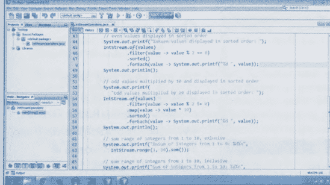

# Safari™ Books Online

```java


```java
// 创建一个升序的整数数组
int[] array = {7, 5, 8, 1, 9, 2, 6};

Arrays.stream(array)
      .filter(value -> value > 5)
      .sorted()
      .forEach(value -> System.out.println(value));

// 创建一个指定大小且经过排序的数组
int[] array = {7, 5, 8, 1, 9, 2, 6};

Arrays.stream(array)
      .map(value -> value * 2)
      .sorted()
      .forEach(value -> System.out.println(value));

// 使用 1 到 10 的闭区间整数范围
IntStream.rangeClosed(1, 10)
         .forEach(value -> System.out.println(value));
```

此以及其他 Paul Deitel LiveLessons 视频可在 Safari Books Online（`www.safaribooksonline.com`）获得，或通过 `myliveleessons.com` 进行单独下载。

# 程序员的 Android 6：应用开发方法 第三版

对以下内容的实用且丰富的示例覆盖：

- Android 6、Android Studio：Gradle™、矢量资源工作区（Vector Asset Studio）主题
- Material Design 应用模板与主题
- AppCompat 库、Android 源码库、RecyclerView、浮动按钮（FloatingActionButton）、文本输入布局控件（TextInputLayout）
- Material Design 元素与图标
- REST 服务/JSON、多线程、SQLite™ 数据库与 Android 服务
- 游标（Cursors）、加载器（Loaders）、内容提供者（ContentProviders）
- 支持各种尺寸/分辨率
- 辅助功能、国际化
- 活动（Activities）、意图（Intents）、片段（Fragments）、事件（Events）
- 布局（Layouts）、菜单、资源、文件
- 事件、触摸/手势处理、图像、图形、动画
- 内联修饰符、占位符
- Google Play™ 商店、应用发布、定价、营销、应用内广告、应用内购买等更多领域

## 引导使用 Android 6 和 Android Studio 进行应用开发的专业程序员指南

Google Play™ 上有数百万个应用被下载。这本书为你提供了快速开始开发优秀应用并在 Google Play 上发布所需的所有内容。本书采用以应用驱动的方法——每项新技术都是在高度代码化且经过测试的 Android 应用程序背景下介绍的，并配有语法高亮、代码解读以及活动和示例。你将发现：

- 欢迎应用
- 小费计算器
- 国旗测验
- 涂鸦画（Doodle）
- 大炮游戏
- 天气查看器
- Twitter 搜索
- 通讯录

Paul David 和 Harvey Deitel 及其 De Associates, Inc. 是国际认可的编程作者和企业培训机构。全球范围内有数万人使用 DeBooks、Live lessons 和在线资源掌握了 Android™ 开发、Java、iOS 应用开发、Swift、.NET、Visual Basic™、C、C++ 以及编程、JavaScript、XML、PHP 等。

# 评审编辑评论

> 《程序员的 Android 6：应用驱动指南》将让你在 2015 年上手最新的 Android 版本。这本书通过分步指南，教你如何开发真实的应用，你可以学习创建这些应用并将其作为你下一个应用的基础。它涵盖了使用最新工具、平台和设计指南来创建、设计和运行真实应用的重要步骤。  
> ——Jim Hathaway，开发者，Kendall Gotham

> 我非常喜欢它处理书籍的方式。它有成为市面上最佳 Android 书籍的潜力。很容易看到许多执行良好的 Android 应用示例。  
> ——Dan Gopal，Android 倡导者，《Intro to Android》作者

> 如果这本书是在我开始开发 Android 时编写的就好了，当时我没见过有任何其他书籍出版，而且书中提供的链接是一个令人印象深刻的集合。你将获得涵盖 API 大部分工作原理的完整应用程序。  
> ——Douglas Jones，高级软件工程师，Future Learning

> 每一章都引入该主题的一个概念，通过代码构建能力。示例演示了每一章的内容，然后你可以将其扩展到你自己的项目中。  
> ——Jim E. Cordova，Data Systems LLC

> 它通过易懂的示例教你 Android SDK。每一章中都展示了如何编写新应用，就像你从未接触过 Android 或手头没有相关应用一样解释 SDK 的每一个部分，这本书绝对是最值得投资的。  
> ——G. Clifton，《Android User Interface Design: Implementing Material Design for Developers，第二版》作者

> 作者捕捉到了 Android 经验的平衡，并巧妙地将其编织成简洁、实用的内容。极好的指南。  
> ——Clark Lush，弗吉尼亚州大学

“优秀应用的特征”表格非常棒。  
——Jesus Ubaldo-Torero，威斯康星大学麦迪分校

## 访问 `devkit.com`

- 下载代码示例
- 有关 Deitel Dev Into® 培训课程信息请访问 `devkit.com` 或邮件至 `deitel.com`
- 在 Facebook（`DeitelFan`）、Twitter（`@deitel`）、Google+（`+DeitelFan`）、LinkedIn（`bit.ly/DeitelLinkedIn`）、YouTube（`@deitelYouTube`）上关注我们
- 访问 `www.deitel.com/newsletter/subscribe.html` 订阅 Deitel® Buzz 电子邮件通讯

（内封面继续）

`informat/ph`

$44.99 美 $55.99 加拿

ISBN-13：9-78-0-142936-6  
ISBN-10：0-142936-6


PRENTICE HALL
