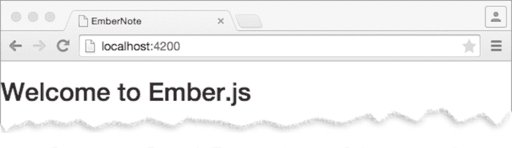
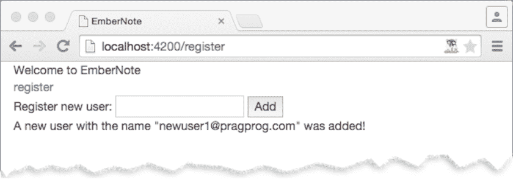
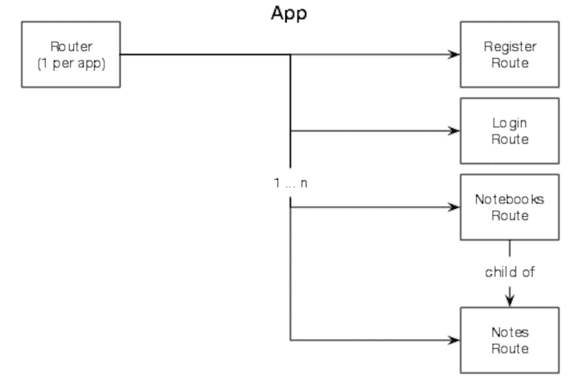
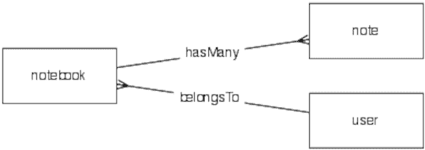
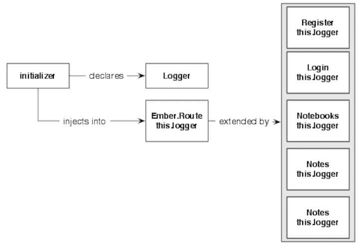
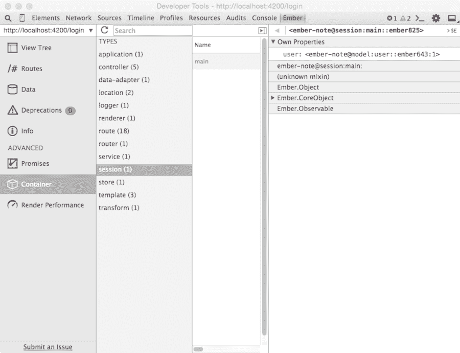
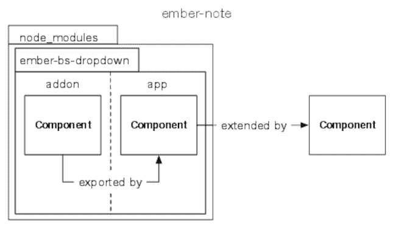

# 使用 Ember 2 构建出色的 Web 应用


## 为了获得最佳阅读体验……

我们强烈建议你在阅读设备或应用程序上启用“出版商默认”设置来阅读此书。如果没有此设置，某些格式和字符可能无法正常显示。请参阅你的阅读器说明，了解如何启用出版商默认设置。

# 《Deliver Audacious Web Apps with Ember 2》早期好评

《Deliver Audacious Web Apps with Ember 2》为强大且优雅的 Ember 框架提供了清晰的介绍。想要学习或提升 Ember 技能的开发者应该读这本书。

> Nell Shamrell-Harrington，Chef 软件开发工程师

> Ember 带回了 Rails 的乐趣，这次是性能良好的单页应用。

> Federico Tomassetti，软件工程师

> 如果你考虑在下一个项目中使用 Ember，请买这本书。读完每一章后我都感觉自己提升了。

> Stephen Orr，Impact Applications 高级软件工程师

致 Pragmatic Bookshelf 团队，包括 Andy Hunt、Dave Thomas、Susannah Davidson Pfalzer、Janet Furlow 以及其他对制作做过贡献的各位：你们帮助我将这本书打造成了一个我希望我们都能为上面有自己的名字感到自豪的作品。

致我的编辑 Katharine Dvorak：这本书有你的一份也有我的一份。你的指导和见解对我帮助极大，如果没有它们，这本书的长度会增加一倍，而有用信息却减少一半。我等不及要开始下一本书了！

致我的好朋友兼同期作家 Sharone Williams：感谢你对我那些因截止日期压力产生的幻觉产生共鸣。知道你也同样在那片“文字矿场”中奋斗，对我来说是无比量的帮助。

致我的父母：感谢你们为我付出的所有牺牲，并教我努力工作、尝试新事物。我希望你们像我一样为这本书感到自豪。

最重要的，致我的妻子和儿子：你们的耐心、支持和爱对我来说意味着一切，没有你们，我既无法开始也无法完成这本书。感谢你们所切！

Matt White [`mailto:matt@mattwhite.co`](mailto:matt@mattwhite.co) [`mailto:matt@mattwhite.co`](mailto:matt@mattwhite.co) 2015 年 10 月 Copyright © 2015, The Pragmatic Bookshelf.

# 引言：为什么选择 Ember？

当你考虑编写一个 Web 应用时，什么最让你感到兴奋？你是期待编写框架代码，还是期待为你的用户交付功能？如果你像我一样，功能才是令人兴奋的东西，而框架是为了服务功能而。现在，想象一下，如果一组开发者寻找创建 Web 应用前端的实践实践，并将发现的内容封装成一个框架。想象一下，如果你不再担心编写胶水代码，而是把时间花在那些兴奋的事情上。你的工作会有何不同？

Ember 是一个开源 JavaScript 框架，在 [`http://emberjs.com`](http://emberjs.com) 和 GitHub^([[1]](#f_0010.html_FOOTNOTE-1)) 上维护，旨在加速 Web 应用的。它提供了你所需的大部分前端基础设施，让你能够花时间创建一个出色的应用。如果你使用 Ember，你写的代码更少，也更简单。而简单的代码就是更好的代码。通过向 JavaScript 注入面向对象的设计原则来帮助你以合理的方式组织代码，Ember 让你从模块化的层面进行思考。这使得你的应用更容易创建和维护。

在本书中，你将学习如何创建大胆的 Web 应用，并通过让 Ember 承担繁重的工作来高效实现目标。你将使用 Ember 的路由系统构建具有丰富界面和简单、可共享 URL 的单页应用。你将创建可重用的 UI 组件和模板，并将它们组合成高度实用的、复杂的应用。你将使用 Ember Data 读写 RESTful 服务。你将学习使用 Ember 插件（addons）来共享代码并使用他人共享的代码。你还将学习使用 Ember CLI 和 `QUnit` 来组织、构建和测试你的应用。

## 本书是什么，又不是什么

本书是对 Ember 2、Ember Data 和 Ember CLI 核心功能的简要介绍。这些功能依赖于 `Node.js`、`npm` 和 `Handlebars`，但我们不会详细讨论这些依赖项。

本书并不是 Ember、Ember Data 或 Ember CLI 的详尽参考书。我希望你学到的知识足以激发你的好奇心，但我们不会涵盖每一个 Ember API。本书也不是 JavaScript 或 Web 开发的介绍。我假设你已经对 JavaScript、`DOM`、`Ajax`、`HTML/CSS` 和 RESTful 服务有一定了解。

## 谁应该读这本书？

本书面向初接触 Ember 的 Web 开发者。如果你用过 `React` 或 `AngularJS` 等其他框架，或者用过 `jQuery`，那么 Ember 背后的一些理念对你来说应该熟悉，但如果没有，你也没问题。

## 本书是如何组织的

在第一章中，我们将从创建本地开发环境开始，然后开始处理示例项目。在构建一个小型但完整的示例功能时，我们将在第一章中简要提到许多核心功能。

在接下来的三章中，我们将重点关注使用 Ember 2 构建用户界面的核心方面，并查看它如何利用路由、模板和组件动态地更新你的界面，而无需与服务器进行大量笨拙的往返。在第 5 章和第 6 章中，我们集中于使用带有 Ember Data 的模型访问 RESTful 服务以获取数据，并将数据提供给用户界面。第 7 章讨论了在你的 Ember 应用中促进代码重用的几种方法，包括工具类、混入（mixins）和依赖注入。我们将在第 8 章和第 9 章结束课程，学习如何使用 Ember CLI 进行构建、测试和部署应用，以及通过插件共享代码。

本书的一点小不同之处是，每一章都建立在前一章工作的基础上。我们将协作构建一个应用，从第一页开始，贯穿始终。因此，最好在第一次阅读时按顺序阅读本书。当你读完整个书后，再将其作为参考书使用会更有好运，但它在第一次初读时作为渐进式教程效果最好。

我们将共同构建一个名为 `EmberNote` 的应用。它是 Evernote 应用的简化版，Evernote 是基于 Web 的笔记应用程序。以 Evernote 为模型，我们将使用 Evernote 笔记本和笔记的层级结构来学习如何使用 Ember 的路由系统和 Ember Data。我们将使用 Ember CLI 构建、测试和部署应用，以及通过插件共享代码。

## 哪里获取帮助

本书中的所有代码示例都可以在网上找到^([[2]](#f_010.html_FOOTNOTE-2))。在那里你还可以找到一个论坛，可以提问和提供反馈。

现在，让我们开始吧！

### 脚注

| 脚注 | 链接 |
| --- | --- |
| [[1]](#f_006.html_FPTR-1) | [`github.com/emberjs/ember.js/`](https://github.com/emberjs/ember.js/) |
| [[2]](#f_010.html_FPTR-2) | [`pragprog.com/book/mwjsem`](http://pragprog.com/book/mwjsem) |

# 第一章：使用 Ember 开始你的应用

在本章中，我们将通过学习 Ember 和 Ember CLI 的核心功能来快速上手。首先，我们将通过安装 Ember 和 Ember CLI 搭建开发环境。接下来，我们将开始构建贯穿全书的应用。我们将使用 Ember CLI 创建应用及其第一个功能：注册页面。最后，我们将通过构建一个基础的、感知数据的测试后端来支持该页面。让我们从安装 Ember 和 Ember CLI 开始。

## 安装 Ember 和 Ember CLI

Ember CLI 是用于构建 Ember 应用的命令行界面，它是项目团队获取框架库的首选方式。通常，Ember 非常关注 Ember 开发者所谓的“开发者工程学”。他们希望让开发者的工作更轻松。Ember CLI 正是基于这种精神的。正如你在整本书中看到的，Ember CLI 可以轻松处理许多样板任务，如构建和部署、执行测试、为新功能添加文件等。同样重要的是，它允许你使用新的模块化语法来编写类。这大大增加了你代码的清晰度。我们将在本书中使用 Ember CLI，所以让我们从安装它开始吧。

值得注意的是，虽然我们将使用 `Node` 来运行 Ember CLI 开发工具，但 Ember 本身并不是一个服务端框架，尽管 `Node` 支持服务端的 JavaScript 开发。Ember 用于创建运行在浏览器中的应用程序。

首先，让我们安装 `Node` 和 `npm`，以及 `Git`。Node 自带了 `npm`，但 `npm` 更新非常频繁，因此最好确认你拥有的是最新版本。请访问相关网站为你的特定平台安装这些工具的最新版本。你的 `Node` 安装版本至少应该是 0.12，以支持 Ember CLI 工具。如果你已经安装了 `Node`，你可能需要先卸载现有版本。

后两个安装是 `Bower` 需要的。`npm` 是一个包管理器，用于在 `Node` 中运行的代码或与在 `Node` 中运行的工具配合。`Git` 是一个分布式版本控制系统。请按照各自网站的安装说明安装这三者。

> **安装**
>
> 在安装这些工具时，你希望以管理员用户的身份运行。在 Linux/BSD/OS X 系统上，你可能需要使用 `sudo` 前缀来这样做，而在 Windows 上，你需要以具有管理员权限的用户身份登录。与许多安装一样，可能会出现问题，因此如果发生问题，请前往 [`pragprog.com`](http://pragprog.com) 上的书籍论坛，我们将一起解决它。

安装好这些工具后，你可以从命令行获取 `Bower`：

```bash
$ npm install -g bower
```

你应该能看到几行命令输出，表示 `Bower` 及其依赖项已下载到你的机器上。`-g` 命令选项要求 `Node` 安装 `Bower` 并使其在全局可用，而不是将其限制在特定项目中。一旦 `Bower` 安装完成（你会看到命令输出停止并返回到命令提示符），你就可以安装 `PhantomJS`：

```bash
$ npm install -g phantomjs
```

同样，你应该看到一些命令输出，告诉你 `PhantomJS` 已成功安装。有了这些工具，你就可以准备好获取 Ember CLI 了：

```bash
$ npm install -g ember-cli
```

安装 Ember CLI 会导致安装 Ember 框架库以及 CLI 本身。现在你已经有了 `Ember` 和 `Ember CLI`，我们准备好开始编码了。

## 开始你的应用程序

Ember CLI 采用了一种以应用为中心的方法。你做的第一件事是创建应用，你创建的每个模块都是该应用的一部分。因此，我们将遵循这一做法，在一个应用的背景下探索 Ember 的所有核心概念。

我们将编写一个名为 `EmberNote` 的应用，它是基于网络的笔记应用 Evernote 的精简克隆版。我们的第一步是创建应用的仓库（之所以这么命名是因为 Ember CLI 假设你将使用 `Git` 作为版本控制系统）。

### 创建应用仓库

打开命令提示符，导航到你存放代码的位置，并运行以下命令：

```bash
$ ember new ember-note
```

这将为你的应用创建一个新目录。如果出现任何问题，请查看随后的提示。

> **使用 Ember CLI 创建新项目**
>
> 写到此处时，Ember CLI 在创建新仓库时可能会发生可能的竞态条件。如果你看到类似这样的错误：`ENOENT, open ’ember/package.json’`，你可能遇到了这个错误。通常，`ember new` 命令在第二次尝试时会成功。在某些非 Windows 系统上，你可能还会看到关于未安装 `watchman` 的控制台警告。Ember CLI 使用 `watchman` 监控你的文件系统变化，并在开发 Ember 应用时将其实时部署到你的本地服务器。拥有 `watchman` 是好的，即使只是为了避免看到这个错误，但这并不是必须的。如果没有 `watchman`，Ember CLI 使用一个名为 `NodeWatcher` 的工具实现相同的功能。如果你想安装 `watchman`，请访问 [`facebook.github.io/watchman/docs/install.html`](https://facebook.github.io/watchman/docs/install.html) 获取特定安装说明。

在我们编写 UI 代码之前，让我们也安装一个 Bootstrap 样式表，这样我们就可以享受看起来不像来自 90 年代初的 UI 了。在新创建的 `ember-note` 目录的命令提示符中，运行以下命令：

```bash
$ cd ember-note
$ npm install
$ bower install
$ bower install bootstrap --save
```

然后将这些行添加到 `ember-note/ember-cli-build.js` 中，位于代码最后一行代码之前：

```javascript
app.import('bower_components/bootstrap/dist/css/bootstrap.css');
app.import('bower_components/bootstrap/dist/js/bootstrap.js');
```


在我们编写 UI 代码之前，让我们也安装一个 Bootstrap 样式表，这样我们就可以享受看起来不像来自 90 年代初的 UI 了。在新创建的 `ember-note` 目录的命令提示符中，运行以下命令：

```bash
$ cd ember-note
$ npm install
$ bower install
$ bower install bootstrap --save
```

然后将这些行添加到 `ember-note/ember-cli-build.js` 中，位于代码最后一行代码之前：

```javascript
app.import('bower_components/bootstrap/dist/css/bootstrap.css');
app.import('bower_components/bootstrap/dist/js/bootstrap.js');
```

*(注：由于原文示例中代码部分存在碎片化和重复，此处已根据逻辑补全了完整的代码块。)*

### 运行你的应用程序

让我们运行制作的应用并看看它是什么样。从新目录的命令提示符中，运行以下命令：

```bash
$ ember serve
```

你应该能看到一些命令输出，告诉你构建成功且你的应用运行在 4200 端口。让我们打开浏览器检查。如果你将浏览器指向 `localhost:4200`，你应该看到类似下图的内容。



`ember serve` 命令为你做了几件事。首先，它构建了应用的可部署版本并将其放置在 `ember-note/dist` 目录中。然后，它在 4200 启动了一个 node 实例并将应用部署到该实例。一旦你运行了这个命令，它就会捕捉你所做的更改。让我们现在尝试一个。打开 `ember-note/app/templates/application.hbs` 文件。它的内容应该像这样：

```html
<h2>Welcome to Ember</h2>
{{outlet}}
```

对文件进行更改，使其变为“Welcome to EmberNote”。然后文件应该是这样的：

```html
<h2>Welcome to EmberNote</h2>
{{outlet}}
```

一旦你保存更改，查看你的浏览器。Ember CLI 检测到更改，重新构建了应用，并在保存时部署了它。

### 注册用户

让我们看一个简单的示例，它将展示 Ember 应用的许多核心功能：路由、模板和模型。我们将构建一个注册页面，允许用户注册 EmberNote 服务。该页面有一个单文本字段，用户可以在其中输入用户名，一个触发添加操作的按钮，以及在添加新用户时显示的某些文本。

在 Ember 应用中，你所有的功能都组织在路由（routes）之下。路由本质上是一个 URL 段，正如 Nest 嵌套路由中描述的。因此，我们的下一步是使用 Ember CLI 创建一个路由。打开一个新的命令行终端，在你的 `ember-note` 项目根目录下，运行以下命令：

```bash
$ ember generate route register --pod
```

在 `generate` 命令中添加 `--pod` 标志时，会创建一个名为 `register` 的目录，其中包含了添加你的路由所需的文件：`route.js` 和 `template.hbs`。它们目前是空的，你将根据需要填充它们的内容，以创建路由的功能。通常来说，当你想要按功能组织项目时（即创建一个包含 `route.js` 和 `template.hbs` 文件的 `register` 目录），而不是按对象类型组织时，就会使用 pod 模式。

早些时候，当你使用 `ember new` 命令创建应用时，生成了以下四个文件：`index.html`、`app.js`、`router.js` 和 `application.hbs`。随后，`ember generate` 命令会编辑你应用目录下的 `router.js` 文件。我们将在使用 Router 类来组织你的应用中深入探讨这一点，但 `router.js` 类用于实现应用程序内部路由的层级结构。

如果你运行 `ember generate` 命令但省略了 `--pod` 标志，Ember CLI 仍然会创建相同的对象，但它不在 `register` 目录中创建一个名为 `route.js` 的文件，而是在 `route` 目录中创建一个名为 `register.js` 的文件。对于我们来说，最好将路由所需的每个文件都放在同一个位置，因此在整本书中我们将一直使用 `--pod` 标志。

让我们来看一下目前为止创建的每一个文件。

#### `index.html`

该文件是你的应用的起点。它是当你运行 `ember new ember-note` 命令时创建。让我们来看看：

```html
<!DOCTYPE html>
<html>
<head>
  <meta charset="utf-8">
  <meta http-equiv="X-UA-Compatible" content="IE=edge">
  <title>EmberNote</title>
  <meta name="description" content="">
  <meta name="viewport" content="width=device-width,initial-scale=1">
  {{content-for 'head'}}
  <link rel="stylesheet" href="assets/vendor.css">
  <link rel="stylesheet" href="assets/ember-note.css">
  {{content-for 'head-footer'}}
</head>
<body>
  {{content-for 'body'}}
  <script src="assets/vendor.js"></script>
  <script src="assets/ember-note.js"></script>
  {{content-for 'body-footer'}}
</body>
</html>
```

`index.html` 的大部分内容是创建起始页面的 HTML 模板代码。Ember CLI 添加了两个名为 `vendor.css` 和 `ember-note.css` 的样式表来美化应用程序。在本书中，我们不会对样式表做太多操作，但你应该知道，`vendor.css` 会捕获引入到应用中的任何第三方代码中使用的样式，而 `ember-note.css` 则用于你定义的样式。

同样的情况适用于 `vendor.js` 和 `ember-note.js`。Ember CLI 构建过程会为你应用中使用的所有第三方代码创建一个文件，名为 `vendor.js`，并为你的应用代码创建一个文件，名为 `ember-note.js`。这些文件都被包含在 `index.html` 中。

你可能还会注意到 `{{content-for}}` 表达式。这些允许你使用 Ember CLI 插件在页面包含包含内容。

#### `app.js`

`app.js` 文件用于创建 Ember 环境。看看下面的代码：

```javascript
import Ember from 'ember';
import Resolver from 'ember/resolver';
import initializers from 'ember/initializers';
import config from './config/environment';

var App;

App = Ember.Application.extend({
  modulePrefix: config.modulePrefix,
  podPrefix: config.podPrefix,
  Resolver
});

initializers(App, config.modulePrefix);

export default App;
```

如果你是一个资深的 JavaScript 开发者但还没有看过 ECMAScript，那么前四行可能会让你大掉下巴。ECMAScript 是 ECMA 国际组织指定的 JavaScript 语言的正式名称，而 ECMAScript 2015（也称为 ES6）是该标准的最新版本。

`app.js` 中代码的目的是设置应用范围内的构造。其中之一 `Resolver` 用于在整个应用中查找类。`modulePrefix` 变量被设置为 `ember-note` 值，这是在你设置应用时定义的。`podPrefix` 没有被设置，因为它在我们的项目中没有定义，该值是从 `config/environment` 中读取的。

文件的最后一行使 `App` 类作为模块可用。如果这看起来还不完全理解，不要担心——随着学习的，你会看到更多关于 Ember 如何工作的示例。现在，让我们看看设置应用时创建的另一个文件，`router.js` 文件。

#### `router.js`

`router.js` 文件是你可以真正开始观察 Ember 如何工作的地方。Ember 最基础的功能之一是路由（route）的概念。简单来说，路由是应用中的一个位置。如果你将应用视为一组嵌套在另一个之中的页面或页面部分，那么每个页面都对应一个路由。而在 `router.js` 中定义的 `Router` 类就是你定义应用结构的地方。来看看代码：

```javascript
import Ember from 'ember';
import config from './config/environment';

var Router = Ember.Router.extend({
  location: config.locationType
});

Router.map(function() {
  this.route('register');
});

export default Router;
```

在 `router.js` 文件的顶部你看到了必要的导入。在 `var Router = Ember.Router.extend` 开始的类定义中，我们从设置应用时定义的全局配置中引入了一些配置变量。

但 `Router.map` 才是戏发生的地方。如你所见，我们已经创建了一个名为 `register` 的路由。当我们运行 `ember generate route register --pod` 命令时，该路由被添加到了 `Router` 中。系统还生成了其他文件，稍后我们将编辑这些文件来创建注册功能。`register` 路由看起来是一个顶层路由，但实际上它位于应用程序默认路由下的第一层子路由。让我们通过其关联模板来看这个默认路由。

##### `application.hbs`

每个应用程序都有一个根路由，即 `Application` 路由。此外，每个路由都对应且仅一个模板。模板是用户界面的一部分。在应用程序路由的情况下，这个模板定义在 `application.hbs` 中。现在让我们修改这个模板，使其看起来如下所示：

```html
<div class="container">
  <div class="row">
    <div class="col-md-2">
      Welcome to EmberNote
    </div>
    <div class="col-md-10">
      {{#link-to 'register'}}register{{/link-to}}
    </div>
  </div>
  <div class="row">
    <div>
      {{outlet}}
    </div>
  </div>
</div>
```

每个 Ember 模板都是 HTML 和 Handlebars 表达式语言的混合，后者是用 `{{ }}` 字符分隔的代码部分。Handlebars 是 Ember 使用的表达式语言，用于描述 Ember 模板中与 Ember 应用程序代码相关的某些片段。你将在书中看到许多 Ember 使用 Handlebars 表达式的示例，它们始终使用 `{{ }}` 字符。Ember 附带了一个编译器，可以将 Handlebars 模板表达式转换为 DOM 对象，正如我们在编译模板中将看到的。

正如我们之前看到的，每个应用都由路由层次结构组成。`application.hbs` 文件中的 `{{#link-to}}` 表达式用于生成超链接，点击该链接会将 `register` 路由加载到 `{{outlet}}` 中。

你可能在想 `Application` 路由在哪里定义的。在这种特定情况下，由于我们没有任何特定的操作处理或数据加载需要完成，因此不需要定义路由类；我们可以简单地依靠 Ember 使用默认路由行为动态创建路由实现。

到为止我们看到的所有代码都搭建了应用程序最基础的配置。现在，让我们看看如何通过构建 `register` 路由为我们的应用添加功能。

##### 构建 Register 路由

如之前讨论，`register` 路由将允许用户通过选择用户名来注册 EmberNote 应用程序。当我们使用 CLI 创建此路由时，创建了以下文件（注意，这是 `route.js`，它与 `router.js` 不同）：

```javascript
import Ember from 'ember';

export default Ember.Route.extend({
});
```

这就是定义一个空路由类的方式。路由存在两个主要原因：加载要由路由显示的数据以及响应操作。在我们的情况下，我们没有数据要显示，并且我们需要定义一个 `addNew` 操作向应用中添加新用户。我们稍后会回到该操作。首先，让我们看看用户界面看起来什么样。这是我们路由的模板文件，已添加了必要的 UI 代码：

```html
<div class="col-md-12">
  Register new user: {{input value=name}}
  <button {{action 'addNew'}}>Add</button>
</div>
<div class="col-md-12">
  {{message}}
</div>
```

`{{input}}` 字段允许我们输入名称。带有 `{{action 'addNew'}}` 的 `<button>` 会触发 `addNew` 操作。`{{message}}` 显示操作状态。

`register` 路由将允许用户通过选择用户名来注册 EmberNote 应用程序。当我们使用 CLI 创建此路由时，创建了以下文件（注意，这是 `route.js`，它与 `router.js` 不同）：

```javascript
import Ember from 'ember';

export default Ember.Route.extend({
});
```

这就是定义一个空路由类的方式。路由存在两个主要原因：加载要由路由显示的数据以及响应操作。在我们的情况下，我们没有数据要显示，并且我们需要定义一个 `addNew` 操作向应用中添加新用户。

Ember 和 Ember CLI 在开发期间提供了两种向你的应用提供数据的方法：固定件（fixtures）和模拟服务（mock services）。虽然固定件的设置更简单，但模拟服务要求你实现访问 RESTful 服务所需的所有内容，从而让你能够更完整地测试代码。因此，我们在本书中使用模拟服务。如果你更关注的是对核心 Ember 类的测试，并且不担心数据访问层的测试，那么你可以考虑使用固定件，它们本质上是带有硬编码数据和简单访问方法的类。

事实上，我们比模拟服务还更进了一步：我们的服务将在重启后持久化数据，这样在我们构建应用时，我们还能看到数据的累积。Ember CLI 创建的默认模拟服务并不具备这一点，尽管在正常情况下开发应用时这种行为可能更好，但我更希望我们的数据在服务重启后依然存在，以便我们在处理示例时能够维护测试数据。现在，让我们看看模拟服务是如何工作的。

## 创建模型

我们首先为用户对象创建一个模型类。目前，我们的用户包含一个数据属性：名称。让我们使用 Ember CLI 生成一个存根类。

```bash
$ ember generate model user
```

这里是该类，并添加了实现细节：

[ch1/ember-note/app/models/user.js](http://media.pragprog.com/titles/mwjsember/code/ch1/ember-note/app/models/user.js)

```javascript
import DS from 'ember-data';

export default DS.Model.extend({
  name: DS.attr('string')
});
```

该类依赖 Ember Data 库来创建一个 Model 实例，其中有一个名为 `name` 的属性。该属性的类型为字符串，意味着它将存储文本。仅此而已。这就是我们建模用户对象所需的所有。现在，为了与计划创建的服务交互，我们需要一个 `RESTAdapter` 和一个 `RESTSerializer`。

## 创建适配器序列化器

要创建 `RESTAdapter`，运行以下命令：

```bash
$ ember generate adapter application
```

这创建了一个整个应用程序使用的 `RESTAdapter`，这就是为什么我们将其命名为 `application`。现在，编辑生成的文件使其如下所示：

[ch1/ember-note/app/adapters/application.js](http://media.pragprog.com/titles/mwjsember/code/ch1/ember-note/app/adapters/application.js)

```javascript
import DS from 'ember-data';

export default DS.RESTAdapter.extend({
  namespace: 'api'
});
```


同样，要创建`RESTSerializer`，运行此命令：

```bash
$ ember generate serializer application
```

生成的类看起来如下：

[ch1/ember-note/app/serializers/application.js](http://media.pragprog.com/titles/mwjsember/code/ch1/ember-note/app/serializers/application.js)

```javascript
import DS from 'ember-data';

export default DS.RESTSerializer.extend({});
```

`RESTAdapter`只有一个目的：定义服务器上的路径，我们可以在该路径找到我们的 RESTful 服务。`RESTSerializer`是一个空实现，因为我们正在使用默认功能。由于我们要创建一个为每个模型对象暴露预期 API 的服务，这就是我们需要做的的所有工作。关于这些更多内容，我们将在适配非传统 API 和使用序列化器访问遗留 API 中看到。

通常情况下，这里就是你 Ember 开发的终点。创建一个提供数据的服务通常不属于你使用 Ember 的范畴，因为 Ember 是一个前端框架，而不是用于开发 REST 服务的。正如我之前提到的，我们正在创建一个应用可以用于测试的模拟服务，然后通过使数据持久化来更进了一步。

## 使数据持久化

为了让我们的数据持久化，我们需要能够做到两件目前还无法做的事情。首先，我们需要一个存放数据的地方。为此，我们将使用 NEDB 项目，它是一个用于 Node 的嵌入式数据存储。这是用于开发数据库（如我们的）的一个很棒工具。对于生产环境数据库，你可能需要更健壮的工具。在`ember-note`目录下运行以下命令（`--save-dev`标志使其成为开发依赖，而不是生产环境依赖）：

```bash
$ npm install nedb --save-dev
```

这使得 NEDB 项目可用。当 Ember Data store 在注册路由中保存新用户记录时，它将通过 HTTP 向我们的模拟服务 POST 数据。因此，我们还需要能够解析传入的 HTTP 请求体。获取以下库来实现此操作：

```bash
$ npm install body-parser --save-dev
```

现在我们准备好通过运行以下命令创建我们的模拟服务了：

```bash
$ ember generate http-mock
```

服务创建完成后，我们只需要添加几行代码来使用刚刚添加的库，并响应请求。查看下面的代码，它使数据持久化到 NEDB：

```javascript
module.exports = function(app) {
  var express = require('express');
  var usersRouter = express.Router();

  // 在此服务中使用 body-parser
  var bodyParser = require('body-parser');
  app.use(bodyParser.json());

  // 如果不存在则创建一个嵌入式数据库
  var nedb = require('nedb');
  var userDB = new nedb({ filename: 'users', autoload: true});

  // POST 用于创建记录
  userRouter.post('/', function(req, res) {
    // 查找最近创建的记录并设置请求的 id 字段
    // 这是 Ember 需要的
    userDB.find({}).sort({id: -1}).limit(1).exec(function(err, users) {
      if (users.length != 0)
        req.body.id = users[0].id + 1;
      else
        req.body.id = 1;

      // 将新记录插入数据库，并将新创建的记录返回 Ember
      userDB.insert(req.body, function(err, newUser) {
        res.status(201);
        res.send(JSON.stringify({
          user: newUser
        }));
      });
    });
  });

  // 目前我们不触碰其余代码，这些是由 Ember 创建的
  userRouter.get('/', function(req, res) {
    res.send({
      users: []
    });
  });

  userRouter.get('/:id', function(req, res) {
    res.send({
      users: {
        id: req.params.id
      }
    });
  });

  userRouter.put('/:id', function(req, res) {
  });

  userRouter.delete('/:id', function(req, res) {
    res.status(204).end();
  });

  app.use('/api/users', usersRouter);
};
```

现在，我们准备好尝试我们的注册功能了。如果它还没有运行，进入命令行并运行以下命令启动应用（如果已经在运行，你可能需要按 Ctrl-C 停止，重新启动）：

```bash
$ ember serve
```

然后导航到`localhost:4200`，点击注册链接，提供用户名并点击 Add。你会看到一条显示用户已添加的消息，如下。



如果你想验证，可以查看`ember-note`目录下的`users`文件。你应该看到类似这样的内容：

| ​  | `{"name":"newuser1@pragprog.com","id":1,"_id":"8EszAw3RuDxYCIBh"}` | |

如果你看到的是类似的内容，那么恭喜你！你已经完成了学习 Ember 的第一步。喝口饮料，散散步，或者随你心意放松一下。

### Ember 插件：Ember CLI Mirage

你可以看到，为了让 Ember CLI 与后端运行起来，我们费费了一些精力。Ember CLI 的 HTTP Mocks 是使用模拟服务器提供数据的极佳方法，但我想向你提一下另一种名为`Ember CLI Mirage`的替代方案。

`Ember CLI Mirage`是一个 Ember 插件，它实现了许多与 Ember CLI HTTP Mocks 相同的目标，但它完全在客户端完成工作（也就是说，你不需要启动一个 Node 服务器来提供模拟数据）。Ember 插件是一个封装好的代码包，由社区成员分享并发布到仓库（通常是`npm`）中供更广泛的社区使用。

`Ember CLI Mirage`允许你创建运行在浏览器或持续集成环境中的模拟数据服务。这使得你的测试类可以在不需要现有后端服务器（即使是模拟服务器）的情况下测试你的模型层。

在整本书中，我会提到一些值得关注的 Ember 插件。这些插件通常代表了我们在书中讨论过的任务的替代方案，或者是以更成熟的方式执行了我们曾用简单方式完成的任务。我不断言这些插件是否达到了生产级。至少，它们对于帮助你进一步探索 Ember 生态系统并将其作为额外学习的工具是有用的，因为所有它们都是开源的。我们将在第 9 章专门用一章介绍插件，即构建和使用 Ember 插件。

关于如何使用`Ember CLI Mirage`的完整文档，请参阅[`www.ember-cli-mirage.com`](http://www.ember-cli-mirage.com)。

## 下一步工作

在第一章中，我们涵盖了大量的概念。你已经看到了 Ember 中每个主要类的小型示例，并编写了一个使用数据感知服务的示例应用程序。尽管如此，Ember 的内容远比我们涵盖的要，在我们结束之前，你还有很多东西需要学习。我们的下一步是开始构建用户界面，首先是深入研究路由（routes）。

### 脚注

| [[3]](#f_0012.html_FNPTR-3) | [`nodejs.org`](http://nodejs.org) |
|---|---|
| [[4]](#f_0012.html_FNPTR-4) | [`npmjs.com`](https://npmjs.com) |
| [[5]](#f_0012.html_FNPTR-5) | [`git-scm.com/downloads`](http://git-scm.com/downloads) |
| [[6]](#f_0013.html_FNPTR-6) | [`evernote.com`](https://evernote.com) |

版权 © 2015, The Pragmatic Bookshelf.

# 第 2 章

## 使用路由引导流量

现在我们已经安装了 Ember 和 Ember CLI，并使用它们创建了一个允许用户注册的程序，我们准备好研究 Ember 的主要功能了。我们将查看第一个功能是 Ember 路由（routes）。正如我在第 1 章中提到的，路由的概念是 Ember 背后的核心原则之一。路由是应用程序中单个功能单元的起点。路由的层级结构成了应用程序的组织结构。

路由在 Ember 中非常、非常重要。幸运的是，它们也是非常好的起点。在本章中，我们将查看如何使用 Ember CLI 使用路由来结构化你的应用程序。你将学习如何使用`Router`类来设置路由层级，以及如何使用`Route`类来定义路由。我们还将查看如何使用 Ember 的导航助手在路由之间进行跳转。你将学习 Ember 如何使用你的应用程序 URL 不仅指示你在应用中的位置，还指示加载到 UI 中的记录。为了帮助你分清`Router`和`Route`，请记住每个应用只有一个`Router`，而在该`Router`内部，你通过定义其路由来定义应用程序的结构。`Route`类的实现就是你定义单个路由行为的方式。

为了学习更多关于路由的知识，我们将通过构建应用程序的导航结构，开始组合 EmberNote 的更多功能集。在本章结束时，你将完成 EmberNote 大部分的路由结构，并且你将知道如何编写在路由之间跳转的代码。

### 使用 Router 类组织你的应用程序

在上一章中，我们为 EmberNote 创建了注册路由。正如你可以想象的，Ember 应用程序由许多路由组成，每个路由在应用程序中都是唯一的。合起来，路由构成了应用程序中不同位置的层级结构，暴露了该层级结构中每个位置特有的功能。Ember 在单个类（即`Router`类）中记录了这种层级结构，如图所示。



由于我们正在使用 Ember CLI 来管理应用程序，因此我们不会经常直接编辑 EmberNote 的`Router`。大多数时候，我们会允许 Ember CLI 为我们完成编辑。

让我们来看这样一个例子。当我们上次处理 EmberNote 时，Router 看起来是这样的：

```javascript
import Ember from 'ember';
import config from './config/environment';

var Router = Ember.Router.map(function() {
  this.route('register');
}, {
  location: config.locationType
});

export default Router;
```

在`ember-note`目录下，运行以下命令：

```bash
$ ember generate route login --pod
$ ember generate route notebooks --pod
```

运行这些命令后，你应该会在路由中看到两个新行：

```javascript
this.route('login');
this.route('notebooks');
```

很棒的一点是，Ember CLI 会在你创建时添加新路由，而不会覆盖你对路由的其他更改。Router 现在包含了我们生成的两个路由。我们现在将通过构建它们的类来定义 login 和 notebooks 路由。

在整本书中，我们将创建更多路由，并且经常检查 Router。这是一个值得经常返回的类，有助于我们保持定位并记住应用的整体结构。现在，让我们通过处理登录路由来具体查看如何定义路由。

### 定义你的路由

如提到的，每个路由对应一个给定的 URL。我们在应用程序中定义了四个路由：

- `http://localhost:4200`
- `http://localhost:4200/register`
- `http://localhost:4200/login`
- `http://localhost:4200/notebooks`

我们在第一章中定义了 register，刚刚生成了 login 和 notebook 的类。

你可能想知道我们是如何定义根 URL 的。答案是我们在创建应用程序时定义的。这个路由被称为应用路由，它使用 Ember 对`Route`类的默认实现。我们修改了一个名为`application.hbs`的文件。该文件包含了应用路由的模板。

这也引发了关于 Ember 默认结构的问题。每个独立的路由（route）恰对应一个模板（template）。对于应用路由，它是`application.hbs`模板。对于我们生成的每个路由，如果你使用了`--pod`标记，它就是路由文件夹中定义的`template.hbs`模板；否则，模板将以路由命名，并位于`templates`文件夹中。

### 创建登录路由 (Login Route)

现在我们来创建登录路由。该路由需要让用户登录 EmberNote 应用程序。它应该可以通过主页上的链接进行访问，就像之前的注册（register）路由一样，并允许之前注册的用户使用用户名登录。一旦他们登录成功，就应该被带到笔记本列表（这是我们到目前为止生成的另一个路由）。此外，一旦他们登录，注册和登录链接就不应该再显示了。

为了实现这一点，我们对对以下文件进行修改：

- `app/template/application.hbs`：添加导航，以允许用户加载登录路由，并在用户登录后隐藏注册和登录的导航。
- `app/login/route.js`：定义登录动作（action）。
- `app/login/template.hbs`：定义登录路由的用户界面。

要到达登录路由，我们首先需要通过`application.hbs`文件使其可用。编辑该文件使其如下所示：

| [ch2/ember-note/app/templates/application.hbs](http://media.pragprog.com/titles/mwjsember/code/ch2/ember-note/app/templates/application.hbs) |
|---|
| :--- |
| `<div class="container">` |
| `<div class="row">` |
| `<div class="col-md-2">` |
| Welcome to EmberNote |
| `</div>` |
| `<div class="col-md-10">` |
| `{{#if user}}` |
| Hello, `{{user.name}}` |
| `{{/if}}` |
| `{{#unless user}}` |
| `{{#link-to 'register'}}register{{/link-to}}&nbsp;` |
| `{{#link-to 'login'}}login{{/link-to}}` |
| `{{/unless}}` |
| `</div>` |
| `</div>` |
| `<div class="row">` |
| `<div>` |
| `{{outlet}}` |
| `</div>` |
| `</div>` |
| `</div>` |

你对文件进行的第一个添加是`{{#if}}`表达式。该表达式包含的文本仅在表达式求值为真（true）时才会显示。在这种情况下，如果应用控制器（controller）的`user`属性有值，就会显示用户名。我们将在接下来查看登录路由时了解该属性是如何设置的。

下一部分位于`{{#unless}}`表达式内部，当`user`属性缺失时显示。它包含了指向注册路由和我们新登录路由的`{{#link-to}}`导航项。当用户点击登录路由的链接时，他们会被带到`localhost:4200/login`。登录模板被渲染到`{{outlet}}`中，这意味着该模板的内容显示在由`{{outlet}}`定义的占位符。定义在`app/login/template.hbs`中的登录模板如下：

| [ch2/ember-note/app/login/template.hbs](http://media.pragprog.com/titles/mwjsember/code/ch2/ember-note/app/login/template.hbs) |
|---|
| :--- |
| `<div class="col-md-12">` |
| Login: `<input value=name><button action="login">Login</button>` |
| `</div>` |

这个模板是与登录路由关联的模板，它包含简单的元素。`{{input}}`表达式会显示一个 HTML 输入字段，并从`name`属性获取其值。`{{action}}`表达式会导致在`Route`中执行登录动作，我们将在接下来定义它。


所有这些内容在登录路由类中串联在一起，如下所示：

[ch2/ember-note/app/route.js](http://media.pragprog.com/titles/mwjsember/code/ch2/ember-note/app/route.js)

```javascript
import Ember from 'ember';

export default Ember.Route.extend({
  actions: {
    login() {
      this.store.query('user', {
        name: this.controller.get('name')
      }).then((users) => {
        if (users.get('length') === 1) {
          var user = users.objectAt(0);
          this.controllerFor('application').set('user',user);
          this.transitionTo('notebooks');
        } else {
          console.log('unexpected query result');
        }
      });
    }
  }
});
```

正如我们在第 1 章中看到的，这个 `Route` 类使用了 ES6 模块语法。类的第一行导入了 Ember 框架，然后在我们在类声明中扩展基础 `Route` 类时就会使用它。我们正在对 `Route` 进行匿名声明和导出。Ember CLI 获取文件路径并用它判断出该类虽然是匿名声明的，但代表了登录路由。

下一个代码块定义了 `actions` 哈希表，这是一个列动作名称及其实现的键值对列表。我们的登录路由只需要一个动作，即命名良好的 `login` 动作。

正如在本章较早部分所述，`login` 动作验证请求的用户是否已注册，然后显示用户的笔记本列表。接下来的代码块：

```javascript
this.store.query('user', {
  name : this.controller.get('name')
})
```

使用 `template.hbs` 中的 `name` 字段的值对服务器 API 执行查询。接下来我们将更新 API。

为了让你的登录路由工作，你需要对创建的模拟服务器进行小改。打开你的 `server/mocks/users.js` 文件并按如下更新 `get` 端点：

| [ch2/ember-note/server/mocks/users.js](http://media.pragprog.com/titles/mwjsember/code/ch2/ember-note/server/mocks/users.js) |
| :--- |
| `usersRouter.get('/', function(req, res) {` |
| `userDB.find(req.query).exec(function(error,users) {` |
| `res.send({` |
| `'users': users` |
| `});` |
| `});` |
| `});` |

Ember CLI 会在你修改时部署更改，但如果由于某些原因没有，你可能需要在 `ember-note` 目录中运行 `ember serve` 命令以同步。完成后，访问登录路由并尝试登录 EmberNote。你应该会被重定向到笔记本路由。

由于对 API 的 `store.find` 调用是异步的，它向登录路由返回一个 `Promise` 对象。

在本节中，我们涵盖的内容不仅仅是路由（routes），以便我们构建一个良好的示例。你现在需要关注的关键元素是 `link-to` 表达式、`transitionTo` 函数以及 `actions` 哈希表（hash）。如 `application.hbs` 模板中使用所示，`link-to` 表达式允许用户在点击生成的链接时，将登录路由的 `template.hbs` 加载到 `application.hbs` 中的 `outlet` 中。为了实现这一功能，我们需要在 `router.js` 中定义登录路由。`link-to` 表达式是让父路由将子路由加载到其 outlet 中的一种方法。

实现导航的另一种方法是使用如 `transitionTo` 等函数在路由之间移动。如在 `login` 路由中使用所示，它获取当前加载的路由（由调用该函数的实例确定），并用函数调用中命名的路由替换它。正如我们的示例中提到的，我们可以使用此函数不仅指示要加载哪个路由，还可以指示它应该加载哪条记录。稍后当我们查看设置路由模型时，我们将看到更多关于目标路由如何知道加载哪条记录的细节。

最后，`actions` 哈希表用于定义动作及其相关函数的键值对。这个概念并不是特定于路由的，稍后我们会看到更多示例，但值得注意的是，处理动作的一种选项就是通过这种方式将你的动作添加到路由中。

现在我们更深入地理解了什么是路由以及如何使用它，让我们来看看如何通过路由的模型钩子（model hook）来加载和显示数据。

## 设置你的模型（Set Your Model）

当我们处理路由工作时，`model` 钩子用于加载并提供必要的数据。正如我们看到的，并不是每个路由都会实现其 `model` 钩子，但大多数路由都会。`model` 钩子是一个函数，定义在 `Route` 类的实例内部，用于加载由该路由要显示的数据。

在 EmberNote 应用中，我们还没有构建过使用 `model` 钩子的路由。让我们现在就这样做吧。当用户通过 `login` 动作登录时，我们使用 `transitionTo` 函数跳转到 `notebooks` 路由。让我们现在定义该路由，在此过程中我们将看到如何使用 `model` 钩子。

`notebooks` 路由有一个简单的目的：显示用户在 EmberNote 中创建的笔记本（notebooks）列表。笔记本是笔记的集合，因此在 `notebooks` 路由中点击笔记本将显示该笔记本的笔记列表。以下是 `notebooks` 路由：

```javascript
import Ember from 'ember';

export default Ember.Route.extend({
  model: function(params) {
    return this.store.query('notebook',{user: params.user_id});
  },

  actions: {

  }
});
```

与 `login` 路由类似，`notebooks` 使用 ES6 模块格式并以必要的 `import` 语句开头。此外，我们使用 `--pod` 命令行标记定义了它，因此文件名为 `route.js` 并位于 `app/notebooks` 路径，且定义使用了 `export default Ember.Route.extend` 形式。

`model` 钩子是我们的 `Route` 主体中的第一个块。它被定义为一个函数，由 Ember 在路由加载时执行执行。你还会注意到一个名为 `params` 的对象被传递给这个函数。我们稍后会回到这一点。

`model` 钩子的正体包含了一些 Ember Data 代码，用于加载登录用户的笔记本。我们将在第 5 章进一步介绍 Ember Data，所以现在让我们关注代码中特定于路由的部分。这行代码导致 Ember Data 查询由 `params.user_id` 用户拥有的笔记本对象。那么这个 `user_id` 从哪里来呢？

为了向路由提供 `params` 对象，特别是 `user_id`，我们需要在路由定义中使用路径分段（path segment）。让我们看看 `router.js` 文件中 `notebooks` 路由的定义：

```javascript
this.route('notebooks', { path:'notebooks/:user_id'}, function() {});
```

这就是你如何使用 `Router` 类定义带有路径段的路由。在 Ember 中，路径段用于提供一个可以用于在路由中加载记录的值。对于此路由，我们正在使用登录用户的 ID 来标识我们想要加载的笔记本。在 `Router` 类中这样定义你的路由，然后在 `Route` 中使用 `params` 对象，可以允许你提供加载笔记本所需的数据。当然，发起导航到此路由的对象首先需要将该数据添加到路径中。在我们的案例中，我们需要修改 `login` 路由中的 `transitionTo` 函数：

```javascript
this.transitionTo('notebooks', user);
```

> **注意**：使用路径段在路由之间传递数据是 Ember 的一个有用功能，但很容易以不安全的方式使用。在 URL 中放置明文数据是一个直接的对象漏洞。

接下来，我们需要定义模拟服务（mock service）。要此此，运行以下命令创建服务，并将生成的文件填充以下代码：

```javascript
module.exports = function(app) {
  var express = require('express');
  var notebooksRouter = express.Router();
  var bodyParser = require('body-parser');
  app.use(bodyParser.json());
  var nedb = require('nedb');
  var notebookDB = new nedb({ filename: 'notebooks', autoload: true});

  notebooksRouter.get('/', function(req, res) {
    notebookDB.find(req.query).exec(function(error, notebooks) {
      res.send({
        'notebooks': notebooks
      });
    });
  });

  notebooksRouter.post('/', function(req, res) {
    notebookDB.find({}).sort({id: -1}).limit(1).exec(function(err, notebooks) {
      if(notebooks.length != 0)
        req.body.notebook.id = notebooks[0].id + 1;
      else
        req.body.notebook.id = 1;

      notebookDB.insert(req.body.notebook,function(err,newNotebook) {
        res.status(201);
        res.send(
          JSON.stringify({
            notebook : newNotebook
          })
        );
      });
    })
  });

  notebooksRouter.get('/:id', function(req, res) {
    res.send({
      'notebooks': {
        id: req.params.id
      }
    });
  });

  notebooksRouter.put('/:id', function(req, res) {
    res.send({
      'notebooks': {
        id: req.params.id
      }
    });
  });

  notebookRouter.delete('/::id', function(req, res) {
    res.status(204).end();
  });

  app.use('/api/notebooks', notebooksRouter);
};
```

我们还需要定义模型类（model class）。运行此命令为 `notebook` 类型定义模型类：

```bash
$ ember generate model notebook
```

关于模型的更多内容稍后介绍。现在请将以下代码添加到你的 `notebook.js` 文件中：

`ch2/ember-note/app/models/notebook.js`

```javascript
import DS from 'ember-data';

export default DS.Model.extend({
  title: DS.attr('string'),
  user: DS.belongsTo('user'),
  notes: DS.hasMany('note')
});
```

我们还将为 `note` 对象定义对应的模拟服务（mock service）和模型，`notebook` 正依赖于该对象。运行以下命令：

```bash
$ ember generate http-mock notes
```

并使用此代码更新生成的服务：

`ch2/ember-note/server/mocks/notes.js`

```javascript
module.exports = function(app) {
  var express = require('express');
  var notesRouter = express.Router();
  var bodyParser = require('body-parser');
  app.use(bodyParser.json());
  var nedb = require('nedb');
  var noteDB = new nedb({ filename : 'notes', autoload: true});

  notesRouter.get('/', function(req, res) {
    noteDB.find(req.query).exec(function(error,notes) {
      res.send({
        'notes': notes
      });
    });
  });

  notesRouter.post('/', function(req, res) {
    noteDB.find({}).sort({id : -1}).limit(1).exec(function(err,notes) {
      if(notes.length != 0)
        req.body.note.id = notes[0].id + 1;
      else
        req.body.note.id = 1;

      noteDB.insert(req.body.note,function(err,newNote) {
        res.status(201);
        res.send(
          JSON.stringify(
          {
            note : newNote
          }));
      );
      })
    });
  });

  notesRouter.get('/::id', function(req, res) {
    res.send({
      'notes': {
        id: req.params.id
      }
    });
  });

  notesRouter.put('/::id', function(req, res) {
    var id = parseInt(req.params.id);

    noteDB.update({id: id}, {$set: req.body.note},
      function(err, numReplaced, newNotes) {
        res.send({
          'notes': {
            id: id
          }
        });
      }
    );
  });

  notesRouter.delete('/::id', function(req, res) {
    var id = parseInt(req.params.id);

    noteDB.remove({id: id},function(err,numRemoved) {
      res.status(204).end();
    });
  });

  app.use('/api/notes', notesRouter);
};
```

现在运行此命令来创建模型：

```bash
$ generate model note
```

并如下如下定义模型：

`ch2/ember-note/app/models/note.js`

```javascript
import DS from 'ember-data';

export default DS.Model.extend({
  title: DS.attr('string'),
  body: DS.attr('string'),
  notebook: DS.belongsTo('notebook')
});
```


如果你现在对模型有任何疑问，请担心。我们将在第 5 章“为数据建模”（Modeling Your Data）中讨论这些。随着 notebooks Web 服务的启动，我们准备好为 notebooks 路由创建模板了。正如你所学的，模板用于渲染路由的用户界面。在这种情况下，我们想要创建一个允许用户执行两件事的界面：(1) 创建一个新的 notebook，以及 (2) 显示现有 notebook 的列表。以下是你需要创建的模板：

`ch2/ember-note/app/notebooks/template.hbs`

```html
<div>
  <div class="col-md-3">
    <div>Notebooks</div>
    <div>
      title: {{input value=title}}
      <button {{action 'addNotebook'}}>Add</button>
    </div>
    <div>
      <ul>
        {{#each model as notebook}}
          {{#link-to 'notebooks.notes' notebook.id}}
            <li>{{notebook.title}}</li>
          {{/link-to}}
        {{else}}
          <div>No notebooks found</div>{{!-- 此处翻译为：未找到任何笔记本 --}}
        {{/each}}
      </ul>
    </div>
  </div>
  <div class="col-md-9">
    {{outlet}}
  </div>
</div>
```

我现在不会在模板代码上花费过多时间——我们将在下一章中进行更详细的介绍。我想请你注意的是，我们直接从模板中引用了模型。正如我在本章前面提到的，在没有直接创建类的情况下，我们可以依赖`Ember.Controller`基类的默认功能。该类有一个`model`变量，默认情况下它会调用路由的`model`钩子来填充该变量。

对于 notebooks 路由，Ember Data 查询返回零行或多行。在`template.hbs`文件中，引用的模型是该变量。为了获取变量中的数据，我们正在使用`{{#each}}`表达式，它遍历模型实例列表。控制器中的`model`变量可以包含单个模型实例或模型实例数组。

我们的模板以无序列表显示 notebooks 的标题。稍后我们将深入探讨模板和表达式的细节。现在，你的列表可能是空的。让我们看看如何使用操作向列表添加内容并刷新模板以便显示它们。将此代码添加到 notebooks 路由的 actions 希表中：

`ch2/ember-note/app/notebooks/route.js`

```javascript
addNotebook: function() {
  var notebook = this.store.createRecord('notebook', {
    title: this.controller.get('title'),
    user: this.controllerFor('application').get('user')
  });

  notebook.save().then(() => {
    console.log('save successful');
    this.controller.set('title', null);
    this.refresh();
  }, function() {
    console.log('save failed');
  });
}
```

在本节中，我们重点关注`Route`实现中与数据显示相关的部分。我们也不得不涉及到其他几个概念，例如模板（templates）和模型（models），我们将在本书稍后的部分详细介绍。如果你现在还没有完全理解这些内容，不要担心，还有很多内容需要讨论。我希望你理解的是如何使用路径段（path segments）、`model`钩子以及相关的导航函数（如`transitionTo`）来处理数据。本的其余部分将主要关注路由之间的导航，以及在应用程序中创建路由层级结构。我们将从这里开始，添加第一个作为我们已创建路由之子的路由：笔记路由（note route）。

## 嵌套路由

到目前为止，我们只添加了位于应用路由下方一级的路由。让我们深入一点，添加一个子路由的子路由，也称为嵌套路由（nested route）。运行以下命令：

```bash
$ ember generate route notebooks/notes --pod own
```

该路由将用于显示某个特定笔记本的所有笔记。正如你预期的那样，上一条命令在`Router`中创建了一个新条目。我在`app/router.js`中添加了以下路径段信息：

```javascript
this.route("notebooks", { path: "notebooks/:user_id" }, function() {
  this.route("notes", { path: "notes/:notebook_id" }, function() {});
});
```

通过更新路由类使其定义如下所示（我们稍后需要它）。

[`ch2/ember-note/app/notebooks/notes/route.js`](http://media.pragprog.com/titles/mwjsember/code/ch2/ember-note/app/notebooks/notes/route.js)

```javascript
import Ember from 'ember';

export default Ember.Route.extend({
  model: function(params) {
    return this.store.query('note', {notebook: params.notebook_id});
  },

  actions: {
    addNote: function() {
      this.store.findRecord(
        'notebook',
        this.paramsFor('notebooks.notes').notebook_id
      ).then((notebook) => {
        console.log(notebook);

        var note = this.store.createRecord('note', {
          title: this.controller.get('title'),
          notebook: notebook
        });

        console.log(note);

        note.save().then(() => {
          console.log('save successful');
          this.controller.set('title', null);
          this.refresh();
        }, function() {
          console.log('save failed');
        });
      });
    },

    deleteNote: function(note) {
      console.log('deleting note with title ' + note.get('title'));
      note.deleteRecord();
      note.save();
    }
  }
});
```

你的新笔记模板应该如下所示：

[`ch2/ember-note/app/notebooks/notes/template.hbs`](http://media.pragprog.com/titles/mwjsember/code/ch2/ember-note/app/notebooks/notes/template.hbs)

```hbs
<div class="col-md-12">
  Notes
</div>

<div>
  <div class="col-md-4">
    <div>
      title: {{input value=title}}<button {{action 'addNote'}}>Add</button>
    </div>

    <div>
      <ul>
        {{#each model as |note|}}
          <li>
            {{#link-to 'notebooks.notes.note' note.id}}
              {{note.title}}
            {{/link-to}}
            <button {{action 'deleteNote' note}}>Delete</button>
          </li>
        {{/each}}
      </ul>
    </div>
  </div>
</div>
```


`render` 函数对于以下情况非常有用：当你想要更改位于当前路由层次结构之外的插槽（outlet）中显示的模板。能够专门地命名模板和位置，可以让你实现高层级的导航控制，即使在当前路由可能并不总是需要关注的区域。

## 下一步

正如本章开头提到的，路由模式（route pattern）是 Ember 中的一个核心特性。它为你提供了一种能够清晰推理应用程序如何组装的方法，并帮助你理解如何从一个应用功能移动到另一个功能。我们已经看到了使用 Ember 路由可以获得的一些功能。还有很多其他功能，但我们首先有许多其他内容需要涵盖。我们的下一个站是路由的紧密兄弟。正如你所学到的，每个路由对应对应一个模板，Ember 使用该模板来渲染特定路由的用户界面。在下一章中，我们将介绍模板功能以及 Handlebars 和 HTMLBars 表达式语言。

版权所有 © 2015, The Pragmatic Bookshelf.

# 第 3 章：布局用户界面

在牢固掌握如何使用路由来组织应用程序之后，让我们谈谈它们的兄弟：模板（template）。在 Ember 中，正如你预期的那样，模板包含你的部分用户界面代码。它由 HTML、CSS 和 Handlebars 表达式组成。

在本章中，你将学习 Ember 的架构如何支持模板的使用。你还将学习更多关于创建模板、如何通过路由结构将它们关联起来，以及使用 Handlebars 表达式语言处理 Ember 对象的知识。此外，你还将学习如何使用 Ember 框架中已有的各种表达式为你的用户界面添加控制和显示逻辑。

让我们从你为你创建的每个应用创建的第一个模板开始：名副其实的应用程序模板（application template）。

## 使用单页构建你的应用

你使用 Ember 创建的应用程序被称为单页应用（single-page application），因为应用程序的编写方式使得你的所有内容都通过一个 HTML 页面渲染，而该页面的更改是通过 DOM 操作和 Ajax 完成的。

在 Ember 中，使用`Ember CLI`时，该页面被称为`index.html`。我们在第 1 章中查看过它，但让我们再次查看 EmberNote 的`index.html`：

| `[ch3/ember-note/app/index.html](http://media.pragprog.com/titles/mwjsember/code/ch3/ember-note/app/index.html)` |
| :--- |
| | `<!DOCTYPE html>` |
| | `<html>` |
| | `<head>` |
| | `<meta charset="utf-8">` |
| | `<meta http-equiv="X-UA-Compatible" content="IE=edge">` |
| | `<title>EmberNote</title>` |
| | `<meta name="description" content="">` |
| | `<meta name="viewport" content="width=device-width, initial-scale=1">` |
| | `{{content-for 'head'}}` |
| | `<link rel="stylesheet" href="assets/vendor.css">` |
| | `<link rel="stylesheet" href="assets/ember-note.css">` |
| | `{{content-for 'head-footer'}}` |
| | `</head>` |
| | `<body>` |
| | `{{content-for 'body'}}` |
| | `<script src="assets/vendor.js"></script>` |
| | `<script src="assets/ember-note.js"></script>` |
| | `{{content-for 'body-footer'}}` |
| | `</body>` |
| | `</html>` |

此文件是由`Ember CLI`构建的，除了我们对标题的修改外，它与`Ember CLI`在我们创建新应用时生成的完全相同。你可能会注意到该文件中没有对任何模板的引用。`{{content-for}}`钩子是为了`Ember CLI`插件提供的，但我们没有使用它们。那么我们的应用是如何开始渲染的呢？

关键在于`ember-note.js`文件。该文件由`Ember CLI`构建过程生成，包含了你到为止编写的每一行代码，以及许多你尚未编写的代码。如果你好奇，可以查看此文件。你需要知道的是，为了渲染用户界面，该文件具有根据你创建的模板以及所有其他支持类动态创建 DOM 结构的逻辑。然后它将此结构插入页面，你的用户界面就会呈现给用户。

位于根目录的第一个模板是应用程序模板，位于这里：

| `[ch3/ember-note/app/index.html](http://media.pragprog.com/titles/mwjsember/code/ch3/ember-note/app/index.html)` |
| :--- |
| | `<div class="container">` |
| | `<div class="row">` |
| | `<div class="col-md-2">` |
| | EmberNote |
| | `<div class="col-md-10">` |
| | `{{if user}}` |
| | EmberNote |
| | `{{/if}}` |
| | `{{unless user}}` |
| | `{{link-to 'register'}}` |
| | `{{/link-to}}` |
| | `{{link-to 'login'}}` |
| | `{{/link-to}}` |
| | `{{/unless}}` |
| | `</div>` |
| | `</div>` |
| | `</div>` |

| Handlebars |
| :--- |
|  | Handlebars 是 Ember 的一部分，你可能会经常使用它，尽管它集成得可能让你没有意识到。Ember 使用的是 Handlebars 的变体，通过名为`ember-cli-htmlbars`的插件提供给应用。每当你使用我们在章节中讨论的任何组件时，你都在依赖 Handlebars。Handlebars 实际上是两个东西。首先，它是一个用 JavaScript 编写并基于 Mustache 的模板框架。其次，它是模板框架中的表达式语言。你只需要通过使用 Handlebars 就能学会大部分所需的知识，但如果你是好奇的，可以通过访问`http://handlebarsjs.com`和`https://github.com/tildeio/htmlbars`了解更多。 |

正如我们在第 2 章所示，EmberNote 路由层次结构在应用路由下方有三个路由：`register`、`login`和`notebooks`。其中任何一个路由都可以渲染到`{{outlet}}`中。没有什么阻止你尝试渲染层次结构中更深处的路由，但如果没有将预期的数据加载到路由模型中，它可能无法正常工作。

我们的布局相当简单，所以我们没有使用某些选项。如果你考虑一个更复杂的例子，你可能会在应用程序模板上拥有多个插槽。例如，你可能有一个左侧菜单、一个顶部菜单、一个页面主要部分的插槽等等。在这种情况下，你将使用命名插槽，并利用*渲染模板到命名插槽*（`#f_0021.html_named-outlets`）中的技术将路由渲染到这些插槽中。

让我们更仔细地查看如何创建和定义模板，然后我们将看到如何使用 Handlebars 添加一些控制。

每个用户界面都由不同的控件组组成，例如菜单、表格或表单，这些可以自然地划分为模板（或组件，我们将在下文中看到）。在使用 Ember 时，一个良好的设计步骤是查看你计划中的用户界面，并在相关的控件组周围画出边界。一旦你定义了可以用数据模型表示的控件组，你就拥有了一个模板！让我们来看看具体是如何创建一个模板的。

## 创建模板

当你使用 Ember CLI 创建一个路由（route）时，系统会为你创建一个模板以供在该路由内使用。如果你使用了`--pod`标记，新路由的模板将位于该路由的目录下，并命名为`template.hbs`。否则，它位于`templates`目录，并称为`myroute.hbs`，其中“myroute”是你定义的路由名称。关于何时使用`--pod`标记的决定主要出于对组织架构的考虑，你应该根据符合自己逻辑的方式来决定。我更倾向于将相关的模板和路由保持在同一个目录下，因此我选择使用`--pod`标记。

当 Ember CLI 以这种方式创建新模板时，它在模板中添加的唯一内容是用于子路由的`{{outlet}}`表达式。其余部分由你来添加！让我们来看另一个更有趣的模板：笔记本（notebooks）模板：

| [ch3/ember-note/app/notebooks/template.hbs](http://media.pragprog.com/titles/mwjsember/code/ch3/ember-note/app/notebooks/template.hbs) |
| :--- |
| | `<div>` |
| | `<div class="col-md-3">` |
| | `<div>Notebooks</div>` |
| | `<div>` |
| | title: `{{input value=title}}` |
| | `<button {{action 'addNotebook'}}>Add</button>` |
| | `</div>` |
| | `<div>` |
| | `<<ul>>` |
| | `{{#each model as |notebook|}}` |
| | `{{#link-to 'notebooks.notes' notebook.id}}` |
| | `<li>{{notebook.title}}</li>` |
| | `{{/link-to}}` |
| | `{{else}}` |
| | `<div>No notebooks found</div>` |
| | `{{/each}}` |
| | `</ul>` |
| | `</div>` |
| | `</div>` |
| | `<div class="col-md-9">` |
| | `{{outlet}}` |
| | `</div>` |
| | `</div>` |

在模板内部，你会看到 HTML 和 Handlebars 表达式（即任何位于双大括号内的内容）的混合。这段特定的代码包含了几个用于结构的 HTML 标签，但最有趣的是 Handlebars 表达式。现在让我们来看一个非常重要的表达式。

## 将模板链接在一起

这个模板中的一个 Handlebars 表达式是`{{#each}}`表达式。它代表了一个基础的循环结构。记住，每个模板都仅绑定到一个路由（route）和一个控制器（controller）。路由的一个作用是为其关联模板提供数据。在这里，路由为笔记本模板提供了一个从零到多个笔记本对象的列表。`{{#each}}`表达式会对每个笔记本对象进行求值。如果路由提供的是空列表，则表达式的`{{else}}`部分将被求值，页面将向用户显示“No notebooks found（未找到笔记本）”。

随后，会针对列表中的每个笔记本对象求值以下代码：

| | `<div>` |
| :--- | :--- |
| | `{{#link-to 'notebooks.notes' notebook.id}}` |
| | `{{notebook.title}}{{/link-to}}` |
| | `</div>` |

这是一个`{{link-to}}`表达式。在运行时，这个`{{#link-to}}`代码段会被转换为大致如下 HTML：

| | `<a id="ember100" class="ember-view" href="notebooks/10/notes/1">Notebook</a>` |

让我们拆解这个链接。`{{link-to}}`表达式生成一个路由，包括每个必要的路径段。在这种情况下，我们已经在`notebooks`路由上，并且已经为一个 id 值为“10”的用户加载了它。我们正尝试从那里导航到 notes 子路由，并带上一个 id 为“1”的笔记本。

虽然这个 HTML 有趣，但最重要的是 Ember 是如何使用这个链接的。当你点击链接时，Ember 会将当前 URL 更新为`http://localhost:4200/notebooks/1/notes/1`（数字可能会略有不同，但其他段应该是相同的）。Ember 将 notebooks 模板渲染到应用模板中的`{{outlet}}`中，并渲染 notes 模板。

## 使用表达式渲染控件

到目前为止，我们使用了一些原生控件来演示 Ember 的系统。但 Handlebars 表达式语言和 Ember 的辅助类能够渲染比这多得多的多样化内容。

在本节中，我们将介绍最实用的控件。我们将从如何使用 Ember 显示静态数据开始，然后讨论条件判断和循环。我们将访问输入控件，并以概述链接结束。

### 渲染数据

Handlebars 表达式最基本的用法是简单地从路由及其相关的控制器显示数据。控制器是用于访问通过路由 hook 提供的数据的类。记住，每个模板都仅绑定到一个路由。这对于控制器也是如此。每个控制器维护一组属性，这些属性是模板可以使用的数据。到目前为止，我们还没有显式地定义控制器类，而是依赖于框架的默认功能。然而，如果我们想显示给定控制器属性的数据，只需将其添加到模板的表达式中，如下：

| | `<div>{{propertyName}}</div>` |

该属性中的任何数据将作为静态文本显示在页面上。如果你的控制器如下：

```javascript
import Ember from 'ember';

export default Ember.Controller.extend({
  propertyName: "A value"
});
```

那么之前的表达式将渲染为：

| | `<div>A value</div>` |

### 使用循环和条件判断控制模板

Ember 提供了许多不同的方法来控制模板中显示的内容。其中一种构造结构是`{{if}}`表达式。`{{if}}`表达式根据提供的属性是否为真，或者是否为假、null、未定义（undefined）或`[]`来渲染模板的某个部分（或不渲染）。哦，JavaScript 的特性。）

要使用`{{if}}`表达式，你需要将想要有条件包含的块包裹起来，如下所示：

```handlebars
{{#if condition}}
  <div>HELLO</div>
{{else}}
  <div>never mind</div>
{{/if}}
```

Ember 将这种表达式称为**块表达式（block expression）**，因为一段模板代码块（block code）被该表达式包围。块表达式需要一个开始标签和一个结束标签（例如，`{{#if}}`和`{{/if}}`）。在这种情况下，如果`condition`为真，将渲染“HELLO”；否则将渲染“never mind”。

Ember 还允许你将条件链在一起，而不是将它们嵌套在`{{else}}`块中。如果你有两个、三个或四十七个需要链在一起的条件，可以这样操作：

```handlebars
{{#if condition}}
  <div>HELLO</div>
{{else if condition2}}
  <div>never mind</div>
{{else if condition3}}
  <div>WAT</div>
{{else}}
  <div>go away</div>
{{/if}}
```

你还可以通过使用内联 if（inline if）来简化标准的`{{if}}`语法：

```handlebars
{{if condition 'on' 'off'}}
```

内联条件条件的第二个和第三个参数可以包含属性或字符串，但仅限于此。`{{if}}`表达式有一个兄弟表达式叫做`{{unless}}`。当你只有一种结果需要渲染表达式的主体，且不想通过对条件进行“否定（not）”处理来混淆逻辑时，请使用此表达式，如下：

```handlebars
{{#unless hasChrome}}
  运行此应用需要 Chrome Web 浏览器。
{{/unless}}
```

除非用户拥有 Chrome 浏览器，否则会显示仅使用 Chrome 的警告。`hasChrome`变量是由底层模型或路由属性提供的值，并不是 Ember 的标准部分。是的，你也可以使用`{{if}}`，但这种表达式和属性的组合读起来更清晰。你会注意到我们在`application.hbs`模板中使用了这些表达式。

在本章的前面，你已经看到过使用`{{each}}`遍历项目列表的代码，所以我不再重复它。我只是提醒你，`{{each}}`要求你的控制器引用记录列表作为它的模型。

### 绑定输入字段

到目前为止我们看到的每个表达式都是为了显示静态文本。Ember 的很多强大之处在于它将可编辑字段链接到控制器的能力，因此我们还需要使用输入字段。让我们更新示例以使用输入字段。

首先查看笔记本模板：`ch3/ember-note/app/notebooks/template.hbs`

```handlebars


`{{input value=title}}`

`<button {{action 'add'}}>Add</button>`

像这样的最小`{{input}}`表达式会渲染如下 HTML：

```html
<input type="text" value="Notebook Title">
```

我们没有显式地为输入字段定义类型（`type`），但 Ember 默认将其设置为`"text"`。另一个选项是显式设置它，如下：

```handlebars
{{input type="text" value=title}}
```

这渲染了等效的 HTML。如果你仔细观察会发现，`type`属性被设置为带引号的字符串，而`value`被设置为不带引号的字符串。这种区别非常重要。带引号的字符串将按照原样渲染到 HTML 中；而不带引号的字符串将渲染给定控制器属性的值。

输入字段还可以设置以下 HTML 属性：`accept`、`autocomplete`、`autofocus`、`autosave`、`disabled`、`form`、`action`、`enctype`、`method`、`novalidate`、`target`、`height`、`inputmode`、`max`、`maxlength`、`min`、`multiple`、`name`、`pattern`、`placeholder`、`readonly`、`required`、`selectionDirection`、`size`、`spellcheck`、`step`、`value`、`width`。

除了 HTML 属性外，`{{input}}`表达式支持事件处理器，或者在 Ember 中被称为动作（actions）。你可以从你的`{{input}}`表达式链接到一个动作，如下：

```handlebars
{{input type="text" value=name action="execute"}}
```

在上一个示例中，`value`属性绑定到底层控制器的一个变量。该值可能是绑定的也可能是未绑定的。如果是绑定的，则不需要引号；如果是未绑定的，你需要在引号内提供要设置`value`的精确字符串。

`action`属性绑定到 Return 键事件。当按下 Return 时，会调用命名的动作。还可以通过将事件名称设置为动作来绑定许多其他用户事件（例如，`enter="actionName"`）。它们如下：

- `enter`
- `escape-press`
- `focus-in`
- `focus-out`
- `insert-newline`
- `key-press`

通过为这些事件中的每一个提供动作，你可以触发控制器或路由中的动作，这些动作可以用于加载数据、执行验证或写入持久化存储。

在下一节我们将看到如何将动作分配给 HTML 元素。`{{input}}`表达式还可以通过将`type`设置为`checkbox`来渲染复选框。与文本类型类似，这里有一些可配置属性：

- `autofocus`
- `checked`
- `disabled`
- `form`
- `indeterminate`
- `name`
- `tabindex`

这些属性可以绑定到控制器属性，也可以不绑定。

有时你可能想要在输入框中捕获更多的文本。在这种情况下，`{{textarea}}`表达式是可用的。`{{textarea}}`表达式的工作类似于`{{input}}`表达式。它渲染一个类型为 textarea 的控件，其`value`绑定到模型的属性。

```handlebars
{{textarea value=property rows=5 cols=40}}
```

你还可以看到我们设置了一些 HTML 属性：`rows`和`cols`。与之前一样，如果设置为属性，它们将取这些属性的值；否则它们将被设置为提供的特定值。

总而言之，以下 HTML 属性也可以用于`{{textarea}}`表达式：`autofocus`、`cols`、`disabled`、`form`、`maxlength`、`name`、`placeholder`、`readonly`、`required`、`rows`、`selectionDirection`、`selectionEnd`、`selectionStart`、`spellcheck`、`tabindex`、`value`、`wrap`。

这些是将属性链接到用户界面的三种最基本的方法之一。你可能认为这很局限，如果这是在 Ember 中创建可复用控件的唯一方法，确实如此。然而，还有另一种方法，我们将在下一章看到它。现在，让我们学习如何在 Ember 中启用动作处理。

### 将动作绑定到路由

用户界面需要做两件事：显示数据和响应用户输入。我们已经看到了第一种，现在让我们开始第二种。

你的`Route`与模板有一一对应的关系，它有一组供模板使用的函数，被称为动作（actions）。

正如你预期的，Ember 有一个表达式可以将 HTML 元素的动作链接到路由：`{{action}}`表达式。让我们看一个动作的基本示例，来自登录模板：`ch2/ember-note/app/login/template.hbs`。

```html
<div class="col-md-12">
  登录: {{input value=name}}

  <button {{action 'login'}}>登录</button>
</div>
```

首先，我们添加了一个输入字段，这样`{{action}}`就有内容可以处理了。在路由中，动作处理器会获取该值并向服务器进行比对，以检查用户是否有效。

`{{action}}`表达式绑定到我们添加的下一个控件上：一个显示“登录（Login）”文本的 HTML 按钮。通过这种方式，`{{action}}`表达式将路由中的登录动作绑定到按钮的`onclick`事件上。`onclick`事件是按钮的默认事件，这就是为什么`{{action}}`表达式绑定到此事件的原因。当按钮被点击时，登录动作就会触发。

我们在上一章中已经学习了很多关于动作（actions）的内容，所以这对你来说可能是一次复习。现在让我们来看编译模板。

## 编译模板

当你在`template.hbs`文件中创建模板时，你添加的 HTML 和表达式语言不会直接构建成字符串。从 Ember 1.10 版本开始，使用了一种名为`HTMLBars`的新模板编译器来渲染你的模板。

通过这个编译器，会在你应用程序生成的`ember-note.js`文件中创建一个虚拟 DOM。只要你使用 Ember CLI 来构建应用程序，这些细节就会对你抽象化。

这种形式的编译出于两个原因非常重要。

首先，虚拟 DOM 的生成和更新比基于字符串的模板更快，因为虚拟 DOM 可以在单个节点（例如页面上的某个控件）级别进行处理，而不需要在控件值变化时重新生成整个模板。

第二，正是这种形式的编译使得 Ember 能够使用服务端渲染。使用服务端渲染允许用户体验到更快的应用启动速度，而不是看到一个空的 UI 加载，并等待与服务器往返以显示应用的初始数据。

Ember 的服务端渲染工具名为`FastBoot`，仍在开发中，但承诺在发布后将极大扩展 Ember 的功能。

## Ember 插件：Ember CLI Datepicker

正如你所见，Ember 提供了许多使用内置模板助手（template helpers）渲染 HTML 字段的基础功能。然而，模板助手是 Ember 插件（addon）的完美用例，其中一个插件就是`Ember CLI Datepicker`。

`Ember CLI Datepicker`是一个插件，可以用最少的逻辑为你的 Web 应用程序添加 Bootstrap 风格的日期选择器控件。你可以通过添加单个表达式将此控件添加到页面中，例如：

| 表达式 | 说明 |
| --- | --- |
| `{{bootstrap-datepicker placeholder="Choose a date"}}` | 这将在你的应用中插入一个文本字段，点击时会弹出一个日期选择器。选择日期会将你的选择添加到文本字段中，允许用户快速输入日期。 |

`Ember CLI Datepicker`只是你可以用来快速在应用中添加控件的几个类似插件中的一个。网站[`emberobserver.com`](http://emberobserver.com)是寻找除此单例之外的其他类似插件的绝佳起点。我们将在全书中继续看到特定的插件，并在第 9 章“构建和使用 Ember 插件”中讨论如何创建自己的插件。

`Ember CLI Datepicker`的完整文档可以在[`github.com/soulim/ember-cli-bootstrap-datepicker`](https://github.com/soulim/ember-cli-bootstrap-datepicker)获取，并附带有使用该插件的演示链接。

## 下一步

你现在应该很好地掌握了使用 Ember 和 Handlebars 表达式语言构建用户界面的流程。我们看到了模板是如何相互关联的，并且讨论了模板与路由之间紧密的关系，以及如何利用这种关系来渲染控件。

在下一章中，我们将看看如何利用这些概念创建我们自己的可复用控件，这在 Ember 术语中被称为组件（components）。

Copyright © 2015, The Pragmatic Bookshelf.

# 第 4 章：通过组件构建复用性

路由和模板的结合是非常强大的，它负责了 Ember 为你的开发工作提升的大部分效率。但我们还有一个尚未涵盖的、甚至更强大的功能：组件。

在 Ember 中，组件是一种通过创建可复用元素来扩展 HTML 的方法。与路由和模板的配对类似，它同时实现了用户界面和动作层。但组件与路由和模板的区别在于，界面层和动作层是不可分离的，而且组件的作用范围被限于传递到组件的信息。

组件的一个常见用例是，当你有一部分用户界面，希望它在应用程序的多个地方复用时。某些示例可能是按钮、菜单，或者我们将要使用的示例：一个关联有特定逻辑的文本区域。

你可能已经意识到，到目前为止`EmberNote`的实际笔记内容较少。我们现在将通过增加创建真实内容笔记来改变这一点。

为此，我们将创建一个新路由，依赖组件来驱动笔记的编辑。该组件将实现你预期编辑功能中的内容。你将能够编辑笔记的标题和正文并保存笔记，或者关闭组件并丢弃更改。

为了增加趣味性，我们将在笔记正文中使用 Markdown。Markdown 是一种轻量级语言，用于对纯文本应用基础的 HTML 格式。因此，我们还需要预览 Markdown 处理后生成的 HTML 的能力，我们将通过 Ember CLI 获取一个 Ember 插件来实现这一点。

让我们通过为 Ember 创建此编辑功能，来看看如何使用组件。

## 创建组件

由于组件使用模板来定义其 UI，但其本身又被添加到容器模板中，因此组件和模板之间的关系可能有点复杂。将`input`作为一个例子对我来说很有帮助。它是一个可以在通用模板中使用的独立控件。

在创建组件之前，我们需要为它准备一个位置。我们将创建一个新路由，并在路由中引用我们的组件。由于我们正在编辑单条笔记，该路由最合理的位置是作为 notebooks 路由的子路由。

从命令行界面运行以下 Ember CLI 命令：

```bash
$ ember generate route notes/note --pod
```

这为新路由创建了一个空存根。我们稍后会填充这个新类。首先，我们需要修改路由实现和 notes 模板，以便导航到新路由。

当你创建新路由时，Ember CLI 修改了`Router`类，将该路由添加到层次结构中的相应位置。由于我们将查询 Ember Data 记录，我们需要为路由添加参数，以便将笔记的 ID 传递给子路由。打开`router.js`并将其更新为：

```javascript
import Ember from 'ember';
import config from './config/environment';

var Router = Ember.Router.extend({
  location: config.locationType
});

Router.map(function() {
  this.route('register');
  this.route('login');

  this.route('notebooks', { path: 'notebooks/:user_id' }, function() {
    this.route('notes', { path: 'notes/:notebook_id' }, function() {
      this.route('note', { path: 'note/:note_id' }, function() {});
    });
  });
});

export default Router;
```

你可能记得，我们在调用`this.route`时使用了`path`属性来为路由提供数据。路由可以根据需要自由使用`path`属性中的数据。我们想要传递当前笔记的 ID。让我们调整笔记模板，将此 ID 传递给路由：

| 文件 |
| --- |
| [`ch4/ember-note/app/notebooks/notes/template.hbs`](http://media.pragprog.com/titles/mwjsember/code/ch4/ember-note/app/notebooks/notes/template.hbs) |

```handlebars
<div class="col-md-12">
  Notes
</div>

<div>
  <div class="col-md-4">
    <div>
      title: {{input value=title}}<button {{action 'addNote'}}>Add</button>
    </div>

    <div>
      <ul>
        {{#each model as |note}}
          <li>
            {{link-to 'notebooks.notes.note' note.id}}
              {{note.title}}
            {{/link-to}}

            <button {{action 'deleteNote' note}}>delete</button>
          </li>
        {{else}}
          <div>No notes found</div>
        {{/each}}
      </ul>
    </div>
  </div>

  <div class="col-md-8">
    {{outlet}}
  </div>
</div>
```

这使得笔记页面从静态标题列表变为可点击的链接列表。在`{{link-to}}`表达式中添加`note.id`值，会导致该值在导航到新路由时被添加到 URL 中。这允许我们把相关的笔记记录加载到子路由中。

在我们的新路由中，我们想要使用 Ember Data 加载相关记录，并提供一个允许我们在不保存的情况下关闭路由的动作。很快我们将看到如何使用这些新增。`model`钩子查询笔记记录，而`close`动作通过跳转到笔记路由离开当前路由。

以下是我们的实现：

| 文件 |
| --- |
| [`ch4/ember-note/app/notebooks/notes/note/route.js`](http://media.pragprog.com/titles/mwjsember/code/ch4/ember-note/app/notebooks/notes/note/route.js) |

```javascript
import Ember from 'ember';

export default Ember.Route.extend({
  model: function(params) {
    return this.store.findRecord('note', params.note_id);
  },

  actions: {
    close: function() {
      this.transitionTo('notebooks.notes');
    }
  }
});
```

我们现在准备好开始编写我们的组件了。

一个 Ember 组件由两个文件定义。第一个是 Handlebars 模板，用于定义组件的用户界面。第二个是继承自`Ember.Component`的 JavaScript 类。它用于定义模板需要执行的任何动作处理代码。

我们将其称为`edit-note`组件。与 Ember 的其他领域一样，命名约定在这里非常重要。组件名称中的连字符是 Ember 识别其为组件的方式。

要使用 Ember CLI 创建必要的文件，请在命令行提示符运行以下命令：

```bash
$ ember generate component edit-note --pod
```


我们再次使用了命令的`--pod`，因为它为我们提供了一个整洁的项目结构。该命令创建了一个目录和两个文件。该目录以组件命名，位于以下位置：`ember-note/app/components/edit-note`。这为我们提供了一个查找组件定义的单一位置。

`edit-note`目录中还创建了两个文件：`template.hbs`和`component.js`。第一个用于存放我们的 Handlebars 模板，第二个用于我们的组件逻辑。

我们现在已经有了几个存位文件来包含我们的组件。由于我们想将记录传递给组件，让我们看看如何提供数据。

## 从模板获取数据

组件和路由之间的一个重要区别是，组件没有它自己的数据。它依赖于调用模板来提供数据。只要传递给它的记录包含它所需的属性，它就能正常工作。现在，让我们看看新创建的路由修改模板：

| [ch4/ember-note/app/notebooks/note/template.hbs](http://media.pragprog.com/titles/mwjsember/code/ch4/ember-note/app/notebooks/note/template.hbs) |

```handlebars
{{edit-note note=model close="close"}}
```

`note=model`赋值在组件上设置了该属性。在这种情况下，我们传递了记录。如果不是这样，我们可以简单传递我们想要的值，而不是整个记录。

## 定义组件用户界面

构建组件用户界面的过程对你来说应该是熟悉的。在大多数情况下，你构建组件时使用的表达式与构建模板时使用的表达式相同。界面使用 Handlebars 和 HTML 组成，并可以访问调用模板中由组件定义的任何属性。

例如，让我们来看看`edit-note`的界面：

| [ch4/ember-note/app/components/edit-note/template.hbs](http://media.pragprog.com/titles/mwjsember/code/ch4/ember-note/app/components/edit-note/template.hbs) |

```handlebars
<div>
  {{input value=note.title}}

  <button {{action "saveNote"}}>save</button>

  <button {{action "closeNote"}}>close</button>
</div>

<div>
  {{textarea rows=10 cols=60 value=note.body}}
</div>

<div>
  {{markdown-to-html markdown=note.body}}
</div>

<div>
  {{yield}}
</div>
```

这个模板与关联路由的模板相比几乎没有区别。我们正在访问`note`属性，这是我们将此组件添加到笔记模板时设置的。我们使用相同的 Handlebars 表达式显示数据：`{{input}}`和`{{textarea}}`表达式。这些依赖于存储在传递给组件的笔记记录中的信息。

Ember 组件是一个非常棒的主意，团队在实现它们方面值得巨大的赞誉。截至本文写作，一项正在进行中的自定义元素（custom elements）W3C 规范与 Ember 旨在使用组件的方式非常。Ember 并没有等待 W3C 制定规范（这可能需要很长时间），而是径直推进了自己的实现工作。

在 W3C 规范中，自定义元素是由开发者定义的 DOM 元素，浏览器能够理解并渲染它。它允许开发者像组件一样，为 DOM 元素定义用户界面和操作行为（action behavior）。该规范一旦获得批准，最终将成为 HTML 语言的一部分，这应该减少对自定义框架的需求。

Ember 团队密切关注标准的制定过程，因此只要你保持跟进 Ember 的发布版本，就可以放心你的组件在规范发布后将与之匹配。这项正在进行中的规范在 GitHub 上编写，你可以随时访问`https://w3c.github.io/webcomponents/spec/custom/`来阅读它。如果你感兴趣，可以看一看！

这里还演示了另外三个特性：操作处理（action handling）、组件嵌套和`{{yield}}`标签。我们将在处理操作中查看操作处理。接下来处理另外两个。

### 嵌套组件

使用 Ember 组件的强大之处很大程度上源于能够将在应用程序中反复出现的 HTML 标签组合，并创建一个捕获了该组合的可重用表达式。为了让该功能更强大，Ember 组件是可以嵌套的。也就是说，你可以在一个组件内部调用另一个组件，它的工作方式正如你预期的那样。

对于我们新的`edit-note`模板，我们已经在这样做了。`{{markdown-to-html markdown=note.body}}`的引用使用了另一个组件`markdown-to-html`。我们还没有获取这个组件，所以这个引用将无法工作。

`markdown-to-html`组件是一个 Ember addon（扩展插件）的一部分。Ember addon 是一个实用到足以在多个应用程序之间进行共享的库。它可以通过`npm`公开发布（比如我们正在使用的这一个），也可以保留在私有仓库中。我们将在第 9 章介绍更多关于 Ember addons 的内容，构建和使用 Ember Addons。

要安装该 addon 组件，请运行以下命令：

```bash
$ ember install ember-cli-showdown
```

此时，如果你的服务器正在运行，你可能需要按`Ctrl-C`然后运行`ember serve`来重启。当你运行此命令时，EmberNote 应用程序将被更新，以包含对`ember-cli-showdown` addon 的依赖，该插件包含了`markdown-to-html`组件。该 addon 将同任何所需的依赖一起下载，并提供给 Ember CLI 用于与应用程序一起构建和部署。

让我们来看看是如何使用这个 addon 的。在我们的`edit-note`组件的模板中，我们有如下行代码：

```handlebars
{{markdown-to-html markdown=note.body}}
```

就像使用`{{input}}`表达式来创建一个文本字段，或使用`{{edit-note}}`表达式创建一个`edit-note`组件一样，我们使用`{{markdown-to-html}}`来引用`markdown-to-html`组件。这里的不同在于我们将一个组件嵌套在另一个组件内部。因此，我们能够使用的属性数据是已经存在包含组件中的属性数据。

上一个表达式中的`markdown`属性用于捕获组件将用于渲染 HTML 的属性。对于一个内容用 Markdown 编写的笔记，该组件将使用`body`，对`body`应用 Markdown 处理器，并渲染生成的 HTML。嵌套组件配合得良好，只要你记住在构建子组件时只使用来自父作用域（scope）的属性。

现在你已经看到了如何通过嵌套组合组件，让我们来看看组件如何允许调用模板将内容注入到组件中。

### 使用 Yield 表达式

在`edit-note`模板中，我们包含了`{{yield}}`表达式。这个表达式允许调用模板将内容包含到组件中。让我们来看快速示例。

在`ember-note/app/notebooks/notes/note/template.hbs`的笔记模板中，进行以下更新：

```handlebars
{{#edit-note note=model close="close"}}
  Notebook: {{model.notebook.title}}
{{/edit-note}}
```

我们将`edit-note`表达式从内联表单改为块形式，并包含了一个主体。这个主体将在组件中`{{yield}}`标签的位置被渲染。然而，它是由笔记模板执行的。

这很重要，因为这意味着你可以访问不同作用域的信息，即调用模板的作用域。在这个示例中，因为我们向`edit-note`组件传递了整个`model`，所以它可以看到该模型中的每个字段。然而，如果我们只传递了笔记对象的`body`，那么它就只能看到`body`，而只有调用模板才能看到完整的模型对象。

这种作用域（scope）的概念在设计你的操作时也是需要考虑的。现在，让我们来看看如何微调根元素（root element）。

### 修改组件的根元素

当你创建一个组件时，生成的 HTML 位于根元素内部。默认情况下，Ember 使用`div`标签作为根元素。然而，在某些情况下，你可能希望将组件封装在一个元素中。任何 HTML 元素都是有效的选择。

要将组件的根元素设置为`div`get，你需要设置`tagName`属性。你可以通过几种方法实现。

首先，可以在调用模板初始化组件时，如下：

```handlebars
{{edit-note note=model close="close" tagName="span"}}
```

这会将组件的根元素改为`span`。你也可以在类本身中设置该值，如下：

```javascript
import Ember from 'ember';

export default Ember.Component.extend({
  tagName: 'span'
});
```

这与在调用模板中设置的效果相同。如果你同时使用了两种机制并设置了不同的值，则调用模板设置的值胜出。

我们已经讨论了很多关于 Ember 组件的显示问题。组件还能够定义自包含的操作代码。让我们接下来转向那里。

## 处理操作

与组件可以渲染自己的内容并接受调用模板（或组件）的内容类似，组件也可以定义自己的操作，或者将操作引用回调用上下文。

这很容易理解为什么会有这个特性。在某些情况下，例如组件 UI 的操作，你可能倾向于不依赖调用上下文，甚至不让调用上下文看到你正在做什么。在其他情况下，例如导航，你希望调用上下文定义期望的行为。

而且有些用例介于两者之间，例如保存记录。如果你将整个记录传递给组件，你可以在那里保存它。否则，你可能需要在调用上下文中保存。

### 调用组件操作

当我们使用 Ember CLI 创建组件时，它在项目中添加了一个名为`ember-note/app/components/edit-note/component.js`的文件。这就是我们定义操作处理程序的地方。

打开文件，添加以下代码：

```javascript
// ch4/ember-note/app/components/edit-note/component.js

import Ember from 'ember';

export default Ember.Component.extend({
  actions: {
    saveNote: function() {
      this.get('note').save();
    },

    closeNote: function() {
      this.sendAction('close');
    }
  }
});
```

如你所见，我们在组件中定义动作（actions）与在路由（route）中定义动作并没有太大区别。`actions`哈希表用于将函数映射到这些函数的名称，这与路由的情况相似的。

动作函数的实现可以访问任何传递给组件或在类级别注入到组件的属性。我们还没有介绍注入（injection），而且在这里我们也没有使用它。目前，你只需要知道，通过在某些应用全局上下文中使用注入，可以访问框架不同部分中的某些常用对象。

在这种情况下，`saveNote`函数仅负责保存笔记记录。它依赖于笔记记录自带保存逻辑这一事实，并调用了该函数。

在模板中，接下来的行代码将`saveNote`动作链接到保存按钮：

```hbs
<!-- ch4/ember-note/app/components/edit-note/template.hbs -->

<button {{action "saveNote"}}>save</button>
```

就像普通的模板/路由对一样，点击此按钮会执行`saveNote`动作。

组件作用域内的动作（如`saveNote`）其用场景比引用动作（referred actions）稍微局限一些。它们只能对组件作用域内的数据（即由调用模板传递的数据）或注入的对象进行操作。如果你可以接受这些限制，那么尽可能让组件的逻辑保持自包含将是一个好主意。

然而，如果你想交给调用的路由/模板来定义实际行为，你可以使用发送动作（sent action）来实现这一点。

### 发送动作（Sending Actions）

Ember 组件还提供了将组件模板链接到调用路由或路由层级中更上层动作的能力。发送动作就是这种能力。我们将在`edit-note`中定义一个动作。

从初看来看，`closeNote`动作看起来与`saveNote`动作没有区别。然而，它并不是在组件上下文中执行，而是使用`sendAction`方法请求包含它的路由来处理该动作。让我们跟踪代码查看它影响的各个类和模板。

首先，在`edit-note`模板中，使用以下代码将动作映射到关闭按钮：

```hbs
<!-- ch4/ember-note/app/components/edit-note/template.hbs -->

<button {{action "closeNote"}}>close</button>
```

这导致在组件动作映射中调用了底层的`closeNote`函数。该函数看起来如下：

```javascript
// ch4/ember-note/app/components/edit-note/component.js

closeNote: function() {
  this.sendAction('close');
}
```

这就是事情变得有趣且强大的之处——`sendAction`方法接收一个字符串参数，但该字符串并不是要在包含它的路由上调用的函数名称。它实际上是组件属性的值，该值由包含它的模板设置，并指向包含路由上的函数。以下是包含它的模板的样子：

```hbs
<!-- ch4/ember-note/app/notebooks/notes/note/template.hbs -->

{{edit-note note=model close="close"}}
```

在`close="close"`赋值的左侧，我们定义了用于持有动作的组件参数名称。这与`closeNote`动作中传递给`sendAction`的字符串匹配。在赋值的右侧，我们使用了路由中的动作名称。底层路由看起来如下：

```javascript
// ch4/ember-note/app/notebooks/notes/note/route.js

import Ember from 'ember';

export default Ember.Route.extend({
  model: function(params) {
    return this.store.findRecord('note', params.id);
  },

  actions: {
    close: function() {
      this.transitionTo('notebooks.notes');
    }
  }
});
```

你看到了这里定义的`close`动作。在这种情况下，它定义了一个简单的跳转，关闭`edit-note`屏幕。

### 监听事件（Listening for Events）

使用动作来响应事件是将逻辑链接到组件的一种简单方法。以事件驱动的方式执行代码也是可能的。

在 Ember 中，每个组件都基于`Ember.View`类，即使是框架自带的`{{input}}`这样的组件也是如此。我们还没有提到视图（views），因为它们不是你用 Ember 构建应用时所需的概念。它们主要在开发 Ember 框架本身时才重要。

但在这种情况下，了解视图是有帮助的。因为每个组件都基于视图，你可以响应视图可以响应的任何事件。例如，如果你正在设计一个有状态的`div`标签，你可能想要处理点击事件，并在点击发生时更改`div`的状态，如下所示：

```javascript
import Ember from 'ember';

export default Ember.Component.extend({
  click: function(event) {
    // 在此处更改状态
  }
});
```


这为你提供了另一种在组件中响应用户输入的手段。通过依赖视图，你可以访问多种事件，这些事件非常繁多，无法在此一一列举。

Google 的 Material Design 规范（可以在 [`www.google.com/design/spec/material-design/introduction.html`](http://www.google.com/design/spec/material-design/introduction.html) 找到）是此类标准之一，但如何在 Ember 中使用这样一套原则呢？

`Ember CLI Materialize` 插件是一个尝试回答该问题的项目。它既是针对 Materialize CSS 框架的 Ember CLI 包装器，也是一个相关组件的库。通过在项目中引入 `Ember CLI Materialize`，你可以利用样式表和组件来快速启动应用程序的设计，并根据需要对其进行扩展。

`Ember CLI Materialize` 的完整文档可以在 [`github.com/sgasser/ember-cli-materialize`](http://github.com/sgasser/ember-cli-materialize) 找到，同时也提供了一个演示站的链接，用于展示该插件及其组件。

## 下一步工作

在 Ember 2 中，组件是框架中日益重要的部分。通过以一种自包含且可重用的方式将模板和路由背后的思想相结合，它们允许你创建自己的控件集，这些控件可以应用于应用程序中的常见问题。既然我们已经看到了组件，我们就已经触及了 Ember 用户界面层的大多数方面。现在是时候转向数据层，学习 Ember 如何通过 Ember Data 与 RESTful 服务协作了。

### 脚注

| [[7]](#f_0032.html_FNPTR-7) | [`github.com/gcollazo/ember-cli-showdown`](https://github.com/gcollazo/ember-cli-showdown)，感谢支持。 |

| [[8]](#f_0033.html_FNPTR-8) | 查看 [`emberjs.com/api/classes/Ember.View.html#toc_event-names`](http://emberjs.com/api/classes/Ember.View.html#toc_event-names) 获取完整的事件列表。 |

版权 © 2015, The Pragmatic Bookshelf.

# 第 5 章：为你的数据进行建模

Ember 作为一个前端 Web 框架提供了很多功能。到目前为止，我们几乎完全关注你应用程序的渲染和导航。但当你构建应用时，最终最终会想要包含数据。Ember 为此提供了一个解决方案：Ember Data。

`Ember Data` 将许多功能封装在一个小型库中。它为你的 Web 客户端提供了一种简单的建模方法，以便在应用中包含简单的记录。它从 RESTful 服务读取数据，缓存加载的数据，并将这些记录持久化回服务器。

在本章中，你将学习如何使用 `Ember Data` 从 RESTful 服务访问数据。我们将专注于一个设计优的 RESTful 服务，它对我们的应用程序很少或不需要配置。通过查看我们目前为止添加到 EmberNote 中的所有数据相关代码，你将看到 `Ember Data` 是如何工作的。让我们从目前为止创建的模型类开始。

## 定义你的模型

`Ember Data` 模型类代表某种持久化存储中的记录。由于我们在 Web 上工作，这种持久化存储很可能通过 RESTful API 访问。一个 `Ember Data` 记录是模型类的实例，它实际上持有数据；而模型仅仅是记录的定义。记录最重要的部分是它维护的数据。让我们看看如何定义记录维护哪些数据。

### 定义模型的字段

与我们创建的每个类一样，我们定义模型是首先运行 Ember CLI 命令来获取该类的存根版本。在 *添加数据服务* 中，我们运行了以下命令来生成 `User` 模型类。

```bash
$ ember generate model user
```

该类的存根版本没有字段。我们将添加它们，使类看起来像这样：

[ch5/ember-note/app/models/user.js](http://media.pragprog.com/titles/mwjsember/code/ch5/ember-note/app/models/user.js)

```javascript
import DS from 'ember-data';

export default DS.Model.extend({
  name: DS.attr('string')
});
```

使用 `Ember Data`，你的模型定义非常简单。你的模型有一组字段，你在类中将它们定义为键值对。键（key）是你如何在模板内部引用数据的方式（即 `user.name`）。

当你定义一个字段时，你有几种选项来定义字段类型。如果你正在添加一个用于存储单值值的字段，你将使用 `DS.attr`。调用此函数会在你的模型中创建一个字段。不带任何参数调用此函数，模型将仅仅接受传递给它的任何数据类型。

或者，你可以给它指定一个类型，称为 Transform（转换），`Ember Data` 将获取你的 API 提供的原始数据并尝试使其符合你提供的类型。这就是我们的 `user.js` 示例所做的。`Ember Data` 提供了四个可选的默认值：`string`、`number`、`Boolean` 和 `date`。如果需要，你可以定义自己的 Transform 实现，但我们目前用基础功能即可。

你还可以为你的字段定义一个默认值。例如，如果你对 `DS.attr` 的调用如下所示：

```javascript
name: DS.attr('string', {defaultValue: 'Matt'})
```

如果给定记录没有 `name` 的值，则将使用值 `Matt`。

### 定义模型关系

与我们创建的每个类一样，模型字段可能包含一个记录，甚至是记录列表，而不是基本数据类型。`Ember Data` 通过两个构造 `hasMany` 和 `belongsTo` 实现了这种可能。为了看到示例，让我们看看 `notebook`：

[ch5/ember-note/app/models/notebook.js](http://media.pragprog.com/titles/mwjsember/code/ch5/ember-note/app/models/notebook.js)

```javascript
import DS from 'ember-data';

export default DS.Model.extend({
  title: DS.attr('string'),
  user: DS.belongsTo('user'),
  notes: DS.hasMany('note')
});
```

`hasMany` 和 `belongsTo` 函数定义了调用类与另一个模型之间的关系。此函数的参数是另一个模型的名称。在 `notebook` 示例中，我们从 `belongsTo` 函数引用用户模型，从 `hasMany` 函数引用笔记模型。从语义上说，这是合理的：笔记本属于一个用户并在许多笔记。



双向遍历模型关系通常是必要的。例如，从笔记的角度来看，你可以包含一个指向笔记本的 `belongsTo` 关系。而用户也可以包含一个指向笔记本的关系。

当然，模型关系的基数并不总是一对多或多对一。如果你想要一对一关系，只需使用 `belongsTo` 创建两个关系即可。对于对多关系，双方都应该是 `hasMany`。

现在你已经对如何定义模型类有了更好的理解，你将学习如何填充它们。让我们看看如何从服务器加载数据。

## 从 RESTful 服务加载数据

当使用 Ember 构建应用时，很有可能你的数据来自 RESTful 服务。RESTful 服务使用 HTTP 作为数据查询和交付机制。根据 HTTP 请求，它可以被用于向调用逻辑返回数据，或以某种方式修改数据存储。

Ember 项目非常愿意将网络社区的最佳想法适配到 Ember 框架中，`Ember Data` 对 RESTful 服务的使用例外。通过简单的声明你的模型类，你就可以使用 `DS.Store` 对象从服务器获取数据，只要 RESTful 服务暴露了预期的 API。

尽管我们不会深入探讨 RESTful 服务的实现，在本章的剩余部分中，我们会记录 `Ember Data` 创建请求的 URL。在 *使用 Serializers 访问旧 API* 中，我们将涵盖如何使用 `Ember Data` 访问不符合约定的 API。

与编程世界中的许多概念一样，对于什么才是 RESTful API 也存在一些争议。（通常表现为：“你的 API 不是 RESTful 的！”“不，是你的 API 不是 RESTful 的！”）抛开这些不谈，让我们来聊如何在 `Ember Data` 中使用 RESTful API。

通而言之，RESTful 服务是一种使用统一资源标识符（URI）访问数据并执行函数的方法。RESTful 服务通常（但并非总是）使用 HTTP 作为传输协议。每个唯一的 URI 和动词（verb）组合都定义了一个操作以及应用该操作时使用的相关记录（或记录集）。例如，如果你想获取 id 为 24 的笔记记录，你可以对 `/note/24` 发起 `GET` 请求，并期望在该记录存在的情况下获取该记录当前的状态。

RESTful API 的实现超出了本书的范围，我们一直在创建的模拟服务（mock services）除外（请在生产环境中使用它们）。你可以使用任何数量的技术来实现它，例如 Ruby on Rails、Node.js、Java 或 .NET。选择权在于你。

一旦定义了模型类（model class），你将希望能够从该类的 API 端点加载数据。在此之前，你的应用需要声明一个 `DS.RESTAdapter` 类的实例。让我们看看我们为 EmberNote 项目定义的那一个：

```javascript
// ch5/ember-note/app/adapters/application.js
import DS from 'ember-data';

export default DS.RESTAdapter.extend({
  namespace: 'api'
});
```

这个适配器已经极其精简了。这个 `RESTAdapter` 实现的唯一功能是识别 API 的根 URL。通常情况下，适配器可以负责比这多得多，但我们现在先从一个简单的开始，并在 *适配非传统 API* 中更详细地介绍适配器。

准备好这个适配器后，我们就可以开始查询 API 记录了。

### 查询 API

当我们第一次开始使用 `Ember Data` 时，我们用它来显示登录用户拥有的笔记本列表。从我们的定义中可以看出，每个笔记本记录都属于一个用户：

```javascript
// ch5/ember-note/app/models/notebook.js
import DS from 'ember-data';

export default DS.Model.extend({
  title: DS.attr('string'),
  user: DS.belongsTo('user'),
  notes: DS.hasMany('note')
});
```

给定该模型，我们使用笔记本路由的 `model` 钩子从 API 加载数据：

```javascript
// ch5/ember-note/app/notebooks/route.js
import Ember from 'ember';

export default Ember.Route.extend({
  model(params) {
    return this.store.query('notebook',{user: params.user_id});
  },
  actions: {
    addNotebook() {
      var notebook = this.store.createRecord('notebook', {
        title: this.controller.get('title'),
        user: this.controller.for('application').get('user')
      });
      notebook.save().then(() => {
        console.log('save successful');
        this.controller.set('title',null);
        this.refresh();
      }, function() {
        console.log('save failed');
      });
    }
  }
});
```

正如你从 设置你的模型 中记得的，`model` 钩子用于获取将显示给特定路由的数据。我们使用 `this.store` 对象在路由内查找数据。`store` 对象是 `DS.Store` 的实例，它是客户端数据存储。`find` 函数通常接受两个参数。第一个是 `find` 函数将返回的数据类型的类名。第二个是用于查询的参数列表。如果此列表为空，API 应该返回该类型的所有记录。在我们的情况下，我们提供了当前登录用户的 ID，因此所有笔记本都将属于该用户。这个参数列表可以包含多个值，如果是这样，API 预计返回匹配每项标准的所有记录。

如果你不知道想要加载的记录的 ID，你可以使用其他字段的内容编写查询。这就是我们在 `route.js` 中使用的查询形式，当我们调用 `this.store.query('notebook',{user: params.user_id})` 来查找属于某个用户的笔记本时。用户的 ID 是关于笔记本的一条已知信息，但它不能唯一标识笔记本。然而，如果你确实知道记录的 ID，就像我们在上一章的编辑笔记示例中那样，那么还有另一种形式的 `find` 函数可以使用：

```javascript
model(params) {
  return this.store.findRecord("note",params.id);
}
```

最大的区别在于，在这种形式下，我们没有定义要搜索哪个字段。`Ember Data` 假设我们正在搜索给定记录的 `id` 字段。如果你想加载所有记录，只需不带参数调用 `findAll`，如下：

```javascript
this.store.findAll("note");
```

查询 API 结果的不同形式会导致向后端发送略不同的 HTTP 请求。查询形式会对你的 API 创建一个 `GET` 请求，使用 URL 查询参数向后端通信查询。例如，`this.store.query("notebook", { user: 1})` 将产生此请求：`GET "/api/notebooks?user=1"`。基于 ID 的形式也会创建一个 `GET` 请求。例如，`this.store.findRecord("note",1)` 产生 `GET "api/note/1"`。

URL 是 `Ember Data` 生成的默认 URL。然而，如果你的服务器 API 与 `Ember Data` 生成的不匹配，你不需要更改服务器。在 *允许适配器查询非传统 API* 中，我们将看到如何使用 `Ember Data` 更改其查询的 URL 以匹配现有的 API。这是 `Ember Data` 轻松消费 RESTful API 的许多方法之一。另一种是基于浏览器的缓存，我们现在来看。

### 使用 Store

如果 `DS.Store` 对象唯一的作用是代理对 RESTful API 的访问，它仍然是有用的。但它还提供了一个自你的用户会话开始以来加载数据的浏览器级缓存。一旦用户通过上一节描述的 `find` 方法加载了记录，该记录就会存在于缓存中，从而提供更快的访问速度。

我们已经使用 `store` 变量来查找记录，但我们还没有真正讨论它是什么。store 是与 RESTful API 交互的主要资源。除了提供 `find` 方法外，它还缓存这些方法返回的数据，并提供处理缓存数据的方法。它还提供了修改记录的方法，正如我们在本章后面部分将看到的。`DS.Store` 的实例（由变量 `store` 表示）适用于每个 `Ember.Route` 实例。

`Ember Data` 提供了多种处理数据的方法。首先，如果你想获取 store 中已有的特定类型的所有记录，它提供了 `peekAll` 方法：

```javascript
var allNotes = this.store.peekAll("note");
```

该方法返回当前 store 中所有笔记记录的数组。每当你调用之前描述的任何形式的查询方法时，结果都会加载到 store 中并在整个应用可用。

在处理浏览器端缓存时，你需要意识到其他用户可能修改了缓存数据的情况。存储器（store）不会在每次更改发生时同步更新，因此如果记录可以被他人修改，那么在使用它们时从服务器重新加载记录是一个好主意。为了实现这一点，`Ember Data` 为 `findRecord` 和 `findAll` 提供了 `reload` 标记。例如，如果我们想在加载路由（route）时确保获取共享笔记记录的最新更改，我们可以调用以下代码：

```javascript
model: function(params) {
  this.store.findRecord("note", params.id, { reload:true })
}
```


使用 `reload:true` 将始终确保你从服务器获取记录并包含最新的更改。

还有另一种方法可以实现这一点，前提是你已经拥有该记录的句柄（handle）。如果记录已加载到缓存中，`findRecord` 会调用该记录实例的 `reload` 方法。如果你已经拥有该记录，可以执行以下操作从服务器刷新该对象：

```javascript
record.reload();
```

`DS.Store` 同样包含一个方法，可以从服务器拉取特定类型的所有记录，无论缓存状态如何。执行此操作，请调用带有 `reload:true` 的 `findAll` 方法：

```javascript
model: function(params) {
  this.store.findAll("note", { reload:true });
}
```

你可能认为确保拥有最新数据的唯一方法是使用 `reload` 参数。这种说法部分正确，因为 `findRecord` 和 `findAll` 方法会返回已缓存在存储器中的记录（如果存在的话）。然而，`DS.Store` 提供了一种方法，可以从存储器中驱逐特定类型的所有记录：

```javascript
model: function(param) {
  // 在查找我的数据之前，刷新缓存
  this.store.unloadAll("note");

  // 现在获取我的记录
  return this.store.query("note", {notebook: param.notebook_id});
}
```

调用 `unloadAll` 将为随后的查询方法提供一个洁净的状态。当你想要对存储器执行具名参数查询（named-parameter queries），同时确保其返回的结果是来自服务器的数据时，这种方法非常有用。

`DS.Store` 拥有许多方法用于处理服务器 API 以及将 API 调用的结果存储在浏览器驻留仓库（repository）中。正如你预期的，它还提供了许多处理加载后这些记录的方法。在下一节中，我们将查看如何使用 Ember Data 来处理从 API 获取的记录。

## 记录操作

虽然 `DS.Store` 类中的许多方法处理记录列表的加载和缓存，但你的应用通常也会直接与记录操作。有时你会使用存储器，有时你会直接调用记录本身的方法。让我们从一个从存储器调用的方法开始，学习我们如何在 Ember 应用程序中添加数据。

### 创建记录

为了让用户认为你的应用有用，他们需要能够向持久化存储中添加数据。我们已经在 EmberNote 应用中看到了这一点，用户可以在那里添加自己的笔记本和笔记。现在让我们来看看代码。在 `notebooks` 路由中，我们添加了一个让用户添加笔记本的功能：

`ch5/ember-note/app/notebooks/route.js`

```javascript
addNotebook: function() {
  var notebook = this.store.createRecord('notebook', {
    title: this.controller.get('title'),
    user: this.controllerFor('application').get('user')
  });

  notebook.save().then(() => {
    console.log("save successful");
  }, function() {
    console.log("save failed");
  });
}
```

笔记本通过 `this.store.createRecord('notebook', { ... })` 在存储器中创建。`createRecord` 接受两个参数。第一个参数是你想要创建的模型。第二个参数是键值对列表。键（keys）匹配模型中定义的属性名称。值（values）会被设置。例如，如果我们想创建一个标题为“new note”、描述为“description”且属于 ID 12 的笔记，请求看起来如下：

```http
POST /api/notes

{note: "new note", body: "description", notebook: "12"}
```

#### 保存记录

需要理解这一点是，调用 `createRecord` 并不会导致写入持久化存储。在调用 `save` 方法之前，该记录仅存在于存储器中。正如示例所示，`save` 方法返回一个 `Promise`，它可以解析为成功或失败。在结果对象上的 `then` 方法会在 Promise 解析后被调用。`then` 的第一个参数在 Promise 成功时执行，第二个参数在失败时执行。

#### 监控请求流量

在你处理这些示例时，关注请求/响应流量是有帮助的。Chrome、Firefox、Safari 和 Internet Explorer 都有内置的开发者工具，允许你观察流量。这在进一步研究 Ember Data 时非常有用。

观察发现此请求没有请求参数。我们只是向模型类型的通用 URL 发送 POST 请求：`/api/notes`。该 URL 的 `POST` 方法保留用于接收专门与创建新记录相关的请求，它不用于更新请求（更新请求使用 `PUT` 方法）。

现在我们已经了解了如何添加新记录，让我们来看看如何修改现有记录。

### 更新记录

创建记录和更新记录的方法没有太大区别：你对包含要保存数据的记录调用 `save` 方法。主要的区别在于 Ember Data 如何将操作转换为 HTTP 请求。

当对已存在于持久化存储中的记录调用 `save` 时，这将产生一个指向 API 的 `PUT` 请求。例如，在 `edit-note` 路由中，我们使用以下操作来保存：

`ch4/ember-note/app/components/edit-note/component.js`

```javascript
import Ember from 'ember';

export default Ember.Component.extend({
  actions: {
    saveNote: function() {
      this.get('note').save();
    },

    closeNote: function() {
      this.sendAction('close');
    }
  }
});
```

笔记记录在保存时，会产生类似于下方的 HTTP 请求：

```http
PUT "/api/notes/12"

{note: {title: "edited note", body: "edited description", notebook: "12"}}
```

这与为新记录生成的 HTTP POST 请求有相似之处。每个请求都包含要保存的记录的 JSON 表示。每个记录都使用相同的端点 `/api/notes`。然而，当 `save` 方法感知到已存在记录时，它会使用 `PUT` 动词，为了识别该记录，它会在 URL 中添加一个包含记录中 `id` 字段值的路径段。通过此请求，API 预期将按照请求提供的内容对记录进行更改保存。

## 删除记录

当然，你的用户有时会犯错，或者想要放弃数据。为了这一点，你希望允许他们删除记录。Ember Data 提供了两种实现此目标的方法。第一种与我们目前看到的的方法类似。让我们稍微扩展一下 `EmberNote`，允许用户在 `notebooks/notes` 路由中删除笔记。我们先在笔记列表中添加一个删除按钮。请确保模板看起来如下所示：

`ch5/ember-note/app/notebooks/notes/template.hbs`

```handlebars
<div class="col-md-12"></div>
Notes
</div>
<div>
  <div class="col-md-4"></div>
  <div>
    title: {{input value=title}} <button {{action 'addNote'}}>Add</button>
  </div>
  <div>
    <ul>
      {{#each model as note}}
        <li>
          {{#link-to 'notebooks.notes.note' note.id}}
            {{note.title}}
          {{/link-to}}
          <button {{action 'deleteNote' note}}>delete</button>
        </li>
      {{else}}
        <div>No notes found</div>
      {{/each}}
    </ul>
  </div>
</div>
<div class="col-md-8">
  {{outlet}}
</div>
</div>
```

现在，让我们修改路由，以定义从新按钮中引用的操作。添加以下操作：

`ch5/ember-note/app/notebooks/notes/route.js`

```javascript
deleteNote: function(note) {
  console.log('deleting note with title ' + note.get('title'));
  note.deleteRecord();
  note.save();
}
```

调用 `deleteRecord` 并没有从后端完全删除它。如你所见，你还需要对记录调用 `save` 才能将其完全删除。

与其他方法一样，`save` 会导致一个向 API 发出的 HTTP 请求，这次是一个删除请求：

```http
DELETE "/api/notes/12"
```

由于我们正在删除记录，因此不需要提供 URL 中 ID 之外的任何其他信息。API 知道它需要的所有信息并返回成功或失败。

与其他操作不同，删除也有一种快捷形式。`destroyRecord` 方法会在不需要先调用 `save` 的情况下直接从服务器删除记录。我的倾向是强调可读性和看起来熟悉的代码，所以我更倾向于使用 `deleteRecord` 形式，但这个选项是存在的。

现在让我们如何确定记录的状态，这可以帮助你决定是否需要对其进行某些操作。

## 获取记录的状态

我们一直在构建 `EmberNote` 在保存记录方面是操作驱动的，但你可能偶尔希望作为后台过程保存记录。在这种模式下，你希望使用记录的状态来确定保存哪些记录。要获取记录的状态，调用以下代码：

```javascript
var state = record.get('currentState.stateName');
```

记录的状态可以取以下值之一：

- `root.deleted.saved`
- `root.deleted.uncommitted`
- `root.deleted.inFlight`
- `root.empty`

为了实现这一点，Ember Data 有了一系列类，用于将非标准的 API 适配以符合 Ember 其他部分期望的惯例。这可能简单到将属性名称从一种命名规范转换为另一种，也复杂到使用 Ember Data 在传输过程中修改 JSON。

在本章中，我们将看一眼如何使用 Ember Data 来处理你可能遇到的任何标准或非标准 API。

## 适配非惯用 API

到目前为止，EmberNote API 使用了 Ember Data 期望 API 遵循的惯例。在本章中，我们首先创建一个不遵循传统惯例的 EmberNote API 并版本。然后，我们将使用新版本来学习如何让 Ember Data 适配此类 API。

要开始此过程，你需要为我们创建的每个模拟服务器文件创建一个副本。获取 `ember-note/server/mocks` 目录中的每个文件，复制它，并在文件扩展名之前的文件名后添加 `-alt-api`，因此 `notes.js` 变成 `notes-alt-api.js`。不要忘记保留原文件在位。在每个 `-alt-api` 文件中，当我们创建 NEDB 数据文件时，通过在名称后添加 `-alt` 来更改数据文件的名称，如下：

```javascript
var noteDB = new nedb({ filename : 'notes-alt', autoload: true});
```

然后，在每个新文件的底部，将监听器 URL 修改为包含 `api` 路径段：

```javascript
app.use('/api/alt/notes', notesRouter);
```

运行 `ember serve` 命令确保你的应用使用新 API 启动。

### 为你的 API 添加请求头

随着这个新 API 的运行，让我们如下所示修改 `RESTAdapter`：

```javascript
import DS from 'ember-data';

export default DS.RESTAdapter.extend({
  namespace: 'api/alt',
});
```

对 `namespace` 的这一简单更改将导致适配器向备用 API 端点发送请求。如果你现在在浏览器中加载 EmberNote，你会发现你之前注册的用户无法登录，因为我们创建了新的底层数据存储。在生产环境应用中，你不需要这样做，但由于我们的模拟服务器端点运行在同一个 Node 实例中，我们必须创建单独的数据存储来绕过 `NEDB` 重复加载同一个存储的限制。

除了设置 API 端点路径外，`RESTAdapter` 还有其他几个自定义选项。例如，许多 API 需要 HTTP 请求头来识别用户。`RESTAdapter` 包含一个名为 `headers` 的属性，你可以根据需要对其设置。让我们修改 EmberNote，在用户登录后在每个请求中添加用户令牌作为标头。

为了从我们的 `RESTAdapter` 内部填充头部，我们需要一种方法向适配器提供用户数据。这些用户数据在用户首次登录时在登录路由中可用。之前，当我们想要在用户路由之外获取用户数据时，我们简单地使用了 `controllerFor` 方法。然而，该方法在我们的 `RESTAdapter` 内部是不可用的。为了从适配器获取用户信息，我们需要使用 Ember 的高级功能之一：依赖注入。我们之前已经使用过依赖注入——事实上，每当我们在路由或控制器中调用 `this.store` 时都是如此。让我们看看如何创建用于依赖注入的自定义对象。

### 创建并注入用户会话

我们将创建一个名为 `Session` 的类，并使用它来存储我们想在类之间共享的信息。我们将使用一个初始化器（initializer）来初始化此类并使其可用。初始化器是在 Ember 应用首次在浏览器启动时运行的函数，它在通过依赖注入使对象可用方面非常有用。要创建一个，请从 EmberNote 根目录运行以下 Ember CLI 命令：

```bash
$ ember generate initializer session
```

此命令为你的初始化器生成一个存根（stub）。向存根中添加以下代码以完成初始化器：

```javascript
import Ember from 'ember';

export function initialize(container,application) {
  var session = Ember.Object.extend();

  application.register('session:main', session);

  application.inject('adapter', 'session', 'session:main');
  application.inject('route', 'session', 'session:main');
}

export default {
  name: 'session',
  initialize: initialize
};
```


第一块代码定义了该初始化器的`initialize`方法。该方法接收应用的容器和应用实例。在方法内部，我们扩展了`Ember.Object`并将结果赋值给名为`session`的变量。我们将使用这个匿名类通过`Ember.Object`上的`get`和`set`方法来持有会话信息。

#### Ember Addon: Ember CLI Simple Auth

我们的示例会话对象是一个很好的开始，但我们可能在某个时刻需要更复杂的身份验证和会话管理。Ember本身不提供会话对象或内置身份验证机制，但与大多数其他事情一样，有一个对应的插件。让我们快速查看 Ember Simple Auth 和 Ember CLI Simple Auth 插件。

Ember Simple Auth 项目是一个为 Ember 应用添加身份验证的库。除其他外，它允许你针对自己的服务器或支持 OAuth 的外部服务进行身份验证。一旦验证通过，你可以使用 Ember Simple Auth 对你的服务器请求进行授权，通过防止未经授权的用户访问它们来保护操作。

然而，Ember Simple Auth 本身并不是一个插件。要在 Ember CLI 中使用它，你需要 Ember CLI Simple Auth 插件，它封装了 Simple Auth 代码并使其能够从 Ember CLI 安装。这是 Ember CLI 如何让共享想法变为可能的示例。像 Ember Simple Auth 这样的代码库在项目内一个命令即可获取。

Ember CLI Simple Auth 插件的完整文档位于`https://github.com/simplabs/ember-cli-simple-auth`。

### 使用会话

现在我们有了会话对象，我们需要让需要它的类型可用。首先，我们将该实例以`session:main`的名称注册到应用对象中。使用`register`方法会创建一个单个会话实例并在整个应用中共享。我们可以使用这个单一实例在原本无法共享数据的对象之间共享数据。

注册对象后，接下来的两行代码将此对象注入到适配器和路由类型的工厂中。`inject`函数的第一个参数是你想要注入的类型。第二个参数是你想希望在该类型下提供该对象的属性名称，第三个参数是我们之前注册对象的名称。初始化器中的剩余代码用于帮助组织执行顺序，正如我们将在下一章中看到的。

现在我们有了一个准备好存储会话的初始化器，让我们修改登录路由以使用它：

```javascript
import Ember from 'ember';

export default Ember.Route.extend({

  actions: {

    login: function() {

      this.store.query('user', {

        name: this.controller.get('name')

      }).then((users) => {

    }

  }

});
```

```javascript
if (users.get('length') === 1) {

  var user = users.objectAt(0);

  this.session.set('user',user);

  this.transitionTo('notebooks', user.get('id'));

} else {

  console.log('unexpected query result');

}

});
```

由于我们已经将`session`对象注入到路由类型中，我们应用程序中的每个路由现在都拥有一个名为`session`的变量。我们将使用这个变量来存储登录用户，以便在`RESTAdapter`中引用它，我们现在对其进行如下更新：

`ch6/ember-note/app/adapters/application.js`

```javascript
import DS from 'ember-data';

export default DS.RESTAdapter.extend({

  namespace: 'api/alt',

  headers: function() {

    if (this.get('session.user')) {

      return {

        'username' : this.get('session.user').get('name')

      };

    }

  }.property('session.user')

});
```

这段新代码为由`RESTAdapter`发出的每个请求添加了一组键值对作为 HTTP 请求头。在这种情况下，我们只添加了一个请求头："username"。`if`语句确保了只有在用户已登录时，我们才会添加此请求头。我们正在使用 Ember 的计算计算属性（computed property）概念来设置请求头。计算属性获取函数的结果并将其赋值给该属性。属性函数会将任何所需的依赖项传递给函数——在这种情况下，我们需要`session.user`对象。我们将 "username" 请求头设置为登录用户对象的 "name" 字段。这确保了从我们的适配器发出的每个 HTTP 请求都将包含此请求头，它可以用于 API 密钥、用户身份验证/授权等。

这只是使用依赖注入的一种可能方法，我们将在第 7 章更详细地讨论这个主题，在 Ember 中复用代码。

### 添加自定义 API 主机名

为了达到这一步我们费了一些工作，但使用初始化器（initializers）、注入（injection）和 session 对象为`RESTAdapter`提供头部数据，很好地演示了 Ember 的可扩展性。我们将在下一章看到更多内容。

除了我们涵盖的属性之外，`RESTAdapter`还允许你自定义用于 API 调用的主机名，如下：

```javascript
export default DS.RESTAdapter.extend({

  hostname: 'https://embernote.example.com'

})
```

当你的 API 可能位于与 Ember 代码不同的子域名上时，这种情况非常有用。

现在我们已经了解了许多关于自定义适配器的知识，让我们来看看如何利用`RESTSerializer`将一个特有的 API 转换为 Ember Data 模型类期望的惯例。

## 使用 Serializers 访问旧 API

尽管我们可能希望抛弃它们，但有时我们需要与旧 API 一进行工作。不过，我们不必抛弃整个模型层。通过使用`RESTSerializer`，我们可以获取此 API 返回的原始数据并转换为我们期望的形式。

在 Ember Data 中，serializer 是一个类，它接收块数据并将其翻译为外部上下文的另一种形式。例如，可以使用 serializer 来修改属性名称以匹配你期望的格式。你可以获取原始 JSON 负载并更改其结构以匹配你的模型层，或者删除多余信息。你还可以将模型数据序列化回服务器期望的格式并保存它。

| 来自 Ember Data 的 RESTful 调用 |
|:---|
|  需要记住，虽然你可以更改往返 JSON 负载的许多内容——正如我们很快看到的，甚至可以更改端点的预期名称——你仍然在使用相同的 HTTP 动词来查询你的 API。通过`RESTAdapter`和`RESTSerializer`，你可以改变很多，但在这方面你的 API 仍然遵循相同的惯例。 |

现在我们有一个并行 API，让我们再折腾一下来学习如何使用这些功能。让我们从实现`serialize`和`normalize`方法开始。

### 数据序列化

让我们更改 notebook 数据类型写入数据库的方式。我们将为 notebook 创建一个按类型的 serializer。运行以下命令创建它：

`$ ember generate serializer notebook`

现在，假设备用 API 使用大写命名方案。例如，它不是 "title"，而是 "Title"。看一看这里：

`ch6/ember-note/app/serializers/notebook.js`

```javascript
import DS from 'ember-data';

export default DS.RESTSerializer.extend({

  normalize: function(typeClass, hash) {

    hash.title = hash;

    delete hash.title;

    hash.user = hash;

    delete hash.user;

    return this._super(typeClass, hash);

  },

  serialize: function(snapshot, options) {

    var json = {

      Title: snapshot.attr('title'),

      User: snapshot.belongsTo('user').id

    };

    return json;

  }

});
```

`serialize`方法用于在记录发送服务器之前修改它们。如果你在`RESTSerializer`中实现此方法，你可以控制 HTTP 请求的 JSON 体以匹配 API 的期望。新记录和记录的更改都会通过此方法。`snapshot`参数表示调用`serialize`方法时的模型记录。`options`参数包含一个属性：`includeId`。该属性将由调用适配器设置。当你创建一个新记录时，它设置为 true，否则设置为 false。

我们的`serialize`方法创建了一个 JSON 哈希，但通过将驼峰命名键替换为类命名键更改了键。值保持不变。目前，我们的 API 决定`id`字段的值，所以我们不需要担心它。

在本章早时候，我们更改了存储用户对象的方法，将其存储在 session 中。因此，我们需要对 notebooks 路由进行微调以使用 session 对象。将`addNotebook` action 更新为如下：

`ch6/ember-note/app/notebooks/route.js`

```javascript
import Ember from 'ember';

export default Ember.Route.extend({

  model: function(params) {

    return this.store.query('notebook',{user: params.user_id});

  },

  actions: {

    addNotebook: function() {

      var notebook = this.store.createRecord('notebook', {

        title: this.controller.get('title'),

        user: this.session.get('user') //这里从 controllerFor 更改过来

      });

    }

  }

});
```

```javascript
notebook.save().then(() => {

  console.log('save successful');

  this.controller.set('title', null);

  this.refresh();

}, function() {

  console.log('save failed');

});

} });
```

此更改允许我们在保存新笔记本时，使用存储在 session 中的用户记录。

如果说`serialize`方法接收来自`Ember Data`预期格式的数据并将其转换以便供 API 使用，那么`normalize`方法执行的就是相反的操作。我们已经在`RESTSerializer`中使用了这一点。让我们来看看是如何操作的。

### 数据归一化（Normalizing Data）

`normalize`方法定义在`RESTSerializer`的基础实现中。我们依赖的正是这个实现。由于我们对数据进行非常直接的归一化并更改了键的大小，我们只需要定义这个函数。让我们再次查看代码：

```javascript
normalize: function(typeClass, hash, prop) {

  hash.title = hash.Title;

  delete hash.Title;

  hash.user = hash.User;

  delete hash.User;

  return this._super(typeClass, hash, prop);

}
```

这个函数非常简单：它将类首写（class-cased）键中的值映射到对应的驼峰命名（camel-cased）键上，然后删除类首写的项。

有时，你可能想在`normalize`函数中执行其他工作，例如删除不需要的数据点或添加新数据。以下代码在负载中分配了一个带有当前时间的属性。

```javascript
normalize: function(type, hash, prop) {

  hash['currentTime'] = new Date();

  this._super(type, hash, prop);

}
```

这些参数代表数据类型（即模型类）、要使用的 hash 键名（例如我们上一个示例中的 "notebooks"）以及从服务器返回的负载。记住带参数调用`this._super`是重要的，这可以确保调用了父类的`normalize`方法并运行你定义的`normalizeHash`操作。

### 允许 Adapter 查询非传统 API

此时，你对序列化器（serializer）所做的更改将允许你以新 API 的格式进行保存，但你将无法查询数据。在能够查询之前，你需要为你的笔记本模型创建一个新的`RESTAdapter`。首先，运行以下命令：

```bash
$ ember generate adapter notebook
```

这会在`ember-note/app/adapters/notebook.js`创建一个存根类。

我们需要创建一个新 adapter 的原因是考虑到模型类中的属性名称与 API 中属性名称之间的大小写差异。如果不创建这个 adapter，查询参数`{user : 1}`将找不到任何记录，因为 API 中的属性被称为`User`。为了解决这个问题，请如下所示实现 adapter 类`ch6/ember-note/app/adapters/notebook.js`：

```javascript
import ApplicationAdapter from './application';

import Ember from 'ember';

export default ApplicationAdapter.extend({

  query: function(store, query) {

    var keys = Object.keys(query);

    for (var i = 0; i < keys.length; i++) {

      var key = keys[i];

      var classifiedKey = Ember.String.classify(key);

      query[classifiedKey] = query[key];

      delete query[key];

    }

    return this._super(store, query);

  }

});
```

我们正在扩展`query`方法，以便在查询到达服务器之前对其进行拦截。当我们像笔记本路由（notebooks route）中使用 hash 进行查询时，在 adapter 上调用的就是这个方法。我们的代码获取具有驼峰命名键的键值对，并将其替换为 API 预期的格式的键值对。然后它将控制权交给父类方法。这使得我们的查询能够被 API 正确识别。如果你登录应用，应该能够添加新笔记本，并在列表中看到新笔记本，就像在我们更改后端 API 之前一样。

### 适配路径变体（Adapt Path Variations）

不仅可以使用`RESTAdapter`更改属性名称，你还可以更改路径。默认情况下，`Ember Data`尝试将类名变为复数形式以生成 API 路径，因此名为`notebook`的模型类将使用端点`notebooks`。由于各种原因，这可能是不准确的。如果是这样，你可以使用`pathForType`方法来处理这种需求，如下：

```javascript
pathForType: function(type) {

  if (type === 'notebook') {

    return 'poorly-named-endpoint';

  }

}
```


如你所见，该方法接受模型类名作为参数，并将其转换为完全不同的值，或者通过更改大小写、添加下划线等方式对名称进行某种修改的版本。这允许你适配端点 URL 上命名规范的变体。

### 更改负载根（Change the Payload Root）

`RESTSerializer` 中有一个类似的方法，允许你接受来自服务器的 JSON 负载，并根据根键名称确定正确的类型。考虑以下负载：

```json
{
  "Notebooks": {
    // 此处为你的负载数据
  }
}
```

如果你实现了 `modelNameFromKey` 函数，就可以更改根键的值，从而允许 `Ember Data` 正确查找关联的模型类并处理负载，如下：

```javascript
modelNameFromKey: function(root) {
  return Ember.String.camelize(root);
}
```

这会将 `"Notebooks"` 转换为 `"notebooks"`，允许 `Ember Data` 找到用于负载的相应类。

当然，为了保存回服务器，你需要对在 `modelNameFromKey` 中执行的操作进行反向处理。你可以在 `payloadKeyFromName` 中实现它：

```javascript
payloadKeyFromName: function(modelName) {
  return Ember.String.classify(modelName);
}
```

这会将 `"notebooks"` 转换回 `"Notebooks"`，让你能够以预期的格式保存回服务器。

### 修改飞行中的负载（Modify the Payload in Flight）

我们已经涵盖了与 RESTful API 工作时可能遇到的多数场景。但最后一种场景是：你可能需要使用只能返回复合记录的 API，例如将子记录作为子节点包含在 JSON 负载中，而不是独立的节点。

假设对笔记本 API 的查询返回了如下格式：

```json
{
  "notebooks": {
    "id": 1,
    "title": "notebook one",
    "description": "description one",
    "notes": [
      {
        "id": 1,
        "title": "note one",
        "description": "description one"
      },
      {
        "id": 2,
        "title": "note two",
        "description": "description two"
      }
    ]
  }
}
```

注意 `notes` 节点嵌套在 `notebooks` 对象内部。这不是 `Ember Data` 预期的负载格式。`Ember Data` 预期相同的信息具有如下负载结构：

```json
{
  "notebooks": {
    "id": 1,
    "title": "notebook one",
    "description": "description one",
    "notes": [1, 2]
  },
  "notes": [
    {
      "id": 1,
      "title": "note one",
      "description": "description one"
    },
    {
      "id": 2,
      "title": "note two",
      "description": "description two"
    }
  ]
}
```

为了完成此转换，你需要在你的 `RESTSerializer` 实现中实现 `extractArray` 方法。该方法允许你对负载（payload）进行任何重格式化或清理。以下是该方法的实现示例：

```javascript
extractArray(store, type, payload) {
  // 你在这里对 payload 进行处理，然后将其传递给父类
  return this._super(store, type, payload);
}
```

`payload` 方法参数是来自服务器的原始响应。你的实现可能会获取此 `payload`，进行任何必要的调整以使其符合 Ember Data 的预期格式，然后将其传递给该方法的父类实例。一些常见的操作可能包括更改 payload 的结构或删除不需要的信息（例如你的模型中不存在的属性）。这使得你能够使用即使是最不常规的 API 响应，并且仍然利用 Ember Data 的功能。

当负载是一个包含多个行的查询响应时（例如 `findMany`），会使用此方法。有一个并行的方法被称为 `extractSingle`，它承担相同的角色，但作用于仅包含单个记录的响应（例如 `find` 或 `save`）。该方法的签名如下：

```javascript
extractSingle(store, type, payload, recordId) {
  // 你在这里对 payload 进行处理，然后将其传递给父类
  return this._super(store, type, payload);
}
```

还有许多其他类似的方法，每个方法都支持特定的数据操作（例如 `extractCreate`），但最相关的本质上只是 `extractSingle` 或 `extractArray` 的别名。然而，如果你的 API 要求不同类型接受不同的处理，了解这些选项是有用的。

## 将适配器（Adapters）和序列化器（Serializers）绑定到模型类

在应用中实现适配器/序列化器模式有两种方法。到目前为止，实际上对于跨所有请求的常用更改（例如添加令牌），我们可以修改 Ember 创建的适配器或序列化器，位于 `ember-note/app/adapters/application` 和 `ember-note/app/serializers/application`。

如果你想创建一个模型特定的适配器或序列化器，运行以下命令：

```bash
$ ember generate serializer
```

或者：

```bash
$ ember generate adapter
```

这将创建一个适用于给定类型的适配器或序列化器。你可以以此实现之前描述的功能，而无需担心它们会被应用于其他模型类型。

现在我们已经探索了如何使用这些 API，让我们让适配器和序列化器全局生效。从命令行运行以下命令：

```bash
$ ember generate adapter
$ ember generate serializer
```

然后如下修改 `ember-note/app/adapters/application.js` 文件中的 `namespace` 属性：

```javascript
namespace: "api"
```

你可以保留头部；没有理由删除它们。在对非 de API 进行快速浏览后，我们准备好了下一步。

## 下一步

`RESTAdapter` 和 `RESTSerializer` 类提供的功能比我们在这里涵盖的要多。这些类提供了使用 Ember Data 与任何 API 通的强大方法，因此如果你遇到了我们还没有涵盖的情况，鼓励你进一步探索这些。

我们现在看到了 Ember 和 Ember Data 的许多核心功能，但还有更多。Ember 提供了各种选项来扩展核心并连接类。在下一章节中，我们将通过在整个应用中使用常用的工具来扩展 Ember。

Copyright © 2015, The Pragmatic Bookshelf.

# 第 7 章：在 Ember 中重用代码

我们花费了大量时间学习 Ember 的核心功能。我们已经看到了如何使用这些核心功能构建 Web 应用，以及如何依靠 Ember 的约定俗结构（opinionated structure）快速构建。

该结构不仅提供了构建应用核心的方法，还提供了系统不同部分之间共享代码的方法。它提供了通过准备任何对象来引导应用的能力，并提供了将数据值从一个上下文转换为另一个上下文的能力（例如货币转换）。

在本章中，我们将查看如何使用 Ember 和 Ember CLI 在约定俗成的结构之上分层应用特定的抽象，以便对 EmberNote 的逻辑应用良好的设计。让我们从查看最基本的抽象开始：工具类（utility class）。

## 使用工具抽象常用函数

对象之间共享代码的一种方法是创建一个简单的工具函数。Ember CLI 包含一个蓝图用于创建一个可以导入到其他类的工具函数。严格来说，通过这种方式创建工具函数与其说是 Ember 核心框架的功能，不如说是 Ember CLI 的功能。我们将在第 8 章探索构建你的应用时，讨论 Ember CLI 如何使这种及其他功能成为。

创建工具函数的目标是为可能在无关类中使用的逻辑提供单一场所。我之所以说“无关”，是因为如果类是相关的，我们使用混入（mixin）会更好。数据验证是可能存在于工具函数中的逻辑的一个很好的例子。你可能出于许多不同的原因需要验证数据。你可能需要验证一个字符串是否为有效的电子邮件、电话号码或邮政编码。你可能需要验证字符串的长度，或者它是否为有效的日期。在任何情况下，你都可能想在几个上下文中使用此类验证，所以验证是我们开始的一个很好的用用例。

为了我们的目的，假设我们想要验证 EmberNote 的标题长度在 0 到 140 之间。我们将创建一个工具函数来强制执行这一点，然后在我们的 notes 路由中使用该函数。开始之前，从项目根目录运行以下命令：

```bash
$ ember generate util is-valid-length
```

此命令创建了一个空的工具函数，看起来如下：

```javascript
export default function isValidLength() {
  return true;
}
```

为了添加我们的实际逻辑，对 `ch7/ember-note/app/utils/is-valid-length.js` 进行以下更改：

```javascript
export default function isValidLength(value, min, max) {
  return !(value.length <= min || value.length > max);
}
```

现在我们已经探索了如何使用工具，让我们看看如何引用它：

```javascript
import Ember from 'ember';
import isValidLength from 'ember-note/utils/is-valid-length';

export default Ember.Route.extend({
  model: function(params) {
    return this.store.query('note', {notebook: params.notebook_id});
  },

  actions: {
    addNote: function() {
      var title = this.controller.get('title');

      if (!isValidLength(title, 0, 140)) {
        alert('Title must be longer than 0 ' + 'characters and not more than 140.');
      } else {
        this.store.query(
          'notebook',
          this.paramsFor('notebooks.notes').notebook_id
        ).then((notebook) => {
          console.log(notebook);

          var note = this.store.createRecord('note', {
            title: this.controller.get('title'),
            notebook: notebook
          });

          console.log(note);

          note.save().then(() => {
            console.log('save successful');
            this.controller.set('title', null);
            this.refresh();
          }, function() {
            console.log('save failed');
          });
        });
      }
    },

    deleteNote: function(note) {
      console.log('deleting note with title ' + note.get('title'));
      note.deleteRecord();
      note.save();
    }
  }
});
```

`import` 语句使得新的工具函数对路由可用。几行之后，我们在添加标题之前使用该函数来检查标题的长度，并且如果标题验证失败，则提示用户我们不会保存该记录。

值得注意的是，新函数在 `is-valid-length.js` 的定义中被称为 `isValidLength`，在 notes 路由的导入和调用中也是如此。一旦你在文件中定义了该函数并将其导入到另一个类中，你就可以像它定义在被导入的类中一样使用它。

如果你想创建一个可以在整个应用程序中导入并使用的单一函数，工具函数会大有帮助。然而，共享此类函数的集合通常也有帮助。实现此点的方法是创建一个 mixin（混入），然后将其包含在需要使用它的类中。让我们现在来看一下。

## 使用 Mixins 共享代码

虽然工具是共享单个函数的有用方法，但它们并没有涵盖所有可能的需求。如果我们的验证工具函数是以一组可以在许多地方使用的函数的形式存在的，它可能会更有用。为了实现这一点，我们可以创建一个 mixin。在 Ember 中，mixin 是属性和函数的集合，可以用于任何依赖于它们的类中使用。这些属性和函数的定义存在在 mixin 中，并且对任何利用该 mixin 的类都可用。

由于 mixin 可以包含属性和函数，因此它不仅可以用于抽象行为，还可以用于抽象状态。当一个类继承此 mixin 时，该 mixin 的属性和函数就变成了继承类定义的一部分。工具函数可以用于对传递给它的数据片段进行操作，而 mixin 则可以用于操作和状态。

现在，让我们看看如何创建我们的 mixin。从命令行，运行以下 Ember CLI 命令：

```bash
$ ember generate mixin validation-functions
```

我们将向此库添加两个验证例程。我们将创建一个执行与我们在工具中执行的相同长度验证的程序。第二个将检查字符串是否代表有效的电子邮件地址。

将新创建的 mixin 类更新为如下：

[`ch7/ember-note/app/mixins/validation-functions.js`](http://media.pragprog.com/titles/mwjsember/code/ch7/ember-note/app/mixins/validation-functions.js)

```javascript
import Ember from 'ember';

export default Ember.Mixin.create({
  isValidLength: function(value, min, max) {
    return value === undefined || value.length <= min || value.length > max;
  },

  isValidEmail: function(value) {
    var pattern = /^[^\s@]+@[^\s@]+\.[^\s@]+$/;
    return value.match(pattern);
  }
});
```


此 mixin 包含两个函数：`isValidLength` 和 `isValidEmail`。`isValidLength` 函数与 `ember-note/utils/is-valid.js` 中的版本几乎相同。唯一的区别是它是 `Mixin` 的一个属性。

### 正则表达式

`isValidEmail` 函数使用正则表达式来确定地址是否遵循该格式。正如你从 `pattern` 所示，正则表达式通常以复杂的字符串形式出现，这些字符串可能会增长到意想不到的大尺寸。对于新的顶级域名也有模式。

要点在于，正则表达式非常有用，但要正确编写它们是具有挑战性的。如果你需要使用正则表达式，请准备编写健壮的测试用例，并在问题出现时对它们进行扩展。

更新路由以使用 mixin 需要进行一些更改。对路由进行以下更改：

将对 `is-valid-length` 的导入替换为对 mixin 的导入：

```javascript
import ValidationFunctions from 'ember-note/mixins/validation-functions';
```

更改路由的类声明：

```javascript
export default Ember.Route.extend(ValidationFunctions,
```

更改函数的引用方式：

```javascript
if(!this.isValidLength(title,0,140)) {
```

第一个更改是简单的将 `is-valid-length` 的导入替换为 mixin 的导入。一旦完成操作，我们将 mixin 的名称添加到路由的声明中，这会将 mixin 的属性和函数提取并成为路由的一部分。

一旦 mixin 被折叠到类中，我们通过调用 `this.isValidLength` 来访问我们需要的函数。因为 mixin 变成了对象定义的一部分，所以我们使用 `this` 来访问它。使用这种形式与工具类之间的区别在于，mixin 可以提供更高级的功能，因为它能够提供供使用它的对象访问的自身状态。

现在让我们看看如何使用 `isValidEmail` 函数更改注册路由，以要求电子邮件地址作为用户名。按如下更改注册路由：

`ch7/ember-note/app/register/route.js`

```javascript
import Ember from 'ember';

import ValidationFunctions from 'ember-note/mixins/validation-functions';

export default Ember.Route.extend(ValidationFunctions,{

  actions: {

    addNew: function() {
```

```javascript
var name = this.controller.get('name');

if(this.isValidEmail(name)) {

  var user = this.store.createRecord('user', {

    name : name

  });

  user.save().then(() => {

    console.log('save successful');

    this.controller.set('message',

      'A new user with the name "' + name + '" was added!'

    );

    this.controller.set('name',null);

  }, function() {

    console.log('save failed');

  });

} else {

  alert('Invalid email address.');

}

} });
```

注册路由（register route）的更改与对笔记路由（notes route）的更改非常相似。首先，我们需要导入 `ValidationFunctions` mixin。然后在扩展 `Ember.Route` 时引用它，这样 mixin 就会成为新路由的一部分。然后，就像我们在笔记路由中做的那样，我们使用 `this.isValidEmail` 调用它，如果验证通过，则执行 `addNew` 操作。如果未通过，则向用户显示一条消息。

虽然我们将 `isValidLength` 和 `isValidEmail` 定义为函数，但这些属性同样可以持有一个值。如果是这样，包含它的类（在此例中为笔记路由）访问它们，就像访问这些函数一样。

### Ember 插件：Validation

我们的示例验证类对于说明 mixin 背后的原理非常棒，但它远未成熟。要查看关于如何使用 mixin 进行验证的更完整示例，请查看由 `Dockyard` 发布的 `ember-validations` 插件。`Dockyard` 是 `Ember` 和 `Ember CLI` 团队的核心组成部分。

要在应用中使用 `ember-validations`，你可以在项目根目录下运行以下命令进行安装：

```bash
$ ember install ember-validations
```

该插件利用了使用 mixin 向类添加属性的能力。要向类添加验证规则，你需要初始化一个名为 `validations` 的属性。该属性包含一个由键值对组成的 JSON 对象。键名是类上你想要验证的属性，值是包含你想应用到该属性的规则的 JSON 对象。例如，请看 `ember-validations` 文档中的这段代码：

```javascript
export default Ember.Object.extend(EmberValidations.Mixin,{

  validations: {

    firstName: {

      presence: true,

      length: { minimum: 5 }

    },

    age: {

      numericality: true

    }

  }

});
```

向对象中添加 `validations` 属性（如你在此处所做）会激活该对象的此插件。你想应用的验证规则将包含在 `validations` 属性中。随后，将对包含的对象进行验证，以确保 `firstName` 属性已填充且长度至少为 5。`age` 将被验证以确保它是一个数字。还有其他几种验证选项，例如 `format`（用于测试正则表达式）和 `inclusion`（提供一个属性必须匹配的值列表）。

每个验证都可以提供一个自定义消息，且 mixin 提供了一个名为 `isValid` 的属性，让你知道对象是否包含有效数据。该属性会在每次设置属性时更新。你可以通过引用对象上名为 `errors.propertyName` 的属性来访问这些消息。然后，可以将这些消息显示给用户，给他们一个更新属性值的机会。

要查看完整文档，请访问 [`github.com/dockyard/ember-validations`](https://github.com/dockyard/ember-validations)。

Mixins 是共享代码的一种极方法，但 `Ember` 提供的更多。有时，你可能想要共享状态或服务的访问权限。`Ember` 有一种称为依赖注入（dependency injection）的方法，你接下来将学习。

## 使用依赖注入共享服务

我们目前为止涵盖的功能帮助你通过创建可重用的类并在对象之间共享它们来实现健壮的设计。Mixins 和工具类非常适合抽象行为，但对于更复杂的抽象，你可能希望创建一个服务并使用依赖注入将其贯穿于整个应用。

“服务（Service）”可以解释为不同的含义，所以让我们从定义什么是服务开始。服务是一个自包含的功能单元。它以松耦合的方式让不相关的对象访问其功能。`Ember` 默认提供了几个服务。例如，应用程序的 `Ember.Router` 实例就是一个很好的服务示例：它在单处管理 URL 层次结构，并为其他对象（特别是 `EmberRoute`）提供该层次结构的访问。另一个例子是 `Ember Data`，它是在整个应用中可用的服务。

为了以松耦合的方式提供服务，`Ember` 需要为客户端提供它。在依赖注入模式中，服务（即依赖）在客户端外部实例化，稍后注入到其中。让我们来看看初始化器（initializers）。

### 使用初始化器

为了让依赖注入生效，`Ember` 必须在应用的初始加载期间完成一些工作。这发生在应用程序生命周期的早期非常重要，因为使用依赖注入的服务类型通常用于很多地方。为了实现这一点，你可以使用 `EmberApplication.initializer`。

我们已经在 [创建和注入用户] 中用过初始化器，但现在我们将创建第二个初始化器以集中管理行为。运行以下命令：

```bash
$ ember generate initializer logger
```

当我们运行此命令时，`Ember CLI` 会创建一个空的初始化器存根：

```javascript
export function initialize(container, application) {

  // application.inject('route', 'foo', 'service:foo');

}

export default {

  name: 'logger',

  initialize: initialize

};
```

当用户首次打开你的应用时，你创建的每个初始化器都会运行 `initialize` 函数。当然，你可能需要控制它们运行的顺序。对于这一点，`Ember` 遵循你定义的顺序。如果你注意到，初始化器包含一个 `name` 属性。

你可能还会使用名为 `before` 的属性和名为 `after` 的属性。每个属性都接受字符串或字符串数组。`before` 和 `after` 属性使用其他初始化器的 `name` 属性来确定执行顺序。如果向这些属性传递一个数组，则数组中的每个初始化器都会被考虑。

### 注入类

当你以基于服务的方法设计应用时，你创建的是那些旨在在整个应用中重用的对象。

在 Ember 中使用依赖注入，通常需要执行两个步骤。首先，你将服务注册到容器中；然后，将其注入到任何你希望访问它的类工厂中。

以下代码演示了如何实现这些步骤以注入我们新的日志初始化器：

```javascript
// ch7/ember-note/app/initializers/logger.js

import Ember from 'ember';

export function initialize(registry, application) {

  var logger = Ember.Object.extend({

    log: function(message) {

      console.log(message);

    }

  });

  application.register('logger:main', logger);

  application.inject('route', 'logger', 'logger:main');

}

export default {

  name: 'logger',

  initialize: initialize

};
```

我们做的第一件事是创建日志实现。它是 `Ember.Object` 的扩展，对 JavaScript 的 `console` 对象进行了一个简单的单参数封装。

接下来，我们使用传递给 `initialize` 函数的 `Ember.Application` 对象的 `register` 方法注册这个新类。`register` 方法最多接受三个参数：注册对象的名称（`logger:main`）、工厂（指向我们新类的 `logger` 变量）以及一个选项哈希。

选项哈希可以包含两个属性：`instantiate` 和 `singleton`。默认情况下，除非传递了值为 `false` 的选项哈希，否则将调用工厂的 `create` 方法。如果 `singleton` 为 `false`，那么在查找该对象时，可能会创建该对象的多个实例；否则，每次查找都返回同一个实例。

`inject` 方法用于获取这个新注册的工厂并使其在整个应用可用。`inject` 方法接受三个参数。第一个是接收你新工厂的工厂名称。在我们的案例中，我们通过将 `route` 工厂传递给 `inject`，将新的日志注入到每个路由实现中。你可以通过名称识别特定的实现（例如，`route:notebooks`）并对其注入。第二个参数是接收新工厂实例的属性名称。通过该属性你可以从客户端类引用被注入的服务。最后，第三个参数是你想要注入的工厂的注入名称，它应该与注册时的名称匹配（例如，`logger:main`）。

一旦在应用初始化过程中完成注入，它就可以在被注入的每个实例中通过分配的属性名称访问。以下代码演示了如何从类中使用被注入的服务：

```javascript
// ch7/ember-note/app/notebooks/route.js

import Ember from 'ember';

export default Ember.Route.extend({

  model: function(params) {

    return this.store.query('notebook', {user: params.user_id});

  },

  actions: {

    addNotebook: function() {

      var notebook = this.store.createRecord('notebook', {

        title: this.controller.get('title'),

        user: this.session.get('user')

      });

      notebook.save().then(() => {

        this.logger.log('save successful');

        this.controller.set('title', null);

        this.refresh();

      }, () => {

        this.logger.log('save failed');

      });

    }

  }

});
```

在初始化器中注册并注入日志类后，在你应用的所有 `Ember.Route` 实例中都可以使用一个名为 `logger` 的属性。该图说明了这些部分是如何组合在一起的：



Ember Data 框架有效地利用了依赖注入。当你路由实现中引用 `store` 属性时，是因为该属性是通过 Ember Data 设置的注入初始化器设置的。

全局将服务注入到对象工厂还有另一种替代方案。如果你想在对象的局限子集中使用服务，可以使用依赖注入。假设你有一个想要在路由内部的服务 `foo`：

```javascript
import Ember from 'ember';

export default Ember.Route.extend({

  fooService: Ember.inject('foo'),

  model: function(params) {

    return this.foo(params);

  }

});
```

假设你已在初始化器中注册了服务，你可以通过 `this.fooService` 访问它。区别在于，在初始化器中，你不需要注册 `foo:main`，而是需要注册到 `foo` 下。

工具类、mixins 和依赖注入是使代码模块化的三种有用方法。

## 使用 Transforms 调整数据

如果你正在使用 Ember Data 访问遗留 API，甚至使用来自上游源的数据，你可能需要在应用中使用该值之前对其进行某些转换。对于这种用例，Ember Data 包含了 `DS.Transform` 类。`DS.Transform` 封装了将数据从一种形式转换为所需格式所需的逻辑。

Ember Data 自带了几个 `DS.Transform` 实现：`DS.BooleanTransform`、`DS.DateTransform` 和 `DS.NumberTransform`。这些每个实现都负责将数据从非规范形式翻译为预期的形式。例如，`DS.BooleanTransform` 能够将值为 `"true"` 或 `1` 的原始 JSON 转换为布尔值 `true`。

要开始，请执行以下 Ember CLI 命令：

```bash
ember generate transform native-currency
```

此命令生成一个空的 transform 存根。下面的示例演示了如何构建 transform：

```javascript
import DS from 'ember-data';

export default DS.Transform.extend({

  deserialize(serialized) {

    // 在此处执行你的货币转换

    var amountInNative = this.currencyTranslator.translateToNative(serialized);

    return amountInNative;

  },

  serialize(deserialized) {

    // 从本地货币转换为美元

    var amountInUSD = this.currencyTranslator.translateToUSD(deserialized);

    return amountInUSD;

  }

});
```


在本示例中，我们假设已经创建了一个特定用户的翻译对象，并将其注入到转换（transform）中。这将允许我们计算使用用户货币汇率的翻译。转换本身仅只负责在模型请求原生货币格式的信息时介入。一个需要使用该转换的示例模型类如下：

```javascript
import DS from "ember-data";

export default DS.Model.extend({
  toAccount: DS.attr('string'),
  fromAccount: DS.attr('string'),
  amount: DS.attr('native-currency') // 原生货币单位的金额
});
```

不使用`transform`也可以表示相同的数据：

```javascript
import DS from "ember-data";

export default DS.Model.extend({
  toAccount: DS.attr('string'),
  fromAccount: DS.attr('string'),
  amount: DS.attr('number') // 存储在数据存储中的 USD 单位的金额
});
```

`transform`既用于反序列化数据（即从其存储格式翻译为显示格式），也用于序列化数据。这意味着你可以用选择的格式进行显示，但在需要保存时，`serialize`函数会介入并将数据转换回相应的格式，以保持与数据库要求的一致。

## 下一步工作

我们在一起的大部分时间花在了学习如何构建 Ember 应用。构建应用很棒，但你想让它呈现在人们面前，对吧？在接下来的两个章节中，你将学习更多关于 Ember CLI 的知识，这对部署和发布非常有帮助。接下来，你将学习如何使用它来管理依赖，并从你的 Ember 代码构建可部署的制品。作为该过程的一部分，我们还将查看如何使用 Ember CLI 提供的测试钩子，以便我们对代码有信心。

版权所有 © 2015, The Pragmatic Bookshelf.

# 第 8 章：构建、测试和部署你的 Ember 应用

到为止，我们在构建应用功能方面做了大量工作。但在完成之前，我们还需要处理另一个重要领域。我们需要花些时间思考如何让我们的应用准备好投入生产。

Ember CLI 为我们完成了大部分这些工作，但作为开发者，了解一些幕后发生的情况对你也会帮助。首先，我们将查看 Ember CLI 如何从你创建的代码准备出一个可用的应用程序版本。然后，我们将在这章的大部分内容讨论 Ember CLI 如何帮助你测试应用。最后，我们将查看 Ember CLI 如何帮助你部署你的应用。

让我们先看看 Ember CLI 如何构建你的应用程序代码，并使其随时准备好让你运行。

## 构建你的应用

如果你在 JavaScript（或任何其他软件开发工具）中工作已久，你可能很熟悉一个常见的障碍：构建系统。就像语言一样，每个人对于特定语言的什么是构建系统都有不同的意见。与此选择紧密相关的是你对依赖管理的选择。选择一个构建和依赖管理工具是一个挑战；配置所选的工具集是另一个挑战。坦率地说，Ember CLI 为你优雅地解决了这个问题。

### 获取你的依赖项

当你第一次安装 Ember CLI 时，它包含了最新版本的 Ember。作为 Ember 2.x 发布周期的一部分，Ember 核心和 Ember CLI 将同步发布计划。因此，如果你想升级 Ember CLI，Ember 也应该随之升级。你可以在项目目录中以管理员身份运行以下命令来升级 Ember CLI：

```bash
$ npm uninstall -g ember-cli
$ npm cache clean
$ bower cache clean
$ npm install -g ember-cli
$ npm install ember-cli --save-dev
$ rm -rf node_modules bower_components dist tmp
$ npm install
$ bower install
$ ember init
```

前三个命令从 npm 包管理系统中删除当前版本的 Ember CLI，并从 npm 和 Bower 缓存中清除相关文件。接下来，安装最新的 Ember CLI 并使其全局可用（由`-g`标志定义），同时将其安装到你项目的`package.json`文件中（在此我们使用`--save-dev`标志）。

然后，为了安全起见，我们删除了应用中包含依赖项和构建版本的四个目录。接下来两个命令会将`package.json`和`bower.json`中列出的所有依赖项重新安装到你的本地组件目录。最后，`ember init`针对你当前代码库重新运行所有的 Ember CLI 蓝图（blueprints）以查找更改。你每次运行`ember generate`时都使用了这些蓝图，因为蓝图可能会变化，所以重新应用它们是好的。该命令让你有机会批准列出的每个差异（diff），这样你就能知道通过该命令更改了什么。在这里要小心——取决于 Ember CLI 的变化，某些更改可能会删除你想要保留的代码，因此最好保持谨慎。你正在使用一个良好的版本控制系统，对吧？

有时你可能只想更新其中一个依赖项而不更新 Ember CLI。因为 Ember CLI 依赖于 Bower，你只需运行以下命令即可安装更新的依赖项：

```bash
$ bower install my-dependency --save
```

这将更新你的`bower.json`，使该依赖项成为项目的一部分。

### 在本地运行你的应用

当你编码或更改依赖项时，假设你已经通过`ember serve`命令启动了一个运行实例，Ember CLI 会保持本地部署为最新。Ember CLI 会构建一个本地可部署的应用版本并启动该应用。

正如我们在整书中看到的，当你运行`ember serve`命令时，它会启动`watchman`服务。当`watchman`检测到你的一个文件发生变化时，它会触发重新构建。此外，当你浏览应用时，本地部署的版本包含一个 WebSockets 客户端，会监控并在浏览器中加载应用。这非常有用，特别是当你快速编码并想要同样快速看到更改时。你在快速编码时可能想做的另一件事是编写测试用例。我们现在来看看如何这样做。

## 测试并调试你的应用

一直以来，我一直隐藏着一个小秘密。当你运行`ember generate`时，Ember CLI 不仅为你生成类，还为你生成了测试支架（test harnesses）。事实上，它们完整到可以运行（尽管提供的覆盖率不高）。如果你是那些过去难以将良好的测试实践应用于 JavaScript 客户端代码的人之一，那么你的最后一个理由消失了。

### 测试执行

让我们先查看我们在工作过程中 Ember CLI 创建的测试结果。打开命令行提示符，导航到 EmberNote 项目根目录，运行以下命令：

```bash
$ ember test
```

当你运行此命令时，你应该看到控制台充满了输出。Ember CLI 首先构建你的应用，然后运行它在整个工作中生成的测试。

查看测试还有第二种方法。在同一个命令行提示符中，按 Ctrl-C，这会暂停`ember test`的输出。它应该报告几个失败的测试，我们稍后会讨论。首先，从命令行运行`ember serve`。然后，将浏览器指向`localhost:4200/tests`。

在你的浏览器中，你将看到显示的测试结果。滚动结果，你应该能看到失败的测试。在我们修复其中一些失败的测试之前（是的，这些测试确实需要一些调整），让我们先简单聊一下 Ember CLI 用于完成测试执行的工具链。

当你从命令行运行`ember test`命令时，Ember CLI 会启动一个`PhantomJS`实例。`PhantomJS`是一个无头浏览器（没有用户界面的浏览器），完全用 JavaScript 编写。通过使用`PhantomJS`，你可以将测试作为持续集成过程（continuous integration）的一部分来执行。持续集成是在专用构建机器上通过自动化过程定期编译软件的实践。使用持续集成，你可以检查新更改是否引入了错误。如果你采用了持续集成，那么你的测试应该在构建过程中运行。使用`PhantomJS`允许你的测试在不需要在持续集成机器上安装传统浏览器的情况下进行。

当你通过访问`localhost:4200/tests`来运行测试时，你实际上在使用一个 Ember CLI 在你更新应用时构建的 Ember 应用。该应用的作用是运行你的测试并向你显示结果。它会运行每一个测试，并提供几个选项让你决定想要查看哪些测试结果。

这回顾测试结果的两种方法都是用的，而且它们在你的开发计划中都有其地位。在本章的剩余部分中，我们将依赖于`localhost:4200`可见的测试视图，因为它提供了略更好的用户体验。

既然有了查看测试结果的方法，让我们开始编写我们将要编写的最基础的测试：单元测试。

### 编写单元测试

使用基于模块的 JavaScript 方法的好处在于，我们可以以模块化的方式来考虑测试。Ember CLI 为我们创建的每个应用模块创建一个测试模块。现在让我们来看其中一个。当你创建 note 模型类时，Ember CLI 在`ember-note/tests/unit`目录下创建了一个名为`note-test.js`的文件作为测试。生成的文件如下：

```javascript
import {
  moduleForModel,
  test
} from 'ember-qunit';

moduleForModel('notebook', 'Unit | Model | notebook', {
  // 指定此此测试所需的其他单元。
  needs: []
});

test('it exists', function(assert) {
  var model = this.subject();
  // var store = this.store();
  assert.ok(!!model);
});
```

`import`块从`ember-qunit`引入了`moduleForModel`和`test`函数。这些函数在测试类中分别用于加载我们想要测试的类，然后对它执行测试。要使用`ember test`命令或通过浏览器进行测试，你主要依赖于三个测试框架：`QUnit`、`ember-test-helpers`和`ember-qunit`。这些框架中的每一个都为你为测试用例编写的一些代码起着作用。`QUnit`是一个最初为 jQuery 编写的通用测试框架；`ember-test-helpers`是一组 Ember 特有的测试辅助工具，需要特定的测试框架（如`QUnit`）才能运行；而`ember-qunit`则将两者胶接在一起。

#### 测试用例依赖

这个生成的单元测试将确认最基本的行为：可以创建 note 模型类的实例。现在，这个测试是一个失败的测试。如果你查看测试结果，你应该看到一条显示“No model found for notebook”（未找到 notebook 模型）的消息。为什么它报告找不到 notebook 呢？因为 note 模型类包含了对 notebook 的`belongsTo`。让我们修复它。将你的测试用例的`needs`数组更改如下：

```javascript
needs: [
  'model:user',
  'model:note'
];
```

一旦你做了该更改，失败的 notebook 模型测试应该就会通过。通过浏览器重新运行测试以确认。如果你想要一组整洁的测试，你也可以对 note 测试进行类似的更改使它们通过。

你还需要对应用序列化器（serializer）的测试用例进行一些更改使其通过。如下所示更新`moduleForModel`代码：

```javascript
moduleForModel('user', 'Unit | Serializer | application', {
  // 指定此测试所需的其他单元。
  needs: ['model:user']
});
```

此更改更新了序列化器测试，使其依赖于我们的模型类之一——`user`模型。Ember CLI 的序列化器测试蓝图寻找一个名为`application`的模型，而这个模型在我们的应用中并不存在。更改为确实存在的类允许此测试通过。

通过这些更改，我们更新了大多数测试以使用正确的依赖。你可能会注意到，`edit-note`测试目前正在失败。让它保持原样即可。我们很快就会处理它。首先，让我们看看如何为模型编写单元测试。

#### 为模型进行单元测试

在许多情况下，你可能不需要为你的模型类编写测试用例。如果你的模型类完全依赖框架定义的行为（就像我们的那样），你甚至不需要编写测试用例。但让我们增加一点复杂性，在我们的 notebook 模型中添加一个函数，计算与 notebook 实例关联的笔记数量。更新你的 notebook 模型如下：

```javascript
import DS from 'ember-data';

export default DS.Model.extend({
  title: DS.attr('string'),
  user: DS.belongsTo('user'),
  notes: DS.hasMany('note'),

  noteCount: function() {
    return this.get('notes.length');
  }
});
```

`noteCount`函数获取`notes`属性的副本（它指向关联的数组），并返回数组的长度。这就是它的意图。现在，让我们写一个测试来确认这一点。更新你的`notebook-test.js`文件如下：

```javascript
import {
  moduleForModel,
  test
} from 'ember-qunit';

import Ember from 'ember';

moduleForModel('notebook', 'Unit | Model | notebook', {
  // 指定此测试所需的其他单元。
  needs: [
    'model:user',
    'model:note'
  ]
});

test('it exists', function(assert) {
  var model = this.subject();
  // var store = this.store();
  assert.ok(!!model);
});
```

```javascript
test('it counts notes', function(assert) {
  var notebook = this.subject({ title: 'my notebook' });
  var note;
  var noteCount = Math.floor(Math.random() * (10 - 1) + 1);

  Ember.run(() => {
    for (var i = 0; i < noteCount; i++) {
      note = this.store().createRecord('note');
      notebook.get('notes').addObject(note);
    }
  });

  assert.equal(notebook.noteCount(), noteCount);
});
```


首先，我们需要修改导入项以包含`Ember`类。（我们稍后会看到原因。）完成后，我们在文件末尾添加了一个新测试，描述为“it counts notes”（它能计数笔记）。这些描述由测试运行器使用，告知它正在运行哪项测试。

接下来，我们将进行一些设置工作。对`this.subject`的调用创建了`notebook`类实例，我们将使用它进行测试。然后，我们将初始化一个名为`note`的变量，并用记录实例填充它。我们还会创建一个 1 到 10 之间的随机数，以测试是否将正确数量的记录实例添加到笔记本中。

这里我们将使用之前导入的`Ember`实例。由于我们正要执行的工作是异步的且具有副作用，因此测试运行器要求我们在自己的运行循环中执行这些工作。在运行循环内部，我们将使用之前的随机数来生成预期的记录实例数量，然后将它们添加到笔记本中。

此时，你可能不确定何时该使用`Ember.run`何时不该。请放心，测试运行器非常清楚为什么某个测试不会运行，并会提供错误消息指示你的代码需要`Ember.run`。除此之外，关于`Ember.run`的细节大多在你在开发 Ember 本身而不是使用 Ember 时才相关。

完成设置工作后，我们将通过断言`noteCount`方法返回预期的记录数量（即之前声明的随机数）来运行实际测试。我们的测试应该会通过，知道我们少了一个需要担心的方法，我们可以睡得更踏实了。

### 随机数生成

|  | --- |
| --- | --- |
|  | 如果涉及安全，随机数生成是一个风险领域。我们之前使用的`Math.random`函数在我们的用法中是没问题的，但你不应该将其用于任何对安全要求的场景，例如为双重身份验证或验证码生成随机值，因为`Math.random`的输出并非真正的随机。在这种情况下，你最好使用`RandomSource.getRandomValues()`函数，该函数可以在 Mozilla Developer Network 上的：[`developer.mozilla.org/en-US/docs/Web/API/RandomSource/getRandomValues`](https://developer.mozilla.org/en-US/docs/Web/API/RandomSource/getRandomValues) |

现在，让我们来看看如何对组件进行单元测试。

#### 组件的单元测试

正如我之前提到的，我们希望将单元测试集中在尚未被框架测试的代码上。另一个判断一个类是否适合单元测试的标准是它是否依赖于外部依赖（如 Ember Data store），而这些依赖很难被模拟（mock）。我们的`edit-note`组件目前有两个动作：`saveNote`和`closeNote`。让我们快速回顾一下该类：

`ch8/ember-note/app/components/edit-note/component.js`

```javascript
import Ember from 'ember';

export default Ember.Component.extend({

  actions: {

    saveNote: function() {

      this.get('note').save();

    },

    closeNote: function() {

      this.sendAction('close');

    }

  }

});
```

在幕后，`saveNote`正在调用 store 来保存数据，因此此方法需要依赖验收测试。尽管如此，我们仍然可以在某种程度上对其进行单元测试。单元测试更好的候选对象是`closeNote`动作，它只是将动作引用到传递给组件的类。这个类可以很容易被模拟。

让我们对`edit-note`模板进行细微调整。为每个按钮添加一个`id`参数，如下所示：

`ch8/ember-note/app/components/edit-note/template.hbs`

```html
<div>

  <input value={{title}}>

  <button id="save" action="saveNote">save</button>

  <button id="close" action="closeNote">close</button>

</div>

<div>

  <textarea rows=10 cols=60>{{body}}</textarea>

</div>
```

稍后你会看到为什么添加了这些属性。让我们通过查看组件类并编写新测试来了解如何为组件编写测试：

`component-test.js`

```javascript
import { moduleForComponent, test } from 'ember-qunit';

import Ember from 'ember';

moduleForComponent('edit-note', {

  needs: ['component:markdown-html']

});

test('it renders', function(assert) {

  assert.expect(2);

  // 创建组件实例

  var component = this.subject();

  assert.equal(component._state, 'preRender');

  // 将组件渲染到页面

  this.render();

  assert.equal(component._state, 'inDOM');

});

test('it saves', function(assert) {

  var component = this.subject();

  this.render();

  var saveTarget = {

    save: function() {

      assert.ok(true, 'saved the note');

    }

  };

  Ember.run(() => {

    component.set('note', saveTarget);

  });

  this.$().find('#save').click();

});

test('it closes', function(assert) {

  var component = this.subject();

  this.render();

  var closeTarget = {

    closeAction: function() {

      assert.ok(true, 'closed the window');

    }

  };

  component.set('close', 'closeAction');

  component.set('targetObject', closeTarget);

  this.$().find('#close').click();

});
```

我们再次添加了`Ember`类，是因为我们将在其中一个测试中使用运行循环。在`moduleForComponent`中，我们添加了对`markdown-html`插件的依赖，以便测试框架知道在渲染`edit-note`组件时使用该类。

“it renders”测试是 Ember CLI 用于组件的模板代码。我们没有修改它。它测试了组件是否按照测试容器的预期进行了设置和渲染。

我们的第一个测试是“it saves”测试。正如我们在模型测试中看到的，该测试的第一项任务是创建被测试对象的实例。然后将其渲染到“屏幕”上。一旦完成这些设置工作，我们就会创建一个模拟对象（mock object）来充当节点模型。这个模拟对象只需要一个方法：`save`方法。在这种情况下，因为我们想验证组件是否正确调用了该方法，因此我们将断言放在了这个方法中。如果该方法被调用，将打印所引用的消息并且测试将通过。

创建好模拟对象后，我们使用`Ember.run`方法包裹`component.set`动作，因为由模型更改引起的重新渲染将异步发生并带有副作用（即更新 DOM）。然后，我们对命名的按钮对象强制执行点击操作。这将触发组件的`saveNote`动作，该动作本应该在模拟对象上运行`save`函数。由于它确实运行了，所以我们的测试通过了。

“it closes”测试非常相似。我们获取组件实例，对其进行渲染，并创建一个包含我们想要运行的方法模拟对象。主要的区别在于我们连接测试对象的方式。

由于我们的赋值没有副作用，我们能够在不使用`Ember.run`循环的情况下运行它们。我们将模板的`close`参数的值设置为计划从模拟对象运行的函数，并将`targetObject`设置为我们的模拟对象。在运行的应用程序中，包含此组件的路由充当目标。由于`closeNote`动作使用`sendAction`执行工作，测试中的点击会调用模拟对象中的`closeAction`，我们的测试通过了。

当然，你的组件可能会有不同的需要测试的自定义代码。这两个示例适用于某些组件特定的功能，例如确认组件是否正确处理了传入的模型，以及确认它是否正确处理了引用的动作。

正如我之前提到的，单元测试最适合测试与应用全局代码交互较少或需要复杂模拟的功能。我们尚未涵盖的主要对象类型是路由。我们不会在路由的单元测试上花费大量时间，是因为它们与应用全局代码有大量的交互。因此，它们是验收测试的更佳人选。

你可能会编写许多针对模型或组件之外的对象类型的单元测试。虽然细节会因实现而异，但思路是相同的。从`Ember CLI`创建的测试蓝图开始，根据需要添加内容，以便在开发过程中确认你添加到类中的行为。

单元测试对于低层级的工作非常棒，但在某些时刻，你将希望能够测试一个更完整的行为周期。为此，我们有了验收测试，接下来我们将查看它。

### 编写验收测试

验收测试用于通过整个应用程序测试一系列事件，以确保获得正确的结果。这是遍历一组屏幕并对其进行测试的好方法。由于，我们需要在我们方面投入更多工作来让其运行，但它是确认功能甚至在添加代码时检测回归的强大方法。

在我们的案例，我们将处理一个相对较小的例子。我们将编写一个验收测试，以确认我们的注册路由能够正确注册有效用户。我们将创建一个测试，启动应用、导航到注册路由、填充字段并点击按钮，然后确认显示了正确的消息。

由于验收测试是如此针对你的应用程序定制的，因此它们不会在开发过程中由`Ember CLI`生成。要启动验收测试，请在项目根目录下运行以下命令：

```bash
$ ember generate acceptance-test register
```

此命令为命令命名的路由创建一个模板化的验收测试。让我们将其修改为如下所示：

`ch8/ember-note/tests/acceptance/register-test.js`

```javascript
import Ember from 'ember';

import { module, test } from 'qunit';

import startApp from 'ember-note/tests/helpers/start-app';

var application;

module('Acceptance | register', {

  beforeEach: function() {

    application = startApp();

  },

  afterEach: function() {

    Ember.run(application, 'destroy');

  }

});

test('visiting /register', function(assert) {

  visit('/register');

  fillIn('#name', 'test@pragprog.com');

  click('#name');

  andThen(function() {

    assert.equal(find('#message').text(), 'A user with test@pragprog.com was added!');

  });

  assert.equal(currentURL(), '/register');

});
```

等等，仔细查看提供的源文本表格，它包含特定的碎片。让我按照表格提供的格式重新格式化这些碎片：

```javascript
import Ember from 'ember';

import { module, test } from 'qunit';

import startApp from 'ember-note/tests/helpers/start-app';

var application;

module('Acceptance | register', {

  beforeEach: function() {

    application = startApp();

  },

  afterEach: function() {

    Ember.run(application, 'destroy');

  }

});

test('visiting /register', function(assert) {

  visit('/register');

  fillIn('#name', 'test@pragprog.com');

  click('#name');

  andThen(function() {

    assert.equal(find('#message').text(), 'A user with test@pragprog.com was added!');

  });

  assert.equal(currentURL(), '/register');

});
```

（自纠：源文本表格中的代码块是碎片化的。根据“保留核心内容”并“优化格式”的指令，我将提供这些逻辑的清理后版本。）

我们的第一个测试是“it saves”测试。正如我们在模型测试中看到的，该测试的第一项任务是创建被测试对象的实例。然后将其渲染到“屏幕”上。一旦完成这些设置工作，我们就会创建一个模拟对象（mock object）来充当节点模型。这个模拟对象只需要一个方法：`save`方法。在这种情况下，因为我们想验证组件是否正确调用了该方法，因此我们将断言放在了这个方法中。如果该方法被调用，将打印所引用的消息并且测试将通过。

创建好模拟对象后，我们使用`Ember.run`方法包裹`component.set`动作，因为由模型更改引起的重新渲染将异步发生并带有副作用（即更新 DOM）。然后，我们对命名的按钮对象强制执行点击操作。这将触发组件的`saveNote`动作，该动作本应该在模拟对象上运行`save`函数。由于它确实运行了，所以我们的测试通过了。

“it closes”测试非常相似。我们获取组件实例，对其进行渲染，并创建一个包含我们想要运行的方法模拟对象。主要的区别在于我们连接测试对象的方式。

由于我们的赋值没有副作用，我们能够在不使用`Ember.run`循环的情况下运行它们。我们将模板的`close`参数的值设置为计划从模拟对象运行的函数，并将`targetObject`设置为我们的模拟对象。在运行的应用程序中，包含此组件的路由充当目标。由于`closeNote`动作使用`sendAction`执行工作，测试中的点击会调用模拟对象中的`closeAction`，我们的测试通过了。

当然，你的组件可能会有不同的需要测试的自定义代码。这两个示例适用于某些组件特定的功能，例如确认组件是否正确处理了传入的模型，以及确认它是否正确处理了引用的动作。

正如我之前提到的，单元测试最适合测试与应用全局代码交互较少或需要复杂模拟的功能。我们尚未涵盖的主要对象类型是路由。我们不会在路由的单元测试上花费大量时间，是因为它们与应用全局代码有大量的交互。因此，它们是验收测试的更佳人选。

你可能会编写许多针对模型或组件之外的对象类型的单元测试。虽然细节会因实现而异，但思路是相同的。从`Ember CLI`创建的测试蓝图开始，根据需要添加内容，以便在开发过程中确认你添加到类中的行为。

单元测试对于低层级的工作非常棒，但在某些时刻，你将希望能够测试一个更完整的行为周期。为此，我们有了验收测试，接下来我们将查看它。

### 编写验收测试

验收测试用于通过整个应用程序测试一系列事件，以确保获得正确的结果。这是遍历一组屏幕并对其进行测试的好方法。由于，我们需要在我们方面投入更多工作来让其运行，但它是确认功能甚至在添加代码时检测回归的强大方法。

在我们的案例，我们将处理一个相对较小的例子。我们将编写一个验收测试，以确认我们的注册路由能够正确注册有效用户。我们将创建一个测试，启动应用、导航到注册路由、填充字段并点击按钮，然后确认显示了正确的消息。

由于验收测试是如此针对你的应用程序定制的，因此它们不会在开发过程中由`Ember CLI`生成。要启动验收测试，请在项目根目录下运行以下命令：

```bash
$ ember generate acceptance-test register
```

此命令为命令命名的路由创建一个模板化的验收测试。让我们将其修改为如下所示：

```javascript
import Ember from 'ember';

import { module, test } from 'qunit';
```


```javascript
import startApp from 'ember-note/tests/helpers/start-app';

var application;

module('Acceptance | register', {

  beforeEach: function() {

    application = startApp();

  },

  afterEach: function() {

    Ember.run(application, 'destroy');

  }

});

test('visiting /register', function(assert) {

  visit('/register');

  fillIn('#name', 'test@pragprog.com');

  click('#name');

  andThen(function() {

    assert.equal(find('#message').text(), 'A user with test@pragprog.com was added!');

  });

  assert.equal(currentURL(), '/register');

});
```

如果你感兴趣，可以尝试一下 `Inspector`。一个很好的开始方法是在停留在登录页面时加载 `Inspector`。在登录之前，切换到 `Inspector` 中的 `Data` 标签页。一旦登录，你应该能看到用户（user）和笔记本（notebook）模型类型开始反映你已加载的数据。

另一个实用的功能是 `Deprecations`（弃用）标签页。此标签页可以帮助你识别 Ember 框架中过时的用法。如果你有正准备迁移到 Ember 2 的现有代码，这在迁移工作将会非常有帮助。

最后，`Inspector` 的 `Container`（容器）标签页（如图所示）向你展示了创建的每一个对象以及 Ember 为你创建的一些对象。这对于观察诸如注入服务（例如我们的 `session` 对象）等对象的数据非常有用。



对于像 Ember 这样深度、基于浏览器的对象模型，你需要丰富的调试工具。与很多事情一样，Ember 以一种有用且直观的方式解决了这个问题。在结束本章之前，让我们来看看你如何使用 `Ember CLI` 创建可部署的 Ember 产物。

## 部署你的应用

走到这一步是一段长路，但你终于准备好部署你的应用了。也许你正把它放到开发服务器，也许可能是生产环境。无论哪种情况，你都会把它发布到某处让世界看到。

`Ember CLI` 自带了一个命令，可以为你的应用程序创建一个可部署的产物集。从命令行提示符运行以下命令：

```bash
$ ember build
```

这默认运行你构建的开发版本。生成的产物将位于 `ember-note/dist` 目录。这些产物包括一个以应用命名的 JavaScript 文件和样式表（`ember-note.js` 和 `ember-note.css`），以及一个包含这些文件依赖的文件（`vendor.js` 和 `vendor.css`）。还包含了一些其他文件以支持测试应用，以及 `crossdomain.xml` 和 `robots.txt`，当然还有你的根 `index.html`。

但如果你想部署到生产环境，会有不同的需求。如果你查看 `ember-note.js`、`ember-note.css`、`vendor.js` 和 `vendor.css` 文件，它们相对容易阅读和调试。但它们也是臃肿的，并且名称始终相同，这意味着它们的加载速度慢并且会被浏览器缓存。

要部署生产级构建，你将希望运行带有 `--environment production` 标志的 `ember build` 命令。这将生成这些文件的版本，它们在适当的地方经过压缩，并具有唯一名称以防缓存。测试文件会被排除在外。这些产物可以放置在你选择的高性能 Web 服务器上，你的应用就准备好让世界看到了。这是另一个 Ember 解决的常见难题。

## 下一步工作

我们已经看到了 `Ember CLI` 如何帮助你构建、测试、调试和部署应用。但我们还没有结束。在用 Ember 交付你的杀手级应用的过程中，你可能使用了一些插件（addons），并可能创建了一些你认为其他人会觉得用的代码。在最后一章中，我们将更深入地查看如何查找并将插件安装到应用中。我们还将看到如何发布插件，无论是发布到私有仓库供你自己的项目之间共享。

# 第 9 章：构建和使用插件

在整本书中，我们已经看到了如何使用插件。插件是一个模块化的代码片段，可以在应用之间甚至公开范围内共享。在用 Ember 交付你的杀手级应用的过程中，你可能使用了一些插件，并可能创建了一些你认为其他人会觉得用的代码。在最后一章中，我们将更深入地查看如何查找并将插件安装到应用中。我们还将看到如何发布插件，无论是发布到私有仓库供你自己的项目之间共享。

贯穿本书，我们看到了如何使用插件。插件是一个模块化的代码片段，可以在应用之间甚至公开范围内共享。在用 Ember 交付你的杀手级应用的过程中，你可能使用了一些插件，并可能创建了一些你认为其他人会觉得用的代码。在最后一章中，我们将更深入地查看如何查找并将插件安装到应用中。我们还将看到如何发布插件，无论是发布到私有仓库供你自己的项目之间共享。

使用插件可以获得很多生产力，但有时你有一个想要分享的想法。对于这一点，你可能想要开发自己的插件。开发插件并学习将其发布到社区是旅程的最后一步。

为了开始，让我们回顾如何使用插件。

## 安装插件

插件并不是 Ember 的功能，而是 `Ember CLI` 的功能。这种区别很重要，因为如果你想使用插件，你需要 `Ember CLI`。

当你查看如何获取插件时，这一点变得显而易见。我们之前在用 Markdown 格式化文本时这样做这样做。为了获取该插件，我们运行了：

```bash
$ ember install 插件
```

当你运行此命令时，`Ember CLI` 在 npm 数据库中搜索请求的插件并将其安装到 `node_modules` 目录。你可以像使用任何代码一样使用插件。插件的文档（通常包含在 `README.md` 文件中）应该描述如何使用它。

发现插件有几种不同的方法。我的偏好（我在书中经常使用的）是通过 `Ember Observer`[¹¹]。这个工具对插件进行评分。一旦你找到了想使用的插件，`README.md` 文件通常会告诉你如何使用该项目。

### 脚注

[9]: [Google Search](https://www.google.com/search)  
[10]: [Ember Addons](https://addons.emberjs.com/)  
[11]: [Ember Observer](https://www.google.com/ember-observer)

## 开发你自己的插件

如果你使用 Ember 和 `Ember CLI` 足够久，你会发现你想在应用之间共享代码，无论是将多个应用指向私有 Git 仓库中的插件，还是通过 npm 公开发布你的插件。我们已经看到了如何在应用内部获取和使用第三方插件。现在，让我们讨论如何创建一个可以在应用之间共享甚至供他人使用的插件。

Ember 插件的一个自然用途是创建一个可用的 Web 组件库。有很多这样的库，包含可用的 Web 控件，如按钮或菜单栏；我们在书中甚至讨论过几个。让我们现在就开始创建一个小型库，带有一个控件：一个 Bootstrap 样式的下拉列表，我们将用它来替换 EmberNote 应用中的笔记本列表。当用户从列表中选择一个项时，该下拉列表将切换到所选笔记本。

我们首先开始使用 `Ember CLI` 为我们的插件创建基本结构。

### 创建插件

当你创建一个插件（addon）时，你并不是在创建一个属于现有应用程序的类。你实际上是在创建一个全新的代码库。因此，自第 1 章以来第一次，我们将离开 `ember-note` 目录树，并为该插件创建一个新的目录结构。首先，导航到 `ember-note` 目录的父目录。然后，以管理员权限的用户身份运行以下命令，这将创建一个新目录：

```bash
$ ember addon ember-bs-dropdown
```

就像你创建 EmberNote 一样，此命令会为你的插件创建完整的目录结构。我们在开发插件的过程中将介绍该结构中最重要的部分。

由于我们要创建一个 Bootstrap 风格的下拉菜单，我们的插件需要 Bootstrap 样式表。切换到新创建的插件目录并安装 Bootstrap。

```bash
$ cd ember-bs-dropdown
$ bower install bootstrap --save
```

由于我们之前已经安装过 Bootstrap，`bower install` 命令会检查本地缓存中的 Bootstrap。它极可能会在缓存中找到 Bootstrap，但我们仍然需要运行此命令，因为它还将 Bootstrap 作为依赖项添加到插件中。`bower install` 命令通过编辑插件的 `bower.json` 文件来包含 Bootstrap 实现此功能。

现在你的项目已经有了 Bootstrap，我们准备好生成组件了。运行以下命令：

```bash
$ ember generate component bs-dropdown --pod
```

这些应该对你来说都很熟悉。到目前为止，创建插件和创建应用程序最大的区别在于初始命令：应用程序使用 `ember new`；插件使用 `ember addon`。

如果你查看插件的目录结构，发现它也是熟悉的，但有一个例外：在顶层有一个插件目录，与应用程序目录处于同一级。

这起初看起来可能让人困惑，但这样做有充分理由。当你在 Ember 应用中包含插件时，插件代码会被放置在应用程序的 `node_modules` 目录中。然而，像其他任何东西一样，你可能想要扩展插件模块。应用程序目录中的文件成为你应用程序命名空间的一部分，并可以被你的应用程序扩展，如下所示。



之前当我们运行 `ember generate component bs-dropdown --pod` 命令时，生成了三个文件。其中两个是与标准组件相同的 `component.js` 和 `template.hbs` 文件。让我们来看看这些文件。

首先，生成的组件看起来像这样：

```javascript
// ch9/ember-bs-dropdown/addon/components/bs-dropdown/component.js

import Ember from 'ember';

import layout from './template';

export default Ember.Component.extend({

  layout: layout

});
```

我们不需要对生成的代码进行任何更改，因为我们不需要构建一个复杂的组件。我们的目标只是构建一个可以用于导航到笔记的下拉菜单。所以，这些就是我们需要的全部。之前的类简单地实例化了一个组件。我们的模板则更详细一些：

```handlebars
// ch9/ember-bs-dropdown/addon/components/bs-dropdown/template.hbs

<div class="dropdown">

  <button class="btn btn-default dropdown-toggle" type="button" id="dropdownMenu" data-toggle="dropdown" aria-haspopup="true" aria-expanded="true">

    {{dropdownName}}

    <span class="caret"></span>

  </button>

  <ul class="dropdown-menu" aria-labelledby="dropdownMenu">

    {{each model as list}}

      <li>{{link-to list.id}}{{list.title}}{{/link-to}}</li>

    {{/each}}

  </ul>

</div>

{{yield}}
```

这些代码大部分是创建下拉菜单的样板代码。`{{dropdownName}}` 表达式用于将值传递给组件，该值将用作下拉菜单的默认值。`{{each}}` 表达式遍历传入的项目列表。每个项目都会变成下拉菜单中的单行。下拉菜单中的每一行都由 `{{link-to}}` 表达式组成。在构建这些表达式时，我们依赖于三部分数据。首先，我们传递目标路由的名称，以便在选择一个笔记本时知道该去哪里。然后，我们使用列表中当前记录的 `id` 值作为传递给目标路由的参数值，并使用记录的 `title` 作为下拉菜单中的显示值。很快我们将看到如何在我们的应用程序中使用它。

现在让我们快速看一眼在应用程序中创建的那个类。

```javascript
// ch9/ember-bs-dropdown/app/components/bs-dropdown/component.js

export { default } from 'ember-bs-dropdown/components/bs-dropdown/component';
```

没错——这只有一行代码。它不是最清晰的代码，但它的作用很有帮助。这行代码创建了插件组件类的可扩展版本，并将该版本变为你应用程序命名空间的一部分。你的应用程序并没有获得文件的副本，但你可以在应用程序中扩展此类，为组件添加你自己的功能，例如为组件变量提供默认值。

这就是我们开发插件所需的全部代码。为了让它可用，我们还需要做几件事。首先，我们需要告诉 Ember CLI 在构建插件供其他地方使用时使用 HTML 编译器。在项目根目录下运行以下命令，将 `ember-cli-htmlbars` 安装为项目的依赖：

```bash
$ npm install ember-cli-htmlbars --save
```

我们还需要确保插件在构建时包含了所需的 Bootstrap 文件副本。然而，我们不会使用 `ember-cli-build.js` 文件来实现。每个应用程序只有一个 `ember-cli-build.js`，所以即使我们将 Bootstrap 资源添加到插件的 `ember-cli-build.js` 中，当应用程序包含我们的插件时，它也会忽略插件的 `ember-cli-build.js` 并使用它自己的。相反，我们在插件的入口文件 `index.js` 中添加这些资源：

```javascript
// ch9/ember-bs-dropdown/index.js

/* jshint node: true */

'use strict';

module.exports = {

  name: 'ember-bs-dropdown',

  included: function(app) {

    app.import('bower_components/bootstrap/dist/css/bootstrap.css');

    app.import('bower_components/bootstrap/dist/css/bootstrap.css.map', {

      destDir: 'assets'

    });

    app.import('bower_components/bootstrap/dist/js/bootstrap.min.js');

  }

};
```

入口点是一个 npm 概念。入口点是指包（在此例中为 Ember 插件）包含在另一个资源中的代码。当包含它的资源在浏览器中首次运行时，入口点代码将执行。

该插件现在已可以在 EmberNote 应用中使用了。首先，我们需要让 EmberNote 能够看到该插件。当你本地环境同时用于 `ember-bs-dropdown` 插件和 EmberNote 应用时，你可以使用一组 `npm` 命令使该插件包在本地可用。我们将在发布你的插件中介绍如何将插件发布到 `npm` 或私有存储库。

要让你的本地 `npm` 缓存感知到该插件，请在 `ember-bs-dropdown` 目录下运行以下命令：

```bash
$ npm link
```

此命令会创建一个从本地 `npm` 缓存到你插件项目的符号链接。通过此链接，你本地机器上的其他项目可以使用你的插件，但需要额外执行一个步骤。你的本地应用也需要创建一个指向该 Ember 插件的链接。因此，请从 `ember-note` 目录运行以下命令：

```bash
$ npm link ember-bs-dropdown
```

现在 EmberNote 应用已经能够定位到我们创建的插件了。然而，虽然我们已经为应用提供了查看插件的路径，但它仍然感知不到它。如果你有一个正在运行的 `ember serve` 实例，请现在停止它。然后，将以下行添加到根目录下的 EmberNote `package.json` 文件的 `devDependencies` 部分的最末端（请确保在上一行的末尾添加逗号）：

```json
"ember-bs-dropdown": "*"
```

现在，当我们下次运行 `ember serve` 时，应用将看到该下拉组件。先不要急着尝试；我们需要对 EmberNote 应用进行最后一次更改。打开笔记本模板并将其修改为如下所示：

```handlebars
<!-- ch9/ember-note/app/notebooks/template.hbs -->

<div>

  <div class="col-md-3">

    Notebooks

  </div>

  <div>

    title: {{input value=title}}

    <button {{action 'addNotebook'}}>Add</button>
  </div>
```


```
{{bs-dropdown model=model route='notebooks.notes' dropdownName='Notebooks'}}
```

```
</div>

<div class="col-md-9">

  {{outlet}}

</div>

</div>
```

我们已经为新的插件组件替换了大量代码。我们使用`{{bs-dropdown}}`表达式来引用我们的自定义组件。表达式中的`model=model`部分将笔记本模型传递到组件中。由于该模型类包含了正确的属性（即`id`和`title`属性），因此它运行起来应该良好。我们将`notebook.notes`路由名称作为下拉菜单的器路由，并将“Notebooks”作为默认下拉值。

在在此生效之前，我们需要对应用进行最后一次更改。我们需要从`ember-cli-build.js`中移除Bootstrap资源。如果我们将它们留在那里，`ember serve`命令会报错说我们重复定义了它们。由于我们现在依赖派自Bootstrap的插件来提供组件，我们将让它来定义我们使用的版本。将`ember-cli-build.js`文件修改为：

```javascript
// ch9/ember-note/ember-cli-build.js

/* global require, module */

var EmberApp = require('ember-cli/lib/broccoli/ember-app');

module.exports = function(defaults) {

  var app = new EmberApp(defaults, {

    // 在此处添加选项

  });

  // 使用 `app.import` 将额外的库添加到生成的

  // 输出文件中。

  //

  // 如果你需要在不同的环境中使用

  // 资源，请指定一个对象作为第一个参数。该

  // 对象的键应该是环境名称，值应该是

  // 在该环境中使用的资源。

  //

  // 如果你包含的库包含 AMD 或 ES6

  return app;

};
```

Ember在许多方面都是一个成熟的框架，并提供了许多开箱即用的优秀特性。然而，许多特性对很多开发者可能很有用，但并不属于核心框架。这就是为什么Ember生态系统中最吸引人的特性之一是`Ember`插件（addon）。

此外，Ember的内容远超我们在这里所涵盖的范围。Ember团队在维护项目文档方面做得非常出色。如果你遇到了我们没有讨论过的用例，很有可能Ember本身已经考虑了它，或者有某个插件可以实现。因此，请查阅Ember网站上的文档或`Ember Observer`！

Ember项目始终在向前发展，任何时候都有许多正在开发中的优秀功能，这些功能无疑对你有所帮助。我会尽力保持这本书的更新性，但也鼓励你查看以下资源以跟上项目动态：

* Ember官网：[`emberjs.com`](http://emberjs.com)
* GitHub上的Ember：[`github.com/emberjs`](https://github.com/emberjs)
* Ember CLI：[`www.ember-cli.com`](http://www.ember-cli.com)
* Ember Weekly：[`emberweekly.com`](http://emberweekly.com)
* Ember Observer：[`emberobserver.com`](http://emberobserver.com)

最后，感谢你花时间阅读这本书。我希望它对你有所帮助。如果你有任何意见或疑虑，请通过[`forums.pragprog.com/forums/368`](https://forums.pragprog.com/forums/368)论坛或在错误补正页面[`pragprog.com/titles/mwjsember/errata`](https://pragprog.com/titles/mwjsember/errata)与我们分享。编程愉快！

### 脚注

| [[11]](#f_0061.html_FNPTR-11) | [`emberobserver.com`](http://emberobserver.com) |

版权所有 © 2015, The Pragmatic Bookshelf.

## 你可能感兴趣的……

*点击封面获取更多信息*


***
