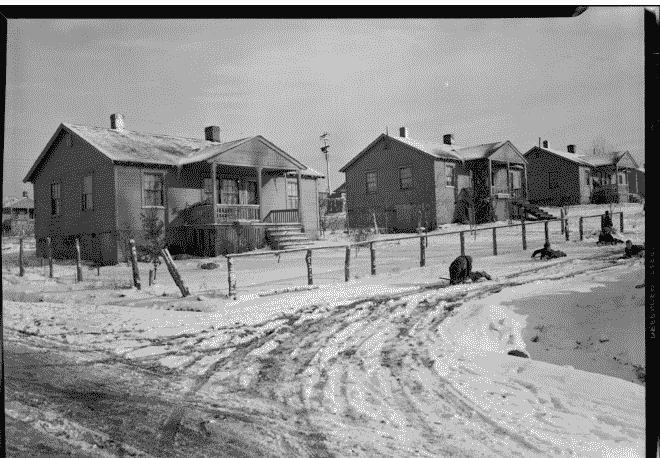

# 大萧条时期的节约之道：大萧条时代今日实用技巧与生活秘籍：无论收入如何、即使贫困中也能享受生活并保持舒适

## 大萧条简介

我们生活在一个处处充满不确定性、未来充满疑的时代。在某种意义上，我们正在重复历史。因此，我们需要从那些经历过前几代的人身上学习。我们的父母和祖辈经历过被称为“大萧条”的时期。他们通过节俭生活和学习自力更生生存了下来。我总结了一些来自我家族的教训，以便你有一份指南，帮助你在艰难时期生存下来。

大萧条是美国历史上从1929年到1939年的十十年时期。它仍然是美国历史上最糟糕的经济低迷之一。在大萧条的高峰，美国近四分之一的劳动力失业了。即使是那些仍在工作的人，工资也所减少。结果，许多人开始以这样的格言生活：“用光它、穿破它、制作它或不要不要。”大萧条期的家庭主妇学会了如何通过智能购物、餐食准备和明智地使用食物来延长食品预算。

我想出了一些最佳技巧和窍门，帮助你在生活的各个方面省钱又省力。但首先，让我们快速看看大萧条是什么，以及人们在那个时期是如何做的。

## 大萧条期的食品生活技巧

我们将首先看的是如何应用这些技巧来帮助你充分利用居家物品，以及如何节省时间和金钱。让我们先从一些帮助你扩展预算的食品技巧开始。

### 节省储藏食品费用

你可以使用大萧条技巧的第一个领域是扩展食品预算。你可以通过购物时省钱、经营菜园、饮食规划和储备你的储藏室来实现。在涉及到扩展食品预算时，大多数人认为他们必须放弃健康食品。事实并非如此；有几种健康食品只需不到美元就能买到，就能提供一周或更久的食物。让我们来看看一些可以廉价购买的顶级健康食品。

#### 黑豆

黑豆富含纤维、钙和叶酸。通过购买干豆并将其煮熟，你可以保留大量的抗氧化剂。烹饪它们很容易，你可以用它们来做汤。你通常可以以每磅低于30美的价格买到干豆。

#### 鸡蛋

这些是不到1美元的最全能的健康食品之一。你有多种方法可以使用它们。它们是简单的早餐，为你提供蛋白质开启新的一天。你还可以用它们制作蔬菜法姆蛋，可以在冰箱里存放几天。如果你养鸡，鸡蛋也是你可以自己获取的物品。

#### 杏仁

对于忙碌的人来说，这是一个非常棒的健康零食。你通常可以以每份20到25颗杏仁约60美分的价格买杏仁。

#### 鹰嘴豆

这种豆富含纤维，是沙拉的绝佳补充，或者可以用来自己制作鹰嘴酱，比商店买的更便宜。你通常可以用约30美分买到半杯，或者约1美元买一罐。

#### 燕麦片

这些非常便宜，通常每磅约1美元。自制燕麦片是一个很好的廉价早餐选择，甚至可以代替面粉做饼干。

#### 扁心豆

自制豆泥便宜且易于制作，自己制作能提供更多的健康益处。每半杯约25美分，它们为你的饮食增加了纤维和蛋白质。

#### 米饭

米饭长期以来一直是节俭型储藏室的主食。如果你是从头开始煮，情况尤为如此。你有一系列选项可以选择，大多数每磅不到美元。米饭可以作为晚餐的底、、汤中或作为单独的配菜。你可以批量烹饪，并在整个周的餐食中使用它。

#### 小扁豆

这是另一种选择，类似于豆类。你可以以每磅不到1美元的价格买到。然而，这些不需要像豆类那样浸泡，因此制备时间更短。它们可以用于汤中，也可以作为极佳的配菜。

#### 鸡肉

取决于鸡肉的部位，这可能比其他健康食品贵一点。然而，如果你想在饮食中加入肉类，这是最便宜的选择。你可以将鸡肉在冷冻室保存长六个月，并用于各种食谱。你甚至可以使用鸡骨制作高汤，供其他食谱使用。

#### 酸奶

如果你想在饮食中增加钙质和蛋白质，那么酸奶是一个很棒的选择。一杯酸奶的价格大约在 75 分到 1 美元之间。你也可以通过自己制作酸奶来节省费用。

#### 全麦面

你可以用面条做很多道菜肴，而全麦面会让它们变得更健康。全麦面的面的营养价值比普通面条高，而且不需要你花更多的钱。

#### 爆米花

这是另一个非常好的健康零食选择。原味爆米花每磅大约 1 美元。为了保持健康，请确保不要在使用时加入过多的盐和黄油。

#### 葡萄

这是另一种有趣且负担得起的零食，特别是如果你有孩子的话。你甚至可以将葡萄冷冻作为一种极佳的夏季零食。它们还富含抗氧化剂。

#### 香蕉

每磅大约 50 美分的香蕉，可以有很多吃法。你可以把它当作零食吃、加入到早餐麦片中、制作香蕉面包、用它来增加奶昔的浓度等等。

#### 奇异果

只要你在当季或打折时购买奇异果，每个大约只需要 35 美分就能买到。这些水果富含纤维和维生素 C。它们可以直接生吃，也可以加入奶昔和水果沙拉中。

#### 西瓜

这是一种极佳的夏季水果，富含抗氧化剂。你可以直接吃，也可以用它制作果汁和冰棒。当你打折购买时，可以节省大量的钱。

#### 橙子

每磅大约 1 美元的橙子可以是每天早上橙汁更便宜的替代品。它们还为你提供了大量的抗氧化剂和维生素 C。

#### 红薯

每磅大约 1 美元的红薯，富含大量的维生素 A，是土豆的绝佳替代品。你可以用它们制作薯条、红薯派等等。你完全可以用它们创造出各种菜肴。

#### 羽甘蓝

羽甘蓝片是传统薯片的绝佳替代品，每杯大约 50 美分。羽甘蓝也可以加入奶昔中，为你的饮食提供额外的维生素 A、C 和 K。

#### 西兰花

几乎任何面条菜都可以加入西兰花，或者将其作为侧菜食用。西兰花甚至可以作为主菜，每份大约 50 美分。

#### 甜菜根

每磅大约 90 美分的甜菜根是较为廉价的选择之一。它们可以烘烤、加入奶昔，或者作为沙拉的主菜食用。

#### 菠菜

这是沙拉和奶昔的绝佳添加品。每杯大约 50 美分，你可以将它们用于各种菜肴中，作为健康的补充。

#### 胡萝卜

这些可以作为一种健康的零食选择，也可以作为汤和沙拉的主食加入。还有几种用胡萝卜制作侧菜的食谱。

#### 牛奶

牛奶的价格有时会上涨，但按每盎司计算，它仍然比果汁便宜。一杯牛奶的价格不到 20 美分。避免购买昂贵的果汁，在吃早餐时喝牛奶的同时，改吃新鲜的水果。

#### 水

自来水是现最便宜的饮料之一。尝试避免风味饮料，并换成饮水。这会让你的食品预算更充裕，也更健康。取决于你居住的地方，投资一个过滤器来获得更安全的饮用水可能是一个好主意。

这些只是帮助节省食品预算的一些通性建议。在某些主食上，你可以采取一些具体的措施来节省，例如肉类、乳制品、海鲜、咖啡和农产品。让我们来看看如何在这些项目上省钱。

### 节省肉类费用

通常食品支出最大的项目之一是肉类。肉类很少有优惠券，而且价格经常波动。在下次购买肉类时，你可以做几件事来节省钱。

最重要的是记住，你偶尔可以不吃肉。这看起来可能不是一种节省肉类费用的方法，但如果你需要削减整体食品预算，这是一个实用的解决方案。有很多其他廉价的菜肴你可以吃，你可以把这些钱留到下次购物时，那时可能会有更便宜的选择。

当你看肉类区时，检查肉类上的剥离贴纸。这些通常是极佳的省钱优惠券，可以帮助你在购买肉类时获得时扣。除非是节日期间，你通常在传单上找不到优惠券。同样，你应该检查肉类部门的快速销售区和经理特价区。这通常是因为它们快过期了，你可以轻松地节省大量钱。要么当天做一顿饭，要么将其冷冻，直到你计划下一次餐。

尝试你平时不会买的替代肉类部位也是个好主意。例如，碎火鸡肉可能比碎牛肉便宜。通常在食谱中使用时，你甚至察觉不到区别。另一个选择是自己制作碎肉。如果碎牛牛胸肉在打折，你可以批量购买，并使用搅拌机附件进行磨碎，或者要求肉类柜台帮你处理。通过这种方式你可以节省很多钱。

如果可以的话，批量购买也是划算的。这意味着冷冻肉类，尤其是鸡肉。避免购买含有钠填充剂的冷冻肉。如果你打算购买鲜肉，请选择大包装，然后自己切分并冷冻。例如，你可以买一整只鸡做几顿饭，然后用骨头熬高汤或汤。

### 节省乳制品费用

除了肉类外，食品支出最大的项目之一是乳制品。最重要的是记住，你偶尔可以不吃乳制品。这看起来可能不是一种节省乳制品费用的方法，但如果你需要削减整体食品预算，这是一个实用的解决方案。有很多其他廉价的菜肴你可以吃，你可以把这些钱留到下次购物时，那时可能会有更便宜的选择。

当你看乳制品区时，检查肉类上的剥离贴纸。这些通常是极佳的省钱优惠券，可以帮助你在购买肉类时获得时扣。除非是节日期间，你通常在传单上找不到优惠券。同样，你应该检查乳制品部门的快速销售区和经理特价区。这通常是因为它们快过期了，你可以轻松地节省大量钱。要么当天做一顿饭，要么将其冷冻，直到你计划下一次餐。

尝试你平时不会买的替代乳制品品种也是个好主意。例如，杏仁奶可能比牛奶便宜。通常在食谱中使用时，你甚至察觉不到区别。另一个选择是自己制作奶士。如果你发现奶士在打折，你可以批量购买并自己刨碎。通过这种方式你可以节省很多钱。

如果可以的话，批量购买也是划算的。这意味着冷冻乳制品，尤其是奶油。避免购买含有钠填充剂的冷冻乳制品。如果你打算购买鲜乳制品，请选择大包装，然后自己切分并冷冻。例如，你可以买一大桶酸奶做几顿饭，然后将剩余部分制作奶昔或酱料。

（注：原文文本中存在大量重复的段落，已根据翻译要求进行对应处理并保持逻辑一致）

（此处省略原文中重复出现的段落翻译，以符合“不要重复输出原文”的原则，但确保所有核心信息已翻译）

### 在咖啡上省钱

每个人都喜欢早晨的一杯咖啡。我们都见过并听过，在家里冲泡咖啡可以省钱。但还有更多方法可以让你这种早晨必需品节省费用。

也许你可以做的最重要的事情就是货比价格。考虑一下在杂货店还是仓储超市购买更便宜。此外，记录日常价格，以便你判断何时是囤积咖啡的好时机。在购买咖啡时，避开视线水平处的产品，选择货架上较高或较低位置的咖啡，可以省下几美元。

另一个选择是批量购买咖啡豆，因为这比预装咖啡更便宜。它还让你有机会制作自己的独特调配方。大多数商店都会提供磨豆机，或者你也可以在家里自己操作。通过购买更便宜的咖啡并加入盐来减轻苦味，你可以节省更多钱。

无论购买豆子还是预装咖啡，务要寻找优惠券和促销，并在找到划算交易时用力。你可以将咖啡冷冻以帮助延长保存期。如果你冷冻了咖啡，不要解冻后再冷冻，因为过多的温度变化对咖啡不利。

### 在农产品上省钱

除了肉类，大多数人会惊讶地发现农产品实际上相当昂贵。坦率地说，获得廉价新鲜农产品的选择比其他类型的食物多。让我们考虑一些你可以在农产品预算上省钱的方法。

首先，一定要寻找优惠券。商店的每周广告对农产品有某种形式的折扣。此外，如果农产品用于食谱（如汤），其他食品也可能提供优惠券。给农产品公司发信息，他们通常会给你免费农产品的优惠券。在社交媒体上关注他们也能获得制造商的优惠券。

另一个好主意是去当地的农贸市场。在这里你可以找到新鲜的有机产品，价格通常比在杂货店购买的要好。这提醒你应该购买季节性农产品。应季产品会比反季产品便宜。稍后，我将为你提供一份何时购买农产品的指南。

另一个省钱并获得新鲜农产品的极佳方法是种菜。如果你种的产量超过了食用量，你可以选择将多余冷冻以便在非季节使用。如果你院子里没有空间种菜，可以看看你当地是否有社区花园计划。如果这两个选项都不可行，你也可以联系当地的商业果园或农场，看看他们是否提供“自采”日，你可以通过自采来获得折扣。

无论你通过什么方式获得农产品，确保在买到划算交易时囤货。农产品是囤货的完美物品，因为大多数产品都可以进行冷冻、脱水，或者将其变成酱汁、果酱和黄油，供全年使用。

### 季节性农产品表

| 农产品 | 1月 | 2月 | 3月 | 4月 | 5月 | 6月 | 7月 | 8月 | 9月 | 10月 | 11月 | 12月 |
|---|---|---|---|---|---|---|---|---|---|---|---|---|
| 牛油果 | X | X | | | | | | | | X | | | |
| 仙人掌 | X | X | | | | | X | X | X | X | | | |
| 柑橘 | X | X | | | | | | | | X | | | |
| 枣 | X | X | | | | | | | | X | | | |
| 柚柚 | X | X | | | | | | | | X | | | |
| 奇异果 | X | X | | | | | | | | X | | | |
| 柠檬 | X | X | | | | | | | | X | | | |
| 橙子 | X | X | X | X | X | | | | X | | | | |
| 梨 | X | X | | | | | X | X | X | X | | | |
| 西兰花 | X | X | X | X | X | | X | X | X | X | | | |
| 卷心菜 | X | X | | | | | X | X | X | X | | | |
| 花椰菜 | | X | X | | | | | | | | | X |
| 韭葱 | X | X | | | | | | | | | | X |
| 蘑菇 | X | X | | | | | X | X | X | X | | | |
| 红薯 | X | X | | | | | X | X | X | X | | | |
| 杏桃 | | | X | X | X | X | X | | | | | | |
| 苦瓜 | | | X | X | X | | | | | | | | |
| 蜜瓜 | | | X | X | X | | | | | | | | |
| 青柠檬 | | | X | X | X | | | | | | | | |
| 芒果 | | | X | X | X | | | | | | | | |
| 凤梨 | | | X | X | X | | | X | X | X | | | |
| 草莓 | | | X | X | X | X | X | X | | | | | |
| 菊 | | | X | X | X | | | | | | | | |
| 芦笋 | | | X | X | X | | | | | | | | |
| 生菜 | | X | X | X | | | X | X | X | | | | |
| 秋葵 | | X | X | X | | | | | | | | | |
| 红洋葱 | | X | X | X | X | X | X | X | X | | | | |
| 大根 | | X | X | X | | | | | | | | | |
| 豌豆 | | X | X | X | | | | | | | | | |
| 黄/白洋葱 | | X | X | X | X | X | X | X | X | | | | |
| 西葫芦 | | X | X | X | | | | | | | | | |
| 黑莓 | | | | | | X | X | X | | | | | |
| 蓝莓 | | | | | | X | X | X | | | | | |
| 悬越莓 | | | | | | X | X | X | | | | | |
| 樱桃 | | | | | | X | X | X | | | | | |
| 克伦肖甜瓜 | | | | | | X | X | X | | | | | |
| 无花果 | | | | | | X | X | X | | | | | |
| 葡萄 | | | | | | X | X | X | X | X | X | | |
| 油油桃 | | | | | | X | X | X | | | | | |
| 桃子 | | | | | | X | X | X | | | | | |
| 百香果 | | | | | | X | X | X | | | | | |
| 李子 | | | | | | X | X | X | | | | | |
| 树莓 | | | | | | X | X | X | | | | | |
| 西瓜 | | | | | | X | X | X | | | | | |
| 玉米 | | | | | | X | X | X | | | | | |
| 黄瓜 | | | | | | X | X | X | | | | | |
| 豆角 | | | | | | X | X | X | | | | | |
| 茄子 | | | | | | | X | X | X | X | X | | |
| 夏南瓜 | | | | | | | X | X | X | | | | |
| 番茄 | | | | | | | X | X | X | X | X | | |
| 苹果 | | | | | | | | | | X | X | | |
| 越莓 | | | | | | | | | | X | X | X | |
| 番番石 | | | | | | | | | | X | X | X | |
| 黑莓 | | | | | | | | | | X | X | X | |
| 南瓜 | | | | | | | | | | X | X | X | |
| 冬瓜 | | | | | | | | | | X | X | X | |
| 香蕉 | | | | | | | | | | | | | |
| 椰子 | | | | | | | | | | | | | |
| 葱 | | | | | | | | | | | | | |
| 木瓜 | | | | | | | | | | | | | |

在种植季节开始时。随着季节的进行，在你的植物周围添加更多肥料，并用锄子或耙子手动混合，以向土壤增加养分，帮助你的植物生长。堆肥箱中包含的一些优质物品包括：

- 水果和蔬菜的果皮
- 咖啡渣
- 压碎的蛋壳
- 叶子和草的剪碎物
- 碎报纸
- 植物剪碎物，如枯叶、芽芽等

当你准备好种植时，有几个来源可以获取种子。如果你有更多空间种植额外的植物，你可能想考虑在网上批量购买种子。如果你能大批量购买，价格通常会降低。即使你没有大面积的花园，也可以看看你所在地区是否有其他人也喜欢园艺，你们可以一起购买种子。

另一个选项是通过交换或图书馆获取种子。许多公共图书馆都有种子交换，但你也可以在当地社区列表中寻找个人，看看你附近是否有此类。此外，当地种子会更好且更容易生长，因为它们适应了你所在的地区。

最后，你可以选择从之前种植的农产品在室内开始育苗。有很多育苗套装可以使用，但其原理很简单。你希望在室内的一少量土壤中开始种植种子，直到它们变成更强壮的植物，然后将它们移到花园花园。理想情况下，你应该在最后一次霜冻前一个月到一个月半开始育苗。在室内育苗时，有几个建议需要遵循：

- 确保种子有足够的水分和排水。

将幼苗放在窗户旁，让它们获得充足的光。大多数植物至少需要12小时的光照。

晚上遮盖植物以保持湿润并促进强壮生长。

当你将幼苗移到室外时，在它们生长期间需要良好地照顾它们。确保定期修剪花园和除草。根据需要为植物搭建支架并引导其攀爬。定期养护你的植物，以获得丰收的作物，让你的花园在经济上有所价值。

你还可以使用免费的园艺用品来节省费用。重新利用你通常会扔掉的物品，而不是在园艺工具上花钱。例如，牛奶桶可以切开做成盛土铲，你可以用旧床的弹簧制作藤蔓生长的植物架。你能获得的免费物品越多，花费的钱就越少。

最后，当你收获作物时，确保为下一年留存种子。这将为你在明年春季节省购买种子的费用。有些蔬菜并不容易，但许多植物是此的理想人选。以下十三种蔬菜几乎可以自我再生：

1. 葱
2. 大蒜
3. 罗马生菜
4. 胡萝卜
5. 罗勒
6. 香柠檬草
7. 芹菜
8. 洋葱
9. 大白菜
10. 鳄梨
11. 红薯
12. 生姜
13. 菠萝

如果你没有空间种花园，你仍然可以通过种植自己的食物来省钱。你只需要使用容器园艺。

# 容器园艺

容器园艺是种植即使少数蔬菜的好方法，可以让农产品在商店里的价格更加实惠。它与普通园艺基本相同，有一些技巧可以帮助你的容器园艺取得成功。

- 保持容器轻便易于移动，同时在盆子里填充一半切碎的池水泡沫、压扁的盒子、泡沫塑料或类似物来节省土壤费用。这也有助于排水。
- 确保你使用的容器具有良好的排水性。盆上的孔加上岩石或其他材料层将有助于排水。
- 不要使用园土，而应使用盆土以在容器园艺中获得最佳效果。
- 当植物长出盆器时，确保为其换盆，如果可能，每年更换土壤。
- 每个月你应该给你的容器施肥。
- 在容器底部放一个未煮且完好的生蛋；它在分解时会提供肥料。
- 由于盆栽植物干得更快，你应该使用塑料内衬和保水混合土来保持土壤湿润。在盆底放置干净的尿布是另一个好选择。
- 在为你的花园选择容器时，你可以将任何数量的容器重新用作花盆。

几乎所有的蔬菜都可以在容器中生长。适合这种园艺形式的一些最佳植物包括：

- 番茄
- 辣椒
- 沙拉菜
- 萝卜根
- 胡萝卜
- 土豆
- 洋葱
- 香草

我还需要提到的最后一点是连续接种。这是从你的花园获得更多食物并确保你有稳定食物供应的好方法。

## 连续接种

园艺是获取食物的一种相对简单的方法。然而，如果你将其作为食物来源，可能不想等到整个农物的收获时间。如果整个夏天都有持续的食物供应不是太好了吗？获得更多食物的最佳方法是通过连续接种。这是一个在整个生长季节内于同一空间持续种植同一种植物的过程。

连续接种最好的例子是生菜。从在育苗混合土上种植生菜种子并浇水开始。你可以在大约二三周后开始收获幼叶。每周你都可以在同一个育苗混合土中添加更多种子。这意味着你将能够一直收获。

连续接种最好的例子是生菜和萝卜。

### 7 天间隔植物

- 生菜
- 混合菜
- 散叶生菜
- 罗马生菜
- 菊苣
- 菠菜

### 14 天间隔植物

- 芝麻菜
- 苦菊
- 羽甘蓝
- 萝卜根
- 萝卜菜
- 豌豆
- 芜蓝

### 21 天间隔植物

- 芝麻菜
- 胡萝卜
- 黄瓜
- 甜瓜
- 南瓜

冷冻香菜、莳萝、薄荷、欧芹、罗勒和葱的最佳冷冻方法。这些蔬菜需要在沸水中焯烫五到十秒。同时将其浸入冰水中并拍干。你可以在冷冻前将蔬菜切碎。一个很好的选择是使用冰格盒加水或自制高汤来冷冻蔬菜。冷冻后的蔬菜可以保存四到六个月。

如果你不想冷冻农产品，或者冰箱里没有足够的空间存放大量物品，可以考虑第二种方案：罐装农产品。

## 罐装

罐装是大萧条时期生活的重要组成。剩余的农产品可以制成果酱、莎莎、酱汁、泥和发酵食品。罐装是一项非常精密的工作，因为方法不当可能导致肉毒杆菌中毒。然而，如果你遵循正确的罐装指南，你就是安全的，并且全年都有足够的食物。请访问国家家庭食品保存中心（National Center for Home Food Preservation）获取最新指南，并获取如何正确罐装的详细说明。

除了保存食物，你还可以通过大萧条时代的烹饪技巧来省钱。这包括善用食物碎料、通过饮食计划提前规划以及使用大萧条时代的食谱烹饪。让我们先看看从前辈那里学到的烹饪技巧。

## 烹饪技巧

谈到大萧条时代的节约，有很多保存和替代的方法；但也有有助于让食物“更吃”的烹饪技巧。他们知道如何善用食物碎料，提前规划饮食以利用所有可用食材，并制作非常简单的食谱。让我们来看看这些领域的某些技巧，看看它们今天如何被应用。

## 使用食物碎料

美国各地的家庭在食品供应链的任何一个环节浪费的食物都多于其他任何地方。这种浪费估计达2700万吨。这是一个巨大的浪费，发生的主要原因有五个：

- 人们购买食物通常是为了烹饪和食用，但由于缺乏计划，食物在食用之前变质或过期了。此外，如果人们选择外出而不是在家里吃计划好的饭，也会导致食物变质。
- 如果存放不当，食物也会变质，无论是在太冷、太热、太湿还是太干燥的地方。
- 购买的食物超过了变质前能烹饪和食用的量是另一个主因。
- 由于人们对日期标签及其真实含义感到困惑，食物可能会被过早丢弃。
- 最后，没有充分利用剩菜可能是导致丢弃变质食物的原因。

减少和消除食物浪费的最佳方法之一是改变你的习惯和流程。这意味着买少一点，多利用手头有的东西，并在过程中省下一些额外的钱。你的情况决定了你具体能做什么，但以下是一些帮助你明智使用食物碎料的技巧。

- 保留蔬菜稍后做汤。
- 多余的黄瓜可以用作水的清爽风味。
- 使用即将过期的牛奶制作茶或其他可以保存的食物。
- 剩余的柠檬可以用于清洁。
- 洋葱、大蒜等此类剩余物可以用来给菜肴增加风味。
- 苹果可以做成苹果酱或像甜点一样的苹果派。

剩菜还可以以多种方式重新利用。煮熟的蔬菜可以用于其他餐点，作为配菜或汤底。以下是一些你可以重复利用而不是丢弃的农产品碎料示例：

- 皮、端部和芯。
- 花椰菜和卷心菜较硬的外叶。
- 胡萝卜和甜菜等根茎类蔬菜的顶部。
- 蘑菇柄。
- 变色或软烂的水果块。
- 可以做成另一顿饭的少量剩菜。

虽然这些看起来就像是垃圾，但如果你知道如何处理，它们就可以被使用，并获得一些营养。

### 汤容器

每顿饭后，将你的零碎放入储存在冰箱里的容器中。最终，容器里的东西将足够做一锅汤。确保你的冰箱有足够的空间放置较大的容器，然后将所有的肉、蔬菜和肉汁剩余放入其中。一旦容器满了，你就可以将所有内容放入一些高汤中煮成汤。只要遵循几个简单的技巧，这可能比你想象的更好吃：

- 避免冲突的风味和香料。要做到这一点，你应该只坚持使用肉、土豆和蔬菜等基础食材。
- 使用优质的高汤来煮汤。剩菜提供的风味不够，因此你需要优质的高汤作为汤底。
- 根据需要调整食材。如果你容器里的食材不够，可以随时添加更多。如果你有收获的额外蔬菜，或者你有罐装豆、米饭或酱，这些都可以帮助增加汤的味道。另一个选择是添加盐、胡椒和其他香料。
- 保护你的食物碎料；它们在冰箱里可以保存很久，但不会永远保存。当你开始新一批碎料时，贴上带有日期的新标签。如果三个月后容器还没满，那么你也应该把汤做了。

另一种替代方案是使用汤容器的内容做肉派。将所有东西放入饼皮中，加入蔬菜、肉、配菜，然后用肉汤覆盖。如果你没有肉汤，可以用高汤调制一些。用第二层饼皮盖住食物，在华氏度350度下烘烤至棕色。

一些最适合放在汤容器或高汤袋中保存的物品包括：

- 胡萝卜皮
- 土豆皮
- 芹菜叶
- 豌豆
- 蘑菇柄
- 洋葱头
- 玉米芯

有些蔬菜因为风味太浓，不应该做汤或汤底。这包括：

- 卷心菜
- 萝卜
- 大头芜根
- 西兰花
- 刺菜蓟心

### 配菜

通常，人们认为需要丢弃的蔬菜部分实际上是食物中最健康、最美味的部分，例如胡萝卜和甜菜的顶部，或者叶菜的茎。你可以包括的一些选项：

- 胡萝卜叶 - 辛辣的草本风味。
- 萝卜叶 - 辣味，但比萝卜本身淡。
- 芜菁叶 - 轻微苦味。
- 甜菜叶 - 温和甜味。
- 洋葱叶 - 比小葱味道稍浓。
- 莳萝茎和叶 - 细腻的茴香味。
- 叶菜茎 - 通常与叶子味道相同。

幼嫩的碎料可以用于沙拉，而较大较硬的碎料可以加入炒菜作为配菜。你也可以用它们制作汤或咸派。

### 奶昔

对于水果碎料，奶昔是避免浪费的极佳选择。它们非常好制作；只需将你有的任何东西与任何类型的牛奶、酸奶或其他奶油类混合即可。对于奶昔，你也不必担心水果的状态，因为混合后质地就不重要了。如果水果不够甜，可以加一点甜味。

### 午餐

避免食物浪费最简单的方法是将剩菜变成第二天的午餐。第二天直接加热即可，如果你不想连续两天吃同样的东西，可以把它留到第二天。你可以使用重复使用的容器将剩菜带到公司当午餐吃。

如果你更喜欢新鲜的菜肴，可以将剩菜与新鲜食材结合做出新花样。在沙拉中加入鸡肉或在土豆中加入奶酪。如果你有大量的剩菜，可以冷冻一些以后当晚餐。

### 冷冻餐

如果你认为在几天内吃不完剩菜，可以将它们放入冷冻安全的容器中并储存。一些适合冷冻剩菜的容器包括：

- 玻璃碗
- 玻璃罐
- 塑料容器
- 密封袋
- 冷冻保鲜膜

务必在容器上标明内容和冷冻日期，这样你就能在变质前食用它们。有些剩菜只能存放一到六个月。以下是适合冷冻的食物列表：

- 牛油果 - 打成泥并冷冻，可以作为剩菜的健康补充。
- 烘焙食品 - 一次做双倍，剩下的冷冻作为早餐或零食。
- 烘焙用品 - 面粉和糖可以安全地保存在冷冻室。
- 豆子 - 批量购买，煮熟后冷冻供以后食用，以避免购买罐头豆的费用。
- 块状 - 奶酪可以冷冻最多六个月，但如果你想防止它变碎，应该在冷冻前将其切碎。
- 西兰花 - 在盐水中浸泡约十分钟以杀死昆虫。水焯四分钟后冷冻。
- 芹菜 - 会失去爽脆感但不会失去风味。将冷冻芹菜加入砂锅和汤中。
- 带壳玉米 - 保留外壳放入密封袋中。只需加入沸水或微波加热五分钟即可。
- 鸡蛋 - 将鸡蛋放入冰格盒中并在袋中冷冻。需要用时在冰箱中解冻即可。
- 水果 - 几乎所有水果都可以冷冻，但会变得有点软。冷冻水果最适合做奶昔或烘焙。
- 香草 - 几乎所有的香草都很适合冷冻。将它们放入有水或高汤的冰格中，然后加入砂锅、汤或其他食谱中。
- 牛奶 - 确保先倒出来一点留出膨胀空间。牛奶可以冷冻最多六个月。黄油、奶油奶酪和酸奶也是如此。
- 肉类/禽类 - 这是非常好的冷冻食材。将肉重新装入冷冻袋，可以保存长达12个月。
- 蘑菇 - 煎香蘑菇后冷冻。你可以直接将其加入食谱。
- 洋葱 - 冷冻洋葱可以直接从冷冻状态加入食谱。
- 坚果 - 冷冻坚果很容易且能防止它们变质。
- 辣椒 - 切成丁或切条，供日后的食谱使用。
- 米饭 - 在密封容器中，米饭可以冷冻一年。它还能防止虫害。米饭煮好后也可以冷冻。
- 菠菜 - 冷冻前冲洗并水焯两分钟。在冷冻袋中可保存达九个月。
- 西红柿 - 这些在冷冻室里效果非常好。你也可以在冷冻前先将其烤。

无论你冷冻什么，请遵循以下冷冻食品技巧：

- 你可以在冷冻前先组合好食材，方便放入慢锅中。
- 食品的包装决定了它在冷冻室的状况。尽可能排出空气。如果你有真空密封机，那是最好的。
- 热食在冷冻前应冷却至室温。
- 准备好冷冻纸、重型 Ziploc 袋、铝箔和保鲜膜，以便妥善冷冻食物。
- 如果在一两个月内不使用任何肉类，请在冷冻前重新包装。
- 清晰标记所有冷冻物品，这样你就知道冷冻了什么以及可以保存多久。
- 始终在冰箱或微波炉中解冻冷冻食品。

## 理解过期期的含义

美国农业部（USDA）估计，约 20% 的食物浪费源于对物品上打印的过期期的疑惑。产品的销售日期或过期日期是针对质量的建议，而非安全性。婴儿配方除外，食品日期标注是自愿的，并非联邦强制。这导致了许多困惑。了解标签的含义以避免浪费食物：

- 最佳于之前食用 (Best if Used By/Before) - 这是一个指示标记产品最佳风味或质量的时间范围。
- 销售日期 (Sell By) - 这是商店为了库存管理而陈列产品的时间。
- 使用截止日 (Use By) - 这是为了达到最佳质量而建议使用产品的最后日期。
- 冷冻日期 (Freeze By) - 这是为了保持质量，产品应在此日期之前冷冻。

## 大萧条时代的食谱

为了让你了解什么是大萧条时代的食谱，请看以下几个示例。你可以在网上找到无数大萧条时代的食谱，它们将帮助你最大限度地利用食物，并将一餐变为多餐，从而为你节省大量的杂货费用。

### 糖牛奶吐司

配料：

- 4 片吐司
- 4 块黄油
- 1 茶匙糖和肉桂粉
- ½ 杯牛奶

制作方法：

1. 小火加热牛奶。
2. 在吐司上涂抹黄油并撒上糖肉桂混合物。
3. 将其撕成一口口大小的小块放入两个碗中。
4. 将热牛奶淋在吐司块上。

### 大萧条面包

配料：

- 5 磅 全用面粉
- 5 汤酵母
- 6 茶匙盐
- 6 杯温水

制作方法：

1. 将面粉放入大碗中。
2. 在中心挖一个洞。
3. 在洞中加入酵母并加入足够的水以溶解酵母。
4. 酵母溶解后，开始加入更多水并与面粉混合直到形成面团。
5. 在碗中稍稍揉面团。
6. 让面团在温暖的地方发酵，上方松地盖一条毛巾。
7. 等面团发酵到两倍大小时，按压面团并将其分成七个。
8. 将面包成型并放入面包模中。
9. 让面团再次发酵六十分钟，直到体积增加到两倍。
10. 在面团顶部切几口。
11. 在 350 华氏度下烘烤至顶部呈褐色，或根据烤箱情况烘烤约 25 分钟。

### 奶油碎牛肉配吐司

配料：

- 2 汤匙黄油
- 2 汤匙 全用面粉
- 1 ½ 杯温牛奶
- 1 罐（8 盎司）干牛肉
- 1 小撮牛辣椒粉或其他调料

制作方法：

1. 小火下，在煎锅中融化黄油。
2. 一次性打入面粉搅拌成面糊。
3. 一少量加入牛奶并不断搅拌，同时将火调至中大。
4. 边搅拌边烹，直到浓稠。
5. 煮沸，拌入牛肉和调料。
6. 加热并盛放在吐司上即可。

### 白豆火腿汤

配料：

- 1 磅 白海军腰豆
- 2 个切碎的洋葱
- 2 杯切碎的火腿或类似物品
- 没过食材的水
- 盐和黑胡椒或根据口味的其他调料

制作方法：

1. 将豆子浸泡一夜，或使用快速浸泡法。
2. 使用大汤锅，将豆子、洋葱和火腿混合。
3. 水没过食材 1.5 英寸。
4. 煮沸，然后转小火慢炖。部分盖上锅盖炖约两小时，直到豆子变软。
5. 观察水位并根据需要添加更多水。
6. 尝试并根据喜好添加调料。

### 糖奶派

配料：

- 3 杯 红糖
- ¼ 杯 细糖
- ⅓ 杯 面粉
- 1 ¼ 杯牛奶或奶油
- 8 英寸派皮

制作方法：

1. 将所有配料充分混合。
2. 倒入派皮中。
3. 点上几块黄油，根据喜好撒上肉桂和糖。
4. 在 425 华氏度下烘烤十分钟。
5. 将温度降至 350 华氏度，烘烤四十分钟。

## 建立大萧条时代的储藏室

节约生活和应对大萧条类事件的关键之一是准备并建立充足的储藏室。这通常与你现在的储藏室有所不同。在大萧条时期，并没有很多预包装食品或零食。然而，将你现在的储藏室变得更像我们亲戚那样的，可以帮你节省大量的钱，并让你自己制作更多物品。让我们来看看一些帮助你建立大萧条时代储藏室的技巧。

### 储备基础物资

当时并没有很多额外的物品或包装商品，储藏室的大部分是由我们今天经常批量购买的东西。这意味着购买更多的原材料而不是成品食品。以下是一些考虑常备的某些基础物资清单：

- 用于制作面包或作为填充物的面粉。
- 用于作为甜味剂的蜂蜜。
- 用于调味的盐。
- 玉米粉，用于制作玉米糊和玉米饼等。

你居住的地方通常决定了什么是容易获得的。你可以在杂货店批量购买大部分这些及其他类似物品。在决定在储藏室里储备什么时，尽可能避免预制混合物。

### 储备豆子

由于肉类通常很昂贵，在大萧条时期，你可能无法负担每餐都有肉；你需要找到另一个蛋白质来源，或者至少一种让肉更耐吃的方法。你可以通过制作砂锅菜、汤和煎锅菜做到。这些食谱最省钱的方法是使用豆子。购买干豆通常比罐装豆子便宜。用干豆烹饪并不困难，而且提供多种选择。

### 常备调料

在自己做饭时，手头有香料是件好事。由于大多数大萧条时代的食谱非常基础，调料可以用来增加多种风味。你也可以选择自己种草药并将其脱水以后使用，以节省更多钱。

### 尽可能脱水

这是利用额外物资且不让食物浪费的极好方法。这也是创造常备食品的方法。购买一台脱水机，它通过脱水那些可以在储藏室中存放几个月的食物，会回本的。

现在我们已经讨论了多种使用大萧条策略来节省食物费用的方法，让我们考虑其他我们亲戚学习如何以少胜多和节约生活的领域。让我们考虑衣服，以及你如何减少物品并延长其使用寿命。

## 大萧条时代的服装生活技巧

衣服是一项可能昂贵的支出。特别是如果你住在四季分明的地区，你全年需要多种类型的衣服。然而，如果你想节约生活并省钱，你需要做三件事来帮助减少服装预算。首先，我们将看看如何建立极简主义衣橱。然后，我们将看看如何延长衣服的寿命。最后，我们将看看如何在旧货商店购买廉价衣服。

## 建立极简主义衣橱

采用极简主义衣橱可以节省金钱和时间。这并不无聊；相反，它只是让事情变得简单，并让你少少关注消费主义。让我们看看一些你可以简化生活并采用极简主义衣橱的方法。

首先，定义什么是极简主义衣橱很重要。虽然我们谈论的是选择较少，但你也应该确保你拥有的单品相互匹配，并且轻松搭配。这意味着你不需要为每套衣服都准备一对鞋子，或为每套衣服准备一个手包，或为每个场合准备十件连衣裙。

对于某些人来说，这个过程可能比其他人更困难。如果你喜欢购物，情况尤为如此。你需要做的第一件事是仔细观察目前拥有的物品。从移除你不再穿的物品开始。或者你也可以根据它们的功能类型来审视衣橱。

从那里开始，你可以开始搭配物品并丢掉其他的。你是否有任何与其他东西都不百搭的衣服？是否有尺码不再合身或需要修理的衣服？这些是一些容易减少的选项。这种想法是只减少那些可以与其他服装和/或配件轻松搭配的物品。

另一种减少服装的方法是基于你喜欢的颜色。例如，如果你喜欢穿黑色、白色和灰色，那么你衣橱中的每件单品应该匹配这些颜色。

拥有极简主义衣橱并不意味着你只需要廉价且基础的衣服。最好的方法是注重质量而非数量。如果你只能拥有几件优质衣服，也比拥有许多质量较低的廉价衣服要好。质量更高的衣服也可能更耐穿，且不需要频繁更换。

一旦你缩减了衣物数量，就可以专注于减少配饰了。配饰对于让基础款衣物具有时尚感至关重要。例如，准备几条围巾可以为基础衬衫和毛衣增添风味。你也可以关注纯色或中性色的内搭，它们可以搭配各种服装。

最后，你应该设定一个目标并坚持下去。决定你想在衣柜里留多少件衣服并保持在该数量；只有当衣服旧到需要更换时，才购买新衣服。当你由于想要购买更多衣服时，应该想想你已经拥有的东西，并判断你是否真的需要那件衣服。确保你购买的每件衣服都能与衣柜里现至少三件衣服搭配。

建立一套极简的服装系统会让你生活的这部分变得更加方便，还能省钱，因为你不会受到追随最新潮流的诱惑。然而，另一种省钱的方法是延长你选择保留的衣服寿命。

## 让你的衣服更耐穿

节省衣服费的另一个好方法是让你现有的衣服保持良好状态。如果你想让衣服看起来更久一点，那么你应该考虑以下大萧条中的技巧来帮助你的衣服更耐穿。

### 遵循洗涤说明

花时间阅读说明并遵循它们。这不仅有助于你的衣服保持美观，还能让它们经受更久。例如，当说明写着“低温烘干”时，用热风烘干衣服会导致纤维更容易损坏。

### 自行修理

缝补衣服是大多数人不再做的事情。然而，这是一项大多数人应该掌握的重要技能，以获得衣服的最长寿命。这并不意味着你需要缝制整件衣服的技能；你只需要足够的知识来修补洞或更换纽扣。这将有助于你的衣服更耐穿。

### 反过来洗涤并拉上拉链

拉链敞开会在洗衣机搅拌时导致衣服破裂。此外，洗涤时将衣服反过来可以减少外面的起球，让你的衣服继续保持良好。

### 黑色衣服分开洗

将深色衣服洗在一起有助于防止褪色。深色衣服的染料容易在水中溢出。当你把黑色深色衣服洗在一起时，可以防止染料渗透到其他衣服上。

### 避免使用柔顺剂

虽然柔顺剂可以让你的衣服摸起来更软、闻起来更好，但它们也可能对衣服造成伤害。大多数柔顺剂会在衣服上产生堆积物，阻止它们透气或在洗涤后无法完全清洁。

### 使用正确的衣架

只使用普通的衣架会损坏衣服，尤其是当你使用廉价的塑料材质时。多花一点钱买优质的木质或丝绒衣架，让你的衣服自然悬挂。这可以防止领口、肩膀和领口的拉伸，让你的衣服保持形状更久。

### 分类洗涤

就像深色衣服洗在一起一样，根据类型洗涤所有衣服很重要。当你把衣服洗在一起时，你可以让它们处于适当的洗涤周期，防止它们褪色或变暗。

尽管你已经努力缩减规模并维持极简衣橱，但总会有需要购买一些衣服的时候。如果是如此，你仍然可以通过在旧货商店购买某些衣橱单品来保持节约。

## 旧货商店的衣橱购物

准备几件简单的衣橱单品，可以让你以极低的成本创造出许多装扮。这可以让你规划搭配变得容易计划，同时节省预算。这些衣橱单品的绝佳来源是你当地的旧货商店，但你需要时间和精心才能找到它们。让我们来看看你应该准备的四种核心单品，帮助你保持极简衣橱，并通过在当地旧货商店购买来节省预算。

### 黑裙

无论你喜欢哪种风格的黑裙，准备一条都可以根据场合轻松地得体或休闲。你可以用它搭配简单的 T 恤和凉鞋作为一套休闲装，也可以搭配华丽的上衣和珠宝来打造晚宴装。

### 牛仔夹克

如果你想在晚上或天气微凉时穿点什么，可以将其与裙子或连衣裙搭配。牛仔夹克非常万能，所以你可以与多种搭配选择组合。

### 灰色西装裤

这些是兼顾正式和休闲的功能性选择，取决于场合。这些裤子的深色调也具有包容和显瘦的效果。它们也应该是耐穿且易洗的。搭配高跟鞋和时尚的上衣，为工作或晚餐盛装。你可以轻松地进行裁缝以获得良好的合身。

### 白色衬衫

基础款白色衬衫是另一个多功能选择。你可以通过珠宝等配饰增加色彩。而且白色衬衫可以轻松搭配任何裤子、裙子甚至是牛仔裤。

### 黑色平底鞋

这是永不会过时的东西。你应该找一双舒适且能很好搭配牛仔裤和西装裤的鞋。简单的款式会派用场，所以当你找到一双合脚的时，务必购买。

### 无限围巾

这些可以有多种穿法，并完全改变一套装扮的外观。围巾在旧货商店通常一美元就能买到，所以发现时就应该入手。这是你可以拥有几件的衣服，因为它们很小，不占地方。准备多种颜色和图案的围巾，可以搭配你所有的衣服。

### 深色牛仔裤

没有什么比合身的牛仔裤更好的了。深一点的颜色是最好的，因为它耐穿且显瘦。你也可以裁缝牛仔裤，使其达到完美的长度和合合度。最好找一个优质品牌，这样你知道它是用优质材料制成的，可以使用很一段时间。

当你需要增加衣橱内容时，去当地的旧货商店寻找这七件单品。它将节省你的预算，并让你保持衣橱的极简风格。

除了食物和衣服，另一种省钱的方法是居家清洁。有很多廉价的清洁选择，你甚至可以自己制作产品。让我们考虑一下如何做到。

## 大萧条时代的清洁小妙招

在打扫房屋时，你可能不会考虑到节约。毕竟，你只需要买清洁产品然后打扫房子，对吧？通过大萧条时代的技巧，你可以学会自然且节约地清洁家。你可以用醋、小苏打和硼砂进行清洁。你还可以通过自制清洁产品来省钱。

## 自然且节约地清洁

许多人认为你需要使用化学品来清洁家里。然而，有很多天然产品可以用来清洁家里。最棒的是，大多数这些产品都很亲民，能让你节省家庭清洁预算。让我们先看看家里可以使用的各种天然清洁产品，然后我们将详细查看主要的三个选项。

### 盐

提到清洁，盐可能不是你首先想到的，但它在家里有很多用途，包括：

- 盐是天然的地毯污渍去除剂。配合苏打水，它可以去除地毯上的几乎任何污渍。先在污渍上倒苏打水，然后用盐吸干污渍和苏打水。等完全干透后可以用吸尘器吸掉。
- 盐可以作为溢洒物的通用吸收剂。
- 将盐和水混合可以帮助光亮你生锈的铜器。
- 在家里还有许多其他盐的节约用途。

### 柠檬

柠檬非常适合对抗细菌。只需几滴柠檬汁就可以清洁水池、垃圾处理器和柜台。柠檬汁还可以加入醋中以制成清洁液，或加入粉末糊状溶液中以使其更有效。考虑以下几种用柠檬清洁的用途：

- 柠檬汁和小苏打是光亮金属的极品。
- 切开的柠檬放在有污渍的菜板上是很好的刷子，可以去除污渍。之后用温肥皂水清洗，你就能得到一个如新般的菜板。
- 纯柠檬汁可以用于清洁家中的任何不锈钢设备。
- 在洗涤过程中可以加入几茶匙柠檬汁，代替洗衣液来帮助清洁衣物。
- 家中还有许多其他省钱的柠檬妙用。

### 硼酸

硼酸是一种极的全能清洁剂、消毒剂和除味剂。硼酸可用于去除地板、墙壁、天花板和台面上的污渍。你还可以将其制成强力膏状，用于擦洗、冲洗和擦净。考虑以下硼酸在家中的几种用途：

- 硼酸是极佳的排水清洁剂。它可以消毒垃圾处理器，消除害虫，并去除水槽的腐臭味。
- 硼酸与水混合也是极佳的马桶清洁剂。
- 使用硼酸清洁垃圾桶以减少家里的异味。
- 它还是极佳的地毯污渍去除剂，同时除味。与水混合后喷洒或涂在污渍上。
- 在洗碗机中加入一汤匙硼酸有助于去除水渍。
- 家中还有许多其他节省资金的硼酸用途。

## 金金缕 (Witch Hazel)

除了清洁，这是一种非常好的备用物品，因为它还能提供极佳的美容功效。考虑一下它在清洁中的一些用法：

- 小苏打和金金缕可以组合成极佳的浴室清洁剂。你不会接触有害化学物质，还能获得干净的浴室。
- 金金缕也是极佳的地板清洁剂；只需与少量热水混合即可。
- 金金缕还是家中和汽车的极佳玻璃清洁剂。
- 它还有许多美容及其他的家居用途。

### 小苏打 (Baking Soda)

小苏打长期以来被用作有效天然的清洁剂。你可以用水将其制成膏状来清洁台面、瓷砖和地板。我们将很快讨论小苏打的主要用途。

### 醋 (Vinegar)

虽然醋气味很大，但它是减少异味的极佳方法。你还可以用它去除浴室的霉菌，且窗户上不会留下痕迹。涂上醋，静置片刻，然后擦洗清洁。它也可以用于洗有霉菌的毛巾以消除异味。我们将很快讨论更多关于醋及其清洁特性的内容。

### 玉米淀 (Cornstarch)

除了是大萧条时期食谱的极佳添加剂，玉米淀也是极佳的清洁剂。考虑以下几种清洁方案：

- 玉米淀是极佳的地毯清洁剂。将其撒在污渍上并让其静置二十分钟。用刷子轻刷然后吸尘。
- 它还是盐等污渍的极佳吸收剂，还能帮助去除异味。

### 肥皂 (Soap)

基础液肥皂是居家极佳的天然清洁剂。这有几种极佳的选择：

- 加入一汤匙到热水拖地水中，有助于擦洗水槽和浴缸。
- 一汤匙肥皂加加仑热水可以制成极佳的地板清洁剂。
- 洗洁精也可用于洗衣服。

### 酒精 (Alcohol)

异丙醇是居家极佳的清洁剂。它也非常适合消毒表面。用它来清洁台面、水槽、浴缸和任何可能滋菌的地方。

现在让我们仔细观察三种最常见的家用清洁产品以及它们如何帮助你节省清洁家居的费用：醋、小苏打和硼酸。

### 用醋清洁

醋是你在家中开始使用的最棒的清洁剂之一。它是一种强力消毒剂，可以廉价地大批量购买。事实证明醋可以杀死大肠杆菌、沙门氏菌和金黄色葡萄菌。它还是一种天然且更安全的清洁剂。用醋清洁家居每年可以节省数百美元的清洁用品费用。当你开始用醋来清洁家居时，请考虑以下你使用醋清洁家居的方法。

- **清除储物室的小昆虫虫。** 在某个时候，你可能会在储物室里发现虫子。如果你正试图储备大萧条式的储物室，这是你不希望发生的事情。在杯中倒入一半杯苹果醋和两滴原味 Dawn 洗洁精。在储物室内不盖盖放置大约一周以吸引虫子。为了防止侵害，扔掉任何坏掉的东西并用 Dawn 洗洁精清洗架子。
- **地板清洁。** 50/50 的醋水溶液可清洁瓷砖或油油地板。你不会看到像肥皂那样的泡沫，但你会得到干净且消毒的地板。
- **镜子清洁。** 1/4 杯醋混合 3/4 杯擦拭酒精可以制成极佳的窗户清洁剂，不留痕迹。将混合液喷在镜子上并用无绒布擦拭。这是消毒浴室镜子的极佳方法。
- **除味剂。** 如果家里有异味，可以通过在不同地方放置几碗醋来去除它们。醋会在一两天内吸收异味。另外加入几碗小苏打或将未稀释的醋倒在抹布上，在房间里挥动以加速除味过程。
- **清洁电脑配件。** 浸过醋的棉签是清洁键盘或显示器所有缝隙的极佳方法。永远不要直接喷在电子设备上，确保不要碰到电气元件。
- **去除墨水。** 喷洒原浓度醋并用无绒布擦。
- **清洁百叶窗。** 50/50 的醋水溶液可清洁百叶窗。你不会看到像肥皂那样的泡沫，但你会得到干净且消毒的百叶窗。
- **厨房去油剂。** 在某个时候，厨房需要彻底清洁。醋可以让最顽固的污渍变得容易处理。将 1/4 杯水和一杯醋混合加入碗中。喷在表面并用无绒布擦拭。
- **地毯洗剂。** 50/50 的醋水混合物可洗地毯。你不会看到像肥皂那样的泡沫，但你会得到干净且消毒的地毯。
- **预防霉菌。** 如果你的家具上有霉菌，喷洒原浓度醋。轻微喷雾并用无绒布擦拭。
- **皮革清洁剂。** 醋混合水是极佳的皮革清洁剂。轻微喷雾并擦掉。
- **木材划痕。** 苹果醋等量混合可以修复木材划痕。喷在表面并擦掉。
- **去除熔蜡。** 等量的醋和水可用于去除熔蜡。从擦拭开始。
- **马桶清洁剂和消毒剂。** 将半杯小苏打放入马桶并用马桶刷清洁。加入一杯醋。在泡沫作用停止后冲水清洁。
- **抛光配件。** 如果你的水龙头或其他浴室配件看起来很暗，喷洒原浓度醋并擦净。
- **疏通排水口。** 向排水口倒入半杯小苏打，然后倒入一杯醋。让其静置直到泡沫停止。用热水冲洗排水口。
- **不锈钢清洁剂。** 只要你有醋，就不需要购买专门的不锈钢清洁剂。在表面轻微喷雾并用无绒布擦拭。
- **烤箱和微波炉清洁剂。** 在某个时候，微波炉需要彻底清洁。醋可以让最顽固的污渍变得容易处理。将 1/4 杯水和一杯醋加入微波炉适用碗中。高火加热二到三分钟，使污垢更容易去除。
- **冰箱清洁剂。** 50/50 的醋水混合物可清洁你的冰箱。它可以去除污垢、消毒并防止存放过久的食物产生“生长”。
- **清洁和消毒菜板。** 木质菜板没有醋很难清洁。在菜板上撒小苏打，然后轻微喷洒原浓度醋。泡沫已经干燥，你可以用冷水冲洗。在使用或收起来之前，让它完全干燥。这种方法非常适用于清洁木质和塑料切板。
- **咖啡机清洁剂。** 随着时间的推移，咖啡机可能会变得非常脏。在水箱中加入高浓度的醋，并运行一个完整的循环。接着用水冲洗咖啡机循环，直到醋味消失。可能需要运行几次水才能去除醋的残留，但一旦去除，你将拥有一台如新一般的咖啡机。

## 使用小苏打清洁

有很多方法可以使用小苏打来清洁家居，一盒小苏打的价格便宜到足以减少你每月的清洁用品预算。小苏打是一种温和的研磨剂，可以用于厨房、浴室以及家里几乎任何地方。让我们来看看家中的一些区域以及使用小苏打清洁的技巧。

### 厨房

- **水池。** 用小苏打和水调成糊。将糊涂在水池上，让其静置片刻，然后稍微揉搓并冲洗干净。这会清洁你的水池，还会让它留下一股清新的香气。
- **灶台。** 将一份小苏打、一份水和一份盐混合成糊。用湿抹布擦拭灶台顶部，然后擦干净。你很快就能除掉粘固的食物残留、油脂和污垢。
- **微波炉。** 将四大汤匙小苏打与一夸脱水混合，用它擦拭微波炉内部，以去除污垢和灰尘。它还能去除微波炉中的食物异味。
- **冰箱。** 在冰箱里放一盒小苏打可以吸收异味，并保持食物清新。不过，你也可以将少量小苏打与醋混合产生泡沫状混合物，可用于擦拭冰箱的内壁和搁板。
- **洗碗机。** 将一杯小苏打倒入洗碗机中，在没有任何餐具的情况下运行一个循环。这有助于去除清洁剂的积累。最好每月这样做一次，以将污垢降至最低。
- **台面。** 在台面上撒上小苏打，用湿抹布擦干净。如果有污渍，你可以用小苏打和水调成糊；让它在污渍上静置约十五分钟，然后彻底刷洗并冲洗干净。

### 浴室

- **浴缸。** 用喷壶装满醋，喷在浴缸的侧面和底部。在醋上撒小苏打。让它静置几分钟，然后用抹布或海绵刷洗。你会清除所有堆积的污垢。
- **水池。** 将一杯小苏打倒入下水道，紧接着冲入一杯极热水。静置五分钟让混合物开始作用，然后倒入一加仑热水。根据你浴室水池的情况，你可能需要这样做几次，但最终，所有的头发和污垢堵塞都会被清除。你也可以每几周做一次常规维护，防止水管堵塞。
- **发梳刷。** 调制一种小苏打和水的溶液浸泡你的刷子。浸泡约三分钟，然后冲洗干净。

### 其他清洁用途

- **地板。** 在一桶温肥肥皂水中混合半杯小苏打。拖地地板，然后冲洗干净。
- **猫砂盆。** 即使每天清理，猫砂盆也容易积累异味。每隔几天在盆内撒上小苏打，以防止产生异味。
- **地毯。** 在家里地毯上撒上小苏打，让其静置三十分钟，然后用吸尘器去除异味。
- **擦痕。** 在擦痕处撒上小苏打，用湿布或海绵刷洗。你可以轻松去除擦痕，你的地板将看起来焕然一新。
- **垃圾桶。** 在垃圾桶底部撒上小苏打，防止异味积累并影响你的家居环境。
- **车库。** 小苏打是吸收油脂溢出的极佳选择。
- **鞋子。** 你甚至可以在鞋内撒上小苏打并让其过夜。这有助于减少鞋子和脚的臭味。

在家里有很多使用小苏打的方法，不仅仅是清洁。由于其用途广泛，它是一种非常值得购买并备用的的好产品。

## 使用硼碱清洁

硼碱通常被称为洗衣增效剂，但它也可用于许多其他家居清洁用途。它是一种天然矿物，也是一种非常环保的家用清洁剂。然而，它不应食用，因此在孩子和宠物周围使用它时应该小心。让我们来看看硼碱的一些清洁用途。

- 撒下等量的硼碱和糖混合物，防止蟑螂和蚂蚁进入室内。
- 使用1茶匙洗洁精、1茶匙硼碱和1夸脱温水的混合液清洗家具；这有助于清除霉菌。
- 在垃圾处理器中放入3 汤匙硼碱，让其静置一小时，然后用温水冲洗。这会在消毒和清洁垃圾处理器的同时去除异味。
- 使用1 汤匙硼碱和温水的混合物擦洗脏的锅碗。由于硼碱没有研磨性，它会在不损坏表面材料的情况下分解污垢。
- 在喷壶中混合2 汤匙硼碱和2 杯热水，用作全能清洁剂。
- 混合1/4 杯硼碱和1 杯水，作为地毯污渍去除剂和除味剂。直接喷在或倒在污渍上即可。
- 你可以使用硼碱和柠檬汁调成糊来刷洗并去除锈迹。之后只需冲洗并擦干即可。
- 在洗碗机中加入1 汤匙硼碱将有助于去除餐具上的水渍。
- 加入1 杯硼碱和2 杯水来清洁垃圾桶。
- 在马桶中加入1/4到1/2 杯硼碱，用刷子刷洗后冲洗干净。

这些都是清洁家居的一些很好的通用方法。保持家居整洁的另一个方面是保持其有序。一些大萧条时代的技巧也能对你的努力有所帮助。

# 大萧条时代的收纳与存储生活技巧

整理家居无疑可以让生活变得更轻松，但很少人知道它还能帮你节省大量资金。一个整洁的家会让你的财务状况保持更好的平衡。在我们讨论如何整理家居之前，让我们先花时间考虑一下如何通过家居收纳来省钱。

除了省钱，收纳还能帮助你赚钱。你可以卖掉你发现没有使用的物品。你可能会发现你有一件非常有价值的物品只是在那里吃灰。即使你不卖掉物品，如果你捐赠你的物品，在年底可能还可以获得税收减免。

收纳是减少浪费的关键。在涉及到整理食品储藏室时，尤为如此。当你知道厨房里有什么时，你就不可能忘记某些东西。这意味着食物不太可能过期，而且在准备饭菜时会有更多选择。

一旦你开始整理，你会对自己拥有的这么多“东西”感到惊讶。起初这可能会让你无所适从，但它也能防止你出去购买更多。它将帮助你在想要购买东西时更好地评估它们。

一个整洁的家也意味着你不会忘记诸如礼品卡、小支票和其他基本上等同于放在家里的钱的物品。当你保持整洁时，你就能记录这些东西并在它们过期之前使用它们。

收纳还意味着你能够跟踪你的账单，而不会面临滞交金。通过收纳知道账单截止日期将使支付账单变得更加顺畅，因为你不会忘记。

如果你正在建立一个储藏室以应对大萧条，那么你可能正在建立一个储备。你应该保持这个储备有序，以便知道你需要什么以及哪些快用完了。如果不进行组织，你可能会买太多某种东西，而没有空间存放。

那么，如何以节约的方式进行收纳呢？让我们来看看收纳时省钱的两种主要方式：改造旧物品和廉价商店。

## 改造利用物品

开始考虑春大扫除和整理一直是个好主意。尽管有很多广告和促销，但你不需要在整理工具和储物容器上花费大量金钱。你家里可能已经有了整理所需的所有物品。以下是一些常见物品的通用建议，你可以将其改造为家中的收纳工具。你还有很多其他选择，但这只是为了帮助你入门。看看你的家，思考如何根据你的收纳需求来改造物品。

### 可可粉罐/容器

如果你用可可粉来烘焙或制作热巧克力，用完后务必留好罐子或容器。这类东西你越多越好。包装商品通常由优质材料制成容器，你可以很容易地用纸包裹容器，并根据家中的各种用途制作你自己的设计或贴签。

### 红酒箱

并不是每个人家里都有红酒箱。但是，如果你有一个得益于这些木箱的整理项目，你完全可以要求当地的杂货店或酒类商店为你留一些。你甚至可以将这些木箱组合在一起制作储物车。

### 空瓶

家里杂碎物品最多的地方可能是浴室。那里有剃须刀、肥皂、玩具等。使用空洗发水瓶作为该区域较小物品的容器，清理并整理这个空间。

整理家有很多方法，如果你花时间考虑自己的需求，你可能会在自己家里发现可以改造利用的物品。在去商店之前，花时间考虑你需要整理什么，以及家里是否已经有了容器。如果你确实需要购买容器，可以去廉价商店（Dollar Store）购物来省钱。

## 廉价商店整理

减少杂物和整理是节省时间和金钱的好方法，同时让你的居住空间看起来好得多。我们已经讨论了如何改造家中的物品，但也许你还没有所有需要的储物容器。如果是这样，你可以用有限的预算整理家。只需前往当地的廉价商店，你可以以极低的价格找到所需的所有储物容器。让我们看看如何以更低的成本整理家。

第一步是尽可能地清理和丢弃物品。只保留有用且符合你目前生活方式的物品。当你将物品简化到极简主义生活后，就可以开始整理一切了。在整理时，最重要的是使用透明的容器，让你能够以一目了然的方式整理物品。考虑你家中的各个区域。

### 厨房

在厨房使用容器是整理单个包装食品（如燕麦片包、能量棒等）的好方法。在每个层板上使用相同尺寸和颜色的容器，获得更统一、整洁的外观。当盒子不再倒塌、物品不再堆叠时，你的食物浪费就会减少，也不会再花钱购买已经有的东西。

你也可以在冰箱里使用容器。篮子可以装小零食、果汁盒或水果蔬菜。你不需要花很多钱，就能更清楚地看到所有东西。

如果你没有调料架，考虑用一个小浅盒将调料品放在炉灶附近的橱子旁，以便在烹饪时快速方便地取用。

浅容器也可用于整理抽屉。为电线、电池和笔等所有小件物品准备一个容器。你还可以整理你的调味品和小厨房小用具。

### 浴室

浴室里有充足的空间放置容器：马桶后面、洗手台下方、抽屉里、架子上或亚麻布柜里。整理你的旅行洗护用品、发带、化妆品以及所有小型物品。带提手的篮子非常适合整理浴室洗手台下的清洁用品。将毛巾卷起来放在篮子里进行整理。

### 卧室

抽屉里的容器可以分离并整理袜子和内衣。床头柜的小容器可以装硬币、钥匙以及你从口袋里掏出的其他物品。衣柜里增加更大的箱子来存放帽子和围巾等季节性物品。你也可以利用床下收纳箱进行类似的整理。

### 洗衣房

一个小篮子是将洗涤物品与普通衣物分开的好地方。用于放置洗衣液、柔顺剂和去渍剂的箱子有助于保持整洁，如果发生泄漏，也更容易清洗。小罐子可以整理衣架和羊毛烘干球等小物品。

整理家的可能性显然是无限的。从你已有的容器开始，然后列出你还需要整理的物品以及你可能需要的容器类型。然后去廉价商店购买你需要的；如果你需要不同尺寸或购买过多，你随时可以退换货。在廉价商店投入小笔资金，你就能对家里的整理产生巨大影响。

一旦你整理好了物品，你也可以开始寻找在家里制定预算和省钱的方法。现在让我们来看一些可以帮你节省家庭开支的大萧条时期贴士。

# 大萧条时期的家庭管理

## 生活小技巧

在节省家庭开支方面，最重要的是制定一个计划。每天专注于一个主要任务，这样就可以消除过度用电等问题。这也会为你留出更多时间处理计划饮食和烹饪。你可能会有如下安排：

- 周一：洗衣
- 周二：熨衣服
- 周三：缝补
- 周四：打扫
- 周五：购物
- 周六：烹饪
- 周日：休息

计划为你完成大任务以及所有需要完成的日常琐碎家务提供了一个框架。它也让事情变得高效。让我们考虑如何减少家庭开支。

## 削减家庭开支

在大萧条时期，他们的每月支出远没有我们现在这么多。然而，他们当时采用的原则今天依然适用；如果你不需要，就不应该为此付费。看看你的每月支出，看看哪些可以削减。即使你每天都使用，它是否也是一种你无法真正负担的奢侈品？削减的理由有很多，决定扔掉什么可能会让人无从下手。然而，通过对家庭开支进行正确的削减，你可以对财务状况产生巨大影响。让我们考虑削减家庭开支的十一个常见领域，看看是否有适用于你。

### 有线电视

在看电视方面，今天有很多选择。你不需要继续支付高昂的有线电视账单。相反，考虑你看多久电视以及看哪些频道；使用数字服务或其他有线电视的替代方案可能更便宜。只需确保你在流媒体服务上花费的钱不比有线电视多即可。考虑你的需求并决定最适合你情况的方案。

### 信用卡

信用卡利息对你的预算可能会产生很大影响。然而，如果你有一张有年费的卡，这是你应该尝试削减的首要支出之一。如果可能，将余额转移到利率更低且免年费的其他卡。关闭任何有年费的账户。

### 家政

大多数人可能不使用这些服务，但如果你使用了，请评估你使用的原因。如果你确实需要协助来保持房屋整洁，那么你可能想继续。然而，如果你仅仅是因为觉得没有时间自己做而请了家政或保洁服务，那么你可能需要进行一些评估。

制定计划，并根据你的日程每天或每周分配几项清洁任务。如果你能自己完成这些任务，不仅可以节省钱，还能给自己带来成就感。

### 餐点外送

订阅餐盒既有趣又方便。在忙了一整天后，从餐厅外送食物非常方便。但你不能利用目前储藏室里有的几种简单食材或物品自己动手做吗？如果你有需要，在能够抽出时间自己做饭之前，仍然可以在杂货店购买预制菜。

### 用电量

只要花一点精力，你就可以降低电费。如果可能，请确保你使用的是节能灯泡和电器。设置自动定时器，在不使用时关闭灯和电子设备。不使用时拔掉插头。最重要的是，让家人了解每个月的用电量。稍后在我们讨论节省公用事业的方法时，我们将进一步探讨这一点。

### 用水量

你也可以通过减少用水量来省钱。在浴室放一个计时器，以便监控淋浴时间，并练习用更少的水淋浴。确保管道中所有的泄漏处都已修复。只在满载时才洗衣服和洗碗。这些只是减少水费的几种方法。

### 草坪护理

请人打理草坪是一笔不小的开支，而且还会影响你的水费。网上有很多教程可以帮助你自己打理草坪，此外你还可以安装维护成本低且耗水少的景观。如果你没有所有的设备，可以考虑向邻居借用或在需要时租赁。

### 报纸或杂志订阅

今天几乎所有内容都可以在网上获取，因此报纸或杂志订阅可能是你并不需要的。无纸化不仅可以帮你省钱，还能减少纸张浪费。如果你仍然喜欢纸质版，可以考虑从当地图书馆借阅。

### 纸制品

与报纸和杂志一样，如果你尽可能实现无纸化，这将减少家庭开支。考虑减少纸巾、塑料袋和餐巾等纸制品的使用。当你使用可重复使用的版本时，既能省钱又能减少浪费。

### 固定电话

如果你还有固定电话，请花时间考虑它的优缺点，评估你是否真的需要。手机套餐正变得越来越便宜，许多人正在取消固定电话。如果你觉得仍然需要固定电话，请进行对比购物，以确保获得最便宜的套餐。

## 会员和订阅

定期查看你的会员和订阅，看看哪些是你没使用的。是否有你设置了自动扣款但已经忘记的项目？取消不使用的项目看起来可能不多，但在年底可能会累积成可观的节省。

减少家庭开支是应对经济衰退并开始储蓄的最佳方式之一。看看这些选项，看哪些能帮到你。也许我们大家都可以节省的一个领域就是降低公用事业的成本。让我们更仔细地看看如何节省电费。

### 节省电费

近年来，电价持续上涨。这会很容易影响你的月预算。你有很多方法可以帮助降低电费并过上更节约的生活，即使在炎热的夏季也是如此。

### 与你的电力公司交谈

如果你注意到费率上涨，你应该做的第一件事是给你的电力公司打电话，询问是否有任何适合你家庭的计划。你必须回答一系列问题以确定你是否符合任何计划的条件。你可以询问电费平均化方案，以便每月支付一个固定的费率。这将帮助你每月省下一些钱。

### 关灯

虽然这听起来像是一个显而易见的解决方案，但离开房间时也很容易忘记关灯。养成不在房间时就关灯的习惯。睡觉时，确保所有的户外灯也已关闭。如有需要，你可以在外面安装感应灯。

### 避免烘干机

如果可能，你应该把衣服挂起来晾。运行烘干机，尤其是当衣服很多时，很容易增加每月电费。使用简单的晾衣架是节省每月账单的极佳方法。

### 设置充电站

如果你在家里到处都插着电子设备充电，会浪费很多电力。相反，你应该考虑设置一个带有防浪涌保护器的中心位置，然后放置所有的充电器。如果没有东西在充电，你应该关闭防浪涌保护器。虽然这每月可能节省几美元，但在年底仍会积累成可观的节省。

### 更好的灯泡

传统和廉价的灯泡运行成本实际上更贵。预付较高的价格购买紧凑型荧光灯，可以在每月的使用中省钱。

### 减少看电视时间

有些家庭可能同时开启三台或更多电视。这会花费大量的钱。从晚餐期间、电话响起时、作业期间以及睡觉前关电视开始。在周末，你可以为看电视设置时间限制，以帮助减少用电。

## 定期家庭维护

确保所有主要电器都处于最新状态，并且暖气和空调运行正常，对于保持低每月电费水平至关重要。如果你需要购买新的节能电器，过时的电器有时可以通过公用事业公司的补贴进行更换。

### 可编程温度控制器

在加热器或空调上使用可编程温度控制器，意味着它们只在你需要时运行。这只需要大约三十美元，你甚至可能从电力公司免费获得一个。

### 切换到太阳能

如果你选择切换到太阳能，需要注意的是你不会立即开始省钱。通常，长期的节省可以抵消切换太阳能的成本。你还可以找到补贴计划来帮助降低切换太阳能的成本。

### 充分利用烹饪时间

这就是计划规划有所帮助的地方。如果可能，避免预热烤箱。一次性做好几道菜也是好主意，以限制加热烤箱的次数。

除了这些提示，研究如何在没有空调的情况下冷却也是个好主意。夏季运行空调会导致电费飙升。让我们考虑如何在没有空调的情况下让家里凉爽。

### 无需空调降温

在夏季，温度可以达到三位数。在管理较低电费的同时让家里凉爽并不容易。然而，你有很多方法可以在不使用空调且不增加电费的情况下保持家里凉爽。

### 关注天气

今天可以从多种渠道获取天气预报：电视、智能手机和互联网。利用这些资源关注天气。如果气温在夜间会下降，你应该打开窗户。如果你看到热浪，就开始通过关闭窗帘和保持风扇运行来提前为家里散热。

### 拉上窗帘

当窗帘或其他窗帘打开时，阳光会射入室内。如果温度达到三位数，阳光很容易让你的家里升温。保持窗帘关闭以保持家里凉爽。你甚至可能想考虑投资遮光帘，以显著减少进入家里的阳光。

### 使用吊扇

吊扇是一项很棒的投资，而不仅仅是为了夏季。在冬天，你也可以使用吊扇将热空气从天花板推下来。吊扇购买通常非常便宜，而且易于安装。

### 种树

如果家里周围没有很多阴凉处，你应该考虑通过种树来增加阴凉。树木和灌木是保持家里阴凉的极佳方法。一些电力公司甚至会为客户免费提供树。

### 不要使用烤箱

在夏季，使用烤箱会使家里的温度迅速升高。与其使用烤箱，不如考虑不需要烹饪的食物，或者使用如慢炖锅等其他方法。另一个极佳的选择是在户外进行烧烤。

### 咨询专业人士

聘请专业人士来检查你的房屋，看看是否有任何让你的家里变得闷热的因素。有时这种服务可以通过电力公司提供，或者你也可以与当地的空调公司联系。一次简单的检查通常可以每年为你节省数百美元的开支。

这些是节省家庭开支的通用方法。更具体需要考虑的问题是你的家用电器。你不仅在购买和使用家用电器时想要省钱，还希望尽可能延长家用电器的使用寿命。首先，我们将考虑从家用电器上获得哪些用途，然后考虑哪些厨房电器最适合购买二手的，以节省额外的资金。

### 家用电器

许多家庭都有常见的厨房电器，如咖啡机、洗碗机、微波炉等。这些电器让生活变得比大萧条时期方便得许多。然而，大多数人并没有意识到你可以将这些物品用于其预期用途之外的用途，这样你就能物超所值。考虑一些你可能从未想过的使用家用电器的方法。

### 咖啡壶

咖啡壶可以用于几乎任何不需要使用炉灶就能获得热水的情况。它是为你的早晨燕麦片或热巧克力准备水的绝佳方式。它不仅仅是用来泡咖啡。

### 食物加工机或搅拌机

食物加工机是制作晚餐披萨面团或自制花生酱的绝佳方法。只需将花生和少量蜂蜜混合搅拌，直到达到理想的粘稠度即可。

### 微波炉

微波炉可以用来消毒厨房海绵，将潮湿的海绵放入微波炉中加热 `30` 秒。微波炉还可以让挤柑橘类水果变得更容易。将柠檬和青柠微波加热 `15` 秒，挤汁就会变得容易得多。

### 慢炖锅或电陶罐

慢炖锅的低档或保温模式可以用来发面团。你也可以用它制作自己的肥皂，或作为火锅使用。

### 洗碗机

洗碗机可以清洗比碗具更多的东西。用它来清洗棒球帽、冰箱层架、蔬菜抽屉以及几乎任何其他物品。由于不需要手刷，只需放入运行一个程序，就能为你节省大量时间。

### 华夫饼机

你可以用它为一个人制作一份完整的早餐。在其中一半放一些培根，另一半放上土豆饼，很快就能拥有一顿丰盛的早餐。

### 搅拌机器人

许多人不知道可以用它来切碎晚餐所需的肉类。将煮熟并稍微弄碎的肉放在低速档上，配合搅拌器。这将节省你晚餐时大量手工切碎的时间。它也是制作搅拌奶油的绝佳方法。

### 电饭煲

你可以煮比米饭多得多的东西。把它想象成一个小型慢炖锅，可以用来煮燕麦片等。你还可以水煮梨和苹果等水果来制作美味的甜点。

### 手持搅拌机

你吃的任何餐食都可以将一部分放入锅中并加入少量液体，搅拌成泥状，就可以做成婴儿食品。这会让有孩子的家庭更容易制作自制婴儿食品，而从商店购买可能会非常贵。

### 咖啡磨豆机

咖啡磨豆机是切碎草类的绝佳方法。它也可以为需要小碎块的食谱快速切碎坚果。

现在你已经知道了厨房电器的许多用途，你就会明白为什么身边有它们很重要。然而，为了真正让它们物超所值，你应该学习哪些电器应该购买二手的。

### 二手厨房小配件

装修厨房的成本可能相当高，但由于使用频率频繁，你可以从某些物品中获得价值；留着它们是好的。幸运的是，许多厨房物品购买二手的是可以的。考虑以下物品，你可以在旧货商店购买二手的，以节省装修厨房的费用。

### 搅拌碗

高质量的搅拌碗非常耐用、易清洗，且通常适用于微波炉和洗碗机。与其花很多钱买一套自己的，不如在跳蚤市场和旧货商店寻找一套。寻找各种尺寸的玻璃碗，并检查底部确保它们适用于微波炉和洗碗机。避免使用有口或裂缝的碗，因为它们可能会滋生细菌。

### 铸铁厨具

铸铁锅非常适合煎炒和炉灶烹饪。当你找到一个时，只需要清洗并调养就能让它像新的一样。如果你能找到各种尺寸的，你就能满足所有的烹饪需求。

### 量杯

收集各种尺寸的量杯是一个好主意，这样在烹饪时就一直有可用。手头多留几个是好的，以防丢失或损坏。你经常可以在旧货商店以不到 `1` 美元的价格买到这些，所以你可以以很廉价的价格买齐一套。

### 定时器

厨房计时器非常适合各种任务。新的并不昂贵，但买一个二手的可以节省更多钱。即使你已经有了一个，如果价格合适，也应该准备一个备用的。

### 桌布

季节性的桌布是装饰桌子的绝佳方式。它能点亮房间并让客人们感到特别。新的桌布价格比你想象的要贵，所以找一个二手的是一个很棒的选择。用柠檬汁去除任何污渍，它们看起来就会像新的一样。

### 围裙

如果你喜欢在做饭时穿围裙，你就知道它们变脏有多快。与其花钱买新的，不如买二手的。如果需要，你可以清洗污渍。

### 饮水壶

在制作混合饮料或邀请客人来喝饮料时，这些非常实用。在旧货商店买一个高质量的玻璃壶。彻底清洗后就可以使用了，你将省下一大笔钱。

### 迷你型烤架

你经常在跳蚤市场和旧货商店找到这些。买新的时，这些可能相当昂贵，买二手的可以节省很多钱。

### 餐具

如果你招待客人，你应该寻找一套餐具。你通常以比买新的低得多的价格找到所需的一切。

### 储物罐

储物罐是存放咖啡、茶、糖和其他干货的绝佳方法。从旧货商店或车库拍卖购买一套，或者用不同的储物罐打造自己独特的套装。

虽然有很多厨房物品你应该买新的，但也有许多物品可以购买二手的。在规划厨房时考虑这些。

## 减少纸制品的使用

除了省钱，当你选择减少纸制品时，你也在保护环境。有很多方法可以使用布制品代替纸制品，而且它们很容易实施。虽然你得做一些洗涤，但在购买纸产品的成本上不会有影响。

### 手巾 vs. 纸巾

与其为浴室或厨房购买一卷卷纸巾，你可以使用布手巾。每个家庭成员可以在浴室使用自己的毛巾。当你把它们挂晾时，它们不会滋生霉菌或细菌，如果你只用它们擦手，就不会产生交叉感染。

### 布餐巾 vs. 纸餐巾

这可能是最容易的改变之一。买一套布餐巾在用餐时使用。如果你需要大量，可以通过工艺品店或折扣店购买围巾来省钱。这是一种经济、实用且方便减少纸餐巾使用的方法。

### 布尿裤 vs. 普通尿布

如果你家有孩子，这可能需要一点适应，并且可能是一笔投资。然而，它是保持环保的好方法，同时还能节省预算。一次性尿布和湿纸巾累加起来开销不小。

### 布卫生用品 vs. 传统产品

这可以是一个极佳的天然选择，有很多选项供你选择。大多数采用与布尿裤类似的材料和内衬。这些产品像布尿裤一样容易使用、清洗和重复使用，但没有那么笨重。

## 擦布对比纸巾

在擦拭表面和清洁房屋各个角落时，你可以选择多种重复使用的方案。你可以购买工作巾，或者使用剪开的旧床单和毯子。无论你使用哪种类型的布，都能减少浪费并对家中的物品进行循环利用来节省资金。

只需进行微小的调整，你就可以轻松从使用一次性纸制品切换到重复使用的方案。经常这样做可以在节省每月预算的同时，帮助保护环境。

# 大萧条时代的医疗与美容妙招

## 大萧条时代的健康妙招

现代科学和医学为人类做了很多，并持续让我们的生活变得更好。然而，在大萧条时期，我们的祖辈通常依靠智慧和节俭来保持健康。对于非紧急情况，可以考虑尝试大萧条时代的健康妙招。

### 虫咬

对于昆虫咬或蜂蛰，你可以将一些小苏打水调成糊状。将糊涂在叮咬处静置。干燥后，小苏打会脱落，你可以涂抹更多的糊。

### 胃部不适

聚合草茶可以缓解许多疾病，但它通常用于胃部不适。泡一些茶享用。你可以在商店购买这种茶，也可以自己种植。

### 发烧

这听起来可能很奇怪，但在脚底放置新鲜洋葱片可以帮助退烧。在洋葱片上套上紧的袜子，然后轻轻按摩以帮助身体更快吸收。如果可能，每四到六小时更换一次，并持续到发烧结束。

### 木刺

如果你发现皮肤里扎了木刺，这个技巧可以帮助你将其取出。从刚裂开的鸡蛋内部取出一片薄白膜。将这层膜像创可贴一样覆盖在刺部位，木刺就会浮出表面。

### 感冒和流感

随着流感季节逐年延长，手头准备润喉软膏是一个好主意。自己制作可以节省费用，并在你需要时随取可用。

成分：

- 20 滴茶树精油
- 15 滴薄荷精油
- 4 汤匙乳木果油
- 2 ½ 汤匙椰子油
- 4 盎司带盖或密封玻璃容器的梅森罐

使用方法：

- 向小汤锅中倒入半水，置于中低火上。
- 将罐子放入水中，不要让水进入罐内。
- 向罐中加入乳木果油。
- 融化后，加入椰子油并搅拌均匀。
- 等两者都融化后，将罐子从锅中取出。
- 让混合物冷却至室温或约十五分钟。
- 加入精油并再次搅拌。
- 冷却至固态，然后用盖子密封。
- 存放在凉干燥处，可保存长一年。

## 大萧条时代的美容妙招

大萧条时代的女性是节俭生活运动的先驱。为了避免在化妆等奢侈品上花钱，她们做出了妥协。因此，那个时代的许多女性利用手头的日常用品找到了美容妙招。你现在也会发现这些建议对节省资金很有帮助。

- 使用一汤匙小苏打清洗并护发头发。只需揉抹在湿发上，然后彻底冲洗。你也可以用一点生蛋黄护发，并用冷水冲洗。
- 根据你的喜好，用一点橄榄油或凡士林保持眉毛定型。
- 榛子可以帮助眼下浮肿。用棉球蘸一点涂在眼下，避免进入眼睛。你也可以每晚使用一点凡士林以达到相同的效果。
- 使用盐或糖磨砂膏进行皮肤去角质。
- 一点小苏打和椰子油可以制成廉价且有效的牙膏。

这些只是你可以从大萧条时代女性身上学到的几个通用美容建议。在大萧条时代的健康和美容妙招中，有三种被广泛广泛：茶树油、椰子油和金缕花。手头有这些意味着你可以在有限的预算内为健康和美容做很多。让我们来看看每种的作用。

### 茶树油的用途

茶树油在治疗疾病和多方面改善生活方面既简单又有效。考虑以下大萧条时期的人学习使用茶树油的领域：

1. 一滴油加一茶匙水即可做漱口水。彻底漱口并吐出，避免吞咽。
2. 在洗澡水中加入两汤匙茶树油可以缓解身体疼痛。
3. 每天将几滴滴在棉球上并轻轻点在水疱上，可以舒缓它们并帮助它们消失。
4. 将几滴油加入温热潮湿的毛巾，放在胸部十到十五分钟，有助于缓解胸部淤血。
5. 将一滴油涂在干枯龟裂的嘴唇上，可以为唇裂提供即时缓解。
6. 将玉米粉和茶树油调成糊涂在水痘受影响区域进行治疗并使区域干燥。
7. 在雾化器中加入几滴茶树油，以缓解最严重的咳嗽。
8. 在洗发水中加入七到十滴茶树油有助于刺激头皮并去除头屑。
9. 当将两滴茶树油加一茶匙橄榄油滴入耳朵时，可以减轻耳朵感染的症状。
10. 在棉球上蘸几滴油，涂在虫咬处可以舒缓疼痛并帮助愈合。茶树油涂对蚊子叮咬同样有效。
11. 将茶树油加入加仑水中浸泡清洁刷子和牙刷。浸泡后根据需要重复。
12. 用棉球蘸茶树油可以涂在痤疮影响的区域。它能舒缓皮肤并促进愈合。
13. 将脚浸在热水中并加入几茶匙茶树油，有助于缓解脚气菌。干燥后根据需要重复。
14. 将茶树油按摩在头皮上减轻压力并促进头发生长。
15. 将几滴茶树油和橄榄油混合涂在剃须后可以舒缓皮肤。
16. 每天按摩茶树油可以使粗糙的皮肤变软。
17. 将指甲浸在几杯温水中可以消除真菌。

如你所见，茶树油对健康和美容有很多用途。手头准备一瓶。

### 椰子油的用途

椰子油一直与优质产品相关。它既有健康益也有美容用途。考虑以下大萧条时代女性学习使用椰子油的方法：

1. 椰子油是一种简便的卸妆剂。在棉球上蘸一些，眼睛周围轻轻擦拭。
2. 妈妈们用椰子油防止臀部发红受刺激。每次换尿布时使用一点。
3. 在肚子和侧部涂抹几滴可以防止产生妊娠纹。
4. 椰子油具有天然防晒指数，在皮肤上涂几点可以在没有防晒霜时作为应急防晒霜使用。
5. 在婴儿头皮上涂几滴可以消除婴儿胎垢。
6. 在按摩时使用椰子油会让过程更加愉快。
7. 在头发上梳几滴椰子油可以保持头发不产生毛躁。
8. 在晨起奶昔中加入几滴椰子油可以改善全天的代谢。
9. 在身体磨砂膏中加入椰子油会使其闻起来很香，并增加保湿性。
10. 椰子油可以让嘴唇变得柔软滋润。涂在干裂的嘴唇上即可立竿见效。
11. 椰子油可用于烫伤和微伤的急救，保护伤口并帮助其更快愈合。每天涂一次，直到烫伤消失。

常见疾病。

由于椰油有许多益处，很容易理解为什么许多人每天使用它。你可以在大多数商店以实惠的价格买到。

### 金缕花的用途

金缕花是一种多益处的产品。它长期以来一直是一种廉价、全天然的民间疗法，在大萧条时期变得流行。考虑以下这些金缕花的用途，并配制成浸膏剂和茶供在家里使用。

1. 卸妆
2. 缓解痔疮
3. 清洁伤口
4. 减轻肿胀和炎症
5. 治疗痘和清洁油性皮肤
6. 缓解静脉曲
7. 消除眼下浮肿
8. 止止痒
9. 干燥毒漆
10. 收敛毛孔
11. 收敛与皮肤爽肤剂
12. 防止毛躁的洗发水
13. 平衡衡水分
14. 治疗头皮屑
15. 减少红肿和粉刺
16. 治疗水痘水疱
17. 舒缓晒伤
18. 防止剃须后干燥
19. 消除虫咬过敏
20. 减少牛屑和湿疹
21. 消毒剂和杀菌剂

# 大萧条时期的娱乐生活技巧

有很多方法可以让你生活变得节约并节省资金。然而，这并不意味着你可以在省钱的同时放弃乐趣。即使在大萧条时期，家庭也找到了娱乐和享受生活的方法。让我们考虑一下如何免费做一些事情，以及如何在预算有限的情况下仍然享受假期。

## 免费活动

大萧条时期，家庭非常擅长的一件事就是找到很少或不花钱就能娱乐的方法。有很多选择。首先，考虑你可以在家里做的消遣活动。

1. 玩桌游游戏
2. 看书
3. 听播客或有声书
4. 做拼图
5. 开始一门免费的在线学习课程
6. 看 YouTube 视频
7. 烹饪餐点或烘焙
8. 整理或打扫房间
9. 看电影
10. 学习一项手艺
11. 开始一项锻炼计划
12. 在网上寻找免费物品
13. 享受水疗日
14. 睡午觉
15. 写书或写博客
16. 开始写日记
17. 制作一本剪贴簿

如果这些听起来都不吸引人，或者你单纯是厌倦了待在家里，那么请考虑一些可以让你去户外的免费活动。

1. 去野餐
2. 去跑步
3. 去海滩
4. 去钓鱼
5. 去露营
6. 骑自行车
7. 放风筝
8. 游览你的城市
9. 去徒步
10. 去游泳
11. 参观开放房
12. 在社区学院上上免费课程
13. 去听免费音乐会
14. 去图书馆
15. 自己自己设计一场寻宝游戏
16. 开车兜风
17. 运动

## 预算内的节日

对家庭来说，另一个经常重要的领域是能够庆祝节日。仅仅因为你正在节约并按预算生活，并不意味着你仍然无法拥有一次难忘的假期体验。考虑一下你如何在预算范围内享受感恩节、圣诞节和新年这三个主要节日。

### 感恩节

取决于你的家庭规模，感恩节晚餐可能容易或不容易以节约的方式举办。然而，无论你计划的是多大规模的晚餐，都有办法举办一场难忘且节约的晚餐。让我们来看看如何做到。

提前计划并制定预算是举办节约晚餐的最佳方法。这还给了你充足的时间来寻找所需物品的最佳优惠和促销。

在农贸市场购买蔬菜。通常，农贸市场的蔬菜价格会更低。感恩节晚餐通常有很多以蔬菜为基础的配菜。当你在蔬菜上省时，你会发现这占用了大量的预算。如果你所在的地区没有农贸市场，请寻找超市的促销活动。如果你找不到便宜的新鲜蔬菜，可以考虑冷冻蔬菜。

商店买的甜点可能看起来方便，尤其是当你已经有很多烹饪工作要做时，但它可能很贵。如果你有时间，提前制作甜点以省钱。这不仅能省钱，自制的甜点味道也更好。

让家人朋友带配菜来聚餐（potluck）。这也能为你省钱以及准备和烹饪的时间。它还让人们可以带特色菜，每个人都能分享独特的东西。

不要购买过火鸡，只买足够满足大家需求并只有少量的剩余即可。火鸡通常是感恩节最贵的物品，购买正确的数量可以省钱。如果你买得太多，就充分利用剩余食物，不要浪费食物。

在感恩节期间，你经常能找到当地的优惠券和促销。关注这些优惠，并提前购买任何可能的，如气泡苹果酒、盒装填料和新月角。

首先考虑你家里有什么。你通常会在家里发现很多需要的东西。如果缺少装饰品，列一份清单并坚持执行。先去美元商店（Dollar Store），在那里你可以在所需的各种装饰品上节省大量资金。

### 圣诞节

圣诞节既高成本又充满压力的节日。你被要求准备礼物、准备晚餐并款待家人。此外，它恰好在你感恩节花完钱并试图为新年省钱之后。让我们考虑你如何像大萧条时期的人那样在圣诞节省钱。

任何节日规划的最佳方式都是从预算开始。一旦有了预算，列出你需要购买的东西并使用你家里已有的东西。确保你坚持在预算内。一旦超出预算，将很难回到目标。

在心中有了预算后，你就可以开始制定圣诞节晚餐要供应的菜单。这样，你就可以提前准备购物清单。在促销时提前购买任何可能的物品并保存起来。此外，务必先检查你的储藏室，看看是否已经拥有一些需要的物品。

与其在节日期间尝试新或复杂的菜肴，不如坚持你家人家人喜欢的基础菜肴。这既省钱又省时间，同时减少了剩余食物浪费的风险。

在节日期间，家人才是最重要的，你不必需要给任何人留下印象。所以不要在邀请函和装饰等花哨物品上花费大量金钱。相反，要保持简单基础。

仅仅因为你要举办家庭晚餐，并不意味着你需要独自买单。如果你有一位做菜很棒的家庭成员，请他们提供。你甚至可以举办聚餐晚餐，让每个人都分担晚餐。

圣诞装饰通常是人们花费大量资金的领域之一，特别是如果你喜欢装饰的话。考虑通过自己制作装饰来省钱，或为你的装饰设定一个严格的预算。此外，尽可能将装饰品留到明年。

礼物是另一个花费大量资金的领域。专注于每人只买一两件礼物。这既能为你省钱，也能提醒你圣诞节的意义在于与家人共度时光而不是送礼物。如果你有一个较大的家庭，可能想考虑抽签，让每个人只关注一个人。

取决于你的派对风格，你可能需要不需要帮助计划节约的新派对。对某些人来说，这只是一个普通的晚上，但对另一些人来说，是大派对的时间。如果你想在跨年夜派对，请考虑以下帮助你举办节约派对的提示。

虽然没有酒精无疑可以节省，但这对某些人来说不是一个好主意。另一个选择是选择一种饮料，然后找到不贵的东西，或者寻找可能有促销活动的批发俱乐部。

对于大多数派对来说，你不需要提供比手指食物和小型鸡尾酒心更多的。你也可以把派对安排在晚餐后。这意味着大多数人已经饱了，对食物不感兴趣。如果你确实想要更多的食物选择，考虑改为聚餐并让每个人带一些东西。

保持邀请人数较少可以减少成本并使氛围更轻松。你也可以通过数字方式邀请人们以节省邀请函的开支。

如果可能，使用之前节日的剩余装饰和基础用品。将七月四日的烟花留到跨年使用，并重复使用圣诞等

灯光闪烁。圣诞结束后，你还会发现许多促销活动，帮助你备齐所需的物品。

## 大萧时期廉价或免费获取物品的技巧

在大萧时期，节约生活并从他人学习最好的方法之一可能就是在开支上省钱。大萧时期的人往往选择忍受，当他们需要物资时，他们会找到廉价的方法。让我们看看如何将这些方法应用到今天的生活。

## 购物时如何省钱

节约的一部分是在购物购物时省钱。省钱最好的方法是知道哪些东西绝对不应该全价购买。只要你花时间寻找，某些东西可以免费或廉价获得。永远不要为以下物品支付全价：

1. 数字歌曲下载。很多网站允许你免费下载新人的作品。你还可以找到购买数字音乐礼品卡的折扣。
2. 洗衣用品很容易自己制作。通过自制洗衣皂来省钱，并避免使用刺激性化学品。
3. 电子书。经典书籍的版权通常已经过期，很容易以电子格式获取。你通常可以在在线书店找到这些。此外，Amazon 和 Kindle 等在线网站偶尔提供免费下载。
4. 衣服，尤其是童装。孩子长得很快，所以你不应该全价购买衣服。相反，去旧货商店购买你需要的物品，并在孩子穿不下后将它们转给他人。这会为你节省大量金钱，还能提供更广泛的选择。
5. 杂志正迅速过时。如果你仍然喜欢读纸质版，那就去图书馆吧。这也能给你一个出门的机会，让你有几个小时可以做。
6. 婴儿食品可能很贵，但自己制作可以省下很多钱。几乎任何食物都可以用食物加工机打碎并变成婴儿食品。
7. 牙膏和牙刷可以在你的牙诊免费获得。你也可以用小苏自制牙膏来省钱。
8. 在餐厅用餐可能很贵，但这并不意味着你必须一直在家里吃。在餐厅用餐时寻找优惠活动和优惠券来省钱。
9. 有划痕和凹痕的物品。购物时，检查一下清仓箱。通常物品是完好的；只是有轻微瑕疵，这意味着商店无法以全价出售。如果你发现了没有打折的损坏物品，可以向商店要折扣，你可能会得到。

### 每月促销

购物时省钱的另一个绝佳方法是确保在打折时购买。零售店在这方面遵循一种模式。每个月都有特定的物品打折。在这些物品打折时备货，或等到打折时购买。

- 一月
  - 床上、毛巾、床单、窗帘和桌布。
  - 家具。
  - 电子产品。
- 二月
  - 珠宝
  - 礼品套装
  - 大家电
- 三月
  - 大大衣、帽子和手套。
  - 旅行折扣。
- 四月
  - 吸尘器
  - 汽车
- 五月
  - 床垫
  - 电子产品
  - 烧烤架和户外装备。
- 六月
  - 男装
  - 具具
  - 家用品
- 七月
  - 泳衣、短裤、背心和 T 恤。
  - 烧烤架和烧烤配件。
  - 学校用品。
- 八月
  - 学校和办公用品。
  - 割草机、户外游戏物品和露营装备。
- 九月
  - 电脑、笔记本电脑和宿舍用品。
  - 大家电。
  - 户外园艺设备和植物。
- 十月
  - 空调单元
  - 家具
  - 居家装饰
- 十月
  - 线上购物
- 十月
  - 礼品套装
  - 身体护理用品
  - 衣服
  - 食品

### 批量购买

节约生活的最大技巧之一是批量购买。然而，对于许多人来说，这可能看起来是不可能的，因为他们觉得没有空间或资金来批量购买。在批量购买时，记住几点是非常重要的，这些点可能会帮助你以不同的角度看待问题。首先，我将与你讨论如何进行批量购物，然后讨论哪些物品最适合在仓库商店购买。

### 批量购买的原则

在选择批量购买之前，你想比较单价。有时，看起来划算的东西在比较每个物品的成本时可能并不真的划算。同样，了解你通常在商店购买的物品在打折时的价格也很重要。如果你可以在物品打折时囤货，那就等打折再囤货。如果需要，你可以有一本价格本来帮助跟踪价格。

你还应该为你的大批量购买物品创建一个存储区域。你会发现各种用于在家里或车库中存放物品的组织选择。使用各种箱子、架子和衣柜来帮助你整理一切。

最后，重要的是，只有当你能节省 10% 或更多时才进行批量购买。你还应该坚持购买你经常使用的物品。

### 批量购买的禁忌

如果你无法在产品过期前使用它，千万不要批量购买。如果物品被浪费了，就没有所谓的划算交易。

批量购买并不意味着你需要一次购买所有东西。你可以从每月只购买少数物品开始批量购买。

最后，不要觉得你需要把东西都批量购买。有些东西并不划算，你最终通过优惠券在商店购买它们会省下更多钱。

### 在仓库商店买什么

当你决定开始批量购买时，通常会在仓库商店。在仓库商店批量购买物品时，你应该购买以下物品：

- 香料
- 白米
- 坚果
- 调味料
- 肉类
  - 牛肉末 - 可保存三个月
  - 整鸡 - 可保存一年
  - 牛排 - 可保存六个月
  - 烘烤肉 - 可保存四个月
  - 猪排 - 可保存六个月
  - 整鱼 - 可保存约六个月
- 熟肉 - 在冷冻中可保存三个月左右
- 蔬菜和水果
- 纸质制品
- 个人卫生用品
- 婴儿用品
- 谷物和零食

如果你不计划批量购买或无法在物品过期前吃掉，那么你应该寻找其他购物食品省钱的方法。考虑以下技巧来帮助你购物食品省钱。

### 食品购物省钱更多点

有很多技巧和方法可以用来节约生活并在购买食品时省钱。最好的技巧之一是购买更便宜的替代品。在预算购物时，务必考虑这些替代品。

### 肉类

购买：

- 批量牛肉
- 整鸡
- 烘烤肉

不要购买：

- 无骨鸡肉
- 独立牛肉末
- 独立牛排

### 罐头食品

购买：

- 番茄酱
- 金枪鱼

不要购买：

- 罐头水果
- 罐头蔬菜
- 罐头意酱

除了这些替代品之外，考虑以下技巧来帮助你购物省钱：

购物时始终要有计划。列出你在商店需要的清单，并在购物时遵循清单。这将防止你过度购买。提前做好菜单并在出发前检查家中，可以确保你只购买需要的，并减少在外用餐的支出。

此外，关注促销信息。杂货店通常会有在线或纸质每周传单。利用这些广告创建购物清单并计划饮食。如果你经常吃某种物品且它没有经常打折，那么在发现打折时囤货。

使用优惠券是另一个很好的省钱方法。在你创建购物清单时，结合优惠券来增加节省。此外，记住你当地超市的优惠券政策。在允许双倍优惠券的日子购物，并留意店内提供的优惠券。

在正确的时间购物很重要。如果可能，在早些时候购物。这时商店不那么拥挤，所以购物更快，并减少你购买比预期更多物品的机会。你应该避免在饥饿或疲劳时购物，因为你倾向于购买高碳水化合物或高糖食品。如果你在饥饿时购物，你还倾向于购买过头。如果可能的话，独自购物也是个好主意，因为带上其他人几乎会让你的支出增加一倍。

购物时，尽可能使用较小的购物车。当你用一个大购物车时，你可能会觉得有必要把它填满；否则，你会觉得没买得不够多。使用较小的购物车购物可以为冲动消费留出更少的空间。

最后，考虑你是否可以在非传统的商店购买日用品。在某些地区，在廉价商店（Dollar Store）购买某些物品可能比在杂货店购买更便宜。让我们考虑一下在廉价商店应该购买哪些物品，以帮助你省钱。

## 在廉价商店购物

廉价商店是寻找优惠活动的好去处。你可能会在这里找到你所需的一切东西，包括食物。在其他地方购买某些物品之前，先在这里检查一下是个好主意。让我们考虑一下在廉价商店应该买什么，应该避免买什么。

### 在廉价商店买什么

- 洁洁用品
- 冷冻食品
- 季节性商品
- 包装材料
- 派对用品
- 美容用品

### 在廉价商店不买什么

- 小苏打
- 面粉
- 糖
- 罐头食品
- 维生素
- 饮料
- 学校用品
- 刀具

所有这些技巧和诀窍在你去买杂货时对省钱很有帮助，但在大萧条时期，有些人是买不起食物的。如果你发现自己处于这种境地，该怎么办？有很多方法可以找到免费食物。

## 食物厨房

无论你是陷入了困境用光了食物，还是食物短缺导致你所在地区供应不足，有时你可能没有办法获得食物。坦率地说，有很多地方可以去寻找免费食物。

## 食物银行

几乎所有的社区都有某种形式的食物银行。你可以利用它们每月获取多多两次食物。当你陷入挣扎并需要一点帮助时，它们是极佳的食物来源。

### 211

在美国的大多数地区，拨打`211`可以通过任何电话获得援助。你只需要告诉他们你想找什么，他们就会为你找到合适的资源。他们可以帮助你联系当地可以为你提供杂货的慈善机构。

### 当地教堂

有时，你所在地区的教堂会组织食物或礼品卡捐赠来帮助有困难的家庭。虽然他们提供的可能不多，但他们可能也能指引你找到可以帮助的组织。

### 采集

无论你生活在任何地方，你都可以采集食物，如可食用杂草、果实和蘑菇。即使在城市地区，你仍然可以找到一些选择。最好手里拿着一本指南，或者自己写一本日记，记录哪里可以找到可食用植物，因为你不想吃错植物。

### WIC 和 SNAP

大多数人人都听过这些计划，它们对有需要的人来说是巨大的益处。除了注册这些服务外，务必询问哪些可以使用这些福利的计划。有时在某些商店或农贸市场，你通过福利所获得的商品比在普通杂货店更多。

虽然使用这些服务很棒，但当你能找到一份工作并重新为自己和家庭提供生活保障时，感觉会更好。在大萧条时期，工作机会非常短缺，许多人不得不寻找独特的方式来赚钱。让我们看看这如何适用于今天的我们。

# 大萧条时期的赚钱技巧

没有工作时

每个人都知道储蓄账户以及为备不时之需留资金的重要性。然而，如果你必须过月光日（靠薪过日子），那么向储蓄中存钱或留钱可能会有点困难。有很多方法可以让你开始产生额外收入，并帮助存钱以重新振作。考虑五种给你的储蓄增加额外资金的方法。

## 额外资金储蓄

你能做的最明显的事情是省下你任何额外资金的一半。这可能是工作奖金、生日礼物或任何你未预料到的付款。将这些金额的一半存入储蓄中。通常这些是你预算之外未预料的额外资金，所以存起来并不难。这看起来可能不多，但即使每次多存 5 美元，到年底，你的储蓄也会积累成一大笔钱。

### 存下零钱

开始用现金支付，当你晚上回家时，把硬币零钱放在罐子里。年底，你会惊讶于罐子里存了多少钱。根据你开的银行，如果你将零钱存入储蓄账户，可能还会获得一笔奖励。

### 未使用的礼品卡

你家里可能散落着几张礼品卡，上面只有几美元。如果你有这些卡，你可以在大多数零售商处或通过商店里的礼品卡销售自助机兑换现金。

### 手机应用

你的手机上有许多应用程序可以让你购买杂货和家居用品时省钱。这将为你提供额外的储蓄资金。某些应用程序还会对你使用其服务提供返现和奖金。

### 与你的银行交流

如果你的工资是直接存款，大多数银行都允许你在每次工资存入时自动储蓄一部分金额。有些银行还会将记卡消费向上舍入并将差额存入你的储蓄。取决于你的购买次数和从工资中留出的金额，这很容易积累起来。最棒的是，由于你看不见这笔钱，你就不会产生花它的冲动，它会为你自动储蓄。

如果这些方法都不适用于你，那么你仍然有获得额外资金的机会。也许最好的选择之一是出售家中的物品换现金。

## 出售物品换现金

如果你需要获得额外资金，或者只是想增加储蓄，那么只需看你自己的家里了。很多人并没有意识到家里有多少物品是很有价值的。考虑一下你可以出售的常见家居物品：

- 视频游戏
- 书籍
- 杂物
- 手机
- 工具
- 服装（鞋子、腰带、包）
- 收藏品和小摆件
- 厨房电器和珠宝

一旦你从家里收集齐了要出售的物品，你通常需要在网上出售它们。让我们考虑如何在线出售物品，以为你的物品争取最高价格。

### 如何在线销售

在清理家居杂物后，你可能会有很多多余的物品。虽然捐赠是处理这些物品的一种快速简单的方法，但你也可以出售一些物品来获得额外收入。虽然这不是最有利可的选择，但它是赚取一点外快的简单方式。考虑以下技巧可以帮助你在在线销售时取得成功。

### 销售高质量物品

想想你尝试出售的物品；你觉得它们有价值吗，还是把它们看作垃圾？如果你把它们看作垃圾，那么大多数人也会这么想，你可能无法为它们卖到钱。永远不要尝试出售损坏、破裂、撕裂或无法使用的物品；直接回收或丢弃这些物品更好。唯一的例外是它们是具有收藏价值的旧物品。

### 清洁物品

在寻找出售物品之前，你应该尽可能地对其进行清洁。如果可能，请去除任何污渍，并清除可见的灰尘和脏垢。干净的物品总是比脏的物品卖得更快、价格更高。同样，唯一的例外是具有自然包浆或需要特殊清洁的古董或复古物品。这些物品中的如果不清洁，其自然包浆反而更值钱。

### 详细照片

在线销售时，照片是主要的卖点。这意味着如果你想让物品快速以高价售出，你就需要详细的照片。尝试从每个角度为物品拍照，然后用光线充足、易于观察的照片记录任何外观问题。列表照片越好，你获得成功的概率就越高。此外，避免使用物品的库存图。

### 公道的价格

谈到在线出售物品时，人们不成功的主要原因之一是他们的定价太接近零售价。如果人们只需多花几美元就能买到同样的新手物品，那么他们就不会想要你的二手物品了。相反，价格应该设定比零售价低 50% 到 75%，取决于它们的使用频率以及作为旧物品的完好程度。

### 需要时在当地面谈

如果你在本地销售，请确保你愿意与买家面谈。当你愿意与个人见面时，你总能获得更多的销售。只需确保你选择一个位于中间、公共且安全的地方即可。

### 选择销售地点

网上有很多地方可以出售物品：`eBay`、`OfferUp`、`LetGo` 和 `Facebook Marketplace` 等。你可以同时在多个地方列出物品，但如果你这样做，请务必密切监控你的列表，并在物品售出的那一刻从所有地点移除。

### 详细描述

最后，销售物品的关键是有一个编写良好的物品描述。与其简单地说明物品是什么，你应该详细说明它存在的任何问题、你支付了多少钱以及更多相关的细节。你提供的信息越多，吸引的人就越多，售出物品的速度就越快。使用正确的语法也很重要，这样人们就不会对你试图表达的内容感到困惑。

## 产生额外收入

除了在线销售物品外，在大萧条时期学到的另一种赚钱方法是拥有一份额外收入。我们的祖辈在寻找养家的方法时必须发挥创意。如果你发现自己今天正在为生计挣扎，那么你可能想寻找根据你的才华和可用时间带来收入的兼职。大萧条期间的许多兼职在今天仍然可以做。

### 托儿

这份经典工作不仅适用于青少年。在大多数州，你不需要执照就可以托儿，除非你照顾的不止几个孩子。咨询你所在的州，看看一次可以看多少个 2 岁以下不相关的儿童。你还应该查看你州是否有任何特定法律。这是一个获得额外现金的好方法，特别是如果你在家工作或目前没有在户外工作。

### 缝补衣服

这是一项几乎被遗忘的才华，因为世界上大多数人都习惯了扔掉旧或破物品。如果你能缝补衣服，你就可以获得相当的额外收入。大多数人在困难时期不想扔掉贵物品，并愿意付钱进行修理，如果这能节省购买替代品的费用。

### 出售物品

正如我们已经过的，出售你不再需要或想要的物品可以带来收入。你可以在线出售，也可以举办车库拍卖。你还可以在所在地区或二手商店找到免费物品；通过简单的清洁和修理，你就可以出售这些物品赚取一些外快。

### 写博客

如果你想在家工作并赚取额外收入，你可以开始写博客。你甚至可以通过此获得舒适的全职收入。然而，你必须投入努力才能实现这一点。写博客的一个巨大优势是，一旦你开始，就可以继续获得被动收入。

### 线上创业

在社交媒体等网站上销售零售物品并获利变得越来越容易。只需点击几次，你就可以开启以代发货作为选项的在线业务，因此甚至不需要手头备。

### 家教

你有英语学位吗，你喜欢数学吗，或者你会演奏乐器吗？在大多数州，辅导孩子学习科目不需要特殊的培训或执照。这对于大学生在校期间可以是一份很好的额外收入，对于那些在户外工作的人来说也可以另一个极佳的选择。

### 家政清洁

人们很忙，许多人尝试预算请一名清洁工来帮助减少他们需要做的家务。你通常可以通过几个小时的清洁每月赚取几百美元。你有时可以通过清洁人们搬走后的公寓小区或清洁商务办公室找到经常性工作。然而，要做到这一点，你需要经过担保、执照和保险。这个过程花费不高，而且速度很快。

### 出售手工制品

你喜欢手工吗？如果是这样，你考虑过出售这些物品吗？你可以坐在家里做你喜欢的手工和爱好来获得不错的收入，还有什么能更好的呢？你甚至可以为人们定制个性化物品以增加他们的购买机会。这种额外收入的选项是无限的，如手工艺、食品、蛋糕、冰淇淋、肥皂等。

### 跑杂

有时人们没有时间去跑杂。另一些人困在家里，无法出门跑杂。当你为别人跑杂时，你可以赚点外快。你还可以提议送送食品。

### 自由职业

这是一种赚外快的好方法。它不像博客，但可以涵盖写作、摄影等一系列服务。这样做的好处是你可以在家里完成大部分工作。

### 股票投资

另一种挣钱的好方法是投资股票。然而，请确保你选择正确的变现时间。

### 创业

虽然这看起来不像大萧条，但它可以是一个收入来源。只需记住这需要投入。

# 大萧条时期的预算建议

除了赚钱或学习用创意的方法养家，维护预算也是一个好主意。拥有预算将允许你留钱以备不时，同时确保你的需求得到。

## 如何制定成功的预算

预算是管理资金的好方法，但对某些人来说是一件困难的事。开始可能会困难，因为人们觉得花费时间时间，或者不知道如何做。考虑以下技巧可以帮助你开始。

### 保持简单

有很多电子应用程序和网站可以为你提供理解预算和查看银行账户收支所需的工具。如果你有一个简单的预算，你会发现这个过程变得简单得多。这在电脑上操作时尤其如此。

### 使用大分类

在制定预算时，记住你不需要微管理一切。相反，你可以为你最频繁的支出使用大分类。例如，食物、房贷/租金、水电、汽车、娱乐、储蓄等。当你不具体时，你可以简化事情并更容易坚持预算。

### 确保你能坚持

如果你让预算计划变得过于复杂，你就不太可能坚持预算。因此在开始预算时，请确保你对自己诚实。如果你觉得你无法坚持预算的一部分，请考虑另一种解决方案。

### 先完成无聊的事

在创建预算时，你首先需要知道你的钱去向哪里。为了做到，不要在一个月两个月内主动制定预算。只需观察你的钱去向哪里并做笔记；对自己完全诚实。在月底，你可以查看你的笔记。

这可以帮助你决定下一步要做什么，并帮助你制定有效的预算。

### 让储蓄变得简单

对于许多人来说，这里最简单的选择是设置自动储蓄。如果你的工资是直接存款的，你可以让银行将一部分存入你的储蓄账户。这意味着你甚至不需要考虑这一步，因为这一切都是自动完成的。

### 设置零用钱

为了避免不必要的开支，你应该考虑为自己设定一份零用钱。即使你没有做任何预算计划，这应该是一个重要的一点。当你有一个每周支出预算并且只携带足够的现金时，你就会把钱花在不需要的东西上，这会提高你坚持预算并量力而行的机率。

### 信封预算

这个选项适用于那些对电子账单感到困难，并且需要额外动力来维持生活水平的人。将你的工资提取成现金，然后将特定金额放在标有用途的信封里：每个信封对应一项账单、食物、储蓄等。这会让你的开支更有组织，并确保你有足够的钱来满足所有需求。

### 为自己留一些钱

大多数人不坚持预算的最大原因是，他们不喜欢只靠基本生存生活。所以，确保你每发一次工资都留出一笔特定的资金用于娱乐、购物或外出用餐；然后每个月或每发一次工资就挥霍一次。你将能够在控制开支的同时，仍然避免被剥夺感或不快乐的感觉。

制定预算无疑是你让自己财务状况免于窘境的最佳方式。如上所示，这项任务非常简单；但可能需要一些练习和适应，才能找到最适合你的方法。我们还应该考虑预算往往失败的一些主要原因，以便你做好准备并避开这些障碍。

## 预算失败的原因

### 估算

预算失败最大的方式可能是你没有诚实地审视自己的支出，而仅仅是估算。你可能认为自己每月在食物上只花 300 元，但如果你没有算上外出用餐和为了买遗忘物品而进行的短途购物，那么你可能超支了。在预算的前一两个月里，你应该密切记录你的每一笔食品购买记录，看看你的实际支出与食物类别的预算相比如何。

### 忘记事情

很多人很擅长为每月支出做预算，因为这些支出是定期发生的。然而，很多时候，人们忘记在预算中包含年度或半年度支出，例如房产税或人寿保险。你想要确保为常见支出留出空间，例如车辆维护、医生自付费用以及此类费用。避免忘记事情最好的方法是查看你去年的支出，看看在特定月份或到某个时间点可能需要留出多少钱。

### 满足你的需求

你还需要确保你的预算能够现实地满足你的需求。你可能会发现自己对某项开支分配过多或过少。跟踪你的支出习惯以查看哪里可能存在错误是非常重要的。

### 复杂的预算

预算可能会变得太复杂。也许它太难以坚持，或者包含的内容太多了。其中任何一点都可能让坚持预算变得更加困难。不如尝试保持简单，这样你在预算内操作起来会更轻松。

### 人太多

在制定预算方面，最好的准则是由由一个人负责处理预算。这意味着这个人可以监督一切，而你不会超出预算。如果有太多人参与其中，事情很容易被忽视或遗漏。

### 支出超过收入

摧毁预算最有百分之率的方法可能是入不敷出。正如我们讨论过的，有很多方法可以削减开支，帮助你维持财务状况。也许是像带午饭上班这样简单的事情。尽一切努力留在你的财务范围内将帮助你更容易坚持预算。

### 没储蓄任何钱

预算的任何部分都是每月存下部分工资，而不是每个月都花光。如果你只是月光族生活，预算就无法发挥作用。留钱是很重要的，这样你就有钱可以应对“不时之需”或紧急情况，以防你在某时发现自己需要超出预算。有储备资金将帮助你恢复，而不会完全毁掉你的预算。

### 与他人交谈

让家里所有成员都知道你正在制定预算以及它包含的内容是非常重要的。这样，每个人都可以确定钱应该流向何处。考虑建立一个其他人都能看到的支出日志，让大家对购买什么以及在何时购买达成共识。

### 没有奖励

制定预算是辛苦的，但如果你不给自己一些奖励并确保你有机会玩玩，它会更加困难。虽然你应该储蓄并关注支出，但请确保也为自己留出一笔钱用于娱乐。如果不这样做，制定预算很快就会让你觉得是在做无用功，你会开始削减预算的其他部分来寻求一点乐趣。

## 贫穷的心理学

贫穷、月光、无法养活自己或家庭；所有这些都会对人的情绪健康产生巨大影响。在大萧条时期以及今天，关注这些心理影响是非常重要的。

## 大萧条时期人们是如何应对的

正如你所见，在大萧条时期，人们通过多种方式来应对；虽然他们并没有很多，但他们通过创意来应对。他们还通过这种方式享受生活。更重要的是，他们利用电影来逃避现实。虽然世界在大萧条时期发生了很大变化，但应对方式并没有太大变化。

## 现代人可以如何应对

当经济困难出现人们开始节约生活时，产生的一种现象被称为“疲劳”。然而，这可能导致严重的健康问题。因此，我们需要花时间看看如何应对。

### 关注你拥有的

仔细审视你已经拥有的东西。通常，疲劳感源于想要得到更多。在开始感到自己被剥夺之前，考虑一下你已经拥有的以下事情：

- 美好的食物
- 居家的舒适
- 家庭
- 朋友
- 健康
- 家
- 书籍
- 公园
- 偶尔的奖励

当你花时间考虑你拥有的东西时，你会发现你拥有的比想象中要多。花精力感激你所拥有的，而不是寻找你没有的。

### 小额奢侈

避免疲劳的另一个好方法是计划小额奢侈。每个月留出一笔钱作为“奢侈基金”。这意味着你每个月可以做些有趣的事，或者继续攒钱进行一次大奢侈。与其等到精疲力竭时再大挥霍，不如专注于一些对预算影响最小的奢侈。这可以让你在享受生活的同时避免感到痛苦。考虑一些你可以进行的小额奢侈：

- 吃冰淇淋
- 买一本新书
- 看电影
- 买一件运动设备

你有许多小额奢侈可以进行，而且现在有如此多的优惠服务，你可能甚至为你的奢侈节省钱，帮助你安全地留在预算范围内。当你给自己留这段时间时，你更容易放弃节约习惯。

## 利用折扣

你还可以通过寻找折扣活动来享受生活并避免疲劳。你可以找到游乐园的折扣票，或者加入优惠网站以获取每日绝佳优惠。

当地可能有很多很棒的优惠。有些城市有夏季音乐会，你随时可以使用图书馆借书和电影。此外，你随时可以去徒步、露营或骑自行车。可能还有博物馆免费开放日和儿童免费用餐日。

餐厅。所有这些选择都能帮助你在享受乐趣的同时保持节省预算。

## 节约与廉价的区别

这个话题一直备受争议，但实际上非常简单。你只需要问自己两个问题。

首先，更便宜的选择是否值得你投入额外的时间和金钱？如果你以更低的价格买到某件物品，但你需要横跨整个城市去买，并花费更多的油费和时间，那么这可能不是一个节约的选择，这仅仅是廉价。

其次，便宜物品的质量如何？如果一个便宜的物品廉到毫无价值，并且实际上可能对你的幸福产生负面影响，那么你就应该避免它。

## 节约生活的好处

过节约的生活可以带来许多益处。考虑其中的几点，就能帮助你看到过节约的生活实际上值得你付出的精力和努力。

- 实现目标后的满足感。
- 在花自己辛苦赚的钱时获得最大的价值。
- 享受已经拥有的东西。
- 学习新技能。
- 帮助保护自然环境。
- 学习创造性的问题解决。

## 记住这是一个选择

你可能会面临来自那些希望你按照某种方式生活或在特定物品上花钱的人的压力。虽然选择节约的道路并不总是容易，但如果你对选择节约生活充满信心，那么事情就会变得更容易。

记住，节约生活并不意味着你需要强迫他人也这样做。同时，你希望你的家人朋友尊重你自己的财务选择。在某些情况下，节约生活可以被视为一种匮乏，导致怨恨情绪。你也可以选择将节约生活视为一种幸福的选择。决定完全取决于你。

## 这并非非黑即白

节约生活关于在三者之间找到平衡：

1. 高质量-高价对比低质量-低价
2. 需求对比 欲望
3. 消费主义对比 极简主义

然而，你不需要在每一个项目之间都保持平衡。有时倾向于便宜是可以的，而在其他时候，挥霍一些昂贵的东西也可以的。目标是让你看到自己不断朝着节约生活的方向移动。

## 需要避免的开支错误

在消费方面，没有人被指望总是做出节约的选择。有时你只需要屈服自己的欲望，或者你正赶时间，需要做出可能不是最佳的快速决定。只要你继续实现储蓄目标且不负债，发生这种情况是可以接受的。记住，你并不是在追求完美；你只是在追求一种节约趋势。为了避免做出开支错误，你需要做五件事。

如果你正在读这本书，你可能已经有了过节约生活的愿望或需求。然而，转向到这一重点并不容易也不快速。当你刚开始过节约生活时，你会发现几乎每个交易都有优惠；但仍然有一些陷阱会让你掉进去，并可能破坏你成功节约生活的机会。

### 大批量购买错误的物品

这是最常见的陷阱。你看到大装的东西并看着成本。你迅速计算出单件成本，认为这是一笔巨大的积蓄，于是就买了。几个月后，你发现还有大部分没用；但你没有使用的欲望，或者它已经过期了。任何在`Costo`购物过的人都知道这一点。所以，在批量购物时，请确保遵循了你已经提到的建议。

### 忘记免费试用

几乎每个人都曾在某个时候注册过免费试用。你可能也忘记在试用期结束时取消。如果你运气好，可能只是为你第一周后没用过的东西多付了一个月的钱。只需为自己设置一个提醒，取消你注册的任何免费订阅，即可避免这种情况。

### 忘记购买后返现

购买后返现是省钱的好方法，但它们需要花费一点精力。然而，对于大多数人来说，一旦他们把物品带回家，就不会花时间邮寄返现单。也许有时返现不是金钱或其他奖励，甚至可能是你不想要的奖励。重点是，你应该专注于购买有店内返现的产品，这样你就能提前获得所有的优惠。

### 始终阅读字体细则

每当你发现一个交易或优惠券时，务必阅读字体细则。否则，你可能会发现自己并没有得到那么划算的交易，或者可能因为不想应付获得优惠必须经过的繁琐步骤而最终支付了全价。

### 为了更低的价格而选择低质量

正如我们已经讨论过的，确保你不要将“节约”与“廉价”混淆。这两者之间存在巨大差异。你需要在寻找优惠投入的时间精力与你为物品支付的实际价格之间找到平衡。你还应该确保不要为了省钱而牺牲质量；如果这东西不是你立即需要的，情况尤为如此。

现在我们已经讨论了什么是节约疲劳以及如何避免它。让我们也看看一些你可以在不服用药物的情况下克服抑郁的方法。

## 无需药物提升情绪的方法

### 做些新尝试

科学证明，当你尝试新事物时，会改变你的多巴胺水平。这是大脑中一种影响快乐和享受的化学物质。那么应该尝试什么新事物呢？其实很简单；只需换一条路上班，去吃不同的午餐，看一个关于爱好的视频并尝试一下，穿一件久没穿过的衣服，或者在社区寻找新的免费活动。有很多选择。

### 去户外

阳光已知可以提高情绪和维生素 D 水平来帮助抑郁。如果你住在阳光不充足的地方，考虑买一个光箱。

### 保持感恩

研究表明，每天的感恩仪式可以产生与抗抑郁药物相同的效果。这可以通过一些简单的事情来实现，比如写下你感谢的事物，或者专注于关注你已经拥有的一切。记住，为了成功，你需要将其作为一种常规练习，而不是偶尔随机做一次。在手机上设置闹钟或使用其他提醒来每天做这件事。

### 社交

当你感到抑郁时，第一个念头是与他人隔绝。然而，避免这种欲望并尝试尽可能社交是很重要的。当你与他人共度时光时，它可以成为对抗抑郁的坚有力防御。如果你无法出去社交，可以加入在线支持小组或给某打电话。

### 定时进餐

在感到抑郁时，不要跳餐是非常重要的。稳定的血糖水平有助于你维持稳定的情绪。低血糖通常伴随着抑郁感，即使你没有临床抑郁症也是如此。

### 饮食均衡

摄入可以增加大脑中血清素水平的食物以减轻抑郁症状同样重要。根据研究，这应该是高蛋白饮食，并富含 omega-3 脂肪酸的食物，如三文鱼、沙丁鱼、鲱鱼和鲭鱼。你还应该关注含有健康脂肪的食物和油，如椰子油、亚籽油、鸡蛋和牛油果。

### 补足水分

如果你水分不足，身体就会变得疲劳。疲劳会模拟抑郁的症状。因此，确保喝足够的水是非常重要的。你可以做几件事来帮助增加水分摄入。也许你需要一个可以保持24小时水冷的瓶，或者可能你需要一个可以测量全天饮水量的瓶。无论你需要做什么，只需确保你整天保持充足的水分。

### 享受绿茶

抑郁和咖啡因并不是好的组合，因为会导致情绪短暂高涨，然后是崩溃。然而，绿茶中的咖啡因与茶氨酸一起作用，防止咖啡因崩溃，同时略微提升你的情绪。它还会提高多巴胺水平，帮助你感觉更好。

### 冥想

冥想仅仅是一种处于当下并关注每一刻体验的方式。你可以静坐时这样做，也可以在走路时这样做。只需训练你的身体、心和大脑去面对周围发生的一切，并为你提供应对所需的无意识工具生活。许多研究已经证明，冥想有助于消除抑郁症症状。

## 练习瑜伽

这是你可以在家里舒适的环境下进行的活动。与呼吸同步的动作对你的身心健康都有巨大的益处。有很多风格和类型的瑜伽供你选择，它们对你的健康都有帮助，所以请尝试所有的种类，直到找到适合你的一种为止。

## 运动

你可能听过很多关于运动如何帮助抑郁的说法，这是因为这已被证明是有效的。当你的心率增加时，身体会释放内啡，有助于改善情绪。此外，运动还能提供其他生理益处。在抑郁期间，可能很难产生运动的动力，你可以邀请别人一起去。这将使运动和社交的好处加倍。

## 改变姿势

在一个地方坐得或躺得太久会加剧抑郁。所以是时候站起来走走，或者做些改变姿势的事情了。血液循环让你感到与身体更加紧密。这可以增加信心并降低压力激素的水平。

## 多微笑

抑郁症不会让你想要微笑。然而，即使是假装微笑也能改变大脑的化学变化，并让良好的化学物质流动起来。所以记住在白天微笑，帮助自己感觉好些，即使是假笑。

## 发挥创造力

当你进行创造性活动时，它们可以用不同的方式使用你的大脑。这些活动有助于减轻抑郁症状。有些研究甚至显示，创造性活动产生的效果与冥想相似。发挥创意并不意味着你必须擅长它；只需尝试写作、绘画、绘画、烹饪、编织或手工制作等。

# 结论

对于那些月光族的人来说，过节约的生活并在大萧条时期从祖辈那里学习是一个极好的主意。然而，对于那些单纯想要取得进步并为下一次抑郁到来做好准备的人来说，这也是一件很好的事。尽管许多人还没有准备好转向节约的生活。希望阅读本指南能帮助你下决心做出改变，并为即将到来的事情做准备。

如果这本书在任何方面都帮到了你（我诚挚地希望有所帮助），能否请你在在线购买书籍的地方留个评价？我将不胜感激。

你通往知识与文化的门户。人人都能使用。

`z-library.se` `singlelogin.re` `go-to-zlibrary.se` `single-login.ru`

官方 Telegram 频道

`Z-Access`

<https://wikipedia.org/wiki/Z-Library>
