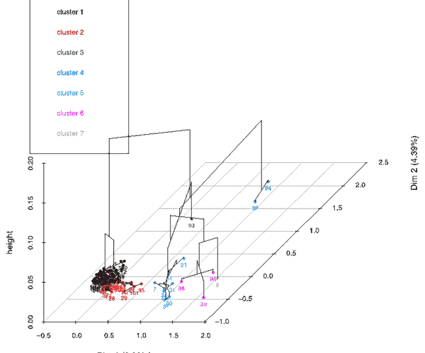

# 印度尼西亚爪哇岛、楠通和万汶旺基虾养殖场的生物安全实践描述

# 印度尼西亚爪哇、楠孟贡和万尼望岸虾类养殖场的生物安全措施描述

Marina K.V.C. Delfino a, Emilie Laurin b, Thitiwan Patanasienkul a, Raynafie Budhi Rajhardo b, Lukman Hakim b, Wildan Gaufikar b, Holly Burney b, K Larry Hammell b, Krishna Thakur b

a 海洋养殖系，大西洋兽医学院，爱德华岛大学，550 University Avenue, Charleston, PE CIA 4P3, 加拿大

b JALA TECH Pr Ltd. Kompleks Pt. Indramar, Jl. Kalurang 16/3, Sleman, Ngrampak, Sleman, Daerah Istimewa Yogyakarta, 55884, 印度尼西亚

印度尼西亚虾类养殖业持续面临细菌和病毒疾病的挑战，以及这些疾病可能带来的严重经济损失和环境影响。在虾类养殖中，生物安全对于防止病原体在农场之间及内部的引入、出现和传播至关重要。本研究通过问卷对印度尼西亚生长养殖和密集型虾养殖场的生物安全措施进行了调查。问卷设计用于收集农场特征、农场管理和生物安全措施的信息。研究执行了描述性统计、多重对应分析和层次聚类分析。研究目标是描述农场实施的生物安全措施，并根据这些措施将其归类。针对爪哇和楠孟贡地区的 90 个生长养殖场识别出了不同的聚类，而针对万尼望岸的 101 个密集型养殖场识别出了 7 个聚类。聚类范围从生物安全措施较少的微小规模农场，到不进行质量检测、不感染人员等。其中一个聚类的特征是具有中等生物安全措施，包括对访客进行消毒、质量检测以及循环之间频繁大于 30 天。在万尼望岸地区，农场无法根据生物安全措施模式进行明确分类，而是根据生物安全结构（例如缺乏响应或记录缺失）进行分组。为了未来可持续计划的实施以及减少这些地区疾病引入和传播风险的生物安全落实，建议包括：

- 关键词：
  - 虾
  - 印度尼西亚
  - 生物安全
  - 流行病学
  - 调查

## 文章信息

### 摘要

## 1. 引言

印度尼西亚是东南亚最大的产虾国之一（FAO, 2020）。印度尼西亚虾类养殖业最初于 20 世纪 80 年代后期发展于东爪哇，随后扩展到全国。细菌和病毒疾病的存在增加了严重经济损失的风险，影响了您的生存（注：原文此处 `survive` 疑有笔误，应为 `survival`），并像许多其他国家一样，对印度尼西亚虾类养殖带来了挑战（Sunarto et al., 2004; Walker and Mohan, 2009; Ali et al.）。随着产量增加，高密度、饲料率、水质以及对特定病原体的敏感性会不断变化（Thakur et al., 2018; Ali et al., 2015）。虾类行业的服务运营正通过在大型暴露背景下利用流行病学原理和统计模型，开发能够应对疾病能力的系统（如早期检测水平的健康和生产异常）来应对这些挑战（Munias, 2018）。本研究的启动是一项基础工作，旨在解决印度尼西亚行业潜在的疾病传播路径问题。

生物安全被定义为农场和区域层面减少动物染病或传播疾病概率的过程，特别是在不利的环境条件下（Lotz, 1997; Pruder, 2004）。由于生物安全措施不足、生物安全防御优势未被充分利用以及通过贸易引入病原体的风险，农民更容易受到传染病的影响。

改进生物安全是成功性水产养殖系统的必要组成部分。生物安全措施是农场防止虾类养殖场之间发生感染和传播的重要工具。在其他食品生产中使用的生物安全工具（如疫苗接种）或野生动物（Walker and Mohan, 2009; Ali et al., 2018），以及农民在靠近农场的情况下不使用无病源或抗病种子，都是可能与传染病的引入和传播相关的因素和做法（Corisin et al., 2005; Tang and Bondesson, 2003）。

通过改进农场管理、工人培训以及关注健康管理实现的有效生物安全，将通过减少风险操作，有助于印度尼西亚密集型虾养殖的可持续性。

对印度尼西亚养殖虾类的生物安全和管理措施的评估很大程度上缺乏记录或未知，且大多在传染病爆发的情况下进行描述（Amelia et al., 2021; Arifin et al., 2021）。这是首项专门用于评估印度尼西亚虾农实施的生物安全措施的研究。本研究的目标是：

1. 设计并实施针对关键水产养殖管理和生物安全措施的问卷调查；
2. 对密集型虾农的现状提供反馈。

其目的是利用调查结果告知印度尼西亚虾业现有生物安全措施中的差距，并为农民建立全面且主动的监测系统做出贡献。长期目标是为印度尼西亚水产部门提供基于证据的健康管理和可持续支持。

## 2. 方法论

### 2.1. 数据来源

我们设计了一项调查，以描述 JAL 印度尼西亚客户虾养殖场生物安全和管理措施的现状。JAL 在印度尼西亚的两个主要省份分别开展了两次独立调查。数据技术侧重于通过数据分析和物联网（`IoT`）技术提高虾类产量，即：

1. 爪哇和楠孟贡地区；
2. 万尼望岸地区（图 1）。

具体的问卷设计方法将在第 2.2 节中讨论。

为了描述印度尼西亚虾类养殖生物安全的现状，设计了一份问卷来收集农民的人口统计数据、农场特征、农场管理以及以下信息：

- 万尼望岸调查
- 爪哇和楠孟贡调查
- 调查的省份
- 省份

**图 1.** 调查的省份（绿色）和万尼望岸地区（粉色）（蓝色），印度尼西亚，纳入聚类分析中。每个圆内的数字代表根据距离划分的农场聚类。为了解释此图中的颜色，请读者参考本文的网页版。

### 表 1

各地区以及爪哇和楠孟贡省份的聚类数量。

| 省份 | 县 | 聚类 1 | 聚类 2 | 聚类 3 |
|---|---|---:|---:|---:|
| 勿加勿 | 勿加勿 | 0 | 0 | 3 |
| 中爪哇省 | Demak | 0 | 28 | 10 |
|  | Kendal | 5 | 2 |  |
|  | Pekalongan | 1 |  |  |
|  | Semarang | 3 |  |  |
|  | Purworejo | 21 |  |  |
| 东爪哇省 | Pasuruan | 0 | 14 |  |
|  | Proboling | 1 |  |  |
|  | Trenggal | 1 |  |  |
| 西爪哇省 | Cirebon | 0 | 6 |  |
| 雅加达 |  | 0 |  |  |
| 楠孟贡 | 南楠孟贡 | 2 |  |  |
|  | Tulang Bawang | 16 |  |  |
| 北苏门腊 |  | 0 | 1 |  |
|  | 中位数 | 19 |  |  |
| 总计 |  | 48 |  |  |

### 2.5.2. 分层聚类与划分

对主成分分析（`MCA`）的第一主成分进行聚类是处理复杂多变量数据的常用方法（Husson, 2010）。对数据集进行分层聚类和划分可以从工作数据中提取关于大部分变异的关键信息。使用 `R` 语言统计软件（来自 `FactoMine` 包）按照 Husson (2010) 描述的方法执行了凝聚性分层聚类和划分。`HCP` 函数允许使用欧几里得距离，通过 `Houveg` 算法确定变量之间的差异，该算法可以构建分层树。这是基于惯性性（总方差）和组内方差的分解，进而对聚类进行分类，使得树的每个层级的聚类数量最少（Allison et al., 2010）。

通过一系列嵌套划分构建了分层树，从单个类别到包含所有类别的更通用划分。它们之间的相似性得到了衡量，并且某组与其他分组的农场不同。聚类数量是通过观察树的整体外观来确定的（Husson et al., 2015）。`HCP` 函数提供了选择最佳划分层级的信息。数据集考虑了所有层级。

在 `R` 软件使用了 `MCA` 和 `HCP` 函数，特别是用于多变量探索性分析的 `FactoMine` 包（R Development Team, 2008; Husson et al., 2015）。我们还使用了 `missda` 包对数据集中的缺失值进行填充（Josse et al., 2012; Husson and Josse, 2015）。

## 3. 结果

### 3.1. 按规模和年龄划分农场分组

在 96 份调查中，100 个受访农场仅评估了男性特征。大多数受访者（96%）为男性。尽管其中 75% 的人具有水产养殖经验，但只有 43% 的接受过与生产相关的培训。大多数农民年龄为 37 岁，范围从 19 岁到 69 岁不等。每个农场的中位数至少为 2 年；访谈时最大的农场已有 55 年历史。大约 60% 的农场距离最近的上游和下游农场距离 < 1 km，且所有调查农场都通过水渠与其他农场相连。只有 13% 的受访农场有电，只有 8% 的农场入口有车辆，但有近 30% 的农场使用设备进行了净水或水质监测。有一组农民没有对农场生产进行任何记录，而 13% 的农场使用纸质系统，极少数（15%）的农场使用了电子记录系统。食物消耗是受访者记录最多的信息（67%）。所有农场都从孵化场购买（例如虾苗或 `PL`），只有大多数农场评估了所售鱼类的质量，其中测试 `PL` 质量的方法包括压力测试（66%）、全筛法（10%）、细菌培养（9%）和肝胰感染（6%）。有三组农民在每个生产年度内不自产饲料，即使他们自产了，持续时间也少于一周。

对于 `MCA`，我们使用了 96 个农场，涉及 101 个分类变量。剔除了 100 个数据中的缺失值，剩余共 96 个变量。值最高的变量与使用化学品处理鱼类动物或池塘处理的问题、以及检查使用物种的测试频率有关。结果记录在问卷上（图 a）。输出的聚类结果将农场分为三组。最佳划分层级通过 `Silhouette` 函数确定（图 b）。

表 2 汇总了代表这些聚类的结果。聚类 1 是由经营实践较差的小规模农场构成的（例如：不测试水质；不使用消毒；没有对农场生产的任何记录；不自产饲料；每天不吃来自其他农场的鲜鱼）。聚类 2 几乎由微小规模农场组成，这些农场在生产引入、育苗方面也有一些实践，并向其他农场售卖鱼（例如：每天或每周一次）。聚类 3 主要是应用良好经营实践的中型和大型农场（例如：测试食物来源；最佳消毒；在访问、使用车辆和人员时记录农场生产应用情况以检查质量；农场年龄在 30 岁之间）。

### 3.2. 按范围划分密集型农场

分析数据来自 101 个农场，涉及 70 个分类变量。约 46.5% 的重要性未归类。尽管大多数农场经过了培训（29% 的农场至少有 6 个池塘，每年 2 到 4 个池塘）。池塘数量年龄从 6 年到 98 年不等（从 < 7 年到 30 年，21.4% 超过 6 年，39 个超过 30 年）。每个农场的活跃池塘数量值也较高（59% 范围在 1 到 5 个池塘之间）。调查的池塘尺寸范围为 2 到 80。大约一半的调查农场使用咸水养殖（50.5%），农场使用了循环水（67.2%，范围从 1 到 80），76.2% 在将水引入池塘时使用了这些水。

大多数（77%）不靠近邻近农场，尽管只有 22.8% 的农场与其他同物种农场有水路连接。大多数农场（84.2%）使用了围栏系统，大约一半（43.6%）在农场入口未使用大门或检查。结果记录在问卷上（图 c）。95% 和 84.2% 的农场分别报告他们没有记录（94.1%），未与其他农场交流（89.1%），但农场内池塘之间未共享设备（91.1%）。

#### 分层聚类

点击切割树。

**图 2.** 分层聚类，按爪哇和印度尼西亚（A）主成分坐标（B）表示最佳划分层级的线。所有调查农场的不足以下（43.6%）报告在邻近农场检测到疾病。一半的农场（54.9%）使用化学方法或物理屏障（网、绳子或围栏）来防止疾病的扩散。然而，63.4% 的所有农场报告在池塘周围每天食用新鲜食物。在有关虾类健康管理的调查响应中，平均有 97% 的农场使用化学或非化学方法进行池塘准备。大多数农场每月对虾类以评估生长和存活率，且 97% 有形式的记录制度。

### 表 2

| 聚类 1 | 聚类 2 | 聚类 3 |
|---|---|---|
| 经营实践较差的小规模农场 | 微小规模农场 | 中型和大型农场 |
| （例如：不测试水质；不使用消毒；没有对农场生产的任何记录；不自产饲料；每天不吃来自其他农场的鲜鱼）。 | 这些农场在生产引入、育苗方面也有一些实践，并向其他农场售卖鱼（例如：每天或每周一次）。 | 应用良好经营实践（例如：测试食物来源；最佳消毒；在访问、使用车辆和人员时记录农场生产应用情况以检查质量；农场年龄在 30 岁之间）。 |

### 层次级：聚类

### 因子地图上的层级聚类

**图 3.** 印度尼西亚望岸（Banywangi）农民的层级聚类，根据（A）第一主成分的坐标（黑线代表最佳结合水平）和（B）前两个成分诱导的地图进行排序。

聚类 3、4 和 7 的农场数量需要从农民处进行推断，但为了突出它们的差异，简而言之聚类 3（1 个农场）来自 Sukabumi 的 Mayangan 地区，拥有较小的池塘。这还包含了大量关于生物安全、健康管理、疾病和治疗的广泛信息，访谈还报告了一些较好的生物安全实践。同样，聚类 4（2 个农场）记录了一些较好的生物安全实践，但农民具有研究生学历，且在过去的作物周期中治疗仅是因为疾病，而不是因为水质较差。剩余的聚类组（5、6、7）存在缺失类别：代表聚类 7 的农场包含较大的池塘，养殖虾类体，使用运河水，有记录并改进了生物安全实践。聚类 5 和 6 由望岸地区良好地代表，并报告了关于一般特征、生物安全实践、农场健康和管理的广泛信息。具体而言，聚类 5 包含所有者年龄较大且受过高中到大学水平的农场。农民从未观察到外部疾病迹象，使用铲子或勺从池塘中取出死动物并用抗生素/水浴进行处理。聚类 6 的农民有此类实践的记录并在农场内埋了死动物，一些人报告上一个周期发生了疾病，并是因为疾病进行了治疗，而非由于任何症状。

家庭经营的农场不太负担更好的诊断、养殖虾类体、咨询和治疗用品以充分实施生物安全实践（Mananghani 等人，2021；Ali 等人，2018）。另一种解释可能是实施聚类生物安全实践的障碍，例如单元和设备的共享（池塘、车辆、设备）。缺乏基于建设的记录性报告可能导致数据收集不准确、纸质信息转换为电子格式时的错误、重复使用相同名称以及数据的及时性。如果农民能够整合并使用电子信息系统，将有助于捕捉相关的疾病迹象或管理事件，并共享数据以更好地保护环境健康和农民。

总体而言，响应农民与其实践之间存在巨大差异，这些差异发生在不同的维度上。农场聚类并非通过实践与其他聚类明确区分，而是通过特征区分，且发现单个类别对聚类分布的影响更大。此外，某些变量也影响聚类的大小：例如，县，某些类别只有一个或少数农场适用（如聚类 3、4 和 7），或物种组成（聚类 7）。

## 4. 讨论与结论

本研究基本上涵盖了印度尼西亚集约型和密集型虾类养殖中生物安全实践的常识，这些实践可以得到改进，行业范围内的数据共享可以通过增强检测和准确性有助于预测性风险分析。此类数据可以为农民长期使用生物安全实践提供基础，以提高检测能力和病原体扩散概率。

对于楠榜和爪腊，我们根据其生物安全实践将农场增长分为三类。观察到东爪腊的农场更多地以小型农场为主，比聚类 3（由西爪腊的中大型农场组成）更多的生物安全缺陷，但处于较高的风险水平。新技术的引入通过生物安全实践的处理得到了改进。

中爪腊和东爪腊通过病原体增长，尽管这被认为是引入病原体的主要途径之一（Corin 等）。对这两个聚类农场观察到的实践的某种解释可能是由于财务资源，小规模农民未来的调查可能需要根据研究区域对农场聚类进行分离和定制的调查，以解决问题的特定测试变量（特征或变量）。该研究开发是为了提高农民的响应率，而对问题的回答尚不明确、不一致或请求者未知。在考虑缺失数据的情况下，有必要使用更好的方案进行跟进调查。未来的研究还应包括社会科学方面，以识别防止农民改进生物安全和疾病管理实践的挑战。

### 表 3

印度尼西亚望岸县按聚类、县组和个人划分的农场数量。

| 县 | 聚类 1 | 聚类 2 | 聚类 3 | 聚类 4 | 聚类 5 | 聚类 6 | 聚类 7 |
|---|---:|---:|---:|---:|---:|---:|---:|
| 组 | 17 | 6 | 0 | 0 | 0 | 0 | 0 |
| Banyuwangi | 9 | 10 | 0 | 2 | 9⁵ | 0 | 0 |
| Minak | 21 | 0 | 0 | 0 | 0 | 0 | 1¹ |
| Klimbari | 2 | 1 | 0 | 0 | 0 | 0 | 0 |
| Kalipuro | 0 | 0 | 1 | 0 | 0 | 0 | 0 |
| Sukamang | 1 | 0 | 0 | 0 | 0 | 0 | 0 |
| Endahan | 0 | 0 | 0 | 0 | 0 | 0 | 0 |
| 总计 | 55 | 30 | 1 | 2 | 9 | 0 | 1 |

### 表 4

印度尼西亚望岸较大聚类的描述。斜体文字指匹配类别。小型聚类（3、4、6、7）的描述另当。

| 聚类 1 | 聚类 2 | 聚类 5 |
|---|---|---|
| 小型农场 |  |  |
| 中大型农场 |  |  |
| 年龄较大 |  |  |
| 高中到大学水平 |  |  |

M.K.V. Delphino 等人

生物安全计划是针对本研究初级分析中识别出的集群而定制的。应用于整个印度尼西亚虾类养殖的生物安全规范将有助于防止疾病的发生以及对环境造成破坏的疾病。

波士顿咨询集团（BCG）, 2019. 印尼西亚可持续生产的战略方法：变革与可持续性的经济学。可用：<https://media-publications.com/BCG/publication/Strategic-Approach-to-Sustainable-Production-in-Indonesia.pdf>（访问日期：2022 年 10 月 20 日）。

加拿大食品检验局（CFIA），2012。生物安全原则。加拿大政府。可用：<https://www.canada.ca/en/food-inspection-agency/services/biosafety/principles-biosecurity.html?locale=1438227354>（访问日期：2022年10月20日）。

## 作者声明

1. Marina K-K.V. Delph：数据分析与写作
2. Emilie Laur：数据分析与写作
3. Thitanan Pattanaskit：问卷设计与写作
4. Raynani Rohday：数据收集与写作
5. Lukman Hakim：数据收集与写作
6. Wijaya, Zulkifli：数据收集与写作
7. Holly Buckley：项目设计及文章的批判性修订
8. Krishna Thakur：研究设计、项目监督及文章的批判性修订
9. K. Larry Marshall：研究设计、项目监督及文章的批判性修订

Corsin, F., Turnbull, J.H., Nash, N.V., Mohan, C.V., Ti, P.H., Luan, R.Q., 2005。越南白点病毒相关虾综合征：基于稻米的虾类养殖系统。*Aquaculture*. 161(1), 97-104。<https://doi.org/10.1016/j.aquaculture.2004.09.012>。

Corsin, F., Turnbull, J.H., Mohan, C.V., Nash, K.G., 2005。印度尼西亚养殖业池塘级白点病风险。*Aquaculture in Asia*. 37(4), 225-231。FAO。可用：<https://www.fao.org/3/y4300/y4300.pdf>（访问日期：2022年6月24日）。

## 利益声明

MD、EL、TP、RJ、RW、ZO、HB、LB 和 KT 声明无利益冲突。

RR、LH 和 WZ 雇于 JALA，这是一家专注于通过数据分析和物联网使用提高生物安全精度的技术公司，该情况已在机构属性中声明。

Jones, F., Page, J., Mohan, C., 2015。虾类养殖中预防白点病毒的池塘级生物安全方法。*Aquaculture*. 423, 115-120。<https://doi.org/10.1016/j.aquaculture.2015.01.038>。

## 致谢

我们感谢 Likas Musidang、Jala Tech Pte. Ltd.（印度尼西亚）以及 Jala Tambak Plan 的所有成员在数据收集和数据协调方面的帮助。我们感谢 Van Wijagenen 和 Trini Putri 在项目管理方面的协助。本研究由 IDH基金项目和 Jala Tech Pte. Ltd.（印度尼西亚）资助。

Chen, J., Mohan, C., Lueber, R., 2012。泰国虾殖场管理白点病毒的方法寻找。*Aquaculture*. 133(3), 310-318。<https://doi.org/10.1016/j.aquaculture.2012.03.017>

## 附录 A

本研究的补充数据可用于：<https://doi.org/10.1016/j.aquaculture.2022.738227>。

## 参考文献

Ali, H., Rahman, M.M., Rojo, J., Aaman, A., Basak, S.K., Mohan, C.V., 2018。孟加拉国西孟加拉邦虾类养殖者（`Penaeus monodon brachium`）健康管理与职业健康状况评估。*Aquatic Science*. 10, 1-19。

Ames, F., Futiya, A., Andriy, Y., 2021。越南虾类养殖（`Penaeus monodon`）回顾：挑战与机会。*World Fisheries Science* 158, 145-158。

Thakur, K.I., Tangpasitakul, T., Luen, R., Vanderricick, R., 2014。泰国半集约型池塘中白点病（WFD）扩散的影响。*Asian and Environmental Science*: 67, 0112015。

Boerlage, A.S., Nguyen, K.V., Delphino, J., Van, F.T., Tang, L.T., Hammel, K. L., 2017。病原体引入和扩散控制相关的生物安全措施综述。*Aquaculture*. 406, 1-8。

Muustia, M., Steffen, C., Abeleberg, A., Feybaugh, A., Aydagova, I., 2015。印度尼西亚虾类养殖：挑战、可持续性与监管发展。*Environ. Manage.* 112, 199-207。

Siegel, R., 2020。环境与统计计算指南。R：Foundation for Statistical Computing。可用：<https://www.R-project.org>。

StatCorp, 2019。统计分析：软件。Statistica College LLC，美国佛蒙特州。

Ananth, K., Suiswashetty, I., Sriharari, G., L., Sugani, B., Dmukond, R., 2004。印度养殖业疾病现状：发生情况、监测和控制措施。*Journal of Fisheries Research and Development*, 36（印度养殖业现状会议论文）。

Fang, J.K., Gonzalez-Mendoza, R., 2019。肝炎 sprovirus 病毒感染对越南虾类生产的影响。*Aquaculture*. 428, 125-136。

Thakur, K., Tangpasitakul, T., Luen, R., Vanderrichel, R., Corsin, F., Hammel, L., 2019。越南省虾类养殖（`Penaeus monodon`）病毒性疾病发病率。*Aquaculture*. 425,
