# 设计模式速查表

## 前言

在这个快速查表中，我们将讨论软件开发中的设计模式。我们将关注它们是什么、它们如何为我们带来收益，但更重要的是在何处何时使用它们。

结构模式处理对象组合，通过创建对象之间的关系来形成更大的结构。

行为模式关注对象之间的通信，即对象之间发生了什么以及它们如何共同工作。

设计模式通过提供经过测试、证明有效的设计模式来加速开发过程。有效的软件设计需要考虑可能在实现后期才显现的问题。重用设计模式有助于防止导致重大问题的细微问题，并提高熟悉这些模式的编码人员和架构师的代码可读性。

## 1. 引言

设计模式是解决常见软件设计问题的重用解决方案。它们提供了一种描述和记录软件架构的方法，并为开发者交流软件设计提供了一套通用词汇。

设计模式有几种类型，包括创建型、结构型和行为型模式。

创建型模式处理对象的创建机制，试图以适合情况的方式创建对象。

## 2. 创建型模式

### 2.1. 单例模式

单例设计模式用于确保一个类只有一个实例，并为该实例提供全局访问点。

| 单例 |
| :--- |
| - static sc |
| + static getInstance() |

图 1. 单例 UML。

- 单例设计模式的一个优点是它确保了类只有一个实例，这对于管理如数据库连接或网络套接字等资源的类非常有用。
- 它还为实例提供了一个全局访问点，使得在代码的不同部分更容易使用该实例。

### 2.2. 工厂模式

提供了一种创建对象的方法，而不指定将创建的对象的精确类。创建特定类型对象的方法。该方法将要创建的对象类型作为参数，并返回该类型的新对象。

通常，人们只理解如何将某些设计技术应用于某些问题。这些技术很难应用于更广泛的问题中。设计模式提供了通用的解决方案，其记录格式不依赖于特定问题的具体细节。

| 接口 | 创建者 |
| :--- | :--- |
| 产品 | `operator()` / `factoryMethod()` |
| 具体产品 | 具体创建者 `factoryMethod()` |

图 2. 工厂 UML。

- 当你想创建与某些框架或工作流兼容的对象，但又不想在运行时指定对象的具体类时，非常有用。

### 2.3. 构建器模式

允许以分步的方式创建复杂对象。它将对象的构建与它的表示分离，允许创建不同的表示形式。

- 使用工厂设计模式的优点是它允许将对象的创建集中在单个位置，这使得代码更模块化且更容易维护。
- 它还允许轻松地更改对象创建的实现，使设计更具活性和扩展性。
- 允许在不指定对象精确类的情况下创建对象，这使得代码更具通用性和可用性。

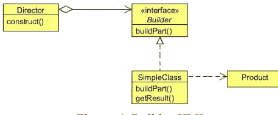

图 4. 构建器 UML。

- 对象创建算法应与系统解耦。
- 需要多种创建算法的表示形式。
- 有必要在不改变核心类的情况下添加新功能。

### 2.4. 抽象工厂模式

为创建一组相关或依赖的对象族提供接口，而不指定它们的具体类。

| 接口 | 客户端 |
| :--- | :--- |
| 抽象工厂 | 产品 |
| 具体工厂A | 产品A |
| 具体工厂B | 产品B |

图 3. `class_diagram_1`

- 系统不应依赖于其产品是如何创建、组合和表示的。
- 系统应该配置为多个产品族之一。
- 一组相关的对象对象被设计为一起使用，你需要强制执行这一约束。

### 2.5. 原型模式

允许通过复制现有对象来创建新对象，而不是从头创建新对象。

| 客户端 | 接口 |
| :--- | :--- |
|  | 原型 |
|  | `clone()` |
| 具体原型1 | `clone()` |
| 具体原型2 | `clone()` |

图 5. 原型 UML。

- 当创建新对象的成本很高且需要独立创建复杂对象时，非常有用。
- 类将不知道它需要创建哪些类。
- 子类可以指定应该创建哪些对象。
- 父类希望将创建推迟给子类。

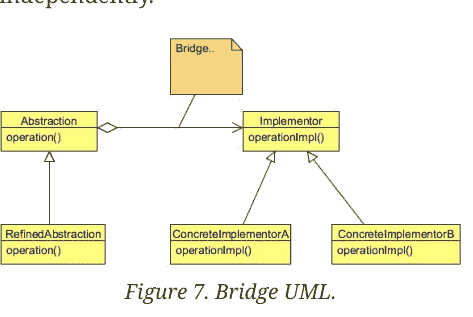

# Java Code Geeks 快速查表：设计模式

## 3. 结构模式

### 3.1. 适配器模式

通过在一个接口周围封装一个适配器类，允许两个不兼容的接口协同工作。该适配器类将被适配类的接口转换为客户端所期望的接口。

- 抽象和实现不应在编译时绑定。
- 抽象和实现应该是可独立扩展的。
- 抽象实现中的更改不应影响客户端。
- 实现细节应该对客户端隐藏。

### 3.2. 桥接模式

允许抽象和实现分离，以便两者可以独立变化。

### 3.3. 组合模式

允许将对象被视为单个单元。它用于将对象组合成树形结构，并从简单的对象创建复杂对象。

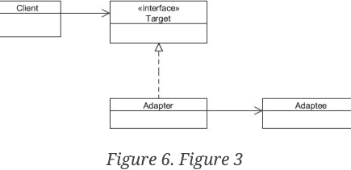

- 适配器不仅可以将数据转换为各种格式，还可以帮助具有不同接口的对象。
- 可能创建一个可以双向转换调用的双向适配器。

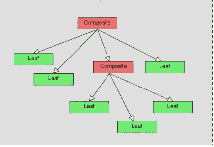

- 需要对对象的分层次表示。
- 对象的及其组合应该被统一对待。

### 3.4. 装饰器模式

允许在不改变现有对象结构的情况下动态添加新行为。系统的维护和修改。

### 3.5. Fac面模式

为复杂系统提供简化的接口。

- 我们可以减少应用程序的内存占用并提高其性能。
- 仔细考虑内存节省收益与实现该模式带来的复杂性之间的权衡。

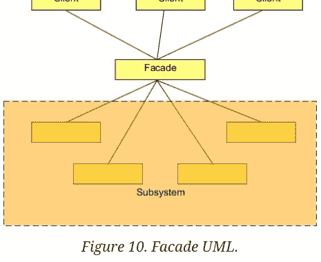

### 3.6. 重量模式

旨在通过在对象之间共享公共数据来最小化内存使用。这是通过创建一个共享对象来实现，而不是每个对象都拥有数据的实例。

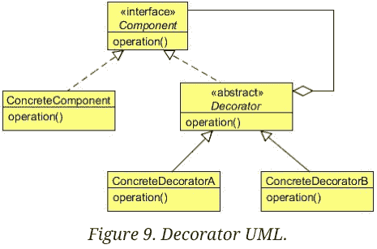

- 它可以用于为类添加新功能，或封装现有类以添加额外功能。

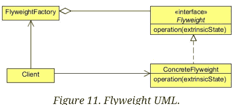

### 3.7. 代理模式

在客户端和真实主体之间提供中间对象。

代理模式可以用于：

```java
interface {
  request();
}
```

- 当系统有大量互连的类或客户端需要访问系统的有限功能时，非常有用。
- 它解耦了客户端与复杂的子系统，并允许更容易

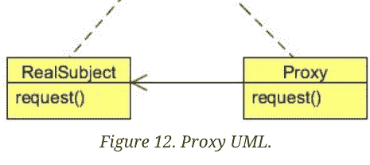

- 为可能的高昂或资源密集型对象提供占位符。代理可以仅在需要时才创建真实对象，而不是提前创建。
- 控制对真实主体的访问。代理可以用于实施访问限制，或实现身份验证和授权检查。
- 为真实主体添加额外功能。代理可以用于拦截对真实主体的请求，并在转发请求之前或之后执行任务。

## 4. 行为模式

### 4.1. 责任链（Chain of Responsibility）

允许对象按顺序向对象链发送请求以处理该请求。

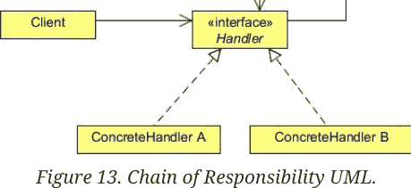

### 4.2. 命令（Command）

允许请求封装为对象，然后将其传递给接收者进行执行。

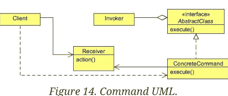

- 允许请求的发送者和接收者分离。
- 能够对请求进行或或，并支持撤销/重做功能。

### 4.3. 迭代器（Iterator）

允许客户端按顺序访问聚合对象的元素，而不暴露该对象的底层表示。

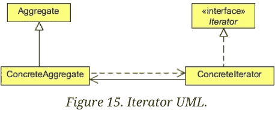

- 允许客户端以一致、统一的方式遍历对象集合，无论集合的具体实现方式如何。
- 适用于多个对象可能处理某个请求，且无法预先知道由哪个特定对象处理该请求的情况。
- 允许轻松地从链中添加或移除对象，而不影响整体功能。

### 4.4. 中介者（Mediator）

允许多个对象之间相互通信，而无需了解它们实现的细节。

- 它提供了一个中心通信点，称为中介者，作为对象之间的中介。
- 适用于存在大量对象需要相互通信的情况，因为它通过将通信逻辑与对象本身分离降低了系统的复杂性。

### 4.5. 观察者（Observer）

允许一个对象（主体）在其状态发生变化时通知一组对象（观察者）。观察者模式也称为发布-订阅模式。

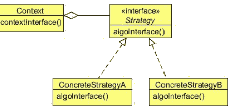

- 适用于你想确保不同对象之间保持同步，或者你想能够独立地复用主体和观察者时。

### 4.6. 策略（Strategy）

允许对象通过切换到不同的策略对象在运行时更改其行为或策略。

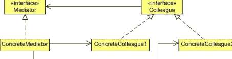

- 许多相关类之间的唯一区别在于它们的行为。
- 需要算法的多个版本或变体。
- 算法访问或利用了调用代码不应被暴露的数据。
- 类的行为应该在运行时定义。
- 条件语句复杂且难以维护。

### 4.7. 模板方法（Template Method）

定义算法的步骤，并允许子类重写某些步骤，同时保留算法的整体结构。

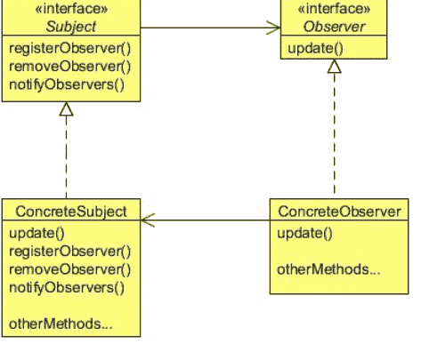

图 19. 模板方法 UML。

- 需要算法的单一抽象实现。
- 子类之间的共同行为应该落实到一个公共类中。
- 父类应该能够统一地调用其子类中的行为。
- 大多数或所有子类都需要该行为。

# Java Code Geeks

## JCG Java 开发者资源中心

JCG 每月向超过 70 万名软件开发者、架构师和决策者提供超过 100 万页。JCG 为每个人提供服务，包括新闻、教程、备查表、研究指南、专题文章、源代码等。

欢迎
