# 高质量自动化测试的设计模式：高质量测试属性与最佳实践

## 第 1 章. 定义高质量测试属性

### 不同类型的测试

- `Unit Tests`（单元测试）
- `Integration Tests`（集成测试）
- `System Tests`（系统测试）

### 什么是测试自动化框架？

- 什么是软件库？
- 什么是框架？
- 测试自动化框架
- `Selenium WebDriver` 是测试框架吗？

### SOLID 原则

- `SRP` – 单责任原则
- `OCP` – 开闭原则
- `LSP` – 里基夫替换原则
- `ISP` – 接口隔离原则
- `DIP` – 依赖倒转原则

### 高质量测试属性

- 什么是设计模式？
- 测试的可维护性与重用性
- 测试的可读性
- API 可用性
- 可扩展性
- 学习曲线
- 总结
- 问题
- 延伸阅读

## 第 2 章. 优化和重构旧有的不稳定测试

### 编写第一个真实的自动化测试

- 第一个自动化测试用例说明
- 第二个自动化测试用例说明
- 第三个自动化测试用例说明
- 第一段自动化测试代码
- 第二段自动化测试代码
- 第三段自动化测试代码

### 失败原因

- 重构测试
- `Implicit`（隐式）等待 VS `Explicit`（显式）等待
- 在测试中实现 `Explicit` 等式等待
- `DRY`-不要重复原则
- 用于修复不稳定操作的装饰模式
- 针对 `WebElement` 的装饰模式实现
- 针对 `WebDriver` 的装饰模式实现
- 测试中的装饰模式
- 测试独立性-隔离原则
- 遵循测试隔离原则的测试重构
- 总结
- 问题
- 延伸阅读

## 第 3 章. 加速测试的策略

### 对测试代码进行插桩以寻找优化点

- 优化 `Login`
- 在测试中如何等待异步请求完成？
- 等待所有 `AJAX` 完成
- 优化浏览器初始化-`Observer Design Pattern`（观察者模式）
- `Observer Design Pattern`
- `Observer Design Pattern` 实现
- 通过属性配置浏览器行为
- 每个测试的隔离初始化-`Black Hole Proxy`（黑洞代理）方法
- 实现 `Black Hole Proxy`
- 总结
- 问题
- 延伸阅读

## 第 4 章. 测试的可读性

### 页面对象模型（POM）设计

- 创建第一个页面对象
- 创建页面对象的新方法
- 页面对象模型中的用法
- 处理常见的页面元素和操作
- 定义页面元素
- 非 `DRY` 对象
- 重用元素的第一个版本
- 创建页面部分对象
- 页面对象中的页面部分 - 版本一
- 页面对象中的页面部分 - 版本二
- 测试中的页面部分

### 高质量代码 - 使用有意义的名字

- 通用命名指南
- 类命名
- 现有 API 新版本的命名
- 方法命名 - 正的方法
- 通用命名指南
- 使用有意义的方法名
- 方法参数的最佳实践

### 遵循编码标准 - 工具

- 使用 `EditorConfig` 强制执行编码标准
- 总结
- 问题
- 延伸阅读

## 第 5 章. 增强测试的可维护性和重用性

### 可导航页面对象-模板方法设计模式

- 未重构版本的页面对象
- 为可导航和不可导航页面创建单独的基类
- 模板方法设计模式
- 模板方法设计模式实现

### 使用组合原则

- 未使用组合的重构版本页面对象
- 元素与断言 - 组合实现
- 在测试中使用组合

### 重用测试工作流 - 外观模式设计模式

- 测试工作流的朴素实现
- 外观模式设计模式
- 外观模式实现
- 外观模式与模板方法设计模式结合
- 使用模板方法的购买外观
- 具体外观实现
- 总结
- 问题
- 延伸阅读

## 第 6 章. API 可用性

### 针对 `Decorator` 的接口隔离原则

- `WebDriver Decorator` 当前实现
- 将接口拆分为更小的接口
- 页面对象中的更小接口
- 通过 `Singleton Design Pattern` 使用页面对象
- `Singleton Design Pattern`
- `Singleton Design Pattern` 实现
- 线程安全的 `Singleton Implementation`
- 测试中的单例模式用法
- 创建页面对象的 `App Design Pattern`
- `App Design Pattern` 实现
- 测试中的 App 使用
- `Fluent API` 页面对象
- `Fluent API` 实现
- 在测试中使用 `Fluent API`
- 元素访问样式
- 通过属性暴露元素
- 通过公共属性访问元素
- 测试中隐藏元素
- 隐藏不必要的细节
- 总结
- 问题
- 延伸阅读

## 第 7 章. 在你的测试库中构建可扩展性

### 通过 `Strategy Design Pattern` 构建查找元素的扩展性

- 原生 `WebDriver` 元素查找
- `Strategy Design Pattern`
- 检查查找元素的版本
- 创建元素策略
- 重构 `ElementService`
- 改进元素策略的 API 可用性
- 通过 `Strategy Design Pattern` 构建等待元素的扩展性
- 原生 `WebDriver` 等待元素
- `Strategy Design Pattern`
- 检查元素等待当前版本
- 创建等待策略
- 创建 `WaitService`
- 在 `ElementFinder` 中添加等待元素
- 通过 `EventFiringWebDriver` 添加扩展点
- 原生 `EventFiringWebDriver` 示例
- 集成 `EventFiringWebDriver`
- 总结
- 问题
- 延伸阅读

## 第 8 章. 测试架构设计的评估系统

### 评估系统介绍

- 我们试图解决什么问题？
- 标准定义
  - 1. 可读性
  - 2. 可维护性
  - 3. 重用性
  - 4. API 可用性
  - 5. 可扩展性
  - 6. 代码复杂度
  - 7. 学习曲线
  - 8. `KISS`（简单原则）
- 实施步骤

### 不带页面对象的测试评估

- 架构设计概述
  - 1. 可读性
  - 2. 可维护性
  - 3. 重用性
  - 4. API 可用性
  - 5. 可扩展性
  - 6. 代码复杂度
  - 7. 学习曲线

### 带有页面对象的测试评估

- 架构设计概述
  - 1. 可读性
  - 2. 可维护性
  - 3. 重用性
  - 4. API 可用性
  - 5. 可扩展性
  - 6. 代码复杂度
  - 7. 学习曲线

### 带有外观模式的测试评估

- 架构设计概述
  - 1. 可读性
  - 2. 可维护性
  - 3. 重用性
  - 4. API 可用性
  - 5. 可扩展性
  - 6. 代码复杂度
  - 7. 学习曲线
- 最终评估
  - 1. 你能列出这七项标准吗？
  - 2. 在哪些方面评估重用性？
  - 3. 学习曲线是关键点吗？
  - 4. 什么是测试设计？
  - 5. 在 Visual Studio 中如何计算指标？
  - 6. 项目中需要遵循评估系统？
- 延伸阅读

## 第 9 章. 评估自动化测试组件性能的基准测试

### 什么是基准测试？

- 使用 `BenchmarkDotNet` 对代码进行基准测试
- 主要功能
- `BenchmarkDotNet` 示例
- 实验
- 基准报告、分析
- HTML 和 CSV 报告
- 分离器
- 优化的浏览器初始化
- `Observer Classes`

## 第 10 章. 测试数据准备与测试环境配置

- 停止硬编码
- 配置设置
- `WebDriver` 超时
- 默认设置
- 环境变量
- 引入 Fixtures
- 使用 `AutoFixture` 生成数据
- `MSTest` 驱动测试
- 使用 API 作为数据源
- 使用 Stubs

## 测试的不同类型

## 什么是测试自动化框架？定义

### SOLID 原则

## 高质量测试的属性

## 测试的不同类型

简而言，我将定义不同的测试类型。这有助于我们理解 `WebDriver` 自动化测试在开发周期处于什么位置。

### 单元测试 (Unit Tests)

根据定义，这些是最小的测试单元。这种类型的测试用于测试单个对象，甚至是对象的某个单个方法。单元测试是非常必要的，因为它可以防止错误从底层底层滋入。这些测试很少使用任何真实的测试数据，而且通常完全依赖于生成的数据。

### 集成测试 (Integration Tests)

它们由几个组合在一起的代码模块组成，允许它们之间传递数据。这类测试的目的是确保所有模块都能相互集成并协同工作。它们也被称为组件集成测试或小规模集成测试。通常，在此类测试中，我们仍然会隔离第三方服务，如网络、文件系统和操作系统。另一个相关术语是大规模集成测试，工程师通常用它来指代不隔离第三方依赖的集成测试。

### 系统测试 (System Tests)

系统测试是对完整且完全集成的软件产品进行的测试。它是最高层级的测试。它在生产环境（PROD）或类生产环境（如分阶段环境 STA）中执行。与集成测试类似，系统测试也试图验证所有组件（包括第三方服务）都能彼此良好地通信。

这些测试可以验证我们软件的功能或非功能需求。一些工程师将这些测试称为端到端测试（End-to-end tests）、UI 测试或用户场景测试。然而，我认为这些术语之间存在细微差别。

我们的 `WebDriver` 自动化测试属于系统测试分类。如果所有的操作和断言都是针对用户界面（UI）执行的，那么它们应该被称为 `UI tests`。端到端（用户场景）测试是指验证真实用户场景的测试，从用户与被测系统的交互开始到结束。不使用任何快捷径或模拟（mocks）——测试完全模拟人类交互。在系统测试的情况下，我们指的是高度优化的测试，侧于验证系统的特定功能。例如——与其每次都通过 UI 登录或注册新用户，我们可以直接使用内部 API 或数据库来完成。执行的断言也是如此。如果你使用了这些低级方法，那么将这类测试称为 UI 测试是不恰当的。

### 什么是测试自动化框架？

在许多会议对话中，我意识到许多开发者对什么是测试自动化框架有错误的概念。在这里，我将尝试给出一个定义，但在那之前，我们需要回顾一些相关术语，例如什么是软件库、框架、API、测试框架等等。你需要理解这些概念，才能理解什么是测试自动化框架。

### 什么是软件库？

在定义什么是软件库之前，我们需要回顾什么是应用程序。

在得出这个定义后，我们可以得出的第一个结论是，我们的自动化测试也是应用程序。多年来，互联网和会议上一直存在许多讨论：测试工程师是否应该能够编程，而不是使用 UI 工具进行自动化测试。我坚信，新时代的测试自动化 QA 应该是一个优秀的程序员，将他的代码视为生产代码——遵循高标准的代码规范。

许多工程师认为在他们的公司里构建了自定义的测试框架。但事实上，他们拥有的是库或一组方法，可以帮助他们编写自动化测试。库的 `API` 定义了用户如何访问其方法、他们需要传递哪些参数等。这是访问库的约定，而实际实现是在库内部处理的。`API` 是我们可以使用什么内容的规范，而软件库是该规范的实际实现。它应该遵循预定义的规则。我们可以拥有同一个 `API` 的多个实现。例如，`Java` 和 `Scala` 实现了 Java。它们都被编译为字节码，使得 Java 开发者可以使用相同的方法。这在 `.NET` 世界同样适用，`C#` 和 `VB.NET` 是不同的语言，但都实现了 `.NET API` 并编译为 `MSIL`。

### 什么是框架？

框架具有区分于库的特征：

- **控制反转 (Inversion of control)**：框架控制流程，无法像标准库那样被修改。
- **默认行为 (Default behavior)**：框架提供有用的操作。
- **可扩展性 (Extensibility)**：作为用户，你可以根据需要自定义某些操作，而这是库无法实现的。
- **不可修改的框架代码 (Non-modifiable framework)**：你可以自定义某些操作，但不能更改其代码。示例包括 `ASP.NET`（Windows）、`Cocoa`（Mac）、`Touch`（iOS）和 `Application Framework`（Android）。

正如定义所说，单元框架帮助我们快速编写方法和类。此外，我们可以以自动化的方式执行这些测试，而无需手动重复。单元框架的示例有 `NUnit`、`MSTest`、`JUnit`。

### 测试框架

现在让我们最后理解什么是自动化框架。

### Selenium WebDriver 是框架吗？

许多 QA 将 `Selenium WebDriver` 称为测试自动化框架，但他们完全错了。官方网站上的定义是：“Selenium 自动化浏览器。你用它来做什么完全取决于你。”主要来说，它是为了 Web 自动化目的而设计的，但不仅限于此。基于 Web 的任务也是可以（并且应该）被自动化的。根据定义，`Selenium WebDriver` 主要被认为是 Web 自动化的标准，但它实际上是一个用于控制浏览器的工具，我们在软件库和框架中使用它来编写自动化测试。

### SOLID 原则

在定义高质量测试属性之前，我们应该提到一些面向对象的编程原则。在本书中我将提到其中一些。`SOLID` 的目标是帮助我们编写更易理解、灵活且可维护的软件。SOLID 代表：

- `SRP`:单一责任原则
- `OCP`:开闭原则
- `LSP`:里氏替换原则
- `ISP`:接口隔离原则
- `DIP`:依赖倒转原则

### SRP – 单一责任原则

该原则规定——每个软件模块应该只有一个改变的原因”，这意味着每个类、方法等可以做很多事情，但它们应该服务于单一目的。其他的都应该移除。不应该像瑞士刀一样提供 20 种工具操作，因为如果其中一个发生了变化，所有的都需要更新。如果我们能将这些项目分开，就会变得简单、易维护，且一个改变不会影响其他。同样的原则也适用于软件架构中的类和对象——你可以将它们分开。

```csharp
public class CustomerOrder{
    public void Create(){
        try{
            // 数据库代码在这里
        }catch(Exception ex){
            File.WriteAllText(@"C:\exception.txt", ex.ToString());
        }
    }
}
```

`CustomerOrder` 类做了不该做的事情。它应该创建订单并将其保存到数据库，但如果你仔细观察 catch 块，你会发现它在执行日志记录。它有太多的责任了。如果我们想遵循单一责任原则 `SRP`，我们应该将类分为两个独立的类。我们可以将日志移动到一个独立的类中。

```csharp
public class FileLogger{
    public void CreateLogEntry(string error){
        File.WriteAllText(@"C:\error.txt", error);
    }
}
```

之后，`CustomerOrder` 类可以将日志记录委托给 `FileLogger` 类，并更关注创建订单。

```csharp
public class CustomerOrder{
    private FileLogger _fileLogger = new FileLogger();
    public void Create(){
        try{
            // 数据库代码在这里
        }catch(Exception ex){
            _fileLogger.CreateLogEntry(ex.Message);
        }
    }
}
```

### OCP – 开闭原则

该原则说“软件实体（类、模块、函数等）对扩展开放，对修改关闭”。这意味着，如果为已实现编写了新需求，可以以某种方式添加，而不需要更改已经过单元测试的现有代码的结构。因为如果我们直接修改并添加，可能会触发新的回归问题。

看一个例子怎么样？

```csharp
public enum OrderType{
    Normal,
    Silver,
}
public class DiscountCalculator{
    public double CalculateDiscount(OrderType orderType, double totalPrice){
        if (orderType == OrderType.Silver){
            return totalPrice - 20;
        }else{
            return totalPrice;
        }
    }
}
```


看`CalculateDiscount`方法中的`IF`条件。问题是，如果我们添加了新的订单类型，我们将不得不更新它。但如果我们能把这些项目分开，就会很简单、易于维护，且一个改变不会影响其他。同样的原则也适用于软件架构中的类和对象——你可以将它们作为独立的类。

## LSP – 里氏替换原则

该原则说“你应该可以使用任何派生类代替父类，并保持其相同的行为”。这意味着子类不应该改变父类的行为。如果更改子类的行为，就会出现意外问题。我们是否继续使用父类`DiscountCalculator`示例？

```csharp
abstract class DiscountCalculator{
    public virtual double CalculateDiscount(double totalPrice){
        return totalPrice;
    }
    public virtual double CalculateBonusDiscount(double totalPrice, int points){
        return totalPrice - points * 1;
    }
}
public class SilverDiscountCalculator : DiscountCalculator{
    public override double CalculateDiscount(double totalPrice){
        return base.CalculateDiscount(totalPrice) - 20;
    }
}
public class GoldDiscountCalculator : DiscountCalculator{
    public override double CalculateDiscount(double totalPrice){
        return base.CalculateDiscount(totalPrice) - 50;
    }
}
public class PlatinumDiscountCalculator : DiscountCalculator{
    public override double CalculateDiscount(double totalPrice){
        return base.CalculateDiscount(totalPrice) - 100;
    }
    public override double CalculateBonusDiscount(double totalPrice, int points){
        throw new InvalidOperationException("Not applicable for Platinum orders.");
    }
}
```

你可以看到，我们将`CalculateDiscount`方法重命名为`CalculateRegularDiscount`，并为积分折扣添加了一个新方法。

```csharp
public interface IDiscountCalculator{
    double CalculateRegularDiscount(double totalPrice);
}
public interface IBonusPointsDiscountCalculator{
    double CalculateBonusDiscount(double totalPrice, int points);
}
```

与其使用基类，我们使用`IBonusPointsDiscountCalculator`接口。这意味着添加到集合的对象必须实现该方法，否则将无法添加。

```csharp
List<IBonusPointsDiscountCalculator> _discountCalculators = new List<IBonusPointsDiscountCalculator>();
_discountCalculators.Add(new SilverDiscountCalculator());
_discountCalculators.Add(new GoldDiscountCalculator());
// _discountCalculators.Add(new PlatinumDiscountCalculator()); // 我们无法添加它
```

## ISP – 接口隔离原则

该原则说“客户端不应被强制实现它们不使用的接口”。与其使用一个大接口，更倾向于使用许多小接口，每个接口服务于一个目的。单一责任原则不仅适用于类，也适用于接口。每个接口应该提供单一目的。一个接口会导致我们的实现中包含了类不需要的方法。

```csharp
public interface ILogger{
    void CreateLogEntry(string errorMessage);
}
```

与其使用一个大接口，我们可以轻松创建两个接口来分离代码。

```csharp
public class FileLogger : ILogger{
    public void CreateLogEntry(string errorMessage){
        File.WriteAllText(@"C:\exceptions.txt", errorMessage);
    }
}
```

我们在这里做的是添加了一个新类型的订单——`Platinum`。我们已经应用了最大折扣，所以积分折扣不支持 Platinum 订单。在这种情况下，我们决定抛出`InvalidOperationException`以告知调用方法该操作不受支持。

```csharp
List<DiscountCalculator> _discountCalculators = new List<DiscountCalculator>();
_discountCalculators.Add(new SilverDiscountCalculator());
_discountCalculators.Add(new GoldDiscountCalculator());
_discountCalculators.Add(new PlatinumDiscountCalculator());
foreach (DiscountCalculator discountCalculator in _discountCalculators){
    double bonusPointsDiscount = discountCalculator.CalculateBonusDiscount(1250);
}
```

到为止都很好，但当调用`PlatinumDiscountCalculator`的`CalculateBonusDiscount`时，会导致`InvalidOperationException`。问题是`PlatinumDiscountCalculator`对象看起来像`DiscountCalculator`，但子对象的实现更改了父方法的预期行为。所以，为了遵循里氏替换原则`LSP`，我们需要创建两个接口，一个用于常规折扣，另一个用于积分折扣。

## DIP – 依赖倒转原则

该原则说“高层类不应依赖底层类，两者都应该依赖抽象。这些抽象不依赖于底层细节。所有细节都使用抽象”。高层类通常是包含业务逻辑的类，而底层类由 CRUD 操作、读取文件或调用 API 组成。这样做：我们将为所有日志器创建一个通用接口`ILogger`。

```csharp
public interface ILogger{
    void CreateLogEntry(string errorMessage);
}
public class FileLogger : ILogger{
    public void CreateLogEntry(string errorMessage){
        File.WriteAllText(@"C:\exceptions.txt", errorMessage);
    }
}
public class EmailLogger : ILogger{
    public void CreateLogEntry(string errorMessage){
        EmailFactory.SendEmail(errorMessage);
    }
}
public class SmsLogger : ILogger{
    public void CreateLogEntry(string errorMessage){
        SmsFactory.Sendms(errorMessage);
    }
}
```

新需求背后的业务逻辑是，我们需要为黄金订单发送电子邮件，为铂订单发送短信，因为它们为公司带来了钱。

```csharp
public class CustomerOrder{
    public void Create(OrderType orderType){
        try{
            // 数据库代码在这里
        }catch(Exception ex){
            switch (orderType){
                case OrderType.Platinum:
                    new SmsLogger().CreateLogEntry(ex.Message);
                    break;
                case OrderType.Gold:
                    new EmailLogger().CreateLogEntry(ex.Message);
                    break;
                default:
                    new FileLogger().CreateLogEntry(ex.Message);
                    break;
            }
        }
    }
}
```

代码再次违反了单一责任原则。它应该关注于创建订单，但也决定了创建哪个对象，而确定使用哪些`ILogger`实例并不是`CustomerOrder`类所的工作。这里最大的问题与`new`关键字有关。这是一个决定创建哪些对象的额外责任，所以如果我们把这一责任委托给`CustomerOrder`类之外的人，就会解决这个问题。

```csharp
public class CustomerOrder{
    private ILogger _logger;
    public CustomerOrder(ILogger logger){
        _logger = logger;
    }
    public void Create(){
        try{
            // 数据库代码在这里
        }catch(Exception ex){
            _logger.CreateLogEntry(ex.Message);
        }
    }
}
public class GoldCustomerOrder : CustomerOrder{
    public GoldCustomerOrder(ILogger logger) : base(logger){}
}
public class PlatinumCustomerOrder : CustomerOrder{
    public PlatinumCustomerOrder(ILogger logger) : base(logger){}
}
```

此外，日志可以作为依赖传递，而不是在方法本身中创建。我们可以为不同类型的订单拥有不同的`CustomerOrder`子类。

## 高质量测试属性

是定义高质量测试属性的时候。你会发现这些属性中的与 SOLID 原则相关。由于本书也关于设计模式，我们首先将通过这些定义。

### 可维护性 (Maintainability) 和 重用性 (Reusability)

想象你的测试中有一个问题。你需要多少时间来弄清楚哪里是问题？是自动化 bug 还是被测系统的问题？在接下来的章节中，我们将详细讨论如何使用各种实践和设计模式创建可维护的测试。但如果开始时，你没有将代码设计成这样，更改可能应用到多个地方，导致遗漏某些并产生更多 bug。与此定义密切相关的原则是 DRY 原则——不要重复。DRY 原则的基本思想是通过消除重复来减少维护成本。

### 什么是设计模式？ (What Is Design Pattern?)

我们可以将设计模式定义为解决日常挑战的预定义解决方案。它们不是由代码或算法组成，而是如何明智地组织逻辑、重用它或使其更容易维护的模板。

### 测试可读性 (Test Readability)

通过阅读代码，你应该能够容易地发现代码在做什么。不可读的代码需要更多时间来阅读和维护，并增加引入 bug 的概率。一些程序员使用大量的注释而不是编写更简单的代码。正确命名你的变量、方法比依赖这些注释容易得多。随着时间的推移，注释很少更新，它们可能会误导读者。

### API 可用性 (API Usability)

正如我们上面提到的，当我们把`ability`与术语`API`一起使用时，意味着对于用户来说，多容易地发现方法的作用以及如何使用它们。在测试库的情况下——新用户需要多少时间来创建一个新测试？在编程社区，我们有时使用另一个相同的术语称为语法糖（syntactic sugar）。它描述了使用或读取某些表达式有多容易。编程语句变得更加简洁清晰。

### 可扩展性 (Extensibility)

开发中最困难的事情之一是允许这些框架是扩展且自定义的。创建共享库的完全目的是让公司的多个团队使用。然而，不同的团队在不同的上下文中工作，因此库可能无法开箱即用。为了在这些场景中使用你的库，你在开发时不能（也不应该）考虑自定义某些部分以适应他们的需求。在自动化测试的情况下，假设你有一个测试购物车的测试套件。测试工作流由多个步骤组成：选择产品、更改数量、添加更多产品、应用优惠券、填写账单信息、提供支付信息等。如果有一个新需求——“对于登录用户应该预填账单信息”，你是否以一种方式编写测试，如果你添加此功能，它不会影响你的大部分现有测试？

### 学习曲线 (Learning Curve)

我也喜欢称这个属性为“易知识传递”。该属性回答了某人学习如何添加新测试或维护现有测试有多容易？学习曲线与 API 可用性密切相关，但同时也意味着稍微不同的东西。如果一个新成员加入你的团队，是他能够自己学习如何使用你的自动化框架，还是需要阅读文档（如果存在的话）？或者你有一个导师计划，你需要亲自教这些新成员如何使用你的代码？到本书结束，我将向你展示如何开发测试自动化代码，使得新成员能够自己学会使用你的解决方案。

## 总结 (Summary)

在这个具理论性的第一章中，我们回顾了自动化测试和高质量编程的一些基本术语。我们讨论了什么是库、`API`以及它们与框架的区别。之后，我们列出了不同的测试类型，并定义了我们的自动化测试在这个分类中的位置。接下来，我通过几个例子解释了不同的 SOLID 原则。在章节结束时，你学习了什么是设计模式，以及哪五个高质量测试属性。在下一章中，我们将创建第一个自动化测试并讨论它们失败的最常见原因。之后，我将向你介绍一些最佳实践和设计模式来使它们更稳定。

# 编写第一个真实世界的自动化测试

如前提到的，我们将从检查需要自动化的需求开始。想象你正在一家名为“EU 太空火箭”的初创公司工作。我们的公司通过让人们通过我们的网站购买火箭来让世界变得更美好。这难道不酷吗！你的工作是创建一系列自动化测试，并确保一切都按照预期方式运行。我们的网站使用了现代 Web 技术，所有操作都是异步加载的，而不是重新加载整个页面。

## 第一个自动化测试用例说明

让我们逐步如何创建你的第一个自动化测试用例：

1. 我们导航到网站的主页，然后点击“加入购物车”按钮，将“猎鹰 9 号”火箭加入购物车。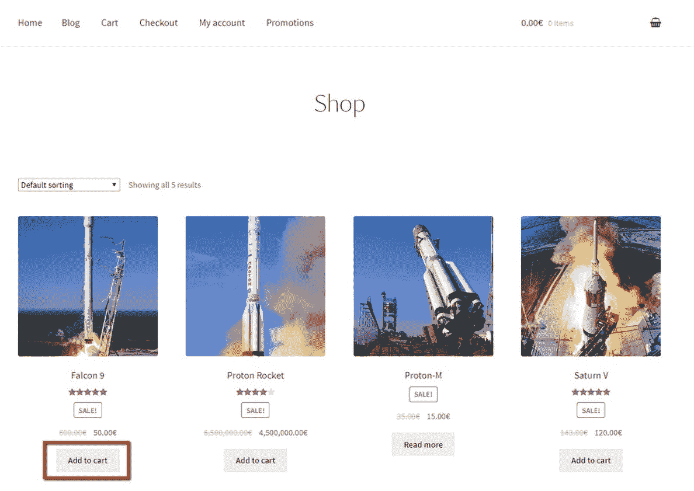

2. 接下来，我们需要点击“查看购物车”按钮，这将引导进入进入页面。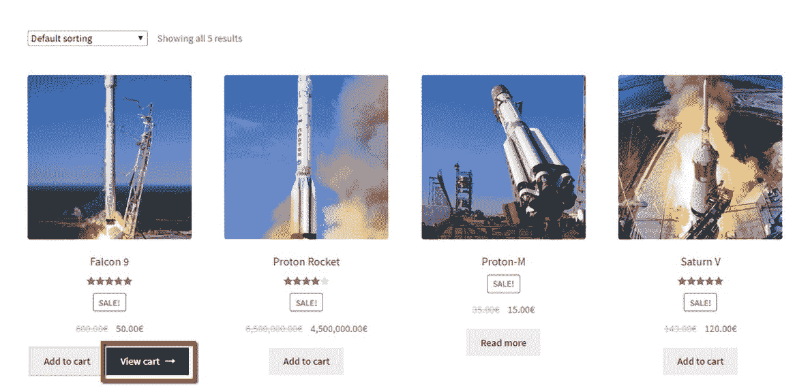

3. 如果是我们的生日，我们可以使用公司给予我们的特殊优惠券。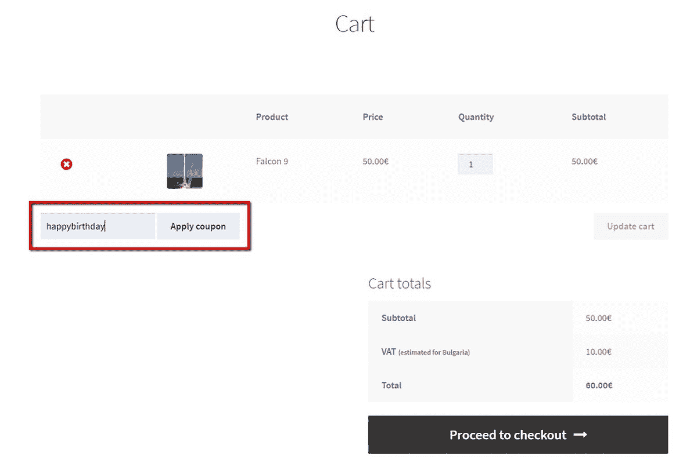

4. 在进行任何操作之前，我们需要确保加载指示器没有显示。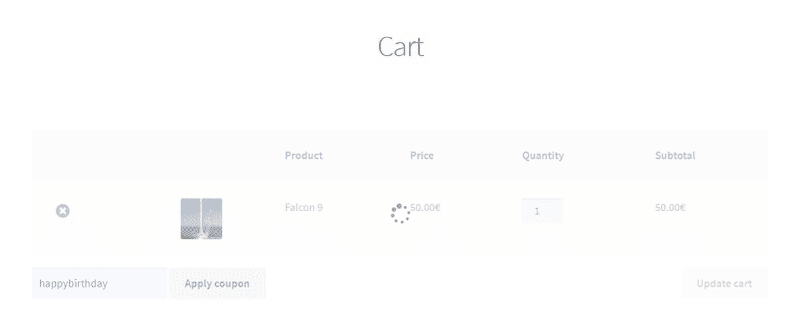

5. 接下来，由于我们获得了折扣，我们有额外的资金来购买更多的火箭。因此，我们将数量增加到 2 并点击“更新购物车”按钮。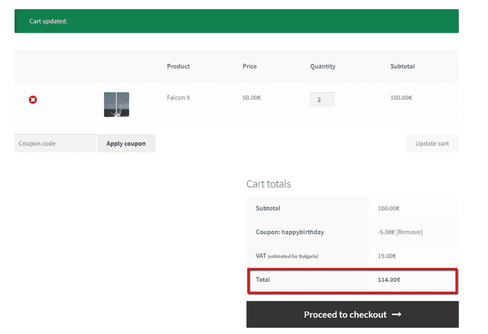

6. 购物车更新后，我们的测试需要检查总价格是否已更改。如果一切正常，我们就点击“去结算”按钮。

7. 我们填写所有必需信息并点击“提交订单”按钮。当加载下一个页面时，我们需要验证订单是否成功提交。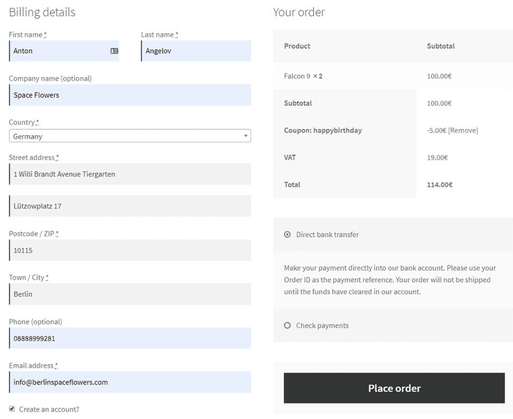

## 第二个自动化测试用例说明

在第一个自动化测试执行后，系统会为我们创建一个账户。如果我们想用相同的电子邮件进行后续购买，我们应该先登录网站。一旦通过了身份验证，我们的所有数据都应该被预填充。因此，我们在账单页面（第 7 步）而不是填写信息时，我们点击“点击此处登录”链接。然后会显示登录表单。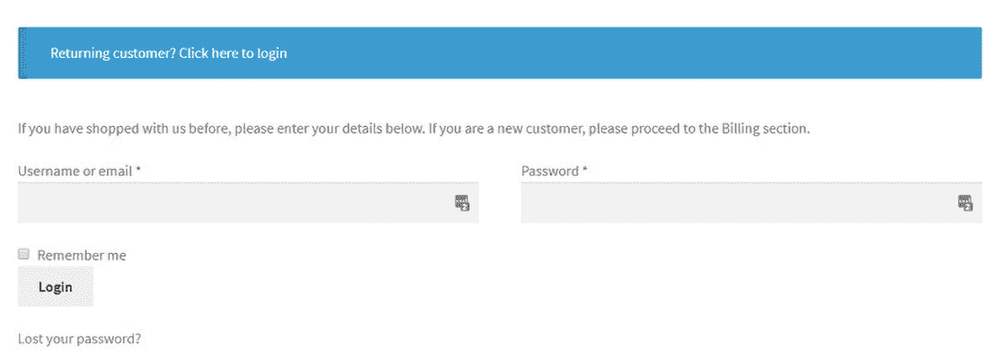

成功验证后，我们将像第一个测试用例一样完成购买。

## 第三个自动化测试用例说明

我们的第三个也是最后一个自动化测试的任务是检查最后创建的订单是否显示在网站的“我的账户”部分。为此：

1. 我们点击导航栏中的“我的账户”链接并登录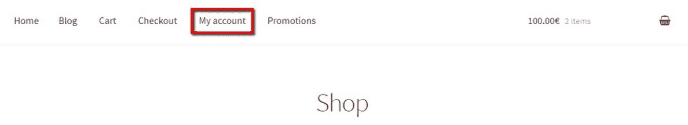


2. 接下来，我们打开“订单”标签，并使用我们在完成上次订单时保存的订单号，点击该特定行的“查看”按钮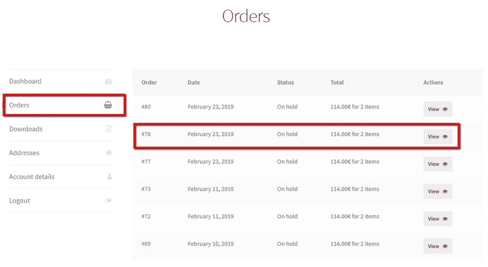

3. 当页面打开时，我们验证显示的数据是否正确。

### 第一个自动化测试代码

现在来看看我们第一个自动化测试用例的代码：

```csharp
private static IWebDriver _driver;
private static string _purchaseEmail;
private static string _purchaseOrderNumber;

[ClassInitialize]
public static void ClassInitialize(TestContext testContext)
{
    _driver = new ChromeDriver(Environment.CurrentDirectory);
}

[ClassCleanup]
public static void ClassCleanup()
{
    _driver.Quit();
}

[TestMethod]
public void CompletePurchaseSuccessfully_WhenNewClient()
{
    _driver.Navigate().GoToUrl("http://demos.bellatrix.solutions/");
    var addToCartFalcon9 = _driver.FindElement(By.CssSelector("[data-product_id*='28']"));
    addToCartFalcon9.Click();
    Thread.Sleep(5000);
    var viewCartButton = _driver.FindElement(By.CssSelector("[class*='added_to_cart wc-forward']"));
    viewCartButton.Click();
    var couponCodeTextField = _driver.FindElement(By.Id("coupon_code"));
    couponCodeTextField.Clear();
    couponCodeTextField.SendKeys("happybirthday");
    var applyCouponButton = _driver.FindElement(By.CssSelector("[value*='Apply coupon']"));
    applyCouponButton.Click();
    Thread.Sleep(5000);
    var messageAlert = _driver.FindElement(By.CssSelector("[class*='woocommerce-message']"));
    Assert.AreEqual("Coupon code applied successfully.", messageAlert.Text);
    var quantityBox = _driver.FindElement(By.CssSelector("[class*='input-text qty']"));
    quantityBox.Clear();
    Thread.Sleep(5000);
    quantityBox.SendKeys("2");
    Thread.Sleep(5000);
    var updateCart = _driver.FindElement(By.CssSelector("[value*='Update cart']"));
    updateCart.Click();
    Thread.Sleep(5000);
    var totalSpan = _driver.FindElement(By.CssSelector*class='='-total']
span

    ...("14.00",",....

varvar. = = =............='='-..--.


.....

var.. = =........._first_name

    .....("Anton

    var. = = _driver..Element(By.Id("last_name"));
    
....("Angelov");
    var billingCompany = _driver.FindElement(By.Id("billing_name"));
    billing..SendKeys("Space");

    var. = = _...Element(By.....---


....
    

    var.. = _driver.FindElement.By... = _driver.FindElement(By.CssSelector("[class*='checkout-button wc-forward']"));
    .Click();
    var billingCountryFilter = _driver.FindElement(By.ClassName("select-search__field"));
    .SendKeys("Germany");
    var germanyOption = _driver.FindElement(By.XPath("//contains(text(),'Germany')]"));
    germanyOption.Click();
    var billingAddress1 = _driver.FindElement(By.Id("billing_address_1"));
    .SendKeys("Willi Brandt Garten");
    var billingAddress2 = _driver.FindElement(By.Id("billing_address_2"));
    .SendKeys("Lützowplatz 17");
    var billingCity = _driver.FindElement(By.Id("billing_city"));
    .SendKeys("Berlin");
    var billingZip = _driver.FindElement(By.Id("billing_postcode"));
    .Clear();
    .SendKeys("10115");
    var billingPhone = _driver.FindElement(By.Id("billing_phone"));
    .SendKeys("+0049889281");
    var billingEmail = _driver.FindElement(By.Id("billing_email"));
    .SendKeys("info@linspaceflowers.com");
    _purchaseEmail = "info@linspaceflowers.com";
    Thread.Sleep(5000);
    checkPayments.Click();
    var placeOrderButton = _driver.FindElement(By.Id("place_order"));
    .Click();
    Thread.Sleep(10000);
    var receivedMessage = _driver.FindElement(By.XPath("//h1"));
    Assert.AreEqual("Order received", receivedMessage.Text);
}
```

为什么不看看我们做了什么呢？我们在`ClassInitialize`方法中启动 Chrome 浏览器。这意味着它启动一次而不是每次测试。

我提到过我们的网站使用了现代 JavaScript，大部分操作都是异步的。为了在第一个版本的测试中处理它们，我们使用了硬编码暂停`Thread.Sleep(5000)`。由于第二个测试需要使用第一个创建的账户进行验证，我们将电子邮件保存在静态变量`_purchaseEmail`中。

### 第二个自动化测试代码

我们的第二个测试几乎相同，除了填写所有账单详情外，我们使用之前保存的电子邮件登录网站。之后，所有字段都已预填充，我们可以完成购买。

```csharp
[TestMethod]
public void CompletePurchaseSuccessfully_WhenExistingClient()
{
    _driver.Navigate().GoToUrl("http://demos.bellatrix.solutions/");
    var addToCartFalcon9 = _driver.FindElement(By.CssSelector("[data-product_id*='28']"));
    addToCartFalcon9.Click();
    Thread.Sleep(500);
    var viewCartButton = _driver.FindElement(By.CssSelector("[class*='added_to_cart wc-forward']"));
    viewCartButton.Click();
    var couponCodeTextField = _driver.FindElement(By.Id("coupon_code"));
    couponCodeTextField.Clear();
    couponCodeTextField.SendKeys("happybirthday");
    var applyCouponButton = _driver.FindElement(By.CssSelector("[value*='Apply coupon']"));
    applyCouponButton.Click();
    Thread.Sleep(5000);
    var messageAlert = _driver.FindElement(By.CssSelector("[class*='woocommerce-message']"));
    Assert.AreEqual("Coupon code applied successfully.", messageAlert.Text);
    var quantityBox = _driver.FindElement(By.CssSelector("[class*='input-text qty']"));
    quantityBox.Clear();
    Thread.Sleep(500);
    quantityBox.SendKeys("2");
    Thread.Sleep(5000);
    var updateCart = _driver.FindElement(By.CssSelector("[value*='Update cart']"));
    updateCart.Click();
    Thread.Sleep(5000);
    var totalSpan = _driver.FindElement(By.XPath("//*[@class='order-total']//span"));
    Assert.AreEqual("114.00€", totalSpan.Text);
    var proceedToCheckout = _driver.FindElement(By.CssSelector("[class*='checkout-button button wc-forward']"));
    proceedToCheckout.Click();
    var loginHereLink = _driver.FindElement(By.LinkText("Click here to login"));
    loginHereLink.Click();
    Thread.Sleep(5000);
    var userName = _driver.FindElement(By.Id("username"));
    userName.SendKeys(_purchaseEmail);
    var password = _driver.FindElement(By.Id("password"));
    password.SendKeys(GetUserPasswordFromDb(_purchaseEmail));
    var loginButton = _driver.FindElement(By.XPath("//button[@name='login']"));
    loginButton.Click();
    Thread.Sleep(5000);
    var placeOrderButton = _driver.FindElement(By.Id("place_order"));
    placeOrderButton.Click();
    Thread.Sleep(5000);
    var receivedMessage = _driver.FindElement(By.XPath("//h1"));
    Assert.AreEqual("Order received", receivedMessage.Text);
    var orderNumber = _driver.FindElement(By.XPath("//*id='post-7']/div/div/div/ul/li[1]/strong"));
    _purchaseOrderNumber = orderNumber.Text;
}
```

在测试结束时，我们提取了成功页面上显示的订单号。我们将在第三个测试中使用它来验证“我的账户”部分的信息是否显示正确。

### 第三个自动化测试代码

在这个测试中，和另外两个一样，我们使用了一些硬编码暂停来确保测试通过。此外，我们使用保存的电子邮件登录，然后使用保存的订单号打开正确的订单页面。

```csharp
[TestMethod]
public void CorrectOrderDataDisplayed_WhenNavigateToMyAccountSection()
{
    _driver.Navigate().GoToUrl("http://demos.bellatrix.solutions/");
    var myAccountLink = _driver.FindElement(By.LinkText("My account"));
    myAccountLink.Click();
    var userName = _driver.FindElement(By.Id("username"));
    userName.SendKeys(_purchaseEmail);
    var password = _driver.FindElement(By.Id("password"));
    password.SendKeys(GetUserPasswordFromDb(_purchaseEmail));
    var loginButton = _driver.FindElement(By.XPath("//button[@name='login']"));
    loginButton.Click();
    Thread.Sleep(5000);
    var orders = _driver.FindElement(By.LinkText("Orders"));
    orders.Click();
    Thread.Sleep(5000);
    var viewButtons = _driver.FindElements(By.LinkText("View"));
    viewButtons[0].Click();
    Thread.Sleep(5000);
    var orderName = _driver.FindElement(By.XPath("//h1"));
    string expectedMessage = string.Format("Order #{0}", _purchaseOrderNumber);
    Assert.AreEqual(expectedMessage, orderName.Text);
}
```

在测试结束时，我们提取了成功页面上显示的订单号。我们将在第三个测试中使用它来验证“我的账户”部分的信息是否显示正确。

### 失败原因

编写自动化测试只是第一步。旅程并未结束。测试越多，你花费分析结果的时间越多。为什么有些测试会失败？有几个原因：

- 测试系统的真实问题
- 测试环境的问题（应用程序重新部署或不可用、网络问题等）
- 测试本身的问题。测试有时通过，有时失败。

我们使用“不稳定测试”（flaky tests）这个术语。通常我们会检查失败的测试并重新运行，以看看会发生什么。如果这次通过了，那么你可能发现了测试环境的问题或是一个脆弱的测试。我们完成了这三个测试，现在应该检查它们有多脆弱。尽管我们的测试设计在当时是合理的，但它们会在以下情况失败：

- **测试依赖**：这是最明显的错误。如果执行的第一个测试没有完成，第二个测试将无法验证，第三个测试无法验证订单。
- **硬编码测试数据**：每个测试都硬编码了所有的网站细节。产品页的 URL 和测试标题写在测试本身中。如果这些细节发生任何变化，我们将更新每个测试。此外，如果环境之间的产品数据不同，这些测试将无法复用。
- **代码重复**：许多操作（如点击链接和填写表单数据）在测试之间重复。我们会修复这个问题。我们想要测试网站的功能，但所有的决策都是不的。然而，结果是一个完全不稳定的测试。 

### 重构测试


在我们回顾初始测试设计不好之后，看看如何改进现有的测试。在这里我们将从小的重构开始——移除一些暂停。为此，我们将使用通过`WebDriver`类内置的名为“显式等待”（explicit wait）的功能。我们还可以为多次出现的操作创建重用方法。

## 隐式等待与显式等待

处理同步问题的一种方法是通过全局隐式超时。

```csharp
WebDriver driver = new ChromeDriver();
driver.Manage().Timeouts().ImplicitWait = TimeSpan.FromSeconds(30);
```

但在某些情况下，你可能需要更大的等待间隔。如果发生这种情况怎么办？一种方案是增加全局超时，这将影响所有现有测试。另一种方案是混合隐式和显式等待。但是不推荐的。这里是 Jim Evans（核心贡献者之一）关于为什么不建议这样做的的引言：“当你尝试混合隐式和显式等待时，你就进入了‘未定义行为’。你可能能够弄清楚这种行为的规则，但它们会随着驱动程序实现细节的变化而改变。所以，不要这样做。不要混合隐式和显式等待。部分问题在于，隐式等待通常（但可能不是）在 WebDriver 系统的“端”实现。这意味着它们被“嵌入”在`IEDriverServer.exe`、`chromedriver.exe`、安装到匿名 Firefox 配置文件的 WebDriver 扩展以及 Java 远程 WebDriver 服务器 (`selenium-server-standalone.jar`) 中。显式等待仅在“本地”语言绑定中实现。使用`RemoteWebDriver`时情况会变得复杂得多，因为你可能会多次使用系统的本地和远程端。”


## 在测试中实现显式等待

我们可以将以下两个辅助方法添加到测试类中。如果使用它们，WebDriver 将先等待元素出现然后返回它。

```csharp
private IWebElement WaitAndFindElement(By by)
{
    var webDriverWait = new WebDriverWait(_driver, TimeSpan.FromSeconds(30));
    return webDriverWait.Until(ExpectedConditions.ElementExists(by));
}

private ReadOnlyCollection<IWebElement> WaitAndFindElements(By by)
{
    var webDriverWait = new WebDriverWait(_driver, TimeSpan.FromSeconds(30));
    return webDriverWait.Until(ExpectedConditions.PresenceOfAllElementsLocatedBy(by));
}
```


我们的下一步是进入测试，并将所有调用从`_driver.FindElement`更改为`_driver.WaitAndElement`。这里是更改后找到元素的简短示例。

```csharp
var billingFirstName = WaitAndFindElement(By.Id("billing_name"));
billingFirstName.SendKeys("Anton");
var billingLastName = WaitAndFindElement(By.Id("last_name"));
billingLastName.SendKeys("Angelov");
var billingCompany = WaitAndFindElement(By.Id("billing_company"));
billingCompany.SendKeys("Space Flowers");
var billingCountryWrapper = WaitAndFindElement(By.Id("select2-billing-country-container"));
billingCountryWrapper.Click();
var billingCountryFilter = WaitAndFindElement(By.ClassName("select-search__field"));
billingCountryFilter.SendKeys("Germany");
```

我们可以改进的另一部分代码是以下：

```csharp
var quantityBox = WaitAndFindElement(By.CssSelector("[class*='input-text qty]"));
quantityBox.Clear();
Thread.Sleep(500);
quantityBox.SendKeys("2");
Thread.Sleep(5000);
var updateCart = WaitAndFindElement(By.CssSelector("[value*='Update cart']"));
updateCart.Click();
Thread.Sleep(5000);
var totalSpan = WaitAndFindElement(By.XPath("//*[@class='order-total']//span"));
Assert.AreEqual("114.00€", totalSpan.Text);
```

你看到`updateCart`之上的硬编码暂停了吗？如果移除它，我们实现的显式等待将没有帮助。测试将报错“元素不可点击”的错误。我们可以再次使用`WebDriver`等待元素可以点击。在这种情况下，我们将使用`ElementToBeable`函数。

```csharp
private void WaitToBeable(By by)
{
    var webDriverWait = new WebDriverWait(_driver, TimeSpan.FromSeconds(30));
    webDriverWait.Until(ExpectedConditions.ElementToBeable(by));
}
```

我们可以在与 update 按钮交互之前添加上述方法，一切都将正常工作。现在我们可以安全地移除硬编码暂停。

## DRY - 不要重复

将我们的框架视为产品，将测试视为生产代码是长期成功的关键。采用开发原则和设计模式可以防止昂贵的维护。其中之一是不要重复（DRY）原则，其核心思想是通过消除不必要的重复来减少维护。我们需要 DRY 我们的测试吗？

```csharp
private void Login(string userName)
{
    Thread.Sleep(5000);
    var userNameTextField = WaitAndFindElement(By.Id("username"));
    userNameTextField.SendKeys(userName);
    var passwordField = WaitAndFindElement(By.Id("password"));
    passwordField.SendKeys(GetUserPasswordFromDb(userName));
    var loginButton = WaitAndFindElement(By.XPath("//button[@name='login']"));
    loginButton.Click();
}

private void IncreaseQuantity()
{
    var quantityBox = WaitAndFindElement(By.CssSelector("[class*='input-text qty]"));
    quantityBox.Clear();
    quantityBox.SendKeys("2");
    WaitToBeable(By.CssSelector("[value*='Update cart']"));
    var updateCart = WaitAndFindElement(By.CssSelector("[value*='Update cart']"));
    updateCart.Click();
    Thread.Sleep(5000);
    var totalSpan = WaitAndFindElement(By.XPath("//*[@class='order-total']//span"));
    Assert.AreEqual("114.00€", totalSpan.Text);
}

private void ApplyCoupon()
{
    var couponCodeTextField = WaitAndFindElement(By.Id("coupon_code"));
    couponCodeTextField.Clear();
    couponCodeTextField.SendKeys("happybirthday");
    var applyCouponButton = WaitAndFindElement(By.CssSelector("[value*='Apply coupon']"));
    applyCouponButton.Click();
    Thread.Sleep(5000);
    var messageAlert = WaitAndFindElement(By.CssSelector("[class*='woocommerce-message']"));
    Assert.AreEqual("Coupon code applied successfully.", messageAlert.Text);
}

private void AddToShoppingCart()
{
    var addToCartFalcon9 = WaitAndFindElement(By.CssSelector("[data-product_id*='28']"));
    addToCartFalcon9.Click();
    var viewCartButton = WaitAndFindElement(By.CssSelector("[class*='added_to_cart wc-forward']"));
    viewCartButton.Click();
}
```

```csharp
[TestMethod]
public void CompletePurchaseSuccessfully_WhenExistingClient()
{
    _driver.Navigate().GoToUrl("http://demos.bellatrix.solutions/");
    AddToShoppingCart();
    ApplyCoupon();
    IncreaseQuantity();
    var proceedToCheckout = _driver.FindElement(By.CssSelector("[class*='checkout-button button wc-forward']"));
    proceedToCheckout.Click();
    var loginHereLink = _driver.FindElement(By.LinkText("Click here to login"));
    loginHereLink.Click();
    Login(_purchaseEmail);
    var placeOrderButton = _driver.FindElement(By.Id("place_order"));
    placeOrderButton.Click();
    Thread.Sleep(10000);
    var receivedMessage = _driver.FindElement(By.XPath("//h1"));
    Assert.AreEqual("Order received", receivedMessage.Text);
    var orderNumber = _driver.FindElement(By.XPath("//*id='post-7']/div/div/div/ul/li[1]/strong"));
    _purchaseOrderNumber = orderNumber.Text;
}
```

## 装饰器模式用于修复 WebDriver 不稳定操作

稳定测试的下一个逻辑步骤是确保我们所有的改进都能用到未来的测试中。我们可以通过将 WebDriver 增强封装在新类中来实现。我们将使用装饰器设计模式。它允许我们动态地为对象附加额外的职责。


## 装饰器模式抽象 UML 类图


## 参与者

参与此模式的类和对象有：

组件（Component）：为动态添加职责的对象定义接口。

- 装饰器（Decorator）：实现与它们要装饰的组件相同的接口（抽象类）。它与对象具有 HAS-A 关系。

## 对测试代码进行插桩以寻找可能的优化点

我们的测试应该尽可能快，这样我们才能将其集成到 CI（持续集成）中，并及时发现产品中的问题。如果你记得上章的示例，即使在测试套件的最新稳定版本中，也有许多我们可以进一步优化的地方。为了定位可能的优化点，我们将在代码中插桩少量语句，以测量执行这些语句所花费的时间。

```csharp
private static Driver _driver;
private static string _purchaseEmail;
private static string _purchaseOrderNumber;
private static Stopwatch _stopWatch;

[ClassInitialize]
public static void ClassInitialize(TestContext testContext)
{
    _stopWatch = Stopwatch.StartNew();
    _driver = new LoggingDriver(new WebDriver());
    _driver.Start(Browser.Chrome);
    Debug.WriteLine($"End Browser Initialize: {_stopWatch.Elapsed.TotalSeconds}");
}

[ClassCleanup]
public static void ClassCleanup()
{
    _driver.Quit();
    Debug.WriteLine(_stopWatch.Elapsed.TotalSeconds);
    _stopWatch.Stop();
}

[TestMethod]
public void CompletePurchaseSuccessfully_WhenNewClient()
{
    Debug.WriteLine($"Start Test1: {_stopWatch.Elapsed.TotalSeconds}");
    // test's code
    Debug.WriteLine($"End Test1: {_stopWatch.Elapsed.TotalSeconds}");
}

private void Login(string userName)
{
    Debug.WriteLine($"Login Start: {_stopWatch.Elapsed.TotalSeconds}");
    // test's code
    Debug.WriteLine($"Login End: {_stopWatch.Elapsed.TotalSeconds}");
}
```

我们使用特殊的 .NET 类`StopWatch`来测量不同语句执行之间的时间间隔。通过`Debug.WriteLine($"Login End:{_stopWatch.Elapsed.TotalSeconds}")`这一行代码，我们在调试控制台中打印出从开始以来经过的秒数。运行几次测试后，我们将得到几个关键的测量值。

初始化一个新的浏览器实例需要大约 2 秒。登录网站耗时约 5 秒。此外，如果我们将硬编码暂停的秒数相加，会得到额外的 12 秒。我们的第一个测试大约在 40 秒内完成。这意味着如果我们能找到优化之前这些点的方法，我们可以节省 10 到 15 秒，或者我们的测试可以快约 25-40%。

## 优化登录

在大多数网站中，登录是最关键的区域之一。我们大多数的测试都需要先登录才能进行验证。然而，99% 的测试并不是在测试登录功能，而是测试其他内容。这意味着我们可以专门建立一个测试套件来验证我们的登录是否运行良好并与所有其他测试集成，但除了这些测试之外，其他测试都不需要每次都加载此页面、输入用户名和密码等。一种常见的优化方法是通过自动创建身份验证 cookie 来在网站上进行身份验证。通常，我们调用一个内部 Web API 来生成 cookie 的值，该值会执行登录本身的逻辑。

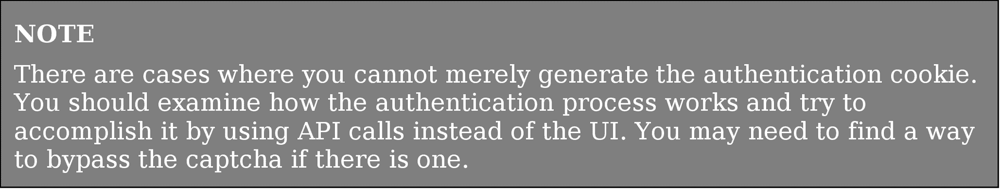


如果我们为测试实现了这样的逻辑，这意味着我们每个测试都将节省约 2 秒。对于 1000 次测试，这将等于节省了超过 30 分钟。

## 如何在测试中等待异步请求完成？


正如你在优化计划中看到的，最大的瓶颈之一是我们用于处理表单异步加载的硬编码暂停。回顾一下我们如何删除它们，并让等待时间不超过所需的时间，觉得如何？

行业采用的现代方法是异步加载 Web 元素。在这种方法中，JavaScript 代码与渲染页面内容并行处理。这意味着即使某个组件响应或加载缓慢，也不会冻结页面的其他部分。在此之前，点击按钮后，整个页面都会重新加载，然后测试就可以安全地执行验证。然而，由于 AJAX，我们需要的元素在页面加载后可能不在页面上，并在几秒后才出现，导致检查或交互失败。因此，我们需要从一开始就为这些情况做好准备。

在我们的测试用例中，此类请求出现在两个地方是应用优惠券和增加产品数量时。

```csharp
private void IncreaseProductQuantity()
{
    var quantityBox = _driver.FindElement(By.CssSelector("[class*='input-text qty text']"));
    quantityBox.TypeText("2");
    Thread.Sleep(2000);
    var updateCart = _driver.FindElement(By.CssSelector("[value*='Update cart']"));
    updateCart.Click();
    Thread.Sleep(4000);
    var totalSpan = _driver.FindElement(By.XPath("//*[@class='order-total']//span"));
    Assert.AreEqual("114.00€", totalSpan.Text);
}

private void ApplyCoupon()
{
    var couponCodeTextField = _driver.FindElement(By.Id("coupon_code"));
    couponCodeTextField.TypeText("happybirthday");
    var applyCouponButton = _driver.FindElement(By.CssSelector("[value*='Apply coupon']"));
    applyCouponButton.Click();
    Thread.Sleep(2000);
    var messageAlert = _driver.FindElement(By.CssSelector("[class*='woocommerce-message']"));
    Assert.AreEqual("Coupon code applied successfully.", messageAlert.Text);
}
```

当我们应用代码时，屏幕上显示的是：


取决于执行测试的环境，加载可能持续几毫秒到几秒。然而，由于我们使用了硬编码暂停，我们将一直等待。我们需要改进我们的测试库来处理这些请求。

## 等待 AJAX 请求完成

许多 JavaScript 库可以简化这项工作。最流行的之一是 jQuery。我们将使用它的方法来获取当前活跃请求的总数。如果页面完全加载，`jQuery.active` 返回 0。如果仍在执行请求，它将返回一个正数。`WebDriver` 提供了在当前页面执行 JavaScript 代码的 API。你想看 `WaitForAjax` 的示例实现吗？

```csharp
public override void WaitForAjax()
{
    var js = (IJavaScriptExecutor)_webDriver;
    _webDriver.Until(wd=>js.ExecuteScript("return jQuery.active") == "0");
}
```

在 `WebDriver` 中，`Wait` 类中的 `Until` 方法简单来说是一个循环，执行传递给它的代码直到返回一个值。我们让 JavaScript 返回 `jQuery.active`。在 `WaitForAjax` 方法中，当请求为 0 时达到退出条件。这意味着 AJAX 请求已完成，我们可以移动到下一步。现在，我们可以在任何需要测试等待异步请求的地方使用 `WaitForAjax`。我们将替换之前添加的硬编码 sleep 方法：

```csharp
private void IncreaseProductQuantity()
{
    var quantityBox = _driver.FindElement(By.CssSelector("[class*='input-text qty text']"));
    quantityBox.TypeText("2");
    _driver.WaitForAjax();
    var updateCart = _driver.FindElement(By.CssSelector("[value*='Update cart']"));
    updateCart.Click();
    _driver.WaitForAjax();
    var totalSpan = _driver.FindElement(By.XPath("//*[@class='order-total']//span"));
    Assert.AreEqual("114.00€", totalSpan.Text);
}

private void ApplyCoupon()
{
    var couponCodeTextField = _driver.FindElement(By.Id("coupon_code"));
    couponCodeTextField.TypeText("happybirthday");
    var applyCouponButton = _driver.FindElement(By.CssSelector("[value*='Apply coupon']"));
    applyCouponButton.Click();
    _driver.WaitForAjax();
    var messageAlert = _driver.FindElement(By.CssSelector("[class*='woocommerce-message']"));
    Assert.AreEqual("Coupon code applied successfully.", messageAlert.Text);
}
```

我们征服了 AJAX 难题。现在是转向另一种改进测试执行的方法了：优化浏览器初始化。还有另一个地方需要特殊的等待逻辑来移除暂停，就是在点击“去结账”按钮之后。在那里我们需要等待整个页面加载。由于没有异步请求，`WaitForAjax` 方法将不起作用。因此，我们可以为 `WebDriver` 装饰器添加一个辅助函数。代码如下：

```csharp
public override void WaitUntilPageCompletely()
{
    var js = (IJavaScriptExecutor)_webDriver;
    _webDriver.Until(wd=>js.ExecuteScript("return document.readyState") == "complete");
}
```

通过 JavaScript，我们等待文档就绪变为“complete”。这就是我们如何在使用 `CompletePurchaseSuccessfully_WhenNewClient` 测试中使用它的：

```csharp
AddRocketToShoppingCart();
ApplyCoupon();
IncreaseProductQuantity();
var proceedToCheckout = _driver.FindElement(By.CssSelector("[class*='checkout-button alt wc-forward']"));
proceedToCheckout.Click();
_driver.WaitUntilPageCompletely();
var billingFirstName = _driver.FindElement(By.Id("billing_first_name"));
billingFirstName.TypeText("Anton");
```

## 优化浏览器初始化-观察者模式

查看我们的优化列表，我们发现了另一个减慢测试的问题——重复且耗时的浏览器初始化。每个测试可能花费花费 2 秒。

```csharp
[TestInitialize]
public void TestInitialize()
{
    _driver = new LoggingDriver(new WebDriver());
    _driver.Start(Browser.Chrome);
}

[TestCleanup]
public void TestCleanup()
{
    _driver.Quit();
}
```

现在，我们为每个测试启动并关闭浏览器。更智能的方法可能是重用浏览器——在整个测试套件开始时启动，并在所有测试执行完成后关闭它。这将带给我们大量的执行时间改进，但如果我们仍然需要在某些测试之前重启浏览器怎么办？因为如此，我们需要一个更智能的解决方案，允许按测试类或测试方法配置这种行为。为了任务，我们将实现观察者模式。

## 观察者模式

观察者模式定义了对象之间一对多的关系，以便当一个对象改变状态时，所有依赖项都会收到通知并自动更新。

- 追求交互对象之间的松耦合设计。
- 允许你以非常高效的方式向许多其他对象发送数据。
- 添加新观察者时不需要对主体（subject）进行任何修改。
- 可以随时添加和删除观察者。
- 观察者通知的顺序是不可预测的。

抽象 UML 类图


模式中的参与者有：

- `ITestExecutionSubject`：对象使用此接口注册和移除观察者。
- `MSTestExecutionSubject`：具体实现 `ITestExecutionSubject` 接口。此外，`attach` 和 `detach` 方法在状态变化时更新所有订阅的观察者。
- `ITestBehaviorObserver`：所有可能的观察者都需要实现此接口。此接口的方法在主体状态变化时调用。
- `OwnerTestObserver`：实现 `ITestBehaviorObserver` 接口的任何类。每个观察者都向特定主体注册以接收更新。
- `BaseTest`：框架中所有测试类的父类。使用 `TestExecutionSubject` 通过测试方法/类来扩展其功能。

## 观察者模式实现

通过我们的实现，我们将为自动化工程师提供一种通过类级别添加额外逻辑的方法，例如，如果之前的测试没有，则重用浏览器。


`Subject` 是包含并控制状态的对象，因此只有一个状态主体。观察者虽然使用该状态，但不拥有它。有许多观察者，它们依赖主体告诉它们状态变化。因此，一个主体和多个观察者之间存在关系。

为什么不看 `ITestExecutionSubject` 接口？

```csharp
public interface ITestExecutionSubject
{
    void Attach(ITestBehaviorObserver observer);
    void Detach(ITestBehaviorObserver observer);
    void PreTestInit(TestContext context, MemberInfo);
    void PostTestInit(TestContext context, MemberInfo);
    void TestCleanup(TestContext context, MemberInfo);
    void PostTestCleanup(TestContext context, MemberInfo);
    void TestInitialized(MemberInfo);
}
```

`Attach` 和 `Detach` 方法被观察者类用于与主体关联。剩余的方法在测试执行的各个步骤中调用，以通知观察者主体状态的变化。为了让主体能够通知观察者，它们需要实现定义了所有通知方法的 `ITestBehaviorObserver` 接口。

```csharp
public interface ITestBehaviorObserver
{
    void PreTestInit(TestContext context, MemberInfo);
    void PostTestInit(TestContext context, MemberInfo);
    void TestTestCleanup(TestContext context, MemberInfo);
    void PostTestCleanup(TestContext context, MemberInfo);
    void TestInitialized(MemberInfo);
}
```

之后，应该创建一个具体的主体类。

```csharp
public class MsTestExecutionSubject : ITestExecutionSubject
{
    private readonly List<ITestBehaviorObserver> _testBehaviorObservers;

    public MsTestExecutionSubject()
    {
        _testBehaviorObservers = new List<ITestBehaviorObserver>();
    }

    public void Attach(ITestBehaviorObserver observer)
    {
        _testBehaviorObservers.Add(observer);
    }

    public void Detach(ITestBehaviorObserver observer)
    {
        _testBehaviorObservers.Remove(observer);
    }

    public void PreTestInit(TestContext context, MemberInfo)
    {
        foreach (var currentObserver in _testBehaviorObservers)
        {
            currentObserver.PreTestInit(context, MemberInfo);
        }
    }

    public void PostTestInit(TestContext context, MemberInfo)
    {
        foreach (var currentObserver in _testBehaviorObservers)
        {
            currentObserver.PostTestInit(context, MemberInfo);
        }
    }

    public void TestCleanup(TestContext context, MemberInfo)
    {
        foreach (var currentObserver in _testBehaviorObservers)
        {
            currentObserver.TestTestCleanup(context, MemberInfo);
        }
    }

    public void PostTestCleanup(TestContext context, MemberInfo)
    {
        foreach (var currentObserver in _testBehaviorObservers)
        {
            currentObserver.PostTestCleanup(context, MemberInfo);
        }
    }

    public void TestInitialized(MemberInfo)
    {
        foreach (var currentObserver in _testBehaviorObservers)
        {
            currentObserver.TestInitialized(MemberInfo);
        }
    }
}
```

特定的 `subject` 对观察者的实现一无所知。它与 `ITestBehaviorObserver` 对象列表工作。`Attach` 和 `Detach` 方法向集合中添加和移除观察者。在观察者模式的经典实现中，观察者负责将自己与 `subject` 类关联。并不是所有的观察者都需要实现通知方法。为了支持这一需求，我们将添加一个实现 `ITestBehaviorObserver` 接口的基类。

```csharp
public class BaseTestBehaviorObserver : ITestBehaviorObserver
{
    private readonly ITestExecutionSubject _testExecutionSubject;
```


public BaseTestBehaviorObserver(ITestExecutionSubject testExecutionSubject)
{
    _testExecutionSubject = testExecutionSubject;
    testExecutionSubject.Attach(this);
}

public virtual void PreTestInit(TestContext context, MemberInfo) {}
public virtual void PostTestInit(TestContext context, MemberInfo) {}
public virtual void TestTestCleanup(TestContext context, MemberInfo) {}
public virtual void PostTestCleanup(TestContext context, MemberInfo) {}
public virtual void TestInitialized(MemberInfo) {}

由于所有通知方法都是空的，子类只需要覆盖必要的那些。此外，基类构造函数需要`ITestExecutionSubject`参数以便将当前观察者与主体关联。

### 通过属性配置浏览器行为

最后，我们准备好开发优化浏览器初始化的解决方案。让我们看看如果使用它，我们的测试将会是怎样的：

```csharp
[TestClass]
[ExecutionBrowser(Browser.Chrome, ReuseIfStarted)]
public class ProductPurchaseTests : BaseTest
{
    private static string _purchaseEmail;
    private static string _purchaseOrderNumber;

    [TestMethod]
    public void CompletePurchaseSuccessfully_WhenNewClient()
    {
        AddRocketToShoppingCart();
        ApplyCoupon();
        IncreaseQuantity();
        // the rest of the code
    }

    [TestMethod]
    [ExecutionBrowser(Browser.Firefox, ReuseIfStarted)]
    public void CompletePurchaseSuccessfully_WhenExistingClient()
    {
        AddRocketToShoppingCart();
        ApplyCoupon();
        IncreaseQuantity();
        // rest 的代码
    }
}
```

在示例中，新属性用于配置所有测试使用 Chrome 浏览器。然而，测试方法属性将覆盖类级别的值。因此，在`CompletePurchaseSuccessfully_WhenExistingClient`测试之前，浏览器初始化为 Firefox 而不是 Chrome。

```csharp
[AttributeUsage(AttributeTargets.Class | AttributeTargets.Method, Inherited = true, AllowMultiple = false)]
public class ExecutionBrowserAttribute : Attribute
{
    public ExecutionBrowserAttribute(Browser browser, BrowserBehavior browserBehavior)
    {
        BrowserConfiguration = new BrowserConfiguration(browser, browserBehavior);
    }

    public BrowserConfiguration BrowserConfiguration { get; set; }
}
```

`BrowserAttribute`本身没什么特别，它只包含一个两个属性的`BrowserConfiguration`类。第一个属性是控制浏览器行为的`BrowserBehavior`枚举。

```csharp
public enum BrowserBehavior
{
    NotSet = 0,
    ReuseIfStarted = 1,
    RestartEveryTime = 2,
    RestartOnFail = 3
}
```

该属性通过`AttributeUsage`在测试类和方法级别可用。浏览器的控制和属性的提取发生在具体观察者`BrowserLaunchTestObserver`中。

```csharp
public class BrowserLaunchTestObserver : BaseTestBehaviorObserver
{
    private readonly Driver _driver;
    private BrowserConfiguration _currentBrowserConfiguration;
    private BrowserConfiguration _previousBrowserConfiguration;

    public BrowserLaunchTestObserver(ITestExecutionSubject testExecutionSubject, Driver driver) : base(testExecutionSubject)
    {
        _driver = driver;
    }

    public override void PreTestInit(TestContext context, MemberInfo)
    {
        _currentBrowserConfiguration = GetBrowserConfiguration(memberInfo);
        bool shouldRestart = ShouldRestart(_currentBrowserConfiguration);

        if (shouldRestart)
        {
            RestartBrowser();
        }

        _previousBrowserConfiguration = _currentBrowserConfiguration;
    }

    public override void PostTestCleanup(TestContext context, MemberInfo)
    {
        if (_currentBrowserConfiguration.BrowserBehavior == BrowserBehavior.RestartOnFail && context.CurrentTestOutcome.Equals(TestOutcome.Failed))
        {
            RestartBrowser();
        }
    }

    private void RestartBrowser()
    {
        _driver.Quit();
        _driver.Start(_currentBrowserConfiguration.Browser);
    }

    private bool ShouldRestart(BrowserConfiguration configuration)
    {
        if (_previousBrowserConfiguration == null)
        {
            return true;
        }

        return configuration.BrowserBehavior == BrowserBehavior.RestartEveryTime || configuration.BrowserBehavior == BrowserBehavior.NotSet;
    }

    private BrowserConfiguration GetBrowserConfiguration(MemberInfo memberInfo)
    {
        var attribute = memberInfo.GetCustomAttribute<ExecutionBrowserAttribute>();

        if (attribute != null)
        {
            return attribute.BrowserConfiguration;
        }

        attribute = memberInfo.DeclaringType.GetCustomAttribute<ExecutionBrowserAttribute>();

        if (attribute != null)
        {
            return attribute.BrowserConfiguration;
        }

        return new BrowserConfiguration(Browser.Chrome, BrowserBehavior.NotSet);
    }
}
```

这里有很多事情发生，为什么不逐一讨论呢？属性中的值是通过`.NET Reflection` API 提取的。`var executionBrowserAttribute = type.GetCustomAttribute<ExecutionBrowserAttribute>(true);`。在`PreTestInit`和`PostTestCleanup`方法中，我们调用`ShouldRestart`方法来确定是否重启当前浏览器实例。

```csharp
private bool ShouldRestart(BrowserConfiguration configuration)
{
    if (_previousBrowserConfiguration == null)
    {
        return true;
    }

    return configuration.BrowserBehavior == BrowserBehavior.RestartEveryTime || configuration.BrowserBehavior == BrowserBehavior.NotSet;
}
```

如果是第一次调用方法，`_previousBrowserConfiguration`变量仍为`null`，因此方法将返回`true`。对于剩余的流程，我们检查当前浏览器配置的`BrowserBehavior`枚举值。此外，在`PostTestCleanup`方法中，我们检查测试是否失败。如果失败了，我们将重启浏览器，因为它可能处于不一致状态。

```csharp
public override void PostTestCleanup(TestContext context, MemberInfo)
{
    if (_currentBrowserConfiguration.BrowserBehavior == BrowserBehavior.RestartOnFail && context.CurrentTestOutcome.Equals(TestOutcome.Failed))
    {
        RestartBrowser();
    }
}
```

谜题的最后一部分是组合这些类。这发生在`BaseTest`类中。

```csharp
[TestClass]
public class BaseTest
{
    private static ITestExecutionSubject CurrentExecutionSubject;
    private static Driver LoggingDriver;

    static BaseTest()
    {
        CurrentExecutionSubject = new MsTestExecutionSubject();
        LoggingDriver = new LoggingDriver(new WebDriver());
        new BrowserLaunchTestObserver(CurrentExecutionSubject, LoggingDriver);
        var memberInfo = MethodBase.GetCurrentMethod();
        CurrentExecutionSubject.TestInstantiated(memberInfo);
    }

    public BaseTest()
    {
        Driver = LoggingDriver;
    }

    public Driver Driver { get; set; }
    public TestContext TestContext { get; set; }
    public string TestName => TestContext.Name;

    [ClassInitialize]
    public static void OnClassInitialize(TestContext context) {}

    [ClassCleanup]
    public static void OnClassCleanup() {}

    [TestInitialize]
    public void CoreTestInit()
    {
        var memberInfo = MethodBase.GetCurrentMethod();
        CurrentExecutionSubject.PreTestInit(TestContext, memberInfo);
        TestInit();
        CurrentExecutionSubject.PostTestInit(TestContext, memberInfo);
    }

    [TestCleanup]
    public void CoreTestCleanup()
    {
        var memberInfo = MethodBase.GetCurrentMethod();
        TestCleanup();
        CurrentExecutionSubject.PostTestCleanup(TestContext, memberInfo);
    }

    [AssemblyCleanup]
    public static void AssemblyCleanup()
    {
        LoggingDriver?.Quit();
    }

    public virtual void TestInit() {}
    public virtual void TestCleanup() {}
}
```

测试类需要添加`TestInitialize`或`TestCleanup`逻辑，它们现在将重写`TestInit`和`TestCleanup`方法，而不是使用`TestInitialize`和`TestCleanup`属性。在`CoreTestInit`方法中调用了三个重要的方法：首先，我们调用当前主类的`PreTestInit`方法，为每个观察者调用`PreTestInit`。随后执行`TestInit`方法或其重写版本。最后，所有观察者的`PostTestInit`方法通过当前主体再次调用。清理方法同样有效。

```csharp
_driver = new LoggingDriver(new WebDriver());
new BrowserLaunchTestObserver(CurrentExecutionSubject, _driver);
```

### 每个测试的隔离浏览器初始化

我们的新解决方案仍然存在问题。如果你运行了测试，可能会注意到异常行为。例如，如果先执行登录网站的测试，那么匿名购买测试将会失败，因为我们重用了浏览器。由于这种依赖关系，处理这种情况的方法是扩展我们的解决方案，在重用时清理缓存和 cookie。首先我们需要我们需要在`WebDriver`装饰器中添加一个删除所有 cookie 的新方法。

```csharp
public override void DeleteAllCookies()
{
    _driver.Manage().Cookies.DeleteAll();
}
```

之后，我们需要更改`BrowserLaunchTestObserver`类的`PreTestInit`和`TestCleanup`方法。

```csharp
public override void PreTestInit(TestContext context, MemberInfo memberInfo)
{


`_currentBrowserConfiguration = GetBrowserConfiguration(memberInfo);`

`bool shouldRestart = ShouldRestart(_currentBrowserConfiguration);`

`if (shouldRestart)`

`{`

`    RestartBrowser();`

`}`

`else`

`{`

`    _driver.DeleteAllCookies();`

`}`

`_previousBrowserConfiguration = _currentBrowserConfiguration;`

`}`

### 密封测试模式

处理这种情况的一种方法是密封 etic 测试模式。

```csharp
[TestClass]
public class CaptureHttpTests
{
    private static IWebDriver _driver;
    private static ProxyServer _proxyServer;
    private static IDictionary<int, Proxy.Request> _requestsHistory;
    private static IDictionary<int, Proxy.Response> _responsesHistory;
    private static ConcurrentBag<string> _blockUrls;

    [ClassInitialize]
    public static void OnClassInitialize(TestContext context)
    {
        _proxyServer = new ProxyServer();
        _blockUrls = new ConcurrentBag<string>();
        _responsesHistory = new Dictionary<int, Proxy.Response>();
        _requestsHistory = new Dictionary<int, Proxy.Request>();

        var explicitEndPoint = new ExplicitProxyEndPoint(System.Net.IPAddress.Any, 18882, true);
        _proxyServer.AddEndPoint(explicitEndPoint);
        _proxyServer.Start();
        _proxyServer.SetAsHttp(explicitEndPoint);
        _proxyServer.SetAsHttps(explicitEndPoint);
        _proxyServer.BeforeRequest += OnResourceEventHandler;
        _proxyServer.BeforeRequest += OnRequestEventHandler;
        _proxyServer.BeforeResponse += OnResponseEventHandler;
    }

    [ClassCleanup]
    public static void OnCleanup() {}

    [TestInitialize]
    public void TestInit()
    {
        var proxy = new OpenQA.Selenium.Proxy
        {
            HttpProxy = "localhost:1882",
            SslProxy = "localhost:1882",
            FtpProxy = "localhost:1882"
        };
        _driver = new ChromeDriver(proxy);
    }

    [TestCleanup]
    public void TestCleanup()
    {
        _driver.Dispose();
    }

    [TestMethod]
    public void FontRequestsNotMade_WhenRequestToBeBlocked()
    {
        _blockUrls.Add("myanalytics.com");
        _driver.Navigate().GoToUrl("https://automatetheplanet.com/");
    }

    private static async Task OnResourceEventHandler(object sender, EventArgs e) => await Task.Run(() =>
    {
        if (_blockUrls.Count > 0)
        {
            foreach (var urlToBeBlocked in _blockUrls)
            {
                if (e.HttpClient.Request.RequestUri.ToString().Contains(urlToBeBlocked))
                {
                    string customBody = string.Empty;
                    e.Ok(Encoding.UTF8.GetBytes(customBody));
                }
            }
        }
    });

    private static async Task OnRequestEventHandler(object sender, EventArgs e) => await Task.Run(() =>
    {
        if (!_requestsHistory.ContainsKey(e.HttpClient.Request.GetHashCode()) && e.HttpClient.Request != null)
        {
            _requestsHistory.Add(e.HttpClient.Request.GetHashCode(), e.HttpClient.Request);
        }
    });

    private static async Task OnResponseEventHandler(object sender, EventArgs e) => await Task.Run(() =>
    {
        if (!_responsesHistory.ContainsKey(e.HttpClient.Response.GetHashCode()) && e.HttpClient.Response != null)
        {
            _responsesHistory.Add(e.HttpClient.Response.GetHashCode(), e.HttpClient.Response);
        }
    });
}
```

## 页面对象模型（Page Object Model）设计模式

### 普通页面元素与操作

### 页面对象模型设计模式 - 章节

### 高质量代码 - 使用意义名称

### 正确的方法命名

### 遵循编码规范 - 工具

### 页面对象模型设计模式

Web 自动化中最流行的模式之一就是所谓的页面对象模型（Page Object Model, POM）设计模式。要理解该模式的主要目标，首先你需要思考你的 Web 自动化测试在做什么。它们导航到不同的网页并对各种元素执行操作，对吧？页面对象将页面上发生的所有元素、操作和验证封装在单个对象中。

### 创建第一个页面对象模型

随着 `WebDriver` .NET 绑定库的最新发布，我们创建页面对象的方式与 Java 版本相比发生了变化。你想要简要回顾一下在 3.11.0 版本之前定义页面对象的方法吗？

```csharp
public class SearchEngineMainPage{
    private readonly IWebDriver _driver;
    private readonly string _url = @"searchEngineUrl";

    [FindsBy(How = How.Id, Using = "sb_form_q")]
    private IWebElement _searchBox;

    [FindsBy(How = How.Id, Using = "sb_form_go")]
    private IWebElement _goButton;

    public SearchEngineMainPage(IWebDriver driver){
        _driver = driver;
        PageFactory.InitElements(driver, this);
    }

    public void Search(string textToType){
        _driver.Navigate().GoToUrl(this.url);
        _searchBox.Clear();
        _searchBox.SendKeys(textToType);
        _goButton.Click();
    }
}
```

首先，为了定位不同的 Web 元素，我们使用了 `FindsBy` 特性，可以在其中指定查找策略 `How` - 通过 `Id`、`Class`、`XPath` 等查找并将实际定位器赋值给使用的属性。为了让所有 Web 元素在页面加载时填充，你需要调用 `PageFactory` 类的 `InitElements` 方法。然而，在 2018 年 3 月随着 `WebDriver` .NET 绑定 3.11.0 版本的发布，该 API 被标记为过时（obsolete）。

以下来自 `WebDriver` .NET 绑定主要维护者 Jim Evans 网站的一段引用，解释了他们决定弃用这部分 API：

> “这些构造的 .NET 实现主要是是因为某些用户问：‘Java 有，为什么 .NET 没有？’与其盲目地复制 Java 的实现，不如思考一下在使用 C# 时什么才是合理的。换句话说，‘C# 不是 Java，因此在 Java 中工作效果最好的东西可能并不完全适用于 C#。’ 在 .NET `PageFactory` 的情况下，该实现存在问题且过于繁琐，而且对于人们想要创建页面对象的各种方式来说远不够灵活。此外，当 `.NET Core 2.0` 发布时，.NET `PageFactory` 依赖的类没有包含在 `.NET Core 2.0` 中。这意味着要在 `.NET Core` 下让 `PageFactory` 工作，该项目要么引入新的依赖，要么用条件编译指令弄乱代码，要么在 .NET Core 中不支持它。第一种方法对于 Selenium 项目的 .NET 绑定来说是不可行的，其原因应该本身成为独立博客文章的主题。第二种方法使得代码几乎无法妥善维护。此外，对于 `PageFactory` 而言，通过属性识别元素与直接在运行时代码中执行相比没有任何益处。声称 `PageFactory` 让页面对象的创建和维护变得更简洁的说法在严严的审查下根本站不住脚。”

### 创建页面对象的新方法

如果你仔细观察之前的代码，你会发现你无法对元素的查找方式进行控制。你没有将 `PageFactory` 与 `WebDriverWait` 类集成，以便处理复杂场景。幸运的是，我们可以完全复用已经创建的代码来稳定和优化我们的购物车。与其直接使用 `IWebDriver`，我们可以通过我们装饰后的版本定位元素，并同样返回装饰后的元素。为什么不回想一下在不使用页面对象之前我们的测试是什么样子的？

```csharp
[TestMethod]
public void CompletePurchase_WhenNewClient(){
    AddRocketToShoppingCart();
    ApplyCoupon();
    IncreaseProductQuantity();

    var proceedToCheckout = _driver.FindElement(By.CssSelector("[class*='checkout-button alt wc-forward']"));
    proceedToCheckout.Click();
    _driver.WaitUntilPageCompletely();

    var billingFirstName = _driver.FindElement(By.Id("first_name"));
    billingFirstName.TypeText("Anton");

    var billingLastName = _driver.FindElement(By.Id("last_name"));
    billingLastName.TypeText("Angelov");

    var billingCompany = _driver.FindElement(By.Id("billing_company"));
    billingCompany.TypeText("Space");

    var billingCountryWrapper = _driver.FindElement(By.Id("select-country-container"));
    billingCountryWrapper.Click();

    var billingCountryFilter = _driver.FindElement(By.ClassName("select-search__field"));
    billingCountryFilter.TypeText("Germany");

    var germanyOption = _driver.FindElement(By.XPath("//*[contains(text(),'Germany')]"));
    germanyOption.Click();

    var billingAddress1 = _driver.FindElement(By.Id("address_1"));
    billingAddress1.TypeText("Willi Avenue Garten");

    var billingAddress2 = _driver.FindElement(By.Id("address_2"));
    billingAddress2.TypeText("Lützowplatz 17");

    var billingCity = _driver.FindElement(By.Id("city"));
    billingCity.TypeText("Berlin");

    var billingZip = _driver.FindElement(By.Id("postcode"));
    billingZip.TypeText("1015");

    var billingPhone = _driver.FindElement(By.Id("phone"));
    billingPhone.TypeText("+049888928");

    var billingEmail = _driver.FindElement(By.Id("email"));
    billingEmail.TypeText(GenerateUniqueEmail());

    var purchaseEmail = GenerateUniqueEmail();
    _driver.WaitAjax();

    var placeOrderButton = _driver.FindElement(By.Id("place_order"));
    placeOrderButton.Click();
    _driver.WaitAjax();

    var receivedMessage = _driver.FindElement(By.XPath("//h1[text() = 'Order received']"));
    Assert.AreEqual("Order received", receivedMessage.Text);
}
```

为了使用页面对象模型，我们需要重构代码并为每个页面创建不同的页面对象。我们将开发前两个页面，但剩下的你可以下载代码并自行练习。第一个页面对象将是我们主页的表示。我们称为 `MainPage`。

```csharp
public class MainPage{
    private readonly Driver _driver;
    private readonly string _url = "http://demos.bellatrix.solutions/";

    public MainPage(Driver driver){
        _driver = driver;
    }
```


```csharp
private Element AddToCart9 => _driver.FindElement(By.CssSelector("[data-product_id*='28']"));

private Element ViewCartButton => _driver.FindElement(By.CssSelector("[class*='added_to_cart wc-forward']"));

// 方法：添加到购物车的逻辑

}
```

你可以看到，我们没有使用 `IWebDriver` 接口来定位元素，而是使用了之前创建的改进版本——`Driver` 装饰器。当你调用 `FindElement` 方法时，它将返回装饰过的 `Element`。此外，我们将 `AddRocketToShoppingCart` 私有方法移动到了页面对象的公共方法。

我们可以创建的下一个页面对象是购物车页面。让我们称此类为 `CartPage`。

```csharp
public class CartPage
{
    private readonly Driver _driver;

    public CartPage(Driver driver)
    {
        _driver = driver;
    }

    private Element CouponCodeTextField => _driver.FindElement(By.Id("coupon_code"));

    private Element ApplyCouponButton => _driver.FindElement(By.CssSelector("[value*='Apply coupon']"));

    private Element QuantityBox => _driver.FindElement(By.CssSelector("[class*='input-text qty text']"));

    private Element UpdateCart => _driver.FindElement(By.CssSelector("[value*='Update cart']"));

    private Element MessageAlert => _driver.FindElement(By.CssSelector("[class*='woocommerce-message']"));

    private Element TotalSpan => _driver.FindElement(By.XPath("//[@class='order-total']//span"));

    private Element ProceedToCheckout => _driver.FindElement(By.CssSelector("[class*='checkout-button alt wc-forward']"));

    public void ApplyCoupon(string coupon)
    {
        CouponCodeTextField.TypeText(coupon);
        ApplyCouponButton.Click();
        _driver.WaitAjax();
    }

    public void IncreaseProductQuantity(int newQuantity)
    {
        QuantityBox.TypeText(newQuantity.ToString());
        UpdateCart.Click();
        _driver.WaitAjax();
    }

    public void ClickProceedToCheckout()
    {
        ProceedToCheckout.Click();
        _driver.WaitUntilPageCompletely();
    }

    public string GetTotal()
    {
        return TotalSpan.Text;
    }

    public string GetMessageNotification()
    {
        return MessageAlert.Text;
    }
}
```

再次，所有元素在这里都表示为私有属性，以便它们无法在页面对象之外访问，只暴露了几个代表所谓 DSL（领域特定语言）的公共方法，使测试更易读。

### 测试中的页面模型使用

回顾如果我们使用页面模型，我们的测试如何变得更易读和更简洁？

```csharp
[TestClass]
public class ProductPurchaseWithPageObjects
{
    private static Driver _driver;

    private static string _purchaseEmail;

    private static string _purchaseNumber;

    private static MainPage _mainPage;

    private static CartPage _cartPage;

    [ClassInitialize]
    public static void ClassInitialize(TestContext testContext)
    {
        _driver = new LoggingDriver(new WebDriver());

        _driver.Start(Browser.Chrome);

        _currentPage = new MainPage(_driver);

        _cartPage = new CartPage(_driver);
    }

    [ClassCleanup]
    public static void ClassCleanup()
    {
        _driver.Quit();
    }

    [TestMethod]
    public void CompletePurchase_WhenNewClient()
    {
        _mainPage.AddRocketToShoppingCart();

        _cartPage.ApplyCoupon("birthday");

        Assert.AreEqual("Coupon code applied.", _cartPage.GetMessageNotification());

        _cartPage.IncreaseProductQuantity(2);

        Assert.AreEqual("14.00€", _cartPage.GetTotal());

        _cartPage.ProceedToCheckout();

        var receivedMessage = _driver.FindElement(By.XPath("//h1[text() = 'Order received']"));

        Assert.AreEqual("Checkout", receivedMessage.Text);
    }
}
```

在类初始化阶段，我们创建页面对象，并可以在测试中直接使用它们。看到这种用法提高了测试的可读性。所有的 WebDriver 细节和元素查找对我们隐藏了。此外，维护性也得到了提高，因为某些定位器会随时间变化，我们可以在页面对象中进行更改。这鼓励你下载源代码并通过创建页面对象来重构测试。

### 处理公共元素和操作

你会发现，维护性和可读性是紧密相关的。随着测试的进行，我们将它们变得更容易维护和阅读。为什么不从理解哪些是公共元素开始？

### 定义公共元素

在第一个实现的页面对象模型中，我们根据物理页面（例如主页、购物车页等）对元素和操作进行了分组。然而，许多页面具有相同的 HTML 标记和功能。

让我们仔细查看商店的主页。第一组是 Logo 和搜索栏。下一组是主导航。之后是购物车图标和当前购物车价格。我们还有与用户可以购买的所有物品相关的页面。最后一个是页脚。

主页的公共部分是 Logo 和搜索输入、导航、购物车信息和页脚。分析页面后，我们发现某些元素在多个页面之间共享，这在大多数情况下都是坏习惯，因为每个复制的代码都会增加维护成本。这意味着我们没有遵循第一章讨论的单一职责原则。

### 非 DRY（不重复）页面对象

为了方便比较，我们将回顾如果我们只是转移所有的元素和逻辑，前两个页面对象会是什么样。

```csharp
public class MainPage
{
    private readonly Driver _driver;

    private readonly string _url = "http://demos.bellatrix.solutions/";

    public MainPage(Driver driver)
    {
        _driver = driver;
    }

    private Element SearchField => _driver.FindElement(By.Id("woocommerce-search-field-0"));

    private Element HomeLink => _driver.FindElement(By.LinkText("Home"));

    private Element BlogLink => _driver.FindElement(By.LinkText("Blog"));

    private Element CartLink => _driver.FindElement(By.LinkText("Cart"));

    private Element CheckoutLink => _driver.FindElement(By.LinkText("Checkout"));

    private Element MyAccountLink => _driver.FindElement(By.LinkText("My Account"));

    private Element PromotionsLink => _driver.FindElement(By.LinkText("Promotions"));

    private Element CartIcon => _driver.FindElement(By.ClassName("cart-contents"));

    private Element CartAmount => _driver.FindElement(By.ClassName("amount"));

    private Element AddToCart9 => _driver.FindElement(By.CssSelector("[data-product_id*='28']"));

    private Element ViewCartButton => _driver.FindElement(By.CssSelector("[class*='added_to_cart wc-forward']"));

    // 方法
}
```

由于元素被标记为私有，这意味着我们需要额外的动作方法来执行所需的操作，例如搜索项目或打开特定页面。这里是页面对象的方法部分。

```csharp
public void SearchForItem(string searchText)
{
    SearchField.TypeText(searchText);
}

public void OpenHomePage()
{
    HomeLink.Click();
}

public void OpenBlogPage()
{
    BlogLink.Click();
}

public void OpenMyAccountPage()
{
    MyAccountLink.Click();
}

public void OpenPromotionsPage()
{
    PromotionsLink.Click();
}

public string GetCurrentAmount()
{
    return CartAmount.Text;
}

public void OpenCart()
{
    CartIcon.Click();
}

public void AddRocketToShoppingCart()
{
    _driver.GoToUrl(_url);

    AddToCart9.Click();

    ViewCartButton.Click();
}
```

如所述，大多数公共元素是页面的一部分，并带有一些额外的元素如面包屑导航。

```csharp
public class CartPage
{
    // 构造函数

    private Element SearchField => _driver.FindElement(By.Id("woocommerce-search-field-0"));

    private Element HomeLink => _driver.FindElement(By.LinkText("Home"));

    private Element BlogLink => _driver.FindElement(By.LinkText("Blog"));

    private Element CartLink => _driver.FindElement(By.LinkText("Cart"));

    private Element CheckoutLink => _driver.FindElement(By.LinkText("Checkout"));

    private Element MyAccountLink => _driver.FindElement(By.LinkText("My Account"));

    private Element PromotionsLink => _driver.FindElement(By.LinkText("Promotions"));

    private Element CartIcon => _driver.FindElement(By.ClassName("cart-contents"));

    private Element CartAmount => _driver.FindElement(By.ClassName("amount"));

    private Element Breadcrumb => _driver.FindElement(By.ClassName("woocommerce-breadcrumb"));

    private Element CouponCodeTextField => _driver.FindElement(By.Id("coupon_code"));

    private Element ApplyCouponButton => _driver.FindElement(By.CssSelector("[value*='Apply coupon']"));

    private Element QuantityBox => _driver.FindElement(By.CssSelector("[class*='input-text qty text']"));

    private Element UpdateCart => _driver.FindElement(By.CssSelector("[value*='Update cart']"));

    private Element MessageAlert => _driver.FindElement(By.CssSelector("[class*='woocommerce-message']"));

    private Element TotalSpan => _driver.FindElement(By.XPath("//[@class='order-total']//span"));

    private Element ProceedToCheckout => _driver.FindElement(By.CssSelector("[class*='checkout-button alt wc-forward']"));

    // 方法
}
```

正如讨论的，页面对象有一半是重复的，这意味着如果我们需要更改行为、定位器或某些内容，必须在至少两个地方进行。随着页面的增加，工作量将增加。我希望你看到一个可行的解决方案，我们可以怎么办？

## 复用公共元素版本

解决问题的简单尝试是创建一个包含所有元素和相关操作的基类。尝试 KISS（保持简单）原则，从简单的开始。

```csharp
public abstract class BaseEShopPage
{
    protected readonly Driver Driver;

    protected BaseEShopPage(Driver driver)
    {
        Driver = driver;
    }

    protected abstract string Url { get; }

    private Element SearchField => Driver.FindElement(By.Id("woocommerce-search-field-0"));

    private Element HomeLink => Driver.FindElement(By.LinkText("Home"));

    private Element BlogLink => Driver.FindElement(By.LinkText("Blog"));

    private Element CartLink => Driver.FindElement(By.LinkText("Cart"));
```


```csharp
private Element CheckoutLink=>Driver.FindElement(By.LinkText("Checkout"));

private Element MyAccountLink=>Driver.FindElement(By.LinkText("My Account"));

private Element PromotionsLink=>Driver.FindElement(By.LinkText("Promotions"));

private Element CartIcon=>Driver.FindElement(By.ClassName("cart-contents"));

private Element CartAmount=>Driver.FindElement(By.ClassName("amount"));

private Element Breadcrumb=>Driver.FindElement(By.ClassName("woocommerce-breadcrumb"));

public void Open()
{
    Driver.GoToUrl(Url);
}

public void SearchForItem(string searchText)
{
    SearchField.TypeText(searchText);
}

public void OpenHomePage()
{
    HomeLink.Click();
}

public void OpenBlogPage()
{
    BlogLink.Click();
}

public void OpenMyAccountPage()
{
    MyAccountLink.Click();
}

public void OpenPromotionsPage()
{
    PromotionsLink.Click();
}

public string GetCurrentAmount()
{
    return CartAmount.Text;
}

public void OpenCart()
{
    CartIcon.Click();
}

public void OpenBreadcrumbItem(string itemToOpen)
{
    Breadcrumb.FindElement(By.LinkText(itemToOpen)).Click();
}
```

你可以看到页面变得多短了。越短，越容易阅读和理解。

```csharp
public class CartPage : BaseEShopPage
{
    public CartPage(Driver driver) : base(driver) { }

    protected override string Url=>http://demos.bellatrix.solutions/cart/";

    private Element CouponCodeTextField=>Driver.FindElement(By.Id("coupon_code"));

    private Element ApplyCouponButton=>Driver.FindElement(By.CssSelector("[value*='Apply coupon']"));

    private Element QuantityBox=>Driver.FindElement(By.CssSelector("[class*='input-text qty text']"));

    private Element UpdateCart=>Driver.FindElement(By.CssSelector("[value*='Update cart']"));

    private Element MessageAlert=>Driver.FindElement(By.CssSelector("[class*='woocommerce-message']"));

    private Element TotalSpan=>Driver.FindElement(By.XPath("//[@class='order-total']//span"));

    private Element ProceedToCheckout=>Driver.FindElement(By.CssSelector("[class*='checkout-button alt wc-forward']"));

    public void ApplyCoupon(string coupon)
    {
        CouponCodeTextField.TypeText(coupon);
        ApplyCouponButton.Click();
        Driver.WaitAjax();
    }

    public void IncreaseProductQuantity(int newQuantity)
    {
        QuantityBox.TypeText(newQuantity.ToString());
        UpdateCart.Click();
        Driver.WaitAjax();
    }

    public void ClickProceedToCheckout()
    {
        ProceedToCheckout.Click();
        Driver.WaitUntilPageCompletely();
    }

    public string GetTotal()
    {
        return TotalSpan.Text;
    }

    public string GetMessageNotification()
    {
        return MessageAlert.Text;
    }
}
```

- 搜索
- 主菜单
- 购物车信息
- 面包导航

通过这种分组，我们可以创建四个独立的页面对象（page objects），来维护每个组的元素和操作。由于它们不是整个页面，我将使用后缀 `-Section` 而不是 `Page`。

```csharp
public class SearchSection
{
    private readonly Driver _driver;

    public SearchSection(Driver driver)
    {
        _driver = driver;
    }

    private Element SearchField=>_driver.FindElement(By.Id("woocommerce-product-search-field-0"));

    public void SearchForItem(string searchText)
    {
        SearchField.TypeText(searchText);
    }
}
```

`SearchSection` 仅包含一个名为 `SearchForItem` 的方法，允许我们搜索页面上的项目。下一个分组 `MainMenuSection` 包含打开网站各个页面的方法。

```csharp
public class MainMenuSection
{
    private readonly Driver _driver;

    public MainMenuSection(Driver driver)
    {
        _driver = driver;
    }

    private Element HomeLink=>_driver.FindElement(By.LinkText("Home"));

    private Element BlogLink=>_driver.FindElement(By.LinkText("Blog"));

    private Element CartLink=>_driver.FindElement(By.LinkText("Cart"));

    private Element CheckoutLink=>_driver.FindElement(By.LinkText("Checkout"));

    private Element MyAccountLink=>_driver.FindElement(By.LinkText("My Account"));

    private Element PromotionsLink=>_driver.FindElement(By.LinkText("Promotions"));

    public void OpenHomePage()
    {
        HomeLink.Click();
    }

    public void OpenBlogPage()
    {
        BlogLink.Click();
    }

    public void OpenMyAccountPage()
    {
        MyAccountLink.Click();
    }

    public void OpenPromotionsPage()
    {
        PromotionsLink.Click();
    }
}
```

`CartInfoSection` 暴露两个方法。它们是：

- 一个通过购物车图标打开购物车
- 一个用于获取当前的购物车金额

```csharp
public class CartInfoSection
{
    private readonly Driver _driver;

    public CartInfoSection(Driver driver)
    {
        _driver = driver;
    }

    private Element CartIcon=>_driver.FindElement(By.ClassName("cart-contents"));

    private Element CartAmount=>_driver.FindElement(By.ClassName("amount"));

    public string GetCurrentAmount()
    {
        return CartAmount.Text;
    }

    public void OpenCart()
    {
        CartIcon.Click();
    }
}
```

最后，我们还有 `BreadcrumbSection`，它负责打开面包屑导航。

```csharp
public class BreadcrumbSection
{
    private readonly Driver _driver;

    public BreadcrumbSection(Driver driver)
    {
        _driver = driver;
    }

    private Element Breadcrumb=>_driver.FindElement(By.ClassName("woocommerce-breadcrumb"));

    public void OpenBreadcrumbItem(string itemToOpen)
    {
        Breadcrumb.FindElement(By.LinkText(itemToOpen)).Click();
    }
}
```

现在在我们创建了所有公共 section 页面对象后，看看如何将它们集成到现有的页面对象中。

### 页面对象中的 Section 使用——版本一

使用 section 最简单的方法是在需要的地方将它们添加为公共属性——目前先移除基类。

```csharp
public class MainPage
{
    private readonly Driver _driver;

    private readonly string _url = "http://demos.bellatrix.solutions/";

    public MainPage(Driver driver)
    {
        _driver = driver;

        SearchSection = new SearchSection(_driver);

        MainMenuSection = new MainMenuSection(_driver);

        CartInfoSection = new CartInfoSection(_driver);
    }

    public SearchSection SearchSection { get; }

    public MainMenuSection MainMenuSection { get; }

    public CartInfoSection CartInfoSection { get; }

    private Element AddToCartFalcon9=>_driver.FindElement(By.CssSelector("[data-product_id*='28']"));

    private Element ViewCartButton=>_driver.FindElement(By.CssSelector("[class*='added_to_cart wc-forward']"));

    public void AddRocketToShoppingCart()
    {
        _driver.GoToUrl(_url);

        AddToCartFalcon9.Click();

        ViewCartButton.Click();
    }
}
```

对于 `MainPage`，我只添加了三个 section，因为如前所述，我们不应该允许它访问面包屑。section 页面对象是在构造函数中创建的，这意味着它们将在第一次创建页面时初始化。

```csharp
public class CartPage
{
    private readonly Driver _driver;

    public CartPage(Driver driver)
    {
        _driver = driver;

        SearchSection = new SearchSection(_driver);

        MainMenuSection = new MainMenuSection(_driver);

        CartInfoSection = new CartInfoSection(_driver);

        BreadcrumbSection = new BreadcrumbSection(_driver);
    }

    public SearchSection SearchSection { get; }

    public MainMenuSection MainMenuSection { get; }

    public CartInfoSection CartInfoSection { get; }

    public BreadcrumbSection BreadcrumbSection { get; }

    private Element CouponCodeTextField=>_driver.FindElement(By.Id("coupon_code"));

    private Element ApplyCouponButton=>_driver.FindElement(By.CssSelector("[value*='Apply coupon']"));

    private Element QuantityBox=>_driver.FindElement(By.CssSelector("[class*='input-text qty text']"));

    private Element UpdateCart=>_driver.FindElement(By.CssSelector("[value*='Update cart']"));

    private Element MessageAlert=>_driver.FindElement(By.CssSelector("[class*='woocommerce-message']"));

    private Element TotalSpan=>_driver.FindElement(By.XPath("//*[@class='order-total']"));

    private Element ProceedToCheckout=>_driver.FindElement(By.CssSelector("[class*='checkout-button button alt-forward']"));

    // 方法
}
```


我对 `CartPage` 进行了几乎相同的重构，除了添加的 `BreadcrumbSection`。在某种程度上，这个版本更接近目标。但是，如果你仔细观察，会发现页面之间仍然存在重复代码。前三个 `section` 存在，这意味着每添加一个页面都需要复制这三个属性及其初始化。为了解决这个问题，我们将引入之前创建的基类。

### 页面对象中的 Section 使用——版本二

我们可以将共享的 `section` 及其初始化移动到基类中。

```csharp
public abstract class BasehopPage
{
    protected readonly Driver Driver;

    protected BasehopPage(Driver driver)
    {
        Driver = driver;
        SearchSection = new SearchSection(driver);
        MainMenuSection = new MainMenuSection(driver);
        CartInfoSection = new CartInfoSection(driver);
    }

    public SearchSection SearchSection { get; }

    public MainMenuSection MainMenuSection { get; }

    public CartInfoSection CartInfoSection { get; }

    protected abstract string Url { get; }

    public void Open()
    {
        Driver.GoToUrl(Url);
    }
}
```

和之前一样，我添加了跳转页面的逻辑。此外，该类被标记为抽象，因为不应该实例化它。`WebDriver` 实例是保护的，因此不在每个页面对象中定义，而是使用基类的保护实例。那么，如果我们开始使用基类，我们的页面会是什么样？

```csharp
public class MainPage : BasehopPage
{
    public MainPage(Driver driver) : base(driver) { }

    private Element AddToCartFalcon9 => _driver.FindElement(
        By.CssSelector("[data-product_id*='28']"));

    private Element ViewCartButton => _driver.FindElement(
        By.CssSelector("[class*='added_to_cart wc-forward']"));

    protected override string Url => "http://demos.bellatrix.solutions/";

    public void AddRocketToShoppingCart()
    {
        Open();
        AddToCartFalcon9.Click();
        ViewCartButton.Click();
    }
}
```

现在 `MainPage` 的所有代码都被重用了，更容易理解、阅读和维护。我对 `CartPage` 也进行了相同的重构。唯一的区别是在构造函数中仍然需要初始化 `BreadcrumbSection`，因为它是购物车页面的独特部分，我们没有将其包含在基类中。

```csharp
public class CartPage : BasehopPage
{
    public CartPage(Driver driver) : base(driver)
    {
        BreadcrumbSection = new BreadcrumbSection(driver);
    }

    public BreadcrumbSection BreadcrumbSection { get; }

    protected override string Url => "http://demos.bellatrix.solutions/cart/";

    private Element CouponCodeTextField => _driver.FindElement(
        By.Id("coupon_code"));

    private Element ApplyCouponButton => _driver.FindElement(
        By.CssSelector("[value*='Apply coupon']"));

    private Element QuantityBox => _driver.FindElement(
        By.CssSelector("[class*='input-text qty text']"));

    private Element UpdateCart => _driver.FindElement(
        By.CssSelector("[value*='Update cart']"));

    private Element MessageAlert => _driver.FindElement(
        By.CssSelector("[class*='woocommerce-message']"));

    private Element TotalSpan => _driver.FindElement(
        By.XPath("//*[@class='order-total']//span"));

    private Element ProceedToCheckout => _driver.FindElement(
        By.CssSelector("[class*='checkout-button button alt-forward']"));

    // 方法
}
```

### 测试中的 Section 使用

在费力通过 `section` 创建可重用和可读的页面对象后，让我们看看如何在测试中使用它们。

```csharp
[TestClass]
public class SectionsTests
{
    private static Driver _driver;
    private static MainPage _mainPage;
    private static CartPage _cartPage;

    [ClassInitialize]
    public static void ClassInitialize(TestContext testContext)
    {
        _driver = new LoggingDriver(new WebDriver());
        _driver.Start(Browser.Chrome);
        _mainPage = new MainPage(_driver);
        _cartPage = new CartPage(_driver);
    }

    [ClassCleanup]
    public static void ClassCleanup()
    {
        _driver.Quit();
    }

    [TestInitialize]
    public void TestInitialize()
    {
        _mainPage.Open();
    }

    [TestMethod]
    public void OpenBlogPage()
    {
        _mainPage.MainMenuSection.OpenBlogPage(); // 验证页面标题
    }

    [TestMethod]
    public void SearchForItem()
    {
        _mainPage.SearchSection.SearchForItem("Falcon 9"); // 将项目添加到购物车
    }

    [TestMethod]
    public void OpenCart()
    {
        _mainPage.CartInfoSection.OpenCart(); // 验证购物车中的项目
    }
}
```

我们需要使用新的 `section` 属性，以便在页面上执行操作。这进一步使得代码更易于理解。

### 高质量代码——有意义的命名

高质量代码的一个重要作用是向读者传达意图，而不需要大量的注释。在接下来的章节中，我们将讨论在命名代码各个部分时可以遵循的各种指南，使代码更容易理解和掌握。

### 普通命名指南

始终使用英文。避免缩写：

- `buttonsCnt` vs `buttonsCount`
- `usr` vs `usersList`
- `cdCrNums` vs `creditCardNumber`
- `dtenRegPtr` vs `dateTimeRegExPattern`

始终优先选择有意义的名字而不是简短的名字。大多数用户不会使用某些单词。含义应该脱口而出，而不是让人们去询问同事或查询字典。名字应该回答问题：

- 这个类是做什么的？
- 这个变量的意图是什么？
- 这个变量用于什么？
- 这个方法返回什么？

正确：`DiscountsCalculator`、`buttonsCount`、`Math.PI`、`fileNames`、`GenerateInvoice`

错误：`d`、`d8`、`d6`、`HCJ`、`anchor3`、`variable`、`tmp`、`temp__var`、`something`、`someValue`

名字是否有意义取决于使用它的上下文。让我们来看几个例子。

正确：

- `Generate()` 在 `DiscountsGenerator` 类中
- `Find(string item)` 在 `ItemFinder` 类中
- `CreateInvoice(decimal amount)` 在 `Account` 类中

错误：

- `CreateInvoice()` 在 `Program` 类中
- `Search(string item)` 在 `DiscountsGenerator` 类中

### 类命名

不要使用匈牙利符号。不要使用下划线、连字符或其他非字母字符。避免使用与 `new`、`class` 等关键字冲突的名称，即使被广泛接受，也只在需要时使用。例如使用 `GetWindow` 而不是 `GetWin`。

正确：`SalesOrdersInvoiceCreator`

错误：`SuggestedOrdersInvoiceCreator`、`InvoiceCreator1`、`InvoiceCreator2`

特殊类时有一些建议的做法，例如：

- 如果你有属性类，添加后缀 `Attribute`。正确：`BrowserAttribute`，错误：`Browser`
- 如果类表示元素的集合，添加后缀 `Collection`。正确：`Elements`，错误：`Elements`（注：此处示例似乎重复）
- 如果你创建异常类，其名称应以 `Exception` 结尾。正确：`ElementNotFound`，错误：`StaleElement`

名字可以多长？只要需要就可以很长。不要缩写名称。如所述，可读性优于简洁性。

正确：`CreateOrderWithActiveCustomer`、`ClientSupportService`

错误：`CreateOrderCustViaSC`

### 现有 API 新版本的命名

有时在现有类中添加新行为是不可能的，应该创建一个新版本。这意味着新类型应该与原始类一起存在。在这种情况下，你需要找到一个合适的名称。使用与现有 API 近的名称更好。优先使用后缀来区分两种类型。以前，对于 API 的新版本，有时没有有意义的后缀，只能添加数字后缀。在这种情况下，使用数字后缀是可以的。例如 `X509Certificate`。

立即删除 API 的旧版本不是良好的做法。相反，通过用 `ObsoleteAttribute` 标记旧 API，给用户时间迁移到新版本，并解释代码为什么过时以及应该用什么。这是一个来自官方 WebDriver 绑定的示例。

```csharp
public interface ITimeouts
{
    TimeSpan ImplicitWait { get; set; }

    [Obsolete("此方法将在未来的版本中删除。请设置 ImplicitWait 属性。")]
    void ImplicitlyWait(TimeSpan timeToWait);
}
```

### 方法命名——正确的方法

追求可读代码的道路上的另一个关键步骤是以正确的方法命名方法。

### 普通命名指南

和类一样，它们应该回答一个特定的问题：“这个方法是做什么的？”如果你无法回答，通常意味着该方法做了多一件事，应该进行重构。由于方法执行操作，它们的名称应该包含动词或动词短语。遵循 `[动词]`、`[动词] + [名词]`、`[动词] + [形容词] + [名词]`。

正确：`Generate`、`LoadConfigurationFile`、`FindItemByPattern`、`ToString`、`PrintItemsList`

错误：`Student`、`Counter`、`Black`、`MathUtilities`

和代码的其他部分一样，不要在方法名称中使用下划线。测试名称除外。

```csharp
public void PerformActionKeys(IKeyboard keyboard, string keysToSend)
{
    //...
}
```

错误：

```csharp
public void Perform_Action_Keys(IKeyboard keyboard, string keysToSend)
{
    //...
}
```

## 复习问题

1. 页面对象模型（Page Object Model）设计模式的主要优势是什么？
2. 页面对象类由什么组成？
3. 如何在测试中使用页面对象？
4. 你能否定义公司网站的公共部分？
5. 你能解释在计算机编程背景下“组合（composition）”的意思吗？
6. 为什么通过组合使用部分而不是继承（inheritance）总是好得多？
7. 编码标准是什么？
8. 为什么以自动方式执行这些标准很重要？

## 延伸阅读

- 页面对象——部分类页面章节——WebDriver C#：[`www.automatetheplanet.com/page-objects-partial-classes-page-sections-webdriver/`](https://www.automatetheplanet.com/page-objects-partial-classes-page-sections-webdriver/)
- 高质量自动化测试——使用 StyleCop 强制风格和一致性规则：[`www.automatetheplanet.com/style-consistency-rules-stylecop/`](https://www.automatetheplanet.com/style-consistency-rules-stylecop/)
- 高质量自动化测试——前 10 大 EditorConfig 编码风格，第 1 部分：[`www.automatetheplanet.com/top-coding-styles-editorconfig-partone/`](https://www.automatetheplanet.com/top-coding-styles-editorconfig-partone/)
- 高质量自动化测试——前 10 大 EditorConfig 编码风格，第 2 部分：[`www.automatetheplanet.com/top-coding-styles-editorconfig-parttwo/`](https://www.automatetheplanet.com/top-coding-styles-editorconfig-parttwo/)

## 第 5 章 增强测试的可维护性和复用性

我们将学习如何通过 `Template Method`（模板方法）设计模式在页面对象之间复用更多代码。此外，我们将看到第三种页面对象，其中断言和元素将作为属性使用，而不是来自基类。这将展示“组合优于继承”原则的益处。

在章的第二部分，我们将讨论如何通过 `Facade`（外观模式）设计模式复用常见的测试工作流。我们将讨论 `Template Method` 设计模式如何帮助我们以最大的代码复用率测试同一个网页的不同版本（新版和旧版）。

本章将涵盖以下主题：

- 可导航页面对象——模板方法设计模式
- 页面对象断言和元素的组合原则
- 复用测试工作流——外观设计模式
- 测试不同的页面版本——外观模式与模板方法设计模式结合

### 可导航页面对象——模板方法设计模式

在上一章中，我们查看了如何在页面对象中复用网站的常见元素和操作，以避免代码重复。我们通过使用部分（`sections`）实现了这一点，使得测试代码更具可读性且更容易维护。之后，我们使用了一个基类来持有一些常见的网站部分，如 `Navigation`（导航）和 `Search`（搜索）。

### 重构后的页面对象

以下是我们的基类的结构：

```csharp
public abstract class EShopPage
{
    protected readonly Driver Driver;

    protected EShopPage(Driver driver)
    {
        Driver = driver;
```


```csharp
SearchSection = new SearchSection(driver);

MainMenuSection = new MainMenuSection(driver);

CartInfoSection = new CartInfoSection(driver);
}

public SearchSection SearchSection { get; }

public MainMenuSection MainMenuSection { get; }

public CartInfoSection CartInfoSection { get; }

protected abstract string Url { get; }

public void Open()
{
    Driver.GoToUrl(Url);
}
```

这是我们在页面对象中使用它的方式。由于它是一个抽象类，我们需要实现`Url`属性，以便导航到该页面。

```csharp
public class CartPage : EShopPage
{
    public CartPage(Driver driver) : base(driver)
    {
        BreadcrumbSection = new BreadcrumbSection(driver);
    }

    public BreadcrumbSection BreadcrumbSection { get; }

    protected override string Url => "http://demos.bellatrix.solutions/cart/";
}
```

### 为可导航和不可导航页面创建独立的基类

让我们创建两个独立的基类：一个用于可以直接导航的页面，另一个用于不可导航的页面。为什么不从不可导航页面的代码开始呢？它只包含了访问常见页面部分和驱动程序的属性。

```csharp
public abstract class EShopPage
{
    protected readonly Driver Driver;

    protected EShopPage(Driver driver)
    {
        Driver = driver;

        SearchSection = new SearchSection(driver);
        MainMenuSection = new MainMenuSection(driver);
        CartInfoSection = new CartInfoSection(driver);
    }

    public SearchSection SearchSection { get; }

    public MainMenuSection MainMenuSection { get; }

    public CartInfoSection CartInfoSection { get; }
}
```

现在我们来看可导航的基类。此页面唯一的区别是它包含了直接导航到页面的逻辑。

```csharp
public abstract class NavigatableEShopPage : EShopPage
{
    protected NavigatableEShopPage(Driver driver) : base(driver) { }

    protected abstract string Url { get; }

    public void Open()
    {
        Driver.GoToUrl(Url);
    }
}
```

为了使测试更稳定且易维护，我们可以改进`Open`方法。有时页面打开很快但并不是所有元素都已加载。如果你在元素仍在加载时对其进行操作，就会发生错误。处理这种情况的标准方法是等待页面上加载最慢的元素，并在其可见之前执行任何操作。

然而，由于每个页面的特定元素不同，我们无法将此逻辑放在基类中。为了解决这个问题，我们可以使用`Template Method`设计模式。

模板方法设计模式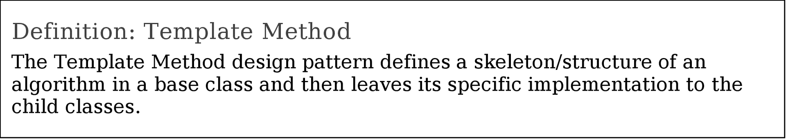

抽象 UML 类图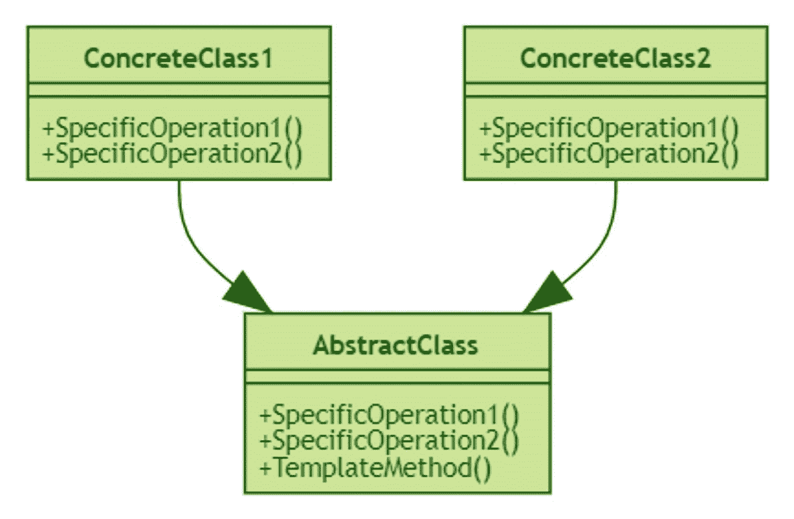

### 参与者

参与此模式的对象有：

- `抽象类`：定义算法结构，通常使用抽象的保护方法和包含算法的公共方法。
- `具体类`：继承抽象类并实现抽象方法，作为定义算法的一部分。

## 模板方法模式实现

为了引入模板方法设计模式，我们可以在导航页面类中包含一个抽象方法。它的子类可以实现它，并等待其特定的元素显示。

```csharp
public abstract class NavigatableEShopPage : EShopPage
{
    protected NavigatableEShopPage(Driver driver) : base(driver) { }

    protected abstract string Url { get; }

    public void Open()
    {
        Driver.GoToUrl(Url);
        WaitForPageLoad();
    }

    protected abstract void WaitForPageLoad();
}
```

这就是主页的结构。

```csharp
public class MainPage : NavigatableEShopPage
{
    public MainPage(Driver driver) : base(driver) { }

    protected override string Url => "http://demos.bellatrix.solutions/";

    private Element AddToCartFalcon9 =>
        Driver.FindElement(By.CssSelector("[data-product_id*='28']"));

    private Element ViewCartButton =>
        Driver.FindElement(By.CssSelector("[class*='added_to_cart wc-forward']"));

    public void AddRocketToShoppingCart()
    {
        Open();

        AddToCartFalcon9.Click();
        ViewCartButton.Click();
    }

    public void AssertProductBoxLink(string name, string expectedLink)
    {
        string actualLink = GetProductBoxByName(name).GetAttribute("href");

        Assert.AreEqual(expectedLink, actualLink);
    }

    protected override void WaitForPageLoad()
    {
        AddToCartFalcon9.WaitToExists();
    }

    private Element GetProductBoxByName(string name)
    {
        return Driver.FindElement(
            By.XPath($"//h2[text()='{name}']/parent::a[1]"));
    }
}
```

我们实现了抽象方法`WaitForPageLoad`，并在执行其他操作之前等待`AddToCartFalcon9`链接可见。此外，我们需要在`Element`类及其子类中定义`WaitToExists`方法。

```csharp
public override void WaitToExists()
{
    var webDriverWait = new WebDriverWait(
        _webDriver,
        TimeSpan.FromSeconds(30));

    webDriverWait.Until(
        ExpectedConditions.ElementExists(By));
}
```

该方法与我们在`FindElement`和`FindElements`方法中使用的方法类似。区别在于我们只根据指定的定位器等待元素，而不返回它。

将基页面类拆分为两个独立的类使得我们的测试更具可维护性。但这是为什么呢？可维护性与修复损坏用例以及为新网站功能添加新逻辑的未来成本有关。我们所做的重构将简化新逻辑的添加。

如果我们保留之前的实现，这意味着每当你需要更改导航逻辑时，你都要修改单个基类，但同时会影响所有不应该被直接打开的页面。这些更改也帮助我们更密切地遵循单一责任原则。

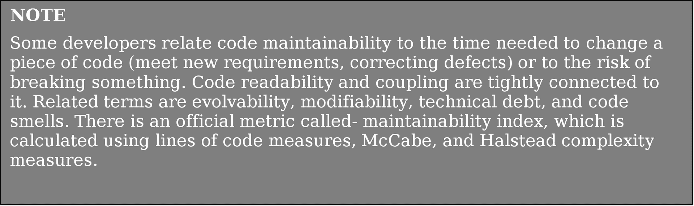

### 使用组合原则

你可能注意到的另一个可维护性问题是，目前我们的页面仍然没有遵循单一责任原则。它们有多个更改的原因。如果我们由于设计更改需要更新元素定位器，或者确定新的页面操作，或者添加新的断言方法，会发生什么？我们至少有三个更改的原因。

既然我们处理了导航问题，我们可以在这里做些事情。然而，我们不能创建更多的基类，因为这是不可行的，但我们可以利用组合。我们在上一章引入部分（sections）时研究过组合。我们在这里再次利用它来分离操作、元素、断言，并使我们的页面更具维护性——通过给它们唯一的更改理由。

### 未使用组合的重构版页面对象

让我们简单看看在没有组合的情况下我们的页面是什么样的。

```csharp
public class CartPage : NavigatableEShopPage
{
    public CartPage(Driver driver) : base(driver)
    {
        BreadcrumbSection = new BreadcrumbSection(Driver);
    }

    public Element BreadcrumbSection { get; }

    protected override string Url =>
        "http://demos.bellatrix.solutions/cart/";

    private Element CouponCodeTextField =>
        Driver.FindElement(By.Id("coupon_code"));

    private Element ApplyCouponButton =>
        Driver.FindElement(By.CssSelector("[value*='coupon']"));

    private Element QuantityBox =>
        Driver.FindElement(By.CssSelector("[class*='input-text qty']"));

    private Element UpdateCart =>
        Driver.FindElement(By.CssSelector("[value*='Update cart']"));

    private Element MessageAlert =>
        Driver.FindElement(By.CssSelector("[class*='woocommerce-message']"));

    private Element TotalSpan =>
        Driver.FindElement(By.XPath("//[@class='total']span"));

    private Element ProceedToCheckout =>
        Driver.FindElement(By.CssSelector("[class*='checkout-button alt-forward']"));

    public void ApplyCoupon(string coupon)
    {
        CouponCodeTextField.TypeText(coupon);

        ApplyCouponButton.Click();

        Driver.WaitForAjax();
    }

    public void IncreaseProductQuantity(int newQuantity)
    {
        QuantityBox.TypeText(newQuantity.ToString());

        UpdateCart.Click();

        Driver.WaitForAjax();
    }

    public void ClickProceedToCheckout()
    {
        ProceedToCheckout.Click();

        Driver.WaitUntilPageCompletely();
    }

    public string GetTotal()
    {
        return TotalSpan.Text;
    }

    public string GetMessage()
    {
        return MessageAlert.Text;
    }

    protected override void WaitForPageLoad()
    {
        CouponCodeTextField.WaitExists();
    }
}
```

首先，我们定义了在操作和断言方法中使用的元素。之后，页面包含了在页面上执行的所有操作和断言。

为了使用组合，我们将元素和断言移动到单独的类中，稍后通过属性暴露。

### 元素：组合实现

在我们进行重构后，主页看起来是什么样的？我们创建一个包含所有元素的独立类。这是它的唯一职责。

```csharp
public class MainPageElements
{
    private readonly Driver _driver;

    public MainPageElements(Driver driver)
    {
        _driver = driver;
    }

    public Element AddToCartFalcon9 =>
        _driver.FindElement(
            By.CssSelector("[data-product_id*='28']"));

    public Element ViewCartButton =>
        _driver.FindElement(
            By.CssSelector("[class*='added_to_cart wc-forward']"));

    public Element GetProductBoxByName(string name)
    {
        return _driver.FindElement(
            By.XPath($"//h2[text()='{name}']/parent::a[1]"));
    }
}
```

我们需要更改元素定位器时将在这里进行。这大大提高了可维护性，因为文件包含的代码行减少了。同样为断言创建一个独立类。这对它也是有效的。

```csharp
public class MainPageAssertions
{
    private readonly MainPageElements _elements;

    public MainPageAssertions(MainPageElements elements)
    {
        _elements = elements;
    }

    public void AssertProductBoxLink(
        string name,
        string expectedLink)
    {
        string actualLink =
            _elements.GetProductBoxByName(name)
                .GetAttribute("href");

        Assert.AreEqual(expectedLink, actualLink);
    }
}
```

现在在主类中，我们暴露上述两个。

```csharp
public class MainPage : NavigatableEShopPage
{
    public MainPage(Driver driver) : base(driver)
    {
        Elements = new MainPageElements(driver);
        Assertions = new MainPageAssertions(Elements);
    }

    public MainPageElements Elements { get; }

    public MainPageAssertions Assertions { get; }

    protected override string Url =>
        "http://demos.bellatrix.solutions/";

    public void AddRocketToShoppingCart()
    {
        Open();

        Elements.AddToCartFalcon9.Click();
        Elements.ViewCartButton.Click();
    }

    protected override void WaitForPageLoad()
    {
        Elements.AddToCartFalcon9.WaitExists();
    }
}
```

现在类中只剩下操作方法。我们使用`Elements`属性访问元素，使用`Assertions`访问断言方法。你想看测试中页面的使用方式吗？

### 测试中使用组合


这是我们更改之前的代码。

```csharp
class SectionsTests{
    private static Driver _driver;
    private static MainPage _mainPage;
    private static CartPage _cartPage;
    [ClassInitialize]
    public static void ClassInitialize(TestContext testContext){
        _driver = new LoggingDriver(new WebDriver());
        _driver.Start(Browser.Chrome);
        _mainPage = new MainPage(_driver);
        _cartPage = new CartPage(_driver);
    }
    [ClassCleanup]
    public static void ClassCleanup(){
        _driver.Quit();
    }
    [TestMethod]
    public void Falcon9LinkAddsCorrectProduct(){
        _mainPage.Open();
        _mainPage.Assertions.AssertProductBoxLink("Falcon 9", "http://demos.bellatrix.solutions/product/falcon-9/");
    }
    [TestMethod]
    public void SaturnVLinkAddsCorrectProduct(){
        _mainPage.Open();
        _mainPage.Assertions.AssertProductBoxLink("Saturn V", "http://demos.bellatrix.solutions/product/saturn-v/");
    }
}
```

正如你可以看到的，我们直接从页面访问断言方法和公开的元素。这是我们现在访问它们的方式：

```csharp
class SectionsTests{
    private static Driver _driver;
    private static MainPage _mainPage;
    private static CartPage _cartPage;
    [ClassInitialize]
    public static void ClassInitialize(TestContext testContext){
        _driver = new LoggingDriver(new WebDriver());
        _driver.Start(Browser.Chrome);
        _mainPage = new MainPage(_driver);
        _cartPage = new CartPage(_driver);
    }
    [ClassCleanup]
    public static void ClassCleanup(){
        _driver.Quit();
    }
    [TestMethod]
    public void Falcon9LinkAddsCorrectProduct(){
        _mainPage.Open();
        _mainPage.Assertions.AssertProductBoxLink("Falcon 9", "http://demos.bellatrix.solutions/product/falcon-9/");
    }
    [TestMethod]
    public void SaturnVLinkAddsCorrectProduct(){
        _mainPage.Open();
        _mainPage.Assertions.AssertProductBoxLink("Saturn V", "http://demos.bellatrix.solutions/product/saturn-v/");
    }
}
```

重构后，我们需要使用`Assertions`属性来访问断言方法，使用`Elements`属性来访问元素。通过这些更改，可读性稍微下降，但编写体验得到了提高，因为当你在页面实例名称后输入`.`时，可用选项现在显著减少。通过遵循元素和断言属性的命名约定，你将始终知道应该使用哪些属性。


## 重用测试工作流 - 外接模式

在章节的第二部分，我们将关注另一个常见问题——测试工作流。然而，在某些情况下，这种解决方案可能并不足够。假设我们有当前的火箭购物车。然而，一年或年后，我们决定重新设计它。工作流将保持不变，但由于可能使用另一个后端系统，我们应用优惠或添加产品的方式可能会有不同。

一段时间内，我们可能需要支持两个购物车，以决定哪种设计更适合我们的用户。我们有两个具有相同工作流的测试。

```csharp
class WorkflowTests{
    private static Driver _driver;
    private static MainPage _mainPage;
    private static CartPage _cartPage;
    private static CheckoutPage _checkoutPage;
    [ClassInitialize]
    public static void ClassInitialize(TestContext testContext){
        _driver = new LoggingDriver(new WebDriver());
        _driver.Start(Browser.Chrome);
        _mainPage = new MainPage(_driver);
        _cartPage = new CartPage(_driver);
        _checkoutPage = new CheckoutPage(_driver);
    }
    [ClassCleanup]
    public static void ClassCleanup(){
        _driver.Quit();
    }
    [TestMethod]
    public void PurchaseFalcon9WithoutFacade(){
        _mainPage.Open();
        _mainPage.AddRocketToShoppingCart("Falcon 9");
        _cartPage.ApplyCoupon("happybirthday");
        _cartPage.PageAssertions.AssertCouponSuccessfully();
        _cartPage.IncreaseProductQuantity(2) ;
        _cartPage.PageAssertions.AssertTotalPrice("14.00€");
        var purchaseInfo = new PurchaseInfo{
            Email = "info@linspaceflowers.com",
            FirstName = "Anton",
            LastName = "Angelov",
            Company = "Space Flowers",
            Country = "Germany",
            Address1 = "Willi Brandt Avenue Tiergarten",
            Address2 = "Lützowplatz 17",
            City = "Berlin",
            Zip = "10115",
            Phone = "+0049888921",
        };
        _checkoutPage.FillBillingInfo(purchaseInfo);
        _checkoutPage.PageAssertions.AssertOrderReceived();
    }
    [TestMethod]
    public void PurchaseSaturnVWithoutFacade(){
        _mainPage.Open();
        _mainPage.AddRocketToShoppingCart("Saturn V");
        _cartPage.ApplyCoupon("happybirthday");
        _cartPage.PageAssertions.AssertCouponSuccessfully();
        _cartPage.IncreaseProductQuantity(3);
        _cartPage.PageAssertions.AssertTotalPrice("355.00€");
        var purchaseInfo = new PurchaseInfo{
            Email = "info@linspaceflowers.com",
            FirstName = "John",
            LastName = "Atanasov",
            Company = "Space Flowers",
            Country = "Germany",
            Address1 = "Willi Brandt Avenue Tiergarten",
            Address2 = "Lützowplatz 17",
            City = "Berlin",
            Zip = "10115",
            Phone = "+0049888921",
        };
        _checkoutPage.FillBillingInfo(purchaseInfo);
        _checkoutPage.PageAssertions.AssertOrderReceived();
    }
}
```

这种解决方案有一个巨大的缺点。如果工作流发生变化，例如，我们将折扣步骤移动到最后一个页面或添加新的折扣类型，我们需要遍历代码并重新排列所有测试的步骤。我们可以通过使用外接模式以更优雅的方式解决这个问题。

## 外接模式


### 抽象类图

### 参与者

参与此模式的类和对象有：

- **外接类 (Facade Class)**：用户用于访问简化 API 的主类。它通常包含使用依赖类的公共方法。

- **依赖类 (Dependent Classes)**：它们持有稍后在外接器使用的特定逻辑。通常作为参数使用。

### 外接模式实现

在我们的场景中，我们可以为购买创建一个外接器。它包含一个名为`PurchaseItem`的单方法，该方法将按顺序调用页面。

```csharp
public class PurchaseFacade{
    private readonly MainPage _mainPage;
    private readonly CartPage _cartPage;
    private readonly CheckoutPage _checkoutPage;
    public PurchaseFacade(MainPage mainPage, CartPage cartPage, CheckoutPage checkoutPage){
        _mainPage = mainPage;
        _cartPage = cartPage;
        _checkoutPage = checkoutPage;
    }
    public void PurchaseItem(string rocketName, string couponName, int quantity, string expectedPrice, PurchaseInfo purchaseInfo){
        _mainPage.Open();
        _mainPage.AddRocketToShoppingCart(rocketName);
        _cartPage.ApplyCoupon(couponName);
        _cartPage.PageAssertions.AssertCouponSuccessfully();
        _cartPage.IncreaseProductQuantity(quantity);
        _cartPage.PageAssertions.AssertTotalPrice(expectedPrice);
        _cartPage.ClickToCheckout();
        _checkoutPage.FillBillingInfo(purchaseInfo);
        _checkoutPage.PageAssertions.AssertOrderReceived();
    }
}
```

我们再次使用组合来持有依赖页面。我们在构造函数中初始化它们。此外，工作流所需的所有数据以外接参数的形式提供。


此外，我们可以在外接器内部处理断言。这可能看起来是某些折中，但让我们看看在使用外接模式后测试看起来像什么样。


```csharp
class WorkflowTests{
    private static Driver _driver;
    private static MainPage _mainPage;
    private static CartPage _cartPage;
    private static CheckoutPage _checkoutPage;
    private static PurchaseFacade _purchaseFacade;
    [ClassInitialize]
    public static void ClassInitialize(TestContext testContext){
        _driver = new LoggingDriver(new WebDriver());
        _driver.Start(Browser.Chrome);
        _mainPage = new MainPage(_driver);
        _cartPage = new CartPage(_driver);
        _checkoutPage = new CheckoutPage(_driver);
        _purchaseFacade = new PurchaseFacade(_mainPage, _cartPage, _checkoutPage);
    }
    [ClassCleanup]
    public static void ClassCleanup(){
        _driver.Quit();
    }
    [TestMethod]
    public void PurchaseFalcon9WithFacade(){
        _purchaseFacade.PurchaseItem("Falcon 9", "happybirthday", 2, "14.00€", new PurchaseInfo{
            Email = "info@linspaceflowers.com",
            FirstName = "Anton",
            LastName = "Angelov",
            Company = "Space Flowers",
            Country = "Germany",
            Address1 = "Willi Brandt Avenue Tiergarten",
            Address2 = "Lützowplatz 17",
            City = "Berlin",
            Zip = "10115",
            Phone = "+0049888921",
        });
    }
    [TestMethod]
    public void PurchaseSaturnVWithFacade(){
        _purchaseFacade.PurchaseItem("Saturn V", "happybirthday", 3, "355.00€", new PurchaseInfo{
            Email = "info@linspaceflowers.com",
            FirstName = "John",
            LastName = "Atanasov",
            Company = "Space Flowers",
            Country = "Germany",
            Address1 = "Willi Brandt Avenue Tiergarten",
            Address2 = "Lützowplatz 17",
            City = "Berlin",
            Zip = "10115",
            Phone = "+0049888921",
        });
    }
}
```

# 1. 你能解释什么是测试可维护性吗？

2. 使用什么指标来衡量维护性？

3. 组合和继承之间有什么区别？

4. 模板方法设计模式的参与者有哪些？

5. Facade 设计模式有什么什么用？

## 延伸阅读

- 模板方法 C# - [`www.dofactory.com/net/template-method-design-pattern`](https://www.dofactory.com/net/template-method-design-pattern)

- 自动化测试中的 Facade 设计模式 - [`www.automatetheplanet.com/facade-design-pattern/`](https://www.automatetheplanet.com/facade-design-pattern/)

- 自动化测试中改进的 Facade 设计模式 v2.0 - [`www.automatetheplanet.com/improved-facade-design-pattern/`](https://www.automatetheplanet.com/improved-facade-design-pattern/)

- Page Objects-元素访问样式- WebDriver C# - [`www.automatetheplanet.com/page-objects-elements-access-styles/`](https://www.automatetheplanet.com/page-objects-elements-access-styles/)

## 第 6 章 API 可用性

在上一章中，我们讨论了如何提高测试的可维护性和重用性。现在，我们将研究如何简化框架中所有这些库类的使用。我们将学习如何让测试库 API 变得易于使用、学习和理解。首先，我们将应用 `Interface Segregation`（接口隔离）原则，将 `driver` API 拆分为更小但更专注的部分。

之后，我们将讨论如何通过 `Singleton` 设计模式或 `App` 设计模式使用已开发的页面对象的不同方法。我们还将查看另一种名为 `Fluent API` 或“链式方法”的有趣方法。在本节结束时，我们将讨论向测试库的用户暴露页面对象元素是否是一个个好主意。

本章将涵盖以下主题：

- 针对 `WebDriver` 装饰器的接口隔离原则

- 通过 `Singleton` 设计模式使用页面对象

- 用于创建页面对象的 `App` 设计模式

- `Fluent API` 页面对象

- 页面对象元素访问样式

### WebDriver 装饰器的接口隔离原则

在之前的章节中，我们创建了与 `WebDriver` 相关的辅助类，以稳定和优化我们的测试。我们为此使用了 `Decorator` 设计模式。为什么不重新检查一下当前类包含的内容呢？

### WebDriver 装饰器的当前实现

如果我们检查方法的名称，我们会发现有几组用于查找元素和控制浏览器动作的方法。然而，我们遗漏了一些其他功能的实现。例如，我们需要处理 Cookie 和对话框的方法。随着方法数量的增加，该类的使用将变得越来越困难。

```cpp
public abstract class DriverDecorator : Driver{
    protected readonly Driver Driver;
    protected DriverDecorator(Driver driver){
        Driver = driver;
    }
    public override void Start(Browser browser){
        Driver?.Start(browser);
    }
    public override void Quit(){
        Driver?.Quit();
    }
    public override void GoToUrl(string url){
        Driver?.GoToUrl(url);
    }
    public override Element FindElement(By locator){
        return Driver?.FindElement(locator);
    }
    public override List<Element> FindElements(By locator){
        return Driver?.FindElements(locator);
    }
    public override void WaitForAjax(){
        Driver?.WaitForAjax();
    }
    public override void WaitUntilPageLoadsCompletely(){
        Driver?.WaitUntilPageLoadsCompletely();
    }
}
```

下面的代码块显示了我们目前为止在页面对象中是如何使用 `Driver` 装饰器的。

```cpp
public class CartPage : NavigatableEShopPage{
    public CartPage(Driver driver): base(driver){
        BreadcrumbSection = new BreadcrumbSection(driver);
        Elements = new CartPageElements(driver);
    }
    public BreadcrumbSection BreadcrumbSection { get; }
    public CartPageElements Elements { get; }
    protected override string Url=>"http://demos.bellatrix.solutions/cart/";
    public void ApplyCoupon(string coupon){
        Elements.CouponCodeTextField.TypeText(coupon);
        Elements.ApplyCouponButton.Click();
        Driver.WaitForAjax();
    }
    // 其他代码
}
```

如你所见，我们将单个实例传递给 `Driver` 类，并将其用于多个用途——导航到页面、查找元素或控制浏览器。然而，并不是所有页面都需要导航到页面或控制浏览器。

回想一下 `Interface Segregation` 原则如何？——“客户端不应强迫实现它们不使用的接口。与其使用臃肿接口，不如倾向于根据方法组划分许多小接口，每个小接口服务于一个子模块。”

如果我们想在案例中应用该原则，我们需要将驱动器接口拆分为几个更小的接口。

### 将 Driver 接口拆分为更小的接口

上述方法组中的每一组都可以移动到独立的接口中。因此，我们将得到五个独立的较小接口：

- 一个用于控制浏览器

- 一个用于导航

- 一个用于查找元素

- 一个用于处理 Cookie

- 一个用于处理对话框

它们所有的都可以通过继承合并成一个更大的接口，而实现将仍然保留在一个处。让我们创建这些接口。

以下是浏览器操作接口的写法：

```csharp
public interface IBrowserService{
    void WaitForAjax();
    void WaitForPageLoad();
    void Start(Browser browser);
    void Quit();
}
```

对于导航，我们只需要 `GoToUrl` 方法和 `Url` 属性。

```csharp
public interface INavigationService{
    void GoToUrl(string url);
    Uri Url { get; }}
}
```

有两种方法用于查找元素。

```csharp
public interface IElementFindService{
    Element FindElement(By locator);
    List<Element> FindElements(By locator);
}
```

对于处理 cookie 的新功能，我们需要能够添加、删除和获取 cookie。

```csharp
public interface ICookiesService{
    void AddCookie(string cookieName, string cookieValue, string path = "/");
    void DeleteAllCookies();
    void DeleteCookie(string cookieName);
    List<Cookie> GetAllCookies();
    string GetCookie(string cookieName);
}
```

对话框服务包含一个负责关闭对话框的方法。

```csharp
public interface IDialogService{
    void Handle(DialogButton dialogButton = DialogButton.Ok);}
}
```

合并后的 `IDriver` 接口简单地实现了所有较小的接口。

```csharp
public interface IDriver : INavigationService, IBrowserService, ICookiesService, IElementFindService, IDialogService{}
```

抽象装饰器类 `Driver` 实现了 `IDriver` 接口，这意味着由于继承，所有的具体装饰器也应该实现所有较小的接口。

```csharp
public abstract class Driver : IDriver{
    public abstract Uri Url { get; }
    public abstract void Start(Browser browser);
    public abstract void Quit();
    public abstract void GoToUrl(string url);
    public abstract Element FindElement(By locator);
    public abstract List<Element> FindElements(By locator);
    public abstract void WaitForAjax();
    public abstract void WaitUntilPageLoadsCompletely();
}
```

### 较小接口在 Page Objects 中的用法

在本节的开始，我们看到了在接口分离之前 `Driver` 类是如何使用的。让我们研究一下用方式发生了什么变化？与其传递整个 `Driver` 对象，我们只将需要的接口作为参数传递给页面。

```csharp
public class CartPage : NavigatableEShopPage{
    private readonly IBrowserService _browserService;
    public CartPage(IElementFindService elementFindService, INavigationService navigationService, IBrowserService browserService): base(elementFindService, navigationService){
        _browserService = browserService;
        BreadcrumbSection = new BreadcrumbSection(elementFindService);
        Elements = new CartPageElements(elementFindService);
    }
    public BreadcrumbSection BreadcrumbSection { get; }
    public CartPageElements Elements { get; }
    protected override string Url=>"http://demos.bellatrix.solutions/cart/";
    public void ApplyCoupon(string coupon){
        Elements.CouponCodeTextField.TypeText(coupon);
        Elements.ApplyCouponButton.Click();
        _browserService.WaitForAjax();
    }
    // rest of the code
}
```

基类 `NavigatableEShopPage` 需要 `IElementFindService` 和 `INavigationService` 接口。它们分别用于查找页面上的元素以及导航到各个页面。然而，如果我们的页面继承自 `EShopPage` 基类，那么你只需要传递 `IElementFindService` 接口作为参数，因为我们无法导航到此类页面。此外，在大多数页面中，我们不需要控制浏览器，所以我们不需要为 `IBrowserService` 提供实例。尽管如此，在这里我们需要它，是因为我们调用了 `WaitForAjax` 方法。

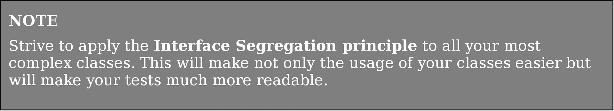

## 通过单例模式使用 Page Objects


在本章节的剩余部分中，我们将研究使用页面对象的不同方法。回想一下，到目前为止，我们在测试中是如何使用它们的。

```csharp
[TestClass]
public class SectionsTests{
    private static Driver _driver;
    private static MainPage _mainPage;
    private static CartPage _cartPage;
    [ClassInitialize]
    public static void ClassInitialize(TestContext testContext){
        _driver = new LoggingDriver(new WebDriver());
        _driver.Start(Browser.Chrome);
        _mainPage = new MainPage(_driver);
        _cartPage = new CartPage(_driver);
    }
    [ClassCleanup]
    public static void ClassCleanup(){
        _driver.Quit();
    }
    [TestMethod]
    public void Falcon9LinkAddsCorrectProduct(){
        _mainPage.Open();
        _mainPage.MainPageAssertions.AssertProductBoxLink("Falcon 9", "http://demos.bellatrix.solutions/product/falcon-9/");
    }
    [TestMethod]
    public void SaturnVLinkAddsCorrectProduct(){
        _mainPage.Open();
        _mainPage.MainPageAssertions.AssertProductBoxLink("Saturn V", "http://demos.bellatrix.solutions/product/saturn-v/");
    }
}
```

在`ClassInitialize`方法中，我们总是启动一个新的浏览器并创建所有页面。页面对象通过测试类中的局部变量共享并使用。现在，我们将讨论一种使用单例模式的替代方法。

### 单例模式


#### UML 类图


#### 参与者

参与此模式的类和对象有：

- `Base Page`（基页面）：持有类实例的静态属性。它在第一次调用该类时创建。该类无法通过`new`关键字创建。
- `Concrete Page`（具体页面）：继承基页面。可以通过`Instance`属性在测试中使用，但无法通过`new`关键字创建。

### 单例模式实现

模式的基本实现需要一个静态变量和一个静态属性。此外，为了确保无法通过`new`关键字初始化类，构造函数的访问修饰符被设置为私有。

#### 基本单例实现

要访问页面，使用`Instance`属性。由于它是静态的，它将在所有测试之间共享。由于空检查，实例变量只会在第一次被初始化。以下代码块将展示如何实现：

```csharp
public class CartPage{
    private static CartPage instance;
    private CartPage(){}
    public static CartPage Instance{
        get{
            if (instance == null){
                instance = new CartPage();
            }
            return instance;
        }
    }}
// rest of the code
```

然而，这种基础实现并不能适用于我们，原因有两个：

- 第一，我们对 Driver 装饰器接口有依赖，而这些接口不是静态的。
- 第二，在我们的每个页面中添加这些静态代码会导致过多的代码重复。

为了处理第一个问题，我们也可以让`Driver`类也成为单例。为了解决第二个问题，我们可以将单例代码移动到基类中。

### 将 Driver 装饰器变为单例

将我们的`LoggingDriver`变为单例如何？为了实现这一点，我们需要像下面的示例一样引入一个静态变量和一个属性：

```csharp
public class LoggingSingletonDriver : DriverDecorator{
    private static LoggingSingletonDriver instance;
    public static LoggingSingletonDriver Instance{
        get{
            if (instance == null){
                instance = new LoggingSingletonDriver(new WebDriver());
            }
            return instance;
        }
    }
    private LoggingSingletonDriver(Driver driver): base(driver){}
    public override void Start(Browser browser){
        Console.WriteLine($"Start browser = {Enum.GetName(typeof(Browser), browser)}");
        driver?.Start(browser);
    }
    // rest of the code
}
```

### 将基类变为单例

为了让我们的基类`EShopPage`和`NavigatableEShopPage`变成单例，我们需要稍微复杂一点的代码。我们需要再次添加静态对，但还需要使类泛型化。

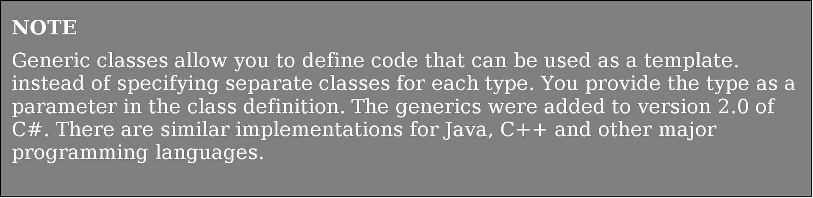

重构后我们的基类`EShopPage`类如下：

```csharp
public abstract class EShopPage<TPage>
where TPage : EShopPage<TPage>, new(){
    private static TPage _instance;
    protected readonly IElementFindService ElementFindService;
    protected EShopPage(){
        ElementFindService = LoggingSingletonDriver.Instance;
        SearchSection = new SearchSection(LoggingSingletonDriver.Instance);
        MainMenuSection = new MainMenuSection(LoggingSingletonDriver.Instance);
        CartInfoSection = new CartInfoSection(LoggingSingletonDriver.Instance);
    }
    public static TPage Instance{
        get{
            if (_instance == null){
                _instance = new TPage();
            }
            return _instance;
        }
    }
    public SearchSection SearchSection { get; }
    public MainMenuSection MainMenuSection { get; }
    public CartInfoSection CartInfoSection { get; }
}
```

如前所述，我们通过`EShopPage<TPage>`将类标记为泛型，其中`TPage`是继承自基类的特定页面类型。通过约束`where TPage : EShopPage<TPage>, new()`，我们告诉编译器只接受继承自`EShopPage`且具有构造函数的类型。在静态`Instance`属性中，首次访问它时会初始化静态变量`instance`。

此外，我们通过在保护构造函数中传递单例`Driver`来初始化区域页面对象。这样，我们就不需要将其作为参数传递给构造函数。

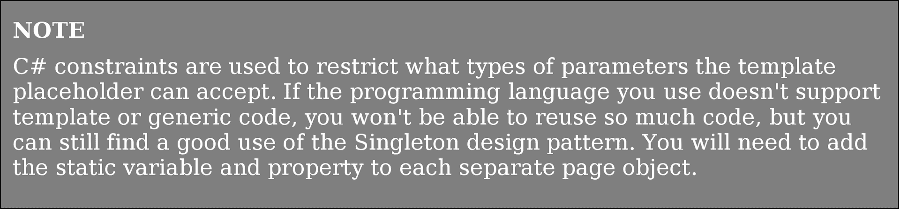

这是我们的页面对象为了使用新基类`NavigatableEShopPage`所需的更改：

```csharp
public class CartPage : NavigatableEShopPage<CartPage>{
    private readonly IBrowserService _browserService;
    public CartPage(){
        _browserService = LoggingSingletonDriver.Instance;
        BreadcrumbSection = new BreadcrumbSection(LoggingSingletonDriver.Instance);
        Elements = new CartPageElements(LoggingSingletonDriver.Instance);
    }
    public BreadcrumbSection BreadcrumbSection { get; }
    public CartPageElements Elements { get; }
    protected override string Url=>"http://demos.bellatrix.solutions/cart/";
    // rest of the code
}
```

与基类一样，这里我们使用单例版本的`Driver`装饰器，这样我们不需要向构造函数传递任何参数。此外，我们需要将泛型类的类型`TPage`修改为此页面的类型，以便`Instance`属性初始化正确的类型。我们通过以下行来实现：`CartPage : NavigatableEShopPage<CartPage>`。

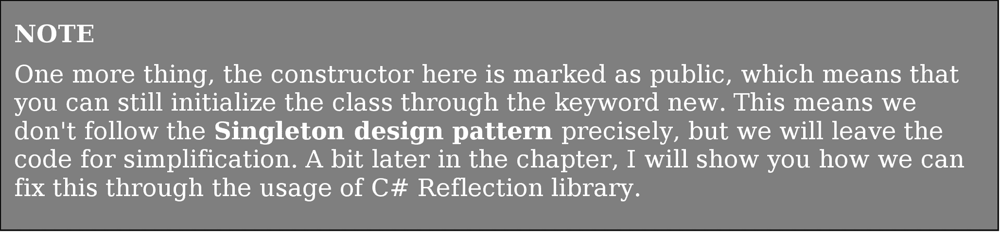

## 线程安全的单例实现

之前的示例不是线程安全的，这意味着在并行执行测试时可能会出现死锁。我将为你提供两种让单例类变为线程安全的方法。

第一个版本使用 C# 的`lock`语句。它确保当一个线程正在使用代码关键区域时，另一个线程不会进入。如果另一个线程尝试进入锁定的代码，它将等待并阻塞对象直到其释放。

```csharp
public class CartPage{
    private static CartPage instance;
    private static readonly object lockObject = new object();
    private CartPage(){}
    public static CartPage Instance{
        get{
            lock (lockObject){
                if (instance == null){
                    instance = new CartPage();
                }
                return instance;
            }
        }
    }
    // rest of the code
}
```

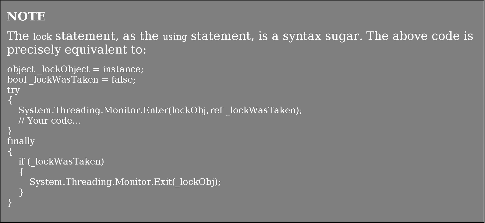

如你所示，代码没有锁定`instance`，而是锁定它的内部对象。这样做是为了防止死锁。实现线程安全类的第二种方法是通过泛型类`Lazy<T>`，它可以节省一些实现代码。

```csharp
public class CartPage{
    private static readonly Lazy<CartPage> lazy = new Lazy<CartPage>(()new CartPage());
    public static CartPage Instance{
        get{
            return lazy.Value;
        }
    }
    // rest of the code
}
```

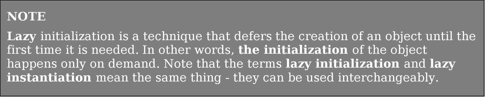

## 测试中单例设计模式的使用

在测试中使用单例页面对象是非常直观的。正如你看到的，断言变得更加简洁。

```csharp
[TestClass]
public class SectionsTests{
    private static App _app;
    [ClassInitialize]
    public static void ClassInitialize(TestContext testContext){
        LoggingSingletonDriver.Instance.Start(Browser.Chrome);
    }
    [ClassCleanup]
    public static void ClassCleanup(){
        LoggingSingletonDriver.Instance.Quit();
    }
    [TestMethod]
    public void Falcon9AddsCorrectProduct(){
        MainPage.Instance.Open();
        MainPage.Instance.AssertProductBox("Falcon 9", "http://demos.bellatrix.solutions/falcon-9/");
    }
    [TestMethod]
    public void SaturnVAddsCorrectProduct(){
        MainPage.Instance.Open();
        MainPage.Instance.AssertProductBox("Saturn V", "http://demos.bellatrix.solutions/saturn-v/");
    }
}
```

我们通过`Instance`属性访问页面。项目中的所有测试将创建一个页面实例。

## 创建页面的 App 设计模式

现在让我们讨论另一种访问页面对象的方法，称为 App 设计模式。`App`是外观（facade）和工厂类。它提供了一种更容易使用`Driver`装饰器及其接口的方法。它还会导航到请求的页面。`App`类将创建普通的页面对象，而不是我们在上一节中创建的单例。

### App 设计模式实现

这是它的实现方式：

```csharp
public class App : IDisposable{
    private readonly Driver _driver;
    private bool _disposed = false;
    public App(Browser browserType = Browser.Chrome){
        _driver = new LoggingDriver(new WebDriver());
        _driver.Start(browserType);
        BrowserService = _driver;
        CookiesService = _driver;
        DialogService = _driver;
    }
    public IBrowserService BrowserService { get; }
    public ICookiesService CookiesService { get; }
    public IDialogService DialogService { get; }
    public void Dispose(){
        Dispose(true);
        GC.Finalize(this);
    }
    protected virtual void Dispose(bool disposing){
        if (_disposed){
            return;
        }
        }
    }
```

我们通过`Dispose`方法实现 .NET 的`IDisposable`接口以正确关闭浏览器。这允许我们在`using`语句中使用`App`类，在结束时浏览器将自动关闭。这里是使用`using`语句时的代码样子：


```csharp
using (var app = new App()){
    var mainPage = app.GoTo<MainPage>();
    mainPage.AddRocketToShoppingCart();
    var cartPage = app.GoTo<CartPage>();
    cartPage.ApplyCoupon("happybirthday").AssertMessageNotification("Coupon code applied successfully.").IncreaseProductQuantity(2).AssertTotal("114.00€").ProceedToCheckout();
}
```

从 C# 8.0 开始，代码可以更短：

```csharp
using var app = new App();
var mainPage = app.GoTo<MainPage>();
mainPage.AddRocketToShoppingCart();
var cartPage = app.GoTo<CartPage>();
cartPage.ApplyCoupon("happybirthday").AssertMessageNotification("Coupon code applied successfully.").IncreaseProductQuantity(2).AssertTotal("114.00€").ProceedToCheckout();
```

`using` 语句是 C# 编译器提供的语法糖。编译后的代码类似于这样：

```csharp
var app = new App();
try{
    // the rest of the code
}
finally{
    if (app != null){
        ((IDisposable)app).Dispose();
    }
}
```

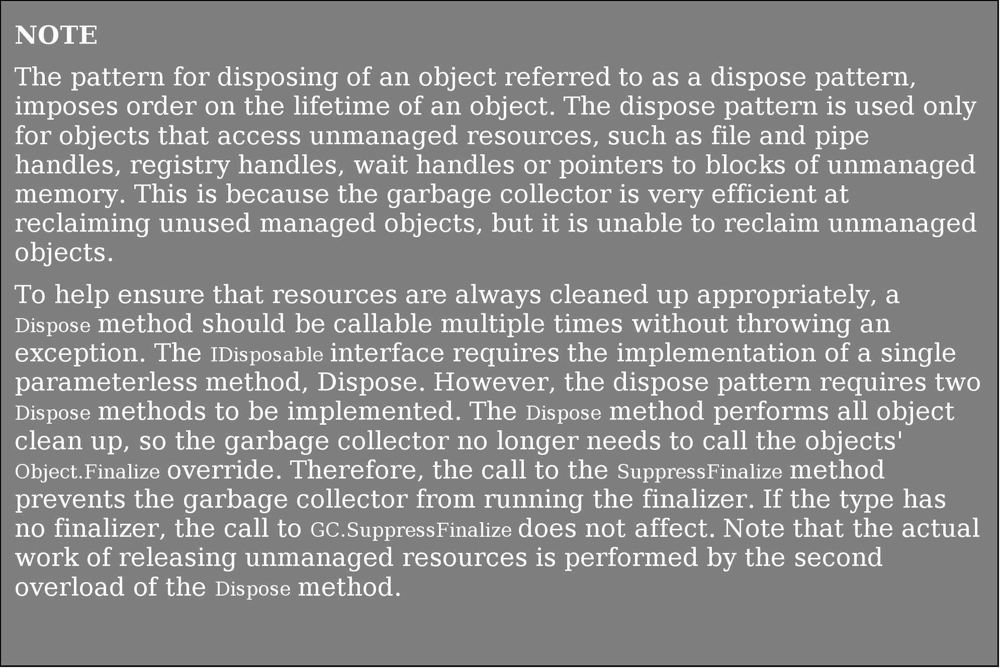

`Create` 和 `GoTo` 方法是以泛型实现的。`Create` 和 `GoTo` 之间的唯一区别是前者只是创建并返回页面实例。

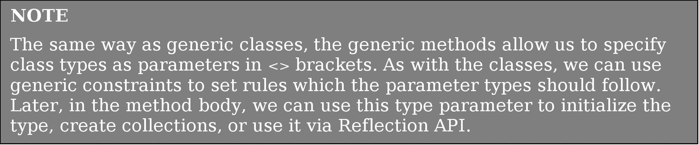

后者做了相同的事情，但同时导航到了页面。此外，我们使用 `Reflection` API 获取页面的私有构造函数，然后通过 `Invoke` 方法创建。

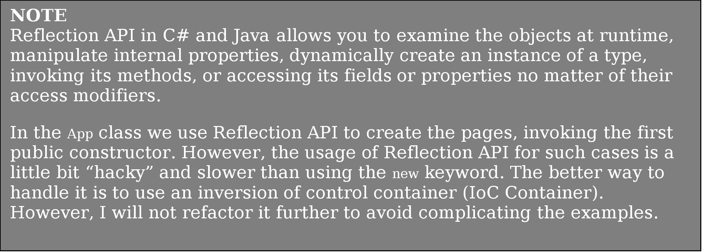

如我们在上一节提到的，你可以重构页面对象使其具有私有构造函数。当你将访问修饰符改为 `private` 时，需要使用上述 `Reflection` API 来调用。

## 测试中使用 App

使用单例 `driver` 装饰器和页面对象，`ClassInitialize` 方法只有一行。其他方法更加简洁。

```csharp
[TestClass]
public class SectionsTests{
    private static App _app;
    [ClassInitialize]
    public static void ClassInitialize(TestContext testContext){
        _app = new App();
    }
    [ClassCleanup]
    public static void ClassCleanup(){
        _app.Dispose();
    }
}
```

由于 `App` 是在 `ClassInitialize` 中创建的，这意味着浏览器将在类中的所有测试中复用。你可以在每个测试中通过 `using` 语句创建 `App`，但受益于 `IDisposable` 的实现，而不必每次调用 `Dispose` 方法（它将在语句结束时调用）。

```csharp
[TestMethod]
public void Falcon9LinkAddsCorrectProduct(){
    using (var app = new App()){
        var mainPage = app.GoTo<MainPage>();
        mainPage.AssertProductBox("Falcon 9", "http://demos.bellatrix.solutions/falcon-9/");
    }
}
```

## Fluent API 页面对象

你想讨论测试中使用页面模型的第三种策略吗？它称为 Fluent Interface。Fluent API 通常通过方法链实现。

我们将对页面对象进行一些更改来实现 `Fluent API`。首先，每个方法将返回页面本身。接下来，我们将 `elements` 属性设置为私有，仅供页面本身使用。最后，我们将断言方法移动到页面本身。我们将为了遵循模式并最终使代码更加简洁易读，而牺牲了“单一职责”原则。

```csharp
public class CartPage : NavigatableEShopPage{
    private CartPageElements _elements;
    private CartPage(Driver driver): base(driver){
        BreadcrumbSection = new SearchSection(driver);
        _elements = new CartPageElements(driver);
    }
    public BreadcrumbSection BreadcrumbSection { get; }
    protected override string Url=>"http://demos.bellatrix.solutions/cart/";
    public CartPage ApplyCoupon(string coupon){
        _elements.CouponCodeTextField.TypeText(coupon);
        _elements.ApplyCouponButton.Click();
        Driver.WaitForAjax();
        return this;
    }
    public CartPage IncreaseProductQuantity(int newQuantity){
        _elements.QuantityBox.TypeText(newQuantity.ToString());
        _elements.UpdateCart.Click();
        Driver.WaitForAjax();
        return this;
    }
    public CartPage ProceedToCheckout(){
        _elements.ProceedToCheckout.Click();
        Driver.WaitUntilPageCompletely();
        return this;
    }
    public CartPage AssertTotal(string expectedTotal){
        Assert.AreEqual(_elements.TotalSpan.Text, expectedTotal);
        return this;
    }
    public CartPage AssertMessageNotification(string expectedMessage){
        Assert.AreEqual(_elements.MessageAlert.Text, expectedMessage);
        return this;
    }
    protected override void WaitForElementToDisplay(){
        _elements.CouponCodeTextField.WaitToExists();
    }
}
```

## 在测试中使用 Fluent API

这是通过结合 `Fluent API` 和 `App` 设计模式时我们的测试样子。

```csharp
[TestClass]
public class SectionsTests{
    private static App _app;
    [ClassInitialize]
    public static void ClassInitialize(TestContext testContext){
        _app = new App();
    }
    [ClassCleanup]
    public static void ClassCleanup(){
        _app.Dispose();
    }
    [TestMethod]
    public void CompletePurchaseSuccessfully_WhenNewClient(){
        var mainPage = _app.GoTo<MainPage>();
        mainPage.AddRocketToShoppingCart();
        var cartPage = _app.GoTo<CartPage>();
        cartPage.ApplyCoupon("happybirthday").AssertMessageNotification("Coupon code applied successfully.").IncreaseProductQuantity(2).AssertTotal("114.00€").ProceedToCheckout();
    }
}
```

## 页面对象元素的访问样式

API 的易用性取决于你的测试库用户编写和配置自动化测试有多容易。到目前为止，我们研究了在测试中创建和使用页面对象的各种方法。另一个 API 易用性方面是你是否可以在测试中直接使用页面对象元素。当然，这是一个哲学问题，取决于个人喜好，就像你决定是否使用 `Page Object Model` 设计模式一样。有时当你必须编写几个没有重复元素的少量测试时，使用原生的 `WebDriver` 语法可能是可以的。

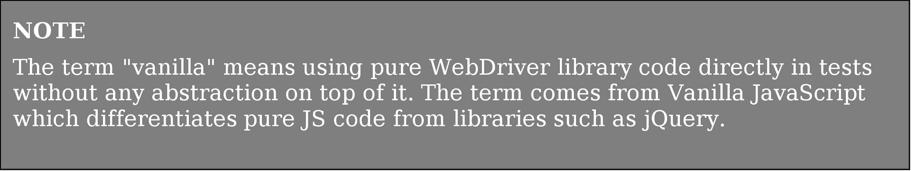

### 通过属性暴露元素

在之前的章节讨论 `Page Object` 模式时，我们查看了访问元素的最直接的方法。所有的网页元素都作为页面的公共属性暴露出来。

```csharp
public class MainPage : NavigatableEShopPage<MainPage>{
    public Element AddToCart9=>ElementFindService.FindElement(By.CssSelector("[data-product_id*='28']"));
    public Element ViewCartButton=>ElementFindService.FindElement(By.CssSelector("[class*='added_to_cart']"));
    protected override void WaitForElementToDisplay(){AddToCart9.WaitToExists();}}
```

在测试中使用元素，使用上述公共属性。

```csharp
[TestMethod]
public void Falcon9LinkAddsCorrectProduct(){
    _mainPage.Open();
    _mainPage.AddToCart9.Click();
    _mainPage.AssertProductBox("Falcon 9", "http://demos.bellatrix.solutions/product-9/");
}
```

### 通过 Elements 属性访问元素

本章中的大多数示例使用这种方法来暴露页面元素。让我们再次回顾一下。

```csharp
public class MainPage : NavigatableEShopPage{
    private readonly MainPageElements _elements;
    private MainPage(Driver driver){
        _elements = new MainPageElements(driver);
    }
    protected override string Url=>"http://demos.bellatrix.solutions/";
    public MainPage AddRocketToShoppingCart(){
        Open();
        _elements.AddToCart9.Click();
        _elements.ViewCartButton.Click();
    }
}
```

### 在测试中隐藏元素

有时我们通过在页面对象中作为 `private` 变量从测试外部隐藏元素。

```csharp
public class CartPage : NavigatableEShopPage{
    public CartPage(Driver driver): base(driver){
        BreadcrumbSection = new SearchSection(driver);
    }
    public BreadcrumbSection BreadcrumbSection { get; set; }
    protected override string Url=>"http://demos.bellatrix.solutions/cart/";
    private Element CouponCodeTextField=>Driver.FindElement(By.Id("coupon_code"));
    private Element ApplyCouponButton=>Driver.FindElement(By.CssSelector("[value*='Apply coupon']"));
    private Element QuantityBox=>Driver.FindElement(By.CssSelector("[class*='input-text qty']"));
    private Element UpdateCart=>Driver.FindElement(By.CssSelector("[value*='Update cart']"));
    private Element MessageAlert=>Driver.FindElement(By.CssSelector("[class*='woocommerce-message']"));
    private Element TotalSpan=>Driver.FindElement(By.XPath("//[@class='order-total']//span"));
    private Element ProceedToCheckout=>Driver.FindElement(By.CssSelector("[class*='checkout-button alt wc-forward']"));
    public void ApplyCoupon(string coupon){
        CouponCodeTextField.TypeText(coupon);
        ApplyCouponButton.Click();
        Driver.WaitForAjax();
    }
}
```

在测试中，无法访问元素。相反，你只需要使用公开的页面对象方法。

### 隐藏元素的必要细节

最后，我想讨论元素使用的另一个方面——无论你选择上述哪种变体。如果你定位网页元素是为了获取其 `Text` 属性或进行输入，你就可以隐藏所有不必要的细节。让我举个例子。这是我们通常将网页元素暴露为公共属性的方式。

```csharp
public Element AddTo9=>Driver.FindElement(By.CssSelector("[data-product_id*='28']"));
```

如你所示，我们返回整个 `Element` 对象，而不只是它的某些属性。如果你只需要元素的文本，则将元素属性的返回类型更改为 `string` 并返回 `Element` 类的 `Text` 属性。

```csharp
public string AddToCart9Href=>_findService.FindElement(By.CssSelector("[dataproduct_id*='28']")).GetAttribute("href");
public string ViewCartButton=>_findService.FindElement(By.CssSelector("[class*='added_to_cart wcforward']")).Text;
```

如你所示，`ViewCartButton` 属性只返回按钮的文本，而我们返回 `AddToCart9Href` 是锚点的 `HREF`。如果你需要设置某些元素的文本，可以声明 setter 并使用 `TypeText` 方法设置元素的文本。

```csharp
public string FirstName{
    get{return _findService.FindElement(By.Id("firstName")).Text;}
    set{_findService.FindElement(By.Id("firstName")).TypeText(value);}
}
```

在这种变体中，查找元素存在一些重复代码。我们可以通过创建元素的 `private` 变量，然后通过公共属性将其封装来重构代码。


```csharp
private Element _firstName = _findService.FindElement(By.Id("firstName"));
public string FirstName{
    get{return _firstName.Text;}
    set{_firstName.TypeText(value);}
}
```

## 总结

在本章中，我们定义了什么是 API 的易用性，如何让测试代码更易读，同时——它如何允许我们的库用户更快地编写测试。我们通过将 `driver` API 拆分为较小的功能部分应用了“接口分离”原则。之后，我们讨论了如何通过单例设计模式或 App 设计模式使用已经开发的页面对象的不同方法。最后，我们涵盖了向测试用户暴露页面对象元素是否是一个好主意，而不是返回测试所需的具体值。

在下一章节中，我们将讨论各种可以让你的测试库更具扩展性和可定制性的技术。我们将设计一个 API，允许用户通过策略模式创建自定义 WebDriver 定位器。此外，我们还将查看原生 WebDriver 对行为添加的支持。我们将使用 `EventFiringWebDriver` 类。

## Questions

### 问题

1. 将 `WebDriver` 接口拆分为更小的接口有什么好处？
2. 你如何让一个类成为成为单例？
3. App 设计模式的主要目的是什么？
4. 你对普通的页面对象（page object）进行哪些更改以使其使用 Fluent API？
5. 定义在测试中访问元素的三个方法？
6. 什么是 Vanilla WebDriver？
7. 什么是泛型类和方法？

## 延伸阅读

- 自动化测试中的单例设计模式
- 页面对象-部分类单例 - [`huddle.eurostarsoftwaretesting.com/how-to-selenium-partial-classes/`](https://huddle.eurostarsoftwaretesting.com/how-to-selenium-partial-classes/)
- App 设计模式- WebDriver - [`www.automatetheplanet.com/page-objects-app-design-pattern/`](https://www.automatetheplanet.com/page-objects-app-design-pattern/)
- 自动化测试中的 Fluent API - [`www.automatetheplanet.com/fluent-page-object-pattern/`](https://www.automatetheplanet.com/fluent-page-object-pattern/)
- 页面对象-部分类 Fluent API- WebDriver - [`www.automatetheplanet.com/page-objects-partial-classes-fluent-api/`](https://www.automatetheplanet.com/page-objects-partial-classes-fluent-api/)
- 页面对象-元素访问样式- WebDriver - [`www.automatetheplanet.com/page-objects-elements-access-styles/`](https://www.automatetheplanet.com/page-objects-elements-access-styles/)
- `lock` 语句（C# 参考） - [`docs.microsoft.com/en-us/dotnet/csharp/language-reference/keywords/lock-statement`](https://docs.microsoft.com/en-us/dotnet/csharp/language-reference/keywords/lock-statement)
- `Lazy<T>` 类 - [`docs.microsoft.com/en-us/dotnet/api/system.lazy-1? view=netframework-4.8`](https://docs.microsoft.com/en-us/dotnet/api/system.lazy-1?view=netframework-4.8)
- 反转控制容器与依赖注入模式 - [`www.martinfowler.com/articles/injection.html`](https://www.martinfowler.com/articles/injection.html)
- `using` 语句（C# 参考） - [`docs.microsoft.com/en-us/dotnet/csharp/language-reference/keywords/using-statement`](https://docs.microsoft.com/en-us/dotnet/csharp/language-reference/keywords/using-statement)
- 实现 `Dispose` 方法 - [`docs.microsoft.com/en-us/dotnet/standard/garbage-collection/implementing-dispose`](https://docs.microsoft.com/en-us/dotnet/standard/garbage-collection/implementing-dispose)

# 第 7 章：在你的测试库中构建扩展性

在上一章中，我们讨论了如何简化所有这些框架库类的使用。我们应用了“接口隔离原则”，将庞大的 `WebDriver` 接口拆分为更小、更易用的组件。我们还使用了 `Singleton`（单例）和 `App` 设计模式来提高框架的 API 可用性。

在本章中，我们将讨论一个可能更重要的主题——如何在遵循“开闭原则”的同时，让框架代码更容易被修改和定制。我们将查看策略设计模式如何帮助我们为元素的定位和等待构建此类扩展性。在章节的末尾，你将读到关于现有的 Vanilla WebDriver 功能，该功能允许你在 `WebDriver` 执行流的各个位点添加并执行自定义代码。

本章将涵盖以下主题：

- 通过策略设计模式构建元素查找的扩展性
- 通过策略设计模式构建元素等待的扩展性
- 通过 `EventFiringWebDriver` 添加扩展点

## 通过策略设计模式构建元素查找的扩展性

正如前面提到的，我们将研究如何通过遵循开闭原则，使 Web 元素的查找变得更具扩展性。首先，我们将研究 Vanilla WebDriver 中元素的标准定位方式，并讨论其源代码。之后，我们将使用策略设计模式在我们的测试自动化框架中构建这种扩展性。

### Vanilla WebDriver 的元素查找

在下方，你可以看到 Vanilla WebDriver 中查找元素的标准方法。

```csharp
IWebDriver _webDriver = new ChromeDriver(Environment.CurrentDirectory);
IWebElement button = _webDriver.FindElement(By.Id("buttonId"));
```

要找到一个元素，我们需要调用 `FindElement` 方法，并将 `By` 类的一些静态方法作为参数传递。在这种情况下，我们使用 `Id` 方法，它接受一个参数——Web 元素的 ID。如你所知，有几个这样的方法，例如 `XPath`、`TagName`、`ClassName` 等。让我们来看看 `By` 类的完整源代码。

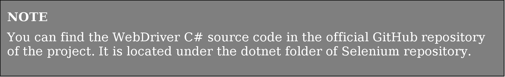

```csharp
[Serializable]
public class By
{
    public static By Id(string idToFind)
    {
        // method's code
    }

    public static By LinkText(string linkTextToFind)
    {
        // method's code
    }

    public static By Name(string nameToFind)
    {
        // method's code
    }

    public static By XPath(string xpathToFind)
    {
        // method's code
    }

    public static By ClassName(string classNameToFind)
    {
        // method's code
    }

    public static By PartialLinkText(string partialLinkTextToFind)
    {
        // method's code
    }

    public static By TagName(string tagNameToFind)
    {
        // method's code
    }

    public static By CssSelector(string cssSelectorToFind)
    {
        // method's code
    }

    public virtual IWebElement FindElement(ISearchContext context)
    {
        return this.FindElementMethod(context);
    }

    public virtual ReadOnlyCollection<IWebElement> FindElements(ISearchContext context)
    {
        return this.FindElementsMethod(context);
    }

    // rest of code
}
```

我删除了方法体，因为它们对于我想要表达的观点并不重要。假设你想添加一个不是 `By` 类初始版本部分的自定义定位器。唯一的方法是编辑原始源代码并添加新的静态方法。由于这些方法是静态的，你无法创建子类或使用其他的 OOP 策略。

由于项目维护者对此类更新非常保守，这意味着你无法添加新的定位器，或者无法非常方便地添加它。在我们能够让框架支持此类扩展点之前，我们需要讨论策略设计模式。

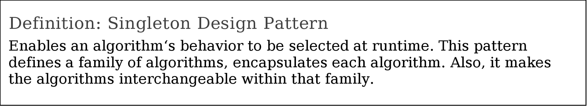

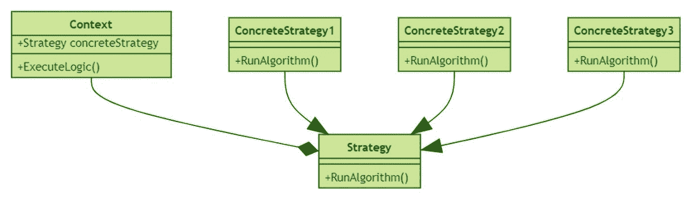

### 参与者

参与此模式的类和对象有：

- `Strategy`（策略）：定义算法的接口。客户端通过它调用接口方法。
- `Concrete Strategy`（具体策略）：持有算法的具体实现。
- `Context`（上下文）：通过 `Strategy` 实例使用具体策略，并为客户端提供更改算法设置的可能性。

## 回顾当前版本以查找元素

在重构我们的测试库时，为什么不快速回顾一下我们目前是如何查找和使用元素的呢？在上一章节中，我们定义了一个 way `IElementFindService` 的新接口。`WebDriver` 装饰器实现了它的两个方法：`Find` 和 `FindElements`。它们接受原生 WebDriver 的 `By` 类来指定定位器类型。

```csharp
public class WebDriver : Driver
{
    public override Element FindElement(By locator)
    {
        IWebElement nativeWebElement = _webDriverWait.Until(ExpectedConditions.ElementExists(locator));
        Element element = new WebElement(_webDriver, nativeWebElement, locator);
        Element logElement = new LogElement(element);
        return logElement;
    }

    public override List<Element> FindElements(By locator)
    {
        ReadOnlyCollection<IWebElement> nativeWebElements = _webDriverWait.Until(ExpectedConditions.PresenceOfAllElementsLocatedBy(locator));
        List<Element> elements = new List<Element>();

        foreach (var nativeWebElement in nativeWebElements)
        {
            Element element = new WebElement(_webDriver, nativeWebElement, locator);
            elements.Add(element);
        }

        return elements;
    }

    // rest of the code
}
```

我们通过组合而非继承来使用该接口。稍后，调用了这两个方法以及 `By` 类的一些静态方法。

```csharp
public class CartPageElements
{
    private readonly Driver _driver;

    public CartPageElements(Driver driver)
    {
        _driver = driver;
    }

    public Element CouponCodeTextField => _driver.FindById("coupon_code");
    public Element ApplyCouponButton => _driver.FindByCss("[value*='Apply coupon']");
    public Element QuantityBox => _driver.FindByCss("[class*='input-text qty text']");
    public Element UpdateCart => _driver.FindByCss("[value*='Update cart']");
    public Element MessageAlert => _driver.FindByCss("[class*='woocommerce-message']");
    public Element TotalSpan => _driver.FindByXPath("//*[@class='order-total']//span");
    public Element ProceedToCheckout => _driver.FindByCss("[class*='checkout-button button alt wc-forward']");
}
```

正如我们在本节开始时讨论过的样，这段代码的问题在于，你很难添加自定义的定位器。例如，让我们创建一个通过包含特定文本的 `Id` 来查找元素的定位器。

## 创建元素查找策略

现在，让我们重构上述代码以支持定位器的扩展性：

1. 我们需要定义基础策略算法接口。

```csharp
public abstract class FindStrategy
{
    protected FindStrategy(string value)
    {
        Value = value;
    }

    public string Value { get; }

    public abstract OpenQA.Selenium.By Convert();
}
```

策略类包含 `Value` 属性，它持有实际的定位器值。我们的引擎将调用 `Convert` 方法来生成原生 WebDriver 的 `By` 定位器，这是原生 WebDriver `find` 方法所需要的。

2. 接下来，我们需要创建具体的实现。我们将从 `By.Id` 定位策略开始。在 `Convert` 方法中，我们调用原生的 `By.Id` 方法。

```csharp
public class IdFindStrategy : FindStrategy
{
    public IdFindStrategy(string value) : base(value)
    {
    }

    public override By Convert()
    {
        return By.Id(Value);
    }
}
```

3. 现在，我们来回顾一下新的包含 `Id` 的策略看起来像什么样：

```csharp
public class IdContainingFindStrategy : FindStrategy
{
    public IdContainingFindStrategy(string value) : base(value)
    {
    }

    public override By Convert()
    {
        return By.CssSelector($"[id*='{Value}']");
    }
}
```

由于没有通过包含 `Id` 查找 Web 元素的原生方法，我们使用了 `CssSelector` 方法，在其中我们构建了一个 CSS 定位器表达式。你需要通过包含特定字符串的内部文本来定位元素吗？没问题——这次我们不使用 CSS 而使用 `XPath`。


```csharp
public class InnerTextContainsFindStrategy : FindStrategy{
    public InnerTextContainsFindStrategy(string value ): base(value){}
    public override By Convert(){
        return By.XPath($"//*[contains(text(), '{Value}')]");
    }
}
```

# 重构 `IElementFindService`

在我们的情况下，图中的上下文类是 `WebDriver` 装饰器。我们需要对它以及 `IElementFindService` 接口进行更改，以便开始使用新的查找策略。

```csharp
public interface IElementFindService{
    List<Element> FindAll(FindStrategy findStrategy);
    Element Find(FindStrategy findStrategy);
}
```

我们添加了一个持有查找策略的参数。为了让代码更具可维护性，我将查找元素的代码与原生 `WebDriver` 引擎移动到了名为 `ElementFinderService` 的独立类。

```csharp
public class ElementFinderService{
    private readonly ISearchContext _searchContext;
    private readonly IWebDriver _driver;
    public ElementFinderService(ISearchContext searchContext, IWebDriver driver){
        _searchContext = searchContext;
        _driver = driver;
    }
    public IWebElement Find(FindStrategy findStrategy){
        var element = _searchContext.FindElement(findStrategy.Convert());
        return element;
    }
    public IEnumerable<IWebElement> FindAll(FindStrategy findStrategy){
        IEnumerable<IWebElement> result = _searchContext.FindElements(findStrategy.Convert());
        return result;
    }
}
```

`ISearchContext` 是一个包含两个方法（`FindElement` 和 `FindElements`）的接口。`IWebDriver` 和 `IWebElement` 实现了它。通过这种方式，你可以在页面上搜索元素，也可以在已找到的元素内搜索。

```csharp
public class WebDriver : Driver{
    private ElementFinderService _FinderService;
    public override Element Find(FindStrategy findStrategy){
        var nativeElement = _elementContext.FindElement(findStrategy.
());
        return newElement(Element,ElementElementElementElement


     ListElementElementElementElementElement((StrategyStrategyStrategy


ElementElementElement


ElementElementElementElement


..(((ElementElementElementElementElementElementElement

        }
        returnreturnElements

    

// rest of the code
}
```

我们将查找策略作为参数传递给 `WebDriver` 装饰器的 `Find` 和 `FindAll` 方法。之后，我们使用之前定义的 `ElementFinderService` 来定位原生元素。当元素元素时，我们将其包装在元素装饰器中并返回。


重构后的方法使用方式如何？

```csharp
public class CartPageElements{
    private readonly Driver _driver;
    public CartPageElements(Driver driver){_driver = driver;}
    public Element CouponCodeTextField=>_driver.FindById("coupon_code");
    public Element ApplyCouponButton=>_driver.FindByCss("[value*='Apply coupon']");
    public Element QuantityBox=>_driver.FindByCss("[class*='input-text qty text']");
    public Element UpdateCart=>_driver.FindByCss("[value*='Update cart']");
    public Element MessageAlert=>_driver.FindByCss("[class*='woocommerce-message']");
    public Element TotalSpan=>_driver.FindByXPath("//*[@class='order-total']//span");
    public Element ProceedToCheckout=>_driver.FindByCss("[class*='checkout-button button alt wc-forward']");
}
```

你可能注意到代码有点冗长，且难以使用所有查找参数。考虑一下如何改进 API？

# 提高元素查找策略实用性

这是我建议在 `IElementFindService` 中更改的内容。与其拥有通用方法，不如为每个定位器策略拥有独立的方法。你可能会说我们回到了初始状态，但请耐心。我将向你展示如何保留我们争取的扩展性。

```csharp
public interface IElementFindService{
    Element FindById(string id);
    Element FindByXPath(string xpath);
    Element FindByTag(string tag);
    Element FindByClass(string css);
    Element FindByCss(string css);
    Element FindByLinkText(string linkText);
    List<Element> FindAllById(string id);
    List<Element> FindAllXPath(string xpath);
    List<Element> FindAllByTag(string tag);
    List<Element> FindAllByClass(string css);
    List<Element> FindAllByCss(string css);
    List<Element> FindAllByLinkText(string linkText);
    List<Element> FindAll(FindStrategy findStrategy);
    Element Find(FindStrategy findStrategy);
}
```

在 `WebDriver` 装饰器中，我们需要创建所有这些方法。为了节省，我们可以保留通用查找实现并在内部调用它。

```csharp
public class WebDriver : Driver{
    private ElementFinderService _elementFinderService;
    public override List<Element> FindAllByClass(string css){
        return FindAll(new ClassStrategy(css));
    }
    public override List<Element> FindAllById(string id){
        return FindAll(new IdFindStrategy(id));
    }
    public override List<Element> FindAllByTag(string tag){
        return FindAll(new TagStrategy(tag));
    }
    public override List<Element> FindAllXPath(string xpath){
        return FindAll(new XPathStrategy(xpath));
    }
    public override List<Element> FindAllByCss(string css){
        return FindAll(new CssStrategy(css));
    }
    public override List<Element> FindAllByLinkText(string linkText){
        return FindAll(new LinkTextStrategy(linkText));
    }
    public override Element FindByCss(string css){
        return Find(new CssStrategy(css));
    }
    public override Element FindByLinkText(string linkText){
        return Find(new LinkTextStrategy(linkText));
    }
    public override Element FindByClass(string css){
        return Find(new ClassStrategy(css));
    }
    public override Element FindById(string id){
        return Find(new IdFindStrategy(id));
    }
    public override Element FindByTag(string tag){
        return Find(new TagStrategy(tag));
    }
    public override Element FindByXPath(string xpath){
        return Find(new XPathStrategy(xpath));
    }
    public override Element Find(FindStrategy findStrategy){
        var nativeElement = _elementFinderService.Find(findStrategy);
        return new WebElement(_webDriver, nativeElement, findStrategy.Convert());
    }
    public override List<Element> FindAll(FindStrategy findStrategy){
        var nativeElements = _elementFinderService.FindAll(findStrategy);
        var resultElements = new List<Element>();
        foreach (var nativeElement in nativeElements){
            resultElements.Add(new WebElement(_webDriver, nativeElement, findStrategy.Convert()));
        }
        return resultElements;
    }
}
```

在这些更改之后，查找 API 的用法发生了显著变化。让我们看看：

```csharp
public class CartPageElements{
    private readonly Driver _driver;
    public CartPageElements(Driver driver){_driver = driver;}
    public Element CouponCodeTextField=>_driver.FindById("coupon_code");
    public Element ApplyCouponButton=>_driver.FindByCss("[value*='Apply coupon']");
    public Element QuantityBox=>_driver.FindByCss("[class*='input-text qty text']");
    public Element UpdateCart=>_driver.FindByCss("[value*='Update cart']");
    public Element MessageAlert=>_driver.FindByCss("[class*='woocommerce-message']");
    public Element TotalSpan=>_driver.FindByXPath("//*[@class='order-total']//span");
    public Element ProceedToCheckout=>_driver.FindByCss("[class*='checkout-button alt wc-forward']");
}
```

然而，现在 `WebDriver` 装饰器看起来与带有静态方法的 `By` 类相似。我们可以通过为 `IElementFindService` 创建扩展方法来使代码更用户用户。这将允许我们库的用户在不直接添加到核心的情况下添加自定义定位器。


```csharp
namespace ExtensibilityDemos.Extensions{
    public static class ElementFindService{
        public static Element CreateByIdContaining(this IElementFindService findService, string idContaining){
            return findService.Find(new IdContainingStrategy(idContaining));
        }
    }
}
```

要在你的代码中使用扩展方法，你需要添加：

```csharp
using ExtensibilityDemos.Extensions;
public class CartPageElements{
    private readonly Driver _driver;
    public CartPageElements(Driver driver){_driver = driver;}
    public Element CouponCodeTextField=>_driver.FindByIdContaining("coupon_code");
    public Element ApplyCouponButton=>_driver.FindByCss("[value*='Apply coupon']");
    public Element QuantityBox=>_driver.FindByCss("[class*='input-text qty text']");
    public Element UpdateCart=>_driver.FindByCss("[value*='Update cart']");
    public Element MessageAlert=>_driver.FindByCss("[class*='woocommerce-message']");
    public Element TotalSpan=>_driver.FindByXPath("//*[@class='order-total']//span");
    public Element ProceedToCheckout=>_driver.FindByCss("[class*='checkout-button alt wc-forward']");
}
```

# 通过策略模式构建元素等待扩展性

等待 Web 元素的可用状态对于每个稳定的自动化测试都是关重要的。在我们框架之前的版本中，我们已经使用了 `WebDriver` 等 API 来等待元素出现在页面上，有时我们需要更多方法来等待其他属性达到特定状态。例如元素是否可用、可见或包含文本。

### 原生 `WebDriver` 等待元素


下面你可以看到原生 WebDriver 中等待元素的标准方法。

```csharp
IWebDriver _webDriver = new ChromeDriver(Environment.CurrentDirectory);
WebDriverWait _webDriverWait = new WebDriverWait(_webDriver, TimeSpan.FromSeconds(30));
IWebElement button = _webDriverWait.Until(ExpectedConditions.ElementExists(By.Id("buttonId")));
```

为什么不回顾一下 `ExpectedConditions` 类？它与查找 API 的 `By` 类部分相似。我只留下了想讨论的代码部分。

```csharp
public sealed class ExpectedConditions{
    public static Func<IWebDriver, IWebElement> ElementExists(By locator){rest of the method}
    public static Func<IWebDriver, IWebElement> ElementVisible(By locator){rest of the code}
    public static Func<IWebDriver, bool> TextToBePresentInElement(IWebElement element, string text){rest of the code}
    public static Func<IWebDriver, bool> TextToBePresentInElementLocated(By locator, string text){rest of the code}
    public static Func<IWebDriver, bool> TextToBePresentInElementValue(IWebElement element, string text){rest of the code}
    public static Func<IWebDriver, bool> TextToBePresentInElementValue(By locator, string text){rest of the code}
    public static Func<IWebDriver, WebDriver> FrameToBeAvailableAndSwitchIt(string frame){rest of the code}
    public static Func<IWebDriver, WebDriver> FrameToBeAvailableAndSwitchIt(By locator){rest of the code}
    public static Func<IWebDriver, bool> InvisibilityOfElementLocated(By locator){rest of the code}
    public static Func<IWebDriver, bool> InvisibilityOfElementWithText(By locator, string text){rest of the code}
    public static Func<IWebDriver, IWebElement> ElementToBeClickable(By locator){rest of the code}
    public static Func<IWebDriver, IWebElement> ElementToBeClickable(IWebElement element){rest of the code}
    public static Func<IWebDriver, bool> ElementToBeSelected(IWebElement element, bool selected){rest of the code}
    public static Func<IWebDriver, bool> ElementSelectionToBe(IWebElement element, bool selected){rest of the code}
    public static Func<IWebDriver, bool> ElementSelectionToBe(By locator, bool selected){rest of the code}
    public static Func<IWebDriver, Alert> AlertIsPresent(){rest of the code}
    public static Func<IWebDriver, bool> AlertState(bool state){rest of the code}
}
```

与 `By` 类一样，除了删除的内容之外，还有大量方法。但这里的重点是，如果你想创建一个新的等待条件，就需要添加一个新的静态方法并让这个类变得可扩展。在 `Find` API 的情况下，我们可以使用 `Strategy` 设计模式来构建这种扩展性。

# 回顾元素等待版本

现在我们的框架中没有元素元素元素接口。每次在返回元素之前，我们都会等待元素存在。我们还使用原生的 `WebDriverWait` API 来等待异步操作。

```csharp
public class WebDriver : Driver{
    public override Element FindElement(By locator){
        IWebElement nativeWebElement = _webDriverWait.Until(ExpectedConditions.ElementExists(locator));
        Element element = new WebElement(_webDriver, nativeWebElement, locator);
        Element logElement = new LogElement(element);
        return logElement;
    }
    public override List<Element> FindElements(By locator){
        ReadOnlyCollection<IWebElement> nativeWebElements = _webDriverWait.Until(ExpectedConditions.PresenceOfAllElementsLocatedBy(locator));
        List<Element> elements = new List<Element>();
        foreach (var nativeWebElement in nativeWebElements){
            Element element = new WebElement(_webDriver, nativeWebElement, locator);
            elements.Add(element);
        }
        return elements;
    }
}
```

# 创建元素等待

为了创建一个扩展的等待 API，我们首先需要创建一个 `Strategy` 接口。

```csharp
public abstract class WaitStrategy{
    protected WaitStrategy(int? timeoutIntervalSeconds = null, int? sleepIntervalSeconds = null){
        TimeoutInterval = TimeSpan.FromSeconds(timeoutIntervalSeconds ?? 30);
        SleepInterval = TimeSpan.FromSeconds(sleepIntervalSeconds ?? 2);
    }
    protected TimeSpan TimeoutInterval { get; }
    protected TimeSpan SleepInterval { get; }
    public abstract void WaitUntil(ISearchContext searchContext, IWebDriver driver);
    protected void WaitUntil(Func<ISearchContext, bool> waitCondition, IWebDriver driver){
        var webDriverWait = new WebDriverWait(SystemClock(), TimeoutInterval, SleepInterval);
        webDriverWait.Until(waitCondition);
    }
    protected void WaitUntil(Func<ISearchContext, IWebElement> waitCondition, IWebDriver driver){
        var webDriverWait = new WebDriverWait(SystemClock(), TimeoutInterval, SleepInterval);
        webDriverWait.Until(waitCondition);
    }
    protected IWebElement FindElement(ISearchContext searchContext, By by){
        var element = searchContext.FindElement(by);
        return element;
    }
}
```

将基础策略实现为抽象类而不是 C# 接口，是因为我想在所有等待策略之间共享一些代码。对客户端可用的唯一公共方法是：`public abstract void WaitUntil(ISearchContext searchContext, IWebDriver driver, By by);` 具体策略需要通过抽象类的保护函数来实现它。

在辅助的保护 `Until` 方法中，我们通过传递两种不同类型的委托函数来创建 `WebDriverWait` 类的实例：一个返回 `IWebElement`，另一个返回 `bool`。我们还赋予了覆盖默认超时的灵活性。现在让我们看看在等待元素存在的情况下，具体的等待策略看起来像什么样。

```csharp
public class ToExistsWaitStrategy : WaitStrategy{
    public ToExistsWaitStrategy(int? timeoutIntervalSeconds = null, int? sleepIntervalSeconds = null): base(timeoutIntervalSeconds, sleepIntervalSeconds){}
    public override void WaitUntil(ISearchContext searchContext, IWebDriver driver, By by){
        WaitUntil(ElementExists(searchContext, by), driver);
    }
    private Func<ISearchContext, bool> ElementExists(ISearchContext searchContext, By by){
        return _ =>{
            try{
                var element = FindElement(searchContext, by);
                return element != null;
            } catch (NoSuchElementException){
                return false;
            }
        };
    }
}
```

我们要不要再开发一个具体的等待策略，例如等待元素可点击的策略？

```csharp
public class ToBeClickableWaitStrategy : WaitStrategy{
    public ToBeClickableWaitStrategy(int? timeoutIntervalSeconds = null, int? sleepIntervalSeconds = null): base(timeoutIntervalSeconds, sleepIntervalSeconds){}
    public override void WaitUntil(ISearchContext searchContext, IWebDriver driver, By by){
        WaitUntil(ElementIsClickable(searchContext, by), driver);
    }
    private Func<ISearchContext, bool> ElementIsClickable(ISearchContext searchContext, By by){
        return _ =>{
            var element = FindElement(searchContext, by);
            try{
                return element != null && element.Enabled;
            } catch (StaleElementReferenceException){
                return false;
            } catch (NoSuchElementException){
                return false;
            }
        };
    }
}
```


## 1. 定义接口

定义一个后续需要由 WebDriver 装饰器实现的接口。

```csharp
public interface IElementWaitService{
    void Wait(Element element, WaitStrategy waitStrategy);
}
```

## 2. 在装饰器中实现

我们可以在装饰器中添加具体的实现。

```csharp
public override void Wait(Element element, WaitStrategy waitStrategy){
    waitStrategy?.WaitUntil(_webDriver, _webDriver, element.By);
}
```

我们将具体初始化的等待策略作为参数传递。

## 3. 等待策略工厂

为了方便使用，我们可以创建一个等待策略工厂。在类中，我们为每种具体的策略都提供了一个方法。如果我们需要添加新的等待策略，可以使用扩展方法。

```csharp
public class WaitStrategyFactory
{
    public ToExistsWaitStrategy Exists(int? timeoutInterval = null, int? sleepInterval = null){
        return new ToExistsWaitStrategy(timeoutInterval, sleepInterval);
    }

    public ToBeVisibleWaitStrategy BeVisible(int? timeoutInterval = null, int? sleepInterval = null){
        return new ToBeVisibleWaitStrategy(timeoutInterval, sleepInterval);
    }

    public ToBeClickableWaitStrategy BeClickable(int? timeoutInterval = null, int? sleepInterval = null){
        return new ToBeClickableWaitStrategy(timeoutInterval, sleepInterval);
    }
}
```

## 4. 静态类语法糖

该工厂配合一个静态类工作，该静态类用于语法糖，以便于使用并提高代码的可读性。

```csharp
public static class Wait
{
    static Wait()=>To = new WaitStrategyFactory();

    public static WaitStrategyFactory To { get; }
}
```

## 5. 使用

以下是使用方法。从代码中你可以看出，我们没有遵循方法和类命名的最佳实践。

```csharp
public class CartPage : NavigatableEShopPage
{
    private readonly CartPageElements _elements;
    private readonly IElementWaitService _elementWaitService;

    private CartPage(Driver driver) : base(driver)
    {
```


```csharp
_elementWaitService = driver;

BreadcrumbSection = new BreadcrumbSection(driver);

_elements = new CartPageElements(driver);

}

protected override string Url => "http://demos.bellatrix.solutions/cart/";

public BreadcrumbSection BreadcrumbSection { get; set; }

public CartPage ApplyCoupon(string coupon)

{

    _elementWaitService.Wait(_elements.CouponCodeTextField, Wait.To.Exists());

    _elements.CouponCodeTextField.TypeText(coupon);

    _elementWaitService.Wait(_elements.ApplyCouponButton, Wait.To.BeClickable());

    _elements.ApplyCouponButton.Click();

    Driver.WaitForAjax();

    return this;

}

// rest of the code

}
```

我们在页面构造函数中初始化了 `IElementWaitService`。要使用它，我们调用其 `Wait` 方法并传递需要等待的元素。第二个参数是由我们的 `WaitStrategyFactory` 类生成的——源自静态类 `Wait` 的静态属性 `To`。通过类名、属性名和方法名的序列组合，我们创建了一个更具意义的代码“句子”。

### 在 `ElementFinderService` 中添加元素等待逻辑

正如早些提到的，我们新的 `ElementFinderService` 缺少等待元素的等待逻辑。让我们使用新的等待策略来添加此功能。

```csharp
public class ElementFinderService

{

    private readonly ISearchContext _searchContext;

    private readonly IWebDriver _driver;

    public ElementFinderService(ISearchContext searchContext, IWebDriver driver)

    {

        _searchContext = searchContext;

        _driver = driver;

    }

    public IWebElement Find(FindStrategy findStrategy)

    {

        Wait.To.Exists().WaitUntil(_searchContext, _driver, findStrategy.Convert());

        var element = _searchContext.FindElement(findStrategy.Convert());

        return element;

    }

    public IEnumerable<IWebElement> FindAll(FindStrategy findStrategy)

    {

        Wait.To.Exists().WaitUntil(_searchContext, _driver, findStrategy.Convert());

        IEnumerable<IWebElement> result = _searchContext.FindElements(findStrategy.Convert());

        return result;

    }

}
```

我们再次使用了静态类 `Wait`，它让我们能够访问 `WaitStrategyFactory`。然后，我们通过工厂的方法 `Exists` 创建了 `ToExistsWaitStrategy` 类。最后，我们调用 `WaitUntil` 方法，并将转换后的查找策略传递给原生的 `By` `WebDriver` 定位器。

### 通过 `EventFiringWebDriver` 添加扩展性点

在之前的章节中，我们研究了如何为元素或驱动器的方法添加行为。我们是使用装饰器模式实现的。我们在不向测试代码添加任何单行代码的情况下，为框架添加了日志功能。`WebDriver` 通过暴露委托为我们提供了一种为其某些操作添加行为的原生方法。要使用此功能，你需要初始化 `EventFiringWebDriver` 类。

#### 原生 `EventFiringWebDriver` 示例

以下是如何使用原生 `EventFiringWebDriver` API。

```csharp
IWebDriver _webDriver = new ChromeDriver(Environment.CurrentDirectory);

EventFiringWebDriver _eventFiringWebDriver = new EventFiringWebDriver(_webDriver);

_eventFiringWebDriver.Navigated += OnNavigated;

_eventFiringWebDriver.ExceptionThrown += OnExceptionThrown;

_eventFiringWebDriver.ElementClicked += OnElementClicked;

private void OnExceptionThrown(object sender, WebDriverExceptionEventArgs e)

{

    Console.WriteLine($"Exception was thrown: {e.ThrownException.Message}");

}

private void OnNavigated(object sender, WebDriverNavigationEventArgs e)

{

    Console.WriteLine($"Navigating to Url: {e.Url}");

}

private void OnElementClicked(object sender, WebElementEventArgs e)

{

    Console.WriteLine($"Element with tag = {e.Element.TagName} clicked.");

}
```

我们需要创建一个 `EventFiringWebDriver` 类的独立实例，并接收 `IWebDriver` 作为参数。接下来，我们需要订阅该类暴露的事件。在这种情况下，我们为 `Navigate` 方法、元素的 `Click` 操作以及发生异常时添加了行为。我们不需要为日志记录创建一个单独的装饰器，而是可以使用这些委托。

### 通过 `EventFiringWebDriver` 集成

我们可以向 `WebDriver` 装饰器中添加 `EventFiringWebDriver` 逻辑。第一个版本如下：

```csharp
public class WebDriver : Driver

{

    private IWebDriver _webDriver;

    private EventFiringWebDriver _eventFiringWebDriver;

    private WebDriverWait _webDriverWait;

    private NativeElementFinderService _nativeElementFinderService;

    public override void Start(Browser browser)

    {

        // rest of the code

        _eventFiringWebDriver = new EventFiringWebDriver(_webDriver);

        _eventFiringWebDriver.Navigated += OnNavigated;

        _eventFiringWebDriver.ExceptionThrown += OnExceptionThrown;

        _eventFiringWebDriver.ElementClicked += OnElementClicked;

    }

    private void OnExceptionThrown(object sender, WebDriverExceptionEventArgs e)

    {

        Console.WriteLine(e.ThrownException.Message);

    }

    private void OnNavigated(object sender, WebDriverNavigationEventArgs e)

    {

        Console.WriteLine(e.Url);

    }

    private void OnElementClicked(object sender, WebElementEventArgs e)

    {

        Console.WriteLine(e.Element);

    }

    // rest of the code

}
```

在 `Start` 方法初始化 `WebDriver` 的时刻，我们创建了 `EventFiringWebDriver` 的实例并订阅了三个事件。然而，这种方式并不是可扩展的，因为我们将事件处理程序的具体实现直接放在了装饰器类中。事件的整个思路是允许我们订阅多个事件处理程序。我们需要重构部分代码来实现这一点。首先，我们可以创建一个抽象类，定义所有事件处理程序的形式。它们的方法体被标记为 `virtual`，这意味着具体实现可以（也应该）覆盖它们并添加行为。

```csharp
public abstract class FiringEventHandlers

{

    public virtual void OnExceptionThrown(object sender, WebDriverExceptionEventArgs e){}

    public virtual void OnNavigated(object sender, WebDriverNavigationEventArgs e){}

    public virtual void OnElementClicked(object sender, WebElementEventArgs e){}

}
```

接下来，让我们创建基类的两个实现。第一个用于创建类似于当前装饰器的日志。

```csharp
public class LoggingWebDriverEventHandlers : FiringEventHandlers

{

    public override void OnElementClicked(object sender, WebElementEventArgs e)

    {

        Console.WriteLine(e.Element);

    }

    public override void OnExceptionThrown(object sender, WebDriverExceptionEventArgs e)

    {

        Console.WriteLine(e.ThrownException.Message);

    }

}
```

我们派生 `FiringEventHandlers` 类并仅覆盖我们想要添加逻辑的方法。在这种情况下，我们跳过了三个方法中的一个。我们可以创建一个类似的类，将日志输出到 Visual Studio 的调试窗口。

```csharp
public class DebugFiringEventHandlers : FiringEventHandlers

{

    public override void OnElementClicked(object sender, WebElementEventArgs e)

    {

        Debug.WriteLine($"Element with tag = {e.Element.TagName} clicked.");

    }

    public override void OnExceptionThrown(object sender, WebDriverExceptionEventArgs e)

    {

        Debug.WriteLine(e.ThrownException);

    }

}
```

接下来，我们需要重构 `WebDriver` 装饰器以支持 `FiringEventHandlers` 列表并将所有的事件处理程序订阅到 `EventFiringWebDriver` 实例事件上。

```csharp
public class WebDriver : Driver

{

    private readonly List<FiringEventHandlers> _firingWebDriverEventHandlers;

    private IWebDriver _webDriver;

    private EventFiringWebDriver _eventFiringWebDriver;

    private WebDriverWait _webDriverWait;

    private NativeElementFinderService _nativeElementFinderService;

    public WebDriver()

    {

        _firingWebDriverEventHandlers = new List<FiringEventHandlers>

        {

            new DebugFiringEventHandlers(),

            new LoggingWebDriverEventHandlers()

        };

    }

    public override void Start(Browser browser)

    {

        // rest of the code

        InitializeEventFiringWebDriver();

    }

    private void InitializeEventFiringWebDriver()

    {

        _eventFiringWebDriver = new EventFiringWebDriver(_webDriver);

        foreach (var webDriverEventHandler in _firingWebDriverEventHandlers)

        {

            _eventFiringWebDriver.Navigated += webDriverEventHandler.OnNavigated;

            _eventFiringWebDriver.ExceptionThrown += webDriverEventHandler.OnExceptionThrown;

            _eventFiringWebDriver.ElementClicked += webDriverEventHandler.OnElementClicked;

        }

    }

}

// rest of the code
```


在构造函数中，我们添加了事件处理程序的具体实现。我认为这种方式类仍然遵循开闭原则。然而，你始终可以添加一个公共方法来添加自定义的事件处理程序实现。在 `InitializeEventFiringWebDriver` 方法中，我们创建了 `EventFiringWebDriver` 的实例并遍历处理程序列表，将其订阅到事件。

## 总结

在本章中，我们讨论了与框架扩展性相关的话题，即如何遵循开闭原则，使测试代码更易扩展和自定义。我们使用了策略模式来构建元素定位和等待的扩展性。在章节末尾，我们讨论了原生 `WebDriver` 的现有支持，用于在 `WebDriver` 执行流的各个点添加自定义代码的执行。

## 问题

1. 你能定义策略设计模式中的主要参与者吗？
2. 为什么原生的 `WebDriver` 类易于扩展？
3. 什么是 `lambda` 匿名方法？
4. 你如何等待特定元素变为可点击？
5. `EventFiringWebDriver` 类的主要作用是什么？

## 进阶阅读

- 自动化测试中的策略设计模式：[https://www.automatetheplanet.com/strategy-design-pattern/](https://www.automatetheplanet.com/strategy-design-pattern/)
- 自动化测试中的高级策略设计模式：[https://www.automatetheplanet.com/advanced-strategy-design-pattern/](https://www.automatetheplanet.com/advanced-strategy-design-pattern/)
- C# 中的策略设计模式：[https://exceptionnotfound.net/strategy-pattern-in-csharp/](https://exceptionnotfound.net/strategy-pattern-in-csharp/)

# 第 8 章：测试架构设计的评估系统

在上一章中，我们讨论了与框架扩展性相关的主题——即如何遵循“开闭原则”，使框架代码更容易进行扩展和定制。我们使用了 `Strategy` 设计模式来为元素定位和等待构建这种扩展性。在章节的末尾，我们讨论了现有的原生 `WebDriver` 支持，它允许你在 `WebDriver` 执行流的各个点添加并执行自定义代码。通过此，我们结束了书的第二部分，讨论了高质量属性——测试的可读性、测试的可维护性/复用性、API 的可用性以及扩展性。

在下一部分，我们将学习一种系统的方法，来评估并决定哪种是测试编写的最佳方法——考虑到设计的各种属性。此外，我们还将讨论如何最合适地使用测试数据并为测试执行创建正确的环境。首先，我们将开始讨论测试设计评估系统，定义其标准，并解释如何在实践中应用它。在章节的第二节中，我们将评估书中已经使用的三种设计——不使用页面对象的测试、使用该模式的测试，以及最后使用 `Facade` 设计模式的测试。

本章将涵盖以下主题：

- 评估系统介绍
- 系统使用示例

## 评估系统介绍

### 我们正在尝试解决什么问题？

如果你只写了 1-2 个自动化测试，通常你如何编写它们并不重要。你可以将整个代码放在测试用体内部，这可能没问题。然而，如果你计划拥有成百甚至上千个复杂的系统测试，那么你就需要规划如何维护这个测试套件。如果你在编写所有这些测试之前就开始思考，那对你来说是件好事。

通常，你会创建一个刺探项目（spike project），包含 2-3 种类型的测试架构，并选择其中一种。如果一两年后你发现某些地方需要更改，并且你的测试套件需要重构，这种方法同样有效。但你如何在不同的测试设计之间进行选择呢？我们在本章讨论的评估系统将帮助你根据数据而不是感觉或心情来做出系统性的决策。

## 定义

什么是自动化测试设计的评估系统？它包含了 7 个标准，稍后将用于评估每个设计。对于每一个标准，我们都会根据自己的判断进行评分。其中大多数标准不是通过工具评估的，而是取决于我们对术语和架构知识的理解。

别担心，阅读之前的章节应该会给你足够的知识来给出合理的评分。我们稍后会更深入地讨论将该系统引入你的团队的具体步骤。本章的第二部分专门介绍它的示例用法。让我们从定义评估标准开始。我们已经在第一章回顾了某些定义，但我将结合一些补充再次过一遍。此外，我们还有整个章节讨论过其中一些标准，所以到目前为止，你应该对这些术语的含义有了良好的理解。

### 1. 可读性

通过阅读代码，你应该能够轻松发现代码的功能。不可读的代码通常需要更多时间来阅读、维护、理解，并且可能会增加引入 bug 的概率。有些程序员使用大量的注释，而不是编写更简单、更易读的代码。正确命名你的 `variables`、`methods`、`classes` 要比依赖这些注释更容易。随着时间的推移，注释往往不再被维护，并且可能会误导读者。

### 2. 可维护性

“我们能够定制或更改软件解决方案以适应新需求、修复问题、提高性能的易用程度。”

想象你的测试中有一个问题。你需要多长时间来确定问题出在哪里？是自动化 bug 还是被测系统的问题？这与你的测试设计密切相关——测试如何分组、使用了哪些设计模式、你的元素定位器放在哪里。它取决于代码的扩展性和重用性，但整体而言，它应该衡量分析测试失败和保持测试运行的便利程度。维护性越好，我们支持现有代码、适应新需求或修复某些 bug 就越容易。

### 3. 可用性

它与可维护性密切相关。一个相关的原则是所谓的 `DRY` - `Don't Repeat Yourself`（不要重复）。

`DRY` 原则背后的基本思想是通过消除所有不必要的重复来降低长期维护成本。但如果你在开始时没有这样设计代码，更改可能需要应用到多个地方，这可能会遗漏某些更改并导致更多 bug。此外，这会减慢新测试的开发、测试失败的分析以及现有测试的维护。

### 4. API 易用性

API 是使用软件库可以做什么的规范。API 易用性意味着作为用户的你发现 `methods` 的作用并弄清楚如何使用它们有多么容易。如果我们讨论的是一个测试库——新用户创建一个新测试需要多久？这与学习曲线有关。

在编程社区中，我们有时使用另一个术语来描述同一件事，称为 `syntactic sugar`（语法糖）。它描述了使用或读取某些表达式有多容易。它为人类让编程语言变得更加甜美。编程语句变得更加简洁清晰。

### 5. 可扩展性

开发中最困难的事情之一就是允许这些通用框架具有可扩展性和可定制性。创建共享库的重点是为了让公司内的多个团队使用。然而，不同的团队在不同的语言中工作。他们可能必须测试略有不同的东西。因此，库代码可能无法为他们开箱可用。因此，工程师应该能够自定义某些部分以适应他们的需求。

在自动化测试的情况下，我们已经看了一个用于测试在线购物车的测试套件。该测试工作流包括多个步骤——选择产品、更改数量、添加更多产品、使用优惠券、填写账单信息、提供支付信息等。如果出现了一个新需求，要求你为已登录用户预填账单信息——你更改现有测试有多容易？你编写测试的方式是否能让你在添加此新功能时，不会影响到你现有的测试？

### 6. 代码复杂度指数

代码复杂度指数是唯一通过工具计算的指标。这四个部分可以通过 `Visual Studio IDE` 计算。稍后，我们可以根据下表评估评分。

`Code Complexity Index Rating = (Depth of Inheritance Rating + Class Coupling Rating + Maintainability Index Rating + Cyclomatic Complexity Rating) / 4`

- **继承深度（Depth of Inheritance）**：我们衡量你在测试中继承了多少个 `classes`。通常，继承越深，理解代码和维护代码就可能越困难。
- **类耦合（Class Coupling）**：根据你的代码依赖的 `classes` 数量计算。你的测试越独立越好。更多的依赖在重构或 API 与新版本差异时会给你的代码带来更多更改。
- **可维护性指数（Maintainability Index）**：代表 0 到 100 之间的数字。数字越高表示你的测试越容易维护。下面是一个用于计算该指数的示例公式。

`Maintainability Index = MAX(0, (171 – 5.2 * ln(Halstead Volume) – 0.23 * (Cyclomatic Complexity) – 16.2 * ln(Lines of Code)) * 100 / 171)`

- **圈复杂度（Cyclomatic Complexity）**：在下方你可以找到圈复杂度的公式。

`Cyclomatic Complexity = CC = E - N + 2`

`E`：图的边数

`N`：图的节点数

圈复杂度的计算基于程序中的决策数量。我们得到代码复杂度指数公式的每个部分，并根据下表获得它们的特定评分。

| 评分 | 可维护性指数 | 圈复杂度 | 类耦合 | 继承深度 |
| :--- | :--- | :--- | :--- | :--- |
| （5）极优 | > 70 | < 10 | < 10 | <= 3 |
| （4）良好 | > 60 | 10-12 | < 15 | 4 |
| （3）中等 | 40-60 | 12-15 | < 20 | 5 |
| （2）差 | 20-40 | 15-20 | < 30 | 6-8 |
| （1）极差 | < 20 | > 20 | > 30 | > 8 |

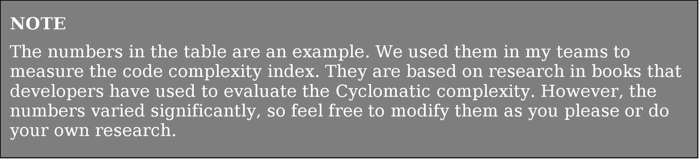 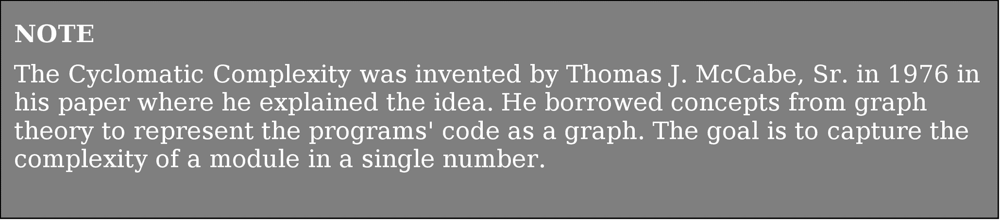

在本章的第二部分中，你将看到如何计算所有数字的示例。

### 7. 学习曲线

我喜欢将这一属性称为“易于知识转移”（Easy Knowledge Transfer）。该属性回答了一个问题：“一个人自学有多容易？”学习曲线与 API 的易用性紧密相关，但它的含义略有不同。

如果一个新成员加入你的团队，他能够自学会如何使用你的测试自动化框架，还是需要阅读文档（如果存在的话）？或者你有一套导师计划，需要每次都亲手教这些新成员如何使用你的代码？

### 8. KISS

最后一个准则不是我们要计算的，而是一个原则——“保持简单，愚蠢”（Keep It Simple Stupid）。马丁·福勒（Martin Fowler）的下面这段话最好地描述了这一原则：

“任何傻瓜都能写出计算机能懂的代码。优秀的程序员编写人类能懂的代码。”

当所有其他数字/评分/指数都相等时可以使用它（在我的实践中这种情况并没有发生过）。但如果在某些少数情况下发生了，经验法则是选择最简单的设计。

稍后我们将评估一个使用页面对象（page objects）的设计和一个使用外观（facades）的更复杂的设计。由于某种原因它们的评分相同，且我们应用 KISS 原则，我们最可能会选择页面对象设计，因为它比外观设计更简单。

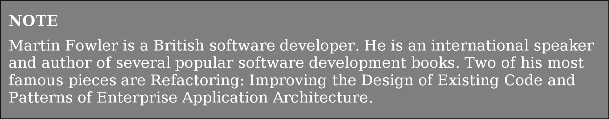

### 评估评分

对于上述每个准则，我们分配一个评分，基本上是一个数字。为了计算最终的 `TDI`（测试设计索引），我们将所有准则评分相加。`TDI` 分数越优的设计就会脱颖而出。

- （1）非常差
- （2）差
- （3）好
- （4）非常好
- （5）优秀

### 应用步骤

测试架构设计评估是一项团队工作。你可以独立完成，但这样你可能不够客观。当你获得几位经验同事的 `TDI` 评分时，它会减少最终决策中的个人偏好。以下是推荐的评估流程：

1. 创建一个与当前测试所在分支不同的开发分支。
2. 为每个测试设计创建独立的项目。
3. 使用提议的设计编写几个测试用例。
4. 为每个设计实现相同组测试用例。
5. 向参与评估的团队成员展示解决方案。
6. 每位参与者使用系统并分配评分。
7. 召开最终评估会议。

# 评估系统用例

现在是时候将评估系统付诸实践了。我相信，如果你看到几个我们如何定义评分的示例，你就能为你的测试设计完成同样的操作。

我们将评估在之前的章节中涵盖的三个设计。第一个是不使用页面对象（page objects）的 `Vanilla WebDriver`。第二种将是我们讨论过的 `Page Object Model`（页面对象模型）设计模式的最后一个版本。最后一个是使用 `facade`（外观）设计模式第二变体的测试。

别担心——会有代码片段提醒你这些设计分别是什么样的。对于每种设计，我们将首先回顾测试的样子，然后遍历上一个节中的每一项标准，并根据我们的个人判断进行评分。最后，我们将为每个设计计算出 `TDI` 索引。得分最高的设计获胜。如果某些设计的评分相同，我们将使用 `KISS` 原则——最简单的一个获胜。

## 不使用页面对象的测试评估

### 架构设计概述

这是我们不使用页面对象的测试样式。

```csharp
[TestClass]
public class ProductPurchaseTests
{
    private static Driver _driver;
    private static string _purchaseEmail;
    private static string _purchaseOrderNumber;

    [TestInitialize]
    public void TestInitialize()
    {
        _driver = new LoggingDriver(new WebDriver());
        _driver.Start(Browser.Chrome);
    }

    [TestCleanup]
    public void TestCleanup()
    {
        _driver.Quit();
    }

    [TestMethod]
    public void CompletePurchaseSuccessfully_WhenNewClient()
    {
        AddRocketToShoppingCart();

        ApplyCoupon();

        IncreaseProductQuantity();

        var proceedToCheckout = _driver.FindElement(
            By.CssSelector("[class*='checkout-button button alt wc-forward']")
        );

        proceedToCheckout.Click();

        _driver.WaitUntilPageLoadsCompletely();

        var billingFirstName = _driver.FindElement(By.Id("billing_first_name"));
        billingFirstName.TypeText("Anton");

        var billingLastName = _driver.FindElement(By.Id("billing_last_name"));
        billingLastName.TypeText("Angelov");

        var billingCompany = _driver.FindElement(By.Id("billing_company"));
        billingCompany.TypeText("Space Flowers");

        var billingCountryWrapper = _driver.FindElement(
            By.Id("select2-billing-country-container")
        );

        billingCountryWrapper.Click();

        var billingCountryFilter = _driver.FindElement(
            By.ClassName("select2-search__field")
        );

        billingCountryFilter.TypeText("Germany");

        var germanyOption = _driver.FindElement(
            By.XPath("//*[contains(text(),'Germany')]")
        );

        germanyOption.Click();

        var billingAddress1 = _driver.FindElement(By.Id("billing_address_1"));
        billingAddress1.TypeText("1 Willi Brandt Avenue Tiergarten");

        var billingAddress2 = _driver.FindElement(By.Id("billing_address_2"));
        billingAddress2.TypeText("Lützowplatz 17");

        var billingCity = _driver.FindElement(By.Id("billing_city"));
        billingCity.TypeText("Berlin");

        var billingZip = _driver.FindElement(By.Id("billing_postcode"));
        billingZip.TypeText("10115");

        var billingPhone = _driver.FindElement(By.Id("billing_phone"));
        billingPhone.TypeText("+00498888999281");

        var billingEmail = _driver.FindElement(By.Id("billing_email"));
        billingEmail.TypeText(GenerateUniqueEmail());

        _purchaseEmail = GenerateUniqueEmail();

        _driver.WaitForAjax();

        var placeOrderButton = _driver.FindElement(By.Id("place_order"));
        placeOrderButton.Click();

        _driver.WaitForAjax();
    }
}
```


```csharp
var receivedMessage = _driver.FindElement(By.XPath("//h1[text() = 'Order received']"));

Assert.AreEqual("Order received", receivedMessage.Text);

}

[TestMethod]

public void CompletePurchaseSuccessfully_WhenExistingClient(){

    AddRocketToShoppingCart();

    ApplyCoupon();

    IncreaseProductQuantity();

    var proceedToCheckout = _driver.FindElement(By.CssSelector("[class*='checkout-button button alt wc-forward']"));

    proceedToCheckout.Click();

    _driver.WaitUntilPageLoadsCompletely();

    var loginHereLink = _driver.FindElement(By.LinkText("Click here to login"));

    loginHereLink.Click();

    Login("info@berlinspaceflowers.com");

    _driver.WaitForAjax();

    var placeOrderButton = _driver.FindElement(By.Id("place_order"));

    placeOrderButton.Click();

    _driver.WaitForAjax();

    var receivedMessage = _driver.FindElement(By.XPath("//h1[text() = 'Order received']"));

    Assert.AreEqual("Order received", receivedMessage.Text);

    var orderNumber = _driver.FindElement(By.XPath("//*[@id='post-7']/div/div/div/ul/li[1]/strong"));

    _purchaseOrderNumber = orderNumber.Text;

}

private void Login(string userName){

    _driver.WaitForAjax();

    var userNameTextField = _driver.FindElement(By.Id("username"));

    userNameTextField.TypeText(userName);

    var passwordField = _driver.FindElement(By.Id("password"));

    passwordField.TypeText(GetUserFromDb(userName));

    var loginButton = _driver.FindElement(By.XPath("//button[name='login']"));

    loginButton.Click();

}

// Note: Some methods are simplified for brevity in the example

private void AddRocketToShoppingCart(){ /* implementation */ }

private void ApplyCoupon(){ /* implementation */ }

private void IncreaseProductQuantity(){ /* implementation */ }

private string GetUserFromDb(string userName){

    return "password123"; // Placeholder

}

private string GenerateUniqueEmail()

    return Guid.NewGuid().ToString() + "@example.com";

}

```

让我们总结一下这种设计。我们在测试中定义 Web 元素。我们在测试中重用部分逻辑。测试中的数据直接传递给 `WebDriver`。如果我们想添加更多，我们会在这里添加。如果由于某些原因，我们决定将测试用例分为多个类，我们需要复制私有方法，或者进行重构。

以下是对每项评估标准的评分：

### 1. 可读性

我将这里的可读性评为差。为什么？嗯，整个工作流在测试中是可见的——确实如此。但是，我们使用了大量的底层 `WebDriver` 代码，这使得测试变得很长且晦涩。通常，我们只想看到测试细节，而不包含任何底层的细节，如等待或元素定位方式。

| 标准 | 评分 |
| :--- | :--- |
| 可读性 | 2 |

### 2. 可维护性

由于我们目前只有一个类，维护这些测试可能并不那么困难。然而，随着添加测试的增加，修复逻辑将变得越来越困难。确实，我们可以使用查找和替换来更改定位符，但想象一下如果我们没有将某些逻辑移动到私有方法中，它在所有测试中都重复——那么你需要在每个地方进行修改。此外，由于大部分部分是复制粘贴的但带有不同的修改，当你有大量失败测试时，你无法确定工作流失败的原因——你需要单独调试和调查每一次失败。如果你只有几个测试，那么维护性可能没有描述的那么糟糕，但仍然不理想。我给出了 2 分的差评。

| 标准 | 评分 |
| :--- | :--- |
| 可维护性 | 2 |

| 准 | 评分 |
| :--- | :--- |
| 可读性 | 2 |
| 可维护性 | 2 |
| 可重用性 | |
| API 可用性 | |
| 可扩展性 | |
| 代码复杂度指数 | |
| 学习曲线 | |
| 测试设计指数 | |

### 3. 可重用性

如示例所示，我们的代码重用限于几个私有方法，正如在“快速修复”场景中提到的，这些方法将被复制粘贴到新的测试类中。如果没有对设计进行进一步审查，测试将变得更加难以维护。我在这里的评分非常差（1）。

| 准 | 评分 |
| :--- | :--- |
| 可读性 | 2 |
| 可维护性 | 2 |
| 可重用性 | 1 |
| API 可用性 | |
| 可扩展性 | |
| 代码复杂度指数 | |
| 学习曲线 | |
| 测试设计指数 | |

### 4. API 可用性

使用该设计 API 到底有多容易？嗯，在这种特定情况下，我甚至不能说我们有一个 API。我们有几个私有方法，但仅此而已。我不认为评价原生 `WebDriver` API 的易用性是公平的，因为这次练习的核心目的是创建我们的抽象层，以实现更健壮、稳定的测试。同样，我给出的评分非常差（1）。

| 准 | 评分 |
| :--- | :--- |
| 可读性 | 2 |
| 可维护性 | 2 |
| 可重用性 | 1 |
| API 可用性 | 1 |
| 可扩展性 | |
| 代码复杂度指数 | |
| 学习曲线 | |
| 测试设计指数 | |

### 5. 可扩展性

假设我们想为在线购物车购买工作流添加一个新步骤。在非页面对象（page-object）测试的情况下，我们会怎么做？如果逻辑是一个私有方法，我们可以在一个地方添加它，但只有在它没有在其他测试类之间被复制粘贴的情况下才成立。如果不被重用，扩展代码可能会出现在多个测试中，那么我们需要分析哪些测试需要重构并复制粘贴新逻辑，这再次会随着每次添加而恶化维护。我给出的评分是差（2）。

| 准 | 评分 |
| :--- | :--- |
| 可读性 | 2 |
| 可维护性 | 2 |
| 可重用性 | 1 |
| API 可用性 | 1 |
| 可扩展性 | 2 |
| 代码复杂度指数 | |
| 学习曲线 | |
| 测试设计指数 | |

### 6. 代码复杂度指数

现在是时候看看我们如何计算之前审查过的所有指数了。

`Code Complexity Index Rating = (Depth of Inheritance Rating + Class Coupling Rating + Maintainability Index Rating + Cyclomatic Complexity Rating)/4`

为了能够在 Visual Studio 中计算这些指标，你需要安装 NuGet 包 `Microsoft.CodeAnalysis.FxCopAnalyzers`。之后，在 Visual Studio 2019 中，你可以进入 `Analyze`（分析）菜单项并点击 `Run Code Analysis for Solution`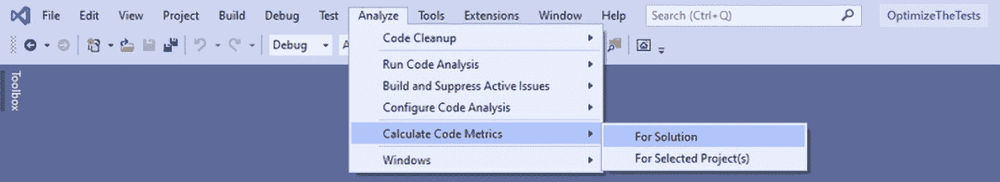

然后，在 `Code Metrics Results` 窗口中，你可以找到解决方案中每个类的代码指标。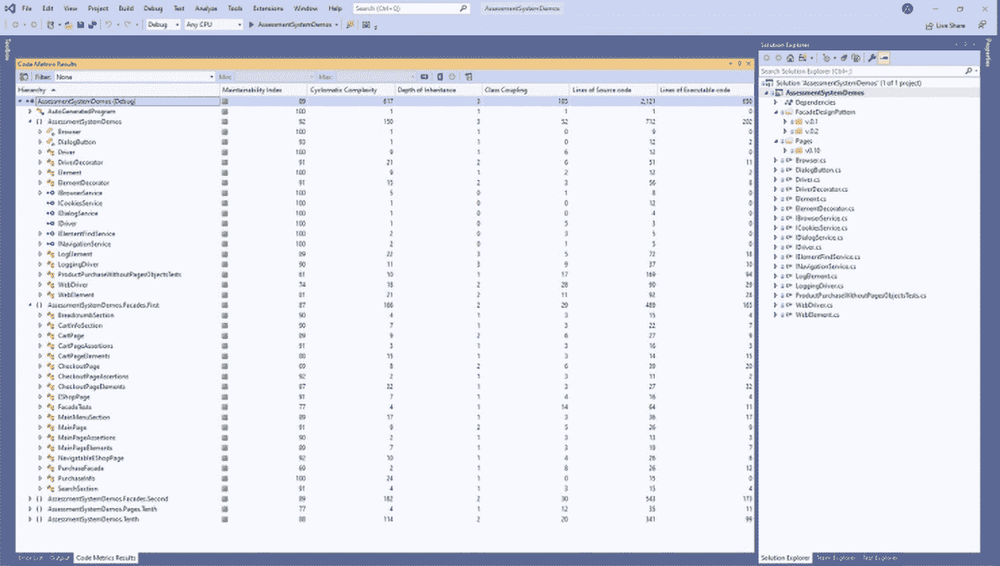

如果你的设计包含多个类——我们将获得设计中每个类部分的数值并计算平均分。为了方便这些计算，有一个按钮可以将数据导出到 Excel 表格。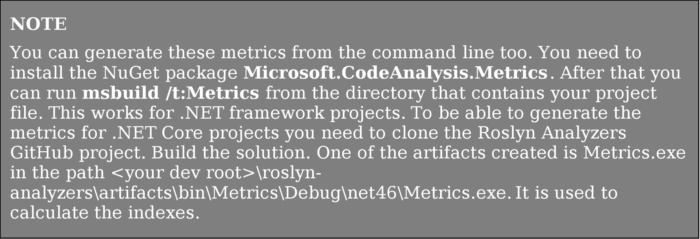

这里是该设计测试文件的数值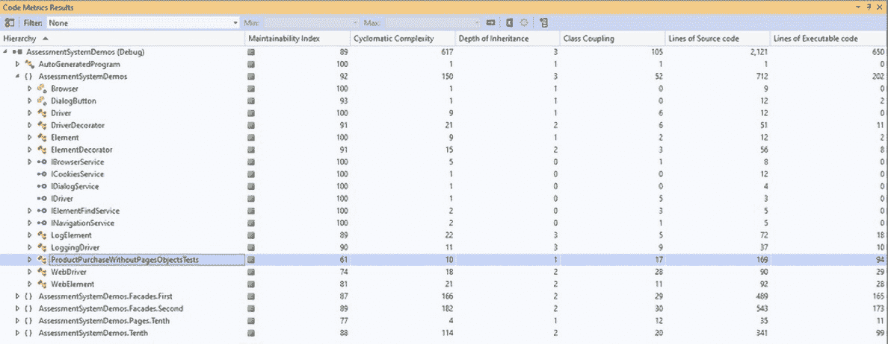

让我们再次查看表格。它帮助我们确定公式中使用的每个组件的指数。

| 评分标准 | 可维护性指数 | 圈复杂度 | 类耦合 |
| :--- | :--- | :--- | :--- |
| (5) 优秀 | > 70 | < 10 | < 10 |
| (4) 非常好 | > 60 | 10-12 | < 15 |
| (3) 良好 | 40-60 | 12-15 | < 20 |
| (2) 差 | 20-40 | 15-20 | < 30 |
| (1) 非常差 | < 20 | > 20 | > 30 |

可维护性指数等于 61，因此我们给出一个非常好的评分（4）。`Cyclomatic Complexity = 10` ——非常好（4）。`Class Coupling = 17` —— 良好（3）。`Depth of Inheritance = 1` 优秀（5）。在我们获得每个单独的组件指数后，将它们替换到公式中以得到代码复杂度指数评分。

`Code Complexity Index Rating = (5 + 3 + 4 + 4)/4 = 4`

| 准 | 评分 |
| :--- | :--- |
| 可读性 | 2 |
| 可维护性 | 2 |
| 可重用性 | 1 |
| API 可用性 | 1 |
| 可扩展性 | 2 |
| 代码复杂度指数 | 4 |
| 学习曲线 | |
| 测试设计指数 | |

### 7. 学习曲线

这种设计最容易上手，因为除了如何使用 `WebDriver` 之外不需要任何先知识。然而，当测试主体包含低级 `WebDriver` API 细节时，往往会变得很长，这使得用用例变得更加困难。此外，由于部分代码被复制粘贴，而另一部分作为私有方法重用，这会让新手感到很困惑。因此，我只给了一个良好（3）评分。

| 准 | 评分 |
| :--- | :--- |
| 可读性 | 2 |
| 可维护性 | 2 |
| 可重用性 | 1 |
| API 可用性 | 1 |
| 可扩展性 | 2 |
| 代码复杂度指数 | 4 |
| 学习曲线 | 3 |
| 测试设计指数 | 2.43 |

`测试设计指数 = (2 + 2 + 1 + 1 + 2 + 4 + 3) / 7 = 2.43`

## 基于页面对象的测试评估

### 架构设计概述

为什么不回顾一个直接使用页面对象而不使用外面（facades）的设计呢？

我们有两个基础页面对象——一个用于可以跳转的页面，另一个用于不可跳转的页面。

```csharp
public abstract class EShopPage{

    protected readonly Driver Driver;

    protected EShopPage(Driver driver){

        Driver = driver;

        SearchSection = new SearchSection(driver);

        MainMenuSection = new MainMenuSection(driver);

        CartInfoSection = new CartInfoSection(driver);

    }

    public SearchSection SearchSection { get; }

    public MainMenuSection MainMenuSection { get; }

    public CartInfoSection CartInfoSection { get; }

}

public abstract class NavigatableEShopPage : EShopPage{

    protected NavigatableEShopPage(Driver driver): base(driver){}

    protected abstract string Url { get; }

    public void Open(){

        Driver.GoToUrl(Url);

        WaitForPageLoad();

    }

    protected abstract void WaitForPageLoad();

}
```

在这些基础页面中，我们定义了一些每个单独的页面对象都需要实现的抽象方法，并且我们复用了公共逻辑，例如导航和页面部分。

我们有一个类用于页面对象本身，另一个类包含元素定位器（element locators）。

```csharp
public class MainPage : NavigatableEShopPage{

    private readonly MainPageElements _elements;

    private MainPage(Driver driver): base(driver){

        _elements = new MainPageElements(driver);

    }

    protected override string Url=>"http://demos.bellatrix.solutions/";

    public MainPage AddRocketToShoppingCart(){

        Open();

        _elements.AddToCartFalcon9.Click();

        _elements.ViewCartButton.Click();

        return this;

    }

    public MainPage AssertProductBoxLink(string name, string expectedLink){

        string actualLink = _elements.GetProductBoxByName(name).GetAttribute("href");

        Assert.AreEqual(expectedLink, actualLink);

        return this;

    }

    protected override void WaitForPageLoad(){

        _elements.AddToCartFalcon9.WaitToExists();

    }

}
```

这里是我们如何复用元素定位器的。

```csharp
public class MainPageElements{

    private readonly Driver _driver;

    public MainPageElements(Driver driver){

        _driver = driver;

    }

    public Element AddToCartFalcon9=>_driver.FindElement(By.CssSelector("[data-product_id*='28']"));

    public Element ViewCartButton=>_driver.FindElement(By.CssSelector("[class*='added_to_cart wc-forward']"));

    public Element GetProductBoxByName(string name){

        return _driver.FindElement(By.XPath($"//h2[text()='{name}']/parent::a[1]"));

    }

}
```

测试中的页面是通过 `App` 设计模式使用的，该模式基于工厂设计模式。

```csharp
public class App : IDisposable{

    private readonly Driver _driver;

    private bool _disposed = false ;

    public App(Browser browserType = Browser.Chrome){
```


```csharp
_driver = new LoggingDriver(new WebDriver());

_driver.Start(browserType);

BrowserService = _driver;

CookiesService = _driver;

DialogService = _driver;
}

public IBrowserService BrowserService { get; }

public ICookiesService CookiesService { get; }

public IDialogService DialogService { get; }

public TPage Create<TPage>() where TPage : EShopPage
{
    var constructor = typeof(TPage).GetTypeInfo().GetConstructors(BindingFlags.NonPublic | BindingFlags.Instance).FirstOrDefault();

    var page = constructor?.Invoke(new object[] { _driver }) as TPage;

    return page;
}

public TPage GoTo<TPage>() where TPage : NavigatableEShopPage
{
    var constructor = typeof(TPage).GetTypeInfo().GetConstructors(BindingFlags.NonPublic | BindingFlags.Instance).FirstOrDefault();

    var page = constructor?.Invoke(new object[] { _driver }) as TPage;

    page?.Open();

    return page;
}

public void Dispose()
{
    Dispose(true);

    GC.SuppressFinalize(this);
}

protected virtual void Dispose(bool disposing)
{
    if (_disposed)
    {
        return;
    }

    if (disposing)
    {
        _driver.Quit();
    }

    _disposed = true;
}
```

最后，这是我们的代码看起来的样子。

```csharp
[TestClass]
public class SectionsTests
{
    private static App _app;

    [ClassInitialize]
    public static void ClassInitialize(TestContext testContext)
    {
        _app = new App();
    }

    [ClassCleanup]
    public static void ClassCleanup()
    {
        _app.Dispose();
    }

    [TestMethod]
    public void CompletePurchaseSuccessfully_WhenNewClient()
    {
        var mainPage = _app.GoTo<MainPage>();

        mainPage.AddRocketToShoppingCart();

        var cartPage = _app.GoTo<CartPage>();

        cartPage.ApplyCoupon("happybirthday").AssertMessageNotification("Coupon code applied successfully.").IncreaseProductQuantity(2).AssertTotal("114.00€").ProceedToCheckout();
    }
}
```

### 7. 学习曲线

测试是相对容易理解的——这确实如此。然而，这种设计有很多组成部分——基础页面对象、页面对象类、`App` 工厂以及测试类。正如之前所指，你需要学习页面的调用顺序以及如何调用它们的方法。这就是为什么我给了 (4) 非常好的评分。

| 准 | 评分 |
| :--- | :--- |
| 可读性 | 5 |
| 可维护性 | 4 |
| 可重用性 | 4 |
| API 可用性 | 4 |
| 可扩展性 | 4 |
| 代码复杂度指数 | 5 |
| 学习曲线 | 4 |
| 测试设计索引 | |

### 测试设计索引

| 准 | 评分 |
| :--- | :--- |
| 可读性 | 5 |
| 可维护性 | 4 |
| 可重用性 | 4 |
| API 可用性 | 4 |
| 可扩展性 | 4 |
| 代码复杂度指数 | 5 |
| 学习曲线 | 4 |
| 测试设计索引 | 4.29 |

`Test Design Index = (5 + 4 + 4 + 4 + 4 + 5 + 4) / 7 = 4.29`

### 使用 Facade（外观）的测试评估

#### 架构设计概述

在这种设计中，我们使用了几乎相同的页面对象。区别在于它们没有暴露 `Fluent API`。购买工作流保留在主外观类中。

```csharp
public class PurchaseFacade
{
    private readonly MainPage _mainPage;

    private readonly CartPage _cartPage;

    private readonly CheckoutPage _checkoutPage;

    public PurchaseFacade(MainPage mainPage, CartPage cartPage, CheckoutPage checkoutPage)
    {
        _mainPage = mainPage;

        _cartPage = cartPage;

        _checkoutPage = checkoutPage;
    }

    public void PurchaseItem(string rocketName, string couponName, int quantity, string expectedPrice, PurchaseInfo purchaseInfo)
    {
        _mainPage.Open();

        _mainPage.AddRocketToShoppingCart(rocketName);

        _cartPage.ApplyCoupon(couponName);

        _cartPage.CartPageAssertions.AssertCouponAppliedSuccessfully();

        _cartPage.IncreaseProductQuantity(quantity);

        _cartPage.CartPageAssertions.AssertTotalPrice(expectedPrice);

        _checkoutPage.ClickProceedToCheckout();

        _checkoutPage.FillBillingInfo(purchaseInfo);

        _checkoutPage.CheckoutPageAssertions.AssertOrderReceived();
    }
}
```

此外，对于这种设计我们没有使用 `App` 设计模式。我们直接在 `ClassInitialize` 方法中初始化页面和外观，遗憾的是，在 `MSTest` 中由于它应该是静态的，因此无法继承。

```csharp
[TestClass]
public class FacadeTests
{
    private static Driver _driver;

    private static MainPage _mainPage;

    private static CartPage _cartPage;

    private static CheckoutPage _checkoutPage;

    private static PurchaseFacade _purchaseFacade;

    [ClassInitialize]
    public static void ClassInitialize(TestContext testContext)
    {
        _driver = new LoggingDriver(new WebDriver());

        _driver.Start(Browser.Chrome);

        _mainPage = new MainPage(_driver);

        _cartPage = new CartPage(_driver);

        _checkoutPage = new CheckoutPage(_driver);

        _purchaseFacade = new PurchaseFacade(_mainPage, _cartPage, _checkoutPage);
    }

    [ClassCleanup]
    public static void ClassCleanup()
    {
        _driver.Quit();
    }

    [TestMethod]
    public void PurchaseFalcon9WithFacade()
    {
        var purchaseInfo = new PurchaseInfo()
        {
            Email = "info@berlinspaceflowers.com",

            FirstName = "Anton",

            LastName = "Angelov",

            Company = "Space Flowers",

            Country = "Germany",

            Address1 = "1 Willi Brandt Avenue",

            Address2 = "Lützowplatz 17",

            City = "Berlin",

            Zip = "10115",

            Phone = "+00498888999281",
        };

        _purchaseFacade.PurchaseItem("Falcon 9", "happybirthday", 2, "114.00€", purchaseInfo);
    }

    [TestMethod]
    public void PurchaseSaturnVWithFacade()
    {
        var purchaseInfo = new PurchaseInfo()
        {
            Email = "info@berlinspaceflowers.com",

            FirstName = "John",

            LastName = "Atanasov",

            Company = "Space Flowers",

            Country = "Germany",

            Address1 = "1 Willi Brandt Avenue",

            Address2 = "Lützowplatz 17",

            City = "Berlin",

            Zip = "10115",

            Phone = "+00498888999281",
        };

        _purchaseFacade.PurchaseItem("Saturn V", "happybirthday", 3, "355.00€", purchaseInfo);
    }
}
```


我们又增加了一层抽象，但如果工作流发生变化，我们可以在一个地方进行修改。这既可能是好事，也可能是坏事。一方面，我们可以用较少的精力修复许多失败的测试；但另一方面，如果我们犯了错误，可能会在许多其他测试中引入回归。此外，直接查看测试代码时……

| API 可用性 | 5 |
| :--- | :--- |
| 扩展性 | 5 |
| 代码复杂度指数 | 5 |
| 学习曲线 | 5 |
| 测试设计指数 | |

### 测试设计指数

| 则 | 评分 |
| :--- | :--- |
| 可读性 | 5 |
| 可维护性 | 5 |
| 可复用性 | 5 |
| API 可用性 | 5 |
| 扩展性 | 5 |
| 代码复杂度指数 | 5 |
| 学习曲线 | 5 |
| 测试设计指数 | 5 |

`Test Design Index = (5 + 5 + 5 + 5 + 5 + 5 + 5) / 7 = 5`

### 最终评估

| 提议的设计架构 | TDI 评分 |
| :--- | :--- |
| 不使用 Page 对象的测试 | 2.43 |
| 使用 Page 对象的测试 | 4.29 |
| 使用 Facade 模式的测试 | 5 |

## 总结

在本章中，我们讨论了一种测试设计评估系统，定义了其标准，并解释了如何在实践中应用它。在章的第二部分，我们评估了书中已经使用的三种设计——不使用页面对象的测试、使用该模式的测试，以及最后——使用 Facade 设计模式的测试。我们给出的评分表明，在我们的用例中，最佳的设计选择是使用 Facade 设计模式的方案。

在下一章中，我们将讨论基准测试（Benchmarking）以及如何衡量各种自动化测试组件的性能。

### 问题

1. 你能列出评估系统的七个标准吗？
2. 在评估`Reusability`标准时，你评估代码的哪些方面？
3. 为什么学习曲线是一个关键的评估点？
4. 什么是`Test Design Index`？
5. 如何在`Visual Studio IDE`中计算代码指标？
6. 在项目中应用该评估系统需要遵循哪些步骤？

### 扩展阅读

- 测试架构设计评估系统 - [`www.automatetheplanet.com/assessment-system-tests-architecture-design/`](https://www.automatetheplanet.com/assessment-system-tests-architecture-design/)
- 完美系统测试的英雄之旅：测试架构设计的八项评估标准 - [`www.automatetheplanet.com/heros-journey-perfect-system-tests/`](https://www.automatetheplanet.com/heros-journey-perfect-system-tests/)
- 测试架构设计评估系统- 基于行为的测试 - [`www.automatetheplanet.com/assessment-system-tests-architecture-design-behaviour-based-tests/`](https://www.automatetheplanet.com/assessment-system-tests-architecture-design-behaviour-based-tests/)
- 测试架构设计评估系统- 基于 Facade 的测试 - [`www.automatetheplanet.com/assessment-system-tests-architecture-design-facade-based-tests/`](https://www.automatetheplanet.com/assessment-system-tests-architecture-design-facade-based-tests/)
- McCabe 圈复杂度：使用流图计算 - [`www.guru99.com/cyclomatic-complexity.html`](https://www.guru99.com/cyclomatic-complexity.html)
- 代码指标值 - [`www.sciencedirect.com/topics/computer-science/code-metrics`](https://www.sciencedirect.com/topics/computer-science/code-metrics)

### 第 9 章：用于评估自动化测试组件性能的基准测试

在上章中，我们研究了一个评估不同测试架构设计的系统。然而，仅对核心质量属性进行评估不足以最终决定哪种实现更好。测试执行时间也应该是一个关键部分。例如，在 HTML 表格中搜索的哪种方法性能更好——使用原生的`WebDriver`还是使用内存计算的混合方法？哪种按钮点击方式更好——原生的`WebDriver`还是通过`JavaScript`点击？

在本章中，我们将检查一个可以帮助我们回答这些以及更多问题的库。此外，你将学习如何使用基准测试工具将结果导出到各种格式，分析测试组件的 CPU、内存和硬盘利用率等。最后，我们将该库与我们现有的通过`Observer`设计模式复用浏览器的解决方案进行集成。本章将涵盖以下主题：

- 什么是基准测试？
- 使用`BenchmarkDotNet`对 .NET 代码进行基准测试
- 基准测试按钮点击解决方案
- 基准测试报告、分析、反汇编诊断器
- 集成基准测试的优化浏览器初始化

### 什么是基准测试 (Benchmarking)?

在定义基准测试之前，我们需要回答一个问题——什么是性能？！


我们的目标创建一个基准测试工具，以便我们可以衡量组件的性能，因为很多时候实现相同的结果有多种方法。当然，我们不会重复轮子，而是使用标准的解决方案。

### 使用`BenchmarkDotNet`对 .NET 代码进行基准测试

基准测试是一项挑战。在性能测量过程中，你很容易出错。`BenchmarkDotNet`会帮助你避开常见的陷阱，因为它为你完成了所有的脏活工作：它为每个基准测试方法生成一个独立的项目，多次启动该项目，运行函数的多次迭代（包括预热）等。通常情况下，即使你不关心迭代次数，它也会对你有帮助，因为库会自动选择迭代次数以达到要求的精度水平。

### 主要特性

`BenchmarkDotNet`拥有许多用于深度性能研究的优秀特性：

- 标准基准测试例程 - 为每个基准测试方法生成独立项目；自动选择迭代次数；预热；开销评估；等。
- 执行控制 - `BenchmarkDotNet`尝试选择评估性能的最佳 possible 方法，但你也可以手动控制迭代次数、在冷启动和预热状态之间切换、设置精度级别、调整 GC 参数、更改环境变量等。
- 统计信息 - 默认情况下，你会看到平均值和标准差等基本统计数据；你也可以手动请求最小/最大值、置信区间、偏度、峰度、四分位数、位数或定义你自己的指标。
- 内存诊断 - 该库不仅测量你代码的性能，还会打印有关内存、流量和 GC 回收次数的信息。
- 反汇编诊断 - 借助单个额外的属性，你就可以请求反汇编列表。
- 参数化 - 可以为不同的输入参数集评估性能——就像流行的单元测试框架一样。
- 环境信息 - 当你共享性能结果时，共享环境信息至关重要；`BenchmarkDotNet`会自动打印操作系统和处理器的确版本；物理 CPU 数量、物理核心和逻辑核心数；虚拟机监控程序（如果你使用了它）；硬件计时器的频率；JIT 编译器版本等。
- 命令行支持 - 你可以管理成千上万个基准测试，按类别对其分组，并从命令行进行过滤和运行。
- 强大的报告系统 - 可以将基准测试结果导出为 markdown、CSV、HTML、文本、PNG 图表。

### BenchmarkDotNet 示例

使用`BenchmarkDotNet`非常简单。让我们来看一个示例：

```csharp
[ClrJob(baseline: true), CoreJob, MonoJob, CoreRtJob]
[RPlotExporter, RankColumn]
public class Md5VsSha256
{
    private SHA256 sha256 = SHA256.Create();
    private MD5 md5 = MD5.Create();
    private byte[] data;

    [Params(1000, 10000)]
    public int N;

    [GlobalSetup]
    public void Setup()
    {
        data = new byte[N];
        new Random(42).NextBytes(data);
    }

    [Benchmark]
    public byte[] Sha256() => sha256.ComputeHash(data);

    [Benchmark]
    public byte[] Md5() => md5.ComputeHash(data);
}

public class Program
{
    public static void Main(string[] args)
    {
        var summary = BenchmarkRunner.Run<Md5VsSha256>();
    }
}
```

`BenchmarkDotNet`允许以用户友好的声明式方式设计性能实验。实验结束时，它将生成一个仅包含基本数据的摘要表，形式紧凑且易懂！


在产物（artifacts）中，你还可以找到关于每次迭代的详细信息。你可以以不同的格式（如 CSV、XML、JSON 等）导出数据，甚至生成精美的图表：


### 按钮点击解决方案

在各种用例中，你可以利用基准测试来就测试速度做出更好的选择。我们将要研究的最简单场景是：在使用原生的`WebDriver`点击方法调用与`JavaScript`点击之间进行选择。

### 按钮基准实验

我创建了一个简单的 demo HTML 页面，你可以在其中找到几组 HTML 按钮。我们的两个实验（或基准测试）将是比较通过原生`WebDriver`点击这些按钮，然后通过`JavaScript`点击的结果。

```csharp
public class ButtonClickBenchmark
{
    private const string TestPage = "http://htmlpreview.github.io/?https://github.com/angelovstanton/AutomateThePlanet/blob/master/WebDriver-Series/TestPage.html";

    private static IWebDriver _driver;
    private static IJavaScriptExecutor _javaScriptExecutor;

    [GlobalSetup]
    public void GlobalSetup()
    {
        _driver = new ChromeDriver(
            DriverExecutablePathResolver.GetDriverExecutablePath());

        _javaScriptExecutor = (IJavaScriptExecutor)_driver;
        _driver.Navigate().GoToUrl(TestPage);
    }

    [GlobalCleanup]
    public void GlobalCleanup()
    {
        _driver?.Dispose();
    }

    [Benchmark(Baseline = true)]
    public void BenchmarkWebDriverClick()
    {
        var buttons = _driver.FindElements(
            By.XPath("//input[@value='Submit']"));

        foreach (var button in buttons)
        {
            button.Click();
        }
    }

    [Benchmark]
    public void BenchmarkJavaScriptClick()
    {
        var buttons = _driver.FindElements(
            By.XPath("//input[@value='Submit']"));

        foreach (var button in buttons)
        {
            _javaScriptExecutor.ExecuteScript(
                "arguments[0].click();", button);
        }
    }
}
```

`GlobalSetup`方法为每个基准测试执行一次。在那里我们只导航到 demo 页面一次。`ChromeDriver`的初始化有点奇怪。`ExecutablePathResolver`返回驱动程序所在的父文件夹。

```csharp
public static class DriverExecutablePathResolver
{
    public static string GetDriverExecutablePath()
    {
        string assemblyFolder =
            Path.GetDirectoryName(
                Assembly.GetExecutingAssembly().Location);

        var directoryInfo = new DirectoryInfo(assemblyFolder);

        for (int i = 0; i < 4; i++)
        {
            directoryInfo = directoryInfo.Parent;
        }

        return directoryInfo.FullName;
    }
}
```

为了按照指令执行按钮实验，我创建了一个 .NET Core 控制台应用程序并安装了`BenchmarkDotNet` NuGet 包。这是`Main`方法的代码：

```csharp
public class Program
{
    public static void Main(string[] args)
    {
        var summary = BenchmarkRunner.Run<ButtonClickBenchmark>();
        Console.WriteLine(summary);
    }
}
```

这是执行后的结果！


看起来原生的`WebDriver`点击性能优于`JavaScript`方法。平均值 8.3 ms 对比 132.2 ms，时间增加了近 1500%！你可以在`BenchmarkDotNet.Artifacts`文件夹中找到完整的执行日志。

## 报告、分析、反汇编诊断

`BenchmarkDotNet`可以生成丰富的报告，对实验代码进行分析，并提供 CPU、内存和其他硬件使用信息。此外，它可以显示测试代码的 MSIL 版本。

### HTML 和 CSV 报告

正如在 BenchmarkDotNet 特性章节提到的，该工具支持许多报告。我特别喜欢 HTML 和 CSV。使用`CsvExporter`和`HtmlExporter`属性来生成它们。

```csharp
[CsvExporter]
[HtmlExporter]
public class Program
{
    public static void Main(string[] args)
    {
        var summary = BenchmarkRunner.Run<ButtonClickBenchmark>();
        Console.WriteLine(summary);
    }
}
```

执行后，你可以在`BenchmarkDotNet.Artifacts\results`文件夹中找到生成的报告！


### 基准反汇编

要查看代码的反汇编，请使用`DisassemblyDiagnoser`属性。

```csharp
[DisassemblyDiagnoser(printAsm: true, printSource: true)]
public class Program
{
    static void Main(string[] args)
    {
        var summary = BenchmarkRunner.Run<ButtonClickBenchmark>();
        Console.WriteLine(summary);
    }
}
```


从代码层面的配置选项有：

- `printIL`：打印 `IL`（微软中间语言）。默认值为 `False`。
- `printAsm`：打印 `ASM`（汇编计算机语言）。默认值为 `True`。
- `printSource`：打印 `C#` 源代码。默认值为 `False`。
- `printPrologAndEpilog`：打印序言（prolog）和结尾（epilog）的 `ASM` 代码。默认值为 `False`。
- `recursiveDepth`：包含直到指定层级的被调用方法。默认值为 `1`，从 `1` 开始索引。该选项也可以通过命令行参数 `--disasmDepth` 进行设置。

`DisassemblyDiagnoser` 要求在你的 `csproj` 文件中进行设置：

```xml
<PropertyGroup>
  <PlatformTarget>AnyCPU</PlatformTarget>
  <DebugType>pdbonly</DebugType>
  <DebugSymbols>true</DebugSymbols>
</PropertyGroup>
```

为了获取源代码，它需要定位并读取 `PDB` 文件。这就是为什么工具需要 `DebugType` 和 `DebugSymbols` 设置。为了比较不同的平台，定义基准测试的项目必须目标为 `AnyCPU`。这里是示例输出。

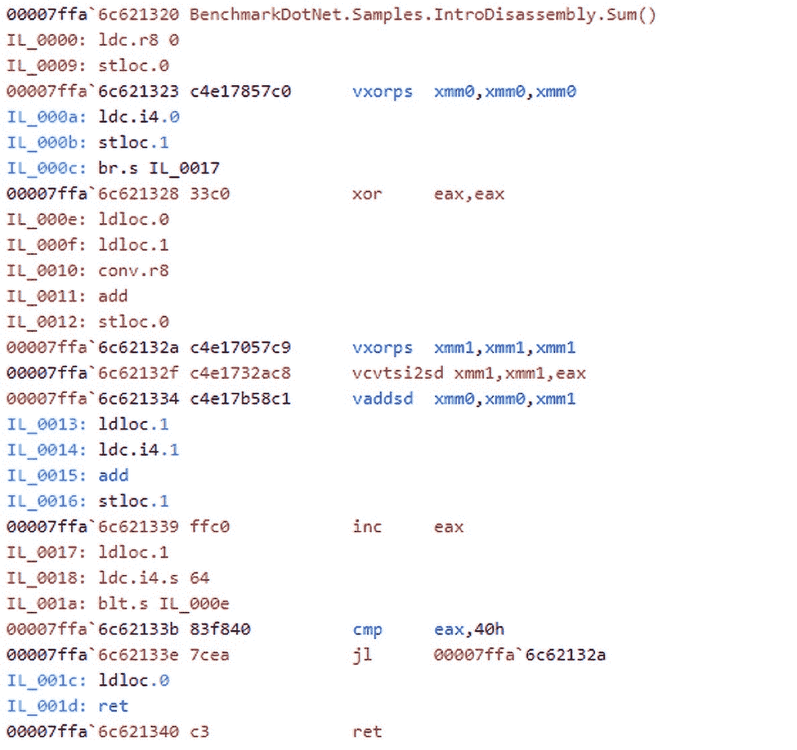

# 基准测试分析（Benchmark Profiling）

`BenchmarkDotNet` 允许我们在 Windows 上对基准测试的 `.NET` 代码进行分析，并将数据导出到跟踪文件中，该文件可以使用 `PerfView` 或 `Windows Performance Analyzer` 打开。在那里，你可以检查实验的 CPU、`RAM`、硬盘和网络使用情况。它使用了 `TraceEvent` 库，该库内部使用 `Event Tracing for Windows`（`ETW`）来捕捉堆栈跟踪和重要的 `.NET Runtime` 事件。

性能分析器需要以管理员权限运行程序，并在你的 `csproj` 文件中使用以下设置：

```xml
<PropertyGroup>
  <DebugType>pdbonly</DebugType>
  <DebugSymbols>true</DebugSymbols>
</PropertyGroup>
```

要使用性能分析器，请使用 `EtwProfiler` 属性。

```csharp
[EtwProfiler]
public class Program
{
    static void Main(string[] args)
    {
        var summary = BenchmarkRunner.Run<ButtonClickBenchmark>();
        Console.WriteLine(summary);
    }
}
```

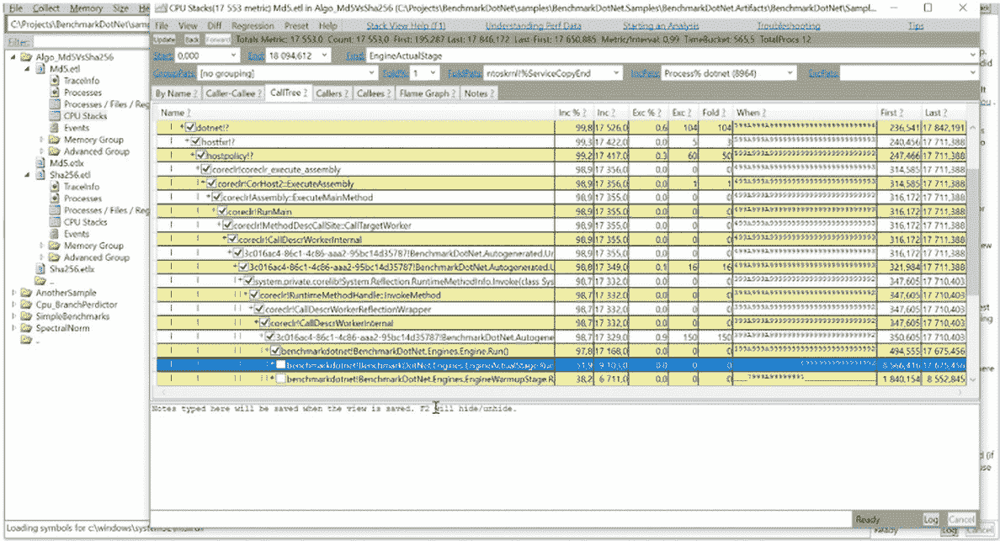

# 优化的浏览器初始化基准测试集成

如果你还记得第 3 章“加速测试的策略”，我们编写了一个解决方案，通过使用 `Observer` 设计模式的属性来复用浏览器。让我们研究如何在我们的基准测试中实现相同的功能。否则，你将无法对框架代码进行基准测试。

我们需要重构代码，因为我们解决方案的第一个版本使用的是 `MSTest` 框架来启动浏览器，但在这里我们在控制台应用程序中不使用它运行实验。以下是我们的按钮实验在重构后的变化——产生相同的结果，但通过属性控制浏览器。

```csharp
[ExecutionBrowser(Browser.Chrome, BrowserBehavior.ReuseIfStarted)]
public class ButtonClickBenchmark : BaseBenchmark
{
    private const string TestPage = "http://htmlpreview.github.io/?https://github.com/angelovstanton/AutomateThePlanet/blob/master/WebDriver-Series/TestPage.html";

    private static IWebDriver _driver;
    private static IJavaScriptExecutor _javaScriptExecutor;

    [GlobalSetup]
    public void GlobalSetup()
    {
        _driver = new ChromeDriver(DriverExecutablePathResolver.GetDriverExecutablePath());
        _javaScriptExecutor = (IJavaScriptExecutor)_driver;
        _driver.Navigate().GoToUrl(TestPage);
    }

    [IterationSetup()]
    public void IterationSetup()
    {
        BenchmarkInitialize();
    }

    [IterationCleanup()]
    public void IterationCleanup()
    {
        BenchmarkCleanup();
    }

    [GlobalCleanup]
    public void GlobalCleanup()
    {
        _driver?.Dispose();
    }

    [Benchmark(Baseline = true)]
    public void BenchmarkWebDriverClick()
    {
        var buttons = _driver.FindElements(By.XPath("//input[@value='Submit']"));

        foreach (var button in buttons)
        {
            button.Click();
        }
    }

    [Benchmark]
    public void BenchmarkJavaScriptClick()
    {
        var buttons = _driver.FindElements(By.XPath("//input[@value='Submit']"));

        foreach (var button in buttons)
        {
            _javaScriptExecutor.ExecuteScript("arguments[0].click();", button);
        }
    }
}
```

新变动是我们继承了 `BaseBenchmark` 类，并使用了迭代设置和清理方法。简而言之，我们为 `MSTest` 创建了相同的插件式架构，但现在适用于 `BenchmarkDotNet`。我们来检查所有的更新吗？

## `Observer` 类中的更新

第一个更新是在基础观察者类 `BaseTestBehaviorObserver` 中，其中移除了对 `MSTest` 的依赖。

```csharp
public class BaseTestBehaviorObserver : ITestBehaviorObserver
{
    private readonly ITestExecutionSubject _testExecutionSubject;

    public BaseTestBehaviorObserver(ITestExecutionSubject testExecutionSubject)
    {
        _testExecutionSubject = testExecutionSubject;
        testExecutionSubject.Attach(this);
    }

    public virtual void PreInitialize(MemberInfo memberInfo) { }

    public virtual void PostInitialize(MemberInfo memberInfo) { }

    public virtual void PreCleanup(MemberInfo memberInfo) { }

    public virtual void PostCleanup(MemberInfo memberInfo) { }

    public virtual void MemberInstantiated(MemberInfo memberInfo) { }
}
```

观察者中没有其他变化。然后，正如前面提到的，我们有了新的 `BaseBenchmark` 类。

```csharp
public class BaseBenchmark
{
    private static readonly ITestExecutionSubject CurrentTestExecutionSubject;

    static BaseBenchmark()
    {
        CurrentTestExecutionSubject = new TestExecutionSubject();
        Driver = new LoggingDriver(new WebDriver());

        new BrowserLaunchTestBehaviorObserver(CurrentTestExecutionSubject, Driver);

        var memberInfo = MethodBase.GetCurrentMethod();
        CurrentTestExecutionSubject.MemberInstantiated(memberInfo);
    }

    protected static Driver Driver { get; set; }

    public void BenchmarkInitialize(Action benchmarkInitializeAction = null)
    {
        var benchmarkMethodMemberInfo = GetCurrentExecutionMethodInfo();
        CurrentTestExecutionSubject.PreInitialize(benchmarkMethodMemberInfo);
    }

    public void BenchmarkCleanup(Action benchmarkCleanup = null)
    {
        var benchmarkMethodMemberInfo = GetCurrentExecutionMethodInfo();
        CurrentTestExecutionSubject.PostCleanup(benchmarkMethodMemberInfo);
    }

    private MethodInfo GetCurrentExecutionMethodInfo()
    {
        var stackTrace = new StackTrace();
        var benchmarkMethodMemberInfo = stackTrace.GetFrame(2).GetMethod() as MethodInfo;

        return benchmarkMethodMemberInfo;
    }
}
```

在静态构造函数中，我们初始化了所有观察者以及静态 `Driver`。接下来的关键方法是 `BenchmarkInitialize` 和 `BenchmarkCleanup`。在执行这些委托之前和之后，触发了插件式事件。

由于 `BenchmarkDotNet` 不提供 `TestInitialize` 和 `TestCleanup` 属性的精确表示，我们有了 `IterationSetup` 和 `IterationCleanup`。我们可以这样使用它们：

```csharp
[IterationSetup()]
public void IterationSetup()
{
    BenchmarkInitialize();
}

[IterationCleanup()]
public void IterationCleanup()
{
    BenchmarkCleanup();
}
```

## 总结

在本章中，我们讨论了什么是基准测试，以及如何衡量测试性能。我们研究了如何利用 `BenchmarkDotNet` 库来完成工作，以及如何使用它生成统计数据、跟踪文件并反汇代码。最后，讨论了如何重构 Observer 设计插件架构。

在书的最后一章中，我们将讨论如何最合适使用测试数据并创建测试环境。

### 问题

1. 为什么衡量代码性能很重要？
2. 什么是基准测试？
3. 如何开始使用 `BenchmarkDotNet`？
4. 如何调试你的 `BenchmarkDotNet` 实验？
5. 你可以在 `BenchmarkDotNet` 中生成哪些类型的结果？

### 扩展阅读

- 开始使用 `BenchmarkDotNet`：https://benchdotnet.org/articles/guides/getting-started.html
- `BenchmarkDotNet` 反汇编：https://benchdotnet.org/articles/features/disassembler.html
- `BenchmarkDotNet` `EtwProfiler`：https://benchdotnet.org/articles/features/etwprofiler.html
- `BenchmarkDotNet` 最佳实践：https://benchdotnet.org/articles/guides/good-practices.html

# 第 10 章 测试数据准备与测试环境

测试数据是自动化测试的关键部分。构建成功的自动化不仅关乎良好的编程知识、最佳实践和设计模式，不仅关乎稳定的测试定位器或你控制的测试环境。当然，这些都是前提条件，但我看来，许多团队忽略的关键点是适当测试数据准备的重要性，以及它是任何自动化测试解决方案成功的关键。因此，我们以此章结束——因为没有这些基础知识，你将注定要不断修复不稳定的测试直到余生耗尽。

本章将涵盖以下主题：

- 停止硬编码输入数据
- 引入测试固件（test fixtures）
- 使用 API 作为固件数据源
- 构建测试数据重置/创建应用测试用例
- 使用 API 或数据库进行验证

## 停止硬编码输入数据

硬编码测试数据是一种权宜之计的解决办法，会导致测试变得不稳定（flaky tests）。在第 2 章“优化和重构遗留的非稳定性测试”中，我们重构了部分测试，并缓解了一些已包含的坏习惯。然而，我们仍然将测试数据留在了硬编码状态。

## 存在问题的测试数据

我们在自动化测试中使用哪些不同类型的测试数据？

- **网站 URL**：像任何 Web 项目一样，我们有多个测试环境：DEV、STAGING、UAT（用户验收测试）等。我们的测试硬编码了应用程序的 URL。因此，在不更改测试代码的情况下，我们无法让测试同时在 `staging` 和 `dev` 环境中运行。
- **硬编码的产品**：不同的测试环境并不共享相同的数据（例如产品）。此外，大多数环境只包含生产环境中可用产品的子集。测试环境中的产品在生产环境中从未存在过，也将永远不存在。
- **用户数据**：由于法律原因，我们的测试环境绝不包含来自生产环境的用户数据。对于敏感的用户信息（如信用卡号和电子邮件），这一点尤为真实。

我们的测试应该能够在我们拥有的任何环境中运行。但如果我们使用的每条数据都是为特定的测试环境硬编码的，这是不可能的。

## 配置转换

实现一段从 JSON 配置文件读取数据并在稍后的测试中使用它的代码认为如何？我认为有三个主要地方可以使用此类数据：网站 URL、WebDriver 超时设置和默认计单信息。主要目标是为不同的测试环境（如 LOCAL、DEV 或 UAT）准备独立的数据集。

首先，我们需要向项目中添加一个 JSON 构文件。将其命名为 `testFrameworkSettings.json`。我们将为每个环境准备单独 json 文件，这些文件将基于项目的构建配置。例如，Debug 构建配置等同于在 LOCAL 环境执行，而 Release 等同于在 DEV 环境执行。如果你需要更多环境，可以创建一个新的构建配置。这意味着有两个配置文件：一个命名为 `testFrameworkSettings.Release.json`，另一个命名为 `testFrameworkSettings.Debug.json`。

```json


```json
{
  "webSettings": {
    "baseUrl": "http://local.bellatrix.solutions/",
    "elementWaitTimeout": "30",
    "chrome": {
      "pageLoadTimeout": "120",
      "scriptTimeout": "5"
    },
    "fireFox": {
      "pageLoadTimeout": "30",
      "scriptTimeout": "1"
    },
    "edge": {
      "pageLoadTimeout": "30",
      "scriptTimeout": "1"
    },
    "internetExplorer": {
      "pageLoadTimeout": "30",
      "scriptTimeout": "1"
    },
    "opera": {
      "pageLoadTimeout": "30",
      "scriptTimeout": "1"
    },
    "safari": {
      "pageLoadTimeout": "30",
      "scriptTimeout": "1"
    }
  },
  "urlSettings": {
    "shopUrl": "http://local.bellatrix.solutions/cart/",
    "accountUrl": "http://local.bellatrix.solutions/account/"
  },
  "billingInfoDefaultValues": {
    "email": "angelov@spaceFlowers.com",
    "company": "Space Flowers",
    "country": "Germany",
    "firstName": "Anton",
    "lastName": "Angelov",
    "phone": "+00498888999281",
    "zip": "10115",
    "city": "Berlin",
    "address1": "1 Willi Brandt Avenue Tiergarten",
    "address2": "2 Willi Brandt Avenue Tiergarten"
  }
}
```

这是包含 LOCAL 环境值的 Debug 配置。在 Release 文件中，如果存在差异，你可以更改特定字段的值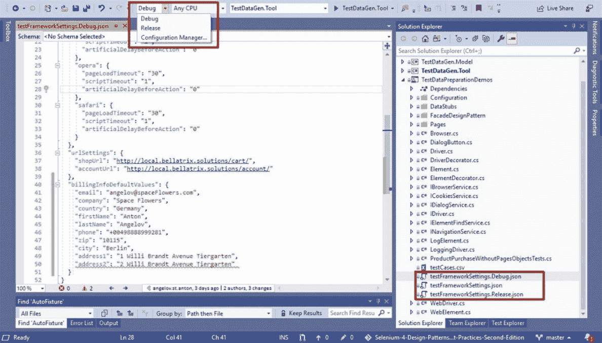。

我们需要在项目的 MSBuild 代码中添加一段小的代码片段，以确保正确的配置文件被复制到输出目录。

```xml
<ItemGroup>
  <None Update="testFrameworkSettings.$(Configuration).json">
    <CopyToOutputDirectory>Always</CopyToOutputDirectory>
  </None>
</ItemGroup>
```

我们将使用原生的 .NET Core 配置文件支持。因此，你需要向项目添加以下 NuGet 包：

- `Microsoft.Extensions.Configuration.Binder`
- `Microsoft.Extensions.Configuration`
- `Microsoft.Extensions.Configuration.Json`

接下来，我们需要创建一个新的服务来访问配置数据。对于每个独立的配置部分（如 `urlSettings` 或 `webSettings`），我们都有对应的 C# 类表示。以下是 Web 设置部分的 C# 类表示。

```csharp
public sealed class WebSettings
{
    public string BaseUrl { get; set; }

    public BrowserSettings Chrome { get; set; }

    public BrowserSettings Firefox { get; set; }

    public BrowserSettings Edge { get; set; }

    public BrowserSettings Opera { get; set; }

    public BrowserSettings InternetExplorer { get; set; }

    public BrowserSettings Safari { get; set; }

    public int ElementWaitTimeout { get; set; }
}
```

这是帮助我们访问数据的工具类代码。它通过单例设计模式实现，因为在整个测试运行过程中我们需要一个实例。

```csharp
public sealed class ConfigurationService
{
    private static ConfigurationService _instance;

    public ConfigurationService() => Root = InitializeConfiguration();

    public static ConfigurationService Instance
    {
        get
        {
            if (_instance == null)
            {
                _instance = new ConfigurationService();
            }

            return _instance;
        }
    }

    public IConfigurationRoot Root { get; }

    public UrlSettings GetTestEnvironmentSettings()
    {
        var result = ConfigurationService.Instance.Root
            .GetSection("urlSettings")
            .Get<UrlSettings>();

        if (result == null)
        {
            throw new ConfigurationNotFoundException(typeof(UrlSettings).ToString());
        }

        return result;
    }

    public BillingInfoDefaultValues GetBillingInfoDefaultValues()
    {
        var result = ConfigurationService.Instance.Root
            .GetSection("billingInfoDefaultValues")
            .Get<BillingInfoDefaultValues>();

        return result;
    }

    public WebSettings GetWebSettings() =>
        ConfigurationService.Instance.Root
            .GetSection("webSettings")
            .Get<WebSettings>();

    private IConfigurationRoot InitializeConfiguration()
    {
        var filesInExecutionDir = Directory.GetFiles(
            Path.GetDirectoryName(Assembly.GetExecutingAssembly().Location));

        var settingsFile = filesInExecutionDir.FirstOrDefault(
            x => x.Contains("testFrameworkSettings") && x.EndsWith(".json"));

        var builder = new ConfigurationBuilder();

        if (settingsFile != null)
        {
            builder.AddJsonFile(
                settingsFile,
                optional: true,
                reloadOnChange: true);
        }

        return builder.Build();
    }
}
```

在第一次调用服务时，将加载配置文件。接下来，在我们的代码中，可以通过静态属性 `Instance` 访问配置数据。

### 创建 URL 设置

如果你有一个为了化单个网站的任务，那么我们不需要对解决方案进行过度设计。让我们使用 `webSettings` 中的 `baseUrl` 变量。这在测试单页应用（SPA）时特别有用。

```csharp
public class MainPage : NavigatableEShopPage
{
    private readonly MainPageElements _elements;

    private MainPage(Driver driver) : base(driver)
    {
        _elements = new MainPageElements(driver);
    }

    protected override string Url =>
        ConfigurationService.GetWebSettings().BaseUrl;

    public MainPage AddRocketToShoppingCart()
    {
        Open();

        _elements.AddToCartFalcon9.Click();
        _elements.ViewCartButton.Click();

        return this;
    }

    public MainPage AssertProductBoxLink(
        string name,
        string expectedLink)
    {
        string actualLink = _elements
            .GetProductBoxByName(name)
            .GetAttribute("href");

        Assert.AreEqual(expectedLink, actualLink);

        return this;
    }

    protected override void WaitForPageLoad()
    {
        _elements.AddToCartFalcon9.WaitToExists();
    }
}
```

“魔法”发生在 `Url` 属性中，我们那里那里调用 `ConfigurationService.Instance.GetWebSettings().BaseUrl` 来获取当前的测试环境 URL。然而，大多数时候我们需要测试多个网站或 Web 服务。此外，还有许多不同的页面，这意味着你不仅需要基础 URL，还需要能够生成正确完整 URL 的逻辑。为了支持这一点，我们在 JSON 配置文件中设置了一个名为 `urlSettings` 的独立部分。

```json
"urlSettings": {
  "shopUrl": "http://local.bellatrix.solutions/cart/",
  "accountUrl": "http://local.bellatrix.solutions/account/"
}
```

我们还有一个 `UrlSettings` 类，它是数据的 1 到 1 映射。

```csharp
public class UrlSettings
{
    public string ShopUrl { get; set; }

    public string AccountUrl { get; set; }
}
```

之后，让我们创建一个负责为每个网站生成正确完整 URL 的服务。

```csharp
public static class UrlDeterminer
{
    public static string GetShopUrl(string urlPart)
    {
        return Url.Combine(
            ConfigurationService.Instance
                .GetTestEnvironmentSettings()
                .ShopUrl,
            urlPart).ToString();
    }

    public static string GetAccountUrl(string urlPart)
    {
        return Url.Combine(
            ConfigurationService.Instance
                .GetTestEnvironmentSettings()
                .AccountUrl,
            urlPart).ToString();
    }
}
```

如你所见，所有方法都声明为静态，因为这是一个应该易于使用的工具类。我们为配置部分的每个独立网站部分都提供了一个方法。我们获取正确的测试环境 URL 并将其与提供的部分 URL 组合。我们使用 `Url.Combine` 方法，它知道如何正确地组合它们，无论有多少个。

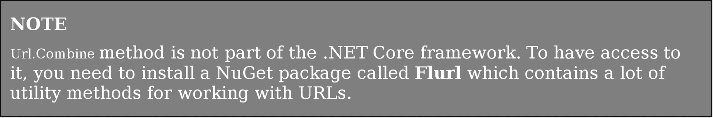

这就是我们在页面对象模型中使用该服务的方式。

```csharp
public class CartPage : NavigatableEShopPage
{
    private readonly CartPageElements _elements;

    private CartPage(Driver driver) : base(driver)
    {
        BreadcrumbSection = new BreadcrumbSection(Driver);
        _elements = new CartPageElements(driver);
    }

    public BreadcrumbSection BreadcrumbSection { get; }

    protected override string Url =>
        UrlDeterminer.GetShopUrl("cart");

    // 代码的其他部分
}
```

### 创建 WebDriver 超时设置

另一个需要配置的关键方面是 WebDriver 超时。它们可能会根据测试环境而异，因为网站性能可能存在差异。此外，超时时间可能在不同浏览器之间不同。

我们可以这样更改作为 WebDriver 装饰器部分的 `StartBrowser` 方法来支持这一点：

```csharp
_webDriver = new ChromeDriver(Environment.CurrentDirectory);

_webDriver.Manage().Timeouts().PageLoad =
    TimeSpan.FromSeconds(
        ConfigurationService.GetWebSettings().PageLoadTimeout);

_webDriver.Manage().Timeouts().AsynchronousJavaScript =
    TimeSpan.FromSeconds(
        ConfigurationService.GetWebSettings().ScriptTimeout);
```

每个浏览器设置都定义在 `BrowserSettings` 类中。

```csharp
public class BrowserSettings
{
    public int PageLoadTimeout { get; set; } = 3000;

    public int ScriptTimeout { get; set; }
}
```

### 创建默认账单设置

这里是在不使用配置时我们的 facade 样子：

```csharp
[TestMethod]
public void PurchaseFalcon9WithFacade()
{
    var purchaseInfo = new PurchaseInfo()
    {
        Email = "info@flowers.com",
        FirstName = "Anton",
        LastName = "Angelov",
        Country = "Germany",
        Address1 = "Willi Brandt",
        Address2 = "Lützplatz 17",
        City = "Berlin",
        Zip = "10115",
        Phone = "+04988899281",
    };

    _purchaseFirstVersionFacade.PurchaseItem(
        "Falcon 9",
        "happybirthday",
        2,
        "14.00€",
        purchaseInfo);
}
```

`PurchaseInfo` 在 90% 的情况下是相同的。此外，数据可能会随环境而异。这就是为什么将其移动到配置文件至关重要。我们已经创建了一个名为 `billingDefaultValues` 的部分。

```csharp
public class BillingDefaultValues
{
    public string FirstName { get; set; }

    public string LastName { get; set; }

    public string Country { get; set; }

    public string Company { get; set; }

    public string Address1 { get; set; }

    public string Address2 { get; set; }
}
```


```csharp
public string City { get; set; }

public string Zip { get; set; }

public string Phone { get; set; }

public string Email { get; set; }

}
```

最简单的方法是设置`PurchaseInfo`类的属性默认值。

```csharp
public class PurchaseInfo
{
    public string FirstName { get; set; } = ConfigurationService.GetBillingInfoDefaultValues().FirstName;

    public string LastName { get; set; } = ConfigurationService.GetBillingInfoDefaultValues().LastName;

    public string Company { get; set; } = ConfigurationService.GetBillingInfoDefaultValues().Company;

    public string Country { get; set; } = ConfigurationService.GetBillingInfoDefaultValues().Country;

    public string Address1 { get; set; } = ConfigurationService.GetBillingInfoDefaultValues().Address1;

    public string Address2 { get; set; } = ConfigurationService.GetBillingInfoDefaultValues().Address2;

    public string City { get; set; } = ConfigurationService.GetBillingInfoDefaultValues().City;

    public string Zip { get; set; } = ConfigurationService.GetBillingInfoDefaultValues().Zip;

    public string Phone { get; set; } = ConfigurationService.GetBillingInfoDefaultValues().Phone;

    public string Email { get; set; } = ConfigurationService.GetBillingInfoDefaultValues().Email;

    public bool ShouldCreateAccount { get; set; }

    public bool ShouldCheckPayment { get; set; }

    public string Note { get; set; }
}
```

在测试中的用法是直接的。

```csharp
[TestMethod]
public void PurchaseSaturnVWithFacade()
{
    var purchaseInfo = new PurchaseInfo();

    _purchaseFirstVersionFacade.PurchaseItem("Saturn V", "happybirthday", 3, "355.00€", purchaseInfo);
}
```

### 环境变量

有时会有像凭据这样的信息，不适合在文件中持久化。通常访问 Selenium Grid 云提供者就是如此。一种方法是将信息放在环境变量中，稍后从测试中读取。这里使用环境变量登录网站的示例：

```csharp
private void LoginWithEnvironmentalVariables(string userName)
{
    var userNameTextField = _driver.FindElement(By.Id("username"));

    userNameTextField.TypeText(userName);

    var passwordField = _driver.FindElement(By.Id("password"));

    passwordField.TypeText(Environment.GetEnvironmentVariable($"{userName}_pass"));

    var loginButton = _driver.FindElement(By.XPath("//button[name='login']"));

    loginButton.Click();
}
```

如果环境变量持有用户`aangelov`的密码，则应命名为`aangelov_pass`。

### 引入测试固件（Test Fixtures）

在软件开发中，测试固件是一个术语，用于描述任何位于特定测试之外的数据，用于将应用程序设置为固定状态。固件在任何高可用环境中效果最好。如果我们在本地或 CI 环境中进行测试，我们可以从完全空的数据库开始，并用固件数据填充。当测试准备好运行时，代码将知道应用程序的准确状态、我们有多少个注册用户、每个产品的价格等。

### 使用 AutoFixture 生成数据

我们已经研究了如何使用默认值来填充购买信息。然而，有时我们需要更改其中的一部分。其他时候，我们需要设置随机信息，只要它不为空即可。对于不在乎细节的情况，你可以使用名为`AutoFixture`的库来处理数据生成。它会为属性分配随机值。它可以处理整个对象初始化等复杂设置，甚至进行递归数据生成。

```csharp
[TestMethod]
public void PurchaseSaturnVWithNoteFacade()
{
    var purchaseInfo = new PurchaseInfo();

    var fixture = new Fixture();

    purchaseInfo.Note = fixture.Create<string>();

    _purchaseFirstVersionFacade.PurchaseItem("Saturn V", "happybirthday", 3, "355.00€", purchaseInfo);
}
```

这里我们使用 AutoFixture 库的`Fixture`类来生成随机订单备注。

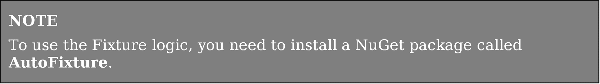

### 使用 MSTest 数据驱动测试

有时我们想用不同的数据集运行相同的测试。一种方法是复制粘贴测试并更改数据。这样做的好处是可能可以给测试一个更合适的名字。然而，当 API 使用发生即使细微的变化时，你需要访问所有方法并对其进行重构，这增加了测试成本。

```csharp
[TestClass]
public class UsingDataStubs
{
    private static IWebDriver _driver;

    private static ProxyServer _proxyServer;

    private static ConcurrentDictionary<string, string> _redirectUrls;

    [ClassInitialize]
    public static void ClassInitialize(TestContext context)
    {
        proxyServer = new ProxyServer();

        var explicitEndPoint = new ProxyEndPoint(System.Net.IPAddress.Any, 1882, true);

        _redirectUrls = new ConcurrentDictionary<string, string>();

        proxyServer.AddEndPoint(explicitEndPoint);

        proxyServer.Start();

        proxyServer.SetAsHttpProxy(explicitEndPoint);

        proxyServer.SetAsHttpsProxy(explicitEndPoint);

        proxyServer.BeforeRequest += OnRequestEventHandler;
    }

    [ClassCleanup]
    public static void ClassCleanup()
    {
        proxyServer.Stop();
    }

    [TestInitialize]
    public void TestInitialize()
    {
        var proxy = new OpenQA.Selenium.Proxy
        {
            HttpProxy = "http://localhost:1882",
            SslProxy = "http://localhost:1882",
            FtpProxy = "http://localhost:1882"
        };

        var options = new ChromeOptions { Proxy = proxy };

        _driver = new ChromeDriver(Environment.CurrentDirectory, options);
    }

    [TestCleanup]
    public void TestCleanup()
    {
        ClearAllRedirectUrlPairs();

        _driver.Dispose();
    }

    [TestMethod]
    public void RequestRedirected_When_UsingProxy()
    {
        SetUrlRedirectedTo(
            "https://secure.gravatar.com/js/gprofiles.js?ver=2019Ja",
            "https://stub.gravatar.com/js/gprofiles.js?ver=2019Ja");

        _driver.Navigate().GoToUrl("http://demos.bellatrix.solutions/");
    }

    private void SetUrlRedirectedTo(string originalUrl, string redirectUrl)
    {
        _redirectUrls.GetOrAdd(originalUrl, redirectUrl);
    }

    private void ClearAllRedirectUrlPairs()
    {
        _redirectUrls.Clear();
    }

    private static async Task OnRequestEventHandler(object sender, SessionEventArgs e) =>
        await Task.Run(() =>
        {
            if (_redirectUrls.Keys.Count > 0)
            {
                foreach (var redirectUrlPair in _redirectUrls)
                {
                    if (e.HttpClient.Request.RequestUri.AbsoluteUri.Contains(redirectUrlPair.Key))
                    {
                        e.Redirect(redirectUrlPair.Value);
                    }
                }
            }
        }).ConfigureAwait(false);
}
```

相反，我们可以使用大多数框架支持的数据驱动测试。MSTest 和 NUnit 支持此类功能。你以 CSV 或类似的格式定义数据，稍后对于每一行信息绑定的测试将运行。为什么不在项目中添加一个名为`Cases.csv`的 CSV 文件并设置为“始终复制”到输出目录呢？


```csharp
[DataSource(
    "Microsoft.VisualStudio.TestTools.DataSource.CSV",
    "TestsData.csv",
    "TestsData",
    DataMethod.Sequential)]
public void PurchaseWithDataDriven()
{
    var purchaseInfo = new PurchaseInfo();

    string rocketName = DataRow["rocketName"];

    string couponName = DataRow["couponName"];

    int quantity = int.Parse(DataRow["quantity"]);

    string expectedPrice = DataRow["expectedPrice"];

    _purchaseFirstVersionFacade.PurchaseItem(
        rocketName,
        couponName,
        quantity,
        expectedPrice,
        purchaseInfo);
}
```


## 使用 API 作为固件源

使用固件数据对于高可访问的环境非常好。如果我们需要测试本地或 CI 环境以外的内容（我们无法无法将数据加载到数据库），我们必须使用不同的方法。技巧是利用我们找到的所有资源来使测试更稳定。这些资源之一是面向公众的 API。如果你的网站有原生手机应用或使用客户端调用加载内容，那么我们的测试就可以拥有相同的数据。我们所做的只是查询 API 以获取状态。我们的网站将产品目录存储在`demos.bellatrix.solutions/`。


## 使用数据存桩（Stubs）

现代网站极其复杂并结合了许多外部服务。大多数电子商务网站实际上并不处理信用卡。相反，使用的是支付提供者。这是一个符合所有密钥管理要求的第三方应用程序，并将数据发送到银行并解析响应。运行所有外部服务是一项艰巨的任务，特别是如果我们的网站也在同时开发。我们无法等到所有服务完全编写并集成后开始测试。因此，我们必须在完全开发之前对某些服务进行存桩。存桩是对应用程序请求的预制响应。存桩响应是经过格式化的，看起来像真实的响应，但它们不执行任何工作。为什么不查看一个实现示例呢？

## 1. CRUD 代表什么？

## 2. C# 中的默认值是哪些？

## 3. 使用原生 .NET Core 配置支持需要哪些包？

## 4. 如何使用 AutoFixture 库生成新值？

## 5. 为什么需要泛型仓库（generic repository）而不是直接使用 DB context？

## 6. 为什么硬编码测试数据会导致不稳定测试（flaky tests）？

## 延伸阅读

- 自动化测试中的测试环境数据处理 - [`www.automatetheplanet.com/handling-test-environments-data/`](https://www.automatetheplanet.com/handling-test-environments-data/)
- 让我们并行执行所有测试 - [`www.automatetheplanet.com/lets-execute-them-all-parallel/`](https://www.automatetheplanet.com/lets-execute-them-all-parallel/)
- AutoFixture 快速备表 - [`github.com/AutoFixture/AutoFixture/wiki/Cheat-Sheet`](https://github.com/AutoFixture/AutoFixture/wiki/Cheat-Sheet)
- 入门 Entity Framework Core - [`docs.microsoft.com/en-us/ef/core/get-started/?tabs=netcore-cli`](https://docs.microsoft.com/en-us/ef/core/get-started/?tabs=netcore-cli)
- 语言集成查询（LINQ） - [`docs.microsoft.com/en-us/dotnet/csharp/programming-guide/concepts/linq/`](https://docs.microsoft.com/en-us/dotnet/csharp/programming-guide/concepts/linq/)
- 在 C# 中分步实现通用仓库模式 - [`medium.com/falafel-software/implement-step-by-step-generic-repository-pattern-in-c-3422b6da43fd`](https://medium.com/falafel-software/implement-step-by-step-generic-repository-pattern-in-c-3422b6da43fd)

# 附录 1. 定义测试自动化框架解决的主要问题

为了列出测试自动化框架的各种优势，我必须说，它们自然地源于并扩展了整个测试自动化带来的多重好处。当然，在讨论它们的优势之前，我们需要定义它们试图解决的问题是什么。就像大多数业务和软件开发中的事情一样——资源（金钱和时间）的斗争。人们往往会忽略这些成本，因为他们不是付单的人，而且无论如何每个月都能按时收到支票。要定义交付高质量软件所需，我们必须首先理解问题是什么。

## 子问题 1：重复与人类厌倦，可靠性降低

如果你每月只需手动执行一次相同的测试用例——这还好。但如果你每天必须执行 3 次，我们人类倾向于很快就感到厌烦。另一个自然现象是，我们开始忽略小细节，而这正是“恶棍分子”喜欢躲藏和产蛋的地方。即使是最尽职的测试人员，在单调的手动测试中也会出错。

### 自动化解决方案假设

#### ASH-1：反复执行相同的测试

当你有一种方法可以以相同的方式反复执行所有测试时，你有更多的时间专注于编写新的测试用例。此外，你会有更多时间学习新工具、编程语言和测试技术。

### 后续问题

- **SP-1：自动化测试不稳定**：许多团队面临着这个问题。他们的测试没有写得正确，导致它们随机失败。或者更糟糕的是——提供了假阳性或假阴性的结果。

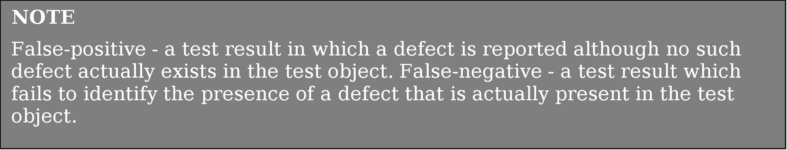

- **SP-2：开发这些测试的初始投资**：创建能够验证正确内容的稳定自动化测试过程是一项昂贵的工程。你需要投入于工具、框架、员工培训、测试数据准备、测试环境创建、CI/CD 中的测试执行集成以及测试结果可视化。

## 子问题 2：工程师不擅长数字和准确性

在大多数情况下，如果你必须测试用户界面，这是一项相对可以完成的工作。比较标签、消息、点击按钮、填写表单，最后检查数据库是否有数据。然而，随着时间的推移，系统变得复杂得多。在没有工具的情况下，如何比较巨大的 XML/JSON 消息或文件？手动检查 100000 个订单是否经过所有计算后成功升级是非常困难的。在很多情况下，自动化脚本可以比我们做得好得多。

### 自动化解决方案假设

#### ASH-2：重用自动代码检查

一旦你编写了验证单个订单是否迁移良好的逻辑，你就可以创建数据驱动的测试并无限次地执行测试。第 15670 次运行的测试结果将与第 1400 次具有相同的精度和准确。

### 后续问题

- **SP-3：创建共享测试库的初始投资**：有时为了创建一个可以泛化到许多测试场景和许多测试用例的通用解决方案需要大量精力。有时你可能没有合适的人来创建该库，因为这可能需要大量的编码和设计技能。或者即使你有这些工程师，他们可能需要处理其他事情。正确地编写它可能是一项巨大的精力和资金投入。
- **SP-4：自动化测试可靠吗？测试测试本身？**：即使你有时间创建这些库，你如何确保它们运行正常？由于它们是代码，它们可能包含 Bug。你是花时间为测试进行开发，还是接受测试不正常工作的风险？一旦看到断言通过，你就跳到下一个测试吗？你检查过它们是否会失败吗？
- **SP-5：修改库**：创建库的初始版本可能是简单的。但如何设计以支持未来的修改是另一回事。需求的变化是自然的，随着它们，我们的测试应该演进。许多 IT 专业人员忘了这一点，在许多情况下，对他们来说重写测试比调整更容易，因为代码可能不支持。
- **SP-6：库自定义——另一个团队的背景？**：创建共享库的全部意义是为了跨团队使用。然而，不同的团队在不同的背景下工作。他们可能需要稍微不同的东西。所以库开箱即用吗？对他们来说扩展或自定义它有多容易？这是可能的吗？他们是否需要时间来创建所需的修改所需的功能？
- **SP-7：知识传递**：共享库很棒，但你如何确保所有团队都知道某个特定功能？如果他们不知道它的存在，就会再次创建。这对于新团队成员尤为如此。如果你是团队的一员，你就知道了大部分。然而，当你加入团队时，必须有人教教你，否则你将面临上述问题。
- **SP-8：易用性**：用户理解如何使用库容易吗？即使人们知道有，但不知道如何使用或让它工作，这将导致创建相同的内容。如果 API 不简洁且令人困惑，将需要时间教新团队成员如何利用它。

## 子问题 3：反馈时间

当你需要立即发布热修复时，你不想发布未经测试的版本。然而，如果你有 5000 个测试用例且 QA 需要几天时间手动执行，这并不快。

### 自动化解决方案假设

#### ASH-1：反复执行相同的测试

#### ASH-3：利用自动化测试的速度

让我们面对现实——自动化测试比我们快得多。即使你匹配了它的速度，最终也会感到疲劳或遗漏一些细节。而不是等待几天让 QA 执行所有测试，你可以在多台机器上运行所有自动化测试。

### 后续问题

- **SP-9：测试速度**：如所述，自动化测试很快。然而，并非总是如此。如果测试没有写得当，它们可能会变慢。某些工程师倾向于使用暂停来处理网页或移动应用。另一种可能的情况是当你重试失败逻辑直到测试成功。或者只是重试所有失败测试。

## 子问题 4：预防回归

回归测试：“针对修改进行测试，以确保没有引入或未发现缺陷。”经常由于时间压力，“不重要的”测试没有被执行。这不仅是因为截止日期，还有由于假期或人手不足。

### 自动化解决方案假设

#### ASH-4：部署前执行所有测试

你可以在部署前执行所有测试。只有在所有测试通过后，应用程序才会部署。由于自动化测试很快，你可以在 30-60 分钟后部署版本。此外，由于设置非常简单，开发者可以在他们的机器上执行一些重要的测试，并在提交新代码之前修复问题。

### 后续问题

- **SP-9：测试速度**
- **SP-10：CI 和 CD 绪绪**：一些旧的自动化解决方案很难从命令行执行——这意味着很难将其集成到你的持续集成或持续部署工具中。无论现在使用什么工具或框架，都应该允许在集成到 CI 系统。工具或框架生成的测试结果也是如此。通常，在 CI 执行后你想发布到哪里。

## 子问题 5：跳过范围

当你测试某些内容后，你需要向经理展示你测试了什么。如果没有测试用例管理系统，这可能是困难的。有些人无法信任，他们可能会撒谎说执行了，或者只是忘了。自动化解决方案不是这种情况。

### 自动化解决方案假设

#### ASH-4：部署前执行所有测试

### 后续问题

- **SP-9：测试速度**
- **SP-10：CI 和 CD 就绪**

## 子问题 6：乒乓球

有了专门的 QA 团队，会有所谓的 Bug 乒乓球游戏。这是如何发生的？

1. 开发者产生应用程序的新版本并在没有任何测试的情况下部署它。
2. QA 在有空时开始测试（这可能不会立即发生）。在新版本发布 4 小时后开始测试。
3. QA 在 2 小时后记录一个 Bug。然而，开发者可能已经回家了。
4. 开发者在早上早上修复 Bug 并在不测试的情况下部署新版本。这需要 1 小时。
5. QA 在 3 小时后开始测试，发现第一个 Bug 已修复，但出现了另一个回归 Bug。
6. QA 在 30 分钟后记录回归 Bug。
7. 开发者还在那里但开始处理新功能，所以承诺明天修复新 Bug。

### 自动化解决方案假设

#### ASH-4：部署前执行所有测试

#### ASH-5：开发者在本地执行自动化测试

所以，为了测试和发布一个单一功能，你需要 2-3 天。如果你有自动化测试，开发者可以在他们的机器上执行它们，或者至少执行最重要的。即使这不可行，现在最关键的测试在代码部署后立即进行，即使我们谈论的是 UI/系统测试。这意味着如果出现任何回归 Bug，你将在代码后 1 小时内发现它们。

### 后续问题

- **SP-9：测试速度**
- **SP-10：CI 和 CD 就绪**
- **SP-11：本地测试设置的易用性**：新同事设置在本地运行自动化测试所需的所有内容有多容易？你有说明吗？他/她需要多少时间？某些情况下，需要半天时间来安装和配置一切。这很遗憾，因为程序员倾向于偷懒或有其他事情。所以许多人宁愿跳过这个过程，因为有很多步骤。
- **SP-12：本地执行的易用性**：如果你有大量的测试，从命令行界面执行容易吗？她是否需要在签入前执行所有测试？这是可能的吗？有些自动化框架让它在本地工作，或者在共享环境中执行这可能是不可能的。是否可能在 Docker 这样的隔离环境中平滑执行？

## 子问题 7：金钱、时间、维护测试资产的精力

测试资产是什么？共享库很棒，但你如何确保所有团队都知道某个特定功能？当应用程序发生变化时，你需要分析并更新它们。否则你每次都要重写它们。即使使用更复杂的测试管理系统这可能是一个任务。这就是为什么有些“敏捷”公司决定 QA 不使用详细的测试用例，这导致了未测试或未覆盖。由于这个问题，我听到许多 IT 专业人士抱怨无法获得晋升或奖金。对我来说，这是为什么 QA 应该有更好的工具来向开发者和管理层展示他们做了什么。这更好，因为你有漂亮的仪表板显示执行了多少测试用例。

### 自动化解决方案假设

#### ASH-6：更容易重构和修改

自动化测试也是资产。但如果你有适当的自动化框架和结构，一次更改可以同时更新多个测试用例，而不是编辑一个。大多数现代 IDE 都提供了重构功能。一旦测试用例自动化，你就不再需要它，可以存档。

### 后续问题

- **SP-5：修改**

## 子问题 8：各种配置

如果你必须在 Edge、Chrome、Internet Explorer 和 Safari 上进行测试，如果软件与银行或类似服务，你需要确保它在各种屏幕尺寸上运行正常。手动执行这些测试需要大量的精力，有时还需要金钱来购买和配置所有设备。对于人类来说，验证“像素级”的设计是一项挑战。如果没有工具或代码，这种测试是不可能的。

### 自动化解决方案假设

#### ASH-7：复用测试

通过代码，你可以轻松复用针对不同浏览器或移动设备的相同测试用例。

### 后续问题

- **SP-13：跨技术和跨平台就绪**：测试在不同浏览器上的表现是否一致？例如，如果你使用纯 WebDriver 代码，将是不可能的。在大多数情况下，最好是跳过大型配置。
- **SP-14：云端就绪**：有些公司有自己的设备和计算机场。然而，现在像 SauceLabs、BrowserStack 或 CrossBrowser 这样的云提供者是合理的解决方案。在那里执行是可能的吗？从云端切换到本地执行需要多少代码？
- **SP-15：Docker 支持**：云提供者的另一种方案是在 Docker 容器中运行测试。然而，设置可能是困难的。你的自动化解决方案可以轻松集成 Docker（如 Selenoid）吗？

## 问题 9：QA 团队士气低

当你反复执行相同的测试时，如所述，测试人员会厌倦。我们大多数人都希望偶尔做一些新事物。所以我们通常对做相同的事情且不自我提高感到失去动力。这是人们想要更换团队或辞职的主要原因之一。

### 自动化解决方案假设

#### ASH-8：测试自动化的新奇

思考如何自动化特定应用的功能、准备测试数据或将测试集成到 CI 中是一项令人兴奋且具有挑战性的工作。大多数测试人员都认为测试自动化很有挑战性，并且不断学习新知识。

### 后续问题

- **SP-1：自动化测试不稳定**
- **SP-4：自动化测试可靠吗？测试测试本身？**
- **SP-17：创建速度**：维护现有测试花费的时间至关重要。它会消耗 QA 团队的大容量。然而，为了让人们有动力，创建新测试应该是相对简单的。当然，如果 QA 工程师在整个冲刺期间只能产生几个测试，他们会感到沮丧。即使场景更复杂，理解需要做什么来自动化也不应该那么难。

## 问题 18：调试、可调试性、修复失败测试

如所述，可维护性的很大一部分是对现有测试进行调试。大多数内部或开源解决方案没有提供许多让生活更容易的功能。这可能是最耗时的任务之一。有 100 个失败的测试并找出是测试问题还是应用程序的 Bug 是困难的。如果你使用第三方框架（开源或商业），它的支持快速且有帮助吗？在原处修复代码以修复多个测试容易吗？如果是，那么修复将花费更多时间。

## 问题 10：职业能力质疑

每个 QA 都想表现得专业并因工作获得认可。然而，如所述，如果你有紧迫的期限，管理层尽快测试并发布应用程序的压力，你通过只执行重要的测试用例而删减测试范围。无论如何，大多数时候当在生产环境中发现新 Bug 时，QA 感到责任，因为开发者不知道这不是我们的错。在某些情况下，人们会被解雇或……

### 自动化解决方案假设

#### ASH-10：更可见的结果

由于大多数测试用例将转换成代码，让用户更清楚地知道哪个场景被执行了。如果需要，结果可以显示在漂亮的仪表板或通过邮件发送。

### 后续问题

- **SP-20：代码可读性**：有时，你的同事或经理可能想检查你做了什么。如果你正确命名测试和方法，使用页面对象模型和其他设计模式，会让其他工程师更容易理解测试做了什么。这是可能的。
- **SP-21：测试结果、日志、集成**：如果你使用内部框架，这些文件与 CI 工具兼容吗？工具或框架生成的测试结果也是如此。通常，在 CI 执行后你想发布到哪里。

## 问题 12：假期和疾病，24 小时

如果你每个区域都有一个 QA，而他/她请假或生病了。你如何发布应用程序？开发者开始测试还是什么？当然，有些情况下你需要在周六或周日发布新版本，因为你需要熬夜完成一切。这是问题的另一个方面。当有人离开团队或公司时，团队的知识就丢失了。

### 自动化解决方案假设

#### ASH-1：反复执行相同的测试

#### ASH-4：部署前执行所有测试

#### ASH-5：开发者在本地执行自动化测试

#### ASH-11：测试作为文档

如果自动化测试足够易读且可见，即使缺失，同事也会知道测试做了什么。

### 后续问题

- **SP-7：知识传递**
- **SP-8：易用性**
- **SP-9：测试速度**
- **SP-20：代码可读性**
- **SP-21：测试结果、日志**

## 问题 13：某些无法手动测试的项

你如何执行负载或手动测试？我可以说“像素级”设计是这样的。你可以使用某些非自动化方式。

### 自动化解决方案假设

#### ASH-12：复用测试

你可以复用一些自动化测试并配置它们来执行负载。你也可以使用框架提供的 API。

### 后续问题

- **SP-5：修改**
- **SP-17：创建速度**
- **SP-18：调试、可调试性、修复失败测试**
- **SP-22：学习曲线**：创建这些复杂的负载测试容易吗？你需要阅读巨大的文档（即使存在）以及在 IDE 中打字来发现一切。框架的作者提供了更好的替代方案吗？

## 问题 14：一致性

如果没有关于如何编写自动化测试的文档，可能会以不同的方式编写它们。例如，一个人可能使用页面对象模型。另一个人可能直接使用 WebDriver，等等。方法的命名也是如此。不一致性导致代码难以理解/维护。

### 自动化解决方案假设

#### ASH-13：统一编码标准

测试框架的很大部分是它们提供了统一的编写方式。统一标准让测试看起来完全相同且更容易编写。然而，编码标准是好的，但你需要一种自动的方法来强制执行。你使用的框架提供默认的编码标准吗？它提供一种自动的方法来应用并遵循它们吗？人们容易看到自己做了什么吗？自定义默认规则容易吗（.NET 流行的解决方案有 EditorConfig、StyleCop 和 ReSharper）。

## 问题 15：更快速的扩展和收缩

假设你为新发布准备了有很多内容需要测试。现在，你团队中有 2 个 QA，但为了按时完成，经理必须额外增加一个。在更长的发布周期下，这是可行的，而且可能是正确的决定，但当你每周发布一次时，并且需要更多劳动力时，这种方法无法扩展。想象一下你为下一次发布扩展了两个月，现在你有 4 个 QA，但之后夏天来了，发布将停止一段时间（所有开发者都去度假的假设场景）。两个 QA 就足够测试所有新功能了。你带到项目的 2 个额外 QA 怎么办？你再次移动他们吗？这不仅是如何扩展的问题，也是如何收缩。

### 自动化解决方案假设

#### ASH-14：云端测试代理和 Docker

在公云时代，你可以几分钟内拥有额外的测试代理机。如果你使用 Docker 执行自动化测试，这同样适用。如果你使用适当的运行器，测试可以分布到远程机器并在那里并行执行。

### 后续问题

- **SP-14：云端就绪**
- **SP-15：Docker 支持**
- **SP-24：并行和分布式测试执行**：你的框架支持自动化测试并行执行吗？是否有测试运行器可以并行运行它们或将其分布到多台机器上？

## 总结

正如你所看到的，测试自动化之所以必要有很多原因。然而，像所有演化的事物一样，第一代测试自动化工具并没有承诺那么好。这就是为什么测试自动化框架开始成为一种更流行的解决方案。然而，使用它们创建稳定、快速且易于维护的测试需要大量的前期规划和思考。发生了许多工具和框架供应商在营销页面上没有提到的后续问题。我相信，如果你了解所有这些问题，你就能在何投资或不投资做出更明智的选择。

## 延伸阅读

- 测试自动化框架的代 - 过去与未来 - [`www.automatetheplanet.com/generations-test-automation/`](https://www.automatetheplanet.com/generations-test-automation/)
- 云端测试 - SauceLabs - [`www.automatetheplanet.com/sauce-labs/`](https://www.automatetheplanet.com/sauce-labs/)
- 云端测试 - BrowserStack - [`www.automatetheplanet.com/browserstack/`](https://www.automatetheplanet.com/browserstack/)
- 云端测试 - CrossBrowser - [`www.automatetheplanet.com/crossbrowsing/`](https://www.automatetheplanet.com/crossbrowsing/)
- 在 Docker 容器中执行测试 - [`www.automatetheplanet.com/webdriver-tests-selenoid/`](https://www.automatetheplanet.com/webdriver-tests-selenoid/)
- 通过自定义浏览器扩展进行全屏截图 - [`www.automatetheplanet.com/browser-extension-full-screenshots/`](https://www.automatetheplanet.com/browser-extension-full-screenshots/)
- 使用 WinAppDriver 自动化桌面应用 - [`www.automatetheplanet.com/automate-windows-desktop-apps-winappdriver/`](https://www.automatetheplanet.com/automate-windows-desktop-app/)
- 使用 Meissa 分布式运行器在 20 分钟内执行 10 万次测试 - [`www.automatetheplanet.com/100000-tests-meissa-distributed-runner/`](https://www.automatetheplanet.com/100000-tests-meissa-distributed-runner/)
- .NET 项目的 Azure DevOps CI 测试自动化报告 - [`www.automatetheplanet.com/test-automation-reporting-azuredevopci/`](https://www.automatetheplanet.com/test-automation-reporting-azuredevopci/)
- .NET 项目的 ReportPortal 测试自动化报告 - [`www.automatetheplanet.com/test-automation-reporting-reportportal/`](https://www.automatetheplanet.com/test-automation-reporting-reportportal/)
- .NET 项目的 Allure 测试自动化报告 - [`www.automatetheplanet.com/test-automation-reporting-allure/`](https://www.automatetheplanet.com/test-automation-reporting-allure/)
- 使用 EditorConfig 保持代码编码风格 - [`www.automatetheplanet.com/coding-styles-editorconfig/`](https://www.automatetheplanet.com/coding-styles-editorconfig/)
- 使用 StyleCop 强制风格和一致性规则 - [`www.automatetheplanet.com/style-consistency-rules-stylecop/`](https://www.automatetheplanet.com/style-consistency-rules-stylecop/)

## 选择器

| 选择器 | 说明 |
| :--- | :--- |
| `ul#myId` | 带有 `@id='myId'` 的 `<ul>` 元素 |
| `#myUniqueId` | 带有 `@id='myId'` 的任意元素 |
| `ul.myForm` | 带有 `@class = 'myForm'` 的 `<ul>` 元素 |
| `.myForm.front` | 带有 `@classes='myForm' 和 'front'` 的任意元素 |

## 环境选择器

| 选择器 | 说明 |
| :--- | :--- |
| `ul#myUniqueId > li` | 直接子元素 |
| `ul#myUniqueId li` | 后代元素 |
| `div > p` - 所有 `<p>` | 是 `<div>` 元素的直接后代的元素 |
| `div + p` - 所有 `<p>` | 是 `<div>` 元素的相邻兄弟元素（即直接紧随其后） |
| `div ~p` - 所有 `<p>` | 跟随 `<div>` 元素且是其兄弟的元素 |
| `form myForm.front + ul` | 下一个兄弟元素 |
| `div.row *` | 选择所有带有 `div` 标签和 `row` 类元素的后代元素 |

## 属性选择器

| 选择器 | 说明 |
| :--- | :--- |
| `ul[name = "automateName"][style = "style_name"]` | 带有属性 `@name='automateName'` 和 `@style='style_name'` 的 `<ul>` 元素 |
| `ul[@id]` | 带有 `@id` 属性的元素 |
| `ul[id = "myId"]` | 带有 `@id='myId'` 的 `<ul>` 元素 |
| `*[name='N'][value = ' v ']` | 带有 name N 和指定值 'v' 的元素 |
| `ul[id ^= "my"]` | 所有属性以 'my' 开头的元素 |
| `ul[id$= "Id"]` | 所有属性以 'Id' 结尾的元素 |
| `ul[id *= "unique"]` | 所有属性包含子字符串 'unique' 的元素 |
| `ul[id ~= "unique"]` | 所有属性包含单词 'unique' 的元素 |
| `a[href='url']` | 带有目标链接 'url' 的锚元素 |

## 有用的 n 值

- `odd` 或 `2n+1`：每一个奇数子元素或元素
- `even` 或 `2n`：每一个偶数子元素或元素
- `n`：每第 n 个子元素或元素
- `3n`：每第三个子元素或元素（3, 6, 9, ...）
- `3n+1`：从 1 开始每第三个子元素或元素（1, 4, 7, ...）
- `n+6`：除前五个之外的所有子元素或元素（6, 7, 8, ...）
- `-n+5`：仅前五个子元素或元素（1, 2, ..., 5）

## 适用于兄弟元素的伪类选择器

| 选择器 | 说明 |
| :--- | :--- |
| `ul#myUniqueId li:first-child` | 第一个子元素 |
| `ul#myUniqueId li:nth-of-type(1)` | 第一个同类型子元素 |
| `ul#myUniqueId li:last-child` | 最后子元素 |
| `ul#myUniqueId li:nth-of-type(3)` | 第三个同类型子元素 |
| `#TestTable tr:nth-child(3) td:nth-child(2)` | 按行列选择单元格（例如第 3 行第 2 列） |
| `p::first-letter` | 选择指定的 `<p>` 的第一个字母 |
| `p::first-line` | 选择指定的 `<p>` 的第一行 |
| `p:first-of-type` | 选择在其兄弟元素中同类型的第一个元素 `<p>` |
| `p:last-of-type` | 选择在其兄弟元素中同类型的最后一个元素 `<p>` |

## 链接和用户状态伪类选择器

| 选择器 | 说明 |
| :--- | :--- |
| `input:focus` | 获得焦点的 `<input>` 元素 |
| `input:read-only` | 带有指定 `readonly` 属性的 `<input>` 元素 |
| `input:required` | 带有指定 `required` 属性的 `<input>` 元素 |
| `input:checked` | 被选中的复选框（或单选按钮） |
| `a:contains('Log Out')` | 文本包含 `Log Out` 的锚元素 |
| `td:contains('t') ~td` | 紧随包含 `t` 的单元格 |
| `p:lang(language)` | 所有 `@lang` 等于 `language` 的 `<p>` 元素 |
| `:not(p)` | 选择任何不是段的元素 |
| `p:not(.fancy)` | 不属于 `.fancy` 类的 `<p>` 元素 |
| `p:not(.crazy, .fancy)` | 不属于 `.crazy` 或 `.fancy` 的 `<p>` 元素 |
| `div:empty` | 返回所有没有子元素的 `<div>` 元素 |
| `:root` | 选择文档根元素 |
| `input:in-range` | 选择值在指定范围内的元素 |
| `input:out-of-range` | 选择值在指定范围外的元素 |
| `a:visited` | 所有访问过的链接 |
| `a:link` | 所有未访问过的链接 |
| `a:hover` | 鼠标悬停时的所有链接 |
| `input:active` | 每一个激活的 `<input>` 元素 |
| `input:disabled` | 所有禁用的 `<input>` 元素 |
| `input:enabled` | 所有启用的 `<input>` 元素 |

## XPath 字符串函数

| 函数 | 说明 |
| :--- | :--- |
| `concat(string1, string2 [string]*)` | 并两个或多个字符串并返回结果字符串 |
| `normalize-space(string)` | 去除字符串首尾的空白，将连续的空白字符序列替换为单个空格，并返回结果字符串 |
| `starts-with(spacetrack, space)` | 检查第一个字符串是否以第二个字符串开头，并返回真或假 |
| `string-length([string])` | 返回等于给定字符串中字符数量的数字 |
| `substring(string, start [length])` | 返回给定字符串的一部分 |
| `substring-after(spacetrack, track)` | 返回给定字符串中指定子字符串之后的剩余部分 |
| `substring-before(spacetrack, tra)` | 返回给定字符串中指定子字符串之前的剩余部分 |
| `translate(string, ghj, GHJ)` | 评估一个字符串和一组待翻译的字符，并返回翻译后的字符串 |

## 延伸阅读

- [下载 XPath 选择器备抄表 PDF](https://www.automatetheplanet.com/applications/most-exhaustive-xpath-locators-cheat-sheet/)

## 参考文献

- [Sgt 18] “[软件测试标准术语表 3.2 版本](https://www.istqb.org/downloads/send/20-istqb-glossary/186-glossary-all-terms.html)”，ISTQB，2018 年 2 月
- [Sdp 14] “Selenium 设计模式与最佳实践”，Dima Kovalenko，2014 年 9 月
- [Isg 19] “ISTQB 术语表”，国际软件测试认证委员会，2019 年 12 月
- [Rid 18] “重构：改进现有代码的设计”，Martin Fowler，2018 年 11 月
- [Caa 17] “整洁架构：软件结构与设计的匠师指南”，Robert C. Martin，2017 年 9 月
- [Cgt 18] “测试自动化指南：构建和维护有效软件项目的技术、实践与模式”，Arnon Axelrod，2018 年 9 月
- [Hfd 04] “头彻脑设计模式：大脑友好型指南”，Eric Freeman，Elisabeth Freeman，Kathy Sierra，Bert Bates，2004 年 10 月
- [Sfd 18] “数据驱动测试中的 Selenium 框架设计：使用 Selenium WebDriver、AppiumDriver、Java 和 TestNG 构建数据驱动测试框架”，Carl Cocchiaro，2018 年 1 月
- [Fdg 08] “框架设计指南：可重用 .NET 库的约定、惯用法和模式（Microsoft Windows 开发系列），第二版”，Krzysztof Cwalina，2008 年 10 月
- [Dpe 94] “设计模式：可复用面向对象的元素”，John Vlissides，Richard Helm，Ralph Johnson，Erich Gamma，1994 年 11 月
- [Tau 13] “单元测试艺术：带有 C# 示例，第 2 版”，Roy Osherove，2013 年 12 月
