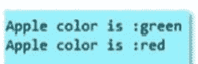
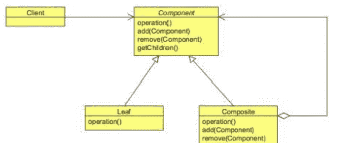
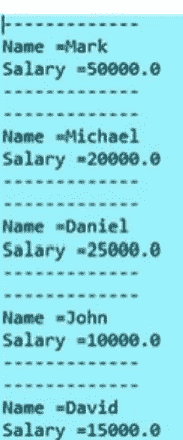
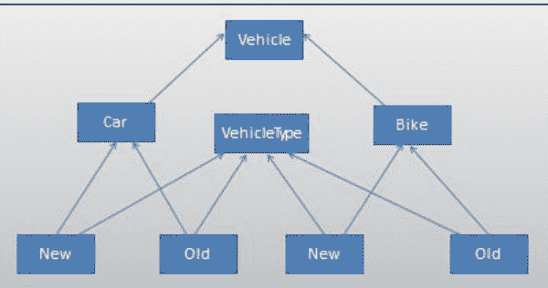
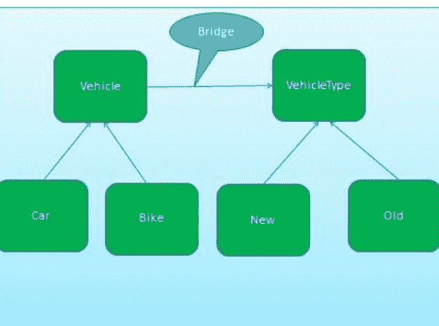
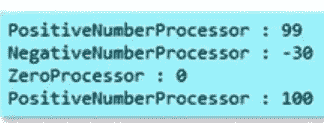
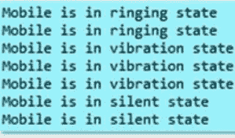

# JAVA 设计模式

## 前言

本技术电子书以最易于理解的方式提供了关于 Java 设计模式的信息。它包含了对每个 Java 设计模式的详细描述，并结合了最简单的真实世界案例。书中提供的所有示例均已在我的开发环境中经过编译和运行。我已尽力在书中提供最简单的示例。

本书面向 Java 开发者，无论初学者还是资深人士均适用。只要他/她通读全文并提供的示例，任何 Java 开发者都能从中受益。我在编写本书时，考虑到了每个级别的开发者都能从中获益。

编写本电子书的动力源于我学习 Java 设计模式的时期。想要在一或两次阅读中理解每一种模式并不是易事。我查阅了该主题的各种书籍和材料，并尝试提取关于不同模式的相关事实，以便快速轻松地理解它们。我将所有这些相关且关键的点都包含了书中。

在开始之前，我想介绍一下我自己。我是一个 Java 开发者，在 Java/J2EE 技术领域拥有超过 10 年的经验。目前，我在一家跨国软件公司工作。我的爱好之一是编写技术内容。我花了一些时间写了这本书，并非常高兴能与其他开发者分享我的经验和知识。如果你在阅读本电子书期间有任何建议、更正或疑问，请随时与我联系 erdsingh24@gmail.com

## 关于设计模式

如果一个问题反复出现，那么该问题的解决方案就已经被有效地使用了。这种解决方案被描述为“模式”。设计模式是解决常见面向对象设计模式的与语言无关的策略。当你进行设计时，你应该知道一些常用解决方案的名称。学习设计模式有助于人们之间进行有效的交流。事实上，你可能已经熟悉某些设计模式，只是可能没有使用广为人知的名称来描述它们。Sun 建议参考 GOF（四人帮——编写了《设计模式：可重用面向对象软件的基础》的四位先驱），因此我们以这本书作为指南来描述解决方案。请确保熟悉这些术语，并学习他人如何解决编码问题。

如果你想成为一名专业的 Java 开发者，你应该至少知道一些解决问题的流行解决方案。这些解决方案已被经验丰富的开发者证明是高效且有效的。学习设计模式可以加速你在 OAA/OOD 方面的经验积累。一旦你掌握了它们，你将终身受益，并实现飞跃，成为设计和开发的大师。此外，你将能够使用这些术语与同事或评估者进行更有效的交流。

许多拥有多年经验的程序员并不了解设计模式，但作为一个面向对象的程序员，你必须了解它们，特别是对于新的 Java 开发者来说。你可能没有使用流行的名称来描述它，或者可能没有选择更有效的方法来从逻辑上更好地控制你构建的内容。学习经验丰富的开发者如何解决编码问题并尝试将它们应用到你的项目中，是获得经验和认证的最好方法。

记住，学习设计模式将真正改变你使用代码的方式；你不仅会变得更聪明，听起来也会更聪明得多。GOF 的 23 种设计模式是广为人知的，在旅途中还会发现更多。

设计模式有三种著名的类型：

创建型设计模式：创建型设计模式为特定情况下以最佳方式实例化对象提供了解决方案。以下设计模式属于这一类：

- 单例模式
- 工厂模式
- 抽象工厂模式
- 建造器模式
- 原型模式

结构型设计模式：结构模式提供了创建类结构的不同方法，例如使用继承和组合从小对象创建大对象。以下设计模式属于这一类：

- 适配器模式
- 组合模式
- 代理模式
- 权重模式
- Facade 模式
- 桥接模式
- 装饰器模式

行为型设计模式：行为型模式为对象之间更好的交互提供了解决方案，并提供了如何实现解耦和易于扩展的方法。以下设计模式属于这一类：

- 模板方法模式
- 中调器模式
- 责任链模式
- 观察者模式
- 策略模式
- 命令模式
- 状态模式
- 访问者模式
- 迭代器模式
- 解释器模式
- 备忘录模式

## 单例模式

有时，对于某些类来说，只有一个实例是非常重要的。许多对象我们只需要一个实例，如果我们实例化了多个，就会遇到各种问题，如程序行为不正确、资源过度使用或结果不一致。

单例设计模式的定义中只有两点：

- 一个类只允许存在一个实例，并且
- 我们应该允许对该实例提供全局访问点。

从定义上看，这似乎是一个非常简单的设计模式，但在涉及实现时，它带有许多实现方面的考虑。Java 单例模式的实现一直是开发者之间备受争议的话题。我们将学习单例模式的原则、实现单例模式的不同方法以及其使用的一些最佳实践。

当我们希望延迟初始化到需要它时，懒性初始化将是有益的。因为如果我们使用饿性初始化且一旦初始化失败，将没有机会进一步获取实例；而在懒初始化中，我们有第二次机会。在懒初始化中，在我们调用 `getInstance()` 方法之前不会获取实例，而饿性初始化是在类加载时创建实例。

在某些情况下可以发现单例模式被违反的情况。

我们将比较对象的哈希值来验证相似的对象。如果两个对象的哈希值相等，那么这些对象必须是相等的。

- 反射：通过反射我们可以在运行时将私有构造函数设置为可访问，如下例所示。

```java
import java.lang.reflect.Constructor;
public class SingletonR {
    private static SingletonR instance=new SingletonR();
    private SingletonR() {
        System.out.println("Creating...");
    }
    public static SingletonR getInstance() {
        return instance;
    }
    public static void main(String[] args) throws Exception {
        SingletonR s1 = SingletonR.getInstance();
        SingletonR s2 = SingletonR.getInstance();
        print("s1", s1);
        print("s2", s2);
        Class cls = Class.forName("com.dev.dp.creational.singleton.SingletonR");
        Constructor<SingletonR> ctor = cls.getDeclaredConstructor();
        ctor.setAccessible(true);
        SingletonR s3 = ctor.newInstance();
        print("s3", s3);
    }
    static void print(String name, Object obj) {
        System.out.println(String.format("Object: %s, Hashcode: %d",name,obj.hashCode()));
    }
}
```

### 输出：

```
Creating...
Object: s1, Hashcode: [hash]
Object: s2, Hashcode: [hash]
Creating...
Object: s3, Hashcode: [hash]
```

如何修复：如果实例已存在，有人尝试实例化，则抛出运行时异常。这段代码将进入单例类的私有构造函数。

```java
private SingletonR() {
    System.out.println("Creating...");
    if(instance != null) {
        throw new RuntimeException("can't create instance. Please use getInstance());
    }
}
```

### 修复后的输出：

```
Creating...
Object: s1, Hashcode: [hash]
Object: s2, Hashcode: [hash]
```

### 克隆：如果我们尝试通过克隆来创建实例，生成的克隆副本哈希值与实际对象不匹配，因此它违反了单例原则。

```java
public class Singleton Cloneable {
    private static Singleton instance=new Singleton();
    private Singleton() {
        System.out.println("Creating...");
    }

    public static Singleton getInstance() {
        return instance;
    }

    @Override
    protected Object clone() throws CloneNotSupportedException {
        if (instance != null) throw new CloneNotSupportedException();
        return super.clone();
    }

    public static void main(String[] args) throws Exception {
        Singleton s1 = Singleton.getInstance();
        Singleton s2 = Singleton.getInstance();
        print("s1",s1);
        print("s2",s2);

        Singleton s3 = (Singleton)s1.clone();
        print("s3",s3);
    }

    private static void print(String name, Object obj) {
        System.out.println(String.format("Object : %s, Hashcode: %d",name,obj.hashCode()));
    }
}
```

输出：

```
Creating...
Object : s1, Hashcode: 31168322
Object : s2, Hashcode: 31168322
Object : s3, Hashcode: 17225372
```

如何修复：如果有人尝试创建另一个实例，则从 `clone()` 方法中抛出 `CloneNotSupportedException`。取消 `clone()` 方法中注释掉的行。

修复后的输出：

```
Creating...
Object : s1, Hashcode: 31168322
Object : s2, Hashcode: 31168322
Exception in thread "main" java.lang.CloneNotSupportedException: Singleton.clone(Singleton:18)
    at com.dev.dp.creational.singleton.SingletonC.main(SingletonC.java:29)
```

- 序列化/反序列化：当我们序列化一个对象并再次反序列化它时，会生成不同的哈希值，如下例所示。因此，在对象序列化/反序列化的情况下，我们的单例原则会被破坏。

```java
public class Singleton implements Serializable {
    private static Singleton instance = new Singleton();

    private Singleton() {
        System.out.println("Creating...");
    }

    public static Singleton getInstance() {
        return instance;
    }

    public static void main(String[] args) throws Exception {
        Singleton s1 = Singleton.getInstance();
        Singleton s2 = Singleton.getInstance();

        System.out.printf("%s%s\n", s1);
        System.out.printf("%s%s\n", s2);

        ObjectOutputStream oos = new ObjectOutputStream(new FileOutputStream("/tmp/s2.ser"));
        oos.writeObject(s2);
        ObjectInputStream ois = new ObjectInputStream(new FileInputStream("/tmp/s2.ser"));
        Singleton s3 = (Singleton) ois.readObject();
        System.out.printf("%s%s\n", s3);
    }

    private static void print(String name, Object obj) {
        System.out.println(String.format("Object: %s, Hashcode: %d", name, obj.hashCode()));
    }
}
```

### 输出：

```
Creating...
Object : s1, Hashcode: 31168322
Object : s2, Hashcode: 31168322
Object : s3, Hashcode: 6585861
```

### 如何修复：在单例类中实现所示 `readResolve()` 方法。

```java
private Object readResolve() {
    System.out.println("applying read resolve...");
    return instance;
}
```

### 修复后的输出：

```
Creating...
Object : s1, Hashcode: 31168322
Object : s2, Hashcode: 31168322
applying read resolve...
Object : s3, Hashcode: 31168322
```

- 多线程：只有在执行了饿汉实例化的情况下，单例在多线程环境下才能正常工作，因为这种实例创建只会在类加载时发生。但对于懒加载实例化，我们必须考虑多个线程。如果我们因为成本原因想延迟实例化，则会使用懒加载。

以下代码通过比较两个线程执行时的哈希值，演示了单例的行为。运行以下代码时请小心，因为它在 Java 8 及更高版本上有效。

```java
public class SingletonT {
    private static SingletonT instance=null;//懒加载初始化

    private SingletonT(){
        System.out.println("Creating...");
    }

    public static SingletonT getInstance(){
        if (instance == null) {
            instance = new SingletonT();
        }
        return instance;
    }

    public static void useSingleton() {
        Singleton singleton = SingletonT.getInstance();
        print(singleton);
    }

    public static void main(String[] args) throws Exception {
        ExecutorService service = Executors.newFixedThreadPool(2);
        service.submit(::useSingleton);
        service.submit(::useSingleton);
        service.shutdown();
    }

    public static void print(String name, Object obj) {
        System.out.println(String.format("Object : %s, Hashcode: %d", name, obj.hashCode()));
    }
}
```

```
Creating...
Object : singleton, Hashcode: 14229844
Object : singleton, Hashcode: 14229844
```

当你多次运行程序时，你会发现在多线程环境下，单例原则有时有效，但有时会违反。因此，我们需要像下面所示对 `getInstance()` 方法进行同步。

```java
public static synchronized SingletonT getInstance(){
    if (instance == null) {
        instance = new SingletonT();
    }
    return instance;
}
```

在 `getInstance()` 方法中应用 `synchronized` 关键字后，程序将正常执行而没有任何问题，但 Java 并没有同步整个方法，我们可以只同步创建实例时受影响的代码块，以避免额外的开销，如下：


```java
public static SingletonT getInstance(){
    if (instance == null) {
        synchronized (SingletonT.class) {
            instance = new SingletonT();
        }
    }
    return instance;
}
```

从上述代码中，出于性能考虑缩小了同步范围。请注意，如果一个线程在第 28 行看到 `instance` 为空，然后它获取了第 29 行对象的锁。与此同时，另一个线程已经有了锁，它将创建实例。为了确保没有其他线程已经获取锁，我们会在获取锁后再次进行一次检查，如下所示。这种方法被称为双检查锁定（Double Checked Locking）。

```java
public static SingletonT getInstance() {
    if (instance == null) { // 检查 1
        synchronized (SingletonT.class) {
            if (instance == null) { // 检查 2
                instance = new SingletonT();
            }
        }
    }
    return instance;
}
```

有时双检查锁定也会破坏单例原则。Java 运行时发布部分化的变量。为了解决这种情况，在声明实例时使用 `volatile` 关键字。`volatile` 变量的值只有在写入操作完成后才会发布。简而言之，所有线程都会看到变量的值。

```java
private static volatile Singleton instance=null;//懒加载初始化
```

## Holder 类（Pugh 方法）

Pugh 使用内部静态辅助类了一种创建单例类的不同方法。

```java
package com.dev.op.singleton;

public class Singleton {
    private Singleton() {
        System.out.println("Creating...");
    }
    static class Holder {
        static final Singleton INSTANCE = new Singleton();
    }

    public static Singleton getInstance() {
        return Holder.INSTANCE;
    }

    public static void main(String[] args) throws Exception {
        Singleton s1 = Singleton.getInstance();
        Singleton s2 = Singleton.getInstance();
        Singleton s3 = Singleton.getInstance();

        print("s1, s2, s3");
        print("s1, s2, s3");
        print("s3, s2, s3");
    }

    private static void print(String name, Singleton obj) {
        System.out.println(String.format("Object: %s, %s, %s, %s", obj, name, name, obj.hashCode()));
    }
}
```

Creating...

Object : s1, Hashcode: 31168322

Object : s2, Hashcode: 31168322

Object : s3, Hashcode: 31168322

## Enum 单例

Joshua Bloch 建议使用 Enum 来实现单例设计模式，因为 Java 确保任何枚举值在 Java Java 程序中只实例化一次。由于 Java 枚举值是全局可见的，单例也是可见的。缺点是枚举类型不够灵活；例如，它不允许懒加载初始化。

```java
package com.dev.dp.creational.singleton;

public enum EnumSingleton {
    INSTANCE;

    public static void doSomething() {
        // do something
    }
}
```

Enum 单例在上述描述的任何情况下都不会违反单例原则。

## 工厂模式

当我们有一个具有多个子类的父类，并且根据输入需要返回其中一个子类时，就会使用工厂模式。这种模式将类实例化的责任从客户端程序中转移到工厂类中。我们可以在工厂类上使用单例模式，或者将工厂方法设为静态方法。

工厂模式中的父类可以是一个接口，也可以是一个普通的 Java 类。

### 优点

- 工厂模式提供了一种面向接口而非实现的方法。
- 工厂模式从客户端代码中移除了具体实现类的实例化，使其更加健壮、低耦合且易于扩展。例如，我们可以轻松地更改 PC 类的实现，因为客户端程序并感知此。
- 工厂模式通过继承在实现类和客户端类之间提供了抽象。

### 在 JDK 中的用法

- `java.util.Calendar`、`ResourceBundle` 和 `NumberFormat` 的 `getInstance()` 方法使用了工厂模式。
- 包装类（如 `Boolean`、`Integer` 等）中的 `valueOf()` 方法。

```java
package com.dev.dp.creational.factory;
public interface IMobile {
    public void cost();
    public void pictureCapacity();
    public void batteryPower();
}
```

```java
public class Lenovo implements IMobile {
    @Override
    public void cost() {
        System.out.println("Lenovo Cost starts from 10000");
    }
    @Override
    public void pictureCapacity() {
        System.out.println("Lenovo camera capacity starts from 10 MP");
    }
    @Override
    public void batteryPower() {
        System.out.println("Lenovo battery power starts from 2500 mAh");
    }
    @Override
    public String toString() {
        return "Lenovo" + toString() + "=" + super.toString() + " ";
    }
}
```

```java
public class Samsung implements IMobile {
    @Override
    public void cost() {
        System.out.println("Samsung Cost starts from 6000");
    }
    @Override
    public void pictureCapacity() {
        System.out.println("Samsung camera capacity starts from 4 MP");
    }
    @Override
    public void batteryPower() {
        System.out.println("Samsung battery power starts from 1200 mAh");
    }
}
```

```java
package com.dev.dp.creational.factory;
public class MobileFactory {
    public MobileFactory() {
    }
    public IMobile createMobile(String type) {
        IMobile mob=null;
        if("len".equalsIgnoreCase(type)) {
            mob=new Lenovo();
            System.out.println("Lenovo created");
        } else if("sams".equalsIgnoreCase(type)) {
            mob=new Samsung();
            System.out.println("Samsung created");
        }
        return mob;
    }
}
```

```java
public class FactoryTest {
    public static void main(String[] args) {
        MobileFactory factory = new MobileFactory();
        Lenovo len = (Lenovo)factory.createMobile("len");
        len.batteryPower();

        Samsung sam = (Samsung)factory.createMobile("sam");
        sam.cost();
    }
}
```

### 输出

```text
Lenovo created
Lenovo battery power starts from 2500 mAh
Samsung created
Samsung Cost starts from 6000
```

其他示例：动物：狗、猫、狐等等。

## 抽象工厂模式

几乎与工厂模式相似，区别在于它更像是“工厂的工厂”。如果你熟悉 Java 中的工厂设计模式，你会注意到我们有一个单一的工厂类根据提供的输入返回不同的子类，并且工厂使用 `if-else` 或 `switch` 语句来实现。在抽象工厂模式中，我们消除了 `if-else` 块，并为每个子类准备一个工厂类，然后有一个抽象工厂，它根据输入的工厂类来返回相应的子类。

抽象工厂是一个返回工厂的工厂。为什么这一层抽象有用呢？普通工厂用于创建一组相关对象。而抽象工厂返回工厂。因此，抽象工厂用于返回可以创建一组相关对象的工厂。

例如，你可以有一个本田（Honda）工厂，它返回与本田工厂相关的汽车对象（Brio、Civic 等）。你也可以有一个现代（Hyundai）工厂，它返回与现代工厂相关的汽车对象（Santro、EON）。我们可以创建一个抽象工厂，根据我们感兴趣的汽车来返回这些不同类型的工厂。然后我们可以从这些汽车工厂中获取汽车对象。通过多态，我们可以使用通用接口来获取不同的工厂，然后再次使用通用接口来获取不同的汽车。

### 优点

- 抽象工厂模式提供了一种面向接口而非实现的代码方法。
- 抽象工厂模式是“工厂的工厂”，可以轻松扩展以容纳更多产品，例如，我们可以添加另一个子类 Cerio 和一个工厂 MarutiFactory。
- 抽象工厂模式是健壮的，并且避免了工厂模式中的条件逻辑。

### 在 JDK 中的用法

- `javax.xml.parsers.DocumentBuilderFactory#newInstance()`
- `javax.xml.transform.TransformerFactory#newInstance()`
- `javax.xml.xpath.XPathFactory#newInstance()`

何时使用：当一组相关的产品对象被设计为一起使用，并且我们需要强制这一约束时。

```java
package com.dp.creational.abstractFactory;

public interface IMobileFactory {
    IMobileFactory createMobile(String type);
}

public class MobileFactory implements IMobileFactory {
    @Override
    public IMobileFactory createMobile(String type) {
        IMobileFactory mob = null;
        if ("lenf".equalsIgnoreCase(type)) {
            mob = new LenovoMobileFactory();
        } else if ("samf".equalsIgnoreCase(type)) {
            mob = new SamsungMobileFactory();
        }
        return mob;
    }
}

public class LenovoMobileFactory extends MobileFactory {
    public Lenovo createLenovo() {
        return new Lenovo();
    }
}

public class SamsungMobileFactory extends MobileFactory {
    public Samsung createSamsungMobile() {
        return new Samsung();
    }
}

public class AbstractFactoryTest {
    public static void main(String[] args) {
        MobileFactory factory = new MobileFactory();
        IMobileFactory info = factory.createMobile("lenf");
        // 注意：原始 OCR 在类型/方法上存在逻辑错误，
        // 保持了原始结构。
    }
}
```

### 输出

Lenovo camera capacity starts from 10 MP

其他示例：

本田工厂：Brio、Civic。

现代工厂：Santro、EON 等。

## 构建器模式

通常情况下，对象构建的细节（例如实例化和初始化组成对象的组件）被保留在对象内部，通常作为构造函数的一部分。这种设计将对象构建过程与组成对象的组件紧密结合在一起。只要正在构建的对象是简单的，且对象构建过程是确定的并始终产生相同的对象表示，这种方法就是合适的。

然而，当创建的对象非常复杂，且构成对象创建过程的一系列步骤可以用不同的方式实现，从而产生不同的对象表示时，这种设计可能不再有效。因为构建过程的不同实现都保留在对象内部，对象可能会变得臃肿（构建膨胀）且模块化程度降低。随后，添加新的实现或更改现有实现需要修改现有代码。

使用构建器模式，可以更有效地设计此类对象的构建过程。构建器模式建议将构建逻辑从对象类中移动到称为构建器（builder）的独立类中。可以有多个这样的构建器类，每个类对构建对象的系列步骤都有不同的实现。每个构建器的实现都会导致对象的不同表示。

构建器模式的意图是将复杂对象的构建与其表示分离，使得相同的构建过程可以创建不同的表示。这种分离减少了对象的大小。这种设计变得更加模块化，因为每个实现都包含在不同的构建器中。添加新的实现（即添加新的构建器）变得更加容易。对象构建过程不再依赖于组成对象的组件。

构建器模式建议使用一个专用的构建器，称为导演（Director），它负责调用构建最终对象所需的各种构建器方法。不同的客户端可以使用导演来创建所需的对象。一旦对象构建完成，客户端可以直接从构建器处获取完全构建的对象。为了方便这一过程，可以在通用构建器接口中声明一个新方法 `getObject()`，由不同的具体构建器来实现。

### Builder（构建器）

- 定义了创建产品对象部分的抽象接口。

### ConcreteBuilder

- 通过实现 Builder 接口来构造和组装产品的各个部分。
- 定义并跟踪它所创建的表示。
- 提供一个获取产品的接口。

### Director

- 使用 Builder 接口构造对象。

### Product

- 代表正在构建的复杂对象。ConcreteBuilder 构建产品的内部表示，并定义了其组装过程。
- 包含定义组成部分的类，包括将部分组装成最终结果的接口。

### 示例

`com.dev.dp.creational.builder2`

- `BuilderTest.java`
- `IndianMealBuilder.java`
- `JapaneseMealBuilder.java`
- `Meal.java`
- `MealBuilder.java`
- `MealDirector.java`

### 构建器模式的另一种形式

有时一个对象具有很很长的属性列表。

问题是，对于此类类我们应该编写什么样的构造函数？编写一个带有长参数列表的构造函数并不是一个好的选择，这会让客户端感到困扰，特别是当重要的字段只有几个时。这可能会增加错误的范围；客户端可能会无意中为错误的字段提供值。类型相同的参数长序列会导致微妙的 bug。如果客户端反转了两个这样的参数，编译器不会报错，但程序在运行时会发生异常。


客户端不是直接创建所需的对象，而是调用带有所有必需参数的构造函数并获取一个构建器对象。客户端在构建器对象上调用 setter 方法来设置感兴趣的每个可选参数。最后，客户端调用一个无参数的方法来生成对象。

- 首先，你需要创建一个静态内部类，并将所有参数拷贝到外层类的 `Builder` 类中。我们应该遵循命名规范，如果类名是 `Cake`，那么构建器类应该被命名为 `CakeBuilder`。
- `Builder` 类应该有一个公有构造函数，并将所有必需属性作为参数传入。
- `Builder` 应该有方法来设置可选参数，并且在设置可选属性后应该返回同一个 `Builder` 对象。
- 最后一步是在构建器类中提供一个 `build()` 方法，该方法将返回客户端程序所需的对象。为了实现这一点，我们需要在类中有一个以 `Builder` 为参数的私有构造函数。

```java
class Cake {
    private double sugar; //cup
    private double butter; //cup
    private double milk; //cup
    private int cherry; //cup

    public static class CakeBuilder {
        private double sugar;
        private double butter;
        private double milk;
        private int cherry;

        public CakeBuilder sugar(double sugar) {
            this.sugar = sugar;
            return this;
        }
        public CakeBuilder butter(double butter) {
            this.butter = butter;
            return this;
        }
        public CakeBuilder milk(double milk) {
            this.milk = milk;
            return this;
        }
        public CakeBuilder cherry(int cherry) {
            this.cherry = cherry;
            return this;
        }

        public Cake build() {
            return new Cake(this.sugar, this.butter, this.milk, this.cherry);
        }
    }

    private Cake(double sugar, double butter, double milk, int cherry) {
        this.sugar = sugar;
        this.butter = butter;
        this.milk = milk;
        this.cherry = cherry;
    }
}
```

```java
// 私有构造函数强制通过 builder 创建对象
private Cake(CakeBuilder builder) {
    this.sugar = builder.sugar;
    this.butter = builder.butter;
    this.milk = builder.milk;
    this.cherry = builder.cherry;
}
```

```java
@Override
public String toString() {
    return "Cake[" + sugar + ", butter=" + butter + ", milk=" + milk + "]";
}
```

```java
public class BuilderPattern {
    public static void main(String[] args) {
        // 使用构建器模式创建对象
        Cake cake = new CakeBuilder().sugar(0.5).butter(0.5).milk(0.5).build();
        
        // Cake 准备好了！
        System.out.println(cake);
    }
}
```

输出：`Cake[sugar=1.0, butter=0.5, milk=0.5, cherry=0]`

在静态设置属性时，我们可以使用 setter 方法作为另一种选择。

如你清楚看到的，现在客户端只需要提供强制性字段以及对他重要的字段。要形成该对象，我们需要调用带有强制性字段的 `CakeBuilder` 构造函数，然后调用所需的方法，最后调用 `build()` 方法来获取对象对象。

### 何时使用构建器模式

- 创建复杂对象的算法应该独立于组成对象的各个部分以及它们的组装方式。
- 构建过程必须允许为所构建的对象提供不同的表示。

### JDK 中的构建器模式

- `java.lang.StringBuilder#append()`（非同步）
- `java.lang.StringBuilder#append()`（同步）
- `java.nio.ByteBuffer#put()`（也用于 `CharBuffer`、`ShortBuffer`、`IntBuffer`、`LongBuffer`、`FloatBuffer` 和 `DoubleBuffer`）
- `javax.swing.GroupLayout.Group#addComponent()`
- `java.lang.Appendable` 的所有实现。

## 原型模式

原型模式是创建型模式之一，因此它提供了一种对象创建机制。当对象的创建是一项昂贵事务，需要大量的时间资源，且你已经存在一个相似的对象时，可以使用原型模式。这种模式提供了一种将原始对象拷贝到新对象的机制，然后根据我们的需要对其修改。该模式使用 Java 的克隆机制到对象。

通过示例可以很容易理解这种模式，假设我们有一个从数据库加载数据的对象。现在我们需要在程序中多次修改这些数据，因此使用 `new` 关键字创建对象并从数据库加载所有数据并不是一个好主意。更好的方法是将现有对象克隆到新对象中，然后进行数据操作。

原型设计模式强制要求正在拷贝的对象应该提供拷贝功能。它不应该由任何其他类完成。然而，对对象属性使用浅拷贝还是深拷贝取决于需求，这是一项设计决策。

这种模式实用的一个例子是：如果原始对象创建时使用的资源（如数据流）在需要克隆该对象的时间点可能是不可用的。另一个例子是原始对象的创建涉及大量的时间投入，例如从数据库或网络读取数据。

通常在 Java 中，如果你想使用克隆（即原型模式），可以利用 `clone()` 方法和 `Cloneable` 接口。默认情况下，`clone()` 执行浅拷贝。可以使用 `Serializable` 来简化深拷贝。

然而，我们可以实现自己的原型模式。为了做到，我们将创建一个包含 `doClone()` 方法的 `Prototype` 接口。

下面的示例描述了在克隆基础自行车对象后如何设计一辆高级自行车。

```java
public class Bike implements Cloneable {
    private int gears;
    private String bitype;
    private String model;

    public Bike() {
        betype="Standard";
        model="leopard";
        gears=4;
    }

    public Bike clone() {
        return new Bike();
    }

    public void makeAdvanced() {
        betype="Advanced";
        model="Jaguar";
        gears=6;
    }

    public String getModel() {
        return model;
    }

    @Override
    public String toString() {
        return "Bike[gears=" + gears + ", bitype=" + bitype + ", model=" + model + "]";
    }
}
```

```java
public class PrototypeTest {
    public Bike makeJaguar(Bike basicBike) {
        basicBike.makeAdvanced();
        return basicBike;
    }

    public static void main(String[] args) {
        Bike bike = new Bike();
        PrototypeTest pt = new PrototypeTest();
        Bike advancedBike = pt.makeJaguar(bike);
        System.out.println("Prototype Design Pattern: "+advancedBike.getModel());
        System.out.println("Prototype Design Pattern: "+advancedBike.toString());
    }
}
```

### 输出

Prototype Design Pattern: Jaguar

Prototype Design Pattern: Bike [gears=6, bitype=Advanced, model=Jaguar]

而不是每次都带有适当的状态手动实例化该类。

**在 JDK 中的用法：** `java.lang.Object#clone()`

## 适配器模式（ADAPTER PATTERN）

有时可能会出现两个对象无法配合工作，但它们又需要完成任务。这种情况在我们尝试将遗留代码与新代码集成，或者在代码中更改第三方 API 时可能会发生。这是由于两个对象的接口不兼容，导致它们无法匹配。

换句话说，**适配器设计模式**是结构设计模式之一，它用于让两个无关的接口协同工作。连接这些无关接口的对象被称为**适配器**（Adapter）。作为一个现实生活中的例子，我们可以把手机充电器看作适配器，因为手机电池充电需要 3 伏电压，而普通插座产生的是 120V（美国）或 240V（印度）。因此，手机充电器在手机充电接口和墙壁插座之间充当适配器。

在适配器模式中，使用一个包装类（即适配器）将来自它的请求翻译成另一个类（即被适配者，adaptee）。实际上，适配器为被适配者提供了被适配者本身未提供的特定交互。

适配器模式有两种形式。在第一种形式中，“类适配器”利用继承。类适配器扩展被适配者类，并向接口中添加所需的方法（即“目标”接口）。在第二种形式中，“对象适配器”利用组合。对象适配器包含一个适配器并实现目标接口以与被适配者交互。

```java
public class Apple {
    public void getAppleColor(String color){
        System.out.println("Apple color is :"+color);
    }
}
```

```java
public class Orange {
    public void getOrangeColor(String color){
        System.out.println("Orange color is :"+color);
    }
}
```

```java
public class AppleAdapter extends Apple {
    // 示例问题的目的是将橙子适配为苹果。
    private Orange orange;
    public AppleAdapter(Orange orange) {
        this.orange = orange;
    }

    public void getColor(String color){
        orange.getOrangeColor(color);
    }
}
```

```java
public class AdapterPatternTest {
    public static void main(String[] args) {
        Apple apple1 = new Apple();
        apple1.getAppleColor("green");

        Orange orange = new Orange();
        AppleAdapter adapter = new AppleAdapter(orange);
        adapter.getAppleColor("red");
    }
}
```



`Orange` 是被适配者，`apple` 是目标，`AppleAdapter` 是适配器。这里的思想是在适配器的构造函数中传递被适配者以实现目标。

### 何时使用适配器模式

在以下情况下应该使用适配器模式：

- 存在一个现有类，但它的接口与你需要的不匹配。
- 你想创建一个可重用的类，与无关或不可预见的类协作，即这些类不一定具有兼容的接口。
- 有多个现有的子类可以使用，但通过对每个子类进行子化来适配它们的接口是不现实的。对象适配器可以适配其父类的接口。

### JDK 中的适配器模式示例

- `java.util.Arrays#asList()`
- `java.io.InputStreamReader(InputStream)`（返回一个 `Reader`）
- `java.io.OutputStreamWriter(OutputStream)`（返回一个 `Writer`）

## 组合模式（COMPOSITE PATTERN）

有时你会觉得代码中需要一种树形数据结构。树形结构有很多变体，但有时需要一种树，树的分支和叶子应该被同等对待。

组合模式允许你将对象组合成树形结构以表示部分-整体层次结构，这意味着你可以创建一个由不同部分组成的对象树，但它可以被视为一个大整体。**组合模式允许客户端统一地处理单个对象和对象的组合，这就是组合模式的意图。**

在组合模式中，存在一种树形结构，可以在叶子和节点上执行相同的操作。树中的节点是可以拥有子类的类。节点类是“组合”类。树中的叶子是不具有子类的“原始”类。组合的子类可以是叶子或其他组合类。

叶子类和组合类共享一个公共“组件”接口，该接口定义了可以在叶子和组合上执行的公共操作。当对组合执行操作时，该操作将在组合的所有子类上执行，无论它们是叶子还是组合。因此，组合模式可以用于对组成树的对象执行常用操作。

换句话说，组合模式由以下对象组成。

**基础组件（Base Component）**：组件是组合中所有对象的接口，客户端程序使用基础组件与组合中的对象进行交互。它可以是一个接口，也可以是一个包含所有对象通用方法的抽象类。

**叶子（Leaf）**：定义组合中元素的行为。它是组合的构建块并实现基础组件。它不包含指向其他组件的引用。

**组合（Composite）**：它由叶子元素组成并实现基础组件中的操作。




```java
package com.dev.dp.structural.composite;

/**
 * 首先我们先创建一个组件接口。
 * 表示组合中的对象。
 * 它包含了适用于经理和开发者的所有常用操作。
 *
 * Manager(Composite)
 * Developer(Leaf)
 * Employee(Component)
 */
public interface Employee {
    public void add(Employee emp);
    public void remove(Employee emp);
    public Employee getChild(int i);
    public String getName();
    public double getSalary();
    public void print();
}

/**
 * 现在我们将来创建一个经理(组合类)。
 * 关键点是所有公共方法都将其操作委托给子对象。
 * 它有访问和修改其子类方法。
 */
import java.util.ArrayList;

public class Manager implements Employee {
    private String name;
    private double salary;

    public Manager(String name, double salary) {
        this.name = name;
        this.salary = salary;
    }

    List<Employee> employees = new ArrayList<Employee>();

    @Override
    public void add(Employee emp) {
        employees.add(emp);
    }

    @Override
    public void remove(Employee emp) {
        employees.remove(emp);
    }

    @Override
    public Employee getChild(int i) {
        return employees.get(i);
    }

    @Override
    public String getName() {
        return name;
    }

    @Override
    public double getSalary() {
        return salary;
    }

    @Override
    public void print() {
        System.out.println("--- Name=" + getName());
        System.out.println("Salary=" + getSalary());
        System.out.println("---------------------");
    }

    Iterator<Employee> empIterator = employees.iterator();
    while (empIterator.hasNext()) {
        Employee emp = empIterator.next();
        emp.print();
    }
}
```

- 在这个类中，有很多不适用于开发者的方法。
- 它是一个叶子节点。

```java
public class Developer implements Employee {
    private String name;
    private double salary;

    public Developer(String name, double salary) {
        this.name = name;
        this.salary = salary;
    }

    @Override
    public void add(Employee emp) {
        // 这是一个叶子节点，所以这个方法不适用于此类。
    }

    @Override
    public void remove(Employee emp) {
        // 这是一个叶子节点，所以这个方法不适用于此类。
    }

    @Override
    public Employee getChild(int i) {
        // 这是一个叶子节点，所以这个方法不适用于此类。
        return null;
    }

    @Override
    public String getName() {
        return name;
    }

    @Override
    public double getSalary() {
        return salary;
    }

    @Override
    public void print() {
        System.out.println("--- Name=" + getName());
        System.out.println("Salary=" + getSalary());
        System.out.println("---------------------");
    }
}
```

```java
package com.dev.dp.structural.composite;

public class CompositePatternTest {
    public static void main(String[] args) {
        Employee emp1 = new Developer("John", 10000);
        Employee emp2 = new Developer("David", 15000);
        Employee manager1 = new Manager("Daniel", 25000);
        manager1.add(emp1);
        manager1.add(emp2);

        Employee emp3 = new Developer("Michael", 20000);
        Manager generalManager = new Manager("Mark", 50000);
        generalManager.add(emp3);
        generalManager.add(manager1);
        generalManager.print();
    }
}
```

## 输出



### 何时使用组合模式

- 当你想要表示对象的部分-整体层次结构结构时。
- 当你希望客户端能够忽略对象组合与单个对象之间的差异时。客户端将统一处理组合结构中的所有对象。

### 在 JDK 中的用法

`java.awt.Container#add(Component)` 是 Java 中组合模式的一个极佳示例，并在 Swing 中广泛使用。

## 代理模式

代理模式为另一个对象提供代理或占位符，以控制对它的访问。

代理模式用于创建一个代表对象来控制对另一个对象的访问，该对象可能是远程的、创建昂贵的或需要安全保护的。

控制对象访问的原因之一是延迟其创建和初始化的完整成本，直到我们真正需要使用它。另一个原因可能是作为位于不同 JVM 中的对象的本地代表。代理在控制对原始对象的访问方面非常有用，特别是当对象应该具有不同的访问权限时。

在代理模式中，客户端不直接与原始对象通信，而是委托给代理，由代理调用原始对象的方法。重要的一点是客户端不知道代理的存在，代理充当客户端的原始对象。但这种方法有许多变体，我们很快就会看到。

代理模式有三种主要的变体：

- 远程代理为不同地址空间中的对象提供本地代表。
- 虚拟代理按需创建昂贵的对象。
- 保护代理控制对原始对象的访问。当对象应该具有不同的访问权限时，保护代理非常有用。

```java
public interface IFolder {
    public void performOperations();
}
```

```java
public class Folder implements IFolder {
    @Override
    public void performOperations() {
        // 访问文件夹并执行各种操作，如复制或剪切文件
        System.out.println("Performing operation on folder");
    }
}
```

```java
public class User {
    String username;
    String password;

    public User(String username, String password) {
        super();
        this.username = username;
        this.password = password;
    }

    public String getUsername() {
        return username;
    }

    public void setUsername(String username) {
        this.username = username;
    }

    public String getPassword() {
        return password;
    }

    public void setPassword(String password) {
        this.password = password;
    }
}
```

```java
public class FolderProxy implements IFolder {
    Folder folder;
    User user;

    public FolderProxy(User user) {
        this.user = user;
    }

    @Override
    public void performOperations(String dev) {
        if (user.getPassword().equalsIgnoreCase(dev)) {
            folder = new Folder();
            folder.performOperations();
        } else {
            System.out.println("You don't have access to this folder");
        }
    }
}
```

```java
package com.dev.dp.proxyPatternTest;

public class ProxyPatternTest {
    public static void main(String[] args) {
        User user = new User("dev", "dev");
        FolderProxy folderProxy = new FolderProxy(user);
        System.out.println("***** username and password are correct:*");
        folderProxy.performOperations();
        System.out.println("****************************************");

        // 如果用户名和密码错误
        User userWrong = new User("abc", "abc");
        FolderProxy folderProxyWrong = new FolderProxy(userWrong);
        System.out.println("***** username and password are incorrect:*");
        folderProxyWrong.performOperations();
    }
}
```

## 输出

```text
When userName and password are correct:
Performing operation on folder
****************************************
When userName and password are incorrect:
You don't have access to this folder
```

### 何时使用代理模式

每当需要对对象进行比简单指针更通用或更复杂的引用时，代理模式都适用。以下是代理模式的几种常见情况：

- 远程代理为不同地址空间中的对象提供本地代表。
- 虚拟代理按需创建昂贵的对象。
- 保护代理控制对原始对象的访问。当对象应该具有不同的访问权限时，保护代理非常有用。

### JDK 中的代理模式

以下用例是 JDK 中使用代理模式的示例。

- `java.lang.reflect.Proxy`
- `java.rmi.rmi.*`（整个包）

## 外观模式（FACADE PATTERN）

外观模式是一种结构性设计模式。在外观模式中，使用一个外观类为一组类提供单一接口。外观模式通过将交互局部化到单一接口中，简化了客户端与复杂系统的交互。因此，客户端可以与单个对象进行交互，而不需要直接以复杂的方式与组成子系统的对象交互。

根据 GoF 设计模式：为子系统中的一组接口提供统一接口。外观模式定义了一个更高层次的接口，使得子系统更容易使用。

外观并没有封装子系统的类或接口；它为这些功能提供了一个简化的接口。客户端可以直接访问这些类。它仍然为可能需要的客户端暴露了系统的完整功能。它只是为子系统的复杂接口提供了一层，使其更易使用。

外观设计模式是促进松耦合的其他设计模式之一。它强调了设计中另一个更重要的方面，即抽象。通过在暴露简单接口后面隐藏复杂性，它实现了抽象。

外观可以封装多个类，但外观用于通过接口以简化复杂接口，而适配器（adapter）用于将接口转换为客户端期望的。

中介者设计模式在抽象方面看起来与外观设计模式非常相似，中介者抽象了子系统的功能，这与外观模式相似。在中介者模式的实现中，子系统或同类会感知中介者并与其交互。在外观模式的情况下，子系统并不知道外观的存在。只有外观与子系统进行通信。

```java
package com.dev.dp.structural.facade;

public class Class {
    // Class's doSomethingComplicated(method) 接收一个整数并返回它的立方。
    public int doSomethingComplicated(int x) {
        return x * x * x;
    }
}
```

```java
package com.dev.structural.facade;

public class Class2 {
    /* Class2.doAnotherThing() 将整数的立方翻倍并返回它 */
    public int doAnotherThing(Class1 class1, int x) {
        return 2 * class1.doSomethingComplicated(x);
    }
}
```

```java
package com.dev.structural.facade;

public class Class3 {
    /*
     * Class3.doMoreStuff() 接收一个 Class1 对象、一个 Class2 对象，并将它们相乘。
     */
    public int doMoreStuff(Class1 class1, Class2 class2, int x) {
        return class1.doSomethingComplicated(x)
                * class2.doAnotherThing(class1, x);
    }
}
```


```java
package com.dev.structural.facade;

public class facade {
    // 我们需要它来简化与这一类系统的交互
    // 以便客户端能够以简单、标准化的方式与这些类交互。
    // 外观将隐藏方法名清楚指示其作用的这一事实，并隐藏来自 Class1、Class2 和 Class3 的交互。
    public int cubeX(int x) {
        Class1 class1 = new Class1();
        return class1.doSomethingComplicated(x);
    }

    public int cubeTimes(int x) {
        Class1 class1 = new Class1();
        Class2 class2 = new Class2();
        return class2.doAnotherThing(class1, x);
    }

    public int multiplyBoth(int x) {
        Class1 class1 = new Class1();
        Class2 class2 = new Class2();
        Class3 class3 = new Class3();
        return class3.doMoreStuff(class1, class2);
    }
}
```

```java
package com.dev.dp.structural.facade;

public class FacadeTest {
    public static void main(String[] args) {
        Facade facade = new Facade();
        int x = 3;
        System.out.println("Cube of " + x + ": " + facade.cubeX(x));
        System.out.println("Cube of " + x + " * times 2: " + facade.cubeTimes(x));
        System.out.println("multiply " + class1 + " & " + class2 + ": " + facade.multiplyBoth(x));
    }
}
```

### 输出

```text
Cube of 3:27
Cube of 3 times 2:54
multiply class1 & class2 :1458
```

### 重要要点

- 外观模式更像是客户端应用程序的助手；它并没有隐藏子系统来自客户端的接口。是否使用 Facade（外观模式）完全取决于客户端代码。
- Facade 模式可以应用于开发的任何阶段，通常在接口数量增加且系统变得复杂时使用。
- 子系统感知不到 Facade，且它们不应该包含任何 Facade 接口的引用。
- Facade 模式应该应用于相同类型的接口；其目的是提供一个单一接口，而不是多个执行相似任务的接口。
- 子系统之间可能相互依赖。在这种情况下，Facade 可以充当协调者，解耦子系统之间的依赖关系。
- 我们可以结合工厂设计模式与 Facade 使用，为客户端系统提供更好的接口。

### 在 Java 中的用法

在 `javax.faces.context` 中，`ExternalContext` 内部使用了 `ServletContext`、`HttpSession`、`HttpServletRequest`、`HttpServletResponse` 等。它允许 Faces API 无需感知所包含的应用环境的性质。

## 桥接模式（BRIDGE PATTERN）

当接口和实现中都存在接口层次结构时，使用构建器设计模式将接口与实现解耦，并向客户端程序隐藏实现细节。

根据 GoF 设计模式，桥接模式的定义是：将抽象与其实现解耦，以便两者能够独立地变化。

在桥接模式中，我们将抽象和实现分离离开来，并为抽象和实现者分别开发单独的继承结构。抽象是一个接口或抽象类，抽象包含一个指向实现者的引用。具体实现者的子类同样是接口或抽象类。抽象被称为细化抽象（refined abstractions），实现者的子类被称为具体实现者（concrete implementers）。由于我们可以更改抽象中对实现者的引用，因此我们能够在运行时更改抽象的实现者。对实现者的更改不会影响客户端代码。

桥接模式的意图是将抽象与其实现解耦，以便两者独立地变化。它将抽象和实现放在两个不同的类层次结构中，以便两者都可以独立地扩展。

### 桥接模式设计之前



### 桥接模式设计之后



适配器设计模式有助于让两个不兼容的类共同工作。但桥接设计模式通过创建两个不同的层次结构来解耦抽象和实现。

```java
package com.dev.dp.structural.bridge;

/**
 * 桥接模式中的抽象
 */
public abstract class Vehicle {
    protected VehicleType type1;
    protected VehicleType type2;

    public Vehicle(VehicleType type1, VehicleType type2) {
        this.type1 = type1;
        this.type2 = type2;
    }

    abstract public void purchase();
}
```

```java
package com.dev.dp.structural.bridge;

/**
 * 桥接模式的实现者
 */
public interface VehicleType {
    abstract public void book();
}
```

```java
package com.dev.dp.structural.bridge;

/**
 * 桥接模式中的细化抽象 1
 */
public class Car extends Vehicle {
    public Car(VehicleType type1, VehicleType type2) {
        super(type1, type2);
    }

    @Override
    public void purchase() {
        System.out.print("Car");
        type1.book();
        type2.book();
    }
}
```

```java
package com.dev.dp.structural.bridge;

/**
 * 桥接模式中的细化抽象 2
 */
public class Bike extends Vehicle {
    public Bike(VehicleType type1, VehicleType type2) {
        super(type1, type2);
    }

    @Override
    public void purchase() {
        System.out.print("Bike");
        type1.book();
        type2.book();
    }
}
```

```java
package com.dev.dp.structural.bridge;

/**
 * 桥接模式的具体实现 1
 */
public class NewVehicle implements VehicleType {
    @Override
    public void book() {
        System.out.print(" New Vehicle");
    }
}
```

```java
package com.dp.structural.bridge;

/**
 * 桥接模式的具体实现 2
 */
public class OldVehicle implements VehicleType {

    @Override
    public void body() {
        System.out.println(" Old Vehicle");
    }
}
```

```java
package com.dp.structural.bridge;

public class BridgePatternTest {
    public static void main(String[] args) {
        Vehicle vehicle1 = new Car(new NewVehicle(), new OldVehicle());
        vehicle1.purchase();

        Bike vehicle2 = new Bike(new NewVehicle(), new OldVehicle());
        vehicle2.purchase();
    }
}
```

## 输出

Car New Vehicle Old Vehicle

Bike New Vehicle Old Vehicle

### 桥接模式总结

- 创建两个不同的层次结构：一个用于抽象，另一个用于实现。
- 通过移除抽象与实现之间的依赖关系，避免了永久绑定。
- 我们创建了一个协调抽象和实现之间的桥梁。
- 抽象和实现可以分别扩展。
- 当需要在运行时切换实现时应使用此模式。
- 如果抽象的实现发生修改，客户端不应受到影响。
- 当你有多个实现时，效果最佳。

### 在 Java 中的用法

- AWT
- JDBC

## 装饰器模式（DECORATOR PATTERN）

装饰器模式的意图是动态地给对象附加额外的职责。这为扩展功能提供了比子类化更灵活的替代。

装饰器类与它封装的对象具有相同的接口。它包含一个指向实际对象的引用。装饰器接收来自客户端的所有请求，并将这些调用转发给底层对象。

组件接口（Component Interface）—— 定义将实现的方法的接口或抽象类。在本例中，`Icecream`（冰淇淋）将作为组件接口。

```java
package com.dev.dp.structural.decorator;

public interface Icecream {
    public String makeIcecream();
}
```

组件实现（Component Implementation）—— 组件接口的基本实现。我们可以有一个 `Simpleicecream` 这种组件实现。

```java
package com.dev.dp.structural.decorator;

public class Simpleicecream implements Icecream {
    @Override
    public String makeIcecream() {
        return "Base-Icecream";
    }
}
```

装饰器（Decorator）—— 装饰器类实现了组件接口，并且与组件接口具有“拥有”（HAS-A）关系。组件变量应该允许子装饰器类访问，因此我们将此变量设为 `protected`。

```java
package com.dev.dp.structural.decorator;

public abstract class IcecreamDecorator implements Icecream {
    protected Icecream specialIcecream;

    public IcecreamDecorator(Icecream specialIcecream) {
        this.specialIcecream = specialIcecream;
    }

    @Override
    public String makeIcecream() {
        return specialIcecream.makeIcecream();
    }
}
```

### 具体装饰器（Concrete Decorators）

扩展基础装饰器功能并相应地修改组件行为。我们可以有 `NuttyIcecreamDecorator` 和 `HoneyIcecreamDecorator` 等具体装饰器类。

```java
package com.dev.dp.structural.decorator;

public class NuttyDecorator extends IcecreamDecorator {
    public NuttyDecorator(Icecream specialIcecream) {
        super(specialIcecream);
    }

    public String makeIcecream() {
        return specialIcecream.makeIcecream() + addNuts();
    }

    private String addNuts() {
        return "+ Crunchy Nuts";
    }
}
```

```java
package com.dev.dp.structural.decorator;

public class HoneyDecorator extends IcecreamDecorator {
    public HoneyDecorator(Icecream specialIcecream) {
        super(specialIcecream);
    }

    public String makeIcecream() {
        return specialIcecream.makeIcecream() + addHoney();
    }

    private String addHoney() {
        return "+ Sweet Honey";
    }
}
```

```java
package com.dev.dp.structural.decorator;

public class DecoratorPatternTest {
    public static void main(String[] args) {
        Icecream icecream = new HoneyDecorator(
            new NuttyDecorator(new SimpleIcecream())
        );
        System.out.println(icecream.makeIcecream());
    }
}
```

## 输出

基础冰淇淋 + 脆坚果 + 甜蜂蜜

### 何时使用装饰器模式

在以下情况下使用装饰器模式：

- 动态且透明地为单个对象添加职责，即不影响其他对象。
- 适用于可以撤销的职责。
- 当通过子类进行扩展不实际可行时。有时可能存在大量的独立扩展，这会导致子类爆炸。或者类的定义可能被隐藏或在情况下不可用。
- 当选择较多时，易于维护和扩展。

### 在 Java 中的用法

- 装饰器模式广泛用于 Java IO 类，例如 `FileReader`、`BufferedReader` 等。
- 装饰器模式的缺点是它使用了许多相似类型的对象（装饰器）。

## 享量模式（FLYWEIGHT PATTERN）

在享量模式中，我们不再创建大量相似的对象，而是复用对象。这可以用于减少内存需求、实例化时间以及相关成本。

当我们需要创建一个类的大量对象时，就会使用享量模式。由于每个对象都会消耗内存空间，这对于低内存设备（如移动设备或嵌入式系统）至关重要，因此可以使用享量模式通过共享对象来减轻内存负载。

在应用享量模式之前，我们需要考虑以下因素：

- 应用需要创建的对象数量可能是巨大的。
- 创建非常消耗内存，而且可能耗时。

有时过多的对象会减慢速度。过多对象可能会消耗大量内存并降低应用速度，甚至导致内存溢出问题。作为一个优秀的程序员，应该记录实例化的对象并控制应用程序中的对象创建。当我们有许多相似的对象，且池中的两个对象之间差异不大时，这一点尤为真实。

有时应用程序中的对象可能具有很高的相似性并属于相似类型（这里的相似类型意味着它们的大部分属性具有相似的值，只有少数属性的值不同）。如果这些是重量密集型对象，应该由应用程序开发者进行控制。否则，它们可能会消耗大量内存并最终减慢整个应用的运行。

享量模式旨在控制此类对象的创建，并为你提供一种基本的缓存机制。它允许你为每个类型创建一个对象（类型通过该对象的属性进行区分），如果你请求具有相同属性（已创建）的对象，它将返回同一个对象，而不是创建一个新的。

## JDK 中的享量模式示例

所有包装类类的 `valueOf` 方法都使用了缓存对象，这展示了享量设计模式的使用。最好的例子是 Java `String` 类的字符串池实现。

## 模板方法模式（TEMPLATE METHOD PATTERN）

模板模式在操作中定义了算法的骨架，并将某些步骤留给子类。模板方法允许子类在不改变算法结构的情况下重新定义算法的某些步骤。

当存在某种算法，且其中某些步骤可以通过不同的方式实现时，可以使用模板方法模式。在这种情况下，模板方法模式建议将算法的概述保留在类的一个独立方法中（称为模板方法），该类可以称为模板类，而将算法中变体部分（可以用多种方式实现的步骤）的具体实现留给该类的不同子类。

模板类并不一定需要将所有实现完全留给子类。相反，作为提供算法大纲的一部分，模板类也可以提供一些可以认为在不同实现之间保持不变的实现。如果合适，它甚至为变体部分提供默认实现。只有特定的细节将在不同的子类中实现。这种实现消除了重复代码的需求，这意味着需要编写的代码最少。


- 模板方法应该由某些顺序固定的步骤组成，对于某些方法，其实现从基类到子类有所不同。模板方法应该是`final`的。
- 大多数情况下，子类调用父类的方法，但在模板模式中，父类的模板方法调用子类的方法，这被称为“好莱坞原则”——“不要叫我们，我们来叫你”。
- 基类中具有默认实现的方法称为钩子方法（Hooks），它们旨在让子类重写。如果你希望某些方法不被重写，可以将它们设为`final`，例如在我们的案例中，我们可以将`doPack()`方法设为`final`，因为我们不希望子类重写它。

```java
public abstract class PurchaseOrderTemplate {
    public abstract void doSelect();
    public abstract void doPayment();
    public final void doPack() {
        System.out.println("Gift wrap done.");
    }
    public abstract void doDelivery();
    public final void processOrder() {
        doSelect();
        doPayment();
        doPack();
        doDelivery();
    }
}
```

```java
package com.dev.dp.behavioral.templateMethod;
public class StorePurchaseOrder extends PurchaseOrderTemplate {
    @Override
    public void doSelect() {
        System.out.println("Customer chooses the item from shelf.");
    }
    @Override
    public void doPayment() {
        System.out.println("Pays at counter through cash/POS");
    }
    @Override
    public void doDelivery() {
        System.out.println("Item deliverd to delivery counter.");
    }
}
```

```java
package com.dev.dp.behavioral.templateMethod;
public class OnlinePurchaseOrder extends PurchaseOrderTemplate {
    @Override
    public void doSelect() {
        System.out.println("Item added to online shopping cart,");
        System.out.println("Get gift wrap preference.");
        System.out.println("Get delivery address.");
    }
    @Override
    public void doPayment() {
        System.out.println("Online Payment through Netbanking/Cards.");
    }
    @Override
    public void doDelivery() {
        System.out.println("Ship the item through to delivery address.");
    }
}
```

```java
package com.dev.dp.behavioral.templateMethod;
public class TemplateMethodPatternTest {
    public static void main(String[] args) {
        PurchaseOrder online= new OnlinePurchaseOrder();
        online.processOrder();
        PurchaseOrder offline= new StorePurchaseOrder();
        offline.processOrder();
    }
}
```

输出：


### 何时使用模板设计模式

- 为了一次实现算法的不变部分，并让子类来实现可变化的行为。
- 当子类之间的公共行为应该被提取并定位在公共类中以避免代码重复时。你首先识别现有代码中的差异，然后将差异分离到新操作中。最后，你用调用这些新操作之一的模板方法来替换不同的代码。

### JDK 中的用法

- `java.io.InputStream`、`java.io.OutputStream`、`java.io.Reader`和`java.io.Writer`的所有非抽象方法。例如：`java.io.InputStream#skip()`、`java.io.InputStream#read()`。
- `java.util.AbstractList`、`java.util.AbstractSet`和`java.util.AbstractMap`的所有非抽象方法。例如：`java.util.AbstractList#indexOf()`、`java.util.Collections#sort()`。

## 中者模式（MEDIATOR PATTERN）

中者模式通过防止对象之间显式的相互引用来实现松耦合，并允许你独立地改变它们之间的交互。

中者设计模式用于在系统中不同对象之间提供一个集中的通信媒介。

对象之间不再直接相互交互，而是请求中者代表它们进行交互，这确保了可重用性和松耦合。它封装了对象之间的交互，并使它们相互独立。这允许它们通过实现不同的中者，以完全不同的方式改变它们与其他对象的交互。中者有助于减少类的复杂性。每个对象不再需要详细了解如何与其他对象进行交互。对象之间的耦合关系从脆弱变为了松散且敏捷。

中者模式在多个对象相互交互的企业级应用中非常有用。如果对象之间相互交互，系统组件之间将紧密耦合，导致维护成本增加且不利于扩展。中者模式专注于对象之间用于通信的中者，并帮助实现对象之间的松耦合。

空中交通管制员是中者模式的一个绝佳示例，机场控制室充当了不同航班之间通信的中者。中者充当对象之间的路由器，它可以有自己的逻辑来提供通信方式。

中者模式的主要参与者有：

- 中者（Mediator）：定义了与同事（Colleague）对象通信的接口。
- 具体中者（ConcreteMediator）：通过协调同事对象来实现协作行为。它还知道并维护它的同事们。
- 同事类（Colleague Classes）：每个同事类都知道它的中者对象。每当同事本该与另一个同事进行通信时，它都会与其中者通信。

```java
/**
 * 同事 A 想要说话，而同事 B 想和中者吵架。
 * 当他们执行某些动作（例如，something()）时，
 * 他们将调用中者来执行该操作。
 */
public interface Mediator {
    public void talk();
    public void fight();
    public void registerA(ColleagueA a);
    public void registerB(ColleagueB b);
}
```

```java
public class ConcreteMediator implements IMediator {

    ColleagueA talk;
    ColleagueB fight;

    @Override
    public void talk() {
        System.out.println("Mediator is talking");
        // 让说话的同事做一些事情
    }

    @Override
    public void fight() {
        System.out.println("Mediator is fighting");
        // 让吵架的同事做一些事情
    }

    @Override
    public void registerA(ColleagueA a) {
        this.talk=a;
    }

    @Override
    public void registerB(ColleagueB b) {
        this.fight=b;
    }
}
```

```java
package com.dev.dp.behavioral.mediator;

public abstract class Colleague {
    IMediator mediator;
    public abstract void doSomething();
}
```

```java
package com.dev.dp.behavioral.mediator;

public class ColleagueA extends Colleague {

    public ColleagueA(IMediator mediator) {
        this.mediator=mediator;
        this.mediator.registerA(this);
    }

    @Override
    public void doSomething() {
        this.mediator.talk();
    }
}
```

```java
package com.dev.behavioral.mediator;
public class ColleagueB extends Colleague {
    public ColleagueB(IMediator mediator) {
        this.mediator=mediator;
        this.mediator.registerB(this);
    }

    @Override
    public void doSomething() {
        this.mediator.fight();
    }
}
```

```java
package com.dev.behavioral.mediatorPatternTest {
public class MediatorTest {
    public static void main(String[] args) {
        IMediator mediator = new ConcreteMediator();

        ColleagueA talkColleague = new ColleagueA(mediator);
        talkColleague.doSomething();

        ColleagueB fightColleague = new ColleagueB(mediator);
        fightColleague.doSomething();
    }
}
```

### 什么时候使用中者模式

- 一组对象以定义良好但复杂的方式进行通信。产生的相互依赖关系是非结构化的且难以理解的。
- 重用一个对象是困难的，因为它引用并与许多其他对象通信。
- 分布在几个类中的行为应该是可定制的，而不需要进行大量的子类化。

### JDK 中的中者模式

- `java.util.Timer`类的`scheduleXXX()`方法。
- Java Concurrency Executor 执行器的`execute()`方法。
- `java.lang.reflect.Method`的`invoke()`方法。

## 责任链模式（CHAIN OF RESPONSIBILITY）

责任链模式用于在软件设计中实现松耦合，将客户端的请求传递给一个对象链进行处理。然后，链中的对象将自行决定由谁来处理请求，以及是否需要将请求发送到链中的下一个对象。

当有多个对象可以处理或满足客户端请求时，该模式建议给这些对象中的每一个提供一个按照某种顺序处理请求的机会。在这种情况下应用该模式时，这些潜在的处理器可以排列成链，每个对象都拥有指向链中下一个对象的引用。链中的第一个对象接收请求，并决定是处理请求还是将其传递给链中的下一个对象。请求逐个通过链中的所有对象，直到请求被链中的某个处理器处理，或者到达链的末尾而未被处理。

让我们看看 JDK 中责任链模式的示例，然后我们将开始实现该模式的真实示例。我们知道在`try-catch`块代码中可以有多个块。每个`catch`块都是处理该特定异常的处理器。因此，当`try`块中发生任何异常时，将其发送到第一个`catch`块进行处理。如果`catch`块无法处理它，它会将请求转发给链中的下一个对象，即下一个`catch`块。即使最后一个块也无法处理它，异常也会抛出到外部。

```java
package com.dev.dp.behavioral.chainOfResponsibility;
public class CORPatternTest {

    public static void main(String[] args) {
        //Configure Chain of Responsibility
        Chain c1 = new NegativeNumberProcessor();
        Chain c2 = new ZeroProcessor();
        Chain c3 = new PositiveNumberProcessor();
        c1.setNext(c2);
        c2.setNext(c3);

        //calling chain of responsibility
        c1.process(new Number(99));
        c1.process(new Number(-30));
        c1.process(new Number(0));
        c1.process(new Number(100));
    }
}
```

### 输出



### 何时使用责任链模式

在以下情况下请使用责任链模式：

- 当可能有多个对象可以处理请求，且预先不知道哪个对象会处理时。处理器应该自动确定。
- 当你想要向多个对象中的一个发送请求，而不显式地指定接收者时。
- 当可以处理请求的对象集合应该是动态指定的时。

### JDK 中的责任链模式示例

- `java.util.logging.Logger#log()`
- `javax.servlet.Filter#doFilter()`

## 观察者模式

在观察者设计模式中，多个观察者对象注册到一个主题（Subject）以接收变更通知。当主题的状态发生变化时，它会通知观察者。监听或观察变化的对象被称为观察者，被观察的对象被称为主题。

所涉及的模式也被称为发布-订阅模式。

- 主题为观察者提供了注册和注销自身主题的接口。
- 主题知道它的订阅者是谁。
- 多个观察者可以订阅通知。
- 主题发布通知。
- 主题仅发送关于状态已更改的通知。它不传递任何状态信息。
- 一旦收到来自主题的通知，观察者会调用主题并获取已变化的数据。

观察者模式的实现并没有严格遵循上述两点。在某些实现中，通知的同时也会传递状态，这样观察者就不需要回查询状态。最好不要这样做这样做。

观察者模式有四个参与者：

- 主题（Subject）：用于注册观察者。对象使用此接口注册为观察者，并将其从观察者列表中移除。
- 观察者（Observer）：为应该被通知主题变化的对象定义一个更新接口。所有观察者都需要实现`Observer`接口。该接口有一个`update()`方法，当主题状态发生变化时会被调用。
- 具体主题（ConcreteSubject）：存储具体观察者（ConcreteObserver）感兴趣的状态。具体主题始终实现接口。每当状态变化时，使用`notifyObservers()`方法更新所有当前观察者。
- 具体观察者（ConcreteObserver）：维护对具体主题对象的引用并实现`Observer`接口。每个观察者都向具体主题注册以接收更新。

Java 通过`java.util.Observer`类和`java.util.Observer`接口提供了实现观察者模式的内置平台。然而它并没有被广泛使用，因为实现非常简单，而且大多数时候我们不想通过扩展类来实现观察者模式，因为 Java 类不支持多重继承。

让我们以一个博客和订阅者的例子来说观察者设计模式的实现。当博客中发布新文章时，它将向注册用户发送更新通知，说明有新文章发布。然后用户将访问博客并阅读发布的新文章。在这个例子中，博客是主题，用户是观察者。

```java
package com.dev.dp.behavioral.observer;
public interface Subject {
    public void registerObserver(Observer observer);
    public void notifyObserver();
    public void unregisterObserver(Observer observer);
    public Object getUpdate();
}
```


```java
package com.dev.dp.behavioral.observer;

public interface Observer {
    public void update();
    public void setSubject(Subject sub);
}
```

// 具体主题

```java
public class Blog implements Subject {
    List<Observer> observersList;
    private boolean stateChange;

    public Blog() {
        this.observersList = new ArrayList();
        stateChange = false;
    }

    @Override
    public void registerObserver(Observer observer) {
        observersList.add(observer);
    }

    @Override
    public void notifyObserver() {
        if (stateChange) {
            for (Observer observer : observersList) {
                observer.update();
                System.out.println("Observer notified!");
            }
        }
    }

    @Override
    public void unregisterObserver(Observer observer) {
        observersList.remove(observer);
    }

    @Override
    public Object getUpdate() {
        Object changedState = null;
        // 应该有逻辑将
        // 状态变化发送给查询观察者
        if (stateChange) {
            changedState = "Observer Design Pattern";
        }
        return changedState;
    }

    public void postNewArticle() {
        stateChange = true;
        notifyObserver();
    }
}
```

### 具体观察者

```java
public class User implements Observer {
    private String article;
    private Subject blog;

    @Override
    public void update() {
        System.out.println("State change reported by Subject.");
        article = (String) blog.update();
    }

    @Override
    public void setSubject(Subject blog) {
        this.blog = blog;
        article = "No New Article!";
    }

    public String getArticle() {
        return article;
    }
}
```

```java
package com.dp.behavioral.observer;

public class ObserverTest {
    public static void main(String[] args) {
        Blog blog = new Blog();
        User user1 = new User();
        User user2 = new User();

        blog.registerObserver(user1);
        blog.registerObserver(user2);

        user1.setSubject(blog);
        user2.setSubject(blog);

        System.out.println(user1.getArticle());
        blog.postNewArticle();
        System.out.println(user1.getArticle());
    }
}
```

### 输出

```text
No New Article!
State change reported by Subject.
Observer notified !
State change reported by Subject.
Observer notified !
Observer Design Pattern
```

### 何时使用观察者模式

在以下任何情况下请使用观察者模式：

- 当一个抽象有两个方面，其中一个依赖于另一个时。将这些方面封装在独立的对象中可以让你独立地变化和重用。
- 当一个对象的改变需要改变其他对象时，且你不知道需要改变多少个对象时？
- 当一个对象能够通知其他对象，而不对这些对象的性质做任何假设时。换句话说，你不希望这些对象紧密耦合。

### 在 Java 中的用法

- Swing 中的`java.util.EventListener`
- `javax.servlet.http.HttpSessionBindingListener`
- `javax.servlet.http.HttpSessionAttributeListener`

## 策略模式

当存在一组相关的算法，并且客户端对象需要动态地从该集合中选择适合其当前需求的算法时，策略模式非常有用。策略模式建议将每个算法的实现保持在单独类中。每个封装在单独类中的算法被称为策略。使用策略对象的对象通常称为上下文对象（context object）。

换句话说，当特定任务有多种算法且客户端在运行时选择具体实现时，使用了策略模式。策略模式也被称为策略模式（Policy Pattern）。我们定义多个算法，并让应用程序将算法作为参数传递给我们。该模式的最佳示例之一是`Collections.sort()`方法，它接受`Comparator`参数。根据`Comparator`接口的不同实现，对象以不同的方式进行排序。

策略模式是一种组合，可以作为子类化的替代方案。策略模式不是通过子类重写父类的方法来提供不同的行为，而是允许将不同的行为放在共享公共策略接口的具体策略类中。上下文对象包含对策略的引用。通过改变上下文的策略，可以获得不同的行为。

```java
public interface Strategy {
    public void sort(int[] numbers);
}
```

```java
package com.dev.dp.behavioral.strategy;

public class Context {
    private Strategy strategy;

    public Context(Strategy strategy) {
        this.strategy = strategy;
    }

    public void arrange(int[] input) {
        strategy.sort(input);
    }
}
```

```java
public class BubbleSort implements Strategy {
    @Override
    public void sort(int[] numbers) {
        System.out.println("sorting array using bubble sort strategy");
    }
}
```

```java
public class InsertionSort implements Strategy {
    @Override
    public void sort(int[] numbers) {
        System.out.println("sorting array using insertion sort strategy");
    }
}
```

```java
public class MergeSort implements Strategy {
    @Override
    public void sort(int[] numbers) {
        System.out.println("sorting array using merge sort strategy");
    }
}
```

```java
public class QuickSort implements Strategy {
    @Override
    public void sort(int[] numbers) {
        System.out.println("sorting array using quick sort strategy");
    }
}
```

```java
package com.dev.dp.behavioral.strategy;

public class StrategyPatternTest {
    public static void main(String[] args) {
        int[] var = {1, 2, 3, 4, 5};

        // We can provide any strategy to do the sorting
        Context ctx = new Context(new BubbleSort());
        ctx.arrange(var);

        // We can change the strategy without changing Context class
        Context ctx = new Context(new QuickSort());
        ctx.arrange(var);
    }
}
```

使用泡泡排序策略排序数组。

使用快速排序策略排序数组。

### 何时使用策略设计模式

在以下情况下使用策略模式：

- 许多相关的类仅在行为上不同。策略提供了一种为类配置多种行为之一的方法。
- 你需要算法的不同变体。例如，你可能定义反映不同空间/时间权衡的算法。当这些变体作为算法的类层次结构实现时，可以使用策略。
- 算法使用了客户端不应该感知的数据。使用策略模式可以避免暴露复杂的、特定算法的数据结构。
- 一个类定义了许多行为，这些行为在它的操作中表现为多个条件语句。与其使用许多条件语句，不如将相关的条件分支移动到它自己的策略类中。

### JDK 中的策略模式

- `java.util.Comparator#compare()`
- `javax.servlet.http.HttpServlet`
- `javax.servlet.Filter#doFilter()`

## 命令模式

命令模式是一种行为设计模式。在命令模式中，`Command`接口声明了一个执行`execute()`特定动作的方法。具体命令类实现`Command`接口的`execute()`方法，而此`execute()`调用具体命令类所包含的`Receiver`类的适当动作方法。`Receiver`执行一个特定的动作。`Client`类负责创建具体命令并设置该具体命令的`Receiver`。`Invoker`类包含一个对`Command`的引用，并有一个执行该命令的方法。

在命令模式中，调用者与接收者执行的动作解耦。调用者对接收者一无不知。调用者调用命令，而该命令执行接收者的适当动作。因此，调用者可以在不知道要执行的动作细节的情况下调用命令。此外，这种解耦意味着对接收者动作的更改不会直接影响动作的调用。

命令模式可以用于执行“撤销（undo）”功能。在这种情况下，`Command`接口应该包含一个`execute()`方法。

换句话说，它用于在请求-响应模型中实现松耦合。在命令模式中，请求发送给调用者，调用者将其传递给封装的命令对象。命令对象将请求传递给`Receiver`的适当方法以执行特定动作。客户端程序创建接收者对象并将其附加到命令上。然后它创建调用者对象并将命令对象附加以执行动作。现在当客户端执行动作时，它将根据命令和接收者对象进行处理。

为了理解命令设计模式，我们应该理解相关的关键术语，如客户端、命令实现、调用者和接收者。

- `Command`是一个带有`execute`方法的接口。它是约的核心。
- 客户端创建一个命令实现的实例，并将其与接收者关联。
- 调用者指示命令执行某项动作。
- 命令实现的实例在接收者和动作之间创建了绑定。
- `Receiver`是知道执行动作的实际步骤的对象。任何类都可以充当接收者。

```java
/**
 * 带有一个 execute() 方法的 Command 接口。
 */
public interface Command {

    public void execute();

}
```

```java
/**
 * Lunch 是一个接收者。
 */
public class Lunch {

    public void makeLunch() {
        System.out.println("Lunch is being made");
    }
}
```

```java
/**
 * LunchCommand 实现 Command。它包含一个对 Lunch（接收者）的引用。
 * 它的 execute() 方法调用接收者上的适当动作。
 */
public class LunchCommand implements Command {

    Lunch lunch;

    public LunchCommand(Lunch lunch) {
        this.lunch = lunch;
    }

    @Override
    public void execute() {
        lunch.makeLunch();
    }
}
```

```java
/**
 * Dinner 也是一个接收者。
 */
public class Dinner {

    public void makeDinner() {
        System.out.println("Dinner is being made.");
    }
}
```

```java
/**
 * DinnerCommand 与 LunchCommand 类似。
 * 它包含一个对 Dinner（接收者）的引用。
 * 它的 execute() 方法调用 Dinner 的 makeDinner() 动作。
 */
public class DinnerCommand implements Command {

    Dinner dinner;

    public DinnerCommand(Dinner dinner) {
        this.dinner = dinner;
    }

    @Override
    public void execute() {
        dinner.makeDinner();
    }
}
```

```java
/**
 * MealInvoker 是用于调用的类，调用者。
 * 它包含一个对要调用的命令的引用。
 * 它的 invoke() 方法调用 Command 的 execute() 方法。
 */
public class MealInvoker {

    Command command;

    public MealInvoker(Command command) {
        this.command = command;
    }

    public void setCommand(Command command) {
        this.command = command;
    }

    public void invoke() {
        command.execute();
    }
}
```

```java
package com.dev.dp.behavioral.command;

public class CommandPatternDemo {
    public static void main(String[] args) {
        Lunch lunch = new Lunch(); // 接收者
        Command lunchCommand = new LunchCommand(lunch); // 客户端命令

        Dinner dinner = new Dinner(); // 接收者
        Command dinnerCommand = new DinnerCommand(dinner); // 客户端命令

        MealInvoker mealInvoker = new MealInvoker(lunchCommand); // 调用者
        mealInvoker.invoke();

        mealInvoker.setCommand(dinnerCommand);
        mealInvoker.invoke();
    }
}
```

### 输出

```text
Lunch is being made

Dinner is being made.
```

## 访问者模式（VISITOR PATTERN）


# 访问者模式（Visitor Pattern）

当我们对一组相同类型的对象执行某些操作时，可以使用访问者模式。通过访问者模式，我们可以将操作逻辑从对象移动到另一个类。例如，想象一个购物车，其中我们可以添加不同类型的物品（元素），当点击结账按钮时，它会计算需要支付的总金额。现在我们可以将计算逻辑放在物品类中，也可以使用访问者模式将此逻辑移到另一个类。因此，使用访问者模式，我们可以将逻辑移到另一个类中。

访问者模式允许在不改变集合中任何对象的类的情况下定义操作。为了实现这一点，访问者模式建议在一个名为访问者类（visitor class）的独立类中定义操作。这使得操作与其所操作的对象集合分离开来。每一个要定义的操作，都会创建一个新的访问者类。由于操作是在一组对象上执行的，访问者需要一种访问这些对象公共成员的方法。

## 访问者模式涉及的组件

- **Visitor（访问者）：** 为对象结构中的每个具体元素（`ConcreteElement`）类声明一个访问（Visit）。操作名称和签名标识了向访问者发送访问请求的类。这让访问者能够确定被访问元素的具体类。然后，访问者可以通过其特定的接口直接访问元素。
- **ConcreteVisitor（具体访问者）：** 实现 `Visitor` 声明的每个操作。每个操作都实现了为结构中对应对象类定义的算法片段。`ConcreteVisitor` 为算法提供了上下文，并将其存储在它的本地状态中。该状态通常在遍历结构期间累积结果。
- **Element（元素）：** 定义一个接受访问者作为参数的 `Accept` 操作。
- **ConcreteElement（具体元素）：** 实现一个接受访问者作为参数的 `Accept` 操作。
- **ObjectStructure（对象结构）：**
  - 可以遍历它的元素。
  - 可以提供一个高级接口，允许访问者访问它的元素。
  - 可以是复合对象，也可以是如列表或集合之类的集合。

## 创建购物车元素

为了实现访问者模式，首先我们将创建用于购物车的不同种的物品（元素）。

```java
public interface ShoppingCartElement {
    // 注意 accept 方法接收 Visitor 类型的参数，
    // 为了简单起见，我们也可以有针对物品的其他方法，
    // 例如，仅关注访问者模式的 addItem() 和 removeItem()。
    public int accept(ShoppingCartVisitor visitor);
}
```

让我们为不同种的物品创建一些具体类。

```java
package com.dev.dp.behavioral.visitor;

public class Book implements ShoppingCartElement {
    private int price;
    private String isbnNumber;

    public Book(int cost, String isbn) {
        this.price=cost;
        this.isbnNumber=isbn;
    }

    public int getPrice() {
        return price;
    }

    public String getIsbnNumber() {
        return isbnNumber;
    }

    @Override
    // 注意具体类中 accept() 方法的实现，
    // 它调用了 Visitor 的 visit() 方法并将自身作为参数传递。
    public int accept(ShoppingCartVisitor visitor) {
        // TODO Auto-generated method stub
        return visitor.visit(this);
    }
}
```

```java
package com.dp.behavioral.visitor;

public class Fruit implements ShoppingCartElement {
    private int pricePerKg;
    private int weight;
    private String name;

    public Fruit(int priceKg, int wt, String name) {
        this.pricePerKg=priceKg;
        this.weight=wt;
        this.name = name;
    }

    public int getPricePerKg() {
        return pricePerKg;
    }

    public int getWeight() {
        return weight;
    }

    public String getName() {
        return this.name;
    }

    @Override
    public int accept(ShoppingCartVisitor visitor) {
        // TODO Auto-generated method stub
        return visitor.visit(this);
    }
}
```

我们在 `Visitor` 接口中为不同种的物品提供了 `visit()` 方法，将由具体访问者类实现。

```java
public interface ShoppingCartVisitor {
    // Visitor 接口中为不同种的物品提供的 visit() 方法
    // 将由具体访问者类实现。
    int visit(Book book);
    int visit(Fruit fruit);
}
```

现在我们将实现访问者接口，每个物品将有它自己的计算成本逻辑。

```java
public class ShoppingCartVisitorImpl implements ShoppingCartVisitor {
    @Override
    public int visit(Book book) {
        // 如果书籍价格大于 50，则打 5% 折
        int cost;
        if(book.getPrice() > 50) {
            cost = book.getPrice() - 5;
        } else {
            cost = book.getPrice();
        }
        System.out.println("Book ISBN:"+book.getIsbnNumber() + " - cost=" + cost + "");
        return cost;
    }

    @Override
    public int visit(Fruit fruit) {
        int cost = fruit.getPricePerKg() * fruit.getWeight();
        System.out.println(fruit.getName() + " - cost=" + cost + "");
        return cost;
    }
}
```

## 在客户端应用程序中使用访问者模式

让我们看看如何在客户端应用程序中使用它。

```java
public class VisitorTest {
    public static void main(String[] args) {
        ShoppingCartElement[] items = new ShoppingCartElement[]{
            new Book(20, "1234"),
            new Book(10, "5678"),
            new Fruit(10, 1, "Banana"), new Fruit(5, 5, "Apple")
        };
        ShoppingCartVisitor visitor = new ShoppingCartVisitorImpl();
        int total = 0;
        for (ShoppingCartElement item : items) {
            total += item.accept(visitor);
        }
        System.out.println("Total Cost " + total);
    }

    private static int calculatePrice(ShoppingCartElement[] items) {
        ShoppingCartVisitor visitor = new ShoppingCartVisitorImpl();
        int sum = 0;
        for (ShoppingCartElement item : items) {
            sum += item.accept(visitor);
        }
        return sum;
    }
}
```

输出：

```text
Book ISBN:1234 - cost=20
Book ISBN:5678 - cost=10
Banana - cost=10
Apple - cost=25
Total Cost 65
```


```java
public class VisitorTest {
    public static void main(String[] args) {
        ShoppingCartElement[] items = new ShoppingCartElement[]{
            new Book(20, "1234"),
            new Book(10, "5678"),
            new Fruit(10, 1, "Banana"), new Fruit(5, 5, "Apple")
        };
        ShoppingCartVisitor visitor = new ShoppingCartVisitorImpl();
        int total = 0;
        for (ShoppingCartElement item : items) {
            total += item.accept(visitor);
        }
        System.out.println("Total Cost " + total);
    }

    private static int calculatePrice(ShoppingCartElement[] items) {
        ShoppingCartVisitor visitor = new ShoppingCartVisitorImpl();
        int sum = 0;
        for (ShoppingCartElement item : items) {
            sum += item.accept(visitor);
        }
        return sum;
    }
}
```

输出：

```text
Book ISBN:1234 - cost=20
Book ISBN:5678 - cost=10
Banana - cost=10
Apple - cost=25
Total Cost 65
```

## 访问者模式（VISITOR PATTERN）

当我们对一组相同类型的对象执行某些操作时，可以使用访问者模式。通过访问者模式的帮助，我们可以将操作逻辑从对象移动到另一个类。

例如，想象一个购物车，其中我们可以添加不同类型的物品（元素）。当点击结账按钮时，它会计算需要支付的总金额。现在我们可以将计算逻辑放在物品类中，也可以使用访问者模式将此逻辑移到另一个类。因此，使用访问者模式，我们可以将逻辑移到另一个类中。

访问者模式允许在不改变集合中任何对象的类的情况下定义操作。为了实现这一点，访问者模式建议在一个名为访问者类（visitor class）的独立类中定义操作。这使得操作与其所操作的对象集合分离。每一个要定义的操作，都会创建一个新的访问者类。

由于操作是在一组对象上执行的，访问者需要一种访问这些对象公共成员的方法。

访问者模式涉及以下组件：

- **Visitor（访问者）：** 为对象结构中的每个具体元素（ConcreteElement）类声明一个访问（Visit）。操作名称和签名标识了向访问者发送访问请求的类。这让访问者能够确定被访问元素的具体类。然后，访问者可以通过其特定的接口直接访问元素。
- **ConcreteVisitor（具体访问者）：** 实现 Visitor 声明的每个操作。每个操作都实现了为结构中对应对象类定义的算法片段。ConcreteVisitor 为算法提供了上下文，并将其存储在它的本地状态中。该状态通常在遍历结构期间累积结果。
- **Element（元素）：** 定义一个接受访问者作为参数的 `Accept` 操作。
- **ConcreteElement（具体元素）：** 实现一个接受访问者作为参数的 `Accept` 操作。
- **ObjectStructure（对象结构）：**
  - 可以遍历它的元素。
  - 可以提供一个高级接口，允许访问者访问它的元素。
  - 可以是复合对象，也可以是如列表或集合之类的集合。

为了实现访问者模式，首先我们将创建用于购物车的不同种类的物品（元素）。

```java
public interface ShoppingCartElement {
    // 注意 accept 方法接收 Visitor 类型的参数，
    // 为了简单起见，我们也可以有针对物品的其他方法，
    // 例如，仅关注访问者模式的 addItem() 和 removeItem()。
    public int accept(ShoppingCartVisitor visitor);
}
```

让我们为不同种类的物品创建一些具体类。

```java
package com.dev.dp.behavioral.visitor;

public class Book implements ShoppingCartElement {
    private int price;
    private String isbnNumber;

    public Book(int cost, String isbn) {
        this.price=cost;
        this.isbnNumber=isbn;
    }

    public int getPrice() {
        return price;
    }

    public String getIsbnNumber() {
        return isbnNumber;
    }

    @Override
    // 注意具体类中 accept() 方法的实现，
    // 它调用了 Visitor 的 visit() 方法并将自身作为参数传递。
    public int accept(ShoppingCartVisitor visitor) {
        // TODO Auto-generated method stub
        return visitor.visit(this);
    }
}
```

```java
package com.dp.behavioral.visitor;

public class Fruit implements ShoppingCartElement {
    private int pricePerKg;
    private int weight;
    private String name;

    public Fruit(int priceKg, int wt, String name) {
        this.pricePerKg=priceKg;
        this.weight=wt;
        this.name = name;
    }

    public int getPricePerKg() {
        return pricePerKg;
    }

    public int getWeight() {
        return weight;
    }

    public String getName() {
        return this.name;
    }

    @Override
    public int accept(ShoppingCartVisitor visitor) {
        // TODO Auto-generated method stub
        return visitor.visit(this);
    }
}
```

我们在 Visitor 接口中为不同种类的物品提供了 `visit()` 方法，将由具体访问者类实现。

```java
public interface ShoppingCartVisitor {
    // Visitor 接口中为不同种类的物品提供的 visit() 方法
    // 将由具体访问者类实现。
    int visit(Book book);
    int visit(Fruit fruit);
}
```

现在我们将实现访问者接口，每个物品将有它自己的计算成本逻辑。

```java
public class ShoppingCartVisitorImpl implements ShoppingCartVisitor {
    @Override
    public int visit(Book book) {
        // 如果书籍价格大于 50，则打 5% 折
        int cost;
        if(book.getPrice() > 50) {
            cost = book.getPrice() - 5;
        } else {
            cost = book.getPrice();
        }
        System.out.println("Book ISBN:"+book.getIsbnNumber() + " - cost=" + cost + "");
        return cost;
    }

    @Override
    public int visit(Fruit fruit) {
        int cost = fruit.getPricePerKg() * fruit.getWeight();
        System.out.println(fruit.getName() + " - cost=" + cost + "");
        return cost;
    }
}
```

让我们看看如何在客户端应用程序中使用它。

```java
public class VisitorTest {
    public static void main(String[] args) {
        ShoppingCartElement[] items = new ShoppingCartElement[]{
            new Book(20, "1234"),
            new Book(10, "5678"),
            new Fruit(10, 1, "Banana"), new Fruit(5, 5, "Apple")
        };
        ShoppingCartVisitor visitor = new ShoppingCartVisitorImpl();
        int total = 0;
        for (ShoppingCartElement item : items) {
            total += item.accept(visitor);
        }
        System.out.println("Total Cost " + total);
    }

    private static int calculatePrice(ShoppingCartElement[] items) {
        ShoppingCartVisitor visitor = new ShoppingCartVisitorImpl();
        int sum = 0;
        for (ShoppingCartElement item : items) {
            sum += item.accept(visitor);
        }
        return sum;
    }
}
```

输出：

```text
Book ISBN:1234 - cost=20
Book ISBN:5678 - cost=10
Banana - cost=10
Apple - cost=25
Total Cost 65
```

### 何时使用访问者模式

在以下情况使用访问者模式：

- 对象结构包含许多具有不同接口的类，并且你想执行依赖于这些具体类的操作。对象结构被许多应用程序共享，你希望避免用操作“污染”它们的类。
- 定义对象结构的类很少改变，但你经常想要定义新的操作。更改对象结构需要重新定义所有的访问者，这可能是高昂成本的。如果对象结构类经常变化，那么在这些类中定义操作可能更好。

### JDK 中的访问者模式

- `javax.lang.model.element.Element` 和 `javax.lang.model.element.ElementVisitor`
- `javax.lang.model.type.TypeMirror` 和 `javax.lang.model.type.TypeVisitor`

## 状态模式（STATE PATTERN）

当对象在其内部状态改变时改变其行为，可以使用状态设计模式。

对象的状态可以定义为在任何给定时间的精确状况，取决于其属性的值。一个类实现的方法集构成了实例的行为。每当属性值发生变化时，我们就说对象的状态改变了。

当 Context 对象首次创建时，它初始化为其初始状态对象。该状态对象成为当前状态对象。通过将当前状态对象替换为新的状态对象，上下文切换到新状态。当应用程序对象调用 Context 方法时，它将方法转发给它的状态对象。

- **Context（上下文）：** 定义客户端感兴趣的接口。
  - 维护一个 ConcreteState 子类的实例，以定义当前状态。
- **State（状态）：** 定义一个用于封装与 Context 特定状态相关行为的接口。
- **ConcreteState 子类（具体状态子类）：** 每个子类实现与 Context 的某个状态相关的行为。

```java
public class Ringing implements MobileState {
    @Override
    public void getState() {
        System.out.println("Mobile is in ringing state");
    }
}
```

```java
public class Silent implements MobileState {
    @Override
    public void getState() {
        System.out.println("Mobile is in silent state");
    }
}
```

```java
public class Vibration implements MobileState {
    @Override
    public void getState() {
        System.out.println("Mobile is in vibration state");
    }
}
```

```java
public class MobileContext implements MobileState{
    private MobileState mobileState;

    public void setMobileState(MobileState state) {
        mobileState=state;
    }

    public MobileContext(MobileState mobileState) {
        this.mobileState= mobileState;
    }

    public void getState() {
        mobileState.getState();
    }
}
```

```java
public class StatePatternTest {
    public static void main(String[] args) {
        MobileContext ctx = new MobileContext(new Ringing());
        ctx.getState();
        ctx.setMobileState(new Vibration());
        ctx.getState();
        ctx.getState();
        ctx.getState();
        ctx.setMobileState(new Silent());
        ctx.getState();
        ctx.getState();
    }
}
```



使用状态模式实现多态行为的优势显而易见，出错概率较低，且非常容易为额外的行为添加更多状态，使其更加健壮、易于维护且灵活。此外，状态模式有助于避免在此场景下出现 if-else 或 switch-case 条件逻辑。

### 何时使用状态设计模式

在以下情况下使用状态模式：

- 对象的行为取决于它的状态，并且必须根据该状态在运行时改变其行为。
- 操作具有依赖对象状态的大型多部分条件语句。这种状态通常由一个或多个枚举常量表示。通常，多个操作会包含相同的条件结构。状态模式将条件的每个分支放在单独的类中。这允许你将对象的状态视为一个独立的对象，它可以与其他对象独立地变化。

### Java 中的状态设计模式

- `javax.faces.lifecycle.Lifecycle#execute()`

## 迭代器模式（ITERATOR PATTERN）

迭代器模式是行为模式之一，用于提供遍历一组对象的标准方法。迭代器模式在 Java 集合框架中广泛使用，Iterator 接口提供了遍历集合的方法。

逻辑嵌入在集合本身中，并帮助客户端程序轻松地遍历它们。

迭代器模式不仅关于遍历集合；我们还可以根据需求提供不同的迭代器。迭代器模式隐藏了遍历集合的实际实现，客户端程序只需使用迭代器方法。迭代器对象包含公共方法，允许客户端对象导航通过容器内部的对象列表。

### 迭代器（Iterator）

- 定义了一个用于访问和遍历元素的接口。

### 具体的迭代器（ConcreteIterator）

- 实现 Iterator 接口。


- 跟踪聚合对象遍历中的当前位置。

### 聚合（Aggregate）

- 定义了一个创建迭代器对象的接口。

### 具体聚合（ConcreteAggregate）

- 实现迭代器创建接口，以返回相应具体迭代器的实例。

### 何时使用迭代器设计模式

使用迭代器模式：

- 在不暴露其内部表示的情况下访问聚合对象的内容。
- 支持对聚合对象进行多次遍历。
- 为遍历不同的聚合结构提供统一的接口，即支持多态迭代。
- 当你想提供一种遍历集合的标准方法并向客户端程序隐藏实现时，迭代器模式非常有用。

### JDK 中的迭代器模式

- `java.util.Iterator`
- `java.util.Enumeration`

## 解释器模式（Interpreter Pattern）

解释器模式是行为设计模式之一，用于为语言定义句法表示，并提供一个解释器来处理这种句法。该模式的最好例子是 Java 编译器，它将源代码解释为 JVM 可以理解的字节码。Google 翻译器也是解释器模式的一个例子，输入可以是任何语言，而我们可以得到翻译成另一种语言的输出。

要实现解释器模式，我们需要创建一个解释器上下文引擎来执行解释工作，然后我们需要创建不同的表达式（`Expression`）实现，它们将消耗解释器上下文提供的功能。最后，我们需要创建一个客户端，它接收用户的输入并决定使用哪种表达式，然后为用户生成输出。

### 何时使用解释器设计模式

当存在需要解释的语言，并且你可以将语言中的语句表示为抽象语法树时，请使用解释器模式。解释器模式在以下情况下效果最好：

- 语法简单。对于复杂的语法，语法的类层次结构会变得巨大且不可管理。在这种情况下，解析器生成器等工具是更好的选择。它们可以在不构建抽象语法树的情况下解析表达式，从而节省空间和时间。
- 效率不是关键考虑因素。最高效的解释器通常不是通过直接解释解析树实现的，而是通过将其转换为另一种形式。例如，正则表达式通常转换为状态机。但即使如此，翻译器也可以通过解释器模式实现，因此该模式仍然适用。

### JDK 中的解释器模式

- `java.util.Pattern`
- `java.text.Normalizer`
- `java.text.Format`

## 备忘录模式（Memento Pattern）

备忘录模式是行为模式之一。当我们想要保存对象的状态以便以后恢复时，就会使用备忘录模式。备忘录模式的实现方式使得保存的对象数据在对象外部是不可见的；这保护了保存状态数据的完整性。

备忘录模式通过两个对象实现——源发者（Originator）和看护者（Caretaker）。源发者是需要保存和恢复状态的对象，它使用一个内部类来保存状态。该内部类被称为备忘录（Memento），它是私有的，因此不能从其他对象访问。

看护者是辅助类，负责通过备忘录对象存储和恢复源发者的状态。由于备忘录对源发者是私有的，看护者无法访问它，它作为对象存储在看护者内部。

现实生活中最好的例子之一是文本编辑器，我们可以随时保存数据并使用撤销（`undo`）将其恢复到之前保存的状态。我们将实现相同的功能，并提供一个实用程序，随时将内容写入并保存到文件中，然后将其恢复到上次保存的状态。为了简单起见，我将不会使用任何 IO 操作将数据写入文件。
