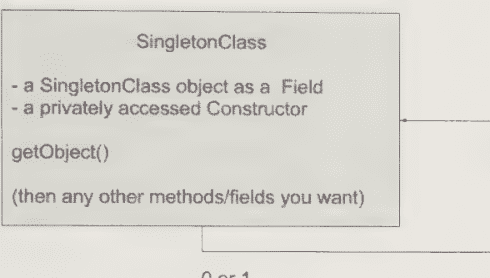
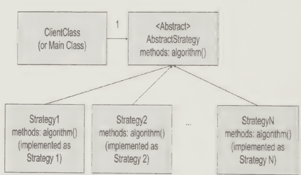
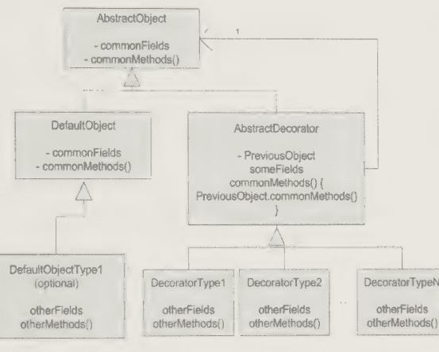
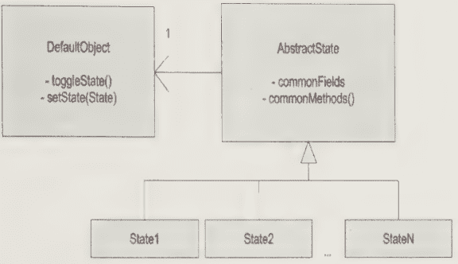

# 设计模式：简易方法，使用 Java 标准解决方案解决日常编程问题；适用于游戏编程、系统管理、应用及数据库系统（设计模式系列）

# CodeWiz RDZ 和 R.M.Z. 呈现：

# JAVA 简介

```
======================================
```

Java 也许是目前最流行的编程语言之一。网络上有数无数的 Java 框架、更多的 Java 库，以及似乎无尽的 Java 项目。Android——当今最流行的移动操作系统之一——大程度上基于 Java 代码的。

作为一名程序员，你将遇到许多需要特定解决方案的情况。通常，你会在其他项目中不断遇到相同的情况——然后意识到自己似乎在一遍又一遍地编写相同的解决方案和代码。

例如，假设你正在构建的一个 Web 应用需要一个数据对象根据天气变化不断更新自己。假设你还有另一个应用项目，数据对象需要根据某些运动队的赛季比赛进行持续更新。你发现这种模式了吗？

在某个时刻，你会注意到这些模式：某种情况通常需要特定的编程解决方案。这些解决方案恰好是代码中的某些模式（无论使用什么语言），适用于你遇到的某些情况。

因此，设计模式应运而生。

重要的是如何快速且费力地实现这些模式——这本书将教你如何做。即使你只是开始学习 Java 编程，你也会发现这里的所有技术大有用处。

# JAVA 工作坊 (Workshops)

在整本书中，你将遇到一些工作坊，帮助你通过实际运用来应用各种设计模式。在完成这些任务时，思考一下需要使用它们的情况。

然后，在你自己的编码项目过程中，仔细考虑你的设计，并问自己在什么情况下某种设计模式会派上用场。我们设计的这本书具有很强的实践性——为你提供很多机会使用材料。

这绝对不是一本供旁观者的书。如果你想应用一套全新的编程设计，请继续阅读。

```
====================================
```

# JAVA-oo: 关于 Java 代码的一个快速重要说明

# Java 类文件

在开始之前，请务必熟悉 Java 类文件的结构，如下所示：

```
// --------------------------
import java.util.*;
import java.lang.*;
import java.io.*;

class Main{
    public static void main(String args[]) {
        // 代码在这里
    }
}
// --------------------------
```

# 第 1 章：工厂模式 (The Factory Pattern)

==== ==== ==== ====

你不确定在特定时刻应该创建哪个数据对象？

在创建数据对象时，是否有很多复杂的方面需要考虑？

那么你需要使用工厂方法 (Factory Method)。

## 它的基本原理

取决于你使用的编程语言，创建一个标准的数据对象创建类接口。然而，你将使用子类（扩展或实现你的高级“工厂”接口）来实际创建数据对象。子类为创建数据对象提供了广泛的灵活性。如果你的编程语言没有接口或抽象类，只需将你的“工厂”接口创建为类，然后让子类扩展它。

例如，考虑要制作各种运动球数据对象，如篮球、足球、橄榄球、排球球等。你可能不知道在特定时刻该创建什么。那么你该如何编写代码？创建一个概述球类构建的接口。

让我们将其命名为接口`BallMaker`。然后，对于我们拥有的每种球，创建一个扩展`BallMaker`的子类。这些子类是实际创建球数据对象的类——但它们每一个都有自己的规范。因此，`BasketBallMaker`子类将制造篮球，而`FootballMaker`子类将制造足球。

以下是 UML 图的样式：

该模式的伪代码实现也包含在归档中。如果你需要在另一种语言中实现此模式，这些伪代码将为你提供帮助。

接下来，我们将使用工厂设计模式（Factory Pattern）。

## JAVA-1a：Java 中的工厂模式

==== ==== ==== =====

以下是工厂模式在 Java 中的外观：

```java
// Factory 由任何需要使用它的子类实现
interface Factory {
    // 输入：你的选择
    // 输出：你的选择（默认设置为 Void）
    // 实现此接口的类的构造函数
    interface
    public void createObject();
}
```

```java
// SubFactory1:
// 根据 Factory 接口创建不同的对象
class SubFactory1 implements Factory {
    // 这实现了接口中概述的相同函数
    interface
    public void createObject() {
        // 为此创建者包含任何独特之处
        class
        // 此处任何其他代码
    }
}
```

```java
// SubFactory2:
// 根据 Factory 接口创建不同的对象
class SubFactory2 implements Factory {

    // 这实现了接口中概述的相同函数
    public void createObject() {
        // 为此创建类包含任何独特之处
        // 此处任何其他代码
    }
}
```

在下一章节中，我们将对实现此设计模式进行演示。

## JAVA-1b：实现工厂模式

使用你喜欢的 IDE 运行以下代码。在线 IDE，如 codechef.com、retextester.com、ideone.com 或 codpad.org 都是很好的选择。

======================

现在我们将看到工厂模式的运行。你将通过一个示例亲身体验如何使用这种设计模式，以及一个你将继续完善该示例的工作坊。

### 运动球类创建器

想象你必须为一个按需定制的 Web 应用程序编写代码。它专门创建许多不同类型的运动球。

一个通用的球类样式如下：

```java
/* 一个运动球具有：
// - 它的球类型
// - 用于制造它的材料数组
// - 它的尺寸，作为半径（英寸）
// - 任何额外的注释 */
```

```java
// - 制造它的公司品牌
// - 产品名称
/*
class SportsBall {
    String type;
    String[] materialsUsed;
    float radius;
    String comments;
    String make;
    String modelName;
}
```

然而，正如你所看到的，在为运动球创建数据对象时涉及了太多细节。因此，如果你必须创建一个，比如，特定的篮球，这个过程与创建一个足球相比将大得多。它们具有不同的类型、材料和尺寸。它们还可能由不同的品牌制造，并且具有不同的特征。

那么，我们如何能以更简单的方式创建运动球呢？涉及的代码更少呢？

你猜对了。工厂模式！

所以在这个教程章节中，让我们完成设置该设计模式的步骤。

然后，你将有机会通过扩展工作来练习你所学的内容。

### 第 1 步：工厂接口

首先，我们将创建一个所有球类工厂类都将实现的接口。

目前，它将只有一个方法：创建并返回运动球的实例。

```java
// BallFactory 接口：
// - 如何创建球的接口
interface BallFactory {
/*
// 输入：无
// 输出：一个 SportsBall 对象
// 效果：创建一个 SportsBall；
// 实现此接口的类在制造时将有独特之处
*/
    public SportsBall createBall();
}
```

### 第 2 步：第一个工厂类

接下来，我们创建一个实现我们定义的`BallFactory`接口的独特工厂类。目前，它做的只是创建篮球。这些可能是`SportsBall`对象的实例，但它们将具有篮球的特定特征。

```java
// 篮球制造器：
// 创建具有不同字段的篮球对象
class BasketballMaker implements BallFactory {

    // (方法实现了接口版本)
// 效果：创建一个篮球作为运动球
    public SportsBall createBall() {
    SportsBall b = new SportsBall();
    b.type = "Basketball";
    b.materialsUsed[0] = new String[3];
    b.materialsUsed[1] = "fiber";
    b.materialsUsed[2] = "synthetic composite";
    b.radius = 4.8;
    b.make = "Spalding";
    b.modelName = "Series Basketball";
    return b;
}
}
```

### 第 3 步：设计你需要的任何额外工厂类

之后，我们根据需要创建尽可能多的工厂类。它们都实现了`BallFactory`接口，并且它们都创建具有独特特征和属性的运动球。

让我们通过设计一个创建棒球的工厂类来实现。

```java
// 棒球制造器：
// - 创建具有不同字段的棒球
class BaseballMaker implements BallFactory {

// (方法实现了接口版本)
// 效果：创建一个篮球作为运动球（此处原文误，应为棒球）
    public SportsBall createBall() {
    SportsBall b = new SportsBall();
    b.type = "Baseball";
    b.materialsUsed = new String[6];
    b.materialsUsed[0] = "cork";
    b.materialsUsed[1] = "wool";
    b.materialsUsed[2] = "poly/cotton";
    b.materialsUsed[3] = "cowhide";
    b.materialsUsed[4] = "yarn";
    b.materialsUsed[5] = "composite rubber";
    b.radius = 1.45;
    b.make = "Rawlings";
    b.modelName = "MLB Official Baseball";
    return b;
}
}
```

### 第 4 步：运行代码

现在你已经设计了工厂类，是时候运行它们了。

在你的主函数中（具有`public static void main`方法的主类中），为每个类创建一个实例。我们将使用工厂来创建特定对象。在我们的示例中，我们创建了篮球和棒球工厂。

```java
// 创建工厂
BasketballMaker f1 = new BasketballMaker();
BaseballMaker f2 = new BaseballMaker();

// 创建篮球对象：
// 使用篮球工厂制造篮球
SportsBall bb1 = f1.createBall();

// 创建棒球对象：
// 使用棒球工厂制造棒球
SportsBall bb2 = f2.createBall();
```

```java
// 测试：
// 这一行应该打印 "Basketball"
System.out.println(bb1.type);

// 这一行应该打印 "Baseball"
System.out.println(bb2.type);
```

## JAVA-工作坊 1

使用你喜欢的 IDE 运行以下代码。在线 IDE，如 codechef.com、retextester.com、ideone.com 或 codpad.org 都是很好的选择。

======================

现在轮到你玩工厂模式了。

### 足球与排球

通过创建两个更多的工厂类来展示你所学的内容。

其中一个将制造足球，另一个将制造排球。

之后，编写并运行几行代码，创建每个工厂的实例以及每个工厂的至少一个球。

这里有一些可以帮助你开始的代码：

```java
// 足球制造器：
// - 创建具有不同字段的足球对象
class SoccerballMaker implements BallFactory {

    // (方法实现了接口版本)
    // 效果：创建一个足球作为运动球
    public SportsBall createBall() {
        SportsBall b = new SportsBall();
        b.type = "Soccer";
        // 修改对象字段；
        // 它们应该像足球那样的看起来和属性
        return b;
    }
}
```

```java
// 排球制造器：
// - 创建具有不同字段的排球对象
class VolleyballMaker implements BallFactory {

    // (方法实现了接口版本)
    // 效果：创建一个排球作为运动球
    public SportsBall createBall() {
        SportsBall b = new SportsBall();
        b.type = "Volleyball";
        // 修改对象字段；
        // 它们应该像排球那样的看起来和属性
        return b;
    }
}
```

### 高级编码

注意看所有的运动球仍然同一种类型的对象——运动球。

你会如何修改代码，以便每个工厂类都能创建它们本应该创建的球类对象？例如，如何让`BasketballMaker`创建`Basketball`对象，而不是通用的、修改过的`SportsBall`？或者让`BaseballMaker`创建`Baseball`对象？

# 第 2 章：组合模式（Composite Pattern）

想象这样一个场景：你必须以分层的方式组织你的数据。它们在某种程度上类似于“文件”和“文件夹”。

正如你和其他计算机用户所知的，文件放在文件夹中，文件夹也可以放在其他文件夹中。

你还希望以一种不产生冗余代码的方式来实现这一点。

那么你需要什么？

组合模式。

## 它的基本工作原理

你有两个不同的类：`File`类和`Folder`类。或者是`Item`和`Group`。`Clothing`和`Bag`。`Toys`和`Box`。任何两个类的组合，其中一个类是由这两种类型组成的集合。

然而，这两个类可能具有许多相似的特征、方法和字段。你意识到可能需要编写比平时多一倍的代码——一个用于项目（items），一个用于分组（groups）。

解决方案是让它们继承一个共同的父类或抽象类——组件（component）。这包括一个关键区别：`Group`类包含该父类的集合。因为两个类都继承自同一个父类，所以`Group`类可以拥有项目或分组的集合。

例如，假设你有两个类：`Clothing`和`Bag`。一个`Bag`可以既包含衣服，也包含其他包。它们共享相似的特征，如名称、描述等。你意识到，当这些本应该放在同一段代码下时，编写单独的代码是多么低效（例如，当获取所有名称时，需要分别调用`Clothing.getName()`和`Bag.getName()`）。

因此，你应用了组合模式。`Clothing`和`Bag`类都继承自新的父类`Item`。`Bag`类被修改为拥有一个`Items`集合（可以是`Bags`或`Clothing`）。

UML 图看起来是这样的：

这里要记住的主要点是项目/容器类继承自共同的父类——组件。容器类将拥有一个包含组件的列表，组件可以是文件也可以是文件夹。

取决于你所使用的编程语言，父类也可能是一个抽象类、接口或你的编程语言提供的任何类型的抽象。

该模式的伪代码实现也包含在存档中。如果你需要在另一种语言中实现此模式，伪代码将为你提供帮助。

接下来，让我们把组合模式用起来。

## JAVA-2a：Java 中的组合模式

以下是组合模式在 Java 中的样子：

```java
/*
// Component 是父类，File 和 Folder 类继承自它
// 你可以定义任何子类共享的字段和方法
*/
abstract class Component {
  // 根据需要插入任意数量的字段的方法
  String someField;
  public void someMethod() {}
}

// 通用 Item 类（相当于 File）：
// 包含了 Component 中定义的所有字段和方法
class File extends Component {
}
```

```java
// 通用 Group 类（相当于 Folder）：
// 包含了 Component 中定义的所有字段和方法
// 还有：
// - 一个 Components 列表。可以包含 Items 或 Groups
class Folder extends Component {
    List<Component> contents = new ArrayList<Component>();
}
```

在接一章中，我们将逐步实现这一设计模式。

## JAVA-2b：实现组合模式

使用你选择的 IDE 运行以下代码。在线 IDE，如 codechef.com、rextester.com、ideone.com 或 codpad.org 都是很棒的选择。

在本章中，我们遇到了一个暗示组合模式是可行解决方案的情况。然后，我们将逐步对组合模式进行编码。

## 文件管理器（File Manager）

想象你是某个非常受欢迎的社交媒体网站的软件工程师。


下一次网站更新将拥有一个非常酷的功能——允许用户上传并组织他们选择的数据文件。你被指派实现这个功能。你知道必须设计`File`和`Folder`类，但你也意识到它们共享了太多的特征，例如名称、创建日期、修改日期、缩略图图标等。所以你想想，一定有更简单的方法来实现。

你脑海中浮出的第一个想法就是实现组合模式。这也是应用它的理想情况。

## 第 1 步：组件父类（Component Superclass）

首先，我们将创建`File`和`Folder`类基础的父类。

我们使用 Java 编码，所以可以使用抽象类（Abstract Class）。

现在，让我们给父类添加以下字段：名称、创建日期和最后修改日期。

```java
/*
// Component 是父类，File 和 Folder 类继承自它
// 它有：
// - String 类型的 Name
// - 创建日期
// - 最后修改日期
// 它可以：
// - 重命名自己
// - 更新最后修改日期
 */
abstract class Component {
  String name;
  Date dateCreated;
  Date dateLastModified;
}
```

## 第 2 步：自定义 Component 构造函数

接下来，我们将为`Component`编写一个修改版本的构造函数。当创建一个新组件时，它的名称将被设置，两个日期字段将被设置为当前日期。

以后继承此父类的 Files 和 Folders 也会使用相同的构造函数。

```java
abstract class Component {
    String name;
    Date dateCreated;
    Date dateLastModified;
    /*
    // 输入：一个 String
    // Component 类的自定义构造函数
    // 在创建时，创建和最后修改日期
    // 被设置为对象创建时的当前日期
    */
    public Component(String n) {
        this.name = n;
        this.dateCreated = new Date();
        this.dateLastModified = new Date();
    }
}
```

在这里，你亲眼看到了共享方法如何为程序员节省许多行代码，并在过程中防止更多的编码错误。两个类之间的任何基本字段和方法都存在——程序员将不必受编写双倍代码的痛苦，也不需要更改某些字段。

## 第 3 步：创建 File 类

现在我们创建`File`类。

如前所述，`File`类将具有`Folder`类的一些共同字段和方法。

然而，这里的`File`类将具有更具区分性的字段。它将包含文件类型的指示（例如表格、文档、幻灯片、图片、视频、PDF 等）。

```java
/*
// 通用 Item 类（又称 File）：
// 包含了 Component 中定义的所有字段和方法
// 还有：
// - 一个 string 类型的 type
*/
class File extends Component {
  String fileType;

  /*
  // 输入：一个 String
  // File 类的自定义构造函数
  // 遵循与父类相同的步骤
  // 然后设置文件类型
  */
  public File(String n, String f) {
    super(n);
    this.fileType = f;
  }
}
```

## 第 3 步：创建 Folder 类

创建`Folder`类的过程与创建`File`类非常相似。

然而，区别在于`Folder`类将有一个关键字段——一个组件列表，可以是`Files`或子文件夹`SubFolders`）。

```java
// 通用 Group 类（又称 Folder）：
// 包含了 Component 中定义的所有字段和方法
// 还有：
// - 一个 Components 列表。可以包含 Items 或 Groups
class Folder extends Component {
    List<Component> contents = new ArrayList<Component>();
    public Folder(String n) {
        super(n);
    }
}
```

## 第 4 步：运行并测试代码

现在我们将通过编写几行代码来测试这些类。

我们将创建一些文件和文件夹，然后以某种层次级结构组织它们。

在你的主类中运行这些代码，位于`Public-Static-Void-Main`方法内（或任何其他可以运行这些代码的地方）

```
Folder top = new Folder("Top Folder");
File a = new File("A", "Spreadsheet");
File b = new File("B", "Picture");
Folder mid = new Folder("Mid Folder");
```

```java
top.contents.add(a);
top.contents.add(b);
top.contents.add(mid);
File c = new File("C", "Video");
File d = new File("D", "Letter Document");
Folder bot = new Folder("Bottom Folder");
mid.contents.add(c);
mid.contents.add(d);
mid.contents.add(bot);
File e = new File("E", "PDF");
bot.contents.add(e);
```

随后，将这些行代码放在上述代码之后。然后，运行代码。

```java
System.out.println(top.name);
for (Component cp: top.contents) {
    System.out.println(" " + cp.name);
}
for (Component cp: mid.contents) {
    System.out.println(" " + cp.name);
}
for (Component cp: bot.contents) {
    System.out.println(" " + cp.name);
}
```

在正确实现上述步骤后，输出应该如下：

```
Top Folder
  A
  B
Mid Folder
  C
  D
Bottom Folder
  E
```

如果实现正确，我们可以创建一个文件、文件夹和子文件夹的层级系统。

在下一章中，你将通过一个工作坊来自己实现复合模式。祝你好运！

# JAVA 工作坊 2:

使用你选择的 IDE 来运行以下代码。在线 IDE（如 codechef.com、rextester.com、ideone.com 或 codepad.org）都是很好的选择。

======================

## MMORPG

你是一名在线角色扮演游戏的游戏人员。你正在添加一项功能，用于存储和组织游戏内物品——例如剑、书籍、药水、食物等——存入“包”中。

是的，你将使用复合模式。设计这些类，使得你可以使用包来存储游戏内物品甚至是其他的包。记住：考虑物品和包将共享的所有字段和方法，以及它们各自特有的字段和方法。

这里是用于帮助你开始的复合模式存根代码。祝你好运！

```java
abstract class Component {
  //在此处插入字段和方法
}
```

```java
class Item extends Component {
  // Item 拥有 Component 的所有字段和方法
  //在此处插入特有的字段和方法
}
```

```java
class Bag extends Component {
  // Bag 拥有 Component 的所有字段和方法
  //在此处插入特有的字段和方法
  // Bag 还拥有一个 Component 列表
  // （这些可以是 Item 或其他 Bag）
  List<Component> contents = new ArrayList<Component>();
}
```

### 高级编码：

由于你正在开发一款视频游戏，我很确定你不想让黑客窃取或操纵玩家的游戏物品，不是吗？

所以，修改你的代码以确保物品和包不会被轻易访问（提示：使用 private/public 修饰符，然后添加 getter/setter 函数！）

# 第 3 章：观察者模式

假设你必须设计两个类。

其中一个数据类本质上是关于你周围环境的数据报告：天气、时间、日期、位置等。

另一个类则创建若干个依赖于第一个类数据的对象。例如，后一个类可以列出你附近所有朋友的列表、显示未来 24 小时的天气预报、提醒你某些日期或事件等等。

本质上，一个对象持续地需要另一个对象的更新。

用最简单的话说，一个对象需要“观察”另一个对象。

这就是你使用观察者模式的时候。

## 它的基本工作原理：

这恰好是目前最常引用的设计模式之一。

你有两个类：观察者（Observer）和一个主体（Subject）（在这里谁在观察谁是显而易见的）。

然而，由于由于观察和成为主体仅仅是“行为”，我们实现了 Observer 和 Subject 接口。这种抽象级别允许代码中的类能够一致地应用 Observer 和 Subject 行为。因此，如果你有任何需要任一角色的类，只需让这些类实现各自的接口即可。

所有实现 Observer 接口的类都有一个要关注的 Subject 对象列表。这些类还需要一个 update 方法，设计用于根据相应的数据来更新它们的数据。

### 第 1 ：识别观察者与被观察者

首先，谁或什么是主体？

谁或什么是观察者？

没错。恐怖分子将是需要关注的主体（Subject）。因此，你需要用几行代码（一个类）来表示恐怖分信息。目前，你需要跟踪他们的行踪——换句话说，就是位置。

```java
// 单个恐怖分子拥有：
// - 一个 String 类型的位置
// - 一个 Observer 对象的列表
class Terrorist{
  String location;
}
```

FBI 设备将是观察者（Observers）。到目前为止，我们为设备 OS 中的一个小型模块提供了这些代码。该模块会在关键通知时推送警报。

```java
// 设备模块拥有：
// - 一个告 状态（布尔值）
// - 通知更新（字符串）
// - 一个 String 类型的位置
```

```java
// 它能：
// - 推送警报
// - 更新警报与通知
class Module{
  String location;
  boolean alert;
  String notifications;
}

// 效果：如果 alert 为 true，则打印警报通知
void sendAlerts(){
  if (alert) {
    System.out.println("ALERT: " 
      + notifications
      + "Agents in " 
      + this.location);
  }
}
```

### 第 2 ：设置观察者和主体的抽象

在 Java 中，Observer 和 Subject 的抽象将是接口（interfaces）。

我们将这样对它们进行建模。

```java
/*
// 所有观察类都实现 Observer
抽象
// 它能：
// - 根据主体更新对象数据
// 观察类可能需要一个 Subject 列表来
// 访问（已添加到 Observer 类中）
*/
interface Observer {
    public void update();
}
```

```java
/*
// 所有主体类都实现 Subject 抽象
// 它能：
// - 在其更新列表中添加/删除观察者
// 主体类还需要一个 Observer 列表来更新
//（已添加到 Subject 类中）
*/
interface Subject {
    public void notifyObservers();
    public void addObs(Observer o);
    public void deleteObs(Observer o);
}
```

### 第 3 ：修改我们的主体类以充当主体

代表恐怖分子的数据对象将作为主体类运行。因此，它将实现 Subject 接口。

然而，你还需要添加并实现 Subject 接口包含的方法。

它还将被修改为包含一个用于修改的 Observer 对象列表。将此字段保持为私有（private）以增加针对黑客的额外保护。

```java
// 单个恐怖分子拥有：
// - 一个 String 类型的位置
// - 一个 Observer 对象的列表
// 同时实现了 Subject 接口；
//（需要实现它的方法）
class Terrorist implements Subject{
    String location;
    private List<Observer> obs = new ArrayList<Observer>();

    // 新增：来自 Subject 接口
    public void notifyObservers() {};
    public void addObs(Observer o) {};
    public void deleteObs(Observer o) {};
}
```

对于`notifyObservers`方法，它应该遍历 Observer 列表并更新每一个。修改该方法来实现此操作。

```java
// 新增：来自 Subject 接口
public void notifyObservers() {
    for (Observer o: obs) {
        o.update();
    }
}
```

接下来，我们实现`addObs()`和`deleteObs()`方法。它们所做的只是分别从列表中添加和删除 Observer 对象。

```java
public void addObs(Observer o) {
    obs.add(o);
}
public void deleteObs(Observer o) {
    obs.remove(o);
}
```

完成所有更改后，你的 Terrorist 类看起来如下：

```java
class Terrorist implements Subject{
    String location;
    private List<Observer> obs = new ArrayList<Observer>();

    // 新增：来自 Subject 接口
    public void notifyObservers() {
        for (Observer o: obs) {
            o.update();
        }
    }
    public void addObs(Observer o) {
        obs.add(o);
    }
    public void deleteObs(Observer o) {
        obs.remove(o);
    }
}
```

### 第 4：修改我们的观察者类以充当观察者

Module 数据类将作为 Observer。因此，它将实现 Observer 接口及其方法。

```java
// 设备模块拥有：
// - 一个告 状态（布尔值）
// - 通知更新（字符串）
// - 一个 String 类型的位置
```

```java
// 它能：
// - 推送警报
// - 更新警报与通知
// 实现 Observer 接口；
//（需要实现它的方法）
class Module implements Observer{
  String location;
  boolean alert;
  String notifications;

  public void update() {};

  // 效果：如果 alert 为 true，则打印警报
  void sendAlerts(){
    if (alert) {
      System.out.println("ALERT: " 
        + notifications 
        + "Agents in " 
        + this.location);
    }
}
```

在实现`update()`之前，你必须理解你所的情况。在这种情况下，问自己：“Module 类如何响应 Terrorist 类？”

### 第 5：根据主体类修改观察类的更新

Module 类需要在恐怖分子附近时更新并发送警报。Terrorist 类拥有 String 类型的位置字段。当 Module 的位置与 Terrorist 相同时，它会发送警报。为了让 Module 接收来自 Terrorist 类的数据，你需要更改`update()`方法。

```java
// 输入：一个 Terrorist 对象
// 输出：无
// 效果：如果 Terrorist 和此 module 的位置相同，
// 将 alert 设置为 true 并更新通知。
// 之后，发送警报
public void update(Terrorist t) { };
```

你还需要对任何具有此方法的相应更新。你需要修改 Observer 接口以包含相同的输入……以及 Terrorist 类中的通知方法。该方法的目的是根据类数据通知其观察者。对于这个方法，你把类本身作为输入。

```java
interface Observer {
    public void update(Terrorist t);
}
```


```java
class Terrorist implements Subject{
    public void notifyObservers() {
        // 逻辑已在上文实现
    }
}
```

之后，我们让`update()`方法工作起来。

## 第 5 步：实现`update()`

根据上面的信息，我们在`Module`类中实现`update()`方法的功能代码。

```java
// 输入：一个 Terrorist 对象
// 输出：无
// 效果：如果 Terrorist 和此 module 的位置相同，
// 将 alert 设置为 true 并更新通知。
// 之后，发送警报
public void update(Terrorist t) {
    if (this.location == t.location) {
        this.alert = true;
        this.notifications = "Terrorist Nearby";
    }
    else {
        this.alert = false;
        this.notifications = "";
    }

    sendAlerts();
}
```

## 运行代码

根据现有的代码，我们将运行两个场景。两种情况下，观察类都会根据它们观察的内容发出警报。

一种情况是观察者远多于主体：（将以下代码粘贴到你的`Main()`方法下方）

```java
// 部分 1：创建所有数据对象
Terrorist t = new Terrorist();
Module m1 = new Module();
Module m2 = new Module();
Module m3 = new Module();
Module m4 = new Module();

// 部分 2：将所有观察者添加到主体列表
t.addObs(m1);
t.addObs(m2);
t.addObs(m3);
t.addObs(m4);
```

```java
// 创建所有位置
String[] locs = new String[10];
locs[0] = "Los Angeles";
locs[1] = "Chicago";
locs[2] = "New York";
locs[3] = "Seattle";
locs[4] = "Cleveland";
locs[5] = "Boston";
locs[6] = "San Francisco";
locs[7] = "Miami";
locs[8] = "St. Louis";
locs[9] = "Dallas";
```

```java
// 部分 3：将观察者设置为它们的位置
m1.location = locs[1];
m2.location = locs[4];
m3.location = locs[5];
m4.location = locs[9];
```

```java
// 随着恐怖分子在美国全范围内移动，
// 它将通知所有设备模块其位置。
// 当恐怖分子附近时，模块将触发。
```

```java
for(int i = 0; i < 10; i++) {
  t.location = locs[i];
  t.notifyObservers();
}
```

如果所有代码运行正常，你应该得到如下打印输出：

```
ALERT: Terrorist Nearby in Chicago
ALERT: Terrorist Nearby in Cleveland
ALERT: Terrorist Nearby in Boston
ALERT: Terrorist Nearby in Dallas
```

另一种情况是主体远多于观察者。

（将以下代码粘贴到你的`Main()`方法中）

```java
// Part 1: 创建所有数据对象
Terrorist t1 = new Terrorist();
Terrorist t2 = new Terrorist();
Terrorist t3 = new Terrorist();
Terrorist t4 = new Terrorist();
Terrorist t5 = new Terrorist();
Module m = new Module();
```

```java
// Part 2: 将所有观察者添加到主题的列表中
t1.addObs(m);
t2.addObs(m);
t3.addObs(m);
t4.addObs(m);
t5.addObs(m);
```

```java
// 创建所有位置
String[] locs = new String[10];
locs[0] = "Los Angeles"; locs[1] = "Chicago"; locs[2] = "New York"; locs[3] = "Seattle";
```

```java
locs[4] = "Cleveland"; locs[5] = "Boston"; locs[6] = "San Francisco"; locs[7] = "Miami"; locs[8] = "St. Louis"; locs[9] = "Dallas";
```

```java
// Part 3: 为观察者设置它们的位置
t1.location = locs[1];
t2.location = locs[4];
t3.location = locs[2];
t4.location = locs[7];
t5.location = locs[5];
```

```java
// 带有 Device Module 的单一代理将遍及整个美国，
// 然后所有恐怖分子将通知观察模块。
// 当附近有恐怖分子时，模块将触发。
for(int i = 0; i < 10; i++) {
  m.location = locs[i];
  t1.notifyObservers();
  t2.notifyObservers();
  t3.notifyObservers();
  t4.notifyObservers();
  t5.notifyObservers();
}
```

```java
//------------------------------------
```

如果所有代码运行成功，你应该得到如下打印输出：

- ALERT: 芝加哥附近有恐怖分子
- ALERT: 纽约附近有恐怖分子
- ALERT: 克利夫附近有恐怖分子
- ALERT: 波士顿附近有恐怖分子
- ALERT: 迈阿密附近有恐怖分子

# 第 4 章：单例模式

思考那些只能存在一个对象的想法和事物。

也许你正在设计一个应用程序，其中一个类不应该同时拥有多个实例。就好像游戏中唯一的活跃的吃豆人（Pacman）；或者乒乓球游戏中唯一的球；或者在经典的超级马里奥游戏中唯一的马里奥（Mario）。

你意识到，你不希望通过提供创建多个本应保持单例的对象的机会，导致漏洞、利用或任何形式的黑客攻击的存在。

这个问题有一个解决方案。它被称为单例模式（Singleton pattern）。

通过这种模式，你可以修改你的类，使其在同一时间只有一个可能的对象。或者永远只有一个可能的对象。

## 它的基本工作原理

单例模式是最简单的设计模式之一。然而，当情况需要使用它的设计时，它将被证明非常有帮助。

一个单例类有三个关键组件。首先，类的构造函数被设置为某种方式，以至于无法在类之外使用。这通过移除在类自身代码之外创建实例的能力，确保了单例类保持单例状态。

其次，类本身将包含基于它的类的唯一实例。单例类将它的唯一对象作为其自身的字段之一。

最后，第三个组件是获取实际单例对象的方法。该方法必须在不需要创建类对象的情况下可被访问。在大多数实现中，它使用第一个组件（仅限类代码的构造函数）在对象尚不存在时创建该对象。

这里是描述单例类的 UML 图：



该模式的伪代码实现也包含在归档文件（Archive）中，以防你需要在另一种语言中实现此模式。

接下来，我们将在场景中应用单例模式。

## JAVA-4a：Java 中的单例模式

以下是单例模式在 Java 中的样子。

```java
/*
// 一个单例类拥有：
// - 一个单例实例
// - 你需要的任何其他字段
//
// 它不能：
// - 像平常一样实例化（就像一个普通类）
// （构造函数被设置为 Private，为了万无一失）
//
// 它可以：
// - 返回唯一的单例类实例
*/
class Singleton {
  // 单例组件 #1：
  // 构造函数：
  // - 设置为 PRIVATE；无法在类之外访问
  private Singleton() {}
```

```java
// 单例组件 #2：
// 唯一的单例对象：
// - 设置为 PRIVATE：无法在类之外访问
    private static Singleton object = null;

// 单例组件 #3：
// 输入：（由你选择）
// 输出：一个单例对象
// 效果：返回唯一的单例对象。
// 如果不存在则创建一个。
// - 设置为 STATIC：调用此方法不需要 Object 对象。
    public static synchronized Singleton getObject() {
        if (object == null) {
            object = new Singleton();
            // 在此处初始化任何其他字段
        }
        return object;
    }
}
```

要访问单例对象，你只需要调用静态方法`getObject()`。

```java
// 将单例赋值给变量
Singleton sg = getObject();
```

同样注意，你可以将单例赋值给多个变量；

```java
// 将单例赋值给多个变量
Singleton sg1 = getObject();
Singleton sg2 = getObject();
Singleton sg3 = getObject();
```

## JAVA-4b：实现单例模式

使用你选择的 IDE 运行下面的代码。

在本章中，我们将遇到单例模式。

思考那些只能有一个的场景。在这种情况下，我们将保持简单并定义类。

### 步骤 1：识别类

```java
// Team 类拥有：
// - 一个名字
class Team {
    String name;

    // 构造函数：
    // 输入：名字 (String)
    public Team(String n) {
        this.name = n;
    }
}
```

```java
// Championship 类拥有：
// - 一个冠军
//
// 它可以：
// - 对8支球队进行淘汰赛
// 注意：如果锦标赛已有冠军，
// playoffs() 将返回而不模拟淘汰赛
// - 将配配对赛，
// - 获胜者晋级下一轮比赛
// - 最后剩下的球队成为冠军
class Championship {
    public Team champion;

// 如果锦标赛已有冠军，则返回
    public void playoffs(Team t1, Team t2, Team t3, Team t4, Team t5, Team t6, Team t7, Team t8) {

        if (champion != null) return;

        // 淘汰赛 -> 半决赛：
        Team semi1 = match(t1, t8);
        Team semi2 = match(t2, t7);
        Team semi3 = match(t3, t6);
        Team semi4 = match(t4, t5);
        System.out.println("");

        // 半决赛 -> 决赛：
        Team finals1 = match(semi1, semi4);
        Team finals2 = match(semi2, semi3);
        System.out.println("");

        // 决赛 -> 冠军
        Team chap = match(finals1, finals2);
        this.champion = chap;
        System.out.println("Team " + chap.name + " 赢得锦标赛冠军!");
    }
```

```java
    /*
    // playoffs() 的辅助函数：
    // 输入：两支球队：a & b
    // 输出：一个 Team
    // 效果：两支球队 a & b 之间的比赛，
    // 以获胜者作为输出
    */
    private Team match(Team ta, Team tb) {
        Random random = new Random();
        if (random.nextBoolean()) {
            System.out.println(ta.name + " 击败 " + tb.name);
            return ta;
        } else {
            System.out.println(tb.name + " 击败 " + ta.name);
            return tb;
        }
    }
}
```

在`public static void main()`方法中，以下代码创建了 8 支队伍，随后运行锦标赛。

```java
// Create 8 Teams:
Team contender1 = new Team("Archers");
Team contender2 = new Team("Bobcats");
Team contender3 = new Team("Centurions");
Team contender4 = new Team("Danger Zone");
Team contender5 = new Team("Energy");
Team contender6 = new Team("Flames");
Team contender7 = new Team("Guards");
Team contender8 = new Team("Hunters");
```

```java
// Run the Championship Playoffs:
Championship c = new Championship();
c.playoffs(contender1,
contender2,
contender3,
contender4,
contender5,
contender6,
contender7,
contender8);
```

如果你运行所有代码，你应该看到类似下面的内容，不过队伍名称是随机混合的：

```
Hunters Defeats Archers
Guards Defeats Bobcats
Flames Defeats Centurions
Danger Zone Defeats Energy

Danger Zone Defeats Hunters
Guards Defeats Flames

Danger Zone Defeats Guards
Team Danger Zone WIN THE CHAMPIONSHIP!
```

### 步骤 2：确定哪个类应该是单例

但现在有一个问题。

我们希望每次运行代码时，只产生一个锦标赛队伍和一个季后赛。

如果这几行代码在`main()`方法中运行……

```java
Championship[] cc = {new Championship(),
    new Championship(),
    new Championship(),
    new Championship(),};

for (Championship x: cc) {
    x.playoffs(contender1,
    contender2,
    contender3,
    contender4,
    contender5,
    contender6,
    contender7,
    contender8);
    System.out.println("");
}
```

……会导致太多的冠军队伍。

那么我们可以做什么来限制代码产生一个冠军队伍呢？

将`Championship`类转换为单例（Singleton）。

我们通过逐个将组件添加到单例类中来实现。除此之外，`Championship`类的其他部分保持不变。

### 组件 #1：私有类构造函数

将构造函数设置为`private`可以确保该类的对象**不能**被创建——除非是从类内部的代码创建。

对于单例类，私有构造函数（连同其他单例组件）确保了对象将是单例。

下面是修改后的`Championship`构造函数及其解释性注释。请将此代码添加到`Championship`类内部：

```java
// Singleton Component #1:
// - 带有 private 修饰符的构造函数
// (无法从类外部访问)
private Championship() {};
```


### 组件 #2：唯一的类对象

你的单例类将包含一个专属字段，该字段最终将是你的类构造的唯一对象。

它是一个`private`字段，因此不会在类外部被访问。它也将是两个`static`单例组件之一——它们可以通过类本身进行访问，而不是通过它的对象。

默认情况下，该字段将设置为`null`。当第三个组件被调用时，它最终会被赋值。

下面是类对象的字段。请将以下代码添加到`Championship`类内部：

```java
// Singleton Component #2:
// - 作为字段的类对象
// - 具有 Static 修饰符（可以通过类本身访问字段）
// - 具有 private 修饰符（无法从类外部访问）
private static Championship c = null;
```

### 组件 #3：getObject() 方法

`Championship`类的最后一个单例组件是`getObject()`方法。作为两个静态组件之一，该方法旨在从`Championship`类进行访问，而不是从它的某个对象。

它的作用是获取你代码中创建的唯一`Championship`对象。如果尚未创建对象，它将调用组件 #1（自定义构造函数）来创建一个。

下面是该方法。只需将代码添加到`Championship`类中即可：

```java
// Singleton Component #3
// INPUT: none
// OUTPUT: 一个 Championship 对象
// EFFECT: 返回单例 Championship 对象
public static Championship getChamp() {
    if (c == null) {
        c = new Championship();
    }
    return c;
}
```

### 单例 Championship 类

总的来说，`Championship`类的单例版本保持不变，只是你向其中添加了三个单例组件。

### 主代码，现在已包含单例 Championship

现在，我们将在`main()`方法中运行这段代码：

```java
// Create 8 Teams:
Team contender1 = new Team("Archers");
Team contender2 = new Team("Bobcats");
Team contender3 = new Team("Centurions");
Team contender4 = new Team("Danger Zone");
Team contender5 = new Team("Energy");
Team contender6 = new Team("Flames");
Team contender7 = new Team("Guards");
Team contender8 = new Team("Hunters");

// Using Singleton:
Championship.getChamp().playoffs(contender1,
contender2,
contender3,
contender4,
contender5,
contender6,
contender7,
contender8);
```

3) 在子类中实现你策略算法的变体。

4) 任何访问你策略算法的操作都通过抽象形式进行。通过多态，根据情况选择并执行最佳策略变体。

总体来说，这里是描述策略模式的 UML 图：



# JAVA-5a: Java 中的策略模式

以下是策略模式在 Java 中的外观：

```java
/*
// 抽象策略实现：
// 它包含：
// - 抽象算法的签名
*/
interface AbstractStrategy {
    // 输入：（由你选择）
    // 输出：（由你选择）
    // （效果取决于子类层级）
    public void Algorithm();
}
```

```java
/*
// 每个策略对应的类：
// 根据抽象策略使用任意数量的需要类
// 每个类都可以：
// - 实现抽象算法
// （基于每个类独特的策略）
*/
class Strategy1 implements AbstractStrategy{
    // 抽象算法，
    // 作为 Strategy1：
    public void Algorithm() {
        // 根据此 Strategy1 类 
        // 实现此算法
    }
}

class Strategy2 implements AbstractStrategy{
    // 抽象算法，
    // 作为 Strategy2：
    public void Algorithm() {
        // 根据此 Strategy2 类 
        // 实现此算法
    }
}
```

# JAVA-5b: 应用策略模式

使用你任选的 IDE 运行以下代码。在线 IDE（如 codechef.com、retester.com、ideone.com 或 codpad.org）都是很棒的选择。

======================================

在本章中，我们有机会在特定场景下应用策略模式。

让我们来玩石头剪刀布游戏。为了获胜，我们总是要能够在石头、纸和剪刀之间做出正确的选择。

游戏的实例通常基于一个类，设计如下：

```java
/*
// 石头剪刀布游戏包含：
// - 石头、纸、剪刀的字符串值
// 它可以：
// - 从三个中生成一个随机字符串
// - 检查玩家是否获胜
*/
```

```java
class RPSGame {
    String[] RPSVals = {"Rock", "Paper", "Scissor"};

    /*
    // 输入：无
    // 输出：一个字符串
    // 效果：随机返回石头、纸或剪刀
    */
    String RPSGet() {
        Random rn = new Random();
        int i = rn.nextInt(3);
        return RPSVals[i];
    }

    /*
    // 输入：两个字符串
    // 输出：一个布尔值
    // 效果：如果第一个字符串击胜第二个字符串，则返回 true，
    //     否则返回 false
    */
    boolean checkWin(String s1, String s2) {
        if (s1 == s2) return false;
        boolean c1 = (s1 == "Paper") && (s2 == "Rock");
        boolean c2 = (s1 == "Scissors") && (s2 == "Paper");
        boolean c3 = (s1 == "Rock") && (s2 == "Scissors");
        return c1 || c2 || c3;
    }
}
```

接下来，是进入`Main()`方法并执行的代码：

```java
RPSGame r = new RPSGame();
String aiPick = r.RPSGet();
// 为变量 myPick 输入 "Paper"、"Scissors" 或 "Rock"
// （通常情况下，玩家会为之
// 输入一个值）
// 现在，默认选择为 Paper
String myPick = "Paper";

System.out.println("AI Pick: " + aiPick);
System.out.println("My Pick: " + myPick);
System.out.println(myPick + " v.s. " + aiPick);

if (r.checkWin(myPick, aiPick)) {
    System.out.println("你赢了!");
}
```

运行时，整个代码模拟了一场石头剪刀布游戏。你必须在石头、纸或剪刀之间做出选择。之后，程序将为对手生成一个选择，然后检查你是否获胜。

幸运的是，你可以修改这段代码来**始终**拥有获胜的选择。因此，你总是会赢。这需要一个在我们当前所处情况下给出最佳结果的过程。

这需要策略模式。

## 应用策略模式：

回想一下之前提到的实现策略模式的逐步计划。

- 1) 确定你的流程在何时需要根据情况发生变化。

在我们的石头剪刀布代码中，我们希望代码始终选择最佳选项（取决于人类玩家选择了什么）。

这个事件发生在玩家做出选择之后。

因此，代码将始终选择击败玩家的选项。

所以：

玩家选石头 -> 代码选纸

玩家选纸 -> 代码选剪刀

玩家选剪刀 -> 代码选石头

### 2) 创建你策略算法的抽象形式。

回想一下抽象策略类的接口。在 Java 中，这种抽象化可以使用接口来实现：

```java
/*
// 抽象策略实现：
// 它包含：
// - 抽象算法的签名
*/
interface AbstractStrategy {
    // 输入：（由你选择）
    // 输出：（由你选择）
    // （效果取决于子类层级）
    public void Algorithm();
}
```

最后，变量`myPick`将是策略模式产生的获胜选择。无论在三个`if`语句之后变为什么形式，调用`stratPattern`的`Algorithm()`都会返回一个获胜的选择。

```java
//----------
// 将模式初始化为任何你选择的
// 无论它可能会被替换
RPSStrategy stratPattern = new Rock();

if (aiPick == "Rock") {
    stratPattern = new Paper();
}
if (aiPick == "Paper") {
    stratPattern = new Scissors();
}
if (aiPick == "Scissors") {
    stratPattern = new Rock();
}

// 新行：
myPick = stratPattern.Algorithm();
//----------
```

这里是修改后的原始代码。在运行代码剩余部分后，你应该总是获胜的。

```java
System.out.println("AI Pick: " + aiPick);
System.out.println("My Pick: " + myPick);
System.out.println(myPick + " v.s. " + aiPick);

if (r.checkWin(myPick, aiPick))
    System.out.println("YOU WIN!");
```

就是这样。这就是应用策略模式的过程。

# 第 6 章：装饰器模式（Decorator Pattern）

在设计类时，所有的字段和方法似乎必须保持原样。换句话说，当你创建类的实例时，它们**都**将拥有与其类定义的相同的字段和方法。

但如果有一种方法可以在**运行期间**为数据对象添加更多功能呢？比如，一个数据对象随着时间的推移获得了更多特征？

这是可能的。而且这得益于装饰器模式。

## 它的基本原理：

装饰器模式的结构与组合模式（Composite Pattern）相似；两个类共享相同的抽象，而其中一个类包含该抽象的实例。由于多态性，该抽象可以是这两个类中的任何一个。

有两个主要的泛化类需要开发：默认父类（Default Superclass）和装饰器父类（Decorator Superclass）。

装饰器类将拥有基类或之前应用的装饰器类的实例。此外还有装饰器类可能添加的任何其他字段或方法。

对于所有类共有的方法，装饰器类也会调用上一个对象的方法，而该方法会调用它的上一个对象的方法，以此类推，直到默认类对象的方法也被调用。这创建了一个递归模式，其中每个装饰器以及默认类都应用了它们的作用。

整体上看起来是这样的：来自默认类的单个对象与附加了多个装饰器的对象相比，其应用的行为会有所不同。

因此，数据对象在运行期间可能具有比原始预期的得多的行为。

这种模式通常用于视频游戏开发以及任何需要高度模块化的应用程序。

## 创建装饰器模式：

以下是实现此设计模式的步骤计划：

- 1) 创建一个涵盖所有子类和变体的通用抽象。
- 2) 创建默认子类。这将直接扩展你之前的通用抽象。
- 3) 创建装饰子类。与默认子类一样，它也将直接扩展你的通用抽象。
- 4) 确保装饰子类包含上一个装饰器或默认类作为其字段之一（将变量类型设置为通用抽象！）。这与下一步骤共同是允许多个装饰器动态添加到默认类中的关键特征。
- 5) 确保装饰子类的构造函数输入一个装饰器或基对象（再次，将输入类型设置为通用抽象！），并将此输入设置为上一个装饰器。
- 6) 创建三级装饰子类。这些直接扩展你在之前的步骤开发的装饰器类。

## 在运行期间应用装饰器模式：

1) 当创建装饰器模式的实例时，将其数据类型设置为抽象，但将其初始化为默认子类：

```java
abstract class default = new defaultsubclass();
```

2) 当向默认子类对象添加装饰器时，使用上一个装饰器或默认对象作为输入。如果你正确设计了模式，所有的装饰器都应该像链表一样连接到默认类。

```java
DecoratorOne a = new Decorator(default)
DecoratorTwo b = new Decorator(a)
DecoratorTwo c = new Decorator(b)
```

这是装饰器模式的 UML 图：



这可能是可用的最复杂的设计模式之一。但一旦掌握，它将成为你编程库中最实用的模式之一。

## JAVA-6a：Java 中的装饰器模式

以下是装饰器模式在 Java 中的外观。首先，我们从抽象形式开始：

```java
/*
// 装饰器实现：
// 此抽象形式具有：
// - 所有子类共有的任何通用过程、
// 算法和特征的签名
*/
interface DecorativeObject {
    // 输入与输出：（由你选择）
    // （由子类实现）
    public void procedure();
    // (根据你的意愿包含任何其他通用字段
    // 和程序)
}
```

接下来，我们有了基对象和额外功能。

基对象将包含你的抽象中所有的默认程序和特征。

```java
class BaseObject implements DecorativeObject {
    // 作为基对象实现的通用程序
    public void procedure() {
        // (在此处实现此程序)
    }
    // (根据你的意愿包含任何其他字段
    // 和程序)
}
```

装饰器将包含你想要应用于装饰性对象的任何额外修改。这将使用类似于组合模式的结构。

创建其中一个实例需要将上一个装饰器作为构造函数的输入（如果没有，则使用基对象）。这样，你基本上可以在默认基对象之上像链条一样叠加你需要的数量的装饰器。

```java
class Decoration implements DecorativeObject{
    // 添加的之前应用的装饰器实例：
    DecorativeObject prevDeco;

    // 作为 Decoration 实现的通用程序
    // 包含此装饰器添加的任何额外效果
    public void procedure() {
        // (在此处实现此程序，
        // 也添加任何你想要的其他内容)
        prevDeco.procedure();
    }

    // 构造函数：
    public Decoration(DecorativeObject d) {
        this.prevDeco = d;
    }
    // (根据你的意愿包含任何其他字段)
    // 和程序)
}
```

注意`procedure()`方法也会调用上一个装饰器的方法。这样，一旦`procedure()`被调用，其真实效果将由每一个添加的装饰器交付——加上来自基对象的效果。

最后，你可以拥有任意数量的不同装饰器类。它们都继承装饰器类，并可能包含自己的额外字段和程序。

```java
class DecorationOne extends Decoration{
    // 作为 Decoration 实现的通用程序
    // (作为其子类实现 procedure)
    public void procedure() {
        super.procedure();
        // (在此处实现此程序)
    }
    // (根据你的意愿包含任何其他字段
    // 和程序)
}
```

```java
class DecorationX extends Decoration{
    // 作为 Decoration 实现的通用程序
    // (作为其子类实现 procedure)
    public void procedure() {
        super.procedure();
        // (在此处实现此程序)
    }
    // (根据你的意愿包含任何其他字段)
    // 和程序)
}
```


## JAVA-6b：应用装饰器模式

使用你喜欢的 IDE 运行下面的代码。在线 IDE，如`codechef.com`、`rextester.com`、`ideone.com`或`codpad.org`都是很好的选择。

在这里，我们遇到了一个需要装饰器模式的场景。

### MMORPG 角色

在之前的大型在线角色扮演游戏中，可玩的角色通常属于某些角色原型——例如，治疗师、法师、弓箭、装甲骑士等。随着你玩的时间越来越久，你的玩家角色会逐渐提高并变得更强大。

在代码方面，通用的 MMORPG 角色应该是基于类似于如下数据类（Data Class）的数据对象：

```go
/*
 
// MMOCharacter 可以：
 
// -执行它的主技能
 
*/
 
class MMOCharacter {
 
  void skill() {
 
    // 在此处有一些代码
 
  }
 
}
```

遗憾的是，我们遇到了问题。这些角色逐渐提升的特性意味着我们需要在运行时修改这些类。

我们不能为每个变体不断创建类。这不仅非常繁琐；当某个变体的行为不符合预期时，还会增加代码中出现错误的概率。

```
// (不要这样做)

class MMOCharacterLV5 {

  void skill() {

    // 在此处有一些代码

  }

}
```

```go
// (不要这样做)

class MMOCharacterLV510{

  void skill(){

    // 在此处有一些代码

  }

  void skill2(){

    // 在此处有一些代码

  }

}
```

此外，我们还需要实现一些角色原型（archetypes）。看起来我们应该为每个可用的原型重新创建类。然而，这也不是一个明智的决定。这同样会非常繁琐——就像我们之前的的问题一样。我们还会增加遇到代码错误的概率。

```go
// (不要这样做)

class MMOCharacterKnight {

  void attack(){

    // 在此处有一些代码

  }

}
```

```go
// (不要这样做)

class MMOCharacterHealer {

  void heal(){

    // 在此处有一些代码

  }

}
```

解决此问题的方法是应用装饰器模式（Decorator Pattern）。通过多态，我们可以开发数据类，允许数据对象在游戏运行时被修改。

为了应用我们的模式，我们按照之前概述的步骤逐一执行。

### 1) 创建一个涵盖所有子类和变体的通用抽象

让我们回一下装饰器模式的抽象形式：

`/* 装饰器实现：// 这种抽象形式具有： // - 所有子类共有的任何过程、算法和特征的签名 */`

```go
interface DecorativeObject {

    // 输入 & 输出：(由你选择)

    // (由子类实现)

    public void procedure();

    // (包含任何其他公共字段)

    // 并根据你的需要包含过程

}
```

这种抽象允许我们的数据类即使在运行时也能逐渐变化。通过多态，我们可以交换数据类以包含额外的功能。

在我们的情况下，我们的抽象可以是一个具有单个技能和若干个独立字段的通用 MMORPG 角色。然而，由于我们将使用不同的字段，抽象类比接口更合适。因此，我们的抽象将使用抽象类：

```go
/*
 
// 装饰器实现：
 
// 角色抽象具有：
 
// - 单个技能
 
// - 生命值 (int)
 
// - 攻击力 (int)
 
*/
```

```go
abstract class Character {

    // 输入： - 一个目标角色

    // 输出：无

    // (由子类实现)

    abstract public void skill(Character target);

    int hp;

    int atk;

}
```

### 2) 创建默认子类

这将直接扩展你之前的通用抽象。

再次，让我们回想一下装饰器模式中的默认子类：

```go
class BaseObject implements DecorativeObject {

    // 通用过程，作为 Base Object 实现

    public void procedure() {

        // (在此处实现此过程)

    }

    // 包含任何其他字段

    // 并根据你的需要包含过程

}
```

当新角色被创建时，它将是我们默认类的实例。因此，它需要作为我们主抽象的扩展。

```go
class DefaultChar extends Character {

  // 通用过程，作为 Base Object 实现

  public void skill(Character target) {

    // (包含任何其他字段

    // 并根据你的需要包含过程

  }

  // 构造函数：

  public DefaultChar() {

    this.hp = 12;

    this.atk = 1;

  }

}
```

### 3) 创建装饰子类

与默认子类一样，这将直接扩展你之前的通用抽象。

这部分赋予了装饰器模式渐进升级和推进的能力。

首先，让我们回想一下之前装饰器模式中的默认装饰类：

```go
class Decoration implements DecorativeObject{

    // 添加之前应用的装饰器实例：

    DecorativeObject prevDeco,

    // 通用过程，作为 Decoration 实现

    // 包括此装饰器添加的任何额外效果

    public void procedure() {

        // (在此处实现此过程，

        // 也加上你想要的任何其他内容)

        prevDeco.procedure();

    }
```

```go
// 构造函数：

  public Decoration(DecorativeObject d) {

    this.prevDeco = d;

  }

  // (包含任何其他字段)

  // 并根据你的需要包含过程)

}
```

装饰类也是一种抽象，它泛化了你应用于对象的每一个每个增强和装饰。

所以，让我们将此概念应用到我们的情况。我们需要为角色的每个增强创建一个泛化类：

```go
class Decoration extends Character {

  // 通用过程，作为 Decoration 实现

  public void skill(Character target) {

    // (由子类实现)

    prevDeco.skill(target);

  }

  // (包含任何其他字段)

  // 并根据你的需要包含过程

}
```

接下来的步骤为装饰器类提供了关键功能。

### 4) 确保装饰子类包含之前的装饰器或默认类

在你的装饰类中，创建一个使用抽象作为类型的字段。如果给这个字段一个合理的名称会有帮助。在我们的情况下，抽象是：

```go
class Decoration extends Character {

    Character prevDeco; // (新行)

    // 通用过程，作为

    Decoration

    public void skill(Character target) {

        // (由子类实现)

        prevDeco.skill(target);

    }

} // 包含任何其他字段

// 并根据你的需要包含过程

}
```

为了初始化这个字段，将由构造函数处理。这将在下一步完成。

### 5) 确保装饰子类的构造函数输入装饰器或默认类

将此输入设置为之前的装饰器。

构造函数的输入将是`Character`类的实例（允许装饰器或默认类）。总体而言，装饰类现在看起来是：

```go
class Decoration extends Character {

    Character prevDeco;

    // 通用过程，作为 Decoration 实现

    public void skill(Character target) {

        // (由子类实现)

        prevDeco.skill(target);

    }

    // 包含任何其他字段

    // 并根据你的需要包含过程

}
```

```go
// (新行)：-----

// 构造函数：

public Decoration(Character c) {

    this.prevDeco = c;

}

// ------------------
```

接下来是有趣的部分。

### 6) 创建三级装饰子类

这些直接扩展了你在之前的步骤中开发的装饰类。

我们可以开始实现由我们的抽象所概述的细节。

在 MMORPG 游戏中，能够“装饰”角色的很好的例子是武器。因此，我们可以开始创建附加到基础角色的武器和其他装备类。

我们还可以实现`skill()`方法以执行实际操作。在我们的情况下，让`skill()`方法攻击目标。

这个`GreatSword`类是我们之前开发的装饰类的扩展。它拥有装饰类所有的字段和方法，加上它独特的特征。

```go
class GreatSword extends Decoration {

// 武器伤害

int damage = 3

// 构造函数：

// (使用 super() 将其作为超类型实现)

public GreatSword(Character c){

    super(c);

}

}
```

```go
// 通用过程。作为 Greatsword 实现

// (是一个攻击)

public void skill(Character target) {

// 攻击目标：

target.hp -= damage;

prevDeco.skill(target);

}
```

但为什么不增加其他武器呢？让我们也设计一把火焰战斧（Fiery Battle Axe）。像大剑（GreatSword）一样，它也有攻击作为`skill()`方法。

```java
class FieryBattleAxe extends Decoration {

 // 武器伤害

 int damage = 2;

 int magicPower = 2;
```

```java
// 构造函数:

 // (使用 super() 实现其作为超类型的逻辑)

 public void FieryBattleAxe(Character c){

 super(c);

 }
```

```java
// 通用过程，由 FieryBattleAxe 实现

 // （将是一个攻击 Attack）

 public void skill(Character target) {

 // 攻击目标:

 target.hp -= damage + magicPower;

 prevDeco.skill(target);

 }
```

既然话说到这儿，我们也可以创建一个盾（Shield）：

```java
class GoldenShield extends Decoration {

    int armorBonus = 10;

    // 构造函数:

    // (使用 super() 实现其作为超类型的逻辑)

    public GoldenShield(Character c) {

        super(c);

    }

public// 通用过程。由 GoldenShield 实现

    public void skill(Character target) {

        this.hp += armorBonus;

        prevDeco.skill(target);

    }

}
```

现在类已经准备就绪，这里是代码运行时的样子。

### 创建新对象

要创建一个新角色，你将它的数据类型设为抽象类，但将其初始化为默认类。

```java
Character me = new DefaultChar();
```

### 添加装饰器

要为新角色添加装饰器，你只需将该角色重新初始化为装饰器对象（Decorator），并将该角色作为输入：

```java
me = new GoldenShield(me);
```

你甚至可以通过在装饰器内部创建装饰器来同时添加更多装饰：

```java
me = new GreatSword(new GoldenShield(me));
```

### 使用通用过程

当你对通用过程进行函数调用时，所有附加的装饰器以及默认对象，都会被一同调用。

假设下面这行代码刚刚执行完毕：

```java
me = new GreatSword(new FieryBattleAxe(me));
```

在下方的第二行中，我们调用了函数`skill()`，并指向一个角色：

```java
Character you = new DefaultChar();

me.skill(you);
```

在这种情况下，`skill()`函数究竟会做什么？

嗯，让我们回一下一个装饰器类中的`skill()`代码：

```java
public void skill(Character target) {

  // 攻击目标:

target.hp -= damage + magicPower;

  prevDeco.skill(target);

}
```

对于每个装饰器和默认类，`skill()`函数都会执行该类的原始代码，然后再次为下一个对象调用`skill()`。

以此类推。这种情况会持续发生，直到所有附加的装饰器以及默认类都调用了`skill()`。

在上面的代码中，由于我们在原始默认类上附加了两个装饰器，`skill()`将为两者执行。所有对`skill()`的函数调用都将原始目标作为输入。

```java
Character me = new GreatSword(new FieryBattleAxe(me));
```

从对象`me`调用`Skill`：

- 执行`GreatSword.Skill()`
- 执行`FieryBattleAxe.Skill()`
- 执行`DefaultChar.Skill()`

但如果一个没有附加装饰器对象的默认角色调用`skill()`呢？

```java
Character you = new DefaultChar(); you.skill(me);
```

由于没有附加任何装饰器，因此只有默认类的`skill()`函数会被调用。

## 装饰器模式简述

借用其他设计模式的几个元素，装饰器模式确实是实现起来较为复杂的模式之一。

只需理解它的前提：它提供了一种在运行时动态增强和扩展对象的方法。因为它是游戏以及任何其他需要演化数据对象的核心设计模式之一，以合理的方式实现这种模式将成为你技能库的极佳补充。

# 第 7 章：状态模式（State Pattern）

在创建数据类时，所有的字段、方法和其他特征都有对应不同的值集。这些值可以在创建数据对象时初始化。它们也可以根据需要随时更改。

但当出现数据对象需要更改几乎所有特征的情况时，我们就会遇到问题。特征可能太多无法逐一更改，并且可能会出现过多错误。

因此，处理这种情况的更好方法是使用类抽象和多态来同时更改数据对象的许多特征。如果数据对象在运行时持续发生变化，那么这种方法将更具吸引力。

本质上，这就是状态模式的体现——一个数据对象可以在运行时根据外部因素或任何需要特定行为的因素改变其特征。

## 它的本质原理是

数据对象将包含一个可切换状态的实例。可以根据需要包含任意数量的不同可切换状态。

如果你更改了状态，就会更改数据对象的特征和行为。你通常这样做是为了适应你的数据类所所处的任何情况。

## 状态模式与策略模式的区别

状态模式和策略模式都实现了适用于不同场景的设计变体。然而，它们之间的主要区别在于情境上下文。

策略模式提供了处理算法的不同方式。它的算法变体仅在调用过程时生效。

相比之下，状态模式对象在运行时持续存在。环境的任何变化都可以促使状态模式对象进行适应。

## 创建状态模式

要实现这种设计模式，请遵循以下步骤：

1. 识别哪个类将作为“处理器”（handler）类。该类功能的关键部分将取决于它的当前状态。
2. 创建状态抽象。在这里定义所有公共字段和过程。
3. 创建所有不同的状态子类。在必要的地方实现。
4. 让处理器包含其当前状态的实例。其数据类型应该是抽象类。当使用构造函数进行初始化时，处理器应该有一个默认状态。
5. 在处理器类中开发更改状态的方法。应该有一个切换方法（toggling method）和一个设置方法（set method）。
6. 应用所有其他利用处理器所依赖的各种状态的代码。

总的来说，这里是状态模式的 UML 图：



状态模式可能是最常用的设计模式之一。如果实现得当，状态模式将赋予你的数据对象敏锐的适应能力。

现在我们探索状态模式包含的代码。

## JAVA-7a：Java 中的状态模式

这里是状态模式在 Java 中的样子。

首先，从处理器类开始。它包含一个可以转换为不同状态的属性——适用于状态模式的场景。

```java
/* 处理器类包含：

// - 一个转换状态类的实例

// 根据需要插入任何其他字段或方法

*/

class Handler {

AbstractState currentState;
```

```java
/*

// toggleState():简单实现

// （通过 IF-ELSE 语句将 currentState 切换到下一个状态）
```


确保覆盖所有可用状态。

必要时重新实现。

```java
void toggleState() {
  if (currentState instanceof StateOne) {
    currentState = new StateTwo();
  }

  if (currentState instanceof StateTwo) {
    currentState = new StateN();
  }

  if (currentState instanceof StateN) {
    currentState = new StateOne();
  }
}

void setState(AbstractState in) {
  this.currentState = in;
}

// 构造函数：
public Handler() {
  this.currentState = new StateOne();
}
```

接下来是状态抽象。这将是处理器包含的不同状态的公共父类。

```java
abstract class AbstractState {
  String commonField;

  // 输入与输出：（你的选择）

  // 效果：（你的选择）

  public void commonProcedure() {
    // （在此处添加任何实现）
  }

  // （根据需要添加任何其他字段和方法）
}
```

最后，我们实现状态子类。它们的实现是独特的；它们的公共字段是不同的，它们的公共过程也可以以它们独特的方式进行实现。

对于我们的通用版本，将会有三个不同的状态。在代码中应用状态模式（State pattern）时，你可以根据需要定义任意数量的状态。

```java
class StateOne extends AbstractState {
    String commonField = "ONE";

    // commonProcedure() 的子类实现
    // （包含了父类版本的所有特征，
    // 加上子类产生的任何额外效果）

    public void commonProcedure() {
        super.commonProcedure();

        // （在此处添加任何额外的实现）
    }
}
```

```java
class StateTwo extends AbstractState {
    String commonField = "TWO";

    public void commonProcedure() {
        super.commonProcedure();

        // （在此处添加任何额外的实现）
    }
}
```

```java
class StateN extends AbstractState {
    String commonField = "N";

    public void commonProcedure() {
        super.commonProcedure();

        // （在此处添加任何额外的实现）
    }
}
```

## JAVA-7b：应用状态模式

请使用你喜欢的 IDE 来运行以下代码。在线 IDE，如 `codechef.com`、`rextester.com`、`ideone.com` 或 `codpad.org` 都是很好的选择。

在这里，我们将遇到一个需要应用状态模式的情况。

## 变形金刚（Transformers）

假设你正在为一辆先进的变形机器人编写代码。

```java
/*
一个变形金刚目前拥有：

- 一个位置（坐标形式）

它可以：

- 发射它的主武器
- 移动它的物理位置
*/
```

```java
class TransformerMech {
  // 坐标
  Coordinates location;

  void fireMainWeapon(Coordinates target) {
    void move(double degrees) {}
  }
}
```

你的代码还包含数据类形式的 X-Y-Z 坐标：

```java
/*
Coordinates 拥有：

- 经度和纬度；
- 高度，以当前地面水平以上的米计
*/

class Coordinates {
  double lat, longterm, height;

  // 构造函数：
  Coordinates(double lat, double longterm, double height) {
    this.lat = lat;
    this.longterm = longterm;
    this.height = height;
  }
}
```

变形金刚移动和射击武器的能力取决于它所处的状态。作为一种双足机器人，它可以适度地移动，但没有主武器。作为一台坦克，它可以移动得更快，拥有更高的护甲等级，并使用标准武器。作为一门固定的大炮，它将以移动能力为代价拥有极其强大的武器。而作为一种飞行器，它可以在所有方向上移动得极快。

显然，这种情况需要状态模式。让我们一步步应用它。

1. 识别哪个类将作为“处理器”（handler）类。该类的功能关键部分将取决于它的当前状态。

`TransformerMech` 类将作为“处理器”类。因此，我们将以利用其不断变化的当前状态的方式来实现它。

2. 创建状态抽象。在这里定义所有公共字段和过程。

你各种状态的抽象形式将包含每个状态共享的所有字段和过程。

早些时候，我们描述了变形金刚将拥有的各种特征：一些主武器和移动能力。我们的主武器具有伤害输出额和火力额。

让我们也包含某种形式的装甲来减轻攻击。总的来说，我们的机器人将拥有所有这些特征，但它们的值取决于机器人所处的“状态”。

因此，我们的抽象类看起来像是这样：

```java
abstract class AbstractMode {
    int firePower;
    double firingRate;
    int moveSpeed;
    int armor;
}
```

现在我们可以开始开发机器人可以采取的各种状态了。

### 3. 创建所有不同的状态子类。在必要的地方进行实现

我们为变形金刚描述了四种不同的状态。第一个状态是双足机器人，没有主武器且移动速度较慢（它通过跑步移动）。

因此，状态类看起来像这样：

```java
class RobotMode extends AbstractMode {
    // 构造函数：
    public RobotMode() {
        this.firePower = 0;
        this.firingRate = 0;
        this.moveSpeed = 10;
        this.armor = 10;
    }
}
```

我们描述的下一个状态是坦克，拥有一个伤害和射击速率合理的主武器，以及高护甲。它的状态类看起来像这样：

```java
class TankMode extends AbstractMode {
    // 构造函数：
    public TankMode() {
        this.firePower = 25;
        this.firingRate = 0.75;
        this.moveSpeed = 50;
        this.armor = 50;
    }
}
```

第三个状态是固定的大炮。它有一门威力巨大但速度缓慢的武器。它还有中等护甲。它的状态类看起来像这样：

```java
class BlasterCannonMode extends AbstractMode {
  // 构造函数：
  public BlasterCannonMode() {
    this.firePower = 180;
    this.fireRate = 0.0;
    this.moveSpeed = 0;
    this.armor = 30;
  }
}
```

最后，飞行状态赋予了变形金刚飞行的能力。

```java
class FlightMode extends AbstractMode {
  // 构造函数：
  public FlightMode() {
    this.firePower = 15;
    this.firingRate = 0.5;
    this.moveSpeed = 10;
    this.armor = 20;
  }
}
```

`move()` 方法还取决于 `TransformerMech`（变形金机器人）的当前状态。机器的速度将取决于它当前设置的任何模式。

在 `TransformerMech` 类中，将空的 `move()` 方法替换为下面的代码：

（再次，为了简单起见，我们现在可以跳过完整的实现。）

```java
// UPDATED LINES:
void move(double degrees, double dist) {
  int speed = currentMode.moveSpeed;

  /*
  // some other code that
  // moves this Transformer Mech
  // in the given direction (degrees)
  // until it reaches the given distance (dist).
  //
  // The Transformer Mech will move
  // at its move speed,
  // which depends on its current state
  */
}
```

### 尝试状态模式的功能

现在让我们利用我们编写的代码。将所有以下代码放在 `main()` 方法中。

假设我们正计划部署几台机器以防御纽约市免受外星人的入侵。我们将有几台机器人模式的机器，伴随一台坦克模式的机器在曼哈顿西侧进行巡逻：

```java
TransformerMech ptm1 = new TransformerMech(
    new Coordinates(40.7615576, -73.9940587.0),
    new RobotMode()
);

TransformerMech ptm2 = new TransformerMech(
    new Coordinates(40.7623624, -73.9939141.0),
    new RobotMode()
);

TransformerMech ptm3 = new TransformerMech(
    new Coordinates(40.7617993, -73.9933656.0),
    new TankMode()
);
```

我们还会在东侧部署一门激光发射炮，并让两台飞行模式的机器在周围巡逻：

```java
TransformerMech ptm1 = new TransformerMech(
    new Coordinates(40.7720871, -73.963746.0),
    new BlasterCannonMode()
);

TransformerMech ptm2 = new TransformerMech(
    new Coordinates(40.7549617, -73.9696583.8180),
    new FlightMode()
);

TransformerMech ptm3 = new TransformerMech(
    new Coordinates(40.7483817, -73.9792723.7990),
    new FlightMode()
);
```

如果我们想重新分配机器以承担不同的战斗角色和状态，我们可以轻松做到。

例如，让我们让第一组机器变成空中侦察员而不是地面巡逻员。我们还在位置上分散它们，以覆盖曼哈顿更大的区域：

```java
p1tm1.setMode(new FlightMode());
p1tm1.move(26.6, 0.00036);

p1tm2.setMode(new FlightMode());
p1tm2.move(-94.3, 0.000012);

p1tm3.setMode(new FlightMode());
p1tm3.move(132, 0.00045);
```

接下来，假设第二组收到了曼哈顿北部一艘外星母舰的坐标。它们被赋予任务尽快消灭它。

```java
Coordinates enemyMothership = new Coordinates(
    40.8877895,
    -73.8721194,
    10000
);
```

为了执行命令，第二组将迅速向敌母舰飞去。但在之前，其中一台机器必须变形为飞行模式：

```java
p2tm1.setMode(new FlightMode());
```

然后它们将朝向母舰移动……

```java
p2tm1.move(15.6, 0.00063);
p2tm2.move(15.6, 0.00064);
p2tm2.move(15.6, 0.00062);
```

改变它们的状态，卸载最强大的主武器……

```java
p2tm1.setMode(new BlasterCannonMode());
p2tm2.setMode(new BlasterCannonMode());
p2tm2.setMode(new BlasterCannonMode());
```

最后，对敌方威胁火力。

```java
p2tm1.fireMainWeapon(enemyMothership);
p2tm2.fireMainWeapon(enemyMothership);
p2tm3.fireMainWeapon(enemyMothership);
```

总之，状态模式在运行时提供了极大的灵活性。当你遇到需要持续可变数据对象的场景时，请使用状态模式。

# 第 8 章：外观模式（Facade Pattern）

如果你以前开过车，你就知道操作它是多么简单。启动汽车只需要转动点火开关上的钥匙（现在通常是按按钮）。要开得更快，就踩油门。要减速或停止，就踩刹车。方向盘也有明显的功能。

但汽车也是一个非常复杂的系统。启动汽车需要电池提供足够的功率。之后，需要油箱足够的汽油。火花也必须正常。必须有足够的机油来移动发动机活塞和其他部件。还有其他未提到的事情——这取决于具体的汽车。如果一切正常，火花点燃发动机气缸并在发动机中产生足够的能量来推动汽车。

此外，转向、加速和制动都需要一组组件协同工作。但我们通常不会考虑这一点，因为从驾驶座上来说，我们只能看到可见的组件。换句话说，这就是一个外观（Facade）。

## 外观模式是如何工作的

外观模式为你提供了一个顶层组件，用于监督复杂子系统的功能。要操作该子系统，你只需要通过外观模式进行即可。结果是一个简单的系统，你只需要访问外观模式来获取功能。

回看我们的汽车类比，驾驶座提供的接口就是外观模式；它让驾驶员通过一组简单的手势来控制系统。同时，它根据驾驶员的指令协调一个复杂的组件系统。

## 创建外观模式

要实现此设计模式，首先识别我们想要简化主要程序和/或行为。

如果使用接口，请遵循以下步骤：

1. 创建包含这些主要程序的外观接口。
2. 创建实现外观接口的通用客户端类。
3. 通用客户端应该实现所有的主要程序，包含尽可能多的组件实例。
4. 如果必要，你可以创建多个外观接口和客户端类。如果是这样，重复步骤 1 到 3。
5. 有需要时为通用客户端类创建子类。任何访问系统的代码都作为客户端子类来执行。

如果使用封装类（encompassing class），请改用以下步骤：

1. 创建通用的“Facade”类。该类应该实现之前提到的所有主要程序，包含尽可能多的组件实例。
2. 创建通用客户端类。它应该包含一个 `Facade` 类实例。
3. 如果必要，你可以创建多个 `Facade` 类并重复步骤 1 和 2。
4. 有需要时为通用客户端类创建子类。任何访问系统的代码都通过 `Facade` 类执行。

你采取哪种步骤取决于你遇到的情况。因此，你必须判断一个“Facade”包装类是否更好。

如果你将外观模式实现为单个包装类，UML 图将如下：

[此处应为 UML 图占位符，原文未提供图片内容描述]

相反，如果你将外观模式作为接口实现，UML 图将如下：

[此处应为 UML 图占位符，原文未提供图片内容描述]

## JAVA-8a：Java 中的外观模式

为了首次理解外观模式，我们必须先观察它的环境。关键注意的是构成复杂系统的组件集合。

这是一个包含多个子组件的组件类示例。它的方法可能依赖于这些子组件。

```java
/*
类，带有子组件

方法：

- 一个访问子组件的方法
*/

class ComponentOne {
  SubcompOne sc11 = new SubcompOne();
  SubcompOneTwo sc12 = new SubcompOneTwo();
}
```

```java
// IN & OUT: (your choice)
// EFFECT: (your choice)

public void distinctMethodOne() {
    sc11.distinctMethodOne();
    sc12.distinctMethodOneTwo();
}

class SubcompOne {
    // IN & OUT: (your choice)
    // EFFECT: (your choice)

    public void distinctMethodOne() {
    }
}

class SubcompOneTwo {
    // IN & OUT: (your choice)
    // EFFECT: (your choice)
}
```


```java
public void distinctMethodOneTwo() {

}

}
```

以下是环境中另外两个组件的示例：

```java
class ComponentTwo {

    // IN & OUT: (your choice)

    // EFFECT: (your choice)

    public void distinctMethodTwo() {

        // (add implementation here)

    }

}
```

```java
class ComponentN {

    // IN & OUT: (your choice)

    // EFFECT: (your choice)

    public void distinctMethodN() {

        // (add implementation here)

    }

}
```

在这个系统中，我们需要协调所有的组件。

因此，以下是 Java 中实现外观模式（Facade Pattern）的方式。如果将外观模式实现为接口，它看起来会像这样：

```java
/*
 * 接口形式的 Facade
 *
 * (包含所有利用环境内
 * 组件的主要过程)
 */
interface Facade {

    // 主要过程：
    // 输入与输出：（由你选择）
    // 效果：（由你选择）
    // - 调用所有系统组件的方法

    public void activateA();

    public void activateB();

}
```

```java
/*
 * 客户端类
 *
 * (实现 Facade 接口中定义的
 * 所有过程)
 */
class Client implements Facade {

    ComponentOne c1 = new ComponentOne();

    ComponentTwo c2 = new ComponentTwo();

    ComponentN cN = new ComponentN();

    // Facade 接口的方法：
    public void activateA() {

        c1.distinctMethodOne();

    }

    public void activateB() {

        c2.distinctMethodTwo();

        cN.distinctMethodN();

    }

}
```

在这种情况下，客户端类将实现该接口：

```java
// 客户端子类：
// (根据需要添加)

class ClientA extends Client {

}

class ClientB extends Client {

}
```

如果将外观模式实现为一个大型超类，那么它看起来会像这样：

```java
/*
 * 作为主类的 Facade
 *
 * - 包含环境内每个组件的实例
 * - 包含所有利用环境内组件的主要过程
 */
class Facade {

    ComponentOne c1 = new ComponentOne();

    ComponentTwo c2 = new ComponentTwo();

    ...

    ComponentN cN = new ComponentN();

    // 主要过程：
    // 输入与输出：（由你选择）
    // 效果：（由你选择）

    public void activateA() {

        c1.distinctMethodOne();

    }

    public void activateB() {

        c2.distinctMethodTwo();

        cN.distinctMethodN();

    }

}
```

在这种情况下，客户端类将拥有 Facade 类的实例：

```java
// 客户端类：
// (软件的其他访问部分)

class Client {

    Facade f = new Facade();

}
```

```java
// 客户端子类：
// (根据需要添加)

class ClientA extends Client {
}

class ClientB extends Client {
}
```

## JAVA-8b: 应用外观模式

使用你选择的 IDE 运行以下代码。在线 IDE，如 `codechef.com`、`rextester.com`、`ideone.com` 或 `codpad.org` 都是很好的选择。

在本章中，我们遇到了一个需要实现外观模式的场景。

# 带有曲速驱动器的银河星舰

在这里，我们有一段来自银河星舰系统的小段代码。每个类部分管理相应的星舰硬件组件。

```java
/*
 * 银河星舰 GSX2013-A4
 *
 * 列出的组件：
 * - 正电子引擎
 * - 点火晶体
 * - 暗物质驱动
 * - 能量预点火器
 * - 物质聚变反应堆
 * - 曲速驱动
 * - 银河导航
 * - 坐标
 * - 曲速点火器
 */

class PositronEngine {

    IgnitionCrystal igc = new IgnitionCrystal();

    DarkMatterDrive dmd = new DarkMatterDrive();

    void startEngine() {

        igc.lightUp();

        dmd.activate();

    }

}

class IgnitionCrystal {

    void lightUp() {

        // (此处为硬件实现)

    }

}

class DarkMatterDrive {

    EnergyPreIgniter epi = new EnergyPreIgniter();

    MatterFusionReactor mfr = new MatterFusionReactor();

    void activate() {

        epi.ignite();

        mfr.fuse();

    }

}

class EnergyPreIgniter {

    void ignite() {

        // (此处为硬件实现)

    }

}

class MatterFusionReactor {

    void fuse() {

        // (此处为硬件实现)

    }

}

class WarpDrive {

    WarpIgniter wi = new WarpIgniter();

    MatterFusionReactor mfr = new MatterFusionReactor();

    void warpTo(Coordinates c) {

        wi.activate();

        mfr.fuse();

        // (将星舰传送到到位置)

    }

}

class GalacticNavigation {

    List<Coordinates> points = new ArrayList<Coordinates>();

}

class Coordinates {

    int x, y, z;

    public Coordinates(int x, int y, int z) {

        this.x = x;

        this.y = y;

        this.z = z;

    }

}

class WarpIgniter {

    void activate() {

        // (此处为硬件实现)

    }

}
```

显然，尽管我们只有少数几个组件，这仍然是一个非常复杂的系统。

但假设我们被分配了任务，协调这些组件以完成两个重要任务：启动主引擎和激活曲速驱动器。我们显然必须在一个公共句柄下简化这些任务。

因此，我们应用外观模式。

# 识别主要过程

给定之前的那几个类，我们的任务是实现以下过程：

- 启动主引擎
- 激活曲速驱动器

然后我们选择一种实现外观模式的方法。目前，我们将将其应用为一个包含所有功能的 Facade 包装类。

### 1) 创建通用的“Facade”类

我们从创建 Facade 包装类开始，如下所示：

```java
class Facade {

}
```

此类应该实现之前提到的所有主要过程。

```java
class Facade {

    // 新行：
    // 主要过程：

    public void startEngine() {

        pe.startEngine();

        // (其余的实现部分)

    }

    public void activateWarpDrive() {

        wd.warpTo(new Coordinates(0, 0, 0));

        // (其余的实现部分)

    }

}
```

包含尽可能多的组件实例。

这通常是该过程中棘手的部分。我们只需要包含对主要过程贡献的关键类的实例。

如果我们仔细观察代码，会发现某些组件依赖于其他组件才能工作。当映射出来时，它看起来会像这样：

`PositronEngine` 依赖于：

- `IgnitionCrystal`
- `DarkMatterDrive`（依赖于：）
  - `EnergyPreIgniter`
  - `MatterFusionReactor`

`WarpDrive` 依赖于：

- `WarpIgniter`
- `MatterFusionReactor`

从代码来看，`PositronEngine` 和 `WarpDrive` 类似乎拥有相关类的实例，或者对它们有某种依赖关系。

因此，我们需要这两个类的实例。其余部分将以某种方式与它们链接。

```java
class Facade {

    // 新行：

    PositronEngine pe = new PositronEngine();

    WarpDrive wd = new WarpDrive();

    // 主要过程：

    public void startEngine() {

        pe.startEngine();

        // (其余的实现部分)

    }

    public void activateWarpDrive() {

        wd.warpTo(new Coordinates(0, 0, 0));

        // (其余的实现部分)

    }

}
```

### 2) 创建通用客户端类

它应该包含 Facade 类的实例。

客户端类的泛化非常简单。它只是一个包含一个实例的类：

```java
// 客户端类：
// (软件的其他访问部分)

class Client {

    Facade f = new Facade();

}
```

因此，为了访问功能，我们只需要访问客户端类及其底层的 Facade：

```java
Client c = new Client();

// 启动引擎：
c.f.startEngine();
```

```java
// 激活曲速驱动器：
c.f.activateWarpDrive();
```

### 3) 根据需要为通用客户端类创建子类

你可以选择通过创建专门的子类来进一步开发你的客户端类。

```java
// 客户端子类：
// (根据需要添加)

class ClientA extends Client {
}

class ClientB extends Client {
}
```

如果这样做，你的客户端子类将以通用客户端的方式访问 Facade 过程：

```java
Client ca = new Client();

Client cb = new ClientB();

// 启动引擎：
ca.f.startEngine();

cb.f.startEngine();

// 激活曲速驱动器：
ca.f.activateWarpDrive();

cb.f.activateWarpDrive();
```

总而言之，我们现在看到了外观模式如何为功能提供一个简单的枢纽。当面临类似场景时，请考虑应用此模式。

## 如果存在多个门面（FACADES）

如果该流程导致你创建了多个门面，那么探索该选项可能是值得的。如果我们的示例场景是一个需要使用一个以上门面的情况，它看起来是这样的：

```java
class EngineFacade {

    PositronEngine pe = new PositronEngine();

    // 主要程序：

    public void startEngine() {

        pe.startEngine();

        // (其余实现部分)

    }

}

class WarpDriveFacade {

    WarpDrive wd = new WarpDrive();

    // 主要程序：

    public void activateWarpDrive() {

        wd.warpTo(new Coordinates(o, o, o));

        // (其余实现部分)

    }

}
```

随后，通用的 Client 类将反映这种替代方案：

```java
// Client 类：
// (软件的其他部分访问此处)

class Client {

    EngineFacade ef = new EngineFacade();

    WarpDriveFacade wdf = new WarpDriveFacade();

}
```

### 归档 A1：工厂模式实现

使用下方的伪代码用你选择的编程语言实现工厂模式。

```text
==== ==== ==== ====

/*
 * 工厂由任何需要使用它的子类实现
 */
interface Factory {

    // 输入：由你选择
    // 输出：由你选择
    // 实现此的类的构造函数

    function CreateObject(<此处为任何输入>) {

        // 此处编写任何代码

    }

}

// 子工厂1：
// 根据 Factory 接口创建不同的对象

class SubFactory1 implements Factory {

    // 这实现了接口中概述的相同函数

    function CreateObject(<此处为任何输入>) {

        // 为此创建者包含任何独特的区别之处
        // 此处编写任何其他代码

    }

}
```

```text
// 子工厂2：
// 根据 Factory 接口创建不同的对象

class SubFactory2 implements Factory {

    // 这实现了接口中概述的相同函数

    function CreateObject(<此处为任何输入>) {

        // 为此创建者包含任何独特的区别之处
        // 此处编写任何其他代码

    }

}
```

### 归档 A2：组合模式实现

使用下方的伪代码用你选择的编程语言实现工厂模式（注：原文此处可能为误，通常应为组合模式）。

```text
=== ==== ==== ==== ====

/*
 * Component 是 File 和 Folder 类继承的超类。
 *
 * 你可以定义两个类共有的任何字段和方法。
 */
abstract high class Component {

    // 根据需要插入任意数量的字段和方法

    String someField;

    public void someMethod()

}

// 通用项类（作为 File）：
// 包含了在 Component 中定义的所有字段和方法

class File extends Component {

}
```

```text
// 通用组类（作为 Folder）：
// 包含了在 Component 中定义的所有字段和方法
//
// 同时也具有：
// - 一个 Components 列表，其中可以包含 Items 或 Groups

class Folder extends Component {

    contents = new List

}
```

### 归档 A3：观察者模式实现

使用下方的伪代码用你选择的编程语言实现观察者模式。

```text
==== ==== ==== ==== ====
```

第一个是观察对（Observing pair），包括类和接口。

```text
// 所有观察者类都实现 Observer 抽象
//
// 它可以：
// - 根据主题更新对象数据

abstract class Observer {

    update()

    // 此处进入任何其他方法

}
```

```text
// 观察类具有：
// - update() 方法的工作版本
// - 任意数量的额外字段和方法
//
// 观察类可能需要一个 Subjects 列表来访问

class ObservingClass extends Observer {

    // 此处输入任何关键字段

    List of Subjects;

    // 输入：（可选）
    // 输出：无
    // 效果：响应主题更新数据

    public void update() {

        // 在此处对观察者的关键字段进行任何更改

    }

}
```

接下来是主题对（Subject pair），包括类和接口。

```text
// 所有主题类都实现 Subject 抽象
//
// 它可以：
// - 通知观察者
// - 在其更新列表中添加/删除观察者
//
// 主题类还需要一个 Observers 列表来更新
```


```java
abstract class Subject {

    notifyObservers()

    addObs(Observer o)

    deleteObs(Observer o)

    // 此处进入任何其他方法
}

// 主题类具有：

// - 一个用于通知的 Observers 列表

// - notifyObservers() 的工作版本

// - 任意数量的额外字段和方法

// 主题类还需要一个 Observers 列表来更新

//（在 Subject 类上添加）

class SubjectClass extends Subject {

    // 此处输入任何关键字段

    obs = List of Observers

    // 输入：（可选）

    // 输出：无

    // 效果：根据列表中的任何变化更新所有观察者

    public void notifyObservers() {

        for each item in obs: update()

    }

    // 添加/删除方法：

    // 输入 - -一个 Observer

    // 输出：无

    // 效果：响应主题更新数据

    public void addObs(Observer o) {}

    public void deleteObs(Observer o) {}

}
```

### 归档 A4：单例模式实现

使用下方的伪代码用你选择的编程语言实现单例模式。

```java
==== ==== ==== ====

// 单例类具有：

// - 一个单例实例

// - 你需要的任何其他字段

//

// 它不能：

// - 像平常一样实例化（就像一个普通类）

// （构造函数被设置为私有，以确保万无一失）

//

// 它可以：

// - 返回唯一的单例类实例

class Singleton

// 构造函数：

// 设置为私有

private Singleton()

// 静态字段

private static Singleton object = null

// 输入：（可选）

// 输出：Singleton 对象

// 效果：如果不存在则创建单例

// 静态调用此方法

public static Singleton getObject() {

    if (object == null) {

        object = new Singleton()

        // 在此处初始化任何其他字段

    }

    return object

}
```

### 归档 A5：策略模式实现

使用下方的伪代码用你选择的编程语言实现策略模式。

```java
==== ==== ==== ==== ====

// 抽象策略实现：

// 它具有：

// - 抽象算法的签名

AbstractStrategy {

    输入：由你选择

    输出：由你选择

    （基于子类的效果）

    void Algorithm();

}
```

每种策略的类：

根据抽象策略使用任意数量的类。

每个类都可以：

- 实现抽象算法（基于每个类的唯一策略）

```java
class Strategy1, extension of AbstractStrategy {

    抽象算法，作为 Strategy1：

    Algorithm() {

        （在此处唯一地实现算法）

    }

}
```

……

```java
class StrategyN, extension of AbstractStrategy {

    抽象算法，作为 StrategyN：

    Algorithm() {

        （在此处唯一地实现算法）

    }

}
```

### 归档 A6：装饰器模式实现

使用下方的伪代码用你选择的编程语言实现装饰器模式。

```java
==== ==== ==== ====
```

#### 装饰器实现

这种抽象形式具有：

- 所有子类共有的通用程序、算法和特征的签名

```java
abstract class DecorativeObject {

    输入输出：由你选择

    （由子类实现）

    procedure()

    （任何其他公共字段

    和方法）

}
```

```java
class BaseObject, extension of DecorativeObject {

    通用程序，作为基础对象实现：

    procedure() {

        （在此处实现此程序）

    }

    （任何其他公共字段

    和方法）

}
```

```java
class Decoration, extension of DecorativeObject {

    之前应用的装饰实例添加：

    - DecorativeObject prevDeco;

    （通用程序，作为装饰器实现

    包含了此装饰器添加的任何额外效果）

    procedure() {

        （在此处实现此程序，

        添加任何你想添加的内容）

        prevDeco’s procedure()

    }

}
```

```java
CONSTRUCTOR:

Decoration(DecorativeObject d) {

    this.prevDeco = d;

}
```

```java
(any other common fields

and procedures)

}
```

```java
class DecorationOne, extension of Decoration {

    （通用程序，作为 DecorationOne 实现）

    （也实现 procedure() 作为其父类）

    procedure() {

        Decoration Superclass's procedure();

        // （在此处实现此程序）

    }

    （任何其他公共字段

    和方法）

    （与父类 Decoration 相同的构造函数）

}
```

```java
class DecorationX, extension of Decoration {

    （通用程序，作为 DecorationX 实现）

    （也实现 procedure() 作为其父类）

    procedure() {

        Decoration Superclass's procedure();

        // （在此处实现此程序）

    }

    （任何其他公共字段

    和方法）

    （与父类 Decoration 相同的构造函数）

}
```

### 存档 A7：状态模式实现

使用下面的伪代码在你选择的编程语言中实现状态模式。

```java
==== ==== ==== ==== ====
```

#### 处理器类

处理器类（Handler Class）具有：

- 当前状态：变换状态类的实例
- 根据你的需要插入任何其他字段或方法

包含的方法：

- `toggleState()`
- `setState()`
- 构造函数

#### `toggleState()`

简单实现：

通过 `IF-ELSE` 语句将 `currentState` 切换为下一个状态。

- 确保覆盖所有可用的状态
- 有必要时重新实现

```java
if currentState is StateOne,

    currentState = new StateTwo()

if currentState is StateTwo,

    currentState = new StateN()

if currentState is StateN:

    currentState = new StateOne()

\setState(input):

    this.currentState = input;

CONSTRUCTOR:

Handler():

    this.currentState = new StateOne()
```

#### 抽象状态类

AbstractState 类（抽象状态）具有：

- 你选择的公共字段

包含的方法：

- 你的选择

输入 & 输出：你的选择

影响：你的选择

```java
commonProcedure():

    // 添加任何所需的实现
```

#### AbstractState 的子类

每个子类都具有：

- 公共字段的特定值
- 任何地方需要的额外字段

每个公共方法的实现包含：

- 父类版本的所有特征
- 子类的任何额外影响

`StateOne`、`StateTwo`、`StateN` 是 `AbstractState` 的子类。

### 存档 A8：Facade 模式实现

使用下面的伪代码在你选择的编程语言中实现 Facade 模式。

```java
==== ==== ==== ==== ====
```

#### 子系统（Subsystem）

子系统包含：

- 一组相互连接的类（组件）
- 类层次结构和包含关系可能有所不同

#### 作为包装类的 FACADE（外观面类）

Facade 类具有：

- 子系统中任何主要组件类的实例

包含的方法：

- 每一个利用子系统组件的主要过程

#### 客户端类（CLIENT CLASS）

客户端类具有：

- 一个 Facade 类的实例

## 作为接口的 FACADE

Facade 接口具有：

- 每一个利用子系统组件的主要过程

## 实现 FACADE 的客户端类

客户端类具有：

- 子系统中任何主要组件类的实例

包含的方法：

- 与 Facade 接口相同，但已完全实现

# 学习 Java 最简单的方法，第 1 部分

我们包含了一个学习编程基础的补充指南，帮助你成为一名更优秀的程序员。

为了帮助你更容易地理解，我们将其设置得尽可能简单。

为了方便运行代码，请选择一个你喜欢的 IDE（集成开发环境：本质上是你编写和运行代码的地方）。你也可以使用在线 IDE，如 `retestester.com`、`ideone.com` 或 `codpad.org`。

## 序：Java 文件的结构

下面是 Java 代码文件的主要组件。如果你要开始一个全新的 Java 项目，最好复制粘贴下面的代码并从那里开始。

```java
import java.util.*; // A)

import java.lang.*;

// E

class ClassName // B)

{

    public static void main(String args[]) // C

    // Some Code // D

}

// E
```

## 解释各个部分

A) 导入语句（Import Statements）：这些代码指示计算机包含库——现有的数据、预写的代码以及在其他地方创建的工具。你也可以从其他 Java 文件导入代码。这些内容最好放在文件中的第一几行。

注意：至少你需要在 Java 文件中具备上述两行代码。这些导入引入了你今天代码中使用最核心的 Java 库。

B) 主类（The Main Class）：你的代码文件至少需要有一个类（Class）。所有类中至少有一个类需要包含 `main()` 方法（见下文）。

C) `main()` 方法：这是入口（Entry Point）。计算机将执行你 `main` 方法中的所有代码。在你的 Java 项目的所有类中，你至少需要有一个名为 `main()` 的类方法。现在，请确保你的 `main()` 方法拥有上方完全相同的行。

D) `main()` 方法代码：这是计算机将实际执行的代码。如果任何代码引用了其他类、库、函数或它可以到达的任何其他代码，它将会被包含在内。

（注意：如果你还不知道什么是方法，我们稍后会介绍）

E) 空格（White Space）：在 Java 文件中，你只能拥有导入语句、类或枚举。

### 1）基础数据类型（Data Types）

#### 布尔值（Booleans）

本质上是开关值。在代码中，布尔值可以是 `true` 或 `false`。在 Java 中，布尔值只能小写。

例如：

```java
true, false
```

#### 字符串（Strings）

这些是字符、数字和其他符号的集合——按顺序排列形成一段文本。它们以双引号开头并结束。

例如：

```java
"This is a String."
```

#### 整数（Integers）

它们是不带小数的整数。

示例：

```java
12

19932
```

#### 浮点数（Floats）

与整数相反，它们是带小数的。在 Java 中，浮点数后面紧跟字母 `f`。

示例：

```java
0.12f
```

### 2）变量（Variables）

记得在小学数学中使用 X 和 Y 等字母代表数字吗？教科书上有 `let x = 4` 和 `let y = 19` 这样的句子。这些被称为变量。

变量在编程中也普遍存在。但在编程中，你可以给变量命名。除了数字，变量可以是你赋值的任何数据。它们可以是字符串、布尔值、整数等。

将变量想象成“是____”形式的单句语句，就像告诉我灭火栓是红色的或天空是蓝色的一样。

在 Java 中，你可以按照以下语法创建变量：

```java
（数据类型）（变量名）=（初始值）；
```

示例：

```java
String a = "This is a String.";

int b = 12;

boolean c = true;

float d = 0.1234f;

double e = 0.1234;
```

记住，Java 中的数据类型必须以特定的方式编写。接几行解释了这一点。

- **Strings:** `String`
- **Integers:** `int`
- **Booleans:** `boolean`
- **作为 float 的小数：** `float`
- **作为 double 的小数：** `double`

注意：你需要按照上述完全相同的拼写和大小写来声明数据类型。

### 3）复合数据（Composite Data）

这个概念意味着一组独立的、较小的数据组合成一个完整的、单一的数据块。用简单的话说，如果变量是句子，复合数据就是整个段落。

目前最常用的复合数据概念是类（classes）。类可以由任意数量的变量和函数（我们稍后会介绍函数）组成。

在 Java 中，你可以按照以下语法创建类：

```java
class (Class Name) {

    // some code

}
```

示例：

```java
class House {

    // insert code here

}
```

### 4a）创建函数

如果说变量是句子，那么函数就是动作或动词。

从本质上说，函数是一组概要指令。当一行代码调用它们的名称时，计算机就会执行这些指令。例如，如果一行代码告诉计算机走路，计算机就会按照指令行走（即：向前迈一步、身体前倾、用另一脚迈步等）。

在 Java 中创建函数，请遵循以下语法：

```java
(返回的数据类型)<函数名称>(<数据类型1>输入1,...<任何额外的输入>) {

    // 在此处编写代码

    // 如果函数输出任何数据，请使用下一行：

    // return (带有数据类型的变量名，或任何数据)

}
```

以下是 Java 中的一些示例函数：

```java
// 注意函数的返回数据类型是 String

// 并且有一行返回实际字符串的语句

String functionA(String in1, int in2) {

    return "OKAY";

}
```

```java
// 注意函数的返回数据类型是 void

// 并且 'return' 行没有返回任何数据

void functionB(boolean in1, float in2) {

    return;

}
```

接下来，函数要么输出某些数据，要么不输出。

目前，**强烈建议**你使用注释说明函数是否输出任何内容。当你使用函数时，只能在期望数据输出的地方调用它。

示例：

```java
// 返回一个 Integer，无输入：

int functionXYZ() {

    // 在此处编写代码

    return 12;

}
```

```java
// 不返回数据，有 3 个输入：

void functionABC(int a, int b, int c) {

    // 在此处编写代码

}
```

### 4b）使用函数

要调用函数，只需编写它的名称以及任何输入（如果需要的话）。

如果函数不输出数据（或者输出 `void`），请遵循此语法——并确保它单独占一行：

```java
<函数名称>(input1, input2, ..., inputN);
```

如果函数输出某些数据，语法与上述类似。但请确保函数位于期望输出数据类型的地方：

```java
<数据类型>（变量名）= <函数名称>(input1, input2, ..., inputN);
```

换句话说，函数的输出数据必须位于“符合逻辑”的地方。例如，如果一个变量期望一个整数，那么函数就需要输出一个整数。

示例：

```java
// 无输出：

functionABC(2, 4, 5);
```

```java
// 输出一个 Integer：

int varInteger = functionABC(2, 4, 5);
```


# 学习 Java 的最简单方法：第 2 部分

为了方便运行代码，请选择你中意的 IDE（集成开发环境：本质上是你编写和运行代码的地方）。你也可以使用在线 IDE，如`rextester.com`、`ideone.com`或`codpad.org`。

## 5a 部分：Java 中的数组——传统静态数组

数组是特定数据类型的顺序列表。这些数据类型可以是简单数据，也可以是复合数据。如果你需要存储数据列表，请使用数组（Arrays）。

声明数组请遵循以下语法：

```java
<数据类型>[] (变量名);
```

要同时初始化它，只需这样做：

```java
<数据类型>[] (变量名) = new <相同的数据类型>[<数组项数量>];
```

### 示例

```java
int[] aa = new int[5];
```

你甚至可以初始化数组数据中的每一个项：

```java
<数据类型>[] (变量名) = {<项 1>, <项 2>, ..., <项 N>};
```

### 示例

```java
int[] aa = {1, 2, 3, 4, 5};
```

你还可以根据项在数组中的位置来访问单个项。0 是第一个项；数组大小减一是最后一个项。

（在编程中，第一个数字通常是 0。记住这一点！）

例如，你可以这样获取数组的第一个项：

```java
aa[0]
```

你可以这样获取数组的最后一个项：

```java
// 一个可以容纳 10 个元素的数组：
aa[9]
```

只需记住：你只能将上述代码放在期望数据类型的地方：

```java
int[] zzz = {1, 2, 3};

int x = zzz[0];
```

## 5b 部分：Java 库中的 `ArrayList` 类

Java 语言包含一个`ArrayList`类，可以帮助程序员创建灵活的数组。

要使用`ArrayList`，它是……（注意：原始 OCR 文本已截断）

# 学习面向对象的最简单方法

我们还包含了一份关于学习面向对象编程的补充指南——这是当今最流行的编程类型之一。

为了方便运行代码，请选择一个你中意的 IDE（集成开发环境：本质上就是你编写和运行代码的地方）。你也可以使用在线 IDE，例如`rextester.com`、`ideone.com`或`codpad.org`。

## 1. 面向对象编程

在编程的世界里，你会经常听到这个术语。

这是因为面向对象编程（简称 OOP）是目前世界上使用最广泛的编程风格之一。

你还记得第 1 部分中“类（Classes）”的概念吗？你当时使用这种复合数据形式将较小的数据组合成一个较大的整体。

面向对象编程的核心点在于：

在面向对象编程中，你创建了你所设计的那些类的“副本”。更简单地说，类是一个充当“蓝图”的数据结构。而你根据这些类“蓝图”创建的那些“生成的副本”，就称为对象（Objects）。

为什么要这样做呢？因为随着你对编程的越来越深入，你会遇到“抽象（Abstraction）”的概念——将一个通用的思想应用于多次、多个场景——最终从而节省时间、避免困惑并精力。

反复编写相同的复合数据会导致更多的精力消耗和挫败感，而重用同一个思想则会导致效率和一致性。

## 2. OOP 术语

变量和函数在 OOP 中可以承担新的角色。它们分别可以被称为字段（Fields）和方法（Methods）。在某些情况下，完全取决于你是否使用你喜欢的名称，只要你理解其他程序员在使用这些术语时的意思即可。

字段代表 OOP 中的变量，因为就像任何输入表单中的字段一样，数据对象可以拥有你可以想象的任何不同值的字段。

将字段视为对象的某种特定属性。每个对象可能具有彼此不同的属性：

```java
class Cat {
    String color;
}

// 这些猫是基于 Cat 类的对象：

catA.color = "white";
catB.color = "grey";
catC.color = "orange";
```

方法代表对象拥有的函数。将方法视为对象执行的“动作”和“行为”。

在 OOP 中，你可以在类内部定义方法，但你需要从对象本身来访问该方法。

例如，如果我们根据某个`Cat`类创建了几个`Cat`对象，每个`Cat`对象都将拥有`Cat`类上定义的所有方法：

```java
class Cat {
    void meow() {}
}

// 这些猫是基于 Cat 类的对象：

catA.meow();
catB.meow();
catC.meow();
```

## 3. 构造方法

构造方法是特殊的类方法。它们根据所属的类，为你创建对象。

要根据特定类创建数据对象，请遵循以下语法：

```java
(变量名) = new <类名>();
```

你本质上是将某些变量设置为数据对象。

### 示例

```java
class House {
    // 在此处插入代码
}

h = new House();
```

要调用类对象，只需引用它所属的变量。

### 示例

```java
House h = new House();

ij = h;
```

# 克服任何编程障碍！

> “它针对如此复杂的主题，并以简单、生动且幽默的方式呈现。”
>
> — William Connor，来自 Amazon.com

> “内容异常完整且充满了数据。”
>
> — Freya Jab，来自 Amazon.com

> “作者用易于理解的方法解释了主题。”
>
> — Ador，来自 Amazon.com

# 你准备好将你的编程提升到新的层次了吗？

## 警告

这些页面中包含了特殊的编程解决方案，可以帮助你解决会遇到的许多常见编程问题。

数十名熟练程序员的集体编程经验，经过数年的开发，现在通过这本书就能为你提供。

这本书也采用 Java 编写——Java 是当今世界上最流行的编程语言。

最棒的是，学习这些信息你不需要花费数百美元。

## 主题包括

- 如何自动更新你的数据——这样你就无需手动操作
- 如何在另一种语言中应用这些模式
- 如何创建自定义数据对象
- 在实现某些模式之前需要的重要事项……
- 应用你在这里所学知识的特殊方法
- 以及更多、更多内容！
