# 一日开发 Java Web 应用：Eclipse Mars、Tomcat 和 MySQL 逐步详解

（Java Web 编程系列教程 1）

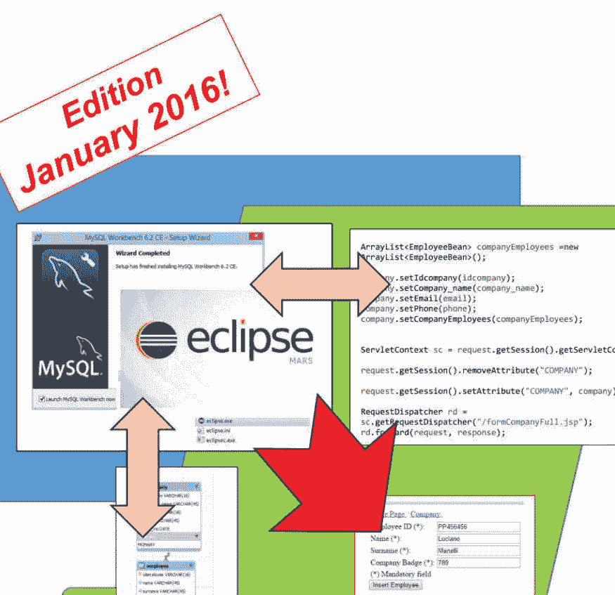

## 作者

Luciano Manelli 于 1975 年出生于意大利塔兰托（Taranto）。他于 24 岁时毕业于巴里理工学院，获得电子工程学位，随后在海军担任军官。2012 年，他从巴里大学 - 阿尔多·莫罗大学信息系获得计算机科学博士学位。在博士期间，他分析了网格计算，并在国际出版物上发表了结果。

他目前是巴里理工学院的合同教授（课程：计算机科学基础），以及巴里大学 - 阿尔多·莫罗大学的教授（课程：Web 编程）。作者在计算机科学和信息系统领域拥有十五年工作经验，并在巴里理工学院、巴里大学 – 阿尔多·莫罗大学以及专业课程方面也拥有经验。

他是一名注册认证工程师，2014 年在为 InfoCamare SCPA 工作 13 年后开始任职塔兰托港务局。他于 2014 年写了《现代信息技术基础》（意大利版 –“Fondamenti di Informatica Moderna”– ARACNE 出版），并于 2015 年写了《Java Web 编程》（意大利版 –“Programmazione per il Web”– ARACNE 出版）。

联系方式：

- moderninformatics75@gmail.com
- it.linkedin.com/in/lucianomanelli

## 前言

本书是《Java Web 编程》（意大利版 –“Programmazione per il Web”– ARACNE 出版）中第六章（使用 Java 和 Eclipse 开发 Web 应用）的精简版。

本书是为学生和专业人士编写的，可以作为任何开始学习 Java Web 应用人员的起点。本文将使用 Java，因为它是免费的、标准的，且网络上有许多（免费的）库。我们将在 MySQL 中创建数据库，并使用 Eclipse 实现开发 Web 应用的所有步骤，以清晰简单的方式分析许多问题，为开发复杂应用程序提供原则。

首先，我们需要下载必要的（免费）软件：

- Eclipse MARS；
- MySQL；
- MySQL 驱动；
- Tomcat 8.0。

跟读本论文只需要在算法、编程、Java、HTML 和数据库方面具备基础技能。

我认为每个人都应该始终追求自己的梦想并为之奋斗。

Luciano Manelli，《Fondamenti di Informatica Moderna》，ARACNE，2014。

# 2 引言

Web 应用的研究在 Web 编程中起着最重要的角色，它可以被认为是公司技术的基石。事实上，私营和政府公司的所有现代技术都基于自动化系统，这既体现在降低成本（服务器上的一个应用程序的成本低于每台个人 PC 上的 n 个应用程序），也体现在互联网、内网和外网公司网站的信息共享上。

本文的目的是学习如何使用 Java 技术搭建 Web 项目。我们之所以使用 Java，是因为它是免费的、标准的，而且网络上有许多（免费）库。我们将在 MySQL 中创建数据库，并使用 Eclipse 实现开发 Web 应用的所有过程，以清晰简单的方式分析许多问题，为开发复杂应用程序提供原则。

首先，我们需要下载必要的（免费）软件：

- Eclipse MARS；
- MySQL；
- MySQL 驱动；
- Tomcat 8.0。

跟读本论文只需要在算法、编程、Java、HTML 和数据库方面具备基础技能。

## 2.1 MVC – 模型-视图-控制器

应用程序开发中最常用的模式是 MVC（模型-视图-控制器）。该模式由施乐公司在 90 年代后期的几份出版物中首次描述。最重要的方面是将其分为三个不同的组件：

- 模型（Model）：与应用程序逻辑和数据操作的持久化有关；
- 视图（View）：与呈现有关，即与最终用户的界面；
- 控制器（Controller）：与请求处理有关。

这种级别的分离对于应用程序的稳定性和安全性都是重要的。

## 2.2 Web 应用 Servlet 和 JSP

一个 Web 应用由 Servlet、HTML/XHTML 和 JSP 页面、类和其他组件组成，这些组件可以安装并运行在容器（应用程序服务器）内部，该容器提供了 JVM（Java 虚拟机）。

Web 应用通过文件系统上的分级目录进行映射，并通常导出为 JAR 或 EAR。假设我们的项目根文件夹为`company_management`，它将部署到 Tomcat 的`webapps`目录下。根目录下可能还有其他目录，包括`WEB-INF`目录（仅应用程序服务器可访问），它包含`web.xml`、编译后的类文件夹和库文件夹。

我们将使用 Tomcat 作为 Web 服务器：它能够处理最新版本的 Servlet（从 2.5 到 3.1）和 JSP 页面，以及 EJB、Struts 和 Web Services Axis 等框架。

JSP（Java 页面）技术允许我们轻松创建 HTML/XHTML 页面，这些页面同时具有静态和动态组件（Servlet 的抽象）。Java 中的动态代码包含在`<% %>`中，并在向客户端发送响应之前进行预编译。

Servlet 是 Java 类，运行在 Servlet 容器（例如 Tomcat 或 JBoss）中并作为 Web 资源暴露。这些类处理来自 HTML 表单的数据，并处理一个或多个客户端的请求和响应。3.x 标准（Java EE 标准）是 Servlet 规范（JSR 315）的最新版本。

Servlet 对应 MVC 架构中的控制器，实现了许多复杂的功能。我们可以使用单个 Servlet 来处理不同的行为，也可以为每个行为使用多个 Servlet。我们在文中将使用呈现不同行为的单个 Servlet。

简而言之，客户端向 Servlet（在 Web 应用服务器中）发送请求，Servlet 被实例化（仅在第一次），启动一个线程来处理通信并构建响应发送给客户端；如果 Servlet 已经加载，它将为该客户端创建一个额外的线程。

Servlet 内部没有算法代码，而是委托给其他类。请求和响应由`javax.servlet.HttpServletRequest`接口（从客户端环境获取信息）和`javax.servlet.HttpServletResponse`接口（向客户端发送响应）管理。另一个组件`javax.servlet.ServletContext`允许查找应用程序上下文的引用。

Servlet 的生命周期由以下元素和方法描述：

- 初始化 Servlet（`init`方法），由 Servlet 引擎调用，仅一次；
- 处理 POST 请求（`doPost(HttpServletRequest req, HttpServletResponse response)`方法）；
- 处理 GET 请求（`doGet(HttpServletRequest req, HttpServletResponse response)`方法）；
- 销毁 Servlet 上下文（`destroy`方法）。

Servlet 3.X 代表了 Servlet 技术的最高水平。注解的使用是 Web 应用中最重要的创新之一：它是在 Servlet 源码中添加元数据的方法，可以作为`web.xml`中 XML 技术的替代方案。

我们将创建一个 Servlet，它将根据数据输入表单的参数具有不同的行为。这些操作将是方法调用（方法`doGet`或`doPost`）的结果。

在对客户的假设需求进行初步分析后，例如，假设我们要开发名为`Company_Management`的 Web 应用，目的是保存和管理许多公司及其员工。

# 3 如何安装和配置 MySQL 5.6 社区版

让我们开始吧！现在是早上九点！

MySQL（现在的 Oracle MySQL）是一个强大的关系型数据库（RDBMS），它可以运行在 Linux/Unix 和 Windows 上。它对于 Web 应用数据库的创建和管理非常有用。它是一个免费软件，因此既用于简单网站数据库，也用于专业应用程序（例如 Literary）。

以下步骤说明了在 Windows 操作系统上安装和配置 MySQL。

现在，我们将安装 MySQL！

访问 Oracle 网站`http://www.mysql.it/`，并下载这两个主要元素：

- MySQL Community Server（[http://dev.mysql.com/downloads/mysql/](http://dev.mysql.com/downloads/mysql/)）：开源数据库；
- MySQL Workbench（[http://dev.mysql.com/downloads/bench/](http://dev.mysql.com/downloads/bench/)）：用于创建和管理数据库（架构、表等）的开源环境。

我们将选择 Windows 的下载安装包！

下载的文件是：

- server：`mysql-installer-community-5.6.21.1.msi`；
- workbench：`mysql-workbench-community-6.2.3-winx64.msi`。

现在，我们将逐步安装服务器和 Workbench（我在 Windows 8 和 Windows 7 上测试过它们）！

首先，许可协议。

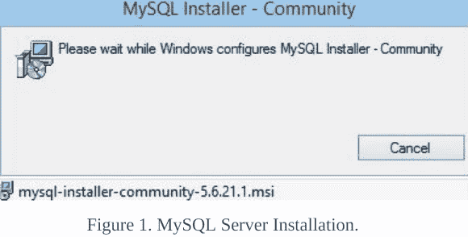

继续之前必须接受 Oracle 软件许可条款。

允许任何人复制和分发本文的逐字副本，但不允许其他行为。

大多数软件的许可旨在剥夺你分享和更改的自由。相比之下，GNU 通用公共许可证旨在保证你分享和更改的自由——确保软件对所有用户都是免费的。通用公共许可证适用于自由软件基金会的大多数软件，以及任何其他作者承诺使用它的其他程序。（某些其他自由软件由 GNU 库较小公共许可证许可。）你也可以将其应用于你的程序中。

当我们谈论自由软件时，我们指的是自由，而不是价格。我们的通用公共许可证旨在确保您有自由重新分发或修改自由软件，以此为：

- 我接受许可条款

图 2. MySQL 服务器安装，许可。

## 3.1 选择设置类型

请选择适合您的用例的设置类型。

- 开发者默认（Developer Default）：安装 MySQL 开发用途所需的所有产品；
- 仅服务器（Server only）：仅安装 MySQL 服务器产品；
- 仅客户端（Client only）：仅安装 MySQL 客户端产品，不带服务器；
- 完整（Full）：安装所有包含的 MySQL 产品和功能；
- 自定义（Custom）：手动选择应安装在系统上的产品。

设置类型描述：安装 MySQL 服务器和开发 MySQL 应用程序所需的工具。如果您打算为现有服务器开发应用程序，则此很有用。

此设置类型包含：

- MySQL Server；
- MySQL Workbench：用于开发和管理服务的 GUI 应用程序；
- MySQL for Excel：Excel 插件，可方便地访问和操作 MySQL 数据；
- MySQL for Visual Studio：用于从 VS 与 MySQL 服务器进行工作；
- MySQL Connections：Connector/Net、Java、C/C++、ODBC 等。

图 3. MySQL 服务器安装 – 设置类型。

然后开始安装。

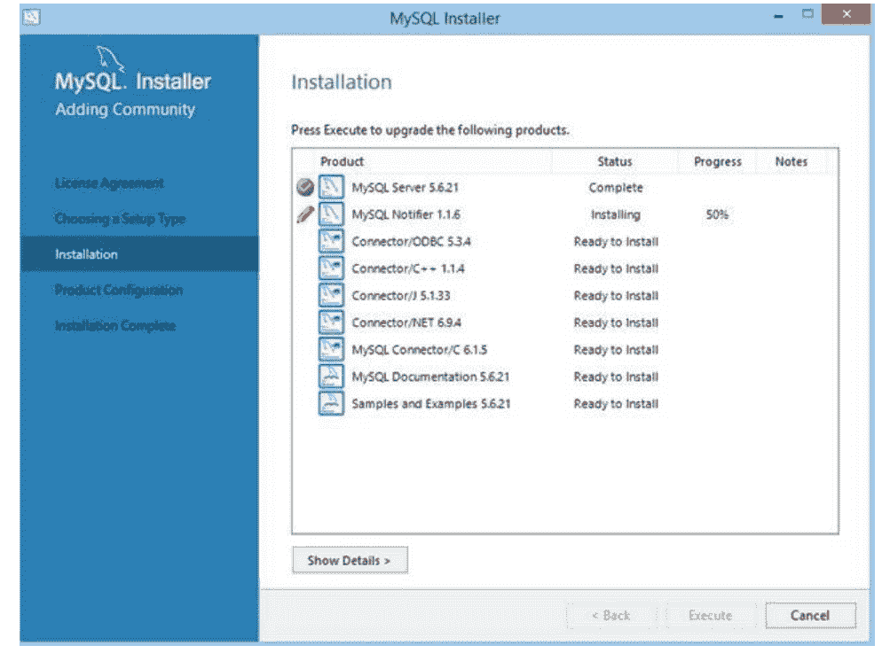

最后一步。

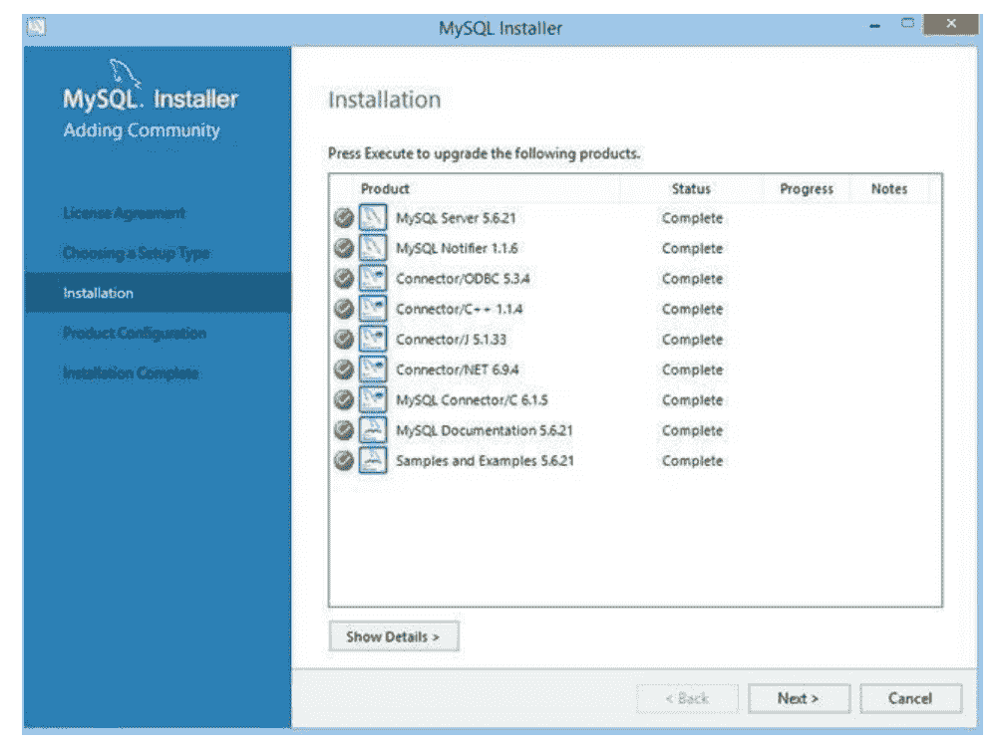

### 图 5. MySQL 服务器安装 – 已安装

现在我们将配置一些参数，例如端口号`3306`。

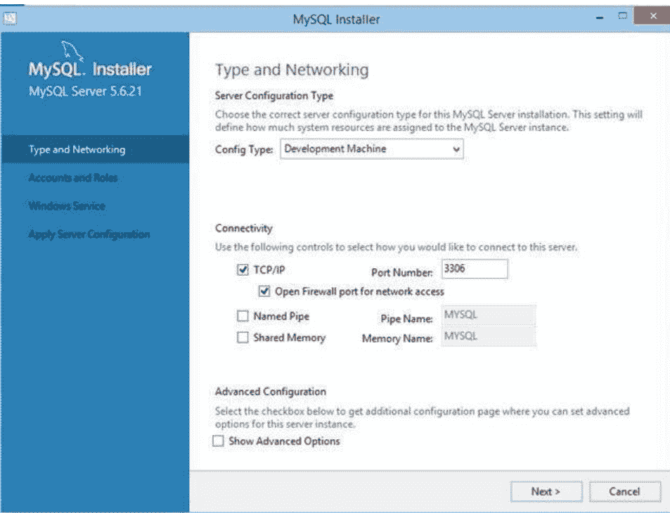

### 图 6. MySQL 服务器安装 – 配置

向导询问设置管理员密码。对于开发环境，我们将简单地使用“root”。

### MySQL 安装器

#### 账户和角色

Root 账户密码

输入 root 账户的密码。请记住将密码存储在安全的地方。

MySQL Root 密码：

重复 Root 密码：

密码强度：弱

#### MySQL 用户账户

为您的用户和应用程序创建 MySQL 用户账户。为用户分配由一组权限的角色。

| MySQL 用户名 | 用户角色 | 操作 |
|---|---|---|
|  |  | 添加用户 |
|  |  | 删除 |

图 7. MySQL 服务器安装 – 密码设置。

然后我们将 MySQL 设置为 Windows 服务。

### MySQL 安装器

#### Windows 服务

- 将 MySQL 服务器配置为 Windows 服务。

Windows 服务详细信息：

请指定一个用于此 MySQL 服务器实例的 Windows 服务。每个实例都需要一个唯一的名称。

Windows 服务名称：`MySQL`

- 在系统启动时启动 MySQL 服务器。

以……身份运行 Windows 服务。

MySQL 服务器需要在一个用户账户下运行。根据您系统的安全要求，您需要选择以下选项之一。

- 标准系统帐户：适用于大多数场景；
- 自定义用户：对于高级场景可以选择现有的用户账户。

图 8. MySQL 服务器安装 – Windows 服务。

最后，之前的配置已应用。

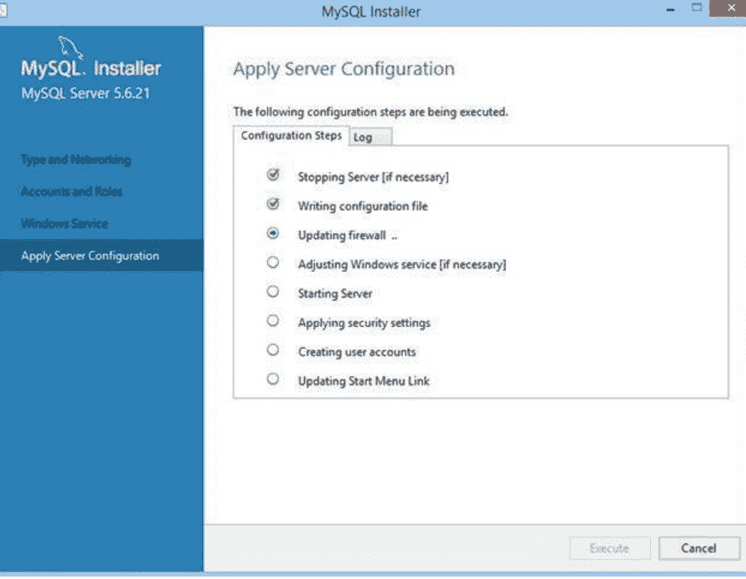

向导测试服务器连接。

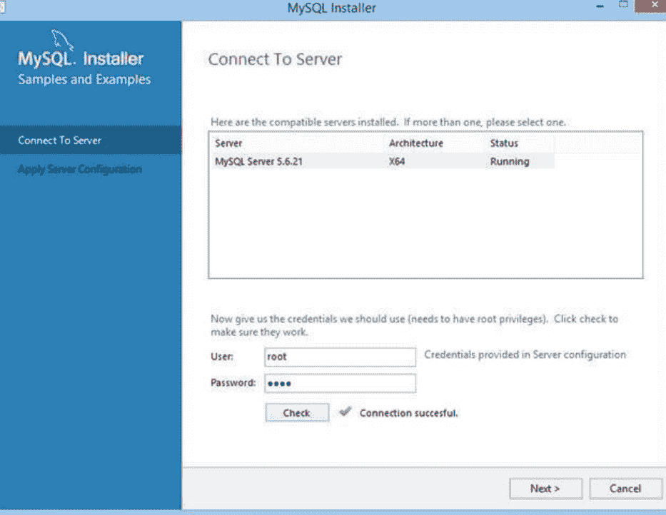

图 10. MySQL 服务器安装 – 服务器连接。

最后安装步骤。

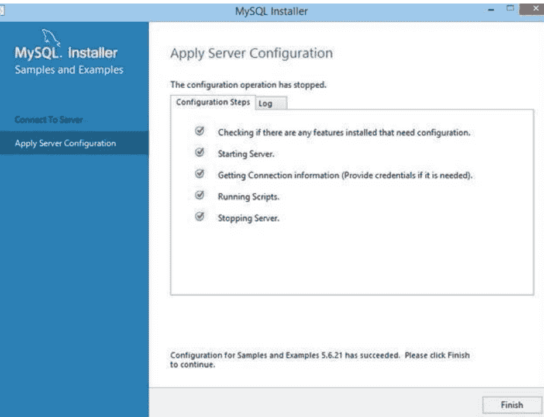

图 11. MySQL 服务器安装 – 最后安装步骤。

结束。

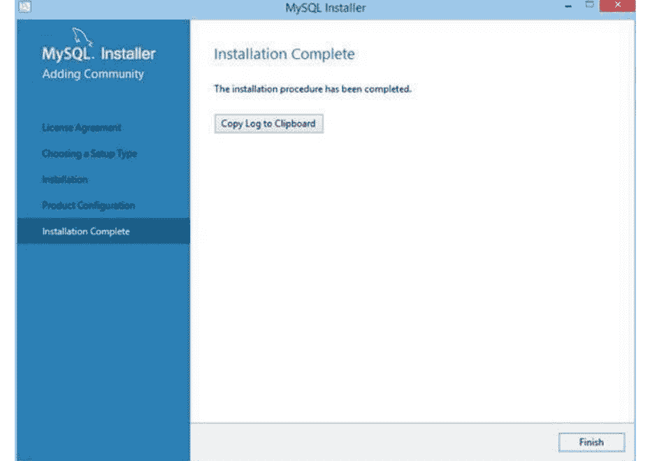

图 12. MySQL 服务器安装 – 结束。

现在，我们将带有向导安装 Workbench。

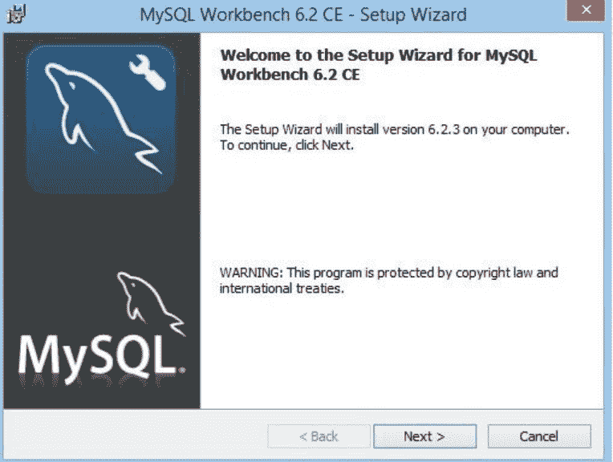

图 13. MySQL Workbench 安装。

我们将选择完整安装。

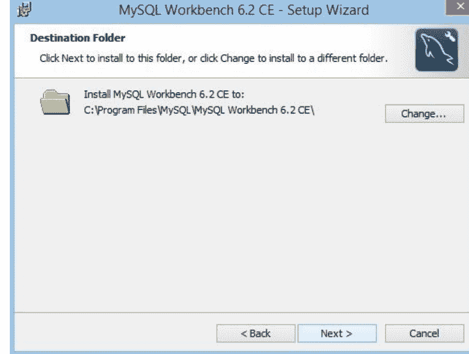

安装开始。

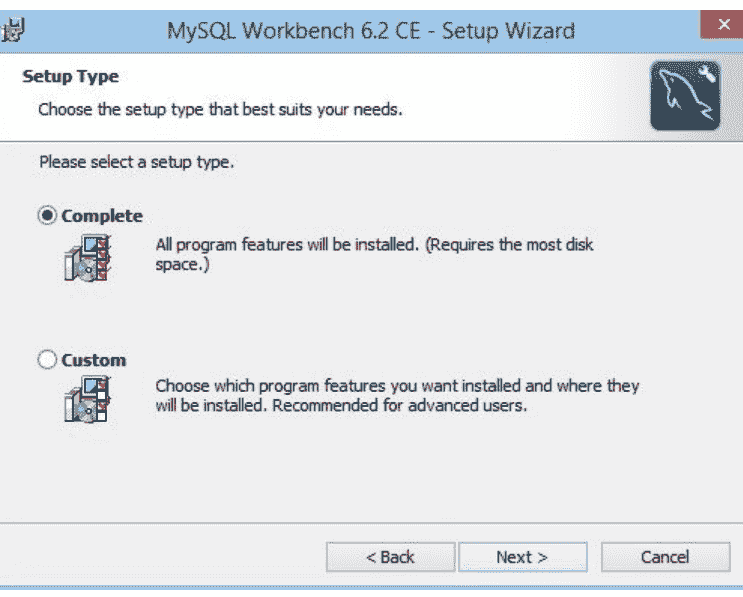

结束。

图 16. MySQL Workbench 安装 – 结束。

最后，Workbench 正在运行。


图 17. Workbench 环境。

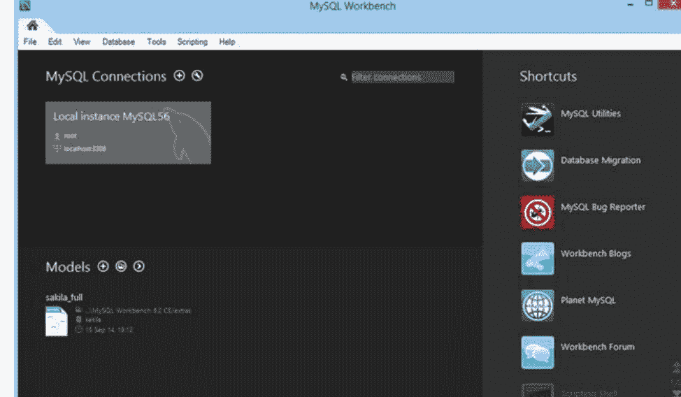

# 4 为 Web 应用创建 MySQL 数据库

现在可以创建我们的数据库了。我们将使用 Workbench 连接到服务器。

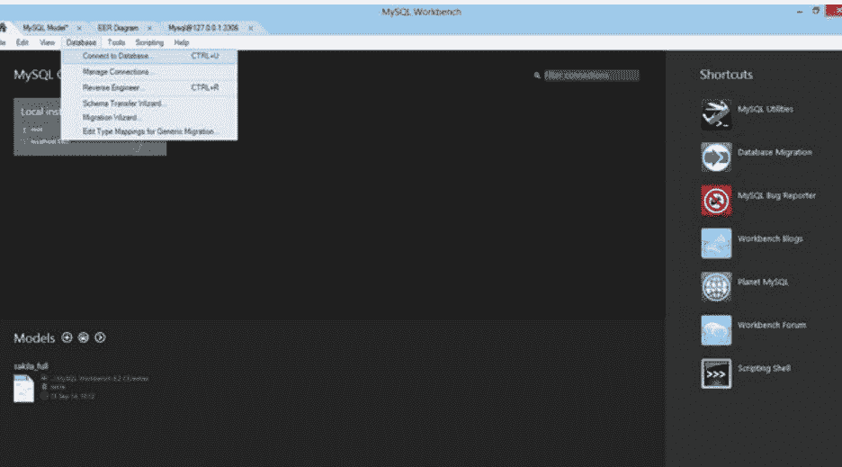

图 18. 使用 Workbench 连接到服务器。

随后，屏幕上将显示连接的标准参数。点击确定！

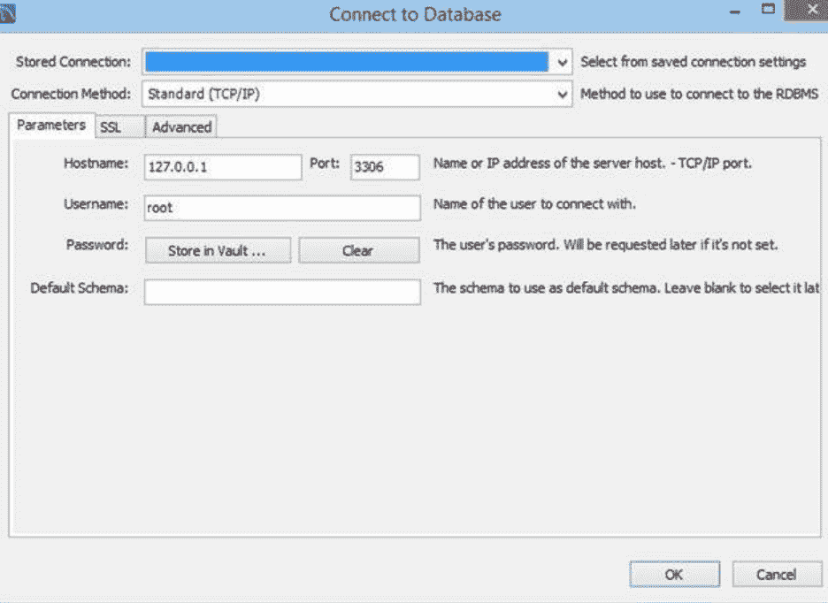

图 19. 连接参数。

现在，将密码设置为“root”并点击确认！

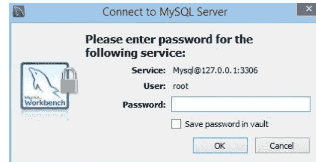

图 20. 连接到服务器 – 设置密码。

现在 Workbench 环境已就绪，我们可以开始了。

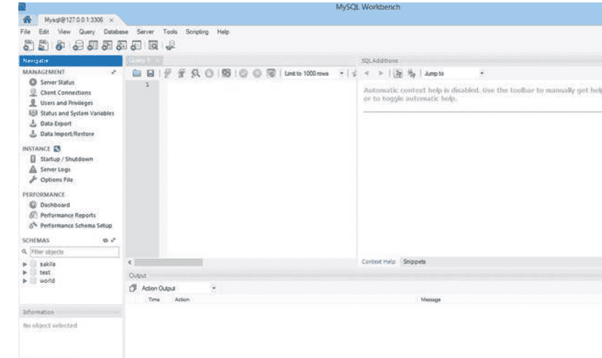

图 21. Workbench 环境。

现在我们将创建一个新的 schema（模式）。进入“SCHEMAS”区域，点击鼠标右键。

现在，我们将在右键菜单中选择“Create Schema...（创建模式...)”。

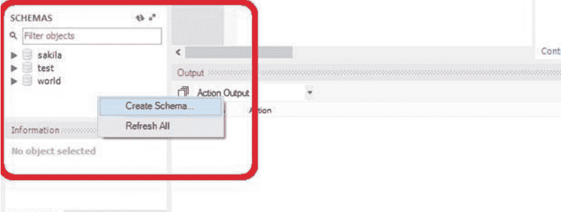

图 22. Workbench，如何创建一个新的 Schema。

现在我们将创建 schema：`company_management`。

在 name 处输入“company_management”并点击 OK！

然后，脚本将执行。

### MySQL Workbench

#### Query 1 company_management - Schema

schema 的名称。建议避免使用空格并用下划线`_`代替。

Name：`company_management`

重构模型，将视图函数中找到的所有引用从旧 schema 更改为新的。

排序规则（Collation）：服务器默认（Server Default）

指定 schema 表设置中使用的字符集/排序规则。常见选择是 Latin1 或 UTF8。

### 将 SQL 脚本应用到数据库

检查 SQL 脚本 Apply SQL Script。

检查将应用到数据库的 SQL 脚本。

在线 DDL 算法：默认（Default）  
锁类型：默认（Default）

```sql
CREATE SCHEMA `company_management`;
```

返回（Back） 应用 取消（Cancel）

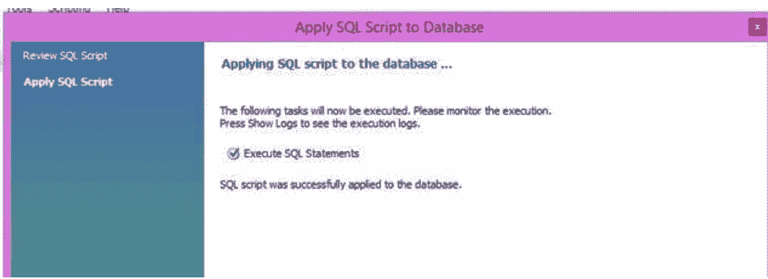

图 23. Workbench，如何创建一个新的 Schema – 创建脚本执行。

一旦创建了数据库，我们将创建表，它们是：

- Company 表（公司表）；
- Employee 表（员工表）。

简化的设计将根据概念和逻辑设计以表格形式完成（本文未详细说明）。

Schema：`company_management`


| 字段名 (Field Name) | 长度 (Length) | 类型 (Type) | 约束 (Constraints) |
| --- | --- | --- | --- |
| `idcompany` | 16 | `VARCHAR` | 主键 非空 (Primary Key Not null) |
| `company_name` | 45 | `VARCHAR` | 非空 (Not Null) |
| `phone` | 16 | `VARCHAR` | 非空 (Not Null) |
| `email` | 45 | `VARCHAR` | 非空 (Not Null) |
| `date_ins` | - | `DATE` | 非空 (Not Null) |

### 表：Employee（员工表）

| 字段名 (Field Name) | 长度 (Length) | 类型 (Type) | 约束 (Constraints) |
| --- | --- | --- | --- |
| `idemployee` | 16 | `VARCHAR` | 主键 非空 (Primary Key Not null) |
| `name` | 45 | `VARCHAR` | 非空 (Not Null) |
| `surname` | 45 | `VARCHAR` | 非空 (Not Null) |
| `badge` | - | `INT(10)` | 非空 (Not Null) |
| `FK_company` | 16 | `VARCHAR` | 非空 外键：`idcompany` (Not Null Foreign Key: `idcompany`) |
| `date_ins` | - | `DATE` | 非空 (Not Null) |

现在我们将创建表。

选择我们的 schema，然后在表上点击鼠标右键。

现在，我们将在右键菜单中选择“Create Table...（创建表...)”。

在 Table Name（表名）中输入“company”！

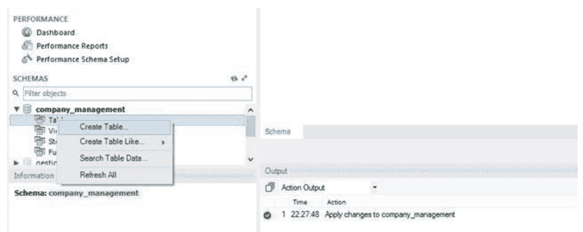

> 图 24. Workbench，如何创建一个表。

现在我们将创建字段并定义键字段（PK）和非零字段（NN）。首先，我们可以创建键字段“`idcompany`”和字段“`company_name`”。

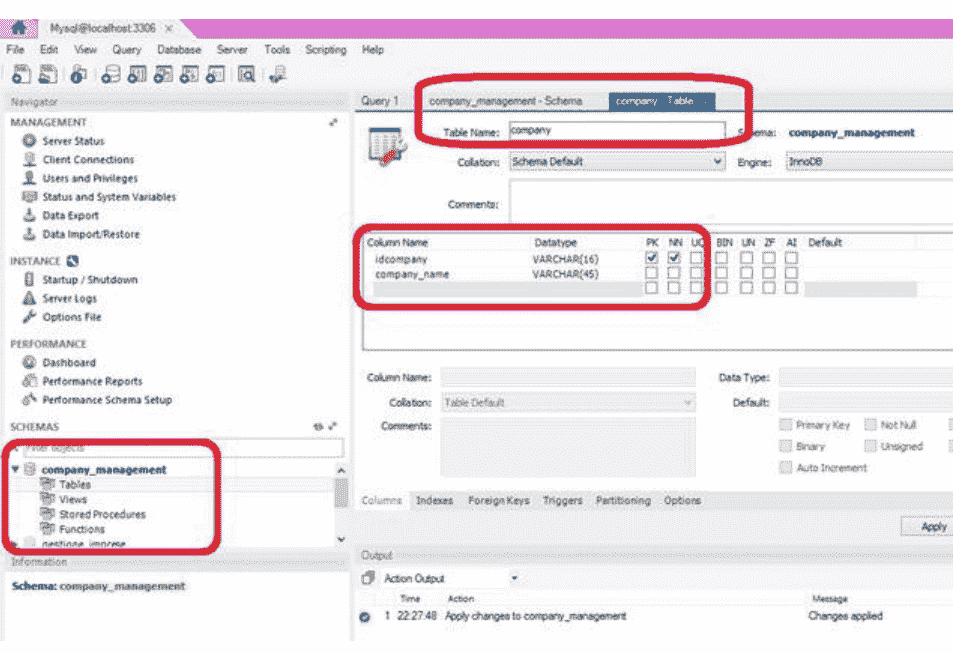

最后，脚本将执行。

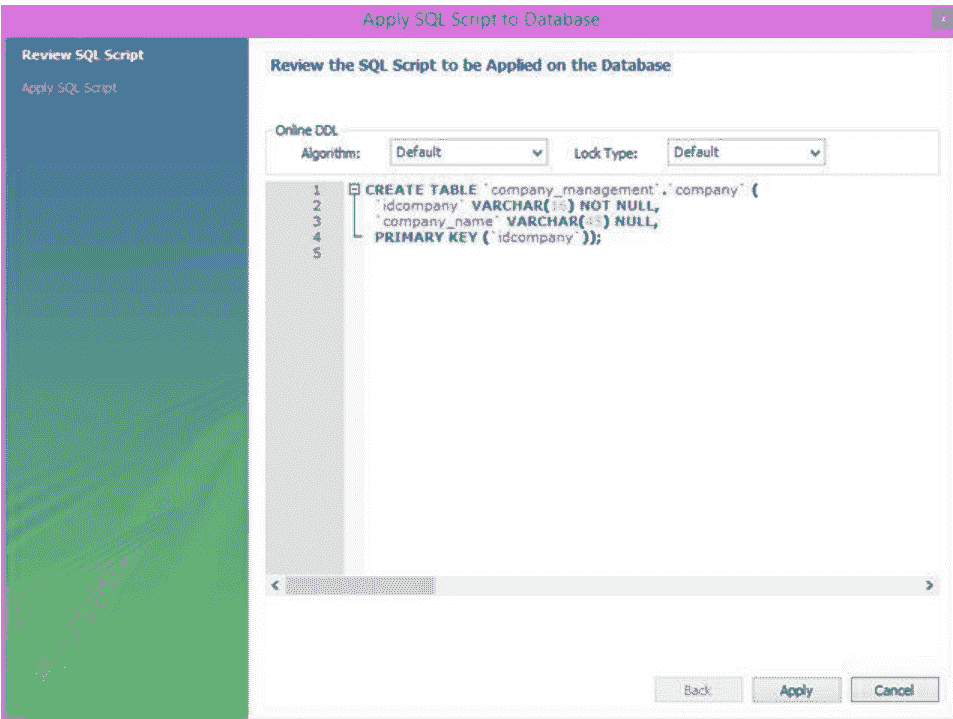

### 将 SQL 脚本应用到数据库

检查 SQL 脚本 (Review SQL Script)

应用 SQL 脚本 (Apply SQL Script)

正在将 SQL 脚本应用到数据库...

现在将执行以下任务。请监控执行情况。点击 Show Logs（显示日志）查看执行日志。

- 执行 SQL 语句 (Execute SQL Statements)

SQL 脚本已成功应用到数据库。

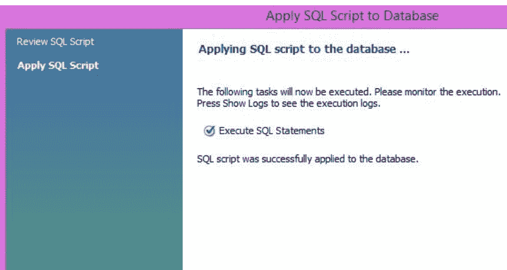

一旦创建了表，我们可以使用表左侧菜单中的“螺丝刀”图标进行编辑。

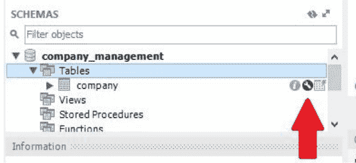

您也可以使用表左侧菜单中的“表格”图标显示带有值的表并运行查询。

### MANAGEMENT（管理）

- 服务器状态 (Server Status)
- 客户端连接 (Client Connections)
- 用户权限 (Users and Privileges)
- 状态和系统变量 (Status and System Variables)
- 数据导出 (Data Export)
- 数据导入/恢复 (Data Import/Restore)

### INSTANCE（实例）

- 启动 / 停止 (Startup / Shutdown)
- 服务器日志 (Server Logs)
- 选项文件 (Options File)

### PERFORMANCE（性能）

- 仪表板 (Dashboard)
- 性能报告 (Performance Reports)
- 性能 Schema 设置 (Performance Schema Setup)

### MASTER objects（主对象）

- `company_management`
  - `company`
    - 列 (Columns)
    - 索引 (Indexes)
    - 外键 (Foreign Keys)

`nation: company_management`

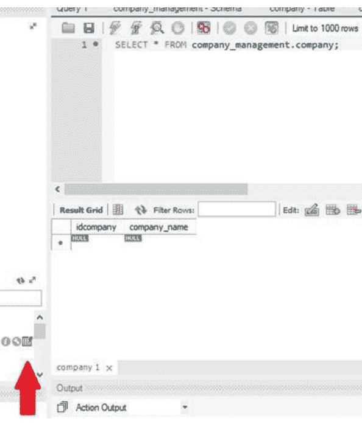

现在，我们可以完成定义所有字段（`idcompany`、`company_name`、`email`、`phone`、`date_ins`）的表。下面的图显示了表“company”。

### MANAGEMENT

- 服务器状态 (Server Status)
- 客户端连接 (Client Connections)
- 用户权限 (Users and Privileges)
- 状态和系统变量 (Status and System Variables)
- 数据导出 (Data Export)
- 数据导入/恢复 (Data Import/Restore)

### INSTANCE

- 启动 / 停止 (Startup / Shutdown)
- 服务器日志 (Server Logs)
- 选项文件 (Options File)

### PERFORMANCE

- 性能报告 (Performance Reports)
- 性能 Schema 设置 (Performance Schema Setup)

### MASTER objects

- `company_management`
  - `company`
    - 列 (Columns)

| 列名 (Column Name) | 数据类型 (Datatype) | PK | UK | NN | U | BI | AI | 默认 (Default) |
| --- | --- | --- | --- | --- | --- | --- | --- | --- |
| `idcompany` | `VARCHAR(45)` |  |  |  |  |  |  |  |
| `company_name` | `VARCHAR(45)` |  |  |  |  |  |  |  |
| `phone` | `VARCHAR(45)` |  |  |  |  |  |  |  |
| `email` | `VARCHAR(45)` |  |  |  |  |  |  |  |
| `date_ins` | `DATE` |  |  |  |  |  |  |  |

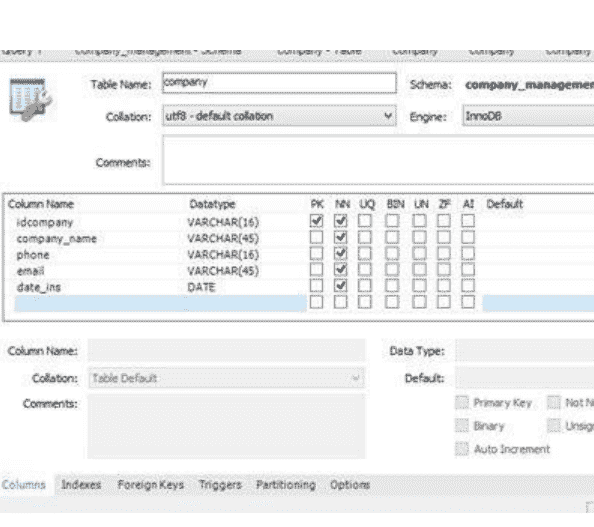

现在，我们可以完成定义所有字段（`idcompany`、`company_name`、`email`、`phone`、`date_ins`）的表。接下来的图显示了表“employee”包含 `idemployee`、`name`、`surname`、`badge`、`date_ins` 以及外键 `FK_company`。

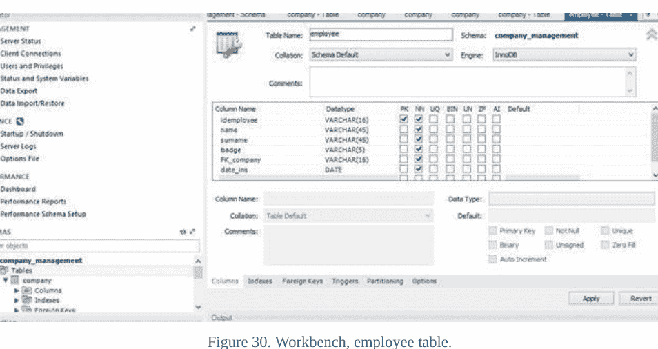

现在我们可以创建“employee”表，包含 `idemployee`、`name`、`surname`、`badge`、`date_ins` 以及外键 `FK_company`。接下来的图显示了约束。

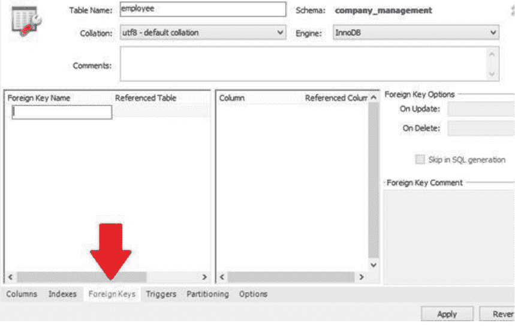

现在，我们需要在 employee 和 company 之间定义外键，设置 `FK_company` 为外键。


表名（Table Name）：employee  
Schema：company_management

排序规则（Collation）：utf8  
引擎：InnoDB

| 外键名称 (Foreign Key Name) | 引用表 (Referenced Table) | 引用列 (Referenced Column) | 外键选项 (Foreign Key Options) |
| --- | --- | --- | --- |
| `FK_company` | `company_management` | `employee` | 更新 (Update) |
|  |  | `name` |  |
|  |  | `surname` | 删除 (Delete) |

图 32. 外键的定义。

### 将 SQL 脚本应用到数据库

检查 SQL 脚本 (Review SQL Script)

应用 SQL 脚本 (Apply SQL Script)

正在将 SQL 脚本应用到数据库...

| 在线 DDL 算法 (Online DDL Algorithm)：默认 | 锁类型 (Lock Type)：默认 |
| --- |
| `ALTER TABLE 'company_management', 'employee';` |
| `ADD INDEX FK_company_id (FK_company), ASC);` |
| `ALTER TABLE 'company_management', 'employee'` |
| `ADD CONSTRAINT 'FK_company'` |
| `FOREIGN KEY (FK_company)` |
| `REFERENCES 'company_management' ('idcompany')` |
| `ON DELETE NO ACTION` |
| `ON UPDATE NO ACTION;` |

图 33. Workbench，创建外键 – 创建脚本执行。

如果我们想要，也可以通过简单的操作导出图表和脚本（右键点击 schema 或表，复制到剪贴板，创建语句）。

img/112513ff21bfadb0111c509b6257bbec_34_0.png

导出的 `company_management` 脚本

img/112513ff21bfadb0111c509b6257bbec_34_1.png

导出的表脚本：

```sql
CREATE TABLE `company` (
  `idcompany` varchar(16) NOT NULL,
  `company_name` varchar(45) NOT NULL,
  `phone` varchar(16) NOT NULL,
  `email` varchar(45) NOT NULL,
  `date_ins` date NOT NULL,
  PRIMARY KEY (`idcompany`)
) ENGINE=InnoDB DEFAULT CHARSET=utf8;
```

```sql
CREATE TABLE `employee` (
  `employee` varchar(16) NOT NULL,
  `name` varchar(45) NOT NULL,
  `surname` varchar(45) NOT NULL,
  `code` varchar(16) NOT NULL,
  `FK_company` varchar(16) NOT NULL,
  `date_ins` date NOT NULL,
  PRIMARY KEY (`employee`),
  KEY `FK_company_id` (`FK_company`),
  CONSTRAINT `FK_company` FOREIGN KEY (`FK_company`) REFERENCES `company` (`idcompany`) ON DELETE NO ACTION ON UPDATE NO ACTION
) ENGINE=InnoDB DEFAULT CHARSET=utf8;
```

## 4.2 MySQL 逻辑模式与反向工程数据库

最后，通过 Workbench 我们可以从表定义开始（在完成概念和逻辑分析之后），也可以从实体关系图的定义开始然后获取表。最后，我们可以通过反向工程工具从现有表获取数据库的图形化设计。在最后一种，我们只需进入 Workbench 的主页，从“Database”（数据库）选项卡下的“Reverse Engineer...”（反向工程）选项开始。

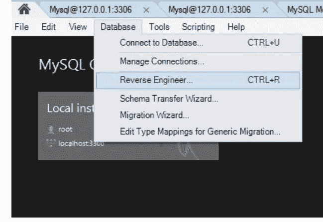

图 36. Workbench，反向工程。

然后按照向导的说明操作即可。

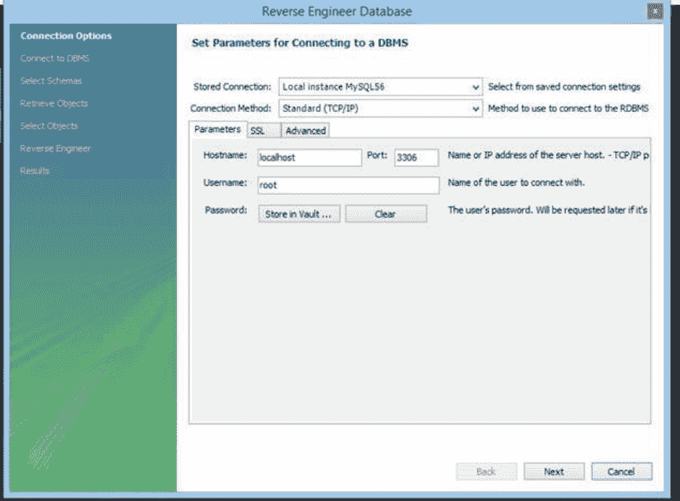

图 37. Workbench，反向工程：连接数据库。

选择数据库后，输入用户/密码，最后选择架构（schema）。

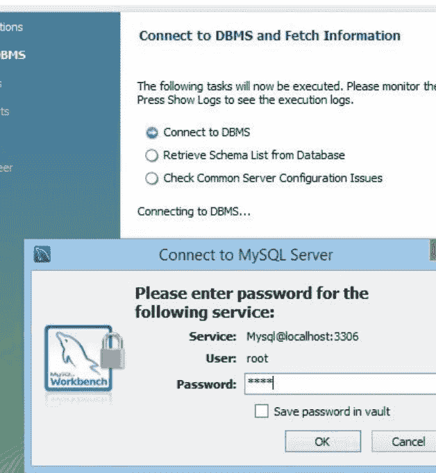

图 38. Workbench，反向工程：用户/密码。

### 反向工程数据库

#### 连接 DBMS 并获取信息

现在将执行以下任务。请监控执行过程。

点击 Show Logs（显示日志）查看执行日志。

- 连接到 DBMS
- 从数据库检索架构列表
- 检查常见的服务器配置问题

执行成功完成。

获取完成。

### 反向工程数据库

#### 选择要反向工程的架构

选择下方您想要包含的架构：

- `company_management`

### 反向工程数据库

#### 检索并反向工程架构对象

现在将执行以下任务。请监控执行过程。

点击 Show Logs（显示日志）查看执行日志。

- 从所选架构中检索对象
- 检查结果

检索成功完成。

完成。

### 反向工程数据库

#### 选择要反向工程的对象

| 导入 MySQL 表对象 | 显示过滤器 |
| --- | --- |
| 共 2 个对象 | 已选 2 个 |

### 反向工程数据库

#### 反向工程进度

现在将执行以下任务。请监控执行过程。点击 Show Logs（显示日志）查看执行日志。

- 反向工程已选对象
- 将对象放置在图表中

操作成功完成。

完成解析 MySQL SQL 脚本。

### 反向工程数据库

#### 反向工程结果

反向工程对象摘要：

- 来自架构 `company_management` 的 2 个表


因此，我们随后可以获取逻辑模式并打印或保存。

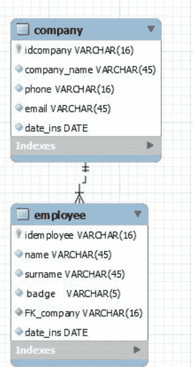

图 40. Workbench，反向工程的表。

系统还会自动插入默认索引（主键和外键）。

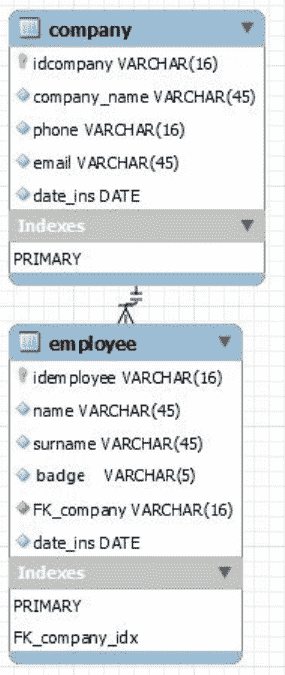

图 41. Workbench，带有索引的反向工程架构。

我们刚刚完成了！就是这样！

# 5. 如何配置 Eclipse MARS（JDK 和 Tomcat）

我们需要下载适用于 Java 开发的合适 IDE。最流行且免费的 IDE 是 Eclipse：其最新版本（Mars）可以在 https://www.eclipse.org 获取。

现在我们将下载以下压缩包：`eclipse-mars-win-x64.zip`。下载后，我们不需要安装 Eclipse，只需要解压压缩文件（通常选择目录 `C:/`）。解压后的文件存在于提取出的“eclipse”文件夹中，我们可以将其重命名为“mars”（名称无关紧要，但有助于区分 Eclipse 版本，我们可以在机器上拥有多个版本的 Eclipse）。这将是我们 IDE 的工作文件夹。Eclipse 只需通过双击 `eclipse.exe` 文件即可运行。


图 42. Eclipse，提取文件夹中的文件。

一旦我们启动可执行文件，IDE 就会询问工作空间（workspace，即项目文件夹）：通常更改默认目录并选择 `C:/`。

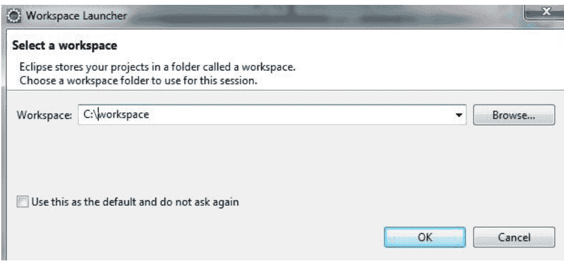

图 43. Eclipse，工作空间。

初始界面如下所示。

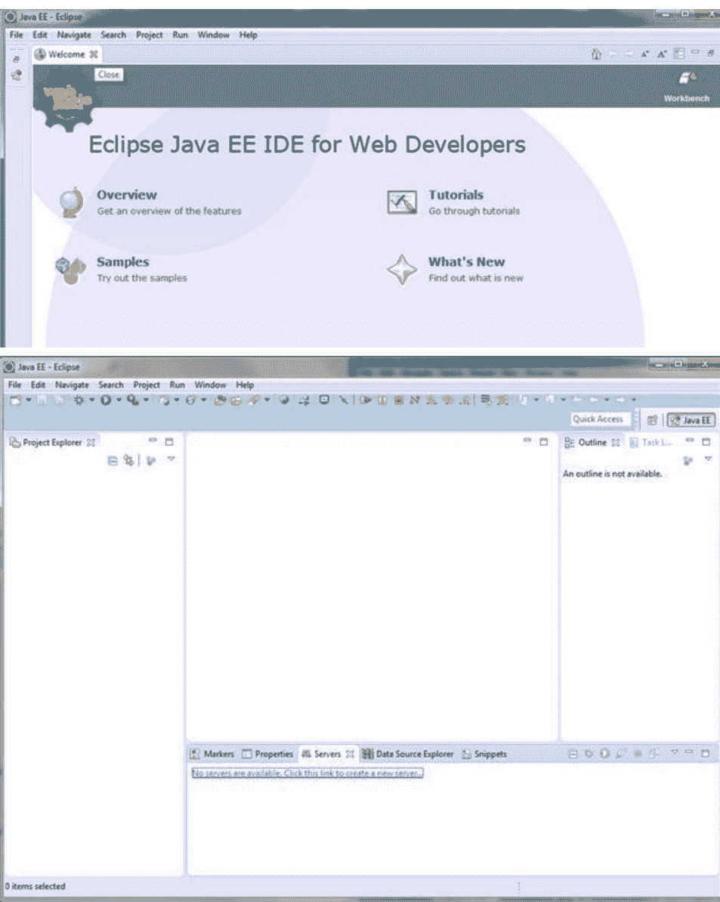

图 44. Eclipse，初始界面。

## 5.1 如何在 Eclipse 环境中配置 JDK

我们必须安装并配置 JDK - Java 开发工具包。这样我们就可以使用 Java 进行工作，请从此处下载最新版本：http://www.oracle.com/java/javase/downloads/index.html

我们选择下载 Windows 的可执行文件：`jdk-8u65-windows-x64.exe`。因此，我们将点击下载按钮并接受许可，开始下载选定的 JDK 版本。

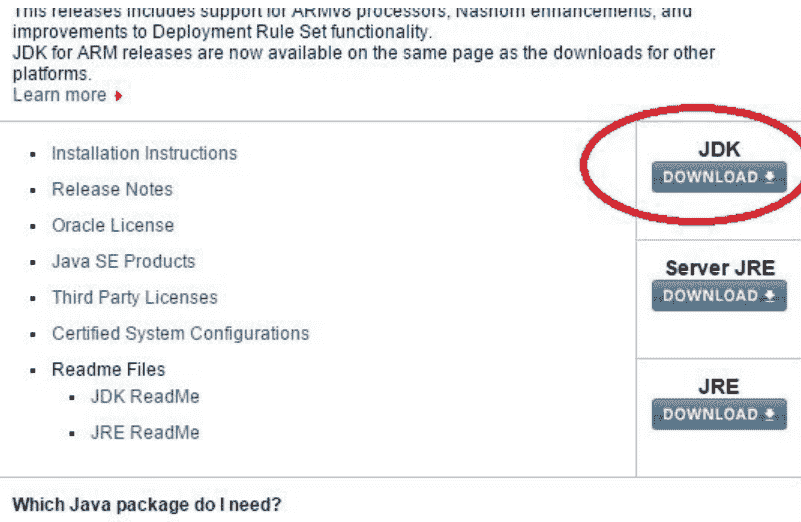

（注：此处原文路径似乎与上方有出入，保持对应）

图 45. Eclipse，下载。

现在我们要安装可执行文件！在 IDE 中通过 preferences（首选项）- Installed JRE（已安装 JRE）选择下载的 JDK。

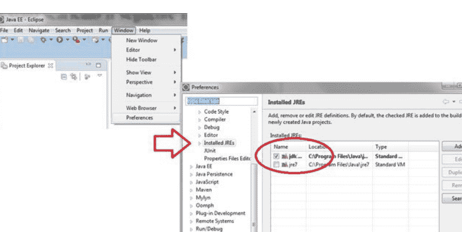

图 46. Eclipse，JDK 配置。

## 5.2 如何在 Eclipse 中配置 Tomcat 8

我们将使用 Tomcat 运行服务器。从此处下载最新版本：http://tomcat.apache.org

我们选择下载 Windows 的压缩包：`tomcat-8.14-windows86.zip`。下载后，我们不需要安装 Tomcat，只需要解压压缩文件（通常选择目录 `C:/`）。解压后的文件存在提取出的“tomcat-8.14”文件夹中，这将是我们的开发环境。


在 Eclipse 中配置服务器。它会自动询问服务器配置。我们将点击该链接，选择 `Tomcat 8` 服务器，然后按照向导操作。

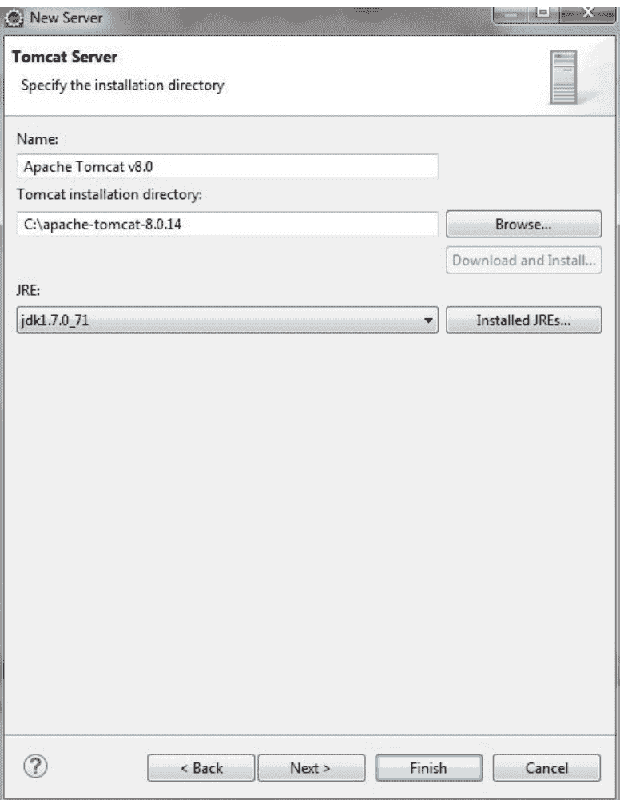

图 47. Eclipse，新建服务器。

配置好服务器后，我们可以进入“server”选项卡，刚配置的服务器就会出现。现在我们将右键点击它，打开上下文菜单并启动服务器。

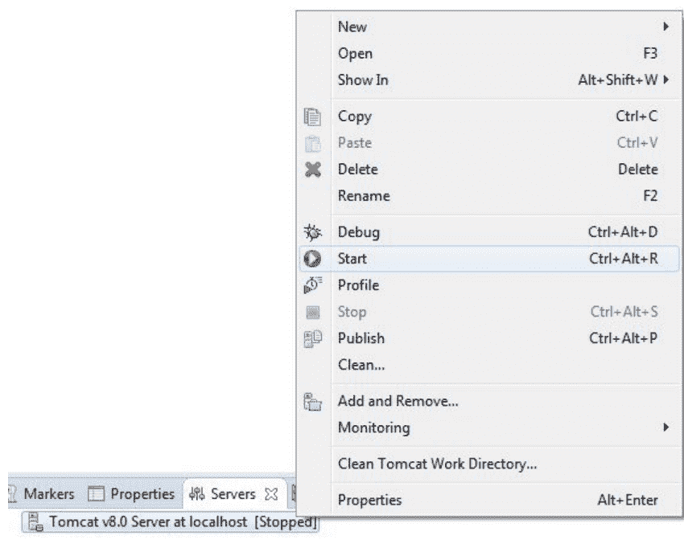

（注：此处图片路径对应逻辑）

图 51. Eclipse，如何启动服务器。

如果我们打开浏览器，通过在地址栏输入以下 URL（服务器 URL 后接应用程序名称），即可看到激活的 Tomcat 服务器：

`http://localhost:8080/Web_Application_name`

# 6. 如何在 Eclipse 中创建 Dynamic Web 项目

大约十点半！

现在我们将开始创建 Java Web 应用的步骤。

点击 File（文件）菜单，选择“New”（新建），然后选择“Dynamic Web Project”。

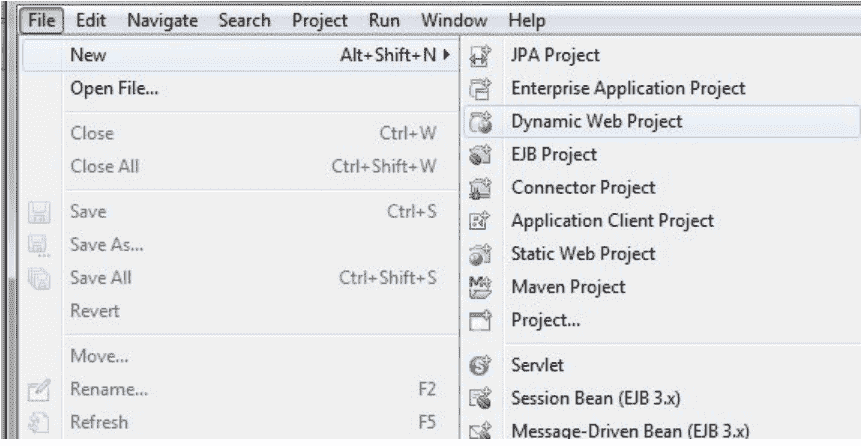

图 52. Eclipse，如何创建 Web 项目。

相关的向导启动。我们将输入项目名称 `company_management`，并保持其他参数不变。


最后，我们将定义应用的“上下文根”（context root）和“上下文目录”（context directory）。为了简单起见，我们在所有配置元素中使用相同的名称。

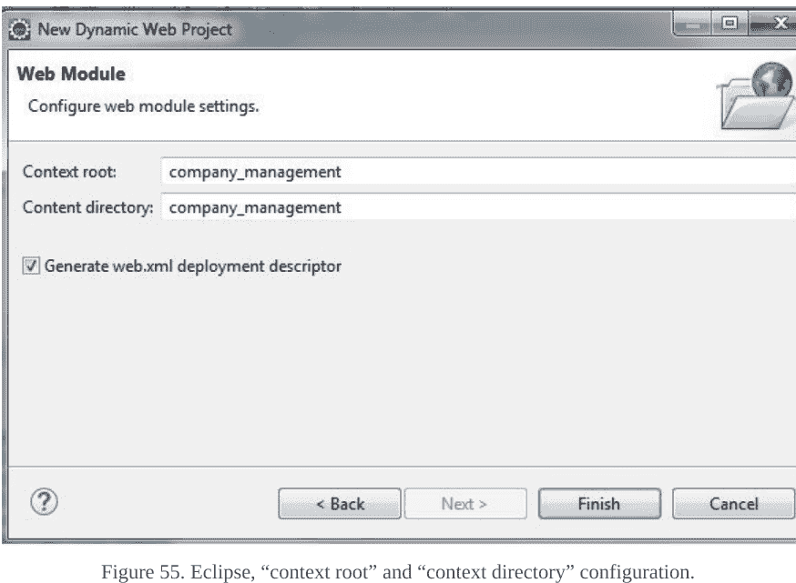

具体来说：

- 上下文根：它标识 Web 应用的访问 URL。在这种情况下，它将是 `http://localhost:8080/company_management`。

- 上下文目录：它是包含 Web 应用所有组件的目录，它将被部署到服务器中，并且项目的根目录。

注意，在此段落中检查了 `web.xml` 的创建。自动创建部署描述符已被弃用，因为最新的应用程序（Servlet 3.X）不再需要该描述符。此问题与处理使用 Servlet 2.X 开发的“遗留”应用程序有关。

下面是创建的项目。

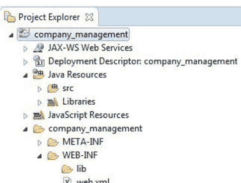

图 56. Eclipse，创建的 web 项目。

## 6.1. 如何在 Eclipse 中创建 JSP 并运行项目

使用 Java 和 Eclipse 的第一步是创建 JSP（Java 页面）。我们可以直接进入文件（File）菜单 - 新（New）- JSP 文件。

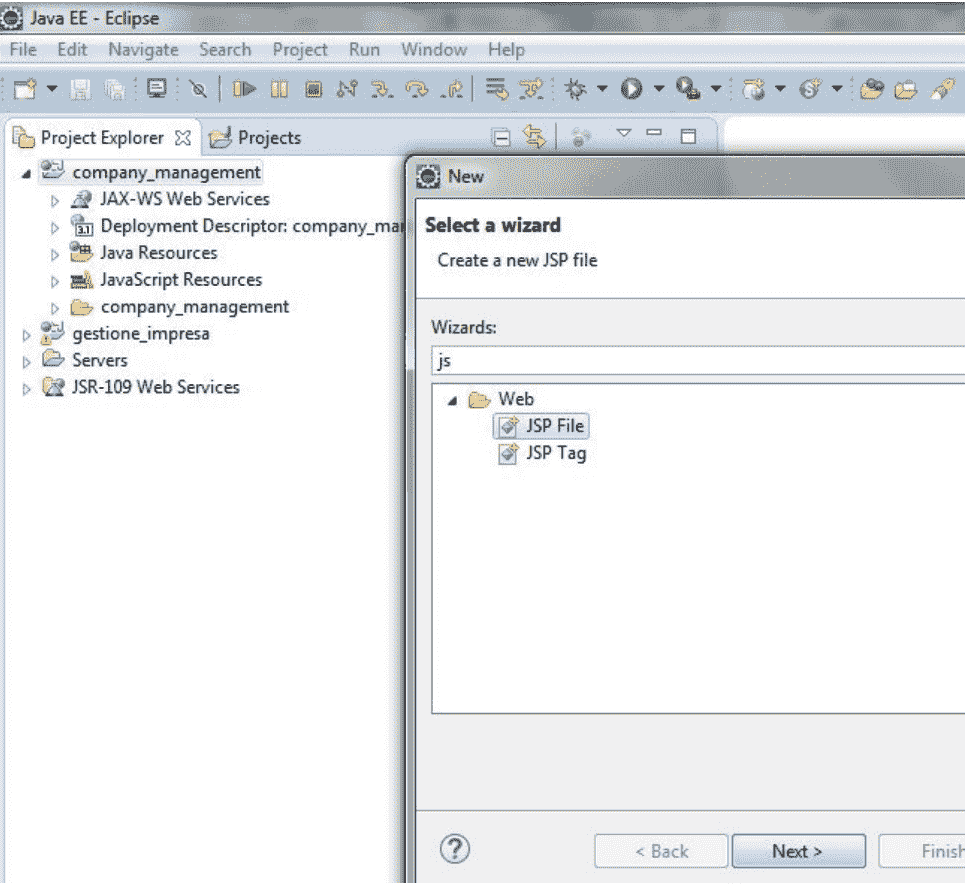

我们可以输入 JSP 的名称。

设置名称 `hello.jsp`。

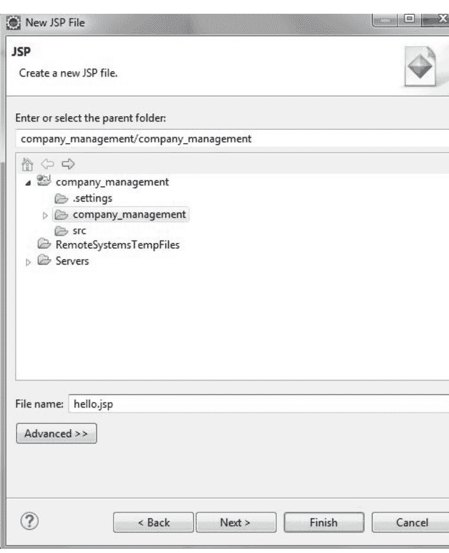

Eclipse 会创建以下 JSP 页面并将其自动插入到创建的项目。

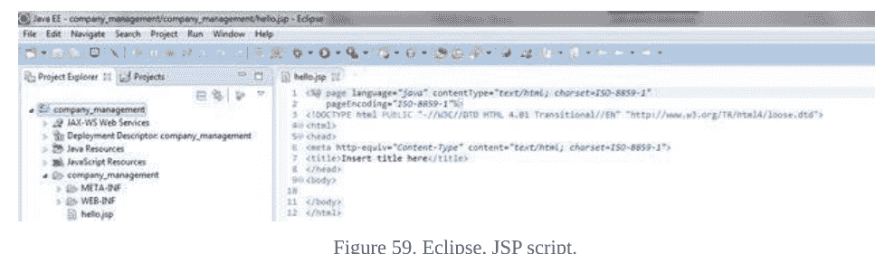

现在我们将通过在创建的 JSP 的主体（body）和标题（title）中插入文本“HELLO WORLD!”开始工作。

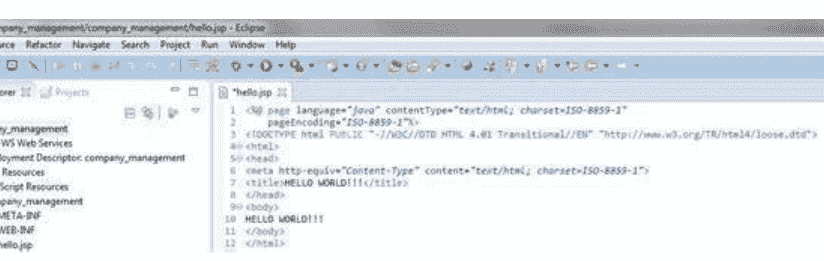

图 60. Eclipse，如何修改 JS 脚本。

为了查看网页的结果，只需启动服务器。我们可以选择服务器，点击右鼠标键，最后点击右键菜单上的绿色播放按钮。

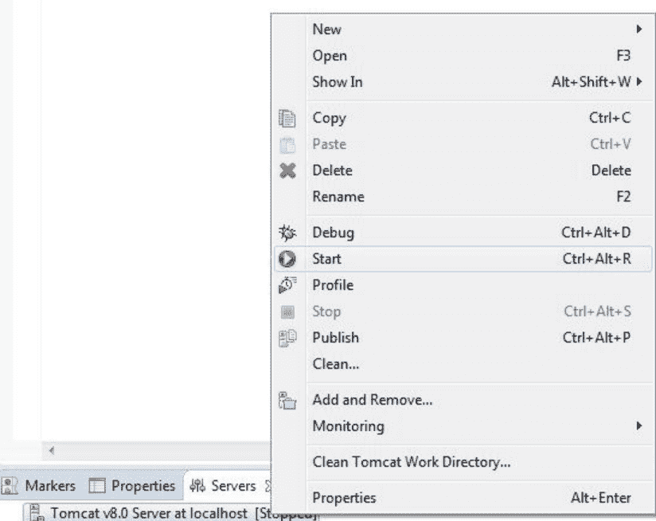

图 61. Eclipse，如何运行服务器。

服务器状态从“停止”（Stopped）变为“已启动”（Started）。


图 62. Eclipse，已启动的服务器。

我们也可以从菜单中选择“运行”（run），然后选择“运行方式”（Run As），最后在右键菜单中选择“在服务器上运行”（Run on Server）。

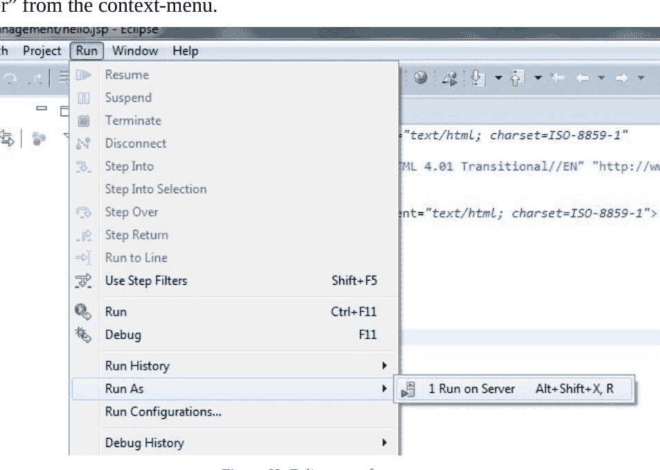

后续

图 63. Eclipse，从菜单运行。

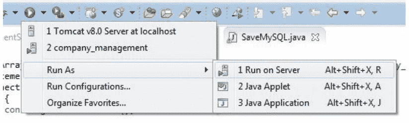

图 64. Eclipse，从菜单播放按钮运行。

最后

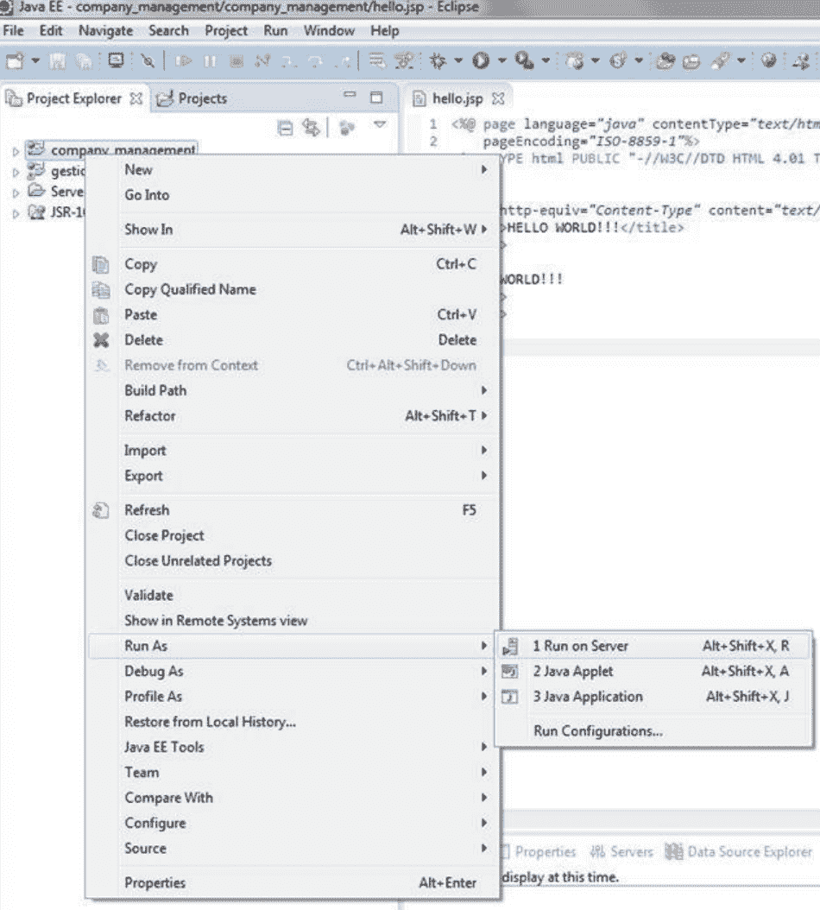

如果服务器尚未设置，我们可以从右键菜单中选择它。


在服务器上运行。选择要使用的服务器。

您想如何选择服务器？

- 选择现有的服务器
- 手动定义新服务器

选择您想要使用的服务器：

输入过滤文本

| 服务器 | 状态 |
| :--- | :--- |
| localhost | Tomcat v8.0 Server at localhost | 已停止 |

Apache Tomcat v8.0 支持 J2EE 1.2、1.3、1.4 以及 Java EE 5、6 和 7 Web 模块。列……

在运行此项目时始终使用此服务器

< 上一步 下一步 > 完成 取消

图 66. Eclipse，选择服务器。

最后一步是在选定的服务器上配置项目 `company_management`。


图 67. Eclipse，服务器上的 web 应用配置。

现在我们将在 Eclipse 中查看网页了！


图 68. Eclipse，`hello.jsp` 网页。

我们也可以通过浏览器（例如 Chrome）查看网页。


图 69. Chrome，`hello.jsp` 网页。

如果我们看到 `web.xml` 文件（第一个页面），我们可以在 `welcome-file-list`（欢迎文件列表）之间填写 `hello.jsp`，这样当我们打开应用时，看到的它就是 `welcome-file-list` 列表中的之一。


图 70. Eclipse，欢迎文件列表。

现在，我们将 `index.jsp` 视为“欢迎页”（welcome page），每当我们通过其 URL（`http://localhost:8080/company_management/`）打开应用时，`index.jsp` 页面就会调用。

## 6.2. 如何在 Eclipse 中创建 Servlet 3.X

现在，我们将创建一个新的 Servlet！我们可以直接进入文件（File）菜单 - 新（New）- Servlet。


图 71. Eclipse，如何创建 Servlet。

然后，我们可以定义包 `company_management.Servlet`（可以插入不同的文件夹）。我们将 Servlet 命名为：`FirstServlet`（按照习惯，类和 Servlet 名称的首字母大写）。


图 72. Eclipse，servlet 名称和包配置。

最后，检查 Servlet 中的 `init` 和 `destroy` 方法是非常重要的。

我们可以在 Servlet 中看到 `init` 和 `destroy` 方法。我们可以看到以下屏幕。


图 73. Eclipse，Servlet 方法方法。


图 74. Eclipse，Servlet 方法。

最后，检查 Servlet 中的 `init` 和 `destroy` 方法是非常重要的。我们可以看到以下注解：

```java
@WebServlet("/FirstServlet")
```

## 6.3. 如何在 Eclipse 中创建类（Class）

现在，我们将创建一个类！我们可以直接进入文件（File）菜单 - 新（New）- Class。


图 75. Eclipse，如何创建类。

然后，我们可以定义包 `company_management.utility`（可以插入不同的文件夹）。我们将类命名为：`FirstClass`（按照习惯，类和 Servlet 名称的首字母大写）。


图 76. Eclipse，类名和包配置。

最后，检查 Servlet 中的 `init` 和 `destroy` 方法是非常重要的。我们可以看到以下屏幕。


图 77. Eclipse，类方法。

## 7.1. Servlet 的实现

现在，我们将创建一个新的 Servlet！我们可以直接进入文件（File）菜单 - 新（New）- Servlet。


图 78. Eclipse，如何创建 Servlet。

服务器通过两个方法 `doGet` 和 `doPost` 工作，它们处理来自请求（`HttpServletRequest`）的消息，使用方法：`request.getParameter("employee")`。如果我们想查看 Servlet 成功处理的数据，只需使用 `System.out.println` 命令，这允许我们在 Eclipse 控制台中查看数据。在下面的示例中，我们还使用了 Response 的方法在浏览器中显示参数：`response.getWriter()`。查看以下 `FirstServlet.java` 的 Java 代码。

```java
protected void doGet(HttpServletRequest request, HttpServletResponse response)
throws ServletException, IOException {
    System.out.println("GET");
    String employee = request.getParameter("employee");
    System.out.println("GET:"+employee);

    PrintWriter out = response.getWriter();
    java.util.Date today = new java.util.Date();
    out.println("<html><body>" + today + "</body></html>");
}
```

`" GET parameter: " + idemplee + "</body></html>";`

```java
protected void doDoPost(HttpServletRequest request, HttpServletResponse response)
     throws ServletException, IOException {
    System.out.println("SONO IN POST");
    String name = request.getParameter("name");
    System.out.println("name POST:"+name);
```

```java
PrintWriter out = response.getWriter();
java.util.Date today = new java.util.Date();
out.println("<html><body>" + name + "</body></html>");
```


图 82，Servlet 中的 `doGet` 和 `doPost`。

如果我们点击第一个提交按钮“POST SUBMIT”– 图 81（该按钮向 servlet 发送 POST 消息），我们在 Eclipse 浏览器和浏览器上得到以下结果。

```java
System.out.println("idemployee:"+idemployee);
```

```java
PrintWriter out = request.getWriter();
java.util.Date date = new java.util.Date();
System.out.println("idemployee:" + date + "</body></html>");
```

```java
protected void doPost(HttpServletRequest request, HttpServletResponse response) throws ServletException, IOException {
  String name = request.getParameter("name");
  PrintWriter out = request.getWriter();
  java.util.Date date = new java.util.Date();
  System.out.println("name:" + date + "</body></html>");
}
```


图 83。Eclipse 浏览器上的 Post 结果以及悬。

如果我们点击第二个提交按钮“GET SUBMIT”– 图 81（该按钮向 servlet 发送 GET 消息），我们在 Eclipse 浏览器和浏览器上得到以下结果。

```java
protected void doGet(HttpServletRequest request, HttpServletResponse response) throws ServletException, IOException {
  String idemployee = request.getParameter("idemployee");
  PrintWriter out = response.getWriter();
  java.util.Date date = new java.util.Date();
  System.out.println("idemployee:" + date + "</body></html>");
}
```


图 84. Eclipse，Eclipse 浏览器和浏览器上的 GET 结果。

我们将创建两个 JSP 表单（不考虑 html 页面的布局）！

公司字段有：

- `idcompany[varchar(16)]`
- `company_name[varchar(45)]`
- `phone[varchar(16)]`
- `email[varchar(45)]`
- `date_ins [date]`

员工字段有：

- `idemployee [varchar(16)]`
- `name [varchar(45)]`
- `surname [varchar(45)]`
- `badge [int(10)]`
- `FK_company [varchar(16)]`
- `date_ins [date]`

注意，日期对于系统管理员来说很重要，但在表单中并没有显示！

此外，字符串的最大长度需要控制，这可以通过在 HTML 表单中使用 `maxlength` 属性来实现。该属性指定了表单输入字段中可以填充的最大字符数。

最后，我们将使用 POST 方法来发送表单。

现在创建两个新的 JSP 页面和 Servlet（我们知道如何做这一点！）：

- `formCompany.jsp`
- `formEmployee.jsp`
- `CompanyManagement.java`

以下截图是 Eclipse 中的公司表单。


```html
<html>
<head>
  <meta http-equiv="Content-Type" content="text/html;charset=ISO-8859-1">
  <title>Form</title>
</head>
<body>
<table>
  <tr>
    <td>
      <form name="companyForm" action="/company_management/CompanyManagementServlet" method="post">
        <tr>
          <td>ID (*):</td>
          <td><input name="id" type="text" maxlength="16"></td>
        </tr>
        <tr>
          <td>Company Name (*):</td>
          <td><input name="company_name" type="text" maxlength="45"></td>
        </tr>
        <tr>
          <td>Phone (*):</td>
          <td><input name="phone" type="text" maxlength="45"></td>
        </tr>
        <tr>
          <td>Email (*):</td>
          <td><input name="email" type="text" maxlength="45"></td>
        </tr>
        <tr>
          <td colspan="2">Mandatory field</td>
        </tr>
        <tr>
          <input name="whatsend" type="hidden">
          <input type="submit" value="Insert Company">
        </tr>
      </form>
    </td>
  </tr>
</table>
</body>
</html>
```

图 85. Eclipse，浏览器中的公司表单（空和已填写的）

以下截图是浏览器中的公司表单（空和已填写的）。


图 86. 浏览器，空表单`companyForm.jsp`。

# 公司表单

`localhost:8080/company_management/formCompany.jsp`

| 公司 ID (*): | 123123123 |
| --- | --- |
| 公司名称 (*): | Manelli & CO |
| 电话 (*): | +3909923423423 |
| 邮箱 (*): | moderninformatics75@gmail... |
| (*) 必填字段 [Insert Company] | |

图 87. 浏览器，已填写的表单`companyForm.jsp`。

以下截图是员工的表单。

```html
<html>
<title>Employee Form</title>
</head>
<body>
<table>
<tr>
<td>
<form name="employeeForm" action="/company_management/CompanyManagementsServlet" method="post">
<table>
<tr>
  <td>Employee ID (*):</td>
  <td><input name="id" value="" type="text" maxlength="16"></td>
</tr>
<tr>
  <td><input name="name" value="" type="text" maxlength="45"></td>
</tr>
<tr>
  <td>Surname (*):</td>
  <td><input name="surname" value="" type="text" maxlength="45"></td>
</tr>
<tr>
  <td>Company Badge (*):</td>
  <td><input name="badge" value="" type="text" maxlength="65"></td>
</tr>
<tr>
  <td colspan="2">(*) Mandatory field</td>
</tr>
</table>
<input name="FK_company" value="*********" type="hidden">
<input name="whatensd" value="employee" type="hidden">
<input type="submit" value="Insert Employee">
</form>
</td>
</tr>
</table>
</td>
</body>
</html>
```

图 88. Eclipse，`employeeForm.jsp`。

以下截图是浏览器中的员工的表单。

# 员工表单

`localhost:8080/company_management/formEmployee.jsp`

| 员工 ID (*): | |
| --- | --- |
| 姓名 (*): | |
| 姓氏 (*): | |
| 公司徽章 (*): | |
| (*) 必填字段 | |
| Insert Employee | |

图 89. 浏览器，空表单`formEmployeeForm.jsp`。

```java
} else if (whatsend.equals("company")) {
    String idemployee = request.getParameter("idemployee");
    System.out.println("idemployee:"+idemployee);
    String company_name = request.getParameter("company_name");
    System.out.println("company_name:"+company_name);
    String phone = request.getParameter("phone");
    System.out.println("phone:"+phone);
    String email = request.getParameter("email");
    System.out.println("email:"+email);
}
```

```text
Markers Properties Servers Data Source Explorer Snippets Console
Tomcat v8.0 Server at localhost [Apache Tomcat] C:\Program Files\Java\jdk1.0.71\bin\javaw.exe (19 ott 2015, 14:15:34)
whatsend POST: company
idemployee :: 12313123
company_name :: Manelli & CO.
phone :: +3909923423423
email :: moderninformatics75@gmail.com
```

图 90. `ServletCompanyManagement.java` 和控制台。

## 7.2. JavaBean

十二点！

一旦我们从表单获取了值，我们需要将它们保存到数据库。因此，根据 MVC 模式，有必要创建并使用一个“对象”，并将其传递给 DAO（数据访问对象）类以将数据保存到数据库。这个对象可以将多个对象封装成单个对象，该对象是可以序列化的。

现在，我们需要创建并实例化一个新的对象（JavaBean），该对象在使用期间设置并维护其变量的状态。该类仅呈现其变量的`get`和`set`方法（数据封装模式）。

我们将从创建一个新类开始。


图 91. JavaBean 类的创建。

当我们创建一个新类时，我们应该实现`java.io.Serializable`。然后，IDE 的内容辅助功能会自动显示一个建议，建议输入一个 ID（Java (TM) 对象序列化规范）以允许持久化的序列化和反序列化。因此，使用 Eclipse 的建议来自动创建 ID 序列化是有用的。


图 92. JavaBean 版本 ID 的创建。


```java
package company_management.bean;

/**
 * @author manelli
 *
 */
public class CompanyBean implements java.io.Serializable {

    /*
     */

    private static final long serialVersionUID = -8405457781559423830L;

}
```

图 93. 创建的 JavaBean 版本 ID。

现在，我们应该输入公司的所有字段，Eclipse IDE 会帮助我们自动生成`get`和`set`方法（点击右键，然后选择 Source，再点击 Generate Getters and Setters）。

图 94. 如何生成 Bean 的 Getters 和 Setters – 步骤 1。


然后，我们将得到如下 Java 类和截图所示带有`get`和`set`方法类：

```java
package company_management.bean;

/**
 * @author manelli
 *
 */
public class EmployeeBean implements java.io.Serializable {

    /**
     *
     */
    private static final long serialVersionUID = -15492508852333838087L;

    private String idemployee;
    private String name;
    private String surname;
    private String badge;
    private String fk_company;

    public String getEmployee() {
        return employee;
    }

    public void setEmployee(String employee) {
        this.employee = employee;
    }

    public String getName() {
        return name;
    }

    public void setName(String name) {
        this.name = name;
    }

    public String getSurname() {
        return surname;
    }

    public void setSurname(String surname) {
        this.surname = surname;
    }

    public String getBadge() {
        return badge;
    }

    public void setBadge(String badge) {
        this.badge = badge;
    }

    public String getFk_company() {
        return fk_company;
    }

    public void setFk_company(String fk_company) {
        this.fk_company = fk_company;
    }
}
```

# 现在，我们对 employee Bean 执行相同的操作。

```java
public class CompanyBean implements java.io.Serializable {
    /** 1L */
    private static final long serialVersionID = -8405457815592433808L;
    private String id;
    private String company_name;
    private String phone;
    public String getId() {
        return id;
    }
    public void setId(String id) {
        this.id = id;
    }
    public String getCompanyName() {
        return company_name;
    }
    public void setCompanyName(String company_name) {
        this.company_name = company_name;
    }
    public String getPhone() {
        return phone;
    }
    public void setPhone(String phone) {
        this.phone = phone;
    }
    public String getEmail() {
        return email;
    }
    public void setEmail(String email) {
        this.email = email;
    }
}
```

```java
public class EmployeeBean implements java.io.Serializable {
    private static final long serialVersionID = -1492580852233308007L;
    private String id;
    private String name;
    private String badge;
    private String company;
    public String getId() {
        return id;
    }
    public void setId(String id) {
        this.id = id;
    }
    public String getName() {
        return name;
    }
    public void setName(String name) {
        this.name = name;
    }
    public String getBadge() {
        return badge;
    }
    public void setBadge(String badge) {
        this.badge = badge;
    }
    public String getCompany() {
        return company;
    }
    public void setCompany(String company) {
        this.company = company;
    }
    public String getFk() {
        return fk_company;
    }
    public void setFk(String fk_company) {
        this.fk_company = fk_company;
    }
}
```

图 97. Eclipse，`EmployeeBean.java`。

现在我们需要将这两个 bean 连接起来。员工是公司的一部分，公司拥有 1 到 n 个员工。

它们之间如何相互关联呢？

显然，在公司 bean 中添加一个额外的变量来标识员工集合就足够了！

我们将在公司 bean 中使用一个存储`EmployeeBean`对象的`ArrayList`，如下所示：

```java
private ArrayList< EmployeeBean> companyEmployees;
```

然后，有必要生成`get`和`set`方法。

引号`<>`中的 Java 代码表示对 Java 泛型的使用。

## 7.3. 请求重定向与 Dispatcher

现在一点十分了！五分钟吃个三明治！

我们使用另一个对象从 Servlet 到 JSP 返回并维护一个对象（带有状态的！）。服务器端有两个主要方法：重定向（redirect）和分发（dispatch）。第一个是以下代码：

```java
response.sendRedirect("http://www.arnereetrice.it/");
```

在这种情况下，Servlet 重定向到一个特定的 URL，而不记录其参数的当前状态（例如返回网站首页）。


在`dispatch`的情况下，假设服务器执行了其他操作；实际上，浏览器显示一个特定的 JSP 并传递了一些参数（如`session`或`request`中的参数）；用户并不知道 JSP 页面的内容是在浏览器中渲染的。在这种情况下，标准语法是：

```java
ServletContext sc = request.getSession().getContext();
RequestDispatcher rd = sc.getRequestDispatcher("/company.jsp");
rd.forward(request, response);
```

`servlet`使用应用上下文，并将控制权交给 JSP。在接下来的文中，我们将主要使用分发方法。

例如，我们将插入两个链接：一个指向首页，另一个指向员工页面。我们将使用重定向链接首页，并使用分发器链接 JSP 员工页面。在接下来的截图中，可以看到这两个链接。


图 98. JSP 链接 — company.jsp。

在 Servlet 中，我们将使用`doGet`来管理请求，因为 Servlet 是通过直接链接（html 表单 GET 方法）调用的，而不是通过提交表单（html POST 方法）调用的。

```java
protected void doGet(HttpServletRequest request, HttpServletResponse response) throws ServletException, IOException {
    String whatsend = request.getParameter("whatsend");
    System.out.println("whatsend: " + whatsend);
    if (whatsend.equals("employeeInsert")) {
        HttpSession session = request.getSession();
        RequestDispatcher rd = request.getRequestDispatcher("/FormEmployee.jsp");
        rd.forward(request, response);
    } else if (whatsend.equals("homepage")) {
        response.sendRedirect("/company_management/");
    }
}
```


图 09. JSP 链接 - employeeForm.jsp。

```java
protected void doGet(HttpServletRequest request, HttpServletResponse response) throws ServletException, IOException {
    String whatsend = request.getParameter("whatsend");
    System.out.println("whatsend: " + whatsend);
    if (whatsend.equals("employeeInsert")) {
        HttpSession session = request.getSession();
        RequestDispatcher rd = request.getRequestDispatcher("/FormEmployee.jsp");
        rd.forward(request, response);
    } else if (whatsend.equals("homepage")) {
        response.sendRedirect("/company_management/");
    }
}
```


图 100. JSP 链接 – homepage.jsp。

## 7.4. 请求与 Session

现在快两点了！

现在我们可以连接这两个元素，但我们还需要维护这两个元素的状态。这可以通过请求或会来实现。请求和会的区别在于属性的作用域。请求在响应提交后就会失效，而会在会在话结束时结束（例如浏览器关闭）。我们将学习并使用会。事实上，当我们在存在多个层的框架中工作时，可能会导致数据丢失。

当我们创建一个新的会时，服务器分配一个内存位置来包含数据，用户浏览器知道该位置。实际上，浏览器中设置了一个带有会话标识的 cookie。在 JSP 页面中，“session”是一个隐式对象，可以通过`request`在 servlet 中访问。

```java
HttpSession session = request.getSession();
```

用于操作`session`对象属性的三个标准方法如下：

- `public void setAttribute(String name, Object value)`：在会中设置一个对象。
- `public Object getAttribute(String name)`：从会中获取一个对象。
- `public void removeAttribute(String name)`：从会中移除一个对象。

## `(companyEmployees ArrayList!)`

```java
package com.companyWit;
import com.companyBean.*;
import com.companyFull.*;
import com.companyManage.*;
/**
package company_management.t.bean
import java.util.ArrayList;
 */
/**
 * @author manelli
 */
public class class CompanyBean implements java.io.Serializable {
    /**
     * static final long serialVersionUID = -8045477815559423830L;
     */
    private String id;
    private String company_name;
    private String phone;
    private String email;
}

public String getId() {
    return id;
}
```

图 101. ArrayList companyEmployees。它将使用`session`。

然后，更改 formCompanyFull.jsp 中的 jsp 名称。

当我们第一次到达公司页面时，布尔变量`companyFilled`没有被使用，因为`session`对象“COMPANY”是空的，所以我们看不到指向员工 JSP 页面的链接。`companyid`字段也是空的！


图 102. 浏览器，空的 formCompanyFull.jsp。

如果`session`不为空，则 bean 字段将从 session bean 中获取并设置到 JSP 变量中，使用以下 java 代码动态地用用户最初在表单中输入的数据预填充表单元素（例如，对于`idcompany`）。

对于`idcompany`变量：

```java
String idcompany="";
```

Bean：

```java
CompanyBean company = new CompanyBean();
```

测试`session`：

```java
if (request.getSession()!=null && \
request.getSession().getAttribute("COMPANY")!=null){
```

`idcompany`将通过 bean 值进行填充：

```java
idcompany = company.getIdcompany();
```

在 JSP 页面中输入`idcompany`值：

```jsp
<input name="idcompany" value="<%=idcompany %>" type="text"
maxlength="11">
```

`idcompany`字段也将用于增强 formEmployeeFull.jsp 的隐藏字段。

接下来的截图显示了 formCompanyFull.jsp JSP。


```jsp
<%@ import="company.management,company.bean.CompanyBean"%>
<@ language="java" contentType="text/html; charset=ISO-8859-1" pageEncoding="ISO-8859-1">
<!DOCTYPE html PUBLIC "-//W3C//HTML 4.1 Transitional//EN" "http://www.w3.org/TR/html41/loose.dtd">
<%
String company_name="";
String idcompany="";
String phone="";
String email="";

if (session != null && session.isNew()) {
    CompanyBean companyBean = new CompanyBean();
    boolean companyFilled=false;
    if (request.getSession().getAttribute("COMPANY")!=null) {
        company = (CompanyBean)request.getSession().getAttribute("COMPANY");
        company_name = company.getName()+"="";
        idcompany = company.getIdcompany()+"="";
        phone = company.getPhone()+"="";
        email = company.getEmail()+"="";
    }

companyFilled=true;
%>
```

103. formCompanyFull.jsp 以及 session 的使用。

下面你可以看到更改后的链接和输入字段。

```html
<tr>
    <td><a href="/company_management/CompanyManagementServlet/whatsend-homepage" target="_top">Home Page <a></a>
    &nbsp;</td>
    <td><% if(companyFilled) { %>
    <a href="/company_management/CompanyManagementServlet/whatsendEmployee" target="_top">Insert Employee <a></a>
    <% } %></td></td>
</tr>
<tr>
    <td><form name="companyForm" action="/company_management/CompanyManagementServlet" method="post">
        <table>
            <tr>
                <td>Company ID ("*")</td>
                <td>
                <% if(companyFilled) { %>
                <input name="idcompany" name="<%=idcompany" value="<%=idcompany%>" type="text" maxlength="15">
                <% }%
                </td>
            </tr>
            <tr>
                <td>Company Name ("*")</td>
                <td>
                <% if(companyFilled) { %>
                <input name="company_name" name="<%=company_name" value="<%=company_name%>" type="text" maxlength="50">
                <% }%
                </td>
            </tr>
            <tr>
                <td>Phone ("*")</td>
                <td>
                <% if(companyFilled) { %>
                <input name="phone" value="<%=phone%>" type="text" maxlength="15">
                <% }%
                </td>
            </tr>
            <tr>
                <td>Email ("*")</td>
                <td>
                <% if(companyFilled) { %>
                <input name="email" value="<%=email%>" type="text" maxlength="50">
                <% }%
                </td>
            </tr>
        </table>
    </form>
    </td>
</tr>
```

104. formCompanyFull.jsp - 更改的链接和输入字段。

我们应该填充 formCompanyFull.jsp JSP 页面的表单输入字段并提交表单！

填充并提交公司表单后，在 Servlet 中，company bean 被填充（通过 sets 方法）并放入属性为`"COMPANY"`的 session 中。Servlet 管理字段，并分发到 formCompanyFull.jsp 页面。

```java
System.out.println("badge :: "+badge");
String fk_company = request.getParameter("FK_company");
System.out.println("fk_company :: "+fk_company);

else if (whatsnd.equals("company")) {
    String idcompany = request.getParameter("idcompany");
    System.out.println("idcompany :: "+idcompany);
    String company_name = request.getParameter("company_name");
    System.out.println("company_name :: "+company_name);
    String phone = request.getParameter("phone");
    System.out.println("phone :: "+phone);
    String email = request.getParameter("email");
    System.out.println("email :: "+email);

    ArrayList<EmployeeBean> companyEmployees = new ArrayList<EmployeeBean>();

    company.setIdcompany(idcompany);
    company.setCompany_name(company_name);
    company.setEmail(email);
    company.setPhone(phone);
    company.setCompanyEmployees(companyEmployees);

} else {
    ServletContext sc = request.getSession().getContext();
    request.getSession().removeAttribute("COMPANY");
    request.getSession().setAttribute("COMPANY", company);

    RequestDispatcher rd = sc.getRequestDispatcher("/formCompanyFull.jsp");
    rd.forward(request, response);
}
```

图 105. 服务器，company bean 和 session。

现在，我们可以发现`(idcompany)`字段不再是可以编辑的了（公司的主键和员工的外键）。

可以注意到员工链接的激活！

| 页面 | 插入员工 |
|---|---|
| Company ID (*): | 12312313 |


| Company Name (*): | Manelli & CO. |
| --- | --- |
| Phone (*): | +3909923323423 |
| Email (*): | moderninformatics75@gmail |
| (*) 必填字段 | 插入公司 |

图 106. `formCompanyFull.jsp`，预填充的表单。

现在只需将员工连接到公司！

在填充公司表单后，点击“Insert Employee”并填充员工表单！


图 107. 浏览器，空的 `formEmployee.jsp`。

我们需要设置员工的公司外键。我们可以选择：

- 使用 `Request` 变量（从公司 JSP 到 Servlet），填充隐藏字段；
- 使用 `Session` 变量（从公司 JSP 到 Servlet），填充隐藏字段；
- 使用公司 `Session` bean（已设置在 session 中），填充隐藏字段；
- 员工不使用隐藏字段，仅在 Servlet 中设置外键。

现在，我们应该使用员工的 `companyid` 字段，该字段也由 session 管理，如下面的截图所示。

## formCompany... formEmployee... CompanyBean... formCompanyF...

```jsp
<%@ import="company.management.CompanyBean"%>
<%@ import="company.management.EmployeeBean"%>
<@ language="java" contentType="text/html; charset=ISO-8859-1" pageEncoding="ISO-8859-1">
<!DOCTYPE html PUBLIC "-//W3C//HTML 4.01 Transitional//EN" "http://www.w3.org/TR/html41/loose.dtd">
<%
String employeeId="";
String name="";
String surname="";
String badge="";
String fk_company="";

EmployeeBean employee = new EmployeeBean();
boolean employeeFilled=false;

if (request.getSession()!=null && request.getSession().getAttribute("EMPLOYEE")!=null) {
    employee = (EmployeeBean)request.getSession().getAttribute("EMPLOYEE");
    employeeId = employee.getEmployeeId();
    name = employee.getName();
    surname = employee.getSurname();
    badge = employee.getBadge();
    fk_company = employee.getFk_company();
}
employeeFilled=true;

CompanyBean company = new CompanyBean();
if (request.getSession()null && request.getSession().getAttribute("COMPANY")!=null) {
    company = (CompanyBean)request.getSession().getAttribute("COMPANY");
    fk_company = company.getCompanyId();
}
%>
```

我们将把 `employeeid` 字段管理为 `companyid`。


图 108. `employeeid` 字段 - `formEmployeeFull.jsp`。

{是针对其他员工字段的。

```html
<form name="employeeForm" action="/company_management/Company/ManagementServlet" method="post">
  <tr>
    <td>员工 ID (*):</td>
    <td>
      <? if ($employeeID) {
        $employeeID
      } else {
        <input name="employeeID" value="$employeeID" type="text" maxlength="16">
      }
    </td>
  </tr>
  <tr>
    <td>姓名 (*):</td>
    <td><input name="name" value="$name" type="text" maxlength="45"></td>
  </tr>
  <tr>
    <td>公司工牌号 (*):</td>
    <td><input name="badge" value="$badge" type="text" maxlength="45"></td>
  </tr>
  <tr>
    <td colspan="2"> 必填字段:</td>
  </tr>
  <tr>
    <td><input name="fk_company" value="$fk_company" type="hidden"></td>
    <td><input name="whatsend" value="$employee" type="hidden"></td>
    <td><input type="submit" value="插入员工"></td>
  </tr>
</form>
```

图 10. `formEmployeeFull.jsp` - 修改后的输入字段。

在填充并提交员工表单后，员工字段将不再可修改，并且会出现用于插入后续员工的链接。


图 11. `formCompanyFull.jsp` - 链接。

最后，我们将通过 Servlet 端管理公司与员工的关联（使用 `whatsend` 命令），使用 GET 方法。如果我们决定输入一个额外的员工，Servlet 将从会话（session）中获取属性 "EMPLOYEE"。

```java
/**
 * @See HttpServletGet(HttpServletRequest, HttpServletResponse) throws
 */
protected void doGet(HttpServletRequest request, HttpServletResponse response) throws Servlet {
    String whatsapp = request.getParameter("whatsend");
    System.out.println("POST: " + whatsapp);
    if (whatsapp.equals("insertEmployee")) {
        ServletContext context = request.getSession().getContext();
        RequestDispatcher rd = context.getRequestDispatcher("/formEmployeeFull.jsp");
        rd.forward(request, response);
    }
    else if (whatsapp.equals("employee")) {
        request.removeAttribute("EMPLOYEE");
        ServletContext context = request.getSession().getContext();
        RequestDispatcher rd = context.getRequestDispatcher("/formCompanyFull.jsp");
        rd.forward(request, response);
    }
    else if (whatsapp.equals("company")) {
        ServletContext context = request.getSession().getContext();
        RequestDispatcher rd = context.getRequestDispatcher("/formCompanyFull.jsp");
        rd.forward(request, response);
    }
    else if (whatsapp.equals("homepage")) {
        response.sendRedirect("/company_management/");
    }
}
```

```java
/**
 * @See HttpServletPost(HttpServletRequest request, HttpServletResponse response) throws Servlet
 */
protected void doPost(HttpServletRequest request, HttpServletResponse response) throws Servlet
```

| 标记 | 属性 | 服务器 | 数据源资源器 | 代码片段 | 控制台 |
| :--- | :--- | :--- | :--- | :--- | :--- |
| Tomcat v8.0 Server at localhost [Apache Tomcat] C:\Program Files\Java\jdk1.7.0_71\bin\jav.exe (exe 20 oct 2015, 11:43:22) | | | | | |
| employee : 403450 | name : luciano | surname : Manelli | badge : 789 | FK_company : 123123123 | whatsend POST: employee | | | | | |


如果我们点击“插入员工”，我们将再次看到同一个空白页面，可以插入并保存一个新员工；此操作将导致与公司关联的员工 `ArrayList` 增加。

我们必须修改 Java 代码来增加员工的 `ArrayList`，如下所示。

```java
if (whatsnd.equals(employee)) {
    String idemployee = request.getParameter("idemployee");
    System.out.println("idemployee: " + idemployee);
    String name = request.getParameter("name");
    System.out.println("name: " + name);
    String surname = request.getParameter("surname");
    System.out.println("surname: " + surname);
    String badge = request.getParameter("badge");
    System.out.println("badge: " + badge);
    String fk_company = request.getParameter("FK_company");
    System.out.println("FK_company: " + fk_company);
    
    EmployeeBean employee = new EmployeeBean();
    employee.setIdemployee(idemployee);
    employee.setSurname(surname);
    employee.setBadge(badge);
    employee.setName(name);
    employee.setFk_company(fk_company);

    ServletContext sc = request.getSession().getContext();
    request.getSession().setAttribute("EMPLOYEE", employee);
    if (request.getSession() != null && request.getSession().getAttribute("COMPANY") != null) {
        List<EmployeeBean> companyEmployees = (List<EmployeeBean>)request.getSession().getAttribute("COMPANY");
        request.getSession().setAttribute("COMPANY", companyEmployees);
    }
    rd.forward(request, response);
}
```


现在公司对象（及其员工）已准备好存储在刚刚创建的数据库中。

尝试插入一个额外的员工！

| 字段 | 值 |
| :--- | :--- |
| 员工 ID (*): | D876546 |
| 姓名 (*): | Sara |
| 姓氏 (*): | Manelli |
| 公司工牌号 (*): | 31 |
| (*) 必填字段 | |
| 插入员工 | |


如果我们想查看员工，可以使用“for each”循环将员工显示在控制台上。

```java
// 员工到公司
if (request.getSession()!=null && request.getSession().getAttribute("COMPANY")!=null) {
    company = (Company) request.getSession().getAttribute("COMPANY");
    Array<Employee> employees = company.getEmployees();
    employees.add(employee);
    request.getSession().removeAttribute("COMPANY");
    request.getSession().setAttribute("COMPANY", company);
}

company = (Company) request.getSession().getAttribute("COMPANY");
ArrayList<Employee> employeesList = company.getEmployees();
for (Employee cl : employeesList) {
    System.out.println("cl: " +cl.getName() + " Employee Name: " +cl.getName());
}
```


市场 属性 服务器 数据资源器 代码片段 控制台

Tomcat v8.0 Server localhost [Apache Tomcat] C:\Program Files\Java\jdk1.8.0_71\bin.exe (20 Oct 2015, 12:16:10)

whatsend POST: employee

Idemployee: 123123123

name: Manelli & Co.

phone: +399982342423

email: manelliformatics@gmail.com

whatsend POST: employeeInsert

whatsend POST: employee

Idemployee: PP46456

name: Manelli

surname: Manelli

badge: 29

FK_company: 123123123

Employee Name: Manelli Employee Name: Luciano

whatsend POST: employee

whatsend POST: employee

Idemployee: OR95656

name: Sara

surname: Manelli

badge: 31

FK_company: 123123123

Employee Surname: Manelli Employee Name: Luciano

Employee Surname: Manelli Employee Name: Sara

图 15. Servlet，控制台上的 employees arraylist。

我们通过这种方式调用“主页”，返回对应于插入新空公司的 jsp。Servlet Java 代码所示。


```java
ru.forward(request, response);

else if (request.equals("home page")) {
    request.getSession().removeAttribute("COMPANY");
    request.getSession().removeAttribute("EMPLOYEE");
    response.sendRedirect("/company_management/formCompanyFull.jsp");
}
```

图 16. Servlet，移除会话对象。

## 7.5 连接 MySQL 数据库，提交与回滚

现在是四点了！

现在我们有了公司对象及其员工。

让我们保存到数据库中！

下面的段落说明了一个非常简单的保存方法！

要做的第一件事是在 URL `http://dev.mysql.com/downloads/connector/` 下载数据库连接器，其中包含了适用于不同编程语言的连接器列表。现在只需下载库即可！

此库可以从开发环境移动到任何测试或交付/运行环境（类 Unix 环境）。

我们将从压缩库中提取 `mysql-connector-java-5.1.34-bin.jar` 文件并保存到项目创建的 `lib` 文件夹中。

我们需要创建一个名为 `SaveMySQL.java` 的 DAO（数据访问对象）类来管理与数据库的 CRUD。

最初，我们将定义数据库常量 `DB_DRIVER`：

```java
private static final String DB_DRIVER = "com.mysql.jdbc.Driver";
private static final String DB_CONNECTION = "jdbc:mysql://localhost:3306/gestione_imprese";
private static final String DB_USER = "root";
private static final String DB_PASSWORD = "root";
```

驱动程序与 Java 连接器相关。其他参数指定了访问数据库的凭据。

在考虑数据库 `SQLException` 错误的 `try` 块中，我们现在连接到了数据库：

```java
conn = getDBConnection();
```

然后将 `AutoCommit` 设置为 `false`（因此，我们将在提交时进行设置）：

```java
conn.setAutoCommit(false);
```

此设置允许最终提交，前提是所有操作均成功完成。

```java
conn.commit();
```

如果任何事务执行顺利，将进行回滚并报错（在这种情况下，错误将通过 `throw` 元素返回给 Servlet）：

```java
conn.rollback();
System.out.println(" INSERT ERROR:Transaction is being rolled back");
throw new SQLException(sql.getErrorCode() + ":" + sql.getMessage());
```

现在，可以为公司插入 SQL 脚本：

```java
String insertCompany = "INSERT INTO COMPANY
(idcompany,company_name,phone,email,date_ins) ";
insertCompany += " VALUES (\n+ company.getIdCompany() + ",",
+ company.getCompanyName() + ",",
+ company.getPhone() + ",",
+ company.getEmail() + ",",
+ " SYSDATE())";
System.out.println(" INSERT QUERY:" + insertCompany);
int resultInsertCompany = stmt.executeUpdate(insertCompany);
System.out.println("resultInsertCompany: " + resultInsertCompany);
```

我们可以使用 `System.out.println` 命令进行简单的日志记录输出，它会写入控制台。

然后，可以插入员工的 SQL 脚本（如果存在）：

```java
ArrayList<EmployeeBean> employees = company.getEmployees();
for (EmployeeBean employee : employees) {
    String insertEmployee = "INSERT INTO EMPLOEE
(idemployee,surname,name,badge,FK_company,date_ins) ";
    insertEmployee += " VALUES (",
```

```java
+ employee.getIdEmployee() + " ","
+ employee.getSurname() + " ","
+ employee.getName() + " ","
+ employee.getBadge() + " ","
+ employee.getFk_company() + " ","
+ " SYSDATE())";
System.out.println("INSERT EMPLOYEE:" + insertEmployee);
int resultInsertEmployee = stmt.executeUpdate(insertEmployee);
System.out.println("result Insert QUERY: " + resultInsertEmployee);
}
```

在这种情况下，员工是从公司 bean 获取的并在 `for-each` 循环中循环。

最后，关闭连接：

```java
finally {
    if (stmt != null) stmt.close();
    if (conn != null) conn.close();
}
```

下面的截图显示了 Java 代码。

### 连接字符串

```java
public class SaveMySQL {
    private static final String DB_DRIVER = "com.mysql.jdbc.Driver";
    private static final String DB_CONNECTION = "jdbc:mysql://localhost:3306/company_management";
    private static final String DB_USER = "root";
    private static final String DB_PASSWORD = "root";
```

图 117. DAO `SaveMySQL.java` – 连接字符串。

### 连接方法

```java
private static Connection getConnection() {
    System.out.println("------- MySQL JDBC Connection ------");
    Connection dbConnection = null;
```

```java
try {
    Class.forName(DB_DRIVER);
    System.out.println(e.getMessage());
} catch (ClassNotFoundException e) {
    System.out.println("ERROR: MySQL JDBC driver not found!");
}
```

```java
try {
    Connection dbConnection = DriverManager.getConnection(DB_CONNECTION, DB_USER, DB_PASSWORD);
    System.out.println("SQL Connection to Company_Management database established!");
    return dbConnection;
} catch (SQLException e) {
    System.out.println(e.getMessage());
    System.out.println("Connection to Company_Management database failed!");
}
return dbConnection;
```

图 118. DAO `SaveMySQL.java` – 连接方法。

## 插入方法

```java
public void insertCompany(CompanyBean company) throws SQLException {
    Statement stmt = null;
    try {
        Connection conn = getConnection();
        conn.setAutoCommit(false);
        stmt = conn.createStatement();

        String insertQuery = "INSERT INTO company (id,name,phone,email,date_ins) VALUES (?,?,?,?,?)";
        PreparedStatement pstmt = conn.prepareStatement(insertQuery);
        pstmt.setInt(1, company.getId());
        pstmt.setString(2, company.getName());
        pstmt.setString(3, company.getPhone());
        pstmt.setString(4, company.getEmail());
        pstmt.setDate(5, company.getDateIns());
        System.out.println("INSERT QUERY: " + insertQuery);
        int result = pstmt.executeUpdate();

        String insertEmployee = "INSERT INTO EMPLOYEE (id,surname,name,badge,fk,date_ins) VALUES (?,?,?,?,?,?)";
        PreparedStatement pstmt2 = conn.prepareStatement(insertEmployee);
        pstmt2.setInt(1, employee.getId());
        pstmt2.setString(2, employee.getSurname());
        pstmt2.setString(3, employee.getName());
        pstmt2.setString(4, employee.getBadge());
        pstmt2.setInt(5, employee.getFk());
        pstmt2.setDate(6, employee.getDateIns());
        System.out.println("INSERT EMPLOYEE: " + insertEmployee);
        int result2 = pstmt2.executeUpdate();

        conn.commit();
    } catch (SQLException e) {
        conn.rollback();
        throw new SQLException(e.getCode(), e.getMessage());
    } catch (Exception e) {
        conn.rollback();
        System.out.println("GENERIC ERROR : Transaction is rolled back");
        e.printStackTrace();
        throw new Exception(e.getMessage());
    }
    if (stmt != null) stmt.close();
    if (conn != null) conn.close();
}
```

图 119. DAO `SaveMySQL.java` – 插入方法。

> **注意**

```java
SaveMySQL.java CompanyManagementService.java listCompany.jsp formEmployeeFull.jsp
71
72    ArrayList<Company> searchCompanies(Company company) throws SQLException, IOException {
73        Statement stmt = null;
74        Connection conn = null;

76        try {
77
78            conn = getConnection();
79
            stmt = conn.createStatement();
80
            String searchQuery = "SELECT * FROM company";
81
82            System.out.println("QUERY: " + searchQuery);
83
            ResultSet resultList = stmt.executeQuery(searchQuery);
84            ArrayList<Company> listDB = new ArrayList<>();
85
            while (resultList.next()) {
86                company = new Company();
87                String id = resultList.getString("id");
88                String name = =List..("namename

89                company..(...(idid

0

....(name);
91
92                String phone = resultList.getString("phone");
93                company.setPhone(phone);
94
95                String email = resultList.getString("email");
96                company.setEmail(email);
97
98                Date date = resultList.getDate("date_ins");
99
100                company.setDateIns(date);
101
102                listDB.add(company);
103            }
104
105            return listDB;
106        } catch (SQLException e) {
107
            System.out.println(e.getMessage());
108        } catch (Exception e) {
109            e.printStackTrace();
110        } finally {
111            if (stmt != null) stmt.close();
112            if (conn != null) conn.close();
113        }
114    }
```

（注：由于原文中代码部分存在大量乱码和断行，已根据逻辑对代码进行了还原翻译，以确保文档完整性）

图 120. `SaveMySQL.java` – 列表查询方法。

`SaveMySQL` `CompanyManagementService.java` `listCompany.js` `formEmployeeFull.js` `formCompany`


```java
1 <page id="java.util.ArrayList.js">
2 <page id="company_management.bean.CompanyBean">
3 <page id="company_management.bean.Text/html; charset="ISO-8859-1" pageEncoding="ISO-8859-1">
4 <!!DOCTYPE HTML PUBLIC "-//W3C//DTD HTML 4.0//EN" "http://www.w3.org/TR/html40/loose.dtd">
5 
6 ArrayList-listCompany.CompanyBean();
7 ArrayList<CompanyBean> companies = new ArrayList<CompanyBean>();
8 if (request.getAttribute("COMPANIES") != null) {
9 companiesList = (ArrayList)request.getAttribute("COMPANIES");
10 }
11 
12 <html>
13 <head>
14 <meta http-equiv="Content-Type" content="text/html; charset=ISO-8-8859-1">
15 <title>Companies List</title>
16 </head>
17 <body>
18 <table>
19 <tr>
20 <th id="company">company</th>
21 <th>company name</th>
22 </tr>
23 
24 
25 
26 for (CompanyBean company:companiesList) {
27 String id=company.getId();
28 String company_name=company.getName();
29 
30 <tr>
31 <td><%=id%></td>
32 <td><%=company_name%></td>
33 </tr>
34 }
35 
36 </table>
37 </body>
38 </html>
```

图 123. `listCompany.js`


| 标识 (company) | 公司名称 (company name) |
|---|---|
| 12312313 | Manelli & CO. |
| 123123333 | Company Test |
| 324432 | Luciano and CO |
| 365736736 | World Company |

图 124. 浏览器 - `listCompany.jsp` 页面。

我们现在也将查看数据库，检查公司和员工是否已包含在数据库中。

| 公司id (company) | 公司名称 (company_name) | 电话 (phone) | 邮箱 (email) | 插入日期 (date_ins) |
|---|---|---|---|---|
| 123123123 | Manelli & CO. | +390992334234223 | modeminformatics75@gmail.com | 2015-10-21 |

图 125. MySQL – 公司数据库。

| 员工id (idemployee) | 名 (name) | 姓 (surname) | 工号 (badge) | 外键公司 (FK_company) | 插入日期 (date_ins) |
|---|---|---|---|---|---|
| D876546 | Sara | Manelli | 31 | 123123123 | 2015-10-21 |
| PP456456 | Luciano | Manelli | 789 | 123123123 | 2015-10-21 |

图 126. MySQL – 员工数据库。

## 7.6. Java Web 中的错误处理示例

现在大约五点半了！

在本节中，我们将尝试管理 Servlet 的错误。首先，我们将通过更改公司插入查询来生成一个简单的“错误”。更改字段名称：将 `companyname` 中的 `company_name` 改为 `companyname`。查询无法执行，因为字段是错误的。

在下一个截图中，我们可以看到错误被捕获。

控制台上的堆栈跟踪（stacktrace）帮助我们查看错误。


图 127. DAO 错误管理。

在 `SaveMySQL` 类中的插入查询处：

```sql
INSERT INTO COMPANY (idcompany, companyname,phone,email,date_ins)
VALUES ('2341324134','Manelli,+3923423423','moderninformatics75@gmail.com', SYSDATE())
```

我们可以看到错误：

`SaveMySQL.java` 的第 55 行 (`SQLException`):

```
INSERT ERROR: Transaction is being rolled back
```

# 我们可以看到类是如何将错误管理交给 Servlet (throw)：

`SaveMySQL.java` 的第 58 行：

```java
throw SQLException(sql.getErrorCode() + ": " + sql.getMessage());
```

`SaveMySQL.class` 的控制台日志：

```
ERROR:0:1054:Unknown column 'companyname' in 'field'
```

`CompanyManagement.java` 的第 210 行：

```java
System.out.println("ERROR:" + e.getErrorCode() + ":" + e.getMessage());
```


图 128. Servlet 错误管理。

`SQLException` 类型的错误在块中被“捕获”，DAO 操作被回滚。在这种情况下，可以通过一个简单的 j 而不包含错误元素。Servlet 在发生错误时会重定向到错误页面。我们将创建一个布尔变量：根据此值显示错误页面或继续执行 Servlet。


```java
if (request.equalsIgnoreCase("saveCompany")) {
    company = (Company) request.getAttribute("COMPANIES");
    MySQL saveCompany = new MySQL();
    boolean error=false;
    try {
        saveCompany.insertCompany(company);
    } catch (SQLException e) {
        System.out.println("ERROR:"+e.getErrorCode()+":"+e.getMessage());
        error=true;
        e.printStackTrace();
    }
    ServletContext sc = request.getServletContext();
    sc.removeAttribute("COMPANIES");
    if (error) {
        RequestDispatcher rd = sc.getRequestDispatcher("/error.jsp");
        rd.forward(request, response);
    } else {
        ArrayList<Company> companyIndB = new ArrayList<Company>();
        try {
            companyIndB=saveCompany.searchCompanies();
        } catch (SQLException e) {
            System.out.println("ERROR:"+e.getErrorCode()+":"+e.getMessage());
            e.printStackTrace();
        }
        request.setAttribute("COMPANIES",companyIndB);
        RequestDispatcher rd = sc.getRequestDispatcher("/listCompany.jsp");
        rd.forward(request, response);
    }
}
```

在接后的图中，我们可以看到简单的 `error.jsp` 页面。


图 129. Servlet 管理中的布尔变量。

# 8. Tomcat 上的 Web 应用

大约六点半！

我们刚刚完成了项目！

现在，我们需要将项目部署到服务器上。实际上，如果我们想使用该软件，不需要 Eclipse！

在项目上点击鼠标右键，导出（Export），然后导出 war 文件。


如果我们打开压缩文件，可以看到“company_management”文件夹。

在 `WEB-INF` 文件夹中，有编译后的 java 文件 (`.class`)。我们将 war 项目插入到服务器 Tomcat 8 的 `webapps` 文件夹下（`C:\apache-tomcat-8.0.14\webapps`）。

Tomcat 从 `bin` 文件夹启动（`C:\apache-tomcat-8.0.14\bin`）：在 Windows 环境下的 `startup.bat`/`shutdown.bat` 下。

| 文件名 | 日期 | 类型 | 大小 |
|---|---|---|---|
| bootstrap.jar | 24/09/2014 22:03 | 可执行文件 | 28 KB |
| catalina.bat | 25/03/2015 16:22 | 批处理 | 14 KB |
| catalina.sh | 24/09/2014 22:03 | 脚本 | 21 KB |
| catalina-tasks.xml | 24/09/2014 22:03 | XML 文 | 3 KB |
| commons-daemon.jar | 24/09/2014 22:03 | 可执行 Jar | 24 KB |
| commons-daemon-native.tar.gz | 24/09/2014 22:03 | WinRAR 存档 | 201 KB |
| configest.bat | 24/09/2014 22:03 | 批处理 | 2 KB |
| configest.sh | 24/09/2014 22:03 | 脚本 | 2 KB |
| daemon.sh | 24/09/2014 22:03 | 批处理 | 8 KB |
| digest.bat | 24/09/2014 22:03 | 批处理 | 3 KB |
| digest.sh | 24/09/2014 22:03 | 脚本 | 2 KB |
| service.bat | 24/09/2014 22:03 | 批处理 | 7 KB |
| setclasspath.bat | 24/09/2014 22:03 | 批处理 | 4 KB |
| setclasspath.sh | 24/09/2014 22:03 | 脚本 | 4 KB |
| shutdown.bat | 24/09/2014 22:03 | 批处理 | 2 KB |
| shutdown.sh | 24/09/2014 22:03 | 脚本 | 2 KB |
| startup.bat | 24/09/2014 22:03 | 批处理 | 2 KB |
| startup.sh | 24/09/2014 22:03 | 脚本 | 2 KB |
| tcnative-1.dll | 24/09/2014 22:03 | 扩展 | 1116 KB |

图 133. Tomcat - `bin` 文件夹。

注意！在 `catalina.bat` 文件中设置 Tomcat 的 `JAVA_HOME`，指向使用的 JDK。我们将添加该行：

```
JAVA_HOME=C:\Program Files\jdk1.8_065
```

# Tomcat "startup" 打开了一个 DOS 窗口。


图 134. Tomcat DOS 窗口。

最后，你可以看到 Web 应用将解压到 `webapps` 文件夹（`C:\apache-tomcat-8.0.14\webapps`）。


URL 为：

```
http://localhost:8080/company_management/formCompanyFull.jsp
```

# 9. 结论

现在大约七点了！我们已经完成了项目，所以请不要担心！

与你合作是一段很棒的经历！

刚刚创建并发布了第一个 Web 应用（与真实的专业应用并不远！）。它包含 4 个 JSP（`formCompanyFull.jsp`, `formEmployeeFull.jsp`, `error.jsp`, `listCompany.jsp`）；1 个访问数据库的类（`SaveMyMySQL.java`）；2 个 Bean 类（`CompanyBean.java` 和 `EmployeeBean.java`）；1 个 Servlet（`CompanyManagementServlet`）。

非常简单，不是吗？

我希望这篇论文对你有帮助和有用……我期待你的反馈！

# 10. 参考文献

Luciano Manelli, "Programmazione per il Web", Italian Edition - Publisher ARACNE, 2015.

# 11. 图表索引

- 图 1：MySQL Server 安装。
- 图 2：MySQL Server 安装，许可协议。
- 图 3：MySQL Server 安装 – 安装指南。
- 图 4：MySQL Server 安装 - 安装过程。
- 图 5：MySQL Server 安装 – 已安装。
- 图 6：MySQL Server 安装 – 配置。
- 图 7：MySQL Server 安装 – 设置密码。
- 图 8：MySQL Server 安装 – Windows 服务。
- 图 9：MySQL Server 安装 – 服务器配置。
- 图 10：MySQL Server 安装 – 测试服务器连接。
- 图 11：MySQL Server 安装 – 最后步骤。
- 图 12：MySQL Server 安装 – 结束。
- 图 13：MySQL Workbench 安装。
- 图 14：MySQL Workbench 安装 - 设置。
- 图 15：MySQL Workbench 安装 - 安装过程。
- 图 16：MySQL Workbench 安装 - 结束。
- 图 17：Workbench 环境。
- 图 18：使用 Workbench 连接到服务器。
- 图 19：连接参数。
- 图 20：连接到服务器 – 设置密码。
- 图 21：Workbench 环境。
- 图 22：Workbench，如何创建新的 Schema（模式）。
- 图 23：Workbench，如何创建新的 Schema – 创建脚本的执行。
- 图 24：Workbench，如何创建表。
- 图 25：Workbench，表名与插入。
- 图 26：Workbench，如何创建表 – 创建脚本的执行。
- 图 27：Workbench，如何修改表。
- 图 28：Workbench，如何分析表（查询）。
- 图 29：Workbench，公司表。
- 图 30：Workbench，员工表。
- 图 31：Workbench，如何定义外键。
- 图 32：Workbench，外键的定义。
- 图 33：Workbench，如何创建外键 – 创建脚本的执行。
- 图 34：Workbench，如何导出创建 Schema。
- 图 35：Workbench，如何导出创建表的脚本。
- 图 36：Workbench，反向工程。
- 图 37：Workbench，反向工程：连接到数据库。
- 图 38：Workbench，反向工程：用户/密码。
- 图 39：Workbench，反向工程：脚本执行。
- 图 40：Workbench，反向工程的表结构图。
- 图 41：Workbench，Workbench，带有索引的反向工程表结构图。
- 图 42：Eclipse，提取出的 eclipse Mars 文件夹中的文件。
- 图 43：Eclipse，工作空间。
- 图 44：Eclipse，初始界面。
- 图 45：JDK 下载。
- 图 46：Eclipse，JDK 配置。
- 图 47：Eclipse，新服务器配置。
- 图 48：Eclipse，Tomcat 服务器与已安装的 JRE。
- 图 49：Eclipse，在 Eclipse 中配置服务器的另一种方法。
- 图 51：Eclipse，如何启动选定的服务器。


# 10. 参考文献

Luciano Manelli, “Programmazione per il Web”, Italian Edition - Publisher ARACNE, 2015.

# 11. 图表索引

- 图 1：MySQL Server 安装。
- 图 2：MySQL Server 安装，许可协议。
- 图 3：MySQL Server 安装 – 安装指南。
- 图 4：MySQL Server 安装 - 安装过程。
- 图 5：MySQL Server 安装 – 已安装。
- 图 6：MySQL Server 安装 – 配置。
- 图 7：MySQL Server 安装 – 设置密码。
- 图 8：MySQL Server 安装 – Windows 服务。
- 图 9：MySQL Server 安装 – 服务器配置。
- 图 10：MySQL Server 安装 – 测试服务器连接。
- 图 11：MySQL Server 安装 – 最后步骤。
- 图 12：MySQL Server 安装 – 结束。
- 图 13：MySQL Workbench 安装。
- 图 14：MySQL Workbench 安装 - 设置。
- 图 15：MySQL Workbench 安装 - 安装过程。
- 图 16：MySQL Workbench 安装 - 结束。
- 图 17：Workbench 环境。
- 图 18：使用 Workbench 连接到服务器。
- 图 19：连接参数。
- 图 20：连接到服务器 – 设置密码。
- 图 21：Workbench 环境。
- 图 22：Workbench，如何创建新的 Schema（模式）。
- 图 23：Workbench，如何创建新的 Schema – 创建脚本的执行。
- 图 24：Workbench，如何创建表。
- 图 25：Workbench，表名与插入。
- 图 26：Workbench，如何创建表 – 创建脚本的执行。
- 图 27：Workbench，如何修改表。
- 图 28：Workbench，如何分析表（查询）。
- 图 29：Workbench，公司表。
- 图 30：Workbench，员工表。
- 图 31：Workbench，如何定义外键。
- 图 32：Workbench，外键的定义。
- 图 33：Workbench，如何创建外键 – 创建脚本的执行。
- 图 34：Workbench，如何导出创建 Schema。
- 图 35：Workbench，如何导出创建表的脚本。
- 图 36：Workbench，反向工程。
- 图 37：Workbench，反向工程：连接到数据库。
- 图 38：Workbench，反向工程：用户/密码。
- 图 39：Workbench，反向工程：脚本执行。
- 图 40：Workbench，反向工程的表结构图。
- 图 41：Workbench，Workbench，带有索引的反向工程表结构图。
- 图 42：Eclipse，提取出的 eclipse Mars 文件夹中的文件。
- 图 43：Eclipse，工作空间。
- 图 44：Eclipse，初始界面。
- 图 45：JDK 下载。
- 图 46：Eclipse，JDK 配置。
- 图 47：Eclipse，新服务器配置。
- 图 48：Eclipse，Tomcat 服务器与已安装的 JRE。
- 图 49：Eclipse，在 Eclipse 中配置服务器的另一种方法。
- 图 51：Eclipse，如何启动选定的服务器。
- 图 52：Eclipse，如何创建一个 Web 项目。
- 图 53：Eclipse，Web 项目的配置。
- 图 54：Eclipse，Web 项目的 src 和 classes 文件夹的配置。
- 图 55：Eclipse，“context root”和“context directory”配置。
- 图 56：Eclipse，已创建的 Web 项目。
- 图 57：Eclipse，如何创建一个 JSP。
- 图 58：Eclipse，JSP 配置。
- 图 59：Eclipse，JSP 脚本。
- 图 60：Eclipse，JSP 脚本。
- 图 61：Eclipse，如何启动选定的服务器。
- 图 62：Eclipse，如何创建一个 Web 项目。
- 图 63：Eclipse，Web 项目的配置。
- 图 64：Eclipse，Web 项目的 src 和 classes 文件夹的配置。
- 图 65：Eclipse，“context root”和“context directory”配置。
- 图 66：Eclipse，已创建的 Web 项目。
- 图 67：Eclipse，如何创建一个 JSP。
- 图 68：Eclipse，JSP 配置。
- 图 69：Eclipse，JSP 脚本。
- 图 70：Eclipse，J员工表。
- 图 71：Eclipse，如何启动选定的服务器。
- 图 72：Eclipse，如何创建一个 Web 项目。
- 图 73：Eclipse，Web 项目的配置。
- 图 74：Eclipse，Web 项目的 src 和 classes 文件夹的配置。
- 图 75：Eclipse，“context root”和“context directory”配置。
- 图 76：Eclipse，已创建的 Web 项目。
- 图 77：Eclipse，如何创建一个 JSP。
- 图 78：Eclipse，JSP 配置。
- 图 79：Eclipse，JSP 脚本。
- 图 80：Eclipse，如何启动选定的服务器。
- 图 81：Eclipse，如何创建一个 Web 项目。
- 图 82：Eclipse，Web 项目的配置。
- 图 83：Eclipse，Web 项目的 src 和 classes 文件夹的配置。
- 图 84：Eclipse，“context root”和“context directory”配置。
- 图 85
- 图 86：Eclipse，已创建的 Web 项目。
- 图 87：Eclipse，如何创建一个 JSP。
- 图 88：Eclipse，JSP 配置。
- 图 89：Eclipse，JSP 脚本。
- 图 90：Eclipse，如何启动选定的服务器。
- 图 91：Eclipse，如何创建一个 Web 项目。
- 图 92：Eclipse，Web 项目的配置。
- 图 93：Eclipse，Web 项目的 src 和 classes 文件夹的配置。
- 图 94：Eclipse，“context root”和“context directory”配置。
- 图 95
- 图 96：Eclipse，已创建的 Web 项目。
- 图 97：Eclipse，如何创建一个 JSP。
- 图 98：Eclipse，JSP 配置。
- 图 99：Eclipse，JSP 脚本。
- 图 100：Eclipse，如何启动选定的服务器。
- 图 101：Eclipse，如何创建一个 Web 项目。
- 图 102：Eclipse，Web 项目的配置。
- 图 103：Eclipse，Web 项目的 src 和 classes 文件夹的配置。
- 图 104：Eclipse，“context root”和“context directory”配置。
- 图 105
- 图 106：Eclipse，已创建的 Web 项目。
- 图 107：Eclipse，如何创建一个 JSP。
- 图 108：Eclipse，JSP 配置。
- 图 109：Eclipse，JSP 脚本。
- 图 110：Eclipse，如何启动选定的服务器。
- 图 111：Eclipse，如何创建一个 Web 项目。
- 图 112：Eclipse，Web 项目的配置。
- 图 113：Eclipse，Web 项目的 src 和 classes 文件夹的配置。
- 图 114：Eclipse，“context root”和“context directory”配置。
- 图 115
- 图 116：Eclipse，已创建的 Web 项目。
- 图 117：Eclipse，如何创建一个 JSP。
- 图 118：Eclipse，JSP 配置。
- 图 119：Eclipse，JSP 脚本。
- 图 120：Eclipse，如何启动选定的服务器。
- 图 121：Eclipse，如何创建一个 Web 项目。
- 图 122：Eclipse，Web 项目的配置。
- 图 123：Eclipse，Web 项目的 src 和 classes 文件夹的配置。
- 图 124：Eclipse，“context root”和“context directory”配置。
- 图 125
- 图 126：Eclipse，已创建的 Web 项目。
- 图 127：Eclipse，如何创建一个 JSP。
- 图 128：Eclipse，JSP 配置。
- 图 129：Eclipse，JSP 脚本。
- 图 130：Eclipse，如何启动选定的服务器。
- 图 131：Eclipse，如何创建一个 Web 项目。
- 图 132：Eclipse，Web 项目的配置。
- 图 133：Eclipse，Web 项目的 src 和 classes 文件夹的配置。
- 图 134：Eclipse，“context root”和“context directory”配置。
- 图 135
