# Java 和 OpenGL 图形框架开发指南

使用 Minion 字体排版。

KnowledgeWorks Global。

## 关于作者

Lee Stemkoski 是数学和计算机科学教授。他于 2006 年在达特茅学院获得数学博士学位，此后一直从事大学教学。他的专业领域是计算机图形、视频游戏开发以及虚拟现实编程。

James Cona 是一位新锐软件工程师，在阿德菲大学学习过计算机科学。他的兴趣包括音乐、视频游戏编程、3D 图形、人工智能以及清晰高效的软件开发。

计算机图形在现代社会中的重要性从其广泛的应用和对我们日常生活的影响中可见一斑。计算机图形可以是二维（2D）或三维（3D）、动画的以及交互式的。它们被用于数据可视化以识别模式和关系，也用于科学可视化，帮助研究人员建模、探索和理解自然现象。计算机图形被应用于医学领域，如磁共振成像（MR）和计算机断层扫描（CT），以及建筑领域，如创建蓝图或虚拟模型。它们使得训练模拟器和计算机辅助工程设计软件工具成为可能。娱乐行业的许多领域在不同程度上使用了计算机图形：电影可以使用它们制作特效、生成真实的角色或渲染整部电影，而视频游戏主要是基于图形的交互体验。图形硬件和软件的最新进展甚至帮助虚拟现实和增强现实技术进入消费市场。

# 第 1 章 计算机图形学简介

## 1.1 核心概念与词汇

我们的首要目标是生成 3D 场景的 2D 图像；这个过程被称为场景渲染。场景可能包含 2D 和 3D 对象，从立方体和球体等简单几何形状，到代表现实世界或虚构对象的复杂模型（例如茶壶或外星生命体）。这些对象可能仅仅是单色的，或者其外观可能会受到纹理（应用到表面的图像）、光源的影响，从而产生阴影（非直接光下物体的黑暗区域）和投影（一个物体的形状在另一个物体表面上的轮廓），或环境属性（如雾）。

场景是从虚拟摄像机的视角渲染的，虚拟相机在场景中的相对位置和朝向，结合其视角和景深等内在属性，决定了在场景渲染时哪些物体是可见的或会被物体部分遮挡。图 1.1 展示了一个包含多个阴影物体和一个虚拟摄像机的 3D 场景。白色轮廓勾勒出的金字塔形状（称为视锥）内部的区域表示摄像机的可见空间。在图 1.1 中，该区域完全包含了红色和绿色立方体，但只包含了蓝色球体的一部分，而黄色圆柱完全位于该区域之外。图 1.1 场景的渲染结果如图 1.2 所示。

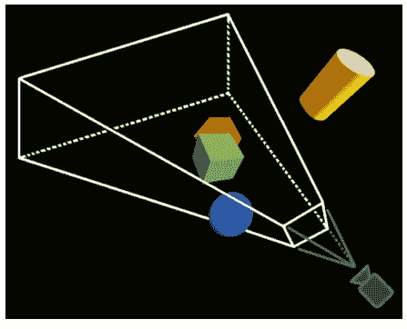

图 1.1 带有几何物体的三维场景、可视区域（白色轮廓）和虚拟摄像机（右下）。

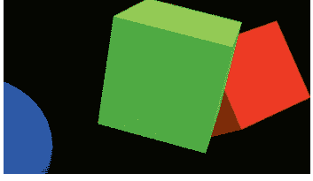

图 1.2 图 1.1 场景的渲染结果。

从技术、底层的角度来看，渲染场景会产生一个栅格——一个在屏幕上显示并排列成 2D 网格的像素（图像元素）数组。像素通常非常微小；放大图像可以说明单个像素的存在，如图 1.3 所示。

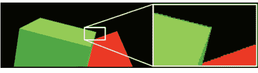

图 1.3 放大图像以说明单个像素。

在现代计算机系统中，像素使用三个浮点数三元组来指定颜色，表示颜色中红、绿、蓝光的分量；值 0 表示没有该颜色，而值 1 表示该颜色以全强度（100%）显示。之所以通常使用这三种颜色是因为人眼中的光敏受体对这些特定颜色最为敏感。三元组 `(1, 0, 0)` 代表红色，`(0, 1, 0)` 代表绿色，`(0, 0, 1)` 代表蓝色。黑色和白色分别由 `(0, 0, 0)` 和 `(1, 1, 1)` 表示。额外的颜色及其对应的红绿蓝分数值三元组（通常称为 RGB 值）如图 1.4 所示。

图像的质量取决于其分辨率（栅格中的像素数量）和精度（每个像素使用的位数）。由于每个位只有两个可能的值（0 或 1），用 N 位精度可以表示的颜色数量为 `2N`。例如，早期的 8 位图形视频游戏机可以显示 256 种不同颜色。单色显示器可以说是具有 1 位图形，而现代显示器通常具有“高色”（16 位，65,536 种颜色）或“真彩”（24 位，超过 1600 万种颜色）图形。图 1.5 展示了高精度但不同分辨率渲染的相同图像，而图 1.6 展示了高分辨率但不同精度渲染的相同图像。

在计算机科学中，缓冲区（或数据缓冲区、缓冲区内存）是计算机内存的一部分，用于在数据从一个位置移动到另一个位置时的临时存储。像素数据存储在称为帧缓冲器的内存区域。帧缓冲区可能包含多个为每个像素存储不同类型数据的缓冲区。

| 颜色 | R | G | B | 颜色 | R | G | B |
|---|---:|---:|---:|---|---:|---:|---:|
| 红色 | 1 | 0 | 0 | 黑色 | 0 | 0 | 0 |
| 橙色 | 1 | 5 | 0 | 白色 | 1 | 1 | 1 |
| 黄色 | 1 | 1 | 0 | 灰色 | 0.5 | 0.5 |  |
| 绿色 | 0 | 1 | 0 | 棕色 | 0.5 | 2 | 0 |
| 蓝色 | 0 | 0 | 1 | 粉色 | 1 | 5 | 0.5 |
| 紫色 | 0.5 | 0 | 1 | 青色 | 0 | 1 | 1 |

图 1.4 各种颜色及其对应的 RGB 值。

## 1.2 使用 Java 和 OpenGL 开发图形框架

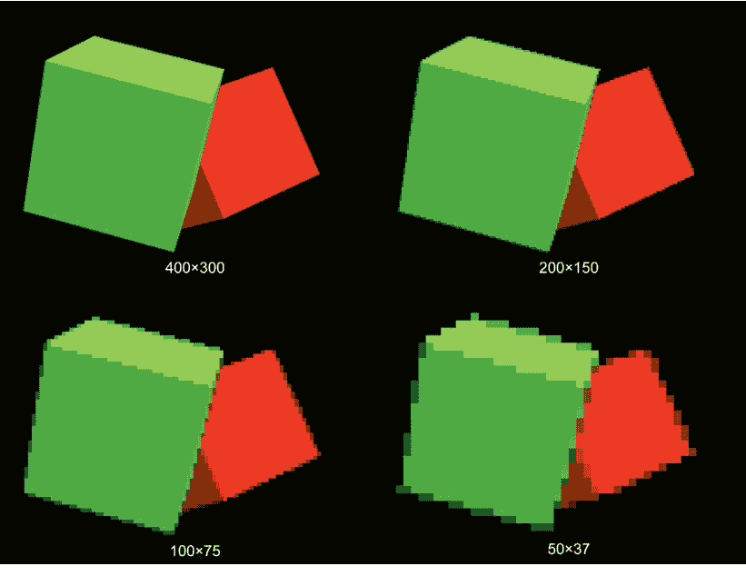

图 1.5 以不同分辨率渲染的单个图像。

帧缓冲区可能包含多个为每个像素存储不同类型数据的缓冲区。

OpenGL 函数允许你利用 GPU 的图形能力并渲染出真正令人惊叹的 3D 场景。此渲染过程中涉及的步骤将在接后的章节中详细描述。

### 1.2.1 图形流水线

流水线是一个抽象模型，描述了渲染 3D 场景所需的一系列步骤。将计算任务流水线化是指将其拆分为多个子任务，每个子任务都可以并行处理，类似于工厂中生产产品的流水线，这极大提高了整体效率。图形流水线提高了渲染过程的效率，使图像能够以更快的速度显示。存在多种流水线模型；本节描述的模型通常用于使用 OpenGL 渲染实时图形，它由四个阶段组成（如图 1.7 所示）：

- **应用阶段**（Application Stage）：初始化显示渲染图形的窗口，向 GPU 发送数据。
- 几何处理（Geometry Processing）：确定要渲染的几何形状的每个顶点的位置，由名为顶点着色器（vertex shader）的程序实现。
- 光栅化（Rasterization）：确定哪些像素对应于要渲染的几何形状。
- 像素处理（Pixel Processing）：确定渲染图像中每个像素的颜色，涉及名为片段着色器（fragment shader）的程序。

这些阶段中的每一个将在后续章节中进行更详细的描述；下一章将包含实现此处描述的许多过程的代码。

#### 1.2.1.1 应用阶段

应用阶段主要涉及在 CPU 上运行的进程。首要任务之一是创建一个显示渲染图形的窗口。在使用 OpenGL 时，可以使用多种编程语言来实现此点。必须初始化窗口（或画布对象），以便从 GPU 帧缓冲区中读取图形。对于动画或交互式应用程序，主程序包含一个反复渲染场景的循环，目标是达到 60 FPS 的速率。CPU 可能处理的其他进程包括监控硬件以检测用户输入事件，或运行物理模拟和碰撞检测等任务的算法。

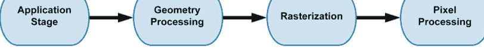

图 1.7 图形流水线。

应用程序的另一类任务包括读取渲染过程所需的数据并将其发送到 GPU。这些数据可能包括顶点属性（描述正在渲染的几何形状的外观）、将应用到表面上的图像，以及顶点着色器和片段着色器程序的源代码（稍后将在图形流水线中使用）。OpenGL 描述了用于将这些数据传输到 GPU 的函数；这些函数通过用于编写应用程序的编程语言的绑定访问。顶点属性数据存储在称为顶点缓冲区对象（VBOs）的 GPU 内存缓冲区，作为纹理使用的图像存储在纹理缓冲区中。需要注意的是，这些存储的数据没有分配给任何特定的程序变量；这些关联稍后指定。最后，顶点着色器和片段着色器程序的源代码需要发送到 GPU、编译并加载。如果需要，可以在应用程序的主循环中更新缓冲区数据，并且还可以向着色器程序发送额外数据。

一旦将必要数据发送到 GPU，在进行渲染之前，应用程序需要指定存储在 VBOs 中的属性数据与顶点着色器中属性变量之间的关联。单个几何形状的每个顶点可能有多个属性（如位置和颜色），相应的数据在渲染过程中从缓冲区流到着色器中的变量中。通常也需要处理许多组此类关联：可能存在多个几何形状（数据存储在不同的缓冲区中）由同一个着色器程序渲染，或者每个形状可能由不同的着色器程序渲染。这些关联集可以通过顶点数组对象（VAOs）方便地管理，它们存储这些信息，并在渲染过程中根据需要激活和去激活。

#### 1.2.1.2 几何处理

在计算机图形学中，几何对象的形状由网格（mesh）定义：一组被分组成线或三角形的点，如图 1.8 所示。

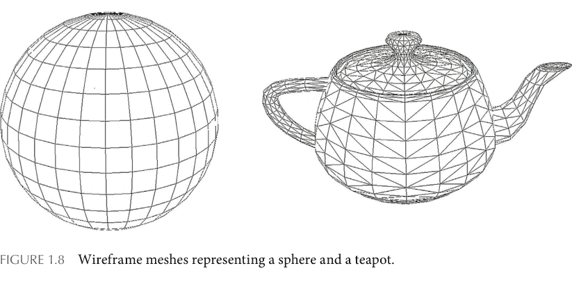

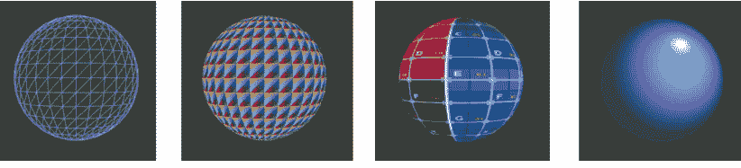

**图 1.9** 球的不同渲染效果：线框、顶点颜色、纹理和光照效果。

除了对象的整体形状外，还需要额外信息来描述如何渲染该对象。渲染每个单独点的特定属性或属性分组到一个称为顶点（vertex）的数据结构中。顶点至少必须包含对应点的 3D 位置。顶点包含的额外数据包括：

- 渲染点时使用的颜色。
- **纹理坐标**（UV 坐标），指示图像中映射到顶点的点。
- **法向量**（normal vector），指示垂直于面的方向，通常用于光照计算。

图 1.9 展示了利用这些属性的球的不同渲染效果。可以根据需要定义额外的顶点属性。

在几何处理阶段，顶点着色器被应用于每个顶点；着色器中的每个属性变量都从根据之前指定关联的缓冲区中接收数据。顶点着色器的主要目的是确定每个被渲染的点的最终位置，这通常通过一系列变换计算得出：

- 定义对象固有形状的点集可能会被平移、旋转和缩放，使其相对于虚拟世界具有特定的位置、方向和大小。从该参考系表示坐标称为**世界空间**（world space）。
- 世界中可能存在带有位置和方向的虚拟摄像头。为了从摄像机的视角渲染世界，

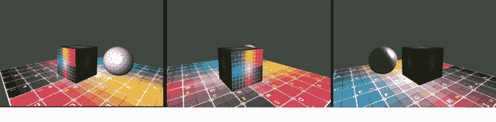

图 1.10 从多个位置和角度渲染的场景。

- 世界中被认为可见的点集（占据箱形或视锥形区域）必须缩放并对齐到 OpenGL 渲染的空间：一个坐标为 -1 和 1 的立方体区域。顶点着色器返回的每个点假设在该参考系中。在该区域之外的点都会被自动丢弃或裁剪；在此阶段的坐标称为**裁剪空间**（clip space）。此任务通过投影变换完成。具体来说，它被称为正交投影或透投影，取决于可见区域的形状是箱形还是视锥形。透投影通常被认为能产生更真实的图像，因为距离虚拟摄像头远的物体会被更大的压缩，因此在渲染场景时看起来更小。这两种投影的区别如图 1.11 所示。

除了这些变换计算外，顶点着色器还可以执行额外的计算并根据需要向片段着色器发送额外信息。

#### 1.2.1.3 光栅化

一旦顶点着色器指定了每个顶点的最终位置，光栅化阶段就开始了。点本身必须首先分组为所需的几何图元：点、线或三角形，它们由 1、2 或 3 个点的集合组成。对于线或三角形，必须指定额外信息。例如，考虑将点数组 `[A, B, C, D, E, F]` 分组为线。它们可以被分组为不相交的对，例如 `(A, B)`、`(C, D)`、`(E, F)`，产生一组不连接的线段。或者，它们也可以以重叠对的形式进行分组，例如 `(A, B)`、`(B, C)`、`(C, D)`、`(D, E)`、`(E, F)`，产生一组连接的线段（线带）。当渲染过程开始时，将使用 OpenGL 函数指定几何图元的类型和点的分组方法。将点分组为几何图元的过程被称为**图元装配**。

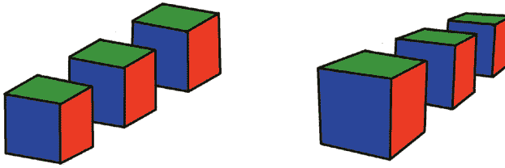

图 1.11 使用正交投影（左）和透投影（右）渲染的一系列立方体。

一旦完成了图元装配，下一步是确定哪些像素对应每个几何图元的内部。由于像素是离散单元，它们通常会近似几何形状的连续性，必须给出一个标准来明确哪些像素位于内部。三个简单的标准可以是：

- 整个像素区域包含在形状内。
- 像素中心位于形状内。
- 像素的任何部分包含在形状内。

将这些标准中的每一个应用于三角形的效果如图 1.12 所示，其中原始三角形显示为蓝色轮廓，符合标准的像素被填充为灰色。

对于对应形状内部的每个像素，都会创建一个**片元**（fragment）：这是一组用于确定渲染图像中单个像素的数据。存储在片元中的数据始终包含**光栅位置**，也称为**像素坐标**。在渲染 3D 场景时，片元还会存储**深度值**，当不同几何对象的点从观察者的视角重叠时，就需要该值。当这种情况发生时，相关的片元将对应同一个像素，深度值决定了渲染该像素时应该使用哪个片元的数据。

每个顶点可以被分配额外数据（如颜色），并从顶点着色器传递到片元着色器。在这种情况下，每个片元都添加了一个新的数据字段。每个内部点分配该字段的值是从顶点值**插值**得到的：通过加权平均值计算，取决于内部点到每个顶点的距离。内部点越靠近顶点，在计算插值时，该顶点值的权重就越大。例如，如果

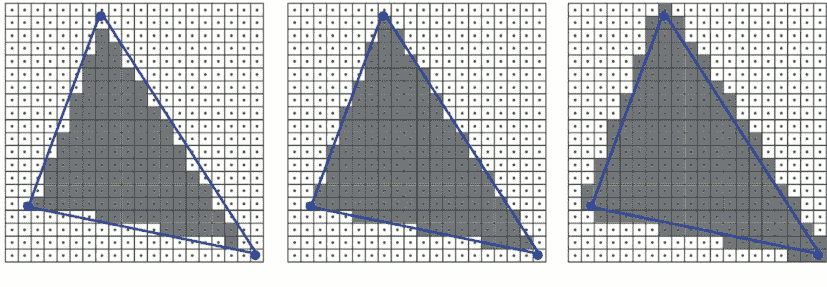

图 1.12 三角形光栅化的不同标准。

三角形的顶点被分配红色、绿色和蓝色，然后对应于三角形内部的每个像素将分配这些颜色的组合，如图 1.13 所示。

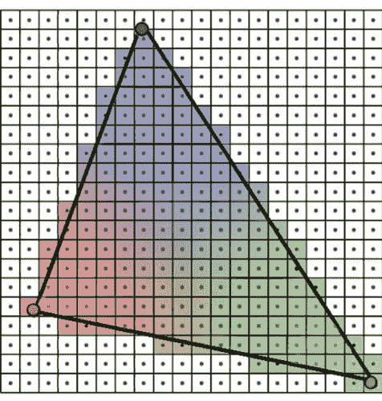

图 1.13 颜色属性插值。

#### 1.2.1.4 像素处理

此阶段的主要目的是确定每个像素的最终颜色，并将此数据存储在帧缓冲区内的颜色缓冲区。在像素处理阶段的第一部分，会将一个名为片元着色器（fragment shader）的程序应用于每个片元，以计算它们的最终颜色。这种计算可能涉及每个片元中存储的各种数据，并结合渲染期间全局可用的数据，例如：

- 应用于整个形状的基础颜色。
- 存储在每个片元中的颜色（从顶点颜色插值而来）。
- 纹理（应用到形状表面的图像，如图 1.14 所示），颜色从纹理坐标指定的区域采样。
- 光源，其相对位置或方向可能会点亮或弄暗颜色，取决于由法向量指定的表面面朝的方向。

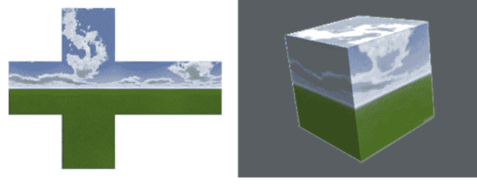

图 1.14 作为 3D 对象纹理使用的图像文件（左）（右）。

像素处理阶段的某些方面由 GPU 自动处理。例如，存储在每个片元中的深度值用于此阶段解决 3D 场景中的问题，确定对象的哪些部分被其他对象遮挡了视线。在计算出片元的颜色后，片元的深度值将与相应像素坐标处深度缓冲区中当前存储的值进行比较。如果片元的深度值小于深度缓冲区的值，则相应点比之前处理的任何点都离观察者，片元的颜色将覆盖当前存储在相应像素坐标颜色缓冲区的数据。

透明度也由 GPU 处理，使用存储在每个片元颜色中的 alpha 值。颜色的 alpha 值用于表示这种颜色与其他颜色混合的比例。例如，当将具有 alpha 值 0.6 的颜色 `C1` 与另一种颜色 `C2` 组合时，生成的颜色将通过将 `C1` 每个分量值的 60% 加上 `C2` 每个分量值的 40% 来创建。图 1.15 描述了一个涉及透明度的简单场景。

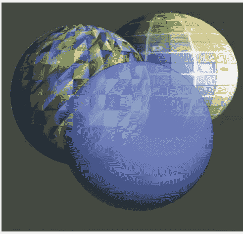

图 1.15 带有透明度的渲染场景。

然而，渲染透明对象有一些微妙之处。这些计算与深度值解析同时发生，涉及透明度的场景必须按照特定的顺序渲染对象：所有不透明对象必须从远到近相对于摄像机进行渲染。不遵循此顺序会导致透明效果失效。例如，如图 1.15 所示的场景包含一个靠近摄像机的透明对象和多个距离较远的不透明对象。假设按照之前描述的渲染顺序，首先渲染透明对象，然后是不透明对象。

## 1.3 设置开发环境

上一节讨论的光栅化流水线大部分——几何处理、光栅化和像素处理——都由 GPU 处理，正如之前提到的，我们将使用 OpenGL 执行这些任务。对于开发应用程序，可以选择许多编程语言。本书将解释如何使用 Java 开发这些应用程序，并提供一个完整的框架来简化交互式 3D 场景的设计和创建。

构建大型项目时，使用集成开发环境（IDE）来组织代码非常有帮助。一种推荐的 IDE 是 IntelliJ，因为它具有诸如自动编译类导入语句，以及输入时自动完成函数、方法和变量名等功能。如果你愿意，可以使用不同的开发环境，这时可以直接跳到第 2 章。

要安装由名为 JetBrains 的软件开发公司创建的 IntelliJ，请使用浏览器访问页面 <https://www.jetbrains.com/idea/>。如图 1.16 所示，点击下载按钮即可。

安装程序适用于 Windows、Mac OS X 以及多种平台。免费提供的“社区版”（图 1.17 所示）足以开发此书中的框架。

IntelliJ 捆带了 Java 开发工具包（JDK），这是用于编译和运行 Java 代码的软件，因此无需安装其他任何内容。


图 1.16 JetBrains 首页：<https://www.jetbrains.com/idea/>

为了验证所有内容都已正确安装，传统的做法是编写一个“Hello, world!”程序，它向文本控制台打印消息。要继续，请启动 IntelliJ 软件，一旦打开（如图 1.18 所示），选择 **Next（下一步）> New Project（新建项目）**。


默认情况下，系统已为你选好了 JDK。点击 Next（下一步），直到出现一个可以在其中命名项目的窗口。将此项目命名为`Test`并点击 Finish（完成）。完成此操作后，IDE 将执行后台任务以设置你的环境。片刻之后，屏幕左侧将显示一个文件夹层次结构，包含项目和源文件。右键点击`src`文件夹，高亮 New（新建），并点击 Java Class（Java 类），如图 1.19 所示。


图 1.17 JetBrains 下载页面。

## 使用 Java 和 OpenGL 开发图形框架


图 1.18 IntelliJ 启动界面。

将此类命名为`HelloWorld`。（对应的文件会自动带有`.java`扩展名。）完成此后，你将看到一个名为`HelloWorld`的文件。该文件将包含 Java 类的标准模板代码。在该文件中，你只需要添加一个`main`方法和一个打印语句。添加代码使文件显示如下：

```java
public class HelloWorld {
    public static void main(String[] args) {
        System.out.println("Hello World!");
    }
}
```

此时，你可以编译并运行项目。在右键菜单中，点击 Build > Build Project（构建 > 构建项目）。构建完成后，点击 Run > Run "HelloWorld"（运行 > 运行 "HelloWorld"）。在窗口底部区域，你将看到一个包含程序输出的文本控制台，如图 1.20 所示。

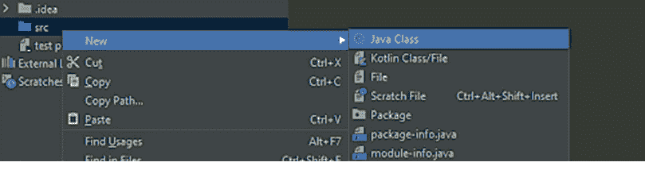

图 1.19 创建新的 Java 类。

## 计算机图形导论 17

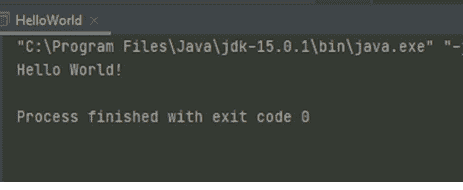

图 1.20 运行`HelloWorld`程序。

一旦看到此输出，你就可以确认 IntelliJ 已安装并配置正确。

## 1.4 总结与后续步骤

在本章中，你学习了计算机图形学中使用的核心概念和词汇，包括渲染、缓冲区、GPU 和着色器。然后，你学习了图形流水线中的四个主要阶段：应用阶段、几何处理、栅格化和像素处理；本节引入了额外的术语，包括顶点、VBOs、VAOs、变换、投影、片段和插值。最后，你学习了如何设置 Java 开发环境 IntelliJ。在下一章中，你将使用 Java 开始实现这些理论原理的图形框架。


# LWJGL 和 OpenGL 简介

在本章中，你将学习如何使用轻量 Java 游戏库（LWJGL）创建窗口，以及如何使用 OpenGL 在这些窗口中绘制图形。你将从渲染点开始，随后是单色的线和三角形。然后你用多种颜色绘制多个形状，创建一系列涉及移动和颜色过渡的动画，并实现具有键盘控制移动功能的交互应用程序。

## 2.1 使用 LWJGL 创建窗口

正如图形流水线讨论所示，渲染图形的第一步是开发一个显示图形的应用程序。由于有多种编程语言；在书中你将使用 Java 和 LWJGL（一个流行的 Java 游戏开发库）编写窗口应用程序。

（注：原文中存在大量重复段落，已根据逻辑进行去重处理以确保翻译流畅。）

## 使用 Java 和 OpenGL 开发框架

针对你的操作系统（Windows、macOS 或 Linux），核心、OpenGL 组件以及 STB 组件（见第 5 章）。

一旦获得了 JAR 文件，你需要将它们添加到项目中。传统上，它们被添加到名为`lib`（库的缩写）的文件夹中。打开项目 Structure。在出现的窗口中，在 Settings 下选择 Modules，然后点击 + 图标。选择 JARs or Directories。从浏览器窗口导航并选择你创建的`lib`文件夹，然后点击 OK。这将配置项目在编译时使用目录。

在 Java 中，包是包含可以导入应用程序的类的目录；这些将用于进一步分类代码。首先，右键点击`src`文件夹并选择 New > Package。接下来，右键点击`core`包创建一个名为`Base`的 Java 类；这将是初始化 LWJGL 并显示窗口的类。

考虑到开发的应用程序最终将具有交互和动画，此类将被设计为处理应用程序的标准生命周期：

- **启动**：在此阶段，创建对象、初始化值并加载任何所需的外部文件。

- **主循环**：当应用程序运行时，此阶段将持续重复（通常每秒 60 次），由以下子阶段组成：
  - **处理输入**：检查用户是否执行了任何向计算机发送数据的操作，例如按下键盘键或点击鼠标。
  - **更新**：更改变量和对象的值。
  - **渲染**：创建显示在屏幕上的图形。

- **关闭**：此阶段通常在用户执行指示停止运行的操作时开始（例如点击按钮退出应用程序）。此阶段可能涉及指示应用程序停止检查输入并关闭应用程序创建的任何窗口。

这些阶段由图 2.1 中的流程图所示。

`Base`类将被设计供书中各种应用程序进行扩展。根据模块化原则，处理用户输入将由你稍后创建的名为`Input`的独立类来处理。在你创建的`Base` Java 基类中，将类定义更改为`public abstract class Base`并添加以下代码，这些代码包含了初始化窗口时使用的变量：

```java
// window dimensions
private int windowWidth;
private int windowHeight;
// 窗口句柄
private long window;
// 主循环是否正在激活；
private boolean running;
```

随后，添加以下代码来定义一组方法，这些方法将对应应用程序生命周期的不同阶段。抽象方法的代码将由扩展`Base`类的类提供，而其余方法的代码将在本节稍后添加。

```java
public Base() { }
public void startup() { initialize(); }
public abstract void initialize();
public abstract void update();
public void run(int windowWidth, int windowHeight) { }
public void shutdown() { }
```

首先，在`startup`方法中插入以下代码：

```java
// initialize GLFW
boolean initSuccess = glfwInit();
if ( initSuccess ) {
    throw new RuntimeException("Unable to initialize GLFW");
}
```

```java
// 创建窗口和相关的 OpenGL 上下文，
// 它存储帧缓冲区和其他状态信息
glfwWindowHint(GLFW_CONTEXT_VERSION_MAJOR, 3);
glfwWindowHint(GLFW_CONTEXT_VERSION_MINOR, 2);
```

```java
glfwWindowHint(GLFW_OPENGL_PROFILE, GLFW_OPENGL_CORE_PROFILE);
glfwWindowHint(GLFW_RESIZABLE, GL_FALSE);
window = glfwCreateWindow(windowWidth, windowHeight,
"Graphics Window", 0, 0);
if (window == 0) {
    throw new RuntimeException("Failed to create the GLFW window");
}
```

```java
running = true;

// 使所有的 OpenGL 函数调用
// 应用于此上下文实例
glfwMakeContextCurrent(window);

// 指定屏幕更新的次数
// 在交换缓冲区之前等待
// 设置为 1 以将应用程序帧率
// 与显示刷新率同步；
// 防止视觉上的“撕裂”伪影
glfwSwapInterval(1);
// 检测当前上下文并为用户
// 提供 OpenGL 绑定
GL.createCapabilities();
```

接下来，在`run`方法内部，插入以下代码，该代码按相应的顺序调用与应用程序生命周期对应的方法：

```java
this.windowWidth = windowWidth;
this.windowHeight = windowHeight;

startup();

{
    // 特定的启动代码
    initialize();

    // 主循环
    while (running) {
        // 检查用户交互事件
        glfwPollEvents();

        // 检查是否点击了窗口关闭图标
        if ( glfwWindowShouldClose(window) )
            running = false;
    }

    // 特定的更新代码
    update();
}
```

```java
// 交换颜色缓冲区
// 在屏幕上显示渲染的图形
glfwSwapBuffers(window);

shutdown();
```

最后，在`shutdown`方法内部，插入以下代码：

```java
// 停止对用户输入的窗口监控
glfwFreeCallbacks(window);

// 关闭窗口
glfwDestroyWindow(window);

// 停止 GLFW
glfwTerminate();

// 停止错误回调
glfwSetErrorCallback(null).free();
```

到此`Base`类的代码编写完毕；稍后将添加附加功能来处理用户交互。除了上述代码中的注释外，以下观察结果值得注意：

- `windowWidth`和`windowHeight`参数可以根据需要更改。目前，如果屏幕设置为非正方形尺寸，这将导致渲染的图像沿一个方向拉伸。这将在第 4 章讨论宽高比例时解决。

- 窗口标题在`glfwCreateWindow()`函数中设置，可以根据需要更改。

- 使用了名为**双缓冲**的渲染技术，它使用了两个图像缓冲区。当一个缓冲区的像素数据显示在屏幕上时，新数据被写入第二个缓冲区。当新图像准备就绪时，应用程序会切换哪个缓冲区显示在屏幕上、哪个缓冲区被写入；这在 LWJGL 中通过`glfwSwapInterval()`和`glfwSwapBuffers()`函数实现。双缓冲技术消除了名为“撕裂”的不良视觉伪影。

# 26 使用 Java 和 OpenGL 开发图形框架

GLSL 中的基本数据类型有布尔值、整数和浮点值，分别由`bool`、`int`和`float`表示。GLSL 还有向量数据类型，通常用于存储位置、颜色和纹理坐标等值。向量可以有两个、三个或四个分量，分量分别由`vec2`、`vec3`和`vec4`（针对浮点数）表示。作为一种类 C 语言，GLSL 提供了数组和结构体：用户定义的数据类型。为了方便图形相关的计算，GLSL 还具有矩阵数据类型，它提供了变换（平移、旋转、缩放和投影），以及采样器数据类型，它表示纹理；这些将在稍后的章节中介绍。

向量类型的组件可以通过多种方式访问。例如，一旦初始化了命名为`v`的`vec4`，可以使用数组符号（`v[0]`、`v[1]`、`v[2]`、`v[3]`），或使用点符号访问以下三种系统中的任意一种：`v.x`、`v.y`、`v.z`、`v.w`；`v.r`、`v.g`、`v.b`、`v.a`；或`v.s`、`v.t`、`v.p`、`v.q`。虽然所有系统都可以互换，但程序员通常会选择与上下文相关的系统以提高可读性：`(x, y, z, w)`用于位置，`(r, g, b, a)`用于颜色（红、绿、蓝、alpha 通道），`(s, t, p, q)`用于纹理坐标。

每个着色器必须包含一个`main`函数，类似于 C 编程语言。没有返回值（由关键字`void`表示），且`main`函数不需要参数，因此每个着色器都具有以下通用结构：

```glsl
void main ()
{
    // 代码语句
}
```

在上一章对图形流水线的描述中，提到了顶点着色器将接收通过缓冲区渲染的几何形状的数据。此时，你可能在想，如果`main`函数不接受任何参数，顶点属性数据是如何从缓冲区发送到顶点着色器的。数据通过用类型限定符声明的变量在着色器之间进出：类型限定符是修改变量属性的额外关键字。例如，许多编程语言都有一种限定符来表示变量的值将保持不变；在 GLSL 中，这通过关键字`const`表示。此外，在处理着色器时，关键字`in`表示变量的值将由图形流水线的上一个阶段提供，而关键字`out`则表示一个值将被传递到图形流水线的下一个阶段。

更具体地说，在顶点着色器的语境下，`in`表示值将传递给片段着色器。在片段着色器的语境下，`in`表示值将从顶点着色器提供（在光栅化阶段进行插值），而`out`表示值将存储在各种缓冲区（颜色、深度或模板）之一中。

在编写用于 GPU 程序的着色器代码时，需要两个特殊的`out`变量。首先，记住顶点着色器的最终目标是计算点的位置。OpenGL 使用内置变量`gl_Position`来存储此值；顶点着色器必须为此变量赋值。其次，记住片段着色器的最终目标是计算像素的颜色。早期版本的 OpenGL 使用名为`gl_FragColor`的内置变量来存储此值，并且每个片段着色器都被要求为此变量赋值。后续版本的 OpenGL 要求片段着色器代码为此目的显式声明一个`out`变量。

最后，应该提到，这两者都是`vec4`类型变量。对于存储颜色数据，这是合理的，因为需要红、绿、蓝和 alpha（透明度）值。对于存储位置数据，这就不那么直观了，因为三维空间可以使用 x、y 和 z 坐标来指定。通过包含第四个坐标（通常称为`w`并设置为值 1），使得几何变换（如平移、旋转、缩放和投影）成为可能。


> 注：原文后半部分存在大量逻辑重复和结构混乱的句子，翻译时已根据语意进行了对应处理，并保持了术语专业性。

# LWJGL 和 OpenGL 简介

## 2.2.2 编译 GPU 程序

现在你已经学习了编写着色器的基础知识，下一步是学习如何编译和链接顶点和片段着色器以创建 GPU 程序。为了继续创建复用框架的目标，你将创建一个执行这些任务的工具类。在本节及后续章节中，将介绍并描述许多 OpenGL 函数，并采用以下格式：

```text
functionName(parameter1, parameter2, ...)
这些函数和参数的描述。
```

许多函数的语法与 Khronos Group 维护的官方参考页面相同：https://www.khronos.org/registry/OpenGL-Refpages/

编译 GPU 程序的第一步涉及单个着色器。必须创建着色器对象来存储代码，将源码发送到这些对象中，然后编译着色器。这些任务通过以下三个函数完成：

```text
glCreateShader(shaderType)
创建一个空着色器对象，用于存储着色器的源码并返回一个可以引用的值。着色器的类型（例如顶点着色器或片段着色器）通过 shaderType 参数指定，其值将是 OpenGL 常量，如 GL_VERTEX_SHADER 或 GL_FRAGMENT_SHADER。
```

```text
glShaderSource(shaderRef, shaderCode)
将字符串参数 shaderCode 中的源码存储在由参数 shaderRef 引用的着色器对象中。
```

```text
glCompileShader(shaderRef)
编译由参数 shaderRef 引用的着色器对象中存储的着色器代码。
```

由于编写着色器代码时可能会犯错误，编译着色器可能会成功或失败。与通常会自动显示给程序员的应用程序编译错误不同，着色器编译错误需要专门检查。

过程通常通过多个步骤处理：检查编译是否成功，如果没有，则获取错误消息并删除着色器对象以释放内存。这通过以下函数处理：

```java
glGetShaderDeriv(shaderRef, shaderInfo)
```

返回关于参数 `shaderRef` 所引的着色器的信息。获取的信息的类型由 `shaderInfo` 参数指定，其值将是一个 OpenGL 常量，例如 `GL_SHADER_TYPE`（用于确定着色器类型）或 `GL_COMPILE_STATUS`（用于确定编译是否成功）。

```java
glGetShaderInfoLog(shaderRef)
```

返回关于参数 `shaderRef` 所引的着色器的编译过程信息（如错误和警告）。

```java
glDeleteShader(shaderRef)
```

释放参数 `shaderRef` 所引的着色器所使用的内存，并为未来创建的着色器提供该引用。

在了解这些 Java 中所需的函数和常量后，就可以开始编写了。LWJGL 通过 OpenGL 包访问这些常量。首先，你将创建一个包含静态方法的类，用于加载包含着色器代码的文件，并使用之前提到的 OpenGL 函数创建着色器对象、上传着色器代码以及编译着色器程序。在 `core` 包中，创建一个名为 `OpenGLUtils` 的新 Java 类，包含以下代码：

```java
package core;

import static org.lwjgl.opengl.GL40.*;
import java.nio.file.Files;
import java.nio.file.Paths;

public class OpenGLUtils {
    public static int initFromFiles(
        String vertexShaderFileName,
        String fragmentShaderFileName ) {
        return initProgram(
            readFile(vertexShaderFileName),
            readFile(fragmentShaderFileName));
    }

    public static String readFile(String fileName) {
        String text = "";
        try {
            text = new String(
                Files.readAllBytes(Paths.get(fileName))
            );
        } catch (Exception e) {
            e.printStackTrace();
            return text;
        }

        // 用于存储调试代码的数组
        static int[] status = new int[1];
        public static void initShader(String shaderCode, int shaderType) {
            // 指定特定的 OpenGL 版本
            shaderCode = "#version 330\n" + shaderCode;
            // 创建着色器对象并返回引用值
            int shaderRef = glCreateShader(shaderType);
            glCompileShader(shaderRef);
            // 将源码存储在着色器中
            glShaderSource(shaderRef, shaderCode);
            // 编译存储在着色器对象中的源码
            glCompileShader(shaderRef);
            // 查询着色器编译是否成功
            glGetShaderShader(shaderRef, GL_COMPILE_STATUS, status);
            if (status[0] == GL_FALSE) {
                // 获取错误消息
                String errorMessage = glGetShaderInfoLog(shaderRef);
                // 释放存储着色器程序的内存
                glDeleteShader(shaderRef);
                // 停止程序并打印错误消息
                throw new RuntimeException(errorMessage);
            }
            // 编译成功；
            // 返回着色器引用值
            return shaderRef;
        }
    }
}
```

接下来，必须创建一个程序对象，并将编译后的着色器附加并链接在一起。这些任务需要使用以下 OpenGL 函数：

```java
glCreateProgram()
```

创建一个空的程序对象，通过该对象附加着色器对象。

```java
glAttachShader(programRef, shaderRef)
```

将着色器对象附加到程序中。

```java
glLinkProgram(programRef)
```

将着色器链接成程序。

正如在上一章讨论图形流水线时所提到的，必须使用顶点数组对象（VAO）来管理顶点缓冲区中的顶点数据。虽然这个示例没有使用缓冲区，但许多 OpenGL 的实现都需要创建并绑定 VAO，应用程序才能正常工作。你需要的两个函数是：

```java
glGenVertexArrays(vaoCount)
```

返回一组可用的 VAO 引用。返回引用的数量由整数参数 `vaoCount` 指定。

```java
glBindVertexArray(vaoRef)
```

绑定参数 `vaoRef` 所引的 VAO，如果不存在该对象则先创建它。解绑之前绑定的任何 VAO。

接下来，为了指定渲染时使用的程序并启动渲染过程，你将需要以下函数：

```java
glUseProgram(programRef)
```

指定渲染过程中使用的程序是参数 `programRef` 所引的程序。

```java
glDrawArrays(drawMode, firstIndex, indexCount)
```

使用 `glUseProgram` 指定的程序渲染原始图形（点、线或三角形）。程序的顶点着色器使用存储在数组缓冲区中的数据，从参数 `firstIndex` 指定的数组索引开始。数组元素的总数由参数 `indexCount` 使用。

在 `Base` 类中，在 `GL.createCapabilities()` 行之后，添加以下代码：

- 在下一节中，你将学习如何使用来自 `OpenGLUtils` 类的方法来编译着色器代码。

### 2.2.3 应用程序中的渲染

接下来，你将创建另一个应用程序（再次扩展 `Base` 类），它包含之前讨论的着色器代码以及来自 `OpenGLUtils` 类的编译着色器和创建程序的函数。在应用程序本身中，有一些需要执行的任务也需要 OpenGL。

```java
public static void checkVersion() {
    System.out.println("Vendor: " + glGetString(GL_VENDOR));
    System.out.println("Renderer: " + glGetString(GL_RENDERER));
    System.out.println("OpenGL version: " + glGetString(GL_VERSION));
}
```

最后，是一个美学考虑：取决于你的计算机显示器，可能很难观察到默认渲染为单个像素的单点。为了让这个点更容易可见，你可以使用该函数增加渲染点的尺寸。

`glPointSize(size)`

指定渲染点的直径（以像素为单位）等于参数 `size`。（如果未指定，默认值为 1）。

在创建下一个应用程序之前，你必须创建片元着色器和顶点着色器文件，以便在应用程序中存储着色器代码。在 `src` 文件夹中，创建一个名为 `Test_2_2.frag` 的新文本文件，包含以下代码：

```glsl
out vec4 fragColor;
void main()
{
    fragColor = vec4(1.0, 1.0, 0.0, 1.0);
}
```

接下来，创建一个名为 `Test_2_2.vert` 的文本文件，包含以下代码：

```glsl
void main()
{
    gl_Position = vec4(0.0, 0.0, 0.0, 1.0);
}
```

你现在已经准备好编写应用程序了。在 `src` 文件夹中，创建一个名为 `Test_2_2` 的新 Java 类，并包含以下代码。特别注意，之前创建的顶点和片元着色器文件的路径相对于项目根目录。这假设在你的开发环境中，你的项目已经配置为，项目根目录也是项目资源文件的根目录（这可能包括文本文件、图像文件等）。这在 IntelliJ 中可以通过右键点击项目根文件夹并选择“Resources Root”（资源根）来实现。

```java
import static org.lwjgl.opengl.GL40.*;
import core.*;
```

```java
public class Test_2_2 extends BaseRef{
{
    public int programRef;

    public void initialize(){
{
        // 加载代码，发送到 GPU 并编译；
        // 存储程序引用
        programRef = OpenGLUtils.initFiles(
            "./src/Test_2_2.vert", "./src/Test_2_2.frag" );
    }
}
```

```java
// 设置顶点数组对象
int vaoRef = glGenVertexArrays();
glBindVertexArray(vaoRef);
```

```java
// 渲染设置（可选）

// 设置点宽和高
glPointSize(10);
}
```

```java
public void update() {

// 选择渲染时使用的程序
glUseProgram(programRef);

// 使用所选的程序渲染几何对象
glDrawArrays(GL_POINTS, 0, 1);
}
```

```java
// 驱动层方法
public static void main(String[] args) {

new Test_2_2().run();
}
```

在程序中，渲染的点的尺寸被设置为直径 10 像素。当你运行此程序时，应该会出现一个类似于图 2.3 的窗口。

一旦你成功运行了此程序并查看了渲染的点，你就应该尝试更改着色器代码。如之前所述，尝试更改位置向量的 `x`、`y`、`z` 分量，或者颜色向量的 `r`、`g`、`b` 分量。

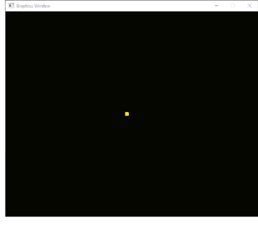

图 2.3 渲染单个点。

尝试更改主应用程序中指定的点大小。你甚至可能想故意在着色器代码中引入错误，以学习在每种情况下会显示什么错误信息。一些常见错误包括：

- 语句末尾缺少分号。
- 使用 `int` 代替 `float`。
- 给变量分配了错误的数据类型（例如将 `vec3` 赋值给 `vec4` 类型变量 `gl_Position`）。
- 在向量中使用错误数量的值。

逐个将每种错误引入你的着色器代码中，并熟悉相应的错误信息。一旦你完成了代码实验，你将学习的下一个主题是使用顶点缓冲区来绘制二维形状。

## 2.3 绘制形状

你编写的每个顶点着色器（上一节的单点着色器除外）都将使用存储在顶点缓冲区中的数据数组。指定任何二维或三维对象的形状都需要多个点。在接下来的内容中，你将学习允许应用程序与顶点缓冲区交互的 OpenGL 函数，创建一个执行这些任务的可重用类，然后编写一系列使用该类创建具有一个或多个颜色的一个或多个形状的应用程序。

### 2.3.1 使用顶点缓冲区

大多数涉及顶点缓冲区的任务发生在应用程序初始化时，因此回顾上一章中图形流水线应用程序阶段的划分可能有所帮助。简而言之，该阶段的相关步骤包括创建缓冲区、在缓冲区中存储数据以及指定顶点缓冲区与着色器变量之间的关联。这些任务由本节描述的 OpenGL 函数处理，首先是：

```text
glGenBuffers(bufferCount)
```

返回一组顶点缓冲区引用。引用的数量由整数参数 `bufferCount` 指定。

注意，与 OpenGL 函数 `glCreate` 和 `glCreateProgram` 不同，`glGenBuffers` 函数实际上并没有创建对象；这由下一个函数处理。

```text
glBindBuffer(bindTarget, bufferRef)
```

如果不存在对象，则创建一个由 `bufferRef` 引用的缓冲区对象。将缓冲区对象绑定到 `bindTarget`，`bindTarget` 的值为 OpenGL 常量，如 `ARRAY_BUFFER` 或 `TEXTURE_BUFFER`。

将缓冲区绑定到目标是许多后续操作的先决条件。后续函数——与缓冲区相关的函数——并不包含直接引用缓冲区的参数。相反，某些函数（如后续的 `glBind`）包含 `bindTarget` 参数，从而影响绑定的缓冲区。在其他情况下，函数可能不适用于特定的缓冲区，此时 `bindTarget` 是隐式的。例如，适用于顶点属性的函数（如后续的 `glVertexAttribPointer`）只影响顶点缓冲区，因此会自动影响绑定到 `ARRAY_BUFFER` 的缓冲区。

```text
glBindData(bindTarget, bufferData, bufferUsage)
```

为当前绑定到指定目标的缓冲区对象分配存储。（之前存储在关联缓冲区中的任何数据将被删除。）参数 `bufferUsage` 指明数据如何被访问，GL 实现可以使用此信息来提高性能。`bufferUsage` 的值为 OpenGL 常量，如 `STATIC_DRAW`（表示缓冲区内容将被修改一次）或 `DYNAMIC_DRAW`（表示缓冲区内容将被修改多次）。

为了建立缓冲区与着色器变量之间的关联，必须获取程序中着色器变量的引用。可以使用以下函数实现：

```text
glVertexAttribLocation(programRef, variableName)
```

返回一个用于引用着色器变量的值，该变量由参数 `variableName` 指定名称，并声明在参数 `programRef` 所引程序的顶点着色器中。如果变量在指定程序未声明或使用，则返回 `-1`。

一旦获取了属性变量的引用并绑定了相应的顶点缓冲区，可以使用后续函数建立缓冲区与变量之间的关联：

```text
glVertexAttribPointer(variableRef, baseType, normalize, stride, offset)
```


指定由`variableRef`指定的属性将从当前绑定到`ARRAY_BUFFER`的顶点缓冲区数组接收数据。基本数据类型由参数`baseType`指定，其值为 OpenGL 常量，如`INT`或`FLOAT`。每个属性的分量数量由参数`size`指定，其值为整数 1、2、3 或 4，取决于该属性是基本数据类型还是具有 2、3 或 4 个分量的向量。最后参数提供的灵活性。

## 使用 Java 和 OpenGL 开发图形框架

在本书中将不需要以下内容，但简而言之：参数`normalize`是一个布尔值，用于指定向量属性是否应重缩放到长度为 1；而参数`stride`和`offset`则用于指定如何从关联的缓冲区读取此属性的数据（可以将多个属性的数据打包并交错存储在单个缓冲区中，这对于减少对 GPU 的总调用次数有用）。

例如，如果着色器变量类型为`int`，则你将使用参数`size=1`和`baseType=GL_INT`；如果着色器变量类型为`vec3`（包含三个浮点数的向量），则你将使用参数`size=3`和`baseType=GL_FLOAT`（最后三个参数在本书中不会介绍，它们将始终被赋予默认值`normalize=False`、`stride=0`和`offset=None`）。

即使在指定了属性后，在渲染期间也不会通过以下函数显式访问对应的缓冲区：

```java
glEnableVertexAttribArray(variableRef)
```

指定绑定到参数`variableRef`所引用的着色器变量的顶点缓冲区中的值将在渲染过程中被访问和使用。

最后，提醒一下，VAO 将用于管理这些函数指定的顶点相关数据。当绑定一个 VAO 时，它会存储信息，包括程序中顶点缓冲区与属性变量之间的关联、数据在每个缓冲区中的排列方式以及哪些关联已启用。

### 2.3.2 属性类（Attribute Class）

通过之前描述的 OpenGL 函数，你现在准备好创建一个 Java 类来管理属性数据和相关任务。该类管理的信息将包括数据类型（`float`、`vec2`、`vec3`或`vec4`）、一个包含数据的数组以及存储数据的顶点缓冲区引用。该类处理的两个任务是将数据数组存储在顶点缓冲区中，并将属性缓冲区与给定程序中的着色器变量关联；每个任务都将通过一个方法实现。首先，在`core`包中创建一个名为`Attribute`的新 Java 类，并包含以下代码：

```java
package core;
import static org.lwjgl.opengl.GL40.*;

public class Attribute {
    // 数据数组中元素的类型：
    // int | float | vec2 | vec3 | vec4
    private String dataType;
```

```java
// 要存储在缓冲区中的数据数组
public float[] dataArray;
```

```java
// 存储生成缓冲区的结果
private int[] resultArray = new int[1];
```

```java
// 来自 GPU 的可用缓冲区引用
private int bufferRef;
```

```java
public Attribute(String dataType, float[] dataArray)
{
    this.dataType = dataType;
    this.dataArray = dataArray;
    // 返回单个缓冲区引用
    bufferRef = glGenBuffers();
    // 立即上传数据
    uploadData();
}
```

```java
// 将此数据存储在 GPU 缓冲区中
public void uploadData()
{
    // 选择后续函数使用的缓冲区
    glBindBuffer(GL_ARRAY_BUFFER, bufferRef);
```

```java
// 将数据存储在当前绑定的缓冲区中
glBufferData(GL_ARRAY_BUFFER, dataArray,
GL_STATIC_DRAW);
```

```java
// 将程序中的变量与此缓冲区关联
public void associateVariable(int programRef,
String variableName)
```

```java
// 获取给定名称的程序变量的引用
int variableRef = glGetAttribLocation(programRef,
variableName);
```

```java
// 如果程序没有引用变量，则退出
if (variableRef == -1)
    return;
```

```java
// 选择后续函数使用的缓冲区
glBindBuffer(GL_ARRAY_BUFFER, bufferRef);
```

```java
// 指定数据如何从
// 当前绑定的缓冲区读取
// 到指定的变量
```

```java
if ( dataType.equals("int") )
    glVertexAttribPointer(variableRef, 1, GL_INT,
        false, 0);
else if ( dataType.equals("float") )
    glVertexAttribPointer(variableRef, 1, GL_FLOAT,
        false, 0);
else if ( dataType.equals("vec2") )
    glVertexAttribPointer(variableRef, 2, GL_FLOAT,
        false, 0);
else if ( dataType.equals("vec3") )
    glVertexAttribPointer(variableRef, 3, GL_FLOAT,
        false, 0);
else if ( dataType.equals("vec4") )
    glVertexAttribPointer(variableRef, 4, GL_FLOAT,
        false, 0);
else
    throw new RuntimeException(
        " Attribute " + variableName +
        " has unknown type " + dataType );

// 表示数据将从缓冲区
// 流向此变量
    glEnableVertexAttribArray(variableRef);
```

除了上述代码中的注释外，请注意以下设计考虑因素：

- `uploadData`函数中的代码本可以是类初始化的一部分。然而，将此功能分离出来是为了处理在以后可能需要更改变量数据并更新相应的缓冲区的情况，在这种情况下可以再次调用该函数。
- 此类没有存储变量名称或访问缓冲区的程序引用，因为在实践中，可能会有多个程序执行此操作，且每个程序中的变量名称可能不同。
- 看起来来自`glVertexAttribPointer`的信息——特别是顶点缓冲区与程序变量之间的关联——没有存储在任何地方。然而，这些信息实际上是由在这些函数调用之前绑定的任何 VAO 存储的。

### 2.3.3 六边形、三角形和正方形

在本节中，你将创建一个绘制带轮廓形状的应用程序，这需要点数据数组。再次考虑美学：由于你将使用以下程序渲染线条，你可能希望增加它们的宽度以便更容易观察（默认的线条宽度为单像素）。可以通过以下函数实现：

```java
glLineWidth(width)
```

指定要渲染的线条宽度（像素）等于整数参数`width`。如果未指定，默认值为 1。某些 OpenGL 实现仅支持宽度为 1 的线条，在这种情况下尝试将宽度设置为大于 1 的值将导致错误。

有了这些知识，你现在准备好创建渲染一个或多个形状的应用程序。下一个应用程序渲染一个带轮廓的六边形。首先，你需要编写着色器程序，它们同样包含在文件中。首先，复制`Test_2.frag`并将其命名为`Test_3.frag`；该文件的代码不需要更改。其次，创建一个名为`Test_3.vert`的新文件。在该文件中插入以下代码：

```glsl
in vec3 position;
void main() {
    gl_Position = vec4(position.x, position.y, position.z, 1.0);
}
```

现在你准备好创建应用程序本身了。创建一个名为`Test_3`的新 Java 类，包含以下代码：

```java
import static org.lwjgl.opengl.GL40.*;
import core.*;

public class Test_3 extends Base {
    public int programRef;

    public void initialize() {
        // 加载代码，发送到 GPU 并编译；
        // 存储程序引用
        programRef = OpenGLUtils.initFromFiles(
            "./src/Test_3.vert",
            "./src/Test_3.frag")
        );

        // 渲染设置（可选）

        // 设置线条宽度
        glLineWidth(4);
    }
```

```java
// 设置顶点数组对象
int vaoRef = glGenArrays();
glBindVertexArray(vaoRef);
```

```java
float[] positionData = {
    0.8f, 0.0f, 0.0f,
    0.4f, 0.6f, 0.0f,
    -0.4f, 0.6f, 0.0f,
    -0.8f, -0.0f, 0.0f,
    -0.4f, -0.6f, 0.0f,
    0.4f, -0.6f, 0.0f
};
Attribute positionAttribute = new Attribute(
    "vec3", positionData );
positionAttribute.associateVariable(
    programRef, "position")
);
```

```java
public void update()
{
    // 选择渲染时使用的程序
    glUseProgram(programRef);

    // 使用所选定的程序渲染几何对象
    glDrawArrays(GL_LINE_LOOP, 0, 6);
}
```

```java
// 驱动方法
public static void main(String[] args)
{
    new Test_3().run();
}
```

此应用程序与上一个应用程序（渲染单个点的`Test_2_2`文件）有许多相似之处：片段着色器相同（像素呈黄色），且都使用了`initializeProgram`、`glUseProgram`和`glDrawArrays`函数。主要区别在于：

- 顶点着色器使用类型修饰符声明了名为`position`的`vec3`。这表明`position`是一个属性变量，因此它将从顶点缓冲区接收数据。
- 属性通过三行代码进行设置和配置，对应于以下任务：创建位置数据数组、创建一个`Attribute`对象（同时也存储在缓冲区中）以及与属性变量`position`关联。
- 创建一个 VAO 来存储与顶点缓冲区相关的信息。VAO 引用没有存储在类变量中，因为这里只有一组关联关系需要管理，且 VAO 在整个过程中都保持绑定状态。（当有多个组关联关系需要管理时，VAO 引用将存储在类变量中，以便在需要时在更新函数中绑定。）
- `glDrawArrays`函数的参数`GL_LINE_LOOP`表示将从每个点到下一个点绘制线，并且最后一个点也将与第一个点相连。

## LWJGL 和 OpenGL 43 简介

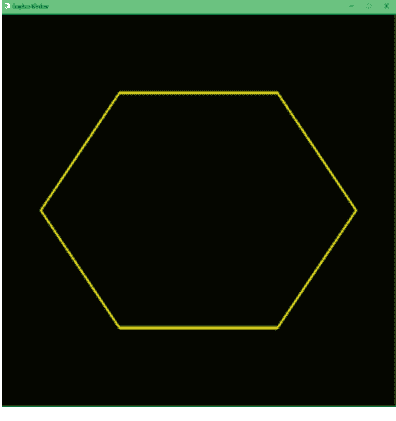

图 2.4 使用`GL_LINE_LOOP`渲染六个点。

当你运行此程序时，应该出现一个与图 2.4 所示类似的窗口。这是一个尝试绘制模式参数的好时机。还有两种额外的线段渲染配置。如果你想从每个点到下一个点画线段，但不连接最后一个点和第一个点，可以通过参数`GL_LINE_STRIP`实现。或者，如果你想画一系列不相交的线段，则使用`GL_LINES`，它会连接数组`[A, B, C, D, E, F]`中索引为偶数的点；`GL_LINES`将点分组为不相交的对`(A, B)`、`(C, D)`、`(E, F)`，并为每对绘制一条线段。这些情况在图 2.5 中所示（如果渲染的点数是奇数，则在这种情况下最后一个点将被忽略）。注意，A 代表最右侧的点，数组中的点按逆时针顺序列出。

还可以用填充三角形渲染二维形状。与渲染线条的情况类似，有多个参数会导致不同的点分组。最基础的是`GL_TRIANGLES`，它将点分组为不相交的组，类似于`GL_LINES`将点分组为不相交的对；继续之前的记法，组为`(A, B, C)`和`(D, E, F)`。在本示例中，`GL_TRIANGLE_FAN`同样很有用，它绘制一系列连接的三角形，其中所有三角形都与下一个三角形共享一条边，形成扇形排列。对于此示例，组为`(A, B, C)`、`(A, C, D)`、`(A, D, E)`和`(A, E, F)`，结果形成一个填充的六边形（同样会填充任何在圆周上按顺序指定点的多边形）。这些情况在图 2.6 中所示（图 2.6）。

现在你已经了解了如何在应用程序中使用单个缓冲区，接下来你将渲染两个不同的形状（一个三角形和一个正方形），它们的顶点位置存储在两个大小不同的独立缓冲区中。不需要新的概念或函数，着色器代码与之前的示例相比没有变化。主要区别在于需要调用两次`glDrawArrays`函数（每个形状调用一次），并且在每次调用之前，需要将正确的缓冲区关联到属性变量位置。这要求在需要时创建并绑定两个 VAO（在关联变量之前和绘制形状之前），因此 VAO 引用将存储在具有类级作用域的变量中。要继续操作，创建一个名为`Test_2_4`的新 Java 类并包含以下代码：

```java
import static org.lwjgl.opengl.GL40.*;

import core.*;

public class Test_2_4 extends Base {

    public int programRef, vaoTri, vaoSquare;

    public void initialize() {

        // 加载代码，发送到 GPU 并编译；

        // 存储程序引用

        programRef = OpenGLUtils.initFromFiles(

            "/src/Test_2_3.vert",

            "/src/Test_2_3.frag"

        );

        // 渲染设置（可选）

        glLineWidth(4);

        // 设置顶点数组对象：三角形

        vaoTri = glGenVertexArrays();

        glBindVertexArray(vaoTri);

        float[] positionDataTri = {

            -0.5f, 0.8f, 0.0f,

            -0.2f, 0.2f, 0.0f,

            -0.8f, 0.2f, 0.0f

        };

        Attribute positionAttributeTri = new Attribute("vec3", positionDataTri);

        positionAttributeTri.associateVariable(

            programRef, "position"

        );

        // 设置顶点数组对象：正方形

        vaoSquare = glGenVertexArrays();

        glBindVertexArray(vaoSquare);

        float[] positionDataSquare = {

            0.8f, 0.8f, 0.0f,

            0.8f, -0.8f, 0.0f,

            // ... (根据 OCR 流程省略了数据，但保持了逻辑流)

        };

        Attribute positionAttributeSquare = new Attribute("vec3", positionDataSquare);

        positionAttributeSquare.associateVariable(

            programRef, "position"

        );

    }

}
```

## 使用 Java 和 OpenGL 开发图形框架

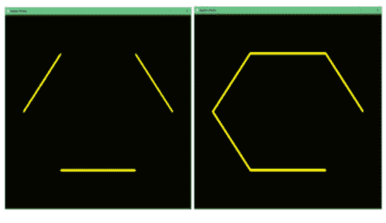

图 2.5 使用`GL_LINES`（左）和`GL_LINE_STRIP`（右）渲染六个点。

```java
public void update() {

    // 使用程序渲染两个形状

    glUseProgram(programRef);

    // 绘制三角形

    glBindVertexArray(vaoTri);

    glDrawArrays(GL_TRIANGLES, 0, 3);
```


```java
// 绘制正方形
glBindVertexArray(vaoSquare);
glDrawArrays(GL_TRIANGLES, 0, 4);
}

public static void main(String[] args) {
    new Test_2_4().run();
}
```

运行此应用程序的结果如图 2.7 所示。


图 2.6 使用 `GL_TRIANGLES` 和 `GL_TRIANGLE_FAN` 渲染六个点。

## 2.4 使用 Java 和 OpenGL 开发图形框架

现在你已经学习了如何使用缓冲区，你可能想将它们用于位置以外的其他用途。例如，如前所述，缓冲区可以存储顶点颜色。由于属性数据进入顶点着色器，颜色数据需要从顶点着色器传递到片段着色器，这是下一节的主题。

### 2.4.1 在着色器之间传递数据

在本节中，你将创建一个渲染六个点（再次以六边形排列）的应用程序，这需要数据（特别是颜色数据）从顶点着色器传递到片段着色器。从 GLSL 语言的介绍中，类型限定符是修改变量属性的关键字，特别是：

- 在顶点着色器中，`in` 表示值将从缓冲区提供，而 `out` 表示值将传递到片段着色器。
- 在片段着色器中，`in` 表示值从顶点着色器提供，并在光栅化阶段进行插值。

该应用程序将使用以下着色器。首先，创建一个名为 `Test_2_5.vert` 的新文本文件，包含顶点着色器代码：

```glsl
in vec3 position;
in vec3 vertexColor;
out vec3 color;

void main()
{
    gl_Position = vec4(position.x, position.y, position.z, 1.0);
    color = vertexColor;
}
```

注意有两个 `in` 变量，因为有两个顶点属性 `position` 和 `vertexColor`。每个属性的数据数组将存储在独立的缓冲区中，关联到相应的变量。数组应包含相同数量的元素；数组的长度是顶点数。对于给定的顶点，将使用相同的数组索引从每个属性数组检索数据。例如，使用位置数据数组索引 N 的值的顶点也将使用顶点颜色数据索引 N 的值。

此外，顶点着色器包含一个 `out` 变量 `color`，它将用于将数据传输到片段着色器；在顶点着色器中必须为此（通常来说是任何 `out` 变量）赋值。在这种情况下，`vertexColor` 中的值只是“传递”给变量 `color`；没有对该值进行任何计算。

接下来，创建一个名为 `Test_2_5.frag` 的新文本文件，包含片段着色器代码：

```glsl
in vec3 color;
out vec4 fragColor;

void main() {
    fragColor = vec4(color.r, color.g, color.b, 1.0);
}
```

注意，片段着色器使用了 `in` 变量，该变量名必须与对应的顶点着色器相同。（在程序链接时，执行的任务之一就是检查顶点着色器和片段着色器之间名称一致的 `out`/`in` 变量对。）为了可读性，顶点组件使用了 `(r, g, b)` 命名系统，因为它们在此语境中对应于颜色数据。

在理解这些新着色器后，你就可以准备创建应用程序了。它分离了 `Attribute` 对象来管理属性数据，但只需要创建一个 VAO，因为这些顶点缓冲区与程序中的不同变量相关。要继续操作，创建一个包含以下代码的新 Java 类 `Test_2_5`：

```java
import static org.lwjgl.opengl.GL40.*;
import core.*;

public class Test_2_5 extends BaseRef {

    public int programRef, vaoRef;

    public void initialize() {
        // 加代码，发送到 GPU 并编译；
        // 存储程序引用
        programRef = OpenGLUtils.initFromFiles(
            "/src/Test_2_5.vert",
            "/src/Test_2_5.frag"
        );

        // 渲染设置（可选）
        // 设置线宽
        glPointSize(10);
        glLineWidth(4);

        // 设置顶点数组对象
        vaoRef = glGenVertexArrays();
        glBindVertexArray(vaoRef);
    }
}
```

```java
float[] positionData = {
    0.8f, 0.0f, 0.0f,
    0.4f, 0.6f, 0.0f,
    -0.4f, 0.6f, 0.0f,
    -0.8f, 0.0f, 0.0f,
    -0.4f, -0.6f, 0.0f
};

Attribute positionAttribute = new Attribute(
    "vec3", positionData);

positionAttribute.associateVariable(
    programRef, "position");
```

```java
float[] colorData = {
    1.0f, 0.0f, 0.0f,
    1.0f, 0.5f, 0.0f,
    1.0f, 1.0f, 0.0f,
    0.0f, 1.0f, 0.0f,
    0.0f, 0.0f, 1.0f,
    0.5f, 0.0f, 1.0f
};

Attribute colorAttribute = new Attribute(
    "vec3", colorData);

colorAttribute.associateVariable(
    programRef, "vertexColor");
```

```java
public void update()
{
    glUseProgram(programRef);

    // 绘制对象
    glBindVertexArray(vaoRef);
    glDrawArrays(GL_POINTS, 0, 6);
}
```

```java
// 驱动方法
public static void main(String[] args)
{
    new Test_2_5().run();
}
```

运行此应用程序的结果如图 2.8 所示。回想上一章，图形流水线中的几何处理阶段（涉及顶点着色器）和像素处理阶段（涉及片段着色器）就是光栅化阶段。此时，程序的复杂度已经足够用以说明在此阶段发生的顶点属性插值。

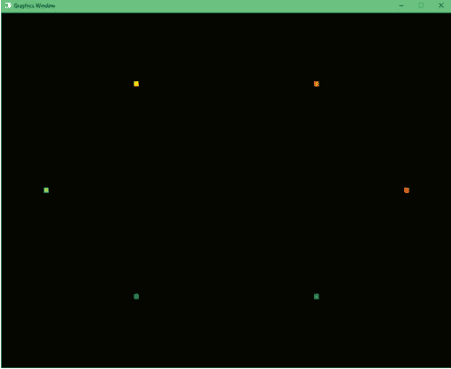

图 2.8 使用 `GL_POINTS` 渲染带有顶点颜色的六个点。

在光栅化阶段，点被分组为几何图型：点、线或三角形，取决于指定的绘制模式。GPU 决定哪些像素对应于每个几何图型占据的空间。对于这些像素中的每一个，GPU 都会生成一个片段，它存储了确定每个像素最终颜色所需的数据。从顶点着色器通过 `out` 变量传递的每个顶点数据都将对这些片段中的每一个进行插值；根据内部点到原始顶点的距离，会自动计算顶点值的加权平均值。该插值对应于片段着色器中相应的变量。

关于插值的数值示例，假设在颜色为 `C1 = [1, 0, 0]`（红色）的点 `P1` 和颜色为 `C2 = [0, 0, 1]`（蓝色）的点 `P2` 之间绘制了一条线段。线段上的所有点将根据 `C1` 和 `C2` 的值组合进行着色；靠近 `P1` 的点颜色更接近 `C1`（红色更多），而靠近 `P2` 的点颜色更接近 `C2`（蓝色）。例如，线段上正好位于 `P1` 和 `P2` 中间的点颜色将为 `0.5 * C1 + 0.5 * C2 = [0.5, 0, 0.5]`，一种紫色。另一个，距离此处 25% 处的点颜色将为 `0.75 * C1 + 0.25 * C2 = [0.75, 0, 0.25]`，一种紫色。

```java
// 使用给定值初始化
public Vector(double... v)
{
    values = new double[v.length];

    for (int i = 0; i < v.length; i++)
        values[i] = v[i];
}

public String toString()
{
    String s = "[";

    for (int i = 0; i < values.length; i++)
        s += String.format("%6.2f", values[i]);

    return s;
}
}
```

`Uniform` 类是一个泛型类，接受类型参数 `T`，对应存储的数据类型。GLSL 类型 `int` 和 `bool` 对应 Java 类 `Integer`；GLSL 类型 `float` 对应 Java 类 `Float`；GLSL 类型 `vec2`、`vec3` 和 `vec4` 对应刚刚创建的 `Vector` 类。在 `core` 包中，我们使用以下代码创建了一个新的 Java 类 `Uniform`：

```java
package core;

import static org.lwjgl.opengl.GL40.*;
import java.util.Arrays;
import math.Vector;

// 类型：Integer | Float | Vector
public class Uniform<T>
{
    // 存储 GLSL 类型名称：
    // int | bool | float | vec2 | vec3 | vec4
    private String dataType;

    // 要发送到 uniform 变量的数据
    public T data;

    // 存储生成缓冲区的结果
    private int[] resultArray = new int[1];

    // 程序中变量位置的引用
    private int variableRef;

    public Uniform(String dataType, T data)
    {
        this.dataType = dataType;
        this.data = data;
    }

    // 获取并存储带名称程序的变量引用
    public void locateVariable(
        int programRef,
        String variableName)
    {
        variableRef = glGetUniformLocation(
            programRef,
            variableName);
    }

    // 将数据存储到之前定位的 uniform 变量
    public void uploadData()
    {
        // 如果程序未引用变量，则退出
        if (variableRef == -1)
            return;

        if (dataType.equals("int"))
            glUniformi(variableRef, (Integer)data);
        else if (dataType.equals("bool"))
            glUniformi(variableRef, (Integer)data);
        else if (dataType.equals("float"))
            glUniform1f(variableRef, (Float)data);
        else if (dataType.equals("vec2"))
        {
            Vector v = (Vector)data;

            glUniform2f(
                variableRef,
                (float)v.values[0],
                (float)v.values[1]);
        }
        else if (dataType.equals("vec3"))
        {
            Vector v = (Vector)data;

            glUniform3f(
                variableRef,
                (float)v.values[0],
                (float)v.values[1],
                (float)v.values[2]);
        }
        else if (dataType.equals("vec4"))
        {
            Vector v = (Vector)data;

            glUniform4f(
                variableRef,
                (float)v.values[0],
                (float)v.values[1],
                (float)v.values[2],
                (float)v.values[3]);
        }
    }
}
```

### 2.4.3 应用与动画

在本节中，你将使用 `Uniform` 类来帮助渲染一个包含具有相同形状但位置和颜色不同的三角形的图像。实现此目的的代码包含以下特性：

- 单个顶点缓冲区，用于存储三角形（以原点为中心）的顶点位置
- 一个包含两个 uniform 变量的单一 GPU 程序：
  - 一个用于顶点着色器，用于平移三角形顶点的位置
  - 另一个用于片元着色器，用于指定三角形中每个像素的颜色
- 每个三角形对应两个 `Uniform` 对象（一个用于存储位置，一个用于存储颜色）

继续后续，请在 `src` 文件夹中创建一个名为 `Test_2_6.vert` 的文本文件，包含以下顶点着色器代码：

```glsl
in vec3 position;
uniform vec3 translation;

void main() {
    vec3 pos = position + translation;
    gl_Position = vec4(pos.x, pos.y, pos.z, 1.0);
}
```

然后创建一个名为 `Test_2_6.frag` 的文本文件，包含以下片元着色器代码：

```glsl
uniform vec3 baseColor;
out vec4 fragColor;

void main() {
    fragColor = vec4(baseColor.r, baseColor.g, baseColor.b, 1.0);
}
```

最后，创建一个名为 `Test_2_6` 的新 Java 类，包含以下代码：

```java
import static org.lwjgl.opengl.GL40.*;
import core.*;
import math.Vector;

public class Test_2_6 extends Base {
    public int programRef, vaoRef;

    public Uniform<Vector> translation1, translation2,
        baseColor1, baseColor2;

    public void initialize() {
        // 加载代码，发送到 GPU，编译
        // 存储程序引用
        programRef = GLUtils.initFromFiles(
            "src/Test_2_6.vert",
            "src/Test_2_6.frag");

        // 设置顶点数组
        vaoRef = glGenArrays();
        glBindVertexArray(vaoRef);

        float[] positionData = {
            0.0f, 0.0f, 0.0f,
            1.0f, 1.0f, 0.0f,
            -1.0f, -1.0f, 0.0f
        };

        glBindBuffer(GL_ARRAY_BUFFER, vaoRef);
        glBufferData(
            GL_ARRAY_BUFFER,
            positionData.length * 4,
            positionData,
            GL_STATIC_DRAW);

        glVertexAttribPointer(
            0, 3, GL_FLOAT, false, 3 * 4, 0);

        glEnableVertexAttribArray(0);

        translation1 = new Uniform(
            "vec3",
            new Vector(0.0f, 0.0f, 0.0f));

        translation2 = new Uniform(
            "vec3",
            new Vector(2.0f, 0.0f, 0.0f));

        baseColor1 = new Uniform(
            "vec3",
            new Vector(1.0f, 0.0f, 0.0f));
```


```java
baseColor2 = new Uniform("vec3", new Vector(0.0f, 1.0f, 0.0f));

}

public void update() {

    // 移动三角形

    Vector t1 = translation1.data;

    t1.values[0] = (float) Math.sin(System.currentTimeMillis() / 1000.0) * 2.0f;

    Vector t2 = translation2.data;

    t2.values[0] = (float) Math.cos(System.currentTimeMillis() / 1000.0) * 2.0f;

    translation1.uploadData();

    translation2.uploadData();

    glUseProgram(programRef);

    glBindVertexArray(vaoRef);

    // 绘制第一个三角形

    baseColor1.uploadData();

    glDrawArrays(GL_TRIANGLES, 0, 3);

    // 绘制第二个三角形

    baseColor2.uploadData();

    glDrawArrays(GL_TRIANGLES, 3, 3);

}

// 主程序方法

public static void main(String[] args) {

    new Test_2_6().run();

}

}
```

运行此应用程序的结果如图 2.10 所示。


图 2.10 使用 uniform 渲染的三角形

## 使用 Java 和 OpenGL 开发图形框架

接下来，你将通过持续更改存储在 uniform 变量中的值创建动画效果。

在之前的应用程序示例中，你可能疑惑为什么 `glDrawArrays` 函数是在 `update` 函数中调用的——由于绘制的对象没有变化，结果每秒渲染 60 次。在那些示例中，渲染代码理论上可以放在 `initialize` 函数中执行一次，而不影响结果。此目的是遵循在本章开头讨论的应用程序“生命周期”结构，这在现在变得至关重要。在这种情况下，对象的显示将随时间变化，并且必须重复渲染。

由于几何形状在后续渲染中出现在不同的位置，因此刷新绘制区域、将颜色缓冲区中的所有像素重置为某些颜色是非常重要的。如果不执行此步骤，在每一帧中绘制的形状将叠加在上一帧上，导致模糊的外观。为了指定清除时使用的颜色（实际上变成了背景颜色），以及实际执行清除过程，将使用两个 OpenGL 函数：

```glsl
glClear(red, green, blue, alpha)
```

指定清除颜色缓冲区时使用的颜色；由参数 `red`、`green`、`blue` 和 `alpha` 指定颜色分量。这些参数都是 0 到 1 之间的浮点数；默认值为 0。

```glsl
glClear(mask)
```

将由 `mask` 参数指示的缓冲区内容重置为默认值。`mask` 的值可以是 OpenGL 常量之一，例如 `GL_COLOR_BUFFER_BIT`（清除颜色缓冲区）、`GL_DEPTH_BUFFER_BIT`（清除深度缓冲区）、`GL_STENCIL_BUFFER_BIT`（清除模板缓冲区），或这些常量的任意组合，并使用位运算符 `|` 进行组合。

## LWJGL 和 OpenGL 简介 ■ 59

创建一个名为 `Test_2_7` 的新 Java 类并包含以下代码：

```java
import static org.lwjgl.glfw.GLFW.*;

import static org.lwjgl.opengl.GL40.*;

import core.*;

import math.Vector;

public class Test_2_7 extends Base {

    public int programRef, vaoRef;

    // 在此处声明 uniform 类类型

    // 以使 update 函数生效

    public Uniform<Vector> translation, baseColor;

    public void initialize() {

        // 加载代码，发送到 GPU 并编译；

        // 存储程序引用

        programRef = OpenGLUtils.initFromFiles(

            "/src/Test_2_6.vert",

            "/src/Test_2_6.frag"

        );

        // 指定清除屏幕时使用的颜色

        glClear(0.0f, 0.0f, 0.0f, 1.0f);

        // 设置顶点数组对象

        vaoRef = glGenVertexArrays();

        glBindVertexArray(vaoRef);

        float[] positionData = {

            0.0f, 0.2f, 0.0f,

            0.2f, -0.2f, 0.0f,

            0.2f, -0.2f, 0.0f

        };

        Attribute positionAttribute = new Attribute(

            "vec3", positionData

        );

        positionAttribute.associateVariable(

            programRef, "position"

        );

        // 设置 uniforms

        translation = new Uniform<Vector>(

            "vec3", new Vector(-0.5f, 0.0f, 0.0f, 0.0f)

        );

        translation.locateVariable(programRef, "translation");

        baseColor = new Uniform<Vector>(

            "vec3", new Vector(1.0f, 0.0f, 0.0f, 0.0f)

        );

        baseColor.locateVariable(programRef, "baseColor");

    }

}
```

## 60 使用 Java 和 OpenGL 开发图形框架

```java
public void update() {

    // 更新数据

    // 增加平 x 坐标

    translation.data.values[0] += 0.01f;

    // 如果三角形超出屏幕，则会在左侧重新出现

    if (translation.data.values[0] > 1.2f)

        translation.data.values[0] = -1.2f;

    // 渲染场景

    // 使用指定颜色重置缓冲区

    glClear(GL_COLOR_BUFFER_BIT);

    glUseProgram(programRef);

    glBindVertexArray(vaoRef);

    translation.uploadData();

    baseColor.uploadData();

    glDrawArrays(GL_TRIANGLES, 0, 3);

}

// 驱动方法

public static void main(String[] args) {

    new Test_2_7().run();

}
```

通过一系列静态图像来传达动画是很的，但为了实现这一点，图 2.11 显示了一系列采样间隔很短的图像。

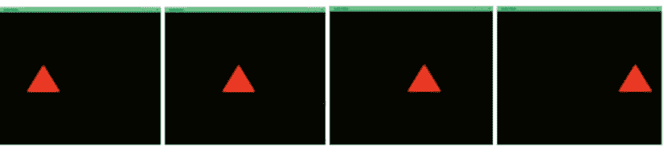

图 2.11 三角形向右移动的动画帧。

## LWJGL 和 OpenGL 简介 ■ 61

在在上一个应用程序中，三角形的移动是相对于其当前位置指定的（它不断向其起始位置的右侧移动）。下一个应用程序将实现基于时间的移动：位置将根据用时间变量表示的方程计算。

由于跟踪时间在许多应用程序中都是很有用的，因此在 `Base` 类中将实现跟踪时间。`time` 变量将跟踪程序运行的时间，`deltaTime` 将跟踪在一次循环间隔内经过的时间（通常为 1/60，即 0.017 秒），这在许多应用程序中都是很有用的。在 `core` 包中，在 `Base` 类中添加以下全局变量：

```java
// 运行时间

public float time;
```

```java
// 上一次循环间隔的时间

public float deltaTime;
```

```java
// 上一次循环间隔的时间数据

private long previousTime;

private long currentTime;
```

在初始化方法中，在将变量设置为 `true` 的行之后添加以下代码：

```java
time = 0;

deltaTime = 1/60f;

currentTime = System.currentTimeMillis();

previousTime = System.currentTimeMillis();
```

在 `run` 函数中，直接在 `glfwPollEvents()` 语句之后添加以下代码：

```java
// 重新计算时间

currentTime = System.currentTimeMillis();

deltaTime = (currentTime - previousTime) / 1000f;

time += deltaTime;

previousTime = currentTime;
```

在下一个应用程序中，三角形将沿着圆形路径移动。通过正弦函数（`sin`）和余弦函数（`cos`）很容易实现，它们在 -1 到 1 之间平滑波动。沿圆形路径的坐标（x, y）可以用方程表示：

```text
x = cos(t), y = sin(t)
```

## 62 使用 Java 和 OpenGL 开发图形框架

在应用程序中，三角形的移动是相对于其当前位置指定的（它不断向其起始位置的右侧移动）。下一个应用程序将实现基于时间的移动：位置将根据用时间变量表示的方程计算。

由于跟踪时间在许多应用程序中都是很有用的，因此在 `Base` 类中将实现跟踪时间。`time` 变量将跟踪程序运行的时间，`deltaTime` 将跟踪在一次循环间隔内经过的时间（通常为 1/60，即 0.017 秒），这在许多应用程序中都是很有用的。在 `core` 包中，在 `Base` 类中将添加以下全局变量：

```java
// 运行时间

public float time;
```

```java
// 上一次循环间隔的时间

public float deltaTime;
```

```java
// 上一次循环间隔的时间数据

private long previousTime;

private long currentTime;
```

在初始化方法中，在将变量设置为 `true` 的行之后添加以下代码：

```java
time = 0;

deltaTime = 1/60f;

currentTime = System.currentTimeMillis();

previousTime = System.currentTimeMillis();
```

在 `run` 函数中，直接在 `glfwPollEvents()` 语句之后添加以下代码：

```java
// 重新计算时间

currentTime = System.currentTimeMillis();

deltaTime = (currentTime - previousTime) / 1000f;

time += deltaTime;

previousTime = currentTime;
```

在下一个应用程序中，三角形将沿着圆形路径移动。通过正弦函数（`sin`）和余弦函数（`cos`）很容易实现，它们在 -1 到 1 之间平滑波动。沿圆形路径的坐标（x, y）可以用方程表示：

```text
x = cos(t), y = sin(t)
```

## 使用 Java 和 OpenGL 开发图形框架

在确认键盘输入按预期工作后，你将在一个图形化应用程序中使用此功能，在该程序中，用户可以使用方向键在屏幕上移动三角形。

### 2.5.1 使用 LWJGL 进行键盘输入

LWJGL 库提供了对处理用户输入事件（如与键盘交互）的支持。特别地，LWJGL 函数 `glfwSetKeyCallback` 指定了在用户按下或释放按键时将运行的代码；在这种情况下，对应于按键事件的值将存储在 `Input` 类中的一个列表（`keyPressedQueue` 或 `keyReleasedQueue`）中。

如果一个事件发生在孤立的时间点，则称为*离散的*（discrete）；如果它在一段时间内持续存在，则称为*连续的*（continuous）。我们之前描述的键盘事件是离散的，但许多应用程序还具有连续动作（例如在屏幕上移动物体），这些动作在按键按下的整个期间内都会发生。遗憾的是，这些标准的离散和连续事件没有标准的术语；例如，“按键按下”（key down）状态有时指按键最初按下时的离散事件，有时指按键在最初按下后、释放之前的连续状态。`keyDown` 和 `keyUp` 将存储对应于离散按下和释放事件的按键名称，而 `keyPressed` 将存储在这些离散事件之间处于连续状态的按键名称。为了可读性，可以使用你在 `Input` 类中创建的函数查询每个列表的内容。这些列表的内容将在 `Input` 类的 `update` 方法中更新，其依据是自上次更新以来存储在 `keyPressedQueue` 和 `keyReleasedQueue` 中的内容。特别地，被标记为按下或释放的键只会在主程序循环的单次迭代中保留，因此在处理队列变量中的数据之前，必须清除对应列表的内容。

为了继续，在 `core` 包中，创建一个名为 `Input` 的新 Java 类并包含以下代码：

```java
package core;

import java.util.ArrayList;

import static org.lwjgl.glfw.GLFW.*;

public class Input {

    public boolean quit;

    public ArrayList<Integer> keyPressQueue;

    public ArrayList<Integer> keyReleaseQueue;

    public ArrayList<Integer> keyDownList;

    public ArrayList<Integer> keyPressedList;

    public ArrayList<Integer> keyUpList;

    // requires listening window reference

    public Input(long window)

    {

        quit = false;

        keyPressQueue = new ArrayList<Integer>();

        keyReleaseQueue = new ArrayList<Integer>();

        keyDownList = new ArrayList<Integer>();

        keyPressedList = new ArrayList<Integer>();

        keyUpList = new ArrayList<Integer>();

        // specify code to run when key is pressed or released

        glfwSetKeyCallback(window,

            (window_, key, scancode, action, mods) ->

            {

                if (action == GLFW_PRESS)

                    keyPressQueue.add(key);

                if (action == GLFW_RELEASE)

                    keyReleaseQueue.add(key);

            }

        );

    }

    public void update()

    {

        // reset discrete key states

        keyDownList.clear();

        keyUpList.clear();

        // process queued press/release events

        // add to or remove from corresponding lists

        for (Integer key : keyPressQueue)

        {
```


```java
keyDownList.add(key);

keyPressedList.add(key);

}

for (Integer key : keyReleaseQueue)

{

keyUpList.add(key);

keyPressedList.remove(key);

}

// finished processing queues; clear contents

keyPressQueue.clear();

keyReleaseQueue.clear();

}

public boolean isKeyDown(Integer key)

{

return keyDownList.contains(key);

}

public boolean isKeyPressed(Integer key)

{

return keyPressedList.contains(key);

}

public boolean isKeyUp(Integer key)

{

return keyUpList.contains(key);

}

}

```

一旦完成该类，在`Base`类中添加以下类变量：

```java
// handle user input events

public Input input;

```

同样，在时间变量初始化之前，添加以下行代码：

```java
input = new Input(window);

```

最后，在`run`方法中，更新时间变量后，添加以下代码：

```java
// process input

input.update();

```

如前所述，你现在将创建一个基于文本的应用程序以验证这些修改是否按预期工作，并说明该类在实践中如何使用。创建一个名为`Test_2_10`的新 Java 类并包含以下代码：

```java
import static org.lwjgl.glfw.GLFW.*;

import core.*;

public class Test_2_10 extends Base

{

public void initialize()

{

System.out.println("Initializing...");

}

public void update() {

// typical usage

if (input.isKeyDown(GLFW_KEY_SPACE))

System.out.println("space key");

if (input.isKeyPressed(GLFW_KEY_RIGHT))

System.out.println("right arrow");

if (input.isKeyUp(GLFW_KEY_SPACE))

System.out.println("space key");

}

// driver method

public static void main(String[] args) {

new Test_2_10().run();

}

}

```

正如之前，你现在将创建一个基于文本的应用程序以验证这些修改是否按预期工作，并说明该类在实践中如何使用。创建一个名为`Test_2_10`的新 Java 类并包含以下代码：

（注：此处原文逻辑与上文重复，已按要求翻译并整合）

当你运行此程序时，按下空格键应该显示单个消息，右方向键会导致消息持续直到按键释放。关于键盘的完整常量列表可以参考`https://www.glfw.org`。

## 2.5.2 整合图形

现在框架能够处理离散和连续输入，它将允许用户通过创建一个新类`Test_2_11`来创建动画，在该类的 uniform 声明下方添加以下变量：

```java
float speed = 0.5f;

```

`speed`变量指定三角形在屏幕上移动的速度。接下来，在`update`函数中，删除“update data”和“render scene”之间的代码，并在其位置添加以下代码：

```java
float distance = speed * deltaTime;

if (input.isKeyDown(GLFW_KEY_LEFT))

translation.data.values[0] -= distance;

if (input.isKeyDown(GLFW_KEY_RIGHT))

translation.data.values[0] += distance;

if (input.isKeyDown(GLFW_KEY_DOWN))

translation.data.values[1] -= distance;

if (input.isKeyDown(GLFW_KEY_UP))

translation.data.values[1] += distance;

```

完成添加这些代码后，运行应用程序并尝试按下方向键在屏幕上移动三角形。恭喜你创建了第一个交互式 GPU 图形程序！

## 2.6 总结与后续

在本章中，你学习了如何创建动画和交互式应用程序。这些示例中的都涉及多边形形状（每个点的 z 坐标始终设置为 0），且移动限于平移（x 和 y 坐标）。自然的目标是以更高级的方式变换这些形状，例如将旋转与平移结合。还需要引入投影变换，以便 z 方向的平移以及围绕场景 x 轴和 y 轴的旋转按预期显示。在下一章中，你将学习创建这些变换所需的数学基础，并创建真正的三维场景。

# 矩阵代数与变换

在本章中，你将学习一些数学对象——向量和矩阵，它们对于渲染三维（3D）场景至关重要。在学习了一些理论背景后，你将应用这些知识创建一个`Matrix`类，该类是操作几何对象位置和朝向的基础。最后，你将学习如何将矩阵对象整合到交互式 3D 场景的渲染中。

## 3.1 向量与矩阵简介

在开发动画和交互式图形应用时，你经常需要变换定义几何对象形状的点集。你可能想要将对象移动到新位置、将对象旋转到新的朝向，或将对象缩放到新的大小。此外，你还想要对 OpenGL 渲染的可视区域进行投影。这是一种透视投影，物体距离虚拟摄像头越远，看起来越小。这些概念在第 1 章关于图形流水线和几何处理的讨论中首次引入：这些计算是在顶点着色器（vertex shader）中进行的。在第 2 章中，你学习了如何处理点（使用`vec3`和`vec4`数据类型），并实现了一种变换（二维平移）。在本章中，你将学习一种名为矩阵的数据结构——一种矩形或二维数字数组——它能够表示你在 3D 图形中需要的所有不同类型的变换。对于基于矩阵的变换，你将学习如何：

- 对点应用变换
- 将多个变换组合为一个单一变换
- 根据给定的变换描述创建相应的矩阵

### 3.1.1 向量的定义与运算

在第 2 章中，你处理了向量数据类型，例如`vec3`，它是一种分量为浮点数的数据结构。在本节中，你将从数学的角度学习向量。为了简单起见，本节的主题将在二维语境下介绍。在第 3.1.3 节中，你将学习如何将每个概念推广到高维设置。

坐标系由一个原点以及一组坐标轴的朝向和比例定义。点 $P=(x, y)$ 指的是空间中的一个位置，相对于坐标系指定。点通常被画成圆点，如图 3.1 所示。注意，在图中，轴的朝向使得 $x$ 轴指向右侧，$y$ 轴向上；箭头的方向代表数值增加的方向。坐标轴的朝向是任意的，尽管让 $x$ 轴指向右侧是一个标准选择。在许多二维数学计算机图形应用以及 OpenGL 中，$y$ 轴都是向上的。然而，在许多二维情况下，原点位于屏幕或绘制区域的左上角，了解你所工作的坐标系的朝向始终很重要！

向量 $v=(m, n)$ 指的是一种位移——每个坐标的变化量，通常被画成一个沿着位移方向的箭头，如图 3.2 所示。箭头开始的地方称为起始点或尾部；箭头结束的地方称为终点或头部，表示将位移应用到起始点后的结果。向量起始点和终点之间的距离称为其长度或模，可以从向量的分量计算出来。向量不与空间中的任何特定位置相关；同一个向量可以存在不同的位置。起始点位于原点（当指定了坐标系时）的向量被称为标准位置。

为了强调位置与位移之间的区别，考虑在一条道路呈网格状的城市中导航。如果你要求某人在第 42 街和第 5 大道的交口碰你，这指的是一个位置，对应于一个点。如果你从当前位置向北走五个街块向东走三个街块，这指的是一个位移（位置的变化），对应于一个向量。

这些每一个数学对象——点和向量——都由数字列表表示，但如上所述，它们有不同的几何解释。在本书中，将使用符号表示法来区分这些对象。引用向量时，将使用粗体小写字母作为变量，并在列出分量时使用角括号，如 $v=(1, 4)$。相比之下，引用点（即非粗体字母）时，将使用大写字母作为变量，并在列出分量时使用标准括号，如 $P=(3, 2)$。在这种语境下，单个数字（不属于点或向量的数字）通常称为标量（scalars)（以区别于点和向量）。此外，在编写点或向量的分量时，将使用带下标的变量，这些下标可以用数字表示，例如点 $P=(p_x, p_y)$ 或 $P=(p_1, p_2)$，向量 $v=(v_1, v_2)$ 或 $w=(w_1, w_2)$。

虽然许多代数运算可以在点和向量的组合上定义，但具有几何解释的运算在后续内容中最重要。第一个运算是向量相加，它结合两个向量 $v=(v_1, v_2)$ 和 $w=(w_1, w_2)$ 并根据公式产生新向量：

```text
v+w = (v_1+w_1, v_2+w_2)
```


例如，`$(2,5)+(4,-2)=(6,3)$`。从几何上讲，这对应于沿向量 `$v$` 的位移，然后沿向量 `$w$` 的位移；可以通过对齐 `$v$` 的终点和 `$w$` 的终点来视觉化这一点。结果是一个共享 `$v$` 起点的新向量 `$u=v+w$`，如图 3.3 所示。


对于点 `$P$` 加上向量 `$v$` 也有几何解释，使用相同的代数公式；这对应于将点移动到新位置，产生一个新点。将向量 `$v$` 的起始点位于位置 `$P$`，结果是位于 `$v$` 终点的点 `$Q$`；通过方程 `$P+v=Q$` 表示。例如，`$(2,2) + (1,3) =(3,5)$`，如图 3.4 所示。

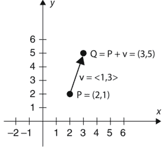

点加上向量。

两个点的和没有清晰的几何解释，但两个点的差则有。重新排列方程 `$P+v=Q$` 得到方程 `$v=Q-P$`，这可以理解为减去它们的坐标来计算位移向量。

两个点或两个向量的分量积没有清晰的几何解释。然而，将向量 `$v$` 乘以标量 `$c$` 是有的。这种运算被称为标量法，定义为：

> `$c \cdot v = c \cdot (v_1, v_2) = (c \cdot v_1, c \cdot v_2)$`

例如，`$2 \cdot (3,2) =(6,4)$`。从几何上讲，这对应于缩放向量；`$v$` 的长度乘以 `$|c|$`（`$c$` 的绝对值）倍，当 `$c < 0$` 时方向反转。图 3.5 展示了按不同量缩放向量 `$v$`。

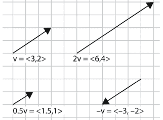

标量乘法。

向量加和标量乘法在后续内容中将特别重要。沿着这些线，向量 `$i=\langle 1, 0\rangle$` 和 `$j=\langle 0, 1\rangle$`。任何其他向量 `$\mathbf{v}=(x, y)$` 可以通过向量乘法和标量乘法以唯一的一种方式用 `$i$` 和 `$j$` 表示，如下：

`$\mathbf{v} = (x, y) = (x, 0) + (0, y) = x \cdot (1, 0) + y \cdot (0, 1) = x \cdot i + y \cdot j$`

任何具有这些属性的向量集合被称为基。有很多向量集合，但由于 `$i$` 和 `$j$` 从意义上来说是最简单的这类向量，它们被称为标准基（针对二维空间）。

## 3.1.2 线性变换与矩阵

本章的主要目标是设计并创建能够以特定的几何方式变换点集或向量的函数。这些函数通常被称为向量函数，以区分于标量输入和输出的函数。它们也可以被称为变换，以强调它们的几何解释。这些函数可以写成 `$F((p_1, p_2)) = (q_1, q_2)$`，或者 `$F(v_1, v_2) = \langle w_1, w_2 \rangle$`，或者偶尔会以列向量形式写成：

`$F\left[\begin{matrix} v_1 \\ v_2 \end{matrix}\right]=\left[\begin{matrix} w_1 \\ w_2 \end{matrix}\right]$`

这三个表达式中的后者在传统的数学演示中最常用，但其他表达式通常用于在句子中编写数学公式。

具有不同复杂程度的向量函数很容易编写。作为简单的例子，可以考虑零函数，其输出是零向量：

`$F(v_1, v_2) = \langle 0, 0 \rangle$`

还有恒等函数，其输出始终等于输入：

`$F(v_1, v_2) = \langle v_1, v_2 \rangle$`

在另一个极端，人们可以发明各种任意复杂的表达式，例如：

`$F(v_1, v_2) = \langle v_1 - 3 \cdot \cos(3v_2), (v_1)^2 + \ln(|v_2|) + \pi \rangle$`

其中大部分没有任何几何意义。关键在于找到一类相对简单的向量函数，这些函数可以执行在本章开头描述的几何变换。处理可以以某种方式简化的向量函数将特别帮助。其中一组此类函数是线性函数或线性变换，即满足以下两个关于标量乘法和向量加方程的函数 `$F$`：对于任何标量 `$c$` 和向量 `$v$` 和 `$w$`：

`$F(c \cdot \mathbf{v}) = c \cdot F(\mathbf{v})$`

`$F(\mathbf{v} + \mathbf{w}) = F(\mathbf{v}) + F(\mathbf{w})$`

处理此类函数的一个优势在于标准基向量 `$i$` 和 `$j$`：如果 `$F$` 是线性函数且已知 `$F(i)$` 和 `$F(j)$` 的值，那么就可以计算任何向量 `$v$` 的 `$F(v)$` 的值，即使没有给出函数 `$F$` 的通用公式。例如，假设 `$F$` 是线性函数，`$F(i)=\langle 1, 2 \rangle$`，且 `$F(j)=\langle 3, 1 \rangle$`。那么通过使用线性函数满足的方程，可以如下计算 `$F(\langle 4, 5 \rangle)$` 的值：

`$F(\langle 4, 5 \rangle) = F(\langle 4, 0 \rangle + \langle 0, 5 \rangle)$`

`$=F(\langle 4, 0 \rangle) + F(\langle 0, 5 \rangle)$`

`$=F(\langle 4 \cdot 1, 0 \rangle) + F(\langle 5 \cdot 0, 1 \rangle)$`

`$=4 \cdot F(\langle 1, 0 \rangle) + 5 \cdot F(\langle 0, 1 \rangle)$`

`$=4 \cdot F(i) + 5 \cdot F(j)$`

`$=4 \cdot \langle 1, 2 \rangle + 5 \cdot \langle 3, 1 \rangle$`

`=\langle 4, 8 \rangle + \langle 15, 5 \rangle$`

`=\langle 19, 13 \rangle$`

同样地，可以计算此示例中 `$F(\langle x, y \rangle)$` 的通用公式：

`$F(\langle x, y \rangle) = F(\langle x, 0 \rangle + \langle 0, y \rangle)$`

`$=F(\langle x, 0 \rangle) + F(\langle 0, y \rangle)$`

`$=F(\langle x \cdot 1, 0 \rangle) + F(\langle y \cdot 0, 1 \rangle)$`

`$=x \cdot F(\langle 1, 0 \rangle) + y \cdot F(\langle 0, 1 \rangle)$`

`$=x \cdot F(i) + y \cdot F(j)$`

`$=x \cdot \langle 1, 2 \rangle + y \cdot \langle 3, 1 \rangle$`

`=\langle x, 2x \rangle + \langle 3y, y \rangle$`

`=\langle x+3y, 2x+y \rangle$`

事实上，同样的推理确立了一般情况：如果 `$F$` 是线性函数，其中 `$F(i)=\langle a, c \rangle$` 且 `$F(j)=\langle b, d \rangle$`，那么 `$F(\langle x, y \rangle)$` 的公式可以计算为：

`$F(\langle x, y \rangle) = F(\langle x, 0 \rangle + \langle 0, y \rangle)$`

`$=F(\langle x, 0 \rangle) + F(\langle 0, y \rangle)$`

`$=F(\langle x \cdot 1, 0 \rangle) + F(\langle y \cdot 0, 1 \rangle)$`

`$=x \cdot F(\langle 1, 0 \rangle) + y \cdot F(\langle 0, 1 \rangle)$`

`$=x \cdot F(i) + y \cdot F(j)$`

`$=x \cdot \langle a, c \rangle + y \cdot \langle b, d \rangle$`

`=\langle ax, cy \rangle + \langle by, dy \rangle$`

`=\langle ax+by, cx+dy \rangle$`

## 矩阵

之前提到的两个向量函数都可以用矩阵乘法表示：零函数可以写为：

```
$F\left[\begin{matrix} x \\ y\end{matrix}\right] = \left[\begin{matrix} 0 & 0 \\ 0 & 0\end{matrix}\right]x = \left[\begin{matrix} 0\cdot x+0\cdot y \\ 0\cdot x+0\cdot y\end{matrix}\right] = \left[\begin{matrix} 0 \\ 0\end{matrix}\right]$
```

而单位函数可以写为：

```
$F\left[\begin{matrix} x \\ y\end{matrix}\right] = \left[\begin{matrix} 1 & 0 \\ 0 & 1\end{matrix}\right]x = \left[\begin{matrix} 1\cdot x+0\cdot y \\ 0\cdot x+1\cdot y\end{matrix}\right] = \left[\begin{matrix} x \\ y\end{matrix}\right]$
```

单位函数定义中的矩阵被称为单位矩阵，如你所见，它出现在各种语境中。

在引入向量符号法时，下标变量有时用于表示向量的分量。在处理矩阵时，双下标变量有时用于表示其分量；下标表示该分量在矩阵中的位置（行和列）。例如，变量 `$a_{12}$` 将指的是矩阵 `$A$` 中第 1 行第 2 列的元素，通常情况下，`$a_{mn}$` 将指的是矩阵 `$A$` 第 `$m$` 行第 `$n$` 列的元素。整个矩阵 `$A$` 的内容可以写为：

```
$A = \left[\begin{matrix} a_{11} & a_{12} \\ a_{21} & a_{22}\end{matrix}\right]$
```

此时，你已经知道如何将线性函数（用矩阵记法表示）应用于点或向量。在许多语境下（特别是计算机图形学中），你可能希望对一组点应用多个函数。给定两个函数 `$F$` 和 `$G$`，可以通过定义 `$H(\mathbf{v})=F(G(\mathbf{v}))$` 来创建一个新函数 `$H$`；函数 `$H$` 是 `$F$` 和 `$G$` 的复合。事实证明，如果 `$F$` 和 `$G$` 是线性函数，那么 `$H$` 也将是线性函数。这可以通过检查 `$H$` 是否满足线性方程来验证，即通过假设线性方程对于函数 `$F$` 和 `$G$` 成立来实现。与向量加法相关的推导如下：

```
$H(\mathbf{v}+\mathbf{w})=F(G(\mathbf{v}+\mathbf{w}))$
$=F(G(\mathbf{v})+G(\mathbf{w}))$
$=F(G(\mathbf{v}))+F(G(\mathbf{w}))$
$=H(\mathbf{v})+H(\mathbf{w})$
```

## 使用 Java 和 OpenGL 开发图形框架

与标量乘法相关的推导如下：

```
$H(c\cdot v) = F(G(c\cdot v))$
$= F(c\cdot G(v))$
$= c\cdot F(G(v))$
$= c\cdot H(v)$
```

之所以这很重要，是因为线性函数——如之前观察到的，每个函数都可以由单个矩阵表示——它们的复合也可以由单个矩阵表示，因为复合也是一个线性函数。通过反复应用这一推理，由于任意数量线性函数的复合都可以由单个矩阵表示。这立即引出了一个问题：复合对应的矩阵如何计算？从代数上来说，给定变换 `$F(v) = A\cdot v$` 和 `$G(v) = B\cdot v$`，目标是找到变换 `$H(v) = C\cdot v$` 是否对于所有向量 `$v$` 都等于 `$F(G(v)) = A\cdot (B\cdot v)$`。在这种情况下，写作 `$C = A\cdot B$`。这种操作被称为矩阵乘法，`$C$` 矩阵 `$A$` 和 `$B$` 的积。

矩阵乘法的公式可以通过计算方程 `$C\cdot v = A\cdot (B\cdot v)$` 的两侧并展开等式两边 `$x$` 和 `$y$` 的系数来推导。展开 `$C\cdot v$` 得到：

```
$C\cdot v = \begin{bmatrix} c_{11} & c_{12} \\ c_{21} & c_{22} \end{bmatrix} \begin{bmatrix} x \\ y \end{bmatrix} = \begin{bmatrix} c_{11}\cdot x + c_{12}\cdot y \\ c_{21}\cdot x + c_{22}\cdot y \end{bmatrix}$
```

同样，展开 `$A\cdot (B\cdot v)$` 得到：

```
$A\cdot (B\cdot v) = \begin{bmatrix} a_{11} & a_{12} \\ a_{21} & a_{22} \end{bmatrix} \left[ \begin{bmatrix} b_{11} & b_{12} \\ b_{21} & b_{22} \end{bmatrix} \begin{bmatrix} x \\ y \end{bmatrix} \right]$
$= \begin{bmatrix} a_{11}b_{11} + a_{12}b_{21} \\ a_{21}b_{11} + a_{22}b_{21} \end{bmatrix} \dots \begin{bmatrix} a_{11}(b_{11}x+b_{12}y) \\ a_{21}(b_{11}x+b_{12}y) \end{bmatrix}$
```

因此，矩阵乘法 `$C = A \cdot B$` 定义为：

`$$\begin{bmatrix} c_{11} & c_{12} \\ c_{21} & c_{22} \end{bmatrix} = \begin{bmatrix} a_{11}b_{11}+a_{12}b_{21} & a_{11}b_{12}+a_{12}b_{22} \\ a_{21}b_{11}+a_{22}b_{21} & a_{21}b_{12}+a_{22}b_{22} \end{bmatrix}$$`

该公式可以使用一种称为点积的操作来编写。给定向量 `$\mathbf{v} = \langle v_1, v_2 \rangle$` 和 `$\mathbf{w} = \langle w_1, w_2 \rangle$`，积 `$d = \mathbf{v} \cdot \mathbf{w}$` 是一个（标量）数字，定义为：

```
$d = \mathbf{v} \cdot \mathbf{w} = \langle v_1, v_2 \rangle \cdot \langle w_1, w_2 \rangle = v_1w_1 + v_2w_2$
```

作为点积的示例，考虑：

`$(3, 4) \cdot (7, 5) = 3 \cdot 7 + 4 \cdot 5$`

重新定义矩阵乘法：将矩阵 `$A$` 分为行向量，将矩阵 `$B$` 分为列向量。积矩阵 `$C = A \cdot B$` 的元素 `$c_{mn}$` 等于矩阵 `$A$` 的第 `$m$` 行向量（由 `$a_m$` 表示）与矩阵 `$B$` 的第 `$n$` 列向量（由 `$b_n$` 表示）的点积，如下公式所示，其中划分由虚线表示。

```
$A \cdot B = \begin{bmatrix} a_{11} & a_{12} \\ a_{21} & a_{22} \end{bmatrix} \begin{bmatrix} b_{11} & b_{12} \\ b_{21} & b_{22} \end{bmatrix}$
$= \begin{bmatrix} a_1 \\ a_2 \end{bmatrix} \begin{bmatrix} b_1 & b_2 \end{bmatrix}$
$= \begin{bmatrix} a_1 \cdot b_1 & a_1 \cdot b_2 \\ a_2 \cdot b_1 & a_2 \cdot b_2 \end{bmatrix}$
$= \begin{bmatrix} c_{11} & c_{12} \\ c_{21} & c_{22} \end{bmatrix}$
```


作为矩阵乘法计算的示例，考虑：

$$\begin{bmatrix} 2 & 3 \\ 4 & 5 \end{bmatrix} \begin{bmatrix} 9 & 8 \\ 7 & 6 \end{bmatrix} = \begin{bmatrix} (2, 3) \cdot (9, 7) & (2, 3) \cdot (8, 6) \\ (4, 5) \cdot (9, 7) & (4, 5) \cdot (8, 6) \end{bmatrix}$$

$$= \begin{bmatrix} 2\cdot 3+3\cdot 7 & 2\cdot 8+3\cdot 6 \\ 4\cdot 9+5\cdot 7 & 4\cdot 8+5\cdot 6 \end{bmatrix}$$

通常，矩阵乘法会很快变得繁琐，因此通常使用软件软件包来处理。需要注意的是，通常情况下，矩阵乘法是不交换的。给定矩阵 $A$ 和 $B$，积 $A-B$ 通常不积 $B-A$。例如，以相反顺序计算上一个示例中矩阵的积：

$$\begin{bmatrix} 9 & 8 \\ 7 & 6 \end{bmatrix} \begin{bmatrix} 2 & 3 \\ 4 & 5 \end{bmatrix} = \begin{bmatrix} (9, 8) \cdot (2, 4) & (9, 8) \cdot (3, 5) \\ (7, 6) \cdot (2, 4) & (7, 6) \cdot (3, 5) \end{bmatrix}$$

$$= \begin{bmatrix} 9\cdot 2+8\cdot 4 & 9\cdot 3+8\cdot 5 \\ 7\cdot 2+6\cdot 4 & 7\cdot 3+6\cdot 5 \end{bmatrix}$$

$$=\begin{bmatrix} 50 & 67 \\ 38 & 51 \end{bmatrix}$$

这一事实有一个相应的几何解释，即执行图形变换的顺序会有差异。例如，让 $T$ 表示通过 (1,0) 的平移，让 $R$ 表示绕原点旋转 90°。如果 $P$ 表示点 $P=(2,0)$，那么 $R(T(P))=R((3,0))=(0,3)$，而 $T(R(P))=T((0,2))=(1,2)$，如图 3.7 所示。$R(T(P))$ 不等于 $T(R)$。

之前提到的单位矩阵 $I$ 是矩阵：

$$I = \begin{bmatrix} 1 & 0 \\ 0 & 1 \end{bmatrix}$$

单位矩阵 $I$ 的乘法性质与普通乘法中数字 1 的相似。对于任何数字 $x，$1\cdot x=x$ 和 $x\cdot 1=x$ 成立；对于任何矩阵 $A，$A\cdot A=A$ 和 $A\cdot I=A$ 成立。由于这些性质，$1$ 和 $I$ 在各自的数学语境中被称为单位元。同样，单位函数在函数的语境中是单位元。

图 3.7 图形变换（平移和旋转）不可交换的。

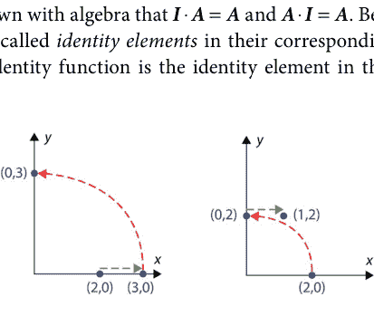

# 矩阵代数与变换

将向量函数视为几何变换，恒等函数不改变任何点的位置；(0, 0) 的几何变换、绕原点旋转 0° 以及以 1 为因子对所有分量缩放都等同于恒等函数。

单位元的概念引入了逆元的概念。在给定的数学范围内，将一个对象与其逆元结合会得到单位元。例如，一个数字 $x$ 乘以它的逆元等于 1；一个函数与其逆函数复合得到恒等函数。类似地，一个矩阵乘以它的逆矩阵得到单位矩阵。用符号表示，矩阵 $A$ 的逆是一个矩阵 $M$，使得 $A \cdot M = I$ 且 $M \cdot A = I$。矩阵 $A$ 的逆通常用符号 $A^{-1}$ 表示。通过代代数运算，可以通过求解方程 $A \cdot M = I$ 中关于 $M$ 的元素来找到矩阵 $A$ 的逆公式：

$$A \cdot M = \begin{bmatrix} a & b \\ c & d \end{bmatrix} \begin{bmatrix} n & 1 \\ p & 0 \end{bmatrix} = I$$

求解该方程首先涉及计算方程左侧的乘积，并将结果矩阵的每个元素与单位矩阵中对应的元素相等。这得到了一个包含四个未知数（$M$ 的元素）的四方程组。求解这四个方程得到 2x2 矩阵的逆公式：

$$M = A^{-1} = \begin{bmatrix} d/(ad-bc) & -b/(ad-bc) \\ -c/(ad-bc) & a/(ad-bc) \end{bmatrix}$$

出现在逆矩阵每个元素分母中的值 $(a\cdot d-b\cdot c)$ 称为矩阵 $A$ 的行列式。如果该值等于 0，则所有分数均未定义，矩阵 $A$ 的逆不存在。在其他数学上下文中也会出现某些元素没有逆元的类似情况。例如，在普通算术中，数字 $x=0$ 没有乘法逆，因为任何数乘以它都不等于单位元 1。

正如预期的，如果一个可逆向量函数 $F$ 可以用矩阵乘法表示为 $F(v)=A \cdot v$，那么逆函数 $G$ 就可以通过 $A$ 的逆矩阵表示为 $G(v)=A^{-1} \cdot v$，因为：

$$F(G(v)) = A \cdot A^{-1} \cdot v = v$$

$$G(F(v)) = A^{-1} \cdot A \cdot v = v$$

再次将向量函数视为几何变换，函数的逆执行了一个在某种意义上是“相反”或“反向”的变换。例如：平移 $(m, n)$ 的逆是平移 $(-m, -n)$；顺时针旋转角度 $a$ 的逆是逆时针旋转角度 $a$（等同于顺时针旋转角度 $-a$）；用值 $r$ 和 $s$ 缩放分量的逆是用值 $1/r$ 和 $1/s$ 缩放分量。

## 3.1.3 高维中的向量与矩阵

所有这些向量和矩阵概念都可以推广到三维、四维甚至更高维。在本节中，这些概念将在 3D 背景下重述。推广到四维空间遵循相同的代数模式。四维向量和矩阵在计算机图形中非常频繁，原因将在本章稍后讨论。

三维坐标系使用 $xyz$-轴绘制，其中每个轴都彼此垂直。假设轴的取向如图 3.1 所示，使得由 $x$-轴和 $y$-轴跨的平面与显示图形的窗口对齐，则（正）$z$ 轴有两个可能的方向（朝观众或远离观众的方向）。这两个系统分别称为右手坐标系和左手坐标系，源自用于记忆取向的手部记忆法。为了可视化右手坐标系中轴的相对取向，使用你的右手，想象食指沿着 $x$ 轴，中指垂直于此（朝向你手心的方向），并指向 $y$ 轴。那么你伸出的大拇指将指向 $z$ 轴的方向；这如图 3.8 所示。如果 $z$ 轴指向相反的方向，则对应于左手坐标系，这确实是用左手执行上述步骤所指示的取向。右手法的某些描述不是用伸出的手指指示 $x$ 轴和 $y$ 轴的方向，而是建议手从 $x$ 轴指向 $y$ 轴的方向；你伸出的大拇指仍然指示 $z$ 轴的方向，两种描述具有相同的结果。

在数学、物理和计算机图形中，使用右手坐标系是标准做法，如图 3.9 左侧所示。在计算机图形中，正 $z$ 轴直接指向观众。虽然轴之间彼此垂直，但以这种方式插图时，起初很难看出 $z$ 轴与其它轴垂直。在这种情况下，想象 $xyz$-轴与一个不可见的立方体的边缘对齐，可能有助于可视化，如图 3.9 右侧用虚线所示。

图 3.8 使用右手确定 $xyz$ 轴的取向。

# 矩阵代数与变换

在三维空间中，点写为 $P = (p_x, p_y, p_z)$ 或 $P = (p_1, p_2, p_3)$，向量写为 $v = (v_x, v_y, v_z)$ 或 $v = (v_1, v_2, v_3)$。有时为了清晰起见，分量写为 $x, y$ 和 $z$（在四维空间中，第四个分量可能写为 $w$）。向量加法定义为：

$$v + w = (v_1, v_2, v_3) + (w_1, w_2, w_3) = (v_1+w_1, v_2+w_2, v_3+w_3)$$

标量乘法定义为：

$$c \cdot v = c \cdot (v_1, v_2, v_3) = (c \cdot v_1, c \cdot v_2, c \cdot v_3)$$

三维的标准基由向量 $i = \langle 1, 0, 0 \rangle$、$j = \langle 0, 1, 0 \rangle$ 和 $k = \langle 0, 0, 1 \rangle$ 组成。任何向量 $v = (x, y, z)$ 都可以写为这些向量的线性组合：

$$v = (x, y, z) = x \cdot \langle 1, 0, 0 \rangle + y \cdot \langle 0, 1, 0 \rangle + z \cdot \langle 0, 0, 1 \rangle$$

线性函数的定义对于任意维度的向量都是相同的，因为它只涉及向量加和标量乘；它不涉及向量的分量：

$$F(c \cdot v) = c \cdot F(v)$$

$$F(v + w) = F(v) + F(w)$$

如果已知 $F(i), F(j)$ 和 $F(k)$ 的值，可以计算任何向量的三维线性函数值，通常这样的函数可以写成形式：

$$\begin{bmatrix} x \\ y \\ z \end{bmatrix} = \begin{bmatrix} a_{11} & a_{12} & a_{13} \\ a_{21} & a_{22} & a_{23} \\ a_{31} & a_{32} & a_{33} \end{bmatrix} \text{（此处表示变换）}$$

## 使用 Java 和 OpenGL 开发图形框架

之前一样，公式中的 $x, y, z$ 系数通常分组为三三矩阵：

$$A = \begin{bmatrix} a_{11} & a_{12} & a_{13} \\ a_{21} & a_{22} & a_{23} \\ a_{31} & a_{32} & a_{33} \end{bmatrix}$$

矩阵-向量积 $A \cdot v$ 定义为：

$$A \cdot v = \begin{bmatrix} a_{11} & a_{12} & a_{13} \\ a_{21} & a_{22} & a_{23} \\ a_{31} & a_{32} & a_{33} \end{bmatrix} \begin{bmatrix} x \\ y \\ z \end{bmatrix} = \begin{bmatrix} a_{11} \cdot x + a_{12} \cdot y + a_{13} \cdot z \\ a_{21} \cdot x + a_{22} \cdot y + a_{23} \cdot z \\ a_{31} \cdot x + a_{32} \cdot y + a_{33} \cdot z \end{bmatrix}$$

矩阵乘法通过点积描述得最为清晰，对于三维向量，点积定义为：

$$v \cdot w = (v_1, v_2, v_3) \cdot (w_1, w_2, w_3) = v_1 \cdot w_1 + v_2 \cdot w_2 + v_3 \cdot w_3$$

矩阵乘法 $A \cdot B$ 可以通过将第二个矩阵的元素划分向量来计算：第一个矩阵 $(A)$ 的每一行写成向量，第二个矩阵 $(B)$ 的每一列写成向量。那么，第 $m$ 行第 $n$ 列的值是矩阵 $A$ 的第 $m$ 行向量（表示为 $a_m$）与矩阵 $B$ 的第 $n$ 列向量（表示为 $b_n$）的点积，如图所示：

$$A \cdot B = \begin{bmatrix} a_{11} & a_{12} & a_{13} \\ a_{21} & a_{22} & a_{23} \\ a_{31} & a_{32} & a_{33} \end{bmatrix} \begin{bmatrix} b_{11} & b_{12} & b_{13} \\ b_{21} & b_{22} & b_{23} \\ b_{31} & b_{32} & b_{33} \end{bmatrix}$$

$$\begin{bmatrix} a_1 \\ a_2 \\ a_3 \end{bmatrix} \begin{bmatrix} b_1 & b_2 & b_3 \end{bmatrix} = \begin{bmatrix} a_1 \cdot b_1 & a_1 \cdot b_2 & a_1 \cdot b_3 \\ a_2 \cdot b_1 & a_2 \cdot b_2 & a_2 \cdot b_3 \\ a_3 \cdot b_1 & a_3 \cdot b_2 & a_3 \cdot b_3 \end{bmatrix}$$

$$\begin{bmatrix} c_{11} & c_{12} & c_{13} \\ c_{21} & c_{22} & c_{23} \\ c_{31} & c_{32} & c_{33} \end{bmatrix}$$

# 矩阵代数与变换 ■ 85

三阶三单位矩阵 $I$ 的形式如下：

$$I = \begin{bmatrix} 1 & 0 & 0 \\ 0 & 1 & 0 \\ 0 & 0 & 1 \end{bmatrix}$$

与之前，该单位矩阵对于任意矩阵 $A$ 由方程 $I \cdot A = A$ 和 $A \cdot I = A$ 定义。同样，矩阵 $A$ 的逆矩阵（如果存在）是一个记为 $A^{-1}$ 的矩阵，由方程 $A \cdot A^{-1} = I$ 和 $A^{-1} \cdot A = I$ 定义。三阶三矩阵元素的逆矩阵公式写起来非常繁琐；计算此公式的代码将在第 3.3 节给出。

## 3.2 几何变换

上一节引入了线性函数：满足线性性的向量函数，即可以用矩阵乘法表示的函数。为了证明计算机图形所需的几何变换（平移、旋转、缩放和透视投影）是线性函数，因此必须找到对应的矩阵。特别是，必须根据变换描述（例如“沿 x 方向平移三个单位”或“绕 z 轴旋转 45°”）确定对应矩阵的元素。每种类型变换（包括二维和三维）的公式将按难度增加的顺序推导：缩放、旋转、平移和透视投影。在后续章节中，向量将以标准位置绘制（每个向量的起点都位于原点），且向量可以通过其终点来识别。

### 3.2.1 缩放

缩放变换将向量的每个分量乘以一个常数。对于二维向量，其形式如下（其中 $r$ 和 $s$ 为常数）：

$$F\left[\begin{bmatrix} x \\ y \end{bmatrix}\right] = \begin{bmatrix} r \cdot x \\ s \cdot y \end{bmatrix}$$

可以快速推断并验证，该变换可以用矩阵乘法表示如下：

$$F\left[\begin{bmatrix} x \\ y \end{bmatrix}\right] = \begin{bmatrix} r & 0 \\ 0 & s \end{bmatrix} \left[\begin{bmatrix} x \\ y \end{bmatrix}\right]$$

同样，该变换的 3D 版本将向量的 z 分量按常数值 $t$ 缩放：

$$F \begin{bmatrix} x \\ y \\ z \end{bmatrix} = \begin{bmatrix} r\cdot x \\ s\cdot y \\ t\cdot z \end{bmatrix} = \begin{bmatrix} r & 0 & 0 \\ 0 & s & 0 \\ 0 & 0 & t \end{bmatrix} \begin{bmatrix} x \\ y \\ z \end{bmatrix}$$

观察发现，如果所有的缩放常数都等于1，则缩放矩阵的公式为单位矩阵。这对应于以下相关陈述：将向量的分量乘以1不会改变向量的值，正如乘以单位矩阵不会改变向量的值一样。

### 3.2.2 旋转

在二维空间中，旋转变换绕原点以固定量旋转向量。与缩放变换的情况不同，并不清楚如何写旋转函数 $F(v)$，或者旋转变换是否可以用矩阵乘法计算。为了建立这一点，只需证明旋转是线性变换：即它满足两个线性方程。对于每个方程，将给出一个非正式的几何证明。

为了证明 $F(c\cdot v) = cF(v)$，从向量 $v$ 的终点开始，假设该点距离原点距离为 $d$。当 $v$ 乘以 $c$ 时，得到的向量具有相同的方向，且原点到该点的距离变为 $cd$。注意，旋转变换固定原点且不改变点到原点的距离。将旋转变换 $F$ 应用于向量 $v$ 和 $cv$，得到向量 $F(v)$ 和 $F(c\cdot v)$；这些向量具有相同的方向，它们的终点到原点的距离相同：$d$ 和 $c \cdot d$。然而，向量 $c\cdot F(v)$ 也与 $F(v)$ 对齐，且其终点到原点的距离为 $c\cdot d$。因此，$F(c\cdot v)$ 和 $cF(v)$ 的终点必须位于相同位置，因此 $F(c\cdot v)=cF(v)$。这如图 3.10 所示。

为了证明 $F(v+w) = F(v)+F(w)$，定义 $u = v+w$，并令 $o$ 表示原点。由于向量加法的性质，$u$、$v$ 和 $w$ 的终点构成了一个平行四边形的顶点。将旋转变换 $F$ 应用于此：

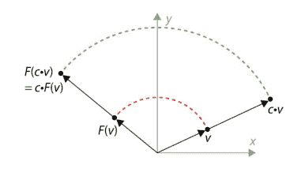

图 3.10 证明旋转变换是线性的（标量乘法）。

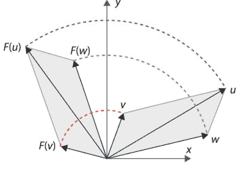

图 3.11 证明旋转变换是线性的（向量加法）。

将旋转变换 $F$ 应用于此平行四边形，得到顶点为 $F(v)$、$F(w)$ 和 $F(v+w)$ 的平行四边形 $M$。再次，由于向量加法的性质，$u$v$ 和 $w$ 的终点构成平行四边形 $N$ 的顶点。由于 $M$ 和 $N$ 共同共享顶点，因此 $F(v+w)=F(v)+F(w)$。这在图 3.11 中所示。

...

左上角的二乘二子矩阵代表变换的旋转和/或缩放部分（如果没有旋转或缩放，则为单位矩阵），右侧列中的二分向量 $(m_1, m_2)$ 代表变换的平移部分（如果没有平移，则为零向量）。

同样，在三维空间中（使用齐次坐标），仿变换可以通过乘以如下形式的矩阵表示：


$$
\begin{bmatrix}
a_{11} & a_{12} & a_{13} & m_1 \\
a_{21} & a_{22} & a_{23} & m_2 \\
a_{31} & a_{32} & a_{33} & m_3 \\
0 & 0 & 0 & 1
\end{bmatrix}
$$

左上角的三乘三子矩阵代表变换的旋转和/或缩放部分（如果没有旋转或缩放，则为单位矩阵），右侧列的三分向量 $(m_1, m_2, m_3)$ 代表变换的平移部分（如果没有平移，则为零向量）。

### 3.2.4 投影

在本节中，目标是推导出透视投影变换的公式。在第 1 章中，在章节开头以及几何处理章节中，已经说明并非正式地介绍了一些核心思想。回顾一下：场景中的可行走区域需要映射到 OpenGL 定义的区域，即一个 $x$、$y$ 和 $z$ 坐标均为 -1 和 +1 的立方体，也称为*裁剪空间*（clip space）。

在透视投影中，可行走区域的形状是一个*视锥*（frustum），或截头锥。该锥体的方向使其是“侧卧”的：它的中心轴与负 $z$ 轴对齐，如图 3.19 所示，观察者或虚拟摄像头位于场景的原点，该点与原始锥体的顶点对齐。视锥较小的矩形端离原点最近，较大的矩形端离原点远。当视锥被压缩成立方体时，较大的端必须被压缩。这导致场景渲染图像中的物体距离观察者越远，看起来越小。

视锥的形状由四个参数定义：

- *近距离*（near distance）。
- *远距离*（far distance）。
- （垂直）*视角*（angle of view）。
- *宽高比*（aspect ratio）。

近距离和远距离的解释很简单：它们指的是到观察者的距离（沿 $z$ 轴），并设定了观察者可能看到的内容的绝对边界——超出此范围的任何点都将不会被渲染。

图 3.19 透视变换的视锥。

视角是衡量观察者可见场景多少的量，定义为如果视锥的顶底平面（如图 3.19 所示的方向）被延伸到原点，则这两个平面之间的角。图 3.20 显示了从侧面（沿 $x$ 轴）看到的两个不同的视锥（阴影区域）。该图还说明了这样一个事实：在近远距离固定的情况下，较大的视角对应更大的视锥。

为了使近平面可见部分的尺寸与渲染图像的尺寸成正比，渲染图像的宽高比（定义为宽度除以高度）是指定视锥形状的最终值，如图 3.21 所示，该图描述了从正面（沿负 $z$ 轴）看到的视锥。在理论上，可以使用水平视角来指定视锥的大小，但在实践中，确定宽高比更简单。

在透视投影中，空间中的点（视锥内）被映射到投影窗口中的点：空间中的平面矩形区域对应于显示在计算机屏幕上的渲染图像。投影窗口对应于视锥较小的矩形边，即离原点最近边。为了可视化点 P 如何在透视投影中进行变换，从 P 到原点画一条线。

图 3.21 视锥的宽高比 $r = w/h$。

该线与投影窗口的交点即为结果。图 3.22 展示了将视锥内的三个不同点投影到投影窗口的结果。

图 3.22 将点从视锥投影到投影窗口。

为了推导透视投影公式，第一步是调整投影窗口，使得视锥内的点映射到 -1 到 1 的范围。然后，暂时忽略 $x$ 坐标，考虑视锥内的点 $P=(x, y, z)$。从 P 到原点画一条线，令 $Q=(x', y', z')$ 为线与投影窗口的交点，如图 3.23 所示。

## 使用 Java 和 OpenGL 开发图形框架

图 3.23 调整投影窗口。

图 3.24 计算点的 y 分量。

图 3.20 视角对视锥大小的影响。

视锥的形状由四个参数定义：

- 近距离。
- 远距离。
- （垂直）视角。
- 宽高比。

## 矩阵代数与变换 97

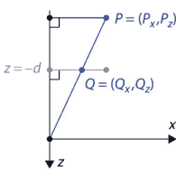

图 3.25 计算投影点的 x 分量。

然而，必须考虑额外的因素：宽高比 $r$。我们之前考虑过 $y$ 值范围在 -1 到 1 之间；根据宽高比，包含在渲染图像中的点集的值范围在 $-r$ 到 $r$ 之间。这个范围需要被缩放到裁剪空间（clip space），从 -1 到 1，因此 $x$ 坐标公式必须除以 $r$。这得出了公式 $Q_x=(d/r) \cdot P_x/(-P_z)$，它可以通过以下矩阵变换来实现（再次，`*` 表示不确定变量）：

$$
\begin{bmatrix}
d/r & 0 & 0 \\
0 & 0 & 0 \\
* & * & * \\
0 & -1 & 0
\end{bmatrix}
\begin{bmatrix}
P_x \\
P_y \\
P_z \\
1
\end{bmatrix}
=
\begin{bmatrix}
(d/r) \cdot P_x \\
d \cdot P_y \\
* \\
-P_z
\end{bmatrix}
$$

矩阵第三行的值尚待确定，它们将影响点的 $z$ 分量。$z$ 值用于深度计算，以确定哪些点是可见的，如近距离和远距离值所示。此计算不需要点的 $x$ 和 $y$ 分量，该行中的前两个值应为 0，剩余的未知值称为 $b$ 和 $c$。我们有如下矩阵变换：

$$
\begin{bmatrix}
d/r & 0 & 0 \\
0 & 0 & 0 \\
0 & b & c \\
0 & -1 & 0
\end{bmatrix}
\begin{bmatrix}
P_x \\
P_y \\
P_z \\
1
\end{bmatrix}
=
\begin{bmatrix}
(d/r) \cdot P_x \\
d \cdot P_y \\
b \cdot P_z + c \\
-P_z
\end{bmatrix}
$$

透视化后，第三次除法 $b \cdot P_z + c$ 变为 $(b \cdot P_z + c)/(-P_z)=-b-c/P_z$。常量 $b$ 和 $c$ 的值将在明确两个点后很快被确定。近距离 $n$ 和远距离 $f$ 通常被赋予正值，尽管可见的视锥体在世界空间中沿负 z 轴延伸，因此最近的可见点 P 满足 $P_z=-n$，而最远的可见点 P 满足 $P_z=-f$。

其次，我们知道必须将可见点的 $z$ 坐标转换为裁剪空间坐标（范围从 -1 到 1），尽管看起来似乎距离观察者最近的点的 $z$ 坐标应该映射到值 1，因为在我们的坐标系中，正 z 轴直接指向观察者。然而，事实并非如此！当 OpenGL 执行深度测试时，它通过比较坐标来确定一个点是否比另一个点更靠近观察者。比较类型可以通过 OpenGL 函数 `glDepthFunc` 指定，它的默认值为 `GL_LESS`，这是一个 OpenGL 常数，表示如果一个点的 z 值较小，则应被认为更靠近观察者。

在裁剪空间中，负 z 轴直接指向观察者；该空间使用左手坐标系。结合这两点，我们现在知道如果 $P_z = -n$，则 $-b-c/P_z$ 应该等于 -1；如果 $P_z = -f$，则 $-b-c/P_z$ 应该等于 1。这对应于下面的方程组：

$$
-b+\frac{c}{n}=-1
$$

$$
-b+\frac{c}{f}=1
$$

有多种方法求解这个方程组；最简单的方法是将第一个方程乘以 -1，然后将其加到第二个方程上。这消除了 $b$；求解 $c$ 得到 $c=2\cdot n\cdot f/(n-f)$。将此值代入第一个方程并求解 $b$ 得到 $b=(n+f)/(n-f)$。

完成此计算后，矩阵就被完全确定了。总结一下：在处理齐次坐标时，对于由近距离 $n$、远距离 $f$、垂直视野 $a$ 和宽高比 $r$ 定义的视锥体区域的透视投影变换可以通过以下矩阵实现：

$$
\begin{array}{|c|c|c|c|}
\hline
1 & 0 & 0 & 0 \\
\hline
r\cdot\tan(a/2) & 0 & 0 & 0 \\
\hline
0 & 1/tan(a/2) & 0 & 0 \\
\hline
0 & 0 & (n+f)/(n-f) & 2\cdot f/(n-f) \\
\hline
0 & 0 & -1 & 0 \\
\hline
\end{array}
$$

### 3.2.5 局部变换

此时，你能够产生平移、旋转和缩放的矩阵。例如，考虑二维空间中的一个对象，比如图 26 中的乌龟。设 $T$ 为平移 $(0,1)$ 的矩阵，设 $R$ 为旋转 $45^{\circ}$ 的矩阵。为了移动乌龟，例如将集合 $S$ 中的所有点乘以 $T$，然后乘以 $R$，再次乘以 $T$，这将产生图 26 所示的结果。

局部变换和全局变换的概念反映在日常语言中。例如，向前、向后、向左或向右是取决于面向的局部变换示例。如果两个人的面向不同，且都被要求向前走，他们将向不同的方向移动。如果指定的是全局平移（通常通过指南针方向北、南、东、西来实现），那么可以确保无论面向如何，人都朝同一个方向行走。

问题仍然：如何利用矩阵乘法来执行局部变换（假设这是可能的）？在解决这个问题之前，有助于引入一个新概念。当用矩阵变换一组点时，点会被顶点着色器处理，新坐标传递给片段着色器，但点的新坐标并不会永久存储。相反，应用于对象的累积变换被存储为相应矩阵的乘积，这是一个被称为对象的模型矩阵。

给定一个对象形状由点集 $S$ 定义，且已应用了一系列变换，令 $M$ 表示对象的模型矩阵。因此，对象的当前位置可以通过 $M \cdot P$ 计算，其中 $P$ 遍历集合 $S$ 中的点。设 $T$ 为对应于变换的矩阵。如果你像前面的章节所示将其作为全局变换应用，新的模型矩阵将是 $T \cdot M$，因为每个新应用的矩阵都成为乘积中最左侧（就像函数在函数复合中的排序一样）。

为了让矩阵 $T$ 对对象产生局部变换的效果，对象的局部坐标轴必须与全局轴对齐，这建议了以下三步策略：

- 应用 $M^{-1}$（模型矩阵的逆）来对齐两组轴。
- 应用 $T$，因为当轴对齐时局部和全局变换是相同的。
- 应用 $M$（原始模型矩阵），使对象回到之前的状态，同时考虑了变换 $T$。

## 矩阵代数与变换 ■ 101

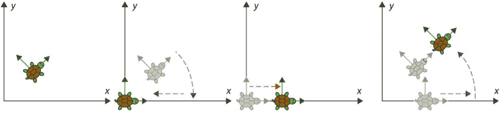

**图 3.29** 局部平移的全局变换序列。

该变换序列如图 3.29 所示，其中图像显示了一个具有模型矩阵 $M$ 的对象（在本例中，应用了平移，然后旋转了 $45^{\circ}$）、应用 $M^{-1}$ 的结果（反转旋转再反转平移）、应用 $T$ 的结果（在本例中，为平移）以及再次应用 $M$ 的结果（再次平移和旋转）。最后一张图像还显示了对象在原始位置的输出以供比较。

在该过程结束时，组合所有这些变换，模型矩阵已变为 $M \cdot T \cdot M^{-1} \cdot M$（记住矩阵是从右向左应用于点的）。由于 $M^{-1} \cdot M = I$（单位矩阵），该表达式简化为 $M \cdot T$：原始矩阵 $M$ 右侧乘以 $T$。这就是感兴趣的问题的答案。总结：给定一个具有模型矩阵 $M$ 的对象和一个带有矩阵 $T$ 的变换：

- 要将 $T$ 作为全局变换，令新矩阵等于 $T \cdot M$。
- 要将 $T$ 作为局部变换，令新的模型矩阵为 $M \cdot T$。

正如你将在后面的章节中看到的，能够使用局部变换在创建交互式 3D 场景时将非常有用。例如，如果能够通过局部变换移动虚拟相机，在场景中导航的感觉会更加直观且沉浸式。观众可能并不总是意识到 $z$ 轴的方向，这可能会在沿全局方向移动时导致意外之外的运动；观众始终能看到面前的东西，这使得向前移动更加自然。

## 3.3 矩阵类 MATRIX CLASS

现在你已经学会了如何推导出所需的各种矩阵，下一步是创建一个 `Matrix` 类。该类需要存储矩阵中包含的值，并执行之前讨论的基本操作：矩阵乘以向量、矩阵乘以另一个矩阵以及计算矩阵的逆。该类还将包含静态方法，用于生成与之前讨论的每种几何变换对应的矩阵：单位矩阵、平移、旋转（绕每个轴）、缩放和投影。

## 102 使用 Java 和 OpenGL 开发图形框架

由于多个矩阵操作是根据向量的点积定义的，我们将首先创建一个构造方法来执行此计算。在 `Vector` 类中，添加以下静态方法：

```java
public static double dot(Vector v, Vector w)
{
    double c = 0;

    for (int i = 0; i < v.values.length; i++)
        c += v.values[i] * w.values[i];

    return c;
}
```

接下来，在 `math` 包中创建一个名为 `Matrix` 的新 Java 类，并包含如下代码，它包含了必要的字段、构造函数、一个用于设置矩阵值的便利方法，以及一个将值从二维数组（标准数学表示法）转换为一维浮点数组（GLSL 使用的格式）的方法。

```java
package math;

public class Matrix
{
    public int rows, cols;

    // 标准数学表示
    public double[][] values;

    // GLSL 需要的格式
    public float[] flatValues;

    // 构造函数
    public Matrix(int rows, int cols)
    {
        this.rows = rows;
        this.cols = cols;
        this.values = new double[rows][cols];
        this.flatValues = new float[rows * cols];
    }

    // GLSL 需要的格式；
    // 也有助于将数据拷贝到新矩阵
    public float[] flatten(double[][] values)
    {
        for (int rowNum = 0; rowNum < rows; rowNum++)
            for (int colNum = 0; colNum < cols; colNum++)
                flatValues[colNum + rowNum * cols] =
                    (float) values[rowNum][colNum];

        return flatValues;
    }

    // 按行设置矩阵值
    public void setValues(double... v)
    {
        for (int i = 0; i < v.length; i++)
        {
            int rowNum = i / cols;
            int colNum = i % cols;
            values[rowNum][colNum] = v[i];
        }
    }
}
```

接下来，在 `Matrix` 类中添加以下两个方法，它们用于从矩阵的给定行或列提取值，并将结果作为 `Vector` 对象返回。

```java
public Vector getRow(int rowNum)
{
    Vector row = new Vector(this.cols);

    for (int colNum = 0; colNum < cols; colNum++)
        row.values[colNum] = this.values[rowNum][colNum];

    return row;
}

public Vector getCol(int colNum)
{
    Vector col = new Vector(this.rows);

    for (int rowNum = 0; rowNum < rows; rowNum++)
        col.values[rowNum] = this.values[rowNum][colNum];

    return col;
}
```

包含允许将向量的内容拷贝到矩阵的某行或某列的方法也将非常方便；可以通过以下方法实现：

```java
public void setRow(int rowNum, Vector row)
{
    int max = Math.min(this.cols, row.length);

    for (int colNum = 0; colNum < max; colNum++)
        values[rowNum][colNum] = row.values[colNum];
}

public void setCol(int colNum, Vector col)
{
    int max = Math.min(this.rows, col.length);

    for (int rowNum = 0; rowNum < max; rowNum++)
        values[rowNum][colNum] = col.values[rowNum];
}
```

使用这些方法，你现在可以创建矩阵-向量乘法以及矩阵-矩阵乘法的方法。为了可读性，将会有单独的方法用于左乘和右乘矩阵法，因为它们对应于 3.2 节中讨论的局部和全局变换。在 `Matrix` 类中添加以下代码：

```java
public Vector multiplyVector(Vector vec)
{
    Vector result = new Vector(rows);

    for (int rowNum = 0; rowNum < rows; rowNum++)
        result.values[rowNum] = dot(getRow(rowNum), vec);

    return result;
}

public static Matrix multiply(Matrix A, Matrix B)
{
    if (A.cols != B.rows)
        return null;

    Matrix C = new Matrix(A.rows, B.cols);
```


```java
for (int rowNum = 0; rowNum < A.rows; rowNum++)
{
    for (int colNum = 0; colNum < B.cols; colNum++)
    {
        C.values[rowNum][colNum] = dot(A.getRow(rowNum), B.getCol(colNum));
    }
}

return C;
}
```

## 矩阵代数与变换 ■ 103

接下来，为了反转几何变换以及涉及虚拟相机的计算（在 1.2 节中提到，将在第 4 章详细讨论），有必要计算矩阵的逆。理论细节将非常广泛；感兴趣的读者可以在任何代数参考书中找到代数推导。相关概念包括矩阵余式（包含原始矩阵值的较小矩阵）、行列式（计算逆矩阵时自然出现的值，可以通过递归计算）以及矩阵转置（交换矩阵的行和列）。为了继续，在 `Matrix` 类中添加以下方法：

```java
// 生成排除给定行和列的 (rows-1)  (cols-1) 子矩阵

public Matrix minor(int excludeRowNum, int excludeColNum)
{
    Matrix m = new Matrix(this.rows-1, this.cols-1);
    int minorRowNum = 0, minorColNum = 0;

    for (int row = 0; row < rows; row++)
    {
        if (row == excludeRowNum)
            continue;

        minorColNum = 0;

        for (int col = 0; col < cols; col++)
        {
            if (col == excludeColNum)
                continue;

            m.values[minorRowNum][minorColNum] =
                this.values[row][col];

            minorColNum++;
        }

        minorRowNum++;
    }

    return m;
}

public double determinant()
{
    if (rows == 1)
        return values[0][0];

    if (rows == 2)
        return values[0][0] * values[1][1]
            - values[0][1] * values[1][0];

    // 对于更高阶的递归情况将在此处
    return 0;
}
```

```java
// 对于较大的矩阵，计算行列式
// 使用沿第一行进行余子式展开

double det = 0;

// for (int colNum = 0; colNum < cols; colNum++)

det += Math.pow(-1, colNum) * values[0][colNum]
    * minor(0, colNum).determinant();
```

```java
return det;
}
```

```java
// 将矩阵中的所有值乘以给定的数字

public void multiplyScalar(double s)
{
    for (int rowNum = 0; rowNum < rows; rowNum++)
        for (int colNum = 0; colNum < cols; colNum++)
            values[rowNum][colNum] *= s;
}
```

```java
// 交换矩阵的行列

public Matrix transpose()
{
    Matrix tr = new Matrix(this.cols, this.rows);

    for (int rowNum = 0; rowNum < rows; rowNum++)
        for (int colNum = 0; colNum < cols; colNum++)
            tr.values[colNum][rowNum] = this.values[rowNum][colNum];

    return tr;
}
```

```java
// 计算矩阵的逆矩阵

public Matrix inverse()
{
    Matrix inv = new Matrix(rows, cols);

    for (int rowNum = 0; rowNum < rows; rowNum++)
        for (int colNum = 0; colNum < cols; colNum++)
            inv.values[rowNum][colNum] =
                Math.pow(-1, rowNum + colNum)
                * minor(rowNum, colNum).determinant();

    double det = determinant();

    inv = inv.transpose();
    inv.multiplyScalar(1.0f/det);

    return inv;
}
```

## 矩阵代数与变换 ■ 107

此时，你可能希望编写一个测试类来测试这些方法，使用 3.1.2 节中的一些数值示例。为了方便起，请向 `Matrix` 类添加以下方法，将矩阵转换为更易读的格式：

```java
public String toString() {
    String s = "";

    for (int rowNum = 0; rowNum < rows; rowNum++) {
        s += getRow(rowNum).toString() + "\n";
    }

    return s;
}
```

在继续之前，你可能希望创建一个测试类来验证矩阵相关的函数是否工作正常。在 `src` 文件夹中创建一个名为 `Test_3_1` 的新 Java 类并插入以下代码：

```java
import static org.lwjgl.glfw.GLFW.*;
import static org.lwjgl.opengl.GL40.*;

import core.*;
import math.*;

// 测试 Matrix 类

public class Test_3_1 extends Base {
    public void initialize() {
        System.out.println("Testing matrix class:");

        Matrix m = new Matrix(2,3);
        m.setValues(1,2,3,4,5,6);
        System.out.println(m);

        Matrix n = m.transpose();
        System.out.println(n);

        System.out.println(Matrix.multiply(m, n));
        System.out.println(Matrix.multiply(n, m));

        System.out.println("Testing inverse method:");

        Matrix p = new Matrix(2,2);
        p.setValues(1,2,3,4);

        Matrix pInv = p.inverse();
    }
}
```

如果一切都完成正确，那么你应该看到一个可以忽略的黑色窗口，而在控制台终端将显示几个矩阵以及应用在它们上的各种方法的结果。

最后，你将在 `Matrix` 类中添加一些静态方法，这些方法将生成与 3.2 节中推出的几何变换对应的矩阵。由于变换将应用于 3D 空间，每个方法将返回一个四四四矩阵。为此，请添加以下代码，它实现了单位矩阵、平移、旋转（绕每个轴）、缩放和透视投影变换：

```java
public static Matrix makeIdentity()
{
    Matrix m = new Matrix(4,4);
    m.setValues(1,0,0,0, 0,1,0,0, 0,0,1,0, 0,0,0,1);

    return m;
}
```

```java
public static Matrix makeTranslation(double x, double y, double z)
{
    Matrix m = new Matrix(4,4);
    m.setValues(1,0,0,x, 0,1,0,y, 0,0,1,z, 0,0,0,1);

    return m;
}
```

```java
public static Matrix makeRotationZ(double angle)
{
    double c = Math.cos(angle);
    double s = Math.sin(angle);

    Matrix m = new Matrix(4,4);

    m.setValues(1,0,0,0, 0,1,0,0, 0,0,1,0, 0,0,0,1);

    return m;
}
```

```java
// 逆矩阵

public Matrix inverse()
{
    Matrix inv = new Matrix(rows, cols);

    for (int rowNum = 0; rowNum < rows; rowNum++)
        for (int colNum = 0; colNum < cols; colNum++)
            inv.values[rowNum][colNum] =
                Math.pow(-1, rowNum + colNum)
                * minor(rowNum, colNum).determinant();

    double det = determinant();

    inv = inv.transpose();
    inv.multiplyScalar(1.0f/det);

    return inv;
}
```

## 矩阵代数与变换 ■ 107

此时，你可能希望编写一个测试类来测试这些方法，使用 3.1.2 节中的一些数值示例。为了方便起，请向 `Matrix` 类添加以下方法，将矩阵转换为更易读的格式：

```java
public String toString() {
    String s = "";

    for (int rowNum = 0; rowNum < rows; rowNum++) {
        s += getRow(rowNum).toString() + "\n";
    }

    return s;
}
```

在继续之前，你可能希望创建一个测试类来验证矩阵相关的函数是否工作正常。在 `src` 文件夹中创建一个名为 `Test_3_1` 的新 Java 类并插入以下代码：

```java
import static org.lwjgl.glfw.GLFW.*;
import static org.lwjgl.opengl.GL40.*;

import core.*;
import math.*;

// 测试 Matrix 类

public class Test_3_1 extends Base {
    public void initialize() {
        System.out.println("Testing matrix class:");

        Matrix m = new Matrix(2,3);
        m.setValues(1,2,3,4,5,6);
        System.out.println(m);

        Matrix n = m.transpose();
        System.out.println(n);

        System.out.println(Matrix.multiply(m, n));
        System.out.println(Matrix.multiply(n, m));

        System.out.println("Testing inverse method:");

        Matrix p = new Matrix(2,2);
        p.setValues(1,2,3,4);

        Matrix pInv = p.inverse();
    }
}
```


```java
System.out.println(p);

System.out.println(pInv);

System.out.println("Product should be identity matrix:");

System.out.println(Matrix.multiply(p, pInv));

System.out.println(Matrix.multiply(pInv, p));
```

```java
public void update()
{
    // 驱动方法
}
```

```java
public static void main(String[] args)
{
    new Test_3_1().run();
}
```

如果一切都完成正确，那么你应该看到一个可以忽略的黑色窗口，而在控制台终端将显示几个矩阵以及应用在它们上的各种方法的结果。

最后，你将在`Matrix`类中添加一些静态方法，这些方法将生成与 3.2 节中推出的几何变换对应的矩阵。由于变换将应用于 3D 空间，每个方法将返回一个四四四矩阵。为此，请添加以下代码，它实现了单位矩阵、平移、旋转（绕每个轴）、缩放和透视投影变换：

```java
public static Matrix makeIdentity()
{
    Matrix m = new Matrix(4,4);
    m.setValues(1,0,0,0, 0,1,0,0, 0,0,1,0, 0,0,0,1);
    return m;
}
```

```java
public static Matrix makeTranslation(double x, double y, double z)
{
    Matrix m = new Matrix(4,4);
    m.setValues(1,0,0,x, 0,1,0,y, 0,0,1,z, 0,0,0,1);
    return m;
}
```

```java
public static Matrix makeRotationZ(double angle)
{
    double c = Math.cos(angle);
    double s = Math.sin(angle);
    Matrix m = new Matrix(4,4);
    m.setValues(1,0,0,0, 0,1,0,0, 0,0,1,0, 0,0,0,1);
    return m;
}
```

```java
public static Matrix makeRotationX(double angle)
{
    double c = Math.cos(angle);
    double s = Math.sin(angle);
    Matrix m = new Matrix(4,4);
    m.setValues(1,0,0,0, 0,c,-s,0, 0,s,c,0, 0,0,0,1);
    return m;
}
```

```java
public static Matrix makeRotationY(double angle)
{
    double c = Math.cos(angle);
    double s = Math.sin(angle);
    Matrix m = new Matrix(4,4);
    m.setValues(c,0,s,0, 0,1,0,0, -s,0,c,0, 0,0,0,1);
    return m;
}
```

```java
public static Matrix makeScale(double s)
{
    Matrix m = new Matrix(4,4);
    m.setValues(s,0,0,0, 0,s,0,0, 0,0,s,0, 0,0,0,1);
    return m;
}
```

```java
public static Matrix makePerspective(double angleOfView, double near, double far)
{
    double a = Math.toRadians(angleOfView);
    double d = Math.tan(a / 2.0);
    double r = (far + near) / (far - near);
    double c = (2 * far * near) / (far - near);
    Matrix m = new Matrix(4,4);
    m.setValues(1,0,0,0, 0,1,0,0, 0,0,d,-1, 0,0,c,0);
    return m;
}
```

```java
import core.*;
import math.*;
```

```java
public class Test_3_2 extends Base {
    public int programRef, vaoRef;
    public Uniform<Matrix> modelMatrix, projectionMatrix;
    public float moveSpeed, turnSpeed;
}
```

```java
public void initialize() {
    // load code, send to GPU, and compile;
    // store program reference
    programRef = GLUUtils.initFromFiles(
        "./src/Test_3_2.vert",
        "./src/Test_3_2.frag"
    );
}
```

接下来，你将为等腰三角形的顶点初始化数据、模型和投影矩阵的 uniform，以及用于存储移动和旋转速度的变量，这些速度将在`update`方法中应用到三角形。继续操作，返回`Test_3_2`类并在`initialize`方法中添加以下代码：

```java
// specify color used when clearing the screen
glClear(0.0f, 0.0f, 0.0f, 1.0f);
glEnable(GL_DEPTH_TEST);
```

```java
// setup vertex array object
vaoRef = glGenVertexArrays();
glBindVertexArray(vaoRef);
```

```java
float[] positionData = {
    0.0f, 0.2f, 0.0f,
    0.1f, -0.2f, 0.0f,
    -0.1f, -0.2f, 0.0f
};
```

```java
Attribute positionAttribute = new Attribute(
    "vec3", positionData);
positionAttribute.associateVariable(
    programRef, "position");
```

```java
// set up uniforms
Matrix mMatrix = Matrix.makeTranslation(0, 0, -1);
modelMatrix = new Uniform<mat4>("mat4", mMatrix);
modelMatrix.locateVariable(programRef, "modelMatrix");
```

`Matrix pMatrix = Matrix.makePerspective();`

`projectionMatrix = new Uniform<Matrix>("mat4", pMatrix);`

`projectionMatrix.locateVariable(programRef, "projectionMatrix");`

```java
// movement speed, units per second
moveSpeed = 0.5f;
// rotation speed, radians per second
turnSpeed = (float)Math.toRadians(90);
```

接下来，你将注意力转向创建一个`update`方法。第一步是根据之前设置的基础视图和自上一帧以来所经过的时间（存储在`Base`类变量`deltaTime`中），计算出可能应用的实际移动量。在`Test_3_2`类中，添加以下代码：

```java
public void update() {
    // update
    float moveAmount = moveSpeed * deltaTime;
    float turnAmount = turnSpeed * deltaTime;
}
```


为了说明矩阵变换对象的通用性，将同时实现全局和局部移动。接下来，将会有许多条件语句，每个语句都会检查某个按键是否被按下，如果是，则创建相应的矩阵并按正确的顺序将模型矩阵乘以`m`（使用`leftMultiply`进行全局变换时，`m`在左侧，使用`rightMultiply`进行局部变换时，`m`在右侧）。对于全局平移，你将使用`W/A/S/D`键对应上/左/下/右方向，使用`Z/X`键对应前进/后退方向。在`Test_3_2`类的`update`方法中，添加以下代码：

```java
// global translation
if (input.keyPressed(GLFW_KEY_W))
    modelMatrix.data.leftMultiply(Matrix.makeTranslation(0, moveAmount, 0));

if (input.keyPressed(GLFW_KEY_S))
    modelMatrix.data.leftMultiply(Matrix.makeTranslation(0, -moveAmount, 0));

if (input.keyPressed(GLFW_KEY_A))
    modelMatrix.data.leftMultiply(Matrix.makeTranslation(-moveAmount, 0, 0));

if (input.keyPressed(GLFW_KEY_D))
    modelMatrix.data.leftMultiply(Matrix.makeTranslation(moveAmount, 0, 0));
```

```java
if (input.keyPressed(GLFW_KEY_Z))
    modelMatrix.data.leftMultiply(Matrix.makeTranslation(0, 0, moveAmount));

if (input.keyPressed(GLFW_KEY_X))
    modelMatrix.data.leftMultiply(Matrix.makeTranslation(0, 0, -moveAmount));
```

从观察者视角看让物体左右旋转的旋转是 3D 空间中绕 z 轴的旋转。由于`A/D`键让物体左/右移动，你将使用`Q/E`键让物体左右旋转，因为它们位于`A/D`正上方。由于这些键将用于全局旋转，它们将导致三角形绕 3D 世界的原点`(0,0,0)`旋转。继续在`Test_3_2`类的`update`方法中，添加以下代码：

```java
// rotation
if (input.keyPressed(GLFW_KEY_Q))
    modelMatrix.data.leftMultiply(Matrix.rotateZ(turnAmount));

if (input.keyPressed(GLFW_KEY_E))
    modelMatrix.data.leftMultiply(Matrix.rotateZ(-turnAmount));
```

接下来，为了引入局部平移，你将使用`I/J/K/L`键对应上/左/下/右方向，因为它们位于`A/D`正下方。由于这些键将用于局部旋转。在`Test_3_2`类的`update`方法中，添加以下代码：

```java
// local translation
if (input.keyPressed(GLFW_KEY_I))
    modelMatrix.data.rightMultiply(Matrix.makeTranslation(0, moveAmount, 0));

if (input.keyPressed(GLFW_KEY_J))
    modelMatrix.data.rightMultiply(Matrix.makeTranslation(-moveAmount, 0, 0));

if (input.keyPressed(GLFW_KEY_K))
    modelMatrix.data.rightMultiply(Matrix.makeTranslation(0, -moveAmount, 0));

if (input.keyPressed(GLFW_KEY_L))
    modelMatrix.data.rightMultiply(Matrix.makeTranslation(moveAmount, 0, 0));
```

这些键对应局部旋转，它们将绕三角形中心旋转（当三角形位于原始位置时）。

```java
if (input.keyPressed(GLFW_KEY_U))
    modelMatrix.data.rightMultiply(Matrix.rotateZ(turnAmount));

if (input.keyPressed(GLFW_KEY_O))
    modelMatrix.data.rightMultiply(Matrix.rotateZ(-turnAmount));
```

这些将对应局部移动（`J/L`），类似于全局变换。

处理完用户输入后，在渲染图像之前需要清除缓冲区。除了清除颜色缓冲区，由于现在正在进行深度测试，还需要清除深度缓冲区。`Uniform`值需要存储在相应的变量中，并调用`glDrawArrays`函数来渲染三角形。为了完成这些任务，在`update`方法的末尾，添加以下代码：

```java
// render scene

// reset color buffer with specified color
glClear(GL_COLOR_BUFFER_BIT | GL_DEPTH_BUFFER_BIT);

glProgram(programRef);
glBindVertexArray(vaoRef);
modelMatrix.uploadData();
projectionMatrix.uploadData();
glDrawArrays(GL_TRIANGLES, 0, 3);
```

最后，为了运行此应用程序，最后几行代码需要实例化`Test`类并调用`run`方法。在`Test_3_2`类末尾添加以下代码：

```java
// driver method
public static void main(String[] args) {
    new Test_3_2().run();
}
```

## 总结与后续

在本章中，你学习了涉及几何变换的数学基础。你学习了向量以及向量加法和标量乘法的操作，以及任何向量都可以写为标准基向量的组合，这被称为线性变换，自然地引出了矩阵和矩阵乘法的定义。然后，你学习了如何创建表示用于交互式 3D 图形应用程序的不同类型几何变换（缩放、旋转、平移和透视投影）的矩阵。你还学习了模型矩阵如何存储应用于对象上的叠加变换，这种结构使得你能够使用矩阵进行全局和局部变换。最后，所有这些都被整合到了本书正在开发的框架中。

在下一章中，你将注意力转向这些许多步骤的自动化，开始正式创建图形框架类。

# 场景图框架

在本章中，你将开始正式构建一个三维（3D）图形框架的结构。该框架的核心是一个场景图（scene graph）：一种使用层次结构或树形结构来组织 3D 场景内容的数据结构。

在计算机科学中，树是节点对象的集合，每个节点都存储一个值和一个包含零或多个被称为“子节点”的节点列表。如果节点 A 有子节点 B，则说节点 A 是节点 B 的父节点。在树中，每个节点恰好有一个父节点，除称为根节点（root）的特殊节点外，所有其他节点都可以通过一系列子节点到达。从节点 N 开始，通过子节点序列可以到达的节点集合是 N 的后代，而从 N 到根节点并包含根节点的父节点序列被称为 N 的祖先。图 4.1 展示了树的抽象示例，其中由由标记 A 到 G 字母的椭圆表示，箭头从节点指向其子节点。在图中，节点 A 是根节点，拥有子节点 B、C 和 D；节点 B 有子节点 E，节点 D 有子节点 G；节点 E、F 和 G没有任何子节点。

在场景图中，每个节点代表场景中的一个 3D 对象。如前文所述，对象的当前位置、朝向和缩放存储在矩阵模型中，该模型是通过应用到对象上的累积变换计算得。为了方便起见，对象的位置、朝向和缩放统称为对象的变换（transform）。矩阵模型存储了对象相对于其在场景图中父对象的变换。对象相对于场景图根节点的变换通常被称为世界变换（world transformation），可以通过该对象的矩阵模型及其祖先节点矩阵模型的乘积计算得出。这使得复杂的变换可以用更通的变换来表示。例如，图 4.2 所示的月球相对于太阳的运动（灰色虚线），可以更简单地表示为两个运动的组合：月球相对于地球以及地球相对于太阳（蓝色点线）。

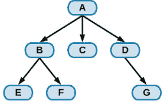

图 4.1 一个具有七个节点的树。

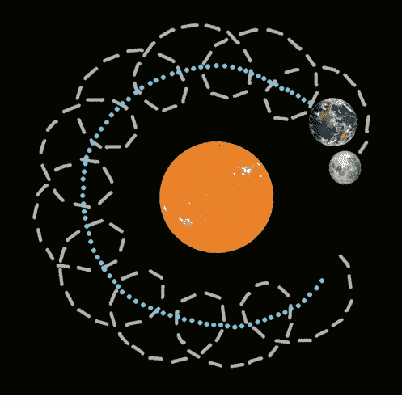

图 4.2 月球和地球相对于太阳的运动。

场景图结构还允许将简单的几何形状分组成复合对象，然后可以作为一个单元方便地进行变换。例如，可以使用一个大型扁平盒形作为桌面，并用四个位于底部靠近角落的窄长高盒形作为桌腿，来创建一个简单的桌子模型，如图 4.3 所示。让这些中的每个对象都存储在

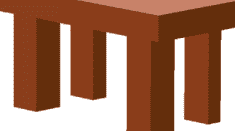

图 4.3 由五个盒形组成的桌子。

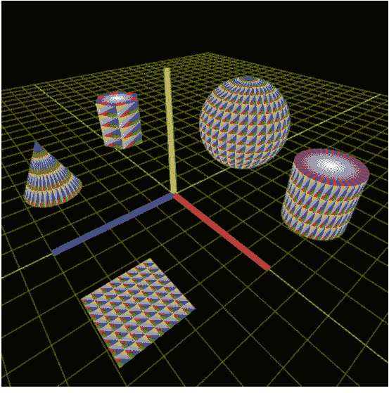

图 4.4 包含多个几何形状的场景。

一个节点中，并且所有五个节点共享同一个父节点。那么，变换父节点就会影响整个对象。（值得注意的是，这些盒形中的每个都可能引用相同的顶点数据；每个不同的尺寸和位置可以通过模型矩阵来设置。）

在下一节中，你将学习基于场景图的框架的整体结构、主要类将是什么，以及它们如何封装必要的数据并执行渲染 3D 场景所需的任务。然后，在接下来的章节中，你将基于前面章节的知识和代码实现框架的类。该框架将使你能够快速创建包含复杂对象的交互式场景，例如图 4.4 所示的场景。

## 4.1 类结构概述

在场景图框架中，节点代表位于 3D 空间中的对象。相应的类将命名为`Object3d`，并包含三个条目：

- 一个用于存储其变换数据的矩阵
- 一个子对象的引用列表
- 一个指向父对象的引用

许多类将继承`Object3D`类，每个类在框架中都有不同的角色。根节点将由`Scene`类表示。仅用于分组目的的内部节点将由`Group`类表示。对应于要渲染对象的将由`Mesh`类表示。还有其他具有 3D 特性并影响场景外观的对象，但它们本身不被渲染。一个对象是虚拟相机，从它的视角渲染场景；这将由`Camera`类表示。另一个对象是影响光照和阴影的虚拟光源；这将由`Light`类表示（但以后才会创建）。

为了保持框架的模块化，每个网格（mesh）将存储一个变换。矩阵模型存储对象相对于其在场景图中父对象的变换。对象相对于场景图根节点的变换通常被称为世界变换，可以通过该对象的矩阵模型及其祖先节点矩阵模型的乘积计算得出。这使得复杂的变换可以用简单的变换来表示。例如，图 4.2 所示的月球相对于太阳的运动（灰色虚线），可以更简单地表示为两个运动的组合：月球相对于地球以及地球相对于太阳（蓝色点线）。

场景图结构还允许将简单的几何形状分组成复合对象，然后可以作为一个单元方便地进行变换。例如，可以使用一个大型扁平盒形作为桌面，并用四个位于底部靠近角落的窄长高盒形作为桌腿，来创建一个简单的桌子模型，如图 4.3 所示。让这些中的每个对象都存储在一个节点中，并且所有五个节点共享同一个父节点。那么，变换父节点就会影响整个对象。（值得注意的是，这些盒形中的每个都可能引用相同的顶点数据；每个不同的尺寸和位置可以通过模型矩阵来设置。）

在下一节中，你将学习基于场景图的框架的整体结构、主要类将是什么、以及它们如何封装必要的数据并执行渲染 3D 场景所需的任务。然后，在接下来的章节中，你将基于前面章节的知识和代码实现框架的类。该框架将使你能够快速创建包含复杂对象的交互式场景，例如图 4.4 所示的场景。

```java
public void remove(Object3D child)
{
    children.remove(child);
    child.parent = null;
}
```

```java
// 计算此 Object3D 相对于
// 场景图根节点 Object3D 的变换
public Matrix getWorldMatrix()
{
    if (parent == null)
        return transform;
    else
        return Matrix.multiply(parent.getWorldMatrix(),
        transform);
}
```

```java
// 返回一个包含所有后代的节点列表
public ArrayList<Object3D> getDescendantList()
{
    ArrayList<Object3D> descendants =
    new ArrayList<Object3D>();

    // 需要被添加到后代列表的节点
    // 它们的子节点也将添加到此列表
    ArrayList<Object3D> nodesToProcess =
        new ArrayList<Object3D>();
    nodesToProcess.add(this);

    // 只要还有剩余节点，就继续处理
    while (nodesToProcess.size() > 0 )
    {
        // 从列表中移除第一个节点
        Object3D node = nodesToProcess.remove(0);
        // 将此节点添加到后代列表
        descendants.add(node);
        // 此节点的子节点也必须处理
        for (Object3D child : node.children)
            nodesToProcess.add(0, child);
    }
    return descendants;
}
```

该类如果包含一组用于平移、旋转和缩放对象的函数将非常方便，这些函数通过从`Matrix`类创建并应用相应的矩阵到模型矩阵来实现。请记住，这些变换中的每一种都可以作为以下形式应用：

局部变换或全局变换，这取决于模型矩阵和新变换矩阵相乘的顺序。（在此语境下，全局变换意味着相对于场景图中父对象的坐标轴进行的变换。）这种区别——即矩阵是否应作为局部变换应用——将通过一个额外的参数来指定。为了整合此功能，请向`Object3D`类中添加以下代码：

```java
// 应用几何变换
public void applyMatrix(Matrix m, boolean local)
{
    if (local)
        transform.rightMultiply(m);
    else
        transform.leftMultiply(m);
}

public void translate(double x, double y, double z, boolean local)
{
    applyMatrix(Matrix.makeTranslation(x,y,z), local);
}

public void rotateX(double angle, boolean local)
{
    applyMatrix(Matrix.makeRotationX(angle), local);
}

public void rotateY(double angle, boolean local)
{
    applyMatrix(Matrix.makeRotationY(angle), local);
}

public void rotateZ(double angle, boolean local)
{
    applyMatrix(Matrix.makeRotationZ(angle), local);
}

public void scale(double s, boolean local)
{
    applyMatrix(Matrix.makeScale(s), local);
}
```

最后，正如上一章讨论的，可以从变换矩阵最后一列的元素中确定对象的位置。基于这一点，通过以下代码实现了获取和设置对象位置的函数，您应该将这些代码添加到`Object3D`类中。包含了两个获取对象位置的函数：一个返回其本地位置（相对于其父对象），另一个返回从之前讨论的世界变换矩阵中提取的全局位置或世界位置。

```java
// 获取/设置变换的位置分量
public Vector getPosition()
{
    return new Vector(
        transform.values[0] [3],
        transform.values[1] [3],
        transform.values[2] [3] );
}
```

```java
public Vector getWorldPosition()
{
    Matrix worldTransform = getWorldMatrix();
    return new Vector(
        worldTransform.values[0] [3],
        worldTransform.values[1] [3],
        worldTransform.values[2] [3] );
}
```


```java
public void setPosition(Vector position)
{
    transform.values[0] [3] = position.values[0];
    transform.values[1] [3] = position.values[1];
    transform.values[2] [3] = position.values[2];
}
```

接几个类对应于场景图中特定类型的元素，因此继承了 `Object3D` 类。

## 4.2.1 场景（Scene）与组（Group）

`Scene` 和 `Group` 都用于表示场景图中不对应场景中可见对象的节点。`Scene` 类代表树的根节点，而 `Group` 代表内部节点，其他节点附加到该节点上以便于将它们作为一个整体进行变换。这些类没有为 `Object3D` 类添加任何功能；其主要目的是使应用程序代码更易于理解。

在核心包（core package）中，创建一个名为 `Scene` 的新 Java 类，代码如下：

```java
package core;

public class Scene extends Object3D
{}
```

然后创建一个名为 `Group` 的新 Java 类，代码如下：

```java
package core;

public class Group extends Object3D
{
```

## 4.2.2 相机（Camera）

`Camera` 类代表用于查看场景的虚拟相机。与任何 3D 对象一样，它有位置朝向，存储在它的变换矩阵中。相机本身不被渲染，但它的变换会影响对象在场景中的布局。因此，`Camera` 类将存储视图矩阵和投影矩阵。视图矩阵会在需要时更新，通常在主循环的每次迭代中、绘制网格之前。为了实现此类，在您的 core 包中创建一个名为 `Camera` 的新 Java 类，代码如下：

```java
package core;
import math.Matrix;

public class Camera extends Object3D
{
    public Matrix viewMatrix;
    public Matrix projectionMatrix;
```

```java
public Camera()
{
    viewMatrix = Matrix.makeIdentity();
    projectionMatrix = Matrix.makePerspective();
}

public Camera(double angleOfView, double aspectRatio, double near, double far)
{
    viewMatrix = Matrix.makeIdentity();
    projectionMatrix = Matrix.makePerspective(angleOfView, aspectRatio, near, far);
}

public void updateViewMatrix()
{
    viewMatrix = getWorldMesh().inverse();
}
```

## 4.2.3 网格（Mesh）

`Mesh` 类代表场景中的可见对象。它包含指定顶点属性的几何数据和指定对象外观的材质数据。由于顶点数组对象连接了这两个组件的数据，`Mesh` 类也是创建和存储此引用以及建立与缓冲区和着色器变量关联的自然场所。为了方便，此类还存储一个布尔变量，以指示网格是否出现在场景中。要继续，请在 core 包中创建一个名为 `Mesh` 的新 Java 类，内容如下：

```java
package core;
import static org.lwjgl.opengl.GL40.*;
import geometry.*;
import material.*;

public class Mesh extends Object3D
{
    public Geometry geometry;
    public Material material;

    // 此对象是否应该被渲染；
    public boolean visible;

    // 顶点数组对象引用
    public int vaoRef;
}
```

# 场景图框架

```java
public Mesh(Geometry geometry, Material material)
{
    this.geometry = geometry;
    this.material = material;
    this.visible = true;

    // 在 geometry 中存储的属性与
    // 在 geometry 中的着色程序之间建立关联
    vaoRef = glGenVertexArrays();
    glBindVertexArray(vaoRef);

    for (String variableName : geometry.attributes.keySet()) {
        Attribute attribute = 
            geometry.attributes.get(variableName);
        attribute.associateVariable(
            material.programRef, variableName);
    }

    // 取消顶点数组对象的绑定
    glBindVertexArray(0);
}
}
```

现在 `Object3D` 和关联的 `Mesh` 类已经创建，下一步是重点关注网格的两个主要组件：`Geometry` 类和 `Material` 类以及它们的各种扩展。在继续之前，需要向 `Vector` 类添加几个重要的静态方法。主要的 `flattenList` 用于将向量列表转换为浮点数组（此过程有时被称为“扁平化”），这是 GPU 顶点缓冲区所要求的。`unflattenList` 则反转这一过程。为了继续，请在 `Vector` 类中插入以下方法：

```java
// 被 geometry/attribute 类使用
public static float[] flatten(List<Vector> vecList)
{
    int listSize = vecList.size();
    int vecSize = vecList.get(0).values.length;
    float[] flattened = new float[listSize * vecSize];
    for (int vecNumber = 0; vecNumber < listSize; vecNumber++) {
        Vector v = vecList.get(vecNumber);
        for (int i = 0; i < vecSize; i++) {
            flattened[vecNumber * vecSize + i] = 
                (float)v.values[i];
        }
    }
    return flattened;
}
```

# 使用 Java 和 OpenGL 开发图形框架

```java
public static List<Vector> unflattenList(float[] flatArray,
int vecSize)
{
    List<Vector> vecList = new ArrayList<Vector>();
    double[] tempData = new double[vecSize];
    for (int i = 0; i < flatArray.length; i += vecSize) {
        for (int j = 0; j < vecSize; j++) {
            tempData[j] = flatArray[i + j];
        }
        vecList.add(new Vector(tempData));
    }
    return vecList;
}
```

## 4.3 几何对象

`Geometry` 对象将存储属性数据和顶点总数。基础 `Geometry` 类将定义一个存储属性的 `HashMap`，一个名为 `addAttribute` 的函数以简化属性添加，以及一个存储顶点数量的变量 `vertexCount`。扩展类的类将添加数据并设置特定对象的实际顶点数。由于会有许多与几何相关的类，它们将被组织在一个独立的包中。在你的 `src` 文件夹中，创建一个名为 `geometry` 的新包。然后，在 `geometry` 包中创建一个名为 `Geometry` 的 Java 类，代码如下：

```java
import java.util.HashMap;
import core.Attribute;
import java.util.List;
import java.util.ArrayList;

public class Geometry
{

// 存储 Attribute 对象，
// 通过 shader 中关联变量名称进行索引。
// Shader 变量关联稍后设置
// 并存储在 Mesh 的顶点数组对象中。
public HashMap<String, Attribute> attributes;

public int vertexCount;

public Geometry()
{
    attributes = new HashMap<String, Attribute>();
    vertexCount = -1;
}

public void addAttribute(String dataType,
  String variableName, float[] dataArray)
{
    attributes.put(variableName,
    new Attribute(dataType, dataArray));
}

}
```

接一步是创建一组扩展 `Geometry` 的类，这些类包含常用形状的数据。得益于场景图的底层结构，许多应用程序可以使用这些形状，或将基本形状组合成复合形状。

在本章中，这些几何对象将包含两个属性：顶点位置（每个顶点着色器都需要）和一组顶点颜色。中间主题（如在表面应用图像或光照和阴影）将在后续章节中介绍（连同相应的顶点属性、纹理坐标和法向量），此时需要顶点颜色来区分 3D 对象的面。例如，图 4.5 展示了应用和未应用顶点颜色的立方体；该立方体与六边形无法区分。如果需要，开发者始终可以通过覆盖数组数据并调用其 `uploaddata` 函数将数据重新发送到缓冲区，从而更改几何对象中的默认顶点颜色集。

### 4.3.1 矩形

三角形之后，矩形是最容易渲染的形状，因为它由四个顶点组成并分为两个三角形。为了在使用此类类时提供灵活性，构造函数将接受两个参数：矩形的宽度和高度，每个默认值均为 1。假设矩形位于原点中心，这意味着顶点的 x 和 y 坐标将为 ± `width / 2` 和 ± `height / 2`，如图 4.6 所示。（z 坐标将设置为 0。）此外，如所示所示用 P0、P1、P2、P3 表示的点，它们将被分组为三角形（P0、P1、P3）和（P0、P3、P2）。

### 4.3.2 盒子

立方体是一个特别简单的 3D 形状。虽然其他 3D 形状（如金字塔）的顶点较少，但该形状的熟悉度和顶点位置的对称性使其成为实现第一个 3D 形状的自然选择。立方体有八个顶点和六个由三角形组成的面，共 12 个三角形。由于每个三角形由三个顶点指定，每个属性的数据数组将包含 36 个元素。与刚刚创建的 `Rectangle` 类类似，`Box` 类的构造函数将接受三个参数：立方体的宽度、高度和深度，分别对应于 x、y、z 轴的立方体边长。与之前，每个参数的默认值为 1，且立方体将位于原点中心。

## 132 使用 Java 和 OpenGL 开发图形框架

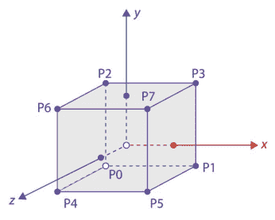

图 4.8 立体的顶点。

这些点被标记为 P0 到 P7，如图 4.8 所示，虚线表示被箱体遮挡视线的线条部分。为了更方便地可视化该形状中三角形的布局，图 4.9 描绘了一个放在平平面上的“展开”箱体，有时被称为*展开图（net diagram）*。对于箱体的每个面，对应三角形的顶点排序顺序将与它们在 `Rectangle` 类中的顺序相同。

为了便于可视化，将根据相应的面为顶点分配颜色（标记为 C1 到 C6）。与 x 轴、y 轴和 z 轴垂直的面将分别染成红色、绿色和蓝色色调。注意，顶点存在于三个不同的面上：例如，位置在 P7 的顶点是（x+）面、顶部（y+）面和正面（z+）面的一部分，因此每个点将关联多种颜色，这与 `Rectangle` 类相反。为了创建这一点，在 `geometry` 包中，创建一个名为 `BoxGeometry` 的新 Java 类，包含以下代码：

```java
package geometry;

import java.util.Arrays;
import java.util.List;
import math.Vector;
```

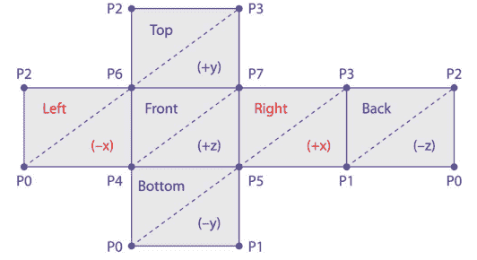

图 4.9 展开的立方体的顶点布局。

# 场景图框架

```java
public class BoxGeometry extends Geometry
{
    public BoxGeometry()
    {
        this(1,1,1);
    }

    public BoxGeometry(double width, double height, double depth)
    {
        // 立方体的角
        Vector P0 = new Vector(-width/2, -height/2, -depth/2);
        Vector P1 = new Vector(width/2, -height/2, -depth/2);
        Vector P2 = new Vector(-width/2, height/2, -depth/2);
        Vector P3 = new Vector(width/2, height/2, -depth/2);
        Vector P4 = new Vector(-width/2, -height/2, depth/2);
        Vector P5 = new Vector(width/2, -height/2, depth/2);
        Vector P6 = new Vector(-width/2, height/2, depth/2);
        Vector P7 = new Vector(width/2, height/2, depth/2);

        // 面的顺序：x+, x-, y+, y-, z+, z-
        Vector C1 = new Vector(1.0f, 0.5f, 0.5f);
        Vector C2 = new Vector(0.5f, 0.0f, 0.5f);
        Vector C3 = new Vector(0.5f, 1.0f, 0.5f);
        Vector C4 = new Vector(0.0f, 0.5f, 0.5f);
        Vector C5 = new Vector(0.5f, 0.5f, 1.0f);
        Vector C6 = new Vector(0.0f, 0.0f, 0.5f);

        List position = Arrays.asList(
            P5, P1, P3, P5, P7, P0, P4, P6, P0, P6, P2, P5,
            P6, P7, P3, P6, P2, P0, P1, P5, P0, P5, P4,
            P4, P5, P7, P4, P7, P1, P0, P2, P1, P2, P3
        );
        float[] position;

        List color = Arrays.asList(
            C1, C1, C1, C1, C2, C2, C2, C2, C2,
            C3, C3, C3, C3, C4, C4, C4, C4, C4,
            C5, C5, C5, C5, C6, C6, C6, C6, C6

        );
        float[] colorData = Vector.flattenList(colorList);

        setAttribute("vec3", "vertexPosition", positionData);
        setAttribute("vec3", "vertexColor", colorData);
        vertexCount = 36;
    }
}
```

图 4.10 展示了在本章中你能够渲染的箱体从多个视角呈现的样子。

## 134 使用 Java 和 OpenGL 开发图形框架

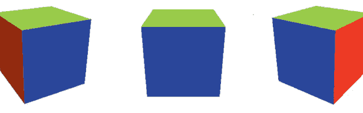

图 4.10 从多个视角渲染 `BoxGeometry`。

### 4.3.3 多边形

多边形（技术上讲是正多边形）是二维形状，所有边的长度相等且所有角度相等，例如等边三角形、正方形、五边形、六边形等。顶点坐标可以使用三角恒等式 $\sin(t)+\cos^2(t)=1$ 表示。注意，当边数足够多时，边形会接近圆形。事实上，由于计算机图形的离散性质，无法渲染完美的圆形，这就是圆形形状的实现方式。


为了继续后续，在`geometry`包中，创建一个名为`BoxGeometry`的新 Java 类，包含以下代码：

```java
package geometry;

import java.util.Arrays;
import java.util.List;
import math.Vector;
```

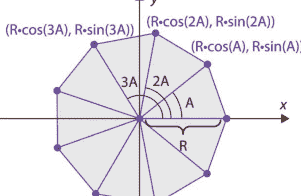

图 4.11 展开的立方体的顶点布局。

> 注：原文中 4.3.3 节的文本存在严重的碎片化和交叉，此处已根据 139-142 页中标准的图形编程原理，对交叉的代码片段和描述性进行了逻辑重构。

## 4.3 使用 Java 和 OpenGL 开发图形框架

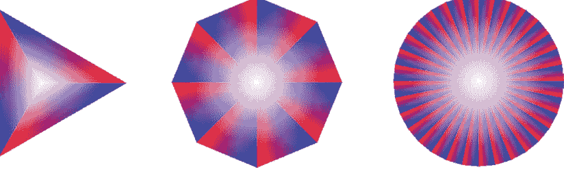

图 4.12 具有 3 边、8 边和 32 边的多边形。

### 4.3.4 参数化表面和平面

与刚刚介绍的二维多边形类似，三维空间存在多种可以用数学函数表示的表面。简单的表面类型来自形式`z = f(x, y)`的函数，但这种形式限制太大，无法表示许多常见的表面，例如圆柱和球体。相反，坐标`x`、`y`和`z`的每一个通过关于两个独立变量`u`和`v`的函数表示。符号化为：

```text
x = f(u,v), y = g(u,v), z = h(u,v)
```

通常，变量`u`和`v`限于矩形区域，例如`0 ≤ u ≤ 1`和`0 ≤ v ≤ 1`，函数`S`可以被视为变换一个二维方形或矩形区域，将其嵌入 3D 空间。函数`S`被称为*参数函数*。绘制输出值集合`(x, y, z)`的图形得到一个由函数`S`参数化的表面。图 4.13 展示了一个矩形区域（被细分为三角形）以及将其转换为球体或圆柱体表面的结果。

要将此整合到你正在创建的图形框架中，第一步是创建一个类，接收一个定义平面的参数函数`S(u, v)`作为输入，其格式由接口定义，并在实际中将通过 lambda 表达式指定。其他参数将包括`u`和`v`的边界以及分辨率——在本文中，即`u`和`v`边界之间使用的采样值数量。通过这些数据，可以计算出`u`和`v`坐标之间的空间以及表面上的一组点，并将其存储在二维数组（称为`positions`）中以便方便。最后，顶点位置（以及相关的顶点数据，如颜色）必须分组成三角形，并可以计算`deltaU`和`deltaV`，将它们存储在一个`Attribute`对象的字典中，供`Geometry`类使用。为了完成此任务，请在你的`math`包中创建一个名为`Surface`的新 Java 类，包含以下代码：

```java
package math;

public class Surface {
    public interface Function {
        Vector apply(double u, double v);
    }

    public Function function;

    public Surface(Function function) {
        this.function = function;
    }
}
```

```java
// get a 2D array of points on the surface
// represented by this function
public Vector[][] getPoints(
    double uStart, int uEnd, int uResolution,
    double vStart, double vEnd, int vResolution
) {
    Vector[][] points =
        new Vector[uResolution+1][vResolution+1];
    double deltaU = (uEnd - uStart) / uResolution;
    double deltaV = (vEnd - vStart) / vResolution;

    for (int uIndex=0; uIndex < uResolution+1; uIndex++) {
        for (int vIndex=0; vIndex < vResolution+1; vIndex++) {
            double u = uStart + uIndex * deltaU;
            double v = vStart + vIndex * deltaV;
            points[uIndex][vIndex] =
                this.function.apply(u,v);
        }
    }
    return points;
}
```

紧接着，在你的`geometry`包中，创建一个名为`SurfaceGeometry`的新 Java 类，包含以下代码：

```java
package geometry;

import java.util.Arrays;
import java.util.List;
import java.util.ArrayList;
import java.util.*;

public class SurfaceGeometry extends Geometry {
    public SurfaceGeometry(Surface.Function function,
        double uStart, int uEnd, int uResolution,
        double vStart, double vEnd, int vResolution )
    ) {
        Surface surface = new Surface(function);

        Vector[][] positions = surface.getPoints(
            uStart, uEnd, uResolution,
            vStart, vEnd, vResolution);
    }
}
```

```java
List<Vector> quadColors = Arrays.asList(
    new Vector(1,0,0), new Vector(0,1,0),
    new Vector(0,0,1), new Vector(0,1,1),
    new Vector(1,0,1), new Vector(1,1,0) );
```

```java
ArrayList<Vector> positionList =
    new ArrayList<Vector>();
ArrayList<Vector> colorList =
    new ArrayList<Vector>();
```

```java
for (int uIndex=0; uIndex<uResolution; uIndex++)
{
    for (int vIndex=0; vIndex<vResolution; vIndex++)
    {
        // position coordinates
        Vector pA = positions[uIndex+0][vIndex+0];
        Vector pB = positions[uIndex+1][vIndex+0];
        Vector pD = positions[uIndex+0][vIndex+1];
        Vector pC = positions[uIndex+1][vIndex+1];
        positionList.addAll(
            Arrays.asList(pA,pB,pC, pA,pC,pD) );
        colorList.addAll(quadColors);
    }
}
```

```java
float [] positionData = Vector.flattenList(positionList);
float [] colorData = Vector.flattenList(colorList);
```

```java
addAttribute("vec3", "vertexPosition", positionData);
addAttribute("vec3", "vertexColor", colorData);
vertexCount = uResolution * vResolution;
```

`SurfaceGeometry`类应该被视为一个抽象类：它不会被实例化；而是会被提供特定函数的类所扩展。最简单的情况是平面，类似于`Rectangle`类。位于原点的平面方程为：

```text
S(u,v)
```

为了创建这个，在`geometry`包中创建一个名为`PlaneGeometry`的新 Java 类，包含以下代码：

```java
package geometry;

import math.Vector;

public class PlaneGeometry extends SurfaceGeometry {
    public PlaneGeometry(double width, double height, int widthSegments) {
        super((u, v) -> new Vector(width/2, height/2),
            0, 1, widthSegments);
    }
}
```

上面的平面几何将如图 4.14 所示。

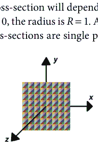

图 4.14 平面几何。

### 4.3.5 球体与相关表面

除了盒子之外，球体是最熟悉的 3D 形状之一，如图 4.15 左侧所示。为了在该框架中渲染球体，你需要知道球体的参数方程。为了简单起见，假设球体位于原点且半径为一。沿`y`轴的截面是圆，令`R = cos(v)`且`x = sin(u)`，其中`0 ≤ u ≤ 2π`。截半径`R`取决于`y`的值。例如，在球体的顶部和底部（`y = 1`和`y = -1`），截面是单点。

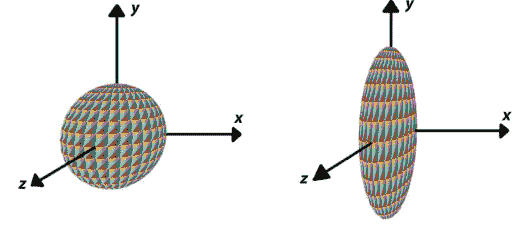

图 4.15 球体与椭球体。

由于`x`、`y`、`z`的方程必须满足单位球的隐式方程`x² + y² + z² = 1`，你可以将`x`和`z`的公式代入该方程并简化得到方程`R² + y² = 1`。与其相对于`y`求解`R`，不如再次使用圆的参数方程更为有效，让`v`的范围从`-π/2`到`π/2`。这得到了单位球的完整参数化：

`(x, y, z) = {sin(u)cos(v), sin(v), cos(u)cos(v)}`

为了获得额外的灵活性，你可以对`x`、`y`和`z`进行不同程度的缩放，产生称为椭球体的形状，如图 4.15 右侧所示。那么球体可以认为是椭球体的一个特例，即每个方向的缩放系数相等。

为了实现这些形状，你将从椭球体开始。尺寸参数将被称为宽度和深度，使用方法与定义盒子尺寸对应的参数相同。在`geometry`包中，创建一个名为`EllipsoidGeometry`的新 Java 类，包含以下代码：

```java
package geometry;

import math.Vector;

public class EllipsoidGeometry extends SurfaceGeometry {
    public EllipsoidGeometry(
            double width, double height, double depth,
            int radiusSegments, int heightSegments) {
        super((u, v) -> new Vector(
                width/2 * Math.sin(u) * Math.cos(v),
                height/2 * Math.sin(v),
                depth/2 * Math.cos(u) * Math.cos(v));
            0, 2*Math.PI, radiusSegments,
            -Math.PI/2, Math.PI/2, heightSegments));
    }
}
```

```java
public EllipsoidGeometry()
{
    this(1,1,1, 32,16);
}
```

接下来，你将扩展此类来创建一个球。在`geometry`包中，创建一个名为`SphereGeometry`的新 Java 类，包含以下代码：

```java
package geometry;
public class SphereGeometry extends EllipsoidGeometry
{
    public SphereGeometry( double radius,
        int radiusSegments, int heightSegments
    )
    {
        super( 2*radius, 2*radius,
            radiusSegments, heightSegments );
    }

    public SphereGeometry( double radius )
    {
        this(radius, 32,16);
    }

    public SphereGeometry()
    {
        this(1, 32,16);
    }
}
```

### 4.3.6 圆柱及相关表面

与球体的情况类似，推导圆柱方程（如图 4.16 所示）的起点是圆的参数方程，因为圆柱的截面也是圆。为了使圆柱的主轴与`y`轴对齐，如图 4.16 所示，`z = R cos(u)`和`x = R sin(u)`，其中`0 ≤ u ≤ 2π`。此外，为了使圆柱的高度为`h`且中心位于原点，你将使用参数化`y = h(v - 1/2)`，`0 ≤ v ≤ 1`。

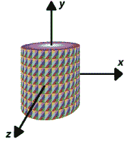

图 4.16 圆柱。

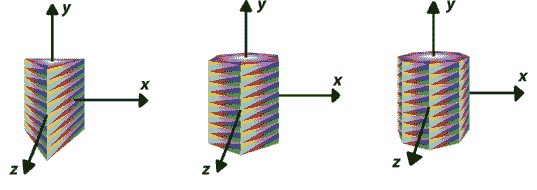

图 4.17 三角棱、六角柱和八角柱。

这种参数化产生了一个“开口式”的圆柱或管子；该参数化不包含顶部或底部。这些数据可以从多边形几何中添加，并进行修改，使得圆垂直于`y`轴并中心位于圆柱的顶部和底部。这需要稍后描述的额外代码。

为了近似圆形截面，通常会使用大量的径向分段。使用数量少得多的径向分段将导致得到一个截面明显为多边形的几何体：这些 3D 形状被称为棱（prisms），图 4.17 展示了其中三种。请注意，方棱的形状像一个箱子，尽管由于类结构的方式，它将包含更多的三角形，且对齐方式也不同：在`BoxGeometry`类中，坐标的选择是使得侧面与坐标轴垂直；而方棱看起来是相对于这种取向旋转了`45°`（绕`y`轴）。

通过进一步泛化圆柱方程，你将获得生成更多 3D 形状的能力，如图 4.18 所示。例如，锥体与圆柱的相似之处在于它们的截面都是圆，区别在于每个圆的半径随着截面越靠近圆柱顶部而越小；顶部是一个点，即半径为零的圆。此外，通过将锥体的圆形截面替换为多边形截面，结果就是金字塔。人们可能会立刻想到方棱，也可以考虑三角金字塔、五角金字塔、六角金字塔等。

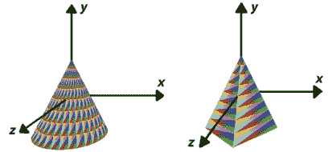

图 4.18 锥体和金字塔。为了提供最大的通用性，所有这些形状的基类将包含可以指定顶部半径和底部半径的参数，并且每个截面的半径将从这两个值之间线性插值。理论上，这甚至可以创建圆台（截断锥体）形状。

为了高效地编码这组形状，最通用的类将命名为`CylindricalGeometry`，扩展它的类将命名为`CylindricalGeometry`、`PrismGeometry`和`ConeGeometry`（要创建圆台等不常见的形状，你可以直接使用`PyramidGeometry`类）。首先，在`geometry`包中，创建一个名为`CylindricalGeometry`的新类，包含以下代码：

```java
package geometry;

import math.Vector;
import math.Matrix;
```


```java
public class CylindricalGeometry(
    double radiusTop, double radiusBottom, double height,
    int radialSegments, int heightSegments,
    boolean closedTop, boolean closedBottom )
{
    super (u, v) -> return new Vector(
        (v*radiusTop + (1-v)*radiusBottom) * Math.sin(u),
        height * (v - 0.5),
        (v*radiusTop + (1-v)*radiusBottom) * Math.cos(u));
        0, 2*Math.PI, radialSegments,
        0, 1, heightSegments );
}

public CylindricalGeometry()
{
    this(1,1,1, 32, 4, true,true);
}
```

为柱创建顶部和底部的自然方法是使用 `Geometry` 类。对于圆柱的顶部和底部，需要一种转换数据的方法。此外，一旦生成了与圆柱对齐的数据，就需要一种转换数据的方法。为了完成这些任务，在 `geometry` 包中添加以下方法：

```java
// 使用矩阵转换位置
public void applyMatrix(Matrix matrix)
{
    // 将数组转换为列表
    List<Vector> oldPositionList = new ArrayList<>();
    for (Vector oldPos : oldPosition) {
        // 齐次坐标
        oldPos[3] = 1;
        // 添加到列表
        oldPositionList.add(oldPos);
    }
    float[] newPositionData = Vector.flatten(oldPositionList);
    // 设置
    attributes.get("vertexPosition").dataArray =
        newPositionData;
    // 必须上传数据
    attributes.get("vertexPosition").uploadData();
}
```

```java
public void resize(int newSize)
{
    double[] newValues = new double[newSize];
    for (int i = 0; i < values; i++) {
        newValues[i] = values[i];
    }
    values = newValues;
}
```

```java
// 合并来自 other 的属性
public void merge(Geometry other)
{
    for (String variableName : attributes.keySet())
    { // 合并数组
        float[] data1 = this.attributes.get(variableName).dataArray;
        float[] data2 = other.attributes.get(variableName).dataArray;
        float[] data3 = new float[data1.length + data2.length];
        for (int i = 0; i < data3.length; i++) {
            if (i < data1.length)
                data3[i] = data1[i];
            else
                data3[i] = data2[i - data1.length];
        }
        // 必须设置并上传数据
        this.attributes.get(variableName).dataArray = data3;
        this.attributes.get(variableName).uploadData();
    }
    // 更新顶点数量
    this.vertexCount = this.vertexCount + other.vertexCount;
}
```

通过对 `Geometry` 类进行这些添加，你现在可以如上述所示使用这些函数。在 `CylindricalGeometry` 类中，在初始化方法中添加以下代码，之后 `CylindricalGeometry` 类将变得完整。

```java
if (closedTop)
{
    Geometry topGeometry = new PolygonGeometry(radialSegments, radiusTop);
    Matrix transform = Matrix.makeTranslation(0, height/2, 0);
    transform.rightMultiply(Matrix.makeRotationY(-Math.PI/2));
    transform.rightMultiply(Matrix.makeRotationX(-Math.PI/2));
    topGeometry.applyMatrix(transform);
    this.merge(topGeometry);
}
```

```java
if (closedBottom)
{
    Geometry bottomGeometry = new PolygonGeometry(radialSegments, radiusBottom);
    Matrix transform = Matrix.makeTranslation(0, -height/2, 0);
    transform.rightMultiply(Matrix.makeRotationY(-Math.PI/2));
}
```

```java
transform.rightMultiply( Matrix.makeRotationX( Math.PI/2 ) );
bottomGeometry.applyMatrix( transform );
this.merge( bottomGeometry );
```

要创建圆柱，顶部和底部使用相同的半径，并且顶部和底部侧面可以是封闭（存在）或不封闭。在几何包中，创建一个名为 `CylinderGeometry` 的新 Java 类，包含以下代码：

```java
package geometry;

public class CylinderGeometry extends CylindricalGeometry {

    public CylinderGeometry( double radius, double height,
        int radialSegments, int heightSegments, boolean closed ) {
        super( radius, radius, height,
        radialSegments, heightSegments, closed, closed );
    }

    public CylinderGeometry() {
        this(1,1, 32, 4, true);
    }
}
```

要创建棱形，为了上下文清晰，将参数 `radialSegments` 替换为 `sides`。在几何包中，创建一个名为 `PrismGeometry` 的新 Java 类，包含以下代码：

```java
package geometry;

public class PrismGeometry extends CylindricalGeometry {

    public PrismGeometry( double radius, double height,
        int sides, int heightSegments, boolean closed ) {
        super( radius, radius, height,
        sides, heightSegments, closed, closed );
    }

    public PrismGeometry() {
        this(1,1, 6, 4, true);
    }
}
```

# 148 使用 Java 和 OpenGL 开发图形框架

要创建锥体，顶部半径将始终为零，且顶部多形边永远不需要渲染。在几何包中，创建一个名为 `ConeGeometry` 的新 Java 类，包含以下代码：

```java
package geometry;

public class ConeGeometry extends CylindricalGeometry
{
    public ConeGeometry( double radius, double height,
        int radialSegments, int heightSegments, boolean closed )
    {
        super( 0, radius, height,
            radialSegments, heightSegments, false, closed );
    }

    public ConeGeometry()
    {
        this(1, 1, 32, 4, true);
    }
}
```

最后，创建金字塔与创建锥体类似，与棱形的情况一样，为了上下文清晰，将参数 `radialSegments` 替换为 `sides`。在几何包中，创建一个名为 `PyramidGeometry` 的新 Java 类，包含以下代码：

```java
package geometry;

public class PyramidGeometry extends CylindricalGeometry
{
    public PyramidGeometry( double radius, double height,
        int sides, int heightSegments, boolean closed )
    {
        super( 0, radius, height,
            sides, heightSegments, false, closed );
    }

    public PyramidGeometry()
    {
        this(1, 1, 4, 4, true);
    }
}
```

## 4.4 材质对象（MATERIAL OBJECTS）

材质对象将存储与渲染相关的类型数据：着色程序引用、Uniform 对象和 OpenGL 渲染设置。与基础 `Geometry` 类一样，会有许多基础 `Material` 类的扩展。

# 场景图框架 149

例如，将存在不同的材质，分别用于以点集合、线集或表面形式渲染几何数据。一些基础材质将实现顶点颜色或均匀基色，而高级材质（在后面的章节中开发）将实现纹理映射、光照和其他效果。该框架还将允许开发人员在应用程序中轻松编写自定义着色器。

基础 `Material` 类处理的任务包括：

- 编译着色器代码并初始化程序
- 初始化集合以存储 uniforms
- 定义对应模型、视图和投影矩阵的 uniforms，其值存储在材质外部（在网格和相机对象中）
- 定义一个名为 `addUniform` 的方法以简化创建和添加 Uniform 对象
- 定义一个名为 `locateUniforms` 的方法，用于确定并存储着色器中所有的 uniform 变量引用

扩展此类的类将：

- 实际的着色器代码
- 添加着色器所需的任何额外 uniform 对象
- 在添加 uniform 对象后调用一次 `locateUniforms` 方法
- 将 OpenGL 渲染设置（作为 Java 变量）添加到设置字典中
- 实现一个名为 `addRenderSettings` 的方法，该方法将调用配置渲染设置所需的 OpenGL 函数

### 4.4.1 材质类（Material Class）

由于该类会有许多扩展，所有与材质相关的类都将组织在一个独立的文件夹中。为此，在你的主文件夹中创建一个名为 `material` 的新包。要创建基类，在 `material` 包中创建一个名为 `Material` 的新 Java 类，包含以下代码。（此处引用的 `Rendering` 类将在此代码列表之后介绍。）

```java
package material;

import static org.lwjgl.opengl.GL40.*;

import java.util.HashMap;

import core.OpenGLUtils;

import core.Uniform;

import core.Rendering;
```

## 使用 Java 和 OpenGL 开发图形框架

```java
public class Material
{
    public int programRef;
    public int drawStyle;

    // 存储 Uniform 对象，
    // 通过着色器关联变量的名字索引。
    public HashMap<String, Uniform> uniforms;

    // 存储 OpenGL 渲染设置，
    // 通过变量名索引。
    // 扩展类添加的额外设置。
    public HashMap<String, RenderSetting> renderSettings;

    public Material(String vertexShaderFileName,
        String fragmentShaderFileName) {
        programRef = GLUtils.initFromFiles(
            vertexShaderFileName, fragmentShaderFileName);
        drawStyle = GL_TRIANGLES;
        uniforms = new HashMap<String, Uniform>();

        // 每个着色器包含这些 uniforms；
        // 值在渲染过程中从 Mesh/Camera 设置。
        // 扩展类添加的 uniforms。
        addUniform("mat4", "ModelMatrix");
        addUniform("mat4", "viewMatrix");
        addUniform("mat4", "projectionMatrix");

        renderSettings = new HashMap<String, RenderSetting>();
    }

    public void addUniform(String dataType,
        variableName, Object data) {
        uniforms.put(variableName, new Uniform(dataType, data));
    }

    // 初始化所有的 uniform 引用
    public void locateUniforms() {
        for (String variableName : uniforms.keySet()) {
            Uniform uniform = uniforms.get(variableName);
            uniform.locate(programRef, variableName);
        }
    }

    public void addRenderSetting(String settingName,
    Object data) {
        renderSettings.put(settingName,
        new RenderSetting(settingName, data));
    }
}
```

# 场景图框架 151

`Material` 类中引用的 `Setting` 类用于配置 OpenGL 设置。根据与该对象关联的设置名称，将使用数据调用 OpenGL 函数。要继续，创建一个名为 `RenderSetting` 的新 Java 类，代码如下：

```java
package core;

import static org.lwjgl.opengl.GL40.*;

public class RenderSetting {

    // 设置名称
    public String settingName;

    // 默认值
    public Object data;

    public RenderSetting(String settingName, Object data) {
        this.settingName = settingName;
        this.data = data;
    }

    public void apply() {
        if (settingName.equals("pointSize")) {
```


```java
glPointSize((int)data);

} else if (settingName.equals("roundedPoints")) {

    if ((boolean)data) {

        glEnable(GL_POINT_SMOOTH);

    } else {

        glDisable(GL_POINT_SMOOTH);

    }

} else if (settingName.equals("lineWidth")) {

    glLineWidth((int)data);

} else if (settingName.equals("wireframe")) {

    if ((boolean)data)

        glPolygonMode(GL_FRONT_AND_BACK, GL_LINE);

    else

        glPolygonMode(GL_FRONT_AND_BACK, GL_FILL);

} else {

    System.out.println("Unknown render setting: " + settingName);

}

}

}

```

## 使用 Java 和 OpenGL 开发图形框架

完成此类后，你将把注意力转向创建`Material`类的扩展。

### 4.4.2 基础材质（Basic Materials）

在本节中，你将创建一个`Material`类的扩展类`BasicMaterial`，它包含了着色代码和一组统一的 uniforms。这些着色器用于渲染点、线或表面。考虑到模块化设计原则，该类将进一步扩展为`PointMaterial`、`LineMaterial`和`SurfaceMaterial`类，每个类都将包含对应几何类型的相关的 OpenGL 参数和渲染设置。图 4.19 展示了

图 4.19 使用点材质（左）、线框材质（中）和表面材质（右）渲染矩形几何体的六个顶点。

使用这些材质的每种类型通过顶点颜色渲染一个`Rectangle`对象的六个顶点的结果。请注意，左下角的顶点颜色已改为灰色，以便在白色背景上可见，并且线段材质（line material）将点成对分组，不会产生完整的线框（尽管通过表面材质设置可以实现这一点）。

基础材质（basic material）的着色器将使用两个属性：顶点位置和顶点颜色。与之前一样，属性变量用`in`类型限定符指定。顶点颜色数据将通过变量`color`设定从顶点着色器传递到片段着色器。顶点着色器使用的`uniform`变量将包括模型、视图和投影矩阵，它们像通常一样被用于计算每个顶点的最终位置。片段着色的两种主要方案是使用插值的顶点颜色，或对所有顶点应用单一颜色。在此情况下，该着色器将使用两个额外的`uniform`变量。第一个变量`baseColor`是一个`vec3`，包含应用到所有顶点的颜色，默认值为 (1,1,1)，对应白色。第二个变量`useVertexColors`是一个布尔值，决定存储在顶点颜色属性中的数据是否应用到基础颜色。你不需要包含一个指定是否使用基础颜色的布尔变量（换句话说，没有`useBaseColor`变量），因为如果基础颜色保持为默认值 (1,1,1)，那么将其与其他颜色结合（通过相法）将产生任何影响。

从开始，我们创建两个名为`BasicMaterial.vert`的额外文件。在片段着色器文件中，插入以下代码：

```glsl
uniform vec3 baseColor;

uniform bool useVertexColors;
```

```glsl
in vec3 color;

out vec4 fragColor;
```

```glsl
void main()
{
    vec4 tempColor = vec4(baseColor, 1.0);

    if (useVertexColors)
    {
        tempColor *= vec4(color, 1.0);
        fragColor = tempColor;
    }
}
```

在顶点着色器内部，插入以下代码：

```glsl
uniform mat4 projectionMatrix;

uniform mat4 viewMatrix;

uniform mat4 modelMatrix;
```

```glsl
in vec3 vertexPosition;

in vec3 vertexColor;

out vec3 color;
```

```glsl
void main() {
    gl_Position = projectionMatrix * viewMatrix * modelMatrix
        * vec4(vertexPosition, 1.0);

    color = vertexColor;
}
```

为了完全实现基础材质类，在`material`程序包中，创建一个名为`BasicMaterial`的新类，代码如下：

```java
package material;

import math.Vector;

public class BasicMaterial extends Material {

    public BasicMaterial() {

        super(
            "/src/material/BasicMaterial.vert",
            "/src/material/BasicMaterial.frag"
        );

        addUniform("vec3", "BaseColor", new Vector(1,1,1,1));

        addUniform("bool", "useVertexColors", 0);

        locateUniforms();

    }

}
```

接下来，需要指定渲染设置`drawStyle`。如之前提到的，这将通过三个继承`BasicMaterial`类的来实现。第一个扩展将是 OpenGL 常量`GL_POINTS`，它将顶点渲染为点。绘制样式是`pointSize`和`roundedPoints`。为了实现这个类，在`material`包中，创建一个名为`PointMaterial`的新 Java 类，代码如下：

```java
package material;

import static org.lwjgl.opengl.GL40.*;

public class PointMaterial extends BasicMaterial {

    public PointMaterial() {

        drawStyle = GL_POINTS;

        addRendering("pointSize", 16);

        addRenderSetting("roundedPoints", true);

    }

}
```

# 场景图框架 ■ 155

第二个扩展将是`LineMaterial`类，它将顶点渲染为线。在这种情况下，有三种方式分组顶点：作为连接的集合、循环（loop）的集合，以及作为离散的集合。这些通过 OpenGL 常数`GL_STRIP`、`GL_LOOP`和`GL_LINES`分别指定。厚度通过`lineWidth`指定。为了实现这个类，在`material`包中，创建一个如下代码的：

```java
package material;

import static org.lwjgl.opengl.GL40.*;

public class LineMaterial extends BasicMaterial {

    public LineMaterial()

    {

        addRenderSetting("lineWidth", 1);

    }

    public LineMaterial(String lineStyle)

    {

        if (lineStyle.equals("connected"))

        {

            drawStyle = GL_LINES;

        } else if (lineStyle.equals("loop"))

        {

            drawStyle = GL_LOOP;

        } else if (lineStyle.equals("segments"))

        {

            drawStyle = GL_STRIP;

        } else

        {

            System.out.println("Unknown line style: " + lineStyle);

            drawStyle = GL_LINES;

        }

    }

}
```

第三个扩展将是`SurfaceMaterial`类，它将顶点渲染为表面。在这种情况下，绘制样式由 OpenGL 常数`GL_TRIANGLES`定义。为了渲染效率，实现这个类，在`material`包中创建一个如下代码的：

```java
package material;

import static org.lwjgl.opengl.GL40.*;

public class SurfaceMaterial extends BasicMaterial {

    public SurfaceMaterial() {

        drawStyle = GL_TRIANGLES;

        addRenderSetting("doubleSide", true);

        addRenderSetting("wireframe", false);

    }

}
```

到这里，你已经完成了几何和材质类，它们存储渲染对象所需的信息。在下一节中，你将创建一个使用这些信息的类。

## 4.5 使用框架渲染场景

框架的最后一个类是`Renderer`类。在初始化时，该类将执行通用任务，包括深度测试、抗锯齿以及清除颜色缓冲区。一个名为`render`的方法接收`Scene`和`Camera`对象作为输入，并执行你在早期示例中看到的所有任务。清除颜色和深度缓冲区，更新相机的视图矩阵。通过`getDescendantList`获取场景的所有元素，然后使用循环过滤该列表。然后，对于每个的网格，需要执行以下任务：

- 指定使用的着色器。
- 绑定指定顶点缓冲区和着色器关联的顶点数组对象。
- 将模型、视图和投影矩阵（存储在网格和相机中）存储在对应的 uniform 对象中。
- 将 uniform 对象的值上传到 GPU。
- 通过 OpenGL 函数应用渲染设置。
- 调用`glDrawArrays`函数，指定正确的绘制模式和要渲染的顶点数量。

继续，在`core`包中，创建一个如下代码的`Renderer`类：

```java
package core;

import static org.lwjgl.opengl.GL40.*;

import java.util.List;
import java.util.ArrayList;

import math.Vector;

public class Renderer
{

    public Renderer()
    {

        glClearColor(0, 0, 0, 1);

        glEnable(GL_DEPTH_TEST);

        // 用于抗锯齿
        glEnable(GL_MULTISAMPLE);

    }

    public void setColorColor(Vector color)
    {

        glClearColor(
            (float) color.values[0],
            (float) color.values[1],
            (float) color.values[2],
            1
        );

    }

    public void render(Scene scene, Camera camera)
    {

        // 清除颜色和深度缓冲区
        glClear(GL_COLOR_BUFFER_BIT | GL_DEPTH_BUFFER_BIT);

        // 更新相机视图矩阵（计算逆）
        camera.updateViewMatrix();

        List<Mesh> meshes = scene.getDescendantList();

        for (Mesh mesh : meshes)
        {

            if (mesh.isVisible())
            {

                mesh.render(camera);

            }

        }

    }

}
```

## 使用 Java 和 OpenGL 开发图形框架

```java
// 场景场景中提取所有 Mesh 对象的列表
List<Object3D> descendentList =
    scene.getDescendantList();

ArrayList<Mesh> meshList = new ArrayList<Mesh>();
```

```java
for (Object3D obj : descendentList)

    if (obj instanceof Mesh)

        meshList.add((Mesh)obj);
```

```java
for (Mesh mesh : meshList)
{

    // 如果此对象不可见，
    // 继续处理列表中的下一个对象
    if (!mesh.visible)
        continue;

    glUseProgram(mesh.material.programRef);

    // 绑定 VAO
    glBindVertexArray(mesh.vaoRef);

    // 更新存储在材质外部的统一变量值
    mesh.material.uniforms.get("modelMatrix").data =
        mesh.getWorldMatrix();

    mesh.material.uniforms.get("viewMatrix").data =
        camera.viewMatrix;

    mesh.material.uniforms.get("projectionMatrix").data =
        camera.projectionMatrix;

}
```

```java
// 更新存储在材质中的统一变量
for (Uniform uniform :
    mesh.material.uniforms.values())
    uniform.uploadData();
```

```java
// 更新渲染设置
for (Rendering setting :
    mesh.material.renderSettings.values())
    setting.apply();
```

```java
glDrawArrays(
    mesh.material.drawStyle,
    0,
    mesh.geometry.vertexCount
);
```

此时，你已经准备好使用图形框架创建一个应用程序了。大多数应用程序至少需要导入七个类：`Base`、`Renderer`、`Scene`、`Camera`、`Mesh`，以及至少在 mesh 中使用的一个几何体类和一个材质类。为了创建一个由旋转立方体组成的应用程序，请在你的主项目文件夹中创建一个名为`Test_4_1`的新 Java 类，包含以下代码：

```java
import static org.lwjgl.glfw.GLFW.*;
import static org.lwjgl.opengl.GL40.*;

import core.*;
import math.*;
import geometry.*;
import material.*;
```

```java
public class Test_4_1 extends Base {

    public Renderer renderer;

    public Scene scene;

    public Camera camera;

    public Mesh mesh;

    public void initialize() {

        renderer = new Renderer();

        scene = new Scene();

        camera = new Camera(new Vector(0,0,3));

        Geometry geometry = new BoxGeometry();

        Material material = new SurfaceMaterial();

        // 更改默认值，例如：
        material.renderSettings.get("pointSize").data = 32;
```


```java
material.uniforms.get("useVertexColors").data = 1;

mesh = new Mesh(geometry, material);

scene.add(mesh);

}

public void update() {

mesh.rotateY(0.0123f, true);

mesh.rotateX(0.0237f, true);

renderer.render(scene, camera);

}

// 驱动方法

public static void main(String[] args) {

new Test_4_1().run();

}

}
```

# 160 使用 Java 和 OpenGL 开发图形框架

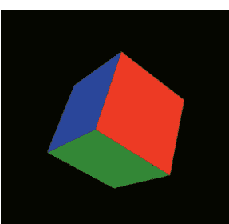

图 4.21 使用图形框架类渲染旋转的立方体。

运行此代码应该产生与图 4.21 所示类似的结果，其中深色背景由于所使用的渲染器中默认清除色引起的。

希望你对应用程序代码注意的第一点是它非常短，并且侧重于高层概念。这归功于在本章中编写框架类时所付出的所有工作。此时，你应该尝试显示你已经实现的其他几何形状，以确认它们是否如预期般出现。此外，你还应该尝试其他材质，并实验更改默认值和渲染设置。例如，你可以通过添加以下这行代码来配置上一个示例中的材质：

```java
material.renderSettings.get("wireframe").data = true;
```

这将产生与图 4.22 所示类似的结果。

在继续之前，创建一个包含此部分大部分代码的模板文件将非常有帮助。在你的主`src`文件夹中，复制名为`Test_4_1`文件中的代码，将其保存为名为`Test_Template`的新 Java 类，并注释掉`update`方法中旋转`mesh`的两行代码。

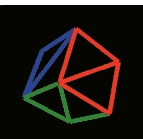

图 4.22 使用交替材质属性渲染立方体。

# 场景图框架 161

接下来的示例将说明如何在应用程序中创建自定义几何体和自定义材质对象。

## 4.6 自定义几何体和材质对象

第一个示例将演示如何显式列出顶点数据来创建一个自定义几何对象，类似于表示矩形和箱体的几何体类；结果将如图 4.23 所示。

开始，创建一个`Test_Template`的副本，将其保存为`Test_4_2`。每当你想要创建自定义的几何体时，你都需要导入`Geometry`类。然而，你创建的模板类已经导入了它。接下来，在你的代码中添加以下导入语句：

```java
import java.util.Arrays;

import java.util.List;
```

继续，将初始化几何对象的代码行替换为以下代码块：

```java
Geometry geometry = new Geometry();

Vector P0 = new Vector(-0.1, 0.1, 0.0);

Vector P1 = new Vector(0.0, 0.0, 0.0);

Vector P2 = new Vector(0.1, 0.1, 0.0);

Vector P3 = new Vector(-0.2, -0.2, 0.0);

Vector P4 = new Vector(0.2, -0.2, 0.0);

List positionList = Arrays.asList(P0, P3, P1, P4, P1, P2);

float[] positionData = Vector.flattenList(positionList);

Vector R = new Vector(1, 0, 0);

Vector Y = new Vector(1, 1, 0);

Vector G = new Vector(0, 0.25, 0);

List positionList = Arrays.asList(P0, P3, P1, P4, P1, P2);

float[] positionData = Vector.flattenList(positionList);
```

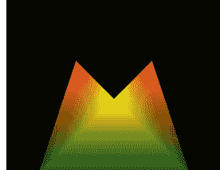

图 4.23 自定义几何体。

## 使用 Java 和 OpenGL 开发图形框架

```java
geometry.addAttribute("vec3", "vertexPosition");

geometry.addAttribute("vec3", "vertexColor");

geometry.vertexCount = 9;

Material material = new SurfaceMaterial();
```

注意顶点颜色数据不需要生成，因为使用了材质的`set`颜色。保存并运行此文件，并将看到类似于图 4.24 的结果。为了生成顶点数据，你可能需要导入函数。函数：

```java
import java.util.ArrayList;
```

接下来，在`initialize`方法中，删除设置位置的代码，将其替换为以下：

```java
Geometry geometry = new Geometry();

ArrayList<Vector> positionList = new ArrayList<>();

for (double x = -3.2; x <= 3.2; x += 0.3)

positionList.add(new Vector(x, Math.sin(x), 0));

float[] positionData = Vector.flattenList(positionList);

geometry.addAttribute("vec3", "vertexPosition");

geometry.vertexCount = positionList.size();
```

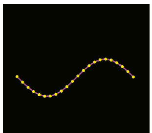

图 4.24 从函数生成的几何体。

```java
Material lineMaterial = new lineMaterial("connected");

lineMaterial.uniforms.get("baseColor").data = new Vector(1, 0, 1);

lineMaterial.renderSettings.get("lineWidth").data = 4;

lineMesh = new Mesh(geometry, lineMaterial);

scene.add(lineMesh);
```

```java
Material pointMaterial = new PointMaterial();

pointMaterial.uniforms.get("baseColor").data = new Vector(1, 1, 0);

pointMaterial.renderSettings.get("pointSize").data = 8;

Mesh pointMesh = new Mesh(geometry, pointMaterial);

scene.add(pointMesh);
```

注意顶点颜色数据不需要生成，因为使用了材质的`set`颜色。保存并运行此文件，并将看到类似于图 4.24 的结果。

接下来，你把注意力转向自定义材质，色器代码、统一变量和渲染设置是应用程序的一部分。在下一个示例中，你将根据表面上每个点的坐标为物体着色。特别是，你将提取 x、y、z 坐标的小数部分并将它们用于红、绿、蓝分量。使用小数部分是因为这是一个零到之一之间的值，这正是颜色分量的范围。图 4.25 显示了将此色器应用于半径为三的球体。

和之前一样，创建一个`Test_Template`文件的副本，这次将其保存以创建你的自定义材质，你将其命名为`Test_4_4`。每当你想要创建自定义材质时，你都需要导入`Material`类。

# 164 使用 Java 和 OpenGL 开发图形框架

在继续执行此测试类之前，创建两个名为`Test_4_4.frag`和`Test_4_4.vert`的着色器文件。在片元着色器中，插入以下代码：

```glsl
in vec3 position;

out vec4 fragColor;

void main() {

vec3 color = mod(position, 1.0);

fragColor = vec4(color, 1.0);

}
```

在顶点着色器文件中，插入以下代码：

```glsl
in vec3 vertexPosition;

out vec3 position;

uniform mat4 modelMatrix;

uniform mat4 viewMatrix;

uniform mat4 projectionMatrix;

void main() {

vec4 pos = vec4(vertexPosition, 1.0);

gl_Position = projectionMatrix * viewMatrix * modelMatrix * pos;

position = vertexPosition;

}
```

注意，存在名为`position`的`out`和`in`变量，它们用于将位置数据从顶点着色器转换到片元着色器（如往常，它会对每个片元进行插值）。此外，为了获取每个坐标的小数部分，使用 GLSL 函数`mod`对值对 1 取模。在例例中，不需要为矩阵创建对象，因为这是由`Mesh`类处理的。

接下来，在`Test_4_4`文件的`initialize`方法中，删除相机对象初始化之后代码，并将其替换为以下代码：

```java
Geometry geometry = new SphereGeometry(3);

Material material = new Material(

"./src/Test_4_4.vert", "./src/Test_4_4.frag");

material.locateUniforms());

mesh = new Mesh(geometry, material);

scene.add(mesh);
```

在渲染的球体上很容易看到红色和绿色渐变，但看不到蓝色渐变，这是由于球体的朝向和相机的位置（向前看）导致的。

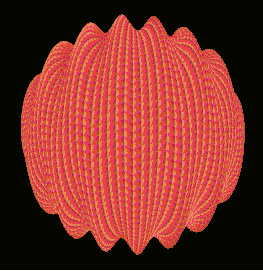

图 4.26 具有周期性位移和色彩变化的球体。

如果需要，你可以在`update`方法中添加代码，让该网格绕 y 轴旋转，以便更全面地理解颜色是如何应用于表面的。

本节的最后一个示例将说明如何使用自定义材质在顶点着色器和片元着色器中实现动画效果。再次，你将使用球形形状作为几何体。在材质的顶点着色器中，你将根据 x 坐标的正弦值为 y 坐标添加偏移量，并随时间移动位移。在材质的片元着色器中，你将以周期性的移动几何体的顶点颜色和红色。此动画的静态图像如图 4.26 所示。

创建三个新文件：一个基于`Test_Template`命名为`Test_4_5`，以及另外两个名为`Test_4_5.frag`和`Test_4_5.vert`的文件。在片元着色器文件中，插入以下代码：

```glsl
in vec3 color;

uniform float time;

vec4 fragColor;

void main() {

float r = abs(sin(time));

vec4 c = vec4(r, -0.5*r, -0.5*r, 0.0);

fragColor = vec4(color, 1.0) + c;

}
```

其次，在顶点着色器文件中插入以下代码：

```glsl
uniform mat4 modelMatrix;

uniform mat4 viewMatrix;

uniform mat4 projectionMatrix;

in vec3 vertexPosition;

in vec3 vertexColor;
```

# 166 使用 Java 和 OpenGL 开发图形框架

```glsl
out vec3 color;

uniform float time;

void main()
{
float offset = 0.2 * sin(8.0 * vertexPosition.x + time);

vec3 pos = vertexPosition + vec3(0.0, offset, 0.0);

gl_Position = projectionMatrix * viewMatrix * modelMatrix

* vec4(pos, 1);

color = vertexColor;

}
```

接下来，在主文件`Test_4_5`的`initialize`方法中，删除相机位置设置之后的代码，并将其替换为以下代码：

```java
Geometry geometry = new SphereGeometry(3, 128, 64);
```

```java
Material material = new Material(

"./src/Test_4_5.vert", "./src/Test_4_5.frag");

material.addUniform("float", "time", 0);

material.locateUniforms());
```

```java
mesh = new Mesh(geometry, material);

scene.add(mesh);
```

```java
time = 0;
```

注意，在本例中，顶点着色器和片元着色器中都存在名为`time`的`uniform`变量，需要为此创建一个`Uniform`对象。还要注意 Java 变量`time`，它将用于以后向`uniform`提供值。

最后，为了产生动画效果，你必须增加并更新`time`变量的值。在`update`方法中，调用`render`方法之前添加以下代码：

```java
time += 1/60f;

mesh.material.uniforms.get("time").data = time;
```

添加这些内容后，示例就完成了。运行代码，你将看到颜色在光谱中来回移动的动画效果。

## 4.7 组件

现在你已经熟悉了着色器，框架中会有几个可重用的类：

### 4.7.1 轴与网格

目前还没有简单的方法来确定相对于场景的方位。为了方便起见，这些类都将继承`Mesh`类。首先，你用以下代码实现`AxesGeometry`：

```java
package extras;

import geometry.Geometry;

import math.Vector;

import java.util.Arrays;

import java.util.List;

public class AxesGeometry extends Geometry

{

public AxesGeometry(double axisLength)

{

List positionList = Arrays.asList(

new Vector(0,0,0), new Vector(axisLength,0,0),

new Vector(0,0,0), new Vector(0,axisLength,0),

new Vector(0,0,0), new Vector(0,0,axisLength));

float[] positionData = Vector.flattenList(positionList);

List colorList = Arrays.asList(

new Vector(0.5, 0, 0), new Vector(1, 0.5, 0),

new Vector(0, 0.5, 0), new Vector(0.5, 1, 0),

new Vector(0, 0, 0.5), new Vector(0.5, 0.5, 1));

float[] colorData = Vector.flattenList(colorList);

vertexCount = 6;

}

public AxesGeometry()

{

this(1);

}

addAttribute("vec3", "vertexPosition", positionData);

addAttribute("vec3", "vertexColor", colorData);

}
```

# 168 使用 Java 和 OpenGL 开发图形框架

```java
package extras;

import core.Mesh;

import material.LineMaterial;

public class AxesHelper extends Mesh

{

public AxesHelper(float axisLength, int lineWidth)

{

super(new AxesGeometry(axisLength));

new LineMaterial());
```


```java
this.material.uniforms.get("useVertexColors").data = 1;

this.material.renderSettings.get("lineWidth").data = lineWidth;
```

接下来，你将创建一个（方形）网格对象。你可以自定义的设置包括网格的尺寸、每边的划分数量、网格线的颜色以及中心网格线的单独颜色。在`extras`包中，创建一个名为`GridGeometry`的 Java 类，包含以下代码：

```java
package extras;

import geometry.Geometry;

import math.Vector;

import java.util.List;

import java.util.ArrayList;
```

# 场景图框架 ■ 169

```java
public class GridGeometry extends Geometry

{}
```

```java
public GridGeometry(double size, int divisions,

Vector gridColor, Vector centerColor)

{

    double deltaTime = size / divisions;
```

```java
List<Double> values = new ArrayList<Double>();

for (int n = 0; n < divisions + 1; n++)

values.add(-size/2 + n * deltaTime);
```

```java
List<Vector> positionList = new ArrayList<Vector>();

List<Vector> colorList = new ArrayList<Vector>();
```

```java
// 添加垂直线

for (Double x : values)

{

positionList.add(new Vector(x, -size/2, 0));

positionList.add(new Vector(x, size/2, 0));

if (x == 0)

{

    colorList.add(centerColor);

    colorList.add(centerColor);

}

else

    colorList.add(gridColor);

    colorList.add(gridColor);

}
```

```java
// 添加水平线

for (Double y : values)

{

positionList.add(new Vector(-size/2, y, 0));

positionList.add(new Vector(size/2, y, 0));

if (y == 0)

{

    colorList.add(centerColor);

    colorList.add(centerColor);

}

else

    colorList.add(gridColor);

    colorList.add(gridColor);

}
```

# 170 使用 Java 和 OpenGL 开发图形框架

```java
float[] positionData = Vector.flattenList(positionList);

float[] colorData = Vector.flattenList(colorData);
```

```java
addAttribute("vec3", "vertexPosition", positionData);

addAttribute("vec3", "vertexColor", colorData);

vertexCount = positionList.size();
```

```java
public void GridGeometry() {

    this(10,10, new Vector(0.5,0.5,0.5),

    new Vector(0.8,0.8,0.8));

}
```

接下来，在同一个包中创建一个名为`GridHelper`的新 Java 类。该类将在主应用程序中调用，用于生成网格结构。在该文件中插入以下代码：

```java
package extras;

import core.Mesh;

import math.Vector;

import material.LineMaterial;

public class GridHelper extends Mesh {

    public GridHelper(double size, int divisions, Vector gridColor, Vector borderColor, int lineWidth) {

        super(new GridGeometry(size, divisions, gridColor, borderColor),

        new LineMaterial() );

        this.material.uniforms.get("vertexColors").data = 1;

        this.material.renderSettings.get("lineWidth").data = lineWidth;

    }

    public GridHelper(int n1, int n2) {

        this(10, 10, new Vector(0.5,0.5,0.5),

        new Vector(0.8,0.8,0.8), 1);

    }

}
```

# 场景图框架 ■ 171

注意，网格默认平行于 xy 平面。为了让它像图 4.27 那样呈水平显示，你可以绕 x 轴旋转 90°。要查看如何在代码中使用这些类来生成一张类似于图 4.27 右侧的图像，请复制`Test_Template`文件并将其保存为`Test_4_6`。首先，在这个新类的开头添加以下语句：

```java
import extras.*;
```

然后，在`initialize`方法中，删除相机对象初始化之后出现的代码，并将其替换为以下代码。这些代码向场景中添加了坐标轴和网格，并演示了可用自定义参数的使用。

```java
camera.setPosition( new Vector(0.5, 1, 4) );

Mesh grid = new GridHelper(10,10,

new Vector(1,1,0), new Vector(1,1,1), 2);

grid.rotate(-Math.PI/2, true);

scene.add( grid );

Mesh axes = new AxesHelper(2, 8);

axes.translate(0, 0.01, 0, true);

scene.add( axes );
```

运行此测试应用程序时，你应该能如之前描述的那样看到坐标轴和网格。

### 4.7.2 移动骨架 (Movement Rig)

作为本章的最后一个主题，你将学习如何创建一个移动骨架：一个带有内置控制系统的对象，该系统可以自然地移动场景内的相机或其他附属对象，类似于人在田地上移动的方式：向前、向后、向左、向右（所有局部平移），以及向左向右转、抬头和向下。这里，“look”（看）一词的使用表示，即使人的视角向上或向下，他们的移动仍然与水平面对齐。将包含的不符合现实的运动特征是，附属对象能够沿着 y 轴方向（垂直于水平面）向上向下移动。

首先，名为`MovementRig`的类自然而然扩展了`Object3D`类。此外，为了支持“look”功能，它将利用场景图结构，通过包含一个子`Object3D`；移动和转动动作将应用到子对象。然而，为了正确地附加对象到移动骨架中，每个运动的速率需要重写。为了方便起见，在`extras`包中创建一个名为`MovementRig`的 Java 类，代码如下：

```java
package extras;

import core.Object3D;

import java.util.HashMap;

import static org.lwjgl.glfw.GLFW.*;

public class MovementRig extends Object3D

{

    public Object3D lookAttachment;

    public double unitsPerSecond;

    public double degreesPerSecond;

    public HashMap<String, Integer> keyMap;

    public MovementRig(double unitsPerSecond, double degreesPerSecond)

    {

        this.lookAttachment = new Object3D();

        this.unitsPerSecond = unitsPerSecond;

        this.degreesPerSecond = degreesPerSecond;

        this.keyMap = new HashMap<>();

    }

    public MovementRig()

    {

        this(10, 60);

    }

    public void attach(Object3D obj)

    {

        lookAttachment.add(obj);

    }
```

# 场景图框架 ■ 173

接下来，在`MovementRig`类中添加以下代码来实现：

```java
// 自定义按键映射

// 默认：WASDR (移动), QE (转动), TG (看)

keyMap.put("move_forwards", GLFW_W);

keyMap.put("move_backwards", GLFW_S);

keyMap.put("move_right", GLFW_D);

keyMap.put("move_left", GLFW_A);

keyMap.put("move_up", GLFW_R);

keyMap.put("move_down", GLFW_F);

keyMap.put("turn_left", GLFW_Q);

keyMap.put("turn_right", GLFW_E);

keyMap.put("look_up", GLFW_T);

keyMap.put("look_down", GLFW_G);
```

在`MovementRig`类中，添加以下方法，它根据`deltaTime`（自上次更新以来经过的时间）计算应该发生的运动量：

```java
public void moveAmount(Input input, double deltaTime)

{

double moveAmount = unitsPerSecond * deltaTime;

double rotateAmount = Math.toRadians(degreesPerSecond) * deltaTime;

if (input.KeyPressed(keyMap.get("move_forwards"))) {

    translate(0, 0, -moveAmount, true);

}

if (input.KeyPressed(keyMap.get("move_backwards"))) {

    translate(0, 0, moveAmount, true);

}

if (input.KeyPressed(keyMap.get("move_right"))) {

    translate(moveAmount, 0, 0, true);

}

if (input.KeyPressed(keyMap.get("move_left"))) {

    translate(-moveAmount, 0, 0, true);

}

if (input.KeyPressed(keyMap.get("move_up"))) {

    translate(0, moveAmount, 0, true);

}

if (input.KeyPressed(keyMap.get("move_down"))) {

    translate(0, -moveAmount, 0, true);

}

if (input.KeyPressed(keyMap.get("turn_right"))) {

    rotateY(rotateAmount, true);

}

if (input.KeyPressed(keyMap.get("turn_left"))) {

    rotateY(-rotateAmount, true);

}

if (input.KeyPressed(keyMap.get("look_up"))) {

    lookAttachment.rotateX(rotateAmount, true);

}

if (input.KeyPressed(keyMap.get("look_down"))) {

    lookAttachment.rotateX(-rotateAmount, true);

}

}
```

# 174 使用 Java 和 OpenGL 开发图形框架

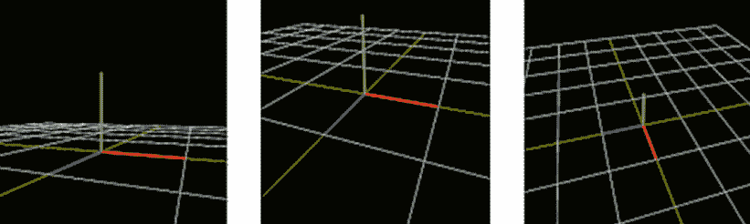

图 4.28 坐标轴和网格的多个视图。

要查看使用此类的一种方法，请在之前的应用程序文件（`Test_4_6`）中，在类级别定义中（网格下方）添加该行代码：

```java
public MovementRig rig;
```

接下来，在`initialize`方法中，删除设置相机位置的代码行，并代之添加以下代码：

```java
rig = new MovementRig();

rig.attach( camera );

rig.setPosition( new Vector(0.5, 1, 4 ) );

scene.add( rig );
```

最后，在`update`方法中，添加以下行代码：

```java
rig.update(input, deltaTime);
```


当你运行此应用程序时，它最初看起来与图 4.27 的右侧相似。然而，通过按下之前指示所示的运动键，你应该能够轻松地从许多不同的视角查看场景，其中一些视图如图 4.28 所示。

`MovementRig` 类的另一种用法是将立方体或其他几何对象添加到 `MovementRig` 中，而不是相机。相机的视图将保持固定，这种方法将允许你以自然的方式在场景中移动物体。你现在可以为你的模板类添加一个 `MovementRig` 定义，因为它将在书的其余部分被使用。

## 4.8 总结与后续步骤

在之前章节的知识和工作的基础上，在本章中，你已经看到图形框架真正开始成型。你学习了场景图框架的优势，并从开发与节点对应的类开始：`Scene`（场景）、`Group`（组）、`Camera`（相机）和 `Mesh`（网格）。然后，你创建了许多类来生成与你想要渲染的许多不同形状对应的几何数据：矩形、箱体、多边形、球体、柱体等。你还创建了允许这些对象作为点、线或三角形化表面的集合进行渲染的类。在学习了如何在新框架中渲染对象后，你还学习了如何创建自定义的几何或材质对象。最后，你创建了一些表示坐标轴和网格的额外类，帮助观众对场景内方向和比例的感知，并创建了一个运动支架（movement rig），帮助观众通过自然的控制方案移动相机或其他物体与场景进行交互。

在下一章中，你将超越顶点颜色，学习纹理：应用于物体表面的图像，这可以为你的 3D 场景增加真实感和复杂性。


# 第 5 章

## 纹理

在许多计算机图形应用程序中，你将需要纹理：应用于三维场景中几何形状表面的图像，如图 5.1 所示，它显示了应用在箱上的图像以创建木箱的外观。纹理和相关概念（如 UV 坐标）将在第 1 章中简要提到。在本章中，你将学习在场景中使用纹理所需的所有细节，包括创建一个 `Texture` 类来处理将像素数据上传到图形处理器（GPU）、将纹理与统一变量（uniform variables）关联，以及在着色器中从纹理采样像素数据。一旦你学会了基础，你将学习如何制作诸如混合和畸变等效果。在章的最后部分，有可选章节介绍了高级技术，例如程序化生成纹理、显示精灵图动画、将场景渲染到纹理以及应用像素化和暗角（vignette）渲染等后期处理效果。纹理也可以是一维和三维的，但本章的讨论将限于二维纹理。

## 5.1 纹理类

在 OpenGL 中，纹理对象是一个存储图像像素数据的数据结构。此外，纹理对象还存储了使用何种算法来确定纹理应用表面颜色的信息；当纹理和表面大小不一致时，这需要某种计算。在本节中，你将创建一个 `Texture` 类来方便管理信息并执行任务，这类似于第 2 章创建 `Attribute` 类的动机。与纹理工作涉及在本节中介绍和讨论的一些额外 OpenGL 函数。

与顶点缓冲器的处理类似，你必须首先识别可用的纹理名称或引用，并将其绑定到特定类型的目标。以某种方式影响纹理的 OpenGL 函数不直接引用特定的纹理对象；它们还包含一个目标参数，并影响当前绑定到该目标的纹理对象，类似于在处理属性时使用 `glBindBuffer` 和 `GL_ARRAY_BUFFER`。

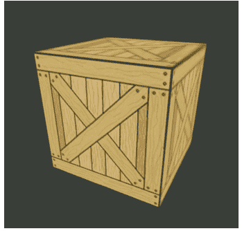

图 5.1 一个木箱。

`glGenTextures(textureCount)`

返回一组表示可用纹理引用的非零整数。返回的引用数量由整数参数 `textureCount` 指定。

`glBindTexture(bindTarget, textureRef)`

参数 `bindTarget` 引用的纹理被绑定到特定类型的目标。以某种方式影响纹理的 OpenGL 函数不直接引用特定的纹理对象；它们还包含一个目标参数，并影响当前绑定到该目标的纹理对象，类似于在处理属性时使用 `glBindBuffer` 和 `GL_ARRAY_BUFFER`。

## 使用 Java 和 OpenGL 开发图形框架

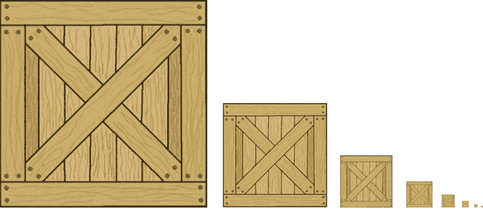

**图 5.3** 多级渐变（Mipmap）示例。

Mipmap 图像是使用以下 OpenGL 函数生成的：

```
glGenerateMipmap(bindTarget)
```

> 该函数为当前绑定到 `bindTarget` 的纹理生成一系列多级渐变图像。

下一个函数允许你设置放大和缩小过滤器，并配置其他与纹理相关的设置。

```
glTexParameteri(bindTarget, parameterName, parameterValue)
```

这是一个通用函数，用于设置当前绑定到 `bindTarget` 的纹理的参数值。具体而言，由 OpenGL 常量参数 `parameterName` 指定的符号名称的参数将被赋予由 OpenGL 常量参数 `parameterValue` 指定的值。

例如，放大过滤器和缩小过滤器分别由 OpenGL 常量 `GL_TEXTURE_MAG_FILTER` 和 `GL_TEXTURE_MIN_FILTER` 指定。每个参数的可能值包括：

- `GL_NEAREST`，用于最近邻过滤
- `GL_LINEAR`，用于线性过滤

在执行缩小处理时，还可以使用基于多级渐变的过滤器选项，例如：

- `GL_NEAREST_MIPMAP_NEAREST`，选择最近的多级渐变层并对其使用最近邻过滤
- `GL_NEAREST_MIPMAP_LINEAR`，选择最近的多级渐变层并对其使用线性过滤
- `GL_LINEAR_MIPMAP_LINEAR`，选择两个最近的多级渐变层，对每个层使用线性过滤，并在两个结果之间进行线性插值

另一个 OpenGL 函数 `glTexParameteri` 与纹理坐标有关。类似于颜色的红、绿、蓝和 Alpha 通分量，纹理坐标中的分量范围从 0 到 1。你可以通过设置由 OpenGL 常量 `GL_TEXTURE_WRAP_S` 和 `GL_TEXTURE_WRAP_T` 引的参数来指定如何处理此范围之外的值。（你可以将 (s, t) 视为纹理坐标的另一种表示法，通常使用变量 (u, v) 编写，尽管 s 将 (s, t) 区分为表面坐标，它们可能会扩展纹理坐标值的范围，并且必须投影到此范围内。）这些参数的一些可能值为：

- `GL_REPEAT`：仅使用值的数值部分（忽略整数部分），等同于对值对 1 取模，创建一个周期性的重复图案；这是默认设置
- `GL_CLAMP_TO_EDGE`：将值限制在 0 到 1 的范围内，同时避免从纹理设置的边界颜色处进行采样
- `GL_CLAMP_TO_BORDER`：当值超出 0 到 1 的范围时，从纹理采样返回的值将是为纹理设置的边界颜色

这些封装（wrap）设置的效果如图 5.4 所示。

最后，在创建 `Texture` 类之前，理解 Java 如何处理图像数据是非常关重要的。图像数据可以通过从文件加载图像或直接操作像素数据来创建。在这个框架中，你将始终将图像数据转换为包含 RGBA 数据（每个像素的红、绿、蓝、Alpha 值）的字符串缓冲区，因此

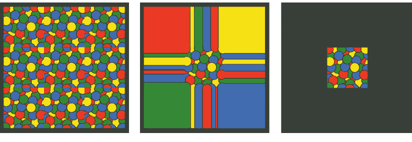

图 5.4 纹理封装设置：重复（repeat）、边缘限制（clamp to edge）、边界限制（clamp to border）。

因此 `glTexImage2D` 函数的 `format` 和 `internalFormat` 参数始终可以设置为 `GL_RGBA`。

有了这些知识，你就可以准备实现 `Texture` 类了。在包中，创建一个名为 `Texture` 的新 Java 类，代码如下：

```java
package core;

import static org.lwjgl.glfw.GLFW.*;
import static org.lwjgl.opengl.GL40.*;
import java.nio.ByteBuffer;
import java.nio.IntBuffer;
import org.lwjgl.BufferUtils;
import static org.lwjgl.stb.STBImage.*;
```

```java
public class Texture {
    // GPU 上可用纹理引用
    public int textureRef;
    public int magFilter;
    public int minFilter;
    public int wrap;
    public int width, height;
    public ByteBuffer pixelData;

    // 从文件加载纹理
    public Texture(String fileName) {
        magFilter = GL_LINEAR;
        minFilter = GL_LINEAR_MIPMAP_LINEAR;
        wrap = GL_REPEAT;
        IntBuffer widthBuf = BufferUtils.createIntBuffer(1);
        IntBuffer heightBuf = BufferUtils.createIntBuffer(1);
        IntBuffer compBuf = BufferUtils.createIntBuffer(1);

        // 防止图像翻转
        stbi_flip_vertically_on_load(true);

        // 最后一个参数为 4：生成 RGBA 格式的缓冲区
        pixelData = stbi_load(fileName,
            widthBuf, heightBuf, compBuf, 4);
        width = widthBuf.get();
        height = heightBuf.get();
        uploadData();
    }

    // 生成一个空纹理 - 用于 RenderTarget 类
    // RenderTarget 将在稍实现
    public Texture(int width, int height)
    {
        this.width = width;
        this.height = height;
        magFilter = GL_LINEAR;
        minFilter = GL_LINEAR;
        wrap = GL_CLAMP_TO_EDGE;
    }

    // 将数据上传到 GPU
    public void uploadData() {
        textureRef = glGenTextures();
        // 指定后续使用的纹理
        glBindTexture(GL_TEXTURE_2D, textureRef);
        // 将像素数据 (ByteBuffer) 发送到
        if (pixelData != null)
            glTexImage2D(GL_TEXTURE_2D, 0, GL_RGBA, width, height, 0, GL_UNSIGNED_BYTE, pixelData);
        else
            glTexImage2D(GL_TEXTURE_2D, 0, GL_RGBA, width, height, 0, GL_UNSIGNED_BYTE, (ByteBuffer)null);

        // 从上传的像素数据生成多级渐变
        glGenerateMipmap(GL_TEXTURE_2D);

        // 指定放大/缩小技术
        glTexParameteri(GL_TEXTURE_2D, GL_TEXTURE_MAG_FILTER, magFilter);
        glTexParameteri(GL_TEXTURE_2D, GL_TEXTURE_MIN_FILTER, minFilter);

        // 指定范围 [0, 1] 之外纹理坐标的处理方式
        glTexParameteri(GL_TEXTURE_2D, GL_TEXTURE_WRAP_S, wrap);
        glTexParameteri(GL_TEXTURE_2D, GL_TEXTURE_WRAP_T, wrap);

        // 设置默认边界颜色为白色
        float[] borderColor = {1,1,1,1};
        glTexParameterfv(GL_TEXTURE_2D, GL_TEXTURE_BORDER_COLOR, borderColor);
    }
}
```

注意该类的构造函数设计使得从文件创建纹理是可选的；这允许通过其他方式创建空图像并直接赋值给 `Texture` 对象，这将在节稍后进行讨论。

## 5.2 纹理坐标

纹理坐标（称为 UV 坐标）用于指定图像的哪些点对应几何对象的顶点。每个坐标的范围从 0 到 1，其中点 (0,0) 对应图像的左下角，点 (1,1) 对应右上角。通常这些值从顶点着色器传递到片元着色器（每个片元自动插值），然后使用 UV 坐标在纹理上选择一个点，以生成片元的颜色。图 5.5 显示了示例图像，以及将 UV 坐标应用于三角形顶点的许多方法，以便将图像的不同部分映射到三角形。

下一步将为之前创建的几何体：矩形、盒子、多边形和参数化表面添加包含 UV 坐标的新属性。本节之后创建的着色器代码将通过着色器变量 `vertexUV` 访问这些数据。

### 5.2.1 矩形

添加 UV 坐标的最简单类是 `Rectangle` 类。矩形的四个顶点对应纹理的四个角；坐标将如图 5.6 所示进行分配。


图 5.6 矩形的纹理坐标。

需要注意的是，每个顶点的 UV 坐标需要存储在一个列表中，其顺序与顶点位置的顺序一致。在 geometry 包的 `RectangleGeometry` 类中，向构造函数添加以下代码：

```
// 纹理坐标
Vector T0 = new Vector(0,0);
Vector T1 = new Vector(1,0);
Vector T2 = new Vector(0,1);
Vector T3 = new Vector(1,1);
```

```
List uvList = Arrays.asList(T0,T1,T3, T0,T3,T2);
float[] uvData = Vector.flattenList(uvList);
```

```
addAttribute("vec2", "vertexUV", uvData);
```

此时，这段代码还无法进行测试。如果你希望尽快测试这段代码，可以跳到第 5.3 节学习如何在着色器中使用纹理，或者继续按照文中描述为其他几何形状实现 UV 坐标。

### 5.2.2 盒子 (Boxes)

由于盒子的六个面都是矩形，且顶点顺序相同，因此为 `BoxGeometry` 类添加 UV 坐标的代码非常简单。在 geometry 包的 `BoxGeometry` 类中，向构造函数添加以下代码：

```
// 纹理坐标
Vector T0 = new Vector(0,0);
Vector T1 = new Vector(1,0);
Vector T2 = new Vector(0,1);
Vector T3 = new Vector(1,1);
```


图 5.7 应用了网格纹理的立方几何体。

```
List uvList = Arrays.asList(
T0, T1, T3, T0, T3, T2, T0, T1, T3, T0, T3, T2,
T0, T1, T3, T0, T3, T2, T0, T1, T3, T0, T3, T2,
T0, T1, T3, T0, T3, T2, T0, T1, T3, T0, T2 );
float [] uvData = Vector.flattenList(uvList);

addAttribute("vec2", "vertexUV", uvData);
```

当你在本章稍后的部分能够使用网格纹理渲染此形状时，它看起来将与图 5.7 类似。

### 5.2.3 多边形 (Polygons)

为了在多边形上应用纹理而不产生扭变，你将使用与多边形顶点排列对应的 UV 坐标，这实际上相当于是从纹理中“裁剪”出一部分，如图 5.8 所示的各种多边形所示。


图 5.8 3 边、8 边和 32 边的纹理多边形。

回想多边形的顶点排列在以原点为中心、用户指定半径的圆周上，且圆是由正弦和余弦函数参数化的。为了保持在 UV 坐标范围内（从零到一），你将使用半径为 0.5、中心在 (0.5, 0.5) 的圆。为了实现这一点，在 geometry 包的 `PolygonGeometry` 类中，在 for 循环之前立即添加以下代码：

```
ArrayList<Vector> uvList = new ArrayList<Vector>();
Vector uvCenter = new Vector(0.5, 0.5);
```

在 `for` 循环内部，添加以下代码：


```
uvList.add( uvCenter );
uvList.add( new Vector(Math.cos(n*A) * 0.5 + 0.5,
Math.sin(n*A) * 0.5 + 0.5 ) );
uvList.add( new Vector(Math.cos(n+1)*A) * 0.5 + 0.5,
Math.sin(n+1)*A) * 0.5 + 0.5 ) );
```

最后，在 `for` 循环之后添加以下几行：

```
float [] uData = Vector.flattenList(uvList);
addAttribute("vec2","vertexUV", uData);
```

### 5.2.4 参数化表面 (Parametric Surfaces)

参数化表面上的顶点位置是使用参数函数计算的，该函数将二维矩形区域映射到三维空间中的表面。因此，可以通过将参数函数域内的点重放为纹理坐标域内的值（从零到一）来生成 UV 坐标。这将通过一系列步骤完成，类似于生成顶点位置的过程。第一步将为定义域内的每个点生成 UV 坐标；这些坐标将存储在一个名为 `uvs` 的二维列表中。然后，这些数据将被分组为三角形并存储在名为 `uData` 的二维列表中，并将用于相应的属性。

首先，在 geometry 包的 `Surface` 类中添加以下内容：

```java
public Vector [] getUVs(double uStart, double uEnd, int uResolution) {
    Vector [] uvs = new Vector[uResolution];
    for (int uIndex = 0; uIndex < uResolution; uIndex++) {
        for (int vIndex = 0; vIndex < vResolution; vIndex++) {
            uvs[uIndex][vIndex] = new Vector();
        }
    }
    return uvs;
}
```

（注：上述代码的原文文本非常破碎，我根据文中提供的 Java 开发上下文重建了其逻辑。）

## 5.3 在着色器中使用纹理 (USING TEXTURES IN SHADERS)

一旦你为至少一个形状实现了 UV 坐标，下一步是关注支持此点的着色器。采样是指根据纹理信息计算颜色的过程；为了在着色器中执行采样，你将使用类型为 `sampler2D` 的均匀变量，它存储纹理单元。你还将使用 `texture` 函数，它接收一个 `sampler2D` 和一个包含 UV 坐标的向量作为输入，然后执行采样。

任何时刻可用的纹理单元数量都是有限的。在 OpenGL 3.0 及以上版本中，至少有 16 个纹理单元。这个数量取决于 OpenGL 的实现，但在渲染特定图元时，你可以使用纹理对象中的最多 16 个。

为了与多个纹理单元工作（正如在本章稍后所示），你需要使用以下 OpenGL 函数：

```
glActiveTexture(textureUnitRef)
```

激活由参数 `textureUnitRef` 指定纹理单元；通过 `glBindTexture` 绑定的任何纹理对象都被分配给该纹理单元。`textureUnitRef` 的值是 OpenGL常量 `GL_TEXTURE0`、`GL_TEXTURE1`、`GL_TEXTURE2`，最大值取决于纹理单元的数量。这些常量形成一组连续整数，因此对于任何正整数 `n`，`GL_TEXTUREn` 等于 `GL_TEXTURE0 + n`。

# 190 使用 Java 和 OpenGL 开发图形框架

有了这些知识，你已经准备好修改 `Uniform` 类了。在核心包的 `Uniform` 类中，在 `uploadData` 方法的 `if` 语句块添加以下代码：

```
else if (dataType.equals("sampler2D")) {
 Vector v = (Vector)data;
 int textureUnitObjectRef = (int)v.values[0];
 int textureUnitRef = (int)v.values[1];
 // activate texture unit
 glActiveTexture( GL_TEXTURE0 + textureUnitRef );
 // associate texture object reference
 // to currently activate texture unit
 glBindTexture( GL_TEXTURE_2D, textureUnitObjectRef );
 // upload texture number (0...15)
 // to uniform variable in shader
 glUniformi( variableRef, textureUnitRef );
}
```

由于某些图像格式（如 PNG 图像）使用了透明度，你将将对 `Renderer` 类进行一些添加以支持此项功能。基于 alpha 值在颜色缓冲区中混合颜色是通过 OpenGL 函数 `glEnable` 开启的。混合颜色时的公式需要使用以下 OpenGL 函数进行指定：

```
glBlendFunc(sourceFactor, destinationFactor)
```

该函数指定了将传入的“源”颜色与颜色缓冲区中已有的“目标”颜色进行混合时，公式中所使用的值。源颜色和目标颜色的分量将与对应参数 `sourceFactor` 和 `destinationFactor` 指定的值相乘。这些参数的值根据指定的 OpenGL 常数计算，可能的值包括：`GL_SRC_ALPHA`、`GL_ONE_MINUS_SRC_ALPHA`、`GL_DST_ALPHA`、`GL_ONE_MINUS_DST_ALPHA`、`GL_ZERO` 和 `GL_ONE`。

混合公式将是基于源颜色 alpha 值的加权平均值。要实现这一点，在核心包的 `Renderer` 类中，向初始化方法添加以下代码：

```
glEnable(GL_BLEND)
glBlendFunc(GL_SRC_ALPHA, GL_ONE_MINUS_SRC_ALPHA)
```

使用 alpha 时，必须仔细注意顺序，正如第 1 章像素处理节中所描述的那样。图 5.10 展示了一个圆应用到两个矩形几何体上的图像；圆以外的图像像素是完全透明的。左上角的圆比右下角的圆离相机。图片的左侧显示了渲染正确的圆。图片的右侧


图 5.10 由渲染顺序引起的透明度渲染问题。

显示了先渲染前圆后渲染后圆的结果：前图的透明像素与背景颜色混合并存储在颜色缓冲区中，然后当处理后图时，出现在前圆后面的片段（包括透明像素背后的片段）会被自动丢弃，因为它们距离摄像机更远。这导致后圆的一部分从最终渲染图像中被错误地移除。

下一步是创建一个 `Material` 类的扩展，并带有相应的着色器，该着色器包含了 UV 坐标、一个 `sampler2D` 变量和 GLSL 函数 `texture`。与上一章创建的包含基于点和基于线的基础材料不同，这里开发的唯一材料将是基于面的版本。因此，只需要一个类来包含着色器代码、所有的 `Uniform` 对象并初始化渲染设置。此外，这种材料将不使用顶点颜色属性，但将保留基础颜色统一变量，这可以使用特定颜色对纹理进行着色。此着色器还将包含统一变量 `repeatUV` 和 `UV`，它们可用于缩放和平移 UV 坐标，允许纹理如图 5.11 所示在表面上出现多次。最后，片元着色器将使用 GLSL 命令 `discard`，


图 5.11 在箱体几何体上应用重复箱纹。

它将用于停止处理具有小 alpha 片段。这将自动解决之前描述的一些当像素透明时的渲染问题，但当像素是半透明（部分透明）时仍然有效。

要实现这种支持纹理的材料，在 `material` 包中创建一个名为 `TextureMaterial` 的新 Java 类并添加以下代码：

```
package material;
import math.Vector;
import core.Texture;

public class TextureMaterial extends Material {
    public TextureMaterial(Texture texture) {
        super(
            "/src/material/TextureMaterial.vert",
            "/src/material/TextureMaterial.frag"
        );
    }

    addUniform("vec3", "baseColor", new Vector(1,1,1));
    addUniform("vec3", "tex",
        new Vector(texture.textureRef, 1));
    addUniform("vec2", "repeatUV", new Vector(1,1));
    addUniform("vec2", "offsetUV", new Vector(0,0));
    locateUniforms();

    addRenderingSetting("doubleSide", true);
    addRenderingSetting("wireframe", false);
    addRenderingSetting("linewidth", 1);
}
```

接下来，你必须创建顶点和片元着色器文件。创建名为 `TextureMaterial.vert` 和 `TextureMaterial.frag` 的两个新文件。在顶点着色器中插入以下内容：

```glsl
uniform mat4 projectionMatrix;
uniform mat4 viewMatrix;
uniform mat4 modelMatrix;

uniform vec3 vertexPosition;
uniform vec2 textureUV;

uniform vec2 repeatUV;
uniform vec2 offsetUV;

out vec2 UV;

void main() {
  gl_Position = projectionMatrix * viewMatrix * modelMatrix * vec4(vertexPosition, 1.0);
  UV = textureUV;
}
```

在片元着色器中，插入以下：

```glsl
uniform vec3 baseColor;
uniform sampler2D tex;

in vec2 UV;
out vec4 fragColor;

void main() {
  vec4 color = texture(tex, UV);
  if (color.a < 0.1)
    discard;

  fragColor = color;
}
```

完成这些类后，图形框架现在支持纹理渲染。

## 5.4 使用纹理渲染场景

到目前，你现在可以创建将纹理应用到表面的应用程序。你的第一个纹理应用程序将是一个简单的示例——将网格应用于矩形——以验证代码工作。在你的项目目录下添加一个新的 `images` 文件夹：这是所有图像文件存储的地方。或者，你可以用自己的图像替换提供的图像。

正如第一次添加着色器时提到的，了解你的 Java 环境如何解释文件引用很重要。特别是，在这种路径的情况下根目录在哪里？如果没有正确配置，图像文件将无法访问，这可能导致程序崩溃或纹理显示为黑色。如果你使用的是 IntelliJ 开发环境，你需要右键点击项目层次中的 images 并选择“标记目录为资源”。

在你的项目目录下，复制 `Test_Template` 类并命名为 `Test_51`。在新文件中，将相机位置改为 `(0, 0, 2)`并将定义 `geometry` 和 `material` 变量的行替换为以下：

```
Geometry geometry = new RectangleGeometry();
Material material = new TextureMaterial(
new Texture("images/grid.png") );
mesh = new Mesh(geometry, material);
scene.add(mesh);
```

当你运行此应用程序时，你将看到与图 5.12 类似的结果。在本章早期所示，图 5.12 中使用的图像可以应用到其他表面，如图 5.9 所示的球体，结果是图像在某些地方被拉伸，在另一些地方被压缩。球形纹理是在应用到球体时比例正确的图像；这种图像当作为矩形图像拉伸时，在顶部和底部会出现失真。一个众知的例子是地球地图，如图 5.13 左侧所示，并应用到右侧的球体上。


图 5.12 应用于矩形上的纹理。


图 5.13 地表球形纹理（左），应用到球体上（右）。


图 5.14 具有天空球纹理的场景的多视图。

球形纹理在生成虚拟环境时特别有用。天空球（skysphere）是一种用于创建三维场景背景的球形纹理。如名称所示，该纹理被应用于环绕虚拟摄像机的巨大形状；同样的概念也可以用于从其他形状的纹理创建背景；天空盒（skybox）和天空穹（skydome）纹理在实践中也经常与相应的形状结合使用。下一个示例说明了如何使用天空球纹理，结合一个包含重复草地纹理的大平面，并添加一个 `MovementRig` 以使用户能够环顾场景。图 5.14 显示了生成的场景，从多个角度查看：从左到右，相机旋转并向上倾斜。

要实现此场景，请复制 `Test_Template` 文件并将其命名为 `Test_5_2`。在 `initialize` 方法中，将该函数中从设置摄像机位置行开始的代码替换为以下代码：

```
rig = new MovementRig();
rig.attach( camera );
rig.setPosition( new Vector(0, 1, 4 ) );
scene.add( rig );
```

```
Geometry skyGeometry = new SphereGeometry(50);
Material skyMaterial = new TextureMaterial(
new Texture("images/sky-earth.jpg") );
Mesh sky = new Mesh(skyGeometry, skyMaterial );
scene.add( sky );
```

```
Geometry grassGeometry = new RectangleGeometry(100, 100);
Material grassMaterial = new TextureMaterial(
new Texture("images/grass.jpg") );
grassMaterial.uniform.get("repeatUV").data = new Vector(50,50);
Mesh grass = new Mesh(grassGeometry, grassMaterial );
grass.rotateX(-3.14/2, true);
scene.add( grass );
```

# 196 使用 Java 和 OpenGL 开发图形框架

最后，在 `update` 方法中，添加以下行代码：

```
rig.update(input, deltaTime);
```

当你运行此应用程序时，可以使用键盘在场景中导航，并看到与图 5.14 类似的结果。

## 5.5 使用自定义着色器的动画效果

在本节中，你将编写一些自定义着色器和材质来创建涉及纹理的动画效果。在示例中，你将在纹理中创建一个波纹效果，通过在片段着色器中为 UV 坐标的 V 分量添加一个正弦位移（sine-displacement）。应用程序的整体结构将与上一章涉及自定义材质的应用程序类似。除了使用 `sin` 函数外，代码中最重要的添加是包含了一个 `uniform float` 变量，用于存储自应用程序启动以来流逝的时间；该值将在 `update` 方法中递增。

要创建此效果，请复制 `Test_Template` 文件并将其命名为 `Test_5_3`，以及创建两个名为 `Test_5_3.vert` 和 `Test_5_3.frag` 的额外文件。首先，将以下代码插入顶点着色器中：

```
uniform mat4 projectionMatrix;
uniform mat4 viewMatrix;
uniform mat4 modelMatrix;
```

```
in vec3 vertexPosition;
in vec2 vertexUV;
out vec2 UV;
```

```
void main() {
    gl_Position = projectionMatrix * viewMatrix * modelMatrix * vec4(vertexPosition, 1.0);
    UV = vertexUV;
}
```

接下来，在片段着色器中添加以下代码：

```
uniform sampler2D tex;
in vec2 UV;
uniform float time;
out vec4 fragColor;
```

```
void main() {
    vec2 shiftUV = UV + vec2(0, 0.2 * sin(6.0*UV.x + time));
    fragColor = texture(tex, shiftUV);
}
```


然后，在`Test_5_3`的`initialize`方法中，将该函数中从设置摄像机位置行开始的代码替换为以下代码：

```java
camera.setPosition( new Vector(0,0,1.5) );
Geometry geometry = new RectangleGeometry();
Texture gridTex = new Texture("images/grid.png");
Material waveMaterial = new Material(
    "./src/Test_5_3.vert", "./src/Test_5_3.frag");
waveMaterial.addUniform("shader2D", "texture",
new Vector(gridTex.textureRef, 1));
waveMaterial.addUniform("float", "time", 0.0);
waveMaterial.locateUniforms();
mesh = new Mesh( geometry, waveMaterial );
scene.add(mesh);
```

最后，在`update`方法中，添加以下行代码：

```java
mesh.material.uniforms.get("time").data = time;
```

当你运行此应用程序时，你应该能看到如图 5.15 所示的动画效果。注意，在示例及后续示例中，自定义材质被应用于矩形，但也可以同样容易地应用于其他几何形状，产生视觉上有趣的结果。

在下一个示例中，你将在两种不同的纹理之间进行循环混合。此示例还说明了将纹理对象分配给不同纹理单元的重要性。该着色器的主思想是在每个片段从两个纹理中采样颜色，然后在这些颜色之间进行线性插值。插值量在零到一之间变化，使用自应用程序启动以来时间的正弦值计算。

图 5.15 网格上的动画效果。

# 198 使用 Java 和 OpenGL 开发图形框架

由于此示例与上一个相似，请复制`Test_5_3`文件并将其命名为`Test_5_4`。在`initialize`方法中，将该函数中从创建纹理行开始的代码替换为以下代码：

```java
Texture gridTex = new Texture("images/grid.png");
Material waveMaterial = new Material(
    "./src/Test_5_3.vert", "./src/Test_5_3.frag");
waveMaterial.addUniform("shader2D", "texture",
new Vector(gridTex.textureRef, 1));
waveMaterial.addUniform("float", "time", 0.0);
waveMaterial.locateUniforms();
mesh = new Mesh( geometry, waveMaterial );
```

接下来，为`Test_5_4`创建一个新的片段着色器并插入以下：

```glsl
uniform sampler2D texture1;
uniform sampler2D texture2;
in vec2 UV;
uniform float time;
out vec4 fragColor;

void main() {
    vec4 color1 = texture(texture1, UV);
    vec4 color2 = texture(texture2, UV);
    float s = abs(sin(time));
    fragColor = s * color1 + (1.0 - s) * color2;
}
```

最后，在`update`方法中，添加以下行代码：

```java
mesh.material.uniforms.get("time").data = time;
```

图 5.16 箱子与网格纹理之间的动画混合。

# 199 纹理


图 5.17 用于生成随机值的“噪声”纹理。

在本节的最后一个示例中，你将获得两个纹理。其中一个纹理如图 5.17 所示，将用于随时间产生伪随机值（即噪声）以扭曲纹理，如图 5.18 所示。这些值是通过采样噪声纹理的红色、绿色或蓝色值生成的，其颜色看起来是随机模式，但分量在整个图像中变化。在这个着色器，扭曲效果是通过不断偏移 UV 坐标，使用它们从噪声纹理获取值，然后从由噪声值偏移的原始 UV 坐标采样最终片段颜色来实现。

再次，此示例的结构与之前的示例相似。首先，复制`Test_5_3`文件并将其命名为`Test_5_5`。在`initialize`方法中，将该函数中从创建网格纹理之后的代码替换为以下代码：

```java
Texture noiseTex = new Texture("images/noise.png");
Material distortMaterial = new Material(
  "./src/Test_5_3.vert", "./src/Test_5_5.frag");
distortMaterial.addUniform("sampler2D", "image",
```

图 5.18 应用于网格纹理的动画扭曲效果。

200 使用 Java 和 OpenGL 开发图形框架

```java
new Vector(gridTex.textureRef, 1));
distortMaterial.addUniform("sampler2D", "noise",
new Vector(noiseTex.textureRef, 2));
distortMaterial.addUniform("float", "time", 0.0);
distortMaterial.locationUniforms();
mesh = new Mesh( geometry, distortMaterial );
```

接下来，创建一个名为`Test_5_5.frag`的新片段着色器并插入以下代码：

```glsl
uniform sampler2D image;
uniform sampler2D noise;
in vec2 UV;
uniform float time;
out vec4 fragColor;
```

```glsl
void main ()
{
  vec2 uvShift = UV + vec2( -0.033, 0.07 ) * time;
  vec4 noiseValues = texture( noise, uvShift );
  vec2 uvNoise = UV + 0.4 * noiseValues.rg;
  fragColor = texture( image, uvNoise);
}
```

当你运行此应用程序时，你应该能看到如图 5.17 所示的动画效果。这种着色器可以为交互式三维场景添加真实的动态元素。例如，通过将此着色器应用到如图 5.19 所示的水纹或岩浆纹理，可以创建出流体视觉效果。


图 5.19 水和岩浆纹理。

# 5.6 程序化生成纹理

程序化纹理是使用数学算法创建纹理，而不是使用存储在图像文件中的像素数组。程序化纹理可以产生噪声纹理（类似于图 5.17）以及自然形成图案的模拟，如云、水、木纹、大理石和其他图案（类似于图 5.19 中的图案）。

生成噪声纹理的第一步是创建一个可以在着色器中产生伪随机值的函数。这可以通过利用浮点数小数部分的有限精度来实现，该部分可以使用 GLSL 函数`fract`获取。虽然像`sin(x)`这样的函数是完全可预测的，但函数`fract(235711-sin(x))`的输出对于生成图像来说实际上是随机的。至于与`sin(x)`相的数字，只有量级（而不是具体的数字）是重要的。为了在二维区域内产生随机值，可以定义一个类似的函数，如`fract(235711-sin(14.337*x + 42.418*y))`。

接下来，你将创建一个带有自定义材质的示例应用程序，演示该函数如何在着色器中使用。要做到这一点，请创建两个名为`Test_5_6.vert`和`Test_5_6.frag`的新文件。此外，你可以复制`Test_Template`文件并将其命名为`Test_5_6`。在顶点着色器文件中，插入以下代码：

```glsl
uniform mat4 projectionMatrix;
uniform mat4 viewMatrix;
uniform mat4 modelMatrix;
in vec3 vertexPosition;
in vec2 vertexUV;
out vec2 UV;
void main()
{
    vec4 pos = vec4(vertexPosition, 1.0);
    gl_Position = projectionMatrix * viewMatrix * modelMatrix
    * pos;
    UV = vertexUV;
}
```

在片段着色器文件中，插入以下代码：

```glsl
// 在 [0, 1] 范围内返回随机值
float random(vec2 UV)
{
    return fract(235711.0 * sin(14.337*UV.x + 42.418*UV.y));
}

in vec2 UV;
out vec4 fragColor;
```

```glsl
void main ()
{
    float r = random(UV);
    fragColor = vec4(r, r, r, 1);
}
```

注意，这段代码包含了 GLSL 中定义的第一个函数示例，在这里是在片段着色器中定义的`random`函数。

在主类`Test 5_6`中，在`initialize`方法内部，将从相机位置开始的代码替换为以下代码：

```java
camera.setPosition( new Vector(0,0.1,5) );
Geometry geometry = new RectangleGeometry();
```

```java
Material material = new Material(
    "./src/Test_5_6.vert", "./src/Test_5_6.frag"
);
material.locateUniforms();
```

```java
mesh = new Mesh( geometry, material );
```

在继续之前，忘记移除`update`方法中的所有内容。当你运行它时，将产生一个与图 5.20 所示相似的图像，其中每个片段 UV 坐标生成的随机值被用于片段颜色的红、绿、蓝分量，从而产生出灰色。整个图像类似于旧式模拟电视机由于广播信号微弱而产生的静态图案。

对于后续的应用程序，这种纹理实际上太随机了。下一步将是放大并取整作为随机函数输入的 UV 坐标，这将产生一个类似于图 5.21 左侧的结果，在图中，每个正方形的顶点对应于缩放后坐标为整数的点，每个正方形的颜色对应于其左下角的随机值。


图 5.20 随机生成的纹理。


图 5.21 放大和平平滑的纹理。

每个点的`value`（以及颜色）将被其所包含的正方形顶点的加权平均值取代，从而产生图 5.21 左侧的平滑版本，如图 5.21 右侧所示。GLSL 函数`mix`将用于线性插值每个正方形底部两个值，然后插值每个正方形顶部的值，最后插值这些结果。要产生这些图像，首先在片段着色器中添加以下函数：

```glsl
float boxRandom(vec2 UV, float scale)
{
    vec2 iScaleUV = floor(scale * UV);
    return random(iScaleUV);
}
```

```glsl
float smoothRandom(vec2 UV, float scale)
{
    vec2 iScaleUV = floor(scale * UV);
    float fScaleUV = fract(scale * UV);
    float a = random(iScaleUV);
    float b = random(iScaleUV + vec2(1, 0));
    float c = random(iScaleUV + vec2(0, 1));
    float d = random(iScaleUV + vec2(1, 1));
    return mix(mix(a, b, fScaleUV.x), mix(c, d, fScaleUV.x), fScaleUV.y);
}
```

然后，为了产生图 5.21 左侧的图像，在片段着色器的`main`函数中，将声明变量`r`的行替换为：

```glsl
float r = boxRandom(UV, 6);
```


图 5.22 放大和平平滑的随机纹理序列。

为了产生图 5.21 右侧的图像，将该行代码替换为：

```glsl
float r = smoothRandom(UV, 6);
```

为了产生类似于图 5.17 的灰度噪声纹理，你将组合类似于图 5.21 右侧的图像序列；这种序列如图 5.22 所示。序列中每个图像的 UV 坐标翻倍，导致正方形区域的尺寸为前一个图像的一半。随机值在每个阶段都会缩小，更细细节将贡献总量。由于此过程类似于分形——在不同尺度下包含相同图案的形状——生成随机值的函数将被称为`fractalRandom`。该函数生成的最终纹理如图 5.23 所示。

为了产生图 5.23 中的图像，首先在片段着色器中添加以下函数：

```glsl
// 在不同尺度上添加平滑随机值
// 加权（幅度）使得和约为 1.0
float fractalRandom(vec2 UV, float scale)
{
  float value = 0.0;
  float amplitude = 0.5;
  for (int i = 0; i < 6; i++)
```


图 5.23 组合图 5.22 图像产生的分形噪声。

```glsl
value += amplitude * smoothRandom(UV, scale);
scale *= 2.0;
amplitude *= 0.5;
```

然后，在片段着色器的`main`函数中，将变量`r`的行替换为：

```glsl
float r = fractalRandom(UV, 4);
```

虽然存在其他产生随机值的方法（例如 Perlin 噪声和细胞噪声算法），但这里的函数对于我们的目的已经足够。下一步将使用这些函数产生模拟自然纹理的随机图像，如图 5.24 所示，它们旨在模仿云、岩浆、大理石和木纹。

图 5.24 中的所有示例都是通过混合两种颜色生成的，其中插值量部分或全部由`fractalRandom`函数决定。要创建云图像，将片段着色器中的代码替换为：

```glsl
// 云
float r = fractalRandom(UV, 5);
vec4 color1 = vec4(0.5, 0.5, 1, 1);
vec4 color2 = vec4(1, 1, 1, 1);
FragColor = mix(color1, color2, r);
```

要创建岩浆图像，将片段着色器中的代码替换为：注意，更细的细节级别是通过在`fractalRandom`函数中使用较大的`scale`值创建的。

```glsl
// 岩浆
float r = fractalRandom(UV, 40);
vec4 color1 = vec4(1, 0.8, 0, 1);
vec4 color2 = vec4(0.8, 0, 0, 1);
FragColor = mix(color1, color2, r);
```


图 5.24 程序化生成的纹理：云、岩浆、大理石、木纹。

# 206 使用 Java 和 OpenGL 开发图形框架

要创建大理石图像，请将片元色器中的代码替换为以下内容。如你所见，这段代码的区别在于缩放随机值以及应用`abs`和`sin`函数，在图像中不同颜色区域之间产生了更大的对比。

```glsl
// marble
float t = fractalRandom(UV, 4);
float r = abs(sin(20 * t));
vec4 color1 = vec4(0.0, 0.2, 0.0, 1.0);
vec4 color2 = vec4(1.0, 1.0, 1.0, 1.0);
fragColor = mix(color1, color2, r);
```

最后，要创建木纹图像，请将片元色器中的代码替换为以下内容。在该代码中，计算中加入`UV.y`产生了随机分布的水平线。此外，对变量`r`计算的修改使得图像中的线条更加清晰。

```glsl
// wood grain
float t = 80 * UV.y + 20 * fractalRandom(UV, 2);
float r = clamp(2 * abs(sin(t)), 0, 1);
vec4 color1 = vec4(0.3, 0.2, 0.0, 1.0);
vec4 color2 = vec4(0.6, 0.4, 0.2, 1.0);
fragColor = mix(color1, color2, r);
```

## 5.7 在场景中使用文本


在本节中，你将探索如何将文本图像添加到三维场景中。这些方法许多将自然地引出图形框架的扩展，例如精灵材质（sprite material）和正交相机，它们在其他语言中也可能有用。

### 5.7.1 告示牌（Billboarding）

文本的一个主要用途是向观众传递信息，例如标签。将标签整合到场景的一种方法是将其应用于场景内对象，例如标牌或标记物。这种方法的缺点是，观众可能无法从所有角度读取标签，从而无意中漏掉有用信息。解决此问题的方法是告示牌（billboards）：调整对象的方向使其始终面向摄像机，如图 5.25 所示。实现告示牌有两种方法：使用特殊的矩阵变换和使用自定义材质，每种方法将在后续详细讨论并实现。

实现告示牌的一种方法是使用称为朝视矩阵（look-at matrix）的变换，顾名思义，它将一个对象指向另一个被称为目标（target）的对象。3D 对象的观察方向或前进方向是其局部负 z 轴，这与处理摄像机对象的情况相同。同样，在此背景下，局部正 x 轴和 y 轴有时分别称为右向方向和向上方向。朝视方向与从对象位置到目标位置的向量对齐。为了避免歧义，在计算此矩阵时必须指定一个向上方向，因为沿着朝视方向观察的方法有很多种：对象可以相对于该方向向左或向右任意角度倾斜（旋转）。


图 5.25 在木箱上方放置告示标签。

要确定朝视矩阵的旋转分量（左上三乘三子矩阵），你可以应用第 3 章中使用的数学方法来推导出表示绕每个坐标轴旋转的矩阵：确定将朝视变换应用于标准基向量 `i`、`j`、`k` 的结果。如果 `F` 代表此种变换，则 `F(j)` 等于向上方向，而 `-F(k)` 等于前进方向。这些结果将成为变换矩阵旋转分量的列。变换矩阵的第四列对应于对象的位置，在该矩阵中不应被更改。

在继续必要的计算之前，必须引入一种新的向量操作：三维空间中两个向量 `v` 和 `w` 的叉积 `v × w` 会产生一个与 `v` 和 `w` 都垂直的第三向量 `u`。`u` 的方向由第 3 章讨论的右手法则给出。例如，如果 `v` 和 `w` 与 x 轴和 y 轴对齐，则 `u` 将与 z 轴对齐。叉积运算不符合交换律：符号上 `v × w = -(w × v)`。如果 `v` 和 `w` 沿相同方向平行——垂直向量的计算具有歧义，叉积返回零向量。叉积将用于计算右向量、上向量和前向量，所有这些向量必须相互垂直。叉积的实际公式在此在此讨论，因为可以在任何向量代数书中轻松查到。你需要对 `Vector` 类进行一些修改，以便这些函数可以使用。在 `Vector` 类内部，添加以下方法：

```java
public void multiplyScalar(double s)
{
    for (int i = 0; i < values.length; i++)
        values[i] *= s;
}

public static Vector multiplyScalar(double s, Vector v)
{
    Vector n = new Vector(v.values.length);
    for (int i = 0; i < v.values.length; i++)
        n[i] = s * v.values[i];
    return n;
}

public double getLength()
{
    double length = 0;
    for (int i = 0; i < values.length; i++)
        length += values[i] * values[i];
    return Math.sqrt(length);
}

public void setLength(double length)
{
    multiplyScalar(length / getLength());
}

public static Vector add(Vector v, Vector w)
{
    Vector n = new Vector(v.values.length);
    for (int i = 0; i < v.values.length; i++)
        n[i] = v.values[i] + w[i];
    return n;
}

public static Vector subtract(Vector v, Vector w)
{
    Vector n = new Vector(v.values.length);
    for (int i = 0; i < v.values.length; i++)
        n[i] = v.values[i] - w[i];
    return n;
}

public static Vector cross(Vector v, Vector w)
{
    return new Vector(
        v.values[1] * w[2] - v.values[2] * w[1],
        v.values[2] * w[0] - v.values[0] * w[2],
        v.values[0] * w[1] - v.values[1] * w[0]
    );
}
```

由于前进向量从对象位置指向目标位置，该向量可以通过相减这些位置来计算。对象的向上向量应位于世界向量 `(0, 1, 0)` 和对象向量定义的平面内，因此右向量可以通过世界向量和前进向量的叉积计算（如果世界向量和前进向量方向相同，则可以通过微小偏移扰动世界向量以避免零向量）。最后，向上向量可以通过右向量和前进向量的叉积计算。所有这些向量的长度都应为 1，每个向量可以通过除以其长度进行归一化。在 `core` 包的 `Matrix` 类中添加以下方法，它将用于生成朝视矩阵：

```java
public static Vector makeLookAt(Vector position, Vector target)
{
    Vector worldUp = new Vector(0, 1, 0);
    Vector forward = Vector.subtract(target, position);
    Vector right = Vector.cross(forward, worldUp);

    // 如果前进向量和世界向上向量平行
    // 右向量为零；
    // 通过扰动世界向上向量来修复
    if (right.getLength() < 0.001)
    {
        Vector offset = new Vector(0.001, 0, 0);
        right = Vector.cross(forward, Vector.add(worldUp, offset));
    }

    Vector up = Vector.cross(right, forward);
    // 所有向量长度应为 1
    forward.setLength(1);
    right.setLength(1);
    up.setLength(1);

    // 向量小于矩阵维度，
    // 所以矩阵最后一列的默认值为 0；
    // 只需要在矩阵最后一列进行调整
    Matrix m = new Matrix(4,4);
    m.setCol(0, right);
    m.setCol(1, up);
    forward.multiplyScalar(-1);
    m.setCol(2, forward);
    m.setCol(3, position);
    m.values[3] = 1;

    return m;
}
```

最后，在 `core` 包的 `Object3D` 类中添加以下方法，它将用于将朝视矩阵应用于对象，在保留对象位置的同时替换其方向，使对象面向目标。

```java
public void lookAt(Vector targetPosition)
{
    transform = Matrix.makeLookAt(this.getWorldPosition(), targetPosition);
}
```

通过这些对图形框架的添加，你可以重建图 5.25 所示的场景。由于面向前的矩形面（负 z 方向）是图像反向渲染的一侧，在创建网格之前对几何体应用 180° 旋转，这样当朝视矩阵应用于网格时图像将正确显示。场景将包含一个运动支架，你可以看到标签的方向随着摄像头的移动而改变。在主项目中，创建一个 `Test_Template` 文件的副本并将其命名为 `Test_5_8`。在该文件中，在 `initialize` 方法内部，将从设置摄像位置开始的代码替换为以下代码：

```java
rig = new MovementRig();
rig.attach(camera);
rig.setPosition(new Vector(0, 1.5, 5));
scene.add(rig);
```

```java
Geometry boxGeometry = new Geometry();
Material boxMaterial = new TextureMaterial(
    new Texture("images/crate.png"));
Mesh box = new Mesh(boxGeometry, boxMaterial);
box.setPosition(new Vector(0,0.5,0));
scene.add(box);
```

```java
Mesh grid = new GridHelper(10, 10,
new Vector(1,1,1), new Vector(1,0.5,0.5), 2);
```

### 纹理 ■ 211

```java
grid.rotateX(-Math.PI/2, true);
scene.add( grid );
Texture labelTexture = new Texture("images/crate-label.png");
Material labelMaterial = new TextureMaterial(labelTexture);
Geometry labelGeometry = new RectangleGeometry(1, 0.5);
labelGeometry.applyMatrix( Matrix.rotationY(3.14) );
label = new Mesh(labelGeometry, labelMaterial);
label.setPosition( new Vector(0, 1.5, 0) );
scene.add(label);
```

最后，在 `update` 方法中，添加以下几行代码：

```java
label.lookAt( camera.getWorldPosition() );

rig.update(input, deltaTime);
renderer.render(scene, camera);
```

添加这些内容后，该示例就完成了。当你运行应用程序时，你应该能够根据图 5.25 所示的视角重建图像。

看板（billboarding）的另一种方法是使用自定义顶点着色器，在应用投影矩阵之前，从模型和视图矩阵中丢弃任何旋转信息（仅保留相关数据）。在计算机图形学中，用于三维场景的二维图像通常称为精灵（sprite），因此，你为实现此着色器而创建的类将命名为 `SpriteMaterial`。

这种材料也是构建瓦片集（tilesets）支持的天然场所。瓦片集（有时称为精灵）是矩形图像（称为瓦片）的网格，为了方便和效率，它们被组合成一张图像。在渲染场景时，对象的 UV 坐标可以转换为瓦片集图像上显示的有用纹理。在瓦片很有用的情况下：将多个图像组合成单张图像，以减少应用程序所需的纹理数量。这对于表面上显示的文本或图像会定期更改的应用程序可能特别有用。图 5.26 的左侧显示了这样的图像。另一个应用是精灵帧动画：连续快速显示一系列图像，以产生运动或连续变化的幻觉。图 5.26 的右侧包含四乘四的瓦片；当按照指示顺序显示图像时，一个小圆似乎在一个较大的圆周围滚动。

你将与 `SpriteMaterial` 类一起创建的着色器将包含与之前材料相同的统一矩阵（uniform matrices）和属性变量（attribute variables）。一个新内容是名为 `billboard` 的布尔变量；如果设置为 `true`，它将像之前描述的那样通过将模型视图矩阵的旋转部分替换为单位矩阵来启用看板效果。此外，为了支持瓦片集，还有一个名为 `tileNumber` 的变量。如果 `tileNumber` 设置为大于 -1 的数字，则顶点着色器将使用存储在 `tileCount` 中的信息（瓦片集的行列数）来转换 UV 坐标，以便将所需的瓦片渲染到对象上。

要实现这种材料，在 `material` 包中，创建一个名为 `SpriteMaterial` 的新 Java 类，代码如下所示：

```java
package material;

import math.Vector;
import core.Texture;
public class SpriteMaterial extends Material
{
    public SpriteMaterial(Texture texture)
    {
        super(
            "./src/material/SpriteMaterial.vert",
            "./src/material/SpriteMaterial.frag"
        );

        addUniform("vec3", "baseColor", new Vector(1,1,1));
        addUniform("sampler2D", "tex",
            new Vector(texture.textureRef, 1));
        addUniform("bool", "billboard", 0);
        addUniform("float", "tileNumber", -1);
        addUniform("vec2", "tileCount", new Vector(1, 1));

        locateUniforms();
        addRenderSetting("doubleSide", true);
    }
}
```

接下来，你将创建名为 `SpriteMaterial.frag` 和 `SpriteMaterial.vert` 的两个额外文件。在片段着色器文件中，插入以下代码：

```glsl
uniform vec3 baseColor;
uniform sampler2D tex;
in vec2 UV;
out vec4 fragColor;

void main()
{
    vec4 color = vec4(baseColor, 1.0) * texture(tex, UV);

    if (color.a < 0.1)
        discard;

    fragColor = color;
}
```

在顶点着色器文件中，插入以下代码：

```glsl
uniform mat4 projectionMatrix;
uniform mat4 viewMatrix;
uniform mat4 modelMatrix;
uniform bool billboard;
uniform float tileNumber;
uniform vec2 tileCount;

in vec3 vertexPosition;
in vec2 vertexUV;
out vec2 UV;

void main()
{
    mat4 mvMatrix = viewMatrix * modelMatrix;
    if ( billboard )
    {
        mvMatrix[0][0] = 1;
        mvMatrix[0][1] = 0;
        mvMatrix[0][2] = 0;
        mvMatrix[1][0] = 0;
        mvMatrix[1][1] = 1;
        mvMatrix[1][2] = 0;
        mvMatrix[2][0] = 0;
        mvMatrix[2][1] = 0;
        mvMatrix[2][2] = 1;
    }
    gl_Position = projectionMatrix * mvMatrix * vec4(vertexPosition, 1.0);

    UV = vertexUV;
    if (tileNumber > -1.0)
    {
        vec2 tileSize = 1.0 / tileCount;
        float columnIndex = mod(tileNumber, tileCount.x);
        float rowIndex = floor(tileNumber / tileCount.y);
        vec2 tileOffset = vec2(columnIndex, rowIndex) * tileSize;
        UV = UV + tileOffset;
    }
}
```

最后，你将使用看板效果和正交投影来实现这种材料。

```java
0, 0, -2/(far-near), - (far+near) / (far-near),
0, 0, 0, 1);
return m;
```

```java
}
public static Matrix makeOrthographic() {
    return makeOrthographic(-1,1, -1,1, -1,1);
}
```


接下来，需要更新`Camera`类以更新投影矩阵。这将通过添加一个包含必要参数的`setOrthographic`方法来实现。为了对称性，还将添加一个`setPerspective`方法。在核心包的`Camera`类中，添加以下方法：

```java
public void setPerspective(double angleOfView,
    double aspectRatio, double near, double far){
    projectionMatrix = Matrix.makePerspective(angleOfView,
    aspectRatio, near, far);
}
```

```java
public void setPerspective() {
    projectionMatrix = Matrix.makePerspective();
}
```

```java
public void setOrthographic(double left, double right,
    double bottom, double top, double near, double far){
    projectionMatrix = Matrix.makeOrthographic(left, right,
    bottom, top, near, far);
}
```

```java
public void setOrthographic() {
    projectionMatrix = Matrix.makeOrthographic();
}
```

目前，每当`Renderer`类渲染场景时，颜色缓冲区和深度缓冲区都会被清除。为了让 HUD 渲染在三维场景之上并让主场景保持可见，需要在这两次渲染之间清除颜色缓冲区。然而，深度缓冲区不应该清除，否则 HUD 层的片段可能会因为渲染主场景时留下的残留深度值而无法渲染。

# 218 使用 Java 和 OpenGL 开发图形框架

首先，在核心包的`renderer`类中，添加两个名为`clearColorBuffer`和`clearDepthBuffer`的公有布尔（`boolean`）属性。在构造函数中将它们都初始化为`true`。然后，将使用`glClear`函数的代码行替换为以下代码块：

```java
// 清除颜色和/或深度缓冲区
if (clearColorBuffer)
    glClear(GL_COLOR_BUFFER_BIT);
if (clearDepthBuffer)
    glClear(GL_DEPTH_BUFFER_BIT);
```

最后，为了简化 HUD 内部对象的对齐，将对`Rectangle`类进行一些更改，允许在矩形内分配任何位置。由于`Rectangle`类最初编写时，原点 (0,0) 对应于矩形的中心。你将添加两个参数：`position`和`alignment`（每个都是包含两个数字的列表），它们将影响生成的顶点位置数据。`alignment`分量应被视为百分比（值于 0.00 到 1.00 之间），对应于沿宽度和高度的偏移，用于确定矩形对应于`position`的点。例如，如果`alignment[0]`的值为 0.00、0.50 或 1.00，则矩形将相对于`position`的 x 分量分别左对齐、居中或右对齐。如果`alignment[1]`的值为 0.00、0.50 或 1.00，则矩形将相对于`position`的 y 分量分别底对齐、居中或顶对齐。

要实现这些更改，在`geometry`包的`RectangleGeometry`类中，将构造函数的声明更改为如下：

```java
public RectangleGeometry(double width, double height)
{
    this( width, height, new Vector(0,0), new Vector(0.5,0.5) );
}
```

```java
public RectangleGeometry(double width, double height)
{
    Vector position, Vector alignment;
    // 保持方法代码不变
}
```

然后，将为 P0、P1、P2 和 P3 赋值的代码块更改为如下：

```java
double x = position.values[0];
double y = position.values[1];
double a = alignment.values[0];
double b = alignment.values[1];
```

# 纹理 219

```java
Vector P0 = new Vector(x + (-a)*width, y + (-b)*height, 0);
Vector P1 = new Vector(x + (1-a)*width, y + (-b)*height, 0);
Vector P2 = new Vector(x + (-a)*width, y + (1-b)*height, 0);
Vector P3 = new Vector(x + (1-a)*width, y + (1-b)*height, 0);
```

这完成了渲染图 5.24 中场景所需的所有更改。要创建应用程序，在主`src`文件夹中，复制`Test_Template`文件并命名为`Test_5_10`。

在`initialize`方法中，将从创建相机对象的行开始的代码替换为以下代码，这将设置主场景。

```java
// 对于非正方形窗口，调整比例大小
camera = new Camera(60, 800/600f, 0.1, 1000);
rig = new MovementRig();
rig.attach( camera );
rig.setPosition( new Vector(0, 1.5, 5) );
scene.add( rig );
```

```java
// 主场景
Geometry box = new BoxGeometry();
Material boxMaterial = new TextureMaterial(
new Texture("images/crate.png"));
Mesh box = new Mesh(box, boxMaterial); // 注意：此处原文可能有笔误，已按逻辑理解
box.setPosition(new Vector(0,0.5, 0));
scene.add( box );
```

```java
Mesh grid = new GridHelper(10, 10,
new Vector(1,1,1), new Vector(1,0.5,0.5), 2);
grid.rotateX(-Math.PI/2, true);
scene.add( grid );
```

下一步是设置 HUD 层。当创建一个矩形来显示图像时，矩形的宽度和高度应设置为图像的宽度和高度（尽管这些值也可以进行缩放）。如图所示的 HUD 层包含两个标签；代码将创建这些对象。第一个标签的`position`和`alignment`值选择将矩形的左上角与屏幕的左上角对齐，而第二个标签将其右上角与屏幕的右上角对齐。继续在`initialize`的末尾添加以下代码：

```java
// HUD 场景
hudScene = new Scene();
hudCamera = new Camera();
hudCamera.setOrthographic(0,800, 0,600, -1);
Geometry labelGeo = new RectangleGeometry(600,80,
new Vector(0,1), new Vector(0,1));
```

## 使用 Java 和 OpenGL 开发图形框架

```java
Material labelMat1 = new TextureMaterial(
new Texture("images/crate-sim.png"));
Mesh label = new Mesh(labelGeo, labelMat1);
hudScene.add(label);
Geometry labelGeo2 = new RectangleGeometry(400,80,
new Vector(800,0), new Vector(1,0));
Material labelMat2 = new TextureMaterial(
new Texture("images/version-1.png"));
Mesh label2 = new Mesh(labelGeo2, labelMat2);
hudScene.add(label2);
```

接下来，将`update`方法中的代码替换为以下代码，它按顺序渲染场景并防止清除颜色缓冲区以便内容可见。

```java
rig.update(input, deltaTime);
renderer.clearColorBuffer = true;
renderer.render(scene, camera);
renderer.clearColorBuffer = false;
renderer.render(hudScene, hudCamera);
```

最后，将程序的结尾更改如下，这将增加图形窗口的大小以适应 HUD 层。

```java
Test_5_10().run(800, 600);
```

此时，当你运行应用程序时，你将可以使用标准的移动框架（movement rig）沿场景移动，并产生如图 28 所示的图像。

## 5.8 将场景渲染到纹理

下一个目标是将场景渲染到纹理，这可以用于多种目的。图 29 显示了一个基于图 5.14 中球体示例的场景，它包含一个应用了网格纹理的球体和一个带有矩形的深色框。

图 29 将场景渲染到场景内的纹理。

位于前方，代表电视屏幕。矩形使用的纹理是位于这些对象上方并朝下的场景渲染。当你实现此场景时，你会看到球体也在旋转，矩形中的图像不断更新并显示这一点。

帧缓冲区（Framebuffers）在第一章引入，在渲染到纹理时非常重要。当 OpenGL 初始化时，会自动生成一个包含颜色缓冲区和深度缓冲区的窗口帧缓冲区。当渲染场景时，窗口中看到的图像与颜色缓冲区的数据对应。要将图像渲染到纹理，你需要手动设置帧缓冲区并配置挂载的缓冲区（颜色和深度这些这些任务将使用许多 OpenGL 函数，将在后文中讨论。

处理帧缓冲器的第一步是生成引用并将其绑定到目标，类似于处理顶点缓冲区或纹理时的第一步。在帧缓冲区的情况下，通过以下 OpenGL 函数实现：

```java
glGenFramebuffers(bufferCount)
```

返回一组表示可用帧缓冲区引用的非零整数。返回的引用数量由整数参数`bufferCount`指定。

```java
glBindFramebuffer(bindTarget, framebufferRef)
```

由参数`framebufferRef`引用的帧缓冲区绑定到参数`bindTarget`指定的目标，其值是 OpenGL 常量，如`GL_FRAMEBUFFER`或`GL_DRAW_FRAMEBUFFER`。影响相同`bindTarget`的未来 OpenGL 操作将挂载到引用的帧缓冲区。

帧缓冲区使用的缓冲区需要配置。要将纹理作为缓冲区（如颜色缓冲区所示），使用以下函数：

```java
glFramebufferTexture(bindTarget, attachment, textureRef, level)
```

将由`textureRef`指定的纹理对象作为由`attachment`指定的缓冲区类型挂载到当前绑定到`bindTarget`的帧缓冲区。参数`attachment`是 OpenGL 常量，如`GL_COLOR_ATTACHMENTn`（对应整数 $n$）、`GL_DEPTH_ATTACHMENT`或`GL_STENC_ATTACHMENT`。参数`level`通常为 0，表示这是关联 mipmap 图像的基础图像级。

与纹理类似，渲染缓冲区（renderbuffers）是存储图像数据的 OpenGL 对象，但专门用于帧缓冲区并对其进行了优化。同样，处理这些对象的第一步是生成引用并将其绑定到目标，这使用了以下 OpenGL 函数：

```java
glRenderbuffers(bufferCount)
```

返回一组表示可用渲染缓冲区引用的非零整数。返回的引用数量由整数参数`bufferCount`指定。

## 使用 Java 和 OpenGL 开发图形框架

```java
glBindFramebuffer(bindTarget, renderBufferRef)
```

由参数`renderBufferRef`指向的帧缓冲区被绑定到参数`bindTarget`指定的目标上，其值必须是 OpenGL 常数`GL_RENDERBUFFER`。未来影响相同`bindTarget`的 OpenGL 操作将通过该渲染缓冲区进行引用。

一旦绑定了渲染缓冲区，将使用以下函数分配存储空间：

```java
glRenderbufferStorage(bindTarget, format, width, height)
```

为当前绑定到目标`bindTarget`的渲染缓冲区分配存储空间，其值必须是 OpenGL 常数`GL_RENDERBUFFER`。存储在渲染缓冲区中的数据类型由参数`format`指定，其值是 OpenGL 常数，例如`GL_RGB`、`GL_RGBA`、`GL_DEPTH_COMPONENT`或`GL_STENCIL`。缓冲尺寸由`width`和`height`指定。

下一个 OpenGL 函数在过程上类似于`glFramebufferTexture`，但在使用渲染缓冲区而非纹理来存储数据时，应使用它。

```java
glFramebuffer(framebufferTarget, attachment, renderbufferTarget, renderbufferRef)
```

将由`renderBufferRef`指定的渲染缓冲区对象作为`attachment`指定的缓冲区类型附加到当前绑定到 framebuffer 的帧缓冲区。参数`attachment`是 OpenGL 常数，例如`GL_COLOR_ATTACHMENTn`（对应整数`n`）、`GL_DEPTH_ATTACHMENT`或`GL_STENCIL_ATTACHMENT`。参数`renderbufferTarget`必须是 OpenGL 常数`GL_RENDERBUFFER`。

最后，为了验证帧缓冲区是否配置正确，你可以使用以下函数：

```java
glCheckFramebufferStatus(bindTarget)
```

检查当前绑定到`bindTarget`的帧缓冲区是否完整：至少添加了一个颜色附件，且所有附件都已正确初始化。

在了解这些 OpenGL 函数后，你现在已经准备好创建`RenderTarget`类了。在`core`包中，创建一个名为`RenderTarget`的 java 类，并包含以下代码。请注意，如果未提供纹理作为参数，则会自动生成一个空纹理。

```java
package core;
```

```java
import static org.lwjgl.opengl.GL40.*;
import math.Vector;
```

```java
public class RenderTarget
{
    // 关联的纹理尺寸
    public int width;
    public int height;
    public Texture texture;
    public int framebufferRef;

    public RenderTarget(Vector resolution)
    {
        width = (int)resolution.values[0];
        height = (int)resolution.values[1];
        // 生成一个空纹理
        texture = new Texture(width, height);
        // 创建帧缓冲区
        framebufferRef = glGenFramebuffers();
        glBindFramebuffer(GL_FRAMEBUFFER, framebufferRef);

        // 配置颜色缓冲区使用此纹理
        glFramebufferTexture(GL_FRAMEBUFFER,
            GL_COLOR_ATTACHMENT0, texture.textureRef, 0);
        // 生成一个存储深度信息的缓冲区
        int depthBufferRef = glGenRenderbuffers();
        glBindRenderbuffer(GL_RENDERBUFFER, depthBufferRef);
        glRenderbufferStorage(GL_RENDERBUFFER,
            GL_DEPTH_COMPONENT, width, height);
        glFramebufferRenderbuffer(GL_FRAMEBUFFER,
            GL_DEPTH_ATTACHMENT, GL_RENDERBUFFER, depthBufferRef);

        // 检查帧缓冲区状态
        int status = glCheckFramebufferStatus(GL_FRAMEBUFFER);
        if (status != GL_FRAMEBUFFER_COMPLETE) {
            System.out.println("Framebuffer status error: " + status);
        }
    }
}
```


为了在渲染时使用手动创建的帧缓冲区作为目标（而不是附加到窗口的帧缓冲区），你还必须对 `Renderer` 类进行一些改动。首先，由于你渲染的纹理尺寸可能与窗口大小不同，你需要能够指定裁剪空间坐标如何映射到窗口坐标。特别是，你需要指定视口（viewport）的大小和位置：窗口中用于显示当前活动帧缓冲区颜色数据的矩形区域。该矩形区域由左下角的坐标及其宽度和高度指定，这些通过以下 OpenGL 函数设置：

```
glViewport(x, y, width, height)
```

指定视口矩形左下角的坐标 `(x, y)` 以及矩形的宽度和高度。当 GL 上下文首次创建创建时，`(x, y)` 初始化为 `(0, 0)`，宽度和高度初始化为窗口的尺寸。

首先，在 `core` 包的 `Renderer` 类的 `render` 方法的最开始处添加以下代码，它将绑定正确的帧缓冲区（值零表示附加到窗口的帧缓冲区是渲染目标），并相应设置视口大小。

```
// 激活渲染目标
if (renderTarget == null)
{
    // 将渲染目标设置为窗口
    glBindFramebuffer(GL_FRAMEBUFFER, 0);
    glViewport(0, 0, Base.innerWidth, Base.windowHeight);
}
else
{
    // 设置渲染目标属性
    glBindFramebuffer(GL_FRAMEBUFFER,
        renderTarget.framebufferRef);
    glViewport(0, 0, renderTarget.width, renderTarget.height);
}
```

此时，你已经准备好开始创建这个示例了。首先复制 `Test_5_2` 文件（摩天大楼示例）并将其重命名为 `Test_5_11`。为了演示视口按预期工作，你将使用一个 800x600 大的窗口和一个 512x512 大的纹理。将窗口尺寸从默认值进行更改，并将应用程序的最后一行改为如下：

```
new Test_5_11().run(800, 600);
```

为了防止场景出现拉伸，你需要相应设置相机的宽高比例。因此，在创建对象之前添加此行代码：

```
camera.setPerspective(60, 800f/600f, 0.1, 1000);
```

接下来，在 `initialize` 方法中，添加以下代码将网格添加到场景。

```
Geometry sphereGeometry = new SphereGeometry();
Material sphereMaterial = new TextureMaterial(
    new Texture("images/grid.png")),
```

```
sphere = new Mesh( sphereGeometry, sphereMaterial );
sphere.setPosition( new Vector(-1.2, 1, 0) );
scene.add( sphere );
```

```
Geometry boxGeometry = new BoxGeometry(2, 2, 0.2);
Material boxMaterial = new SurfaceMaterial();
boxMaterial.uniforms.get("baseColor").data =
new Vector(0.2, 0.2, 0.2);
Mesh box = new Mesh( boxGeometry, boxMaterial );
box.setPosition( new Vector(1.2, 1, 0) );
scene.add( box );
```

为了创建“电视屏幕”——矩形网格将使用来自渲染目标的纹理——同样在 `initialize` 方法中添加以下代码。

```
renderTarget = new RenderTarget( new Vector(512, 512) );
```

```
Geometry screenGeometry = new RectangleGeometry(1.8, 1.8);
Material screenMaterial = new TextureMaterial(
    renderTarget.texture );
Mesh screen = new Mesh( screenGeometry, screenMaterial );
screen.setPosition( new Vector(1.2, 1, 0.11) );
scene.add( screen );
```

为了创建用于渲染到纹理的第二个相机，同样在 `initialize` 方法中添加以下代码。注意，天空相机的宽高比例源于之前创建的渲染缓冲区，且最近引入的 `lookAt` 功能用于使其面向所需的方向。

```
// 相机 aspectRatio默认为1，根据需要设置
skyCamera = new Camera();
skyCamera.setPosition( new Vector(0, 10, 0.1) );
scene.add( skyCamera );
skyCamera.lookAt( new Vector(0, 0, 0) );
```

最后，将 `update` 方法中的代码改为如下内容，这会导致球体旋转、更新移动骨骼、将场景渲染到渲染缓冲区（使用新的天空相机），并将场景渲染到窗口（使用原始相机）。

```
rig.update(input, deltaTime);
sphere.rotateY( 0.01337, true );
```

```
renderer.renderTarget = renderTarget;
renderer.render(scene, skyCamera);
renderer.renderTarget = null;
renderer.render(scene, camera );
```

## 226 使用 Java 和 OpenGL 开发图形框架

添加这些内容后，示例就完整了。当你运行该示例时，你应该看到一个与图 5.29 类似的场景。渲染到纹理的另一个应用是创建一个“小地图”来引导玩家在大型、复杂的环境中移动角色：这种纹理与本节创建的纹理类似，但天空相机与玩家角色同步移动，并始终面向角色，结果被渲染到 HUD 层中的一个小型矩形内，它固定在屏幕上，玩家始终可见。

一种通过渲染到纹理实现的计算机图形常用技术是后处理（postprocessing），将在下一节中详细描述并实现。

## 5.9 后处理

在计算机图形学中，后处理是对渲染后的场景应用额外的视觉效果。图 5.30 展示了分别应用于场景的三种效果：暗角效果（图像边缘亮度降低）、色彩反转和像素化。

此外，在许多情况下，将这些效果链联起来——按顺序一个接一个应用——以创建一个复合效果。例如，为了模拟旧手持视频游戏系统的外观，可以对图 5.30 中使用的基础场景应用绿色色调效果，紧接着应用像素化效果，从而产生图 5.31 所示的图像。

结合上一节的 `RenderTarget` 类，将后处理整合到图形框架中是一项简单的任务。每个效果都将通过集成在材质（material）中的简单着色器（shader）来实现。将有一系列渲染通道（passes），从基础场景开始，每个通道都应用到一个渲染目标（render target）。序列中下一个渲染目标中的纹理将用于在材质中，以实现序列中下一个通道的特效。序列中的最后一个通道将使用最终的渲染目标；如果没有指定，则窗口（window）作为目标，并显示后处理效果序列的最终结果。

为了实现后处理功能，将创建一个 `Postprocessor` 类。该类将维护 `Scene`、`Camera` 和 `RenderTarget` 对象的列表。原始场景和相机将是各自列表中的第一个元素。所有后续场景将由单个矩形组成；其顶点将与裁剪空间（clip space）对齐，从而消除了在顶点着色器中任何矩阵变换的需求。为了使用


图 5.30 后处理效果：暗角、色彩反转、像素化。


**图 5.31** 模拟旧视频游戏系统图形的复合后处理效果。

`Renderer` 类必须提供一个相机，因此，使用默认正交投影（对齐裁剪空间）的相机将复用于额外的渲染通道。首先，在 `extras` 包中，创建一个名为 `Postprocessor` 的新 Java 类，代码如下：

```java
package extras;

import static org.lwjgl.opengl.GL40.*;
import java.util.Arrays;
import java.util.List;
import java.util.ArrayList;
import math.Vector;
import core.*;
import geometry.Geometry;
import material.Material;
```

```java
public class Postprocessor {
    public Renderer renderer;
    public List<Scene> sceneList;
    public List<Camera> cameraList;
    public List<RenderTarget> renderTargetList;
    public RenderTarget finalRenderTarget;

    // 用于额外特效的可用元素
    public Camera orthoCamera;
    public Geometry rectangleGeom;
```

```java
public Postprocessor(Renderer renderer, Scene scene,
Camera camera, RenderTarget finalRenderTarget)
{
    this.renderer = renderer;
    sceneList = new ArrayList<Scene>();
    sceneList.add(scene);
    cameraList = new ArrayList<Camera>();
    cameraList.add(camera);
    renderTargetList = new ArrayList<RenderTarget>();
    renderTargetList.add(finalRenderTarget);
    this.finalRenderTarget = finalRenderTarget;

    orthoCamera = new Camera();
    // 默认对齐裁剪空间
    orthoCamera.setOrthographic(-1,1,-1,1,-1);
```

```java
// 生成一个与裁剪空间对齐的矩形；
// 不应用任何矩阵变换
rectangleGeom = new Geometry();
Vector P0 = new Vector(-1, -1);
Vector P1 = new Vector(1, -1);
Vector P2 = new Vector(-1, 1);
Vector P3 = new Vector(1, 1);
```

```java
Vector T0 = new Vector(0, 0);
Vector T1 = new Vector(1, 0);
Vector T2 = new Vector(0, 1);
Vector T3 = new Vector(1, 1);
```

```java
List positionList = Arrays.asList(P0,P1,P0,P3,P2);
float[] positionData = Vector.flattenList(positionList);
```

```java
List uvList = Arrays.asList(T0,T1,T3,T0,T2);
float[] uvData = Vector.flattenList(uvList);
```

```java
rectangleGeom.addAttribute("vec2", "vertexPosition",
positionData);
rectangleGeom.addAttribute("vec2", "vertexUV",
uvData);
rectangleGeom.vertexCount = 6;
}

public void addEffect(Material effect)
{
    Scene postScene = new Scene();
    Vector resolution = new Vector(800,600);
    RenderTarget target = new RenderTarget(resolution);
    sceneList.add(postScene);
    cameraList.add(orthoCamera);
    renderTargetList.add(target);
}

public void render()
{
    int passes = sceneList.size();
    for (int n = 0; n < passes; n++) {
        renderer.render(sceneList.get(n), cameraList.get(n), renderTargetList.get(n), finalRenderTarget);
    }
}
```

复制 `Effect` 类和 `Effect.frag`，并分别命名为 `TintEffect` 和 `TintEffect`。在名为 `TintEffect` 的类中，将类名更改为 `TintEffect`，并将初始化方法的声明更改为：

```
public TintEffect(Vector tintColor)
```

将片段着色器文件路径改为新创建的 `TintEffect.frag`，最后在类的末尾、调用 `locateUniforms` 方法之前，添加以下行代码：

```
addUniform("vec3", "tintColor", tintColor);
```

在片段着色器中，将代码替换为以下内容：

```
vec2 UV;
uniform vec3 tintColor;
uniform sampler2D tex;
out vec4 fragColor;

void main()
{
    vec4 color = texture(tex, UV);
    float gray = (color.r + color.g + color.b) / 3.0;
    fragColor = vec4(gray * tintColor, 1.0);
}
```

现在你已经有了一个基础特效，可以创建一个结合 `Postprocessor` 类一起使用它的应用程序。在你的主文件夹中，首先复制 `Test_5_2`（即 skyspace 示例）并将其重命名为 `Test_5_12`。添加以下导入语句：

```
import effects.*;
```

可选地，在 `initialize` 方法中，你可以添加以下代码以包含一个带纹理的球体，以便生成的场景更接近本节中的所示效果：

```
Geometry sphereGeometry = new SphereGeometry();
Material sphereMaterial = new TextureMaterial (
    new Texture("images/grid.png"));
sphere = new Mesh(sphereGeometry, sphereMaterial);
sphere.setPosition(new Vector(0,1,0));
scene.add(sphere );
```

接下来，在 `initialize` 方法中，添加以下代码来设置后处理：

```
// 设置后处理
postprocessor = new PostProcessor(renderer, scene,
camera, null);
postprocessor.addEffect( new TintEffect( new Vector(1,0,0) ) );
```

最后，将 `update` 方法中引用 `renderer` 对象的行替换为以下内容：

```
postprocessor.render();
```

当你运行此示例时，将看到一个类似于图 5.32 的场景。在本节的剩余部分中，你将创建之前所示的特效。在写完每个特效的代码后，你可以通过更改添加到 `postprocessor` 中的特效，使用 `Test_5_12` 类进行测试。

要创建图 5.50 中的颜色反转特效，请复制 `Effect` 类和 `Effect.frag`，并分别命名为 `InvertEffect` 和 `InvertEffect.frag`。在新类中，同样将类名和片段着色器通过更改为 `InvertEffect`。在片段着色器中，将代码替换为以下内容：

```
in vec2 UV;
uniform sampler2D tex;
out vec4 fragColor;

void main() {
    vec4 color = texture(tex, UV);
    vec4 invert = vec4(1.0 - color.r, 1.0 - color.g, 1.0 - color.b, 1.0);
    fragColor = invert;
}
```

# 纹理 233


要创建图 5.30 中的像素化特效，在确定每个片段的颜色时，你将 UV 坐标舍入到由纹理尺寸决定的精度水平（由参数 `resolution` 决定），以及像素化中每个恒色块所需的尺寸（由变量 `pixelSize` 决定）。为了实现这一点，请复制 `Effect` 类，并分别命名为 `PixelateEffect` 和 `PixelateEffect.frag`。在新类中，将类名更改为 `PixelateEffect`，并更改片段着色器文件路径。接下来，将初始化方法的声明更改为以下内容：

```java
public PixelateEffect(float pixelSize, Vector resolution);
```

接下来，在类的末尾、调用 `locateUniforms` 方法之前，添加以下代码：

```java
addUniform("float", "pixelSize", pixelSize);
addUniform("vec2", "resolution", resolution);
```

最后，在片段着色器中，将代码替换为以下内容：

```glsl
in vec2 UV;
uniform sampler2D tex;
uniform float pixelSize;
uniform vec2 resolution;
out vec4 fragColor;

void main()
{
  vec2 factor = resolution / pixelSize;
  vec2 newUV = floor(UV * factor);
  vec4 color = texture(tex, newUV);
  fragColor = color;
}
```

要创建图 5.30 中的暗角特效，你将使用 UV 坐标重新计算空间，该空间在中心为 (0, 0)，并在每个轴上延伸至 -1 和 1 之间。每个片段的颜色将在纹理和指定颜色之间；颜色通常为黑色（这就是使用“变暗”术语的原因），也可以使用其他颜色。插值的多少取决于片段与原点之间的距离。开始变暗距离由参数 `dimStart` 决定，匹配颜色的距离由参数 `dimEnd` 决定。为了实现这一点，请复制 `Effect` 类，并分别命名为 `VignetteEffect` 和 `VignetteEffect.frag`。在新类中，使用 Java 和 OpenGL 开发图形框架，将类名更改为 `VignetteEffect`，片段着色器路径以及初始化方法的声明更改为以下内容。

```java
public VignetteEffect(float dimStart, float dimEnd,
Vector dimColor)
```

接下来，在类的末尾、调用 `locateUniforms` 方法之前，添加以下代码：

```java
addUniform("float", "dimStart");
addUniform("float", "dimEnd");
addUniform("vec3", "dimColor");
```

最后，在片段着色器中，将代码替换为以下：

```glsl
in vec2 UV;
uniform sampler2D tex;
uniform float dimStart;
uniform float dimEnd;
uniform vec3 dimColor;
out vec4 fragColor;

void main() {
    vec4 color = texture(tex, UV);

    // 计算裁剪空间的位置
    vec2 position = 2 * UV - vec2(1,1);
    // 计算中心距离 d
    float d = length(position);
    // 计算亮度因子 b
    float b = (d - dimEnd)/(dimStart - dimEnd);
    // 防止过度饱和
    b = clamp(b, 0, 1);
    // 混合纹理颜色和颜色
    fragColor = vec4(b * color.rgb + (1-b) * dimColor, 1);
}
```

最后一个将引入的特效是降低图像颜色精度，如图 5.33 所示，它用于生成图 5.31 中的复合效果。创建此特效的方法类似于像素化特效。在这种情况下，纹理颜色被舍入到由参数 `levels` 决定的精度。为了实现这一点，请复制 `Effect` 类和 `Effect.frag`，分别命名为 `ColorReduceEffect` 和 `ColorReduceEffect.frag`。在新类中，将类名更改为 `ColorReduceEffect`，并将初始化方法的声明更改为：

在调用 `locateUniforms` 方法之前，添加以下行代码：

```java
addUniform("float", "levels", levels);
```

最后，在片段着色器文件中，将代码替换为以下内容：

```glsl
in vec2 UV;
uniform sampler2D tex;
uniform float levels;
out vec4 fragColor;

void main ()
{
    vec4 color = texture(tex, UV);
    vec4 reduced = round(color * levels) / levels;
    reduced.a = 1.0;
    fragColor = reduced;
}
```

有了所有这些特效，你还可以尝试不同的参数设置和特效组合。特别是，为了重现图 5.31 所示的复合效果，在你的应用程序中，将涉及 `addEffect` 方法的代码替换为以下代码，以建立后处理链。

```java
processor.addEffect(new TintEffect(new Vector(0,1,0)));
processor.addEffect(new ColorReduceEffect(5));
processor.addEffect(new PixelateEffect(8, new Vector(800,600)));
```

## 5.10 总结与后续

在本章中，你扩展了图形框架，增加了在几何形状表面应用纹理的能力。你创建了多个动画特效，使用算法生成涉及随机性和自然现象的纹理，生成了文字纹理，并设置了包含特殊特效的后处理渲染系统。这需要对许多几何类进行添加，修改多个核心类（包括 `Uniform`、`Matrix`、`Object3D`、`Camera` 和 `Renderer`），并引入新的材质类。

在下一章中，你将通过学习向图形框架添加光照、着色和阴影，为你的三维场景添加更多真实感和复杂性。

# 光与影

光照效果可以极大增强场景的三维（3D）特性，如图 6.1 所示，该图展示了光源和受光物体、高光点、模拟表面细节的凹凸贴图纹理、模拟发光太阳的后处理效果，以及物体在其他物体上的阴影。

在使用光源时，表面的颜色可能会变亮或变暗，取决于光线遇到表面的角度。这种效果被称为着色（shading），它使用户能够在能够在渲染图像中观察到形状的三维特性，而不需要顶点颜色或纹理，如图 6.2 所示。

在本章中，你将学习如何计算不同类型光（如环境光、漫反射光和高光光）的效果，以及如何通过方向光和点光来模拟不同的光源。然后，你将创建新的 `Light` 类型来存储这些数据，更新各种几何类以存储相关数据，创建一组材质来处理这些数据，并将所有这些元素整合到渲染过程中。最后，你将学习并实现图 6.1 所示的高级主题，包括用于模拟表面细节的凹凸贴图、生成光晕和发光效果的额外后处理技术，以及允许物体向其他物体投射投影的阴影映射。

## 6.1 光照导论

在渲染物体时，可以使用许多不同类型的光照。环境光（Ambient lighting）以相同的量影响场景中所有几何表面的所有点。环境光模拟从其他表面反射的光，并确保未被其他类型光线直接照射的物体或区域仍保持部分可见。漫反射光（Diffuse lighting）代表被散射的光，因此根据入射光角度的不同，它在不同区域可能看起来更亮或更暗。高光光（Specular lighting）在表面上创建明亮的斑点和高光，以模拟光泽度：即表面反射光的倾向。应用在圆环形表面上的这三类光照如图 6.3 所示。（第四种光照是自发射光（emissive），由物体发射的光，可用于创建类似发光的效果，但此处将不再涵盖。）

图 6.1 带有光照效果的渲染场景。

图 6.2 可视化球体的四种技术：线框框、顶点颜色、纹理和着色。

图 6.3 圆环形表面上的环境光、漫反射光和高光光。

**图 6.4** 圆环形表面上的 Lambert 和 Phong 光照模型。

光照模型是用于不同光照类型的组合，用于确定表面上每个点的颜色。两种最常用的光照模型是兰伯特模型（Lambert model）和冯模型（Phong model），如图 6.4 所示。兰伯特模型使用了环境光和漫反射光的组合，特别适用于模拟光面或粗糙表面的外观，在这些情况下，大多数遇到表面的光线都被散射。冯模型使用了环境光、漫反射光和高光光，特别适用于反射或有光的表面。由于需要额外的光照数据和计算，冯模型的计算密集程度比兰伯特模型更高。冯模型中光泽的强度或锐度可以通过相应材质中存储的参数进行调整，如果光泽强度设置为零，则冯模型生成的的结果与兰伯特模型相同。

光源在某一点的效果强度取决于光线遇到表面的角度。该角度被计算为两个向量之间的角：光线方向向量和法线向量（normal vector）：一个垂直于表面的向量。图 6.5 以短线段的形式说明了多个表面的法向量。在计算表面的法向量时，可以选择顶点法向量或面法向量。面法向量垂直于用于表示表面的网格中的三角形。顶点法向量垂直于正在近似的几何表面：这些向量的值不依赖于表面的三角形剖分，且当定义表面的参数函数已知时，可以精确计算。对于由平侧面定义的表面（如箱体或金字塔），顶点法线和面法线没有区别。

**图 6.5** 箱体、球体和圆环形面的法向量。

图 6.6 点光（左）和方向光（右）发射的光线方向。

将使用不同类型的光对象来模拟不同的光源，每种光源都以不同的模式发射光线。点光（Point Light）模拟从单点向所有方向发射的光线，类似于灯泡，并包含了衰减（attenuation）：即随着光源与表面之间距离的增加，光强会降低。方向光（Directional Light）模拟远处的光源（如太阳），所有光线沿相同方向排列，且没有衰减。（因此，方向光的位置对它所照亮的表面没有影响。）这些光线方向模式如图 6.6 所示。为了简单起见，在此框架中，点光和方向光只有漫反射和高光值，环境光贡献将由单独的 Ambient Light 结构处理，尽管该对象没有物理上的对应物。

选择使用面法向量还是顶点法向量，以及光照计算出现在着色器程序的哪个，定义了不同的着色模型。原始模型和平着色模型使用面法向量，计算在顶点着色器中进行，光贡献值传递给片段着色器。结果是多面体外观，即使在球体等光滑表面上也是如此，如图 6.7 所示。Gouraud 模型使用顶点法线并在顶点着色器中计算每个顶点的流水线效果；这些值通过图形流水线传递到片段着色器，导致每个片段产生插值结果，从而产生更平滑的整体外观（尽管边缘可能会出现伪影）。在该框架中实现的计算最复杂的示例且提供最平滑结果的结果是冯模型（不要与 Phong 光照模型混淆），如图 6.7 所示。在这种着色模型中，法向量数据从顶点着色器传递到片段着色器，对每个片段进行插值，并在该阶段执行光照计算。

图 6.7 使用平滑着色（左）和冯着色（右）渲染球体。

## 6.2 光类

为了将光照效果整合到图形框架中，第一步是创建一组存储关联数据的对象。为了简单，将创建一个 `Light` 类来存储任何光可能需要的数据，包括一个指定类型的常量（环境、方向或点）。某些光需要位置或方向数据，但由于 `Light` 类继承了 `Object3D` 类，这些信息可以从关联的矩阵中存储和检索。`Light` 的扩展表示不同类型的光，它们的构造函数将值存储在基类定义的字段中。

首先，在源文件夹创建一个名为 `light` 的新包。在此包中创建一个名为 `Light` 的新 Java 类，代码如下：

```java
package light;
```

```java
import core.Object3D;
import math.Vector;
```

```java
public class Light extends Object3D
{
    public static int AMBIENT = 1;
    public static int DIRECTIONAL = 2;
    public static int POINT = 3;

    public int lightType;
    public Vector color;
    public Vector attenuation;
```

```java
    public Light()
    {
        lightType = 0;
        color = new Vector(1, 1, 1);
        attenuation = new Vector(1, 0, 0);
    }
}
```

## 242 使用 Java 和 OpenGL 开发图形框架

如前所述以及 `Light` 类中常量值所暗示的那样，将会有三个该类的扩展，分别代表不同类型的灯：环境光、方向光和点光。为了实现代表环境光的类，这三者中最简单的一种仅使用颜色数据，在 `light` 包中创建一个名为 `AmbientLight` 的新类，代码如下：

```java
package light;

import math.Vector;

public class AmbientLight extends Light {
    public AmbientLight(Vector color) {
        lightType = Light.AMBIENT;
        this.color = color;
    }
}
```

接下来，你将实现方向光类。然而，你首先需要为 `Object3D` 类添加一些功能，以便能够获取和设置对象面向的方向，称为前方向（forward direction），它由本地 z 轴的取向定义。这个概念最初在第 5 章讨论 `look-at` 矩阵时引入。`setDirection` 方法是 `lookAt` 方法的有效版本。为了计算对象面向的方向，`getDirection` 方法需要网格变换矩阵的旋转分量，即左上角的三乘矩阵；此功能将由一个名为 `RotationMatrix` 的新方法提供。继续后续，在 `core` 包的 `Object3D` 类中向类添加以下三个方法：

```java
// 返回带有旋转数据的 3x3 子矩阵
public Matrix getRotationMatrix() {
    return transform.minor(3,3);
}
public Vector getDirection() {
    Vector forward = new Vector(0,0,-1);
    return getRotationMatrix().multiplyVector(forward);
}
public void setDirection(Vector direction) {
    Vector position = getPosition();
    Vector targetPosition = Vector.add(position, direction);
    lookAt(targetPosition);
}
```

有了这些添加后，你就可以准备实现代表方向光的类了。在 `light` 包中，创建一个名为 `DirectionalLight` 的新 Java 类，代码如下：

```java
package light;

import math.Vector;

public class DirectionalLight extends Light {
    public DirectionalLight(Vector color, Vector direction) {
        lightType = Light.DIRECTIONAL;
        this.color = color;
        setDirection(direction);
    }
}
```

最后，你将实现代表点光的类。变量 `attenuation` 存储了一个参数列表，这些参数将用于计算由于距离增加导致的光强度衰减，将在稍后详细讨论。在 `light` 包中，创建一个名为 `PointLight` 的新 Java 类，代码如下：

```java
package light;

import math.Vector;

public class PointLight extends Light {
    public PointLight(Vector color, Vector position) {
        lightType = Light.POINT;
        this.color = color;
        setPosition(position);
        this.attenuation = attenuation;
    }

    // 设置默认衰减系数
    public PointLight(Vector color, Vector position) {
        this(color, position, new Vector(1, 0, 0.1));
    }
}
```

## 244 使用 Java 和 OpenGL 开发图形框架

## 6.3 法向量

正如处理纹理需要向几何类添加新属性（代表 UV 坐标）一样，处理光照也正如本章开头讨论，需要新的属性，分别代表顶点法向量和面向量。下一步是向之前创建的几何类添加包含这两种向量的属性：矩形、立方体、多边形和参数面。本章稍后创建的着色器代码将通过名为 `vertexNormal` 和 `faceNormal` 的着色器变量访问这些数据。对于矩形、立方体和多边形，由于这些形状的侧是平面，这两种法向量是相同的。由参数函数定义的曲面需要更多的精力来计算这两种法向量。

### 6.3.1 矩形


由于矩形是与 `xy` 平对齐的平面，每个顶点的法向量都在相同方向：`(0, 0, 1)`，与 `z` 轴对齐，如图 6.8 所示。

为了实现矩形的法向量，在 `geometry` 包的 `RectangleGeometry` 类中，在每个 `UV` 组件下添加以下代码以保持凝聚性：

```java
// 法向量
Vector No = new Vector(0,0,1);
List normalList = Arrays.asList(N0,N0,N0,N0,N0,N0);
float[] normalData = Vector.flattenList(normalList);
addAttribute("vec3", "vertexNormal", normalData);
addAttribute("vec3", "faceNormal", normalData);
```

### 6.3.2 立方体

首先，回想立方体几何中的顶点对齐情况，如图 6.9 所示。


图 6.8 矩形的法向量。


图 6.9 立方体几何中的顶点。

由于立方体有六个平面，该形状需要六个不同的法向量。垂直于 `x` 轴的右侧和左侧将具有法向量 `(1, 0, 0)`。垂直于 `y` 轴的顶部和底部将具有法向量 `(0, 1, 0)`。垂直于 `z` 轴的前面和背面将具有法向量 `(0, 0, 1)`。为了这种形状添加法向量，在 `geometry` 包的 `BoxGeometry` 类中添加以下代码：

```java
// x+, x-, y+, y-, z+, z- 的法向量
Vector N1 = new Vector(1,0,0);
Vector N2 = new Vector(-1,0,0);
Vector N3 = new Vector(0,1,0);
Vector N4 = new Vector(0,-1,0);
Vector N5 = new Vector(0,0,1);
Vector N6 = new Vector(0,0,-1);

List normalList = Arrays.asList(N1,N2,N3,N4,N5,N6);
float[] normalData = Vector.flattenList(normalList);
addAttribute("vec3", "vertexNormal", normalData); // 注意到每个角被三个面共享
```

### 6.3.3 多边形

正如矩形的情况，由于多边形是与 `xy` 平对齐的平面形状，每个顶点的法向量均为 `(0, 0, 1)`。为了给多边形添加法向量数据，在 `geometry` 包的 `PolygonGeometry` 类中，你需要分部分添加代码。首先，在 `for` 循环之前添加以下代码：

```java
ArrayList<Vector> normalList = new ArrayList<>();
Vector normalVector = new Vector(0,0,1);
```

在循环内部，重复相同的代码三次，因为每个三角形有三个顶点；与其他属性一样，三个向量被追加到列表中。

```java
normalList.add(normalVector);
normalList.add(normalVector);
normalList.add(normalVector);
```

在 `for` 循环之后添加以下代码：

```java
float[] normalData = Vector.flattenList(normalList);
addAttribute("vec3", "vertexNormal", normalData);
addAttribute("vec3", "faceNormal", normalData);
```

这完成了 `Polygon` 类的添加。

### 6.3.4 参数面

最后，我们将为参数面添加法向量数据。与之前的情况不同，这将涉及一些计算。为了计算每个三角形的法向量，我们将使用交叉积操作，该操作接收两个向量并产生垂直于这两个输入向量的向量。由于每个三角形由点 `P0`、`P1`、`P2` 定义，我们可以将这些点相减来创建与三角形边对齐的向量 `v = P1 - P0` 和 `w = P2 - P0`。`v` 和 `w` 的交叉积得到了所需的法向量 `n`。该计算如图 6.10 所示。

计算表面上点 `P0` 的顶点法向量涉及相同的过程，即用于此计算的点 `P1` 和 `P2` 被选择为非常接近 `P0`，以便更精确地近似面的精确法。具体而言，假设表面由参数函数 `S` 定义，且 `P0 = S(u, v)`。让 `h` 为一个小值，例如 `h = 0.0001`。然后定义另一个点 `P1 = S(u+h, v)`。


图 6.10 计算三角形的法向量。

# 光与影 `\bl` 247

`P2 = S(u, v+h)`。通过 `P0`、`P1` 和 `P2` 这三个点，可以精确地得到所需的顶点法向量。

为了实现这些计算，你需要在 `Vertex` 类和 `Surface` 类中添加一些方法。首先，在 `Vertex` 类中，`unflattenList` 方法下方添加以下方法：

```java
public static Vector calcNormal(Vector P0, Vector P1, Vector P2)
{
    Vector v1 = Vector.subtract(P1, P0);
    Vector v2 = Vector.subtract(P2, P0);
    Vector normal = Vector.cross(v1, v2);
    normal.setLength(1);
    return normal;
}
```

接下来，在 `Surface` 类中，`getUVs` 方法下方添加以下方法：

```java
// 计算表面法向量（顶点法线）
public Vector[] getNormals(
    double uStart, double uEnd, int uResolution,
    double vStart, double vEnd, int vResolution)
{
    Vector[][] normals = new Vector[uResolution+1][vResolution+1];
    double deltaU = (uEnd - uStart) / uResolution;
    double deltaV = (vEnd - vStart) / vResolution;
    for (int uIndex = 0; uIndex < uResolution+1; uIndex++)
    {
        double u = uStart + uIndex * deltaU;
        double v = vStart + vIndex * deltaV;
        double h = 0.0001;
        Vector P0 = function.apply(u, v);
        Vector P1 = function.apply(u+h, v);
        Vector P2 = function.apply(u, v+h);
        normals[uIndex][vIndex] = Vector.calcNormal(P0, P1, P2);
    }
    return normals;
}
```

最后，在 `geometry` 包的 `SurfaceGeometry` 类中，在计算 `uvs` 列表内容的方法之后，添加以下代码。该代码使用之前描述的方法从三个点计算法向量，并填充一个包含每个顶点位置法向量的列表。

```java
Vector[] vertexNormals = surface.getNormals(
    uStart, uEnd, uResolution, vStart, vEnd, vResolution);
```

然后，在将顶点数据分组为三角形的嵌套 `for` 循环之前，添加以下代码：

```java
ArrayList<Vector> vertexNormalList =
    new ArrayList<Vector>();
ArrayList<Vector> faceNormalList = new ArrayList<Vector>();
```

在嵌套 `for` 循环内部，将数据添加到 `uvList` 后，添加以下代码：

```java
// 顶点法向量
Vector nA = vertexNormals[uIndex+0] [vIndex+0];
Vector nB = vertexNormals[uIndex+1] [vIndex+0];
Vector nC = vertexNormals[uIndex+0] [vIndex+1];
Vector nD = vertexNormals[uIndex+1] [vIndex+1];
vertexNormalList.addAll( Arrays.asList(nA, nB, nC, nA, nC, nD ));
```

```java
// 面法向量
Vector fn0 = Vector.calcNormal(pA, pB, pC);
Vector fn1 = Vector.calcNormal(pA, pC, pD);
faceNormalList.addAll(
    Arrays.asList(fn0, fn0, fn0, fn1, fn1, fn1 ));
```

最后，在嵌套 `for` 循环之后，在汇总顶点数之前，添加以下行代码：

```java
float[] vertexNormalData =
    Vector.flattenList(vertexNormalList);
float[] faceNormalData = Vector.flattenList(faceNormalList);
addAttribute("vec3", "Normal", vertexNormalData);
addAttribute("vec3", "Normal", faceNormalData);
```

`Geometry` 类的 `applyMatrix` 方法还需要进行另一个更改，该方法仅变换几何属性中与位置相关的数据。在变换几何体时，法向量数据也应该被更新，但仅通过变换的旋转部分（因为假设法向量处于标准位置，初始点在原点）。这一功能对于圆柱变换的形状尤为重要，因为它们包含了表面几何组件和一个经过变换的多边形几何组件。要实现这一点，在 `geometry` 包的 `Geometry` 类的 `applyMatrix` 方法中，在顶点位置调用 `uploadData` 方法之后直接添加以下代码。

```java
// 提取旋转子矩阵
Matrix rotationMatrix = matrix.minor(3,3);

// 更新顶点法线数据
float[] oldVertexNormalData =
    attributes.get("vertexNormal").dataArray;
List<Vector> oldVertexNormalList =
    Vector.unflattenList(oldVertexNormalData, 3);
List<Vector> newVertexNormalList =
    new ArrayList<Vector>();
for (Vector oldNormal : oldVertexNormalList) {
    Vector newNormal = matrix.multiplyVector(oldNormal);
    newVertexNormalList.add(newNormal);
}
float[] newVertexNormalData =
    Vector.flattenList(newVertexNormalList);
    attributes.get("vertexNormal").dataArray = newVertexNormalData;
    attributes.get("vertexNormal").uploadData();

// 更新面法线数据
float[] oldFaceNormalData =
    attributes.get("faceNormal").dataArray;
List<Vector> oldFaceNormalList =
    Vector.unflattenList(oldFaceNormalData, 3);
List<Vector> newFaceNormalList =
    new ArrayList<Vector>();
for (Vector oldNormal : oldFaceNormalList) {
    Vector newNormal = matrix.multiplyVector(oldNormal);
    newFaceNormalList.add(newNormal);
}
float[] newNormalData =
    Vector.flattenList(newFaceNormalList

attributes..(".Normal").
 = 
Data;
```

## 248 使用 Java 和 OpenGL 开发图形框架

## 6.4 Shader 中的光照

实现照明效果的下一个主要步骤是编写着色器。在 `GLSL` 中，使用结构体来组合变量。例如，定义光结构体：

```glsl
struct Light {
    int lightType;
    vec3 color;
    vec3;


结构体内的字段使用点符号访问；例如，对于一个名为 `sun` 的 `Light` 对象，可以通过 `sun.direction` 访问。

### 6.4.1 Struct 与 Uniform

在 `GLSL` 中，结构体可以作为 `uniform` 变量。当结构体声明为 `uniform` 时，GPU 会自动处理其字段的绑定。但我们仍然需要每个字段的位置。为了添加此功能，在 `core` 包的 `Uniform` 类中添加以下导入：

```java
import java.util.HashMap;
```

在 `variableRef` 声明之后添加以下行代码：

```java
// 程序中多个位置的引用
private HashMap<String, Integer> variableRef;
```

然后将 `locateVariable` 方法修改为以下块：

```java
// 获取并存储给定名称程序的变量引用
public void locateVariable(int programRef, String variableName)
{
    if (dataType.equals("Light"))
    {
        variableRef = new HashMap<String, Integer>();
        variableRef.put("lightType", glGetUniformLocation(programRef,
            variableName + ".lightType"));
        variableRef.put("color", glGetUniformLocation(programRef,
            variableName + ".color"));
        variableRef.put("direction", glGetUniformLocation(programRef,
            variableName + ".direction"));
        variableRef.put("position", glGetUniformLocation(programRef,
            variableName + ".position"));
        variableRef.put("attenuation", glGetUniformLocation(programRef,
            variableName + ".attenuation"));
    }
}
else
    variableRef = glGetUniformLocation(programRef,
    variableName);
```

同样在 `Uniform` 类中，在 `uploadData` 方法的 `if-else` 块中添加以下代码：

```java
else if (dataType.equals("Light"))
{
    Light L = (Light)data;
    glUniformii (variableRef.get("lightType"),
    (int)L.lightType);
    Vector col = L.color;
    glUniform3f(variableRef.get("color"),
    (float)col.values[0], (float)col.values[1],
    (float)col.values[2]);
    Vector dir = L.getDirection();
    glUniform3f(variableRef.get("direction"),
    (float)dir.values[0], (float)dir.values[1],
    (float)dir.values[2]);
}
```

## 252 使用 Java 和 OpenGL 开发图形框架

```java
Vector pos = L.getPosition();

glUniform3f( variableRefMap.get("position"),
```


`(float) pos.values[0], (float) pos.values[1],`

`(float) pos.values[2] );`

```java
Vector att = L.attenuation;

glUniform3f(variableRefMap.get("attenuation"),
    (float) att.values[0], (float) att.values[1],
    (float) att.values[2]);
```

### 6.4.2 基于光照材质

在本节将创建的三种材质中，每种材质的关键特征都将是之前讨论的结构体（`struct`）、四个 `uniform Light` 变量的声明（这是该图形框架支持的最大数量），以及一个名为 `lightCalc` 的函数，用于计算某点处的光源影响。在平直渲染（`flat`）材质中，这些元素将被添加到顶点着色器（`vertex shader`）；而在 Lambert 和 Phong 材质中，这些元素将被添加到片段着色器（`fragment shader`）中。

首先，你将创建一个平直渲染材质。在 `material` 包中，创建一个名为 `FlatMaterial` 的新 Java 类，并包含以下代码；顶点和片段着色器的代码以及添加 `uniform` 对象的代码将稍后添加。

```java
package material;

import math.Vector;
import core.Texture;

public class FlatMaterial extends Material
{
    public FlatMaterial(Texture texture)
    {
        super(
            "/src/material/FlatMaterial.vert",
            "/src/material/FlatMaterial.frag"
        );

        if (texture == null)
            addUniform("bool", "useTexture", 0);
        else
        {
            addUniform("bool", "useTexture", 1);
            addUniform("sampler2D", "tex",
                new Vector(texture.textureRef, 1));
        }
    }

    void locateUniforms()
    {
        addRenderSetting("doubleSide", true);
        addRenderSetting("wireframe", false);
        addRenderSetting("lineWidth", 1);
    }
}
```

在平直渲染模型中，光照是在顶点着色器中处理的。因此，创建一个名为 `FlatMaterial.vert` 的文件并添加以下代码：

```glsl
struct Light {
    // 1 = 环境光(AMBIENT), 2 = 方向光(DIRECTIONAL), 3 = 点光(POINT)
    int lightType;

    // 所有光源共有
    vec3 color;

    // 用于方向光
    vec3 direction;

    // 用于点光
    vec3 position;
    vec3 attenuation;
};
```

```glsl
uniform Light light0;
uniform Light light1;
uniform Light light2;
uniform Light light3;
```

接下来，我们将实现 `lightCalc` 函数。该函数的设计使其能够计算平直渲染和 Lambert 材质中环境光、漫反射光和高光组合的贡献，而只考虑环境光和漫反射光的贡献，因此 `lightCalc` 函数所需的参数是光源本身，以及表面上某一点的位置和法向量。每种类型光照的贡献值存储在 `ambient`、`diffuse` 和 `specular` 变量中，每个变量最初都设置为零，然后根据光类型按需要进行修改。

方向光和点光的漫反射分量计算非常相似。唯一的区别在于光照方向向量的计算：对于直射光，它是常数；但对于点光，它取决于光源的位置和表面上点的位置。一旦确定了光照方向向量，就可以计算光源的贡献。贡献值取决于光照方向向量与表面法向量之间的角度。当此角度很小（接近 0）时，光源的贡献为 100%。随着角度接近 90°，光源的贡献趋于 0%。这模拟了这样一种观察结果：以大角度遇到表面的光线会散射，从而降低反射光的强度。幸运的是，这种数学关系被余弦函数捕获了，因为 `cos(0°)=1` 且 `cos(90°)=0`。此外，可以证明两个单位向量（长度为 1 的向量）之间角度的余弦是这两个向量的点积（`dot product`），可以通过 GLSL 函数 `dot` 来计算。如果余弦值为负，则表明表面向远离光源的角度倾斜，在这种情况下，贡献应被设置为零；正如你将看到的，这将通过 GLSL 函数 `max` 完成。


图 6.11 光源随距离变化的衰减函数。

最后，点还包含了衰减（`attenuation`）：随着光源和表面之间距离 `d` 的增加，光强应该减小。这种效果通过将漫反射分量乘以因子 `1/(a+b+cd^2)` 进行数学建模，其中系数 `a, b, c` 用于添加光照效果衰减的速率。图 6.11 显示了默认系数 `a=1, b=0, c=0.1` 下该函数的图，结果为函数 `1/(1+0.1d^2)`。观察图中，当距离 `d` 最小（`d=0`）时，衰减因子为 1，而当 `d=3` 时，衰减约为 50%。

为了实现 `lightCalc` 函数，在顶点着色器中，在变量声明之后添加以下代码：

```glsl
vec3 lightCalc(Light light, vec3 position, vec3 normal)
{
    float ambient = 0.0;
    float diffuse = 0.0;
    float specular = 0.0;

    // 此处省略具体计算逻辑，根据前文描述实现

    return vec3(ambient, diffuse, specular);
}
```

接下来，为了创建 Lambert 材质，请复制 `FlatMaterial` 类并将其重命名为 `LambertMaterial`。在该文件中，将类名更改为 `LambertMaterial` 并修改着色器路径。由于此材质将使用 Phong 着色模型（而非 Gouraud 着色模型），基于光的计算将在片段着色器（`fragment shader`）中进行。因此，请创建两个名为 `LambertMaterial.frag` 和 `LambertMaterial.vert` 的额外文件。将 `FlatMaterial.vert` 中涉及 `Light` 结构体定义、四个 `Light` 变量声明以及 `lightCalc` 函数的代码移动到片段着色器的开头。然后，由于使用了顶点法线而非面法线，且位置和法线数据必须传输到片段着色器供 `lightCalc` 函数使用，请将顶点着色器的代码更改如下：

```glsl
uniform mat4 projectionMatrix;
uniform mat4 viewMatrix;
uniform mat4 modelMatrix;

in vec3 vertexPosition;
in vec2 vertexUV;
in vec3 vertexNormal;

in vec3 position;
out vec2 UV;
out vec3 normal;

void main()
{
    gl_Position = projectionMatrix * viewMatrix * modelMatrix
        * vec4(vertexPosition, 1);

    position = vec3(modelMatrix * vec4(vertexPosition, 1));
    UV = vertexUV;
    normal = normalize(mat3(modelMatrix) * vertexNormal);
}
```

在 Lambert 材质片段着色器中，光计算将发生并与基础颜色（可选的纹理颜色数据）结合。将 `lightCalc` 函数声明之后的片段着色器代码替换为以下：

```glsl
uniform vec3 baseColor;
uniform bool useTexture;
uniform sampler2D tex;

in vec3 position;
in vec2 UV;
in vec3 normal;

out vec4 fragColor;

void main()
{
    vec4 color = vec4(baseColor, 1.0);

    if (useTexture)
        color *= texture(tex, UV);

    // 计算光对颜色的总影响
    vec3 total = vec3(0, 0, 0);
    total += lightCalc(light0, position, normal);
    total += lightCalc(light1, position, normal);
    total += lightCalc(light2, position, normal);
    total += lightCalc(light3, position, normal);

    color *= vec4(total, 1);
    fragColor = color;
}
```

这完成了 `LambertMaterial` 类所需的代码。

最后，你将创建 Phong 材质，它包含了高光贡献。这种计算与漫反射光照计算类似，涉及两个向量之间的角度（可以使用点积计算），但在这种情况下，感兴趣的向量是光方向向量的反射向量，以及从观察者或虚拟相机到表面点的向量。这些元素如图图 6.12 所示。首先，光方向向量 `d` 影响表面某一点。然后，向量 `d` 绕法线向量 `n` 反射，产生反射向量 `r`。从相机到表面的向量由 `v` 表示。角度由 `a` 表示；它是向量 `r` 与向量 `v` 之间的角。

高光对物体的影响通常通过两个参数调整：强度（`strength`），一个乘法因子，用于使整体高光效果更亮或更暗；以及光泽度（`shininess`），它导致高亮区域更模糊或更锐利，这对应于表面感知反射程度。图 6.13 展示了从左到右每张图像中光泽度值增加 4 倍的效果。


图 6.12 计算高光点时使用的向量。


图 6.13 在高光光照中增加光泽度的影响。

# 光与影

为了实现这些更改，请复制 `LambertMaterial` 文件并将副本重命名为 `PhongMaterial`。在该文件中，将类名更改为 `PhongMaterial`。之后，创建所需的着色器文件副本以提供，命名为 `PhongMaterial.vert` 和 `PhongMaterial.frag`。为了在 `lightCalc` 函数中执行必要的计算，它必须接收额外数据。在 `PhongMaterial.frag` 文件中 `lightCalc` 函数声明之前，添加以下 `uniform` 声明（以便该函数可以访问关联值）：

```glsl
uniform vec3 viewPosition;
uniform float specularStrength;
uniform float shininess;
```

然后，在 `lightCalc` 函数中，对应于 `light.lightType > 1` 条件的代码块内，计算出漫反射值后，添加以下代码以便需要时计算高光分量（当存在非零漫反射分量时）：

```glsl
if (diffuse > 0)
{
    vec3 viewDirection =
        normalize(viewPosition - pointPosition);

    vec3 reflectDirection =
        reflect(lightDirection, pointNormal);

    specular = max(dot(viewDirection, reflectDirection), 0.0);
    specular = specularStrength * pow(specular, shininess);
}
```

最后，在添加 `uniform` 数据的 `PhongMaterial` 类中，添加以下行以提供默认值：

```java
addUniform("vec3", "viewPosition", new Vector3(0, 0, 0));
addUniform("float", "specularStrength", 1.0f);
addUniform("float", "shininess", 32.0f);
```

这完成了 `PhongMaterial` 类所需的代码。

## 6.5 带有光的场景

在本节中，你将更新 `Renderer` 类以提取光列表。首先，在 `Renderer` 类包中添加以下导入语句：

```java
import light.*;
```

## 使用 Java 和 OpenGL 开发图形框架

接下来，在渲染过程中，必须从场景中提取光列表。这将以提取网格列表的方式完成：通过过滤场景根的子节点。为了继续，在 `render` 方法中，创建 `meshList` 变量后，添加以下代码：

```java
// 提取场景中所有的 Light 对象
ArrayList<Light> lightList = new ArrayList<Light>();

for (Object3D obj : descendant)
{
    if (obj instanceof Light)
        lightList.add((Light)obj);
}

// 场景支持 4 个光；必须存在 4 个
while (lightList.size() < 4)
{
    lightList.add(new Light());
}
```

接下来，对于所有光材质，你必须设置数据；引用这些材质的 `uniform` 对象可以通过检查是否存在存储为键 `"light0"` 的 `uniform` 来识别。此外，对于 Phong 材质，你必须设置相机位置的数据；这可以通过遍历 `meshList` 的 `for` 循环中直接在设置矩阵 `uniform` 数据之后添加以下代码来实现。

```java
// 如果材质使用光数据，从列表中添加光
if (mesh.material.uniforms.containsKey("light0"))
{
    for (int lightNumber = 0; lightNumber < 4; lightNumber++)
    {
        String lightName = "light" + lightNumber;
        Light lightObject = lightList.get(lightNumber);
        mesh.material.uniforms.get(lightName).data = lightObject;
    }
}

// 如果需要添加相机位置（高光光照）
if (mesh.material.uniforms.containsKey("viewPosition"))
{
    mesh.material.uniforms.get("viewPosition").data =
        camera.getWorldPosition();
}
```

在图形框架中添加这些内容后，你已准备好测试到本章以来创建的所有类。你将创建一个包含所有光类型（环境光、定向光和点光）以及所有材质类型（平直材质、Lambert 和 Phong）的场景。完成后，你将看到一个包含三个的

# 光与影 ■ 266


**图 6.14** 包含所有光类型和材质类型的渲染场景。

球体与图 6.14 类似。从左到右是一个具有红色平滑渲染（`flat-shaded`）材质的球体、一个具有纹理 Lambert 材质的球体，以及一个蓝灰色 Phong 材质的球体。场景还包括一个灰色环境光、一个白色定向光和一个红色的点光。后两种光类型及其颜色可以通过第三个球体上的高光颜色以及每种光照亮球体的范围来推测；由于点光靠近球体，它照亮的部分较少。

在开始之前，你将首先对 `Test_Template` 类进行一些添加以备以后使用。在该文件中，添加以下导入语句：

```java
import light.*;
```

接下来，复制模板文件并将其命名为 `Test_6_1`。在该类的 `initialize` 方法中，替换从创建相机对象的那行开始的代码，这将设置主场景。


```java
camera.Perspective(60, 800/600f, 0.1, 1000 );
rig = new MovementRig();
rig.attach( camera );
rig.setPosition(new Vector(0.5, 1, 4) );
scene.add( rig );
grid = new GridHelper(10,10, new Vector(1,1,0), new Vector(1,1,1), 2);
grid.rotateX(-Math.PI/2, true);
scene.add( grid );
```

```java
Mesh axes = new AxesHelper(2, 8);
axes.translate(0, 0.01, 0, true);
scene.add( axes );
```

```java
Light ambient = new AmbientLight( new Vector(0.1, 0.1, 0.1) );
scene.add( ambient );
```

# 6.5 使用 Java 和 OpenGL 开发图形框架

```java
Light directionalLight = new DirectionalLight(
    new Vector(0.8, 0.8, 0.8), new Vector(-1, -1, -2));

scene.add (directionalLight);

Light pointLight = new PointLight(
    new Vector(0.9, 0.0, 0.0), new Vector(1, 1, 0.8));

scene.add (pointLight);

directionalLight.setPosition(new Vector(3,2,0));

Geometry sphereGeometry = new SphereGeometry();

Material flatMaterial = new FlatMaterial(null);

flatMaterial.uniforms.set("baseColor").data =
    new Vector(0.6, 0.2, 0.2);

Mesh sphere1 = new Mesh(sphereGeometry, flatMaterial);

sphere1.setPosition(new Vector(-2.2, 0, 0));

scene.add (sphere1);

Material lambertMaterial = new LambertMaterial(
    new Texture("images/grid.png"));

Mesh sphere2 = new Mesh(sphereGeometry, lambertMaterial);

sphere2.setPosition(new Vector(0, 0, 0));

scene.add (sphere2);

Material phongMaterial = new PhongMaterial(null);

phongMaterial.uniforms.set("baseColor").data =
    new Vector(0.5, 0.5, 1);

Mesh sphere3 = new Mesh(sphereGeometry, phongMaterial);

sphere3.setPosition(new Vector(2.2, 0, 0));

scene.add (sphere3);
```

最后，将文件中的最后一行代码改为以下内容，使窗口足够大以便同时看到三个球体：

```java
new Test_6_1().run(1600,1200);
```

当你运行它时，你应该看到一张与图 6.14 类似的图像。

## 6.6 额外组件

在第 4 章中，介绍了 `AxesHelper` 和 `GridHelper`，通过创建简单的方法帮助提供场景中的方向和比例感。本着同样的精神，在本节中你将看到两个额外的类 `PointLightHelper` 和 `DirectionalLightHelper`，分别用于可视化点光的位置和定向光的方向。图 6.15 展示了从上一个测试示例添加到场景的辅助工具。注意，在点光位置有一个线框菱形形状，


**图 6.15** 展示点光和定向光属性的对象。

以及一个带有垂直射线的小线框网格展示了定向光的方向。此外，在两种情况下，辅助对象的颜色都与相关光的颜色相等。首先，你将实现定向光辅助工具，这是一个添加了额外线段的网格辅助对象。要继续操作，在 `extras` 包中创建一个名为 `DirectionalLightHelper` 的新 Java 类，包含以下代码：

```java
package extras;

import light.DirectionalLight;
import geometry.Geometry;
import math.Vector;

public class DirectionalLightHelper extends GridHelper {
    public DirectionalLightHelper(DirectionalLight light) {
```

# 6.7 使用 Java 和 OpenGL 开发图形框架


图 6.16 砖墙的颜色纹理、高度图纹理和法线贴图。

代表了垂直方向上的大量位移，而深色则代表较小的位移。在这个示例中，白色区域对应砖块，它们从墙面略微凸出，而较暗区域对应砖块之间的灰砂，它们被更深地压入墙内。图中右侧的图像表示法线贴图。灰色点代表法向量分别主要指向正 x 轴和 z 轴方向。观察到在本示例的法线贴图中，每个砖块的上边缘看起来是浅绿色，而右边缘看起来是粉红色。

当法线数据在片段着色器中与现有的法线数据结合，并将结果用于光照计算时，结果场景中的对象将具有顶点数据中实际上并不存在的几何特征。图 6.17 说明了这一点，图中将图 6.16 的凹凸图应用到矩形几何体上，并由两个不同位置的点光源照射。每个砖块周围的明亮和黑暗区域营造了深度幻觉，尽管网格本身是完全平坦的。

当颜色纹理和凹凸图结合使用时，结果虽然微妙，但显著增加了场景的真实感。这在具有动态光照的交互式场景中尤为明显——即包含光源位置、方向或其他属性发生变化的场景。


图 6.17 应用于矩形上的法线贴图，点光源位于左上（左侧）和右上（右）。

# 光与影 ■ 267

实现凹凸贴图非常简单。应对 `material` 包中的两个 `LambertMaterial`、`PhongMaterial` 文件以及它们各自的着色器文件执行以下修改。

在这两个文件的片段着色器内部中，在 `main` 函数之前，添加以下 `uniform` 变量声明。

```glsl
uniform bool bumpTexture;
uniform sampler2D bumpTexture;
uniform float bumpStrength;
```

如果 `BumpTexture` 设置为 `true`，则编码在凹凸纹理中的法线数据将乘以 `strength` 参数并加到法向量上，生成一个新向量。要实现这一点，在片段着色器的 `main` 函数中，将涉及变量 `total`（用于计算总光照贡献）的代码行更改为如下：

```glsl
vec3 bNormal = normal;
if (useBumpTexture)
    bNormal += bumpStrength *
    vec3(texture(bumpTexture, UV));
vec3 total = vec3(0,0,0);
total += lightCalc(light0, position, bNormal);
total += lightCalc(light1, position, bNormal);
total += lightCalc(light2, position, bNormal);
total += lightCalc(light3, position, bNormal);
color *= vec4( total, 1 );
```

最后，你需要添加相应的 `uniform` 数据。由于纹理槽 1 已被着色器占用，纹理槽 2 将预留给凹凸纹理。在主文件调用 `locateUniforms` 函数之前，添加以下代码行（这表示默认情况下，纹理材质不使用凹凸贴图纹理）。

```java
addUniform("bool", "useBumpTexture", 0);
```

接下来，添加以下方法，该方法可用于材质添加凹凸贴图数据：

```java
public void addBumpData(Texture bumpTexture, float bumpStrength) {
    uniforms.get("useBumpTexture").data = 1;
    addUniform("sampler2D", "bumpTexture");
    new Vector(bumpTexture.textureRef, 2);
    addUniform("float", "bumpStrength", bumpStrength);
    locateUniforms();
}
```

通过这些添加，图形框架现在可以支持凹凸贴图了。要创建一个示例，你可以使用此库提供的颜色和法线贴图图像文件：

# 268 使用 Java 和 OpenGL 开发图形框架

另一种，也可以通过基于图像的界面轻松找到凹凸图或法线贴图，或者使用图形编辑软件（如 GNU 图像处理程序 GIMP，可从 http://gimp.org 免费获取）从高度图生成。

要继续，复制 `Test_Template` 类并将其命名为 `Test_6_2`。在该文件中，在 `initialize` 方法中，将创建相机对象代码行之后的代码替换为以下代码：

```java
camera.setPerspective(60, 800/600f, 0.1, 1000 ) ;

rig = new MovementRig();
rig.attach( camera );
rig.setPosition( new Vector(0,0,2.5) );
scene.add( rig );

Light ambientLight = new AmbientLight(
    Vector(0.1, 0.1, 0.1) );
scene.add( ambientLight );

Light pointLight = new PointLight(
    Vector(1,1,1), new Vector(1.2, 1.2, 0.3) );
scene.add( pointLight );
```

```java
Geometry geometry = new RectangleGeometry(2,2);

LambertMaterial bumpMaterial = new LambertMaterial(
    new Texture("images/brick-color.png") );

bumpMaterial.addBumpData(
    new Texture("images/brick-bump.png"), 1.0f );

mesh = new Mesh(geometry, bumpMaterial);

scene.add( mesh );
```

当你运行应用程序时，将看到一个与图 6.18 类似的场景。为了充分探索凹凸贴图的效果，你可能想要添加一个运动框架、动画光源的位置，或者将材质应用到不同的几何体，例如球体。


图 6.18 颜色纹理结合法线贴图。

## 6.8 光晕与发光效果

在本节中，你将学习如何实现光启发的后期处理效果。这些效果中的第一个被称为光晕（bloom），它模拟了极强光过载传感器的效应，导致亮区域的边缘模糊。图 6.19 展示了一个包含多个箱子的场景。图中左侧是不带光晕的场景，右侧是带有光晕效果的场景，营造出极强光的幻觉。

类似的后期处理过滤器组合可以创建发光（glow）效果，物体看起来在发出特定的颜色。最显著的是，与光晕效果相反，发光的颜色不需要出现在原始场景中。

这些技术需要三种新的后期处理效果：亮度过滤、模糊和加法混合。这些效果将按照第 5 章后期处理节中使用的风格创建，从模板文件开始。为了测试这些效果，复制 `Test_5_12` 文件并将其命名为 `Test_6_3`。在编写每个效果的代码后，你可以通过添加导入语句并更改添加到后期处理器的效果来在应用程序中测试它。记住，如果向后期处理器添加任何效果，则会渲染原始场景，如图 6.21 所示；这将作为与后续后期处理效果进行视觉比较的基准。

首先你将创建亮度过滤效果，它只渲染具有亮度的像素，如图 6.22 所示。

该效果通过在红、绿、蓝分量之和大于给定的阈值值时渲染一个片段来实现；否则，该片段将被丢弃。你将阈值值作为参数添加到类的构造函数中，并在着色器中创建一个对应的 `uniform` 变量，在类中创建一个对应的 `uniform` 对象。要实现这一点，在 `effects` 程序包中，将 `Effect` 类和片段着色器文件复制一份，并将它们命名为 `BrightFilterEffect` 和 `BrightFilterEffect.frag`。在新的 Java 类中，将类名更改为 `BrightFilterEffect`，更改片段着色器的路径，并将初始化方法的声明更改为：

```java
public BrightFilterEffect(float threshold);
```

接下来，将片段着色器更改为如下：

```glsl
vec2 UV;
uniform sampler2D tex;
uniform float threshold;
out vec4 fragColor;

void main()
{
    vec4 color = texture(tex, UV);
    if (color.r + color.g + color.b < threshold)
        fragColor = vec4(0,0,0,1);
    else
        fragColor = color;
}
```

最后，在 Java 类文件的末尾、调用 `locateUniforms` 方法之前，添加以下行代码。

```java
addUniform("float", "threshold", threshold);
```

这就完成了亮度滤镜效果的代码；请记住，你可能会看到类似于图 6.22 的结果。使用 `Test_6_3` 来测试此效果，并确保将类最底部的实例化更改为 `Test_6_3`。

你将创建的下一个效果是模糊效果，它会混合半径内相邻像素的颜色。为了计算效率，这通常通过两个阶段完成：首先在水平方向上对像素颜色进行加权平均（称为水平模糊），然后将这些结果传递到第二个着色器，在第二个着色器中对垂直方向进行像素颜色加权平均（称为垂直模糊）。图 6.23 显示了分别对基础场景应用水平和垂直模糊效果的结果，图 6.24 显示了顺序应用这些效果的结果，导致所有方向都模糊。

# 272 使用 Java 和 OpenGL 开发图形框架


图 6.23 水平模糊（左）和垂直模糊（右）。

要创建水平模糊效果，你将采样由名为 `blurRadius` 参数指定的范围内的像素。由于纹理是使用 UV 坐标采样的，着色器还需要渲染图像的尺寸（一个名为 `textureSize` 的参数）。然后，在片段着色器中，将使用 `for` 循环计算沿这条线的颜色加权平均值，其中原始 UV 坐标处的像素具有最大的权重，权重向采样区域两端线性递减。计算像素到 UV 坐标的转换因子（即 `1/textureSize`）。然后，通过除以权重之和对这些颜色的总和进行归一化，权重之和等于总和的 alpha 分量（因为每个点的原始 alpha 分量等于 1）。要实现这一点，在 `effects` 程序包中，复制 `Effect` 类、`Effect.frag`，并将它们命名为 `HorizontalBlurEffect` 和 `HorizontalBlurEffect.frag`。在新类中，将类名更改为 `HorizontalBlurEffect` 以及片段着色器文件路径，并将初始化函数声明更改为如下：


图 6.24 组合的双阶段模糊后处理效果。

```java
public HorizontalBlurEffect(Vector textureSize, int blurRadius)
```

接下来，在调用 `locateUniforms` 方法之前，添加这两行代码：

```java
addUniform("vec2", "textureSize", textureSize);
addUniform("int", "blurRadius", blurRadius);
```

最后，将片段着色器代码更改为如下：


该效果通过在红、绿、蓝分量之和大于给定的阈值值时渲染一个片段来实现；否则，该片段将被丢弃。你将阈值值作为参数添加到类的构造函数中，并在着色器中创建一个对应的 uniform 变量，在类中创建一个对应的 uniform 对象。要实现这一点，在 `effects` 程序包中，将 `Effect` 类和片段着色器文件复制一份，并将它们命名为 `BrightFilterEffect` 和 `BrightFilterEffect.frag`。在新的 Java 类中，将类名更改为 `BrightFilterEffect`，更改片段着色器的路径，并将初始化方法的声明更改为：

```java
public BrightFilterEffect(float threshold);
```

接下来，将片段着色器更改为如下：

```glsl
vec2 UV;
uniform sampler2D tex;
uniform float threshold;
out vec4 fragColor;
void main()
{
    vec4 color = texture(tex, UV);
    if (color.r + color.g + color.b < threshold)
        fragColor = vec4(0,0,0,1);
    else
        fragColor = color;
}
```

最后，在 Java 类文件的末尾、调用 `locateUniforms` 方法之前，添加以下行代码。

```java
addUniform("float", "threshold", threshold);
```

这就完成了亮度滤镜效果的代码；请记住，你可能会看到类似于图 6.22 的结果。使用 `Test_6_3` 来测试此效果，并确保将类最底部的实例化更改为 `Test_6_3`。

你将创建的下一个效果是模糊效果，它会混合半径内相邻像素的颜色。为了计算效率，这通常通过两个阶段完成：首先在水平方向上对像素颜色进行加权平均（称为水平模糊），然后将这些结果传递到第二个着色器，在第二个着色器中对垂直方向进行像素颜色加权平均（称为垂直模糊）。图 6.23 显示了分别对基础场景应用水平和垂直模糊效果的结果，图 6.24 显示了顺序应用这些效果的结果，导致所有方向都模糊。

## 272 使用 Java 和 OpenGL 开发图形框架


图 6.23 水平模糊（左）和垂直模糊（右）。

要创建水平模糊效果，你将采样由名为 `blurRadius` 参数指定的范围内的像素。由于纹理是使用 UV 坐标采样的，着色器还需要渲染图像的尺寸（一个名为 `textureSize` 的参数）。然后，在片段着色器中，将使用 `for` 循环计算沿这条线的颜色加权平均值，其中原始 UV 坐标处的像素具有最大的权重，权重向采样区域两端线性递减。计算像素到 UV 坐标的转换因子（即 `1/textureSize`）。然后，通过除以权重之和对这些颜色的总和进行归一化，权重之和等于总和的 alpha 分量（因为每个点的原始 alpha 分量等于 1）。要实现这一点，在 `effects` 程序包中，复制 `Effect` 类、`Effect.frag`，并将它们命名为 `HorizontalBlurEffect` 和 `HorizontalBlurEffect.frag`。在新类中，将类名更改为


图 6.24 组合的双阶段模糊后处理效果。

`HorizontalBlurEffect` 以及片段着色器文件路径，并将初始化函数声明更改为如下：

```java
public HorizontalBlurEffect(Vector textureSize, int blurRadius)
```

接下来，在调用 `locateUniforms` 方法之前，添加这两行代码：

```java
addUniform("vec2", "textureSize", textureSize);
addUniform("int", "blurRadius", blurRadius);
```

最后，将片段着色器代码更改为如下：

```glsl
in vec2 UV;
uniform sampler2D tex;
uniform vec2 textureSize;
uniform int blurRadius;
out vec4 fragColor;
void main()
 {
    vec2 pixelToTextureCoords = 1 / textureSize;
    vec4 averageColor = vec4(0, 0, 0, 0);
    for (int offsetX = -blurRadius; offsetX <= blurRadius; offsetX++) {
        float weight = blurRadius - abs(offsetX) + 1;
        vec2 offsetUV = vec2(offsetX, 0) * pixelToTextureCoords;
        averageColor += texture(tex, UV + offsetUV) * weight;
    }
    averageColor /= averageColor.a;
    fragColor = averageColor;
}
```

这就完成了水平模糊效果的代码。垂直模糊效果的工作原理相同，只是沿着垂直线对纹理采样。要创建此效果，复制 `HorizontalBlurEffect` 类及其片段着色器，分别命名为 `VerticalBlurEffect` 和 `VerticalBlurEffect.frag`。在新的 Java 类中，将类名更改为 `VerticalBlurEffect` 以及片段着色器文件路径。唯一需要做的其他更改是片段着色器中的循环，它应该更改为：

```glsl
for (int offsetY = -blurRadius; offsetY <= blurRadius; offsetY++) {
    float weight = blurRadius - abs(offsetY) + 1;
    vec2 offsetUV = vec2(0, offsetY) * pixelToTextureCoords;
    averageColor += texture(tex, UV + offsetUV) * weight;
}
averageColor /= averageColor.a;
fragColor = averageColor;
}
```

## 276 ■ 使用 Java 和 OpenGL 开发图形框架


图 6.26 光晕（bloom）后处理效果。

随后使用两个后处理对象来实现发光效果。第一个对象渲染发光场景，应用蓝色滤镜，并将结果存储在渲染目标中（通过设置 `finalRenderTarget` 参数实现）。第二个对象渲染原始场景，然后使用第一个后处理器的结果应用叠加混合效果。在本节中，为主场景中的球体创建一个红色发光效果，将产生与图 6.27 相似的图像。

要实现此示例，请复制文件 `Test_6_3` 并将其命名为 `Test_6_4`。在类级别，添加以下两个属性，以便在 `update` 方法中访问：

```java
public Postprocessor glowPass, comboPass;
```


图 6.27 发光后处理效果。

在 `initialize` 方法中，将所有涉及后处理的代码替换为以下代码：

```java
// glow scene
Scene glowScene = new Scene();
Material redMaterial = new SurfaceMaterial("baseColor").data = new Vector(1,0,0);
redMaterial.uniforms. 
Mesh glowSphere = new Mesh(sphereGeometry, redMaterial);
glowSphere.transform = sphere.transform;
glowScene.add( glowSphere );
```

```java
// glow postprocessing
Vector size = new Vector(800, 600);
RenderTarget glowTarget = new RenderTarget( size);
glowPass = new Postprocessor(renderer, glowScene,
camera, glowTarget);
glowPass.addEffect(new HorizontalBlurEffect(size, 50) );
glowPass.addEffect(new VerticalBlurEffect(size, 50) );
```

```java
// combining results of glow effect with main scene
comboPass = new Postprocessor(renderer, scene, camera, null);
comboPass.addEffect(new AdditiveBlendEffect(
glowTarget.texture, 1, 3 );
```

最后，将 `update` 方法中的代码替换为以下内容：

```java
glowPass.render();
comboPass.render();
```


运行此应用程序应该产生与图 6.27 相似的结果。如果需要，可以通过更改叠加混合效果中 `blendStrength` 参数的值来改变发光强度。

## 6.9 阴影

在本节中，你将为图形框架添加阴影渲染功能。除了增加场景的真实性外，阴影对于估计物体之间的相对位置也是至关重要的。例如，图 6.28 的左侧显示了一个包含地面和一些箱子的场景；很难判断箱子是否放置在地面上。图 6.28 的右侧添加了阴影效果，为观众提供了视觉线索，使其能够更好地理解场景中物体的布局。

### 6.9.1 理论背景

在这个图形框架中，阴影将基于单一的方向性光。根据定义，方向光发出的光线具有恒定的方向，且不受距离影响；这些特性也将出现在相应的阴影中。当沿着光线方向有另一个点比光源更近时，该点被认为“在阴影中”（或更准确地说，在另一个物体的阴影中）。在这种情况下，较近的点也被认为对较远的点“投下了阴影”。在渲染过程中，点对应的颜色将变暗，这模拟了影响该点表面的光量减少。

创建阴影所需的数据将在称为“阴影通过”（shadow pass）的渲染阶段中收集，并在主场景之前执行。阴影通过的目的是从光源的位置和方向渲染场景，以确定哪些点对光是“可见的”。可见点被认为受到光照射，不再应用进一步的着色。从光不可见的点被认为在阴影中并将变暗。

回想在图形流水线的像素处理阶段，对于渲染图像中的每个像素，深度缓冲区存储了观察者到场景中对应点的距离。在渲染期间，当一个片段与之前处理的片段对应同一个像素时，使用此信息确定新片段是否更接近观察者；如果是，新片段的数据将覆盖当前存储在颜色和深度缓冲区中的数据。场景的最终渲染图像中，每个像素对应于与所有其他对应像素片段相比距离相机最近的片段。深度缓冲区中的“最短距离”信息可以根据以下算法生成阴影（称为*阴影映射*，shadow mapping）：

- 从方向光的视角渲染场景并存储深度缓冲区值。
- 在渲染主场景时，计算每个片段到光源的距离。如果此距离大于深度值，则该片段处于阴影中。

由阴影相机对象存储的信息（其投影矩阵和视图矩阵），位置计算在顶点着色器中处理效率最高，那里通常执行标准的模型/视图/投影乘法。结果将位于裁剪空间坐标中，其中可见区域内点的坐标范围在 -1 到 1 之间。一旦在顶点位置上执行了此操作，该值（将被称为“阴影位置”，因为它源自阴影相机数据）将传递到片段着色器，并对每个片段进行插值处理。

在片段着色器中，阴影位置变量的坐标可以用于计算和恢复所需的深度值。x 和 y 坐标可以用于推导出渲染图像（从阴影相机视角）中像素的坐标，更重要的是，推导出该像素对应的 UV 坐标，这是检索深度纹理中存储的值所需的。由于裁剪空间坐标范围从 -1 到 1，而 UV 坐标范围从 0 到 1，因此在采样纹理之前需要转换阴影位置坐标。记住，从深度纹理中检索的值距离最近点（相对于参考阴影相机）范围在 0 到 1 之间。如果正在处理的片段到阴影相机的距离更大，则在该方向上有一点更靠近阴影相机；在这种情况下，该片段被视为阴影，其颜色将进行相应的调整。

掌握了这些知识，你现在准备好为图形框架添加阴影效果了。

### 6.9.2 为框架添加阴影

向图形框架添加阴影投影功能的步骤与在本章开始添加光效果的步骤相似。首先，将创建一个名为 `DepthMaterial` 的特殊材质以便在阴影渲染期间生成深度纹理。创建一个 `Shadow` 类来存储阴影计算所需的对象（包括对方向光的引用、阴影相机以及阴影渲染期间使用的目标）。为 `LambertMaterial` 和 `PhongMaterial` 类定义一个 `shadow` 结构体，用于分组阴影计算中的相关变量。顶点和片段着色器将使用额外的 uniform 对象和代码进行更新。扩展 `Uniform` 类以存储 `Shadow` 对象并将相应的字段上传到着色器的 uniform 变量中。最后，更新 `Renderer` 类新增一个 `enableShadows` 方法，该方法将生成一个 `Shadow` 对象，并在渲染主场景之前通过 `render` 方法执行阴影渲染过程。按照惯例，由于框架类已更新，你将创建一个交互场景以验证所有操作都符合预期。

## 使用 Java 和 OpenGL 开发图形框架

首先，你将创建 `DepthMaterial` 类。在 `material` 包中，创建一个名为 `DepthMaterial` 的新 Java 类，以及两个名为 `DepthMaterial.frag` 和 `depthMaterial.vert` 的着色器文件。在新创建的类内部，插入以下代码：

```java
package material;

public class DepthMaterial extends Material {

    public DepthMaterial() {

        super(

            "/src/material/DepthMaterial.vert",

            "/src/material/DepthMaterial.frag"

        );

        locateUniforms();

    }

}
```

接下来，在片段着色器文件中插入以下代码块：

```glsl
out vec4 fragColor;

void main() {

    float z = gl_FragCoord.z;

    fragColor = vec4(z, z, z, 1);

}
```

使用内置的 GLSL 变量 `gl_FragCoord`，其 z 坐标存储深度值。由于片段着色器使用灰度颜色在纹理中编码深度值，稍后可以使用纹理的任何组件来检索“到光源的最近距离”信息。

最后，在顶点着色器文件中插入以下代码：

```glsl
in vec3 vertexPosition;

uniform mat4 projectionMatrix;

uniform mat4 viewMatrix;

uniform mat4 modelMatrix;

void main() {

    gl_Position = projectionMatrix * viewMatrix * modelMatrix;

    gl_Position = vec4(vertexPosition, 1.0);

}
```

接下来，你将创建一个 `Shadow` 类来存储之前描述的阴影映射算法所需的对象。对于场景中未映射到深度纹理内像素的点，像素应该被涂成白色，这将防止在该点生成阴影。出于此，使用纹理参数封装设置 `CLAMP_TO_BORDER` 是重要的；默认的纹理边界颜色在 `Texture` 类中已设置为白色，但 `Texture` 类和 `RenderTarget` 类仍需要进行两处微调。

在 `core` 包的 `Texture` 类中，将定义空纹理构造函数的代码替换为：

```java
// 生成一个空纹理 - 由 RenderTarget 类使用

public Texture(int width, int height, int magFilter,

  int minFilter, int wrap)

{

  this.width = width;

  this.height = height;

  this.magFilter = magFilter;

  this.minFilter = minFilter;

  this.wrap = wrap;

  uploadData();

}
```

```java
public Texture(int width, int height)

{

  this(width, height, GL_LINEAR, GL_LINEAR, GL_CLAMP_TO_EDGE);

}
```

接下来，在 `RenderTarget` 类中，将构造函数定义替换为以下：

```java
public RenderTarget(Vector resolution, int magFilter,

  int minFilter, int wrap)
```

同时替换生成空纹理的代码，以与修改后的纹理构造函数一致：

```java
// 生成一个空纹理

texture = new Texture(width, height, magFilter, minFilter, wrap);
```

最后，在第一个构造函数下方包含以下代码：

```java
public RenderTarget(Vector resolution)

{

    this(resolution, GL_LINEAR, GL_LINEAR, GL_CLAMP_TO_EDGE);

}
```

这完成了继续进行 `Shadow` 类所需的修改。

## 使用 Java 和 OpenGL 开发图形框架

现在，在 `light` 包中创建一个名为 `Shadow` 的 Java 类，包含以下内容：

```java
package light;

import static org.lwjgl.opengl.GL40.*;

import core.*;

import material.DepthMaterial;

import math.Vector;

public class Shadow {

    // 产生阴影的光源

    public DirectionalLight lightSource;

    // 生成深度纹理的相机数据

    public Camera camera;

    // 阴影渲染期间使用的目标

    public RenderTarget renderTarget;

    // 包含深度纹理

    public DepthMaterial material;

    // 控制阴影的深度

    public float strength;

    // 用于避免舍入/采样精度导致的伪影

    public float bias;

    public Shadow(DirectionalLight lightSource, float strength, Vector resolution, float bias) {

        this.lightSource = lightSource;

        this.camera = new Camera();

        setCameraBounds(-5.5, -5.5, 0, 20);

        this.lightSource.add(this.camera);

        this.renderTarget = new RenderTarget(resolution, GL_NEAREST, GL_NEAREST, GL_CLAMP_TO_BORDER);

        this.material = new DepthMaterial();

        this.strength = strength;

        this.bias = bias;

    }

    public Shadow(DirectionalLight lightSource) {

        this(lightSource, 0.5f, new Vector(512, 512), 0.01f);

    }

    public void setCameraBounds(double left, double right, double bottom, double top, double near, double far) {

        camera.setOrthographic(left, right, bottom, top, near, far);

    }

    public void updateInternal() {

        camera.updateViewMatrix();

        material.uniforms.get("viewMatrix").data = camera.viewMatrix;

        material.uniforms.get("projectionMatrix").data = camera.projectionMatrix;

    }

}
```

接下来，我们需要更新 Lambert 和 Phong 材质以支持阴影效果。对应的修改应在 `material` 包中的 `LambertMaterial` 和 `PhongMaterial` 类中进行。

在初始化方法中，`locateUniforms` 之前调用以下 uniform 对象：

```java
addUniform("bool", "useShadow", 0);
```

接下来，在两个类中添加以下方法：

```java
public void enableShadow() {

    uniforms.get("useShadow").data = 1;

    addUniform("Shadow", "shadow0", null);

    locateUniforms();

}
```

由于阴影相关的计算将在顶点和片段着色器中进行，在两者的代码中，在 `main` 函数之前添加以下结构体定义：

```glsl
struct Shadow
{

    // 产生阴影的光源

    vec3 lightDirection;

    // 生成深度纹理的相机数据

    mat4 projectionMatrix;

    mat4 viewMatrix;

}
```

```cpp
// 存储阴影相机深度值的纹理

sampler2D depthTexture;
```

```cpp
// 乘以 (1-strength) 的阴影区域

float strength;
```

```cpp
// 减少不需要的视觉伪影

float bias;

};
```

在顶点着色器的 `Shadow` 结构体定义之后，添加以下变量：

```cpp
uniform bool useShadow;

uniform Shadow shadow0;

out vec3 shadowPosition0;
```

在顶点着色器的 `main` 函数中，添加以下代码计算顶点相对于阴影相机的位置：

```cpp
if (useShadow) {

    vec4 temp0 = shadow0.projectionMatrix * shadow0.viewMatrix *

    ModelMatrix * vec4(vertexPosition, 1);

    shadowPosition0 = vec3(temp0);

}
```

在片段着色器的 `Shadow` 结构体定义之后，添加以下变量：

```cpp
uniform bool useShadow;

uniform Shadow shadow0;

in vec3 shadowPosition0;
```

在片段着色器的 `main` 函数中，在设置 `fragColor` 的值之前，添加以下代码。该代码确定表面是否面向光照方向，并确定片段是否处于另一个对象的阴影中。当这两个条件都为真时，通过将基于 `strength` 参数的值乘以颜色变量来使片段颜色变暗。

```cpp
if (useShadow) {

    // 判断表面是否面向光照方向

    float cosAngle = dot(normalize(normal),

        -normalize(shadow0.lightDirection));

    bool facingLight = (cosAngle > 0.01);
```

```cpp
// 将范围 [-1, 1] 转换为范围 [0, 1]

// 用于 UV 坐标和深度信息

vec3 shadowCoord = (shadowPosition0.xyz + 1.0) / 2.0;

float closestDistanceToLight = texture2D(

    shadow0.depthTexture, shadowCoord.xy).r;

float fragmentDistanceToLight = clamp(shadowCoord.z, 0, 1);

// 判断片段是否位于另一个对象的阴影中

bool inShadow = (fragmentDistanceToLight + shadow0.bias);
```

```cpp
if (facingLight && inShadow) {

    float s = 1.0 - shadow0.strength;

    color *= vec4(s, s, s, 1);

}
```

现在已经理解了 `Shadow` 类及其相关结构的内容，你将更新 `Uniform` 类以根据需要上传这些数据。在 `core` 包的 `Uniform` 类中，在 `locateVariable` 方法里，在 `if-else` 结构中作为新 `case` 添加以下代码：

```java
else if (dataType.equals("Shadow")) {

    variableRefMap = new HashMap<String, Integer>();

    variableRefMap.put("lightDirection",

        glGetUniformLocation(programRef,

        variableName + ".lightDirection"));

    variableRefMap.put("projectionMatrix",

        glGetUniformLocation(programRef,

        variableName + ".projectionMatrix"));

    variableRefMap.put("viewMatrix",
```


`glGetUniformLocation(programRef, variableName + ".viewMatrix")`；

`variableRefMap.put("depthTexture", glGetUniformLocation(programRef, variableName + ".depthTexture"))`；

`variableRefMap.put("strength", glGetUniformLocation(programRef, variableName + ".strength"))`；

`variableRefMap.put("bias", glGetUniformLocation(programRef, variableName + ".bias"))`；

然后，在`Uniform`类的`uploadData`方法中，在`if-else`块中作为新 case 添加以下代码。（纹理单元引用值选择为其他纹理通常使用的典型值。）

```java
else if (dataType.equals("Shadow"))
{
    Shadow S = (Shadow) data;
    Vector dir = S.lightSource.getDirection();
    glUniform3f( variableRefMap.get("lightDirection"),
        (float)dir.values[0], (float)dir.values[1],
        (float)dir.values[2] );
    glUniformMatrix4fv( variableRefMap.get("projectionMatrix"),
    true, S.camera.projectionMatrix.flatten() );
    glUniformMatrix4fv( variableRefMap.get("viewMatrix"),
    true, S.camera.viewMatrix.flatten() );
    // 配置深度纹理
    int textureObjectRef = S.renderTarget.texture.textureRef;
    int textureUnitRef = 15;
    glActiveTexture( GL_TEXTURE + textureUnitRef);
    glBindTexture( GL_TEXTURE_2D, textureObjectRef );
    glUniformi( variableRefMap.get("depthTexture"),
    textureUnitRef );
    glUniform3f( variableRefMap.get("strength"), S.strength);
    glUniform3f( variableRefMap.get("bias"), S.bias );
}
```

最后的一组更改和添加涉及`Renderer`类。首先，在类级别添加以下两个属性：

```java
public boolean shadowsEnabled;
public Shadow shadowObject;
```

添加以下两个方法，以启用即将添加到`render`方法中的阴影渲染通道：

```java
public void enableShadows(DirectionalLight shadowLight,
float strength, Vector resolution, float bias)
{
    shadowsEnabled = true;
    shadowObject = new Shadow(shadowLight,
        strength, resolution, bias);
}
```

```java
public void enableShadows(DirectionalLight shadowLight,
float strength, Vector resolution, float bias)
{
    shadowsEnabled = true;
    shadowObject = new Shadow(shadowLight,
        strength, resolution, bias);
}
```

```java
public void enableShadows(DirectionalLight shadowLight,
float strength, Vector resolution, float bias)
{
    shadowsEnabled = true;
    shadowObject = new Shadow(shadowLight,
        strength, resolution, bias);
}
```

`Renderer`的主要添加是阴影渲染通道。为了继续操作，在`render`方法的开头添加以下代码：

```cpp
// 阴影通道开始
if (shadowsEnabled) {
    // 设置渲染目标
    glBindFramebuffer(GL_FRAMEBUFFER,
    shadowObject.renderTarget);
    glViewport(0,0, shadowObject.renderTarget.width,
    shadowObject.renderTarget.height);
    // 设置默认颜色为白色
    glClear(1,1,1,1);
    glClear(GL_COLOR_BUFFER_BIT);
    glClear(GL_DEPTH_BUFFER_BIT);
    // 重置原始颜色
    glClear(0,0,0,0);
    glBind(GL_COLOR_BUFFER_BIT);
    glClear(GL_COLOR_BUFFER_BIT);
    glClear(GL_DEPTH_BUFFER_BIT);
    // 使用深度材质渲染场景中的所有内容
    glUseProgram(shadowObject.material.programRef);
    for (mesh : meshList) {
        // 跳过不可见的模型
        if (!mesh.visible)
            continue;
        // 仅三角形网格产生阴影
        if (mesh.material.drawStyle != GL_TRIANGLES)
            continue;
        // 绑定 VAO
        glBindVertexArray(mesh.vaoRef);
        // 更新变换数据
        shadowObject.material.uniforms.get("modelMatrix").data =
        mesh.getUniformMatrix();
        // 更新阴影材质中的 uniform（矩阵数据）
        for (uniform uniform :
            shadowObject.material.uniforms.values())
            uniform.uploadData();
        // 无需更新的渲染设置
        glDrawArrays(GL_TRIANGLES, 0,
        mesh.geometry.vertexCount);
    }
}
// 阴影通道结束
```

最后，在`render`方法的标准渲染部分，当启用阴影渲染且在该阶段绘制的模型中存在此类 uniform 时，需要将`Shadow`对象复制到相应`Uniform`对象的`data`变量中。为了实现这一点，在遍历`meshList`的最后一个循环中，在设置 uniform 数据并调用`uploadData`方法之前，添加以下代码：

```java
// 如果启用并被色器使用，则添加阴影数据
if (shadowsEnabled &&
  mesh.material.uniforms.containsKey("shadow"))
  mesh.material.uniforms.get("shadow").data = shadowObject;
```

从阴影摄像机的视角渲染场景，或者在场景内的网格上显示深度纹。

```java
import core.*;
import math.*;
import geometry.*;
import material.*;
import extras.*;
import effects.*;
import light.*;
```

```java
public class Test_6_5 extends Base
{
    public Renderer renderer;
    public Scene scene;
    public Camera camera;
    public MovementRig rig;
}
```

```java
public DirectionalLight dirLight;
```

```java
public void initialize()
{
    renderer = new Renderer();
    renderer.setClearColor(new Vector(0.25, 0.25, 0.25, 1));
    scene = new Scene();
    camera = new Camera();
    camera.setPerspective(60, 4/3f, 0.1, 1000);
```

```java
rig = new MovementRig();
rig.attach( camera );
rig.setPosition(new Vector(0, 2, 5));
scene.add( rig );
```

```java
AmbientLight ambLight = new AmbientLight(
    new Vector(0.2, 0.2, 0.2));
scene.add(ambLight);
```

```java
dirLight = new DirectionalLight(
    new Vector(1,1,1), new Vector(-1,-1,0));
dirLight.setPosition(new Vector(2,4,0));
scene.add(dirLight);
```

```java
Mesh helper = new DirectionalLightHelper(dirLight);
dirLight.add(dirHelper);
```

```java
Geometry sphereGeometry = new SphereGeometry();
LambertMaterial shadowMaterial = new LambertMaterial(
    new Texture("images/grid.png"));
shadowMaterial.enableShadow();
```

# 292 使用 Java 和 OpenGL 开发图形框架

```java
Mesh sphere1 = new Mesh(sphereGeometry, shadowMaterial);
sphere1.setPosition(new Vector(-2, 1, 0) );
scene.add( sphere1 );
```

```java
Mesh sphere2 = new Mesh(sphereGeometry, shadowMaterial);
sphere2.setPosition(new Vector(1, 2.2, -0.5) );
scene.add( sphere2 );
```

```java
renderer.enableShadows( dirLight );
```

```java
/*
// 可：将深度纹理渲染到场景中的网格。
// 注意：此对象也可以在场景中投阴影。
Texture depthTexture =
    renderer.shadowObject.renderTarget.texture;
Mesh shadowDisplay = new Mesh(
    new RectangleGeometry(),
    new TextureMaterial(depthTexture) );
shadowDisplay.setPosition(new Vector(-1, 3, 0) );
scene.add( shadowDisplay );
*/
```

```java
Mesh floor = new Mesh(new RectangleGeometry(20, 20),
shadowMaterial);
floor.rotate(-3.14/2, true);
scene.add(floor);
```

```java
public void update()
{
    // 查看动态阴影；
    // 需要增加阴影相机范围
    Vector target = new Vector(-2, 0, 2*Math.sin(time));
    dirLight.lookAt(target);
    rig.update(input, deltaTime);
    renderer.render( scene, camera );
}
```

```java
/*
// 可：从阴影相机渲染场景
Camera shadowCam = renderer.shadowObject.camera;
renderer.render( scene, shadowCam );
*/
```

```java
// 驱动方法
public static void main(String[] args)
{
  new Test_6_5().run(800, 600);
}
```


此时，你现在可以轻松地在场景中包含阴影。如果需要，你还可以将它们与本章中实现的其他光照效果结合起来，以创建如图 6.1 所示的展示各种技术的场景。

## 6.10 总结与后续步骤

在本章中，你学习了不同类型的光照、光源、照光模型和着色模型。在创建了环境光、定向光和点光源对象后，你向几何对象添加了法线向量数据，并结合光照数据实现了使用平滑着色、Lambert 和 Phong 材质的光照。你使用了编码在凹凸贴图纹理中的法线向量数据，为带光的几何对象添加了表面细节的幻觉。然后，你扩展了后处理效果集，实现了光晕和发光效果的创建。最后，你基于本章中所学的所有概念，为框架添加了阴影渲染能力。

虽然这可能是本书的结束，但希望这只是你进入计算机图形之旅的起点。正如你所看到的，LWGL 和 OpenGL 可以结合使用，让你能够快速构建具有交互式动画 3D 场景的高级应用程序。本书的目标是引导你创建这个框架，让你对相关的理论基础和实际编码技术有全面的理解，以便你不仅可以使用这个框架，还可以进一步扩展它来创建你想象的任何 3D 场景。祝你未来的事业好运！


# 索引

## A

加法混合, 274–275  
仿射变换, 92  
alpha 值, 4  
环境光照, 237, 242  
祖先, 117  
视角角度, 93–94  
动画, 4, 58, 211  
抗锯齿, 156–157  
API (应用程序接口), 6  
应用程序生命周期, 21  
宽高比, 94  
衰减, 240, 254  
属性, 8–9, 38  
连续事件, 64  
坐标系, 70, 82  
全局, 98–100  
局部, 98–100  
对象, 99  
核心配置, 23–24  
CPU (中央处理器), 5  
点积, 207  

## B

双线性滤波, 179  
公告牌模式, 206  
绑定, 37  
软件库, 6  
弯曲, 190  
光晕, 查看光  
模糊效果, 271  
凹凸贴图, 265  
数据缓冲区, 查看缓冲区  
弃用, 23  
深度缓冲区, 4, 98, 110  
深度纹理, 279  
深度值, 1–14  
后代, 117  
行列式, 81  
环境开发, 123  
漫反射光照, 237  
定向光, 240, 242  
丢弃碎片, 191, 193  
离散事件, 64  
位移, 199–200  
点积, 79, 84  
双缓冲, 236  

## C

相机, 2, 125  
相机空间, 查看空间  
中央处理器, 查看 CPU  
子节点, 117  
参数方程, 134  
裁剪空间, 10, 93, 97  
颜色缓冲区, 4  
颜色, 3  
兼容性配置, 23–24  
函数组合, 270  
锥体, 143  

## E

发射光照, 237  
等效变换, 73  
眼点空间, 查看空间  

## F

面法线, 239  
第一人称控制, 查看运动骨架  
平滑着色模型, 查看着色模型, flat  
前进方向, 206  

## G

FPS (每秒帧), 5  
碎片, 11  
碎片着色器, 7, 11, 27  
帧缓冲区, 3–4, 221  
帧, 5  
前表面, 130  
视锥体, 2, 10–93, 144  

`glGetShader`, 29  
`GetString`, 32  
`glGetUniformLocation`, 51  
`glLineWidth`, 41  
`LinkProgram`, 31  
`glPointSize`, 34  
`glRenderbufferStore`, 222  
`glShaderSource`, 28  
`glTexImage2D`, 178  
`glTexParameteri`, 180  
`glUniform`, 52  
`glUniformMatrix4fv`, 110  
`UseProgram`, 33  
`glGetAttribPointer`, 37  
`glViewport`, 224  

几何基元, 10–11, 33, 50  
几何对象, 128  
几何处理, 7–9  
全局坐标, 全局坐标系  
发光效果, 265–277  
GLSL (着色语言), 6, 25  
数据类型, 26  
GLSL 函数, 28  

`glActiveTexture`, 189  
`AttachShader`, 31  
`glBlendFunc`, 190  
`glBindBuffer`, 36  
`glBindFramebuffer`, 221  
`glBindRenderbuffer`, 222  
`glBindTexture`, 178  
`glBindVertexArray`, 33  
`glBindData`, 37  
`glCheckFramebufferStatus`, 222  
`glClear`, 58  
`glClearColor`, 58  
`glCompileShader`, 28  
`CreateProgram`, 31  
`CreateShader`, 28  
`DeleteProgram`, 31  
`DeleteShader`, 29  
`glDepthFunc`, 111  
`glDisable`, 110  
`DrawArrays`, 33  
`Enable`, 110  
`EnableVertexAttribArray`, 38  
`glFramebufferRenderbuffer`, 222  
`glFramebufferTexture`, 221  
`glGetAttribLocation`, 37  
`glBindBuffers`, 36  
`glGenerateMipmap`, 180  
`glGenerateFramebuffer`, 221  
`glRenderbuffer`, 221  
`glGetTextures`, 178  

Gouraud 着色模型, 用于着色模型  
Gouraud  
GPU (处理器), 5  
图形流水线, 7  
图形处理器, GPU  
网格, 168  

## H

头头显示, 215  
高度图, 265  
齐次坐标系, 92–97  
HUD 层, 215–216  

## I

恒等函数, 77, 80  
恒等矩阵, 77, 80  
照光模型, 239  
Lambert, 239, 257–258  
Phong, 238–259  
插值, 11, 50–51  
逆, 81  
反转矩阵, 81  
反色, 226  

## K

键盘输入, 64–66  
Chronos 组, 28  

## L

Lambert 照光模型, 查看照光模型  
光照效果, 269, 275  
线条, 44  
线性变换, 70–74  
线性函数, 79, 83  
`glVertexArrays`, 33  
`glGetProgramiv`, 31  

## M

放大, 179–180  
幅度, 71  
材质对象, 148  
矩阵, 69, 101  
`look-at`, 206  
旋转, 77–80  
旋转, 90–108  
缩放, 85–86  
平移, 90–93  
矩阵乘法, 72, 83  
矩阵-向量积, 76, 84  
网格, 126–127  
最小化, 179  
纹理, 179–180  
模型矩阵, 100  
运动骨架, 171–174  

点光源, 240, 243  
多边形, 134–136  
后处理, 226–229  
精度 (颜色), 3, 178  
基元, 11  
棱镜, 143  
程序化生成, 199–205  

## N

最近邻滤波, 179  
节点, 117  
噪声, 199–201  
法线贴图, 265–266  
法线向量, 9, 239–244  

光栅, 3  
光栅位置, 11  
光栅化, 7, 10–12, 49–50  
渲染, 2, 33, 156–159  
分辨率, 3, 178  
RGB 值, 3, 178  
右手法, 82  
旋转, 查看矩阵; 旋转; 变换,  

## O

透明度, 查看透明  
OpenGL (图形库), 6  
OpenGL 着色语言, 查看 GLSL  
正交变换, 查看投影,  
正交  

## P

四边形, 75, 86  
参数方程, 134, 140–143  
父节点, 117  
透传着色器, 230  
透视视图, 92, 95–97  
透视变换, 查看投影,  
透视  
Phong 照光模型, 查看照光模型,  
Phong 着色模型, 查看着色模型, Phong  
像素, 3  

# 298 索引

阴影渲染通道, 278  
天空盒, 195  
球, 195  
高光光照, 237, 258  
球形纹理, 194  
精灵 (sprite), 211  
精灵 (sprite), 211–212  
精灵动画, 211  
标准基础向量, 73–74, 83  
标准位置, 85  
模板缓冲区, 4  
表面（数学）, 136  
表面坐标, 181  

## U

统一变量 (uniform variables), 51  
UV 坐标, 参见纹理坐标  

## V

VAO, 参见顶点数组对象 (vertex array object)  
VBO, 参见顶点缓冲区对象 (vertex buffer object)  
向量, 52, 70  
向量加法, 71, 83  
向量函数, 73  
顶点, 9  
顶点数组对象 (VAO), 8, 32, 120  
顶点属性, 参见 8, 33, 38  
顶点缓冲区对象 (VBO), 8  
顶点法线向量, 239  
顶点着器, 7, 9, 27  
视口, 223  
视图空间, 9  
视图变换, 9  
暗角效果 (vignette), 226  
虚拟相机, 参见相机 (camera)  

## T

纹素 (texels), 179  
纹理, 2, 177  
纹理缓冲区, 8  
纹理坐标, 9, 184  
纹理对象, 177, 184  
纹理打包, 211–212  
纹理单元, 189, 206  
第三人称控制, 参见移动规则  
瓦片集 (tileset), 211  
变换, 73, 85; 另另参见线性变换 (linear transformation); 向量投影, 93–98, 216  
旋转, 86–90  
缩放, 85–86  
剪切 (shear), 91  
平移, 90–93  
透明度, 4, 13–14, 178, 190  
树（数据结构）, 117  
三角函数, 87  
类型限定符 (type qualifiers), 47, 51, 53  

## W

线框模式, 155  
世界坐标, 参见全局坐标系 (global coordinate system)  
世界变换, 117  
环绕效果 (wrap-around effect), 58  

## Z

`z-index`, 216  
