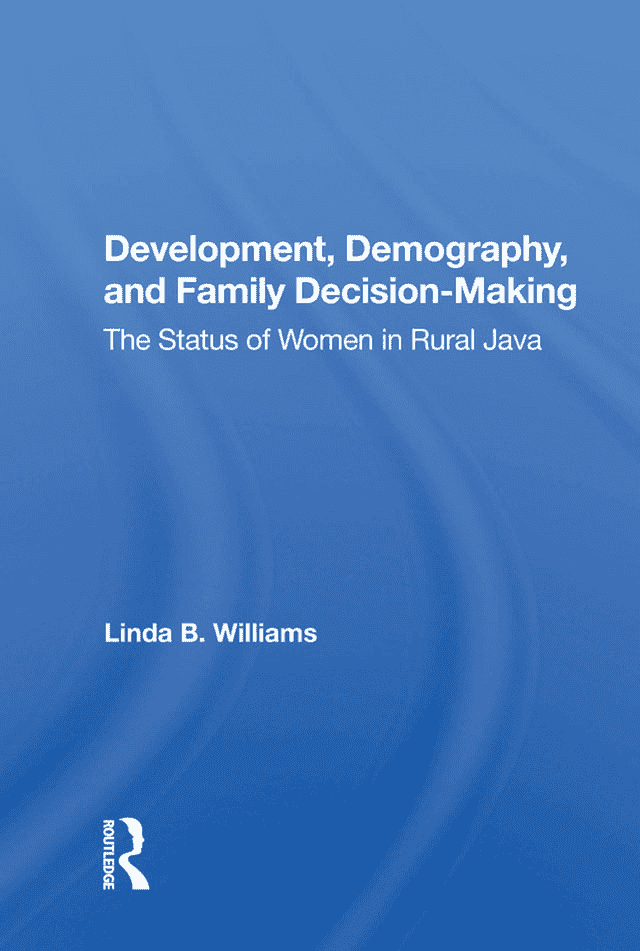
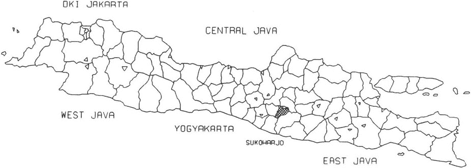
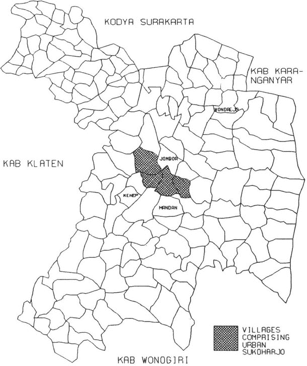
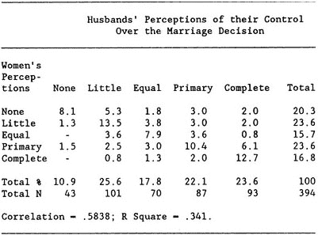
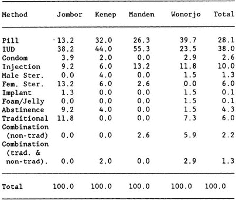
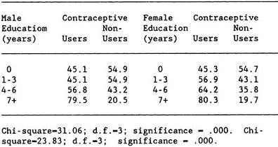
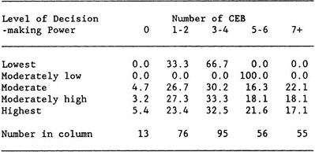
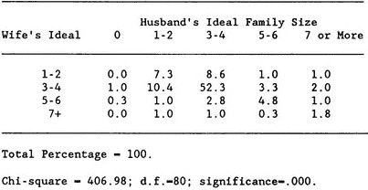
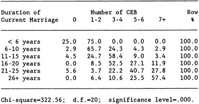
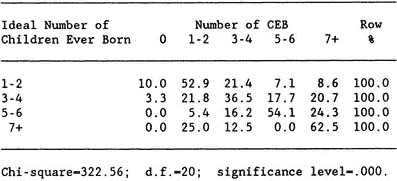

# 发展、人口统计学与家庭决策：爪哇岛农村的女性地位




# 第 4 章 样本、方法与变量定义

本研究利用的数据获取于 1985 年对中爪哇农村家庭的一项调查。该调查是与印度尼西亚的 `LEKNAS/LIPI` 联合进行的。资金由福特基金会资助布朗大学开展比较城市化研究。生活费用部分由美国国立卫生研究院（NIH）的一项实习津贴支付。

## 样本的选择

选取样本的地区被选中，是因为其特征是以水稻农业生产为主的系统，而且它在地理上并不孤立。这两个特质对于参与调查的其他研究人员而言都是必须的，但缺乏地理孤立性对本调查也同样重要。

预计通往城市中心便利性越好的村庄，往返这些中心的流动率越高（Shaw, 1975），因此与没有类似通达性的村庄相比，它们接触到更多“现代”价值观和态度的机会越大。这些价值观态度涉及女性的角色和地位、避孕、家庭规模偏好以及对婚姻安排程度的看法。

根据这些标准选定的县（`kabupaten`）是 `Sukoharjo`。（参见[图 4.1]）。中爪哇由 29 个这样的 `kabupaten` 组成，`Sukoharjo` 似乎最符合项目组织者的需求。对于本研究而言，鉴于其靠近城市中心 `Solo`，这是一个合适的选择。为了满足其他研究人员的需求，所选村庄必须被归类为农村，且必须是以水稻种植为主的地方。选择这些村庄是为了尽量减少主要农业类型、城市设施通达性以及由此产生的流动性的差异，但同时也旨在增强农业系统内部商业化程度的变异。



考虑到这些限制，`Kabupaten Sukoharjo` 的 167 个村庄中有 83 个被认为适用于大型实地项目。24 个村庄因为被归类为城市而被排除，而该县南部和部的许多村庄被排除是因为其山地地形很大程度上阻止了水稻（`sawah`）的生产。由于其他研究人员的限制，选出的村庄倾向于聚集在地区的北部和中部。随后，对所有可能的村庄“根据农业商业化衡量进行排名，并从每个排名的每个四位数中随机选择一个村庄”（Guest, 1987:56）。

最终选出的四个村庄来自整个 `Sukoharjo` 内的三个不同乡（或 `kecamatan`）。（参见[图 4.2]，第 66 页）。其中两个村庄 `Mandan` 和 `Kenep` 位于 `Kecamatan Sukoharjo` 境内。它们都位于县首（也称为 `Sukoharjo`）的西南方。`Mandan` 距离中心大约两公里，`Kenep` 大约七公里。第三个村庄 `Jombor` 不在 `Kecamatan Sukoharjo`，但紧邻县首。它位于 `Sukoharjo` 正北，属于 `Kecamatan Bendosari`。最后，`Wonorejo` 位于 `Kecamatan Polokarto`，位于 `Sukoharjo` 县首东北方向约 13 公里处。

### 家庭选择

选定村庄后，在每个村庄内选了 160 户。虽然目标是尽可能扩大样本量，但预算限制最终决定了目标户数。

家庭被定义为“一组一起吃饭和做饭的人，或者在过去五年内曾这样做过的人们……[该]定义基于之前的研究，被认为是爪哇人社会中的一个经济单位”（Guest, 1987: 84）。由于户数最少的村庄有 696 户（`Kenep`），而户数最多的有 788 户（`Mandan`），村庄之间的户数差异不大。因此，没有必要对样本进行加权。目标人口包括四个村庄的所有家庭。

使用村庄登记册来选择家庭。这些登记册包含了所有成员。主要职业、受教育程度以及他们所拥有的消费品的信息较不完整。这些列表用于人口普查统计、村庄统计报告以及身份证卡的发放，因此通常被认为维护具有合理的准确性。

### 表 4.1：选定村庄特征

|  | Jombor | Kenep | Mandan | Wonorejo |
| --- | --- | --- | --- | --- |
| 总人口 | 3,824 | 3,165 | 4,028 | 3,631 |
| 总面积（km2） | 2.36 | 2.82 | 3.18 | 2.26 |
| 人口密度 | 1,620 | 1,122 | 1,238 | 1,607 |

它们已被用于其他关于印度尼西亚的研究的抽样框，但在使用过程中有时会产生问题；例如，名单过时或不完整。尽管存在这些局限性，但 Hugo（1982）认为，这些问题在爪哇等地可能比印度尼西亚的其他地区严重，而且只要采取适当的措施，该省的村庄登记可能适用于抽样框。

本研究选出的四个村庄都有村庄登记，但其完整程度和维护方法各不相同。在 Jombor 和 Mandan，登记由每个社区（`ketua rukun tetangga (R.T.)`）或行政单位的负责人维护。每个 `R.T.` 平均有 30 户家庭。这两个村庄的官员都声称他们的登记定期更新，且两组名单大约都是一年前的。然而发现，Mandan 的三个 `R.T.` 没有登记，为了将这些社区纳入抽样框，必须重新编制相应的名单。

在 Kenep，并没有为每个 `R.T.` 建立单独的登记。相反，有三个登记，每份登记涵盖若干社区。同样，这三份登记本应定期更新，但名单中缺少一个 `R.T.`。负责该登记的官员（`kebayan`，即村委会与社区之间的纽带）解释说，该 `R.T.` 太远，无法获取相关信息。因此，还必须为该社区编制一份特殊的登记。最后，在 Wonorejo，只有一份登记，且自 1980 年人口普查以来没有更新过。

在四个村庄的每个社区都进行了一项初步调查，以：

1. 检查这些登记的准确性；
2. 获取有关家庭流动性的信息（以进一步更新登记）；
3. 收集有关当地家庭结构的见解；
4. 让人们熟悉即将进行的正式调查这一理念。

随后，将非正式初步调查期间收集的数据与通过家庭登记获得的可用数据进行比较。在 Jombor、Kenep 和 Mandan，结果显示登记的质量足够高，可以将其用于抽样框。然而，在 Wonorejo，登记严重过时且非常不准确。因此，它被排除在抽样框之外，并测试了由负责计划生育的官员维护的家庭登记。计划生育名单包含了家庭成员的姓名、性别、年龄，通常还有计划生育状况。结果发现它相当准确，因此也被批准纳入抽样框。

初步抽样框建立后，由每个社区的负责人进行了更新。由于成员死亡或迁出而解散的家庭从抽样框中删除，而通过迁入或其他搬迁新建立的家庭则被加入。随后，从每个更新后的登记中各抽取了 160 户家庭的初步样本。

登记按 `R.T.` 排列，因此村庄内部存在地理区域的内部分层。使用的抽样方法是带有随机起点的系统抽样。在初始样本选择之后，从原始调查中又进行了 10 户家庭的进一步系统抽样。这 10 户家庭将在由于任何原因无法从样本中获得访谈家庭时，作为替补样本使用（Guest, 1987:91）。

遗憾的是，由于给户主填写的调查问卷很长，且时间和财务资源有限，很快就会发现在现有条件下完成调查是不可能的。因此，有必要将样本减少到每个村 130 户家庭，办法是将样本限制在户主年龄在 60 岁及以下的家庭中。做出这一决定是出于几个原因（例如，年长受访者通常比年轻人更难访谈），但对于本研究尤为重要。由于这项调查的目的是访谈仍处于或接近生育期的女性，大多数嫁给年龄远超 60 岁男性的女性最终将排除在本研究所采用的缩减样本之外。因此，将样本限制在由年轻人户主的家庭这一决定，确保了本研究使用的特定子样本不会发生剧性减少。

在年龄限制导致村庄样本低于目标 130 户家庭的情况下，使用了来自替补样本的替补者。如果包含了所有替补者，目标仍未达到每个村所需的 130 户家庭，则用离原家庭最近的家庭替换原始家庭。在抽取整个实地调查项目的最终样本时，它被视为 60 岁或以下的男性户主家庭的代表性样本。然而，女性户主的家庭可能代表不足^(5)。

最终，对 522 户家庭的成员进行了访谈。只有一户家庭拒绝了。然而，在选定家庭的 1,348 名成员中，有 25 人生病或无法找到。因此，关于他们以及 240 名住在村子外的家庭成员的信息是从该家庭的其他成员处获取的。

在这项研究中，分析单位是个体女性。样本局限于所有年龄在 50 岁及以下的已婚女性，在有她们访谈数据的情况下，还包括她们的丈夫。因此，453 名女性和约 400 名丈夫组成了最终样本。

本研究使用的样本的基本年龄和性别分布（不包括 50 岁以上的男性）按村庄列在表 4.2 中。正如预期的那样，女性倾向于比男性群体更年轻，但这种分布没有其他引人注目的地方。

受聘调查的访谈员全部来自索罗（Solo）塞拉斯拉斯大学（`Universitas Sebelas Maret`）的学生，该市紧邻调查开展的县（苏科哈乔县，`Sukoharjo`）。总共聘用了十二名男性和十二名女性。他们都具有农村背景并会说爪哇语。在大学花费了两天进行访谈员培训，大部分内容是审阅问卷。培训结束后，访谈员进入由村委会选定的村庄家庭。

访谈员以小组形式开展。每组由一男一女进入每个被抽样的家庭。首先获取家庭调查表上的信息。在访谈的这一部分，通常让几位家庭成员在场填补主要受访者回答中的空白是很有帮助的。然而，考虑到本研究的重点，必须确保男女受访者都能坦诚、自由地回答。因此，在完成家庭调查表后，访谈员被指示分别进行个人访谈。男性访谈员负责采访家庭中的男性成员，女性访谈员负责采访女性。

### 表 4.2

为了避免结果受污染，在采访夫妻时采取了分别和同时采访的方法，并非常谨慎。然而，在某些情况下，考虑到受访者的工作职责，这并无法实现。例如，在 Mandan，许多家庭正值收获季节，家庭成员轮流从田间回来接受采访。虽然这种制度不允许进行同时采访，但它确保了夫妻双方是分开采访的。当无法进行同时采访时，他们几乎总是在彼此的几小时内完成的，从而最大限度地缩短了夫妻双方在采访之间可能进行讨论的时间。

对于涉及个人在家庭重大决策中相对权力的问题，夫妻的分开显得尤为重要。这些问题是分析婚姻决策中涉及的代际动态的核心，也是估计女性在家庭内部地位的基础；这两者都是本研究中分析的最复杂的概念之一。

## 变量定义与分析

第一个因变量衡量的是受访者认为自己对与现配偶结婚的决策投入了多少主观。该变量分为一到五级，五表示受访者（在大多数情况下包括配偶）对婚姻决定有完全控制权，四表示决策主要由他们做出，尽管其他人有一些意见，三表示他们与其他人平等做出决策，二表示决策很大程度上由他人做出，但允许他们提供一些意见，一表示受访者对婚姻决策完全没有控制权。受访者被要求决定哪一类最符合他们对婚姻决策的记忆，但他们的答案应被视为落在相对权力连续谱的某一点。女性对该问题的中位数回答为 4.0，分布的偏度极小（.049）。

在夫妻双方并非对婚姻决策承担唯一责任的情况下，完全可能女性和男性被允许对决策投入不同程度的意见，即在过程中他们并不是作为平等的伙伴或整体在行动的。尽管该变量旨在衡量父母及其他家庭成员对婚姻决定的控制程度，但它具有局限性，因为它未能显式捕捉到新娘和新郎本人所享有的不同投入水平。然而，正如第 5 章所示，他们对权力的感知差异仍然可以进行分析。

引入每组用于估计该因变量的方程的自变量大部分是简单直接的。婚姻顺序（Union order）是一个简单的二分变量，零表示受访者在调查时处于第一次婚姻，一表示较高阶的婚姻。衡量受访者父亲受教育程度的变量分为一到五级，一表示未受过正式教育，五表示至少完成了某些大学水平的教育。这些值随后乘以三，以近似父亲在每个教育水平所接受的平均教育年限，并使生成的系数与衡量受访者本人受教育水平的系数更具兼容性。受访者的受教育程度通过他们完成的正式教育总年数来衡量。

与决策因变量一样，这些自变量的类别仅按顺序描述，以便读者理解数据的组织结构。教育变量的划分（构成决策变量以及本讨论中提出的许多其他变量的划分）应被视为连续体的一部分，而不是离散的组。

衡量婚前居住情况的变量分为四类。四表示居住在雅加达，三表示住在其他大都市（人口百万以上），二代表居住在另一个大城市地区（人口 250,000 至 999,999 人的城市），一表示居住在较小的城市或农村地区。如果能有关于小城市与农村地区的独立信息会更好，事实上，问卷的设计也允许这种区分。遗憾的是，在编码过程中，数据被合并到了上述列出的分组中。

年龄（针对当前婚姻）以年为单位，被作为几个方程中的控制变量纳入，因为年轻的新郎（尤其是年轻的新娘）被认为比成熟的成年人更易受影响（Caldwell et al., 1983）。研究还发现，结婚年龄随着教育水平的提高、现代化和城市化而增加（Smith, 1980; Smith and Karim, 1980）。婚姻持续时间被作为婚姻队列的指标纳入。在家庭变化的研究中，时间元素被高度强调，纳入婚姻持续变量对于衡量其影响是合适的。该变量的构建同样简单；它衡量的是受访者与现配偶结婚的年数。

### 女性地位的测量

# 第 6 章

本章关注女性在结婚后其家庭内部地位的决定因素。在该章的分析中，衡量婚姻决策投入的变量被用作衡量家庭内部地位的新因变量的预测变量。

如前所述，女性地位这一概念有多种不同的定义方式。一个相对全面但宽泛的定义认为，地位包含了以下元素：“女性获取（并控制）物质资源（包括食物、收入、土地和其他形式的财富）以及社会资源（包括知识、权力和声望）的程度……” (Dixon, 1978:6)。Safilios-Rothschild (1982) 通过区分不同类型的地位（例如性别和 SES，即社会经济地位）进一步证明了这一概念的复杂性，强调了它们之间相互关系的重要性，并将人际互动层面的地位（称为“权力”）与更广泛范围内的地位区分开来。

由于这项研究主要关注家庭内部的地位（或权力），将首先处理与这种形式地位相关的概念。这些概念包括但不限于：“控制有关……生产性和经济活动决策的能力，包括行动自由以及对所得工资或收入的控制” (Safilios-Rothschild, 1982:128)、指挥那些在家庭责任中协助或替代女性的他人提供服务的权力、控制家庭组成的能力、妻子与其丈夫相比拥有的空闲时间，以及她在重大决策（如家庭规模——包括是否生育，如果生育，则何时生育；迁移和大额购买）中的投入量 (Safilios-Rothschild, 1982)。

在这些地位组成部分中，参与重大决策的权力对本研究具有首要意义。在最初考虑的几个要素中，发现与决策过程相关的问题（6）最容易向受访者表达。因此，女性在家庭中的地位是根据她们生活中几个核心方面的决策权进行索引的。与婚姻决策问题一样，受访者被要求就每个决策说明：

1. 由她独自决定（即她拥有完全控制权）；
2. 她拥有决策的主要控制权，但允许他人有一定的投入；
3. 她与其他人平等共同决策；
4. 决策主要由他人做出，但允许她有一定的投入；
5. 决策完全由其他个人做出，完全不允许投入。

丈夫也被问及他们对重要家庭决策有多大的控制权，针对他们的问题遵循相同的格式。

在第 6 章中总共分析了五个因变量。其中四个衡量女性自身感知的地位，第五个衡量其丈夫对她们在决策过程中投入的看法。在涉及女性受访者的变量中，一个衡量女性对资源控制决策的投入，一个衡量她们对生育决策的控制，一个衡量关于是否使用过避孕措施的决策，以及一个复合指标。这四个变量中的第一个——资源控制变量，衡量了获得现金收入的女性认为自己对如何利用该收入的决策有多大的控制权。第二个衡量对于声称计划不再生育的女性，停止生育的决策是如何做出的。第三个衡量避孕使用者如何决定第一次采用避孕措施；对于第四个变量，计算了通过其他三个变量衡量的女性权力的平均值和标准化得分。最后，第五个变量是基于相同三个指标计算的丈夫得分复合测量（7）。人们可能预期，夫妻一旦结婚，家庭内部做出的决策应该主要涉及夫妻双方，事实往往也是如此。然而，印度尼西亚的父母经常对成年子女的生活保持活跃的兴趣，并在夫妻结婚后继续参与家庭内部的决策。

### 家庭内部地位的预测因子

用于衡量被认为是家庭内部决策权估计核心的预测因子之一——夫妻婚后流动性的变量，被操作化为四类。除一种情况外，如果相关个人在结婚后四年内更改了居住地，则认为发生了移动，这是因为在印度尼西亚农村地区，婚后跨户（可能还跨村）的移动通常发生在四年的规范性期内（Koentjaraningrat, 1967）。

创建的五类流动性类别包括：

1. 双方均未移动；
2. 仅妻子搬迁；
3. 仅丈夫搬迁；
4. 双方均在婚后四年内搬迁；
5. 双方都搬迁了，但在四年之后。

双方在婚后四年内均搬迁的类别被用作参考类别，因为预计该类别能为女性带来最大的家庭内部权力。

另一个流动性变量衡量的是村庄之间的移动以及这些搬迁的时间。如果女性在结婚后四年内迁移到一个新村庄，她被归入其中一个虚拟类别中。如果她完成了跨村移动，但在结婚满四年或以上后才移动，则她属于另一类；如果她在婚后没有参与过任何超出村庄边界的移动，则她属于参考组。引入这些变量是为了确定远距离移动是否对女性具有破坏性，或者它们是否能帮助她们在决策过程中获得不受外部干扰的独立性。该变量的这种概念化也是为了确定此类移动的时间是否影响女性的家庭内部地位。

为了进一步检查父母对家庭决策的影响，引入了一个衡量受访者与其父母之间接触频率的变量。受访者被问及平均访问每个父母的频率。如果他们与一个或双方父母住在一起，显然会报告与他们有频繁的互动。对于每个父母，受访者被问及平均互动频率为：每周多次、大约每周一次、每月二三次、大约每月一次、每年至少一次但并非每月，或每年少于一次。

实际的父母接触变量随后构建如下：与父母或双方父母有频繁接触（每周至少一次）的受访者被列为“频繁接触父母”，而双方父母的见面频率未达到每周一次的人被列为“无频繁接触”。构建的虚拟变量如下：

1. 一组由夫妻组成，其中只有妻子与她的父母有频繁接触；
2. 另一组仅包含丈夫与他的父母有频繁接触的人；
3. 第三组包含双方均频繁探望父母的夫妻；
4. 第四组由夫妻组成，其中双方均未与其/她的父母有频繁接触。后一组被用作参考类别。


这些变量只能近似反映受访者在做出避孕和生育决策时与其父母之间的接触量，因为接触是在调查时衡量的，而不是在决策时。由于某些父母在决策与调查之间可能已经去世，而其他父母子也可能改变了探访模式，因此这些变量存在局限性。然而，预计这些局限性并没有预想的那么大。例如，生育决策仅涉及在接受采访前已完成生育的女性。由于样本的年龄上限是 50 岁，大多数停止生育的人不会在调查很久以前就停止了。对于涉及资源控制的问题，因果顺序不是问题，因为两个变量都是在调查时衡量的。唯一对时间顺序稍微关注的方程组是涉及是否使用过避孕措施的方程。

在许多方程中，受访者对婚姻决策的投入作为独立变量引入。其构建方法已经描述过。收入变量也十分直接。妻子收入的对数变换往往能提高其收入与因变量之间线性关系，而对丈夫收入的类似变换通常没有帮助。因此，以卢比亚为单位的妻子收入（对数变换加 1 以适应收入为零的情况，占病例的 25%）的自然对数值值形成了其收入的独立变量，在适当的情况下，对其丈夫收入也进行了类似的变换。否则，衡量丈夫收入的变量就是他每年赚取的卢比亚数除以 1000。

研究发现城市居住地在女性地位估计中并不显著，因此从分析中删除。

## 避孕与生育

在最后的分析章节中，因变量是是否使用过避孕措施，以及调查时受访者已育子女的数量。对于前者，因变量是二分类的，标记为 1 表示该夫妇在这段婚姻期间中使用过避孕措施，标记为 0 表示未发生过此类使用。第二个变量简单来说就是该女性一生生育过的子女总数。

在该章节中，女性在家庭中的决策权被引入为避孕使用和生育率的独立预测因子。然而，资源控制变量被用作女性地位的唯一预测因子，以替代了综合衡量指标，因为地位的其他组成部分与衡量避孕情况的因变量高度相关。由于只有使用过避孕措施的女性才被问及有关避孕决策的问题，因此所有从未使用避孕者在该变量上的得分均编码为 0。此外，本样本中使用过避孕措施的女性似乎主要是为了停止生育而非间隔生育。因此，很大比例使用过避孕措施的女性在两个决策变量上均有非零分，而许多未使用者在衡量避孕决策投入的变量上没有得分（0 除外），且较少人在衡量生育决策权力的变量上具有非零分。由于样本中 75% 的女性在调查前一年有现金收入，因此资源控制变量最适用于这部分分析。尽管在研究实际生育率时对使用综合指标的限制较小，但在分娩估计中遵循了相同的程序。

避孕方程中使用的流动变量与上述描述的相似，但忽略了移动的时间。是妻子还是丈夫单独移动、他们共同移动、还是两人都没有移动，是核心问题。这些变量与衡量每位配偶受教育程度、女性收入（取对数）以及夫妇在当前婚姻中的持续时间变量一起考察。由于在初步的双变量分析中观察到避孕与婚姻持续时间之间存在微的曲线关联，因此持续时间变量被分为三个虚拟变量。第一组包括结婚 15 年或更少的人，第二组由婚姻 16 至 25 年的人组成，第三组包括婚姻 26 年或以上的人。研究发现，女性婚前居住的社区规模（如前文定义）与因变量具有显著的二元相关性，因此也被包含在此部分的分析中。

第 7 章中使用的唯一额外变量包括：一个衡量想要更多孩子意愿的变量，以及一个衡量夫妻之间讨论避孕频率的变量。前者是简单的二分类，标记为 1 表示妻子打算再生一个孩子（占样本的 27.7%），标记为 0 表示她无此意（占样本的 72.3%）。对于衡量妻子丈夫就避孕话题讨论程度的变量，0 表示未进行讨论，1 表示此类讨论极少发生，2 表示发生较为频繁，3 表示发生相当频繁，4 表示非常频繁。研究导师建议不要尝试获取该变量的更详细信息。

由于因变量是二分类的，所有独立变量均通过 `regression`（回归分析）对因变量进行回归。对于最后一组估计女性子女数量的方程，唯一尚未定义的独立变量是衡量妻子认为理想状态下子女数量的变量。夫妇是否使用过避孕措施被包含在第二个方程中，并已在上述文中描述。

```
LIMDEP
```



## 图 4.2：Figures.xhtml_bck_cap0011 SUKOHARJO 及其村庄的位置

## 注释](#contents.xhtml_bck_ht0043)

1. 有关样本的更多详细信息，请参见 Guest (1987)。  
2. 1980 年 Solo 的人口为 469,532，使该市成为中爪哇省人口第二多的城市（印度尼，统计局，1983）。  
3. 其中 16 个村庄构成或邻接 Solo-Kartusoro 城镇中心，有 4 个形成了苏科乔（Sukoharjo）县府的一部分。  
4. 1980 年苏科乔的人口为 7992（印度尼，中央统计局，1980），但苏科乔周边的建成区实际上由四个村庄组成。出于实际考虑，该城市地区的总人口为 24,006。  
5. 由于一个家庭成员存在精神残疾，该家庭必须从样本中剔除。  
6. 例如，尽管有人认为爪哇丈夫夫妇之间的可用空闲时间差异很大（据报道，男性每天的工作时间比配偶少两个半小时（Birdsall and McGreevey, 1983)），但空闲时间特别难以估计，因为爪哇人对时间没有清晰的概念，且休闲与工作活动之间的界限往往是模糊的。  
7. 两个综合指标都通过从每个分量的数值中减去平均值，然后除以标准差进行了标准化处理。  
8. 在爪哇农村人口中，婚前同居几乎闻所未闻。  
9. 已去世的父母归入最后一类。他们没有被排除在分析之外，而是被视为连续体的一个极端。由于年龄较大的受访者往往父母已故，因此排除每个去世父母的案例意味着丢失了重要受访群体的信息，并会进一步减少案例数量。  
10. 即使在对数转换后，丈夫收入与决策权之间也没有表现出显著的二元关系。

## 家庭权力转移

在更发达的社会，父母对婚姻决定（以及其他类型的决定）的完全控制在很久以前就开始受到侵蚀。关于哪些因素在西方家庭权力转移中起了最大的作用，解释各不相同（Stone, 1977; Thadani, 1978），而对于当今发展中国家中看到的这种平行转型，现在也提出了不同的理由。Goode (1963) 认为，城市化和工业化是全球大部分地区发生重新调整的主要原因。随着土地继承可能减少，这种作为父母控制子女手段的继承其重要性也随之下降。相反，随着教育机会的增加，父母试图确保所有孩子都能接受过教育。在某些情况下，教育变成了一种嫁妆或彩礼的形式。一旦分化过程开始落实，随着教育和生产活动越来越多地在家庭之外进行（Smelser, 1968），父母控制子女未来经济安全的能力就会下降，他们的议价能力也随之下降。

随着这种家庭转型在更发达国家顺利进行，相关的西方价值观和态度的扩散被认为是不发达地区家庭演变的主要决定因素（Caldwell, 1976）。根据 Smith (1980) 的观点，教育和城市化（两者都促进了扩散过程）以及非农业就业机会的增长，在亚洲的过程中起着至关重要的作用。大众教育被认为是重要的，因为它提供了一个基于西方模型的家庭观，这可能是因为教科书直接从西方生产者处获得的，也可能是因为它们的设计是为了模仿西方文本（Caldwell, 1976）。同样，由于发展转移通常流向发展中国家中更现代的城市部门（Gugler, 1982; Arndt, 1983），对进口西方价值观的接触在城市中心往往比偏远地区更为明显。因此，高等教育和婚前居住在城市社区被认为在做出最终婚姻决定时，相对于子女，降低了父母的相对投入，起了主要作用。

同样重要的是受访者的结婚年龄。不仅平均初婚年龄随着受教育水平的提高和城市化的发展而有增加的普遍趋势（Smith, 1980; Smith and Karim, 1980），而且很明显，较年轻的新郎（尤其是年轻的新娘）比更成熟的成年更容易受到年长家庭成员的控制（Caldwell et al., 1983）。如果个体在还几乎是孩子时就结婚，这一决定将几乎完全由他们的长辈执行。随着结婚年龄的增加，父母的控制应该减少。此外，由于男性通常习惯娶比自己年轻的女性（Casterline et al., 1986），而且由于男性的受教育程度往往高于女性（世界银行, 1984），因此推断男性报告的对婚姻决定的投入会比他们的妻子多。

然而，可以预的是，在控制了教育和结婚年龄后，权力感知上的性别差异往往仍然存在。在对爪爪哇岛农村地区的这项分析所涵盖的婚姻群体中，这在不同程度上应该是成立的。在较早群体中，包办婚姻无疑是常态；儿子或女儿将婚姻决定的控制权交给父母，作为“他们对父母心理依赖的象征、对他们晚年未来责任的接受，以及相对于他们地位较低的象征”（Geertz, 1961:56）。然而，与儿子相比，女儿对于要嫁给谁的话语权更小。根据 Geertz (1961:56)，“父母通常等到他们的儿子觉得‘准备好结婚了并向他们寻求帮助’为止。他们通常允许他指出他想要的女孩，或否决他们的建议。”尽管许多人认为如今印度尼西亚女性在家庭中享有很高的自主权，但并非如此，特别是在较低社会阶层中（Mangkuprawira, 1981; Hull, 1976），而且这并不等同于婚前的平等地位。

正如所讨论的，家庭双方父母继续以不同程度参与配偶选择过程，特别是对于第一次婚姻，所选配偶被认为能够加强现有的家庭。另一方面，在选择过程中考虑新娘新郎的偏好变得越来越普遍。当他们的偏好被忽视，或者由于其他原因导致匹配失败时，个体服从父母并与指定的配偶结婚也是可以接受的，然后在下一次离婚后再与更符合自己选择的人（Ihromi et al., 1973）。由于儿子和女儿已开始在配偶选择过程中发挥更大的作用，婚姻似乎变得更加稳定，离婚也不那么盛行（Hugo et al., 1987）。

根据目前提供的信息，假设以下关系成立的：

- (5.1) 教育程度较高的个体对影响自己婚姻决定的投入会比受教育程度较低的人多。
- (5.2) 父母教育程度较高的个体，对影响自己婚姻决定的投入会比父母教育程度较低的人多。
- (5.3) 婚前居住在大城市环境的个体，对影响自己婚姻决定的投入会比居住在小城市或农村地区的人多。
- (5.4) 最近结婚的受访者对影响其婚姻决定的投入会比结婚时间较久的人多。
- (5.5) 在年龄较大时结婚的人，对婚姻决定的投入会比在年龄较小时结婚的人多。
- (5.6) 男性报告的对婚姻决定的投入会比他们的配偶多。
- (5.7) 目前处于二段或更高次婚姻的人，对涉及当前婚姻决定的投入会比仍处于第一次婚姻的人多。

## 婚姻决定中配偶对权力的感知

男性和女性受访者对自己在配偶选择决策中投入程度的感知频率见表 5.1。总的来说，因变量在各个类别之间的分布相当均匀，尤其是女性之间。在类别二到类别四中，男性和女性在每个投入水平上的响应也相当相似，在这些类别中，夫妻与其他家庭成员在不同程度上共享对婚姻决定的控制权。

然而，男女之间的差异体现在极端类别中。男性认为自己及其配偶对婚姻决策拥有完全控制权的可能性远高于女性。而且，男性认为自己对决策没有投入的可能性远低于其妻子。虽然有 20.3% 的女性认为她们对配偶的选择没有控制权，但受访男性中仅有 10.9% 属于这一类别。相反，尽管 23.6% 的丈夫认为婚姻决定完全在夫妻手中，但只有 16.8% 的女性认为在做结婚决定时没有外部压力。

这表明，至少在该样本的某些部分中，男性在选择配偶方面的发言权比女性多。正如格尔茨（Geertz, 1961）指出的，在包办婚姻的较传统的夫妻中，男性被完全排除在决策之外的频率远低于女性。同样，在量表另一端的夫妻中，那些在选择配偶方面拥有相当自由度的人，男性受到的家庭约束似乎也比女性少。

丈夫和妻子的交叉表响应结果见表 5.2。结果表明，绝大多数丈夫和妻子在决策过程中的投入程度上实际上意见是一致的；略超过一半的配对（52.6%）落在对角线位置。然而，对于那些存在某些分歧的人来说，男性报告的父母约束通常比女性少。落在对角线上方的受访人数几乎是下方的两倍，再次证明男性至少认为自己对婚姻决定的投入比女性多。对决策过程感知截然不同的夫妻相对较少。

### 表 5.1：对婚姻决策感知控制权的百分比分布（妻子及其丈夫）

| 因变量 | 女性感知 | 男性感知 |
| --- | ---: | ---: |
| 无控制 | 20.3 | 10.9 |
| 较少控制 | 23.6 | 25.6 |
| 共同控制 | 15.7 | 17.8 |
| 主导控制 | 23.6 | 22.1 |
| 完全控制 | 16.8 | 23.6 |
| 总百分比 | 100.0 | 100.0 |
| 总人数 | 394 | 394 |

## 多变量分析结果

为了确定哪些因素对现有的感知差异影响最大，对男性和女性受访者分别进行了多变量分析；然后使用合并数据估计了额外的方程。显示核心变量对女性决策过程投入影响的结果见表 5.3。

在 `Equation 1` 中，衡量女性对婚姻决策投入的因变量对衡量其教育程度、其父亲教育程度的变量，以及她的婚姻顺序和结婚前居住城市/城镇的规模进行了回归。该方程的所有结果均显著，且方向符合预测。随着受教育程度的提高，女性在做出婚姻决定时行使的控制量随之增加。同样，随着其父亲教育水平的增加，她们在择偶过程投入投入随之增加。高序婚姻女性在选择配偶方面比第一段婚姻的女性拥有更大的自由，结婚前居住在较大城市地区的女性在决策过程中的投入比居住在较小城市或农村地区的女性多。

### 表 5.2：丈夫与妻子对婚姻决定的投入对比



### 表 5.3：影响女性对选择配偶决策权力感知的因素（非标准系数）

| 自变量 | 方程 1 | 2 | 3 |
| --- | ---: | ---: | ---: |
| 教育程度： | | | |
| 妻子的 | .069** | .055* | .036 |
| 妻子的父亲 | .078** | .079** | .073** |
| 妻子的婚姻顺序（0-最后一次，1-高序） | .452* | .291 | .356* |
| 妻子的婚前社区规模 | .459* | .443* | .426* |
| 妻子结婚时的年龄 | n.a. | .041** | .023 |
| 婚姻时长 | n.a. | n.a. | -.028** |
| 常数 | 3.732** | 3.192** | 3.923** |
| R Square | .124 | .142 | .168 |
| 受访人数 | 386 | 386 | 386 |

单尾显著性检验：`*` 表示在 .05 水平上显著；`**` 表示在 .01 水平上显著。

在方程 2 中，因变量再次对教育、居住地和结合顺序变量进行回归，同时添加了女性结婚年龄的控制变量。正如预期的那样，结婚年龄变量被发现具有相当的重要性；晚婚的女性在选择配偶方面，比早婚的女性有更多的话语权。尽管在这一估计中，教育变量和衡量婚前社区规模的变量仍然保持显著，但结合顺序的影响有所减弱，并变得不显著。这很可能是因为进入较高阶层结合关系时的年龄通常大于初婚年龄，而结合顺序变量的大部分影响被衡量结婚年龄的变量吸收了。

在第三个方程中，估计中增加了一个衡量女性婚姻持续时间的变量。该变量被认为具有相当重要性，因为它表明了婚姻决策实际上发生在多久以前。正如预测的，结婚时间较久的人对婚姻决策的投入远比最近结婚的人少。Beta 系数（未列出）显示，在进入此方程的所有变量中，婚姻持续时间变量实际上是女性对配偶选择决策投入的最强预测因子。^(2)

为了更详细地检查随时间变化的重要性，样本根据婚姻持续时间的中位数（15 年）被一分为两半。采取此程序的目的是观察感兴趣的变量对于最近结婚的女性还是对于结婚时间更早的女性更重要。由于分析的这部分没有引入具体的假设，因此使用了双尾显著性检验。结果列在表 5.4 中。

在调查时已结婚 15 年或以上的女性中，衡量她们与现任丈夫结婚时的年龄以及婚前社区规模的变量被证明是核心关注的因素。同样，年龄较大时才结婚的女性在婚姻决策中的投入比早婚的女性多，而来自较小地区的女性在做决定时能行使的力量比来自大城市的女性要少。结婚年龄变量对于那些结婚 15 年或更久的女性来说尤为重要，可能可能是因为当时女性和男性结婚年龄的差异比最近要更大。^(3)

衡量女性婚前居住社区规模的变量的重要性，对于结婚时间更长的女性比对于最近结婚的女性更为显著，可能可能是因为在调查前的 15 年前，往返较大城市中心的交通远没有现在这样发达，因此使用也远没有现在这样频繁。结果，如果受访者住在城市中心，她们接触现代价值观和态度的可能性要比那些住在其他地方且仅通过偶尔进城获得接触的人要大得多。相反，近期道路的改进。

### 表 5.4：按婚姻持续时间划分影响女性对选择配偶决策权感知的因素（未标准化）

| 独立变量 | 结婚不满 15 年 | 结婚 15 年或以上 |
| --- | ---: | ---: |
| 教育： | | |
| 妻的： | | |
| 妻的父亲的： | | |
| 妻的结合顺序： | | |
| 规模： | | |
| 妻的结婚年龄： | | |
| 婚姻持续时间 | | |
| 常数 | | |
| R Square | | |
| 受访者 | | |
| 丈夫的结合顺序（0-首次婚姻，1-高阶婚姻） | .251 | .040 |
| 丈夫婚前居住社区规模 | .019 | -.018 |
| 丈夫结婚时的年龄 | n.a. | .033** |
| 婚姻持续时间 | n.a. | n.a. |
| 常数 | 2.831** | 2.168** |
| R 方 | .034 | .053 |
| 受访者人数 | 391 | 391 |

单侧显著性检验：`*` 表示在 .05 水平上显著；`**` 表示在 .01 水平上显著。需要注意的是，分析中包含的独立变量在解释女性自称对婚姻决策的投入程度（17%）方面的效果，远优于其丈夫（8%）的情况。最初认为，这种现象的部分解释可能是，随着时间的推移，选择配偶事项对女性产生了不成比例的利益。为了检验这种可能性，最后估计了最后一组回归方程。将男性和女性的回答合并，并将因变量（对婚姻决策投入的感知）对上述独立变量进行回归。分析中包含了受访者的性别，以衡量其在婚姻决策过程中的重要性。此外，在第三个方程中，包含了交互项，以确定当受访者的性别与受访者的教育程度或婚姻持续时间结合使用时，是否是一个良好的预测因子。结果见表 5.6。


在第一个方程中，结果在很大程度上符合预期。除了受访者婚前社区规模外，所有变量均显著，且方向与预测一致。这包括本部分分析中关注的核心变量，即受访者的性别。正如假设的那样，男性报告其对婚姻决策的投入显著多于女性（`p = .025 (单侧检验)`）。

在第二个方程中，将衡量受访者结婚年龄和夫妇婚姻持续时间的变量加入估计，结果显示两个系数均高度显著，且方向与预测一致。然而，随着这些变量的加入，受访者的性别、教育程度和结合顺序的影响都变得不显著。性别影响的消失可能反映了性别与结婚年龄之间的强相关性，因为样本中约有 12.7% 的女性在青少年早期就结婚了，而男性仅占 1.5%。

在第三个方程中，将因变量对所有衡量主效应的变量（结婚年龄除外）以及性别与教育之间、性别与婚姻持续时间之间的交互项进行回归。结婚年龄由于与性别的相关性，从这一最终估计中被剔除。由于模型的修订，受访者的性别重新出现并成为强显著变量，表明女性的决策评分比男性低多达 50 个百分点。此外，性别与教育程度之间的交互作用显著且为正；在该样本中，教育水平的提高对女性的益处似乎比对男性更大。这并不意外。跨代际来看，女性完成的教育年限通常少于其丈夫，因此每增加一个年限都可能为她们带来不成比例的利益。

**表 5.6：影响对婚姻决策投入感知的因素（男性和女性）（未标准化系数）**

| 独立变量 | 方程 1 | 方程 2 | 方程 3 |
| --- | ---: | ---: | ---: |
| 教育： |  |  |  |
| 受访者的 | .043** | .009 | -.012 |
| 受访者父亲的 | .082** | .084** | .162** |
| 受访者性别（1-女性，0-男性） | -.222* | -.149 | -.509** |
| 交互项： |  |  |  |
| 性别与教育 | n.a. | n.a. | .051** |
| 性别与婚姻持续时间 | n.a. | n.a. | .001 |
| 结合顺序 | .233* | .132 | .263** |
| 社区规模 | -.125 | .181 | .109 |
| 结婚年龄 | n.a. | .025** | n.a. |
| 婚姻持续时间 | n.a. | -.031** | -.039** |
| 常数 | 3.557** | 4.821** | 5.166** |
| R 方 | .07 | .15 | .14 |
| 案例数量 | 805 | 805 | 805 |

单侧显著性检验：`*` 表示在 .05 水平上显著；`**` 表示在 .01 水平上显著；`n.a.` 表示未进入方程的变量。

### 1. 婚姻模式与离婚、再婚

Smith (1982) 对印度尼西亚婚姻模式的研究表明，离婚和再婚在爪哇岛和巴厘岛很常见。他利用 1976 年全国人口普查调查的数据证明，在调查前已婚结婚少于 5 年的已婚女性中，有 20% 在调查时被列为离婚或分居。在这些女性中，有 35% 已经再婚。在调查前结婚 15—19 年的女性中，有 38% 离婚或分居，且该组人群中有 85% 的人已经再婚。

### 2. 婚姻持续时间与结合顺序

尽管婚前的居住地社区和女性父亲的受教育程度在该方程中仍然具有显著性，但妻子受教育程度和其婚龄的影响却大幅削弱，并变得不显著（两种情况下的 `p` 值均为 `.06`，单侧检验）。正如前面提到的，年龄较大时结婚的人往往倾向于是较晚婚姻队列的成员（`婚龄与婚姻持续时间的相关性为 -.518`）。

另一个令人感兴趣的事实是，当将婚姻持续时间纳入估算时，衡量结合顺序的变量重新获得了显著性（`p = .05`）。虽然婚龄变量的加入削弱了结合顺序的影响，但婚姻持续时间的加入表明，在持续时间变量的不同类别内结合顺序存在显著差异，而这种差异在跨类别时并不明显。其原因尚不清楚。这可能是由于不同队列之间首次婚姻及后续婚姻时机的差异造成的。

### 3. 婚龄性别差异的变化

McNicoll 和 Singarimbun (1983) 提供的证据表明，情况确实可能如此。1961 年至 1979 年间，婚龄的性别差异显著缩小，爪哇岛是这种变化最显著的地点之一。

# 婚后迁移与女性地位

在延续上一章对婚姻决策中个人投入的评估之后，本章的核心目标是调查女性结婚后在家庭内部整体决策权的决定因素。一些影响配偶选择时投入的因素（如受访者的教育程度和在当前关系中所花费的时间）预计将在整个生育期内继续影响家庭决策过程。

此外，诸如婚后或婚后不久的流动或迁移，以及进入婚姻关系后与双方父母保持的联系频率，预计也会影响家庭内部地位的水平。正如所注意到的，与不经常联系的情况相比，夫妻与双方父母之间的频繁接触预计会降低妻子在家庭中的地位。

另一个相关的观点是，双方在结婚后四年内的搬迁应该提高妻子在家庭中的决策权。然而，如果夫妻在结婚时的流动要求女性必须出婚，那么其社会关系的中断可能会抵消迁移带来的收益，并对其地位产生负面影响。

更正式地说明，结合`第 2 章`和`第 3 章`提供的信息，提出以下假设：

- **6.1）** 婚后双方的居住地迁移将与双方均未移动或仅有一人移动的情况相比，使妻子获得更高的家庭内部地位。
- **6.2）** 与一方或双方父母保持频繁联系的女性，其家庭内部地位将低于不与双方家庭父母保持频繁联系的女性。
- **6.3）** 如果女性婚后的居住地迁移需要她离开村庄，那么与没有更换村庄的女性相比，她的家庭内部地位将下降。

## 表 6.1：按性别划分的婚后流动情况

| 流动指标 | 男性百分比 | 女性百分比 |
| --- | ---: | ---: |
| **样本百分比：** |  |  |
| 移动过的人 | 61.9 | 72.3 |
| 未移动过的人 | 38.1 | 27.7 |
| 总百分比 | 100.0 | 100.0 |
| **在移动过的人中，相对于婚姻的时间：** |  |  |
| 4 年内 | 81.1 | 82.1 |
| 4 年后 | 18.9 | 17.9 |
| 移动者总计 | 100.0 | 100.0 |
| **在移动过的人中，移动类型：** |  |  |
| 婚内迁移 | 58.5 | 49.6 |
| 外婚迁移 | 41.5 | 50.4 |
| 移动者总计 | 100.0 | 100.0 |
| 总人数 | 394 | 394 |

## 婚后流动

婚后流动数据见`表 6.1`。数据表明，大多数人实际上更换了地点。正如预期的那样，大多数人在前四年内移动了。大约 62% 的男性和 72% 的女性经历过婚后迁移，在这些人中，81.1% 的男性和 82.1% 的女性在四年内移动了。

绝大多数受访者在结婚前与父母同住。91.9% 的女性共用住处，80.7% 的男性也是如此。虽然调查的夫妻中略占多数（56.3%）建立了与双方父母独立的家庭，但婚后与公婆同住也很常见。43.7% 的女性受访者声称婚后与一方父母同住。在这些女性中，30.1% 与自己父母在一起，13.6% 与丈夫家庭在一起。关于同住模式的数据见`表 6.2`。

在婚后移动的女性中，约有一半跨越了村庄边界，而 41.5% 的丈夫是外婚迁移。在更换村庄的女性中，25.2% 直接搬进了公婆家，而只有 12.8% 在自己村庄内移动的女性也是如此。

## 父母联系

然而，无论是否移动，以及移动是否涉及跨村迁移，大多数受访者（男女）都继续与他们的父母保持定期联系。大约四分之一的夫妻报告每周至少探望双方父母，且超过 46% 的人每周至少探望一次丈夫（21.3%）或妻子（24.9%）的父母。剩余的 28.7% 夫妻报告没有每周探望任何一方父母。

`表 6.3` 提供了有关受访者在调查时与每位健在父母所保持联系频率的信息。数据证明，在爪哇农村，父母联系频率极低的探望模式是罕见的；在任何给定类别中，少于 12% 的个人报告看到母亲或父亲每月少于一次。

**表 6.3：与父母探望的频率**

| 与父母探望的频率 | 妻方母亲 | 妻方父亲 | 夫方母亲 | 夫方父亲 |
| --- | ---: | ---: | ---: | ---: |
| 每周多次 | 53.6 | 45.1 | 70.0 | 68.2 |
| 每周约一次 | 9.2 | 10.7 | 5.5 | 6.6 |
| 每月 2 或 3 次 | 9.1 | 10.7 | 5.1 | 6.0 |
| 每月约一次 | 17.5 | 16.5 | 3.3 | 7.9 |
| 每月少于一次 | 10.6 | 11.0 | 11.1 | 11.3 |
| 每月预计平均次数 | 5.7 | 5.0 | 6.8 | 6.7 |
| 百分比合计 | 100 | 100 | 100 | 100 |
| 总人数 | 274 | 206 | 217 | 151 |

他们探望父母的频率高于每周一次。妻子和丈夫与其健在母亲的联系频率与其健在父亲的频率大致相同。虽然在受访女性中，她们更倾向于探望母亲似乎存在细微差异，但男性探望母亲与父亲之间的差异似乎可以忽略不计。

然而，也可以观察到探望模式中一些更明显的性别差异：男性比女性更有可能每周探望父母多次，而女性比男性更倾向于每月仅探望父母一次。尽管婚后夫妻与新娘父母同住的可能性高于与新郎父母同住，但总体上似乎他们与丈夫父母保持了更频繁的联系。这结合观察到的村际移动性别差异表明，那些建立独立住房的夫妻最终可能会定居在离家较近的地方。

## 表 6.2：按流动行为划分的与姻父母及父母同住女性情况

| 流动行为 | 婚后与姻父母居住比例 | 婚后与父母居住比例 | 类别人数 |
| --- | ---: | ---: | ---: |
| 女性未移动 | n.a. | 91.9 | 109 |
| 在村内移动 | 12.8 | 5.7 | 141 |
| 留在原村的总数 | 7.2 | 43.2 | 250 |
| 搬到新村 | 25.2 | 6.5 | 139 |
| 同住总数 | 13.6 | 30.1 | 389 |

## 女性家庭决策权的决定因素

| 自变量 | 总计（标准化） | 使用避孕药 | 停止生育 | 资源控制 |
| --- | ---: | ---: | ---: | ---: |
| **婚后流动性：** |  |  |  |  |
| 双方均在 4 年后移动 (a) | -.144 | -.096 | -.062 | -.048 |
| 仅丈夫移动 (a) | -.127 | -.364 | -.108 | .024 |
| 仅妻子移动 (a) | -.089 | -.148 | -.016 | .117 |
| 双方均未移动 (a) | -.398 | -.558 | -.245 | -.087 |
| 妻子搬村（前 4 年） (b) | -.083 | -.374 | -.234 | -.082 |
| 妻子稍后搬村 (b) | .288 | .040 | .600 | -.198 |
| **父母接触 (c)** |  |  |  |  |
| 双方每周见 1 次以上 | -.223 | -.191 | -.265 | -.426 |
| 妻子方每周见 1 次以上 | .133 | -.109 | -.021 | -.234 |
| 丈夫方每周见 1 次以上 | .041 | .025 | .121 | -.159 |
| 妻子对婚姻决策的投入 | .067 | .108 | .108 | .001 |
| 妻受教育程度 | -.011 | .033 | -.004 | .013 |
| 丈夫受教育程度 | .027 | -.010 | n.a. | n.a. |
| 妻子收入（内） | .103 | .014 | .032 | -.043 |
| 丈夫收入（内） | .030 | n.a. | .009 | .021 |
| 结婚年龄 | -.008 | n.a. | n.a. | n.a. |
| 婚姻时长 | .022 | .002 | -.002 | .001 |
| 常数 | -1.489 | 3.113 | 3.083 | 4.361 |
| R 平方 | .28 | .10 | .10 | .06 |
| 样本量 | 383 | 229 | 274 | 292 |

- 参照组包含夫妻双方在结婚后头四年内发生过搬迁的夫妻。
- 参照组指婚后未曾搬迁的女性。
- 参照组包含与双方父母均未保持频繁联系的夫妻。
- `*` 在 .10 水平上显著；`**` 在 .05 水平上显著；`***` 在 .01 水平上显著。（单侧显著性检验。）

四个方程中的系数均证明为负，唯有将“夫妻双方均未搬迁的夫妻”与“参照组”进行比较的变量，被发现是女性整体决策能力的显著决定因素。这很可能反映了年轻女性在结婚前后与其丈夫都留在同一地点的情况下，缺乏控制生活核心层面的能力。在大多数此类情况下，一方配偶往往在结婚前就已经搬到了另一方父母的住处。因此，在考虑爪哇岛农村地区这种居住流动性衡量与女性在家庭中整体地位之间的关系时，代际决策动态而非夫妻间动态似乎最为重要。

同样，只有将“双方均未搬迁的夫妻”以及“仅丈夫搬迁的夫妻”与“参照组”进行比较的变量，能显著预测女性控制避孕决策的能力。当仅丈夫在婚后搬迁（通常是搬到妻子父母家）时，与夫妻双方都搬迁的情况相比，女性控制避孕使用决策的能力遭受了大幅损害。因此，假设 `6.1` 获得了一定的支持。

女性婚后搬迁是否涉及迁移到另一个村庄，对于预测她在家庭中的权力也至关重要。如果她在结婚后头四年内搬到了新村庄，她控制采取避孕措施和停止生育决策的能力大幅下降（分别减少了 23 个百分点和 37 个百分点）。相反，未进行外婚式搬迁的女性在做避孕和生育决策时发挥了更主导的作用。正如所论的，远距离搬迁的负面影响可能是由于迁移者离开了重要的社会网络所致。因此，假设 `6.3` 也得到了支持。

然而，在生育决策方面，发现如果村庄间的搬迁发生在夫妻结婚满四年之后，那么这种搬迁会显著增强女性的决策能力（增加了 60 个百分点）。这表明，虽然新娘可能从一段邻近亲密社交圈的调整期中获益，但一旦她们习惯了婚姻生活，这些社交接触的重要性就会下降。此外，由于四年后的外婚式搬迁不太可能指向准姻父母家，而是更多指向独立住所，因此晚期的村庄间流动对女性特别有益，因为它提升了她们对生育决策的控制力。

然而，无论是否发生搬迁，无论搬迁的时间和方向如何，夫妻与双方父母保持的实际接触量也证明是决策过程的核心。在样本中，那些与丈夫每周至少见双方父母一次的妻子拥有更高的决策权。

## 丈夫对家庭决策权的感知

| 自变量 | 非标准化系数 |
| --- | ---: |
| **婚后流动性：** |  |
| 双方均在 4 年后迁移 (a) | .365 |
| 仅丈夫迁移 (a) | .214 |
| 仅妻子迁移 (a) | .191 |
| 双方均未迁移 (a) | -.008 |
| 妻子在后 4 年内变换村庄 (b) | .020 |
| 妻子之后变换村庄 (b) | .064 |
| **父母接触：** |  |
| 与岳母的接触频率 | n.a. |
| 与丈夫母亲的接触频率 | n.a. |
| 双方每周见面 1 次以上 (c) | .080 |
| 妻子一方每周见面 1 次以上 (c) | -.058 |
| 丈夫一方每周见面 1 次以上 (c) | .137 |
| 丈夫对婚姻决策的投入 | .171*** |
| 妻子的决策权 | .775*** |
| 妻子的教育程度 | .013 |
| 丈夫教育程度 | -.004 |
| 妻子收入（对数） | -.101*** |
| 丈夫收入 | .089* |
| 婚姻时长 | .030*** |
| 常数 | -1.572*** |
| R 平方 | .41 |
| 案例数量 | 380 |

- (a) 参考类别包含双方在婚后头四年内均迁移的夫妻。
- (b) 参考类别指婚后未迁移过的女性。
- (c) 参考类别包含与双方父母均无频繁接触的夫妻。
- `***` 在 .05 水平显著；`**` 在 .01 水平显著；`***` 在 .001 水平显著。（双侧显著性检验。）

然而，妻子收入越高，男性受访者的决策权就越低；妻子收入越低，男性就越觉得自己在重大家庭决策中可以行使更大的权力。这支持了这样一种观点：获取资源对于女性在人际关系中行使某些控制至关重要。

婚姻时长变量系数也高度显著且为正。夫妻结婚时间越长，丈夫觉得自己对重大家庭决策的控制力就越大。有人认为，结婚时间较早的夫妻往往具有更传统的男性主导模式特征，而最近结婚的夫妻之间应该更盛行更加平等的关系。

虽然这种解释可能是合理的，但在过度依赖上述结论之前必须谨慎。例如，也可能是因为婚姻时长较长的男性相对于他们的父母获得了更多权力。婚姻时长的正向影响并非由于年迈父母不在世的结果（因为这些信息已包含在父母接触控制变量中），它可能反映了这样一个事实：一旦父母年龄越来越大，他们对重大决策的投入就开始减少。因此，婚姻时长对丈夫控制家庭事务能力的积极影响，可能源于代际和夫妻间动态的共同作用。

最后，人们认为对妻子自身决策权感知的综合指标进行控制，可以为关于男性如何看待自己的权力提供额外信息。在分析丈夫回答的框架内，预计配偶越认为自己能行使更多权力，另一方配偶感知到自己拥有的权力可能就越少。然而，研究结果并非如此。

相反，妻子在家庭中感知的自主性越高，丈夫也越认为自己拥有同样的权力。这可能反映了特定话题讨论程度的差异。例如，如果某个主题被大量讨论，那么对话产生的任何结果可能被视为一个确定的决定，而不是仅仅是默认发生的事件；如果确定某项行动需要大量的对话，那么夫妻双方都可能认为自己对该决策投入了实质性的意见。

## 结论

综而言，本章测试的三个假设均得到了一定支持。假设 `6.1` 预测，夫妻双方在结婚后四年内的居住地搬迁将导致妻子在家庭内部地位的提高，而与双方均未搬迁、仅一人搬迁或在结婚四年后才共同搬迁的情况相比。

结果表明，当双方在头四年内均未搬迁，或仅有丈夫搬迁时，妻子在启动使用避孕措施的决策中的投入远没有夫妻双方都搬迁时多。此外，在估算女性的整体决策权时，双方均未搬迁的情况下，其家庭内部地位低于在婚姻前四年内双方均搬迁的情况。

这些发现证明，女性可以通过居住流动获得家庭内部的影响力。由于在控制了与双方父母维持的联系频率后，相关系数依然显著，这很显然，夫妻实际的物理搬迁对妻子的整体决策权，以及她控制避孕决策结果的能力具有独立影响。


研究还发现，如果女性的婚后搬迁超出了其村庄边界，那么她的决策权将低于没有进行婚外搬迁的女性。这被认为是由于与重要社会网络的联系弱化所致。这种影响对于避孕决策是显著，对于减少生育的决策同样如此。因此，这也为假设 `6.3` 提供了支持。另一方面，如果村际搬迁发生在夫妻结婚至少四年后，则发现妻子的决策权得到了提高。在此时，初始支持系统的重要性似乎减弱，而建立独立居所在决策过程中变得尤为突出。

除了婚后流动外，与父母的接触是女性影响决策结果能力的强有力预测因素。这支持了假设 `6.2`。当经常与双方父母见面时，与双方父母均未保持定期接触的情况相比，妻子的家庭内部地位会受到损害。这在估算女性的整体决策权，以及关于停止生育和妻子收入分配的决策中均如此。

诚然，这些决策中可能涉及多个层次的参与。事实上，这被假设是如此。尽管父母可能无法直接控制子女的最终决定，但他们能够对导致这些决策的思维过程，以及做出决策和实施结果的背景产生巨大影响。只要儿子女继续与父母同住，或每周见几次面，这一点尤为如此。事实上，本分析证实了这一过程中代际动态的重要性，因为在估算的五个方程中有四个显示，对婚姻决策的先前投入是显著且正向的；受访者对婚姻决策的投入越多，她在随后的家庭决策中能够行使的控制也越多。

总之，结婚时或婚后的迁移、与双方父母维持的联系量、先前的决策权以及在某种程度上社会经济地位水平，在跨代中共同起作用，影响了爪哇中部女性对重要家庭决策的控制程度。在该样本的男性中，对自身决策权的感知最好通过当前婚姻持续的时间、夫妻双方的现金收入以及妻子对家庭决策的投入量来预测。

# 7 避孕与生育

在分析的这部分，评估了女性在爪哇族家庭中的地位与其避孕措施使用及生育行为之间的关系。`Chapter 2` 中提供的信息表明，家庭地位较高的女性比可能使用避孕措施并表现出较低的生育水平，而自主权较低的女性。此外，在第二个维度上（即通过教育和收入等指标比较跨家庭的个人）地位较高的女性，更有可能成为避孕使用者并拥有更小的家庭，而在该维度地位较低的女性。

具体而言，提出了以下假设：

- (7.1) 家庭内部地位较高的女性比家庭内地位较低的女性更有可能成为避孕使用者。
- (7.2) 家庭内部地位较高的女性生育率将比家庭内地位较低的女性低。
- (7.3) 家庭外部地位较高的女性比在该维度地位较低的女性更有可能成为避孕使用者。
- (7.4) 家庭外部地位较高的女性生育率将比在该维度地位较低的女性低。

正如 `Chapter 3` 中讨论过的，在过去的二十年里，印度尼政府一直致力于通过增加全国范围内避孕措施的使用和效力，来降低总生育率。在主要岛屿中，爪哇岛现在的总生育率最低（`1980 TFR = 3.89`），在该岛的各省份中，爪哇中部与其他省份相比取得了中等成功（`1980 TFR = 4.08`）。

本样本中女性史出生儿童数（`CEB`）的百分比分布显示在 `Table 7.1` 中。

#### 表 7.1 史出生儿童数量百分比分布

| 史出生儿童数量 | 百比 |
| --- | ---: |
| 0 | 4.1 |
| 1-2 | 25.9 |
| 3-4 | 30.9 |
| 5-6 | 18.5 |
| 7 个及以上 | 20.6 |
| **总计** | **100.0** |
| **平均值** | **4.13** |

与中爪哇岛其他地区一样，受调查女性的生育率仍然相当高。目前为止，她们平均生下的孩子数为 4.13 个。另一方面，避孕措施在受访女性中也得到了广泛使用；58.9% 的人自称曾使用过避孕药物。因此，可以预见当较年轻的群体完成生育任务后，其平均家庭规模将比较老群体的女性更小。

这种情况可能发生的另一个原因是，受调查的女性中约三分之二认为她们理想的孩子数量是三个或更少。理想家庭规模的数据见表 7.2。女性认为理想的孩子数量平均为 3.4 个，中位数为 3.0 个，大多数女性（86.7%）认为拥有 2 到 4 个孩子是最优的。^(1)

正如前所提到的，为了让夫妻计划较小的家庭，整个中爪哇岛及整个国家都强烈鼓励使用避孕措施。中爪哇岛省以及苏科霍乔县（Kabupaten Sukoharjo）对特定避孕方法的相对偏好数据见表 7.3。

在县级或省级水平上，口药显然是最受欢迎的计划生育方法，尽管节宫内环（`IUD`）也被广泛使用。这两种方法加起来占该县和全省范围内非传统避孕方法使用的 80% 以上。注射针和避孕套在苏科霍乔的使用率略低于中爪哇岛其他地区，而绝育术在县内的普及率则比全省略高。

## 表 7.2：理想孩子数量分布

| 理想孩子数量 | 百比 |
| --- | ---: |
| 1-2 个 | 17.9 |
| 3 个 | 48.2 |
| 4-5 个 | 29.1 |
| 6 个或以上 | 4.8 |
| **总计** | **100.0** |
| **平均值** | **3.4** |

## 表 7.3：苏科霍乔及中爪哇岛整体选择的避孕方法（1984 年）

| 使用方法 | 苏科霍乔人数 | 苏科霍乔百比 | 中爪哇岛人数 | 中爪哇岛百比 |
| --- | ---: | ---: | ---: | ---: |
| 节宫内环（`IUD`） | 27,971 | 35.76 | 879,262 | 30.45 |
| 口药 | 43,251 | 55.29 | 475,516 | 51.09 |
| 避孕套 | 2,604 | 3.33 | 207,435 | 7.18 |
| 绝育 | 3,424 | 4.38 | 88,272 | 3.06 |
| 注射针 | 978 | 1.25 | 237,382 | 8.22 |
| **总计** | **78,228** | **100%** | **2,887,867** | **100%** |

数据来自计划信息与文档网络中心，KB Nasiorial (1985)，第 129-130 页。

## 表 7.4：各村首次使用选择的避孕方法



该样本中夫妻们所选择的避孕方法信息见表 7.4。数据表明，节宫内环（`IUD`）是最受欢迎的首次使用方法，其次紧随于口药。注射针、女性绝育、传统方法和节欲的使用相对较少，而专门针对男性的方法往往不被广泛接受作为首次使用方法。

许多不同计划服务的受欢迎程度在各村之间保持基本一致。唯有在诺尔乔（Wonorjo），口药的使用者多于节宫内环的使用者，尽管那里节宫内环的使用也很常见。在一个村庄频繁使用而在其他地方几乎不使用的，只有女性绝育。在乔姆博尔（Jombor），女性绝育占所有方法使用总人数的 13.2%，而肯内普（Kenep）仅为 6%，曼登（Manden）为 2.6%，诺尔乔则完全为零。

证据表明，政府的项目在四个村庄中都取得了一定成功。在 58.9% 自称曾使用过避孕的女性中，只有 8.2% 在首次使用避孕时使用了传统方法（包括节欲）。

## 表 7.5：配偶教育程度的避孕使用百分比分布



## 与避孕相关的变量


出乎意料的是，许多作为避孕预测的变量也与使用有关。例如，配偶的教育程度与是否使用之间存在显著关联（表 7.5）。随着丈夫受教育年限的增加，女性使用的概率也会增加。同样，居住在城市的女性中有 92.9% 是曾使用者，而居住在农村地区的比例仅为 57.8%。^(2)

## 表 7.6：按夫妻讨论频率的避孕使用分布

| 讨论频率 | 避孕使用者 | 百比 | 非避孕者 | 百比 |
| --- | ---: | ---: | ---: | ---: |
| 从未 | 16.5 | 27.1 | 63.4 | 72.9 |
| 不经常 | 18.2 | 72.4 | 9.9 | 27.6 |
| 有时 | 38.5 | 75.4 | 18.0 | 24.6 |
| 经常 | 21.2 | 84.5 | 5.6 | 15.5 |
| 非常经常 | 5.6 | 72.2 | 3.1 | 27.8 |
| **总计** | **100.0** |  | **100.0** |  |

卡方值 = 93.03；自由度 = 4；显著性 < .00。

### 决策权（5 = 高，1 = 低）与避孕比例

| 决策权 | 避孕比例 |
| --- | ---: |
| 1.0 | 100.0 |
| 2.0 | 100.0 |
| 3.0 | 61.6 |
| 4.0 | 63.4 |
| 5.0 | 51.4 |

`Chi-square = 6.46`；`d.f. = 4`；`significance level = .168`。

## 表 7.8：婚后流动性的避孕使用情况

| 谁移动 | 曾使用避孕的比例 |
| --- | ---: |
| 双方均未移动 | 28.1 |
| 仅丈夫移动 | 59.0 |
| 仅妻子移动 | 60.7 |
| 夫妻均移动 | 63.9 |

`Chi-square = 14.54`；`d.f. = 3`；`significance level = .002`。

这种情况发生的原因尚不确定。例如，它并没有反映出不同决策权水平下，现代避孕方法与传统避孕方法使用上的差异。这种可能性已被过但被拒绝了。更有可能的情况是，在家庭内部权力极微的女性，也是最容易受到当地领导或其他家庭成员压力而使用避孕的。这种可能性在第 6 章中曾简单讨论过。同样可以想象，家庭内部自主权最高的女性往往是受教育程度最高的人，因此也是最近离开学校的人。因此，根据定义，他们几乎是年龄最年轻的群体成员，推测是那些尚未达到生育目标的人。如果使用避孕主要是为了防止生育而非间隔进一步生育，那么这种解释可能具有合理。

最后，尽管预计流动性变量会主要通过决策权变量来影响避孕使用，但表 7.8 中所示的双变量相关性表明，婚后流动性与避孕之间也存在直接关系^(3)。在婚后夫妻中，双方均未移动的配对中只有 28.1% 曾使用过避孕，而仅丈夫移动的配对这一比例为 59%，仅妻子移动的比例为 60.7%。当夫妻双方在婚后搬迁时，63.9% 的配对报告曾采用过某种形式的计划生育。这并不意外；在双方均未移动的某些案例中，他们可能尚未共同居住；而在另一些情况下，一方可能在结婚前就通过搬入岳父母家而加入了另一方。在妻子是唯一移动者的情况下，避孕的使用率略高于丈夫是唯一移动者的情况。这可能是因为在少数仅妻子移动的案例中，她搬到了丈夫在结婚前建立的独立家庭中^(4)。

## 避孕使用的多因素决定因素

鉴于这些变量之间关系的复杂性，还进行了多因素分析，以检查该样本女性避孕使用的决定因素。结果列在表 7.9 中。由于因变量（使用或不使用避孕）是二元的，因此进行了逻辑回归估计^(5)。数据表明，即使在控制了所有其他变量的情况下，目前为止描述的许多关联仍然存在。例如，与双方均未移动的案例相比，仅丈夫或妻子移动的案例，以及双方均移动的案例，都更有可能使用过避孕。再次，参考类别中的配对可能是在调查时尚未共同居住的配对，或者那些……

## 表 7.9：曾使用避孕的多因素决定因素

| 自变量 | 逻辑回归系数 |
| --- | ---: |
| 流动性变量： |  |
| 双方均移动 | 1.59^(**) |
| 仅妻子移动 | 1.78^(***) |
| 仅丈夫移动 | 1.96^(***) |
| 想要更多孩子（1 = 是，0 = 否） | -1.73^(***) |
| 讨论避孕的频率 | 0.65^(***) |
| 妻子的决策权（资源控制） | -0.44^(***) |
| 妻子婚前社区规模（得分越高越城市） | 1.15 |
| 妻子的教育程度 | 0.73 |
| 丈夫的教育程度 | 0.55 |
| 妻子的收入（对数） | 0.52^* |
| 结婚 26 年或以上 | -0.67^* |
| 结婚 15 年或以下 | 0.76^* |
| 常数 | 4.11 |
| 案例数量 | 293 |

# 影响生育的因素

* 在 .10 水平上显著；** 在 .05 水平上显著；*** 在 .01 水平上显著：显著性双侧检验。

(a) 参考组——那些在 16-25 岁之间结婚，且在结婚前已开始与一方父母同住的人。人们认为，他们也可能是那些结婚最早的夫妇，因此可能来自年龄最年长的人口群体。然而，通过均值检验发现事实并非如此。未搬迁过的配偶的结婚年龄与其他流动类别的配偶相比没有显著差异。

然而，构成不同流动类别的夫妻在妻子婚前所受的教育程度和居住地规模方面，各组之间存在显著差异。在婚后双方均未移动的情况下，发现妻子平均仅接受了 3.2 年的教育。当只有丈夫或妻子一人移动时，妻子的平均受教育年限为 3.5 年；而在双方都移动的情况下，女性通常平均接受了 4.5 年教育。这可能是为什么教育变量在多变量分析中减弱并变得不显著的原因之一。在控制其他变量时，丈夫或妻子的受教育程度都无法成功预测避孕药的使用或不使用。

## 表 7.10：按决策权力水平划分的出生子女数

按照决策权力水平划分的出生子女数（资源控制，受限样本）



丈夫之间之间家庭计划对话的频率对预测避孕药的使用仍然非常重要。家庭计划问题讨论得越频繁，夫妻在婚姻期间使用某种避孕措施的可能性越大。

出不意外的是，对增加孩子的意愿也是避孕药使用的一个显著预测因素。想要继续生育的女性比那些想要更多孩子的女性更不太可能使用避孕药。这再次表明，家庭计划服务在希望完全停止生育的女性中尤为受欢迎。

考虑到过去的研究，样本中女性较高的收入与较低的避孕使用率相关，这有些令人惊讶。人们经常认为，额外的资源通常让女性对家庭决策（包括与生育相关的决策）有更多的控制权，并在她们必须购买时提供获得避孕措施的手段。然而，在印度尼西亚，除了“向大多数诊所用户收取的注册费”外，避孕接受者长期以来通过政府的家庭计划获得免费服务（McNicoll and Singarimbun, 1983:84）。

同样明显，收入和实际生育率在世界许多地区呈正相关（Mueller and Short, 1983）。家庭收入越高，他们负担得起的孩子越多，反之亦然。正如已经观察到的，如果中爪哇的孩子被视为增加家庭财富的来源，如果夫妇能够负担得起增加一个孩子的初始投资，他们就不可能使用避孕药^(6)。在这种背景下，收入与曾使用过避孕药之间存在负关系最合理的解释可能是 McNicoll and Singarimbun (1983) 提出的观点。他们认为，爪哇收入最低水平的人群最可能使用避孕药，因为：

1. 他们特别容易受到马尔萨斯压力结合的影响；
2. 因为他们抵制政府减少生育率运动的能力有限。

Freedman 等人（1981）发现收入对印度尼西亚避孕情况的影响具有曲线效应，并对低收入群体行为给了类似的解释。

婚姻持续时间对避孕药使用的影响更为直观。在其他条件相同的情况下，夫妻结婚时间越长，他们曾使用过某种避孕措施的可能性越小。调查时结婚 15 年或更短的女性，曾使用过家庭计划方法的可能性显著高于结婚 16-25 年的女性，而结婚时间超过 25 年的女性，反过来曾使用过的可能性显著更低。这并不意外。结婚时间最长的女性大多来自较早的出生队列，总体上更传统，而且比最近结婚的女性更不太可能成为家庭计划计划的目标。

最后，衡量女性控制收入支出决策权力的变量对避孕药使用具有负面影响。这种影响独立于女性的婚姻持续时间及其对增加孩子的意愿（这些变量之前被认为是家庭内部地位与避孕之间可能的的中介因素）。此外，如果将样本按婚姻持续时间或胎数划分，以观察这种关联在这些变量的类别内是否发生变化，这种关系依然存在^(7)。正如女性收入变量的情况一样，女性决策权的负面影响可能反映了这样一个事实：家庭中权力最小的人也是最容易受到希望增加避孕使用率的政府官员影响的人。

当对已育子女数量的决定因素进行研究时，发现女性在家庭内部地位的影响似乎完全消失了。衡量女性决策权与其生育率之间二元关系的数据列在表 7.10 中。卡方检验显示，这两个变量之间的相关性并不显著（`p = .90`）。这再次与预期相悖，表明要么衡量女性地位的指标不够充分，要么在印度尼西亚的背景下，女性的决策权与生育行为并不相关。这两种可能在不同程度上都是真实的。^(8)

另一种可能性是，女性地位对印度尼西亚生育率的影响是间接的，主要通过避孕的使用或不使用，或者通过其他许多变量影响生育行为。然而，如果是这样，其发挥作用的路径仍然模糊。例如，决策权水平较高的女性使用避孕的概率较低，但比地位较低的女性更倾向于表达对小家庭的偏。因此，地位的间接影响可能会相互抵消。

也许最显著的问题是第 2 章中提出的一个。有人认为，许多关注女性地位和生育率的分析中存在一个问题，即几乎无一例外假设女性想要限制生育，而丈夫并不想。虽然这项分析没有假设这种情况，但检查该样本中配偶双方的生育目标在多大程度上实际上一致是很有用的。结果显示在表 7.11 中。数据表明，事实上，爪哇岛的夫妻之间在家庭规模理想上的分歧非常小。大多数案例（261 对夫妇，占 66.2%）都落在对角线附近，这表明在几乎三分之二的受访者中，女性与其丈夫的生育偏好是完全一致的。

在存在分歧的地方，差异往往并不极端，且在男性期望家庭比妻子大、以及女性期望家庭比丈夫大的案例之间，分得较为均匀。在 16.5% 的案例中，男性倾向于比女性多孩子，而在 17.3% 的案例中，情况反之。这表明该话题可能是一个经常被讨论的话题，结果是，男性和女性往往会对他们的生育目标达成共识。

## 表 7.11：丈夫与妻子的家庭规模理想



除了女性决策权与其生育率之间缺乏相关性外，其他二元测试的大多数结果均符合预期。例如，已育子女数量与男女双方的受教育程度之间存在显著的负线性关系。结果显示在表 7.12 中。


同样，婚姻持续时间与生育率强相关（`p = .000; r = .678`）。随着夫妻结婚年限的增加，女性所生育的孩子数量也随之增加。这可能不仅是因为暴露于生育风险的时间长短不同，还因为随着时间推移发生的家庭规模偏好的变化。数据列在下方的表 7.13 中。

从表 7.14 的数据中可以明显看出，家庭规模偏好的变化与该样本中女性已育子女的数量密切相关。无论是因为理性化还是实际的目标设定，这种相关性都是线性且正向的（`p = .000; r = .347`）。

在预测整体生育率的另一个重要因素是女性结婚的年龄。人们通常认为晚婚的女性比早婚的女性更不“传统”，而且晚婚女性暴露于生育风险的时间也更短。由于爪哇农村不容许婚前性行为，初婚年龄应该是该地区生育率特别好的预测指标。二元相关性测试表明，事实确实如此（表 7.15）。生育率与初婚年龄之间的关系是显著且线性的。发现晚婚的女性生育的孩子数量比早婚的女性少，反之亦然（`p = .000; r = .194`）。生育过一个或两个孩子的女性平均结婚年龄为 18.8 岁，而生育七个或更多孩子的女性平均结婚年龄则少得多，为 15.7 岁。

### 表 7.12：按丈夫和妻子教育程度划分的平均已育子女

| 丈夫受教育年限 | CEB | 妻子受教育年限 | CEB |
| --- | --- | --- | --- |
| 0 | 5.0 | 0 | 4.9 |
| 1-3 | 4.8 | 1-3 | 4.2 |
| 4-6 | 3.5 | 4-6 | 3.6 |
| 7+ | 3.8 | 7+ | 3.5 |
| 案例数 | 394 |  | 394 |

均值为 4.1；均线性相关性分别为 -.141 和 -.177（全样本）。（限制样本）。

### 表 7.13：按婚姻持续时间划分的已育子女



### 表 7.14：按理想孩子数量划分的已育子女



## 已育子女的多因素分析

当用衡量已育子女的变量对自变量进行标准 `OLS` 回归时，大多数结果符合预期（表 7.16）。例如，较大的家庭规模偏好和更长的婚姻时长与该样本中较高的生育率相关。这些效应在引入的所有方程中都是强且显著的。婚姻时长是已育子女的良好预测指标，其中一些原因已经讨论过了。婚姻最长的女性往往最老且最传统，受西方价值观或非传统影响最少。

### 表 7.15：按已育子女划分的女性平均结婚年龄

| 已育子女数量 | 平均结婚年龄 |
| --- | --- |
| 0 | 18.6 |
| 1-2 | 18.8 |
| 3-4 | 17.9 |
| 5-6 | 17.4 |
| 7+ | 15.7 |
| 均值 | 17.6 |

### 表 7.16：已育子女的多因素决定（未标准化系数）

| 自变量 | 方程 1 | 方程 2 | 方程 3 |
| --- | --- | --- | --- |
| 女性决策权 | -.056 | .038 | .054 |
| 理想家庭规模 | n.a. | .241(***) | .319(***) |
| 女性教育 | .060 | .047 | .012 |
| 丈夫教育 | .060* | .053 | .041 |
| 女性收入（对数） | -.066 | -.031 | .010 |
| 避孕（1=使用，0=不使用） | n.a. | n.a. | 1,047(***) |
| 婚姻变量： |  |  |  |
| 结婚年龄 | .006 | .006 | .022 |
| 婚姻顺序 | .435 | .378 | .255 |
| 婚姻持续时间 | .222(***) | .209(***) | .215(***) |
| 常数项 | -.168 | -1.096 | -2.503 |
| R Square | .53 | .55 | .58 |
| 案例数 | 293 | 292 | 291 |

在 .10 水平上显著；在 .05 水平上显著；在 .01 水平上显著。双侧显著性检验。怀孕风险的时间。

在调查前已结婚超过 25 年的女性，受政府降低生育率努力的影响最小，其中许多人可能在村子里出现有关避孕和家庭计划服务的信息之前，就已经完成了生育过程。

是否曾使用过避孕措施也是生育率的一个显著预测因子，但其影响方向与预期的相反。在这种情况下，避孕的使用与所育孩子数之间存在强正相关。虽然家庭计划计划的倡导者通常认为，增加避孕方法的获取途径和使用率会导致生育水平下降，但这种因果关系有时可能以相反的方向运行。在本样本的夫妇中似乎确实如此，因为他们通常在已经有了几个孩子后为了限制生育才采取避孕措施。在这项研究中，使用避孕药的女性平均比非使用者者多育了约一个孩子。由于时间顺序可能与预测的相反，因此使用或不使用避孕措施对于预测是否会怀上一个孩子，可能比对受访女性已有的孩子数量具有更好的预测意义。

另一个显著影响生育率的变量是丈夫的受教育程度，且只有在不控制理想家庭规模和避孕使用时，它具有显著性。虽然在发展中国家，经常发现高等教育对生育率有抑制作用，但这种作用通常是间接的。例如，女性教育程度的提高往往会对初婚年龄产生向上压力，从而对生育率产生向下压力。当控制了婚姻年龄等变量时，教育的影响往往会消失，在某些情况下甚至会反转。

这种反转的发生有几个原因，特别是当代表女性教育的系数变为正值时。在世界许多地区，教育仍然增强了女性“分娩活产的能力，可能通过改善健康状况、更好的营养以及放弃传统的母喂养和产后禁欲模式”（Cochrane, 1979:10）。此外，较高水平的教育通常与更稳定的关系（因此与更长的婚姻时长）有关，并最终与怀孕风险的增加有关（Ware, 1981）。

在本分析中，丈夫的受教育程度显著影响生育率这一事实，可能与关系的稳定性水平有关，也可能与上述的任何其他因素有关。此外，来自较高社会经济阶层的男性比其他人更可能不受认为影响印度尼西亚避孕和生育模式的“马尔萨斯压力”的约束。

分析该部分包含的所有其他变量在估计的所有三个回归中都被发现为不显著。女性的婚龄、其婚姻顺序、教育程度和收入在控制其他变量时，都无法预测其已育孩子的数量。然而，对于这项特定分析，更重要的是，衡量女性决策能力的变量在每次估计中均保持不显著。因此，`Hypothesis 7.2` 未得到支持。

如前所述，这可能部分归于政府家庭计划计划的影响。政府官员似乎热于招募所有年龄段和背景的新避孕接受者，但只要爪哇的大大家庭仍然是受青的，那些抵御外部压力（无论是社会还是经济的）能力最小的女性，通常是最容易被说服加入该计划的人。

### 总结

尽管预计衡量父母接触和婚后流动性的变量只会通过其对女性在家庭内部决策能力的影响来间接影响避孕和生育率，但发现流动性变量对夫妇的避孕使用或不使用具有单独直接影响。与婚后双方均未搬迁的情况相比，如果其中一个或双方搬迁了，他们曾使用过避孕措施的可能性就会增加。夫妇讨论家庭计划事务的频率也正向影响避孕使用，作为较晚期婚姻群体的一员也是如此。

发现对避孕具有抑制影响的变量包括：女性继续生育的意愿、属于较早的婚姻群体、妻子收入的对数值，以及她感知自己在家庭中拥有的决策权力。再次，后者是出乎意料的，但可能反映了这样一个事实：低收入女性和对家庭决策控制权极小的女性可能是最容易受到外部压力而采取避孕措施的人。唯一未被发现是避孕显著预测因子的变量包括双方的受教育水平以及妻子在婚前居住社区的规模。

结果，多元变量分析并未支持任何关于避孕使用的假设。证据表明，在家庭内部和家庭之间地位都较高的女性，其使用避孕措施的可能性比两个维度地位都较低的女性低。虽然关于避孕和其他家庭事务的讨论程度通常可以作为关系内部平等程度的良好指标，在这种情况下，它可能仅仅反映了在开始避孕之前，可能会对该主题进行一定程度讨论。教育是其他变量类别之间地位的良好预测因子，但在类别内部不是。

估计三个 `OLS` 回归方程来分析爪哇农村的生育情况。在第一个方程中，发现婚姻时长和丈夫的受教育程度对生育率都有正影响。当第二个方程中加入衡量理想家庭规模的变量时，也发现它对 `CEB` 具有正影响。然而，该变量的加入导致衡量丈夫教育的系数减弱并变得不显著。

在最后一个方程中，加入了衡量避孕使用的变量。理想家庭规模和婚姻时长的影响保持显著且为正，从而再次证实了长期的婚姻和大家庭偏好都与高生育率有关。然而，未料到的是，曾使用避孕也会对生育率产生正影响。这被认为是因果倒置的结果，因为已经有了几个孩子的女性最终为了限制生育而决定采取避孕。再次，任何关于女性地位对生育影响的假设均未得到支持。

### 1. 数据未呈现

在某些情况下，调查过程中变得明显，“理想”一词对不同的女性具有不同的含义。例如，一个有两个孩子的女性可能想要三个孩子，声称三个是理想的，并声称还想再生一个。另一个同样有两个孩子的女性则可能声称：(1) 两个孩子是理想的；(2) 她不想停止生育；以及 (3) 她想再要两个。因此，似乎当女性的自身偏好与官方方调不符时，她们偶尔会将计划生育计划公布的家庭理想视为其自己的理想。

流动性变量没有像在“婚姻内部决策权”章节中那样，按结婚四年前后的流动性进行划分。此前预计，搬家的时机对于决定是否使用避孕措施并不重要，初步分析也证实了这一点。

关于描述本样本中伴侣特征的流动模式回顾，请参阅第 6 章。

(1) `1` 表示使用了某种形式的避孕，而 `0` 表示未使用。(2) 在进行初步 `OLS regression` 估计时发现，该方程中引入的变量解释了 34% 的方差。

然而，在这一分析中必须避免过度强调收入与避孕之间的关联。当前收入被用作完成生育的预测指标，而这一过程可能发生在几年前。尽管当前收入被用作过去收入的代名词，但因果关系可能向任何方向发展。

数据未呈现。

由于这部分分析仅限于调查前一年获得现金收入的女性，因此原始案例中的 25% 被剔除了。我们没有使用均值代入法来替换这些案例，因为该程序要求我们假设没有收入的女性其决策权大致处于平均水平。到目前为止讨论的大部分信息表明，情况可能并非如此。

顺序已得到控制。而且这显然与政府规划者的意图完全相反。

# 8. 总结与结论

这项研究旨在分析中爪哇中部农村四个村庄代际内部以及代际之间发生的决策过程。此外，研究还试图确定女性控制家庭内部决策的权力差异是否（以及如果是，在何种程度上）影响特定的人口结果，在本例中为避药的使用和整体生育率。

## 配偶选择中的代际动态关系

第一组分析探讨了配偶选择过程中涉及的代际动态关系。近期研究表明，全球大部分地区的决策权力平衡正在发生变化。正在结婚的人在决策过程中获得了更多话语权，而父母的控制力开始削弱。在第 5 章中，研究试图通过考察爪哇代际之间 `Dower`（嫁妆/彩礼）相对变化的某些决定因素，来对该主题的现有（尽管有限的）文献进行补充。

根据有关发展中国家地区（特别是印度尼西亚）家庭变迁的可用信息，产生了几个假设。这些假设在不同程度上均得到了支持。例如，研究假设受访者父母的受教育程度越高，受访者本人对婚姻决策的投入也应该越大。第 5 章中提供的数据清楚地证明了这一点。无论分别研究丈夫或妻子对决策过程的认知，还是将他们的回答合并处理，结果一致显示，个人对配偶选择过程的控制确实随着双方父亲教育水平的提高而增加。

尽管预计受访者本人受教育程度的提高也会增强他们影响婚姻决策的能力，但对该假设的支持并不十分统一。研究发现，受教育程度对女性具有一定的重要性，但仅在控制了婚姻时长的情况下如此。一旦将衡量当前结合长度的变量纳入估算，女性教育的影响就会被削弱并变得不显著。这部分可能是因为 `marital duration`（婚姻时长）变量也衡量了其他与随时间变化相关的因素，例如社会经济发展的元素或价值观和态度的变化，而这些因素在分析中并未被测量。然而，如果是如此，这些变化必须是在排除了两代人所经历的教育进步、排除了结婚年龄的增长以及女性在结婚前居住社区规模的影响后所发生的。

在男性受访者中，未发现高等教育会显著增加他们对结婚决策的投入。当将夫妻双方的数据合并时，女性受教育程度的影响足以维持一个显著系数，但同样仅在控制了 `marital duration`（婚姻时长）之前如此。随后，研究试图确定教育程度的增加是否在决策过程中给女性带来了不成比例的收益，结果发现确实如此。教育程度的进一步增加提高了女性在婚姻决策中的决策权力（相对于其父母），其程度超过了对男性的提高。这可能是因为直到最近，男性接受长期教育的情况远比女性普遍得多。

## 社区规模与城市化接触

预计受访者在结婚前居住的社区规模对影响代际间决策权力的平衡起着主要作用。人们经常认为，教育水平和城市化接触的增加通常增加了接触更现代（或西方）思想的机会，例如促进家庭核心化和增加女性在家庭及整个社会权利的理念。正如预测的那样，研究发现结婚前居住在大型城市中心的女性对婚姻决策的控制力比来自较小城市或农村地区的女性要大得多。

然而，婚前的城市居住地对男性来说重要性低得多。这可能是因为他们平均受教育年限比妻子长，因此通过多种渠道接触了外部影响；也可能是因为在结婚前居住过大型城市中心的男性相对较少。当合并丈夫双方的数据时，即使在没有控制 `marital duration`（婚姻时长）的情况下，婚居住地的影响也被发现是不显著的。

## 年龄与结合顺序

假设认为年龄较大时结婚的人报告其对婚姻决策的投入比年龄较小时结婚的人多。在丈夫中，这一假设得到了证实。然而，在女性中，只有在不控制 `marital duration`（婚姻时长）时，结婚年龄才会显著影响其决策权力。因此，对她们而言，结婚年龄在 `marital duration` 水平之间对代际动态是显著，但在水平内部则不然。

预计处于较高顺序结合的受访者对其当前婚姻决策的控制力，比那些仍在报告第一次婚姻的人要更多。尽管结合顺序未能成功影响男性受访者的决策权力，但女性的结论通常符合预期。在不控制结婚年龄时，仍处于第一段婚姻的女性对与谁结婚的发言权远少于处于较高次序结合的女性。然而，在控制结婚年龄后，结合顺序的系数变得不显著。

关注结合顺序重要性的假设是根据第 3 章中提出的背景材料生成的。它表明，尽管印度尼西亚人在第一次决定结婚对象时仍然倾向于尊重父母的意愿，但他们离婚并再婚并不罕见，且下一次通常是他们自己选择的人。有趣的是，随着个人对婚姻决策的投入开始增加，该国大部分地区的离婚率已开始下降。

## 时间变化与人口趋势

正如许多人口统计学文献中的观点一样，随时间变化的重要性是整个分析贯穿始终的主题。在排除已讨论变量随时间变化的影响后，假设结婚时间较长的人在选择配偶时面临比近期结婚的人更多的父母限制。在针对男女女性受访者的所有估算中，该假设都得到了强力支持。

## 启示

这些发现意味着了什么？首先，印度尼西亚的年轻男女日益能够控制有关他们与谁结婚的决定。随着包婚姻变得越来越不常见，离婚率可能继续下降，至少在目前如此。

其次，显而易见，当夫妻双方在婚后四年内都改变居住地时，爪哇族女性影响家庭决策的能力通常会得到提高；也就是说，除非搬迁是外婚性质的。然而，如果搬迁需要妻子在婚姻早期进行跨村搬迁，她控制家庭事务的权力反而会削弱。与此相关的一个事实是，在某些情况下，与双方父母更频繁的接触会降低女性影响家庭决策的力量。随着父母接触频率和居住流动模式的不断演变，女性在家庭中的自主性可能会增加。婚后迁移如果能让夫妇从父母监督中获得更大的独立，同时又不让女性在婚姻生活早期与重要的社会网络隔离开，那么将提高她影响重要家庭决策结果的能力。

然而，随着爪哇岛变得越来越拥挤，婚后流动的选择可能会变得越来越有限。夫妻可能不得不与双方父母同住更长时间，在建立新家庭时，他们可能不得不搬离社交网络更远。与任何一方父母长期同住可能会继续限制妻子对家庭决策的投入，婚姻早期搬到远远农村也是如此。如果土地短缺问题变得特别严峻，在选定的村庄早期建立独立家庭可能变得越来越不可行。

尽管如此，印度尼西亚女性地位的提高仍可能通过增加教育和就业机会等机制继续发生。现任一段时间以来一直致力于通过这些和其他途径提高女性地位，尽管此类政策背后的主要理由之一是，女性社会地位的提高应该产生避孕使用率的增加和生育率的下降。然而，这项分析的结果表明，女性地位、避孕与生育之间的联系并不总是如预想的那样。例如，在我们调查时，相对较大的大家庭对许多印度尼西亚女性来说仍具有吸引力，而我们采访的地位较高的女性似乎是那些最能抵制采取避孕措施计划压力的人。

结果，家庭计划计划的陈述目标与爪哇社会许多女性的生育目标之间，似乎现在存在一种底层的对立关系。避孕行为的变化有时在对接受者施加了某种压力后才会发生，因为个人价值观与政策目标并不总是契合的。迄今为止，那些自主性相对较高的女性在计划影响与其自身偏好相反时，最能抵御这种影响。

另一方面，尽管女性在家庭内部和外部地位的提高并不总是能立即有效地限制生育，但这些提高最终可能会在这方面发挥重要作用，因此应该受到鼓励。家庭内部地位较高的女性，其理想家庭规模比家庭中权力较低的女性小；她们倾向于更晚结婚，并且具有相对较高水平的外部地位的特征。

由于政府希望持续降低生育率，一个直接的首要任务应该是进一步减少对家庭规模的偏好，印度尼西亚的政策制定者已清楚认识这一因素是他们计划最终成功的关键，而不是鼓励夫妇采取一种他们可能尚未做好准备的策略。一旦夫妇设定了较低的生育目标，地位较高的女性很可能是那些生育率最低的一群人。

# 附录

## 第 5 和第 6 章使用的相关系数矩阵

|  | MARDUR | AGEMAR | WIFEINC | HUSB.INC |
| --- | --- | --- | --- | --- |
| MARDUR | 1.0000 | -.3675** | .1121 | -.0108 |
| AGEMAR | -.3675** | 1.0000 | .0559 | .1123 |
| WIFEINC | .1121 | .0559 | 1.0000 | .2363** |
| HUSB.INC | -.0108 | .1123 | .2363** | 1.0000 |
| HUSB.EDUC | -.3639** | .1430* | .3027** | .4513** |
| WIFE EDUC | -.4039** | .1987** | .2900** | .3527** |
| V24 | -.3173** | .2159** | .0048 | .0280 |


| M24 | -.2154** | .2227** | -.0415 | .0350 |
| --- | --- | --- | --- | --- |
| V41 | .4470** | -.0454 | .0923 | .1615** |
| V46 | -.1869** | -.0373 | -.0225 | .0963 |
| V66 | .0283 | -.0331 | .2836** | -.0177 |
| ZDEC | .2353** | -.1065 | .1720** | .1128 |
| MZDEC | .2757** | -.0825 | .0275 | .0954 |
| M41 | .4573** | -.0438 | .0462 | .0140 |
| M46 | -.1374* | -.0487 | .236 | .146* |
| M66 | .0116 | -.0108 | .4442 . .20 |
| M333 | 33788** | .099 | .05 | |
| 533 | -.3580** | .0064 | -.56 | .1379 |
| BOTHREG | -.3444** | .0066 | -.054 | .067 |
| WIFEPREG | .0492 | -.121 | .750 | .616 |
| HUSPEEG | -.0862 | .282 | .317 | -.1091 |
| NOREG | .3668** | -.0082 | .0108 | .223 |
| B0THMOV | .0988 | -.051 | .338 | .1269 |
| BOIHMOVE | -.1049 | .054 | .265 | .435 |
| WIFEMOVE | .0274 | -.0391 | .272 | -.285 |
| HUSBMOVE | .0014 | -.0481 | -.853 | -.1024 |
| NOMOVE | .0340 | .0769 | .072 | .191 |
| MOVEVILL | -.1015 | .084 | .138 | .059 |
| MOVEVIL4 | .0107 | .0286 | .071 | .124 |
| V21 | .0668 | -.0338 | .357 | .204 |
| V16 | .0799 | .2432 | .267 | .327 |
| FATHED | -.2875** | .0901 | .148* | .1692** |
| HFATHED | -.2062** | .1164 | .1338* | .2456** |

|  | HUSB.EDUC. | WIFE EDUC. | V66 | ZDEC |
| --- | --- | --- | --- | --- |
| MARDUR | -.3639** | -.4039** | .0283 | .2353** |
| AGEMAR | .1430* | .1987** | -.0331 | -.1065 |
| WIFEINC | .3027** | .2900** | .2836** | .1720** |
| HUSB.INC | .4513** | .3527** | -.0177 | .1128 |
| HUSB.EDUC | 1.0000 | .6871** | .0292 | .0781 |
| WIFE EDUC | .6871** | 1.0000 | .1010 | .0750 |
| V24 | .2531** | .2999** | -.0733 | .071 |
| M24 | .1159 | .1885** | -.1349* | -.0285 |
| V41 | -.0687 | -.0962 | .0385 | .5793** |
| V46 | .2534** | .2936** | -.0015 | .4957** |
| V66 | .0292 | .1010 | 1.0000 | .4537** |
| ZDEC | .0781 | .0750 | .4537** | 1.0000 |
| MZDEC | .0051 | .0032 | -.0606 | .5014** |
| M41 | -.1642** | -.1629** | -.0296 | .4329** |
| M46 | .2553** | .2542** | -.0625 | .3886** |
| M66 | -.0059 | -.0075 | -.0168 | .0039 |
| M33 | .1390* | .1211* | .0140 | -.1093 |
| V33 | .2293** | .1789** | -.0359 | -.0752 |
| BOTHREG | .1782** | .1303* | -.0325 | .175 |
| WIFEPREG | .0411 | .076 | .184 | .611 |
| HUSPEEG | .0054 | .010 | .826 | .285 |
| NOREG | -.2166 | -.2025 | .0275 | .036 |
| B0THMOV | .0709 | .015 | .278 | .616 |
| BOIHMOVE | .0248 | .139 | -.562 | .447 |
| WIFEMOVE | -.0728 | -.0636 | .377 | -.171 |
| HUSBMOVE | -.0353 | -.0235 | .115 | -.1024 |
| NOMOVE | .0340 | .0769 | .072 | .191 |
| MOVEVILL | -.1015 | .084 | .138 | .059 |
| MOVEVIL4 | .0107 | .0286 | .071 | .124 |
| V21 | .0668 | -.0338 | .357 | .204 |
| V16 | .0799 | .2432 | .267 | .327 |
| WIFEINC | .0048 | -.0415 | .0923 | -.0225 |
| HUSB.INC | .0280 | .0350 | .1615 | .0963 |
| HUSB.EDUC | .2531 | .1159 | -.0687 | .2534 |
| WIFE EDUC | .2999 | .1885 | -.0962 | .2936 |
| V24 | 1.0000 | .5852 | .0032 | .1384 |
| M24 | .5852 | 1.0000 | .0299 | .1205 |
| V41 | .0032 | .0299 | 1.0000 | .2033 |
| V46 | .1384 | .1205 | .2033 | 1.0000 |
| V66 | -.0733 | -.1349 | .0385 | -.0015 |
| ZDEC | .0071 | -.0285 | .5793 | .4957 |
| MZDEC | .0482 | .1686 | .5272 | .4462 |
| M41 | -.0321 | .0727 | .6936 | .1887 |
| M46 | .0902 | .1221 | .2138 | .6964 |
| M66 | .1221 | .2278 | .1000 | .0233 |
| M33 | .0585 | -.0049 | -.2829 | .1091 |
| V33 | .0677 | .1060 | -.1964 | .1168 |
| BOTHREG | .0635 | .0154 | -.2258 | .0360 |
| WIFEPREG | .0310 | .0682 | .0882 | .0437 |
| HUSPREG | -.0398 | -.0495 | -.0589 | .0410 |
| NOREG | -.0541 | -.0338 | .1896 | -.1142 |
| BOTHMOV4 | -.0677 | -.0531 | .0898 | .0525 |
| BOTHMOVE | .1165 | .1118 | .0285 | .0780 |
| WIFEMOVE | -.0959 | -.1180 | -.0364 | .0212 |
| HUSBMOVE | -.0375 | .0122 | .0294 | -.0131 |
| NOMOVE | .0704 | .0363 | -.0138 | -.1576 |
| MOVEVILL | .0358 | .0524 | -.1064 | .0563 |
| MOVEVIL4 | -.0102 | -.0040 | .1336 | .0259 |
| V21 | -.1292 | -.0672 | -.0468 | -.1183 |
| V16 | .0482 | .0990 | .0891 | -.1189 |
| FATHED | .2907 | .1868 | -.0841 | .2000 |
| HFATHED | .2174 | .1677 | -.0653 | .1379 |

|  | MZDEC | M41 | M46 | M66 |
| :--- | :--- | :--- | :--- | :--- |
| MARDUR | .2757 | .4573 | -.1374 | .0116 |
| AGEMAR | -.0825 | -.0438 | -.0487 | -.0108 |
| WIFEINC | .0275 | .0462 | .0236 | -.0442 |
| HUSB.INC | .0954 | .0140 | .1463 | .0200 |
| HUSB.EDUC | .0051 | -.1642 | .2553 | -.059 |
| WIFE EDUC | .0032 | -.1629 | .2542 | -.075 |
| V24 | .0482 | -.0321 | .0902 | .1221 |
| M24 | .1686 | .0727 | .1221 | .2278 |
| V41 | .5272 | .6936 | .2138 | .1000 |
| V46 | .4462 | .1887 | .6964 | .0233 |
| V66 | -.0606 | -.0296 | .0625 | -.0168 |
| ZDEC | .5014 | .4329 | .3886 | .0039 |
| MZDEC | .1000 | .7150 | .6151 | .4792 |
| M41 | .7150 | 1.0000 | .2719 | .0973 |
| M46 | .6151 | .2719 | 1.0000 | .0613 |
| M66 | .4792 | .0973 | .0613 | 1.0000 |
| M33 | -.1168 | -.2438 | .0863 | .0133 |
| V33 | -.0879 | -.1909 | .1023 | .0393 |
| BOTHREG | -.1483 | -.2130 | .0246 | .0258 |
| WIFEPREG | .0665 | .0768 | .0219 | .0384 |
| HUSPREG | -.0007 | -.0297 | .0558 | .0321 |
| NOREG | .0814 | .1611 | -.0962 | .0184 |
| BOTHMOV4 | .0906 | .1042 | .0797 | -.0047 |
| BOTHMOVE | -.0199 | .0092 | .0359 | -.0464 |
| WIFEMOVE | .0156 | -.0084 | .0187 | -.0074 |
| HUSBMOVE | .0219 | .0085 | -.0123 | .0057 |
| NOMOVE | -.0855 | -.0632 | -.1164 | .0703 |
| MOVEVILL | -.0108 | .0230 | .0646 | .0347 |
| MOVEVIL4 | .0283 | .0840 | .0067 | .0120 |
| V21 | -.0767 | -.0033 | -.0418 | -.1695 |
| V16 | .0287 | .1647 | .0615 | -.0840 |
| FATHED | -.0167 | -.1020 | .1705 | -.0314 |
| HFATHED | -.0139 | -.1497 | .0681 | .0286 |

|  | M33 | V33 | BOTHMOV4 | BOTHMOVE |
| :--- | :--- | :--- | :--- | :--- |
| MARDUR | -.3978 | -.3580 | .0988 | -.1049 |
| AGEMAR | -.0399 | -.0064 | -.0510 | .0540 |
| WIFEINC | -.0990 | -.0560 | .0338 | .0265 |
| HUSB.INC | -.0451 | .1379 | .1269 | .0435 |
| HUSB.EDUC | .1390 | .2293 | .0709 | .0248 |
| WIFE EDUC | .1211 | .1789 | .0154 | .1394 |
| V24 | .0585 | .0677 | -.0677 | .1165 |
| M24 | -.0049 | .1060 | -.0531 | .1118 |
| V41 | -.2829 | -.1964 | .0898 | .0285 |
| V46 | .1091 | .1168 | .0525 | .0780 |
| V66 | .0140 | -.0359 | .0278 | -.0562 |
| ZDEC | -.1093 | -.0752 | .0616 | .0447 |
| MZDEC | -.1168 | -.0879 | .0906 | -.0199 |
| M41 | -.2438 | -.1909 | .1042 | .0092 |
| M46 | .0863 | .1023 | .0797 | .0359 |
| M66 | -.0133 | .0393 | .0047 | .0464 |
| M33 | .0000 | .1228 | .00 | |
| V33 | .1228 | .1000 | .059 | .0025 |
| BOTHREG | .5168 | .4481 | -.0631 | .0264 |
| WIFEPREG | .4078 | .4694 | -.0007 | .0050 |
| HUSPREG | .0862 | .3642 | .0088 | .0908 |
| NOREG | -.5640 | -.5421 | .0536 | -.1048 |
| BOTHMOV4 | -.3055 | -.0278 | .0000 | .1530 |
| BOTHMOVE | -.4356 | .3278 | .0371 | .1338 |
| WIFEMOVE | .1000 | -.3583 | .1592 | .1538 |
| HUSBMOVE | -.3583 | .1000 | -.1951 | -.0605 |
| NOMOVE | -.2592 | -.1951 | .1000 | -.0608 |
| MOVEVILL | .4538 | -.3605 | -.0608 | .1000 |
| MOVEVIL4 | -.1260 | .1284 | .0701 | -.1268 |
| V21 | -.1292 | -.0672 | -.0468 | -.1183 |
| V16 | .0482 | .0990 | .0891 | -.1189 |
| FATHED | .2907 | .1868 | -.0841 | .2000 |
| HFATHED | .2174 | .1677 | -.0653 | .1379 |

HFATHED | -.0196 | -.0897 | .0437 | .1508*

## 矩阵中的变量

- `Mardur` = 婚姻时长
- `Agemar` = 结婚年龄
- `Wifeinc` = 妻子收入
- `Husb.inc` = 丈夫收入
- `Husb. Educ` = 丈夫教育程度
- `Wife Educ` = 妻子教育程度
- `V24` = 婚姻决策（妻子）
- `M24` = 婚姻决策（丈夫）
- `V41` = 生育决策（妻子）
- `V46` = 避孕决策（妻子）
- `V66` = 控制决策（妻子）
- `Zdec` = 妻子整体决策能力的标准化变量
- `Mzdec` = 丈夫整体决策能力的标准化变量
- `M41` = 生育决策（丈夫）
- `M46` = 避孕决策（丈夫）
- `M66` = 控制决策（丈夫）
- `M33` = 探望婆母的频率
- `V33` = 探望岳母的频率
- `Bothreg` = 定期看双方父母
- `Wifepreg` = 定期探望妻子父母
- `Husbpreg` = 定期探望丈夫父母
- `Noreg` = 均不定期探望双方父母
- `Bothmov4` = 双方都在结婚 4 年后搬过家
- `Bothmove` = 双方在结婚 4 年内搬过家


- `Wifemove` = 妻子搬家
- `Husbmove` = 丈夫搬家
- `Ncrnove` = 均未搬家
- `Movevill` = 结婚 4 年内的跨村搬迁
- `Mcsvevil4` = 结婚 4 年后的跨村搬迁
- `V21` = 婚前居住地类型（妻子）
- `V16` = 是否为初婚（妻子）
- `Fathed` = 父亲教育程度（妻子）
- `Hfathed` = 父亲教育程度（丈夫）

## 第 7 章使用的变量

|  | `V45` | `V44` | `V43` | `V38` |
| --- | --- | --- | --- | --- |
| `V45` | 1.0000 | .4110** | -.0616 | -.1254 |
| `V44` | .4110** | 1.0000 | -.1074 | .0720 |
| `V43` | -.0616 | -.1074 | 1.0000 | -.0874 |
| `V38` | -.1254 | .0720 | -.0874 | 1.0000 |
| `V36` | .0490 | -.1416* | .3323** | -.5609** |
| `V66` | -.1323 | -.0082 | -.0415 | -.0059 |
| `V8` | .2774** | .3579** | .0009 | .1258 |
| `M8` | .2530** | .3215** | .0191 | .0801 |
| `V64` | -.0233 | .0499 | -.0461 | -.1272 |
| `M64` | .1221 | .1399* | -.0099 | -.0996 |
| `V21` | -.0933 | -.0445 | .0754 | -.0256 |
| `V16` | -.0238 | -.0903 | .0682 | -.1542* |
| `AGEMAR` | .0088 | -.0224 | -.0674 | .0485 |
| `MARDUR` | -.2149** | -.2408** | .2472** | -.5452** |
| `BOTHMOVE` | .0436 | .0669 | -.0222 | -.0188 |
| `WIFEMOVE` | .0642 | .0614 | .0772 | -.0240 |
| `HUSBMOVE` | .0031 | -.0856 | -.0603 | .0420 |
| `LONGMAR` | -.2791** | -.2833** | .2003** | -.3274** |
| `SHORTMAR` | .1984** | .2298** | -.1736* | .4785** |

|  | `V36` | `V66` | `V21` | `V16` |
| --- | --- | --- | --- | --- |
| `V45` | .0490 | -.1416* | .3323** | -.5609** |
| `V44` | -.1323 | -.0082 | -.0415 | -.0059 |
| `V43` | .2774** | .3579** | .0009 | .1258 |
| `V38` | .2530** | .3215** | .0191 | .0801 |
| `V36` | -.0233 | .0499 | -.0461 | -.1272 |
| `V66` | .1221 | .1399* | -.0099 | -.0996 |
| `V21` | -.0933 | -.0445 | .0754 | -.0256 |
| `V16` | -.0238 | -.0903 | .0682 | -.1542* |
| `AGEMAR` | .0088 | -.0224 | -.0674 | .0485 |
| `MARDUR` | -.2149** | -.2408** | .2472** | -.5452** |
| `BOTHMOVE` | .0436 | .0669 | -.0222 | -.0188 |
| `WIFEMOVE` | .0642 | .0614 | .0772 | -.0240 |
| `HUSBMOVE` | .0031 | -.0856 | -.0603 | .0420 |
| `LONGMAR` | -.2791** | -.2833** | .2003** | -.3274** |
| `SHORTMAR` | .1984** | .2298** | -.1736* | .4785** |

|  | `V8` | `M8` | `V64` | `M64` |
| --- | --- | --- | --- | --- |
| `V45` | .2774** | .2530** | -.0233 | .0499 |
| `V44` | .3579** | .3215** | .0499 | .1399* |
| `V43` | .0009 | .0191 | -.0461 | -.0099 |
| `V38` | .1258 | .0801 | -.1272 | -.0996 |
| `V36` | -.1521* | -.1219 | .0951 | .0664 |
| `V66` | .0753 | .0174 | .0108 | .1467* |
| `V8` | 1.0000 | .7255** | .3178** | .4157** |
| `MS` | .7255** | 1.0000 | .3585** | .4945** |
| `V64` | .3178** | .3585** | 1.0000 | .3432** |
| `M64` | .4157** | .4945** | .3432** | 1.0000 |
| `V21` | -.1054 | -.0995 | -.0033 | .0503 |
| `V16` | -.1963** | -.0896 | .0209 | -.0405 |
| `AGEMAR` | .2438** | .2170** | .0737 | .0752 |
| `MARDUR` | -.3721** | -.3490** | .1246 | -.0493 |
| `BOTHMOVE` | .1447* | .0951 | .0580 | .0835 |
| `WIFEMOVE` | -.0091 | -.0474 | .0407 | -.0022 |
| `HUSBMOVE` | -.1152 | -.1052 | -.1191 | -.1512* |
| `LONGMAR` | -.3372** | -.3013** | .0810 | -.0532 |
| `SHORTMAR` | .3136** | .3026** | -.1482* | .0301 |

|  | `BOTHMOVE` | `WIFEMOVE` | `HUSBMOVE` |
| --- | --- | --- | --- |
| `V45` | .0436 | .0642 | .0031 |
| `V44` | .0669 | .0614 | -.0856 |
| `V43` | -.0222 | .0772 | -.0603 |
| `V38` | -.0188 | -.0240 | .0420 |
| `V36` | .0062 | -.0170 | .0354 |
| `V66` | -.0193 | .0675 | -.0174 |
| `V8` | .1447* | .0951 | .0580 |
| `MS` | .0951 | .0580 | .0835 |
| `V64` | .0580 | .0835 | -.1152 |
| `M64` | .0835 | -.1152 | -.1052 |
| `V21` | -.0033 | .0503 | -.1963 |
| `V16` | .0209 | -.0405 | -.0896 |
| `AGEMAR` | .0737 | .0752 | .2438 |
| `MARDUR` | .1246 | -.0493 | -.3721 |
| `BOTHMOVE` | .0580 | .0835 | .1447 |
| `WIFEMOVE` | .0407 | -.0022 | -.0091 |
| `HUSBMOVE` | -.1191 | -.1512 | -.1152 |
| `LONGMAR` | .0810 | -.0532 | -.3372 |
| `SHORTMAR` | -.1482* | .0301 | .3136 |

# 参考文献

- Afshar, H. 1985. "引言,"见于 Afshar (编), `第三世界国家的女性、工作与意识形态`，Tabistock Publications, 纽约。
- Anker, Richard 1982. "人口变化与女性的角色：发展中国家的研究计划,"见于 Richard Anker, Mayra Buvinic 和 Nadia H. Youssef (编）， `第三世界国家的女性角色与人口趋势`，Croom Helm, 伦敦，第 239-267 页。
- Arizpe, L. 1981. "接力迁移与农户的生存,"见于 J. Balan (编), `人们为何迁移`，联合国教科文，187-209 页。
- Arndt, H.W. 1983. "滴漏效应的神话,"`经济发展与文化变迁`,32(1),第 1-10 页。
- Ariffin, J. 1984. "马来西亚半岛女性女工的迁移：影响与启示,"见于 J.T. Fawcett 等（编），`亚洲城市的女性`，Westview Press, 科罗拉多州 Boulder，213-226 页。
- Arnold, F. 和 S. Piampiti, 1984. "泰国的女性迁移,"见于 J.T. Fawcett 等（编），`亚洲城市的女性`，Westview Press, 科罗拉多州 Boulder，143-164 页。
- Bangun, M. 1981. "功能性教育与信贷设施,"见于 T.S. Epstein 和 R.A. Watts (编），`无尽的一天：亚洲农村妇女案例材料`，Pergamon Press, 纽约，128-154 页。
- Bauer, J. 1984. "新模式与传统网络：德黑兰的迁移女性,"见于 J.T. Fawcett 等（编），`亚洲城市的女性`，Westview Press, 科罗拉多州 Boulder，269-296 页。
- Beckman, L.J. 1983. "沟通、权力以及社会网络对夫妻生育决策的影响,"见于 R.A. Bulatoao 和 R.D. Lee (编），`发展中国家的生育决定：生育调节与制度影响`，第 2 卷，Academic Press, 纽约，415-443 页。
- Birdsall, Nancy 1980. "发展中国家的人口增长与贫困,"`人口公报`,35 (5)。
- Birdsall, N. 和 W.P. Mc Greevey 1983. "女性、贫困与发展,"见于 M.Buvinic, M.A. Lycette 和 W.P. McGreevey (编），`第三世界国家的女性与贫困`，约翰霍普金斯大学出版社，巴尔的，3-13 页。
- Boserup, E. 1970. `女性在经济发展中的作用`，St. Martin's Press, 纽约。
- Brown, Lester R. 1981. "世界粮食资源与人口：收缩的边缘,"`人口公报`,36 (3)。
- Bryceson, D. F. 1985. "坦桑尼亚女性的无产阶化与家庭工资,"见于 Afshar (编)，`第三世界国家的女性、工作与意识形态`，Tabistock Publications, 纽约。
- Byerlee, D., 和 J.L. Tommy, 1977. "塞拉利昂的城乡迁移：决定因素与政策启示,"`非洲农村经济`第 13 号，尼贾拉学院农业经济系与密歇根州立大学。
- Cain, M. 1984. "论发展中国家的女性地位、家庭结构与生育`，`政策研究中心：人口委员会`。
- Caldwell, J.C. 1980. "大众教育作为生育时机的决定因素,"`人口与发展评论`,6(2),第 225-255 页。
- Caldwell, J.C. 1976. "重新表述人口转型,"`人口与发展评论`,2(3-4),第 321-366 页。
- Caldwell, J.C., Reddy, P.H., 和 Caldwell, P. 1983. "南印婚姻的原因,"`人口研究`,37(3),第 343-362 页。
- Caster, J.W., L. Williams, and P.F. McDonald. 1986. "夫妻间的年龄差异,"`人口研究`,40,第 353-374 页。
- Castro, M.G. and Z.L. Oliveira. 1978. "迁移女性：劳动力流动在繁殖过程中的作用，为国际劳工组织妇女与人口变化会议准备论文,"日内瓦。
- Chaudhury, R.H. 1978. "农村外迁的决定因素与后果：来自某些村庄的证据,"`经济与人口变迁：1980 年代的议题`，赫尔辛基举行的国际人口会议论文，ISSUP，213-228 页。
- Cheung, P.; A. Chamratirong P.F. McDonald, S. Syed, A. Cherlin, and P. Smith 1985. "四个亚洲社会婚姻转型的文化差异,"见于`国际人口会议/Congres International de la Population`，1985 年佛罗伦斯，ISSUP，比利时日。293-308 页。
- Chilivumbo, A. 1985. `赞比亚的迁移与不平衡发展`，大学出版社，马里兰州 Lanham。
- Cochrane, S.H. 1983. "教育与城市化的影响,"见于 R.A. Bulatao 和 R.D. Lee (编），`发展中国家的生育决定`，第 2 卷，587-626 页。
- Cochrane, S.H. 1979. `生育与教育：我们到底如何？`，约翰霍普金斯大学出版社，巴尔的。
- Conklin, G.H. 1981. "家庭内部权力的文化决定因素：一个被忽视的方面,"见于 Kurian 和 R. Ghosh, `家庭与经济：国际比较研究`，康涅狄格州 Westport，9-27。
- Connell, J. 1984. "太平洋女性地位、迁移与发展,"`国际迁移评论`,18 (4),964-983 页。
- Connell, J. and M. Lipton, 1977. `发展中国家的农村状况`，牛津出版社，德里。
- Connell, J., B. Dasgupta, R. Laishley, and M. Lipton. 1976. `农村迁移`，牛津大学出版社。
- Curtin, L.B. 1982. `二十个发展中国家的比较分析`，人口局，华盛顿。
- de Oliveira, O. and B. Garcia. 1984. "城市化、迁移与大城市的增长：某些发展国家的趋势与影响,"见于 C. Goldscheider (编), `人口分布、迁移与发展：专家小组会议`，1983 年 3 月 21 日哈马马（突尼斯）。
- Dixon, R.B. 1971. "解释婚姻年龄与不婚比例的文化差异,"`人口研究`,25,215-230 页。
- Dixon, R.B. 1975. "女性权利、家庭计划与家庭规模：国际视角,"见于 Gladys Gary Vaughn (编), `人口计划中的传统变化`，美国家庭经济协会，华盛顿。
- Dixon, R.B. 1978. `农村工作的女性`，约翰霍普金斯大学出版社，巴尔的。
- Duley, M.I. and S. Diduk. 1986. "女性、殖民主义与发展,"见于 M.I. Duley 和 M.I. Edwards, `女性跨文化研究：综合指南`，Feminist Press, 纽约，48-77 页。
- Dyson, T., and M. Moore 1983. "亲属结构、女性自主权与印度人口行为,"`人口与发展评论`,9(1),35-60 页。
- Epstein, T.S. 1981. "农村妇女及其多重角色,"见于 T.S. Epstein 和 R.A. Watts (编），`无尽的一天：亚洲农村妇女案例材料`，Pergamon Press, 纽约，157-167 页。
- Evota, E. and P.C. Smith. 1984. "菲律宾女性的迁移,"见于 J.T. Fawcett 等（编），`亚洲城市的女性`，Westview Press, 科罗拉多州 Boulder，165-190 页。
- Fawcett, J., S.E. Khoo, and P.C. Smith. 1984. "城市化、迁移与女性地位,"见于 J.T. Fawcett 等（编），`亚洲城市的女性`，Westview Press, 科罗拉多州 Boulder。
- Fields, G. 1979. "哥伦比亚的终身迁移,"`经济发展与文化变迁`,30(3),539-558 页。
- Findley, S. 1977. "内部迁移规划：发展中国家的问题回顾,"`美国人口调查局`,第 4 号。
- Findley, S. and L. Williams 1987. `离开与留下的女性：变化世界中迁移过程的双重倒影`。
- Freedman, R., S.E. Khoo, and B. Supra 1981. "印度尼西亚现代避药的使用：对传统观念的挑战,"`科学报告`,20。
- Gadet, L. 1954. `穆斯林：社会与政治生活`。
- Geertz, H. 1961. `爪哇家庭`，The Free Press of Glencoe, Inc., 纽约。


- Goldscheider, C. 1983. "欠发达国家大城市迁移者的适应,"见于 Goldscheider (编), `发展中国家的城市迁移者`，Westview, Boulder，233-254 页。
- Goldscheider, C. 1984. "发展中国家农村迁移与发展的比较视角,"见于 Goldscheider (编), `发展中国家的农村迁移`，Westview, Boulder，289-308 页。
- Goldstein, S. 1973. "泰国迁移与生育的相互关系,"`人口学`, 10(2), 225-242 页。
- Goldstein, S. and P. Tirasawat. 1977. "泰国城市迁移者的生育,"`东西人口研究所`，霍诺鲁鲁。
- Goode, W.J. 1982. `家庭`，Prentice-Hall, Inc., 恩格伍德克崖，NJ。
- Goode, W.J. 1963. `世界革命与家庭模式`，Free Press of Glencoe, 纽约。
- Guest, M.P. 1987. "爪哇四个农村的劳动力分配,"未出版论文，布朗大学，普罗维登斯。
- Gugler, J. 1982. "重新审视城市化,"`经济发展与变迁`, 31(1), 173-189 页。
- Hafkin, N.J. and E.G. Bay. 1976. "引言,"见于 Hafkin, N.J 和 E.G. Bay (编），`非洲的女性`，斯坦福大学，1-18 页。
- Herold, J. 1979. "智利的女性迁移：类型与社会经济特征,"`人口学`, 16(2), 257-277 页。
- Hollerbach, P.E. 1983. "生育决策过程：一篇性文章,"见于 R.A. Bulatao 和 R.D. Lee (编），`发展中国家的生育决定`，第 2 卷，Academic Press, 纽约。
- Huang, N.C. 1984. "农村女性的迁移,"见于 J.T. Fawcett 等（编），`亚洲城市的女性`，Westview Press, 科罗拉多州 Boulder，247-268 页。
- Hugo, G. 1982. "印度尼西亚的循环迁移,"`人口与发展评论`, 8(1), 59-83 页。
- Hugo, G. 1981. "迁移导致地区年龄和性别不平衡的影响：一个发展中国国家的案例,"`国际人口会议：邀请论文`，第 2 卷，ISSUP, 比利时，387-415 页。
- Hull, T.H. 1981. "‘正相关’与未来印度尼西亚生育,"为国际人口动力学计划准备的研究笔记，澳洲国立大学，堪培拉。
- Hull, V. 1976. `爪哇的农村中产阶级：进步还是退化?`，加加马马达大学人口研究所，雅加达，未出版手稿。
- Hull, T.H. and V.J. Hull 1984. "印度尼西亚的人口变化：1980 年人口普查结果,"`印尼经济研究公告`, 20(3), 95-117 页。
- Ihromi, T.O., M.G.Tan, R.Rahardjo, M.Wanjudi, S.Djuarini, A.Djahri, 1973. `印度尼西亚的女性地位与家庭计划`，国家培训中心研究评估部。
- A.Djahri, 1983. `家庭数据`，统计局，苏卡哈乔。
- A.Djahri, 1982. `人口`，统计局，苏卡哈乔。
- A.Djahri, 1980. `人口普查结果`，统计局，苏卡哈乔。
- A.Djahri, 1980. `人口`，统计局，中部省。
- A.Djahri, 1968. `印度尼西亚运动：年代调查`，印度尼西亚共和国信息部，雅加达。
- `国际迁移评论`。1984. `全刊`，第 18 卷第 4 期。
- Jay, R. 1969. `爪哇村民：农村的社会关系`，MIT Press，剑桥。
- Jelin, Elizabeth. 1982. "女性与城市市场,"见于 Richard Anker, Mayra Buvinic 和 Nadia H. Youssef (编），`第三世界国家的女性角色与人口趋势`，Croom Helm, 伦敦，239-267 页。
- Khoo, S.E. and P. Pirie. 1984. "马来西亚半岛女性农村向城市迁移,"见于 J.T. Fawcett 等（编），`亚洲城市的女性`，Westview Press, 科罗拉多州 Boulder，125-142 页。
- Knodel, J. and E. van Walle. 1979. "过去的教训：政策启示,"`人口研究`, 25(2), 217-245 页。
- Knights, M.A. 1977. `与肯尼亚女性城乡迁移相关的社会经济因素`，未出版博士论文，约翰霍普金斯大学，巴尔的。
- Koentaraningrat. 1967. "爪哇中南部的一个村庄,"`印尼西亚的村庄`，康奈大学出版社：伊塔卡。
- Lee, E. 1966. "迁移理论,"`人口学`, 3(1), 47-57 页。
- Leiserson, M., B. Swadesh, C. Chandrasekaran, R. Key, 1980. `印度尼西亚：就业与收入分配`，世界银行，华盛顿。
- Lightfoot, P. T. and P. Ramnusilpa. 1982. "连接农村与城市地区的人际网络：罗伊案例,"`东西研究所`第 84，霍诺鲁鲁。
- Lipman-Blumen, J. 1984. `性别角色与权力`，Prentice-Hall, 恩格伍德克崖。
- Lipton, M. 1982. "从农村迁移：农村生产力和收入分配的影响,"见于`发展中国家的劳动力市场`，Westview Press, Boulder。
- Little, K. 1993. `非洲的女性`，剑桥大学出版社，剑桥。
- Malthus, Thomas R. 1959. `人口：第一论`，密歇根大学出版社，安娜堡（最初出版于 1798）。
- Mangkuprawira, S. 1981. "爪哇农村的工作模式,"见于 T.S. Epstein 和 R.A. Watts (编），`无尽的一天：亚洲农村妇女案例材料`，Pergamon Press, 纽约，84-106 页。
- Smelser, N. `社会学解释论文`，Prentice Hall: 恩格伍德克崖，125-147 页。
- Smith, P.C. 1980. "转型中的亚洲婚姻模式,"`家庭历史杂志`, 5(1), 58-96 页。
- Smith, P.C. 1982. "东南亚婚姻模式与生育：印度尼西亚与菲律宾的对比,"东西中心，霍诺鲁鲁。
- Smith, P.C. 1981. "印度尼西亚和泰国的迁移、性别与职业,"`东西研究所论文`第 139，霍诺鲁鲁。
- Smith, P.C. and M.S. Karim. 1980. "城市化、教育与婚姻模式：亚洲四个案例,"`东西研究所论文`第 70，霍诺鲁鲁。
- Soon, Y.S.Y. 1977. "‘正相关’与未来印度尼西亚生育,"为国际人口动力学计划准备的研究笔记，澳洲国立大学，堪培拉。
- Hull, V. 1976. `爪哇的农村中产阶级：进步还是退化?`，加加马马达大学人口研究所，雅加达，未出版手稿。
- Hull, T.H. and V.J. Hull 1984. "印度尼西亚的人口变化：1980 年人口普查结果,"`印尼经济研究公告`, 20(3), 95-117 页。
- Standing, H. 1985. "资源、薪资与权力：女性就业的影响,"见于 Afshar (编)，`第三世界国家的女性、工作与意识形态`，Tabistock Publications, 纽约。
- Staud, K. 1982. "农民与劳动力流动,"见于 E.G. Bay (编),`非洲的女性`，Westview Press, Boulder，207-224 页。
- Stevens, M. 1985. "女性的命运：性别、流动性与资本主义,"见于 Afshar (编),`第三世界国家的女性、工作与意识形态`，Tabistock Publications, 纽约。
- Stone, L. 1977. `英国的家庭、性别与婚姻`，Harper, 纽约。
- Suparlan, P. and H. Sigit. 1980. `文化与生育：印度尼西亚案例`，`政策研究中心`第 8 号。
- Taylor, D. 1985. `女性：分析`，牛津大学出版社, 纽约。
- Teachman, J. 1979. "家庭计划对出生率的影响评估。"
- Thadani, V.N. 1978. "社会变迁的逻辑,"`人口与发展评论`, 4(3), 457-499 页。
- Thadani, V.N. and H.P. Todaro. 1984. "女性迁移：一个概念框架,"见于 J.T. Fawcett 等（编），`亚洲城市的女性`，Westview Press, 科罗拉多州 Boulder，36-59 页。
- Thadani, V.N. and H.P. Todaro. 1979. "发展中国家的迁移：框架,"`政策研究中心`第 47。
- United Nations. 1981. "人口分布、迁移,"ESAP，曼谷。
- United Nations Secretariat. 1984. "引言,"见于`人口分布、迁移`，第 2 卷，5-11 页。
- Vreede,de Stu, C. 1960. `穆斯林：社会与政治生活`，Mouton and Co., 海牙。
