# DevOps 与容器安全：Docker 容器中的安全与监控


## 献给

我的父母和兄弟

## 关于作者

Jose Manuel Ortega 一直担任软件工程师和安全研究员，特别关注新技术、开源、安全和测试。他的职业目标一直是专精 Python 和基于 Docker 的 DevOps 安全项目。目前，他担任安全测试员，其在项目分析中的职责与 Web 和移动环境应用的应用安全测试有关。

他曾与大学和学院工程师合作，宣讲并主持过一些会议。他曾担任过多次国内外各类会议的演讲者，并热衷于学习新技术，喜欢与社区分享他的知识。

与 Python、安全和 Docker 相关的会议和演讲可以在他的个人网站上找到：<http://jortega.github.io> 和 <https://jortega.wixsite.com/conferences/conferences>。

## 关于审稿者

Mitesh 是一位 DevOps 传道者。他深爱 DevOps 文化和概念。不断改进是他面对不完美世界时生活中的座准则。他最近撰写了一本名为《With Microsoft Azure 的 Agile, DevOps and Cloud Computing》的书（<https://www.amazon.com/Agile-DevOps-Computing-Hands/dp/938851905>）。

Ajay Bh 是一位 DevOps 爱好者，渴望学习与自动化应用程序生命周期管理相关的新技术。他热爱探索 Docker。他发表过一篇关于《在 Docker 上配置 Jenkins》的文章。

## 致谢

首先，我要感谢 BPB Publications 的所有人，给予了我我出版这本书的机会。

我要感谢我在大学的老师们，激励我在这个日益复杂的世界中不断学习。

最后，我要感谢审稿人员和出版者，他们成功地完成了这个项目。

## 前言

在过去的几年里，由于基于 Docker 和 Kubernetes 等特定容器技术的增长，IT 公司对 DevOps 工具的认知不断增加。Docker 是一种开放的容器化工具，它使得简化产品交付变得更加容易；而 Kubernetes 是一个用于管理工作负载和服务的可迁移、可扩展开源平台。本书开发的初目标是创建一份理论与实践指南，从安全的角度强调 DevOps、Docker 容器和 Kubernetes 集群的核心概念。这本书对于学习 Docker 容器的基础和高级概念非常有帮助。全书共由 11 章节组成，详细描述了 DevOps 工具和 Docker 容器的核心概念。

第 1 章介绍了 DevOps 方法论和工具，作为一种试图提高流程敏捷性的的新运动。

第 2 章介绍了主要的平台，如 Docker Swarm、Kubernetes 和 OpenShift，这些是开发和运维团队常用的工具平台。

第 3 章讨论了 Docker 管理和容器、用于生成镜像的主要命令，以及我们如何通过最小化 Docker 镜像的大小来减少攻击面。

第 4 章涵盖了如安全最佳实践以及 Docker 能力等其他方面，容器利用这些能力来提供更多功能，例如特权容器。

第 5 章涵盖了如 AppArmor 和 seccomp 配置文件等主题，这些配置提供了内核增强功能以限制系统调用。此外，我们将审查 Docker Bench Security 和 Linux 等遵循 Docker 环境最佳实践的工具。

第 6 章涵盖了开源工具，如带有 query.io 仓库的 Clair 和用于发现 Docker 镜像中漏洞的 Anchor。

第 7 章讨论了 Docker 容器特性和可能影响运行容器的系统攻击等主题。

第 8 章引入了 Kubernetes-bench，这是一个用于检查 Kubernetes 是否安全实施应用程序。

第 9 章介绍了 Docker 网络的核心组件，包括我们如何通信和链接 Docker 容器。此外，我们审查了 Docker 用于将服务暴露到主机的端口映射等概念。

第 10 章介绍了一些用于 Docker 监控的开源工具，如 advisor、dive 和 sysdig。

第 11 章引入了一些用于 Docker 容器管理的开源工具，如 rancher 和 portainer。

## 错误

我们对 BPB Publications 的工作非常自豪，并遵循最佳实践以确保内容的准确性，为订阅提供沉浸式的阅读体验。读者是我们的镜子，我们利用他们的反馈来完善和改进出版过程中可能出现的人为错误。为了维护质量，任何由于意外错误而遇到困难的读者，请与我们联系：

<errata@bpubline.com>

BPB Publications 全体感谢您的支持、建议和反馈。

# 第 1 章：DevOps 入门

在本章中，我们将回顾 DevOps 生态系统，这是一个试图提高服务交付敏捷性的运动。DevOps 不仅仅是技术或工具，它是一种心态。正确的人、流程和工具使得应用程序的生命周期更快、更具预测性。

## 结构

- 什么是 DevOps？
- DevOps 方法论
- 持续集成与持续交付
- DevOps 工具
- DevOps 与安全

## 目标

- 理解 DevOps 方法论
- 理解持续集成与持续交付的概念及其流水线
- 了解 DevOps 工具
- 理解 DevSecOps 的概念

## 什么是 DevOps？

近年来，技术的演进使我们能够开发与运维团队之间的沟通，通过基础设施即代码的方式，使得此前手动或未完全自动化的工作得以提高质量（测试）、协作工作（版本管理）、依赖管理以及与第三方产品的集成。

（机器配置），但存在脚本可以对开发阶段的特定任务进行统一和自动化。

- **虚拟化**：用于存储、发布以及软件开发和部署所有步骤的资源使用。
- **服务器配置**：部署应用程序的虚拟服务器必须准备好所有必要的工具，以发布应用程序。
- **配置管理**：服务器配置和配置订单的管理必须由版本管理系统进行控制，以便对软件运行的环境进行测试和控制。
- **云端部署**：在虚拟服务器上部署应用程序。云端是一个促进 DevOps 开发的环境，因为它为该方法论提供了速度和自动化能力，使创新和模型变为可能。
- **软件生命周期**：应用程序生命周期包括应用生命中不同阶段的定义，从设计到支持阶段，经历了开发阶段。
- **持续部署**：应用程序生命周期必须与敏捷开发周期相结合，每个新功能在准备就绪并测试后立即引入：持续部署意味着对软件和硬件的新功能和修复进行持续集成。

DevOps 提出了开发者与运维团队之间敏捷且协作的互动，从功能分隔明显的传统观点，转变为引入机制以实现服务交付的动态化，且从项目开始到生产控制都不忽视控制。为了实现这一目标，DevOps 基于持续集成、持续交付和持续部署等原则。

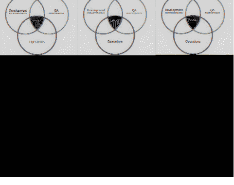

图 1.1：作为开发、运维和质量保证之间交点的 DevOps

DevOps 建立了开发、运维和质量之间的交点，但它不受标准实践框架的限制，并允许根据组织希望实施的方式、其结构和情况进行更灵活的解释。

DevOps 一词所指不仅仅是软件的实现：它是一套关于上述部门之间通信与协作的流程和方法。频繁交付软件的公司可能需要 DevOps 意识或导向。DevOps 的采用受以下因素驱动：

- 使用敏捷开发流程和其他方法论。
- 相关应用和业务部门对生产版本的需求增加。
- 外部和内部供应商云基础设施中虚拟化的广泛可用。
- 数据自动化和配置管理工具的使用量增加。

以下点可以被认为是组织采用 DevOps 方法论的基础：

- **使用敏捷方法论**：如 Scrum 等敏捷方法论允许使用多职能团队通过迭代和增量方法，在最短时间内为客户交付最高价值的产品。这种方法可以与其它工具（如看板 Kanban）互补，作为一种用于管理可视化任务工作流、进行中任务和完成任务的工具。
- **其他方法论**：如极端编程（XP）具有组织化和计划编程的巨大优势，确保整个过程中不出现错误。它们用于执行短期项目。它被认为是一种轻量级方法，侧重于节约、单元测试、频繁集成整个系统、结对编程以及简单频繁地交付运行良好的软件。
- **测试方法论**：如 BDD（行为驱动开发）、TDD（测试驱动开发）和 ATDD（验收测试开发）在软件开发中已变得极其重要，有助于组织成功地提高开发效率。这些方法可以与白盒测试和黑盒测试等其他性能测试技术相结合。
- **使用微服务架构**是解决单体系统固有问题的最佳方法之一。这种架构改进了开发团队的职责分配，并便于在 Docker 容器中封装，减少了管理应用程序依赖的努力和风险，改进了更新管理并提供了负载均衡、高可用和服务发现的功能。容器技术具有共享操作系统的优势，并通过在应用程序之间添加保护层来隔离它们。
- **使用良好实践**：这些良好实践包括正确实施 DevOps 以及完善在适应组织过程中可能出现的问题活动。
- **记录所有事件**：每个事件必须反映在工具中以便后续处理。
- **保证可重复性**：每个操作都应该尽可能自动化，并为回滚到更改之前的状态提供自动机制。
- **测试一切**：每个更改都应该经过测试，尽可能以自动方式进行。要自动化的是前面提到的集成/部署/持续交付系统。
- **监控并审计必要内容**：使用工具跟踪应用程序行为以及日志中的事件，对于开发团队修复问题非常有帮助。此外，系统中的每次更改都必须有一个责任人，必须避免通用账户，每个用户必须以可识别的方式执行操作。

## DevOps 方法论

目前，DevOps 可以定义为无限符号或圆，它定义了构成它的不同区域和阶段：

- 规划
- 开发（构建阶段）
- 持续集成与测试
- 部署
- 运维
- 监控（持续反馈）


图 1.2：DevOps 流程

重要的是，这只是多种表示形式之一，而非最终的准则。可以以四个主要阶段的形式完全有效的简化，也可以对其中每个阶段进行详细分解。

另一个内化它的想法是定义一种迭代流，使得不同的流程可以以有机和叠加的方式包含在不同的阶段中，始终调整价值和持续改进的核心概念。

现在，我将更详细地定位每个阶段，允许我对 DevOps 流程提供非常直观的许可。

## 管理与规划

重要的是，这只是多种表示形式之一，而非最终的准则。可以以四个主要阶段的形式完全有效的简化，也可以对其中每个阶段进行详细分解。

另一个内化它的想法是定义一种迭代流，使得不同的流程可以以有机和叠加的方式包含在不同的阶段中，始终调整价值和持续改进的核心概念。

现在，我将更详细地定位每个阶段，允许我对 DevOps 流程提供非常直观的许可。

## 开发与构建

重要的是，这只是多种表示形式之一，而非最终的准则。可以以四个主要阶段的形式完全有效的简化，也可以对其中每个阶段进行详细分解。

另一个内化它的想法是定义一种迭代流，使得不同的流程可以以有机和叠加的方式包含在不同的阶段中，始终调整价值和持续改进的核心概念。

现在，我将更详细地定位每个阶段，允许我对 DevOps 流程提供非常直观的许可。

## 持续集成与测试

重要的是，这只是多种表示形式之一，而非最终的准则。可以以四个主要阶段的形式完全有效的简化，也可以对其中每个阶段进行详细分解。

另一个内化它的想法是定义一种迭代流，使得不同的流程可以以有机和叠加的方式包含在不同的阶段中，始终调整价值和持续改进的核心概念。

现在，我将更详细地定位每个阶段，允许我对 DevOps 流程提供非常直观的许可。

## 自动部署

重要的是，这只是多种表示形式之一，而非最终的准则。可以以四个主要阶段的形式完全有效的简化，也可以对其中每个阶段进行详细分解。

另一个内化它的想法是定义一种迭代流，使得不同的流程可以以有机和叠加的方式包含在不同的阶段中，始终调整价值和持续改进的核心概念。

现在，我将更详细地定位每个阶段，允许我对 DevOps 流程提供非常直观的许可。

（测试）还助于管理不同环境的配置。

这一阶段最关键且困难的，超过了 IT 环境中为人知并采纳的，是云概念的到来，其具有“基础设施即代码”的能力，这迫使基础设施管理范式发生了。

## 运维，确保生产环境的正常运行

投入生产环境且不需要对其进行持续优化、演进或支持的应用只是少数。但此外，你必须意识到在软件的整个生命周期内必须执行的所有操作。

通过这种方式，你将根据需求或应用程序增长特性对资源进行调整；根据安全、性能和可用性对基础设施进行动态修改；或者对执行和运行过程中需要更改的流程和程序进行优化。

在此阶段，将采用云概念——无论是公共云、私云还是混合云——运营可以利用此类平台提供的扩展性、持久性、可用性、转换、恢复性和安全性能力。

## 监控

DevOps 流程的最后阶段是一个过程管理，并适用于整个周期。在这里，你将定义将监控的措施，以控制应用程序及其基础设施的健康状况。

但并非一切都是技术，在这个阶段，DevOps 周期中所有领域和层级的持续反馈将合并，并包含在下一次计划（Plan）阶段的迭代中，或立即进行特定的修正。

此阶段的目标是监控和衡量所有可以让你了解当前项目状态的内容，包括所有依赖关系，但能够深入到微观层面来仔细观察特定组件的运行。

## 持续集成与持续交付

DevOps 管理的是协作结构的一部分原则，贯穿于应用的开发和部署始终。DevOps 运行的原则如下：

### 持续集成

### 持续交付

### 持续部署

持续交付侧重于使产品开发在其生命周期内始终处于交付状态。持续交付提高了效率，并调整了软件交付过程的计划和预算，为客户发布软件新版本的成本更低且风险更小。

持续交付的实施意味着创建多个反馈回路，以确保向客户交付软件。持续交付的要求之一是所有人员、开发者、系统技术人员、QA（质量保证）和运维人员在整个交付过程中进行有效协作。

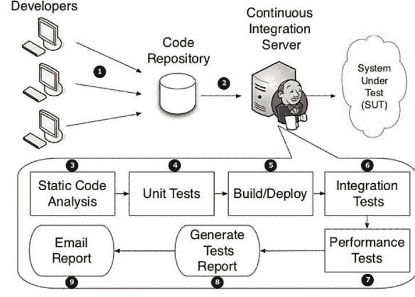

图 1.3：持续交付过程

持续集成是一种开发实践，开发者经常将他们的代码合并到版本控制系统的中央分支（也称为 master 或 trunk 分支）——理想情况下，每天合并几次。每次更改都会触发一组快速测试以发现可能的错误，开发者必须立即解决这些错误。

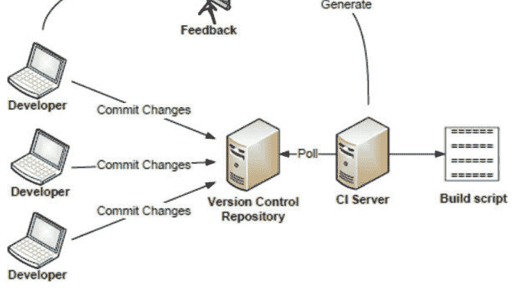

图 1.4：持续集成过程

这些实践是持续集成和交付的关键部分，还需要测试自动化和版本控制。功能验证（如性能测试和可用性测试）为团队提供了尽早检测到由更改引起的问题并立即解决它们。

集成和持续交付的目标是使向最终客户发布更改的过程在技术上变得简单，也就是说，变成一个常规且枯燥的过程。在这个阶段，IT 团队可以投入更多时间在规划和主动策略上，这些策略可以为公司产生更大的价值。通过完整生命周期开发来加速应用程序交付的最大优势之一是，可以进行迭代开发，然后根据客户的需求交付到生产环境。

## 软件交付流水线

软件交付通道由所有加速为客户创造价值的过程组成，最大限度地减少风险和阻塞。以下是软件交付的阶段：

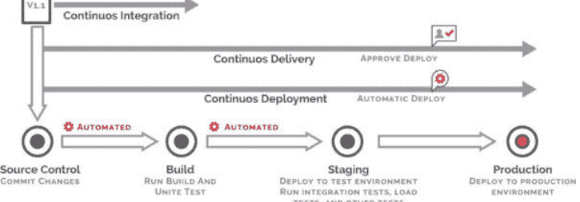

图 1.5：软件交付流水线

## 持续集成

持续集成是软件开发在工作团队设定的特定时间内整合其部分或全部工作的方式。它需要整个开发者团队使用自动化工具。这些工具有助于整合通过自动测试验证的代码部分，使得工作更高效，因为在开发周期的早期就能检测到失败。

持续集成起源于极端编程（Extreme Programming）方法论，是一种软件实践，要求定期将代码集成到共享仓库中。虽然听起来有些矛盾，但这种方法允许不断进行小规模集成，从而缩短时间并提高速度。为了拥有持续集成过程，可以遵循以下有用步骤：

- 一个代码仓库，其中开发是去中心化的。每个开发者处理微小任务，当每个任务完成后，更改将被包含在主线中。
- 以自动方式启动编译和测试过程，证明新增的内容是正确的。
- 每天执行此过程几次，关注错误直到它们消失。

## 持续交付

一旦实现集成，就必须继续循环以进行测试，如果满意，则继续后续。根据 Martin Fowler 的说法，持续交付是以这种方式构建软件，使其随时准备进入生产环境。在这个阶段，所有代码都已实现，以生成一个在其生命周期内可以测试且可部署的应用程序。

团队在构建新功能时始终将此特性置于优先级：

- 可以提供快速且自动的反馈。
- 可以在任何环境中按需进行部署。

在持续交付（CD）中，集成的 CI 通过许多环境的自动测试，以到达预生产阶段，在那里它准备好进行最终实施。CI 和 CD 之间的交互被称为 CI/CD。

## 持续部署

持续部署是持续交付的下一步。持续部署是一种实践，允许将开发过程的结果带到可以全规模功能测试的环境中。目标是尽快在生产环境中检测问题。这是用户与应用程序交互的早期阶段，审查他们的需求并返回开发阶段。

持续部署需要对工作环境进行配置，以便用户对候选版本进行有效运行。在候选版本完成之前的整个开发过程中，进行预配置。

## DevOps 工具

随着 DevOps 相关任务生态系统的不断增长，将对不同类别进行快速回顾，详细描述最广泛使用的工具并列出其他一些。

DevOps 协作的目标是更新和维护稳定系统。工具用于跨越开发和运维之间的差距，它们可以专门在开发阶段作为 Dev 使用，在部署阶段作为 Ops 使用。对于 Dev 和 Ops，都有用于软件、代码或脚本的工具来实现环境的部署。

DevOps 工具是资源管理策略的一部分。在开发环境中，工具有助于实现持续集成和部署。运维管理支持应用程序的自动部署、虚拟机配置和脚本自动执行。

DevOps 从规划开始就定位为开发者和运维知识的联合整合。当开发的应用程序处于生产环境时，DevOps 团队将负责处理版本更改。

从代码生成到在生产环境中部署，建立了一个工作流，一些工具和技术允许其自动化。基本上，这是一个需要适应代码的工作流，我们给出一个关于通用工作流的建议以及一些技术参考，以便更好地理解该过程及其优势。

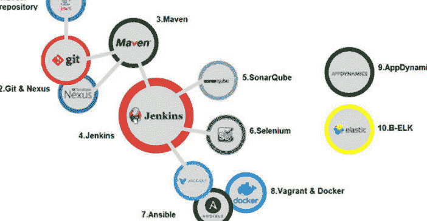

图 1.6：DevOps 工具，从开发者在本地计算机上的源代码开始，他在特定的 IDE（Eclipse、NetBeans、IntelliJ、）中使用特定的语言工作。


我们首先拥有的是分布式代码仓库。在这种情况下，我们可以使用 Git（`git-scm.com/`，能够实现其任何选项，将其托管在内部或外部托管，如 GitHub 或 GitLab），以便开发团队能够以协作方式工作，将所有开发者的代码以集中方式托管是持续集成的第一步。使用这种类型代码的好处是：

- 我们可以更改代码，能够在特定时刻恢复特定版本，减少撤销代码更改的成本和工作。
- 我们将确保所有开发者在相同版本上构建代码，减少集成问题。
- 项目更改管理被简化，如果任何更改都经过标记并可追踪，且仅更新特定更改，项目和更改就不会被替换。

接下来，我们拥有如 Maven（`https://maven.apache.org/`）这样的依赖管理器，它负责分析项目完成所需的解析的依赖项。从那里，它将编译并执行质量过程（单元测试、集成 ... ）将已经建立。使用此类工具的益处在于：

- 对构建的生成具有更大的控制。
- 自动执行测试并验证结果。

到了这一步，我们将引入 [Jenkins](https://jenkins.io/)，它将作为多个进程的编排器。你可以将 Jenkins 视为负责执行任务并检查将功能推到生产环境的流程是否正确触发下一个阶段的工具，而无限的插件数量将允许我们根据需求调整流程。最常见的流程是：当团队在仓库中进行更改时，使用 Maven 编译项目，并将项目发布到生产环境。它还集成了 [Nexus 仓库](https://repository.apache.org/)，以获取生产环境的不同版本。

Jenkins 将执行 [Sonarqube](https://www.sonarource.org/) 以根据既有指标验证所写代码的质量。在上一个流程之后，Jenkins 将启动 [Selenium](http://selenium.org/) 来执行已有的测试用例，并确保代码不会破坏用例中收集的功能。如果此步骤成功结束，我们获得一个准备就绪可以部署的构建。我们将实现持续集成环境，这将加速发布版本生成的过程。

[Ansible](https://www.ansible.com) 是一种允许我们管理配置、资源供应和基础设施自动化部署的工具，用于自动化 CD 和 CI 流程。它还允许我们安装应用程序、编排服务以及更多任务。Ansible 允许不同形式的配置：可以通过单个文件（playbook）来实现，它必须包含在特定客户端组上部署任务的所有参数；或者通过目录在文件中搜索参数，而这些文件可以从其他 playbooks 导入。

如果我们想扩展 CI 的概念，可以包含生成构建的自动化部署，我们将讨论 CD。得益于如 Vagrant 或 Docker 等虚拟化工具，以及像 Ansible 这样的配置工具（它允许在我们的虚拟化实例中进行特定配置），我们能够创建部署构建所需的必要环境。

作为补充，我们还提议使用 APM（应用程序性能监控），例如 [AppDynamics](https://www.appdynamics.com/)。这涵盖了开发阶段，通过分析所开发的软件模块的性能，以确保其正确性，并在推向生产环境之前确保解决方案的行为符合预期。节省时间、精力以及将运行不符合预期的软件推向生产环境的相关成本可能会成为我们系统的瓶颈。在生产环境中，分析系统性能并验证其在真实环境中是否以意想不到的方式做出响应。

最后，由于我们系统的不同部分将产生大量信息，我们提议使用如 ELK 等日志工具，它是一个由不同工具组成的套件：

- [Beats](https://elastic.co/products/beats) - 该套件中的代理负责采集信息，随后由 Logstash 和 Elasticsearch 处理。
- [Elasticsearch](https://elastic.co/products/elasticsearch) - 它是套件的核心部分，基于 Apache Lucene 搜索和索引引擎，负责存储信息。
- [Logstash](https://elastic.co/products/logstash) - 这是一个日志处理器，允许通过对信息进行格式化和增强来实现结构化，从而使其后续处理得到优化。
- [Kibana](https://www.kibana.co/) - 它是一个可视化工具，允许创建仪表板，以图形方式显示由 Beats 发送、经 Logstash 增强并由 Elasticsearch 存储的信息。通过这种方式可以添加大量信息来跟踪 KPI 和指标（包括业务和 IT 指标），为不同的组织提供非常有价值的视角。

一个很好的参考是由 Xebialabs 制作的这个 [DevOps 工具周期表](https://xebialabs.com/periodic-table-of-devops-tools/)，由于其持续更新，它已成为参考工具指南，或者在面对新工具时的发现来源：


图 1.7：DevOps 工具周期表

我们有不同的类别：安全、持续集成、云、监控等。在每个类别中，还标明了是付费还是免费，通过点击特定项目可以获取更多详情。例如，在 Ansible 的情况下：


图 1.8：Ansible 部署与链接

以及 GitHub：


图 1.9：GitHub 描述

此表是 DevOps 生态系统中各种工具的一个非常好的参考点，按类别组织：

| 类别 | 工具 |
| :--- | :--- |
| 持续集成 | Jenkins, Drone |
| 代码管理 | GIT |
| 自动化测试 | Selenium, Appium |
| 基础设施管理 | Chef, Puppet |
| 仓库 | Graylog, Elastic Stack |
| 监控 | Nexus |
| 架构 | Docker, Kubernetes, OpenShift, Nomad |
| 云 | AWS, Azure, Google |
| 自动化 | Jenkins, Drone |

带有 GitHub 集成的标准安装。为了管理 CI（持续集成），使用了 Web 界面，从任何 Git 仓库加载软件构建，对应用程序进行分组，并在预定义的环境中执行结果。

## 基础设施与配置管理

此类别汇集了旨在简化环境执行中的自动化和编排的工具，其形式包括脚本、配方、蓝图、剧（playbooks）和模板。在此类别中，我们可以突出与配置管理相关的工具，如 Puppet、Ansible 和 Vagrant。

Vagrant（`https://www.vagrant.com/`）是 HashCorp 的一个工具，允许你提升环境，专注于以简单快速的方式进行开发。它允许在侧重可复现性和自动化的情况下重现开发环境。它可以作为一个前端，因为通过代码文件创建虚拟机（VirtualBox, OpenStack, VMware, Docker, ...）。

这种允许在代码文件中而非属性（OVA, VMDK, ...）中定义这些资源的做法，使得 Vagrant 在 DevOps 哲学中具有巨大意义，因为它允许将基础设施作为代码的一部分进行定义。Vagrant 是一个免费的开源工具，用 Ruby 语言开发。

Chef（`https://www.chef.io/solutions/devops`）和 Puppet（`https://www.puppet.com/`）均属于基础设施自动化和配置管理领域。两者之间存在一些差异，但总的来说，它们可以被比较为实现基础设施配置并对这些不同服务器的最终状态进行分析的工具。

高度自动化的基础设施对于开发团队在每个阶段（从测试阶段到部署环境）自动部署代码是理想的。基础设施即代码（IAS）是解决开发（Dev）和运维（Ops）团队潜在瓶颈的有力方案。这类基础设施包括置备工具，可以通过点击或使用脚本模板来部署基础设施。它还应该允许配置管理工具，例如通过单条命令升级许多台服务器。

与之前的实例类似，Ansible（`https://www.ansible.com/`）虽然如此，但它具有从控制器本身进行编排部署的可能性，即节点执行 Ansible 代码（通过 SSH 访问节点），这表明之前的工具在某些情况下无法做到。而对于可以被认为是编排工具的工具，通过 Ansible 的通常用法是将其作为配置管理工具。

这些工具还允许系统团队、基础设施团队或程序员在几分钟内部署必要的组件，用于代码测试、演示或检查补丁的副作用。此外，它们还允许自动化与系统基础设施管理相关的关键和重复任务：

- 在新计算机上安装操作系统或对现有计算机进行更新
- 更新应用程序或库
- 安装新服务（Apache, IIS, Tomcat, WordPress 等）或更改现有服务的配置
- 更新数据库引擎或更新其用户
- 在服务器上生成 SSH 密钥
- 更新 SSL 证书

监控必须横跨整个开发团队，以获取开发结果的反馈。在此类别中，我们可以突出关注应用性能的工具，如 Zabbix、Nagios、Influxdb、Telegram、Grafana，以及日志审查工具，如 GrayLog、Logstash、Kibana 和 Elasticsearch（它们分析 Google Analytics）。

Nagios 和 Zabbix 是关键监控工具，它们已进化到 DevOps 工作团队的哲学中，竞争基础设施监控的事实标准。两者都是开源的，并用 C 语言编写。

Prometheus 配合 Grafana，可以将存储在其数据库中的指标以时间序列的形式进行可视化。它是免费开源的，并用 Go 语言编写。

Elasticsearch、Logstash 和 Kibana（也称为“ELK 栈”）是三个具有巨大潜力的工具。它们联合可以为 IT 组织的事件检测提供强大的解决方案。Elasticsearch 充当搜索服务器，使用已通过索引优化的数据。Logstash 是来自不同来源的解析器，通过过滤对消息进行统一处理，你可以舍弃不重要的消息。Kibana 是数据可视化和分析的前端。它们中的每一个工具都可以作为独立工具使用，但三者的结合构成了记录管理的完美组合。

Kibana 是一个免费的发布平台，用于执行数据分析，主要是存储在 Elasticsearch 数据库中的基础设施服务器日志。简单来说，你可以分析数据并制作图表、表格和地图，从而促进数据的可视化。

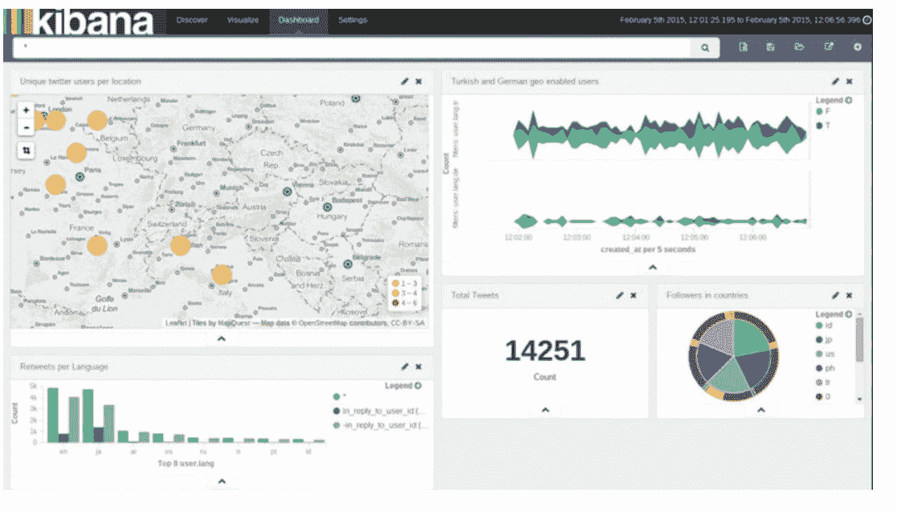

图 1.10：作为数据分析平台的 Kibana

Kibana 让理解海量数据变得更加容易。通过基于浏览器（Mozilla Firefox, Chrome, IE, Safari, ...）的界面，可以轻松访问数据并动态创建包含 Elasticsearch 实时查询的仪表板。

容器改变了软件在所有允许这种轻量级虚拟化的技术中的封装、分发和部署方式。Docker 是最好的，并被行业广泛接受，而其他选项如 LXC 或 rkt。

与容器技术相关的是由 Google 开发供使用的 Kubernetes，它是一个容器编排器，允许更方便地管理这些如编排之类的事务。Docker 用 Go 语言编写，是免费开源的（它捐赠给了 Linux 基金会的云原生计算基金会）。其他的容器编排选项包括 RedHat 的 OpenShift，以及带有许多插件的 Kubernetes 系统，或 HashiCorp 的 Rancher 和 Docker 的 Swarm。

所有这些编排器都通过不同的格式定义服务，这有助于部署的分发。一种不需要像编排器那样大量基础设施来定义服务部署的解决方案是使用 `docker-compose`，它通过 YAML 格式定义多个容器网络等。

## DevOps 与安全

DevOps 不仅仅关于开发团队和运维团队。为了充分利用 DevOps 方法，公司必须考虑安全在应用程序生命周期中所扮演的角色。这种基础设施包含了从规划阶段到之后的阶段。它还涉及一些安全功能，以防止 DevOps 工作流缓慢。选择正确的工具可以实现 DevOps 目标。但有效使用 DevOps 需要更多工具；它是建立在文化变革之上的。DevOps 通过缩短开发和运维之间的距离来简化一切，这种灵活性可能被安全规划所影响。安全是孤立团队的唯一责任，并增加了开发的最后阶段。目前在协作的 DevOps 框架中，安全是共同且集成的责任。

它研究了 DevOps 的边界组成部分及其在各项活动中所扮演的角色：文化、共享、自动化和指标，这些要素让我们能够清晰地理解为了有效地持续持续开发和软件部署必须构建的良好实践。

总而言之，在公司实施 DevOps 可以：

- 改进开发协作，获得对生成代码的控制和可追溯性。减少代码合并期间的风险并加速集成过程。
- 加速构建生成过程，并提高合并到这些构建中的代码质量，提前发现问题并减少由于生产环境中代码运行不正常而带来的风险影响。
- 自动化不产生价值的重复手动操作，缩短发布周期，并显著提高版本的上市时间以及在不同环境之间的迁移速度。
- 自动化系统的水平扩展，这样在审查容量规划后，就可以轻松地调整平台大小。

所有收益都旨在提高软件质量，缩短功能交付时间，并在整个过程中节省精力和成本，使开发策略与生产策略保持一致。

DevOps 的成功取决于客户、开发者和运维人员之间密集且协调的协作。开发者应该专注于编码，而 IT 运营人员专注于自动化基础设施管理。管理层需要相互交流，以发现创新流程和交付成果的新方法。在没有沟通的情况下进行孤岛式工作已成为过去。

# 第 2 章

在本章中，我们将回顾为开发和运维团队提供通用工具的主要容器平台，以及在受管的发布流程中使用快速开发流程的能力。像 OpenShift 这样的容器将 Docker 容器与 Kubernetes 编排项目相结合，并包含了集中式管理，例如管理、监控、流量管理和自动化。

## 结构

- Docker 容器
- 容器编排
- Kubernetes
- Docker swarm
- OpenShift 容器平台
- 目标
- 理解 Docker 容器的概念
- 理解容器编排
- 了解 Kubernetes、Docker swarm 和 OpenShift 等容器平台
- Docker 容器

DevOps 的目标是提高新软件版本的质量，并通过所有参与人员更有效的合作以及持续自动化来加速开发、交付和实施。自动化的 DevOps 任务包括仓库构建过程、静态和动态代码分析，以及模块、集成、系统和性能测试。DevOps 的核心仍然是对持续集成（Continuous Integration, CI）和持续交付（Continuous Delivery, CD）的思考，这是 Docker 平台应用的两个核心领域。

Docker 为集成的 CI/CD 工具（如 Jenkins、Travis、Drone）提供了集成选项，并允许你从 Docker Hub 或版本控制仓库（如 GitHub、GitLab 或 Bitbucket）自动加载代码。这就是平台如何代表工作流的基础，其中开发者创建通用容器并在任何测试环境中运行。

Docker 是一个用于开发、部署和管理应用程序的容器平台。Docker 包被标准化为容器单元，其中包含了软件运行所需的所有内容，包括库、系统工具和代码。通过 Docker，你可以快速部署和调整应用的规模，并确保你的代码从开发环境到生产环境（无论是云端还是本地）都能运行。

Docker 使用 LibContainer 来管理 Linux 内核的容器，并使用一组隔离技术，如命名空间 Namespaces、控制组 Control Groups、AppArmor、安全配置、网络接口以及容器运行所需的防火墙规则。

其中一个显著的特性是 Docker Hub（`http://hub.docker.com/`），Docker 用户可以在这里与其他共享他们创建的镜像。对于 Linux 用户来说，安装这些容器之一就像从 App Store 下载应用程序一样简单。从 Docker Hub 的下载是通过命令在系统本身完成的。

Docker 实现了一个高级 API 来提供轻量级虚拟化，即在隔离环境中执行的轻量级容器。这主要通过使用两个特性实现：Cgroups 和命名空间，它们为我们提供了资源隔离（CPU、内存、I/O 块等）的可能性。

通过使用容器，资源可以被隔离，服务受到限制，并且进程对操作系统拥有几乎完全私有的视图，具有其自身的进程标识、文件系统结构和网络接口。多个容器共享相同的基底，但每个容器都可以被限制使用定义数量的资源，如 CPU、内存和 I/O。Docker 的某些特性包括：

- 它是轻量级的，因为没有虚拟化，能够更好地利用硬件，并且只需要运行所需的最少文件系统。
- 容器是自给自足的（尽管它们可能依赖其他容器），只需容器镜像即可运行其提供的服务。
- Docker 镜像可以被理解为安装了应用程序的操作系统。可以从镜像创建容器。Docker 镜像在不同平台之间具有迁移性，唯一的要求是主机系统中可用 `docker`。
- 项目提供了一个类似于 GitHub 风格的镜像仓库。这被称为 Registry Docker Hub，允许你创建、共享和使用由第三方或自己创建的镜像。

使用 Docker 进行虚拟化与使用容器虚拟机相比有一系列优势：

- **可移植性**：所有容器都是可移植的，我们可以轻松将它们移动到任何 Docker 设备，而无需配置任何内容。Docker 允许你在任何操作系统、本地服务器甚至云端本地运行你的应用程序。
- **轻量化**：通过虚拟化整个系统但仅限必要部分，资源消耗降到了最低。资源节省约为 80%。
- **自给自足性**：Docker 负责一切，容器应只包含运行所需的内容，例如那些库、文件和配置。
- **性能**：容器的性能优于传统的虚拟化，因为它基于 LXC（Linux Containers），直接运行在主机上。

## Docker 架构

一个容器系统由 5 个元素组成：

- **Docker Engine (daemon)**：它是一个运行在任何 Linux 发行版上的守护进程，并暴露用于管理的外部 API。通过它，我们可以创建、上传和下载镜像。
- **Docker client**：Docker 客户端允许我们管理 Docker 引擎，并可以配置为本地或远程工作。


- `Docker image`：用于创建我们想要部署的容器的模板。
- `Docker registry`：存储镜像的目录，包括公共和私有。该组件的目的是分发我们的应用程序。
- `Docker containers`：存储所有必要内容（库、依赖项、二进制文件等）的文件夹，以便应用程序能够运行。

## Docker engine

任何 Docker 项目的核心都是 Docker 引擎，即当前版本中所有用户可用的开源客户端-服务器应用程序。构成此引擎基本架构的组件是一个具有服务器功能的守护进程、一个基于 REST（表述状态转移）的编程接口（API），以及操作系统的终端（命令行界面，CLI）作为用户（客户端）的接口。

- `Docker daemon`：Docker 引擎在主机后台运行一个守护进程，允许集中控制 Docker 引擎。它还负责创建和管理所有的镜像、容器或网络。
- `API REST`：定义了一系列允许其他程序与守护进程交互的接口。其中之一就是操作系统的终端。
- `终端`：Docker 使用操作系统的终端作为客户端程序，通过 REST API 与守护进程交互，允许用户通过脚本或命令对其进行控制。

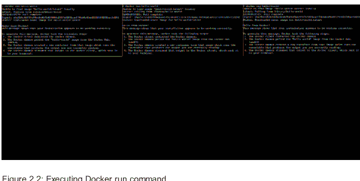

成功下载镜像并接收消息 `Downloaded newer for hello-world: latest ("the latest hello-world: latest image has been downloaded")` 后，容器启动，其中包含一个简单的 hello-world 脚本。你可以共享镜像、自动化工作流，并拥有免费的 Docker ID：https://cloud.docker.com。更多示例请访问：https://docs.docker.com/engine/userguide

Docker 注册表是一个开源项目，可以免费安装在任何服务器上，但 Docker 提供了 Docker Hub：`hub.docker.com`，这是一个 SaaS 平台，你可以在上面上传镜像、访问其他用户的公共镜像，甚至是 MySQL、MongoDB、RabbitMQ、Redis 等主流应用程序的官方镜像。

## Docker 客户端（client）

Docker 客户端使用 Docker 引擎的远程 API，并配置为与本地或远程 Docker 引擎通信，允许我们管理本地开发环境和生产服务器。最常用的 `docker` 命令有：

- `docker info`：提供当前机器管理的容器和镜像数量信息，以及当前安装的插件信息。
- `docker images`：列出机器上可用镜像的信息（名称、ID、占用空间、创建以来经过的时间）。
- `docker build`：从当前目录的 Dockerfile 创建镜像。
- `docker pull`：将指定的镜像版本下载到当前机器。如果未指定下载版本，则下载最新版本（latest）。
- `docker push`：将镜像版本上传到 Docker 注册表，允许将其分发到其他机器。
- `docker rm`：从当前机器删除镜像。该命令允许许多参数，这些参数会随每个 Docker 引擎的版本而更新，因此最好参考官方页面。
- `docker ps`：显示机器上运行的容器。使用 `-a` 标志也会显示已停止的容器。
- `docker inspect`：以 json 格式显示容器的详细信息。你可以通过命令 `docker inspect -f='{{.Name}}' container` 特定字段。
- `docker stop`：停止执行中的容器。
- `docker start`：恢复执行的容器。
- `docker rm`：删除容器。要删除机器上的所有容器，可以执行命令 `docker rm -f (docker ps -aq)`。
- `docker logs`：显示容器的日志。
- `docker stats`：显示容器的执行统计数据，如使用的内存、CPU、磁盘等。
- `docker exec`：在容器中执行命令。使用选项 `docker exec -it bash` 对于调试运行中的容器非常有用。
- `docker volume`：列出机器上的卷。要查看与卷相关的完整命令列表，请运行 `docker volume --help`。
- `docker network`：列出机器上运行的网络。要查看与网络相关的完整命令列表，运行 `docker network --help`。
- `docker exec`：在容器中执行命令。使用选项 `docker exec -it container bash` 调试容器有用。
- `docker cp`：在主机和容器之间拷贝文件。
- `docker stats`：显示容器的执行统计信息。

`docker` 命令行将连接到守护进程（daemon），它将保持 docker 状态等。每个命令都将以超级用户身份执行，通过访问受保护的套接字（socket）。在那里，我们可以通过从官方仓库下载来创建容器。

## `pull ubuntu`

`pull` 命令下载基础 Ubuntu 并安装它。Docker 网站上创建了许多镜像，并且可以创建和共享，样式类似于 Python 库或 Debian 软件包。你可以搜索特定类型（如 Ubuntu）的所有镜像，或者搜索最流行的镜像。

```text
$ docker pull ubuntu
using default tag: latest
latest: Pulling from ubuntu
7339251d5ld: Pull complete
sha256:a3b1c3b4... Pull complete
sha256:d0462500: Pull complete
sha256:8f715f2c273a702acd3d067fc1c4fdda3afb78db86defc89b3jcStatus: Downloaded latest image for ubuntu
```

| REPOSITORY | TAG | CREATED | SIZE |
|---|---|---|---|
| ubuntu | latest | 3 weeks ago | 64MB |

执行 `docker pull` 命令。

下载完成后，你就可以执行命令了。Docker 的好处是它允许你直接执行命令而无需连接到机器。在运行容器时，我们可以创建它，例如：

`docker run -i ubuntu /bin/bash`

这表示正在创建一个终端（`-i`），并且容器正在以交互式方式运行。在上条指令中，我们正在容器内部执行 `/bin/bash` 命令。

```text
$ docker run -i ubuntu /bin/bash
root@a7d0c73dec7f4# ls -l
total 4
drwxr-xr-x 2 root 4096 Jun 12 55 bin
drwxr-xr-x 5 root 4096 Apr 24 18 boot
drwxr-xr-x 5 root 360 Jun 16 09 dev
drwxr-xr-x 1 root 4096 Jun 16 10 opt
drwxr-xr-x 6 root 4096 Apr 24 18 root
drwxr-xr-x 8 root 4096 May 26 17 lib
drwxr-xr-x 7 root 4096 Dec 14 55 lib
drwxr-xr-x 6 root 126 Jun 12 54 media
drwxr-xr-x 2 root 4096 Jun 12 54 mnt
drwxr-xr-x 2 root 4096 Jun 12 54 srv
drwxr-xr-x 11 root 4096 Jul 06 19 proc
drwxr-xr-x 2 root 37 Jun 12 55 root
drwxr-xr-x 1 root 4096 Jan 21 18 usr
drwxr-xr-x 1 root 4096 Jun 28 51 usbin
drwxr-xr-x 12 root 4096 Jun 12 54 usr
drwxr-xr-x 13 root 4096 Jul 05 12 sys
drwxrwxrwt 2 root 4096 Jun 12 55 tmp
drwxr-xr-x 1 root 4096 Dec 18 54 usr
drwxr-xr-x 1 root 4096 Jun 17 55 var
```

图 2.4：容器内部

## 测试 `docker`

在 URL https://labs.play-with-docker.com，我们有一个服务允许你在云端运行 Docker 容器。

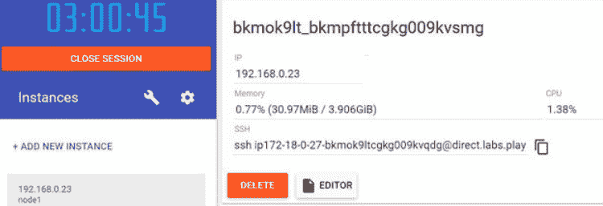

图 2.5：在云端运行 Docker

Play with Docker 是一个允许你在无需安装 `docker` 的情况下运行 Docker 容器的环境。它提供了在浏览器中使用 Alpine Linux 机器的体验，你可以在其中构建和运行 Docker 容器甚至创建 Docker 集群。http://training.play-docker.com/

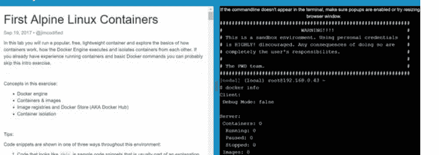

图 2.6：Play with Docker

Play with Docker 还包含一个培训网站，由从基础到高级的实验室组成。

## 容器编排（Container orchestration）

容器的兴起改变了我们对软件应用开发、部署和管理的方式。使用现代操作系统的原生隔离能力，容器支持关注点分离（Separation of Concerns, SoC），这与虚拟机类似，但不会消耗那么多资源，并且与虚拟机相比具有更高的部署灵活性。

容器是轻量且灵活的，催生了新的应用程序架构。这种方法将构成应用程序的不同服务封装到独立的容器中，然后通过物理机或虚拟机集群进行部署。

但现在，应用程序是复杂的，除非有特殊情况，否则通常不会在生产环境中只部署单个容器。问题在于需要必须以不同方式进行扩展的服务。例如，一个容器用于前端，一个或多个用于服务接口，另一个用于数据库。

这一切催生了对容器编排的需求，即拥有一个工具或系统来自动执行基于容器的应用的部署、管理、扩展、互连和可用性。容器编排器负责以下任务：

- 部署和启动基于容器的服务。
- 自扩缩和负载均衡。
- 控制每个容器的健康状况。
- 维护秘密参数和配置。

## Docker Compose

Docker-compose 允许你连接多个容器并使用单个命令执行它们。它用 Python 脚本语言实现，其核心组件是基于 YAML 标记语言的中央控制平面。该文件的语法类似于 Vagrant，用于虚拟机的创建和配置。Compose 允许你定义一系列容器及其之间的关系，使用非常直观的 YAML 格式，负责按照正确的顺序创建容器。它还能检测 YAML 文件发生了变化，并仅重启发生变化的部分。

在 `docker-compose.yml` 文件中你可以定义许多容器。`docker` 命令行将连接到守护进程，它将保持 docker 状态等。每个命令都将以超级用户身份执行，通过访问受保护的套接字。在那里，我们可以通过从官方仓库下载来创建容器。

## Kubernetes

Kubernetes https://kubernetes.io，也被称为 K8s，是市场上最流行的编排引擎，是一个由 CNCF - 云原生基金会（Linux Foundation 下创建的组织）开发的开源项目。Kubernetes 的诞生如此成功，该项目不再由单一公司处理，而是由多个组织和数千社区成员的支持开发。

Kubernetes 将容器分组在逻辑组 pod 中，pod 是集群的基本单位。Kubernetes 基于主从架构：一个集群由一个主节点（Kubernetes master）和其他从节点或 Kubernetes 工作节点（workers）组成。

`kube-proxy`：紧邻容器引擎和 kubelet，在 Kubernetes 的每个节点上都运行着这个代理，负责处理绑定到容器引擎的请求，并为容器化应用程序的用户提供服务。

虽然 Docker 处理的是镜像和容器等实体，但 Kubernetes 将这些实体封装在它们所谓的 pod（（组）中。一个 pod 可以包含一个或多个容器，是 Kubernetes 管理的单元。Kubernetes 为容器管理带来了以下几个优势：

- 多节点：Kubernetes 不是简单地在单宿主机上部署容器，而是可以在多个节点上实现一组节点。从本质上说，节点提供了容器运行的环境。
- 副本复制：Kubernetes 可以作为 pod 的副本驱动程序。这意味着它可以为特定的 pod 拥有许多副本。
- 服务（Services）：在 Kubernetes 语境下，“服务”一词意味着你可以为特定的 IP 地址和端口分配一个服务名称（ID），然后分配一个 pod 来提供该服务。Kubernetes 在内部跟踪服务的位置，以便将该服务的另一个 pod 的请求重定向到正确的地址和端口。

### Kubernetes 安装关键

如果你想在本地机器上安装 Kubernetes，可以使用 [minikube](https://github.com/kubernetes/minikube)。

此外，我们也可以使用 [kubeadm](https://kubernetes.io/docs/setup/independent/create-cluster-kubeadm) 安装并部署 Kubernetes 集群。

当我们深入研究 Kubernetes 时，你会了解到以下一些内容：

- 集群（Cluster）：这些是存储 Kubernetes 存储的物理或虚拟资源，pod 在这些资源中被部署、管理和复制。Kubernetes 可以用于 Docker、Ubuntu、RedHat 等不同系统。
- Pods：[Pods](https://kubernetes.io/docs/concepts/workloads/pods) - Pod 是最小单元，包含一个或多个在同一单元下运行的 Docker 容器。在许多情况下，一个 pod 由单个容器组成，但它容纳多个相互靠近的容器的能力是 Kubernetes 的一个非常强大的特性。一个 pod 代表一组共享存储和单个 IP 的容器。
- 副本控制器（Replication controllers）：副本控制器是 Kubernetes 的一种机制，确保 pod 拥有特定数量的副本。如果我们需要更多副本，副本控制器会创建它们；如果我们需要更少，它会杀死它们；如果其中任何一个失败了，它会创建副本以保持定义的数量。
- 服务（Services）：服务允许通过唯一的 DNS 名称和样式的 IP 地址访问容器。定义如何访问一组 pod。在 URL [https://kubernetes.io/docs/concepts/services-network/publishing-services-type] 中，你可以看到可以在 Kubernetes 中发布的服务类型。
- 标签（Labels）：它们用于通过键值对类型（key value）来组织和选择一组对象。你可以获得流量应该去的服务列表。

如果你选择 Kubernetes，在之前理解以下概念是非常重要的：

- Kubernetes 驱动器（Kubernetes driver）：Kubernetes 控制器充当节点，副本控制器、服务以及 Kubernetes 环境的其他组件从该节点进行部署和管理。要创建一个 Kubernetes，你必须配置并运行系统、`kube-api-server`、`controller-manager` 和 `kube-scheduler`。
- Kubernetes 节点（Kubernetes nodes）：Kubernetes 节点提供了执行容器的环境。要运行一个节点，必须配置为运行 `docker`、`kube-proxy` 和 kube 服务。这些服务必须在 Kubernetes 集群的每个节点上执行。
- `kubectl`：大多数 Kubernetes 管理工作是在主节点上使用 `kubectl` 命令完成的。通过 `kubectl`，可以创建、描述、获取或删除 Kubernetes 管理的任何资源（pod、副本控制器、服务等）。
- 资源文件（YAM 或 JSON）：当你在 Kubernetes 中创建 pod、副本控制器、服务或其他资源时，集群命令期望创建该资源所需的信息位于两种格式类型之一。

## Kubernetes 云解决方案

Kubernetes 目前是开源的，并被用主要容器编排服务的基础。如果我们想获得 Kubernetes 的所有优势，而又不需要管理一切，我们在云端有所有备选方案：

- [Google Kubernetes](https://cloud.google.com/kubernetes-engine/)：由 Google 提供的托管服务，负责管理计算引擎实例。它还处理监控、日志、实例健康状况以及将 Kubernetes 更新到最新版本。
- Amazon 尽管有自己的名为 Amazon ECS 的编排系统，但它已经提供了它称为 EKS 的 Kubernetes 服务：`aws.amazon.com/eks/`
- Azure 拥有自己的基于 Kubernetes 的服务，将其称为 AKS：`azure.microsoft.com/en-us/services/kubernetes-service/`
- IBM 也在其托管 Kubernetes 服务中提供 Kubernetes 业务，即 IBM Cloud Kubernetes Services：https://www.ibm.com/cloud/container-service
- [CoreOS Tectonic](https://coreos.com/tonic) 是 CoreOS 提供 Kubernetes 的产品。它方便了在各种公共和私有云供应商之间的可迁移性。安装、更新和维护需要的操作更少。该工具包含了 [Prometheus](https://prometheus.io/) 用于报警监控和管理。


- [Kops](https://github.com/kubernetes/)：用于从命令行创建和管理 Kubernetes 集群（如果需要且具有高可用性）。到目前，它是在 AWS 上安装 Kubernetes 的非官方方式，并且计划包含 Google Compute Engine 和 VMwareSphere。

- [Mesosphere](https://mesosphere.com/blog/kubernetes-dcos)：他们将高度依赖使用 Kubernetes 作为编排器而不是 Marathon。

- [Cloud Foundry](https://cloudfoundation.org/container-runtime/)：在它的容器运行时提供 Kubernetes。

- [OpenShift](https://www.openshift.com/)：PaaS 集成 Kubernetes 的领导者，通过在其不同的选项（企业版、在线版等）中使用它，我们将使用 Kubernetes 集群。

Kubernetes 可以通过许多工具和扩展进行完善。[Prometheus](https://prometheus.io/)、Sysdig 以及 [Helm 包管理器](https://helm.sh/) 是其中最广为人知的。

## Docker Swarm

[Swarm](https://docs.docker.com/engine/swarm) 是 Docker 为解决开发者在多个服务器上进行编排和容器化的问题提供的解决方案。Swarm 随 Docker 1.12 版本诞生，提供了许多高级功能，如服务发现、负载均衡和扩展。

Docker Swarm 是 Docker 的原生集群工具。它将 Docker 主机池转换为单个虚拟 Docker 主机。由于 Docker Swarm 使用标准的 Docker API，任何与 Docker 进程通信的程序都可以使用来扩展到多个主机。

Swarm 遵循 Docker 的哲学，专注于简单性和开发体验。你可以说它比 Kubernetes 等解决方案更容易使用，但没有那么强大，也没有被公司、云提供商或社区广泛采用。

Swarm 架构的主要元素：

- `swarm` 主：负责整个集群并管理多个 Docker 主机的资源。
- `swarm` 节点：集群中的每个节点都可以访问。每个节点执行一个代理，以便注册、监控 Docker 进程并向后端更新节点状态。
- `swarm` 发现：默认情况下，`swarm` 使用基于 Docker Hub 的发现服务，使用令牌来发现集群中的节点。它还支持其他发现服务，如 etcd、Consul 和 Zookeeper。
- `swarm` 策略：`swarm` 有多种节点分类的策略。当执行新容器时，`swarm` 决定将其放置在所选策略中排名最高的节点上。
- `swarm` 网络：它与 Docker 的新的网络模型（overlay）完全兼容。

### Swarm

Swarm 是 Docker 提供的原生集群解决方案。通过 Swarm，可以管理一组 Docker 主机资源并透明地调度容器的运行，自动管理工作负载。实现这一点需要不断检查容器资源层面的需求，检查可用资源，并移动和优化工作负载的位置。

由 Docker Swarm 编排的集群是运行 Docker 的节点组。集群中的一个节点充当其他节点的管理员，并包含用于管理器和服务发现组件（service discovery）的容器。

Swarm 提供了高可用性并持续监控容器的状态，如果其中任何一个发生中断，它具有自动平衡集群的能力，通过移动和重启容器来保持其运行。

这种原生的 Swarm 集群工具将多个 Docker 主机分组在单个虚拟主机中，并利用 Docker API，使得任何与守护进程通信的 Docker 工具都可以访问 Swarm，并可以在一定数量的主机上进行扩展。用户使用 Docker 引擎的 CLI 来创建 Swarm，在集群中分发应用程序并引导 Swarm 的行为。这不需要额外的编排软件。

这些 Docker 引擎已以 Swarm 模式加入集群。激活此模式可以创建一个新集群，或添加一个已存在于 Swarm 中的主机。集群中的每个主机都变成一个节点，这些节点可以是同一本地系统上的虚拟主机（这是云结构最常见的变体，其中 Swarm 节点分布在不同的系统和基础设施中）。

该软件的基础是主从架构：当需要在 Swarm 中分发任务时，用户将调用共享服务的请求传递给管理器节点，该节点充当集群中的主节点。主节点负责管理集群中的容器，并作为访问 Swarm 资源的主要接口。

每个 Docker 集群至少包含一个管理器节点（也称为管理员或 manager）和许多从节点（称为 work 或 workers）。主节点负责管理集群和派发任务，而从节点负责执行工作单元（任务或任务）。此外，容器应用程序被分发到选定的 Docker 账户中。

### 实践中的 Swarm

在实验`/training.play-with-docker.com/swarm-stack-intro`中，你可以引入 Docker Swarm 并创建一个包含 2 个节点的集群。现在我们将恢复一些操作步骤。

要使用 Swarm 模式创建集群，我们必须从一个节点开始作为管理器。我们可以执行以下命令来初始化 Swarm 模式：

```
[node1] (local) root@192.168.0.37 ~
```

```
$ docker swarm initialized: current node --advertise-addr $(hostname) [vz79c4dan00b3m9p8wpu] is now manager.
```

此时我们已经初始化了 Swarm 集群，接下来我们将回顾如何向此 Swarm 添加一个工作节点（worker）。

执行该命令时，我们已将其初始化为管理器。通过强制参数`--advertise-addr`，我们指定管理器的 IP；如果省略，它将默认使用 2377。命令的输出显示了两个令牌（token）。每个令牌用于加入额外的管理器和工作节点。现在我们为集群添加一个工作节点。为此，我们在 worker 控制台执行以下命令：

```
$ docker swarm join --token SWMTKN-1-4ui5o8bd48331pn37ycof8atta3hs0t2bf2yof2fd2ywo5id5-6je7khfupyatatgr2fkb0u1 192.168.0.2377
```

该节点已作为 worker 加入集群。

我们有 2 个节点，IP 地址分别为 192.168.0.168 和 192.168.0.37。第一个作为管理器，第二个作为工作节点。

| ID | HOSTNAME | STATUS | AVAILABILITY | MANAGER STATUS | ENGINE VERSION |
| :--- | :--- | :--- | :--- | :--- | :--- |
| v7h7f4da4nb0bj9* | 192.168.0.37 | Ready | Active | Leader | 19.0.3-beta2 |
| 4cm64dof4fyec93c837 | 192.168.0.168 | Ready | Active | Worker | 19.0.3-beta2 |

```
## 完成用户的职责。
## Swarm 团队
##################################################################
[node](local) 192.168.0.38 -
$ docker swarm join --token SWMTKN-1-4ui5o8bd48331pn37ycof8atta3hs0t2bf2yof2fd2ywo5id5-6je7kh
docker swarm join --token SWMTKN-1-4ui5o8bd48331pn37ycof8atta3hs0t2bf2yof2fd2ywo5id5-6je7khfupyatatgr2fkb0u1 192.168.0.2377
该节点已作为 worker 加入 swarm。
```

图 2.8：在 Docker Swarm 中添加工作节点

一旦集群准备就，我们就可以在其上启动服务。要注册新服务，请进入管理器控制台并执行以下命令：

```
$ docker service create --replicas 1 --name helloworld alpine ping www.google.com
```

- `--name` 是服务的名称，`--replicas` 是我们想要创建的任务数量。现在我们可以看到集群中所有服务的服务列表：

```
$ docker service create --replicas 1 --name helloworld alpine ping www.google.com
d4b5umqbuhjx3b8kv3y5520
overall progress: 1 out of 1 tasks
/
running service converged
[node](local) 192.168.0.23 -
$ docker service ls
```

| ID | NAME | MODE | REPLICAS | IMAGE |
| :--- | :--- | :--- | :--- | :--- |
| d4b5umqbuhjx | helloworld | replicated | 1/1 | alp |

图 2.9：在 Docker Swarm 中创建服务

通过以下命令，我们可以看到该服务运行的所有任务，扩展副本数量，并检查哪些节点是：

```
$ docker service ps
```

在接下来的截图中，我们可以看到扩展为 4 的情况：

| ID | NAME | NODE | DESIRED STATE |
| :--- | :--- | :--- | :--- |
| | | | |
| | | | |
| | | | |

图 2.10：在 Docker Swarm 中扩展副本

## IT 专业人士 Swarm 模式介绍

2017 年 9 月 12 日 • @jimified

虽然我们在单机主机上使用简单的容器实例（类似于 Docker），但在处理服务应用或作为 IT 管理员时，可能不会这样做。生产环境的应用要复杂得多，这种简单的模型无法协调几十甚至数百个容器。Swarm 模式（Swarm mode）的引入是为了确保可用性和可扩展性。

对于 IT 应用，你需要更高级的工具来管理它们。Docker Swarm 和 Docker Swarm 让这两者协同工作，但与其他工具相比，它们存在一些局限性。

- Compose 用于控制单个服务上的多个容器。像 Docker 一样，可以使用它，但它有一个文本文件来描述应用程序、使用的镜像、容器数量、网络连接等。虽然 Compose 对于单个应用是有用的，但我们需要扩展“Compose”的规模，而 Swarm 允许你运行许多 Docker 引擎，并跨所有引擎进行协调操作。Swarm 模式继续将-

图 2.2：Swarm 模式介绍

在本文中，我们将 Docker Swarm 分析为一种原生的 Docker 集群管理工具。从它的原始设计来看，它更像是一个调度器，而不是一个管理应用生命周期的工具。从过滤、标签和调度器的角度来看，我们看到它提供了许多选项且灵活的选择，因此它是一个可以在不丢失 Docker 引擎远程 API 兼容性的情况下解决问题的工具。

## OpenShift 容器平台

Red Hat OpenShift 容器平台有助于在物理、虚拟和公有云基础设施中轻松开发、部署和管理新应用程序。

最新版本可用<https://www.redhat.com/en/openshift-4/details>。除了使用新版本的 Kubernetes 和 CRI-O 之外，新版本将作为默认运行时发布。CRI-O 是为 Kubernetes 设计的新型容器运行时，可执行任何遵循开放容器倡议（OCI）标准并兼容 Docker 的容器镜像。

## OpenShift 平台即服务（PaaS）

平台即服务（PaaS）是一种云服务，应用程序的服务和功能在该处执行，为开发者提供了最小的运维负载。在 PaaS 模型中，开发者主要关注其代码，将定义应用执行位置、高可用性或操作系统维护等困难性工作留给平台。

Red Hat OpenShift 提出了一个完整的平台，将 Docker 和 Kubernetes 作为原生的执行和编排技术，并集成了一系列功能来管理 Red Hat Enterprise Linux 上的权限、存储、应用生命周期等企业基础任务。

## 使用 OpenShift 进行 DevOps

另一个重要优势是 OpenShift 为公司的开发团队和运维团队提供了一个通用平台和一组工具。使两个团队在应用程序开发和维护中遵循共同且持续的工作动态。这允许我们消除流程和缓慢或手动的路径，根据公司的需要增加工作节奏。

`okd.io` 的 OKD 是一个针对社区应用开发和多租户部署优化的 Kubernetes 发行版。OKD 作为上游代码，Red Hat OpenShift Online 和 Red Hat OpenShift 容器平台基于此构建。更多信息请查阅文档<https://docs.okd.io/index.html>。

使用 Kubernetes 项目的容器运行时，OpenShift 有了一系列额外功能，使其成为 DevOps 环境集成的理想平台。

它允许构建传统的应用程序，同时也面向代码。这是一组用于应用程序开发和部署的中间平台。

得益于源镜像处理（source-image process），它包含了用于将源代码转换为运行应用程序的工具。

作为一种 DevOps 工具，组织通过以下机制改进开发与运维之间的通信，并消除两个部门之间的集成障碍，其特性如下：

- 自备服务：开发人员发现的主要问题是从架构师设计图表到开发人员开始编码之间的等待时间。OpenShift 允许你通过开发者简单的命令将此时间缩短到几分钟，你可以提供硬件和软件。
- 多语言：OpenShift 允许以最有效的方式使用各种语言。
- 自动化：OpenShift 提供了自动管理应用生命的方式。
- 协作：OpenShift 允许在同一项目内管理权限、存储等其他基础。
- 应用可移植性：基于 Docker 构建，允许我们的应用程序迁移到任何系统。
- 开源：提供了 OpenShift 提供的所有可能性。
- 可扩展：允许自动扩展应用程序。

从运维角度来看，它具有以下功能：

- 环境间的迁移：得益于 OpenShift 的运维，环境间的迁移可以委托给相关人员。
- 可扩展性与规划：当运维或开发团队需要水平扩展平台时，OpenShift 有一个调度器可以跨节点进行规划。
- 团队与角色：OpenShift 允许在同一项目内管理权限、存储等其他基础。例如，我们可以使用 OKD 团队来监控开发项目的状态，并在应用程序运行在环境中时将其推广到测试环境。

正如我们所见，Red Hat OpenShift 提供的额外功能（作为 Docker 容器引擎和 Kubernetes 编排）使其成为集成和推广 DevOps 环境的理想技术。中间平台通过源处理允许持续开发和交付（CI/CD），将源代码转换为功能性应用程序。

OpenShift 有四个版本：

- OpenShift Origin（https://github.com/openshift/）：此版本允许你拥有由 Red Hat 管理的 OpenShift 集群。
- OpenShift（https://www.openshift.com/products/online）：可以在 Red Hat 提供的公有云中创建并执行应用程序。你可以使用 Red Hat 账号在线测试 OpenShift：https://manage.openshift.com/
- OpenShift Dedicated（https://www.openshift.com/products/dedicated）：它允许你拥有由 Red Hat 管理的 OpenShift 集群。
- OpenShift Container Platform（https://www.openshift.com/products/container-platform）：它允许你在自己的基础设施中拥有由 Red Hat 管理的 OpenShift 集群。

要在本地环境中部署 OpenShift 集群实例，我们有 2 种方案：

- 按照`docs.okd.io`站点格式在容器中运行 OKD：https://docs.okd.io/latest/getting_started/administrators.html#running-in-a-docker-container
- 在本地机器上运行一个集成容器镜像仓库的完整功能 OKD 实例。该工具允许你在虚拟机上构建单节点集群。在此处<https://kind.io/>你可以找到关于它的所有必要文档和启动说明。它是受 minikube（运行 Kubernetes 的解决方案）启发的。

在本节中，我们将介绍现有资源以帮助理解 PaaS 是如何工作的。我们将使用下图中与描述资源的情况对应的图片，以增强其直观性：

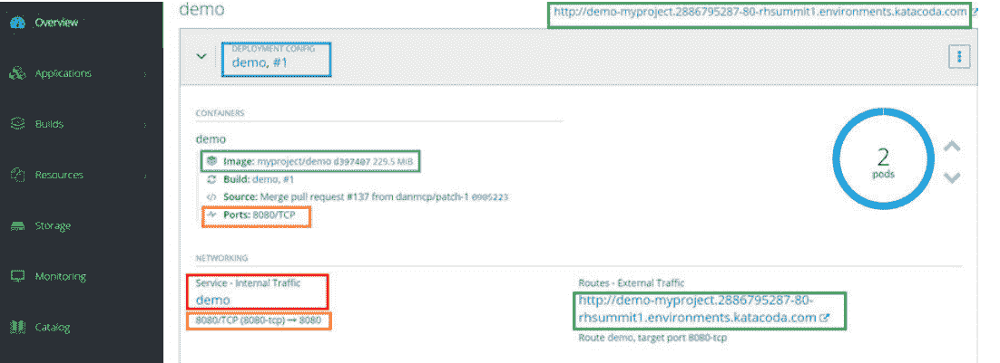

图 2.13：OpenShift 概览项目

路由（Route）；我们可以演示以下元素：

- 路由（绿色）：它是与我们可以调用的服务相关的 URL，它可以面向互联网开放，也可以供内部使用。在这种情况下，路径为`example-php demo.cloudapps.com`。通常，路由的生成格式为`[服务名称] - [项目名称] [PaaS 域名]`。
- 暴露端口（橙色）：这些是服务暴露的端口以及我们在容器中映射的端口。在这种情况下，端口 8080 映射到端口 8080。
- 服务（红色）：它代表我们项目中应用程序的每个实例，这将是应用程序的入口点，并为其通信暴露一些端口。
- 部署（蓝色）：它代表应用程序的部署配置，指示了实例数量、它们的配置、使用的容器镜像以及伸缩参数。显示的数字代表我们执行新部署的次数。


- Pod（蓝色圆形）：我们想要从应用程序执行的每个实例都将位于不同的 pod 中；例如，如果我们有两个实例，我们将有两个相同的 Docker 镜像实例在运行，每个实例运行在自己的 pod 中。

在本节中，我们可以看到与 pod 中显示的内容相关的信息，例如正在使用的 Docker 镜像以及生成它的 git 仓库。

+ 构建 > demo

## demo 于 3 分钟前创建

+ app demo

历史 配置 环境 事件

## 详细信息

| 构建策略：源 | |
| --- | --- |
| 源码仓库：`https://github.com/openshift/django-example.git` | |
| 仓库 URL：`master` | |
| 构建器镜像：`openshift/python:3.6` | |
| 输出到：`myproject/latest` | |
| 运行策略：串行 | |

触发器 了解更多

| 更改配置：构建配置 | |
| --- | --- |
| 新镜像用于：`openshift/python:3.6` | |
| 通用 Webhook URL：`https://2886795287-8443-frugo02.environment.com` | |
| GitHub Webhook URL：`https://2886795287-8443-frugo02.environment.com` | |
| 手动（CLI）：`oc start-build demo -n myproject` | |

图 2.14：OpenShift 部署配置

在部署部分，我们可以看到部署配置；在其中我们可以找到对应的信息：

- 部署期间实例创建和销毁的配置。
- 副本数量配置。
- 正在使用的 Docker 镜像及其版本。
- 环境变量是容器内部的。
- 当前部署的状态。
- 上一次部署的结果。
- OpenShift 的部署配置持续监控以查看运行的 pod 数量。

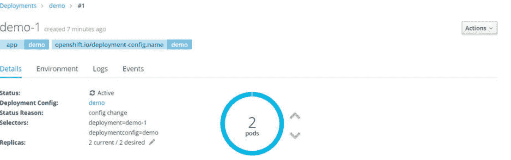

图 2.15：OpenShift 部署详细配置

要验证副本数量，请点击箭头旁圆形中的 pod。您可以通过滚动 Web 控制台底部看到您的 pod 列表。

### 容器

`demo`

- 镜像：`myproject/demo`，占用 818 229.5 MiB
- 构建：`demo`，#1
- 源镜像拉取请求 #137 来自 `demancatch/patch-1` 共 221 次，作者 Ben Perez
- 端口：`8080/TCP`

### 卷

+ 添加存储 | 添加配置文件

### Pods

| 名称 | 状态 | 容器就绪 | 容器重启 | 龄 |
| --- | --- | --- | --- | --- |
| `demo-1-qpjp6` | 运行中 | 1/1 | 0 | 6 分钟 |
| `demo-1-7a65` | 运行中 | 1/1 | 0 | 8 分钟 |

图 2.16：运行中的 OpenShift pods

你可以看到有 2 个副本。应用程序伸缩可以快速发生，因为 OpenShift 正在启动新实例，特别是当该镜像位于节点缓存时。

接下来，我们将讨论在 OpenShift 中构建应用程序的替代方案。在文档中，我们可以看到以下构建的选项：

- 源到镜像（S2I）：这是一个框架，允许将应用程序源码作为输入，生成一个执行该代码的镜像。我们将为运行的每个源码版本创建一个 Docker 镜像。
- Docker 构建：此策略将执行 Docker 构建，并等待仓库中生成 Docker 镜像以便使用。
- 自定义策略：这是你自己创建 Docker 镜像的策略，你精确执行在任何其他镜像中构建应用程序的过程，这将是部署的镜像。

当一个镜像被提取并挂载为读写模式以使其可用时，所执行的操作是从最后一层（对应于基础镜像）开始顺序解压缩每一层的内容，从而生成一个内容随每一层增量构建或修改的文件系统。

最后被以读写模式挂载的层是区分一个容器与其他任何容器及其基础镜像的层。在容器上进行的所有结构都在最后一层添加了新数据或修改了现有数据。当容器被删除时，写入层也会被删除，但基础镜像保持不变。

镜像是容器的永久存储实例。Docker 镜像显示了系统上的镜像。在需要时，你可以为同一个镜像分配多个别名（包括名称和标签）。

你可以通过 `docker ps -a` 命令查看已停止的容器。你可以通过 `docker ps` 命令查看正在运行的容器。

你可以通过 `docker ps -a` 命令查看已停止的容器。你可以重启容器；可以使用 `docker start` 命令。你可以使用 `docker stop` 命令停止正在运行的容器。

## Docker 层（Docker layers）

层类似于 Git 提交，存储了镜像的上一个版本和当前版本之间的差异。就像 Git 提交一样，如果你将它们与其他存储库或镜像共享，它们将非常有用。事实上，当你请求一个记录的镜像时，只会下载你本地机器没有的层。这样共享镜像的效率要高得多。

层会占用空间，层越多，最终镜像就越厚。Git 仓库在这方面也是类似的。因为 Git 存储了提交之间所有的更改，你的仓库大小随着层数的增加而增大。

我们可以通过命令 `docker image history .` 查看镜像的层。在这个示例中，我们正在获取 Python 镜像的层。

## `docker image history python:latest`

| IMAGE | CREATED BY | SIZE |
| --- | --- | --- |
| `14a2caeca327` | 17 hours ago | `/bin/sh -c (nop) CMD ["python3"]` |
| `<missing>` | 17 hours ago | `/bin/sh -c set -ex; wget -get-pip.py "` | 6.24MB |
| `<missing>` | 17 hours ago | `/bin/sh -c (nop) ENV_GET_PIP_SHA256` | |
| `<missing>` | 17 hours ago | `/bin/sh -c (nop) ENV_GET_PIP_URL-ht-` | |
| `<missing>` | 2 weeks ago | `/bin/sh -c (nop) ENV_PYTHON_VERSION-19...` | |
| `<missing>` | 2 weeks ago | `/bin/sh -cd usr/local/bin && ln -s idle3-` | 32B |
| `<missing>` | 2 weeks ago | `/bin/sh -c set -ex && wget -python.tar...` | 91.2MB |
| `<missing>` | 2 weeks ago | `/bin/sh -c (nop) ENV_PYTHON_VERSION-3.7.4` | |
| `<missing>` | 2 weeks ago | `/bin/sh -c (nop) ENV_GPG_KEY-D0964D410E...` | |
| `<missing>` | 2 weeks ago | `/bin/sh -c apt-get update && apt-get install...` | 17.1MB |
| `<missing>` | 2 weeks ago | `/bin/sh -c (nop) ENV_LANG,UTF-8` | |

图 3.2：Python 中的 Docker 层

另一种获取镜像层的方法是通过 Docker 在线服务，该服务显示 Docker 公共镜像的内容，包括元数据以及组成镜像的层信息。下面的图片显示基于 Python 的镜像信息：`https://docker.com/images/python`，最后检查于 28 分钟前。

| Tags | | | | | |
| --- | --- | --- | --- | --- | --- |
| `latest` | `buster` | `3` | `3.7.4` | `3.7.4-buster` | `3-buster` |
| Created | July 30, 2019 at 02:33 AM | | | | |
| ID | `008b021b6899` | | | | |
| Download Size | 330.4 MB | | | | |
| Labels | No labels | | | | |
| Layers | 18 | | | | |
| | 297.7 MB | `buildpack-deps` | `buster` | What's this? | |
| 48.0 MB | `ADD file:2cddee71e84c054a9c48051bd2cf6d3bd02a3...` | | | | |
| 7.4 MB | `RUN apt-get update && apt-get install --no-instal...` | | | | |
| 9.5 MB | `RUN set -ex; if command -v gpg > /dev/null; then ...` | | | | |
| 49.4 MB | `RUN apt-get update && apt-get install --no-instal...` | | | | |

图 3.3：服务中 Python 镜像的元数据

## 镜像标签（Image tags）

镜像标签标识镜像的版本；列出镜像时，它们会与其关联标签一起列出。在之前的 Python 示例中，我下载的标签是 `latest`。

良好的例子有助于理解标签并看到层是如何工作的。如果进入 Python 的 Docker Hub 页面 `https://hub.docker.com/python`，我们可以看到描述中的标签：

## 支持的标签（Supported tags）和相应的 Dockerfile 链接

### 简单标签（Simple Tags）

- `3.8.0b2-buster`、`3.8-buster`、`rc-buster`
- `3.8.0b2-slim-buster`、`3.8-slim-buster`、`3-slim-buster`、`slim-buster`、`3.8.0b2-slim`、`3.8-slim`、`slim`
- `3.8.0b2-alpine`、`3.8-alpine`、`rc-alpine`、`3.8.0b2-alpine-slim`、`3.8-alpine-slim`、`rc-slim`
- `3.8.0b2-windowervercore-ltsc2016`、`3.8-rc-windowervercore-ltsc2016`、`rc-windowervercore-ltsc2016`
- `3.8.0b2-windowervercore-1803`、`3.8-rc-windowervercore-1803`、`rc-windowervercore-1803`
- `3.8.0b2-windowervercore-1809`、`3.8-rc-windowervercore-1809`、`rc-windowervercore-1809`
- `3.7.4-buster`、`3.7-buster`、`3-buster`、`buster`
- `3.7.4-slim-buster`、`3.7-slim-buster`、`3-slim-buster`、`slim-buster`、`3.7.4-slim`、`3.7-slim`、`slim`

图 3：Docker Hub 中官方 Python 的标签

使用 `docker pull` 命令，我们可以下载特定的镜像。

使用 `docker pull` 命令，我们可以下载特定的镜像，之前我们已经在创建容器时下载过它们。例如，我们使用命令 `$ docker image pull:3.8-rc-alpine.10` 下载特定版本的 Python。

```bash
$ docker image pull:3.8-rc-alpine.10: Pulling from library/python
3.8-rc256609: Pull complete
050...: Pull complete
...: Pull complete
...: Pull complete
...: Pull complete
...: Pull complete
...: Pull complete
...: Pull complete
Digest: sha256...
Status: Downloaded for image:3.8-rc-alpine
```

`image`，我们将使用此选项。

- `-quiet`：默认情况下，整个过程、执行的命令及其输出都会显示。使用此选项将仅显示所创建镜像的标识符。

Dockerfile 总是从使用 `FROM` 指令定义基础镜像开始的。构建镜像的推荐方法是使用 Dockerfile，它是一组指示如何构建 Docker 镜像的指令。在 Dockerfile 中可以使用的主要指令有：

- `FROM`：建立容器的基础镜像。
- `RUN`：允许你在镜像上下文中执行命令。
- `CMD`：建立容器在启动时执行的命令。
- `EXPOSE`：你可以定义容器接受的端口。
- `ENV var = value`：定义环境变量。
- `COPY`：允许你将文件和目录复制到容器的文件系统中。
- `VOLUME`：在容器中定义数据卷。

要查看可用指令的完整列表，可以检查官方文档 `https://docs.docker.com/engine/reference/builder/`。

`COPY`、`ADD` 和 `RUN` 指令会为你的镜像添加新层。下面的 Dockerfile 示例创建了两个层，每个 `RUN` 命令一个层。

```dockerfile
FROM ubuntu
RUN apt-get update
RUN apt-get install vim
```

良好的做法是将几个 `RUN` 指令合并到单行中，这样我们就只有一个层了。

```dockerfile
FROM ubuntu
RUN apt-get update && apt-get install vim
```

在文件中找到的指令中，我们可以重点介绍以下：

`FROM`：FROM 指令为后续指令设置基础镜像。该镜像可以是任何本地或公共镜像。如果未找到镜像，Docker 编译命令将尝试从公共仓库下载该镜像。标签（tag）或标签命令是可选的，如果没有指定，默认假设为最新标签（latest）。

`RUN`：RUN 指令将在当前镜像顶部的新层中执行新命令并确认此镜像。生成的镜像将用于 Docker 文件中的下一条指令。RUN 指令有两种形式：

`RUN`

```dockerfile
RUN ["executable", "arg1", "arg2" ...]
```

RUN 指令仅在使用 `docker build` 命令创建镜像时被解释。RUN 指令的目的是执行以某种方式修改镜像的命令。例如，你可以安装软件包或创建一个成为镜像一部分的配置文件。在这个示例中，一个文件在某个时间被创建，然后由 Docker 查看：

```dockerfile
FROM fedora:latest
MAINTAINER maintainer
RUN echo "This container was built on $(date)." > /tmp/built.txt
ENTRYPOINT ["cat","/tmp/built.txt"]
```

当执行 Docker 编译时，命令读取当前日期并将其发送文件 `/tmp/built.txt`。由于命令是在准确时间执行的，每次你执行 `docker run` 命令时都会显示日期。

`$ docker build -t fedora_image`。

`$ docker run fedora_image`。

```bash
$ docker build -t fedora_image
Sending build context to Docker daemon 1.74MB
Step 1/4 : FROM fedora:latest
--> 2b7b4b3f2640
Step 2/4 : MAINTAINER maintainer
--> Using cache
--> 471a4d43ac5
Step 3/4 : RUN echo "This container was built on $(date)." > /tmp/built.txt
--> Using cache
--> 2c9048b93b66
Step 4/4 : ENTRYPOINT ["cat","tmp/built.txt"]
--> Using cache
--> 8a83454955f9
Successfully
Successfully tagged fedora_image:latest
[local] root@192.168.0.43 ~
$ docker run fedora_image
This container was built on Tue Jul 30 18:19:06 UTC 2019.
```

图 3.6：使用 fedora 镜像执行 `docker build` 和 `docker run`

在 Dockerfile 中，我们通过 `FROM` 在脚本中指定要使用哪个基础镜像，然后通过 `RUN` 指向要执行的命令，并通过 `CMD` 指明默认命令。

```dockerfile
FROM ubuntu:latest

RUN apt-get -y update; \
apt-get -y upgrade; \
apt-get install apt-utils \
vim \
vim;
RUN apt-get -y install dstat

CMD ["bash"]
```

一旦创建了文件，将其保存。现在我们进行镜像的构建。镜像的创建由 Docker 引擎执行，它接收来自环境的所有信息；因此，建议将 Dockerfile 以及创建镜像所需的所有文件保存在空目录中。`docker build` 逐行执行 Dockerfile 的指令并在屏幕上显示结果。

`$ docker build -t "test_dockerfile"`。

之前的镜像只是 Docker builder 执行的起始部分。现在我们可以在可用镜像列表中看到它，并通过 `run` 命令从镜像创建一个容器：


```
$ docker images
```

| REPOSITORY | TAG | IMAGE ID | CREATED | SIZE |
| :--- | :--- | :--- | :--- | :--- |
| test_dockerfile | latest | e22b0d16f25f7 | 3 seconds ago | 176MB |
| unubuntu | latest | 355658649b2 | 3 days ago | 64.2MB |

```
[docker] (local) root@192.168.0.33://ubuntu
$ docker run -dti --name mycontainer ac0408912343d42b3352164d8278914482222222157288625
[docker] (local) root@192.168.0.33://ubuntu
$ docker ps
```

| CONTAINER ID | IMAGE | COMMAND | CREATED | STATUS |
| :--- | :--- | :--- | :--- | :--- |
| ac04089123e | e22b0d16f257 | "bash" | 12 seconds ago | Up 10 sec |
| dscontainer | | | | |

图 3.8：执行 `docker image` 和 `ps` 命令

我们进入并验证已安装的程序是否实际上可用；在这种情况下，我们在容器内部执行 `dstat` 命令以获取进程统计信息。

```
$ docker exec -it mycontainer /bin/bash
```

```
docker exec -i -t mycontainer /bin/bash
root@aca04891234:# dstat
You did not select any selects, using -cdng by default.
--total-cpu-usage--dsk/total--net/total--paging---system---
usr sys id idl wai st read writ recv send in out | int csw
```

| usr | sys | id | idl | wai | st | read | writ | recv | send | in | out | int | csw |
| :--- | :--- | :--- | :--- | :--- | :--- | :--- | :--- | :--- | :--- | :--- | :--- | :--- | :--- |
| 31 | 17 | 52 | 0 | 0 | 174k | 2591k | 0 | 0 | 0 | 0 | 12k | 47k |
| 28 | 27 | 45 | 0 | 0 | | | 0 | 0 | 0 | 0 | 27k | 87k |
| 31 | 28 | 41 | 0 | 0 | | 32k | 0 | 0 | 0 | 28k | 100k | |

图 3.9：在容器内执行命令

## 管理 Docker Hub

Docker Hub `https://hub.docker.com` 为你和你的组织提供了一个托管和交付镜像的地方。你可以通过两种方式配置 Docker Hub：仓库（Repositories），它允许我们随时向 Docker 守护进程上传和更新镜像；以及自动镜像（automatic images），它允许我们配置 GitHub 或 Bitbucket 账户，当仓库发生任何更改时，触发镜像的重新构建。

### 搜索并执行 Docker 镜像

如果你感兴趣尝试一个新的软件应用程序，或者正在寻找能够满足特定用途的软件，Docker 镜像可以是一种非常的实验方法，无需在你的机器上安装和配置任何东西。假设你对尝试 Node.js。我们可以使用 `search` 命令进行搜索。

```
$ docker search node
```

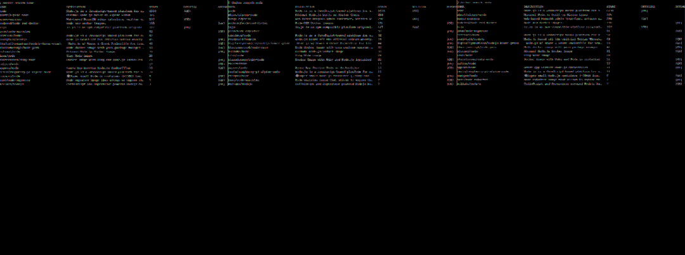

图 3.10: 执行 `docker search node` 命令

我们用于搜索镜像的另一种方法是通过 DockerHub 界面。

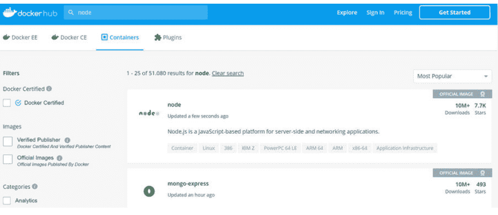

图 3.11: 在 DockerHub 中搜索 node 应用

一旦我们下载了 node 镜像，我们将基于该镜像启动容器，并使用 `docker run` 命令与该容器的命令行交互。

```
$ docker run [options] [commands] [arguments]
```

在执行 docker 命令时，我们必须指定一个作为启动容器时基础的镜像，另一点是，选项（options）可以替换执行配置的几乎所有默认值。在启动容器时，我们有几个配置参数：

- `-i` 允许与标准输入建立连接
- `-t` 管理伪 TTY
- `-d` 在后台模式下运行容器
- `-a` 将标准输入或输出关联到打开的会话
- `-cpus` 分配的 CPU 数量
- `-ip` 分配 IP 地址
- `-mac-address` 为容器分配特殊的 MAC 地址
- `-m` 为该容器设置内存限制（通常为几兆字节）
- `-name` 为容器分配名称
- `-p` 在指定的网络中发布容器端口
- `-rm` 停止容器后将自动删除
- `-tmpfs` 以 tmpfs 模式挂载目录（临时性的，会被删除，无持久性）
- `-v` 在容器中挂载具有持久性的目录，它可以是真实的计算机文件夹或 Docker 卷

要执行此镜像，我们执行 `run` 命令，并可以使用 `-t` 和 `-i` 标志告诉它以交互方式运行。`-t` 创建一个 tty 设备（终端），而 `-i` 标志指定该会话是交互式的：

```
$ docker run -t -i /bin/bash
root@0f3bbafe91c:/# node
```

欢迎来到 Node.js v12.7.0。

输入 "help" 获取更多信息。

```
process.version
```

```
'v12.7.0'
```

在这里我们已经在与容器交互，你在 root 之后看到的数字是容器的 ID，我们可以更新系统、安装包，这个容器也有一个 IP，我们可以通过它交互。我们可以使用 `docker ps` 命令查看正在运行的容器。

### 在后台模式下执行容器

要在后台模式下执行容器，请使用 `--detach` 或 `-d` 选项。`-d` 选项允许你指示它在后台运行（通常作为服务守护进程进程）。

```
$ docker container run --detach -ti mypython:latest /bin/bash
```

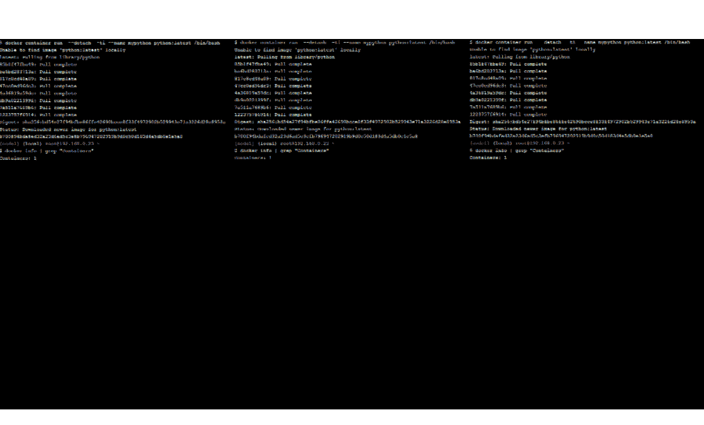

## 检查 Docker 容器

尽管 Docker 命令允许你访问镜像和容器的信息，但有时你想获取关于这些对象元数据的信息。`docker inspect` 命令可以访问 JSON 格式的 Docker 镜像元数据。该命令的语法如下：

```
$ docker inspect [OPTIONS] CONTAINER[IMAGE][CONTAINER [IMAGE][TASK...]]
```

`https://docs.docker.com/engine/reference/command/inspect`

你可以对正在运行的容器或不再运行但已删除的容器运行 `docker inspect`。换句话说，任何你可以通过 `containers docker ps` 或 `docker ps -a` 看到的容器都可以。

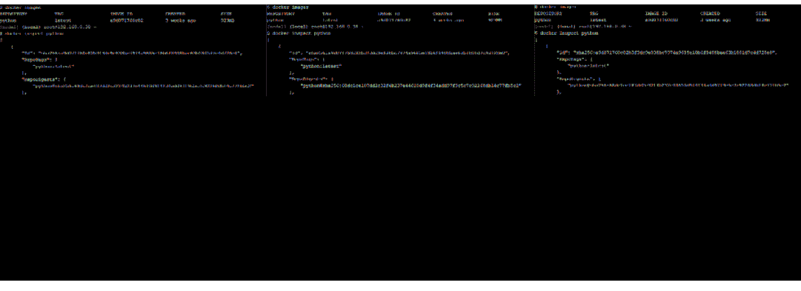

`docker inspect` 提供了一系列选项，允许你通过 `--format` 选项识别特定属性。例如，你可以验证为容器配置的 IP 地址。

你可以通过名称或 ID 检查镜像和容器。在此命令中，我们使用 `docker inspect` 命令获取容器的 IP 地址。

### `docker inspect --format '{{.NetworkSettings.IPAddress}}'`

```json
{
  "Id": "7674747474747474a674747474747474",
  "Id": "7674747474747474a674747474747474",
  "Name": "767474747474",
  "Created": "2023-10-27T10:00:00.123456",
  "Path": "/var/lib/docker/overlay2/7674747474747474a67474747474/diff",
  "CreatedBy": "7674747474747474a674747474",
  "Driver": "overlay2",
  "Data": {
    "GraphDriver": {
      "Name": "overlay2",
      "Data": {
        "LowerDir": "/var/lib/docker/overlay2/abc/diff,/var/lib/docker/overlay2/def/diff",
        "UpperDir": "/var/lib/docker/overlay2/767474747474/work",
        "MergedDir": "/var/lib/docker/overlay2/767474747474/merged",
        "MergedData": "123456"
      }
    },
    "ContainerSize": "/var/lib/docker/overlay2/767474747474/size",
    "IPConfig": [
      {
        "IPAddress": "172.18.0.2",
        "Gateway": "172.18.0.1"
      }
    ],
    "NetworkSettings": {
      "Networks": {
        "bridge": {
          "IPAddress": "172.18.0.2",
          "Gateway": "172.18.0.1",
          "MacAddress": "02:42:ac:11:00:02"
        }
      }
    }
  }
}
```

图 3.14: 检查 Docker 容器 IP 地址

要验证 IP 地址是否激活，可以将 `docker inspect --format='{{.NetworkSettings.IPAddress}}'` 输出到命令中：

```bash
$ docker ps -q | docker inspect --format='{{.NetworkSettings.IPAddress}}' | xargs ping -c 1
```

CONTAINER ID   IMAGE       COMMAND     STATUS          PORTS       NAMES
767474747474   ubuntu:latest  "/bin/bash"   "Up 2 minutes         767474747474

PING 172.18.0.2 (172.18.0.2): 56 bytes of data.
64 bytes from 172.18.0.2: icmp_seq=1 ttl=64 time=0.052 ms
64 bytes from 172.18.0.2: icmp_seq=2 ttl=64 time=0.048 ms
64 bytes from 172.18.0.2: icmp_seq=3 ttl=64 time=0.051 ms
64 bytes from 172.18.0.2: icmp_seq=4 ttl=64 time=0.049 ms
64 bytes from 172.18.0.2: icmp_seq=5 ttl=64 time=0.047 ms

--- 172.18.0.2 ping statistics ---
5 packets transmitted, 5 received, 0% packet loss, time 250ms
rtt min/avg/max/mdev = 0.047/0.049/0.052/0.002 ms

图 3.15: 检查 Docker 容器以 ping 命令

以下命令获取 Docker 主机上所有容器的 IP 地址。请记住，`ping` 命令只接受一个 IP 地址，因此需要向 `xargs -1` 传递额外参数以便逐行执行命令。

```bash
$ docker ps -q | docker inspect --format='{{.NetworkSettings.IPAddress}}' | xargs -1 ping -c 1
```

CONTAINER ID   IMAGE       COMMAND     STATUS          PORTS       NAMES
767474747474   ubuntu:latest  "/bin/bash"   "Up 2 minutes         767474747474

PING 172.18.0.2 (172.18.0.2): 56 bytes of data.
64 bytes from 172.18.0.2: icmp_seq=1 ttl=64 time=0.052 ms
64 bytes from 172.18.0.2: icmp_seq=2 ttl=64 time=0.048 ms
64 bytes from 172.18.0.2: icmp_seq=3 ttl=64 time=0.051 ms
64 bytes from 172.18.0.2: icmp_seq=4 ttl=64 time=0.049 ms
64 bytes from 172.18.0.2: icmp_seq=5 ttl=64 time=0.047 ms

--- 172.18.0.2 ping statistics ---
5 packets transmitted, 5 received, 0% packet loss, time 250ms
rtt min/avg/max/mdev = 0.047/0.049/0.052/0.002 ms

图 3.16: 检查 Docker 容器以检查 IP 地址

之前的命令可以总结为以下步骤：

- 获取运行中容器的标识符。
- 使用上一步获取的标识符执行 `docker inspect` 命令。
- 获取每个容器的 IP 地址并运行 ping 测试。

例如，如果我们在 Ubuntu 中使用基于镜像的方法，我们可以使用命令 `dpkg -l` 来检查软件包。首先，我们需要找到正在运行的容器的 ID。

```bash
$ docker exec -l
```

```bash
docker exec 5f12dcc38753 dpkg -l
Desired:Unknown/Install/Remove/Purge/Hold
Status:Not/Inst//Conf-files/Unpacked/Half-int/trig-a/Wait/Trig-pend
//Err:7(none) None/Reinst-required Err: uppercase=bad
Name Version Architecture Description
```

| Name | Version | Architecture | Description |
|---|---|---|---|
| adduser | 3.115 | all | 添加和删除用户及组 |
| apt | 1.4.8 | amd64 | 命令行包管理器 |
| base-files | 9.9+deb9u2 | amd64 | Debian 系统杂文件 |
| base-passwd | 3.5.43 | all | Debian 系统主密码文件 |
| bash | 4.4-5 | amd64 | GNU Bourne Shell |
| badutils | 1.2.29-1 | amd64 | 来自 4.4BSD-Lite 的基础工具 |
| coreutils | 8.26-3 | amd64 | GNU 核心工具 |
| dash | 0.5.8-4 | amd64 | 符合 POSIX 的 shell |
| debconf | 1.5.61 | all | Debian 配置管理系统 |
| debian-archive-keyring | 2017.5 | all | 存档的 GnuPG 存档密钥 |

优化空间和缩小容器大小对于创建高效的内容镜像至关重要。镜像由一系列层生成。每一层代表 Dockerfile 中的一条指令。除最后一层外，所有层都是只读的。

如果我们认为 Docker 的设计是为了运行大量的容器，那么空间和速度都是开发环境中提高生产率的关键因素。想要优化的点是尽可能使用少的层。以下指令集占据了 4 个层：

- `RUN apt-get update -y`
- `RUN apt-get install -y curl`
- `RUN apt-get install -y postgresql`
- `RUN apt-get install -y postgresql-client`

在构建过程中，当 Docker 倾向于重用之前构建的层时，可能会忽略一些昂贵的操作。我们需要考虑这些特定的用例：

将发生变化的 Dockerfile 指令放在文件的最后部分。这样，Docker 就可以重用之前的层。

我们可以将重复的指令分组在同一层中。由于许多原因，例如重用层、维护上下文（因为可能需要在两个层之间维持上下文）。为了避免这种情况，一个清晰的例子是 apt 命令，它通常需要更新仓库并针对每个软件包操作。


在这种情况下，行数较少的相同命令只占据一个层：

```bash
RUN apt-get update -y && \
apt-get install -y curl postgresql-client-client
```

## Docker 缓存

从 Dockerfile 构建 Docker 镜像可能是一个昂贵的过程，因为它涉及安装大量的库，同时它也是重复的过程，因为相同的 Dockerfile 之间非常相似。这就是为什么 Docker 引入了缓存的概念来优化镜像构建过程。

每次从 Dockerfile 重构镜像时，Docker 都会检查当前指令是否执行正确，并缓存指令的结果。如果结果正确并已缓存，Docker 默认将使用其缓存数据并在新指令中重用它。

第一种方式是指令在 shell `/sh -c` 中执行。第二种方式在基础镜像没有缓存时有用。通过这样，如果过程中间某处失败，下一次执行能够重建部分更改并从失败处继续。

Docker 缓存的第一个优化是下载基础镜像。如果基础镜像尚未下载到构建机器上，Docker 就会下载它。这种优化节省了时间，因为镜像可能达到 MB 级，但你必须小心，如果远程镜像版本发生了，Docker 将继续使用本地版本。如果我们想用新版本的基础镜像运行 Dockerfile，必须手动对基础镜像执行`docker pull`。

如之前所述，Docker 有一个内部结构，类似于 git 仓库。我们在 git 中已知的结构在 Docker 中被称为镜像层。镜像是 Docker 仓库中连续的层，每一层都存储前一层的特征。这个概念对于优化我们的 Docker 非常重要。

目前，只需要知道 Dockerfile 的每条指令都会为我们的镜像创建一个且仅创建一个层即可。Docker 缓存工作在指令级别。换句话说，如果 Docker 的行没有变化，Docker 不会重新计算，而是认为生成它的层与之前的 Docker 执行相同。如果我们有这样这样的指令：

```bash
RUN apt-get update && apt-install -y
```

当执行两次成功的构建时，`apt-get`命令将不会被执行，但将重用第一次构建生成的层。

```
}
}
```

在这个示例中，我们使用了一个基于节点的镜像，并使用以下 Dockerfile 打包该应用程序，其中我们执行了`package.json`和`index.js`文件中的`npm install`命令：

```
FROM node:8

EXPOSE 3000

WORKDIR /app

COPY package.json index.js /

RUN npm install

CMD ["npm", "start"]
```

接下来，我们在保存 Dockerfile 的目录中创建镜像。我们可以使用以下`docker build`命令来构建镜像：

```bash
$ docker build -t node-app
```

我们可以通过`docker image is`命令验证本地环境中是否存在我们刚刚创建的镜像。

我们执行该镜像以创建容器，让应用程序运行在 3000 端口：

```bash
$ docker run -d -p 3000:3000 -ti --rm --init node-app
```

> hello-world@1.0.0 start /app

> index.js

> Example app listening on port 3000!

在 Dockerfile 中，有 2 个`COPY`和`RUN`命令，它们为基础镜像生成了两个额外的层。生成的镜像包含五个新层，对应于 Dockerfile 中的每一层。我们可以通过`docker history`命令查看不同的层。

我们可以通过`container ls`和`docker history node-app`命令验证本地环境中是否存在我们创建的容器。

### 使用多阶段构建减少镜像大小

现在让我们测试通过多个阶段构建 Dockerfile。我们将使用原本相同的 Dockerfile，但现在我们使用多阶段构建对其进行重写。与之前的版本相比，主要的区别在于在这种情况下，我们使用了两次`FROM node:8`语句。

```dockerfile
FROM node:8

WORKDIR /app

COPY package.json index.js /

RUN npm install

FROM node:8

COPY --from=build /app /

EXPOSE 3000

CMD ["index.js"]
```

Dockerfile 的第一部分创建了三层。这些层在第二个阶段和最后一个阶段被合并并复制。镜像上方又添加了两个层，总共有 3 层。在执行构建和历史命令时，我们可以通过以下命令看到通过多阶段构建生成的镜像情况。

在构建第二个镜像（旨在在生产环境中运行的镜像）时，获取了上一个镜像（来自 build）的可的可执行文件，并命名为`build`。

```bash
$ dockerfile -build node-multi-stage
```

```dockerfile
## dockerfile -build node-multi-stage
FROM node:14-alpine
WORKDIR /app
COPY package*.json ./
RUN npm install
COPY . .
RUN npm run build

FROM node:14-alpine
WORKDIR /app
COPY --from=build /app/node_modules ./node_modules
COPY --from=build /app/dist ./dist
EXPOSE 3000
CMD ["npm", "start"]

## dockerfile -build node-multi-stage image
FROM node:14-alpine
WORKDIR /app
COPY package*.json ./
RUN npm install
COPY . .
RUN npm run build
## as build
```

图 3.18：使用多阶段模式构建 Docker 镜像

通过以下命令，我们可以验证`node-multi-stage`镜像的大小：

```bash
$ docker images | grep node

node-multistage-latest 70d53ac4b571 3 minutes ago 897MB
```

有关更多信息，你可以查看关于多阶段构建的 docker 文：https://docs.docker.com/develop/images/multistage-build/

### 使用 alpine Linux 减少镜像大小

基于 Alpine Linux 的镜像 https://docs.docker.com/samples/library/alpine 也非常流行，因为它们产生的镜像最小，能够在内存和磁盘空间资源上少的应用程序。从这个意义上说，基于此发行版的镜像下载和配置速度快得多。

例如，我们可以在 Alpine 中使用 Python 3.6，创建一个如下的 Dockerfile：

```dockerfile
FROM python:3.6-alpine
```

```dockerfile
CMD ["python3.6"]
```

构建并运行此 docker 将为你提供一个 Python 3.6 Shell。如果你运行的是不需要许多系统级依赖的 Python 应用程序，这将是非常棒的。

在我们的 Node 应用程序中，如果使用 alpine-linux 作为基础镜像，它为我们提供了减少镜像大小的可能性。

```dockerfile
FROM node:8 as build
WORKDIR /app
COPY package.json index.js /
RUN npm install

FROM node:8-alpine
COPY --from=build /app /
EXPOSE 3000
CMD ["npm", "start"]
```

```bash
$ docker build -t node-alpine.

$ docker images | grep node
```

| REPOSITORY | TAG | IMAGE ID | CREATED | SIZE |

| :--- | :--- | :--- | :--- | :--- |

| node-alpine | latest | 448a795c1bff | 20 seconds ago | 68.4MB |

| node-multi-stage | latest | 70d53ac4b571 | 8 minutes ago | 897MB |

| node | 8 | 82e45c884a32 | 3 weeks ago | 895MB |

| node | 8-alpine | e0eb8a0cf75a | 8 weeks ago | 66.7MB |

图 3.19：减少镜像大小

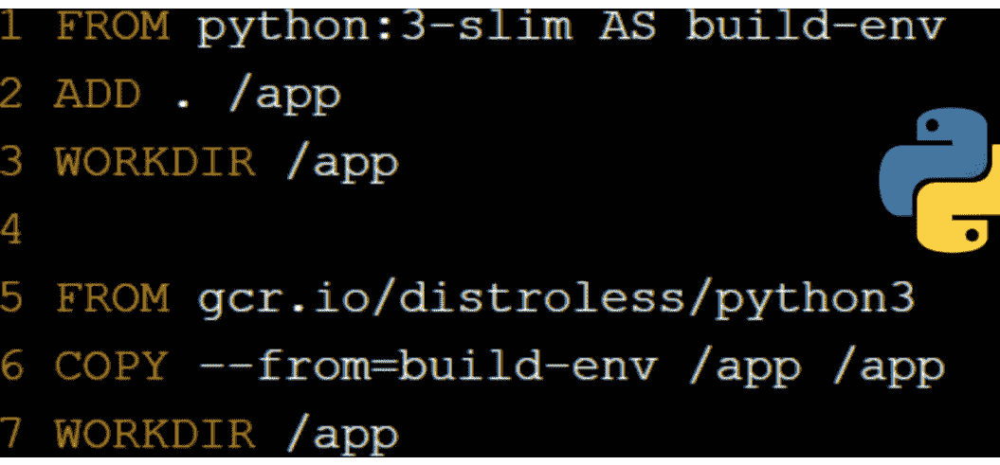

图 3.22：使用 Python3 distroless 镜像的简化版 Dockerfile 

由于 Distroless 是原始操作系统的简化版本，没有额外的二进制文件，且无法运行 bash 或 sh 来获取 shell。

我能为此镜像执行的唯一二进制文件是 Python 解释器。通过这种方式，我们把官方镜像占据的 900 MB 镜像缩小到了 50 MB，更小的镜像尺寸提高了其安全性，因为如果攻击者设法利用了应用程序和容器，他们无法访问 shell 来执行命令，你只能访问镜像中包含的二进制文件。

| REPOSITORY | TAG | IMAGE ID | CREATED | SIZE |

|---|---|---|---|---|

| python3 | latest | f6d85470e9f6 | 20分钟前 | 52.5MB |

| <none> | <none> | 801dc3c5fed2ed | 23分钟前 | 52.5MB |

| python | 3-slim | ca7f9e245002 | 2周前 | 143MB |

| python | | a4cc99cfaa | 2周前 | 929MB |

| gcr.io/distroless/python3 | latest | b31fedba42763 | 49年前 | 50.9MB |

```
$ docker run -it python bash
root@8a6c043a9fef# exit
exit
[node] (local) root@192.168.0.8 ~ 
$ docker run -it python bash
/usr/bin/python3.5: can't open file 'bash': [Errno 2] No such file or directory
[node] (local) root@192.168.0.8 ~
```

图 3.23：在 Python3 distroless Docker 镜像中执行基于容器

我们可以得出，二进制文件越少意味着镜像尺寸越小，安全性越高。

在这个示例中，我们将使用 Nodejs gcr.io/distroless/nodejs 镜像。使用此库为 Node.js 应用程序构建 Dockerfile 如下：

```
FROM node:8 as build

WORKDIR /app

COPY package.json index.js/
```

```
RUN npm install
FROM gcr.io/distroless/nodejs
COPY --from=build /app /
EXPOSE 3000
CMD ["index.js"]
```

使用之前的 Dockerfile，我们将继续构建镜像，并运行应用程序，发现一切运行正常：

```
$ docker build -t node-distroless.
```

```
$ docker images | grep node
```

我们可以验证，通过使用 distroless 镜像，镜像尺寸从 897MB 缩小到了 74.4MB，而且我们可以看到可以像以前一样执行应用程序。

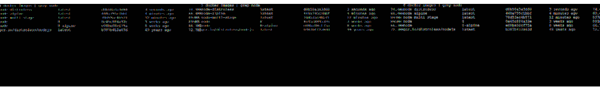

图 3.24：Docker 镜像尺寸对比：distroless vs. node alpine

通过这种方式，我们同时改进了镜像的尺寸和安全性。如果攻击者设法利用了应用程序并获得了容器访问权限，他将无法访问 shell 来执行命令，只能访问镜像中安装的二进制文件。我们可以得出，二进制文件越少，镜像尺寸越小，安全性越高。

## 结论

Docker 镜像基于分层文件系统，这对于容器设计的用例具有许多优势和好处，例如轻量化以及共享共同部分，使得许多容器可以经济地在同一台机器上部署和运行。

你只需要理解原理和机制即可有效地使用 Docker 镜像。Docker 提供了几个命令来了解当前哪些镜像以及它们的结构。

# 第 4 章

## 入门 Docker 安全

本章涵盖了安全最佳实践以及 Docker 能力（capabilities）等方面，Docker 能力包含了提供更多功能的机制，例如特权容器。我们还回顾了 Docker 内容信任（content trust）和 Docker 仓库（registry），它们提供了一种安全的方法将镜像上传到 Docker Hub 和私有仓库。虽然 Docker 提供了一个中心仓库来存储公共镜像，但你可能不希望你的镜像被 Web 。在这种情况下，你必须使用私有仓库。

Docker 提供了一种方法，将应用程序隔离在容器中，并与其每一个库和依赖项打包在一起。由于你的应用程序可以与环境一起运行，构建镜像、测试和组织变得不那么复杂，因为你的构建将完全就绪并在任何环境中保持运行。

具有容器知识的新型 IT 专业人士需要对容器有良好的良好的。因此，那些管理和保护容器应用程序的人需要快速学习这些技能。

## 结构

- Docker 安全原理

- 安全最佳实践

- Docker 能力

- Docker 内容信任

## Docker 仓库

## 目标

- 理解 Docker 安全原理和安全最佳实践

- 理解 Docker 能力和 Docker 内容信任

- 了解 Docker 仓库

- 了解如何在本地创建 Docker 仓库

## Docker 安全原理

从安全的角度来看，Docker 容器使用宿主机的资源，但它们有自己的运行时环境。

基于容器的虚拟化的巨大优势在于，根据不同的需求，它们可以相互运行，而无需假设独立系统的开销。为此，容器技术利用了 Linux 内核的两个基本功能：控制组（Cgroups）和内核命名空间（namespaces）。

命名空间还为进程和挂载点提供了隔离。通过这种方式，容器内的进程无法交互或看到运行在另一个容器中的进程。挂载点的隔离意味着它们不会与另一个容器中的挂载点发生冲突。

控制组（Cgroups）是 Linux 内核的一个特性，有助于限制容器在 CPU 和内存层面上使用的资源。这确保了每个容器只获得它所需的资源。

## Docker 守护进程攻击面

虽然 Docker 促进了虚拟化，但有时可能会忘记执行 Docker 容器的安全影响。从安全角度来看，记住 Docker 需要权限才能正常运行是非常重要的。

Docker 守护进程是管理容器生命周期的主进程，需要 root 权限才能运行。遗憾的是，由于 Docker 守护进程以 root 权限运行，它形成了一个攻击向量。更多细节，您可以在官方文档 https://docs.docker.com/engine/security/ 中获取。

Docker 守护进程负责管理容器，包括创建文件系统、分配 IP 地址、路由数据包、进程管理以及其他需要管理员权限的任务。因此，以管理员身份启动守护进程至关重要。

在我们对容器执行的主要操作中，我们可以进行高级操作，例如启动新容器、停止运行的容器以及使用新命令重新配置运行中的容器。还可以保护机信息，例如密码和证书。

Docker 的最终目标之一是以非 root 用户运行守护进程，而不影响其功能，并将需要 root 权限的操作（如文件和网络系统）委托给具有提升权限的专用线程。

如果您想将 Docker 端口暴露到外部（使用远程 API），建议确保只有信任的客户端可以访问。简单的方法是使用 HTTPS 通过 SSL 和证书保护 Docker。您可以在 https://docs.docker.com/articles/https 找到配置方法。

## 安全最佳实践

在以下列表中，我们将总结运行 Docker 的最佳实践：

- 建议使用运行 Unix 操作系统的机器运行 Docker 守护进程。

- 在将 Docker 宿主机目录链接为卷（volumes）时必须小心，因为容器可能会获得对这些目录的完全读写访问权限，并对其执行不可逆的操作。

- 从通信的角度来看，最佳选项是使用基于 SSL 的身份验证。

- 避免在容器内部以 root 权限运行进程。

- 可以在宿主机 Docker 上启用特定的安全配置，如 AppArmor 和 SELinux。

- 与虚拟机不同，所有容器共享宿主机 Docker 内核。因此，使用最新的安全补丁更新内核非常重要。

- 从系统管理员的角度来看，他们可以遵循 Linux 系统管理的最佳实践建议。这些最佳实践有助于创建更安全的服务并提高容器安全性：

- 不要以 root 身份运行软件。

- 禁用 SETUID 权限。

- 使用`--cap-drop`和`--cap-add`标志来移除和添加容器中的能力。

- 仅对您真正需要的能力使用`--cap-add`标志。

- 每个容器一个应用程序，采用微服务驱动的方法。

- 如果您要共享密钥，建议不要使用环境变量或以特权模式运行容器。

- 建议检查访问 Docker 宿主机的用户。

- 将 Docker 更新到最新版本很重要，以确保所有漏洞都得到解决，并且包含 Docker 正在整合的最新功能。


更新 Docker 宿主机中的 Linux 内核。容器管理中最脆弱的组件之一是内核，因为在所有容器之间共享。因此，在可用最新更新时，要特别保持内核处于最新状态。

在接下来的章节中，我们将更详细地分析一些最佳实践。首先，我们将检查容器内的默认用户。

### 使用非 root 用户执行

默认情况下，容器以 root 权限运行。如果我们执行以下命令，将看到默认用户是 root。

在此条命令中，我们正在执行 `alpine` 容器以检查 root 用户：

```
$ docker run -v /bin:host/bin --it -rm alpine sh
```

```
Unable to find image 'alpine:latest' locally
Pulling from library/alpine
e7c9db87f1b: Pull complete
Digest: sha256:769d7cdc70ff20alc135bf2914328beefcf8396c421420e6da6af8975464b6
Status: Downloaded newer image for alpine:latest
## whoami
root
## id
id(0) gid(0) groups=0(root),1(bin),2(daemon),3(sys),4(adm),6(disk),10(wheel),11(floppy),20(dialout),26(tape),27(video)
```

图 4.1：使用 root 用户执行容器

此时，从安全角度来看，配置命名空间以限制对容器的访问是非常重要的。虽然容器必须以 root 用户运行，但让容器这样做并不是好做法，有必要为每个运行的容器创建一个用户。

容器默认以 root 用户执行，因此容器内可以使用 root 权限。安全解决方案是在创建镜像时指定用户：

```
FROM python:latest
RUN useradd -m user
USER user
```

通过这种方式，在检查 `/passwd` 文件时，看到用户已添加。

### 以只读模式启动容器

Linux 系统管理的最佳实践包括应用最小权限。为此，在执行容器时可以使用如 `read-only` 等标志。

限制文件系统的写入可以防止潜在攻击者在容器中运行或写入。

要做到这一点，请使用带有 `read-only` 标志的 `docker run`：

```
$ docker run -d --read-only python sh
```

在下面的图中，我们可以看到执行以下命令的结果：

```
$ docker run -it --read-only python sh
Unable to find image 'python:latest' locally
Pulling from library/python
85b1f47fa49: Pull complete
ba6bd283713a: Pull complete
817c84da809: Pull complete
47cc0ed96dc3: Pull complete
4a36819a59dc: Pull complete
db9a221399f: Pull complete
t7a51a768b6: Pull complete
122357f6914: Pull complete
Digest: sha256:9d5841f4b2d21fac6623e986b4e91fa704112df3e79ddde315d4a1e3ef5
Status: Downloaded newer image for python:latest
## touch file
touch: cannot touch 'file': Read-only file system
```

图 4.3：以只读模式执行容器

使用此标志执行容器时，如果我们尝试创建一个文件，它会返回无法 `touch` 文件：只读文件系统的错误。使用 `read-only` 参数的缺点是大多数应用程序需要在 `/tmp` 等目录中写入文件，在只读环境中无法运行。在这种情况下，我们可以对应用程序需要写入访问的文件夹和文件，并使用卷仅挂载这些文件。

如果容器需要写入文件系统，可以提供一个卷（volume）以避免错误，并且在容器停止后使更改能够持久化存储。对于临时文件，建议使用 Docker 卷。

卷是一个独立于容器根文件系统的目录，它由 Docker 守护进程直接管理，并可以在容器之间共享。

在以下用例中，我们正在运行一个 MySQL 容器并将其配置为只读，但 `/var/lib/mysql` 和 `tmp` 目录除外。这意味着可以写入数据的唯一位置是这些目录。容器内的任何其他位置将不会允许你写入任何内容。

要做到这一点，我们可以带有 `MYSQL_ROOT_PASSWORD` 等参数运行 MySQL 容器，并使用 `-f` 标志定义值。

```
$ docker run --name mysql --read-only /var/lib/mysql -tmp -d MYSQL_ROOT_PASSWORD=password mysql
```

在这里，我们可以看到当尝试在只读模式的容器中创建文件时的输出：

| docker ps | IMAGE | COMMAND | CREATED | STATUS |
| :--- | :--- | :--- | :--- | :--- |
| 7b9b374c408 | mysql | "docker-entrypoint.s..." | 20 seconds ago | Up 19 seconds |
| 3306/tcp (local) root | 192.168.0.38 | mysql | | |
| [node] (local) root | /opt/filename ~ - Read-only file system | | | |

`Touch: cannot touch '/opt/filename'`

图 4.4：执行带有只读卷的容器

当执行容器并尝试写入只读卷时，我们得到 `read-only filesystem` 错误。

在操作卷时，你可以在声明卷的地方使用 `:ro` 标志：

```
$ docker -v $(pwd):/root-bind:ro ubuntu ...
```

在接下来的示例中，我们可以看到执行上一个命令的执行：

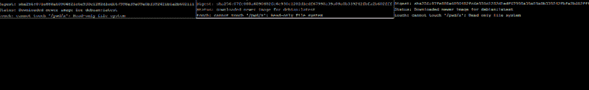

图 4.5：以只读模式使用卷执行

至此，我们回顾了如何启动容器并以只读模式挂载卷。

## 禁用 setuid 并设置权限

用户 ID（`uid`）和组 ID（`gid`）是特殊权限，允许用户访问具有这些位标记的操作系统中的目录和文件。这些位标记的主要问题是它们可以被攻击者利用。此时，最佳实践是在 `Dockerfile` 中添加行来禁用 `setuid`。通过遵循此命令，在使用 `Dockerfile` 构建镜像期间将删除 `setuid` 和 `set` 权限。

```
RUN find / -perm +6000 -type f - chmod -s {} || true
```

此命令搜索可执行文件并从任何用户处删除 `set` 权限。谨慎导入此命令时，必须确保合法程序确实需要此类权限，因此它们不会保留在容器内。

使用以下命令，你可以在启动 Docker 容器时禁用并设置 `setgid` 位标记：

```
$ docker run -d --cap-drop SETGID --cap-drop SETUID
```

通过上一个命令，你在运行特定的 Docker 容器时禁用了 `setuid` 和 `setuid` 能力。

## 使用内容信任验证镜像

`DOCKERCONTENTTRUST` 环境变量允许验证你从 Docker 注册表或 Docker Hub 下载的镜像是受信任且经过签名的。通过此功能你可以防御被中毒或注入的镜像。要启用此功能，你需要通过 `export DOCKERCONTENTTRUST=1` 进行导出。

在以下命令中，我们从 Docker hub 下载镜像，并额外验证该镜像：

```
$ docker pull image@sha256:a25306f5b82306f
```

## CAPNETADMIN 配置网络

`CAP_SETCAP` 允许设置进程控制能力。

以下命令将使用 Python 镜像启动新容器，并使用 `capsh --print` 命令列出能力：

```
$ docker run --rm -it python 'apk add -U libcap; capsh --print'
Unable to find image 'python:latest' locally
latest: Pulling from library/python
85b1f74fa89: Pull complete
ba6bd283713a: Pull complete
817c8cd64a09: Pull complete
47cc6ed96dc63: Pull complete
4a36819a5dc: Pull complete
db9a6221399f: Pull complete
7a51a7689b6: Pull complete
1223757f6914: Pull complete
```

`Digest: sha256:59d9841f4b2d2f2ac663e986b4e91fa704112df3e7d9ddbe315d15a1e53ef5`

`Status: Downloaded newer image for python:latest`

`sh: apk: not found`

`current = cap_chown, cap_dac_override, cap_fowner, cap_fsetid, cap_kill, cap_setgid, cap_setuid, cap_setcap, cap_net_bind_service, cap_net_raw, cap_sys_chroot, cap_mkknod, cap_audit_write, cap_setcap=eip`

`Bounding set =cap_chown, cap_dac_override, cap_fowner, cap_fsetid, cap_kill, cap_setgid, cap_setuid, cap_setcap, cap_net_bind_service, cap_net_raw, cap_s`

图 4.8：列出 Docker 容器中的能力

此时，我们已经回顾了 docker 容器中默认启用的不同能力。

## 添加和删除能力

为了给不同的容器提供或移除 Linux 权限，Docker 提供了以下命令，其中我们可以添加或移除权限标志：

```
$ docker run --cap-add={(capability)
```

```
$ docker run --cap-drop={(capability)
```

我们可以通过命令添加特定的能力：

```
$ docker run --rm -it --cap-add $CAP alpine sh
```

要从容器的 root 账户删除能力，我们可以使用：

```
$ docker run --rm -it --cap-drop ALL --cap-add $CAP alpine sh
```

要删除所有能力并显式地将单个能力添加到容器的 root 账户，我们可以使用：

`$CAP alpine sh`

例如，我们可以在容器内部删除 `CHOWN` 能力，然后尝试添加用户。添加用户的操作将失败，因为该操作需要 `CAP_CHOWN` 能力。

在以下命令中，我们可以看到在 ubuntu 容器中更改文件或目录所有权的操作：

```
$ docker run --cap-add=ALL --cap-drop=CHOWN -ti ubuntu sh
```

执行上述命令时，我们可以看到更改文件或目录所有权的操作将失败，并显示 `Operation not permitted`（权限不允许）。


```bash
$ docker run --cap-add=ALL --cap-drop=CHOWN -ti ubuntu sh
## useradd test
useradd: failure while writing changes to /etc/shadow
## chown nobody /usr/share
chown: changing ownership of '/usr/share/': Operation not permitted
```

图 4.9: 在 Docker 容器中删除 CHOWN 能力

同样，我们可以基于 Python 镜像启动新容器并消除 CHOWN 能力，使得容器内部的文件所有者无法被更改。执行时，我们看到命令返回了错误代码，因为此容器的 root 账户已被移除，因此无法更改文件或目录的所有权。

在以下命令中，我们正在 python 容器内部删除 CHOWN 能力：

```bash
$ docker run -it --cap-drop CHOWN python /bin/bash
```

在截图中，我们可以看到上一个命令的结果：

```bash
$ docker run -it --cap-drop CHOWN python /bin/bash
Unable to find image 'python' locally
latest: Pulling from library/python
85b1f47fa8ba9: Pull complete
a6bd283713a: Pull complete
817cc8d4a09: Pull complete
47cc0ed9d6c3: Pull complete
4a3681a95dc: Pull complete
db9a222399f: Pull complete
7a511a769b6: Pull complete
122357f6914: Pull complete
Digest: sha256:59d84181f4b2d1f2zac6623e986b4e91fa708412df3fe379dddba5a3e5f
Status: Downloaded new image for python:latest
root@ee7444d2500:~ # chown nobody /usr/share/ca-certificates/
chown: changing ownership of '/usr/share/ca-certificates/': Operation not permitted
```

图 4.10: 在精简容器中删除 CHOWN 能力。默认情况下

我们也可以移除所有默认启用的能力，可以看到容器是如何停止的。在以下命令中我们可以删除能力：

```bash
$ docker run --cap-add=ALL --cap-drop=CHOWN
```

图 4.11: 在 Docker 容器中删除 CHOWN 能力

同样，我们可以基于 Python 镜像启动新容器并消除 CHOWN 能力，使得内部的文件所有者无法更改。执行时，我们看到命令返回了错误代码，因为此容器的 root 账户已被移除，因此无法更改文件或目录的所有权。

在以下命令中，我们正在 python 容器内部删除 CHOWN 能力：

```bash
$ docker run -it --cap-drop CHOWN python /bin/bash
```

在截图中，我们可以看到上一个命令的结果：

```bash
$ docker run -it --cap-drop CHOWN python /bin/bash
Unable to find image 'python'
latest: Pulling from library/python
85b1f47fa8ba9: Pull complete
a6bd283713a: Pull complete
817cc8d4a09: Pull complete
47cc0ed9d6c3: Pull complete
4a3681a95dc: Pull complete
db9a222399f: Pull complete
7a511a769b6: Pull complete
122357f6914: Pull complete
Digest: sha256:59d84181f4b2d1f2zac6623e986b4e91fa708412df3fe379dddba5a3e5f
Status: Downloaded new image for python:latest
root@ee7444d2500:~ # chown nobody /usr/share/ca-certificates/
chown: changing ownership of '/usr/share/ca-certificates/': Operation not permitted
```

此时，我们已经回顾了 docker 容器中默认启用的不同能力。

| 能力 | 描述 |
| :--- | :--- |
| CAP_NETADMIN | 配置网络 |
| CAP_SETCAP | 允许设置进程控制能力 |
| cap_chown | |
| cap_dac_override | |
| cap_fowner | |
| cap_fsetid | |
| cap_kill | |
| cap_setgid | |
| cap_setuid | |
| cap_setcap | |
| cap_net_bind_service | |
| cap_net_raw | |
| cap_sys_chroot | |
| cap_mkknod | |
| cap_audit_write | |

图 4.8: 列出 Docker 容器中的能力

`current = cap_chown, cap_dac_override, cap_fowner, cap_fsetid, cap_kill, cap_setgid, cap_setuid, cap_setcap, cap_net_bind_service, cap_net_raw, cap_sys_chroot, cap_mkknod, cap_audit_write, cap_setcap=eip`

`Bounding set =cap_chown, cap_dac_override, cap_fowner, cap_fsetid, cap_kill, cap_setgid, cap_setuid, cap_setcap, cap_net_bind_service, cap_net_raw, cap_s`

为了给不同的容器提供或移除 Linux 权限，Docker 提供了以下命令，其中我们可以添加或移除权限标志：

```bash
$ docker run --cap-add={(capability)
```

```bash
$ docker run --cap-drop={(capability)
```

我们可以通过命令添加特定的能力：

```bash
$ docker run --rm -it --cap-add $CAP alpine sh
```

要从容器的 root 账户删除能力，我们可以使用：

```bash
$ docker run --rm -it --cap-drop ALL --cap-add $CAP alpine sh
```

要删除所有能力并显式地将单个能力添加到容器的 root 账户，我们可以使用：

`$CAP alpine sh`

例如，我们可以在容器内部删除 CHOWN 能力，然后尝试添加用户。添加用户的操作将失败，因为该操作需要 CAP_CHOWN 能力。

在以下命令中，我们可以看到在 ubuntu 容器中更改文件或目录所有权的操作：

```bash
$ docker run --cap-add=ALL --cap-drop=CHOWN -ti ubuntu sh
```

执行上述命令时，我们可以看到更改文件或目录所有权的操作将失败，并显示 Operation not permitted（权限不允许）：

```bash
$ docker run --cap-add=ALL --cap-drop=CHOWN -ti ubuntu sh
## useradd test
useradd: failure while writing changes to /etc/shadow
## chown nobody /usr/share
chown: changing ownership of '/usr/share/': Operation not permitted
```

图 4.9: 在 Docker 容器中删除 CHOWN 能力

同样，我们可以基于 Python 镜像启动新容器并消除 CHOWN 能力，使得容器内部的文件所有者无法被更改。执行时，我们看到命令返回了错误代码，因为此容器的 root 账户已被移除，因此无法更改文件或目录的所有权。

在以下命令中，我们正在 python 容器内部删除 CHOWN 能力：

```bash
$ docker run -it --cap-drop CHOWN python /bin/bash
```

在截图中，我们可以看到上一个命令的结果：

```bash
$ docker run -it --cap-drop CHOWN python /bin/bash
Unable to find image 'python' locally
latest: Pulling from library/python
85b1f47fa8ba9: Pull complete
a6bd283713a: Pull complete
817cc8d4a09: Pull complete
47cc0ed9d6c3: Pull complete
4a3681a95dc: Pull complete
db9a222399f: Pull complete
7a511a769b6: Pull complete
122357f6914: Pull complete
Digest: sha256:59d84181f4b2d1f2zac6623e986b4e91fa708412df3fe379dddba5a3e5f
Status: Downloaded new image for python:latest
root@ee7444d2500:~ # chown nobody /usr/share/ca-certificates/
chown: changing ownership of '/usr/share/ca-certificates/': Operation not permitted
```

图 4.10: 在精简容器中删除 CHOWN 能力。默认情况下

我们也可以移除所有默认启用的能力，可以看到容器是如何停止的。在以下命令中我们可以删除能力：

```bash
$ docker run --cap-add=ALL --cap-drop=CHOWN
```

图 4.11: 在 Docker 容器中删除 CHOWN 能力

同样，我们可以基于 Python 镜像启动新容器并消除 CHOWN 能力，使得内部的文件所有者无法更改。执行时，我们看到命令返回了错误代码，因为此容器的 root 账户已被移除，因此无法更改文件或目录的所有权。

在以下命令中，我们正在 python 容器内部删除 CHOWN 能力：

```bash
$ docker run -it --cap-drop CHOWN python /bin/bash
```

```bash
docker run -ti --cap-drop=all alpine sh
Unable to find image 'alpine:latest' locally
latest: Pulling from library/alpine
e7c9cddb71b: Pull complete
digest: sha256:769fdc7cc2f0a1c35abb2bf91432e8beefc83916c24120e6a649bf5...
Status: Downloaded newer image for alpine:latest
## ping 8.8.8.8
PING 8.8.8.8 (8.8.8.8): 54 data bytes
ping: permission denied (are you root?)
## hostname
hostname: sethostname: Operation not permitted
```

图 4.14：在 alpine 容器中禁用能力

通过这种方式，使用 Linux 能力（capabilities）和 setbits，我们能够让用户和进程以更细粒度执行需要特权的任务。例如，通过限制 set bits，在容器中发现漏洞的潜在攻击者将无法获取 shell，因为他们无法获得带有 root 权限的权限。

## 添加网络管理能力

在下一个示例中，我们正在使用 `--cap-add=NET_ADMIN` 来添加配置网络和网络控制的能力。通过添加此能力，我们可以通过 `set eth0 down` 禁用网络链接，并且当尝试 ping 时，它将返回不可达（unreachable）。

在以下命令中，我们向 python 容器内部添加 net_admin 能力：

```bash
$ docker run -ti --cap-add=NET_ADMIN python sh -c "ip link set eth0 down"
```

在截图中，我们可以看到以下命令的结果：

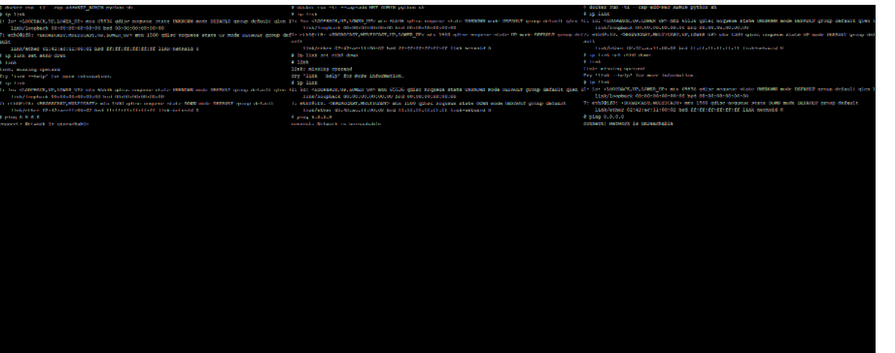

图 4.15：启用 CAPNET_RAW 能力，该选项在数据包发送方面具有若干安全影响，因为它允许生成任何数据包，可能进行身份伪装攻击，从而从容器执行中间人攻击（MITM）。建议将此能力与那些对于容器化应用执行所必需的能力一并禁用。对于其余的能力，重点是 CAPNETADMIN 默认是不激活的，因此我们应该不信任运行此能力的镜像，因为它提供了对网络的完全控制权。

在以下命令中，我们正在检查在 busybox 容器内删除 NET_RAW 能力：

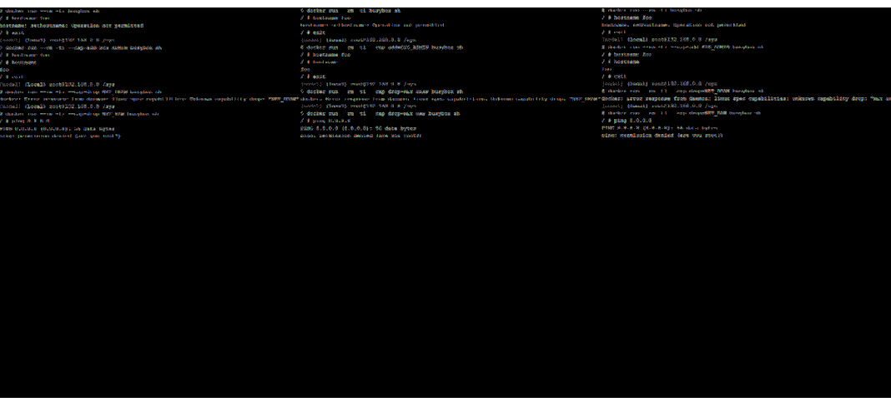

至此，我们已经回顾了如何使用 NET_RAW 和 NETADMIN 能力来管理网络。

## 特权容器的执行

有时，你需要容器拥有某些通常会被拒绝的特殊内核能力。这可能包括挂载 USB 设备、修改网络设置或创建 Unix 设备。在以下代码中，我们尝试更改容器 eth0 接口的 MAC 地址。

```bash
docker run --rm -it ubuntu /bin/bash

root@b328e349da8:/# ip link ls

1: mtu 65536 qdisciscue state ...
link/loopback 00:00:00:00:00:00:brd 00:00:00:00:00:00
9: eth0: mtu 1500 qdisciscue state ...
link/ether 02:42:a0:00:04:brff:brd ff:ff:ff:ff:ff:ff

root@b328e349da8:/# ip link set eth0 address 02:0a:03:0b:04:0c
RTNETLINK answers: Operation not permitted
```

在执行此操作时，我们看到它是被允许的，因为 Linux 内核在容器内部阻止它。然而，假设我们需要此功能让容器工作，扩展容器权限最简单的方法是使用 `--privileged=true` 参数启动它。

在条命令中，我们以全权限执行 ubuntu 容器：

```bash
$ docker run --rm -it ubuntu /bin/bash
```


在带有此标志的命令结果中，我们看到 MAC 地址已正确修改。

```bash
root@88d9d1d7c1dc3:/# ip link ls

1: mtu 65536 qdisciscue state ...
link/loopback 00:00:00:00:00:00:brd 00:00:00:00:00:00
9: eth0: mtu 1500 qdisciscue state ...
link/ether 02:42:a0:00:04:brff:brd ff:ff:ff:ff:ff:ff

root@88d9d1d7c1dc3:/# ip link set eth0 address 02:0a:03:0b:04:0c
@88d9c17dc13c:# ip link ls

1: lo: mtu 65536 discisqueue state ...
link/loopback 00:00:00:00:00:00:brd 00:00:00:00:00:00:000
9: eth0: mtu 1500 qdisciscue state ...
link/ether 02:42:a0:00:04:brff:brd ff:ff:ff:ff:ff:ff

root@88d9d1d7c1dc3:/# ip link set eth0 address 02:0a:03:0b:04:0c
```

图 4.14：在 alpine 容器中禁用能力

图 4.15：启用 `CAPNET_RAW` 能力，该选项在数据包发送方面具有若干安全影响，因为它允许生成任何数据包，可能进行身份伪装攻击，从而从容器执行中间人攻击（MITM）。建议将此能力与那些对于容器化应用执行所必需的能力一并禁用。对于其余的能力，重点是 `CAPNETADMIN` 默认是不激活的，因此我们应该不信任运行此能力的镜像，因为它提供了对网络的完全控制权。

图 4.17：禁用 `NET_RAW`

## Docker 内容信任

Docker Content Trust (DCT) 是 Docker 提供的确保镜像完整性的解决方案。当你使用 DCT 时，可以验证镜像未被恶意用户或不安全网络篡改。

为了签名镜像，我们必须配置环境变量 `DOCKERCONTENTTRUST` 和 `DOCKERCONTENTTRUST_SERVER`。

第一个环境变量允许启用或禁用 DCT 验证。如果启用，将对镜像完整性进行验证，依赖于第二个环境变量指定的官方 Docker 签名服务器。

第二个环境变量允许定义签名服务器所在的 URL。在大多数情况下，公司从 Docker Hub 仓库获取镜像，那里的签名服务将由 Docker 公司执行。

以下是在 Dockerfile 中输入上述环境变量以签名镜像的方法：

```bash
export DOCKERCONTENTTRUST=1
```

```bash
export DOCKERCONTENTTRUST_SERVER="http://notary.docker.io",
```

当镜像上传时，Docker 客户端将返回一个代表镜像哈希值的字符串。拉取时将使用该哈希值进行验证。

在以下截图，我们可以看到拉取 Python Docker 镜像带有哈希值的结果：

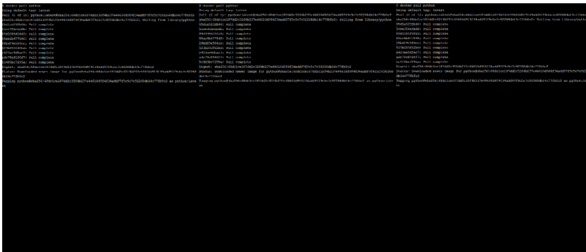

```bash
docker python@sha256:35f9f79a4888f850d318a96c2e7ba6d5e3b928307c10e674
sha256:35f9f79a4888f850d318a96c2e7ba6d5e3b928307c10e674: Pulling from library/python
c551d5bd1: Already exists
221005: Already exists
425031d7ca: Already exists
b37ca19418b2: Already exists
425db7a5bcc: Already exists
c3049f63ff4: Complete
472e6a5c632: Complete
f931e83d1: Complete
105ie813012: Complete
digest: sha256:35f9f79a4888f850d318a96c2e7ba6d5e3b928307c10e674
Status: Downloaded image for python@sha256:35f9f79a4888f850d318a96c2e7ba6d5e3b928307c10e674
docker.io/python@sha256:35f9f79a4888f850d318a96c2e7ba6d5e3b928307c10e674
$ docker python@sha256:35f9f79a4888f850d318a96c2e7ba6d5e3b928307c10e674
invalid checksum digest length
```

图 4.19：正在下载 python 镜像并验证 SHA256 哈希值

每个镜像都被添加到下载队列；在此过程中，Docker 将验证哈希是否与原始镜像匹配。镜像的任何更新都会生成新的哈希。通过这种方式，我们避免了镜像伪充，并确保了下载的安全。

启用 DCT（Docker 内容信任）时，Docker 引擎只会拉取已签名的镜像，并将拒绝执行签名不匹配的镜像；在这种情况下，用户将收到错误：`remote data does not exist for docker.io/`。

在下面的场景中，我们展示了从 Docker Hub 下载镜像时启用并验证 Docker 内容信任的结果：

```bash
$ export DOCKER_CONTENT_TRUST=1
[local] root@192.168.0.2 ~ 
$ docker pull jmortecag/linux_tweet_app:1.0
Error: remote trust data does not exist for docker.io/jmortecag/linux_tweet_app:notary.docker.io does not have trust data
[local] root@192.168.0.2 ~ 
$ export DOCKER_CONTENT_TRUST=0
$ docker pull jmortecag/linux_tweet_app:1.0
Pulling from jmortecag/linux_tweet_app
c95e042cd650: Complete
b2a1d9ee5f7c3: Complete
d5f4da6f69: Complete
c643a6ad7f4: Complete
ae701a88bf2: Complete
digest: sha256c2db4f2a5b917780c4e2930811e2f1b2b4080ef0fad1bf7d0fe38
Status: Downloaded image for jmortecag/linux_tweet_app:1.0
docker.io/jmortecag/linux_tweet_app:1.0
```

图 4.20：使用 `DCT_TRUST` 下载 Docker 镜像

至此，我们已经回顾了如何通过 DCT 管理 Docker 镜像的验证。

## Dockerfile 中的安全下载

关于 Dockerfile 中的安全下载，在大多数情况下，提供者会提供验证签名。例如，Dockerfile 使用 GPG 密钥来验证下载包的签名。

在这张截图中，我们看到在 Docker 镜像下载包时使用了 GPG 密钥：

```dockerfile
ENV GPG_KEY=E3F2B23F04B8B2C0D4BE92699513205A6
ENV PYTHON_VERSION=3.8.4

RUN set -ex; \
    && wget -q -o python.tar.xz "https://www.python.org/ftp/python/${PYTHON_VERSION%[a-z]*/}/Python-${PYTHON_VERSION}.tar.xz" \
    && wget -q -o python.tar.asc "https://www.python.org/ftp/python/${PYTHON_VERSION%[a-z]*/}/Python-${PYTHON_VERSION}.tar.asc" \
    && export GPGHOME=$(mktemp -d) \
    && gpg --batch --keyserver=pool.sks-keysvers.net --recv-keys "$GPG_KEY" \
    && gpg --batch --verify python.tar.asc python.tar.xz \
    && { rm -rf "$GPGHOME" >/dev/null && gpg --kill || true; \
    && mkdir -p /usr/src/python \
    && tar -xzf python.tar.xz -C /usr/src/python --strip-components=1
```

图 4.21：通过 Dockerfile 安全地下载包

至此，我们回顾了某些可以应用于 Dockerfile 以下载文件和包的最佳实践。

## 作为镜像管理工具的 Notary

Docker notary 是一个允许可靠地发布和管理镜像的工具。使用该工具可以确保想要从公共或私有仓库下载镜像的用户之间的信任委托不会被破坏。

Notary 的目标是通过让人们更容易发布和验证镜像，使镜像下载过程更加安全可靠。Notary 由 notary 服务器和客户端组成。客户端安装在本地机器上并处理与 notary 服务器的通信。有关如何编译和配置 notary 服务器的更多信息，请参阅 GitHub 仓库 https://github.com/docker/notary。

可以在 https://notary.docker.io 找到官方 notary 服务器，适用于 64 位 Linux 或 macOS 的预编译二进制文件可在 https://github.com/notary 获取。

## Docker registry

Docker 提供了一种软件分发机制，也称为 registry，它促进了镜像的发现和分发。registry 的概念是基础性的，它提供了一套工具来存储、发现和重用镜像。最好的 registry 是 Docker Hub。

### 什么是 registry？

Registry 是创建我们 Docker 环境的密钥之一，它允许不同的引擎下载镜像，而不一定要求是公共的。我们也有建立自己的 registry 的可能性。在我们的基础设施中拥有 registry 可以节省带宽并带给我们更好的访问速度。这在今天看起来可能不重要，但在集群更新时，以下显示了用户构建镜像并加载到 registry 的工作流：图 4.22：开发者视角的 Docker registry

Registry 背后的想法是开发者可以从 registry 提取镜像，并将其部署在公共云或组织的私有服务器上。

## Docker hub 中的 registry

Docker Hub 是主要的 registry 服务。该服务作为平台即服务平台提供。Docker registry 的工作与 Git 非常相似。每个镜像（称为仓库）都是一系列层。通过这种方式，每次构建镜像时，registry 只存储与之前版本的差异，使得镜像的创建和分发过程更加高效。

要在自己的服务器上运行并部署 registry，你有多种方法可以存储和分发 Docker 镜像。对于包括 Fedora 和 Red Enterprise Linux 在内的 Linux 发行版，你可以安装包并启动服务。对于其他发行版，你可以运行官方 docker.io registry 容器来部署服务。Docker registry 是一个开源项目，可以安装在任何服务器上创建你自己的 registry 并私地上传镜像。其目标是拥有 Docker Hub 的替代品来跟踪托管在你服务器上的镜像，允许内部使用私有仓库以便在控制环境中本地托管镜像。该服务的官方版本可以在 Docker Hub 的 URL http://hub.docker.com/_registry 找到。

## 创建 registry

此镜像包含了 Docker 版本 > 1.6 的 Registry HTTP API V2。是在自己的服务器上设置私有 registry 的步骤：一旦执行了下一个命令，我们在 Docker 主机的 IP 地址上运行了一个 way 容器。在下面的命令中，我们以分离模式运行 registry 容器并暴露端口 5000：

```bash
$ docker run -d -p 5000:5000 --restart always --name registry registry:2
```

在下面的截图中，我们可以看到执行以下命令的结果：

```bash
$ docker run -d -p 5000:5000 --restart always --name registry registry:2

Unable to find image registry:2
2: Pulling from library/registry
9f77a61eded: Complete
1ce60b84df: Complete
54d3dc3b75: Complete
e8afc9c171: Complete
b541fd6d3b6: Complete
Digest: sha256:7a8fd6b0bc09b5968872a70f0836192ff2635ae24d9c22edeb52fe2
Status: Downloaded image for registry:2
```

图 4.23：下载 Docker 镜像以创建本地 registry `-d -p 5000:5000 --restart always --name registry`

之前的命令启动了 Docker Hub 可用的 registry 镜像，在系统上暴露 TCP 端口 5000 以便容器外的客户端可以使用，并在前台进程运行。为了测试这一点，你可以在私有仓库中上传和下载镜像。例如，你可以在 Docker registry 中下载 `hello-world` 镜像。

> `$ docker run --name myhello-world`

下一步是为 `hello-world` Docker 镜像打标签。

我们可以使用 `docker tag` 给 docker 镜像命名：

> `$ docker tag hello-world localhost:5000/hello-me:latest`

在下面的截图中，我们可以看到执行上一个命令的结果：

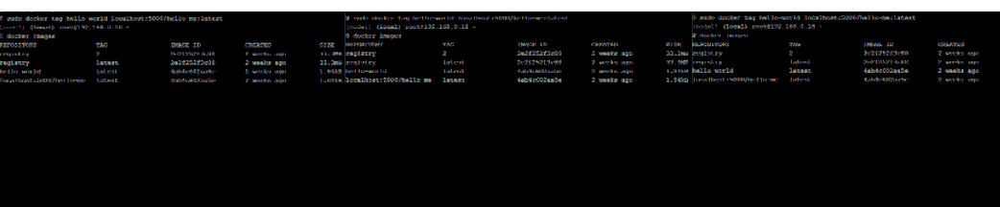

图 4.24：标记 `hello-world` Docker 镜像

下一步是将镜像推送到 registry。为了将 `hello-world` 镜像保存到本地 Docker registry，我们执行命令：

> `$ docker push localhost:5000/hello-me:latest`

图 4.25：将 `hello-world` Docker 镜像推送到本地仓库

下一步是确保你可以能够从仓库中恢复该镜像。首先，你需要使用 `docker rmi` 命令删除当前镜像，然后从你的本地仓库中检索它：

`$ docker rmi hello-world-local:5000/hello-me`

`$ docker pull localhost:5000/hello-me:latest`

在接下来的截图中，我们可以看到执行上述命令的结果：

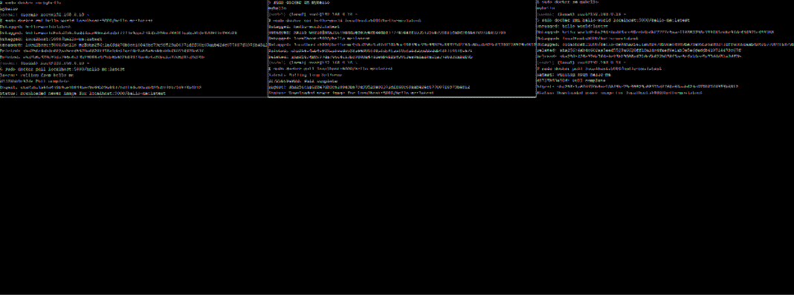

图 4.26：删除 `hello-world` Docker 镜像并从本地仓库拉取

最后，我们可以验证镜像已下载到我们的宿主机 Docker 中，并且我们可以执行该镜像。

`$ docker images`

`$ docker run -it localhost:5000/hello-me`

在接下来的截图中，我们可以看到执行上述命令的结果：

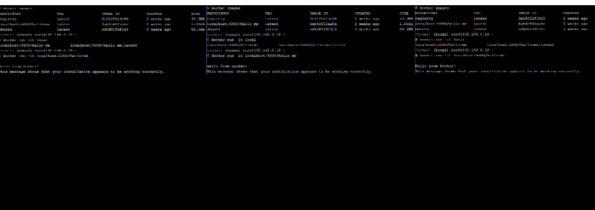

总结来说，设置私有 Docker 仓库提供了使用公共 Docker 仓库发送和提取镜像的能力。

## 结论

Docker 容器带来了独特的安全挑战。有一些 Docker 安全问题需要注意。首先，使用 Docker 运行容器和应用程序需要运行 Docker 守护进程，这需要 root 权限。其他问题包括容器的灵活性，这使得运行多个容器实例变得容易。许多容器可能处于不同的安全补丁级别。

与其他技术一样，Docker 也无法免于可能的安全问题。为了尽量减少这些问题，最好使用良好的实践并对我们的基础设施进行漏洞审计。在下一章，我们将回顾测试 Docker 主机安全的工具。Docker Bench for Security 可以帮助测试 Docker 内容特性和访问控制。

## 问题

哪个负责创建和管理容器，包括创建文件系统、分配 IP 地址、数据包路由、管理以及许多需要管理员权限的任务？

哪是一个独立于容器根文件系统的目录，由 docker 守护进程直接管理，并可以在容器之间共享？

哪些特权权限位被用于让没有 root 权限的用户访问操作系统中的目录和文件？

哪个环境变量可以验证你从 Docker 仓库或 Hub 下载的镜像是受信任并经过签名的？

哪个工具允许我们管理进程访问内核函数的权限，并允许隔离 root 用户权限？

# 第 5 章

## Docker 主机安全

本章涵盖了 AppArmor 和 Seccomp 配置文件等主题，这些配置提供了内核增强功能以限制系统调用。此外，我们还将回顾 Docker bench、Lynis 和 DockScan 等工具，这些工具遵循 Docker 环境中的安全最佳实践，以及在生产环境审计和 Docker 部署期间可以遵循的一些重要建议。Docker Bench for Security 可以帮助测试 Docker 内容特性和访问控制。


分析 Docker 主机的安全性也非常重要，因为大多数攻击都是利用内核漏洞或由于软件包未更新造成的。此时，我们将回顾审计 Docker 主机安全的工具。

## 结构

- Docker 守护进程安全
- AppArmor 和 Seccomp 配置文件
- Docker Bench 安全
- 使用 Lynis 和 DockerScan 审计 Docker 主机

## 目标

- 理解 Docker 守护进程安全
- 理解 AppArmor 和 Seccomp 配置文件
- 了解 Docker Bench 安全
- 了解使用 Lynis 和 DockerScan 审计 Docker 主机

## Docker 守护进程安全

Docker 架构中最重要的元素是 Docker 守护进程进程，它保证了容器之间的通信，并且流量受到 HTS 的保护。

在使用 socket `/var/run/docker.sock` 时，检查用户的访问权限至关重要，特别是确保只有 root 用户拥有写权限，并且 Docker 组不包含可能破坏容器的用户。

此时，需要注意的是，Docker socket 暴露可能会导致权限提升。Docker 主要作为客户端工作，与名为 `docker` 的守护进程通信。该具有 root 权限的进程是一个位于路径 `/var/run/docker.sock` 下的 socket。

我们可以在另一个 Docker 主机内部创建新容器，为此必须通过命令将 `/var/run/docker.sock` 挂载为卷：

```bash
$ docker run -it /var/run/docker.sock:/var/run/docker.debian /bin/bash
```

由于容器基于 Debian 镜像，我们可以按照安装指南操作，要执行的命令将是：

<https://docs.docker.com/install/linux/docker-ce/#install-using-the-repository>

更新包并安装允许我们通过 HTTPS 安全连接到仓库的包：

```bash
$ apt-get update
```

```bash
$ apt-get install apt-transport-https ca-certificates curl gnupg2 \
software-properties-common
```

在接下来的截图中，我们可以看到上一个命令的输出：

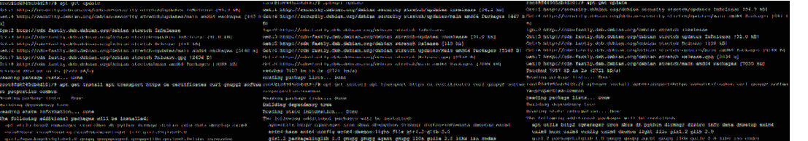

你可以使用以下命令配置稳定仓库并使用 `apt-get update` 更新本地仓库：

```bash
$ add-apt-repository \
```

```bash
"deb [arch=amd64] https://download.docker.com/linux/debian \
$(ls_release -cs) \
stable"
```

```bash
$ apt-get update
```

然后我们安装最新版本的 Docker CE：

```bash
$ apt-get install docker-ce
```

在接下来的截图中，我们可以看到上一个命令的输出：


图 5.2：安装 `docker-ce`

在接下来的截图中，我们可以看到上一个命令的结果：

```bash
$ docker run -it /var/run/docker.sock:/var/run/docker.debian /bin/bash
```

```bash
$ chmod /host
```

在接下来的截图中，我们可以看到执行上一个命令的结果：


图 5.3：挂载 root

通过这种方式，我们看到了 Docker 守护进程：

```bash
$ status SELinux
```

在接下来的截图中，我们可以看到执行之前命令的结果：

```bash
$ status SELinux
```

图 5.4：配置审计规则

配置文件中的模式：允许（permissive）

命令：

策略 MLS 状态：已启用（enabled）

策略 deny_unknown 状态：已启用（enabled）

最大内核策略版本：28

对于从 Ubuntu 仓库 <packages.ubuntu.com/bionic/selinux> 或基于 Debian 的发行版进行安装，我们可以通过以下命令完成：

```bash
$ sudo apt-get install selinux
```

例如，在启用了 SELinux 的系统上，可以使用 `netstat` 和 `ps` 等命令的 `-Z` 选项来验证 Docker 守护进程正在运行：

```bash
$ ps -eF | grep docker
```

```text
systemd:docker_t:SystemRoot 1873 1 2 07:21 :2 / 00:00:00
```

```text
/usr/bin/docker -d --selinux-enabled
```

上一个命令的输出显示 Docker 守护进程正在以安全的方式运行，如第一列的安全上下文所示。`t_keyvalue` 的存在是一种具有受限权限的特殊守护进程。你还可以看到 Docker 守护进程 `/usr/bin/docker` 包含了 `--selinux-enabled` 参数。

要启动启用此属性的 Docker 守护进程，我们可以执行以下命令：

```bash
$ docker -d --selinux-enabled
```

我们还可以验证相关的 SELinux 策略是否检查了 `docker` 命令：

```bash
$ ps -q | xargs docker inspect --format '{{.}}: SecurityOpt={{Config.SecurityOpt}}'
```

要使用 SELinux，你必须拥有相关的 SELinux 策略创建工具。如果你使用的是带有包管理器的发行版，例如，你可以运行 `yum-install selinux-policy-devel`。

Linux 中的强制访问控制（MAC）工具实施了安全规则，以确保只有标准的读-写-执行规则适用于文件和进程，但可以在内核级别对进程应用更多规则。

例如，MySQL 进程只能在特定目录（如 `/var/lib/mysql/`）下写入文件。基于 Debian 的系统，对应的等效标准是 AppArmor。

## AppArmor 和 Seccomp

AppArmor 允许管理员为每个运行的程序分配安全配置（profile）、文件系统访问、网络能力和执行规则。此外，它还为内部和外部威胁提供了保护，允许系统管理员为每个应用程序关联一个安全配置，从而限制该应用程序的能力。

AppArmor 允许你通过一组规则来限制应用程序可以执行的操作；具体来说，这些是主要功能：

- 限制某些用户或进程访问守护进程或进程。
- 限制应用程序或守护进程访问某些进程。
- 限制函数可以访问的资源。

你可以在官方文档中找到更多信息：

```text
http://wiki.apparmor.net/index.php/Main_Page
```

```text
http://en.wikipedia.org/wiki/AppArmor
```

可以通过 `docker info` 命令的安全部分检查 Docker 是否正在使用 AppArmor：

```bash
$ docker info
```

## 5.5：执行 `docker info`

通过 `docker info` 命令，我们可以看到 Docker 的版本以及 CPU、内存、操作系统内核、操作系统以及它的安装位置。

### 在 Ubuntu 上安装 apparmor-profiles

在接下来的章节中，我们将找到不同版本的 Ubuntu。参见：<github.com/apparmor/apparmor-profiles>。

- Ubuntu » Packages » bionic (18.04 LTS) » admin » apparmor-profiles
- Source: apparmor | xenial | xenial-updates | bionic | bionic-updates | cosmic | disco-updates | ean

### 包：apparmor-profiles (2.12-ubuntu5.1) [security]

用于 AppArmor 安全策略的实验性配置（experimental profiles）。

与 apparmor-profiles 相关的其他包：

- recommends
- suggests
- enhances
- apparmor (>= 2.8.9-2535-ubuntu1~)

  AppArmor 的用户空间解析器工具

### 下载 apparmor-profiles

| 架构 | 包大小 | 安装后大小 | 文件 |
| :--- | :--- | :--- | :--- |
| all | 31.1 KB | 360.0 KB | [文件列表] |

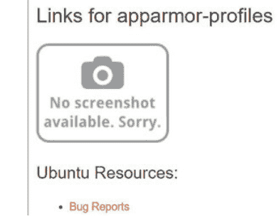

图 5.6：适用于 Ubuntu 的 AppArmor-profiles 包

要安装，我们将在 Ubuntu 终端上执行以下命令：

```text
Docker Info:
  Client Version: 20.10.7, build 261444
  API version: 1.41
  Go Version: 1.17.9
  OS: Linux
  Kernel: 5.4.0-104-generic
  Architecture: x86_64
  InContainers: 0
  Total Memory: 31.GiB

Server:
  Docker Version: 20.10.7, build 261444
  Api Version: 1.41
  Kernel: 5.4.0-104-generic
  Operating System: Ubuntu 20.04.3 LTS (x86_64)
  Containers: 0
  Running: 0
  Images: 0
  Storage Driver: overlay2
  Total Memory: 31.GiB
```

执行 `$ sudo apt-get install apparmor-profiles`，有一些公共目录：

一旦安装了 AppArmor：

- `/etc/apparmor.d/`：这包含配置守护进程的文件。
- `/etc/apparmor/`：这包含限制应用程序对系统其余部分访问的规则集。

在下面的屏幕中，我们可以看到 `/etc/apparmor.d/` 的文件夹结构：

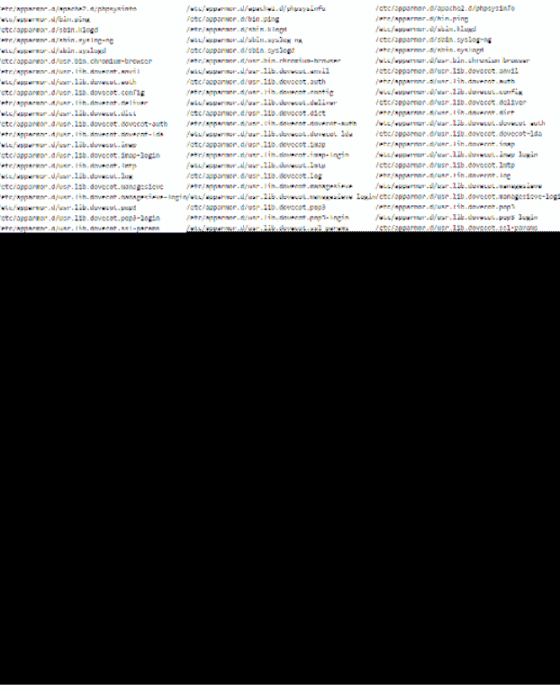

图 5.7：AppArmor 文件和目录

常用于配置和自定义 AppArmor 的应用程序包括：

- `/usr/bin/aa-enforce`：启用一个配置或一组规则。
- `/usr/bin/aa-logprof`：启用配置的注册。要使用此命令，你必须先用 `aa-enforce` 启用配置。
- `/usr/sbin/aa-complain`：启用投诉模式（complaining）的配置。
- `/usr/sbin/aa-genprof`：生成自定义配置。
- `/usr/sbin/aa-notify`：返回被拒绝访问的用户和进程。
- `/usr/sbin/aa-status`：告知你活跃的配置。

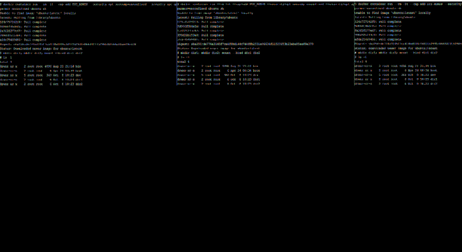

图 5.8：检查没有 AppArmor 配置文件的容器

我们可以从上张图片看到，该操作是有效的。这表明在之前的场景中的操作被默认的 AppArmor 配置文件规避了。

## 使用 Seccomp 配置文件运行容器

Seccomp 是 Linux 内核中的一种隔离路径安装，充当防火墙，允许你限制系统调用（syscalls）。我们可以通过 `docker info` 命令检查是否启用了 Seccomp：

```bash
$ docker info | grep seccomp
```

我们可以创建以下文件，允许我们定义想要阻止的系统调用。在这个示例中，我们正在阻止 `mkdir`、`chmod` 和 `chown` 系统调用。

```bash
touch policy.json
```

```json
{
  "defaultAction": "SCMP_ALLOW",
  "syscalls": [
    {
      "name": "mkdir",
      "action": "SCMP_ERRNO"
    },
    {
      "name": "chmod",
      "action": "SCMP_ERRNO"
    },
    {
      "name": "chown",
      "action": "SCMP_ERRNO"
    }
  ]
}
```

然后，我们可以基于 Alpine 发行版运行容器，并将 `policy.json` 策略文件作为参数传递：

```bash
$ docker run --rm -it --security-opt seccomp:policy.json alpine sh
```

我们可以验证容器内部无法使用 `mkdir`、`chmod` 和 `chown` 命令，执行它们时会得到错误信息：

`Operation not permitted`（不允许操作）

```bash
$ mkdir dirroot
```

```bash
$ chown root:root
```

```bash
$ chmod +x /etc/resolv.conf
```

在接下来的截图中，我们可以看到上述命令的输出：

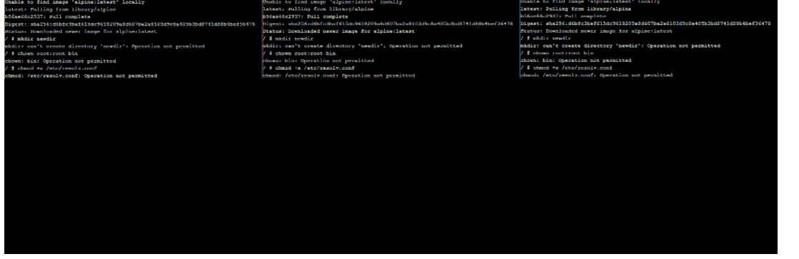

图 5.9：检查带有 Seccomp 配置文件的容器

至此，我们已经回顾了在使用 JSON 文件配置定义的策略在 Alpine 容器上执行 Seccomp 配置文件的整个过程。

## 减少容器攻击面

减少攻击面是安全的一个基本原则。在加固主机的同时，需要关注容器的底层内核架构，同时保留通用标准和特定的容器配置。

例如，容器安全取决于通过所有系统访问内核和守护进程（Daemon）。该守护进程在调用 Seccomp 配置文件的能力方面有所改进，这些策略仅禁用了某些调用，但其他调用仍然可用，导致大量系统可以在没有任何限制的情况下被调用。

另一个示例是将 Docker 守护进程与 Unix Docker 访问组或 TCP 端口链接，允许容器相互通信。

安全的最终目标是在容器的隔离性和它们之间的通信之间取得平衡。这意味着需要技术来限制组访问容器的数量，并控制它们相互作用的程度。

## Docker Bench Security

Docker Bench 是一个测试 Docker 容器安全的实用工具。其目标是对容器执行 Docker CIS 检查，并生成报告告知容器在权限和资源访问方面是否存在潜在风险。

该工具主要关注文件权限和注册表设置等领域的最佳实践。以下链接是用于加固运行 Docker 的机器的 Docker CIS 基准指南：

<https://www.cissecurity.org/cis-benchmark/docker>

<https://docs.docker.com/v17.0/compliance/cis>

这些指南定义了 DevOps 团队所有成员应遵循的一系列准则。这样，审计和内部安全团队就能了解这些指南，以便执行相应的合规性和安全测试。使用这些指南和最佳实践有助于在从既定基准开始工作时减少误差范围。

Docker Bench 是一个 Shell 脚本，用于寻找环境中部署 Docker 容器时常见的最佳实践模式。它是一组 Bash 脚本，必须在任何安装了 Docker 的机器上以 root 用户身份运行，该工具将提供包含所有检查结果的报告。从 Docker 主机和 Docker 守护进程设置的角度来看，这是你检查这些最佳实践的最佳工具。

源码可以在 GitHub 仓库中访问：

<https://github.com/docker/docker-bench-security>

Docker Bench 在具有高权限的容器中运行，并对 Docker 主机上的所有容器运行一组测试。测试返回 PASS（通过）、WARN（警告）或 INFO（信息）状态，我们可以看到每个测试都通过了特定的功能。

该工具将检查以下组件：

- 主机配置
- Docker 守护进程配置
- Docker 守护进程配置文件
- 镜像容器和编译文件
- 运行时容器
- Docker 安全操作

要执行该工具，我们可以通过在 Docker Hub 中找到镜像，并将以下命令复制到我们的 Docker 主机：

<https://hub.docker.com/docker/docker-bench-security>

在接下来的截图中，我们可以看到 Docker Hub 中镜像的状态：

### Docker Bench for Security

| # Docker Bench for Security v1.2.3 |
| :--- |
| * Docker Inc. (c) 2019 |
| * 确保在环境中部署 Docker 容器时的一些常用最佳实践。 |
| * 灵感源于 CIS Docker。 |


```text
### Initializing
### Host Configuration
[WARN] 1.1 - Ensure a separate partition has been created
[PASS] 1.2 - Ensure kernel is up to date
[PASS] 1.3 - Ensure Docker is up to date
[PASS] 1.4 - Ensure umask is set to control
[WARN] 1.5 - Check with your vendor for support
[WARN] 1.6 - Ensure is configured for Docker: /var/lib/docker
[WARN] 1.7 - Ensure is configured for Docker: /etc/docker
[WARN] 1.8 - Ensure rootless mode is enabled
[WARN] 1.9 - Ensure is configured for Docker: /docker.socket
[WARN] 1.10 - Ensure is configured for Docker: /dev/docker
[WARN] 1.11 - File not found
[WARN] 1.12 - Ensure is configured for Docker: /etc/docker/daemon.json
```

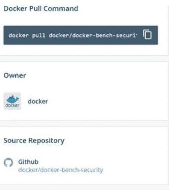

图 5.10：Docker Hub 中的 Docker bench security

要通过分析 Docker 主机来启动 Docker bench，我们可以执行以下命令：

```bash
$ docker run -v /var/lib:/var/lib -v /run/docker.sock:/run/docker.sock --name dockerbench docker/docker-bench-security
```

在接下来的截图中，我们可以看到输出：

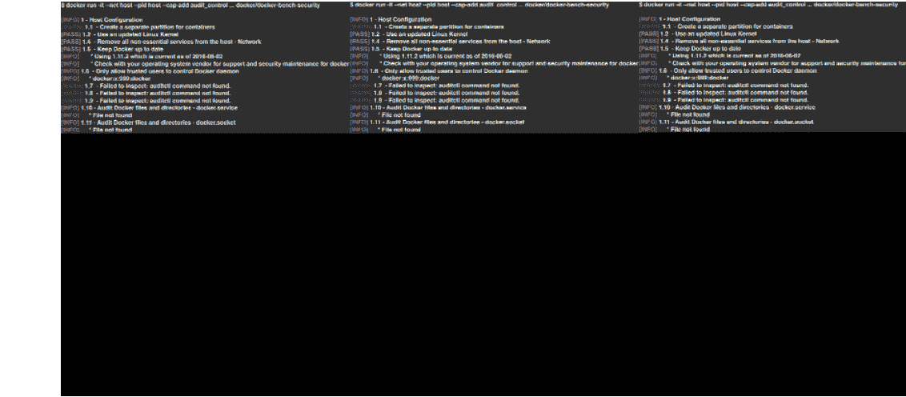

图 5.11：执行 Docker bench security

## Docker 守护进程配置文件

[WARN] 4.1 - 为容器创建用户

[WARN] * 以 root 身份运行：

在此时，建议创建一个除 root 以外的其他用户来运行你的容器。

[WARN] 5.3 - 验证容器是否仅运行单个主进程

[WARN] * 运行的进程过多：

建议每个容器仅运行一个进程：

[WARN] 5.4 - 限制容器内的 Linux 内核能力（Capabilities）

[WARN] * 添加了能力：CapAdd = [audit_control]

你可以使用 Docker `run` 命令中的 `--cap-drop ( )` 标志来移除容器的额外能力。Docker 也支持添加和删除能力；因此，建议移除所有能力，你打算在容器内部使用的权限除外。

[WARN] 5.13 - 容器根文件系统以只读模式挂载

[WARN] * 容器以读写（R/W）模式挂载根文件系统运行：

建议使用 `--read-only` 标志。使用只读容器有助于确保数据不被修改或操纵。

得益于这个工具和生成的报告，我们几乎可以获得 100 条安全建议，在生产环境中使用 Docker 时应始终记住这些建议。在之前的表中，我们可以以检查清单的形式看到建议的安全建议措施。

### 使用 Docker bench security 的执行示例

我们看到它在主机配置层面上执行了以下检查：

- 检查是否已为容器创建了单独分区。
- 检查 Docker 是否为最新版本。
- 验证只有受信任的用户才能控制 Docker 守护进程；其作用是检查属于 Docker 组的用户。

在下面的截图中，我们可以看到 Docker bench security 在主机配置（Host configuration）部分的输出：

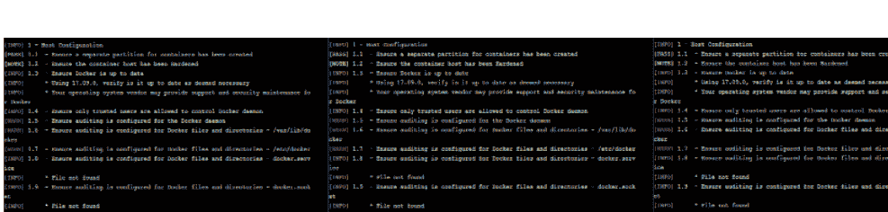

标记为警告的检查必须经过审查：

- [WARN] 1.5 - 确保为 Docker 守护进程配置了审计
- [WARN] 1.6 - 确保 Docker 文件和目录配置了审计 - `/var/lib/docker`
- [WARN] 1.7 - 确保 Docker 文件和目录配置了审计 - `/etc/docker`
- [WARN] 1.11 - 确保 Docker 文件和目录配置了审计 - `/etc/docker/daemon.json`

在下面的截图中，我们可以看到 Docker bench security 在 Docker 守护进程配置部分的输出：


Docker 守护进程配置文件与 Docker 守护进程加载的文件权限有关，例如 `docker.service`、`docker.socket`。它验证的是这些文件是否只能以 root 权限运行。

在下面的截图中，我们可以看到 Docker bench security 在 Docker 守护进程配置文件中的输出：

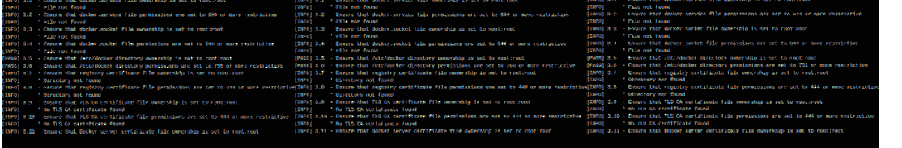


在下面的截图中，我们可以看到 Docker bench security 在容器镜像和构建文件（Container Images and Build Files）子章节中的输出：

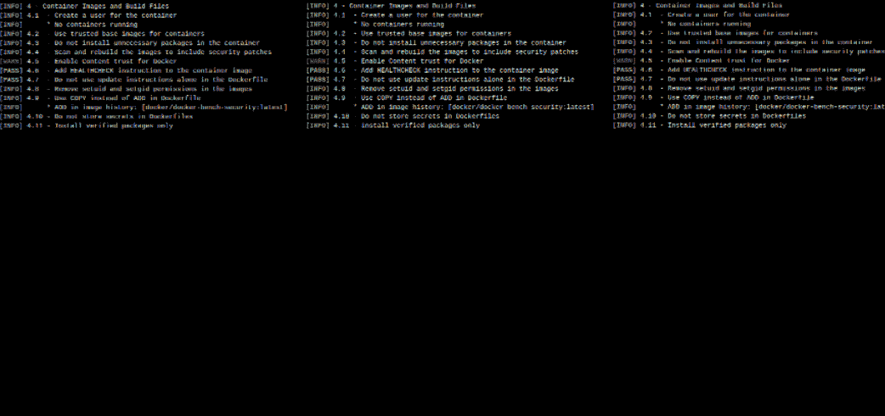

图 5.15：检查容器镜像和构建文件

要解决该警告，你必须执行：

```bash
export DOCKERCONTENTTRUST=1
```

如果我们执行一个容器，我们看到它默认会进行检测：

```bash
docker container run --detach --name my python /bin/bash
```

在下面的截图中，我们看到启用 Docker 内容信任（Docker content Trust）时 Docker bench security 的输出，并且我们执行了之前的容器：

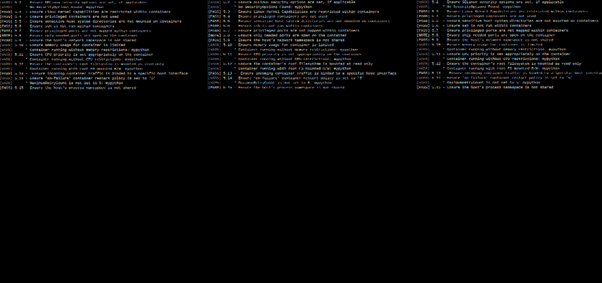

图 5.16：运行容器时的默认警告

为了解决最严重的警告，我们可以重新执行容器，但在内存、CPU、只读权限方面限制资源，并使用非 root 用户：

```bash
docker container run --detach -u 1000 --read-only -m 256mb --securityopt cpu-shares=500 --pids-limit --name python /bin/bash
```

此时，我们已经审查了使用 Docker bench security 工具检查 Docker 主机安全配置的执行情况，显示了特定部分的报告输出。在本节中，我们将审查位于 GitHub 仓库 <https://github.com/docker/bench-security/tree/master/tests> 中的某些 Docker bench security 源码部分。

在下面的截图中，我们可以看到 GitHub 仓库中的脚本：

| 分支：`docker-bench-security/tests` | 创建 | 上传 | 历史 |
| --- | --- | --- | --- |
| `1_host_configuration.sh` | 仅用于检查 #332 |  | 13 个月前 |
| `2_daemon_configuration.sh` | 仅用于检查 #309 |  | 4 个月前 |
| `3_daemon_configuration_files.sh` | 代码检查（linting） |  | 10 个月前 |
| `4_container_images.sh` | 检查 |  | 10 个月前 |
| `5_container_runtime.sh` | 检查 |  | 10 个月前 |
| `6_security_operations.sh` | 检查 |  | 10 个月前 |
| `7_swarm_configuration.sh` | 检查 |  | 10 个月前 |
| `9_community_checks.sh` | 检查 |  | 9 个月前 |

图 5.15：检查容器镜像和构建文件

要解决该警告，你必须执行：

```bash
export DOCKERCONTENTTRUST=1
```

如果我们执行一个容器，我们看到它默认会进行检测：

```bash
docker container run --detach --name my python /bin/bash
```

在下面的截图中，我们看到启用 Docker 内容信任（Docker content Trust）时 Docker bench security 的输出，并且我们执行了之前的容器：


图 5.16：运行容器时的默认警告

为了解决最严重的警告，我们可以重新执行容器，但在内存、CPU、只读权限方面限制资源，并使用非 root 用户：

```bash
docker container run --detach -u 1000 --read-only -m 256mb --securityopt cpu-shares=500 --pids-limit --name python /bin/bash
```

此时，我们已经审查了使用 Docker bench security 工具检查 Docker 主机安全配置的执行情况，显示了特定部分的报告输出。在本节中，我们将审查位于 GitHub 仓库 <https://github.com/docker/bench-security/tree/master/tests> 中的某些 Docker bench security 源码部分。

在下面的截图中，我们可以看到 GitHub 仓库中的脚本：

| 分支：`docker-bench-security/tests` | 创建 | 上传 | 历史 |
| --- | --- | --- | --- |
| `1_host_configuration.sh` | 仅用于检查 #332 |  | 13 个月前 |
| `2_daemon_configuration.sh` | 仅用于检查 #309 |  | 4 个月前 |
| `3_daemon_configuration_files.sh` | 代码检查（linting） |  | 10 个月前 |
| `4_container_images.sh` | 检查 |  | 10 个月前 |
| `5_container_runtime.sh` | 检查 |  | 10 个月前 |
| `6_security_operations.sh` | 检查 |  | 10 个月前 |
| `7_swarm_configuration.sh` | 检查 |  | 10 个月前 |
| `9_community_checks.sh` | 检查 |  | 9 个月前 |

图 5.15：检查容器镜像和构建文件

要解决该警告，你必须执行：

```bash
export DOCKERCONTENTTRUST=1
```

如果我们执行一个容器，我们看到它默认会进行检测：

```bash
docker container run --detach --name my python /bin/bash
```

在下面的截图中，我们看到启用 Docker 内容信任（Docker content Trust）时 Docker bench security 的输出，并且我们执行了之前的容器：


图 5.16：运行容器时的默认警告

为了解决最严重的警告，我们可以重新执行容器，但在内存、CPU、只读权限方面限制资源，并使用非 root 用户：

```bash
docker container run --detach -u 1000 --read-only -m 256mb --securityopt cpu-shares=500 --pids-limit --name python /bin/bash
```

此时，我们已经审查了使用 Docker bench security 工具检查 Docker 主机安全配置的执行情况，显示了特定部分的报告输出。在本节中，我们将审查位于 GitHub 仓库 <https://github.com/docker/bench-security/tree/master/tests> 中的某些 Docker bench security 源码部分。

在下面的截图中，我们可以看到 GitHub 仓库中的脚本：

| 分支：`docker-bench-security/tests` | 创建 | 上传 | 历史 |
| --- | --- | --- | --- |
| `1_host_configuration.sh` | 仅用于检查 #332 |  | 13 个月前 |
| `2_daemon_configuration.sh` | 仅用于检查 #309 |  | 4 个月前 |
| `3_daemon_configuration_files.sh` | 代码检查（linting） |  | 10 个月前 |
| `4_container_images.sh` | 检查 |  | 10 个月前 |
| `5_container_runtime.sh` | 检查 |  | 10 个月前 |
| `6_security_operations.sh` | 检查 |  | 10 个月前 |
| `7_swarm_configuration.sh` | 检查 |  | 10 个月前 |
| `9_community_checks.sh` | 检查 |  | 9 个月前 |

图 5.15：检查容器镜像和构建文件

要解决该警告，你必须执行：

```bash
export DOCKERCONTENTTRUST=1
```

如果我们执行一个容器，我们看到它默认会进行检测：

```bash
docker container run --detach --name my python /bin/bash
```

在下面的截图中，我们看到启用 Docker 内容信任（Docker content Trust）时 Docker bench security 的输出，并且我们执行了之前的容器。


在下面的截图中，我们可以看到 `Docker bench security` 在主机配置（Host configuration）部分的输出：


标记为警告的检查必须经过审查：

```
[WARN] 1.5 - 确保为 Docker 守护进程配置了审计
[WARN] 1.6 - 确保 Docker 文件和目录配置了审计 - /var/lib/docker
[WARN] 1.7 - 确保 Docker 文件和目录配置了审计 - /etc/docker
[WARN] 1.11 - 确保 Docker 文件和目录配置了审计 - /etc/docker/daemon.json
```

在下面的截图中，我们可以看到 `Docker bench security` 在 Docker 守护进程配置部分的输出：


Docker 守护进程配置文件与 Docker 守护进程加载的文件权限有关，例如 `docker.service`、`docker.socket`。它验证的是这些文件是否只能以 root 权限运行。

在下面的截图中，我们可以看到 `Docker bench security` 在 Docker 守护进程配置文件中的输出：


在下面的截图中，我们可以看到 `Docker bench security` 在容器镜像和构建文件（Container Images and Build Files）子章节中的输出：


图 5.15：检查容器镜像和构建文件

要解决该警告，你必须执行：

```bash
export DOCKERCONTENTTRUST=1
```

如果我们执行一个容器，我们看到它默认会进行检测。

```bash
docker container run --detach --name my python /bin/bash
```

在下面的截图中，我们看到启用 Docker 内容信任（Docker content Trust）时 `Docker bench security` 的输出，并且我们执行了之前的容器：


图 5.16：运行容器时的默认警告

为了解决最严重的警告，我们可以重新执行容器，但在内存、CPU、只读权限方面限制资源，并使用非 root 用户。

```bash
docker container run --detach -u 1000 --read-only -m 256mb --securityopt cpu-shares=500 --pids-limit --name python /bin/bash
```

此时，我们已经审查了使用 `Docker bench security` 工具检查 Docker 主机安全配置的执行情况，显示了特定部分的报告输出。在本节中，我们将审查位于 GitHub 仓库 `https://github.com/docker/bench-security/tree/master/tests` 中的某些 `Docker bench security` 源码部分。

在下面的截图中，我们可以看到 GitHub 仓库中的脚本：

| 分支: docker-bench-security/tests | 创建 | 上传 | 历史 |
| :--- | :--- | :--- | :--- |
| `1_host_configuration.sh` | 仅用于检查 #332 | | 13 个月前 |
| `2_daemon_configuration.sh` | 仅用于检查 #309 | | 4 个月前 |
| `3_daemon_configuration_files.sh` | 代码检查 (linting) | | 10 个月前 |
| `4_container_images.sh` | 检查 | | 10 个月前 |
| `5_container_runtime.sh` | 检查 | | 10 个月前 |
| `6_security_operations.sh` | 检查 | | 10 个月前 |
| `7_swarm_configuration.sh` | 检查 | | 10 个月前 |
| `9_community_checks.sh` | 检查 | | 9 个月前 |

```
check_2_6="确保为 Docker 进程配置了 TLS 认证"
check_2_6="$id_2_6" - $id_2_6
starttestjson="$id_2_6" "$id_2_6"
```

```
totalChecks=$((totalChecks))
if [ grep -i 'tcp://' | grep "CONFIG_FILE" 2>/dev/null 1>&2 ] || \
if [ $(docker_cumulative_command_line_args '-H' | grep -ve '(unix|fd)://') >dev/null 2>&1 ]; then \
if [ $(docker_cumulative_command_line_args '--tlsverify' | grep 'true') ] || \
  [ $(docker_cumulative_command_line_args '--tlsverify' | grep 'tlsverify') >dev/null 2&1 ]; then \
pass "check_2_6"
resulttestjson "PASS"
currentScore=$((currentScore + 1))
elif [ $(docker_cumulative_configuration_file_args '--tls' | grep 'true') ] || \
  [ $(docker_cumulative_command_line_args '--tls' | grep '$tls$') >dev/null 2&1 ]; then \
  warn "check_2_6"
warn "* Docker 进程目前通过带有 TLS 的 TCP 监听，但没有验证"
resulttestjson "Docker daemon currently listening on TCP with TLS, but no verification"
currentScore=$((currentScore - 1))
fi
```

图 5.2: 脚本 `dockerdaemon_configuration.sh` 正在检查 TLS 认证

此时，我们已经审查了 `Docker bench` 工具用于检查 Docker 主机安全配置的一些脚本。

## 使用 Lynis 和 Dockscan 审计 Docker 主机

`Lynis` 是一个用于评估 Linux 和 UNIX 系统安全性的开源安全审计工具。`Lynis` 直接在 Docker 主机上运行，因此它可以访问 Linux 内核。我们可以在以下仓库中找到源代码和安装方法：

- `https://cisofy.com/lynis`
- `https://github.com/CISofy/Lynis`
- `https://cisofy.com/documentation/lynis/get-started/#-installation-manual`

安装完成后，审计系统命令将执行以下操作：

- 检查操作系统
- 搜索可用工具和实用程序
- 检查任何 `Lynis` 更新
- 使用启用的扩展进行进行测试
- 按类别进行安全测试
- 安全扫描状态报告

在下面的截图中，我们可以看到 `Lynis` 命令的选项：

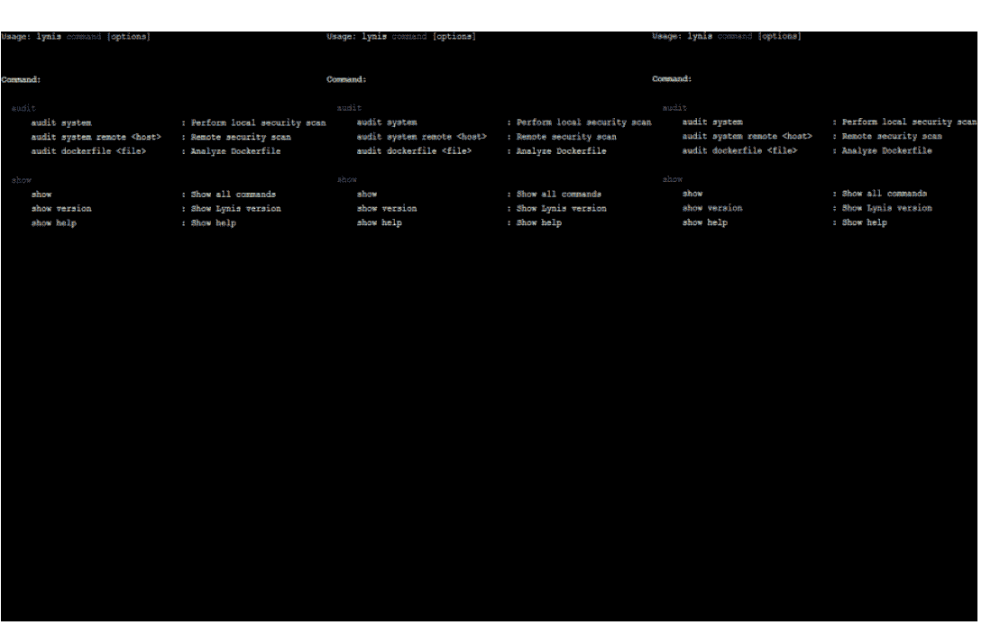

图 5.22: `Lynis` 命令选项、服务和内核：

首先的配置是启动、服务和内核：

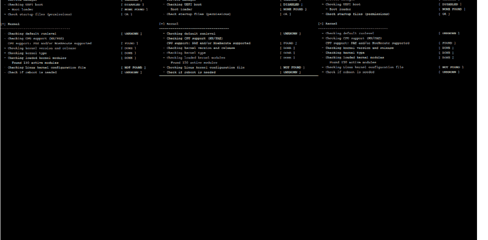

图 5.23: 检查启动、服务和内核

其次，它检查与用户、组和认证相关的配置：

### 检查用户、组和认证

- 检查用户 [OK]
- 组 [OK]
- 认证 [OK]
- 查询系统状态（无问题） [OK]
- 本地支持 [OK]
- 远程文件 [OK]
- SSH 配置文件 (`ssh_config`) [OK]
- 无访问权限的账户 [OK]
- 无数据的账户 [OK]
- 未按策略提供的账户 [OK]
- 检查所需的密码 [OK]
- 默认账户 [OK]
- 意外的默认账户 [OK]
- some (`/home/profile/profile`) [OK]

图 5.24: 检查用户、组和认证

第三，它检查与 shell 和文件系统相关的配置：

- Shell
  - 检查来自 `/etc/shells` 的 shell
  - root 用户 shell: `/bin/bash`
  - 检查默认 shell 值
  - 检查 `/etc/profile` 中的默认 shell 匹配情况
- 文件系统
  - 检查挂载点 [OK]
  - 检查 root 挂载点 [OK]
  - 检查 (`/var`) 挂载点 [OK]
  - 检查交换分区 [OK]
  - 测试交换分区位置 [OK]
  - 检查 (`/tmp`) [OK]
  - 检查 (`/tmp`) 粘位 [OK]
  - 禁用对某些文件系统的支持

图 5.25: 检查与 shell 和文件系统相关的配置

第四，它检查与存储和名称服务相关的配置：

| 存储 | 状态 |
| :--- | :--- |
| 检查 `sizeprobe` 配置 | 已安装 |
| 检查设备 | 已找到 |
| 检查驱动 `mdprobe` 配置 | 未找到 |

| 存储 | 状态 |
| :--- | :--- |
| 检查 RFS 守护进程 | 未找到 |

| 名称服务 | 状态 |
| :--- | :--- |
| 检查搜索域 | 已找到 |
| 搜索 DNS 选项 | 已找到 |
| 搜索 DNS 名称 | 未知 |
| 检查 `/etc/hosts` | OK |
| 检查 (`localhost`) | OK |

图 5.26: 检查与存储和名称服务相关的配置

第五，它检查与网络相关的配置：

| 网络 | 状态 |
| :--- | :--- |
| 检查搜索域 | 已找到 |
| 搜索 DNS 选项 | 已找到 |
| 搜索 DNS 名称 | 未知 |
| 检查 `/etc/hosts` | OK |
| 检查 (`localhost`) | OK |

图 5.27: 检查与网络相关的配置

最后，它检查与容器和安全框架相关的配置，如 `AppArmor` 和 `SELinux`：

| 容器 | 状态 |
| :--- | :--- |


| Docker-daemon | RUNNING |
| :--- | :--- |
| container-1 (backend) | RUNNING |
| stopped containers | 0 |
| ghost containers | 0 |

| SELinux | 状态 |
| :--- | :--- |
| Docker-daemon | ENABLED |
| container-1 (backend) | ENABLED |
| stopped containers | ENABLED |
| ghost containers | ENABLED |

| 安全框架 | 状态 |
| :--- | :--- |
| AppArmor | OK |
| SELinux | OK |
| 检查已实现的 AppArmor 框架 | OK |

图 5.28：检查与容器和安全框架相关的配置

此时，我们已经审查了 Lynis 工具检查 Docker 主机安全性的执行。

## 审计 Dockerfile

此命令初始化与 Docker 相关的测试，并在 Docker 中进行分析。

```bash
$ lynis audit dockerfile
```

在 GitHub 仓库中，我们可以找到分析 Dockerfile 的脚本：

<https://github.com/CISOsecurity/lynis/blob/master/helperauditedfile>

第一件事是检测使用的镜像类型。

在下面的场景中检查镜像类型：

```bash
FIND=$(grep "FROM" [AUDIT_FILE] | sed 's/ /space:/')
for i in $FIND; do
IMAGE=$(echo $i | grep -i $) | awk '{ $1 ~ /-FROM/ { print $2 }')
TAG=$(echo $i | cut -d''' -f2)
Display -indent 2 -text "found image" --result "$IMAGE"
```

```bash
IS_DEBIAN=$(echo $IMAGE | grep -i debian); if then echo "Debian"; fi
IS_FEDORA=$(echo $IMAGE | grep -i fedora); if then echo "Fedora"; fi
IS_UBUNTU=$(echo $IMAGE | grep -i ubuntu); if then echo "Ubuntu"; fi
IS_ALPINE=$(echo $IMAGE | grep -i alpine); if then echo "Alpine"; fi
IS_LATEST=$(echo $IMAGE | grep -i latest); if then echo "latest"; fi
Reportarning "dockerfile" latest TAG。指定目标操作系统镜像和版本对于获得可复现的结果更好。
fi
```

图 5.29：检查与容器和安全框架相关的配置

接下来，检查 Dockerfile 中是否使用了用户，或者是否使用了 root 用户。

```bash
USER=$(grep "USER" $(AUDIT_FILE) | cut -d'"' -f2)

if [ -z"${FIND}" ]; then
  ReportWarning "dockerfile" No user declared in Dockerfile. Container will execute command as root.
else
  USER=$(echo ($FIND))
  Display --indent 2 --text "User" --result="${USER}"
fi
```

最后，脚本会检查通过 `curl` 或 `wget` 下载的包，确认下载是否使用了 HTTPS 进行安全传输。

在下面的截图中，我们可以看到检查下载包的代码：

```bash
if [ ${FILE_DOWNLOAD} -eq 1 ]; then
  SSL_USED_FIND=$(grep "https") ${AUDIT_FILE}

  if HasData "${SSL_USED_FIND}"; then
    SSL_USED="YES"
    COLOR="GREEN"
  else
    SSL_USED="No"
    COLOR="RED"
    ReportSuggestion "Use SSL when possible to increase security (DNSSEC, HTTPS, validation of domain, avoid MitM)"
  fi

  Display --indent 2 --text "Integrity test performed" --result="${SSL_USED}" --color ${COLOR}
  HASHING_USER_USED=$(grep "apt-key adv") ${AUDIT_FILE} | sed 's/.*apt-key-adv\//g' | sed 's/.*\//keyserver/Key Server:/g' | sed 's/.*\//recv/Key/g'
  Display --indent 2 --text "Hashing" --result="${HASHING_USED}"
  KEYS_USED=$(grep "apt-key adv") ${AUDIT_FILE} | result "Resulting keys used"
  Display --indent 2 --text "All downloads properly checked" --result="${KEYS_USED}"
else
  Display --indent 2 --text "No files are to be downloaded in this Dockerfile"
fi
```

图 5.30：检查下载包

此时，我们已经审查了 Lynis 工具的一些脚本，该工具用于检查 Docker 宿机的安全配置。

### 使用 Dockscan 扫描 Docker 安装中的安全问题和漏洞

该工具使用 Ruby 语言开发：<https://github.com/kost/dockscan>。需要在你的机器上安装 Ruby 2.0 或更高版本以及 `ruby docker-api` gem。安装过程非常简单，可以通过以下命令执行：

```bash
gem install dockscan
```

在接下来的截图中，我们可以看到 dockscan 安装的输出：

```text
root@d088a3c75010:~# gem install dockerscan
Fetching: excon-0.59.0.gem (100%)
Successfully installed excon-0.59.0
Fetching: multi_json-1.12.2.gem (100%)
Successfully installed multi_json-1.12.2
Fetching: docker-api-1.34.0.gem (100%)
Successfully installed docker-api-1.34.0
Fetching: dockerscan-0.1.2.gem (100%)
Successfully installed dockerscan-0.1.2
Parsing documentation for excon-0.59.0
Installing ri documentation for excon-0.59.0
Parsing documentation for multi_json-1.12.2
Installing ri documentation for multi_json-1.12.2
Parsing documentation for docker-api-1.34.0
Installing ri documentation for docker-api-1.34.0
Parsing documentation for dockerscan-0.1.2
Installing ri documentation for dockerscan-0.1.2
Done installing documentation for excon, multi_json, docker-api, dockerscan
```

图 5.31：安装 dockerscan

该工具是一个用 Ruby 编写的脚本，允许安装主机 Docker 并运行容器。DockScan 的输出提供了一份报告，我们可以在其中看到配置资源的限制，并检测宿主机 Docker 允许容器直接传输流量到其他容器的情况。

要开始分析，我们执行命令：

```bash
$ dockerscan unix:///var/run/docker.sock
```

在接下来的截图中，我们可以看到上一个命令的输出：

```text
$ dockerscan unix:///var/run/docker.sock
(WARNING) MultiJson is using the default adapter (ok_json). We recommend loading a different JSON library to improve performance.
DockScan Report

High
Running Experimental version of Docker.: It is recommended to replace Docker version with stable and production ready one.

Medium
Docker running without defined limits: It is recommended to define docker limits.
Docker running with IPv4 enabled: It is recommended to disable IPv4.
```

图 5.32：分析 Docker socket

在上一个命令的输出中，我们看到工具如何检测 Docker 在没有限制内存或 CPU 级别的情况下运行，并在宿主机和目标之间转发数据包。缺乏这些控制被标记为中等风险（medium），而运行实验版本的 Docker 则被标记为高风险（high）。

如果我们需要更详细的报告，我们指定按格式生成报告：

| 等级 | 问题 | 描述 | 解决方案 |
| :--- | :--- | :--- | :--- |
| Medium | docker 开启 IP 转发运行 | 这在生产环境中是不建议的，因为它在没有规则的情况下转发网络。 | 禁用 IP 转发。 |
| Low | 容器文件数量过多 | 容器文件数量过多是不建议的。这可能意味着安全尝试。 |  |
| High | 拥有超过五个文件 | `/etc/traefik`、`/etc/traefik/secrets`、`/var/run/docker.sock` | 保持最少数量的文件且不在容器内部存储数据。 |
| High | docker 配置未配置注册表 | 如果需要，宿主机不需要直接连接互联网。 | 设置注册表。 |

此时，我们已经审查了用于审计 Docker 安装的 DockerScan 工具。

## 结论

宿主机可以被定义为 Docker 环境中最重要的部分，它支撑了整个基础设施，并且容器将在此执行，因此在配置机器时，建议遵循一系列最佳实践。最终目标是尽可能减少在 Docker 宿主机上可能产生的攻击向量。如果来自不同的容器运行在同一台主机上，其中一个容器的破损会导致其他容器暴露。由于运行在同一个 Docker 上的所有容器共享同一个内核，花时间检查其核心是有意义的。

在下一章，我们将审查用于审计 Docker 镜像的开源工具。

## 问题

- 哪个 Linux 内核提供了安全控制，我们可以在其中突出访问控制、完整性控制和 RBAC？
- 哪个工具为外部和内部线程提供保护，使系统管理员能够为应用程序关联安全配置？
- 哪个工具允许我们测试容器的安全性并关注文件权限和注册表设置领域？
- 哪个开源工具用于评估 Linux 系统的安全性？
- 哪个工具是使用 Ruby 编写的脚本，允许安装主机 Docker 并运行容器？

# 第 6 章：Docker 镜像安全

在本章中，我们将审查开源工具，如结合 quay.io 仓库的 Clair 以及 Anchor。除了确保你的容器在设计上是正确的，容器中的所有镜像层必须没有已知漏洞。这是通过具有镜像静态分析能力的仓库软件来实现的。

在本章中，读者将学习分析 Docker 镜像的安全性，并通过对镜像组成层的研究来发现漏洞。

## 结构

- Docker 仓库
- Docker 安全扫描
- 开源漏洞分析工具
- Clair 扫描器与 quay.io 仓库
- 使用 Anchor Engine 和 Anchor CI 分析 Docker 镜像

## 目标

- 了解 Docker Hub
- 理解 Docker 安全扫描
- 了解开源漏洞分析工具
- 了解 Clair 扫描器与 quay.io 仓库
- 了解使用 Anchor Engine 和 Anchor CI 进行分析

## Docker 仓库

Docker Hub 是一个由社区创建的仓库，任何用户都可以创建自己的镜像并将其上传到仓库以与社区共享。

在本章节中，根据来源，有 2 种镜像。首先，我们有官方镜像，它们是由主要供应商（如 Apache、Nginx、MongoDB、Ubuntu、Alpine）维护的。

另一方面，我们可以找到用户创建的镜像，因此它们是根据项目需求经过定制和适应的镜像。它们可能是从官方镜像定制而来的。

Docker 扫描是一个与官方 Docker Hub 仓库集成的工具，允许你自动审查公共仓库中发现的镜像，以及 Docker Hub 或 Docker Cloud 中记录的镜像是否存在已知漏洞。

Docker 维护着一个负责搜索已知漏洞的服务，并使用 CVE 数据库（cve.mitre.org）在我们的库、二进制文件以及运行其上的利用程序中进行查找。该服务适用于 Docker Hub 私有版、Docker Cloud 以及本地部署，在所有情况下这是一项付费服务，但也有第三方服务提供免费的类似功能。

更多信息请参考文档：

<https://docs.docker.com/datacenter/dtri/2/guides/configure-set-vulnerability-scans>

Docker 定期分析所有上传到 Docker Hub 的镜像，一旦分析完成，它将向你提供不同漏洞的结果，以及这些漏洞的严重性程度，并为每个漏洞形成 CVE。

在接下来的截图中，我们展示了 Docker 镜像层分析的输出：

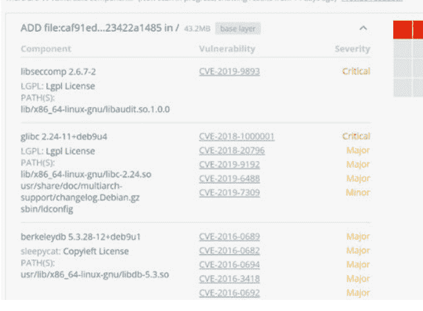

图 6.1：分析 Docker 镜像中的层

单个库或组件可能包含多个漏洞或暴露，Docker 扫描会对每一个漏洞进行报告。你可以点击扫描结果中的单个漏洞报告，并到特定的 CVE 报告数据以获取更多信息。

在接下来的截图中，我们展示了 Docker 镜像中 CVE 的具体信息：

```text
7 ENV REDIS_DOWNLOAD_S...df2a035ab57c159fd2d

Compressed size: 0.0

此层中没有组件

CVE-2014-5461

5.1 到 5.2 版本通过 5.2.3 允许依赖内容的攻击者通过向一个具有大量固定参数的函数传递少量参数，来导致拒绝服务（崩溃）。
```

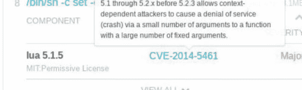

图 6.2：Docker 镜像中特定 CVE 的信息

扫描中的漏洞被分为高、中、低三个严重性级别。严重性级别取决于通用漏洞评分系统（CVSS）分配给 CVE 的评分。根据给漏洞的评分，它们可以分类如下：

- 高：漏洞评分在 [8-10] 范围内。
- 中：漏洞评分在 [4-7] 范围内。
- 低：漏洞评分在 [0.0-3.9] 范围内。

当有新镜像被上传到 Docker Hub 或 Docker Cloud 时，它会启动一个作业，从 Docker 注册表中提取层，然后将镜像发送到扫描服务，使用 CVE 数据库对二进制文件进行扫描。

因此，所有与镜像中发现的漏洞相关的信息都是可用的。下一步是，如果我们暴露于该漏洞之下，则需要识别误报，或者在执行部署之前对其修复。

结论，这是 Docker 提供的一个很好的工具，可以让你稍微了解官方镜像在安全方面的健康状况，并在应用更改和修补这些漏洞时拥有相关知识。

## 用于漏洞分析的开源工具

静态漏洞分析通常由专门为此功能的工具执行并自动完成，即对使用源代码创建的镜像进行分析，因此镜像的静态内容是在其部署到生产环境之前的。

在目前的 DevOps 文化下，这一阶段正变得越来越多，因为它已经集成到整个项目周期中，以便在应用程序到达生产之前提供越来越多的信息。

这一阶段（如果你进入 Docker 世界，它们通常与 DevOps 文化紧密结合），Docker 镜像漏洞分析位于构建的第一阶段。这种分析是唯一会导致持续开发和部署流水线阶段失败的静态分析，并且是安全级别上的一项新需求，因为 Docker 镜像被用作打包工具，随后用于管理在不同环境中作为容器的这些镜像的应用程序的执行。

需要提到的是在 Docker 层面，你也可以执行良好的操作，直到镜像构建时，你才能验证哪些二进制文件和库已包含在镜像中。此外，Docker 镜像的不可变性使得构建后的镜像进行静态漏洞分析成为可能，因为它不能被修改或追加，将需要使用 Dockerfile 修改镜像并重新构建镜像。

在本节中，我们将回顾用于自动执行静态漏洞分析的每个开源工具或工具。

镜像扫描器是一组重要的工具。如 Clair、Dagda 和 Anchore 等工具可以自动检查镜像漏洞，节省大量时间。当检测到漏洞时，它们还可以通过电子邮件和 Slack 通知。

## 与 Docker 的持续集成


扫描可以很容易地集成到持续开发和工作流中，每当开发人员开发新容器时就可以启动扫描。大多数管理员通常通过查询 CVE 数据库发现新的高严重性漏洞。低严重性漏洞可能不会被发现。扫描器负责识别那些虽不严重但可能被攻击者利用的漏洞过程。

如果在基础镜像中发现问题，则重新构造镜像。一旦完成，镜像将发送到容器平台。该平台可以检测到镜像已更改。对于依赖于此镜像并定义了触发器的构建，平台允许你自动重建应用程序的镜像，合并重构过程中更改的库。

完成后，镜像被发送到内部注册表，对于使用该基础镜像的应用程序，将自动实施，确保在生产环境中执行的代码是最新的更新。所有这些能力都致力于将安全能力集成到持续集成和持续部署（`CI/CD`）过程中。

当开发者更新源代码库的代码时，它会自动显示新构建的镜像进行测试。你可能需要通过 `CI` 过程自动构建并部署新镜像。

在 Docker 生态系统中，`Dockerfile` 描述了将如何构建它以及容器中将安装什么，以便应用程序能够在上面运行。在持续集成环境中运行时，它将自动生成并发布到企业 Docker 注册表中，包括该容器的软件依赖项。

提高安全性的最佳实践是将自动化安全工具集成到编译或 `IC` 过程中。例如，我们可以集成漏洞扫描器工具或动态分析工具：

- 静态应用程序测试（`SAST`）和动态应用程序测试（`DAST`）工具，如 HP Fortify 和 IBM AppScan。
- 如 Duck Hub 和 JFrog Xray 等工具作为扫描器，允许针对代码进行实时验证。

### eliasgranderudio / dagda

一个对 docker 镜像/容器中的已知漏洞、木马、病毒、恶意软件和其他恶意威胁进行静态分析的工具，并监控 docker 守护进程和运行中的 docker 容器以检测异常活动。


| 250 次提交 | 1 个分支 | 7 个发布 | 5 位贡献者 | Apache-2.0 |
| :--- | :--- | :--- | :--- | :--- |
| 分支: master | 新 pull 请求 | 创建新文件 上传文件 查找文件 克 下载 | | |

图 6.3: Dagda GitHub 仓库

Dagda 支持多种 Docker 基础 Linux 镜像：

- Red Hat/CentOS/Fedora
- Debian/Ubuntu
- OpenLinux
- Alpine Linux

Dagda 使用 OWASP dependency check 和 Retire.js 来分析 Java、Python、Node.JS、JS、Ruby 和 PHP 等各种语言的包和依赖项，识别 Docker 镜像中的已知漏洞。

它还运行 ClAV 来搜索恶意软件或检测被木马化的镜像。在镜像监控方面，它与 Sysdig Falco 集成，作为检测 Unix 环境下运行时异常和监控容器的工具。Falco 是一个可以安装在每个 Docker 主机上的代理工具，其内部通过对比数据库中存储的规则分析系统调用和内核过滤器，以识别内部以及整个 Docker 主机内的异常攻击或异常调用。

如果我们按照 GitHub 仓库中找到的文档进行安装，我们需要在 Python 3 上安装以下模块：Python 3.4.5、MongoDB 2.4、PyPip3、PyMongo、Requests、Python-dateutil、Jolib、Docker-py、Flask、Flask-cors、PyYAML。

在下面的图中，你可以看到 Dagda 的架构：

## HTTP/REST API

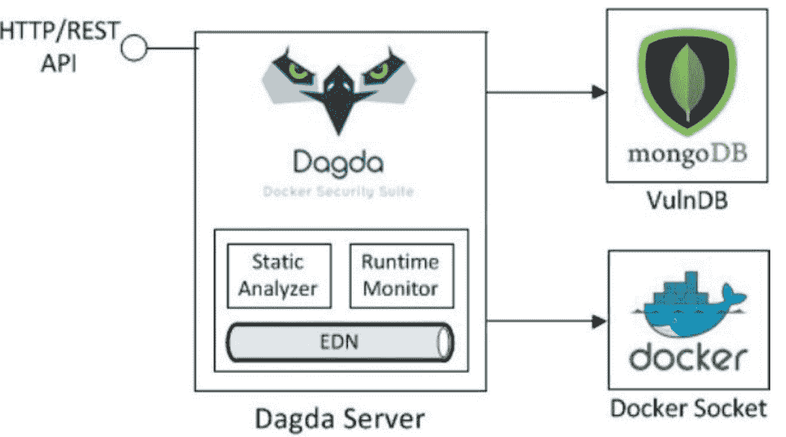

图 6.4: Dagda 架构

REST-API 和命令行界面是与此 Docker 安全套件交互的两种方式。该工具的每个方面都可以通过 REST-API 控制。你可以通过 REST API 访问该工具。要与 Docker 容器交互，我们可以通过 REST API 实现。要执行它，我们可以使用 `python3` 来查看可以执行的可能命令。

在接下来的截图中，你可以看到 Dagda Python 脚本的选项：

```
usage: dagda.py [--version] [--help] <command> [args]
```

| Dagda 命令: | 说明 |
| :--- | :--- |
| perform | 对 docker 镜像/容器中的已知漏洞进行分析 |
| docker history | 列出所有 docker 镜像/容器 |
| monitor | 获取 docker 镜像的分析历史；对运行中容器的异常活动进行监控 |
| start vuln | 启动 Dagda 服务器；对个人的 CVE、BID 和 ExploitDB 数据库进行操作 |
| 可选参数: | |
| -h, --help | 显示此帮助信息并退出 |
| -v, --version | 显示版本信息并退出 |

图 6.5: Dagda Python 脚本选项

要做的第一件事是启动 Dagda 服务器，我们可以通过 `dagda.py` Python 脚本中的 `start` 选项来实现。

在接下来的截图中，你可以看到 Dagda Python `start-server` 脚本的选项：

```bash
usage dagda.py start [-h] [--server-host SERVER HOST] [--server-port SERVER_PORT]
--mongodb-host MONGODB_HOST [--mongodb-port MONGODB_PORT]
--falco_rules_file RULES_FILE
```

## Dagda 服务器

可选参数：

- `-h, --help` | 显示此帮助信息并退出
- `-s SERVER HOST, --server-host SERVER HOST` | 服务器绑定的地址，默认绑定到 `'127.0.0.1'`
- `-p SERVER_PORT, --server-port SERVER_PORT` | 服务器绑定的端口，默认端口 5000
- `-m MONGODB_HOST, --mongodb-host MONGODB_HOST` | MongoDB 绑定的地址，默认绑定到 `'127.0.0.1'`
- `-mp MONGODB_PORT, --mongodb-port MONGODB_PORT` | MongoDB 绑定的端口，默认端口 27017
- `--falco_rules_file RULES_FILE` | Falco 规则文件（详情参见 [Falco Rules wiki 页面](https://github.com/draios/falco/wiki/Falco-Rules)）

图 6.6: Dagda Python `start-server` 选项

通过该选项，我们可以对特定镜像进行漏洞分析，通过 `history` 选项，我们可以根据镜像名称获取历史分析。

```bash
$ python3 dagda.py check --docker_image
```

在接下来的截图中，你可以看到启动分析的选项：

```bash
usage: dagda.py check [-h] [-i DOCKER_IMAGE] [-c CONTAINER_ID]
```

## 个人 docker 安全分析器

可选参数：

- `-h, --help` | 显示此帮助信息并退出
- `-i DOCKER_IMAGE, --docker_image DOCKER_IMAGE` | 输入的镜像名称
- `-c CONTAINER_ID, --container_id CONTAINER_ID` | 输入的容器 ID

图 6.7: 启动分析的选项：

```bash
$ python3 dagda.py check --docker_image
```

在下面的截图中，我们可以看到以下命令的输出：

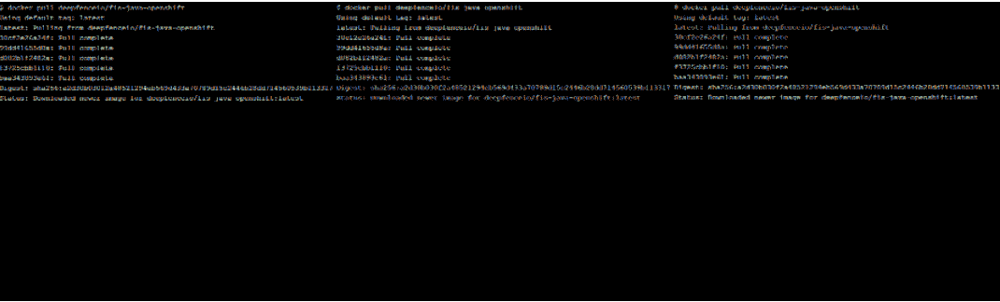

图 6.13：从 Docker hub 下载镜像

要分析特定镜像，我们可以使用 `-t all` 参数：

```bash
$ docker run -ti -v /var/run/docker.sock:/var/run/docker.sock -v /var/lib/docker:/fenced/var/lib/docker:rw -v /:fenced/mnt/host/ro -home/user/db/tmp.rw deepfenceio/deepfence_depcheck -t all deepfenceio/jsa-openshift -j true
```

在接下来的截图中，我们可以看到以下命令的输出：

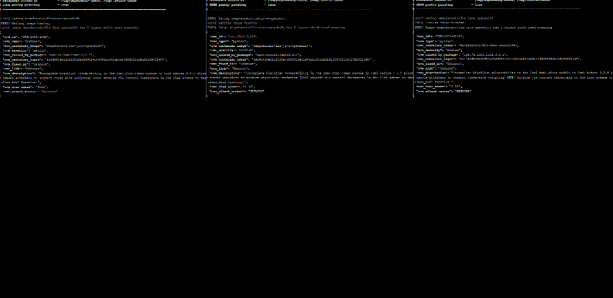

图 6.14：扫描 Docker 镜像以检测漏洞

此时，我们已经回顾了用于检查 Docker 镜像漏洞的 OWASP 依赖检查脚本。

## MicroScanner

MicroScanner 是另一个扫描容器镜像中软件包漏洞的工具。它使用了与 Aqua Security 商业扫描器相同的漏洞数据库。

https://github.com/aquasecurity/microscanner

使用 MicroScanner，你必须先注册一个令牌（token），你可以从服务 https://microscanner.aquasec.com/signup 获取，或者通过运行命令：

```bash
$ docker run --rm -it aquasec/microscanner --register
```

在接下来的截图中，你可以看到用于注册令牌的 MicroScanner 页面：


Aqua Security 的 MicroScanner 允许你检查容器镜像的漏洞。如果你的镜像存在任何已知的高严重问题，MicroScanner 可以导致镜像构建失败，从而轻松将其包含在 `CI/CD` 流水线的步骤中。

## 注册令牌

图 6.15：MicroScanner 注册令牌的页面

MicroScanner 设计为构建容器镜像过程的一部分。要开始使用它，只需在想要分析的镜像的 Dockerfile 中添加以下代码段，并添加我们在注册时获得的密钥。

```dockerfile
ADD https://get.aquasec.com/microscanner.
RUN chmod +x /microscanner
RUN /microscanner
```

例如，以下命令对应于一个基于 python 构建镜像的 Dockerfile 文件，并在上面执行了 MicroScanner。

```dockerfile
FROM python:3.7
RUN apt-get update && apt-get -y install ca-certificates
ADD https://get.aquasec.com/microscanner/
RUN chmod +x /microscanner
ARG token
RUN /microscanner ($token)
RUN echo "No vulnerabilities!"
```

这些命令下载 MicroScanner 二进制文件，赋予运行权限，并在基础镜像的文件系统内容上执行它。

```bash
$ docker build --build-arg=token= --no-cache.
```

在接下来的截图中，你可以看到上一个命令的输出：

```text
Step 1: scan image
docker run --rm -v /var/run/docker.sock:/var/run/docker.sock aquase/microoscanner:latest scan image:latest

Step 2: check vulnerabilities
docker run --rm -v /var/run/docker.sock:/var/run/docker.sock aquase/microoscanner:latest check image:latest

Step 3: filter by CVE
docker run --rm -v /var/run/docker.sock:/var/run/docker.sock aquase/microoscanner:latest check image:latest --cve CVE-2021-12345,CVE-2021-67890

Step 4: filter by severity
docker run --rm -v /var/run/docker.sock:/var/run/docker.sock aquase/microoscanner:latest check image:latest --severity high
```

图 6.16：MicroScanner 执行命令

此时，我们已经回顾了检查 docker 镜像漏洞的 MicroScanner 脚本。如果 MicroScanner 发现漏洞，它将以 JSON 格式报告详情。

## Clair 扫描器和 quay.io 仓库

Core Clair 是一个用于容器化应用程序静态漏洞分析的开源项目。由于层可以在许多容器之间共享，因此内省对于创建软件包清单并与已知的 CVE 进行比较至关重要。由于 Clair 的镜像分析是静态的，因此容器不需要实际运行，这大大缩短了分析时间，且不需要运行可能存在漏洞的容器。

在分析级别，它执行以下检查：

- 对 Clair 服务器进行镜像扫描
- 与白名单进行漏洞对比
- 它会告知你是否存在不在白名单中的漏洞

通过从镜像文件系统提取静态信息，并维护镜像所组成的不同层之间的差异列表，分析时间大大缩短，且不需要执行可能存在漏洞的容器。

Clair 提供了一个 JSON API，可以提取镜像的所有层，并可以在本地运行以检查容器镜像，例如，作为持续集成和交付过程的一部分。

在接下来的截图中，你可以看到 Clair 扫描器支持的 Linux 发行版：

| 数据源 | 收集的数据 | 格式 | 许可证 |
| --- | --- | --- | --- |
| Debian Security Tracker | Debian 6, 7, 8, unstable | dpkg | Debian |
| Ubuntu CVE Tracker | Ubuntu 12.04, 12.10, 13.04, 14.04, 14.10, 15.10, 16.04 | dpkg | GPL2 |
| Red Hat Security Data | CentOS 5, 6, 7 | rpm | CVRF |
| Oracle Security Data | Oracle Linux 5, 6, 7 | rpm | CVRF |
| Alpine SecDB | Alpine 3.3, 3.4, 3.5 | apk | MIT |
| NIST NVD | 通用漏洞元数据 | N/A | 公有领域 |

图 6.16：Clair 支持的发行版

要安装 Clair，我们可以通过 Docker Compose 工具和仓库 https://github.com/hxquanghat/clair-analyze-local- 进行。

在接下来的截图中，你可以看到 Clair 扫描器的 GitHub 仓库：

- clair_config | 2 年前
- Dockerfile | 2 年前
- README.MD | 2 年前
- docker-compose.yml | 2 年前

`README.MD`

## 准备好本地镜像分析的 Clair CoreOS

用于使用 Clair 容器漏洞静态分析的 Dockerfile 和 docker-compose。

Dockerfile 还包含了用于分析本地 docker 镜像的本地分析器。

图 6.18：Clair 扫描器的 GitHub 仓库

安装步骤如下：

```bash
$ git clone https://github.com/hxquanghat/clair-analyze-local-images.git

$ cd clair-analyze-local-images/

$ docker-compose up -d
```

该仓库包含可以通过 `docker-compose` 命令执行的文件。以下是 Postgres 和 Clair 的设置：

`docker-compose.yml`

在接下来的截图中，你可以看到 `docker-compose` 的内容：

```yaml
version: '2'
services:
  postgres:
    image: postgres:9.6
    environment:
      POSTGRES_PASSWORD: password
  clair:
    image: clair:latest
    container_name: clair
    depends_on:
      - postgres
    volumes:
      - /var/run/docker.sock:/var/run/docker.sock
      - ./clair_config:/etc/clair
```


```bash
dockerserverclient|dockerserverclient-$ sudo mkdir $HOME/clair_config
sample -o $PWD/clair_config.yml curl -L https://raw.githubusercontent.com/coreos/master/config/config.yml
% Total % Received Average Speed Time Time Current
100 2941 100 2941 0 17300 0 --- --- 17402
dockerserverclient|dockerserverclient-$ ls
clair_config
```

```bash
dockerserverclient|dockerserverclient-$
```

图 6.2：步骤 3 命令

在 URL `https://raw.githubusercontent.com/coreos/master/config/config.yaml.sample` 中，我们可以找到用于 Docker 部署 Clair 的 YAML 配置。

在第三步中，我们部署 Clair 并检查其状态：

```bash
$ docker run --net=host -d p 6060:6060 6061:6061 --6061 --restart always -v $PWD/clair_config: quay.io/coreos/clair:v2.0.7 \
config=/config/config.yml
```

```bash
$ curl -X GET -I http://localhost:6061/health
```

在接下来的截图中，我们可以看到上一个命令的输出：

```text
dockerserverclient|dockerserverclient-$ sudo docker ps
clair_config/config quay.io/clair:v2.0.7 "/clair -config-/con/" 50 seconds ago Up 49 seconds
WARNING: Ports are discarded when using host network mode
262144b11ad "docker-entrypoint.s." 2 minutes ago Up 2 minutes 0.0
dockerserverclient|dockerserverclient-$ curl -X GET -I http://localhost:6061/health
HTTP/1.1 200 OK
Date: Sat, 25 Nov 2018 12:63:48 GMT
Content-Length: 0
CONTAINER ID IMAGE COMMAND CREATED STATUS
262144b11ad quay.io/clair:v2.0.7 "/clair -config-/con/" 50 seconds ago Up 49 seconds
80902a7af72 loving_gelois shaky_stern 2 minutes ago Up 2 minutes 0.0
dockerserverclient|dockerserverclient-$ sudo docker ps
CONTAINER ID COMMAND CREATED STATUS PORT
```

图 6.4：步骤 3 命令

在第四步中，我们安装并配置 Clair 扫描器：

```bash
$ mkdir clairscanner
```

```bash
$ sudo getx
```

```bash
$ wget http://github.com/arminc/clair-scanner/releases/download/v8/clair-scanner-linuxamd64
```

```bash
$ sudo mv clair-scanner-linuxamd64 clair-scanner
```

```bash
$ chmod +x clair-scanner
```

在接下来的截图中，我们可以看到上一个命令的输出：

```text
dockerserverclient@dockerServerclair# cd clair-scanner
dockerserverclient@dockerServerclair# cd clair-scanner
dockerserverclient@dockerServerclair# sudo wget https://github.com/arminc/clair-scanner/releases/download/v8/clair-scanner_linux_amd64
clair-scanner_linux_amd64
dockerserverclient@dockerServerclair# sudo wget https://github.com/arminc/clair-scanner/releases/download/v8/clair-scanner_linux_amd64
Getting response from github.com... 142.250.190.106:443
Connection to github.com (443 established).
Connected to github.com (443).
HTTP request received, sending: 200
Location: https://github.com/production-release-asset-26be5e3.amazonaws.com/62920541-a601-4596-f44e-e117-7f8ad007450d/v8-clair-scanner_linux_64.tar.gz
Last-Modified: Mon, 21 Aug 2018 13:22:51 GMT
Content-Length: 25437908
Content-Type: application/octet-stream

Downloading https://github.com/production-release-asset-26be5e3.amazonaws.com/62920541-a601-4596-f44e-e117-7f8ad007450d/v8-clair-scanner_amd64.tar.gz
2018-11-21 16:25:03 [11.5 MB/s] 'clair-scanner_linux_amd64' saved
```

```bash
dockerserverclient@dockerServerclair# cd clair-scanner
dockerserverclient@dockerServerclair# cd clair-scanner
dockerserverclient@dockerServerclair# sudo chmod +x clair-scanner
clair-scanner
dockerserverclient@dockerServerclair# ./clair-scanner
```

图 6.26：Clair-scanner 执行权限

在接下来的部分，我们看到如何给 `clair-scanner` 赋予执行权限：

```bash
dockerserverclient@dockerServerclair# ./clair-scanner docker pull vulnerabilities/v2016-1033
Using default: latest
Pulling from vulnerabilities/v2016-1033
3bf8f4aa9: complete
d1f2b8a4f6: complete
958cd4407: complete
11c7e84d0ce: complete
52c64ab880: complete
Digest: sha256:72f271928ca4778bc61851538c92bc8e24f03ba65f1348
Status: Scanned for vulnerabilities/v2016-1033dockerserverclient@dockerServerclair# ./clair-scanner
```

| TAG | IMAGE ID | CREATED | SIZE |
| :--- | :--- | :--- | :--- |
| v2.0.7 | 99fe468a9ae | 5 days ago | 353MB |
| vulnerabilities/v2016-1033 | 6f50d85ccb1 | 9 days ago | 229MB |
|  |  | 13 months ago | 242MB |

图 6.27：步骤 7 命令

在下一步，我们将看到使用 `clair` 的容器输出。

在下文中，我们可以看到该命令的输出：

```text
$ docker scan -c http://localhost:6060/vulnerabilities/v2016-1033
2018-11-25 16:28:21 [INFO] Analyzing dde5bf1df37fc5d4a6b7a93d61ef5af4eb6b
2018-11-25 16:28:21 [INFO] Analyzing ff229e2c305f92d70437b9b5f425ad77d087732a2ef3de5576
2018-11-25 16:28:21 [INFO] Analyzing e901c4b8bd2c601943d6b4a55b302c14f8b6a3ec30538c02487f223
2018-11-25 16:28:21 [INFO] Analyzing 6977966613363113111133333333313311111111333133331111
2018-11-25 16:28:21 [INFO] Analyzing e1d2c77ff67ff33ed0f74a955d8b92f1348f455d37d5c55e44
2018-11-25 16:28:21 [INFO] Analyzing 5214a1b8f9a4e501c5bc5ef2c3c2e8d30372647d58b7471901a20067b7
2018-11-25 16:28:21 [INFO] Analyzing 333333333333333333333333333333333333
2018-11-25 16:28:21 [WARN] Image [vulnerabilities/v2016-1033] contains 233 total vulnerabilities
2018-11-25 16:28:21 [ERROR] Image [vulnerabilities/v2016-1033] contains 233 unapproved vulnerabilities
```

图 6.28：步骤 6 命令

在下文中我们可以看到在 Docker 镜像 `vulnerabilities/v2016-1033` 中检测到的漏洞：

| STATUS | PACKAGE NAME | PACKAGE VERSION | DESCRIPTION |
| :--- | :--- | :--- | :--- |
| Unapproved | High CVE-2016-2779 | util-linux | 2.25.2- runner in util-linux |
| locals users to exploit ioctl |  |  |  |
| crafted ioctl |  |  | the parent session via a |
| to the terminal's input buffer |  |  | which pushes characters |
| STATUS | PACKAGE NAME | PACKAGE VERSION | DESCRIPTION |
| :--- | :--- | :--- | :--- |
| software vulnerable to timing attacks |  |  | local users to exploit |
| attack on 'port contention' |  |  | via a side-channel |

我们还可以使用在 GitHub 上提供的 `claircl` 服务分析 Docker 镜像。

`https://github.com/jsquare/clairti`

正如我们之前看到的，一个 Docker compose 文件 `docker-compose.yml` 运行了 3 个服务（Postgres、Clair 和 `clair`）：

```yaml
version: '2.1'

services:
  postgres:
    image: 9.6
    restart: unless-stopped
    volumes:
      - /docker-compose-data/postgresql-data:/var/lib/postgresql/data:rw
    environment:
      - POSTGRES_PASSWORD=ChangeMe
      - POSTGRES_USER=clair
      - POSTGRES_DB=clair

  clair:
    image: quay.io/cores/clair:v2.0.0
    restart: unless-stopped
    volumes:
      - /docker-compose-data/clair-config:/config:ro
      - /docker-compose-data/clair-tmp:/tmp:rw
    depends_on:
      postgres:
        condition: service_started
    command: [-log-level=debug,--config,/config.yml]

  clairtl:
    image: jgsquare/clairtl:latest
    restart: unless-stopped
    environment:
      - DOCKERAPIVERSION=1.24
    volumes:
      - /docker-compose-data/clairtl-reports:/reports:rw
      - /var/run/docker.sock:/var/run/docker.sock:ro
    depends_on:
      clair:
        condition: service_started
```

对之前的文件执行 `docker-compose` 命令时，我们看到运行了 3 个容器，对应 `docker-compose.yml` 文件中的每个服务。

```bash
$ docker-compose up -d
```

在接下来的截图中，我们可以看到上一个命令的输出：

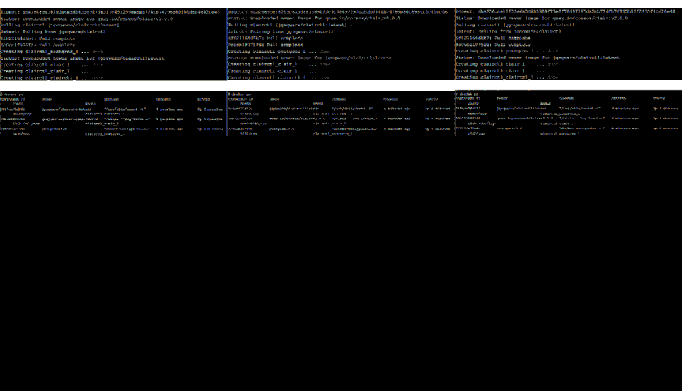

图 6.30：执行 `docker-compose` 命令

通过这种方式，我们有了 `claircltl` 命令来作为 Docker 镜像执行它。

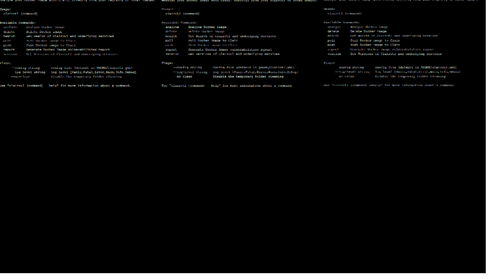

图 6.31：执行 `docker-compose exec clair`

要对镜像进行分析，我们可以执行命令：

```bash
$ docker-compose exec claircltl analyze --local
```

此时，我们已经回顾了如何使用 Docker Compose 执行 Clair，以及我们如何检测特定 Docker 镜像中的漏洞。

### GitHub 仓库和 Clair 链接

在 GitHub 的主要仓库和有关该工具更多信息的文章中，我们可以突出几个：

- `https://github.com/coreos/clair`
- `https://github.com/arminc/clair-scanner`
- `https://github.com/arminc/clair-local-scan`
- `https://bitbucket.com/osallou/clair`
- `https://coreos.com/blog/vulnerability-analysis-for-containers.html`
- `https://thenevstack.io/coreos-introduces-container-scanning-for-vulnerabilities`

在本节中，我们回顾了用于扫描 Docker 镜像的 Clair 安装和执行。在下一节中，我们将回顾用于静态镜像分析的 Quay.io 镜像仓库。

## Quay.io 镜像仓库

CoreOs 除了使用 Clair 分析客户上传的镜像外，在使用 Quay.io 镜像仓库：`https://docs.quay.io`，这是一个与 Docker Hub 仓库具有相似功能的容器注册表。

Quay 仓库提供静态镜像分析，目的是发现二进制文件中过时和有漏洞的库。我们可以突出的主要功能包括：

- 在上传到……之前扫描镜像
- 带有 CVE 更新的漏洞映射
- 指向 CVE 数据库漏洞的链接
- 易于集成到您的 CI/CD 工作流
- Web 界面和分析引擎 API
- 底层使用 CoreOs Clair 开源 CVE 引擎

我们继续进行 Quay.io 的注册和登录。

### 在 Quay.io 中注册

要登录 Quay.io，你必须从命令行执行 `docker login quay.io` 命令。以下步骤可以在 `https://docs.quay.io/solution/getting-started.html` 中找到。

```bash
$ docker login quay.io
```

```text
Username: username

Password: mypassword
```


在 Quay.io 账户配置中，可以创建一个加密密码以增加安全性。下一步是创建一个新容器，并在上面执行我们将要分析的镜像。

在创建容器时，我们看到它返回了一个标识符。

## 创建新容器

首先，我们将创建一个基于 `ubuntu` 基础镜像并包含单个新文件的容器：

```bash
$ docker run ubuntu echo "fun" newfile
```

容器将立即终止（因为它的命令是 `echo`），所以我们将使用 `docker ps -l` 来列出它：

```text
$ docker ps -l
| CONTAINER ID | IMAGE | COMMAND | CREATED |
|---|---|---|---|
| 07f265397ef | ubuntu:22.04 | | 31 seconds ago |
```

**注意下容器 ID，我们将在 `commit` 命令中需要它。**

图 6.32：创建一个新容器，它将返回一个容器标识符。

最后一步，我们将创建稍后上传镜像的仓库名称：

```bash
$ docker commit quay.io/username/reponeame
```

在创建仓库名称时，我们看到它返回了一个标识符。

## 将容器标记为镜像

我们需要将容器标记为已知的镜像名称。

注意，`username` 将是你的 Quay.io 用户名，`reponeame` 是你仓库的新名称。

```bash
$ docker tag 07f265397ef quay.io/username/reponeame
e7058c5da8a28f3f96c427b4f7fee6d67b8c67b71fabf3a669dc9211b
```

图 6.33：将容器标记为镜像。

要将镜像推送到 Quay.io 中的仓库，我们需要执行 `docker push` 命令：

```bash
$ docker push quay.io/namespace/repository:tag
```

`push` 指向仓库 `quay.io/username/reponeame`（len: 1）。

正在发送镜像列表。

正在推送 `quay.io/username/reponeame`（1 tags）。

```text
8dbd9e392996: Pushing ======= | 21.27 MB/134.1 MB 40s
```

要从 Quay.io 仓库中提取镜像，运行以下命令：

```bash
$ docker pull quay.io/namespace/repository
```

创建仓库的另一种方法是通过 Quay.io Web 界面。点击右上角的 `+` 图并选择 `New repository`。在接下来的截图中，我们可以看到创建新仓库的 Quay.io 页面。

## 创建新仓库

点击设置仓库描述。

- **Public（公开）**

  任何人都可以查看并从此仓库拉取。你可以选择谁可以推送。

- **Private（私有）**

  你选择谁可以查看、拉取和从此仓库推送。

- **Empty repository（空仓库）**

- **Initialize from Dockerfile（从 Dockerfile 初始化）**

图 6.34：创建新仓库，Quay.io 页面。

在仓库中可以看到仓库的漏洞仓库的漏洞。

在 Quay.io 页面中可以看到仓库的漏洞。

图 6.35：Quay.io 页面。

在 Quay.io 页面中可以看到仓库的漏洞。

图 6.36：Quay.io 页面。

在 Quay.io 页面中可以看到仓库的漏洞。

图 6.37：Quay.io 页面。

图 6.38：Quay.io 页面。

图 6.39：带有相应 CVE 的漏洞。

## 漏洞

| CVE | 严重程度 | 包 | 当前版本 | 修复版本 | 引入的层层 |
|---|---|---|---|---|---|
| CVE-2016-4448 | 10/10 | libxml2 | 2.9.1+dfgs1-5+debu5 | （无） | `RUN set -ex; apt-get update` |
| CVE-2017-17458 | 10/10 | mercurial | 3.1.2-debu4 | 3.1.2+debu6 | `RUN apt-get update 66 apt` |
| CVE-2017-18017 | 10/10 | linux | 3.16.51 | 3.16.56-1 | `RUN set -ex; apt-get update` |

### 攻击向量（VECTORS）

- 访问向量（Access Vector）
  - 网络（Network）
  - 相邻网络（Adjacent Network）
  - 本地（Local）
- 访问复杂度（Access Complexity）
  - 低（Low）
  - 中（Medium）
  - 高（High）
- 身份验证（Authentication）
  - 无（None）
  - 单一（Single）
  - 多重（Multiple）
- 机密性影响（Confidentiality Impact）
  - 完全（Complete）
  - 部分（Partial）
  - 立即（Now）
- 完整性影响（Integrity Impact）
  - 完全（Complete）
  - 部分（Partial）
  - 无（None）

描述。

图 6.40：Quay 安全扫描器检测到的漏洞。

在上一图中，我们看到每个漏洞定义了一系列指标，这些指标将给出最终评分和严重程度。

访问向量：此指标反映了漏洞被利用的方式。攻击者距离主机越远，漏洞评分越高。

在上例中，我们看到该指标的值是网络。此指标衡量了成功利用漏洞产生的影响。完整性指的是信息的可靠性和真实性。完整性影响的增加会提高漏洞评分。

访问复杂度：此指标衡量了攻击者在访问目标系统后利用该漏洞所需的攻击复杂度。

身份验证：此指标衡量了身份验证过程的强度或复杂度；例如，如果要求攻击者在运行利用程序之前提供凭据。所需的身份验证实例越少，漏洞评分越高。

机密性影响：机密性是指将信息的访问和披露限制为授权用户，并防止未经授权的用户访问或泄露。机密性影响的增加会提高漏洞评分。

完整性影响：此指标衡量了成功利用漏洞对完整性的影响。完整性影响的增加会提高漏洞评分。

你可以在 URL 中找到关于这些指标的更多信息：<https://www.first.org/cvss/specification-document>。

## 使用 Anchore Engine 分析 Docker 镜像

Anchore 是一个开源解决方案，可以在本地部署，也可以通过三个提供商托管的服务。其主要目标是发现公共和私有仓库中的 Docker 镜像，并对已知漏洞进行静态分析。

该解决方案允许列出 Docker 镜像操作系统安装的包列表，以及该 Docker 镜像中包含的所有 Node.js 和 Ruby 文件及依赖的完整列表。已知漏洞的静态分析将在操作系统级别（基础镜像）安装的包集上进行。

在下面的图中，我们可以看到 Anchore Engine 的架构：


图 6.41：Anchore Engine 架构。

Anchore 架构由六个组件组成，可以在单个容器或 Kubernetes 集群中实现：

- API 服务：一个中心消息接口，可以通过 REST API 或直接使用命令行访问。
- 镜像分析服务：由工作节点（worker nodes）执行的服务，负责扫描 Docker 镜像。
- 目录服务（Catalog service）：包含漏洞目录的内部数据库。
- 等待服务（Waiting service）：组织、持久化并调度内部引擎任务。
- 策略引擎（Policy Engine）：根据策略和规则提供漏洞分析。
- Webhook 服务：允许在生成 Docker 镜像之前对其进行验证。

基本上，Anchore Engine 以 Docker 镜像的形式提供，可以与 Kubernetes、Docker Swarm 或 Rancher 等其他平台配合。Anchore Engine 允许开发者进行详细分析、执行查询、生成报告并定义可在 CI/CD Cycle 中使用的策略。它提供了连接 Jenkins 流水线的可能，当开发者在 GitHub 等仓库中上传代码时，它会激活 Jenkins 启动容器镜像等。开源版本高度可定制，可复用于不同的任务，从 CD/CI 任务到取证分析或检查。此外，它还允许从 Docker 镜像中提取包。

## 启动 Anchore Engine

启动 Anchore Engine 有多种方法；最直接、简单的方法之一是通过 Docker Compose。为了声明这一点，我们可以使用位于 GitHub 项目 `scripts/` 目录下的 `docker-compose.yaml` 文件。

<https://github.com/anchore/anchore-engine/blob/master/docker-compose.yaml>

以下是你可以用于下载最新版本 `anchore-engine` 的命令：

```bash
$ git clone https://github.com/anchor/anchor-engine
$ cd anchor-engine
```

在接下来的截图中，我们可以看到上一条命令的输出：

```text
$ git clone https://github.com/anchor/anchor-engine
Cloning into anchor-engine...
remote: Enumerating objects: 121, done.
remote: Counting objects: 100% (121), done.
remote: Compressing objects: 100% (82), done.
remote: Total 1280
Receiving objects: 100% (12804), 20.92 MiB/s, done.
Resolving deltas: 100% (85), done.
Checking out files: 100% (985), done.
[root@node1 192.168.0.53] ~ cd anchor-engine
[root@node1 192.168.0.53] ~ ls
bash: ls: command found
[root@node1 192.168.0.53] ~
```

`CHANGELOG.md` `CONTRIBUTING.rst` `Dockerfile` `docker-compose-dev.yaml` `docker-compose.yaml` `MANIFEST.in` `docker-entrypoint.sh` `scripts` `setup.py` `requirements.txt` `requirements-txt`

图 6.42：Anchor Engine 源代码。

要启动 Anchor Engine，我们可以在下载了 `docker-compose.yaml` 文件的路径下执行 `docker compose -d` 命令。

```bash
$ docker-compose up
```

在接下来的截图中，我们可以看到以下命令的输出：

```bash
$ docker-compose up -d
Creating anchor-engine-db_1 ... done
Creating anchor-engine-catalog_1 ... done
Creating anchor-engine-api_1 ... done
Creating anchor-engine-policy-engine_1 ... done
Creating anchor-engine-simpleq_1 ... done
Creating anchor-engine-analyzer_1 ... done
Starting anchor-engine-db_1 ... done
Starting anchor-engine-catalog_1 ... done
Starting anchor-engine-api_1 ... done
Starting anchor-engine-policy-engine_1 ... done
Starting anchor-engine-simpleq_1 ... done
Starting anchor-engine-analyzer_1 ... done
```

图 6.43：启动 Anchor Engine。

在这里，我们看到 Anchor Engine 运行在对应的端口。我们看到 `anchor-engine` 服务来自 `docker.io/anchor/anchor-engine` 仓库，该服务依赖于 `anchor-db` 服务，后者会下载 Postgres 镜像并建立持久化卷和必要的环境变量。

在接下来的截图中我们可以看到运行中的 Anchor Engine 容器：

```bash
# docker ps
```

| CONTAINER ID | IMAGE | NAMES | COMMAND | STATUS |
|---|---|---|---|---|
| 80c572373c0a | anchor-engine:v0.4.0 | anchor-engine-db_1 | `"docker-entrypoint.s-point..."` | Up 4 minutes ago |
| 5b8e2c346f70 | anchor-engine:v0.4.0 | anchor-engine-policy_engine_1 | `"docker-entrypoint.s-point..."` | Up 4 minutes ago |
| 4a90b6c4f70 | anchor-engine:v0.4.0 | anchor-engine-catalog_1 | `"docker-entrypoint.s-point..."` | Up 4 minutes ago |
| ea4de832522 | anchor-engine:v0.4.0 | anchor-engine-analyzer_1 | `"docker-entrypoint.s-point..."` | Up 4 minutes ago |
| 31fd09a2b9f0 | 0.0.0.0:8220->8228/tcp | anchor-engine-api_1 | `"waitforfor..."` | Up 4 minutes ago |
| 97f176e6cc76 | postgres:9 | anchor-engine_anchor_db_1 | `"docker-entrypoint.s-point..."` | Up 4 minutes ago |

```text
usage: anchor-cli [OPTIONS] COMMAND [ARG]...

Options:
  --account ACCOUNT         使用的账户
  --archive-service ARCHIVE  使用的归档服务
  --version               显示 anchor-cli 版本
  --help                   显示此消息

Commands:
  account              账户操作
  analysis-archive     分析-归档操作
  evaluate             策略评估操作
  event                事件操作
  image                镜像操作
  policy               策略操作
  query                查询操作
  registry             注册表操作
  repo                 仓库操作
  subscription         订阅操作
  system               系统操作
```

图 6.45：Anchor CLI 截图，我们可以看到 `anchor-cli` 支持的命令。

| 命令: | | | |
|---|---|---|---|
| `account` | 账户操作 | 账户操作 | 账户操作 |
| `analysis-archive` | 分析-归档操作 | 分析-归档操作 | 分析-归档操作 |
| `evaluate` | 策略评估操作 | 策略评估操作 | 策略评估操作 |
| `event` | 事件操作 | 事件操作 | 事件操作 |
| `image` | 镜像操作 | 镜像操作 | 镜像操作 |
| `policy` | 策略操作 | 策略操作 | 策略操作 |
| `query` | 查询操作 | 查询操作 | 查询操作 |
| `registry` | 注册表操作 | 注册表操作 | 注册表操作 |
| `repo` | 仓库操作 | 仓库操作 | 仓库操作 |
| `subscription` | 订阅操作 | 订阅操作 | 订阅操作 |
| `system` | 系统操作 | 系统操作 | 系统操作 |

图 6.46：Anchor CLI 命令。

以下是用于对镜像进行分析的一些命令：

```bash
$ anchor-cli -u admin --p foobar
```

在截图中，我们可以看到上一个命令的输出：

```text
$ anchor-cli image -p change
  --help 显示此消息并退出
  $ anchor-cli image [command] [args...]
Options:
  --help 显示此消息并退出
  --version 显示版本信息并退出
Commands:
  add 添加镜像
  remove 删除镜像
  tag 给镜像打标签
  delete 删除镜像
  import 从 anchor 源导出导入镜像
  export 将镜像导出到 anchor 源导出
  push 推送镜像
  pull 拉取镜像
  list 列出镜像
  inspect 检查镜像元数据
  prune 清理未使用的镜像
```

图 6.47：Anchore CLI 命令。

这些是对于分析我们的镜像最有用的命令：


## 向 Anchore 添加镜像以进行分析

```bash
anchor-cli image add
```

## 显示镜像内容

```bash
anchor-cli image content os
```

## 分析镜像内容

```bash
anchor-cli image content files
```

## 基于策略合规性进行评估

```bash
anchor-cli evaluate check os
```

以下命令将返回有关分析 Docker 镜像的过程的信息：

```bash
anchor-cli --u admin --p foobar image add docker.io/library/alpine:3.4
```

在接下来的截图中，我们可以看到上一个命令的输出：

### 6.48：Anchore CLI 命令

以下命令将返回 Docker 镜像内部安装的包：

```bash
anchor-cli --u admin --p foobar image content docker.io/library/alpine:3.4 os
```

在接下来的截图中，我们可以看到上一个命令的输出：

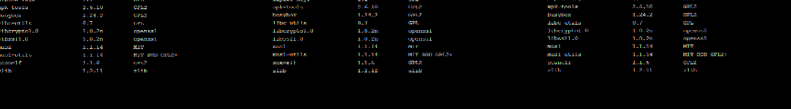

### 6.49：alpine Docker 镜像中的包

以下命令将从 Docker 镜像获取元数据：

```bash
anchor-cli --u admin --p foobar image metadata docker.io/library/alpine:3.4 manifest
```

在接下来的截图中，我们可以看到上一个命令的输出：

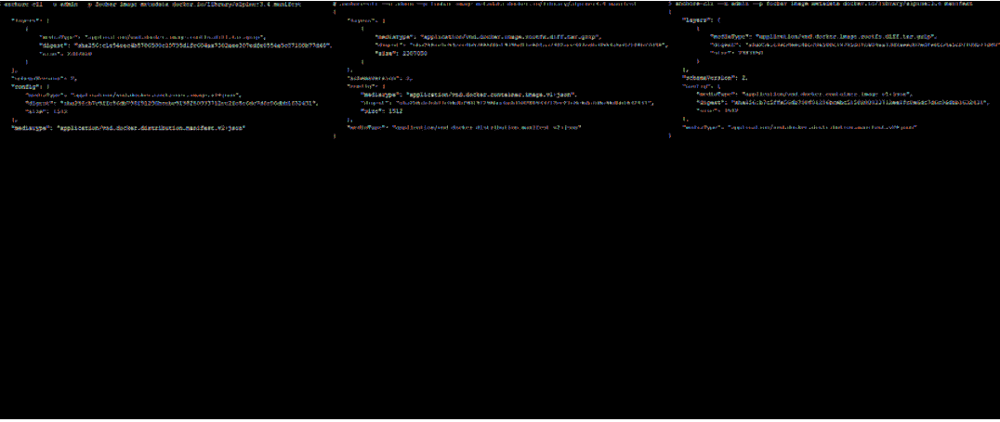

通过以下命令，我们可以看到 Docker 镜像的输出：

```bash
anchor-cli --u admin --p foobar image docker.io/library/alpine:3.4
```

在接下来的截图中，我们可以看到上一个命令的输出：


## 结论

在本章中，我们通过以下命令发现了 Docker 镜像中暴露的漏洞：

```bash
anchor-cli --u admin --p foobar image docker.io/library/alpine:3.4
```

在本章中，我们学习了如何减少容器的暴露。

在本章中，我们审查了 Docker 容器的漏洞。

在本章中，我们审查了 Docker 容器的漏洞。

在本章中，我们审查了 Docker 容器的漏洞。

图 7.3：glibc 库中与 CVE 漏洞

我们也可以检查是否存在针对该 CVE 的利用程序。

图 7.4：CVE-2018-1000001 的可用利用程序

你可以在 <https://cve.mitre.org/cgi-bin/cve.cgi?name=CVE-2018-1000001> 找到更多关于此漏洞的信息。

大多数与 CVE 相关的漏洞都与一个或多个漏洞相关。例如，CVE-2015-1781 是缓冲区溢出中的缺陷，该缺陷可以在 DNS 服务器中被滥用并导致拒绝服务或任意代码执行，它可能分为三类：拒绝服务、代码执行和溢出。

最关键的 CVE 之一是 CVE-2014-9357。该 CVE 允许攻击者以 `root` 权限执行任意代码。

## CVE-2014-9357

| CVE-2014-9357 | CVSS 评分 | CVE-2014-9357 | CVSS 评分 | CVE-2014-9357 | CVSS 评分 |
|---|---|---|---|---|---|
| 基础评分 | 7.5 | 基础评分 | 7.5 | 基础评分 | 7.5 |
| 攻击向量 | 网络 | 攻击向量 | 网络 | 攻击向量 | 网络 |
| 攻击复杂度 | 低 | 攻击复杂度 | 低 | 攻击复杂度 | 低 |
| 所需权限 | 无 | 所需权限 | 无 | 所需权限 | 无 |
| 用户交互 | 无 | 用户交互 | 无 | 用户交互 | 无 |
| 范围 | 未改变 | 范围 | 未改变 | 范围 | 未改变 |
| 机密性影响 | 低 | 机密性影响 | 低 | 机密性影响 | 低 |
| 完整性影响 | 低 | 完整性影响 | 低 | 完整性影响 | 低 |
| 可用性影响 | 低 | 可用性影响 | 低 | 可用性影响 | 低 |

图 7.5：CVE-2014-9357 详情

你可以在 <https://www.cvedetails.com/cve/CVE-2014-9357/> 找到更多关于此漏洞的信息。

在这种案例中，通用漏洞评分系统（CVSS）被用于衡量和比较威胁。通用漏洞评分系统基于攻击向量、攻击复杂度、权限、用户交互、范围以及在进行攻击时数据的完整性和可用性等因素。

组织依赖 CVSS 评分系统作为捕获漏洞主要特征的标准方法，并产生反映其严重程度的数值评分。

CVSS 的计算是根据风险公式建模的，其中影响乘以概率，而 CVSS 将其称为影响子指标：影响 × 利用性（Impact × Exploitability）。

在图中，我们可以看到 CVE-2014-9357 中的攻击者：

| 攻击向量 | 攻击复杂度 | 所需权限 | 用户交互 | 范围 | 机密性影响 | 完整性影响 | 可用性影响 |
|---|---|---|---|---|---|---|---|
| 网络 | 低 | 无 | 无 | 未改变 | 低 | 低 | 低 |
| 网络 | 低 | 无 | 无 | 未改变 | 低 | 低 | 低 |
| 网络 | 低 | 无 | 无 | 未改变 | 低 | 低 | 低 |
| 网络 | 低 | 无 | 无 | 未改变 | 低 | 低 | 低 |
| 网络 | 低 | 无 | 无 | 未改变 | 低 | 低 | 低 |
| 网络 | 低 | 无 | 无 | 未改变 | 低 | 低 | 低 |
| 网络 | 低 | 无 | 无 | 未改变 | 低 | 低 | 低 |
| 网络 | 低 | 无 | 无 | 未改变 | 低 | 低 | 低 |

图 7.6：CVE-2014-9357 中的攻击向量

为了获取漏洞的严重性水平，我们还可以使用一些指标，例如攻击向量、网络、访问复杂度、身份验证以及机密性影响。在主要的攻击向量中，我们可以突出：

- 访问向量：此指标反映了漏洞是如何被利用的。具有网络访问权限的可利用漏洞意味着受影响软件连接到网络堆栈，攻击者不需要访问本地网络。此类漏洞通常被称为远程可利用。网络攻击的示例是 RPC 缓冲区溢出。
- 缓冲区溢出是 Web 服务器中的常见漏洞，当应用程序将过多的数据放入设计用于保留数据的缓冲区时。在缓冲区溢出的情况下，程序员在代码中创建了缓冲区但没有对其限制。数据必须去某处，在这种情况下意味着相邻的缓冲区。当溢出发生时，结果可能是数据损坏或被覆盖。
- 访问复杂度：此指标分析了攻击者在获得系统访问权限后利用漏洞所需的攻击复杂度。例如，考虑互联网服务中的缓冲区溢出，目标系统已定位，攻击者可以诱导利用过程。
- 身份验证：此指标分析了攻击者为了利用漏洞必须对目标进行身份验证的次数。此指标衡量了攻击者在漏洞发生前需要提供凭据。需要的身份验证实例越多，漏洞评分越高。
- 机密性影响：此指标衡量了成功利用的漏洞对机密性的影响。机密性是指将访问和信息披露仅限制为授权用户，并防止未经授权的用户访问。机密性影响增加越大，漏洞评分越高。
- 完整性影响：此指标衡量了成功利用的漏洞对完整性的影响。对完整性的影响越大，漏洞评分越高。例如，如果攻击者可以修改目标系统中的任何文件，此时我们得到一个非常高的评分。

另一个影响 `root` 权限的漏洞被发现于运行容器的 utility：通过它可以在宿主机上获得 `root` 权限。对于漏洞的利用，一个容器是必要的，这将赢得宿主机的二进制文件。攻击被 AppArmor 的默认策略阻止，例如 Fedora 系统的 SELinux。然而，具有强制模式的攻击被阻止了。该漏洞已标识 CVE-2019-5736，并且有了修复该 bug 的补丁。如果无法修复，一种解决方案是配置 SELinux 以防止利用。

关于该漏洞的更多信息请见 <https://seclists.org/oss-sec/2019/q1/119>。

Dirty Cow Exploit (CVE-2016-5195) Dirty Cow (2016-5195) 是 Linux 内核中的竞态条件，允许任何本地用户对只读映射进行任意写入。这可以提升权限到 `root`。

Dirty Cow Exploit (CVE-2016-5195) Dirty Cow (2016-5195) 是 Linux 内核中的竞态条件，允许任何本地用户对只读映射进行任意写入。这可以提升权限到 `root`。

Dirty Cow Exploit (CVE-2016-5195) Dirty Cow (2016-5195) 是 Linux 内核中的竞态条件，允许任何本地用户对只读映射进行任意写入。这可以提升权限到 `root`。

Dirty Cow Exploit (CVE-2016-5195) Dirty Cow (2016-5195) 是 Linux 内核中的竞态条件，允许任何本地用户对只读映射进行任意写入。这可以提升权限到 `root`。

Dirty Cow Exploit (CVE-2016-5195) Dirty Cow (2016-5195) 是 Linux 内核中的竞态条件，允许任何本地用户对只读映射进行任意写入。这可以提升权限到 `root`。

Dirty Cow Exploit (CVE-2016-5195) Dirty Cow (2016-5195) 是 Linux 内核中的竞态条件，允许任何本地用户对只读映射进行任意写入。这可以提升权限到 `root`。

Dirty Cow Exploit (CVE-2016-5195) Dirty Cow (2016-5195) 是 Linux 内核中的竞态条件，允许任何本地用户对只读映射进行任意写入。这可以提升权限到 `root`。

在图中，我们可以看到 CVE-2014-9357 中的攻击者：

| 攻击向量 | 攻击复杂度 | 所需权限 | 用户交互 | 范围 | 机密性影响 | 完整性影响 | 可用性影响 |
|---|---|---|---|---|---|---|---|
| 网络 | 低 | 无 | 无 | 未改变 | 低 | 低 | 低 |
| 网络 | 低 | 无 | 无 | 未改变 | 低 | 低 | 低 |
| 网络 | 低 | 无 | 无 | 未改变 | 低 | 低 | 低 |
| 网络 | 低 | 无 | 无 | 未改变 | 低 | 低 | 低 |
| 网络 | 低 | 无 | 无 | 未改变 | 低 | 低 | 低 |
| 网络 | 低 | 无 | 无 | 未改变 | 低 | 低 | 低 |
| 网络 | 低 | 无 | 无 | 未改变 | 低 | 低 | 低 |
| 网络 | 低 | 无 | 无 | 未改变 | 低 | 低 | 低 |

图 7.6：CVE-2014-9357 中的攻击向量

为了获取漏洞的严重性水平，我们还可以使用一些指标，例如攻击向量、网络、访问复杂度、身份验证以及机密性影响。在主要的攻击向量中，我们可以突出：

- 访问向量：此指标反映了漏洞是如何被利用的。具有网络访问权限的可利用漏洞意味着受影响软件连接到网络堆栈，攻击者不需要访问本地网络。此类漏洞通常被称为远程可利用。网络攻击的示例是 RPC 缓冲区溢出。
- 缓冲区溢出是 Web 服务器中的常见漏洞，当应用程序将过多的数据放入设计用于保留数据的缓冲区时。在缓冲区溢出的情况下，程序员在代码中创建了缓冲区但没有对其限制。数据必须去某处，在这种情况下意味着相邻的缓冲区。当溢出发生时，结果可能是数据损坏或被覆盖。
- 访问复杂度：此指标分析了攻击者在获得系统访问权限后利用漏洞所需的攻击复杂度。例如，考虑互联网服务中的缓冲区溢出，目标系统已定位，攻击者可以诱导利用过程。
- 身份验证：此指标分析了攻击者为了利用漏洞必须对目标进行身份验证的次数。此指标衡量了攻击者在漏洞发生前需要提供凭据。需要的身份验证实例越多，漏洞评分越高。
- 机密性影响：此指标衡量了成功利用的漏洞对机密性的影响。机密性是指将访问和信息披露仅限制为授权用户，并防止未经授权的用户访问。机密性影响增加越大，漏洞评分越高。
- 完整性影响：此指标衡量了成功利用的漏洞对完整性的影响。对完整性的影响越大，漏洞评分越高。例如，如果攻击者可以修改目标系统中的任何文件，此时我们得到一个非常高的评分。另一个影响 `root` 权限的漏洞被发现于运行容器的 utility：通过它可以在宿主机上获得 `root` 权限。对于漏洞的利用，一个容器是必要的，这将赢得宿主机的二进制文件。攻击被 AppArmor 的默认策略阻止，例如 Fedora 系统的 SELinux。然而，具有强制模式的正确配置的 namespaces 攻击被阻止了。该漏洞已标识 CVE-2019-5736，并且有了修复该 bug 的补丁。如果无法修复，一种解决方案是配置 SELinux 以防止利用。

关于该漏洞的更多信息请见 <https://seclists.org/oss-sec/2019/q1/119>。

Dirty Cow Exploit (CVE-2016-5195) Dirty Cow (2016-5195) 是 Linux 内核中的竞态条件，允许任何本地用户对只读映射进行任意写入。这可以提升权限到 `root`。

## 漏洞和修复包

下表是修复版本的信息。

| 软件包 | 版本 | 状态 |
|---|---|---|
| `linux` | `(unstable)` | `4.7.8` |
| `linux` | `jessie` | `3.16.36+debu1` |
| `linux` | `stretch` | `4.9.110` |

| 软件包 | 类型 | 版本 | 修复版本 | 紧急程度 | 来源 | Debian 漏洞 |
|---|---|---|---|---|---|---|
| `linux` | `source` | `(unstable)` | `4.7.8-1` | `high` |  |  |
| `linux` | `source` | `jessie` | `3.16.36+debu2` | `high` |  | `DSA-3696-1` |
| `linux` | `source` | `wheezy` | `3.2.82-1` | `high` |  | `DLA-670-1` |

下表是修复版本的信息。

| 软件包 | 版本 | 状态 |
|---|---|---|
| `linux` | `(unstable)` | `4.7.8` |
| `linux` | `jessie` | `3.16.36+debu1` |
| `linux` | `stretch` | `4.9.110` |

下表是修复版本的信息。

| 软件包 | 版本 | 状态 |
|---|---|---|
| `linux` | `(unstable)` | `4.7.8` |
| `linux` | `jessie` | `3.16.36+debu1` |
| `linux` | `stretch` | `4.9.110` |

下表是修复版本的信息。

| 软件包 | 版本 | 状态 |
|---|---|---|
| `linux` | `(unstable)` | `4.7.8` |
| `linux` | `jessie` | `3.16.36+debu1` |
| `linux` | `stretch` | `4.9.110` |

| 文件 | 文件内容 | 描述 | 访问方式 |
|---|---|---|---|
| `dirtycow0.c` | `/dirtycow0w` file content | 只读写入 | `/proc/self/mem` |
| `cowroot.c` | `/cowroot` | SUID-based root | `/proc/self/mem` |
| `dirtycow-mem.c` | `/dirtycow-mem` | libc-based root | `/proc/self/mem` |
| `pokemon.c` | `/d` file content | 只读写入 | `PTRACKACE_POKEDATA` |
| `dirtycow.cr` | `dirtycow --target --string --offset` | 只读写入 | `/proc/self/mem` |
| `dirtycow0.c` | `/dirtycow` file content | 只读写入 (Android) | `/proc/self/mem` |

| 链接 | 用法 | 描述 | 家族 |
|---|---|---|---|
| `dirtycow0.c` | `/dirtycow0w` file content | 只读写入 | `/proc/self/mem` |
| `cowroot.c` | `/cowroot` | SUID-based root | `/proc/self/mem` |
| `dirtycow-mem.c` | `/dirtycow-mem` | libc-based root | `/proc/self/mem` |
| `pokemon.c` | `/d` file content | 只读写入 | `PTRACKACE_POKEDATA` |
| `dirtycow.cr` | `dirtycow --target --string --offset` | 只读写入 | `/proc/self/mem` |
| `dirtycow0.c` | `/dirtycow` file content | 只读写入 (Android) | `/proc/self/mem` |

在以下 GitHub 仓库中，你可以找到一些允许此利用行为的证明程序：

- <https://github.com/scumj/dirtycow-vdso>
- <https://github.com/gebl/dirtycow-docker>

在以下 GitHub 仓库 <https://github.com/dirtycow/dirtycow.github.io/wiki/PoCs> 中，我们可以发现多个在 `dirtycow.c` 行中存在利用的证明程序。

| 文件 | 更改 | 时间 |
|---|---|---|
| `Dockerfile.md` | 小更改 (`docker` -> `x86`) | 5 个月前 |
| `README.md` | `README.md` | 5 个月前 |


| `dirtycow.c` | `README.md` | 5个月前 |
|---|---|---|
| `run.sh` | `README.md` | 5个月前 |
| `safe_run.sh` | `README.md` | 5个月前 |

图 7.9：DirtyCow 概念证明仓库

这是我们可以在之前的仓库中找到的 `Dockerfile` 内容：

```dockerfile
FROM ubuntu:12.04

RUN apt-get update
RUN apt-get install -y build-essential

RUN mkdir /dirtycow
COPY dirtycow.c /dirtycow/dirtycow.c

RUN groupadd -r dcow useradd --no-log-init -r -g dcow dcow
RUN echo 'dcow:pass' | chpasswd

RUN chown -R dcow:dcow /dirtycow

USER dcow

WORKDIR /dirtycow

RUN gcc -pthread dirtycow.c -o dirtycow
```

图 7.10：DirtyCow 概念证明的 Dockerfile

DirtyCow 环境基于 Ubuntu 镜像。GCC 编译器和 `build-essential` 软件包是编译 DirtyCow 漏洞的必要条件。

在截图中，我们可以看到 DirtyCow 漏洞的执行：

```bash
docker-17-03-20-18-24_distro-dockerer run -it dirtycow
euid18330ae6id$ - echo "this is not a test" > foo 666
euid18330ae6id$ - sudo as root (system administrator)
- cat foo
euid18330ae6id$ - prompt root 10 May 9 13:37
- cat foo
euid18330ae6id$ - this is not a test
euid18330ae6id$ - /dirtycow/writethis >> foo
bash: Permission denied
- cat foo
euid18330ae6id$ - this is not a test
euid18330ae6id$ - /dirtycow/writethis
mag 753b0cd700
```

图 7.11：DirtyCow 漏洞概念证明

DirtyCow 漏洞演示了如何以 root 用户身份写入一个带有特定内容、权限和属性的文件，而我们尝试作为普通用户写入该文件，但使用了 DirtyCow 二进制文件或漏洞。

该漏洞发生在打开一个只有 root 用户具有只读权限的文件并尝试向该文件写入某些内容时。通常，这会被权限分级拒绝，但该漏洞在只读内存段中打开了文件。

### 使用 AppArmor 防止 DirtyCow

如果我们使用 AppArmor，我们可以通过对容器内哪些应用程序具有读、写、执行权限建立限制，使漏洞失效。当使用默认的 AppArmor 配置时，DirtyCow 漏洞被阻止了。另一种可能性是以只读模式运行容器。以只读方式执行容器可以防止攻击者对系统进行更改。

在截图中，我们可以看到启用了 AppArmor 后执行 DirtyCow 漏洞：

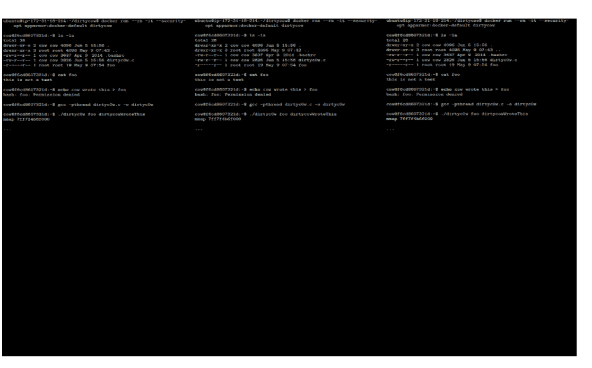

AppArmor 是 Linux 内核的一个安全功能，用于在运行时限制应用程序的能力。

另一种可能性是以只读模式运行容器。以只读方式执行容器可以防止攻击者对系统进行更改。

## 盒中漏洞（CVE-2018-8115）

这是一个影响 Windows 版 Docker 的远程代码执行漏洞 CVE-2018-8115。该漏洞与微软发布并维护的 Windows Compute Service Shim 的兼容有关。该服务使用 `filepath.Join` 函数处理未经授权的条目，允许你在主机文件系统上创建、删除和替换文件，从而导致远程代码执行。

该漏洞由于函数中的文件路径没有经过正确验证，导致目标文件可以写入到受害者主机的任意位置。

好消息是，Docker 在 Docker CE 18.03.1 和 CE 17.05.0-rc1 版本中修复了此漏洞。

Aqua Security 等公司还创建了开源工具，允许你检查镜像是否包含此漏洞。要实现此目标，工具会从仓库下载镜像，获取镜像，并对每一层的 `.tar` 文件进行验证。脚本可以在仓库中找到：

<https://github.com/aquasecurity/scancve-2018-8115>

这是一个 Python 脚本，将连接到 Docker Hub 仓库并验证镜像或其任何层是否存在可能利用 CVE-2018-8115 漏洞的文件系统访问路径。

在截图中，我们可以看到用于检测 CVE-2018-8115 漏洞的 Python 脚本片段：

```python
def layer_safe(layer_file):
    results = []
    try:
        tar = tarfile.open(layer_file, mode='gz')
    except tarfile.ReadError:

    while True:
        next_block = tar.next()
        if not next_block:
            break

        filename = next_block.name
        destination = next_block.link
        if destination not in ['']:
            full_path = os.path.join(destination, filename)
            if not os.path.isabs(full_path):
                if os.path.normpath(full_path).startswith('/'):
                    results.append((full_path, 0))
```

图 7.13：检测 CVE-2018-8115 漏洞的脚本

## 总结

## CVSS 严重性

### CVE-2018-15664

在 Docker 中，`docker cp` 命令背后的 API 端点可以受到带有目录遍历的符号链接交换攻击，攻击者可以以 root 权限获取宿主机文件系统的任意读写访问，因为 daemon/archive 不会在冻结的文件系统上进行归档操作（在 chroot 内部）。

| 指标 | 分数 |
|---|---|
| V2 | 8.7 高 |
| V2 | 9.3 高 |

发布日期：2019年5月23日；上午10:29:07 -04:00

### CVE-2019-5021

官方 Alpine Linux Docker 镜像（v3.3）版本中的 `root` 用户包含 NULL 密码。该漏洞似乎是 2015 年 12 月引入的回归导致的。由于此问题的特殊性，使用受影响的 Alpine Linux（使用了 Linux PAM 或其他使用系统 shadow 作为认证数据库的机制）部署的系统可能会接受 `root` 用户的 NULL 密码。

| 指标 | 分数 |
|---|---|
| V2 | 9.8 严重 |
| V2 | 8.8 高 |

发布日期：2019年5月08日；下午01:29:01 -04:00

### CVE-2019-103065

Jenkins CloudShare Docker-Machine 插件以未加密的形式在 Jenkins 主机的全局配置文件中存储凭据，访问主文件用户可以查看这些凭据。

| 指标 | 分数 |
|---|---|
| V2 | 8.8 高 |
| V2 | 6.0 中 |

发布日期：2019年5月08日；下午12:29:00 -04:00

图 7.16：NVD 漏洞

这种分类考虑了几个因素，包括利用系统所需的复杂性和漏洞影响。复杂度越低意味着分数越高，影响越大意味着分数越高。

## 安全漏洞分类

MITRE 是一个提供并维护操作系统和服务器中包含的漏洞 CVE（常见漏洞与披露）列表的机构。由美国政府管理的 NVD 数据库详细说明了每个漏洞的影响，包括受影响的代码和可能的解决方案。

对于每个漏洞，NVD 给出了 0 到 10 的评分。7-10 分范围被评为高漏洞，4-6 分范围被评为中等漏洞，0-3.9 分被评为低漏洞。

我们在 Docker 镜像中找到的按严重程度分类的漏洞示例：

### 高严重性漏洞

- Shellshock：<https://en.wikipedia.org/wiki/Shellshock_(software_bug)>
- Heartbleed（OpenSSL）
- <https://poodlebleed.com>

### 中严重性漏洞

- Poodle（OpenSSL）
- <https://poodlebleed.com>

### 低严重性漏洞

- 缓冲区溢出：GCC 内存分配在访问未分配的内存区域可能会由于内存溢出导致缓冲区溢出。

为了获取 NVD 的最新已知漏洞，我们在下面的 GitHub 仓库中开发了一个 Python 脚本：

<https://github.com/linuxack/nvdparser>

漏洞的分类通常具有主观性，公司通常根据特定配置或某些 Linux 发行版提供的评分进行分类。例如，我们可以参考给定发行版分配的分数。例如，对于 Ubuntu，我们有以下列表：

<http://people.canonical.com/~ubuntu-security/cve/main.html>

## CVE

| CVE | 软件包 | Ubuntu 12.04 (Precise Pangolin) | Ubuntu 14.04 (Trusty Tahr) | Ubuntu 16.04 (Xenial Xerus) | Ubuntu 18.04 (Bionic Beaver) | Ubuntu 18.10 (Cosmic Cutfish) | Ubuntu 19.04 (Disco Dingo) | Ubuntu 19.10 (Eoan) | 链接 |
|---|---|---|---|---|---|---|---|---|---|
| CVE-2002-2439 | gcc-4.6 | 需要排查* |  |  |  |  |  |  | 需要排查*；Mitre LP Debian |
| CVE-2005-4890 | shadow | 需要* |  | 不受影响 | 不受影响 | 不受影响 | 未受影响 |  | Mitre LP Debian |
| CVE-2008-7320 | seahorse |  | 需要* | 需要排查* | 需要排查* | 需要排查* | 需要排查* |  | Mitre LP Debian |
| CVE-2009-1384 | libpam-kcm | 需要* | 需要* | 需要* | 需要* | 需要* | 需要* |  | Mitre LP Debian |
| CVE-2009-5080 | groff | 需要* | 需要* | 需要* | 需要* | 需要* | 需要* |  | Mitre LP Debian |
| CVE-2009-5155 | glibc |  |  | 需要* | 需要* |  |  |  | Mitre LP Debian |

图 17：Ubuntu CVE 列表有自己的 CVE 列表，地址为：<https://access.redhat.com/security/security-updates/#cve>

Red Hat 也管理它自己的 CVE 列表。


图 18：Red Hat CVE 列表

在本节中，我们根据严重性审查了某些漏洞。

## Alpine 镜像漏洞

这是发现的最新漏洞之一。问题出现在 3.3、3.4、3.5 版本的 Alpine 镜像中。这些版本包含空密码。除了利用该漏洞，你还需要安装 Linux-pam 包或 shadow 包。

<https://launchpad.net/ubuntu/+shadow>

<https://cve.org/cpe/name=CVE-2019-5021>

在下面的中，我们可以看到此漏洞的详情：

### CVE-2019-5021 国家漏洞数据库（NVD）

#### 描述

Alpine Linux Docker 镜像（从 v3.3 开始）包含 `root` 用户的 NULL 密码。该漏洞是 2015 年 12 月引入的一个错误。使用早期版本 Alpine Linux 容器（包含 Linux PAM 或其他使用系统 shadow 的机制）的系统可能会接受 `root` 用户的 NULL 密码。

#### 参考文献

为了方便读者区分漏洞，提供了参考文献。该列表并不完整。

- BID：1028
- URL：<http://www.cve.org/forum/id/1028>
- CONF：<https://security.org/netsec/advisory/docker-image-vulnerability-CVE-2019-5021/>
- MISC：<https://analysis.aptource.com/nature-of-vulnerability-CVE-2019-5021.html>
- MISC：<https://talentintelligence.com/vulnerability-reports/TALOS-2019-078>
- SUSE：opensuse-SUGE-2495
- URL：<https://github.com/opensuse/security-announcement/2019-06-25/msp0004.html>

图 19：Alpine 镜像漏洞

在 GitHub 仓库中，我们可以看到维护人员对 Alpine 镜像做的更改：

```text
https://alelinux.org/commit/?id=7da256ec8260acae810ebeffe6526c09e
```

在接下来的图中，我们看到了此漏洞的影响：

```text
rwx-xr-x scripts/genroots.sh 3 个文件更改，3 次插入，0 次删除
```

```diff
diff --git a/genroots.sh b/genroots.sh
index ac766e0d..511b027363 100755
--- a/genroots.sh
+++ b/genroots.sh
@@ -39,6 +39,9 @@
-$($apk) fetch --keys-dir "keys_dir" --no-cache |
+--repositories-file "repositories_file" |
+--stdout quiet alpine-image-base | tar -xz -C "$HOME" /etc
```

```bash
## 确保禁用 root 登录
+sed -i -e 's/^root:root:/root:!:/etc/shadow
```

```bash
+bash
+VERSION_ID=$(awk -F= '$1=="VERSION_ID" {print $2}' "$HOME"/etc/os-release)
case $VERSION_ID in
```

图 20：Alpine 镜像受影响漏洞

通过以下命令，我们可以检查 3.4 版本是否存在漏洞（如果启用了 root 用户）：

```bash
$ docker run alpine:3.4 cat /etc/shadow | head -1
```

在接下来的图中，我们看到了上一命令的输出：


图 21：运行受影响版本的 Docker 容器

该问题的解决方案是通过指令禁用 root 登录：

```dockerfile
RUN sed -i -e 's/: /root:/ /etc/shadow'
```

字符表示无法 root 登录。通过以下命令，我们可以检查最新版本不受漏洞：

```bash
$ docker.io/alpine:latest cat /etc/shadow
```

在接下来的图中，我们看到了上一命令的输出：


图 22：运行漏洞版本的 Docker 容器

在本节中，我们审查了 Alpine Docker 镜像中的特定漏洞及其缓解措施。

## Docker 中的 CVE

我们可以找到与 Docker 安全事件或问题直接相关的 CVE。要了解更多关于 Docker CVE 或查看 Docker CVE 列表，请访问 <https://www.docker.com/cve-database>。

在之前的 URL 中，我们可以找到与 Docker 事件或安全问题直接相关的 CVE：

| CVE ID | 描述 | 日期 | 补丁 |
|---|---|---|---|
| CVE-2016-8867 | 环境变量能力应用不当 | 2016年10月27 | Engine 1.12.3 |
| CVE-2014-8178 | 攻击者控制层 ID 导致图内容投毒 | 2015年10月12 | Engine 1.8.3 |
| CVE-2014-0179 | Manifest 漏洞和解析逻辑错误允许通过摘要拉取 | 2015年10月12 | Engine 1.8.3 |
| CVE-2015-3629 | 容器所有权时的符号链接遍历允许本地权限提升 | 2015年5月7 | Engine 1.6.1 |
| CVE-2015-3627 | 文件描述符 1 的不安全打开导致权限提升 | 2015年5月7 | Engine 1.6.1 |


| CVE-2015-3630 | 可读写 proc 路径允许修改宿主机和信息泄露 | 2015年5月7 | Engine 1.6.1 |
|---|---|---|---|
| CVE-2015-3631 | 卷挂载允许 LSM 配置文件提升 | 2015年5月7 | Engine 1.6.1 |

图 23：Docker CVE 数据库

每当检测到特定版本的 Docker CVE，该列表就会更新。正如你所见，列表非常小，因此它可能不会按每天、甚至每个月的频率频繁增长。

## CVE 供应商产品更新的 CVSS

| CVE | 供应商 | 产品 | 更新 | CVSS |
| :--- | :--- | :--- | :--- | :--- |
| CVE-2019-14271 | 1 | Docker | 2019-08-28 | 7.8 |
| CVE-2019-13509 | 1 | Docker 1 Docker | 2019-08-27 | 5.0 |
| CVE-2019-102014 | 1 | Docker Credential Helpers | 2019-08-19 | 2.1 |
| CVE-2018-15684 | 1 | Docker 1 Docker | 2019-06-25 | 6.2 |
| CVE-2019-5736 | 10 | Docker, Google, 12 Docker, Kubernetes Engine, Linux x and 9 | 2019-06-03 | 8.3 |

图 24：Docker CVE 数据库 MITRE 将每个 CVE 与受此漏洞影响的程序关联起来。https://cve.mitre.org

作为一个处理和发布 CVE 的实体，MITRE 将每个 CVE 与受此漏洞影响的程序关联起来。

接下来，我们将介绍这些与特定 Docker 版本相关的某些漏洞：

- CVE-2014-5282：1.3 之前的之前的 Docker 不验证镜像标识符，允许攻击者通过使用 `docker` 加载不受信任的镜像来重定向到另一个镜像：https://www.nist.gov/vuln/detail/CVE-2014-5282
- CVE-2014-5280：1.3 之前的之前的 `booldocker` 允许攻击者通过在未启用 TLS 加密的情况下开启 TOP 容器，利用 Docker 守护进程来执行跨站请求伪造（CSRF）：https://www.nist.gov/vuln/detail/CVE-2014-5280
- CVE-2014-5279：1.3 之前的由 `booldocker` 控制的 Docker 守护进程在没有默认身份验证的情况下进行 TOP 连接，使得远程攻击者更容易获得权限或在容器中执行任意代码：https://www.nist.gov/vuln/detail/CVE-2014-5279

当发现漏洞时，创建一个 CVE 是让公众能够获取漏洞的一种方式。此 CVE 包含了所有漏洞数据，以及每个已识别出的漏洞的标识符。

### Hub 中的存在漏洞镜像

在 Docker Hub 的下一个 URL 中，我们可以找到一些默认运行并存在的一系列漏洞的镜像：

https://docker.com/u/vulnerabilities

### 存在漏洞的 Shellshock 镜像

https://docker.com/r/vulnerables/cve-2014-6271

Shellshock 是 Unix 系统上 Bash 中的一系列安全错误。许多服务器实现使用 Bash 处理请求，这允许攻击者执行任意命令并获得对计算机系统的未授权访问。

### 带有 OpenSSH 远程 DOS 漏洞的镜像

https://docker.com/r/vulnerables/cve-2016-6515

7.3 之前的 OpenSSH 版本不限制 SSH 服务器认证的长度，允许远程攻击者通过长链导致拒绝服务。此错误存在于 `auth_password` 函数的 `auth-password.c` 文件的源代码中。

攻击者可以利用此使应用程序进入无限循环并消耗 CPU 资源，直到导致拒绝服务。

### 存在漏洞的 HeartBleed 镜像

Heartbleed 错误是 OpenSSL 加密软件库中的一个漏洞。该漏洞会导致用于识别服务提供者以及加密用户流量、名称和密码的密钥泄露。据测，受信任机构认证的安全互联网服务器中有 17%（五十万）容易受到攻击，允许从服务器中窃取私钥和密码。

在以下服务中，我们可以找到有关漏洞的最新更新容器：

https://vulnerablecontainers.org/

https://vulnerablecontainers.org/official/

此时，我们已经审查了在 Docker 镜像中发现的一些 CVE。下一部分，我们将查看如何使用 Vulners API 获取 CVE 详情。

## 使用 Vulners API 获取 CVE 详情

Vulners Database（https://vulners.com/products）为集成目的提供了搜索、数据恢复、归档和漏洞扫描 API。通过此库，可以创建安全工具并访问世界上最大的安全数据库。

它提供了一个 Python API，用于通过标识符获取 CVE 信息，搜索可用的公共漏洞并根据名称和软件版本获取漏洞。

https://github.com/vulnersCom/api/blob/master/README.md

要安装该库，只需运行命令 `pip install`：

```bash
$ pip install -U vulners
```

此外，必须在 Vulners 网站注册以获取“API KEY”，它允许你进行请求和查询。以下是对该数据库的一些查询示例。以下 Python 脚本允许你根据特定标准在 Vulners 数据库中搜索；例如，我们可以搜索 DirtyCow。

```python
import vulners
vulnersapi = vulners.Vulners(apikey="API_KEY")
dirtycow = vulnersapi.search("dirtycow", limit=10)
for i, val in enumerate(dirtycow.items()):
    print(key, ": val)
```

在接下来的截图中，你可以看到之前脚本的输出：`img/161bb9ac63e82c97`


## 基于 DevOps 模型运行

在 DevOps 模型中，软件开发人员对构建和部署应用程序承担了更大的责任。

### 服务的创建

实际上，应用程序通过 IP 地址和端口号向另一个应用程序请求服务。通过 Kubernetes，可以在容器中构建应用程序，这些容器可以提供供其他容器使用的服务。

### 数据中心预配置

Kubernetes 旨在创建一致的应用程序编程接口（API），从而为在容器中运行应用程序提供稳定的环境。开发者应该能够创建在任何支持这些 API 的云提供商上运行的应用程序。这种可靠的框架意味着开发者可以 Kubernetes 版本以及所需的服务，而无需担心数据中心的特定配置。

## 配置 Kubernetes

虽然 Docker 指的是镜像和容器，但 Kubernetes 将这些实体封装在所谓的 Pod（单元s）中。一个 Pod 可以包含一个或多个运行中的容器，它是 Kubernetes 管理的单元。Kubernetes 以 Pod 的形式为容器管理带来了几个优势：

- **多节点**：Kubernetes 不仅仅简单地在单个节点上部署容器，而是可以在多个节点上实现一组 Pod。从本质上说，节点提供了执行容器的环境。
- **复制**：Kubernetes 充当 Pod 的复制控制器。这意味着你可以始终保持某个特定 Pod 的多个副本。
- **服务**：在 Kubernetes 语境下，“服务”一词意味着你可以为特定的 IP 地址和端口分配服务名称（ID），然后分配 Pod 来提供服务。Kubernetes 在内部跟踪该服务的位置，并能够将来自另一个 Pod 的请求重定向到正确的地址和端口。

如果你选择 Kubernetes 控制，在启动之前理解以下控制项非常重要：

- **Kubernetes 控制器**：Kubernetes 控制器充当节点，Pod、复制控制器、服务以及 Kubernetes 环境的其他组件在这里实现和管理。要创建 Kubernetes 控制器，你必须配置并运行 `kube-apiserver`、`controller-manager` 和 `kube-scheduler`。
- **Kubernetes 节点**：节点提供了容器运行的环境。要将某台机器配置为 Kubernetes 节点，必须配置运行 `kubelet`、`kube-proxy` 和 `kube` 服务。这些服务必须在 Kubernetes 集群的每个节点上运行。
- **`kubectl` 命令**：大多数 Kubernetes 管理工作是在主节点上使用 `kubectl` 命令完成的。通过 `kubectl`，可以创建、获取、描述或消除 Kubernetes 管理的任何资源（Pod、复制控制器、服务等）。
- **资源文件（YAML、JSON）**：当你在 Kubernetes 中创建 Pod、复制控制器、服务或其他资源时，`kubectl` 命令期望创建它的信息采用两种格式之一。

查看 Kubernetes 如何工作的最优方法是配置一个具有主节点和至少两个节点的集群，每个节点运行在独立的系统上。通过 `kubelet` 的 Kubernetes API 必须受到保护，以确保不会以未经授权的方式访问。如果对 Kubernetes 环境中运行的 Pod 的某个容器进行了未经授权的访问，可以通过简单的命令攻击 API，以可视化整个环境的信息。

Kubernetes 安全侧重于防止对整个环境的操纵和未经授权的访问。在运行时，不要部署具有 root 权限的 Pod，检查 Pod 是否定义了安全策略（Pod 安全策略），并且 Kubernetes 使用 Secrets（密钥）进行凭据和密码管理。

## Kubernetes 安全最佳实践

从安全的角度来看，由于组织内可能实施的某些实现的影响，建议在安全层面遵循一些最佳实践。在以下点中，我们将讨论 Kubernetes 的主要安全实践。

### 防火墙端口

这种安全实践经常被使用，因为建议不要暴露不需要暴露的端口。为了防止这种情况的发生，理想的方法是定义端口的：

你做的第一件事是检查用于链接服务的接口或 IP 是否存在，例如本地回接口 `127.0.0.1`。某些进程在所有接口上打开了许多端口，而它们应该有一个公共访问防火墙。虽然只允许纯机密信息，但它们也允许直接访问你的计算机组。

### 限制 `Docker pull` 命令

Docker 由于其访问的简易性，可能成为一个不受欢迎的资源。这意味着，任何访问 Kubernetes API 或 Docker 的人都可以获取他们想要的镜像，从而产生受感染镜像或具有严重安全问题的镜像为 Kubernetes 生成流量。甚至许多集群已经变成了比特币矿机网络。虽然这是一个似乎尚未解决的问题，但 Policy（策略）插件可以直接连接 Docker API，从而显著改善这种情况。该插件实施了一系列安全规则，这些规则反映了可以提取的镜像的黑白名单。

另一种解决方案是通过 Admission Controller（准入控制器）使用 Image Policy Webhook，它可以拦截所有镜像提取，并以上述策略相同的方式处理安全。

### API 授权模式和匿名认证

了解你的系统是如何使用的非常重要。这可以通过验证参数来完成，你也可以检查是否配置了匿名认证。

需要知道，此配置将不会影响 `kubelet` 授权模式，因为它在一个平台上暴露了执行 `kubelet` 可以完全忽略的命令的 API。更具体地说，`kubelet` 提供了一个供 `kube-apiserver` 使用的 API，在该 API 中特定节点上执行任意命令。此配置可以设计如下：

```text
--authorization-mode=Webhook
--anonymous-auth=false
```

### Kubernetes Dashboard

Kubernetes Dashboard 提供了接收服务账户的选项，你可以通过完全权限查看网络中的所有操作。Kubernetes Dashboard 的挑战是限制其公共访问。

你可以遵循此指南来保护 Kubernetes 面板：

https://blog.heptio.com/on-securing-the-kubernetes-dashboard

### 查看网络策略

网络策略代表了 Kubernetes 的系列防火墙规则。因此，最好从开始就咨询 Kubernetes 网络策略进行配置。查看 Kubernetes 网络策略是一个很好的起点。如果你的网络提供商不支持网络策略，请考虑切换到支持它的。

在以下链接中，你可以找到有关此方面的更多信息：

https://kubernetes.io/docs/concepts/cluster-administration/networking

### Pod 安全策略

Pod（共享网络和存储配置的一个多个容器）是 Kubernetes 的主要组件。因此，它们的安全性非常重要，需要在设计初期就使用安全策略实施。在官方文档中，你可以找到如何应用这些安全策略的示例。

https://kubernetes.io/docs/concepts/policy/pod-security-policies/

根据官方文档，Pod 安全是一个集群级资源，控制 Pod 的安全性。这些安全策略通过 `PodSecurity` 对象定义，我们可以在其中定义必须满足的条件，并允许我们定义未显式应用的字段的默认值。

https://cloud.google.com/kubernetes-engine/how-to/pod-security-policies?hl=en

```yaml
privileged: true
hostNetwork: true
hostIPC: true
hostPID: true
seLinux:
  rule: RunAsAny
supplementalGroups:
  rule: RunAsAny
runAsUser:
  rule: RunAsAny
fsGroup:
  rule: RunAsAny
hostPorts:
  - min: 0
    max: 65535
volumes:
  - "*"
```

在这个示例中，你可以看到定义的策略是非常宽松的。它实际上允许我们运行具有各种权限的 Pod。例如，我们可以在特权模式（`privileged: true`）下执行它，这样我们就可以访问主机的部分，共享主机的网络命名空间、进程和 IPC（进程间通信），并以 root 身份运行容器或多个容器等。除非有特殊原因，否则应避免此类配置。

Pod 安全策略（Pod Security Policies）允许管理员控制以下方面：

- **特权模式下的容器**：此功能允许或不允许以特权模式运行容器。设置此项的字段称为 `privileged`。默认情况下，容器以非特权模式运行。
- **主机命名空间**：有四个字段允许我们定义容器相对于访问主机某些部分的行为：
  - `hostPID`：控制 Pod 是否与主机共享相同的进程空间（ID）。
  - `hostIPC`：控制 Pod 中的容器是否共享主机的 IPC 空间。
  - `hostNetwork`：定义 Pod 是否可以使用主机的网络空间。这意味着 Pod 将拥有访问回环设备以及运行在主机上的进程的权限。
  - `hostPorts`：定义在主机网络空间中允许的端口范围。该范围由 `HostPortRange` 字段给出，并由 `min` 和 `max` 属性定义端口范围，这两个属性的值都包含在。
- **卷和文件系统**：
  - `Volumes`：提供允许的卷列表。这些卷对应于创建卷时使用的源。
  - `FSGroup`：控制哪些补充组应用于某些卷。
  - `AllowedHostPaths`：指定供卷使用的路径列表。空列表意味着没有限制。此列表由两个属性定义：`pathPrefix` 和 `readOnly`。
  - `ReadOnlyFilesystem`：要求容器在运行时以只读模式挂载根文件系统。
- **用户和组**：
  - `RunAsUser`：指定在 Pod 内部运行容器的用户。
  - `RunAsGroup`：指定容器非特权选项以哪个组 ID 运行。
- **权限提升**：通常，它控制容器的非特权选项。这防止了带有 suid 选项二进制文件更改用户的有效 ID，并防止启用额外的能力。
  - `allowPrivilegeEscalation`：指定是否设置容器的安全上下文。默认情况下，对于带有 suid 的二进制文件，`allowPrivilegeEscalation = true`。
  - `DefaultPrivilegeEscalation`：允许你设置 `allowPrivilegeEscalation` 的默认选项。
- **能力（Capabilities）**：Linux 能力是一组超级权限，可以独立地启用或禁用。以下能力接受列表形式的能力，且不带 `CAP_` 前缀（Linux 中所有能力都以该前缀开头）。
  - `AllowedCapabilities`：可以添加到容器的能力列表。默认情况下，所有能力都是启用的。如果此字段为空，意味着你不能向容器添加除定义之外的权限。星号（`*`）用于引用所有能力。
  - `RequiredCapabilities`：必须从容器中移除的能力列表。这些能力从默认能力组中移除。此字段包含的能力不应包含在 `AllowedCapabilities` 或 `DefaultAddCapabilities` 中。
  - `DefaultAddCapabilities`：默认容器添加的能力。

## 管理密钥（Secrets）

密钥是集群中其他任何人都不应该知道的内容，包括其他应用程序或访问集群的运维人员（或用户）。例如，来自证书的密码、应用程序用于消费第三方资源的 API 密钥等。

假设应用程序带有某些权限释放这些资源。从那里开始，应用程序通过提供授权其消费这些资源的信息向 K8s 请求这些密钥。


授权管理通过 RBAC（基于角色的访问控制）完成，也就是说，如果应用程序拥有特定角色，它就可以访问某些类型的资源。此外，在应用程序部署之前配置这些角色并发布密钥是非常关重要的。

## Kubernetes 引擎安全

Kubernetes 已经成为大规模容器化实现应用程序的标准方式，并有助于处理复杂的部署。随着 Kubernetes 的不断增长和演进，某些过度设计可能会从内部得到控制。但一些人并不认为 Kubernetes 是易于使用的，他们针对生产环境中的许多常见问题有自己的解决方案。

### 处理 Kubernetes 中的安全风险

在开发早期阶段的许多策略中：使用 Kubernetes，必须在软件开发过程的每个阶段集成安全。将安全设置留在最后一步是错误的，因为那时可能已经太晚了。

- 考虑一个 Kubernetes 概念平台：当你处于 Kubernetes 交易平台时，你获得的最重要的益处是对任何威胁或问题的快速结构化响应。Kubernetes 将快速为你更新，你将始终拥有最新的安全更新。

- **不要信任你的工具和实践**：攻击的更新速度比软件快，因此任何时候的操作都可能过时。你不应该假设传统的安全工具能保护你。有很多开源工具可以评估 Kubernetes 集群或对集群和节点进行渗透测试。专家指出，必须保持软件更新和补丁，并使用新的方法和战术。

### 使用容器增加 Kubernetes 的安全性

随着 Kubernetes 开发的速度，经常会有你可能不知道的新安全特性。接下来，我们将学习提高集群安全性的不同方法。

在运行 Kubernetes 集群时，有几个最佳实践需要遵循：

- 为服务账户使用最小权限。

- 禁用 Kubernetes dashboard。

- 禁用继承授权。

- 创建集群网络策略。

在 Kubernetes 1.8 版本中，Kubernetes 引擎默认禁用了基于属性的访问控制（ABAC）。此时，Kubernetes 1.8 发布了新功能 RBAC。RBAC 是一种新的 Kubernetes 原生语，用于将权限和特权分配给角色而不是特定用户。

要创建一个包含之前建议设置的新集群，你可以执行以下命令：

```bash
$ cloud clusters create "${CLUSTER_NAME}" \
--service-account="${SANAME}@${PROJECT_ID}.iam.serviceaccount.com" \
--enable-legacy-authorization \
--disable-addons=KubernetesDashboard
```

## 创建集群网络策略

此外，创建网络策略（Network Policies）来控制集群中 pod 与服务之间的通信至关重要。网络策略的应用使得潜在攻击者更难在集群内获取高权限。我们还可以使用 Kubernetes 策略 API 在 Kubernetes 引擎的 pod 级别创建防火墙规则。这些防火墙规则将决定集群内部哪些 pod 和服务可以相互通信。

https://cloud.google.com/kubernetes-engine/docs/how-to-network-policy

在创建新集群时启用网络策略的应用，你可以使用 `gcloud` 命令指定 `--enable-network-policy` 标志：

```bash
$ cloud clusters create "${CLUSTER_NAME}" \
--project="${PROJECT_ID}" \
--zone="${ZONE}" \
--enable-network-policy
```

## KubeBench 安全与漏洞

KubeBench 是一个安全扫描器，允许我们消除约 95% 的配置缺陷，通过应用 Kubernetes 基准测试生成非常具体的指南，以确保计算机网络配置的安全。

`kubeBench` 是一个用 Go 编写的应用程序，通过执行 CIS Kubernetes Benchmark 中记录的控制项，检查 Kubernetes 是否以安全的方式实现。

### 使用 Kube-bench 进行 Kubernetes CIS 基准测试

CIS Benchmarks 是由互联网安全中心（Center for Internet Security）发布的不同系统的安全标准，旨在加固我们的操作系统。在满足 PCI-DSS、GDPR 或通用用途的环境中，遵循这些标准是非常常见的；如果我们担心安全问题，使用 CIS Benchmarks 将是正确的。

要验证 CIS 基准规则，请使用 `kube-bench`，它是 Aqua 的一个工具，可以自动完成 Kubernetes CIS 基准规则的整个处理过程。

https://github.com/aquasecurity/kube-bench

可以通过执行以下命令通过该容器运行 `kube-bench`：

https://hub.docker.com/aquasecurity/kube-bench

该工具支持 CIS 1.0.0、1.1.0、1.2.0 和 1.3.0 指南中定义的多个 Kubernetes 版本（1.6, 1.7, 1.8 和 1.11）。运行最简单的方法是从容器运行并使用以下命令在 Kubernetes 集群上启动测试：

```bash
$ docker run --pid=host -v /etc:ro -v /var/run:root
aquasec/kube-bench:latest
```

通过这种方式，我们可以为主节点或工作节点执行命令：

```bash
## 在特定节点上运行 kube-bench
kubectl run -rm -it kube-bench-node --image=aquasec/kube-bench:latest --restart=Never --overrides='{"apiVersion": "v1", "spec":{"hostPID": true}}' -- node --version 1.8
```

图 8.1：Kube-bench 执行

测试通过 YAML 和 JSON 文件配置，使得随着测试规范的演进，更新该工具变得非常简单。在我们可以执行的测试中，我们可以突出显示与 `--allow-privileged` 和 `--anonymous-auth` 参数相关的测试。

### 验证工作节点

对于验证工作节点，我们可以启动一个 pod，使用 `kubectl` 命令自动检查每条规则：

```bash
$ kubectl run --rm -it kube-bench-node --image=aquasec/kube-bench:latest --restart=Never --overrides='{"apiVersion": "v1", "spec":{"hostPID": true}}' -- node --version 1.8
```

其中 `--version` 是我们正在使用的 Kubernetes 版本。`--overrides` 参数代表容器在宿主机 PID 空间运行，以便其具有检查宿主机的权限。

在下面的截图中，我们可以看到在工作节点上的执行情况：

## kubelet kube-bench-node

## 2 Worker Node Configuration

```text
[INFO] 2.Kublet
[FAIL] 2.1 确保 --allow-privileged-argument 被设置为 false (Scored)
[FAIL] 2.2 确保 --anonymous-auth-argument 被设置为 false (Scored)
[PASS] 2.3 确保 --authorization-argument 被设置为 AlwaysAllow (Scored)
[PASS] 2.4 确保 --config-file-argument 被设置为 appropriate (Scored)
[PASS] 2.5 确保 --read-only-port 被设置为 0 (Scored)
[FAIL] 2.6 确保 --streaming-connection-idle-timeout 未设置为 0 (Scored)
[FAIL] 2.7 确保 --protect-kernel-defaults 被设置为 true (Scored)
[FAIL] 2.8 确保 --cgroup-root 被设置为 appropriate (Scored)
[FAIL] 2.9 确保 --kept-pod-volumes-argument 被设置为 false (Scored)
[FAIL] 2.10 确保 --kept-pod-volumes-argument 被设置为 false (Scored)
[FAIL] 2.11 确保 --kept-pod-volumes-argument 被设置为 false (Scored)
[FAIL] 2.12 确保 --kept-pod-volumes-argument 被设置为 false (Scored)
[FAIL] 2.13 确保 --kept-pod-volumes-argument 被设置为 false (Scored)
[FAIL] 2.14 确保 --kept-pod-volumes-argument 被设置为 false (Scored)
[FAIL] 2.15 确保 --kept-pod-volumes-argument 被设置为 false (Scored)
[FAIL] 2.16 确保 --kept-pod-volumes-argument 被设置为 false (Scored)
```

图 8.2：在工作节点上的 kubeubebench 执行

### 验证主节点

验证主节点时，我们必须在相应节点执行容器。如果不允许在主节点运行，我们可以直接执行：

```bash
$ docker run --pid=host -aquasec/kube-bench:latest
```

在下面的截图中，我们看到了主节点上的执行情况：

```text
[INFO] 1.Master API Server
[FAIL] 1.1 确保 --anonymous-auth-argument 被设置为 false (Scored)
[PASS] 1.2 确保 --basic-auth-file 未设置 (Scored)
[PASS] 1.3 确保 --insecure-allow-token 未设置 (Scored)
[FAIL] 1.4 确保 --cgroup-root 被设置为 true (Scored)
[FAIL] 1.5 确保 --bind-address-argument 未设置 (Scored)
[PASS] 1.6 确保 --admission-port-argument 被设置为 0 (Scored)
[PASS] 1.7 确保 --secure-port-argument 未设置为 0 (Scored)
[FAIL] 1.8 确保 --profiling-argument 被设置为 false (Scored)
[FAIL] 1.9 确保 --repair-malformed-updates argument 被设置为 falseAdmission (Scored)
[FAIL] 1.10 确保 admission控制策略未设置为 AllowPodImages (Scored)
[FAIL] 1.12 确保 admission控制策略被设置为 DenyExecuting (Scored)
[FAIL] 1.13 确保 admission控制策略被设置为 SecurityContextDeny (Scored)
[FAIL] 1.14 确保 admission控制策略被设置为 NamespaceLifecycle (Scored)
[FAIL] 1.15 确保 --audit-log-path 被设置为 appropriate (Scored)
[FAIL] 1.16 确保 --audit-log-maxage-argument 被设置为 30 或 as appropriate (Scored)
```

图 8.3: 在主节点上执行 Kube-bench

## Kubernetes 漏洞

2018 年检测出的最严重的漏洞之一是我们可以在 CVE 数据库中找到的代码为 CVE-2018-1002105。该漏洞严重程度为严重，存在于 Kubernetes API 服务器中，允许正在执行的 pod 受到破坏。

http://cve.mitre.org/cgi-bin/cvename.php?name=CVE-2018-1002105

该漏洞在 Kubernetes API 服务器中被识别，并被分类为严重，CVSS 分为 9.8。该漏洞允许任何经过验证的用户使用标准的安全设置获取集群的管理员权限，并允许通过特殊设计的请求进行权限提升。

注意的是，所有基于 Kubernetes 的和服务产品（包括 OpenShift Container Platform 等 Red Hat 产品）都受到了影响，因此我们也可以 RedHat 数据库中找到相关参考：

https://access.redhat.com/security/cve/CVE-2018-1002105

该漏洞由于脆弱的 TCP 连接引起，远程攻击者可以通过该连接向 Kubernetes API 服务器添加的 API 之一发送特殊构造请求，并使用其 TLS 凭据逃逸权限。问题在于，未验证的用户可以访问 API 创建可能用于注入恶意代码的服务。

任何用户都可以通过 Kubernetes API 建立连接并在后端服务。一旦建立连接，攻击者就可以向该服务发送任意请求，这些请求将带有 Kubernetes 服务器的层安全凭据（TLS）进行传输。

该漏洞可以通过两种方式使用：一种与具有访问权限的普通用户有关，对共享存储和网络资源的组集群具有攻击权限。你可以实现权限提升到 `cluster-admin` 级别并在容器中执行任何进程。

以下命令将允许你发现集群中的 API：

```
$ kubectl get apisvers --jsonpath='{range.items[].spec.server}{".metadata.name}"\n"}{end}'
```

RBAC 策略默认情况下允许任何用户发起请求，无论他们是否经过了身份验证。

https://kubernetes.io/docs/reference/auth-rbac/#discovery-rules

与可能通过任何 API 进行权限提升的攻击者不同，这允许 pod 在特定节点上执行、列出特定节点上的 pod 并执行任意命令或泄露敏感信息。

该漏洞已由 Kubernetes 开发团队修复，建议更新到已补丁的版本。此漏洞的唯一解决方案是更新 Kubernetes，特别是更新到补丁版本的 Kubernetes v1.10.11、v1.11.5、v1.12.3 和 v1.13.0-rc。

https://github.com/kubernetes/kubernetes/issues/74111

## Kubernetes 安全项目

在本节中，我们将回顾不同的安全项目，这些项目可以帮助我们保护 Kubernetes 集群并为我们的基础设施提供最佳性能。

## Kube-hunter

Kube-hunter 是由 Aqua Security 开发的 Python 脚本，用于分析 Kubernetes 集群中的潜在漏洞。例如，我们正在使用网络扫描模式内部审查集群的所有节点，尽管该工具还有许多选项，例如主动狩猎或容器-pod 部署。

https://github.com/aquasecurity/kube-hunter

Kubernetes 集群挂载一组节点或服务器上，其中至少一个必须担任主节点（master），其余定义为工作节点（worker）。这些节点之间具有可见性以便通信。重要的是，管理这些集群的主要端口是：443、8080、10250 和 10255。

此工具允许你在 Kubernetes 安装中进行漏洞分析。它允许对 Kubernetes 集群进行远程、内部或 CIDR 扫描。它还包含了主动探索，通过这种尝试发现结果。它可以在本地运行，也可以通过部署已经准备好一切的容器来运行。

## Kubesec

该工具 https://kubesec.io 用于分析 Kubernetes 资源的安全风险。我们可以突出的主要功能包括：

- 帮助你量化 Kubernetes 资源的风险

- 针对你的 Kubernetes 应用（部署和 pod）运行

- 可以独立使用或作为 `kubectl` 插件使用 https://github.com/controlplaneio/kubesec

- 还可以作为 Docker 容器镜像在 `docker.io/kubesec/kubesec:v2` 提供

https://hub.docker.com/kubesec/kubesec/tags

在接下来的截图中，我们可以看到在 Kubernetes 仪表板上执行此插件的情况：

```
$ kubectl -n kube-system plugin scan deployment/kubernetes-dashboard
scanning deployment kubernetes-dashboard kubesec.io score 3
```

## Advise

1. `containers[].securityContext.runAsNonRoot = true`

   强制运行镜像以非 root 用户身份运行以确保最小权限

2. `containers[].securityContext.capabilities.drop`

   减少内核能力

3. `containers[].securityContext.readOnlyFilesystem = true`

   只读文件系统防止恶意二进制文件的添加

4. `containers[].securityContext.runAsUser = 1000`

   以高 UID 用户运行以避免与主机的冲突

5. `containers[].securityContext.capabilities.drop ALL`

   删除所有能力

图 8.4: 在 Kubernetes 仪表板上执行 Kubesec


在接下来的章节中，我们将回顾不同的插件，这些插件可以帮助我们保护 Kubernetes 集群并为我们的基础设施提供最佳性能。

## 用于管理 Kubernetes 的 `kubectl`

有许多与 Kubernetes 交互的插件。我们看到，它们允许我们创建自定义功能，增加了更多可能性；它们还支持 pod 的安全性，甚至支持来自 pod 的安全性。

### `kubectl-trace`

`kubectl-trace` 是一个在 Kubernetes 中使用 `bpftace` 的插件。得益于 `bpftace`，我们可以创建跟踪点（tracepoints），控制节点和 pod，并查看流程。在此链接 <https://github.com/visisor/bpftace/blob/master/guide.md> 中，你可以找到完整的 `bpftace` 手册。

你可以在 GitHub 仓库中找到更多相关信息：

<https://github.com/visisor/bpftace>

### `Kubectl-debug`

`kubectl-debug` 是一个完美配合 `kubectl-trace` 用于调试任务的插件。它共享容器的命名空间（PID）、网络和用户，允许我们无需安装任何内容进行调试。在此链接中，你可以看到演示：<https://github.com/aylei/kubectl-debug/blob/master/gif>

### `Kniff`

另一个 `kn` 插件 <https://github.com/eldadru/kniff> 提供了使用 `tcpdump` 和 Wireshark 分析 pod 所有网络流量的可能性。

在下面的图中，我们可以看到该插件对 pod 列表和 pod 状态的执行情况：

```text
- kubectl get pods
NAME                     READY    RESTARTS AGE
hello-minikube-7c77bff-qho5b  1/Running   0   29m
+ kubectl plugin kniff hello-minikube-7c77bff-qho5b container: namespace:
[+] Verifying pod status
NAME                     READY    RESTARTS AGE
hello-minikube-7c77bff-qho5b  hello-minikube-7c77bff-qho5b  1/Running   0   29m
[+] checking if tcpdump already exist
-rwxxrr-x 1 1000 1000 270408 Jun 22 14:08 /static-tcpdump
[+] static tcpdump is already installed on container!
[+] Starting remote sniffing!
```

图 8.5：验证 pod 状态时执行 Kniff

### `kubectl-dig`

有时，获取 Kubernetes 集群的信息需要使用多个命令，这些命令又返回各种信息。得益于 `kubectl-dig` 插件，可以安装一个友好的 UI（用户界面），以更简单的方式查看与 Kubernetes 集群相关的所有信息。

<http://github.com/sysdiglabs/kubectl-dig>

## `kubectl-dectl` 节点：node

查看：筛选：`sort-type=switch`

源：实时系统容器（Live System Containers）

列出运行在此机器上的所有容器以及每个容器使用的资源。

### 连接（Connections Containers）

选择一个容器并点击深入查看。此时，你将能够访问额外的视图，显示所选容器的详细信息。

- 容器错误（Containers Errors）
- 提示（Tips）
- 目录（Directories）
- 错误（Errors）
- 打开的文件列表（Files Open List）
- 列（Columns）
- 文件（Files）

- CPU：容器使用的 CPU 数量。
- I/O
- PROCS：容器内当前运行的进程数。
- K8s 控制器（K8s Controllers）
- THREADS：容器内当前运行的线程数。
- K8s 部署（K8s Deployments）
- RES：容器的非交换内存。
- K8s 空间（K8s Namespaces）
- FILE：容器产生的总（输入-输出）文件 I/O 带宽，单位为字节/秒。
- Pods
- NET：容器产生的总（输入-输出）网络带宽，单位为字节/秒。
- K8s 密钥（K8s Secrets）
- ENGINE：容器镜像。
- 复制（Replication）
- IMAGE：容器镜像。
- Marathon
- Marathon 组（Marathon Groups）
- ID：此列的格式取决于容器化技术。
- 例如，Docker ID 是 12 个十六进制数字字符串。
- Meos 框架（Meos Frameworks）
- NAME：容器名称。

### 新连接（New Connections）

- ID
- 缺页异常（Page Faults）
- 容器（containers）
- 进程（Processes）
- 筛选（Filter）
- 进程错误（Processes Errors）
- `container.name = host`
- 进程 US（Processes US）
- 操作历史（Action History）
- 服务器端口（Server Ports）

- `a: docker attach (docker attach %container.id)`
- 慢 I/O（Slow I/O）
- `b: bash shell (docker exec -it %container /bin/bash)`
- 套接字队列（Socket Queues）
- `f: 跟踪日志 (docker logs -f %container)`
- 系统日志监控（Spy Syslog）
- `i: docker inspect (docker inspect %container.image)`
- 用户监控（Spy Users）
- `k: docker kill (docker kill %container.id)`
- 系统调用（System Calls）
- `l: docker logs (docker logs %container.id)`
- 线程（Threads）
- `s: docker stop (docker stop %container.id)`
- 轨迹列表（Traces List）
- `u: docker pause (docker pause %container.id)`
- 轨迹频谱图（Traces Spectrogram）
- 轨迹摘要（Traces Summary）

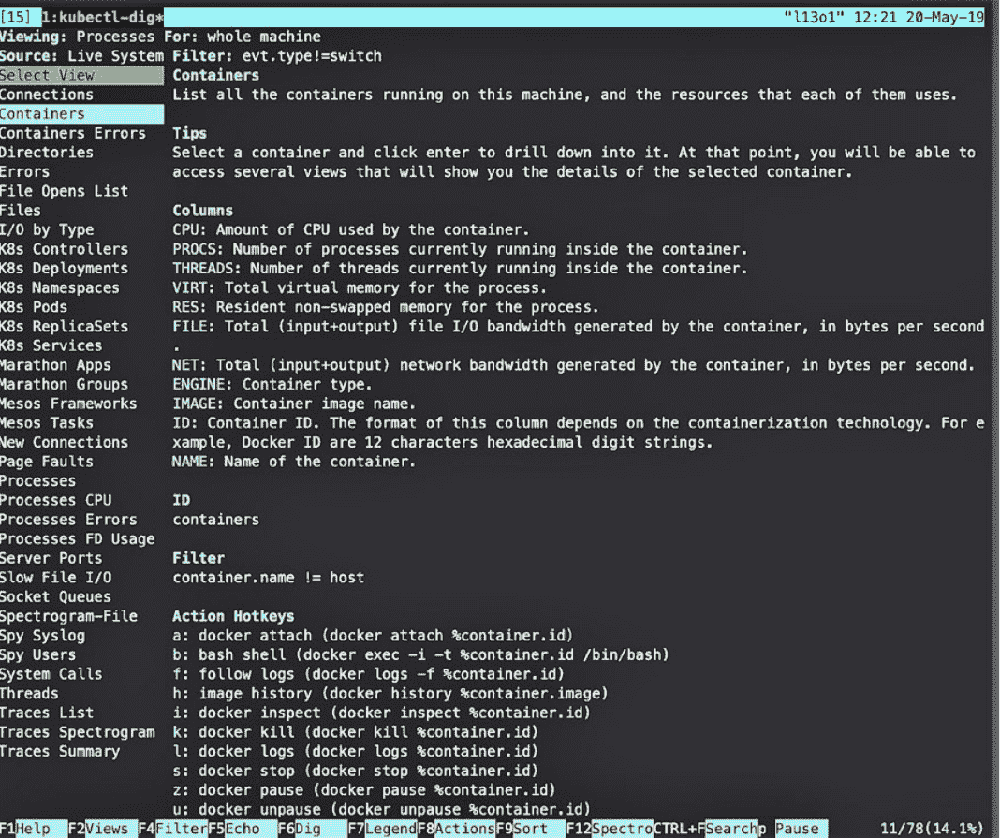

对于插件的执行，我们只需要传递参数名，它将获取关于它的所有详细和格式化信息。

### `Rakkess`

访问 Kubernetes 集群的所有元素是确保其安全的主要任务之一。通过 `kubectl`，可以从资源获取这些信息，但无法获取概览。`Rakkess` 插件允许我们以矩阵形式获取用户与所有服务器资源之间当前权限状态的完整列表。

<https://github.com/corneliusweig/rakkess>

在接下来的截图中，我们可以看到它的执行：

```text
使用 -rakkess [command] --help 获取更多关于命令的信息。
tuxotroc @ server ~
$ kubectl access-matrix -n default
NAME LIST CREATE UPDATE DELETE
bindings
configmaps
controllerrevisions.apps
cronjobs.batch
damemons.apps
damemons.extensions
deployments.apps
deployments.extensions
endpoints
events
events.events.k8s.io
horizontalpodautoscalers.autoscaling
ingresses.extensions
ingresses.networking.k8s.io
jobs.batch
leases.coordination.k8s.io
limstranges
localsubjectaccessreviews.authorization.k8s.io
networkpolicies.extensions
```

图 8.7：Rockies 插件执行

在上一个截图中，我们可以看到每个资源列出、创建、更新和删除的权限。

## 结论

在本章中，我们回顾了 Kubernetes 安全原则以及一些工具，例如 Kubernetes Bench for Security 项目（作为检查 Kubernetes 是否安全实施的应用程序），以及用于以安全方式管理 Kubernetes 集群的其他插件。

为了让开发者和 DevOps 能够在 Kubernetes 基础设施中获得最佳性能和安全性，我们分析了 Kubernetes 的现状，包括最佳实践、新发现的漏洞以及我们在 Kubernetes 生态系统中找到的用于检查 Kubernetes 集群安全的主要项目。

在下一章中，我们将回顾 Docker 网络概念、我们如何进行通信以及链接 Docker 容器。

## 问题

- API 授权和匿名身份验证的最佳配置是什么？
- 云端提供的禁用 Kubernetes Web 用户界面的命令是什么？
- Kubernetes 提供了哪种新机制，将所有分配和权限赋予角色而不是特定用户？
- 哪种工具通过执行 CIS Kubernetes Benchmark 中记录的控制措施来检查 Kubernetes 是否以安全的方式实施的？
- 哪种工具是由 Aqua Security 开发的 Python 脚本，允许分析 Kubernetes 集群中的潜在漏洞？

# 第 9 章

## Docker 网络

本章讨论了 Docker 网络的核心组件、Docker 容器如何进行通信和连接。此外，我们还将回顾端口映射等其他概念，Docker 使用端口映射暴露 TCP 端口，以便从容器向主机提供服务，使用户能够访问这些服务。

在将容器应用程序相互连接时，我们必须使用 Docker 网络才能让容器相互通信。例如，我想创建一个博客，为此我需要一个数据库和一个应用程序服务器或类似的东西，至少。我可以创建两个相互通信的容器。

## 结构

- 介绍容器网络类型
- Docker 中的网络管理
- 容器通信与端口映射
- 创建和管理 Docker 网络
- 链接容器

## 目标

- 了解容器网络类型
- 理解 Docker 中的网络管理
- 了解容器通信与端口映射
- 了解创建和管理 Docker 网络

## 介绍容器网络类型

Docker 网络基于命名空间（namespace），允许为每个主机生成一个完整的栈。在运行 Docker 的机器上，有 3 种网络配置。可以使用 `--net` 参数更改网络模式。通过此参数，你可以在以下模式之间选择：

- 默认网络：`--net = bridge` 为容器创建一个名为 `docker0` 的新栈。这是默认行为。
- 无网络连接：`--net = none` 允许容器在没有任何网络的情况下运行。该容器与网络隔离。
- 另一个容器的网络：`--net = mycontainer` 通知容器使用容器的栈。
- 主机网络：`--net = host` 意味着容器直接使用主机栈。

Docker 中有三种类型的网络。要执行此操作，你可以运行 `docker` 命令：

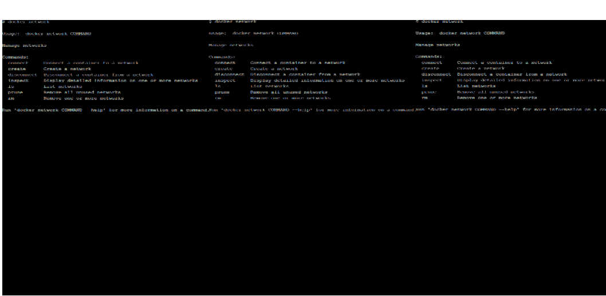

图 9.1：`docker network` 命令

通过以下命令，我们可以看到 Docker 主机中可用的网络：

```bash
$ docker network ls
```

在接下来的截图中，我们可以看到上一个命令的输出：

| [local] (local) 172.18.0.2 | [local] (local) 172.18.0.3 | [local] (local) 172.18.0.4 |
| --- | --- | --- | --- | --- | --- | --- | --- | --- | --- |
| NETWORK ID | NAME | DRIVER | SCOPE | NAME | DRIVER | SCOPE | NAME | DRIVER | SCOPE |
| 281533333333 | bridge | bridge | local | none | null | local | none | null | local |
| 555555555555 | bridge | bridge | local | scale4db | host | local | none | null | local |
| 666666666666 | host | host | local | scale4db | host | local | none | null | local |
| 777777777777 | none | null | local | none | null | local | none | null | local |

图 9.2：`docker network ls`

使用网络模式 `--none` 时，容器没有任何通信。它用于容器不需要访问外部或内部网络的情况。你启用的唯一 IP 地址是环回或本地主机 localhost。

```bash
$ docker run --net=none -it --rm debian
```

在接下来的截图中，我们可以看到上一个命令的输出：

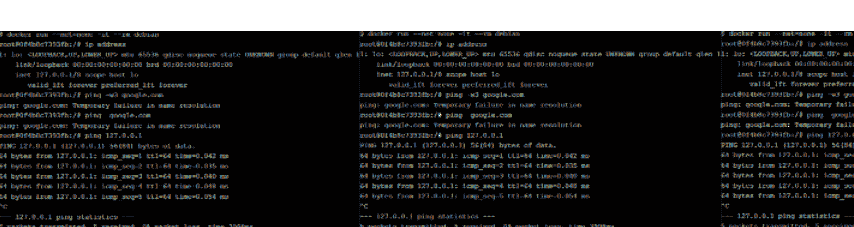

图 9.3：使用 `none` 选项的容器网络配置

通过这种方式，你的容器无法访问网络。Docker 会将容器添加到网络组，但不会添加网络接口。当你对使用此配置的容器执行 `docker inspect` 时，我们看到它并没有被真正分配 IP 地址。

```bash
$ docker run --network=none ubuntu:14.04 /bin/bash

root@18ecc37d0ae2# ifconfig

lo Link enc:Loopback

inet addr:127.0.0.1 Mask:255.255.255.0

UP LOOPBACK RUNNING MTU:65536 Metric:1

RX packets:errors:0 dropped:0 overruns:0 frame:0

TX packets: errors:0 dropped:0 overruns:0 carrier:0

collisions:0 txqueuelen:1

RX bytes:0 (0.0 B) TX bytes:0 (0.0 B)

$ docker inspect | grep -laddr

"LinkLocalIPv6Address": "",
"SecondaryIPv6Addresses": null,
"SecondaryIPv6Addresses": null,
"GlobalIPv6Address": "",
"IPAddress": "",
"MacAddress": "",
"IPAddress": "",
"GlobalPv6Address": "",
"MacAddress": "",
```

## 桥接模式

`bridge` 是 Docker 的默认网络，允许与主机的其他接口以及容器之间进行连接。当 Docker 服务守护进程启动时，它会配置一个名为 `docker0` 的虚拟以太网设备。该虚拟以太网设备通过 Linux 命名空间映射到容器中的 `eth0`。

如果我们基于 Ubuntu 并使用此网络启动一个容器，我们可以看到它是如何与宿主机 Docker 的其他容器以及外部互联网连接的。

```bash
$ docker run --network=bridge ubuntu:14.04 /bin/bash
```

在接下来的截图中，我们检查上一个命令的输出：

```text
$ docker run --network=bridge ubuntu:14.04 /bin/bash
root@cb2b1d92f210c:# ifconfig
eth0      Link encap:Ethernet Hwaddr
       inet addr:172.17.0.2 Bcast:172.17.0.255 Mask:255.255.255
       UP BROADCAST RUNNING MULTICAST MTU:1500 Metric:1
       RX packets:0 errors:0 dropped overruns:0 frame:0
       TX packets:0 errors:0 dropped overruns:0 carrier:0
       collisions:0 txqueuelen:0
       RX bytes:(0.0 B) TX bytes:0
lo       Link encap:Local Loopback
       inet addr:127.0.0.1 Mask:255.255.0.0
       UP LOOPBACK RUNNING MULTICAST MTU:65536 Metric:1
       RX packets:0 errors:0 dropped overruns:0 frame:0
       TX packets:0 errors:0 dropped overruns:0 carrier:0
       collisions:0 txqueuelen:1
       RX bytes:(0.0 B) TX bytes:0 (0.0 B)
```

图 9.4：使用 `bridge` 选项的容器网络连接

通过简单的 `ping`，我们检查了与其他容器的连通性：


## 9.5: 网络容器内部的 Ping 连通性

我们也可以检查到与外部网络的连接：

```
root@cb2d1d2f210c:/$ ping google.com
PING google.com (172.217.15.78): 56(84) bytes of data.
64 bytes from iad23e63-in-f14.le100.net (172.217.15.78): icmp_seq=1 ttl=51 time=1.38 ms
64 bytes from iad23e63-in-f14.le100.net (172.217.15.78): icmp_seq=2 ttl=51 time=1.40 ms
64 bytes from iad23e63-in-f14.le100.net (172.217.15.78): icmp_seq=3 ttl=51 time=1.41 ms
---
3 packets transmitted, 3 received, 0% packet loss, time 2003ms
```

## 9.6: 网络容器外部的 Ping 连通性

桥接网络连接的输出可能类似于所示：

```json
[
  "Name": "bridge",
  "Id": "89d0d3e95545966c300a5aed55fa01422a95c0519ca7d3bf55d1b1e3230",
  "Created": "2019-10-28T11:53:06.550Z",
  "Scope": "local",
  "Driver": "bridge",
  "EnableIPv6": false,
  "IPAM": {
    "Driver": "default",
    "Options": null,
    "Config": [
      {
        "Subnet": "172.17.0.0/16"
      }
    ]
  },
  "Internal": false,
  "Attachable": false,
  "Ingress": false,
  "From": {
    "Network": "*"
  },
  "ConfigOnly": false,
  "Containers": {
    "Options": {
      "docker.network.bridge.default_bridge": "true",
      "docker.network.bridge.enable": "true",
      "docker.network.bridge.enablemasquerade": "true",
      "docker.network.bridge.hostipv4": "0.0.0.0",
      "docker.network.bridge.name": "docker0",
      "docker.network.driver.mtu": "1500"
    }
  },
  "Labels": {}
]
```

桥接模式通过`docker0`接口提供了一个内部主机网络，同一宿主机上的容器可以在该网络中通信，但分配给每个容器的 IP 地址无法从外部访问。

图 9.12：容器内部的活动连接

通过`host`模式，我们可以让容器共享宿主机的网络命名空间。执行命令后，你应该可以在容器内部看到网络细节与它们在 docker 宿主机上的定义完全相同。

在接下来的截图中，我们可以看到容器内部的网络连接：


图 9.13：容器内部的网络连接

由于容器只是运行在宿主机上的进程，最简单的选项似乎将其连接到宿主机的网络命名空间。从网络角度来看，容器的行为就像运行在宿主机上的任何其他进程。因此，它将使用宿主机的 IP 地址，并使用宿主机的 TCP 端口空间来暴露容器内部运行的服务。

我们可以使用以下命令以`host`模式运行一个`nginx`容器：

```bash
$ docker run -d --name nginx-1 --host nginx /bin/sh
```

这意味着如果我们的容器是一个在宿主机 80 端口上监听的 NGINX Web 服务器。想象一下稍后我们尝试在同一台宿主机上运行另一个标准的 Web 服务。除非另有说明，第二个容器可能会尝试连接到相同的端口。但由于端口 80 现在被我们的第一个容器占用，第二个容器将无法连接到宿主机并失败。

在接下来的截图中，我们可以看到`host`模式下容器内部的接口：


通过使用`--network=host`参数运行容器，我们可以使用`pfcount`命令捕捉宿主机接收的流量。

```bash
$ docker run --network=host ubuntu pfcount -i eth0
```

`host`模式用法。

- 易于使用。

- 它不对对入流量进行任何操作（例如 NAT），因此对性能没有影响。

`host`模式的缺点：

- 在没有额外的动态端口分配机制的情况下，服务会在端口级别发生冲突。

- 动态端口分配必须由 Kubernetes 或 Docker Swarm 等容器编排平台管理。

- 容器共享宿主机的网络命名空间，这可能带来安全影响。如果我们的 Docker 宿主机暴露于漏洞，处于运行状态的容器将会被暴露。

## Docker 中的网络管理

正如我们在上一节中看到的，Docker 提供了三种网络。第一种`bridge`（桥）是所有容器默认启动的网络。网络在我们启动的容器的网络接口与安装 Docker 时在计算机上创建的虚拟网络接口之间创建一个桥。

下一个是`host`模式。它的作用是复制宿主机网络配置，即启动容器的服务器或机器的配置。如果我们在这里启动容器并运行网络配置检查，我们会发现它与运行的机器是相同的。

最后，我们有`none`网络，它的作用是从我们的容器中删除所有网络配置。如果我们使用此配置创建容器，我们只有回环地址`127.0.0.1`，将无法连接到任何站点。

## Docker 网络

Docker 使用以太网桥允许 docker 守护进程与宿主机的网络设备通信。当你构建 Docker 容器时，你可以标识端口为暴露（exposed）。连接到具有暴露端口的另一个容器的容器可以与该端口通信。要让外部访问端口，你可以将容器端口分配到宿主机上的端口。你必须记住，当容器可能从外部访问时，仅暴露 Docker 容器的端口是不够的，你需要显式地发布（publish）它。

例如，如果你暴露了一个端口，容器中的服务仅从其他 Docker 容器访问。因此，此功能提供了容器间的通信。如果你发布了一个端口，容器中的服务可以从 Docker 外部的任何地方访问。

Docker 为容器提供独立机器的一种方式是，Docker 为容器进程提供了它自己的 IP 地址。Docker 通过配置虚拟接口并将其链接到宿主机网络来实现这一点。

当我们安装 Docker 时，可以看到它创建了一个名为`docker`的接口。它有一个私有 IP 地址，如果它与你配置的任何其他 IP 地址冲突，可能就是这一个。当我们创建某种连接到桥接网络的容器时，它会从 DHCP 接收 IP 地址吗？

你所有的容器都通过这个 IP 进行 NAT，以及你安装 Docker 的宿主机机器的 IP 输出。这是你的默认网络。同样，你可以从此接口和此 IP 地址连接到在该网络上运行的容器的 IP 地址。

在执行容器时可以建立的网络配置中，我们可以突出：

- `--dns`：一个 DNS 服务器，用于解析 URL（例如 `http://docker.io`）到运行实例的服务器 IP 地址。

- `--dns-search`：设置 DNS 搜索服务器。

- `-h`：设置主机名。这会在`/etc/hosts`文件中添加条目，容器 IP 指向宿主机。

- `--link`：允许容器与其他容器通信，而无需知道它们的真实 IP 地址。

- `--expose`：暴露容器端口但不将其发布到宿主机。

- `--publish`：允许你按照以下格式发布容器端口：

```
hostPort:containerPort|ip:containerPort
```

- `--network`：指定连接到容器的网络。选项有`bridge`、`host`、`none`、`overlay`。

- `--publish`：将容器端口映射到宿主机上的端口。格式：`hostPort:containerPort`。

- `--expose`：记录将发布但尚未发布的容器端口。

- `--dns`：设置自定义 DNS 服务器。

- `--dns-search`：设置 DNS 搜索域。

- `--hostname`：为容器设置主机名。

- `--link`：链接到另一个容器（已弃用）。

### 暴露端口

在创建容器时，你可以暴露它将服务的端口。你可以执行以下命令来暴露端口。

```
$ docker run -it --expose 80 --expose 443 --name
```

为了验证容器的配置并查看其 JSON 文件，请使用以下命令：

```
$ docker inspect
```

在该 JSON 文件的`NetworkSettings`部分中，你可以看到容器暴露的端口：

```json
"NetworkSettings": {
  "Bridge": "",
  "SandboxID": "5ed72597ba63deb87532341ea432aea9ffd02389925253acabcdc47f2af523",
  "HairpinMode": false,
  "LinkLocalIPv6Address": "",
  "LinkLocalIPv6PrefixLen": 0,
  "Ports": {
    "443/tcp": null,
    "80/tcp": null
  }
}
```

例如，我们可以让`tomcat`服务器实例从容器外部被访问。要实现这一点，我们需要在执行容器时添加这些标志。首先，我们需要通过使用`-p`（`-publish`）标志指定我们想要发布的端口映射来开始。

```bash
-p :
$ docker run -d -p 8080:8080 tomcat
```

这种简单的端口映射对于 Docker 的最常见用来说已经足够了。我们现在可以将服务或微服务作为 Docker 容器安装，并暴露它们的端口以实现通信。

在在上一个案例中，我们执行了手动映射。如果我们希望端口是动态的并由容器直接分配，Docker 的`-P`标志会自动为我们的应用程序分配端口：

```
$ docker run -d -P tomcat
```

通过这种方式，我们可以看到`-p 8080:8080`标志如何将其分配到端口映射，而`-P`标志则自动通过映射`32768:8080`分配端口。

| CONTAINER ID | IMAGE PORTS NAMES | COMMAND | CREATED |
|---|---|---|---|
| fc6bd72c34af Up 2 seconds tomcat | "catalina.sh run" | 2 seconds ago |
| 6210e8cf0a2 Up 4 minutes tomcat | "catalina.sh run" | 4 minutes ago |

```bash
$ docker port fc6bd72c34af
8080/tcp -> 0.0.0.0:8080
[node1] (local) root@192.168.0.38 ~ 
$ docker port 6210e8cf0a2
8080/tcp -> 0.0.0.0:8080
```

## 创建和管理 Docker 网络

除了使用之前提到的三种类型的网络外，你还可以创建自己的网络配置供你的 Docker 容器使用。Docker 允许我们根据需求创建不同的虚拟网络，用以加入或隔离不同的容器。通过这种方式，我们可以出于安全考虑将容器隔离在不同的网络，或者为了方便或通过将它们的服务相互连接将它们连接在一起。

## Docker 网络命令

以下是可以与 Docker 网络配合使用的命令列表：

- `$ docker network inspect`：此命令让你了解网络所使用的资源及其配置。

- `$ docker network ls`：它显示 Docker 创建的网络列表。

- `$ docker network create`：它允许你创建自己的网络：`bridge`或`overlay`。容器可以在其网络内部通信，也可以通过网络进行通信。

要查看所有选项，在创建网络时，我们将执行以下命令：

```bash
$ docker network create --help
```


图 9.15: 网络命令选项

在下一节中，我们将详细介绍如何使用之前的命令创建一个网络。

## Bridge 网络

Docker 最频繁使用的网络是桥接网络（bridge）。我们可以根据需要的目的创建自己的网络，例如，在 DMZ（非军事化区）中为数据库服务器创建一个子网，为位于公共网络中的网站提供服务。在接的命令中，我们将创建一个桥接 docker 网络。

要做到这一点，你必须执行`docker network create`命令。

```bash
$ docker network create --subnet 10.10.1.0/24 dmz
```

我们可以通过`docker network inspect`命令查看分配到网络的容器：

```bash
$ docker network inspect
```

```json
这是一个输出示例，可以在这里看到子网配置和与该网络关联的容器。
{
  "Name": "dmz",
  "id": "b8da7e2ab9a71f38a0128bf9c78af63f9df230d804d9e237",
  "Created": "2019-10-28T13:27:29Z",
  "Scope": "local",
  "Driver": "bridge",
  "EnableIPv6": false,
  "IPAM": {
    "Driver": "default",
    "Options": {},
    "Subnet": "10.10.1.0/24"
  },
  "Internal": false,
  "Attachable": false,
  "Ingress": false,
  "Config": {
    "Network": "",
    "ConfigOnly": false
  },
  "Containers": {
    "b562f2b0ad0f2ffd691938222c5263948bc706a1c96": {
      "Name": "ubuntu",
      "EndpointID": "201a4fe3bf05182ec44c247368a52dd50fd9a23cd104d",
      "MacAddress": "02:42:ac:01:02",
      "IPv4": "10.10.1.2"
    }
  },
  "Options": {}
}
```

## 将容器连接到网络

为了将容器连接到网络，必须指定要连接的网络`--network`选项，后面接网络名称。例如，运行一个容器并添加到创建的网络中，命令如下：

```bash
$ docker run -d --name mysql --network blog
```

对于已存在的容器，使用以下命令：

```bash
$ docker network connect
```

使用`docker network connect`命令可以将容器连接到可用网络。在将容器连接到网络后，我们可以通过`inspect`容器查看配置：

```bash
$ docker inspect
```

如果我们`inspect`容器，可以看到两个网络，一个是`bridge`，另一个是`dmz`。

```json
"Networks": {
  "bridge": {
    "IPAM": null,
    "Links": [],
    "Aliases": [],
    "NetworkID": "cb31c00617558c0c032825a9c232b7a6ffc54fed714363f217c4b922",
    "EndpointID": "d3209d19af8b01ac74c549847d32cbc0e16fd217c4b92",
    "Gateway": "172.17.0.1",
    "IPAddress": "172.17.0.2",
    "IPv6PrefixLen": 16,
    "IPv6Gateway": "-",
    "GlobalIPv6Address": "-",
    "GlobalIPv6PrefixLen": 0,
    "MacAddress": "02:42:ac:11:00:02",
    "DriverOpts": null
  },
  "dmz": {
    "IPAMConfig": {},
    "Links": null,
    "Aliases": [
      "b562f2b0ad0f"
    ],
    "NetworkID": "bda7e2ab971f38a021ebbfc9786e7fac53df923080d49nae2cd83"
  }
}
```

`NetworkID`: "bda7e2ab971f38a021ebbfc9786e7fac53df923080d49nae2cd83",

在另一个例子中，我们将创建一个网络`my-network`


```bash
$ docker network create my-network
7989668b483d38ca83642f3197afdec9188116d079b702023c065c0dfe8980
[node1] (local) root@192.168.0.28 ~
$ docker network ls
```

| NETWORK ID | NAME | DRIVER | SCOPE |
| --- | --- | --- | --- |
| 80302a4d5531 | bridge | bridge | local |
| 21276d939421 | host | host | local |
| 7989668b483 | my-network | bridge | local |
| 03bf600bbfec | none | null | local |

图 9.16：创建网络

我们可以启动一个基于 `elasticsearch` 镜像的容器并将其连接到我们创建的网络：

```bash
$ docker run -d --net=my-network --name elasticsearch elasticsearch:2.2
$ docker ps
```

| CONTAINER ID | IMAGE | COMMAND | CREATED |
| --- | --- | --- | --- |
| 8c7cb852b9c2 | elasticsearch:2.2 | /docker/entry-point... | About a |
| minutes ago | Up a minute | 9200/tcp, 9300/tcp |

我们也可以启动一个名为 `ubuntu` 的基于 Ubuntu 的容器，并将其连接到新网络。在这种情况下，我们将启动一个基于 `ubuntu` 镜像的容器：

```bash
$ docker run --net=my-network --name ubuntu:14.04 bash
```

下一步是验证两个容器之间的可可见性。要实现这一点，我们首先使用 `docker exec` 命令连接到 `ubuntu` 容器：

```bash
$ docker exec -it ubuntu
```

我们可以通过以下命令，从 `ubuntu` 容器中 ping 并请求 `elasticsearch` 容器：

```bash
$ ping elasticSearch
```

```bash
curl http://elasticSearch:9200
```

在接下来我们看到了命令的输出：

```http
HTTP/1.1 200 OK
Content-Type: application/json; charset=UTF-8
Date: Wed, 24 May 2023 10:00:00 GMT
Content-Length: 592
Connection: keep-alive

{
  "name" : "Elasticsearch",
  "cluster_name" : "elasticsearch-cluster",
  "cluster_version" : {
    "elastic" : "7.17.0",
    "elasticsearch" : "7.17.0",
    "lucene" : "7.17.0",
    "security" : "7.17.0",
    "scene" : "7.17.0",
    "version" : "7.17.0",
    "tag_list" : ["7.17.0"],
    "tag_line" : "7.17.0"
  },
  "tag" : "7.17.0",
  "number_of_nodes" : 1,
  "arm_buildata" : [
    {
      "node_id" : "elasticsearch-node-1...",
      "node_name" : "elasticsearch-node-1...",
      "process_id" : 12,
      "data_roles" : ["data"],
      "roles" : ["master"],
      "remote_cluster_name" : null,
      "remote_cluster_user" : null,
      "remote_cluster_port" : null,
      "transport_ip" : "127.0.0.1:9300",
      "http_ip" : "127.0.0.1:9200",
      "heap_memory_usage" : {
        "total_size_bytes" : 536870912,
        "used_memory_bytes" : 154286000,
        "free_memory_bytes" : 382584912
      },
      "jvm_memory_usage" : {
        "total_size_bytes" : 536870912,
        "used_memory_bytes" : 120000000,
        "free_memory_bytes" : 416870912
      }
    }
  ]
}
```

图 9.17：检查与 `elasticSearch` 容器的连接性

我们也可以从这里检查 Ubuntu 容器的连接：

```bash
docker exec -it elasticSearch bash
```

```bash
root@8c7c80b5529c:/usr/share/elasticsearch# ping ubuntu

PING ubuntu (172.19.0.3): 56 bytes of data

64 bytes from 172.19.0.3: icmp_seq=0 ttl=64 time=0.09 ms
64 bytes from 172.19.0.3: icmp_seq=1 ttl=64 time=0.08 ms
64 bytes from 172.19.0.3: icmp_seq=2 ttl=64 time=0.072 ms

--- statistics ---
3 packets transmitted, 3 packets received, 0% packet loss
```

通过这种方式，我们回顾了如何在 Docker 中创建新网络并连接可以相互通信的新新容器。

## 链接容器（Linking containers）

当创建一个容器时，这些容器需要通过 IP 地址或主机名相互连接。但如果容器在再次启动时关闭，会生成新的参数，例如它所使用的 ID 和 IP 地址。

为了解决这个问题，存在一种链接一个或多个容器的功能，这允许每个被链接的容器被关闭和启动，Docker 引擎分配的 IP 并不重要，因为它是通过容器名称进行连接的。所有必要的魔法工作都由 Docker 引擎完成，例如路由规则、DNS 规则等。

### 使用 `--link` 在同一主机内链接容器

容器之间的链接基于它们的名称，因此使用有意义的名称来命名容器通常很有用。容器之间的网络连接是另一种在容器之间建立连接并用于数据交换的系统。

在这里我们将看到的是如何使用这种链接系统建立容器。在这种链接系统中，一个容器充当数据源，另一个是接收容器。这类似于 Unix 中的管道（pipe）概念。

链接允许容器在不知道另一个容器 IP 地址的情况下与该容器通信。这是通过将第一个容器的 IP 地址插入到第二个容器的 `/etc/hosts` 文件中实现的。为了进行链接，在用命令创建容器时将使用变量 `--link`：

```bash
$ docker run --link=$name -h
```

使用 `--link` 标志，Docker 会在容器的 `/etc/hosts` 文件中添加一个条目，包含主机名、容器的 IP 地址和标识符。

我们可以使用命令创建一个 `elasticSearch` 容器：

```bash
$ docker run -d --name elasticSearch elasticsearch:2.2
```

接下来，我们使用 `link` 运行 `ubuntu` 容器，将我们的容器与之前创建的 `elasticsearch` 连接起来。

```bash
$ docker run -it --name ubuntu --link elasticSearch:elasticsearch ubuntu:10.04 bash
```

执行该命令后，我们可以检查连接性。链接允许容器在不知道另一个容器 IP 地址的情况下与该容器通信。这是通过将第一个容器的 IP 地址插入到第二个容器的 `/etc/hosts` 文件中实现的。为了进行链接，在用命令创建容器时将使用变量 `--link`：

使用 `--link` 标志，Docker 会在容器的 `/etc/hosts` 文件中添加一个条目，包含主机名、容器的 IP 地址和标识符。

这里发生的情况是 Docker 在容器的 `/etc/hosts` 文件中创建了一个条目。

通过环境变量，我们可以访问并发现另一个容器的服务。这有时很有用，但当我们想要从一个容器向另一个容器隐藏某些服务时，可能会产生安全问题。

在另一个示例中，我们正在让 MySQL 与 wordpress 通信。第一个命令执行 mysql 容器。在这种情况下，我们提供了一个环境变量以便容器可以初始化数据库。

```bash
$ docker run --name wp-mysql -e MYSQL_PASSWORD=yoursecretpassword -d mysql
$ docker run --name wordpress --link wp-mysql:mysql -p 1003:80 -d wordpress
```

在第二个命令中，我们运行了一个带有 Wordpress 镜像的容器。使用 `--link` 标志，我们将 mysql 容器链接到 wordpress 容器（`--link wp-mysql:mysql`）。它还使用了本地端口分配（`-p 1003:80`）。如果你现在导航到 `http://localhost:1003` URL，你将看到 Wordpress 界面。

在下面的截图中，我们可以看到运行中的容器：


图 9.20：运行中的 Wordpress 和 MySQL 容器

在另一个示例中，我们基于 Redis 镜像创建一个容器，并将其链接到基于 Debian Linux 发行版的容器上：

首先，我们创建一个名为 `myredis` 的 redis 容器：

```bash
$ docker run -d --name myredis
```

接下来，我们将 redis 容器与 debian 容器连接起来：

```bash
$ docker run --link myredis:redis debian
```

在接下来的截图中，我们可以看到上一个命令的输出：


图 21：Docker 在 Debian 容器内部为 Redis 配置了带有 `REDIS_PORT` 前缀的环境变量，其中包含了如何连接到 Redis 容器的信息。

Docker 还从链接的容器导入了环境变量，其前缀为 `REDIS_ENV_`。虽然此功能非常有用，但重要的是记住，如果你使用环境变量来存储 API 令牌或数据库密码等密钥，这些数据可能会在其他容器中暴露。

## 结论

在本章中，我们回顾了如何在 Docker 容器中配置网络，使这些容器不会与其它物理、虚拟或容器化的系统断开连接。读者学习了 Docker 网络的主要类型，以及如何通过创建我们的 Docker 网络来将容器相互连接。得益于 Docker 网络的使用，我们能够创建更复杂的应用程序，并且每个容器都可以提供一个自主运行的服务，且容器之间可以通信。这就是为什么 Docker 提供了管理 Docker 网络的命令。

在下一章中，我们将回顾了用于 Docker 容器监控的开源工具，例如 `cadvisor`、`dive` 和 `sysdigfalco`。

## 问题

哪种默认的 Docker 网络模式允许与主机的其他接口以及容器之间进行连通？

在何种类型的网络中，主机上定义的所有网络接口对容器都是可见的，且容器共享主机的网络命名空间？

哪个标志允许你显式地指示 Docker 哪个端口应该链接到容器中的某个端口？

哪条 Dockerfile 指令让你指示从镜像构建中暴露特定的端口？

使用哪条命令将容器连接到可用的网络？

# 第 10 章：Docker 容器监控

本章介绍了一些用于 Docker 监控的开源工具，例如 `cAdvisor`、`dive` 和 `Sysdigfalco`。

当你运行 Docker 时，需要考虑的最重要事项之一是如何衡量容器的性能。定义一个全面的策略来通过原生采集源对事件、统计、配置和记录进行 Docker 基础设施的监控，并提供对 CPU、内存和网络容器性能的视图，是非常重要的。

## 结构

- 容器统计、指标和事件
- 使用 `cAdvisor` 进行性能监控
- 使用 `Dive` 进行性能监控
- 使用 `Sysdigfalco` 进行容器监控

## 目标

- 了解从 Docker 容器获取统计数据、指标和事件
- 了解 `cAdvisor` 作为性能监控工具
- 了解 `Dive` 作为性能监控工具
- 了解 `Sysdigfalco` 作为容器监控工具

## 容器统计、指标和事件

有多种方法可以控制 Docker 容器的执行。可以可视化日志，并在内存使用和 CPU 级别观察容器的事件和统计。让我们看看 Docker 想要可视化执行容器时记录的日志提供了什么。

## 日志管理

大多数应用程序将日志发送到标准输出。如果容器在前台运行，你可以直接在控制台中看到日志。然而，当以后台模式运行容器时，控制只会显示容器标识符（ID）。

日志管理是安全领域最重要的任务之一，它允许监控容器内部发生的情况。不同的容器会在同一个 Docker 主机上同时运行，每个容器都可以生成自己的日志；因此，对日志进行集中式管理是必要的。

有几个命令可以监控日志：

```bash
$ docker logs
```

```bash
$ docker service logs
```

在这种情况下，Docker 引擎会在日志文件中收集运行中容器的所有标准输出。我们可以通过以下命令将容器的执行日志可视化：

```bash
$ docker logs -f
```

在接下来的截图中，我们可以看到日志选项：

### 图 10.1：`docker logs` 命令选项

其工作原理是：发送到容器内标准输出或错误输出的日志被 Docker 守护进程捕获，并传输到可配置的后端，默认情况下是每个容器一个 JSON 文件。在这个示例中，我们可以看到 nginx 容器的日志输出。

```bash
$ docker logs nginx
nginx stderr | 2019/11/09 00:34:56 [notice] 12#0: using the "epoll" ...
nginx stderr | 2019/11/09 00:34:56 [notice] 12#0: nginx/1.0.15
nginx stderr | 2019/11/09 00:34:56 [notice] 12#0: built by gcc 4.4.7 ...
```

支持此日志的文件默认位于 Docker 主机的 `/var/lib/docker/containers/` 路径下，该路径会被容器标识符替换。这些文件的格式类似于每行都由一个 JSON 对象表示。

在接下来的截图中，我们可以看到每个容器日志所在的路径：


### 图 10.2：每个容器日志所在的路径

默认情况下，日志存储在路径 `/var/lib/docker/containers/` 下的 JSON 文件中。由于 Docker 使用不同的驱动程序，这种行为可以更改。默认驱动程序是 `json-file`。对于这些驱动程序，在执行 `docker` 命令时必须使用 `--log-driver` 选项。例如，为了将日志存储在任何基于容器的 syslog 中，我们可以执行：

```bash
$ docker run --log-driver=syslog nginx
```

观察日志是监控 Docker 主机应用程序最方便的方法。你还可以查看运行容器的属性，例如映射的网络端口或映射的卷。使用 `docker inspect` 命令来显示这些资源更为有效，因为它以元数据的形式提供了所有这些信息。

## 容器统计

`stats` 命令允许你实时获取一个或多个运行容器的统计数据。该命令允许你看到 CPU、内存以及网络层 I/O 操作。命令的语法如下：

```bash
$ stats [CONTAINER]
```

在接下来的截图中，我们可以看到 `stats` 命令：


上述命令通过 Docker 守护进程工作，该进程获取 cgroups 资源信息并通过 API 提供。

默认情况下，如果没有指定容器，该命令将显示所有运行容器的统计数据。

```bash
$ ps
```

```bash
$ stats
```

通过 `docker stats`，我们还可以获得所有运行容器的实时统计信息。`docker stats` 命令接受以下选项：

- `--no-stream`：此选项禁用实时统计，并将仅显示第一个结果。
- `-a`（`--all`）：此选项显示所有容器的统计信息。

统计信息可用于查看容器在执行期间的行为。这些信息对于验证我们是否需要对容器应用某些资源限制非常有用。

在监控运行中的容器时，查看记录、容器元数据和运行时统计提供了许多可能性。我们还可以看到 Docker 宿主机在执行命令时发生了什么，并会发布我们可以观察的事件。

```bash
$ docker stats
```

| CONTAINER | CPU% | MEM US / LIMIT MEM% | NET I / O |
| --- | --- | --- | --- |


| :--- | :--- | :--- | :--- |
| | 0.00% | 7.227 MIB / 987.9 MIB 0.73% | 936 B / 468 B |

基本上，它提供了关于容器消耗的 CPU 数量、已用内存以及可用内存限制的信息。你还可以看到内存使用的百分比，方便用户检查容器还有多少可用内存。

该端点以 JSON 格式提供了更详细的统计数据。

例如，我们可以启动容器并使用以下命令查看其统计信息：

```bash
$ docker run -d ubuntu:latest sleep 1000
```

```text
91c6eb7c33f7d9a91d267177feb3aa9a5a78796e3319e1b7561dc4f244
```

现在容器正在运行，端口 2375 上有一个端点`/stats`。要访问此信息，需要将执行上述命令后的容器标识符传递到 URL 中。

```bash
$ curl -http://localhost:2375/v1.40/containers/stats
```

在接下来的中中我们可以看到上一个命令的输出：

图 10.5：通过端点的 Docker stats

在此端点中，你可以获取详细的内存使用情况以及 CPU 使用信息。请注意，该端点是由容器执行的，因此无法通过该端点的调用获取所有容器的统计信息。

如果你有想要监控的特定指标，可以编写自己的解决方案或直接调用内核。你将需要使用允许你进行低级内核调用的语言，例如 Go 或 C。

运行时指标`http://docs.docker.com/config/containers/metrics/`显示了如何操作，并深入探讨了可用的各种内核指标。一旦你暴露了所需的数值，你可以搜索`statsd`等工具来添加指标，使用 InfluxDB 和 OpenTSDB 进行指标存储，并使用 Grafana 显示结果。

## 使用`docker inspect`获取指标

另一种获取指标的方法是通过`docker inspect`命令，其中`ps -q`选项允许你获取所有执行中容器的标识符。

```bash
$ docker stats --no-stream $(docker ps -q) | sed -e "format {{.ID}} {{.Names}}" | sed -e "s/(..)/\1/s1/2t;g;"
```

在接下来的截图中我们可以看到上一个命令的输出：

图 10.6：带有`docker inspect`的 Docker stats

在本节中，我们回顾了`docker stats`命令以形成 Docker 容器内部的主要统计信息。下一节将重点关注获取容器内部生成的事件的其他命令。

Docker 守护进程内部会生成围绕容器生命周期的事件流。通过`docker events`命令，可以实时查看内部发生了哪些生命事件。

## Docker 容器中的事件

事件序列对于监控场景和执行额外操作非常有用，例如在任务结束时接收报警。在生产环境中运行许多容器的情况下，如果我们可以实时查看容器事件以便监控和调试，那将非常有用。

在接下来的截图中，我们可以看到`events`命令的选项：

图 10.7：带有`docker event inspect`的 Docker stats

为了实时观察到达 Docker 引擎的事件，我们使用`docker events`命令。如果我们想知道容器运行期间发生了什么，这个命令将非常有用。容器代表了大量的事件列表。

该列表包括以下命令：`attach`、`commit`、`copy`、`create`、`destroy`、`detach`、`die`、`execcrate`、`execdetach`、`exec_start`。

`events`命令具有`-f`过滤器参数，允许你在寻找特定内容时过滤结果。如果没有提供过滤器，则将报告所有事件。

调用`events`命令将显示 Docker 中发生的活动、实时运行的进程，用以跟踪几乎所有的操作和捕捕获的系统调用。

可能的过滤器列表包括：

- `container=`
- `event=`
- `image=`
- `plugin=`
- `label=`
- `type=`
- `volume=`
- `network=`
- `daemon=`

你可以使用`docker events`的`--since`或`--until`选项根据时间戳过滤结果：

- `--since = "日期"`：显示从该日期创建的所有事件。
- `--until = "日期"`：显示到该日期为止创建的所有事件。

例如，以下命令显示了 2020-01-01 之后的事件：

```bash
$ docker events --since '2020-01-01'
```

我们也可以通过标识符获取特定容器的事件：

```bash
$ docker events --filter container=
```

```yaml
build:
  context: https://github.com/jesseduffed/lazydocker.git
  args:
    BASE_IMAGEBUILDER:ang
    GOARCH: amd64
    GOARM:
  image: lazyteam/lazydocker
  container_name: lazydocker
  stdin_open: true
  tty: true
  volumes:
    - /var/run/docker.sock
    - /.config/config/jesseduffed/lazydocker
```

要执行上文件，我们可以使用`docker-compose up -d`命令。

在下面的截图中我们可以看到上一个 docker-compose 文件的输出：


图 10.12：使用 LazyDocker 显示容器详情

执行 LazyDocker 时，你可以看到正在运行的容器信息以及为每个镜像生成的层。

## 使用 cAdvisor 进行性能监控

在 Docker 生态系统中，我们可以找到一些工具来以图形化的方式可视化宿主机 Docker 中容器的 CPU 和内存使用情况。其中我们可以突出 cAdvisor、Prometheus 和 Dive。

### cAdvisor 作为监控工具

cAdvisor 是实现面向容器的性能监控的最实用的工具之一。此外，它允许监控：

- 资源隔离参数
- 资源历史使用情况
- 网络统计

该工具作为公共镜像发布在 Docker Hub 上：<https://hub.docker.com/r/google/cadvisor>

此外，源代码可以在 GitHub 仓库中找到：<https://github.com/google/cadvisor>

可以将 cAdvisor 作为应用程序运行。为此，我们需要下载源代码并按照文档以独立模式模式运行应用程序：<https://github.com/google/cadvisor/blob/master/docs/running.md#standalone>

运行 cAdvisor 最简单的方法是通过容器并执行以下命令来实现：

```bash
sudo docker run \
--volume=/roots:ro \
--volume=/var/run:var/run:ro \
--volume=/sys:sys:ro \
--volume=/var/lib/docker/:/var/lib/docker:ro \
--volume=/dev/disk:/dev/disk:ro \
--publish=8080:8080 \
--detach=true \
--name=cadvisor \
google/cadvisor:latest
```

在下面的截图中我们可以看到上一个命令的输出：


图 10.13：cAdvisor 执行

使用上一个命令启动容器后，我们可以从浏览器访问 URL`http://localhost:8080`而不需要用户名或密码。如果我们需要对此服务进行某种身份验证，可以使用该项目：<https://github.com/tim545/docker-cadvisor-basicauth>。

要使用该项目，首先我们需要克隆它：

```bash
$ git clone https://github.com/tim545/docker-advisor-basicauth
```

现在，我们可以构建 Docker 镜像并建立用户名和密码：

```bash
$ docker build --build-arg USERNAME=admin --build-arg PASSWORD=Password1 -t tim545/cadvisor-basicauth.
```

```bash
$ docker run \
--volume=/rootfs:ro \
--volume=/var/run:/var/run:rw \
--volume=/sys:/sys:ro \
--volume=/var/lib/docker:/var/lib/docker:ro \
--publish=8080:8080 \
--detach=true \
--name=cadvisor-basicauth \
--restart=always \
tim545/cadvisor-basicauth.latest
```

我们已经可以通过 docker 服务器的 IP 端口 8080 访问容器。在这种情况下，我们正在使用基础身份验证，我们需要输入用户名和密码。

此应用程序允许图形化地可视化 CPU 和内存的使用。在 Docker 容器（Docker Containers）部分，你可以看到运行在 Docker 主机上的容器的 URL。如果你点击其中任何一个，你将看到对应容器的资源使用信息。

在下面的截图中我们可以看到 cAdvisor 的主界面：

## cAdvisor

| Docker 容器 (Docker Containers) |
| :--- |
| 子容器 (Subcontainers) |
| `/docker` |
| `/system.slice` |
| `/user.slice` |
| 隔离 (Isolation) |
| CPU |
| 份额 (Shares) 1024 shares |
| 允许的核心 (Allowed Cores) 0 1 2 3 |
| 内存 (Memory) |
| 预留 (Reservation) 无限制 |
| 限制 (Limit) 31.25 GB |
| 交换限制 (Swap Limit) 15.75 GB |

图 10.14：显示运行中的容器信息

通过`docker run`命令，我们以只读模式挂载了宿主机的某些卷。cAdvisor 将读取这些 cgroup 的详细信息。cAdvisor 提供了一个 REST API 端点，你可以在那里查询所有容器的信息：

```bash
$ curl http://localhost:8080/api/v1/containers
```

在下面的截图中可以看到运行的进程以及 CPU 和内存的使用情况：

## 概述 (Overview)


| 用户 (User) | PID | PPID | 开始时间 (Start Time) | CPU% | MEM% | RSS | 状态 (Status) | 运行时间 (Running Time) | 容器 (Container) |
| :--- | :--- | :--- | :--- | :--- | :--- | :--- | :--- | :--- | :--- |
| root | 21799 | 21701 | 13:52 | 2.20 | 0.00 | 79.4 MB | 1.19 GB | R | 00:00:12 | cadvisor /69b4ec304dd306a |
| root | 5146 | 1 | 02:25 | 0.00 | 0.10 | 115.1 MB | 1.59 GB | S | 01:30:17 | docker /lib/systemd/service |
| root | 5236 | 1 | 02:25 | 0.20 | 0.10 | 42.10 MB | 1.12 GB | R | 00:01:05 | container /lib/systemd/container.service |
| root | 9787 | 2346 | 10:57 | 2.20 | 0.10 | 38.20 MB | 732.3 MB | R | 00:09:39 | telegraf /df0b87e73e1a445 |
| root | 23689 | 23466 | 10:57 | 0.20 | 0.10 | 250.27 MB | 336.5 MB | R | 01:00:45 | agent /ba332db3e35d39b564 |
| root | 23533 | 23530 | 10:17 | 0.20 | 0.10 | 290.35 MB | 84.6 GB | R | 00:00:41 | alerd /cb532d6c2081cd24f5 |
| root | 29421 | 29420 | 10:12 | 0.20 | 0.10 | 280.75 MB | 368.5 MB | R | 00:00:43 | kubelet /rcbd3c12d19c651db8 |
| root | 25579 | 25578 | 10:12 | 0.20 | 0.10 | 280.65 MB | 333.1 GB | R | 00:00:43 | node /aef16b2d323a127264d |
| root | 1566 | 1534 | 10:16 | 0.00 | 0.00 | 1.8 MB | 113.0 MB | S | 00:00:04 | bash /75bd37c32f05d1f3722 |
| root | 25471 | 25467 | 10:14 | 0.05 | 0.10 | 280.64 MB | 333.1 GB | S | 00:00:34 | containerd /75bd37c32f05d1f737 |
| root | 25891 | 25842 | 10:06 | 0.20 | 0.10 | 250.92 MB | 33.3 GB | S | 00:00:38 | docker /a2e0a6a4c750c74225 |
| root | 30840 | 30830 | 10:13 | 0.10 | 0.18 | 1.0 | 321.10 MB | 8.47 GB | S | 00:00:41 | /5d60ece329c4451 |
| root | 30979 | 30933 | 10:13 | 0.10 | 0.18 | 321.10 MB | 8.47 GB | S | 00:00:41 | /174596f6fcbad962a96a63 |
| root | 1 | 0 | Feb25 | 00:00 | 0.00 | 0.0 B | 0.0 B | S | | |
| root | 2 | 0 | Feb25 | 00:00 | 0.00 | 0.0 B | 0.0 B | S | | |
| root | 3 | 0 | Feb25 | 00:00 | 0.00 | 0.0 B | 0.0 B | S | | |
| root | 4 | 0 | Feb25 | 00:00 | 0.00 | 0.0 B | 0.0 B | S | | |
| root | 5 | 0 | Feb25 | 00:00 | 0.00 | 0.0 B | 0.0 B | S | | |
| root | 6 | 0 | Feb25 | 00:00 | 0.00 | 0.0 B | 0.0 B | S | | |
| root | 7 | 0 | Feb25 | 00:00 | 0.00 | 0.0 B | 0.0 B | S | | |
| root | 8 | 0 | Feb25 | 00:00 | 0.00 | 0.0 B | 0.0 B | S | | |
| root | 9 | 0 | Feb25 | 00:00 | 0.00 | 0.0 B | 0.0 B | S | | |
| root | 10 | 0 | Feb25 | 00:00 | 0.00 | 0.0 B | 0.0 B | S | | |


下一步是使用特定的镜像标识符执行之前的容器：

```bash
$ docker run --rm -it \
  /var/run/docker.sock:/var/run/docker.sock \
  wagodman/dive:latest
```

在接下来的截图中，我们可以看到上一个命令的输出：


当使用特定的镜像标识符执行 Dive 容器时，我们可以获取该镜像的元数据和层：


当选择镜像内部的特定层时，我们可以看到该层的细节和文件夹结构。此外，我们还可以看到与生成层相关的命令信息、镜像大小、可能浪费的空间以及镜像效率评分。

## 使用 Sysdig Falco 监控容器

从使用此工具监控 Docker 容器的角度来看，我们可以控制容器的行为。Sysdig Falco 允许你监控所有容器、应用程序和网络活动，就像我们结合 Snort、tcpdump、htop、iftop、isf 和 strife 等 Unix 工具组合的那样。

Sysdig Falco 策略是一组直接作用于内核系统调用流的规则集合。这些是 Sysdig Falco 能够检测的行为：

- 在容器内运行的 shell。


- 一个进程生成了另一个具有意外行为的进程。
- 读取机密文件，例如用户文件和密码`/etc/shadow`。
- 进程正在使用`/dev`路径下非设备类型的文件，这表明可能存在 rootkit。

### 行为监控

Sysdig Falco 关注行为层面，这允许通过对系统调用进行插桩获取容器内部的可视性。系统调用的插桩对执行中的容器是完全透明的，因此无需修改代码或镜像。系统调用拦截是通过动态编译的内核模块完成的。

当检测到任何异常活动时，会发出安全事件（例如告报）。触发告报的条件由策略定义，策略是规则集合，其语法和工作方式类似于调用`tcpdump`。

我们可以结合来自各种来源的不同函数，例如事件、元数据和进程信息：

- 系统事件：`evt.type=listen..., evt.type=mkdir, evt.type=sets`
- Docker 元数据：`container.image, container.privileged, container.name`
- 进程树信息：`proc.cname, proc.cmdline`

例如，我们可以创建一个 Falco 规则来检测除我们监听上下文之外的所有连接，当满足时：

- 容器镜像为 nginx。
- 该容器内部的监听进程是 nginx。

创建此规则的语法如下：

```bash
condition: evt.type in (accept,listen) and (container.image!=myregistry/nginx/proc.name!=nginx)
```

在下面的 URL 中，我们提供了更多使用 Sysdigfile 监控容器的用例：

<https://www.katac.com/sysdig/>

## WordPress 容器监控

在这个示例中，我们将看到一个使用 Docker 的 WordPress 实现。我们将对容器和容器内进程、CPU 监控、网络以及 I/O 文件进行基础探索。

在这种场景下，我们将看到一个带有 HAProxy 负载均衡器和 MySQL 数据库的双实例 WordPress 实现。所有服务都将使用 Docker 容器实现。

我们可以做的第一件事是启动 4 个容器，一个用于 MySQL，两个用于 WordPress，另一个用于 nginx 代理。

以下是执行 MySQL 的命令：

```bash
$ docker run --name mysql -v /data:/var/lib/mysql MYSQL_ROOT_PASSWORD='password' -d mysql
```

以下是执行 2 个 WordPress 容器的命令：

```bash
$ docker run --name wp1 -e VIRTUAL_HOST=wp --link mysql:mysql -d wordpress
$ docker run --name proxy -p 80:80 -e DEFAULT_HOST=wp --link wp1:wp --link wp2:wp -v /var/run/docker.sock:/tmp/docker.sock:ro -d jwalder/nginx-proxy:alpine
```

在接下来的截图中，我们可以看到上一个命令的输出：


图 10.21：执行容器 MySQL、WordPress 和 nginx

接下来，我们将通过捕获 Linux 内核中生成的系统调用来回顾 Sysdig 的工作原理。这为 Sysdig 提供了应用程序在容器内运行的可视性。Sysdig 可以结合实时数据和之前捕获的数据运行。

## 启动 Sysdig 容器

Sysdig 可以作为容器在宿主机 Docker 中启动。为此，我们可以在 Docker Hub 公共仓库中找到`sysdig/sysdig`镜像：

<https://hub.docker.com/r/sysdig/sysdig>

```bash
docker run -it -rm --name=sysdig --privileged \
--volume=/var/run/docker.sock:host/var/run/docker.sock \
--volume=/var/run/docker.sock:host/var/run/docker.sock \
```

一旦 Sysdig 运行，它会捕获并显示与事件相关的信息。关于事件的输出格式，Sysdig 默认返回如下格式：

- `evt.num`：事件编号
- `evt.time`：事件的时间戳
- `evt.cpu`：捕获事件的 CPU 编号
- `proc.name`：生成事件的进程名称
- `thread.tid`：生成事件的线程标识符，对于单线程进程对应 PID
- `evt.dir`：入站事件的地址
- `evt.type`：事件类型（`open`、`read`）

Sysdig 允许从不同来源过滤信息，例如系统调用和事件、文件描述符、进程名称、UID、PID。此外，它提供了过滤器来告知有关系统状态、应用程序协议（如 HTTP 或 Memcached）、CPU 使用率、VO 活动、日志和网络活动。

以下命令允许你检查我们拥有的过滤器：

```bash
$ sysdig -cd
```


在解决通用的 Linux 系统，特别是基于容器的基础设施时，最困难的任务之一就是在网络层和文件层观察进程和容器之间交换的数据。

例如，当尝试检查网络流量时，我们可以使用如`tcpdump`等工具。我们也可以通过容器名称进行过滤。通过`httop`命令，我们可以查看发送到每个 WordPress 服务器的 HTTP 请求。

```bash
$ sysdig -pc -c httop
```

接下来的命令将显示 Apache 和 MySQL 进程执行的所有系统调用，仅过滤出我们感兴趣的调用：

```bash
$ sysdig -v -A -s 2048 "proc.name=apache2 or proc.name=mysqld and ev.type!=gettimeofday and ev.type!=switch and ev.type!=ioevents and ev.type!=futex and ev.type!=gettime and ev.type!=wait and ev.type!=getsock and ev.type!=wait4 and ev.type!=select and ev.type!=semop"
```

在下面的截图中，我们可以看到上一个命令的输出：


在以下 URL 中我们可以找到使用 Sysdig 的更多示例：

<https://www.sysdig.org/wiki/sysdig-examples>

Sysdig 还可以从控制界面`cysdig`使用，该界面是使用 ncurses 库开发的。

## 作为分析系统调用工具的 Csysdig

Csysdig 可以理解为 trace、tcpdump、lsof 等流行工具的结合体，并带有一个类似于 Linux 中`httop`命令的用户界面，用于监控和调试容器。此外，Csysdig 与实时和历史数据配合，为不同的场景提供了多种视图。

在下面的截图中我们可以看到`csysdig`的执行情况：


图 10.29：Csysdig 执行

这是`csysdig`命令的用户界面的外观。可以使用 F2 访问视图菜单。在每个视图中，可以在切换视图时看到带有解释的列。例如，在“Containers”（容器）视图中，你可以根据容器名称和 ID 查看 CPU、进程数量、文件 I/O 或网络情况。你可以随时选择任何行并开始按该容器进行过滤。

关于`csysdig`的更多信息，我们建议你查看 URL：

<https://sysysdig.com/blog/csysdig-explained-visually>

## 结论

在本章中，我们回顾了容器如何为每个容器提供大量的 CPU、进程、线程、内存和网络信息。在本章中，读者学习了一些可用于 Docker 容器监控的开源工具，以及其他允许从不同源（如系统调用和容器内发生的事件）过滤信息的工具。

在下一章中，我们将回顾可用于 Docker 容器管理的开源工具，例如 rancher 和 portainer.io。

## 问题

- 日志在 Docker 主机上的默认位置路径是什么？
- 哪个命令允许你获取执行中的一个或多个容器的统计信息，并查看 CPU 使用率、内存、网络层面的 I/O 操作等？
- 哪个命令允许你查看容器内部实时发生的生命周期事件？
- 哪个工具是实现面向容器的性能监控的最佳工具之一，它作为守护进程运行并收集运行容器中的性能数据？
- 哪个工具允许你像组合 Snort、tcpdump、htop、iftop、lsof 和 strace 等 Unix 工具一样，监控所有的容器、应用程序和网络？

# 第 11 章

## Docker 容器管理

本章介绍了一些可用于 Docker 容器管理的开源工具，例如 rancher 和 portainer.io。

容器构成了一个完整的执行环境，其中包含了应用程序、依赖项、库、二进制文件和执行所需的配置，并封装在一个包中。这被称为容器化，有助于从应用程序平台及其依赖项、操作系统发行版以及底层基础设施中抽象出来。

然而，为了将 Docker 化的应用程序部署到生产容器，需要适当的管理工具来确保安全性、自动化、编排和管理。今天，定义镜像和容器如何从不同环境中部署直到生产环境的方式至关重要，Docker 帮助开发者快速创新。

## 结构

- 容器管理简介
- 使用 rancher 进行容器管理
- 使用 portainer.io 进行容器管理

## 目标

- 了解容器管理
- 了解使用 rancher 进行容器管理
- 了解使用 portainer.io 进行容器管理

## 容器管理简介

组织和开发者考虑管理 Docker 环境相关的挑战，以及在部署 Docker 容器时实施支持有效管理的业务解决方案的需求是非常重要的。这是必须具备的技术，允许我们成功管理相同容器的离散性、合规性和治理问题。

容器生命周期的三个阶段是：

- **开发**：在第一阶段，开发者创建并部署 Docker 容器，包括应用程序代码和库等项目。他们测试应用程序、修正错误、添加或实现功能、创建新的 Docker 镜像并将其部署到新容器中。这一过程持续直到满足所需的标准。
- **发布**：在第二阶段，经理协调应用程序环境的自动化，包括 Docker 构建、测试和部署。
- **IT 运营**：在最后阶段，容器被部署到生产环境中并保持运行，直到被拆除。这是最终挑战至关重要的阶段：编排与治理、安全以及容器监控。

为了利用 Docker 的优势，开发者和组织需要解决方案来应对五个容器挑战：

- **缺乏控制**：开发者需要独立性来创建、实现和测试应用程序容器。相比之下，运营团队需要控制和治理以避免资源的过度消耗。
- **从开发到生产的周期**：随着开发增加，保持质量和安全非常重要。
- **规模复杂性**：虚拟化或云基础设施不会消失，并将继续与 Docker 基础设施共存。实现涵盖 Docker 和其他基础设施的完整应用程序需要更高级的编排和优化管理能力。
- **漏洞保护与合规**：由于 Docker 容器包含了操作系统的一部分，可能会集成 Heartbleed 和 Ghost 等漏洞。环境保护需要 Docker 主机、容器和镜像的安全性。容器更新创建了一种新的管理模式，可以将任务从运营转向部署。
- **监控需求**：Docker 环境需要特殊的监控能力，如与 Docker 的 API 集成以及对 Docker 镜像的测量。

为了充分利用 Docker 的优势，组织需要适当的管理工具来管理 Docker 容器的完整生命周期，适用于开发和生产环境。

在 Docker 生态系统中，我们可以找到一些让开发者安全管理镜像和容器的有用工具。在容器管理的主要工具中，我们可以突出 Rancher 和 Portainer。

Portainer 是一个允许你管理不同 Docker 环境的用户界面（在主机级别或通过 Swarm 在集群级别）。它由一个运行在任何 Docker 引擎上的单个容器组成，可以实现为 Linux 容器或原生 Windows 容器。

Rancher `hit.rancher.com` 是一个运行在 Docker 上的开源平台，允许在容器化环境中部署应用程序。这

作为主机（Hosts），该平台可以可视化地管理来自不同云 AWS（Amazon）、Azure（Microsoft）或 DigitalOcean 的机器或实例。

还有其他管理解决方案，例如 Dockstation。`Dockstation.docker.io` 是一个用于 Docker 容器管理的用户界面应用程序。在这里，你可以创建项目并建立`docker-compose.yml`文件或 Docker 执行命令，以便你启动它。有关安装和使用的更多信息，你可以访问 GitHub 上的公共仓库：

<https://github.com/DockStation/dockstation>

在主要功能方面，我们可以突出显示它允许查看每个容器的资源消耗，并监控执行中容器的状态，指示资源、CPU、内存和网络的使用情况。

在下一节中，我们将使用 rancher 在 Docker 中编排我们的容器堆栈。

## 使用 rancher 管理容器

Rancher 是一个允许你可以在远程服务器上管理容器和容器栈的平台，而无必亲自托管服务器并管理你的容器，你可以在一个地方完成所有操作，充分利用 Rancher 提供的所有功能。在以下 URL 中你可以你可以实现要求：

<https://rancher.com/docs/rancher/v2/en/installation/requirements>

要通过 Docker 容器安装 rancher，只需运行以下命令：

```bash
$ docker run -d --restart=unless-stopped -p 8080:8080 rancher/stable
```

上一个命令下载了 Rancher 的官方镜像，我们将拥有 Rancher，你可以通过端口 8080 访问面板界面。

在 Rancher 提供的主要优势中，我们可以突出显示：

- 它允许你根据需要创建许多环境，并为不同的环境管理用户和角色。
- 它允许你从多个编排器中选择，如 Cattle、Mesos、Kubernetes 和 Docker Swarm。
- 有一个名为 Rancher Community 的公共目录，社区可以为其贡献应用程序。
- 该平台有一个主机（Hosts）部分，用于可视化地管理不同云 AWS（Amazon）、Azure（Microsoft）和 DigitalOcean 的机器或实例。你可以说是一个可视化控制台，例如用于管理。

Rancher 提供的选项之一是可以添加主机来部署容器和堆栈：


图 11.1：在 Rancher 中添加主机

该应用程序有一个简单的界面；一方面，主机可以创建并启动由容器组成的应用程序。Rancher 管理代理（agents）以建立它与主机之间的通信；这就是我们必须安装该代理的原因。这是一个非常简单的过程。只需按照以下步骤从 Rancher 控制台添加主机：

- 在菜单中，我们选择`Infrastructure | Hosts`。
- 我们按照向导标记的步骤在主机上安装代理。
- 在我们想要管理的主机上执行命令。

在接下来的截图中，我们可以看到在某处添加主机并在上面安装支持的 Docker 步骤：

1. 启动一台 Linux 机器并安装支持的 Docker 版本。
2. 确保任何安全组或防火墙允许流量：
   - 访问和来自所有其他节点的 UDP 端口 500 和 4500（用于 IPsec 网络）。
3. 可选：添加应用于主机的标签。


4. 指定应为此主机注册的公网 IP。如果留空，Rancher 将自动检测要使用的 IP。这对于具有唯一公网 IP 的机器通常有效，但如果机器位于防火墙/NAT 方，或者它是运行 rancher/server 容器的同一机器，则无法工作。
5. 复制、粘贴并运行以下命令将主机注册到 Rancher：

```bash
sudo docker run --privileged -v /var/run/docker.sock:/var/run/docker.sock -v /var/lib/rancher:/var/lib/rancher/agent:v1.2.11 --2086795319-8080-cykoria03.environments.katacoda.com/vl/scripts/5458B00E4F5E7FC5C578:154621440000:GbqI1v5UcS5X121Q30c1MyTk8
```


图 12：在 Rancher 界面中注册主机

在新的 Linux 主机上执行此命令添加主机后，一旦运行脚本，你必须等待几分钟才能在 Rancher 中看到该主机。

## Hosts

添加主机

活动中

| master | |
| :--- | --- |
| 195.154.79.10 | 18.09.7 |
| Ubuntu 16.04.6 LTS (4.4.0) | |
| 2x2.1 GHz | 1.95 GIB | 44.1 GIB |

`Stack: healthcheck`

| healthcheck-1 | 10.42.76.44 |

`Stack: ipsec`

| cni-driver-1 | None |
| :--- | :--- |
| ipsec-1 | 10.42.135.94 |

Sidek

图 11.3：关于主机的信息

我们还可以通过使用模板在以下位置配置并添加不同的环境：

## Environment

| 名称 | 描述 |
| :--- | :--- |
| s | 环境实验 |


编排：Cattle  
框架：Networking

图 11.4：环境

Rancher 提供了要部署在上面的基础设施组合：

## 环境模板

| 名称 | 描述 | 堆栈 |
| :--- | :--- | :--- |
| Cattle | 默认 Cattle 模板 | |
| Kubernetes | 默认 Kubernetes 模板 | |
| Mesos | 默认 Mesos 模板 | |
| Swarm | 默认 Swarm 模板 | |
| Windows | 实验性 Windows 模板 | |

图 11.5：环境模板

Rancher 最重要的方面之一是应用程序目录。该目录是公开的，开源社区贡献其应用程序。它还提供了拥有私有目录的可能性。

在此截图中你可以看到 Rancher 中可用的应用程序：


图 11.6：应用程序

`Containers` 部分列出了你所有的运行容器。仪表板显示了启动、停止和运行中的容器：

## Containers

显示系统

| 状态 | 名称 | IP 地址 | 主机 | 镜像 | 命令 |
| --- | --- | --- | --- | --- | --- |
| 启动中 | coredns | None | master | sha256:eb51468c1023 | |
| 启动中 | coredns | None | master | sha256:eb51468c1023 | |
| 停止 | coredns-f8bbcef-ndkkx | 10.42.22.169 | master | k8s.io/pause:3.1 | |
| 停止 | coredns-f8bbcef-zof7x | 10.42.105.135 | master | k8s.io/pause:3.1 | |
| 停止 | etcd | None | master | sha256:2c4ade21b8ffed09 | |
| 停止 | etcd-master | None | master | k8s.io/pause:3.1 | |
| 运行中 | healthcheck-healthcheck-1 | None | master | rancher/healthcheck-v0.3 | healthcheck-metadata-addr... |
| 运行中 | iosc-cli-driver-1 | None | master | rancher/net:v0.13.17 | start-cli-driver.sh |
| 运行中 | iosec-ic-1 | 10.42.135.94 | master | rancher/net:holder | sh -c echo Refer to router side... |

图 11.7：容器

点击 `Add Container`，你将被重定向到一个页面，可以在那里设置容器的运行参数：

## 添加容器

| 名称 | 描述 |
| --- | --- |
| nginx | nginx |

创建前始终拉取镜像

选择镜像*

`nginx`

公网主机端口

私有容器端口

协议

| 80 | > 80 | / TCP |
| --- | --- | --- |

显示主机 IP 字段

图 11.8：添加容器

你可以进入容器的 shell，启动、重启和删除容器，以及与日志和克隆容器相关的选项。

## 11.9：在 Rancher 界面中运行容器

在本节中，我们回顾了如何从容器仪表板部署容器，并在 Rancher 界面中查看每个容器的状态。

### 使用 Rancher 部署 Kubernetes

通过 Rancher，你可以通过一个中心节点来初始化并管理多个集群。Rancher 控制平面以 Docker 容器的形式部署。

要启动 Rancher，运行以下命令：

```bash
$ docker run -d -p 80:80 -p 443:443 --name=rancher rancher/rancher:stable
```

如果我们执行 `docker ps` 命令，可以看到正在运行的 Rancher 容器：

```bash
$ docker ps
```

| CONTAINER ID | IMAGE | COMMAND | CREATED | STATUS | NAMES |
| :--- | :--- | :--- | :--- | :--- | :--- |
| 9f4a24719a9637 | rancher/rancher:stable | "entrypoint.sh" | 6 seconds ago | Up 3 seconds | 0.0.0.0:80->80/tcp, 0.0.0.0:443->443/tcp | rancher |

Rancher 可能需要一或两分钟启动。你可以通过命令查看启动过程：

一旦启动，第一步是为集群的 admin 登录配置密码。对于随机密码，Rancher 会为你生成密码。

在这一屏幕截图中，你可以看到 Rancher 为 admin 用户设置密码的欢迎页：


图 11.10：Rancher 欢迎页

你可以在 Users（用户）部分看到已创建了 admin 用户：


## Users（用户）


图 11.11：Rancher 界面中的用户部分

在下一步，你将创建一个集群来配置 Kubernetes：


## Add Cluster - Select Cluster Type（添加集群 - 选择集群类型）


### With RKE and new nodes in an infrastructure provider（使用 RKE 和基础设施提供商中的新节点）


图 11.12：添加集群 - 选择集群类型

在这种场景下，我们将部署一个本地解决方案。要开始安装，点击 Add Cluster（添加集群）按钮并选择 custom（自定义）集群类型：

## Add Cluster - Custom（添加集群 - 自定义）

`Cluster Name`（集群名称）*  
`Add a Description`（添加描述）

`k8s-katacoda-staging`

- `Member Roles`（成员角色）  
  控制谁访问集群以及他们拥有什么更改权限
- `Labels & Annotations None`（标签与注释 - 无）  
  为集群配置标签和注释

## Cluster Options（集群选项）

图 11.3：添加集群 - 自定义

在集群配置中，你可以编辑和自定义 Kubernetes 集群选项：


图 11.4：集群文件配置

下一步是部署 Kubernetes；在这种情况下，我们将从配置 Kubernetes 的单节点实例开始。单节点实例包含 etcd、Kubernetes 控制平面和一个运行在同一台机器上的 worker（工作节点）。在生产环境中，这将部署在多个节点上；但单节点是测试和实验的绝佳起点。

通过选择集群和控制平面框，顶部的初始化集群命令将发生变化。该命令将部署我们单节点集群的配置。

- `Node Options`（节点选项）  
  选择节点在集群中承担的角色
- `Node Role`（节点角色）  
  `etcd`、`Control Plane`、`Worker`
- 显示高级选项

在一台或多台已安装受支持 Docker 版本的机器上运行此命令：

```bash
docker run -d --privileged --network host -v /etc/kubernetes:/etc/kubernetes -v /var/run/docker.sock:/var/run/docker.sock rancher-agent:v2.3.2 --server https://2866795332-80/environments/katacoda.com --token h6qlv6bgmlbgr124jsquivldtkj67i2zeripvg695kkrmmut --check-checksum c2c8cc05a728f0e3c4b2c9bd14f554ced7239b0c29b74cc33a --controlplane --worker
```

图 11.15：集群配置

在终端运行此命令进行配置。Rancher 有一个实用的 Copy 按钮让这变得更简单。运行命令后，Rancher 仪表板应报告新节点已注册：


## Nodes（节点）


图 11.16：在集群中注册

Rancher 现在正在启动 Kubernetes 所有组件。这需要几分钟。之后，你将拥有一个功能完整的集群。在 UI 中，你可以选择新部署的集群查看详情和状态。在该屏幕截图中你可以看到 Rancher 界面中的集群状态：


图 11.17：Rancher 界面

## Clusters（集群）


在集群详情中，你可以选择 `kubectl`。在下一节中，我们将回顾 Portainer。Portainer 是一个作为容器运行的轻量级开源用户界面。该应用程序允许我们通过图形化界面直观地管理 Docker 容器。在 Docker Hub 仓库中，你可以找到部署此容器的官方镜像。最简单的方法是使用以下命令在 Docker 主机上启动带有 9000 端口的 Portainer 应用程序：

```bash
$ docker run -d -p 9000:9000 --name portainer --restart all -v /var/run/docker.sock:/var/run/docker.sock -v portainer_data:/data portainer
```

- `-d`：作为后台进程运行容器。
- `--name portainer`：为容器命名。
- `-p 9000:9000`：将容器的 9000 端口连接到主机的 9000 端口。
- `-v portainer_data:/data`：在容器外持久化 Portainer 配置。
- `-v /var/run/docker.sock:/var/run/docker.sock`：在容器内创建 UNIX sock。

之前的命令执行容器并监听端口 9000。因此，要访问它，只需在浏览器中访问 `http://localhost:9000`。`portainer/portainer` 是下载 Portainer 镜像的 Docker Hub 仓库。在下面的截图中，我们可以看到之前命令的输出：

```bash
docker run -d -p 9000:9000 --name portainer \
-v /var/run/docker.sock:/var/run/docker.sock \
-v portainer_data:/data portainer/portainer \
Unable to find local image portainer/portainer:latest locally
latest: Pulling from portainer/portainer
d88f6cd9390b: Pull complete
Status: sha256:339604c292705917a416e8862772f3627394b54513008a7f8e74758e8f3033d
Status: sha256:b0c452ec426b1d5dbdd0887fc32ac856b4ae6d33077f104f7417600b53ef
```

图 11.1：启动 Portainer

另一种执行方法是使用来自 `docker-compose.yml` 文件的 `docker-compose` 命令：

```yaml
version: "2"

services:
  portainer:
    image: portainer/portainer
    ports:
      - "9500:9000"
    command: -Hunix:///var/run/docker.sock
    volumes:
      - /var/run/docker.sock:/var/run/docker.sock
      - portainer_data:/data

volumes:
  portainer_data:
```

第一次访问 Portainer URL 时，你需要输入 admin 密码。第一次通过 Web 界面访问时，将要求配置管理员用户密码，如图所示：

请创建初始管理员用户。

`Username`（用户名）  
`admin`

`Password`（密码）  
`Confirm password`（确认密码）

密码至少需要 8 个字符

`Create user`（创建用户）

图 11.19：创建 admin 用户

一旦创建了符合密码策略的有效管理员密码，你将进入下一个窗口，它会询问是在本地还是远程启动。在屏幕截图中可以看到我们选择了本地安装来处理容器：

将 Portainer 连接到你想管理的 Docker 环境。

| Local（本地） | Remote（远程） | Agent（代理） | Azure |
| :--- | :--- | :--- | :--- |
| 管理本地 Docker 环境 | 管理远程 Docker 环境 | 连接到 Portainer 代理 | 连接到 Microsoft Azure ACI |

`Information`（信息）

管理 Portainer 运行所在的 Docker 环境。

- 确保你在启动 Portainer 容器时使用了 Docker 标记：
- `/var/run/docker.sock:/var/run/docker.sock`（Linux）
- `\\portainer\docker_engine:\\portainer\docker_engine`（Windows）。

`Connect`（连接）

图 11.20：管理 Portainer 的本地安装


图 11.21：用于 Portainer 的远程执行

如果我们点击 Connect（连接）按钮，我们可以看到我们的 Docker 版本、CPU、内存等状态。我们在图像中看到我们只有一个 Docker 节点，它是主节点。

Portainer 界面提供了其卷（volumes）、镜像（images）和容器（containers）的信息，包括停止的和正在运行的：


图 11.22：Portainer 界面

`Dashboard`（面板）是 Portainer 实例的主页。它显示了我们 Docker 系统的视觉化摘要：容器、镜像、网络或卷的总数。此部分对于向我们全局展示我们机器上 Docker 的当前状态非常有用。

如果我们点击服务器，我们可以看到在 Docker 实例中创建的所有栈（stacks）、容器、镜像、卷和网络：

## Dashboard

### Endpoint Info

`local : 127.0.0.1:23755`

```text
/var/run/docker.sock
```


图 11.21：管理 Portainer 的远程执行

如果我们点击`Connect`（连接）按钮，我们可以看到我们的 Docker 版本、CPU、内存等状态。我们在图像中看到我们只有一个 Docker 节点，它是主节点。

Portainer 界面提供了其卷（volumes）、镜像（images）和容器（containers）的信息，包括停止的和正在运行的：


图 11.22：Portainer 界面

`Dashboard`（面板）是 Portainer 实例的主页。它显示了我们 Docker 系统的视觉化摘要：容器、镜像、网络或卷的总数。此部分对于向我们全局展示我们机器上 Docker 的当前状态非常有用。

如果我们点击服务器，我们可以看到在 Docker 实例中创建的所有栈（stacks）、容器、镜像、卷和网络：

## Dashboard

### Endpoint Info（端点信息）

`local : 127.0.0.1:23755`

```text
/var/run/docker.sock
```

```text
Tags: 0

Stacks: 0 GB

Images: 8

Containers: 8 running, 0 stopped

networks: 4

Volumes: 0
```


图 23：Portainer Dashboard

`Menu`（菜单）将向我们显示所有容器的列表，我们将能够执行一些我们通常通过命令行执行的典型指令，例如启动、停止或删除它们。

在接下来的截图中，我们可以看到 Portainer 界面中的容器列表：


图 11.24：Portainer 界面中的容器列表

我们还可以看到容器本身的详情。如果我们点击容器名称，就可以知道它的信息。`Container details`（容器详情）部分允许我们对容器执行一些操作：

- 执行如停止、暂停、杀死或删除容器等操作。
- 查看容器信息（`docker inspect`）。
- 从同一个容器创建新镜像并将其添加到记录中（`docker commit`）。
- 查看容器日志（`docker logs`）。
- 查看容器统计数据（`docker stats`）。
- 进入容器，选择 shell 或用户（`docker exec`）。
- 与网络连接/断开容器（`docker network connect`）。

在接下来的截图中，我们可以看到 Portainer 界面中的容器详情：

## Container details support（容器详情支持）

`Containers > nginx-web`

### Actions（操作）

- `Start` `Stop` `Kill` `Restart` `Pause` `Remove` `Recreate` `Duplicate/Edit`

### Container status（容器状态）

| Field（字段） | Value（值） |
| :--- | :--- |
| ID | `e2b1b6ee2e25363a64af65ef72f68bc416066d5de219b1d8c3ea830957c335e` |
| Name | `nginx-web` |
| IP address | `172.17.0.2` |
| Status | `Running for 6 minutes` |
| Created | `2019-11-13 16:15:20` |
| Start time | `2019-11-13 16:15:20` |

- `Logs` `Inspect` `Stats` `Attach`

图 11.25：Portainer 界面中的容器详情

如果你查看 `Quick Actions`（快速操作），我们将从左到右看到以下图标：

- `Logs`：允许我们实时查看容器的日志。
- `Inspect`：给我们提供有关容器的所有信息。
- `Stats`：显示容器的统计数据（内存使用、CPU、网络和进程）。
- `Console`：允许我们访问容器控制台。

在 `Logs`（日志）部分，我们可以看到容器日志。在截图中，我们可以看到 Portainer 界面中的这一部分：

## Log viewer settings（日志查看器设置）

- `Auto-refresh logs`（自动刷新日志）
- `Wrap lines`（自动换行）
- `Display timestamps`（显示时间戳）
- `Fetch`（获取）
- `Search`（搜索）
- `Lines`（行）
- `Actions`（操作）

```text
* directory[/opt/gitlab/grafana/control] action create (up to date)

* link[/opt/gitlab/grafana/grafana] action create (up to date)

* link[/opt/gitlab/grafana/grafana] action delete (up to date)

* directory[/opt/gitlab/service/grafana] action create (up to date)

* link[/opt/gitlab/service/grafana] action create (up to date)

* ruby[build for grafana metrics socket] action run (skipped due to not_if)

* execute the ruby block reload service
```


### Portainer 界面中的日志详情

在`inspect inspect`中，我们可以看到容器的数据，模拟`docker inspect`命令。

## Container inspect（容器检查）

`Containers > nginx > inspect`


图 11.27：容器 inspect 详情

在 Statistics（统计数据）部分，我们可以看到关于 CPU、内存和网络使用的图表。

## Container statistics（容器统计数据）

`Containers > nginx > Stats`


此视图显示了容器的实时统计数据以及该容器内运行进程的列表。在 images（镜像）部分，我们可以通过`docker inspect`命令查看容器的数据。

## Images

在 Portainer 界面中，我们可以看到所有的镜像。我们可以：

- 查看未运行的镜像。
- 查看镜像。
- 查看镜像。
- 删除镜像。

在 Network（网络）部分，我们可以看到在 Docker 实例中创建的所有网络。在接下来的截图中，我们可以看到 Portainer 界面中的网络：


在 Volumes（卷）部分，我们可以看到已经创建的卷。在 Portainer 界面中，我们也可以删除它们或添加新的卷：


# 容器列表

## 容器


图 11.36：Portainer 界面中的容器列表

在接下来的行中，你可以找到完整文档，以充分发挥它的全部潜力：<https://portainer.readthedocs.io/en/stable/index.html>

你可以尝试通过 URL `http://demo.portainer.io` 部署该工具（使用用户名和密码`portainer`登录）。

## 将 Portainer 部署到 Docker Swarm 集群

Portainer 兼容 Docker 引擎和 Docker Engine。Katacod 在 URL <https://www.katacod.com/portainer> 中提供了一个将 Portainer 部署到 Docker Swarm 集群的场景。该场景将 Portainer 部署到 Swarm 集群。第一步是使用命令`docker init`创建 Docker Swarm 集群。

你可以使用命令`docker node is:`查看 Swarm 集群的状态：


图 11.37：Portainer 界面中的容器列表

配置好集群后，下一步是部署 Portainer。Portainer 作为运行在 Docker Swarm 集群或 Docker 宿主机上的容器部署。

要完成此场景，将 Portainer 部署为 Docker 服务。通过部署为 Docker 服务，Swarm 将确保服务始终运行在管理节点上，即使它宕机也是如此。

该服务暴露端口 9000 和目录`/host/data`中的内部 Portainer 数据。当 Portainer 启动时，它将使用`docker.sock`文件连接到 Docker Swarm 管理器。

```bash
$ docker service create \
  --name portainer \
  --publish 9000:9000 \
  --constraint 'node.role==manager' \
  --mount type=bind,src=/host/data,dst=data \
  --mount type=bind,src=/var/run/docker.sock,dst=/var/run/docker.sock \
  portainer/portainer \
  -H unix:///var/run/docker.sock
```

执行上述命令时，你可以通过 UI 看到 Portainer 容器在端口 9000 上执行的`docker ps`命令的结果：

| CONTAINER CREATED | IMAGE STATUS | PORTS | COMMAND | NAMES |
| --- | --- | --- | --- | --- |
| 980463567ee 23 seconds ago | portainer/portainer:latest Up 19seconds | 9000/tcp | "/portainer -H unix:///docker.sock" | portainer-er.1.e47c60os81gke43d5imj7ae |

Portainer 运行后，现在可以通过 UI 访问仪表板并管理集群了。仪表板运行在端口 9000，并可以通过 Portainer UI 标签页访问。

在输入密码后，我们可以访问用户界面，在界面中看到 Portainer 容器处于运行状态：

# 容器列表


图 11.38：执行中的 Portainer 容器

下一步是使用应用模板列表部署 nginx 服务器。

## 将 Portainer 部署到 Docker Swarm 集群

### 步骤 4 - 部署模板

Portainer 的众多功能之一是它可以根据预定义的容器部署服务。


图 11.39：部署 nginx 应用模板

下一步是选择 nginx 模板，为容器输入一个名称（例如`nginx-web`），并在端口映射部分，我们需要将端口 80 映射到宿主机端口 80。


图 11.40：部署 nginx 应用模板

在容器列表中，我们可以看到已经部署了一个 nginx 实例。通过仪表板，你将看到状态并能够控制集群。

在接下来的截图中，我们可以获取容器详情，在其中我们可以看到与镜像、端口配置、环境变量和标签相关的信息。

# 容器详情

| Field | Value |
| --- | --- |
| Image | nginx.latest@sha256:540a289bab6cb1bf88086a9b803cf0c4cfe38cbb5cfea199b691452519f |
| Port | 0.0.0.0->80/tcp |
| CMD | `nginx -g daemon off;` |
| ENTRYPOINT | null |
| ENV | `PATH: /usr/local/sbin:/usr/local/bin:/usr/sbin:/usr/bin:sbin:bin NGINX_VERSION: 1.17.5 NJS_VERSION: 0.3.6 PKG_RELEASE: 1-buster` |
| Labels | `maintainer: maintainer@nginx.com` |

图 11.41：部署 nginx 应用模板

## 使用 Portainer 进行 Docker Swarm 管理

Portainer 为我们提供了一个管理 Docker Swarm 集群的 GUI。例如，你可以配置包含 4 个节点的环境，其中 2 个是管理节点，2 个是工作节点。这 4 个节点被配置用于处理请求。

使用`docker`命令可以获取 Swarm 中配置的节点列表：

```bash
$ docker node ls
```

接下来，我们可以看到上一个命令的输出：

| ID | HOSTNAME | STATUS | AVAILABILITY | MANAGER STATUS |
| --- | --- | --- | --- | --- |
| 0wl4i826ljxgrftym5zn | docker-master1 | Ready | Leader |
| 1vvj62b4f5e4rkucjo | docker-master2 | Ready | Reachable |
| q6e8m4ktkhphzua0deu | docker-worker1 | Ready | |
| h4bj1ct... | docker-worker2 | Ready | |

图 11.42：Docker Swarm 中的活跃节点

使用`docker service`命令可以查看已部署的服务：

```bash
$ docker service ls
```

接下来，我们可以看到上一个命令的输出：

| ID | NAME | MODE | REPLICAS | IMAGE |
| --- | --- | --- | --- | --- |
| t2plwunzut | http_d | global | 4/4 | http:2.4 |
| s9a04dr4jqqft | jboss_jboss | global | 4/4 | jboss/wildfly:latest |
| rhxjklreq | portainer_agent | global | 4/4 | portainer/agent:latest |
| rs5wr9g1hm1 | portainer_portainer | replicated | 1/1 | portainer/portainer:latest |
| oj7f6e36kj | tomcat_tomcat | global | 4/4 | tomcat:8.0 |

图 11.43：Docker 中的活跃服务

因此，Portainer 的安装可以通过以下文件作为另一个服务部署到集群中：

```bash
$ curl -L https://downloads.portainer.io/portainer-agent-stack.yml -o portainer-agent-stack.yml
```

查看 stack 的配置文件，可以看到 agent 在整个集群中以 global 模式部署，包含管理服务的容器以 replicated（副本）模式部署。

这是该文件的内容：

```yaml
version: '3.2'

services:
  agent:
    image: portainer/agent
    volumes:
      - /var/run/docker.sock:/var/run/docker.sock
      - /var/lib/docker/volumes:/var/lib/docker/volumes
    networks:
      - agent_network
    deploy:
      mode: global
      placement:
        constraints: [node.platform == linux]

  portainer:
    image: portainer/portainer
    command: http://tasks.agent:9001 --skipverify
    ports:
      - "9000:9000"
      - "8000:8000"
    volumes:
      - portainer_data:/data
    networks:
      - agent_network
    deploy:
      mode: replicated
      replicas: 1
      placement:
        constraints: [node.role == manager]

networks:
  agent_network:
    driver: overlay
    attachable: true

volumes:
  portainer_data:
```

使用上述文件配置在集群中部署 Portainer，我们可以使用以下命令：

```bash
$ docker stack deploy --compose-file=portainer-stack.yml portainer
```

部署完成后，我们可以进入 Portainer 查看服务，以及形成 Docker Swarm 集群的节点状态：


图 11.44：Docker 中的服务

在此截图中，我们可以看到属于 Docker Swarm 的节点：


图 11.45：Docker Swarm 集群的节点

这些工具允许你远程定位并管理容器、启动、停止、重启、暂停、重命名、删除它们，并创建容器、创建镜像、提升网络、监控日志和进度（CPU、内存、网络使用、进程等）、运行控制台来访问它们，并带有卷和其他趣味功能。

## 总结

在本章中，我们回顾了 Rancher 和 Portainer 用于管理 Docker 容器、镜像、卷和网络的开源工具。这些工具兼容 Docker 引擎以及 Docker Swarm 和 Kubernetes 等其他调度平台。

一旦进入容器世界，我们在 Docker 生态系统可以使用许多工具，但我认为 Rancher 和 Portainer 是 DevOps 社区中最快、最简单且支持最好的选项。

## 问题

哪种工具由单个容器组成，可以在任何 Docker 引擎上运行，并可以实现为 Linux 容器或原生 Windows 容器？

哪个平台拥有 Hosts 部分，可以可视化地管理来自不同云（如 AWS（Amazon）、Azure（Microsoft）和 Digitalocean）的机器或实例？

哪个 Rancher 区域允许你从容器仪表板部署容器，并在 Rancher 界面查看每个容器的状态？

为了让 Portainer 能够通过`docker run`命令管理本地 Docker 服务器，你需要使用哪种参数选项？

我们需要激活哪个复选按钮来显示与容器镜像（如 Docker 注册表或 MySQL）相关的模板？

