# Java 开发者 DevOps 指南


# 献给

我的父亲

Nagendra Kumar 博士

以及

我的母亲

Daisy Gupta

# 关于作者

Neeraj Kumar 在软件行业已工作了超过 16 年，曾担任技术负责人、DevOps 工程师和软件工程师，在众多项目中发挥核心作用。他通过自动化工程为大型公司交付项目，包括在澳大利亚、南美、英国、欧洲和美国的成功项目。目前，他是一家领先的产品型公司的高级 DevOps 架构师/工程师兼技术顾问。他还是一个出色的研究生，拥有计算机应用与系统学位，并持有两个侧重于软件工程的硕士（M.C.A）和工程实践硕士（M.B.A）。期间，他成功获得了许多云技术和 DevOps 认证。此外，作者还担任各种 IT 会的演讲员，并编写 DevOps 及相关主题的技术文章。他还为团队和个人提供 DevOps 培训。

# 关于评审员

**Ron** 是一位资深软件工程师，在 Java 生态系统中拥有超过 20 年的经验。从大型机到微服务，他见证了其一切。他对软件工程和架构的热情驱动着他的工作。

作为一名经过认证的 Java 专家（OCP 和 SCBCD/OCPBCD），Ron 精通从 Apache 到 ZK 的各种框架和库。他还热衷于探索 Kotlin 等替代 JVM 语言。

作为 Team Rockstars IT 的特工和高级开发人员，Ron 通过国际会议演讲和他的著作分享他的知识。

他是《Jakarta EE 的 Java 云原生迁移》和《虚拟线程、结构化并发和作用域值》的作者。

# 致谢

我想向我的父母表示最深的谢意，他们的指导和支持是我生活的基石；感谢我的家人和朋友在整本书写作期间提供的坚定支持和鼓励。特别感谢我了不起的妻子 Kumud，她的爱、耐心和对我的信任是我这段旅程中真正的锚点。同时，我也非常感谢我出色的姐姐 Anju 和 Anu 的持续支持。

我感谢 BPB Publications 在本书成书过程中提供的指导和专业知识。修订这本书是一段漫长的旅程，这离不开评审员、技术专家和编辑的宝贵参与与协作。

我还要感谢在科技行业工作多年来的同事和伙伴，他们教了我很多知识，并对我的工作提供了宝贵的反馈。

最后，我要感谢所有对我的书感兴趣并支持其成为现实的读者们。你们的鼓励是无价的。

# 前言

随着 DevOps、云平台和容器技术的兴起，我们构建、部署和保护应用程序的方式正在发生快速变化。DevOps 将关键的实践、哲学和工具结合在一起，简化了软件创建，并使得快速开发和发布功能成为可能。

本书旨在帮助你理解并使用最新的 DevOps 技术，通过微服务、无服务器和云原生技术简化你的构建和部署流程。它涵盖了广泛的主，包括 DevOps 原则、源码管理、CI/CD、容器化、包管理和 DevSecOps，深入了解构建和部署现代应用程序所需的关键工具。对于任何使用 Spring Boot、Micronaut、Quarkus 等进行开发的人来说，本书都提供了坚实的基础。

随着移动设备的普及，移动 DevOps 已成为关注创建无缝用户体验团队的关键。本书专门用一个章节介绍了移动 DevOps，探讨了其最佳实践以及集成到移动开发工作流中的策略。

在全书中，你将学习关键原则、最佳实践以及实施 DevOps 任务的各种工具。每一章都包含了实战见解和案例，指导你完成从构建应用程序到管理制品的过程。

无论你是寻求简化工作流的软件开发者，还是旨在构建高效应用程序的 DevOps 专业人士，本书都提供了所需的工具。我希望这本书能让你拥抱 DevOps，改进流程，并在软件开发领域留下足迹。

https://github.com/bpbpublications/DevOps-for-Java-Developers.

## 勘误

我们对 BPB Publications 的工作感到非常自豪，并遵循最佳实践以确保内容的准确性，为订阅者提供享受的阅读体验。我们的读者是我们的镜子，我们利用他们的反馈来反思并改进出版过程中可能发生的任何人为错误。为了让我们维持质量并帮助我们联系任何可能因不可预错误而遇到困难的读者，请通过邮箱联系我们：

errata@bpbonline.com

BPB Publications 大家非常感谢您的支持、建议和反馈。

> 你知道吗？BPB 为每本出版的书提供电子书版本，提供 PDF 和 epub 文件。您可以在 www.bpbonline.com 升级到电子书版本，作为纸质书客户，您有权享受电子折扣。请联系：business@bpbonline.com 了解更多详情。

在 www.bpbonline.com，您还可以阅读免费文章集、订阅一系列免费新闻邮件，并接收 BPB 书籍和电子书的专属折扣和优惠。

## 盗版

如果您在互联网上发现我们作品的任何形式的非法复制，如果您能为我们提供地址或网站名称，我们将不胜感激。请通过材料链接 business@bpbonline.com 联系我们。

## 如果您兴趣成为作者

如果您在某个领域拥有专长，并且对编写或为书籍做贡献感兴趣，请访问 www.bpbonline.com。我们已经与成千上万像您一样的开发者和技术专业人员合作，帮助他们与全球技术社区分享见解。您可以进行通用申请、申请我们正在招募作者的特定热门话题，或提交自己的想法。

## 评论

请留下您的评论。在阅读并使用此书后，为什么不在您购买的网站上留评价呢？潜在读者可以查看并参考您不偏见的意见来做出购买决策。BPB 可以了解您对我们产品的看法，我们的作者也可以看到您对书的反馈。感谢！

了解更多关于 BPB 的信息，请访问 www.bpbonline.com。

## 加入我们的书籍 Discord 空间

加入书籍 Discord 工作空间，获取最新动态、优惠、全球科技新闻以及与作者的交流：https://discord.bpbonline.com


- 结构

- 容器的历史

- 镜像层

- 使用 Jenkins 构建流水线

- 结论

- 目标

- 理解元数据

  - 编写元数据

  - 使用 Apache Maven 进行依赖管理

  - 制品发布及其优势

  - 制品发布的最佳实践

  - 发布到 Maven Central

  - 发布到 JFrog Artifactory

- 结论

- 供应链安全受损

  - 从供应商角度看供应链安全

- 从客户角度看 供应链安全

- 供应链安全的全影响图

- 软件安全的关键要素

- 软件面临的挑战

- DevSecOps 的收益

- 采用 DevSecOps 的挑战

- 挑战与考量

- SAST 方法的缺点

- 理解 DAST 如何工作

- 使用 DAST 的优势

- DAST 的缺点

- SAST 和 DAST 可以协同工作吗

- Kubernetes 部署

- 部署的本地设置

- 使用 Dekorate 生成并部署 Kubernetes 清单

- 使用 Eclipse JKube 生成并部署 Kubernetes 清单

- 选择并实施部署策略

- 设置健康检查

- 调整资源配额

- 应用配置级别

- Kubernetes 部署配置级别

- 与持久数据集合交互

## 日志和监控的最佳实践

- 追踪

- 结论

- 序言

- 结构

- 目标

持续交付：

  - 持续集成回顾

  - 向持续交付的演进

  - 持续交付的关键组件

  - 持续交付的收益

  - 满足不断变化的用户预期

持续可用：

  - 理解持续可用

  - 持续可用的必要性

持续交付与部署：

  - 持续交付的最佳实践

  - 持续交付的挑战

持续部署：自动化发布流水线：

  - 持续部署的重要性

  - 持续交付的最佳实践

  - 持续交付的挑战

- 结论

- 序言

- 结构

  - iOS 版本采用

  - 旧设备与定制碎片化

  - iOS 碎片化的最佳实践

- 处理 Android 系统碎片化的复杂性

  - 适配各种屏幕

  - 高级硬件与 3D 支持

## 索引

# 第1章

用 DevOps 领导转型

## 引言

在传统的应用开发方法中，多个利益相关者和部门（包括不同的供应商）参与整个软件开发生命周期（SDLC）。应用开发周期管理的不同阶段如下：

* 业务分析师收集业务需求。

* 开发团队负责应用开发（可以外包）。

* 质量保证（QA）团队进行测试（也可以外包），以检查功能正确性和目标适用性。

* 在所需的场景下，由合适的小组使用适当工具进行性能测试和压力测试。

* 然后是生产部署过程，由 IT 运营团队管理适当的清单和审批。

* 维护团队负责监控和支持。

## 结构

你可以看到，成熟度生命周期的每个阶段——从功能开发到维护——都是由独立的团队、部门、流程和工具以孤岛化的方式进行管理的。这种方法往往被框架、技术、流程、人员和各种工具所碎片化。它会影响最终产品，具体体现在功能、质量、成本、进度、性能以及其他组织开销（例如供应商之间的接口对接和集成）。在这种方法中，维护、支持成本和技能需求往往被忽视。然而，从应用开发生命周期和业务角度来看，维护和支持活动对于评估当前系统至关重要，如果需要任何更改，我们就可以进行充分的估计。

在本章中，我们将讨论以下主题：

- 理解 DevOps

- DevOps 的必要性

- DevOps 与自动化

- DevOps 团队结构

- DevOps 策略

- DevOps 的益处

- DevOps 流程

## 目标

在本章结束时，你将通过探索其核心概念、重要性和实际应用，对 DevOps 有深入的理解。我们将从定义 DevOps 开始，并讨论为什么它在现代软件开发中至关重要。此外，我们将研究自动化在 DevOps 中的作用，强调其对简化工作流和提高效率的影响。

本章还将涵盖 DevOps 团队的结构，强调协作和跨职能角色在推动成功的 DevOps 实践中的重要性。此外，我们将概述 DevOps 策略，详细说明在组织内采用和扩展这些实践的关键方法。最后，我们将讨论 DevOps 的益处，例如更快的交付、更好的质量保证和更改进的协作。我们还将回顾 DevOps 流程，特别关注持续集成和持续交付（CI/CD）。

## 理解 DevOps

许多技术创新已经发生，并挑战了传统的 IT 管理方法。技术的进步和变化是非常周全且快速的，包括敏捷方法、DevOps、大数据、人工智能、数据科学等多个领域。一种创新的方法无疑将将带来丰厚的回报，并为组织提供最大的价值。通过采用这些技术，许多组织和机构已经踏上了通往更具前景的未来之旅。

如今，DevOps 在软件开发生命周期（SDLC）中占据了中心地位，它提供了流程框架（包括各种工具）来集成应用生命周期的所有阶段，并确保它们作为一个统一单元运行。

它有助于对跨开发、测试、部署和支持阶段的流程进行对齐和自动化。它促进了诸如代码仓库、构建自动化、持续部署等最佳实践。

该术语由 Patrick Debois、Gene Kim 和 John Willis 在 2007-2009 年引入。他们将 DevOps 视为开发（Dev）与运维（Ops）的结合。根据他们，弥接开发者与运维团队成员之间的差距可以更快地向用户交付业务价值，并使公司在市场中更有竞争力。

在过去的十年里，DevOps 受到了广泛关注，主要是在企业中，因为大多数企业外包大量的 IT 工作。

他们必须依赖软件公司进行开发，依赖集成商进行运营（有时是外包），这产生了成本。然后，业务领导者开始意识到，将开发者和运维人员放在同一个团队、处理同一个产品是很好的。由他们构建并运行它。这可以降低成本和整体开发时间，同时提高产品质量。

DevOps 是一种心态和工作方式，使个人和组织能够开发和维护可持续的工作实践。它是一个开发协作文化的文化框架，使团队及其成员以有效且持久的方式拥抱他们的技能。这是一种我们理解如何工作以及为何而工作的文化。

> 注意：DevOps 正在共同创新和采用流程、文化和技术，以便更高效地工作。

图 1.1 描述了软件开发生命周期：

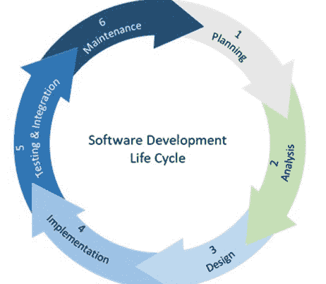

**图 1.1：**软件开发周期

此外，下面的图显示了 **DevOps 循环：**

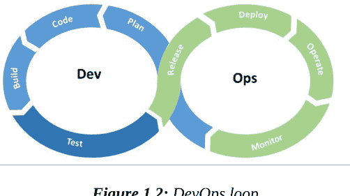

许多人认为 DevOps 是使用 Ansible、Chef 或 Docker 等特定工具。然而，他们忘记了单靠工具无法让产品就绪，我们使用工具的方式对于 DevOps 同样重要。通过使用不同的工具，我们需要技能、价值观和知识。分析如何使用工具有助于我们做出重要的业务决策。

DevOps 基于以下三个支柱：

- **协作**：这是 DevOps 的精髓，而非被孤岛化的团队：开发团队、运维团队、测试团队等将不同团队带到同一个屋檐下，拥有共同目标，快速高效地交付产品。这使得 DevOps 团队成为真正的跨学科团队。在一个团队中，他们可以更好地理解预期。

- **流程**：为了实现快速开发和部署，团队必须以迭代的方式遵循整个开发流程，从而产生高质量的代码和快速反馈。这些流程应集成到持续集成和持续交付的工作流中。DevOps 流程分为几个阶段：

    - 计划

    - 开发

    - 持续集成与交付

    - 持续部署

    - 持续监控

为团队选择正确的工具对于 DevOps 非常重要。当团队被分为开发和运维时，每个团队根据需要使用特定的工具，即开发者的部署工具和运维的基础设施工具，这往往会导致协作隔阂。通过将开发和运维结合，使用的工具必须是统一的，所有成员都可以。

开发团队和运维团队都必须进入对方的领域以建立真正的 DevOps 团队。开发者需要集成运维团队使用的监控工具以尽早检测性能问题，并集成运维提供的安全工具以保护资源访问。

另一方面，运维应该自动化基础设施的创建和更新，使用代码来实现基础设施的变化。他们必须将代码集成到源代码管理工具中；这就是基础设施即代码，但只有与需要基础设施的开发者协作才能实现。运维也必须集成到应用发布流程中。

下面的图说明了 DevOps 文化的三个方面面——开发与运维之间的协作、流程以及工具的使用：

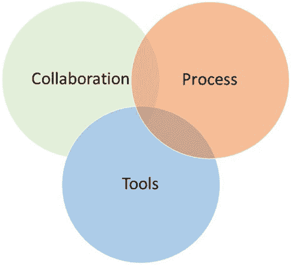

图 1.3：DevOps 的支柱

## DevOps 的必要性

现在让我们讨论 DevOps 需求增长背的原因：

## 业务需求

DevOps 的实施适用于多种场景，其益处如下：

- **降低运营成本**：虽然 DevOps 因帮助组织实现持续软件开发而闻誉，但它通过减少软件开发、部署和维护相关的成本而被高度推崇。

- **提高客户满意度**：采用 DevOps 实践的显著益处是降低了新功能的失败率并缩短了恢复时间。持续部署、测试和持续反馈循环确保了快速交付和更满意的客户。团队可以通过软件流水线中的自动化构建最佳产品，并改进业务。

交付。实施 DevOps 使公司有信心在市场竞争中保持领先。

-   **最大化效率并优化生产力**：DevOps 基于自动化，能够提升团队的生产力并促进以性能为导向的文化。为了解决所有重复性问题，与其等待行动，不如让自动化管理重复任务，让员工专注于更具生产力和价值价值的任务。

注意：《2017 年 DevOps 状态报告》量化了效率的提升并向我们展示：遵循 DevOps 实践的高性能组织在非计划工作和返工作中花费的时间减少了 21%，在新工作上花费的时间增加了 44%。总的来说，成功实施 DevOps 实践可以通过改进关键且极其枯燥领域的效率和执行力，对组织产生巨大影响。

来源：https://www.puppet.com/resources/history-of-devops-reports#2017

-   **提高软件安全性**：从开发周期的开始整合安全实践，意味着处理安全漏洞和其他漏洞比在部署阶段修复它们更容易，因为后者的修复更为困难且成本高昂。将安全性集成到开发流水线中被称为 DevSecOps。跨产品和服务结合开发、安全和运营，可以在快速交付的同时提高产品的安全性和质量。这种“左移”方法（在开发生命周期早期整合安全实践）可以更轻松地解决安全漏洞，且终端用户几乎察觉不到。这还确保了过时的安全实践不会被集成到你的软件中，且不会干扰客户需求。因此，如果客户满意度以及快速交付高质量的安全产品是你的首要任务，那么实施 DevOps 和 DevSecOps 流程可以减少 IT 烦恼，并带来更好的业务成果。

-   **软件开发周期自动化**：通过更多的自动化和最少的人工干预，快速满足业务需求，从而获得质量更好的产品。人员可以使用选择的开源工具开发产品；QA 团队可以创建一个副本作为 QA 系统，并无缝且快速地部署到生产环境。

-   **单一事实来源 - 源代码管理**：存在多个版本的代码，很难确定用于特定目的的代码。我们缺乏单一的事实来源。代码审查反馈通过电子邮件进行且未记录，导致混乱和重复工作。DevOps 提倡可靠的源代码管理和自动化代码审查。

-   **可靠的配置管理**：代码构建、测试和部署发生在不同的系统上。有时，代码在构建系统上可以运行但在生产环境中却无法运行，这有时会导致交付延迟和成本开销。验证不同平台和依赖的兼容性是手动的且容易出错的。确保代码在所有具有相同版本工具、编译器等的系统中运行是具有挑战性的。DevOps 中的自动化且可靠的配置管理确保了系统在不同环境下的构建方式是相同的。

-   **产品市场就绪**：尽管我们有定义的流程在确定的时间范围内开发、测试和构建代码，但在此过程中有许多验证和手动检查。不同阶段之间的集成也可能导致我们的交付时间不可预测。如果我们知道自己的产品距离交付有多远以及质量如何，那么我们就可以提前计划响应，而不是被动反应。实施 DevOps 缩短了产品的开发周期流程，使其准备好市场。


- **手动流程自动化**：遵循手动流程往往容易出错且具有重复性。在尽可能的地方使用自动化可以提高效率。测试周期自动化与构建周期的集成、基础设施服务自动化（如创建、启动、停止、删除、终止和重启虚拟机）将加速效率并带来质量更好的产品。

- **容器**：代码的可移植性是主要挑战。代码在开发和 QA 环境中可以运行，但部署到生产系统时会导致多个挑战，因为由于依赖问题导致代码无法编译、构建崩溃等。构建一个可在所有平台上运行的代码是一项挑战，而维护多个平台版本的开发和 QA 环境是巨大的开销。可移植的容器代码将减少此类问题。

- **其他本地化化挑战**：从容量规划到周转时间，拥有多个本地化系统面临许多挑战。运营成本是不可预测的。云迁移提供了拥有多种选择和供应商的自由。因此，需要一种高效的采用方法来确保结果，而 DevOps 帮助实现这一目标。

## 应用开发后续

我们现在将讨论几个应用开发需求的场景：

### 场景 1

假设一个团队正在处理这个大型项目，该项目集成了多个应用程序以提供端到端功能。当一个主要功能的发布日期临近时，客户由于针对该行业发布的新政府规则和法规要求接纳新更改。因此，在下一次迭代中，团队开始处理这部分新的代码更改。由于代码的即时更改，大量代码损坏了，并引入了漏洞。

然后是另一个挑战：为了纳入客户建议的即使微小的反馈，你也必须遵循所有的软件开发阶段，包括开发/代码更改、代码审查、单元测试、功能测试、回归测试以及在暂备服务器上的测试，然后才能向客户展示。因此，一个只需要几小时开发时间的更改，通常要在 2 到 3 天后才能在暂备环境中获得客户反馈，这对于客户来说是不可接受的，因为它延迟了反馈周期和发布。

所以，问题在于如何在不损害质量的情况下快速交付。

让我们分析可能的原因以及为什么需要 DevOps。

#### 1. 测试周期

> **问题描述**：只进行了极少的单元测试，且这些测试仅限于新的修复。没有健全性（sanity）单元测试用例，这无法确保新修复没有破坏现有功能。因此，在部署后出现了许多额外问题。
>
> **解决方案**：编写自动化单元测试用例可以确保所有相关的测试用例也能随新更改一起运行。
>
> **问题描述**：由于应用程序之间复杂的集成，手动运行集成测试和回归测试花费了大部分时间。
>
> **解决方案**：包含自动化测试用例的回归测试套件。

#### 2. 性能问题

> **问题描述**：没有正确遵循编码指南，手动审查有时遗漏了代码优化。这导致了响应时间、内存泄漏导致的应用程序崩溃等问题。
>
> **解决方案**：使用`Checkmar`和`Sonar`等静态分析和代码审查工具来维护代码的一性和质量。

#### 3. 任务优先级

> **问题描述**：一旦开发者将更改交给 QA 团队，他就会转到下一个开发任务。当 QA 团队记录漏洞时，开发者会将注意力分散到开发新功能和解决现有漏洞上。由于他们过度投入新功能的开发，大多数时间他们甚至不会检查在自己名下的漏洞。同样，在修复漏洞后，开发者必须手动输入并将漏洞标记为已修复，以便在每日站会议期间讨论。然而，在所有人更新状态之前，已经浪费了许多小时。
>
> **解决方案**：通过持续交付流水线，开发者在提交代码后几分钟内就能获得反馈，这真的是一个巨大的救星！

#### 4. 基础架构、部署和数据问题

> **问题描述**：很多时候，即使代码在开发服务器上运行良好，在 QA 服务器上无法运行，QA 团队就会提交缺陷。这时，需要大量的精力来分析实际问题。问题可能与配置、部署、数据问题或任何其他原因有关。
>
> **解决方案**：遵循基础设施即代码（IaC）来配置服务器并在所有环境中进行自动化的代码部署可以解决上述问题，这也可以适用于生产环境。还建议使用容器创建开发、测试和暂备环境，并在任务完成后将其销毁。这应该通过基础设施即代码来实现，以便相同的代码可以重复用以配置基础设施并进行跨环境部署。

这一切可以通过 DevOps 流水线实现，流水线将包含自动化单元测试、静态分析、自动化功能测试、在源代码版本控制中提交代码时触发的构建、基础设施即代码、自动化部署以及一个连接所有这些内容的自动化流水线。

### 场景 2

一旦开发团队完成了系统的所有编码和测试，就需要将其放置于一个环境中，在该环境环境中：

- 只有授权的人员才能访问它。
- 它与环境中与之交互的所有其他系统和组件兼容。
- 它拥有足够的资源来运行。
- 它所使用的数据应该是最新的。
- 它产生的数据应该能够被环境中的其他系统使用。

此外，客户服务人员需要接受新系统功能的培训，运营人员需要接受在系统激活运行期间可能出现的任何问题进行故障排除的培训。现在，这些每一项都需要开发人员与运营团队之间的良好协作。想象一种场景：开发人员没有向运营人员充分传达系统的功能。当协作不能始终以适当的方式进行时，系统就无法高效工作。

这类问题通过采用 DevOps 得到了很好的解决。不同层面的自动化反映了良好的发布流程，该流程持续于单次发布之外，并比以往任何时候都为开发和运营之间提供了更多的协作。

## DevOps 与自动化

整个软件开发阶段可以在某种程度上实现自动化。

仅有自动化不能保证 DevOps 实践的成功，但它是必要的，不仅是为了扩展性、可靠性、质量和安全性等技术利益，也是为了对人员产生高交付影响。任何擅长自动化的团队都会表现出更高水平的性能。

根据《2021 年 DevOps 状态报告》¹：

- 90% 具有高度进化 DevOps 实践的受访者报告，他们的团队已经自动了大多数重复性任务。
- 97% 具有高度进化 DevOps 实践的受访者同意自动化提高了他们工作的质量。
- 62% 处于进化中间阶段的组织报告具有高水平的自动化。

图 1.4：团队的自动化状态

从构建、测试到部署的步骤都可以实现自动化。我将在接下来的章节中讨论这些步骤中使用的工具，但在这里，我们重点介绍自动化的特性。工具可以执行过程每一步中所需的操作，从构建代码、检查代码有效性、测试系统、在过程中发生错误时向相应人员提供反馈，以及维护用于质量控制、报告和审计目的的日志。

一旦工具成为一组流程的核心，那么这些工具的使用也必须被管理。例如，工具是从脚本、配置更改或控制台调用的。当控制台命令难以使用时，建议创建一个包含其用法的脚本。工具可以通过规范文件进行控制，如 Chef Cookbooks、Amazon CloudFormation 等。与应用程序代码类似，脚本、配置文件和规范文件必须接受相同的质量控制。脚本和文件也应该处于版本控制之下。这被称为基础设施即代码。

DevOps 不仅仅是自动化，但自动化是必须的。自动化重复任务使我们能够专注于更深层次的结构性改进，并将注意力转移到团队更重要的交付物上。

## DevOps 团队结构

DevOps 团队结构在充分利用 DevOps 收益方面起着至关重要的作用。因此，组织应该确保由合适的人组成，并对 DevOps 角色和职责有清晰的定义。

DevOps 团队由开发、质量、安全和运营部门的专业人员组成。最小的 DevOps 团队应包含以下人员：软件开发/测试人员、自动化工程师、质量保证专家、安全工程师和发布经理。小团队的优势之一是他们可以快速做出决策。成员少意味着团队会议中表达的意见较少，因此决策速度比大团队更快。

随着基础设施即代码日益受到重视，开发与运营之间的模糊界限正在消失。目前的 DevOps 团队结构包含了既精通编码又精通运营的人员。强大的沟通能力、技术专业知识和团队合作精神是 DevOps 人员的重要特质。

## 团队角色

在本节中将讨论具有 DevOps 职责的开发团队内部的角色：

- **团队负责人（Team lead）**：该角色负责促进团队运作、为其获取资源并保护其免受问题影响。这在 Scrum 中也称为 Scrum Master，或在其他方法中称为团队教练或项目负责人。该角色涵盖了项目管理的软技能，但不包括计划和调度等技术技能。

- **团队成员（Team member）**：该角色也称为开发者或程序员，负责系统、服务和产品的创建与交付。这包括了编程、测试和发布活动，以及与软件发布相关的其他任务。

执行 DevOps 过程的团队中的额外角色包括服务所有者、可靠性工程师和 DevOps 工程师。个人可以承担多个角色，角色也可以分配给不同的个人。向个人分配角色取决于他们的技能以及满足该角色所需的工作负载。让我们详细查看这些角色：

- **服务所有者（Service owner）**：服务所有者负责团队外协调，并是客户面前所有专用服务各方面的唯一责任人。与其他利益相关者以及团队其他成员沟通是服务所有者的主要职责。另一个角色是创建服务生命周期路线图，使其与业务所有者创建的愿景保持。

- **可靠性工程师（Reliability engineer）**：可靠性工程师识别并管理影响资产可靠性和业务运行的风险。他们专注于风险管理、消除损失和生命周期管理。可靠性工程师旨在通过减少系统停机时间降低故障成本。他们确保系统运行有效且高效。这类工程师使用自动化工具通过创建扩展且可靠的软件系统来解决问题。标准化和自动化是可靠性工程师角色的核心。他们通常具有软件工程、系统工程或系统运维背景。

可靠性工程师有若干职责：

- 可靠性工程师在部署后立即进行进行监控。
- 可靠性工程师是服务运行期间问题的联系点。这意味着需要为高可用服务提供支持。Google 将此角色称为站点运维工程师（SRE）。
- 一旦发生问题，可靠性工程师进行短期分析以诊断、缓解和修复问题，通常在自动化工具的帮助下完成。
- 可靠性工程师必须擅长故障排除和诊断。他还必须对服务有全面的了解，以便实施修复或解决方案。
- 可靠性工程师越来越需要成为合格的开发者，因为他们需要编写高质量程序来自动化诊断、缓解和修复的重复部分。

- **DevOps 工程师**：DevOps 专家必须具备人际技巧，因为他们跨部门工作以营造协作环境。除了对常见的系统架构、配置和管理有深入理解外，DevOps 专家还具有传统开发者工具set和实践的经验，包括源码控制、代码审查、编写单元测试和理解敏捷原则。

在 DevOps 软件开发过程中，使用的某些工具包括代码测试工具、配置管理工具、持续集成工具、部署工具或部署后测试工具。工具需要专业的知识和专业的输入。DevOps 工程师负责 DevOps 流水线各种工具的维护。DevOps 工程角色存在于自动化之中开发与部署流水线。他们是在开发和运维方面拥有丰富经验的 IT 工程师，包括编码、基础设施管理、系统管理和 DevOps 流线。

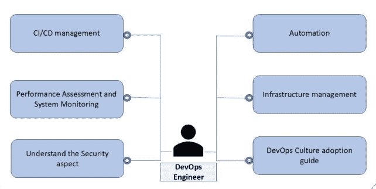

图 1.5: DevOps 工程师的角色与职责

DevOps 工程师的职责包括：

- 设计、构建、测试和维护持续集成和持续交付（CI/CD）流程。
- 分析并选择实施 DevOps 的最佳工具和技术。
- 自动化 DevOps 流线的不同阶段。
- 系统监控。
- 管理 IT 基础设施。
- 确保系统可用性。
- 通过持续进行漏洞评估和风险管理（DevSecOps）来识别应用程序安全措施。

## DevOps 策略

良好的 DevOps 策略有助于用户对其主题及其功能、多种技术及其各种接口有更深入、更广泛的理解。良好的策略还能为组织提供当前问题的共同、集中且无偏见的视角，规划如何开发未来状态，发现增长机会，并增强业务产出。

在规划整体 DevOps 策略时，应该问一些基础问题：

- 我们的业务目标是什么？
- 我们试图实现什么？
- 我们的利益相关者如何看待其价值？
- 这的时间线是什么？
- 我们如何规划路线图？
- 对当前业务有什么影响？
- 我们应该如何分配精力？
- 这样做的好处是什么？
- 产生的成本是什么？

为组织制定高效且可持续的 DevOps 策略将带来多重利益，例如将团队精力集中在高影响力问题上，为开发系统的未来状态提供思路，识别增长机会并创造更好的业务产出方法。

规划 DevOps 策略将是一项独特且广泛的活动。它应该涵盖软件生命周期的每一个方面，并专注于整合多种技术、平台和工具。有时，在规划 DevOps 策略时会遇到各种挑战，需要正确的技能和经验来处理。

组织可以考虑引入 DevOps 来实现特定目的，例如：

- 自动化基础设施和工作流（配置管理）
- 自动化代码仓库、构建、测试
- 持续集成和部署
- 虚拟化、容器化和负载均衡
- 大数据和机器学习项目
- 自动化日常重复性手动工作

有广泛的开源工具供在 DevOps 的特定部分选择采用，例如：

- `GitHub`：`Git` 是一个流行的开源版本控制工具。它是一个基于 Web 的服务，帮助开发者在 `Git` 仓库中存储和管理代码。`GitHub` 允许你跟踪和控制代码的变化。
- `Jenkins`：它是一个开源自动化服务器，允许持续构建、部署和测试，并能与 `Ant`/`Maven` 等各种构建工具以及源代码仓库 `Git` 集成。通过使用 `Jenkins`，我们可以自动化端到端的开发生命周期。
- `Ansible`：它是一项通过无代理、安全 Shell（SSH）模式实现软件置备、配置管理和应用程序部署的工具。`Playbooks`（剧本）是创建 `Yum` 脚本文件的机制。
- `SonarQube`：它是领先的工具，用于持续检查代码库的质量安全性并在代码审查期间指导开发团队。
- `Checkmarx`：它提供静态和交互式应用程序安全测试、软件成分分析、基础设施即代码安全测试以及应用程序安全。
- `Docker`：`Docker` 是一个开源工具，用于将应用程序部署为便携的自给自容器，你可以在云端或本地系统中运行它。`Docker` 允许你将应用程序与基础设施分离，从而快速交付软件。你可以像管理应用程序一样管理你的基础设施。
- `Kubernetes`：它是一个用于软件部署和扩展的开源容器编排系统。它将容器分组为逻辑单元以便管理和发现，处理节点上的扩展，并积极管理负载以确保其状态符合用户的声明意图。
- `Chef` and `Puppet`：`Chef` 和 `Puppet` 是用于部署自动化的基于代理的取机制。

这里列出了流行的开源工具：

- 源码管理：`Git`、`Bitbucket`、`GitHub` 和 `Subversion`。
- 构建管理：`MSBuild`、`Maven`、`Ant` 和 `Gradle`。
- 测试工具：`JUnit`、`QUnit` 和 `Selenium`。
- 仓库管理：`Nexus`、`Artifactory` 和 `Docker hub`。
- 持续集成：`Jenkins`、`Bamboo` 和 `TeamCity`。
- 配置置备：`Ansible`、`Chef`、`Puppet` 和 `Salt`。
- 发布管理：`Octopus Deploy`、`Serena Release` 和 `StackStorm`。
- 云服务：`AWS`、`GCP` 和 `Azure`。（构建和运行开源软件的最佳场所）
- 部署管理：`Code Deploy`、`Rapid Deploy` 和 `Elastic box`。
- 协作：`Jira`、`Slack` 和 `Team Foundation`。
- BI/监控：`Elasticsearch`、`Kibana` 和 `Nagios`。
- 日志：`Splunk`、`datadog`、`Logstash` 和 `Loggentries`。
- 容器：`Docker`、`podman` 和 `Microsoft Azure container Registry`。
- 容器编排：`Kubernetes`。

## DevOps 的收益

在本节中，我们将讨论图 1.6 所示的 DevOps 的一些收益：

- **以客户为中心**：转向 DevOps 是至关重要的，因为它让团队更加以客户为中心。相信软件开发的最终目标是良好的软件是好的，但如果开发花费时间长时间，它能让软件变得完美吗？也许。但我们应该忽略最关键的因素：消费者。客户需要的是解决方案、可用的产品。当我们关注小版本发布并接收快速反馈时，DevOps 自然地让你以客户为中心。
- **快速的解决时间**：具有持续反馈循环的团队是最成功的。通过这种方式，DevOps 团队可以减少停机时间并更快处理问题。如果问题没有得到解决，客户满意度就会下降。缺乏良好的协作和开放沟通，关键问题往往会增加压力。更好的沟通和协作允许开发和运维团队通力合作解决问题。
- **快速交付**：DevOps 是一种通过自动化来确保软件开发生命周期（SDLC）顺畅的方法。DevOps 的基本原则，如自动化、持续交付和快速反馈循环，旨在使软件开发更快速、更有效。其协作文化使得获得即时反馈、快速修复漏洞和快速完成发布成为可能。
- **团队协作加速交付**：DevOps 的另一个好处是它允许开发和运维团队以协作的方式工作，加速软件交付。缩短开发周期对业务至关重要吗？答案是定的。如果你能在快速让产品进入市场的同时保持良好的质量，这将是一种竞争优势。

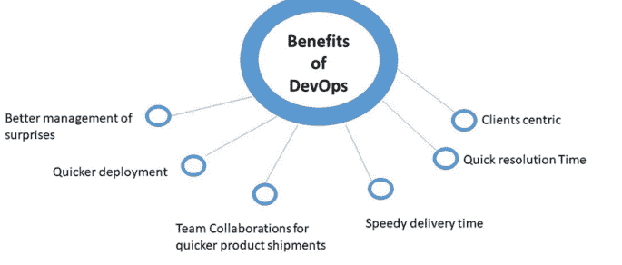

图 1.6: DevOps 的收益

- **快速部署**：通过纳入开发者、同事和关键利益者的快速反馈来更有效地构建新产品，这对 DevOps 策略无疑是有益的。感谢于 DevOps 流程，企业得以生存并实现了稳定的实施。现在，IT 企业可以更快部署。
- **更好地管理意外**：每个团队都会面临影响团队生产力的意外工作。通过建立的流程和清晰的优先级排序，开发和运维团队可以更好地管理意外工作，同时继续关注计划工作。在不同的团队和系统之间对意外工作进行优先级排序和分配是非常困难的，有时会分散工作的注意力。然而，通过提高可见性和主动回顾，团队可以更好地预测和分意外工作。完全接受 DevOps 实践的团队能够以更智能、更快的方式处理意外工作，并为客户交付更好的质量。

切换到 DevOps 需要投入大量的精力。其核心是将团队的心态从“完成给定的任务”转变为“使产品或功能准备好就绪”。在引入 DevOps 之前，满满意地规划过渡是至关重要的。你应该了解 DevOps 的所有益处，这将使你能够出色地应对它。

## DevOps 流程

在继续进行并深入理解后续章节中的整个 DevOps 流水线之前，让我们先回顾以下 DevOps 流程以及使用的工具。整个行业规定并被组织采纳的 DevOps 标准流程列举如下：

- 源代码管理
- 源代码审查
- 配置管理
- 构建管理
- 归档品仓库管理
- 发布管理
- 测试自动化
- 持续集成
- 持续交付
- 持续部署
- 基础设施即代码
- 应用程序性能监控

## 源代码管理


源代码管理（SCM）用于跟踪源代码仓库的修改。它允许多个开发者在多个开发中心并发编写代码，这些中心有时分布在不同的地理区域。SCM 跟踪代码库更改的运行历史。它允许在不同开发者之间维护单一源代码源，并帮助在不同开发者工作于同一代码库的单一软件项目上进行协作。它还有助于从合并来自多个贡献者的更新时解决冲突。SCM 与版本控制同义。将它们与 DevOps 流程集成可以提供稳健的集成和自动化。我们将在后续章节中详细介绍此。

一些开源 SCM 工具如下：

- Git
- Mercurial
- Subversion (SVN)
- 并发版本控制 (CVS)

## 源代码审查

代码审查是提高软件质量的必要过程。代码审查有助于识别并消除常见的漏洞，如缓冲区溢出、格式错误和内存泄漏。代码审查过程可以通过多种方法完成，例如通过正式会议和交互，通过代码走游或工具辅助的代码审查来审查代码。

代码审查促进了软件开发团队成员之间更好的协作。代码缺陷在集成之前被识别并修正，从而提高了代码的整体质量。

一些用于代码审查自动化的开源工具：

- GitHub
- GitLab
- SonarQube
- Bitbucket
- Codebrag
- Review board
- Gerrit

## 配置管理

配置管理是一项系统工程过程，用于将系统、服务器和软件处于所需的、一致的状态。软件配置管理是一项系统工程过程，用于跟踪和监控软件系统配置元数据发生的变化。在软件开发中，配置管理通常与版本控制和 CI/CD 基础设施一起使用。

配置管理过程包括对系统（软件和硬件）配置项的识别、验证和维护，例如补丁和版本。配置管理工具将根据需求验证系统中配置的相关性。一个常见的例子是确保在开发系统上有效运行的代码段在 QA 系统和生产系统上也能有效运行。系统之间任何配置参数的丢失对于应用程序的性能来说将是灾难性的。

根据 DevOps，纳入配置管理过程和工具使组织能够根据配置更改进行影响分析。它允许对开发、QA 和生产环境进行自动化环境置备。它还加速了系统的验证，并在需要时有效管理新更新。

一些流行的软件配置管理工具如下：

- Ansible
- Chef
- Salt
- Puppet

## 构建管理

构建管理是收集软件应用程序的所有组件（如源代码、编译器和依赖项）以编译和构建应用程序软件的过程。构建可以是手动的、按需的和自动的。按需自动构建是写在脚本上的以启动构建。计划的自动构建是由持续集成服务器运行构建。持续集成服务器中的触发式自动构建一旦代码提交到 Git 仓库就会自动启动。

一些正在使用的构建工具如下：

- MSBuild
- Maven
- Ant
- Gradle
- Visual Build
- Grunt

## 归档品仓库管理

在通常的 CI/CD 流水线中，定期创建许多构建。需要归档品仓库来存储构建。归档品管理器是一个用于托管构建及其依赖项的专用服务器。

归档品管理的益处：

- 管理归档品周期并确保构建是重复且可靠的。
- 提供跨团队和供应商的高可用性。
- 基于归档品定义留存策略。

一些仓库工具如下：

- Sonatype Nexus
- NuGet
- JFrog Artifactory
- Docker hub

## 发布管理

发布管理是在不同阶段和环境中管理、计划和控制软件构建的过程；它包括测试和部署软件发布。

该过程促进了从开发、测试到支持的移动。长期以来，发布管理一直是开发过程中不可或缺的一部分。

图 1.7：发布管理

从 DevOps 的角度来看，发布管理是一个从功能请求开始的迭代周期。一旦建议的更改获得批准，新版本将进行设计、构建、测试、评审，并在接受后部署到生产环境。部署到生产环境后进入支持阶段。在支持阶段，可能会功能增强。

一些发布管理工具：

- MS Visual Studio
- Octopus Deploy
- Continuum
- Electric Cloud
- Quikbuild
- Automic
- BMC Release Process
- Rally

## 测试自动化

对所有可能的场景进行手动测试是令人厌、昂贵且耗时的。测试自动化或自动测试是在无需人工干预的情况下运行用例。测试用例通过自动化工具或计划脚本运行。虽然不是所有的用例都适合自动运行，但大部分都可以调度。

采用测试自动化提高了整个测试生命周期的效率。手动测试工作被自动化取代，提供了快速的交付周期。

一些测试自动化工具：

- Visual Studio Test Professional
- Selenium
- QTP (UFT)
- TestDrive
- SoapUI

## 持续交付

持续交付是软件开发周期中持续集的后续步骤；它能够以最小的人工努力实现快速可靠的软件开发和产品交付。

在持续集成中，代码会经过开发和评审，随后进行自动构建和测试。在持续交付中，产品会被移动到预生产环境（暂存环境），在其中进行详尽的用户验收测试，此时软件已准备好发布。最终的生产环境部署是一个基于特定发布时机和业务决策的人工步骤。

通过持续交付，开发的代码以最大程度的自动化最少的人工干预持续交付。持续交付的工具与执行持续集的工具相同。

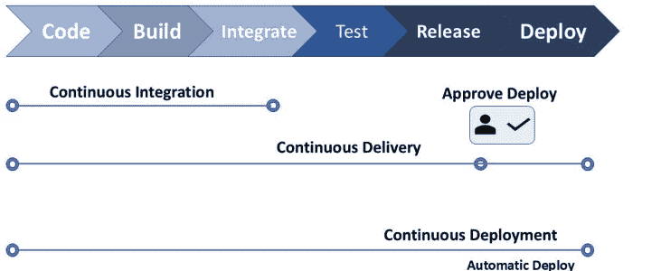

图 1.8：持续交付 vs 持续部署

## 持续部署

持续部署是代码更改的完整流程周期，从代码提交到生产环境部署，经历了软件生命周期的所有阶段。

在持续部署中，你实现了整个过程的自动化。这被称为自动化应用发布——通过所有阶段，例如代码编译，确保依赖项已集成，并在所有验证和测试通过后完成部署。

通过持续部署，随代码更改的产品发布通过自动化得到了加速。它促进了开发、测试和运维团队之间的有效协作，从而带来了更高的输出和更好的客户满意度。我们将在第 9 章“持续交付与部署”中看到更多细节。

## 基础设施即代码

基础设施即代码 (IaC)是一项关键的 DevOps 实践，涉及在描述性模型中管理基础设施，如网络、计算服务、数据库、存储和连接拓扑结构。IaC 允许团队更快、更有信心地开发和发布更改。

IaC 是一项关键的 DevOps 实践意味着通过配置文件管理基础设施服务，如网络、计算服务、数据库和存储。在 DevOps 范围内，IaC 是通过代码实现常规任务的自动化，通常作为配置定义文件，例如 shell 脚本、Ansible playbooks、Puppet 清单文件或 Chef 配方。

它通常运行在服务器和客户端设置上，基于基于推送或拉取的机制，或者通过 SSH 实现无代理运行。系统上的许多常规任务（如创建、启动、停止、删除、终止和重启虚拟机）都是通过软件执行的。IaC 将在本地系统执行的人工系统管理任务转换为自动，可以像软件代码一样进行管理。它们维护在源码仓库中，并针对部署进行测试。IaC 允许团队更快、更有心地开发和发布更改。

以下是一些 IaC 工具：

- Ansible tower
- Chef
- Puppet
- SaltStack
- CFEngine performance

## 应用性能监控

性能指标是每个工具、服务和产品的不可或缺的一部分。组织对应用程序、服务和产品的性能监控更加关注。为了确保任何产品获得高质量的输出，在流程和性能指标上达到高标准是前提。性能指标可以根据多个参数进行衡量，例如：应用程序可用性、硬件系统可用性、运行时间与停机响应时间、确认、工单分类、解决时间线等。

通过 DevOps 持续改进流程来衡量指标和反馈，有多种工具可用于应用监控。

工具包括：

- Splunk
- DataDog
- AppDynamics
- AppNeta

## 结论

在本章中，我们探索了 DevOps 的核心如何始于人们不仅作为一个小组工作，而且作为一个渴望相互理解和协作的团队。这些团队共同工作，沟通他们的目标和挑战，并动态调整以朝着共同的组织目标努力。我们还讨论了为什么我们需要 DevOps。然后，我们概述了 CI/CD 流程的不同步骤，并解释了实施 DevOps 的益处。

在下一章中，我们将分析单体架构，理解迁移到微服务的需求，以及如何有效地规划迁移。

- 1. 来源: https://www.puppet.com/resources/history-of-devops-report#2021

## 加入我们书籍的 Discord 空间

加入书籍的 Discord 工作区获取最新更新、优惠、全球科技动态、新发布以及与作者的交流：


# 第 2 章 单体架构

## 引言

在历史中，人们一直喜欢将复杂的想法拆解为简单的部分。在构建软件的世界，单体架构（Monolith）是一种非常流行的方式。随着微服务的出现，理解这些 DevOps 实践变得至关重要。

分布式特性有助于故障隔离并提高系统韧性。

- **可扩展性**：微服务提供了细粒度的可扩展性，允许组织根据需求扩展单个服务，而不是扩展整个应用程序。
- **技术多样性**：微服务架构中的不同服务可以使用多种技术进行开发，允许团队为特定任务选择最佳工具。

## 迈向微服务的必要性

在软件开发中，在单体架构（Monolithic architecture）和新兴的微服务范式之间进行选择，对于构建可扩展且具有韧性的应用程序至关重要。让我们一起之旅了解单体应用程序以及为什么软件行业正在转向微服务。此外，我们还将探索从单体架构迁移到基于微服务的架构所需的关键步骤。不过，首先请看以下单体架构的示例：

考虑一个传统的电子商务应用程序，其中用户界面、订单处理和库存管理在单体结构中紧密耦合。随着业务的增长，扩展变得具有挑战性，因为扩展一个组件意味着扩展整个应用程序，包括那些可能不需要额外资源的部分。

现在，我们从不同的维度对上述单体应用程序进行分析：

- **简单性与开发速度**：单体架构通常因其简单性而受到赞誉。开发者可以处理应用程序而不必担心不同组件之间的通信。
- **测试与调试**：单体应用程序的测试可能非常简单，因为所有组件都是紧密集成的。

然而，随着代码库的增长，调试可能会变得具有性。

- **可扩展性**：扩展单体应用程序通常涉及复制整个系统，对于需要更多资源的特定组件来说可能并不是高效的。
- **依赖管理**：代码某部分的更改可能会产生级联影响，因此仔细管理依赖关系至关重要。

为了解决单体应用程序的各种挑战以及我们为什么应该转向微服务，让我们来分析：

- **可扩展性挑战**：单体应用程序在尝试独立扩展特定功能时可能会面临挑战。微服务通过允许选择性扩展提供了解决方案。
- **改进的容错性**：微服务提供了更好的故障隔离，减少了故障的影响并增强了系统的整体可靠性。
- **技术异质性**：随着应用程序的发展，不同的组件可能需要不同的技术。微服务适应了这种多样性，允许团队为每个服务选择最佳工具。
- **持续部署**：微服务促进了持续部署，实现了更快的发布周期，并缩短了将新功能带来用户的时间。
- **团队自主性**：微服务允许团队在独立的服务上工作，促进了自主性和更快的开发周期。

我们现在来看一个基于微服务的架构示例。

在我们之前讨论的电子商务场景中，想象一下采用微服务方法。每个业务功能——身份验证、订单处理、支付处理和库存管理——都变成一个独立的微服务。这种自主性允许团队独立地开发、部署和扩展每个服务，提供更敏捷、可扩展的解决方案。

单体架构和微服务架构之间的选择取决于项目的具体需求和目标。单体架构开发和维护更简单，但随着应用程序的增长可能会面临挑战。由于其分布式特性，微服务为扩展性和灵活性问题提供了解决方案，使其成为现代动态应用程序的热门选择。最终，决策应符合项目需求和组织的长期目标。

## 规划从单体到微服务的迁移

从单体过渡到微服务架构是实现可扩展性和敏捷性的关键策略。它需要周密的规划和战略性的考量。为了高效地完成这一转变，你可以遵循以下基线指南，以采用系统且实用的方法：

- 理解起点：评估单体应用
- 彻底评估：从深入理解你现有的单体设置开始。识别依赖和潜在挑战。
- 可扩展性检查：评估你当前的系统如何扩展。识别任何可能阻碍增长的瓶颈。
- 业务优先级：理解迁移对业务的影响。根据业务价值对核心功能进行排序。
- 设置微服务边界：理清界限
- 功能拆分：将你的单体应用程序拆分为更小、易于管理的服务。根据特定功能定义每个微服务的范围。
- API 清晰性：明确定义微服务将如何使用 API 进行通信。确保这些接口有良好的文档记录并标准化。
- **依赖映射**：绘制微服务之间的依赖关系。理解数据在系统内部如何流动以及如何交互。
- 渐进式拆解：步步为营的方法
- 智能优先级：根据影响和依赖关系，优先考虑拆解单体的哪些部分。
- 增量式更改：逐渐进行更改以减少干扰。以较小的增量测试并发布微服务。
- 反馈循环：与团队和用户建立反馈循环。利用反馈来完善你的迁移策略。
- **数据管理**：确保一致性
- **数据策略**：解决迁移期间的数据挑战。考虑使用微服务数据库（每个服务一个数据库）或事件源（使用如 Apache Kafka、Rabbit MQ 等事件驱动系统）来保持数据一致性。
- **事务完整性**：实现跨微服务维护数据完整性的机制。考虑最终一致性模型或 Saga 模式。
- 实施 DevOps 实践：自动化与协作
- 自动化部署：拥抱 DevOps 以实现自动化部署、测试和监控。使用持续集成和部署流水线来提高效率。
- 协作文化：鼓励开发团队和运维团队之间的协作。培养团队合作文化以实现更平滑的过渡。
- 监控与调试：确保运维卓越
- **监控工具**：建立监控微服务的系统。使用实时监控和日志尽早发现问题。
- 高效调试：提供高效调试的工具和策略。使团队能够解决微服务内部的问题。
- **团队赋能**：培养自主性
- 技能提升：对微服务架构进行培训。确保他们拥有独立开发和部署所需的技能。
- 自主性与所有权：在微服务团队中培养自主文化。鼓励他们对自己的服务负责。
- 持续监控与优化：微调系统
- 定期监控：持续监控微服务的性能。使用指标识别改进区域。
- 优化策略：根据实际使用和反馈进行优化。迭代改进微服务架构。
- 文档与沟通：确保清晰
- 全量文档：详尽记录新架构。包括微服务边界、API、依赖关系和数据流。
- 利益相关者更新：向利益相关者沟通变更。在整个迁移过程中保持信息同步并与组织目标一致。

从单体到微服务的转换是一个复杂但充满回报的旅程。上述涵盖评估、渐进式拆解、DevOps 实践和持续优化的简化指南旨在使这一转变更容易管理。通过培养协作和自主的文化，组织可以释放微服务的优势，并适应不断变化的软件开发格局。

## DevOps 与微服务

当我们谈论不断变化的应用开发世界时，两种变革性范式——DevOps 和微服务（Microservices）——已成为现代应用架构的支柱。DevOps 强调开发与运维团队之间的协作与自动化，这与微服务的原则无缝衔接，微服务是一种模块化且可扩展的架构风格。在本节中，我们将探索微服务如何完美契合 DevOps 哲学，创造出强大的协同效应，推动组织走向更强的敏捷性、快速部署和持续创新。

## 理解 DevOps 和微服务

在讨论 DevOps 原则与微服务的集成（这种集成释放了精简高效和敏捷软件开发的潜力）之前，让我们先探索 DevOps 和微服务的基基础知识：

## DevOps 是一场文化转变

DevOps 不仅仅是一套实践方法。它是一场文化转变，将开发和运维团队联合起来共同工作，打破孤岛并简化软件交付生命周期。DevOps 的核心原则包括自动化、持续集成、持续交付（CI/CD）以及对文化的关注，培养了对整个应用程序生命周期的共同责任。

## 微服务是模块化方法

与之相反，微服务架构风格涉及将应用程序结构化为一系列松散链接、独立部署的服务。这些服务被称为微服务，每一个服务都是为执行特定的业务功能而定制的，并通过 API 相互通信。

这种模块化方法实现了可扩展性、灵活性和易于维护。

## DevOps 与微服务的协同效应

DevOps 原则与微服务的集成提供了一种动态方法，以满足现代技术格局的需求。这种协同效应利用了微服务的模块化特性，与 DevOps 方法论提倡的持续集成、部署和迭代改进哲学无缝衔接。让我们深入探讨 DevOps 与微服务的这种结合如何在以下参数上运作：

- 快速开发和部署：微服务凭借其模块化结构，与 DevOps 的持续集成和持续交付完美契合。开发团队可以独立地工作并部署微服务，从而实现快速频繁的发布。
- 敏捷开发和迭代改进：DevOps 促进敏捷开发方法，而微服务通过允许团队处理小型、集中的组件，在本质上支持了这一点。这促进了迭代开发，使团队能够快速响应变化的需求并交付增量式改进。
- 隔离与容错性：微服务的独立性允许更好的故障隔离。如果单个微服务发生故障，不会导致整个应用程序崩溃。这与 DevOps 的韧性原则一致，即系统应该优雅地处理故障，而不产生灾难性影响。
- 自动化测试和部署：DevOps 高度强调自动化测试和部署，确保软件交付过程的可靠性和一致性。微服务由于是独立部署的，可以无缝集成到自动化测试和部署流水线中，有助于更高效、更可靠的发布过程。
- 可扩展性和资源效率：微服务允许根据需求独立扩展单个服务，从而支持 DevOps 的可扩展性目标。这确保了资源的最优利用，并能够在不扩展整个应用程序的情况下适应不断变化的负载。
- **监控与持续改进**：DevOps 鼓励通过持续监控和反馈循环进行性能优化。微服务其独立运行的特性有助于细粒度监控，使其更容易识别和解决性能问题。这与 DevOps 的持续改进原则一致。

现在，让我们讨论实施 DevOps 和微服务的最佳实践：

- **容器化**：采用 Docker 等容器化技术来封装每个微服务及其依赖项。这确保了不同环境之间的一性，简化了部署过程。
- **编排**：利用 Kubernetes 等容器编排工具有效地管理和扩展微服务。Kubernetes 自动化了部署、扩展和操作，与 DevOps 对自动化的关注一致。
- **基础设施即代码 (IaC)**：采用 IaC 实践自动化基础设施的配置和管理。Terraform 等工具能够实现环境的一致性和自动化设置，提高基础设施的可靠性。
- **持续集成和部署**：为每个微服务实现稳健的 CI/CD 流水线。这确保更改被自动测试和部署，遵循 DevOps 的持续交付原则。


- **监控和日志记录：** 为每个微服务设置全面的监控和日志记录。集中式监控工具提供了整个系统性能和健康的可见性，支持 DevOps 持续反馈的目标。

以下是几个成功集成 DevOps 和微服务的案例研究：

- **Netflix**：大规模微服务：作为流媒体业的先驱，Netflix 利用了在深厚 DevOps 文化支持下的微服务架构。他们快速发布新功能和处理大规模业务的能力，是 DevOps 和微服务成功集成的证明。
- **Amazon**：为了灵活性的 DevOps 和微服务：Amazon 拥有庞大且多样化的生态系统，采用了具有深厚 DevOps 基础的微服务架构。这使他们能够快速适应市场变化，对新功能进行实验，并在所有服务中保持高可用性。

DevOps 与微服务的融合创造了一个和谐的生态系统，敏捷性、可扩展性和快速创新在其中相互驱动。DevOps 实践与微服务的原则无缝衔接，为组织提供了高效构建、部署和扩展模块化服务的框架。随着企业应对现代软件开发的复杂性，DevOps 与微服务之间的共生关系就像一盏明灯，引导我们走向一个持续改进和适应能力处于技术演进前沿的未来。

## 微服务框架

在广阔的 JVM 生态系统中存在许多针对特定用例定制的替代方案。微服务框架和库的丰富性使得选择正确的框架成为一项挑战。

某些框架由于各种因素而受到欢迎，例如开发者体验、扩展性、上市时间、资源消耗（CPU、内存）、启动速度、故障恢复以及与其他工具的集成。本节介绍了三个主要的候选框架：Spring Boot、Micronaut 和 Quarkus。考虑到这些技术的快速演进，某些指令可能需要调整。我们建议参考每个框架的文档。

此外，这些示例至少需要 Java 17，探索 Native Image 还需要安装 GraalVM。有多种方法可以在你的环境中安装这些版本，我们建议利用 SDKMAN! 来简化安装和管理。为了保持简洁，重点仅在于生产代码，因为深入研究每个框架可能是一项巨大的工程。不言而喻，应该实施彻底的测试。每个示例的目标是创建一个简单的“Hello World”REST 服务，能够接收可选的名称参数并返回问候语。现在，让我们谈谈 GraalVM：

对于不熟悉 GraalVM 的人，它是包含许多具有独特功能的伞型技术：

- **即时编译 (JIT) 编译器：** GraalVM 拥有一个用 Java 实现的 JIT 编译器，它可以动态编译代码。注意的是，Graal 是最现代的 JIT 编译器，完全用 Java 编写。
- **Substrate VM：** GraalVM 内部的一个虚拟机，Substrate VM 支持在 Java 虚拟机 (JVM) 之上运行 JavaScript、Python 和 R 等托管语言。这种集成确保了托管语言能够受益于与 JVM 能力的紧密集成。
- **Native image：** 该工具依赖预提前编译 (AOT) 将字节码转换为机器可执行代码。输出是特定于平台的二进制执行文件。

我们讨论的三个框架都支持 GraalVM，利用 GraalVM Native Image 主要创建特定平台的二进制文件。主要目标是减少部署大小和提高内存效率。在使用 Java 模式和 GraalVM Native Image 模式之间的权衡至重要。虽然后者可以产生内存占用更小、启动更快的二进制文件，但需要更长的编译时间；而长时间运行 Java 代码会逐渐优化，受益于 JVM 的核心特性之一。相比之下，原生二进制文件在运行时无法进行优化。开发体验也会有所波动，需要额外的工具来完成调试、监控和测量等任务。

## Spring Boot

在三个候选者中，Spring Boot 作为最著名的脱颖而出，它建立在 Spring 框架的基础之上。大多数 Java 开发者都遇到过 Spring 相关的项目，使得 Spring Boot 成为首选。

在 Spring 框架方法论中，核心方法在于通过组合现有的组件来构建应用程序（在我们的语境下特指微服务）。这种方法强调自定义配置以确保低所有成本，其前提是你的特定逻辑比框架提供的全面功能更简洁——这一原则适用于许多组织。技巧在于在考虑开发新组件之前，先识别出可以微调和配置的现有组件。Spring 团队积极集成了各种实用组件，包括数据库驱动程序、监控服务、日志记录、记账、批处理、报告生成等。

要启动 Spring Boot 项目，通常的方法是访问 Spring Initializr 网站，在其中你可以选择应用程序所需的特定功能，然后点击“Generate”按钮生成项目。此过程会生成一个你可以下载并使用的 ZIP 文件，用于在本地启动开发。在图 2.1 中，我们选择了 Web 和 Spring Native 功能。Web 功能包含了通过 REST API 暴露数据的组件，而 Spring Native 功能通过引入一种能够使用 Graal 创建原生镜像（Native Images）的额外打包机制，增强了构建过程。

解压 ZIP 文件并在项目根目录下执行 `./mvnw verify` 命令（Windows 使用 `mvnw.cmd verify`）可以确保有一个稳健的起点。该命令会下载依赖项，这是 Apache Maven 在目标环境上首次构建时的标准行为。除非 `pom.xml` 文件中的依赖版本发生更新，否则后续的 Maven 命令不会触发额外的下载。

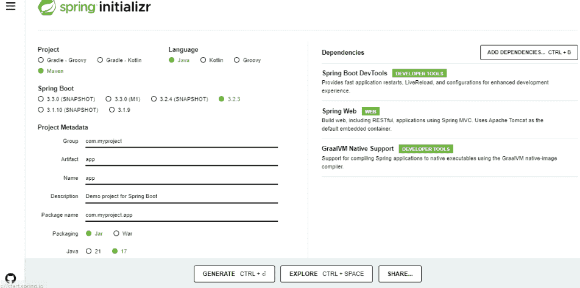

图 2.1：Spring Initializer 项目结构看起来如下

一个典型的 Spring Boot 微服务项目结构如下：

- `HELP.md`
- `mvnw`
- `mvnw.cmd`
- `pom.xml`
- `src`
  - `main`

```text
  └── com
    └── myproject
      └── app
        ├── AppApplication.java
        ├── MyGreeting.java
        └── MyGreetingController.java
  └── resources
    ├── application.properties
    ├── static
    └── templates
  └── test
    └── java
```

项目结构包含了必要的 Maven 文件、一个包含 Java 源代码和资源的 `src` 目录，以及一组包括 `MyApplication.java` 在内的基础类。为了通过 JSON 格式通过 REST 暴露数据，我们需要两个额外的类：`MyGreeting.java` 和 `MyGreetingController.java`。你可以使用偏好的文本编辑器或 IDE 创建这两个文件。`MyGreeting.java` 文件看起来应该像这样：

```java
package com.myproject.app;

public class MyGreeting {
    private final String details;

    public MyGreeting(String details) {
        this.details = details;
    }

    public String getDetails() {
        return details;
    }
}
```

`MyGreeting.java` 定义了一个简单的数据对象，用于以 JSON 格式渲染内容。它是一个带有内容属性的简单、不可变类。你可能会考虑过渡到可变实现，但对于目前的目的，这已经满足我们的需求。转向 REST 端点，它定义为 `/greet` 路径上的 GET 请求。Spring Boot 传统上为此类组件指定了控制器（controller）类型标记，这反映了在 Web 应用开发中对模型-视图-控制器（MVC）的历史偏好。你可以灵活选择不同的文件名，但保持组件注解的完整性至关重要。第二个文件 `MyGreetingController.java` 如下：

```java
package com.myproject.app;

import org.springframework.web.bind.annotation.GetMapping;
import org.springframework.web.bind.annotation.RequestParam;
import org.springframework.web.bind.annotation.RestController;

@RestController
public class MyGreetingController {

    private static final String DefaultMessage = "Hello, %s";

    @GetMapping("/greet")
    public MyGreeting greet(@RequestParam(value = "name", defaultValue = "Java") String name) {
        return new MyGreeting(String.format(DefaultMessage, name));
    }
}
```

在前面的代码中，`MyGreetingController.java` 定义了一个位于 `/greet` 路径上的 GET 调用 REST 端点。控制器接收一个名称参数作为输入，如果没有提供则默认为 "Java"。返回类型是 `MyGreeting` 对象，Spring Boot 根据注解和默认值自动将数据序列化为 JSON。

你可以使用 `./mvnw spring-boot:run` 运行 Spring Boot 应用，或者生成 JAR 并手动运行（`./mvnw package` 后接 `java -jar target/app-0.0.1-SNAPSHOT.jar`）。应用程序将在 8080 端口启动嵌入式 Web 服务器，并将 `/greet` 路径映射到 `MyGreetingController` 实例。可以使用命令测试 API：

```shell
$ curl http://localhost:8080/greet
```

```json
{"details":"Hello, Java!"}
```

或者：

```shell
$ curl http://localhost:8080/greet?name=Microservices
```

```json
{"details":"Hello, Microservices!"}
```

现在，为了增强微服务的性能，我们可以利用 GraalVM Native Image。以下步骤将引导你完成过程：

1. **更新 `pom.xml`：** 修改 `pom.xml` 文件以包含 GraalVM Native Image 的配置：

```xml
<xml version="1.0" encoding="UTF-8"?>
<project xmlns="http://maven.apache.org/POM/4.0.0"
         xmlns:xsi="http://www.w3.org/2001/XMLSchema-instance"
         xsi:schemaLocation="http://maven.apache.org/POM/4.0.0 
 https://maven.apache.org/xsd/maven-4.0.0.xsd">
  <modelVersion>4.0.0</modelVersion>
  <parent>
    <groupId>org.springframework.boot</groupId>
    <artifactId>spring-boot-starter-parent</artifactId>
    <version>3.2.3</version>
  </parent>
  <groupId>com.myproject</groupId>
  <artifactId>app</artifactId>
  <version>0.0.1-SNAPSHOT</version>
  <name>app</name>
  <description>Demo project for Spring Boot</description>
  <properties>
    <java.version>17</java.version>
    <spring-native.version>0.10.0-SNAPSHOT</spring-native.version>
  </properties>
  <dependencies>
    <dependency>
      <groupId>org.springframework.boot</groupId>
      <artifactId>spring-boot-starter-web</artifactId>
    </dependency>
    <dependency>
      <groupId>org.springframework.experimental</groupId>
      <artifactId>spring-native</artifactId>
      <version>${spring-native.version}</version>
    </dependency>
    <dependency>
      <groupId>org.springframework.boot</groupId>
      <artifactId>spring-boot-starter-test</artifactId>
      <scope>test</scope>
    </dependency>
  </dependencies>
  <build>
    <plugins>
      <plugin>
        <groupId>org.springframework.boot</groupId>
        <artifactId>spring-boot-maven-plugin</artifactId>
        <configuration>
          <classifier>exec</classifier>
        </configuration>
      </plugin>
      <plugin>
        <groupId>org.springframework.experimental</groupId>
        <artifactId>spring-aot-maven-plugin</artifactId>
        <version>${spring-native.version}</version>
        <executions>
          <execution>
            <id>test-generate</id>
            <goals>
```

```xml
<goal>test-generate</goal>
</goals>
</execution>
<execution>
<id>generate</id>
<goals>
<goal>generate</goal>
</goals>
</execution>
</executions>
</plugin>
<plugin>
<groupId>org.graalvm.nativeimage</groupId>
<artifactId>native-image-maven-plugin</artifactId>
<version>21.1.0</version>
<configuration>
<mainClass>
com.myproject.app.AppApplication
</mainClass>
</configuration>
<executions>
<execution>
<goals>
<goal>native-image</goal>
</goals>
<phase>package</phase>
</execution>
</plugin>
</plugins>
<build>
<repositories>
<repository>
<id>spring-release</id>
<name>Spring release</name>
<url>https://repo.spring.io/release</url>
</repository>
```

2. **安装 GraalVM：** 确保你安装了版本与 `pom.xml` 文件匹配的 GraalVM。此外，确保已使用 `gu install native-image` 安装 `native-image` 可执行文件。`gu` 命令是 GraalVM 安装的一部分。

3. **生成原生可执行文件：** 运行以下命令生成原生可执行文件：

```shell
./mvnw -Pnative-image package
```

此过程可能比通常更长，因为涉及到下载依赖和生成原生镜像。

4. **运行原生可执行文件：** 构建完成后，你将在 `target` 目录下找到一个新文件，例如 `com.myproject.app.AppApplication`。使用以下命令运行原生可执行文件：

```shell
./target/com.myproject.app.AppApplication
```

注意，与 Java 模式运行相比，启动速度显著加快。代价是可执行文件较大，但它提供了一个单一二进制文件，运行应用程序不需要 Java Runtime。

Spring Boot 凭借其微服务架构为构建可扩展和模块化的应用程序提供了坚实的基础。通过集成 GraalVM Native Image，开发者可以进一步优化微服务的性能，实现更快的启动速度并减少资源消耗。Spring Boot 为构建复杂的微服务架构提供了丰富的特性集。进一步探索，以释放你在微服务旅程中框架的潜力。

## Micronaut


# Micronaut

2017 年，Micronaut 作为 Grails 框架的现代重新解释出现，最初被开发为 Grails 的当代替代品。Grails 是 Ruby on Rails（RoR）框架的成功复制，使用 Groovy 编程语言。尽管最初取得了成功，但随着 Spring Boot 的崛起，Grails 的流行程度下降，导致 Grails 团队探索替代方案，最终催成了 Micronaut。Micronaut 表面提供了与 Spring Boot 相似的用户体验，通过集成现有组件和合理的默认值，赋予开发者构建应用程序的能力。

Micronaut 的独特之处在于采用编译时依赖注入来构建应用程序，这与 Spring Boot 用于组装应用程序的常用运行时依赖注入方法不同。这一看似微小的调整让 Micronaut 能够优化运行时性能，缩短应用程序启动时间并导致更低的内存占用。此外，它减少了对 Java 反射的依赖（反射历史上以比直接方法调用慢而闻名）。

## 创建 Micronaut 项目

有多种方法启动 Micronaut 项目，推荐的方法是浏览 Micronaut Launch。在这里，你可以指定要纳入项目所需的设置和功能。默认应用程序类型为构建基于 REST 的应用程序建立了最基本的配置，类似于我们稍后将介绍的。一旦你选择了偏好，请点击“生成项目”按钮，如图 2.2 所示。此操作将生成一个可以下载的 ZIP 文件，可以在本地开发环境中获取并使用。


| 应用程序类型 | Java 版本 | app | 基础包 |
| :--- | :--- | :--- | :--- |
| Micronaut Application | 17 | | com.myapp.project |

| Micronaut 版本 | 语言 | 构建工具 | 测试框架 |
| :--- | :--- | :--- | :--- |
| ● 4.3.2 | Java | Gradle | JUnit |
| ○ 4.3.2-SNAPSHOT | Groovy | Gradle Kotlin | Spock |
| ○ 3.5 | Kotlin | Maven | Kotest |


图 2.2：Micronaut Launch

与 Spring Boot 类似，初始化 Micronaut 项目涉及解压 ZIP 文件内容并在项目根目录下执行 `./mvnw verify` 命令。该命令可以平滑地处理插件和依赖下载，确保在几秒钟内成功构建。生成的项目结构应如下，包含额外的源文件，体现了构建基于 REST 的所需的要素：


- `README.md`
- `micronaut-cli.yml`
  - `mvnw`
  - `mvnw.bat`
  - `pom.xml`
  - `src`
    - `main`
      - `java`
        - `com`
          - `myproject`
            - `app`
              - `AppApplication.java`
              - `MyGreeting.java`
              - `MyGreetingController.java`
      - `resources`
        - `application.yml`
        - `logback.xml`

上述定义的控制器定义了一个映射到 `/greet` 的单个端点，接收一个名为 `"name"` 的可选参数并返回数据对象的实例。默认情况下，Micronaut 会自动将返回值转换为 JSON 格式。

要运行应用程序，可以使用 `./mvnw mn:run` 将作为构建过程的一部分运行，或使用 `./mvnw package` 在 `target` 目录下创建 `app-0.1.jar`。该 JAR 文件可以使用 `java -jar target/app-0.1.jar` 以标准方式执行。使用以下命令测试 API：

```bash
# 使用默认的 name 参数
$ curl http://localhost:8080/greet
{"details": "Hello, Java!"}
```

或使用特定值作为 `name` 参数：

```bash
$ curl http://localhost:8080/greet?name=Microserv
{"details": "Hello, Microserv!"}
```

每个命令都会快速地启动应用程序。我们可以通过将应用程序转换为原生可执行文件 GraalVM Native Image 来获得更快的速度。幸运的是，Micronaut 的方法更加

这种配置考虑了此类需求，在生成的项目中已经设置好了我们需要的所有内容。就是这样——无需通过额外配置修改构建文件；一切都已预配置完成。

对于 GraalVM Native Image 转换，请确保已安装 GraalVM 及其 `native-image` 可执行文件。使用 `./mvnw package -Pnativeimage` 创建可执行文件。过一段时间后，在 `target` 目录下会出现一个名为“app”的可执行文件。使用原生可执行文件运行应用程序时，结果是极快的启动速度——与 Spring Boot 相比，速度至少提高了三分。

现在，让我们结束对 Micronaut 的探索，进入下一个框架，即 Quarkus。

## Quarkus

Quarkus 虽然在 2019 年初正式引入，但其开发根源追溯得早。与之前讨论的框架具有相似之处，Quarkus 通过其基于组件的方法、约定优于配置以及生产力工具增强了开发体验。值得注意的是，Quarkus 采用了编译时依赖注入，镜像了 Micronaut 的策略，并获得了二进制体积更小、启动速度更快以及对运行时复杂性依赖降低等优势。除了这些共同属性外，Quarkus 还引入了自己的独特特性。特别值得注意的是，它与其同类相比更强调遵循标准。Quarkus 整合了 MicroProfile 规范（Eclipse Foundation 开发的一套解决现代微服务挑战的标准集），以及部分来自 JakartaEE（原 JavaEE）的 API。

要开始使用 Quarkus，请导航到 Configure Your Application 页面，可以在那里设置值并下载包含必要配置的 ZIP 文件。该页面提供了许多扩展，用于配置特定的集成，如数据库、REST 能力和监控。

否则选择 RESTEasy Jackson 扩展，它允许 Quarkus 完美地处理 JSON 序列化。参考下图：

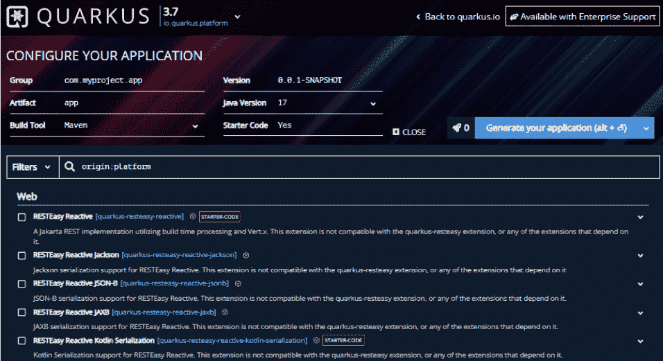

图 2.3：Quarkus “Configure Your Application”页面

点击 **Generate your application** 后系统将提示你将 ZIP 文件保存到本地，其内容类似于以下结构：

- `README.md`
- `mvnw`
- `.dockerignore`
- `mvnw.cmd`
- `pom.xml`
- `src`
  - `main`
    - `docker`
      - `Dockerfile.jvm`
      - `Dockerfile.legacy-jar`
      - `Dockerfile.native`

```text
| Dockerfile.native-distroless |
| :--- |
| java |
| |-- com |
| |-- myproject |
| |-- app |
| | MyGreeting.java |
| | MyGreetingResource.java |
|- resources |
|- META-INF |
| |-- resources |
| |-- index.html |
|- application.properties |
|- test |
|- java |
```

Quarkus 最初旨在通过容器和 Kubernetes 支持微服务和云架构，随着时间的推移，它已扩展了功能以支持各种应用程序类型和架构。Quarkus 默认生成 `MyGreetingResource.java` 文件，作为一个标准的 JAX-RS（Jakarta RESTful Web Services）资源。然而，为了集成 `MyGreeting.java` 数据对象，需要对该资源进行一些调整。以下是这些调整的代码：

```java
package com.myproject.app;

public class MyGreeting {

    private final String details;

    public MyGreeting(String details) {
        this.details = details;
    }

    public String getDetails() {
        return details;
    }
}
```

数据对象的代码遵循我们在本章较早遇到的相同模式。这个不可变数据对象并没有新意。现在，关于 JAX-RS 资源，情况相似但略有不同。尽管寻求与之前相同的行为，但我们使用 JAX-RS 注解以不同的方式指示框架。因此，代码如下：

```java
package com.myproject.app;

import javax.ws.rs.DefaultValue;
import javax.ws.rs.GET;
import javax.ws.rs.Path;
import javax.ws.rs.QueryParam;

@Path("/greet")
public class MyGreetingResource {

    private static final String DefaultMessage = "Hello, %s!";

    @GET
    public MyGreeting greet(@PathParam("name")
        @DefaultValue("Java") String name) {

        return new MyGreeting(String.format(DefaultMessage, name));
    }
}
```

如果你熟悉 JAX-RS，这段代码不会让你感到意外。然而，对于不熟悉 JAX-RS 注解的人，这里是详细说明：我们用想要响应的 REST 路径来标记资源。此外，我们指定 `greet()` 方法管理一个 GET 调用，并且其 `name` 参数默认为指定值。不需要向 Quarkus 提供进一步的指令；它会自动将返回值转换为 JSON。

运行应用程序有多种方法，其中一种显著的方法是在构建期间利用 Quarkus 的开发者模式。这一独特功能允许毫不费力地执行应用程序，自动捕获并应用任何调整，而无需手动重启。要激活此模式，只需使用命令 `./mvnw compile quarkus:dev`。如果对源文件进行了更改，构建过程将自主重新编译并加载应用程序。

你也可以使用 Java 解释器运行应用程序，如之前所示，使用诸如 `java -jar target/quarkus-app/quarkus-run.jar` 的命令。值得注意的是，我们使用的是一个不同的 JAR，尽管 `target` 目录下存在 `app-1.0.0-SNAPSHOT.jar`。选择这种方法是因为 Quarkus 整合了自定义逻辑来加速启动过程，即使在 Java 模式下也是如此。

运行应用程序后，你可以预期更快的启动，这与 Micronaut 的性能非常接近。使用以下命令测试 API：

```bash
# 使用默认名称参数
$ curl http://localhost:8080/greet
```

```json
{"details":"Hello, Java!"}
```

或者使用特定的名称参数：

```bash
$ curl http://localhost:8080/greet?name=Microservices
```

```json
{"details":"Hello, Microservices!"}
```

Quarkus 通过 GraalVM Native Image 支持生成原生执行文件，这与其对云环境的关注以及对小二进制体积的偏好一致。与 Micronaut 类似，Quarkus 从开始提供一套完整的工具，无需更新构建配置即可开始处理原生执行文件。

与之前的示例类似，你需要确保当前的 JDK 指向 GraalVM 分发版，并且路径中存在 `native-image` 可执行文件。一旦这些条件，将应用程序打包为原生执行文件就很简单。只需运行命令 `./mvnw -Pnative package`。

等待一段时间，构建将在 `target` 目录下产生一个可执行文件 `app-1.0.0-SNAPSHOT-runner`。运行该执行文件显示应用程序具有更高的启动速度，与之前的候选框架相比，Quarkus 是启动最快且执行文件最小的框架。

## Serverless

到目前为止，在本章中我们看到了从单体架构到微服务的历程。每种架构都带来了自己的挑战。虽然微服务承诺了独立部署和可扩展性，但管理这些服务的编排引入了复杂性。进入无服务器计算（Serverless computing）和函数即服务（FaaS）领域，这里的重点从基础设施管理转向了代码执行。

传统的单体应用通常意味着将多个组件紧密结合在一起，使得更新变得繁琐，且故障可能导致灾难性的后果。微服务缓解了一些这些问题，但也带来了新的挑战，例如协调多个实例、处理网络延迟以及管理分布式系统。

无服务器架构作为一种解决方案运而生，允许开发者完全专注于业务逻辑。在这种范式中，无服务器提供商处理基础设施、扩展缩容、监控和其他运营方面，将开发者从这些事务中解放出来。

在将一个组件拆分为更小的部分的过程中，考虑以下因素至关重要：该组件中最小的可重用代码是什么？如果你正在考虑一个带有几个方法和一些注入协作对象/服务的 Java 类，那么你的方向是正确的，但还有一个更小的单元，即单个方法。想象一个由遵循以下步骤的类表示的微服务：

1. 接收输入参数并将其转换为下一步可用的格式。
2. 执行所需的行为，例如查询数据库、索引或记录日志。
3. 将处理后的数据转换为指定的输出格式。

尽管每个步骤都可以有自己的方法，这些方法可以原样重用或进行参数化。一种常见的方法是在微服务之间引入一个公共超类型，以促进强类型依赖。虽然这对于某些场景适用，但在不中断正在运行的操作的情况下及时更新通用代码构成了挑战。在这种情况下，需要一种替代方案。

考虑一种场景：通用代码呈现为一组独立调用的方法，其输入和输出结构化以形成数据转换流水线。这个概念与现在公认的函数一致，而 FaaS 等服务通常在无服务器提供商领域被讨论。

简而言之，FaaS 是一种复杂的表达方式，即你使用最小的可部署单元来构建应用程序，将复杂的基础设施管理细节留给服务供应商。在接下来的章节中，我们将创建并向云部署一个简单的函数。

## 设置

在当前的背景下，每个主要的云提供商都提供 FaaS 解决方案，并配备了与各种工具无缝集成的额外功能，用于监控、日志记录和灾难恢复等任务。选择符合你特定要求的即可。在本章中，考虑到其开创的 FaaS 概念，我们将选择 AWS Lambda。此外，鉴于其目前作为部署尺寸最小的框架的状态，我们将选择 Quarkus 作为实现框架。需要注意的是，这里提供的配置可能需要调整或可能已经过。因此，请始终检查构建和运行代码所需工具的最新版本。我们将在此使用最新版本的 Quarkus。请按照以下步骤进行端到端执行：

- **准备环境：** 为了使用 Quarkus 和 AWS Lambda 建立函数，请确保你拥有 AWS 账户，在系统中安装了 AWS CLI，如果你想进行本地测试，请安装 AWS Serverless Application Model（SAM）CLI。
- **项目初始化：** 处理好这些后，下一阶段是项目初始化。在这种情况下，我们将选择之前完成的 Quarkus，但考虑到函数项目需要不同的设置。因此，建议切换到使用 Maven archetype：

```bash
mvn archetype:generate \
-DarchetypeGroupId=io.quarkus \
-DarchetypeArtifactId=quarkus-amazon-lambda-archetype \
-DarchetypeVersion=2.6.1.Final
```

在交互模式下执行上述命令会提示几项询问，包括项目的 Group、Artifact 和 Version（GAV）坐标以及基础包。为了这次演示，让我们输出以下内容：

- `groupId`: `com.myproject.app`
- `artifactId`: `app`
- `version`: `1.0-SNAPSHOT`（这是默认值）
- `package`: `com.myproject.app`（与 `groupId` 相同）

这产生了一个适用于构建、测试和部署可在 AWS Lambda 上部署的 Quarkus 项目结构。

- **3. 验证生成的项目结构：** archetype 生成了 Maven 和 Gradle 的构建文件，尽管我们目前只需要 Maven。此外，它还生成三个函数类（`CustomGreetingLambda.java`、`CustomInputObject.java` 和 `CustomOutputObject.java`），但我们将专注于仅使用其中一个（`CustomGreetingLambda.java`）。我们的目标是拥有一个类似下面的文件结构：

```text
| payload.json
| pom.xml
| src
  |-- main
  |   |-- java
  |     com
  |       myproject
  |         app
  |           CustomGreetingLambda.java
  |           CustomInputObject.java
```


## 项目目录结构

```text
CustomOutputObject.java
CustomProcessingService.java
resources
  application.properties
test
  java
    com
      myproject
        app
          LambdaHandlerTest.java
application.properties
```

## 4. 理解函数细节

函数的本质在于捕获`CustomInputObject`类型的输入，通过`CustomProcessingService`类型处理它们，随后将结果转换为另一种类型（`CustomOutputObject`）。`CustomGreetingLambda`类型充当协调器，将所有这些组件结合在一起。

首先，让我们检查输入和输出类型。毕竟，它们是只包含数据的简单类型，不包含任何逻辑。以下是`CustomInputObject`类的代码。

```java
package com.myproject.app;

public class CustomInputObject {

    private String personName;

    private String personalizedGreeting;

    public String fetchPersonName() {

        return personName;

    }

    public void assignPersonName(String personName) {

        this.personName = personName;

    }

    public String getPersonalGreeting() {

        return personalizedGreeting;

    }

    public void setPersonalizedGreeting(String personalizedGreeting) {

        this.personalizedGreeting = personalizedGreeting;

    }

}
```

lambda需要两个输入值：一个问候语和一个名字。我们将看到这些值是如何被处理服务转换的。现在，让我们看看下面的`CustomOutputObject`：

```java
package com.myproject.app;

public class CustomOutputObject {

    private String details;

    private String requestId;

    public String getOperationResult() {

        return details;

    }

    public void setOperationResult(String details) {

        this.details = details;

    }

    public String getUniqueRequestId() {

        return requestId;

    }

    public void setUniqueRequestId(String requestId) {

        this.requestId = requestId;

    }

}
```

`CustomOutputObject`类作为一个结构化容器，用于存储操作结果（`result`）和与请求相关的唯一标识符（`requestId`）。

现在，让我们转向处理服务；该类将输入转换为输出。在我们的场景中，它将两个输入的值合并为一个字符串，如下所示：

```java
package com.myproject.app;

import javax.enterprise.context.ApplicationScoped;

@ApplicationScoped
public class CustomProcessingService {

    public CustomOutputObject process(CustomInputObject input) {

        CustomOutputObject output = new CustomOutputObject();

        output.setOperationResult(input.getPersonalizedGreeting() + " " + input.fetchPersonName());

        return output;

    }

}
```

最后一步是查看`CustomGreetingLambda`，负责构造函数本身的类。该类需要实现 Quarkus 提供的已知接口。该接口所需的依赖应该已经设置在 archetype 生成的`pom.xml`文件中。

接口设计了输入输出类型，幸运的是，我们已经有了这些类型。每个 lambda 必须有一个唯一的名称并可以访问其运行时上下文，演示如下：

```java
package com.amazonaws.services.lambda.runtime.Context;

import com.amazonaws.services.lambda.runtime.RequestHandler;

import javax.inject.Inject;

import javax.inject.Named;

@Named("greet")
public class CustomGreetingLambda
implements RequestHandler<CustomInputObject, CustomOutputObject> {

    @Inject

    CustomProcessingService service;

    @Override
    public CustomOutputObject handleRequest(CustomInputObject input, Context context) {

        return service.process(input);

    }

}
```

```java
CustomOutputObject output = service.process(input);

output.setUniqueRequestId(context.getAwsRequestId());

return output;
```

此 Lambda 函数（`CustomGreetingInputLambda`）旨在处理问候。它接收一个`CustomOutputObject`，使用`CustomProcessingService`对其进行处理，关联从 Lambda 上文中获取的唯一请求 ID，并将处理后的结果作为`CustomOutputObject`返回。该函数适用于部署为 AWS Lambda 函数，并通过事件触发。

现在，一切都无缝地整合在一起了。Lambda 定义了输入和输出类型并调用数据处理服务。在这个示例中，使用了依赖注入进行演示，但为了代码更精简，你可以将`CustomProcessingService`的行为合并到`CustomGreetingLambda`中。

要验证代码，你可以使用`mvn test`运行本地测试，也可以使用`mvn verify`，因为它也会打包函数。

请注意，当函数打包时，`target`目录下会放置额外文件。这些文件之一是一个名为`manage.sh`的脚本，它利用 AWS CLI 工具在与你的 AWS 账户关联的指定目标执行创建、更新和删除函数等操作。为了方便这些操作，需要某些额外文件：

- `function.zip`：该部署文件包含函数的二进制位。
- `sam.jvm.yaml`：该 YAML 文件用于在 Java 模式下使用 AWS SAM CLI 进行本地测试。
- `sam.native.yaml`：该 YAML 文件用于在 native 模式下使用 AWS SAM CLI 进行本地测试。

## 5. 配置执行角色

下一步涉及配置执行角色，建议咨询 AWS Lambda 开发者指南以获取最新的步骤。该指南提供了配置 AWS CLI（如果尚未配置）和创建执行角色的说明。此角色需要作为环境变量包含在你的运行的 shell 中。参考以下示例：

```bash
LAMBDA_ROLE_ARN="arn:aws:iam::1236789450:role/lambda-rol"
```

在此示例中，`1236789450`代表你的 AWS 账户 ID，`lambda-rol`是你为角色选择名称。

现在，我们可以继续执行函数了，我们可以通过两种模式（Java 模式和 native 模式）和两个执行环境（本地和生产环境）来完成。首先，我们将探索两个环境的 Java 模式，然后进入 native 模式。

## 6. 在本地机器上测试

要在本地运行函数，你需要 Docker 守护进程，这通常在开发者的工具箱中可用。此外，还需要 AWS SAM CLI 来驱动执行。

记得`target`目录中的额外文件吗？我们将利用`sam.jvm.yaml`文件以及项目启动时由骨架模板创建的另一个文件`payload.json`。该文件位于目录根部，内容应类似于：

```json
{
  "personName": "David",
  "personalized": "hello"
}
```

此文件指定了函数接受的输入值。由于函数已经打包，我们只需要调用它，如下所示：

```bash
$ sam local invoke --template target/sam.jvm.yaml --payload ad.json
```

```text
Invoking com.myproject.app.GreetingLambda::handleRequest(java17)

Decompressing /work/app/target/function.zip

Skip pulling image and use local one:
amazon/aws-sam-cli-emulation-image-java17:rapid-1.24.1.

Mounting /private/var/folders/p_/4h16jn992hr0zs1ckrn9nk0m0000hT/tmpnrkkc0ct as /var/task:ro,delegated inside runtime container
STARTRequestId:0d6bef4a-fd3-42e1-bf36-56a470324af1 Version:$LATEST

----------------------

--/_\___\\/_\_\\////\_

--/_\___\\_\_V,<_\/__\\

--/\___\\\\/\\\\\\/___/

[io.quarkus] (main) Quarkus 2.6.1.Final on JVM started in 2.67 0s.

[io.quarkus] (main) Profile prod activated.

[io.quarkus] (main) Installed features: [amazon-lambda, cdi]

ENDRequestId:0d6bef4a-fd3-42e1-bf36-56a470324af1
REPORTRequestId:0d6bef4a-fd3-42e1-bf36-56a470324af1 In duration Duration: 1.70 ms

Duration: 3261.01 ms Billed Duration: 3200 ms

Memory Size: 256 MB Max Memory Used: 256 MB

{"details":"hello David","requestId":"0d6bef4a-fd3-42e1-bf36-56a470324af1"}
```

执行此命令将拉取适用于函数的 Docker 镜像。请观察提供的值，因为它们可能会根据你的配置而变化。在我的本地环境中，运行此函数大约需要 3200 ms 并消耗 256 MB 内存。这些信息可以为当你作为一组函数运行系统时的潜在计费提供洞察。然而，至关重要的是，本地环境与生产环境不同。

### 生产环境部署

要将函数部署到实际环境，我们将利用`manage.sh`脚本并执行以下命令：

```bash
$ sh target/manage.sh create
$ sh target/manage.sh invoke
```

Invoking function...

```text
++ lambda invoke response.txt --cli-binary-format raw-in-out
++ --function-name Quarkus --payload file.json
++ --log-type --query Result
++ --output text64

START RequestID: bf8d17ad-1e64-ace-54b--30a0931c9 Version: LATEST

END RequestID: bf8d17ad-1e64-ace-54b--3b00341c

REPORT RequestID: bf8d17ad-1e64-ace-54b--38a0934c9 Duration: 271.47 ms

Billed Duration: 271.47 ms Memory Size: 256 MB

{"details":"hello David","requestId":"bf8d17ad-1e64-ace-54b---800341c"}
```

执行此命令将拉取适用于函数的 Docker 镜像。观察提供的值，它们可能会根据你的配置而变化。在我的本地环境中，运行此函数大约需要 3200 ms 并消耗 256 MB 内存。这些信息可以为当你作为一组函数运行系统时的潜在计费提供洞察。然而，至关重要的是，本地环境与生产环境不同。

### 生产部署

要将函数部署到实际环境，我们将利用`manage.sh`脚本并执行以下命令：

```bash
$ sh target/manage.sh create
$ sh target/manage.sh invoke
```

Invoking function...

```text
++ lambda invoke response.txt --cli-binary-format raw-in-out
++ --function-name Quarkus --payload file.json
++ --log-type --query Result
++ --output text64

START RequestID: bf8d17ad-1e64-ace-54b--3b0034c9 Version: LATEST

END RequestID: bf8d17ad-1e64-ace-54b--38a0934c9

REPORT RequestID: bf8d17ad-1e64-ace-54b--3b8a0934c9 Duration: 271.47 ms
Billed Duration: 271.47 ms Memory Size: 256 MB

{"details":"hello David","requestId":"bf8d17ad-1e64-ace-54b--3b8a0934c9"}
```

## 7. 切换到 Native 模式

观察从 Java 模式切换到 native 模式的影响。费用时长显著减少，从 3200 ms 降到 312 ms，内存占用减少了一半。与 Java 版本相比，这令人鼓舞。

## 8. 在本地机器上测试（Native 模式）

让我们开始运行：

```bash
$ sam local invoke --template target/sam.native.yaml --payload.json
```

```text
Invoking com.myproject.app.GreetingLambda::handleRequest(java17)

Decompressing /work/app/target/function.zip

Skip pulling image and use local one:
amazon/aws-sam-cli-emulation-image-java17:rapid-1.24.1.

Mounting /private/var/folders/p_/4h16jn992hr0zs1ckrn9nk0m0000hT/tmpnrkkc0ct as /var/task:ro,delegated inside runtime container
START RequestID: 26521b6d-351c-24f7-71b3-533d5ec4 Version:$LATEST

----------------------

--/_\___\\/_\_\\

--/_\___\\_\_V,<_\/__\\

--/\___\\\\/\\\\\\/___/
```


```text
[io.quarkus] (main) Quarkus 2.6.1.Final native (powered by Quarkus 2.6.1) started in 0.114s.

[io.quarkus] (main) Profile prod activated.

[io.quarkus] (main) Installed features: [amazon-lambda, cdi]

ENDRequestId: 26521b6d-351c-24f7-71b3-533d5ec4
REPORTRequestId:26521b6d-351c-24f7-71b3-533d5ec4 In duration Duration: 0.13 ms

Duration: 216.76 ms Billed Duration: 312 ms

Memory Size: 128 MB Max Memory Used: 128 MB

{"details":"hello David","requestId":"26521b6d-351c-24f7-71b3-533d5ec4"}
```

## 9. 生产部署（Native 模式）

我们将使用`manage.sh`脚本调用部署 native 版本：

```bash
$ sh target/manage.sh native create
$ sh target/manage.sh native invoke
```

```text
++ --function-name QuarkusLambdaNative

++ --payload file://payload.json --log-type Tail --query LogResult --output text

++ base64 --decode

STARTRequestId:1465bd3-3220-405c-bfa0-76ab52e7c8b5 Version:LATEST

END RequestId:1465bd3-3220-405c-bfa0-76ab52e7c8b5

REPORT RequestId:1465bd3-3220-405c-bfa0-76ab52e7c8b5
Duration: 2.55 ms

Billed Duration: 184 ms Memory Size: 256 MB Memory Used: 54 MB

Init Duration: 163.71 ms
```

```json
{"details":"hello David","requestId":"1465bd3-3220-405c-bfa0-76ab52e7c8b5"}
```


计单时长再次显著减少，从`273 ms`（Java 生产模式）下降到`184 ms`，而且内存使用量现在不到之前状态的一半；但最突出的改进在于 Java 模式，它现在的耗时仅为之前 Java 模式的约 10%。在原生模式下运行函数可以获得更快的启动速度和各项指标的全面提升。请注意，根据各种配置，这些数字对你来说将会不同。

最佳选项组合的选择取决于你自己。在某些情况下，保持 Java 模式可能足以满足生产需求，而完全转向原生化可以提供竞争优势。无论你如何决定，准确的测量都是至关重要的——避免依赖猜测！

## 结论

单体架构是一个单一的紧密集成的系统，而微服务将其拆分为更小的、独立部署的服务。从单体到微服务的转变是由于对更高灵活性、可扩展性和敏捷性的需求驱动。

本章概述了两者之间的主要区别，强调了单体应用面临的挑战，以及何时微服务是更好的选择。它还涵盖了平稳过渡所需的规划，提供了分步指南、最佳实践以及 DevOps 在支持微服务中的作用。本章回顾了 Spring Boot、Micronaut 和 Quarkus 等微服务框架，并对使用 AWS Lambda 和 Quarkus 的无服务器架构提供了实践见解。从本质上说，本章是转型微服务的整个领域的全面指南，涵盖了规划、DevOps、微服务框架以及无服务器计算的实际实现。

在下一章中，我们将仔细查看源代码管理。

## 加入我们书籍的 Discord 空间

加入书籍 Discord 工作空间获取最新更新、优惠、全球科技动态、新发布以及与作者的交流会议：

`https://discord.bpbonline.com`


# 第 3 章：管理你的源代码

## 引言

每个软件产品都始于一个想法，并在源代码中得以实现。这些源代码文件使我们的应用程序运行，因此我们必须谨慎对待它们。为了确保我们拥有单一真理来源（source of truth），我们保持它们安全并跟踪与之相关的更改历史。我们还希望允许多个团队成员之间进行顺畅协作。通常，这始于源代码控制管理系统，它包含了所有被编译和构建到生产部署中的源代码。通过将生产部署追溯到源代码控制中的特定版本，你可以对漏洞、安全漏洞和性能问题进行原因分析。良好的源码控制管理让我们理解在生产环境中部署了什么，并创建出有效的 DevOps 流程和流水线。

## 结构

在本章中，我们将讨论以下主题：

- 源码管理
- 源码控制管理的三代
- 代码版本控制
- 选择你的源码控制工具
- Git 组件
- 提交你的第一个拉请求（pull request）
- Git 工具
- Git 工作流
- 源码管理的最佳实践

## 目标

完成本章后，你将对源码控制管理（SCM）和 Git（一种广泛使用的分布式版本控制系统）有全面的理解。本章涵盖了 SCM 三代，探索了代码版本控制的概念，并引导你为项目选择最合适的源码控制管理系统。

## 源码控制管理

源码管理是跟踪源代码更改的实践。保留代码库所做的所有更改历史，有助于开发者和测试人员确保他们始终在使用正确且最新的代码片段。这也有助于解决当多个源合并代码时发生的代码冲突。

当多个开发者在共享代码库上工作时，源码管理是至关重要的，特别是当每个开发者都在负责各自的功能时，他们可能会在无意中做出冲突的代码更改，或者一个开发者的工作可能会覆盖另一个开发者的更改。

在采用源码管理之前，每当开发者开始处理一个代码文件时，他们必须告诉其他人不要同时操作它。然而，这种做法很容易出错。任何沟通不畅都可能导致代码冲突和代码重做。这种手动过程的另一个缺点是，跟踪更改历史是一个巨大的头疼问题，特别是当任何更改导致 Bug 的时候。

源码管理解决了软件开发生命周期中与代码相关的几个关键问题，并提供了巨大的收益：

- 协作：如果没有适当的源码管理，大型团队中在单一代码库上工作的团队成员会经常互相阻塞。这会影响生产力。
- 保护：它帮助团队管理源码控制，并防止其因人为错误被删除、意外丢失或受到破坏。
- 版本控制：代码的版本化对于识别正在部署或交付的内容非常有用。
- 历史记录：按时间顺序保留文件历史有助于在出现任何问题或性能下降时恢复到之前的版本。
- 归属：维护特定文件的更改者记录可以识别谁做了更改，评估做出更改时的风险。
- 依赖关系：有了源码管理仓库，更容易管理项目元数据和其他依赖。
- 质量：它允许对更改进行简单的评审，从而提供更好的反馈。这提高了产品的整体质量。

源码管理跟踪每个开发者的更改，警告并突出冲突以便他们在合并到源码控制之前解决，并防止代码覆盖。由于源码管理在软件开发中起着至关重要的作用，了解它的工作原理并选择最符合组织需求和所需工作流的系统是重要的。

## 源码控制的三代

源码管理的演变成了不同的代，每一代都解决了挑战并增强了软件开发的协作。从最初的本地文件控制时代到第二代的中心化仓库，再到第三代的分布式灵活性，这些进步显著影响了开发者的工作流和生产力。让我们讨论定义每一代的特征和工具。

### 第一代：本地 SCM 软件

第一代 SCM 用于跟踪单个文件的更改。你必须在编辑之前检出（锁定）文件。然后，提交（解锁）文件供其他成员编辑。这消除了两个开发者同时做出更改产生冲突更改的可能性。在使用 SCM 时，你必须等待他人完成更改并释放锁；这导致了对整体生产力的影响。

一些第一代源码管理工具包括：

- 修订控制系统 (RCS)
- 源码控制系统 (SCCS)

### 第二代：中心化 SCM 工具

随着时间的推移，第二代 SCM 工具有了实质性的改进。第二代引入了包含代码官方版本的中心化仓库。中心化源码管理系统允许多个用户在同一时间对代码进行更改。随后，对所有冲突进行分析并将冲突更改交给开发者解决。解决后，代码被提交回同一个中央仓库。这不仅提高了开发者的生产力，还允许开发者在隔离状态独立工作。

并单独测试大型功能，这些功能以后可以合并到集成代码库中。

一些第二代源码控制管理工具包括：

- Perforce Helix Core
- Concurrent Versions System (CVS)
- Apache Subversion (SVN)
- Microsoft Visual SourceSafe (VSS)

## 第三代：分布式 SCM 系统

第三代源码控制管理系统由分布式版本控制系统（DVCS）组成。在分布式 VCS 中，每位开发人员都拥有整个仓库的副本，并在本地存储了完整的历史。你检出仓库副本、进行更改并重新提交。如果你想将这些更改与其他开发者的集成，可以以点对点的方式同步你的整个仓库。使用 DVCS SCM，你拥有仓库的本地副本，代码提交、检出、合并和分支管理都可以在没有网络连接的情况下完成。所有的 SCM 操作都是在本地完成的，不受网络速度或服务器负载的影响，因此它们速度更快。初始同步包括复制整个仓库历史，这可能会要慢得多。由于每个人都有仓库的全副本和所有历史，非常大的项目可能需要额外的磁盘空间。

第三代源码控制管理工具列如下：

- Git
- Mercurial
- BitKeeper
- Darcs Advanced Revision Control System (Darcs)
- Fossil
- TFS

## 代码版本控制

代码版本控制是对特定软件产品用于内部使用和发布的不同版本进行编号。它允许开发者了解何时进行了更改并跟踪这些更改。更改可能包括新功能、特性或错误修复。它还让用户能够识别新发布版本和更新版本。

版本控制实践让开发者更容易跟踪代码的演进。在开发期间，团队应用内部版本号，这些版本号可以在一天内增加多次。相比之下，公发布版本通常不会频繁更改。

## 语义版本化

软件产品和产物的版本控制有许多方法。最流行的方案之一是语义版本化（Semantic Versioning）。语义版本化是一个格式为 `MAJOR.MINOR.PATCH` 的三部分数字。在进行版本增量时：

- 当你进行不兼容的 API 修改时，增加 MAJOR 版本
- 当你以后兼容的方式添加功能时，增加 MINOR 版本
- 当你进行后兼容的错误修复时，增加 PATCH 版本

预发布和构建元数据的额外标签可以作为 `MAJOR.MINOR.PATCH` 格式的扩展可用。有关语义版本化的更多信息，请查看 `https://semver.org/`。

## 代码版本控制的最佳实践

以下是代码版本控制的一些最佳实践：

- 新项目从版本 `0.1.1` 开始，并在后续每次发布中增加次版本。
- 如果你的软件已经在生产环境中使用，则从版本 `1.0.0` 开始版本控制。如果你有一个用户已经依赖的稳定 API，那么它应该是 `1.0.0`。如果你担心后兼容性，那么它应该已经是 `1.0.0` 了。
- 初始开发阶段由主版本 `0` 表示。在 `v1.0.0` 之前，你可以进行任意的破坏性更改。
- 如果你在不破坏现有 API 或功能的情况下添加新功能，请增加 MINOR 数字。
- 如果你在修复错误，请增加 PATCH 数字。

你可以访问 `https://semver.org` 获取更多关于语义版本化的信息。

## 选择你的源码控制

如前面的章节所示，现代 DVCS 为任何规模团队的本地和远程开发提供了最佳能力。

在所有常用的源码控制管理工具中，Git 已经成为采用率的赢者。图 3.1 中的趋势分析清楚地显示了这一点：

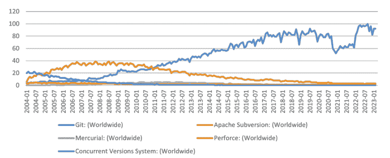

图 3.1：2004 年至2023 年对 SCM 工具的关注度³

图 3.2 显示了前五位版本控制技术及其市场份额百分比：

| | | |
|---|---|---|
| Git | 88.93 % 市场份额 | 90,065 个客户 |
| Microsoft Azure DevOps Server | 9.04 % 市场份额 | 9,153 个客户 |
| TortoiseSVN | 1.58 % 市场份额 | 1,596 个客户 |
| Subversion | 0.23 % 市场份额 | 230 个客户 |
| Serena PVCS Version Manager | 0.15 % 市场份额 | 155 个客户 |
| Others | 0.08 % 市场份额 | 82 个客户 |

**图 3.2：2023 年前五位版本控制技术⁴**

Git 在开源社区非常流行，这意味着其使用拥有广泛的支持基础。然而，如果你的公司在旧版源码控制工具上有巨额投资，有时说服你的经理或同事采用新技术是很的。

以下是你应该升级到 Git 的一些原因：

- **响应时间更快：** 它的响应速度更快，节省了大量时间。你可以将时间花在更有用的事情上，而不是等待版本控制系统给你响应。
- **可靠：** Git 的编写类似于文件系统，包括一个适当的文件系统检查工具 (`git fsck`) 和用于确保数据可靠性的校验和。因此，你可以将数据备份到多个外部位置。
- **性能：** Git 极快。它从底层开始就是为了处理大型代码库的。
- **良好的工具支持：** 有许多 Git IDE 前端（IntelliJ IDEA, VS Code, Eclipse, NetBeans）。因此，不太会有任何开发平台不支持它。
- **集成：** Git 与问题跟踪器、即消息平台、持续集成服务器、安全扫描器集成。
- **迁移工具：** 有从其他版本控制系统到 Git 的迁移工具，例如用于 Subversion 的 `git-svn` 或用于 Team Foundation 版本控制 (TFVC)。

现在，我们将通过一个简单的练习，在 GitHub 官方仓库上创建你的第一个拉请求（pull request）。这将让你了解版本控制是如何运作的。这个练习不需要安装任何软件或使用命令行，因此完成起来应该非常简单直接。完成此练习后，你将理解分式版本控制的基本概念，我们将在本章稍后的部分对其进行详细介绍。

- 对于本次练习，你需要登录账户，以便从 Web 用户界面创建拉请求。如果你还没有 GitHub 账户，注册并开始使用是非常简单且免费的。

- 创建一个名为 `DevOps` 的仓库并导航到该 `DevOps` 仓库。

- 图 3.4 显示了 `Source-Code-Management` 的 GitHub 仓库。默认情况下，GitHub UI 会显示根文件以及名为 `README.md` 的特殊文件的内容。我们在这里添加一个文本文件。

- 由于我们只对该仓库有只读权限，我们将创建一个该仓库的个人克隆，称为 fork（分叉），我们可以对它进行编辑以创建并提交更改。一旦你登录 GitHub，就可以点击右上角高亮的 Fork 按钮开始此过程。

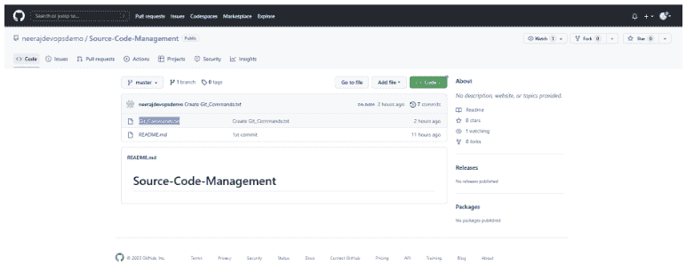

**图 3.4：** 包含本书示例代码的 GitHub 仓库

5. 新的 fork 将在你的 GitHub 个人账户下创建。创建完成后，按照以下步骤打开 Web 文本编辑器：

a. 点击新文件。

b. 在图 3.5 所示的 Web 文本编辑器中输入文件名并编写内容：

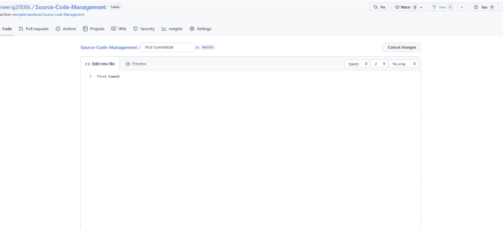

图 3.5：用于添加内容的 GitHub Web 文本编辑器

c. 对更改满意后，向下滚动到图 3.6 所示的提交提交（code commit）部分。输入说明并点击 `Commit changes`（提交更改）按钮。这将更改提交到默认的主分支。然而，如果你在共享仓库中工作，你会将拉请求提交到一个可以单独集的特性分支（feature branch）。

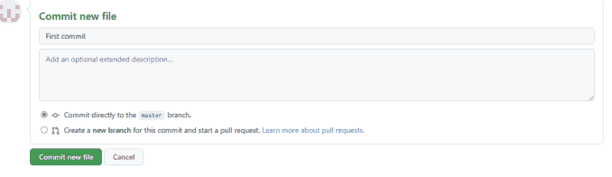

图 3.6：向你有写权限的 git 仓库提交更改

6. 在向你的 fork 仓库添加文件后，你可以为原始项目提交此拉请求。这将通知项目维护者有一个建议的更改正在等待审核，验证后，他们可以将其集成到原始项目中。

7. 要合并此更改，请进入 GitHub 用户界面中的 `Pull requests`（拉请求）选项卡。你会看到创建一个 `New pull request`（新拉请求）的按钮，它将为你提供要合并的“base”（基准）和“head”仓库的选择，如图 3.7 所示。现在，点击 `Create pull request` 按钮，提交一个针对原始仓库的新拉请求进行审核。

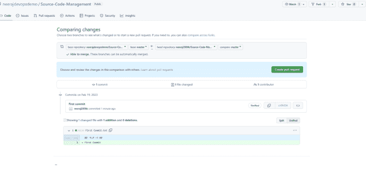

图 3.7：从 fork 仓库创建拉请求

8. 这完成了你对拉请求的提交！现在由原始仓库所有者审核并接受/拒绝该拉请求。图 3.8 显示了呈现给仓库所有者的界面。如果仓库所有者接受了你的拉请求，你的文件将被添加到主仓库。

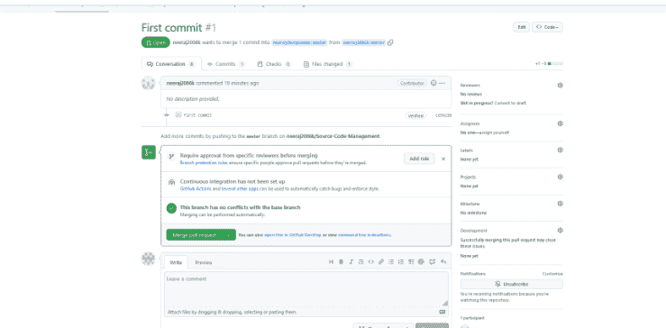

**图 3.8：** 用于合并拉请求的仓库所有者界面

此工作流是使用 fork 和 pull request 模型进行项目管理的示例。我们将在 Git 工作流部分讨论其他工作流。

# Git 工具

在上一节中，我们通过 GitHub UI 经历了一个完整的基于 Web 的 Git 工作流。然而，大多数开发者都花在基于客户端的 Git 用户界面上。可用的客户端界面大致分为以下几类：

- 命令行：可以轻松将官方 Git 命令行客户端添加到你的机器上。

- GUI 客户端：官方 Git 分发版带了几个开源工具，可以更方便地浏览修订历史或构建提交（commit）。此外，市场上还有几种第三方的免费开源 Git 工具。

- Git IDE 插件：通常，你需要你喜爱的 IDE 与你的分布式源码控制系统协同工作。许多主流 IDE 都为 git 提供了良好的插件支持。

## Git 命令行基础

Git 的命令行界面简单易用。它的设计初衷是让你对仓库有完全控制。我们将关注对你日常工作重要的命令。我们也会简化一些高级命令。

作为一个起点，只需输入 `git version` 或 `git --version` 来确定你的机器是否已经预装了 Git。你应该会看到类似下面的输出：

```
$ git --version
```

`git version 2.39.1.windows.1`

如果你的机器上没有安装 Git，请按照以下指令以简单的方法安装它：

- Linux 发行版：
  - Debian/Ubuntu: `sudo apt install git-all`
  - Fedora 系统: `sudo dnf install git-all`

- macOS:
  - Homebrew:
    `$ brew install git`
  - MacPorts:
    # 需要在安装 Git 之前先安装 MacPorts
    `$ sudo port install git`

- 另一个简单的选项是安装 GitHub Desktop，它会安装并配置命令行工具。

- Windows：在 Windows 上，你可以选择独立安装程序、便携版安装程序，或使用 Windows 包管理器 `winget` 或社区维护的包管理器 `chocolatey` 来安装 Git：
  - 安装 GitHub Desktop，它也会安装命令行工具。
  - Winget:
    # 从 PowerShell 或命令提示符执行
    `PS C:\winget install`
  - Chocolatey:
    # 从 PowerShell 或命令提示符执行
    `PS C:\choco install git`

在继续下一节之前，请根据你的系统平台安装 Git。

安装完成后，输入 `git` 将列出它的选项和最常用的子命令：

```
$ git

用法:

git [-v | --version] [-h | --help] [-C <path>] [-c <name>==value>] [--git-dir=<path>] [--work-tree=<path>] [--namespace=<name>] [--super-prefix=<path>] [--config-env=<name>==envvar>] [--exec-path=<path>] [--html] [--man-path] [-p | --paginate | --no-pager] [--replace-objects]

git <command> [args]]
```

以下是在各种情况下常用的 Git 命令：

- 启动工作区域（参见 `git help tutorial`）


- `clone`：将仓库克隆到新目录
- `init`：创建空仓库或重新初始化

## 处理当前更改（参见 `git help everyday`）

- `add`：将文件内容添加到索引
- `mv`：移动或重命名文件、目录或符号链接
- `restore`：恢复工作树文件
- `rm`：从工作树和索引删除文件

## 查看历史和状态（参见 `git help revisions`）

- `bisect`：使用二分查找引入 bug 的提交
- `diff`：显示提交之间、提交与工作树之间的更改
- `grep`：打印匹配模式的行
- `log`：显示提交日志
- `show`：显示各种对象
- `status`：显示工作树状态

## 增长、标记和调整共同历史

- `branch`：列出、创建或删除分支
- `commit`：记录更改
- `merge`：合并多个开发历史
- `rebase`：将提交重新应用到另一个基之上
- `reset`：将 HEAD 置于指定状态
- `switch`：切换分支
- `tag`：创建、列出、删除或验证 GPG 签名标签对象

## 协作（参见 `git help workflows`）

- `fetch`：从另一个仓库下载对象和引用
- `pull`：从另一个仓库或本地分支获取并集成
- `push`：更新远程引用及关联对象

`git help -a` 和 `git help -g` 列出子命令和一些概念指南。

使用 `git help <command>` 或 `git help <concept>` 可以了解特定的子命令或概念。

查看 `git help git` 获取系统概述。

## Git 选项

如你从用法提示所示，只有少数选项直接适用于 `git`。大多数选项（在提示中显示为 `[ARGS]`）适用于特定的子命令。例如，`--version` 选项影响 `git` 命令并产生版本号：

```bash
$ git --version
git version 2.39.1.windows.1
```

相比之下，`--amend` 是一个特定 `git commit` 命令的选项示例：

```bash
$ git commit --amend
```

某些调用需要两种形式的选项：

```bash
$ git --git-dir=project.git repack -d
```

## 查看 Git 子命令文档

为了方便起见，可以使用 `git help <subcommand>`、`git --help <subcommand>`、`<subcommand> --help` 或 `man git-subcommand` 查看可用 Git 子命令的文档。

完整的 Git 文档^5 可以在线查看。

在历史上，Git 是作为许多简单、独特且独立的命令组合提供的，这些命令是根据 Unix 哲学开发的：构建小型、可互操作的工具。每个命令都显示带连字符的名称，例如 `git-commit` 和 `git-log`。然而，现代安装不再支持带连字符的命令形式，而是使用单个 Git 可执行文件配合子命令。

Git 命令同时理解“短”选项和“长”选项。例如，`git commit` 命令将以下示例视为等效：

```bash
$ git commit -m "My First commit"
$ git commit --message="My First Commit"
```

短形式 `-m` 使用一个连字符，而长形式 `--message` 使用两个。

> **提示：**多次使用 `-m` 选项，你可以创建一个提交摘要（commit summary）和一个针对该摘要的详细消息：

```bash
$ git commit -m "Summary" -m "Detail of Summary"
```

从开始，了解基础 Git 命令非常有帮助。图 3.9 显示了一个典型的仓库层次结构，其中包含一个中心（远程）仓库被克隆到本地。当开发者克隆仓库时，他们在本地机器上执行了两个操作：完整拷贝整个仓库（带有所有历史记录）以及一个可以对文件进行修改的工作目录。工作目录是开发者编写和编辑代码的地方。当开发者做出更改时，他们可以暂（stage）这些更改，将它们提交（commit）到本地仓库，并在准备好与他人共享工作后将它们推送（push）到中央（远程）仓库。

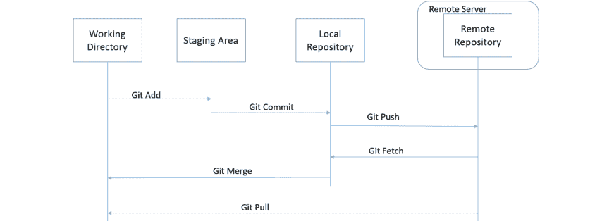

**图 3.9：**带有远程仓库和本地仓库的典型 Git 仓库层次结构

## 从命令行使用 Git 工作

无论是创建一个新仓库还是与现有仓库工作，在本地机器上安装 Git 后，你都需要完成一些基本的先决配置。至少，在你的仓库中进行首次提交之前，Git 需要你的姓名和电子邮件地址。你提供的身份将显示为提交作者，并与其他快照元数据封装在一起。你可以使用 `git config` 命令将你的身份保存在配置文件中：

```bash
$ git config user.name "Neeraj kumar"
$ git config user.email "neerajdevopsdemo@gmail.com"
```

如果你决定不在配置文件中包含你的身份，则必须在每个 `git commit` 子命令的末尾添加 `--author` 参数来指定身份：

```bash
$ git commit -m "First commit" --author="Neeraj Kumar <neerajdevopsdemo@gmail.com>"
```

请记住，这是费力的方法，而且很快就会变得单调。

你也可以通过分别向环境变量 `GIT_AUTHOR_NAME` 和 `GIT_AUTHOR_EMAIL` 提供你的姓名和电子邮件地址来指定身份。如果你设置了这些变量，它们将覆盖所有的配置设置。

## 与本地仓库工作

现在你已经配置了身份，可以准备开始操作仓库了。我们将执行以下任务：

- 在你的本地开发机器上创建一个空仓库。
- 我们将把该仓库变为 Git 仓库。

## 创建初始仓库

我们将通过创建一个仓库来模拟一个典型场景。假设你正从零开始，将在本地目录 `~/First-Demo` 中为项目添加内容，并将其放入 Git 仓库。

输入以下命令创建目录，并在名为 `index.html` 的文件中放置一些基础内容：

```bash
$ mkdir ~/First-Demo
$ cd First-Demo/
$ echo 'My First commit' > index.html
```

要将 `~/First-Demo` 转换为 Git 仓库，请运行 `git init`。在这里，我们提供了 `-b` 选项，后面跟着一个名为 `main` 的默认分支：

```bash
$ git init -b main
Initialized empty Git repository in /First-Demo/.git/
```

另一种方法是先初始化一个空 Git 仓库，然后向其添加文件。你可以运行以下命令：

```bash
$ git init -b main ~/First-Demo
Initialized empty Git repository in ../First-Demo /.git/
$ cd ~/First-Demo
$ echo 'My First commit' > index.html
```

### 提示

1. 无论你初始化的是一个完全空的目录，还是一个装满文件的现有目录，将目录转换为 Git 仓库的过程都是相同的。
2. 当你使用 `git init` 创建新仓库时，Git 默认会创建一个名为 `master` 的分支。从 Git 2.28 版本开始，你可以为初始分支设置不同的名称。要将 `main` 设置为默认分支：

   ```bash
   $ git config --global init.defaultBranch main
   ```

现在，让我们来看一些用于管理仓库和在 Git 中协作的基础及高级命令。

### 分支（Branches）

分支是使用 Git 的重要部分。你所做的任何提交都将位于当前检出的分支上。使用 `git status` 查看当前处于哪个分支。

```bash
$ git branch [branch-name]
```

创建一个新分支。

### `git checkout [branch-name]`

在 `git branch` 创建的分支之间切换并更新工作目录。

### `git merge [branch]`

将指定分支的更改合并到当前分支。如果合并的历史已经是当前分支的后代，则将使用“快进”（fast-forward）。否则，将创建一个合并，并提示用户解决任何冲突。此命令也被 `git pull` 用于整合远程仓库的更改。

删除指定的分支。

## 创建仓库并管理仓库

创建仓库并管理仓库。当你开始使用新仓库时，只需执行一次：要么在本地完成后推送到 GitHub，要么通过克隆现有仓库。

```bash
$ git init
```

将现有目录转换为 Git 仓库。

```bash
$ git clone [url]
```

克隆（下载）GitHub 上存在的仓库，包括文件、分支和提交。

## 同步更改

将你的本地仓库与 GitHub 上的远程仓库同步。

```bash
$ git fetch
```

下载远程分支的所有历史。

```bash
$ git push
```

将所有本地分支提交上传到 GitHub，并将更改从本地仓库推送到远程仓库。在提交后使用此命令将更改推送到远程仓库，以便其他开发者查看。

### `git pull`

将当前本地工作分支与 GitHub 上对应的远程分支同步。`git pull` 是 `git fetch` 和 `git merge` 的组合。

### `git rm`

删除文件或目录，同时更新下次提交的版本控制记录。其用法与 Unix 中的 `rm` 命令类似，应使用它替代文件系统命令以保持版本控制历史完整。

### `git mv`

重命名或移动文件/目录，同时更新下次提交的版本控制记录。其用法与 Unix 中的 `mv` 命令类似，应使用它替代文件系统命令以保持版本控制历史完整。

### `git restore`

## 更改

以下是用于制作更改、检查文件演变和管理版本历史的一些 Git 命令。它涵盖了比较分支间的内容、查看文件历史、显示特定提交的元数据和更改、将文件添加到版本控制，以及带有描述性消息提交更改到本地仓库。这些命令是使用 Git 版本控制跟踪和管理项目开发进展的基础：

```bash
$ git diff [first-branch]...[second-branch]
```

显示两个分支之间的内容差异：

```bash
$ git log --follow [file]
```

查看文件的历史记录，列出文件的版本历史，包括重命名：

```bash
$ git log
```

列出当前分支的版本历史：

```bash
$ git show [commit]
```

输出指定提交的元数据和内容更改：

```bash
$ git add [file]
```

将文件修订版本添加到版本控制，这可以是新文件，也可以是对现有文件的修改：

```bash
$ git commit -m "[descriptive message]"
```

将工作区中的提交保存到本地仓库。在运行 `commit` 之前，通过对已添加、修改、重命名或移动的文件调用 `add`、`mv` 和 `rm` 来注册你所有的文件更改。你还需要指定一个提交消息，这可以通过 `-m` 选项在命令行中完成。

## 重写历史并重新执行提交

重写分支、更新提交并清理历史。

```bash
$ git rebase [branch]
```

将当前分支的任何提交应用到指定分支之后。此命令将你当前分支的提交重放到上游分支上。这与 `merge` 不同，`merge` 的结果是产生合并提交，而不是线性历史，这使得修订历史更容易跟进。缺点是 `rebase` 在移动历史时会创建全新的提交，因此如果当前分支包含之前已推送的更改，你正在重写其他客户端可能依赖的历史。

```bash
$ git reset [commit]
```

撤销 `[commit]` 之后的所有提交，同时保留本地更改：

```bash
$ git reset --hard [commit]
```

清除暂存区，从指定的提交开始重写工作树。

既然你已经对一些基础和高级 Git 命令有了基本的了解，让我们把这些知识付诸实践。

## Git 命令行教程

现在，让我们演示如何使用这些命令，我们将通过一个简单的示例从零开始创建一个新的本地仓库。你的系统中应该有一个类 Bash 的命令行 shell。这是绝大多数 Linux 系统以及 macOS 上的默认设置。如果你在 Windows 上，可以通过 Git Bash 完成此操作。

这是你第一次使用 Git，输入你的姓名和邮箱是一个好主意，它们将与你所有的版本控制操作关联。你可以通过以下命令完成：

```bash
git config --global user.name "Put Your Name Here"
git config --global user.email "your@email.address"
```

配置好个人信息后，进入合适的目录创建你的工作项目。首先，创建项目文件夹并初始化仓库：

```bash
$ mkdir First_Demo
$ cd First_Demo
$ git init -b main ~/First_Demo
```

这会创建仓库并初始化它，你可以开始跟踪文件的修订。让我们创建一个新文件并将其添加到版本控制：

```bash
echo "This is a sample file" > First_sample.txt
```

要将此文件添加到版本控制，请使用以下 `git add` 命令：

```bash
$ git add First_sample.txt
```

你可以通过 `git commit` 命令将此文件添加到版本控制：

```bash
$ git commit First_sample.txt -m "First commit"
```


恭喜你使用 Git 完成了第一次命令行提交！你可以使用 `git log` 命令双重检查，以确保你的文件正被版本控制跟踪，它应该返回类似下面的输出：

`Author:neerajdevopsdemo <125783628+neerajdevopsdemo@users.noreply.github.com>`

`Date: Sun Feb 19 23:47:24 2023`

`First commit`

从上述日志中，你可以获取一些细节，包括分支信息（默认分支为 `master`）以及通过全局唯一标识符（GUIDs）标识的。

你可以从命令行进行更多操作，但通常使用 Git 客户端或为开发者工作流设计的 IDE 集成会更方便。在接下来的章节中，我们将讨论这些客户端选项。

## Git 客户端

几个你可以用于与 Git 操作的开源客户端针对各种工作流进行了优化。大多数客户端并没有尝试做所有事情，而是专门负责特定工作流的可视化和功能。

默认的 Git 安装带了几个实用的视觉工具，让提交和查看历史变得更容易。这些工具使用 Tcl/Tk 编写，跨平台支持，并且很容易从命令行启动，以补充 Git 命令行界面（CLI）。以下是此类工具：

- Gitk：`gitk` 提供了一种浏览、查看和搜索本地仓库 Git 历史的方法。显示项目历史的 `gitk` 用户界面所示图 3.10：

## 源代码管理：所有文件

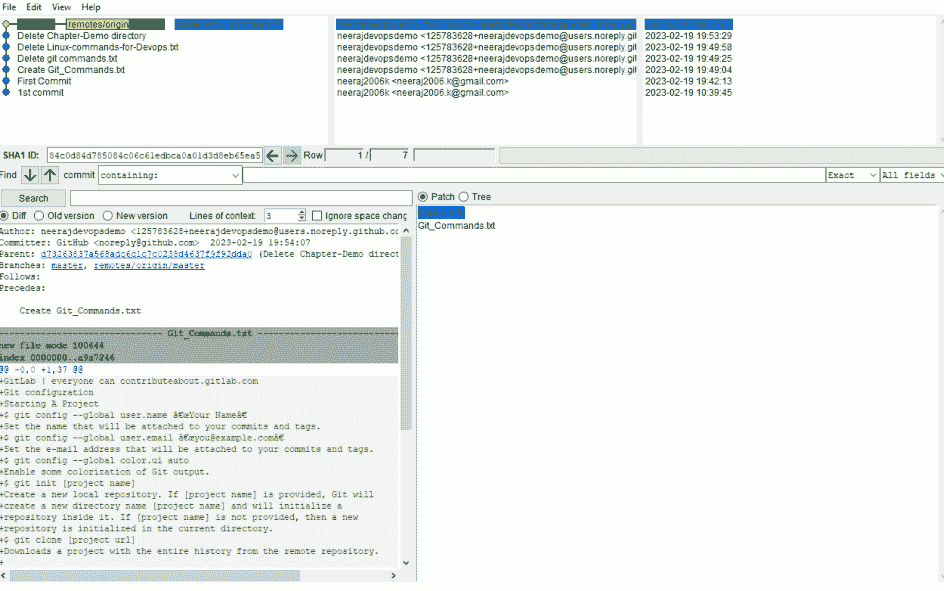

图 3.10：内置的 Gitk 应用

git 的顶部面板显示带有分支信息的修订历史，这对于检查复杂的分支历史很有用。下面是搜索过滤器，可用于查找包含特定文本的提交。最后，对于选定的更改集和更改的文本差异，也是可以搜索的。

- Git-gui：Git 附带的另一个工具是 `git-gui`。与仅显示仓库历史信息的 git 不同，`git-gui` 允许你通过仓库来修改仓库。（注：原文此处存在大量重复描述，已按逻辑清理。）

其他可以提供优异 Git 支持的 Java IDE 还包括：

- Eclipse：Eclipse 是一个完全开源的 IDE，拥有强大的社区支持，并由 Eclipse 基金会运行。Eclipse Git 支持由 EGit 项目提供，该项目基于 JGit，JGit 是 Git 控制系统的纯 Java 实现。
- NetBeans：提供 Git 插件，完全支持在 IDE 中进行工作流操作。
- Visual Studio Code：开箱即支持 Git 以及其他版本控制系统。
- Oracle JDeveloper：虽然它不支持复杂的工作流，但 JDeveloper 提供了克隆（cloning）、提交（commit）和推送（push）到仓库的基本支持。

## Git 工作流

Git 工作流是一种关于如何以一致的方式使用 Git 来完成工作的方法或建议。Git 工作流鼓励开发者和 DevOps 团队有效且持续地利用 Git。Git 在用户管理更改方面提供了极大的灵活性。Git 的重点在于灵活，因此关于如何使用 Git 并没有标准的流程。在由 Git 管理的项目上进行团队协作时，确保团队集体决定如何应用更改流至关重要。为了确保团队达成共识，应该开发或选择一个约定的 Git 工作流。有几种公开的 Git 工作流可能适合您的团队。在这里，我们将讨论其中一些 Git 工作流选项。

## 中央式工作流

集中式工作流是适用于从 Subversion（SVN）迁移的团队优秀 Git 工作流。与 Subversion 类似，集中式工作流使用中央仓库作为项目所有更改的单一入口。默认开发分支称为 `main`，所有更改都提交到此分支。此工作流除了 `main` 之外不需要任何其他分支。

过渡到分布式版本控制系统似乎是一项艰巨的任务，但您不需要改变现有的工作流就可以利用 Git 的优势。您的团队可以按照使用 Subversion 完全相同的方式开发项目。

图 3.14 显示了只有一个 Master 分支的集中式工作流。


图 3.14：集中式工作流

然而，在开发工作中使用 Git 相比 SVN 有几个优势：

- 首先，它为每个开发者都提供了整个项目的本地副本，每个开发人员都可以独立工作。他们可以将提交添加到本地仓库中，并在方便之前完全忘记上游的进展。
- 第二，它让您能够访问 Git 健壮的分支和合并模型。与 SVN 不同，Git 分支被设计为集成代码和在仓库之间共享更改的故障机制。在集中式工作流中，开发者向远程服务器托管的仓库推送并从中拉取。与其他工作流相比，集中式工作流没有定义的拉请求（pull request）或分叉（forking）模式。集中式工作流通常适用于从 SVN 迁移到 Git 的团队以及规模较小的团队。

## 特性分支

当有多个开发者处理某个特定功能而不干扰主代码库时，Git 分支工作流就成为必需品。核心思想是所有特性开发都应该在专用分支中进行，而不是主分支。

假设两个开发者正在处理两个不同的功能。现在，如果两个开发者都从同一个分支工作并添加提交，将会导致代码库变得非常混乱并产生大量冲突。为了避免这种情况，两个开发者可以从 `master` 分支创建两个独立的分支，并各自处理他们的特性。当他们完成功能开发后，可以将各自的分支合并到 `master` 分支，而无需等待另一个功能的完成。图 3.15 是带有 Master 和 Feature 分支的特性分支工作流示例。Feature 分支应该是短命的，以尽力减少合并冲突的风险。

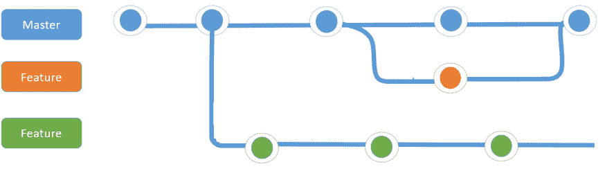

图 3.15：特性分支工作流

## Git-flow 工作流

Git-flow 工作流首次发表于 2010 年一篇受推崇的博客中，从那时已有已有发布周期的组织广泛使用。Git-flow 工作流定义了一个围绕项目发布的严格分支模型。此工作流没有添加特性分支工作流之外所需的任何新概念或命令。相反，它为不同的分支分配了非常具体的角色，并定义了它们应该以及何时交互。

在 Git-flow 中，有两个长期分支：用于开发集成的 `develop` 和用于最终发布的 `master`。开发者从 `develop` 分支创建分支并处理新功能，并在完成后将其集成到 `develop` 分支。当 `develop` 分支包含发布所需的所有功能时，会从 `develop` 分支创建一个新的发布分支（release branch）。与新功能相关的代码不会被添加到发布分支，即补丁和 Bug 修复。一旦发布分支稳定并准备好发布到 `master`，则只在 `master` 上应用热修复（hotfixes），即在专用分支上管理的微小更改。这些热修复也需要应用回 `develop` 分支，以及任何需要相同修复的并发发布版本。图 3.16 显示了 git-flow 的示例图：

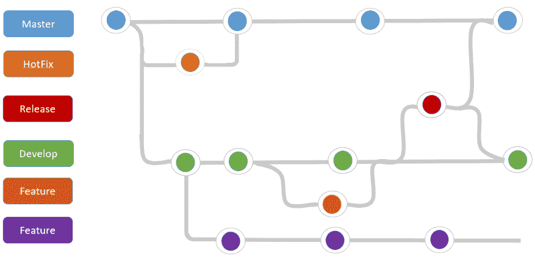

图 3.16：Git-flow 工作流

## 分叉工作流

分叉工作流与目前讨论的所有工作流本质上有所不同。它不是使用单一服务器端仓库作为“中央”，而是给每个贡献者一个分叉仓库（forked repository）。这在使用开源的团队中非常流行。这种流程通常如下：

1. 开发者分叉仓库。创建该仓库的副本。
2. 开发者从账户克隆主仓库。
3. 开发者在本地系统创建新分支，进行更改并提交。
4. 这些更改被推送到账户。
5. 从仓库开启拉请求（pull request）。
6. 管理员检查更改并批准合并。

## 主干开发

上述所有 Git 工作流方法都是特性开发模式的替代方案。当开发者完成新工作时，将其合并到主分支。然而，在验证可以构建之前，他们不合并更改。在此阶段，如果自开始以来进行了修改，可能会出现冲突。特别是随着开发团队的增长，这些冲突变得越来越复杂。

主干开发是一种版本控制管理实践，开发者将频繁的小更新合并到核心“主干”。它是 DevOps 团队的常用做法，也是 DevOps 生命周期的一部分，因为它简化了合并和集成阶段。事实上，主干开发是 CI/CD 的强制实践。与其他长期分支策略相比，开发者可以创建少量提交的短命分支。随着代码库复杂性和团队规模的增长，主干开发有助于发布流程。

## 版本控制的最佳实践

为了充分利用版本控制，遵循以下一些实践至关重要：

- **在提交前审查更改：** 在提交之前，务必审查代码，特别是在您提交到共享仓库时。通常，代码审查是交付流水线的一部分，在通过审查系统或拉请求合并到主分支或特定仓库之前进行。代码审查对代码修改进行二次检查，有助于检测代码中的问题。它还作为质量控制机制，有助于有机提高整体代码质量，同时增加对代码更改的关注。
- **频繁提交：** 每次提交都是代码库在特定时间点的快照。频繁提交允许您将完成的更改量保存到代码库，如果更改导致错误，您有更多机会恢复到早期状态。
- **包含详细的提交信息：** 提交信息应该具有意义，以便其他开发者获取已完成的上下文。当特定更改产生问题时，这非常有帮助。一个好的提交信息（commit message）可以包含如错误修复 ID 或需求 ID 等细节，这些信息可以在 Jira 等项目管理平台中引用代码更改的规范。
- **确保你正在当前版本上工作：** 由于有多个开发者频繁更改代码，你本地的代码库副本很容易落后于主库副本。在进行更改之前，请检出最新的代码库，以确保你正在使用最新版本。
- **标准化团队工作流：** 每位开发者在项目上可能都有自己偏好的流程。但为了让 SCM（软件配置管理）工具和程序生效，开发团队需要建立一致的工作流，这为更好的项目奠定了基础。
- **使用分支：** 分支创建了独立的开发线，允许开发者在同一代码库上并行工作，而不会影响彼此的工作。应该首先定义分支策略并频繁使用它。为每项更改创建一个新分支是一个好习惯。

## 结论

良好的源码控制系统和实践，为快速构建、发布和部署代码奠定了稳健的 DevOps 方法论基础。在本章中，我们讨论了什么是源码控制管理、它解决了哪些关键问题、源码控制系统的历史，并解释了为什么行业已经转向了分布式版本控制。然后，我们讨论了代码版本控制及其最佳实践。我们分析了应该选择的源码控制工具，以及哪个 Git 适用于你的团队。

我们学习了 Git 组件，并完成了首次 Git 拉取请求（pull request）。我们讨论了一整套用于处理 Git 仓库的新命令行、桌面版和集成工具。我们详细讨论了各种 Git 客户端工具。我们对不同的 Git 工作流有了见解。在章节结束时，我们讨论了源码控制管理的最佳实践。

在下一章中，我们将讨论容器以及我们为什么要使用它。

1. 来源：https://initialcommit.com/blog/Technical-Guide-VCS-Internals#rcs-revision-control-system---first-generation
2. 来源：https://initialcommit.com/blog/Technical-Guide-VCS-Internals#sccs---source-code-control-system---first-generation
3. 来源：Google Trends
4. 来源：https://www.slintel.com/tech/version-control-scm.com/git
5. Git 文档：https://git-scm.com/docs/git
6. 来源：https://nvie.com/posts/a-successful-git-branching-model/
7. Paul Hammant，主干开发（trunk-based development）的有力支持者，建立了一个完整的网站并写本关于该主题的书。来源：https://trunkbaseddevelopment.com/
8. 来源：https://www.atlassian.com/git/tutorials/what-is-version-control-rol

## 加入我们书籍的 Discord 空间

加入书籍的 Discord 工作空间以获取最新更新、优惠、全球科技动态、新发布以及与作者的互动：

https://discord.bponline.com

# 第 4 章：容器化

## 引言

目前，容器在生产及其他环境的使用正在以指数级速度增长。你将听到关于它们的许多优势，包括启动速度更快、能够实现更好的 DevOps 实践、比虚拟机占用更少的资源等。然而，创建容器的必要性是为了解决 IT 领域的一个根本问题：应用程序在一种环境中运行正常，但由于手动配置错误或未能安装必要的软件包或软件而在另一个环境中失败。

简而言之，容器是应用程序以及运行应用程序所需的所有其他必要组件的封装。容器在运行时拥有其独立的隔离文件系统和注册表视图，而这个视图与宿主机和其他容器都是分开的。因此，基于容器的应用程序将始终以相同的方式运行。为了更好地理解什么是容器，让我们先考虑为什么我们可能使用它。

## 结构

在本章中，我们将讨论以下主题：

- 理解容器及其用法
- 容器的历史
- 容器与虚拟机之间的区别
- 关键容器和镜像术语
- Docker 架构
- 使用 Kubernetes 进行 Docker 容器编排
- 在你的机器上使用 Docker
- 在本地运行 Kubernetes
- 最佳镜像构建实践

## 目标

在本章结束时，你将对容器技术有全面的理解，从为什么在现代软件开发中使用容器这一基础问题开始。它追溯了容器的历史演变，探索了它们与虚拟机的区别，并引入了关键的容器和镜像术语。本章深入了 Docker 架构，解释了其组件，并进展到使用 Kubernetes 进行 Docker 容器编排的实际方面。通过在单机机器上设置 Docker 和在本地运行 Kubernetes 的指导，强调了实践实施。本章最后对构建优化容器镜像的最佳实践 string 了见解，确保你既有理论知识又有实践熟练度，能够应对动态的容器化格局。

## 理解容器及其用法

如何让软件在从一个计算环境移动到另一个环境时保持一致运行是由容器解决的。这可能涉及将虚拟机从数据中心的物理机移动到私有或公共云，将虚拟机从测试环境移动到生产环境，或将虚拟机从开发者的笔记本移动到测试环境。

根据 Docker 创建者 Solomon Hykes 的说法，当支持的软件环境不同时就会出现问题。当你使用 Python 测试时会发生一些奇怪的事情。为了避免这种情况，容器是整个运行环境的集合，包括运行所需的依赖项、库、二进制文件和配置文件。简单来说，它被容器化了。可以使用开发者的笔记本、本地数据中心甚至云端来进行构建、测试和部署。让我们了解让容器成为敏捷开发基石的关键优势：

- **减少开销：** 由于容器不包含操作系统镜像，它们比传统的虚拟机环境消耗更少的系统资源。
- **扩展性：** 运行容器中的应用程序可以轻松部署到各种平台和操作系统。
- **更可靠的性能：** 无论部署在何处，DevOps 团队都知道运行容器的应用程序将以相同的方式运行。
- **更高的效率：** 得益于容器，应用程序可以更快地扩展、补丁或部署。
- **加速扩展：** 由于容器缺乏虚拟机的开销，相同的基础设施可以支持更多的容器。由于容器是可移植的，快速启动和停止使得快速伸缩成为可能。
- **更有效的应用开发：** 容器的使用有助于敏捷和 DevOps 倡议加速开发、测试和生产周期。

## 容器的历史

加入我们穿越时间的之旅，揭开容器演变的谜。从 20 世纪 60 年代计算资源的稀缺到如今云原生部署的重要性，这段叙述追踪了导致容器出现和广泛采用的里程碑。这是一个技术飞跃、协作倡议以及容器对现代软件开发转型性影响的故事。我们将整个历程分类如下：

1. **资源稀缺与早期尝试（20 世纪 60—70 年代）：** 计算资源在 20 世纪 60、70 年代通常非常稀缺且昂贵（按今天的标准来看）。进程完成需要很长时间（再次，按今天的标准来看），通常一台计算机会长时间为单个用户执行单个任务。人们一直在尝试增强计算资源的共享，以解决这些限制带来的瓶颈和效率低下问题。共享资源是必要的，但还不够。找到一种既互不干扰又不会让某一个无意中导致整个系统崩溃的共享方法变得至关重要。先进的虚拟化技术开始渗透硬件和软件，被称为 `chroot`。为了给不同的发行版创建测试环境，`chroot` 系统于 1979 年开发 Unix V7 时创建。它通过移动进程的目录和 Linux 子目录，它必须是文件系统中不同的位置。
2. **容器概念的演变（1980s—2004）：** `chroot` 在 1982 年被纳入伯克利软件发行版（BSD）中。二十后的 2000 年，FreeBSD 开发了这一理念，并在 FreeBSD 4.0 中发布了复杂的 `jail` 命令和实用。使用 FreeBSD Jails 允许管理员将 FreeBSD 计算机系统划分为多个独立的、较小的系统（或监狱/jails），并可以选择为每个系统和配置分配 IP 地址。需要注意的是，Linux Vserver 是于 2001 年引入的。Linux VServer 是一种与 FreeBSD Jails 类似的 jail 机制，它可以划分计算机系统上的资源（文件系统、网络地址和内存）。Linux 内核已经过修复以实现这种系统虚拟化。Solaris 容器于 2004 年引入，它结合了 zones 提供的边界隔离和系统资源控制。这些容器能够使用 ZFS 的快照和克隆功能。zones 进一步发展，允许应用程序访问整个系统的硬件以及完整的用户、进程和文件系统空间。
3. **进程容器与 Linux 容器（2006—2008）：** 为了限制、统计和隔离一组进程的资源使用（内存、CPU、磁盘 I/O 和网络），Google 在 2006 年引入了进程容器。后来，它被重命名为 cgroups，专注于隔离和限制进程的资源使用。Cgroups 和 Linux 命名空间在 2008 年合并到 Linux 内核中，促使 IBM 创建了 Linux Containers（LXC）。这是 Linux 容器管理器第一个完整的实现。
4. **Docker 的诞生与容器标准（2013—2015）：** 现在事情变得更有趣了。Docker 在 2013 年出现。那一年，Google 提供了它的 Let Me Contain That（lmctfy）开源项目，让应用程序能够创建和管理自己的子容器的能力。从那里开始，我们看到容器的使用呈爆炸式增长——特别是 Docker 容器。最初，Docker 使用 LXC 作为其默认执行环境，后来用自己的库 `libcontainer` 替换了容器管理器。开放容器倡议（OCI）于 2015 年 6 月推出。其目标是为容器运行时和镜像规范制定开放标准。该小组是 Linux 基金会的一部分。尽管 Docker 是主要贡献者，但该公司在宣布新组织时也列出了其他参与者，包括 Apcera、Amazon Web Services（AWS）、Cisco、CoreOS、EMC、富士通、Google、高盛、HP、Microsoft、华为技术、IBM、Intel、Pivotal Software、Linux 基金会、Mesosphere、Joyent、Ranch Labs、Red Hat 和 VMware。无疑，容器的演变及其周围的生态系统已经进步到寻找共识对所有参与方都有利的程度。它们所获得的巨大关注证明了这一点。
5. **Kubernetes 与容器编排（2015—2018）：** 当 OCI 建立时，Docker 也宣布打算捐赠它的 `runC` 运行时和基础容器格式。紧接着，2016 年 4 月捐赠的 Docker v2 Schema 2 格式成为 OCI 镜像格式规范的基础，而 `runC` 成为 OCI 运行时规范的参考实现。这两项规范都于 2017 年 7 月作为 1.0 版本发布。这些系统的编排也随着容器生态系统的发展而迅速发展。OCI 建立一个月后，Google 在 2015 年 7 月发布了 Kubernetes v1.0。与此发布同时，由 Google 和 Linux 基金会合作的云原生计算基金会（CNCF）成立了。Google 在 2016 年 12 月的 Kubernetes v1.5 中的一项关键进展是创建了容器运行时接口（CRI），它为 Kubernetes 节点守护 `kubelet` 提供了必要的抽象层，以支持额外的低级容器运行时。Docker 为了将 `runC` 集成到 Docker 1.11 而创建的兼容 CRI 的运行时容器，于 2017 年 3 月由 Docker（同样是 CNCF 成员）贡献了该代码。
6. **贡献与标准化（2018—2021）：** 2018 年，凭借超过 27000 个星标（stars）和最大的开源社区之一，超过 1500 人为 Kubernetes GitHub 项目做出了贡献。由于 Kubernetes 的广泛采用，AWS 提供了 Elastic Kubernetes Service（EKS）、Azure 提供了 Azure Kubernetes Service（AKS）、Google 提供了 Google Kubernetes Engine（GKE）、Oracle 提供了 Container Engine for Kubernetes，它们都不得不提供 Kubernetes 服务。此外，VMware、RedHat 和 Rancher 等知名软件供应商开始构建基于 Kubernetes 的管理平台。CNCF 在 2021 年 2 月收到了 Docker 的另一个参考实现。镜像分发（推送和拉取镜像）是该贡献的重点。基于 Docker Registry HTTP API V2 协议的 OCI Distribution Spec 1.0 版本于三个月后（即 2021 年 5 月）发布。
7. **当代意义与云原生部署：** 在当今的格局中，容器和编排工具在云原生部署中起着至关重要的作用。今天，云原生部署经常使用容器和 Kubernetes 等编排工具。容器对于维护跨各种主机的部署灵活性以及扩展分布式应用程序至关重要。AWS、Google Cloud、Microsoft Azure 等其他云服务提供商正在不断扩大其产品范围。恭喜你成功通读了“历史”部分！我们在几个段落中涵盖了多年的改进。我们学习了 Docker 如何对容器现状做出巨大贡献。现在是深入容器生态系统、技术细节和实现的理想时机。在深入这些之前，让我们先讨论一下虚拟机与容器的区别，以及如何选择它们。

## 虚拟机与容器的区别

虚拟机和容器都用于为开发和测试创建隔离环境。它们的区别是关键。

### 理解虚拟机

虚拟机是真实物理计算机的模拟或表示。即使它们都运行在主机上，每个虚拟机都有独立的操作系统。它被称为客机，因为它运行在主机硬件上。虚拟机无法直接与物理主机通信。为了与底层硬件通信，它需要一个名为 hypervisor 的软件层。

### 虚拟机的工作原理

虚拟化硬件、操作系统以及任何二进制文件和库都包含在虚拟机内部，它可以运行任何应用程序。因此，虚拟机是独立的，并拥有自己的基础设施。参考以下图：


虚拟机与主机操作系统完全隔离。此外，它需要自己的操作系统，可能与主机的操作系统不同。

能力。你可以安装多个系统环境，因为这些系统之间是完全独立的。利用云计算技术，可以快速部署同一台虚拟机的多个副本，以处理负载的增长。

- **便携性：** 虚拟机可以根据需要在网络中的物理计算机之间移动。因此，可以将工作负载分布到具有额外处理能力的服务器上。
- **灵活性：** 由于你可以复制一个已安装操作系统的现有虚拟机，因此创建一个虚拟机比在物理服务器上安装操作系统要更快、更简单。为了处理新出现的任务，开发者和软件测试人员可以立即创建新环境。

现在来讨论一下虚拟机（VM）的一些缺点：

- **性能不稳定：** 如果基础设施要求不充足：在台物理机器上运行多个虚拟机可能会导致性能不稳定。
- **占用大量系统资源：** 虚拟机的大小可达数 GB，会消耗宿主机计算机大量的系统资源。在虚拟服务器上运行单个应用程序意味着还要运行一个操作系统的副本以及所有硬件的虚拟副本。因此，大量的内存和 CPU 周期会迅速累积。
- **应用程序迁移：** 由于应用程序与操作系统之间存在持续的关联，移动当前正在虚拟机上运行的应用程序可能具有挑战性。因此，你需要同时迁移操作系统和应用程序。此外，当创建虚拟机时，虚拟机管理程序会为虚拟机专门分配硬件资源。

一些流行的虚拟机提供商有：

- VirtualBox
- Hyper-V
- VMware vSphere container

### 理解一致性

容器是轻量级软件包，包含了执行被包含的软件应用程序所需的所有依赖项。软件虚拟化将应用程序与宿主机分离。这使得用户能够在单个操作系统实例上创建多个工作负载。

宿主机操作系统的内核满足运行应用程序不同功能的需求，这些功能被分离到容器中。隔离的任务在每个容器中执行。它不会与运行在单独容器中的其他应用程序发生冲突，也不会损坏主机计算机。

### 容器的工作原理

在容器内部工作时，你可以为必要的环境创建一个模板。容器本质上运行的是特定系统的快照，确保应用程序行为的一致性。

运行在容器内部的所有单个应用程序共享宿主机的内核。二进制文件、库和其他运行时组件是每个容器需要的唯一元素。

参考以下图：

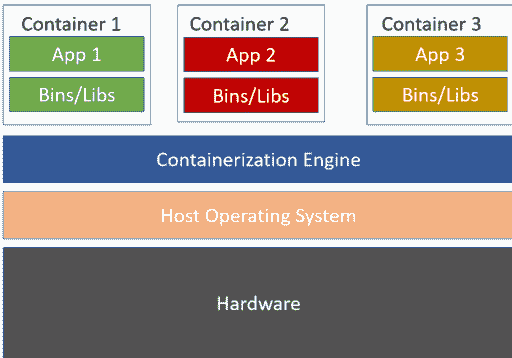

图 4.2：容器

### 容器的优缺点

使用容器具有一些优点：

- **速度：** 由于容器是轻量级的，你可以轻松限制它们的 CPU 使用率和内存。它们只包含高层软件，因此修改和迭代速度非常快。
- **非常适合 CI/CD：** 容器也非常适合实现持续集成和持续部署（CI/CD）。通过在开发者之间共享和合并镜像，它们促进了协作开发。
- **资源效率和扩展性：** 容器共享宿主机操作系统内核，允许多个容器在单机上运行，与虚拟机相比开销最小，提高了资源利用率。此外，容器是轻量级的，可以轻松扩展或缩小，使其成为处理波动负载和微服务架构的理想选择。

现在，让我们讨论如下的一些容器缺点：

- **宿主机内核限制了其他操作系统的使用：** 容器使用宿主机的内核并依赖于宿主机操作系统。因此，容器与底层操作系统的区别仅在于依赖关系，而不在类型。宿主机内核限制了其他操作系统的使用。
- **共享漏洞：** 容器无法提供与虚拟机相同级别的安全性和稳定性。由于共享宿主内核，它们比虚拟机的隔离程度较低。因此，容器在进程级上进行隔离，一个容器可能会通过破坏内核的稳定性影响其他容器。
- **其他问题：** 此外，容器在完成任务后会关闭并删除其包含的所有数据。如果你希望数据留在宿主机服务器上，则必须使用数据卷（Data Volumes）保存数据。这需要在宿主机上进行手动配置和准备。

一些流行的容器提供商有：

- Docker
- LXD
- Hyper-V containers
- Java containers
- AWS
- Windows Server containers
- PodMan (RedHat)

## 选择虚拟机还是容器

根据你希望虚拟化环境执行的任务，你应该在虚拟机和容器之间进行选择。

如果你需要以下操作，虚拟机是更好的解决方案：

- 从单个服务器控制多个操作系统和应用程序。
- 运行需要操作系统所有资源和功能的程序。
- 确保完全的隔离和安全性。

如果你需要以下操作，容器是合适的：

- 通过运行尽可能多的应用程序充分利用服务器容量。
- 部署相同应用程序的多个副本。
- 拥有轻量级、启动快速的系统。
- 创建可以在任何基础架构上运行的应用程序。

## 关键容器和镜像术语

容器世界有自己的词汇，你会经常遇到以下术语：

- **容器：** 应用程序及其所有依赖项和系统资源的封装，在宿主机的隔离“空间”内运行。容器共享宿主机的操作系统和内核，但利用底层特性允许容器内运行的进程与同一主机上的其他进程之间进行隔离。
- **容器镜像：** 带有执行代码的静态文件，可以创建容器。它是不可变的——意味着不能更改——并且可以部署在任何环境中。
- **基础镜像：** 用于创建其他镜像的镜像。它可以是官方 Docker 镜像，也可以从从头创建。基于另一个镜像的镜像将指定它继承的镜像。
- **父镜像：** 另一个镜像继承的镜像，在 Dockerfile 的第一行指定。
- **容器仓库：** 用于存储和访问容器镜像的仓库或仓库集合。
- **镜像仓库（镜像名称）：** 容器仓库中具有不同标签（版本）的相关容器镜像集合。
- **镜像标签：** 通过简单的标签和别名，你可以使用标签来描述镜像。标签可以是任何描述镜像的内容，例如项目版本、镜像功能，甚至是你的名字。
- **镜像 ID：** 当构建镜像时，它会被分配一个唯一的 ID。
- **镜像摘要：** 从清单文件中计算得的唯一 SHA-256 哈希值。
- **镜像层：** 镜像由层组成。每一层都是一个“差异”，记录了自上一个层添加以来镜像所做的更改。在构建镜像时，平台为 Dockerfile 中的每条指令创建一个新层。
- **镜像清单：** 包含镜像元数据的 JSON 文件。它包含了所有层的镜像摘要。

## Docker 架构

Docker 是容器真正的标志。它围绕容器化构建了整套技术栈。当你从电脑上安装 Docker Desktop 时对于开发机，你获得的不仅仅是运行容器的能力。你将获得整个容器平台，它将为开发者使构建、运行和管理容器变得简单方便。

至关重要的一点是，创建容器镜像或运行容器并不安装 Docker。它只是实现这些目标的一种流行且方便的工具。同样，你可以在没有 Maven 或 Gradle 的情况下打包 Java 项目，在使用 Docker 或 Dockerfile 构建容器镜像。我对初接触容器的开发者的建议是：从 Docker 提供的工具集开始，然后尝试其他选项或方法，以获得良好的对比感受。即使你选择使用其他工具代替 Docker 或补充 Docker，人们在工程良好的开发者体验方面也投入了大量的时间和精力，单此这一点就值得了。

通过 Docker，你可以创建一个隔离环境，用户或应用程序可以在其中运行，同时共享宿主系统的操作系统和内核，而不会干扰运行在同一系统上的另一个隔离环境（容器）的功能。

Docker 允许你执行以下操作：

- 定义容器（一种镜像格式）
- 创建容器镜像
- 管理容器镜像
- 分发容器镜像
- 建立容器环境
- 启动/运行容器（容器运行时）
- 管理容器实例的生命周期

容器领域包含比 Docker 多得多，但许多容器工具集的替代方案专注于这些项目中的子集。从学习 Docker 如何运行开始，有助于理解和评估这些替代方案。

有很多图片和图表可以描述 Docker 架构。图 4.3 展示了 Docker 如何在你的开发机上工作。Docker 客户端调用 Docker 主机从特定镜像运行容器。如果 Docker 主机拥有该镜像，它就会从该镜像运行容器。如果没有该镜像，它会在注册表中查找，将其拉取到主机，然后在该机器上从其运行容器。请注意，这三个组件中的任何一个都可以在同一台机器上，也可以在不同的机器上。

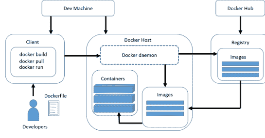

> 图 4.3：Docker 架构

## Dockerfile

Docker 可以通过 Dockerfile 中的指令自动创建镜像。Dockerfile 是文本文件，包含了用户可以在命令行上输入的用于组合镜像的每一个命令。因此，它包含了一组用于构建 Docker 镜像的指令。它定义了应用程序运行的环境，指定了基础镜像，复制文件，安装依赖项，并执行了准备最终容器化应用程序所需的命令。当你构建 Docker 镜像时，Docker 会读取 Dockerfile 以自动化镜像创建过程。

## 示例 Dockerfile

以下是一个 Dockerfile 示例，让你了解它看起来的样子：

```dockerfile

```


```dockerfile
FROM tomcat:8-jre11

LABEL "Project"="Docker-Demo"

LABEL "Author"="Neeraj"

RUN rm -rf /usr/local/tomcat/webapp/*

COPY target/Demo-app.war /usr/local/tomcat/webapp/ROOT.war

EXPOSE 8080

CMD ["catalina.sh", "run"]

WORKDIR /usr/local/tomcat/

VOLUME /usr/local/tomcat/webapp
```

# 使用 Kubernetes 进行 Docker 容器编排

Docker 集群环境中有很多需要管理的任务，包括调度、通信和可扩展性。市场上的任何编排工具都可以处理这些任务，但一些最著名的是 Docker Swarm（Docker 的原生编排工具）和 Kubernetes（长期以来增长最快的开源项目之一）。

Kubernetes 是一个开源容器管理（编排）工具。部署容器、扩容和缩容容器以及负载容器均衡都是其容器管理职责的一部分。AWS ECS、Azure AKS、EKS 和 GCP GKE 只是可用的少数被称为 Kubernetes 即服务（KaaS）的云端 Kubernetes 服务。

参考下图：

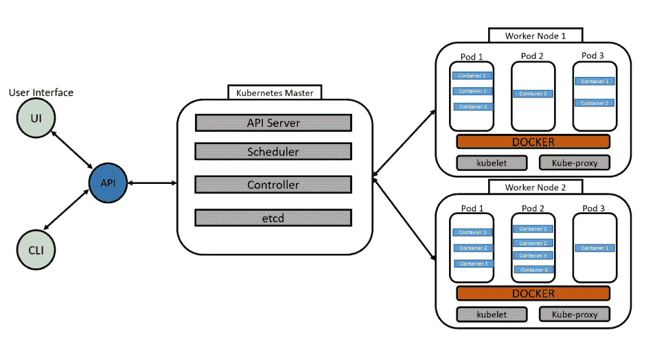

# Kubernetes 的工作原理

Kubernetes 中有一个主节点（master node）和若干工作节点（worker nodes），每个工作节点可以管理数量的 `pod`。一组组合在一起形成功能单元的容器称为 `pod`。`Pod` 用于开始设计你的应用程序。一旦你的 `pod` 准备就，你就可以告诉主节点你想部署哪一个以及部署多少个。从现在起，由 Kubernetes 控制。`pod` 被取出并部署到工作节点上。如果某个工作节点宕了，Kubernetes 会在正常的工作节点上启动新的 `pod`。为了改进应用程序并提高客户满意度，Kubernetes 使构建新功能变得简单。

**主节点组件：** 在 Kubernetes 中，主节点指的是负责管理和监督集群操作（如调度、检测和响应集群事件）的控制平面。它充当集群的大脑，协调并维护系统的期望状态。Kubernetes 主节点的主要组件包括：

- **API server：** API server 充当集群管理的主要接口。它暴露 Kubernetes API，允许用户和其他组件与集群进行交互，创建和管理资源，并执行扩缩和部署等操作。
- **etcd：** `etcd` 是一个分布式键值存储，用于存储和复制集群的配置和状态数据。它提供可靠且一致的存储，确保集群数据的可用性和一致性。它还提供了用于 CRUD 操作的 REST API。
- **Controller-manager：** 控制器管理器由各种控制器组成，处理集群的不同方面。它包括用于复制、端点（endpoints）和其他抽象的控制器。控制器持续监控集群状态并协调状态。
- **Scheduler：** 调度器负责根据资源需求、亲和性和策略将 `pod` 放置到节点上。

**工作节点组件：** 在 Kubernetes 中，工作节点（也称为 worker 或 minion）是运行容器的组件。它托管负载并与主节点通信以接收指令并报告状态。节点组件运行每个节点上：

- **kubelet：** `kubelet` 是运行在每个节点上的代理，负责管理该节点上的容器。它与主节点通信以接收关于运行哪些容器的指令及其配置。`kubelet` 确保容器正在运行，监控其健康状况并将状态报告给主节点。
- **kubeproxy：** `kubeproxy` 是运行在每个工作节点上的网络代理。它负责将网络流量路由到集群内的相应容器和服务。`kubeproxy` 通过实现必要的网络规则和转发规则来实现服务发现和负载均衡。
- **容器运行时：** 运行时是运行容器的软件。Kubernetes 支持多种运行时，如 Docker、containerd 和 CRI-O。运行时与主机操作系统交互，根据 `kubelet` 的指令启动、停止和管理容器。

# 本地运行 Docker

容器基于 Linux 特性的组合，但在实现细节上有所不同。从某种意义上说，容器镜像只是完整文件系统的 tar 包，而运行的容器是与主机上其他进程隔离的 Linux 进程。例如，Docker 容器的实现主要涉及以下三个要素：

- 字体空间（Namespaces）
- `cgroups`
- 合并文件系统（union filesystem）

然而，在你的本地文件系统中容器看起来是什么样的？让我们先看看 Docker 在我们的开发计算机上存储内容的地方。让我们从 Docker Hub 拉取一个真实的 Docker 镜像，来看看这是怎么回事。

在你的机器上安装 Docker Desktop 后，从终端运行以下命令：

```bash
docker info
```

上述命令将提供有关安装的详细信息。输出包含 Docker Root Dir 标签处关于镜像和容器存储位置的信息。

以下示例输出表明 Docker 根目录为 `/var/lib/docker`：

```text
C:\Users\Dell>docker info

Client:

 Context: default

 Debug Mode: false

 Plugins:

  buildx: Docker Buildx (Docker Inc.)

 Version: v0.10.4

 Path: C:\Program Files\Docker\cli-plugins\docker-buildx.exe

 compose: Docker Compose (Docker Inc.)

 Version: v2.17.3

 Path: C:\Program Files\Docker\cli-plugins\docker-compose.exe

 dev: Docker Dev Environments (Docker Inc.)

 Version: v0.1.0

 ....

Server:

 Containers: 0

 Running: 0

 Paused: 0

 Stopped: 0

 Images: 0

 Server Version: 23.0.5

 Storage Driver: overlay2
```

```text
Backing Filesystem: extfs

Supports d_type: true

Using metacopy: false

Native Overlay Diff: true

userattr: false

Logging Driver: json-file

Cgroup Driver: cgroupfs

Cgroup Version: 1

Plugins:

Volume: local

Network: bridge host ipvlan macvlan null overlay

Log: awlogs fluentd gcplogs gelf journal json-file local logentries splunk syslog

Swarm: inactive

Runtimes: io.containerd.runc.v2 runc

Default Runtime: runc

Init Binary: docker-init

containerd version: 2806fc1057397dbaefbeea0e4e17bddfbd388f388

runc version: v1.1.5-0-gf19387a

init version: de40ad0

Security Options:

seccomp

Profile: builtin

Kernel Version: 5.15.90.1-microsoft-standard-WSL2
```

操作系统: Docker Desktop

操作系统类型: linux

架构: x86_64

CPUs: 4

总内存: 3.764GiB

名称: docker-desktop

ID: 8172611d-ca21-4e67-ad2a-06800809bf94

Docker 根目录: `/var/lib/docker`

调试模式: false

HTTP 代理: `http.docker.internal:3128`

HTTPS 代理: `http.docker.internal:3128`

无代理: `hubproxy.docker.internal`

注册表: `https://index.docker.io/v1/`

实验性: false

不安全注册表:

`hubproxy.docker.internal:5555`

`127.0.0.0/8`

启用实时恢复: false

现在，让我们使用命令 `docker pull IMAGE 名称` 拉取 Docker 镜像，并查看它在文件系统中的样子：

```bash
$ docker pull openjdk
```

使用默认标签：latest

latest: Pulling from library/openjdk

5a81c13a8b9: Pull complete  
26cd02acd9c2: Pull complete  
66727af51578: Pull complete

Digest: sha256:05eee0694a2ecfc3e94d29d420bd8703fa9dcc64755962e267fdf5cf22f23644

Status: Downloaded newer image for openjdk:latest

docker.io/library/openjdk:latest

你也可以在 Docker Desktop 上检查新拉取的镜像。参考以下图：

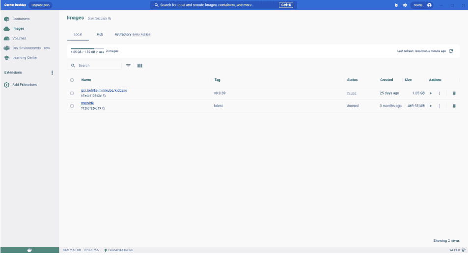

图 4.5: Docker Desktop

我们在上一个命令中拉取的镜像带有标签标签（tag label）。这是默认设置，但我们可以这样指定 `openjdk` 镜像版本：

```bash
C:\Users\Dell>docker pull openjdk:11-jre

11-jre: Pulling from library/openjdk

001c52e26ad5: Pull complete
d9d4b9b6e964: Pull complete
2068746827ec: Pull complete
8510da692cda: Pull complete
b6d84395b34d: Pull complete
bf03fea6c3ad: Pull complete

Digest: sha256:3569493125c4fa8104745e7ea92bd995da4567634e6599b470d2f972d13e0e2

Status: Downloaded newer image for openjdk:11-jre

docker.io/library/openjdk:11-jre:
```

现在，`docker images` 命令列出了所有本地存储的镜像。从其输出可以看到存储了两个版本的 `openjdk` 镜像。

```text
C:\Users\Dell>docker images
```

| 仓库 | 标签 | 镜像 ID | 创建时间 | 大小 |
|---|---|---|---|---|
| gcr.io/k8s-mi v0.0.39 nikube/kicba | | 67a4b1138d2d | 2 weeks前 | 1.05GB |
| openjdk | latest | 71260f25d19 | 2 months前 | 470MB |
| openjdk | 11-jre | 362cda5d27e | 8 months前 | 302MB |

你可以通过运行 `docker inspect` 使用镜像 ID `71260f25d19` 获取关于 latest `openjdk` 镜像的更多信息：

```bash
C:\Users\Dell>docker inspect 71260f25d19
```

输出如下：

```json
{
  "Id": "sha256:71260f25d19f4ae5c72602153141825ca59110376f0ba",
  "RepoTags": [
    "openjdk:latest"
  ],
  "RepoDigests": [
    "sha256:9b445de8921190ec635a48560ed28c1a334056a0bf"
  ],
  "Parent": "",
  "Created": "2023-02-08T19:46:03Z",
  "Container": "7cb9d6257345f1d39107682b01495d3f38be1c",
  "ContainerConfig": {
    "Hostname": "7cb9d6257345",
    "Domainname": "",
    "User": "",
    "AttachStdin": false,
    "AttachStdout": false,
    "AttachStderr": false,
    "Tty": false,
    "StdinOnce": false
  },
  "Env": [
    "PATH=/usr/java/openjdk-18/bin:/usr/local/sbin:/usr/local/bin:/usr/sbin:/bin",
    "JAVA_HOME=/usr/java/openjdk-18",
    "LANG=UTF-8",
    "JAVA_VERSION=18.0.2"
  ],
  "Cmd": [
    "/bin/sh",
    "-c",
    "jshell"
  ],
  "Image": "sha256:ac2e438abda50fce392b0843eb45436188c82e2ed338406d2195bf6c20c0",
  "Volumes": null,
  "WorkingDir": "",
  "Entrypoint": null,
  "OnBuild": null,
  "Labels": {}
  },
  "Architecture": "amd64",
  "Os": "linux",
  "Size": 469930470,
  "VirtualSize": 469930470,
  "GraphDriver": {
    "Data": {
      "LowerDir": "/var/lib/docker/overlay2/62f68265846683df6ece73be75d4a0b4da9836d169cd045641a8c0c9095c1/diff",
      "MergedDir": "/var/lib/docker/overlay2/62f68265846683df6ece73be75d4a0b4da9836d169cd045641a8c0c9095c1/merged",
      "Work": "/var/lib/docker/overlay2/62f68265846683df6ece73be75d4a0b4da9836d169cd045641a8c0c9095c1/diff",
      "UpperDir": "/var/lib/docker/overlay2/4a6910b44a0c6bd3a2c248536a3b5c7ebd47977bcf850b5bbd31a1e544727/diff"
    }
  },
  "DockerVersion": "20.10.12",
  "Author": "",
  "Config": {
    "Hostname": "",
    "Domainname": "",
    "User": "",
    "AttachStdin": false,
    "AttachStdout": false,
    "AttachStderr": false,
    "Tty": false,
    "StdinOnce": false,
    "Env": [
      "PATH=/usr/java/openjdk-18/bin:/usr/local/sbin:/usr/local/bin:/usr/sbin:/bin",
      "JAVA_HOME=/usr/java/openjdk-18",
      "LANG=UTF-8",
      "JAVA_VERSION=18.0.2"
    ],
    "Cmd": [
      "jshell"
    ],
    "Image": "sha256:ac2e438abda50fce392b0843eb45436188c82e2ed338406d2195bf6c20c0",
    "Volumes": null,
    "WorkingDir": "",
    "Entrypoint": null,
    "OnBuild": null,
    "Labels": null
  }
}
```

停止了新的部署。要批量删除未使用的容器，请使用以下 Docker 命令：

```bash
docker container prune
```


## 基础标签与镜像版本管理

在操作镜像一段时间后，你会发现识别镜像和对其进行版本控制与你对文件版本的方式有所不同。在典型的文件系统中，使用文件标签（tags），你可以为一个文件分配多个关键词，例如，每个标签中包含“linux”关键词的文件在搜索该关键词时都会显示出来。我们并不以那样的方式使用 Docker 标签。Docker 标签并非用于分类或基于关键词的搜索，而是应用于镜像，以提供具有实际意义的标签，例如版本号或环境名称，这有助于跟踪和管理同一镜像的不同构建版本或版本。

如果没有透彻理解，镜像版本控制可能会变得具有挑战性。这里没有保护机制（不是 Java 开发者熟悉的那种）。与强制执行良好实践相比，Docker 更倾向于保持镜像标签的灵活性。最好从一个合理且符合公认模式的命名和版本方案开始，并以此良好开头。

假设你在向 Docker Hub 上传 Ubuntu 镜像时忘记给它打标签。这类似于 Canonical 网站上的“下载 Ubuntu”按钮直接链接到 `ubuntu.iso`。你将不知道自己下载的是哪个 Ubuntu 版本。是版本 .02 还是 .10 发布？这真的是最新版本吗？正如此，Ubuntu 文件通常被标记为 `ubuntu-16.04.1-server-amd64.iso` 这种，以便你确定获取的是什么。类似于下载文件中的 `16.0.1-server-amd64` 部分，Docker 标签应该精确指定你从仓库中下载的是哪一个镜像。

现在，看另一个例子。拉取 `openjdk` Docker 镜像的最简单命令可能是这种形式：

```bash
docker pull openjdk
```

实际上，这个命令给了我们什么？难道你没有几个版本的 OpenJDK 镜像可以使用吗？确实有，而且如果你在乎构建的可重复性（repeatable builds），你会立即意识到这种歧义可能会成为一个问题。

代表版本的镜像标签必须首先包含在命令中。我们将根据下面的命令拉取第 11 版本的 `openjdk`：

```bash
docker pull openjdk:11
```

那么，如果不是 11，我之前拉取的是什么？如果没有指定标签，默认会隐含一个名为 `latest` 的特殊标签。尽管该标签旨在引导用户指向镜像的最新版本，但并不总是如此。标签可能会随时更改以指向镜像的不同版本，偶尔 `latest` 标签甚至可能没有设置为指向任何内容。

在命名法上也很出错，特别是标签，因为它具有多种含义。“tag”一词可以指代特定的版本，也可以指代完整的镜像标签（后者包含了镜像名称在内的所有标识元素）。

以下是 Docker 镜像标签的完整格式，包含所有可能的组件：

`registry [ :port ] / name [ :tag ]`

镜像名称（也称为镜像仓库 repository）是唯一必须存在的元素。如果未指定，标签被假设为 `latest`。如果未指定仓库（registry），Docker Hub 是默认仓库。要引用 Docker Hub 以外的其他仓库中的镜像，请使用下所示命令：

```bash
docker pull artifactory-prod.jfrog.io/openjdk:11
```

## 为镜像添加标签

由于 Docker 开发者已经将必要的工具集成到 `docker` 命令中，为你的镜像添加标签非常简单。

例如，你根据需要精确地定制了你的 Ubuntu 镜像。我们假设你的 Ubuntu 镜像是版本 1，且用于开发。让我们开发一个使用数据的标签系统。我们可以使用类似下面的标签：

`dev:v1.4.15`

任何熟悉你版本控制系统的人都能看出这是 1，创建于 4 月 15 日。然而，对于任何不熟悉你版本控制系统的人来说，这可能会有问题；你可以使用如下语言来明确这一点：

`dev:v1.5.20233`

尽管这说明了观点，但上述方法假设了日期标记，即便如此，你仍可能遇到麻烦。

你的镜像是如何标记的？让我们假设我们正在选择两个选项中的第二个。这部分也不太合适。因此，我们将使用以下命令为镜像打标签：

```bash
docker tag IMAGE ID/TAG
```

`TAG` 是我们新开发的版本标签，而 `IMAGE ID` 是镜像的 12 位标识字符串（通过 `docker images` 命令列出）。因此，以下将是我们为 Ubuntu 镜像打标签的命令：

```bash
docker tag 7b9b13f7b9c0 ubuntu/dev:v1.5.2023
```

## 镜像层（Image layers）

为了构建有效的容器，对层（layers）有坚实的理解至关重要。构建容器源——你的容器镜像——的细节极大地影响了它们的大小和性能，某些方法还具有安全影响，使得掌握这一概念变得更加重要。

Docker 镜像层是 Docker 中的一个基础概念，它们代表了 Docker 镜像的构建区块。Docker 镜像层是一个只读的文件系统层，包含了对底层文件系统的更改。每一层都是不可变的，并代表了文件系统的一组特定更改。基本上，Docker 镜像是通过建立一个基础层并随后进行微小更改直到达到所需状态来构建的。

Docker 镜像层之所以有很多：

- 镜像层允许 Docker 执行高效的存储和传输。当你从仓库拉取 Docker 镜像时，Docker 只需下载自上次拉取以来更改过的层。
- 镜像层允许 Docker 执行高效的缓存。当你构建 Docker 镜像时，Docker 会单独缓存每一层。这意味着如果你对 Dockerfile 做了更改并重建镜像，Docker 可以重用缓存层，仅重建发生更改的层。
- 最后，Docker 镜像层允许你创建更小更高效的镜像。通过将镜像拆分为多个层，你可以在多个镜像之间复用公共层，从而减少每个镜像的总体大小。

## 在本地运行 Kubernetes

有许多开源平台可以用来测试在本地运行 Kubernetes。我们将专门介绍在 Windows 电脑上本地运行 Kubernetes 的方法。

在计算机上本地运行 Kubernetes 环境最知名且最广泛的选择是 Minikube。Minikube 的主要目标是支持所有合适的 Kubernetes 功能，并成为开发本地应用程序的最佳工具。

使用 `.exe` 下载在 x86-64 Windows 上安装最新的 minikube 稳定版：

1. 下载并运行最新版本的安装程序。或者如果使用 PowerShell，使用此命令：

   ```powershell
   New-Item -Path 'c:\' -Name 'minikube' -ItemType Directory -Force

   Invoke-WebRequest -OutFile 'c:\minikube\minikube.exe' -Uri 'https://github.com/atalinas/minikube/releases/latest/download/minikube-windows-amd64.exe' -UseBasicParsing
   ```

2. 将 `minikube.exe` 二进制文件添加到你的 `Path` 中。确保以管理员身份运行 PowerShell。

   ```powershell
   $oldPath = [Environment]::GetEnvironmentVariable('Path', [EnvironmentVariableTarget]::Machine)

   if ($oldPath.Split(';') -notcontains 'C:\minikube') {
       [Environment]::SetEnvironmentVariable('Path', '${0};C:\minikube' -f $oldPath, [EnvironmentVariableTarget]::Machine )
   }
   ```

   注意：如果你在安装时使用了终端（如 powershell），请在运行 `minikube` 之前关闭并重新打开终端。

### 启动你的集群

请在具有管理员权限的终端（但未以 root 身份登录）中运行：

```bash
minikube start
```

## 镜像构建最佳实践

在构建 Docker 镜像时，有一些你应该记住的最佳实践。以下是其中几点：

- **在任何需要的地方使用 `.dockerignore` 文件：**

  你不希望在生产环境的 Docker 镜像中包含某些内容——例如，你的开发环境配置、密钥、`.git` 目录或其他敏感的隐藏目录。当你运行构建 Docker 镜像的命令时，你提供了“上下文”（context），即你希望提供给构建过程的文件位置。

  让我们来看下面的示例：

  ```dockerfile
  FROM ubuntu

  WORKDIR /mydemo

  COPY . /mydemo

  EXPOSE 8080

  ENTRYPOINT ["start.sh"]
  ```

  看到 `COPY` 指令了吗！取决于你发送上下文的内容，这可能会导致问题。它会将你工作目录中的所有内容复制到你构建的 Docker 镜像中，而这些内容将出现在从该镜像启动的任何容器中。

  确保使用 `.dockerignore` 文件从上下文中排除掉你不希望意外出现的文件。你可以用它避免意外添加你可能存储在本地的特定用户文件或密钥。事实上，通过排除构建不需要访问的内容，你可以大幅减小上下文的大小（以及构建所需的时间）：

  ### 在我的项目中忽略这些文件

  - `pip-logging.txt`
  - `.cache`
  - `*.log`
  - `.git`
  - `.cache`

- **使用版本控制系统：**

  就像任何其他代码一样，Docker 镜像应该使用版本控制系统（VCS）如 `git` 进行版本化和管理。这便于跟踪更改、与他人协作并在需要时回滚到之前的版本。

- **保持镜像精小：**

  Docker 最大的优势之一是能够创建轻量且可移植的镜像。为了实现这一点，删除不必要的文件、使用精简基础镜像（slim base image）并避免安装不必要的包对于保持镜像尽可能小重要。

  利用多阶段构建（multistage builds）来保持镜像精小。多阶段构建可以通过创建一个使用多个 `FROM` 语句的 Dockerfile 来实现，每个语句使用不同的基础镜像开始一个构建阶段。通过多阶段构建，你可以避免包含生产镜像中不需要构建工具或包管理器。

  例如，下面的 Dockerfile 显示了一个两阶段构建。第一阶段使用包含 Maven 的基础镜像。在 Maven 构建完成后，所需的 war 文件被复制到第二个阶段，第二个阶段使用一个不包含 Maven 的镜像：

  ### 第 1 次构建

  ```dockerfile
  FROM openjdk:8 AS BUILD_IMAGE

  RUN apt update && apt install maven -y

  RUN git clone https://github.com/neerajdevopsdemo/docker-demo.git .

  RUN cd docker_demo && mvn install
  ```

  ### 第 2 次构建

  ```dockerfile
  FROM tomcat:8-jre11

  RUN rm -rf /usr/local/tomcat/webapps/*

  COPY --from=BUILD_IMAGE app-repo/app-v1.war /usr/local/tomcat/webapps/ROOT.war

  EXPOSE 8080

  CMD ["catalina.sh", "run"]
  ```


这是一个使用自定义镜像的好方法，它已减少到仅包含运行应用程序所需的最小配置（包括 shell）。

- 谨慎使用 `COPY` 命令：

  对于你使用 `COPY` 命令复制的每个文件或目录，镜像中都会添加一个新层。如果你想减少镜像中的层数，请谨慎使用 `COPY` 命令并避免复制无关的文件。

- 保持 Dockerfile 简单：

  阅读、理解和维护一个简单直观的 Dockerfile 更加容易。在你的 Dockerfile 中，尽量避免复杂的命令和多个 `RUN` 语句，并尽可能使用最少的层。

## 结论

容器改变了我们开发、部署和管理应用程序的方式。它们为在不同环境中运行应用程序提供了一种轻量且高效的解决方案，同时确保了一致性和可移植性。

在本章中，我们通过剖析基本概念开始探索，区分了容器与虚拟机，并追溯了它们在历史长河中的演进过程。论述扩展到了关键的容器和镜像术语，为深入理解这些变革性技术奠定了坚实的基础。

继续旅程，我们浏览了 Docker 复杂的架构，并深入了 Kubernetes 的编排能力，揭示了这一影响性工具的复杂性。叙述随后转向了实践实施，指导你完成在单机上设置 Docker 并执行基础命令的上手过程。标签标记、版本控制以及镜像层重要性等核心主题得到了充分探讨。随后，本章提供了关于本地运行 Kubernetes 的宝贵见解。在章节结束时，我们对最佳构建实践有了洞察。

在下一章中，我们将讨论持续集成以及 CI/CD 如何极大地提高开发者的效率。

## 加入我们书籍的 Discord 空间

加入书籍的 Discord 工作空间获取最新更新、优惠、全球科技动态、新发布以及与作者的面对面：

<https://discord.bpbonline.com>


# 第 5 章：持续集成

## 引言

在第 3 章《管理你的代码》（Manage Your Code）中，讨论了源码控制和共享仓库。在你组织并选择了源码控制方案后，你仍然需要采取几个步骤才能达到用户可以享受理想体验的程度。

作为一个独立开发者，考虑你为让软件通过开发生命周期每个阶段而采取的步骤。随后，实际的代码和相关的单元测试将被添加到已建立特定功能或修复标准的代码库中。然后，你将编译并运行每个单元测试，以确保你的新代码符合预期（或至少符合你的单元测试定义），并且不会损害现有功能。当所有测试通过后，你将构建并打包应用程序，并在质量保证（QA）环境中执行集成测试以验证功能。在从维护良好的测试套件获得通过后，你最终将交付并/或部署软件到生产环境。

然而，软件开发很少如计划进行。当你与团队一起开始更大的项目时，严格执行理想的工作流太简单了。会有一些新问题阻塞软件交付生命周期的工作并干扰你的进度。本章解释了使用持续集成以及相关的最佳实践和工具包如何帮助你避免或减少软件开发项目在完成过程中遇到的障碍和难题。

## 结构

在本章中，我们将讨论以下主题：

- 持续集成
- 开发团队中的持续集成
- 持续集成的关键概念
- 持续集成的关键实践
- 声明式构建脚本
- 持续构建
- 测试自动化
- 测试监控与维护
- 使用 Jenkins 构建流水线

## 目标

本章旨在全面理解持续集成（CI）及其在开发团队中的作用。它将深入探讨 CI 的关键概念和关键实践。本章将强调使用 Ant、Maven 和 Gradle 等流行工具编写声明式构建脚本的重要性。在本章结束时，我们将探索持续构建过程的细微之处，阐明测试自动化以及软件测试监控和维护的重要性。最后，它将引导读者构建一个健壮的使用 Jenkins 构建流水线，为实施有效的 CI 策略提供实用的见解，以增强软件开发工作流。

## 持续集成

持续集成（CI）是一种软件开发技术，开发者经常将他们的工作集成到项目的主源代码仓库中。将您的独特工作（修改后的代码）提交到共享工作空间（潜在的软件解决方案）被称为集成。在技术上，这是通过将您的个人工作（个人分支）与公共工作区域（集成分支）进行合并来实现的。

CI 要求通过频繁且定期的构建，尽早暴露与集成相关的问题。CI 的基本原则是，通过频繁地集成更改，开发者可以在过程早期阶段发现 bug，并花费更少的时间来追踪问题首次何时以及何地出现。bug 未被察觉的时间越长，它深扎根于周围代码库的概率就越高。

在开发阶段，在 bug 引入时立即进行发现、捕获并修复它们，要比尝试从已经提升到交付流水线后期阶段的代码层中提取它们要简单得多。直到最后的验收阶段才发现 bug，特别是那些一直持续到发布阶段的 bug，会导致在修复上花费更多资金，而用于新功能的时间则更少。在许多情况下，在生产环境中修复 bug 时，除了在新版本中包含并记录修复外，还需要对现有的部署进行补丁。这本质上减少了团队必须用于创建新功能的时间。

必须意识到，实施 CI 解决方案并不保证软件没有 bug。CI 仅仅是额外的安全防护层，用于从发布中移除最明显的 bug。事实上，一个成功的 CI 解决方案涉及的比协调代码贡献到公共仓库以及遵守在预定间隔进行集成的指令多得多。后续章节将描述能够简化并加速软件开发过程的全面、可行的 CI 解决方案的组件。

## 开发团队中的持续集成

软件开发过程始终会影响业务。企业对客户做出的承诺受到代码质量、设计、开发耗时以及功能规划的影响。CI 帮助开发者为企业提供支持。在阅读前面的主题时，您可能已经理解了实施 CI 的优势。让我们来看一下 CI 的一些优势：

- **告别漫长的集成过程**：如果您构建并集成对代码所做的每一个细小更改，您就有更大的机会尽早发现集成错误。频繁集成并避免“合并地狱”，远比像瀑布模型那样等待六个月进行集成，然后花费几周尝试修复合并问题要好。当您提交代码时，Jenkins 等 CI 工具会自动构建并集成它。

- **生产就绪的功能**：CD 允许您随时随地发布可部署的功能。这从业务角度来看非常有优势。在两到四周内，功能就完成了设计、实现和测试，只需点击按钮即可上线。

- **报告与分析**：发布频率有多高？百分之几的构建是成功的？导致构建失败的主要因素是什么？做出关键决策始终需要访问实时数据。项目为了支持决策始终需要最新数据。经理通常手动收集这些数据，这耗费时间和精力。Jenkins 和其他 CI 工具让您具备检查趋势并频繁选择的能力。

- **代码质量和构建状态的实时指标**：通过 CI 系统，集成频繁发生，使得发现构建和整体质量趋势成为可能。Jenkins 和其他 CI 工具为团队成员提供构建健康状况指标。由于所有构建、打包和部署任务都由持续集成工具自动执行并监控，可以生成每个单独任务状态的统计数据。构建失败率、构建成功率、构建次数、构建和其他指标都可以包含在这些指标中。项目经理和团队可以使用所有这些趋势来确保项目以适当的速度和方向推进。此外，持续集成还包括静态代码分析，这再次为每次构建提供了代码质量的静态报告。代码风格、复杂度、长度和依赖都是非常重要的指标。

- **快速检测问题**：快速检测问题是精心设计的 CI 系统的主要优势。任何合并或集成问题都会被尽早识别。一旦构建失败，就可以通过 CI 系统发送通知。

- **投入更多时间在功能添加上**：构建、发布和部署曾由开发团队处理。之后，将构建、发布和部署任务分配给独立团队成为一种常见做法。但这种模式仍然是不够的，因为开发团队和发布团队之间存在通信问题。然而，当使用 CI 时，所有的构建、发布和部署工作都是自动化的。结果是开发团队只需要担心创建功能。即使是已完成的测试通常也是自动的。

- **快速开发**：从技术上说，CI 提高了团队的效率。这是因为 CI 基于敏捷原则。在构建、测试和集成他们的代码时，使用 CI 的项目采用了自动化和持续的方法。结果是开发发生得更快。由于一切都是自动的，程序员只需要花极少的时间构建、打包、集成和部署他们的代码。这使得即使团队在地理上分散，也更容易协作。如果有强大的软件配置管理流程，就可以在大团队中工作。敏捷开发可以通过测试驱动开发（TDD）进一步改进，提高其有效性。

## 持续集成的核心概念

只有执行得当 CI 过程才能被认为是有效的。通过简化软件开发过程，CI 确保没有孤立的阶段。这是通过将所有开发阶段——集成、测试、验证和部署——整合到开发的每个部分来实现。

以下是 CI 的步骤：

1. 开发者将代码提交到版本控制工具的仓库。
2. 版本控制系统（VCS）通知 CI 服务器发生了提交。或者，CI 服务器定期轮询仓库查找提交。
3. CI 服务器在构建服务器上启动构建。
4. 将最新提交的代码从仓库检出到构建服务器的本地工作区。
5. 对更改的代码质量进行测试并进行构建。
6. 测试结果和构建结果返回 CI 服务器。
7. CI 服务器将构建的最终结果设置为通过或失败。
8. 如果构建成功，提交的更改就可以继续开发周期——传输到实际仓库或合并到主开发流。如果构建失败，提交的更改将停止，直到开发者解决这些问题。
9. CI 服务器通知所有注册了对构建感兴趣的人。他们随后可以登录 CI 服务器查看状态。

随着时间的推移，开发者会完全改变主仓库的外观。在代码频繁合并和变基（rebase）的环境中，这种情况并不常见。使用 CI 的益处在于，我们能够频繁且持续地进行集成。

- **频繁提交：** 在工作分支上定期提交代码应与频繁的变基相辅进行。每周提交超过一次是有风险的，因为一周内积累的未检查代码可能会产生合并问题。解决这些问题可能耗费大量时间。通过每天提交或合并一次，可以快速识别冲突并立即解决它们。

- **定期构建：** 每次提交或合并都必须使用 CI 工具进行构建，以评估更改对系统的影响。持续检查集成分支的更新将帮助你实现这一目标。如果发现更改，请对其进行构建和测试，并尽快与小组共享结果。此外，构建可以在晚上运行。其核心思想是让开发者对所做的更改获得即时反馈。

- **尽可能地自动化测试：** 虽然持续构建可以对构建失败提供即时反馈，但另一方面，持续测试可以帮助快速判断构建是否准备好投入生产。应该尽可能地包含许多测试，但同样，这样做只会让 CI 系统变得更加复杂。最能反映真实世界场景的测试往往是最难自动化的。由于涉及大量的脚本编写，保持更新的成本更高。然而，自动化测试越多，我们获取结果就越有效、越快捷。

- **自动化部署：** 在许多组织中，部署操作由专门的团队处理。工作流程如下：成功完成构建后，开发者提交工单或发送邮件请求在适当的测试环境中部署。然后测试团队向部署团队确认环境是否空闲。换句话说，是否可以停止测试几小时以进行部署？经过讨论后选择一个特定的时间段，然后部署包。大部分部署工作是手动完成的，并且有许多耗时的手动检查。开发者必须等待整一天才能将一小段代码送到测试环境。在某些情况下，如果手动部署由于人为错误或技术问题失败，代码需要整一天才能到达测试区域。对于开发者来说，这是一个痛苦的局面。尽管可以通过仔细地自动化部署程序来防止这种情况。当开发者尝试提交代码时，首先经过自动化编译检查，然后是自动化代码分析，最后提交到集成分支。再次选择集成分支的最新代码并进行构建。当构建成功时，代码将自动打包并部署到测试环境中。

- **即时通知：** 他们声称，如果没有反馈，沟通就是不足的。想象一个 CI 系统，拥有你所需的一切，包括自动化构建和部署解决方案、尖端的自动化测试平台以及完善的分支策略。然而，它没有一个即时通知用户构建状态的通知系统。如果开发者不知道夜间构建失败了怎么办？如果你提交了代码后立即离开，跳过了自动化构建和部署过程怎么办？你第二天就会发现构建失败了，而原因仅仅是一个在你离开办公室 10 分钟后出现的简单问题。如果你运气好收到了手机上弹出的短信通知，你本可以解决该问题。因此，即时通知至关重要。包括 Jenkins 在内的每个 CI 工具都具备这一功能。构建失败和测试结果的通知是有益的。

在接下来的章节中，我们将看到如何使用 Jenkins 及其各种选项来实现这一点并让生活变得更轻松。

## 声明式构建脚本

实施 CI 解决方案的第一步应该是为构建编写脚本，无论项目处于什么种阶段——无论是全新的项目（Greenfield）、遗留项目、小型个人库，还是大型多模块项目。通过拥有一致且可重复的自动化流程，可以避免由于依赖管理不当、在创建分发包时忘记包含必要资源或不小心跳过构建步骤等陷阱导致的构建变体困扰。

通过编写构建生命周期脚本，你将节省大量时间。项目的构建生命周期包含构建它所需的所有离散步骤，随着时间的推移，很容易变得复杂，尤其是当你不断添加模块、测试和依赖，同时消耗越来越多的资源和依赖项时。根据项目部署的环境，你可能还需要以不同的方式来构建它。例如，在开发或 QA 环境中启用调试功能可能是必要的，但在发布给公众的构建中应禁用调试，并停止将测试类包含在分发包中。手动执行构建 Java 项目所需的每一个步骤（包括考虑每个环境的配置差异）是人为错误的温床。当你第一次跳过某个步骤（如创建更新的依赖）而必须重新构建一个庞大的多模块项目来修复错误时，你就会理解构建脚本的价值。

在编写构建脚本时，无论选择什么工具或框架，请确保使用**声明式**而非命令式的方法。以下是这些术语的简要解释：

- **命令式（Imperative）：** 使用带有实现信息设置一个精确的过程。
- **声明式（Declarative）：** 定义一个动作而不提供实现信息。换句话说，让你的构建脚本专注于“需要做什么”，而不是“怎么做”。

通过在其他项目或模块中促进重用，这将使你的脚本保持易于读、可维护、可测试且可扩展。为了实现这一点，你可能需要创建或遵循一种良好的规范，或者你可能需要创建插件或其他从构建脚本引用的外部代码，提供实现细节。某些构建工具比其他工具更倾向于鼓励声明式方法。这通常在灵活性和遵循规范之间存在权衡。

Java 生态系统有几种成熟的构建工具。本节列出了 Java 生态系统中一些流行的构建工具和框架以及它们提供的默认功能。

为了充分利用构建脚本的优势，规划你的构建过程并识别需求至关重要。创建 Java 项目的最低要求如下：

- Java 版本：构建项目所需的 Java 版本。
- 源码目录路径：包含项目全部源代码的目录。
- 目标目录路径：应包含编译文件的目录。
- 所需依赖项详情：定位和收集项目所需所有依赖项所需的元数据。

有了这些知识，你应该能够通过以下步骤执行基本的构建程序：

- 收集所有必要的依赖项。
- 编译代码。
- 运行测试。
- 打包你的应用程序。

示例是演示如何将构建过程纳入构建脚本的最有效方法。下面的示例展示了如何为简单的 Hello World Java 应用程序编写基本构建程序的脚本。

使用了三种最流行的构建工具。这些示例并不能涵盖这些工具所提供的所有功能。它们仅旨在作为一门基础课程，帮助你开始理解你当前的构建脚本，或者编写你的第一个构建脚本，以获得完整 CI 解决方案的优势。

在评估构建工具时，请考虑项目完成构建所需的实际步骤。根据你的项目情况，某个构建工具可能比其他工具更适合此任务，而且你可能需要编写此处未显示的额外步骤。至关重要的一点是，你选择的工具能够让你快速定义并加速项目所需的构建过程，而不会强制你改变工作流来满足工具的规范。尽管如此，当你熟悉某个工具的功能后，请考虑你当前的工作流，并思考对你的团队可能有利的调整。

## 使用 Apache Ant 构建

Apache Ant 是由 Apache 软件基金根据 Apache 许可证发布的开源项目。根据 Apache Ant 文档，该名称是另一个巧妙工具的缩写，该工具最初被用于构建 Tomcat，并作为 Tomcat 分发包的内置产品。它由 James Duncan Davidson 于 2000 年 7 月创建，用于构建 Tomcat。

Apache Ant 是一种用 Java 编写的构建工具，它提供了一种在 XML 文件中作为声明式步骤描述构建过程的方法。尽管 Ant 如今面临激烈的竞争，但它仍然是一个活跃的项目，并且经常与其他工具结合使用。现在，让我们讨论一些关键术语。

## 关键 Ant 术语

在使用 Apache Ant 时，你会遇到以下术语：

- Ant 任务（Ant task）：一个简短的任务，如复制文件或删除目录。Ant 任务实际上映射到 Java 对象，这些对象包含了任务的实现信息。Ant 提供了许多内置任务，并允许创建自定义任务。
- Ant 目标（Ant target）：Ant 目标是 Ant 任务的集合。Ant 目标由 Ant 直接调用。例如，执行命令 `ant compile` 来运行名为 `compile` 的目标。Ant 目标可以设置为相互依赖，以管理执行顺序。

某些 Ant 构建文件可能会变得很大。要获取可用目标的列表，请在 `build.xml` 所在的目录下输入以下命令：

```bash
ant -projecthelp
```

- Ant 构建文件（Ant build file）：用于设置每个 Ant 任务并供项目调用的 XML 文件。该文件默认位于项目目录的根目录下，名为 `build.xml`。示例 5.1 显示了一个 Ant 构建脚本：

```xml
<project name="MyProject" default="package" baseir=".">

  <!-- Define property values -->

  <property name="src.dir" value="src/main/java" />

  <property name="build.dir" value="target" />

  <property name="output.dir" value="${build.dir}/classes" />

  <property name="test.src.dir" value="src/test/java" />

  <property name="test.output.dir" value="${build.dir}/test-classes" />

  <property name="lib.dir" value="lib" />

  <!-- Path to include jar files -->

  <path id="classpath">

    <fileset dir="${lib.dir}">

      <include name="*/*.jar" />

    </fileset>

  </path>

  <!-- Clean target -->

  <target name="clean">

    <delete dir="${build.dir}" />

  </target>

  <!-- Compile target -->
```


## 使用 Apache Ant 构建

Apache Ant 是一个 Java 库，用于自动化构建过程。它最初是 Apache Tomcat 代码库的一部分，于 2000 年作为独立项目发布。Ant 构建脚本是用 XML 编写的。默认情况下，XML 文件名为 `build.xml`。在 Ant 中，构建脚本中的每个任务都称为目标（target）。

示例 5.1 是一个 Ant 构建脚本，它编译位于 `src` 目录中的代码，运行测试，并将应用程序打包为 JAR 文件。

```xml
<target name="compile" depends="clean">
  <mkdir dir="${output.dir}" />
  <javac srcdir="${src.dir}" destdir="${output.dir}" />
</target>

<!-- Compile-test target -->
<target name="compile-test" depends="compile">
  <mkdir dir="${test.output.dir}" />
  <javac srcdir="${test.src.dir}" destdir="${test.output.dir}">
    <classpath refid="classpath" />
  </javac>
</target>

<!-- Test target -->
<target name="test" depends="compile-test">
  <junit printsummary="on" haltonfailure="no">
    <classpath refid="classpath"/>
    <batchtest fork="yes" todir="${test.output.dir}">
      <fileset dir="${test.src.dir}">
        <include name="**/*Test.java"/>
      </fileset>
    </batchtest>
  </junit>
</target>

<!-- Package target -->
<target name="package" depends="test">
  <mkdir dir="${build.dir}/jar" />
  <jar destfile="${build.dir}/jar/MyProject.jar" basedir="${output.dir}" />
</target>
```

示例 5.1：Ant 构建脚本 (`build.xml`)

1. 当调用 Ant 且未指定目标时，项目的 `default` 属性值可以设置为要执行的默认目标名称。此项目的 `package` 目标将通过带任何参数的 `ant` 命令运行。
2. 构建脚本的其他部分多次使用 `property` 元素，因为它们是硬编码的不可变值。使用它们时代码更易于阅读和维护。
3. 我们决定使用此 `path` 元素来管理该项目必要依赖的位置。在这里，`junit` 和 `hamcrest-core` JAR 包都被手动添加到指定的目录中。通过这种方法，依赖项被认为与项目一起提交到版本控制中。
4. 源代码的编译（使用最新版本）以及生成的类文件的放置是 `compile` 目标的职责。
5. `test` 目标设置了 JUnit 任务，该任务执行所有可用测试。
6. `package` 目标将汇并将最终的 JAR 文件放在指定位置。

## 使用 Apache Maven 构建

Maven 是一个意第语词，意为知识积累，最初是简化 Jakarta Turbine 项目构建过程的尝试。与 Apache Ant 类似，Maven 也是 Apache 软件基金的一个开源项目。它首次发布于 2004 年。

与 Apache Ant 类似，Maven 使用名为项目对象模型 (POM) 的 XML 文件来管理和描述 Java 项目。项目的唯一标识、必要的编译器版本、配置属性值以及所有必要依赖的元数据都记录在此文件中。Maven 管理依赖并使用仓库与其他项目共享依赖的能力是其最强大的功能之一。

## 关键 Maven 术语

在使用 Maven 时，你会遇到以下术语：

- 生命周期阶段 (Lifecycle phase)：项目构建生命周期中的一个离散步骤。Maven 遵循特定的生命周期来部署目标项目。

有三个内置生命周期：

- `default`：主生命周期，负责项目部署。
- `clean`：清理项目并移除之前构建生成的所有文件。
- `site`：创建项目的站点文档。

- 每个生命周期由一系列阶段组成。Maven 定义了一系列默认阶段，在构建期间顺序执行。默认阶段包括 `validate`、`compile`、`test`、`package`、`verify`、`install` 和 `deploy`。调用 Maven 生命周期阶段将按顺序执行所有的生命阶段，直到包括给定的阶段。

- Maven 目标 (Maven goal)：处理生命阶段如何执行的细节。可以配置多个生命阶段与一个目标相关联。

- Maven 插件：Maven 插件是目标（goals）的集合，但它们并不都需要属于同一个阶段（phase）。插件为它们绑定的生命周期阶段提供目标，然后执行这些目标。

- POM 文件：项目构建所需的每个 Maven 生命周期阶段、目标和插件的配置都包含在 Maven 项目对象模型（Maven Project Object Model，简称 POM）中，它以 XML 配置文件的形式实现。项目根目录下包含一个名为 `pom.xml` 的文件。

示例 5.2 是一个使用 Maven 3.11.0 为 Java 17 环境配置的简单 POM 文件：

```xml
<?xml version="1.0" encoding="UTF-8"?>
<project xmlns="http://maven.apache.org/POM/4.0.0"
         xmlns:xsi="http://www.w3.org/2001/XMLSchema-instance"
         xsi:schemaLocation="http://maven.apache.org/POM/4.0.0 http://maven.apache.org/xsd/maven-4.0.0.xsd">
  <modelVersion>4.0.0</modelVersion>

  <!-- Define project coordinates --> 1
  <groupId>com.example</groupId>
  <artifactId>my-project</artifactId>
  <version>1.0.0</version>
  <name>My Project</name>

  <!-- Define properties --> 2
  <properties>
    <project.build.sourceEncoding>UTF-8</project.build.sourceEncoding>
    <maven.compiler.release>17</maven.compiler.release>
    <junit.version>5.8.0</junit.version>
  </properties>

  <!-- Define dependencies --> 3
  <dependencies>
    <dependency>
      <groupId>org.junit.jupiter</groupId>
      <artifactId>junit-jupiter-api</artifactId>
      <version>${junit.version}</version>
      <scope>test</scope>
    </dependency>
    <!-- Add any other dependencies your project needs -->
  </dependencies>

  <!-- Define build configuration --> 4
  <build>
    <plugins> 5
      <!-- Maven Compiler Plugin -->
      <plugin>
        <groupId>org.apache.maven.plugins</groupId>
        <artifactId>maven-compiler-plugin</artifactId>
        <version>3.11.0</version>
        <configuration>
          <source>${maven.compiler.release}</source>
          <target>${maven.compiler.release}</target>
        </configuration>
      </plugin>
      <!-- Surefire Plugin for running tests -->
      <plugin>
        <groupId>org.apache.maven.plugins</groupId>
        <artifactId>maven-surefire-plugin</artifactId>
        <version>3.0.0-M5</version>
        <configuration>
          <argLine>--enable-preview</argLine>
        </configuration>
      </plugin>
    </plugins>
  </build>
</project>
```

示例 5.2：使用 Maven 的 Maven POM 文件 (`pom.xml`)

- **1** 每个项目通过其配置的 `groupId`、`artifactId` 和 `version` 唯一标识。

- **2** 属性（Properties）是硬编码值，可能在 POM 文件中的多个不同属性中使用。它们可能是插件或目标使用的内置属性或自定义属性。

- **3** 项目的每个直接依赖都列在 `dependencies` 块中。为了运行此项目的单元测试，需要 JUnit，因此此部分指定了对 JUnit 的依赖。虽然 JUnit 本身依赖于 `hamster-core`，但 Maven 足够明智，知道这一点，不需要在这里包含它。Maven 将从 Maven Central 获取这些依赖。

- **4** 在 `build` 块中配置了插件。除非有你想要覆盖的配置，否则该块不是必须的。

- **5** 生命周期的每个阶段都有默认的插件绑定，但在情况下，我们希望设置 `maven-compiler-plugin` 使用 Java 17 而不是默认值。`maven.compiler.release` 是 `properties` 块中的一个属性，用于控制该插件。虽然此配置可以放置在 `plugins` 块中，但将其移动到文件顶部的 `properties` 块更有意义，可见性更好。在使用较旧版本的 Java 时，该属性取代了 `maven.compiler.source` 和 `maven.compiler.target`。

在 Maven 上花点任何时间都会发现，它不仅仅是一个构建工具，而且充满了实用功能。对于 Maven 初手来说，它潜在的复杂性可能会让人无所从。此外，当定制非常微小时，创建一个新的 Maven 插件是很有挑战性的。

## 使用 Gradle 构建

Gradle 是一个基于 Apache 2.0 许可的构建自动化工具，非常关注性能。与 Apache Ant 和 Apache Maven 相比，Gradle 直到 2012 年发布 1.0 版本才引入。

Gradle 构建脚本不使用 XML，这是 Gradle、Maven 和 Ant 之间最大的区别之一。相反，可以使用 Kotlin DSL 或 Groovy 来编写 Gradle 脚本。Gradle 与 Maven 一样遵循约定，但它更灵活。Gradle 文档强调了该工具的适应性，并为快速自定义构建提供了指南。现在让我们来看关键的 Gradle 术语。

## 关键 Gradle 术语

在使用 Gradle 时，你会遇到以下术语：

- 领域特定语言（Domain-specific language）：Gradle 脚本使用的领域特定语言是 Gradle 特有的。你可以使用 Groovy 或 Kotlin 语言特征通过 Gradle DSL 编写 Gradle 脚本。Gradle DSL 在《Gradle 构建语言参考》中有记录。

- Gradle 任务（Gradle task）：构建过程中的一个不同阶段，可以包括工作单元的执行（如复制文件），以及实现中使用的输入和输出。为了控制执行顺序，任务可以指定彼此的依赖关系。项目构建将包含多个任务，Gradle 构建将配置这些任务并按正确顺序执行。

- Gradle 生命周期任务（Gradle lifecycle tasks）：由 Gradle Base 插件提供的常用任务，包括 `clean`、`check`、`assemble` 和 `build`。其他插件可以使用 Base 插件来访问这些任务。

- Gradle 插件（Gradle plug-in）：Gradle 任务的集合，以及为构建的现有功能、特性、约定、配置和其他自定义添加扩展的机制。

- Gradle 构建阶段（Gradle build phase）：不要将 Gradle 构建阶段与 Maven 阶段混淆。Gradle 构建将经过三个固定构建阶段：初始化（Initialization）、配置（Configuration）和执行（Execution）。

在示例 5.3 中，我们将看到一个简单的 Gradle 构建脚本：

```gradle
plugins { 
  id 'java'
  id 'maven-publish'
}

group 'com.example'
version '1.0.0'
description = 'My Project Description'

sourceCompatibility = JavaVersion.VERSION_17

repositories {
    mavenCentral()
    mavenLocal()
}

dependencies {
    testImplementation 'org.junit.jupiter:junit-api:5.8.0'
    // Add any other dependencies your project needs
}

test {
    useJUnitPlatform()
}

publishing {
    publications {
        maven(MavenPublication) {
            groupId = 'com.example'
            artifactId = 'my-project'
            version = '1.0.0'
            description = 'My Project Description'
            from components.java
        }
    }
    repositories {
        maven {
          url = uri('file://' + "${buildDir}/repo")
          mavenLocal()
        }
    }
}

tasks.withType(JavaCompile) {
  options.encoding = 'UTF-8'
}
```


示例 5.3：Gradle 构建脚本（`build.gradle`）

- **1** 要使用 Gradle 插件，请将其插件 ID 添加到 `plugins` 块中。名为 `"java"` 插件的 Gradle 核心插件为 Java 项目提供了编译、测试、打包等功能。
- **2** `java` 插件提供了 `sourceCompatibility` 配置设置，它映射到 `source` `javac` 选项。`TargetCompatibility` 是另一个配置选项。它的默认值是 `sourceCompatibility` 的值，因此没有需要将其添加到构建脚本。
- **3** `repositories` 块为依赖项提供了存储库。这些设置处理依赖项。
- **4** Maven 和 Gradle 以相同的方式处理依赖项。我们的单元测试需要 JUnit 依赖，因此它列在 `dependencies` 块中。
- **5** 得于 Gradle 的灵活性，我们可以为 Java 编译器添加显式编码。`JavaCompile` 是 Java 插件提供的类型为 `JavaCompiler` 的任务名称。此代码块设置了该编译任务的 `encoding` 属性。

通过使用 `gradle build` 这一个命令，此 Gradle 构建脚本允许我们为项目编译、运行测试并组装 JAR 文件。由于 Gradle 构建基于成熟的约定，构建脚本仅包含区分不同构建所需的信息，从而保持了简洁性和可维护性。这个简单的脚本说明了 Gradle 是多灵活且强大，特别是对于构建过程更为复杂的 Java 项目而言。在这种情况下，投入时间理解用于自定义的 Gradle DSL（领域特定语言）是非常值得的。

这些 Java 项目构建工具各有优缺点。请根据你的项目需求、团队经验以及所需的灵活性程度来选择工具。创建 Java 项目的过程是重复性的，涉及许多步骤，且容易出现人为错误，理想情况下非常适合自动化。将项目的构建过程简化为单个命令，可以加快本地开发环境中的开发任务速度，缩短新开发者的上手时间，并为构建自动化铺平道路，而构建自动化是高效 CI（持续集成）解决方案的关键组成部分。

## 持续构建

构建失败是代码集成失败的最直观指示。因此，应该频繁开发项目，以便及时发现并解决任何问题。事实上，应该期望对主线代码库的每种更改都能导致构建成功编译并通过所有单元测试。

开发者的测试驱动开发（TDD）工作流示例所示：

- 从源码控制中将最新代码检出到本地工作区。
- 构建并运行项目的所有测试以确保从干净状态开始。可以使用构建脚本来实现。
- 为新功能或 bug 修复编写代码及相关的单元测试。
- 运行新的单元测试以确保新的单元测试通过。
- 构建并运行项目的所有单元测试，以确保新代码在与现有代码集成时不会产生负面影响。（再次使用构建脚本来实现此。）
- 将新代码连同新测试一起提交到代码库。

这一过程旨在避免在离开本地开发工作区之前出现集成问题，例如引入 bug 或功能丢失。然而，在这个工作流期间可能会出现在未来会带来痛苦的问题。人性在其中某些问题中会起作用，但另一些问题的出现是因为，无论在提前规划上投入多少努力，几乎无法预见并发开发带来的所有潜在不兼容性。为了提高你作为开发者的效率和生产力，本节将解释自动化 CI 实现如何缓解在此工作流期间可能出现的问题。

在自己的本地环境中成功构建项目对于开发者来说是不够的。你不应仅仅依赖开发者遵守约定的流程，并仅在所有测试通过后才提交代码更改。最简单的原因是，开发者可能没有获取主线的最新更改（当许多开发者在同一代码库上工作时，这种情况更为常见）。这可能导致不兼容问题，直到代码合并后才被注意到。

有时，测试中的问题直到其他人尝试在自己的开发环境中构建或运行测试时才会显现出来。例如，某人忘记将新创建的资源或新文件提交到代码库。这这意味着合并这些更改的新开发者将不得不忍受构建或测试立即失败的烦恼。另一个问题是代码的编写方式仅在特定环境或特定操作系统上运行。

即使在最好的情况下，我们也会有糟糕的一天，有时这些问题会溜过我们。然而，可以建立策略来帮助缓解此类集成问题，而不是让损坏的构建像病毒一样在整个团队中。最常见的方法是使用自动构建服务器，或 CI 服务器。使用这些服务器的开发团队负责执行完整构建，包括在代码更改提交后运行测试并报告构建结果。

Jenkins、TeamCity、Bamboo、GitHub actions、Azure DevOps 和 GitLab 是你可能熟悉的几个 CI 服务器。尽管某些服务器比其他具有更多功能和能力，但主要目标是通过频繁构建和在出现问题时报告，为进入共享存储库的代码更改建立一个“裁判”。确保构建定期进行并尽早识别任何集成问题的最佳方法，是使用 CI 服务器来自动运行构建。

## 测试自动化

除了在开发期间（通常在 IDE 中）运行单个测试外，开发者在向代码库检入新代码之前，应该有一种快速的方法来运行整个自动化测试套件。

在“声明式构建脚本”节中概述的最小构建过程包含一个自动运行单元测试的步骤。这个单元测试步骤也存在于每个构建脚本中。这并非偶然。事实上，你构建的这部分需要大量的时间和关注，因为对于健康的 CI 解决方案来说，它是绝对必要的。尽可能在开发过程尽早识别集成问题是 CI 的主要目标之一。

期望单元测试能发现每一个问题是不现实的。然而，尽早发现最明显问题的最优主动策略之一，就是编写一组强有力的单元测试。单元测试是开发周期中的关键组成部分，因为它们在正式质量保证的初始阶段之前就可以执行。它们是你为了确保软件在生产环境中正常运行而可以采取的第一批安全措施。

我们假设你已经意识到单元测试的重要性，并使用 JUnit 或 TestNG 框架以便于自动运行它们。为了以后编写和维护单元测试，你应该与你的开发团队坐在一起规划你们的方法。

除了单元测试之外，在流程中运行集成测试也是重要的。虽然单元测试孤立地验证单个组件，但集成测试确保系统协同工作。Cucumber、Selenium 和 Postman 等工具常用于集成测试。Cucumber 支持行为驱动开发（BDD）并帮助验证场景，而 Selenium 适用于自动化浏览器测试以确保应用程序运行。另一方面，Postman 非常适合 API 集成测试，用于验证服务之间的通信是否有效。通过结合这些工具进行集成测试，你可以尽早发现问题。

## 监控和维护测试

最新代码可以很容易检出到你的本地环境。编译和运行每个测试也很简单。随着你添加模块和项目变得复杂，执行完整构建的时间将会增加。开发周期越长，越可能有其他更改被并推送到主线。

你需要审查最新更改并重新运行每个测试，以避免潜在的破坏，这不是一个非常高效的过程。在代码被检出之前就将其提交到主线的愿望可能会驱动开发者走捷径并跳过测试。

测试维护需要时间，这种时间应该定期地纳入开发计划。测试需要随着时间的推移进行改进和修改，就像你代码库的其他部分一样。当测试过时，需要立即删除。当损坏时应该修复。

有时不运行测试是因为确定它们花费了太多时间。通过定期在你的 CI 服务器上跟踪测试运行时间来定义你的可接受阈值。当项目继续扩展且构建时间超过你的阈值时，考虑停下来审查测试。寻找冗余、过或可以并发运行的测试。

## 使用 Jenkins 构建流水线

流水线是可以执行的任务或事件的序列。可视化一系列阶段是理解流水线的最简单方法。CI/CD 流水线中的许多任务由 Jenkins 流水线自动化，这使得它们变得可靠、高效、可重复且高质量。审计跟踪、代码审查、访问控制以及由许多项目成员进行良好的审批和推广流程等附加功能，使得迭代开发过程变得更容易。从单个项目管理多个作业是非常简单的。使用 Jenkins 流水线有各种优点，如下：

- 可以在流水线中审查代码。
- 通过单个 Jenkins 文件为所有分支自动创建许多流水线。通过这一个 Jenkins 文件，即可为所有分支自动创建大量的流水线。
- Jenkins 流水线可以被审查。可以审查 Jenkins 流水线。
- 我们可以使用 Web 用户界面或直接使用 Jenkins 文件。或者，我们可以直接使用 Jenkins 文件或 Web 用户界面。

在这里，你将看到两个熟悉的概念：`Stage`（阶段）和 `Step`（步骤）：

- `Stage`：一个包含系列步骤的块。`stage` 块可以包含任何内容；它被用于可视化流水线过程，任何命名称的块都可以作为 `stage` 块，用于表示流水线过程。
- `Step`：一个说明要做什么的任务。步骤定义在 `stage` 块内部。

以下内容（示例 5.4）展示了一个简单的 Jenkins 流水线，包括代码检出、构建、测试和代码发布产物的步骤：

```groovy
pipeline {
  agent any
  stages {
    stage('Checkout') {
      git branch: 'main', url: 'https://github.com/your/repository.git'
    }
    stage('Build') {
      steps {
        sh 'mvn clean package'
      }
    }
    stage("Test") {
      steps {
        sh 'mvn test'
      }
      post {
        always {
          junit 'target/Test-reports/*/*.xml'
        }
      }
    }
    stage('Publish Artifact') {
      steps {
        sh 'mvn deploy'
      }
    }
  }
}
```


## 示例 5.4：Jenkins 流水线示例（Jenkinsfile）

在此脚本中，流水线包含以下四个阶段：

- **① 检出：** 它从指定的 Git 仓库检出代码。
- **② 构建：** 它运行`mvn clean package`命令来构建项目并打包产物。
- **③ 测试：** 它运行`mvn test`命令执行 JUnit 测试。然后使用 JUnit 步骤发布由 Surefire 生成的测试结果。
- **④ 发布制品：** 它运行`mvn deploy`命令将产物发布到 Maven 仓库。

你可以根据需求修改脚本，例如更改 Git 仓库 URL、分支或 Maven 命令。

## 结论

本章强调了 CI（持续集成）是开发团队的一项关键实践。随着时间的推移，许多工具的出现提升了我们构建软件项目的能力。自动运行测试和触发构建的能力允许开发者更加专注于编码，并在开发周期中更早地发现错误。

我们首先深入探讨了 CI 实现的各个方面。我们讨论了它的核心概念，以及形成成功 CI 流程基础的关键实践。

随后讨论转向了实践方面，重点关注使用 Ant、Maven 和 Gradle 等工具实现声明式构建脚本。这强调了这些工具在简化和标准化构建过程方面的作用，促进了效率的提高。我们还探索了持续构建（Continuous Build）过程，强调其持续性和迭代性的本质，对开发生命周期的整体捷捷做出了贡献。

最后，我们探索了测试自动的关键作用，强调了它对可靠性和效率的贡献。我们强调了持续测试监控和维护对于维持健壮 CI 环境的重要性。本章最后通过提供关于使用 Jenkins 构建构建流水线的实践见解作为结束。这为实施和优化 CI 工作流以增强软件开发实践提供了一种切实可操作的策略。

在下一节章节中，我们将讨论包管理，以及元数据和依赖的存在如何增强流水线的健康和稳定性。

## 加入我们书籍的 Discord 空间

加入书籍的 Discord 工作空间以获取最新更新、优惠、全球科技热点、新发布以及与作者的互动：

https://discord.bpbonline.com

# 第 6 章：包管理

## 引言

当你读到这句话时，在世界的某个地方正在编写一行代码。这行代码最终会被包含在一个产物中，该产物将作为公司内部开发的一个或多个企业产品的构建模块，或者通过公共仓库（特别是为了 Java 和 Kotlin 库的 Maven Central）共享。

今天，可用的库、二进制文件和产物比以往任何时候都要多，随着世界各地的程序员继续创造最新的产品和服务，这个集合将不断扩大。随着日益增长的依赖关系形成一个复杂的连接网络，现在处理和管理这些产物比过去需要更多工作。人们很容易掉入使用错误版本产物的陷阱，这会导致混乱、构建失败，并最终推迟精心计划的项目发布。

对于开发者来说，比以往任何时候都重要的不仅是理解他们当前处理的代码的功能和特性，还要理解他们的项目是如何打包的，以及构建模块是如何组合以创建最终产品的。深入理解构建过程以及我们的自动化构建工具如何工作是至关重要的，以避免延迟、数小时无意义的故障以及大量 Bug 进入生产环境的可能性。

访问丰富的解决常见编码问题的第三方资源可以加速我们项目的开发，但也增加了出现错误或意外行为的可能性。如果你知道这些组件是在何时被引入项目中的，那么排除问题将变得更容易。在修复 Bug 和功能开发方面，我们能够更好地进行优先级排序并做出更好的决策，而且如果我们确保对自己创建的产物负责，我们还能为发布到生产环境铺平道路。开发者现在除了理解面前代码的语义外，还需要理解包管理的复杂性。

## 结构

在本章中，我们将讨论以下主题：

- 理解元数据
- 理解产物（Artifact）
- 包管理
- 依赖管理
- 容器中的依赖管理
- 产物发布

## 目标

到本章结束，你将理解包管理以及我们为软件打包所做的。本章将解释什么是元数据及其重要性，如何使用 Java 属性文件和 JAR Manifest 创建并捕元数据。此外，它旨在讨论产物生成、包管理、Apache Maven、Gradle 和容器中的依赖管理，说明如何管理和解析依赖以确保项目效率。我们还将探索产物发布，强调其优势和最佳实践。我们将讨论将产物发布到 Maven Local、Maven Central、Sonatype Nexus Repository 和 JFrog Artifactory 等仓库的方法。

# 理解元数据

在最近之前，软件开发者将产物的创建视为具有挑战性的、甚至是史诗般的努力结晶。有时，为了满足截止日期，某些步骤必须匆完成。从那时，行业需求已演变为包括多包、多样化环境、定制化产物、爆炸式代码库和仓库。最好的创新来自于尝试和错误，成功的领导者对此深知。因此，他们将测试、实验和失败融入了日常生活和业务运营中。

创新、快速扩展、发布更多产品、提高应用程序或产品的可用性或质量以及引入新功能的一种方法，是使用最基础的、跨世纪的技术：比较两个版本，以确定哪一个性能更好。许多公司对每个新功能都会进行对比测试。

但如果有丰富的血缘关系呢？通过收集和研究关于工作流和产品的输入、输出和状态的相关、清晰且具体的数据，就可以找到这些问题的答案。得益于元数据（Metadata），这一切都是可能的。

提供关于其他数据详细信息的数据被称为元数据。特定数据的格式、结构、内容、位置和上下文只是它描述的各种特征和属性的几个例子。换句话说，它是适用于特定实体（在我们案例中为产品和过程）的一组特征或属性。为了让数据更容易被搜索、检索和使用，元数据被用于组织、管理和理解数据。元数据能够识别相关性和因果关系，并对组织的行为和结果产生洞察。因此，元数据可以证明组织是否对其利益相关者的目标做出了。

元数据的重要性可以总结如下：

- **识别和描述：** 用户可以通过使用元数据进行识别和描述，从而更好地理解数据的用途、相关性和潜在用途。
- **可搜索性和可发现性：** 通过包含元数据，数据可以更容易地被发现和搜索。元数据可以提供关键词、标签或标记，有助于对数据进行分类和划分，从而更容易找到相关信息。
- **上下文理解：** 元数据提供了来源、创建日期、作者和其他相关细节，这为数据增加了宝贵的上下文。这些背景信息改进了对数据的理解和解释。
- **数据完整性与质量：** 元数据可以包含关于数据可靠性、准确性和质量的信息。它使用户能够评估数据是否可靠以及是否符合其特定需求。
- **集成和互操作性：** 元数据标准使得不同平台和系统之间的数据交换和集成变得更容易。一致的元数据格式和结构使得各种应用程序和组织之间的数据共享和互操作成为可能。

现在，让我们来看看深度深度元数据的关键属性。

## 具有洞察力的元数据的关键属性

具有洞察力的元数据在组织和提供各种类型数据的意义信息方面起着至关重要的作用。以下是有助于深度元数据的关键属性：

- **描述性标题：** 元数据的标题应该简洁并准确反映信息的内容或目标。用户可以通过标题获得数据含义的高层次理解。
- **描述：** 详尽的描述为数据提供了更多上下文和信息。用户应该能够通过理解数据的用途、范围和相关性，来评估数据与其需求的匹配程度。
- **标签和关键词：** 包含相关的标签和关键词可以提高数据的可发现性和可搜索性。这些描述性术（可能包含与数据相关的特定术语、类别或概念）应当指示内容。
- **来源或出处：** 识别数据的来源或出处对于建立信力和理解数据溯源至关重要。它有助于用户确定数据的可靠性和可信度。
- **格式和结构：** 数据格式和结构（如文件类型、编码、架构和数据模型）应该在元数据中指定。理解如何有效地解释和使用数据需要这些信息。
- **数据字典：** 包含一个解释特定数据元素或字段含义和用法的数据字典，可以提高理解并促进数据集成。数据消费者可以将其作为清晰的指南来正确地解释数据。
- **数据版本控制：** 元数据应该指示数据的创建日期，以及数据的任何更新或新版本。这些信息帮助用户跟踪更新、评估数据的时效性并定位最新版本。
- **访问和使用权限：** 明确定义与数据相关的任何访问限制、许可条款或使用权限至关重要。通过这种方式，用户能够更好地理解如何访问、共享和利用数据，同时遵守任何适用的法律或许可要求。
- **与其他数据的关系：** 元数据可以提供不同数据集之间关系的信息，例如依赖关系、链接或集成点。这允许用户理解相关数据资源之间的上下文和连接。
- **文档和示例：** 完整的文档结合相关示例可以提高数据的可用性。它应该提供说明、指南或代码示例，帮助用户高效地处理和分析数据。

通过包含这些关键属性，元数据可以提供关于数据的具有洞察力的信息和上下文，帮助用户根据个人需求发现、理解并更好地利用数据。现在，让我们来看看创建元数据的步骤。

## 创建元数据

要创建元数据，请考虑以下步骤：

1. **识别相关属性：** 确定对于描述和组织你的数据重要的基本特征和属性。标题、作者、日期、格式、关键词、主题和其他信息可以包含在属性中。
2. **选择元数据标准：** 选择适用于你的数据类型和目的的元数据标准或架构。Dublin Core、元数据对象描述模式（MODS）和 schema.org 是深受喜的标准。
3. **定义元数据元素：** 根据所选的标准，定义需要包含的特定元数据元素。例如，在使用 Dublin Core 时，可能包含标题、创建者、主题、描述、日期和格式等信息。
4. **捕获并记录元数据：** 为你的数据创建一个捕获和记录元数据的流程。这可能涉及手动输入和自动提取，或两者兼有。在捕获时，确保元数据的收集准确且一致。
5. **将元应用于数据：** 将对应的数据与捕获的元数据关联。这可以通过维护独立的元数据仓库或目录，或将元数据嵌入数据来实现。
6. **维护和更新元数据：** 频繁检查和更新元数据以反映任何变化并保持其准确。

通过遵循上述步骤，你可以创建增强可搜索性和理解的有效元数据。

将构建属性和 `git-commit-id` 插件结合，可能会生成类似于示例 6.1 所示的 `pom.xml`：

```xml
<xml version="1.0" encoding="UTF-8"?>

<project xmlns="http://maven.apache.org/POM/4.0.0" xmlns:xsi="http://www.w3.org/2001/XMLSchema-instance" xsi:schemaLocation="http://maven.apache.org/xsd/maven-4.0.0.xsd">

  <modelVersion>4.0.0</modelVersion>

  <groupId>com.example</groupId>

  <artifactId>my-project</artifactId>

  <version>1.0.0</version>

  <properties>

    <!-- JDK Information -->

    <java.version>17</java.version>

    <java.vendor>${java.vendor}</java.vendor>

    <!-- OS Information -->

    <os.name>${os.name}</os.name>

    <os.arch>${os.arch}</os.arch>

    <os.version>${os.version}</os.version>

    <!-- Build Timestamp -->

    <build.timestamp>${maven.build.timestamp}</build.timestamp>

    <!-- Git Commit Hash -->

    <scm.commit>${git.commit.id}</scm.commit>

  </properties>

  <plugins>
    <!-- Git Commit ID Plugin -->

    <plugin>

      <groupId>pl.project13.maven</groupId>

      <artifactId>git-commit-id-plugin</artifactId>

      <version>4.0.0</version>

      <executions>

        <execution>

          <id>get-the-git-infos</id>

          <goals>

            <goal>revision</goal>

          </goals>

        </execution>

      </executions>

      <configuration>

        <verbose>false</verbose>

        <dateFormat>yyyy-MM-dd HH:mm:ss</dateFormat>

        <injectAllReactorProjects>true</injectAllReactorProjects>

      </configuration>

    </plugin>

  </plugins>

</build>

</project>
```

**示例 6.1：使用 Maven 捕捉元数据的 Maven POM 文件（pom.xml）**

要使用此 `pom.xml` 文件，请确保系统中已安装 Maven。导航到包含 `pom.xml` 文件的项目根目录，并执行`mvn clean install`等 Maven 命令来构建并安装项目。

在构建项目后，你可以使用`System.getProperty("property-name")`方法在代码中访问属性值。例如，要检索 JDK 供应商，可以使用`System.getProperty("java.vendor")`。

通过此 `pom.xml` 配置，你可以在 Java 应用中捕捉 JDK 信息、OS 信息、时间戳和 SCM 哈希。这些信息对于日志记录、版本跟踪和提供诊断信息非常有用。

通过在 `pom.xml` 文件中捕捉 JDK 信息、OS 信息、构建时间戳和 SCM 提交哈希，你可以为构件（artifact）提供价值的见解和上下文。这些信息帮助用户理解构建构件的环境，并提供了重要的版本控制和跟踪细节。

# 写入元数据

元数据可能需要以多种格式或文件记录。预期的消费者将决定使用的格式。虽然某些消费者可能只能读取特定格式，但另一些可能能够理解多种格式。要进一步了解特定消费者支持的格式和选项，请参考其文档。你还应该查看文档中是否提供了与你首选构建工具的集成。你可能会发现你的构建有一个插件，可以让记录必要的元数据变得更简单。为了演示，我们将使用两种流行格式记录元数据：Java 属性文件和 JAR 的 manifest 文件。

1. **Java 属性文件：** 创建一个名为 `metadata.properties` 的文件（示例 6.2）并添加以下键值对：

```properties
# metadata.properties

jdk.version=17

os.name=Windows

os.arch=x86_64

build.timestamp=2023-06-30 10:00:00

commit.hash=abc123
```

**示例 6.2：metadata.properties 文件**

在 Java 代码中，你可以使用`java.util.Properties`类读取属性文件并访问这些值。这是一个示例（示例 6.3）：

```java
import java.io.FileInputStream;

import java.io.IOException;

import java.util.Properties;

public class MetadataExample {

    public static void main(String[] args) {

        Properties properties = new Properties();

        try(FileInputStream fis = new FileInputStream("metadata.properties")) {

            properties.load(fis);

        } catch (IOException e) {

            e.printStackTrace();

        }

        String jdkVersion = properties.getProperty("jdk.version");

        String osName = properties.getProperty("os.name");

        String osArch = properties.getProperty("os.arch");

        String buildTimestamp = properties.getProperty("build.timestamp");

        String commitHash = properties.getProperty("commit.hash");

        // 根据需要使用元数据值

        System.out.println("JDK Version: " + jdkVersion);

        System.out.println("OS Name: " + osName);

        System.out.println("OS Arch: " + osArch);

        System.out.println("Build Timestamp: " + buildTimestamp);

        System.out.println("Commit Hash: " + commitHash);

    }

}
```

**示例 6.3：在 JAR 代码中读取 Java 属性文件**

2. **JAR 的 Manifest：** 要向 JAR 中添加元数据，你可以修改 `pom.xml` 文件以包含必要的配置。在构建部分添加以下插件（示例 6.4）：

```xml
<build>

  <plugins>

    <plugin>

      <groupId>org.apache.maven.plugins</groupId>

      <artifactId>maven-jar-plugin</artifactId>
```


```xml
<version>3.11.0</version>

<configuration>
  <archive>
    <manifestEntries>
      <jdk.version>17</jdk.version>
      <os.name>Windows</os.name>
      <os.arch>x86_64</os.arch>
      <build.timestamp>2023-06-30 10:00:00</build.timestamp>
      <commit.hash>abc123</commit.hash>
    </manifestEntries>
  </archive>
</configuration>
```

### 示例 6.4：向 JAR 的 manifest 添加元数据

要向 JAR 中添加元数据，你可以修改`pom.xml`文件以包含必要的配置。在构建部分添加以下插件（示例 6.4）。

在你的 Java 代码中，你可以使用`java.util.Properties`类读取属性文件并访问这些值。这是一个示例（示例 6.3）：

```java
import java.io.FileInputStream;
import java.io.IOException;
import java.util.Properties;

public class MetadataExample {
    public static void main(String[] args) {
        Properties properties = new Properties();

        try (FileInputStream fis = new FileInputStream("metadata.properties")) {
            properties.load(fis);
        } catch (IOException e) {
            e.printStackTrace();
        }

        String jdkVersion = properties.getProperty("jdk.version");
        String osName = properties.getProperty("os.name");
        String osArch = properties.getProperty("os.arch");
        String buildTimestamp = properties.getProperty("build.timestamp");
        String commitHash = properties.getProperty("commit.hash");

        // 根据需要使用元数据值
        System.out.println("JDK Version: " + jdkVersion);
        System.out.println("OS Name: " + osName);
        System.out.println("OS Arch: " + osArch);
        System.out.println("Build Timestamp: " + buildTimestamp);
        System.out.println("Commit Hash: " + commitHash);
    }
}
```

### 示例 6.3：在 JAR 代码中读取 Java 属性文件

要通过代码访问元数据，你可以使用`JarFile`类。这是一个示例（示例 6.5）：

```java
import java.io.IOException;
import java.util.jar.Attributes;
import java.util.jar.JarFile;
import java.util.jar.Manifest;

public class MetadataExample2 {
    public static void main(String[] args) {
        try (JarFile jarFile = new JarFile("your-artifact.jar")) {
            Manifest manifest = jarFile.getManifest();
            Attributes attributes = manifest.getMainAttributes();

            String jdkVersion = attributes.getValue("jdk.version");
            String osName = attributes.getValue("os.name");
            String osArch = attributes.getValue("os.arch");
            String buildTimestamp = attributes.getValue("build.timestamp");
            String commitHash = attributes.getValue("commit.hash");

            System.out.println("JDK Version: " + jdkVersion);
            System.out.println("OS Name: " + osName);
            System.out.println("OS Arch: " + osArch);
            System.out.println("Build Timestamp: " + buildTimestamp);
            System.out.println("Commit Hash: " + commitHash);
        } catch (IOException e) {
            e.printStackTrace();
        }
    }
}
```

### 示例 6.5：通过代码访问 manifest

- **4. 构建项目：**运行由构建工具提供的构建命令（例如 Maven 的`mvn package`或 Gradle 的`gradle build`）。该命令会触发 Java 源代码的编译、测试以及产物的打包。
- **5. 获取产物：**构建成功后，将在指定的输出目录中创建产物。产物的位置和格式取决于构建工具的配置。例如，Maven 通常会在`target`目录下生成 Java 归档（JAR）文件。
- **6. 存储和分发产物：**生成的产物应存放在合适的地方，例如版本控制系统或本地仓库。如果您想与其他开发者共享产物并在生产环境中部署它，可能希望使用如 Nexus 或 Artifactory 这样的仓库管理器。

通过遵循这些步骤，你可以为你的 Java 项目创建一个产物，从而有效地打包和分发你的应用程序或库。生成的产物封装了运行或与他人共享 Java 项目所需的必要文件和资源。让我们来看一个使用 Apache Maven 为简单的 Java 项目创建产物的例子：

1. **项目结构：**假设你有一个具有以下目录结构的 Java 项目：

```text
my-java-project
└── src
    └── main
        └── java
            └── com
                └── example
                    └── HelloWorldDemo.java
```

`HelloWorldDemo.java`文件包含一个打印“Hello, World!”的简单 Java 程序。

2. **配置 Maven：**在项目根目录下创建一个`pom.xml`文件（示例 6.6），其内容如下：

```xml
<project xmlns="http://maven.apache.org/POM/4.0.0"
         xmlns:xsi="http://www.w3.org/2001/XMLSchema-instance"
         xsi:schemaLocation="http://maven.apache.org/POM/4.0.0 http://maven.apache.org/xsd/maven-4.0.0.xsd">

  <modelVersion>4.0.0</modelVersion>
  <groupId>com.example</groupId>
  <artifactId>my-java-project</artifactId>
  <version>1.0.0</version>

  <dependencies>
    <!--在此处添加任何所需的依赖项 -->
  </dependencies>

  <build>
    <sourceDirectory>src/main/java</sourceDirectory>
    <plugins>
      <plugin>
        <groupId>org.apache.maven.plugins</groupId>
        <artifactId>maven-jar-plugin</artifactId>
        <version>3.11.0</version>
        <configuration>
          <archive>
            <manifest>
              <mainClass>com.example.HelloWorld</mainClass>
            </manifest>
          </archive>
        </configuration>
      </plugin>
    </plugins>
  </build>
</project>
```

### 示例 6.6：带有 Maven 配置的 Maven POM 文件 (`pom.xml`)

3. **构建项目：**打开命令提示符或终端，进入项目根目录，并运行以下命令：

```bash
mvn package
```

此命令会触发 Maven 构建过程。Maven 将编译你的 Java 源代码，运行测试（如果有），并打包产物。

4. **获取产物：**构建成功后，Maven 将在项目的`target`目录下创建产物（一个 JAR 文件）。在这种情况下，你将在`target`目录下找到一个名为`my-java-project-1.0.0.jar`的文件。

5. **存储和分发产物：**你可以将生成的产物存储在本地仓库中或将其分发给其他开发者或环境。如果你计划与他人共享，可能考虑使用如 Nexus 或 Artifactory 等仓库管理器。

生成的产物`my-java-project-1.0.0.jar`可以通过运行`java -jar my-java-project-1.0.0.jar`来执行。它包含了编译后的`HelloWorld.class`文件，并可以共享和部署到兼容的系统上运行你的 Java。

# 包管理

包管理是指获取、组织和维护软件包或库的过程。它涉及解析依赖关系、从仓库获取包以及管理版本和更新等任务。为了确保项目所需的软件组件在项目中可用，包管理工具负责处理包的存储、分发和安装。它为处理外部软件包的获取、版本化和组织提供了一种更高效的方法。

软件开发行业中的项目经常依赖各种外部库和模块来执行特定任务或提供额外功能。这些依赖可能有它们自己的依赖，并可能源自各种来源，如本地文件或远程仓库。通过自动化依赖解析、下载和配置等过程，包管理工具使处理依赖变得更加简单。这些工具确保以正确的版本获取依赖，并解决任何冲突或不一致的问题。

开发者可以指定依赖的精确版本，以确保跨不同环境的构建的一致性。这增强了协作，并使重建开发环境变得更容易，从而产生更可靠、可重复的结果。

此外，包管理简化了更新依赖项的过程。包管理器可以检查新版本、安全补丁或错误修复，允许开发者轻松升级他们的项目并受益于最新的改进。

用于 Java 项目流行的包管理工具包括 Maven 和 Gradle。这些工具提供了声明式配置文件，开发者可以在其中定义项目的依赖关系并指定其他构建设置。

通过利用包管理，开发者可以花更少的时间手动管理依赖关系，花更多的时间在项目的逻辑和功能上。包管理简化了流程，提高了生产力并改进了整体开发。在下一节中，我们将讨论依赖管理。

# 依赖管理

Java 项目中的依赖管理随着 Maven 等构建自动化工具的出现而引入。Maven 于 2004 年普及了依赖管理的概念。在 Maven 之前，开发者必须手动下载、配置和管理依赖项。Maven 通过使用名为`pom.xml`的配置文件引入了管理依赖项的标准方法。该文件包含项目元数据，包括其依赖关系和构建设置。

从那时起，其他构建工具（如 2008 年引入的 Gradle）在 Java 生态系统中也流行起来。Gradle 提供了增强依赖管理，同时在构建配置中提供了活性和扩展性。这些工具已成为现代 Java 开发不可或缺的一部分，允许开发者高效地管理依赖关系。

在本节中，我们将看到 Apache Maven 和 Gradle 中的依赖管理。我们将从 Maven 开始，因为它是基础。

## 使用 Apache Maven 进行依赖管理

依赖项通过三个要素元素标识：`groupId`、`artifactId`和`version`。这些元素统称为 GAV 坐标。GAV 代表 groupId、artifactId 和 version。有时，你可能会发现定义了第四个元素`classifier`的依赖项。

让我们逐一理解它们。`groupId`代表负责该产物的组织或组。它通常遵循反向域名命名规范，例如`com.example`或`org.apache.maven`。Group ID 有助于确保唯一性并防止不同资源之间产物之间的命名冲突。`artifactId`和`version`都是直观的；前者定义产物的“名称”，后者定义版本号。许多不同的版本可能关联到同一个`artifactId`。`classifier`为产物增加了另一个维度，尽管它是可选的。Classifier 通常用于区分特定特定设置（如操作系统或 Java 版本）的产物。

要使用 Apache Maven 为你的 Java 项目定义依赖，我们需要在`pom.xml`文件中指定它们，这是 Maven 项目的配置文件。以下是定义方法：

1. 打开项目根目录下的`pom.xml`文件。
2. 在`<project>`元素中的`<dependencies>`元素。如果`<dependencies>`元素不存在，则在`<project>`元素内添加它。
3. 在`<dependencies>`元素中，为项目依赖的每个外部库或组件添加`<dependency>`元素。每个`<dependency>`元素包含以下子元素：
   - `<groupId>`：提供依赖的组或组织。
   - `<artifactId>`：依赖的唯一标识。
   - `<version>`：要使用的依赖特定版本。

以下为 Apache Commons Lang 库添加依赖的示例（示例 6.7）：

```xml
<dependencies>
  <dependency>
    <groupId>org.apache.commons</groupId>
    <artifactId>commons-lang3</artifactId>
    <version>3.12.0</version>
  </dependency>
</dependencies>
```

### 示例 6.7：Apache Commons Lang 库的依赖

在`pom.xml`文件中添加上述 Apache Commons Lang 库依赖并保存`pom.xml`文件。在下次运行时，将发生以下情况：

1. 在构建项目时，Maven 将自动从远程仓库（如 Maven Central）解析并下载指定的依赖。
2. 添加依赖后，您可以通过导入必要的类和方法，在 Java 代码中使用这些库或组件。
3. 当您运行 Maven 构建命令（`mvn package`）时，Maven 将下载指定的依赖，并在编译和执行 Java 项目期间将其包含类路径中。

确保指定的依赖在配置的 Maven 仓库（如 Maven Central）中可用是非常重要的。如果在您配置的仓库中未找到这些依赖，您可能需要在`pom.xml`文件中添加额外的仓库声明以访问它们。

在此 POM 文件中列出的依赖被称为**直接依赖**，因为它们在 POM 文件中被显式声明。即使对于可能在标记为当前 POM 父节点的 POM 中声明的依赖，这种分类同样适用。父 POM 就像另一个`pom.xml`文件，区别在于您的 POM 通过`<parent>`部分为其标记了父子关系。通过这种方式，父 POM 定义的配置可以被子 POM 继承。我们可以通过运行`mvn dependency:tree`命令来检查依赖图，该命令会解析并打印依赖图：

```text
[INFO] -- maven-dependency-plugin:3.11.0:tree (default-cli) @ your-project ---
[INFO] com.example:your-project:jar:1.0.0
[INFO] +- org.apache.commons:commons-lang3:jar:3.12.0:compile
```


```text
[INFO] |\- commons-io:commons-io:jar:2.12.0:compile
[INFO] +- org.springframework.framework:spring-core:jar:6.0.5:compile
[INFO] |\- org.springframework:spring-jcl:jar:6.0.5:compile
[INFO] +- javax.servlet:javax.servlet-api:jar:4.0.1:provided
[INFO] \- junit:junit:jar:4.13.2:test
```

在此示例中，输出显示了 `your-project` 项目的依赖树。每行代表一个特定的依赖，缩进表示该依赖在树中的级别。以下是示例输出的详细说明：

第一行表示项目本身：`com.example:your-project:jar:1.0.0`。

后续行代表项目的依赖及其与项目的关系。例如，第一个依赖是 `org.apache.commons:commons-lang3:jar:3.12.0:compile`，它是项目的直接依赖。

以 `+` 开头的行代表直接依赖，而以 `|` 或 `\` 开头的行代表传递性依赖。

每行依赖都提供了此类信息，如 group ID、artifact ID、打包类型（例如 version）和范围（例如 compile、provided 或 test）。

通过检查 `mvn dependency:tree` 的输出，您可以理解项目的完整依赖层次结构，包括由直接依赖引入的传递性依赖。这些信息有助于排排除依赖冲突、识别冗余依赖，并确保项目中使用正确版本的依赖。请记住，您看到的值和版本将是不同的。

## 使用 Gradle 进行依赖管理

如所述，Gradle 在从 Maven 中汲取的经验的基础上构建，并理解 POM 文件，使其能够提供与 Maven 相似的依赖解析能力。Gradle 还提供了额外的功能和更细粒度的控制。让我们来看看 Gradle 提供了什么。

首先，您必须选择用于编写构建文件的 DSL。您的选项是 Apache Groovy DSL 或 Kotlin DSL。我们将继续使用前者，因为 Groovy 有许多示例。下一步是选择记录依赖的格式，有几种格式；最常见的格式是带有 GAV 坐标的单个字面量，如下所示：

```groovy
'org.apache.commons:commons-collections4:4.4'
```

Map 字面量将 GAV 坐标的每个成员拆分为自己的元素，如下所示：

```groovy
group: 'org.apache.commons', name: 'commons-collections4', version: '4.4'
```

Gradle 选择使用 `group` 而不是 `groupId`，使用 `name` 而不是 `artifactId`，尽管语义是相同的。

接下来的工作是为特定范围（Maven 术）声明依赖，尽管 Gradle 将此称为配置（configuration），且其行为超出了范围的能力。

假设 `java-library` 插件已应用到 Gradle 构建文件中，它提供了几个默认配置，可用于管理依赖和自定义构建。这些配置包括：

1. `implementation` 配置：`implementation` 配置用于声明编译和运行 Java 库主源所需的依赖。在此项配置中指定的依赖不会暴露给库的使用者。
2. `api` 配置：`api` 配置与 `implementation` 配置类似，但额外具有了将声明的依赖暴露给库的使用者的功能。它对于作为库的公共 API 部分且需要使用该库的其他项目访问的依赖非常有用。
3. `testImplementation` 配置：`testImplementation` 配置用于指定在源代码中编译和运行测试所需的依赖。在此项配置中声明的依赖不会暴露给库的使用者。
4. `testRuntimeOnly` 配置：`testRuntimeOnly` 配置用于仅在运行测试时所需的依赖。这些依赖在编译测试时不需要。
5. `runtimeOnly` 配置：`runtimeOnly` 配置用于仅在运行时需要的、而非编译或测试 Java 库时需要的依赖。

目前暂时使用 `mavenCentral` 作为我们唯一的仓库。结合我们目前看到的所有内容，我们可以生成一个如下内容的构建文件（示例 6.8）：

```groovy
plugins {
  id 'java-library'
}

repositories {
  mavenCentral()
}

dependencies {
  api 'org.apache.commons:commons-collections4:4.4'
}
```

> 示例 6.8：带有依赖的 Gradle 构建文件

在此构建文件中：

- 应用了 `java-library` 插件，它将项目配置为 Java 库模块。
- `repositories` 块指定依赖应从 Maven Central 仓库解析。
- `dependencies` 块声明了对 `org.apache.commons:commons-collections4:4.4.4` 的依赖。使用 API 配置将此依赖项暴露给库的消费者。

你可以将此内容保存到项目根目录下的一个名为 `build.gradle` 的文件中。当使用 Gradle 构建项目时，它将从 Maven Central 获取所需的依赖并供你的项目使用。

当你运行命令 `gradle dependencies --compileClasspath` 时，Gradle 将生成一份报告，显示 `compileClasspath` 配置下解析的依赖。输出将列出编译项目源码所需的所有依赖。

以下是示例输出：

# `compileClasspath` - Compile classpath for source set 'main'

```text
---- org.apache.commons:commons-collections4:4.4
\--- some-other-library:1.0.0
\--- another-dependency:2.0.0
```

```text
BUILD SUCCESSFUL in 1s
1 actionable task: 1 executed
```

在此示例中，输出显示了 `compileClasspath` 配置下解析的依赖。`org.apache.commons:commons-collections4:4.4` 依赖被列为直接依赖，在这种情况下，它没有任何传递性依赖。

现在更新构建文件，将 `commons-beanutils:commons-beanutils:1.9.4` 依赖添加到 `implementation` 配置中。这意味着它在编译时和运行时都可用。

```groovy
plugins {
  id 'java-library'
}

repositories {
  mavenCentral()
}

dependencies {
  api 'org.apache.commons:commons-collections4:4.4'
  implementation 'commons-beanutils:commons-beanutils:1.9.4'
}
```

一旦保存了更新后的构建文件，你就可以运行 `gradle dependencies -configuration compileClasspath` 命令来生成 `compileClasspath` 配置下解析依赖的更新报告，其中将包含新添加的 `commons-beanutils` 依赖。

```bash
gradle dependencies --configuration compileClasspath
```

```text
compileClasspath - Compile classpath for source set 'main'.
```

```text
+---- org.apache.commons:commons-collections4:4.4
+---- commons-beanutils:commons-beanutils:1.9.4
\--- some-other-library:1.0.0
\--- another-dependency:2.0.0
```

# BUILD SUCCESSFUL

```text
1 actionable task: 1 executed
```

在此示例中，输出显示了 `compileClasspath` 配置下解析的依赖。`org.apache.commons:commons-collections4:4.4` 和 `commons-beanutils:commons-beanutils:1.9.4` 依赖被列为直接依赖， true true传递性依赖 `some-other-library:1.0.0`，它本身依赖于 `another-dependency:2.0.0`。

现在更新构建文件，为 `org.apache.commons:commons-collections4:4.4` 和 `commons-beanutils:commons-beanutils:1.9.4` 依赖均添加 `transitive = false` 配置。通过设置 `transitive = false`，你显式排除了默认会引入的任何传递性依赖。这允许你对项目中的依赖进行更细粒度的控制。

```groovy
plugins {
    id 'java-library'
}

repositories {
  mavenCentral()
}

dependencies {
  api('org.apache.commons:commons-collections4:4.4') {
    transitive = false
  }

  implementation('commons-beanutils:commons-beanutils:1.9.4') {
    transitive = false
  }
}
```

再次运行 `dependencies` 任务现在显示 `compileClasspath` 配置下解析的依赖。`org.apache.commons:commons-collections4:4.4` 和 `commons-beanutils:commons-beanutils:1.9.4` 依赖被列为直接依赖，不包含任何传递性依赖。

```bash
gradle dependencies --configuration compileClasspath
```

```text
compileClasspath - Compile classpath for source set 'main'.

+-- org.apache.commons:commons-collections4:4.4
\-- commons-beanutils:commons-beanutils:1.9.4

BUILD SUCCESSFUL in 1s
```

```text
1 actionable task: 1 executed
```

请注意，排除传递性依赖应该谨慎进行，因为这可能会导致项目正常运行所需的依赖缺失。排除传递性依赖后，务必对项目进行彻底测试，以确保一切按预期工作。

依赖管理是软件开发的关键方面，Gradle 提供了一个高效替代 Maven 依赖方案。凭借其灵活的 DSL、增量构建能力、丰富的插件生态系统以及原生语言支持，Gradle 简化了项目中依赖的管理过程。

# 容器中的依赖管理

容器化彻底改变了应用的开发、部署和管理。开发者可以使用容器将应用程序及其依赖打包，并能够在各种环境中保持一致的运行。为了保持稳定性、可移植性和可扩展性，必须在容器内部进行依赖管理。在本节中，我们将探索容器依赖管理的基础、其重要性以及最佳实践。

## 容器中依赖管理的基础

容器中的依赖管理是指在容器化环境中处理应用程序所需的外部库、框架和系统级依赖。容器将应用程序及其依赖封装在隔离环境中，确保了它们无论底层基础设施如何都能一致地运行。有效的依赖管理可以确保容器内部所有所需的依赖都可用，并经过正确的版本控制，以防止冲突和兼容性问题。

容器依赖管理的益处如下：

- 可移植性：应用程序在容器内变得极具可移植性。因为容器封装了应用程序及其依赖，它们允许跨环境部署应用程序，而无需担心兼容性或外部依赖。
- 隔离性：得益于容器依赖管理，每个容器都有包含所有必要依赖的隔离环境。这种隔离防止了依赖冲突，并为运行应用程序提供了受控的环境。
- 可复性：依赖管理使得容器化应用程序在开发生命周期不同阶段具有重复性。开发者可以指定依赖的精确版本，并确保整个开发、测试和生产环境中的行为一致。
- 可扩展性：当依赖管理得当时，容器可以更容易扩展。依赖管理确保了每个容器在大规模运行时都有有效操作所需的依赖，因为容器可以易于复制和水平扩展。

## 容器依赖管理的最佳实践

依赖管理的一些最佳实践如下：

- 使用容器镜像：从定义良好的基础容器镜像开始，包含所需的运行时环境和系统依赖。容器镜像为运行的应用程序提供了一致且可重复的环境。
- 容器编排：利用 Kubernetes 等容器编排平台来管理和扩展容器的部署。容器编排平台通过提供在容器化应用内部管理依赖的机制，使得依赖管理更加容易。
- 依赖锁定：利用依赖锁定机制确保可重复性。工具如 Docker 的 `Dockerfile.lock` 或 npm 的 `package-lock.json` 允许你固定依赖版本，防止意外的升级或兼容性问题。
- 最小化依赖：将容器化应用程序中的依赖数量减少到最少。评估每个依赖的要求并尽可能考虑使用轻量级替代方案，以减少攻击面、优化性能并简化维护。
- 持续监控与更新：定期监控并更新依赖项，以确保安全补丁、错误修复和性能改进。实施自动化流程以在保持后兼容性的同时保持依赖项最新。

现在，让我们考虑这样一个场景：我们有一个使用 Spring Boot 的容器化 Java 应用程序。该应用程序的 Dockerfile 如下所示（示例 6.9）：

```dockerfile
FROM openjdk:17-jre-hotspot

COPY target/my-application-demo.jar .

CMD "java", "-jar", "my-application-demo.jar"
```


> 示例 6.9：容器化 Java 应用程序的 Dockerfile

在此示例中，我们定义了一个包含 Java 运行时环境的基础容器镜像`openjdk:17-jre-hotspot`。我们将编译后的 JAR 文件`my-application-demo.jar`拷贝到容器中并指定运行应用程序的命令。应用程序的依赖项（如 Spring Boot 库）通过项目的构建工具（Maven 或 Gradle）管理，并在构建过程中解析。容器镜像包含了所有必要的依赖项，确保应用程序在隔离的容器环境中顺畅运行。

依赖管理是容器化应用程序开发的关键方面。通过熟练地管理依赖项，你可以确保容器化应用程序的可移植性、隔离性、可复现性和扩展性。通过遵循使用镜像、依赖锁定、最小依赖以及持续监控和更新等最佳实践，你可以提高容器化应用程序的可靠性和可维护性。

容器为部署应用程序及其依赖项提供了理想环境，实现了一致且高效的软件交付。无论你使用 Docker、Kubernetes 还是其他的容器技术，理解并实施有效的依赖管理实践都将有助于你的容器化应用程序项目的成功。

利用容器的力量和强大的依赖管理技术，构建具有弹性、可扩展且可移植的应用程序。通过有效管理依赖项，你可以释放容器化的全部潜力，加速软件开发周期，并以精简高效的方式交付高质量应用程序。

# 制品发布

到目前为止，我们讨论了如何从仓库解析依赖项和制品。但仓库究竟是什么，你如何将制品发布到那里呢？制品发布是 Java 软件开发的关键方面，实现了软件组件的高效分发和共享。通过发布制品，开发者可以让他们的库、框架和应用程序供他人使用，促进协作和复用。本节将探讨 Java 中制品发布的概念、其重要性，以及用于制品发布的常用工具和实践。

## 制品发布及其益处

制品仓库主要是用于跟踪制品的元数据存储。每个发布的制品都有仓库收集的元数据，这些数据随后用于提供额外功能，如搜索、存档、访问控制列表（`ACLs`）等。工具可以使用这些元数据提供附加功能，例如漏洞扫描、指标分析、分类等。

制品发布涉及创建和共享软件制品，这些制品是经过打包、版本化且可分发的代码单元。这些制品通常包括编译后的二进制文件、配置文件、文档以及其他开发者或系统消费时所需的元数据。制品发布的过程涉及打包代码、添加相关的元数据并通过仓库使其可访问。

制品发布为 Java 软件开发带来了多项益处：

- **协作与复用**：发布制品能够实现开发者之间的协作，并鼓励复用现有软件组件。通过共享制品，开发者可以利用彼此的工作，通过避免重复开发来节省精力和。

- **版本管理**：制品发布允许对软件组件进行适当的版本控制。这确保了消费者可以选择特定版本的制品，并有助于依赖管理，使得在不同库和框架之间保持兼容性变得更容易。

- **分发与部署**：向仓库发布制品简化了软件的分发和部署过程。消费者可以通过仓库访问制品并将其包含在项目中，减少了手动集成和配置的复杂性。

## 制品发布的最佳实践

为了确保在 Java 中进行有效的制品发布，请考虑以下最佳实践：

- **版本控制**：为你的制品遵循清晰的版本方案，以保持一致性并有效管理依赖项。使用语义化版本控制（例如 `MAJOR.MINOR.PATCH`）来指示制品的兼容性和更改。

- **文档**：随制品提供详尽的文档，帮助消费者理解其用途、用法和依赖。清晰且更新的文档会增强你发布的制品的可用性和采纳率。

- **仓库管理**：选择可靠且可扩展的制品仓库管理器，例如 JFrog Artifactory 或 Nexus Repository Manager。这些工具提供了制品管理、访问控制和分发的先进功能。

- **持续集成与部署（`CI/CD`）**：将制品发布集成到你的 CI/CD 流水中以实现过程自动化。通过利用 Jenkins 或 GitLab CI/CD 等工具，你可以在每次代码更改时自动构建、测试并发布制品。

对于 Maven 依赖，或可以使用本地或远程仓库解析的依赖项，Maven 会在本地文件系统中一个可配置目录中跟踪已解析的依赖项。这些依赖项可能是由 Maven 工具直接添加的，也是从远程仓库下载的。该目录通常被称为 Maven Local 或`.m2/repository`。此位置是可以配置的。另一方面，远程仓库由仓库软件管理，包括 Sonatype Nexus Repository、JFrog Artifactory 等。Maven Central 是解析制品的标准仓库，也是广为人知的远程仓库。

现在，我们将讨论如何将制品发布到本地和远程仓库。

## 发布到 Maven Local

Maven Local 仓库是你开发机器上的本地缓存，用于存储在构建过程中下载的制品。通过将制品发布到 Maven Local，你可以让该机器上的其他项目可以使用它们。以下是将制品发布到 Maven Local 的方法。

在开发 Java 项目时，通常需要将制品发布到本地仓库。这允许你机器上的其他项目将本地构建的制品作为依赖使用。多种方法可以将制品发布到 Maven 仓库，以下是两种主要方法：

1. **手动安装**：将制品发布到 Maven Local 最简单的方法是手动使用`install`目标进行安装。遵循以下步骤：

   **第一步**：配置项目：确保你的项目有一个有效的`pom.xml`文件。`pom.xml`应包含必要的项目信息，如 group ID、artifact ID 和版本。

   **第二步**：构建并安装制品：在项目根目录下运行以下 Maven 命令：

   ```bash
   mvn install
   ```

   该命令编译你的项目，运行测试（如果有），并将生成的制品安装到本地仓库`~/.m2/repository`。

   **第三步**：验证发布：检查`~/.m2/repository`目录，确保制品已成功发布到 Maven Local。

   现在，本地机器上的其他项目可以在它们的`pom.xml`文件中使用相应的 group ID、artifact ID 和版本引用你发布的制品。

2. **Maven 插件**：另一种方法是在项目的`pom.xml`文件中配置 Maven Install Plugin。在`<plugins>`部分添加以下配置（示例 6.10）：

   ```xml
   <build>
     <plugins>
       <groupId>org.apache.maven.plugins</groupId>
       <artifactId>maven-install-plugin</artifactId>
       <version>3.1.1</version>
     </plugins>
   </build>
   ```

   ```xml
   <executions>
     <execution>
       <id>install-artifact</id>
       <phase>install</phase>
       <goals>
         <goal>install-file</goal>
       </goals>
       <configuration>
         <file>${project.build.directory}/${project.artifactId}-${project.version}.jar</file>
         <groupId>com.example</groupId>
         <artifactId>my-artifact</artifactId>
         <version>1.0.0</version>
         <packaging>jar</packaging>
       </configuration>
     </execution>
   </executions>
   <plugin>
     <plugins>
   <build>
   ```

示例 6.10：pom.xml 中的 Maven install 插件

此配置在 install 阶段将特定文件安装到本地仓库。请调整`<file>`、`<groupId>`、`<artifactId>`、`<version>`和`<packaging>`的值，以匹配你的项目详情。

如果你使用 Gradle 作为构建工具，可以利用 Shadow 插件来创建一个包含依赖的 fat JAR，并将其发布到本地仓库。在你的`build.gradle`文件中添加如下配置：

```groovy
plugins {
  id 'com.github.neerajrs.shadow' version '7.0.0'
}

shadowJar {
  archiveClassifier.set('all')
}

artifacts {
  archives shadow shadowJar
}
```

此配置使用 Shadow 插件创建一个 fat JAR 并其作为构件添加。运行`gradle install`将将 fat JAR 发布到本地仓库。

或者，你可以使用 Gradle Maven 插件将构件发布到 Maven Local。如示例 6.11 所示，在`build.gradle`文件中添加以下配置：

```groovy
plugins {
  id 'maven-publish'
}

group = 'com.example'
version = '1.0.0'

publishing {
  repositories {
    mavenLocal()
  }
  publications {
    maven(MavenPublication) {
      from components.java
    }
  }
}
```

示例 6.11：用于发布构的 Gradle Maven 插件

此配置设置了 Maven 发布，并使用`mavenLocal()`仓库将 java 组件创建的 JAR 发布到 Maven Local 仓库。

## 发布到 Maven Central

Maven Central 是一个广泛使用的仓库，托管了大量的 Java 构件。将你的构件发布到 Maven Central 可以让全球开发者轻松地将你的库或项目作为依赖包含在他们的项目中。在发布到 Maven Central 之前，你必须确保符合几项要求。这些要求包括：

- **唯一的 group ID**：确保你的项目具有唯一的 group ID，通常采用反向域名格式（例如，`com.example`）。

- **版本控制**：遵循适当的版本方案来区分构件的不同发布版本（例如，语义化版本）。

- **代码质量**：维护高质量的代码，包括完善的测试覆盖和遵循最佳实践。

- **项目元数据**：准备准确且详细的元数据，包括描述、许可证信息和项目网站。

现在，让我们来看看将构件发布到 Maven Central 的步骤：

- **生成 GPG 密钥对**：出于安全考虑，Maven Central 要求构件使用 GPG（GNU Privacy Guard）进行签名。按照你偏好的 GPG 工具提供的说明生成 GPG 密钥对。

- **配置 Maven 设置**：确保你的 Maven 配置正确。在`~/.m2/settings.xml`文件中添加以下信息（示例 6.12）：

  ```xml
  <settings>
    <servers>
      <server>
        <id>ossrh</id>
        <username>YOUR_SONATYPE_USERNAME</username>
        <password>YOUR_SONATYPE_PASSWORD</password>
      </server>
    </servers>
    <profiles>
      <profile>
        <id>ossrh</id>
        <activation>
          <activeByDefault>true</activeByDefault>
        </activation>
        <properties>
          <gpg.executable>gpg</gpg.executable>
          <gpg.passphrase>YOUR_GPG_PASSPHRASE</gpg.passphrase>
        </properties>
      </profile>
    </profiles>
  </settings>
  ```

  示例 6.12：`~/.m2/settings.xml`文件

  将`YOUR_SONATYPE_USERNAME`、`YOUR_SONATYPE_PASSWORD`和`YOUR_GPG_PASSPHRASE`替换为你各自的值。

- **更新 POM 文件**：在你的项目的`pom.xml`文件中，确保你拥有以下配置：

  - `<distributionManagement>`：在`<project>`元素内添加以下发布管理配置：

    ```xml
    <distributionManagement>
      <repository>
        <id>ossrh</id>
        <url>https://oss.sonatype.org/service/local/staging/deploy/maven2/</url>
      </repository>
    </distributionManagement>
    ```

  - `<scm>`：在`<project>`元素内包含源码控制管理（SCM）信息，以指示项目的源码仓库。

- **执行发布**：要将你的构件发布到 Maven Central，你需要执行发布构建。这通常涉及以下步骤：

  a. 确保你的项目构建成功、通过了所有测试并处于稳定状态。

  b. 根据你的版本控制策略增加`pom.xml`文件中的版本号。

  c. 在你的控制系统中提交并标记发布版本（tag）。

  d. 使用以下命令执行 Maven release：

  ```bash
  mvn clean deploy
  ```

- **关闭并晋发布版本**：部署完成后，使用你的账户凭据登录 Sonatype 仓库管理器并执行以下步骤：

  a. 导航到 Staging Repositories（暂存仓库）部分，找到与你的构件相关的仓库。

  b. 检查仓库内容以确保一切符合预期。

  c. 通过选择仓库并点击 Close 按钮来关闭仓库。此操作将启动一系列检查和验证。

  d. 如果检查通过，点击 Release 按钮将仓库晋升到 Maven Central。

- **验证发布**：一旦发布完成晋升，你的构件将在 Maven Central 上可用。你可以通过在 Maven Central 网站上搜索你的构件或通过在另一个项目中引用它来验证发布情况。

为了匹配 Artifactory 实例，之前针对 Maven Central 的发布配置将继续适用于 Artifactory。

将制品物发布到 JFrog Artifactory 有许多优势，例如中心化的制品物管理、版本控制、依赖解析和简单的分发。它促进了项目和组织之间的制品物共享，并实现了开发团队之间的有效协作。此外，Artifactory 还提供了构建集成、访问控制、制品物推广和制品物元数据管理等高级功能，使其成为管理软件制品物的完整解决方案。

通过利用 JFrog Artifactory 的强大功能，你可以流化制品物管理流程，改进协作，并确保在整个软件开发周期内对制品物进行可靠访问。

## 结论

本章涵盖了广泛的主题，但核心教训是：仅凭制品物不足以构建高质量软件或战胜竞争对手。与制品物相关的元数据通常包含有关构建时间、依赖版本和环境的信息。可以使用这些元数据来确定制品物的来源并使其具有可复现性。此外，这些元数据的存在可以显著提高可观测性、监控以及与构建流水线健康和稳定性相关的其他问题。

具体到依赖项，我们看到了使用 Apache Maven 和 Gradle 等流行 Java 构建工具进行依赖解析的基础。我们还讨论了容器依赖管理的基础。

最后，我们讨论了如何将 Java 制品物发布到本地 Maven 仓库和流行的 Maven Central 仓库，考虑到成功的发布必然需要遵守一组特定的指南。Maven Central 是规范仓库，但并非唯一的选择。Sonatype Nexus Repository 和 JFrog Artifactory 是在内部位置（如你的公司或组织）管理制品物的广受喜爱的选择。

在下一章中，我们将讨论软件安全以及我们如何保护这些二进制文件。

## 加入我们书籍的 Discord 空间

加入书籍的 Discord 工作区以获取最新更新、优惠、全球科技动态、新发布以及与作者的互动：

<https://discord.bponline.com>


# 第 7 章

## 保护你的二进制文件

### 引言

任何全面的 DevOps 部署必须包含强有力的软件安全措施。每天都有新的安全漏洞被发现，这增加了对软件安全不足所导致负面影响的意识，并导致了新安全法规的制定。从开发到生产的整个软件周期都受到遵守这些新法规的影响。因此，DevSecOps 是每个软件开发者和 DevOps 专业人员应该熟悉的领域。

在本章中，你将学习如何评估你的产品和组织面临安全漏洞的风险。此外，我们将讨论风险评估的评分方法，以及静态和动态安全测试技术。

无论你的角色是什么，你都将更有能力为组织内部软件交付生命周期的安全做出贡献。但在之前，让我们深入探讨一下如果不关注安全且不采取措施保护软件供应链，将会发生什么。

### 结构

在本章中，我们将讨论以下主题：

- 供应链安全遭到破坏
- 软件安全以及我们为什么需要它
- DevSecOps
- 左移安全（Shift-left Security）方法
- 静态和动态安全分析
- 比较 SAST 和 DAST
- 交互式应用程序安全测试（`IAST`）
- 运行时应用程序自保护（`RASP`）
- DevSecOps 流水线规划
- 常见漏洞评分系统（`CVSS`）
- 质量门禁方法论
- 质量管理的实际应用
- 使用质量门禁方法实现安全

### 目标

在本章结束时，你将学习如何让软件更安全。本章从供应商和客户的双重视角检查供应链安全开始，强调了在复杂的供应链中保护软件完整性的重要性。从那里开始，我们将深入探讨对健壮软件安全的根本需求，并强调了在当今数字格局中忽视安全措施可能带来的潜在风险和后果。


此后，我们将探索 DevSecOps 的原则，这是一种将安全实践集成到 DevOps 工作流中的方法论。我们将详细讨论它的组成部分、优势和挑战；理解在现代软件开发过程中采用全面安全方法的必要性。在这个框架内，我们将探索将安全“左移”的概念，提倡在开发过程中早期将安全考量集成到开发流程中。

你还将学习如何通过静态和动态应用程序安全测试等方法在软件开发早期检查问题。我们还讨论了另外两种方法：交互式应用程序安全测试和运行时应用程序自保护，这些方法有助于使软件更加安全。

之后，你将学习如何在制作软件时规划并建立一个包含安全措施的流程。我们将探索如 `SonarQube` 和 `Jenkins` 等工具。在章节结束处，我们将讨论质量门禁以及如何通过它们进行风险管理。

## 供应链安全遭到破坏

在当今互联和全球化的世界中，供应链已变得复杂且容易受到网络威胁的影响。

对供应链的网络攻击对客户和供应商都会产生重大影响。供应链安全漏洞可能导致数据泄露、财务损失、声誉损害，甚至关键服务的中断。为了充分理解此类破坏的影响，我们从供应商和客户的双重视角检查供应链安全面临的困难。

## 供应商视角下的供应链安全

供应商作为供应链的守护者运行，协调着一系列需要对安全进行细致关注的活动。让我们深入探讨供应商经常面临的挑战以及他们可以采取哪些安全措施来缓解这些挑战：

- **挑战 1**：第三方风险：在当今互联的商业版图中，供应商通常依赖第三方供应商、合作伙伴和承包商来完成运营的各个方面。虽然这种协作在专业化和效率方面带来了利益，但也引入了重大的安全风险。第三方实体安全措施的任何破坏都可能导致漏洞扩散整个供应链。
- **安全措施**：为了缓解第三方风险，供应商必须对合作伙伴进行全面的风险评估，在合同协议中实施严格的安全要求，并定期对合作伙伴的安全实践进行审计。
- **挑战 2**：供应链复杂性：现代供应链跨越多个地理位置，涉及许多互联的系统和技术。供应链的复杂性使得维护安全措施的可见性和控制变得挑战。供应链中的每个节点可能存在安全漏洞，使得整个生态系统容易受到攻击。
- **安全措施**：实施中心化的供应链安全管理系统可以为供应商提供更好的安全措施可见性和控制。定期的安全审计、健壮的加密协议和入侵检测系统有助于加强整个供应链的安全性。
- **挑战 3**：内部威胁：内部威胁对供应链安全构成了重大风险。在供应商组织或其实体内部拥有特权访问的恶意者可能会滥用权限损害敏感数据或破坏操作。
- **安全措施**：供应商应采用最小权限原则，实施健壮的访问控制，并定期监控用户活动以检测和防止内部威胁。

## 客户视角下的供应链安全

对于客户而言，供应链安全不仅仅是购买产品。它代表了他们对所选品牌所投入的信任。从核心来说，供应链安全是指供应商和合作伙伴为了确保完整性所采取的全面措施、协议和保护措施，

货物和信息在复杂的供应链网络传输过程中的机密性和可用性。让我们深入探讨客户可能面临的挑战以及可以采取哪些安全措施来缓解这些挑战。

- 挑战 1：数据隐私与合规性：客户将敏感数据（如个人信息和财务细节）委托给供应商。他们期望供应商能够安全地处理其数据并遵守数据保护法规。供应链安全受损可能导致数据泄露，侵犯客户的隐私权，并使供应商面临法律后果。
  - 安全措施：客户应该对供应商的安全实践进行彻底的尽职调查，询问其供应链安全措施，并确保供应商符合相关的数据保护法规。
- 挑战 2：信任与声誉：客户在选择产品和服务的供应商时非常看重信任。供应链安全泄露会严重影响客户的信任，并损害供应商的声誉。客户可能会对供应商保护数据的能力失去信心，并寻求替代方案。
  - 安全措施：供应商应对其安全措施保持透明，及时向客户通报安全事件，并展现出持续持续改进其安全实践的承诺。
- 挑战 3：业务连续性与韧性：客户依赖供应商提供不间断的服务和产品。由于安全漏洞导致的供应链中断可能导致客户交付延迟、服务中断和财务损失。
  - 安全措施：供应商应建立稳健的业务连续性和灾难恢复计划，以确保在发生供应链安全事件时能够快速响应和恢复。

## 供应链安全的完整影响图

供应链安全受损的完整影响可以可视化为图，展示了挑战与后果之间的互连性：

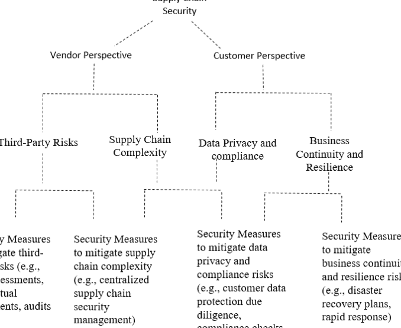

图 7.1：完整影响图

供应链安全的受损对供应商和客户都构成了巨大挑战。为了保护数字生态系统，供应商必须管理第三方风险、提高可见性并确保复杂的供应链。对于客户而言，信任、数据隐私合性和业务连续性保证是在选择供应商时至关重要的。通过理解供应链受损的全面影响并实施强大的安全措施，供应商可以维护声誉并建立持久的客户信任。要创建一个能够抵抗不断变化的威胁格局的韧性且安全的数字环境，需要所有供应链利益相关者的共同努力。

## 软件安全以及我们为什么需要它

在当今技术驱动的世界中，软件在推动我们生活的各个方面发挥着关键作用。从移动应用程序、Web 服务到关键基础设施，软件已成为现代社会的支柱。然而，对软件的依赖增加也引发了一个关键问题：软件安全。

## 理解软件安全

软件安全是一种多维度方法，包括广泛的实践和技术，旨在保护应用程序、系统和数据免受潜在威胁和漏洞。其目标是防御未经授权的访问、数据泄露、操纵和破坏，这些可能会对个人和组织产生不利影响。

## 软件安全的性

在当今世界，良好的软件安全对每个人来说都非常重要。遵守规则、防止创意盗窃、让用户感到安全以及监控谁在使用该软件，是确保软件安全的关键部分。让我们看看确保软件安全如何帮助阻止问题并保持我们数字世界的安全：

- 保护敏感数据安全：许多软件程序处理敏感用户数据，包括财务信息、知识产权以及个人和财务信息。如果没有强大的安全措施，这些数据极易被盗取或误用，从而给个人和组织带来严重后果。
- 防御网络攻击：随着网络攻击频率和复杂性的增加，软件安全对于防御黑客攻击、恶意软件、勒索软件和数据泄露等恶意活动至关重要。对于企业和个人来说，单次安全泄露就可能对其信任和财务安全造成灾难性的后果。
- 确保系统可靠性：软件漏洞可能导致系统失败和崩溃，这会对生产力产生负面影响，中断服务并导致重大的财务损失。软件开发者可以通过实施安全实践来提高应用程序的稳定性和可靠性，减少停机时间并保持良好的用户体验。
- 符合法规要求：有关数据保护和隐私的严格法规和合规要求适用于许多行业。不遵守这些要求可能会导致法律后果、罚款和声誉损害。稳健的软件安全确保合规，并有助于维护合法合道的业务经营。
- 防止知识产权盗窃：知识产权盗窃是企业和软件开发者主要关注的问题。有效的安全措施可以保护专利算法和软件源代码免受未经授权的访问和复制，保留原始创新的价值。
- 建立用户信任：如果用户对软件的安全性充满信心，他们更有可能采用并使用。通过对软件安全的承诺与用户和客户建立信任，可以获得更高的用户留存率和更大的客户忠诚度。
- 防御内部威胁：安全风险并不总是由外部实体引起。内部威胁也可能产生重大风险，例如拥有敏感数据的不满员工或承包商。通过实施访问控制和监控机制，软件安全有助于缓解这些风险。

## 软件安全的关键要素

软件安全的关键要素涵盖了全面的实践和措施，旨在加固应用程序免受漏洞和攻击。这些要素包括：

- 身份验证与访问管理：确保某些功能和数据对授权用户可用是软件安全的主要原则之一。密码、生物识别和双因子验证可以加强访问控制并减少未经授权访问的风险，是实现这一目标的某些身份验证方法。
- 加密：敏感信息通过加密受到保护，以确保黑客即使获得访问也无法读取或使用它。数据通过加密转换为密文，并且需要正确的加密密钥来解密密文。
- 安全编码实践：软件的安全很大程度上取决于开发者。OWASP 前 10 中列出的软件漏洞（包括 SQL 注入、跨站脚本（`XSS`）和不安全的序列化等常见问题）通过遵循安全编码实践（如输入验证、避免缓冲区溢出和使用适当的错误处理）可以显著减少。
- 定期补丁与更新：软件并非没有漏洞，随着新威胁的出现，开发者必须快速发布更新和补丁来修复它们。定期更新软件可确保安全漏洞被修复并降低被利用的风险。
- 安全测试与审计：彻底的安全测试（包括渗透测试和漏洞评估）有助于在攻击者之前发现软件缺陷。定期的安全审计为基础设施和软件的整体安全态势提供价值信息。对于 `Java` 项目，通过 `Maven` 插件将安全工具集成到构建过程中，可以帮助自动检测这些漏洞。`OWASP Dependency-Check` 插件是一个强大的工具，它可以分析您的项目依赖项并标记您正在使用的库中的已知漏洞。将其包含在 `Maven` 构建生命周期中可以确保您能够自动发现第三方组件中的潜在安全风险，以便在问题发生前进行解决。
- 安全通信协议：如 `HTTPS` 和 `SSL/TLS` 等安全通信协议，确保数据在系统之间安全地传输，使其不会被未经授权的拦截并保持机密。

## 软件安全面临的挑战

尽管软件安全取得了显著进展，但挑战依然存在。这里提到了几个挑战：

- 软件复杂性：随着软件变得日益复杂，潜在漏洞的数量也随之增加。由于架构复杂且代码库巨大，有效地识别并消除所有安全风险是非常的。
- 快速的开发周期：开发者在追求更快的更新和发布时，可能会优先考虑速度而非安全性，导致潜在的疏忽。在速度和安全之间取得平衡至关重要，以确保软件对不断演变的威胁具有韧性。
- 第三方依赖：软件通常依赖于第三方库和组件。虽然很方便，但如果经过仔细检查和监控，这些依赖可能会带来安全风险。
- 老旧系统：旧的软件系统可能更容易受到攻击，因为它们缺乏现代应用程序中发现的健壮安全功能。
- 人为因素：弱密码、社会工程攻击或不当的数据处理实践都可能导致员工或用户在无意中造成安全泄露。

软件安全是数字版图中不可或缺的一部分，保护着我们的数字基础设施、个人数据和宝贵的知识产权。随着技术的不断快速演进，对强大的软件安全的需求比任何时候都紧迫。在一个日益互联的世界中，企业和个人可以通过主动实施安全措施来增加用户信任，并确保其应用程序的无缝运行。将软件安全视为一种共同责任，使我们能够为所有人创建一个更安全的数字生态系统。在下一节中，我们将看到如何将安全集成到软件开发生命周期中。

## DevSecOps

当开发与安全分离时，摩擦是不可避免的后果。开发者可能将安全视为持续的障碍，并将自己视为变化的推动者。安全团队停止开发以进行审计或调查事件是常见现象。与此同时，安全团队观察到开发者反复地创建或忽略相同的问题，却无法或不愿实施明确的解决方案。

DevSecOps 将安全作为优先事项集成到 DevOps 中，将其置于应用程序开发的核心，并在软件流水线中的每个人中建立一种安全优先的文化。在 DevSecOps 模型下，安全是每个人的责任。这是降低开发者与安全工程师之间冲突的第一步。

与 DevOps 类似，DevSecOps 专注于消除团队之间的障碍以促进开放式交流。每个产品都应该从开始就内置安全，而几乎不牺牲速度和灵活性。正如 DevSecOps 让开发者承担了更多测试自己代码的责任一样，DevSecOps 将开发安全合规的代码置于每位开发者的优先事项首位。

应用程序开发生命周期的每个阶段都由 DevSecOps 涵盖，它在提供反馈的同时结合安全最佳实践。安全通常在设计阶段之前就开始了，通过培训帮助开发者学习安全编码实践。安全团队与开发者合作工作。与开发者一起提供培训、编写安全策略和最佳实践文档，并指导每个人培养安全意识。随着组织内部 DevSecOps 实践的推进，各个团队开始将自己视为单一文化的一部分，在这种其中安全是首要目标。

## DevSecOps 的组件

DevSecOps 的组件包含了一套全面的实践、工具和文化转变，这些要素共同增强了软件开发的安全敏捷性。关键组件包括：

- 自动化：DevSecOps 的一个关键方面是自动化。为了简化持续安全测试、漏洞扫描、合规检查等安全实践，使用了自动化工具和流程。通过自动化重复性任务，团队可以专注于更关键的安全挑战，并对新威胁做出快速响应。
- 持续集成和持续部署（`CI/CD`）：`CI/CD` 实践实现了频繁且自动的代码集成、测试和部署。DevSecOps 通过在整个 `CI/CD` 流水线上整合安全检查扩展了这些实践。在每个阶段执行安全检查，以识别并解决开发过程中的漏洞。
- 安全测试：DevSecOps 的一个关键方面是安全测试。它包括静态应用安全测试（`SAST`）和动态应用安全测试（`DAST`），分别用于发现应用程序静态代码和运行代码中的安全缺陷。这些测试有助于在部署生产之前识别并修复漏洞。
- 基础设施即代码（`IaC`）：在基础设施即代码实践中，使用代码进行基础设施的配置。通过将基础设施视为代码，安全配置可以代码化并进行版本控制，降低配置错误的风险并促进跨环境的一致性。
- 容器安全：由于其可移植性和扩展性，容器正越来越用于应用程序部署。为了避免潜在的安全风险，DevSecOps 确保容器经过安全配置、漏洞扫描并得到妥当监控。
- 安全审计与合规：为了确保应用程序和系统符合行业法规和安全标准，DevSecOps 定期进行安全审计和合规检查。这种主动方法降低了不合规的可能性和潜在的法律后果。
- 威胁建模：威胁建模是一种用于在开发过程早期识别和评估安全威胁以及潜在攻击向量的技术。这有助于开发者为安全计划设定优先级，并应用必要的安全控制。
- 安全监控与事件响应：持续的安全监控允许团队及时检测并响应安全事件。为了确保对安全泄露做出快速高效的响应，DevSecOps 将事件响应计划集成到开发工作流中。
- 左移文化：DevSecOps 通过培养“左移”文化，鼓励团队在开发过程尽尽早解决安全问题。这种方法确保了安全成为开发思维的固有部分，并减少了安全问题持续到生产阶段的可能性。

## DevSecOps 的益处

以下是 DevSecOps 的一些益处：

- 提高软件安全性：DevSecOps 通过将安全集成到开发过程的每个阶段，确保漏洞能够被及时识别和处理，降低了泄露和数据外泄的风险。
- 更快的上市时间：自动的安全检查和精简的流程使得开发周期更短，加速了安全可靠软件产品的交付。
- 协作文化：DevSecOps 促进了团队之间的协作与沟通，打破了开发、运维和安全专业人员之间的孤岛。这培养了安全的共同责任感。
- 降低修复成本：在开发过程中早期检测并修复安全问题，降低了后期漏洞的成本。
- 提高合规性：在开发过程中集成合规检查和安全审计，确保了应用程序符合监管要求和安全标准。

## 采用 DevSecOps 的挑战

尽管实施 DevSecOps 实践有很多益处，但并非所有步骤都是简单的。在组织中引入 DevSecOps 面临着挑战，从分布式应用程序安全的日常机制到文化转变的艰难任务。

安全通常围绕数据中心的单一、定义的应用程序边界展开。企业对 DevOps 和云原生微服务架构的采用导致了应用程序的去中心化，这带来了安全挑战。这些应用程序由运行在多个环境中的微服务组成，通过许多网络通信，并处理来自全球设备和用户的数据。因此，攻击面非常广泛且难以定义。统计所有在公共和私有网络进行的服务交互几乎是不可能的。

与此同时，当应用程序所有权从团队转移到更大的部门时，安全很容易被忽视。如果他们认为安全是专门安全团队的问题，那么各个工程团队就不会投入其中。这倾向于将安全向右移动，移动到软件开发流水线的后期阶段，在那里安全工作更具挑战性且效率更低。

只有当开发者具备安全知识时，左移才有意义。开发者不仅需要精通安全开发实践，还需要足够的教育来理解他们所面临的需要解决的问题。这意味着需要培训，这会消耗时间和金钱。

解决这些问题的是培养一种协作环境，鼓励以安全为重点进行快速、持续的迭代。这意味着曾经孤立的团队（如开发、IT 运营和安全）需要学会协作。安全不应该是一种不断的中断，而必须成为贯穿于整个软件开发流水线各个环节的工作实践。安全团队不应该导致中断，而必须提供指导，转变为类似于流水线开发和运行阶段那样的持续过程。

好消息！其收益大于成本。当安全成为每个人的责任时，问题可以更快速、更经济的方式得到解决，从而改进所有参与者以及客户的开发流程。

## 左移安全方法（`Shift-left Security`）

随着技术成为我们生活中不可或缺的一部分，软件安全的重要性不言而喻。网络威胁和攻击的复杂性和范围在不断增加，因此实施预防性安全措施至关重要。一种被称为“左移安全”（`Shift-left Security`）的新范式在整个软件开发过程中将安全考量放在首位。

## 理解左移安全方法

在软件开发过程早期嵌入安全实践和考量是左移安全方法论的基础。过去，安全评估经常在软件开发过程的后期甚至在软件部署后进行。然而，这种被动的策略留留下了大量漏洞未被检测到的空间，增加了缓解安全缺陷的风险和成本。

相比之下，左移安全方法强调在开发过程开始和编写代码时就着手安全问题。结果是重要漏洞泄露的概率降低了，解决安全问题的总体成本也减少了。开发者和安全团队可以合作在更早的阶段识别并解决安全问题。

## 左移安全方法的核心原则

左移安全方法的核心原则围绕主动保护、协作和持续改进展开。以下是基础原则：

- 安全意识与教育：左移安全方法论的基础是教育开发人员以及软件开发过程中涉及的所有其他方了解最佳实践。培养具有安全意识的团队有助于避免常见的编码错误，并确保安全考量植根于开发思维中。
- 将安全集成到 DevOps 中：将安全无缝地集成到 DevOps 流水线中是左移安全方法的目标。这种集成实现了持续的安全测试、分析和反馈循环，缩短了从发现问题到实施修复之间的时间。
- 自动化安全测试：左移安全方法论依赖于自动化安全测试工具和方法。发现代码和应用程序行为漏洞的两种流行技术是静态应用安全测试（`SAST`）和动态应用安全测试（`DAST`）。
- 持续反馈与监控：定期监控生产环境中的应用程序和系统可以为潜在的安全威胁和漏洞提供实时洞察。持续反馈允许开发者及时处理出现的安全问题。

## 左移安全方法的优势

应用左移安全方法有多种好处。一些关键优势包括：

- 早期漏洞检测：在开发早期识别并解决安全问题可以显著减少最终产品出现严重漏洞的概率。这节省了开发周期后期进行大量安全修复所需的时间、精成本。
- 缩短上市时间：当安全集成到整个过程中时，安全评估被简化，整个开发周期得到加速。因此，软件产品可以更快开发，并满足利益相关者和消费者的需求。
- 改进协作：左移安全方法促进了安全团队、开发者和其他利益相关者之间的沟通。为了创建一个更可靠、安全的应用程序，团队可以从一开始就开始合作，分享见解、知识和责任。
- 增强信任与合规性：左移安全方法确保在受监管行业运营的公司符合安全和隐私法规。通过展示对软件安全的承诺，与客户和用户建立信任，可以提高组织的声誉。


- 主动风险缓解：通过主动处理安全问题，组织可以及早发现潜在风险并实施适当的控制来缓解风险。这有助于防止安全泄露及其相关的后果。
- 成本效益安全技术：在开发过程早期修复安全漏洞通常比在产品部署后处理更为经济。得益于左移安全方法，组织可以更有效地分配资源。

## 挑战与考虑

虽然左移安全方法提供了许多优势，但采用它需要仔细的规划考虑：

- 思维转变：实施左移安全策略需要组织文化的改变。所有参与方必须优先考虑安全，并且都要渴望将安全实践集成到工作流中。
- 技能培养：为了有效识别和解决安全问题，开发者需要在安全实践和工具方面接受充分培训。为了赋能团队，组织应该投资于持续培训和技能开发。
- 安全与开发速度必须并存：在安全和开发速度之间取得正确的平衡至关重要。开发过程不应因为安全实践而过度减慢，因为这可能会影响上市时间和竞争力。
- 自动化集成：虽然自动化是左移安全方法的关键组成部分，但适当的安全测试选择和集成需要经过深思熟虑。过度使用自动化工具而没有人工验证可能会导致假正或假阴性。

左移安全方法代表了软件开发的范式转移，主张从项目初期就采取主动和以安全为中心的思维。通过早期引入安全考量，组织可以显著增强其软件对网络威胁的韧性，减少漏洞并降低安全措施的总体成本。采用左移安全方法不仅是企业的战略优势，也是保护用户数据、维护客户信任以及为所有人确保更安全的数字生态系统的负责任之。随着技术格局的不断演变，左移安全方法将仍然是现代软件开发的基石。

## 静态与动态安全分析

应用程序测试对于确保您的应用程序没有漏洞和风险是必要的，同时减少攻击面以防止网络攻击。

不用说，应用程序被广泛应用于每个行业，以便让消费者更容易使用产品和服务、咨询、娱乐等。此外，如果你正在开发应用程序，必须确保从代码阶段到生产阶段的安全。`SAST` 和 `DAST` 是执行应用程序测试的两种优秀方式。

### 静态应用安全测试

`SAST` 工作方式如下：

- 该工具会在代码静态时进行扫描，以提供源代码、配置、依赖项、数据流和其他元素的详细视图。
- `SAST` 工具将逐行、逐条指令地检查应用程序代码，并将其与预定义的指南进行比较。它将检查你的源代码中的缺陷和漏洞，例如 `SQL` 注入、缓冲区溢出、`XSS` 问题和其他问题。

因此，检测问题并分析其后果将帮助你规划如何修复这些问题并提高应用程序的安全性。

然而，`SAST` 工具可能会产生误报，因此你必须精通编程、安全和设计才能检测出这些误报。或者，你也可以修改代码以防止或减少误报。

`Error Prone` 是专门为捕获 `Java` 代码中的错误设计的强大静态分析工具之一。它由 Google 开发，能够无缝集成到构建过程中，扫描你的代码中经常导致错误或漏洞的模式。通过尽早标记这些问题，`Error Prone` 帮助开发者在错误进入生产环境之前识别并修正，从而提高代码质量并降低安全漏洞发生的概率。

## SAST 的优势

### 确保开发早期阶段的安全性

在应用程序生命周期的初始阶段，`SAST` 对于确保安全性至关重要。它能够在编码或设计阶段识别你源代码中的漏洞。此外，如果你能尽早识别问题，解决问题就会变得简单。然而，如果你不尽早运行测试来识别问题，而是让它们持续到开发结束，构建结果可能会包含许多固有的 `bug` 和错误。结果，理解和处理这些问题将变得困难且耗时，进一步推迟你的生产和部署计划。

通过执行 `SAST`，你可以避免花费时间和金钱来修复漏洞。此外，它还可以测试客户端和服务器端的漏洞。所有这些都有助于保护你的应用程序，并让你为应用程序构建一个安全的环境并快速部署。以下是 `SAST` 的一些额外优势：

- 更快速、更精确：`SAST` 工具对应用程序及其源代码的扫描比人工代码审查更彻底。这些工具可以快速、精确地扫描数百万行代码，以检测底层问题。此外，`SAST` 会持续监控你代码的安全性，以维护其完整性和功能，同时帮助你快速缓解问题。
- 安全编码：在为网站、移动设备、嵌入式系统或计算机开发代码时，你必须确保安全编码。当你从开始就编写健壮、安全的代码时，就会减少应用程序被攻击的机会。这是因为攻击者可以轻易针对编写得糟糕的应用程序，并执行信息窃取、密码盗取、账户接管等有害活动。这对你组织的声誉和客户信任产生负面影响。

`SAST` 将帮助你从开始确保安全编码实践，并为其在整个生命周期中的蓬勃提供坚实基础。它还将帮助你确保合规。此外，Scrum Master 可以使用 `SAST` 工具确保团队实施更安全的编码标准。

- 检测高风险漏洞：`SAST` 工具可以检测影响应用程序整个生命周期的高风险 `SQL` 注入，以及会导致其失效的缓冲区溢出。此外，它们还能高效地识别跨站脚本（`XSS`）和漏洞。确实，强大的 `SAST` 工具可以检测出 `OWASP` 前十大安全威胁列出的所有缺陷。
- 易于集成：`SAST` 工具很容易集成到现有的应用程序开发生命周期过程中。它们可以高效地在开发环境、源码仓库、`bug` 跟踪器和其他安全测试工具中工作。它们还提供了易于使用的界面用于一致的测试，而不需要用户经历复杂的学习曲线。
- 自动化审计：针对安全考虑的人工代码审计可能耗时。它要求审计人员在彻底检查代码之前理解漏洞。相比之下，`SAST` 工具在频繁、准确且更短的时间内检查代码方面性能优异。这些工具还可以提高代码安全性并加速代码审计。

## SAST 方法的缺点

由于是从源代码开始的，`SAST` 似乎具有最完整的安全扫描方法。然而，在实践中，它存在根本性问题：

- 使用 `SAST` 方法的缺点是它有时会导致编程过程变慢。当开发者不断关注处理安全检查和修复 `SAST` 工具识别的 `bug` 时，会分散他们对编写和完善应用程序功能核心任务的注意力。这种对安全的高度关注可能会导致特定领域的问题，开发者可能会忽略或匆忙处理对应用程序成功至关重要的业务逻辑和功能。换句话说，安全与功能之间的平衡可能会被打破，可能影响软件在其预期领域中的整体质量和相关性。
- 工具可能会出现问题。如果扫描器尚未完全集成到你的技术栈中，尤其如此。如今大多数系统都是多语言的（`polyglot`）。需要一个支持所有直接或间接技术的工具来获取已知漏洞的列表。
- `SAST` 经常取代未来的安全测试。然而，任何与运行中的应用程序直接相关的问题仍然无法被检测。
- 对源代码的关注是不够的。如果可能，静态扫描应该分析二进制文件，也分析源代码。

## 动态应用程序安全测试

`DAST` 是另一种采用黑盒方法的测试方法，假设测试人员没有访问或了解应用程序的源代码或核心功能。他们利用可用的输入输出从外部对应用程序进行测试。测试类似于黑客尝试获取应用程序的访问。

`DAST` 的目标是在运行时观察应用程序并识别漏洞。它允许你在部署后发现漏洞。`DAST` 可以解决多种安全问题，同时确定你的应用程序在攻击者和终端用户看来是怎样的。

## 理解 DAST 如何工作

通常，`DAST` 工具易于使用，但它们在后台做了很多工作。

- `DAST` 工具旨在捕获尽可能关于应用程序的信息。它们爬取每个页面并提取输入。
- 接下来，它们开始主动扫描应用程序。`DAST` 工具将向之前发现的端点发送多个攻击向量，以测试如 `XSS`、`SSRF`、`CSRF`、`SQL` 注入等漏洞。此外，许多 `DAST` 工具允许你创建自定义攻击场景以检测额外的漏洞。
- 一旦完成此步骤，工具将显示结果。如果它识别出漏洞，将迅速提供有关漏洞的详细信息，包括其类型、`URL`、严重程度和攻击向量，以及解决问题的指导。

## 使用 DAST 的优势

`DAST` 关注应用程序的运行时特性，为软件开发团队提供了许多优势，包括：

- 增加测试范围：现代应用程序是复杂的，拥有许多外部库、遗留系统、模板代码等。安全风险正在不断演变，你需要一个可以提供更广泛测试覆盖的解决方案，如果只使用 `SAST` 可能是不够的。`DAST` 可以通过扫描和测试所有类型的应用程序和网站，不受技术、源代码可用性或来源的影响。因此，采用 `DAST` 可以解决多种安全问题，同时确定你的应用程序在攻击者和终端用户看来是怎样的。它将帮助你实施全面的修复计划。
- 所有环境下的高安全性：由于 `DAST` 是从外部应用于应用程序，而不是其底层代码，因此你可以获得最高水平的应用程序安全完整性。即使你对应用程序环境进行了更改，它也将保持安全且功能完备。
- 测试部署：`DAST` 工具不仅用于在分阶段环境中测试应用程序的漏洞，还用于开发和生产环境。这允许你查看应用程序在发布后的安全性。你可以定期使用这些工具对应用程序进行扫描，以检测由配置更改引起的任何潜在问题。它还可能发现可能危及应用程序的新漏洞。
- 易于集成到 `DevOps` 工作流：许多人认为 `DAST` 无法在开发阶段使用。过去确实是这样，但现在这种观点已经过时了。许多工具（如 `Invicti`）可以简单地集成到你的 `DevOps` 工作流中。因此，如果你正确配置了集成，就可以让该工具在应用程序开发的早期自动扫描漏洞并识别安全问题。这将提高应用程序的安全性，消除识别和解决漏洞的延迟，并节省相关成本。
- 辅助渗透测试：动态应用安全与渗透测试相似，其在于通过注入恶意代码或进行网络攻击来测试应用程序的安全漏洞，以观察程序的响应情况。
- 凭借其丰富的功能，在渗透测试中使用 `DAST` 工具可以简化你的工作。这些工具通过自动化发现漏洞和报告问题的流程，简化整个渗透测试流程，从而能够及时修复它们。
- 更全面的安全概览：`DAST` 相比于点解决方案具有优势，因为它可以仔细检查应用程序的安全态势。无论其编程语言、来源、源代码或其他特征，它都能测试各种网站、应用程序和其他 Web 资产。

因此，你可以透彻理解你所开发的任何软件或应用程序的安全状态。由于跨环境的可视性提高，你甚至可以识别有风险的过时技术。

## DAST 的缺点

使用 `DAST` 工具具有几个缺点：

- 扫描器程序被设计为对功能性 Web 应用执行特定攻击，通常只能由具有产品知识的安全专家进行调整。因此，它们为个人扩展留下的空间很小。
- `DAST` 工具速度缓慢；完成一次分析可能需要很多时间。
- `DAST` 工具在开发周期后期才发现的某些缺陷，本可以由 `SAST` 更早地发现。因此，修复相关问题的费用往往超出了预期。
- `DAST` 扫描的依据是已知漏洞。扫描新类型的攻击需要较长的时间。因此，通常无法修改现有工具。如果可行，它将需要对攻击向量本身以及如何在 `DAST` 工具中实现它进行深入研究。

## 比较 SAST 和 DAST

`SAST` 和 `DAST` 都是应用安全测试类型。它们检查应用程序的漏洞和缺陷，协助防止安全风险和网络攻击。

`SAST` 和 `DAST` 的目的相同：发现并突出安全关注问题，并帮助你在攻击发生之前修复它们。

现在，在这场 `SAST` 对阵 `DAST` 的战斗中，让我们来看看这两种安全测试方法之间的主要区别（表 7.1）：

| SAST | DAST |
| :--- | :--- |
| 它是白盒应用安全测试。 | 它是黑盒应用安全测试。 |
| 测试从内部向外部（应用程序）进行。 | 测试从外部向内部进行。 |
| 它基于人员使用的测试策略。测试人员熟悉应用程序的设计、实现和框架。 | 它基于黑客的方法。测试人员不了解应用程序的设计、实现或框架。 |
| 它使用静态代码实现，不需要任何部署的应用程序。它被称为“静态”，是因为它扫描应用程序的静态代码以漏洞。 | 它在运行的应用程序上实现。它被称为“动态”，是因为它在应用程序运行时扫描其动态代码的漏洞。 |
| `SAST` 在应用程序开发的早期进行。 | `DAST` 在应用程序开发生命周期的后期对运行的应用程序进行。 |
| 它能够准确检测客户端和服务器端漏洞。`SAST` 工具适用于各种嵌入式系统和代码。然而，它无法发现与环境和运行时相关的问题。 | 它能够检测与环境和运行时相关的漏洞。但是，它只能分析应用程序中的响应和请求。 |
| 它需要源代码进行测试。 | 它不需要源代码进行测试。 |
| `SAST` 直接集成到 `CI/CD` 流水中，帮助开发者持续监控应用程序代码。它涵盖了 `CI` 过程的每个阶段，包括通过自动代码扫描进行代码安全分析以及测试构建。 | 在应用程序部署并运行在测试服务器或开发者计算机后，将其集成到 `CI/CD` 流水线。 |
| `SAST` 工具全面扫描代码以识别漏洞及其精确位置，从而更早修复。 | `DAST` 工具可能无法提供漏洞的精确位置，因为它们在运行时工作。 |
| 由于问题在早期被检测到，修复它们简单且成本较低。 | 由于它是在开发生命周期的后期实现的，在此之前无法检测问题。此外，它可能不提供精确位置。这一切都增加了修复问题的成本。同时，它推迟了整个开发进度，提高了整体生产成本。 |

表 7.1：比较 `SAST` 和 `DAST`

## 何时使用 SAST 和 DAST

在上一节中，我们看到了 `SAST` 和 `DAST` 的比较。现在让我们讨论使用 `SAST` 的用例以及使用 `DAST` 的场景：

### 何时使用 SAST

假设你有一个在单体环境中编写代码的开发团队。当你的开发者提出更新时，他们立即将更改引入源代码。随后，你编译应用程序并将其推向生产阶段。

漏洞在这里不会频繁出现，即使真的出现了，也将经过很长时间，那时你可以对其进行评估和修补。在这种情况下，你应该考虑使用 `SAST`。

### 何时使用 DAST

假设你的 `SLDC` 有一个具有自动化的有效 `DevOps` 环境。可以使用容器和 `AWS` 等云平台。因此，你的开发者可以快速编写更新代码并使用 `DevOps` 工具自动编译代码并构建容器。

通过这种方式，你可以使用持续 `CI/CD` 来加速部署。然而，这可能会增加攻击面。使用 `DAST` 工具扫描整个应用程序并检测问题可能是解决此问题的绝佳方案。

### SAST 和 DAST 可以协同工作

答案是肯定的。

事实上，将它们结合使用将帮助你从内到外理解应用程序中的安全问题。它还将使专注于有效且可操作的安全测试、分析和报告的 `DevOps` 或 `DevSecOps` 成为可能。此外，这将减少漏洞和攻击面，并缓解网络攻击问题。结果是，你能够构建一个高度安全且健壮的 `SDLC`。

## 交互式应用安全测试

交互式应用安全测试（`IAST`）使用软件工具评估应用程序性能并识别漏洞。`IAST` 使用类似“代理”的方法，通过代理和传感器在自动化测试、手动测试或两者的结合期间持续分析应用程序功能。

过程和反馈在 `IDE`、`CI` 或 `QA` 环境或生产环境中实时发生。传感器可以访问以下内容：

- 整个代码
- 系统配置数据
- Web 组件
- 数据流和控制流
- 后端连接数据

`IAST` 与 `SAST` 和 `DAST` 的不同在于它在应用程序内部运行。与源代码或 `HTTP` 扫描相比，访问如此广泛的数据扩展了 `IAST` 的覆盖范围，并提供了更准确的输出。

`IAST` 的一些优势包括：

- 更早地识别潜在问题，使 `IAST` 能够最大限地减少成本和延迟。由于使用了“左移”（`Shift-left`）方法，这意味着它是在项目生命周期早期完成的。
- `IAST` 分析像 `SAST` 一样提供包含详细数据的代码行，让安全团队能够立即关注特定问题。
- 凭借工具可以访问的信息范围，它可以精确地识别缺陷的来源。
- 与其他类型的软件动态测试不同，`IAST` 可以轻松集成到 `CI/CD`（持续集成与部署）流水线中。将 `DAST` 集成到 `CI/CD` 流水线是复杂且耗时的，因为它测试的是完全部署并运行的应用程序。相比之下，`IAST` 在应用程序运行时内部进行测试，因此更无缝地集成到 `CI/CD` 过程中，允许在不中断开发工作流的情况下进行持续的安全检查。

另一方面：

- `IAST` 工具可能会导致应用程序运行变慢。代理（`agents`）实际上充当了额外的仪器，导致代码性能不佳。
- 因为是一项新技术，某些缺陷可能尚未被发现。

# 运行时应用程序自保护

运行时应用程序自保护（`RASP`）是一种从内部保护应用程序的方法。该检查在运行时进行，通常涉及在命令执行时扫描可疑命令。

你可以使用 `RASP` 技术实时查看生产机器上的完整应用程序上下文。所有处理过的命令都会被分析可能的攻击模式。因此，该技术的目的是检测已知和未知的安全漏洞及攻击模式。它深入了人工智能（`AI`）和机器学习（`ML`）技术的使用。

`RASP` 工具通常有两种运行模式。第一种运行模式（监控）限于观察和报告潜在攻击。第二种运行模式（保护）涉及在生产环境中实时直接部署防御措施。`RASP` 旨在弥补应用程序安全测试与网络边界控制之间的差距。`SAST` 和 `DAST` 无法提供足够的实时数据和事件流可见性来防止漏洞通过验证过程，或阻止开发期间遗漏的威胁。

主要的区别在于，`IAST` 专注于发现应用程序漏洞，而 `RASP` 专注于防御利用这些漏洞或其他攻击向量的网络安全威胁。

`RASP` 技术具有以下优势：

- `RASP` 通过在应用程序部署（通常是生产环境）后提供额外的保护层，补充了 `SAST` 和 `DAST`。
- 它可以很容易应用于更快的开发周期中。
- 意外输入将受到检查和监管。
- 它通过提供详细的分析和漏洞位置，让你对攻击做出迅速响应。

然而，`RASP` 工具也存在某些缺点：

- `RASP` 工具可能会对应用程序性能产生负面影响，因为它们托管在应用程序服务器上。
- 新技术可能与禁止安装其他软件或限制服务的法规或内部策略不兼容。
- 你可能会觉得应用程序比实际情况更安全。即使工具发现了问题，意味着在修复期间仍需将应用程序下线。
- `RASP` 并不是应用程序安全测试的替代品，因为它无法提供全面的保护。

虽然 `RASP` 和 `IAST` 使用了相似的方法，但 `RASP` 不执行完整扫描，而是作为应用程序组件运行，分析其流量和活动。它们都会在攻击发生时报告，尽管 `IAST` 在测试期间进行，而 `RASP` 是在生产环境中进行。

> 注意：如果你刚刚开始接触 `DevSecOps` 或通用的 `IT` 安全，`SAST` 方法最有意义。这是用最少精力消除最严重潜在威胁的地方。它也是一个可以应用于生产线所有阶段的过程。只有当系统的所有组件都针对已知安全漏洞了安全后，后续方法才能展现它们的全部潜力。在引入 `SAST` 后，我们将采用 `IAST` 技术，然后是 `RASP` 方法。这确保了不同团队可以随任务进行扩展，并且不会出现生产中的阻碍或延迟。

# 规划 DevSecOps 流水线

在现代、快速节奏且充满威胁的数字格局中，采用 `DevSecOps` 方法对于创建安全且具韧性的软件应用程序至关重要。结构良好的 `DevSecOps` 流水线可以确保安全不是事后考虑，而是软件开发生命周期中不可或缺的一部分。以下是规划成功的 `DevSecOps` 流水线的关键步骤，使组织能够建立安全、协作和持续改进文化。


1. **定义目标和任务**

   在转向构建 DevSecOps 流水线的技术方面之前，必须定义明确的目标和任务。理解软件应用程序的具体安全需求并识别主要的安全关注点。定义`关键性能指标 (KPIs)`来衡量你的 DevSecOps 倡议的成功，例如漏洞数量减少、对安全事件的响应时间缩短或与行业标准的合规性更好。

2. **评估当前安全实践**

   检查当前的安全实践：评估你当前的 DevOps 流程以及组织当前的安全流程的成熟度。识别差距和需要改进的领域以无缝集成安全。为了理解软件的当前安全状况并识别潜在威胁和漏洞，请进行安全评估。

3. **组建跨职团队**

   建立由开发人员、运维人员、安全专家和其他利益相关者组成的跨职团队。该团队将在 DevSecOps 流水线的规划和实施过程中协作，确保考虑每位成员不同视角和专业知识整体方法。

4. **建立安全文化**

   成功的 DevSecOps 流水线的关键方面是建立安全优先的文化。培养强调安全意识并促进知识共享的文化。可以举办培训课程和工作坊来教育团队安全实践。

5. **选择正确的技术工具**

   为了支持 DevSecOps 流水线，选择并部署合适的工具和技术。这些可能包括静态代码工具、用于运行时分析的 DAST 工具、容器安全工具以及用于安全部署的`基础设施即代码 (IaC)`工具。选择与现有开发和部署流程完美集成的工具。

6. **在 CI/CD 流水线集成安全**

   将安全检查和测试集成到你的 CI/CD 流水线中。这确保安全检查在软件开发生命周期的每个阶段执行。自动化安全测试（如 SAST 和 DAST）应该在代码提交、构建过程和预部署阶段进行。

7. **实施代码审查和同行评审**

   定期的代码审查和同伴评审对于识别潜在安全问题和确保遵循安全最佳实践至关重要。鼓励开发人员对彼此的代码进行安全审查，促进对安全的责任感和共同责任。

8. **实施安全测试和漏洞管理**

   持续漏洞管理和安全测试对于 DevSecOps 是必要的。频繁扫描基础设施和应用程序的漏洞，并根据严重程度对其优先级。实施处理安全事件的流程，并确保快速响应解决任何问题。

9. **监控并衡量性能**

   建立稳健的监控系统以跟踪你的 DevSecOps 流水线和安全措施的性能。为了提高流水线的有效效率，持续分析收集的数据、审查 KPI 并做出数据驱动的决策。

10. **培养持续改进**

    DevSecOps 是一个需要持续改进的迭代过程。定期进行事后总结和回顾，以识别问题领域并做出必要的更改。为了发现并快速解决痛点，鼓励所有利益相关者的反馈。

通过软件开发生命周期并促进跨功能团队之间的协作，组织可以构建能够抵御不断变化的网络威胁的安全且韧性应用程序。持续的监控、测量和改进对于维护 DevSecOps 流水线的有效性，以及确保在不断变化的数字格局中保持主动且稳健的安全态势至关重要。将 DevSecOps 视为一种哲学和实践，使组织能够构建一个对用户更安全的数字生态系统，并增强他们有效应对安全挑战的能力。

## 漏洞评分系统

漏洞评分系统是一种标准化的方法，它通过为安全漏洞分配分数或评级来帮助优先修复漏洞。这些分数根据漏洞的影响和严重程度对漏洞进行分类，允许安全专业人员和开发人员有效地分配资源，并优先处理最关键的挑战。

理解漏洞评分系统（例如`通用漏洞评分系统 (CVSS)`）对于有效优先考虑安全措施至关重要。CVSS 提供了一种标准化方法来评估安全漏洞的严重性，考虑了对系统机密性、完整性和可用性的影响等因素。通过理解 CVSS 的组件和方法，组织可以更好地管理和缓解软件环境中的安全风险。

## 通用漏洞评分系统

CVSS 是最广泛使用和接受的漏洞评分系统之一。它由`国家基础设施咨询委员会 (NIAC)`开发，旨在提供一种标准化且公正的方法来评估安全漏洞的严重性。CVSS 的目的是根据严重程度对安全漏洞进行通用的分类。识别出的弱点将从多个视角进行评估。

这些元素相互权衡，以获得一个从 0 到 10 的标准数字，10 为最严重。

我们以抽象的方式评估各种弱点，并使用像 CVSS 这样的评分系统从这些推导出后续行动。目标是标准化处理这些弱点的方式。因此，你可以根据值范围定义行动。

原则上，CVSS 可以描述为使用预定义的因素将概率和最大可能损害相关联。其基本公式为：

> 风险 = 发生概率 × 损害

## CVSS 的组件

CVSS 由三个指标组组成：

- **基础指标 (Base metrics)**：它们评估漏洞的内在属性和潜在影响。基础指标包括：
  - **攻击向量**：攻击者如何访问受影响组件（例如：本地、相邻网络或远程）。
  - **攻击复杂度**：利用漏洞所需的复杂度水平。
  - **所需权限**：攻击者利用漏洞必须具备的权限。
  - **用户交互**：利用漏洞是否需要用户交互。
  - **对机密性、完整性和可用性的影响**：对系统机密性、完整性和可用性的潜在影响。
- **时效指标 (Temporal metrics)**：漏洞评估中随时间变化的组件汇总在时效指标组中。这些时效指标受时间变化的元素的影响。例如，支持漏洞利用工具的可用性可能会发生。这些可以是利用代码或详细说明。必须在理论漏洞和经制造商官方确认的漏洞之间进行区分。所有这些事件对基础值都有影响。时效指标的特点是基础值只能减少，不能增加。首次评级代表了最坏的情况。当你考虑到在漏洞的初始评估期间利益是竞争性的时，这既有优势也有缺点。外部框架条件对初始评估有影响。这些情况发生在未指定的时间范围内，与实际的基础评估无关。即使基础值调查已经使用了利用程序，在主要评估中也不会被考虑。然而，时效指标只能用于降低基础值。

  这就是冲突开始的地方。发现安全漏洞的个人或小组试图将基础值设得尽可能高。严重的漏洞将出更高的价格并获得媒体关注。结果是发现此漏洞的个人或小组声誉会增加。受影响的公司或项目则寻找完全相反的评估。因此，这取决于谁发现了安全漏洞、评审过程应如何进行以及由哪个机构进行初始评估。

- **环境指标 (Environmental metrics)**：对于环境指标，使用你自己的系统格局来评估安全漏洞的风险。评估根据实际情况进行调整。与时效指标不同，环境指标可以从两个方向修正基础值。结果是环境可能会导致更高的分类，并且必须不断适应你自身环境的变化。

考虑一个制造商已提供补丁的安全漏洞。仅仅是这种修改项的存在就降低了时效指标中的总值。然而，只要补丁在你自己的系统中未被激活，就必须通过环境指标将总值大幅向上纠正。这是因为补丁一旦可用，它就可以被用来更好地理解安全漏洞及其后果。攻击者拥有了更多可以利用的详细信息，从而降低了未加固系统的防御能力。

最终分是在评估结束时根据上述三个值计算得。最终值被分配给一个值组。然而，还有一个经常被忽视的点。许多时候，最终分直接转接，而没有根据环境评分进行任何单独调整。这种行为导致了风险性的评估。

## CVSS 实践

多亏 CVSS，我们现在有了一个评估和划分软件安全漏洞的系统。CVSS 已经成为事实标准，因为没有其他替代方案；该系统已使用多年，并处于不断开发中。

首先，基础分代表了纯技术的最坏情况。第二个组件是基于外部影响（如发现、工具或补丁）对时间依赖修正的评估。评估的第三部分是你自己的系统环境。针对该漏洞，它根据实际情况进行了调整。最后，使用这三个值进行整体评估，产生一个从 0.0 到 10.0 的数字。

这个最终值可以指导你的组织对安全漏洞的响应。起初看起来非常抽象，因此需要花精力才能熟悉 CVSS 的应用，这可能通过与系统的经验来获得。

## 质量门方法论

在软件开发生命周期中，质量门是预定义的检查点或决策点。这些检查点旨在于交付物移动到开发的下一阶段之前评估其质量和就绪性。质量门是保证技术，确保软件在开发的各个阶段符合特定标准。

一旦到达质量门，只有在满足所有标准或足够数量的标准时，项目才能继续。这确保了质量门处的所有项目输出都足够好，以便继续工作。一方面，结果，另一方面，对结果的定性要求可以使用质量门标准来确定。它们随后可以被用于定义特定项目阶段之间的接口。建立质量门需要某些结构、行动、职责、文档和资源，这些被总结在质量门参考过程中。

## 质量门的重要性

质量门提供了一系列益处，有助于软件开发工作的整体成功。让我们探讨为什么质量门如此重要：

- **缺陷的早期检测**：质量门有助于在开发过程早期阶段检测缺陷和问题，减少解决这些问题所需的成本和精力。
- **风险缓解**：通过在继续之前评估和验证交付物的质量，质量门减轻与部署缺陷软件相关的风险。
- **持续改进**：质量门通过为开发团队提供反馈和见解，鼓励持续改进的文化，以增强他们的流程和实践。
- **可预测的开发周期**：实施质量门（quality gates）可以确保开发周期更具预测性，并为进度定义良好的里程碑。
- **合规性与标准**：质量门确保软件符合组织标准和行业最佳实践，提高对相关法规的合规性。

## 质量门策略

使用质量门主要有两种方式。在设计质量门参考流程时，公司可以根据目标使用下面指示的两种方法论之一。

- **质量门作为统一的质量指南**：在第一种策略中，每个项目都必须通过相同的质量门，并使用相同的标准进行评估。对于遵循该策略的，允许对质量门参考流程进行极少量的调整（如果有的话）。每个项目都建立了一定的质量标准，以确保所有项目至少达到同等的质量水平。

  因此，质量门可以作为进度的统一衡量标准。通过检查哪些任务已经通过了特定的质量门，哪些还没有通过，我们可以比较不同项目的进度。当一个项目（在质量上）落于另一个项目时，管理层可以很容易地识别并采取适当行动。因此，质量门是用于管理多个项目的简单工具。

- **质量门作为灵活的质量策略**：第二种策略允许根据项目的需求自定义质量门或标准的选择、安排和数量。因此，质量门和标准可以更紧密地匹配项目的质量需求，提高结果的质量。然而，这使得不同项目的比较更具挑战性。坦率地说，相似的项目将具有可比的质量门，并可以使用相似的标准进行评估。

## 实施质量门

实施质量门的过程取决于具体的开发方法和组织需求。然而，以下通用步骤可以指导质量门集成到软件开发生命周期中：

- **定义质量标准**：确定每个阶段交付物质量的标准。这些标准可能包括代码质量、测试覆盖率、安全检查、性能基准以及对编码标准的合规性。
- **设计门禁触发器**：确定启动交付物评估的触发器。触发器可能包括提交（`commits`）、测试等。
- **创建评估指标**：开发用于评估交付物的衡量指标。
- **建立阈值**：设置交付物必须满足的特定阈值。
- **反馈与持续改进**：根据质量门的结果提供反馈并进行持续改进。

## 质量门的实际应用

在之前的章节中，我们学习了关于质量门的流程。现在，我们将探索其实际应用。

## 使用 SonarQube 进行质量管理

SonarQube 是一个广泛使用的开源平台，提供了强大的代码分析、代码异味检测、测试报告等功能。通过 SonarQube 进行质量管理：

1. **设置 SonarQube 服务器**：首先，设置 SonarQube 服务器。
2. **配置质量门**：一旦 SonarQube 服务器运行，你可以在此处配置质量门条件。
3. **将 SonarQube 集成到你的构建过程中**：例如，使用 Maven、Gradle 或 Jenkins。
4. **执行代码分析和质量门检查**：将 SonarQube 集成到你的构建过程后，使用以下 Maven 命令进行代码分析：...
5. **质量门结果**：分析完成后，你可以进入 SonarQube 界面检查质量门结果。如果代码符合所有条件，构建过程可以继续。如果代码不满足条件，则需要在继续之前解决问题。以下是 SonarQube 示例（图 7.2）。我们可以在 SonarQube 中检查代码覆盖率、可靠性和维护性。

同样，我们可以在图 7.3 所示的 Issues 标签页下检查问题及其解决方法。

## 执行 SonarQube 分析的 Jenkins 流水线

创建一个执行 SonarQube 分析的 Jenkins 流水线涉及多个阶段。以下是一个 Jenkins 声明式流水线的示例（示例 7.1），展示了该过程：

```groovy
pipeline {
  agent
  stages {
    stage('Checkout') {
      steps {
        // 检出源代码
        // 示例：git 'https://github.com/your-username/your-repo.git'
      }
    }
    stage('Build and Test') {
      steps {
        // 编译代码并运行测试
        // 示例：sh 'mvn clean verify'
      }
    }
    stage('SonarQube Analysis') {
      steps {
        // 使用 Sonarube scanner 执行代码分析
        script {
          def scannerHome = tool 'SonarQubeScanner' // 假设你在 Jenkins 中配置了 SonarQube Scanner
          def mavenHome = tool 'Maven' // 假设你在 Jenkins 中配置了 Maven
          withEnv(["PATH+MAVEN=${mavenHome}/bin"]) {
            sh "${scannerHome}/bin/sonar-scanner -Dsonar.projectKey=my-project -Dsonar.sources=./ -Dsonar.host.url=http://your-sonarqube-server:9000"
          }
        }
      }
    }
    stage('Quality Gate Check') {
      steps {
        // 评估质量门状态
      }
    }
  }
}
```

```groovy
script {
  def qualityGateStatus = waitForQualityGate() // Assumes you have SonarQube installed in Jenkins
  if (qualityGateStatus != 'OK') {
    error "Quality gate failed. Fix the issues and try again."
  }
}
post {
  always {
    // Clean up resources or perform any necessary post-build action
  }
}
```

示例 7.1：Jenkins 流水线中的 SonarQube 分析

在上述 Jenkins 流水线，流水线包含四个阶段：

- **Checkout (Checkout)**：此阶段检出托管你的 Java 项目的源代码仓库。
- **构建与测试 (Build and test)**：此阶段构建你的代码并运行测试。你可以根据构建工具和项目结构自定义此步骤。
- **SonarQube 分析**：在此阶段，SonarQube 扫描器执行代码分析。你需要在 Jenkins 中安装并配置 SonarQube 扫描器。
- **质量门禁检查 (Quality gate check)**：流水线会等待 SonarQube 的质量门禁状态，以确定代码是否符合质量门禁条件。如果质量门禁失败，流水线将被标记为失败。

## 使用质量门禁方法实现安全

我们将引入、定义并应用一种显著简化的方法，将安全作为一种横跨问题进行集成。在接下来，我们假设任何跨领域主题都可以使用质量门禁方法论来实现。此外，时间组件可以应用于任何循环的项目管理方法论。将此策略整合到 DevSecOps 项目组织方法论中是完美匹配的。

DevOps 过程中有不同的阶段。这些各个阶段都是无缝衔接的。在这些点安装干扰整个过程的工具是荒谬的。然而，有更好的地方来寻找横跨问题。我们指的是 CI 路由中发现的自动化过程派生。假设通过质量门禁所需的流程步骤可以完全自动化化，那么 CI 路由就是执行此类例行性工作的完美选择。

假设 CI 线路执行了一个自动化处理步骤，可能会出现两种结果：

- **绿色 (Green)**：质量门禁已通过。
  - 此处理步骤可能导致所有检查正确通过。此时，处理可以不受中断地继续。仅生成少量日志条目以确保详尽的记录。
- **红色 (Red)**：质量门禁失败。

另一个可能的结果是检查发现了指示失败的某些情况。这会中断进程，必须找到失败的原因以及纠正它的程序。此时，自动过程通常会停止，并被手动过程取代。

## 质量门禁中的风险管理

识别出缺陷会关闭质量门禁，因此，必须有人负责风险评估（风险识别、分析、评估和优先级排序）、设计以及应对措施的启动。

风险确定在形成标准并通过根据风险对需求进行权衡来实现操作化时已经完成。这发生在门禁审查期间。

应对措施的构想和启动是门禁审查的一项重要活动，至少在项目移动生产环境之前没有被推迟或取消。将实施的应对措施将主要解决由未满足标准带来的风险。

尽快满足标准是预防措施之一。如果这不可行且不实际，必须创建适当的应对措施。应对措施的设计是一种创造性活动，取决于风险、其评估以及可能的替代方案。

必须跟踪应对措施的有效性以确保其成功。这适用于项目的所有阶段，并且对于在过程早期检测和解决安全问题至关重要。

## 结论

随着行业供应链威胁的增加，解决安全问题对于你的项目和业务的成功比以往任何时候都更重要。我们必须理解软件安全及其主要组成部分。当我们理解安全时，我们就理解了快速减少漏洞的最简单方法是“左移”，并开始将安全作为首要考虑的问题。有效的软件安全可以减少数据泄露、未经授权的访问和服务中断的风险。随着网络威胁的不断演变，软件安全必须是一个持续且自适应的过程，涵盖主动措施和响应行动。


本章介绍了安全的基础知识，包括几种分析方法，如 SAST、DAST、IAST 和 RASP。我们讨论了 DevSecOps 的重要性以及如何规划 DevSecOps 流水线。我们还学习了如 CVSS 等基础评分系统。有了这些知识，我们将能够设置适当的质量门禁和标准，以增加未来任何项目的安全性。最后，我们讨论了使用 SonarQube 进行质量管理的实际应用，并构建了一个 Jenkins 流水线来执行 SonarQube 分析。

在下一章，我们将讨论部署、如何规划部署、构建并推送容器镜像以及 Kubernetes 部署。

- 来源：https://owasp.org/www-project-top-ten/

## 加入我们书籍的 Discord 空间

加入书籍的 Discord 工作区以获取最新更新、优惠、全球科技动态、新书发布以及与作者的交流：

https://discord.bpbonline.com


# 第 8 章：部署策略

## 引言

在计算机庞大且价格昂贵的时代，硬件和软件通常由制造商捆在一起。然而，随着大众市场软件的出现，这种方法变得繁琐，导致了新的分发方法。现代开发现在优先考虑分离构建和部署任务，以便快速分发。部署应用程序将其从封装的制品转换为功能性系统，而速度对于评估其状态并获得快速反馈至关重要。作为开发者，你必须编写高性能代码，并确保它与基础设施无缝集成，向你的 DevOps 团队清晰传达部署指令。

在规划部署期间，创建一个未来扩展性和效率的清单是有益的。此清单可能包括频繁的小部署，以逐步增强系统功能，并在故障时能够轻松回滚。这确保了孤立组件的可扩展和可替换微服务部署，促进了微服务在不同环境中的重用，并实现了基础设施部署以无缝匹配不断发展的应用程序功能。

无论你选择何种容器编排平台来部署微服务，该过程通常涉及打包应用程序并进行后续操作：

- 构建并推送容器镜像。
- 选择并实施部署策略。

随着应用程序在不同阶段或环境中的部署，你可能还需要负责负载管理，涉及完善健康检查并优化 CPU 和内存使用，以防止功能缓慢或无响应。此外，解决观测性方面变得至关重要，利用指标、日志和跟踪获取分布式系统内部的见并衡量其性能。本章引导我们完成这些活动，并探索它们在大规模下的影响，强调了现代开发实践中良好的自动化部署流程的重要性。

## 结构

在本章中，我们将讨论以下主题：

- 规划部署
- 构建并推送容器镜像
- Kubernetes 部署
- 在 Kubernetes 中管理负载
- 日志和监控的最佳实践
- 高可用性和地理分布系统
- 混合云和多云架构

## 目标

本章旨在使我们具备在 Kubernetes 环境中部署和管理的全面技能。它将涵盖规划的介绍了传统设置和 Kubernetes 设置的部署策略，重点介绍了 Kubernetes 部署的差异和优势。我们将学习如何使用 JIB 和 Eclipse JKube 等工具高效地构建和推送容器镜像。此外，本章将指导我们进行 Kubernetes 部署，从本地设置到选择并实施重建（recreate）、滚动更新（rolling update）、蓝绿部署（blue-green）和金丝发布（canary）。我们还将发现 Kubernetes 中负载管理、日志记录和监控的最佳实践，确保应用程序的最佳性能和系统健康。此外，我们将探索实现高可用性和地理分布式系统的策略，包括混合和多云架构，为我们提供在未来 Kubernetes 项目中应对复杂部署场景的能力。

## 规划部署

部署标志着软件从开发或测试环境过渡到生产环境，使其终端用户可以访问。合理的规划可以确保这种过渡是无缝、可靠的，并最大限度地减少停机时间。

在当今的技术领域，部署涵盖了传统方法和如 Kubernetes 等云原生方法。

### 传统部署

在传统部署中，应用程序通常托管在物理服务器、虚拟机或云实例上。部署过程通常涉及以下步骤：

1. 代码编译：将源代码编译为可执行二进制文件或包。
2. 构建产物：创建安装包或容器镜像。
3. 服务器配置：配置目标服务器环境，包括软件库和依赖项。
4. 应用程序安装：将应用程序部署到服务器上。
5. 配置管理：设置应用程序特定的配置。
6. 测试：进行彻底测试以确保应用程序按预期运行。
7. 流量路由：更新 DNS 或负载均衡器设置，将流量路由到新部署。
8. 监控：实施监控和告警以检测并响应问题。

### Kubernetes 部署

Kubernetes 是一个开源容器编排平台，通过抽象基础设施细节并提供自动化过程的工具来彻底改变部署。关键的 Kubernetes 部署资源包括：

- `Deployment`：定义应用程序运行多少个副本并管理其生命周期。
- `Service`：将一组 Pod 暴露为网络服务，以实现负载均衡和服务发现。
- `Ingress`：将外部访问映射到集群内的服务。
- `ConfigMaps` 和 `Secrets`：安全地存储配置数据并供 Pod 使用。

### 部署规划的关键考量因素

无论使用何种部署方法，彻底的规划对于成功至关重要。以下是关键考量因素：

1. **定义目标和范围**
   - 目标：明确定义部署目标，例如提高性能、添加新功能或修复关键漏洞。
   - 范围：识别受部署影响的具体组件或服务。

2. **版本控制**
   - 源代码：确保使用 Git 等工具对源代码进行版本控制。为发布打标签（Tag）以便于跟踪。
   - 基础设施即代码：如果使用 Kubernetes，将基础设施配置存储在版本控制仓库中。

3. **测试**
   - 单元测试和集成测试：自动化测试过程以尽早发现问题。
   - 测试环境：设置一个与生产环境镜像的测试环境以进行彻底测试。

4. **回滚计划**
   - 制定清晰的回滚计划，以便在出现部署问题时快速恢复到之前的版本。

5. **监控和告警**
   - 实施监控以跟踪应用程序的健康和性能。
   - 配置告警以通知团队异常或故障。

6. **文档**
   - 创建涵盖部署过程的全面文档，包括依赖项、配置和故障排除步骤。

7. **安全**
   - 实施安全最佳实践，包括漏洞扫描和渗透测试。
   - 使用加密和机据管理保护敏感数据和凭据。

8. **用户沟通**
   - 与用户和利益相关者沟通部署进度以管理预期。

9. **负载均衡**
   - 在 Kubernetes 中，确保服务通过负载均衡器或 `Ingress` 暴露以进行流量分配。

有效的部署规划是确保软件应用程序成功和可靠性的关键步骤。通过仔细考虑目标、范围和应用程序的特定需求，你可以放心地执行部署并最大限度地减少对用户的干扰。

## 构建和推送容器镜像

将应用程序部署到容器需要创建 Java 应用程序产物并构建容器镜像。从 2013 年 Docker 出现开始，构建容器镜像变得流行。在第 4 章“容器化”中，我们讨论过理解安装 Docker 对于创建容器镜像或运行容器并不是必须的，它只是一个流行且方便的工具。正如你可以在不使用 Maven 或 Gradle 的情况下打包 Java 项目，可以在不使用 Docker 或 Dockerfile 的情况下构建容器镜像。Dockerfile 是一种标准的镜像格式，由基础操作系统、要添加的应用程序产物和所需的运行时配置组成。从本质上，该文件是你的未来容器行为的蓝图。

在 DevOps 方法论背景下，应用程序开发人员与基础设施工程师之间的有效通信至关重要。为了方便起见，有些人认为最好将 Dockerfile 保存在仓库根目录下。脚本或流水线在编排容器镜像构建时也可以利用此位置。除了编写 Dockerfile 之外，Java 特定的工具如 Eclipse JKube 和 Jib 在创建容器镜像作为构建过程的常规部分方面提供了宝贵的选项。

## 使用 Jib 管理容器镜像

Jib 是由 Google 创建的开源 Java 容器工具，它允许你无需编写 Dockerfile 或直接与 Docker 交互即可为应用程序构建容器镜像。它与 Maven 和 Gradle 等流行的构建工具无缝集成，使容器镜像管理变得简单。

Jib 利用镜像分层和仓库缓存来实现快速的增量构建。只要输入保持不变，工具就可以创建可重复的构建镜像。

要在 Maven 项目中开始使用 Jib，为目标容器仓库设置认证方法是至关重要的一步。Jib 通过提供多种认证选项简化了这一过程。以下是使用 Jib 配置认证的一些常用方法：

- Docker 凭据：你可以直接在 `pom.xml` 文件中提供 Docker 凭据。虽然这很方便，但对于敏感凭据，这可能不是最安全的方法。
- 系统属性：系统属性 `jib.to.auth.username` 和 `jib.to.auth.password`。
- 插件配置：插件配置中的 `<to>` 部分，包含用户名和密码元素。
- Docker 配置文件：Jib 可以使用 Docker 配置文件（通常位于 `~/.docker/config.json`）与容器仓库进行身份验证。这种方法更安全，因为它将凭据与你的项目文件分离。
- Google 容器仓库（GCR）认证：如果你将镜像推送到 Google 容器仓库，且你拥有必要的权限，Jib 可以使用你的 Google Cloud 凭据自动认证。
- 容器仓库 API 密钥：对于非标准仓库或当你倾向于使用 Docker 凭据时，你可以直接在你的 `pom.xml` 中指定一个 API 密钥。请谨慎使用此方法，因为 API 密钥可能是敏感信息。
- Kubernetes Secret：在 Kubernetes 环境中，你可以使用 Kubernetes Secret 来安全地存储和管理容器注册库的凭据。Jib 可以配置为使用这些 Secret。

> 注意：如果你正在使用特定的基础镜像注册库，可以通过插件配置中的 `<from>` 部分或使用 `jib.auth.username` 和 `jib.auth.password` 系统属性来设置凭据。

## 在你的 Maven 项目中设置 Jib

要开始在你的 Maven 项目中使用 Jib 来管理容器镜像，请遵循以下步骤：

### 1. 创建 Maven 项目

如果你还没有 Maven 项目，可以使用以下命令创建一个：

```bash
mvn archetype:generate -DgroupId=com.example -DArtifactId=my-java-app -DarchetypeArtifactId=maven-archetype-quickstart -DinteractiveMode=false
```

### 2. 在 `pom.xml` 中添加 Jib 配置

打开项目的 `pom.xml` 文件并添加 Jib 插件的配置。此配置指定了 Jib 如何构建你的容器镜像。

```xml
<build>
  <plugins>
    <plugin>
      <groupId>com.google.cloud.tools</groupId>
      <artifactId>jib-maven-plugin</artifactId>
      <version>4.3.0</version>
      <configuration>
        <from>
          <image>adoptopenjdk:11-jre-hotspot</image>
        </from>
        <to>
          <image>my-java-app:latest</image>
        </to>
      </configuration>
    </plugin>
  </plugins>
</build>
```

- `<from>`：指定容器的基础镜像。在例中，我们使用的是 AdoptOpenJDK 11 镜像。
- `<to>`：指定你的应用程序镜像的名称和标签（tag）。你可以根据需要对其进行自定义。

### 3. 构建容器镜像

现在你已经在 `pom.xml` 中配置了 Jib，可以使用以下 Maven 命令构建容器镜像：

```bash
mvn compile jib:build
```

### 4. 验证容器镜像

你可以通过运行以下命令来验证容器镜像是否成功构建：

```bash
docker images
```

要在你的 Gradle 项目中使用 Jib，设置身份验证方法是一个关键的初始步骤。Jib 简化了容器镜像管理，但需要适当的身份验证来安全发布镜像。以下是使用 Jib 时配置身份验证的一些常用方法：

- Docker 凭据：你可以直接在 Gradle 构建文件（通常为 `build.gradle.kts`）中提供 Docker 凭据。虽然很方便，但要小心，因为这种方法可能会在文件中暴露敏感凭据。
- Docker 配置文件：Jib 可以利用 Docker 配置文件（通常位于 `~/.docker/config.json`）进行身份验证。这种方法通过将凭据与项目文件分离来增强安全性。
- Gradle 属性：将凭据存储在 Gradle 属性文件（例如 `gradle.properties`）中可以作为安全的替代方案。你可以在构建脚本中引用这些属性以与容器注册库进行验证。
- Kubernetes Secrets：在 Kubernetes 环境中，你可以利用 Kubernetes Secrets 来安全地存储和管理容器注册库的凭据。Jib 可以配置为使用这些 Secret 进行身份验证。
- 服务账户密钥：在像 Google Cloud Platform（GCP）等云环境中，你可以使用服务账户密钥进行身份验证。这种方法适用于运行在云平台上的项目。

## 在你的 Gradle 项目中设置 Jib

以下是在你的 Gradle 项目中设置 Jib 的分步指南：

### 1. 创建 Gradle 项目

如果你还没有 Gradle 项目，可以使用以下命令创建一个：

```bash
gradle init --type java-library
```

### 2. 在 `build.gradle` 中添加 Jib 插件

打开项目的 `build.gradle` 文件并添加 Jib 插件。Jib 为 Gradle 提供了两个插件：`com.google.cloud.tools.jib` 和 `com.google.cloud.tools.jib-base`。前者更符合用户习惯，推荐大多数项目使用。

在你的 `build.gradle` 中添加以下行以应用 Jib 插件：

```gradle
plugins {
  id 'com.google.cloud.tools.jib' version '4.3.0'
}
```

### 3. 在 `build.gradle` 中配置 Jib

接下来，配置 Jib 以定义它如何构建你的容器。你可以指定基础镜像、目标镜像以及其他细节。这里是一个配置示例：

```gradle
jib {
  from {
    image = 'openjdk:11-jre-hotspot'
  }
  to {
    image = 'my-java-app:latest'
  }
}
```

- `from`：指定容器的基础镜像。在例中，我们使用的是 AdoptOpenJDK 11 镜像。
- `to`：指定你的应用程序镜像的名称和标签（tag）。你可以根据需要对其进行自定义。

### 4. 构建容器镜像

现在你已经在 `build.gradle` 中配置了 Jib，可以使用以下 Gradle 命令构建容器镜像：

```bash
gradle jib
```

### 5. 验证容器镜像

你可以通过运行以下命令来验证容器镜像是否成功构建：

```bash
docker images
```

## 使用 Eclipse JKube 构建容器镜像

Java 开发者可以在不编写 Dockerfile 的情况下将 Java 应用程序容器化的另一种替代工具是 Eclipse JKube。Eclipse JKube 是一个开源的 Kubernetes 原工具包，简化了在 Kubernetes 环境中构建、部署和管理容器化应用程序。它提供了 Maven 和 Gradle 插件，用于容器镜像构建、Kubernetes 资源生成以及与 Spring Boot 等流行 Java 框架的无缝集成。

要在你的项目中启动 Eclipse JKube Maven 插件，请在你的 `pom.xml` 中添加 Kubernetes 插件：

```xml
<plugin>
  <groupId>org.eclipse.jkube</groupId>
  <artifactId>kubernetes-maven-plugin</artifactId>
  <version>${jkube.version}</version>
</plugin>
```

让我们为示例 Spring Boot 应用添加之前的片段：


```xml
<?xml version="1.0" encoding="UTF-8"?>
<project xmlns="http://maven.apache.org/POM/4.0.0"
    xmlns:xsi="http://www.w3.org/2001/XMLSchema-instance"
    xsi:schemaLocation="http://maven.apache.org/POM/4.0.0 http://maven.apache.org/xsd/maven-4.0.0.xsd">
  <modelVersion>4.0.0</modelVersion>
  <parent>
    <groupId>org.springframework.boot</groupId>
    <artifactId>spring-boot-starter-parent</artifactId>
    <version>2.5.4</version>
  </parent>
  <groupId>com.example</groupId>
  <artifactId>spring-boot-app</artifactId>
  <version>0.0.1-SNAPSHOT</version>
  <name>A Spring Boot application with JKube</name>
  <properties>
    <java.version>11</java.version>
    <spring-native.version>0.10.5</spring-native.version>
    <jkube.version>1.5.1</jkube.version>
    <jkube.docker.registry>registry.hub.docker.com</jkube.docker.registry>
    <tag>${project.version}</tag>
    <jkube.generator.name>${jkube.docker.registry}/${tag}</jkube.generator.name>
  </properties>
  <repositories>
    <repository>myuser</repository>
  </repositories>
  <dependencies>
    <dependency>
      <groupId>org.springframework.boot</groupId>
      <artifactId>spring-boot-starter</artifactId>
    </dependency>
  </dependencies>
  <build>
    <plugins>
      <plugin>
        <groupId>org.eclipse.jkube</groupId>
        <artifactId>kubernetes-maven-plugin</artifactId>
        <version>${jkube.version}</version>
        <configuration>
          <from>
            <image>${jkube.docker.registry}/adoptopenjdk:11-jre-hotspot</image>
          </from>
          <to>
            <image>${jkube.name}</image>
          </to>
        </configuration>
      </plugin>
    </plugins>
  </build>
</project>
```

示例 8.1：示例 Spring Boot 项目的 `pom.xml` 配置文件

1. 你可以为容器注册库属性提供默认值并在构建时覆盖它。
2. 你可以为标签属性提供默认值并在构建时覆盖它。默认镜像名称为项目名称。
3. 你可以为存储库（repository）属性提供默认值并在构建时覆盖它。

## `mvn clean package k8s:build`

此命令将构建 Spring Boot 应用并根据指定的配置创建 Docker 容器镜像。

根据你所使用的技术栈，JKube 采用了倾向性的默认设置，例如基础镜像和手动编写的启动脚本。在这种情况下，它将使用当前的本地 Docker 构建上下文来同时拉取和推送容器镜像。

此外，镜像的命名取决于 Maven 属性的组合，包括 `${jkube.docker.registry}`、`${repository}`、`${project.name}` 和 `${tag}`，格式类似于：`registry.hub.docker.com/myuser/My_Spring_Boot_Application:0.0.1-SNAPSHOT`。

然而，为了将开发部分与运行侧隔离开，我们将自定义这些细节并在构建时对其进行覆盖。通过自定义属性 `jkube.generator.name`，你可以包含远程注册表、仓库、镜像名称和所选的标签：

```xml
<jkube.docker.registry}/${repository}/${project.name}:${tag}
</jkube.generator.name>
```

现在，我们可以使用以下命令为远程容器注册表构建镜像：

```bash
mvn clean package k8s:build -Djkube.docker.registry=quay.io -Drepository-repo -Dtag=0.0.1
```

上述命令将构建你的 Spring Boot 应用，创建一个 Docker 镜像，然后将该镜像推送到 `quay.io/repo` Docker 仓库，标签为 `0.0.1`。生成的 Docker 镜像将可以在 Quay 容器注册表指定的仓库和标签下可用。

如果你想构建镜像并将其推送到远程容器注册表，可以使用此命令：

```bash
mvn clean package k8s:build k8s:push -Djkube.docker.registry=quay.io -DRepository=repo -Dtag=0.0.1
```

此命令将执行：

- 构建你的 Spring Boot 应用。
- 根据 `pom.xml` 中的配置为你的应用创建一个 Docker 镜像。
- 将 Docker 镜像推送到 Quay 容器注册表的 `quay.io/repo` 仓库，标签为 `0.0.1`。

将构建并推送到 Quay 容器注册表的 Docker 镜像为：

`quay.io/repo/My_Spring_Boot_Application:0.0.1`

Eclipse JKube 在使用远程容器注册表时，会在以下位置查找容器镜像凭据：

- **Docker 配置**：Eclipse JKube 首先会在你的 Docker 配置中查找 Docker 凭据。在大多数系统中，Docker 凭据存储在配置文件中（例如 Linux 上的 `~/.docker/config.json`）。这些凭据用于向注册表推送 Docker 镜像时的身份验证。
- **Kubernetes Secret**：如果 Eclipse JKube 在 Docker 配置中未找到 Docker 凭据，它将在活跃的 Kubernetes 上下文中搜索 Kubernetes Secret。该 Secret 应命名为 `kube-docker-secret`。如果找到，该 Secret 将用于向注册表推送镜像时的身份验证。
- **环境变量**：如果既未找到 Docker 配置也没有 Kubernetes Secret，Eclipse JKube 将检查环境变量。你可以设置 `DOCKER_USERNAME` 和 `DOCKER_PASSWORD` 环境变量来提供 Docker 注册表凭据。这些环境变量应包含注册表的用户名和密码。
- **命令行参数**：最后，你还可以在运行 Maven 或 Gradle 命令时直接作为命令行参数提供 Docker 注册表凭据。例如，你可以使用 `-Ddocker.username` 和 `-Ddocker.password` 参数指定凭据。

你可以使用相同的步骤通过 Eclipse JKube Kubernetes Gradle 插件构建并推送容器镜像。在这种情况下，你应该在 `build.gradle` 中配置插件：

```groovy
plugins {
  id 'org.eclipse.jkube.k8s' version '1.5.1'
}

jkube {
  kubernetes {
    registry {
      url = 'your-docker-registry-url'
      username = 'your-docker-username'
      password = 'your-docker-password'
    }
  }
}
```

将 `your-docker-registry-url`、`your-docker-username` 和 `your-docker-password` 替换为你的 Docker 注册表 URL 和凭据。或者，你可以在环境变量或其他 Eclipse JKube 插件支持的方法中配置这些值。

要构建并推送容器镜像，可以使用 Eclipse JKube 提供的 Gradle 任务：

```bash
./gradlew k8sBuild -Djkube.docker.build=true -Djkube.docker.push=true
```

- `-Djkube.docker.build=true` 指示 Gradle 构建 Docker 镜像。
- `-Djkube.docker.push=true` 指示 Gradle 将 Docker 镜像推送到指定的注册表。

此命令将触发构建过程并将容器镜像推送到配置的 Docker 注册表。

## Kubernetes 部署

理解如何创建和部署容器镜像对于有效管理容器至关重要。在处理分布式系统时，容器在实现部署独立性方面起着关键作用，并可以帮助你的应用程序代码免受潜在故障的影响。

在通常涉及多个微服务的分布式系统中，管理容器成为一个核心关注点。这就是编排工具发挥作用的地方，它们提供了一系列能力：

- 声明式系统配置
- 容器供应和发现
- 系统的监控和故障恢复
- 用于指定关于容器在何处以及运行的规则和约束的工具

该领域的领先解决方案之一是 Kubernetes，它是一个旨在自动化容器化工作负载部署、扩展和管理的开源平台。Kubernetes 赋能你能够有效地组织部署，允许平台根据需求动态创建或删除实例。此外，在节点故障时，它可以智能地替换和重新调度容器。

Kubernetes 因其可移植性和可扩展性等特性而广受欢迎。这种流行程度促进了充满活力的社区和强大的厂商支持。该平台处理日益复杂的应用类别的证明能力，也使其成为企业向混合云和微服务架构转型的驱动力。

Kubernetes 赋能你为动态可扩展性配置你的应用程序部署。它可以根据负载的变化自动缩放你的服务实例数量，在低需求期间减少实例并在需要时增加实例。此外，Kubernetes 可以快速用新实例替换任何故障实例。对于希望在 Kubernetes 上部署应用程序的开发者来说，访问 Kubernetes 集群是必不可少的。Kubernetes 集群由一组运行容器化应用程序的节点组成，如图 8.1 所示：

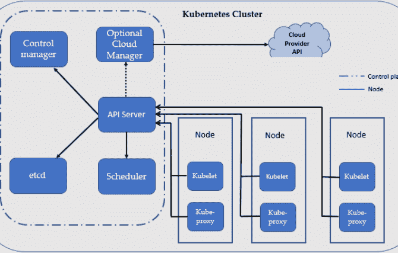

图 8.1：Kubernetes 组件（根据 Kubernetes 文档）

每个 Kubernetes 集群至少包含一个工作节点，每个工作节点托管 Pod。在集群内部，命名空间（namespaces）作为分区和隔离资源组（包括 Pod）的机制。这些 Pod 是直接与运行的容器交互的组成部分，它们由之前构建并推送到容器注册表的容器镜像创建。

当你与 Kubernetes 交互时，你是在与一组经过系统验证和接受的对象交互。要操作 Kubernetes 对象，你必须使用 Kubernetes API。在现代格局中，有各种工具可以促进 Kubernetes 部署，包括视觉辅助工具、命令行界面或如 Eclipse JKube 等 Java 扩展。

## 部署的本地设置

作为软件开发者，建立高效的本地开发环境是标准做法。这种设置涉及配置对版本控制系统的访问并安装几个基本组件：

- **Java 开发工具包（JDK）**：JDK 是编译和运行 Java 应用程序所必需的。
- **构建工具（Maven 或 Gradle）**：这些工具协助管理依赖并构建你的项目。
- **集成开发环境（IDE）**：流行的选择包括 IntelliJ IDEA、Eclipse 或 Visual Studio Code，它们提供了强大的编码和调试能力。
- **数据库或中间件（可选）**：根据项目需求，你可能集成数据库或中间件来与你的代码交互。
- **容器工具**：如 Docker、Podman、Buildah、Jib、JKube 或类似的工具，对于处理容器化应用程序时的构建、运行和推送容器镜像至关重要。
- **Kubernetes 开发集群**：对于基于 Kubernetes 的项目，本地开发集群至关重要。选项包括 Minikube、kind（Kubernetes in Docker）、Red Hat CodeReady Containers、Docker Desktop 或 Rancher Desktop。在本地集群消耗过多资源的情况下，可以考虑远程 Kubernetes 集群或提供的 Red Hat OpenShift 开发者沙箱的环境。

这个全面的本地开发环境使软件开发者能够高效地开发应用程序功能，同时确保兼容性和部署的便利性。

在创建任何 Kubernetes 资源之前，让我们先总结一些 Kubernetes 概念：

- **集群（Cluster）**：Kubernetes 集群是一组被称为节点的机器，用于运行容器化应用程序。
- **命名空间（Namespace）**：命名空间用于在集群内逻辑隔离资源。它们有助于组织和管理应用程序以及资源。
- **用户（User）**：与 Kubernetes API 的交互需要通过用户管理的身份验证形式。
- **上下文（Context）**：包含 Kubernetes 集群、用户和命名空间的特定组合。
- **Kubelet**：运行在每个集群节点上的主代理，根据 Pod 规范确保容器正在运行且健康。
- **部署（Deployment）**：Deployment 是一种定义应用程序期望状态的 Kubernetes 资源。它管理 ReplicaSet，并确保指定数量的 Pod 副本始终运行。
- **副本集（ReplicaSet）**：在底层，Deployment 使用 ReplicaSet 来维护固定数量的副本 Pod。如果某个 Pod 失败，ReplicaSet 会确保维持期望数量的副本。
- **服务（Service）**：Service 为访问应用程序定义了稳定的端点，实现对 Pod 的负载均衡和网络路由。它是将在不同 Pod 中具有多个实例的应用程序暴露为网络服务的方式。

记住这些概念后，让我们探索如何生成 Kubernetes 对象并随后部署它们。

## 使用 Dekorate 生成 Kubernetes 清单

Dekorate 可以在编译时使用 Java 注解和标准 Java 框架配置机制生成 Kubernetes 清单（manifests）。表 8.1 显示了 Quarkus、Spring Boot 或通用 Java 项目可用的 Maven 依赖：

| 框架 | 依赖 |
| --- | --- |
| Quarkus | `<dependency><groupId>io.quarkus</groupId><artifactId>quarkus-kubernetes</artifactId><version>3.7.0</version></dependency>` |
| Spring Boot | `<dependency><groupId>io.destrate</groupId><artifactId>kubernetes-spring-starter</artifactId><version>3.7.0</version></dependency>` |
| 通用 Java 应用 | `<dependency><groupId>io.destrate</groupId><artifactId>kubernetes-annotations</artifactId><version>3.7.0</version></dependency>` |

表 8.1：Dekorate Maven 依赖

让我们通过向示例 8.1 中添加 Dekorate 来创建一些 Kubernetes 资源：


```xml
<?xml version="1.0" encoding="UTF-8"?>
<project xmlns="http://maven.apache.org/POM/4.0.0"
    xmlns:xsi="http://www.w3.org/2001/XMLSchema-instance"
    xsi:schemaLocation="http://maven.apache.org/POM/4.0.0 http://maven.apache.org/xsd/maven-4.0.0.xsd">
    <modelVersion>4.0.0</modelVersion>

    <!-- 父 POM -->
    <parent>
        <groupId>org.springframework.boot</groupId>
        <artifactId>spring-boot-starter-parent</artifactId>
        <version>2.5.4</version> <!-- 指定您所需的 Spring Boot 版本 -->
    </parent>
    <!-- 项目信息 -->
    <groupId>com.example</groupId>
    <artifactId>my-spring-boot-app</artifactId>
    <version>0.0.1-SNAPSHOT</version>
    <!-- 独立属性 -->
    <name>My_Spring_Boot_Application</name> <!-- 指定您的项目名称 -->
</project>
```

```xml
<description>一个带有 JKube 的示例 Spring Boot </description>
<!-- 指定您的项目描述 -->
<!-- 属性 -->
<properties>
  <java.version>11</java.version>
  <spring-native.version>0.10.5</spring-native.version> <!-- 指定您所需的 Spring Native 版本 -->
  <kubernetes-spring-starter-version>2.0.0</kubernetes-spring-starter-version> <!-- 指定 kubernetes-spring-starter 的最新版本 -->
  <!-- 仓库 -->
  <repository>myuser</repository>
</properties>
<!-- 依赖 -->
<dependencies>
  <!-- 在此处添加您的 Spring Boot 依赖 -->
  ........
  <!--为 Spring Boot 添加 Dekorate Maven 依赖 -->
  <dependency>
    <groupId>io.dekorate</groupId>
    <artifactId>dekorate-spring-boot</artifactId>
    <version>1.0.0</version> <!-- 指定所需的版本 -->
  </dependency>
</dependencies>
<!-- 构建配置 -->
```

```xml
<build>
......
</build>
</project>
```

## 示例 8.2：添加 Dekorate 的 pom.xml 配置文件

当不在提供特定配置的情况下构建应用程序时，Dekorate 将将在项目的 `target/classes/META-INF/decorate` 目录下生成部署和服务资源清单。这些生成的清单可用于将应用程序部署到 Kubernetes 或 OpenShift 集群。生成的 Service 类型为 ClusterIP，它使得应用程序仅在 Kubernetes 集群内部可用。但是，如果您需要通过云提供商的负载均衡器从外部访问服务，可以通过配置类型为 `LoadBalancer` 的 Service 资源来实现。

在使用 Dekorate 时，您可以通过以下两种主要方法灵活地自定义 Kubernetes 资源的生成：

- **在 application.properties 中指定配置**：为了确保基础设施和应用程序代码之间的整洁分离，您可以在 `application.properties` 文件中指定配置细节。一种常见的自定义是设置 `decorate.kubernetes.serviceType=LoadBalancer`。此配置告知 Dekorate 生成类型为 `LoadBalancer` 的 Kubernetes Service 资源，允许外部访问您的应用程序。

- **添加 @KubernetesApplication 注解**：另一种方法是为应用程序的主类（通常标记为 `DemoApplication` 类）添加 `@KubernetesApplication` 注解。

在配置好应用程序后，您可以通过打包应用程序来生成 Kubernetes 对象，使用以下 Maven 命令：

```
mvn clean package
```

打包应用程序后，您会在其他文件之外，在 `target/classes/META-INF/korate` 目录下发现两个文件，分别为 `kubernetes.json` 和 `kubernetes.yml`。讨论的任何一个清单都可以部署到 Kubernetes（示例 8.3）：

```yaml
apiVersion: apps/v1
kind: Deployment
metadata:
  annotations:
    app.decorate.io/vcs-url: "https://github.com/your/repo.git" # 替换为您的 URL
    name: My_Spring_Boot_Application
  labels:
    app.kubernetes.io/version: "0.0.1-SNAPSHOT"
    app.kubernetes.io/name: "My_Spring_Boot_Application"
spec:
  containers:
    - name: KERNETES_NAMESPACE
      valueFrom:
        fieldRef:
          fieldPath: metadata.namespace
    image: "repo/demo:0.0.1-SNAPSHOT"
    imagePullPolicy: IfNotPresent
    name: My_Spring_Boot_Application
    ports:
        - containerPort: 8080
          name: http
          protocol: TCP
```

## 示例 8.3：定义 Kubernetes Deployment 资源的 YAML 清单

YAML 清单为名为 `My_Spring_Boot_Application` 的容器化应用程序定义了一个 Kubernetes Deployment。当将其应用于 Kubernetes 集群时，它将执行以下操作：

- **Deployment**：创建一个名为 `My_Spring_Boot_Application` 的 Kubernetes Deployment。Deployment 是一种管理多个副本 Pod 的部署资源。

- **Pod 模板**：在 Deployment 内部，`spec.template` 部分指定了一个 Pod 模板。该模板用于创建单个 Pod。模板包含：

- **元数据 (Metadata)**：设置了标签和注解以便标识和分类 Pod。

- **容器 (Containers)**：定义了一个名为 `My_Spring_Boot_Application` 的容器，使用来自 `repository/demo:0.0.1-SNAPSHOT` 的容器镜像。该容器运行 Spring Boot 应用程序，并监听端口 8080 HTTP 流量。

- **副本 (Replicas)**：Deployment 指定它应该维护一个 Pod 模板的副本。这意味着它将确保始终有一个应用程序实例在运行。

- **环境变量 (Environment variable)**：Pod 内的容器配置了一个名为 `KUBERNETES_NAMESPACE` 的环境变量。此变量被设置为 Pod 的命名空间。

- **镜像拉取策略（Image Pull Policy）**：容器的镜像拉取策略设置为 "IfNotPresent"。这意味着 Kubernetes 只有在集群中不存在该镜像时，才会从仓库拉取镜像。

- **服务注解（Service annotations）**：Deployment 包含了指示源代码版本控制系统 (VCS) URL 的注解。

总的来说，当此 YAML 清单应用到 Kubernetes 集群时，它将创建一个 Deployment，用于管理一个运行 `My_Spring_Boot_Application` 容器的 Pod 副本。该应用程序将可以通过集群内的 8080 端口访问。如果需要，您可以通过修改 Deployment 中的 `replicas` 字段来缩缩副本数量。现在来看如何在 YAML 中定义服务资源（示例 8.4）：

```yaml
apiVersion: v1
kind: Service
metadata:
  annotations:
    app.dekorate.io/vcs-url: "https://github.com/your/repo.git" # 替换为您的 VCS URL
  labels:
    app.kubernetes.io/name: My_Spring_Boot_Application
    app.kubernetes.io/version: 0.0.1-SNAPSHOT
  name: My_Spring_Boot_Application_Service
spec:
  ports:
    - port: 80
      targetPort: 8080
  selector:
    app.kubernetes.io/name: My_Spring_Boot_Application
    app.kubernetes.io/version: 0.0.1-SNAPSHOT
  type: LoadBalancer
```

## 示例 4：定义 Kubernetes 服务资源的 YAML 清单

前面的 YAML 定义了一个 Kubernetes 服务资源，其作用是将部署在 Kubernetes 集群内部的应用程序暴露给外部流量。以下是此 YAML 将执行的操作：

- **元数据和标签（Metadata and labels）**：它包含了元数据和标签，用于唯一标识和分类服务资源。

- **注解（Annotations）**：`app.decorate.io/vcs-url` 注解设置为 `<<unknown>>`，表示未指定版本控制系统 (VCS) URL。注解用于提供有关资源的额外信息。

- **服务端口（Service ports）**：它指定了一个名为 "http" 的单一端口，具有以下属性：

  * **端口 (Port)**: 80

  * **目标端口 (TargetPort)**: 8080

此配置意味着发送到该服务 80 端口的流量将由与该服务的 Pod 转发到 8080 端口。通常，HTTP 流量从 80 端口指向应用程序的内部 8080 端口。

- **选择器（Selector）**：服务根据符合特定标准的标签来选择 Pod。在这种情况下，它选择了带有以下标签的 Pod：

  * `app.kubernetes.io/name: My_Spring_Boot_Application`

  * `app.kubernetes.io/version: 0.0.1-SNAPSHOT`

服务将流量转发到匹配这些标签的 Pod。

- **服务类型（Service type）**：服务类型设置为 `LoadBalancer`。此配置指示 Kubernetes 集群分配一个外部负载均衡器（如果底层云提供商支持），并根据提供的标签和端口将外部流量路由到选定的 Pod。

此 YAML 定义了一个 Kubernetes 服务，它通过负载均衡器将版本为 "0.0.1-SNAPSHOT" 的名为 `My_Spring_Boot_Application` 的应用程序通过 80 端口暴露给外部流量。它确保传入的 HTTP 请求被转发到符合指定标签标准且内部服务运行在 8080 端口的 Pod。

假设您已经登录了 Kubernetes 集群且两个 yaml 都在 `demo.yaml` 文件中，您可以使用命令行接口进行部署：

```bash
kubectl apply -f target/classes/META-INF/kubernetes/dekorate/kubernetes.yaml
```

结果是，在应用清单后，您可以使用 Kubernetes 提供的外部 IP（LoadBalancer Ingress）和端口访问应用程序。

## 使用 Eclipse JCube 生成并部署 Kubernetes 清单

Eclipse JCube 也可以在编译时生成并部署 Kubernetes/OpenShift 清单。除了创建 Kubernetes 描述符（YAML 文件）外，您可以通过以下方式调整输出：

- 使用 XML 插件配置进行内联配置

- 部署描述符的外部配置模板

“使用 Eclipse JCube 构建容器镜像”探讨了 JCube 与 Docker 守护进程集成容器镜像。我们将重用“使用 Jib 管理容器镜像”中的 `pom.xml` 来使用 Eclipse JCube 和 Jib 生成并部署 Kubernetes资源。

您可以遵循以下步骤：

1. 打开 Eclipse 命令提示符或终端。

2. 导航到 `pom.xml` 文件所在的目录。

3. 运行以下 Maven 命令来构建项目并创建 Kubernetes 资源：

```bash
mvn clean package k8s:build k8s:resource
```

此 Maven 命令执行了以下操作：

- `clean`：清理项目。

- `Package`：打包应用程序。

- `K8s:build`：使用 Jib 构建容器镜像。

- `K8s:resource`：使用 Eclipse Jkube 生成 Kubernetes 资源（Deployment 和 Service）。

4. 一旦命令成功完成，您应该会看到指示 Kubernetes 资源已生成的输出。

5. 要将生成的资源应用到您的 Kubernetes 集群，可以使用 `kubectl` 命令：

```bash
kubectl apply -f target/classes/META-INF/jkube/kubernetes/deploy.yml

kubectl apply -f target/classes/META-INF/jkube/kubernetes/service.yml
```

如果生成的 YAML 文件位于不同的目录，请确保调整生成的 YAML 文件路径。

此 YAML 定义了一个 Kubernetes 服务，它通过负载均衡器将版本为 "0.0.1-SNAPSHOT" 的名为 `My_Spring_Boot_Application` 的应用程序通过 80 端口暴露给外部流量。它确保传入的 HTTP 请求被转发到符合指定标签标准且内部服务运行在 8080 端口的 Pod。

## 选择并实现部署策略

当利用适当工具时，在 Kubernetes 上部署单个应用程序可以是非常简单的。在决定部署策略时，某些考虑因素会被考虑，包括：

- 期望的实例数量。

- 健康实例的最小阈值。

- 最大允许的实例数量。

理想情况下，目标是在利用计算资源的同时尽快实现期望的实例数量。

使用 `recreate` 策略的一体式部署是最简单的，如下所示（示例 8.5）：

```yaml
apiVersion: apps/v1
kind: Deployment
metadata:
  name: My_Spring_Boot_Application
spec:
  replicas: 4
  selector:
    matchLabels:
      app: My_Spring_Boot_Application
  strategy:
    type: Recreate
    revisionHistoryLimit: 15
template:
  metadata:
    labels:
      app: My_Spring_Boot_Application
  spec:
    containers:
    - image: repo/demo:0.0.1-SNAPSHOT
      name: My_Spring_Boot_Application
      imagePolicy: IfNotPresent
      ports:
      - name: http
        containerPort: 8080
```

### 示例 8.5：使用 recreate 策略的一体式部署

- 部署策略设置为 "Recreate"，这意味着应用更新时，它将删除现有 Pod 并创建新 Pod。在这种设置下，不需要定义最小和最大实例限制；只需要指定期望的实例数量（在本例中为 4）。

- `revisionHistoryLimit: 15`。它保留最多15 个版本历史。

您可以通过运行以下命令查找之前的版本：

```
kubectl rollout history deployment/demo
```

使用以下命令回滚到之前的版本：

```
kubectl rollout undo deployment/demo --to-revision=[revision-number]
```

尽管这种策略在内存和 CPU 消耗方面有效，但它会引入微服务不可的时间。

另一个 Kubernetes 内置策略是 **RollingUpdate**，它会缓慢替换当前运行的实例，如 *示例 8.6* 所示：


```yaml
apiVersion: apps/v1
kind: Deployment
metadata:
  name: My_Spring_Boot_Application
spec:
  selector:
    matchLabels:
      app: My_Spring_Boot_Application
  strategy:
    type: RollingUpdate
    rollingUpdate:
      maxUnavailable: ②
      maxSurge: ③
  replicas: ④
  revisionHistoryLimit: 15
```

```yaml
metadata:
  labels:
    app: My_Spring_Boot_Application
spec:
  containers:
    - image: repo/demo:0.0.1-SNAPSHOT
      name: My_Spring_Boot_Application
      ports:
        - containerPort: 8080
          name: http
          protocol: TCP
```

# 示例 8.6：滚动更新部署策略

**1 此部署使用了“RollingUpdate”（滚动更新）策略进行更新。** 该策略旨在确保更新逐步进行，维持高可用性。它允许对应用程序更新进行受控的发布和回滚。

**2 `maxUnavailable: 1` 次确保更新过程中，同时最多有一个 Pod 处于不可用状态，最大限度地减少干扰。**

**3 `maxSurge: 3` 允许 Deployment 在更新旧 Pod 之前创建最多三个新 Pod，有助于加速更新过程。**

**4 这里的 `replicas: 4` 是期望的 Pod 数量。**

这种滚动更新策略确保了应用更新是逐步且安全的。它在确保高可用性（通过限制每次只有一个 Pod 不可用）和加速更新过程（通过允许新 Pod 受控激增）之间保持平衡。这是在 Kubernetes 集群中更新应用程序而不会引起服务中断的常用策略。

通过关注不可用 Pod 的最大数量，该策略安全地升级您的部署，而无需经历任何停机。但具有复杂依赖链或相互依赖微服务的应用程序在滚动更新时可能会面临挑战。确保所有组件按正确的顺序更新可能非常复杂，并可能导致更新时间延长。此外，对于具有大量副本或启动缓慢的应用程序，滚动更新可能非常耗时。如果更新窗口过长，可能无法满足可用性要求。具有复杂启动或关闭过程的应用程序可能并不适合滚动更新策略。该策略假设新 Pod 可以安全地替换旧 Pod，但对于所有应用程序来说并不总是如此。对于依赖持久化数据的状态化应用程序，滚动更新可能具有挑战性。这些应用程序通常需要仔细的协调以确保更新期间的数据一致性。在这种情况下，蓝绿部署（Blue-Green）或金丝发布（Canary）等其他部署策略更为合适。

**蓝绿部署（Blue/Green deployment）**是一种用于部署软件更新的发布管理策略。在这种方法中，建立了两个相同的环境（蓝色和绿色），其中一个代表当前运行的版本（蓝色），另一个代表应用程序的新版本（绿色）。最初，所有用户流量都指向蓝色环境，而绿色环境保持空闲状态。在部署过程中，新版本的应用程序在绿色环境中部署并经过彻底测试。一旦验证其运行正常，就会进行流量切换，将用户引导至绿色环境，有效地使其成为新的生产版本（绿色）。这种方法允许在遇到任何问题时进行无缝回滚，因为蓝色环境仍然可用。蓝绿部署（图 8.2）最小化了停机时间并降低了部署新软件版本相关的风险。

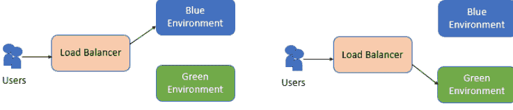

# 图 8.2：蓝绿策略

让我们看看如何使用标准的 Kubernetes 对象来实现蓝绿部署：

1. 要部署微服务的蓝色版本（示例 8.7），其标签标记为 `version: blue`，我们将遵循将标签值 `blue` 与蓝色部署关联的惯例：

```yaml
apiVersion: apps/v1
kind: Deployment
metadata:
  labels:
    app: my-app
    version: blue
    name: my-app-blue
spec:
  replicas: 3 # 蓝色版本的副本数量
  selector:
    matchLabels:
      app: my-app
      version: blue # 标识蓝色版本的标签
  template:
```

```yaml
metadata:
  labels:
    app: my-app
    version: blue # 标识蓝色版本的标签
spec:
  containers:
    - name: my-app
      image: repo/demo:0.0.1-SNAPSHOT # 蓝色版本的镜像
      imagePullPolicy: IfNotPresent # 使用指定的镜像
      ports:
        - containerPort: 8080
```

**示例 8.7：蓝绿部署策略的蓝色版本**

现在，通过 Kubernetes Service 暴露此部署。此之后，流量将从蓝色版本提供：

`kubectl expose deployment my-app-blue --type=LoadBalancer --name=my-app-blue-service`

2. 部署带有标签 `version: green` 的微服务的绿色部署（示例 8.8）：

```yaml
apiVersion: apps/v1
kind: Deployment
metadata:
  labels:
    app: my-app
```

```yaml
version: green
name: my-app-green
spec:
  replicas: 3 # 绿色版本的副本数量
  selector:
    matchLabels:
      app: my-app
  template:
    metadata:
      labels:
        app: my-app
        version: green # 标识绿色版本的标签
    spec:
      containers:
        - name: my-app
          image: repo/demo:0.0.1-SNAPSHOT # 绿色版本的镜像
          imagePullPolicy: IfNotPresent # 使用指定的镜像
          ports:
            - containerPort: 8080
```

**示例 8.8：蓝绿部署策略的绿色版本**

通过补丁 **Service** 对象将流量从蓝色切换到绿色：

`kubectl patch svc my-app-service -p '{"spec":{"selector":{"version":"green"}}}'`

如果不再需要蓝色部署，可以使用 `kubectl delete` 将其删除。

我们将看到的最后一种策略是金丝发布（Canary deployment）（图 8.3）。金丝发布背后的理念是增量且有选择地发布新版本，就像在矿井中使用金丝雀来检测有毒气体——如果金丝雀（或小部分用户）完好无损，就可以继续发布。

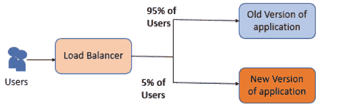

# 图 8.3：金丝发布

在典型的金丝发布中，会选择一小部分用户或服务器（通常称为“金丝雀”）接收新版本。其他用户或服务器继续使用旧的稳定版本。这种方法允许在受控环境中对新代码进行真实世界的测试，有助于在影响所有用户之前发现任何意外的问题或 Bug。监控和可观测工具在金丝发布中至关重要，可以密切观察金丝雀的行为和性能。

如果金丝雀表现良好且没有问题迹象，部署可以逐渐扩大到更大的受众，更多的用户或服务器开始使用新版本。这种增量发布将持续进行，直到所有用户都使用新版本。金丝发布为软件发布提供了安全网，减少了潜在问题的影响范围，并在出现问题时允许快速缓解。它们对于复杂的分布式系统特别有用，因为服务之间不可预料的相互作用可能会在部署期间出现意外的问题。

| | | | | | |
|---|---|---|---|---|---|
| 停机时间 | 部署期间 | 最小 | 最小 | 最小 |
| 部署速度 | 快 | 中等 | 中等 | 中等 |
| 风险缓解 | 有限 | 部分 | 高 | 高 |
| 使用场景 | 小型应用，静态 | 无状态服务 | 复杂应用，动态 | 微服务 |
| 可观测性 | 挑战性 | 较容易 | 较容易 | 较容易 |

表 8.2：部署策略

## 在 Kubernetes 中管理负载

在 Kubernetes 上运行的被称为负载（负载）。在集群中，你的负载运行在一个或多个具有定义生命周期的 Pod 上。在 Kubernetes 中管理负载涉及部署、扩展、更新和监控容器化应用程序。Kubernetes 使用各种资源来定义和控制这些负载，例如 Deployments、StateSets 和 DaemonSets。让我们探索一些负载管理的最佳实践。

- 为无状态服务使用 Deployments：Deployments 是管理 Web 应用等无状态服务的理想选择。它们提供了滚动更新、扩展和自愈等功能。在 Deployment 清单中定义应用程序的期望状态，Kubernetes 将确保运行着指定数量的副本。
- 为有状态服务使用 StatefulSets：对于数据库等有状态的服务，StatefulSets 是更好的选择。它们提供了稳定的网络标识和持久化存储。StatefulSets 确保 Pod 按照可预测的顺序启动并在重新调度时保持其标识。
- 为集群级服务使用 DaemonSets：DaemonSets 适用于在集群中的每个节点上运行 Pod 副本。这对于监控代理或日志收集器等集群级服务非常有用。DaemonSets 确保 Pod 分布在所有节点。
- 水平 Pod 自动扩缩：实现水平 Pod 自动扩缩（HPA），根据 CPU 和内存等资源使用指标自动调整 Pod 副本的数量。HPA 帮助你的应用程序高效地处理变化的负载。

之前，我们创建并应用了包含 Deployment 指定的 Kubernetes 清单。这种方法通常用于无状态微服务。但对于那些依赖外部服务或将数据持久化到数据库的微服务，我们如何防止故障呢？此外，随着微服务代码库的演进，确保内存和 CPU 资源的均衡利用变得非常重要。我们如何有效地处理这个问题呢？

## 设置健康检查

Kubernetes 中的健康检查用于确定 Pod 内容器的状态。它们帮助 Kubernetes 协调应用程序的部署和扩展，通过确保只有健康的容器接收流量，并且不健康的容器会被自动重启或替换。

Kubernetes 支持三种主要的健康检查类型：

- 存活探针（Liveness probe）：确定容器是否按预期运行。如果存活探针失败，Kubernetes 将重启容器。
- 就绪探针（Readiness probe）：检查容器是否准备好处理流量。失败就绪检查的容器将临时从服务中移除，允许应用程序优雅地处理其状态的变化。
- 启动探针（Startup probe）：用于确定容器何时准备好接收流量。它只在容器启动期间运行一次。

现在，让我们来看看各种类型的探针：

- HTTP 探针：HTTP 探针向指定的端点发送 HTTP GET 请求并在给定时间范围内检查特定的响应码。这对于具有 RESTful API 或 Web 服务器的应用程序有用。

HTTP 就绪探针的 YAML 示例：

```yaml
readinessProbe:
  httpGet:
    path: /healthz
    port: 8080
  initialDelaySeconds: 5
  periodSeconds: 10
```

- 命令探针（Command probes）：命令探针在容器内部运行命令并检查退出状态。如果命令返回零退出状态，则认为探针成功。

命令存活探针的 YAML 示例：

```yaml
livenessProbe:
  exec:
    command:
      - /bin/check-script.sh
  initialDelaySeconds: 10
  periodSeconds: 30
```

- TCP 探针：TCP 探针检查容器上的特定端口是否已打开。这对于依赖于底层网络连接的应用程序有用。

TCP 存活探针的 YAML 示例：

```yaml
tcpSocket:
  port: 8080
  initialDelaySeconds: 15
  periodSeconds: 20
```

- gRPC 探针：gRPC 探针与 HTTP 探针类似，但专门为 gRPC 服务设计。它们发送 gRPC 请求并检查有效响应。

gRPC 就绪探针的 YAML 示例：

```yaml
grpc:
  serviceName: mygrpcservice
  portName: grpc-port
  initialDelaySeconds: 5
  periodSeconds: 10
```

- 具名端口探针（Named port probes）：具名端口探针允许你指定服务端口名称作为探针的目标。这在处理暴露多个端口的服务时有用。

具名端口就绪探针的 YAML 示例：

```yaml
httpGet:
  path: /healthz
  port: my-port-name
  initialDelaySeconds: 5
  periodSeconds: 10
```

现在，让我们看看存活、就绪和启动探针如何集成到 Kubernetes 部署清单中（示例 8.9）：

```yaml
apiVersion: apps/v1
kind: Deployment
metadata:
  name: my-app
spec:
  replicas: 3
  selector:
    matchLabels:
      app: my-app
  template:
    metadata:
      labels:
        app: my-app
    spec:
      containers:
        - name: my-container
          image: my-image:latest
          ports:
            - containerPort: 8080
          readinessProbe:
            httpGet:
              path: /healthz
              port: 8080
            initialDelaySeconds: 5
            periodSeconds: 10
          livenessProbe:
            exec:
              command:
                - /bin/check-script.sh
            initialDelaySeconds: 10
            periodSeconds: 30
          startupProbe:
            tcpSocket:
              port: 8080
            initialDelaySeconds: 15
            periodSeconds: 20
```

# 前端服务资源需求与限制

```text
frontend.cpu-requests=0.5
frontend.memory-requests=256Mi
frontend.cpu-limits=1
frontend.memory-limits=512Mi
```

# 后端服务资源需求与限制

```text
backend.cpu-requests=0.5
backend.memory-requests=512Mi
backend.cpu-limits=1
backend.memory-limits=1Gi
```

你可以在代码中访问这些配置属性并将其集成到应用程序逻辑中，确保每个组件都能获得所需的资源。

## Kubernetes 部署配置级别

在 Kubernetes 部署配置级别管理资源配额涉及直接在 Kubernetes 部署 YAML 文件中指定资源需求和限制。这种方法允许你在集群级别强制执行资源配额，并对资源分配进行集中控制。

以下是在 Kubernetes 部署 YAML 中定义资源需求和限制的示例（示例 8.10）：


```yaml
apiVersion: apps/v1
kind: Deployment
metadata:
  annotations:
    app.decorate.io/vcs-url: "https://github.com/your/repo.git"
name: My_Spring_Boot_Application
labels:
  app.kubernetes.io/version: "0.0.1-SNAPSHOT"
  app.kubernetes.io/name: "My_Spring_Boot_Application"
spec:
  containers:
    - env:
      - name: KUBERNETES_NAMESPACE
        valueFrom:
          fieldRef:
            fieldPath: metadata.namespace
    image: "repo/demo:0.0.1-SNAPSHOT"
    imagePullPolicy: IfNotPresent
    name: "My_Spring_Boot_Application"
    ports:
        - containerPort: 8080
          name: "http"
          protocol: TCP
    resources:
      limits:
        cpu: 200m
        memory: 230Mi
      requests:
        cpu: 100m
        memory: 115Mi
```

示例 8.10：Kubernetes Deployment 中的资源需求和限制

在此示例中，为部署内的容器设置了资源请求和限制。Kubernetes 会执行这些约束条件，确保将指定的资源分配给容器。

有几点需要你注意：

- 如果容器指定了内存限制（limit）但未指定内存请求（request），Kubernetes 将自动分配一个与限制相同的内存请求。
- 同样，如果容器指定了 CPU 限制但未指定 CPU 请求，Kubernetes 将自动分配一个与限制相同的 CPU 请求。

# 处理持久化数据集合

微服务架构以能够构建健壮且可扩展的应用而闻名，它强调每个微服务应该独立地管理自己的数据。这一原则不仅鼓励了自主性，还防止了无意的依赖，实现了独立部署。然而，在这种背景下处理持久化数据集合需要周全的规划和策略思考。

如果你使用 CouchDB 或 MongoDB 等 NoSQL 数据库，你在数据库更改方面具有灵活性。你可以直接从应用程序代码执行结构更改。

在处理标准 SQL 数据库时，管理模式更改至关重要。Flyway 或 Liquibase 等工具可以帮助你无缝处理模式修改。这些工具协助生成迁移脚本，并跟踪哪些脚本已经在数据库中执行。当调用这些迁移工具时，它们会扫描可用脚本，识别出尚未在特定数据库上运行的脚本并执行它们。

在选择和实施部署策略时，你应该注意以下几点：

- 确保数据库模式版本与部署期间使用的应用程序版本兼容。
- 保持与容器化应用程序上一个工作版本的模式的兼容性。
- 更改列的数据类型需要转换所有基于旧列定义存储的所有值。
- 重命名列、表或视图可能导致向后兼容，除非你使用触发器或程序化的迁移脚本。

将应用程序代码的部署与迁移脚本的执行分开，允许对微服务进行独立管理。云提供商提供了各种托管数据库解决方案，消除了管理底层基础设施的需求。然而，在使用托管数据库服务时，请考虑数据安全和管理。

是否在 Kubernetes 中运行数据库取决于 Kubernetes 管理实践与维护数据库所需的运维步骤是否保持对齐。Kubernetes 社区通过实现包含逻辑领域和操作运行手册（runbooks）的 Operator 解决了这些挑战。OperatorHub.io 提供了丰富的 Operator 列表用于在 Kubernetes 中管理数据库。

# 日志记录与监控的最佳实践

在 IT 领域，重点通常是让容器化应用运行。虽然在本地机器上开发期间，你是你工作的主要用户，但在生产环境中，你的应用程序面对整个世界。为了确保你的应用程序符合所有终端用户的预期，在不同条件和不同环境下观察其随时间变化的行为至关重要。

近年来，观测性（Observability）已成为 IT 行业的一个核心概念，但你可能已经在努力让 Java 应用程序具有可观测性。它指的是根据系统生成的数据（包括日志、指标和追踪）来衡量和理解系统内部状态的能力。从上地说，观测性允许组织深入洞察其系统行为，有助于有效的故障排除、性能优化和主动解决问题。如果你已经实现了审计、异常处理或事件日志，你就已经开始观察应用程序的行为了。要为分布式系统构建可观测性，你可能会使用各种工具来实现监控、日志记录和追踪实践。

应用程序及其底层基础设施产生宝贵的指标、日志和追踪，这些对于正确观察系统至关重要。如图 8.4 所示，收集这些遥测数据有助于系统状态可视化：


图 8.4：从应用程序和基础设施收集指标、日志和追踪

在监控领域，告警起着关键作用。告警是在满足或违反预定义条件时通知管理员或自动化系统的机制。这些条件可以从资源利用超过限制到日志中的特定错误模式不等。当告警触发时，通知充当预警系统，允许团队及时做出反应。通过分配通知，你可以识别正常工作流中的模式。这些模式反过来可以帮助在收到告警时自动执行恢复机制。正确配置告警对于维护系统的可靠性至关重要。

观测性提供了对分布式系统状态的洞察，让你能够利用这些信息解决微服务中的故障状态。Kubernetes 包含内置的自愈机制，包括重启失败的容器、删除不健康的容器以及不将流量路由到未就绪的 Pod 等操作。为了进一步自动化恢复机制，你可以使用 Jobs 和 DaemonSets 等资源扩展 Kubernetes 的自愈能力。例如，你可以使用 DaemonSet 在每个节点上运行节点监控守护，而 Job 可以创建并重试 Pod 直到指定数量的 Pod 成功终止。

观测性在流量激增发生时衡量系统状态也起着关键作用。响应缓慢的应用会让用户感到沮丧，因此研究如何扩展容器化应用至关重要。自动伸缩消除了在处理流量激增时手动干预的需求，能够自动调整活动资源和实例的数量。

在 Kubernetes 中，HorizontalPodAutoscaler（HPA）资源用于自动调整类似 Deployment 的工作负载资源以匹配需求。它在负载增加时通过部署更多 Pod 做出响应，并在负载减少时缩缩。HPA 使用一种算法考虑所需指标值与当前指标值之比来确定所需的副本数量。

以下是计算 `desiredReplicas` 的公式：

```text
desiredReplicas = ceil[currentReplicas * (currentMetricValue / desired MetricValue)]
```

以下是组件的详细说明：

- `currentReplicas`：Deployment 或 ReplicaSet 中当前的副本数量。
- `currentMetricValue`：正在观测的指标值（例如，CPU 利用率）。
- `desiredMetricValue`：指标的目标值或期望值（例如，80% 的 CPU 利用率）。

虽然 H 侧重于水平调整副本数量，但垂直扩缩涉及调整现有 Pod 的资源分配量。在 Kubernetes 中，垂直 Pod 自动扩缩器（VPA）是一种帮助垂直扩缩的工具。它会在需要时为 Pod 分配更多的 CPU 或内存资源，以确保资源的高利用。然而，不应同时使用 VPA 和 H 来调整 CPU 或内存资源，因为这会导致 Pod 出现未定义的行为。

让我们来看一些监控、日志记录和追踪建议，以便在部署、扩展和维护容器化应用时更好地理解可观测性。

## 监控

你可以使用监控来近实时地观察系统。有效的监控依赖于收集和分析各种指标。通常，这种实践涉及建立一个能够收集日志和预定义指标集的技术解决方案，如图 8.5 所示。

指标是系统属性随时间变化的数值，例如可用的最大 Java 堆内存或发生的垃圾回收总数。以下是监控系统中常用的某些通用指标类型（表 8.3）：

| 指标类型 |  |
|---|---|
| Counter（计数器） | 表示基于递增的累计值。 |
| Timer（计时器） | 同时测量定时事件计数和所有定时事件的总时间。 |
| Gauge（仪表） | 可以任意升性的单个数值。 |
| Histogram（直方图） | 数据流中数值的分布。 |
| Meter（计量） | 表示事件发生的速率。 |

**表 8.3：指标类型**

这些指标提供了关于系统行为、性能和资源利用的宝贵见解，使其对于有效的监控至关重要。

监控是一项关键实践，允许你近实时地观察系统。它通常意味着实现能够收集日志和预定义指标集的技术解决方案，如图 8.5 所示：


**图 8.5：拉取和获取指标**

一些用于处理指标的常用 Java 库包括 MicroProfile Metrics、Spring Boot Actuator 和 Micrometer。为了全面了解你的系统行为，你可以使用 Prometheus 等工具收集并查询这些指标。这些库和工具的结合让你能够有效地监控和分析应用的性能和行为。

为了给你提供一个示例（示例 8.11），我们将重用示例 8.1，使用 Eclipse JKube 生成容器镜像和 Kubernetes 资源，在 `/actuator/prometheus` 下暴露其指标，并将它们发送到 Prometheus。

```xml
<?xml version="1.0" encoding="UTF-8"?>
<project xmlns="http://maven.apache.org/POM/4.0.0" xmlns:xsi="http://www.w3.org/2001/XMLSchema-instance" xsi:schemaLocation="http://maven.apache.org/POM/4.0.0 http://maven.apache.org/xsd/maven-4.0.0.xsd">
  <modelVersion>4.0.0</modelVersion>
  <!-- Parent POM -->
  <parent>
    ...
  </parent>

  <!-- Project Information -->
  ...
  <name>My_Spring_Boot_Application</name> <!-- Specify your project -->
  <description>A sample Spring Boot application with JKube</description> <!-- Specify your project description -->

  <!-- Properties -->
  <properties>
    ...
  </properties>

  <!-- Dependencies -->
  <dependencies>
```

```xml
<!-- Add your Spring Boot dependencies here -->
........
<!-- Add the Micrometer Prometheus registry dependency -->
<dependency>
    <groupId>io.micrometer</groupId>
    <artifactId>micrometer-registry-prometheus</artifactId>
    <scope>runtime</scope>
</dependency>
</dependencies>
<!-- Build Configuration -->
<build>
  <plugins>
    <plugin>
      <!-- Eclipse JKube Plugin Configuration -->
      <groupId>org.eclipse.jkube</groupId>
      <artifactId>kubernetes-maven-plugin</artifactId>
      <version>${jkube.version}</version>
      <executions>
        <execution>
          <id>resource</id>
          <goals>
            <goal>resource</goal>
          </goals>
        </execution>
      </executions>
    </plugin>
```

```xml
</executions>
<configuration>
  <!-- Specify the generator for Kubernetes resources (for example,spring-boot) -->
  <generator>
    <name>spring-boot</name>
    <!-- most port 9779 at the container-image level -->
    <ports>
      <port>9779</port>
    </ports>
  </generator>
  <!-- most the Prometheus port -->
  <enricher>
    <config>
      <jkube-prometheus>
        <prometheusPort>9779</prometheusPort>
      </jkube-prometheus>
    </config>
  </enricher>
  <!-- Specify the container image name -->
  <image>
    <name>${name}</name>
  </image>
```

```xml
</configuration>
</plugins>
</build>
</project>
```

- 暴露 JVM 指标：确保你暴露了内部 JVM 指标，包括线程数、CPU 使用率、垃圾回收器性能、堆和非堆内存使用的数据。这些对于理解应用程序的性能至关重要。
- 记录指标：为你的指标维护清晰的文档，包括它们的定义、预期用途以及解释时的任何特定考虑。
- 扩展指标存储：随着系统的增长，为指标存储系统的可扩展性做好计划。确保它能够高效处理增加的数据量。
- 使用直方图（Histograms）和摘要（Summaries）：对于与延迟相关的指标，考虑使用直方图和摘要来捕获和分析延迟分布。
- 持续改进：根据监控和观测实践获得的洞察，不断完善你的指标策略。

通过遵循这些最佳实践，你可以建立一个稳健的指标收集和监控框架，为系统的性能和健康提供价值的洞察。

## 日志（Logging）

日志涉及记录应用程序或系统中的特定事件、操作或信息。这些记录被称为日志条（log entries）或日志消息，作为软件执行期间发生情况的历史记录。日志可以涵盖多个方面：

- 错误跟踪：日志的主要目的之一是捕获错误和异常。当应用程序遇到问题时，它会记录有关错误的详细信息，包括其类型、位置和上下文。这些错误日志对于快速诊断和修复问题无关重要。
- 性能监控：日志可以提供有关应用程序性能的洞察。通过记录执行时间、资源消耗和其他性能指标，开发者可以识别瓶颈并优化代码效率。
- 审计与合规性：在许多行业中，应用程序必须遵守严格的审计和合规性。日志有助于创建审计轨迹，确保操作和交易被记录，以备日后审查和合规检查。

在 Java 应用程序开发领域，日志是捕获异常情况的重要工具。这些日志提供了丰富的上下文信息的宝贵洞察，补充了现有的指标。日志作为一种实践，涵盖了三种不同的格式：纯文本、JSON 或 XML 以及二进制。

在 Java 应用程序中实现稳健的日志记录时，开发者可以利用语言内置选项之外的各种日志框架。著名的选择包括 Java 简单日志门面接口（SLF4J）和 Apache Log4j2。为了确保有效的日志记录，遵循最佳实践至关重要：

- 谨慎记录：仅记录与系统内特定功能相关的相关细节。避免用无关信息充斥日志。
- 编写信息丰富的消息：编写传递有意义信息的日志消息。这种做法不仅有助于你，也能帮助你的同事在未来排排除潜在问题。
- 使用适当的日志级别：审慎地分配日志级别。`TRACE` 用于捕获细粒度的洞察，`DEBUG` 用于协助故障排除，`INFO` 用于常规更新，`WARN` 用于需要立即关注的信号事件。
- 条件日志：使用守卫语句（guard clauses）或 lambda 表达式，仅在相应的日志级别激活时才记录消息。这确保了高效的日志处理。
- 可自定义日志级别：通过变量对日志级别进行配置，并可以在容器运行时进行调整。这种灵活性允许动态日志管理。
- 安全日志位置：为日志文件所在的目录设置适当权限，防止其受到未经授权的访问。
- 定制日志布局：自定义日志布局（layouts）以适应特定的区域或上下文格式化要求。
- 保护敏感数据：在记录可能敏感的信息时要格外谨慎。例如，避免记录个人身份信息（PII），因为这样做可能会导致合规性违反和安全漏洞。
- 日志轮转：实施定期日志轮转以防止日志文件变得过大。对于默认是瞬态的容器和 Pod 日志，考虑异步流到中心化存储并采用自动日志保留策略。这确保了即使在 Pod 被删除、崩溃或迁移到不同节点时，关键日志数据也能保留。

## 追踪（Tracing）

在当今快速节奏的数字版图中，确保复杂分布式软件系统的平稳运行至关重要。随着应用程序复杂性的增加，快速定位并解决问题变得越来越具有挑战性。这就是分布式追踪（distributed tracing）大显身场，它为应用程序的内部机制提供了深度洞察。在分布式系统中，请求跨越多个组件，因此捕获元数据和计时细节至关重要。这有助于识别慢事务并定位故障源头。


在选择合适的跟踪捕获插桩（instrumentation）时，开发者经常面临挑战。虽然专有代理（agents）可以在这方面提供帮助，但建议探索遵循`OpenCensus`或`OpenTracing`等厂商中立、开放标准的解决方案。考虑到开发者在选择能够跨不同供应商和项目无缝运行的最优选项时面临的复杂性，`OpenTracing`和`OpenCensus`项目合并了，产生了另一个名为`OpenTelemetry`的`CNCF`孵化项目。

`OpenTelemetry`是一个包含工具、API 和 SDK 的综合套件，它标准化了指标、日志和追踪的收集与传输。在`OpenTelemetry`追踪规范中，定义了几个基本术语：

- `Trace`（追踪）：这代表单个事务请求在跨越分布式系统并使用各种服务和资源的过程。
- `Span`（跨）：`Span`是命名的、带时间的操作，作为工作流段的表示。一个`Trace`通常包含多个`Span`。
- `Attributes`（属性）：属性是键/值对，为查询、过滤和理解追踪数据提供了宝贵的上下文。
- `Baggage items`（行李箱项）：这些是可以跨越进程边界的键/值对，确保系统不同部分之间上下文的连续性。
- `Context propagation`（上下文传播）：它是追踪、指标和行李箱项中不可或缺的共享子系统。开发者可以使用属性、日志和行李箱向`span`传递额外的上下文信息，有助于全面的追踪分析和理解。

要将分布式追踪集成到你的应用程序中，你需要遵循以下步骤：

1. 选择追踪系统：目前有多种流行的分布式追踪解决方案，例如`Jaeger`、`Zipkin`和`OpenTelemetry`。选择一个符合你技术栈和要求的系统。
2. 对代码进行插桩：将追踪库或 SDK 集成到应用程序的代码库中。这些库负责创建和管理`span`。
3. 定义插桩点：识别代码中你想启动和停止`span`的关键操作和交互点。例如，你可能想追踪数据库查询、HTTP 请求或方法调用。
4. 传播与上下文：确保追踪上下文在服务边界之间正确传播。大多数追踪系统都支持各种通信协议来实现此。
5. 可视化与分析：使用追踪系统提供的追踪可视化工具来监控和分析收集的数据。这有助于识别瓶颈并优化你的系统性能。

以下是增强观测性的推荐追踪实践：

- 端到端插桩：通过将追踪头转发到所有下游服务、存储或中间件组件，确保完整的追踪覆盖。这提供了请求流的全视图。
- 报告关键指标：跟踪与速率、错误和持续时间相关的指标。遵循`RED`（速率、错误、持续）方法论，关注请求吞吐量、错误率和延迟/响应时间。这些指标对于有效的系统监控至关重要。
- 最少元数据：如果你选择自定义追踪`span`，请克制添加过多的元数据。虽然元数据可以提供上下文，但过多会导致复杂性增加并降低追踪的清晰度。
- Java 特有的追踪：对于 Java 应用程序，探索`OpenTelemetry`的 Java 特定语言实现。利用兼容 Java 的追踪解决方案可以简化集成并提高追踪可见性。
- 关联日志与追踪：通过在日志记录中包含`trace ID`和`span ID`将你的日志数据与追踪关联起来。这种关联有助于根因分析。
- 告警与监控：基于追踪数据设置告警，以主动识别问题并维护系统可靠性。

在设计可观测性系统时，请务必记住你的指标（metrics）和日志应该易于访问以便进行后续分析。因此，无论你的部署环境如何，都要建立稳健的工具和实践，以可靠地捕获、存储和保留指标及日志数据。这确保了你拥有必要的洞察力，能够有效地对系统进行故障排除和优化。

# 高可用性与地理分布式系统

在当今互连的世界中，对高可用性和地理分布式系统的需求已变得至关重要。用户期望无论地理位置如何、是否存在潜在中断，都能不中断地访问应用程序和服务。本文将探索创建高可用和地理分布式系统的原则、策略和最佳实践。

高可用性（HA）衡量系统能够在无中断的情况下提供服务的一致性。它通常以百分比表示，指示系统在给定期间内运行的时间比例。表 8.4 展示了可用性百分比及其对应的年度停机时间。

| 可用性百分比 | 每年停机时间（约） |
|---|---|
| 90% (一个9) | 36.5 天 |
| 99% (两个9) | 3.65 天 |
| 99.9% (三个9) | 8.76 小时 |
| 99.99% (四个9) | 52.56 分钟 |
| 99.999% (五个9) | 5.26 分钟 |
| 99.9999% (六个9) | 31.5 秒 |

表 8.4：可用性百分比及其对应的停机时间

为了建立高可用系统，可靠性工程为系统设计概述了三个基本原则：

- 消除单点故障：该原则主张消除系统内多个级别的漏洞，包括应用层、网络层和基础设施层。必须全面测试每个软件组件以识别并纠正潜在的故障源。使用可观测性工具并实施稳健的部署策略对于降低系统故障风险起着关键作用。
- 实时故障检测：为了确保高可用性，必须在故障发生时立即进行检测。这需要实施稳健的监控和告警机制，持续监控系统健康状况。这些工具提供了对关键状态的早期检测，能够对潜在问题做出主动响应。
- 故障时的无缝切换：在发生故障时，可靠地切换到运行中的组件至关重要。对于与部署相关的问题，可以通过高效的回滚过程来实现这一点。`Kubernetes`具有自愈能力，通过自动替换失败的组件来增强系统的韧性。此外，`Kubernetes`资源之间的平滑流量路由机制有助于在组件切换期间保持服务不中断。

处理故障的综合策略包括通过实施若干最佳实践来应用上述原则：

- 数据管理：实施稳健的数据备份、恢复和复制程序，以在发生故障时保护关键数据。
- 网络负载均衡：部署网络负载均衡机制以有效分配流量，特别是在负载增加期间。这种方法不仅增强了应用性能，还消除了应用层的潜在单点故障，有效利用了可用网络和基础设施资源。
- 地理冗余：通过在多个地理位置部署应用程序，减轻自然灾害和系统中断的影响。在每个位置运行独立的应用程序栈，可以确保即使其中一个位置发生故障，其他位置也能继续运行。理想情况下，这些位置应该在全球范围内分布，以避免在特定区域局部化。
- `Kubernetes`高可用：对于`Kubernetes`集群，特别是当担心组件或控制节点故障期间性能时，请选择高可用`Kubernetes`配置。这些配置涉及多个作为统一数据中心运行的控制平面节点。这种设置可以防止由于控制平面节点`etcd`故障而导致的工作节点丢失。虽然管理此类集群可能很复杂，但许多云提供商在置备集群时提供预配置的高可用设置。
- 命名空间（Namespace）管理：根据你的特定需求，设置多区域集群并不总是合理的。然而，你仍然可以在同一个集群内创建多个命名空间来确保可用性，从而有效地隔离应用程序及其资源。

以下是构建和维护高可用地理分布式系统的一些最佳实践：

- 自动化一切：自动化减少了人为错误的风险，并确保资源管理的一致性。
- 定期测试：进行定期测试和故障模拟，以验证你的高可用和灾备恢复策略。
- 安全措施：实施稳健的安全措施以防止网络威胁和数据泄露。
- 可扩展性：设计系统支持水平扩展，以适应增加的负载。
- 文档记录：维护系统架构、配置和程序的详尽文档。
- 持续改进：持续评估并改进系统的韧性和可用性。

利用多区域部署的实践在增强用户体验方面具有显著优势，特别是对于全球分布式用户群保持低延迟。应用程序架构中的这种策略确保数据与终端用户保持距离，从而有效降低全球范围内用户的延迟。

在处理地理分布式应用程序时，另一个关键考虑因素是必须遵守数据隐私法律和法规的必要性。在当今的数字版图中，隐私和数据保护变得愈发重要。许多国家现在执行严格的规定，禁止在没有获得消费者适当通知或同意的情况下收集、使用和共享个人信息。

理解确保分布式系统高可用性的要求，为探索能够有效支持这些目标的云模型奠定了基础。让我们深入探讨可以在实现和维护高可用性方面发挥关键作用的云计算模型。

# 混合云与多云架构

云是解决可用性、扩展、安全和弹性等挑战的技术集合。它可以存在于本地、`Kubernetes`分发版或公共基础设施中。通常，你会看到“混合云”和“多云”术语被同义使用。多云架构最直观的定义是：这种架构至少需要一个公共云。

# 混合架构

混合架构指的是结合了本地和云解决方案的 IT 基础设施。在混合设置中，某些工作负载和数据位于本地数据中心，而其他部分托管在公共或私有云环境中。这种资源的结合提供了灵活性、可扩展性和成本效益。

混合架构的特点包括：

- 数据集成：数据可以在本地和云环境之间无缝移动，通常由混合云解决方案促进。
- 资源灵活性：组织可以根据负载需求动态分配资源。这种灵活性允许他们根据需要进行伸缩。
- 改进的灾备：混合设置通常包含冗余系统，增强了灾备能力。

# 多云架构

多云架构涉及使用多个云提供商的服务和资源，而不是依赖单一供应商。在多云策略中，组织为特定的负载或应用程序选择最合适的云服务，构建多样化的生态系统。

多云架构的特点包括：

- 供应商多样性：组织可以为每个应用程序或服务选择合适的云提供商，避免供应商锁定。
- 风险缓解：多云减少了由于提供商故障导致的停机风险。如果一个供应商出现问题，其他供应商可以继续运行。
- 成本优化：通过从不同的供应商处选择最具效益的服务，组织可以优化其云端支出。

混合云架构与多云架构的区别在于，它包含一个私有云基础设施组件和至少一个公共云（图 8.6）。因此，当一个混合云架构包含多个公有服务时，该架构可以同时也是多云架构。

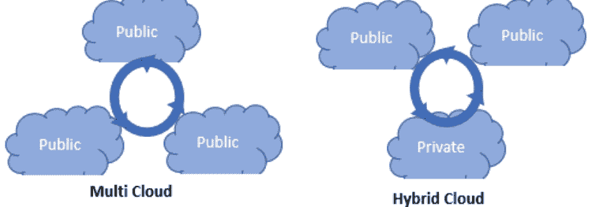

图 8.6：多云与混合云

在跨混合云或多云基础设施进行部署时，考虑以下跨团队的方面至关重要：

- 统一的部署可见性：确保你对已部署的内容以及它们在混合云或多云设置中的位置保持统一、全面的视图。这种清晰度有助于高效管理和监控。
- 供应商无关的解决方案：目标是将特定于软件即服务（SaaS）和基础设施即服务（IaaS）替换为与云供应商无关的解决方案。这种方法增加了灵活性并减少了供应商锁定。
- 统一的安全方法：实现一种统一的方法以在多个云环境中一致地处理安全漏洞。这确保了凝聚且稳健的安全态势。
- 无缝扩展和配置：促进根据需要进行无缝横向扩展和新资源的配置，以满足不同云之间不断变化的需求。这种灵活性对于优化资源分配至关重要。
- 确保服务连续性：在跨不同的云环境迁移应用程序时，避免服务中断至关重要。虽然工作负载迁移期间可能需要短暂的恢复时间，但通过适当的网络配置和部署策略，你可以确保终端用户获得平滑过渡。
- 规模化自动化：在如此大规模地编排流程时，自动化起着关键作用。除了用于容器化应用的编排平台外，你和你的团队还可以引入额外的工具和流程来高效地管理工作负载。

这些考虑对于在保持运营效率和可靠性的同时，成功应对混合云和多云部署的复杂性是重要的。

从开发人员的角度，积极参与混合云或多云策略需要关注以下关键要素：

- 一致的代码库：无论应用程序运行在什么环境或命名空间中，都要确保其代码库保持一致。这种统一性简化了跨不同云环境的管理和部署。
- 可重复的实践：建立本地构建和部署实践，以便同事在处理你的代码时可以轻松重复。这促进了开发团队内部的协作和一致性。
- 避免本地依赖：避免在代码中或在容器镜像构建过程中引用本地依赖。相反，优先使用易于访问且有完善文档的依赖项。
- 参数化：只要可行，通过构建时变量或环境变量对容器镜像进行参数化。这种灵活性允许动态调整以适应不同的部署环境。
- 环境定制：如果需要特定的环境定制，通过编排平台的环境变量传播这些定制，以配置容器/应用程序参数。这种方法在最大限度减少代码更改的同时保持了灵活性。
- 可信仓库：利用组织之前验证为可信和安全源的仓库和注册表的依赖项和容器镜像。这种做法增强了安全可靠性。
- 卷的使用：在必要时，优先使用卷（volumes）在容器之间共享信息。卷为组件之间交换数据提供了结构化且高效的方式。

在努力构建混合或多云架构时，持续构想你正在构建的软件将如何演进至关重要。采取前性的开发者思维为渐进式软件架构奠定了基础，该架构与组织的战略目标保持一致。

## 结论

本章讨论了可能与 Java 开发人员相关的部署方面。我们在章节开始处详细介绍了部署规划的细节。虽然 Java 开发人员的典型职责可能不包括基础设施管理，但你仍然可以通过采取以下行动对你应用程序的运行阶段和过程产生重大影响：

- 使用`Jib`和`Eclipse JKube`等基于 Java 的工具构建容器镜像并将其推送到容器镜像注册表。
- 使用`Helm`和`Eclipse JKube`生成并部署`Kubernetes`清单（manifests）。
- 不同的部署策略。
- 在基础设施级别实现健康检查并编排其执行。
- 观察分布式系统的行为，以确定何时实施更改以及调整哪些资源。
- 将部署考虑因素与高可用性、混合云和多云架构结合起来。

鉴于你对部署应用程序的熟悉，下一章将讨论持续交付的重要性及其最佳实践。

# 加入我们书籍的 Discord Space

加入书籍的 Discord 工作区以获取最新更新、优惠、全球科技动态、新发布以及与作者的互动：

https://discord.bpbonline.com


# 第 9 章：持续交付与部署

## 引言

在不断演变的软件开发领域，追求可靠且高效的软件交付方法至关重要。**持续交付（CD）**和部署是两种相互关联的实践，它们重新定义了软件从构思到交付用户手中的方式。这些方法作为敏捷性和可靠性的支柱，提供了一种简化开发流程、减少人工干预并确保每次软件发布不仅在功能上可行，而且同样可靠的方法。

在本章中，我们将开启一段旅程，探索持续交付和部署的基本概念、优势和最佳实践，揭示它们在追求可靠软件发布过程中的关键作用。

## 结构

在本章中，我们将讨论以下主题：

- 持续交付
- 持续可用性
- 持续交付与持续部署
- CI/CD 流水线示例

## 目标

本章将探索持续交付作为持续集成（CI）扩展的演变。它将涵盖其核心组件、优势以及为了满足用户期望对持续更新的需求。还将强调持续可用性的重要性，并通过真实案例演示其在维护不中断服务中的作用。

本章将探讨持续交付与持续部署之间的关系。它将概述它们的重要性、最佳实践和挑战。对这两种方法的比较将指导选择最合适的方法。此外，一个实用的 CI/CD 流水线示例将演示如何有效地实施两者。

# 持续交付

在深入研究持续交付之前，让我们简要回顾一下持续集成。CI 是一项软件开发实践，涉及经常将代码更改合并到共享存储库，并进行自动构建和测试。CI 的主要目标是在开发周期早期检测并解决集成问题。CI 已经成为标准实践。

## 集成回顾

在进入持续交付之前，让我们简要回顾一下持续集成。CI 是一项软件开发实践，涉及经常将代码更改合并到共享存储库，并进行自动构建和测试。CI 的主要目标是在开发周期早期检测并解决集成问题。CI 已经成为标准实践。

在现代软件开发中，确保代码更改不会破坏项目的稳定性至关重要。虽然 CI（持续集成）侧重于早期错误检测和代码集成，但在如今复杂的威胁格局下，仅靠它不足以保证软件的安全。

## 向持续交付的演进

持续交付是 CI 的自然演进。CI 专注于整合代码更改，而 CD（持续交付）更进了一步，解决了将这些更改向各种环境（包括生产环境）持续交付的问题。换句话说，CD 通过自动化从代码提交到部署的整个发布过程，扩展了 CI 流水线。虽然持续交付将 CI 的原则扩展到整个软件部署过程，但它超越了更多的代码集成和自动化测试，引入了额外的安全措施层，以应对部署流水线期间可能暴露的漏洞。

## 持续交付的关键组件

以下是 CD 的一些关键组件：

- 自动化：CD 的核心是自动化。从构建、测试到部署的整个软件交付流水线都是自动化的（包括自动化安全扫描工具的）。这最大限度地减少了人为错误，加速了进程，识别了潜在的安全问题并确保了一致性。
- 测试：与 CI 一样，CD 强调自动化测试。测试套件（包括安全测试）在流水线的各个阶段执行，只有当所有测试通过时，代码才会被考虑部署。
- 环境管理：CD 涉及多个环境的管理，包括开发、测试、预发布和生产环境。每个环境都尽可能地镜像生产环境，减少了部署期间出现意外问题的风险。
- 版本控制：CD 依赖版本控制系统来跟踪更改，确保部署的代码与在流水线较早阶段测试的代码一致。
- 部署策略：CD 引入了各种部署策略，例如蓝绿部署和金丝雀发布，允许向生产环境进行渐进且受控的发布。

## 持续交付的优势

CD 的一些优势如下：

- 更快的上市时间：CD 缩短了新功能或错误修复交付给用户的时间。这种速度在竞争激烈的行业中至关重要。
- 更高的软件质量：CD 中的自动化和严格测试导致了更高软件质量和稳定性。
- 降低风险：通过自动化部署过程和利用测试，CD 最大限度地减少了生产环境中错误和中断的风险。
- 改进协作：CD 鼓励开发、测试和运营团队之间的协作，促进了 DevOps 文化。
- 客户满意度：更快、更可靠的发布带来了更快乐的客户，他们受益于持续的改进和错误修复。

持续交付是持续集成的自然进阶，对于现代软件开发而言至关重要。通过将 CI 原则扩展到整个软件交付过程，CD 提供了一种系统且高效的方法，将代码更改引入生产环境。拥抱持续交付可以显著提高软件发布的速度、质量和可靠性，使其成为任何努力满足当今动态市场需求的开发团队至关重要的实践。

## 持续更新的需求

技术格局处于不断变化的状态，新的进展和创新以前所未有的速度出现。在这种气候下，用户需要的不再仅仅是静态解决方案。持续更新提供了保持相关性、安全和竞争所需的灵活性。在当今的格局下，用户对软件和服务的期望已经提高。安全已成为首要考虑的问题。

数字世界不断受到不断演变和复杂的网络威胁的侵害。用户现在不仅期望无缝且高效的软件，还要求其数据和系统保持安全。从安全的角度来看，持续更新是确保数字产品和服务保持韧性、受保护并领先于潜在漏洞的基石。从安全的角度来看，这里是讨论持续更新重要性的几点：

- 增强的安全措施：用户日益期待软件开发人员提供稳健的安全措施作为服务的一部分。持续更新允许开发者强化安全协议、修补漏洞并实施加密以保护用户数据。


- **及时的漏洞修复**：在一个每天出现新漏洞的世界里，用户依赖及时更新来处理和纠正安全缺陷。持续更新作为对新兴威胁的即时响应，确保用户数据和隐私受到保护。
- **适应新兴威胁**：网络威胁不断演变，软件必须相应进行调整。持续更新是一项领先于威胁的主动措施，包括零日漏洞和恶意软件攻击，减轻了潜在的损害。
- **竞争优势**：从业务角度来看，维护安全的软件环境不仅是必要的，而且是一种竞争优势。优先考虑持续安全更新的公司展示了对数据保护的承诺，从而赢得了用户用户的信任。
- **用户安全反馈整合**：持续更新提供了一个纳入有关安全担忧的用户反馈的途径。这种迭代过程帮助开发者将其产品与客户不断变化的安全需求和偏好保持一致。

## 满足用户期望

（注：此段落内容与前文重复，已按要求完成翻译并保留格式）

技术格局处于不断变化的状态，新的进展和创新以以前所未有的速度出现。在这种气候下，用户需要的不再仅仅是静态解决方案。持续更新提供了保持相关性、安全和竞争所需的灵活性。在当今的格局下，用户对软件和服务的期望已经提高。安全已成为首要考虑的问题。

数字世界不断受到不断演变和复杂的网络威胁的侵害。用户现在不仅期望无缝且高效的软件，还要求其数据和系统保持安全。从安全的角度来看，持续更新是确保数字产品和服务保持韧性、受保护并领先于潜在漏洞的基石。从安全的角度来看，这里是讨论持续更新重要性的几点：

- **增强的安全措施**：用户日益期待软件开发人员提供稳健的安全措施作为服务的一部分。持续更新允许开发者强化安全协议、修补漏洞并实施加密以保护用户数据。
- **及时的漏洞修复**：在一个每天出现新漏洞的世界里，用户依赖及时更新来处理和纠正安全缺陷。持续更新作为对新兴威胁的即时响应，确保用户数据和隐私受到保护。
- **适应新兴威胁**：网络威胁不断演变，软件必须相应进行调整。持续更新是一项领先于威胁的主动措施，包括零日漏洞和恶意软件攻击，减轻了潜在的损害。
- **竞争优势**：从业务角度来看，维护安全的软件环境不仅是必要的，而且是一种竞争优势。优先考虑持续安全更新的公司展示了对数据保护的承诺，从而赢得了用户用户的信任。
- **用户安全反馈整合**：持续更新提供了一个纳入有关安全担忧的用户反馈的途径。这种迭代过程帮助开发者将其产品与客户不断变化的安全需求和偏好保持一致。

持续更新是持续的自然进阶，对于现代软件开发而言至关重要。通过将 `CI` 原则扩展到整个软件交付过程，`CD` 提供了一种系统且高效的方法，将代码更改引入生产环境。拥抱持续交付可以显著提高软件发布的速度、质量和可靠性，使其成为任何努力满足当今动态市场需求的开发团队至关重要的实践。满足动态市场的需求（等待，重新计算流程）

## 持续更新的需求

技术格局处于不断变化的状态，新的进展和创新以以前所未有的速度出现。在这种气候下，用户需要的不再仅仅是静态解决方案。持续更新提供了保持相关性、安全和竞争所需的灵活性。在当今的格局下，用户对软件和服务的期望已经提高。安全已成为首要考虑的问题。

数字世界不断受到不断演变和复杂的网络威胁的侵害。用户现在不仅期望无缝且高效的软件，还要求其数据和系统保持安全。从安全的角度来看，持续更新是确保数字产品和服务保持韧性、受保护并领先于潜在漏洞的基石。从安全的角度来看，这里是讨论持续更新重要性的几点：

- **增强的安全措施**：用户日益期待软件开发人员提供稳健的安全措施作为服务的一部分。持续更新允许开发者强化安全协议、修补漏洞并实施加密以保护用户数据。
- **及时的漏洞修复**：在一个每天出现新漏洞的世界里，用户依赖及时更新来处理和纠正安全缺陷。持续更新作为对新兴威胁的即时响应，确保用户数据和隐私受到保护。
- **适应新兴威胁**：网络威胁不断演变，软件必须相应进行调整。持续更新是一项领先于威胁的主动措施，包括零日漏洞和恶意软件攻击，减轻了潜在的损害。
- **竞争优势**：从业务角度来看，维护安全的软件环境不仅是必要的，而且是一种竞争优势。优先考虑持续安全更新的公司展示了对数据保护的承诺，从而赢得了用户用户的信任。

## 满足用户期望

技术格局处于不断变化的状态，新的进展和创新以以前所未有的速度出现。在这种气候下，用户需要的不再仅仅是静态解决方案。持续更新提供了保持相关性、安全和竞争所需的灵活性。在当今的格局下，用户对软件和服务的期望已经提高。安全已成为首要考虑的问题。

数字世界不断受到不断演变和复杂的网络威胁的侵害。用户现在不仅期望无缝且高效的软件，还要求其数据和系统保持安全。从安全的角度来看，持续更新是确保数字产品和服务保持韧性、受保护并领先于潜在漏洞的基石。从安全的角度来看，这里是讨论持续更新重要性的几点：

- **增强的安全措施**：用户日益期待软件开发人员提供稳健的安全措施作为服务的一部分。持续更新允许开发者强化安全协议、修补漏洞并实施加密以保护用户数据。
- **及时的漏洞修复**：在一个每天出现新漏洞的世界里，用户依赖及时更新来处理和纠正安全缺陷。持续更新作为对新兴威胁的即时响应，确保用户数据和隐私受到保护。
- **适应新兴威胁**：网络威胁不断演变，软件必须相应进行调整。持续更新是一项领先于威胁的主动措施，包括零日漏洞和恶意软件攻击，减轻了潜在的损害。
- **竞争优势**：从业务角度来看，维护安全的软件环境不仅是必要的，而且是一种竞争优势。优先考虑持续安全更新的公司展示了对数据保护的承诺，从而赢得了用户用户的信任。
- **用户安全反馈整合**：持续更新提供了一个纳入有关安全担忧的用户反馈的途径。这种迭代过程帮助开发者将其产品与客户不断变化的安全需求和偏好保持一致。

持续更新是持续的自然进阶，对于现代软件开发而言至关重要。通过将 `CI` 原则扩展到整个软件交付过程，`CD` 提供了一种系统且高效的方法，将代码更改引入生产环境。拥抱持续交付可以显著提高软件发布的速度、质量和可靠性，使其成为任何努力满足当今动态市场需求的开发团队至关重要的实践。

## 持续可用时间

在当今高度连接的数字世界中，确保持续可用时间已从偏好变为绝对必要。无论你的角色是什么，企业所有者、技术爱好者还是消费者，对不中断数字服务的追求不再是奢侈品，而是关键需求。让我们通过引人入胜的案例和现实示例探索持续可用时间的重要性，强调它为何不可缺。

## 理解持续可用时间

持续可用时间是数字服务、应用程序和系统不中断可用性的衡量。它意味着这些服务能够运行并供用户访问，而没有重大停机。与传统可能会接受为了更新和维护而计划中断的模型不同，持续可用时间旨在提供 24 小时的服务。为了在现实场景中理解这一点，让我们看看各种案例：

- **案例研究：亚马逊云服务（AWS）**

  亚马逊云服务（AWS）是优先考虑持续可用时间的云提供商的范例。AWS 承诺了令人惊叹的服务水平协议（SLA），其可用时间高达 99.99%。这种承诺确保了依赖 AWS 的企业能够不中断地提供其服务。

- **案例研究：Google 搜索引擎**

  Google 的搜索引擎以其惊人的运行时间记录而闻名。尽管每天要处理天文数字般的搜索查询，Google 搜索机的停机时间极少（如果有的话），为全球数百万用户提供无缝的搜索结果。

## 持续运行的必要性

持续运行不仅是一种偏好，由于几个迫切的理由，它已成为一种必然要求。让我们来看看各种原因以及现实世界的案例：

- **满足预期**：在数字时代，用户期望不中断地访问他们喜欢的服务。任何停机都可能导致挫败，并可能驱动用户转向提供更可靠服务的竞争对手。

- **案例研究：社交媒体平台**

  Facebook、Twitter 和 Instagram 等社交媒体平台拥有全球用户，他们期望实时更新和互动。这些平台在基础设施上投入大量资金以维持持续运行，确保用户可以随时访问并与其服务进行互动。2021 年 10 月，Facebook 及其子公司 WhatsApp 遭遇了持续数小时的大范围宕机。全球数百万用户无法访问这些关键服务。这次宕机说明了持续运行在满足用户预期和避免用户沮丧方面的至关重要。

- **财务影响**：停机在财务上可能是灾难性的。对于电子商务企业来说，在购物旺季即使几分钟的停机也会导致巨大的收入损失。

### 案例研究：电子商务网站

在黑色星期五等大型购物活动期间，电子商务网站面临着提供无缝购物体验的巨大压力。持续运行对于防止收入损失和维护客户信任至关重要。

- **声誉与信任**：企业或服务提供者的声誉与其维持持续运行的能力紧密相关。频繁遇到服务中断的用户不太可能保持忠诚，并可能在网上表达不满意见，进一步损害品牌声誉。

### 案例研究：零售系统

2013 年，零售巨头 Target 因支付卡系统存在漏洞遭受了重大数据泄露。这次泄露导致了客户信任的丧失并损害了 Target 的声誉。持续运行和稳健的安全措施对于保护公司声誉和维护客户信任至关重要。

- **运营效率**：对于依赖数字工具进行日常运营的企业来说，任何中断都会破坏工作流、降低生产力并导致运营效率低下。

### 案例研究：金融机构

银行等金融机构依赖持续运行来处理交易、提供在线银行访问并交付金融服务。即使是短暂的中断也会产生深远的影响，影响客户和财务运营。

- **安全与数据完整性**：在医疗保健和金融等领域，持续运行至关重要，以确保关键系统可用以进行及时准确的护理或财务交易。停机可能导致安全漏洞和数据丢失。

### 案例研究：医疗停机

医疗部门依赖电子健康记录系统、远程医疗平台和其他关键系统的持续运行。停机可能导致安全漏洞和数据丢失，损害患者护理和数据完整性。

- **全球竞争力**：在全球市场中，企业需要向全球不同时区的客户提供服务。持续运行对于保持竞争力和确保全球化布局是必要的。

### 案例研究：国际银行服务

国际银行需要为全球范围内不同时区的客户提供不中断的服务。持续运行确保了客户无论位于何处，都能获得全球竞争力并访问金融服务。

- **法律和监管合规**：许多行业受到法律和法规的要求，要求数据的可访问性和安全性。持续运行对于遵守这些法规至关重要。

### 案例研究：通用数据保护条例

欧盟的《通用数据保护条例》（GDPR）规定了严格的数据访问和安全要求。组织必须维持持续运行以遵守这些法规，并避免数据泄露导致的巨额罚款。

- **客户满意度与留存**：持续提供不中断的服务可以增强客户满意度和留存。客户更倾向于留在他们信任的服务提供商那里。

- **案例研究：Netflix**

  Netflix 等流媒体服务依赖持续运行以确保客户无中断地访问内容。持续提供不中断的服务可以增强客户满意度和留存，因为订阅者更可能留在他们信任的服务中。

- **灾难恢复**：在发生灾难或灾难性事件时，持续运行确保即使物理基础设施受到破坏，关键系统和数据仍然可用。

- **案例研究：自然灾害**

  在卡特里娜飓风等自然灾害期间，持续运行对于应急服务和关键系统的维持至关重要。在这种情况下，停机可能会产生威胁生命的后果。

持续运行不仅是一个技术要求；它是数字时代的一个基本业务需求。在一个数字服务已成为我们生活不可或缺的一部分的世界里，企业和服务提供商必须优先考虑持续运行，以满足用户预期、保护其品牌声誉、维护财务稳定、实现运营效率并确保数据安全和监管合规。运行时间不是奢侈；在一个数字服务永不休眠的世界里，它是对卓越的承诺。

## 持续交付与持续部署

我们在第 1 章《通过 DevOps 驱动转型》中讨论了持续交付和持续部署。在软件开发领域，两种密切相关的实践在多年来引起了极大关注：持续交付（CD）和持续部署（CI/CD）。这些方法论改变了软件开发、测试和发布的方式。虽然两者的目标都是更快、更高效地交付软件，但它们的操作目标、意义和挑战各不相同。让我们探索持续交付与持续部署之间的差异，讨论它们的重要性，阐明开发团队在实施这些实践时面临的挑战，并为每个实践概述最佳实践。

## 持续交付：精简交付流水线

持续交付是一种精简交付流水线的软件开发实践。其主要重点是自动化构建、测试和部署过程。CD 的核心原则是确保软件始终处于可部署状态，准备随时发布。

### 持续交付的挑战

以下是持续交付的一些挑战：

- **测试复杂性**：实施全面的自动化测试可能具有挑战性，特别是对于复杂的软件而言。
- **基础设施管理**：确保测试和部署环境基础设施的一致性可能是非常复杂的，特别是在异构环境中。
- **文化转变**：持续交付（CD）通常需要组织内部的文化转变，鼓励更多的协作和自动化。

## 持续部署：自动化发布流水线

持续部署是更广泛的 CI/CD 流水线的一部分，它将自动化推向了高度。除了与持续交付相关的实践外，持续部署旨在一旦软件更改通过自动化测试，就自动将其发布到生产环境。

### 持续部署的重要性

以下是持续部署的重要性：

- **快速发布**：持续部署自动化了从代码提交到生产环境的全过程，实现了快速、持续的发布。
- **瞬时用户反馈**：用户几乎可以立即享新功能和改进，他们的反馈可以驱动进一步的增强。
- **效率**：通过自动化部署过程，CD 消除了人工干预，减少了人为错误的概率并节省了时间。
- **竞争优势**：实践 CD 的组织可以迅速响应市场需求，并保持竞争领先。

### 持续交付的最佳实践

持续部署的最佳实践是：

- **严谨测试**：实施全面的自动化测试（包括回归测试），以确保代码的可靠性。
- **渐进式发布**：使用特性标志（feature flags）和渐进式发布来最小化生产环境中潜在问题的影响。
- **监控与告警**：实施稳健的监控和告警系统，以实时检测问题。
- **手动覆盖**：在紧急情况下包含人工干预的机制。

### 持续部署的挑战

持续部署的挑战是：

- **风险管理**：由于是自动化部署，直接向生产环境引入错误或 bug 的风险更高。
- **测试严谨性**：测试过程必须严谨，以确保只有可靠的代码到达生产环境。
- **合规性与安全**：在具有严格合规性要求的行业中，持续部署必须应对监管挑战。

在第 1 章“领导 DevOps 之间的转型”中，我们讨论了持续交付和持续部署之间的关键区别（参考图 1.8）。现在，让我们讨论这两种方法在以下方面的不同：

### 发布到生产环境

- **持续交付**：在 CD 中，软件始终处于可部署状态，但发布到生产环境的决策通常是手动做出的。当团队认为时机合适时，就可以启动发布过程。
- **持续部署**：在 CI/CD 中，从代码提交到生产环境的整个过程都是自动化的。通过自动化测试的软件更改会自动部署到生产环境，通常每天多次。

### 人工干预

- **持续交付**：CD 通常涉及人工决策以启动发布到生产环境。团队拥有更多控制权，并决定何时选择新功能进行发布。
- **持续部署**：CI/CD 尽地减少了人工干预，允许软件在通过自动化测试后无需手动批准即可部署到生产环境。

### 风险与速度

- **持续交付**：CD 强调通过自动化和测试来降低风险，同时允许团队对发布过程保持某种程度的控制。它更加谨慎。
- **持续部署**：CI/CD 优先考虑速度和自动化。在发布更改方面更加激进，旨在快速交付和瞬时用户反馈。

### 瞬时用户反馈

- **持续交付**：CD 不保证提供瞬时用户反馈。用户可能在手动部署到生产环境后才能体验新功能或更改。
- **持续部署**：CI/CD 提供瞬时用户反馈。由于部署是自动的，更改会很快被用户看到。这促进了基于用户反馈的快速迭代。

### 控制级别

- **持续交付**：CD 对发布过程提供了更多控制。部署到生产环境是一个手动步骤，赋予了团队在必要时暂停或调整发布的能力。
- **持续部署**：CI/CD 减少了对发布过程的控制级别。一旦代码通过自动化测试，就会自动部署，限制了人工干预的机会。

表 9.1 显示了持续交付与持续部署之间的比较，这将帮助你选择合适的方法：

| 维度 | 持续交付 | 持续部署 |
| --- | --- | --- |
| 生产环境部署 | 手动决策启动发布。 | 全自动部署到生产环境。 |
| 人工干预 | 发布需手动批准。 | 发布需极少或无人工干预。 |
| 风险与速度 | 平衡的方法，谨慎发布。 | 强调速度，快速且自动的发布。 |
| 瞬时用户反馈 | 不保证提供瞬时用户反馈。 | 由于快速发布，获得瞬时用户反馈。 |
| 控制级别 | 对发布过程有更多控制。 | 对发布过程的控制较少。 |

**表 9.1：** 持续交付 vs 持续部署

## 选择合适的方法

采用持续交付还是持续部署取决于多种因素，包括软件的性质、组织的文化及其风险容忍度。许多组织从持续交付开始，随着其信心和自动化能力的增长，进展到持续部署。在选择其中一种时，我们可以记住以下几点：

- **持续交付**：CD 适用于重视受控发布过程、优先降低风险并希望对生产环境部署保持某种程度手动控制的组织。当瞬时用户反馈不是首要任务时，它是理想的。
- **持续部署**：CI/CD 更适用于追求快速自动化发布和瞬时用户反馈的组织。当软件交付的速度和效率至关重要时，即使这意味着放弃某些手动控制也是合适的。

无论你选择持续交付还是持续部署，这两种方法都提供了显著的收益，包括更快的上市时间、更低的风险和改进的协作。采纳这些实践不仅是采用新的工具和流程，更是拥抱自动化和协作的文化转变。通过在通往完美的道路上前进，开发团队可以利用 CD 和 CI/CD 的力量，更高效、更高质量且一致地交付软件，满足不断变化的数字领域的需求。

## CI/CD 流水线示例

到目前为止，在本章中我们讨论了持续交付和持续部署的各个方面。现在，让我们一个生产部署的示例。我们将采用第 5 章“持续集成”中的示例，并使用 `Jenkinsfile`（示例 5.4）向其中添加持续部署阶段。

```groovy
pipeline {
  agent any
  stages {
    stage('Checkout') {
      steps {
        git branch: 'main', url: 'https://github.com/your/repository.git'
      }
    }
    stage('Build') {
      steps {
        sh 'mvn clean package'
      }
    }
    stage('Test') {
      steps {
        sh 'mvn test'
      }
    }
    post {
      always {
        junit 'target/Test-reports/**/*.xml'
      }
    }
    stage('Deploy to Staging') {
      steps {
        sh Stage-deployment-script.sh #execute deployment script
      }
    }
  }
}
```


```groovy
stage('User Acceptance Testing (UAT)') {
  steps {
    sh 'mvn uat-test' // Replace with your UAT testing command
  }
  post {
    success {
      // Notify on successful UAT
      slackSend channel: '#notifications', color:'good', message: 'UAT passed!'
    }
    failure {
      // Notify on UAT failure
      slackSend channel: '#notifications', color:'danger', message: 'UAT failed!'
    }
  }
}
stage('Continuous Deployment to Production') {
  when {
    expression { currentBuild.resultIsBetterOrEqualTo('SUCCESS') }
  }
  steps {
    sh './Production-deployment-script.sh #execute deployment script
  }
}
```

# 示例 9.1：使用 Jenkins Pipeline 进行 CI/CD（Jenkinsfile）

以下是我们向现有流水线中添加的内容：

- **部署到测试环境（staging）：** 该阶段将应用程序部署到测试环境服务器。请确保编写了与您的部署方法匹配的部署脚本。

- **用户验收测试（UAT）：** 该阶段运行 UAT 测试。将占位符命令替换为实际的 UAT 测试命令。向团队通知 UAT 结果是常见做法。

- **持续部署到生产环境：** 该阶段将自动将应用程序部署到生产环境，无需人工干预。其执行取决于之前阶段的成功。一旦代码通过自动化测试和 UAT，就会立即部署到生产环境。在使用此阶段时要加小心，因为它直接部署到了生产环境。

## 结论

在本章中，我们探索了软件开发世界中持续可用性和 CI/CD 的重要性。持续交付（Continuous Delivery）侧重于整个交付流水线的自动化，确保软件始终处于可部署状态，随时准备发布。持续部署（Continuous Deployment）将自动化推向了新的高度，强调在代码通过自动化测试后立即实现生产环境的全的全自动化。本章概述了这两种方法之间的主要区别，讨论了它们的重要性，并对每种方法相关的最佳实践和挑战提供了见解。此外，还介绍了一个实用的 Jenkins 流水线示例，展示了如何将持续部署整合到开发过程中，使软件交付更加高效和可靠。

既然你现在已经对应用程序部署有了良好的理解，接下来的章节将专门讨论为移动软件开发定制的 DevOps 工作流。

## 加入我们书籍的 Discord 空间

加入书籍 Discord 工作空间以获取最新更新、优惠、全球科技动态、新发布以及与作者的互动：

https://discord.bponline.com


# 第 10 章：移动 DevOps

## 引言

在不断演变的移动应用开发领域，对速度、质量和效率的需求至关重要。为了满足这些需求，移动 DevOps 成为了一项关键的方法论。它代表了应用开发领域的一次重大转变，优化了从概念到部署的整个生命周期。移动 DevOps 已成为一个不可或缺的框架，塑造了我们创建和交付移动应用程序的方式。这种方法不仅加速了应用程序的创建速度，还确保了更高标准的质量和用户满意度。

通过将 DevOps 的基本原则与移动端重点相结合，移动 DevOps 解决了平台多样性、用户体验需求以及应用部署复杂性带来的挑战。在本章中，我们将介绍什么是移动 DevOps、它与传统 DevOps 有何不同，以及为什么移动 DevOps 在当今快速迭代的应用开发生态系统中至关重要。我们将讨论针对移动端的 DevOps 工作流以及相关的某些最佳实践。

## 结构

在本章中，我们将讨论以下主题：

- 移动 DevOps 简介
- DevOps vs. 移动 DevOps
- 移动 DevOps 的必要性
- 移动端 DevOps 工作流
- 移动设备碎片化
- 在移动端实施 DevOps 的挑战
- 云端移动端 CI/CD 流水线
- 移动 DevOps 最佳实践
- 在并行设备上进行持续测试

## 目标

在本章结束时，你将能够有效地实施移动 DevOps 并交付高质量的移动应用。你将清晰地理解移动 DevOps 及其在移动应用开发中的关键作用，学习它与传统 DevOps 的区别，以及为什么它在移动开发中具有如此重要的意义。此外，你将学习如何处理设备碎片化、屏幕尺寸以及 Android 密度分类等挑战。

接下来，我们将解决移动端采用 DevOps 的障碍，你将获得制定策略来克服这些障碍的知识。一个重点是在云端建立一个精简的移动持续集成和持续交付（CI/CD）流水线以提高效率。你还将熟悉移动 DevOps 的最佳实践，以加速开发并确保顶尖质量。你还将深入了解在不同设备上进行持续测试的重要性，以保证无缝的性能。

# 移动 DevOps 简介

在之前的章节中，我们讨论了软件开发的动态领域。DevOps 已确成为一种变革性的方法论，它促进了开发团队和运营团队之间的协作，并通过自动化流程来加速交付并提高质量。在全面讨论 DevOps 时，我们必须包含移动开发和智能手机领域，该领域是计算机拥有率领域增长最快的领域。过去十年中见证了智能手机使用量的惊人增长，全球范围内拥有数十亿此类设备，如图 10.1 所示。预计智能手机拥有量将继续增长，特别是在发展中国家。目前，全球有超过 73.3 亿智能手机用户，预计这一数字到 2025 年将达到 74.9 亿，成为一个具有绝对意义的市场。请参考下图：


**图 10.1** 全球智能手机用户

此外，智能手机拥有一种独特的特征，使得 DevOps 成为一种不可或缺的实践；它们属于互联网连接设备类别，持续的更新不仅是被欢迎的，而且是预期的。这是因为智能手机主要面向追求无忧体验的非技术消费者，这对于终端用户来说风险较低。

# DevOps vs. 移动 DevOps

在对 DevOps 原则的旅程中，我们见证了它的变革力量。现在让我们探索移动 DevOps 与传统 DevOps 有何不同，以及移动 DevOps 如何进一步，以适应智能手机和平板时代移动开发的独特需求。

DevOps 是一项成熟的方法，它将软件开发（Dev）和 IT 运营（Ops）团队结合起来，打破孤岛以增强协作并自动化关键流程。DevOps 的总体目标是更快速、更可靠、更高效地交付软件。其核心原则包括持续集成、持续交付、自动化测试和基础设施即代码。我们在之前的章节中已经学习过所有这些关键术语。

相反，移动 DevOps 意识到移动应用开发具有独特的特性，需要专门的方法。它是一种针对移动开发独特复杂性而精密定制的方法。在智能手机和平板时代，用户追求无缝、高性能的移动体验，移动 DevOps 已成为了一项关键框架。通过优先考虑平台多样性、用户体验、应用商店部署和真实设备测试，移动 DevOps 确保应用程序不仅被创建，而且被完善，以满足移动用户不断变化的预期。移动 DevOps 是移动技术驱动的世界中交付卓越应用的关键。

- **平台多样性**：移动应用开发涉及两个主要平台：iOS 和 Android。每个平台都有其特定的编程语言、开发工具和发布流程。移动 DevOps 考虑了这一点，并为每个平台调整了 DevOps 实践。

- **用户体验**：移动应用高度关注用户体验。移动 DevOps 特别强调用户体验（UX）测试，确保应用程序的性能和用户界面符合高标准。

- **应用商店部署**：将移动应用部署到应用商店（例如 Apple 的 App Store 和 Google Play 商店）面临着独特的挑战和要求。移动 DevOps 包含了用于应用提交、审核和更新的自动化化流程。

- **真机与模拟器**：移动应用测试通常涉及真机以及模拟器或空仿真器。移动 DevOps 集成了这些方面，以促进全面的测试。

## 移动 DevOps 的必要性

移动 DevOps 之所以至关重要有有几点：

- **加速开发**：移动 DevOps 加快了应用开发，缩短了新功能和更新的上市时间。

- **增强质量**：自动化测试确保了功能和性能的一致性，降低了发布缺陷软件的概率。

- **无缝协作**：开发与运维团队之间的协作确保了高效的应用更新、Bug 修复和功能增强。

- **以用户为中心的方法**：移动 DevOps 将用户放在开发的中心，使用户反馈驱动应用的改进。

- **安全性与合规性**：移动应用通常处理敏感用户数据，移动 DevOps 包含自动化安全检查，以识别并缓解漏洞，同时确保符合数据保护法规。

## 移动端 DevOps 工作流

移动应用开发的 DevOps 工作流代表了 DevOps 在移动应用开发过程中的一种战略性方法。这种方法优化了整个应用开发生命周期，从规划、编码到测试、部署以及持续的监控和改进。通过在移动开发中实施 DevOps，团队可以确保更快的交付、更高的应用质量，以及对用户反馈和不断演变的移动技术做出更敏捷的响应。它强调了自动化、协作和以用户为中心的视角，这些因素对于满足快速且动态的移动应用开发世界中不断增长的需求至关重要。

DevOps 实践与移动应用开发的融合彻底改变了我们创建、测试和部署应用程序的方式。让我们探索移动端 DevOps 工作流的复杂之处，重点关注 Android 设备的 DevOps 流水线阶段。这种方法允许团队简化开发流程并高效地交付高质量移动应用。以下是移动端 DevOps 工作流中的常见阶段：

- **计划（Plan）**：旅程始于定义良好的计划。此阶段涉及识别 Android 移动应用的目标和需求，理解用户需求并创建开发路线图。关键任务包括定义范围、创建用户故事和设定开发里程碑。

- **编码（Code）**：一旦规划到位，编码阶段便开始。Android 应用开发者使用 Java、Kotlin 或编程语言编写应用代码。在此阶段，像 Git 这样的协作版本控制系统对于管理代码更改和确保整个开发团队步调一致至关重要。

- **构建（Build）**：构建阶段涉及源代码编译为 Android 设备的可执行文件。Gradle 等构建自动化工具简化了这一过程，确保代码准备好进行测试和最终部署。

- **测试（Test）**：测试是 Android DevOps 流水线中的一个关键阶段。它包括在真机和模拟器上进行单元测试、集成测试和 UI 测试。通常使用 Espresso 和 Appium 等自动化测试框架来评估应用在各种 Android 版本和设备上的功能、性能和兼容性。

- **部署（Deploy）**：将 Android 应用部署到 Google Play 商店需要结构良好的流程。在此阶段，DevOps 实践开始发挥作用，使用自动化部署脚本来打包应用、处理代码签名并将其发布到 Google Play 商店。持续集成和持续交付（CI/CD）工具确保了部署过程的快速和可靠。

- **监控与优化（Monitor and optimize）**：部署后，DevOps 流水线并未结束；它转入持续监控和优化阶段。这一步对于确保应用在现实世界中保持稳定运行良好至关重要。Google Play Console 和崩溃报告服务提供了应用性能、用户反馈和崩溃报告的洞察。DevOps 团队利用这些数据及时识别并纠正问题。本质上，应用无法像传统的 DevOps 监控那样在环境中直接监控，因为应用运行在用户的设备上。因此，移动 DevOps 侧重于部署前测试和使用 Google Play Console 和 Firebase Crashly 等工具进行的部署后监控。

## 移动设备碎片化

在开发移动应用时，碎片化挑战异常巨大，特别是在 iOS 和 Android 的动态格局中。由 Apple 监管的 iOS 受控生态系统与 Android 开放且多样化的地形形成了鲜明对比。让我们探索与 iOS 和 Android 碎片化、针对不同屏幕构建以及硬件和 3D 支持的复杂性、挑战和最佳实践。

## iOS 与 Android 碎片化

在 iOS 中，Apple 的细致控制导致了设备设备型号和精简的硬件特征。自 2007 年第一款 iPhone 发布以来，仅出现了 42 种不同的设备。这种控制延伸到操作系统更新，确保了新版本在支持的设备上快速采用。相比之下，Android 的开放生态系统欢迎了大量对从屏幕大小到硬件传感器的一切进行定制的制造商。来自 1300 家制造商的 24,000 多台设备使得 Android 面临碎片化挑战比 iOS 高出 1000 倍，显著增加了测试工作的难度。

## iOS 的 OS 碎片化

在移动应用开发中，iOS 以其由 Apple 精细控制的精选生态系统脱颖而出。然而，即使在这个受控的环境中，OS 碎片化的概念仍然存在，尽管其方式比对手更为微妙。让我们探索 iOS 版本的动态。

## 编排的 iOS 生态系统

Apple 对硬件和软件都保持着严格控制，确保和谐的体验。与 Android 不同（Android 有大量制造商贡献了各种设备），iOS 设备限于精选的选择。这种受控的环境最小化了碎片化，为开发者提供了一个一致的平台。然而，iOS 的格局并非没有差异。OS 版本、设备型号和采用率的复杂性构成了微妙的碎片化。尽管 Apple 确保支持的设备快速采用主要更新，但用户偏好引入了挑战。

## iOS 版本采用

iOS 生态系统的定义特征之一是对新版本的快速采用。Apple 向支持的设备推送更新的能力确保了用户升级到最新的功能和安全补丁。例如，iOS 14 在七个月内实现了 86% 的采用率，iOS 16 在三个月内实现了 68.95%，而 iOS 17 在发布后 18 天内实现了 23% 的采用率。

这种快速采用率对于旨在利用最新 iOS 特性的开发者来说是一个福音，但也为确保向后兼容性设定了高标准。虽然大多数用户接受最新的 iOS 版本，但部分用户由于设备限制或个人偏好可能会留在旧版本上。

## 旧设备与定制化体验

iOS 生态系统虽然精简，但并非不受旧设备挑战的影响。随着 Apple 在新 OS 版本中引入尖端功能，确保在不同能力的设备上提供无缝体验至关重要。例如，为 iOS 16 设计应用的开发者必须考虑它在运行 iOS 13 的 iPhone 6 上的表现。

当考虑到不再符合获得最新 OS 更新资格的设备时，挑战变得更加剧烈。持有旧款 iPhone（如 iPhone 5s 或更早型号）的用户可能受限于过时的 iOS 版本。为这一多样化的用户群体构建适应各种 OS 版本和设备能力的应用程序，需要开发者采取战略性的方法。

## iOS 碎片化的最佳实践

在 iOS 开发的交响乐中，理解并解决 OS 碎片化是提供和谐用户体验的关键。虽然苹果受控的生态系统提供了坚实的基础，但 OS 版本和设备能力的差异要求开发者采取更细致的方法。通过采用最佳实践、拥抱渐进式增强并在整个 iOS 谱系中进行严谨测试，开发者可以应对 iOS 碎片化的马赛克，确保他们的应用在多样化的 iOS 用户群中无缝共鸣。以下是应对 iOS 碎片化的一些最佳实践：

- **与版本无关的设计：** 采用与版本无关的方法可以确保应用的核心功能在不同的 iOS 版本上保持一致。虽然利用新功能极具吸引力，但确保旧版本用户也能获得无缝体验是至关重要的。

- **渐进式增强：** 拥抱渐进式增强，为使用最新 iOS 版本的用户平滑地整合高级功能，同时为旧版本用户提供基础功能。这种方法在不牺牲创新的情况下兼顾了广泛的受众。

- **在旧款设备上进行彻底测试：** 在一系列设备（包括运行旧版本 iOS 的旧型号）上进行测试至关重要。这确保了应用在构成 iOS 用户群的各种设备上都能发挥最佳性能。

- **用户教育与沟通：** 主动与用户沟通更新到最新 iOS 版本以获得最佳体验的重要性。用户教育有助于形成更同质化的用户群，并简化开发环境。

## 应对 Android OS 碎片化的复杂性

Android 作为一个动态且开源的移动操作系统，拥有一个在多样性中蓬勃发展的庞生态系统。然而，这种多样性给开发者带来了独特的挑战：Android OS 碎片化。与其 iOS 不同，Android 跨越了不同制造商的众多设备，导致了 OS 版本、屏幕尺寸和硬件配置的复杂马赛克。

让我们深入 Android OS 碎片化的复杂之处，并探索开发者掌握这一多样化格局的策略：

- **Android 版本的交响乐：** Android 版本碎片化在两个层面运行：主 Android 版本和 OEM 驱动的定制。Android 市场的复杂性源于主要 Android 更新的多样化发布周期，以及原始设备制造商（OEM）引入的额外定制层。

  与苹果的中心化控制不同（iOS 更新会普遍推送到受支持的设备），Android 更新面临着更为复杂的历程。主要供应商可能为其设备提供有限数量的 OS 版本更新，而较小的制造商可能完全不提供更新。结果是运行各种 Android 版本的多样化用户群，为旨在提供一致体验的开发者带来了挑战。

- **应对 Android OS 交响乐：** 要理解 Android OS 碎片化挑战的规模，考虑不同 Android 版本的用户分布。谷歌截至 2023 年 9 月的数据，显示出一个分散的格局，很大一部分用户运行在 Android 4.x 版本上，这些版本已经超过九年。对于开发者来说，实现最新 Android 版本的广泛普及是一场策略性的舞蹈，要求他们在创新与向后兼容之间取得平衡。

  例如，为了达到与最新 iOS 版本相当的普及水平，开发者需要支持 2014 年发布的 Android 5.1 Lollipop。这种动态凸显了开发者在融入最新 Android 特性的同时，为了满足多样化用户群而必须跳的复杂舞步。

- **多样化的 Android 定制：** Android OS 的开放性允许 OEM 在其设备上定制用户体验。这种定制引入了用户界面、预装应用和额外功能的差异。虽然这种多样性允许制造商区分其产品，但它也为开发者增加了一层复杂性。


由于 OEM 定制带来的差异，在每个主要 Android 版本上仅测试一台设备是不够的。每台设备都演变成一个独特的实体，具有自己的性能、安全和潜在的差异，要求开发者在复杂的格局中导航，以确保无缝的用户体验。

谷歌通过 Android 8.0 Oreo 解决了这一问题，引入了新的硬件抽象层。该层允许设备特定代码运行在内核之外，减少了 OS 升级的重新开发和测试工作。然而，这些改进的广泛采用仍依赖于 OEM，这导致了碎片化问题的持续。

## 针对不同屏幕的 Android

在拥有超过 24,000 种型号的硬件制造商领域，屏幕尺寸和分辨率表现出显著差异。一个典型的例子是 HP Slate 21，它展示了巨大的 21.5 英寸触摸屏；以及三星 Galaxy Z Fold，它具有 2316 × 904 的角屏，展开后可揭示 2176 × 1812 的双宽内屏。

除了屏幕尺寸谱系，持续的竞争集中在实现更高的像素密度。这种追求带来了更清晰的文本和更锐利的图形，最终提升了视觉体验。索尼 Xperia Z5 目前在像素密度上领先，在紧凑的 5.2 英寸屏幕内配备 3840 × 2160 UHS-1 显示，产生了惊人的每英寸 806 像素（PPI）。这接近了人眼分辨率识别的上限。

著名的 LCD 和 OLED 显示器制造商 Applied Materials 对人类对手持设备像素密度的感知进行了研究。结果显示，在距离眼睛 4 英寸处，视力为 20/20 的人可以区分高达 876 PPI。因此，智能手机屏幕正接近像素密度的理论极限，尽管虚拟现实头戴设备等新兴形态进一步推动了密度的进步。

Android 设备的多样性超了 OS 版本，扩展到屏幕尺寸和分辨率，为开发者增加了额外的复杂性。Android 将屏幕分类为不同的像素密度范围，从 `ldpi` 到 `xhdpi`，每种范围都需要细致的方法来确保视觉上的和谐体验。为了处理像素密度的变化，Android 将屏幕分类为以下像素密度范围：

- `ldpi` (~120 dpi)：用于极低分辨率设备，例如 HTC Flip，屏幕分辨率为 240 × 320 像素。
- `mdpi` (~160 dpi)：原始屏幕，例如 HTC Hero 和 Motorola Droid。
- `tvdpi` (~213 dpi)：用于电视，例如 Google Nexus 7。
- `hdpi` (~240 dpi)：用于第二代手机，例如三星 Galaxy Ace 和 Nexus，分辨率增加了 50%。
- `xhdpi` (~320 dpi)：被索尼 Xperia S 和三星 Galaxy S 采用，具有 2 倍密度。
- `xxhdpi` (~480 dpi)：最初出现在 Google Nexus 10，代表 3 倍。
- `xxxhdpi` (~640 dpi)：Nexus 6 和三星 Galaxy S Edge 使用的最高分辨率，具有 4 倍。

在该范围内构建无缝的应用需要遵循以下最佳实践：

- 密度无关像素和可缩像素：利用密度无关像素 (`dp`) 和可缩像素 (`sp`) 可以确保 UI 元素很好地适应各种屏幕密度，提供一致的用户界面。
  - 密度无关像素 (`dp`)：根据分辨率调整的像素单位。对于 `mdpi` 屏幕，`1 px = 1 dp`。对于其他分辨率，`px = dp × (dpi / 160)`。
  - 可缩像素 (`sp`)：用于文本或其他用户可读元素的缩放像素。它从 `1 sp = 1 dp` 开始并根据用户定义的数值进行调整。
- 为所有可用分辨率提供替代位图：Android 允许为各种分辨率提供替代位图。通过将它们放在命名为 `drawable-dpi` 的文件夹中来实现，其中 `dpi` 代表密度范围。同样，对于应用图标，使用名为 `mipmap-dpi` 的文件夹。这确保了在构建特定密度 APK 时保留资源，因为应用图标经常会被放大。
- 全面测试：在不同分辨率的设备上进行全面测试至关重要。谷歌关于 Android 屏幕尺寸和密度的数据有助于开发者将精力集中在主流分辨率上。
- 尽可能使用图形：在 Android Studio 中，有一个非常有用的工具 Vector Asset Studio。它允许将可缩矢量图形 (SVG) 或 Photoshop 文档 (PSD) 文件转换为 Android 矢量文件，并作为资源可以使用。这确保了在多样化的 Android 屏幕上良好的视觉体验。

为了简化您的测试流程，Google 提供了各种设备分辨率使用情况挖掘数据，如表 10.1 所示：

| | `ldpi` | `mdpi` | `tvdpi` | `hdpi` | `xhdpi` | `xxhdpi` | Total |
|---|---|---|---|---|---|---|---|
| Small | | | | | 0.40% | 0.40% |
| Normal | 0.10% | 0.30% | 7.90% | 45.40% | 23.20% | 76.90% |
| Large | 1.20% | 3.40% | 1.10% | 6.80% | 1.70% | 14.20% |
| Xlarge | 4.30% | 0.10% | 3.80% | 0.30% | | 8.50% |
| Total | 0.00% | 5.60% | 3.80% | 12.80% | 52.90% | 24.90% |

**表 10.1：** Android 屏幕尺寸和密度分布

仔细观察可以发现，某些分辨率并没有被广泛采用。除非您的应用程序专门针对这些用户或旧版设备，否则请考虑从您的设备测试矩阵中移除它们。值得注意的是，`ldpi` 密度的市场份额小于 0.1%，因此对优化而言并不关键。同样，`tvdpi` 分辨率代表了一个使用率仅为 3.8% 的小众。由于 Android 会自动缩小 `xhdpi` 资产以适应此分辨率，因此可以安全地忽略。

这种精炼的方法关注于五种基本的设备密度，尽管它为测试各种屏幕分辨率和纵宽比打开了大门。测试策略将在稍后探讨，但模拟设备与物理设备的结合可能是确保在多样化的 Android 生态系统中提供最佳用户体验的关键。

## 高级硬件和 3D 支持

第一代 Android 设备 HTC Dream（也称为 T-Mobile G1）配备了 320 × 480 px 中等密度触摸屏、硬件键盘、扬声器、麦克风、五个按钮、一个可点击的轨迹球以及一个后置摄像头。虽然按现代标准来看它是非常原始的，但它作为 Android 的极佳跳板，特别是在软件键盘尚不受支持的时候。

形成鲜明对比的是，现代的三星 Galaxy S21 Ultra 5G 展示了 3200 × 1440 分辨率屏幕和强大的传感器阵列，包括 2.9 GHz 八核处理器、支持 Vulkan 1.1、OpenGL ES 3.2 和 OpenGL 2.0 的 Arm Mali-G78 MP14 GPU、五个摄像头、三个麦克风、立体声扬声器、超声波指纹识别器以及各种其他传感器。

位于光谱高端的三星旗舰手机涵盖了所有支持的传感器类型。相反，大众手机可能会选择强大的芯片组并排除某些传感器以控制成本。Android 利用物理传感器产生的数据在软件中生成虚拟传感器，例如旋转向量、重力、地磁旋转向量、线性加速度、显著运动和步数器-计数器。这些虚拟传感器的可用取决于是否存在足够的物理传感器组，其精度根据包含的传感器种类而异。

虽然硬件传感器可以被模拟，但为测试模拟真实世界情况被证明是挑战性的。硬件芯片组和系统级芯片（SoC）厂商驱动程序实现的广泛多样性，需要一个全面的测试矩阵来验证应用程序在系列设备上的运行。

对于开发者（尤其是游戏开发者）来说，另一个关键方面是 3D API 支持。从 OpenGL ES 1.1 到现代版本 OpenGL ES 3.2 的演变非常迅速。OpenGL ES 2.0 引入了向可流水线的转变，允许通过着色器进行更直接的控制。后续版本改进了性能和硬件无关性，支持了顶点数组对象和实例化渲染等功能。

OpenGL ES 的采用非常广泛，大多数现代设备（80.24%）支持 OpenGL ES 3.2（图 10.2）。同时，一种新的图形 API Vulkan 获得了关注，提供了桌面和移动设备之间的移植性。虽然采用不像 OpenGL ES 那样迅速，但现在约 80% 的 Android 设备具有某种程度的 Vulkan 支持。请参考图 10.3：


| OpenGL ES 版本 | 分布 |
|---|---|
| GL 2.0 | 6.51% |
| GL 3.0 | 7.35% |
| GL 3.1 | 5.90% |
| GL 3.2 | 80.24% |

图 10.2：OpenGL ES 采用²


| Android 基准配置 (Vulkan) | 支持百分比 |
|---|---|
| 不支持配置 | 13.3% |
| Android Baseline (2021) | 86.7% |
| Android Baseline (2022) | 79.6% |

图 10.3：Vulkan 采用³

鉴于 3D 芯片组的多样化实现……

尽管 DevOps 原则在移动应用开发中仍然具有价值，但移动领域独特的挑战要求我们采取更细致且灵活的方法。克服这些挑战需要协作、持续学习，并致力于增强移动 DevOps 流水线，以满足移动生态系统的需求。

## 云端移动 CI/CD 流水线

CI/CD 是移动应用快速可靠部署的不可或缺的一部分。在当今，利用云构建构建和自动化移动 CI/CD 流水线已成为游戏规则的改变者。让我们探索在云端建立移动 CI/CD 流水的组件和步骤，并结合一个真实示例。

让我们来看看移动 CI/CD 流水线的组件：

- 源代码管理：
  - 示例：`Git`
  - 作用：管理源代码仓库并跟踪更改。
- 构建自动化：
  - 示例：`Jenkins`、`Travis CI`
  - 作用：自动将源代码编译为可执行的二进制文件。
- 自动化测试：
  - 示例：`Appium`、`XCTest`、`Espresso`
  - 作用：进行自动化测试以确保代码质量并防止回归。
- 制品仓库：
  - 示例：`Artifactory`、`Nexus`
  - 作用：存储和管理构建制品，如 APK 和 IPA 文件。
- 配置管理：
  - 示例：`Ansible`、`Puppet`
  - 作用：管理不同环境的配置设置。
- 部署自动化：
  - 示例：`Fastlane`
  - 作用：将移动应用部署到各种平台。
- 持续监控：
  - 示例：`Firebase Performance Monitoring`、`New Relic`
  - 作用：实时监控应用性能和用户体验。

现在，让我们来看看在云端建立移动 CI/CD 流水线的步骤：

1. 选择云提供商：
   - 示例：`Amazon Web Services (AWS)`、`Google Cloud Platform (GCP)`
   - 作用：提供托管和运行 CI/CD 流水线的的基础和服务。
2. 创建构建环境：
   - 示例：`AWS CodeBuild`、`Google Cloud Build`
   - 作用：配置一个可扩展的环境来构建你的移动应用。
3. 与版本控制集成：
   - 示例：将 `Git` 仓库连接到 CI/CD 平台。
   - 作用：在代码更改时触发流水线。
4. 自动化测试：
   - a. 示例：使用 `Appium` 进行跨平台移动应用测试。
   - b. 作用：确保应用程序按预期运行并验证新更改。
5. 构建并存储制品：
   - a. 示例：使用 `Artifactory` 存储 APK 和 IPA 文件。
   - b. 作用：管理制品以便检索和分发。
6. 配置环境：
   - a. 示例：使用 `Ansible` 进行环境配置。
   - b. 作用：确保不同阶段之间的配置一致性。
7. 部署到应用商店或设备：
   - a. 示例：利用 `Fastlane` 自动化应用部署。
   - b. 作用：简化向应用商店或设备发布应用的过程。
8. 监控性能：
   - a. 示例：集成 `Firebase` 监控。
   - b. 作用：监控真实场景下的应用性能。

## 真实示例

考虑这样一个场景：移动开发团队使用 AWS 作为他们的云提供商。他们配置了一个 AWS CodeBuild 项目来构建 React Native 移动应用。当提交到 Git 仓库时，CodeBuild 会触发构建，编译源代码，使用 Appium 运行自动化测试并生成 APK。

制品随后存储在 Artifactory 仓库中。使用 Ansible 来管理开发、测试和生产环境的不同配置。Fastlane 脚本自动化了部署过程，将应用推送到 Google Play Store 以供 Android 设备。

集成了 Firebase 性能监控以跟踪应用的响应和用户体验。在监控阶段检测到的任何问题都可以触发自动回滚或通知开发团队。

这个真实示例展示了如何编排各种工具和云服务来创建一个无缝的移动 CI/CD 流水线。这种流水线提高了效率，加速了发布周期，并确保向终端用户交付高质量的移动应用。

下面是一个 Jenkins 流水线（示例 10.1）脚本，包含了多个阶段。假设你已经安装了必要的 Jenkins 插件，特别是与 AWS 和 Docker 相关的插件：

```groovy
pipeline {
  agent any
  environment {
    AWS_REGION = 'your-aws-region'
    S3_BUCKET = 'your-artifact-bucket'
  }
  stages {
    stage('Checkout') {
      steps {
        checkout scm
      }
    }
    stage('Build') {
      steps {
        script {
          sh 'npm install'
          sh 'npm run build'
        }
      }
    }
    stage('Upload to S3') {
      steps {
        script {
          withAWS(region: env.AWS_REGION, credentials: 'your-aws-credentials') {
            sh 'aws s3 cp ./build/app-release.apk s3://${env.S3_BUCKET}/app-release.apk'
          }
        }
      }
    }
    stage('Deploy to App Store') {
      steps {
        script {
          // 使用任何部署工具在此添加部署步骤
        }
      }
    }
    stage('Monitor Performance') {
      steps {
        script {
          // 集成任何监控工具
        }
      }
    }
  }
  post {
    always {
      // 清理
    }
  }
}
```

- 文档记录与知识共享：
  - 重要性：全面的文档记录和知识共享确保开发团队保持一致并高效地解决问题。
  - 最佳实践：对代码、流程和配置进行记录，并通过文档、团队培训和定期的知识分享会议鼓励知识共享。

采用这些移动端 DevOps 最佳实践可以在移动应用开发中培养协作、创新和高效的文化。通过将这些实践集成到开发生命周期中，团队不仅可以交付高质量的应用，还能快速响应市场需求并提供卓越的用户体验。移动端 DevOps 不仅仅是一种方法论，它是对移动应用开发旅程每个阶段追求卓越的承诺。

## 在并行设备上进行持续测试

在移动应用开发的动态领域，多样性占据了主导地位，拥有海量的设备、操作系统和屏幕尺寸。传统的手动测试方法已成为一项艰巨的任务，既耗时又容易出错，特别是在面对对快速发布和更新有此刻不刻的需求时。移动应用开发的成功不仅需要创新和以用户为中心的设计，还需要稳健的测试策略，能够确保在广泛设备上提供无缝的用户体验。

在并行设备上进行持续测试作为了一种变革性的解决方案应运而，这是追求高质量发布的敏捷移动应用开发团队的核心策略。通过利用并行执行、云端测试和模拟器农场的力量，测试流程得到了精简，缩短了上市时间，并提升了移动应用的质量。

在不同设备上进行持续测试不仅仅是测试；它是一种确保你的移动应用对每个人都良好的承诺，无论他们使用什么设备。这种方法不仅让测试更快，还保证了移动应用在各种设备上保持稳定健壮。

持续测试涉及在开发生命周期中早期且频繁地集成测试。应用于移动应用开发时，必须在多个设备上并发进行测试，以匹配用户的多样性。以下是移动应用开发中执行测试的一些方法：

- 并行执行：
  - 示例：用于移动测试的 `Appium`、`Selenium Grid`
  - 解释：并行执行允许在多个设备上同时运行测试。例如，可以将测试套件划分，每个部分在不同的设备上并发运行。这显著减少了测试时间。
- 云端测试服务：
  - 示例：`Sauce Labs`、`BrowserStack`、`AWS Device Farm`
  - 解释：利用云端测试服务使团队能够在大量真实设备或模拟器上并行运行测试。这种灵活性确保了对各种设备和操作系统版本的覆盖。
- 模拟器农场：
  - 示例：`Genym Cloud`、`Firebase Test Lab`
  - 解释：模拟器农场提供了可扩展和并行的测试环境。这些平台允许在模拟设备上运行测试，确保在不需要物理设备的情况下覆盖广泛的场景。

现在，让我们来看一个使用上述持续测试方法的真实世界示例。考虑一个正在开发兼容 Android 和 iOS 设备的健身跟踪应用程序的移动开发团队。通过在并行设备上进行持续测试，他们集成了以下实践：

- 使用 `Appium` 进行并行执行：
  - 团队将测试套件划分为多个线程，每个线程针对特定的设备和操作系统组合。


- 在模拟器和真实设备上并发运行跟踪锻炼、同步数据和推送通知等各种功能的测试。
- 使用 BrowserStack 进行云端测试：
  - 团队利用 `BrowserStack` 在云托管的真实设备上运行测试。
  - 测试涵盖不同的设备和 OS 版本，以确保与多样化用户群的性。
- 使用模拟器农场实现全面覆盖：
  - 他们将 `Genotion Cloud` 集成到 `CI/CD` 流水线中，在广泛的模拟设备上运行测试。
  - 这种设置允许他们在具有不同屏幕尺寸和分辨率的设备上验证应用性能。

## 在并行设备上进行持续测试的优势

在并行设备上进行持续测试的某些优势是：

- 缩短测试时间：并行执行显著减少了测试周期所需的时间，为开发者提供了更快的反馈。
- 增强覆盖范围：在各种设备上进行测试确保了全面的覆盖，减少了生产环境中出现设备特定问题的概率。
- 早期发现 Bug：并行测试有助于尽早发现 Bug，为开发者提供及时的信息以便快速解决。
- 成本效益：与维护大量的物理设备实验室相比，云端测试服务和模拟器农场提供了更具成本的解决方案。

## 结论

`Android` 和 `iOS` 是移动平台格局中的两个主导者，各自都有优势和挑战。`Android` 以其庞大的制造商和开发者生态系统领先全球市场，但这种多样性导致了设备市场的碎片，需要全自动的 `DevOps` 流水线来实现有效开发。同时，`iOS` 虽然由于由单一制造商生产而受到更多控制，但仍面临与各种设备型号和操作系统版本相关的挑战。因此，制定一个强力的 `DevOps` 策略对于确保所有平台上的无缝更新和用户满意至关重要。

无论什么种平台，`DevOps` 方法都是至关重要的。想象一种情况，类似于 Web 应用开发中的 `DevOps`，如果没有三个主要的浏览器，而是成千上万种不同的浏览器类型。在这种情况下，自动化对于确保任何层面的质量保证都是必须的。这正是为什么移动领域关注在真实设备上进行 UI 测试执行的原因。

凭借本章中获得的工具和技术，结合对涵盖版本控制、构建晋和安全在内的 `DevOps` 原则的全面理解，你完全准备好在移动 `DevOps` 领域脱颖而出。这种准备使你能够应对向全球数百万 `Android` 和 `iOS` 设备进行持续部署的严峻挑战。

1. 来源：<https://www.statista.com/statistics/218984/number-of-global-mobile-users-since-2010/>
2. 来源：<https://developer.android.com/about/dashboards/>
3. 来源：<https://developer.android.com/about/dashboards/>

## 通用漏洞评分系统 (CVSS) 197, 198

- 组件 198, 199 实践中 200
- 容器镜像构建 213
- 构建，使用 `Eclipse JKube` 217-221
- 管理，使用 `JIB` 213, 214 推送 213
- 容器提供商 97
- 容器运行时 103 运行时接口 (`CRI`) 93
- 容器 90, 96 优势 91
- 缺点 97 演进 91-93
- 镜像术语 98, 99 优点 97
- 相比，虚拟机 94, 98 工作 96
- 持续构建 136, 137 持续交付 (`CD`) 263, 264, 271
- 收益 265 最佳实践 271, 272
- 挑战 272 组件 265
- 演进 264
- 重要性 271
- 相比，持续部署 273, 274
- 持续部署 272
- 最佳实践 273
- 挑战 273
- 重要性 272
- 持续集成 (`CI`) 120, 121, 264
- 核心概念 122, 123
- 在开发团队中 121, 122
- 关键实践 123-125
- 持续更新
- 需求 266
- 持续可用性 267, 268
- 必要性 268-270
- 控制器管理器 103
- `COPY` 命令 116
- 跨站脚本 (`XSS`) 179

# D

- 声明式构建脚本 125-127
- 使用 `Apache Ant` 构建 127
- 使用 `Apache Maven` 构建 130
- 使用 `Gradle` 构建 133
- `Dekorate` 225
- 用于生成 `Kubernetes` 清单 225-230
- 依赖管理 154, 155
- 使用 `Apache Maven` 155-157
- 使用 `Gradle` 157-162
- 容器中的依赖管理 162
- 收益 162
- 收益 162, 163
- 最佳实践 163, 164
- 部署
  - `Kubernetes` 部署 211
  - 规划 211-213
  - 传统部署 211
- 开发者 11
- `DevOps` 2, 3
- 以及微服务 31-33
- 应用开发需求 7-9
- 自动化 10, 11
- 收益 16, 17
- 业务需求 5-7
- 循环 4, 5
- 需求 5
- 支柱 4, 5
- 团队角色 11-13
- 团队结构 11
- 相比，移动 `DevOps` 281, 282
- `DevOps` 工程师 11-13
- `DevOps` 流程 17
- 应用性能监控 24
- 制品仓库管理 20
- 构建管理 19
- 配置管理 18, 19
- 持续交付 22
- 持续部署 23
- 持续集成 22
- 基础代码 (`IaC`) 23, 24
- 发布管理 20, 21
- 源代码版本控制 (`SCM`) 18
- 源码审查 18
- 测试自动化 21
- `DevOps` 策略 13, 14
- `DevSecOps` 180, 181
- 收益 182, 183
- 组件 181, 182
- `DevSecOps` 流水
  - 规划 196, 197
- `Docker` 15, 100
  - 架构 100
  - 镜像构建实践 115, 116
  - 使用 `Kubernetes` 进行容器编排 102
  - `Dockerfile` 101
  - 示例 101
  - `Docker` 镜像层 113
  - 机器上运行 `Docker` 104-111
  - 镜像层 113, 114
  - 标签和镜像版本管理 111, 112
  - 标签，向镜像添加标签 112, 113
- 动态应用安全测试 (`DAST`) 181, 184, 189
  - 收益 190, 191
  - 缺点 191
  - 工作 189, 190

# E

- `Eclipse` 82
- `Eclipse JKube` 217, 230
  - 容器镜像构建 217-221
  - 用于生成 `Kubernetes` 清单 230
- 弹性 `Kubernetes` 服务 (`EKS`) 93
- `etcd` 103
- 演进中的用户期望
  - 满足 267

# F

- 特性分支工作流 84
- 分叉工作流 85

# G

- 生成项目按钮 41
- 地理分布系统
  - 最佳实践 258, 259
- `Git` 14
  - `Git` 组件 65
  - `Git` 客户端 66
  - `Git` 服务器 66
  - `git-gui` 79
  - `Git` GUI 工具 66
- `GitHub` 14
  - `GitHub Actions` 137
  - `GitHub Desktop` 80, 81
- `gitk` 79
- `GitKraken` 客户端 81
- `GitLab` 137
- `Git` 工具 69
  - 配置，从命令行工作 73, 74
  - `Git` 客户端 78-81
  - `Git` 命令行 69
  - `Git` 命令行基础 70-73
  - `Git` 命令行教程 77, 78
  - `Git` IDE 集成 82
  - `Git` IDE 插件 70
  - `GUI` 客户端 69
  - 初始仓库，创建 74-77
  - 本地仓库，与其工作 74
- `Git` 工作流 83
  - 中心化工作流 83
  - 特性分支 84
  - 分叉工作流 85
  - `Git-flow` 工作流 84, 85
  - 主干分支开发 86
- 谷歌 `Kubernetes` 引擎 (`GKE`) 93
- `GraalVM` 34
- `Gradle` 133
  - 术语 133-135
- 图 110
- 分组、制品和版本 (`GAV`) 坐标 49

# H

- 高可用性 (`HA`) 257
- 水水平伸缩器 (`HPA`) 247
- 混合架构 259

# I

- 基础代码 5
- 交互式安全测试 (`IAST`) 193, 194
- `iOS` 碎片 286
- `iOS` 版本采用 285
- `iOS` 碎片最佳实践 286
- 遗留设备和定制体验 285, 286
- 编排生态系统 285

# J

- `Java` 归 (`JAR`) 文件 152
- `Java` 库插件 158, 159
- `Java` 虚拟机 (`JVM`) 34
- `Jenkins` 14, 137, 138
  - `Jenkins` 流水线构建 138-140
  - 执行 `SonarQube` 分析 205, 206
- `JFrog Artifactory` 171
  - 制品发布到 171, 172
- `Jib` 213
  - 容器镜像管理 213, 214
  - 在 `Gradle` 项目中设置 216, 217
  - 在 `Maven` 项目中设置 214, 216
- `JUnit` 137
- 即时 (`JIT`) 编译程序 34

# K

- 关键性能指标 (`KPIs`) 196, 253
- `kubelet` 103
- `kube-proxy` 103
- `Docker` 容器编排 102
- 主节点组件 103
- 本地运行 114
- 工作节点组件 103
- 工作 102
- `Kubernetes` 服务 (`KaaS`) 102
- `Kubernetes` 部署 222, 223
  - 部署策略实施 231-237
  - 使用 `Dekorate` 生成 `Kubernetes` 清单 225-230
  - 使用 `Eclipse JKube` 生成 `Kubernetes` 清单 230, 231
  - 本地设置 223, 224

# L

- `Let Me Contain` (`lmct`) 92
- `Linux` 容器 (`LXC`) 92
- 日志 253
  - 最佳实践 246, 247, 253, 254
  - 错误跟踪 253
  - 性能监控 253
- `Lower` 110

# M

- `Maven Central` 168
  - 制品发布到 169-171
- `Maven` 本地仓库 166
  - 发布方法 166-168
- 元数据 142, 143
  - 捕获 146-148
  - 创建 145
  - 重要性 143
  - 洞察力元数据，关键属性 144, 145
  - 编写 148-151
- 元数据对象模型 (`MODS`) 145
- `Micronaut` 40-43
- 微服务 25
  - 特性 27
  - 基于微服务的架构 28
  - 微服务框架 33, 34
- `Quarkus` 44-47
- `Spring Boot` 34-40
- 移动 `CI/CD` 流水线 293
  - 组件 293, 294
  - 现实示例 295-297
  - 在云中设置 294, 295
- 移动设备碎片 284
  - `Android` 碎片 286, 287
  - `iOS` 碎片 285
  - `iOS` 相比 `Android` 284
- 移动 `DevOps` 279-281
  - 最佳实践 297-299
  - 挑战 292, 293
  - 在并行设备上持续测试 299-301
  - 特性 282, 283
  - 相比，`DevOps` 281, 282
  - 工作流 283, 284
- 模型-视图-控制器 (`MVC`) 36
- 监控最佳实践 246-253
- 单体 25
  - 迁移到微服务 29, 30
  - 单体应用分析 28
  - 挑战 28
  - 单体架构 26
  - 特性 26, 27
- 多云架构特性 260–262
- `My_Spring_Boot_Application` 228

# N

- 国家基础设施顾问委员会 (`NIAC`) 198
- `NetBeans` 82
- `Netflix` 33

# O

- 开放容器标准 (`OCI`) 92
- `OpenGL ES` 29
- 开源工具 15
- `OpenTelemetry` 255
  - 属性 255
  - 上文传播 255
  - 跨 255
  - 追踪 255
- `Oracle JDeveloper` 83
- 原始设备制造商 (`OEMs`) 287

# P

- 包管理 154
- `Photoshop` 文档 (`PSD`) 289
- 流水线 138
- 程序员 11
- 项目对象模型 (`POM`) 130
- `Prometheus` 查询 (`PromQL`) 252
- 拉取请求 66-69
- `Puppet` 15

# Q

- 质量保证 (`QA`) 环境 119
- 质量门 200
  - 收益 200, 201
  - 实施 201, 202
  - 风险管理 207, 208
  - 安全，实施使用 206, 207
  - 策略 201
  - 实际应用 202
  - 使用 `SonarQube` 202-204
- `Quarkus` 44-47

# R

- 速率、错误、时长 (`RED`) 方法论 256
- 可靠性工程师 11, 12
- `Ruby on Rails` (`RoR`) 框架 40
- 运行时应用自防护 (`RASP`) 194, 195

# S

- 可缩矢量图形 (`SVG`) 289
- 调度器 103
- `Scrum Master` 11
- 安全外壳 (`SSH`) 15
- 语义版本化 63
  - 参考 63
- 无服务器架构 47, 48
  - 设置 48-57
- 服务等级协议 (`SLA`) 268
- 服务所有者 11, 12
- 左移安全方法 183, 184
  - 收益 185, 186
  - 挑战 185, 186
  - 关键原则 184
- `Java` 日志门面 (`SLF4J`) 254
- 软件开发生命周期 (`SDLC`) 1, 3
- 软件安全 177, 178
  - 挑战 180
  - 需求 178, 179
- `Solaris` 容器 92
- `SonarQube` 15, 202
- `Sonatype Nexus` 仓库 171
  - 制品发布到 171
- 源代码版本控制 (`SCM`) 60, 61
  - 最佳实践 86, 87
  - 第一代 61
  - 第二代 62
  - 源码控制，选择 64, 65
  - 第三代 62
- `Sourcetree` 81
- `Spring Boot` 34-36
- 静态和动态安全分析 186
  - 动态应用安全测试 189
  - 静态应用安全测试 186, 187
  - 收益 187, 188
  - 缺点 188, 189
  - 相比，`DAST` 191-193
  - 工作 187
- `Substrate VM` 34
- `Subversion` (`SVN`) 83
- 供应链安全 175
  - 从客户角度 176
  - 从供应商角度 175, 176
  - 全影响图 177
- 片上系统 (`SoC`) 290

# T

- `TeamCity` 137
- 团队基础版本控制 (`TFVC`) 65
- 团队组长 11
- 测试自动化 137
- 测试驱动开发 (`TDD`) 122
- `TestNG` 137
- 测试
  - 维护 138
  - 监控 138
  - 追踪 255
  - 最佳实践 255, 256
- 基于主干的开发 86

# U

- `UpperDir` 110

# V

- 版本控制系统 (`VCS`) 115, 123
- 垂直 `Pod` 扩缩器 (`VPA`) 248
- 虚拟机 94
  - 组件 95
  - 缺点 95, 96
  - 优点 95
  - 运行 94, 95
- `Visual Studio Code` 82
- 漏洞评分系统 197

# W

- 白盒安全测试 186
- `Kubernetes` 中的工作负载管理 238, 239
  - 应用配置级别 243, 244
  - 健康检查，设置 239-243
  - `Kubernetes` 部署配置级别 244, 245
  - 持久化数据集合的使用 245, 246
  - 资源配额调整 243
