# 分布式编程与 Java EE

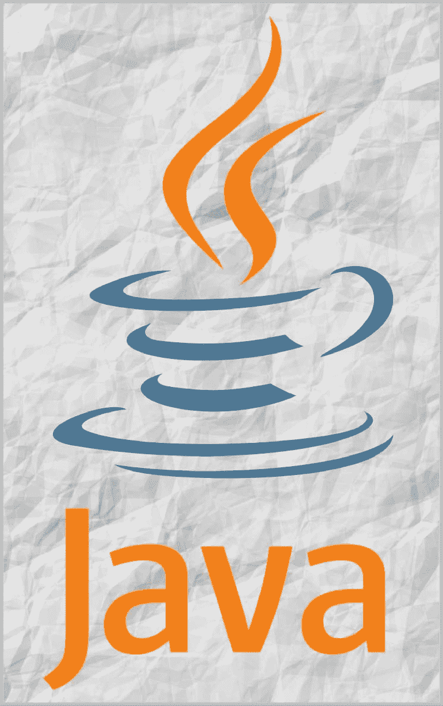

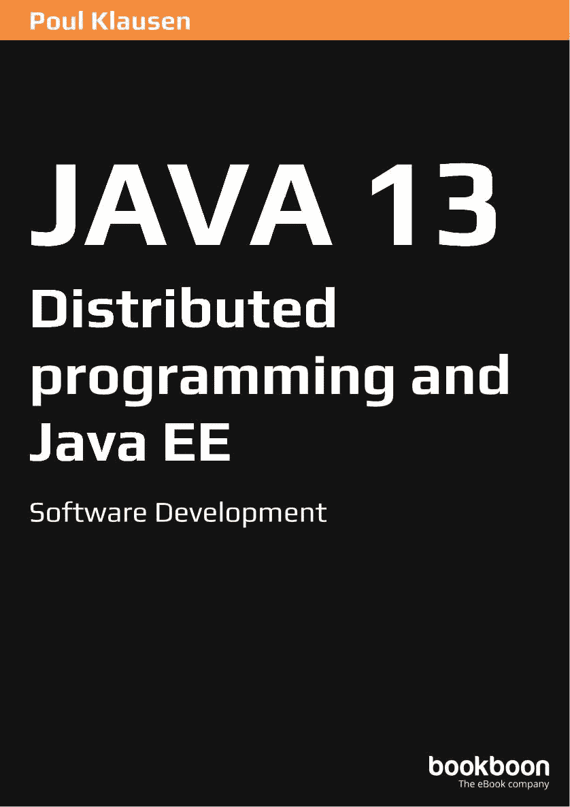


<map name="awmap1" class="calibre1"><area shape="rect" href="http://www.sylvania.com/" coords="141, 38, 237, 49" class="calibre39"></map>

## 序言

本书是软件开发系列书籍中的第十三本。编程语言是 `Java`，该语言及其语法和语义涵盖了大量内容，但这些书籍很大程度上关注流程以及如何开发良好且健壮的应用程序。本书是 `Java 11` 内容的延续，但重点是企业级应用的开发。这些程序使用托管在不同计算机、位于不同位置的组件或服务执行工作，并通过网络进行通信和协调工作。主要主题是 `Java EE` 技术。

在之前的两本书中，我一直致力于 Web 应用程序，而这本书是其自然的延续，但侧重于分布式程序的开发。这些程序使用托管在不同计算机上的组件或服务来执行工作，这些组件通过网络进行通信和工作协作。其核心思想是，这些组件在很大程度上拥有自己的生命周期，相互独立运行，并且通常不知道使用它们提供的服务的客户端。事实上，要精确定义我们所理解的分布式程序并不容易，但通常我们将其理解为具有以下特征的程序：

1. 存在多个独立的计算单元（计算机），每个单元都有自己的本地内存。
2. 计算单元通过在网络上相互发送消息来 `get` 通信。

分布式程序（或系统）的目标可能是解决某个特定任务，用户会将这一系列计算单元感知为一个单一设备（或系统），但实质上，它们可能是一个面向服务的系统，提供了一系列用户可以使用并感知为共享资源的服务。分布式程序还具有并行性特征，即在多台计算机和多个位置同时执行多个活动。

你有时也会看到分布式编程被描述为面向对象编程的进一步发展。面向对象的程序由对象组成，每个对象的内部数据和逻辑对外部世界隐藏的，仅通过对象以公共方法形式提供的服务来感知。这些对象共同工作以解决要解决的任务。同样，你可以将分布式程序看作一种程序，它通过提供许多在世界各地计算机独立运行的服务来解决任务，如果允许的话，应用程序可以使用这些服务。

除了展示如何在实践中开发分布式程序（或者可能与此更相关）外，目标也是描述如标题所示的更具体的技术：

- `Java Persistence API`
- `Java Enterprise Beans`
- `Contexts and Dependency Injection`
- `Java Web Services`
- `RESTFul web services`
- `Java EE security`

如书所示，这本书描述了许多 `Java APIs`，并且大部分内容与 `NetBeans` 和 `GlassFish` 直接相关。

# 2 JAVA PERSISTENCE API

在之前的书中（从 `Java 6` 开始）以及包括 `Java 11` 在内的 Web 应用程序中，我考虑过几个使用数据库的示例。这始终包括对数据库进行面向对象的封装，形式为每个数据库表创建一个模型类，并创建一个或多个封装了 `SQL` 语句的类，这些语句用于操作关系型数据库的内容。这意味着对于每个示例都需要编写大量的 Java 代码，虽然这是可以接受的（因为从原则上讲每次都应该发生相同的事情），但可以通过更简单（且更好）的方式完成，因为 `Java EE` 提供了一个名为 `Java Persistence API` 的 API，它的任务恰好是为关系数据库提供面向对象的接口。本章的目的是介绍这个 API，其内容很大程度上描述了“如何做”。

我将从 `Java 11` 书中的项目 `ChangeAddress3` 的副本开始，我将副本命名为 `ChangeAddress1`。如果你在浏览器中打开该应用程序，你会看到以下窗口……[点击底部的链接]，你会得到另一个窗口，显示已输入地址的概览。

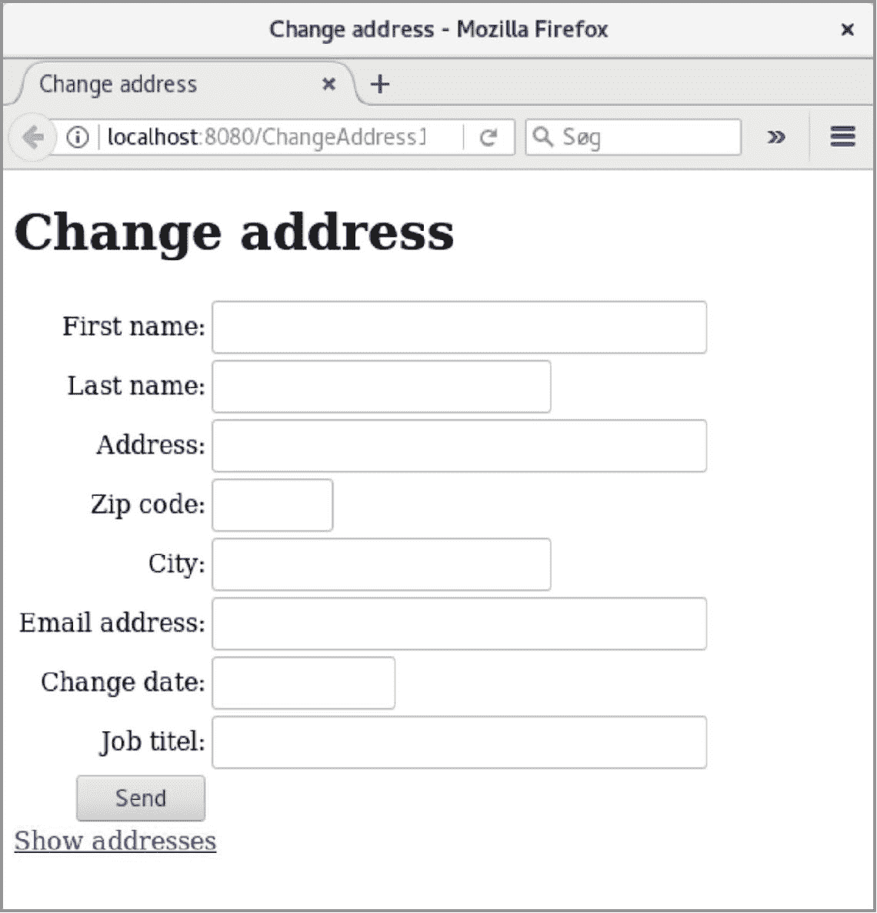

在输入地址时，它们被存储在 `Person` 对象的列表中。然而，数据并没有持久化存储。正如我在之前的示例中所示，创建一个带有表的数据库并在该表中保存数据是相对较的。在这个示例中，我将向你展示如何使用 `JPA` 来完成。

在这个示例中，我想使用 `JavaDB` 作为数据库产品。主要是为了展示这个数据库，因为它在许多需要简单数据库的语境下非常有用且易于使用。它是一个标准的 `SQL` 数据库服务器，由 `Glassfish` 服务器支持，不需要任何特殊安装，该产品也受 `NetBeans` 支持。

方法基本上是为每个数据库表定义一个实体类，我想从将一个类与 `model` 包关联开始。它必须是一个 `Entity Class`：

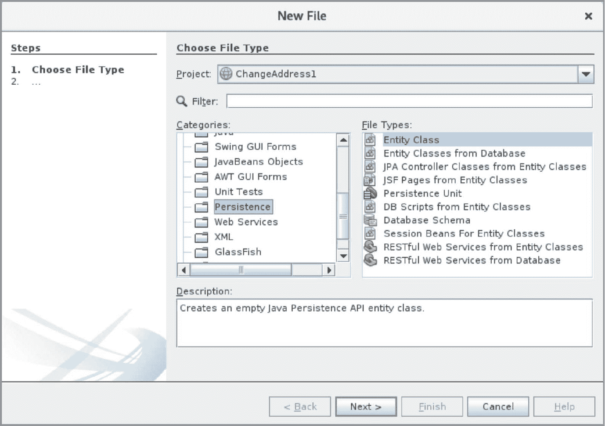

并且应该命名为 `Address`：

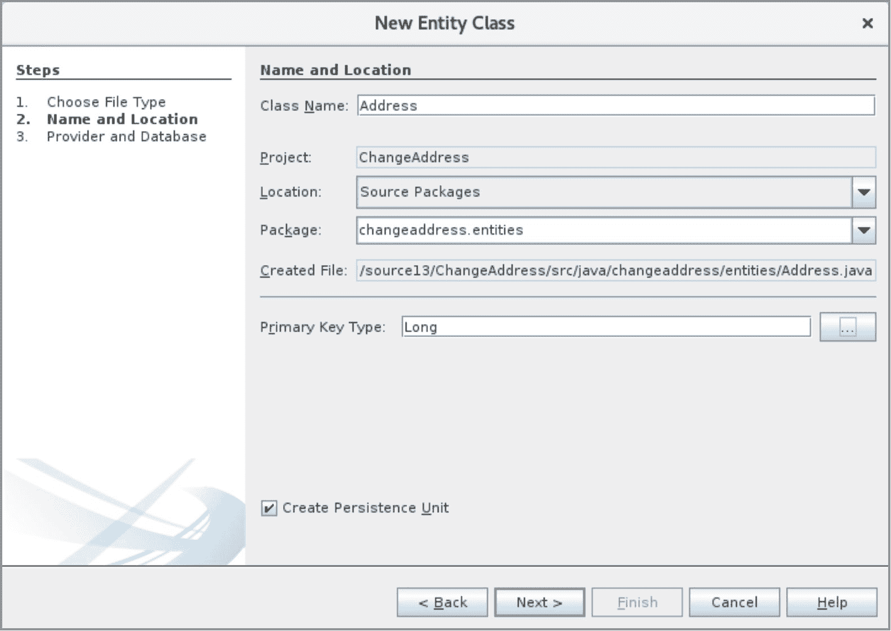

你应该注意已选择了正确的包名（如果不在列表中可以手动输入），并且勾选了 `Create Persistence Unit`。持久化单元是一个名为 `persistence.xml` 的 XML 配置文件，由 `NetBeans` 创建。当你点击上述窗口中的 `Next` 时，你会得到一个初始化此 XML 文件的窗口。如果你愿意，可以更改名称，并注意已勾选 `Use Java Transaction APIs`。默认情况下选择了 `Create`，这意味着如果数据库尚未创建，则必须创建。

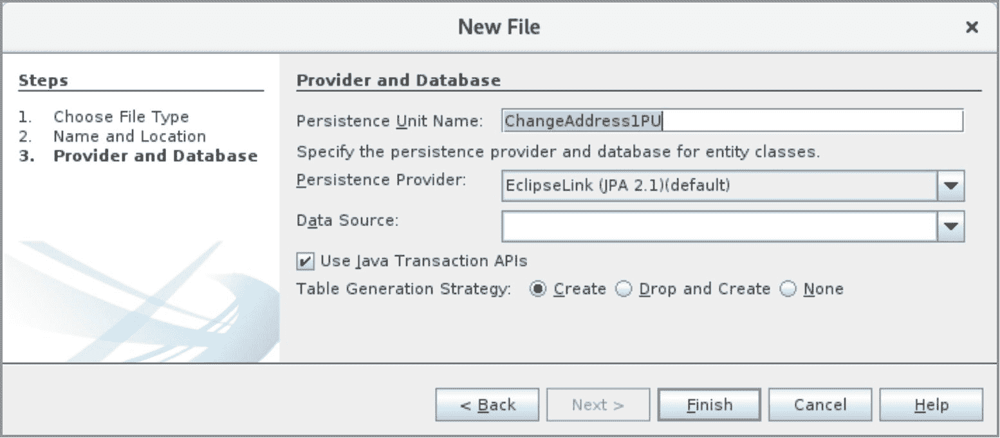

然而，最重要的是 `Data Source` 字段，它是对当前数据库的引用。在这里你可以选择现有的 `data source`，也可以创建一个新的：

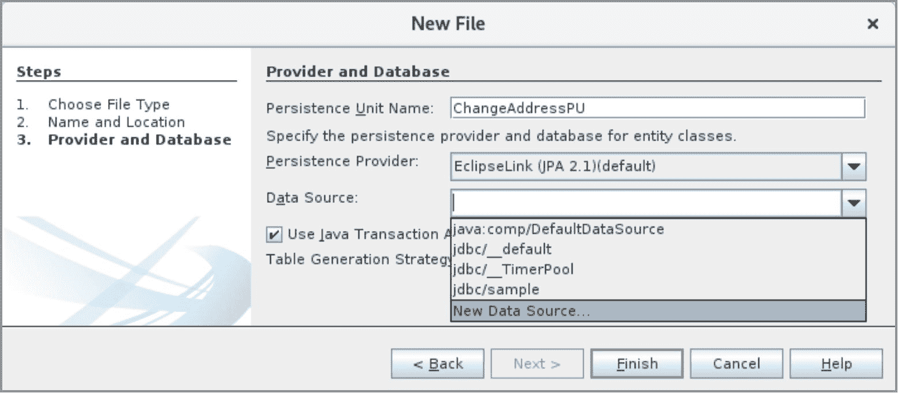

如果你点击 `New Data Source`，你会得到一个创建数据源的窗口：

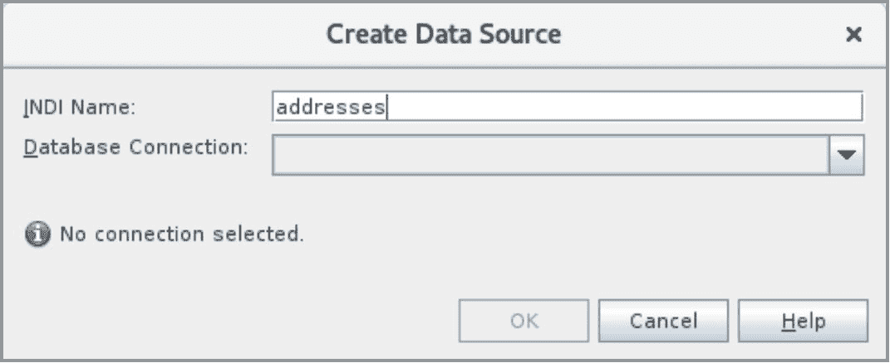

我在其中输入了名称 `addresses`。还必须定义到数据库的连接。在这里你可以选择现有的，也可以创建一个新的。在这种情况下，你必须创建一个新的，并选择一个驱动，我选择了 `Java DB (Network)`：

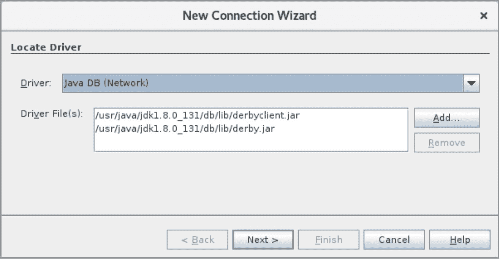


点击 `Next` 后，输入数据库信息：

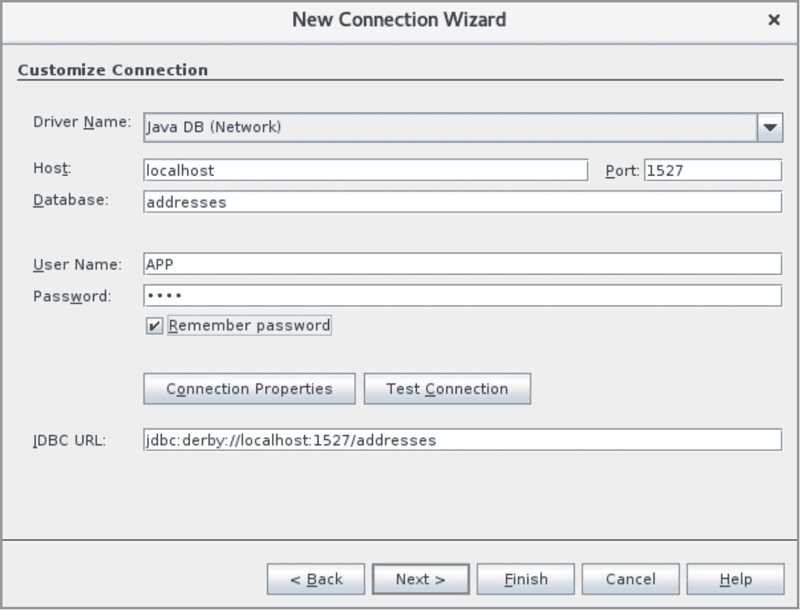

数据库服务器——`Glassfish` 服务器——运行在 `localhost` 上并使用端口 `1527`。我选择了数据库名称为 `addresses`。`Java DB` 有一个默认用户 `APP`，我输入了密码（1234）。然后点击两次 `Next` 最后点击 `Finish`，之后数据源已创建：

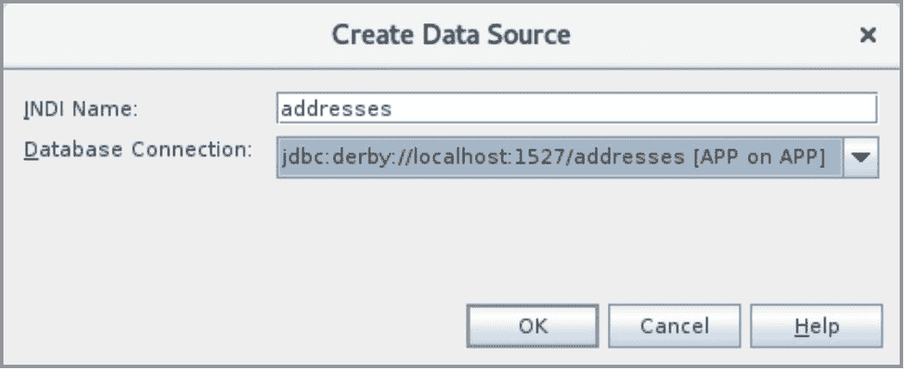

当我点击 `OK` 时，`Entity class` 被创建：

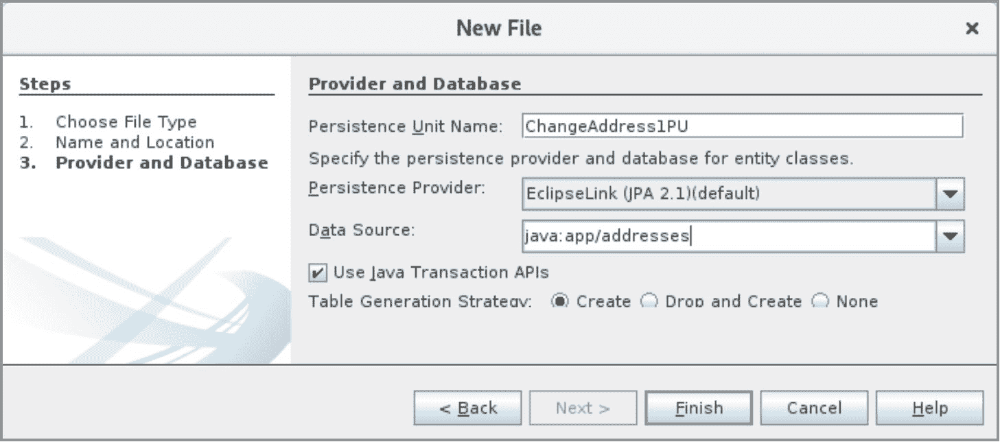

然后我点击 `Finish`，`NetBeans` 创建了以下类（我删除了注释并稍微修改了 `equals()`）：

```java
package changeaddress.models;

import java.io.Serializable;
import javax.persistence.*;

@Entity
public class Address implements Serializable
{
    private static final long serialVersionUID = 1L; 
    @Id
    @GeneratedValue(strategy = GenerationType.AUTO) 
    private Long id;

    public Long getId()
    {
        return id;
    }

    public void setId(Long id)
    {
        this.id = id;
    }

    @Override
    public int hashCode()
    {
        int hash = 0;
        hash += (id != null ? id.hashCode() : 0);
        return hash;
    }

    @Override
    public boolean equals(Object object)
    {
        if (!(object instanceof Address)) return false; 
        return id.equals(((Address)object).id);
    }

    @Override
    public String toString()
    {
        return "changeaddress.models.Address[ id=" + id + " ]";
    }
}
```

结果是一个包含单个属性 `ID` 的类，类型为 `Long`。你应该注意，该属性被两个注解装饰着：第一个表示它是一个主键，另一个告诉该值应该由数据库服务器分配为自动递增数字。最后，你应该注意该类还被装饰了一个注解，告诉它是一个实体类。然后，该类必须扩展以下属性：

```java
private String firstname;
private String lastname;
private String address;
private String code;
private String city;
private String email;
private String date;
private String title;
```

并带有相应的 `get` 和 `set` 方法。然后，我删除了模型类 `Person`，在 `IndexController` 中，所有对 `Person` 的引用必须更改为 `Address`，并且应该删除 `add()` 方法中的代码。之后，再次可以在浏览器中打开程序。

<map name="awmap3" class="calibre1"><area shape="rect" href="http://www.employerforlife.com/" coords="544, 421, 554, 435" class="calibre39"><area shape="rect" href="http://www.employerforlife.com/" coords="544, 407, 676, 421" class="calibre39"></map>

在 `IndexController` 中，你必须添加一些额外的语句：

```java
package changeaddress.beans;
import java.util.*;

import javax.inject.Named;
import javax.enterprise.context.SessionScoped;
import java.io.Serializable;

import javax.persistence.*;
import javax.transaction.*;
import javax.annotation.*;
import javax.persistence.criteria.CriteriaQuery;

import changeaddress.models.*;

@Named(value = "indexController")
@SessionScoped
public class IndexController implements Serializable
{
    @PersistenceUnit EntityManagerFactory emf;
    @PersistenceContext EntityManager em;

    @Resource UserTransaction utx;
    private Address person = new Address();
    private List<Address> persons = new ArrayList();

    …

    public List<Address> getPersons()
    {
        try
        {
            CriteriaQuery cq = em.getCriteriaBuilder().createQuery();
            cq.select(cq.from(Address.class));
            Query q = em.createQuery(cq);
            return persons = q.getResultList();
        }
        catch (Exception ex)
        {
        }
        return persons;
    }

    public void add()
    {
        try
        {
            utx.begin();
            em.persist(person);
            utx.commit();
            person = new Address();
        }
        catch (Exception ex)
        {
            try
            {
                utx.rollback();
            }
            catch (Exception e)
            {
            }
        }
    }
}
```

在类的开头，定义了三个对象，每个对象装饰有一个注解。这种符号的确切含义在第 4 章中解释，但作为一个示例，变量 `em` 的类型为 `EntityManager`，前面的注解意味着基于项目的持久化单元（Persistence Unit），JPA 实例化了一个类型为 `EntityManager` 的对象，这是一个 JPA 类型，代表一个数据库表并提供可以执行数据库操作的服务。最后一个变量 `utx` 定义了一个数据库操作的事务。这些对象被用于 `getPersons()` 和 `add()` 方法中。例如，如果你看最后一个，它启动了一个事务，然后 `persist()` 方法将对象 `person` 写入数据库。在应用程序可以使用之前，必须创建数据库。这在 Services（服务）下通过右键点击 DB：

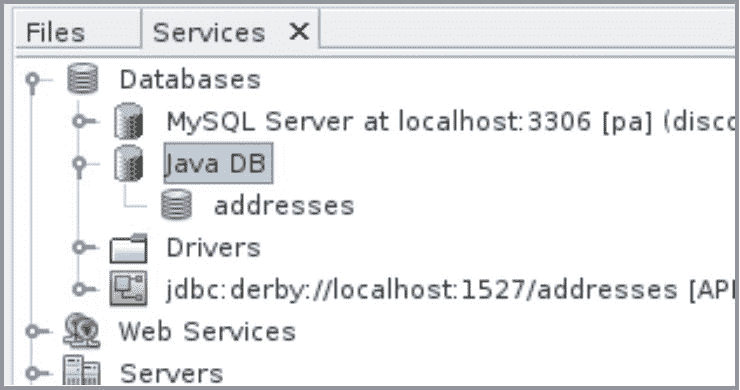

并选择 Create Database（创建数据库）。通过这些更改，程序的运行方式与 Java 书中相同，但现在地址存储在数据库表中。

### 改进的地址程序

在本节中，我想展示上述程序的另一个版本，它在两个方面进行了更改：

1. 这次数据库是一个已存在的 MySQL 数据库。
2. 数据库操作已移动到数据库控制器（database controller）。

在完成任务之前，我必须创建数据库：

```sql
use mysql;
create database addresses;
use addresses;
create table address (
    id int not null auto_increment,
    firstname varchar(50),
    lastname varchar(30),
    address varchar(50),
    code varchar(4),
    city varchar(30),
    mail varchar(50),
    date varchar(10),
    title varchar(50)
);
```

<map name="awmap4" class="calibre1"><area shape="rect" href="http://www.discovermitas.com/" coords="596, 68, 609, 83" class="calibre39"><area shape="rect" href="http://www.discovermitas.com/" coords="588, 68, 596, 83" class="calibre39"><area shape="rect" href="http://www.discovermitas.com/" coords="580, 68, 587, 83" class="calibre39"><area shape="rect" href="http://www.discovermitas.com/" coords="719, 52, 723, 68" class="calibre39"></map>

你应该检查 `Address` 类，其中添加了许多注解（所有属性都经过了装饰），但你可以轻松地理解其含义。你必须注意，所有的注解都是 `NetBeans` 通过从数据库检索信息确定的。此外，尝试检查 `GlassFish` 资源配置文件 `resources.xml`。

我将进行单项更改。通过 `EntityManager` 对象和 `UserTransaction` 对象，你可以执行数据库操作，而无需编写大量代码也无需了解 `SQL`。由于每次发生的情况都是相同的，你可以将这些操作封装到一个类中，无论是哪种数据库表都可以使用。这是通过添加数据库控制器实现的（此处在 `changeaddress.models` 中），它是来自 Entity 的类型为 `JPA Controller Classes` 的类：

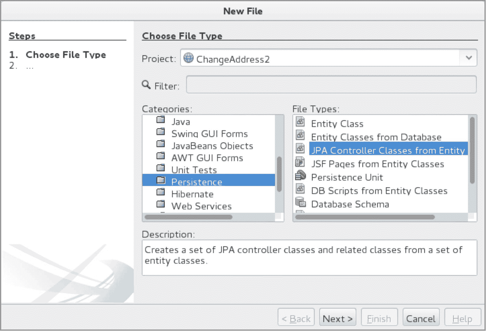

点击“Next”（下一步）时，必须选择要作为控制器的实体类：


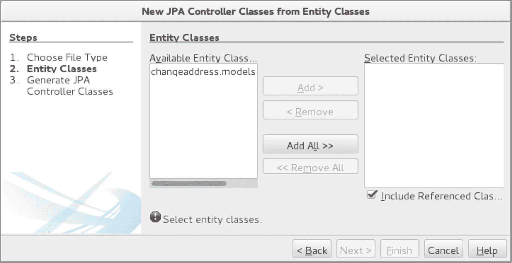


在这种情况下，只有一个选项。当将其添加到“Selected Entity Classes”（已选实体类）时，你就可以创建控制器类。该类名为 `AddressJpaController`，它封装了维护数据库表所需的必要内容，以及用于根据特定主键读取行的方法和几个检索多个行的方法。代码如下所示：

```java
package changeaddress.models;

import changeaddress.models.exceptions.*;
import java.io.Serializable;
import java.util.List;
import javax.persistence.*;
import javax.persistence.criteria.*;
import javax.transaction.UserTransaction;

public class AddressJpaController implements Serializable
{
    private UserTransaction utx = null;
    private EntityManagerFactory emf = null;

    public AddressJpaController(UserTransaction utx, EntityManagerFactory emf)
    {
        this.utx = utx;
        this.emf = emf;
    }

    public EntityManager getEntityManager()
    {
        return emf.createEntityManager();
    }

    public void create(Address address) throws RollbackFailureException, Exception
    {
        EntityManager em = null;
        try
        {
            utx.begin();
            em = getEntityManager();
            em.persist(address);
            utx.commit();
        }
        catch (Exception ex)
        {
            try
            {
                utx.rollback();
            }
            catch (Exception re)
            {
                throw new RollbackFailureException(" … ", re);
            }
            throw ex;
        }
        finally
        {
            if (em != null)
            {
                em.close();
            }
        }
    }

    public void edit(Address address) throws NonexistentEntityException, RollbackFailureException, Exception
    {
        EntityManager em = null;
        try
        {
            utx.begin();
            em = getEntityManager();
            address = em.merge(address);
            utx.commit();
        }
        catch (Exception ex)
        {
            try
            {
                utx.rollback();
            }
            catch (Exception re)
            {
                throw new RollbackFailureException(" … ", re);
            }

            String msg = ex.getLocalizedMessage();
            if (msg == null || msg.length() == 0)
            {
                Integer id = address.getId();
                if (findAddress(id) == null)
                {
                    throw new NonexistentEntityException(" … ");
                }
            }
            throw ex;
        }
        finally
        {
            if (em != null)
            {
                em.close();
            }
        }
    }
}
```


```java
public void destroy(Integer id) throws NonexistentEntityException, RollbackFailureException, Exception
{
    EntityManager em = null;
    try
    {
        utx.begin();
        em = getEntityManager();

        Address address;
        try
        {
            address = em.getReference(Address.class, id);
            address.getId();
        }
        catch (EntityNotFoundException enfe)
        {
            throw new NonexistentEntityException(" … ", enfe);
        }

        em.remove(address);
        utx.commit();
    }
    catch (Exception ex)
    {
        try
        {
            utx.rollback();
        }
        catch (Exception re)
        {
            throw new RollbackFailureException(" … ", re);
        }
        throw ex;
    }
    finally
    {
        if (em != null)
        {
            em.close();
        }
    }
}

public List<Address> findAddressEntities()
{
    return findAddressEntities(true, -1, -1);
}

public List<Address> findAddressEntities(int maxResults, int firstResult)
{
    return findAddressEntities(false, maxResults, firstResult);
}

private List<Address> findAddressEntities(boolean all, int maxResults, int firstResult)
{
    EntityManager em = getEntityManager();
    try
    {
        CriteriaQuery cq = em.getCriteriaBuilder().createQuery();
        cq.select(cq.from(Address.class));

        Query q = em.createQuery(cq);
        if (!all)
        {
            q.setMaxResults(maxResults);
        }

        q.setFirstResult(firstResult);
        return q.getResultList();
    }
    finally
    {
        em.close();
    }
}

public Address findAddress(Integer id)
{
    EntityManager em = getEntityManager();
    try
    {
        return em.find(Address.class, id);
    }
    finally
    {
        em.close();
    }
}

public int getAddressCount()
{
    EntityManager em = getEntityManager();
    try
    {
        CriteriaQuery cq = em.getCriteriaBuilder().createQuery();
        Root<Address> rt = cq.from(Address.class);
        cq.select(em.getCriteriaBuilder().count(rt));

        Query q = em.createQuery(cq);
        return ((Long) q.getSingleResult()).intValue();
    }
    finally
    {
        em.close();
    }
}
```

代码有很多，但该类很容易理解，重要的是关于数据库的一切都封装在方法中，包含了必要的回滚。此外，该类定义了一些可以返回特定 `id` 或对象列表的简单方法。注意下文解释的 `CriteriaQuery` 和 `Query` 类型，但根据名称（以及应用程序），你可以看出这些是用于构建 SQL 的类型。最后，注意该类还有一个返回数据库中行数的方法。

在将类添加到项目后，必须更改 `IndexController` 类：


```java
public class IndexController implements Serializable
{
    @PersistenceUnit
    EntityManagerFactory emf;

    @Resource
    UserTransaction utx;

    private Address person = new Address();
    private List<Address> persons = new ArrayList();

    public IndexController()
    {
    }

    …

    public List<Address> getPersons()
    {
        try
        {
            AddressJpaController ctrl = new AddressJpaController(utx, emf);
            persons = ctrl.findAddressEntities();
        }
        catch (Exception ex)
        {
        }
        return persons;
    }

    public void add()
    {
        try
        {
            AddressJpaController ctrl = new AddressJpaController(utx, emf);
            ctrl.create(person);
            person = new Address();
        }
        catch (Exception ex)
        {
        }
    }
}
```

## 练习 1

在本练习中，你必须编写一个 Web 应用，当应用程序需要使用 JPA 时，打开并显示数据库 `padata` 中 `zipcode` 表的内容。从一个新的 Web 项目开始，你可以将其命名为 `ZipcodePage`。然后，你必须从 `Database` 添加一个 `Entity` 实体类。你必须为数据库 `padata` 定义一个 `Data Source`（数据源），完成后，你应该能够看到数据库中的所有表。在这里，你需要选择 `zipcode` 表。

当你进入下一个窗口（见下文）时，你必须选择一个包并取消某些复选框，但不要取消最后一个复选框。运行向导后，你创建了一个名为 `Zipcode` 的实体类，当你检查代码时，应该注意到这次创建的命名查询较少。原因是后续窗口中没有勾选 `Generate Named Query Annotations for Persistent Fields`（为持久化字段生成命名查询注解）。


30


<map name="awmap5" class="calibre474">
    <area shape="rect" href="http://www.rug.nl/feb/education" coords="114, 429, 146, 453" class="calibre475">
    <area shape="rect" href="http://www.rug.nl/feb/education" coords="114, 405, 341, 428" class="calibre475">
</map>


注意，`Named Query`（命名查询）是一个用 SQL 变体 `JPQL` 编写的 `SELECT` 语句示例。

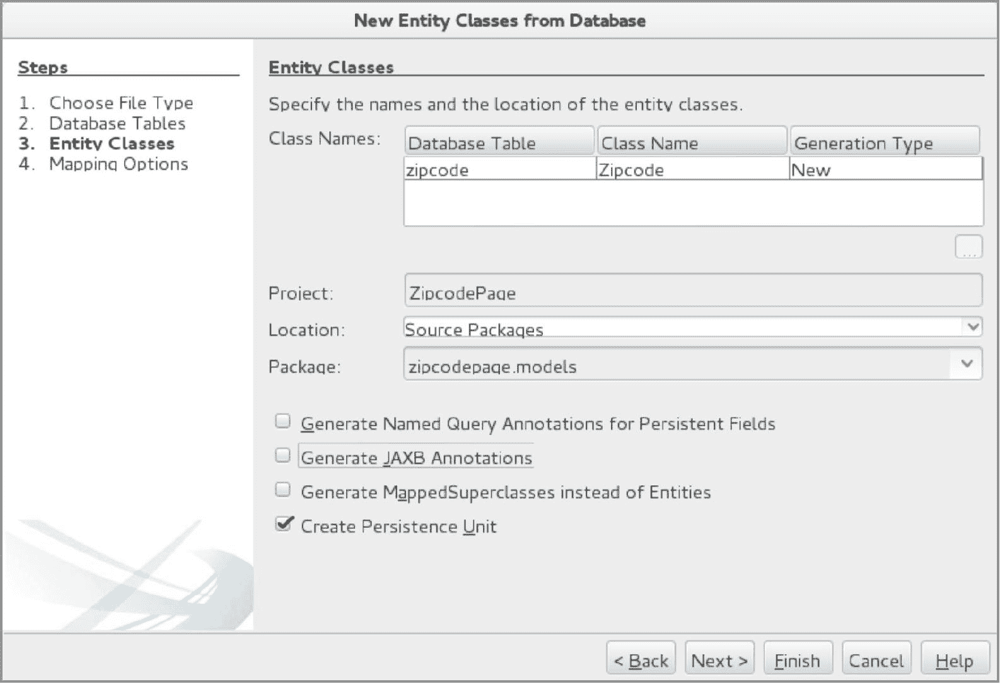

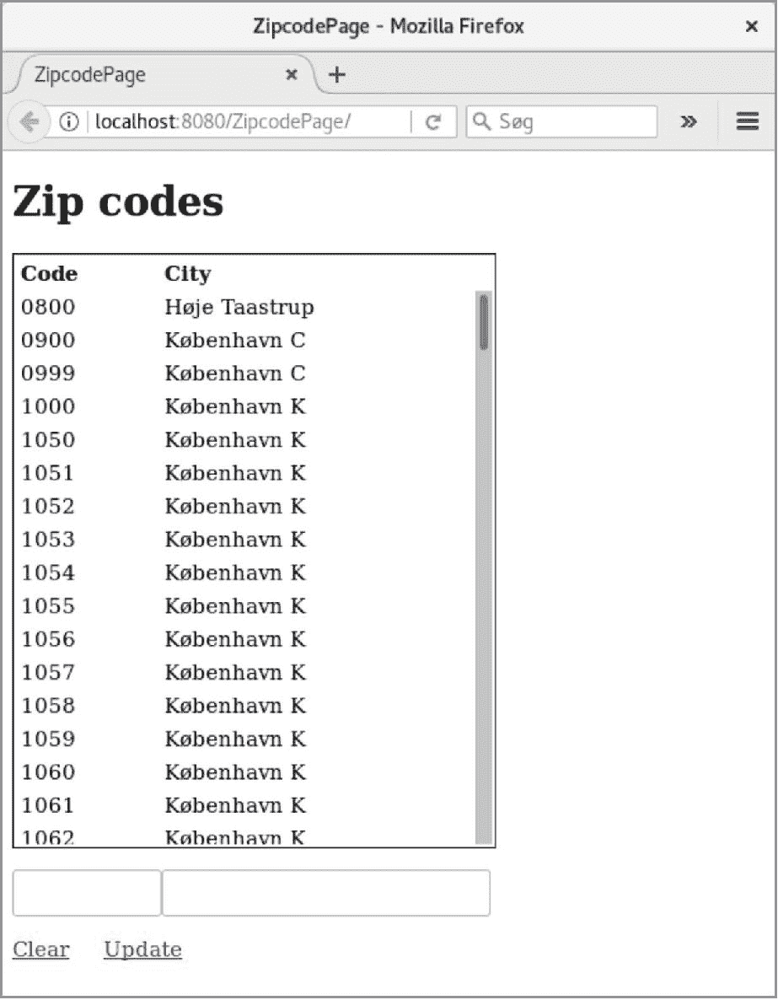

### Controller

下一步，你需要为你的实体类添加一个名为 `ZipcodeJpaController` 的数据库控制器，就像上一个示例所示。

当结果必须是上述显示邮政编码表格的窗口时，必须为 `index.xhtml` 创建一个命名 bean。底部的输入字段应作为过滤器：

1. 第一个字段的内容必须匹配所有以该值开头的 `zip codes`。

2. 第二个字段的内容必须匹配包含该值的 `city names`（城市名称）。

`Clear` 链接应该清除两个输入字段（但不应更新表格），而 `Update` 链接应该根据过滤器内容更新表格。加载数据库表应该只在程序启动时进行。你可以在 bean 中编写一个 `init()` 方法并像下面所示对其装饰：

```java
@PostConstruct
private void init()
{
    ZipcodeJpaController ctrl = new ZipcodeJpaController(utx, emf);
    zipcodes = ctrl.findZipcodeEntities();
}
```

这是一个在对象实例化后立即执行的方法。

## 2.2 相关表

由于 JPA 的存在，编写像这样的 Web 应用非常简单，但当然，这只是一个简单的应用程序，而且主要是因为数据库只有一个表。在本节中，我将展示一个数据库拥有更多表且各表之间存在关系的示例，在这里，JPA 的优势将变得更加明显。

例如，我将使用来自《Java 7》书中的数据库库：

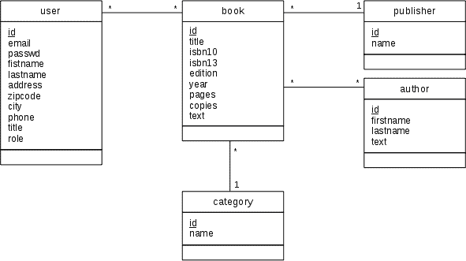

我将只使用四个实体 `book`、`publisher`、`category` 和 `author`。在这里你应该注意，`publisher` 与 `book` 之间以及 `category` 与 `book` 之间存在许多一关系。此外，`book` 与 `author` 之间存在多多关系。该示例是一个名为 `PaBooks` 的 Web 应用，它通常应该能够维护对应上述四个实体的表。需要注意的是，用户界面是简单的——只需关注数据库事务和 JPA。在接下来的，与本章的前两个示例一样，我将主要关注程序是如何制作的，特别是如何使用 `JPA` 开发数据库应用程序。

开始是一个名为 `PaBooks` 的 Web 应用，在应用程序创建后，我从 `Database` 选择了 `Entity Classes`，在这里我创建了一个 `booklibrary` 数据源，用于建立到 `library` 数据库的连接，在此之后，你会获得数据库表的概览：

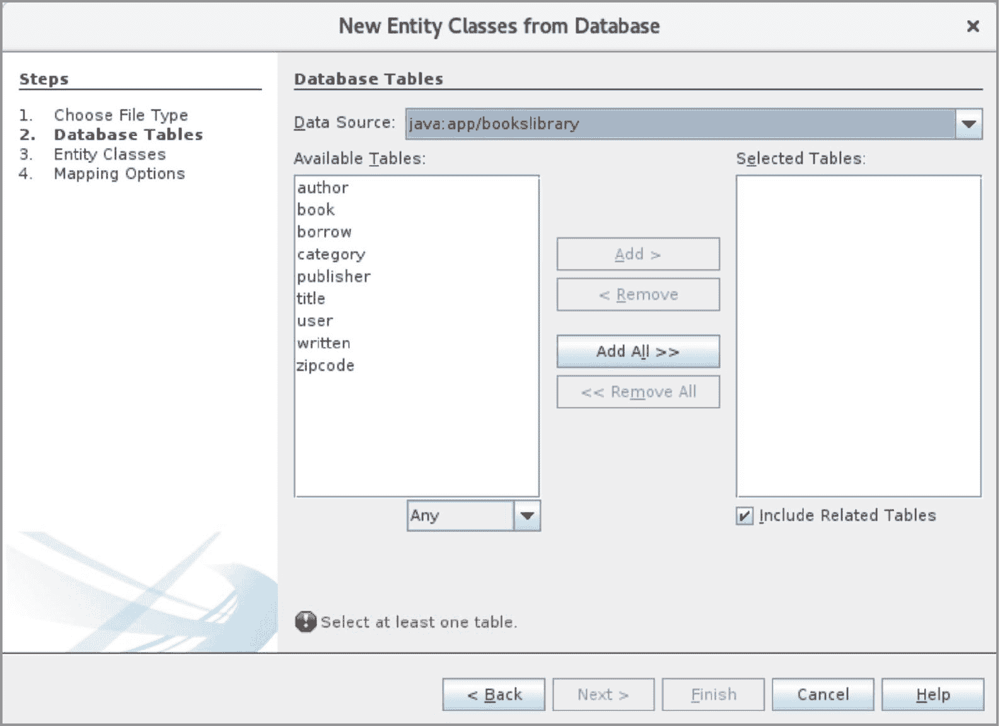

这里是这些表：

- `author`
- `book`
- `category`
- `publisher`
- `written`

添加到 `Selected Tables` 中：


<map name="awmap6" class="calibre4"><area shape="rect" href="http://suniversity.com/" coords="173, 433, 413, 459" class="calibre39"></map>

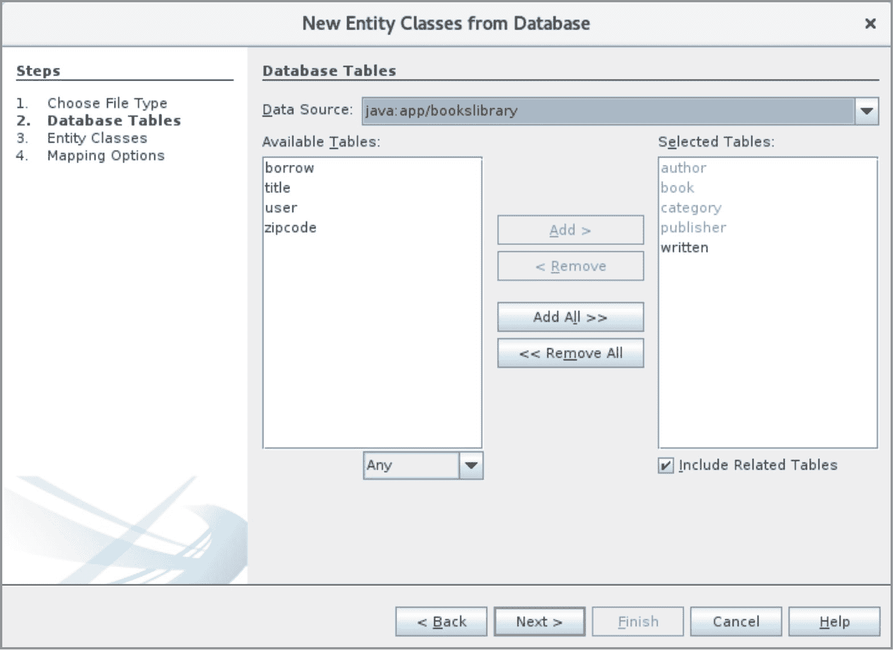

注意`written`表以**加粗**显示，它是`book`和`author`之间的某种关系。当你点击`Next`时，你会得到以下窗口：

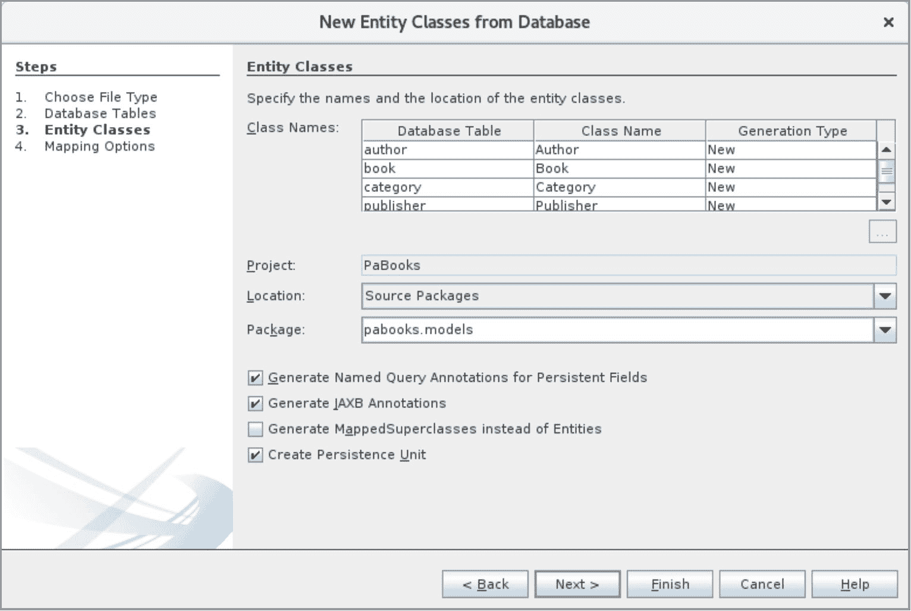

在这里你可以看到四个实体类，并注意如果你愿意，可以更改这些类的名称。还要注意创建类的包名，我将其命名为`pabooks.models`。当你点击`Next`时，你会得到以下窗口：

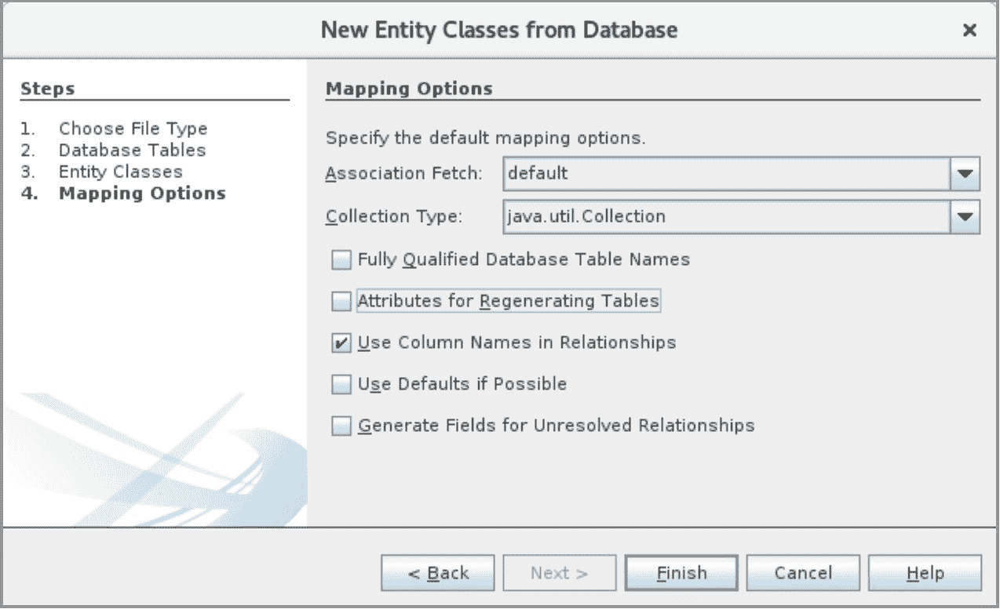

当你点击`Finish`时，创建了实体类。通常不需要修改这些实体类，但有时我会修改类的`toString()`方法，我在本中也对`Author`、`Category`和`Publisher`类做了此类处理。鼓励你研究代码。

在这里你应该注意（其他方面），`Publisher`类有一个`book`对象的`bookCollection`。它代表了指向`book`对象的外键，因此引用了该发行商的`book`对象。`Category`类也是如此。

如果你研究`book`类，应该注意它对一个`Publisher`对象和一个`Category`对象的引用，因此是这两个多对一关系的另一端。`book`类还有一个带有`Author`对象的`authorCollection`，代表了`book`与`author`之间的多多关系。检查`Author`类，你会发现该类有一个对应的`book`对象的`bookCollection`，它是多多关系的另一端。

在添加实体类后，我想通过从`Entity Classes`中选择`JPA Controller Classes`来添加控制器类：

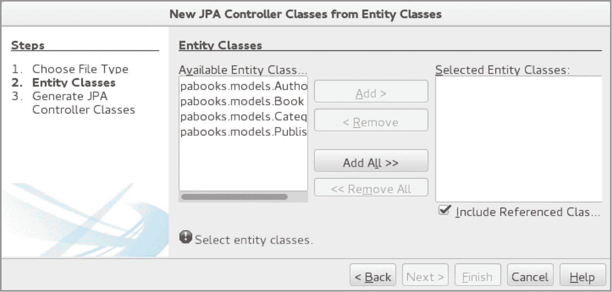

必须为添加到`Selected Entity Classes`的四个实体类创建一个控制器。在点击`Next`并选择所需的包（这里是`pabooks.models`）后点击`Finish`，创建了四个控制器类：

- `AuthorJpaController`
- `BookJpaController`
- `CategoryJpaController`
- `PublisherJpaController`

通常这些类不会被修改，但可能需要扩展类以包含数据库查询的方法。在本例中，我扩展了`BookJpaController`类并添加了一个新方法。然而，这需要一些如何在`JPA`中编写`SQL SELECT`语句的语法。


## Criteria API

如果你观察我迄今为止编写数据库应用程序的方式，最全面的类型系统之一过于`SQL SELECT`语句——至少在正确编写它们方面是如此，`JPA`也是一样。要编写和执行`SELECT`语句，你必须使用一个`Query`对象，而`JPA`定义了一种类似于`SQL`的语言，称为`JPQL`。

该语言的语法与`SQL`基本相同，在书中不会对其进行显式处理。当很难正确编写`SQL SELECT`语句时，是因为它们仅仅是文本，因此编译器无法验证其语法。`JPQL`也存在相同的问题。为了帮助解决这个问题，定义了一个名为`Criteria API`的 API。

事实上，使用这个 API 编写`SELECT`语句并不更容易，但`SELECT`表达式的不同部分是使用 Java 类定义的，因此编译器可以验证表达式的编写是否正确。在书中，我将在大部分地方使用此`Criteria API`，以下是对其语法的简要介绍。

该 API 用于定义准则查询（criteria queries），这本质上是一个对象图，你通过构建这样一个图来定义准则查询。这是通过类型为`CriteriaBuilder`的对象实现的，该对象可以创建准则查询组成的部分。由于它完全关乎表示`SELECT`语句，这意味着对表、列以及从数据库中提取行的条件进行了面向对象的表示。

例如，你可以通过如下形式的语句从`EntityManager`获取一个`CriteriaBuilder`：

```java
CriteriaBuilder cb = em.getCriteriaBuilder();
```

其中`em`是一个`EntityManager`。这样的构建器有三个返回准则查询的方法：

- `CriteriaQuery<T> createQuery(Class<T>)`
- `CriteriaQuery<Tuple> createTupleQuery()`
- `CriteriaQuery<Object> createQuery()`

区别在于查询返回的对象类型。在拥有了创建查询的准则构建器后，任务是初始化这个查询，而这正是 API 发挥用场的地方。

我想从上述第一个方法开始，该方法创建一个查询，其中参数类型指示了查询结果的预期对象类型，原则上它可以是任何任意对象类型。例如，下面显示了一个准则查询，用于确定图库数据库中所有页码值为 520 的书：

```java
CriteriaBuilder cb = em.getCriteriaBuilder();
CriteriaQuery<Book> cq = cb.createQuery(Book.class);
Root<Book> root = cq.from(Book.class);
cq.select(root);
cq.where(cb.equal(root.get(Book_.pages), 520));
return em.createQuery(cq).getResultList();
```

注意如何创建`CriteriaBuilder`（`em`是一个`EntityManager`）以及如何使用它为`Book`对象创建准则查询。对于此查询，为对象图创建了一个`root`，并定义查询对象必须从此根提取对象。`root`随后对应于`SQL SELECT`语句中的`FROM`部分。

接下来，通过`select()`方法定义哪些属性是结果的一部分，这里是根，意味着`Book`对象。因此，`select()`函数指示了要包含哪些列。最后，定义了必须仅在页码为 520 时提取对象，因此对应于`SELECT`语句中的`WHERE`部分。结果是这些对象的集合。

你特别应该注意如何引用列`pages`（`Book`类中的属性`pages`）。该查询也可以写写所示：

```java
CriteriaBuilder cb = em.getCriteriaBuilder();
CriteriaQuery<Book> cq = cb.createQuery(Book.class);
Root<Book> root = cq.from(Book.class);
return em.createQuery(cq.select(root).where(cb.equal(root.get("pages"), 520))).getResultList();
```

它除了稍微短一点外没有特殊优势，因此它看起来更像是一个`SQL SELECT`语句。然而，你必须注意我以另一种方式定义了列（`pages`），即作为字符串，这应该是`Book`类中该属性的名称。

如果你查看代码，可以发现准则查询对象具有以下方法：

- `from()`
- `select()`
- `where()`

其含义从`SELECT`语句中是广为人知的。如果你检查`CriteriaQuery`类型，你会发现还有用于`SELECT`的其他部分的方法，如`ORDER BY`、`GROUP BY`等。

最后，你可以注意到`CriteriaBuilder`类除了创建`CriteriaQuery`对象外，还有定义条件——谓词（predicates）——的方法以及许多其他方法（在上面的示例中使用了`equals`），在下面展示了其中几个示例。

作为另一个例子，下面的查询确定了所有书的页码，其中标题包含文本"Fedora"：

```java
CriteriaBuilder cb = em.getCriteriaBuilder();
CriteriaQuery<Integer> cq = cb.createQuery(Integer.class);
Root<Book> root = cq.from(Book.class);
cq.select(root.get(Book_.pages));
cq.where(cb.like(root.get(Book_.title), "%Fedora%"));
List<Integer> pages = em.createQuery(cq).getResultList();
```

作为进一步的示例，显示了一个确定书中最大页码的查询。你应该首先注意到准则构建器支持多个函数（这里是`max`函数），并且由`getSingleResult()`而不是`getResultList()`决定：

```java
CriteriaBuilder cb = em.getCriteriaBuilder();
CriteriaQuery<Integer> cq = cb.createQuery(Integer.class);
Root<Book> root = cq.from(Book.class);
cq.select(cb.max(root.get(Book_.pages)));
Integer pages = em.createQuery(cq).getSingleResult();
```

或者更短的：

```java
CriteriaBuilder cb = em.getCriteriaBuilder();
CriteriaQuery<Integer> cq = cb.createQuery(Integer.class);
Integer pages = em.createQuery(cq.select(cb.max(cq.from(Book.class).get("pages")))).getSingleResult();
```

我随后将通过一些示例展示如何确定特定列（即实体类中特定属性）的值。下一个查询确定页码大于 300 的所有`Book`对象的 id 和标题：

```java
CriteriaBuilder cb = em.getCriteriaBuilder();
CriteriaQuery<Object[]> cq = cb.createQuery(Object[].class);
Root<Book> root = cq.from(Book.class);
Path<Integer> idPath = root.get(Book_.id);
Path<String> titlePath = root.get(Book_.title);
```

<map name="awmap7" class="calibre1"><area shape="rect" href="http://www.mastersopenday.nl/" coords="498, 416, 517, 438" class="calibre39"><area shape="rect" href="http://www.mastersopenday.nl/" coords="498, 394, 707, 416" class="calibre39"></map>

41

```java
cq.select(cb.array(idPath, titlePath));
cq.where(cb.gt(root.get(Book_.pages), 300));
List<Object[]> arr = em.createQuery(cq).getResultList();
```

在这里，你主要应该注意如何使用`Path`对象来引用各个列。还要注意如何指示结果应该是一个列表，其对象是一个数组，而这里的数组是包含两个元素的，它们是由`select()`方法定义的。

查询也可以写成：

```java
CriteriaBuilder cb = em.getCriteriaBuilder();
CriteriaQuery<Object[]> cq = cb.createQuery(Object[].class);
Root<Book> root = cq.from(Book.class);
List<Object[]> arr = em.createQuery(
    cq.select(cb.array(root.get("id"), root.get("title")))
      .where(cb.gt(root.get("pages"), 300))
).getResultList();
```

但在这种情况下，这个表达式并不易读，而且至少要求你深入掌握`Criteria` API。

上面的示例并没有很强的类型——结果是数组类型对象的列表。这可以通过包装类来解决：

```java
package pabooks.models;

public class BookWrapper {
    private int id;
    private String title;

    public BookWrapper(int id, String title) {
        this.id = id;
        this.title = title;
    }

    public int getId() {
        return id;
    }

    public String getTitle() {
        return title;
    }

    public void setId(int id) {
        this.id = id;
    }

    public void setTitle(String title) {
        this.title = title;
    }
}
```

这只是一个封装了书籍`id`和`title`的类。此时查询可以这样写：

```java
CriteriaBuilder cb = em.getCriteriaBuilder();
CriteriaQuery<BookWrapper> cq = cb.createQuery(BookWrapper.class);
Root<Book> root = cq.from(Book.class);
cq.select(cb.construct(BookWrapper.class, root.get(Book_.id), root.get(Book_.title)));
cq.where(cb.gt(root.get(Book_.pages), 300));
List<BookWrapper> list = em.createQuery(cq).getResultList();
```

首先，注意你为`BookWrapper`对象定义了一个准则查询。接下来，你使用构建器中的`select()`和`construct()`方法，它告诉你构建`BookWrapper`对象。其余部分原则上与上一个示例相同。

查询也可以返回`Tuple`对象，在语法上最大的区别是查询对象是使用`createTupleQuery()`创建的：

```java
CriteriaBuilder cb = em.getCriteriaBuilder();
CriteriaQuery<Tuple> cq = cb.createTupleQuery();
Root<Book> root = cq.from(Book.class);
Path<Integer> idPath = root.get(Book_.id);
Path<String> titlePath = root.get(Book_.title);
cq.multiselect(idPath, titlePath);
cq.where(cb.gt(root.get(Book_.pages), 300));
List<Tuple> list = em.createQuery(cq).getResultList();
```

优点是你可以不需要编写包装类。注意使用`multiselect()`来指定包含在结果中的列，它们用于指定结果中的多个属性。另外一点是如何使用单个的`Tuple`对象。我不在这里详细介绍（鼓励你去研究`Tuple`类型——它是一个接口），但你可以写下面的代码（尽管代码在这种语境下没有太大意义）：


```java
for (Tuple t : list) {
    Integer id = t.get(idPath);
    String str1 = (String) t.get(1);
    String str2 = t.get(1, String.class);
}
```

准则查询对象定义了从一个或多个实体的查询（在上面的示例中，每次只有一个实体`Book`）。当然，你可以指定更多的实体，它们对应于`SQL`中的连接操作。我将从一个确定所有出版商名称以`Sams`开头的书籍查询开始：

```java
CriteriaBuilder cb = em.getCriteriaBuilder();
CriteriaQuery<Book> cq = cb.createQuery(Book.class);
Root<Book> books = cq.from(Book.class);
Join<Book, Publisher> pubs = books.join("pubid");
cq.select(books).where(cb.like(pubs.get("name"), "Sams"));
return em.createQuery(cq);
```


首先，准则查询对象定义了从一个或多个实体的查询。注意 `Book` 和 `Publisher` 之间存在多对多的关系。下一个示例相同，但查询确定了所有标题包含 `Fedora` 单词书籍：

```java
CriteriaBuilder cb = em.getCriteriaBuilder();
CriteriaQuery<Book> cq = cb.createQuery(Book.class);
Root<Book> books = cq.from(Book.class);
Join<Book, Publisher> pubs = books.join("pubid");
cq.select(books).where(
    cb.or(
        cb.like(books.get("title"), "%Fedora%"),
        cb.like(pubs.get("name"), "Sams%")
    )
);
return em.createQuery(cq).getResultList();
```

下一个查询确定所有标题包含搜索值、名称包含搜索值且类别包含搜索值的书籍：

```java
CriteriaBuilder cb = em.getCriteriaBuilder();
CriteriaQuery<Book> cq = cb.createQuery(Book.class);
Root<Book> books = cq.from(Book.class);
Join<Book, Publisher> pubs = books.join("pubid");
Join<Book, Category> cats = books.join("catid");

Predicate pc = cb.and(
    cb.like(books.get("title"), "%" + title + "%"),
    cb.like(pubs.get("name"), "%" + pubname + "%"),
    cb.like(cats.get("name"), "%" + catname + "%")
);

cq.select(books).where(pc);
return em.createQuery(cq).getResultList();
```

作为最后一个示例，我将展示如何通过查询查找特定书籍的所有作者。`Book` 和 `Author` 之间存在多对多的关系：

```java
CriteriaBuilder cb = em.getCriteriaBuilder();
CriteriaQuery<Author> cq = cb.createQuery(Author.class);
Root<Author> root = cq.from(Author.class);
Join<Author, Book> books = root.join("bookCollection");

cq.where(cb.equal(books.get("isbn10"), "0-672-32584-5"));
cq.select(root);

List<Author> list = em.createQuery(cq).getResultList();
```

因此，我向 `BookJpaController` 类添加了以下方法：

```java
public List<Book> findBookEntities(String title, String pubname, String catname)
{
    EntityManager em = getEntityManager();
    try {
        CriteriaBuilder cb = em.getCriteriaBuilder();
        CriteriaQuery<Book> query = cb.createQuery(Book.class);
        Root<Book> books = query.from(Book.class);

        if (pubname.length() > 0 && catname.length() > 0) {
            Join<Book, Publisher> pubs = books.join("pubid");
            Join<Book, Category> cats = books.join("catid");
            Predicate pc = cb.and(
                cb.like(books.get("title"), "%" + title + "%"),
                cb.like(pubs.get("name"), "%" + pubname + "%"),
                cb.like(cats.get("name"), "%" + catname + "%")
            );
            query.select(books).where(pc);
        } else if (pubname.length() > 0) {
            Join<Book, Publisher> pubs = books.join("pubid");
            Predicate pc = cb.and(
                cb.like(books.get("title"), "%" + title + "%"),
                cb.like(pubs.get("name"), "%" + pubname + "%")
            );
            query.select(books).where(pc);
        } else if (catname.length() > 0) {
            Join<Book, Category> cats = books.join("catid");
            Predicate pc = cb.and(
                cb.like(books.get("title"), "%" + title + "%"),
                cb.like(cats.get("name"), "%" + catname + "%")
            );
            query.select(books).where(pc);
        } else {
            query.select(books).where(
                cb.like(books.get("title"), "%" + title + "%")
            );
        }

        return em.createQuery(query).getResultList();
    } catch (Exception ex) {
        return new ArrayList();
    } finally {
        em.close();
    }
}
```

   

该方法可能并不十分简单，但主要是因为搜索文本可能为空，而且数据库并不一定包含出版者或分类的值。

## JSF 页面

在完成上述工作后，只返回单独的 JSF 页面，尽管有一些细节需要解决，但它基本上不包含任何新内容，我将主要参考已完成的代码。如果你在浏览器中打开应用程序，将看到以下窗口（数据库中有三本书）：

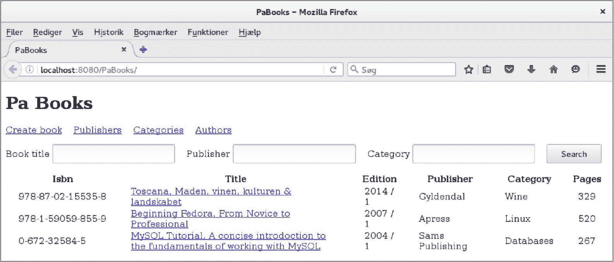

该页面有三个用于输入搜索文本的输入字段，此外还有四个指向页面的链接：

1. `book.xhtml`，用于创建新书。
2. `publishers.xhtml`，用于维护出版者。
3. `categories.xhtml`，用于维护分类。
4. `authors.xhtml`，用于维护作者。

最后，每本书的标题都是一个链接，点击它，你会被发送到 `book.xhtml` 并获得编辑该书籍的选项。

`index.xhtml`（上述窗口）非常简单，但有一个控制器 `IndexController`。该类是一个相对简单的具名 Bean（named bean）。你应该特别注意它是如何调用添加到 `BookJpaController` 类中的方法的，该方法执行了一个 SQL `SELECT` 查询。

其他四个页面由一个 JSF 页面和一个命名 Bean 组成。在学习代码时，请特别注意各个 Bean 如何实现 JSF 页面中命令的操作方法，以及这些方法如何使用数据库控制器类。由于 `book.xhtml` 及其对应的 Bean 并不简单，主要是因为必须能够维护 `book` 表和 `author` 表之间的多对多关系。特别地，你应该意识到 `BookJpaController` 类处理了更新数据库所需的所有内容，包括在连接 `INSERT`、`UPDATE` 和 `DELETE` 操作时维护关系。实际上，正是在这里你体会到了 JPA 的巨大优势，否则正如之前之前的书籍中的示例所示，需要编写大量的代码。此外，应该补充一点，`JPA` 甚至是极其有效的。

## 问题 1

数据库 `padata` 包含三个表：

1. `world`，包含该世界的大洲名称。
2. `currency`，包含一个货币表。
3. `country`，包含相关信息。

任务是编写一个 Web 应用程序，当使用 `JPA` 执行数据库操作时能够维护这些表。应用程序必须包含三个页面。起始页面应如下所示，仅显示几个国家：

```sql
create table world (
    code char(2) PRIMARY KEY,
    name varchar(15) NOT NULL
);

create table currency (
    code char(3) PRIMARY KEY,
    name varchar(30) NOT NULL,
    rate decimal(10,4)
);

create table country (
    code char(2) PRIMARY KEY,
    name varchar(50) NOT NULL,
    area int,
    number int,
    continent char(2) REFERENCES world(code),
    currency char(3) REFERENCES currency(code)
);

insert INTO world VALUES('AS', 'Asia');
insert INTO world VALUES('AF', 'Africa');
insert INTO world VALUES('NA', 'North America');
insert INTO world VALUES('SA', 'South America');
insert INTO world VALUES('AN', 'Antarctica');
insert INTO world VALUES('EU', 'Europe');
insert INTO world VALUES('OC', 'Oceania');
```

工程的力量


 50

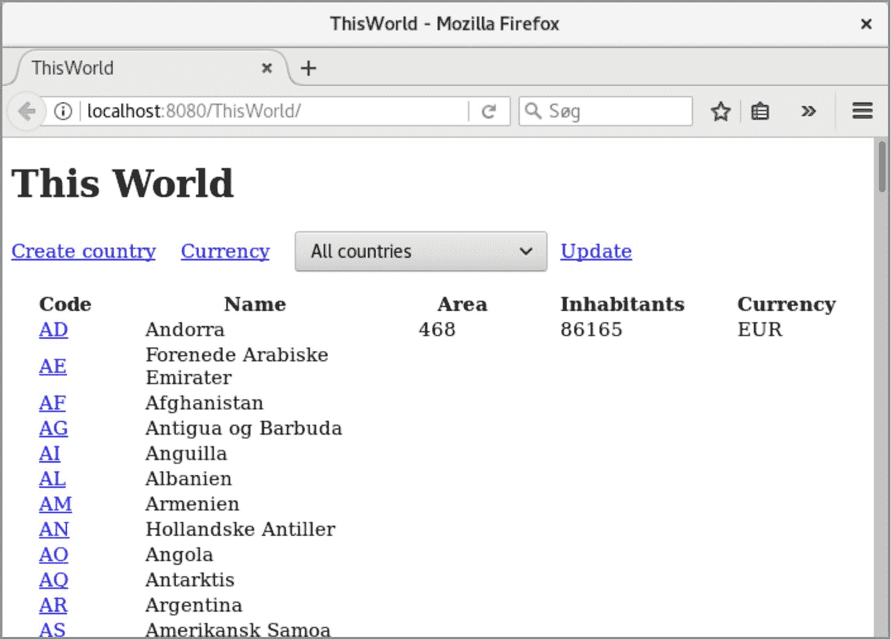

顶部有一个链接指向一个用于创建国家的页面——如果你点击列表中的国家代码，同一个页面也用于编辑国家信息。`Currency` 链接用于维护货币表。最后，有一个下拉框，你可以在其中选择一个大洲，点击 `Update` 链接后，列表将更新为只显示所选大洲的国家。

维护国家信息的页面如下所示，点击安多拉（Andora）的代码后：


最后，下方显示了维护货币表的页面（只显示了几种货币）：


该页面应该是不言自明的的。

 3  企业级 Java Bean

# 企业级 Java Beans（EJB）

是运行在服务器上并封装业务逻辑的组件，在这里它们被其他应用程序（如 Web 应用程序和独立应用程序）使用。因此，你可以将 EJB 视为一个在应用程序服务器（如 `Glassfish`）上开发、测试和托管的组件，就像其他应用程序可以调用它一样。开发 EJB 并将它们托管在应用程序服务器上并不简单，其架构也不易于审查，但 `NetBeans` 提供了帮助，因为它有专门用于开发 EJB 的项目。在本章中，我将部分演示如何使用 `NetBeans` 开发和使用 EJB，并解释最核心的概念。

使用 EJB 的优势在于，除了能为多个应用程序提供相同的服务外，应用程序服务器还处理如事务和安全问题等各种情况，因此 EJB 组件可以简化企业级应用程序的开发。因此，EJB 在现代应用程序（包括分布式应用程序）的开发中起着重要作用，但必须指出，由于 Web 服务的出现，它们不再扮演同样的角色。

## EJB 变体

有三种变体：

- **无状态（Stateless）**：即在组件方法的多次调用之间不保留状态的组件。
- **有状态（Stateful）**：与当前应用程序相比，在组件整个生命周期内维护状态的组件。
- **单例（Singleton）**：相对于一个应用程序，恰好存在一个版本的组件。

## 开发 EJB 模块

虽说编写 EJB 模块并不容易，但问题不在于编写单个 EJB 类（因为这与其他类的编写无异），而在于部署以及从客户端程序使用这些模块，这更多是与 `Glassfish` 相关，而不是编写代码。因此，我将从简单的开始，创建一个企业级应用程序项目，包含一个的 EJB 模块以及使用该模块的 Web 应用程序。该 EJB 模块应包含一个无状态会话 Bean，它为客户端（此处为 Web 应用程序）提供五个方法（服务）。

下面我将描述操作步骤。我首先通过选择 `Java EE` 和 `Enterprise Application` 开始创建一个新项目：

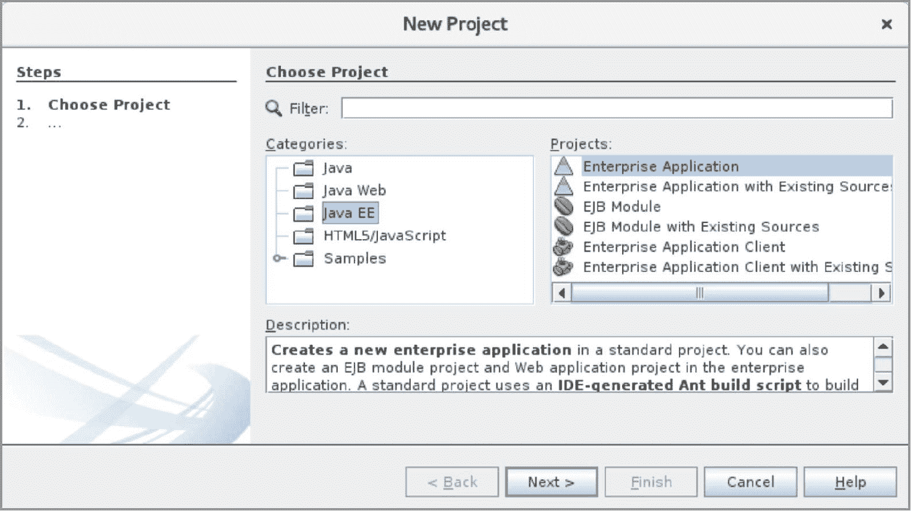

点击 `Next` 后，我在下一个窗口中输入项目名称，输入了 `CalcEJB`。再次点击 `Next` 后，我得到了以下窗口，该窗口默认由单个 EJB 模块和一个 Web 应用程序组成：

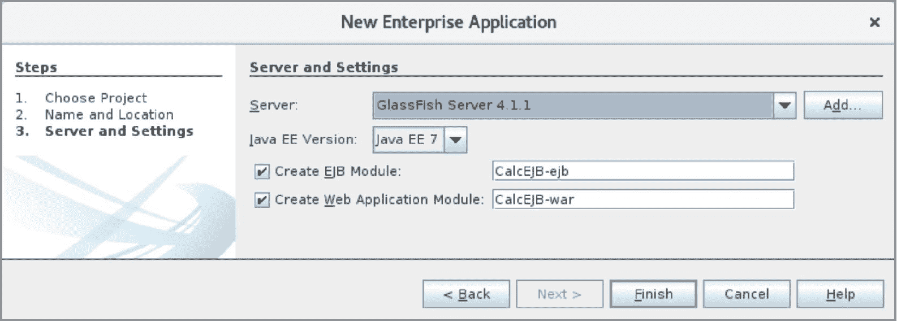

当你点击 `Finish` 时，`NetBeans` 会创建一个企业级应用程序，它包含了两个项目：

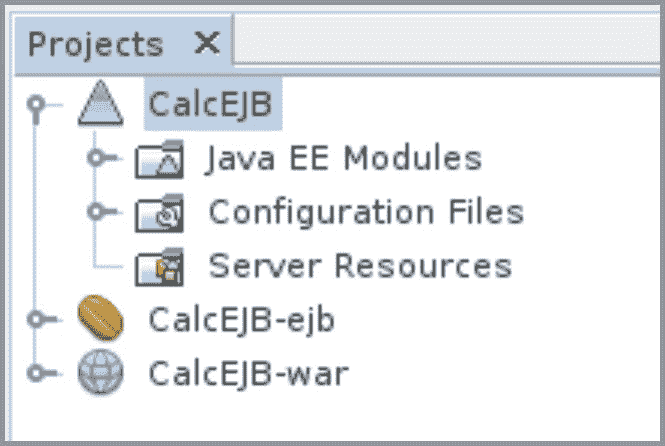

其中第一个是名为 `CalcEJB-ejb` 的 EJB 模块项目，另一个是名为 `CalcEJB-war` 的 Web 应用程序项目。注意名称是由 `NetBeans` 选择的，你可以根据需要进行更改。

下一步，`CalcEJB-ejb` 项目应该拥有一个 EJB。为此，右键点击项目并选择 `Enterprise Javabeans`，然后选择 `Session Bean`：

 

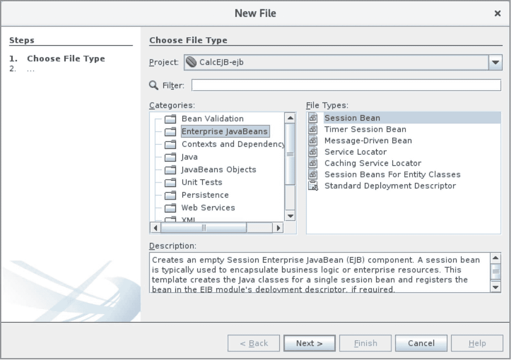

点击 `Next` 后你会得到以下窗口，在其中你必须为你的 EJB 输入名称（此处为 `CalcSession`）和一个包名称（此处为 `calcejb.ejbs`）：

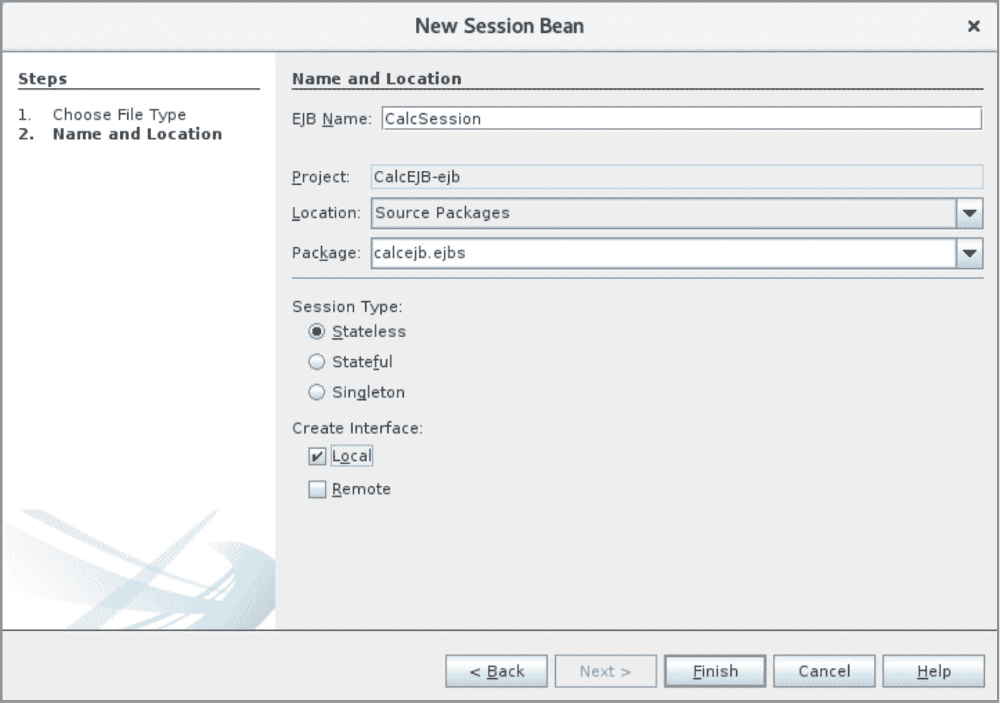

此外，选择 `Session Type`，已选择 `Stateless`。最后，勾选了 `Local`。这意味着将创建一个定义 EJB 的接口。在这里选择 `Local`，意味着该 EJB 可以被托管在同一应用程序服务器上的 Web 应用程序使用（这在实践中通常如此），并且准确地说，意味着由与 EJB 模块相同的 JVM 执行的应用程序。点击 `Finish` 后，`NetBeans` 会创建一个类和一个接口：

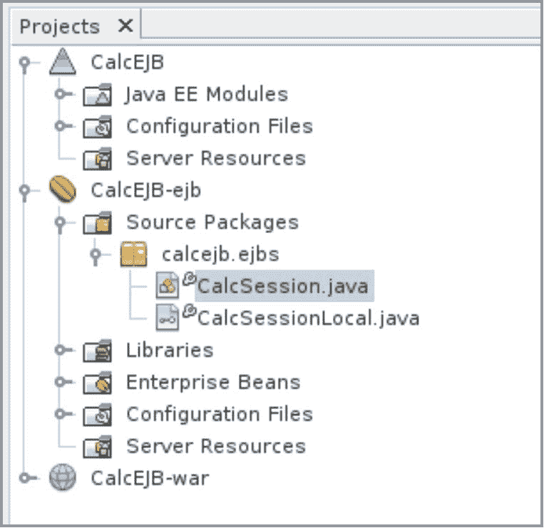

该类如下：

```java
package calcejb.ejbs;

import javax.ejb.Stateless;

@Stateless
public class CalcSession implements CalcSessionLocal
{

}
```

你可以部分看到它实现了该接口，并且被一个注解装饰，说明它是一个无状态会话 Bean。接口是一个空接口，但带有一个注解，告诉你是它是一个本地会话 Bean：

```java
package calcejb.ejbs;

import javax.ejb.Local;

@Local
public interface CalcSessionLocal
{

}
```

接下来，应该为 EJB 类添加方法。为此，右键点击该类并选择 `Insert Code`，在随后的选项选择 `Add Method`，然后得到如下内容：

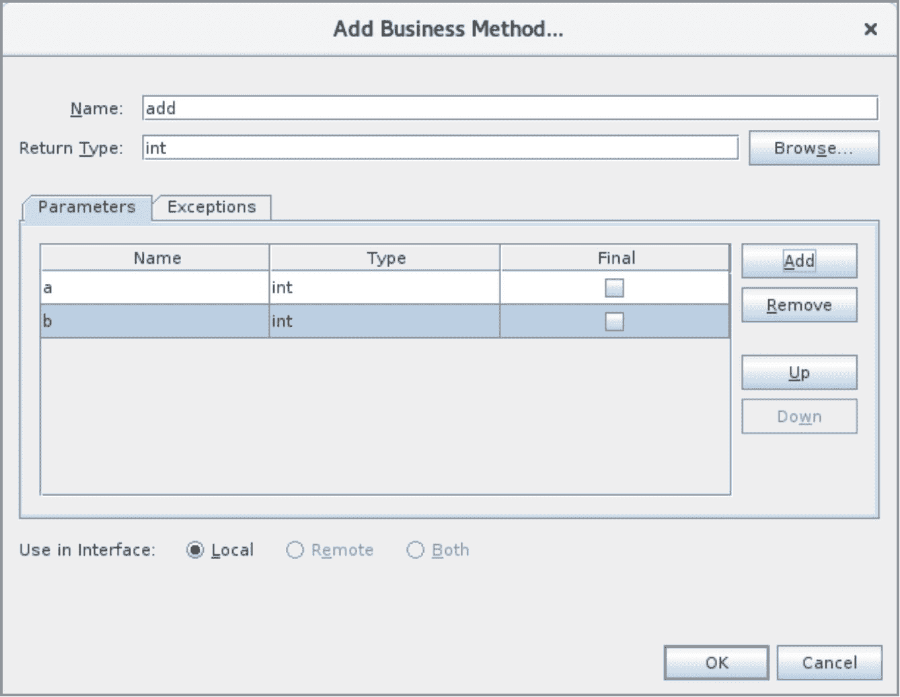


在这里，`NetBeans` 添加了一个方法。使用该工具的优势是它可以自动更新接口。下面是完成后的接口，它定义了 `5` 方法：

```java
package calcejb.ejbs;

import javax.ejb.Local;

@Local
public interface CalcSessionLocal
{
    int add(int a, int b);
    int sub(int a, int b);
    int mul(int a, int b);
    int div(int a, int b);
    int mod(int a, int b);
}
```

完成的类如下：


```java
package calcejb.ejbs; 
import javax.ejb.Stateless; 
@Stateless
public class CalcSession implements CalcSessionLocal
{
@Override
public int add(int a, int b) {
    return a + b;
}
@Override
public int sub(int a, int b) {
    return a - b;
}
@Override
public int mul(int a, int b) {
    return a * b;
}
@Override
public int div(int a, int b) {
    try {
        return a / b;
    } catch (Exception ex) {
        return 0;
    }
}
@Override
public int mod(int a, int b) {
    try {
        return a % b;
    } catch (Exception ex) {
        return 0;
    }
}
}
```

现在我的会话 Bean 完成了，然后必须编写客户端。首先，我添加了一个名为 `CalcBean` 的具名 Bean（到 `calcejb.beans` 包）。在添加类后，我右键点击该名称并选择 `Insert Code`，在此再次选择 `Enterprise Bean`，结果如下：

```java
package calcejb.beans;
import calcejb.ejbs.CalcSessionLocal;
import javax.inject.Named;
import javax.enterprise.context.SessionScoped; 
import java.io.Serializable;
import javax.ejb.EJB;

@Named(value = "calcBean")
@SessionScoped
public class CalcBean implements Serializable
{
@EJB
private CalcSessionLocal calcSession; 
public CalcBean()
{
}
// methods would be called here
}
```

也就是说，对 EJB 模块建立了引用，这里的关键点是它被 `@EJB` 装饰。这意味着相关的会话 Bean 可以被类的方法使用。完成的具名 Bean 如下：


```java
package calcejb.beans;
import calcejb.ejbs.CalcSessionLocal;
import javax.inject.Named;
import javax.enterprise.context.SessionScoped; 
import java.io.Serializable;
import javax.ejb.EJB;

@Named(value = "calcBean")
@SessionScoped
public class CalcBean implements Serializable
{
@EJB
private CalcSessionLocal calcSession;

private int value1; 
private int value2; 
private int value3;

public CalcBean()
{
}

public int getValue1() {
    return value1;
}

public void setValue1(int value1) {
    this.value1 = value1;
}

public int getValue2() {
    return value2;
}

public void setValue2(int value2) {
    this.value2 = value2;
}

public int getValue3() {
    return value3;
}

public void setValue3(int value3) {
    this.value3 = value3;
}
}
```

```java
public void setValue3(int value3) { 
    this.value3 = value3;
}

public void clear() {
    value1 = 0;
    value2 = 0;
    value3 = 0;
}

public void addition() {
    value3 = calcSession.add(value1, value2);
}

public void subtract() {
    value3 = calcSession.sub(value1, value2);
}

public void multiply() {
    value3 = calcSession.mul(value1, value2);
}

public void divide() {
    value3 = calcSession.div(value1, value2);
}

public void modolus() {
    value3 = calcSession.mod(value1, value2);
}
}
```

并且代码不需要进一步的解释。然而，请注意类的方法是如何引用 `calcSession` 对象的，就像引用其他对象一样。

随后我删除了 `index.html` 页面，并创建了同名的 JSF 页面（`index.xhtml`），输入了以下代码：

```xml
<?xml version='1.0' encoding='UTF-8' ?>
<!DOCTYPE html ... >
<html xmlns="http://www.w3.org/1999/xhtml" xmlns:h="http://xmlns.jcp.org/jsf/html">
<h:head>
<title>Facelet Title</title>
</h:head>
<h:body>
<h1>Calculations</h1>
<h:form>
<p>
<h:inputText value="#{calcBean.value1}" />&nbsp;
<h:inputText value="#{calcBean.value2}" />&nbsp;=&nbsp;
<h:inputText value="#{calcBean.value3}" />
</p>
<p>
<h:commandButton value="CLR" action="#{calcBean.clear()}" />
<h:commandButton value="ADD" action="#{calcBean.addition()}"  />
<h:commandButton value="SUB" action="#{calcBean.subtract()}"  />
<h:commandButton value="MUL" action="#{calcBean.multiply()}"  />
<h:commandButton value="DIV" action="#{calcBean.divide()}" />
<h:commandButton value="MOD" action="#{calcBean.modolus()}" />
</p>
</h:form>
</h:body>
</</html>
```

这里没有什么新内容需要解释，你应该注意到我命名的 bean 是以通常的方式使用的。

代码编写完成后，你必须构建项目。然后，右键点击企业级应用名称 `CalcEJB` 并选择 `deploy`。如果你再次右键并点击 `Run`，将看到以下窗口：

<map name="awmap9" class="calibre1"><area shape="rect" href="http://www.sylvania.com/" coords="141, 38, 237, 49" class="calibre39"></map>

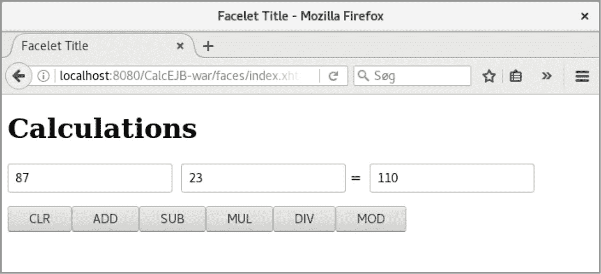

其中在前两个输入字段中输入值，并点击 ADD。

## 3.1 有状态会话豆 (STATEFUL SESSION BEAN)

在本节中，我将展示一个有状态会话豆的示例。事实上，它的开发方式与上述完全相同，但它会在各个方法调用之间保留实例变量的值。当无状态或有状态的会话 bean 托管在服务器上（部署）时，服务器会创建若干个会话 bean 实例，这通常被称为 EJB 池。当客户端想要使用 EJB 实例时，Glassfish 服务器会从池中取出一个实例并给客户端一个引用。该过程的目标是……

该类非常简单，主要由将工作委托给 EJB 实例的方法组成。示例以多种方式展示了如何将企业级 Bean（EJB）作为封装业务逻辑的对象，并将其与用作用户界面控制器的具名 Bean 分离开来。通过这种方式，你简化了单个具名 Bean。

最后是 `index.xhtml` 的代码，它不包含任何新内容，我不想在这里展示。

3.2 远程单例会话 Bean（REMOTE SINGLETON SESSION BEAN）

在前两个示例中，session Bean 和客户端应用程序都是同一个企业应用程序的一部分。在本节中，我将展示一个作为一个单模块开发并独立部署到服务器的 session Bean 示例。接下来，示例将包含一个与上述 Bean 独立开发的通用 Web 应用程序，但使用了该 session Bean。这意味着应用程序和 Bean 可以托管在每个应用程序服务器上。

实际的 session Bean 也应该被写成单例（singleton）——主要是为了演示如何实现。单例 session Bean 是一种 session Bean，每个应用程序服务器上恰好有一个实例。一个典型的应用是必须精确初始化某些数据的 Bean，这些数据在应用程序的整个生命周期内应该是可。通常，相关数据是从数据库初始化的，你希望用 `@PostConstruct` 装饰一个方法，在其中初始化数据。在本例中目前未使用，因为数据是硬编码的以保持当前 Bean 的简单。

与前两个示例一样，我开始创建一个名为 `KingsEJB` 的企业应用程序项目，当我进入“Server and Settings”窗口时，我清空了“Create Web Application Module”：

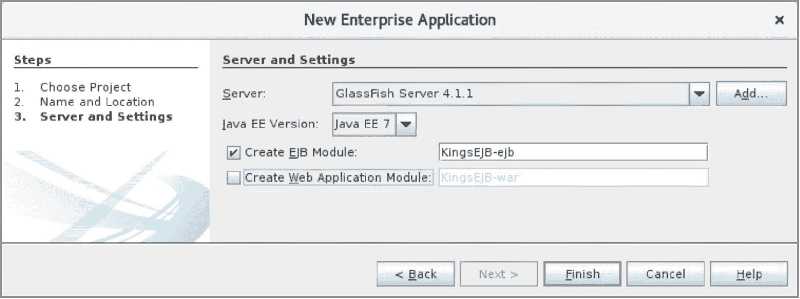

当你点击“Finish”时，NetBeans 会创建一个企业应用程序，但只包含一个 EJB 模块。这次必须对 EJB 进行远程访问，因此它必须通过接口进行定义。作为下一步，我创建了一个名为 `KingsEJBRemote` 的常规类库项目。

现在必须编写一个企业级 Bean，它必须包含两个服务，两者都返回字符串数组。第一个方法必须根据年份返回统治该年份的丹麦国王名称（如果该年份是宗教更迭的年份，可能有两个国王）。另一个方法的工作相同，但必须有两个年份作为参数，且该方法必须返回在该时期内统治过的所有国王名称。为了创建这个 Bean，我右键点击了 `KingsEJB-ejb` 模块并选择了“Session Bean”。随后你会看到下面的窗口，我在其中将 `KingsSession` 作为包名 `kingsejb.ejbs` 输入。此外，我将其选为单例（Singleton）。最后，规定必须创建一个本地（Local）和一个远程（Remote）接口。在勾选“Remote”时，选择包含接口的类库，在这种情况下是 `KingsEJBRemote`。对于当前的示例，不需要本地接口，当我选择它时，仅仅是为了说明 session Bean 可以同时拥有本地接口和远程接口。

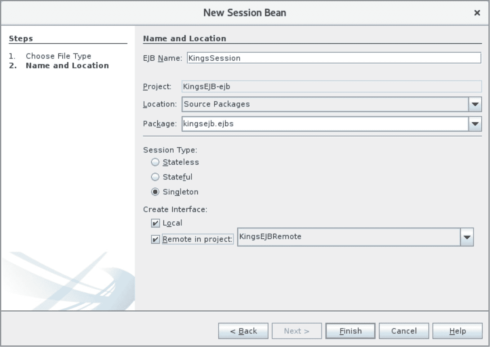

点击“Finish”后，NetBeans 创建了所需的 session Bean 以及两个接口：

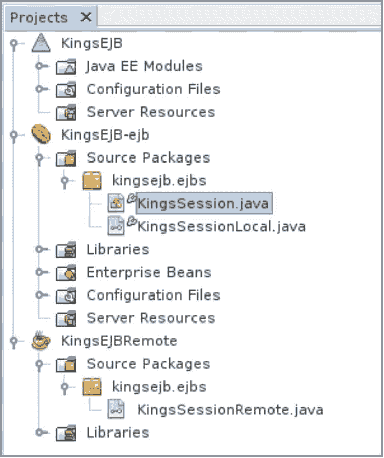

接下来，应该添加两个方法。我右键点击类名 `KingsSession` 并选择了“Insert Code”，在这里再次选择了“Add Business Method”（见下窗）。第一个方法必须被命名为 `getKing`，并应该返回一个字符串数组并有一个 `int` 类型的单个参数。在底部，我点击了最后一个单选按钮，表示应同时使用两个接口。你应该注意，NetBeans 提供了一个警告，提示该方法在两个接口中将相同的名称。

(images/00105.jpeg)(images/00106.jpeg)(images/00107.jpeg)(images/00108.jpeg)(images/00109.jpeg)(images/00110.jpeg)(images/00111.jpeg)

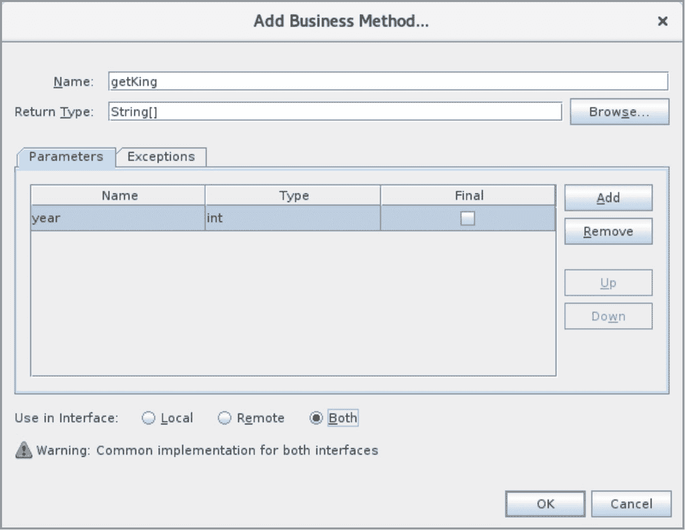

 当你点击“OK”时，NetBeans 将创建方法并在两个接口中插入原型。考虑到上述警告，我将它们分别重命名为

`getKingLocal(int year)`

`getKingRemote(int year)`

结果是 `KingsSession` 类必须实现这两个方法。另一个服务必须相应地定义，例如，我在下方展示了 `KingsSessionRemote` 接口：

```java
package kingsejb.ejbs; import javax.ejb.Remote; @Remote
public interface KingsSessionRemote
{
    String[] getKingRemote(int year);
    String[] getKingsRemote(int year1, int year2);
}
```

这些方法必须在 `KingsSession` 类中实现，我在其中仅展示了几行数据：

```java
package kingsejb.ejbs;

import javax.ejb.Singleton; import java.util.*;

@Singleton
public class KingsSession implements KingsSessionRemote, KingsSessionLocal
{
    @Override
    public String[] getKingRemote(int year)
    {
        return getKing(year);
    }

    @Override
    public String[] getKingsRemote(int year1, int year2)
    {
        return getKings(year1, year2);
    }

    @Override
    public String[] getKingLocal(int year)
    {
        return getKing(year);
    }

    @Override
    public String[] getKingsLocal(int year1, int year2)
    {
        return getKings(year1, year2);
    }
}
```

```java
private String[] getKing(int year)
{
    List<String> list = new ArrayList();
    for (String[] king : names)
    {
        int a = king[1].length() > 0 ? Integer.parseInt(king[1]) : 0;
        int b = king[2].length() > 0 ? Integer.parseInt(king[2]) : 9999;
        if (a <= year && year <= b) list.add(king[0]);
    }
    String[] arr = new String[list.size()];
    return list.toArray(arr);
}

private String[] getKings(int year1, int year2)
{
    List<String> list = new ArrayList();
    for (String[] king : names)
    {
        int a = king[1].length() > 0 ? Integer.parseInt(king[1]) : 0;
        int b = king[2].length() > 0 ? Integer.parseInt(king[2]) : 9999;
        if (year2 >= a && year1 <= b) list.add(king[0]);
    }
    String[] arr = new String[list.size()];
    return list.toArray(arr);
}

private static String[][] names = {
    { "Gorm den Gamle", "", "958" },
    { "Harald Blåtand", "958", "986" },
    { "Svend Tveskæg", "986", "1014" },
    …
    { "Margrethe d. 2.", "1972", "" }
};
```


这个会话豆（session bean）没有什么新奇，除了它被定义为一个`Singleton`（单例）会话豆。不过要注意，该类实现了两个接口，因此实现了所有的四个方法。

`EJB`模块已经完成，可以进行翻译然后部署到服务器上。


接下来是客户端应用程序，我创建了一个名为`KingsClient`的普通 Web 项目。为了让应用程序引用`KingsSession`，它必须知道`KingsSessionRemote`接口的定义。因此，我将包含该接口的 jar 文件添加到了项目中。下一步我定义了一个命名豆（named bean）：

```java
package kingsclient.beans; import javax.inject.Named;
import javax.enterprise.context.SessionScoped; import java.util.*;
import javax.ejb.EJB;
import kingsejb.ejbs.KingsSessionRemote;

@Named(value = "kingsBean")
@SessionScoped
public class KingsBean implements java.io.Serializable
{
    @EJB
    private KingsSessionRemote kingsSession;
    private int year1; private int year2;
    private List<String> names = new ArrayList();
    public KingsBean() {
    }

    public int getYear1() { return year1;
    }

    public void setYear1(int year1) { this.year1 = year1;
    }

    public int getYear2() { return year2;
    }

    public void setYear2(int year2) { this.year2 = year2;
    }

    public List<String> getNames()
    {
        return names;
    }

    public void search()
    {
        String[] arr = year2 > 0 ? kingsSession.getKingsRemote(year1, year2) : kingsSession.getKingRemote(year1);
        names.clear();
        for (String name : arr) names.add(name);
    }
}
```

同样，这里没什么新闻，但请注意该类使用了 EJB 模块`KingsEJB`。这与之前的示例一样，是通过右键点击类名，选择`Insert Code`，然后选择`Call Enterprise Bean`实现的。相关的豆被用于`Search()`方法。

如果你运行应用程序（在浏览器中打开它），将看到以下窗口，该窗口已应用于 1200 年到 1300 年间统治的所有国王：

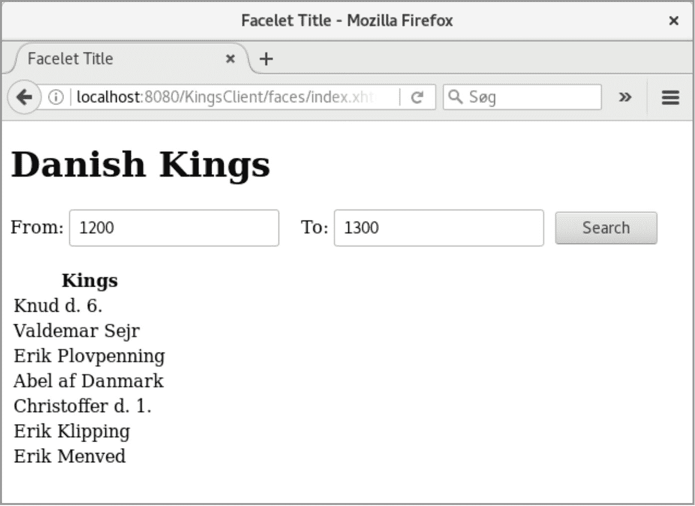

我不打算显示`index.xhtml`的代码，因为它没有显示任何新内容。

### 练习 2

在此练习中，编写一个功能与上面示例几乎相同的程序，其中你可以搜索丹麦国王，但需要更改用户界面，以便它同时也显示统治时期：

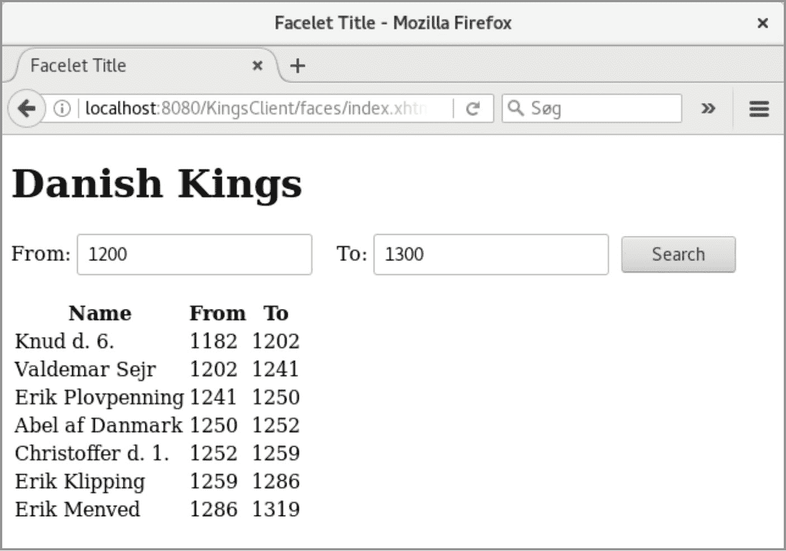


创建一个新项目，你可以命名为`KingsEJB-ejb`，但这次它不应该是`Enterprise Application`（企业应用）项目，而是一个`EJB Module`（EJB 模块）项目：

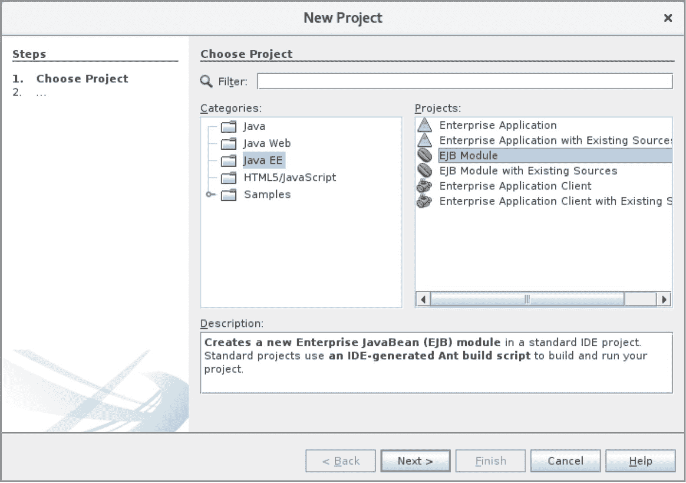

接下来，你应该创建一个普通的`Class Library`（类库）项目，可以命名为`KingsEJBRemote`。对于这个库，你必须在`kingsejb.ejbs`包中添加以下类：

```java
package kingsejb.ejbs; import javax.ejb.Remote; @Remote
public class King implements java.io.Serializable
{
    private String name; private int from; private int to;
    public King(String name, int from, int to)
    {
        this.name = name; this.from = from; this.to = to;
    }

    public String getName()
    {
        return name;
    }

    public int getFrom()
    {
        return from;
    }

    public int getTo()
    {
        return to;
    }
}
```

这一次，直接创建了一个`EntityManager`而没有使用注入（见下一章）。它要求我知道持久化单元名称，如`persistence.xml`所示。特别需要注意使用`EntityTransaction`的`save()`方法以及如何启动此事务。还要注意使用`NamedQuery`的`getAddresses()`方法。它是由 NetBeans 在`Address`类中创建的。结果是`AddressSession`是一个无状态会话豆，它封装了更新数据库和执行查询的必要逻辑。因此，用于用户界面的命名 bean 同样变得更加简单，因为它将工作委托给了`AddressSession`：

```java
package addressejb.beans;

import javax.ejb.EJB;
import javax.inject.Named;
import javax.enterprise.context.SessionScoped;
import java.util.List;

@Named(value = "addressBean")
@SessionScoped
public class AddressBean implements java.io.Serializable
{
    @EJB
    private AddressSessionLocal addressSession;

    private Address address = new Address(); 
    private List<Address> addresses;

    public AddressBean() {
    }

    public Address getAddress()
    {
        return address;
    }

    public void setAddress(Address address)
    {
        this.address = address;
    }

    public List<Address> getAddresses()
    {
        return addresses = addressSession.getAddresses();
    }
}
```


```java
public void save()
{
    try
    {
        addressSession.save(address); 
        address = new Address();
    }
    catch (Exception ex)
    {
    }
}
```

在那里有`index.xhtml`和`list.xhtml`，页面基本上没有变化，区别在于 bean 的引用已经发生了变化。我不想在这里展示这两个页面。

### 练习 3

在这个练习中，你必须解决与上一个练习相同的练习，但不同之处在于国王应该从数据库加载。数据库`padata`有一个名为`history`的表，其中包含关于丹麦国王的信息。如果该表不存在，你可以在`Java 6`书中查看如何创建此表——书中的示例包含了创建和初始化该表的脚本。要解决这个练习，你可以按照以下步骤进行：

1. 创建一个名为`HistoryEJB`的企业级应用程序项目，它应该只包含一个 EJB 模块。NetBeans 会创建`HistoryEJB-ejb`。

2. 创建一个`Class Library`项目，你可以命名为`HistoryEJBRemote`。此外，添加上一个练习中的`King`类。

3. 向`HistoryEJB-ejb`中添加一个名为`HistorySession`的状态会话豆，它应该有一个被添加到`HistoryEJBRemote`中的远程接口。该接口应该与上一个练习中的相同（两个返回`List<King>`的方法）。实现必须有一个`List<King>`类型的实例变量，并且必须在`@PostConstruct`方法中通过从数据库的`history`表加载数据来初始化它。你可以按照之前示例中从数据库创建`Entity Class`的相同方法轻松地完成。

4. 翻译并部署`HistoryEJB`。

5. 创建一个客户端，它基本上与练习 2 中的客户端相同。

6. 测试应用程序并确保一切运行正常。

### 3.4 事务（TRANSACTIONS）

使用企业级 Java 豆（EJB）的巨大优势之一是 EJB 使用事务，这通常意味着如果所有操作都执行正确，方法的更改将会执行，否则不执行任何操作（对应回滚）。如果发生异常，则属于后者。立即来看这没问题，但如果在事务进行期间调用一个方法，其工作原理就不显而易见了。该方法应该是当前事务的一部分，还是在为新的方法调用创建新事务时必须挂起现有事务？由于这些问题，可以配置事务应该如何工作。这是通过`@TransactionAttribute`注解实现的：

```java
@Stateless
public class Helloworld
{
    @Override 
    @TransactionAttribute(TransactionAttributeType.REQUIRES_NEW) 
    public String hello()
    {
        return "Hello World";
    }
}
```

其中`TransactionAttribute`的值指示了事务的工作方式。有以下选项：

1. `TransactionAttributeType.MANDATORY`：方法只能作为现有事务的一部分执行。如果在事务之外调用该方法，将抛出异常。

2. `TransactionAttributeType.NEVER`：如果从客户端调用方法，则不会创建事务。如果方法作为事务的一部分被调用，将抛出异常。

3. `TransactionAttributeType.NOT_SUPPORTED`：如果方法作为现有事务的一部分被调用，它将被挂起，并且方法将在事务之外执行。如果在事务之外调用方法，则不会创建事务。

4. `TransactionAttributeType.REQUIRED`：如果方法作为现有事务的一部分执行，它将作为该事务的一部分执行。如果在事务之外调用该方法，将创建一个新事务。

5. `TransactionAttributeType.REQUIRES_NEW`：如果方法作为现有事务的一部分被调用，它将被挂起并创建一个新事务。在方法完成后，之前的事务将恢复。如果在现有事务之外调用该方法，将创建一个新事务。

6. `TransactionAttributeType.SUPPORTS`：如果方法作为现有事务的一部分执行，则它将作为该事务的一部分执行。如果在事务之外调用该方法，则不会启动新事务。

上面显示了如何对方法进行装饰，但你也可以装饰类，这样装饰将关系到类的所有方法。

### 3.5 拦截（INTERCEPTION）

在会话豆中执行方法时，人们有时会对方法执行之前（被调用时）以及方法完成后立即执行的操作感兴趣。典型的理由是调试，例如，你可以写入服务器的日志文件。作为示例，我向`AddressEJB-ejb`项目添加了以下类：

```java
package addressejb.beans;

import javax.interceptor.AroundInvoke;
import javax.interceptor.InvocationContext;
import java.lang.reflect.Method;

public class AddressInterceptor
{
    @AroundInvoke
    public Object logMethodCall(InvocationContext invocationContext) throws Exception
    {
        Object interceptedObject = invocationContext.getTarget(); 
        Method interceptedMethod = invocationContext.getMethod();

        System.out.println("Entereding: " + interceptedObject.getClass().getName() + "." + interceptedMethod.getName() + "()");

        Object obj = invocationContext.proceed();
        System.out.println("Leaving: " + interceptedObject.getClass().getName() + "." + interceptedMethod.getName() + "()");

        return obj;
    }
}
```

一个带有简单方法的`Java`类非常常见，首先要注意到的一点是该方法被一个注解所装饰了。该方法有一个`InvocationContext`参数，可以提供更多服务。`getTarget()`方法返回执行该方法的对象，而`getMethod()`方法返回一个代表`interceptedObject`对象中被执行的方法的对象。最后，有一个`proceed()`方法，它负责执行`interceptedMethod()`方法。在调用`proceed()`的前后两边都执行了`System.out.println()`，这简单来说就意味着在 Glassfish 服务器的日志中写入一行。结果是，如果一个方法执行了`logMethodCall()`，日志文件中就会写入一行，之后执行该方法，然后再次写入日志文件。

那么问题在于，如何获取被执行的方法并让它发生，而这（当然）是通过注解完成的：

```java
@Override
@Interceptors({AddressInterceptor.class})
public void save(Address address) throws Exception
{
    EntityManager em = null;
    try
    {
        em = Persistence.createEntityManagerFactory("AddressEJB-ejbPU").createEntityManager();
        em.getTransaction().begin();
        em.persist(address);
        em.getTransaction().commit();
    }
    catch (Exception ex)
    {
        throw new Exception();
    }
    finally
    {
        if (em != null) em.close();
    }
}
```

也就是说，在创建地址之前写入日志文件，在数据库更新后再次写入。

### 3.6 定时器服务（TIMER SERVICE）

有一种实现定时器的会话 bean（session bean）特殊变体。因此，你可以让实际 bean 在特定的间隔内执行操作，例如向日志文件中写入内容。在这种情况下，我将编写一个会话 bean，每半秒确定一次下一个素数。我从一个名为`PrimesEJB`的企业级项目开始，包含一个 EJB 模块和一个 Web 应用程序。对于 EJB 模块，我添加了一个 EJB，但这次是一个定时会话 bean：

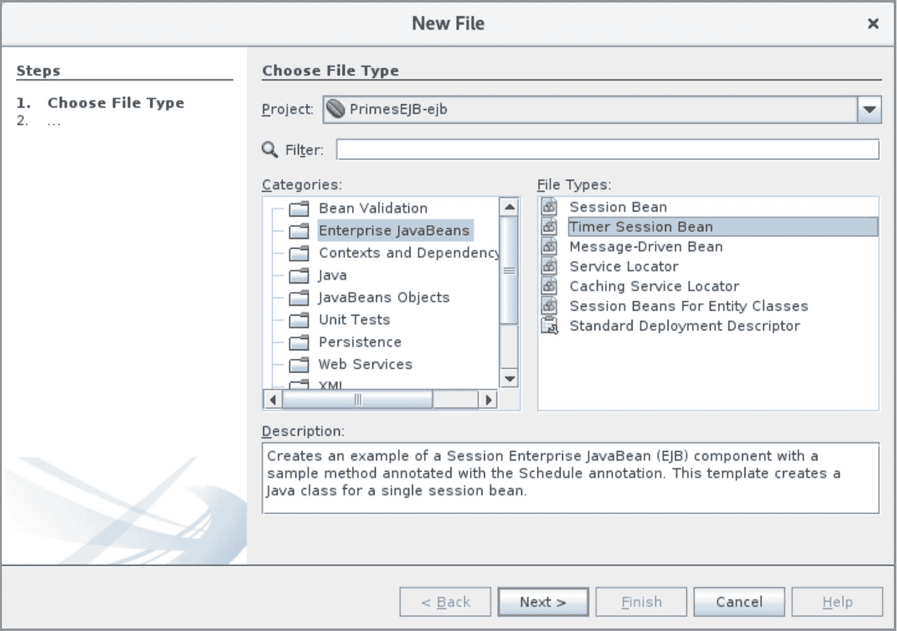

随后你将看到以下窗口，你应该像通常一样输入一个名称（这里是`PrimesSession`）和一个包名（`primes.ejbs`）。我还选择了它必须是`Singleton`（单例），并且应该创建一个`Local`接口：

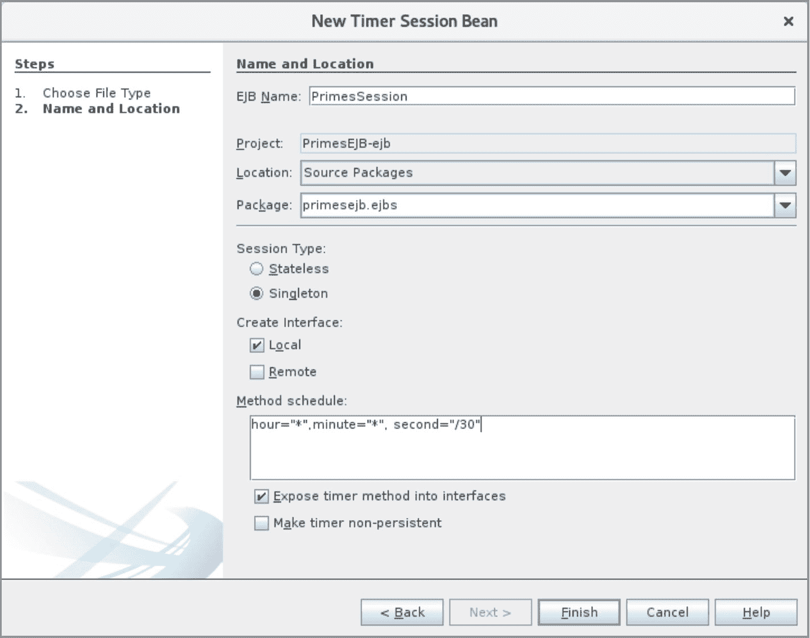


最后，我设置了定时器跳动的时间间隔。在这种情况下，该模式意味着定时器必须每半分钟跳动一次。点击“Finish”后，NetBeans 会创建以下类：


```java
package primesejb.ejbs;

import javax.ejb.Schedule;
import javax.ejb.Singleton;

@Singleton
public class PrimesSession implements PrimesSessionLocal
{
    @Schedule(hour = "*", minute = "*", second = "*/30")
    public void myTimer()
    {
    }
}
```

以及一个定义的接口。可见，它是一个普通的会话 bean，唯一的区别是多了一个定时器方法，并用 `@Schedule` 注解定义了它是一个定时函数以及它应该跳动的频率。完成后的接口是：

```java
package primesejb.ejbs;

import javax.ejb.Local;
import java.math.BigInteger;

@Local
public interface PrimesSessionLocal
{
    public void myTimer();
    public void reset();
    public BigInteger getPrime();
    public int getIndex();
}
```

其中除了定时器外，还定义了三个方法。`PrimesSession` 类将实现该接口：

```java
package primesejb.ejbs;

import java.math.BigInteger;
import javax.ejb.Schedule;
import javax.ejb.Singleton;

@Singleton
public class PrimesSession implements PrimesSessionLocal
{
    private BigInteger two = new BigInteger("2");
    private BigInteger prime = new BigInteger("2");
    private int index = 0;

    @Schedule(hour = "*", minute = "*", second = "*/30")
    public void myTimer()
    {
        if (prime.equals(two)) prime = new BigInteger("3");
        else
        {
            prime = prime.add(two);
            while (!prime.isProbablePrime(50)) prime = prime.add(two);
        }
        ++index;
    }

    public void reset()
    {
        prime = two;
        index = 0;
    }

    public BigInteger getPrime()
    {
        return prime;
    }

    public int getIndex()
    {
        return index;
    }
}
```

你应该注意，该类有三个实例变量。由于它是一个单例会话 bean，这些变量将从 `PrimesSession` 类首次初始化开始保留其值，直到 Glassfish 服务器停止。也就是说，多次启动应用程序，会话 bean 的状态也将得以保留。

该类最重要的部分当然是定时器方法，它修改了变量 `index`。EJB 模块已完成。

我在 Web 应用程序中添加了一个命名的 bean：

```java
package primesejb.beans;

import javax.inject.Named;
import javax.enterprise.context.RequestScoped;
import java.math.BigInteger;
import javax.ejb.EJB;
import primesejb.ejbs.PrimesSessionLocal;

@Named
@RequestScoped
public class PrimesBean
{
    @EJB
    private PrimesSessionLocal sessionSession;

    public PrimesBean() {
    }

    public BigInteger getPrime()
    {
        return sessionSession.getPrime();
    }

    public int getIndex()
    {
        return sessionSession.getIndex();
    }

    public void reset()
    {
        sessionSession.reset();
    }
}
```

这是一个非常简单的 bean，没什么特别需要注意的，但你需要意识到它使用了 session bean。JSF 页面同样简单并在浏览器中打开。

## 3.7 单表 CRUD

在数据库上下文中，CRUD 代表创建（Create）、读取（Read）、更新（Update）和删除（Delete）操作。在本节中，我将向你展示如何使用 EJB 在单表上执行这些操作。

应用程序必须使用带有远程接口的 EJB。作为示例，我将使用数据库 `padata` 中的 `zipcode` 表。应用程序应该打开如上所示的窗口，其中搜索了邮编 78。按钮的含义应该是显而易见的，点击表格中的链接会将邮编插入顶部的两个字段中以便进行编辑。接下来，我将解释如何编写程序以及相应的过程。

我开始创建一个 EJB 模块项目，命名为 `ZipcodesEJB`。然后我创建了一个普通的类库项目，命名为 `ZipcodesRemote`。对于该项目，我添加了 `ZipcodeRemote` 类，它应该代表在 Web 应用程序和会话 bean 对象之间传输的对象（未显示 getter 和 setter 方法）：

```java
package zipcodes.beans;

import javax.ejb.Remote;
import java.io.Serializable;

@Remote
public class ZipcodeRemote implements java.io.Serializable
{
    private String code;
    private String city;

    public ZipcodeRemote() {
    }
}
```

然后我向 `ZipcodesEJB` 项目添加了一个命名为 `ZipcodesSession` 的远程无状态会话 bean，并为上述类库添加了远程接口：

```java
package zipcodes.beans;

import javax.ejb.Remote;
import java.util.List;

@Remote
public interface ZipcodesSessionRemote
{
    public boolean create(ZipcodeRemote obj); 
    public boolean update(ZipcodeRemote obj); 
    public boolean remove(String code);
    public List<ZipcodeRemote> search(String code, String City);
}
```

最主要的工作是实现 `ZipcodesSession` 类。在 `zipcodes.models` 包中，我为数据库表添加了一个实体类 `Zipcode`。该类与 NetBeans 生成的代码相比没有任何变化。

我想添加一个用于数据库操作的类，但 JPA 控制类不能直接从 EJB 中使用，因此我添加了自己的类。这只是一个由 NetBeans 创建的控制类经过修改和精简的版本——请参见下一个示例。我将其命名为 `ZipcodeDAO`：

!(images/00137.jpeg)

```java
package zipcodes.models;

import java.util.*;
import javax.persistence.*;

public class ZipcodeDAO
{
    public EntityManager getEntityManager()
    {
        return Persistence.createEntityManagerFactory("ZipcodesEJBPU").createEntityManager();
    }

    public void create(Zipcode zipcode) throws Exception
    {
        EntityManager em = null;
        try
        {
            em = getEntityManager();
            em.getTransaction().begin();
            em.persist(zipcode);
            em.getTransaction().commit();
        }
        catch (Exception ex)
        {
            if (em != null) em.getTransaction().rollback();
            throw ex;
        }
        finally
        {
            if (em != null) em.close();
        }
    }

    public void edit(Zipcode zipcode) throws Exception
    {
        EntityManager em = null;
        try
        {
            em = getEntityManager();
            em.getTransaction().begin();
            em.merge(zipcode);
            em.getTransaction().commit();
        }
        catch (Exception ex)
        {
            if (em != null) em.getTransaction().rollback();
            throw ex;
        }
        finally
        {
            if (em != null) em.close();
        }
    }

    public void destroy(String code) throws Exception
    {
        EntityManager em = null;
        try
        {
            em = getEntityManager();
            em.getTransaction().begin();
            Zipcode zipcode;
            try
            {
                zipcode = em.getReference(Zipcode.class, code);
                zipcode.getCode();
            }
            catch (Exception e)
            {
                throw new Exception("The zipcode with id " + code + " no longer exists");
            }
            em.remove(zipcode);
            em.getTransaction().commit();
        }
        catch (Exception ex)
        {
            if (em != null) em.getTransaction().rollback();
            throw ex;
        }
        finally
        {
            if (em != null) em.close();
        }
    }

    public List<Zipcode> getZipcodes(String code, String city)
    {
        if (code == null) code = "";
        if (city == null) city = "";
        EntityManager em = null;
        try
        {
            em = getEntityManager();
            Query cq = em.createQuery(
                "SELECT z FROM Zipcode z WHERE z.code like :code AND z.city like :city"
            );
            cq.setParameter("code", code + "%");
            cq.setParameter("city", "%" + city + "%");
            return cq.getResultList();
        }
        catch (Exception ex)
        {
            return new ArrayList();
        }
        finally
        {
            if (em != null) em.close();
        }
    }
}
```

该类与 NetBeans 创建的 DAO（数据访问对象）类非常相似，但你应该注意如何创建 `EntityManager` 对象以及如何定义与 `Create`、`Update` 和 `Delete` 关联的事务。

还要注意最后一个方法，它是搜索方法。这里使用了 `JPQL` 而不是 `Criteria API`。这取决于个人喜好，使用哪一种都可以，但如果你熟悉 `SQL`，那么使用 `JPQL` 是简单的。

有了这两个类，你就可以编写 `ZipcodesSession` 类了。代码实际上非常简单，因为所有的工作都委托给了 DAO 类：

!(images/00139.jpeg)!(images/00140.jpeg)!(images/00067.jpeg)

```java
package zipcodes.beans;

import java.util.*;
import javax.ejb.Stateless;
import zipcodes.models.*;

@Stateless
public class ZipcodesSession implements ZipcodesSessionRemote
{
    @Override
    public boolean create(ZipcodeRemote obj)
    {
        try
        {
            (new ZipcodeDAO()).create(new Zipcode(obj.getCode(), obj.getCity()));
            return true;
        }
        catch (Exception ex)
        {
            return false;
        }
    }

    @Override
    public boolean update(ZipcodeRemote obj)
    {
        try
        {
            (new ZipcodeDAO()).edit(obj);
            return true;
        }
        catch (Exception ex)
        {
            return false;
        }
    }

    @Override
    public boolean remove(String code)
    {
        try
        {
            (new ZipcodeDAO()).destroy(code);
            return true;
        }
        catch (Exception ex)
        {
            return false;
        }
    }

    @Override
    public List<Zipcode> search(String code, String city)
    {
        return (new ZipcodeDAO()).getZipcodes(code, city);
    }
}
```

## 3.8 多表 CRUD

作为 Enterprise Java Beans 的最后一个示例，我将回顾上一章节中的 `Books` 程序。它与之前完全相同，唯一的变化是将所有逻辑移动到一个 EJB 中，该 EJB 使用 JPA 来维护数据库。

会有三个项目：

1. `BooksEJB`：托管在服务器上的 Enterprise Bean，它可以维护数据库。
2. `BooksRemote`：一个定义上述 EJB 远程接口的库。
3. `BooksClient`：Web 应用程序，它使用 `BooksEJB`。

在下文中我将描述这一过程和主要的挑战。

我开始创建一个 EJB Module 项目：


我将项目命名为`BooksEJB`。

下一步，我创建了一个名为`BooksRemote`的经典库项目。对于这个库，我选择了从数据库创建实体类（Entity Classes from Database），并选择了与数据库的连接：


然后我选择了要选的 5 张表，并在接下来的窗口中输入了包名：


当我随后点击 Next 和 Finish 时，就像之前一样创建了 4 个实体类：


你应该注意，这四个类位于类库中，以便客户端程序可以使用。除了`I`以外之外，这四个类不应该相对于 NetBeans 创建的代码进行更改，但对于`Author`、`Publisher`和`Category`我修改了`toString()`方法。

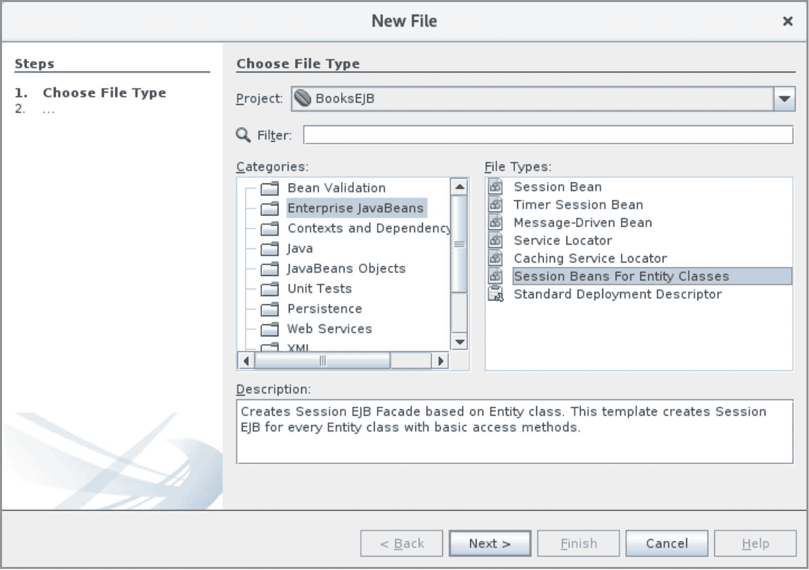

下一步，我在项目`BooksEJB`中添加了一个无状态会话 bean（stateless session bean）：

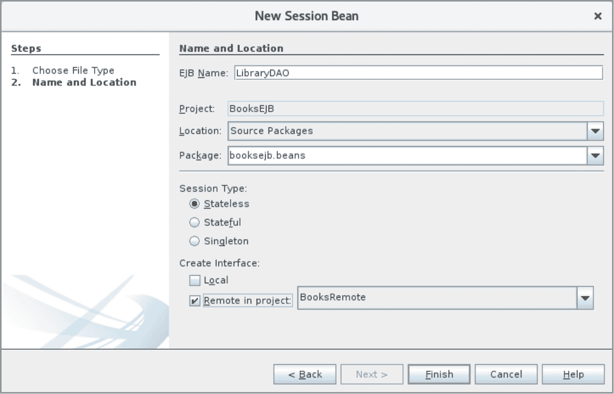

我定义了向我的类库添加一个远程接口，结果是 NetBeans 创建了一个名为`LibraryDAORemote`的接口。

在`BooksEJB`项目中，我创建了一个名为`booksejb.daos`的包。对于这个包，我添加了“来自实体类的 JPA 控制类”（JPA Controller Classes from Entity Classes）：


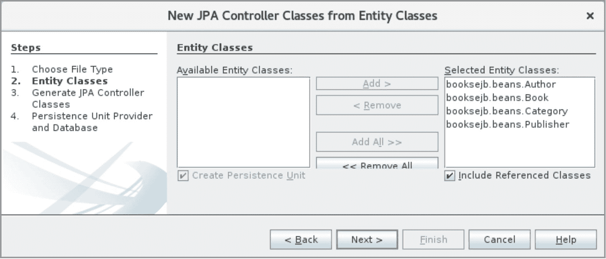

这 4 个类都经过了一微修改，但这仅仅是构造函数被删除了、`getEntityManager()`方法被更改了，并且事务的定义方式也不同。这些类的代码占据了大量空间，我不想在这里展示它们，但下面是`CategoryDAO`类开头和`create()`方法：

```java
public class CategoryDAO
{
    public EntityManager getEntityManager()
    {
        return Persistence.createEntityManagerFactory("BooksRemotePU"). createEntityManager();
    }

    public void create(Category category) throws Exception
    {
        if (category.getBookCollection() == null) category.setBookCollection(new ArrayList<Book>());
        EntityManager em = null;
        try
        {
            em = getEntityManager();
            em.getTransaction().begin();
            Collection<Book> attachedBookCollection = new ArrayList<Book>();
            for (Book bookCollectionBookToAttach : category.getBookCollection())
            {
                bookCollectionBookToAttach = em.getReference(bookCollectionBookToAttach.getClass(), bookCollectionBookToAttach.getId());
                attachedBookCollection.add(bookCollectionBookToAttach);
            }
            category.setBookCollection(attachedBookCollection);
            em.persist(category);

            for (Book bookCollectionBook : category.getBookCollection())
            {
                Category oldCatidOfBookCollectionBook = bookCollectionBook.getCatid();
                bookCollectionBook.setCatid(category);
                bookCollectionBook = em.merge(bookCollectionBook);
                if (oldCatidOfBookCollectionBook != null)
                {
                    oldCatidOfBookCollectionBook.getBookCollection(). remove(bookCollectionBook);
                    oldCatidOfBookCollectionBook = em.merge(oldCatidOfBookCollectionBook);
                }
            }
            em.getTransaction().commit();
        }
        catch (Exception ex)
        {
            if (em != null) em.getTransaction().rollback();
            throw ex;
        }
        finally
        {
            if (em != null) em.close();
        }
    }
}
```

此外，我修改了这些类，使它们只抛出`Exception`，并删除了其他异常类型。当然，这没有特别的理由，更多是一个态度问题，但我认为这使得代码变得稍微易读一些。

最后，`BookDAO`类添加了一个方法，用于根据所使用的搜索标准确定`Book`对象，但这方法与`PaBooks`程序中写的是同一个。

注意，到目前为止我还没有写很多代码，但 NetBeans 基本上已经创建了所有内容。现在缺失的是定义`LibraryDAORemote`接口并实现`LibraryDAO`。接口定义如下：

```java
package booksejb.beans;

import javax.ejb.Remote;
import java.util.List;

@Remote
public interface LibraryDAORemote
{
    public boolean addCategory(Category category);
    public boolean modCategory(Category category);
    public boolean delCategory(Category category);
    public List<Category> getCategories();

    public boolean addPublisher(Publisher publisher);
    public boolean modPublisher(Publisher publisher);
    public boolean delPublisher(Publisher publisher);
    public List<Publisher> getPublishers();

    public boolean addAuthor(Author author);
    public boolean modAuthor(Author author);
    public boolean delAuthor(Author author);
    public List<Author> getAuthors();

    public boolean addBook(Book book);
    public boolean modBook(Book book);
    public boolean delBook(Book book);

    public List<Book> getBooks(String title, String pubname, String catname);
}
```

各个方法的名称应该能够解释它们的用途。由于有 12 个方法（每个实体 4 个），`LibraryDAO`的代码量会很大，但由于每个实体的实现基本上是相同的，我将只展示实体`Category`的代码：


```java
package booksejb.beans;

import javax.ejb.Stateless;
import java.util.List;
import booksejb.daos.*;

@Stateless
public class LibraryDAO implements LibraryDAORemote
{
    @Override
    public boolean addCategory(Category category)
    {
        try
        {
            CategoryDAO dao = new CategoryDAO();
            dao.create(category);
            return true;
        }
        catch (Exception ex)
        {
            return false;
        }
    }

    @Override
    public boolean modCategory(Category category)
    {
        try
        {
            CategoryDAO dao = new CategoryDAO();
            dao.edit(category);
            return true;
        }
        catch (Exception ex)
        {
            return false;
        }
    }

    @Override
    public boolean delCategory(Category category)
    {
        try
        {
            CategoryDAO dao = new CategoryDAO();
            dao.destroy(category);
            return true;
        }
        catch (Exception ex)
        {
            return false;
        }
    }

    @Override
    public List<Category> getCategories()
    {
        List<Category> list = (new CategoryDAO()).findEntities();
        for (Category c : list) c.getBookCollection().size();
        return list;
    }
}
```

代码非常简单，所有的工作由 DAO 类完成，原则上就是创建 DAO 对象并调用方法。但是这里有一个被称为懒加载（LAZY）的问题。例如，如果你获取`Category`实体，它有一个`bookCollection`集合，包含了分类下的所有`Book`。因此这些对象在读取数据库时必须初始化，并且由于这些对象经常被使用，JPA 在引用它们时会先创建它们。这就是`getCategories()`方法中出现的循环的目的。

在`LibraryDAO`类实现后，`BooksEJB`就完成了，并可以翻译并托管在服务器上。

最后是客户端程序，它可以从`PaBooks`复制。我创建了一个名为`BooksClient`的 Web 项目。该项目应该包含`BooksRemote`的引用，除此之外，还应该从`PaBooks`复制以下文件：

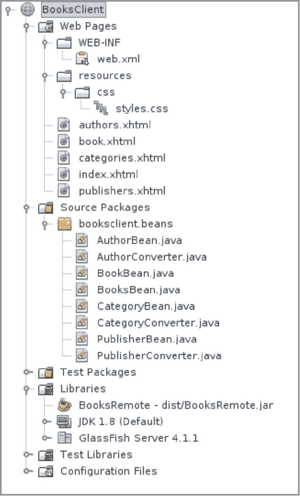

然而，这五个命名 Bean 类（named bean classes）必须进行一些修改，作为示例，我展示了`CategoryBean`，它是`categories.xhtml`的命名 Bean：


```java
package booksclient.beans;

import booksejb.beans.LibraryDAORemote;
import javax.ejb.EJB;
import javax.inject.Named;
import javax.enterprise.context.SessionScoped;
import java.util.*;
import booksejb.beans.*;

@Named(value = "categoryBean")
@SessionScoped
public class CategoryBean
{
    // Implementation
}
```

```java
public class CategoryBean implements java.io.Serializable
{
    @EJB
    private LibraryDAORemote libraryDAO;
    private Category category = new Category();
    private String error = "";

    public CategoryBean()
    {
    }

    public int getId()
    {
        return category.getId() == null ? 0 : category.getId();
    }

    public String getName()
    {
        return category.getName();
    }

    public void setName(String name)
    {
        this.category.setName(name);
    }

    public String getError()
    {
        return error;
    }

    public Collection<Category> getCategories()
    {
        return libraryDAO.getCategories();
    }

    public void select(Category cat)
    {
        category = cat;
    }

    public void clear()
    {
        error = "";
        category = new Category();
    }

    public void add()
    {
        error = "";
        if (libraryDAO.addCategory(category)) category = new Category(); else error = "Category could not be created!";
    }

    public void update()
    {
        error = "";
        if (libraryDAO.modCategory(category)) category = new Category();
        else error = "Category could not be updated!";
    }

    public void remove()
    {
        error = "";
        if (libraryDAO.delCategory(category)) category = new Category(); else error = "Category could not be deleted!";
    }
}
```

在`BooksClient`翻译并托管在服务器上后，就可以对程序进行测试，结果应该与`PaBooks`应用相同。

在本章开始，我注意到开发和测试企业级 Java Bean（Enterprise Java Beans）可能会很困难。在编写代码方面，它与其他 Java 代码没有太大区别，但将项目部署到服务器上以及在遇到问题时找出原因可能会很有问题。在这里你应该注意日志文件：

`/usr/local/glassfish-4.1.1/glassfish/domains/domian1/logs`

或者现在 Glassfish 服务器应该安装的位置。每当你部署一个项目时，服务器都会向此日志文件中写入内容，特别是在失败时，日志文件中还会包含问题的原因。该日志文件是调试非常重要的来源（也可以从 NetBeans 访问）。

### 问题 2

你必须解决与问题 1 相同的任务，但区别在于程序应该按照上一个示例所示的方式编写，将数据库操作移动到 EJB 中，由它使用 JPA 维护数据库。因此你需要编写三个项目：


1. `WorldRemote`，这是一个远程接口

2. `WorldEJB`，这是一个 EJB 模块项目

3. `WorldClient`，这是一个 Web 应用

 4 

### CDI

CDI 代表 `Context and Dependency Injection`（上下文与依赖注入），描述了应用服务器如何创建和移除对象，特别是你可以在代码中写以及应该写什么。

例如，如果你考虑一个带有备用豆（backing bean）的 JSF 页面，它只是一个普通的 Java 类，那么你不需要做任何操作来创建该类的对象，对象的生命周期由其注解定义的范围决定。


JavaBean 只是按照特定且简单的模式编写的类，程序员使用 `new` 操作符创建对象（豆）。之后，垃圾回收器负责在不再有引用它时移除该对象。

相比之下，托管豆（managed bean）是一种豆，它由应用服务器形式的容器负责创建对象，并在程序离开对象范围时再次移除该对象。这种豆也称为 CDI 对象。你不能用 `new` 创建托管豆。

CDI 对象是使用称为“注入”（injection）的技术创建的，这意味着由容器来处理。在定义带有注入的 bean 时，容器将检查该 bean 是否已创建；如果没有创建，它将实例化新对象，并对所有当前 bean 依赖的 bean 执行注入，最后执行被 `@PostConstruct` 装饰过的方法。

| 本电子书使用 SETASIGNSetaPDF PDF 组件制作，供 PHP 开发者使用 |
| :--- |
| www.setasign.com |

然后你就可以使用对象的方法。当 bean 必须被移除时，容器将首先执行被 `@PreDestroy` 装饰过的方法，然后由容器移除该对象。可以通过下面的图来说：

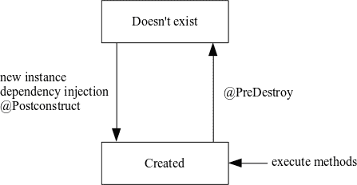

CDI 对象有一个名为 `context`（上下文）的范围，它基本上可以是请求-应用-会话（request-application-conversation）。例如，下面展示了一个简单的 bean：

```java
package cdiprogram.beans;
import javax.inject.Named;
import javax.enterprise.context.SessionScoped;
import java.io.Serializable;

@Named(value = "person")
@SessionScoped
public class Person
{
    private String firstName;
    private String lastName;

    public Person()
    {
    }

    public String getFirstName()
    {
        return firstName;
    }

    public void setFirstName(String firstName)
    {
        this.firstName = firstName;
    }

    public String getLastName()
    {
        return lastName;
    }

    public void setLastName(String lastName)
    {
        this.lastName = lastName;
    }
}
```

有趣的地方在于打开页面时，Glassfish 服务器会注入一个 `Person` 对象到会话中，而程序员不需要做任何事情来创建对象。

在之前的示例中，我经常必须通过以下语句从命名 bean 获取命名 bean：

```java
ELContext elc = FacesContext.getCurrentInstance().ELContext();
SomeBean someBean = (SomeBean)FacesContext.getCurrentInstance().getApplication().ELResolver().getValue(elc, null, "person");
```

这种写法没有错，但很难记忆。然而，你可以通过使用 CDI 来简化语法。在使用上述 bean 时，你可以编写以下 JSF 页面：

```xml
<?xml version='1.0' encoding='UTF-8' ?>
<!DOCTYPE html PUBLIC "-//W3C//DTD XHTML 1.0 Transitional//EN">
<html xmlns="http://www.w3.org/1999/xhtml" xmlns:h="http://xmlns.jcp.org/jsf/html">
<h:head>
    <title>Facelet Title</title>
</h:head>
<h:body>
    <h:form>
        <h:panelGrid columns="2">
            <h:outputLabel for="firstName" value="First Name"/>
            <h:inputText id="firstName" value="#{person.firstName}"/>
            <h:outputLabel for="lastName" value="Last Name"/>
            <h:inputText id="lastName" value="#{person.lastName}"/>
            <h:commandButton value="OK" />
        </h:panelGrid>
    </h:form>
</h:body>
</html>
```

<map name="aw17" class="calibre74"><area shape="rect" href="http://www.sylvania.com/" coords="141,38,237,49" class="calibre75"></map>

考虑以下命名 bean，它代表一个带有名字和科目的学生：

```java
package cdiprogram.beans;
import javax.inject.Named;
import javax.inject.Inject;
import javax.enterprise.context.SessionScoped;
import java.io.Serializable;

@Named(value = "student")
@SessionScoped
public class Student
{
    @Inject
    private Person person;
    private String subject;

    public Student()
    {
    }

    public Person getPerson()
    {
        return person;
    }
}
```

```java
public void setPerson(Person person)
{
    this.person = person;
}

public String getSubject()
{
    return subject;
}

public void setSubject(String subject)
{
    this.subject = subject;
}
}
```

名称由类型为 `Person` 的 `person` 变量表示。然而，你必须注意，这里并没有地方创建 `Person` 类型的对象（该属性似乎没有初始化），而是对 `person` 使用了 `@Inject` 注解进行装饰。

这表示作为托管 bean 的 `Student` 依赖于 `Person`（另一个托管 bean）。当容器在注入的帮助创建 `Student` 对象时，它将查找是否需要创建 `Person` 对象；如果是，则进行创建。

下面展示了如何编写一个以 `Student` 作为 backing bean 的 JSF 页面：

```xml
<?xml version='1.0' encoding='UTF-8' ?>
<!DOCTYPE html PUBLIC "-//W3C//DTD XHTML 1.0 Transitional//EN" … >
<html xmlns="http://www.w3.org/1999/xhtml" xmlns:h="http://xmlns.jcp.org/jsf/html">
<h:head>
    <title>Facelet Title</title>
</h:head>
<h:body>
    <h:form>
        <h:panelGrid columns="2">
            <h:outputLabel for="firstName" value="First Name"/>
            <h:inputText id="firstName" value="#{student.person.firstName}"/>
            <h:outputLabel for="lastName" value="Last Name"/>
            <h:inputText id="lastName" value="#{student.person.lastName}"/>
            <h:outputLabel for="subject" value="Subject"/>
            <h:inputText id="subject" value="#{student.subject}"/>
            <h:commandButton value="OK" />
            <h:panelGroup/>
        </h:panelGrid>
    </h:form>
</h:body>
</html>
```

### 4.1 限定符（QUALIFIERS）

如果你考虑 bean `Student`，它对 bean `Person` 有依赖。现在我将定义一个派生类，我将其称为 `Man`，但首先我将把 `Person` 类设为抽象类，并扩展一个返回人员性别的抽象 `abstract` 方法：

```java
@Named(value = "person")
@SessionScoped
public abstract class Person implements Serializable
{
    …
    public abstract String getGender();
}
```

然后我可以编写以下 bean：

```java
package cdiprogram.beans; 
import javax.inject.Named;
import javax.enterprise.context.SessionScoped; 
import java.io.Serializable;

@Named(value = "man")
@SessionScoped @Male
public class Man extends Person implements Serializable
{
    public Man()
    {
    }

    public String getGender()
    {
        return "A man";
    }
}
```

如果你忽略 `@Male` 注解，这个类中并没有新东西。它是一个继承托管 bean 的托管 bean，而 bean 仅仅是一个类。

如果你从容器的角度看 `Student` 类，它定义了一个类型为 `Person` 的变量 `person`，那么容器必须创建一个实际的对象，例如 `Man` 对象。由于 `Person` 类可能有更多的派生类，人们应该能够告诉容器实例化该对象的目的，这可以通过限定符（qualifier）来实现。

`Male` 是一个限定符，是一个如下定义的接口：

```java
package cdiprogram.beans;
import static java.lang.annotation.ElementType.TYPE; 
import static java.lang.annotation.ElementType.FIELD; 
import static java.lang.annotation.ElementType.PARAMETER; 
import static java.lang.annotation.ElementType.METHOD;
import static java.lang.annotation.RetentionPolicy.RUNTIME; 
import java.lang.annotation.Retention;
import java.lang.annotation.Target; 
import javax.inject.Qualifier;

@Qualifier @Retention(RUNTIME)
@Target({METHOD, FIELD, PARAMETER, TYPE})
public @interface Male
{
}
```

在 `Man` 类中，你通过 `@Male` 告诉该类标识为限定符 `Male`。`CDIProgram` 项目还定义了一个派生类 `Woman`，由限定符 `Female` 标识。

原则上讲，编写限定符是简单的，但语法可能很难记忆，因此 NetBeans 为此提供了一个 `File Type`（文件类型）：

如果你随后想让 `Student` 类创建一个 `Woman` 对象，语法如下：

```java
public class Student implements Serializable
{
    @Inject
    @Female
    private Person person;
}
```

查看上面的解决方案，定义容器需要创建的特定类型非常简单。然而，如果你考虑 `Person` 有许多子类的情况，则必须编写许多限定符。相反，你可以定义一个参数：

```java
package cdiprogram.beans;
import static java.lang.annotation.ElementType.TYPE; 
import static java.lang.annotation.ElementType.FIELD; 
import static java.lang.annotation.ElementType.PARAMETER; 
import static java.lang.annotation.ElementType.METHOD;
import static java.lang.annotation.RetentionPolicy.RUNTIME; 
import java.lang.annotation.Retention;
import java.lang.annotation.Target; 
import javax.inject.Qualifier;

@Qualifier @Retention(RUNTIME)
@Target({METHOD, FIELD, PARAMETER, TYPE})
public @interface Gender
{
}
```

这个限定符现在有一个名为 `value` 的属性。请注意，限定符完全可以更多属性。然后你可以如下方式装饰类 `Man` 和 `Woman`：

```java
@Named(value = "man")
@SessionScoped
@Gender(value = "Male")
public class Man extends Person implements Serializable
{
}
```

对于注入，你可以写：

```java
@Named(value = "student")
@SessionScoped
public class Student implements Serializable
{
    @Inject
    @Gender(value = "Female")
    private Person person;
    private String subject;
}
```

### 4.2 作用域（CONTEXTS）

当通过注入或从 JSF 页面引用需要托管 bean 时，CDI 将尝试在特定 bean 的作用域内查找实例。如果成功，则使用该实例；否则将创建一个属于当前作用域的对象。

通常，一个对象（托管 bean）必须跨越多个页面“生存”，而你不能使用 `RequestScoped`，因为它只关系当前页面。每当进行页面请求时，对象都会被创建。

到目前为止（在这本书和之前的两本书中都是如此），我通过将 bean 定义为 `SessionScoped` 来解决这个问题。这种方法可行，但也是简单的解决方案，而且 `SessionScoped` bean 也有缺点。

首先，这些 bean 在整个会话期间存在，并在会话结束后一段时间内仍然存在。这意味着会话对象会不必要地占用机器内存。更大的问题是，由于 `SessionScoped` bean（以及所有的会话对象）的寿命比需要的时间长，因此存在在逻辑上已不存在后仍被使用的风险。后者实际上可能会使修复 Web 应用程序中的错误变得非常困难。


存在一种名为`conversation`（对话）的上下文，bean 可以在多个页面之间存在，但不会跨越整个会话（session），它的目标正是为了解决会话上下文带来的挑战。代价是，程序员必须告诉容器对话何时开始以及何时结束。

我想通过`ChangeAddress`示例来展示`ConversationScoped`是如何工作的。在这个示例中，区别在于输入地址的表单被无分地分成了三个页面——并没有什么特殊原因。我将从一个名为`ChangeAddress4`的项目开始，它是`ChangeAddress1`的副本。除了`list.xhtml`（未更改）外，还有三个新的 JSF 页面，地址的输入通过这三个 JSF 页面的向导完成：

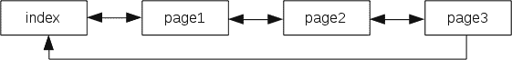

`index.xhtml`现在被简化为以下非常简单的页面：

```xml
<?xml version='1.0' encoding='UTF-8' ?>
<!DOCTYPE html PUBLIC "-//W3C//DTD XHTML 1.0 Transitional//EN" … >
<html xmlns="http://www.w3.org/1999/xhtml" xmlns:h="http://xmlns.jcp.org/jsf/html" xmlns:f="http://xmlns.jcp.org/jsf/core">
<h:head>
    <meta http-equiv="Content-Type" content="text/html; charset=UTF-8"/>
    <title>Change address</title>
    <h:outputStylesheet library="css" name="styles.css"/>
</h:head>
<h:body>
    <h1>Change address</h1>
    <h:form>
        <p><h:commandLink value="Create new address" action="#{indexController.page1()}" /></p>
        <p><h:commandLink value="Show addresses" action="list" /></p>
    </h:form>
</h:body>
</html>
```

它会打开以下窗口：

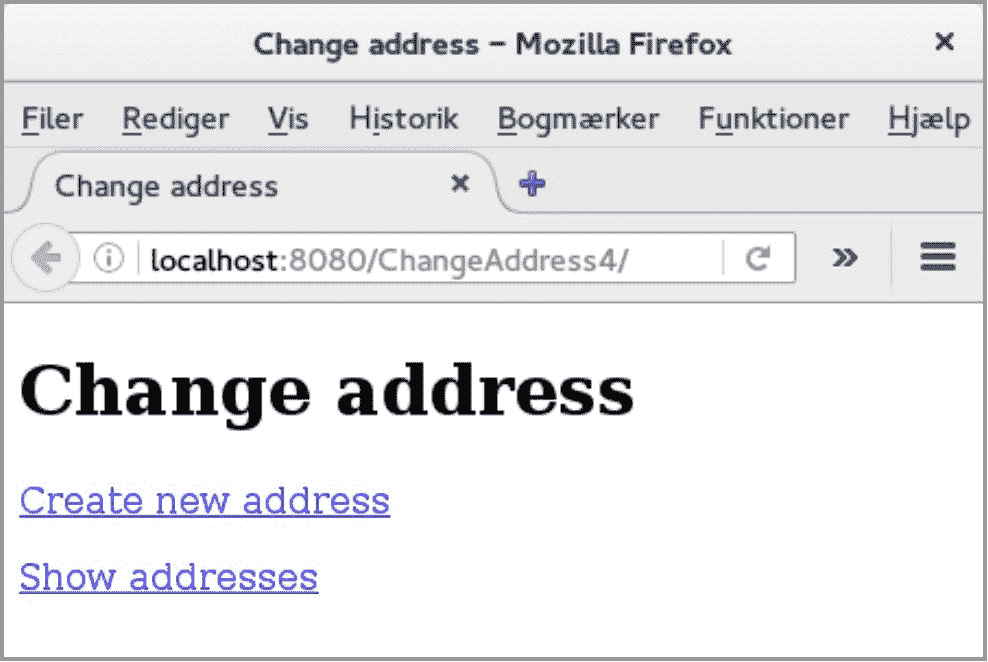

点击顶部的链接将进入一个输入名称的页面，`ChangeAddress1`项目的表单通常分为三个页面，如下所示。这三个页面称为：

- `page1.xhtml`
- `page2.xhtml`
- `page3.xhtml`

实体类`Address`与之前保持不变，但定义了一个简单的包装类`Person`（一个托管 bean）。你只需要注意的是，它是一个被定义为`ConversationScoped`的命名 bean：

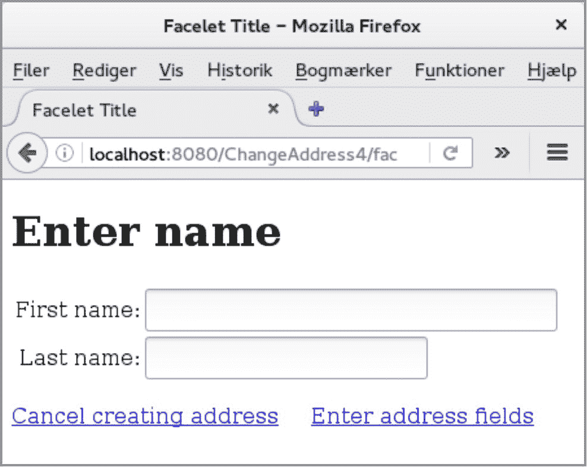


```java
package changeaddress.beans;

import javax.inject.Named;
import javax.enterprise.context.ConversationScoped;
import java.io.Serializable;
import changeaddress.models.Address;

@Named(value = "person")
@ConversationScoped
public class Person implements Serializable {
    private Address address;

    public Person() {
        address = new Address();
    }

    public Address getAddress() {
        return address;
    }

    public void setAddress(Address address) {
        this.address = address;
    }
}
```

三个新 JSF 页面的代码非常简单，我不想在这里展示，但新的变动在已过的`IndexController`中。代码如下所示，但我没有显示`get`和`set`方法，因为它们和之前的一样：

```java
package changeaddress.beans;

import java.util.*;
import javax.inject.*;
import javax.enterprise.context.*;
import java.io.Serializable;
import javax.persistence.*;
import javax.transaction.*;
import javax.annotation.*;
import changeaddress.models.*;
import javax.persistence.criteria.CriteriaQuery;

@Named(value = "indexController")
@RequestScoped
public class IndexController implements Serializable {
    @Inject
    private Conversation conversation;

    @Inject
    private Person person;

    @PersistenceUnit
    EntityManagerFactory emf;

    @PersistenceContext
    EntityManager em;

    @Resource
    UserTransaction utx;

    private List<Address> persons = new ArrayList();

    public IndexController() {
    }

    public String cancel() {
        conversation.end();
        return "index";
    }

    public String page1() {
        conversation.begin();
        return "page1";
    }

    public List<Address> getPersons() {
        try {
            CriteriaQuery cq = em.getCriteriaBuilder().createQuery();
            cq.select(cq.from(Address.class));
            Query q = em.createQuery(cq);
            return persons = q.getResultList();
        } catch (Exception ex) {
        }
        return persons;
    }

    public String add() {
        try {
            utx.begin();
            em.persist(person.getAddress());
            utx.commit();
            conversation.end();
            return "index";
        } catch (Exception ex) {
            try {
                utx.rollback();
            } catch (Exception e) {
            }
        }
        return "";
    }
}
```

在这里你应该注意，现在的上下文是`RequestScoped`。此外，注意`page1()`和`cancel()`两个方法。第一个从`index.xhtml`调用，如果你选择创建一个新地址。它调用`conversation.begin()`方法，这会启动一个新的对话。`cancel()`方法在三个编辑页面之一中点击“取消”时被调用，重要的是它执行了`conversation.end()`方法来完成正在进行的对话。这意味着容器将移除该 bean。

## Web 服务

Web 服务是一种可以托管在 Web 服务器上并为客户端提供服务的组件，Web 服务在某种程度上可以被视为企业级 Bean（Enterprise Java Beans）的替代方案。

Web 服务的特点是易于开发且与平台无关。后者意味着 Web 服务与客户端之间的通信是以`XML`格式进行的，并通过一种名为`SOAP`的协议，因此完全以文本形式存在。因此，使用 Web 服务被认为是一种安全技术，但代价是如`XML`等消息的编码可能会在性能上产生一些影响。

必须向客户端根据参数和返回值定义 Web 服务及其服务，这是通过一个名为`Web Service Definition Language (WSDL)`的 XML 文档来完成的。编写 Web 服务最大的挑战是编写该文档，它非常复杂（语法困难且全面），但在这里 NetBeans 帮了大忙，因为它可以生成所有内容，你实际上可以在不了解任何`WSDL`的情况下编写 Web 服务。

我想从一个具有两个服务的简单 Web 服务开始：

- `double celsiusToFahrenheit(double value)`：将华氏度转换为摄氏度
- `double fahrenheitToCelsius(double value)`：将摄氏度转换为华氏度

我从一个 Web 应用程序开始，将其命名为`ConversionService`，它只需要是一个空的 Web 应用程序。然后我添加一个 Web 服务。


在接下来的窗口中，我必须输入一个名称（这里是`ConversionService`）并选择一个包：


当我点击`Next`时，NetBeans 创建以下类：

```java
package conversionservice.services;

import javax.jws.WebService; import javax.jws.WebMethod; import javax.jws.WebParam;

@WebService(serviceName = "ConversionService")

public class ConversionService
{

@WebMethod(operationName = "hello")
public String hello(@WebParam(name = "name") String txt)
{
return "Hello " + txt + " !";
}

}
```

注意使用了哪些注解，以及 NetBeans 创建了一个单一服务——你当然应该删除它。这可以直接完成，但点击工具栏上的`Design`按钮将给你一个可以用于生成最终代码的向导：

```java
package conversionservice.services;

import javax.jws.WebService; import javax.jws.WebMethod; import javax.jws.WebParam;

@WebService(serviceName = "ConversionService")

public class ConversionService
{

@WebMethod(operationName = "celsiusToFahrenheit")
public double celsiusToFahrenheit(@WebParam(name = "value") double value)
{
return 1.8 * value + 32;
}

@WebMethod(operationName = "fahrenheitToCelsius")
public double fahrenheitToCelsius(@WebParam(name = "value") double value)
{
return (value – 32) / 1.8;
}

}
```

使用向导最大也是唯一的优点是 NetBeans 插入了正确的注解。

然后构建项目并选择部署。在 NetBeans 项目标签页中，会创建一个`Web Servers`元素：


如果你右键点击`ConversionService`并选择`Test Web Service`，浏览器将打开一个窗口来测试该服务：


在这里，你应该特别注意链接`WSDL File`。点击它将显示定义相关服务的`WSDL`代码。

服务测试完成后，必须编写一个客户端，这次它应该是一个名为`ConversionClient`的简单控制台应用程序。在我创建应用程序后，我添加了一个`Web Service Client`：


在下一个屏幕中，在`Project`下选择当前的 Web 服务，NetBeans 将简单地插入它的 URL。最后，输入一个包：


NetBeans 现在创建对 Web 服务的引用，你可以使用它提供的服务：


要使用某个服务，你需要编写一条复杂的语句，但你可以简单地将服务拖入客户端代码中，NetBeans 会创建所需的代码。以下是客户端的完整代码：

```java
package conversionclient;

public class ConversionClient
{

public static void main(String[] args)
{
System.out.println("30 Celsius = " + celsiusToFahrenheit(30) + "Fahrenheit") System.out.println(
"100 Fahrenheit = " + fahrenheitToCelsius(100) + " Celsius");
}

private static double celsiusToFahrenheit(double value)
{
conversionclient.ConversionService_Service service = new conversionclient.ConversionService_Service();
conversionclient.ConversionService port =service.getConversionServicePort(); return port.celsiusToFahrenheit(value);
}

private static double fahrenheitToCelsius(double value)
{
conversionclient.ConversionService_Service service = new conversionclient.ConversionService_Service();
conversionclient.ConversionService port =service.getConversionServicePort(); return port.fahrenheitToCelsius(value);
}

}
```

你应该特别注意 NetBeans 创建的两个方法，除此之外，程序已准备就绪：

```text
30 Celsius

100 Fahrenheit
```

### 练习 4

从创建一个`ConversionService`项目的副本开始。然后你必须用两个新服务扩展相应的 Web 服务：

- `double kilometerToMiles(double value)`
- `double milesToKilometer(double value)`

分别将公里转换为英里和从英里转换为公里。


```html
<map name="awmap21" class="calibre474">
    <area shape="rect" href="http://www.rug.nl/education" coords="114,429,146,453" class="calibre475">
    <area shape="rect" href="http://www.rug.nl/education" coords="114,405,341,428" class="calibre475">
</map>
```


当你写完服务并部署它后，编写一个可以调用`ConversionClient`的客户端程序，但这次应该是一个 Web 应用程序。如果要在浏览器中打开应用程序，它将打开以下窗口：


上面的表单应该使用你的 Web 服务的后端 Bean。原则上，它的工作方式与介绍示例完全相同，不同在于你应该将`localhost_8080`文件夹复制到`WEB-INF`下的`wsdl`文件夹：


### 练习 5

在这个练习中，你必须编写一个可以搜索丹麦君主的 Web 应用程序：


你可以将项目命名为 `DanishKings`，与之前不同之处是，这次搜索应该通过 Web 服务完成。

从创建一个名为 `KingsServices` 的 Web 应用程序开始，并添加一个名为 `KingService` 的 Web 服务。添加一个简单的模型类：

```java
package kings.services;

public class King {
    private String name;
    private int from;
    private int to;
}
```

相关的 Web 服务必须具有两个服务：

```java
@WebMethod(operationName = "getKing")
public List<King> getKing(@WebParam(name = "year") int year) {
}

@WebMethod(operationName = "getKings")
public List<King> getKings(
    @WebParam(name = "year1") int year1,
    @WebParam(name = "year2") int year2
) {
}
```

其中，第一个将返回统治某年份的君主，而另一个将返回统治期重叠特定区间的君主。丹麦君主的名称和统治期可以像之前的示例一样，以常量的形式存储在程序中。

### 5.1 作为 Web 服务的 EJB

如上所示，Web 服务无非是一个装饰了几个注解的普通 Java 类，并整体被封装在一个 Web 应用程序中。你也可以使用无状态会话豆（stateless session bean）作为 Web 服务。它允许从 Java 以外的其他语言使用无状态 EJB，并可以使用企业级 Java Bean（enterprise beans）的其他属性，例如事务。

事实上，你可以通过两种方式实现：通过在 EJB 中创建 Web 服务，或者将 EJB 嵌入为 Web 服务。

## 示例 1：带有无状态会话豆的 EJB 模块


<map name="awmap22" class="calibre474"><area shape="rect" href="http://www.ligsuniversity.com/" coords="173, 433, 413, 459" class="calibre475"></map>


作为一个示例，我建立了一个 EJB 模块项目，将其命名为 `EJBConversion`。对于这个项目，我添加了一个名为 `Conversion` 的 Web 服务：


注意，我选择了 `Create Web Service from Scratch`（从头创建 Web 服务），并勾选了底部的复选框。点击 `Finish` 后，创建了一个 Web 服务，其中主要的区别在于，它是一个无状态会话豆。完成后的服务如下所示：

```java
package ejbconversion.services;

import javax.jws.WebService;
import javax.jws.WebMethod;
import javax.jws.WebParam;
import javax.ejb.Stateless;

@WebService(serviceName = "Conversions")
@Stateless()
public class Conversions {
    @WebMethod(operationName = "celsiusToFahrenheit")
    public double celsiusToFahrenheit(
        @WebParam(name = "value") double value
    ) {
        return 1.8 * value + 32;
    }

    @WebMethod(operationName = "fahrenheitToCelsius")
    public double fahrenheitToCelsius(
        @WebParam(name = "value") double value
    ) {
        return (value – 32) / 1.8;
    }
}
```

然后就可以按照通常方式构建并部署该项目。`ConversionProgram` 项目与 `ConversionClient` 相同，区别仅在于使用了另一个 Web 服务（如所示），这是一个作为企业级 Java Bean 托管的 Web 服务。

## 示例 2：使用现有的 EJB

作为最后一个示例，我将编写一个使用现有 EJB 的 Web 服务。我将使用 `ZipcodesEJB`，它对数据库 `padata` 中的 `zipcode` 表执行 CRUD（增删改查）操作。相关的 EJB 提供了 4 个服务，目标是通过 Web 服务提供这些服务。

起点是一个名为 `ZipcodesServices` 的空 Web 应用程序。第一步，我放入了对 jar 文件 `ZipcodesRemote` 的引用，它是 `ZipcodesEJB` 的远程接口。接下来，我向项目添加了一个名为 `ZipcodesWS` 的 Web 服务：


在这里你应该特别注意，我选择了 `Create Web Service from Existing Session Bean`（从现有会话豆创建 Web 服务），然后我浏览到了那个特定的豆。当你点击 `Finish` 时，NetBeans 会创建以下 Web 服务：

```java
package zipcodesservices;

import java.util.List;
import javax.ejb.EJB;
import javax.jws.WebMethod;
import javax.jws.WebParam;
import javax.jws.WebService;
import zipcodes.beans.ZipcodeRemote;
import zipcodes.beans.ZipcodesSessionRemote;

@WebService(serviceName = "ZipcodesWS")
public class ZipcodesWS {
    @EJB
    private ZipcodesSessionRemote ejbRef;

    @WebMethod(operationName = "create")
    public boolean create(@WebParam(name = "obj") ZipcodeRemote obj) {
        return ejbRef.create(obj);
    }

    @WebMethod(operationName = "update")
    public boolean update(@WebParam(name = "obj") ZipcodeRemote obj) {
        return ejbRef.update(obj);
    }

    @WebMethod(operationName = "remove")
    public boolean remove(@WebParam(name = "code") String code) {
        return ejbRef.remove(code);
    }

    @WebMethod(operationName = "search")
    public List<ZipcodeRemote> search(
        @WebParam(name = "code") String code,
        @WebParam(name = "City") String City
    ) {
        return ejbRef.search(code, City);
    }
}
```

 

正如你看到的，它仅仅是 `ZipcodesEJB` 的一个封装器。服务完成后，可以被编译并托管在服务器上。

然后我写了一个客户端，这是一个名为 `ConversionProgram` 的 Web 应用程序。它基本上与 `ConversionClient` 相同，区别在于添加了一个 Web 服务，我不想展示代码。

## 理解 REST 服务

REST 代表表象层状态转移（Representational State Transfer）。与其他 Web 服务一样，它们可以被视为由 URI 标识的资源，数据通常以 XML 形式发送。

`HTTP` 方法：

1. `GET`：用于检索现有资源。
2. `POST`：用于创建新资源。
3. `PUT`：用于更新现有资源。
4. `DELETE`：用于删除现有资源。

我想从一个简单的（hello）Web 应用程序开始，我将其命名为 `HelloApp`。创建项目后，我添加了 RESTful Web Services：


我输入了 Resource、`Path` 和类名。注意 MIME 类型为 XML。当我随后点击 `Finish` 时，NetBeans 创建了两个文件：


加入马斯里希特大学商学院：

- 第 33 名：全球硕士
- 第 1 名：国际商务硕士
- 第 1 名：管理硕士
- ...：计量经济学与运筹硕士


<map name="awmap23" class="calibre1"><area shape="rect" href="http://www.ligsuniversity.com/" coords="498, 416, 517, 438" class="calibre39"><area shape="rect" href="http://www.ligsuniversity.com/" coords="498, 394, 707, 416" class="calibre39"></map>


最后一个是我的 RESTful Web 服务。代码如下，我删除了注释，并在 `getXml()` 方法中输入了代码：

```java
package helloapp.services;

import javax.ws.rs.core.Context;
import javax.ws.rs.core.UriInfo;
import javax.ws.rs.Produces;
import javax.ws.rs.Consumes;
import javax.ws.rs.GET;
import javax.ws.rs.Path;
import javax.ws.rs.PUT;
import javax.ws.rs.core.MediaType;

@Path("hello")
public class HelloResource {
    @Context
    private UriInfo context;

    public HelloResource() {
    }

    @GET
    @Produces(MediaType.APPLICATION_XML)
    public String getXml() {
        return
            "<message>\n"
            + "<hello>Hello from</hello>\n"
            + "<firstName>Ragnar</firstName>\n"
            + "<lastName>Lodbrog</lastName>\n"
            + "<job>Viking</job>\n"
            + "</message>\n";
    }

    @PUT
    @Consumes(MediaType.APPLICATION_XML)
    public void putXml(String content) {
    }
}
```

你必须注意这些注解。在这里，`@Path` 指定了当前服务（资源）的标识名称。`@GET` 定义了当从浏览器发生 HTTP `GET` 请求时执行的方法，同样，`@PUT` 定义了用于 HTTP `PUT` 方法。注意，第一个方法被 `@Produces` 装饰，这表示该方法返回 XML；而另一个方法被 `@Consumes` 装饰，这表示该方法将参数的内容解释为 XML。在这种情况下，最后一个方法是空的，而第一个方法返回了一些 XML。

容器必须知道资源被称为什么，这就是第二个类的目的：

```java
package helloapp.services;

import java.util.Set;
import javax.ws.rs.core.Application;

@javax.ws.rs.ApplicationPath("webresources")
public class ApplicationConfig extends Application {
    @Override
    public Set<Class<?>> getClasses() {
        Set<Class<?>> resources = new java.util.HashSet<>();
        addRestResourceClasses(resources);
        return resources;
    }

    private void addRestResourceClasses(Set<Class<?>> resources) {
        resources.add(helloapp.services.HelloResource.class);
    }
}
```

这是一个继承自 `Application` 的类，该类被 `@ApplicationPath` 装饰，它指定了一个名称（这里是 `webresources`），该名称包含在资源的 URI 中。最后一个方法将实际的资源对象添加到集合中（这里是一个 `HashSet`）。

所有操作的结果是，资源的 URI 为 `http://localhost:8080/helloapp/webresources/hello`。

如果你编译项目并执行部署，该资源就可以使用了。此时会创建一个 RESTful Web 服务项，如果你右键点击 `HelloResource` [hello]：


 

你可以选择 `Test Resource URI`（测试资源 URI），之后浏览器会打开以下窗口：


结果是执行了 `getXml()` 方法，该方法已向浏览器发送了响应。下一步我将编写一个使用该资源的客户端，它应该是一个简单的控制台应用程序。因此，我创建了一个名为 `HelloREST` 的 Java Application 项目。对于此项目，我添加了一个 RESTful Java Client：


当你点击 `Next`（下一步）时，你会看到以下窗口：


在这里我输入了类名，选择了一个包，并使用 `Browse`（浏览）按钮设置了资源的引用。注意 `Authentication`（身份验证）为 `NONE`（默认值）。点击 `Finish`（完成）后，NetBeans 会创建以下代表面向客户端服务的类：

```java
package hellorest;

import javax.ws.rs.ClientErrorException;
import javax.ws.rs.client.Client;
import javax.ws.rs.client.WebTarget;

public class HelloClient {
    private WebTarget webTarget;
    private Client client;

    private static final String BASE_URI =
        "http://localhost:8080/HelloApp/webresources";

    public HelloClient() {
        client = javax.ws.rs.client.ClientBuilder.newClient();
        webTarget = client.target(BASE_URI).path("hello");
    }

    public String getXml() throws ClientErrorException {
        WebTarget resource = webTarget;
        return resource
            .request(javax.ws.rs.core.MediaType.APPLICATION_XML)
            .get(String.class);
    }

    public void putXml(Object requestEntity) throws ClientErrorException {
        webTarget
            .request(javax.ws.rs.core.MediaType.APPLICATION_XML)
            .put(
                javax.ws.rs.client.Entity.entity(
                    requestEntity,
                    javax.ws.rs.core.MediaType.APPLICATION_XML
                )
            );
    }

    public void close() {
        client.close();
    }
}
```

然后我写了以下 `main()` 方法：

```java
package hellorest;

public class HelloREST {
    public static void main(String[] args) {
           
    }
}
```


```java
HelloClient client = new HelloClient();
System.out.println(client.getXml());
client.close();
```

运行程序的结果如下：

```xml
<message>
    <hello>Hello from</hello>
    <firstName>Ragnar</firstName>
    <lastName>Lodbrog</lastName>
    <job>Viking</job>
</message>
```

这看起来可能不多，但你可以看到相关的服务已经执行了。

观察上述内容，创建和使用 RESTful Web 服务并编写客户端是非常简单的，但当然，问题在于你收到的结果是 XML。如果你向服务发送某些内容，它也必须是 XML。然而，在 XML 和自定义类型之间进行转换是容易的，这需要该类型有一个注解，并且那……

```java
this.msg.setFirstname(msg.getFirstname());
this.msg.setLastname(msg.getLastname());
this.msg.setJob(msg.getJob());
this.msg.setText(msg.getText());
```

首先，应该有一个类库 `HelloRemote` 的引用。然后创建一个类型为 `Message` 的对象，并且 `getXml()` 的返回类型已更改为 `Message`。该方法的 `MediaType` 仍然是 `XML`。结果是对象 `msg` 在发送到客户端之前会被编码为 `XML`。

同样，`putXml()` 也发生了更改，现在它接收一个 `Message` 对象作为参数，并且该方法更新 `msg` 对象。这当然是伪代码，因为这些更改并没有用于任何地方——消息 `msg` 在服务的两次调用之间是不存在的。

在服务发生更改并部署后，客户端程序也必须更新。首先，应该对类 `HelloService` 进行微调。资源由一个类型为 `WebTarget` 的对象表示，如果你在这个对象上执行 `request()` 方法，它会调用服务的 `get` 方法（在这里是带有 `@GET` 装饰的 `getXml()`）。它告诉要将数据编码为 `XML`。

最后，通过 `get()` 方法，你指定了结果应该如何转换，之前是 `String`。现在它被更改为类型 `Message`，这就是 `HelloClient` 类中需要更改的所有内容：

```java
public String getXml() throws ClientErrorException {
    WebTarget resource = webTarget;
    return resource
        .request(javax.ws.rs.core.MediaType.APPLICATION_XML)
        .get(Message.class);
}
```

最后，`HelloREST` 中的 `main()` 方法必须更改：

```java
package hellorest;

import helloremote.entities.Message;

public class HelloREST {
    public static void main(String[] args) {
        Message msg;

        HelloClient client = new HelloClient();
        System.out.println(msg = client.getXml());

        msg.setJob("Danish Viking");
        client.putXml(msg);

        client.close();
        System.out.println();
        System.out.println(msg);
    }
}
```

如果程序应该像以前一样工作，实际上没有必要更改任何内容。这些更改仅涉及我想展示如何使用 `putXml()` 以及 `Message` 对象如何自动编码为 `XML`。

## 6.1 再次 CHANGEADDRESS

上面是一个非常简单的 RESTful Web 服务，并不是一个典型的例子。在这个例子中，我想展示另一个版本的程序 `ChangeAddress`，其区别在于程序这次使用一个 RESTful Web 服务来维护数据库。

我首先创建了一个名为 `AddressesRemote` 的类库项目。对于这个项目，我从 `Database` 添加了实体类（Entity Classes），它是我的 MySQL 数据库 `addresses` 中 `address` 表的实体类。我的库不应该包含其他任何内容，并且应该被翻译，以便可以直接使用。

然后，我创建了一个名为 `AddressesREST` 的新 Web 应用项目。对于这个项目，我从实体类中添加了一个作为 RESTful Web Service 的 Web 服务：


然后我必须选择一个实体类（只有一个）：


在接下来的窗口中，我必须选择或输入一个包，我在其中输入了 `addressrest.service`。结果是 NetBeans 创建了三个文件：

- `AbstractFacade.java`
- `AddressFacadeREST.java`
- `ApplicationConfig.java`

最后一个与第一个示例中的配置类相同，而其他类定义了使用 JPA 维护数据库的方法。`AbstractFacade` 是 `AddressFacadeREST` 的基类，我不想在这里显示该类，另一个类的代码如下：

```java
@Stateless
@Path("addressesremote.address")
public class AddressFacadeREST extends AbstractFacade<Address> {
    @PersistenceContext(unitName = "AddressesRESTPU")
    private EntityManager em;

    public AddressFacadeREST() {
        super(Address.class);
    }

    @POST
    @Override
    @Consumes({
        MediaType.APPLICATION_XML,
        MediaType.APPLICATION_JSON
    })
    public void create(Address entity) {
        super.create(entity);
    }

    @PUT
    @Path("{id}")
    @Consumes({
        MediaType.APPLICATION_XML,
        MediaType.APPLICATION_JSON
    })
    public void edit(@PathParam("id") Integer id, Address entity) {
        super.edit(entity);
    }

    @DELETE
    @Path("{id}")
    public void delete(@PathParam("id") Integer id) {
        super.remove(id);
    }

    @GET
    @Path("{id}")
    @Produces({
        MediaType.APPLICATION_XML,
        MediaType.APPLICATION_JSON
    })
    public Address find(@PathParam("id") Integer id) {
        return super.find(id);
    }

    @GET
    @Override
    @Produces({
        MediaType.APPLICATION_XML,
        MediaType.APPLICATION_JSON
    })
    public List<Address> findAll() {
        return super.findAll();
    }

    @GET
    @Path("{from}/{to}")
    @Produces({
        MediaType.APPLICATION_XML,
        MediaType.APPLICATION_JSON
    })
    public List<Address> findRange(
            @PathParam("from") Integer from,
            @PathParam("to") Integer to) {
        return super.findRange(from, to);
    }

    @GET
    @Path("count")
    @Produces(MediaType.TEXT_PLAIN)
    public String count() {
        return String.valueOf(super.count());
    }

    @Override
    protected EntityManager getEntityManager() {
        return em;
    }
}
```

这是一个 RESTful 服务，你可以看到它是 bean。类创建：

- `@POST` 创建地址
- `@PUT` 更新地址
- `@DELETE` 删除地址

如果你在部署服务时遇到问题，请检查配置文件：


这里，你可能需要添加实体类。之后你应该能够部署该项目。

接下来，必须编写客户端，我从 `ChangeAddress` 的副本开始。我删除了类库 `AddressesRemote`。作为下一步，我添加了一个名为 `AddressesClient` 的 RESTful Java 类。它与对应的类类似，但为 XML 和 JSON 创建了方法。我展示了类的部分内容，但只有我的程序需要的部分：

```java
package changeaddress.beans;

import javax.ws.rs.ClientErrorException;
import javax.ws.rs.client.Client;
import javax.ws.rs.client.WebTarget;
import javax.ws.rs.client.ClientBuilder;
import javax.ws.rs.client.Entity;
import javax.ws.rs.core.MediaType;

import java.util.List;

public class AddressesClient {
    private WebTarget webTarget;
    private Client client;

    private static final String BASE_URI =
            "http://localhost:8080/AddressesREST/webresources";

    public AddressesClient() {
        client = ClientBuilder.newClient();
        webTarget = client
                .target(BASE_URI)
                .path("addressesremote.address");
    }

    public void create_XML(Object requestEntity)
            throws ClientErrorException {
        webTarget
                .request(javax.ws.rs.core.MediaType.APPLICATION_XML)
                .post(Entity.entity(
                        requestEntity,
                        javax.ws.rs.core.MediaType.APPLICATION_XML));
    }

    public void create_JSON(Object requestEntity)
            throws ClientErrorException {
        webTarget
                .request(javax.ws.rs.core.MediaType.APPLICATION_JSON)
                .post(Entity.entity(
                        requestEntity,
                        javax.ws.rs.core.MediaType.APPLICATION_JSON));
    }

    public <T> T findAll_XML(Class<T> responseType)
            throws ClientErrorException {
        WebTarget resource = webTarget;
        return resource
                .request(javax.ws.rs.core.MediaType.APPLICATION_XML)
                .get(responseType);
    }

    public <T> T findAll_JSON(Class<T> responseType)
            throws ClientErrorException {
        WebTarget resource = webTarget;
        return resource
                .request(javax.ws.rs.core.MediaType.APPLICATION_JSON)
                .get(responseType);
    }

    public void close() {
        client.close();
    }
}
```

该类与上一个示例中的对应方法相似。构造函数创建了一个指向 `WebTarget` 类型对象所表示的引用。该对象可以使用四种 HTTP 方法之一对资源执行请求。在当前示例中，使用 `GET` 来执行请求（返回所有地址），使用 `POST` 来创建新地址。

注意 `findAll_XML()` 方法，它是泛型的。在此处，你必须指定方法应该返回的对象类型，这里是 `List<Address>`。由于结果是 XML，它必须被自动解析为 `List<Address>` 对象，正如上一个示例所示。

然而，这会导致一个问题，因为 `List<Address>` 类型没有被标记为 `@XmlRootElement`。因此，有必要在一个包装类中嵌入 `List<Address>`：

```java
package changeaddress.beans;

import java.util.List;
import javax.xml.bind.annotation.*;
import addressesremote.*;

@XmlRootElement(name = "addresses")
@XmlAccessorType(XmlAccessType.FIELD)
public class Addresses {
    @XmlElement(name = "address")
    private List<Address> addresses = null;

    public Addresses() {
    }

    public List<Address> getAddresses() {
        return addresses;
    }

    public void setAddresses(List<Address> addresses) {
        this.addresses = addresses;
    }
}
```

有了这个类，你就可以编写完成的命名豆（named bean），它只是对现有类的简单更新（我没有显示 `get` 和 `set` 方法）：

```java
package changeaddress.beans;

import addressesremote.Address;
import java.util.*;
import javax.inject.Named;
import javax.enterprise.context.SessionScoped;
import java.io.Serializable;

@Named(value = "indexController")
@SessionScoped
public class IndexController implements Serializable {
    private Address person = new Address();
    private List<Address> persons = new ArrayList();

    public IndexController() {
    }

    public List getPersons() {
        try {
            AddressesClient client = new AddressesClient();
            Addresses wrapper = client.findAll_XML(Addresses.class);
            persons = wrapper.getAddresses();
            client.close();
        } catch (Exception ex) {
            persons = new ArrayList();
        }

        return persons;
    }

    public void add() {
        try {
```


```java
AddressesClient client = new AddressesClient();

client.create_XML(person);

client.close();

person = new Address();

}

catch (Exception ex) {

}

}

}

```

两个有趣的方法是 `getPersons()` 和 `add()`，它们是使用资源的方法。

### 练习 7

你需要扩展上面的示例，以便能够修改和删除现有地址，但要使用与上一个示例相同的 Web 服务。你可以按照以下步骤进行：

从项目 `ChangeAddress5` 的拷贝开始，将其命名为 `ChangeAddress6`。这可能需要更改对 `AddressesRemote` 的引用。创建副本后，你应该测试程序是否正常工作。

1. 接下来，创建一个新页面 `edit.xhtml`，它本质上与 `index.xhtml` 相同（见下文）。
2. 你必须修改页面 `list.xhtml`，使名称变成指向新页面的链接。当打开此页面时，表单必须填入当前地址的数据。
3. 你需要扩展控制器 `IndexController`，使其具有点击 `list.xhtml` 中的链接以及点击新表单中三个按钮的方法。

然后一切都应该可以工作了。

### 安全性

在开发在网络上使用的应用程序（Web 应用、企业级应用等）时，同时——或者非常经常——存在一个需要解决的安全问题。这是我在本书以及之前的两本书中都忽略的问题。基本上，它是关于：

1. 只有被允许的用户才能使用程序或应用程序的一部分，且所有用户不应具有相同的权限。
2. 未经授权的用户可能无法访问用户和服务器之间通过网络传输的数据。

第一个问题通过使用用户识别和密码来解决，而另一个问题通过使用加密来解决，这样没有人可以读取通过网络传输的数据。原则上来说，这听起来很简单，但正如媒体中听到的许多网络攻击所证明的那样。也许完全安全地保护应用程序是不可能的，但你可以做到。

## 7.1 演示应用程序

我使用了一个名为 `SecurityApp` 的简单 Web。该应用程序由三个 HTML 页面组成，其中 `index.html` 是起始页。

如果你点击顶部的链接，将得到一个输入名称的窗口。

如果你返回首页并点击 Administration（管理）链接，你将得到下面的页面，可以在那里编辑时间。

代码非常简单将不再显示。以下是项目文件，在这里你应该注意页面 `start.html` 位于 `admin` 文件夹，并且在 `WEB-INF` 中添加了配置文件 `glassfish-web.xml`（Glassfish 描述符文件）。

## 7.2 容器管理的身份验证与授权

我将首先展示如何让容器（Glassfish 服务器）控制用户对单个页面的访问。这完全通过配置文件完成，无需更改应用程序代码，并通过创建 Glassfish 用户来实现。

Glassfish 使用所谓的安全域（security realms）来管理用户和用户权限，安全域基本上是带有关联的安全组的用户集合。用户可以关联到一个或多个组，而这些组定义了容器允许用户执行的操作。例如，一个应用程序可能有只能执行特定任务的普通用户和可以执行所有任务的管理员。

Glassfish 默认就有三个安全域，但你可以创建自己的。这三个预定义的安全域是：

## 领域定义（Realms Definition）

1. `admin-realm`：用于 `Glassfish` 管理 Web 应用的用户维护，不应用于其他应用程序的用户。
2. `certificate`：用于用户身份验证的客户端证书。
3. `file`：存储普通用户信息。


点击 `file` 领域将获得该区域的属性，点击 `Manage Users`（管理用户）按钮将提供用户概览。我创建了三个用户，将在后续使用：


现在我将在以下情况下使用这些用户对上述应用程序进行页面验证：

1. 仅属于 `student` 组的用户必须访问 `index.html`。
2. 属于 `staf` 组的用户必须访问 `index.xhtml` 和 `enter.html`。
3. 属于 `admin` 组的用户必须访问所有三个页面。

我添加了以下 `web.xml`：

```xml
<?xml version="1.0" encoding="UTF-8"?>

<web-app xmlns="http://xmlns.jcp.org/xml/ns/javaee"
         xmlns:xsi="http://www.w3.org/2001/XMLSchema-instance"
         xsi:schemaLocation="http://xmlns.jcp.org/xml/ns/javaee http://xmlns.jcp.org/xml/ns/javaee/web-app_3_1.xsd"
         version="3.1">

    <session-config>
        <session-timeout>30</session-timeout>
    </session-config>

    <security-constraint>
        <web-resource-collection>
            <web-resource-name>Admin Pages</web-resource-name>
            <url-pattern>/admin/*</url-pattern>
        </web-resource-collection>

        <auth-constraint>
            <role-name>admin</role-name>
        </auth-constraint>
    </security-constraint>
```


```xml
    <security-constraint>
        <web-resource-collection>
            <web-resource-name>AllPages</web-resource-name>
            <url-pattern>/*</url-pattern>
        </web-resource-collection>

        <auth-constraint>
            <role-name>staf</role-name>
        </auth-constraint>
    </security-constraint>

    <security-constraint>
        <web-resource-collection>
            <web-resource-name>Start Page</web-resource-name>
            <url-pattern>/index.html</url-pattern>
        </web-resource-collection>

        <auth-constraint>
            <role-name>student</role-name>
        </auth-constraint>
    </security-constraint>

    <login-config>
        <auth-method>BASIC</auth-method>
        <realm-name>file</realm-name>
    </login-config>
</web-app>
```

## 安全配置分析

用户权限定义为 `security-constraint` 元素，在本例中共有三个。`security-constraint` 元素定义了它涉及的页面以及用户应该拥有的角色。第一个通过 `url-pattern` 元素实现，而其他通过 `role-name` 元素实现。

查看第一个 `security-constraint`，它适用于所有名称以 `admin` 开头的页面，即 `admin` 文件夹下的所有页面。只有拥有 `admin` 角色的用户才能访问这些页面。下一个 `security-constraint` 元素适用于所有页面，但要求用户拥有 `staf` 角色。最后是 `security-constraint`，它适用于特定的页面（起始页）以及拥有 `student` 角色的用户。

最后一个元素称为 `login-config`，用于定义如何进行身份验证。基本上有三种选项：

1. `BASIC`：交给浏览器进行身份验证。
2. `FORM`：交给程序执行身份验证。
3. `CLIENT-CERT`：需要证书。

查看上述角色名称，它们仅引用当前应用程序，而不引用特定的用户组。因此，必须对这些名称进行映射，映射在 `glassfish` 的 `web.xml` 中完成：

```xml
<?xml version="1.0" encoding="UTF-8"?>

<!DOCTYPE glassfish-web>

<glassfish-web>
    <security-role>
        <role-name>admin</role-name>
        <group-name>admin</group-name>
    </security-role>

    <security-role>
        <role-name>staf</role-name>
        <group-name>staf</group-name>
    </security-role>

    <security-role>
        <role-name>student</role-name>
        <group-name>student</group-name>
    </security-role>
</glassfish-web>
```

## HTTPS 与 SSL

通常，安全的 Internet 连接需要从`证书颁发机构`（CA）购买证书，例如 `Verisign` 或 `Thawte`。这种证书需要花费费用（约 500 美元）并且每年需要更新。这对于开发目的可能不太方便，因此 Glassfish 自带了一个自签名证书，并预配置为支持在 8181 端口上的 HTTPS。这种自签名证书任何人都可以制作，因此是不可靠的。如果你在上述更改 `web.xml` 后打开应用程序，将看到以下窗口（Firefox）：


如果你点击“高级”（Advanced），你会看到以下选项（这是一个警告）：


如果你点击该按钮，将会收到另一个警告：


点击最后一个按钮就意味着你已经接受了该不安全的证书，随后会弹出常规的登录窗口。如果你关闭浏览器并重新打开程序，将不会再看到上述警告，登录窗口将立即打开。

你需要注意，如果你通过常规方式输入地址打开程序：

`http://localhost:8080/SecurityApp1/`

将会显示所示的登录窗口。也就是说，地址被自动重定向到了 HTTPS 协议和 8181 端口：


## 7.3 表单认证（FORM AUTHENTICATION）

在上面的示例中，是由浏览器显示登录窗口，这在原理上很好，但你也可以编写自己的登录表单。这样做至少有两个理由，包括你可以决定表单的外观，它还允许你实现注销功能。在下面的示例中，我将展示如何实现，但首先我会修改程序本身。

介绍性项目包含三个 HTML 页面，但在实践中它们将是带有后端豆（backing beans）的 JSF 页面，这需要一些更改。与之前的项目相比，`SecurityApp2` 项目增加了两个新的 JSF 页面，此外，原始三个页面也被改为 JSF 页面：


错误页面非常简单，仅由文本和指向 `login.xhtml` 的链接组成，当你输入未找到的用户或错误的密码时，就会使用该页面。示例中最重要的部分是 `login.xhtml` 页面：

```xml
<?xml version='1.0' encoding='UTF-8' ?>

<!DOCTYPE html PUBLIC "" ">

<html xmlns="http://www.w3.org/1999/xhtml"
      xmlns:h="http://xmlns.jcp.org/jsf/html">

<h:head>
    <title>Facelet Title</title>
</h:head>

<h:body>
    <h2>Enter username and password</h2>

    <form method="POST" action="j_security_check">
        <table cellpadding="0" cellspacing="0" border="0">
            <tr>
                <td align="right">Username:&nbsp;</td>
                <td><input type="text" name="j_username"/></td>
            </tr>

            <tr>
                <td colspan="2" style="height:10px"></td>
            </tr>

            <tr>
                <td align="right">Password:&nbsp;</td>
                <td><input type="password" name="j_password"/></td>
            </tr>

            <tr>
                <td colspan="2" style="height:20px"></td>
            </tr>

            <tr>
                <td></td>
                <td><input type="submit" value="Login"/></td>
            </tr>
        </table>
    </form>
</h:body>

</html>
```

这是一个 JSF 页面，但没有使用任何 JSF 元素，特别是 `form` 元素不能`h:form`元素，这一点很重要。在这里你需要注意 `action` 属性，它指向 `j_security_check`，这指定了应用程序执行的代码。由于相同的原因，两个输入字段必须命名为 `j_username` 和 `j_password`。

使用表单认证的最后一步是修改 `web.xml`，将 `login-config` 元素更改如下：

```xml
<login-config>
    <auth-method>FORM</auth-method>
    <realm-name>file</realm-name>

    <form-login-config>
        <form-login-page>/faces/login.xhtml</form-login-page>
        <form-error-page>/faces/error.xhtml</form-error-page>
    </form-login-config>
</login-config>
```

当你打开应用程序时，你会看到下面的窗口，在其中输入用户名和密码。在这种情况下，这是一个非常简单的表单，但你当然可以修改 `login.xhtml`，从而获得一个符合当前应用程序的更漂亮的设计。注意地址栏显示正在使用安全的互联网连接。


输入用户名和密码后，你将进入 `index.xhtml`：


窗口看起来有点不同，但确保有一个注销链接很重要。如上述，该页面有一个托管豆（managed bean）：

```java
package securityapp.beans;

import javax.inject.Named;
import javax.enterprise.context.SessionScoped;
import java.io.Serializable;

@Named(value = "indexBean")
@SessionScoped
public class IndexBean implements Serializable
{
    public String admin()
    {
        return "admin/start?faces-redirect=true";
    }

    public String enter()
    {
        return "enter?faces-redirect=true";
    }
}
```


这两个动作方法除了重定向到 `start.xhtml` 和 `enter.xhtml` 页面（在点击其中一个按钮时发生）之外不应该做任何事情。当 JSF 页面执行动作时，它是通过 POST 方法执行的，执行的不是重定向，而是转发（forward）。因此，用户角色不会通过验证（或者只有在你再次离开页面时才会进行验证）。为了解决这个问题（让应用程序像之前的应用程序一样工作），如上所述，你必须强制重定向。

点击注销链接，会调用 `LogoutBean.java` 托管豆中的 `logout()` 方法：

```java
package securityapp.beans;

import javax.inject.Named;
import javax.enterprise.context.RequestScoped;
import javax.faces.context.*;
import javax.servlet.http.*;

@Named(value = "logoutBean")
@RequestScoped
```

```java
public class LogoutBean {

    public LogoutBean() {
    }

    public String logout() {
        ExternalContext externalContext = FacesContext.getCurrentInstance().getExternalContext();

        HttpSession session = (HttpSession) externalContext.getSession(true);

        session.invalidate();

        return "login?faces-redirect=true";
    }
}
```

该方法确定当前会话的引用并将其失效（所有会话对象都将被移除）。然后用户被重定向到登录窗口。

## 7.4 客户端证书（CLIENT CERTIFICATE）

与其使用用户名和密码进行身份验证，你也可以使用上述提到的从证书颁发机构（Verisign 或 Thawte）购买的证书。该证书必须由 Glassfish 和浏览器共同安装。为了测试和开发目的，可以创建一个自签名证书。这可以使用一个名为 `keytool` 的工具完成，该工具随 `jdk` 一起提供。在我的机器上，`keytool` 位于 `/usr/java/jdk1.8.0_131/bin`。

但当然，这取决于 Java 的安装位置和版本。首先，我将创建一个带有密钥对的密钥库，可以通过以下命令完成。在命令中，用户必须通过简单的对话框输入识别用户及其公司的值（其中，这些值是证书颁发机构验证的值）：

```bash
./keytool -genkey -v -alias pakey -keyalg RSA -storetype PKCS12-keystore client_keystore.p12 -storepass Volmer1234 -keypass Volmer1234
```

您的名字和姓氏是什么？[Unknown]: Poul Klausen  
您的组织单元名称是什么？[Unknown]: Development  
您的组织名称是什么？[Unknown]: Torus Data  
您的城市或地区名称是什么？[Unknown]: Skive  
您的州或省份名称是什么？[Unknown]: Jylland  
该单元的两位国家代码是什么？[Unknown]: dk

CN=Poul Klausen, OU=Development, O=Torus Data, L=Skive, ST=Jylland, C=dk 正确吗？  
[no]: yes

正在生成 2.048 位 RSA 密钥对和自签名证书（SHA256withRSA），有效期为 90 天，针对：CN=Poul Klausen, OU=Development, O=Torus Data, L=Skive, ST=Jylland, C=dk

[Storing client_keystore.p12]

对于大多数信息（对于自签名证书而言），你写什么并不重要，但对于命令参数，你的密钥库名称必须以 `.p12` 结尾，且 `storepass` 和 `keypass` 应该相同。命令完成后，当前目录下已创建一个名为 `client_keystore.p12` 的密钥库。

  


密钥库必须导入浏览器。你的操作方法（在 Firefox 中）是选择“设置”和“高级”，在这里你必须选择“证书”，并再次点击“显示证书”：


在后续窗口中，你将看到浏览器中安装的证书列表。点击“导入”按钮，你可以浏览到你的密钥库（文件 `client_keystore.p12`）并将其安装。

证书必须导出到 Glassfish，并且必须先转换为 Glassfish 可以使用的格式。这仍然可以使用 `keytool` 完成：

```bash
./keytool -export -alias pakey -keystore client_keystore.p12 -storetype PKCS12 -storepass Volmer1234 -rfc -file pasigned.cer
```

证书已存储在文件 `pasigned.cer` 中。

结果是一个名为 `pasigned.cer` 的文件。名称并不重要，但建议以 `.cer` 结尾。Glassfish 有一个包含受信任的证书颁发机构名称的文件（它已经认识 Verisign 和 Thaute），这些名称可以在文件中找到：

`glassfish/domains/domain1/config/cacerts.jks`

为了让 Glassfish 使用我的自签名证书，它必须认识我——并信任我是一个证书颁发机构——我可以使用 `keytool` 将 `pasigned.cer` 文件导入 Glassfish：

```bash
./keytool -import -file pasigned.cer -keystore /usr/local/glassfish-4.1.1/glassfish/domains/domain1/config/cacerts.jks -keypass -storepass
```

所有者：CN=Poul Klausen, OU=Development, O=Torus Data, L=Skive, ST=Jylland, C=dk  
发行者：CN=Poul Klausen, OU=Development, O=Torus Data, L=Skive, ST=Jylland, C=dk  
序列号：17f5272  
有效期起：2017 年 11 月 03 日 14:32  
至：2018 年 2 月 01 日 14:32  

证书指纹：

MD5: 7C:FD:D5:54:A3:77:91:FE:37:1B:C9:87:0E:7C:31:32  
SHA1: CA:04:02:46:99:B8

在上面的示例中，是由应用服务器处理身份验证的，在很多情况下这也是处理方法，但最好的方法是由应用程序本身来控制身份验证，从而控制用户是否有权访问特定的应用程序。另一方面，如果你想确保所有用户不能访问 Web 应用程序中的相同功能（页面），你需要更多的一些操作。你可以使用一个包含各个用户角色的数据库，然后在应用程序中测试哪些角色是可用。

在本节中，我将通过 `SecurityApp2` 示例的副本来说明这一点，我将其命名为 `SecurityApp4`。

基本上，它是同一个应用程序，具有相同的页面 `index.xhtml`、`enter.xhtml` 和 `start.xhtml`（后者位于 `admin` 文件夹中），并且它们拥有相同的后端 Bean（backing beans）。然而，又添加了一个名为 `list.xhtml` 的简单页面及其关联的后端 Bean，在 `index.xhtml` 中有一个指向该页面的链接。

到目前，整个应用程序都非常简单，唯一的目的是展示如何实现身份验证，以及如何根据登录用户的身份来控制对每个页面的访问权限。

### 数据库设置

最初，我创建了一个名为 `authentication` 的数据库，并包含一个单表 `user`：

```sql
use sys;

drop database if exists authentication;
create database authentication;

use authentication;

create table user (
    name varchar(256) not null,
    role varchar(2048),
    primary key (name)
);

insert into user (name, role) values ('poul', 'student:root');
insert into user (name, role) values ('knud', 'admin:staf:student');
insert into user (name, role) values ('svend', 'staf:student');
insert into user (name, role) values ('valdemar', 'student');
```

该表只有两列，第一列代表用户名并作为主键，第二列根据与 Glassfish 相同的语法指示用户角色。作为示例，表中添加了 4 个用户。

### EJB 实现

在项目中，我删除了 `LogoutBean`，并而之添加了另一个名为 `AuthenticationCtrl` 的 Bean。但在查看它之前，我将展示一个包含登录最重要逻辑的 EJB。

仍然由应用服务器进行身份验证，并检查用户的用户名和密码。注意，上面的数据库表不包含用户的密码，因此由服务器负责存储加密后的密码。

为了编写该 EJB，我创建了一个名为 `AuthenticationEJB` 的 EJB 项目。然后在这里我创建了一个名为 `AuthenticationRemote` 的类库项目，并为上述表添加了实体类。该类相对于 NetBeans 生成的内容没有更改，且内容不是新的，不会在此出现。

对于 `AuthenticationEJB`，我添加了上述类库的引用，并添加了一个名为 `AuthenticationBean` 的无状态会 Bean（stateless session bean），其远程接口位于类库中。接口如下：

```java
package authenticationejb.beans;

import javax.ejb.Remote;
import authenticationremote.entities.User;

@Remote
public interface AuthenticationBeanRemote {
    public String getPassword();

    public void setPassword(String password);

    public User getUser();

    public void setUser(User user);

    public boolean login();
}
```

它定义了两个属性，一个是用户的密码（`AuthenticationBean` 必须使用它来通过 Glassfish 执行身份验证），另一个是 `User` 类型的对象，它是类库中的实体类型。最后，有一个 `login()` 方法，这是身份验证的方法。下面是 `AuthenticationBean` 类：

```java
@Stateless
public class AuthenticationBean implements AuthenticationBeanRemote {
    @PersistenceContext(unitName = "AuthenticationEJBPU")
    private EntityManager em;

    private String password;
    private User user;

    public AuthenticationBean() {
    }

    @Override
    public boolean login() {
        HttpSession session = getSession();
        HttpServletRequest request = null;

        try {
            request = (HttpServletRequest) FaceContext.getCurrentInstance()
                .getExternalContext()
                .getRequest();

            session.setMaxInactiveInterval(600); // 10 分钟
            session.setAttribute("authenticated", true);

            em.flush();

            Query query = em.createQuery(
                "select count(u) from User where u.name = :name"
            );
            query.setParameter("name", getUser());

            Long count = (Long) query.getSingleResult();

            if (count > 0) {
                query = em.createQuery(
                    "select object(u) from User where u.name = :name"
                );
                query.setParameter("name", getUser());
                setUser((User) query.getSingleResult());
            }

            return true;
        } catch (Exception ex) {
            setUser(null);
            session = getSession();
            session.setAttribute("authenticated", false);

            if (request != null) {
                try {
                    request.logout();
                } catch (Exception e) {
                }
            }

            return false;
        } finally {
            setPassword(null);
        }
    }

    public HttpSession getSession() {
        HttpServletRequest request =
            (HttpServletRequest) FaceContext.getCurrentInstance()
                .getExternalContext()
                .getRequest();

        return request.getSession(false);
    }

    @Override
    public String getPassword() {
        return this.password;
    }

    @Override
    public void setPassword(String password) {
        this.password = password;
    }

    @Override
    public User getUser() {
        if (this.user == null) {
            user = new User();
        }
        return user;
    }

    @Override
    public void setUser(User user) {
        this.user = user;
    }
}
```

### Managed Bean

该类实现了两个属性，它们不需要特殊的解释，重要的部分自然是 `login()` 方法。

```java
@Named(value = "authenticationCtrl")
@SessionScoped
public class AuthenticationCtrl implements Serializable {
    @EJB
    private AuthenticationBeanRemote authenticationBean;

    private User user;
    private boolean authenticated = false;

    public AuthenticationCtrl() {
    }

    public String getUsername() {
        return getUser().getName();
    }
```


```java
public void setUsername(String username)
{
    getUser().setName(username);
}
}
```

```java
return authenticationBean.getPassword();
}

public void setPassword(String password)
{
    authenticationBean.setPassword(password);
}

public User getUser()
{
    if (this.user == null)
    {
        user = new User();
        setUser(authenticationBean.getUser());
    }
    return user;
}

public void setUser(User user)
{
    this.user = user;
}

public boolean isAuthenticated()
{
    try
    {
        authenticated = Boolean.getSession().getAttribute("authenticated");
    }
    catch (Exception ex)
    {
        authenticated = false;
    }
    return authenticated;
}

public void setAuthenticated(boolean authenticated)
{
    this.authenticated = authenticated;
}

public boolean isStaff()
{
    return user != null && hasRole(user.getRole(), "staff");
}

public boolean isAdmin()
{
    return user != null && hasRole(user.getRole(), "admin");
}

public String login()
{
    authenticationBean.setUser(getUser());
    boolean authResult = authenticationBean.login();

    if (authResult)
    {
        authenticated = true;
        setUser(authenticationBean.getUser());
        return "index";
    }
    else
    {
        authenticated = false;
        setUser(null);
        return "";
    }
}

public String logout()
{
    user = null;
    this.authenticated = false;
    authenticationBean.setUser(null);

    ExternalContext externalContext =
        FacesContext.getCurrentInstance().getExternalContext();

    externalContext.invalidateSession();
    return "login?faces-redirect=true";
}

public HttpSession getSession()
{
    HttpServletRequest request =
        (HttpServletRequest) FacesContext.getCurrentInstance()
            .getExternalContext()
            .getRequest();

    return request.getSession();
}

private boolean hasRole(String roles, String role)
{
    String[] elems = roles.split(":");

    for (String elem : elems)
        if (elem.equals(role))
            return true;

    return false;
}
}
```

还有两个属性`isAdmin()`和`isStaff()`，用于测试这些用户的角色。它们被`index.xhtml`用于根据当前用户的角色来决定内容（如果显示了按钮的话）：

```xml
<?xml version='1.0' encoding='UTF-8' ?>

<!DOCTYPE html PUBLIC " … >

<html [xmlns="http://www.w3.org/1999/"]xhtml"
      [xmlns:h="http://xmlns.jcp.org/jsf/html"]]>

<h:head>
    <title>Facelet Title</title>
</h:head>

<h:body>
    <h1>Security</h1>

    <h:form>
        <h:commandLink value="Your names"
                       action="#{indexBean.show()}" />
        <br/><br/>

        <h:commandButton rendered="#{authenticationCtrl.staff}"
                         value="Enter data"
                         action="#{indexBean.enter()}" />
        &nbsp;&nbsp;

        <h:commandButton rendered="#{authenticationCtrl.admin}"
                         value="Administration"
                         action="#{indexBean.admin()}" />
        <br/><br/>

        <h:commandLink value="Logout"
                       action="#{authenticationCtrl.logout()}"/>
    </h:form>
</h:body>

</html>
```

最后，页面`login.xhtml`已经被改为一个普通的 JSF 页面：

```xml
<h:body>
    <h2>Enter username and password</h2>

    <h:form id="login">
        <h:panelGroup rendered="#{authenticationCtrl.authenticated}">
            <a href="index.xhtml">
                Authenticated successfully…go to Application
            </a>
        </h:panelGroup>

        <h:panelGrid columns="2"
                     rendered="#{!authenticationCtrl.authenticated}">

            <h:outputText value="Username:" />
            <h:inputText id="j_username"
                         value="#{authenticationCtrl.username}"/>

            <h:outputText value="Password:" />
            <h:inputText id="j_password"
                         value="#{authenticationCtrl.password}"/>

            <h:panelGroup/>

            <h:commandButton id="login"
                             action="#{authenticationCtrl.login}"
                             value="Login"/>
        </h:panelGrid>
    </h:form>
</h:body>
```

通过上述解决方案，应用程序服务器负责用户密码的身份验证和加密，而程序（即程序员）负责决定每个用户可以访问哪些页面。当然，也可以处理所有事情，让程序来处理关于用户的一切。在这里您应该注意，用户的密码是以加密形式存储在数据库中的。

# 8 最后一个示例

作为最后一个示例，我将编写一个典型的计算器器程序，因此这是一个可以模拟数学计算器的程序。与之前的示例（《Java 3》书）相比，必须有两个重要的区别：

1. 程序现在必须是一个应用程序。
2. 机器（计算器）现在必须支持随机小数位数的计算。

除此之外，该程序基本上应该具有与典型（且相对简单）的数学计算器相同的功能，其中程序支持非常大的数字是非常重要的。

程序的目的是使用书中讨论过的一些主题，特别是企业级 Java Bean（Enterprise Java Beans）。此外，它也是关注算法的示例。

## 8.1 分析

关于两个要求中的最后一个，这意味着程序必须处理`BigDecimal`类型的数据。

程序必须支持以下数学函数：

1. `sqr(x)`计算`x`的平方，它是
2. `sqrt(x)`计算`x`的平方根，它是
3. `pow(x,y)`计算
4. `root(x, y)`计算`x`的`y`次根，它是
5. `log10(x)`计算以 10 为底对数
6. `antilog(x)`计算`x`的反对数
7. `log(x)`计算自然对数
8. `exp(x)`是指数函数
9. `sin(x)`计算正弦
10. `asin(x)`是正弦的反函数
11. `cos(x)`计算余弦
12. `acos(x)`是余弦的反函数
13. `tan(x)`计算正切
14. `atan(x)`是正切的反函数
15. `cot(x)`计算余切
16. `acot(x)`是余切的反函数
17. `abs(x)`计算绝对值
18. `floor(x)`计算向下取整的整数
19. `frac(x)`计算`x`的分数
20. `recp(x)`计算`x`的倒数
21. `fact(x)`计算`x`的阶乘
22. `deg(x)`将弧度转换为角度
23. `rad(x)`将角度转换为弧度
24. `E`是常数`e`
25. `PI`是常数

程序应该具有类似于下面的用户界面：

在马斯里里特大学商与经济学院加入我们！

顶级硕士课程：

- 经济时报全球排名第 33：国际商务
- 第一名：金融经济学
- 第一名：学习管理
- 第二名：经济学
- 第二名：计量经济学与运筹
- 第二名：全球供应链管理与变革

来源：Keuzegids Master ranking2013；爱尔华“最佳研究”排名 2012；金融时报全球管理硕士排名 2012

<map name="awmap31" class="calibre1"><area shape="rect" href="http://www.mastersopenday.nl/" coords="498, 416, 517, 438" class="calibre39"><area shape="rect" href="http://www.mastersopenday.nl/" coords="498, 394, 707, 416" class="calibre39"></map>

203


顶部有一个结果显示区域。下一个字段是数学表达式的输入字段。最后一行命令指示显示器中应包含多少行、计算表达式时应使用的精度、从注册表中保存和检索值的命令（输入名称），两个清除上方字段的按钮，最后是一个用于执行计算的按钮。

因此，该程序原则上是一个简单的程序，最大的挑战在于实现数学算法。如何以足够的效率实现这些算法可能是一个问题。

## 8.2 设计

在设计过程中，我将考虑数学函数的算法设计以及整个程序的架构。

### 算法设计

我想从用于实现数学函数的算法开始。大多数算法是简单的，另一些是标准的，而对于另一些算法，你可以在互联网上找到很好的解决方案。算术本身是使用`java.math.BigDecimal`类实现的。找到分析中提到的函数的算法并不困难，问题在于如何产生有效的算法，因为接下来的许多公式在渐近线处会失效。因此，对于渐近值可能需要实现特殊的解决方案。

```java
public BigDecimal sqr(BigDecimal x)
```

该函数定义在整个实数轴上，并在非负半轴上是双射。该算法是显而易见的，因为它只是简单的乘法。

```java
public BigDecimal sqrt(BigDecimal x) throws BigException
```

该函数是双射，其反函数是`sqr`的限制。通常，该函数使用所谓的巴比顿法（但也有其他选项）基于以下序列来实现：


[](images/00288.jpeg)[](images/00289.jpeg)[](images/00290.jpeg)

该算法的特点是收敛快，但它取决于对第一个估计有多“幸运”，不过即使你选择了该方法，它仍然是有效的。如果参数为负数，该方法将抛出异常。

```java
public BigDecimal pow(BigDecimal x, BigDecimal y) throws Exception
```

[](images/00292.jpeg)适用于任何不同于 0 的`y`。如果`y = 0`，它是值为 1 的常数函数。算法是简单的，值可以这样确定。如果`x`不是正数，则抛出异常。

```java
public BigDecimal root(BigDecimal x, BigDecimal y) throws Exception
```

通常与上述算法相同，值可以这样确定。要求`y`不为 0。否则将抛出异常。

```java
public BigDecimal log10(BigDecimal x) throws BigException
```

该函数是双射，其反函数是`antilog`。有几种基于泰勒级数的优秀算法可以用于确定数的对数，但它们的共同点是当`x`接近渐近线时会失效。当参数表示为`BigDecimal`且由于它是以 10 为底的对数时，算法可以如下进行：

- `d = x-1`中小数点前的数字个数
- 在结果中加上`d`
- 在结果中加上`.`
- 循环所需的小数位数：
  - 将`x`中的小数点向左移动`d`位
  - 计算`x`的 10 次幂
  - `d = x-1`中小数点前的数字个数
  - 在结果中加上`d`

该算法仅适用于`x`大于或等于 1 的情况。如果`x`小于 1，你可以使用相同的算法，但在使用那个公式时需要进行相应处理。

如果`x`为负或为 0，该方法将抛出异常。

```java
public BigDecimal antilog(BigDecimal x) throws BigException
```

该函数可以使用`exp`和`log`实现：`exp(x log(10))`。

```java
public BigDecimal log(BigDecimal x) throws BigException
```

由于`log10`可用，该方法是显而易见的，因为它只是`log10`乘以一个常数：

其中`e`是欧拉常数。

```java
public BigDecimal exp(BigDecimal x) throws BigException
```

该方法可以使用泰勒级数相对高效地实现：

[](images/00298.jpeg)

```java
public BigDecimal sin(BigDecimal x)
```

该函数是周期为`��`的周期函数。该函数可以使用泰勒级数实现：


```java
public BigDecimal asin(BigDecimal x) throws BigException
```

正弦函数的限制：

是双射，因此有反函数。

```java
public BigDecimal cos(BigDecimal x)
```

该函数是周期为`��`的周期函数。该函数可以使用泰勒级数实现：

```java
public BigDecimal acos(BigDecimal x) throws BigException
```

余弦函数的限制是双射，因此有反函数。

```java
public BigDecimal tan(BigDecimal x) throws BigException
```

`tan`定义于所有实数`x`，只要`cos(x)`不为 0，即所有不等于该形式的数。实现方式为：

```java
public BigDecimal atan(BigDecimal x) throws BigException
```

正切函数的限制是双射，因此有反函数，并可以使用以下方式定义：

这种`atan`的实现是合理的——但很重要，因为其他函数依赖于它。

```java
public BigDecimal cot(BigDecimal x) throws BigException
```

`cot`定义于所有实数`x`，只要`sin(x)`不为 0，即所有不等于该形式的数。实现方式为：

```java
public BigDecimal acot(BigDecimal x) throws BigException
```


考虑到 `cot` 的限制：是双射，因此有反函数。

该函数可以定义为：

```java
public BigDecimal abs(BigDecimal x)
```

该功能是显而易见的，因为它被 `BigDecimal` 类直接支持。

```java
public BigDecimal floor(BigDecimal x)
```

也是一个简单的方法，因为它可以使用 `BigDecimal` 的 `round()` 方法来实现。

```java
public BigDecimal frac(BigDecimal x)
```

可以使用 `floor()` 方法和减法来实现。

```java
public BigDecimal recp(BigDecimal x) throws BigException
```

该方法仅仅是除法，但可能会抛出除以 0 的异常。

```java
public BigDecimal fact(BigDecimal x) throws BigException
```

这是一个实际上没有实现得最优的复杂方法之一。参数是一个实数，如果参数 `x` 小于或等于 0，则实数的阶乘设为 1。如果参数为正数，则阶乘定义为：

�� � ��� � ��

其中 `�` 是伽马函数。问题在于很难实现效率令人满意的伽马函数。通常人们使用 ���� � � ���

由于实现 `������` 相对简单，问题被简化为实现 `���������`。这也不简单，但有几个近似公式，其中之一是： �����

images/00318.jpeg)images/00318.jpeg)images/00322.jpeg)��������� � � ������  �� � ��� ������

请参阅，例如：[https://math.stackexchange.com/questions/19236/algorithm-to-compute-gamma-function](https://math.stackexchange.com/questions/19236/algorithm-to-compute-gamma-function)。

该函数在原则上很容易实现，但它要求你也要实现 `sinh`（见下文）。上述公式确定了一个近似值，如果参数是整数，则该值并不理想。因此，`fact()` 方法必须处理参数可以视为整数的特殊情况，以便阶乘仅通过乘法确定。

```java
public BigDecimal deg(BigDecimal x)
```

这个函数也很简单，因为从弧度到度的转换可以通过表达式完成：��������� � ��� � �

```java
public BigDecimal rad(BigDecimal x)
```

这个函数与 ��������� ��� �� �� �� 处类似。

## PI 和 E

最后，有两个常量函数 `PI` 和 `E`。这些函数是从包含 1000000 位有效数字的两个常数的文件中硬编码的。

大脑接入工程的力量。访问我们的 [www.skf.com/knowledge](http://www.skf.com/knowledge)。到 2020 年，风能可以提供我们地球十分之一的需求。即使在今天，SKF 创新的技术对于运行世界上大部分涡轮机至关重要。发电成本中高达 25% 与维护有关。得益于我们的在线监测和自动润滑系统，这些成本可以大幅降低。我们帮助从空气中创造更廉价的能源。通过分享我们的经验、专业知识和创造力，行业可以提升超出预期的性能。因此，我们需要能够应对这一挑战的最佳员工！

知识工程的力量 images/00326.jpeg)22 为了实现函数 `log(gamma(x))`，还需要实现 `sinh`，为了完整，我将实现所有的双曲函数及其反函数。

```java
public BigDecimal sinh(BigDecimal x) throws BigException
```

����� � � 是双射。有一个由指数函数表示的公式：�� � ��� ������� � �

```java
public BigDecimal asinh(BigDecimal x) throws BigException
```

`sinh` 的反函数可以通过以下公式确定：��������� � ��� �� ������ ��� ��� ���

```java
public BigDecimal cosh(BigDecimal x) throws BigException
```

����� � ��� �� 有一个由指数函数表示的公式：�� � ��� ������� � �

```java
public BigDecimal acosh(BigDecimal x) throws BigException
```

`cosh` 限制在 ������ �� 是双射，`cosh` 的反函数可以通过公式计算：������ ��� ��� ��� �� ��������� � �� ������ ��� � ���

```java
public BigDecimal tanh(BigDecimal x) throws BigException
```

����� � �� � �� �� �� 该函数是双射的，并定义为：������� ������� � �������

```java
public BigDecimal atanh(BigDecimal x) throws BigException
```

������ � �� �� ��� � ��������� � � ����� � � � � � �

```java
public BigDecimal coth(BigDecimal x) throws BigException
```

����� � �� ���� � ��� ������� 该函数定义为：������� ������� � �������

```java
public BigDecimal acoth(BigDecimal x) throws BigException
```

`coth` 的限制定义了一个双射，可以通过公式计算：�� � � images/00332.jpeg)������� ���� �� �� �

## 程序设计

程序应该是一个单页的简单 Web 应用程序。由于上述函数可能被其他程序使用，决定实现一个包含这些函数的类库。Web 应用程序应该使用该类库的无状态会话豆，且此 EJB 必须提供两个服务：

```java
BigDecimal evaluate(String expression)
```

它将计算数学表达式的值并将结果作为 `BigDecimal` 返回。此外，必须有一个服务：

```java
List<String> reserved()
```

返回 EJB 支持的所有函数名称（保留字）。images/00336.jpeg)`evaluate()` 方法是非常复杂的方法，因为参数是以字符串形式输入的数学表达式，因此该方法必须扫描并解析表达式。然而，这与我们在 Java 3 示例中看过的任务相同。主要的区别在于 Java 3 使用的是 `double`，而本示例使用的是 `BigDecimal`。

## 8.3 编程

以下是关于如何编程的描述、做了哪些重要决定以及相对于上述内容的。实数表示为 `BigDecimal`，它提供了基本算术，当使用机器时，必须设置处理若干有效数字。任务目标要求机器能够处理任意数量的有效数字，但在目前的实现中它被限制在 1000000，这主要是由于性能原因，而且在用户界面上展示也很困难。

### FunctionsLib

我想从 `FunctionsLib` 类库开始，它包含了 6 个类：第一个 `BigException` 是简单的，定义了一个异常类型。`Functions` 类是算法类，另外四个类定义了数学常量：

1. `E` 代表 1000000 位的常量
2. `PI` 代表 1000000 位的常量
3. `Log10` 代表 1000000 位的自然对数
4. `Log10E` 代表 1000000 位的十进制对数

这些常量应该从某处获取，可以从这里下载，例如 [`www.numberworld.org/constants.html`](http://www.numberworld.org/constants.html)。在这里你找不到最后一个，但 ����� ��� �� ������� 哪里是自然对数。这就是为什么 ����� ��� �� �������。

因此可以通过上述常量中的第三个来确定。下面我展示了一个方法，我根据我下载的数据为前三个常数创建字符串：

```java
private static void createConst(String input, String output)
{
    try
    {
        BufferedReader reader = new BufferedReader(new FileReader(input));
        BufferedWriter writer = new BufferedWriter(new FileWriter(output));

        char[] buff = new char[1000];
        int n = 0;
        StringBuilder builder = new StringBuilder();

        while (builder.length() < 1000000)
        {
            n = reader.read(buff);
            for (int i = 0; i < n; ++i)
                if (buff[i] >= '0' && buff[i] <= '9') builder.append(buff[i]);
        }

        builder.deleteCharAt(0);
        n = 0;

        for (int i = 0; i < builder.length(); i += 1000)
        {
            String line = builder.substring(i, Math.min(i + 1000, builder.length()));
            if (line.length() == 1000)
            {
                writer.write("\"" + line + "\",\n");
                n += line.length();
            }
        }

        writer.close();
    }
    catch (Exception ex)
    {
        System.out.println(ex);
    }
}
```

该方法非常简单，其参数表示包含数据的文件名（下载的文件），而另一个参数包含结果，即 1000 行每行 1000 位数字 Java 字符串。以下方法为该数字创建数字：

```java
private static void createLog10E(String output)
{
    try
    {
        BigDecimal x = Log10.value(1000000);
        BigDecimal y = [](images/00341.jpeg)

        BigDecimal.ONE.divide(x, new MathContext(1000000, RoundingMode.HALF_EVEN));

        BufferedWriter writer = new BufferedWriter(new FileWriter(output));
        writer.write(y.toString());
        writer.close();
    }
    catch (Exception ex)
    {
        System.out.println(ex.getMessage());
    }
}
```

你应该注意，该方法在 `Log10` 类实现之前无法执行。参数是包含结果的文件名，有了这个文件后，你可以使用 `createConst()` 方法创建最后一个常数的文本行。

例如，下面显示了 `PI` 类的部分代码：

```java
package functionslib; import java.math.*;

public class PI
{
    public static BigDecimal value(int n) throws BigException
    {
        if (n < 1 || n > 1000000) throw new BigException("Can not create PI");

        StringBuilder builder = new StringBuilder("3.");
        ++n;

        for (int i = 0; builder.length() <= n && i < digets.length; ++i)
            builder.append(digets[i]);

        return new BigDecimal(builder.substring(0, n));
    }

    private static final String[] digets = {"1415926535897932384626433827950284197 …"};
}
```

该类只有一个方法，返回具有特定小数位数的 `BigDecimal` 类型的 `PI`。另外三个常量在原则上是相同的。还有一个 `Functions` 类，那里的代码量幅很大，我不想在这里展示代码。原则上来说，这只是关于实现设计中的公式，但正如所提到的，某些公式在给定参数时性能较差。为了获得合理的结果，可能需要对 `x` 的值进行特殊情况处理。最后，大多数方法都会抛出异常。该类为每个函数都提供了一个方法，作为一个示例，我将展示 `exp()` 的代码。根据设计，参数 `x` 的指数函数值可以从公式得出：。

该公式通常是有效的，因为阶乘增长速度远快于 `x` 的幂次方。只要 `x` 不太大（或不趋于无穷大）至少如此。如果是那样，将花费很长时间，因此分数转换为 0 的速度缓慢。为了解决这个问题，对于较大的 `x` 值，使用 `x` 是 `x` 的整数部分。人们可以利用上述收敛速度相当快的级数，且代码可以实现如下：

```java
public BigDecimal exp(BigDecimal x) throws BigException
{
    if (x.abs().compareTo(MAX) >= 0)
        throw new BigException("Illegal argument to exp");

    BigDecimal p = floor(x.abs());
    int m = (x.signum() < 0 ? p.negate() : p).intValue();

    if (m != 0)
    {
        if (x.signum() < 0) x = x.add(p, mc);
        else x = x.subtract(p, mc);
    }

    BigDecimal y = x.add(BigDecimal.ONE);
    BigDecimal n = BigDecimal.ONE;
    BigDecimal f = BigDecimal.ONE;
    BigDecimal z = x;

    while (true)
    {
        z = z.multiply(x, mc);
        n = n.add(BigDecimal.ONE);
        f = f.multiply(n, mc);

        BigDecimal e = z.divide(f, mc);
        if (e.abs().compareTo(epsilon) <= 0) break;

        y = y.add(e, mc);
    }

    if (m > 0) y = y.multiply(E.value(precision).pow(m, mc), mc);
    else if (m < 0) y = y.divide(E.value(precision).pow(Math.abs(m), mc), mc);

    return scale(y);
}
```

简而言之，发生了以下情况。首先测试 `x` 的值。如果数值太大，则会抛出异常，因为计算没有意义。在数值大于 1 的情况下，接下来的行应该考虑 `x` 的上述转换：

```java
BigDecimal p = floor(x.abs());

int m = (x.signum() < 0 ? p.negate() : p).intValue();

if (m != 0)
{
    
```


```java
if (x.signum() < 0) x = x.add(p, mc);
else x = x.subtract(p, mc);
```

在这里你应该注意 `floor()` 函数，它是 `Functions` 类中的另一个函数。它可能限制了 `x` 大小的可能范围，但如果 `x` 无法用 `int` 表示，那么计算实际上没有意义，因为会导致溢出（指数函数增长非常快）。

该项目创建了一个控制台应用程序，用于测试上述库。有两个需要测试的内容，即函数是否返回正确的值，以及性能。为此，项目包含了许多测试类。作为一个示例，我将展示 `LogTest` 类，它测试了 `log()` 和 `exp()` 函数——我只展示了部分代码：

```java
package bigfunctionstest;

import java.math.*;

import functionslib.*;

public class LogTest extends Test {

    public LogTest() {
        super(1000);

        test1();

        test2(F().random(100), 100);

        test3(F().random(4), 100);
    }

    private void test1() {
        try {
            System.out.println(F().exp(new BigDecimal("0")).toPlainString());

            System.out.println(F().exp(new BigDecimal("1")).toPlainString());

            System.out.println(F().exp(new BigDecimal("0.25")));

            System.out.println(F().exp(new BigDecimal("1.5")));

            …

            System.out.println(F().exp(new BigDecimal("-12345.6789")));

            System.out.println("");

            System.out.println(F().log(E.value(10000)));

            System.out.println(F().log(new BigDecimal("1")));

            System.out.println(F().log(new BigDecimal("1000000000000000000")));

            System.out.println(F().log(new BigDecimal("12345678901234567890123456789012345678.9012345678901234567890123456789000")));

            …

            System.out.println("---------------------------------------------------------------------------------");

            System.out.println(E.value(10000) + ":");

            System.out.println(F().exp(F().log(E.value(10000))));

            System.out.println(new BigDecimal("1") + ":");

            System.out.println(F().exp(F().log(new BigDecimal("1"))));

            System.out.println(new BigDecimal("1000000000000000000") + ":");

            System.out.println(F().exp(F().log(new BigDecimal("1000000000000000000"))));

            …

            System.out.println("---------------------------------------------------------------------------------");

            System.out.println(F().log10(new BigDecimal("0")));
        } catch (Exception ex) {
            System.out.println(ex);

            System.out.println("---------------------------------------------------------------------------------");
        }
    }

    private void test2(BigDecimal value, int n) {
        try {
            long t1 = getTime();

            for (int i = 0; i < n; ++i) F().log(value);

            long t2 = getTime();

            System.out.println(String.format("Performance: %d iteratations, %d milliseconds", n, t2 – t1));

            System.out.println(value);
        } catch (Exception ex) {
            System.out.println(ex.getMessage());
        }
    }
}
```


```java
private void test3(BigDecimal value, int n) {
    try {
        long t1 = getTime();

        for (int i = 0; i < n; ++i) F().exp(value);

        long t2 = getTime();

        System.out.println(String.format("Performance: %d iteratations, %d milliseconds", n, t2 – t1));

        System.out.println(value);
    } catch (Exception ex) {
        System.out.println(ex.getMessage());
    }
}
```


首先，注意该类继承自 `Test` 类。它是一个简单的类，除了创建一个 `Functions` 对象并定义一个可以读取机器时钟的方法外什么都没做。`LogTest` 类有三个测试方法，它们都在构造函数中调用。第一个方法测试函数 `log()` 和 `exp()` 是否返回正确的值，最后测试了这两个函数的复合，其结果应该与应用于这些函数时的原始值相同。

另外两个测试方法分别用于测试对数函数和指数函数的性能。在这种情况下，创建了具有 1000 位数字的数字，函数 `test2()` 确定一个小数点前有 100 位数字的随机数的对数。该操作执行了 100 次。同样，`test3()` 对小数点前有 3 位数字的随机数执行指数，该操作也执行了 100 次。在我的机器上运行的结果，第一个测试耗时 13 秒，而第二个耗时……

字母不区分大小写，且名称不能为保留字（函数名）。所存储的值为 `result` 字段的值。如果你输入一个现有变量的名称并点击 `RCL`，该值将显示在 `result` 字段中。

例如，如果我想将 2 的平方根保存到变量 `X2` 中，我必须输入公式：

```text
sqrt(2)
```

然后点击 `Calculate`，该值就会被添加到 `result` 字段中。要保存该值，你必须在 `STO` 之后输入名称 `X2` 并点击 `STO`。如果你现在想在公式中使用该变量，请如下方式输入变量：

```text
sqr(@x2) + 3
```

由于我选择了这种语法，由于变量的值可能非常长并直接插入到公式中，很容易导致产生无法阅读的表达式。

该应用程序只有一个页面，非常简单，但它有一个使用我的 session bean 的后端 bean（backing bean）。没什么新奇，我不想在这里展示代码，但当你研究代码时，请注意，是这个 bean 在表达式发送到我的 session bean 之前替换了变量的值。


228
