# Java 重构实战


作者：Alexander Shvets

你好！我是 Alexander Shvets，在线课程“深入理解重构”（Dive Into Refactoring）的作者，这本书包含了课程的内容。


感谢你尊重我投入在创建课程及这本书中的多年心血！


## 前言

我尝试将整个课程中所有的可用信息都挤进这本书书中。在大多数情况下，我成功了。但某些内容（例如现场示例）无法以静态电子书的形式呈现。因此，请将本书视为辅助材料，而不是完整重构课程的替代品。

本书分为大部分：**代码异味**（Code Smells）和**重构技术**（Refactoring Techniques）。第一部分描述脏代码的各种迹和症状。第二部分展示了处理脏代码并使其整洁的不同方法。

本书可以从头到尾阅读，也可以随机阅读。尽管所有主题都紧密交织，但你可以利用文中散布的大量链接轻松地在章节间跳转。

本版本的代码示例使用的是 `Java`。在你的账户内还有其他版本可供下载。

## 代码异味

代码异味是重构必要的关键信号。在重构过程中，我们消除这些异味，使应用程序能够以相同或更快的速度开发。


缺乏定期重构会导致项目随着时间的推移完全瘫痪，浪费几年的开发时间，并要求你花费数年从头重写。

因此，必须在代码异味仍然很小时将其消除。

## 膨胀物（Bloaters）

膨胀物是指规模增加到巨大程度、导致难以处理的代码、方法和类。通常这些异味不会立即出现，而是随着程序的演进随时间积累的（特别是当没有人努力消除它们时）。

### 长方法（Long Method）

方法包含过多的代码行。通常，任何超过十行的方法都应该让你开始产生疑问。

### 大类（Large Class）

一个类包含许多字段、方法或代码行。

### 原始痴迷（Primitive Obsession）

- 使用原始类型而非小对象来处理简单任务（例如货币、范围、电话号码的特殊字符串等）。
- 使用常量进行编码信息（例如使用常量 `USER_ADMIN_ROLE = 1` 来引用具有管理员权限的用户）。
- 使用字符串常量作为数据数组中的字段名。

### 长参数列表（Long Parameter List）

方法有超过三个或四个参数。

### 数据团聚（Data Clumps）

有时代码的不同部分包含相同的变量组（例如连接数据库的参数）。这些团聚应该被转换为它们自己的类。

## 长方法

### 迹象与症状

方法包含过多的代码行。通常，任何超过十行的方法都应该让你开始产生疑问。

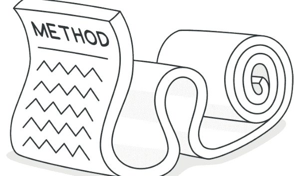

### 问题产生的原因

就像《加州州馆》一样，方法中总是在被添加东西，但从未被拿走东西。由于写代码比读代码更容易，这种“异味”在方法变成一个丑陋、庞大的巨兽之前不会被察觉。

在心理上，创建一个新方法往往比向现有方法中添加内容更困难：“但这只是两行代码，没必要为了此专门创建一个整个方法……”这意味着又增加了一行，然后又是一行，催生了一团意大利面条代码。

### 处理方法

根据经验，如果你觉得有必要对某些内容编写注释，那么你应该提取一个方法。

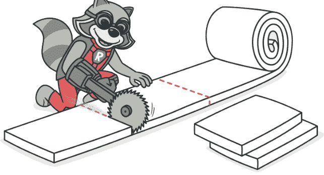

- **提取方法**（Extract Method）：减少方法的长度。
- **用对象替换临时变量**（Replace Temp with Object）：如果局部变量干扰提取。
- **替换整个对象**（Replace Whole Object）：如果循环是解决办法。
- **分解条件**（Decompose Conditional）：如果条件是解决办法。

## 收益

在所有类型的面向对象代码中，类的生命周期最长。方法越长，越难以理解。

此外，长方法为不需要的代码提供了容身之地。

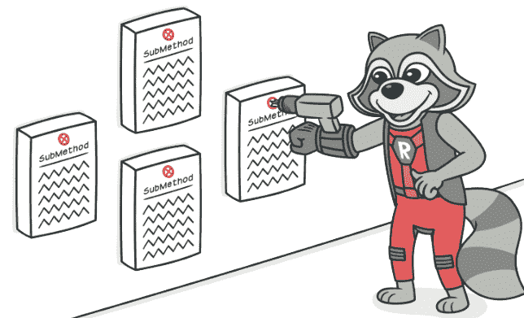

## 性能

正如许多人所说的，方法数量的增加会损害性能吗？在几乎所有情况下，这种影响微乎其微，完全不需要担心。

此外，既然你现在有了清晰且易懂的代码，当需要时，你更有可能发现有效的方法。

## 大类

### 迹象与症状

一个类包含许多字段、方法或代码行。


### 问题产生的原因

类通常开始很小。但随着程序的增长，它们随着时间变得臃肿。

和长方法一样，程序员通常认为将功能放在现有类中比为该功能创建一个新类要少费精力。

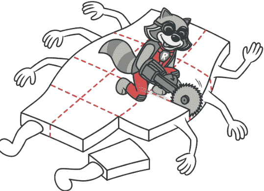

### 处理方法

当一个类戴了太多（功能）时，考虑将其拆分：

- **提取类**（Extract Class）：如果大类的部分行为可以分离到一个组件。
- **提取子类**（Extract Subclass）：如果大类的部分行为可以用不同的方式实现或在少数情况下使用。
- **提取接口**（Extract Interface）：如果需要列出客户端可以使用的操作和行为。
- 如果一个大类负责图形界面，你可能尝试将其部分数据和行为移动到领域对象中。这样做时，可能需要在两个地方存储某些数据的副本并保持数据一致。重复数据（Duplicate Data）提供了实现这一点的方法。

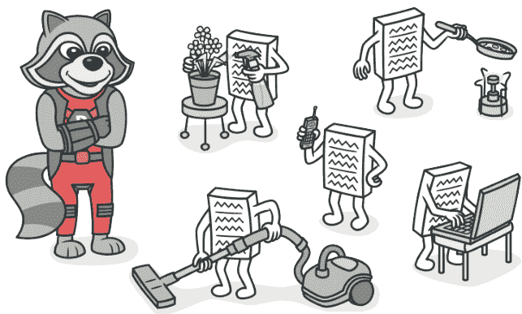

## 收益

- 重构这些类让开发者无需记住类的大量属性。
- 在许多情况下，将大类拆分为部分可以避免代码和功能的重复。

## 原始痴迷

### 迹象与症状

- 使用原始类型而非小对象来处理简单任务（例如货币、范围、电话号码的特殊字符串等）。
- 使用常量进行编码信息（例如使用常量 `USER_ADMIN_ROLE = 1` 来引用具有管理员权限的用户）。
- 使用字符串常量作为数据数组中的字段名。

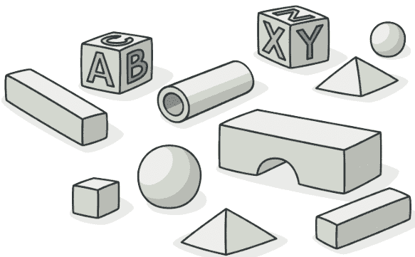

### 问题原因

与大多数其他气味一样，原始类型痴迷（primitive obsessions）诞生于软弱时刻。程序员会说：“只是一个用于存储数据的字段而已！”创建一个原始字段比创建一个整个新类要容易得多，不是吗？于是就这么做了。接着又需要另一个字段，并以同样的方式添加了。结果是，这个类变得庞大且难以处理。

原始类型通常被用来“模拟”类型。因此，你没有独立的数据类型，而是有一组数字或字符串，它们形成了某个实体的允许值列表。然后通过常量给这些特定的数字和字符串赋予易于理解的名称，这就是为什么它们散布得到处都是。

糟糕使用原始类型的另一个例子是字段模拟。该类包含一个大型数组，各种数据和字符串常量（在类中指定）被用作数组索引来获取这些数据。

### 解决方案

- 如果你有大量不同的原始类型字段，可能可以将其中一些在逻辑上分组到它们自己的类中。更好的方法是，将与这些数据相关的行为也移动到类中。对于这项任务，尝试“将数据值替换为对象”（Replace Data Value with Object）。
- 如果原始类型字段的值被用在方法参数中，请“引入参数对象”（Introduce Parameter Object）或“保留整个对象”（Preserve Whole Object）。
- 当复杂数据被编码在变量中时，使用“将类型代码替换为类”（Replace Type Code with Class）、“将类型代码替换为子类”（Replace Type Code with Subclasses）或“将类型代码替换为状态/策略”（Replace Type Code with State/Strategy）。
- 如果变量中存在数组，使用“将数组替换为对象”（Replace Array with Object）。

## 收益

- 得益于使用对象而非原始类型，代码变得更加灵活。
- 代码的可读性和组织性更好。针对特定数据的操作在同一个地方，而不是散落在各处。不再需要猜测这些奇怪常数的原因以及它们为什么在数组中。
- 更容易发现重复代码。

## 长参数列表

### 征象与症状

方法的参数超过三个或四个。

### 问题原因

在将几种类型的算法合并到单个方法后，可能会出现长参数列表。创建长列表可能是为了控制运行哪种算法以及如何运行。

长参数列表也可能是为了使类之间更加独立的努力产物。例如，方法中所需的特定对象的创建代码从方法移动到了调用方法的代码中，但创建的对象被作为参数传递给方法。因此，原始类不再感知对象之间的关系，依赖性降低了。但如果创建了这些对象中的几个，每一个对象都需要自己的参数，这意味着参数列表会变长。

理解此类列表很困难，随着其长度的变长，它们会变得矛盾且难以使用。与其使用长参数列表，方法可以使用自身对象的数据。如果当前对象不包含所有必要数据，则可以将另一个对象（该对象将获取必要数据）作为方法参数传递。

### 解决方案

- 检查传递给参数的值。如果某些参数只是另一个对象方法调用的结果，使用“将参数替换为方法调用”（Replace Parameter with Method Call）。该对象可以放在其所属类的字段中，也可以作为方法参数传递。
- 与将从另一个对象接收的一组数据作为参数传递，不如使用“保留整个对象”（Preserve Whole Object）将对象本身传递给方法。
- 如果有多个不相关的数据元素，有时可以通过“引入参数对象”（Introduce Parameter Object）将它们合并为一个单一参数对象。

## 收益

- 代码更具可读性、更短。
- 重构可能会揭示以前未注意到的重复代码。

## 何时忽略

如果这样做会导致类之间产生意外的依赖，请不要删除参数。

## 数据簇

### 征象与症状

有时代码的不同部分包含相同的一组变量（例如连接数据库的参数）。这些簇应该被转换为它们自己的类。

### 问题原因

这些数据组通常是由于程序结构不佳或“复制粘贴式编程”（copypasta programming）。

如果你想确定某些数据是否为数据簇，只需删除其中一个数据值，看看其他值是否仍然合理。如果不是这种情况，说明这组变量应该合并为一个对象。

### 解决方案

- 如果某些数据构成了类的字段，使用“提取类”（Extract Class）将字段移动到它们自己的类。
- 如果数据簇作为方法的参数传递，使用“引入参数对象”（Introduce Parameter Object）将它们设置为类。
- 如果将多个对象传递给方法，考虑使用“保留整个对象”（Preserve Whole Object）而不是只传递字段。
- 查看使用这些字段的代码。将此代码移动到数据类可能是好主意。

## 收益

- 改进了代码的组织。针对特定数据的操作现在聚集在一个地方，而不是杂乱无章。
- 减小了代码规模。

## 何时忽略

在方法参数中传递整个对象而不是只传递其值，可能会在类之间产生不必要的依赖。

## 面向对象滥用

所有这些气味都是面向对象原则的应用不完整或错误。

## Switch 语句

你有一个复杂的 `switch` 运算符或 `if` 语句。

### 临时字段

临时字段在某些情况下获得值（因此被对象需要）。在这些情况之外，它们是空的。

### 拒绝继承

如果子类仅使用从父类继承的方法和属性，则层级结构出现了问题。不需要的方法可能直接未使用或被重定义并抛出异常。

### 具有不同的替代类

两个类执行相同的功能，但方法名不同。

## Switch 语句

### 征象与症状

你有一个复杂的 `switch` 运算符或 `if` 语句。

### 问题原因

较少使用 `switch` 和 `case` 运算符是面向对象代码的特征之一。通常，同一个 `switch` 代码散落在程序的各个地方。当添加新条件时，你必须找到所有的 `switch` 代码并进行修改。

根据经验，当你看到 `switch` 时，应该考虑多态。

### 解决方案

- 为了隔离 `switch` 并将其放在正确的类中，你可能需要“提取方法”（Extract Method）然后“移动方法”（Move Method）。
- 如果 `switch` 基于类型代码（例如当程序运行时模式切换时），使用“将类型代码替换为子类”（Replace Type Code with Sub-classes）或“将类型代码替换为状态/策略”（Replace Type Code with State/Strategy）。
- 在指定继承结构后，使用“将条件替换为多态”（Replace Conditional with Polymorphism）。
- 如果运算符中的条件不多，且它们都调用带不同参数的方法，则多态是多余的。在这种情况下，你可以通过“将参数替换为显式方法”（Replace Parameter with Explicit Methods）将该方法拆分为多个较小的方法，并相应调整 `switch`。
- 如果条件选项之一为空，使用“引入空对象”（Introduce Null Object）。

## 收益

改进了代码组织。

## 何时忽略

- 当 `switch` 运算符执行简单操作时，没有理由修改代码。
- 通常 `switch` 运算符被工厂设计模式（**工厂方法**或**抽象工厂**）用于选择所创建的类。

## 临时字段（Temporary Field）

### 征象与症状

临时字段只有在特定情况下才会获取其值（因此对象才需要这些值）。在这些情况之外，它们是空闲。

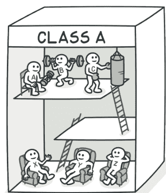

### 问题的原因

通常，创建临时字段是为了在某个需要大量输入的算法中使用。因此，程序员决定没有在方法中创建大量参数，而是决定在类中为这些数据创建字段。这些字段只在算法中使用，在其余时间里均未被使用。

这种代码很难理解。你本以为会在对象的字段中看到数据，但由于某种原因，它们几乎总是空的。


### 解决方案

- 可以将临时字段和所有操作这些字段的代码通过“提取类”（Extract Class）放入一个单独的类中。换句话说，你正在创建一个方法对象，实现的效果与“将方法替换为方法对象”（Replace Method with Method Object）相同。
- 引入“空对象”（Null Object）并将其整合，替代用于检查临时字段值是否存在条件代码。

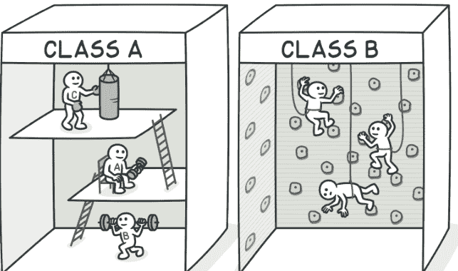

## 收益

更好的代码清晰度和组织结构。

## 拒绝接受的遗嘱（Refused Bequest）

### 征象与症状

如果子类只使用了从父类继承的部分方法和属性，那么层级结构就是失衡的。不需要的方法可能直接未被使用，或者被重新定义并抛出异常。

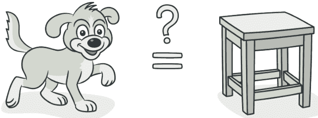

### 问题的原因

有人之所以在类之间建立继承，仅仅是为了重用父类中的代码。但父类和子类是完全不同的。

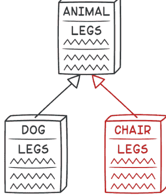

### 解决方案

- 如果继承没有意义，且子类确实与父类没有任何共同点，则消除继承，改用“将继承替换为委托”（Replace Inheritance with Delegation）。
- 如果继承是合适的，则移除子类中不需要的字段和方法。从父类中提取子类所需的所有字段和方法，将它们放入一个新的子类中，并让这两个类都继承自该新类（“提取父类” Extract Superclass）。

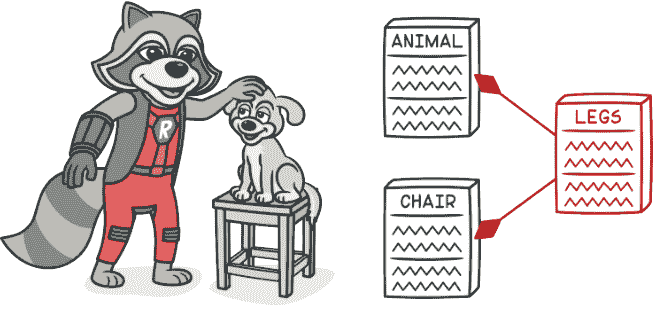

## 收益

改进了代码的清晰度和组织结构。你将不再需要疑惑为什么 `Dog` 类要继承自 `Chair` 类（尽管它们都有 4 条腿）。

## 具有不同的替代类

### 征象与症状

两个类执行相同的功能，但方法名称不同。


### 问题的原因

创建其中一个类的程序员可能不知道已经存在一个功能上等价的类。

### 解决方案

尝试从公公分数的角度来定义类的接口：

- **重命名方法**（Rename Methods），使它们在所有替代类中保持一致。
- 使用“移动方法”（Move Method）、“添加参数”（Add Parameter）和“方法参数化”（Parameterize Method），使方法的签名和实现保持相同。
- 如果类只有部分功能重复，尝试使用“提取父类”（Extract Superclass）。在这种情况下，现有的类将成为子类。
- 在确定了使用哪种处理方法并实现它后，你可能删除其中一个类。

## 收益

- 你消除了不必要的重复代码，使生成的代码不再那么臃肿。
- 代码变得更具可读性和易理解（你不再需要猜测创建另一个与第一个类执行完全相同功能的类的原因）。

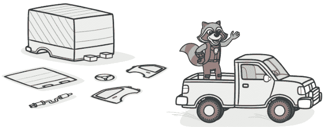

## 何时可以忽略

有时合并类是不可能的，或者极其困难到变得没有意义。一个例子是替代类位于不同的库中，每个库都有该类的自己的版本。

## 变化阻碍（Change Preventers）

这些代码味道意味着，如果你需要对代码中的某处进行更改，就必须对其他地方进行许多更改。结果程序开发变得更加复杂和昂贵。

当你对一个类进行更改时，发现自己必须更改许多无关的方法。例如，当添加新的产品类型时，你必须更改查找、显示和排序产品的方法。

进行任何修改都需要你对许多不同的类进行细小的更改。


每当你为一个类创建一个子类时，就会发现自己需要为另一个类创建一个子类。

散聚变化看起来与散弹手术相似，但实际上是相反的气味。散聚变化是指对单个类进行多次更改。散弹手术是指对多个类进行单次更改。

## 散聚变化

### 征象与症状

当你对一个类进行更改时，发现自己必须更改许多无关的方法。例如，当添加新的产品类型时，你必须更改查找、显示和排序产品的方法。

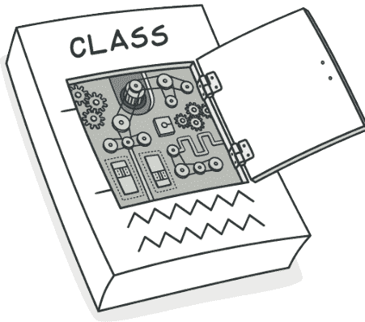

### 问题的原因

通常，创建临时字段是为了在某个需要大量输入的算法中使用。因此，程序员决定没有在方法中创建大量参数，而是决定在类中为这些数据创建字段。这些字段只在算法中使用，在其余时间里均未被使用。

这种代码很难理解。你本以为会在对象的字段中看到数据，但由于某种原因，它们几乎总是空的。

### 解决方案

- 通过“提取类”（Extract Class）将临时字段和所有操作这些字段的代码放入单独的类中。
- 如果不同的类具有相同的行为，你可能想通过继承将它们合并。

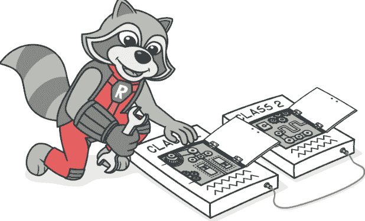

### 收益

- 改进了组织。
- 减少了重复。
- 简化维护。

## 散弹手术（Shotgun Surgery）

散弹手术类似于散聚变化，但实际上是相反的气味。散聚变化是指对单个类进行多次更改。散弹手术是指对多个类进行单次更改。

### 征象与症状

进行任何修改都需要你对许多不同的类进行细小的更改。

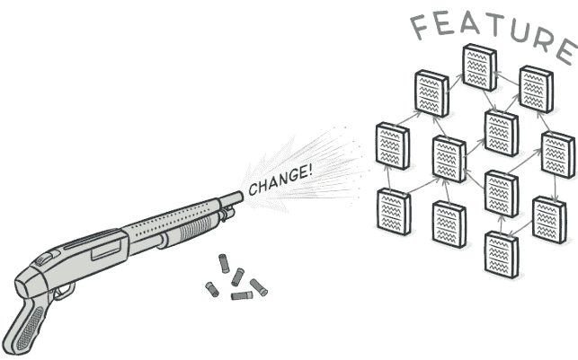

### 问题的原因

单一职责被分到了许多类中。这可能发生在过度应用散聚变化之后。

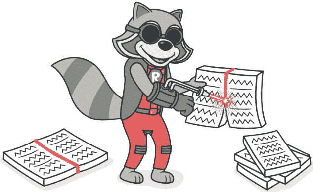

### 解决方案

- 使用“移动方法”（Move Method）和“移动字段”（Move Field）将现有行为移动到单个类中。如果没有合适的类，则创建一个。
- 如果将代码移动到同一个类后原始类几乎变为空，尝试通过“内联类”（Inline Class）移除这些现在冗余的类。

### 收益

- 更好的组织结构。
- 更少的代码重复。
- 更容易维护。

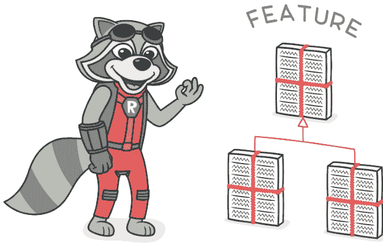

## 平行继承层级

### 征象与症状

每当你为一个类创建一个子类时，就会发现自己需要为另一个类创建一个子类。

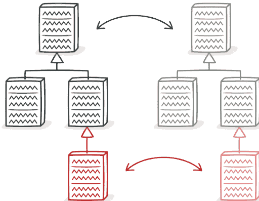

### 问题的原因

只要层级保持小，一切良好。但随着新类的添加，更改变得越来越困难。

### 解决方案

你可以通过两个步骤去重平行继承层级。首先，让一个层级的实例引用另一个层级的实例。然后，通过“移动方法”和“移动字段”移除被引用类中的层级。

### 收益

- 减少了代码重复。
- 可以改进代码的组织。

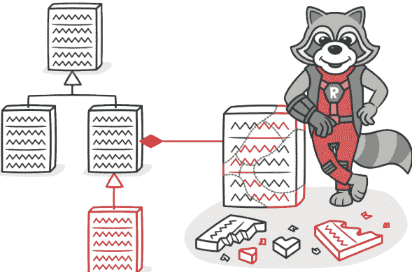

### 何时可以忽略

有时，平行继承层级只是为了避免程序架构出现更大的混乱。如果你发现尝试去重层级产生了更丑的代码，只需退出来，撤销所有更改，并习惯那些代码。

## 易弃物

易弃物是指毫无意义且不需要的东西，它的缺失会让代码变得更简洁、更高效且更容易理解。

## 注释

### 征象与症状

一个方法中充斥着解释性的注释。

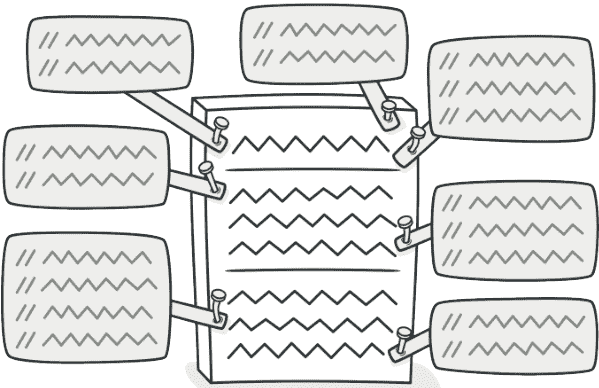

### 问题产生的原因

注释通常是出于良好的意图创建的，当作者意识到代码并不直观或显而易见时。在这种情况下，注释就像去味剂，掩盖了可以改进的“鱼臭代码”的味道。

> 最好的注释是为方法或类起一个好名字。

如果你觉得一个代码片段无法通过注释来理解，尝试更改代码结构，使注释变得不再必要。

- 如果注释是为了解释一个复杂的表达式，则应该使用“提取变量”（Extract Variable）将该表达式拆分为易于理解的子表达式。
- 如果注释解释了某部分代码，可以通过“提取方法”（Extract Method）将该部分转换为独立的方法。新方法的名称很可能可以直接取自注释文本本身。
- 如果方法已经经过了提取，但仍需要注释来解释该方法的作用，请给该方法起一个自解释的名称。使用“重命名方法”（Rename Method）来实现。
- 如果你需要对系统运行所必需的状态规则进行断言，请使用“引入断言”（Introduce Assertion）。

代码变得更加直观且显而易见。

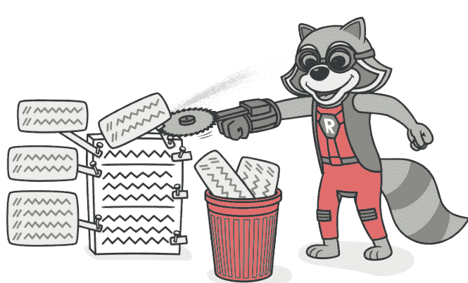

### 何时忽略

注释有时是有用的：

- 在解释为什么要以特定方式实现某些功能时。
- 在解释复杂算法时（当尝试了所有简化算法的其他方法都无果时）。

## 重复代码

### 征象与症状

两个代码片段看起来几乎相同。


### 问题产生的原因

代码重复通常发生在多个程序员同时处理同一个程序的不同部分时。由于他们正在处理不同的任务，他们可能没有意识到同事已经写了类似代码，而这些代码可以被复用于他们自己的需求。

还存在更微妙的重复，即特定的代码部分看起来不同，但实际上执行的是相同的工作。这种重复很难发现和修复。

有时重复是有刻意的。在赶于期限截止日期且现有代码对于任务来说“几乎正确”时，初级程序员可能无法抵御复制和粘贴相关代码的诱惑。在某些情况下，程序员只是太懒于去清理。

- 如果在同一类的两个或多个方法中发现了相同的代码：使用“提取方法”（Extract Method），并在两个地方都调用新方法。


- 如果在同级的两个子类中发现了相同的代码：
  - 对两个类都使用“提取方法”，然后对于方法中所使用的字段使用“上字段”（Pull Field）。
- 如果重复代码在构造函数内部，使用“提取构造函数体”（Pull Up Constructor Body）。
- 如果重复代码相似但并非完全相同，使用“形成模板方法”（Form Template Method）。
- 如果两个方法执行相同的操作但使用不同的算法，选择最好的算法并应用“替换算法”（Substitute Algorithm）。
- 如果在两个不同的类中发现重复代码：
  - 如果这些类不属于同一个层次结构，使用“提取超类”（Extract Superclass）为这些类创建一个单一的超类，以维护之前所有的功能。
  - 如果很难或无法创建超类，则在一个类中使用“提取类”（Extract Class），并在另一个类中使用这个新组件。
- 如果存在大量的条件表达式并执行相同的代码（仅在条件上不同），使用“合并条件表达式”（Consolidate Conditional Expression）将这些运算符合并为单个条件，并使用“提取方法”（Extract Method）将该条件放在一个易理解名称的独立方法中。
- 如果在条件表达式的所有分支中执行了相同的代码：通过“合并重复条件片段”（Consolidate Duplicate Conditional Fragments）将相同的代码放置在条件树之外。

### 收益

- 合并重复代码简化了你的代码结构并使其更短。
- 简化 + 缩短 = 代码更容易简化且维护成本更低廉。

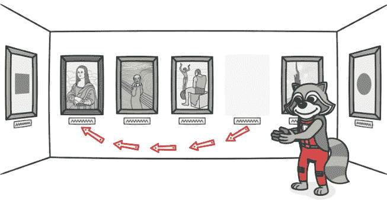

### 何时忽略

在极少数情况下，合并两个相同的代码片段可能会让代码不再直观和显而易见。

## 懒类

### 征象与症状

理解和维护类总是需要花费金钱。因此，如果一个类的功能不足以引起你的关注，就应该将其删除。


### 问题产生的原因

也许一个类设计时是完全功能的，但经过某些重构后它变得非常小。

或者，它的设计是为了支持那些从未完成的未来开发工作。

### 解决方案

- 几乎无用的组件应该进行“内联类”（Inline Class）处理。
- 对于功能少的子类，尝试“折叠层次结构”（Collapse Hierarchy）。

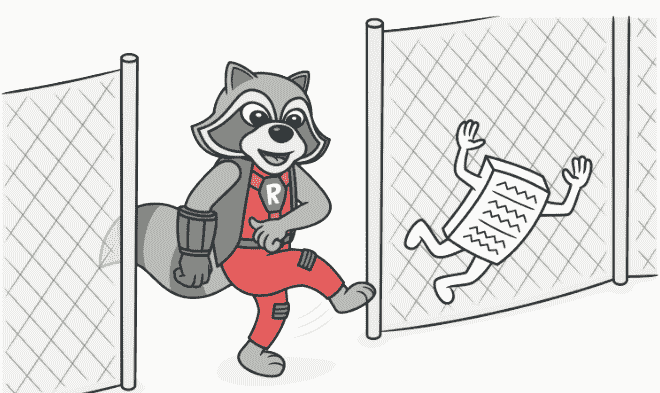

### 收益

- 减少了代码体积。
- 更容易维护。

### 何时忽略

有时创建懒类是为了规划未来的开发，在这种情况下，尝试在代码的清晰性和简单之间保持平衡。

## 数据类

### 征象与症状

数据类是指仅包含字段以及访问这些字段的原始方法（getter 和 setter）的类。它们仅仅是其他类使用的数据容器。这些类不包含任何额外功能，并且无法独立地对拥有的数据进行操作。

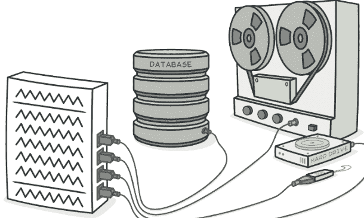

### 问题产生的原因

新创建的类只包含几个公共字段（可能还有一些 getter/setter）是很正常的。但对象的真正威力在于它们可以包含行为类型操作。

### 治疗

- 如果类包含公共字段，使用“封装字段”（Encapsulate Field）来隐藏这些直接访问，并要求仅通过 getter 和 setter 进行访问。
- 对于存储在集合中的数据（如数组），使用“封装集合”（Encapsulate Collection）。
- 检查使用该类的客户端代码。其中，你可能会发现更适合放在数据类本身中的功能。如果是这样，使用“移动方法”（Move Method）和“提取方法”（Extract Method）将此功能迁移到数据类中。
- 在类被填充了经过深思熟虑的方法后，你可能想要删除那些提供过度宽泛数据访问的旧访问方法。对于此，“移除设置方法”（Remove Setting Method）和“隐藏方法”（Hide Method）可能会很有帮助。

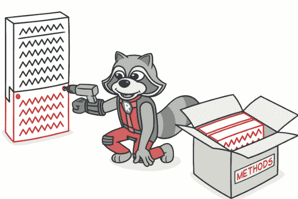

### 收益

- 改进了代码的理解和组织。对特定数据的操作现在集中在一个地方，而不是杂乱分布在代码中。
- 帮助你发现客户端代码的重复。

## 死代码

### 征象与症状

变量、参数、字段、方法或类不再被使用（通常是因为它们已经过时）。

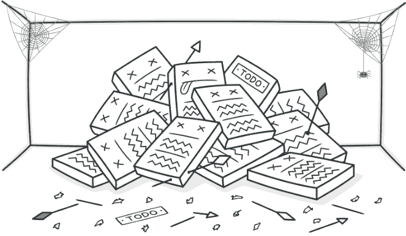

### 问题原因

当软件需求发生变化或进行了修正后，没有人去清理旧代码。此类代码也可能出现在复杂的条件判断中，其中某个分支由于错误或其他情况变得不可触及。

### 救治方法

找到死代码最快的方法是使用一个良好的 IDE。

- 删除未使用的代码和不需要的文件。
- 对于不需要的类，如果存在被使用的子类或父类，可以使用 `Inline Class`（内联类）或 `Collapse Hierarchy`（折叠层级结构）。
- 若要移除不需要的参数，请使用 `Remove Parameter`（移除参数）。


### 收益

- 减小了代码体积。
- 使得维护更简单。

## 推测性泛化

### 征象与症状

存在未使用的类、方法、字段或参数。

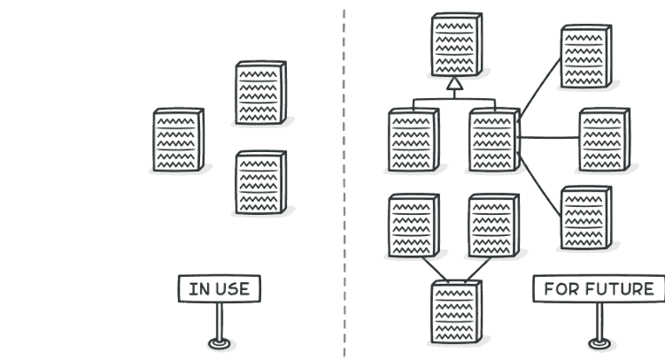

### 问题原因

有时创建代码是为了“以防万一”，以支持预期的但从未实现的未来功能。结果导致代码变得难以理解和维护。

### 救治方法

- 对于移除未使用的抽象类，可以尝试 `Collapse Hierarchy`（折叠层级结构）。
- 可以通过 `Inline Class`（内联类）消除对另一个类不必要的委托。
- 未使用的方法？使用 `Inline Method`（内联方法）来清除它们。
- 带有未使用参数的方法应该通过 `Remove Parameter`（移除参数）来检查。
- 未使用的字段可以直接被删除。


### 收益

- 代码更精简。
- 更容易维护。

### 何时可以忽略

- 如果你正在开发一个框架，只要该功能是框架用户需要的，那么创建框架本身未使用的功能是完全合理的。
- 在删除元素之前，确保它们没有在单元测试中使用。这通常发生在测试需要某种方式从类中获取某些内部信息或执行特殊与测试相关的操作时。

## 耦合器（Couplers）

此组中的所有代码气味都导致了类之间的过度耦合，或者展示了当耦合被过度委托取代时发生的情况。

### 特热喜爱（Feature Envy）

一个方法访问另一个对象的数据多于访问自身的数据。

### 不恰当的关系（Inappropriate Intimacy）

一个类使用了另一个类的内部字段和方法。

### 消息链（Message Chains）

在代码中你看到一系列类似于 `$a->b()->$c()->$d()` 的调用。

### 中间人（Middle Man）

如果一个类只执行一个动作并将工作委托给另一个类，那么它存在的意义是什么？

## 特热喜爱（Feature Envy）

### 征象与症状

一个方法访问另一个对象的数据多于访问自身的数据。


### 问题原因

这种气味可能会在字段移动到数据类后出现。如果是此类情况，你可能也想将对数据的操作也移动到该类中。

### 救治方法

作为一个基本原则，如果事物同时变化，你应该将它们保持在同一个地方。通常，数据和使用这些数据的数据是一起更改的（尽管存在例外）。

- 如果一个方法显然应该移动到另一个地方，使用 `Move Method`（移动方法）。
- 如果只有方法的部分访问了其他对象的数据，使用 `Extract Method`（提取方法）移动相关部分。
- 如果一个方法使用了来自其他几个类的中的函数，首先确定哪个类包含了大部分使用的数据。然后将该方法放在这个类中，连同其他数据。或者，使用 `Extract Method` 将方法拆分为若干部分，并将它们放置在不同类的不同位置。


### 收益

- 减少了代码重复（如果将处理数据的代码放在中心位置）。
- 更好的代码组织（处理数据的方法紧邻实际数据）。

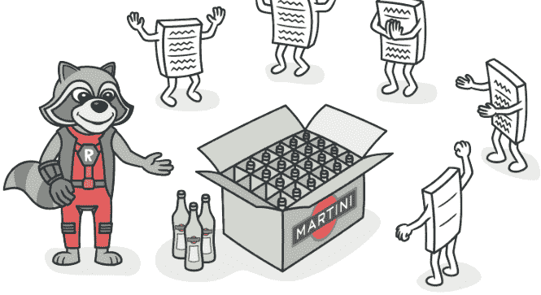

### 何时可以忽略

有时行为被刻意与持有数据的类分开。这样做通常优点是能够动态地改变行为（参见策略、访问者等模式）。

## 不恰当的关系（Inappropriate Intimacy）

### 征象与症状

一个类使用了另一个类的内部字段和方法。


### 问题原因

密切关注那些共处时间太长的类。良好的类之间应该尽可能少地了解。这样的类更容易维护和重用。

### 救治方法

- 最简单的解决方案是使用 `Move Method`（移动方法）和 `Move Field`（移动字段）将一个类的一部分移动到使用这些部分的类中。但只有当第一个类确实不需要这些部分时，才有效。

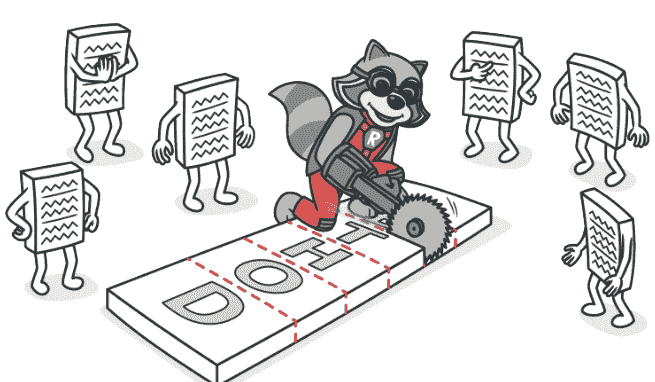

- 另一个方案是使用 `Extract Class`（提取类）和 `Hide Delegate`（隐藏委托）。
- 如果类之间是相互依赖的，使用 `Bidirectional Association`（双向关联）。
- 如果这种“关系”发生在子类和父类之间，考虑替换继承。

### 收益

- 改进代码组织。
- 简化支持。

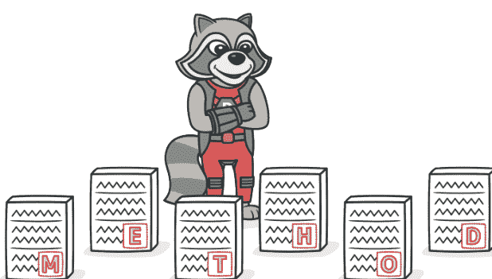

## 消息链（Message Chains）

### 征象与症状

在代码中你看到一系列类似于 `$a->b()->$c()->$d()` 的调用。


### 问题原因

消息链发生在客户端请求另一个对象，该对象再请求另一个，依此类推。这些链意味着客户端依赖类结构。

### 救治方法

- 为了删除消息链，使用 `Hide Delegate`（隐藏委托）。
- 有时为了将链的功能移动到起点，使用 `Move Method`（移动方法）。

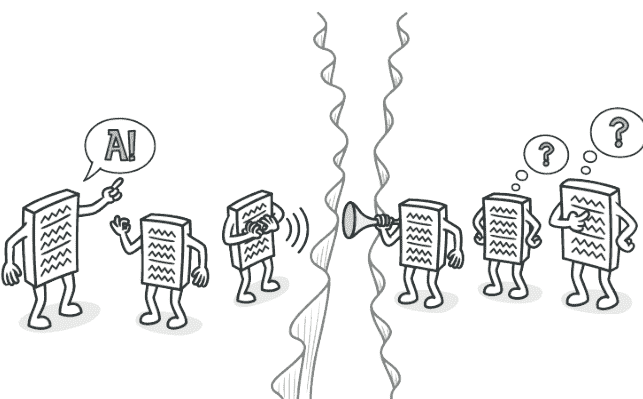

### 收益

- 减少了类之间的依赖。
- 减少了臃肿代码。


### 何时可以忽略

过度委托会导致难以看到功能实际发生在哪里。这也是另一种说法，即避免中间人气味。

## 中间人（Middle Man）

### 征象与症状

如果一个类只执行一个动作并将工作委托给另一个类，那么它存在的意义是什么？

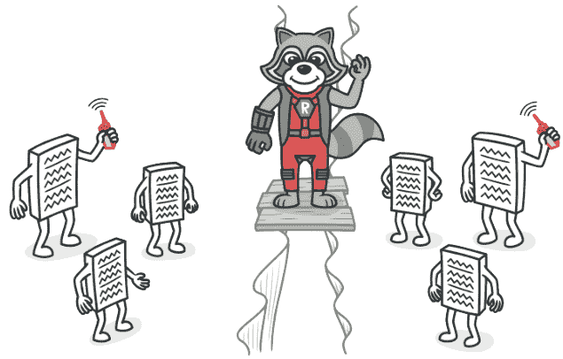

### 问题原因

这种气味可能是过度消除消息链的结果。在其他情况下，它可能是类的有用工作逐渐移动到其他类的结果。该类剩下的只是一个除了委托外什么都不做的空壳。

### 救治方法

如果一个方法的大部分类委托给另一个类，应该使用 `Remove Middle Man`（移除中间人）。

### 收益

更不臃肿的代码。

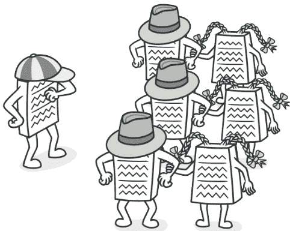

### 何时可以忽略


不要删除为了某些原因而创建的人：

- 添加中间人可能是为了避免类间依赖。
- 某些设计模式会有意创建中间人（例如代理或装饰器模式）。

以下是不属于任何大类别的气味。

迟早，库不再满足用户需求。解决该问题的唯一方法——修改库——通常是不行的，因为库是只读的。

## 处理

- 如果要向库类引入几个方法，请使用“引入外部方法”（Introduce Foreign Method）。
- 对于类库的重大更改，使用“引入本地扩展”（Introduce Local Extension）。

## 收益

减少代码重复（不再需要从头创建自己的库，你仍然可以利用现有的库）。

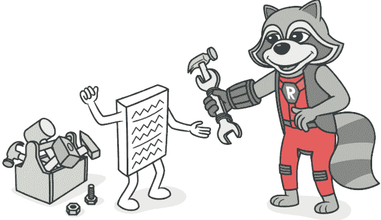

## 何时忽略

如果对库的更改涉及代码的修改，那么扩展库可能会产生额外的工作。

重构是一个在不创建新功能的情况下改进代码的可控过程。它将混乱的代码转换为整洁的代码和简单的设计。


整洁代码是指易读、编写和维护的代码。整洁的代码使软件开发具有预测性，并提高产品的质量。

重构技术描述了具体的重构步骤。大多数重构技术都有其优缺点。因此，每项重构都应该有充分的动机并谨慎应用。

在之前的章节中，你已经看到特定的重构如何帮助解决代码问题。现在是时候详细查看这些重构技术了！

重构的大部分工作致力于正确地组合长方法。在大多数情况下，过长的方法是万恶之根源。这些方法内部代码的变幻隐藏了执行逻辑，使得方法变得极其难以理解——更难以修改。

这一组的重构技术可以简化方法、消除代码重复，并为未来的改进铺平道路。

## 提取方法（Extract Method）

**问题：** 你有一段可以分组的代码片段。

**解决方案：** 将此代码移动到单独的新方法（或函数）中，并用对方法的调用替换旧代码。

## 内联方法（Inline Method）

**问题：** 当方法体比方法本身更明显时，请使用此技术。

**解决方案：** 用方法的内容替换对方法的调用，并删除该方法本身。

### 提取变量（Extract Variable）

**问题：** 你有一个难以理解的表达式。

**解决方案：** 将表达式的结果或其部分放在具有自解释意义的独立变量中。

### 内联临时变量（Inline Temp）

**问题：** 你有一个临时变量，它被赋值简单表达式的结果且仅如此。

**解决方案：** 将对变量的引用替换为表达式本身。

### 用查询替换临时变量（Replace Temp with Query）

**问题：** 你将表达式的结果存放在局部变量中，以便稍后使用。

**解决方案：** 将整个表达式移动到单独的方法中并从中返回结果。使用查询方法而不是变量。如有必要，将新方法整合到其他方法中。

### 分解临时变量（Split Temporary Variable）

**问题：** 你有一个局部变量，用于存储方法内部各种中间值（循环变量除外）。

**解决方案：** 为不同的值使用不同的变量。每个变量应该只负责特定的事情。

### 移除对参数的赋值（Remove Assignments to Parameters）

**问题：** 方法体内部给参数赋值。

**解决方案：** 使用局部变量代替参数。

## 将方法替换为方法对象（Replace Method with Method Object）

**问题：** 你有一个长方法，其中的局部变量交织在一起，以至于无法应用“提取方法”。

**解决方案：** 将方法转换为单独的类，使局部变量变成类的字段。然后你可以在同一个类中将方法拆分为几个方法。

### 替换算法（Substitute Algorithm）

**问题：** 你想用新算法替换现有算法吗？

**解决方案：** 用新算法替换实现该算法的方法体。

# 提取方法（Extract Method）

## 问题

你有一段可以分组的代码片段。

```java
void printOwning() {
    printBanner();
    // 打印详细信息。
    System.out.println("name: " + name);
    System.out.println("amount: " + getOutstanding());
}
```

## 解决方案

将此代码移动到单独的新方法（或函数）中，并用对方法的调用替换旧代码。

```java
void printOwning() {
    printBanner();
    printDetails(getOutstanding());
}
void printDetails(double outstanding) {
    System.out.println("name: " + name);
    System.out.println("amount: " + outstanding);
}
```

## 为什么重构

方法中的行越多，越难弄清楚该方法的作用。这是此重构的主要原因。

除了消除代码中的粗糙边缘，提取方法也是许多其他重构方法的步骤之一。

## 收益

- 更具可读性的代码！确保给新方法一个描述其用途的名字：例如：`createOrder()`、`renderCustomerInfo()` 等。
- 更少的代码重复。通常方法中找到的代码可以在程序的其他地方复用。因此，你可以用对新方法的调用替换重复部分。
- 隔离代码的独立部分，这意味着错误发生的概率降低（例如修改了错误的变量）。

## 如何重构

1. 创建一个新方法并命名，使其目的一目了然。
2. 将相关的代码片段复制到你的新方法中。从旧位置删除该片段并在放置对该方法的调用。找到此片段中使用的所有变量。如果它们在片段内部声明且在外部未使用，则只需保留它们——它们将成为新方法的局部变量。
3. 如果变量在要提取的代码之前声明，你将需要将这些变量传递给新方法的参数以便使用。如果你在提取的代码中看到局部变量发生变化，这可能意味着该值稍后主方法中仍然需要。有时通过“用查询替换临时变量”来消除这些变量更容易。
4. 双重检查！如果确实如此，则删除该方法。

## 反重构

- 内联方法（Inline Method）

## 相似重构

- 移动方法（Move Method）

## 有帮助的重构

- 引入参数对象（Introduce Parameter Object）
- 形成模板方法（Form Template Method）
- 参数化（Parameterize Method）

## 消除异味

- 重复代码（Duplicate Code）
- 长方法（Long Method）
- 特性类（Feature Envy）
- `Switch` 语句（Switch Statements）
- 消息链（Message Chains）
- 注释（Comments）
- 数据类（Data Class）

# 内联方法（Inline Method）

## 问题

当方法体比方法本身更明显时，使用此技术。

```java
class PizzaDelivery {
  // ...
  int getRating() {
    return moreThanFiveDeliveries() ? 2 : 1;
  }
  boolean moreThanFiveDeliveries() {
    return numberOfLateDeliveries > 5;
  }
}
```

## 解决方案

用方法的内容替换对方法的调用，并删除该方法本身。

```java
class PizzaDelivery {
  // ...
  int getRating() {
    return numberOfLateDeliveries > 5 ? 2 : 1;
  }
}
```

## 反重构

- 提取方法（Extract Method）

## 消除异味

- 猜测性泛化（Speculative Generality）

# 提取变量（Extract Variable）

## 问题

你有一个难以理解的表达式。

```java
void renderBanner() {
  if ((platform.toUpperCase().indexOf("MAC") > -1 &&
      browser.toUpperCase().indexOf("IE") > -1 &&
      wasInitialized()) && resize > 0) {
    // do something
  }
}
```

## 解决方案

将表达式或其部分的结果放在自解释含义的独立变量中。

```java
void renderBanner() {
  final boolean isMacOS = platform.toUpperCase().indexOf("MAC") > -1;
  final boolean isIE = browser.toUpperCase().indexOf("IE") > -1;
  final boolean wasResized = resize > 0;

  if (isMacOS && isIE && wasInitialized() && wasResized) {
    // do something
  }
}
```

## 为什么要重构

提取变量的主要原因是通过将其拆分为中间部分，使复杂的表达式更易于理解。这些部分可能是：

- C 类的语言中 `if()` 运算符的条件或 `?:` 运算符的一部分。
- 没有中间结果的长算术表达式。
- 长的多部分行。

如果你发现提取的表达式在代码的其他地方被使用，那么提取变量可能是执行**提取方法（Extract Method）**第一步。

## 收益

更具可读性的代码！尝试为提取的变量取好名字，清晰地宣告变量的用途。更高的可读性意味着更少的冗注释。可以使用像 `customerValue`、`cityUnemploymentRate`、`clientSalutationString` 等名称。

## 缺点

- 代码中出现了更多的变量。但这被代码读取的便利性所抵消。
- 在重构条件表达式时，记住编译器很可能会对其进行优化，以减少建立结果值所需的计算量。假设你有如下表达式 `if (a() || b())`……如果方法 `a` 返回 `true`，程序就不会调用方法 `b`，因为无论 `b` 返回什么值，结果都将是 `true`。

然而，如果你将此表达式的部分提取到变量中，两种方法都将被调用，这可能会损害程序的性能，特别是当这些方法执行一些重型工作时。

## 如何重构

1. 在相关表达式之前插入新行并在那里声明一个新变量。将复杂表达式的一部分赋值给该变量。
2. 用新变量替换表达式的该部分。
3. 对表达式中的所有复杂部分重复此过程。

## 反重构

- 内联临时变量（Inline Temp）

## 相似的重构

- 提取方法（Extract Method）

## 消除气味

- 注释（Comments）

# 内联临时变量（Inline Temp）

## 问题

你有一个临时变量，它被赋值了一个简单表达式的结果，并且没有别的。

```java
boolean hasDiscount(Order order) {
  double basePrice = order.basePrice();
  return basePrice > 1000;
}
```

## 解决方案

用表达式本身替换对变量的引用。

```java
boolean hasDiscount(Order order) {
  return order.basePrice() > 1000;
}
```

## 为什么要重构

内联局部变量几乎总是作为“替换临时变量为查询（Replace Temp with Query）”的一部分，或者为“提取方法”铺路。

## 收益

这种重构技术本身几乎没有任何益处。但是，如果变量被赋值为方法的结果，通过消除不必要的变量，你可以稍微提高程序的可读性。

## 缺点

有时看似无用的临时变量被用于缓存被多次使用的昂贵操作的结果。因此，在使用这种重构技术之前，请确保简单性不会以性能为代价。

## 如何重构

- 找到所有使用该变量的地方。使用赋值给该变量的表达式代替变量。
- 删除变量的声明和它的赋值行。

## 帮助其他重构

- 替换临时变量为查询（Replace Temp with Query）
- 提取方法（Extract Method）

# 替换临时变量为查询（Replace Temp with Query）

## 问题

你将表达式的结果放在局部变量中，以便稍后在代码中使用。

```java
double calculateTotal() {
  double basePrice = quantity * itemPrice;
  if (basePrice > 1000) {
    return basePrice * 0.95;
  } else {
    return basePrice * 0.98;
  }
}
```

## 解决方案

将整个表达式移动到一个独立的方法中并从中返回结果。查询该方法而不是使用变量。如有必要，将新方法整合到其他方法中。

```java
double calculateTotal() {
  if (basePrice() > 1000) {
    return basePrice() * 0.95;
  }
  else {
    return basePrice() * 0.98;
  }
}
double basePrice() {
  return quantity * itemPrice;
}
```

## 为什么要重构

这种重构可以为非常长方法的一部分应用提取方法奠定基础。

相同的表达式有时可能出现在其他地方，这也是考虑创建方法的原因之一。

## 收益

- 代码可读性。相比于 `orderPrice() * 0.2`，查询方法更容易理解含义。
- 通过去重精简代码，如果该表达式在多个方法中存在。

## 注意事项

### 性能

这种重构可能会引发关于这种方法会导致性能损失的问题。诚实地说答案是肯定的，由于今天的 CPU 和优秀的编译器，这种负担总是微乎其微的。然而，如果你的临时变量用于缓存耗时操作的结果，你可能在提取到新方法后停止这种重构。

## 如何重构

1. 确保值在方法中赋值且仅赋值一次。如果不是，使用拆分临时变量（Split Temporary Variable）。
2. 使用提取方法将感兴趣的表达式放入新方法中。确保该方法只返回值而不改变对象状态。如果方法影响对象状态，请使用查询修改分离（Separate Query from Modifier）。
3. 用对新方法的查询替换变量。

## 相似的重构

- 提取方法（Extract Method）

## 消除气味

- 长方法（Long Method）
- 重复代码（Duplicate Code）

# 分解临时变量（Split Temporary Variable）

## 如何重构

1. 找到代码中第一次给变量赋值的地方。在这里，你应该将变量重命名为与所赋值值相对应的名称。
2. 在所有使用该变量值的地方，用新名称代替旧名称。
3. 对于变量被赋予不同值的地方，根据需要重复上述操作。

## 反重构

- 内联临时变量（Inline Temp）

## 相似的重构

- 提取变量（Extract Variable）

# 移除对参数的赋值（Remove Assignments to Parameters）

## 帮助其他重构

- 提取方法（Extract Method）

# 移除对参数的赋值（Remove Assignments to Parameters）

## 问题

在方法体内部为参数赋值了值。

```java
int discount(int inputVal, int quantity) {
  if (inputVal > 50) {
    inputVal -= 2;
  }
  // ...
}
```

## 解决方案

使用局部变量代替参数。

```java
int discount(int inputVal, int quantity) {
  int result = inputVal;
  if (inputVal > 50) {
    result -= 2;
  }
  // ...
}
```

## 为什么要重构

这种重构的原因与“拆分临时变量”（Split Temporary Variable）相同，但在这种情况下我们处理的是参数而不是局部变量。

首先，如果参数是通过引用传递的，那么在方法内部更改参数值后，该值将传递给请求调用该方法的参数。很多情况下是意外发生的，并会导致不幸的后果。即使在你的编程语言中参数通常按值传递（而不是按引用），这种编码习惯也可能让不习惯此的人感到困惑。

其次，对同一个参数多次赋值不同的值，使得你很难在任何特定时刻知道参数应该包含什么数据。如果你的参数及其内容有文档说明，但实际值可能与方法内部预期的值不同，问题会更加严重。

## 收益

- 程序的每个元素应该只负责一件事。这使得未来的代码维护变得更容易，因为你可以安全地替换代码而不产生任何副作用。
- 这种重构有助于将重复代码提取到单独的方法中。

## 如何重构

1. 创建一个局部变量并将参数的初始值赋值给它。
2. 在此行之后所有方法代码中，将参数替换为你的新局部变量。

## 相似的重构

- 拆分临时变量（Split Temporary Variable）

## 帮助其他重构

- 提取方法（Extract Method）

# 将方法替换为方法对象（Replace Method with Method Object）

## 问题

你有一个长方法，其中的局部变量交织在一起，导致你无法应用“提取方法”。

```java
class Order {

  // ...

  public double price() {

    double primaryBasePrice;

    double secondaryBasePrice;

    double tertiaryBasePrice;

    // 执行长计算。

  }

}
```


## 解决方案

将方法转换为单独类，使局部变量变成类的字段。然后你就可以在同一个类中将方法拆分为几个小方法。

```java
class Order {
    // ...

    public double price() {
        return new PriceCalculator(this).compute();
    }
}
```

```java
class PriceCalculator {
    private double primaryBasePrice;
    private double secondaryBasePrice;
    private double tertiaryBasePrice;

    public PriceCalculator(Order order) {
        // 初始化
    }

    public double compute() {
        // 执行长计算。
    }
}
```

## 为什么要重构

方法太长了，由于变量纠缠你无法拆分它。第一步是将方法隔离到它自己的类中。然后你就可以将方法拆分成几个较小的方法。

## 重构技术：将方法替换为方法对象

即使你以并不完美的方式将分布在不同的类中，仍然有希望。这些重构技术展示了如何在类之间安全地移动功能、创建新类并从公共访问中隐藏实现细节。

## 收益

将方法隔离到它自己的类中允许将方法拆分为更小的方法，而不会污染原始类。

## 缺点

增加了另一个类，提高了整体复杂度。

## 如何重构

1. 创建一个新类。
2. 在原始类中，用对新类的调用替换该方法。
3. 将变量作为字段移动到新类中。
4. 将方法移动到新类中。
5. 用对新方法的调用替换原始方法的体。

等等，让我们根据文本逻辑重新对齐步骤：

1. 创建一个新类。
2. 在原始类中，用对新类的调用替换该方法。
3. 将变量作为字段移动到新类中。
4. 将方法移动到新类中。
5. 用对新方法的调用替换原始方法的体。

实际上，查看混乱的 OCR 文本：

1. 创建一个新类。
2. 在原始类中，用对新类的调用替换该方法。
3. 将变量作为字段移动到新类中。
4. 将方法移动到新类中。
5. 用对新方法的调用替换原始方法的体。

等等，文本是：

1. 创建一个新类。
2. 在原始类中，用对新类的调用替换该方法。
3. 将变量作为字段移动到新类中。
4. 将方法移动到新类中。
5. 用对新方法的调用替换原始方法的体。

实际上，文本是：

1. 创建一个新类。
2. 在原始类中，用对新类的调用替换该方法。
3. 将变量作为字段移动到新类中。
4. 将方法移动到新类中。
5. 用对新方法的调用替换原始方法的体。

## 提取类（Extract Class）

### 问题

当一个类承担了两个类的工作时，就会产生尴尬。

### 解决方案

相反，创建一个新类，并将负责相关功能的字段和方法放入其中。

## 内联类（Inline Class）

### 问题

一个类几乎什么都没做，也不对任何事情负责，而且没有为它计划额外的职责。

### 解决方案

将该类中的所有功能移动到另一个类中。

## 隐藏代理（Hide Delegate）

### 问题

客户端从对象 A 的字段或方法获取对象 B。然后客户端调用对象 B 的方法。

### 解决方案

在类 A 中创建一个新方法，将该调用委托给对象 B。现在，客户端不知道类 B，也不依赖于类 B。

## 移除中间人（Remove Middle Man）

### 问题

一个类有太多的方法仅仅是将调用委托给其他对象。

### 解决方案

删除这些方法，强制客户端直接调用目标方法。

## 引入外部方法（Introduce Foreign Method）

### 问题

工具类不包含你需要的方法，且你无法向该类中添加该方法。

### 解决方案

在客户端类中添加该方法，并将工具类的对象作为参数传递给它。

## 引入本地扩展（Introduce Local Extension）

### 问题

工具类不包含你的一些方法。但你无法向该类中添加这些方法。

### 解决方案

创建一个包含这些方法的新类，使其成为工具类的子类或包装器。

## 移动方法（Move Method）

### 问题

一个方法在另一个类中使用的频率比在所属类中更高。

| Class1 |
| --- |
| `aMethod()` |

| Class2 |
| --- |
| |
| |

### 解决方案

在经常使用该方法的类创建一个新方法，然后将代码从旧方法移动到那里。将原始方法的代码转换为另一个类中对新方法的引用，否则将其完全删除。

### 为什么要重构

- 你想将方法移动到一个包含该方法所需大部分数据的类中。这使得类内部更具凝聚性。
- 你想移动方法是为了减少或消除调用该方法的类对方法所在类的依赖。如果调用类已经依赖于你计划移动方法的类，这将非常有用。这减少了类与类之间的依赖。

### 如何重构

1. 验证旧方法在类中使用的所有功能。将它们也移动过去可能是个好主意。按照规则，如果某个功能仅被所考虑的方法使用，你应该将该功能移动到那里。如果该功能也被其他方法使用，你也应该移动这些方法。有时，移动大量方法比在不同类之间建立它们之间的关系要容易得多。

   确保该方法没有在子类和子类的子类中声明。如果是这种情况，你将不得不忍制移动，或者在接收类中实现某种多态，以确保分布在捐赠类中的方法具有变异的功能。

2. 在接收类中声明新方法。你可能想为该方法起一个新名字，使其在新类中更合适。
3. 决定你将如何引用接收类。你可能已经有一个返回适当对象的字段或方法，但如果没有，你将需要编写新方法或字段来存储接收类的对象。

   现在，你有了一个引用接收对象的方法，以及该类中的一个新方法。在掌握了这些之后，你可以将旧方法转换为指向新方法的引用。

4. 检查一下：你可以完全删除旧方法吗？如果是，在所有使用旧方法的地方放置指向新方法的引用。

### 相似重构

- 提取方法（Extract Method）
- 移动字段（Move Field）

### 帮助其他重构

- 提取类（Extract Class）
- 内联类（Inline Class）
- 引入参数对象（Introduce Parameter Object）

### 消除味道

- 散弹手术（Shotgun Surgery）
- 特性异类（Feature Envy）
- `Switch`语句（Switch Statements）
- 并行继承体系（Parallel Inheritance Hierarchies）
- 消息链（Message Chains）
- 不恰的亲密（Inappropriate Intimacy）
- 数据类（Data Class）

## 移动字段（Move Field）

### 问题

一个字段在另一个类中使用的频率比在所属类中更高。

| Class1 |
| --- |
| `field` |

| Class2 |
| --- |
| |
| |

### 解决方案

在经常使用该方法的类创建一个新方法，然后将代码从旧方法移动到那里。将原始方法的代码转换为另一个类中对新方法的引用，否则将其完全删除。

### 为什么要重构

通常，一个字段在另一个类中使用的频率比在所属类中更高。当字段仅仅位于错误位置时，这条规则非常有帮助。这减少了类之间的（文本截断）。

### 如何重构

1. 验证旧方法在类中使用的所有功能。将它们也移动过去可能是个好主意。按照规则，如果某个功能仅被所考虑的方法使用，你应该将该功能移动到那里。如果该功能也被其他方法使用，你也应该移动这些方法。有时，移动大量方法比在不同类之间建立它们之间的关系要容易得多。

   确保该方法没有在子类和子类的子类中声明。如果是这种情况，你将不得不忍制移动，或者在接收类中实现某种多态，以确保分布在捐赠类中的方法具有变异的功能。

2. 在接收类中声明新方法。你可能想为该方法起一个新名字，使其在类类中更合适。
3. 决定你将如何引用接收类。你可能已经有一个返回适当对象的字段或方法，但如果没有，你将需要编写新方法或字段来存储接收类的对象。

   现在，你有了一个引用接收对象的方法，以及该类中的一个新方法。在掌握了这些之后，你可以将旧方法转换为指向新方法的引用。

4. 检查一下：你可以完全删除旧方法吗？如果是，在所有使用旧方法的地方放置指向新方法的引用。

### 相似重构

- 提取方法（Extract Method）
- 移动字段（Move Field）

### 帮助其他重构

- 提取类（Extract Class）
- 内联类（Inline Class）

### 消除味道

- 散弹手术（Shotgun Surgery）
- 特性异类（Feature Envy）
- `Switch`语句（Switch Statements）
- 并行继承体系（Parallel Inheritance Hierarchies）
- 消息链（Message Chains）
- 不恰的亲密（Inappropriate Intimacy）

## 提取类（Extract Class）

### 问题

当一个类承担了两个类的工作时，就会产生尴尬。

### 解决方案

相反，创建一个新类，并将负责相关功能的字段和方法放入其中。

| Person |
| --- |
| `name` |
| `areaCode` |
| `getNumber()` |

| TelephoneNumber |
| --- |
| `areaCode` |
| `number()` |

### 解决方案

相反，创建一个新类，并将负责相关功能的字段和方法放入其中。

| Person |
| --- |
| `name` |
| `areaCode` |
| `getNumber()` |

| TelephoneNumber |
| --- |
| `areaCode` |
| `number()` |

### 为什么要重构

类最初总是清晰易于理解的。它们各司其职，互不干扰。但随着程序的扩展，方法不断增加，最终，某些类执行的工作比以往任何时候都多。

### 如何重构

在开始之前，决定（文本截断）。

### 反重构

- 内联类（Inline Class）

### 相似的重构

- 提取子类
- 用对象替换数据值

### 消除气味

- 重复代码
- 大类
- 散乱变化
- 数据聚类
- 基本类型痴迷
- 临时字段
- 不适当的亲密关系

## 内联类

### 问题

一个类几乎什么都不做，也不对任何事情负责，而且没有为它计划额外的职责。

| Person | TelephoneNumber |
| --- | --- |
| `name` | `officeAreaCode officeNumber` |
| `getTelephoneNumber()` | `getTelephoneNumber()` |

### 解决方案

将该类中的所有功能移动到另一个类。

| Person |
| --- |
| `name officeAreaCode officeNumber` |
| `getTelephoneNumber()` |

### 为什么要重构

通常在某个类的功能被“移植”到其他类后，需要这种技术，导致该类变得无事可做。

### 益处

消除必要的类可以释放计算机的运行内存——以及你大脑中的带宽。

### 如何重构

1. 在接收者类中，创建捐赠类中存在的公共字段和方法。方法应该引用捐赠类的等效方法。
2. 将所有对捐赠类的引用替换为对接收者类字段和方法的引用。
3. 现在测试程序并确保没有引入任何错误。如果测试显示一切运行正常，开始使用“移动方法（Move Method）”和“移动字段（Move Field）”将所有功能从原始类完全移植到接收者类。继续这样做，直到原始类完全为空。
4. 删除原始类。

### 反重构

- 提取类

### 消除气味

- 散弹枪手术
- 懒惰类
- 推测性泛化

## 隐藏委托（Hide Delegate）

### 问题

客户端从对象 A 的字段或方法获取对象 B。然后客户端调用对象 B 的方法。

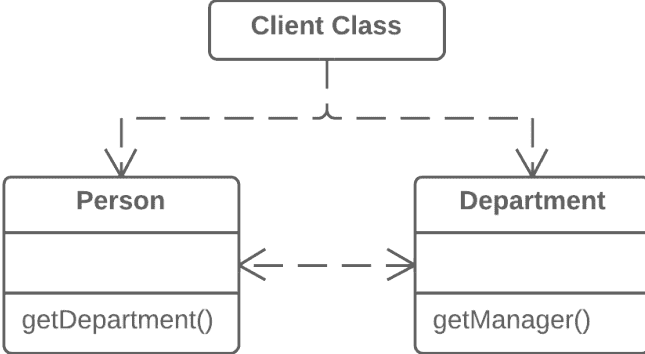

### 解决方案

在类 A 中创建一个新方法，将调用委托给对象 B。现在客户端不知道类 B，也不依赖类 B。

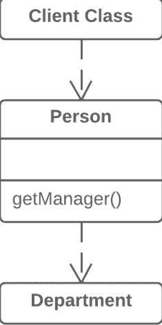

### 为什么要重构

首先，让我们来看术语：

- *服务端（Server）是客户端直接访问的对象。*
- *委托对象（Delegate）是包含客户端所需功能的终端对象。*

当客户端从另一个对象请求对象时，第二个对象再请求另一个，依此类推，就会出现调用链。这些调用序列让客户端参与到类结构的导航中。这些关系中的任何变化都需要客户端侧进行更改。

### 益处

向客户端隐藏委托。客户端代码需要了解的对象之间关系的细节越少，修改你的程序就越容易。

### 缺点

如果你需要创建大量的委托方法，`server-class` 可能会变成一个不必要的中间人，导致过多的中间人（Middle Man）。

### 如何重构

- 针对客户端调用的 `delegate-class` 的每个方法，在 `server-class` 中创建一个该方法，将该调用委托给 `delegate-class`。
- 修改客户端代码，使其调用 `server-class` 的方法。
- 如果你的更改让客户端不再需要 `delegate-class`，你可以从 `server-class` 中移除对 `delegate-class` 的访问方法（即最初用于获取 `delegate-class` 的方法）。

### 反重构

- 移除中间人

### 消除气味

- 消息链
- 不适当的亲密关系

## 移除中间人

### 问题

一个类有太多的方法简单地委托给其他对象。

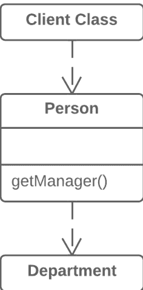

### 解决方案

删除这些方法并强制客户端直接调用终端方法。


### 为什么要重构

为了描述这种技术，我们将使用来自委托（Delegate）的术语：

- *服务端（Server）是客户端直接访问的对象。*
- *委托对象（Delegate）是包含客户端所需功能的终端对象。*

存在存在两种类型的问题：

1. *服务端类（`server-class`）本身什么都不做，只是创建了不必要的复杂性。在这种情况下，考虑这个类是否真的需要。*

   每当向委托对象添加新功能时，你都需要在服务端类中为它创建一个委托方法。如果发生了大量更改，这将是非常乏味。

### 如何重构

- 创建一个 `getter`，用于从服务端类对象访问委托类（`delegate-class`）对象。
- 将服务端类中对委托方法的调用替换为对委托类方法的直接调用。

### 反重构

- 隐藏委托

### 消除气味

- 中间人

## 引入外部方法（Introduce Foreign Method）

### 问题

一个工具类没有包含你需要的方法，而你无法将该方法添加到该类中。

```java
class Report {
    // ...

    void sendReport() {
        Date nextDay = new Date(
            previousEnd.getYear(),
            previousEnd.getMonth(),
            previousEnd.getDate() + 1
        );

        // ...
    }
}
```

### 解决方案

```java
class Report {
    // ...

    void sendReport() {
        Date nextStart = nextDay(previousEnd);

        // ...
    }

    private static Date nextDay(Date arg) {
        return new Date(
            arg.getYear(),
            arg.getMonth(),
            arg.getDate() + 1
        );
    }
}
```


## 为什么要重构

你有代码使用了某个类的数据和方法。你发现这些代码在一个新方法中运行会好得多。但你无法将方法添加到该类中，例如该类位于第三方库。

当你想要移动方法的代码在程序中多次重复时，这种重构具有巨大的回报。

由于你将工具类的对象作为方法的参数传递，你可以访问它的所有字段。在方法内部，你可以几乎执行任何你想的操作。

## 益处

消除了代码重复。如果你的代码在多处重复，你可以将这些代码片段替换为方法调用。考虑到外部方法的位置并不理想，这比重复要好。

## 缺点

对于维护代码的人来说，在客户端类中使用外部方法的原因并不总是清晰。如果方法可以在其他类中使用，你可以通过为工具类创建一个包装器并将方法放在那里来受益。这在有多个工具方法时也有利。

## 如何重构

1. 在客户端类中创建一个新方法。
2. 在此方法中，创建一个参数，将工具类对象传递进去。如果该对象可以从客户端类获取，则不需要创建这样的参数。
3. 将相关的代码片段提取到此方法中，并将其替换为方法调用。
4. 确保在方法的注释中留下外部方法（Foreign method）标签，并建议以后以后可以将该方法放在工具类中。这将有助于未来的维护者理解为什么该方法位于特定的类中。

## 相似的重构

- 引入本地扩展

将所有扩展方法移动到一个独立的类中，该类是某些服务类的包装器或子类。

## 消除气味

- 不完整的库类

# 引入本地扩展

## 问题

一个工具类没有包含你需要的一些方法。但你无法将这些方法添加到类中。

| ClientClass |
| --- |
| `nextDay(:Date) : Date` |

## 解决方案

创建一个包含这些方法的新类，并使其成为工具类的子类或包装器。

## 为什么要重构

你正在使用的类没有你所需的方法。更糟糕的是，你无法添加这些方法，例如，这些类位于第三方库中。有两种解决办法：

- 从相关类创建一个**子类**（subclass），包含所需的方法并从父类继承其他所有内容。这种方法比较简单，但有时会被工具类本身阻止，由于使用了 `final` 关键字。
- 创建一个**包装器**（wrapper）类，它包含所有新方法，并在其他地方将方法委托给工具类中的相关对象。这种方法的工作量更大，因为你不仅需要代码来维护包装类与工具对象之间的关系，还需要编写大量简单的委托方法，以模拟工具类的公共接口。

## 益处

通过将额外方法移动到独立的扩展类（包装类或子类），你避免了用不匹配的代码污染客户端类。程序组件更具内聚性，也更具可用性。

## 如何重构

1. 创建一个新的扩展类：
   - 方案 A：使其成为工具类的子类。
   - 方案 B：如果你决定使用包装器，在其中创建一个字段来存储将进行委托的工具类对象。使用此方案时，你还需要创建重复工具类公共方法的方法，并包含对工具对象方法的简单委托。
2. 创建一个使用工具类构造函数参数的构造函数。
3. 还要创建一个替代的“转换”构造函数，其参数仅接收原始类的对象。这将有助于用扩展类替换原始类的对象。
4. 在类中创建新的扩展方法。将其他类中的外部方法移动到此类，或者如果这些外部方法的功能已在扩展类中存在，则删除这些外部方法。
5. 在需要其功能的地方，将工具类的使用替换为新的扩展类。

## 相似的重构

- 引入外部方法（Introduce Foreign Method）

如果你只需要一个服务类中不存在的特殊方法，且你无法对其进行扩展，请将其移动到客户端类，并将服务类对象作为参数传递。

## 消除气味

- 不完整的库类（Incomplete Library Class）

# 数据组织

这些重构技术有助于处理数据，用丰富的类功能替换基本数据类型。

另一个重要的结果是解耦了类之间的关联，这使得类更具移植性和可用性。

## 字段自封装（Self Encapsulate Field）

**问题：** 你在类内部直接访问私有字段。

**解决方案：** 为字段创建 `getter` 和 `setter`，并仅使用它们来访问该字段。

## 用对象替换数据值（Replace Data Value with Object）

**问题：** 一个类（或一组类）包含一个数据字段。

## 帮助其他重构

- 观察到重复数据
- 用子类替换类型代码
- 用状态/策略替换类型代码

# 将数据值替换为对象

## 问题

一个类（或一组类）包含一个数据字段。该字段有自己的行为和关联的数据。

| 订单 Order |
| --- |
| `customer: String` |

## 解决方案

创建一个新类，将旧字段及其行为放入该类中，并在原始类中存储该类的对象。

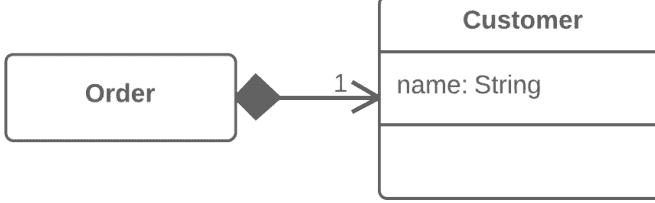

## 为什么要重构

这种重构本质上是**提取类（Extract Class）**的一个特例。它与它不同之处在于重构的原因。

在**提取类**中，我们有一个不再那么简单的单一类，它包含了许多不同的事情，我们想要拆分它的职责。

在将数据值替换为对象时，我们有一个原始类型字段（数字、字符串等），它最初由于程序的增长而变得简单，但现在有了关联的数据和行为。一方面，这些字段本身并没有什么可怕的。然而，这种“字段与行为”的组合可能同时出现在多个类中，导致重复代码。

因此，为了这一切，我们创建了一个新类，并将字段以及相关的数据和行为都移动过去。

## 益处

提高了类内部的关联性。数据和相关行为位于同一个类中。

## 如何重构

在开始重构之前，检查类内部是否有对该字段的直接引用。如果是，使用**自封装字段（Self Encapsulate Field）**在原始类中隐藏它。

1. 创建一个新类，并将你的字段和相关的 `getter` 复制到其中。此外，创建一个接受字段简单值的构造函数。此类将没有 `setter`，因为发送到原始类的每个新字段值将创建一个新的值对象。
2. 在原始类中，将字段类型更改为新类。
3. 在原始类的 `getter` 中，调用关联对象的 `getter`。
4. 在 `setter` 中，创建一个新的值对象。如果之前在构造函数中为字段设置了初始值，你可能还需要在那里创建一个新对象。

## 下一步骤

应用此重构技术后，在包含该对象的字段上应用“将值改为引用（Change Value to Reference）”是明智的。这允许存储一个对应于值的单一对象的引用，而不是为同一个值存储几十个对象。

通常情况下，当你希望一个对象负责一个真实世界对象（如用户、订单、文档等）时需要这种方法。同时，这种方法对于日期、货币、范围等对象将没有用。

## 相似的重构

- 提取类
- 引入参数对象
- 用对象替换数组
- 用方法对象替换方法

对方法的代码也采用相同的操作。

## 消除异味

- 重复代码

# 将值改为引用

## 问题

你拥有许多同一类的相同实例，并需要将它们替换为单个对象。


## 解决方案

将相同的对象转换为一个单一的引用对象。


## 为什么要重构

在许多系统中，对象可以归类为值或引用。

- **引用（References）**：当一个真实世界对象对应程序中的一个对象时。引用通常是用户、订单、产品等对象。
- **值（Values）**：一个真实世界对象对应程序中的多个对象。这些对象可以是日期、电话号码、地址、颜色等。

引用与值的选择并不总是一目了易的。有时有一个包含少量不变数据的简单值。这时，就有必要添加可变的数据并在每次访问对象时传递这些更改。在这种情况下，有必要将其转换为引用。

## 益处

对象包含了关于特定实体的所有最新信息。如果对象在程序的某部分被更改。

## 缺点

引用的实现起来更困难。

## 如何重构

1. 将引用转换为值。
2. 确定是否需要引用。
3. 用值替换引用。
4. 将值改为引用。

# 将引用改为值

## 问题

你拥有许多同一类的相同实例，并需要将它们替换为单个对象。


## 解决方案

将相同的对象转换为一个单一的引用对象。


## 为什么要重构

在许多系统中，对象可以归类为值或引用。

- **引用（References）**：一个真实世界对象对应程序中的一个对象。引用通常是用户、订单、产品等对象。
- **值（Values）**：一个真实世界对象对应程序中的多个对象。这些对象可以是日期、电话号码、地址、颜色等。

引用与值的选择并不总是一目了易的。有时有一个包含少量不变数据的简单值。这时，就有必要添加可变的数据并在每次访问对象时传递这些更改。在这种情况下，有必要将其转换为引用。

## 益处

对象包含了关于特定实体的所有最新信息。如果对象在程序的某部分被更改。

## 缺点

引用的实现起来更困难。

## 如何重构

1. 将引用转换为值。
2. 确定是否需要引用。
3. 用值替换引用。

# 将引用改为值

## 问题

在程序的许多部分，使用了引用。


## 解决方案

将其转换为值。


## 为什么要重构

在许多系统中，对象可以归类为值或引用。

- **引用（References）**：一个真实世界对象对应程序中的一个对象。引用通常是用户、订单、产品等对象。
- **值（Values）**：一个真实世界对象对应程序中的多个对象。这些对象可以是日期、电话号码、地址、颜色等。

引用与值的选择并不总是一目了易的。有时有一个包含少量不变数据的简单值。这时，就有必要添加可变的数据并在每次访问对象时传递这些更改。在这种情况下，有必要将其转换为引用。

## 益处

对象包含了关于特定实体的所有最新信息。如果对象在程序的某部分被更改。

## 缺点

引用的实现起来更困难。

## 如何重构

1. 将引用转换为值。
2. 确定是否需要引用。
3. 用值替换引用。

# 用数组替换对象

> 这种重构技术是将数据值替换为对象的一个特例。

## 问题

你有一个包含不同类型数据的数组。

```java
String[] row = new String[2];

row[0] = "Liverpool";

row[1] = "15";
```

## 解决方案

用数组替换为每个元素都有独立字段的对象。

```java
Performance row = new Performance();

row.setName("Liverpool");

row.setWins("15");
```


## 为什么要重构

数组是存储数据和单一类型集合的极佳工具。但如果你像使用信箱一样使用数组，将用户名放在1号箱，将地址放在14号箱，你有一天会非常后悔这样做。这种方法会导致某人把东西放在错误的“箱子”时导致灾难性的失败，并且需要你花时间搞清楚数据存储在哪里。

## 益处

- 在生成的类中，你可以放置所有之前存储在主类或其他地方的关联行为。
- 类的字段比数组的元素更容易编写文档。

## 如何重构

1. 创建一个新类，该类包含数组中的数据。将数组本身作为公共字段放入该类中。
2. 在原始类中创建一个用于存储该类实例对象的字段。不要忘记在初始化数据数组的地方也创建该对象本身。
3. 在新类中，为数组的每个元素逐个创建访问方法。给它们起一个易懂的名字，指示它们的作用。同时，将主代码中每个数组元素的使用替换为相应的访问方法。
4. 当为所有元素创建了访问方法后，将数组设为私有。
5. 针对数组的每个元素，在类中创建一个私有字段，然后修改访问方法，使其使用该字段而不是数组。
6. 当所有数据都迁移完成后，删除数组。

## 相似的重构

### 用对象替换数据值

消除代码气味。

## 原始类型痴迷

## 观察到的重复数据

## 问题

领域数据是否存储在负责 GUI 的类中？

| IntervalWindow |
| :--- |
| startField: TextField |
| endField: TextField |
| lengthField: TextField |
| StartField_FocusLost() |
| EndField_FocusLost() |
| LengthField_FocusLost() |
| calculateLength() |
| calculateEnd() |

## 解决方案

那么将数据分离到不同的类中是一个好主意，确保领域类与 GUI 之间的连接和同步。

## 重构技术 / 观察到的重复数据

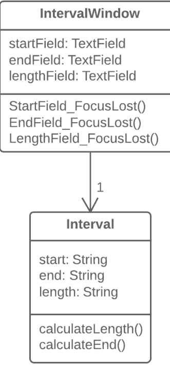

## 为什么要重构

你希望为同一数据拥有多个界面视图（例如，你既有桌面应用又有移动应用）。如果你未能将 GUI 与领域分离，避免代码重复和大量错误将非常困难。

## 益处

- 你在业务逻辑类和表示类之间划分了职责（参考单一职责原则），这使得你的程序更具可读性和易理解。
- 如果你需要添加新的界面视图，只需创建新的表示类；不需要触碰业务逻辑代码（参考开闭原则）。
- 现在不同的人可以处理业务逻辑和用户界面。

## 何时不使用

- 这种重构技术在经典形式下使用观察者模板执行，不适用于 Web 应用，因为在每次向 Web 服务器查询之间，所有类都会重新创建。
- 尽管如此，将业务逻辑提取到独立类的通用原则对于 Web 应用同样是合理的。但这将根据你的系统设计，使用不同的重构技术来实现。

## 如何重构

1. 在 GUI 类中隐藏对领域数据的直接访问。为此，最好使用“自封装字段”（Self Encapsulate Field）。因此你为这些数据创建 getter 和 setter。
2. 在 GUI 类事件的处理器中，使用 setter 设置新的字段值。这将让你将这些值传递给关联的领域对象。
3. 创建一个领域类，并将必要的字段从 GUI 类复制到其中。为所有这些字段创建 getter 和 setter。
4. 为这两个类创建一个观察者模式：
   - 在领域类中，创建一个用于存储观察者对象（GUI 对象）的数组，以及注册、删除和通知它们的方法。
   - 在 GUI 类中，创建一个用于存储领域类引用的字段以及 `update()` 方法，该方法将对对象的更改做出响应并更新 GUI 类中字段的值。注意，值更新应直接在方法中建立，以避免递归。
   - 在 GUI 类构造函数中，创建一个领域类的实例并将其保存到你创建的字段中。将 GUI 对象注册为领域对象中的观察者。
5. 在领域类字段的 setter 中，调用通知观察者的方法（换句话说，GUI 类中的更新方法），以便将新值传递给 GUI。
6. 修改 GUI 类字段的 setter，使其直接在领域对象中设置新值。注意确保值不会通过领域类的 setter 设置——否则会导致无限递归。

## 实现的设计模式

观察者（Observer）。

## 消除的气味

大类（Large Class）。

## 将单向关联改为双向关联

## 问题

你有两个类，它们都需要使用对方的功能，但它们之间的关联是单向的。


## 解决方案

向需要的类中添加缺失的关联。


## 为什么要重构

最初类之间是单向关联。随着时间的推移，客户端代码需要访问关联的双方。

## 益处

如果一个类需要反向关联，你可以简单地计算它。但如果这些计算很复杂，最好保留反向关联。

## 缺点

- 双向关联的实现和维护比单向关联困难得多。
- 双向关联使类产生相互依赖。在单向关联中，其中一个可以独立于另一个使用。

## 如何重构

1. 添加一个用于持有反向关联的字段。
2. 决定哪个类是“主导的”。该类将包含在添加或更改元素时创建或更新关联的方法，在类类中建立关联并调用工具方法在其他对象中建立关联。
3. 如果“非主导”类用于其他用途，则为其创建一个建立关联的方法。
4. 如果控制关联的旧方法在“主导”类中，请通过对关联对象的调用来补充它们。
5. 如果控制关联的旧方法在“非主导”类中，则在“主导”类中创建它们并委托给关联对象。

## 反重构

### 将双向关联改为单向关联

## 将双向关联改为单向关联

## 问题

类之间存在双向关联，但其中一个类并没有使用这些功能。


## 解决方案

移除未使用的关联。


## 为什么要重构

双向关联通常比单向关联更维护，需要额外的代码来创建和删除对象。这使得程序变得复杂。

此外，不当的双向关联会导致垃圾回收问题（从而导致未使用对象的内存膨胀）。

例如：垃圾回收器从内存中移除不再被其他对象引用的对象。假设对象对 `User - Order` 被创建、使用并丢弃。由于它们互相引用，这些对象无法从内存中清除。由于编程语言的进步，这个问题变得不再重要，因为它们现在可以自动识别未使用的对象引用并将其从内存中移除。

还有类之间的相互依赖问题。在双向关联中，两个类必须互相感知，这意味着它们不能单独使用。如果存在许多此类关联，程序的不同部分将过度依赖，任何组件的更改可能会影响其他组件。

## 益处

- 简化不需要关系的类。代码越少，维护工作越少。
- 减少类之间的依赖。独立的类更容易维护，因为对类的任何更改只会影响该类本身。

## 如何重构

1. 确保你的类满足以下情况之一：
   - 没有使用关联。
   - 有其他获取关联对象的方法，例如通过数据库查询。
   - 关联对象可以作为参数传递给使用它的方法。
2. 根据你的情况，使用包含关联对象的字段的使用应替换为参数或以另一种方式获取对象的方法调用。
3. 删除将关联对象赋值给字段的代码。
4. 删除现在不再使用的字段。

## 反重构

§ 将单向关联改为双向关联

消除气味。

§ 不恰的内聚

# 将魔数替换为符号常量

## 问题

你的代码使用了一个具有特定含义的数字。

```
double potentialEnergy(double mass, double height) {
  return mass * height * 9.81;
}
```

## 解决方案

将此数字替换为一个具有人类可读名称的常量，用以解释该数字的含义。

```
static final double GRAVITATIONAL_CONSTANT = 9.81;

double potentialEnergy(double mass, double height) {
  return mass * height * GRAVITATIONAL_CONSTANT;
}
```

## 为什么要重构

魔数是在源代码中遇到但没有明显含义的数值值。这种“反模式”使得理解程序和重构代码变得更加困难。

当你需要更改这个魔数时，会产生更多困难。简单的查找和替换在某些情况下不起作用：同一个数字在不同的地方可能被用于不同的用途，这意味着你必须验证使用该数字的每一行代码。

## 收益

- 符号常量可以作为其值含义的活文档。
- 更改常量的值比在整个代码库中搜索该数字要容易得多，而且没有意外更改其他地方用于不同用途的相同数字的风险。
- 减少代码中数字或字符串的重复使用。当该值复杂且很长时（例如 `3.14159` 或 `0xCAFEBABE`），这尤为重要。

## 提示

并非所有数字都有魔法。

如果一个数字的用途显而易见，则不需要替换它。一个经典的例子是：

```
for (i = 0; i < count; i++) { ... }
```

## 替代方案

1. 有时魔数可以用方法调用来替换。例如，如果你有一个表示集合元素数量的魔数，你不需要用它来检查集合的最后一个元素。相反，使用获取集合长度的标准方法。

2. 魔数有时被用作类型代码。假设你有两种类型的用户，并在类中使用一个数字字段来指定是哪一种：管理员是 1，普通用户是 2。

   在这种情况下，你应该使用其中一种重构方法来避免类型代码：
   - 将类型代码替换为类
   - 将类型代码替换为子类
   - 将类型代码替换为状态/策略

## 如何重构

1. 声明一个常量并将魔数的值赋值给它。
2. 找到所有提到魔数的地方。
3. 对于你找到的每个数字，双检该特定情况下的魔数是否与常量的用途对应。如果是，将该数字替换为你的常量。这是一个重要的步骤，因为同一个数字可能意味着完全不同的含义（并且在某些情况下可能会被替换为不同的常量）。

## 封装字段

## 问题

你有一个公共字段。

```
class Person {
    public String name;
}
```

## 解决方案

将字段设为私有，并为它创建访问方法。

```
class Person {
    private String name;

    public String getName() {
        return name;
    }

    public void setName(String arg) {
        name = arg;
    }
}
```


## 为什么要重构

面向对象编程的支柱之一是`封装`，隐藏对象数据的能力。否则，所有对象都将是公开的，其他对象可以在没有任何任何检查的情况下获取并修改你对象的数据！数据将与与其相关的行为分离，程序段的模块化会受到破坏，维护也会变得复杂。

## 收益

- 如果一个组件的数据和行为紧密相关且位于代码的同一位置，那么对你维护和开发该组件要容易得多。
- 你还可以执行与访问对象字段相关的复杂操作。

## 何时不使用

在某些情况下，出于性能考虑，封装是不明智的。这些情况很少见，但一旦发生，这种情况就非常重要。

假设你有一个图形编辑器，包含具有`x`和`y`坐标的对象。这些字段在未来不太发生改变。此外，程序涉及许多存在这些字段的不同对象。

因此，直接访问坐标字段可以节省大量的 CPU 周期，这些周期原本会被调用访问方法所占用。

这种异常情况的例子是 Java 中的`Point`类。该类的所有字段都是公共的。

## 如何重构

1. 为字段创建 getter 和 setter。
2. 找到该字段的所有调用。将接收字段值替换为 getter，将设置新字段值替换为 setter。
3. 在所有字段调用都已替换后，将字段设为私有。

# 下一步骤

封装字段只是将数据与涉及该数据的行为拉近的第一步。在你创建了访问字段的简单方法后，你应该重新检查调用这些方法的地方。这些区域的代码在访问方法中看起来可能更合适。

## 相似的重构

### 自我封装字段

为字段创建 getters 和 setters，而不是在类内部直接访问。

## 消除气味

### 数据

# 封装集合

## 问题

一个类包含一个集合字段，以及一个用于操作该集合的简单 getter 和 setter。

| Person |
| --- |
| `getCourses()` |
| `setCourses(Set)` |

## 解决方案

将 getter 设为只读，并为添加/删除集合创建方法。

| Person |
| --- |
| `getCourses()` |
| `addCourse(Course)` |
| `removeCourse(Course)` |

## 为什么要重构

一个类包含一个对象的集合。该集合可以是数组、列表或向量。已经创建了用于操作集合的普通 getter 和 setter。

但方法不应该返回集合本身，因为这会让客户端在类不知道的情况下更改内容。此外，这会向客户端暴露过内部结构。另外，不应该有一个给集合赋值的方法。相反，应该有添加和删除元素的操作。由于在此，对象获得了对添加和删除的控制。

## 收益

- 集合字段封装在类内部。当调用 getter 时，它返回集合的副本，防止在类不知道的情况下意外更改或覆盖集合元素。
- 如果集合元素包含在原生类型中（如数组），你为集合创建了更方便的方法。
- 如果集合元素包含在非原生容器（标准集合类）中，通过封装集合，你可以限制对不需要的标准方法的访问。

## 如何重构

1. 创建添加和删除集合元素的方法。这些方法必须接受集合元素作为参数。
2. 如果未在类构造函数中完成，将空集合赋值给字段作为初始值。
3. 找到集合字段 setter 的所有调用。更改 setter 使用添加和删除操作，或者让这些操作调用客户端代码。

   注意 setter 可以用于替换所有集合元素。因此，将 setter 名称（重命名方法）更改为`replace`可能是明智的。
4. 找到所有调用集合 getter 之后更改集合的地方。更改代码以使用你新的添加和删除集合元素的方法。
5. 更改 getter 以返回集合的只读表示。
6. 检查使用集合的客户端代码，查看是否有代码放在集合类本身内部会更好。

# 用类替换类型代码

## 什么是类型代码？

类型代码出现在以下场景中：你没有使用独立的数据类型，而是使用了一组数字或字符串来构成某些实体的允许取值列表。通常，这些特定的数字和字符串通过常量被赋予了易理解的名称，这也是为什么这种类型代码会频繁出现的原因。

## 问题

一个类包含一个带有类型代码的字段。该类型的值没有在运算符条件中使用，也不会影响程序的行为。

| 人员 (Person) |
| :--- |
| `O: int` |
| `A: int` |
| `B: int` |
| `AB: 血型 (bloodgroup): int` |

## 解决方案

创建一个类并使用它的对象代替类型代码值。

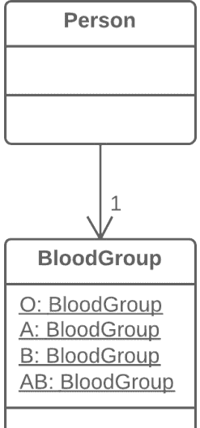

## 为什么要重构

类型代码最常见的原因之一是与数据库交互，当数据库的字段中某些复杂概念是用数字或字符串编码的时。

例如，你有一个`User`类，其中包含`user_role`字段，它包含了每个用户、管理员、编辑或普通用户的访问权限信息。因此，在这种情况下，这些信息分别被编码在字段 A、E 和 U 中。

这种方法的缺点是什么？字段的设置器（setters）通常不会检查发送的是哪个值，当有人向这些字段发送非预期的或错误的值时，会导致大问题。

此外，这些字段无法进行类型验证。你可以向它们发送任何数字或字符串，你的 IDE 不会对其进行类型检查，甚至允许你的程序运行（并在稍后崩溃）。

## 益处

- 我们希望将原始值集合（即编码类型）转换为功能完备的类，利用面向对象编程提供的所有优势。
- 通过用类替换类型代码，我们可以在编程语言层面为传递给方法和字段的值提供类型提示。

例如，以前当将值传递给方法时，编译器无法看出你的数值常量和某些任意数字之间的区别；而现在，当传递了不符合指定类型类的数据时，你的 IDE 内部会收到错误警告。

因此，我们使得将代码移动到类型类中成为可能。如果你需要在整个程序中对类型值进行复杂操作，现在这些代码就可以“存在”于一个或多个类型类中。

## 何时不使用

如果编码类型的值被用于控制流结构（`if`、`switch`等）内部并控制类的行为，那么你应该使用针对类型代码的两种重构技术之一：

- 用子类替换类型代码
- 用状态/策略替换类型代码

## 如何重构

1. 创建一个新类，并给它一个与编码类型之目的相对应的新名称。在这里我们称之为`type`类。
2. 将包含类型代码的字段复制到`type`类并将其设为私有。然后为该字段创建一个 getter。该字段的值仅从构造函数设置。
3. 对于编码类型的每个值，在`type`类中创建一个静态方法。它将创建一个与该编码类型值对应的新`type`类对象。
4. 在原始类中，将编码字段的类型替换为`type`类。在构造函数和字段设置器中也创建一个该类型的新对象。更改字段 getter，使其调用`type`类 getter。
5. 将对编码类型值的所有引用替换为对相关`type`类静态方法的调用。
6. 从原始类中移除编码类型常量。

## 相似的重构

- 用子类替换类型代码
- 用状态/策略替换类型代码

## 消除味道

- 原始类型痴迷 (Primitive Obsession)

# 用子类替换类型代码

## 什么是类型代码？

类型代码出现在以下场景中：你没有使用独立的数据类型，而是使用了一组数字或字符串来构成某些实体的允许取值列表。通常，这些特定的数字和字符串通过常量被赋予了易理解的名称，这也是为什么这种类型代码会频繁出现的原因。

## 问题

你有一个编码类型，它被用在控制流结构（`if`、`switch`等）内部并直接控制类的行为。

| 员工 (Employee) |
| :--- |
| 工程师 (ENGINEER): int |
| 销售员 (SALESMAN): int |
| 类型 (type): int |

## 解决方案

为编码类型的每个值创建一个子类。将控制流代码提取到这些子类中。用多态替换控制流。


## 为什么要重构

这种重构技术是“用类替换类型代码”的一种复杂变体。

在第一种重构中，你有一组构成实体允许值的简单值。虽然这些值通常以常量形式指定并具有易理解的名称，但使用它们是容易出错的。例如，在某个时刻，你通过字符串`"admin"`来接收这些字段的 own，这并不是作者所预期的。

## 益处

- 删除控制流代码。与其在原始类中使用臃肿的`switch`，不如将代码移动到相应的子类中。这提高了对单一职责原则的遵循，并使程序更易读。
- 如果你需要为编码类型添加新值，只需添加一个新的子类而无需触动现有代码（参见开闭原则）。
- 通过用类替换类型代码，我们为方法和字段提供了类型提示，这在使用编码类型中的简单数值时是不可能的。

## 何时不使用

- 如果你已经有了类层次结构，则该技术不适用。你无法通过继承创建双重体系。但是，你可以通过组合而不是继承来替换类型代码。要这样做，请使用状态/策略替换类型代码。
- 如果类型代码的值在对象创建后可以更改，请避免使用这种技术。我们必须动态地替换对象本身，这是不可行的。同样，在这种情况下，替代方案也是状态/策略替换类型代码。

## 如何重构

1. 使用自封装字段（Self Encapsulate Field）为包含类型代码的字段创建一个 getter。
2. 将父类构造函数设为私有。创建一个与父类构造函数参数相同的静态工厂方法。它必须包含将作为编码类型初始值的参数。根据此参数，工厂方法将创建各种子类的对象。要这样做，你必须在代码中创建一个巨大的条件，但至少它会在真正需要的地方出现；否则子类和多态就足够。
3. 为编码类型的每个值创建一个唯一的子类。在子类中重写编码类型的 getter，使其返回相应的编码类型值。
4. 从父类中删除类型代码字段。将其 getter 设为抽象方法。
5. 现在你已经有了子类，可以开始将父类中的字段和方法移动到相应的子类中（借助推下字段和推下方法）。
6. 当所有可能的内容都移动完毕后，使用用多态替换条件，以彻底消除使用类型代码的条件。

# 用状态/策略替换类型代码

## 什么是类型代码？

类型代码是指当你没有使用独立的数据类型，而是使用一组数字或字符串来构成某个实体的允许值列表的情况。通常，这些特定的数字和字符串通过常量被赋予易于理解的名称，这也是为什么类型代码频繁出现的原因。

## 问题

你有一个影响行为的编码类型，但你无法使用子类来消除它。

| 员工 (Employee) |
| :--- |
| ENGINEER: int |
| SALESMAN: int |
| type: int |

## 解决方案

将类型代码替换为状态对象。如果有必要将字段值替换为类型代码，则“插入”另一个状态对象。

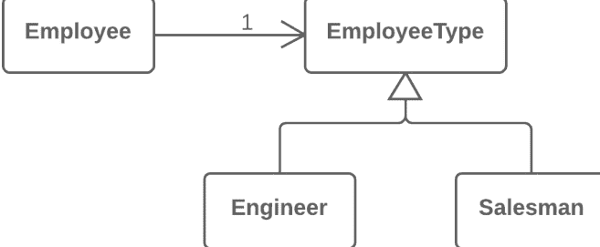

## 为什么要重构

你拥有类型代码且它影响了类的行为，因此我们不能使用“用类替换类型代码”。

类型代码影响类的行为，但由于现有的类层次结构或其他原因，我们无法为该编码类型创建子类。这意味着我们无法应用“用子类替换类型代码”。

## 收益

- 这种重构技术解决了在对象生命周期内具有编码类型的字段值发生变化的情况。在这种情况下，值的替换是通过替换原始类所引用的状态对象来实现的。
- 如果你需要为编码类型添加新值，你只需要添加一个新的状态子类，而无需修改现有代码（参见开/闭原则）。

## 缺点

如果你只有一个简单的类型代码案例，但仍然使用这种重构技术，将会产生许多额外的（且不需要的）类。

## 提示

这种重构技术的实现可以使用两种设计模式之一：状态（State）或策略（Strategy）。无论你选择哪种模式，实现方式都是相同的。那么在特定情况下应该选择哪种模式呢？

如果你试图拆分控制算法选择的条件，请使用策略模式。

但如果编码类型的每个值负责的不是选择算法，而是类的整个条件、类状态、字段值以及许多其他操作，那么状态模式更合适。

## 如何重构

1. 使用“自封装字段”（Self Encapsulate Field）为包含类型代码的字段创建一个 getter。
2. 创建一个新类，并给它一个符合类型代码目的的易理解的名称。该类将扮演状态（或策略）的角色。在其中，创建一个抽象的编码字段 getter。
3. 为编码类型的每个值创建状态的子类。在每个子类中，重新定义编码字段的 getter，使其返回类型代码对应的值。
4. 在抽象状态类中，创建一个静态工厂方法，接受类型代码的值作为参数。根据此参数，工厂方法将创建各种状态的对象。为此，在它的代码中创建一个大的条件判断；这将是重构完成后唯一的此类条件判断。
5. 在原始类中，将编码字段的类型改为状态类。在字段的 setter 中，调用工厂方法来获取新的状态对象。
6. 现在你可以开始将字段和方法从父类移动到对应的状态子类（使用“下推字段”和“下推方法”）。
7. 当所有可以移动的内容都移动完毕后，使用“用多态替换条件”（Replace Conditional with Polymorphism）来彻底消除使用类型代码的条件判断。

## 相似的重构

- 用类替换类型代码
- 用子类替换类型代码

## 实现的设计模式

- 状态 (State)
- 策略 (Strategy)

## 消除代码味

- 原始类型过度 (Primitive Obsession)

# 用字段替换子类

## 问题

你有的子类仅在它们的（返回常量的）方法上不同。

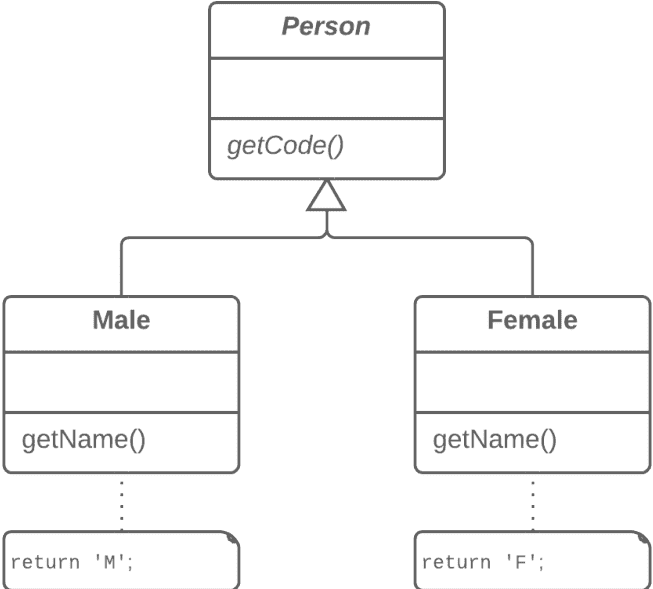

## 解决方案

在父类中使用字段替换方法并删除子类。

| 人 (Person) |
| :--- |
| `code` |
| `getCode()` |

## 为什么要重构

有时，重构只是避免类型代码的途径。

在其中一种情况下，子类层次结构可能仅在特定方法返回的值上有所不同。这些方法不是计算的结果，而是严格位于方法本身或方法返回的字段。为了简化类架构，根据情况，这种层次结构可以压缩为包含一个或多个具有必要值的单个类。

在从类层次结构移动大量功能到另一个地方后，这些更改可能变得必要。当前的层次结构不再那么有价值，其子类现在只是多余的负担。

## 收益

简化了系统架构。如果你只是想在不同方法中返回不同的值，创建子类就多此举了。

## 如何重构

1. 对子类应用“用工厂方法替换构造函数”。
2. 将子类的构造函数调用替换为工厂方法调用。
3. 在父类中声明字段以存储每个子类的值。
4. 为新字段创建一个保护的构造函数。
5. 创建或修改现有的子类构造函数，使其调用父类构造函数并传递相关值。
6. 在父类中实现每个方法，以便返回相应字段的值。
7. 如果子类构造函数有额外功能，使用“内联方法”（Inline Method）将其整合到工厂方法中。
8. 删除子类。

## 反重构

- 用子类替换类型代码

# 简化条件表达式

条件随着时间的推移变得越来越复杂，还有更多技术可以应对。

## 拆分条件

**问题**：你有一个复杂的条件（`if-then else`）。

**解决方案**：将条件的复杂部分分解为独立的方法：`then`和`else`。

## 合并条件表达式

**问题**：多个条件指向相同的结果或操作。

**解决方案**：将所有这些条件合并到一个表达式中。

## 合并重复条件片段

**问题**：在条件的所有分支中相同的相同的代码。

**解决方案**：将代码移动到条件之外。

## 移除控制标志

**问题**：你有一个布尔变量作为多个布尔表达式的控制标志。

**解决方案**：不要该变量，使用`break`、`continue`和`return`。

## 卫语句替换嵌套条件

**问题**：你有一组嵌套条件，很难确定代码执行的正常流程。

**解决方案**：将所有特殊检查和边缘情况隔离到单独的语句中，并放在主检查之前。理想情况下，你应该有一个平化的条件列表。

## 用多态替换条件

**问题**：你有一个根据对象类型或属性执行各种操作的条件。

**解决方案**：为条件的分支创建子类。在子类中创建一个共享方法，并将对应分支的代码移动到其中。然后将条件替换为相关的方法调用。结果是根据对象类通过多态获得正确的实现。

# 分解条件 (Decompose Conditional)

## 问题

你有一个复杂的条件判断（`if-then / else`或`switch`）。

```text
if (date.before(SUMMER_START) || date.after(SUMMER_END)) {

  charge = quantity * winterRate + winterServiceCharge;

}

else {

  charge = quantity * summerRate;

}
```

## 解决方案

将条件的复杂部分分解为独立的方法：条件、then 块和 else 块。

```text
if (isSummer(date)) {

  charge = summerCharge(quantity);

}

else {

  charge = winterCharge(quantity);

}
```

## 为什么要重构

代码越长，越难理解。当代码中充满了条件时，理解会变得更加困难：

- 当你忙于弄清楚`then`块中代码的作用时，你忘记了相关的条件是什么。
- 当你忙于解析`else`时，你忘记了`then`块中代码的作用。

## 益处

- 通过将条件代码提取到命名清晰的方法中，你可以为以后维护代码的人（例如两个月后的你自己！）提供便利。
- 这种重构技术也适用于条件中的短表达式。字符串`isSalaryDay()`比比较日期的代码要漂亮得多且更具描述性。

## 如何重构

1. 通过**提取方法 (Extract Method)** 将条件提取到独立的方法中。
2. 对`then`和`else`块重复此过程。

## 消除异味

### 长方法 (Long Method)

# 合并条件表达式 (Consolidate Conditional Expression)

## 问题

你有多个通向相同结果或动作的条件。

```text
double disabilityAmount() {

  if (seniority < 2) {

    return 0;

  }
```


```java
if (monthsDisabled > 12) {
  return 0;
}

if (isPartTime) {
  return 0;
}

// 计算残障金额。
// ...
```

## 解决方案

将所有这些条件合并到一个表达式中。

```java
double disabilityAmount() {
  if (isNotEligibleForDisability()) {
    return 0;
  } // 计算残障金额。
  // ...
}
```

## 为什么要重构

你的代码包含许多执行相同动作的交替运算符。并不清楚为什么这些运算符被分开了。

合并的主要目的是将条件提取到独立的方法中，以提高清晰度。

## 益处

- 消除重复的控制流代码。合并多个具有相同“目的地”的条件，有助于显示你只进行了一次指向某个动作的复杂检查。
- 通过合并所有运算符，你现在可以将这个复杂的表达式隔离在一个新方法中，并用一个解释条件目的名称命名。

## 如何重构

在重构之前，确保条件没有任何“副作用”或修改某些内容，而只是简单地返回值。副作用可能隐藏在运算符内部执行的代码中，例如根据条件的结果向变量添加某些内容。

1. 使用 `and` 和 `or` 将条件合并到一个表达式中。合并时的一般规则是：
   - 嵌套条件使用 `and` 连接。
   - 连续的条件使用 `or` 连接。
2. 对运算符条件执行提取方法，并给方法起一个反映表达式目的的名字。

## 消除异味

## 重复代码（Duplicate Code）

### 合并重复条件片段（Consolidate Duplicate Conditional Fragments）

#### 问题

在条件的所有分支中都可以找到相同的代码。

```java
if (isSpecialDeal()) {
  total = price * 0.95;
  send();
} else {
  total = price * 0.98;
  send();
}
```

#### 解决方案

将代码移动到条件之外。

```java
if (isSpecialDeal()) {
  total = price * 0.95;
} else {
  total = price * 0.98;
}

send();
```

#### 为什么要重构

在条件的所有分支中发现了重复代码，这通常是分支内代码演化的结果。团队开发可能是导致因素。

#### 益处

代码去重。

#### 如何重构

1. 如果重复代码位于条件分支的开头，将代码移动到条件之前。
2. 如果代码在分支末尾执行，将其放置在条件之后。
3. 如果重复代码随机位于分支内部，首先尝试将代码移动到分支的开头或末尾，取决于它是否会改变后续代码的结果。
4. 如果合适且重复代码超过一行，请尝试使用提取方法。

## 消除异味

## 重复代码（Duplicate Code）

### 移除控制标志（Remove Control Flag）

#### 问题

你有一个布尔变量，作为多个布尔表达式的控制标志。

#### 解决方案

不要使用变量，而是使用 `break`、`continue` 和 `return`。

#### 为什么要重构

控制标志可以追溯到过去，那时“正规”程序员总是为他们的函数只有一个入口点（函数声明行）和一个出口点（在函数的末尾）。

在现代编程语言中，这种风格已经过时了，因为我们有特殊的运算符来修改循环和其他复杂结构的控制流：

- `break`：停止循环
- `continue`：停止迭代
- `return`：停止函数

#### 益处

使用控制标志的代码通常比使用控制运算符的代码要臃肿得多。

#### 如何重构

1. 找到导致退出循环的控制标志赋值。
2. 如果是退出循环，将其替换为 `break`；如果是退出迭代，则替换为 `continue`；如果需要返回值，则替换为 `return`。
3. 移除与控制标志相关的剩余代码。

### 用守卫语句替换嵌套条件（Replace Nested Conditional with Guard Clauses）

#### 问题

你有一组嵌套条件，很难确定代码执行的正常流程。

```java
public double getPayAmount() {
  double result;

  if (isDead) {
    result = deadAmount();
  } else {
    if (isSeparated) {
      result = separatedAmount();
    } else {
      if (isRetired) {
        result = retiredAmount();
      } else {
        result = normalPayAmount();
      }
    }
  }

  return result;
}
```

#### 解决方案

将所有特殊检查和边缘情况隔离到单独语句中，并将它们放在主检查之前。理想情况下，你应该有一个“扁坦”的条件列表，一个接一个。

```java
public double getPayAmount() {
  if (isDead) {
    return deadAmount();
  }

  if (isSeparated) {
    return separatedAmount();
  }

  if (isRetired) {
    return retiredAmount();
  }

  return normalPayAmount();
}
```

#### 为什么要重构

识别“地狱条件”其实非常容易。每一层嵌套的缩进形成了一个箭头，指向痛苦和灾难的方向：

```java
if () {
  if () {
    do {
      if () {
        if () {
          if () {
            ...
          }
        }
      }
      ...
    }
  } while ();
  ...
} else {
  ...
}
```

很难看出每个条件的作用和方式，因为代码执行的“正常”流程并不显而易见。这些条件表明了混乱的进化，每个条件都是作为临时措施添加的，没有考虑优化整体结构。

为了简化情况，将特殊情况隔离到单独条件中，如果守卫语句为真，立即结束执行并返回空值。

#### 如何重构

尝试消除副作用——分离查询与修改（Separate Query from Modifier）对此有所帮助。

1. 将方法中所有导致调用异常或立即返回值的守卫语句隔离出来。将这些条件放在方法的开头。
2. 重排完成后且所有测试成功通过后，查看对于导致相同异常或返回值的守卫语句是否可以使用合并条件表达式。

## 用多态替换条件分支

### 问题描述

你有一个根据对象类型或属性执行各种操作的条件判断。

```java
class Bird {
  // ...

  double getSpeed() {
    switch (type) {
      case EUROPEAN:
        return getBaseSpeed();

      case AFRICAN:
        return getBaseSpeed() - getLoadFactor() * numberOfCoconuts;

      case NORWEGIAN_BLUE:
        return (isNailed) ? 0 : getBaseSpeed(voltage);
    }

    throw new RuntimeException("Should be unreachable");
  }
}
```

### 解决方案

创建与条件分支匹配的子类。在这些子类中，创建一个共享方法，并将对应条件分支的代码移动到该方法中。然后用相关的方法调用替换条件分支。结果是：根据对象的类通过多态实现正确的实现。

```java
abstract class Bird {
  // ...

  abstract double getSpeed();
}

class European extends Bird {
  double getSpeed() {
    return getBaseSpeed();
  }
}

class African extends Bird {
  double getSpeed() {
    return getBaseSpeed() - getLoadFactor() * numberOfCoconuts;
  }
}

class NorwegianBlue extends Bird {
  double getSpeed() {
    return (isNailed) ? 0 : getBaseSpeed(voltage);
  }
}

// 客户端代码某处
```

### 为什么要重构

如果你的代码包含根据以下因素执行不同任务的运算符，那么这种重构技术将非常有帮助：

- 对象的类或其实现的接口
- 对象字段的值
- 调用对象某个方法产生的结果

如果出现了新的对象属性或类型，你需要在所有类似的条件分支中搜索并添加代码。因此，如果对象的所有方法中散布着多个条件分支，这种技术的好处将会成倍增加。

### 益处

- 该技术遵循“不要询问，要通知”（Tell-Don't-Ask）原则：与其询问对象的状态并据此执行操作，不如直接告诉对象需要做什么，让它自己决定如何执行要简单得多。
- 消除重复代码。你去掉了许多几乎完全相同的条件分支。
- 如果你需要添加新的执行变体，只需要添加一个新的子类，而无需触动现有代码（开/闭原则）。

### 如何重构

#### 准备重构

对于这种重构技术，你应该已经有一个包含备选行为的类层次结构。如果没有这样的层次结构，请创建一个。其他技术可以帮助实现这一点：

- 用子类替换类型代码。为特定对象属性的所有值创建子类。这种方法简单但灵活性较差，因为你无法为对象的其他属性创建子类。
- 用状态/策略替换类型代码。为特定的对象属性创建一个类，并根据该属性的每个值从该类创建子类。当前类将包含该类型对象的引用，并将执行任务委托给它们。

以下步骤假设你已经创建了该层次结构。

#### 重构步骤

1. 如果条件分支位于一个执行其他操作的方法中，请执行“提取方法”（Extract Method）。
2. 对于每个层次结构子类，重新定义包含条件分支的方法，并将对应分支的代码复制到该位置。
3. 从条件分支中删除该分支。
4. 重复替换直到条件分支为空。然后删除该条件分支并将方法声明为抽象方法。

## 消除异味

- `Switch` 语句

## 引入空对象

### 问题描述

由于某些方法返回 `null` 而不是真实的对象，你的代码中有很多针对 `null` 的检查。

```java
if (customer == null) {
  plan = BillingPlan.basic();
} else {
  plan = customer.getPlan();
}
```

### 解决方案

不要返回 `null`，而是返回一个表现出默认行为的空对象。

```java
class NullCustomer extends Customer {
  boolean isNull() {
    return true;
  }
}
```

```java
Plan getPlan() {
  return new NullPlan();
}

// 其他 NULL 功能。
}

// 将 null 值替换为空对象。
customer = (order.customer != null)
    ? order.customer
    : new NullCustomer();

// 像使用普通类一样使用空对象。
plan = customer.getPlan();
```

### 为什么要重构

几十个 `null` 让你的代码变得更长更难看。

### 缺点

消除条件分支的代价是又创建了一个新类。

### 如何重构

1. 从涉及的类中，创建一个承担空对象角色的子类。
2. 在两个类中都创建 `isNull()` 方法，它对空对象返回 `true`，对真实类返回 `false`。
3. 找到所有代码可能返回 `null` 而不是真实对象的地方。修改代码使其返回空对象。
4. 找到所有将真实类变量与 `null` 进行比较的地方。将这些检查替换为对 `isNull()` 的调用。
5. 如果在值不符合条件但在这些条件下运行了原始类的方法，请为该条件添加断言（assertion）以确保万。如果你无法提取 `else` 分支，则该行为将通过多态实现。

### 类似的重构

- 用多态替换条件分支

### 实现的设计模式

- 空对象模式（Null-object）

## 消除异味

- `Switch` 语句
- 临时字段

## 引入断言

### 问题描述

为了使部分代码正确工作，某些条件或值必须为真。

```java
double getExpenseLimit() {
  // 应该有费用限制或
  // 项目。
  return (expenseLimit != NULL_EXPENSE)
      ? expenseLimit
      : primaryProject.getExpenseLimit();
}
```

### 解决方案

将这些假设替换为特定的断言检查。

```java
double getExpenseLimit() {
  Assert.isTrue(expenseLimit != NULL_EXPENSE || primaryProject != null);

  return (expenseLimit != NULL_EXPENSE)
      ? expenseLimit
      : primaryProject.getExpenseLimit();
}
```


## 为什么要重构

代码某些部分假设了关于对象的当前状态、参数或局部变量的值。通常，除非发生错误，否则假设总是成立的。

通过添加相应的断言使这些假设显性化。就像方法参数的类型提示一样，这些断言可以作为代码的活文档。

对于描述方法工作条件的注释，可以作为确定代码哪里需要断言的指南。

## 益处

如果假设不成立导致代码给出了错误结果，那么在造成严重后果和数据损坏之前停止执行要好。这意味着你在设计测试方案时忽略了编写必要的测试。

## 缺点

- 有时异常比简单的断言更合适。你可以选择必要的异常类并让剩余代码正确处理它。
- 什么时候异常比简单的断言更好？如果异常可以由用户或系统的操作引起且你可以处理该异常。另一方面，普通的未命名且未处理的异常基本上等同于简单的断言——你不处理它们，而且它们完全是由本不应该发生的程序 Bug 引起的。

## 如何重构

当你发现假设某个条件时，为该条件添加断言以确保万无一失。

添加断言不应改变程序的行为。

不要过度对代码中的一切内容使用断言。只检查对于代码正确运行所必要的条件。如果当某个断言为假时代码仍正常运行，就可以安全地删除该断言。

## 消除异味

- 注释

# 简化方法调用

这些技术让方法调用变得简单且易于理解。这反过来简化了类与类之间交互的接口。

## 重命名方法

**问题：** 方法名没有解释该方法的作用。

**解决方案：** 重命名该方法。

## 添加参数

**问题：** 方法没有足够的数据来执行某些操作。

**解决方案：** 创建一个新参数来传递必须的数据。

## 移除参数

**问题：** 参数在方法体内没有被使用。

**解决方案：** 移除未使用的参数。

## 分离查询与修改

**问题：** 你是否有一个方法既返回结果，又修改了对象内部的内容？

**解决方案：** 将该方法拆分为两个独立的方法。正如你预期的，其中一个应该返回结果，另一个则修改对象。

## 方法参数

**问题：** 多个方法执行相似的操作，仅在内部值、数字或操作上不同。

**解决方案：** 通过一个传递必要的特殊值的参数来合并这些方法。

## 将参数替换为显式方法

**问题：** 方法被拆分为若干部分，每个部分根据参数的值决定运行。

**解决方案：** 将方法的各个部分提取到它们自己的方法中，并调用它们代替原始方法。

## 保留完整对象

**问题：** 你从对象中获取几个值，然后将它们作为参数传递给方法。

**解决方案：** 尝试传递整个对象。

## 将参数替换为方法调用

**问题：** 调用一个查询方法并将其结果作为另一个方法的参数传递，而该方法可以直接调用该查询。

**解决方案：** 不要通过参数传递值，而是尝试在方法体内放置查询调用。

## 引入参数对象

**问题：** 你的方法包含一组重复的参数。

**解决方案：** 用一个对象替换这些参数。

## 移除设置方法

**问题：** 字段的值应该仅在创建时设置，之后任何时候都不再更改。

**解决方案：** 移除设置字段值的方法。

## 隐藏方法

**问题：** 方法没有被其他类使用，或仅在其自身的类层次内部使用。

**解决方案：** 将方法设为私有（`private`）或保护（`protected`）。

## 将构造函数替换为工厂方法

**问题：** 你有一个复杂的构造函数，其执行的操作不仅仅是在对象字段中设置参数值。

**解决方案：** 创建一个工厂方法并使用它来替换构造函数调用。

## 将错误代码替换为异常

**问题：** 一个方法返回一个指示错误的特殊值？

**解决方案：** 改为抛出异常。

## 将异常替换为测试

**问题：** 你在一个简单的测试就能完成工作的地方抛出了异常？

**解决方案：** 用条件测试替换异常。

# 重命名方法

## 问题

方法名没有解释该方法的作用。

| `Customer` |
| --- |
| `getsnm()` |

## 解决方案

重命名该方法。

| `Customer` |
| --- |
| `getSecondName()` |

## 为什么要重构

也许一个方法从一开始就命名得很糟糕——例如，有人在匆忙中创建了该方法，没有顾及给它良好的命名。

或者该方法最初命名得很好，但随着功能的增长，方法名不再是一个良好的描述符。

## 益处

提高代码可读性。尝试给新方法起一个反映其作用的名字。类似于 `createOrder()`、`renderCustomerInfo()` 等名称。

## 如何重构

1. 查看该方法是否定义在父类或子类中。如果是，你必须在这些类中重复所有步骤。
2. 下一个方法对于在重构过程中维护程序的功能非常重要。创建一个具有新名称的方法。将旧方法的代码复制到其中。删除旧方法中的所有代码，取而代之插入对新方法的调用。
3. 找到所有对旧方法的引用，并将它们替换为对新方法的引用。
4. 删除旧方法。如果旧方法是公共接口的一部分，不要执行此步骤。相反，将旧方法标记为已弃（`deprecated`）。

## 相似的重构

- 添加参数
- 移除参数

## 消除异味

- 具有不同的替代类
- 注释

# 添加参数

## 问题

方法没有足够的数据来执行某些操作。

| `Customer` |
| --- |
| `getContact()` |

## 解决方案

创建一个新参数来传递必须的数据。

| `Customer` |
| --- |
| `getContact(Date)` |

## 为什么要重构

你需要对方法进行更改，而这些更改需要添加方法之前无法获得的信息或数据。

## 益处

这里的选择是在添加新参数和添加一个包含方法所需数据的新私有字段之间进行。当你需要偶尔或频繁更改的数据，且没有必要一直让对象中持有它时，字段是更好的选择。在这种情况下，新参数比私有字段更合适，重构将产生回报。否则，添加一个私有字段并在调用方法之前用必要的数据填充它。

## 缺点

- 添加新参数总是比移除它容易，这就是为什么参数列表经常膨胀到可怕的程度。这种异味被称为“长参数列表”。
- 如果你需要添加一个新参数，有时这意味着你的类不包含必要的数据，或者现有参数不包含必要的相关数据。在这两种情况下，最佳解决方案是考虑将数据移动到主类或其他已经从方法内部就可以访问的其它类对象中。

## 如何重构

1. 查看该方法是否定义在父类或子类中。如果方法存在于其中，你需要在这些类中重复这些步骤。
2. 下一个步骤对于在重构过程中保持程序的功能至关重要。通过复制旧方法创建一个新方法，并为其添加必要的参数。用对新方法的调用替换旧方法的代码。你可以为新参数传入任何值，例如对象的 `null` 或数字的 `0`。
3. 找到所有对旧方法的引用，并将它们替换为对新方法的引用。
4. 删除旧方法。如果旧方法是公共接口的一部分，则无法删除。如果是那样，将旧方法标记为已弃。

## 反重构

- 移除参数

## 相似的重构

- 重命名方法

## 帮助其他重构

- 引入参数对象

# 移除参数

## 问题

参数在方法体内没有被使用。

| `Customer` |
| --- |
| `getContact(Date)` |

## 解决方案

移除未使用的参数。

| `Customer` |
| --- |
| `getContact()` |

## 为什么要重构

方法调用中的每个参数都会迫使阅读它的程序员去弄清这个参数包含了什么信息。

如果一个参数在方法体内完全没有被使用，那么这种“挠头”就是白费。

无论任何情况下，额外的参数都是必须运行的额外代码。

有时为了未来添加参数，预期方法可能会需要该参数。尽管如此，经验表明，只有真正需要时才添加参数更好。毕竟，预期的变化往往仅仅是预期而已。

## 益处

方法仅包含它真正需要的参数。

## 何时不使用

如果方法在子类或父类中有不同的实现，并且你的参数在这些实现中使用了，请保持参数不变。

## 如何重构

1. 查看该方法是否定义在父类或子类中。如果是，参数在那里使用了吗？如果参数在这些实现之一中使用了，请推迟这种重构技术。
2. 下一步对于在重构过程中保持程序功能正常至关重要。通过复制旧方法创建一个新方法，并删除其中相关的参数。用对新方法的调用替换旧方法的代码。
3. 找到所有对旧方法的引用，并将它们替换为对新方法的引用。
4. 删除旧方法。如果旧方法是公共接口的一部分，则不要执行此步骤。在这种情况下，将旧方法标记为已弃用（`deprecated`）。

## 反向重构

- 添加参数

## 相似的重构

- 重命名方法

## 帮助其他重构

- 将参数替换为方法调用

## 消除异味

- 推测性泛化

# 分离查询与修改器（Separate Query from Modifier）

## 问题

你是否有一个方法既返回值，又改变了对象内部的内容？

| 客户（`Customer`） |
| --- |
| `getTotalOutstandingAndSetReadyForSummaries()` |

## 解决方案

将该方法拆分为两个独立的方法。正如你预期的，其中一个应该返回值，另一个则修改对象。

| 客户（`Customer`） |
| --- |
| `getTotalOutstanding()`<br>`ReadyForSummaries()` |

## 为什么要重构

这种重构技术实现了命令与查询职责分离（CQRS）。这一原则告诉我们，要将获取数据的代码与改变对象内部内容的代码分离。

获取数据的代码被称为“查询”（query）。更改对象可见状态内容的代码被称为“修改器”（modifier）。当查询和修改器结合时，你无法在不改变其状态的情况下获取数据。换句话说，你提问了一个问题，却可以在接收答案的同时改变这个答案。当调用查询的人可能不知道该方法的“副作用”时，这个问题会变得更加严重，这通常会导致运行时错误。

请记住，只有在改变对象可见状态的修改器情况下，副作用才是危险的。这些状态可以是，例如从对象的公共接口访问的字段、数据库中的条目等。如果一个修改器只是缓存了一个复杂操作并将其保存在类的私有字段中，那么它几乎不会引起任何副作用。

## 收益

如果你有一个不改变程序状态的查询，你可以随心所欲多次调用它，而不必担心仅仅因为调用了该方法就会导致结果出现意外变化。

## 缺点

在某些情况下，在执行命令后获取数据是很方便的。例如，从数据库中删除某些内容时，你想知道删除了多少行。

## 如何重构

1. 创建一个新的*查询方法*来返回原始方法所执行的结果。
2. 修改原始方法，使其仅返回调用新*查询方法*的结果。
3. 将所有对原始方法的引用替换为对*查询方法*的调用。在这一行之前，放置一个对*修改器方法*的调用。这可以防止在原始方法被用于条件运算符或循环的条件时产生副作用。
4. 移除原始方法中返回值的代码，该方法现在已变成了一个适当的*修改器方法*。

## 帮助其他重构

- 将临时变量替换为查询

# 方法参数化（Parameterize Method）

## 问题

多个方法执行相似的操作，区别仅在于它们的内部值、数字或操作。

| 员工（`Employee`） |
| --- |
| `fivePercentRaise()` |
| `tenPercentRaise()` |

## 解决方案

使用一个将传递必要特殊值的参数来合并这些方法。

| 员工（`Employee`） |
| --- |
| `raise(percentage)` |

## 为什么要重构

如果你有相似的方法，你可能存在重复代码，以及随之而来的后果。

更重要的是，如果你需要添加此功能的另一个版本，你将不得不创建另一个方法。相反，你只需要使用不同的参数运行现有方法即可。

## 缺点

- 有时，重构技术可能会做得过头，导致产生一个长而复杂的公共方法，而不是多个简单的方法。
- 同时，在将功能的激活/去激活移动到参数时要小心。这最终可能导致创建一个巨大的条件运算符，该运算符需要通过“将参数替换为显式方法”来处理。

## 如何重构

1. 创建一个带有参数的新方法，并通过应用“提取方法”（Extract Method）将其移动到所有类都相同的代码中。注意，有时只有方法的某部分实际上是相同的。在这种情况下，重构包括仅将相同部分提取到新方法中。
2. 在新方法的代码中，将特殊/差异值替换为参数。
3. 对于每个旧方法，找到调用它的地方。将这些调用替换为对新方法的调用。然后删除该方法。

## 反向重构

- 将参数替换为显式方法

## 相似的重构

- 提取方法
- 模板方法

## 消除异味

- 重复代码

# 将参数替换为显式方法（Replace Parameter with Explicit Methods）

## 问题

一个方法被拆分为若干部分，每个部分根据值运行。

```java
void setValue(String name, int value) {
    if (name.equals("height")) {
        height = value;
        return;
    }

    if (name.equals("width")) {
        width = value;
        return;
    }
}
```

## 解决方案

将方法的各个部分提取到独立的方法中并调用它们代替原始方法。

```java
void setHeight(int arg) {
    height = arg;
}

void setWidth(int arg) {
    width = arg;
}
```

## 为什么要重构

一个包含依赖参数变体的方法变得庞大。

## 收益

提高了代码的可读性。相比 `setValue("engineEnabled", true)`，理解 `startEngine()` 的目的容易得多。

## 何时不使用

如果一个方法很少更改且内部没有添加新变体，则不要将参数替换为显式方法。

## 如何重构

1. 为方法的每个变体创建一个独立的方法。根据主方法中的值运行这些方法。
2. 找到所有调用原始方法的地方。在这些地方调用其中一个变体方法。
3. 当原始方法不再被调用时，删除它。

## 反向重构

- 方法参数化

## 相似的重构

- 将条件替换为多态

## 消除异味

- `Switch` 语句
- 长方法

# 保留完整对象（Preserve Whole Object）

## 问题

你从对象获取几个值，并将它们作为参数传递给方法。

```java
int low = daysTempRange.getLow();
int high = daysTempRange.getHigh();
boolean withinPlan = plan.withinRange(low, high);
```

## 解决方案

相反，尝试传递整个对象。

```java
boolean withinPlan = plan.withinRange(daysTempRange);
```

## 为什么要重构

问题在于每次调用都要调用参数对象的方法。如果这些方法或获取的数据量发生变化，你需要仔细查找程序中的多处并在每处实现这些更改。

## 收益

- 与一堆参数相比，你看到的是一个具有清晰名称的对象。
- 如果方法需要从对象获取更多数据，你不需要重写所有调用该方法的地方——只需修改方法内部即可。

## 缺点

有时这种转换会导致方法的灵活性降低：以前该方法可以从许多不同的来源获取数据，但现在由于重构，我们将其限制为仅适用于特定接口的对象。

## 如何重构

1. 在方法中创建一个参数，用于表示可以从中获取所需值的对象。
2. 现在开始一个接一个从方法中删除旧参数，将它们替换为对参数对象相关方法的调用。在每次替换参数后测试程序。
3. 从参数对象中删除原本在方法调用之前使用的 getter 代码。

## 相似的重构

- 引入参数对象
- 将参数替换为方法调用

## 消除异味

- 原始类型痴迷
- 长参数列表
- 长方法
- 数据丛

# 将参数替换为方法调用

## 问题

调用一个查询方法并将其结果作为另一个方法的参数传递，而该方法本可以直接调用该查询。

```java
int basePrice = quantity * itemPrice;
double seasonDiscount = this.getSeasonalDiscount();
double fees = this.getFees();
double finalPrice = discountedPrice(basePrice, seasonDiscount, fees);
```

## 解决方案

不要通过参数传递值，而是尝试在方法体内部放置查询调用。

```java
int basePrice = quantity * itemPrice;
double finalPrice = discountedPrice(basePrice);
```


## 为什么要重构

长参数列表很难理解。此外，对此类方法的调用通常看起来是一系列级联，带有错综且令人兴奋的数值计算，难以导航，但又必须传递给方法。因此，如果参数值可以通过方法的帮助计算出来，请在方法内部完成此操作，并去掉该参数。

## 益处

我们去掉了不需要的参数并简化了方法调用。此类参数的创建通常不是为了现在的项目，而是为了可能永远不会来的需求。

## 缺点

你明天可能因为其他需要而该参数……导致你必须重写该方法。

## 如何重构

1. 确保获取值的代码没有使用当前方法的参数，因为它们在另一个方法内部是不可用的。如果是，则无法移动代码。
2. 如果相关代码比单个方法或函数调用更复杂，使用“提取方法”（Extract Method）将此代码隔离在一个新方法中，使调用变得简单。
3. 在主方法的代码中，将所有对被替换参数的引用替换为获取值的调用。
4. 使用“移除参数”（Remove Parameter）消除现在不再使用的参数。

# 引入参数对象

## 问题

你的方法包含了一组重复的参数。

| Customer |
| :--- |
| `amountInvoicedIn(start : Date, end : Date)`<br>`amountReceivedIn(start : Date, end : Date)`<br>`amountOverdueIn(start : Date, end : Date)` |

## 解决方案

将这些参数替换为一个对象。

| Customer |
| :--- |
| `amountInvoicedIn(date : DateRange)`<br>`amountReceivedIn(date : DateRange)`<br>`amountOverdueIn(date : DateRange)` |

## 为什么要重构

在多个方法中经常遇到相同的参数组。这导致了参数本身以及相关操作的代码重复。通过在单个类中合并参数，你还可以将处理这些数据的方法也移动到那里，从其他方法中释放出这些代码。

## 益处

- 代码更具可读性。看到的不再是杂乱的参数，而是一个具有理解名称的单一对象。
- 散落在各处的相同参数组创建了它们自己的代码重复：虽然没有调用相同的代码，但会不断遇到相同的参数组和参数。

## 缺点

如果你只将数据移动到新类，而不计划在那里移动任何行为或相关操作，这开始散发出“数据类”（Data Class）的异味。

## 如何重构

1. 创建一个新类来表示你的参数组。使该类变为不可变。
2. 在你想要重构的方法中，使用“添加参数”（Add Parameter），这是你的参数对象将传递的地方。在所有方法调用中，将从旧方法参数创建的对象传递给此参数。
3. 现在开始一个接一个从方法中删除旧参数，在代码中将它们替换为参数对象的字段。在每次参数替换后测试程序。
4. 完成后，查看将方法的某部分（有时甚至是整个方法）移动到参数对象类中是否有意义。如果是，使用“移动方法”（Move Method）或“提取方法”（Extract Method）。

## 相似的重构

- 保留整个对象

## 消除异味

- 长参数列表
- 数据丛
- 原始类型痴迷
- 长方法

# 移除设置方法

## 问题

字段的值应该只在创建时设置，在此后的任何时候都不再改变。

| Customer |
| :--- |
| `setImmutableValue()` |

## 解决方案

删除设置字段值的方法。

| Customer |
| :--- |
| |

## 为什么要重构

你想防止对字段值的任何更改。

## 如何重构

1. 字段的值应只能在构造函数中更改。如果构造函数不包含设置值的参数，请添加一个。
2. 找到所有 setter 调用。
   - 如果 setter 调用紧跟在当前类的构造函数调用之后，将其参数移动到构造函数调用并移除 setter。
   - 将构造函数中的 setter 调用替换为对字段的直接访问。
3. 删除 setter。

## 帮助其他重构

# 引用的值

## 隐藏方法

### 问题

一个方法没有被其他类使用，或仅在其自己的类层次内部使用。

| Employee |
| :--- |
| `+ aMethod()` |

### 解决方案

将方法设为私有或保护。

| Employee |
| :--- |
| `- aMethod()` |

### 为什么要重构

经常，隐藏获取和设置值的方法是为了提供更丰富的接口，特别是当你最初的类增加了数据封装时。

随着行为构建到类中，你可能会发现 getter 方法不再需要，并且可以隐藏。如果你将 getter 或 setter 方法设为私有并应用直接访问，你就可以删除该方法。

### 益处

- 隐藏方法使得代码更容易演进。当你更改私有方法时，你只需要担心不要破坏当前类，因为你知道它不会在其他地方使用。
- 通过将方法设为私有，你强调了类的接口以及公共方法的重要性。

### 如何重构

1. 定期尝试寻找可以设为私有的方法。静态代码分析和良好的测试覆盖可以提供帮助。
2. 将每个方法尽可能私有化。

## 消除异味

数据类

# 将构造函数替换为工厂方法

## 问题

你有一个复杂的构造函数，其功能不仅仅设置对象字段中的参数值。

```java
class Employee {
    Employee(int type) {
        this.type = type;
    }

    // ...
}
```

## 解决方案

创建一个工厂方法并使用它替换构造函数调用。

```java
class Employee {
    static Employee create(int type) {
        employee = new Employee(type);

        // 执行一些重负载工作。

        return employee;
    }
}
```

```java
// ...
}
```

# 重构

构构重构技术最明显的原因与“将类型代码替换为子类”相关。

在代码中，之前创建了一个对象并将类型代码的值传递给它。在使用重构方法后，出现了多个子类，你需要根据类型代码的值从它们创建对象。更改原始构造函数使其返回子类对象是不可能的，因此我们相反创建一个静态工厂方法来返回所需类的对象，然后由它替换所有对原始构造函数的调用。

工厂方法也可以用于其他情况，当构造函数无法胜任任务时。在尝试“将值更改为引用”时，它们可能非常重要。它们还可以用于设置超出参数数量和类型的各种创建模式。

## 收益

- 工厂方法并不一定返回调用它时所属类的对象。通常，这些可能是它的子类，是根据传递给方法的参数进行选择的。
- 工厂方法可以有一个更好的名称，用来描述它返回了什么以及如何返回的，例如 `Troops::GetCrew(myTank)`。
- 工厂方法可以返回一个已经创建的对象，与构造函数不同，构造函数总是创建一个新实例。

## 如何重构

- 创建一个工厂方法。在其中放置对当前构造函数的调用。
- 将所有构造函数的调用替换为对工厂方法的调用。
- 将构造函数声明为私有（private）。
- 检查构造函数代码，尝试将与构造当前类对象不直接相关的代码分离，并将此类代码移动到工厂方法中。

# 其他重构

- 将值改为引用（Change Value to Reference）
- 用子类替换类型代码（Replace Type Code with Subclasses）

## 实现的设计模式

- 工厂方法（Factory Method）

# 用异常替换错误码

## 问题

一个方法是否返回一个表示错误的特殊值？

```cpp
int withdraw(int amount) {
  if (amount > _balance) {
    return -1;
  }
  else {
    balance -= amount;
    return 0;
  }
}
```

## 解决方案

改为抛出异常。

```cpp
void withdraw(int amount) throws BalanceException {
  if (amount > _balance) {
    throw new BalanceException();
  }
}
```

```cpp
balance -= amount;
}
```

## 为什么要重构

返回错误码是过程化编程过时的遗留。在现代编程中，错误处理由特殊的类完成，即异常。如果发生问题，你“抛出”一个错误，然后它由一个异常处理器之一“捕获”。在正常情况下被忽略的特殊错误处理代码会被激活做出响应。

## 收益

- 使代码从检查各种错误码的大量条件中释放出来。异常处理器是区分正常执行路径与异常路径的更简洁的方法。
- 异常类可以实现自己的方法，从而包含部分错误处理功能（例如发送错误消息）。
- 与异常不同，错误码不能在构造函数中使用，因为构造函数必须只返回新对象。

## 缺点

异常处理器可能会变成类似 `goto` 的拐杖。避免这种情况！不要使用异常来管理代码执行。异常应该只在通知错误或关键情况时才抛出。

## 如何重构

尝试一次只对一个错误码执行这些重构步骤。这将有助于将所有重要信息保留在脑海中并避免错误。

1. 找到所有返回错误码的方法调用，与其检查错误码，不如封装在 `try / catch` 块中。
2. 在方法内部，与其返回错误码，不如抛出一个异常。
3. 更改方法签名，使其包含关于抛出异常的信息（`@throws` 部分）。

# 用测试替换异常

## 问题

你是否在一个只需要简单测试就能完成工作的地方抛出了异常？

```cpp
double getValueForPeriod(int periodNumber) {
  try {
    return values[periodNumber];
  } catch (ArrayIndexOutOfBoundsException e) {
    return 0;
  }
}
```

## 解决方案

用条件测试替换异常。

```cpp
double getValueForPeriod(int periodNumber) {
  if (periodNumber >= values.length) {
    return 0;
  }
  return values[periodNumber];
}
```

## 为什么要重构

异常应该用于处理与意外错误相关的不规则行为。它们不应该作为测试的替代品。如果可以通过在运行前简单验证条件来避免异常，就应该这样做。异常应该留给真正的错误。

例如，你进入了一个雷区并触发了那里的地雷，导致了一个异常；该异常被完全处理，你被带到空中并送往雷区外的安全地带。但你起初只需要阅读雷区前的警告标志就可以避免这一切。

## 收益

一个简单的条件有时比异常处理代码更直观。

## 如何重构

1. 为边缘情况创建一个条件，并将其移动到 `try/catch` 块之前。
2. 将代码从 `catch` 部分移动到此条件判断内部。
3. 在 `catch` 中，放置抛出普通未命名异常的代码，并运行所有测试。
4. 如果在测试期间没有抛出任何异常，则去掉 `try / catch` 操作符。

## 相似重构

- 用错误码替换异常（Replace Error Code with Exception）

# 处理泛化

抽象有自己的一组重构技术，主要与沿类继承层次移动功能、创建新的类和接口，以及将继承替换为委托反反之相关。

## 上移字段（Pull Up Field）

**问题：** 两个类具有相同的字段。

**解决方案：** 从子类移除该字段并移动到父类。

## 上移方法（Pull Up Method）

**问题：** 你的子类拥有执行相似工作的方法。

**解决方案：** 使这些方法相同，然后将它们移动到相关的父类。

## 上移构造函数体（Pull Up Constructor Body）

**问题：** 你的子类拥有代码大部分相同的构造函数。

**解决方案：** 创建父类并将相同的代码移动到那里。在子类中调用父类构造函数。

## 下推方法（Push Down Method）

**问题：** 父类实现的行为是否被一个（或几个）子类使用？

**解决方案：** 将此行为移动到子类中。

## 下推字段（Push Down Field）

**问题：** 字段是否仅在少数子类中使用？

**解决方案：** 将字段移动到子类。

## 提取子类（Extract Subclass）

**问题：** 类具有仅在某些情况下使用的特征。

**解决方案：** 创建子类并在这些情况下使用它。

## 提取父类（Extract Superclass）

**问题：** 你有两个具有共同字段和方法的类。

**解决方案：** 为它们创建一个共享父类，并将它们移动到那里。

## 提取接口（Extract Interface）

**问题：** 多个客户端使用类的同一个部分。另一种情况：两个类的接口部分相同。

**解决方案：** 将此相同部分移动到自己的接口。

## 折叠层次结构（Collapse Hierarchy）

**问题：** 你拥有的类层次中子类与其父类几乎相同。

**解决方案：** 合并子类和父类。

## 形成模板方法（Form Template Method）

**问题：** 你的子类实现了顺序相同的算法。

**解决方案：** 将算法结构和相同的步骤移动到父类，并将不同步骤留在子类中。

## 用委托替换继承（Replace Inheritance with Delegation）

**问题：** 你有一个子类只使用父类方法的一部分（或者无法继承父类数据）。

**解决方案：** 创建一个字段并将父类对象放入，将方法委托给父类，并移除继承。

## 用继承替换委托（Replace Delegation with Inheritance）

**问题：** 一个类包含许多委托给另一个类的所有方法的简单方法。

**解决方案：** 使该类成为继承者，从而使委托方法变得不再需要。

1. 如果字段名称不同，请赋予它们相同的名称，并替换现有代码中对这些字段的所有引用。
2. 在父类中创建一个同名的字段。注意，如果字段是私有的（private），则父类字段应该是保护的（protected）。
3. 从子类中删除这些字段。
4. 你可能想要考虑对新字段使用“自封装字段”（Self Encapsulate Field），以便通过访问方法将其隐藏起来。

## 反重构

## 下推字段（Push Down Field）

## 相似的重构

## 上提方法（Pull Up Method）

## 消除异味

## 重复代码（Duplicate Code）

# 上提方法（Pull Up Method）

## 问题

你的子类拥有执行相似工作的方法。

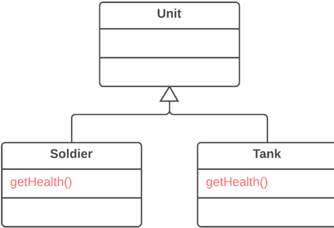

## 解决方案

使方法完全相同，然后将它们移动到相关的父类中。

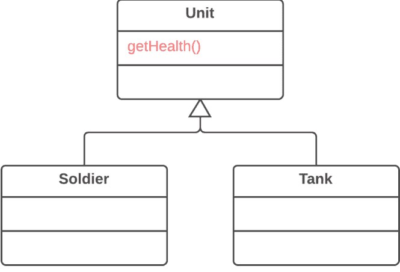

## 为什么要重构

子类独立地增长和发展，导致了相同（或几乎相同）的字段和方法。

## 收益

- 消除了重复代码。如果你需要对方法进行更改，在一个地方进行修改比在子类中搜索该方法的所有重复项要好。
- 如果由于某种原因，子类重新定义了父类方法但执行的是本质上相同的工作，也可以使用这种重构技术。

## 如何重构

1. 调查父类中相似的方法。如果它们不相同，请将它们格式化以相互匹配。
2. 如果方法使用了不同的参数集，请将参数以你希望在父类中看到的形式放置。
3. 将方法复制到子类中。在这里你可能会发现方法代码使用了仅存在于子类的字段和方法，因此在父类中不可用。要解决这个问题，你可以：
   - 对于字段：使用“上提字段”（Pull Up Field）或“自封装字段”（Self-Encapsulate Field）在子类中创建 getter 和 setter；然后在父类中抽象地声明这些 getter。
   - 对于方法：使用“上提方法”（Pull Up Method）或在父类中为它们声明抽象方法（注意，如果你的类之前不是抽象类，现在它将变为抽象类）。
4. 从子类中删除这些方法。
5. 检查调用方法的地方。在某些地方，你可能可以将子类替换为父类。

## 反重构

### 下推方法（Push Down Method）

## 相似的重构

### 上提字段（Pull Up Field）

## 帮助其他重构

### 模板方法（Form Template Method）

## 消除异味

### 重复代码（Duplicate Code）

# 上提构造函数体（Pull Up Constructor Body）

## 问题

你的子类拥有代码大部分相同的构造函数。

```java
class Manager extends Employee {
    public Manager(String name, String id, int grade) {
        this.name = name;
        this.id = id;
        this.grade = grade;
    }
    // ...
}
```

## 解决方案

创建一个父类构造函数，并将子类中相同的代码移动到那里。在子类构造函数中调用父类构造函数。

```java
class Manager extends Employee {
    public Manager(String name, String id, int grade) {
        super(name, id);
        this.grade = grade;
    }
    // ...
}
```

## 为什么要重构

这种重构技术与“上提方法”有什么不同？


# 上提构造函数 (Pull Up Constructor)

## 问题

子类拥有构造函数，其中包含公共代码。

## 解决方案

在父类中创建一个构造函数，并将子类构造函数中的公共代码上提到父类构造函数中。

## 为什么要重构

1. 在 Java 中，子类不能继承构造函数，因此你不能简单地将“上提方法”应用于子类构造函数并在移除所有构造函数代码到父类后删除它。除了在父类中创建构造函数外，子类中也有具有简单委托给父类构造函数的构造函数。

2. 在 C++ 和 Java 中（如果你没有显式调用父类构造函数），父类构造函数会在子类构造函数之前自动调用，这使得有必要只从子类构造函数的开始移动公共代码（因为你无法在子类构造函数的任意位置调用父类构造函数）。

3. 在大多数编程语言中，子类构造函数可以拥有不同于父类参数的参数列表。因此，你应该只根据它真正需要的参数创建父类构造函数。

## 如何重构

1. 在父类中创建一个构造函数。

2. 从每个子类构造函数的开头提取公共代码到父类构造函数中。在这样做之前，尝试尽可能将多的公共代码移动到构造函数的开头。

3. 将父类构造函数的调用放在子类构造函数的第一行。

## 相似的重构

上提方法 (Pull Up Method)

## 消除异味

重复代码 (Duplicate Code)

# 下推方法 (Push Down Method)

## 问题

父类中实现的行为是否只被一个（或少数几个）子类使用？

| 单元 |
| --- |
| `getFuel()` |

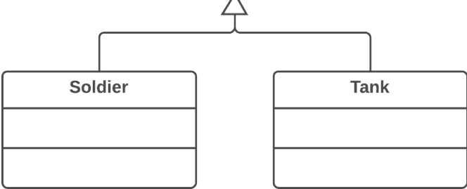

## 解决方案

将此行为移动到子类中。

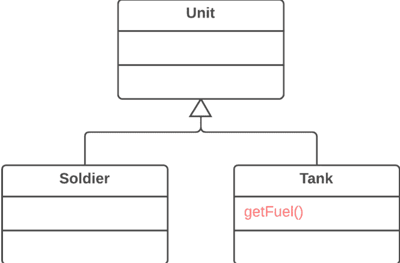

## 为什么要重构

虽然计划在所有类中通用，但实际上它只在一个子类中使用。这种情况可能发生在计划的功能未能实现时。

这也可能由于类层次结构的提取（移除）而发生。

如果你发现某个方法被多个子类使用但并非所有子类，那么创建一个子类并移动到那里是有用的。

## 收益

- 提高了类的内聚性。方法位于实际使用的地方。

## 如何重构

1. 创建一个子类并从父类复制代码。

2. 从父类中删除该方法。

3. 找到调用方法的地方并验证它从子类调用。

## 反重构

- 上提方法 (Pull Up Method)

## 相似的重构

- 下推字段 (Push Down Field)

## 帮助其他重构

- 提取子类 (Extract Subclass)

## 消除异味

- 拒绝继承 (Refused Bequest)

# 下推字段 (Push Down Field)

## 问题

一个字段是否只被少数子类使用？

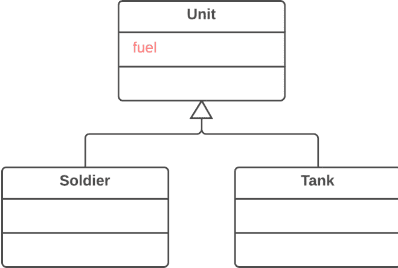

## 解决方案

将字段移动到这些子类中。

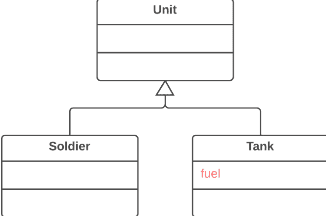

## 为什么要重构

虽然计划在所有类中使用字段，但实际上它只在某些子类中使用。这种情况可能发生在计划的功能未能实现时。

这也可能由于类层次结构的提取（移除）而发生。

## 收益

- 改进了类的内聚性。字段位于实际使用的地方。

## 如何重构

当同时移动到多个子类时，你可以独立地开发这些字段。这确实产生了代码重复，所以只有当你确实打算以不同的方式使用字段时才下推字段。

1. 在所有必要的子类中声明字段。

2. 从父类中删除该字段。

# 提取子类 (Extract Subclass)

## 问题

一个类拥有仅在某些情况下使用的特征。

| 工作项目 |
| --- |
| `getTotal()` |
| `getUnitPrice()` |
| `getEmployee()` |

## 解决方案

创建一个子类并在这些情况下使用它。

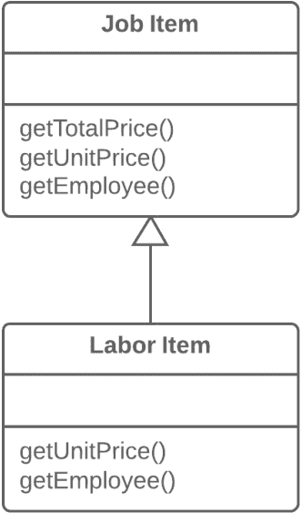

## 为什么要重构

你的主类拥有实现类某些罕见用例的方法和字段。虽然该用例很罕见，但该类负责它，将所有相关的字段和方法移动到独立的类中是错误的。但它们可以移动到子类中，这正是我们要通过这种重构技术所做的。

## 收益

- 快速轻松地创建子类。

- 如果你的主类目前实现了多个此类特例情况，你可以创建几个独立的子类。

## 缺点

尽管*继承*（Inheritance）看起来简单，但如果你必须分离几个不同的类层次结构，它可能会导致一个死胡同。例如，如果你有一个 `Dogs` 类，其行为根据狗的大小和毛发而异，你可以剥离出两个层次结构：

- 按尺寸：`Large`、`Medium` 和 `Small`

- 按毛发：`Smooth` 和 `Shaggy`

这一切看起来都很良好，但一旦当你需要创建一个既是 `Large` 又是 `Smooth` 的狗时，问题就出现了，因为你只能从一个类中创建对象。尽管如此，你仍然通过使用*组合*（Compose）而不是*继承*（Inherit）来避免这个问题（参见策略模式）。换句话说，`Dog` 类将有两个组件字段：尺寸和毛发。你将从必要的类中将组件对象插入到这些字段中。这样你就可以创建一个拥有 `LargeSize` 和 `ShaggyFur` 的 `Dog`。

## 如何重构

1. 从感兴趣的类创建一个新的子类。

2. 如果你需要额外的数据来创建子类的对象，请创建一个构造函数并向其添加必要的参数。忘记调用构造函数的父类实现。

3. 找到所有对父类构造函数的调用。当需要子类的功能时，将父类构造函数替换为子类构造函数。

4. 将必要的方法和字段从父类移动到子类中。通过**下推方法**（Push Down Method）和**下推字段**（Push Down Field）来实现。先移动方法会更简单。这样一来，字段在整个过程中始终保持可访问状态：从移动之前的父类，以及从移动完成后的子类本身。

5. 在子类准备好后，找到所有控制功能选择的旧字段。使用多态来替换所有使用这些字段的算符，从而删除这些字段。一个简单的例子是：在 `Car` 类中，你有一个字段 `isElectricCar`，根据它，在 `refuel()` 方法中，汽车要么加油，要么充电。重构后，`isElectricCar` 字段被删除了，且 `Car` 和 `ElectricCar` 类将拥有各自的 `refuel()` 方法实现。

## 相似重构

- 提取类（消除异味）

- 大类（Large Class）

# 提取超类

## 问题

你有两个具有共同字段和方法的类。

| Department |
| --- |
| `getTotalAnnualCost()` |
| `getName()` |
| `getHeadCount()` |

| Employee |
| --- |
| `getAnnualCost()` |
| `getName()` |
| `getId()` |

## 解决方案

为它们创建一个共享的超类，并将所有相同的字段和方法移动到该超类中。

## 为什么要重构

一种代码重复发生于两个类以相同的方式执行相似的任务，或者以不同的方式执行相似的任务时。对象通过继承提供了一种内置机制来简化此类情况。但通常，在创建类之前，这种相似性并未被注意到，导致在之后才创建继承结构。

## 益处

- 代码去重。公共字段和方法现在“存在”于一个地方。

## 何时不使用

你不能将此技术应用于已经有父类的类。

## 如何重构

1. 创建一个抽象超类。

2. 使用上提字段（Pull Up Field）、上提方法（Pull Up Method）和上提构造函数（Pull Up Constructor）将公共功能移动到超类。从字段开始，因为除了公共字段外，你还需要移动公共方法。

3. 在客户端代码中寻找可以使用新类替换子类的地方（例如在类型声明中）。

## 相似重构

- 提取接口（消除异味）

- 重复代码

# 提取接口

## 问题

多个客户端正在使用类的同一个部分。另一种情况：两个类中的接口部分是相同的。

| Employee |
| --- |
| `getRate()` |
| `hasSpecialSkill()` |
| `getName()` |
| `getDepartment()` |

## 解决方案

将这相同部分移动到自己的接口中。

## 为什么要重构

1. 当类在不同情况下扮演特殊角色时，接口非常有用。使用提取接口来显式指示该角色。

2. 当你需要描述类执行的操作时，会出现另一种方便的情况。如果计划最终允许多种类型，则所有子类必须实现该接口。

## 提示

提取超类和提取接口之间存在某种相似之处。提取接口允许仅隔离公共接口，而不是公共代码。换句话说，如果类包含重复代码，提取接口将无法帮助你去重。同样，可以通过提取类将行为移动到单独的组件并将所有工作委托给它来缓解此问题。如果公共行为体积极，你始终可以使用提取超类。当然，这更简单，但请记住，如果你走这条路，你只会得到一个父类。

## 如何重构

1. 创建一个空接口。

2. 在接口中声明公共操作。

3. 将必要的类声明为接口。

4. 更改客户端代码中的类型声明以使用新接口。

## 相似重构

- 提取超类

# 合并层次

## 问题

你有一个类层次结构，其中子类与其超类实际上相同。

## 解决方案

合并子类和超类。

## 为什么要重构

随着时间的推移，子类和超类变得实际上相同。一个从子类移除的功能被移动到了超类……现在你有了两个相同的类。

## 益处

- 降低了程序复杂度。类越少，脑中记住的东西越少，更改代码时需要担心的部分也越少。

- 当方法定义在类中时，导航代码会更容易。你不需要遍历整个层次结构来寻找特定方法。

## 何时不使用

- 你正在重构的类层次结构是否有多个子类？如果是的话，在重构完成后，剩余的子类将成为合并类类的继承类。

- 但请记住，这可能会违反里氏夫替换原则。例如，如果你的程序模拟城市交通网络，而你不小心将 `Transport` 超类合并到 `Car` 子类中，那么 `Plane` 类可能就会变成 `Car` 的继承类。哎呀！

## 如何重构

1. 选择哪个类更容易删除：超类还是它的子类。

2. 如果你决定删除子类，使用上提字段和上提方法。如果你选择消除超类，请使用下推字段和下推方法。

3. 替换所有对要删除类的引用，这些字段和方法将被迁移。这通常是创建类的代码、变量和参数类型以及代码注释中的文档。

4. 删除空类。

## 相似重构

内联类

合并层次是内联类的变体，代码移动到超类或子类。

## 消除异味

懒惰类（Lazy Class）

臆测性泛化（Speculative Generality）

# 形成模板方法

## 问题

你的子类实现的算法包含相同顺序的步骤。

## 解决方案

将算法结构和相同的步骤移动到超类，并将不同步骤的实现留在子类中。

# 重构技术 / 模板方法模式

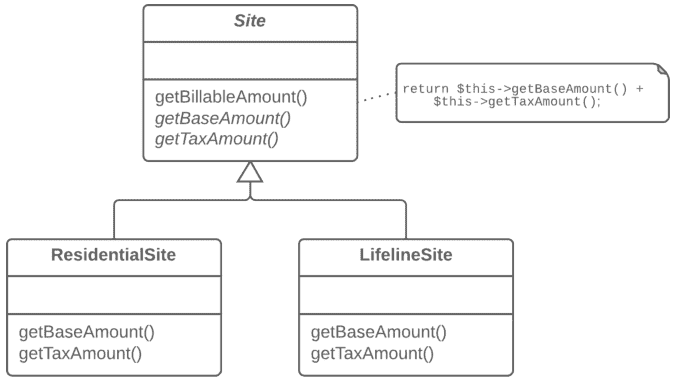

## 为什么要重构

子类是并行开发的，有时由不同的人开发，这导致了代码重复、错误以及代码维护困难，因为每个更改都必须在所有子类中进行。

## 益处

- 代码重复并不总是指简单的复制/粘贴情况。重复通常发生在更高层次，例如当你有一个对数字排序的方法和一个对对象集合排序的方法，而它们之间的区别仅在于元素的比较。创建一个模板方法，通过在父类中合并共享的算法步骤，并在子类中仅保留差异，从而消除了这种重复。

形成模板方法是“开/闭原则”实际应用的一个示例。当出现新的算法版本时，你只需要创建一个新的子类；无需对现有代码进行任何更改。

## 如何重构

1. 将子类中的算法拆分为在独立方法中描述的各个部分。提取方法（Extract Method）可以对此有所帮助。

2. 将所有子类都相同的相同方法通过上提方法（Pull Up Method）移动到父类中。

3. 通过重命名方法（Rename Method）为不相似的方法赋予一致的名称。

4. 使用上提方法（Pull Up Method）将不相似方法的签名移动到父类的抽象方法中。将它们的实现保留在子类中。

5. 最后，将算法的主方法提取到父类中。现在它应该与父类中描述的方法步骤（真实的和抽象的）共同工作。

## 实现的设计模式

- 模板方法

## 消除异味

- 重复代码

# 用委托替换继承

## 问题

你有一个子类，它只使用了父类的部分方法（或者无法继承父类的数据）。


## 解决方案

创建一个字段并在其中放入一个父类对象，将方法委托给该父类对象，并放弃继承。

328 重构技术 / 用委托替换继承


## 为什么要重构

用组合替换继承可以显著改进类设计：

- 你的子类违反了里氏夫替换原则，即继承仅仅是为了合并公共代码，而不是因为子类是父类的扩展。

- 子类只使用了父类的部分方法。在这种情况下，总有一天某人调用了他不该调用的父类方法只是时间问题。

从本质上，这种重构技术拆分了两个类，并使父类成为子类的助手，而不是其父类。子类不再继承所有的子类方法，而是只拥有用于委托给父类对象方法的必要方法。

lukas.holiger@gmail.com (#15312)

## 益处

- 类不再包含任何从父类继承的、不需要的方法。

- 可以将具有不同实现的各种对象放入委托字段中。实际上，你得到了策略设计模式。

## 缺点

你必须必须编写许多简单的委托方法。

## 如何重构

1. 在子类中创建一个字段来持有父类。在初始阶段，将当前对象放入其中。

2. 修改子类方法，使其使用父类对象而不是 `this`。

3. 对于在客户端代码中调用的来自父类的方法，在子类中创建简单的委托方法。

4. 移除子类中的继承声明。

5. 通过创建一个新对象，更改存储原父类的字段的初始化代码。

## 反重构

- 用继承替换委托

## 实现的设计模式

- 策略

# 用继承替换委托

## 问题

一个类包含许多简单方法，这些方法委托给另一个类的所有方法。


```
return $this->person->getName();
```

## 解决方案

使该类成为委托继承者，使委托方法变得不再必要。

| Person |
| --- |
| `getName()` |
| △ |
| Employee |

## 为什么要重构

委托比继承更灵活的方法，因为它允许更改委托的实现方式，并在那里放置其他类。然而，如果你仅将操作委托给一个类及其所有的公共方法，委托将不再有益处。

在这种情况下，如果你用继承替换委托，你就可以清理类中大量的委托方法，并免除为每个新的委托类方法手动创建这些方法的麻烦。

## 益处

缩短代码长度。所有这些委托方法都不再需要。

## 何时不使用

- 如果类仅包含委托到委托类的部分公共方法，则不要使用此技术。这样做你将违反里氏夫替换原则。

- 这种技术只有在该类仍然没有父类时才可以使用。

## 如何重构

1. 使该类成为委托类的子类。

2. 将当前对象放在包含委托对象引用的字段中。

3. 逐删除带有简单委托的方法。如果它们的名称不同，使用重命名方法（Rename Method）给所有方法一个统一的名字。

4. 将所有对委托字段的引用替换为当前对象的引用。

5. 移除委托字段。

## 反重构

- 用委托替换继承

## 相似重构

- 移除中介人

## 消除异味

- 不恰当的亲密关系

# 后记

恭喜读到最后一页！

现在你已经了解了这么多重构，你打算做什么？如果你还没有主意，这里有一些建议供参考：

- 阅读 Joshua Kerievsky 的书籍《重构模式》。

- 什么？你不知道什么是设计模式？阅读我们关于设计模式的章节

- 打印重构检斗表并将其钉在任何你能看到的地方。

- 提交你对这本书和整个课程的反馈。我很乐意听到任何反馈，即使是负面的 🙂
