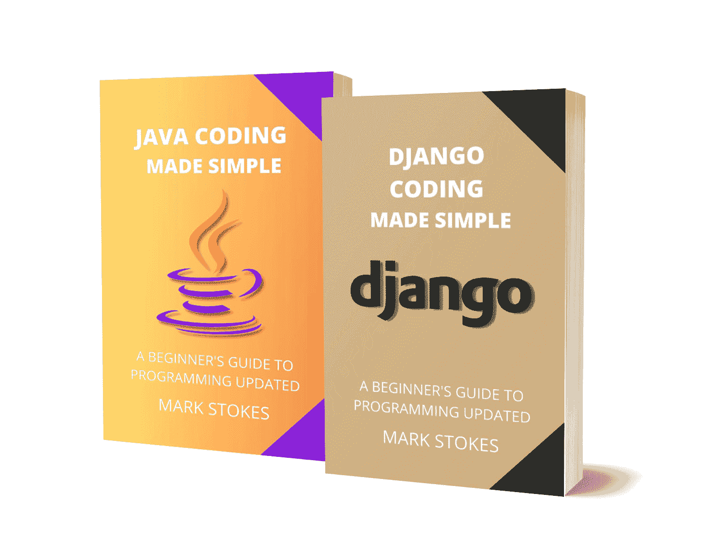

# Django 与 Java 编程简单化：编程初学者指南——2 本合 1



## 目录

### Django 编程

- 第 1 章：Django 简介
- 第 2 章：理解模型与数据库
- 第 3 章：构建视图与模板
- 第 4 章：处理表单与用户输入
- 第 5 章：身份验证与用户管理
- 第 6 章：用户认证与登录
- 第 7 章：用户退出
- 第 8 章：用户授权与访问控制
- 第 9 章：处理静态文件
- 第 10 章：处理表单
- 第 11 章：处理文件上传
- 第 12 章：用户认证与授权
- 第 13 章：用户登录与密码管理
- 第 14 章：使用模型与数据库
- 第 15 章：Django 模板系统
- 第 16 章：高级主题与最佳实践

### Java 编程

- 第 1 章：Java 编程简介
- 第 2 章：变量与数据类型
- 第 3 章：控制流语句
- 第 4 章：方法
- 第 5 章：数组
- 第 6 章：面向对象编程（OOP）
- 第 7 章：异常处理与文件 I/O
- 第 9 章：多线程
- 第 10 章：Java 数据库交互
- 第 11 章：使用 Java 进行 Web 开发
- 第 12 章：Java 数据库连接
- 第 13 章：用于快速开发的 Java 框架与库
- 第 14 章：Java 测试：框架与方法论
- 第 15 章：Java 调试技术与工具

## 书籍介绍

欢迎阅读《初学者 Django 编程：Web 开发实战指南》。本书旨在帮助你从零学习 Django 并构建健的 Web 应用程序。无论你是编程领域的完全新手，还是对其他语言有一定经验，本书都将为你提供 Django 的坚实基础。

Django 是一个流行的 Python Web 框架，简化了 Web 应用程序的开发过程。它遵循模型-视图-控制器（MVC）架构，允许进行高效且可扩展的开发。在整本书中，你将学习如何利用 Django 强大的功能来创建动态且交互式的网站。

在每一章中，我们将探索 Django 的不同方面，并引导你完成实战示例。你将学习如何搭建开发环境、与模型和数据库进行工作、创建视图和模板、处理用户输入、实现身份验证与授权、构建 RESTful API 等更多内容。读完本书后，你将拥有使用 Django 开发自己的 Web 应用程序的技能和知识。

因此，无论你有兴趣构建个人项目、启动初创公司，还是追求 Web 开发职业，“初学者 Django 编程”都将为你提供成功所需的工具。让我们进入 Django 世界，释放你作为 Web 开发者的潜力吧！

# 第 1 章：Django 简介

在《初学者 Django 编程：Web 开发实战指南》的第 1 章中，我们将为你介绍 Django 及其在 Web 开发中的作用。Django 是一个强大的 Python Web 框架，简化了构建 Web 应用程序的过程。它遵循模型-视图-控制器（MVC）架构，有助于代码的整洁和模块化。

## 1.1 什么是 Django？

Django 是一个开源 Web 框架，允许开发者快速高效地构建 Web 应用程序。它提供了高层的、Pythonic 的接口并处理了许多底层复杂性，让开发者能够专注于应用程序逻辑和功能。

## 1.2 为什么要使用 Django？

Django 具有许多优势，使其成为 Web 开发的热门。

### 1.2.1 快速开发

Django 的“内置电池”方法提供了一系列预构建的组件和功能，例如身份验证、数据库管理和表单处理。这允许开发者通过利用 Django 的内置功能更快速地构建应用程序。

### 1.2.2 可扩展性

Django 遵循可扩展性的最佳实践，使其适用于小型项目，也适用于大型复杂的应用程序。它的模块化结构和对数据库查询的高效处理有助于 Django 应用程序的整体可扩展性。

### 1.2.3 安全性

Django 整合了安全特性帮助开发者构建安全的应用程序。它包含了针对常见 Web 漏洞的防护措施，如跨站脚本（XSS）、跨站请求伪造（CSRF）和 SQL 注入。

### 1.2.4 社区与文档

Django 拥有活跃的开发者社区，他们积极参与开发。该社区提供了丰富的文档、教程和支持，让初学者更容易学习和上手 Django。

## 1.3 开始使用 Django

要开始使用 Django，你需要搭建开发环境。让我们通过以下步骤进行。

### 1.3.1 安装 Python

Django 是使用 Python 构建的，因此你需要在机器上安装 Python。访问 Python 官方网站（`python.org`）并下载适用于你操作系统的版本。按照安装说明操作。

### 1.3.2 安装 Django

一旦安装了 Python，你可以使用 Python 包管理器 `pip` 安装 Django。打开你的命令行提示符或终端运行以下命令：

```bash
pip install django
```

该命令将在你的系统中下载并安装最新版本的 Django。

## 1.4 创建你的第一个项目

现在 Django 已安装，让我们创建第一个 Django 项目。在你的命令行提示符或终端中，导航到你想创建项目的目录。运行以下命令：

```bash
django-admin startproject myproject
```

该命令将创建一个名为 `myproject` 的新目录，包含 Django 项目所需的文件和文件夹。

## 1.5 运行开发服务器

要测试你的 Django 项目配置正确，导航到项目目录并运行以下命令：

```bash
python manage.py runserver
```

该命令启动 Django 开发服务器，允许你在浏览器中查看应用程序。默认情况下，服务器运行在 `http://localhost:8000/`。

## 1.6 构建你的第一个 Django 应用

现在项目已就绪且开发服务器正在运行，让我们在项目中创建第一个 Django 应用程序。在你的命令行提示符或终端中，导航到项目目录并运行以下命令：

```bash
python manage.py startapp myapp
```

该命令将在项目中创建一个名为 `myapp` 的新目录，它将包含应用程序的文件和代码。

## 1.7 总结

在本章中，我们介绍了 Django 并讨论了它在 Web 开发中的优势。我们涵盖了 Python 和 Django 的安装过程，创建了第一个 Django 项目并启动了开发服务器。我们还在项目中创建了第一个 Django 应用。

在下一章中，我们将深入探讨 Django 的架构，并探索 Django Web 应用程序中的模型与数据库概念。

在《初学者 Django 编程：Web 开发实用指南》的第 2 章中，我们将探索 Django 中模型（models）和数据库的核心概念。模型是 Django 应用程序骨干，代表了存储在数据库的数据结构和行为。

# 第 2 章：理解模型与数据库

## 2.1 模型简介

在 Django 中，模型是一个定义特定数据实体结构和属性的 Python 类。每个模型都对应数据库中的一张表，每个属性都代表该表中的一个字段。模型允许你使用高层 Python 代码定义数据模式（schema）并与数据库交互。

让我们通过一个例子来说明模型的概念。假设我们正在构建一个博客应用程序，想要存储关于博客文章的信息。我们可以创建一个名为 `Post` 的模型来表示博客文章：

```python
from django.db import models

class Post(models.Model):
    title = models.CharField(max_length=200)
    content = models.TextField()
    pub_date = models.DateTimeField(auto_now_add=True)
```

在这个示例中，`Post` 模型有三个字段：`title`、`content` 和 `pub_date`。`title` 字段被定义为字符字段（`CharField`），最大长度为 200 个字符。`content` 字段是一个文本字段（`TextField`），用于存储博客内容。`pub_date` 字段是一个日期时间字段（`DateTimeField`），会自动记录文章发布的日期。

## 2.2 创建数据库表

一旦定义了模型，我们需要创建相应的数据库表。Django 提供了一个强大的迁移系统（migration），可以自动化创建、修改和管理数据库模式更改的过程。

要根据模型创建所需的数据库表，请在命令行提示符或终端中运行以下命令：

```shell
python manage.py makemigrations
```

此命令分析项目中的模型，并生成代表模式更改所需的迁移文件。每个迁移文件都包含创建或修改数据库表的指令。

创建迁移文件后，我们需要将它们应用到数据库。运行以下命令：

```shell
python manage.py migrate
```

此命令执行迁移并在数据库中创建相应的表。

## 2.3 与数据库交互

表创建完成后，我们就可以使用 Django 的对象关系映射（ORM）功能开始与数据库交互。ORM 允许我们使用 Python 代码执行数据库操作，抽象掉了底层的 SQL 查询。

让我们使用我们的 `Post` 模型探索一些常见的数据库操作。

### 2.3.1 创建对象

要创建一个新的博客文章，我们可以实例化 `Post` 模型并设置其属性。这是一个示例：

```python
post = Post(title='First Blog Post', content='Lorem ipsum dolor sit amet...')
post.save()
```

`save()` 方法将对象持久化到数据库中。

### 2.3.2 查询对象

我们可以使用各种查询技术从数据库检索对象。例如，要检索所有的博客文章，可以使用以下代码：

```python
posts = Post.objects.all()
```

此查询检索了 `Post` 模型中的所有对象。

### 2.3.3 过滤对象

我们可以根据特定条件过滤对象。例如，要检索某日期之后发布的所有博客文章，可以使用以下代码：

```python
from datetime import datetime
posts = Post.objects.filter(pub_date__gt=datetime(2022, 1, 1))
```

此查询根据 `pub_date` 字段大于 2022 年 1 月 1 日来过滤对象。

## 2.4 总结

在本章中，我们探索了 Django 中模型和数据库的概念。我们学习了如何定义模型来表示数据实体，如何使用迁移创建数据库表，以及如何使用 Django ORM 执行常见的数据库操作。

在下一章中，我们将深入构建 Django 的视图（views）和模板（templates），为我们的 Web 应用程序创建用户界面。

# 第 3 章：构建视图与模板

在《初学者 Django 编程：Web 开发实用指南》的第 3 章中，我们将专注于构建 Django 的视图和模板。视图处理网页背后的逻辑，而模板定义了显示给用户的内容的结构和呈现方式。

## 3.1 理解视图

在 Django 中，视图是一个接收 HTTP 请求并返回 HTTP 响应的 Python 函数或类。视图负责处理用户输入、与模型和数据库交互，并渲染相应的模板以显示响应。

让我们为博客应用程序创建一个简单的视图。在应用程序目录下的 `views.py` 文件中，定义以下函数：

```python
from django.shortcuts import render
from .models import Post

def blog_posts(request):
    posts = Post.objects.all()
    return render(request, 'blog/posts.html', {'posts': posts})
```

在这个示例中，`blog_posts` 视图使用 `Post` 模型从数据库检索所有博客文章。然后它将检索到的文章传递给 `render` 函数，该函数使用 `posts` 变量渲染 `posts.html` 模板。

## 3.2 创建模板

Django 模板定义了 HTML 内容的结构和呈现。它们允许我们将设计和布局与视图中的 Python 代码分离，提供了一种清晰且易于维护的用户界面构建方法。

要创建 `posts.html` 模板，导航到应用程序目录并创建一个名为 `templates` 的新目录。在 `templates` 目录内部创建一个名为 `blog` 的目录。最后，在 `blog` 目录中创建一个名为 `posts.html` 文件。目录结构如下：

```text
templates/
└── blog/
    └── posts.html
```

打开 `posts.html` 文件并定义显示文章的 HTML 结构。示例：

```html

<div class="post">
    <h2>{{ post.title }}</h2>
    <p>{{ post.content }}</p>
    <p>发布日期: {{ post.pub_date }}</p>
</div>

```

在此模板中，我们使用 Django 模板语言（由 `` 和 `{{ }}` 标签表示）来动态显示来自 `posts` 变量的数据。

## 3.3 URL 映射视图

为了通过 URL 访问视图，我们需要在项目的 `urls.py` 文件中定义 URL 模式。打开项目下的 `urls.py` 文件并添加以下代码：

```python
from django.urls import path
from blog.views import blog_posts

urlpatterns = [
    path('posts/', blog_posts, name='blog_posts'),
]
```

在这个示例中，我们将 URL 模式 `/posts/` 映射到 `blog_posts` 视图。当用户在浏览器访问 `/posts/` 时，Django 将调用 `blog_posts` 视图处理请求并返回相应的响应。

## 3.4 测试应用程序

视图、模板和 URL 模式完成后，现在就可以测试应用程序了。运行以下命令启动 Django 开发服务器：

```shell
python manage.py runserver
```

在浏览器访问 `http://localhost:8000/posts/`，你应该能看到根据从数据库检索的数据渲染出来的博客文章列表。

## 3.5 总结

在本章中，我们探索了 Django 中视图和模板的概念。我们学习了如何定义视图来处理用户请求，如何创建模板来构建 HTML 内容以及如何使用 URL 模式将 URL 映射到视图。

在《Django 入门教程：Web 开发实用指南》的第 4 章中，我们将重点关注 Django 中的表单处理和用户输入。表单在 Web 应用中起着至关重要的作用，它们允许用户输入数据、将其提交到服务器并执行各种操作。

# 第 4 章：处理表单与用户输入

## 4.1 创建表单

在 Django 中，表单是通过继承自 `django.forms.Form` 或 `django.forms.ModelForm` 类的 Python 类创建的。这些类定义了表单的字段和验证规则。

让我们创建一个表单，允许用户新的新的博客。在你的应用程序目录中，创建一个名为 `forms.py` 的文件。在文件中定义以下代码：

```python
from django import forms
from .models import Post

class PostForm(forms.ModelForm):
    class Meta:
        model = Post
        fields = ['title', 'content']
```

在这个示例中，我们基于 `Post` 模型创建了一个名为 `PostForm` 的表单。`Meta` 类指定了我们要包含在表单中的模型和字段。

## 4.2 渲染表单

为了在网页中显示表单，我们需要在模板中渲染它。打开我们在上一章（第 3 章）中创建的 `posts.html` 模板，并进行如下更新：

```html
<div class="post-form">
    <h2>创建新的博客文章</h2>
    <form method="POST" action="">
        
        {{ form.as_p }}
        <button type="submit">提交</button>
    </form>
</div>
```

在这个更新后的模板中，我们添加了一个 HTML 表单，将数据提交到名为 `'create_post'` 的 URL。我们使用 `` 模板标签来包含一个安全令牌，防止跨站请求伪造攻击。`{{ form.as_p }}` 模板变量将表单字段渲染为段落（`<p>` 标签），以简化处理。

## 4.3 处理表单提交

现在我们已经在模板中渲染了表单，需要在视图（view）中处理表单提交。更新你 `views.py` 文件中的 `blog_posts` 视图如下：


```python
from django.shortcuts import render, redirect
from .forms import PostForm

def blog_posts(request):
    if request.method == 'POST':
        form = PostForm(request.POST)
        if form.is_valid():
            form.save()
            return redirect('blog_posts')
    else:
        form = PostForm()
        posts = Post.objects.all()
    return render(request, 'blog/posts.html', {'posts': posts, 'form': form})
```

在这个更新的视图中，我们检查请求方法是否为`'POST'`。如果是，我们将使用请求数据创建一个`PostForm`表单的实例。然后我们使用`is_valid()`方法验证表单。如果表单有效，我们使用`form.save()`将其保存到数据库，并将用户重定向回`'blog_posts'` URL。

如果请求方法不是`'POST'`，我们创建一个新的表单实例以便在模板中渲染。

## 4.4 测试表单

运行以下命令启动 Django 开发服务器：

```shell
python manage.py runserver
```

在你的浏览器中访问`http://localhost:8000/posts/`。你应该能看到创建新博客文章的表单。填写字段并点击“提交”按钮。表单数据将提交到服务器、保存到数据库，并且你会被重定向回博客列表页面。

## 4.5 总结

在本章中，我们探索了 Django 中处理表单和用户输入的过程。我们学习了如何使用表单类创建表单、在模板中渲染表单。

```python
from django import forms
from django.contrib.auth.forms import AuthenticationForm

class LoginForm(AuthenticationForm):
    class Meta:
        fields = ['username', 'password']
```

在这个示例中，我们继承了 Django 的`AuthenticationForm`，它为用户登录提供了必要的字段和验证功能。

## 6.2 用户登录视图

接下来，我们需要创建一个视图来处理用户登录过程。打开你的`views.py`文件并添加以下代码：

```python
from django.shortcuts import render, redirect
from django.contrib.auth import login
from .forms import LoginForm

def user_login(request):
    if request.method == 'POST':
        form = LoginForm(request, data=request.POST)
        if form.is_valid():
            user = form.get_user()
            login(request, user)
            return redirect('dashboard')
    else:
        form = LoginForm()
        return render(request, 'registration/login.html', {'form': form})
```

在该视图中，如果请求方法为`'POST'`，我们将使用请求中的数据创建一个`LoginForm`表单实例。我们验证表单，如果有效，则使用`form.get_user()`获取用户对象，并使用 Django 提供的`login()`函数进行登录。最后，我们将用户重定向到仪表板（dashboard）页面。

如果请求方法不是`'POST'`，我们将创建一个表单实例以便在模板中渲染。

## 6.3 登录模板

为了显示登录表单，我们需要创建一个模板。在你的`templates`目录下创建一个名为`registration`的目录（如果不存在）。在`registration`目录内创建一个名为`login.html`的文件。打开`login.html`文件并定义以下代码：

```html
<h2>登录</h2>
<form method="POST" action="">
    
    {{ form.as_p }}
    <button type="submit">登录</button>
</form>
```

在此版模板中，我们使用`{{ form.as_p }}`模板变量来显示登录表单，为了简单起见，它将表单字段渲染为段落。

## 6.4 映射 URL

为了访问登录表单，我们需要将 URL 映射到登录视图。打开你项目的`urls.py`文件并添加以下代码：

```python
from django.urls import path
from .views import user_login

urlpatterns = [
    path('login/', user_login, name='user_login'),
]
```

在这个示例中，我们将 URL 模式`/login/`与`user_login`视图关联。用户可以通过访问此 URL 来进入登录表单。

## 6.5 测试用户登录

运行以下命令启动 Django 开发服务器：

```shell
python manage.py runserver
```

在网页浏览器中访问`http://localhost:8000/login/`。你应该能看到登录表单。输入你的用户名和密码并点击“登录”按钮。如果凭据有效，你将被重定向到仪表板页面。

## 6.6 总结

在本章中，我们探索了 Django 中的用户身份验证和登录。我们学习了如何创建登录表单、在视图中处理登录过程以及映射 URL。

在下一章中，我们将继续探索 Django 中的用户身份验证和登录。

# 第 7 章：退出

在《Django 入学者：Web 开发实战指南》的第 7 章中，我们将关注退出功能。用户退出允许用户离开当前会。

## 7.1 退出视图

为了处理退出过程，我们需要创建一个视图。打开你的`views.py`文件并添加以下代码：

```python
from django.shortcuts import render, redirect
from django.contrib.auth import login

def logout(request):
    login(request)
    return redirect('dashboard')
```

## 7.2 映射 URL

为了访问退出功能，我们需要将 URL 映射到视图。打开你项目的`urls.py`文件并添加以下代码：

```python
from django.urls import path
from .views import user_login

urlpatterns = [
    path('logout/', logout, name='logout'),
]
```

## 7.3 添加退出链接

为了给用户提供退出的方法，我们可以在模板中添加链接。打开你的`dashboard.html`（或任何相关的模板）并添加以下代码：

```html
<a href="">退出</a>
```

## 7.4 测试退出

运行以下命令启动 Django 开发服务器：

```shell
python manage.py runserver
```

## 7.5 总结

在本章中，我们在 Django 中实现了退出功能。我们学习了如何创建退出视图、映射 URL 并且添加链接。

# 第 8 章：用户授权与访问控制

在《Django 入学者：Web 开发实战指南》的第 8 章中，我们将关注用户授权和访问控制。用户授权允许我们控制对应用程序不同部分的访问。

## 8.1 用户角色与权限

在深入实现用户身份验证之前，理解用户角色和权限的概念至关重要。在 Django 中，用户角色通常由组（groups）表示，而权限定义了用户可以执行的操作。

默认情况下，Django 提供了三类型的权限：添加、更改和删除。

## 8.2 创建用户组

首先，让我们创建一些用户组来分配角色和权限。打开你的 Django 管理界面并导航到“Auth”部分。在那里，你可以根据应用程序的需求创建“管理员（Admins）”、“编辑器（Editors)”和“读者（Readers)”之类的组。

## 8.3 为组分配权限

一旦创建了组，就可以为每个组分配权限。例如，你可以赋予“管理员”组对应用程序的完全控制权，包括添加、更改和删除内容的权限。“编辑器”组可能拥有添加和修改内容的权限，而“读者”组可能只有只读权限。

## 8.4 实现访问控制

为了控制对应用程序不同部分的访问，你可以使用 Django 内置的`@login_required`装饰器和`user_passes_test`装饰器。这些装饰器可以应用于视图或单个 URL 模式。

这是一个使用`@login_required`装饰器的示例：

```python
from django.contrib.auth.decorators import login_required
from django.shortcuts import render

@login_required
def protected_view(request):
    return render(request, 'protected.html')
```

在这个示例中，`protected_view`使用了`@login_required`装饰，这确保只有经过验证的用户才能访问该视图。如果未验证的用户尝试访问该视图，他们将被重定向到登录页面。

你还可以使用`user_passes_test`装饰器根据用户角色或权限实现更细粒度的访问控制。例如：

```python
from django.contrib.auth.decorators import user_passes_test
from django.shortcuts import render

def is_admin(user):
    return user.groups.filter(name='Admins').exists()

@user_passes_test(is_admin)
def admin_view(request):
    return render(request, 'admin.html')
```

在此示例中，`admin_view`使用了`@user_passes_test`装饰器，该装饰器会检查登录用户是否属于“Admins”组。如果用户不在该组中，他们将被重定向到一个指示其权限不足的页面。

## 8.5 总结

在本章中，我们探索了 Django 中的用户授权和访问控制。我们学习了用户角色和权限、创建用户组以及为这些组组分配权限。我们还学习了如何使用`@login_required`和`user_passes_test`装饰器来实现访问控制。

在下一章中，我们将讨论如何在 Django 中处理静态文件，包括 CSS、JavaScript 文件和图像文件。

# 第 9 章：处理静态文件

在《初学者 Django 编程：Web 开发实用指南》的第 9 章中，我们将探索在 Django 中处理静态文件的流程。静态文件包括 CSS 样式表、JavaScript 文件、图像以及直接提供给客户端而不经过任何处理的其他资源。

## 9.1 配置静态文件

在开始处理静态文件之前，我们需要配置 Django 以能够正确处理它们。打开你的项目设置文件（`settings.py`）并找到`STATIC_URL`设置。默认情况下，它应该被设置为`'/static/'`。

接下来，在设置文件中添加以下行：

```python
STATICFILES_DIRS = [
    os.path.join(BASE_DIR, 'static')
]
STATIC_ROOT = os.path.join(BASE_DIR, 'staticfiles')
```

在此配置中，我们将`STATICFILES_DIRS`变量设置为项目静态文件所在所在的路径。通常，这是你项目根目录下的一个名为`static`的目录。

`STATIC_ROOT`变量指定了 Django 在部署期间从项目中所有应用中收集静态文件的目录。

## 9.2 创建静态文件

为了演示如何处理静态文件，让我们为应用程序创建一个 CSS 文件进行样式设置。在你的项目的`static`目录中，创建一个名为`styles.css`文件并添加以下代码：

```css
body {
    background-color: #f2f2f2;
    font-family: Arial, sans-serif;
    color: #333333;
}
h1 {
    color: #0066cc;
}
.container {
    max-width: 800px;
    margin: 0 auto;
    padding: 20px;
}
```

此 CSS 文件为`body`、标题和容器元素定义了一些基础样式。

## 9.3 在模板中引入静态文件

为了在模板中引入静态文件，你需要加载``模板标签，并使用它来引用静态文件的 URL。打开你的`base.html`模板（或任何你想包含 CSS 文件的相关模板），在`<head>`部分内添加以下行：

```html
<link rel="stylesheet" type="text/css" href="">
```

这一行通过使用``模板标签动态生成 URL，将`styles.css`文件导入模板中。

## 9.4 收集静态文件

在部署期间，Django 需要将来自不同应用的所有静态文件收集到一个目录中，以便高效提供。执行此操作，请运行以下命令：

```shell
python manage.py collectstatic
```

此命令将收集应用中的所有静态文件并将它们复制到指定的目录。

## 9.5 在开发环境中提供静态文件

开发期间，Django 能够自动处理静态文件。确保你的`DEBUG`设置为`True`。

在你的`urls.py`文件中，针对静态文件添加以下内容：

```python
from django.conf import settings
from django.conf.urls.static import static

urlpatterns += static(settings.STATIC_URL, document_root=settings.STATIC_ROOT)
```

## 9.6 总结

在本章中，我们探索了 Django 中处理静态文件。我们学习了如何配置静态文件、收集静态文件以及在开发期间提供静态文件。

在下一章中，我们将深入学习如何在 Django 中处理表单。

# 第 10 章：处理表单

在《初学者 Django 编程：Web 开发实用指南》的第 10 章中，我们将探索如何在 Django 中处理表单。表单是 Web 应用程序中交互的主要方式。

## 10.1 创建表单

为了开始处理表单，让我们创建一个表单类。在你的项目中创建一个`forms.py`文件并添加以下代码：

```python
from django import forms

class RegistrationForm(forms.Form):
    username = forms.CharField(max_length=100)
    email = forms.EmailField()
    password = forms.CharField()
```

在此示例中，我们使用`forms.Form`类定义了一个表单。

## 10.2 显示表单

现在我们已经有了表单，让我们在模板中显示它。在你的模板目录中创建一个`registration.html`文件并添加以下代码：

```html
<form="="post">
    
    {{ form.as_p }}
    <button type="submit">注册</button>
</form>
```

在此模板中，我们使用`form`变量来渲染表单字段。`{{ form.as_p }}`标签将表单字段以段落的形式渲染，使其便于显示。注意``标签，它为表单添加跨站请求伪造（CSRF）令牌以确保安全性。

## 10.3 处理表单提交

为了处理表单提交，我们需要创建一个视图。打开你的`views.py`文件并添加以下代码：


```python
from django.shortcuts import render, redirect
from .forms import RegistrationForm

def registration_view(request):
    if request.method == 'POST':
        form = RegistrationForm(request.POST)
        if form.is_valid():
            # 处理表单数据
            return redirect('registration_success')
    else:
        form = RegistrationForm()
    return render(request, 'registration.html', {'form': form})

def registration_success(request):
    return render(request, 'registration_success.html')
```

在此视图中，我们检查请求方法。如果是 `POST` 请求，我们使用提交的数据实例化 `RegistrationForm` 并使用 `is_valid()` 方法检查其是否有效。如果表单有效，我们可以处理表单数据（例如保存到数据库）并重定向用户到成功页面。

如果是 `GET` 请求或表单无效，我们创建一个新的表单实例并渲染模板。

## 10.4 映射 URL

为了访问注册表单，我们需要将 URL 映射到注册视图。打开你的项目 `urls.py` 文件并添加以下代码：

```python
from django.urls import path
from .views import registration_view, registration_success

urlpatterns = [
    path('register/', registration_view, name='registration_view'),
    path('register/success/', registration_success, name='registration_success'),
]
```

在此示例中，我们将 URL 模式 `/register/` 关联到 `registration_view` 视图，并将 `/register/success/` 关联到 `registration_success` 视图。

运行以下命令启动 Django 开发服务器：

```shell
python manage.py runserver
```

现在，如果你在浏览器中访问 `http://localhost:8000/register/`，你应该能看到注册表单。填写必需字段并点击“Register”（注册）按钮。如果表单有效，你将被重定向到成功页面。

## 10.6 总结

在本章中，我们学习了如何在 Django 中创建和显示表单。我们使用 `forms.Form` 类定义了一个注册表单，在模板中渲染了表单字段，并在视图中处理了表单提交。我们还把 URL 映射到视图，并使用 Django 开发服务器测试了表单。

在下一章中，我们将探索如何在 Django 中处理文件上传。

# 第 11 章：处理文件上传

在《初学者学 Django 编程：Web 开发实用指南》的第 11 章中，我们将深入探讨 Django 中的文件上传处理。文件上传是 Web 应用中的常见需求，允许用户提交图像、文档或多媒体文件。

## 11.1 创建上传表单

首先，让我们创建一个用于上传文件的表单。在你 Django 应用的 `forms.py` 文件中添加以下代码：

```python
from django import forms

class FileUploadForm(forms.Form):
    file = forms.FileField(label='Select a file')
```

在此示例中，我们使用 `forms.FileField` 类在表单中定义了一个文件输入字段。

## 11.2 显示上传表单

接下来，让我们创建一个模板来显示文件上传表单。在应用的 templates 目录下创建一个名为 `upload.html` 的文件并添加以下代码：

```html
<form method="post" enctype="multipart/form-data">
    
    {{ form.as_p }}
    <button type="submit">Upload</button>
</form>
```

确保在 `<form>` 标签中包含 `enctype="multipart/form-data"` 属性。该属性对于处理文件上传是必要的。

## 11.3 处理文件上传

为了处理文件上传并处理上传的文件，我们需要修改视图。打开应用的 `views.py` 文件并添加以下代码：

```python
from django.shortcuts import render, redirect
from .forms import FileUploadForm

def upload_view(request):
    if request.method == 'POST':
        form = FileUploadForm(request.POST, request.FILES)
        if form.is_valid():
            uploaded_file = request.FILES['file']
            # Process the uploaded file
            return redirect('upload_success')
    else:
        form = FileUploadForm()
    return render(request, 'upload.html', {'form': form})

def upload_success(request):
    return render(request, 'upload_success.html')
```

在此视图中，我们检查请求方法是否为 `POST`。如果是，我们通过同时使用 `request.POST` 和 `request.FILES` 实例化 `FileUploadForm`。`request.FILES` 属性包含了上传的文件数据。

如果表单有效，我们可以使用 `request.FILES['file']` 访问上传的文件（假设表单中的字段名为 `file`）。然后你可以根据需要处理该文件，例如将其保存到文件系统或存储在数据库中。

如果请求方法为 `GET` 或表单无效，我们则创建一个表单的新实例并使用该表单渲染模板。

## 11.4 映射 URL

为了访问文件上传表单，我们需要将 URL 映射到上传视图。打开项目的 `urls.py` 文件并添加以下代码：

```python
from django.urls import path
from .views import upload_view, upload_success

urlpatterns = [
    path('upload/', upload_view, name='upload_view'),
    path('upload/success/', upload_success, name='upload_success'),
]
```

在此示例中，我们将 URL 模式 `/upload/` 与 `upload_view` 视图关联，并将 `/upload/success/` 与 `upload_success` 视图关联。

## 11.5 测试文件上传

运行以下命令启动 Django 开发服务器：

```shell
python manage.py runserver
```

现在，如果你在浏览器中访问 `http://localhost:8000/upload/`，你应该看到文件上传表单。使用文件输入字段选择文件并点击“Upload”（上传）按钮。如果表单有效，你将被重定向到成功页面。

## 11.6 总结

在本章中，我们探索了 Django 中处理文件上传的过程。我们创建了一个带有文件输入字段的表单，在模板中显示了表单，并修改了视图来处理文件上传。我们还把 URL 映射到视图，并使用 Django 开发服务器测试了文件上传功能。

在下一章中，我们将讨论 Django 中的用户认证和授权。

# 第 12 章：用户认证与授权

在《初学者学 Django 编程：Web 开发实用指南》的第 12 章中，我们将深入 Django 中的用户认证和授权。用户认证允许用户注册、登录并访问 Web 应用的受限区域，而授权则控制用户在应用程序内允许的操作。

## 12.1 设置用户认证

要启用 Django 中的用户认证，我们需要进行一些配置。首先，打开项目的 `settings.py` 文件，并在 `INSTALLED_APPS` 列表中添加 `'django.contrib.auth'`。

接下来，在 `INSTALLED_APPS` 中找到 `django.contrib.auth`。接着找到 `MIDDLEWARE` 并确保包含了 `'django.contrib.auth.middleware.AuthenticationMiddleware'`。最后，找到 `TEMPLATES` 并确保包含了 `'django.contrib.auth.context_processors.auth'`。

有了这些配置，Django 准备好处理用户认证了。

## 12.2 用户注册

让我们从创建一个用户注册表单开始。在应用的 `forms.py` 文件中添加以下代码：

```python
from django import forms
from django.contrib.auth.forms import UserCreationForm

class RegistrationForm(UserCreationForm):
    email = forms.EmailField()

    class Meta(UserCreationForm.Meta):
        model = User
        fields = ['email']
```

在此示例中，我们继承了 Django 提供的 `UserCreationForm`，它包含了用户名和密码字段。我们额外添加了一个 `email` 字段。

## 12.3 显示注册表单

为了显示用户注册表单，我们需要创建一个模板。在应用的 templates 目录下创建一个名为 `registration.html` 的文件并添加以下代码：

```html
<form method="post">
    
    {{ form.as_p }}
    <button type="submit">Register</button>
</form>
```

## 12.4 处理用户注册

为了处理用户注册，我们需要修改视图。打开应用的 `views.py` 文件并添加以下代码：

```python
from django.shortcuts import render, redirect
from .forms import RegistrationForm

def registration_view(request):
    if request.method == 'POST':
        form = RegistrationForm(request.POST)
        if form.is_valid():
            form.save()
            return redirect('registration_success')
    else:
        form = RegistrationForm()
    return render(request, 'registration.html', {'form': form})

def registration_success(request):
    return render(request, 'registration_success.html')
```

## 12.5 映射 URL

为了访问用户注册表单，我们需要将 URL 映射到注册视图。打开项目的 `urls.py` 文件并添加以下代码：

```python
from django.urls import path
from .views import registration_view, registration_success

urlpatterns = [
    path('register/', registration_view, name='registration_view'),
    path('register/success/', registration_success, name='registration_success'),
]
```

## 12.6 用户登录与注销

（注：此章节留留后续关于用户登录和注销功能的内容。）

为了启用用户登录和注销功能，Django 提供了内置的视图和与认证相关的 URL。

要包含默认的认证 URL，请打开项目的 `urls.py` 文件并添加以下代码：

```python
from django.contrib.auth import views as auth_views

urlpatterns = [
    # Other URL patterns
    path('login/', auth_views.LoginView.as_view(template_name='login.html'), name='login'),
    path('logout/', auth_views.LogoutView.as_view(template_name='logout.html'), name='logout'),
]
```

在此示例中，我们将 URL 模式 `/login/` 与 Django 提供的 `LoginView` 相关，并将 `/logout/` 与 `LogoutView` 相关。我们还指定了相应的模板名称（`login.html` 和 `logout.html`）。

## 12.7 使用认证保护视图

为了限制只有已登录的用户访问某些视图，我们可以使用 Django 提供的 `@login_required` 装饰器。假设我们想要保护名为 `protected_view` 的视图。按如下方式修改您的 `views.py` 文件：

```python
from django.contrib.auth.decorators import login_required

@login_required
def protected_view(request):
    # View logic here
    pass
```

通过添加 `@login_required` 装饰器，Django 确保只有已登录的用户才能访问 `protected_view`。

## 12.8 总结

在本章中，我们探索了 Django 中的用户认证和授权。我们通过配置必要的设置和创建注册表单设置了用户认证。我们学习了如何显示注册表单、处理用户注册以及映射必要的 URL。此外，我们还讨论了用户登录、注销功能以及使用认证保护视图。

在下一章中，我们将介绍如何使用 Django 内置的认证视图进行用户登录和密码管理。

# 第 13 章：用户登录与密码管理

在《Django 入门：Web 开发实用指南》的第 13 章中，我们将探索 Django 用于用户登录和密码管理的内置认证视图。这些视图为处理用户认证和密码相关任务提供了方便的功能。

## 13.1 用户登录

Django 提供了一个用于用户登录的内置视图，这使得在 Web 应用程序中实现登录功能变得简单。要使用内置的登录视图，我们需要配置必要的 URL 和模板。

### 13.1.1 配置 URL

打开项目的 `urls.py` 文件并添加以下代码：

```python
from django.contrib.auth import views as auth_views

urlpatterns = [
    # Other URL patterns
    path('login/', auth_views.LoginView.as_view(template_name='login.html'), name='login'),
    # Other URLs
]
```

在此示例中，我们将 URL 模式 `/login/` 与 Django 提供的 `LoginView` 相关。我们还指定了用于渲染登录页的模板名称 `login.html`。

### 13.1.2 创建登录模板

在您的应用的模板目录中创建一个名为 `login.html` 的文件，并添加以下代码：

```html


<h2>Login</h2>
<form method="post">
    
    {{ form.as_p }}
    <button type="submit">Login</button>
</form>

```

在此模板中，我们扩展了一个基础模板（`base.html`）并为登录表单定义了一个内容块。我们使用 `{{ form.as_p }}` 渲染表单字段，并包含了用于安全的 CSRF 令牌。

### 13.1.3 测试用户登录

运行以下命令启动 Django 开发服务器：

```shell
python manage.py runserver
```


在浏览器中导航到`http://localhost:8000/login/`。您应该可以看到渲染出的登录表单。输入注册用户的用户名和密码并点击“Login”按钮。如果凭据有效，用户将登录并重定向到成功页面。

## 13.2 密码重置

Django 还提供了一个用于密码重置功能的内置视图。这允许用户在忘记密码时请求重置密码邮件。

### 13.2.1 配置 URL

打开项目的`urls.py`文件并添加以下代码：

```python
from django.contrib.auth import views as auth_views

urlpatterns = [
    # Other URL patterns
    path('password_reset/', auth_views.PasswordResetView.as_view(template_name='password_reset.html'), name='password_reset'),
    path('password_reset/done/', auth_views.PasswordResetDoneView.as_view(template_name='password_reset_done.html'), name='password_reset_done'),
    path('reset/<uidb64>/<token>/', auth_views.PasswordResetConfirmView.as_view(template_name='password_reset_confirm.html'), name='password_reset_confirm'),
    path('reset/done/', auth_views.PasswordResetCompleteView.as_view(template_name='password_reset_complete.html'), name='password_reset_complete'),
    # Other URLs
]
```

在此示例中，我们将以下 URL 模式与 Django 提供的视图相关：`/password_reset/`、`/password_reset/done/`、`/reset/<uidb64>/<token>/`和`/reset/done/`。我们还指定了每个视图的模板名称。

### 13.2.2 创建密码重置模板

在您的应用的模板目录中创建以下模板文件：

- `password_reset.html`：

```html


<h2>Password Reset</h2>
<form method="post">
    
    {{ form.email }}
    <button type="submit">Reset Password</button>
</form>

```

- `password_reset_done.html`：

```html


<h2>Password Reset Sent</h2>
<p>We've emailed you instructions for resetting your password. Please check your in-box.</p>

```

- `password_reset_confirm.html`：

```html


<h2>Confirm Password Reset</h2>
<form method="post">
    
    {{ form.new_password1 }}
    {{ form.new_password2 }}
    <button type="submit">Confirm Reset</button>
</form>

```

- `password_reset_complete.html`：

```html


<h2>Password Reset Complete</h2>
<p>Your password has been successfully reset.</p>

```

### 13.2.3 测试密码重置

如果开发服务器尚未运行，请启动它。在浏览器中导航到`http://localhost:8000/password_reset/`。填写与您的账户关联的邮箱地址并点击“Reset Password”。如果邮箱存在于系统中，Django 将发送包含重置说明的邮件。按照邮件中的说明重置您的密码。

## 13.3 修改密码

Django 提供了一个供用户更改密码的内置视图。此功能允许已登录用户更新他们的密码。

### 13.3.1 配置 URL

打开项目的`urls.py`文件并添加以下代码：

```python
from django.contrib.auth import views as auth_views

urlpatterns = [
    # Other URL patterns
    path('password_change/', auth_views.PasswordChangeView.as_view(template_name='password_change.html'), name='password_change'),
    path('password_change/done/', auth_views.PasswordChangeDoneView.as_view(template_name='password_change_done.html'), name='password_change_done'),
    # Other URLs
]
```

在此示例中，我们将 URL 模式`/password_change/`和`/password_change/done/`与 Django 提供的视图相关。我们还指定了每个视图的模板名称。

### 13.3.2 创建修改密码模板

在您的应用的模板目录中创建以下模板文件：

- `password_change.html`：

```html




<h2>修改密码</h2>

<form method="post">



{{ form.old_password.errors }}

{{ form.old_password.label_tag }}

{{ form.old_password }}

{{ form.new_password1.errors }}

{{ form.new_password1.label_tag }}

{{ form.new_password1 }}

{{ form.new_password2.errors }}

{{ form.new_password2.label_tag }}

{{ form.new_password2 }}

<button type="submit">修改密码</button>

</form>


```

- `password_change_done.html`：

```html




<h2>密码已修改</h2>

<p>您的密码已成功修改。</p>


```

### 13.3.3 测试密码修改

如果 Django 的开发服务器尚未运行，请先启动它。在浏览器中导航至`http://localhost:8000/password_change/`。填写所需的字段（旧密码、新密码和确认密码）并点击“修改密码”。如果旧密码正确且新密码符合要求，Django 将更新密码并显示成功消息。

## 13.4 总结

在本章中，我们探索了 Django 用于用户登录和密码管理的内置身份验证视图。我们学习了如何为用户登录、密码重置和修改修改配置必要的 URL 和模板。通过利用这些内置视图，我们可以快速在 Django Web 应用程序中实现稳健的身份验证和密码相关功能。

在下一章中，我们将深入研究 Django 中与模型和数据库的操作，这使我们能够从数据库中持久化和检索数据。

# 第 14 章：使用模型和数据库

在《初学者 Django 编程：Web 开发实践》的第 14 章中，我们将探索在 Django 中使用模型和数据库的基本概念。模型定义了应用程序数据的结构和行为，而数据库则存储并管理这些数据。

## 14.1 模型简介

在 Django 中，模型（model）是一个表示数据库表的 Python 类。模型类的每个属性都对应表中的一个字段。通过定义模型，我们可以轻松地创建、检索、更新和删除数据库中的数据。

### 14.1.1 创建模型

要创建一个模型，我们需要定义一个继承自 Django `models.Model`的类。模型类中的每个属性代表数据库表中的一个字段。让我们为博客文章创建一个简单的模型。打开你应用的`models.py`文件并添加以下代码：

```python
from django.db import models

class BlogPost(models.Model):
    title = models.CharField(max_length=100)
    content = models.TextField()
    created_at = models.DateTimeField(auto_now_add=True)
```

在此示例中，我们定义了一个包含三个字段的`BlogPost`模型：`title`、`content`和`created_at`。`title`字段是一个`CharField`，可以存储最多 100 个字符的字符串。`content`字段是一个`TextField`，用于较长的文本内容。`created_at`字段是一个`DateTimeField`，在创建新博客文章时会自动设置当前时间戳。

### 14.1.2 创建数据库表

为我们的模型创建相应的数据库表，我们需要运行迁移（migrations）。在终端中，导航到项目根目录并运行以下命令：

```shell
python manage.py makemigrations
```

该命令根据我们的模型定义生成创建表所需的 SQL 语句。接下来，运行以下命令应用迁移：

```shell
python manage.py migrate
```

该命令执行 SQL 语句并在数据库中创建表。

## 14.2 查询和操作数据

一旦模型和数据库表设置完成，我们就可以对数据执行各种操作，例如创建、检索、更新和删除记录。

### 14.2.1 创建记录

要在数据库中创建一条新记录，我们需要实例化模型对象并调用其`save()`方法。让我们创建一个新的博客文章：

```python
post = BlogPost(title='First Post', content='This is my first blog post.')
post.save()
```

在此示例中，我们创建了一个新的`BlogPost`实例，设置它的属性并将其保存到数据库。

### 14.2.2 检索记录

要从数据库中检索记录，我们使用 Django 的查询 API。我们可以检索所有博客文章，根据某些标准对其进行过滤，或者通过主键检索单个记录。

要检索所有博客文章，我们使用以下代码：

```python
all_posts = BlogPost.objects.all()
```

此查询返回一个包含所有博客文章的查询集（queryset）。

要根据特定标准过滤博客文章，我们使用`filter()`方法。例如，检索所有标题中包含 "Django" 单词的文章，我们可以这样做：

```python
django_posts = BlogPost.objects.filter(title__contains='Django')
```

此查询返回一个包含所有符合标准博客文章的查询集。

要通过主键检索单个博客文章，我们使用`get()`方法。例如，检索主键为 1 的博客文章：

```python
post = BlogPost.objects.get(pk=1)
```

### 14.2.3 更新和删除

要更新记录，我们检索它、修改其属性并调用`save()`方法。要删除记录，我们调用`delete()`方法。

### 14.3 总结

在本章中，我们探索了 Django 中的模型概念以及它们如何表示表。我们学习了如何定义模型、通过迁移创建表并对数据进行创建、检索、更新和删除操作。

# 第 15 章：模板系统

在《初学者 Django 编程：Web 开发实践》的第 15 章中，我们将探索模板系统。模板系统允许我们为 Web 应用创建动态且复用的模板，将显示逻辑与代码分离。

## 15.1 模板简介

Django 模板是包含内容占位符的 HTML 文件。这些占位符被称为模板标签（tags）和过滤器（filters），允许我们在渲染前注入数据并格式内容。

## 15.2 创建模板

要创建模板，我们需要定义一个包含必要占位符和逻辑的 HTML 文件。Django 使用模板语言提供了处理动态内容的语法和结构。

### 15.2.1 模板标签

模板标签封装在``中，允许我们执行逻辑并控制模板流。来看一些常用的模板标签：

- ``：根据条件进行条件渲染。例如：

  ```html
  
  <p>欢迎，{{ user.username }}!</p>
  
  <p>请登录以继续。</p>
  
  ```

- ``：对集合进行迭代。例如：

  ```html
  <ul>
  
  <li>{{ post.title }}</li>
  
  </ul>
  ```

- ``：根据命名的 URL 模式生成 URL。例如：

  ```html
  <a href="">更多</a>
  ```

### 15.2.2 模板过滤器

模板过滤器封装在`{{ }}`中，允许我们修改输出或格式化数据。来看一些示例：

- `{{ variable|lower }}`：将变量转换为小写。
- `{{ variable|date:"F d, Y" }}`：格式化日期变量。
- `{{ variable|truncatewords:10 }}`：将字符串变量截断为指定的单词数。

## 15.3 渲染模板

要渲染模板，我们需要将数据从 Python 代码传递到模板中。这通常通过使用“上下文”（context）来实现，它是一个包含变量名及其对应值的字典。

### 15.3.1 使用上下文渲染模板

在我们的 Python 代码中，我们创建一个上下文字典并将其传递给模板渲染引擎。让我们来看一个示例：

```python
from django.shortcuts import render

def my_view(request):
    context = {
        'name': 'John',
        'age': 25,
    }
    return render(request, 'my_template.html', context)
```

在上面的示例中，我们创建一个包含`name`和`age`变量的上下文，并使用该上下文渲染了`my_template.html`模板。

### 15.3.2 在模板中访问变量

要在模板中访问上下文中的变量，我们使用包含在`{{ }}`中的变量名。让我们来看一个示例：

```html
<p>My name is {{ name }} and I am {{ age }} years old.</p>
```

在这个示例中，上下文中的`name`和`age`变量被渲染在 HTML 输出中。

## 15.4 模板继承

模板继承允许我们定义一个包含公共元素的基础模板，然后在子模板中扩展或覆盖特定的块（blocks）。这促进了代码重用和模块化开发。

### 15.4.1 创建基础模板

我们定义一个包含公共元素的基础模板，使用``标签定义可以被子模板覆盖的区域。例如：

```html
<!-- base.html -->
<html>
<head>
    <title></title>
</head>
<body>
    
    
</body>
</html>
```

### 15.4.2 扩展基础模板

要扩展基础模板，我们在子模板中使用``标签，并为被覆盖的块定义内容。例如：

```html
<!-- child.html -->


My Blog


    <h1>Welcome to my blog!</h1>

```


在这个示例中，`title` 块被文本 "My Blog" 覆盖，而 `content` 块包含了子模板特有的额外内容。

## 15.5 总结

在本章中，我们探索了 Django 模板系统，它允许我们创建动态且可用的 HTML 模板。我们学习了用于执行逻辑和格式化数据的模板标签和过滤器，以及如何使用上下文渲染模板。我们还看到了模板继承如何促进代码重用和模块化开发。

在最后一章中，我们将涵盖 Django 编程中的高级主题和最佳实践，进一步提升我们的 Web 开发技能。

# 第 16 章：高级主题与最佳实践

在《入门 Django 编程：Web 开发实用指南》的第 16 章，我们将深入探讨 Django 编程中的高级主题和最佳实践。这些概念将增强我们的技能并帮助我们构建健壮且高效的 Web 应用。

## 16.1 定制 Django Admin 界面

Django Admin 界面提供了一种管理应用程序数据的方便方法。在本节中，我们将探索如何自定义 Admin 界面以满足我们的特定需求。

### 16.1.1 在 Admin 中注册模型

为了能够通过 Admin 界面访问我们的模型，我们需要对其进行注册。打开你应用的 `admin.py` 文件并导入必要的模型。然后使用 `admin.site.register()` 函数注册模型。例如：

```python
from django.contrib import admin

from .models import BlogPost

admin.site.register(BlogPost)
```

通过注册 `BlogPost` 模型，我们现在可以通过 Admin 界面管理博客文章了。

### 16.1.2 定制 Admin 界面

我们可以通过定义模型特定的选项或创建自定义的 Admin 类来进一步定制 Admin 界面。例如，我们可以自定义字段显示、过滤选项、搜索功能等。有关可用选项和定制可能性的详细信息，请参考 Django 文档。

## 16.2 Django 中间件 (Middleware)

中间件是 Django 中的强大功能，允许我们全局处理请求和响应。它位于 Web 服务器和视图之间，允许我们对进入的请求和出的响应执行常用操作。

### 16.2.1 创建自定义中间件

要创建自定义中间件，我们定义一个带有处理请求和响应方法的类。该类应该实现 `__init__()` 和 `__call__()` 方法。例如：

```python
class CustomMiddleware:

    def __init__(self, get_response):

        self.get_response = get_response

    def __call__(self, request):

        # 在调用视图之前执行的代码

        response = self.get_response(request)

        # 在调用视图之后执行的代码

        return response
```

在这个示例中，我们定义了一个自定义中间件类，它包含一个接收 `get_response` 参数的 `__init__()` 方法。`__call__()` 方法处理请求和响应。

### 16.2.2 激活中间件

要激活自定义中间件，请将其添加到项目设置文件 `MIDDLEWARE` 配置中。中间件类的顺序非常重要，因为它们是按顺序处理的。有关中间件激活和排序的更多细节，请参考 Django 文档。

## 16.3 性能优化

优化性能对于交付快速且高效的 Web 应用至关重要。在本节中，我们将探索一些优化 Django 应用的最佳实践。

### 16.3.1 数据库优化

高效使用数据库是提升性能的关键。考虑以下优化方案：

- 在频繁查询的字段上使用数据库索引。
- 通过使用 `select_related()` 和 `prefetch_related()` 避免不必要的数据库查询。
- 通过数据库特定的优化来复杂查询。

### 16.3.2 缓存

缓存是将密集操作的结果存储在内存中以便快速访问的技术。Django 提供了缓存的支持。考虑以下缓存策略：

- 使用 `cache_page` 装饰器或中间件缓存整个视图。
- 使用框架缓存复杂的数据库查询或 API 调用。

### 16.3.3 媒体与静态文件

高效提供媒体和静态文件可以提高性能。考虑以下最佳实践：

- 使用内容交付网络 (CDN) 服务静态文件。
- 启用静态文件的压缩和压缩。
- 对图片使用懒加载并优化其大小。

## 16.4 测试与调试

测试和调试对于确保应用程序的正确性和稳定性是必要的。Django 提供了全面的测试框架和实用的调试工具。

### 16.4.1 编写测试

Django 测试框架允许我们为应用程序编写测试。我们可以测试模型、视图、表单等。编写测试有助于尽发现 Bug 并确保代码库的可靠性。

### 16.4.2 调试技术

当问题出现时，有效的调试技术可以帮助识别并修复问题。Django 提供了各种调试工具，如错误报告、日志和交互式 Django Shell。

## 16.5 安全最佳实践

Web 应用安全至关重要。考虑以下安全最佳实践：

- 使用适当的算法和协议加密敏感数据。
- 实现适当的用户身份验证和授权机制。
- 验证和清理用户输入以防止常见的安全漏洞，如 SQL 注入和跨站脚本 (XSS)。

## 16.6 部署考虑

部署 Django 应用涉及配置生产环境并确保可扩展性和可靠性。考虑以下部署因素：

- 为你的生产环境选择合适的 Web 服务器和数据库服务器。
- 配置适当的日志记录以监控应用程序行为并检测潜在问题。
- 使用自动化部署工具来简化部署流程。

## 16.7 总结

在本章中，我们探索了 Django 编程中的高级主题和最佳实践。我们学习了如何自定义 Django 管理器界面、利用中间件进行全局请求和响应处理、优化性能、测试和调试应用程序、遵循安全最佳实践，并考虑了部署方面的因素。

凭借从书中得的知识，你已经准备好继续你的 Django 开发者之旅，并构建复杂的 Web 应用程序。祝你未来的项目好顺利！

# Java 编程

# 简单易学

编程初学者指南（更新版）

MARK STOKES

# 图书介绍

欢迎阅读《Java 编程》（Java Coding Made Easy）。这本书旨在为向往编程的人士提供 Java 的全面介绍，Java 是世界上最流行、多功能的编程语言之一。

无论你是编程领域的新手，还是对其他语言已有一定经验，这本书将引导你学习 Java 的基础知识，帮助你在软件开发方面打下坚实的基础。Java 以其可读性、简单性和广泛的应用范围而闻名，是初者的理想语言。

在本书中，你将开启一段循序渐进的旅行，从 Java 语法基础开始，逐渐过渡到更高级题。每一章都经过精心设计，以确保流畅的学习体验，概念以易于理解的方式呈现，不会让晦涩的技术术语 overwhelming。

# Java 编程

# 第 1 章：Java 编程简介

在本章中，我们将开启进入 Java 编程世界的精彩之旅。我们将探索 Java 的基础、历史以及它在当今技术驱动世界中的重要性。无论你是编程新手还是已有相关经验，本章将为你的 Java 学习冒险奠定坚实的基础。

## 1.1 什么是 Java？

Java 是一种强大的通用编程语言，由 James Gosling 及其 Sun Microsystems 团队在 20 世纪 90 年代开发。它的目标是创建一个简单、平台无关且足够用于构建各种领域应用程序的语言。

Java 脱颖而出的关键特性之一是它的“编写一次，处运行”。这意味着一旦你写了 Java 程序，它就可以在任何安装了 Java 虚拟机（`JVM`）的设备或操作系统上运行。这种平台无关性使得 Java 成为从桌面软件到 Web 和移动应用开发领域的流行选择。

## 1.2 为什么要学习 Java？

学习 Java 有几个引人注目的理由，特别是如果你是一个初学者：

### 1.2.1 广泛的应用范围

Java 用于许多领域，包括 Web 开发、移动应用开发（Android）、企业软件开发、科学研究等。通过学习 Java，你获得了处理各种项目的灵活性，并为不同行业开启了机会。

### 1.2.2 职业机会

Java 一直是求职市场上需求量最大的编程语言之一。许多公司依赖 Java 来满足软件开发需求，熟练的 Java 开发者非常受青待。学习 Java 可以增强你的职业前景，并开启令人兴奋的就业机会。

### 1.2.3 面向对象编程 (OOP)

Java 是一种面向对象的语言，这意味着它强调使用对象来表示现实世界的实体和交互。理解面向对象的编程概念对于现代软件开发至关重要，Java 为学习 OOP 原则提供了坚实的基础。

### 1.2.4 丰富的生态系统

Java 拥有庞大的库、框架和工具生态系统，这些工具简化并加速了开发过程。从强大的框架（如 `Spring` 和 `Hibernate`）到全面的开发环境（如 `IntelliJ IDEA` 和 `Eclipse`），Java 提供了丰富的资源来提高你的生产力。

## 1.3 入门 Java

要开始你的 Java 之旅，你需要设置开发环境。以下是基本步骤：

### 1.3.1 安装 Java 开发工具包 (JDK)

`JDK` 是一个软件包，包含了编译、运行和调试 Java 程序所需的各种工具。访问 Oracle 官方网站并下载与你的操作系统兼容的最新版本 `JDK`。按照提供的安装说明完成设置。

### 1.3.2 选择集成开发环境 (IDE)

`IDE` 是一个为编写、调试和测试你的 Java 代码提供一整套工具的软件应用程序。流行的 Java IDE 包括 `IntelliJ IDEA`、`Eclipse` 和 `NetBeans`。选择一个适合你喜好的并将其安装在你的系统中。

### 1.3.3 编写你的第一个 Java 程序

一旦环境搭建完成，你就可以编写第一个 Java 程序了。使用你选择的 IDE，创建一个新项目和一个新的 Java `class`。在类文件中，编写一个简单的“Hello, World!”程序，这是初学者的传统起点。编译并运行程序以查看输出。

恭喜！你已经迈向成为 Java 程序员的第一步。在下一章中，我们将更详细地探索 Java 语法和结构，深入研究变量、数据类型和控制流语句。准备好扩展你的知识并解锁 Java 的全部潜力。

## 1.4 Java 语法和结构

在本节中，我们将深入研究 Java 程序的语法和结构。理解这些基础元素对于编写清晰、可读且无错误的代码至关重要。

### 1.4.1 注释

注释用于在代码中添加解释性说明，编译器不会执行这些内容。它们有助于其他程序员更好地理解你的代码，并作为你自己的提醒。在 Java 中，注释分为两种类型：

- 单行注释：用双斜杠（`//`）表示。`//` 后同一行内的内容被视为注释。

```java
// 这是一个单行注释
```

- 多行注释：位于 `/*` 和 `*/` 之间。它们可以跨多行。

```java
/*
这是一个
多行注释
*/
```

### 1.4.2 变量和数据类型

变量用于在程序中存储和处理数据。在使用变量之前，必须声明其数据类型。Java 支持多种数据类型，包括：

- 基本数据类型：`int`、`float`、`double`、`boolean`、`char` 等。
- 引用数据类型：`String`、`arrays`、`objects` 等。

示例：

```java
int age = 25;

float price = 9.99f;

String name = "John";
```

### 1.4.3 控制流语句

控制流语句允许你控制程序的执行流。它们包括：

- 条件语句：`if-else` 和 `switch-case`。
- 循环语句：`for`、`while` 和 `do-while`。

示例（if-else）：

```java
int age = 18;

if (age >= 18) {

    System.out.println("你是成年人。");

} else {

    System.out.println("你是未成年人。");

}
```

示例（for 循环）：

```java
for (int i = 1; i <= 5; i++) {

    System.out.println(i);

}
```

### 1.4.4 类和对象

Java 是一种面向对象的语言，这意味着它围绕类和对象的概念展开。类是创建对象的蓝图，而对象是类的实例。类定义了对象的属性（字段）和行为（方法）。

示例（类定义）：

```java
public class Car {

    String brand;

    String color;

    void startEngine() {

        System.out.println("引擎启动");

    }

}
```

示例（对象实例化和方法调用）：

```java
Car myCar = new Car();

myCar.startEngine();
```

```java
Car myCar = new Car();

myCar.brand = "Toyota";

myCar.color = "Red";

myCar.startEngine();
```

## 1.4.5 包与导入语句

Java 将类组织成包（packages）以避免命名冲突。包提供了一种分类相关类的方法，并使它们易于重用。要使用其他包中的类，你需要使用 `import` 语句来导入它们。

示例（导入包）：

```java
import java.util.Scanner;
```

## 1.5 总结

在本章中，我们探索了 Java 编程的基础知识。我们学习了 Java 的重要性、其广泛的应用以及学习它的原因。我们还讨论了设置 Java 开发环境的步骤，并编写了第一个 Java 程序。

此外，我们深入研究了 Java 程序的语法和结构，涵盖了注释、变量、数据类型、控制流语句、类、对象、包和导入语句。这些概念构成了 Java 编程的基石，将成为你成为精练 Java 开发者之路的基础。

在下一章中，我们将继续探索，并更详细地关注变量和数据类型。准备好深入探索 Java 编程的世界并释放全部潜力。

# 第 2 章：变量与数据类型

在第 1 章中，我们介绍了 Java 编程的基础，并探讨了 Java 作为一种多功能语言的重要性。在本章中，我们将更深入地研究 Java 中的变量和数据类型。理解变量及其关联的数据类型对于在程序中存储、操作和处理各种信息至关重要。

## 2.1 什么是变量？

在 Java 中，变量是一个用于存储值的命名存储位置。它充当容器，用于存储在程序执行期间可以修改的数据。变量允许你进行赋值、检索这些值并对它们执行操作。

在使用变量之前，你必须通过指定其数据类型并赋予一个名称来声明它。这告诉编译器该变量可以持有的数据类型，并为其预留内存。

## 2.2 原生数据类型

Java 提供了几种表示基本数据类型的原生数据类型。这些数据类型是内置在语言中的，并具有预定义的特性。

以下是 Java 中常用的原生数据类型：

- `byte`: 用于存储从 -128 到 127 的小型整数。
- `short`: 用于存储范围较大的整数，从 -32,768 到 32,767。
- `int`: 用于存储范围更广的整数，从 -2,147,483,648 到 2,147,483,647。
- `long`: 用于存储超出 `int` 范围更大的整数。
- `float`: 用于存储单精度的小数。
- `double`: 用于存储双精度的小数（比 `float` 精度更高）。
- `boolean`: 用于存储 `true` 或 `false` 值。
- `char`: 用于存储单个字符或 ASCII 值。

示例：

```java
int age = 25;

double price = 9.99;

boolean isStudent = true;

char grade = 'A';
```

## 2.3 引用数据类型

除了原生数据类型外，Java 还支持引用数据类型，这些类型更复杂，表示对象而不是简单值。引用数据类型包括类、数组和接口。

- `String`: 用于存储字符序列（文本）。尽管 `String` 是引用类型，但由于其广泛的使用，它通常被视为原生类型。

示例：

```java
String name = "John";
```

## 2.4 类型推断 (var)

从 Java 10 开始，`var` 关键字允许类型推断。你不需要显式地声明数据类型，可以使用 `var` 并让编译器根据赋值的值对其进行推断。

示例：

```java
var age = 25; // 编译器推断数据类型为 int

var price = 9.99; // 编译器推断数据类型为 double
```

## 2.5 变量命名

命名变量时，遵循某些命名规范对于提高代码可读性非常重要。变量名应该是且且描述性的，并以小写字母开头。对于多个单词名称，使用驼峰命名法。

示例：

```java
int studentAge;

double averageGrade;
```

## 2.6 总结

在本章中，我们探索了变量和数据类型。我们学习了变量是根据值执行操作的命名存储位置。我们讨论了原生数据类型，如 `byte`、`short`、`int`、`long`、`float`、`double`、`boolean` 和 `char`。我们还涵盖了引用数据类型如 `String`、Java 10 引入的用于类型推断的 `var` 关键字以及变量的命名规范。

# 第 3 章：流程语句

在之前的章节中，我们探索了 Java 的基础。现在我们将深入研究控制语句，它允许我们做出决策。

## 3.1 条件语句：if-else

条件语句允许我们根据条件执行特定的代码块。最基本的形式是 `if-else`。

`if-else` 语句的语法如下：

```java
if (condition) {

    // 如果条件为真则执行的代码

} else {
```


// 如果条件为假则执行的代码

}
```

示例：

```java
int age = 18;

if (age >= 18) {
    System.out.println("You are eligible to vote.");
} else {
    System.out.println("You are not eligible to vote.");
}
```

在上面的中，如果 `age >= 18` 为真，将显示“You are eligible to vote.”。否则，将显示“You are not eligible to vote.”。

## 3.2 Switch 语句

`switch` 语句提供了一种表达式的值执行多种条件检查的替代方法。它允许为可能的值指定不同的操作。

`switch` 的语法如下：

```java
switch (expression) {
    case value1:
        // 如果表达式等于 value1 则执行的代码
        break;

    case value2:
        // 如果表达式等于 value2 则执行的代码
        break;

    // 更多 case 语句

    default:
        // 如果没有匹配则执行的代码
}
```

示例：

```java
int dayOfWeek = 3;

switch (dayOfWeek) {
    case 1:
        System.out.println("Today is Monday.");
        break;

    case 2:
        System.out.println("Today is Tuesday.");
        break;

    case 3:
        System.out.println("Today is Wednesday.");
        break;

    default:
        System.out.println("Invalid day of the week.");
}
```

在上面的示例中，如果 `dayOfWeek` 的值为 3，将显示“Today is Wednesday.”。如果没有匹配的 `case`，将执行 `default` 情况并显示“Invalid day of the week.”。

## 3.3 循环语句：`for`、`while`、`do-while`

循环语句允许我们多次执行某个代码块。Java 提供了三种循环语句：`for`、`while` 和 `do-while`。

### 3.3.1 `for` 循环

`for` 循环用于预先知道迭代次数。它由三部分组成：初始化、条件和递增/递减。

`for` 循环的语法如下：

```java
for (initialization; condition; increment/decrement) {
    // 需要重复的代码
}
```

示例：

```java
for (int i = 1; i <= 5; i++) {
    System.out.println("Count: " + i);
}
```

在上面的示例中，循环将执行五次，打印从 1 到 5 的计数。

`while` 循环用于预先不知道迭代次数的情况。只要指定的条件为真，它就会继续执行代码块。

`while` 循环的语法如下：

```java
while (condition) {
    // 需要重复的代码
}
```

示例：

```java
int i = 1;

while (i <= 5) {
    System.out.println("Count: " + i);
    i++;
}
```

在上面的示例中，只要条件 `i <= 5` 为真，循环就会执行。它将打印从 1 到 5 的计数。

### 3.3.3 `do-while` Loop

`do-while` 循环类似于 `while` 循环，但它保证在检查条件之前至少执行一次代码块。

`do-while` 循环的语法如下：

```java
do {
    // 需要重复的代码
} while (condition);
```

示例：

```java
int i = 1;

do {
    System.out.println("Count: " + i);
    i++;
} while (i <= 5);
```

在上面的示例中，循环将至少执行一次，打印从 1 到 5 的计数。

## 3.4 Control Flow Statements: Summary

在本章中，我们探索了 Java 中的控制流语句，这些语句使我们能够控制程序的执行流。我们讨论了两种条件语句：`if-else` 和 `switch`。`if-else` 语句允许我们根据条件执行代码，而 `switch` 语句提供了一种根据表达式的值进行多次检查的方法。

我们还涵盖了三类型的循环语句：`for`、`while` 和 `do-while`。`for` 循环用于预先知道迭代次数的情况，`while` 循环用于未知迭代次数的情况，而 `do-while` 循环则确保代码块至少执行一次。

通过掌握控制流语句，你可以创建更具动态性和交互性的程序，让这些程序可以做出决策、重复操作并对不同的场景做出响应。这些语句是你的编程工具箱中必不可少的工具，允许你编写更灵活、更高效的代码。

在下一章中，我们将探索方法的概念，方法是执行特定任务的可重用代码块。准备好学习如何封装功能并创建模块化且组织良好的程序。

# Chapter 4: Methods

在之前的章节中，我们学习了变量、数据类型和控制流语句。现在，在第 4 章中，我们将深入研究方法的概念。方法是执行特定任务的可重用代码块，允许我们在程序中封装功能。它们实现了代码的模块化、可重用和组织性。

## 4.1 Introduction to Methods

方法是一组组合在一起以执行特定任务的语句。它定义在类中，并可以从程序的其他部分调用以执行其功能。方法有助于将复杂问题分解为更小、易管理的任务，使代码更具可读性和维护性。

## 4.2 Method Signature and Syntax

方法由两个主要部分组成：方法签名和方法体。

方法签名包含以下元素：

- 返回类型：指定方法返回的值类型。如果方法不返回值，则使用关键字 `void`。
- 方法名：方法的唯一唯一标识符。
- 参数：方法的输入。它们是可选的，并封装在括号内。多个参数之间用逗号分隔。
- 访问修饰符：决定方法的可见性（例如 `public`、`private`、`protected`）。

方法声明的语法如下：

```java
accessModifier returnType methodName(parameters) {
    // 方法体
}
```

示例：

```java
public void greetUser(String name) {
    System.out.println("Hello, " + name + "!");
}
```

在上面的示例中，我们有一个名为 `greetUser` 的方法，返回类型为 `void`（无返回值）。它接受一个 `String` 类型的参数 `name`。方法体由一个打印问候信息的语句组成。

## 4.3 Calling a Method

要执行方法内部的代码，我们需要调用或触发该方法。方法调用允许我们在程序的特定点使用方法提供的功能。

要调用方法，我们使用以下语法：

```java
methodName(arguments);
```

示例：

```java
greetUser("John");
```

在上面的示例中，使用参数 `"John"` 调用了 `greetUser` 方法。这将执行方法代码并在控制台上打印消息 "Hello, John!"。

## 4.4 Method Overloading

方法重载允许我们定义多个同名但参数列表不同的方法。它使我们能够创建执行相似任务但接受不同类型或数量参数的方法。

Java 根据方法调用期间传递的参数来确定执行哪个方法。该决定是在编译时做出的，考虑了参数的数量、类型和顺序。

示例：

```java
public int sum(int a, int b) {
    return a + b;
}

public double sum(double a, double b) {
    return a + b;
}
```

在上面的示例中，我们有两个 `sum` 方法——一个接受两个 `int` 参数，另一个接受两个 `double` 参数。Java 根据方法调用期间提供的参数类型调用相应的方法。

## 4.5 Returning Values from Methods

方法可以使用 `return` 语句返回值。方法签名中指定的返回类型指示方法应返回的值类型。

要从方法返回值，使用以下语法：

```java
return expression;
```

示例：

```java
public int square(int num) {
    return num * num;
}
```

在上面的示例中，`square` 方法接受一个 `int` 参数并返回其平方

## 4.6 Summary

在本章中，我们探索了 Java 中方法的概念。我们了解到方法是执行特定任务的可重用代码块，提供了模块化和可重用性。我们讨论了如何通过使用方法名以及括号并传递所需的参数来调用或触发方法。我们还探索了方法重载，它允许我们定义多个同名但参数列表不同的方法，增加了方法使用的灵活性。

此外，我们学习了使用 `return` 语句从方法返回值。方法签名中指定的返回类型决定方法应返回的值类型。通过返回值，方法可以为程序的其他部分提供有输出和结果。

方法在组织程序方面起着至关重要的作用。它们有助于将复杂问题分解为更小、易管理的任务，并增强代码的可读性、维护性和组织性。

在下一章中，我们将深入研究数组，数组是允许我们存储和操作集合的基础数据结构。准备好探索 Java 编程中数组的多功能和强大。

# Chapter 5: Arrays

## 5.1 Introduction to Arrays

数组是一个存储固定数量相同值的容器对象。数组中的每个值被称为一个元素，每个元素通过其索引访问。数组提供了一种方便的方法在单个变量中存储和访问多个相关值。

## 5.2 Declaring and Initializing Arrays

要使用数组，我们需要对其进行声明和初始化。声明指定了数组将包含的元素类型，而初始化则为数组元素分配实际值。

声明数组的语法如下：

```java
type[] arrayName;
```

示例：

```java
int[] numbers;
```

在上面的示例中，我们声明了一个名为 `numbers` 的数组，它将存储 `int` 类型的元素。然而，此时该数组尚未经过初始化，并且不包含任何值。

要初始化数组，可以使用以下方法之一：

### 5.2.1 内联初始化

我们可以在声明时直接使用大括号 `{}` 使用值初始化数组。

```java
type[] arrayName = {value1, value2, value3, ...};
```

示例：

```java
int[] numbers = {1, 2, 3, 4, 5};
```

在上面的示例中，我们声明并初始化了一个名为 `numbers` 的数组，其值为 1, 2, 3, 4 和 5。

### 5.2.2 使用 `new` 运算符初始化

我们也可以使用 `new` 运算符来初始化数组。这种方法允许我们指定数组的大小。

```java
type[] arrayName = new type[size];
```

示例：

```java
int[] numbers = new int[5];
```

在上面的示例中，我们声明并初始化了一个大小为 5 的名为 `numbers` 的数组。数组最初填充了默认值（`int` 类型为 `0`）。

### 5.3 访问数组元素

可以使用索引来访问数组元素，索引从 0 开始到 `length - 1`，其中 `length` 代表数组中元素的数量。

访问数组元素的语法如下：

```java
arrayName[index]
```

示例：

```java
int[] numbers = {10, 20, 30};

int firstElement = numbers[0]; // 访问第一个元素 (10)
int secondElement = numbers[1]; // 访问第二个元素 (20)
```

在上面的示例中，我们通过相应的索引访问了 `numbers` 数组的第一个和第二个元素。

## 5.4 数组长度

数组的 `length` 属性返回它可以容纳的元素数量。它是一个最终变量（final variable），因此无法被修改。

获取数组长度的语法如下：

```java
arrayName.length
```

示例：

```java
int[] numbers = {1, 2, 3, 4, 5};
int arrayLength = numbers.length; // 数组的长度 (5)
```

在上面的示例中，我们获取了 `numbers` 数组的长度并将其存储在变量 `arrayLength` 中。

## 5.5 修改数组元素

可以通过索引和赋值运算符（`=`）为数组元素分配新值来修改它们。

示例：

```java
int[] numbers = {1, 2, 3, 4, 5};
numbers[2] = 10; // 将第三个元素修改为 10
```

在上面的示例中，我们通过分配新值 10 修改了 `numbers` 数组的第三个元素。

## 5.6 遍历数组

为了访问并处理数组的所有元素，我们可以使用循环，例如 `for` 循环。

示例：

```java
int[] numbers = {1, 2, 3, 4, 5};

for (int i = 0; i < numbers.length; i++) {
    System.out.println(numbers[i]);
}
```

在上面的示例中，我们使用 `for` 循环来遍历 `numbers` 数组的每个元素。循环从索引 0 开始一直到 `numbers.length - 1`，将每个元素打印到控制台上。

## 5.7 多维数组

在 Java 中，我们还可以拥有多维数组，即数组的数组。它们允许我们以矩阵形式结构存储元素。

示例：

```java
int[][] matrix = {
    {1, 2, 3},
    {4, 5, 6},
    {7, 8, 9}
};
```

在上面的示例中，我们声明并初始化了一个名为 `matrix` 的二维数组。它包含三行三列。

要访问多维数组中的元素，我们使用嵌套循环。

示例：

```java
for (int i = 0; i < matrix.length; i++) {
    for (int j = 0; j < matrix[i].length; j++) {
        System.out.print(matrix[i][j] + " ");
    }

    System.out.println();
}
```

在上面的示例中，我们使用嵌套的 `for` 循环来遍历 `matrix` 数组的每个元素并逐行打印。

## 5.8 总结

在本章中，我们探讨了 Java 中数组的概念。数组是强大的数据结构，允许我们存储和操作元素集合。我们学习了如何声明和初始化数组、访问和修改数组元素、获取数组长度以及使用循环遍历数组。我们还简要提到了多维数组。

数组为处理相同类型的多个值提供了一种方便的方法，并在组织和处理数据方面提供了灵活性。它们被广泛应用于各种编程场景，例如存储数字列表、管理对象集合等。

Java 提供了访问修饰符来控制类成员可见性和可访问性。四种访问修饰符分别是：

- `public`：成员可以从任何地方访问。
- `private`：成员仅在同一个类内可访问。
- `protected`：成员可以在同一个类、子类以及同一个包内被访问。
- 默认（无修饰符）：成员可以在同一个包内被访问。

默认情况下，字段应该声明为 `private`，并通过方法（`getters` 和 `setters`）提供对它们的访问，以维护封装性并确保数据完整性。

示例：

```java
public class Car {
    // Private fields
    private String brand;
    private String color;
    private int year;

    // Getters and setters
    public String getBrand() {
        return brand;
    }

    public void setBrand(String brand) {
        this.brand = brand;
    }

    public String getColor() {
        return color;
    }

    public void setColor(String color) {
        this.color = color;
    }

    public int getYear() {
        return year;
    }

    public void setYear(int year) {
        this.year = year;
    }

    // Methods
    public void startEngine() {


```java
        System.out.println("Engine started!");

    }

    public void drive(int distance) {

        System.out.println("Driving " + distance + " kilometers.");

    }

}

```

在上面的示例中，我们修改了 `Car` 类，通过将字段设置为 `private` 来封装它们。我们提供了 `public` 的 `getter` 和 `setter` 方法来访问和修改这些 `private` 字段。这样，我们可以在维护数据完整性的同时控制对 `Car` 对象内部的访问。

## 6.5 构造函数

构造函数是一种特殊的方法，用于初始化类的对象。它在使用 `new` 关键字创建对象时被调用。构造函数的名称与类名相同，且没有返回类型。

示例：

```java
public class Car {

    private String brand;

    private String color;

    private int year;

    // Default constructor

    public Car() {

        brand = "Unknown";

        color = "Unknown";

        year = 0;

    }

    // Parameterized constructor

    public Car(String brand, String color, int year) {

        this.brand = brand;

        this.color = color;

        this.year = year;

    }

    // ...

}

```

在上面的示例中，我们为 `Car` 类添加了两个构造函数。默认构造函数将字段的初始值设置为默认值。参数化构造函数接受参数用特定值初始化字段。

## 6.6 继承

继承是面向对象编程（OOP）中的机制，允许类（子类）继承另一个类（父类）的属性和行为。子类 `extends` 父类，继承它的字段、方法和构造函数。它促进了代码复用，并支持类之间层级关系的概念。

要创建一个子类，我们使用 `extends` 关键字：

```java
public class SubclassName extends SuperclassName {

    // Subclass members

}

```

示例：

```java
public class SportsCar extends Car {

    // Additional members and methods specific to SportsCar

    // ...

}

```

在上面的示例中，我们定义了一个 `extends` `Car` 类的 `SportsCar` 类。`SportsCar` 类继承了 `Car` 类的字段和方法，还可以定义特定跑车的额外成员和方法。

## 6.7 多态

多态是 OOP 中的另一个重要概念，允许不同类的对象被视为共同父类的对象。它允许在子类中重写方法，在保留共同接口的同时提供不同的实现。

示例：

```java
public class Car {

    // ...

    public void drive() {

        System.out.println("Driving a car.");

    }

}

public class SportsCar extends Car {

    // ...

    @Override

    public void drive() {

        System.out.println("Driving a sports car at high speed!");

    }

}

public class SedanCar extends Car {

    // ...

    @Override

    public void drive() {

        System.out.println("Driving a sedan car smoothly.");

    }

}

```

在上面的示例中，`SportsCar` 和 `SedanCar` 类都 `extends` `Car` 类，并用它们特定的实现重写了 `drive()` 方法。当我们调用这些类对象的 `drive()` 方法时，将根据实际对象类型执行相应的实现。

```java
Car car1 = new Car();

car1.drive();              // 输出: "Driving a car."

Car car2 = new SportsCar();

car2.drive();              // 输出: "Driving a sports car at high speed!"

Car car3 = new SedanCar();

car3.drive();              // 输出: "Driving a sedan car smoothly."

```

在上面的示例中，`drive()` 方法根据实际对象类型表现得不同，展示了多态性。

## 6.8 抽象

抽象是一个通过只表示基本细节并隐藏不必要的复杂性来简化复杂系统的过程。在 Java 中，抽象通过抽象类和接口实现。

抽象类是一种无法实例化的类，旨在供子类扩展。它可以拥有抽象方法（没有实现的方法）和具体方法（具有实现体的方法）。

示例：

```java
public abstract class Vehicle {

    // Abstract method

    public abstract void start();

    // Concrete method

    public void stop() {

        System.out.println("Vehicle stopped.");

    }

}

```

在上面的示例中，`Vehicle` 类被声明为抽象类，并包含一个必须由子类实现的抽象方法 `start()`。它还有一个具体方法 `stop()`。

另一方面，接口定义了实现类必须遵守的方法合约。接口可以有常量字段和抽象方法，但不能有实例字段或具体方法。

示例：

```java
public interface Driveable {

    // Constant field

    public static final int MAX_SPEED = 100;

    // Abstract method

    public void drive();

}

```

在上面的示例中，`Driveable` 接口定义了一个常量字段 `MAX_SPEED` 和一个抽象方法 `drive()`。

类可以实现多个接口，但只能扩展一个类。通过使用抽象，我们可以定义共同行为并强制一致的结构。

## 6.9 总结

在本章中，我们探索了面向对象编程（OOP）的概念。我们学习了类和对象、封装、访问修饰符、构造函数、继承、多态和抽象。OOP 允许我们通过将现实实体建模为具有属性和行为的对象来创建模块化、可复用且易于维护的代码。

通过使用 OOP 原则，我们可以设计出更容易理解、扩展和维护的程序。类和对象提供了组织和构建代码的方法，而封装和访问修饰符确保了数据保护和控制。继承和多态促进了代码复用并提供了灵活性，抽象有助于简化复杂系统。

在下一章中，我们将探索 Java 的高级主题，包括异常处理、文件 IO 和泛型。这些概念将进一步加强你对 Java 编程语言的理解并扩展你的编程能力。

# 7. 异常处理与文件 IO

在之前的章节中，我们涵盖了 Java 编程的基础，包括变量、控制流、方法、数组、面向对象编程（OOP）等。现在，在第 7 章，我们将探索两个重要主题：异常处理和文件输入输出（I/O）。

## 7.1 异常处理简介

异常处理是 Java 中的一种机制，允许我们处理程序执行过程中可能运行时错误或异常情况。这些异常可能由各种因素引起，例如无效输入、除以零错误、找不到文件等。

通过处理异常，我们可以从错误中恢复，向用户提供有意义的错误信息，并防止程序崩溃。Java 提供了一种使用 `try-catch-finally` 块的内置异常处理机制。

## 7.2 try-catch-finally 块

`try-catch-finally` 块用于处理 Java 中的异常。`try` 块包含可能抛出异常的代码。`catch` 块用于捕获并处理异常，提供备选方案。`finally` 块是可选的，用于执行无论是否发生异常都应该运行的代码。

语法：

```java
try {

    // 可能抛出异常的代码

} catch (ExceptionType1 exception1) {

    // 对 ExceptionType1 的异常处理

} catch (ExceptionType2 exception2) {

    // 对 ExceptionType2 的异常处理

} finally {

    // 始终运行的代码

}

```

示例：

```java
try {

    // 可能抛出异常的代码

    int result = divide(10, 0); // 除以零错误示例

} catch (ArithmeticException ex) {

    // 对 ArithmeticException 的异常处理

    System.out.println("An arithmetic exception occurred: " + ex.getMessage());

} finally {

    // 始终运行的代码

    System.out.println("Inside the finally block.");

}

```

在上面的示例中，`try` 块尝试将 `10` 除以 `0`，这将抛出一个 `ArithmeticException`。`catch` 块捕获该异常并通过打印错误消息来处理它。`finally` 块无论是否发生异常都会执行。

## 7.3 检查异常与未检查异常

在 Java 中，异常分为两类：检查异常（checked exceptions）和未检查异常（unchecked exceptions）。

检查异常是必须在方法签名中使用 `throws` 关键字声明，或使用 `try-catch` 块处理的异常。检查异常的示例包括 `IOException`、`SQLException` 和 `ClassNotFoundException`。

未检查异常也称为运行时异常，不需要显式地声明或捕获。它们是 `RuntimeException` 类的子类。未检查异常的示例包括 `ArithmeticException`、`NullPointerException` 和 `ArrayIndexOutOfBoundsException`。

处理或声明检查异常是非常重要的，以确保正确的错误处理并维护代码健壮性。另一方面，未检查异常可以选择性处理。

## 7.4 文件输入/输出（I/O）

文件输入/输出（I/O）是计算机系统中从文件读取和写入文件的过程。Java 提供了多个类和方法来执行文件 I/O 操作，允许我们创建、读取、写入和操作文件。

涉及文件 I/O 操作的关键类包括 `File`、`FileReader`、`FileWriter`、`BufferedReader`、`BufferedWriter`、`InputStream`、`OutputStream` 等。

通常遵循以下步骤读取数据：

1. 创建一个表示文件的 `File` 对象。
2. 创建 `FileReader` 对象，并将 `File` 对象作为参数传递。
3. 将 `FileReader` 对象封装在 `BufferedReader` 对象中以便高效读取。
4. 使用 `BufferedReader` 的 `readLine()` 方法逐行读取文件内容。

示例：

```java
import java.io.BufferedReader;

import java.io.File;

import java.io.FileReader;

import java.io.IOException;

public class FileReadingExample {

    public static void main(String[] args) {

        File file = new File("example.txt"); // 将 "example.txt" 替换为实际文件路径

        try (FileReader fileReader = new FileReader(file);

             BufferedReader bufferedReader = new BufferedReader(fileReader)) {

            String line;

            while ((line = bufferedReader.readLine()) != null) {

                System.out.println(line);

            }

        } catch (IOException e) {

            System.out.println("An error occurred while reading the file: " + e.getMessage());

        }

    }

}

```

在上面的示例中，我们创建了一个表示 `"example.txt"` 的 `File` 对象。我们使用 `FileReader` 对象读取文件并将其封装在 `BufferedReader` 中以便高效读取。然后我们使用 `while` 循环通过 `readLine()` 方法读取文件的每一行，直到它返回 `null`（表示文件结束）。每行都会打印到控制台。

要向文件写入数据，我们遵循类似的步骤：

1. 创建一个表示文件的 `File` 对象。
2. 创建 `FileWriter` 对象，并将 `File` 对象作为参数传递。
3. 将 `FileWriter` 对象封装在 `BufferedWriter` 对象中以便高效写入。
4. 使用 `BufferedWriter` 的 `write()` 方法将数据写入文件。

示例：

```java
import java.io.BufferedWriter;

import java.io.File;

import java.io.FileWriter;

import java.io.IOException;

public class FileWritingExample {

    public static void main(String[] args) {

        File file = new File("example.txt"); // 将 "example.txt" 替换为实际文件路径

        try (FileWriter fileWriter = new FileWriter(file);

             BufferedWriter bufferedWriter = new BufferedWriter(fileWriter)) {

            String data = "Hello, World!";

            bufferedWriter.write(data);

        } catch (IOException e) {

            System.out.println("An error occurred while writing to the file: " + e.getMessage());

        }

    }

}

```

在上面的示例中，我们创建了一个表示 `"example.txt"` 的 `File` 对象。我们使用 `FileWriter` 对象写入数据并将其封装在 `BufferedWriter` 中。

# 第 8 章：泛型

在之前的章节中，我们涵盖了 Java 的各个方面，包括变量、控制流、方法、面向对象编程（OOP）、异常处理和文件 I/O。现在，在第 8 章中我们将探索泛型的概念。

## 8.1 泛型简介

泛型提供了一种创建适用于不同类型代码的方法。它允许对类型、类和方法进行参数化，提供类型安全。

在 Java 中使用泛型的主要优势是：

1. **类型安全**：泛型在编译时确保使用正确的类型，防止运行时类型错误。
2. **代码复用**：通过泛型，我们可以编写适用于多种数据类型的代码，减少冗余。
3. **编译时类型检查**：编译器对泛型代码进行类型检查，在执行前检测错误。

### 8.2 泛型类语法

要定义泛型类，我们在类名后使用角括号（`<>`）来指定类型参数。类型参数可以是任何有效标识符，通常用单个大写字母表示。

语法：

```java
public class ClassName<T> {

    // 类成员和方法

}

```

示例：

```java
public class Box<T> {

    private T item;

    public void setItem(T item) {

        this.item = item;

    }

    public T getItem() {

        return item;

    }

}

```


在上面的示例中，我们定义了一个带有类型参数 `T` 的泛型类 `Box`。`Box` 类有一个类型为 `T` 的私有成员变量 `item`。我们提供了 getter 和 setter 方法来操作 `item` 变量。

### 8.3 在方法中使用泛型

我们也可以在方法中使用泛型来创建适用于不同数据类型的参数化方法。

语法：

```java
public <T> void methodName(T parameter) {
    // 方法体
}
```

示例：

```java
public <T> void printArray(T[] array) {
    for (T element : array) {
        System.out.println(element);
    }
}
```

在上面的示例中，我们定义了一个泛型方法 `printArray`，它接受一个类型为 `T` 的数组作为参数。该方法遍历数组元素并将每个元素打印到控制台。

## 8.4 边界类型参数

我们可以通过边界类型参数（bounded type parameters）进一步限制可以用作类型参数的类型。边界类型参数允许我们指定类型参数必须是特定类的子类或实现特定的接口。

语法：

```java
public class ClassName<T extends BoundType> {
    // 类成员和方法
}
```

示例：

```java
public class Box<T extends Number> {
    private T item;

    public void setItem(T item) {
        this.item = item;
    }

    public T getItem() {
        return item;
    }
}
```

在上面的示例中，我们定义了一个泛型类 `Box`，它带有边界类型参数 `T`，该参数必须是 `Number` 的子类。这限制了用于 `Box` 类的类型只能为数值类型。

## 8.5 泛型中的通配符

泛型中的通配符允许我们表示未知类型或类型范围。Java 泛型中的两种通配符类型是 `?` 通配符（无界通配符）和 `? extends Type` 通配符（边界通配符）。

语法：

```java
public void methodName(List<?> list) {
    // 方法体
}
```

示例：

```java
import java.util.List;

public void processList(List<?> list) {
    for (Object element : list) {
        System.out.println(element);
    }
}
```

在上面的示例中，我们定义了一个方法 `processList`，接受带有无界通配符 `?` 的 `List` 作为参数。该方法可以接受任何类型的列表。它遍历列表元素并将每个元素打印到控制台。

## 8.6 泛型的类型推断

在 Java 7 及更高版本中，编译器可以根据方法参数推断泛型方法调用的类型参数。这一特性被称为类型推断。

示例：

```java
List<String> stringList = new ArrayList<>();

stringList.add("Hello");
stringList.add("World");

printList(stringList); // 类型推断正在生效

public static void printList(List<?> list) {
    for (Object element : list) {
        System.out.println(element);
    }
}
```

在上面的示例中，我们创建了一个 `String` 对象的 `List`。当我们用 `stringList` 作为参数调用 `printList` 方法时，编译器根据参数的类型自动推断出类型参数 `String`。因此，我们不需要显式地指定类型参数。

## 8.7 类型擦除与类型边界

Java 使用类型擦除（type erasure）来实现泛型，这意味着类型参数在运行时会被擦除。编译器会将类型参数替换为它们的边界类型，或者在未指定边界时替换为 `Object` 类型。

示例：

```java
public class Box<T extends Number> {
    private T item;

    public void setItem(T item) {
        this.item = item;
    }

    public T getItem() {
        return item;
    }
}
```

在上面的示例中，尽管我们使用了类型参数 `T`，但在运行时，实际类型会被擦除为其边界类型 `Number`。这允许编译器在确保类型安全的同时保持灵活性。

## 8.8 泛型使用指南

在使用泛型时，请考虑以下指南：

- 当你需要创建可以处理不同数据类型的复用代码时，使用泛型。
- 使用边界类型参数来限制可以作为类型参数的类型。
- 利用类型推断来避免显式指定类型参数。
- 注意类型擦除，并理解类型参数会在运行时被擦除。
- 当你需要表示未知类型或类型范围时，使用通配符。

通过有效理解并应用泛型，你可以在 Java 中编写更灵活、类型安全且可重用的代码。

在下一章，我们将深入另一个重要主题：多线程。多线程允许程序并发执行多个任务，提高效率和响应能力。

# 第 9 章：多线程

在之前的章节中，我们涵盖了广泛的 Java 主题，包括变量、控制流、OOP、异常处理、文件 I/O 和泛型。现在，在第 9 章中，我们将探索 Java 多线程的迷人世界。

## 9.1 多线程简介

多线程是程序并发执行多个线程的能力。线程是轻量级的执行单元，代表程序内部的独立执行路径。多线程允许程序同时执行多个任务，使其更高效、响应更迅速。

## 9.2 创建线程

在 Java 中，创建线程有两种方式：通过扩展 `Thread` 类或实现 `Runnable` 接口。

### 9.2.1 扩展 Thread 类

要通过扩展 `Thread` 类创建线程，我们需要重写 `run()` 方法，它是线程执行的入口点。`run()` 方法包含将在独立线程中执行的代码。

示例：

```java
public class MyThread extends Thread {
    @Override
    public void run() {
        // 在线程中执行的代码
    }
}
```

要启动线程，我们创建 `MyThread` 类的实例并调用 `start()` 方法。

示例：

```java
MyThread thread = new MyThread();
thread.start();
```

### 9.2.2 实现 Runnable 接口

创建线程的另一种方法是实现 `Runnable` 接口。`Runnable` 接口表示可以并发执行的任务。

示例：

```java
public class MyRunnable implements Runnable {
    @Override
    public void run() {
        // 在线程中执行的代码
    }
}
```

要启动线程，我们创建 `MyRunnable` 实例并将其作为参数传递给 `Thread` 对象。然后我们调用 `Thread` 对象的 `start()` 方法。

示例：

```java
MyRunnable runnable = new MyRunnable();
Thread thread = new Thread(runnable);
thread.start();
```

## 9.3 线程同步

在多线程环境中，经常会遇到多个线程同时访问共享资源的情况。这可能导致数据不一致和竞态条件。线程同步允许我们控制对共享资源的访问，并确保一次只有一个线程可以访问它们。

在 Java 中，我们可以使用 `synchronized` 关键字或使用来自 `java.util.concurrent.locks` 包的锁（locks）来实现线程同步。

## 9.4 线程通信

当线程需要协作或交换信息时，线程通信至关重要。Java 提供了几种线程通信的方法，例如 `Object` 类中提供的 `wait()`、`notify()` 和 `notifyAll()`。

通过使用这些方法，线程可以进行通信并协调它们的活动，防止死锁并提高多线程程序的整体效率。

## 9.5 线程安全

线程安全是多线程编程中的一个关键方面。它指的是程序或代码在被多个线程同时访问时确保行为正确的属性。线程安全的代码消除了竞态条件，并保证结果的一致性和可性。

为了实现线程安全，我们可以使用同步、原子操作和不可变对象等技术。

## 9.6 线程池

在多线程程序中为每个任务创建一个新线程可能是昂贵且低效的。线程池通过重用预创建线程池中的线程提供了一种解决方案，减少了线程创建的开销。

Java 提供了 `ExecutorService` 框架，允许我们创建和管理线程池。通过利用线程池，我们可以提高多线程应用的性能和扩展性。

## 9.7 线程干扰与内存一致性

在多线程编程中，当两个或多个线程并发访问共享数据时，可能会发生线程干扰，导致意外和错误的结果。为了防止线程干扰，我们需要确保对共享数据进行适当的同步和访问。

此外，内存一致性是多线程环境中的重要考虑因素。Java 内存模型（JMM）定义了线程与内存交互的规则和保证。理解 JMM 及其内存一致性效应对于编写正确且可靠的多线程代码至关重要。

## 9.8 线程优先级与线程状态

Java 提供了线程优先级来为线程分配不同级别的的重要性。线程优先级范围从 1 到 10，1 是最低优先级，10 是最高优先级。然而，使用线程优先级时应谨慎，因为它们依赖于平台，在不同的操作系统之间可能没有一致的行为。

Java 中的线程可以存在不同的状态，例如 `NEW`、`RUNNABLE`、`BLOCKED`、`WAITING`、`TIMED_WAITING` 和 `TERMINATED`。理解这些线程状态对于管理和控制线程的执行至关重要。

## 9.9 线程死锁与避免死锁

当两个或多个线程无限阻塞等待对方释放它们持有的资源时，就会死锁。死锁会导致程序挂起或无响应。避免死锁需要对线程进行仔细的设计和同步，以防止循环依赖和资源冲突。

为了防止死锁，遵循最佳实践非常重要，例如按照一致顺序获取锁并在获取资源时超时。

## 9.10 GUI 中的线程安全

在图形用户界面（GUI）应用程序中，多线程在提供响应性和交互的用户体验方面起着至关重要的作用。然而，从多个线程更新 GUI 会导致同步问题和不可预测的行为。

为了确保 GUI 应用的线程安全，Java 提供了事件分发线程（EDT），负责处理 UI 事件。所有的 UI 更新都应该在 EDT 上执行，以避免并发问题并保持应用程序的响应性。

## 9.11 Java 并发工具

Java 在 `java.util.concurrent` 包中提供了一套全面的并发工具，简化了并发和多线程应用的开发。这些工具包括线程池、并发集合、锁、屏障器、信号量和原子变量。

通过利用 Java 并发工具，我们可以编写高效、可扩展且线程安全的代码，减少与多线程编程相关的复杂性。

在本章中，我们探索了 Java 多线程的基础知识。我们学习了如何创建线程、同步对共享资源的访问、线程间的通信、确保线程安全以及管理线程执行。理解并有效利用多线程概念对于开发健壮且高性能的 Java 应用至关重要。

在下一章中，我们将深入数据库世界，并探索如何使用 Java 与数据库交互。

# 第 10 章：Java 数据库交互

在当今世界，数据是大多数应用程序的关键组成部分。无论是存储用户信息、管理产品库存还是分析客户行为，数据库在处理和组织数据方面起着至关重要的作用。在本章中，我们将探索如何使用 Java 与数据库交互。

## 10.1 数据库简介

数据库是结构化的数据集合，其组织和存储方式允许对数据进行高效检索、管理和处理。数据库为应用程序存储和检索信息提供了可靠的集中存储解决方案。

常见的数据库类型包括关系型数据库（如 `MySQL`、`Oracle` 和 `PostgreSQL`）、NoSQL 数据库（如 `MongoDB` 和 `Cassandra`）以及内存数据库（如 `Redis`）。

## 10.2 Java Database Connectivity (JDBC)

Java Database Connectivity (JDBC) 是一种提供与数据库交互标准的 Java API。JDBC 允许 Java 应用连接到数据库、执行 SQL 查询并执行各种数据库操作。

要使用 JDBC，我们需要遵循以下步骤：

1. **加载 JDBC 驱动程序**：我们需要为要连接的数据库加载相应的 JDBC 驱动程序。
2. **建立连接**：通过提供必要的连接参数（如数据库 URL、用户名和密码）与数据库建立连接。
3. **创建语句**：创建 `Statement` 或 `PreparedStatement` 实例以执行 SQL 查询。
4. **执行查询**：使用 `executeQuery()` 方法检索数据，或使用 `executeUpdate()` 方法修改数据。
5. **处理结果**：处理查询结果并检索数据库返回的数据。
6. **关闭连接**：完成数据库操作后，关闭数据库连接以释放资源。

示例：

```java
import java.sql.*;

public class DatabaseExample {
    public static void main(String[] args) {
        try {
            // 加载 JDBC 驱动程序
            Class.forName("com.mysql.jdbc.Driver");

            // 建立连接
            String url = "jdbc:mysql://localhost:3306/mydatabase";
            String username = "root";
            String password = "password";

            Connection connection =
                DriverManager.getConnection(url, username, password);

            // 创建语句
            Statement statement = connection.createStatement();

            // 执行查询
            String sql = "SELECT * FROM users";
            ResultSet resultSet = statement.executeQuery(sql);

            // 处理结果
            while (resultSet.next()) {
                int id = resultSet.getInt("id");
                String name = resultSet.getString("name");
                System.out.println("ID: " + id + ", Name: " + name);
            }

            // 关闭连接
            resultSet.close();
            statement.close();
            connection.close();
        } catch (Exception e) {
            e.printStackTrace();
        }
    }
}
```

## 10.3 对象关系映射 (ORM)

对象关系映射（ORM）框架，如 `Hibernate`、`JPA`（Java 持久化 API）和 `MyBatis`，为 Java 中的数据库交互提供了更高层次的抽象。ORM 框架将 Java 对象映射到数据库表，抽象了 `SQL` 查询和特定于数据库的操作的复杂性。

ORM 框架提供了自动映射、查询生成、缓存和事务管理等功能，简化了数据库驱动型应用程序的开发。

使用 Hibernate 的示例：

```java
@Entity
@Table(name = "users")
public class User {
    @Id
    @GeneratedValue(strategy = GenerationType.IDENTITY)
    private Long id;

    @Column(name = "name")
    private String name;

    // Getters and setters
}

// Usage
Session session = HibernateUtil.getSessionFactory().openSession();
Transaction transaction = session.beginTransaction();

User user = new User();
user.setName("John Doe");

session.save(user);
transaction.commit();
session.close();
```


在这个示例中，我们定义了一个带有 Hibernate 注解的 `User` 实体类。我们创建了一个 `User` 的新实例，设置其属性并使用 Hibernate 的 API 将其保存到数据库。

ORM 框架提供了一种方便且面向对象的数据库交互方式，抽象了 `JDBC` 和 `SQL` 的底层细节。

## 10.4 事务管理

事务管理是数据库交互的一个至关重要的方面。事务是一个逻辑工作单元，由多个数据库操作组成，如插入、更新和删除。事务通过将相关的数据库操作分组并强制 `ACID`（原子性、一致性、隔离性、持久性）属性来确保数据的完整性和一致性。

在 Java 中，我们可以使用 JDBC 的 `Connection` 接口或借助 `Hibernate` 等 ORM 框架来管理事务，这些框架为事务管理提供了更高层次的抽象。

使用 JDBC 的示例：

```java
Connection connection = DriverManager.getConnection(url, username, password);

connection.setAutoCommit(false);

try {
    // Perform database operations

    // ...

    // Commit the transaction

    connection.commit();
} catch (SQLException e) {
    // 在发生错误时回滚事务

    connection.rollback();

    e.printStackTrace();
} finally {
    // 关闭连接

    connection.close();
}
```

在这个示例中，我们禁用了自动提交模式并手动管理事务。如果在数据库操作期间发生异常，我们将回滚事务以撤销任何已更改并确保数据一致性。

## 10.5 数据访问模式

在与数据库交互时，遵循良好的数据访问模式对于优化性能和维护代码的可维护性至关重要。常见的数据访问模式包括：

- 数据访问对象（DAO）：`DAO` 模式将数据访问逻辑与应用程序的业务逻辑分离。它为对特定实体执行 `CRUD`（创建、读取、更新、删除）操作提供了统一的接口。
- 仓库（Repository）：`repository` 模式抽象了特定领域实体的存储和检索操作。它提供了一个更高层次的 API 来查询和操作数据，而不暴露底层的数据库细节。
- 查询生成器（Query Builder）：`query builder` 模式提供了一种流式且编程的方式来构建 `SQL` 查询。它允许根据运行时条件动态生成查询，并有助于代码的重用。

通过遵循这些模式，我们可以编写出更整洁、更易维护的数据库代码。

在本章中，我们探索了使用 Java 与数据库交互的基础知识。我们学习了提供底层数据库访问 API 的 `JDBC`，以及提供高级抽象的 `Hibernate` 等 ORM 框架。我们还讨论了事务管理和常见的数据访问模式。

在下一章中，我们将深入研究 Java Web 开发，并探索如何使用流行的框架和技术构建 Web 应用程序。

# 第 11 章：Java Web 开发

在当今数字时代，Web 开发是构建交互式动态应用程序的关键技能。Java 为 Web 开发提供了健壮的生态系统，提供了各种简化开发过程的框架和技术。在本章中，我们将探索 Java Web 开发的世界。

## 11.1 Web 开发简介

Web 开发是指创建在网络浏览器上并与用户交互的 Web 应用程序。它涉及网站和 Web 系统的设计、构建和维护。Web 开发涵盖了 Web 应用程序的客户端（前端）和服务端（后端）组件。

客户端技术包括 `HTML`、`CSS` 和 `JavaScript`，它们决定了应用程序的用户界面和交互性。服务端技术处理 Web 应用程序的处理、逻辑和数据管理。

## 11.2 Java Web 技术

Java 为 Web 开发提供了一系列技术和框架。让我们探索一些关键组件：

### 11.2.1 Java Servlets

Java Servlets 提供了一种在 Java 中构建 Web 应用程序的平台无关的方法。Servlet 是扩展了 `javax.servlet.HttpServlet` 类的 Java 类，处理 HTTP 请求和响应。它们是 Java 服务端 Web 开发的基础。

Servlet 接收请求、执行业务逻辑并生成发送回客户端的动态内容。它们可以处理各种 HTTP 方法，如 `GET`、`POST`、`PUT` 和 `DELETE`，使其在构建 `RESTful` API 时非常灵活。

示例 Servlet：

```java
@WebServlet("/hello")
public class HelloServlet extends HttpServlet {
    protected void doGet(HttpServletRequest request, HttpServletResponse response)
            throws ServletException, IOException {
        response.setContentType("text/html");

        PrintWriter out = response.getWriter();

        out.println("<html><body>");
        out.println("<h2>Hello, Servlet!</h2>");
        out.println("</body></html>");

        out.close();
    }
}
```

在这个示例中，我们创建了一个简单的 Servlet，它响应一个显示“Hello, Servlet!”消息的 HTML 页面。

### 11.2.2 JavaServer Pages（JSP）

JavaServer Pages（JSP）是一种使用 HTML 和 Java 代码结合创建动态 Web 页的技术。JSP 页面被编译成 Servlet 并在服务器执行，生成发送到客户端的动态内容。

JSP 提供了一种方便的方法将表示层（HTML）与业务逻辑（Java 代码）分离。它允许在 HTML 模板中嵌入 Java 代码，从而轻松地生成动态内容。

示例 JSP：

```jsp
<html>
<body>
<h2>Hello, JSP!</h2>
<p>Today is <%= new java.util.Date() %></p>
</body>
</html>
```

在本示例中，我们使用 JSP 来显示“Hello, JSP!”消息以及当前日期。

### 11.2.3 JavaServer Faces（JSF）

JavaServer Faces（JSF）是一种基于组件的 Web 框架，简化了 Java Web 应用程序用户界面开发。JSF 提供了一组可重用的 UI 组件、事件处理和表单处理功能。

JSF 遵循模型-视图-控制器（MVC）架构模式，实现了关注点的清晰分离。它提供了数据绑定、校验和国际化等功能，使其成为企业级 Web 应用的热门选择。

### 11.2.4 Spring MVC

Spring MVC 是一个构建在 Spring 框架之上的强大 Web 框架。它遵循 MVC 模式，为构建 Web 应用提供了稳健且灵活的架构。

Spring MVC 提供了路由、请求处理、视图解析和数据绑定等功能。它与其他 Spring 模块（如 Spring Data 和 Spring Security）无缝集成，为企业 Web 开发提供了全面的解决方案。

## 11.3 RESTful Web 服务

表述状态转移（REST）是一种用于构建 Web 服务的架构风格，具有轻量、可扩展和无状态的特点。RESTful Web 服务提供了 API，允许客户端使用标准的 HTTP 方法，如 `GET`、`POST`、`PUT` 和 `DELETE`，与服务器资源进行交互。

Java 提供了多个用于构建 RESTful Web 服务的框架，包括：

### 11.3.1 JAX-RS（RESTful Web 服务的 Java API）

JAX-RS 是一个简化 RESTful Web 服务开发的 Java API。它提供了注解和类，用于定义资源、处理 HTTP 请求和响应，以及将 Java 对象映射到 JSON 或 XML 表示形式。

JAX-RS 资源示例：

```java
@Path("/books")
public class BookResource {
    @GET
    @Produces(MediaType.APPLICATION_JSON)
    public List<Book> getAllBooks() {
        // 获取并返回所有书籍
    }

    @POST
    @Consumes(MediaType.APPLICATION_JSON)
    public Response createBook(Book book) {
        // 创建新书籍

        // 返回带有书籍位置的响应
    }

    // 获取、更新和删除书籍的其他方法
}
```

在本示例中，我们定义了一个用于管理书籍的 JAX-RS 资源。`@Path` 注解指定资源的基 URI，HTTP 方法（`@GET`、`@POST` 等）定义了可以在资源上执行的操作。

### 11.3.2 Spring Boot

Spring Boot 是一个用于构建 Java Web 应用（包括 RESTful 服务）的流行框架。它提供了“约定优于配置”的方法，使得能够以最小配置设置并部署 Web 应用。

Spring Boot 与 Spring MVC 无缝集成，并为构建 RESTful API 提供额外功能，如自动 JSON 序列化/反序列化、错误处理和 API 文档生成。

Spring Boot 控制器示例：

```java
@RestController
@RequestMapping("/books")
public class BookController {
    @Autowired
    private BookService bookService;

    @GetMapping
    public List<Book> getAllBooks() {
        // 获取并返回所有书籍
    }

    @PostMapping
    public ResponseEntity<Book> createBook(@RequestBody Book book) {
        // 创建新书籍

        // 返回包含已创建书籍和 HTTP 状态的响应实体
    }

    // 获取、更新和删除书籍的其他方法
}
```

在本示例中，我们创建了一个 Spring Boot 控制器来处理与书籍相关的操作。`@RestController` 注解结合了 `@Controller` 和 `@ResponseBody` 注解，表示控制器方法直接返回响应体。`@RequestMapping` 注解指定了控制器的基础 URI。

## 11.4 Web 安全

Web 安全是 Web 开发中的一个关键方面。Java 为 Web 应用程序提供了多种安全机制，包括：

### 11.4.1 Java 身份验证和授权服务（JAAS）

JAAS 是一个 Java 框架，为 Java 应用程序中的用户身份验证和授权提供了标准方法。它允许可插拔的认证模块，并支持多种认证机制，如用户名/密码、证书和 LDAP。

### 11.4.2 Spring Security

Spring Security 是一个用于 Java Web 应用程序的强大且高度可定制的安全框架。它提供了全面的安全功能，包括认证、授权、会话管理以及针对常见 Web 漏洞的防护。

Spring Security 与 `Spring MVC` 无缝集成，并提供了一种声明式和基于配置的方法来保护 Web 应用程序。

## 11.5 部署 Java Web 应用程序

一旦我们开发了 Java Web 应用程序，就需要将其部署到 Web 服务器或云平台，以便用户可以访问。Java Web 应用程序可以部署到：

- Servlet 容器，如 `Apache Tomcat`、`Jetty` 或 `GlassFish`。
- Java EE 应用服务器，如 `JBoss`。

## 11.5 部署 Java Web 应用程序（续）

除了 Servlet 容器和 Java EE 应用服务器外，Java Web 应用程序还有其他部署选项：

### 11.5.1 云平台

云平台为部署和扩展 Java Web 应用程序提供了一种方便的方法。像 `Amazon Web Services (AWS)`、`Microsoft Azure` 和 `Google Cloud Platform (GCP)` 这样的供应商提供了专门为托管和管理 Web 应用程序设计的服务。

这些云平台提供了如自动伸缩、负载均衡、数据库服务以及与其他云资源的轻松集成等功能。在云平台上部署 Java Web 应用程序提供了灵活性、扩展性和可靠性。

### 11.5.2 容器化

容器化在部署 Web 应用程序方面变得越来越流行。容器提供了一个轻量且隔离的运行时环境，封装了应用程序及其依赖项。`Docker` 是一个流行的容器化平台，允许开发者将应用程序打包并部署为容器。

通过容器化，Java Web 应用程序可以轻松地部署在任何支持 `Docker` 的平台上。容器提供了跨环境的一致性，并简化了部署过程，确保应用程序无论底层基础设施如何都能可靠地运行。

### 11.5.3 持续集成与持续部署（CI/CD）

持续集成与部署（CI/CD）实践简化了构建、测试和部署应用程序的过程。CI/CD 流水线自动化了从开发环境交付更改到生产环境所需的步骤。

可以使用 `Jenkins`、`Travis CI` 和 `GitLab CI/CD` 等工具为 Java Web 应用程序设置 CI/CD 流水线。这些工具与版本控制系统、构建工具和部署平台集成，允许高效且自动的应用程序部署。

通过采用 CI/CD 实践，开发者可以确保更快、更可靠的发布，减少错误风险并增强整个开发流程。

## 11.6 结论

使用 Java 进行 Web 开发为创建强大且可扩展的 Web 应用程序提供了广泛的可能性。无论你选择使用 Servlet、`JavaServer Pages (JSP)`、`JavaServer Faces (JSF)` 还是像 `Spring MVC` 和 `JAX-RS` 这样的框架，Java 都提供了构建健壮 Web 解决方案所需的工具和库。

在本章中，我们探索了 Java 生态中的各种 Web 开发技术，包括 Servlet、`JSP`、`JSF`、`Spring MVC`、`JAX-RS` 以及 `JAAS` 和 `Spring Security` 等安全框架。我们还讨论了不同的部署选项，例如 Servlet 容器、应用服务器、云平台、容器化和 CI/CD 实践。

通过掌握 Java Web 开发，你可以创建满足现代用户需求的动态交互式 Web 应用程序。在下一章中，我们将深入探讨……

```java
connection.commit(); // 如果所有操作成功，则提交更改
} catch (SQLException e) {
    connection.rollback(); // 如果任何操作失败，则回滚更改
} finally {
    connection.setAutoCommit(true);
}
```

## 12.4 对象关系映射（ORM）

对象关系映射（ORM）框架（如 `Hibernate` 和 `JPA (Java Persistence API)`）为数据库访问提供了更高层次的抽象。它们允许开发者直接与 Java 对象进行交互，从而抽象掉了底层的 `JDBC` 代码。

ORM 框架将 Java 对象映射到数据库表，并提供查询、插入、更新和删除数据的机制。它们处理了对象与关系之间的失配问题（impedance mismatch），并简化了 Java 应用中的数据库操作。

使用 `Hibernate` 进行对象关系映射的示例：

```java
@Entity
@Table(name = "users")
public class User {
    @Id
    @GeneratedValue(strategy = GenerationType.IDENTITY)
    private Long id;

    @Column(name = "username")
    private String username;

    @Column(name = "email")
    private String email;

    // Getters and setters
}

// 代码中用法
Session session = HibernateUtil.getSessionFactory().getCurrentSession();
Transaction transaction = session.beginTransaction();

User user = new User();
user.setUsername("john_doe");
user.setEmail("john@example.com");

session.save(user); // 将用户对象持久化到数据库
transaction.commit(); // 提交事务
```

在本示例中，我们使用 Hibernate 注解定义了一个 `User` 类作为实体。`@Entity` 注解将类标记为持久化实体，而 `@Table` 注解指定了表名。`@Id` 注解将 `id` 字段标记为主键，而 `@GeneratedValue` 注解配置了主键值的自动生成。


然后，我们创建一个新的`User`对象，设置其属性，并使用`session.save()`方法将对象持久化到数据库。最后，我们提交事务以使更改永久。

`Hibernate`等 ORM 框架通过抽象底层的`JDBC`代码并提供更具面向对象的数据库处理方法，简化了数据库操作。

## 12.5 结论

数据库连接是构建健壮且数据驱动的应用程序的关键方面。在本章中，我们探索了 Java 数据库连接（`JDBC`），它为连接 Java 应用程序到数据库提供了标准的 API。我们学习了如何使用`JDBC`建立连接、执行 SQL 语句以及管理事务。

我们还简要提了如`Hibernate`这样的对象关系映射（ORM）框架，它们为数据库访问提供了更高层次的抽象，并简化了 Java 应用程序中处理数据库的过程。

通过理解和利用 Java 的数据库连接功能，你可以有效地与数据库进行交互，存储和检索数据，并构建利用持久化数据存储能力的应用程序。在下一章中，我们将深入研究有助于快速应用程序开发和提高生产力的 Java 框架和库。

# 第 13 章：用于快速开发的 Java 框架和库

从零开始开发应用程序是一项耗时且极具挑战性的任务。幸运的是，Java 提供了大量的框架和库，可以显著加速开发并提高生产力。在本章中，我们将探索一些能够实现快速开发的流行 Java 框架和库。

## 13.1 Java 框架简介

Java 框架为构建应用程序提供了一个结构化且可重用的基础。它们提供了预构建的组件、模块和工具，用于简化常见任务、促进最佳实践，并为组织代码和实现特定功能提供框架。

框架通常遵循“惯约优于配置”的原则，这意味着它们提供了默认配置和预定义结构，减少了开发者需要编写的样板代码。这允许开发者更多地关注业务逻辑的实现，而不是处理底层细节。

## 13.2 Spring 框架

`Spring Framework`是企业级应用开发中最常用的 Java 框架之一。它为构建 Java 应用程序提供了一个全面的编程和配置模型。`Spring Framework`的关键特性包括：

### 13.2.1 依赖注入（DI）

`Spring`通过其依赖注入机制促进了松耦合和更易测试。通过`DI`，对象将获得其依赖，而不是在内部创建它们。这改进了模块化、灵活性和可测试性。

### 13.2.2 控制反转（IoC）

`Spring`实现了控制反转原则，由框架管理对象的生命周期和依赖。`IoC`让开发者专注于定义业务逻辑，而不是管理对象的创建和依赖。

### 13.2.3 Spring MVC

`Spring MVC`是`Spring`生态系统中的 Web 框架，有助于 Web 应用程序的开发。它遵循模型-视图-控制器（MVC）架构模式，允许开发者分离关注点并实现清晰且易维护的代码库。

### 13.2.4 Spring Boot

`Spring Boot`是构建在`Spring Framework`之上的约定优于配置框架。它简化了基于 Spring 的应用程序的设置和配置，减少了所需的样板代码量。`Spring Boot`开箱提供了嵌入式服务器、自动配置和生产级特性。

## 13.3 Hibernate

`Hibernate`是一个对象关系映射（ORM）框架，简化了 Java 应用程序中的数据库访问。它将 Java 对象映射到数据库表，允许开发者使用对象而不是直接编写 SQL 查询。`Hibernate`的关键特性包括：

### 13.3.1 对象关系映射（ORM）

`Hibernate`抽象了底层的`JDBC`代码，并为数据库操作提供了更高层次的 API。它处理 Java 对象与数据库表之间的映射，使得持久化和检索数据变得更容易。

### 13.3.2 缓存

`Hibernate`整合缓存机制，通过减少数据库查询次数来提高应用程序性能。它支持多种缓存策略，例如一级缓存（会话缓存）和二级缓存（共享缓存）。

### 13.3.3 事务管理

`Hibernate`与事务管理框架集成，允许开发者声明式地定义和管理事务。这确保了数据库操作期间数据的一性和完整性。

## 13.4 Apache Maven

`Apache Maven`是一个用于 Java 项目的强大的构建自动化和依赖管理工具。它提供了一种声明式方法来管理项目依赖、编译源码、运行测试和打包应用程序。`Apache Maven`的关键特性包括：

### 13.4.1 项目结构与约定

`Maven`遵循标准的项目结构并提供了一系列预定义的约定。这促进了跨项目的一性，并让开发者更容易理解和导航代码库。

### 13.4.2 依赖管理

`Maven`通过集中管理外部库和框架，简化了依赖管理。它允许开发者在配置文件（`pom.xml`）中指定依赖项，并自动从远程仓库下载所需的依赖项。

### 13.4.3 构建生命周期与插件

`Maven`定义了构建生命周期，包括`compile`、`test`、`package`和`deploy`等阶段。每个阶段代表构建过程中的特定步骤。作为`Maven`扩展的插件为每个阶段提供了额外功能。开发者可以通过利用插件来配置和自定义构建过程。

## 13.5 Apache Tomcat

`Apache Tomcat`是一个流行的开源 Web 服务器和 Servlet 容器。它为部署 Java Web 应用程序提供了一个健壮且高效的平台。`Apache Tomcat`的关键特性包括：

### 13.5.1 Servlet 容器

`Tomcat`实现了 Java`Servlet`和 JavaServer Pages（`JSP`）规范，允许开发者使用这些技术构建 Web 应用程序。它为执行`servlets`和`JSPs`提供运行时环境。

### 13.5.2 Web 应用程序部署

`Tomcat`通过提供基于目录的模型简化了 Web 应用程序的部署。开发者可以将应用程序打包为`WAR`（Web 存档）文件并部署到`Tomcat`。服务器会自动部署和管理这些 Web 应用。

### 13.5.3 可扩展性与性能

`Tomcat`设计用于处理高流量并提供可扩展性，允许多个`Tomcat`实例协作处理大型应用程序。此外，它还包含了会话管理、缓存和连接池的功能。

## 13.6 Apache Kafka

`Apache Kafka`是一个分布式流平台，提供了高可扩展的容错系统，用于实时数据处理。`Apache Kafka`的关键特性包括：

### 13.6.1 发布-订阅消息模型

`Kafka`遵循发布-订阅消息模型，生产者将消息发布到`topics`，消费者订阅这些主题以接收消息。这种解耦架构实现了可扩展开发。

### 13.6.2 容错与复制

`Kafka`提供了容错的数据复制。每个发布到`topic`的消息都在多个`brokers`之间进行复制，确保持久性和高可用性。

### 13.6.3 可扩展性与吞吐量

`Kafka`设计用于处理大量数据并支持水平扩展。它可以跨多个分区每秒处理数百万消息。

## 13.7 结论

Java 框架和库在加速开发和提高生产力方面起着至关重要的作用。在本章中，我们探索了`Spring`、`Hibernate`、`Apache Maven`、`Apache Tomcat`和`Apache Kafka`。这些工具提供了强大的抽象、预定义的结构，简化了复杂任务并促进了最佳实践。通过利用这些框架和库，开发者可以更高效地构建健壮、可扩展且可维护的应用程序。

# 第 14 章：Java 测试：框架与方法

测试是软件开发的一个关键方面，确保应用程序的质量和可靠性。在 Java 中，有多种框架和方法可用于各种类型的测试。在本章中，我们将探索 Java 生态系统中的流行框架。

## 14.1 单元测试

单元测试是对应用程序各个单元或组件进行测试，以确保它们正确运行。单元测试通常由开发者编写并在隔离环境中执行，以验证特定方法或类的行为。

### 14.1.1 JUnit

`JUnit`是 Java 中广泛使用的单元测试框架之一。它提供了断言、测试运行器，简化了单元测试的编写和执行。`JUnit`支持各种断言来检查预期结果。

### 14.1.2 Mockito

`Mockito`是一个流行的 Java Mock 框架，允许开发者在单元测试期间创建 mock 对象并存根（stub）它们的行为，模拟依赖。

## 14.2 集成测试

集成测试专注于测试系统不同组件或模块之间的交互，确保它们按预期工作。它涉及测试集成点、通信通道以及数据流。

### 14.2.1 TestNG

`TestNG`是一个支持单元测试和集成测试的测试框架。它提供了测试套件、数据驱动测试和并行测试执行。`TestNG`利用断言来定义测试和测试配置。

### 14.2.2 Spring Testing

`Spring Framework`为集成测试提供了健壮的支持。Spring 测试功能包括上下文管理、依赖注入和事务测试。

## 14.3 功能测试

功能测试涉及从用户的角度测试应用程序的功能，以确保系统行为正确并满足指定要求。功能测试通常以场景（scenarios）或用户故事的形式编写并模拟用户交互。

### 14.3.1 Selenium WebDriver

`Selenium WebDriver`是 Web 应用程序功能测试的流行工具。它提供了与元素交互的编程接口，执行点击按钮和填写表单等操作。`Selenium`支持 Java 等编程语言。

### 14.3.2 Cucumber

`Cucumber`是一个行为驱动开发（BDD）框架，允许开发者和利益相关者以人类可读的格式协作定义应用程序行为。`Cucumber`使用名为`Gherkin`的纯文本规范来描述功能和场景。

## 14.4 性能测试

性能测试专注于评估应用程序在各种负载下的性能和可扩展性。它有助于识别性能瓶颈、测量响应时间并确保系统满足性能要求。

### 14.4.1 Apache JMeter

`Apache JMeter`是一个常用的开源性能测试工具。它允许开发者模拟不同的负载场景、向 Web 服务器发送请求、测量响应时间并分析性能指标。`JMeter`支持脚本和配置创建复杂的测试场景。

### 14.4.2 Gatling

`Gatling`是基于`Scala`构建的高性能负载测试工具。它提供了领域语言（DSL）以可读的方式定义性能测试。`Gatling`支持异步和基于事件的架构，并模拟大量并发用户。

## 14.5 结论

测试是软件开发的关键方面，Java 生态系统提供了丰富的框架和方法来方便不同类型的测试。在本章中，我们探索了`JUnit`、`Mockito`、`TestNG`、`Spring Testing`、`Selenium WebDriver`、`Cucumber`、`Apache JMeter`和`Gatling`。通过利用这些框架和工具，开发者可以执行单元测试、集成测试、功能测试和性能测试，确保应用程序的可靠性。

# 第 15 章：Java 调试技术与工具

调试是开发者识别和修复软件缺陷的必备技能。在 Java 中，有各种调试技术和工具可协助开发者解决 Bug。

## 15.1 日志

日志记录是用于调试和监控应用程序的基础技术。开发者可以使用`Log4j`、`SLF4J`或`java.util.logging`等日志框架生成不同级别的日志消息。这些日志消息提供了有关应用程序执行流、变量和潜在错误的宝贵信息。通过在代码中策略性地放置日志语句，开发者可以追踪执行路径并识别问题的根源。

## 15.2 断点

断点是一种调试功能，允许开发者在特定行或语句处暂停程序执行。通过在集成开发环境（IDE，如`Eclipse`或`IntelliJ IDEA`）中设置断点，开发者可以检查变量状态、逐行执行代码并识别异常行为或错误。

## 15.3 调试工具

Java 提供了一些调试工具帮助开发者分析和诊断代码问题。一些流行的调试工具有：

### 15.3.1 Java 调试器（jdb）

`jdb`是随 Java 开发包（`JDK`）提供的命令行调试器。它允许开发者使用命令设置断点、检查变量并控制程序执行，从而交互式调试 Java 应用程序。`jdb`在没有 IDE 的环境中调试应用程序非常有用。

### 15.3.2 Eclipse 调试器

`Eclipse`作为一个流行的 IDE，提供了健壮的调试支持。它提供了一套调试工具，帮助开发者调试应用程序。`Eclipse`调试器与代码无缝集成。

### 15.3.3 IntelliJ IDEA 调试器

`IntelliJ IDEA`是另一个常用的 Java IDE，提供了强大的工具集。它支持断点、表达式求值等调试功能。`IntelliJ IDEA`调试器提供了友好的界面。

## 15.4 远程调试

远程调试允许开发者调试远程服务器或设备上的应用程序。它允许他们从本地机器连接到远程应用程序，并在像本地运行一样进行调试操作。远程调试在问题出现在生产环境或调试服务器时特别有用。

## 15.5 性能分析工具

性能分析工具通过识别性能瓶颈、内存泄漏和优化区域，帮助开发者分析应用程序的性能。`Profiler`收集应用程序运行的详细信息，包括方法耗时、内存分配和线程利用率。`Java VisualVM`、`YourKit`和`JProfiler`工具提供了性能指标的可视化表示。

## 15.6 结论

调试是软件开发的一个关键方面，Java 提供了多种技术和工具来帮助开发者解决 Bug。日志记录、断点以及`jdb`、`Eclipse 调试器`和`IntelliJ IDEA 调试器`等调试工具让开发者能够高效地识别并修复问题。
