# Django 初学者指南：使用 Django 2.0 进行 Web 开发

## 导言

欢迎使用 Django 2.0 学习 Web 开发。

### 为什么选择 Django

在本书中，我们将使用 Django 学习 Web 开发。

什么是 Django？Web 框架是一套工具的集合，它抽象了 Web 开发中的许多困难——重复性工作。例如，Django 继承了 Python 的“电池内置”方法，并开箱即支持以下常见任务：

- 用户认证
- 路由、模板与视图
- 管理界面
- 强大的安全性
- 对多种数据库的支持
- 以及更多

这种方法让我们作为 Web 开发者的工作变得简单得多。

相比之下，一些流行的框架——特别是 Python 的 Flask 和 JavaScript 的 Express——采用了“微框架”方法。它们只提供构建网页所需的最少功能，并让开发者自行安装和配置第三方包来复制基本的网站功能。这种方法为开发者提供了更大的灵活性，但也带来了更多出错的机会。

截至 2018 年，Django 已经活跃开发了 13 年，这使得它成为软件领域的一位“老兵”。数百万程序员已经使用 Django 构建了他们的网站。这无疑是一件好事。Web 开发很困难。当一个巨大的开发者社区已经为我们解决了这些问题时，我们没有再去重复相同的代码——以及错误。

与此同时，Django 保持活跃开发并有年度发布计划。Django 社区不断添加新功能和安全性改进。如果你从零开始构建网站，Django 是一个极佳的选择。

### 为什么写这本书

我写这本书是因为 Django 的文档非常详尽，但缺乏面向初学者的教程。当我第一次学习 Django 时，甚至无法完成。我的目标是希望这本书填补这些空白，并展示 Django 对初学者是有多友好。然而，如果你认真从事 Web 开发，你最终需要花时间学习 Python、HTML 和 CSS。我们在总结部分包含了进一步学习的推荐资源列表。Django 文档的编写者可以强调易用性，也可以强调其深度，但两者无法兼得。他们选择了后者。

## 书籍结构

我们首先在第 1 章中详细介绍了如何配置本地开发环境。我们在本书中使用了一些前沿工具：Django (2.0)、Python (3.6) 以及用于管理虚拟环境的 Pipenv。我们还引入了命令行，并讨论了如何使用现代文本编辑器。

项目应该使用自定义用户模型，在本章中，你将学习如何做到。**第 9 章**涵盖了用户身份验证，**第 10 章**添加了用于样化的 Bootstrap，**第 11-12 章**实现了通过电子邮件重置和更改密码的功能。在**第 13-15 章**中，我们为项目添加了文章和评论，以及适当的权限控制和授权。我们甚至学习了一些自定义管理员管理后台的技巧，以显示我们不断增长的数据。

**结论**部分提供了书中介绍的各个概念的概述，并列出了进一步学习的推荐资源列表。

虽然你可以根据需要选择章节进行阅读，但这本书的结构非常严谨。每个应用/章节都引入了一个新概念并强化了之前的教程。我**强烈建议**按顺序阅读，即使你急于跳到后面的章节。后面的章节对之前内容的覆盖深度将不如前面的章节那样深。

读完本书后，你将理解 Django 的工作原理，具备自己构建应用的能力，并拥有利用额外资源学习中级和高级 Django 技术所需的背景知识。

## 书籍布局

书中有很多代码示例，其标记方式如下：

```python
# This is Python code
print("Hello, World")
```

为了简洁起见，我们将使用点 `. . .` 表示保持不变的现有代码，例如在我们正在更新的函数中。

```python
def make_my_website:
  ...
  print("All done!")
```

我们还将频繁使用命令行控制台（从第 1 章：初始设置开始）来执行命令，命令以传统 Unix 风格的 `$` 前缀形式出现。

```
$ echo "hello, world"
```

该特定命令的结果将显示在下一行：

```
"hello, world"
```

我们通常会将命令及其输出结合在一起。命令总是以 `$` 开头，而输出则不会。例如，上面的命令和结果将表示如下：

```
$ echo "hello, world"
hello, world
```

所有示例的完整源代码可以在官方 Github 仓库中找到。

## 结论

Django 对于任何想要用最少代码构建现代、健壮 Web 应用程序的开发者来说都是一个极佳的选择。它非常流行，正在活跃开发中，并经过全球最大的网站的严格测试。在下一章中，我们将学习如何为任何计算机配置 Django 环境。

# 第 1 章：初始设置

本章涵盖了如何正确配置你的计算机以进行 Django 项目。我们从命令行的概述开始，并使用它安装最新版本的 Django (2.0) 和 Python (3.6x)。然后我们讨论了虚拟环境、git 以及如何与文本编辑器工作。

在本章结束处时，你将已经准备好只需几次击键即可创建和修改新的 Django 项目。

## 命令行

命令行是计算机的一个强大的、仅文本的视图。作为开发者，我们将在整个书中频繁使用它来安装和配置每个 Django 项目。

在 Mac 上，命令行位于 `/Applications/Utilities` 下名为 Terminal（终端）的程序中。要找到它，打开一个新的 Finder 窗口，打开 Applications（应用程序）文件夹，向下滚动到 Utilities（工具）文件夹，然后双击名为 Terminal 的应用程序。

在 Windows 上，有一个内置的命令行程序，但它很难用。我建议使用 Babun，这是一个免费开源的命令行程序。在 Babun 主页上点击“Download now”按钮，双击下载的文件安装 Babun，完成后将安装程序拖到回收站。要使用 Babun，前往开始菜单，选择程序，然后点击 Babun。

今后，当书中提到“命令行”时，指的是使用 Terminal 或 Babun 在你的计算机上打开一个新的控制台。

虽然有很多可以使用的命令，但在实践中，Django 开发中使用频率最高的有六种：

- `cd` (切换目录)
- `cd ..` (切换到上级目录)
- `ls` (列出当前目录下的文件)
- `pwd` (打印工作目录)
- `mkdir` (创建目录)
- `touch` (创建一个新文件)

打开你的命令行并尝试它们。`$` 美元符号是我们的命令行提示符：书中的所有命令都旨在在 `$` 提示符之后输入。

例如，假设你正在 Mac 上，让我们进入桌面（Desktop）目录。

```
$ cd ~/Desktop
```

注意，我们的当前位置 `~/Desktop` 会自动添加到我们的命令行提示符之前。为了确认我们在正确的位置，我们可以使用 `pwd`，它会打印出当前目录的路径。

```
~/Desktop $ pwd
/Users/wsv/desktop
```

在我们的 Mac 计算机上，这显示我正在使用用户 `wsv` 并在该账户的桌面。

让我们用 `mkdir` 创建一个新的文件夹，进入它并添加一个新文件 `index.html`。

```
~/Desktop $ mkdir new_folder
~/Desktop $ cd new_folder
~/Desktop/new_folder $ touch index.html
```

现在使用 `ls` 列出目录中的所有当前文件。你会发现只有一个新创建的 `index.html`。

```
~/Desktop/new_folder $ ls
index.html
```

最后一步是使用 `cd ..` 返回桌面目录，并使用 `pwd` 确认位置。

```
~/Desktop/new_folder $ cd ..
~/Desktop $ pwd
/Users/wsv/desktop
```

高级开发者可以使用键盘操作，这比鼠标快得多。

在书中，为了打开 Python 3 交互式 shell——让我们直接在计算机上运行 Python 命令——只需在命令行中输入 `python3`：

```
$ python3
Python 3.6.4 (default, Jan 7 2018, 13:05:00)
[GCC 4.2.1 Compatible Apple LLVM 9.0.0 (clang-900.0.39.2]) on darwin
Type "help", "copyright", "credits" or "license" for more information.
>>>
```

要随时退出 Python 3 交互式 shell，请按下 Control-d（Control 键和 d 键同时）。

你仍然可以通过简单输入 `python` 来运行 Python 2 shell：

```
$ python
Python 2.7.13 (default, Dec 18 2016, 07:03:39)
[GCC 4.2.1 Compatible Apple LLVM 8.0.0 (clang-800.0.42.1]) on darwin
Type "help", "copyright", "credits" or "license" for more information.
>>>
```

要检查 Python 3 是否已经安装，请在命令行中使用 `python3` 代替 `python`：

```
$ python3 --version
```

如果你的计算机输出 3.6x（任何 3.6 以上的版本），则你已经准备好了，不过我们需要安装 Python 3。

我们的第一步是安装 Apple 的 Xcode 包，请运行以下命令：

```
$ xcode-select --install
```

点击确认命令（Xcode 是一个大程序，根据你的网络连接可能需要一段时间）。

接下来通过以下命令安装包管理器 Homebrew：

```
$ /usr/bin/ruby -e "$(curl -fsSL https://raw.githubusercontent.com/Homebrew/install/master/install)"
```

要确认 Homebrew 安装正确，运行此命令：

```
$ brew doctor
```

你的系统已准备好 brew。

现在安装最新版本的 Python，运行以下命令：

```
$ brew install python3
```

现在确认安装了哪个版本：

```
$ python3 --version
Python 3.6.4
```

为了打开 Python 3 交互式 shell——让我们直接在计算机上运行 Python 命令——只需在命令行中输入 `python3`：

```
$ python3
Python 3.6.4 (default, Jan 7 2018, 13:05:00)
[GCC 4.2.1 Compatible Apple LLVM 9.0.0 (clang-900.0.39.2]) on darwin
Type "help", "copyright", "credits" or "license" for more information.
>>>
```

菜单。或者你可以按住 SHIFT 键并在桌面上右键点击，然后选择在此处打开命令窗口（Open Command Window Here）。

输入以下命令并按回车（RETURN）：

```
python --version
Python 3.6.4
```

如果你看到类似这样的输出，说明已经安装了 Python。*很可能还没有！*

要下载 Python 3，请前往 Python 官方网站的下载区域。下载安装程序并确保勾选“添加 Python 到 PATH”（Add Python to PATH）选项，这将允许我们直接从命令行中使用 `python`。否则，我们必须输入系统的完整路径路径并手动修改环境变量。

Python 安装完成后，在新的命令行控制台中运行以下命令：

```
python --version
Python 3.6.4
```

如果运行成功，说明你已经完成了！

## 在 Linux 上安装 Python 3

在 Linux 发行版中添加 Python 3 需要多一些工作。这里是针对 CentOS 和 Debian 的推荐最新指南。如果你需要额外的帮助将 Python 添加到 PATH 中，请参阅此 Stack Overflow 答案。

## 虚拟环境

虚拟环境是 Python 编程中不可或缺的一部分。它们是一个隔离容器，包含了特定项目的所有软件依赖项。这很重要，因为默认情况下，Python 和 Django 等软件被安装在同一个目录下。当你想要在同一台计算机上处理多个项目时，这就会产生问题。如果 ProjectA 使用 Django 2.0，但去年的 ProjectB 仍在使用 Django 1.10 怎么办？如果没有虚拟环境，这将变得非常困难；有了虚拟环境，这完全没有问题。

软件开发中有很多领域备受争议，但为 Python 开发使用虚拟环境并非争议焦点之一。你应该为每个新的 Python 项目使用一个专用的虚拟环境。

从历史上看，Python 开发者使用 `virtualenv` 或 `pyenv` 来配置虚拟环境。但在 2017 年，著名的 Python 开发者 Kenneth Reitz 发布了 Pipenv，它现在是官方推荐的 Python 软件包管理工具。

Pipenv 类似于 Node 生态系统中的 `npm` 和 `yarn`：它会创建一个包含软件依赖的 `Pipfile` 以及一个用于确保确定性构建的 `Pipfile.lock`。“确定性”意味着每当你在一个新的虚拟环境中下载软件时，你将获得完全相同的配置。Yarn 的创建者 Sebastian McKenzie 首次将这一概念引入 JavaScript，他写了一篇简洁的博客文章解释了什么是确定性以及它为什么重要。最终结果是，我们将为每个新项目使用 Pipenv 创建一个新的虚拟环境。要安装 Pipenv，我们可以使用 `pip3`，Homebrew 在安装 Python 3 的同时已经为我们安装。

```
pip3 install pipenv
```

为了查看 Pipenv 的用法，让我们创建一个新目录并安装 Django。首先导航到桌面，创建一个新目录并进入它。

```
cd ~/Desktop
mkdir django
cd django
```

现在使用 Pipenv 安装 Django。

```
pipenv install django
```

如果你查看我们的目录，现在那里有两个新文件：`Pipfile` 和 `Pipfile.lock`。我们已经有了创建新虚拟环境所需的信息，但还没有激活它。让我们用 `pipenv shell` 来执行。

```
pipenv shell
```

如果你使用的是 Mac，现在你应该应该在命令行中看到括号。它的格式将是目录名称。在我的电脑上，我会看到略有不同的：它会以 `django` 开头，但以一串随机字符结尾。请注意，由于一个未修复的 bug，Windows 用户暂时看不到虚拟环境的视觉反馈。但如果你能在下一节中运行 `django-admin startproject`，你就知道你的虚拟环境已经安装了 Django。这意味着它正在工作！

使用以下命令创建一个名为 `test` 的新 Django 项目。别忘记末尾的点。

```
django-admin startproject test .
```

值得停下来解释一下为什么你应该在命令末尾添加一个点。如果你只运行 `django-admin startproject test_project`，那么 Django 默认会创建如下目录结构：

- `test_project`
  - `manage.py`
  - `__init__.py`
  - `settings.py`
  - `urls.py`
  - `wsgi.py`

看到它是如何创建一个新的 `test_project` 并在其内部创建一个 `manage.py` 文件的了吗？这对我来说感觉是多余的，因为我们已经在桌面上创建并进入了 `django` 文件夹。通过在末尾运行 `django-admin startproject test_project .`（表示在当前目录安装），结果反而是：

```
manage.py
test_project
    __init__.py
    settings.py
    urls.py
    wsgi.py
```

结论是，在命令末尾是否包含那个点并不真正重要，但我倾向于包含它，所以我们在书中将这样操作。现在，让我们通过运行 Django 的本地 Web 服务器来确认一切运行正常。

```
python manage.py runserver
```

如果你访问 http://127.0.0.1:8000/，你应该能看到下面的图片：

(img/593a0176e3a13ba5207237714df3257_23_0.png)

(img/593a0176e3a13ba5207237714df3257_23_1.png)

安装成功！恭喜你！你看到这个页面是因为设置文件中的 `DEBUG=True` 且你还没有配置任何 URL。

(img/593a0176e3a13ba5207237714df3257_23_2.png)

- Django 文档：主题、参考和指南
- Django 教程：入门 Django 应用
- Django 社区：联系、帮助或贡献

## Django 欢迎页

要停止本地服务器，输入 `control-c`。然后使用命令 `exit` 退出虚拟环境。

```
exit
```


我们可以随时使用 `pipenv shell` 重新激活虚拟环境。在书中我们会经常练习虚拟环境，所以现在觉得有点困惑也没关系。

值得注意的是，一个命令行标签一次只能激活一个虚拟环境。在未来的章节中，我们将为每个新项目创建一个全新的虚拟环境。要么确保退出当前环境，要么为新项目打开新标签页。

# 安装 Git

Git 是现代开发中不可或缺的一部分。它是一个版本控制系统，可以被认为是 Microsoft Word 或 Google Docs 更改跟踪的强大版本。通过 `git`，你可以与其他开发者协作，通过提交跟踪工作，并在你不小心删除了重要内容时恢复到之前的任何版本！

在 Mac 上，由于已经安装了 Homebrew，我们可以直接在命令行中运行 `brew install git`：

## 命令行

```
$ brew install git
```

在 Windows 上，你应该下载 Git for Windows。点击“Download”按钮并按照提示进行安装。在所有步骤中都点击“next”，但在第五步“Adjusting your PATH environment”上。而是选择底部的选项：“Use Git and optional tools from the Command Prompt”。

安装完成后，我们需要进行一次性系统设置来配置它，通过声明与所有 Git 提交相关的姓名和电子邮件地址（稍后会介绍）。在命令行控制台中输入以下行。请确保更新你的姓名和电子邮件地址。

## 命令行

```
$ git config --global user.name "Your Name"
$ git config --global user.email "yourname@email.com"
```

如果你需要，以后可以通过重新输入相同的命令以及新的姓名或电子邮件地址来更改这些配置。

# 第 2 章：Hello World 应用

在本章中，我们将构建一个 Django 项目，该项目会在主页上简单地显示“Hello, World”。这是学习新编程语言或框架的传统方式。我们还将首次使用 `git` 并代码部署到 Bitbucket。

## 初始设置

要开始，请导航到计算机上的一个新目录。例如，我们可以使用以下命令在桌面上创建一个 `helloworld` 文件夹。

## 命令行

```
$ cd ~/Desktop
$ mkdir helloworld
$ cd helloworld
```

请确保你现在没有处于某个现有的虚拟环境中。如果你在美元符号 `$` 之前看到括号 `()` 中的文本，说明你正处于虚拟环境中。要退出，请输入 `exit` 并按回车键。括号将会消失，这意味着该虚拟环境不再激活。

我们将使用 `pipenv` 来创建一个新的虚拟环境，安装 Django，然后激活它。

## 命令行

```bash
$ pipenv install django
$ pipenv shell
```

如果你使用的是 Mac，现在应该会在命令行提示符的开头看到括号，格式为 `(helloworld-XXX)`，其中 XXX 代表随机字符。在我的电脑上，我看到的是 `(helloworld-415ivvZC)`。我会在文中显示为 `(helloworld)`，但你电脑上看到的会略有不同。如果你使用的是 Windows，此时不会看到视觉提示符。

创建一个名为 `helloworld_project` 的新 Django 项目，确保在命令末尾包含点 `.`，这样它就会安装在当前目录中。

## 命令行

```
(helloworld) $ django-admin startproject helloworld_project
```

如果你使用 `tree` 命令，就可以看到我们 Django 项目目前的结构了。（注意：如果 `tree` 命令不可用，请用 Homebrew 安装：`brew install tree`。）

## 命令行

```
(helloworld) $ tree
| helloworld_project
| |-- __init__.py
| |-- settings.py
| |-- urls.py
| |-- wsgi.py
└── manage.py
```

1 个目录，5 个文件

`settings.py` 文件控制我们的项目设置，`urls.py` 告诉 Django 在响应浏览器或 URL 请求时构建哪些页面，`wsgi.py`（Web 服务器网关接口）帮助 Django 交付我们最终的网页。最后一个文件 `manage.py` 用于执行各种 Django 命令，例如运行本地 Web 服务器或创建新应用。

Django 自带了一个用于本地开发的内置 Web 服务器。我们可以通过 `runserver` 命令启动它。

## 命令行

```
(helloworld) $ python manage.py runserver
```

如果你访问 `http://127.0.0.1:8000/`，你应该看到下面的图片：

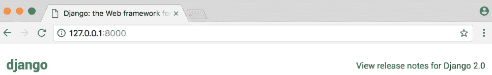

查看 Django 2.0 的发布说明


## 安装成功！恭喜你！

你之所以看到这个页面是因为设置文件中开启了 `DEBUG=True`，且你还没有配置任何 URL。

- Django 文档（主题、参考和教程）
- 教程：投票应用（从 Django 开始）
- Django 社区（联系、获取帮助或贡献）

## Django 欢迎页

## 创建一个应用

Django 使用项目（projects）和应用（apps）的概念来保持代码整洁易读。单个 Django 项目包含一个或多个应用，这些应用共同运行一个 Web 应用。这就是为什么创建新 Django 项目的命令是 `startproject` 的原因！例如，一个真实的 Django 电商网站可能有一个用于用户身份验证的应用，另一个用于支付的应用，第三个用于商品列表详情的应用。每个应用都专注于一个独立的功能。

我们需要创建第一个应用，将其命名为 `pages`。在命令行中，使用 `Control+c` 停止服务器。然后使用 `startapp` 命令。

## 命令行

```
helloworld $ python manage.py startapp pages
```

如果你再次使用 `tree` 命令查看目录，你会发现 Django 已经创建了一个包含以下文件的 `pages` 目录：

## 命令行

```
pages
|-- __init__.py
|-- admin.py
|-- apps.py
|-- migrations
|   |-- __init__.py
|-- models.py
|-- tests.py
|-- views.py
```

让我们回顾一下每个新 `pages` 文件的作用：

- `admin.py` 是内置 Django Admin 应用的配置文件
- `apps.py` 是应用本身的配置文件
- `migrations/` 用于跟踪我们 `models.py` 文件的任何更改，以确保我们的数据库和 `models.py` 保持同步
- `models.py` 是我们定义数据库模型的地方，Django 会自动将它们翻译成数据库表
- `tests.py` 用于我们应用的特定测试
- `views.py` 是我们处理 Web 应用请求/响应逻辑的地方

尽管我们的新应用存在于 Django 项目中，但在我们显式添加它之前，Django 并不“知道”它。在你的文本编辑器中打开 `settings.py` 文件，并滚动到 `INSTALLED_APPS`，你会在那里看到已经存在的内置的 Django 应用。

```python
INSTALLED_APPS = [
    'django.contrib.admin',
    'django.contrib.auth',
    'django.contrib.contenttypes',
    'django.contrib.sessions',
    'django.contrib.messages',
    'django.contrib.staticfiles',
    'pages',
]
```

## 视图 (Views)

在 Django 中，视图决定了显示的内容。让我们先通过更新 `views.py` 文件来实现：

```python
## pages/views.py
from django.http import HttpResponse

def homeView(request):
    return HttpResponse('Hello, World!')
```

基本上我们是在当 `homeView` 被调用时返回“Hello, World!”。现在我们需要配置 URL。在 `pages` 应用中创建一个新的 `urls.py` 文件。

## 命令行

```
(helloworld) $ touch pages/urls.py
```

将其更新为以下代码：

```python
## pages/urls.py
from django.urls import path
from . import views

urlpatterns = [
    path('', views.homeView, name='home')
]
```

在第一行我们从 Django 导入了 `path` 来构建我们的路由模式，在另一行我们导入了 `views`。这里使用的点 `.` 意味着引用当前目录，即我们的 `pages` 应用。我们的路由模式包含三个部分：

- 针对空字符串 `''` 的 Python 正则表达式
- 指定视图 `homeView`
- 添加一个可选的 URL 名称 `'home'`

换句话说，如果用户请求由空字符串 `''` 表示的首页，我们将使用该视图。我们快完成了。最后一步是也要配置项目级的 `urls.py` 文件。记住，一个 Django 项目中通常会有多个应用，因此每个应用都需要自己的路由。更新 `helloworld_project/urls.py` 文件如下：

```python
## helloworld_project/urls.py
from django.contrib import admin
from django.urls import path, include

urlpatterns = [
    path('admin/', admin.site.urls),
    path('', include('pages.urls')),
]
```

我们在第二行 `path` 旁边导入了 `include`，然后为我们的 `pages` 应用创建了新的路由模式。现在，每当用户访问 `/` 首页时，他们会被路由到 `pages` 应用，然后到 `homeView`。

对于初学者来说，经常困惑的是我们在这里不需要导入 `pages` 应用，但我们在路由模式中以 `pages.urls` 引用了它。我们之所以这样做是因为 `django.urls.include()` 方法期望我们传入一个模块、应用或作为第一个参数。如果不使用 `include`，我们就必须导入我们的 `pages` 应用，但由于我们使用了 `include`，在项目级别就不需要了！

## 好，世界！

我们现在拥有了所有需要的代码！为了确认一切按预期工作，请重启我们的 Django 服务器：

## 命令行

```bash
(helloworld) $ python manage.py runserver
```

如果你刷新 `http://127.0.0.1:8000/` 浏览器，它现在会显示文本“Hello, world!”。

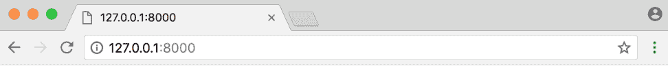

Hello, World!

Hello world 首页

## Git

在上一章中我们还安装了 `git`，它是一个版本控制系统。让我们在这里使用它。第一步是在我们的仓库中初始化（或添加）`git`。

## 命令行

```bash
(helloworld) $ git init
```

如果你输入 `git status`，你将看到自上一次 `git commit` 以来的更改列表。由于这是我们的第一次提交，此列表包含了我们目前为止的所有更改。

## 命令行

```bash
(helloworld) $ git status
```

在分支 master 上

暂无提交

未跟踪的文件：

（使用 "git add <file>..." 将要提交的内容包含）

- `db.sqlite3`
- `helloworld_project/`
- `manage.py`
- `pages/`
- `Pipfile`
- `Pipfile.lock`

没有要提交的内容，但存在未跟踪的文件（使用 "git add" 进行跟踪）

我们接下来想使用 `add -A` 命令添加所有更改，然后带上描述更改内容的消息提交这些更改。

## 命令行

```bash
(helloworld) $ git add -A
```

```bash
(helloworld) $ git commit -m 'initial commit'
```

请注意，Windows 用户可能会遇到 `git commit error: pathspec 'commit' did not match any file(s) known to git`，这似乎与使用单引号 `''` 而不是双引号 `""` 有关。如果你看到此错误，今后所有的提交信息请使用双引号。

## Bitbucket

为每个项目为代码创建一个远程仓库是一个好习惯。这样一旦你的电脑发生任何故障，你都有一个备份；更重要的是，它允许与其他软件人员协作。两个最流行的选择是 Bitbucket 和 Github。

在本书中我们将使用 Bitbucket，因为它提供**免费的**私有仓库。Github 会收取费用。公共仓库互联网上的任何都可以使用；私有仓库则不然。当你学习 Web 开发时，最好坚持使用私有仓库，这样你就不会无意中将密码等关键信息发布到网上。

要在 Bitbucket 上开始操作，请注册一个免费账户。通过电子邮件确认账户后，你将被重定向到 Bitbucket 欢迎页。点击“Create a repository”（创建仓库）的链接。

## 第2章：Hello World 应用

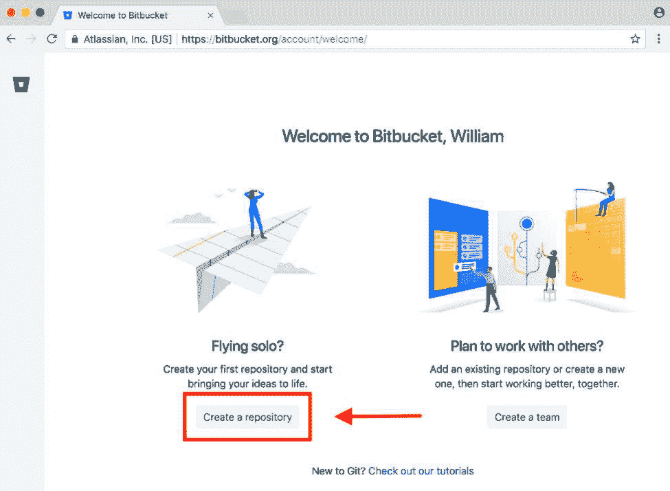

欢迎来到 Bitbucket, William

单兵作战？

创建你的第一个仓库并开始让你的想法变为现实。

添加现有仓库或创建一个新仓库，然后开始更好地协作。

Create a repository（创建仓库）

Create a team（创建团队）

Git 新手？查看我们的教程

## Bitbucket 欢迎页

随后在“Create Repo”（创建仓库）页面上输入你的仓库名称：“hello-world”。然后点击蓝色的“Create repository button”（创建仓库按钮）：

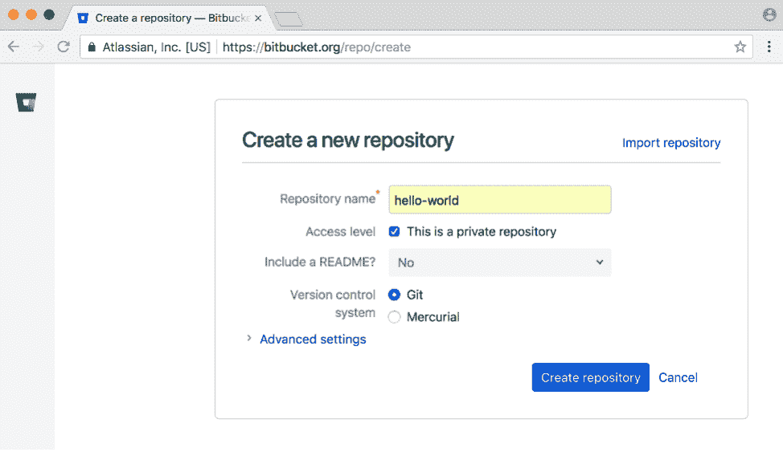

## Bitbucket 创建仓库

在下一页，点击底部的链接“I have an existing project”（我有一个现有的项目），这将打开一个下拉菜单：

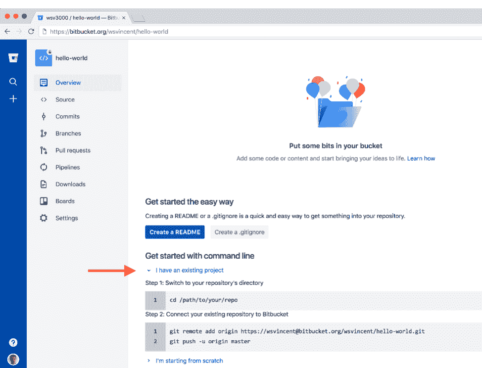

我们已经在仓库目录中了，跳过第 1 步。在第 2 步中，我们将使用两个命令将项目添加到 Bitbucket。注意，你的命令将与我的不同，因为你有不同的用户名。通用格式如下，其中 `<USER>` 是你的 Bitbucket 用户名。

## 命令行

```bash
(helloworld) $ git remote add origin https://<USER>@bitbucket.org/<USER>/hello-world.git
```

运行此命令配置 `git` 到此 Bitbucket 仓库后，我们必须将代码“推送”到其中。

## 命令行

```bash
(helloworld) $ git push -u origin master
```

如果你回到你的 Bitbucket 页面并刷新，你将看到代码已经上线！点击左侧的“Source”（源代码）标签页查看所有内容。

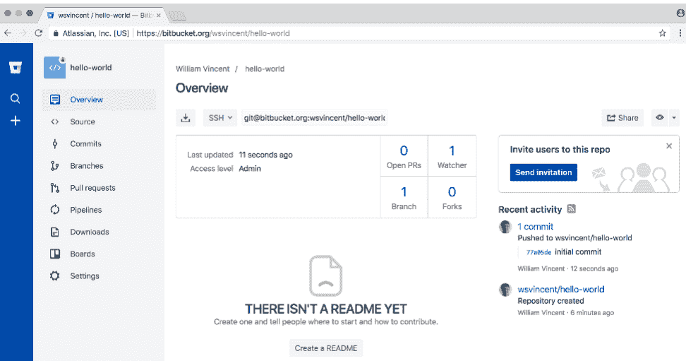

既然我们完成了，请使用 `exit` 命令退出虚拟环境。

## 命令行

```bash
(helloworld) $ exit
```

你现在应该可以看到命令行上没有括号了，这表明虚拟环境不再激活。

## 结论

恭喜你！我们在这一章中涵盖了许多基础概念。我们构建了第一个 Django 应用，并学习了 Django 的项目/应用结构。

我们开始学习视图 (views)、URL (urls) 和内部 Web 服务器。我们还使用 `git` 来跟踪更改，并将代码推送到私有仓库中。

恭喜你！我们在这一章中涵盖了许多基础概念。我们构建了第一个 Django 应用，并学习了 Django 的项目/应用结构。

我们开始学习视图 (views)、URL (urls) 和内部 Web 服务器。我们还使用 `git` 来跟踪更改，并将代码推送到私有仓库中。

在本章中，我们将构建、测试并部署具有首页和关于页面的 Pages 应用。我们还将学习类视图。

## 初始化设置

如第 2 章：Hello World 应用所示，初始化涉及以下：

- 创建环境
- 安装 django
- 创建项目
- 创建 pages 应用
- 更新 settings.py

## 命令行

```bash
$ cd Desktop
```


# 第 3 章：Pages 应用

首先，创建项目的基础结构并启动开发服务器：

```
$ mkdir pages
$ pipenv install
$ pipenv shell
$ django-admin startproject pages_project
$ python manage.py startapp pages
```

```bash
(helloworld) $ python manage.py runserver
```

然后导航到 `http://127.0.0.1:8000/`。

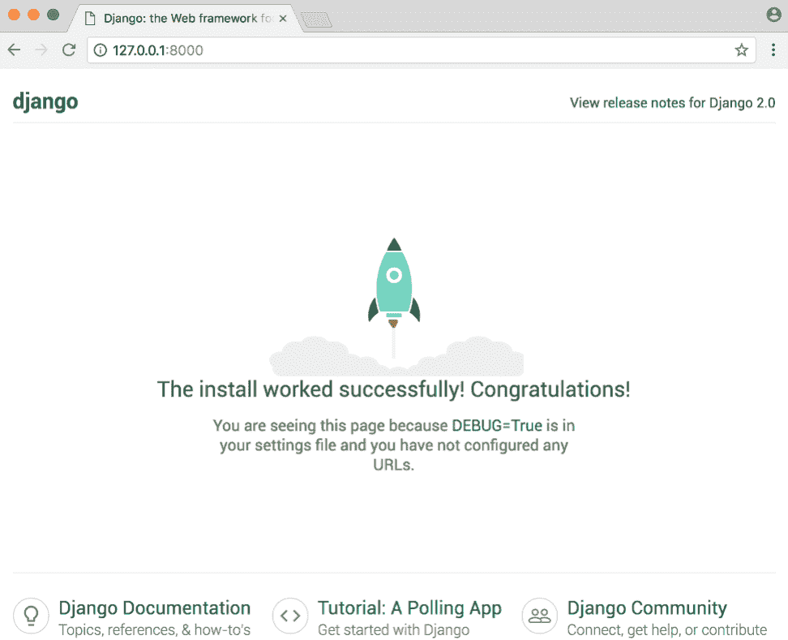

安装成功！恭喜！

你看到这个页面是因为设置文件中开启了 `DEBUG=True`，且你尚未配置任何 URL。

- Django 文档：主题、参考和指南
- 教程：投票应用程序
- Django 社区：联系、获取帮助或贡献

## 模板

每个 Web 框架都需要一种方便生成 HTML 文件的方法。在 Django 中，方法是使用模板，以便由视图为指定的页面提供服务。

这个模式值得重复，因为你将在 Django 开发中反复遇到它：模板、视图和 URL。你创建它们的顺序并不重要，因为这三者都是必不可少的且紧密工作的。URL 控制初始路由（例如 `/about`），视图包含逻辑或“内容”，而模板包含 HTML。对于依赖数据库模型的 Web 页面，视图决定了哪些数据可用。

所以：模板、视图、URL。这种模式适用于你制作的每一个 Django 页面。然而，需要一些重复才能将其内化。

好了，继续。模板目录放置的位置可能会让学者感到困惑。默认情况下，Django 在每个应用内部查找模板。在我们的 `pages` 应用中，它期望在以下位置找到 `home.html` 模板：

- `pages`
  - `templates`
    - `pages`
      - `home.html`

这意味着我们需要创建一个 `templates` 目录、一个与应用同名的目录 `pages`，最后是我们的模板本身 `home.html`。

一个常见问题是：为什么要这种重复的结构？简单来说，是因为 Django 模板加载器想要确保找到正确的模板，这就是它被设计查找的方式。

幸运的是，Django 项目的模板结构还有另一种常用的方法。那种方法是创建一个项目级的 `templates` 目录，供所有应用使用。我们将采用这种方法。通过对...微调

在我们的 `settings.py` 文件中，我们可以告诉 Django 也在这个项目级文件夹中查找模板。

首先，用 `Control-c` 停止服务器。然后创建一个名为 `templates` 的项目级文件夹和一个名为 `home.html` 的 HTML 文件。

## 命令行

```
(pages) $ mkdir templates
(pages) $ touch templates/home.html
```

接下来，我们需要更新 `settings.py` 告诉 Django 从项目级查找模板。这是对 `TEMPLATES` 下的 `DIRS` 设置的一行更改。

## 代码

```python
## pages_project/settings.py

TEMPLATES = [
    {
        ...
        'DIRS': [os.path.join(BASE_DIR, 'templates')],
        ...
    }
]
```

然后，我们可以为 `home.html` 文件添加一个简单的标题。

## 代码

```html
<!-- templates/home.html -->
<h1>Homepage.</h1>
```

好了，我们的模板完成了！下一步是配置我们的 URL 和视图（view）。

## 基于类的视图 (Class-Based Views)

Django 的早期版本仅提供基于函数的视图（function-based views），但开发者很快发现自己在不断地重复编写相同的模式。编写一个列出模型中所有对象的视图。编写一个只显示模型中一个详细项的视图。以此类推。

引入基于函数的通用视图是为了抽象这些模式并简化常见模式的开发。然而，并没有简单的方法来扩展或自定义这些视图。因此，Django 引入了基于类的通用视图，它们不仅易于使用，而且可以扩展涵盖了常见用例的视图。

类是 Python 的基础部分，但对它们的深入讨论超出了本书的范围。如果你需要介绍或复习，我建议查阅官方 Python 文档，那里有关于类及其用法的极佳教程。

在我们的视图中，我们将使用内置的 `TemplateView` 来显示我们的模板。更新 `pages/views.py` 文件。

```python
## pages/views.py

from django.views.generic import TemplateView

class HomePageView(TemplateView):
    template_name = 'home.html'
```

注意，我们对视图的首字母进行了大写，因为它现在是一个 Python 类。与函数不同，类应该始终大写开头。`TemplateView` 已经包含了显示我们模板所需的所有逻辑，我们只需要指定模板名称。

## URLs

最后一步是更新我们的 URL 配置（URLConfs）。回想第 2 章，我们需要在两个位置进行更新。首先，我们更新项目级的 `urls.py` 文件以指向我们的 `pages` 应用，然后在 `pages` 内部将视图映射到路由。

让我们从项目级的 `urls.py` 文件开始。

## 代码

```python
## pages_project/urls.py

from django.contrib import admin
from django.urls import path, include

urlpatterns = [
    path('admin/', admin.site.urls),
    path('', include('pages.urls'))
]
```

此时应该检查一下这里的代码。我们在第二行添加了 `include`，将现有的 URL 指向 `pages` 应用。接下来创建一个应用级的 `urls.py` 文件。

## 命令行

```
(pages) $ touch pages/urls.py
```

并添加以下代码。

## 代码

```python
## pages/urls.py

from django.urls import path
from . import views

urlpatterns = [
    path('', views.HomePageView.as_view(), name='home')
]
```

这种模式与我们在第 2 章中做的几乎相同，只有一个主要的区别。在使用基于类的视图（Class-Based Views）时，你始终要在视图名称末尾添加 `as_view()`。

完成了！如果你用 `python manage.py runserver` 启动 Web 服务器并访问 `http://127.0.0.1:8000/`，你就可以看到我们的新首页。

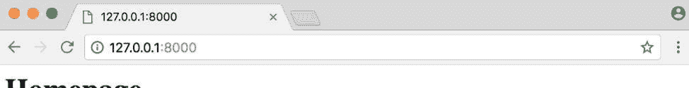

# Homepage.

## Homepage

## 添加一个关于页面 (About Page)

添加关于页的过程与我们刚刚的操作非常相似。我们将创建一个新的模板文件、一个新的视图和一个新的 URL 路由。

用 `Control-c` 停止服务器并创建一个名为 `about.html` 的新模板。

## 命令行

```
(pages) $ touch templates/about.html
```

然后向它填充一个简短的 HTML 标题。

## 代码

```html
<!-- templates/about.html -->
<h1>About page.</h1>
```

为该页面创建一个新视图。

## 代码

```python
## pages/views.py

from django.views.generic import TemplateView

class HomePageView(TemplateView):
    template_name = 'home.html'

class AboutPageView(TemplateView):
    template_name = 'about.html'
```

然后将其连接到 about 的 URL。

## 代码

```python
## pages/urls.py

from django.urls import path
from . import views

urlpatterns = [
    path('', views.HomePageView.as_view(), name='home'),
    path('about/', views.AboutPageView.as_view(), name='about'),
]
```

用 `python manage.py runserver` 启动 Web 服务器。

访问 `http://127.0.0.1:8000/about`，你就可以看到我们新的“About page”。

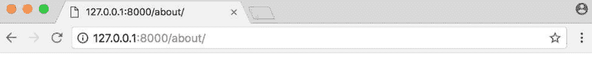

# About page.

About page

## 扩展模板 (Extending Templates)

模板真正的威力在于它们是可以扩展的。如果你考虑大多数网站，会有在每个页面上重复的内容（页头、页脚等）。如果作为开发者，能够有一个统一的页头代码并供所有其他模板继承，那不是很好吗？

我们可以的！让我们创建一个 `base.html` 文件，其中包含一个指向我们两个页面的页头。先 `Control-c` 然后输入以下内容。

## 命令行

```
(pages) $ touch templates/base.html
```

Django 有一种非常简单的模板语言，用于在我们的模板中添加链接和基础逻辑。你可以在官方文档中查看内置模板标签的完整列表。标签的形式为 ``，其中 "something" 是标签本身。你甚至可以创建自定义的模板标签，尽管我们在书中不会这样做。

为了在项目中添加 URL 链接，我们可以使用内置的 `url` 模板标签。

## 代码

```html
<!-- templates/base.html -->
<header>
    <a href="">Home</a> | <a href="">About</a>
</header>
```

```html


```

在我们的视图中，我们将使用内置的 `TemplateView` 来显示我们的模板。更新 `pages/views.py` 文件。

```python
## pages/views.py

from django.views.generic import TemplateView

class HomePageView(TemplateView):
    template_name = 'home.html'
```

注意我们对视图的首字母进行了大写，因为它现在是一个类。与函数不同，类应该始终大写开头。`TemplateView` 已经包含了显示我们模板的所有逻辑，我们只需要指定模板名称。

## URLs

最后一步是更新我们的 URL 配置。回想第 2 章，我们需要在两个位置进行更新。首先我们更新项目级的 `urls.py` 文件以指向 `pages` 应用，然后在 `pages` 内部将视图映射到路由。

让我们从项目级的 `urls.py` 文件开始。

## 代码

```python
## pages_project/urls.py

from django.contrib import admin
from django.urls import path, include

urlpatterns = [
    path('admin/', admin.site.urls),
    path('', include('pages.urls'))
]
```

此时应该检查一下这里的代码。我们在第二行添加了 `include`，将现有的 URL 指向 `pages` 应用。接下来创建一个应用级的 `urls.py` 文件。

## 命令行

```
(pages) $ touch pages/urls.py
```

并添加以下代码。

## 代码

```python
## pages/urls.py

from django.urls import path
from . import views

urlpatterns = [
    path('', views.HomePageView.as_view(), name='home')
]
```

这种模式与我们在第 2 章中做的几乎相同，只有一个主要的区别。在使用基于类的视图时，你始终要在视图名称末尾添加 `as_view()`。

完成了！如果你用 `python manage.py runserver` 启动 Web 服务器并访问 `http://127.0.0.1:8000/`，你就可以看到我们的新首页。


# Homepage.

## Homepage

## 添加一个关于页面 (About Page)

添加关于页的过程与我们刚刚的操作非常相似。我们将创建一个新的模板文件、一个新的视图和一个新的 URL 路由。

用 `Control-c` 停止服务器并创建一个名为 `about.html` 的新模板。

## 命令行

```
(pages) $ touch templates/about.html
```

然后向它填充一个简短的 HTML 标题。

## 代码

```html
<!-- templates/about.html -->
<h1>About page.</h1>
```

为该页面创建一个新视图。

## 代码

```python
## pages/views.py

from django.views.generic import TemplateView

class HomePageView(TemplateView):
    template_name = 'home.html'

class AboutPageView(TemplateView):
    template_name = 'about.html'
```

然后将其连接到 about 的 URL。

## 代码

```python
## pages/urls.py

from django.urls import path
from . import views

urlpatterns = [
    path('', views.HomePageView.as_view(), name='home'),
    path('about/', views.AboutPageView.as_view(), name='about'),
]
```

用 `python manage.py runserver` 启动 Web 服务器。

访问 `http://127.0.0.1:8000/about`，你就可以看到我们新的“About page”。


# About page.

About page

## 扩展模板 (Extending Templates)

模板真正的威力在于它们是可以扩展的。如果你考虑大多数网站，会有在每个页面上重复的内容（页头、页脚等）。如果作为开发者，能够有一个统一的页头代码并供所有其他模板继承，那不是很好吗？

我们可以的！让我们创建一个 `base.html` 文件，其中包含一个指向我们两个页面的页头。先 `Control-c` 然后输入以下内容。

## 命令行

```
(pages) $ touch templates/base.html
```

Django 有一种非常简单的模板语言，用于在我们的模板中添加链接和基础逻辑。你可以在官方文档中查看内置模板标签的完整列表。标签的形式为 ``，其中 "something" 是标签本身。你甚至可以创建自定义的模板标签，尽管我们在书中不会这样做。

为了在项目中添加 URL 链接，我们可以使用内置的 `url` 模板标签。

## 代码

```html
<!-- templates/base.html -->
<header>
    <a href="">Home</a> | <a href="">About</a>
</header>
```

```html


```

在我们的视图中，我们将使用内置的 `TemplateView` 来显示我们的模板。更新 `pages/views.py` 文件。

```python
## pages/views.py

from django.views.generic import TemplateView

class HomePageView(TemplateView):
    template_name = 'home.html'
```


注意我们对视图的首字母进行了大写，因为它现在是一个类。与函数不同，类应该始终大写开头。`TemplateView` 已经包含了显示我们模板的所有逻辑，我们只需要指定模板名称。

## URLs

最后一步是更新我们的 URL 配置。回想第 2 章，我们需要在两个位置进行更新。首先我们更新项目级的 `urls.py` 文件以指向 `pages` 应用，然后在 `pages` 内部将视图映射到路由。

让我们从项目级的 `urls.py` 文件开始。

### 代码

```python
# pages_project/urls.py

from django.contrib import admin
from django.urls import path, include

urlpatterns = [
    path('admin/', admin.site.urls),
    path('', include('pages.urls'))
]
```

此时应该检查一下这里的代码。我们在第二行添加了 `include`，将现有的 URL 指向 `pages` 应用。接下来创建一个应用级的 `urls.py` 文件。

### 命令行

```bash
(pages) $ touch pages/urls.py
```

并添加以下代码。

### 代码

```python
# pages/urls.py

from django.urls import path
from . import views

urlpatterns = [
    path('', views.HomePageView.as_view(), name='home')
]
```

这种模式与我们在第 2 章中做的几乎相同，有一个主要的区别。在使用基于类的视图时，你始终要在视图名称末尾添加 `as_view()`。

完成了！如果你用 `python manage.py runserver` 启动 Web 服务器并访问 `http://127.0.0.1:8000/`，你就可以看到我们的新首页。


### Homepage

## 添加一个关于页面（About Page）

添加关于页的过程与我们刚刚的操作非常相似。我们将一个新的模板文件、一个新的视图和一个新的 URL 路由。

用 Control-c 停止服务器并创建一个名为 `about.html` 的新模板。

### 命令行

```bash
(pages) $ touch templates/about.html
```

然后向它填充一个简短的 HTML 标题。

### 代码

```html
<!-- templates/about.html -->

<h1>About page.</h1>
```

为该页面创建一个新视图。

### 代码

```python
# pages/views.py

from django.views.generic import TemplateView

class HomePageView(TemplateView):
    template_name = 'home.html'

class AboutPageView(TemplateView):
    template_name = 'about.html'
```

然后将其连接到 about 的 URL。

### 代码

```python
# pages/urls.py

from django.urls import path
from . import views

urlpatterns = [
    path('', views.HomePageView.as_view(), name='home'),
    path('about/', views.AboutPageView.as_view(), name='about'),
]
```

用 `python manage.py runserver` 启动 Web 服务器。

访问 `http://127.0.0.1:8000/about`，你就可以看到我们新的“About page”。


### About page

## 扩展模板（Extending Templates）

模板真正的威力在于它们是可以扩展的。如果你考虑大多数网站，会有在每个页面上重复的内容（页头、页脚等）。如果作为开发者，能够有一个统一的页头代码并供所有其他模板继承，那不是很好吗？

我们可以的！让我们创建一个 `base.html` 文件，其中包含一个指向我们两个页面的页头。先 Control-c，然后输入以下内容。

### 命令行

```bash
(pages) $ touch templates/base.html
```

Django 有一种非常简单的模板语言，用于在我们的模板中添加链接和基础逻辑。你可以在官方文档中查看内置模板标签的完整列表。标签的形式为 ``，其中 `something` 是标签本身。你甚至可以创建自定义的模板标签，尽管我们在书中不会这样做。

为了在项目中添加 URL 链接，我们可以使用内置的 `url` 模板标签。

### 代码

```html
<!-- templates/base.html -->

<header>
    <a href="">Home</a> | <a href="">About</a>
</header>
```

```html


```

## 测试（Tests）

编写测试很重要，因为它自动化了确认代码运行符合预期的过程。在这样的应用程序中，我们可以手动查看并确认首页和关于页面存在并包含预期的内容。但随着项目规模的扩大，可能会有成百上千个独立页面，手动检查每一个是不可能的。当我们对代码进行更改——添加新功能、更新现有功能、删除网站未使用的区域——我们想要确保没有破坏其他部分。测试让我们在特定部分上运行一次，并让它进行检查。

幸运的是，Django 自带了强大的内置测试工具，用于编写和运行测试。

如果你查看我们的 `pages` 应用，Django 已经提供了一个我们可以使用的 `tests.py` 文件。打开它并添加以下代码：

### 代码

```python
# pages/tests.py

from django.test import SimpleTestCase

class SimpleTests(SimpleTestCase):
    def test_home_page_status_code(self):
        response = self.client.get('/')
        self.assertEqual(response.status_code, 200)

    def test_about_page_status_code(self):
        response = self.client.get('/about/')
        self.assertEqual(response.status_code, 200)
```

我们这里使用 `SimpleTestCase`，因为我们没有使用数据库。然后我们检查状态码是否为 200。

每个页面的状态都是 200，这是成功 HTTP 请求的标准响应。这是一种高级的说法，意味着它确保了特定的网页确实存在，但对该网页的内容一无所知。

要运行测试，请按 Control-c 退出服务器，然后在命令行中输入 `python manage.py test`：

### 命令行

```bash
(pages) $ python manage.py test

Creating test database for alias 'default'...
...
Ran 2 tests in 0.028s
OK
Destroying test database for alias 'default'...
```

成功了！未来我们将在测试方面做更多工作，特别是在我们开始使用数据库之后。现在，重要的是看到每当我们向 Django 项目添加新功能时，添加测试是多么简单。

## Git 和 Bitbucket

使用 git 和 [Bitbucket](https://www.bitbucket.org)。

是时候使用 git 跟踪我们的更改，并把它们推送到 Bitbucket 了。我们将先从初始化目录开始。

### 命令行

```bash
(pages) $ git init
```

使用 `git status` 查看我们所有的代码更改，然后使用 `git add -A` 将它们全部添加。最后，我们将添加第一条提交信息。

### 命令行

```bash
(pages) $ git status
(pages) $ git add -A
(pages) $ git commit -m 'initial commit'
```

在 Bitbucket 上，我们将创建一个名为 `pages-app` 的新仓库。

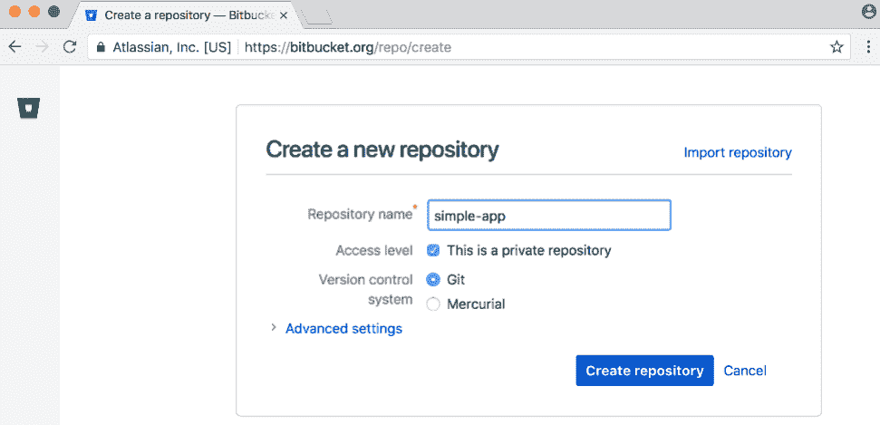

Bitbucket 创建页面：在下一页，点击底部的“我有一个现有项目”链接。复制两个命令进行连接，然后将仓库推送到 Bitbucket。

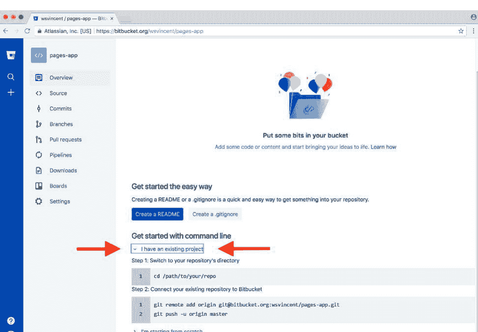

它看起来应该是这样的，将 `wsvincent` 替换为你的 Bitbucket 用户名：

### 命令行

```bash
(pages) $ git remote add origin git@bitbucket.org:wsvincent/pages-app.git
(pages) $ git push -u origin master
```

## 本地与生产环境

到目前为止，我们一直使用 Django 自带的 Web 服务器在计算机上本地运行 Pages 应用。但你不能与他人共享 `localhost` 地址。为了让我们的网站在互联网上供所有人看到，我们需要将代码部署到任何人都可以查看我们网站的外部服务器。这被称为将我们的代码投入生产环境。本地代码仅存在于我们的计算机上；生产代码存在于外部服务器上。

有很多服务器供应商可用，但我们将使用 Heroku，因为它对小型项目是免费的，使用广泛，且部署过程相对简单。

## Heroku

你可以在他们的网站上注册免费的 Heroku 账户。确认电子邮件后，Heroku 将把你重定向到网站的仪表板部分。

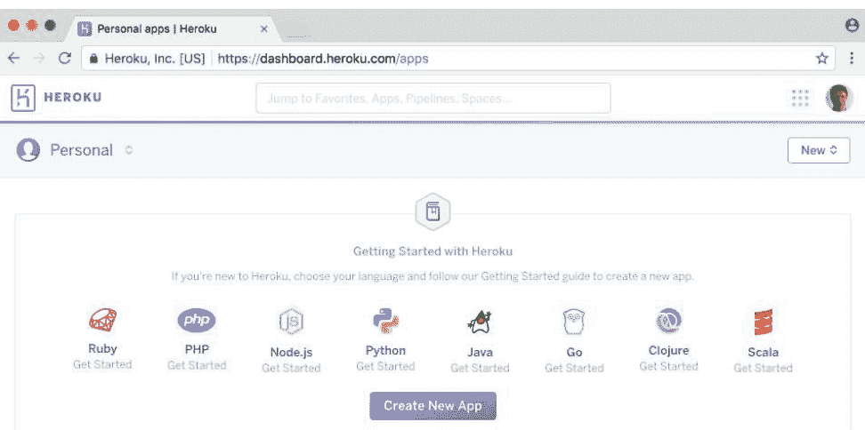

现在我们需要安装 Heroku 的命令行界面（CLI），以便从命令行进行部署。我们需要全局安装 Heroku，使其在整个计算机上都可用，因此请打开一个新的命令行标签页：Mac 上按 `Command + t`，Windows 上按 `Control + t`。如果在我们的虚拟环境中安装了 Heroku，它将只在该环境中可用。

在这个新标签页中，在 Mac 上使用 Homebrew 安装 Heroku：

### 命令行

```bash
$ brew install heroku
```

在 Windows 上，请查看 Heroku CLI 页面以正确安装 32 位或 64 位版本。

安装完成后，你可以关闭新的命令行标签页，并返回激活了 `pages` 虚拟环境的初始标签页。

输入命令 `heroku login` 并使用你刚刚设置的 Heroku 电子邮件和密码。

### 命令行

```bash
(pages) $ heroku login
```

输入你的 Heroku 凭据：

```text
Email: will@wsvincent.com
Password: *********************
已登录为 will@wsvincent.com
```

## 附加文件

我们需要对 Pages 项目进行以下四项更改，以便准备好通过 Heroku 在线部署：

- 更新 `Pipfile.lock`
- 创建一个新的 `Procfile` 文件
- 安装 `gunicorn` 作为我们的 Web 服务器
- 对 `settings.py` 文件进行单行更改

在现有的 `Pipfile` 中，指定我们正在使用的 Python 版本，即 3.6。在文件末尾添加这两行。

### 代码

```ini
# Pipfile

[requires]
python_version = "3.6"
```

然后运行 `pipenv lock` 生成相应的 `Pipfile.lock`。

### 命令行

```bash
(pages) $ pipenv lock
```

Heroku 实际上会在我们的 `Pipfile.lock` 中查找有关虚拟环境的信息，这就是为什么我们在这里添加了语言设置。

接下来，创建一个特定于 Heroku 的 `Procfile`。

### 命令行

```bash
(pages) $ touch Procfile
```

用你的文本编辑器打开 `Procfile` 并添加以下内容：

### 代码

```text
web: gunicorn pages_project.wsgi --log-file -
```

这表示使用现有的 `pages_project.wsgi` 文件，但使用的是 `gunicorn`，这是一种适用于生产环境的 Web 服务器，而不是 Django 自带的仅用于本地开发的服务器。

### 命令行

```bash
(pages) $ pip install gunicorn
```

```bash
(pages) $ heroku ps:scale web=1
```

我们完成了！最后一步是确认我们的应用已经上线并运行。如果你使用 `heroku open` 命令，你的网络浏览器将打开一个新标签页，并显示应用程序的 URL：

### 命令行

```bash
(pages) $ heroku open
```

我的地址是 `https://cryptic-oasis-4039.herokuapp.com/about/`。你可以看到首页和关于页面现在都上线了。

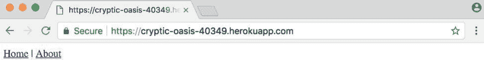

### 首页

Heroku 上的首页

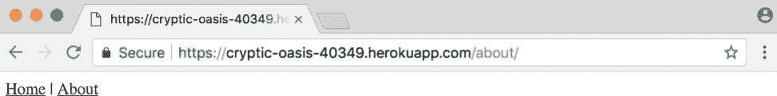

### 关于页面

Heroku 上的关于页面

## 结

恭喜你构建并部署了第二个 Django 项目！这次我们使用了模板、类视图（class-based views）、更深入地探索了 URL 配置、添加了基础测试，并使用了 Heroku。接下来，我们将转向第一个由数据库支持的项目，看看 Django 真正大放异彩的地方。

# 第 4 章：留言板应用

在本章中，我们将首次使用数据库来构建一个基础留言板应用，用户可以在其中发布和阅读短消息。我们将探索 Django 强大的内置管理界面（admin），它提供了一种可视化的方式来修改数据。在添加测试后，我们将代码推送到 Bitbucket 并在 Heroku 上部署该应用。

Django 为多种类型的数据库后端提供了内置支持。只需在 `settings.py` 文件中写几行代码，它就可以支持 PostgreSQL、MySQL 或 SQLite。其中最简单易用的是 SQLite，因为它运行在单个文件中，不需要复杂的安装。相比之下，其他选项需要在后台运行一个进程，并且正确配置起来可能会非常复杂。Django 默认使用 SQLite，因此它是小型项目的完美选择。

## 初始化设置

由于到本书的这一部分，我们已经设置了几个 Django 项目，我们可以快速运行命令来开始一个新项目。我们需要执行以下操作：

- 在桌面上为代码创建一个新目录
- 在虚拟环境中安装 Django
- 创建一个名为 `mb_project` 的新项目
- 创建一个名为 `posts` 的新应用
- 更新 `settings.py`

在新命令行控制台中输入以下命令。注意，我在这里使用 `xxx` 来代表虚拟环境名称。

### 命令行

```bash
$ cd ~/Desktop
$ mkdir mb
$ cd mb
$ pipenv install django
$ pipenv shell
$ django-admin startproject mb_project .
$ python manage.py startapp posts
```

通过将新应用添加到 `settings.py` 文件中 `INSTALLED_APPS` 部分的底部，告诉 Django 这个新应用的存在。使用你喜欢的文本编辑器打开它。

### 代码

```python
# mb_project/settings.py

INSTALLED_APPS = [
    'django.contrib.admin',
    'django.contrib.auth',
    'django.contrib.contenttypes',
    'django.contrib.sessions',
    'django.contrib.messages',
    'django.contrib.staticfiles',
    'posts',
]
```

然后执行 `migrate` 命令根据 Django 的默认设置创建初始数据库。

### 命令行

```bash
(mb) $ python manage.py migrate
```

如果你使用 `ls` 命令查看目录，你会看到一个 `db.sqlite3` 文件，它代表我们的 SQLite 数据库。

### 命令行

```bash
(mb) $ ls
```


`db.sqlite3` `manage.py`

备注：技术上，`db.sqlite3` 文件是在你第一次运行 `migrate` 或 `runserver` 时创建的。`runserver` 会根据 `INSTALLED_APPS` 中包含任何模型的当前状态来配置数据库。换句话说，为了确保数据库反映你项目的当前状态，你每次更新模型时都需要运行 `migrate`（以及 `makemigations`）。要确认一切工作运行正常，请启动我们的本地服务器。

## 命令行

```bash
(mb) $ python manage.py runserver
```

并访问 `http://127.0.0.1:8000/` 看到熟悉的 Django 已正确安装。

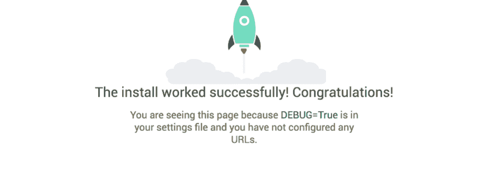

安装成功！恭喜你！你看到这个界面是因为设置文件中包含 `DEBUG=True` 且你还没有配置任何 URL。

- Django 文档主题、参考与教程
- 从 Django 社区入门、获取帮助或做出贡献

## 创建数据库模型

我们的第一个任务是创建一个数据库模型，以便我们可以存储和显示用户的帖子。Django 将为我们把此模型转换为数据库表。在真实的 Django 项目中，通常会有许多复杂的相互关联的模型，但在我们简单的留言板应用中我们只需要一个。我不会在书中介绍数据库设计，但如果你对这些来说都是全新的，可以在这里找到我写的一份短指南。

打开 `posts/models.py` 文件并查看 Django 提供的默认代码：

### 代码

```python
# posts/models.py

from django.db import models
```

## 在此处创建你的模型

Django 导入 `models` 模块来帮助我们构建新的数据库模型，这些模型将模拟数据库中数据的特征。我们想要创建一个模型来存储留言板内容的文本内容，可以如下操作：

### 代码

```python
# posts/models.py

from django.db import models

class Post(models.Model):
    text = models.TextField()
```

注意，我们创建了一个名为 `Post` 的新模型，它有一个数据库字段 `text`。我们还指定了它将承载的内容类型 `TextField()`。Django 提供了许多模型字段，支持常见的内容类型，如字符、日期、整数、电子邮件等。

## 激活模型

现在我们的新模型已经创建，我们需要激活它。从今以后，每当我们创建或修改现有模型时，我们都需要通过两个步骤的过程来更新 Django：

1. 我们使用 `makemigrations` 命令创建一个迁移文件，该文件为 `INSTALLED_APPS` 设置中已安装的应用生成 SQL 命令。迁移文件不会在数据库上执行这些命令，而是对我们模型所有更改的引用。这种方法意味着我们拥有了模型随时间变化的记录。
2. 第二，我们使用 `migrate` 构建实际数据库，它会执行迁移文件中的指令。

## 命令行

```bash
(mb) $ python manage.py makemigrations posts
(mb) python manage.py migrate posts
```

注意，你不需要在 `makemigations` 或 `migrate` 之后包含名称。如果你运行这些命令，它们将应用于所有可用更改。但明确指定名称是一个好习惯。如果我们的项目中有两个独立的应用并都更新了模型，然后运行 `makemigations`，它将生成一个包含两个应用数据的迁移文件，这会让未来的调试变得困难。你希望每个迁移文件尽可能小且相互隔离。这样，如果你需要查看过去的迁移，每个迁移都只有一个更改，而不是一个适用于多个应用的更改。

## Django Admin

Django 为我们提供了一个强大的管理界面来与数据库进行交互。这是一个少数框架提供的真正“杀手锏”的功能。它源于 Django 作为报纸项目的起源。开发者们需要一个 CMS（内容管理系统），以便记者可以编写和编辑他们的故事而无需接触“代码”。随着时间的推移，内置的 admin 应用已演变成一个优秀的开箱即用工具，用于管理 Django 项目的所有方面。

要使用 Django admin，我们首先需要创建一个可以登录的超级用户。在命令行控制台中，输入 `python manage.py createsuperuser` 并对用户名、电子邮件和密码的提示做出响应：

## 命令行

```bash
(mb) $ python manage.py createsuperuser

Username (留空则使用 'wsv'): wsv
Email:
Password:
Password (again):

Superuser created successfully.
```

**注意：** 当你输入密码时，出于安全考虑，密码不会显示在命令行控制台上。

使用 `python manage.py runserver` 重启 Django 服务器，并在浏览器中访问 `http://127.0.0.1:8000/admin/`。你应该看到管理员的登录界面：

## 管理登录页面

通过输入你刚刚创建的用户名和密码登录。接下来你将看到 Django 管理主页：

# 第 4 章：消息板应用

## 管理主页

但是我们的 posts 应用在哪里呢？它没有显示在管理主页上！

我们需要显式地告诉 Django 在后台中显示什么。幸运的是，我们可以通过打开 `posts/admin.py` 文件并将其修改为如下所示轻松修复这个问题：

### 代码

```python
# posts/admin.py

from django.contrib import admin
from .models import Post

admin.site.register(Post)
```

Django 现在知道它应该在管理页面上显示我们的 posts 应用及其数据库模型。如果你刷新浏览器，你将看到它现在出现了：

现在让我们为数据库数据库创建第一条消息板帖子。点击 Posts 侧的 + Add 按钮。在 Text 表单字段中输入自己的文本。

# 第 4 章：消息板应用

## 管理新条目

然后点击“Save”按钮，它会将你重定向到 Post 主页面。然而，如果你仔细观察，会发现一个问题：我们的新条目被称为“Post object”，这并没有什么帮助。

# 第 4 章：消息板应用

帖子 "Post object" 已成功添加。

选择帖子进行更改

| | POST |
|---|---|
| | Post object |
| | 1 post |

## 管理新条目

让我们来改变它。在 `posts/models.py` 文件中，添加如下的新函数 `__str__`：

### 代码

```python
# posts/models.py

from django.db import models

class Post(models.Model):
    text = models.TextField()

    def __str__(self):
        """模型的字符串表示."""
        return self.text[:50]
```

# 第 4 章：消息板应用

如果你在浏览器中刷新你的管理页面，你将看到它已变为一个更具描述性且有用的数据库条目表示。

## 管理新条目

好多了！为所有模型添加 `str()` 方法以提高其可读性是一种最佳实践。

## 视图/模板/URL

为了在我们的主页上显示数据库内容，我们必须连接我们的视图（views）、模板（templates）和 URL 配置（URLConfs）。这种模式现在应该让你开始感到熟悉了。

让我们从视图开始。在书前面的部分，我们使用了内置的通用 `TemplateView` 在我们的主页上显示模板文件。现在我们想要列出数据库模型的内容。这在 Web 开发中通常是一项常见任务，而 Django 配备了通用的类视图 `ListView`。

在 `posts/views.py` 文件中输入下面的 Python 代码：

### 代码

```python
# posts/views.py

from django.views.generic import ListView
from .models import Post

class HomePageView(ListView):
    model = Post
    template_name = 'home.html'
```

在第一行中我们导入了 `ListView`，在第二行中我们需要显式地定义我们正在使用哪个模型。在视图中，我们继承了 `ListView`，指定我们的模型名称并指定我们的模板引用。在内部，`ListView` 返回一个名为 `object_list` 的对象，我们想在模板中显示它。

我们的视图已经完成，这意味着我们还需要配置 URL 并制作模板。让我们从模板开始。在项目级创建一个名为 `templates` 的目录和一个 `home.html` 模板文件。

## 命令行

```bash
$ mkdir templates
$ touch templates/home.html
```

然后更新 `settings.py` 文件中的 `DIRS` 字段，以便 Django 知道在该文件夹中查找。

### 代码

```python
# settings.py

TEMPLATES = [
    {
        ...
        'DIRS': [os.path.join(BASE_DIR, 'templates')],
        ...
    }
]
```

在我们的模板文件 `home.html` 中，我们可以使用 Django 模板语言的 `for` 循环来列出 `object_list` 中的所有对象。

最后一步是设置我们的 URL 配置。记得 `object_list` 是 `ListView` 返回的。

```html
<!-- templates/home.html -->

<h1>消息板主页</h1>

<ul>

    <li>{{ post.text }}</li>

</ul>
```

## 命令行

```bash
(mb) $ python manage.py test

Creating test database for alias 'default'...

System check identified no issues (0 silenced).

.

Ran 1 test in 0.001s
```

```text
OK

Destroying test database for alias 'default'...
```

通过了！

如果觉得之前的解释让你感到信息过载，不要担心。这在第一次开始编写测试时很正常，但你很快就会发现，你编写的大部分测试其实是非常重复的。

是时候进行第二个测试了。第一个测试是针对模型（model）的，但现在我们想测试我们唯一的页面：首页。具体来说，我们想测试它是否存在（返回 HTTP 200 响应）、是否使用了 home 视图以及是否使用了 home.html 模板。

我们需要在顶部额外添加一个 `reverse` 导入，并为测试创建一个全新的类 `HomePageViewTest`。

# 第 4 章：消息板应用

# 代码

```python
from django.test import TestCase
from django.urls import reverse
from .models import Post
```

```python
class PostModelTest(TestCase):
    def setUp(self):
        Post.objects.create(text='just a test')

    def test_text_content(self):
        post=Post.objects.get(id=1)
        expected_object_name = f'{post.text}'
        self.assertEqual(expected_object_name, 'just a test')
```

```python
class HomePageViewTest(TestCase):
    def setUp(self):
        Post.objects.create(text='this is another test')

    def test_view_url_exists_at_proper_location(self):
        resp = self.client.get('/')
        self.assertEqual(resp.status_code, 200)

    def test_view_url_by_name(self):
        resp = self.client.get(reverse('home'))
        self.assertEqual(resp.status_code, 200)
```

```python
def test_view_uses_correct_template(self):
    resp = self.client.get(reverse('home'))
    self.assertEqual(resp.status_code, 200)
    self.assertTemplateUsed(resp, 'home.html')
```

如果你再次运行测试，应该会看到它们通过了。

## 命令行

```bash
(mb) $ python manage.py test

Creating test database for alias 'default'...

System check identified no issues (0 silenced).

.

--------------------------------------------------------------------------------

Ran 4 tests in 0.036s

OK

Destroying test database for alias 'default'...
```

为什么显示有四个测试呢？记住，我们的 `setUp` 方法并不是测试，它们是为了让我们运行后续的测试。我们四个真正的测试是 `test_view_content`、`test_view_url_exists_at_proper_location`、`test_view_url_by_name` 以及 `test_view_uses_correct_template`。

当我们执行 `python manage.py test` 命令时，任何以 `test*` 开头并存在于 `tests.py` 文件中的函数都会会被运行。

我们已经完成了测试代码添加，现在是时候将更改提交到 git 了。

## 命令行

```bash
(mb) $ git add -A
(mb) $ git commit -m 'added tests'
```

## Bitbucket

我们还需要将代码存储在 Bitbucket 上。这是一个良好的习惯，以防你的本地电脑发生意外，同时它也允许你与其他开发者共享和协作。

你应该已经从**第 3 章**中拥有一个 Bitbucket 账户，所以去创建一个名为 `mb-app` 的新仓库吧。

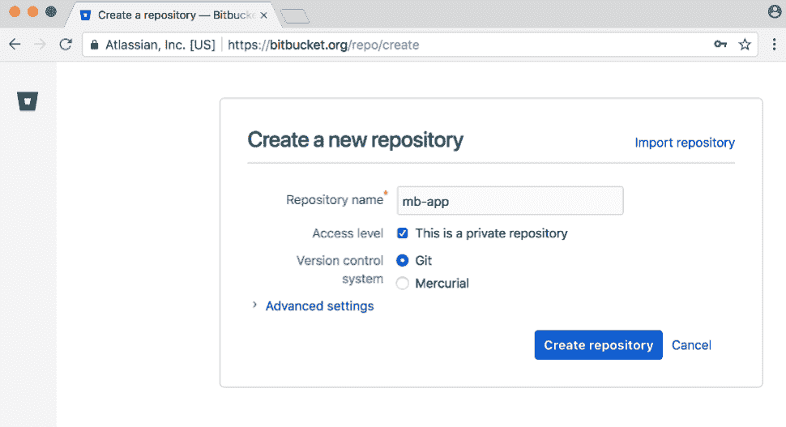

## Bitbucket 创建应用

在下一页点击底部的“我有一个现有项目”链接。复制那两条命令进行连接，然后将仓库推送到 Bitbucket。

它看起来应该是这样，将 `wsvincent`（我的用户名）替换为你的 Bitbucket用户名：

## 命令行

```bash
(mb) $ git remote add origin git@bitbucket.org:wsvincent/mb-app.git
(mb) $ git push -u origin master
```

## Heroku 配置

你应该已经根据第 3 章设置并安装了 Heroku 账户。

我们需要对消息板项目进行以下更改以将其部署到在线：

- 更新 `Pipfile.lock`
- 新建 `Procfile`
- 安装 `gunicorn`
- 更新 `settings.py`

在你的 `Pipfile` 中指定我们使用的 Python 版本，即 3.6。在文件末尾添加这两行。

### 代码

```python
# Pipfile

[requires]
python_version = "3.6"
```

运行 `pipenv lock` 生成相应的 `Pipfile.lock`。

## 命令行

```bash
(mb) $ pipenv lock
```

然后创建一个 `Procfile`，它告诉 Heroku 如何运行我们代码所所在的远程服务器。

## 命令行

```bash
(mb) $ touch Procfile
```

目前，我们告诉 Heroku 使用 `gunicorn` 作为我们的生产服务器，并在我们的 `mb_project.wsgi` 文件中查找进一步指令。

## 命令行

```bash
web: gunicorn mb_project.wsgi --log-file -
```

接下来安装 `gunicorn`，我们将在生产环境它，而在本地开发中继续使用 Django 的内部服务器。

## 命令行

```bash
(mb) $ pipenv install gunicorn
```

最后，在 `settings.py` 中更新 `ALLOWED_HOSTS`。

### 代码

```python
# settings.py
```


```python
ALLOWED_HOSTS = ['*']
```

我们都完成了！将更改添加到 git，然后推送到 Bitbucket。

## 命令行

```bash
(mb) $ git status
(mb) $ git add -A
(mb) $ git commit -m 'New updates for Heroku'
(mb) $ git push -u origin
```

## Heroku 部署

确保你已经登录 Heroku 账户。

### 命令行

```bash
(mb) $ heroku login
```

然后运行创建命令，Heroku 会为你随机生成一个应用名称。

### 命令行

```bash
(mb) $ heroku create

Creating app for agile-2511.herokuapp.com | https://github.com/agile-2511
```

设置 git 使用你的新应用名称。我的是：

第 4 章：消息板应用

告诉 Heroku 忽略静态文件，我们稍后部署博客应用时详细介绍。

### 命令行

```bash
(mb) $ heroku config:set DISABLE_STATIC=1
```

将代码推送到 Heroku，并添加免费扩容以便其能够运行。

### 命令行

```bash
(mb) $ git push heroku master
(mb) $ heroku ps:scale web=1
```

如果你使用`heroku open`打开项目，它会自动启动浏览器窗口显示你的应用 URL。我的地址是：

`https://agile-2511.herokuapp.com/`

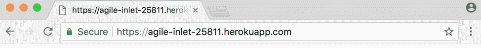

## 消息板首页

- 你好！
- 第二条记录。运行正常！
- 今天完成了我的第一个 Django 项目。

## 上线站点

## 总结

我们现在已经构建、测试并部署了第一个数据库驱动的应用。虽然它故意设计得很简单，但我们现在知道如何创建模型、通过管理面板更新它，并在网页上显示内容。但似乎缺少了什么，不是吗？

在现实世界中，用户需要表单来与网站交互。毕竟并不是所有人都拥有管理面板的权限。在下一章中，我们将构建一个使用表单的博客应用，让用户创建、编辑和删除文章。我们还将添加 CSS 样式。

# 第 5 章：博客应用

## 初始化设置

正如前面的几章所述，我们的设置步骤如下：

- 在桌面创建一个名为`blog`的新代码目录
- 在虚拟环境中安装 Django
- 创建名为`blog_project`的 Django 项目
- 创建名为`blog`的应用
- 执行迁移以设置数据库

### 命令行

```bash
$ cd ~/Desktop
$ mkdir blog
$ cd blog
$ pipenv install django
$ pipenv shell
(blog) $ django-admin startproject blog_project
(blog) $ python manage.py startapp blog
(blog) $ python manage.py migrate
(blog) $ python manage.py runserver
```

为了确保 Django 知道我们的新应用，请打开你的文本编辑器并在`settings.py`文件中的`INSTALLED_APPS`中添加新应用：

## 代码

```python
# blog_project/settings.py

INSTALLED_APPS = [
    'django.contrib.admin',
    'django.contrib.auth',
    'django.contrib.contenttypes',
    'django.contrib.sessions',
    'django.contrib.messages',
    'django.contrib.staticfiles',
    'blog',  # 新
]
```

如果你在浏览器中访问`http://127.0.0.1:8000/`，你应该看到看到页面。

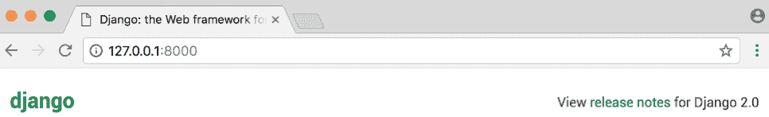

## Django

查看 Django 2.0 的发布说明。


你看到这个页面是因为你的设置文件中开启了`DEBUG=True`，且你还没有配置任何 URL。

- Django 文档主题、参考和指南
- 教程：投票应用 - 从 Django 开始
- Django 社区连接、获取帮助或做出贡献

## Django 欢迎页面

好的，初始安装完成！接下来我们将为博客文章创建数据库模型。

## 数据库模型

一个典型的博客应用特性特性？在我们的案例中，保持简单，假设每篇文章都有一个标题、作者和正文。我们可以通过打开`blog/models.py`文件并输入以下代码，将其转换为数据库模型：

## 代码

```python
# blog/models.py

from django.db import models

class Post(models.Model):
    title = models.CharField(max_length=200)
    author = models.ForeignKey(
        'auth.User',
        on_delete=models.CASCADE,
    )
    body = models.TextField()

    def __str__(self):
        return self.title
```

在顶部，我们导入了`models`类，然后创建一个名为`Post`的子类。使用此子类功能，我们可以自动访问`django.db.models.Models`中的所有内容，并根据需要添加额外的字段和方法。

对于`title`，我们将长度限制为 200 个字符；对于`body`，我们使用`TextField`，它会根据需要自动扩展以适应用户的文本。Django 提供了许多字段类型；你可以在此此处查看完整列表。

对于`author`，我们使用`ForeignKey`，它允许多对一关系。这意味着一个特定的用户可以是许多不同博客文章的作者，但反之则不然。引用的是 Django 内置的`User`模型，因为 Django 提供了身份验证功能。对于所有如`ForeignKey`的多对一关系，我们还必须指定`on_delete`选项。

现在我们的新数据库模型已经创建，我们需要为它创建一个新的迁移记录，并将更改迁移到数据库中。这个二步过程可以通过以下命令完成：

### 命令行

```bash
(blog) $ python manage.py makemigrations blog
(blog) $ python manage.py migrate blog
```

我们的数据库配置好了！下一步是什么？

## 管理后台

我们需要一种访问数据的方法。进入 Django 管理后台！首先，通过输入以下命令创建一个超级用户，并按照提示设置邮箱和密码。注意，在输入密码时出于安全考虑，密码不会显示在屏幕上。

### 命令行

```bash
(blog) $ python manage.py createsuperuser

Username (leave blank to use 'wsv'): wsv
Email:
Password:
Password (again):

Superuser created successfully.
```

现在再次使用命令`python manage.py runserver`运行 Django 服务器，并在`http://127.0.0.1:8000/admin/`打开 Django 管理后台。使用你的新超级用户登录。

哎！我们的新`Post`模型在哪里呢？

## 管理首页

我们忘记更新`blog/admin.py`了，所以现在来处理它。

## 代码

```python
# blog/admin.py

from django.contrib import admin
from .models import Post

admin.site.register(Post)
```

如果你刷新页面，你将看到更新。

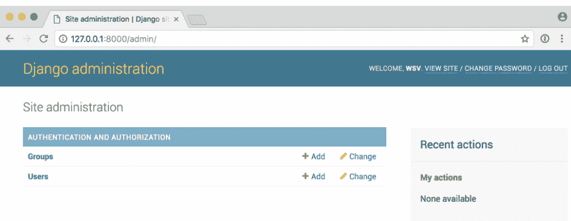

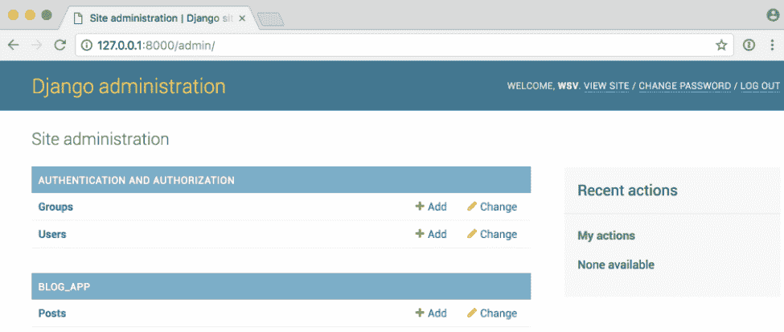

## 管理首页

让我们添加两篇博客文章，以便我们有一些示例数据可以使用。点击 Posts 旁边的 + Add 按钮创建一个新条目。确保为每篇文章都添加一个“author”，因为默认情况下所有模型字段都是必填的。如果你尝试输入没有作者的帖子，将看到错误。如果我们想更改这一点，可以为模型添加字段选项，使某个特定字段变为可选，或者为其填充默认值。

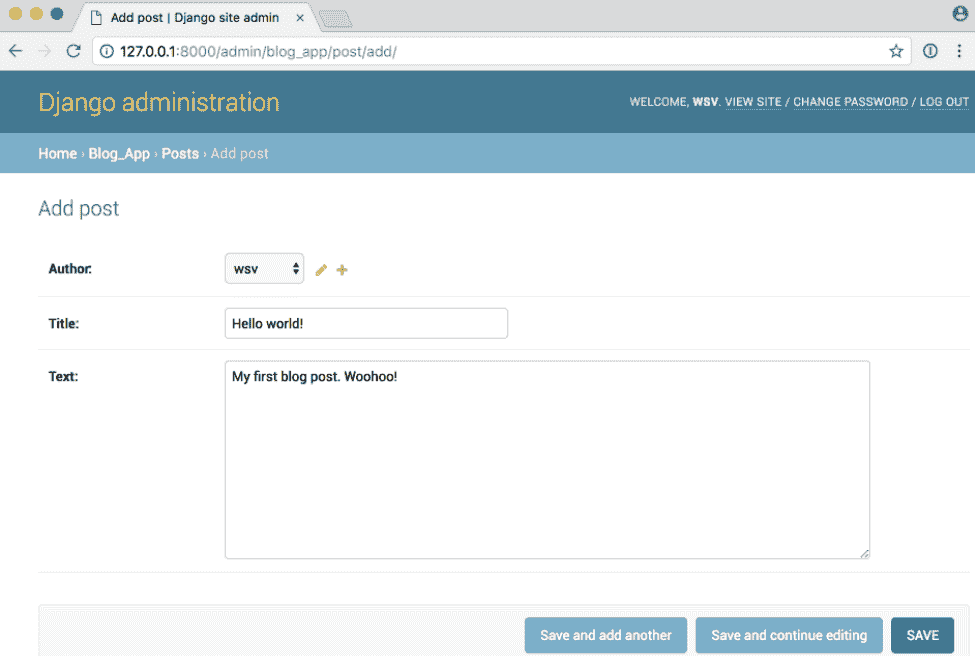

## 管理第一篇文章

## 添加文章

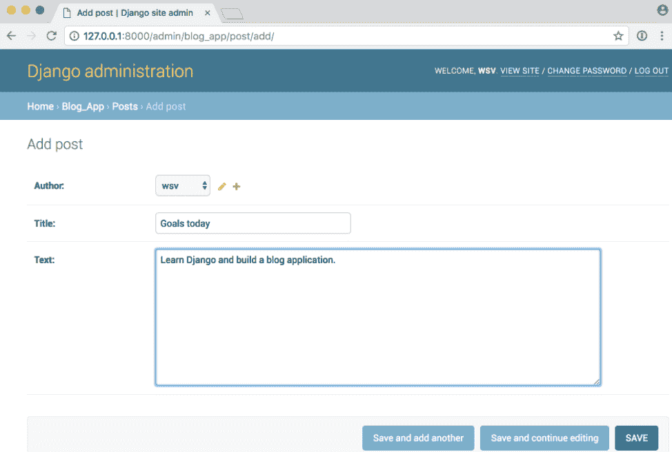

## 管理第二篇文章

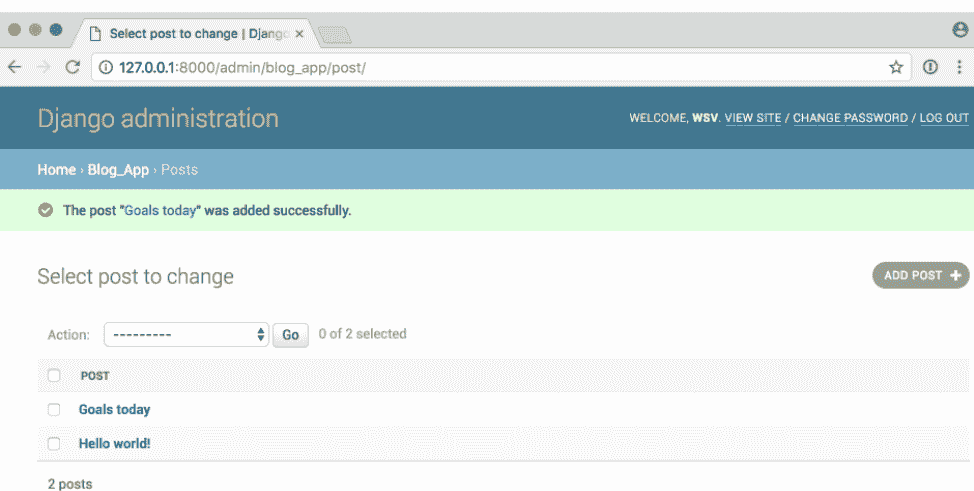

## 带有两篇文章的管理首页

现在我们的数据库模型已经完成，我们需要创建必要的视图（views）、URL 和模板（templates），这样我们就可以在 Web 应用程序上显示信息。

## URLs

我们希望在首页显示博客文章，所以与之前的章节一样，我们将首先配置项目级的 URL 配置（URLConfs），然后配置应用级的 URL 配置来实现这一目标。注意，“项目级”意味着在与`blog_project`和`blog`文件夹相同的文件夹中。

在命令行中使用`Control-c`退出现有服务器，并在我们的 blog 目录下创建一个新的`urls.py`文件：

### 命令行

```bash
(blog) $ touch urls.py
```

现在使用下面的代码更新它。

```python
# blog/urls.py

from django.urls import path
from . import views

urlpatterns = [
    path('', views.BlogListView.as_view(), name='home'),
]
```

我们在顶部导入了即将创建的视图。空字符串`''`告诉 Python 匹配所有值，我们将其命名为`home`的 URL，稍后我们可以在视图中引用它。虽然添加命名的 URL 是可选的，但这是我们应该采用的最佳实践，因为随着 URL 数量的增加，它可以保持条理清晰。

我们还应该更新项目的`urls.py`文件，使其知道将所有请求直接转发到 blog 应用。

## 代码

```python
# blog_project/urls.py

from django.contrib import admin
from django.urls import path, include

urlpatterns = [
    path('admin/', admin.site.urls),
    path('', include('blog.urls')),
]
```

## 视图

我们将使用基于类的视图（class-based views），但如果你想看基于函数的方法构建博客应用，我强烈推荐 Django Girls 教程。它非常棒。

在我们的视图中，添加以下代码使用`ListView`显示我们的`Post`模型的内容。

```python
# blog/views.py

from django.views.generic import ListView
from .models import Post

class BlogListView(ListView):
    model = Post
    template_name = 'home.html'
```

在开头两行，我们导入了`ListView`和我们的数据库模型`Post`。然后我们子类`ListView`并添加我们的模型和模板。与从零实现相比，这节省了大量的代码。

## 模板

有了 URL 配置和视图，我们现在缺少拼图的第三部分：模板。正如我们在第 4 章看到的，我们可以继承其他模板以保持代码整洁。我们将从一个`base.html`文件和一个继承自它的`home.html`文件开始。等稍后当我们添加创建和编辑博客文章的模板时，它们也可以继承`base.html`。

首先创建项目级的模板目录和两个模板文件。

### 命令行

```bash
(blog) $ mkdir templates
(blog) $ touch templates/base.html
(blog) $ touch templates/home.html
```

然后更新`settings.py`让 Django 知道从那里查找我们的模板。

## 代码

```python
# blog_project/settings.py

TEMPLATES = [
    {
        ...
        'DIRS': [os.path.join(BASE_DIR, 'templates')],
        ...
    },
]
```

然后按照如下所示更新`base.html`模板。

## 代码

```html
<!-- templates/base.html -->

<html>
<head>
  <title>Django blog</title>
</head>
<body>
  <header>
    <h1><a href="/">Django blog</a></h1>
  </header>
</body>
</html>
```

```html
<div class="container">
  
  
</div>
<body>
</html>
```

请注意``和``之间的代码可以由其他模板填充。说起，这里是`home.html`的代码。

## 代码

```html
<!-- templates/home.html -->




  
    <div class="post-entry">
      <h2><a href="">{{ post.title }}</a></h2>
      <p>{{ post.body }}</p>
    </div>
  

```

在顶部，我们注意到此模板扩展了`base.html`，然后用`content blocks`（内容块）包裹了我们所需的代码。我们使用 Django 模板语言为每个博客文章设置了一个简单的循环。注意`object_list`来自`ListView`，并包含了我们视图中的所有对象。

如果你重新启动 Django 服务器：`python manage.py runserver`。

然后刷新`http://127.0.0.1:8000/`，我们可以看到它正在运行。

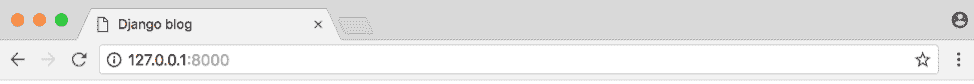

# Django 博客

# Hello，世界！

我的第一篇博客文章。万岁！

# 今日目标

学习 Django 并构建一个博客应用程序。

## 带有两个文章的博客首页

但它看起来很糟糕。让我们修复它吧！

## 静态文件

我们需要添加一些 CSS，它被称为静态文件，因为与我们的动态数据库内容不同，它不会改变。坦率说，向 Django 项目中添加 CSS、JavaScript 和图像等静态文件是非常简单的。

在生产就绪 Django 项目中，你通常会将将其存储在内容分发网络（CDN）上以获得更好的性能，但对我们来说，将文件存储在本地即可。

首先，使用`control-c`退出本地服务器。然后创建一个名为`static`的项目级文件夹。

### 命令行

```bash
(blog) $ mkdir static static
```

就像我们处理`templates`文件夹一样，我们需要更新`settings.py`来告诉 Django 去哪里寻找这些静态文件。我们可以通过对`STATICFILES_DIRS`进行一行更改来更新`settings.py`。将其添加到底部`STATIC_URL`条目的下方。

## 代码

```python
# blog_project/settings.py

STATICFILES_DIRS = [os.path.join(BASE_DIR, 'static')]
```

现在在`static`内部创建一个`css`文件夹并在其中添加一个新的`base.css`文件。

### 命令行

```bash
(blog) $ mkdir static/css
(blog) $ touch static/css/base.css
```

我们应该在文件里放什么呢？把标题改为红色怎么样？

## 代码

```css
/* static/css/base.css */

header h1 a {
  color: red;
}
```


现在是最后一步。我们需要通过在 `base.html` 顶部添加 `` 将静态文件添加到我们的模板中。因为我们的其他模板继承自 `base.html`，我们只需要添加一次。在 `<head>` 代码的底部包含新行，显式引用我们的 `base.css` 文件。

## 代码

```html
<!-- templates/base.html -->



<html>

<head>

    <title>Django blog</title>

    <link rel="stylesheet" href="

</head>
```

呼！这有点费劲，但只需要做一次。现在我们可以向文件夹中添加静态文件，它们将出现在我们所有的模板中。再次使用 `python manage.py runserver` 启动服务器，并查看 `http://127.0.0.1:8000/` 上更新后的首页。


# Django 博客

## Hello，世界！

我的第一篇博客文章。万岁！

## 今日目标

学习 Django 并构建一个博客应用程序。

带有红色标题的博客首页可以做得更好。不过如果我们添加一个自定义字体和一些 CSS 怎样呢？由于这不是关于 CSS 的教程，只需在 `<head>` 标签之间插入以下内容以添加 Source Pro（来自 Google 的免费字体）。

## 代码

```html
<!-- templates/base.html -->



<html>

<head>

    <title>Django blog</title>

    <link rel="stylesheet" href="https://fonts.googleapis.com/css?family=Source+Pro:400">

    <link rel="stylesheet" href="

</head>
```

然后通过复制和粘贴以下内容更新我们的 CSS 文件：

## 代码

```css
/* static/css/base.css */

body {

    font-family: 'Source Sans Pro', sans-serif;

    font-size: 18px;

}

header {

    border-bottom: 1px solid #999;

    margin-bottom: 2rem;

    display: flex;

}

header h1 a {

    color: red;

    text-decoration: none;

}

.nav-left {

  margin-right: auto;

}

.nav-right {

  display: flex;

  padding-top: 0;

}
```

# 第 5 章：博客应用

## 121

所有的博客文章目将以 `post/` 开头。接下来是我们文章条目的主键，它表示为一个整数 `<int:pk>`。你可能在问主键是什么？Django 自动为我们的数据库模型添加了自动递增的主键。因此，虽然我们已经在 `Post` 模型上只声明了 `title`（标题）、`author`（作者）和 `body`（内容）字段，但 Django 在底层又添加了一个名为 `id` 的字段，这就是我们的主键。我们可以通过 `id` 或 `pk` 来访问它。

我们第一个“Hello, World”的 pk 是 `post 1`。第二个文章是 `2`。以此此类推。无论我们在哪里进入第一篇文章的单个条目页面，我们都可以预期的其 `urlpattern` 将是 `post/1`。

注意：理解主键如何与 `DetailView` 工作是初学者非常容易困惑的地方。如果还是不理解，值得重读之前的两个段落几次。通过练习，它会变得轻而易举。

如果你现在用 `python manager.py runserver` 启动服务器并直接访问 `http://127.0.0.1:8000/post/1/`，你将看到为你第一篇博客文章设计的装饰页面。

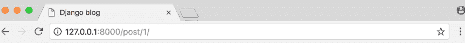

## Django 博客

## Hello world!

我的第一篇博客。呼！

## 博客文章详情

呼！你也可以去 `http://127.0.0.1:8000/post/2/` 查看第二个条目。

为了方便我们的生活，我们应该更新首页上的链接，这样我们就可以那里那里访问单个博客文章。目前在 `home.html` 中我们的链接是空的：`<a href="">` 将更新为 `<a href="">`。

## 代码

```html
<!-- templates/home.html -->







<div class="post-entry">

<h2><a href="">{{ post.title }}</a></h2>

<p>{{ post.body }}</p>

</div




```

我们首先告诉 Django 模板我们想要使用代码 `` 来引用一个 `URLConf`。哪一个 URL？名为 `post_detail` 的那个，也就是我们刚刚在 `URLConf` 中为 `BlogDetailView` 获取的名称。如果我们查看 `URLConf` 中的 `post_detail`，我们看到它期望接收一个参数 `pk`，代表博客文章的主键。幸运的是，Django 已经已经在我们的 `post` 对象上创建并包含了这个 `pk` 字段。我们通过在模板中添加 `post.pk` 将其传递给 `URLConf`。

为了确认一切运行正常，刷新 `http://127.0.0.1:8000/` 上的主页，并点击每篇博客文章的标题以确认新链接有效。

## 测试

我们现在需要测试我们的模型和视图了。我们希望确保 `Post` 模型按预期工作，包括它的字符串表示（str representation）。我们还想测试 `ListView` 和 `DetailView`。

这里是 `blog/tests.py` 中的示例测试所示。

## 代码

```python
## blog/tests.py

from django.contrib.auth import get_user_model

from django.test import Client, TestCase

from django.urls import reverse

from .models import Post

class BlogTests(TestCase):

    def setUp(self):

        self.user = get_user_model().objects.create(

            username='testuser',

            email='test@email.com',

            password='secret'

        )

        self.post = Post.objects.create(

            title='A good title',

            body='Nice body content',

            author=self.user,

        )

    def test_string_representation(self):

        post = Post(title='A sample title')

        self.assertEqual(str(post), post.title)
```

# 第 5 章：博客应用

## 124

```python
def test_post_content(self):

    self.assertEqual(f'{self.post.title}', 'A good title')

    self.assertEqual(f'{self.post.author}', 'tester')

    self.assertEqual(f'{self.post.body}', 'Nice body content')
```

```python
def test_post_list_view(self):

    response = self.client.get(reverse('home'))

    self.assertEqual(response.status_code, 200)

    self.assertContains(response, 'Nice body content')

    self.assertTemplateUsed(response, 'home.html')
```

```python
def test_post_detail_view(self):

    response = self.client.get('/post/1/')

    no_response = self.client.get('/post/100000/')

    self.assertEqual(response.status_code, 200)

    self.assertEqual(no_response.status_code, 404)

    self.assertContains(response, 'A good title')

    self.assertTemplateUsed(response, 'post_detail.html')
```

这些测试中有很多新内容，我们将慢慢讲解。在顶部，我们导入了 `get_user_model` 来引用我们的模型。在顶部，我们导入了 `get_user_model` 来引用我们的模型。在顶部，我们导入了 `get_user_model` 来引用我们的模型。在顶部，我们导入了 `get_user_model` 来引用我们的模型。在顶部，我们导入了 `get_user_model` 来引用我们的模型。在顶部，我们导入了 `get_user_model` 来引用我们的模型。在顶部，我们导入了 `get_user_model` 来引用我们的模型。在顶部，我们导入了 `get_user_model` 来引用我们的模型。在顶部，我们导入了 `get_user_model` 来引用我们的模型。在顶部，我们导入了 `get_user_model` 来引用我们的模型。在顶部，我们使用 `Client()` 进行测试。在顶部，我们导入了 `get_user_model` 来引用我们的模型。在顶部，我们导入了 `get_user_model` 来引用我们的模型。在顶部，我们导入了 `get_user_model` 来引用我们的模型。在顶部，我们导入了 `get_user_model` 来引用我们的模型。在顶部，我们导入了 `get_user_model` 来引用我们的模型。在顶部，我们导入了 `get_user_model` 来引用我们的模型。在顶部，我们导入了 `get_user_model` 来引用我们的模型。在顶部，我们导入了 `get_user_model` 来引用我们的模型。在顶部，我们导入了 `get_user_model` 来引用我们的模型。在顶部，我们导入了 `get_user_model` 来引用我们的模型。在顶部，我们导入了 `get_user_model` 来引用我们的模型。在顶部，我们导入了 `get_user_model` 来引用我们的模型。在顶部，我们导入了 `get_user_model` 来引用我们的模型。在顶部，我们导入了 `get_user_model` 来引用我们的模型。在顶部，我们导入了 `get_user_model` 来引用我们的模型。在顶部，我们导入了 `get_user_model` 来引用我们的模型。在顶部，我们导入了 `get_user_model` 来引用我们的模型。在顶部，我们导入了 `get_user_model` 来引用我们的模型。在顶部，我们导入了 `get_user_model` 来引用我们的模型。在顶部，我们导入了 `get_user_model` 来引用我们的模型。在顶部，我们导入了 `get_user_model` 来引用我们的模型。在顶部，我们导入了 `get_user_model` 来引用我们的模型。在顶部，我们导入了 `get_user_model` 来引用我们的模型。在顶部，我们导入了 `get_user_model` 来引用我们的模型。在顶部，我们导入了 `get_user_model` 来引用我们的模型。在顶部，我们使用 `Client()` 进行测试。在顶部，我们导入了 `get_user_model` 来引用我们的模型。在顶部，我们导入了 `get_user_model` 来引用我们的模型。在顶部，我们导入了 `get_user_model` 来引用我们的模型。在顶部，我们 测试。在顶部，我们导入了 `get_user_model` 来引用我们的模型。在顶部，我们导入了 `get_user_model` 来引用我们的模型。在顶部，我们导入了 `get_user_model` 来引用我们的模型。在顶部，我们导入了 `get_user_model` 来引用我们的模型。在顶部，我们导入了 `get_user_model` 来引用我们的模型。在顶部，我们导入了 `get_user_model` 来引用我们的模型。在顶部，我们导入了 `get_user_model` 来引用我们的模型。在顶部，我们导入了 `get_user_model` 来引用我们的模型。在顶部，我们导入了 `get_user_model` 来引用我们的模型。在顶部，我们导入了 `get_user_model` 来引用我们的模型。在顶部，我们导入了 `get_user_model` 来引用我们的模型。在顶部 测试。在顶部，我们导入了 `get_user_model` 来引用我们的模型。在顶部，我们导入了 `get_user_model` 来引用我们的模型。在顶部，我们导入了 `get_user_model` 来引用我们的模型。在顶部，我们导入了 `get_user_model` 来引用我们的模型。在顶部，我们导入了 `get_user_model` 来引用我们的模型。在顶部，我们导入了 `get_user_model` 来引用我们的模型。在顶部，我们导入了 `get_user_model` 来引用我们的模型。在顶部，我们导入了 `get_user_model` 来引用我们的模型。在顶部，我们导入了 `get_user_model` 来引用我们的模型。在顶部，我们导入了 `get_user_model` 来引用我们的模型。在顶部，我们导入了 `get_user_model` 来引用我们的模型。在顶部，我们导入了 `get_user_model` 来引用我们的模型。在顶部，我们导入了 `get_user_model` 来引用我们的模型。在顶部，我们导入了 `get_user_model` 来引用我们的模型。在顶部，我们导入了 `get_user_model` 来引用我们的模型。在顶部，我们导入了 `get_user_model` 来引用我们的模型。在顶部，我们导入了 `get_user_model` 来引用我们的模型。在顶部，我们 

。

我们首先告诉 Django 模板我们想要使用代码 `` 来引用一个 `URLConf`。哪一个 URL？名为 `post_detail` 的那个，也就是我们刚刚在 `URLConf` 中为 `BlogDetailView` 获取的名称。如果我们查看 `URLConf` 中的 `post_detail`，我们看到它期望接收一个参数 `pk`，代表博客文章的主键。幸运的是，Django 已经在我们的 `post` 对象上创建并包含了这个 `pk` 字段。我们通过在模板中添加 `post.pk` 将其传递给 `URLConf`。

为了确认一切运行正常，刷新 `http://127.0.0.1:8000/` 上的主页，并点击每篇博客文章的标题以确认新链接有效。

## 测试

我们现在需要测试我们的模型和视图了。我们希望确保 `Post` 模型按预期工作，包括它的字符串表示（str representation）。我们还想测试 `ListView` 和 `DetailView`。

这里是 `blog/tests.py` 中的示例测试所示。

## 代码

```python
## blog/tests.py

from django.contrib.auth import get_user_model

from django.test import Client, TestCase

from django.urls import reverse

from .models import Post

class BlogTests(TestCase):

    def setUp(self):

        self.user = get_user_model().objects.create(

            username='testuser',

            email='test@email.com',
```


# 第 5 章：博客应用

```python
def test_post_content(self):
    self.assertEqual(f'{self.post.title}', 'A good title')
    self.assertEqual(f'{self.post.author}', 'tester')
    self.assertEqual(f'{self.post.body}', 'Nice body content')
```

```python
def test_post_list_view(self):
    response = self.client.get(reverse('home'))
    self.assertEqual(response.status_code, 200)
    self.assertContains(response, 'Nice body content')
    self.assertTemplateUsed(response, 'home.html')
```

```python
def test_post_detail_view(self):
    response = self.client.get('/post/1/')
    no_response = self.client.get('/post/100000/')
    self.assertEqual(response.status_code, 200)
    self.assertEqual(no_response.status_code, 404)
    self.assertContains(response, 'A good title')
    self.assertTemplateUsed(response, 'post_detail.html')
```

这些测试中有很多新内容，我们将慢慢讲解。在顶部，我们导入了 `get_user_model` 来引用我们的模型。在顶部，我们使用 `Client()` 进行测试。在顶部，我们导入了 `get_user_model` 来引用我们的模型。在顶部，我们导入了 `get_user_model` 来引用我们的模型。在顶部，我们导入了 `get_user_model` 来引用我们的模型。在顶部，我们导入了 `get_user_model` 来引用我们的模型。在顶部，我们导入了 `get_user_model` 来引用我们的模型。在顶部，我们导入了 `get_user_model` 来引用我们的模型。在顶部，我们导入了 `get_user_model` 来引用我们的模型。在顶部，我们导入了 `get_user_model` 来引用我们的模型。在顶部，我们导入了 `get_user_model` 来引用我们的模型。在顶部，我们导入了 `get_user_model` 来引用我们的模型。在顶部，我们导入了 `get_user_model` 来引用我们的模型。在顶部，我们导入了 `get_user_model` 来引用我们的模型。在顶部，我们导入了 `get_user_model` 来引用我们的模型。在顶部，我们导入了 `get_user_model` 来引用我们的模型。在顶部，我们导入了 `get_user_model` 来引用我们的模型。在顶部，我们导入了 `get_user_model` 来引用我们的模型。在顶部，我们导入了 `get_user_model` 来引用我们的模型。在顶部，我们导入了 `get_user_model` 来引用我们的模型。在顶部，我们导入了 `get_user_model` 来引用我们的模型。在顶部，我们导入了 `get_user_model` 来引用我们的模型。在顶部，我们导入了 `get_user_model` 来引用我们的模型。在顶部，我们导入了 `get_user_model` 来引用我们的模型。在顶部，我们导入了 `get_user_model` 来引用我们的模型。在顶部，我们导入了 `get_user_model` 来引用我们的模型。在顶部，我们导入了 `get_user_model` 来引用我们的模型。在顶部，我们导入了 `get_user_model` 来引用我们的模型。在顶部，我们导入了 `get_user_model` 来引用我们的模型。在顶部，我们导入了 `get_user_model` 来引用我们的模型。在顶部，我们导入了 `get_user_model` 来引用我们的模型。在顶部，我们导入了 `get_user_model` 来引用我们的模型。在顶部，我们导入了 `get_user_model` 来引用我们的模型。在顶部，我们导入了 `get_user_model` 来引用我们的模型。在顶部，我们导入了 `get_user_model` 来引用我们的模型。在顶部，我们导入了 `get_user_model` 来引用我们的模型。在顶部，我们导入了 `get_user_model` 来引用我们的模型。在顶部，我们导入了 `get_user_model` 来引用我们的模型。在顶部，我们导入了 `get_user_model` 来引用我们的模型。在顶部，我们导入了 `get_user_model` 来引用我们的模型。在顶部，我们导入了 `get_user_model` 来引用我们的模型。在顶部，我们导入了 `get_user_model` 来引用我们的模型。在顶部，我们导入了 `get_user_model` 来引用我们的模型。在顶部，我们导入了 `get_user_model` 来引用我们的模型。在顶部，我们导入了 `get_user_model` 来引用我们的模型。在顶部，我们导入了 `get_user_model` 来引用我们的模型。在顶部，我们导入了 `get_user_model` 来引用我们的模型。在顶部，我们导入了 `get_user_model` 来引用我们的模型。在顶部，我们导入了 `get_user_model` 来引用我们的模型。在顶部，我们导入了 `get_user_model` 来引用我们的模型。在顶部，我们 导入。在顶部，我们导入了 `get_user_model` 来引用我们的模型。在顶部，我们导入了 `get_user_model` 来引用我们的模型。在顶部，我们导入了 `get_user_model` 来引用我们的模型。在顶部，我们导入了 `get_user_model` 来引用我们的模型。在顶部，我们导入了 `get_user_model` 来引用我们的模型。在顶部，我们导入了 `get_user_model` 来引用我们的模型。在顶部，我们导入了 `get_user_model` 来引用我们的模型。在顶部，我们导入了 `get_user_model` 来引用我们的模型。在顶部，我们导入了 `get_user_model` 来引用我们的模型。在顶部，我们导入了 `get_user_model` 来引用我们的模型。在顶部，我们导入了 `get_user_model` 来引用我们的模型。在顶部，我们导入了 `get_user_model` 来引用我们的模型。在顶部，我们导入了 `get_user_model` 来引用我们的模型。在顶部，我们导入了 `get_user_model` 来引用我们的模型。在顶部，我们导入了 `get_user_model` 来引用我们的模型。在顶部，我们导入了 `get_user_model` 来引用我们的模型。在顶部，我们导入了 `get_user_model` 来引用我们的模型。在顶部，我们导入了 `get_user_model` 来引用我们的模型。在顶部，我们导入了 `get_user_model` 来引用我们的模型。在顶部，我们导入了 `get_user_model` 来引用我们的模型。在顶部，我们导入了 `get_user_model` 来引用我们的模型。在顶部，我们导入了 `get_user_model` 来引用我们的模型。在顶部，我们导入了 `get_user_model` 来引用我们的模型。在顶部，我们导入了 `get_user_model` 来引用我们的模型。在顶部，我们导入了 `get_user_model` 来引用我们的模型。在顶部，我们导入了 `get_user_model` 来引用我们的模型。在顶部，我们导入了 `get_user_model` 来引用我们的模型。在顶部，我们导入了 `get_user_model` 来引用我们的模型。在顶部，我们导入了 `get_user_model` 来引用我们的模型。在顶部，我们导入了 `get_user_model` 来引用我们的模型。在顶部，我们导入了 `get_user_model` 来引用我们的模型。在顶部，我们导入了 `get_user_model` 来引用我们的模型。在顶部，我们导入了 `get_user_model` 来引用我们的模型。在顶部，我们导入了 `get_user_model` 来引用我们的模型。在顶部，我们导入了 `get_user_model` 来引用我们的模型。在顶部，我们导入了 `get_user_model` 来引用_model。 来引用我们的模型。在顶部，我们导入了 `get_user_model` 来引用我们的模型。在顶部，我们导入了 `get_user_model` 来引用我们的模型。在顶部，我们导入了 `get_user_model` 来引用我们的模型。在顶部，我们导入了 `get_user_model` 来引用我们的模型。在顶部，我们导入了 `get_user_model` 来引用我们的模型。在顶部，我们导入了 `get_user_model` 来引用我们的模型。在顶部，我们导入了 `get_user_model` 来引用我们的模型。在顶部，我们导入了 `get_user_model` 来引用我们的模型。在顶部，我们导入了 `get_user_model` 来引用我们的模型。在顶部，我们导入了 `get_user_model` 来引用我们的模型。在顶部，我们导入了 `get_user_model` 来引用我们的模型。在顶部，我们导入了 `get_user_model` 来引用我们的模型。在顶部，我们导入了 `get_user_model` 来引用我们的模型。在顶部，我们导入了 `get_user_model` 来引用我们的模型。在顶部，我们导入了 `get_user_model` 来引用我们的模型。在顶部，我们导入了 `get_user_model` 来引用我们的模型。在顶部，我们导入了 `get_user_model` 来引用我们的模型。在顶部，我们导入了 `get_user_model` 来引用我们的模型。在顶部，我们导入了 `get_user_model` 来引用我们的模型。在顶部，我们导入了 `get_user_model` 来引用我们的模型。在顶部，我们导入了 `get_user_model` 来引用我们的模型。在顶部，我们导入了 `get_user_model` 来引用我们的模型。在顶部，我们导入了 `get_user_model` 来引用我们的模型。在顶部，我们 导入。模型。在顶部，我们导入了 `get_user_model` 来引用我们的模型。在顶部，我们导入了 `get_user_model` 来引用我们的模型。在顶部，我们导入了 `get_user_model` 来引用我们的模型。在顶部，我们导入了 `get_user_model` 来引用我们的模型。在顶部，我们导入了 `get_user_model` 来引用我们的模型。在顶部，我们导入了 `get_user_model` 来引用我们的模型。在顶部，我们导入了 `get_user_model` 来引用我们的模型。在顶部，我们导入了 `get_user_model` 来引用我们的模型。在顶部，我们导入了 `get_user_model` 来引用我们的模型。在顶部，我们导入了 `get_user_model` 来引用我们的模型。在顶部，我们导入了 `get_user_model` 来引用我们的模型。在顶部，我们导入了 `get_user_model` 来引用我们的模型。

```python
class BlogDetailView(DetailView):
    model = Post
    template_name = 'post_detail.html'
```

```python
class BlogCreateView(CreateView):
    model = Post
    template_name = 'post_new.html'
    fields = '__all__'
```

在 `BlogCreateView` 中，我们指定了数据库模型 `Post`、模板名称 `post_new.html` 以及使用 `__all__` 指定所有字段，因为我们只有两个：标题和作者。

最后一步是创建我们的模板，将其命名为 `post_new.html`。

## 命令行

```
(blog) $ touch templates/post_new.html
```

然后添加以下代码：

# 第 6 章：表单

# 代码

```html
<!-- templates/post_new.html -->


<h1>New post</h1>
<form action="" method="post">
{{ form.as_p }}
<input type="submit" value="Save" />
</form>

```

让我们分解一下我们所做的工作：

- 在第一行继承了我们的基础模板。
- 使用 HTML `<form>` 标签和 `POST` 方法，因为我们正在发送数据。如果我们从表单接收数据（例如在搜索框中），我们将使用 `GET`。
- 添加 ``，这是 Django 提供的保护表单免受跨站脚本攻击的。**你应该在所有的 Django 表单中使用它。**
- 然后我们使用 `{{ form.as_p }}` 输出数据，它会在段落 `<p>` 标签内渲染数据。
- 最后指定输入类型为 `submit` 并为其赋值值 "Save"。

要查看我们的工作，请运行 `python manage.py runserver` 启动服务器，并访问首页 http://127.0.0.1:8000`。

# 第 6 章：表单

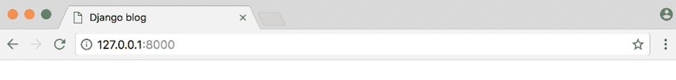

# Django 博客

- 新博客文章

## Hello world!

我的第一篇博客文章。万岁！

## 今日目标

学习 Django 并构建一个博客应用。

带有 New 按钮的首页

点击“+ New Blog Post”链接，它将把你重定向到：

http://127.0.0.1:8000/post/new/

# Django 博客

# New post

作者：---------

标题：

正文：

保存

## 博客新页面

去尝试创建一个新的博客文章并提交它。

# Django 博客

# New post

作者： wsv

标题： 3rd post

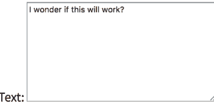

正文：

保存

## 博客新页面

哎！发生了什么？

# 第 6 章：表单

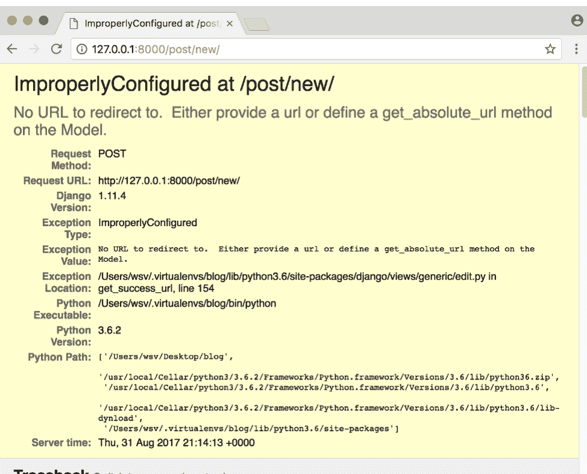

## 博客新页面

Django 的错误信息非常有帮助。它在抱怨我们没有指定成功提交表单后将用户重定向到哪里。让我们在成功后将用户发送到详情；这样他们就可以看到他们完成的帖子。

我们可以遵循 Django 的建议，在模型中添加 `get_absolute_url`。这是你应该始终做的最佳实践。它为对象设置了规范 URL，即使将来你的 URL 结构发生变化，对该特定对象的引用也是相同的。简而言之，你应该为每个模型添加 `get_absolute_url()` 和 `__str__()`。

# 第 6 章：表单

打开 `models.py` 文件。在第二行添加 `reverse` 的导入以及新的 `get_absolute_url`。

## 命令行

```python
## models.py
from django.db import models
from django.urls import reverse
```

```python
class Post(models.Model):
    title = models.CharField(max_length=200)
    author = models.ForeignKey(
        'auth.User',
        on_delete=models.CASCADE
    )
    body = models.TextField()
    def __str__(self):
        return self.title
```

```python
def get_absolute_url(self):
    return reverse('post_detail', args=[self.id])
```


`reverse` 是 Django 提供的一个非常实用的函数，允许我们通过 URL 名称引用对象，在这种情况下是 `post_detail`。如果你还记得我们的 URL 模式如下：

```python
path('post/<int:pk>/', views.DetailView.as_view(), name='post_detail'),
```

这意味着为了让此路由生效，我们必须传递一个带有 `pk` 或对象主键的参数。虽然 `pk` 和 `id` 是可以交换的，但 Django 建议在 `get_absolute_url` 中使用 `self.id`。所以我们是在告诉 Django，Post 条目的最终位置是 `posts/<pk>/`，因此我们创建的第一个条目的路由将是 `posts/1`。

在`http://127.0.0.1:8000/post/new/`尝试创建一个新的博客文章，你会发现除非被重定向到显示帖子的详情视图。

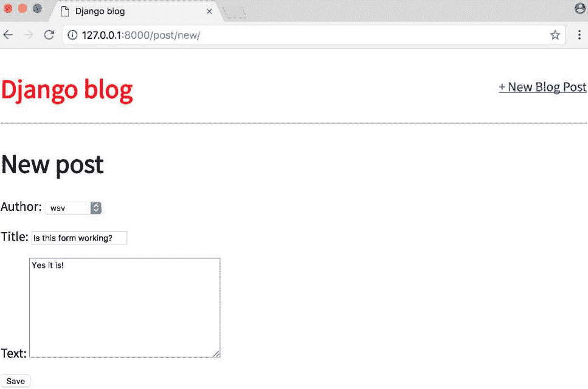

# Django 博客

- 新博客文章

## New post

作者：wsv

标题：is this form working?

正文：

保存

带有输入内容的博客新页面

# 第 6 章：表单

你还会注意到我们之前的博客文章也在那里。它已成功发送到数据库，但 Django 并不知道在之后该如何重定向我们。

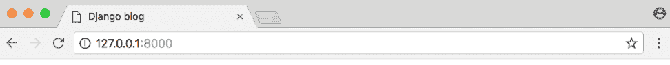

# Django 博客

- 新博客文章

## Hello world!

我的第一篇博客文章。万岁！

## 今日目标

学习 Django 并构建一个博客应用。

## 3rd post

我想知道这行得通吗？

## Is this form working?

是的，可以的！

带有帖子的博客首页

虽然我们可以进入 Django 管理后台删除不需要的帖子，但添加表单会更好，这样用户就可以从网站直接更新和删除帖子。

## 更新表单

创建更新表单以便用户编辑博客文章的过程应该看起来很熟悉。我们需要添加表单，以便用户可以直接从网站上更新和删除帖子。

为了让用户可以编辑博客文章，创建更新表单的过程应该很熟悉。我们需要添加表单，以便用户可以直接从网站上更新和删除帖子。

我们需要使用`post_detail.html`。

## 代码

```html
<!-- templates/post_detail.html -->





<h1>New post</h1>

<form action="" method="post">

{{ form.as_p }}

<input type="submit" value="Save" />

</form>
```

我们使用了`post_edit`链接。

接下来我们创建编辑页面的模板`post_edit.html`。

## 命令行

```bash
(blog) $ touch templates/post_edit.html
```

并添加以下代码：

## 代码

```html
<!-- templates/post_edit.html -->





<h1>Edit post</h1>

<form action="" method="post">

  {{ form.as_p }}

  input type="submit" value="Update" />

</form>


```

我们再次使用了`<form>`标签，Django 的`csrf_token`用于安全，`form.as_p`显示我们的表单字段，最后在提交按钮上赋予它值"Update"。

现在回到我们的视图。我们需要在从顶部开始的第二行导入`UpdateView`，然后在新视图中对其进行类化。

## 代码

```python
# blog/views.py

from django.views.generic import ListView, DetailView
from django.views.generic.edit import CreateView, UpdateView
from .models import Post
```

```python
class BlogListView(ListView):
    model = Post
    template_name = 'home.html'
```

```python
class BlogDetailView(DetailView):
    model = Post
    template_name = 'post_detail.html'
```

```python
class BlogCreateView(CreateView):
    model = Post
    template_name = 'post_new.html'
    fields = '__all__'
```

```python
class BlogUpdateView(UpdateView):
    model = Post
    fields = ['title', 'body']
    template_name = 'post_edit.html'
```

注意在`BlogViews`中，我们显式列出了想要使用的字段`['title', 'body']`而不是使用`__all__`。这是因为我们假设帖子的作者不会改变；我们只想让标题和正文可编辑。

最后一步按照如下更新我们的`urls.py`文件：

## 代码

```python
# urls.py

from django.urls import path
from . import views

urlpatterns = [
    path('', views.BlogListView.as_view(), name='home'),
    path('/post/<int:pk>/', views.BlogDetailView.as_view(), name='post_detail'),
    path('/post/new/', views.BlogCreateView.as_view(), name='post_new'),
    path('/post/<int:pk>/edit/', views.BlogUpdateView.as_view(), name='post_edit'),
]
```

在顶部，我们将`BlogUpdate`添加到导入的视图列表中，然后为`/post/<pk>/edit/`创建了一个新的 URL 模式并将其命名为`post_edit`。

如果你点击博客条目，你会看到我们新的 Edit 按钮。

如果你点击“+ Edit Blog Post”，如果是你的第一篇博客，你将被重定向到`http://127.0.0.1:8000/post/1/edit/`。

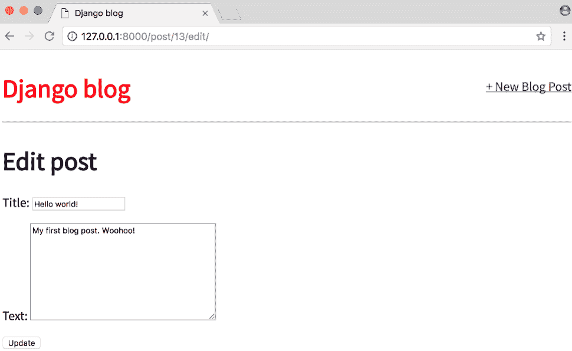

## 编辑文章

标题：Hello world!

正文：我的第一篇博客。万岁！

更新

## 博客编辑页面

注意，表单已填充了我们数据库中该文章的现有数据。让我们做些更改吧……

# Django 博客

## 编辑文章

标题：Hello world!（已编辑）

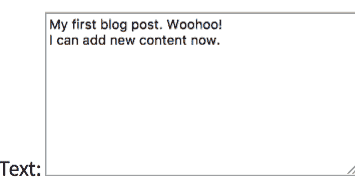

正文：

更新

## 博客编辑页面

点击“Update”按钮后，我们被重定向到文章的详情视图，你可以在那里看到更改。这是因为我们设置了`get_absolute_url`。导航到首页，你可以在所有其他条目旁边看到更改。

# Django 博客

## Hello world!（已编辑）

我的第一篇博客。万岁！我现在可以添加新内容了。

## 今日目标

学习 Django 并构建一个博客应用程序。

## 第 3 篇文章

我想知道这行得通吗？

## 这个表单有效吗？

是的，有效！

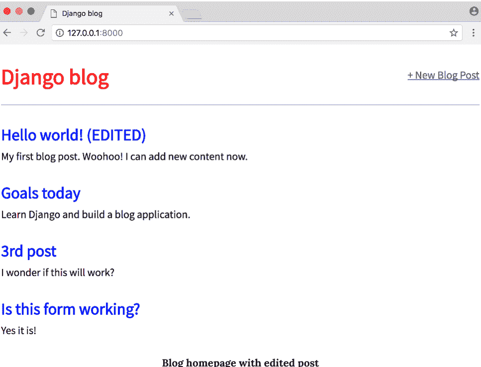

# 删除视图

创建删除博客表单的过程与更新文章的过程非常相似。我们将使用另一个通用视图`DeleteView`来帮助，并需要为该功能创建一个视图、URL 和模板。

让我们首先在我们的单个博客页面`post_detail.html`上添加一个删除博客的链接。

## 代码

```html
<!-- templates/post_detail.html -->





<div class="post-entry">

  <h2>{{ object.title }}</h2>

  <p>{{ object.body }}</p>

</div>

<p><a href="">Edit Blog Post</a></p>
<p><a href="">Delete Blog Post</a></p>


```

然后为我们的删除页面模板创建一个新文件。首先通过`Control-c`退出本地服务器，然后输入以下命令：

## 命令行

```bash
(blog) $ touch templates/post_delete.html
```

并从中填入以下代码：

## 代码

```html
<!-- templates/post_delete.html -->





<h1>删除文章</h1>

<form action="" method="post">

<p>你确定要删除“{{ post.title }}”吗？</p>

<input type="submit" value="Confirm" />

</form>


```

我们在这里使用`post.title`来显示我们博客文章的标题。我们也可以直接使用`object.title`，因为它也是由`DetailView`提供的。

现在更新我们的`views.py`文件，在顶部导入`DeleteView`和`reverse_lazy`，然后创建一个子类为`DeleteView`的新视图。

## 代码

```python
# blog/views.py

from django.views.generic import ListView, DetailView
from django.views.generic.edit import CreateView, UpdateView, DeleteView
from django.urls import reverse_lazy

from models import Post

class BlogListView(ListView):
    model = Post
    template_name = 'home.html'
```

```python
class BlogDetailView(DetailView):
    model = Post
    template_name = 'post_detail.html'
```

```python
class BlogCreateView(CreateView):
    model = Post
    template_name = 'post_new.html'
    fields = ['title', 'body']
```

```python
class BlogUpdateView(UpdateView):
    model = Post
    fields = ['title', 'body']
    template_name = 'post_edit.html'
```

```python
class BlogDeleteView(DeleteView):
    model = Post
    template_name = 'post_delete.html'
    success_url = reverse_lazy('home')
```

我们使用`reverse_lazy`而不是`reverse`，是为了在视图完成删除博客之前不重定向 URL。

最后通过导入我们的视图`BlogDeleteView`并添加新模式：

## 代码

```python
# blog/urls.py

from django.urls import path
from . import views

urlpatterns = [
    path('', views.BlogListView.as_view(), name='home'),
    path('post/<int:pk>/', views.BlogDetailView.as_view(), name='post_detail'),
    path('post/new/', views.BlogCreateView.as_view(), name='post_new'),
    path('post/<int:pk>/edit/', views.BlogUpdateView.as_view(), name='post_edit'),
    path('post/<int:pk>/delete/', views.BlogDeleteView.as_view(), name='post_delete'),
]
```

如果你再次启动`python manage.py runserver`并刷新文章页面，你会看到我们的“Delete Post”链接。

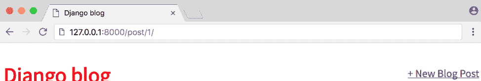

# 第 6 章：表单

# Django 博客

## Hello world!（已编辑）

我的第一篇博客。万岁！我现在可以添加新内容了。

## 今日目标

学习 Django 并构建一个博客应用程序。

## 第 3 篇文章

我想知道这行得通吗？

## 这个表单有效吗？

是的，有效！

# 删除视图

创建删除博客表单的过程与更新文章的过程非常相似。我们将使用另一个通用视图`DeleteView`来帮助，并需要为该功能创建一个视图、URL 和模板。

让我们首先在我们的单个博客页面`post_detail.html`上添加一个删除博客的链接。

## 代码

```python
# ... (上方已处理逻辑) ...
```

点击链接将我们带到博客删除页面，该页面显示博客名称。

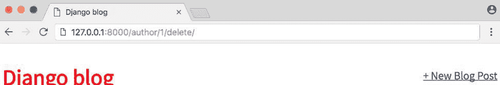

点击“Confirm”按钮，它会将你重定向到首页，此时博客已被删除！

## 今日目标

学习 Django 并构建一个博客应用程序。

## 第 3 篇文章

我想知道这行得通吗？

## 这个表单有效吗？

是的，有效！

## 测试

是时候通过测试来确保以后一切正常了。我们在模型中添加了`get_absolute_url`方法，并为创建、更新和编辑增加了视图。这意味着我们需要四个测试：

如下所示更新你的`tests.py`文件：

## 代码


```python
## blog/tests.py
from django.contrib.auth import get_user_model
from django.test import Client, TestCase
from django.urls import reverse
from .models import Post

class BlogTests(TestCase):
    def setUp(self):
        self.user = get_user_model().objects.create(
            username='testuser',
            email='test@email.com',
            password='secret'
        )
        self.post = Post.objects.create(
            title='A good title',
            body='Nice body content',
            author=self.user,
        )

    def test_string_representation(self):
        post = Post(title='A sample title')
        self.assertEqual(str(post), post.title)

    def test_get_absolute_url(self):
        self.assertEqual(self.post.get_absolute_url(), '/post/1/')

    def test_post_content(self):
        self.assertEqual(self.post.title, 'A good title')
        self.assertEqual(self.post.author, 'testuser')
        self.assertEqual(self.post.body, 'Nice body content')

    def test_post_list_view(self):
        response = self.client.get(reverse('home'))
        self.assertEqual(response.status_code, 200)
        self.assertContains(response, 'Nice body content')
        self.assertTemplateUsed(response, 'home.html')

    def test_post_detail_view(self):
        response = self.client.get('/post/1/')
        no_response = self.client.get('/post/100000/')
        self.assertEqual(response.status_code, 200)
        self.assertEqual(no_response.status_code, 404)
        self.assertContains(response, 'A good title')
        self.assertTemplateUsed(response, 'post_detail.html')

    def test_post_create_view(self):
        response = self.client.post(reverse('post_new'), {
            'title': 'New title',
            'body': 'New text',
            'author': self.user,
        })
        self.assertEqual(response.status_code, 200)
        self.assertContains(response, 'New title')
        self.assertContains(response, 'New text')

    def test_post_update_view(self):
        response = self.client.post(reverse('post_edit'), args='1', {
            'title': 'Updated title',
            'body': 'Updated text',
        })
        self.assertEqual(response.status_code, 302)

    def test_post_delete_view(self):
        response = self.client.get(
            reverse('post_delete'), args='1'))
        self.assertEqual(response.status_code, 200)
```

我们预计测试的 URL 应该是 `post/1/`，因为只有一个文章，且 `1` 是 Django 自动为我们添加的主键。

始终可以添加更多的测试，但这些至少覆盖了我们所有的新功能。

## 结论

通过少量的代码，我们构建了一个博客应用程序，允许创建、读取、更新和删除博客文章。这一核心功能被称为 CRUD：创建（Create）、读取（Read）、更新（Update）和删除（Delete）。虽然有多种方法可以实现相同的功能——我们可以使用基于函数的视图，或者编写自己的类视图——但我们展示了在 Django 中实现这些功能需要多少的代码。

在下一章中，我们将添加用户账户以及登录、注销和注册功能。

# 第 7 章：用户账户

到为止，我们已经构建了一个使用表单的运行博客应用程序，但我们缺少了大多数 Web 应用的一个重要部分：用户身份验证。

实现正确的用户身份验证是众周知的难题；过程中有很多安全陷阱，所以你真的不想自己实现它。幸运的是，Django 自带了一个强大的内置用户身份验证系统供我们使用。

每当你创建一个新项目时，Django 默认会安装 `auth` 应用，它为我们提供了一个包含以下内容的 `User` 对象：

- 用户名 (`username`)
- 密码 (`password`)
- 邮箱 (`email`)
- 名字 (`first_name`)
- 姓 (`last_name`)

我们将使用这个 `User` 对象在我们的博客应用程序中实现登录、注销和注册。

## 登录

Django 通过 `LoginView` 为我们提供了默认的登录页面视图。我们只需要为 `auth` 系统添加一个项目级的 `url` 模式、一个登录模板，以及对我们的 `settings.py` 文件进行微小的更新。

首先更新项目级的 `urls.py` 文件。我们将登录和注销页面放置在 `accounts/` URL 下。这是在倒数第二行添加的一行代码。

```python
## blog_project/urls.py
from django.contrib import admin
from django.urls import path, include

urlpatterns = [
    path('admin/', admin.site.urls),
    path('accounts/', include('django.contrib.auth.urls')),
    path('', include('blog.urls')),
]
```

`LoginView` 文档指出，默认情况下，Django 会在名为 `registration` 的模板文件夹中查找名为 `login.html` 的文件作为登录表单。因此，我们需要创建一个名为 `registration` 的目录并在其中创建所需的文件。在命令行输入 `control-C` 退出我们的本地服务器。然后输入以下内容：

```bash
(blog) $ mkdir templates/registration
(blog) $ touch templates/registration/login.html
```

现在为新创建的文件输入以下模板代码。

```html
<!-- templates/registration/login.html -->



<h2>Login</h2>
<form method="post">
  
  {{ form.as_p }}
  <button type="submit">Login</button>
</form>

```

我们正在使用 HTML `<form>` 标签并指定 `POST` 方法，因为我们正在向服务器发送数据（如果我们是在请求数据，例如在搜索引擎中，我们将使用 `GET`）。出于安全考虑，我们添加了 ``，即防止 XSS 攻击。表单的内容将通过 `{{ form.as_p }}` 输出在段落标签 `<p>` 之间，我们添加了一个“提交”按钮。

最后一步是指定用户登录成功后重定向到哪里。我们可以通过 `LOGIN_REDIRECT_URL` 设置来实现此。在 `settings.py` 文件的底部添加以下内容：

```python
## settings.py
LOGIN_REDIRECT_URL = 'home'
```

现在用户将被重定向到 `'home'` 模板，也就是我们的首页。

到此我们实际上完成了！如果你现在再次用 `python manage.py runserver` 启动 Django 服务器并导航到我们的登录页面：

## http://127.0.0.1:8000/accounts/login/

你将看到以下内容：

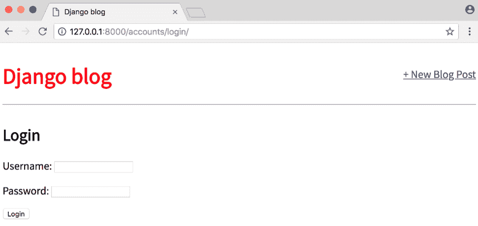

# Django 博客

## 登录

用户名:

密码:

[登录]

## 登录页面

输入管理员账户的登录信息后，我们被重定向到了首页。注意，我们没有添加任何视图逻辑或创建数据库模型，因为 Django `auth` 系统自动为我们提供了这两者。感谢 Django！

## 更新后的首页

让我们更新 `base.html` 模板，以便根据用户是否登录向其显示消息。我们可以使用 `is_authenticated` 属性来实现。

目前，我们可以简单地将此代码放在显眼位置。稍后我们可以进行更适当的样式处理。更新 `base.html` 文件，在 `</header>` 标签下方添加新代码。

```html
<!-- templates/base.html -->
...
</header>

<p>Hi {{ user.username }}</p>

<p>You are not logged in.</p>
<a href="">login</a>



```

如果用户已登录，我们会通过他们的名字向他们打招呼；如果没有登录，我们会提供一个指向新创建的登录页面的链接。

# Django 博客

Hi wsv!

# 今日目标

学习 Django 并构建一个博客应用程序。

# 第 3 篇文章

我想知道这能行吗？

# 这个表单能工作吗？

是的，有效的！

# 已登录的首页

成功了！我的管理员用户名是 `wsv`，所以这就是我在页面上看到的。

## 注销链接

我们为已登录用户添加了注销链接。注意我们没有添加任何视图逻辑或创建数据库模型，因为 Django `auth` 系统自动为我们提供了这两者。感谢 Django！


我们为已登录用户添加了注销链接。注意我们没有添加任何视图逻辑或创建数据库模型，因为 Django auth 系统自动为我们提供了这两者。感谢 Django！

# 注销

我们为已登录用户添加了注销链接。注意我们没有添加任何视图逻辑或创建数据库模型，因为 Django auth 系统自动为我们提供了这两者。感谢 Django！

# 注销

我们为已登录用户添加了注销链接。注意我们没有添加任何视图逻辑或创建数据库模型，因为 Django auth 系统自动为我们提供了这两者。感谢 Django！

# 注销

我们为已登录用户添加了注销链接。注意我们没有添加任何视图逻辑或创建数据库模型，因为 Django auth 系统自动为我们提供了这两者。感谢 Django！

# 注销

我们为已登录用户添加了注销链接。注意我们没有添加任何视图逻辑或创建数据库模型，因为 Django auth 系统自动为我们提供了这两者。感谢 Django！

# 注销

我们为已登录用户添加了注销链接。注意我们没有添加任何视图逻辑或创建数据库模型，因为 Django auth 系统自动为我们提供了这两者。感谢 Django！

# 注销

我们为已登录用户添加了注销链接。注意我们没有添加任何视图逻辑或创建数据库模型，因为 Django auth 系统自动为我们提供了这两者。感谢 Django！

# 注销

我们为已登录用户添加了注销链接。注意我们没有添加任何视图逻辑或创建数据库模型，因为 Django auth 系统自动为我们提供了这两者。感谢 Django！

# 注销

我们为已登录用户添加了注销链接。注意我们没有添加任何视图逻辑或创建数据库模型，因为 Django auth 系统自动为我们提供了这两者。感谢 Django！

# 注销

我们为已登录用户添加了注销链接。注意我们没有添加任何视图逻辑或创建数据库模型，因为 Django auth 系统自动为我们提供了这两者。感谢 Django！

# 注销

我们为已登录用户添加了注销链接。注意我们没有添加任何视图逻辑或创建数据库模型，因为 Django auth 系统自动为我们提供了这两者。感谢 Django！

# 注销

我们为已登录用户添加了注销链接。注意我们没有添加任何视图逻辑或创建数据库模型，因为 Django auth 系统自动为我们提供了这两者。感谢 Django！

# 注销

我们为已登录用户添加了注销链接。注意我们没有添加任何视图逻辑或创建数据库模型，因为 Django auth 系统自动为我们提供了这两者。感谢 Django！

# 注销

我们为已登录用户添加了注销链接。注意我们没有添加任何视图逻辑或创建数据库模型，因为 Django auth 系统自动为我们提供了这两者。感谢 Django！

# 注销

我们为已登录用户添加了注销链接。注意我们没有添加任何视图逻辑或创建数据库模型，因为 Django auth 系统自动为我们提供了这两者。感谢 Django！

# 注销

我们为已登录用户添加了注销链接。注意我们没有添加任何视图逻辑或创建数据库模型，因为 Django auth 系统自动为我们提供了这两者。感谢 Django！

# 注销

我们为已登录用户添加了注销链接。注意我们没有添加任何视图逻辑或创建数据库模型，因为 Django auth 系统自动为我们提供了这两者。感谢 Django！

## 注册

我们需要，我们需要注册用户页面，， Django ，，我们，，，，逻辑或， Django模型，因为 Django auth  ，我们提供了密码、密码密码密码 密码。

## 注册

我们需要为注册页面编写自己的视图，但 Django 为我们提供了 `UserCreationForm` 类来让事情变得简单。默认情况下它带有三个字段：用户名、密码和密码。

为了健壮的用户身份验证系统，有许多组织代码和 URL 结构的方法。在这里我们将为注册页面创建一个专用应用程序，`accounts`。

## 命令行

```bash
(blog) $ python manage.py startapp accounts
```

将新应用添加到 `settings.py` 中的 `INSTALLED_APPS` 设置中。

## 代码

```python
## blog_project/settings.py
INSTALLED_APPS = [
    'django.contrib.admin',
    'django.contrib.auth',
    'django.contrib.contenttypes',
    'django.contrib.sessions',
    'django.contrib.messages',
    'django.contrib.staticfiles',
    'blog',
    'accounts'
]
```

接下来在包含内置 auth 应用的下方，为我们添加一个指向该新应用的项目级 URL 模式。

## 代码

```python
## blog_project/urls.py
from django.contrib import admin
from django.urls import path, include

urlpatterns = [
    path('admin/', admin.site.urls),
    path('accounts/', include('django.contrib.auth.urls')),
    path('accounts/', include('accounts.urls')),
    path('', include('blog.urls')),
]
```

我们的 URL 顺序在这里很重要，因为 Django 从上到下读取此文件。因此，当我们请求 `/accounts/signup` URL 时，Django 将首先在 auth 中查找，未找到，然后转向 accounts 应用。

让我们创建 `accounts/urls.py` 文件。

## 命令行

```bash
(blog) $ touch accounts/urls.py
```

并添加以下代码：

# 第 7 章：用户账户

## 代码

```python
## accounts/urls.py

from django.urls import path
```

```python
from . import views

urlpatterns = [

path('signup/', views.SignUpView.as_view(), name='signup'),
]
```

我们正在使用一个尚未创建的视图 `SearchView`，由于它是大字母大写且带有 `as_view()` 后缀，我们已经知道它是类视图。它的路径是 `signup/`，因此整个路径为 `accounts/signup`。

现在处理使用内置 `UserCreationForm` 和通用 `CreateView` 的视图。

## 代码

```python
## accounts/views.py

from django.contrib.auth.forms import UserCreationForm

from django.urls import reverse_lazy

from django.views import generic
```

```python
class SignUp(generic.CreateView):

    form_class = UserCreationForm

    success_url = reverse_lazy('login')

    template_name = 'signup.html'
```

我们在 `SignUp` 类中对通用类视图 `createView` 进行了子类化。我们指定了内置的 `UserCreationForm` 以及在 `signup.html` 中尚未创建的模板。我们使用 `reverse_lazy` 在注册成功后将用户重定向到登录页面。

为什么要使用 `reverse_lazy` 而不是 `reverse`？原因是对于所有类视图，URL 在文件被导入时还没有加载，因此我们必须使用 `reverse` 的懒性形式，在它们可用时加载它们。

现在让我们在项目级模板文件夹中添加 `signup.html`：

## 命令行

```bash
(blog) $ touch templates/signup.html
```

然后用下面的代码填充它。

## 代码

```html
<!-- templates/signup.html -->



<h2>注册</h2>
<form method="post">

{{ form.as_p }}
<button type="submit">注册</button>
</form>

```

这种格式与我们之前做的非常相似。我们在顶部扩展了基础模板，将逻辑放置在 `<form></form>` 标签之间，使用 `csrf_token` 确保安全，使用 `form.as_p` 在段落标签中显示表单内容，并包含一个提交按钮。

我们现在完成了！要进行测试，请导航到我们新创建的页面：

`http://127.0.0.1:8000/accounts/signup/`

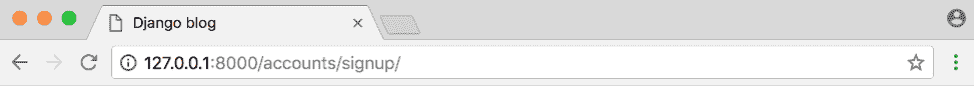

## Django 博客

你尚未登录。

登录

## 注册

用户名：必填。150 个字符以内。仅允许字母、数字和 @./--/__。

密码：

- 你的密码不能与你的其他个人信息太相似。
- 你的密码必须至少 8 个字符。
- 你的密码不能是常用密码。
- 你的密码不能全数字。

确认密码：输入之前相同的密码以验证。

## Django 注册页面

注意，Django 默认包含了很多额外的文本。我们可以使用内置的消息框架之类的工具对其进行自定义，但目前先尝试一下表单。

我创建了一个名为“william”的新用户，提交后我被重定向到了登录页面。用我的新用户和密码成功登录后，我被重定向到了首页，并带有我们个性化的“Hi username”问候。

## Django 博客

Hi william！

注销

## 今天的目标

学习 Django 并构建一个博客应用程序。

## 第 3 篇文章

我想知道这能行通吗？

## 这个表单能工作吗？

是的，可以！

用户 wscint 的首页

因此，我们的最终流程是：注册 -> 登录 -> 首页。当然，我们可以根据意愿进行调整。`SignUpView` 重定向到登录是因为我们设置了 `success_url = reverse_lazy('login')`。页面重定向到首页是因为我们在 `settings.py` 文件中设置了 `REDIRECT_URL = 'home'`。

起初看起来可能很复杂，需要跟踪 Django 项目的各个部分。这是正常的，随着时间推移会变得更有意义。

## Bitbucket

自从我们进行 `git commit` 已经有一段时间了。让我们这样做，然后代码推送到 Bitbucket。

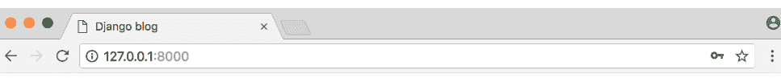

首先检查我们通过 `git status` 完成的所有工作。

## 命令行

```bash
(blog) $ git status
```

然后添加内容。

## 命令行

```bash
(blog) $ git commit -m 'forms'
```

在 Bitbucket 上创建一个新仓库，你可以称之为任何名字。我选择 `blog-app`。因此，在 Bitbucket 上创建新仓库后，输入以下命令。将 `username` 替换为你的用户名。

## 命令行

```bash
(blog) $ git remote add origin@bitbucket.org:username/blog-app.git
(blog) $ git push -u master
```

全部完成！现在我们可以将新应用部署到 Heroku。

## Heroku 配置

这是我们第三次部署应用。对于我们的应用，我们需要做一些更改才能部署到 Heroku。

- 更新 `Pipfile.lock`
- 创建 `Procfile`
- 安装 `gunicorn`
- 更新 `settings.py`

我们将在 `Pipfile` 中指定 Python 版本并运行 `pipenv lock` 将其应用到 `Pipfile.lock`。由于 Heroku 会使用它来生成 Heroku 上的环境，我们这里使用的是 3.6 而不是更具体的 3.6.4。

```python
## Pipfile
[requires]
python_version = "3.6"
```

## 命令行

```bash
(blog) $ pipenv lock
```

创建一个 `Procfile` 文件。

## 命令行

```bash
(blog) $ touch Procfile
```

在编辑器中向 `Procfile` 添加以下行。这告诉 Heroku 使用 gunicorn 而不是适用于生产的本地服务器。

## 代码

```text
web: gunicorn blog_project.wsgi
```

现在安装 gunicorn。

## 命令行

```bash
(blog) $ pipenv install gunicorn
```

最后更新 `ALLOWED_HOSTS` 以接受所有域名，星号 `*` 表示。

## 代码

```python
## blog_project/settings.py
ALLOWED_HOSTS = ['*']
```

我们可以提交新更改并将它们推送到 Bitbucket。

## 命令行

```bash
(blog) $ git status
(blog) $ git add -A
(blog) $ git commit -m 'Heroku config'
(blog) $ git push -u master
```

## Heroku 部署

部署到 Heroku 之前先确认你已登录 Heroku 账户。

## 命令行

```bash
(blog) $ heroku login
```

然后运行 `create` 命令，告诉 Heroku 为我们的应用创建一个容器。如果你只运行 `heroku create`，Heroku 会给你分配一个随机名称，但你可以指定自定义名称，它在 Heroku 上必须是唯一的。换句话说，既然我选择了 `df-blog`，你就不能选。

## 命令行

```bash
(blog) $ heroku create df-blog
```

现在配置 git，当你推送到 Heroku 时，它会去你的新应用名称（将 `df-blog` 替换为你的自定义名称）。

## 命令行

```bash
(blog) $ heroku git:remote -a df-blog
```

有了静态文件（在我们的案例中是 CSS），还需要一步。Django 不支持在生产环境中提供静态文件，但 WhiteNoise 支持。所以让我们安装它吧。

## 命令行

```bash
(blog) $ pipenv install whitenoise
```

然后我们需要更新静态设置以便在生产环境中使用。在编辑器中打开 `settings.py`。将 `whitenoise` 添加到 `INSTALLED_APPS` 中 `staticfiles` 上方，同时也添加到第三行的 `MIDDLEWARE`。`INSTALLED_APPS` 和 `MIDDLEWARE` 的顺序都重要。

在文件末尾添加 `STATIC_ROOT` 和 `STATICFILES_STORAGE` 的新行。它看起来如下。

## 代码

```python
## blog_project/settings.py
INSTALLED_APPS = [
    'django.contrib.admin',
    'django.contrib.auth',
    'django.contrib.contenttypes',
    'django.contrib.sessions',
    'django.contrib.messages',
    'whitenoise.runserver_staticfiles', # 新！
    'django.contrib.staticfiles',
    'blog',
    'accounts',
]

MIDDLEWARE = [
    'django.middleware.security.SecurityMiddleware',
    'django.contrib.sessions.middleware.SessionMiddleware',
    'whitenoise.middleware.WhiteNoiseMiddleware', # 新！
    'django.middleware.common.CommonMiddleware',
    'django.middleware.csrf.CsrfViewMiddleware',
    'django.contrib.auth.middleware.AuthenticationMiddleware',
    'django.contrib.messages.middleware.MessageMiddleware',
    'django.middleware.clickjacking.XFrameOptionsMiddleware',
]

STATIC_ROOT = os.path.join(BASE_DIR, 'staticfiles') # 新！
```

# 第 7 章：用户账户


```python
STATIC_URL = '/static/'
STATICFILES_DIRS = [os.path.join(BASE_DIR, 'static')]
STATICFILES_STORAGE = 'whitenoise.storage.CompressedManifestStaticFilesStorage' \
# 新！
```

确保已添加并提交了你的新更改。然后将其推送到 Bitbucket。

## 命令行

```bash
(blog) $ git add -A
(blog) $ commit -m 'Heroku config'
(blog) $ git push origin master
```

最后我们可以将代码推送到 Heroku 并添加一个 `web` 进程以便 dyno 运行。

## 命令行

```bash
(blog) $ git push heroku master
(blog) $ heroku ps:scale web=1
```

你新应用的 URL 将出现在命令行输出中，或者你可以运行 `heroku open` 来找到它。我的应用地址是 <https://dfb-blog.herokuapp.com/>。

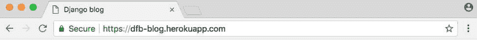

# Django 博客

- 新博客文章

你尚未登录。

登录

# Heroku 站点

## 结论

通过极少的代码，Django 框架已经允许我们创建了登录、注销和注册用户认证流。在底层，它已经处理了当你尝试从零创建自己的用户认证流时可能出现的许多安全陷阱。

# 第 8 章：自定义用户模型

Django 内置的 `User` 模型允许我们立即开始处理用户工作，就像我们在之前的章节中添加 Blog 应用所做的那样。然而，Django 官方文档建议在新项目中使用自定义用户模型。其原因是，如果你以后想对 `User` 模型进行任何更改（例如添加一个年龄字段），从一开始就使用自定义用户模型会让这变得非常简单。但如果你没有自定义用户模型，在现有的 Django 项目中更新默认的 `User` 模型将是非常挑战性的。

因此，请对所有新的 Django 项目始终使用自定义用户模型。不过，官方文档的示例并不是许多 Django 专家推荐的。它使用了相当复杂的 `AbstractBaseUser`，而当我们使用 `AbstractUser` 时情况要简单得多且仍然可以自定义。这就是我们在本章将采取的方法，我们将通过自定义用户模型正确地启动一个新的 Newspaper 应用。选择报纸应用是为了致敬 Django 的根源——它是为 Lawrence Journal-World 的编辑和记者构建的 Web 框架。

## 设置

第一步是从命令行创建一个新的 Django 项目。我们需要执行以下几件事：

- 创建并进入一个用于代码的新目录
- 创建一个新的虚拟环境
- 安装 Django
- 创建名为 `newspaper_project` 的新 Django 项目

我们在这里将应用命名为 `users` 以管理用户，但你也会经常在源代码中看到它。实际名称并不重要，只要你在整个项目中引用它时保持一致即可。以下是运行的命令：

## 命令行

```bash
$ cd ~/Desktop
$ mkdir news
$ pipenv install django
$ pipenv shell
(news) $ django-admin startproject newspaper_project
(news) $ python manage.py startapp users
(news) $ python manage.py runserver
```

注意我们还没有迁移来配置数据库。鉴于用户模型与 Django 其他部分的连接非常紧密，在创建自定义用户模型之前执行迁移是非常重要的。如果你导航到 <http://127.0.0.1:8000>，你会看到熟悉的欢迎界面。

# 自定义用户模型

创建我们的自定义用户模型需要四个步骤：

- 更新 `settings.py`
- 创建一个新的 `CustomUser` 模型
- 为 UserCreation 和 UserChange 创建新表
- 更新 admin

在 `settings.py` 中，我们将 `users` 应用添加到 `INSTALLED_APPS` 中。然后在文件末尾使用 `AUTH_USER_MODEL` 告诉 Django 使用我们新的自定义用户模型代替内置的 `User` 模型。我们将自定义用户模型命名为 `CustomUser`，由于存在于 `users` 应用中，我们将其引用为 `users.CustomUser`。

## 代码

```python
## newspaper_project/settings.py
INSTALLED_APPS = [
    'django.contrib.admin',
    'django.contrib.auth',
    'django.contrib.contenttypes',
    'django.contrib.sessions',
    'django.contrib.messages',
    'django.contrib.staticfiles',
    'users',
]
AUTH_USER_MODEL = 'users.CustomUser'
```

现在更新 `users/models.py` 以包含一个名为 `CustomUser` 的新用户模型。我们还添加了额外的“年龄”（age）字段。我们可以使用 Django 的 `PositiveIntegerField`，这意味着该整数必须大于或等于零。

## 代码

```python
## users/models.py
from django.contrib.models import AbstractUser
from django.db import models

class CustomUser(AbstractUser):
    age = models.PositiveIntegerField(default=0)
```

这就是我们需要的全部代码！由于我们扩展了 `AbstractUser`，`CustomUser` 基本上是默认 `User` 模型的拷贝。唯一的更新是我们新定义的 `age` 字段。

# 表单

如果我们稍退一步，我们会有哪两种方式与新的 `CustomUser` 模型交互？一种是用户在我们的网站注册新账户。另一种是在 admin 应用中，允许我们作为超级管理员修改现有用户。因此，我们需要为此功能更新两个内置表单：`UserCreationForm` 和 `UserChangeForm`。

使用 Ctrl+c 停止本地服务器，并在 `users` 应用中创建一个名为 `forms.py` 的新文件。

## 命令行

```bash
(news) $ touch users/forms.py
```

我们将使用以下代码更新它，以扩展现有的 `UserCreationForm` 和 `UserChangeForm` 表单。

## 代码

```python
## users/forms.py

from django import forms
from django.contrib.auth.forms import UserCreationForm, UserChangeForm
from .models import CustomUser

class CustomUserCreationForm(UserCreationForm):
    class Meta(UserCreationForm.Meta):
        model = CustomUser
        fields = UserCreationForm.Meta.fields

class CustomUserChangeForm(UserChangeForm):
    class Meta:
        model = CustomUser
        fields = UserChangeForm.Meta.fields
```

对于两者，我们都将模型设置为 `CustomUser`，并使用 `Meta.fields`。

对于 `CustomUser` 模型，设置 `Meta.fields` 是为了让它显示默认 `User` 模型的字段。这对于字段设置初学者可能让你感到很困惑，但让我们花时间深入了解一下。我们的 `CustomUser` 模型包含了用户名、密码和年龄字段，尽管实际上还有许多其他字段。

这可能一开始让你感到很困惑，因为正确理解表单和模型需要时间。在接下来的章节中，我们将创建自己的注册、登录和注销页面，将 `CustomUser` 模型连接起来。所以请稍等！

最后一步是更新 `admin.py` 文件，因为 admin 与默认 `User` 模型是紧耦合的。我们将扩展现有的 `UserAdmin` 类以使用我们新的 `CustomUser` 模型和两个新表单。

## 代码

```python
## users/admin.py
from django.contrib import admin
from django.contrib.auth.admin import UserAdmin
from forms import CustomUserCreationForm, CustomUserChangeForm
from models import CustomUser

class CustomUserAdmin(UserAdmin):
    add_form = CustomUserCreationForm
    form = CustomUserChangeForm
    list_display = ['email', 'username', 'age']
    model = CustomUser

admin.site.register(CustomUser, CustomUserAdmin)
```

注意我们的 `CustomUserAdmin` 还有一个 `list_display` 设置，以便它只显示电子邮件、用户名和年龄字段，尽管在此时实际上还有许多其他字段。

好了，我们完成了！请第一次运行 `makemigrations` 和 `migrate` 来创建一个使用自定义用户模型的数据库。

## 命令行

```bash
(news) $ python manage.py makemigrations
(news) $ python manage.py migrate
```

# 第 8 章：自定义用户模型

186

## 站点管理

### 管理员页面

如果你点击“用户”（Users）链接，你应该能看到超级管理员账户。注意，我们看到的三个字段是邮箱、用户名和年龄，因为我们在 `CustomUserAdmin` 中将它们设置为了 `list_display`。

## 管理单个用户

## 结论

自定义用户模型构建完成后，我们现在可以专注于构建 Newspaper 应用的其他部分。在下一章节中，我们将配置和自定义注册、登录和注销页面。

# 第 9 章：用户认证

现在我们已经有了可以工作的自定义用户模型，可以添加每个网站都需要的功能：注册、登录和注销用户。Django 提供了登录和注销所需的一切，但我们需要自己创建表单来注册新用户。我们将构建一个基础主页，包含指向这三个功能的链接，这样我们就不需要每次手动输入 URL 了。

## 模板

默认情况下，Django 模板加载器会在每个应用的嵌套结构中查找模板。因此，`users` 应用中的 `home.html` 模板需要位于 `users/templates/users/home.html`。但项目级模板文件夹的方法更整洁且扩展性更好，所以我们将使用这种方法。

让我们创建一个新的 `templates` 目录，并在其中创建一个 `registration` 文件夹，因为 Django 将从那里查找登录模板。

## 命令行

```bash
(news) $ mkdir templates
(news) $ mkdir templates/registration
```

现在，我们需要通过更新 `settings.py` 中的配置 `DIRS` 来告诉 Django 这个新目录。这是一行代码的更改。

## 代码

```python
## newspaper_project/settings.py
TEMPLATES = [
{
  ...
  'DIRS': [os.path.join(BASE_DIR, 'templates')],
  ...
}
]
```

如果你思考在网站登录或注销时发生了什么，你会被立即重定向到一个后续页面。我们需要告诉程序在每情况下将用户发送到哪里。`LOGIN_REDIRECT_URL` 和 `LOGOUT_REDIRECT_URL` 设置实现了此功能。我们将两者配置重定向到我们的主页，主页将具有名为 'home' 的命名 URL。

记得我们在创建 URL 路由时，可以选择为每个路由添加一个名称。所以当我们创建主页 URL 时，我们会确保将其命名为 'home'。

在 `settings.py` 文件的底部添加这两行。

## 代码

```python
## newspaper_project/settings.py
LOGIN_REDIRECT_URL = 'home'
LOGOUT_REDIRECT_URL = 'home'
```

现在我们可以创建四个新模板：

## 命令行

```bash
(news) $ touch templates/registration/login.html
(news) $ touch templates/base.html
(news) $ touch templates/home.html
(news) $ touch templates/signup.html
```

这里是每个文件使用的 HTML 代码。`base.html` 将被项目中的其他所有模板继承。通过使用像 `` 这样的块，我们以后可以在其他模板中仅在此处覆盖内容。

## 代码

```html
<!-- templates/base.html -->
<!DOCTYPE html>
<html>
<head>
  <meta charset="utf-8">
  <title>Newspaper App</title>
</head>
<body>
  <main>
    
    
  </main>
</body>
</html>
```

## 代码

```html
<!-- templates/home.html -->


Home



Hi {{ user.username }}!
<p><a href="">logout</a></p>

<p>You are not logged in</p>
<a href="">login</a> |
<a href="">signup</a>


```

## 代码

```html
<!-- templates/registration/login.html -->


Login


<h2>Login</h2>
<form method="post">
  
</form>

```

## 代码

```html
<!-- templates/signup.html -->


Sign Up


<h2>Sign up</h2>
<form method="post">
  
</form>

```

我们的模板现在设置好了。让我们来看 `users` 应用中的 `urls.py`。

## 代码

```python
from django.urls import path, include
from . import views

urlpatterns = [
    path('home/', views.home, name='home'),
    path('login/', views.login, name='login'),
    path('logout/', views.logout, name='logout'),
    path('signup/', views.signup, name='signup'),
    path('registration/', include('registration.urls')),
]
```

## 第 9 章：用户认证

197

重定向到首页，并对新用户进行个性化问候。

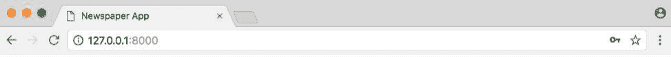

你好 testuser！

退出登录（logout）

# testuser 的首页

一切运行如预期。

## 管理员后台

我们也登录管理员后台查看我们的两个用户账户。导航到：

<http://127.0.0.1:8000/admin> 并 ...

## 第 9 章：用户认证

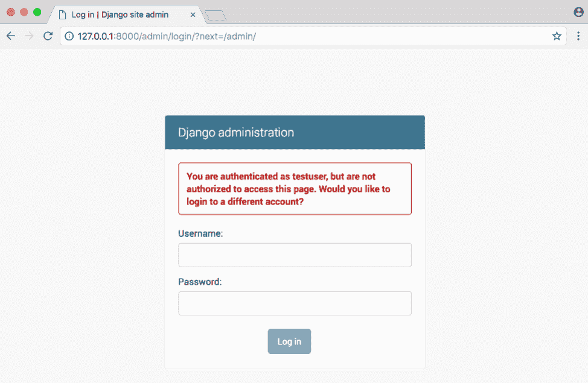

# 管理员登录错误


这是什么！为什么我们无法登录？

哦，我们使用的是新创建的`testuser`账户，而不是超级用户（superuser）账户。只有超级用户账户才有权限登录管理员后台！请使用你的超级用户账户登录。

完成操作后，你应该能看到正常的管理员首页。点击“用户（Users）”，你就可以看到我们的两个用户：我们刚刚创建的那个以及你之前的超级用户用户名（我的是`wsv`）。

## 第9章：用户认证

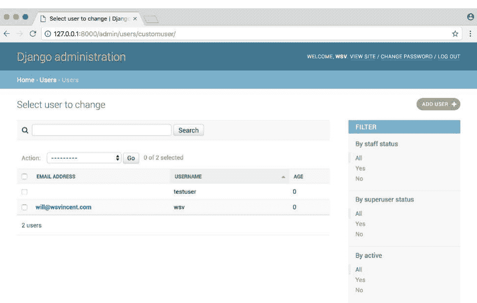

# 管理员后台中的用户

一切运行正常，但你可能注意到`testuser`没有邮箱字段。这是为什么呢？回想`users/signup/`的注册页面，你会发现它只要求了用户名和密码，没有要求邮箱！这就是Django默认设置的工作。不过我们可以轻松地更改它。让我们回到`users/forms.py`文件。

目前看起来是这样：

```python
## users/forms.py

from django import forms
from django.contrib.auth.forms import UserCreationForm, UserChangeForm
from .models import CustomUser

class CustomUserCreationForm(UserCreationForm):

    class Meta(UserCreationForm.Meta):
        model = CustomUser
        fields = UserCreationForm.Meta.fields

class CustomUserChangeForm(UserChangeForm):

    class Meta:
        model = CustomUser
        fields = UserChangeForm.Meta.fields
```

在`fields`下，我们使用了`Meta.fields`，它只是显示了用户名/密码的默认设置。但我们也可以显式地设置想要显示的字段，让我们将其设置为`('username', 'email')`以要求用户名/邮箱/密码。我们不需要包含密码字段，因为它是必填的！但所有其他字段都可以按照我们的意进行配置。

```python
## users/forms.py
...
class CustomUserCreationForm(UserCreationForm):
    class Meta(UserCreationForm.Meta):
        model = CustomUser
        fields = ('username', 'email', ) # 新
```

```python
class CustomUserChangeForm(UserChangeForm):
    class Meta:
        model = CustomUser
        fields = ('username', 'email', ) # 新
```

现在，如果你再次尝试`http://127.0.0.1:8000/users/signup/`注册页面，你就能看到额外的“邮箱地址（Email address）”字段在那里了。

## 第9章：用户认证

202

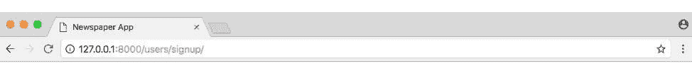

## 注册

用户名：必填。150个字符以内。仅限字母、数字和`@/#/-/-/-_`。

邮箱地址：

密码：

- 你的密码不能与你的其他个人信息太相似。

- 你的密码必须包含8个字符。

- 你的密码不能是常用密码。

- 你的密码不能全是数字。

确认密码：输入相同的密码进行验证。

## 新注册页面

使用新用户账户注册。我将我的账户命名为`testuser2`，邮箱地址为`testuser2@email.com`。如果我们现在切换回管理员页面——并使用超级用户账户登录——现在这三个用户就一目易见了。

## 第9章：用户认证

203

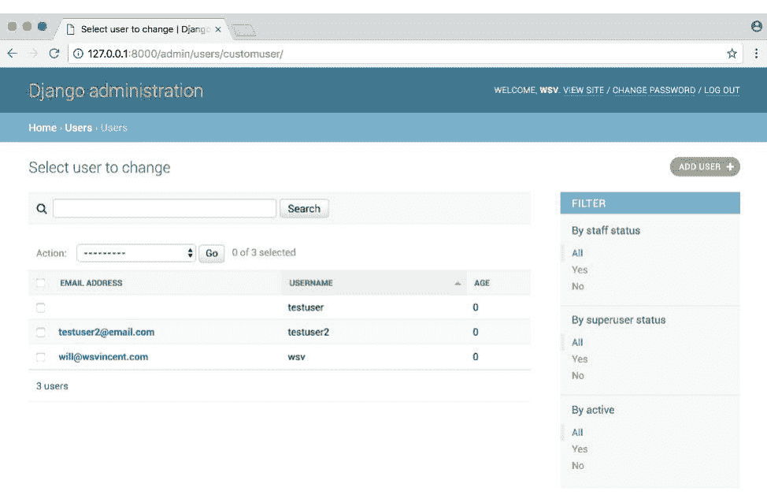

# 管理员后台中的三个用户

Django的用户认证流程需要一些设置，但你应该开始看到，它为我们提供了极大的灵活性，可以完全按照我们的要求配置注册和登录。

# 总结

到目前，我们的报纸应用已经有了自定义用户模型以及可以工作的注册、登录和注销页面。但你可能注意到我们的网站看起来并不好看。在下一章中，我们将添加Bootstrap进行样式处理，并创建一个的`pages`应用。

## 第10章：Bootstrap

Web开发需要很多技能。你不仅要编写网站使其正常运行，用户还期望它看起来很漂亮。当你从零开始创建一切时，为美化网站添加所有必要的HTML/CSS可能会让你感到从overwhelming。

幸运的是有Bootstrap，它是最流行的构建响应式、移动优先项目的框架。我们不需要为常见的网站布局功能编写所有的CSS和JavaScript，而是可以依靠Bootstrap来完成繁重的工作。这意味着只需要少量的代码，我们就能快速拥有美观的网站。如果我们想在项目进行期间进行自定义更改，也可以在需要的地方轻松覆盖Bootstrap。

当你想专注于项目的功能而不是设计时，Bootstrap是一个很棒的选择。这就是我们在这里要使用它的原因。

## pages应用

在上一章中，我们通过在`urls.py`文件包含包含逻辑来显示首页。虽然这种方法可行，但我觉得它有些取巧，而且随着网站随时间的推移，它并不具备扩展性。对于Django初学者来说这也有点困惑。相反，我们可以并且已经为所有的Django页面创建一个专门的`pages`应用。这将让我们后的代码保持整洁有序。

在命令行中使用`startapp`命令来创建我们新的`pages`应用。如果服务器仍在运行，你可能需要停止它。

```bash
python manage.py startapp pages
```

然后立即更新我们的`settings.py`。我经常忘记这样做，所以运行`startapp`命令后更新`INSTALLED_APPS`。

```python
## newspaper_project/settings.py
INSTALLED_APPS = [
    'django.contrib.admin',
    'django.contrib.auth',
    'django.contrib.contenttypes',
    'django.contrib.sessions',
    'django.contrib.messages',
    'django.contrib.staticfiles',
    'users',
    'pages', # 新
]
```

现在我们可以更新项目级的`urls.py`了。去删除对`TemplateView`的导入。我们将更新路由以包含`pages`。

```python
## newspaper_project/urls.py

from django.contrib import admin
from django.urls import path, include

urlpatterns = [
    path('', include('pages.urls')),
    path('admin/', admin.site.urls),
    path('users/', include('users.urls')),
]
```

是时候添加我们的`pages/urls.py`文件了。首先创建它。

然后导入我们尚未创建的视图，设置路由路径，并确保为每个url均命名。

## 第10章：Bootstrap

207

```python
## pages/urls.py
from django.urls import path
from . import views

urlpatterns = [
    path('', views.HomePage.as_view(), name='home'),
]
```

`views.py`的代码现在看起来应该熟悉了。我们正在使用Django的`TemplateView`通用类视图，这意味着我们只需要指定`template_name`即可使用它。

```python
## pages/views.py
from django.views.generic import TemplateView

class HomePage(TemplateView):
    template_name = 'home.html'
```

我们已经有一个现有的`home.html`模板。让我们确认它在我们新的url和视图下仍然有效。导航到首页`http://127.0.0.1:8000/`以确认它保持保持不变。

## 第10章：Bootstrap

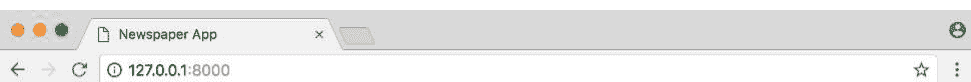

你好！

退出登录 (logout)

## 登录后的首页

它应该显示你登录的超级用户账户名称，我们在上一章末尾使用了它。

## 测试

我们添加了新的代码和功能，这意味着是时候进行测试了。你可以在你的项目中包含足够的测试。尽管编写它们需要一些前期时间，但它们总能在未来为你节省时间，并在项目增长时提供信心。

添加测试的理想时机有两个：在编写任何代码之前（测试驱动开发），或者在添加新功能后立即进行。

目前我们的项目有四个页面：

- home

- signup

- login

- logout

然而我们只需要测试前两个。登录和注销是Django的一部分，依赖于内部视图和url路由。因此它们已经有了测试覆盖。如果我们将来对它们进行了重大更改，我们将希望为它们添加测试。但作为一般原则，你不需要为Django的核心功能添加测试。

## 第10章：Bootstrap

由于我们为两个新页面都创建了URL、模板和视图，因此我们将为每个页面添加测试。Django的`SimpleTestCase`足够用于测试首页，但由于注册页面使用了数据库，因此我们仍然需要使用`TestCase`。

以下是你的`pages/tests.py`文件中代码的写法。

```python
## pages/tests.py
from django.contrib.auth import get_user_model
from django.test import SimpleTestCase, TestCase
from django.urls import reverse
```

class HomePageTests(SimpleTestCase):

```python
def test_home_page_status_code(self):
    response = self.client.get('/')
    self.assertEqual(response.status_code, 200)
```

```python
def test_view_url_by_name(self):
    response = self.client.get(reverse('home'))
    self.assertEqual(response.status_code, 200)
```

```python
def test_view_uses_correct_template(self):
    response = self.client.get(reverse('home'))
    self.assertEqual(response.status_code, 200)
    self.assertTemplateUsed(response, 'home.html')
```

class SignupPageTests(TestCase):

```python
username = 'newuser'
email = 'newuser@email.com'
```

```python
def test_signup_page_status_code(self):
    response = self.client.get('/users/signup/')
    self.assertEqual(response.status_code, 200)
```

```python
def test_view_url_by_name(self):
    response = self.client.get(reverse('signup'))
    self.assertEqual(response.status_code, 200)
```

```python
def test_view_uses_correct_template(self):
    response = self.client.get(reverse('signup'))
    self.assertEqual(response.status_code, 200)
    self.assertTemplateUsed(response, 'signup.html')
```

```python
def test_signup_form(self):
    new_user = get_user_model().objects.create_user(
        self.username, self.email
    )
    self.assertEqual(get_user_model().objects.all().count(), 1)
    self.assertEqual(get_user_model().objects.all()[0].username, self.username)
    self.assertEqual(get_user_model().objects.all()[0].email, self.email)
```

在第一行中，我们使用`get_user_model()`来引用我们的自定义用户模型。对于这两个页面，我们都测试了三件事：

- 页面存在并返回HTTP 200状态码

- 视图中使用了正确的URL名称

- 使用了正确的模板

我们的注册页面还有一个表单，因此我们也应该测试一下它。在`test_signup_form`测试中，我们正在验证当用户名和电子邮件地址被POST（发送到数据库）时，它们是否与存储在`CustomUser`模型中的中的内容匹配。

使用`control+c`停止本地服务器，然后运行我们的测试以确认一切都已通过。

```bash
(news) $ python manage.py test
```

## Bootstrap

如果你以前从未用过Bootstrap，那么你将有一场盛宴。它用极少的代码实现了许多功能。

向项目中添加Bootstrap有两种方法：你可以下载所有文件并在本地提供服务，或者依赖内容分发网络 (CDN)。只要你有稳定的互联网连接，第二种方法的实现更为简单，我们将使用这种方法。

Bootstrap自带了一个启动模板，包含了所需的各种文件。值得注意的是，我们包含了其中的四个：

- Bootstrap.css

- jQuery.js

- Popper.js

- Bootstrap.js

这里是更新后的`base.html`文件内容。通常情况下，你应该手动输入所有的代码示例，但由于这一个非常长，在这里复制粘贴也是可以的。


如果你以前从未用过 Bootstrap，那么你将有一场盛宴。它用极少的代码实现了许多功能。

向项目中添加 Bootstrap 有两种方法：你可以下载所有文件并在本地提供服务，或者依赖内容分发网络 (CDN)。只要你有稳定的互联网连接，第二种方法的实现更为简单，我们将使用这种方法。

Bootstrap 自带了一个启动模板，包含了所需的各种文件。值得注意的是，我们包含了其中的四个：

- `Bootstrap.css`
- `jQuery.js`
- `Popper.js`
- `Bootstrap.js`

这里是更新后的 `base.html` 文件内容。通常情况下，你应该手动输入所有的代码示例，但由于这一个非常长，在这里复制粘贴也是可以的。

```html
<!-- templates/base.html -->
<!doctype html>
<html lang="en">
<head>
  <!-- 必要的 meta 标签 -->
  <meta charset="utf-8">
  <meta name="viewport" content="width=device-width, initial-scale=1, shrink-to-fit=no">

  <!-- Bootstrap CSS -- -->
  <link rel="stylesheet" href="https://maxcdn.bootstrap.com/bootstrap/4.0.0/css/bootstrap.min.css" integrity="sha384-Gn5384xkQ1aoWXA+058RPxPg6fy4IVWtNH0E2-G3XMfCJlLSawiggFAW/dAIS6Xm" crossorigin="anonymous">
</head>
<body>
  <h1>Hello, world!</h1>

  <!-- 可选的 JavaScript --
  <!-- 先加载 jQuery，然后是 Popper.js，最后是 Bootstrap JS -->
  <script src="https://code.jquery.com/jquery-3.2.1.slim.min.js" integrity="sha384-KJ30d2TktIvyYIK3UENzM7KckRr/rE9/Pq6aAZGjwFDMVNA/GpGF93hXp5KKKN" crossorigin="anonymous"></script>
  <script src="https://cdn.cloudflare.com/ajax/libs/popper.js/1.12.9/umd/popper.js" integrity="sha384-KJ30d2TktIvyYIK3UENzM7KckRr/rE9/Pq6aAZGjwFDMVNA/GpGF93hXp5KKKN" crossorigin="anonymous"></script>
  <script src="https://cdn.cloudflare.com/ajax/libs/popper.js/1.12.9/umd/popper.js" integrity="sha384-KJ30d2TktIvyYIK3UENzM7KckRr/rE9/Pq6aAZGjwFDMVNA/GpGF93hXp5KKKN" crossorigin="anonymous"></script>
</head>
```

等等，我发现在处理最后一段时出现了逻辑重复和混乱。我将重新为你提供翻译后的 `base.html` 部分：

```html
<!-- templates/base.html -->
<!doctype html>
<html lang="en">
<head>
  <!-- 必要的 meta 标签 -->
  <meta charset="utf-8">
  <meta name="viewport" content="width=device-width, initial-scale=1, shrink-to-fit=no">

  <!-- Bootstrap CSS -- -->
  <link rel="stylesheet" href="https://maxcdn.bootstrap.com/bootstrap/4.0.0/css/bootstrap.min.css" integrity="sha384-Gn5384xkQ1aoWXA+058RPxPg6fy4IVWtNH0E2-G3XMfCJlLSawiggFAW/dAIS6Xm" crossorigin="anonymous">
  <title></title>
</head>
<body>
  <h1>Hello, world!</h1>

  <!-- 可选的 JavaScript --
  <!-- 先加载 jQuery，然后是 Popper.js，最后是 Bootstrap JS -->
  <script src="https://code.jquery.com/jquery-3.2.1.slim.min.js" integrity="sha384-KJ30d2TktIvyYIK3UENzM7KckRr/rE9/Pq6aAZGjwFDMVNA/GpGF93hXp5KKKN" crossorigin="anonymous"></script>
  <script src="https://cdn.cloudflare.com/ajax/libs/popper.js/1.12.9/umd/popper.js" integrity="sha384-KJ30d2TktIvyYIK3UENzM7KckRr/rE9/Pq6aAZGjwFDMVNA/GpGF93hXp5KKKN" crossorigin="anonymous"></script>
  <nav class="navbar navbar-expand-md navbar-dark bg-dark">
    <a class="navbar-brand" href="Newspaper</a>
    <button class="navbar-toggler" type="button" data-toggle="collapse" data-target="#navbarCollapse" aria-expanded="false" aria-label="Toggle">
      <span class="navbar-toggler-icon"></span>
    </button>
    <div class="collapse navbar-collapse" id="navbarCollapse">
      
        <ul class="nav ml-auto">
          <li class="nav-item dropdown">
            <a class="nav-link dropdown-toggle" href="#" id="userMenu" data-toggle="dropdown" aria-haspopup="true" aria-expanded="false">
              {{ user.username }}
            </a>
            <div class="dropdown-menu dropdown-menu-right" aria-labelledby="userMenu">
              <a class="dropdown-item" href="">Change password</a>
              <div class="dropdown-divider"></div>
              <a class="dropdown-item" href="">Log out</a>
            </div>
          </li>
        </ul>
      
        <form class="form-inline ml-auto">
          <a href="{% url 'login'}" class="btn btn-outline-secondary">Log in</a>
          <a href="{% url 'signup'}" class="btn btn-primary ml-2">Sign up</a>
        </form>
      
    </div>
  </nav>
  <div class="container">
    
    
  </div>
  <script src="https://cdn.bootstrapcdn.com/bootstrap/4.0.0/js/bootstrap.min.js"></script>
</body>
</html>
```

## 注销状态的 Bootstrap 导航栏首页

更好的是，当你缩小浏览器窗口时，它会自动调整大小并优化，使其在移动设备上看起来也很好。

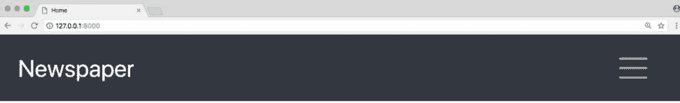

你尚未登录

登录 | 注册

## 带有汉堡图标的移动端首页

刷新首页，你将看到它的效果。你甚至可以更改浏览器的宽度，观察侧边距随着屏幕尺寸增大和缩小而变化。

如果你点击顶部导航栏的“注销”按钮，然后从顶部点击“登录”，你还可以发现我们的登录页面 `http://127.0.0.1:8000/users/login` 看起来也更漂亮。

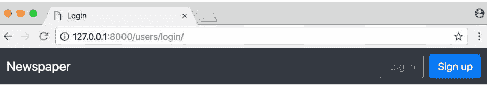

### 登录

用户名：

密码：

## Bootstrap 登录

唯一看起来不太对的是我们的“登录”按钮。我们可以使用 Bootstrap 来添加一些漂亮的样式，例如将其变为绿色且更具吸引力。

按照如下内容修改 `templates/registration/login.html` 中的“button”行。

```html
<!-- templates/registration/login.html -->
...
<button class="btn btn-success ml-2" type="submit">Login</button>
...
```

现在刷新页面查看我们的新按钮。

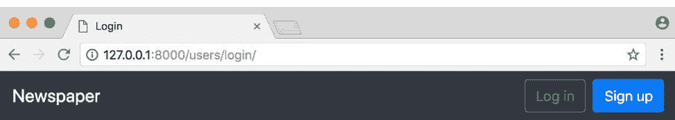

### 登录

用户名：

密码：

带有新按钮的 Bootstrap 登录

## 注册表单

我们在 `http://127.0.0.1:8000/users/signup/` 的注册页面也使用了 Bootstrap 样式，还有一些分散注意力的辅助文本。例如，在“用户名”之后，它显示：“必填。150 个字符或少。仅允许字母、数字和 @/./+//- _。”


更新后的注销状态导航栏

这些文本是从哪里来的，对吧？在 Django 中，每当某些感觉像“魔法”时，请放心它绝对不是。代码可能来自 Django 的某个内部部分。

我发现查找 Django 内部运行机制的最快方法是直接去 Github 上的 Django 源码，使用搜索栏找到特定的文本段。

例如，如果你搜索“150 characters or fewer”，你会发现自己位于此处第 301 行的 `django/contrib/auth/models.py` 页面。该文本作为 `auth` 应用的一部分，位于 `AbstractUser` 的用户名字段上。

我们现在有三个选择：

- 覆盖现有的 `help_text`
- 隐藏 `help_text`
- 重新设计 `help_text`

我们将选择第三种方案，因为这是引入优秀的第三方包 `django-crispy-forms` 的极好方法。处理表单是一项挑战，而 `django-crispy-forms` 让编写 DRY（不要重复自己）的代码变得更容易。

首先，使用 `Ctrl+C` 停止本地服务器。然后使用 Pipenv 在项目中安装该包。

```bash
(news) $ pipenv install django-crispy-forms
```

在 `settings.py` 文件的 `INSTALLED_APPS` 列表中添加新应用。随着应用数量的增加，我发现区分第三方应用和我自己添加的本地应用是有帮助的。现在的代码看起来是这样的：

```python
## newspaper_project/settings.py
INSTALLED_APPS = [
    'django.contrib.admin',
    'django.contrib.auth',
    'django.contrib.contenttypes',
    'django.contrib.sessions',
    'django.contrib.messages',
    'django.contrib.staticfiles',

    # 第三方库
    'crispy_forms',

    # 本地
    'users',
    'pages',
]
```

由于我们正在使用 Bootstrap4，我们应该将该配置也添加到 `settings.py` 文件中。这位于文件的底部。

```python
## newspaper_project/settings.py
CRISPY_TEMPLATE_PACK = 'bootstrap4'
```

现在在我们的 `signup.html` 模板中，我们可以快速使用 crispy forms。首先在顶部加载 `crispy_forms_tags`，然后将 `{{ form.as_p }}` 替换为 `{{ form|crispy }}`。

```html
<!-- templates/signup.html -->




注册


<h2>注册</h2>
<form method="post">
  
  {{ form|crispy }}
  <button type="submit">Sign up</button>
</form>

```

如果你再次使用 `python manage.py runserver` 启动服务器并刷新注册页面，我们就能看到新的变化。

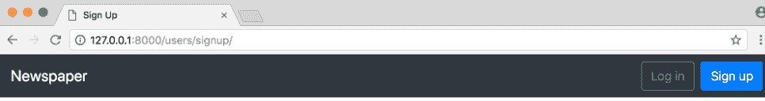

### 注册

用户名*

必填。150 个字符或少。字母、数字和 @/@/-/_ 。

邮箱地址

密码*

- 你的密码不能与其他个人信息太相似。
- 你的密码必须包含至少 8 个字符。
- 你的密码不能是常用密码。
- 你的密码不能全是数字。

确认密码*

输入与之前相同的密码以验证。

## Crispy 注册页面

好多了。但是，如果我们的“注册”按钮能更具吸引力会怎么样？也许把它变成绿色？Bootstrap 提供了各种按钮样式选项供我们选择。让我们使用“success”样式，它有绿色背景和白色文字。

更新 `signup.html` 文件中注册按钮所在的行。


<!-- templates/signup.html -->
...
<button class="btn btn-success" type="submit">Sign up!</button>
...

刷新页面，你就能看到我们更新后的。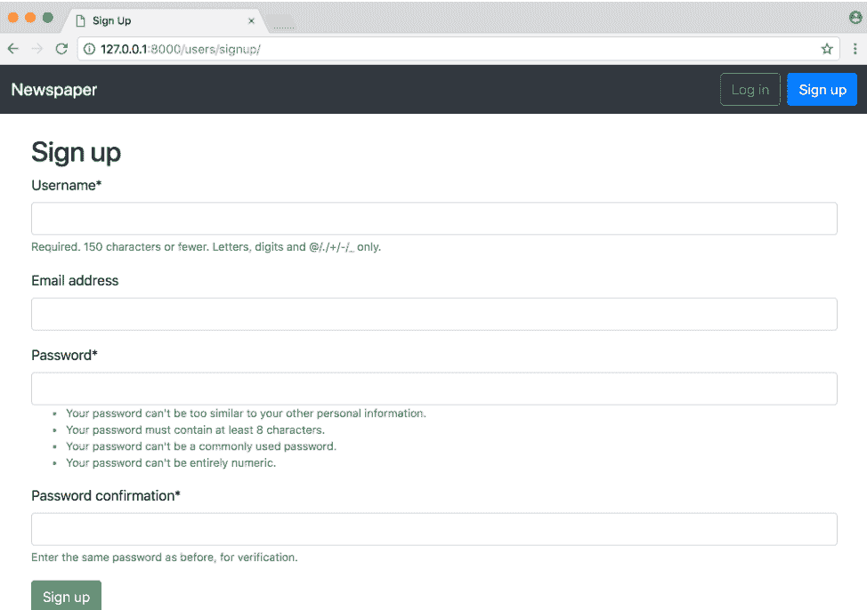

## 注册

用户名*

必填。150 个字符或少。字母、数字和 @/@/-/_

邮箱地址

密码*

- 你的密码不能与其他个人信息太相似。
- 你的密码必须包含至少8 个字符。
- 你的密码不能是常用密码。
- 你的密码不能全是数字。

确认密码*

输入与之前相同的密码以验证。

# Crispy 注册页面

好多了。但是，如果我们的“注册”按钮能更具吸引力会怎么样？也许把它变成绿色？Bootstrap 提供了各种按钮样式选项供我们选择。让我们使用“success”样式，它有绿色背景和白色文字。

# 下一步

我们的注册页面看起来好多了。流程的最后一步是配置密码更改和重置。Django 已经为我们处理了大部分工作，我们只需要添加少量部分。

# 第 11 章：密码更改与重置

在本章中，我们将通过添加密码更改和重置来完成授权流程。正如 Django 提供了一个可以工作的实现。要尝试它，点击“登录”按钮。然后导航到 `http://127.0.0.1:8000/users/password_change/` 的密码更改页面。

## 密码更改


密码更改

为了安全起见，请输入你的旧密码，然后输入两次密码以验证你的输入是否正确。

旧密码：

新密码：

## 密码更改

输入你的旧密码和新密码。然后点击“更改我的”按钮。你将被重定向到“密码更改成功”页面，地址为：

`http://127.0.0.1:8000/users/password_change/done.`


密码更改成功

你的密码已更改。

# 密码更改完成

# 自定义密码更改

让我们自定义网站网站自定义密码更改页面。由于 Django 已经为我们创建了视图和 URL，我们只需要添加新的模板。

在命令行在注册文件夹中创建两个模板文件。

## 命令行

```
(news) $ touch templates/registration/password_change_form.html
(news) $ touch templates/registration/password_change_done.html
```

使用以下代码更新 `password_change_form.html`。

# 代码

```
<!-- templates/registration/password_change_form.html -->




密码更改


<h1>密码更改</h1>
<p>为了安全起见，请输入你的旧密码，然后输入两次密码以验证你的输入是否正确。</p>

<form method="POST">

{{ form.as_p }}
<input class="btn btn-success" type="submit" value="Change my password">
</form>
```

## 第 11 章：密码更改与重置

```html
</form>


```

在页面顶部，我们扩展了 `base.html` 并设置了页面标题。由于我们在 `base.html` 文件中使用了 `block` 标题，因此我们可以在那里对其进行重写。表单显示了我们正在发送的数据，以及出于安全考虑的 `csrf_token` 令牌。通过使用 `form.as_p`，我们简单地以段落的形式显示默认密码重置表单的内容。最后，我们包含了一个提交按钮，它使用了 Bootstrap 的 `btn-success` 样式使其变为绿色。

请刷新页面 `http://127.0.0.1:8000/users/password_change/` 页面以查看我们的更改。


接下来是 `password_change_done` 模板。

## 第 11 章：密码更改与重置

# 代码

```html
<!-- templates/registration/password_change_done.html -->



密码更改成功



<h1>密码更改成功</h1>

<p>您的密码已更改。</p>


```

它同样扩展了 `base.html` 并包含一个新的标题。但是页面上没有表单，只有新文本。

新页面位于 `http://127.0.0.1:8000/users/password_change_done/`。


### 密码更改成功

您的密码已更改。

### 密码更改完成

这并不太难，对吧？这显然比从头开始创建一切要省事得多，特别是关于安全地更新用户密码的所有代码。

接下来是我们的密码重置功能。

## 密码重置

密码重置处理用户忘记密码的常见情况。步骤与我们刚刚完成的配置密码更改非常相似。Django 已经提供了一个默认实现，我们将使用它，然后自定义模板以与我们网站的其他部分匹配。

唯一需要的配置是告诉 Django 如何发送电子邮件。毕竟，用户只有在能够访问与账户关联的电子邮件时，才能重置密码。在生产环境中，我们将使用电子邮件服务 SendGrid 来实际发送邮件，但为了测试目的，我们可以依赖 Django 的控制台后端设置，它会将电子邮件正文输出到我们的命令行控制台中。

在 `settings.py` 文件的末尾进行以下单行更改。

# 代码

```python
## newspaper_project/settings.py

EMAIL_BACKEND = 'django.core.mail.backends.console.EmailBackend'
```

一切都准备好了！Django 将为我们处理剩下的所有工作。让我们试一下。

导航到 `http://127.0.0.1:8000/users/password_reset/` 以查看默认的密码重置页面。

## 第 11 章：密码更改与重置


## 密码重置

忘记密码了？在下方输入您的电子邮件地址，我们将向您发送设置新密码的说明邮件。

电子邮件地址：

### 默认密码重置页面

请确保您输入的电子邮件地址与您的某个用户账户匹配。提交后，您将被重定向到密码重置完成页面，位于：

`http://127.0.0.1:8000/users/password_reset/done/`


### 重置邮件已发送

如果存在对应邮箱的账户，我们已向您发送了设置密码的说明。您应该很快就会收到。如果您没有收到邮件，请确保您输入的是注册时使用的地址，并检查垃圾邮件箱。

### 默认密码重置完成页面

页面显示检查我们的电子邮件。由于我们已经告诉 Django 将电子邮件发送到命令行控制台，现在邮件正文将出现在那里。这就是我在控制台中看到的。

## 第 11 章：密码更改与重置

## 命令行

```text
Content-Type: text/plain; charset="utf-8"
MIME-Version: 1.0
Content-Transfer-Encoding: 7bit
Subject: Password reset on 127.0.0.1:8000
From: webmaster@localhost
To: will@swincent.com
Date: Thu, 22 Mar 2018 20:31:48 -0000
Message-ID: <152175070807.39206.1826682938043731152@1.0.0.127.in-addr.arpa>
```

您收到这封邮件是因为您请求为 `127.0.0.1:8000` 上的用户/账户重置密码。

请访问以下页面并选择新密码：

`http://127.0.0.1:8000/users/reset/4up-67`

您收到这封邮件是因为您请求为 `127.0.0.1:8000` 上的用户/账户重置密码。

请访问以下页面并选择新密码：

`http://127.0.0.1:8000/users/reset/4up-67`

- 您收到这封邮件是因为您请求为 `127.0.0.1:8000` 上的用户/账户重置密码。
- 请访问以下页面并选择新密码：
- 忘记密码了？在下方输入您的电子邮件地址，我们将向您发送设置新密码的说明邮件。
- 电子邮件地址：
- 默认密码重置页面
- 请确保您输入的电子邮件地址与您的某个用户账户匹配。提交后，您将被重定向到密码重置完成页面，位于：
- `http://127.0.0.1:8000/users/password_reset/done/`
- 重置邮件已发送
- 如果存在对应邮箱的账户，我们已向您发送了设置密码的说明。您应该很快就会收到。如果您没有收到邮件，请确保您输入的是注册时使用的地址，并检查垃圾邮件箱。
- 默认密码重置完成页面
- 页面显示检查我们的电子邮件。由于我们已经告诉 Django 将电子邮件发送到命令行控制台，现在邮件正文将出现在那里。这就是我在控制台中看到的。
- 命令行
- `Content-Type: text/plain; charset="utf-8"`
- `MIME-Version: 1.0`
- `Content-Transfer-Encoding: 7bit`
- `Subject: Password reset on 127.0.0.1:8000`
- `From: webmaster@localhost`
- `To: will@swincent.com`
- `Date: Thu, 22 Mar 2018 20:31:48 -0000`
- `Message-ID: <152175070807.39206.1826682938043731152@1.0.0.127.in-addr.arpa>`
- 您收到这封邮件是因为您请求为 `127.0.0.1:8000` 上的用户/账户重置密码。
- 请访问以下页面并选择新密码：
- `http://127.0.0.1:8000/users/reset/4up-67`
- 您收到这封邮件是因为您请求为 `127.0.0.1:8000` 上的用户/账户重置密码。
- 请访问以下页面并选择新密码：
- `http://127.0.0.1:8000/users/reset/4up-67`
- 忘记密码了？在下方输入您的电子邮件地址，我们将向您发送设置新密码的说明邮件。
- 电子邮件地址：
- 默认密码重置页面
- 请确保您输入的电子邮件地址与您的某个用户账户匹配。提交后，您将被重定向到密码重置完成页面，位于：
- `http://127.0.0.1:8000/users/password_reset/done/`
- 重置邮件已发送
- 如果存在对应邮箱的账户，我们已向您发送了设置密码的说明。您应该很快就会收到。如果您没有收到邮件，请确保您输入的是注册时使用的地址，并检查垃圾邮件箱。
- 默认密码重置完成页面
- 页面显示检查我们的电子邮件。由于我们已经告诉 Django 将电子邮件发送到命令行控制台，现在邮件正文将出现在那里。这就是我在控制台中看到的。
- 命令行
- `Content-Type: text/plain; charset="utf-8"`
- `MIME-Version: 1.0`
- `Content-Transfer-Encoding: 7bit`
- `Subject: Password reset on 127.0.0.1:8000`
- `From: webmaster@localhost`
- `To: will@swincent.com`
- `Date: Thu, 22 Mar 2018 20:31:48 -0000`
- `Message-ID: <152175070807.39206.1826682938043731152@1.0.0.127.in-addr.arpa>`
- 您收到这封邮件是因为您请求为 `127.0.0.1:8000` 上的用户/账户重置密码。
- 请访问以下页面并选择新密码：
- `http://127.0.0.1:8000/users/reset/4up-67`


Date: Thu, 22 Mar 2018 20:31:48 -0000

Message-ID: <152175070807.39206.1826682938043731152@1.0.0.127.in-addr.arpa>

您收到这封邮件是因为您请求为`127.0.0.1:8000`上的用户/账户重置密码。

请访问以下页面并选择新密码：

`http://127.0.0.1:8000/users/reset/4up-67`

# 第 11 章：密码更改与重置

239

## 设置新密码！

新设置密码。

终于，这里是密码重置的完整代码。

### 代码

```html
-- templates/registration/password_reset_complete.html --



密码重置完成



<h1>密码重置完成</h1>

<p>您的新密码已设置好。您现在可以在 <a href="">登录</a>页面进行登录了。</p>


```

你可以在`http://127.0.0.1:8000/users/reset/done/`查看它。

## 第 11 章：密码更改与重置

密码重置完成。

您的新密码已设置好。您现在可以在登录页面登录了。

新密码完成。

新密码重置完成。

用户现在可以重置他们的账户密码了！

## 总结

在下一章中，我们将把我们的 Newspaper 应用连接到邮件服务 SendGrid，以便实际向用户发送自动化邮件，而不是在我们的命令行控制台中输出它们。

# 第 12 章：邮件

到此时，你可能对我们目前为止进行的所有用户验证配置感到有些不知所措。这是正常的。毕竟，我们还没有创建任何核心的 Newspaper 应用功能！一切都是关于设置自定义用户账户等内容的。

Django 方法的优点是它非常容易自定义网站的任何部分。缺点是与某些竞争性的 Web 框架相比，Django 需要更多的开箱即代码。随着你在 Web 开发方面的经验增加，Django 方法的智慧将愈显真实。

现在我们希望邮件能够实际发送给用户，而不仅仅输出到我们的命令行控制台中。我们需要注册 SendGrid 账户并更新我们的`settings.py`文件。Django 会处理剩下的工作。准备好了吗？

## SendGrid

SendGrid 是一个流行的发送事务性邮件的服务，我们将使用它。Django 并不关心你选择什么服务；你同样可以使用 MailGun 或任何其他选择的服务。

在 SendGrid 首页上点击大蓝色按钮“查看计划和定价”。

## SendGrid 定价

在下一页向下滚动，并在左侧寻找“免费试用”按钮。SendGrid 提供了一个我们可以使用的免费层级，尽管他们让它变得有点难找。

## SendGrid 新账户

在下一页注册你的免费账户。

确保你用于 SendGrid 的邮件账户与你在 Newspaper 项目中超级管理员账户的邮件账户不同，否则可能会出现奇怪的错误。

在通过邮件确认你的新账户后——那个——这有点像元（meta），对吧？——你会被要求登录并带到你的 SendGrid 仪表板页面。

## SendGrid 已登录

245

现在我们可以在`settings.py`文件中配置我们的 Django 代码。首先，我们更新邮件后端端以使用 SMTP。

### 代码

```python
## newspaper_project/settings.py

EMAIL_BACKEND = 'django.core.mail.backends.smtp.EmailBackend'
```

然后在紧接着下方添加以下五行邮件配置。请注意，理想情况下你应该在环境变量中存储密码等安全信息，但为了保持简单，我们在这里不会这样做。

### 代码

```python
# newnewspaper_project/settings.py

EMAIL_HOST = 'smtp.sendgrid.net'

EMAIL_HOST_USER = 'sendgrid_username'

EMAIL_HOST_PASSWORD = 'sendgrid_password'

EMAIL_PORT = 587

EMAIL_USE_TLS = True
```

确保为`EMAIL_HOST_USER`输入你自己的 SendGrid 用户名，为`EMAIL_HOST_PASSWORD`输入密码。

就这样。我们完成了！再次导航到密码重置表单：

`http://127.0.0.1:8000/users/password_reset/`

你应该会在你的收件箱中收到一封邮件！文本将与我们在命令行控制台中输出的完全相同。

## 自定义邮件

目前的邮件文本并不个性化，对吧？让我们改变一下。此时我可以直接向你展示需要采取的步骤，但我认为如果我能解释我是如何想出这么做的会有帮助。毕竟，你希望能够根据需要自定义 Django 的所有部分。在这种情况下，我知道 Django 默认使用什么，但在源代码中并不清晰。由于 Django 的所有源代码都可以在 Github 上找到，我们可以直接搜索它。

使用搜索栏并输入邮件文本中的几个单词。如果你输入`"You are receiving this email"`，你将到达这个搜索页面。

### Github

第一个结果就是我们想要的。代码位于`django/contrib/templates/password_reset_email.html`。这意味着在 contrib 应用中，我们需要的文件是`password_reset_email.html`。

248

这是来自 Django 源代码的默认文本。

### 代码

```django


您收到这封邮件是因为您请求重置您在 {{ site_name }} 上的账户密码。





{{ protocol }}:{{ domain }}{{ url 'password_reset_confirm' token=token }}



{{ user.get_username }}



The {{ site_name }}
```

让我们来改变它。我们需要在`registration`文件夹中创建一个新的`password_reset_email.html`文件。

## 命令行

```bash
(news) $ touch templates/registration/password_reset_email.html
```

然后使用以下代码，它调整了 Django 提供的默认内容。

### 代码

```html
<!-- templates/registration/password_reset_email.html -->



 {{ user.get_username }},





{{ protocol }}:{{ domain }}{{ url 'password_reset_confirm' token=token }}


```

这段代码看起来可能有点，让我们逐行拆解。在顶部加载了`i18n`标签，这意味着这段文本可以翻译成多种语言。Django 有强大的国际化支持，尽管涵盖它超出了本书范围。

我们通过`user.get_username`向用户问候。然后使用内置的`reset_link`块包含自定义链接。你可以在官方文档中阅读更多关于 Django 密码管理的方法。

让我们也更新邮件标题。为此，我们将创建一个`templates/registration/password_reset_subject.txt`文件。

## 命令行

```bash
(news) $ touch templates/registration/password_reset_subject.txt
```

然后将以下代码行加入`password_reset_subject.txt`文件。

请重置您的密码

我们都好了。通过`http://127.0.0.1:8000/users/password_reset/`再次尝试我们的新流程。检查你的邮件，它将包含我们的新内容和标题。

## 总结

我们现在已经完成了完整的用户验证流程。用户可以注册新账户、登录、注销、更改密码和重置密码。是时候构建真正的 Newspaper 应用了。

# 第 13 章：Newspaper 应用

是时候构建我们的 Newspaper 应用了。我们将有一个文章页面，记者可以在那里发布文章，设置权限只有文章作者可以编辑或删除，最后添加允许其他用户为每篇文章写评论的功能，这将引入外键的概念。

## Articles 应用

首先创建一个`articles`应用并定义我们的数据库模型。对于应用如何命名没有硬性规定，你不能使用内置应用的名称。如果你查看`settings.py`中的`INSTALLED_APPS`部分，你可以看到哪些应用名称是禁用的：`admin`、`auth`、`contenttypes`、`sessions`、`messages`和`staticfiles`。一个通用的原则是使用应用名称的复数——`posts`、`payments`、`users`等——除非在博客这种常见情况下使用单数显然更合理。

从创建我们新的`articles`开始。

## 命令行

```bash
(news) $ python manage.py startapp articles
```

然后将其添加到`INSTALLED_APPS`中并更新时区，因为我们将为文章标记时间戳。你可以在这个 Wikipedia 列表中找到你的时区。例如，我住在马萨诸塞州的波士顿，它位于美国东部时区。因此我的条目是`America/New_York`。

### 代码

```python
## newspaper_project/settings.py

INSTALLED_APPS = [

    'django.contrib.admin',

    'django.contrib.auth',

    'django.contrib.contenttypes',

    'django.contrib.sessions',

    'django.contrib.messages',

    'django.contrib.staticfiles',

    # 第三方库

    'crispy_forms',

    # 本地

    'users',

    'pages',

    'articles', # 新

]

TIME_ZONE = 'America/New_York'
```

接下来我们定义数据库模型，它包含四个字段：标题（title）、正文（body）、日期（date）和作者（author）。注意，我们将让 Django 根据我们的`TIME_ZONE`设置自动设置日期。对于作者字段，我们想要引用自定义的模型`'users.CustomUser'`，我们在`settings.py`文件中将其设置为`AUTH_USER_MODEL`。因此，如果导入了`settings`，就可以通过`settings.AUTH_USER_MODEL`来引用它。

我们还实现了从一开始定义的最佳实践：定义`get_absolute_url`以及用于在管理界面中查看模型的`__str__`方法。

### 代码

```python
## articles/models.py

from django.conf import settings

from django.db import models

from django.urls import reverse

class Article(models.Model):

    title = models.CharField(max_length=255)

    body = models.TextField()

    date = models.DateTimeField(auto_now_add=True)

    author = models.ForeignKey(

        settings.AUTH_USER_MODEL,

        on_delete=models.CASCADE

    )

    def __str__(self):

        return self.title

    def get_absolute_url(self):

        return reverse('article_detail', args=[str(self.id)])
```

由于我们有一个全新的应用和模型，现在是时候创建一个新的迁移文件并将其应用到数据库了。

## 命令行

```bash
(news) $ python manage.py makemigrations articles

(news) $ python manage.py migrate
```

在此处，我喜欢在构建实际在网站上显示数据所需的`urls`、`views`、`templates`之前进入管理后台玩玩这个模型。但首先，我们需要更新`admin.py`，以便我们的新应用显示出来。

### 代码

```python
## articles/admin.py

from django.contrib import admin

from . import models

admin.site.register(models.Article)
```

现在我们启动服务器。

## 命令行

```bash
(news) $ python manage.py runserver
```

访问`http://127.0.0.1:8000/admin/`并登录。

## 管理页面

如果你点击页面顶部的“Articles”，我们可以输入一些示例数据。此时你可能有三个用户可用：你的超级用户（superuser）、`testuser`和`testuser2`账户。使用你的超级用户作为这三篇文章的作者。

### 管理添加文章页面

正如你在更新后的 Articles 页面所示，我添加了三篇新文章。

如果你点击单，你会看到标题、正文和作者，但没有显示日期。那是因为日期是 Django 为我们自动添加的，因此在管理界面中无法更改。我们可以让日期变得可用——在更复杂的应用中，同时拥有`created_at`和`updated_at`字段是很常见的——但为了保持简单，我们目前只需让 Django 在创建时为我们设置日期即可。尽管在这里没有显示日期，但我们仍然可以在模板中访问它，以便它可以显示在网页中。

### URL 和视图

下一步是配置我们的 URL 和视图。让我们让文章显示在`articles/`下。在第二行导入`include`并在项目级的`urls.py`中为文章添加 URL 模式。

### 代码

```python
## newspaper_project/urls.py

from django.contrib import admin

from django.urls import path, include # 新

urlpatterns = [

    path('', include('pages.urls')),

    path('articles/', include('articles.urls')), # 新

    path('admin/', admin.site.urls),

    path('users/', include('users.urls')),

    path('users/', include('django.contrib.auth.urls'))

]
```

接下来我们创建一个`articles/urls.py`文件。

## 命令行

```bash
(news) $ touch articles/urls.py
```

然后向其填充我们的路由。让我们先从`articles/`下列出所有文章的页面开始，它将使用视图`ArticleListView`。

### 代码

```python
## articles/urls.py

from django.urls import path

from . import views

urlpatterns = [

    path('', views.ArticleListView.as_view(), name='article_list'),

]
```

现在我们使用 Django 内置的通用`ListView`创建我们的视图。

### 代码

```python
## articles/views.py

from django.views.generic import ListView

from . import models

class ArticleListView(ListView):

    model = models.Article

    template_name = 'article_list.html'
```

我们只需要指定的两个字段是模型`Article`和我们的模板名称`article_list.html`。最后一步是创建我们的模板。我们可以从命令行创建一个空文件。

## 命令行

```bash


(news) $ touch templates/article_list.html

Bootstrap 有一个名为 Cards 的内置组件，我们可以为每篇文章对其进行自定义。记得 `ListView` 返回的是一个对象。

# 第 13 章：报纸应用

## 详情页

最后，我们需要添加新的模板。使用 Control+c 停止服务器并输入以下命令。

## 命令行

(news) $ touch templates/article_detail.html

(news) $ touch templates/article_edit.html

(news) $ touch templates/article_delete.html

我们将从详情页开始，它将显示标题、日期、正文和作者，并带有编辑和删除的链接。它还会链接回所有文章。记住，Django 模板语言的 `url` 标签会解析 URL 名称以及随后传递的任何参数。我们编辑路由的名称是 `article_edit`，我们需要传递它的主键 `article.pk`。删除路由名称是 `article_delete`，它也需要一个主键 `article.pk`。我们的文章页面是一个 `ListView`，所以它不需要传递额外的参数。

## 代码

```html
<!-- templates/article_detail.html -->





<div class="article-entry">

<h2>{{ object.title }}</h2>

<p>by {{ object.author }} | {{ object.date }}</p>

<p>{{ object.body }}</p>

</div>

<p><a href="">Edit/</a> | <a href="">Delete/</a></p>

<p>Back to <a href="">All Articles/</a>.</p>


```

对于编辑和删除页面，我们可以使用 Bootstrap 按钮样式使编辑按钮变为浅蓝色，删除按钮变为红色。

## 代码

```html
<!-- templates/article_edit.html -->





<h1>Edit/</h1>

<form action="" method="post">

  {{ form.as_p }}

  <button class="btn btn-info ml-2" type="submit">Update</button>

</form>


```

## 代码

```html
<!-- templates/article_delete.html -->





<h1>Delete/</h1>

<form action="" method="post"> {{ csrf_token }}

<p>Are you sure you want to delete "{{ article.title }}?"</p>

<button class="btn btn-danger ml-2" type="submit">Confirm</button>

</form>


```

作为最后一步，我们可以在列表页的 `div card-footer...` 处添加编辑和删除链接。这些与添加到详情页的链接是相同的。

## 代码

```html
<!-- templates/article_list.html -->

...

<div class="card-footer text-center text-muted">

<a href="">Edit</a> |

<a href="">Delete</a>

</div
```

好了，我们准备好查看工作成果了。使用 `python manage.py run-server` 启动服务器并导航到 `http://127.0.0.1:8000/articles/` 文章页面。点击第一篇文章上的“edit”链接，将被重定向到：

`http://127.0.0.1:8000/articles/1/edit/`

## 编辑页面


如果你更新了“title”字段并点击 update（更新），你将被重定向到显示新更改的详情页。

## Hello world!（已编辑）

作者 wsv | 2018年3月23日, 上午11:06

这是我的第一篇文章。

编辑 | 删除

返回所有文章。

## 详情页


如果你点击“Delete”（删除）链接，你将被重定向到删除页面。

## 删除

你确定要删除“Hello world! (edited)” 吗？

确认

## 删除页面

按下可怕的红色“Delete”（删除）按钮，你将被重定向到文章页面，现在那里只有两个条目。


## 文章页面两个条目

## 创建页面

最后一步是为新文章创建一个创建页面，我们可以通过 Django 的 `CreateView` 来实现。我们的三个步骤是创建视图、URL 和模板。到目前为止，第 13 章：报纸应用的流程应该让你非常熟悉了。

在我们的 `views` 中，我们在顶部导入了 `Create`，并创建一个新类 `ArticleCreateView`，指定我们的模型、模板和字段。

## 代码

```python
# articles/views.py

...

from django.views.generic import CreateView, UpdateView, DeleteView

class ArticleCreateView(CreateView):

    model = models.Article

    template_name = 'article_new.html'

    fields = ['title', 'body']
```

注意我们的字段中没有 `author`，因为我们希望将新文章与作者关联起来；然而，一旦文章被创建，我们不希望用户能够更改作者，这就是为什么 `UpdateView` 的字段是 `['title', 'body']`。

更新我们的 `urls` 文件，为该视图添加新路由。

## 代码

```python
# articles/urls.py

...

urlpatterns = [

    path('new/', ArticleCreateView.as_view(), name='article_new'),

    ...

]
```

然后使用 ctrl+c 停止服务器，创建一个名为 `article_new.html` 的新模板。

## 命令行

```bash
(news) $ touch templates/article_new.html
```

并用以下 HTML 更新它。

## 代码

```html
<!-- templates/article_new.html -->





  <h1>New article</h1>

  <form action="" method="post">

    {{ form.as_p }}

    <button class="btn btn-success ml-2" type="submit">Save</button>

</form>


```

作为最后一步，我们应该在导航栏中添加创建新文章的链接，以便登录用户可以在网站的任何地方访问。

## 代码

```html
<!-- templates/base.html -->

...

<body>

  <nav class="navbar navbar-expand-md navbar-dark bg-dark mb-4">

    <a class="navbar-brand" href="">Newspaper</a>

    

    <ul class="navbar-nav mr-auto">

      <li class="nav-item"><a href="">New</a></li>

    </ul

    

    <button class="navbar-toggler" type="button" data-toggle="collapse" data-target="#navbarCollapse" aria-controls="navbarCollapse" aria-expanded="false" aria-label="Toggle navigation">

      <span class="navbar-toggler-icon"></span>

    </button>

  </nav>

</body>
```

并且为什么不用 Bootstrap 来改进我们的首页呢？我们可以如下所示更新 `home.html`。

## 代码

```html
<!-- templates/home.html -->



Home



<div class="jumbotron">

  <h1 class="display-4">Newspaper</h1>

  <p class="lead">A Newspaper website built with Django.</p>

  <p class="lead">

    <a class="btn btn-primary btn-lg" href="" role="button">View All Articles</a>

  </p>

</div>


```

我们完成了。让我们确认一切都符合预期。再次启动服务器 `python manage.py run-server` 并导航到我们的首页：

`http://127.0.0.1:8000/`

## 导航栏中有新链接的首页


点击顶部导航栏中的“+ New”链接，你将被重定向到创建页面。

## 新文章


标题：

正文：

作者：

## 创建页面

放心地创建一个文章。然后点击“Save”按钮。你将被重定向到详情页。为什么？因为在我们的 `models.py` 文件中，我们将 `get_absolute_url` 方法设置为 `article_detail`。如果我们以后将详情页的 URL 模式更改为 `articles/details/4/`，重定向仍然有效。与 `article_detail` 关联的路由将被使用；并没有硬编码路由本身。

## 第 4 篇文章


作者 wsv | 2018年3月23日, 上午11:44

这真的起作用了！

编辑 | 删除

返回所有文章。

## 详情页

注意这里 URL 中的主键是 4。尽管我们现在只显示三篇文章，但 Django 不会因为我们删除了其中一个就重新排列主键。在实践中，大多数真实的网站不会真正删除任何内容；相反，它们会隐藏被删除的字段，因为这有助于维护数据库的完整性，并在以后需要时提供“撤销删除的选项。在我们目前的方法中，一旦内容被删除，它就彻底消失了！

点击“All Articles”链接查看我们新的 `/articles` 页面。

## 更新后的文章页面

正如预期的那样，底部出现了我们新写的文章。

## 总结

我们已经创建了一个具有 CRUD 功能的专用文章应用。但目前还没有权限或授权，这意味着任何人都可以进行任何操作！未登录的用户可以访问所有 URL，而任何登录的用户都可以对现有的文章进行编辑或删除，即使该文章不是他们创建的！在下一章中，我们将添加权限和授权来解决这个问题。

# 第 14 章：权限与授权

我们目前的网站存在几个问题。首先，我们希望我们的报纸具有可持续性。如果有更多时间，我们可以要求用户登录后查看文章。这被称为授权（authorization）。注意，这与认证（authentication）不同，后者是指注册和登录流程。作为一个成熟的 Web 框架，Django 内置了授权功能，我们可以快速使用。在本章中，我们将限制只有登录用户访问各种页面。我们还将添加权限，使得只有文章的作者才能更新或删除它！

## 改进后的 `CreateView`

目前，新文章的作者可以设置为任何用户。相反，它应该自动设置为当前用户。然后我们将在编辑/删除操作上设置权限，使得只有文章的作者才能进行此类更改。默认的 `CreateView` 为我们提供了很多功能，为了将当前用户设置为作者，我们需要对其进行自定义。我们将从字段中移除作者，并通过 `form_valid` 方法自动设置。

## 代码

```python
# articles/views.py

class ArticleCreateView(ContentView):

    model = models.Article

    template_name = 'article.html'

    fields = ['title', 'body']

    def form_valid(self, form):

        form.instance.author = self.request.user

        return super().form_valid(form)
```

我是如何这样更新 `CreateView` 的？答案是我查看了源码并使用了 Google 搜索。通用类视图（Generic class-based views）对于启动新项目非常棒，但当你想要自定义它时，就必须卷起袖子开始理解底层发生了什么。你越是使用和自定义内置视图，进行这种操作时就会越从。很有可能你尝试做的任何事情已经在某处解决了，要么在 Django 内部，要么在 Stack Overflow 这样的论坛上。不要害怕寻求帮助！

现在重新加载浏览器，尝试点击顶部导航栏中的“New”链接。它将重定向到创建页面，那里作者不再是一个字段。如果你创建了一篇新文章然后进入管理后台，你会发现它被自动设置为了当前登录的用户。

## 授权

在我们目前的项目中，缺乏授权导致了多个问题。显然，我们希望将访问限制为仅用户，这样我们就有向报纸读者收费的选项。但除此之外，任何知道正确 URL 的随机未登录用户都可以访问网站的任何部分。考虑一下如果未登录的用户尝试创建一篇新文章会发生什么？要尝试一下，请点击导航栏右上角的用户名，然后从下拉选项中选择“Logout”。“+ New”链接从导航栏中消失了，但如果你直接访问它：`http://127.0.0.1:8000/articles/new/` 会发生什么呢？

页面仍然在那里。

New article（新文章）

Title（标题）：

Body（正文）：

Logged out new（未登录）

### ValueError at `/articles/new/`

Cannot assign `"SimpleLazyObject: <django.contrib.auth.models.AnonymousUser object at 0x1031e1e48>>: "Article.author" must be a "CustomUser"`。

## 请求信息

```text
Request Method: POST

Request URL: http://127.0.0.1:8000/articles/new/

Django Version: 2.0

Exception Type: ValueError

Exception Value: Cannot assign "SimpleLazyObject: <django.contrib.auth.models.AnonymousUser object at 0x1031e1e48>>: "Article.author" must be a "CustomUser".
```


异常位置：`/users/new/virtualenvs/opt-permissions-plc1ctm/python3/lib/python3.9/site-packages/django/db/fields/related_descriptors.py` 第 177 行

Python 可执行文件：`/users/new/virtualenvs/opt-permissions-plc1ctm/python3/bin/python`

## 第 14 章：权限与授权

284

## 代码

```python
# articles/views.py

from django.contrib.mixins import LoginRequiredMixin
from django.views.generic import ListView, DetailView
from django.views.generic.edit import CreateView, UpdateView, DeleteView
from django.urls import reverse_lazy
from import models
```

```python
class ArticleListView(LoginRequiredMixin, ListView):
    model = models.Article
    template_name = 'article_list.html'
    login_url = 'login'
```

```python
class ArticleDetailView(LoginRequiredMixin, DetailView):
    model = models.Article
    template_name = 'article_detail.html'
    login_url = 'login'
```

```python
class ArticleUpdateView(LoginRequiredMixin, UpdateView):
    model = models.Article
    fields = ['title', 'body']
    template_name = 'article_edit.html'
    login_url = 'login'
```

```python
class ArticleDeleteView(LoginRequiredMixin, DeleteView):
    model = models.Article
    template_name = 'article_delete.html'
    success_url = reverse_lazy('article_list')
    login_url = 'login'
```

```python
class ArticleCreateView(LoginRequiredMixin, CreateView):
    model = models.Article
    template_name = 'article_new.html'
    fields = ['title', 'body']
    login_url = 'login'
```

```python
def form_valid(self, form):
    form.instance.author = self.request.user
    return super().form_valid(form)
```

请继续尝试操作该网站，以确认登录重定向现在已按预期工作。如果你需要帮助回忆正确的 URL，请先登录并记录下创建、编辑、删除以及所有文章每个路由的 URL。

## 结

我们的 Newspaper 应用几乎已经完成。我们已经正确地配置了文章，设置了权限和授权，用户身份验证也运行良好。最后一项是添加让已登录用户发表评论的功能，我们将在下一章中介绍。

# 第 15 章：评论

我们有两种方式可以为 Newspaper 站点添加评论。第一种是创建一个专门评论应用并将其链接到文章，但在目前阶段这似乎是过度工程。相反，我们可以简单地在文章应用中添加一个名为 `Comment` 的新模型，并通过外键将其与 `Article` 模型关联。在本章结束时，用户将能够对任何其他用户的文章发表评论。

## 模型

首先，我们可以向现有的数据库添加另一个名为 `Comment` 的表。该模型与 `Article` 具有多对一的外键关系：一篇文章可以有多条评论，反之则不然。传统上，外键字段的名称直接就是它所链接的模型，因此该字段将命名为 `article`。其他字段为 `comment` 和 `author`。

打开 `articles/models.py` 文件，在现有代码下方添加以下内容。

## 代码

```python
# articles/models.py

...
```

```python
class Comment(models.Model):
    article = models.ForeignKey(Article, on_delete=models.CASCADE)
    comment = models.CharField(max_length=140)
    author = models.ForeignKey(
        settings.AUTH_USER_MODEL,
        on_delete=models.CASCADE,
    )

    def __str__(self):
        return self.comment

    def get_absolute_url(self):
        return reverse('article_list')
```

我们的 `Comment` 模型还包含一个 `__str__` 方法和一个 `get_absolute_url` 方法，后者会返回文章主页。

由于我们更新了模型，现在是时候创建一个新的迁移文件并应用它了。注意，通过在每个命令的末尾添加应用名称（这是可选的），我们是在指定在这里只使用 `articles` 应用。这是一个良好的习惯。例如，如果在两个不同的应用中更改了模型怎么办？如果不指定应用，那么两个应用的更改将合并到同一个迁移文件中，这在将来会让调试错误变得变得困难。尽量保持每个迁移尽可能小且独立。

## 命令行

```bash
(news) $ python manage.py makemigrations articles
(news) $ python manage.py migrate
```

## 管理

在创建新模型后，在将其显示到实际网站之前，在 admin 应用中尝试一下它是好的。在我们的 `admin.py` 文件中添加 `Comment` 以使其可见。

## 代码

```python
# articles/admin.py

from django.contrib import admin
from . import models

admin.site.register(models.Article)
admin.site.register(models.Comment)
```

然后使用 `python manage.py runserver` 启动服务器并导航到我们的主页 `http://127.0.0.1:8000/admin/`。


在我们的“Articles”应用下，你会看到两个表：Comments 和 Articles。点击“+ Add”。


## 反向关系

Django 有一套内置的语法，我们可以使用 `FOO_set`，其中 `FOO` 是源模型的小写。因此，对于我们的 `Article` 模型，我们可以使用 `article_set` 来访问该模型的所有实例。

但我个人非常不喜欢这种语法，因为我觉得它既困惑又不符合直觉。更好的方法是在我们的模型中添加一个 `related_name` 属性，这让我们能够显式地设置此反向关系的名称。让我们来这样做吧。

首先，为我们的 `comment` 模型添加一个 `related_name` 属性。良好的默认命名方式是持有 `ForeignKey` 的模型的复数形式。

## 代码

```python
# articles/models.py

...

class Comment(models.Model):
    article = models.ForeignKey(
        Article,
        on_delete=models.CASCADE,
        related_name='comments'  # new
    )
```

由于我们刚刚对数据库模型进行了更改，因此我们需要创建迁移文件并更新数据库。使用 `Control+c` 停止本地服务器并执行以下两个命令。然后重新启动服务器，因为我们稍后会要用到它。

## 命令行

```bash
(news) $ python manage.py makemigrations articles
(news) $ python manage.py migrate
(news) $ python manage.py runserver
```

理解查询需要一些时间，如果你觉得反向关系的概念很困惑，不要担心。我会向你展示如何按实现代码。一旦你掌握了这些基础案例，就可以探索如何详细过滤你的查询集，以便返回你想要的信息。

在我们的 `article_list.html` 文件中，我们可以将注释添加到 `card-footer` 中。注意，我将编辑和删除链接移动到了 `card-body`。为了访问每个注释，我们调用了 `comments.all`，这意味着首先是 `article` 模型，然后是 `comments`（这是整个 `Comment` 模型的相关名称），并选择包含的所有项。在模板中使用这种语法引用外键数据可能需要一点时间来适应！

## 代码

```html
<!-- template/article_list.html -->



Articles





<div class="card">

  <div class="card-header">

    <span class="font-weight-bold">{{ article.title }}</span>&middot;

    <span class="text-muted">by {{ article.author }} | {{ article.date }}</span>

  </div>

  <div class="card-body">

    <p>{{ article.body }}</p>

    <a href="">Edit</a> |

    <a href="">Delete</a>

  </div>

  <div class="card-footer">

    

    <p>

      <span class="font-weight-bold">{{ comment.author }}</span>&middot;

      {{ comment.text }}

    </p>

    

  </div>

</div>

<br />




```

如果我们刷新 `http://127.0.0.1:8000/articles/` 上的文章页面，就可以看到页面上显示了我们的新注释。


耶！成功了。我们可以看到在初始消息下方列出了两个注释。

## 总结

如果有更多时间，我们现在会关注表单，这样用户就可以在 `articles/` 页面直接编写新文章并添加注释。本章的重点是演示 Django 中外键关系是如何工作的。

我们的 `Newspaper` 应用现在完成了。它是一个健壮的用户身份验证流程，包括使用邮箱重置密码。我们还使用了自定义用户模型，所以如果我们想为 `CustomUser` 模型添加额外字段，只需简单添加一个字段即可。

我们已经为所有用户提供了一个 `age` 字段，目前默认设置为 `None`。如果我们愿意，我们可以在注册表单中添加一个年龄下拉框，并限制只有 13 岁以上的用户才能访问。或者我们可以为 65 岁以上的用户提供折扣。我们想对 `CustomUser` 模型做的任何事情都是……

## 总结

恭喜你完成了 Django！像学习任何新技能一样，练习和应用你所学到的非常重要。你现在拥有了构建自己的 Web 应用程序的工具。
