# 自制 Java 游戏：Java 计算机编程入门指南（卷 1）

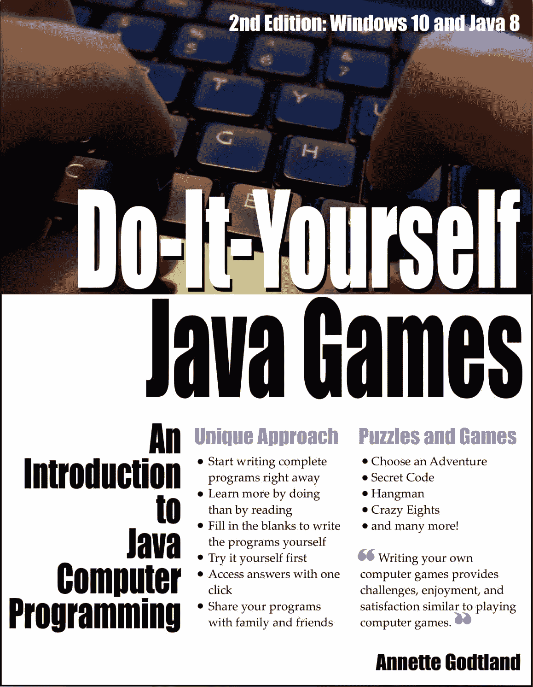

## 我写的其他书籍

## 附录 A：术表

## 附录 B：完成的代码列表

## 附录 C：安装所需的软件和文件

- 创建 Java 工作文件夹
- 下载并安装 Java
- 下载并安装 Eclipse
- 下载 `DIYJava.zip`

# 引言

你喜欢玩电脑游戏吗？你喜欢谜题吗？如果是这样，你可能喜欢计算机编程。

你是一个实践型的人吗？你是否倾向于直接开始项目，而不是先阅读关于事物运作原理的长篇章节？如果一次性呈现过多的技术信息，你会失去兴趣吗？如果是这样，这可能就是适合你的计算机编程书籍。

本书将引导你通过从小步骤开始逐步创建项目来学习 Java 编程。你将创建诸如：选择冒险、秘密代码、疯狂八点等游戏。

每个项目中的课程都采用“尝试一试”的方法：执行所展示的步骤并观察发生了什么。你将获得编程任务，每个任务后面都有一个程序 `code` `listing`。但如果你不确定如何填写空白，不要担心；只需点击列表链接即可查看缺失的 `code`。

不要跳过任何节课程——每节课程都解释了一种新的编程技术，其中大部分在后面的课程中会再次使用。完成所有课程会让后面的课程变得更容易。`附录 A - 术表` 提供了 Java 编程术语的定义以及指向更多信息的链接。每个术语首次出现时（如上面使用的“listing”和“code”），将是一个指向该词的可点击链接。

多种不同的方法可以完成相同的编程任务。如果你的代码实现了要求，或者你喜欢自己代码的效果，就不必使用展示的 `code`。请随意尝试 `code` 并观察结果。编程的乐趣的一半在于让程序实现你想要的结果。

本书为电子阅读器设计。点击下方图片或通过此链接查看视频，视频介绍了电子书中纸质书中无法实现的功能。


点击下方图片或通过此链接观看关于你将在完成本书中的课程时将创建的单词大师、挂单词字游戏和疯狂八点程序的演示。


《动手 Java 游戏》已更新至第二版，以支持 Windows 10 和 Java 8。

# 设置

Java 编程的第一步是安装并设置几个需要的程序。如果你需要更详细的设置说明，请参见 `附录 C - 安装所需的软件和文件`。完成这个简短的设置后，你将编写第一个 Java 程序。

## 创建 Java 工作文件夹

首先，在你的电脑上创建一个用于所有 Java 工作的文件夹。我将我的文件夹命名为 `java` 并将其放在用户文件夹 `c:\Users\Annette` 中。因此，我的 Java 工作文件夹是 `c:\Users\Annette\java`。

如果有多个人要在你的电脑上创建 Java 程序，你应该为每个人创建一个不同的工作文件夹。本书将你需要执行的每个操作都列在编号列表中，如下所示：

1. 在你的电脑上创建一个 Java 工作文件夹。

如果你想查看如何创建工作文件夹的更详细说明，请参见 `附录 C - 安装所需的软件和文件`。

## 下载并安装 Java

创建 Java 程序需要免费的 Java 开发工具包。

1. 从 `http://www.oracle.com/technetwork/java/javase/downloads/index.html` 下载适用于 `Java 标准版 (SE)` 的最新版本 `Java 开发工具包`（`JDK`）。如果你不确定应该下载哪个版本，请参见 `附录 C - 安装所需的软件和文件`。
2. 双击下载的文件进行安装。

## 下载并安装 Eclipse

你将使用免费的 Eclipse Java 开发环境来输入你的 Java 程序代码并创建你的程序。

1. 从 [http://www.eclipse.org/downloads/](http://www.eclipse.org/downloads/) 下载最新版本的 `Eclipse IDE for Java Developers`。
2. 从下载的 `.zip` 文件中提取文件到你的电脑。我把我的放在用户文件夹 `c:\Users\Annette` 中。如果有多人在你的电脑上创建 Java 程序，请为每个额外的人再次提取文件到不同的文件夹中。
3. 在你刚刚解出的 `eclipse` 目录中为 `eclipse.exe` 文件创建一个快捷方式。我的文件位于 `c:\Users\Annette\eclipse`。将此启动 Eclipse 的快捷方式粘贴到你的桌面上。如果有多人在你的电脑上创建 Java 程序，请为你们的每个人创建并重命名一个快捷方式。例如，我将我的重命名为 `Eclipse for Annette`。

如果你想了解有关如何下载和安装 Eclipse 或创建快捷方式的更详细说明，请查看 `附录 C - 安装所需的软件和文件`。

## 下载 DIYJava.zip

课程还需要几个文件。

1. 从 [http://www.godtlandsoftware.com/DIYJava/](http://www.godtlandsoftware.com/DIYJava/) 免费下载 `DIYJava.zip`。
2. 将 `DIYJava.zip` 中的文件提取到你的 Java 工作文件夹中。

如果你想了解有关如何下载 DIYJava.zip 的更详细说明，请查看 `附录 C - 安装所需的软件和文件`。

## 设置 Eclipse

现在一切都已安装完毕，开始设置 Eclipse 了。

1. 双击你的 `Eclipse` 快捷方式。应该会出现此窗口：

   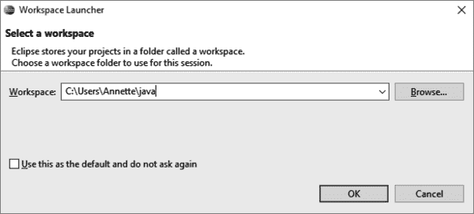

2. 点击 `Browse...` 按钮找到你的 Java 工作文件夹（如上截图所示），然后点击 `OK`。应该会出现此窗口：

   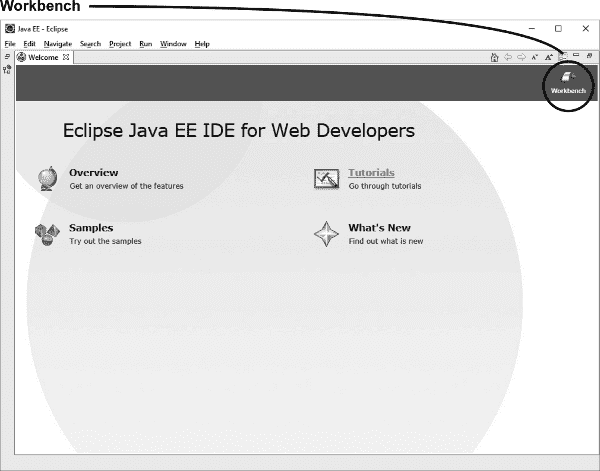

3. 点击 `Workbench` 打开 Eclipse 主窗口。

### 使用 Java 视图

1. 点击 `Window / Perspective / Open Perspective / Java`。

   

### 为编写代码留出更多空间

1. 关闭 `Task list`，如图所示：

   

2. 将 `Outline` 标签页移动到 `Package Explorer` 格的底部，如图所示：

   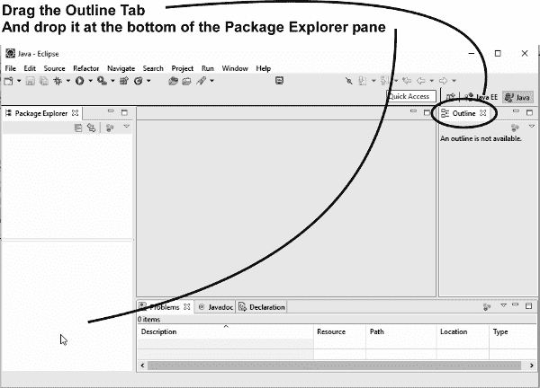

你现在已经了创建第一个程序所需的所有内容！

# 项目 1：Hello World

传统上，每个人的第一个程序都是打印“Hello World”。第一个程序演示了如何创建、保存和运行程序。它还展示了所有 Java 程序中使用的基本结构。

这是 Hello World 程序创建的窗口截图：

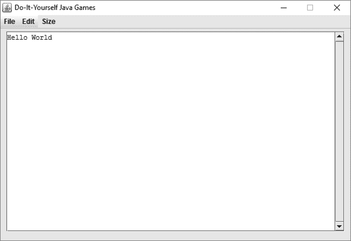

## 课程 1.1：Java 项目和包

程序首先按 Java 项目组织，然后按 Java 项目中的包组织。你将为书中的每个程序创建一个 Java 项目。

包包含通常被一起使用的程序文件。由于书中的程序很小，你创建的大多数 Java 项目将只包含一个包。

在本课程中，你将为你的第一个程序创建一个 Java 项目和一个包。

### 试一试

创建你的第一个 Java 项目，命名为 `Hello World`：

1. 如果 Eclipse 尚未打开：
   1. 双击你在桌面上创建的 `Eclipse` 快捷方式。
   2. 点击 `OK` 使用你的 Java 工作文件夹作为工作空间。
2. 在 `Package Explorer` 格中点击右键并选择 `New / Java Project`。
3. 将 Java 项目命名为 `Hello World`，如果 JRE 是 1.7 或更高，则选择 `Use Default JRE`，然后如下所示点击 `Next`。如果默认 JRE 低于 1.7，选择选项 `Use an execution environment JRE` 并选择 1.7 或更高版本。

   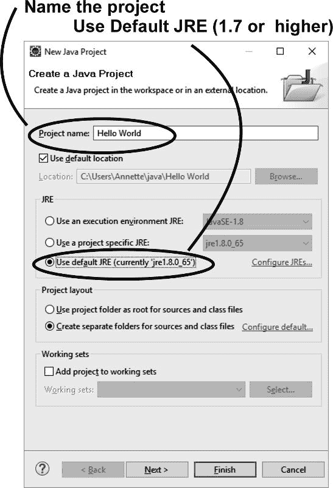

4. 点击 `Libraries`，然后点击 `Add External JARs...`，如下所示。

   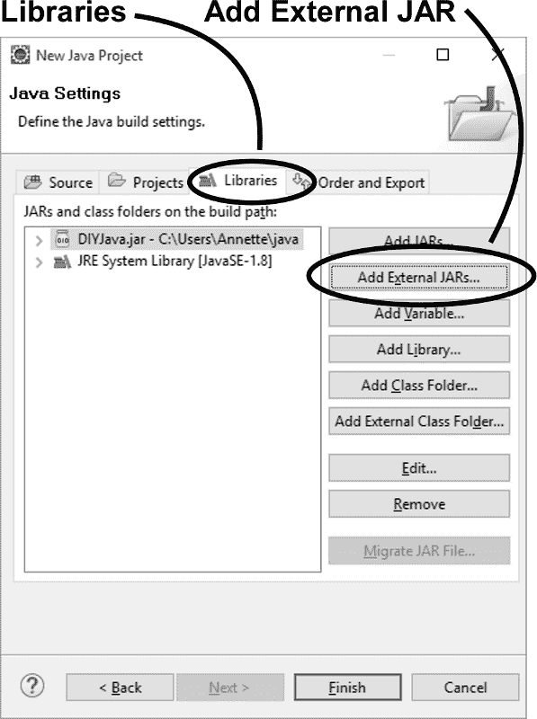

5. 浏览并选择安装在 Java 工作文件夹中的 `DIYJava.jar`，然后点击 `Open`。
6. 点击 `Finish`。

`Package Explorer` 格现在列出了一个项目（`Hello World`）以及添加 JAR 文件（`DIYJava.jar`），如图所示：

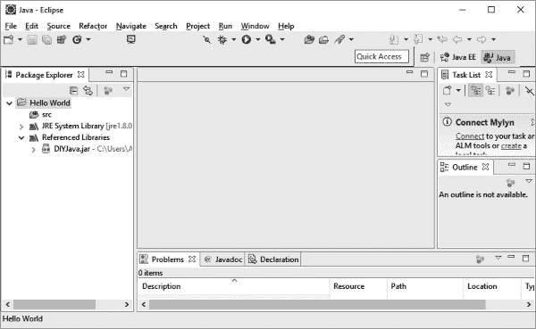

为 `Hello World` 项目中的你的 Hello World 程序创建一个包：

1. 在 `Hello World` 项目上点击右键并选择 `New / Package`。
2. 将包命名为 `annette.godtland`，如图。
3. 点击 `Finish`。

`Package Explorer` 格现在显示你创建的包：

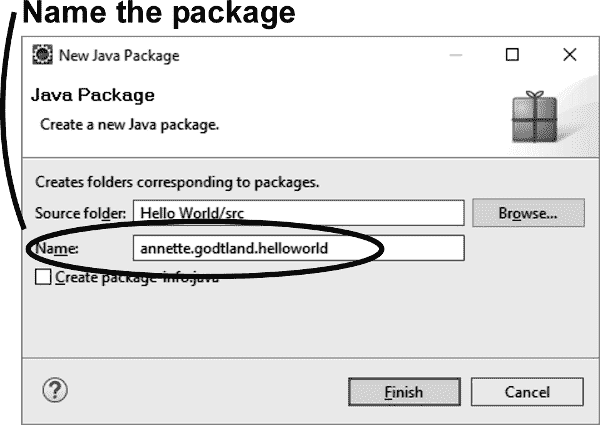

### 关键点及更多

- Java 程序员传统上使用他们的名字或公司名作为包名的第一部分。
- 使用全小写字母且无空格。
- 在包名的不同类别之间使用点。例如，如果包名标识了创建者和用途，在创建者和用途之间加一个点。
- 在创建书中的 Java 项目时，请确保选择 `JavaSE-1.7` 或更高版本。一旦在创建项目时选择了此选项，Eclipse 将对此后的所有项目默认使用该选项。
- Java 项目用于 Eclipse；包用于 Java。由于你正在使用 Eclipse，所以你将同时使用 Java 项目和包。

## 课程 1.2：类、超类和程序

Java 程序由一个或多个类组成。类包含实际的程序代码：按顺序执行所需任务的指令。

每个类都必须指定另一个类作为其超类。例如，打算在窗口中运行的程序必须指定某种窗口类作为其超类。

在本课程中，你将创建你的第一个类：一个运行在 `DIYWindow` 中的程序。

### 试一试

使用 `DIYWindow` 类作为超类创建你的第一个类：

1. 在 `Package Explorer` 格中的你的包上点击右键并选择 `New / Class`。
2. 为类名输入 `HelloWorld`，如下所示。（提示：“Hello”和“World”之间没有空格。）
3. 在 `Superclass` 处点击 `Browse`。
   1. 为 `type` 输入“diy”，选择 `DIYWindow`，如下所示，然后点击 `OK`。

### 4. 你想要创建哪些方法的存根（stubs）？

请选择这些选项，如下所示：

1. `public static void main(String[] args)`
2. 来自父类的 `Constructors`（构造函数）。
3. 是否选择第三选项 `Inherit abstract methods`（继承抽象方法）并不重要。

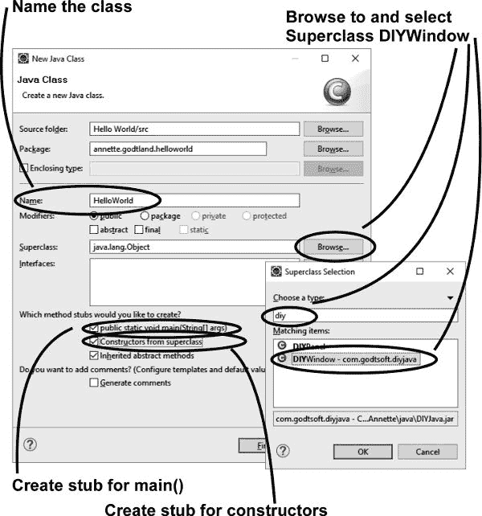

### 5. 点击 `Finish` 完成类的创建

Eclipse 将为 `HelloWorld` 类创建代码，如下所示的代码列表。

如果你将你的电子阅读器设置为较小的字体以尽量减少自动换行，你可能会发现阅读书中的代码列表更容易读。

*列表 1-1，来自 `HelloWorld.java`*

```java
package annette.godtland.helloworld;

import com.godtsoft.diyjava.DIYWindow;

public class HelloWorld extends DIYWindow {

  public HelloWorld() {
    // TODO Auto-generated constructor stub
  }

  public static void main(String[] args) {
    // TODO Auto-generated method stub

  }

}
```

### 完成的代码列表

Eclipse 会添加你不需要的注释代码。注释是以 `//` 开头的行，或者是以 `/*` 开头并 `*/` 结尾的行组。

1. 从此类中删除自动生成的注释行，在下述列表中显示为 `(Code was removed from here.)` 的地方。

*列表 1-2，来自 `HelloWorld.java`*

```java
package annette.godtland.helloworld;

import com.godtsoft.diyjava.DIYWindow;

public class HelloWorld extends DIYWindow {

  public HelloWorld() {

    (Code was removed from here.)

  }

  public static void main(String[] args) {

    (Code was removed from here.)

  }

}
```

### 完成的代码列表

从为本书创建的每个类的程序代码中删除自动生成的注释。你将在稍后的课程中添加你自己的注释。

点击任何 `Completed listing` 链接查看如何完成代码。不过，如果你在查看答案之前尝试自己完成代码，你将学到更多。

以 `public static void main` 开头的代码块被称为 `main()` 方法。以 `public HelloWorld()` 开头的代码块被称为构造函数。

现在，添加你的第一行代码：

1. 完全按照此处所示向构造函数和 `main()` 方法中添加代码。代码的更改始终显示在列表中。

*列表 1-3，来自 `HelloWorld.java`*

```java
package annette.godtland.helloworld;

import com.godtsoft.diyjava.DIYWindow;

public class HelloWorld extends DIYWindow {

  public HelloWorld() {
    print("Hello World");    
  }

  public static void main(String[] args) {
    new HelloWorld();
  }

}
```

### 完成的代码列表

1. 按 `Ctrl-S` 保存程序。
2. 点击如图所示的 `Run` 按钮运行程序：

   

### 发生了什么？

应该会弹出一个窗口显示“Hello World”，如图所示：


1. 你需要对你的类进行哪些更改才能让它向你问好？

*列表 1-4，来自 `HelloWorld.java`*

```java
java
  public HelloWorld() {
    print("Hello ____________");    
  }
```

### 完成的代码列表

1. 保存程序并运行它。

### 如果你出错会发生什么？

1. 错误输入单词“print”并保存程序。

*列表 1-5，来自 `HelloWorld.java`*

```java
  public HelloWorld() {
    printttt("Hello Annette");    
  }
```

### 发生了什么？

出现了许多错误指示，如图所示：


1. 双击 `Problems` 窗口中的错误以查看错误列表。
2. 双击 `Problems` 窗口中的错误描述跳转到错误行。
3. 在 `Problems` 窗口中点击错误进行修复（如下所示）。

   

4. 点击 `Change` 修复 `print(...)`。
5. 保存更改。

所有错误指示都应该消失。

现在，添加你的更多行代码：

1. 完全按照此处所示让代码输出以下内容：

```text
Hello, earthling.

Take me to your leader.
```

*列表 1-6，来自 `HelloWorld.java`*

```java
  public HelloWorld() {
    print("_______________________");    
    print("_______________________");
  }
```

### 完成的代码列表

在课程期间，除非有语法错误，否则保存更改并运行程序。

它的输出正确了吗？如果没有，修复代码并再次尝试。

1. 让代码输出以下内容（提示：你需要在两个句子之间输出一个空行）：

*列表 1-7，来自 `HelloWorld.java`*

```java
  public HelloWorld() {
    print("Hello, earthling.");    
    print("___");    
    print("Take you to your leader.");
  }
```

### 完成的代码列表

- 代码行之间的空行不会影响代码的运行。添加空行是为了方便你阅读代码。
- `print()` 语句将括号内的文本打印到窗口中。
  - 每个 `print()` 语句都会在一个新行打印。
  - 要打印空行，请使用带有空括号的 `print()`。
  - `print()` 方法是 `DIYWindow` 的一部分，该类位于 `DIYJava.jar` 中。这就是为什么你需要将外部 JAR 文件 `DIYJava.jar` 添加到项目中，以及为什么你选择 `DIYWindow` 作为 `HelloWorld` 类的父类。
- 注释是指以 `//` 开头的行，或者以 `/*` 开头并 `*/` 结尾的一组行。
  - 移除 Eclipse 在创建类时自动生成的注释。
  - 你将在稍后的课程中添加你自己的注释。
- 按 `Ctrl-S` 保存你的程序。
- 点击 `Run` 按钮运行你的程序。`Run` 按钮看起来像典型的播放按钮。
- 除非你有语法错误或被告知不要这样做，否则在完成每个代码列表的更改后，保存并运行你的程序。


自动换行可能会导致代码列表难以阅读。为了减少换行，请将你的电子阅读器设置为较小的字体。

点击任何列表下方的 `Completed Listing` 链接查看如何完成代码。然而，如果你的代码实现了相同的功能或者你更喜欢你的代码，你可以以不同的方式完成列表。

你创建的每个类不会使用相同的选项。在创建每个类时，务必完全按照书面说明操作。

显示的窗口使用默认字体大小 12。窗口菜单在窗口打开后有一个更改字体大小的选项。要更改书中任何程序使用的默认字体大小，请在构造函数的开头添加以下代码行：

```
setFontSize(__);
```

例如，要将 `HelloWorld` 的默认字体大小改为 18，请使用：

```java
public HelloWorld() {
  setFontSize(18);
  print("Hello, earthling.");		
  print();		
  print("Take me to your leader.");		
}
```

本书中的程序都没有更改默认字体大小。在你想要更改默认字体大小的任何程序的构造函数中添加 `setFontSize` 代码行。

## 课程 1.3 - 变量与字符串

变量是命名的数据片段。字符串变量持有字符数据序列（文本）。如果你将文本放入字符串中，你就可以保存、使用和重复使用文本。

### 尝试一下

1. 将类构造函数中的代码替换为以下代码。按照所示精确输入代码。

*列表 1-8，来自 `HelloWorld.java`*

```java
 ...

  public HelloWorld() {
    String word1 = "Jeff's";
    String word2 = "awesome";
    String word3 = "dog";
    print(word1);    
    print(word2);    
    print(word3);    
  }
    ...
```

*[完成后的列表]*

它打印了什么？

1. 反转前 2 个 `print` 语句的内容。

*列表 1-9，来自 `HelloWorld.java`*

```java
 ...

  public HelloWorld() {
    String word1 = "Jeff's";
    String word2 = "awesome";
    String word3 = "dog";
    print(word2);    
    print(word1);    
    print(word3);    
  }
    ...
```

*[完成后的列表]*

注意，单词是 `print` 语句的顺序打印的。

1. 按照所示重新排列行。

*列表 1-10，来自 `HelloWorld.java`*

```java
 ...

  public HelloWorld() {
    String word1 = "Jeff's";
    print(word1);    
    String word2 = "awesome";
    print(word2);    
    String word3 = "dog";
    print(word3);    
  }
    ...
```

*[完成后的列表]*

它打印了什么？

1. 按照所示交换前 2 行。

*列表 1-11，来自 `HelloWorld.java`*

```java
 ...

  public HelloWorld() {
    print(word1);    
    String word1 = "Jeff's";
    String word2 = "awesome";
    print(word2);    
    String word3 = "dog";
    print(word3);    
  }
    ...
```

*[完成后的列表]*

你在第一个 `print` 语句中收到一个语法错误，内容为：

```
word1 cannot be resolved to a variable.
```

1. 将所有代码移动到构造函数的开头。

2. 多次添加语句。

*列表 1-12，来自 `HelloWorld.java`*

```java
 ...

  public HelloWorld() {
    String word1 = "Jeff's";
    String word2 = "awesome";
    String word3 = "dog";
    print(word2);    
    print(word1);    
    print(word3);    
  }
    ...
```

*[完成后的列表]*

### 关键点及更多

* 变量是数据片段。

* 要声明变量，请给出一个名称，例如：`String option = "Yes";`

* 变量名可以包含数字。

* 变量名不能以数字开头。

* 变量名通常以小写开头。

* 字符串变量通常简单称为“字符串”。

* 赋值只进行一次。

* 变量可以任意顺序声明，但在使用它们之前必须声明。

* 要声明变量，请给出一个名称，例如：`String option = "No";`

* 字符串变量通常简单称为“字符串”。

* 赋值只进行一次。

## 课程 1.4 - 拼接字符串、转义字符

加号用于拼接字符串。转义字符用于在字符串中使用特殊字符。

### 尝试一下

1. 添加一个新字符串变量 `statement`，连接 `word1`、`word2` 和 `word3`，并打印它的值。

*列表 1-13，来自 `HelloWorld.java`*

```java
 ...

  public HelloWorld() {
    String word1 = "Jeff's";
    String word2 = "awesome";
    String word3 = "dog";
    String statement = word1 + word2 + word3;
    print(statement);
  }
    ...
```

1. 在每个单词之间添加空格。（提示：空格应输入为引号之间的空格，`" "`。）

*列表 1-14，来自 `HelloWorld.java`*

```java
 ...

  public HelloWorld() {
    String word1 = "Jeff's";
    String word2 = "awesome";
    String word3 = "dog";
    String statement = word1 + " " + word2 + " " + word3;
    print(statement);    
  }
    ...
```

你可以通过使用换行符号 `"\n"` 将字符串分成两行。

1. 替换构造函数中的所有代码并按照所示精确输入代码。

*列表 1-15，来自 `HelloWorld.java`*

```java
 ...

  public HelloWorld() {
    String greeting = "Hello, Annette.\nHow are you?";
    print(greeting);    
  }
    ...
```

1. 你如何修改 `greeting` 字符串，使其在两行文本之间包含空行，如下列表所示？（提示：必须开始第二个换行符。）

```
Hello Annette.

你好吗？
```

列表 1-16，来自 `HelloWorld.java`

```
 ...

  public HelloWorld() {
    String greeting = "Hello, Annette.________How are you?";
    print(greeting);    
  }
    ...
```

已完成的列表

1. 替换构造函数中的所有代码，完全按照所示操作，并尝试将引号作为打印内容的一部分，如下所示：

```
Annette said to say "hi".
```

列表 1-17，来自 `HelloWorld.java`

```
 ...

  public HelloWorld() {
    print("Annette said to say "hi".");    
  }
    ...
```

已完成的列表

### 理解错误和转义字符

发生了什么？你收到了一个错误。在字符串中，你想显示的每个双引号之前都要加上转义字符（反斜杠 `\`）。否则，Java 会认为引号是用来开始或结束字符串的。

如何记住哪种斜杠 `\` 或 `/` 被称为反斜杠（backslash）？反斜杠 `\` 是顶部向后倾斜的，而正斜杠 `/` 是顶部向前倾斜的。在 Java 中，反斜杠 `\` 是转义字符，而正斜杠 `/` 是除法符号。除法将在后面的课程中介绍。

1. 在围绕 `'hi'` 的每个双引号之前添加转义字符（反斜杠）。

列表 1-18，来自 `HelloWorld.java`

```
 ...

  public HelloWorld() {
    print("Annette said to say \"hi\".");    
  }
    ...
```

已完成的列表

但如果你想在字符串中包含一个反斜杠 `\` 呢？在字符串中你想显示的每个反斜杠之前加上转义字符（反斜杠 `\`）。

例如，要打印 `http:\`，请使用：

```
print("http:\\\\");
```

1. 在需要的地方使用转义字符修改代码，使其打印出以下行。（提示：并不是所有的空处都需要转义字符。）

```
My user folder is "c:\Users\Annette".
```

列表 1-19，来自 `HelloWorld.java`

```
 ...

  public HelloWorld() {
    print(__"My user folder is __"c:__\Users__\Annette__".__");    
  }
    ...
```

已完成的列表

### 关键点与更多

* 使用加号 `+` 将字符串连接在一起。

* 在字符串中使用转义字符（反斜杠 `\`）来处理特殊字符：

    * 字符串中的 `\n` 会导致其后的任何内容都打印到新行。

    * `\"` 可用于在字符串中包含双引号。

    * `\\` 可用于在字符串中包含反斜杠。

## 项目 2 - ASCII 艺术

是时候发挥一点创造力了。你将学习在这个 ASCII 程序中制作一些图形，然后将你完成的程序分享给其他人。这是一张 ASCII 艺术的截图：`images/0019.jpeg`

## 课程 2.1 - 可打印字符

`ASCII` 代表美国标准交换代码。`ASCII` 是电子设备上可以显示的每个字符的标准数值代码。这确保了所有电子设备对代码都显示相同的字符。ASCII 艺术是用在键盘上输入的字符制成的图片。

### 它

在你创建程序时，请记住 Java 项目名称、包名和类名相似，但有细微区别：

* Java 项目名称：每个单词的首字母大写；单词之间使用空格。

* 包名：使用全小字母；删除单词之间的空格。

* 类名：每个单词的首字母大写；删除单词之间的空格。

开始编写下一个程序：

1. 创建一个名为 `ASCIIArt` 的新项目，并将 `Java.jar` 添加到项目中。

2. 在项目中创建一个名为 `asciiart` 的新包。

3. 创建一个名为 `ASCIIArt` 的新类，带有 `DIYWindow` 以及 `main()` 方法及其构造函数的存根。

4. 在 `main()` 中添加代码调用 `ASCIIArt()`。

列表 2-1，来自 `ASCIIArt.java`

```
package annette.godtland.asciiart;

import com.godtsoft.diyjava.DIYWindow;

public class ASCIIArt extends DIYWindow {

  public ASCIIArt() {
  }

  public static void main(String[] args) {
    new ASCIIArt();
  }
}
```

已完成的列表

1. 在构造函数中添加代码打印一个大大的 "H"。

```
 ...

  public ASCIIArt() {
    print("H  H");
    print("H  H");
    print("HHHH");
    print("H  H");
    print("H  H");
  }
    ...
```

已完成的列表

1. 修改程序用大字母打印你的字母缩写。我的缩写是 `AMG`。

```
 ...

  public ASCIIArt() {
    print("_____________________________");
    print("_____________________________");
    print("_____________________________");
    print("_____________________________");
    print("_____________________________");
  }
    ...
```

已完成的列表

你可以用键盘上的字符创建不仅仅是缩写的内容。例如：

```
 @@@@@@
  |      |
  | (o)(o)
 C       _)
  |   ___|
  |    /
 /     \
```

1. 修改代码打印上面的图像（提示：使用转义字符打印反斜杠 `\`）。

```
 ...

  public ASCIIArt() {
    print("_____________________________");
    print("_____________________________");
    print("_____________________________");
    print("_____________________________");
    print("_____________________________");
    print("_____________________________");
    print("_____________________________");
    print("_____________________________");
  }
    ...
```

已完成的列表

这里是你可以从字符中创建的更多图像。（提示：如果字体换行，很难正确看到这些图像）。

冬季场景：

```
     /\
'


``````````````````

```


 
```

单轮车：

```
 -o  
   o   
   '     
   \__/
     I
    /T   
    \|/    
```

船只只和轮船：

```
 |    |    |
             )_)  )_)  )
            )______)
```

企鹅：

```
 __
( o>
///\
\V_/_
```

鲸鱼：

```
     .-'
'--./ /     _.---
'-,  (__..`       \
   \          .     |
    `,.__.   __.--/
```

猫：

```
 /\_/\
   ____/ o \
 /~____  ø= /
(______)__m_m)
```

恐龙：

```
 __
              / _)
     _/\/\/\_/ /
   _|         /
 _|  (| (  |
/__.-'|_|--|_
```

舞会：

```
 O      O
 \|__  __|/
_/|_    _|\
```

剑击：

```
/\O__/  /\___    O
  |               <|
_
```````````````

````````````
```

```
```

```
```

```
```

```
```

```
```

```
```

```
```

```
```

```
```

```
```

```


```

```


```

```


``````

城堡：

```
         

____

```

|

```
```

房子：

```
 @ @ @
       []___
      /    /\____
(~)  /_/\_//____/\
 |   | |||__|||
```

```
 |ZZzz
   |Zzz  |     |Zzz
  /_\ /\ | /\ /_\
  |*|_||/_\||_|*|
  |.....|*|.....|
__~| .. !~! .. |~___
.*.|____|_|____|.*. 
```

### 生日蛋糕 (Birthday cake):

```
 iiiiiiiiii
          |:H:a:p:p:y:|
        __|___________|__
       |^^^^^^^^^^^^^^^^^|
       |:B:i:r:t:h:d:a:y:|
       |                 |
       ~~~~~~~~~~~~~~~~~~~
```

### 飞船 (Space ship):


```text
___________________          _-_ 
\==============_=_/ ____.---'---`---.____
            \_ \    \----._________.----/
              \ \   /  /    `-_-'
          __,--`.`-'..'-_
         /____          ||
              `--.____,-'
```

1. 使用输入的字符创建你自己的设计。

*来自 `ASCIIArt.java` 的列表 2-5*

---

```java
...

public ASCIIArt() {
  print("_____________________________");
  print("_____________________________");
  print("_____________________________");
  print("_____________________________");
  print("_____________________________");
  print("_____________________________");
  print("_____________________________");
  print("_____________________________");
}
...
```

---

*已完成的列表*

## 字体关键点及更多内容

- 仅使用可输入的字符就可以制作非常漂亮的图片。
- 如果你想打印双引号或反斜杠，别忘记使用转义字符。

# 课程 2.2 - 导出程序（Export a Program）

如果你想在没有 Eclipse 的情况下运行程序，或者想在不同的计算机上运行它，你必须 `export`（导出）完成后的程序。

如果你导出了程序，它将在你的计算机上生成一个 `JAR` 文件（Java 归档文件）。`JAR` 文件名以 `.jar` 结尾。要运行程序，双击 `JAR` 文件即可。

## 尝试一下（Try It）

1. 在 `Package Explorer` 格中右键点击 `ASCII Art` 项目并选择 `Export`。
2. 如下图所示，选择 `Runnable JAR File`，并点击 `Next`。
3. 如下所示，选择 `ASCIIArt` `Launch configuration`（启动配置）。
4. 如下所示，在 `Export destination`（导出目标）处输入 `ASCIIArt.jar`。
5. 如图所示，选择 `Package required libraries into generated JAR`（将所需的库打包到生成的 JAR）选项：


6. 点击 `Finish` 完成导出。

要在没有 Eclipse 的情况下运行你的程序：

1. 在你的 Java 工作文件夹中找到 `ASCIIArt.jar`。
2. 双击 `ASCIIArt.jar`。

## 关键点及更多内容

- 如果你想在 Eclipse 之外或不同的计算机上运行程序，请将程序导出为 `JAR` 文件。
- 你可以将不同版本的程序保存在不同的 `JAR` 文件中。例如，你可能为不同的 ASCII 图片准备不同的 `JAR` 文件。使用所有相同的导出选项，但为每个版本的程序命名不同的 `Export destination`。
- 你导出的 `JAR` 文件可以在任何安装了 `Java Runtime Environment`（Java 运行时）的 Windows、Mac、Linux 或 Solaris 计算机上运行。
  - 大多数计算机为了运行其他程序已经安装了 `Java Runtime Environment`。
  - `Java Runtime Environment` 已在你安装的 `Java Development Kit`（Java 开发工具包）中。因此，它已经安装在你的计算机上。
  - 任何人都可以从 [http://java.com/en/download/index.jsp](http://java.com/en/download/index.jsp) 下载并安装 `Java Runtime Environment`，而无需 `Java Development Kit`。

# 课程 2.3 - 分享程序（Share a Program）

有很多方法可以分享你的程序。本课将教你如何使用 `Google Drive` 和 `Facebook` 分享程序。这些说明假设你已经拥有 Google 和 Facebook 账号。

查看本课末的“关键点及更多内容”了解分享程序的其他方法。

## 尝试一下（Try It）

1. 进入 [Google Drive](http://drive.google.com/) 并登录你的账号。
2. 点击如下所示的 `new` 按钮并选择 `File upload`（上传文件）。


3. 浏览并选择你想分享的 `JAR` 文件。
4. 上传完成后，右键点击上传的 `JAR` 文件并选择 `Share`（分享）。
5. 点击窗口右下角的 `Advanced`（高级）链接：


6. 点击如下所示的 `Share link via Facebook`（通过 Facebook 分享链接）按钮。
7. 编写一条 `Facebook` 动态来介绍你的链接。


## 关键点及更多内容

- 要分享程序，请执行以下操作之一：
  - 将 `JAR` 文件作为附件通过电子邮件发送给朋友。
  - 将 `JAR` 文件放在网上，然后分享该文件的链接。
- 要将你的 `JAR` 文件放在网上，请执行以下操作之一：
  - 将其放在你自己的网站上。
  - 将其放在 Google Drive 上。
  - 将其放入 Dropbox。

# 3.1 - 重用字符串（Reuse Strings）

字符串变量可以设置一次，然后多次使用。字符串变量使得更改单词或短语变得简单。

## 尝试一下（Try It）

1. 创建一个名为 `Name Game` 的新 Java 项目并添加 `ASCIIArt`。
2. 在项目中创建一个名为 `namegame` 的新 `package`（包）。
3. 创建一个自 `DIYWindow` 的新 `class`（类），并包含 `main()` 方法存根。
4. 在 `main()` 中编写代码调用 `NameGame` 构造函数。

*列表 3-1，来自 `NameGame.java`*

---

```java
package namegame;

import com.soft.diyWindow;

public class NameGame extends DIYWindow {

  public NameGame() {
  }

  public static void main(String[] args) {
    new NameGame();
  }
}
```

---

*已完成的列表*

1. 打印“Jack be Nimble”童歌：

```text
Jack be nimble,
Jack be quick,
Jack jump over the candlestick.
```

*列表 3-2，来自 `NameGame.java`*

---

```java
...

public NameGame() {
  print("______________________");
  print("______________________");
  print("______________________");
}
...
```

---

*已完成的列表*

1. 添加代码将 Jack 的名字放入名为 `name` 的字符串中。
2. 修改代码打印连接了“ be nimble.”的 `name`。

*列表 3-3，来自 `NameGame.java`*

---

```java
...

public NameGame() {
  String name = "Jack";
  print(name + " be nimble,");
  print("Jack be quick,");
  print("Jack jump over the candlestick.");
}
...
```

---

*已完成的列表*

1. 修改代码使用**你的**名字配合“ be nimble,”。

*列表 3-4，来自 `NameGame.java`*

---

```java
...

public NameGame() {
  String name = "_______________";
  print(name + " be nimble,");
  print("Jack be quick,");
  print("Jack jump over the candlestick.");
}
...
```

---

*已完成的列表*

1. 你会如何修改剩下的行，让它们也使用你的名字而不是 Jack 的名字？

*列表 3-5，来自 `NameGame.java`*

---

```java
...

public NameGame() {
  String name = "Annette";
  print(name + " be nimble,");
  print(____________________________);
  print(_____________________________);
}
...
```

---

*已完成列表*

1. 在童歌之后添加代码，以便在童歌后打印一个空行。
2. 添加代码打印“Way to go, _____!”，使用你的名字。（提示：使用字符串变量。）

*列表 3-6，来自 `NameGame.java`*

---

```java
...

public NameGame() {
  String name = "Annette";
  print(name + " be nimble,");
  print(name + " be quick,");
  print(name + " jump over the candlestick.");
  print(____);
  print(_____________________________);
}
...
```

---

*已完成列表*

## 关键点与更多

- 如果你想在程序中使用某段文本，请将其放入字符串变量中。
- 字符串变量允许你轻松更改程序以使用不同的数据运行。

# 项目 4 - 愚蠢故事

接下来，你将编写一个程序，根据童歌创建一个愚蠢的故事。

这是愚蠢故事程序的截图：

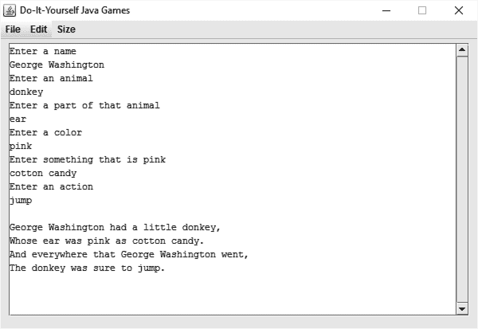

## 课程 4.1 - 输入字符串

在之前的程序中，你必须编写程序代码来给字符串变量分配不同的值。相反，你可以在程序运行时让用户输入一个值。

### 尝试一下

开始编写下一个程序：

1. 创建一个名为 `Silly Story` 的新 `Java project` 并将 `DIYJava.jar` 添加到项目中。
2. 在项目中创建一个名为 `___________._____________.sillystory` 的新 `package`。
3. 创建一个名为 `SillyStory` 的新 `class`，父类为 `DIYWindow`，并为 `main()` 及其构造函数编写存根。
4. 在 `main()` 中添加代码调用 `SillyStory` 构造函数。
5. 在构造函数中打印童歌“Mary Had a Little Lamb”：

```text
Mary had a little lamb,
Whose fleece was white as snow.
And everywhere that Mary went,
The lamb was sure to go.
```

*列表 4-1，来自 `SillyStory.java`*

---

```java
package annette.godtland.sillystory;

import com.godtsoft.diyjava.DIYWindow;

public class SillyStory extends DIYWindow {

  public SillyStory() {
    print("Mary had a little lamb,");
    print("________________________________");
    print("________________________________");
    print("________________________________");
  }

  public static void main(String[] args) {
    new _________________;
  }
}
```

---

*已完成列表*

之前的课程向你展示了每当单词在程序中出现时如何轻松更改。

1. 现在，将故事中 Mary 的名字替换为你的名字。

*列表 4-2，来自 `SillyStory.java`*

---

```java
...

public SillyStory() {
  String name = "_____________________";
  print(___________ + " had a little lamb,");
  print("Whose fleece was white as snow.");
  print("And everywhere that " + __________ + " went,");
  print("The lamb was sure to go.");
}
...
```

---

*已完成列表*

1. 按照所示输入代码，以便用户可以输入名字。

*列表 4-3，来自 `SillyStory.java`*

---

```java
...

public SillyStory() {
  String name = input();
  print(name + " had a little lamb,");
  print("Whose fleece was white as snow.");
  print("And everywhere that " + name + " went,");
  print("The lamb was sure to go.");
}
...
```

---

*已完成列表*

1. 运行程序时，输入名字并按 `Enter` 键。

让程序更容易用：

1. 在代码等待 `input()` 之前告诉用户输入名字。
2. 在代码打印故事之前打印一个空行。

*列表 4-4，来自 `SillyStory.java`*

---

```java
...

public SillyStory() {
  print(_______________);
  String name = input();
  print(____);
  print(name + " had a little lamb,");
  print("Whose fleece was white as snow.");
  print("And everywhere that " + name + " went,");
  print("The lamb was sure to go.");
}
...
```

---

*已完成列表*

你还可以替换什么？

1. 将故事中的“lamb”替换为任何动物，“fleece”替换为颜色，“snow”替换为动作。

*列表 4-5，来自 `SillyStory.java`*

---

```java
...

public SillyStory() {
  print(_______________);
  print(____);
  print(_);
  print("Whose fleece was white as snow.");
  print("And everywhere that " + name + " went,");
  print("The lamb was sure to go.");
}
...
```

---

*已完成列表*

如果你想运行它，导出它：

1. 右键点击 `Silly Story` 项目并选择 `Export`。
2. 选择 `JAR File`。
3. 为 `Launch configuration` 选择 `SillyStory`。
4. 为 `Export destination` 输入 `SillyStory.jar`。
5. 选择所需的 `libraries`。
6. 点击 `Finish` 完成导出。

## 关键点与更多

- 为了创建一个愚蠢的故事，替换已知故事或你编写的故事中的单词。
- 使用 `input()` 请求输入。
- 首先，将 `input()` 获取的数据放入字符串中。
- `input()` 是 `DIYWindow` 类中的方法，位于 `DIYJava.jar` 中。
- 方法将在后续课程中详细解释。


# 项目 5：重命名游戏

如果用户可以输入任何名字，并且程序根据名字打印不同的消息，重命名游戏将更有趣。

这是重命名游戏程序的截图：


## 课程 5.1：`if` 语句，相等或包含字母的字符串

`if` 语句允许条件为真时运行一段代码，为假时运行另一段代码。

在本课程中，你将检查字符串是否等于、以……开头、以……结尾或包含另一个字符串。你将为不同的名字打印不同的消息。

### 尝试一下

回到重命名游戏程序。

1. 你如何告诉用户输入名字，然后等待他/她输入名字？

**列表 5-1，来自 `NameGame.java`**

```java
...

public NameGame() {
  print(___________________);
  String name = ______________________;
  print(name + " be nimble,");
  print(name + " be quick,");
  print(name + " jump over the candlestick.");
  print("");
  print("Way to go, " + name + "!");
}

...
```

**已完成列表**

你认为这段代码会打印两个字符串中的哪一个？

```java
if (true) {
  print("I like dogs.");
}
else {
  print("I like cats.");
}
```

如果你猜的是“I like dogs”，你对了。

你能猜到什么会让它打印“I like cats.”吗？

```java
if (__________) {
  print("I like dogs.");
}
else {
  print("I like cats.");
}
```

如果你猜的是“false”，你对了。

这些被称为 `if` 语句。

将 `name` 的值与 “Jack” 比较将得到 `true` 或 `false` 条件。

1. 按照所示添加代码。

**列表 5-2，来自 `NameGame.java`**

```java
...

public NameGame() {

  ...

  print("Way to go, " + name + "!");

  if (name.equals("Jack")) {
    print(name + ", your jumping skills are famous!");
  }
  else {
    print(name + ", I've never heard of you.");
  }

  ...
```

**完成的列表**

1. 多次运行程序，有时输入 “Jack”，有时输入不同的名字。
2. 添加另一个 `if` 语句，如果 `name` 是你的名字，则输出特殊的内容。

**列表 5-3，来自 `NameGame.java`**

```java
...

public NameGame() {

  ...

  print(name + ", I've never heard of you.");
}

if (name.equals("_________________")) {
  print(name + "____________________________________");
}
else {
  print(name + "____________________________________");
}

...
```

**完成的列表**

其他常见的字符串测试还有：`startsWith()`、`endsWith()` 和 `contains()`。例如，要检查 `name` 是否以 “A” 开头，使用：

```java
if (name.startsWith("A"))
```

你也可以像这样使用不带 `else` 块的 `if` 语句：

```java
if (name.startsWith("A")) {
  print("Go to the front of the line.");
}
```

如果 `name` 不以 “A” 开头，上面的代码将不会打印任何内容。

1. 如果是国王，打印 “Your highness!”。（提示：检查名字是否以 “King” 开头。）

**列表 5-4，来自 `NameGame.java`**

```java
...

public NameGame() {

  ...

  print(name + ", are you a Java programmer?");

  if (name.startsWith("_____________")) {
    print("Your highness!");
  }

  ...
```

**完成的列表**

要检查字符串是否**不**符合标准，请在测试前面加上非操作符 `!`。例如，要检查 `name` 是否**不是** Annette，使用：

```java
if (!name.equals("Annette"))
```

1. 如果名字不是 `Billy`，打印 “I'm waiting for Billy.”。

**列表 5-5，来自 `NameGame.java`**

```java
...

public NameGame() {

  ...

  print("Your highness!");
}

if (_________________________) {
  print("I'm waiting for Billy.");
}

...
```

**完成的列表**

如果一个字符串值包含多个单词，单词之间应该有一个空格。

1. 你如何检查用户是否只输入了姓或名？（提示：检查 `name` 中是否包含空白字符。）

**列表 5-6，来自 `NameGame.java`**

```java
...

public NameGame() {

  ...

  print("I'm waiting for Billy.");
}

if (____name.contains(" ")) {
  print("Don't you have a first and last name?");
}

...
```

**完成的列表**

你还可以检查多个条件。使用逻辑或操作符 `||` 来测试一个条件**或**另一个条件，并使用逻辑与操作符 `&&` 来测试一个条件**和**另一个条件。

1. 修改打印 “Your highness!” 的代码，现在对于国王或皇后都打印相同的内容。

**列表 5-7，来自 `NameGame.java`**

```java
...

public NameGame() {

  ...

  if (name.startsWith("King") || name.startsWith("___________")) {
    print("Your highness!");
  }

  ...
```

**完成的列表**

编写代码实现：

1. 如果名字是医生（以 “Dr.” 开头）但不是 “Dr. Frankenstein”，让用户知道可能有医疗紧急情况。
2. 否则，如果名字是 “Dr. Frankenstein”，告诉用户不需要帮助。
3. 否则，询问是否有医生。

**列表 5-8，来自 `NameGame.java`**

```java
...

public NameGame() {

  ...

  print("Don't you have a first and last name.");
}

if (__________________________) {
  print("Doctor, this may be an emergency!");
}
else if (___________________________) {
  print("Doctor, no help is needed.");
}
else {
  print("Is there a doctor?");
}

...
```

**完成的列表**

# 项目 6：冒险

接下来，你将创建一个让读者选择接下来发生什么的程序。这是冒险程序的截图：

## 关键点

- 将 `name` 的值与 “Jack” 比较将得到 `true` 或 `false` 条件。

1. 按照所示添加代码。

**列表 5-2，来自 `NameGame.java`**

```java
...

public NameGame() {

  ...

  print("Way to go, " + name + "!");

  if (name.equals("Jack")) {
    print(name + ", your jumping skills are famous!");
  }
  else {
    print(name + ", I've never heard of you.");
  }

  ...
```

**完成的列表**

1. 多次运行程序，有时输入 “Jack”，有时输入不同的名字。
2. 添加另一个 `if` 语句，如果 `name` 是你的名字，则输出特殊的内容。

**列表 5-3，来自 `NameGame.java`**

```java
...

public NameGame() {

  ...

  print(name + ", I've never heard of you.");
}

if (name.equals("_________________")) {
  print(name + "____________________________________");
}
else {
  print(name + "____________________________________");
}

...
```

**完成的列表**

其他常见的字符串测试还有：`startsWith()`、`endsWith()` 和 `contains()`。例如，要检查 `name` 是否以 “A” 开头，使用：

```java
if (name.startsWith("A"))
```

你也可以像这样使用不带 `else` 块的 `if` 语句：

```java
if (name.startsWith("A")) {
  print("Go to the front of the line.");
}
```

如果 `name` 不以 “A” 开头，上面的代码将不会打印任何内容。

1. 如果是国王，打印 “Your highness!”。（提示：检查名字是否以 “King” 开头。）

**列表 5-4，来自 `NameGame.java`**

```java
...

public NameGame() {

  ...

  print(name + ", are you a Java programmer?");

  if (name.startsWith("_____________")) {
    print("Your highness!");
  }

  ...
```

**完成的列表**

要检查字符串是否**不**符合标准，请在测试前面加上非操作符 `!`。例如，要检查 `name` 是否**不是** Annette，使用：

```java
if (!name.equals("Annette"))
```

1. 如果名字不是 `Billy`，打印 “I'm waiting for Billy.”。

**列表 5-5，来自 `NameGame.java`**

```java
...

public NameGame() {

  ...

  print("Your highness!");
}

if (_________________________) {
  print("I'm waiting for Billy.");
}

...
```

**完成的列表**

如果一个字符串值包含多个单词，单词之间应该有一个空格。

1. 你如何检查用户是否只输入了姓或名？（提示：检查 `name` 中是否包含空白字符。）

**列表 5-6，来自 `NameGame.java`**

```java
...

public NameGame() {

  ...

  print("I'm waiting for Billy.");
}

if (____name.contains(" ")) {
  print("Don't you have a first and last name?");
}

...
```

**完成的列表**

你还可以检查多个条件。使用逻辑或操作符 `||` 来测试一个条件**或**另一个条件，并使用逻辑与操作符 `&&` 来测试一个条件**和**另一个条件。

1. 修改打印 “Your highness!” 的代码，现在对于国王或皇后都打印相同的内容。

**列表 5-7，来自 `NameGame.java`**

```java
...

public NameGame() {

  ...

  if (name.startsWith("King") || name.startsWith("___________")) {
    print("Your highness!");
  }

  ...
```

**完成的列表**

编写代码实现：

1. 如果名字是医生（以 “Dr.” 开头）但不是 “Dr. Frankenstein”，让用户知道可能有医疗紧急情况。
2. 否则，如果名字是 “Dr. Frankenstein”，告诉用户不需要帮助。
3. 否则，询问是否有医生。

**列表 5-8，来自 `NameGame.java`**

```java
...

public NameGame() {

  ...

  print("Don't you have a first and last name?");
}

if (__________________________) {
  print("Doctor, this may be an emergency!");
}
else if (___________________________) {
  print("Doctor, no help is needed.");
}
else {
  print("Is there a doctor?");
}

...
```

**完成的列表**

## 课程 6.1：长字符串

有时字符串长到无法很好地适应 Eclipse 窗口。本课程将展示如何为冒险输入长段落。

### 尝试一下

开始编写下一个程序：

1. 创建一个名为 *Choose an Adventure* 的 Java 项目并将 *DIYJava.jar* 添加到项目中。
2. 在项目中创建一个新包 `._.chooseanadventure`。
3. 创建一个新类 *ChooseAnAdventure*，父类为 *DIYWindow*，并为 `main()` 和其构造函数留存。
4. 在 `main()` 中添加代码调用 `ChooseAnAdventure` 构造函数。

**列表 6-1，来自 `ChooseAnAdventure.java`**

```java
package annette.godtland.chooseanadventure;

import com.godtsoft.diyjava.DIYWindow;

public class ChooseAnAdventure extends DIYWindow {

  public ChooseAnAdventure() {
  }

  public static void main(String[] args) {
    new _________________;
  }
}
```

**完成的列表**

这是冒险故事的开头：

```text
I woke up in unfamiliar woods. I was hungry and tired. I didn't know where I was. In my pocket were three beans. Up the hill was a well. To the right was a small cottage.
```

为了打印故事的开头，你可以使用这样的打印语句：

```java
print("I woke up in unfamiliar woods. I was hungry and tired. I didn't know where I was. In my pocket were three beans. Up the hill was a well. To the right was a small cottage.");
```


但 Eclipse 对长行的换行并不美观。因此，相反将短字符串连接在一起。

1. 创建一个名为 `story` 的字符串。
2. 每次向 `story` 添加一个句子。
3. 打印 `story`。

*列表 6-2，来自 `ChooseAnAdventure.java`*

```java
...

public ChooseAnAdventure() {
  String story = "I woke up in unfamiliar woods.";
  story = story + " I was hungry and tired.";
  story = story + " _____________________________";
  story = story + " _____________________________";
  story = story + " _____________________________";
  story = story + " _____________________________";
  print(_______);
}
...
```

完成列表

冒险故事需要选项。第一个情况的选项有：

```text
我应该：
a) 上山吗？
b) 检查小屋小屋吗？
c) 种豆子？
```

1. 在故事之后打印上述选项。

*列表 6-3，来自 `ChooseAnAdventure.java`*

```java
...

public ChooseAnAdventure() {

    ...

  print(story);
  print("______________");
  print("_________________________");
  print("_________________________");
  print("_________________________");
}
...
```

完成列表

### 关键点及更多

- 在每个字符串中尽可能放入你想要的内容。
- 本节保持了字符串非常短，以便它们在 Eclipse 和本书书中都更容易显示。
- 可以在任何需要的地方拆分文本。字符串不需要拆分成句子。

## 6.2 - `switch` 语句

`switch` 语句允许为变量的每个预期值运行不同的代码块。

### 尝试一下

询问用户要做什么。

1. 获取用户的输入，并将答案放入一个名为 `choice` 的字符串中。

*列表 6-4，来自 `ChooseAnAdventure.java`*

```java
...

public ChooseAnAdventure() {

    ...

  print("c) Plant the beans?");
  String _________ = _______________;

    ...
```

完成列表

你可以写一个长的 `if` 语句来检查 `choice` 是否等于 `"a"`，否则如果 `choice` 等于 `"b"`，否则如果 `choice` 等于 `"c"`。然而，还有另一种类型的代码可以检查值是否等于几个选择之一。它被称为 `switch` 语句。

通常的 `switch` 语句如下：

```java
switch(________) {
case ______ :
  ________________;
  ________________;
  break;
case ______ :
  ________________;
  ________________;
  break;
case ______ :
  ________________;
  ________________;
  break;
}
```

为了填充 `switch` 语句的细节：

- **switch**：在括号中放入要检查不同值的变量。例如，如果你想检查变量 `reply` 是否为 `"Yes"` 或 `"No"`，请使用：

  ```java
  switch(reply) {
  ```

- **case**：为每个预期值创建一个 `case` 及其值。例如，如果预期值之一是 `"Yes"`，请使用：

  ```java
  case "Yes" :
  ```

- **`:`**：在冒号后放置一行或多行代码，当变量具有该 `case` 的值时运行它们。

- **`break;`**：在 `case` 代码的末尾放置 `break` 语句。程序随后将跳到 `switch` 语句的结束。

1. 添加一个 `switch` 语句到：

   1. 如果用户输入 `"a"`，打印“正在上山。”
   2. 如果用户输入 `"b"`，打印“正在检查小屋。”
   3. 如果用户输入 `"c"`，打印“正在种豆子。”

*列表 6-5，来自 `ChooseAnAdventure.java`*

```java
...

public ChooseAnAdventure() {

    ...

  String choice = input();

  switch(choice) {
  case "___" :
    print("______________________");
    break;
  case "___" :
    print("______________________");
    break;
  case "___" :
    print("______________________");
    break;
  }
    ...
```

完成列表

如果你得到了以下语法错误，意味着你在创建项目时没有设置正确的选项：

```text
Cannot switch on a value of type String for source level below 1.7. Only convertible int values or enum variables are permitted
```

1. 如果你得到上述语法错误，使用 Quick Fix 并选择 `Change project compliance and JRE to 1.7` 来修复错误。

### 关键点及更多

- 使用 `switch` 语句运行不同的代码。
- `switch` 语句包含：
  - 用于预期值的 `case` 标签。
  - 每个 `case` 末尾的 `break` 语句。
  - 包含变量的 `switch` 括号。

## 6.3 - 方法

方法是一个命名的代码块，可以在任何地方调用。

### 尝试一下

1. 编写下面的 `main()` 方法。

*列表 6-6，来自 `ChooseAnAdventure.java`*

```java
...

public ChooseAnAdventure() {
  ...
}

public static void main(String[] args) {
  ...
}
```

完成列表

注意每个方法都已添加到 `Outline` 格中。

1. 打印“正在上山。”

*列表 6-7，来自 `ChooseAnAdventure.java`*

```java
...
private void goUpHill() {
  print("________________");
}
```

完成列表

接下来，创建检查小屋和种豆子的方法。

1. 打印“正在检查小屋。”

*列表 6-8，来自 `ChooseAnAdventure.java`*

```java
...
private void checkCottage() {
  print("________________");
}
```

完成列表

1. 打印“正在种豆子。”

*列表 6-9，来自 `ChooseAnAdventure.java`*

```java
...
private void plantBeans() {
  print("________________");
}
```

现在替换构造函数中的 `print()` 语句。如果你运行程序并输入 a、b 或 c，它应该打印正确的消息。在下一节中，你将需要再次运行构造函数代码。Java 不允许多次调用构造函数。然而，其他方法中的代码可以多次调用。因此，将构造函数中的代码移动到自己的方法中。

1. 创建一个名为 `startStory()` 的新方法。
2. 从构造中剪切所有代码并粘贴到 `startStory()` 中。
3. 从构造函数中调用 `startStory()`。

*列表 6-10，来自 `ChooseAnAdventure.java`*

```java
...

public ChooseAnAdventure() {
  startStory();
}

private void startStory() {
  String story = "I woke up in unfamiliar woods.";

    ...
}
...
```

- 方法名可以包含数字、字母、美元符号和下划线。通常不使用美元符号和下划线。
- 方法名中不允许出现空格或点。
- 方法名不能以数字开头。
- 方法名通常以 `lowercase` 小写字母开头。
- 方法名通常全小写。但是，如果方法名包含多个单词，第一个单词的首字母通常小写，其他所有单词的首字母都大写。
- 方法名后面总是跟着括号。
- 使用方法来帮助组织你的代码。将完成任务的代码放在它自己的方法中。
- 你可以创建任意数量的方法。
- 本节课程涵盖了带有空括号的方法。在随后的课程中，你将创建在这些括号中包含变量的方法。
- 私有方法只能由该方法定义的类使用。你刚刚创建的方法将只在同一个类中使用。因此，它们使用 `private` 关键字进行声明。在随后的课程中，你将创建可以被其他类使用的方法。
- 不返回任何值的方法定义为 `void`。你刚刚定义的方法不返回值，因此它们使用 `void` 关键字进行声明。在随后的课程中，你将创建返回值的方法。
- 如果你点击 `Outline` 大纲面板中的方法名，你将跳转到代码中的该方法。

## 6.4 - `switch` Default

`switch` 语句可以有一个 `default` 情况，如果 `switch` 语句中的其他所有 `case` 都不匹配 `switch` 变量，则运行该情况。

### 试运行

如果用户输入了“a”、“b”或“c”以外的内容会发生什么？程序将结束且不打印任何消息。这通常并不是你希望程序执行的操作。

`switch` 语句在所有其他 `case` 之后有一个可选的 `default` 情况：

```java
switch(________) {
case ______ :
  ________________;
  ________________;
  break;
case ______ :
  ________________;
  ________________;
  break;
default :
  ________________;
  ________________;
}
```

`default` 情况中的代码只有在没有其他 `case` 匹配 `switch` 变量时才会运行。

那么，如果用户输入了“a”、“b”或“c”以外的内容，程序应该做什么呢？它应该重复相同的选项。

1. 添加 `default` 情况并调用 `startStory()`。

*Listing 6-11，来自 `ChooseAnAdventure.java`*

```java
...

public void startStory() {

    ...

  case "c" :
    plantTheBeans();
    break;
  default :
    __________;
  }
    ...
```

*完成列表*

如果你现在运行程序并输入“a”、“b”或“c”以外的内容，它将重复故事和选项。

接下来，让故事更容易读：

1. 在 `startStory()` 的开头打印一个空行。

*Listing 6-12，来自 `ChooseAnAdventure.java`*

```java
...

private void startStory() {
  print(____);
  String story = "I woke up in unfamiliar woods.";

    ...
```

*完成列表*

### 关键点及更多

- 如果你想在没有其他 `case` 匹配 `switch` 变量时运行代码，请为 `switch` 语句添加可选的 `default` 情况。
- 将 `default` 情况放在 `switch` 语句最后一个 `case` 之后。
- `default` 情况不需要 `break` 语句。

## 6.5 - 复用方法

在本节中，你将通过从程序的不同位置多次调用方法来重用它们。

### 试运行

为故事添加更多内容。如果用户选择上山，请继续编写：

```text
On my way up the hill, a girl joined me. She told me her name was Jill. She was carrying a pail. There's also a trail of breadcrumbs going down another path.
Should I:
a) Ask Jill to join me?
b) Follow the trail of bread crumbs?
```

1. 将 `goUpTheHill()` 中的代码替换为打印上述故事和选项的代码。
2. 使用 `switch` 语句：
   1. 如果用户输入“a”，调用 `goWithJill()`。
   2. 如果用户输入“b”，调用 `followBreadCrumbs()`。
   3. 如果用户输入其他任何内容，再次调用 `goUpTheHill()`。
3. 创建方法 `goWithJill()` 和 `followBreadCrumbs()`。
   1. 目前每个方法只需打印一条消息即可。

*Listing 6-13，来自 `ChooseAnAdventure.java`*

```java
...

private void goUpTheHill() {
  print();
  String story = "______________________________________";
  story = story + "____________________________";
  story = story + "____________________________";
  print(story);
  print("________________");

  String choice = ________________;

  switch(choice) {
  case ____ :
    ______________________;
    break;
  case ____ :
    ______________________;
    break;
  default :
    ______________________;
  }
}

private void goWithJill() {
  print("______________________");
}

private void followBreadCrumbs() {
  print("______________________");
}

public static void main(String[] args) {
  new ChooseAnAdventure();
}
```

*完成列表*

你注意到每个部分的代码非常相似吗？

如果用户选择和 Jill 一起，继续故事：

```text
I was so much enjoying listening to Jill's stories. I didn't notice the branch across the path. I fell down.
What happened next?
a) I broke my crown and Jill came after.
b) The beans fell out of my pocket and immediately sprouted a bean
```

1. 替换 `goWithJill()` 中的代码以打印故事并调用 `brokeCrown()` 和 `sproutedBeanStalk()`。
2. 添加新方法 `brokeCrown()` 和 `sproutedBeanStalk()`。

*Listing 6-14，来自 `ChooseAnAdventure.java`*


```java
...

  private void goWithJill() {
    _____________________________________;
    _____________________________________;
    _____________________________________;

      ...
    _____________________________________;
    _____________________________________;
  }

  private void brokeCrown() {
    ______________________;
  }

  private void sproutedBeanStalk() {
    ______________________;
  }

  public static void main(String[] args) {
    new ChooseAnAdventure();
  }
```

---

## 完成列表

方法可以被多次调用。例如，如果用户选择跟随面包屑，添加一个和 Jill 一行的选项：

```text
I followed the bread crumbs for awhile. Jill had to go to her grandmother's house. Before she left, Jill warned me about the cottage in the woods.
Should I:
a) Go with Jill?
b) Check out the cottage in the woods?
```

1. 将 `followBreadCrumbs()` 中的代码替换为上述故事。调用你创建的两个方法：`goWithJill()` 和 `checkTheCottage()`。

*Listing 6-15，来自 `ChooseAnAdventure.java`*

---

```java
...

  private void followBreadCrumbs() {
    _____________________________________;
    _____________________________________;
    _____________________________________;

      ...
    _____________________________________;
    _____________________________________;

  }
```

---

## 完成列表

这个程序出现在书中是为了向你介绍长字符串、`switch` 语句和方法。到目前为止，你应该知道如何编写代码来自己扩展这个选择冒险故事了。这里是一些进一步冒险的建议：

### 弄坏了皇冠

```text
我现在遇到大麻烦了！皇冠是我唯一能证明我是一个王子的东西！一只青蛙跳过了路。池塘边有一间有趣的木屋。
我应该：
a) 吻一下青蛙？
b) 看看小屋里是否有人？
```

### 检查木屋

```text
有 3 碗粥片、3 把舒适的椅子和 3 张软床。我感到又饥饿又精疲力竭。
我应该：
a) 吃粥片？
b) 坐在其中一把椅子上？
c) 在其中一张床上睡一觉？
```

### 种豆子

```text
我种下了豆子，豆豆立刻发芽了。也许如果我爬上豆藤，就能爬得足够高，看到离开森林的路。
我应该：
a) 爬上豆藤？
b) 切掉豆藤？
```

### 爬上豆藤

```text
我爬上了豆藤。它一直延伸到云端。在下方，我看到其中一条路上有一条面包屑。之前一定有人来过这里。
我应该：
a) 跟着面包屑走？
b) 看看豆藤顶端还有什么？
```

1. 为故事添加更多内容，开启你自己的冒险。

这是“选择冒险”程序的结束。

1. 如果你想在没有 Eclipse 的情况下运行程序，请导出你的“选择冒险”程序。

# 项目 7 - 完成名字游戏

如果能让用户使用不同的名字反复运行程序，名字游戏的效果会更好。

这里是最终版名字游戏程序的截图：

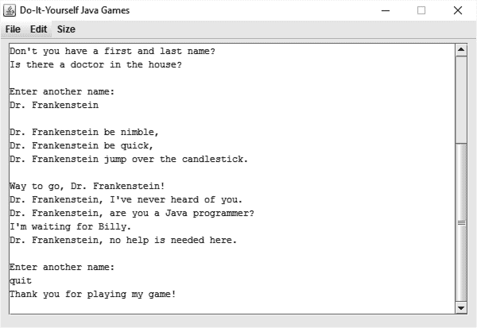

## 课程 7.1 - 带参数的方法

有时你想再次运行相同的代码，但使用不同的数据。要做到这一点，可以将数据作为参数传递到方法中。

在本节中，你将创建一个方法，该方法将接收一个名字作为参数。该方法将为该名字打印消息。

### 尝试一下

回到 `NameGame` 程序。

1. 将所有检查名字并打印消息的代码移动到一个名为 `checkName()` 的方法中。

2. 在构造函数中移除代码的地方调用 `checkName()`。

*Listing 7-1，源自 `NameGame.java`*

---

```java
...

  public NameGame() {
    print("Enter a name:");
    String name = input();
    checkName();

      (此处删除了代码。)
  }

  private void checkName() {
    print(name + " be nimble,");    
    print(name + " be quick,");    
    print(name + " jump over the candlestick.");
    print();
    print("Way to go, " + name + "!");

      ...

    if (name.startsWith("Dr.") && !name.equals("Dr. Frankenstein")) {
      print("医生,这可能是一个医疗紧急情况!");
    }
    else if (name.equals("Dr. Frankenstein")) {
      print("Dr. Frankenstein, 这里不需要帮助.");
    }
    else {
      print("Is there a doctor in the house?");
    }
  }
    ...
```

---

## 完成的列表

这将导致许多语法错误。语法错误信息为：

```text
name cannot be resolved
```

换句话说，Java 不知道 `name` 是什么。

查看程序中的代码块：

*Listing 7-2，源自 `NameGame.java`*

---

```java
...

  public NameGame() {
    print("Enter a name:");
    String name = input();
    checkName();
  }

  private void checkName() {
    print(name + " be nimble,");    

      ...  

  }
    ...
```

---

## 完成的列表

`name` 是在构造函数内部声明的。但 `print(name + “ be nimble,”);` 位于构造函数之外的代码块中。

1. 在 `checkName()` 内部声明 `name`。

*Listing 7-3，源自 `NameGame.java`*

---

```java
...

  private void checkName() {
    String name = "";
    print(name + " be nimble,");    

      ...

  }
    ...
```

---

## 完成的列表

这让语法错误消失了，但如果你现在运行程序，它不会打印输入的名字。

你如何让 `checkName()` 使用用户在构造函数中输入的同一个名字？你将其作为参数传递给它。

例如，当你使用 `print()` 方法时，你传递了一个字符串作为参数，如下：

```java
print("Hello World");
```

`print()` 方法定义在 `DIYWindow` 中，期望一个字符串作为参数，如下：

```java
public void print(String parameter)
```

回想一下课程，你曾使用 `if` 语句来检查某个值是真是假。你可以将 `while` 循环中的 `true` 单词替换为可以返回真或假的条件。

1. 添加一个条件，以重复执行代码块，直到用户在名称处输入“quit”为止。（提示：当 `name` 不等于“quit”时重复。）

*列表 7-8，源自 `NameGame.java`*

---

```java
...

  public NameGame() {
    while (________________)  
      print("Enter a name:");

        ...
```

---

## 已完成的列表

这是一个不公平的任务。即使你输入了正确的条件：

```java
while (!name.equals("quit")) {
```

你也会收到一个语法错误。程序并不认识名为 `name` 的变量。

在循环内部，`name` 被声明为一个字符串：

```java
String name = input();
```

但现在你试图在声明 `name` 之前在 `while` 语句中使用它。变量必须在使用之前先声明。

修改代码按以下顺序执行这些操作：

1. 告诉用户输入名称。

2. 等待用户输入名称并将其存入名为 `name` 的新字符串中。

3. 只要 `name` 不等于“quit”，就继续循环：

   1. 打印一个空行。

   2. 检查 `name`。

   3. 打印一个空行。

   4. 告诉用户输入另一个 `name`。

   5. 等待用户输入名称并将其存入 `name`。

*列表 7-9，源自 `NameGame.java`*

---

```java
...

  public NameGame() {
    print("_______________________");
    String name = _________________;
    while (!name.equals("quit")) {
      print();
      checkName(name);
      print();
      print("_____________________");
      name = ___________________;
    }
    print("Thank you for playing my game!");
  }
    ...
```

---

## 已完成的列表

现在，当你输入“quit”时，程序应该打印“Thank you for playing my game!”。

这就是 Name Game 程序的结束。

1. 如果你想在没有 Eclipse 的情况下运行它，请导出你的 Name Game 程序。

## 关键点及更多

- `while` 循环只要条件为真，就会不断重复执行大括号中的代码。
- 变量必须在使用之前声明。
- 在 `while` 循环外部声明的变量可以在循环中使用。但在循环内部声明的变量不能在循环外部使用。

## 课程 7.3 - 无限循环

无限循环是指永远不会结束的循环。有些无限循环运行非常快，你无法通过点击窗口的关闭按钮来停止它。还有另一种方法可以停止卡在这种循环中的程序。

### 试一试

将 `while` 循环变成一个永远结束的无限循环：

1. 删除从用户获取输入并将其值存入 `name` 的代码行。

*列表 7-10，源自 `NameGame.java`*

---

```java
...

  public NameGame() {
    print("Enter a name:");
    String name = input();
    while (!name.equals("quit")) {
      print();
      checkName(name);
      print();
      print("Enter another name");

        （此处删除了代码。）

    }
      ...
```

---

## 已完成的列表

现在当你运行程序时，它将使用相同的名称重复循环且永不停止。你可能可以通过点击窗口的关闭按钮来停止程序。如果不行，你可以点击 `Console` 格中的 `terminate` 按钮（如图像所示）来退出程序。

如果没有显示 `Console` 格：

1. 点击 `Window / Show View / Console`。（images/00030.jpeg）

2. 运行程序，然后点击 `Terminate` 按钮退出程序。

在使用 `Terminate` 按钮后，修复无限循环。

1. 向用户请求名称。

*列表 7-11，源自 `NameGame.java`*

---

```java
...

  public NameGame() {
    print("Enter a name:");
    String name = input();
    while (!name.equals("quit")) {
      print();
      checkName(name);
      print();
      print("Enter another name");
      name = ____________;
    }
      ...
```

---

## 已完成的列表

### 关键点及更多

- 无限循环是永远不结束的循环。


紧密无限循环（tight infinite loop）是不暂停的无限循环。在循环内部调用`input()`的无限循环会等待用户输入值，而不是紧密无限循环。

每个人都会在某个时刻不小心创建一个紧密无限循环。紧密无限循环运行得非常快，以至于你无法通过关闭窗口来停止它。如果无法关闭窗口，你可以点击`Console`格中的`Terminate`按钮来退出程序。

如果没有显示`Console`格：

1. 点击`Window / Show View / Console`。（images/00030.jpeg）
2. 运行程序，然后点击`Terminate`按钮退出程序。

在使用`Terminate`按钮后，修复无限循环。

## 8 项目 - 计算器

接下来，我们将创建一个`Calculator`程序。到目前为止，你一直在使用字符串。在接下来的课程中，我们将学习整数、如何声明它们以及你可以用它们做什么。

这是`Calculator`程序的截图：

(images/0031.jpeg)

## 课程 8.1 - 整数类型与加法

整数是可以相加的。我们将使用整数来创建一个简单的计算器程序。

### 试一试

编写下一个程序：

1. 创建名为`Calculator`的新 Java 项目。
2. 创建一个名为`calculator`的包。
3. 创建一个继承`DIYWindow`的`Calculator`类，并带一个`main()`方法。
4. 在`main()`中调用`Calculator`构造函数。

*列表 8-1，源自 Calculator.java*

```
package calculator;

import com.diy.DIYWindow;

public class Calculator extends DIYWindow {

  public Calculator() {
  }

  public static void main(String[] args) {
    ____________________;
  }
}
```

*已完成的列表*

数字是不带引号输入的。

1. 打印数字 5。

*列表 8-2，源自 Calculator.java*

```
 ...

  public Calculator() {
    print(5);
  }
    ...
```

*已完成的列表*

数字可以放入变量。在 Java 中，将整数声明为`int`。例如，要声明一个名为`score`的整数并赋值为 21，请使用：

```
int score = 21;
```

1. 声明一个名为`a`的整数并赋值初始值为 5。
2. 打印`a`。

*列表 8-3，源自 Calculator.java*

```
 ...

  public Calculator() {
    int a = 5;
    print(a);
  }
    ...
```

*已完成的列表*

你还可以将整数与字符串。

1. 为打印的值添加一个描述。

*列表 8-4，源自 Calculator.java*

```
 ...

  public Calculator() {
    int a = 5;
    print("a is " + a);
  }
    ...
```

*已完成的列表*

1. 声明另一个整数变量`b`，赋值为 7。
2. 打印`b`并像对`a`那样带上描述。

*列表 8-5，源自 Calculator.java*

```
 ...

  public Calculator() {
    int a = 5;
    print("a is " + a);
    int b = ______;
    print(___________________);
  }
    ...
```

*Completed listing*

在字符串之间，加号用于连接字符串。在数字之间，加号会将数字相加。

1. 在程序中添加第三个整数`c`，并给它赋值为 5 和 7 的和。
2. 打印`c`，并带有像你之前对`a`和`b`那样的描述。

*Listing 8-6，来自 Calculator.java*

```
 ...

  public Calculator() {
    int a = 5;
    print("a is " + a);
    int b = 7;
    print("b is " + b);
    int c = 5 + 7;
    print(______________);
  }
    ...
```

*Completed listing*

1. 因为 5 和 7 存储在变量中，你认为可以修改什么让`c`变成变量`a`和`b`中值的和？

*Listing 8-7，来自 Calculator.java*

```
 ...

  public Calculator() {
    int a = 5;
    print("a is " + a);
    int b = 7;
    print("b is " + b);
    int c = _____ + _____;
    print("c is " + c);
  }
    ...
```

*Completed listing*

### 关键点与更多

* 整数（既不是小数也不是分数）被称为整数（integers）。使用`int`声明整数。
* 整数可以相加得到一个和。
* 整数可以加到字符串中。
  * 如果你将一个整数加到字符串上，它会将该数字放在字符串的相应位置。
* 当你的代码需要整数时，通常应该使用`int`整数。然而，`int`变量只能存储 -2,147,483,647 到 2,147,483,647 之间的值。如果你想要更大的整数，或者你的整数总是较小且你想减少程序在计算机上占用的空间，可以使用其他类型的整数。以下是 Java 中允许的所有整数类型及其取值范围：
  * `byte`: -128 到 128 之间的数字
  * `short`: -32,768 到 32,768 之间的数字
  * `int`: -2,147,483,647 到 2,147,483,647 之间的数字
  * `long`: -9,223,372,036,854,775,807 到 9,223,372,036,854,775,807 之间的数字

## 课程 8.2 - 将字符串转换为整数

`input()`方法将用户输入读取为字符串。如果你想进行整数加法，必须将输入的字符串转换为整数。

### 试一试

让用户输入任何数字。

1. 从用户输入`a`的值。

*Listing 8-8，来自 Calculator.java*

```
 ...

  public Calculator() {
    int a = input();
    print("a is " + a);
    int b = 7;
    print("b is " + b);
    int c = a + b;
    print("c is " + c);
  }
    ...
```

*Completed listing*

这会导致语法错误：

```
Type mismatch: cannot convert from String to int
```

`input()`返回一个字符串。但你需要将`input()`的值放入一个`int`变量中。要将字符串转换为整数，请使用`Integer.parseInt()`。例如，要将名为`number`的字符串转换为整数，请使用：

```
Integer.parseInt(number);
```

1. 添加代码将`input()`的值放入名为`s`的字符串中。
2. 将`s`转换为整数并放入`a`。（提示：使用`Integer.parseInt()`）。

*Listing 8-9，来自 Calculator.java*

```
 ...

  public Calculator() {
    String s = input();
    int a = Integer.parseInt(____);
    print("a is " + a);
  ...
```

*Completed listing*

1. 运行程序并输入一个数字。程序应该打印你输入的数字，打印 7，然后打印它们的和。如果你输入了数字以外的内容（例如 "Hello World"），这个程序将无法工作。目前先忽略它，你将在接下来的课程中修复它。首先，让这个程序在加数字方面更好。

1. 告诉用户输入一个数字。

*Listing 8-10，来自 Calculator.java*

```
 ...

  public Calculator() {
    print("__________________");
    String s = input();
    int a = Integer.parseInt(s);
    print("a is " + a);
  }
```

*Completed listing*

1. 你会修改什么让用户输入数字？

*Listing 8-11，来自 Calculator.java*

```
 ...

  public Calculator() {
    print("__________________");
    String s = input();
    int a = Integer.parseInt(s);
    print("a is " + a);
    print("__________________");
    int b = ________________;
    print("b is " + b);
    int c = _____ + b_;
  }
```

*Completed listing*

修改程序，让它只打印最后的方程。

1. 在打印`c`之前，删除打印`a`和`b`的代码。
2. 将`a`、加号、`b`、等号和`c`拼接成一个字符串。

*Listing 8-12，来自 Calculator.java*

```
 ...

  public Calculator() {
    print("__________________");
    String s = input();
    int a = Integer.parseInt(s);
    print("a is " + a);
    print("__________________");
    int b = _____;
    print("b is " + b);
    int c = a + b;
    print(____ + " " + c);
  }
```

*Completed listing*

用户想进行更多计算吗？

1. 重复输入数字的代码。
2. 将答案放入`s`。

*Listing 8-13，来自 Calculator.java*

```
 ...

  public Calculator() {
    print("__________________");
    String s = input();
    int a = Integer.parseInt(s);
    print("a is " + a);
    print("__________________");
    int b = _____;
    print("b is " + b);
    int c = a + b;
    print(____ + " " + c);
    print("_________________________");
    s = _________________;
  }
```

*Completed listing*

重复输入数字的代码进行加法。（提示：使用`while`循环。提示：检查答案是否以 "Y" 或 "y" 开头）。

*Listing 8-14，来自 Calculator.java*

```
 ...

  public Calculator() {
    print("__________________");
    String s = _________________;
    while (s._______________ || s.__________) {
      print("Enter a number");
      s = input();
      int a = Integer.parseInt(s);
      print("a is " + a);
      print("__________________");
      int b = _____;
      print("b is " + b);
      int c = a + b;
      print(____ + " " + c);
      print("Do you want to do another?");
      s = input();
    }
  }
```

*Completed listing*

这段代码会导致语法错误。程序在`while`语句中不知道`s`是什么。

1. 将`s`为字符串并给它一个初始值 "Y"。

*Listing 8-15，来自 Calculator.java*

```
 ...

  public Calculator() {
    String _________________;
    while (s.startsWith("Y") || s.startsWith("y")) {
      print("Enter a number");
      String s = input();

...
```

*Completed listing*

这刚刚让这一行变成了语法错误：

```
String s = input();
```

语法错误说存在重复的局部变量`s`。你不允许多次声明同一个变量。

1. 从第二次声明`s`时移除 "String"，让它只进行赋值。

*Listing 8-16，来自 Calculator.java*

```
 ...

  public Calculator() {
    String s = "Y";
    while (s.startsWith("Y") || s.startsWith("y")) {
      print("Enter a number");
      _____ = input();

...
```

*Completed listing*

### 关键点与更多

* 要将字符串转换为整数，请使用`Integer.parseInt()`。
* 要将整数转换为字符串，将其加到空字符串上。例如，如果`num`是一个整数，这样将`num`转换为字符串：

```
"" + num
```

## 课程 8.3 - 返回值的方法

方法（Method）在运行完其代码后可以返回一个值。

在本节中，你将编写一个方法，将字符串转换为整数，并返回该整数值。

### 尝试一下

每当你要求用户输入数字时，你都执行了相同的三个步骤：

* 打印一条消息。
* 等待输入。
* 将输入转换为整数。

如果你将这三个步骤放入一个方法中，你就可以在任何需要用户输入整数的时刻调用该方法。这个方法必须返回一个值。

1. 首先，添加一个名为`promptForInt()`的方法。按照所示内容完全输入它。

*列表 8-17，来自 Calculator.java*

```
 ...

  private int promptForInt(String prompt) {

    int i = 0;

    return i;

  }

    ...
```

*已完成的列表*

方法名前前面用`int`而不是`void`意味着它返回一个整数。`return`语句是方法返回整数的方式。方法必须在返回整数之前先声明一个整数并赋值赋值。

1. 在`i`的声明和`i`的返回之间添加代码以：
   1. 打印`prompt`。
   2. 等待用户输入。
   3. 将该输入转换为整数并放入`i`中。

*列表 8-18，来自 Calculator.java*

```
 ...

   private int promptForInt(String prompt) {

     int i = 0;

    print(__________________);

    String s = _________________;

    i = __________________;

    return i;

  }

    ...
```

*已完成的列表*

1. 替换构造函数循环中提示输入并设置`a`值的代码，改为调用`promptForInt()`来设置`a`的值。（提示：将`input()`消息作为参数传递给`promptForInt()`。）

*列表 8-19，来自 Calculator.java*

```
 ...

  public Calculator() {

    String s = "Y";

    while (s.startsWith("Y") || s.startsWith("y")) {

      int a = promptForInt("Enter a number");

      print("Enter another number:");

        ...
```


* * *

*已完成列表*

1. 你会如何修改以同样使用 `promptForInt()` 来设置 `b`？

*列表 8-20，来自 Calculator.java*

* * *

```
...
public Calculator() {
  String s = "Y";

  while (s.startsWith("Y") || s.startsWith("y")) {
    int a = promptForInt("Enter a number");
    int b = _______________________________;
    int c = a + b;
    ...
```

* * *

*已完成列表*

1. 创建一个类似的名为 `promptForString()` 的方法，用于提示字符串。它应该：
   1. 接收一个名为 `prompt` 的字符串参数。
   2. 打印 `prompt`。
   3. 等待用户输入。
   4. 返回该字符串。

*列表 8-21，来自 Calculator.java*

* * *

```
...
private ______________ promptForString(_______________) {
  print(____);
  String s = _______________;
  return ____;
}
...
```

* * *

*已完成列表*

1. 现在将构造函数中询问用户是否想再次进行计算的代码改为调用 `promptForString()`。

*列表 8-22，来自 Calculator.java*

* * *

```
...
public Calculator() {
  String s = "Y";

  while (s.startsWith("Y") || s.startsWith("y")) {
    int a = promptForInt("Enter a number");
    int b = promptForInt("Enter another number");
    int c = a + b;

    print(a + " + " + b + " = " + c);
    s = ___________________________________;
  }
}
...
```

* * *

*已完成列表*

### 关键点与更多

* 方法可以返回零或一个值。
* 在方法的声明中指定方法的返回类型。使用 `return` 语句返回该类型的值。
* 如果方法不返回值，请使用 `void` 作为返回类型。此类方法不有 `return` 语句。
* 当你编写返回值的方法的代码时：
  * 声明一个与返回值类型相同的变量。
  * 添加 `return` 语句来返回该变量。
  * 然后在两个语句之间添加代码将变量设置为所需的值。

## 8.4 节 - Try/Catch 块与异常

如果用户为 `Calculator` 程序输入非数字，程序将停止且无法继续。因为程序发生了 Java 无法处理的情况。这被称为未处理的异常。

在本节中，你将学习如何编写 `try/catch` 块来处理异常。如果用户输入无效的数字，程序将告诉他们输入有效的数字，然后再次运行代码。

### 尝试一下

1. 运行 `Calculator` 程序并输入非数字会发生什么？例如，输入“abc”。运行 `Calculator` 程序并输入非数字会发生什么？例如，输入“abc”。你会收到一条错误消息。
2. 运行 `Calculator` 程序并输入非数字会发生什么？例如，输入“abc”。查看顶部消息：

   ```
   Exception in thread "main"

   java.lang.NumberFormatException: For input: "abc"
   ```

   这意味着对于输入“abc”抛出了 `NumberFormatException`。滚动到第一条消息：

   ```
   at java.lang.NumberFormatException.parseInt(NumberFormatException.java:670)
   at java.lang.NumberFormatException.parseInt(NumberFormatException.java:136)
   at java.util.Scanner.nextInt(Scanner.java:2112)
   at java.util.Scanner.next(Scanner.java:1485)
   at java.util.Scanner.next(Scanner.java:1463)
   at Calculator.promptForInt(Calculator.java:22)
   at Calculator.main(Calculator.java:15)
   ```

   这意味着错误位于 `Calculator.java:22`。

3. 运行 `Calculator` 程序并输入非数字会发生什么？例如，输入“abc”。查看顶部消息：

   ```
   Exception in thread "main"

   java.lang.NumberFormatException: For input: "abc"
   ```

   这意味着对于输入“abc”抛出了 `NumberFormatException`。

意外异常会结束程序。当你的程序尝试将字符串转换为整数时结束了：

```
i = Integer.parseInt(s);
```

`NumberFormatException` 是你可以预期的异常。为了防止程序崩溃，你必须处理它。`NumberFormatException` 抛发生在：

```
at java.util.Scanner.nextInt(Scanner.java:2112)
at java.util.Scanner.next(Scanner.java:1485)
at java.util.Scanner.next(Scanner.java:1463)
at Calculator.promptForInt(Calculator.java:22)
at Calculator.main(Calculator.java:15)
```

你需要将问题的代码封装在 `try` 块中。

4. 运行 `Calculator` 程序并输入非数字会发生什么？例如，输入“abc”。查看顶部消息：

   ```
   Exception in thread "main"

   java.lang.NumberFormatException: For input: "abc"
   ```

   这意味着对于输入“abc”抛出了 `NumberFormatException`。

要处理异常，你使用 `try` 和 `catch` 块：

```java
try {
  i = Integer.parseInt(s);
} catch (NumberFormatException e) {
  // 处理异常
}
```

预期的异常的基本步骤是：

* 将问题的代码封装在 `try` 块中。
* 在 `try` 块末尾为每个预期的异常放置 `catch` 块。
* 在 `catch` 块内部编写代码，在捕获到该异常时运行。

如果有人输入无效数字，你希望程序做什么？告诉用户“abc”是不允许的，并告诉他们再次尝试。

5. 按照所示向 `promptForInt()` 添加 `try` 和 `catch` 块。

*列表 8-23，来自 Calculator.java*

* * *

```java
...
private int promptForInt(String prompt) {
  int i = 0;
  print(prompt);
  String s = input();

  try {
    i = Integer.parseInt(s);
  } catch (NumberFormatException e) {
    print(s + " 不是数字。请重试.");
    i = promptForInt(prompt);
  }

  return i;
}
...
```

* * *

*已完成列表*

现在如果你输入无效数字，它应该要求你重试。如果你输入有效数字，它应该无错误继续运行。

### 关键点与更多

* 如果你的代码可能会抛出异常，请使用 `try/catch` 块。
* 如果 `try` 块中的任何代码抛出了预期的异常，程序将：
  * 跳过 `try` 块中的剩余代码；
  * 运行相应 `catch` 块中的代码；
  * 然后继续执行 `catch` 块之后的代码。
* 如果 `try` 块中没有代码抛出异常，程序将：
  * 完成 `try` 块；
  * 跳过 `catch` 块；
  * 继续执行 `catch` 块之后的代码。
* 如果 `try` 块抛出了其他异常，异常将不会被“捕获”，程序将结束。
* `try` 块和 `catch` 块可以包含任意行的代码。
* 将所有在异常抛出时你不希望运行的代码放入 `try` 块中。
* 为每个想要处理的异常创建一个 `catch` 块。
* 程序通常通过向用户打印消息或设置某些默认值来“处理”异常，以便代码能够在无错误的情况下运行。
* 后续课程将介绍更多异常。

## Lesson 8.5 - 整数减法、乘法和除法

你可以在 Java 中对数字进行加、减、乘、除。

在本节中，你将为 `Calculator` 添加代码，让用户选择要执行的操作。

### 试一试

1. 你认为应该修改什么来从 `a` 中减去 `b`？

*列表 8-24，来自 Calculator.java*

* * *

```java
...
public Calculator() {
  String s = "Y";

  while (s.startsWith("Y") || s.startsWith("y")) {
    int a = promptForInt("Enter a number");
    int b = promptForInt("Enter another number");
    int c = a ____ b;

    print(a + " ____ " + b + " = " + c);
    s = promptForString("Do you want to do another?");
  }
}
...
```

* * *

*完成列表*

5 - 2 = 3 吗？它应该是。

Java 使用星号 `*` 进行乘法。

2. 你会修改什么来相乘 `a` 和 `b`？

*列表 8-25，来自 Calculator.java*

* * *

```java
...
public Calculator() {
  String s = "Y";

  while (s.startsWith("Y") || s.startsWith("y")) {
    int a = promptForInt("Enter a number");
    int b = promptForInt("Enter another number");
    int c = a ____ b;

    print(a + " ____ " + b + " = " + c);
    s = promptForString("Do you want to do another?");
  }
}
...
```

* * *

*完成列表*

5 * 2 = 10 吗？它应该是。

Java 使用正斜杠 `/` 进行除法。

3. 你会修改什么来将 `a` 除以 `b`？

*列表 8-26，来自 Calculator.java*

* * *

```java
...
public Calculator() {
  String s = "Y";

  while (s.startsWith("Y") || s.startsWith("y")) {
    int a = promptForInt("Enter a number");
    int b = promptForInt("Enter another number");
    int c = a ____ b;

    print(a + " ____ " + b + " = " + c);
    s = promptForString("Do you want to do another?");
  }
}
...
```

* * *

*完成列表*

5 / 2 = 2.5 吗？它**不应该**。它应该显示为 5 / 2 = 2。

此程序中的数字都是整数，所以所有答案都是整数。2.5 不是整数。因此，5 除以 2 只得到结果的整数部分。下一节将展示如何在 Java 中使用小数，这样 5 除以 2 将得到 2.5。目前，你将继续使用整数。

让用户选择操作：

1. 要求用户输入 `+`、`-`、`*` 或 `/`，设置一个名为 `operation` 的字符串。
2. 将 `c` 的初始值更改为 `0`。
3. 根据 `operation` 的值将打印语句替换为 `switch` 语句。
4. 为 `operation` 的每个值添加一个 `case` 以执行正确的计算并打印正确的方程式。
5. 如果用户输入了其他内容，告诉他/她输入了无效的操作。

*列表 8-27，来自 Calculator.java*

* * *

```java
...
public Calculator() {
  String s = "Y";

  while (s.startsWith("Y") || s.startsWith("y")) {
    int a = promptForInt("Enter a number");
    String operation = promptFor_________________________;
    int b = promptForInt("Enter another number");
    int c = 0;

    switch(______________________________) {
    case "___":
      c = a __ b;
      print(a + " ___ " + b + " = " + c);
      break;

    case "___":
      c = a __ b;
      print(a + " ___ " + b + " = " + c);
      break;

    case "___":
      c = a __ b;
      print(a + " ___ " + b + " = " + c);
      break;

    case "___":
      c = a __ b;
      print(a + " ___ " + b + " = " + c);
      break;

    default:
      print("_______________________________");
    }

    s = promptForString("Do you want to do another?");
  }
...
```

* * *

*完成列表*

为了处理：

1. 在代码周围添加一个 `try` 块。
2. 为捕捉 `ArithmeticException` 添加一个 `catch` 块。
3. 如果发生除以零，打印错误消息。
4. 更新代码以捕捉 `ArithmeticException`。

```java
try {
  c = a / b;
  print(a + " / " + b + " = " + c);
} catch (ArithmeticException e) {
  print("Division by zero is not allowed.");
}
```

## Lesson 8.6 - Double 类型

在 Java 中声明小数。

### 试一试

要声明名为 `temperature` 的 `double` 变量并赋值为 98.6，使用：

```java
double temperature = 98.6;
```

1. 将 `a`、`b` 和 `c` 声明为 `double` 而不是 `int`。

*列表 8-29，来自 Calculator.java*

* * *

```java
...
public Calculator() {
  String s = "Y";

  while (s.startsWith("Y") || s.startsWith("y")) {
    double a = promptForInt("Enter a number");
    String operation = promptForString("Enter +, *, or /");
    double b = promptForInt("Enter another number");
    double c = 0;

    switch(operation) {
```


```java
case "+" :
```

---

## 完成列表

1. 尝试用 5 除以 2。

   它打印了 2.5 吗？应该是。

2. 尝试乘以 2.5 和 2。

   发生了什么？它应该打印：

   ```
   2.5 is not a valid number. Try again.
   ```

你的代码使用了`promptForInt()`方法。`promptForInt()`是允许整数编写的。你应该创建一个不同的方法来提示小数。

要将字符串转换为 double，使用`Double`的`parseDouble()`方法。例如，将名为`number`的字符串转换为 double，使用：

```java
Double.parseDouble(number);
```

1. 通过复制`promptForInt()`方法创建一个名为`promptForDouble()`的新方法。
2. 你能猜到修改什么让`promptForDouble()`处理小数吗？

*列表 8-30，来自 Calculator.java*

---

```java
...

private double promptForDouble(String prompt) {

  double d = 0;

  print(prompt);

  String s = input();

  try {

    d = Double.parseDouble(s);

  }

  catch(NumberFormatException e) {

    print(s + " is not a valid number. Try again.");

    d = Double.parseDouble(prompt);

  }

  return d;

}

...
```

---

## 完成列表

1. 现在修改构造函数中的代码以调用`promptForDouble()`。

*列表 8-31，来自 Calculator.java*

---

```java
...

public Calculator() {

  String s = "Y";

  while (s.startsWith("Y") || s.startsWith("y")) {

    double a = _________________________("Enter a number");

    String operation = promptForString("Enter +, - , *, or /");

    double b = _________________________("Enter another number");

    double c = 0;

    switch(operation) {

      ...
```

---

## 已完成列表

你的`Calculator`程序现在可以处理小数了。

### 关键点及更多

- 使用`double`数据类型来处理小数。
- `Double`类型的变量总是以小数的形式打印。例如，一个值为`2`的`double`变量将打印为`2.0`。
- `Float`是 Java 中的另一种小数类型。`Double`比`float`（约 7 位小数）更精确（约 16 位小数），因此使用`doubles`可以进行更准确的计算。`float`和`double`都允许比`int`或`long`大得数字。
- 如果你输入一个数字，例如`2`，Java 会认为它是一个`integer`。如果你想让 Java 认为二是一个`double`，请将其输入为小数，例如`2.0`。如果你想让 Java 认为二是一个`float`，请以`f`结尾，例如`2f`或`2.0f`。

## 第 8.7 - 扩展 DIYWindow 类

你现在有三个提示方法：`promptForDouble()`、`promptForInt()`和`promptForString()`。这三个方法在许多其他程序中都会很有用。如果你能把它们放在`DIYWindow`类中，那么任何以`DIYWindow`为父类的类都可以使用这三个提示方法。然而，你无法直接编辑`DIYWindow`文件。

本节将向你展示如何通过扩展现有类来向其中添加你自己的方法。

### 尝试一下

创建下一个类：

1. 创建一个名为`My Window`的新`Java project`，并将`DIYJava.jar`添加到项目中。
2. 在项目中创建一个名为`___________._____________.mywindow`的新`package`。
3. 创建一个名为`MyWindow`的新`class`，父类为`DIYWindow`。它不需要为`main()`或构造函数提供存根。

*列表 8-32，来自 MyWindow.java*

---

```java
package annette.godtland.mywindow;

import com.godtsoft.diyjava.DIYWindow;

public class MyWindow extends DIYWindow {

}
```

---

## 已完成列表

1. 从`Calculator`类中剪切`promptForDouble()`、`promptForInt()`和`promptForString()`，并将它们粘贴到`MyWindow`类的块中。

*列表 8-33，来自 MyWindow.java*

---

```java
...

public class MyWindow extends DIYWindow {

  private double promptForDouble(String prompt) {

    double d = 0;

    print(prompt);

    String s = input();

    try {

      d = Double.parseDouble(s);

    }

    catch(NumberFormatException e) {

      print(s + " is not a valid number. Try again.");

      d = promptForDouble(prompt);

    }

    return d;

  }

  private int promptForInt(String prompt) {

    int i = 0;

    print(prompt);

    String s = input();

    try {

      i = Integer.parseInt(s);

    }

    catch(NumberFormatException e) {

      print(s + " is not a valid number. Try again.");

      i = promptForInt(prompt);

    }

    return i;

  }

  private String promptForString(String prompt) {

    print(prompt);

    String s = input();

    return s;

  }

}
```

---

## 已完成列表

构建路径保存了创建 Java 项目所需的文件、项目和库的位置。必须将`MyWindow`放入`Calculator`的构建路径中，以便`Calculator`知道去哪里寻找`MyWindow`。

1. 右点击`Calculator`项目并选择`Build Path / Configure Build Path...`。
2. 点击`Projects`标签并点击`Add...`。
3. 选择你的`My Window`项目并点击`OK`。
4. 点击`OK`关闭`Java Build Path`窗口。

现在，回到`Calculator`类并进行这些更改：

1. 将 import 语句改为`import ___________________.mywindow.MyWindow`而不是`com.godtsoft.diyjava.DIYWindow`。
2. 将类改为`extend MyWindow`而不是`DIYWindow`。

*列表 8-34，来自 Calculator.java*

---

```java
package annette.godtland.calculator;

import _______________________________;

public class MyWindow extends DIYWindow {

  ...
```

---

## 已完成列表

1. 在项目中创建一个名为`annette.godtland.guessmynumber`的新`package`。
2. 创建一个名为`GuessMyNumber`的新`class`，父类为`MyWindow`，并为`main()`及其构造函数编写存根。
3. 在`main()`中添加代码调用`GuessMyNumber`构造函数。

*列表 9-1，来自 GuessMyNumber.java*

---

```java
package annette.godtland.guessmynumber;

import annette.godtland.mywindow.MyWindow;

public class GuessMyNumber extends MyWindow {

  public GuessMyNumber() {

  }

  public static void main(String[] args) {

    ____________________________________;

  }

}
```

---

## 完成后的列表

1. 声明一个值为 56 的整数`myNumber`。
2. 声明另一个名为`myGuess`的整数，通过提示用户“猜猜 0 到 100 之间的数字”来设置它的值。

*列表 9-2，来自 GuessMyNumber.java*

---

```java
...

public GuessMyNumber() {

  ______ ________________ = 56;

  int _________ = promptFor____("___________________________________");

}

...
```

---

## 完成后的列表

在 Java 中，使用双等号`==`来检查两个数字是否相等。例如，要检查名为`score`的变量是否等于 100，请使用：

```java
if (score == 100)
```

1. 检查`myGuess`是否等于`myNumber`。
2. 如果相等，打印消息“You guessed it!”。

*列表 9-3，来自 GuessMyNumber.java*

---

```java
...

public GuessMyNumber() {

  int myNumber = 56;

  int myGuess = promptForInt("Guess my number, between 0 and 100.");

  if(_____________________) {

    print("_____________________________");

  }

}

...
```

---

## 完成后的列表

使用这些运算符来比较数字：

- `==`如果它们相等则返回`true`。
- `!=`如果它们不相等则返回`true`。
- `>`如果第一个数字大于第二个数字，则返回`true`。
- `>=`如果第一个数字大于或等于第二个数字，则返回`true`。
- `<`如果第一个数字小于第二个数字，则返回`true`。
- `<=`如果第一个数字小于或等于第二个数字，则返回`true`。

1. 你会修改以改为数字是否不相等？
2. 如果数字不相等，告诉用户。

*列表 9-4，来自 GuessMyNumber.java*

---

```java
...

public GuessMyNumber() {

  int myNumber = 56;

  int myGuess = promptForInt("Guess my number, between 0 and 100.");

  if(myGuess _______ myNumber) {

    print("____________________________");

  }

}

...
```

---

## 完成后的列表

1. 如果数字不相等，提示用户输入另一个数字并将他的答案放入`myGuess`。

*列表 9-5，来自 GuessMyNumber.java*

---

```java
...

public GuessMyNumber() {

  int myNumber = 56;

  int myGuess = promptForInt("Guess my number, between 0 and 100.");

  if(myGuess != myNumber) {

    myGuess = _________________("Sorry, that's not it. Try again.");

  }

}

...
```

---

## 完成后的列表

1. 你如何修改代码，以便`myGuess`不等于`myNumber`时持续提示用户重试？（提示：当你想要重复一段代码时，你学过`while`循环。）

*列表 9-6，来自 GuessMyNumber.java*

---

```java
...

public GuessMyNumber() {

  int myNumber = 56;

  int myGuess = promptForInt("Guess my number, between 0 and 100.");

  _________(myGuess != myNumber) {

    myGuess = promptForInt("Sorry, that's not it. Try again.");

  }

}

...
```

---

## 完成后的列表

1. 现在运行程序。输入一些错误的猜测，然后输入正确的数字 56。发生了什么？
2. 在 while 块之后添加代码，告诉用户他猜中了正确的数字。

*列表 9-7，来自 GuessMyNumber.java*

---

```java
...

public GuessMyNumber() {

  int myNumber = 56;

  int myGuess = promptForInt("Guess my number, between 0 and 100.");

  while(myGuess != myNumber) {

    myGuess = promptForInt("Sorry, that's not it. Try again.");

  }

}

...
```

---

## 完成后的列表

程序现在可以工作了，但人们需要很长时间才能明白为什么。你会在程序中添加什么来告诉用户他猜小了？

*列表 9-8，来自 GuessMyNumber.java*

---

```java
...

public GuessMyNumber() {

  int myNumber = 56;

  int myGuess = promptForInt("Guess my number, between 0 and 100.");

  while(myGuess != myNumber) {

    myGuess = promptForInt("You guessed it.");

  }

  if (myGuess < myNumber) {

    print("Too low");

  } else if (myGuess > myNumber) {

    print("Too high");

  }

}
```

---

## 完成后的列表

### 关键点与更多

你可以在任何语句中比较数字，例如`if`语句或`while`循环。

- `==`如果它们相等则返回`true`。
- `!=`如果它们不相等则返回`true`。
- `>`如果第一个数字大于第二个数字，则返回`true`。
- `>=`如果第一个数字大于或等于第二个数字，则返回`true`。
- `<`如果第一个数字小于第二个数字，则返回`true`。
- `<=`如果第一个数字小于或等于第二个数字，则返回`true`。

## 9.2 - 生成随机数

在本节中，你将修改程序为用户选择一个随机数。

### 尝试

1. 按照所示创建一个名为`rand`的新随机数生成器`Random`。

*列表 9-9，来自 GuessMyNumber.java*

---

```java
...

public GuessMyNumber() {

  Random rand = new Random();

  int myNumber = 56;
```


```java
int myGuess = promptForInt("Guess my number, between 0 and 100.");

while(myGuess != myNumber) {

  ...

}
```

---

## 完成后的列表

这会导致语法错误：

```text
Random cannot be resolved to a type.
```

1. 将光标停留在标记为错误的单词上以打开`Quick Fix`。
2. 选择`Import 'Random' (java.util)`来修复错误。

在整个课程中，你经常会收到无法解析为类型的错误。当你收到该错误时，使用`Quick Fix`导入所需的类。该类及其完整包名将添加到文件开头的导入语句中。

`Random`的`nextInt()`方法返回一个从零到给定的数字减一之间的随机数。例如：为了获取 0 到 9 的 10 个可能值，请使用：

```java
rand.nextInt(10);
```

如果你希望值从 1 开始而不是 0，则对结果加上 1。例如，为了获取 1 到 6 的 6 个可能值，使用：

```java
rand.nextInt(6) + 1;
```

1. 你能猜出`nextInt()`需要什么参数来生成一个 0 到 100 的随机数`myNumber`吗？（提示：如果包括 0 和 100，有多少个数字？）

*列表 9-10，来自 `GuessMyNumber.java`*

```java
...

public GuessMyNumber() {

  Random rand = new Random();

  int myNumber = rand.nextInt(_______________);

  int myGuess = promptForInt("Guess my number, between 0 and 100.");

  while(myGuess != myNumber) {

    ...

```

---

## 已完成列表

### 关键点与更多

- `Random`就像`String`一样是另一种数据类型。新的数据类型作为类创建的。在程序中使用的几乎每个新类都会被标记为语法错误。错误信息将说明该类无法解析为类型。此类类必须导入。导入语句必须包含完整的类名，包括其包名。
- 使用`Quick Fix`（快速修复）可以为程序中的新类轻松添加导入语句。
- 可以通过以下多种之一打开`Quick Fix`：
  - 将鼠标悬停在代码中标记为语法错误的单词上。
  - 右键点击代码中标记为语法错误的单词，并选择`Quick Fix`。
  - 点击编辑面板左侧边缘的语法错误标记。
  - 右键点击 Eclipse 底部`Problems`格中的消息并选择`Quick Fix`。
- `Random.nextInt()`返回 0 到你给出的数字减 1 之间的随机数。例如：
  - 要获取 0 到 4 的 5 个可能值，使用：

    ```java
    nextInt(5)
    ```

  - 要获取 1 到 5 的 5 个可能值，使用：

    ```java
    nextInt(5)+1
    ```

## Lesson 9.3 - 增加整数

程序通常需要增加整数，即给数字本身加上一个数字。事实上，这非常常见，以至于有快捷方法可以。本节将介绍增加整数两种方法。

### 尝试一下

你猜了多少次才猜中？让程序计算尝试次数。

1. 声明一个名为`count`的整数来存储猜测次数。在用户进行第一次猜测后，将计数初始化为 1。

*列表 9-11，来自 `GuessMyNumber.java`*

```java
...

public GuessMyNumber() {

  Random rand = new Random();

  int myNumber = rand.nextInt(101);

  int myGuess = promptForInt("Guess my number, between 0 and 100.");

  int ____________ = ______;

  while(myGuess != myNumber) {

    ...

```

---

## 已完成列表

1. 在每次猜测后将计数加 1。

*列表 9-12，来自 `GuessMyNumber.java`*

```java
...

public GuessMyNumber() {

  ...

  while(myGuess != myNumber) {

    if (myGuess < myNumber) {

      myGuess = promptForInt("You guessed too low, try again.");

    }

    else if (myGuess > myNumber) {

      myGuess = promptForInt("You guessed too high, try again.");

    }

    count = count + ______;

  }

  ...

```

---

## 已完成列表

1. 当用户最终猜中数字时，打印他/她猜了多少次。

*列表 9-13，来自 `GuessMyNumber.java`*

```java
...

public GuessMyNumber() {

  ...

  while(myGuess != myNumber) {

    if (myGuess < myNumber) {

      myGuess = promptForInt("You guessed too low, try again.");

    }

    else if (myGuess > myNumber) {

      myGuess = promptForInt("You guessed too high, try again.");

    }

    count = count + 1;

  }

  print("You guessed it in " + __________ + " tries!");

}

...
```

---

## 已完成列表

Guess My Number 程序现在完成了。但有几个你本本可以使用的 Java 快捷方法。

你可以使用`+=`赋值运算符来增加变量。例如，将变量`b`增加 8，使用：

```java
b += 8;
```

1. 如何使用`+=`运算符将`count`增加 1？

*列表 9-14，来自 `GuessMyNumber.java`*

```java
...

public GuessMyNumber() {

  ...

  else if (myGuess > myNumber) {

    myGuess = promptForInt("You guessed too high, try again.");

  }

  count __ __;

  ...
```

---

## 已完成列表

类似的赋值运算符也可以用于减少、乘以或除以一个数字的变量：`-=`、`*=`和`/=`。

另一个常用的快捷方法是当你通过某个数字增加或减少一个变量时。例如，将`b`增加 1，使用：

```java
b++;
```

同样地，将`b`减少 1，使用：

```java
b--;
```

# 项目 10 - 温度转换器

接下来，你将编写一个将华氏度转换为摄氏度的程序。

这里是温度转换器的截图：


## Lesson 10.1 - 运算顺序

Java 允许你在语句中进行加、减、乘、除以及调用其他方法。Java 按默认顺序执行这些操作。本节向你展示当存在多个操作时如何控制 Java 的顺序。

### 尝试一下

开始编写下一个程序：

1. 创建一个名为`Temperature Converter`的 Java 项目，并将`MyWindow`和`DIY.jar`添加到项目中。
2. 在项目中创建一个名为`.temperatureconverter`的包。
3. 创建一个名为`TemperatureConverter`的类，父类为`MyWindow`并带有`main()`和构造函数的存根。
4. 在`main()`中添加代码调用`TemperatureConverter`构造函数。
5. 在构造函数中添加代码打印 1 + 2 的值。

*列表 10-1，来自 `TemperatureConverter.java`*

```java
package annette.godtland.temperatureconverter;

import annette.godtland.mywindow.MyWindow;

public class TemperatureConverter extends MyWindow {

  public TemperatureConverter() {

    print(__ + ___ + ___);

  }

  public static void main(String[] args) {

    ____________________________________;

  }

}
```

---

## 已完成

程序打印了什么？如果你预期 6，那么你是正确的。

1. 修改程序打印 1 + 2 * 3。

*列表 10-2，来自 `TemperatureConverter.java`*

```java
...

public TemperatureConverter() {

  print(1 + 2 __ 3);

}

...
```

---

## 已完成列表

程序打印了什么？如果你预期 9，那么你就错了。它打印 7。

Java 先执行所有的乘法和除法，然后执行所有的加法和减法。按不同的顺序执行这些操作，对你想先执行的部分加上括号。

你能猜到这些语句会打印什么吗？

```java
print((1+2)*3);

print(1+(2*3));
```

第一个语句将打印 9，第二个语句将打印 7。

要将华氏度转换为摄氏度，从华氏度减去 32，然后将差乘以 5 并除以 9。

1. 从构造函数中移除当前的打印语句。
2. 提示用户输入华氏度。将他们的答案存储在一个`double`变量中，这样你就可以处理小数。
3. 将华氏度转换为摄氏度并打印结果。（提示：在代码中添加括号以确保先进行减法。）

*列表 10-3，源自 `TemperatureConverter.java`*

```java
...

public TemperatureConverter() {

  double f = ______________________("Enter degrees Fahrenheit.");

  print( f - 32 * 5 / 9);

}

...
```

---

## 完成的列表

如果你将括号放在正确的位置，输入 32 华氏度应该得到 0 摄氏度。

1. 在打印语句中添加文本“ degrees Celsius”，以便清楚地表示该数字代表的什么。

*列表 10-4，源自 `TemperatureConverter.java`*

```java
...

public TemperatureConverter() {

  double f = promptForDouble("Enter degrees Fahrenheit.");

  print((f - 32) * 5 / 9 + "_________________________");

}

...
```

---

## 完成的列表

要将摄氏度转换为华氏度，将摄氏度乘以 1.8 然后加 32。你不需要额外的括号来确保这些计算按正确的顺序进行。

1. 提示用户输入摄氏度，并将答案存储在一个名为`c`的`double`变量中。
2. 为了计算华氏度值，将摄氏度乘以 1.8 然后加 32。打印华氏度值。

*列表 10-5，源自 `TemperatureConverter.java`*

```java
...

public TemperatureConverter() {

  double f = promptForDouble("Enter degrees Fahrenheit");

  print((f - 32) * 5 / 9 + " degrees Celsius");

  double c = _____________________("Enter degrees Celsius");

  print(1.8 * c + 32);

}

...
```

---

## 完成的列表

32 华氏度应该转换为 0 摄氏度。0 摄氏度应该转换为 32 华氏度。

但如果你在打印`1.8 * c + 32`结果的公式前面添加文本会怎样？这是另一个常见的顺序错误。

1. 在第二个计算温度的前面添加“Fahrenheit = ”。

*列表 10-6，源自 `TemperatureConverter.java`*

```java
...

public TemperatureConverter() {

  double f = promptForDouble("Enter degrees Fahrenheit");

  print((f - 32) * 5 / 9 + " degrees celsius");

  double c = promptForDouble("Enter degrees Celsius");

  print("Fahrenheit = " + 1.8 * c + 32);

}

...
```

---

## 完成的列表

对于 0 摄氏度，程序现在打印：

```text
Fahrenheit = 0.032
```

发生了什么？它认为第一个加号是为了连接字符串的，所以它认为所有的加号都是为了连接字符串。因此`1.8`乘以 0 等于 0.0，然后它将 32 拼接到 0.0 上，使其变成 0.032。

1. 添加括号以便在将结果连接到第一个字符串之前计算温度。

*列表 10-7，源自 `TemperatureConverter.java`*

```java
...

public TemperatureConverter() {

  double f = promptForDouble("Enter degrees Fahrenheit");

  print((f - 32) * 5 / 9 + " degrees celsius");

  double c = promptForDouble("Enter degrees Celsius");

  print("Fahrenheit = " + (1.8 * c + 32));

}

...
```

---

## 已完成的列表

温度转换器程序到此结束了。

1. 如果你想在没有 Eclipse 的情况下运行它，请导出你的温度转换器程序。

### 关键点及更多

- Java 通常在执行加法和减法之前执行语句中所有的乘法和除法。
- 如果 Java 看到第一个加号是为了连接字符串，它假设后面的加号也是为了连接字符串。
- 当语句中包含多个操作时，使用括号来改变通常的运算顺序。最内层括号中的操作将首先执行。

# 项目 11 - 十块巧克力

《十块小巧克力》是一首旧童谣更符合社会接受的版本，这首歌教孩子们如何从一数到十，然后再从十到一倒着数。这个项目将使用一种非常有用的循环类型来编写《十块小巧克力》歌曲的歌词。

这里是十块巧克力程序的截图：

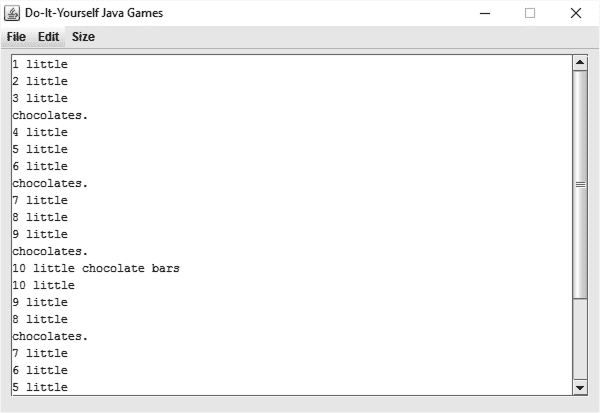

## 课程 11.1 - For 循环

`for`循环允许你轻松地重复固定次数的代码块。

### 尝试一下

开始吧：

1. 创建一个名为`Ten Little Chocolates`的新项目。
2. 创建一个名为`techocolates`的新包。
3. 创建一个名为`TenChocolates`的类并继承`MyWindow`。
4. 在`TenChocolates`中添加`main()`。

*列表 11-1，源自 `TenChocolates.java`*

```java
package techocolates;

import mywindow.MyWindow;

public class TenChocolates extends MyWindow {

  public TenChocolates() {

  }

  public static void main(String[] args) {

    ____________________;

  }

}
```

---

## 完成的列表

1. 在构造函数中添加`for`循环来打印四行。

*列表 11-2，源自 `TenChocolates.java`*

```java
package techocolates;

import mywindow.MyWindow;

public class TenChocolates extends MyWindow {

  public TenChocolates() {

    for (int i = 1; i <= 4; i++) {
```


```java
      print(i + " chocolate");

    }

  }

  public static void main(String[] args) {

    ____________________;

  }

}

```

* * *

## 完成的列表

1. 在构造函数中添加 `for` 循环来打印三行。

*列表 11-3，源自 `TenChocolates.java`*

```java
package techocolates;

import mywindow.MyWindow;

public class TenChocolates extends MyWindow {

  public TenChocolates() {

    for (int i = 1; i <= 4; i++) {

      print(i + " chocolate");

    }

    for (int i = 5; i <= 7; i++) {

      print(i + " chocolate");

    }

  }

  public static void main(String[] args) {

    ____________________;

  }

}

```

* * *

## 完成的列表

1. 在构造函数中添加 `for` 循环来打印两行。

*列表 11-4，源自 `TenChocolates.java`*

```java
package techocolates;

import mywindow.MyWindow;

public class TenChocolates extends MyWindow {

  public TenChocolates() {

    for (int i = 1; i <= 4; i++) {

      print(i + " chocolate");

    }

    for (int i = 5; i <= 7; i++) {

      print(i + " chocolate");

    }

    for (int i = 8; i <= 9; i++) {

      print(i + " chocolate");

    }

  }

  public static void main(String[] args) {

    ____________________;

  }

}

```

* * *

## 完成的列表

1. 在构造函数中添加 `for` 循环来打印最后一行。

*列表 11-5，源自 `TenChocolates.java`*

```java
package techocolates;

import mywindow.MyWindow;

public class TenChocolates extends MyWindow {

  public TenChocolates() {

    for (int i = 1; i <= 4; i++) {

      print(i + " chocolate");

    }

    for (int i = 5; i <= 7; i++) {

      print(i + " chocolate");

    }

    for (int i = 8; i <= 9; i++) {

      print(i + " chocolate");

    }

    for (int i = 10; i <= 10; i++) {

      print(i + " chocolate bar");

    }

  }

  public static void main(String[] args) {

    ____________________;

  }

}

```

* * *

## 完成的列表

1. 在 `main` 方法中添加 `for` 循环来倒序打印歌曲。

*列表 11-6，源自 `TenChocolates.java`*

```java
package techocolates;

import mywindow.MyWindow;

public class TenChocolates extends MyWindow {

  public TenChocolates() {

    for (int i = 1; i <= 4; i++) {

      print(i + " chocolate");

    }

    for (int i = 5; i <= 7; i++) {

      print(i + " chocolate");

    }

    for (int i = 8; i <= 9; i++) {

      print(i + " chocolate");

    }

    for (int i = 10; i <= 10; i++) {

      print(i + " chocolate bar");

    }

  }

  public static void main(String[] args) {

    for (int i = 10; i >= 1; i--) {

      print(i + " chocolate");

    }

  }

}

```

* * *

```java
 ...

  public TenLittleChocolates() {

      ...

    for(int i=10; i>7; i--) {

      print(i + " little");

    }

    print("chocolates.");

    ______________________ {

      ___________________________;

    }

    ______________________;

    ______________________ {

      ___________________________;

    }

    ______________________;

    ____________________________________;

      ...

```

* * *

## 完成列表

这是“十个小巧克力”程序的结束。

1. 如果你想在没有 Eclipse 的情况下运行程序，请导出你的“十个小巧克力”程序。

## 关键点及更多

* 使用 `for` 循环按照指定的次数重复代码块。
* `for` 循环会重复执行代码块直到满足条件，这与 `while` 循环重复代码块的方式相似。`for` 循环与 `while` 循环的区别在于，你还为循环声明了一个整数（一个索引），并规定了每次循环时如何更改该索引。
* `for` 循环的索引可以在代码块中使用。
* `for` 循环的索引可以是任何有效的变量名。然而，如果这个整数除了计数器之外没有其他含义，程序员通常会将其命名为 `i`。`i` 代表 index（索引）。
* `for` 循环的索引可以从任何有效的整数开始，并被任何标准的 Java 代码修改。它通常使用递增或递减运算符进行修改。
* `for` 循环的条件可以是可以是你通常会放在 `if` 语句中的任何有效条件。它通常与最小值或最大值值进行比较。

# 项目 12 - 单词打乱序

接下来的程序创建一个单词打乱序游戏。该程序将打乱单词列表中的字母，让其他人尝试还原。

这里是单词打乱序程序的截图：

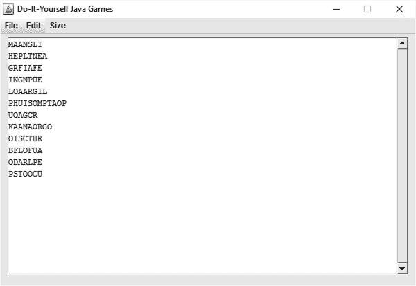

## 第 12.1 - 注释

注释你可以放在程序中的笔记，用于提醒自己想让代码做什么。程序运行时，注释会被忽略，因此你可以在注释中输入任何想要的内容。注释也经常用于标记代码区域。

在本节中，你将使用注释来规划打乱单词的代码。

### 尝试一下

开始编写下一个程序：

1. 创建名为 `Word Scramble` 的新 `Java project`，并将 `MyWindow` 和 `DIY.jar` 添加到项目中。
2. 在项目中创建一个名为 `___________.wordscramble` 的新 `package`。
3. 创建名为 `WordScramble` 的新 `class`，父类为 `MyWindow`，并为 `main()` 方法和构造函数编写存根。
4. 在 `main()` 中添加代码调用 `WordScramble` 构造函数。

*列表 12-1，来自 `WordScramble.java`*

```java
package annette.godtland.wordscramble;

import annette.godtland.window.MyWindow;

public class WordScramble extends MyWindow {

  public WordScramble() {

  }

  public static void main(String[] args) {

    ____________________;

  }

}

```

* * *

## 完成列表

编写打乱字符串的代码，使其可以多次使用。

1. 定义一个名为 `scramble()` 的私有方法，它接受一个名为 `word` 的字符串参数，并返回一个字符串。
2. 在 `scramble()` 中，声明一个名为 `scrambled` 的字符串，赋值空字符串作为初始值，并返回该字符串。

*列表 12-2，来自 `WordScramble.java`*

```java
 ...

  private String scramble(String word) {

    String scrambled = "";

    return scrambled;

  }

```

* * *

## 完成列表

在构造函数中添加代码：

1. 创建一个名为 `word` 且值为 `"ANIMALS"` 的字符串。
2. 以 `word` 为参数调用 `scramble()` 方法，并将调用结果赋值给一个新的名为 `scrambled` 的字符串。
3. 打印该新字符串。

*列表 12-3，来自 `WordScramble.java`*

```java
 ...

  public WordScramble() {

    String word = "________________";

    String ___________ = scramble(word);

    print(____________);

  }

```

* * *

## 完成列表

你知道如何打乱一个单词吗？如果将其分解成更小的步骤会更容易。打乱一个单词：

* 从原始单词中随机选择一个字母。
* 从原始单词中移除该字母。
* 将该字母添加到新单词中。
* 重复这些步骤，直到原始单词中的所有字母都被移除。

要在代码中输入注释，请以双斜杠 `//` 开头。`//` 之后的任何内容都会被视为注释。

1. 在 `scramble()` 中输入注释描述打乱单词的步骤。

*列表 12-4，来自 `WordScramble.java`*

```java
 ...

  private String scramble(String word) {

    String scrambled = "";

    // 从原始单词中随机选择一个字母

    // 从原始单词中移除该字母

    // _____________________________

    // ______________________________

    return scrambled;

  }

```

* * *

## 完成列表

### 关键点及更多

* 如果把任务分解成更小的步骤，编写代码会更容易。
* 使用注释标记你想让代码做什么。
* 注释在程序运行时会被忽略。
* 要输入注释，在行开头使用双斜杠 `//`。
* `//` 形式的注释也可以放置在代码的右侧。例如：

```java
int count = 0; // 计数
```

* 还有另一种跨多行的注释类型。用星号和斜杠 `/*` 开头。
* `/* ... */` 形式的注释以星号和斜杠 `*/` 结尾。
* `/* ... */` 形式的注释可以跨越多行。
* 我时时使用 `/* ... */` 形式的注释来暂时注释掉一段代码。
* 只需要删除 `/*` 和 `*/` 就可以把代码放回来。

## 第 12.2 - 字符串长度与字符串

程序需要知道字符串的长度，并能够从字符串创建一个新字符串。为此，你将使用 `String` 的 `length()` 和 `substring()` 方法。

### 尝试一下

1. 在 `scramble()` 中创建一个名为 `rand` 的随机数生成器。

*列表 12-5，来自 `WordScramble.java`*

```java
 ...

  private String scramble(String word) {

    String scrambled = "";

    Random rand = ______________________;

    // 从原始单词中随机选择一个字母

      ...

```

* * *

## 完成列表

现在按照注释所述，一步一步编写代码。首先，从原始单词中随机选择一个字母。

你记得如何生成随机数吗？使用 `Random` 的 `nextInt()` 来选择小于给定数字的随机数。`scramble()` 需要选择小于 `word` 字母数量的数字。

`String` 有一个名为 `length()` 的方法可以返回字符串中的字符数。例如，要找到名为 `name` 的字符串的长度，使用：

```java
name.length();
```

1. 添加代码选择一个小于 `word` 长度的随机数。

*列表 12-6，来自 `WordScramble.java`*

```java
 ...

  private String scramble(String word) {

    int length = word._______________;

    int index = rand.nextInt(___________);

      ...

```

## 完成列表

在本节中，你还会使用的其他字符串方法包括：

* `substring(beginIndex)` 返回从 `beginIndex` 到字符串末尾的字符字符串。`beginIndex` 必须是一个小于字符串长度的整数。
* `substring(beginIndex, endIndex)` 返回从 `beginIndex` 到 `endIndex` 之间的字符字符串，但不包含 `endIndex` 处的字符。`beginIndex` 和 `endIndex` 必须是小于字符串长度的整数。`beginIndex` 必须小于 `endIndex`。

字符串中的字符从 0 开始编号。例如，字符串“Hello World”有 11 个字符，编号从 0 到 10，如下所示：

```text
Hello World

01234567890
```

如果你的代码中有一个名为 `greeting` 的变量，其值为“Hello World”，那么这段代码：

```java
greeting.length()
```

将返回 11。

这段代码：

```java
greeting.substring(6)
```

将返回“World”。

这段代码：

```java
greeting.substring(0, 7)
```

将返回“Hello W”。

这段代码：

```java
greeting.substring(4, 5)
```

将只返回字母“o”。

在你的代码中，`index` 是一个大于等于 0 且小于 `word` 长度的随机数。

1. 使用 `substring()` 方法获取 `index` 处的单个字母。（提示：参考上面只返回一个字母的示例。）

*Listing 12-7，源自 `WordScramble.java`*

```java
 ...

  private String scramble(String word) {

      ...

    // 从原始单词中随机选择一个字母

    int length = word.length();

    int index = rand.nextInt(length);

    String letter = word.substring(___________, ________________);

      ...

```

* * *

## 完成列表

下一步的注释说是从原始单词中删除该字母。

遗憾的是，没有一种字符串方法可以直接从指定位置删除字符。相反，你需要：

* 创建一个该字符之前文本的字符串。
* 创建该字符之后文本的字符串。
* 将这两个字符串拼接在一起。

1. 添加代码执行上述步骤。（提示：同时使用两个不同参数数量版本的 `substring()`。）

*Listing 12-8，源自 `WordScramble.java`*

```java
 ...

  private String scramble(String word) {

      ...

    // 从原始单词中删除该字母

    String firstString = word.substring(_________,__________);

    String secondString = word.substring(_______);

    word = ____________________ + ____________________;

      ...
```


## 完成列表

### 关键点及更多

- 使用 `String` 的 `length()` 方法查找字符串的长度。
- 使用 `String` 的 `substring()` 方法获取字符串的部分内容。
  - 字符串中的字符从 0 开始编号。因此，字符串的最后一个字符的编号比字符串长度少 1。
  - 如果你只向 `substring()` 传递一个整数参数，它将返回从该索引开始到字符串末尾的部分。
  - 如果你向 `substring()` 传递两个整数参数，它将返回从第一个索引到第二个索引的字符串部分，但不包含第二个索引处的字符。

## 课程 12.3 - 打印到控制台

你可以将内容打印到 Eclipse 的 `Console` 面板，而不会影响用户在程序窗口中看到的内容。

在本节中，你将使用稍后会删除的代码将变量的值打印到 `Console` 面板。

### 试一试

当你运行 Word Scramble 程序时，它只是打开了一个空窗口。你如何能判断它是否正确地打乱了单词呢？

Java 有一个方法 `System.out.println()`，它可以将内容打印到 Eclipse 的 `Console` 面板而不是程序窗口。像你使用 `print()` 一样使用 `System.out.println()`。例如，要将变量 `name` 的值打印到 `Console` 面板，请使用：

```java
System.out.println("name = " + name);
```

1. 使用 `System.out.println()` 将 `index`、`letter` 和 `word` 的值打印到 `Console` 面板。

*Listing 12-9，源自 WordScramble.java*

```java
...

private String scramble(String word) {
    ...

    // 从原始单词中随机选择一个字母

    int length = word.length();

    int index = rand.nextInt(length);

    System.out.println("index = " + ____________);

    String letter = word.substring(index, index + 1);

    System.out.println("letter = " + ___________);

    // 从原始单词中删除该字母

    String firstString = word.substring(0, index);

    String secondString = word.substring(index + 1);

    word = firstString + secondString;

    System.out.println("word = " + ____________);
```

## 完成列表

当你运行程序时，它应该打印到 `Console` 面板。根据 `index` 的值，它是否正确地删除了字母？

1. 使用 `System.out.println()` 将 `index`、`letter` 和 `word` 的值打印到 `Console` 面板。

## 完成列表

下一步是将该字母添加到新单词中。

1. 使用 `System.out.println()` 将 `scrambled` 打印到 `Console` 面板。

*Listing 12-10，源自 WordScramble.java*

```java
...

private String scramble(String word) {
    ...

    // 将该字母添加到新单词

    String scrambled = _______________;

    System.out.println("scrambled = " + scrambled);

    ...
```

## 完成列表

下一步是将代码放入循环。

1. 将代码放入 `while` 循环直到删除所有字母。

*Listing 12-11，源自 WordScramble.java*

```java
...

private String scramble(String word) {
    String scrambled = "";

    // 直到删除所有字母

    while (word.length() > 0) {
        // 从原始单词中随机选择一个字母

        int length = word.length();

        int index = rand.nextInt(length);

        System.out.println("index = " + index);

        String letter = word.substring(index, index + 1);

        System.out.println("letter = " + letter);

        // 从原始单词中删除该字母

        ...
    }

    return...
```

### 关键点及更多

- 使用 `String` 的 `length()` 方法查找字符串的长度。
- 使用 `String` 的 `substring()` 方法获取字符串的部分内容。
  - 字符串中的字符从 0 开始编号。因此，字符串的最后一个字符的编号比字符串长度少 1。
  - 如果你只向 `substring()` 传递一个整数参数，它将返回从该索引开始到字符串末尾的部分。
  - 如果你向 `substring()` 传递两个整数参数，它将返回从第一个索引到第二个索引的字符串部分，但不包含第二个索引处的字符。

## 课程 12.4 - 数组

`数组` 是所有相同类型的数据列表。在本节中，你将把一组要打乱的单词放在字符串数组中。

### 试一试

数组存储数据列表。数组中的数据必须全为相同类型，例如全字符串数据或全整数数据。声明数组变量时，在它的名称后加上方括号 `[]`。例如，声明一个名为 `myFamily` 的字符串数组，使用：

```java
String myFamily[]
```

将数据放入数组的一种方法是在声明时将列表赋值给数组。输入数据列表时，将数据放在大括号中，项之间用逗号。将包含三个字符串的列表赋值给数组 `myFamily`，使用：

```java
String myFamily[] = {"Annette", "Paul", "Leah"};
```

对构造函数进行以下更改：

1. 将名为 `word` 的字符串替换为名为 `words` 的字符串数组。
2. 在这个单词列表中添加你自己的动物，使列表总共有 12 个单词。
3. 在数组上方添加一条注释，说明你正在创建一个单词列表。

*列表 12-12，源自 WordScramble.java*

```java
...

public WordScramble() {
    // create a list of words

    String words[] = {
        "ANIMALS", "ELEPHANT", "GIRAFFE", "PENGUIN", "GORIALLA",
        "_____________", "___________", "__________", "____________",
        "____________", "____________", "_____________"
    };

    String scrambled = scramble(word);

    print(scrambled);

    ...
```

## 已完成列表

现在程序中将出现语法错误。你将在下一次代码更改中修复这些错误。

要使用数组中的项，请将项的索引放在方括号中。与字符串索引一样，数组索引从 0 开始。因此，一个包含 12 个项的数组索引值为 0 到 11。例如，要引用名为 `myFamily` 的列表中的第一个项，请使用：

```java
myFamily[0]
```

要引用列表中的第三项，请使用：

```java
myFamily[2]
```

要找出列表中有多少项，请使用：

```java
myFamily.length
```

注意，`length` 后面没有括号。

1. 修改代码，使其打乱列表中的第一个单词。（提示：将 `words` 中的第一个项传递给 `scramble()`。）

*列表 12-13，源自 WordScramble.java*

```java
...

public WordScramble() {
    String words[] = {
        "ANIMALS", "ELEPHANT", "GIRAFFE", "PENGUIN", "GORIALLA",
        "HIPPOPOTAMUS", "COUGAR", "KANAGAROO", "OSTRICH", "BUFFALO",
        "LEOPARD", "OCTOPUS"
    };

    String scrambled = scramble(______________);

    print(scrambled);

    ...
```

## 已完成列表

1. 运行程序，查看它是否打乱了列表中的第一个单词。

为了练习，修改程序使其打乱列表中的最后一个单词：

1. 在打乱单词之前，创建一个名为 `numberOfWords` 的整数，其值为列表中单词的数量。（提示：使用数组的 `length`。）
2. 修改代码以打乱列表中的最后一个单词。（提示：使用 `numberOfWords`。提示：最后一个单词的索引是否等于 `numberOfWords`？）

*列表 12-14，源自 WordScramble.java*

```java
...

public WordScramble() {
    ...

    int numberOfWords = words._____________;

    String scrambled = scramble(_______________);

    print(scrambled);

    ...
```

## 已完成列表

运行程序，查看它是否打乱了列表中的最后一个单词。

现在你已经知道如何使用列表中的第一个单词、最后一个单词，以及列表中有多少个单词了。这些就是你创建 `for` 循环所需的所有信息。

1. 将 `scramble` 和 `print` 语句放入 `for` 循环中，以打乱并打印列表中的每个单词。

*列表 12-15，源自 WordScramble.java*

```java
...

public WordScramble() {
    ...

    int numberOfWords = words.length;

    // for each word in the list, scramble the word and print it

    for (int i = _____; i < ___________________; i___) {
        String scrambled = scramble(words[____]);

        print(scrambled);
    }

    ...
```

## 已完成列表

当你运行程序时，它应该生成一个十二个打乱单词的列表。如果你不喜欢某些单词的打乱方式，可以再次运行程序。

你可以从窗口中复制单词列表并将其粘贴到你自己的文档、电子邮件或其他程序中。

1. 删除程序中的 `System.out.println()` 语句。

不再需要 `System.out.println()` 语句了，但请保留注释。注释可以很好地始终提醒你代码想要实现的功能。

### 关键点及更多

- 数组是数据列表。一旦声明了数组，其大小就无法更改。
- 数组只能包含一种类型的数据，例如字符串、整数、双点数，甚至是你自己定义的类型。在声明数组时，需要声明数组将要存储的数据类型。
- 将数据放入数组的一种方法是给它赋值一个大括号括起来的逗号分隔的项列表。另一种将数据放入数组的方法将在稍后的课程中介绍。
- 要使用数组中的项，请将项的索引放在方括号中。与字符串索引一样，数组索引从 0 开始。因此，最后一个单词的索引比数组的大小少 1。

## 12.5 - 静态方法

静态方法只使用内部声明以及作为参数传递的变量。静态方法很容易从另一个类中调用。

### 尝试

首先，将 `scramble()` 方法从 `WordScramble` 移动到 `annette`。

1. 创建一个名为 `annette` 的包。
2. 创建一个名为 `MyStringMethods` 的类。
3. 为 `scramble()` 创建一个存根。

*列表 12-16，源自 WordScramble.java*

```java
package annette;

public class MyStringMethods {
}
```

## 已完成列表

1. 从 `WordScramble` 剪切整个 `scramble()` 方法并粘贴到 `MyStringMethods` 中。

*列表 12-17，源自 WordScramble.java*

```java
package annette;

public class MyStringMethods {
    private String scramble(String word) {
        String scrambled = "";

        Random rand = new Random();
```

## 已完成列表

`MyStringMethods` 中的 `scramble()` 方法被声明为 `private`。如果你将其保持为 `private`，则其他类无法使用它。

1. 将 `private` 替换为 `public` 以使 `scramble()` 为 `public`。

*列表 12-18，源自 WordScramble.java*

```java
public String scramble(String word) {
    String scrambled = "";

    Random rand = new Random();
```

## 已完成列表

`scramble()` 方法没有使用内部声明以及作为参数传递的变量以外的任何变量。`scramble()` 方法也没有使用任何 Java 不自带的方法。这意味着你可以将 `scramble()` 声明为 `static`。

1. 在 `public` 之后添加 `static` 使 `scramble()` 静态化。

*列表 12-19，源自 WordScramble.java*

```java
public static String scramble(String word) {
    String scrambled = "";

    Random rand = new Random();
```

## 已完成列表

因为 `scramble()` 同时是 `public` 且 `static` 的，其他类可以使用 `MyStringMethods` 类名来调用它。例如，从另一个类中打乱名为 `name` 的变量，该类将使用：

```java
MyStringMethods.scramble(name)
```

这与你在之前的课程中使用 `Integer.parseInt()` 类似。`parseInt()` 是 `Integer` 类中的一个公共静态方法。

为了让另一个类使用 `scramble()`，它必须首先在它的构建路径（build path）中包含 `My String Methods` 项目。

1. 返回 `Word Scramble` 项目，并将 `My String Methods` 项目添加到它的构建路径中。（提示：右键点击该项目并选择 `Build Path / Configure Build Path...`。）
2. 接下来，转到 `WordScramble` 类，并将对 `scramble()` 的调用替换为现在调用 `MyStringMethods` 类中的 `scramble()` 方法。（提示：你可以使用 Quick Fix 来导入 `MyStringMethods` 类。）

*Listing 12-20，来自 WordScramble.java*

```java
...

public WordScramble() {
    ...

    // 遍历列表中的每个单词，对其进行乱序排序并打印

    for (int i = 0; i < numberOfWords; i++) {
        scrambled = _______________________.scramble(words[i]);

        ...
```

## 完成的列表

WordScramble 不再需要导入 `java.util.Random`，因为它不再使用 `Random` 类。

1. 从 `WordScramble` 中删除 `import java.util.Random`。

*Listing 12-21，来自 WordScramble.java*

```java
package annette.godtland.wordscramble;

// 此处已删除代码。

import annette.godtland.mystringmethods.MyStringMethods;
```


```java
import annette.godtland.mywindow.MyWindow;
```

---

## 完成的列表

这是 Word Scramble 程序的结束部分。

1. 如果你想在没有 Eclipse 的情况下运行 Word Scramble 程序，请导出你的程序。

### 关键点及更多

* 将你可能希望让其他类使用的方法放在单独的类中。
* 方法可以是私有的（`private`）、受保护的（`protected`）或公有的（`public`）。
  * `private` 方法只能由定义它的类使用。
  * `protected` 方法可以在定义它的类以及任何继承该类的类中使用。
  * `public` 方法可以在任何类中使用，甚至是在互不相关的类中。
* 除非你有理由让方法变为受保护的或公有的，否则将所有方法都设为 `private`。
* `static` 方法必须是自包含的。它只能使用作为参数传递的数据或在方法内部声明的数据。而且，它只能使用 Java 自带的方法或同样是静态的方法。
* 要将方法声明为 `static`，请在 `private`、`protected` 或 `public` 单词之后添加 `static` 单词。
* 公共静态方法可以通过在方法名前加上类名来从任何类中轻松调用。例如，`scramble()` 是 `MyStringMethods` 的一个公共静态方法。要调用它，使用：

```java
newWord = MyStringMethods.scramble(word);
```

* 非静态的公共方法需要你先声明一个该类型的新变量，然后从该变量调用方法。例如，`nextInt()` 是 `Random()` 的一个公共方法，但它不是静态的。要调用它，使用：

```java
Random rand = new Random();

index = rand.nextInt(10);
```

* 在之前的一个课程中，`MyWindow` 继承了 `DIYWindow`（父类）以共享 `promptForInt()` 方法。为什么 `MyStringMethods` 不也继承 `DIYWindow` 呢？当方法应该被相同类型（父类）的类使用时，继承父类。`scramble()` 不仅会被 `DIYWindow` 类或 `MyWindow` 类使用。因此，`scramble()` 不应该放在继承这些类的中。
* `scramble()` 和 `parseInt()` 都是静态方法。为什么你必须将 `My String Methods` 项目添加到构建路径才能使用 `scramble()`，但你不需要添加 `Integer` 项目就可以使用 `parseInt()`？`Integer` 类是 Java 开发工具包（JDK）的一部分。因此，`Integer` 已经包含在每个类的构建路径中了。`MyStringMethods` 不是 Java 开发工具包的一部分，所以你必须手动将 `My String Methods` 添加到构建路径。

# 项目 13 - Secret 代码（Secret Code）

Secret Code 程序允许你创建与朋友分享的秘密信息。

这里是 Secret Code 程序的截图：

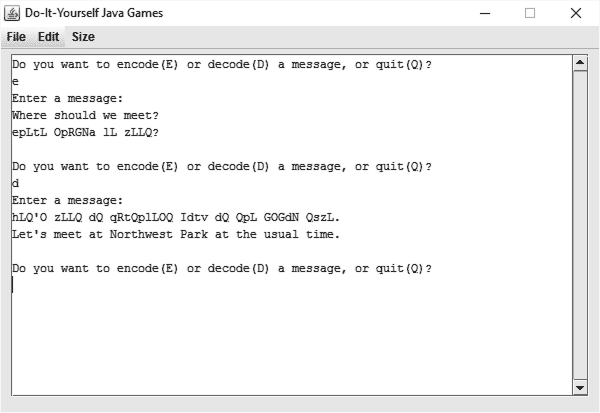

## 课程 13.1 - 写入文件

将数据写入文件，以便数据可以被同一个程序或另一个程序再次使用。

在本节中，你将创建一个用于编码和解码消息的密钥，然后将该密钥写入文件。

### 尝试一下

开始编写下一个程序：

1. 创建名为 `Secret Code Key` 的新 `Java project`，并将 `My Window`、`My String Methods` 和 `DIYJava.jar` 添加到项目中。
2. 在项目中创建一个名为 `__________._.secretcodekey` 的新 `package`。
3. 创建名为 `SecretCodeKey` 的新 `class`，父类为 `MyWindow`，并为 `main()` 方法及其构造函数提供存位（stub）。
4. 在 `main()` 中添加代码调用 `SecretCodeKey` 构造函数。

*Listing 13-1，来自 SecretCodeKey.java*

---

```java
package annette.godtland.secretcodekey;

import annette.godtland.mystringmethods.MyStringMethods;
import annette.godtland.mywindow.MyWindow;

public class SecretCodeKey extends MyWindow {

  public SecretCodeKey() {

  }

  public static void main(String[] args) {

    new SecretCodeKey();

  }

}
```

---

## 完成的列表

首先，我们要编写字母表。字母表将是编码和解码消息的密钥。

1. 定义一个名为 `alphabet` 的字符串，包含所有大小写字母。

*Listing 13-2，来自 SecretCodeKey.java*

---

```java
...

  public SecretCodeKey() {

    String alphabet = "_________________";

  }
```

---

## 完成的列表

接下来，对 `alphabet` 字符串进行乱序并将其放入名为 `scrambled` 的新字符串中。（提示：在 `MyStringMethods` 类中使用 `scramble()`。）

*Listing 13-3，来自 SecretCodeKey.java*

---

```java
...

  public SecretCodeKey() {

    String alphabet = "ABCDEFGHIJKLMNOPQRSTUVWXYZabcdefghijklmnopqrst";

    String scrambled = _____________;

  }
```

---

## 完成的列表

最后，同时打印字母表和乱序后的字母表。

*Listing 13-4，来自 SecretCodeKey.java*

---

```java
...

  public SecretCodeKey() {

    String alphabet = "ABCDEFGHIJKLMNOPQRSTUVWXYZabcdefghijklmnopqrst";

    String scrambled = _________________;

    print(alphabet);

    print(scrambled);

  }
```

---

## 完成的列表

接下来，我们将字母表和密钥保存到文件中。写入文件涉及以下步骤：

* 通过创建 `BufferedWriter` 变量打开文件。
* 通过调用 `BufferedWriter` 的 `write()` 方法写入文件。
  * 重复调用 `write()` 直到所有字符串都写入文件。
  * 如果你想让下一个字符串位于文件的新的一行，请使用 `BufferedWriter` 的 `newLine()` 方法。
* 通过调用 `BufferedWriter` 的 `close()` 方法关闭文件。

例如，要将 *Hello* 和 *World* 写入名为 `myFile.txt` 的文件，且每个单词占据单独一行，使用以下代码：

```java
String fileName = "myFile.txt";

BufferedWriter out = new BufferedWriter(new FileWriter(new File(fileName)));

out.write("Hello");

out.newLine();

out.write("World");

out.close();
```

1. 如何将 `alphabet` 和 `scrambled` 写入名为 `key.txt` 的文件，使每个字符串位于文件的不同行？
2. 在向文件写入两个字符串后关闭文件。

*Listing 13-5，来自 SecretCodeKey.java*

---

```java
...

  public SecretCodeKey() {

    ...

    print(alphabet);

    print(scrambled);

    String fileName = "_________________";

    BufferedWriter out = new BufferedWriter(new FileWriter(new File(fileName)));

    out.write(________________);

    out.________________;

    out.write(________________);

    out.________________;

    ...
```

---

## 完成的列表

1. 如果你收到某些内容无法解析为类型的消息，请使用 Quick Fix 添加所需的导入语句。

你还会收到一个未处理异常（Unhandled exception）的语法错误，`IOException`。

1. 在 `BufferedWriter`、`write()` 和 `close()` 语句周围添加 `try/catch` 块。
2. 如果捕获到 `IOException`，则打印一条消息显示无法打开文件。

*列表 13-6，源自 SecretCodeKey.java*

---

```java
...

  public SecretCodeKey() {

    ...

    String fileName = "key.txt";

    try {

      BufferedWriter out = new BufferedWriter(new FileWriter(new File(fileName)));

      out.write(alphabet);

      out.newLine();

      out.write(scrambled);

      out.close();

    }

    catch (___________________) {

      print("Could not open file " + fileName);

    }

    ...
```

---

## 已完成的代码列表

当你运行程序时，窗口中仍然应该打印字母表和乱序字母表。但现在它还应该将这两个字母表都打印到名为 `key.txt` 的文件中。

1. 如果你想查看程序刚刚创建的文件，请进入 Java 工作文件夹中的 `Secret Code Key` 文件夹，并打开 `key.txt` 文件。
   1. 如果双击 `key.txt` 没有打开文件，请右键点击该文件并选择“打开方式 / 记事本”或其他任何其他基础文本编辑器来查看写入文件的内容。

### 关键点及更多

* 要向文件写入内容，请创建一个 `BufferedWriter` 变量，根据需要多次调用其 `write()` 方法，然后使用 `close()` 关闭文件。
  * 只有字符串可以写入文件。因此，在将数据写入文件之前，你必须先将数据转换为字符串。
  * 调用 `newLine()` 方法使下一次 `write()` 写入文件中的新行。
  * 如果每个变量稍后都要从文件中读取并放入单独的变量中，请每个变量写入新的一行。
* 写入文件可能会导致 `IOException`。将创建、写入和关闭步骤，以及任何你不希望在无法打开文件时运行的代码，封装在 `try/catch` 块中。
* 如果文件不存在，写入文件将创建一个新文件。
* 如果文件已存在，写入文件将替换文件中的原有内容。
* 不带路径名的写入操作将将文件放在你类的 Java 项目文件夹中。
* 如果你想将文件保存到不同的位置，请在文件名中包含路径名。路径名是从驱动器号开始的完整文件夹名称。然而，请记住，在运行程序的任何计算机上，该路径都必须已经存在。例如，要将 `key.txt` 保存到 `c:\users\Annette\`，请使用以下代码。（提示：在 Java 字符串的每个反斜杠前使用转义字符。）

```java
fileName = "c:\\users\\Annette\\key.txt";
```

* 使用记事本或其他任何其他基础文本编辑器查看写入文件的内容。
* 你想在你的秘密信息中编码哪些字符？仅仅是字母表吗？大写和小写字母？数字、空格或标点符号呢？将所有你想编码的字符放入 `alphabet` 中并再次运行程序。原始 `alphabet` 中包含的字符越多，别人试图破解你的加密信息就越困难。

## 第 13.2 节 - 从文件读取，捕获多个异常

在本节中，你将使用另一个程序来读取上一个程序写入文件的数据。从文件中读取时可能会发生多个异常。

### 试一试

开始编写下一个程序：

1. 创建一个名为 `Secret Code` 的新 `Java project`，并将 `My Window` 和 `DIYJava.jar` 添加到项目中。
2. 在项目中创建一个名为 `_______________________.secretcode` 的新 `package`。
3. 创建一个名为 `SecretCode` 的新 `class`，父类为 `MyWindow`，并带有 `main()` 方法及其构造函数的存根。
4. 在 `main()` 中添加代码调用 `SecretCode` 构造函数。

*列表 13-7，源自 SecretCode.java*

---

```java
package annette.godtland.secretcode;

import annette.godtland.mywindow.MyWindow;

public class SecretCode extends MyWindow {

  public SecretCode() {

  }

  public static void main(String[] args) {

    ____________________________________;

  }

}
```

---

## 已完成的代码列表

Secret Code 程序应该使用你用 `Secret Code Key` 程序创建的同一个 `key.txt` 文件。

1. 进入 Java 工作文件夹中的 `Secret Code Key` 文件夹。从该文件夹复制 `key.txt` 并将其粘贴到 Java 工作文件夹中的 `Secret Code` 文件夹中。

从文件中读取数据，你需要执行以下步骤：

* 通过创建一个 `BufferedReader` 变量来打开文件。
* 通过调用 `BufferedReader` 的 `readLine()` 方法从文件中读取一行。
  * 重复调用 `readLine()` 直到你读取了从文件中想要的所有字符串。
* 通过调用 `BufferedReader` 的 `close()` 方法关闭文件。

例如，要从 `myFile.txt` 读取内容，请使用以下代码：

```java
fileName = "myFile.txt";

BufferedReader in = new BufferedReader(new FileReader(new File(fileName)));

String line1 = in.readLine();

String line2 = in.readLine();
```

1. 从 `key.txt` 读取两行并将它们存入字符串 `alphabet` 和 `key`。

*列表 13-8，源自 SecretCode.java*

---

```java
...

  public SecretCode() {

    String fileName = "key.txt";

    try {

      BufferedReader in = new BufferedReader(new FileReader(new File(fileName)));

      String alphabet = in.readLine();

      String key = in.readLine();

      in.close();

    }

    catch (___________________) {

      print("Could not find file " + fileName + ".");

    }

    catch (___________________) {

      print("Could not open file " + fileName + ".");

    }

  }
```

---

## 已完成的代码列表

1. 如果你收到类型未解析的消息，请使用 Quick Fix 添加导入语句。

你还会收到一个未处理异常的语法错误，`FileNotFoundException` 和 `IOException`。

1. 添加 `try` 块和两个 `catch` 块。
   1. 如果捕获到 `FileNotFoundException`，打印一条消息显示找不到文件。
   2. 如果捕获到 `IOException`，打印一条消息显示无法打开文件。

*列表 13-9，源自 SecretCode.java*

---

```java
...

  public SecretCode() {

    String fileName = "key.txt";

    try {

      BufferedReader in = new BufferedReader(new FileReader(new File(fileName)));
```


```java
String alphabet = in.readLine();

String key = in.readLine();

in.close();
}

catch (FileNotFoundException e) {
  print("Could not find file " + fileName + ".");
}

catch (IOException e) {
  print("Could not open file " + fileName + ".");
}
```

## 已完成的代码列表

1. 现在，打印`alphabet`和`key`以便看到你已从文件中读取的内容。（提示：它只有在成功从文件中读取时才打印字母表和密钥。所以打印语句是在`try`块中还是`catch`块之后？）

*列表 13-10，源自`SecretCode.java`*

```java
...
public SecretCode() {
  ...

  in.close();

  print(alphabet);
  print(key);
}
...
```

## 已完成的代码列表

- 如果你想从另一个位置读取文件，请在文件名中包含路径名。路径名是从驱动器号开始的完整文件夹名称。例如，要读取`c:\users\Annette\`下的`key.txt`，请使用以下代码。（提示：记住在 Java 字符串的每个反斜杠前面都要使用转义字符。）

```java
fileName = "c:\\users\\Annette\\key.txt";
```

## 第 13.3 节：多参数方法

到目前为止，你创建了具有零个或一个参数的方法。在本节中，你将创建一个具有多个参数的方法。

### 尝试一试

1. 创建一个名为`encode()`的私有方法，用于编码和解码消息。
2. `encode()`应该接受三个字符串参数：`message`、`fromAlphabet`和`toAlphabet`，并返回一个字符串。
3. 声明一个名为`newMessage`的字符串，初始值为空，并返回它。

*列表 13-11，来自`SecretCode.java`*

```java
...
private _________ encode(_________ message, __________ fromAlphabet, ________ toAlphabet) {
  String newMessage = "______";

  return ______________;
}
...
```

## 已完成列表

对构造函数中的代码进行以下更改：

1. 删除打印`alphabet`和`key`的代码。
2. 声明一个名为`messageToEncode`的字符串，并通过提示用户输入要编码的消息来初始化它。
3. 声明一个名为`encodedMessage`的字符串，并通过调用`encode()`来初始化它。向`encode()`传递消息、字母表和密钥。
4. 打印`encodedMessage`。

*列表 13-12，来自`SecretCode.java`*

```java
...
public SecretCode() {
  ...

  String key = in.readLine();

  in.close();

  （此处已删除了代码。）

  String messageToEncode = ________________(_______________);

  String encodedMessage = encode(____________, ___________, ___________);

  print(___________________);
}
...
```

## 已完成列表

无论你输入什么，程序都会打印一个空字符串。你将在下一节中添加代码来打乱消息。

### 关键点及更多内容

- 方法可以定义任意数量的参数。
- 如果一个方法定义了多个参数，调用该方法时必须以相同的顺序传递相同数量的参数。

## 第 13.4 节：字符串中字符的索引

你的 Secret Code 程序需要从字母表字符串中找到消息的每个字符，并找到哪个字符位于密钥字符串的相同位置。为了做到这一点，它必须找到字符在字符串中的索引（index）。

### 尝试一试

`String`的`indexOf()`方法返回搜索字符串在字符串中首次出现的位置。例如，如果一个名为`text`的变量值为“Hello World”，而你想知道字符串中空格的位置，你应该使用：

```java
text.indexOf(" ");
```

上述代码将返回值 5，因为字符串中的索引从 0 开始计数。

如果搜索字符串在字符串中出现多次，`indexOf()`返回其第一次出现的位置。例如：

```java
text.indexOf("l");
```

将返回值 2。

如果搜索字符串不在字符串中，它返回值 -1。例如：

```java
text.indexOf("a");
```

将返回值 -1。

方法`indexOf()`是区分大小写的。例如：

```java
text.indexOf("h");
```

将返回值 -1，因为“Hello World”中没有小写的`h`。

要将消息中的每个字母替换为密钥中相对应的字母，你需要执行以下步骤：

- 获取消息的第一个字母。
- 找到该字母在“from alphabet”（源字母表）中的索引。
- 如果该字母在“from alphabet”中，则获取“to alphabet”（目标字母表）相同位置的字母，并将该新字母添加到新消息中。
- 如果该字母不在“from alphabet”中，将该字母添加到新消息中。
- 使用消息中的下一个字母重复这些步骤。

1. 为`encode()`添加上述步骤的注释。

*列表 13-13，来自`SecretCode.java`*

```java
...
private String encode(String message, String fromAlphabet, String toAlphabet) {
  String newMessage = "";

  // ___________________________________________
  // ___________________________________________
  // ___________________________________________
  // ___________________________________________
  // ___________________________________________

  return newMessage;
}
...
```

## 已完成列表

1. 获取`message`的第一个字母并将其放入一个名为`letter`的字符串中。（提示：使用`substring()`。）
2. 获取该字母在`fromAlphabet`中的位置，并将其放入一个名为`letterPos`的整数中。（提示：使用`indexOf()`。）

*列表 13-14，来自`SecretCode.java`*

```java
...
private String encode(String message, String fromAlphabet, String toAlphabet) {
  String newMessage = "";

  // 获取消息的第一个字母
  String letter = ________;

  // 找到该字母在 fromAlphabet 中的索引
  int letterPos = ________;
```

## 已完成列表

1. 如果该字母在“from alphabet”中，获取“to alphabet”相同位置的字母并将其放入一个名为`newLetter`的字符串中。（提示：使用`substring()`。）
2. 如果字母不在“from alphabet”中，`indexOf()`会返回什么？
3. 将该新字母添加到消息中。

- `indexOf()`是区分大小写的。搜索小写字母不会返回相同大写字母的索引。

## 课程 13.5：布尔数据类型

到目前，你已经在程序中使用了字符串、整数和双精度浮数据。在本节中，你将使用布尔数据。布尔数据只有两种可能的值：`true`（真）或`false`（假）。

### 尝试一下

解码消息与编码消息非常相似。唯一的区别在于，解码消息时，你将密钥作为`fromAlphabet`，将字母表作为`toAlphabet`。

在构造函数中添加代码：

1. 使用`encode()`解码`encodedMessage`并将结果存放在名为`decodedMessage`的新字符串中。（提示：按照上述解码消息的方法，以正确的顺序传入编码消息、密钥和字母表来解码消息。）
2. 打印解码后的消息。

*列表 13-18，来自`SecretCode.java`*

```java
...
public SecretCode() {
  ...

  String messageToEncode = promptForString("Enter a message:");

  String encodedMessage = encode(messageToEncode, alphabet, key);

  print(encodedMessage);

  String decodedMessage = encode(__________, ____________, ____________);

  print(________________________);
...
```

## 已完成列表

当运行程序时，它应该打印编码消息，然后将其解码回原始消息。

接下来，让用户在编码或解码消息之间进行选择。

另一个在该程序中非常好用的类型是布尔（boolean）。布尔值只能是`true`或`false`。

布尔变量声明为`boolean`。要给布尔值赋值`true`或`false`，直接输入`true`或`false`而不加引号。例如，声明一个名为`done`、值为`true`的布尔变量，使用：

```java
boolean done = true;
```

你不需要比较运算符来测试布尔变量是真是假。例如，要测试`done`是否为真，使用：

```java
if (done)
```

要测试`done`是否为假，使用非运算符：

```java
if (!done)
```

对程序进行这些更改：

1. 移除构造函数中从提示用户输入字符串到打印解码消息的五行代码。
2. 声明一个名为`quit`的布尔变量，初始值为`false`。
3. 添加一个`while`循环，只要`quit`不为真就继续执行。
4. 在循环内部，声明一个名为`option`的字符串，询问用户是想编码消息、解码消息还是退出。

*列表 13-19，来自`SecretCode.java`*

```java
...
public SecretCode() {
  ...

  String key = in.readLine();

  in.close();

  （此处已移除代码。）

  _____________ quit = _________;

  while (____________________) {
    String option = _____________________________________________;
  }
}
...
```

## 已完成列表

1. 根据`option`的值添加一个`switch`语句。
2. 在`switch`语句中添加一个`case`，这样如果用户输入“Q”，则将`quit`设置为`true`。

*列表 13-20，来自`SecretCode.java`*

```java
...
public SecretCode() {
  ...

  String option = promptForString("Do you want to encode(E) or decode(D) a message, or quit(Q)?");

  switch(__________________) {
    // quit
    case "___":
      quit = _____________;
      break;
  }

  ...
```

## 已完成列表

1. 在`switch`语句中添加一个`case`，这样如果用户输入“E”，则提示消息、对其进行编码并打印。（提示：使用`encode()`，并将`alphabet`作为`fromAlphabet`，将`key`作为`toAlphabet`。）

*列表 13-21，来自`SecretCode.java`*

```java
...
public SecretCode() {
  ...

  case "Q":
    quit = true;
    break;

  // encode a message
  case "___":
    String messageToEncode = _________________________________;
    String encodedMessage = encode(__________,___________,________);
    print(_______________________);
    break;
  }

  ...
```

## 已完成列表

1. 在`switch`语句中添加一个`case`，这样如果用户输入“D”，则提示消息、对其解码并打印。（提示：使用`encode()`，并将`key`作为`fromAlphabet`，将`alphabet`作为`toAlphabet`。）

*列表 13-22，来自`SecretCode.java`*

```java
...
public SecretCode() {
  ...

  print(encodedMessage);
  break;

  // decode a message
  case "D":
    String messageToDecode = ________________________________;
    String decodedMessage = encode(__________,___________,________);
    _(________________________);
    break;

  ...
```

## 已完成列表

如果你运行程序，它应该打印编码消息，然后将其解码回原始消息。

程序也应该处理用户可能输入的其他内容。

1. 添加一个`default`情况来告知用户输入无效。

*列表 13-23，来自`SecretCode.java`*

```java
...
public SecretCode() {
  ...

  print(decodedMessage);
  break;

  // anything else
  _________:
    print(option + " is not valid.");
  ...
```

## 已完成列表

### 关键点与更多

- 声明布尔为`boolean`。
- 布尔值只有`true`或`false`。
- 要给布尔值赋值`true`或`false`，直接输入`true`或`false`而不加引号，或将其设置为返回真或假的条件。例如：`boolean done = i==10;`。
- 在可以使用条件的地方使用布尔值，如`if`语句和`while`循环中。
- 要测试布尔值的相反值，使用非运算符。例如：`if (!done)`。

## 课程 13.6：无`break`的`case`

典型的`switch`语句在每个`case`结束都有`break`语句。然而，`break`语句是可选的。如果省略`break`语句，编写代码更容易。

### 尝试一下

程序运行得很好，但你可以让它用起来更好。

1. 在打印`encodedMessage`和`decodedMessage`之后添加空行。（提示：在字符串中添加什么可以将其分成两行？）

*列表 13-24，来自`SecretCode.java`*


```java
...

public SecretCode() {

  ...

  case "E":

    String messageToEncode = promptForString("Enter a message:");

    String encodedMessage = encode(messageToEncode, alphabet, key);

    print(encodedMessage + "_____");

    break;

  // decode a message

  case "D":

    String messageToDecode = promptForString("Enter a message:");

    String decodedMessage = encode(messageToDecode, key, alphabet);

    print(decodedMessage + "____");

    break;

  ...

}
```

---

## 已完成列表

让用户输入 `E`、`D` 或 `Q` 的大写或小写字母。使用 `case` 语句很容易实现。

如果你有一个没有 `break` 语句的 `case`，程序将继续执行下一个 `case` 中的代码。例如，如果你想让“Y”或“y”都将 `repeat` 设置为 `true`，你可以使用：

```java
case "Y":

case "y":

  repeat = true;

  break;
```

1. 你能猜到要在程序中添加什么，可以让“Q”和“q”运行相同的代码，“E”和“e”运行相同的代码，以及“D”和“d”运行相同的代码吗？

*列表 13-25，来自 `SecretCode.java`*

```java
...

public SecretCode() {

  ...

  switch (option) {

    // quit

    case "Q":

    ________:

      quit = true;

      break;

    // encode a message

    case "E":

    ________:

      String messageToEncode = promptForString("Enter a message:");

      String encodedMessage = encode(messageToEncode, alphabet, key);

      print(encodedMessage + "\n");

      break;

    // decode a message

    case "D":

    ________:

      String messageToDecode = promptForString("Enter a message:");

      String decodedMessage = encode(messageToDecode, key, alphabet);

      print(decodedMessage + "\n");

      break;

    // anything else

    default:

      print(option + " is not a valid option.");

  }

  ...

}
```

---

## 已完成列表

### 关键点与更多

- `case` 语句通常以 `break` 语句结束。
- 如果一个 `case` 没有 `break` 语句，程序将继续运行下一个 `case` 中的代码。当两个 `case` 应该执行相同的代码，或者一个 `case` 在运行另一个 `case` 中的相同代码之前执行了少量代码时，请使用这种技术。

## 课程 13.7：系统退出

在本节中，你将为程序添加系统退出功能。系统退出会关闭窗口并结束程序。

### 尝试一下

程序中可以添加的另一个功能是在用户选择退出时退出程序。要退出程序，请使用：

```java
System.exit(0);
```

如果你退出了程序，窗口也会随之关闭。

1. 在 `while` 循环结束后添加退出程序的代码。这样，当用户决定退出时，循环退出，窗口关闭，程序也退出。

*列表 13-26，来自 `SecretCode.java`*

```java
...

public SecretCode() {

  ...

  boolean quit = false;

  while (!quit) {

    ...

  }

  _________________________;

}

catch (FileNotFoundException e) {

  ...
```

---

## 已完成列表

### 关键点与更多

- 使用 `System.exit(0)` 关闭窗口并结束程序。

## 课程 13.8：带有 JAR 文件的数据文件

导出的 JAR 文件仅包含程序文件，不包含数据文件。本节解释了当你在 Eclipse 之外作为 JAR 文件运行程序时，程序如何使用数据文件。

### 尝试一下

这是 Secret Code 程序的结束。如果你想在不使用 Eclipse 的情况下运行它：

1. 导出你的 Secret Code 程序。
2. 将 `key.txt` 文件复制到与 `SecretCode.jar` 文件相同的文件夹中。

如果你想在桌面上创建一个图标来启动 Secret Code 程序，请在桌面上放置 `SecretCode.jar` 的快捷方式：

1. 右键点击 `SecretCode.jar` 并选择“复制”。
2. 在桌面上右键点击并选择“粘贴快捷方式”。
3. 只要你在桌面上创建的是快捷方式而不是副本，你就不需要将 `key.txt` 复制到桌面。`key.txt` 文件必须与实际的 `SecretCode.jar` 文件位于同一个文件夹中。

向任何你想分享秘密消息的人提供 `SecretCode.jar` 和 `key.txt` 的副本。你们双方必须使用相同的 `SecretCode.jar` 和 `key.txt` 文件。在 Secret Code 程序窗口之间进行复制和粘贴消息，以编码和解码你们互相发送的消息。

### 关键点与更多

- 向任何你想分享你的 Secret Code 程序的人提供 `SecretCode.jar` 和 `key.txt`。
- 如果你在编写程序时使用了不带路径的文件（例如“key.txt”），则 `key.txt` 文件必须被放置在与 `SecretCode.jar` 文件相同的文件夹中。
  - 如果你为 `SecretCode.jar` 文件创建了快捷方式，`key.txt` 文件仍然必须保持在与 `SecretCode.jar` 文件相同的文件夹中。`key.txt` 文件不应移动到快捷方式所在的文件夹中。
- 如果你在编写程序时使用了带有路径的文件（例如“c:\Users\Annette\key.txt”），则在所有用户的计算机上，`key.txt` 文件都必须放置在该位置。此时 `SecretCode.jar` 文件可以位于任何文件夹中。

# 项目 14：单词大师（Word Mastermind）

Word Mastermind 游戏的目标是猜一个四个字母的单词。提示将对于每个猜对且位置正确的字母包含一个“O”，并对于每个猜对但位置错误的字母包含一个“X”。

这里是 Word Mastermind 程序的截图：

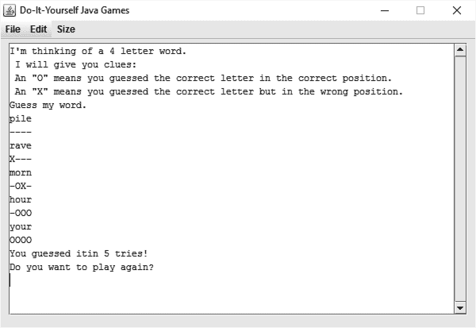

## 课程 14.1：用于是否的提示

是否提示在许多程序中都很有用。它应该显示一个提示，并确保用户输入 Y、y、N 或 n。

### 尝试一下

是否提示在许多程序中都很有用。它应该显示一个提示，并确保用户输入 Y、y、N 或 n。

1. 显示一个提示并确保用户输入 Y、y、N 或 n。
2. 显示一个提示并确保用户输入 Y、y、N 或 n。
3. 显示一个提示并确保用户输入 Y、y、N 或 n。
4. 显示一个提示并确保用户输入 Y、y、N 或 n。
5. 显示一个提示并确保用户输入 Y、y、N 或 n。
6. 显示一个提示并确保用户输入 Y、y、N 或 n。
7. 显示一个提示并确保用户输入 Y、y、N 或 n。
8. 显示一个提示并确保用户输入 Y、y、N 或 n。
9. 显示一个提示并确保用户输入 Y、y、N 或 n。
10. 显示一个提示并确保用户输入 Y、y、N 或 n。
11. 显示一个提示并确保用户输入 Y、y、N 或 n。
12. 显示一个提示并确保用户输入 Y、y、N 或 n。
13. 显示一个提示并确保用户输入 Y、y、N 或 n。
14. 显示一个提示并确保用户输入 Y、y、N 或 n。
15. 显示一个提示并确保用户输入 Y、y、N 或 n。
16. 显示一个提示并确保用户输入 Y、y、N 或 n。
17. 显示一个提示并确保用户输入 Y、y、N 或 n。
18. 显示一个提示并确保用户输入 Y、y、N 或 n。
19. 显示一个提示并确保用户输入 Y、y、N 或 n。
20. 显示一个提示并确保用户输入 Y、y、N 或 n。

```java
...

protected boolean promptForYesNo(String prompt) {

  boolean yes = true;

  boolean valid = ____________;

  while (!valid) {

    String YorN = promptForString(________);

    switch (YorN) {

      case "Y":

      case "y":

        yes = ___________;

        valid = ___________;

        break;

      case "N":

      case "n":

        yes = ___________;

        valid = ___________;

        break;

      default:

        print("Enter Y for yes, or N for no.");

        valid = _______;

    }

  }

  return yes;

}

...
```

---

## 已完成列表

现在当你运行程序时，它应该打印 Hello，然后询问你是否想要重复它。（提示：在点击 `run` 按钮时，确保你已经在 Eclipse 中选择了 `WordMastermind` 类。）

- 如果你输入“Y”或“y”，它应该重复“Hello”。
- 如果你输入“Y”、“y”、“N”或“n”以外的任何内容，它应该要求你输入“Y”或“N”。
- 如果你输入“N”或“n”，它就不应该再重复“Hello”了。

### 关键点及更多

- 你现在有一个方便的方法来询问用户一个是否问题并将答案存储在布尔变量中。
- 你可以在任何扩展 `MyWindow` 的类中使用 `promptForYesNo()`。
- `promptForYesNo()` 只会识别“Y”、“y”、“N”或“n”。它不接受“Yes”或“No”。
- 确保你的提示字符串（prompt string）告诉用户用“Y”或“N”回答。

## 课程 14.2：替换字符串中的字符

Word Mastermind 程序必须在指定的位置替换字符串中的字符。没有字符串方法可以直接实现这一操作。因此，在本节中，你将编写自己的 `replaceStringAt()` 方法。

### 尝试一下

任何类都应该可以使用新的 `replaceStringAt()` 方法，而不仅仅是扩展 `MyWindow` 的类。因此，你会将 `replaceStringAt()` 放在 `MyStringMethods` 中，而不是 `MyWindow` 中。

`replaceStringAt()` 是自包含的。它不使用 Java 自带或作为参数传入的任何方法或变量。因此，它可以是一个静态方法。

1. 在 `MyStringMethods` 类中添加一个名为 `replaceStringAt()` 的公共静态方法。它应该接受三个参数：名为 `originalString` 的字符串、名为 `index` 的整数以及另一个名为 `replaceString` 的字符串。它还应该返回一个字符串。
2. 声明一个名为 `newString` 的字符串变量，赋值初始值 `originalString`，并返回 `newString`。

*列表 14-6，来自 `MyStringMethods.java`*

```java
...

public __________ replaceStringAt(_______________________________) {

  String ____________ = originalString;

  return ____________;

}

...
```

---

## 已完成列表

你如何使用目前为止学过的方法，从指定的位置开始替换字符串中的字符？

- 将字符串拆分为两个字符串：索引位置之前的文本和替换字符串将填充的位置之后的文本。
- 将第一个字符串、替换字符串和第二个字符串拼接在一起。

你如何计算第二个字符串的起始位置？（提示：如果你在索引 5 处放置一个三个字符的替换字符串，它将占据位置 5、6 和 7。换句话说，第二个字符串将从索引 8 开始。索引 8 恰好是起始索引 5 加上替换字符串的长度 3。）

在 `replaceStringAt()` 方法中添加代码：

1. 创建一个包含索引之前所有字符的字符串。
2. 创建另一个包含替换字符串之后的所有字符的字符串。
3. 将这些字符串拼接在一起，并将替换字符串放在中间。

*列表 14-7，来自 `MyStringMethods.java`*

```java
...

public static String replaceStringAt(String originalString, int index, String replaceString) {

  String newString = originalString;

  String firstString = originalString.substring(______, __________);

  String secondString = originalString.substring(________ + _________________);

  newString = _______________ + ________________ + ________________;

  return newString;

}

...
```

---

## 已完成列表

修改 `WordMastermind` 中的代码以测试这个新的 `replaceStringAt()` 方法：

1. 移除 `WordMastermind` 构造函数中的所有代码。
2. 创建一个初始值为“book”的字符串。
3. 从位置 3 开始，将字母替换为“t”。提示：使用 `replaceStringAt()`。
4. 打印新单词。

*列表 14-8，来自 `WordMastermind.java`*

```java
...

public WordMastermind() {

  String word = __________;

  word = __________________.replaceStringAt();

  print(word);

}

...
```

---

## 已完成列表

它应该打印出“boot”。

1. 修改代码，将位置 1 处的字母替换为“an”。

*列表 14-9，来自 `WordMastermind.java`*

```java
...

public WordMastermind() {

  String word = "book";

  word = MyStringMethods.replaceStringAt(word, ____, ______);

  print(word);

}

...
```

---

## 已完成列表

它应该打印出“bank”。

看起来运行得良好，但这段代码有几个问题。如果你输入的索引超过了字符串末尾怎么办？

1. 修改代码，在单词末尾的位置 4 处添加一个“s”。

*列表 14-10，来自 `WordMastermind.java`*

```java
...

public WordMastermind() {

  String word = "book";

  word = MyStringMethods.replaceStringAt(word, ____, "_____");

  print(word);

}

...
```


进入`/path/to/xxx`目录，找到`xxx.json`。

在表达式`cvar = avar + bvar`中，加法运算符（`+`）将`avar`与`bvar`相加，得到它们的和`cvar`

在`List.of(arg0, arg1, arg2)`中，`List`接口的工厂方法`of()`接受一系列的元素，返回包含它们的只读列表。

之后我们这样调用`cmd`命令：`cmd arg0 arg1 arg2`。

```
if (condVar > someVal) {console.log("xxx")}
```


*已完成列表*

如果用户输入的单词超过四个字母，这个程序运行得就不太好。如果他的猜测不是四个字母，他应该再次猜测。

1. 将 `while` 循环中的所有代码封装在一个 `if` 语句中，该语句仅在猜测为四个字母时运行。
2. 如果猜测不是四个字母，要求用户再次猜测。

*列表 14-22，来自 WordMastermind.java*

```
 ...

  public WordMastermind() {

      ...

    while (!solved) {

      if (_________________________) {

        // 为每次猜测重置 word 和 clue

        word = originalWord;

        clue = "----";

          ...

        else {

          guess = promptForString(clue);

        }

      }

      else {

        guess = _________________________;

      }

    }

      ...
```

*已完成列表*

如果单词是小写的而用户的猜测包含一些大写字母，这个程序运行得就不太好。

你可以使用 `String` 的 `toUpperCase()` 方法将字符串转换为大写。例如，要将名为 `name` 的字符串转换为大写，使用：

```
name.toUpperCase();
```

1. 将 `word` 和 `guess` 都转换为大写。

*列表 14-23，来自 WordMastermind.java*

```
 ...

  public WordMastermind() {

    word = "quit";

    word = word.toUpperCase();

    // 提示用户猜测

    String guess = promptForString("Guess word");

    guess = guess.toUpperCase();

    String originalWord = word;

          ...

        else {

          guess = promptForString(clue);

          guess = guess.toUpperCase();

        }

      else {

        guess = promptForString("Your guess must 4 letters.");

      }

```

*已完成列表*

如果先给用户提供规则，这个程序也会变得更容易用。

```
I'm thinking of 4 letter word.

  I will give you clues:

  An "O" means you guessed the correct letter in the correct position.

  An "X" means you guessed the correct letter but wrong position.
```

1. 在游戏开始时打印上述规则。（提示：在字符串中使用转义引号。）

*列表 14-24，来自 WordMastermind.java*

```
 ...

  public WordMastermind() {

    print("I'm thinking of 4 letter word.");

    print("I will give you clues:");

    print("An \"O\" means you guessed the correct letter in the correct position.");

    print("An \"X\" means you guessed the correct letter but wrong position.");

    word = "quit";

    word = word.toUpperCase();

    // 提示用户猜测

    String guess = promptForString("Guess word");

    guess = guess.toUpperCase();

    String originalWord = word;

          ...
```

另一种改进程序的方法是告诉用户他们猜了多少次。

1. 在用户第一次猜测后声明一个名为 `count` 的整数，初始为 1。
2. 在之后的每次猜测中将 `count` 加 1。
3. 告诉他们破解谜题花了多少次猜测。

*列表 14-25，来自 WordMastermind.java*

```
 ...

  public WordMastermind() {

    word = "quit";

    word = word.toUpperCase();

    // 提示用户猜测

    String guess = promptForString("Guess word");

    guess = guess.toUpperCase();

    String originalWord = word;

    int count = 1;

    // 在未解题时重复

    while (!solved) {

      // 为每次猜测重置 word 和 clue

      word = originalWord;

      clue = "----";

          ...

      // 设置提示

      findRightPlaceLetters(guess);      

      findWrongPlaceLetters(guess);

      // 他猜对了没？

      if(guess.equals(originalWord)) {

        solved = true;

      }

      else {

        guess = promptForString(clue);

        guess = guess.toUpperCase();

        count++;

      }

    }

    // 祝贺用户

    print("OOOO");

    print("You guessed it in " + count + " tries!");

  }

    ...
```

*已完成列表*

### 关键点及更多

- `String` 的 `equals()` 方法是区分大小写的。如果你比较的字符串在所有字母的大小写上不一致，`equals()` 将返回 `false`。
- 不要强制用户输入大写或小写字母。相反，允许他/她输入其中任何一种。然后，将输入值以及你与之进行比较的值都转换为大写。
- 要将字符串转换为大写，请使用 `String` 的 `toUpperCase()` 方法。

## 课程 14.5 - 空数组

在本节课程中，你将在准备好将数据放入数组之前声明一个数组。只要你知道最终将放入数组的项数，就可以声明一个空数组。

### 试一试

在本节中，你的程序将从包含 342 个常用四字母单词的文件中随机选取单词。在此之前，你的程序必须声明一个包含 342 个单词的数组。

要按大小声明字符串数组，请在方括号中指定大小将其初始化为新的字符串数组。例如，要初始化一个名为 `names` 的字符串以包含 10 个项，请使用：

```java
String names[] = new String[10];
```

1. 添加一个名为 `numberOfWords` 的变量，其初始值为文件中单词的数量：342。
2. 添加一个名为 `words` 的空字符串数组，其大小为文件中单词的数量。（提示：使用 `numberOfWords` 变量。）

*列表 14-26，来自 WordMastermind.java*

```
 ...

  public WordMastermind() {

    int numberOfWords = ______________;

    String words[] = new String[______________________];

    word = "quit";

      ...
```

*已完成的代码*

你应该下载的文件之一是名为 `wordMastermind.txt` 的文件。你将在程序中使用它。

1. 从你的 Java 工作文件夹复制 `wordMastermind.txt` 文件，并将其放在 Java 工作文件夹中的 `Word Mastermind` 文件夹中。

你还记得如何从文件中读取吗？

1. 将文件名 `wordMastermind.txt` 放入名为 `fileName` 的字符串中。
2. 通过该名称打开文件。
3. 遍历文件中的所有单词。（提示：使用 `for` 循环和 `numberOfWords`。）
    1. 一次读取一行，并将其值放入 `words` 数组的下一个索引中。
4. 关闭文件。

*列表 14-27，来自 WordMastermind.java*

```
 ...

  public WordMastermind() {

      ...

    String words[] = new String[numberOfWords];

    String fileName = ______________________________;

    // 从文件读取单词列表

    BufferedReader in = new BufferedReader(new FileReader(new File(__________)));

    for (int i=____; i<______________________; i__) {

      words[___] = in._______________________;

    }

    in.________________;

      ...
```

*已完成的代码*

1. 添加代码来处理异常 `FileNotFoundException` 和 `IOException`。如果程序无法从文件中读取，则它不应该运行程序的其余任何部分。（提示：构造函数的其余部分都应该放在 `try` 块中。）

*列表 14-28，来自 WordMastermind.java*

```
 ...

  public WordMastermind() {

      ...

    String fileName = "wordMastermind";

    try {

      // 从文件读取单词列表

        ...

      print("You guessed it in " + count + " tries!");

    }

    catch(_________________________) {

      print("Could not find file " + _____________);

    }

    catch(_________________________) {

      print("Could not read from file " + ____________);

    }

  }

    ...
```

*已完成的代码*

你现在有一个名为 `words` 的数组，其中包含了一个四字母单词列表。

1. 添加代码从该列表中随机选取一个单词并将其赋值给 `word`。（提示：使用 `Random` 的 `nextInt()` 在 0 和 `words` 中单词的数量之间随机选取一个数字。）

*列表 14-29，来自 WordMastermind.java*

```
 ...

  public WordMastermind() {

      ...

    String fileName = "wordMastermind.txt";

    Random rand = new ___________________;

    try {

      // 从文件读取单词列表

      BufferedReader in = new BufferedReader(new FileReader(new File(fileName)));

      for (int i=0; i<numberOfWords; i++) {

        words[i] = in.readLine();

      }

      in.close();

      int pick = rand._______________________;

      word = words[____________];

      word = word.toUpperCase();

      // 提示用户猜测

        ...
```

*已完成的代码*

记住，你可以添加 `System.out.println()` 语句在 `Console` 格中打印单词。当你看到它随机选取的单词时，测试程序将更容易。

接下来，移除所有的 `System.out.println()` 语句并询问用户是否想玩：

1. 创建一个布尔值 `repeat`，初始值为 `true`。
2. 当 `repeat` 为 `true` 时使用 `while` 循环。
3. 游戏结束后，询问用户是否想再玩一次。
4. 如果用户不想玩，使用 `System.exit(0)`。

*列表 14-30，来自 WordMastermind.java*

```
 ...

  public WordMastermind() {

        ...

      in.close();

      __________ repeat = true;

      while(_________) {

        int pick = rand.nextInt(numberOfWords);

          ...

        print("You guessed it in " + count + " tries!");

        repeat = _________________;

        print();

      }

      System._________________;

```

*已完成的代码*

### 关键点及更多

- 在声明数组时，不需要初始化数组的内容。但是，在尝试使用它之前，你必须为每个项赋值。
- 要声明空数组，请在方括号中放入数组预期的项数。
- `wordMastermind.txt` 文件是根据 Fry 词频单词表创建的。Fry 单词列表包含了常用的单词。

## 课程 14.6 - 静态变量

如果你知道一个变量将持有永远不会改变，你可以将其声明为静态和 final。

### 试一试

上一节课程涵盖了实例变量。本节将涵盖静态 final 变量。

- 实例变量在每次程序运行时都可能不同，对于类的每个 instance 而言如此。例如，实例变量 `word` 在每次运行时都是不同的。类的实例将在稍后的课程中详细介绍。
- 静态变量是类每个实例共享的变量。如果该类的一个实例更新了静态变量的值，该类的所有实例都能看到该变量的新值。
- final 变量是值不会被程序更改的变量。例如，*Word Mastermind* 游戏的单词列表名称不会被程序更改。

要声明静态变量，请像声明实例变量一样在类定义中声明它，并在其声明中添加 `static`。例如，如果名为 `name` 的字符串变量被声明为私有静态，请使用：

```java
private static String name = "Annette";
```

如果该变量永远不会被程序更改，你也可以这样将其声明为 final：

```java
private static final String name = "Annette";
```

你有两个变量，其值对于 `WordMastermind` 类的所有实例都是相同的，且不会被程序更改。

1. 将 `numberOfWords` 和 `fileName` 的声明移动到类定义中，并将它们设为私有、静态且 final。

*列表 14-31，来自 WordMastermind.java*

```
 ...

public class WordMastermind extends MyWindow {

  private String clue;

  private String word;

  __________ _________ ________ int numberOfWords = 342;

  __________ _________ ________ String fileName = "wordMastermind.txt";

  public WordMastermind() {

      (Code was removed from here.)

    String words[] = new String[numberOfWords];

      (Code was removed from here.)

    Random rand = new Random();

      ...
```


* * *

*已完成列表*

现在，如果你更改了`wordMastermind.txt`文件的名称或内容，你也可以轻松地在程序顶部找到并更改它的声明。

另一个不是必须、但通常会做的更改，是将所有`final`变量用全大写字母命名。这只是给程序员编写者的另一个提示，说明这些变量不会被程序修改：

1. 将`numberOfWords`重命名为`NUMBEROFWORDS`。

2. 将`fileName`重命名为`FILENAME`。

*列表 14-32，源自`WordMastermind.java`*

* * *

```
 ...

  private String word;

  private String clue;

  private static final int _______________ = 342;

  private static final String ________________ = "wordMastermind.txt";

  public WordMastermind() {

    String words[] = new String[______________________];

    Random rand = new Random();

    try {

      // 从文件读取单词列表

      BufferedReader in = new BufferedReader(new FileReader(new File(______________)));

      for (int i=0; i<_______________; i++) {

        words[i] = in.readLine();

      }

      in.close();

      boolean repeat = true;

      while(repeat) {

        int pick = rand.nextInt(_______________);

          ...

    }

    catch(FileNotFoundException e) {

      print("Could not find the file " + __________________);

    }

    catch(IOException e) {

      print("Could not read from file " + _________________);

    }

      ...
```

* * *

*已完成列表*

这就是 Word Mastermind 程序的结束。如果你想在没有 Eclipse 的情况下运行它：

1. 导出 Word Mastermind 程序。

2. 将`wordMastermind.txt`文件复制到与`WordMastermind.jar`文件相同的文件夹中。

## 关键点及更多内容

* 如果一个变量应该被类的每个实例共享，并且它们都应该使用相同的值，则将其声明为`static`。
  * 静态方法无法访问普通的实例变量，但它们可以访问`static`实例变量。

* 如果一个变量的值永远不会被程序更改，则将其声明为`final`。例如，程序可能会更改`word`的值，但永远不会更改`fileName`的值。因此，`fileName`可以被声明为`final`。

* 变量有可能是`static`但不是`final`的吗？是的，如果一个类的两个实例共享一个它们都会更新的变量，那么它们必须使用一个`static`但非`final`的实例变量。类的实例将在后的课程中进行详细介绍。

* 将变量移动到实例变量，可以方便在程序顶部找到并更改这些变量。

# 项目 15 - 吊字游戏 (Hangman)

接下来，你将创建一个吊字游戏程序。吊字游戏是另一个猜词游戏。在这个游戏中，你必须猜出一个短语。你将得到一个谜题，显示短语中有几个单词以及每个单词中有几个字母。如果你猜对了一个字母，谜题将显示该字母在短语中使用的每个位置。如果你猜错了一个字母，该字母将被添加到错误猜测列表中，并且画人的另一个部分将被添加到吊字架上。你必须在画人的十个部分全部画完之前猜出短语。

这里是吊字游戏的截图：

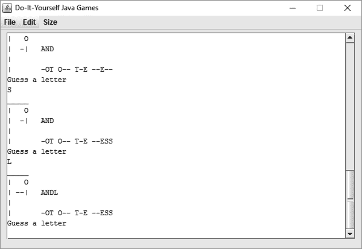

## 课程 15.1 - 整数 Switch 语句

到目前为止，你所有的`switch`语句都是基于字符串的。在本节中，你将使用基于整数的`switch`语句。

### 尝试一下

开始编写下一个程序：

1. 创建名为`Hangman`的新`Java project`，并将`My Window`、`My String Methods`和`DIYJava.jar`添加到项目中。

2. 在项目中创建一个名为`___________._____________.hangman`的新`package`。

3. 创建名为`Hangman`的新`class`，父类为`MyWindow`，并为`main()`及其构造函数编写存根。

4. 在`main()`中添加代码调用`Hangman`构造函数。

*列表 15-1，源自`Hangman.java`*

* * *

```
package annette.godtland.hangman;

import annette.godtland.mywindow.MyWindow;

public class Hangman extends MyWindow {

  public Hangman() {

  }

  public static void main(String[] args) {

    ____________________________________;

  }

}
```

* * *

*已完成列表*

1. 向此程序添加三个私有字符串实例变量，分别为`phrase`、`clue`和`wrongLetters`。它们不需要初始值。

*列表 15-2，源自`Hangman.java`*

* * *

```
package annette.godtland.hangman;

import annette.godtland.mywindow.MyWindow;

public class Hangman extends MyWindow {

  private String phrase;

  private String clue;

  private String wrongLetters;

  public Hangman() {

  }
```

* * *

*已完成列表* 修正：向此程序添加三个名为`phrase`、`clue`和`wrongLetters`的私有字符串实例变量。它们不需要初始值。

1. 创建一个新的私有方法`printPuzzle()`。它不接受参数且无返回值。
2. 在构造函数中调用`printPuzzle()`。
3. 在`printPuzzle()`中添加代码画出如下的小人。（提示：使用转义字符打印反斜杠。）

```
_____

|   O

| --|
```

*列表 15-3，源自`Hangman.java`*

* * *

```
 ...

  public Hangman() {

    ___________________;

  }

  private void printPuzzle() {

    print("________________");

    print("________________");

  }
```

* * *

*已完成列表*

1. 在构造函数中，在打印谜题之前将“ABC”赋值给`wrongLetters`。
2. 修改`printPuzzle()`以打印小人之后的四个空格。

*列表 15-4，源自`Hangman.java`*

* * *

```
 ...

  public Hangman() {

    wrongLetters = "ABC";

    printPuzzle();

  }

  private void printPuzzle() {

    print("_____");

    print("|   O");

    print("| --|--    " + wrongLetters);

    print("| _/ \\_");

    print("|");

  }
```

*(修正：part0003_split_093.html_cl15-4)*

小人有十个部分。如果用户猜错了一个字母，游戏应该只打印头部；如果猜错了第二个字母，打印头部和躯干，以此此类推。如果猜错了十个字母，游戏应该打印整个小人。

1. 在`printPuzzle()`中编写一个基于`wrongLetters`数量的`switch`语句结构。（提示：使用`wrongLetters`的长度。）
   1. 编写 0 到 10 的`case`语句。我们稍后会为这些 *cases* 添加代码。（提示：*case* 值是整数而不是字符串，这些 *case* 值不需要引号。）

*列表 15-5，源自`Hangman.java`*

* * *

```
 ...

  private void printPuzzle() {

    switch (_________________) {

      case 0:

        break;

      case 1:

        break;

      case 2:

        break;

      case 3:

        break;

      case 4:

        break;

      case 5:

        break;

      case 6:

        break;

      case 7:

        break;

      case 8:

        break;

      case 9:

        break;

      case 10:

        break;

    }

    print("_____");

    print("|   O");

    print("| --|--    " + wrongLetters);

    print("| _/ \\_");

    print("|");

  }

    ...
```

* * *

*已完成列表*

这十个 *cases* 应该画出图像：

```
0 _____  1 _____  2 _____  3 _____     

  |        |   O    |   O    |   O      

  |        |        |   |    |  -|      

  |        |        |        |          

  |        |        |        |            

 4 _____  5 _____  6 _____  7 _____      

  |   O    |   O    |   O    |   O       

  | --|    | --|-   | --|--  | --|--    

  |        |        |        |  /       

  |        |        |        |            

8 _____  9 _____  10_____

 |   O    |   O    |   O

 | --|--  | --|--  | --|--

 | _/     | _/ \   | _/ \_

 |        |        |
```

打印的第一行和最后一行对于所有 10 幅图像都是相同的，因此这两行不需要包含在`case`代码中。

1. 将第一个`print()`语句移动到`switch`语句上方。
2. 将接下来的三个`print()`语句移动到`case 10`。
3. 将最后一个`print()`语句留在`switch`语句结束之后。

*Listing 15-6，来自 Hangman.java*

* * *

```
 ...

  private void printPuzzle() {

    ___________________;

    switch (wrongLetters.length()) {

      case 0:

        break;

      case 1:

        break;

      case 2:

        break;

      case 3:

        break;

      case 4:

        break;

      case 5:

        break;

      case 6:

        break;

      case 7:

        break;

      case 8:

        break;

      case 9:

        break;

      case 10:

        ___________________;

        ___________________;

        ___________________;

        break;    

    }

    print("|");

  }

    ...
```

* * *

*已完成列表*

为其余`case`语句添加代码：

1. 从`case 10`复制`print()`语句并将其粘贴到`case 0`到`case 9`中。
2. 修改你在`case 0`中粘贴的代码，使其不打印火人。
3. 修改你在`case 1`中粘贴的代码，使其只打印头部。
4. 修改你在`case 2`中粘贴的代码，使其只打印头部和躯干。
5. 修改`cases 3-9`中的代码，使其只打印较一个图中显示的部分。

*Listing 15-7，来自 Hangman.java*

* * *

```
 ...

  private void printPuzzle() {

    print("_____");

    switch (wrongLetters.length()) {

    case 0:

      print("|");

      print("|          " + wrongLetters);

      print("|");

      break;

    case 1:

      print("|   O");

      print("|          " + wrongLetters);

      print("|");

      break;

    case 2:

      ___________________;

      ___________________;

      ___________________;

      break;

    case 3:

      ___________________;

      ___________________;

      ___________________;

      break;

    case 4:

      ___________________;

      ___________________;

      ___________________;

      break;

    case 5:

      ___________________;

      ___________________;

      ___________________;

      break;

    case 6:

      ___________________;

      ___________________;

      ___________________;

      break;

    case 7:

      ___________________;

      ___________________;

      ___________________;

      break;

    case 8:

      ___________________;

      ___________________;

      ___________________;

      break;

    case 9:

      ___________________;

      ___________________;

      ___________________;

      break;

    case 10:

      print("|   O");

      print("| --|--    " + wrongLetters);

      print("| _/ \\_");

      break;    

    }

    print("|");

  }

    ...
```

* * *

*已完成列表*

当你运行程序时，它应该打印火人的头部、躯干和部分手臂，因为`wrongLetters`中有三个字母。

1. 将`wrongLetters`修改为零到十个任意字母，并确保它打印出正确的火人。

*Listing 15-8，来自 Hangman.java*

* * *

```
 ...

  public Hangman() {

    wrongLetters = ____________;

    printPuzzle();
```


```java
}
```

...

* * *

*已完成列表*

## 关键点及更多

- 本节引入了在 `switch` 语句中使用整数值代替字符串。也允许字节、`short` 和字符类型。请查看下一节了解字符数据类型。
- 你还可以在 `switch` 语句中使用 `Enum` 数据类型。

## 15.2 - 字符类型

### 字符

本节引入了字符数据。它起初看起来与字符串相似，但很大不同：字符数据是单个字符。

1. 创建一个名为 `blankOutue()` 的私有方法。它不接受参数且返回空。
2. 在构造函数的开头，将 `phrase` 设置为“HELLO WORLD”并调用 `blankOutue()`。

...（注意：提示中提供的输入是重复或碎片化的；我已格式化了主要内容。）

- 使用 `String` 的 `charAt()` 方法从字符串中获取字符，并返回字符的索引。
- 使用双等号（`==`）、大于号（`>`）或小于号（`<`）来检查字符的值。

## 15.3 - 下一个字符的索引

你需要找到短语中某个字母的所有索引。你到目前为止使用的 `indexOf()` 方法只能找到该字母的第一个索引。在本节中，你将使用 `String` 的 `indexOf()` 方法的第二个版本，它允许你指定从哪里开始查找该字母的下一个索引。

### 尝试一下

如果用户猜中了一个字母，则替换线索中的字母：

- 找到猜中的字母的第一个索引。
- 只要能找到猜中的字母：
  - 将线索中相同位置的破折号替换为该字母。
  - 找到猜中的字母的下一次出现。
- 再次打印谜题。

1. 在构造函数中、打印谜题后为上述每个步骤添加注释。

*Listing 15-13，来自 `Hangman.java`*

```java
...

public Hangman() {
  phrase = "HELLO WORLD";

  blankOutClue();

  wrongLetters = "ABC";

  printPuzzle();

  // ________________________________

  // ________________________________

  // ________________________________

  // ________________________________

  // ________________________________
}

...
```

*已完成列表*

如何找到一个字母的第一个索引？使用 `String` 的 `indexOf()` 方法。如果索引为 `-1`，说明未找到。

如何在字符串内部替换另一个字符串？使用 `replaceStringAt()`，这是你在 `MyStringMethods` 类中创建的方法。

如何找到字符串中某个字母的下一个索引？使用 `String` 的 `indexOf()` 方法，从上一个找到字母的索引之后开始查找。注意，这是接受两个参数的 `indexOf()` 版本。使用搜索字符串和搜索起始索引作为参数。

1. 声明一个名为 `guess` 的字符串，初始值为`“L"`。
2. 你能推导出完成注释中每个步骤所需的代码吗？（提示：参见上方关于 `indexOf()` 和 `replaceStringAt()` 的说明。）

*Listing 15-14，来自 `Hangman.java`*

```java
...

public Hangman() {
  ...

  String guess = "___";

  // 找到猜中的字母在短语中第一次出现
  int index = _____________________________;

  // 只要能找到猜中的字母
  while (_____________________) {

    // 将线索中相同位置的破折号替换为该字母
    clue = ___________.replaceStringAt(_________, ___________, ___________;

    // 找到猜中的字母的下一次出现
    index = phrase.indexOf(____________, ________________);

  }

  // 再次打印谜题
  ______________________;

  ...
}
```

*已完成列表*

它应该打印两次谜题：一次是全破折号的谜题，第二次是显示在正确位置填充了“L”的谜题：

```text
_____
|   O
|  -|      ABC
|
|          ----- -----

_____
|   O
|  -|      ABC
|
|          --LL- ---L-
```

1. 尝试几次谜题，使用不同的短语和不同的字母。确保它找到了猜中的字母在短语中的每个位置。

接下来，更新 `wrongLetters` 以包含尝试过但未找到的字母：

1. 将 `wrongLetters` 的初始值改为空字符串。
2. 声明一个布尔变量 `found`，初始值为 `false`，因为该字母尚未被找到。
3. 如果找到了猜中的字母，将 `found` 设置为 `true`。
4. 一旦程序找不到该字母，检查 `found` 的值。如果字母从未被找到，则将猜中的字母添加到 `wrongLetters` 字符串中。

*Listing 15-15，来自 `Hangman.java`*

```java
...

public Hangman() {
  ...

  wrongLetters = "___";
  printPuzzle();

  String guess = "L";
  boolean found = ________________;

  // 找到猜中的字母在短语中第一次出现
  int index = phrase.indexOf(guess);

  // 只要能找到猜中的字母
  while (index > -1) {
    found = _________;

    // 将线索中相同位置的破折号替换为该字母
    clue = MyStringMethods.replaceStringAt(clue, index, guess);

    // 找到猜中的字母的下一次出现
    index = phrase.indexOf(guess, index + 1);
  }

  if (_____________) {
    wrongLetters += _______________;
  }

  // 再次打印谜题
  printPuzzle();

  ...
}
```

*已完成列表*

1. 运行程序几次。使用不同的值进行猜测。

如果猜中的字母在短语中，谜题应该显示该字母在短语中出现的所有位置。否则，程序应该将猜测的内容添加到错误字母列表中。

### 关键点与扩展

- `indexOf()` 返回字符串的第一个索引。
- 使用 `indexOf()` 的可选第二个参数指示从哪里开始搜索。

## 15.4 - 检查用户输入

你应该尝试编写程序，防止用户输入无效数据。在本节中，你将处理用户可能输入的各种情况。

### 尝试一下

是时候让用户猜字母了。事实上，你应该让用户一直猜到游戏结束。

游戏何时结束？谜题解决或游戏超时。

如何判断谜题已解决？当线索中不再有破折号时。（提示：使用 `contains()` 方法检查字符串。）

如何判断游戏超时？当用户猜了十次错误时。（提示：使用 `length()`。）

1. 用 `while` 循环包裹从 `guess` 声明到第二次打印谜题的所有代码。
2. 只要线索中有破折号且游戏未超时，就继续循环。（提示：参见上方关于 `contains()` 和 `length()` 的说明。）
3. 修改 `guess` 以提示用户字母。

*Listing 15-16，来自 `Hangman.java`*

```java
...

public Hangman() {
  ...

  // 重复直到谜题解决或超时（10 次尝试）
  while (clue._________________ && wrongLetters.____________________) {
    String guess = _________________________;

    boolean found = false;

    ...

    // 再次打印谜题
    printPuzzle();
  }
}

...
```

*已完成列表*

如果你玩这个游戏，可能很快就会发现它处理无效输入的能力不好。程序中至少应该修复三处问题：

- 始终将用户的猜测转换为大写。
- 确保用户每次只输入一个字母。如果用户输入了多个字母，打印错误信息并要求其重试。不要将无效的猜测添加到 `wrongLetters` 中。
- 如果用户已经猜过该字母，要求其重试。不要将相同的猜测添加到 `clue`，也不要添加到 `wrongLetters`。如何判断用户之前是否猜过该字母？之前猜过的字母都在 `clue` 或 `wrongLetters` 中。

为此添加代码：

1. 将 `guess` 转换为大写。
2. 确保用户每次只输入一个字母。
3. 告诉用户该字母已经被猜过。

*Listing 15-17，来自 `Hangman.java`*

```java
...

public Hangman() {
  ...

  String guess = promptForString("Guess a letter");

  guess = __________________________;

  // must be one letter
  if (guess._______________________) {
    print("Your guess must contain only 1 letter. Guess again.");
  }

  // guess must not have been tried before
  else if (clue._________________ || wrongLetters.______________) {
    print("You already guessed " + guess + ". Guess again.");
  }

  else {
    boolean found = false;

    // find the first occurrence of the guessed letter
    ...

    // print the puzzle again
    printPuzzle();
  }

  ...
}
```

* * *

*Completed listing*

循环结束是因为用户要么解开了谜题，要么猜了十次错误答案。现在，只有当用户解开谜题时你应该祝贺他们。你如何知道谜题是否被解决了？如果 `clue` 中没有剩余的横线。

1. 在 `while` 循环之后：
   1. 如果用户解开了谜题，则祝贺他们。
   2. 如果用户没有解开谜题，告诉他们短语是什么。

*Listing 15-18，来自 `Hangman.java`*

```java
...

public Hangman() {
  ...

  // 重复直到短语解决或吊字架完成（10 次机会）
  while (clue.contains("-") && wrongLetters.length() < 10) {
    ...
  }

  if (!clue._______________________) {
    print("Congratulations! You guessed it before you were hanged!");
  }
  else {
    print("Sorry, you lose. The phrase was " + __________);
  }
}

...
```

* * *

*Completed listing*

## 关键点与更多

- 当你编写需要用户输入的程序时，确保他/她输入的是有效数据。

## 15.5 - 读取文件所有行，空值

在之前的程序中，你知道一个文件有多少行。你编写了代码从文件中读取相应数量的行。在本节中，你将读取文件的所有行，无论文件中有多少行。

从文件读取内容在没有剩余内容可读时将返回 `null`。当返回 `null` 值时，你必须停止从文件中读取。

### 尝试一下

你应该下载的文件之一是名为 `phrases.txt` 的文件。你将在这个程序中使用它。

1. 从你的 Java 工作文件夹将 `phrases.txt` 文件复制到 Java 工作文件夹下的 `Hangman` 文件夹中。

没有值的变量被称为具有 `null` 值。通过将变量与 `null` 比较来检查 `null` 值。例如，要检查名为 `answer` 的 `String` 是否有值，检查它是否不等于 `null`：

```java
if (answer != null)
```

始终使用等号检查 `null`，而不是使用 `equal()` 方法，即使对于字符串也是如此。

当你不知道文件有多少行时，要读取文件的所有行，请执行以下步骤：

- 通过创建一个 `BufferedReader` 变量打开文件。
- 通过调用 `BufferedReader` 的 `readLine()` 方法从文件中读取一行。
- 当读取的内容不是 `null` 的时候：
  - 对刚刚读取的行进行你想执行的操作。
  - 从文件中读取另一行。
- 通过调用 `BufferedReader` 的 `close()` 方法关闭文件。

例如，要读取并打印名为“myFile.txt”文件的所有行，使用此代码：

```java
BufferedReader in = new BufferedReader(new FileReader(new File("myFile.txt")));
String line = in.readLine();

while (line != null) {
  print(line);
  line = in.readLine();
}

in.close();
```

1. 创建一个名为 `FILENAME` 的 `private static final String` 实例变量，设置为“phrases.txt”。
2. 将构造函数的全部内容放入 `try` 块中。
3. 在 `try` 块的开头添加代码以读取文件的所有行。完成后关闭文件。（提示：当读取的内容不是 `null` 时继续读取。）
4. 添加 `catch` 块来捕获 `FileNotFoundException` 和 `IOException`，并在这些异常出现时打印消息。

*Listing 15-19，来自 `Hangman.java`*

```java
...

private String phrase;
private String clue;
private String wrongLetters;

private static final String FILENAME = "_____________________";

public Hangman() {
  try {
    BufferedReader in = _________________________________________;
    String s = in._____________________;

    while (_____________________) {
      s = in.___________________;
    }

    in.____________;

    phrase = "HELLO WORLD";
    blankOutClue();

    ...

    else {
      print("Sorry, you lose. The phrase was " + phrase);
    }
  }
  catch (FileNotFoundException e) {
    print(_________________________________);
  }
  catch (IOException e) {
    ...
  }
}
```

* * *

*Completed listing*

## 关键点与更多

- 从文件读取内容在没有剩余内容可读时将返回 `null`。
- 当返回 `null` 值时，你必须停止从文件中读取。
- 始终使用等号检查 `null`，而不是使用 `equal()` 方法，即使对于字符串也是如此。
- 当你不知道文件有多少行时，要读取文件的所有行，请执行以下步骤：
  - 通过创建一个 `BufferedReader` 变量打开文件。
  - 通过调用 `BufferedReader` 的 `readLine()` 方法从文件中读取一行。
  - 当读取的内容不是 `null` 的时候：
    - 对刚刚读取的行进行你想执行的操作。
    - 从文件中读取另一行。


* 通过调用`BufferedReader`的`close()`方法关闭文件。
* 没有值的变量被称为具有`null`值。
* 通过将变量与`null`比较来检查`null`值。
* 例如，要检查名为`answer`的`String`是否有值，检查它是否不等于`null`。

## 课程 15.6：数组列表

你之前使用的数组持有固定数量的项。在本节中，你将使用`ArrayList`，这样你可以删除、添加或更改项。

`ArrayList`的数量是可以改变的。

### 尝试一下

你将使用`ArrayList`替代数组，以便你可以删除某些项。

要声明`ArrayList`，将其类型放在角括号中`<>`。例如，声明名为`cities`的`ArrayList`，使用：

```java
ArrayList<String> cities = new ArrayList<String>();
```

项必须逐个添加到`ArrayList`。向`ArrayList`的末尾添加字符串值使用`add()`。例如，将“Minneapolis”添加到`cities`的末尾，使用：

```java
cities.add("Minneapolis");
```

事实上，你可以指定索引在列表的任何位置插入。例如，将“Boston”添加到`cities`的开头，使用：

```java
cities.add(0, "Boston");
```

当你在列表中插入一个值时，它之后的所有值都会向后移动。

从`ArrayList`获取值使用`get()`并带有索引。例如，从`cities`获取第二个值（索引 1），使用：

```java
cities.get(1);
```

要获取`ArrayList`中项的数量，使用`size()`。例如，获取`cities`中项的数量，使用：

```java
cities.size();
```

1. 在构造函数内部，声明一个名为`phrases`的`String`类型`ArrayList`。通过调用其构造函数进行初始化。
2. 当读取的行不是空时，将行添加到`phrases`。

*Listing 15-20, from `Hangman.java`*

```java
...

public Hangman() {
  ArrayList<__________> ______________ = new ArrayList<___________>();

  try {
    BufferedReader in = new BufferedReader(new FileReader(new File(FILENAME)));
    String s = in.readLine();
    while (s != null) {
      phrases._________(____);
      s = in.readLine();
    }
    ...
```

*Completed listing*

接下来，从`ArrayList`中随机选择一个短语。

1. 在构造函数的开头声明一个名为`rand`的`Random`，并通过调用其构造函数进行初始化。
2. 从`phrases`获取一个随机短语并将其赋值给`phrase`。（提示：使用`ArrayList`的`size()`和`Random`的`nextInt()`。）
3. 将`phrase`转换为大写。

*列表 15-21，来自 `Hangman.java`*

```java
...

public Hangman() {
  ArrayList<String> phrases = new ArrayList<String>();
  Random rand = ____________________;

  try {

    ...

    in.close();
    int numberOfPhrases = phrases.___________;

    int pick = rand.nextInt(______________);
    phrase = phrases.______(_______);
    phrase = phrase.__________________;
    blankOutClue();

    ...
```

*已完成列表*

程序现在应该使用来自`phrases.txt`文件的随机短语。

让这个程序变得更好的最后方法是在谜题解决后询问用户他们是否想再次玩。

1. 声明一个名为`again`的布尔变量，初始设值为`true`。
2. 将从选择下一个随机整数到在游戏结束时打印道歉信息的所有内容移动到一个`while`循环中，只要`again`为`true`循环就会继续。
3. 在`while`循环结束之前，询问用户他们是否想再次玩，并将他们的答案存入`again`。（提示：使用`promptForYesNo()`。）
4. 在循环后关闭窗口。（提示：使用`System.exit(0)`。）

*列表 15-22，来自 `Hangman.java`*

```java
...

public Hangman() {

  ...

  int numberOfPhrases = phrases.size();

  boolean again = _____________;
  while (__________) {
    int pick = rand.nextInt(numberOfPhrases);
    phrase = phrases.get(pick);

    ...

    print("Sorry, you lose. The phrase was " + phrase);
  }
  again = _________________________________________;
}
System._______________________;

} catch (FileNotFoundException e) {

  ...
```

*已完成列表*

这就是 Hangman 程序的结束。如果你想在不通过 Eclipse 的情况下运行它：

1. 导出你的 Hangman 程序。
2. 将`phrases.txt`文件拷贝到与`Hangman.jar`文件相同的文件夹中。

### 关键点及更多

* `ArrayList`可以包含一个未知数量项目的列表，或者一个项目数量可能会改变的列表。
* `ArrayList`必须持有所有相同类型的数据。
* `ArrayLists`只能持有 Java 对象。换句话说，它们必须有类定义，并且通常有方法。
  * `Strings`是 Java 对象；它们有类定义和方法。因此字符串可以放入`ArrayList`中。
  * Java `int`、`double`、`char`、`boolean`、`byte`、`short`、`long`和`float`不是 Java 对象。这些类型被称为 Java 基本类型。它们可以放入数组，但不能放入`ArrayLists`中。
  * 如果你需要将基本类型放入`ArrayList`，请使用它们的包装类将它们变成 Java 对象。例如，要从名为`num`的`int`创建一个`Integer`对象，使用：

```java
Integer obj = new Integer(num);
```

* 如果你调用它的值方法，可以从对象包装中获取基本类型值。例如，要从上面的整数变量获取`int`值，请使用：

```java
int num = obj.intValue();
```

* 对象将在下一节中详细解释。
* 要声明一个`ArrayList`，请使用：

  ```java
  ArrayList<type> = new ArrayList<type>()
  ```

  其中`type`是`ArrayList`将包含的数据类型。
* 要向`ArrayList`的末尾添加项目，使用`add()`并将项目作为参数。
* 要向`ArrayList`的中间部分添加项目，使用`add()`并将索引作为第一个参数。
  * 如果你尝试向越过`ArrayList`末尾的索引添加项目，将收到错误。因此，在使用索引之前，请确保该索引是有效的。
* 要获取`ArrayList`中项目的值，使用`get()`并将索引作为参数。
  * 如果你尝试从越过`ArrayList`末尾的索引获取项目，将收到错误。因此，在使用索引之前，请确保该索引是有效的。
* 由于`Hangman`使用了`ArrayList`，你可以更改`phrases.txt`中的内容，而无需更改 Hangman 程序。

## 项目 16：疯狂 8

在疯狂 8 纸牌游戏中，你和对手轮流进行，争先先光掉所有的牌。通常情况下，你必须出一张与丢弃牌的花色或点数匹配的牌。然而，你可以在任何时间打出任何 8，无论它的花色和丢弃牌的花色如何。当你打出 8 时，指定下一个必须打出的花色。如果你无法出牌，就必须抽取另一张牌。

这里是疯狂 8 程序的截图：

## 课程 16.1：对象，卡牌

一个`ArrayList`可以包含一个未知数量项目的列表，或者一个项目数量可能会改变的列表。

`ArrayList`必须持有所有相同类型的数据。

`ArrayLists`只能持有 Java 对象。换句话说，它们必须有类定义，并且通常有方法。

* `Strings`是 Java 对象；它们有类定义和方法。因此字符串可以放入`ArrayList`中。
* Java `int`、`double`、`char`、`boolean`、`byte`、`short`、`long`和`float`不是 Java 对象。这些类型被称为 Java 基本类型。它们可以放入数组，但不能放入`ArrayLists`中。
* 如果你需要将基本类型放入`ArrayList`，请使用它们的包装类将它们变成 Java 对象。例如，要从名为`num`的`int`创建一个`Integer`对象，使用：

```java
Integer obj = new Integer(num);
```

* 如果你调用它的值方法，可以从对象包装中获取基本类型值。例如，要从上面的整数变量获取`int`值，请使用：

```java
int num = obj.intValue();
```

* 对象将在下一节中详细解释。
* 要声明一个`ArrayList`，请使用：

  ```java
  ArrayList<type> = new ArrayList<type>()
  ```

  其中`type`是`ArrayList`将包含的数据类型。
* 要向`ArrayList`的末尾添加项目，使用`add()`并将项目作为参数。
* 要向`ArrayList`的中间部分添加项目，使用`add()`并将索引作为第一个参数。
  * 如果你尝试向越过`ArrayList`末尾的索引添加项目，将收到错误。因此，在使用索引之前，请确保该索引是有效的。
* 要获取`ArrayList`中项目的值，使用`get()`并将索引作为参数。
  * 如果你尝试从越过`ArrayList`末尾的索引获取项目，将收到错误。因此，在使用索引之前，请确保该索引是有效的。
* 由于`Hangman`使用了`ArrayList`，你可以更改`phrases.txt`中的内容，而无需更改 Hangman 程序。


# 项目 16 - 疯狂 8

在疯狂 8 纸牌游戏中，你和对手轮流进行，争先光掉所有的牌。通常情况下，你必须出一张与丢弃牌的花色或点数匹配的牌。然而，你可以在任何时间打出任何 8，无论它的花色和丢弃牌的花色如何。当你打出 8 时，指定下一个必须打出的花色。如果你无法出牌，就必须抽取另一张牌。

这里是疯狂 8 程序的截图：

## 课程 16.1 - 对象，卡牌

一个 `ArrayList` 可以包含一个未知数量项目的列表，或者一个项目数量可能会改变的列表。

`ArrayList` 必须持有所有相同类型的数据。

`ArrayLists` 只能持有 Java 对象。换句话说，它们必须有类定义，并且通常有方法。

- `Strings` 是 Java 对象；它们有类定义和方法。因此字符串可以放入 `ArrayList` 中。
- Java `int`、`double`、`char`、`boolean`、`byte`、`short`、`long` 和 `float` 不是 Java 对象。这些类型被称为 Java 基本类型。它们可以放入数组，但不能放入 `ArrayLists` 中。
- 如果你需要将基本类型放入 `ArrayList`，请使用它们的包装类将它们变成 Java 对象。例如，要从名为 `num` 的 `int` 创建一个 `Integer` 对象，使用：

```
Integer obj = new Integer(num);
```

- 如果你调用它的值方法，可以从对象包装中获取基本类型值。例如，要从上面的整数变量获取 `int` 值，请使用：

```
int num = obj.intValue();
```

- 对象将在下一节中详细解释。
- 要声明一个 `ArrayList`，请使用：

```
ArrayList<type> = new ArrayList<type>()
```

其中 `type` 是 `ArrayList` 将包含的数据类型。

- 要向 `ArrayList` 的末尾添加项目，使用 `add()` 并将项目作为参数。
- 要向 `ArrayList` 的中间部分添加项目，使用 `add()` 并将索引作为第一个参数。
  - 如果你尝试向越过 `ArrayList` 末尾的索引添加项目，将收到错误。因此，在使用索引之前，请确保该索引是有效的。
- 要获取 `ArrayList` 中项目的值，使用 `get()` 并将索引作为参数。
  - 如果你尝试从越过 `ArrayList` 末尾的索引获取项目，将收到错误。因此，在使用索引之前，请确保该索引是有效的。
- 由于 `Hangman` 使用了 `ArrayList`，你可以更改 `phrases.txt` 中的内容，而无需更改 `Hangman` 程序。

## 课程 16.2 - 构造方法

每个程序都有一个构造方法。在创建新实例时会调用该构造方法。

### 尝试

创建自己的构造方法的规则如下：

- 构造方法的名字必须与类名完全一致。
- 构造方法必须是 `public`。
- 构造方法没有返回值。
- 构造方法可以有参数。

例如，一个带有 `numberOfPlayers` 参数的 `CrazyEights` 类构造方法看起来是这样：

```java
public CrazyEights(int numberOfPlayers) {
}
```

与其让 `Card` 类的值始终为“8H”，不如让构造方法通过字符串来创建它。

1. 将 `Card` 类中 `rank` 和 `suit` 的初始值留空。
2. 创建一个带有 `rs` 参数的构造方法。
3. 构造方法应将 `rs` 的第一个字符赋值给 `rank`，将第二个字符赋值给 `suit`。（提示：使用 `charAt()`。）

*列表 16-6，来自 Card.java*

```
 ...

  private char rank = ___;
  private char suit = ___;

  public Card(String rs) {
    rank = rs._____________;
    suit = rs._____________;
  }
```

*完成后的列表*

1. 现在修改 `CrazyEights` 程序，将“7S”传递给 `card` 的构造方法。

*列表 16-7，来自 CrazyEights.java*

```
 ...

  public CrazyEights() {
    Card card = new Card(_______);
    print(card.toString());
  }
```

*完成后的列表*

如果你对 0 到 51 的数字使用模 13 操作，前 12 个数字将得到 0 到 11 的结果，下一个 12 个数字将再次得到 0 到 11 的结果，以此类推。因此，要计算排名索引，对该数字使用模 13 操作。

你现在准备好为 `Card` 构造函数添加代码，接受一个整数作为参数。

1. 将 `id` 转换为 0 到 12 之间的数字。然后获取 `RANKS` 中该位置的字符并将其放入 `rank` 中。（提示：根据上面的说明，你应该除以 13 还是模 13？提示：使用 `charAt()` 获取字符串某个位置的字符。）
2. 将 `id` 转换为 0 到 3 之间的数字。然后获取 `SUITS` 中该位置的字符并将其放入 `suit` 中。（提示：根据上面的说明，你应该除以 13 还是模 13？）

*Listing 16-10，来自 Card.java*

```
 ...

  public Card(int id) {
    rank = RANKS.charAt(id __ 13);
    suit = SUITS.charAt(id __ 13);
  }
    ...
```

*Completed listing*

这个新的 `Card` 构造函数有两个问题。如果你给它一个大于 52 的整数，花色索引将大于可能的排名数量。或者，如果你给它一个负整数，花色和排名索引将是无效的。

但是如何确保初始数字始终在 0 到 51 之间呢？使用模 52。如果数字是负数，将其乘以 -1。

在接受整数的构造函数开始处：

1. 将 `id` 转换为 0 到 51 之间的数字。（提示：根据上面的说明，你应该除以 52 还是模 52？）
2. 如果 `id` 小于 0，将其乘以 -1。

*Listing 16-11，来自 Card.java*

```
 ...

  public Card(int id) {
    id = id ___ 52;
    if(id ___ ____) {
      id = id ___ ____;
    }
    rank = RANKS.charAt(id%13);
    suit = SUITS.charAt(id/13);
  }
    ...
```

*Completed listing*

接受整数的 `Card` 构造函数现在应该可以正常工作。但如果字符串不是两个字符，或者包含不在 `RANKS` 或 `SUITS` 中的字符，接受 `String` 的 `Card` 构造函数就有问题。

在带有字符串参数的 `Card` 构造中：

1. 检查 `rs` 是否为两个字符。（提示：使用 `length()`。）
2. 如果 `rs` 是两个字符：
   1. 将 `rs` 的第一个和第二个字符分配新的字符变量，称为 `r` 和 `s`，而不是 `rank` 和 `suit`。
   2. 如果 `r` 和 `s` 在 `RANKS` 和 `SUITS` 中，则将 `rank` 和 `suit` 设置为 `r` 和 `s`。（提示：使用 `indexOf()` 来查找一个字符是否在字符串中。）

*Listing 16-12，来自 Card.java*

```
 ...

  public Card(String rs) {
    if(rs.____________) {
      char ___ = rs.charAt(0);
      char ___ = rs.charAt(1);
      int ri = RANKS.indexOf(___);
      int si = SUITS.indexOf(___);
      if (ri>___ && si>___) {
        rank = ___;
        suit = ___;
      }
    }
  }
    ...
```

*Completed listing*

现在，如果有人尝试使用无效字符串创建 `Card`，`rank` 和 `suit` 将为空。

修改 `CrazyEights` 以查看这两个构造函数的工作情况。

1. 尝试使用不同的整数创建新的 `Card`。尝试 0 到 51 之间的数字。尝试更大的数字。
2. 尝试使用不同的字符串创建新的 `Card`。尝试有效的牌牌字符串。尝试太长或太短的字符串。尝试不在 `SUIT` 或 `RANK` 中的字符的字符串。

*Listing 16-13，来自 CrazyEights.java*

```
 ...

  public CrazyEights() {
    Card card = new Card(____);
    print(card.toString());
  }
    ...
```

*Completed listing*

### 关键点及更多

- 模（Modulo）与除法相似，但它返回除法结果的余数而不是结果的整数。例如，14 模 4 为 2。
- 模符号是百分号 `%`。例如，14 模 4 的代码表示为 `14 % 4`。
- 模运算可以将任何整数转换为特定范围，例如扑克牌中的四种花色，骰子上的 6 个点。

## 课程 16.3 - 其他方法

在本节中，你将创建方法来获取排名或花色，检查其是否有效，检查牌是否相等。

### 尝试一下

大多数类都需要一种获取私有变量的方法。

1. 添加名为 `getRank()` 和 `getSuit()` 的方法。这两个方法都不应该接受参数。

*Listing 16-14，来自 Card.java*

```
 ...

  public char getRank() {
    return _______;
  }

  public char getSuit() {
    return _______;
  }
```

*Completed listing*

游戏需要知道实例是否有效。

1. 添加一个名为 `isValid()` 的方法。它不接受参数并返回一个布尔值。
2. 如果牌有效，`isValid()` 应返回 `true`。

*Listing 16-15，来自 Card.java*

```
 ...

  public boolean isValid() {
    boolean valid = false;
    if (__) {
      valid = true;
    }
    return valid;
  }
```

*Completed listing*

接下来，添加一个方法检查此牌是否等于另一个。

1. 添加一个名为 `equals()` 的公共方法。它接受一个参数 `Card` 并返回一个布尔值。
2. 如果排名和花色相同，`equals()` 返回 `true`。提示：使用 `getSuit()` 和 `getRank()` 获取参数的排名和花色。

*Listing 16-16，来自 Card.java*

```
 ...

  public boolean equals(Card card) {
    boolean equals = false;
    if (card.getSuit() == suit && card.getRank() == rank) {
      equals = true;
    }
    return equals;
  }
```

*(注：此处代码逻辑根据上下文补全了原文中缺失的 Listing 16-16 占位逻辑)*

添加一个方法检查此牌是否大于另一个。

1. 添加一个名为 `isGreaterThan()` 的公共方法。它接受一个参数 `Card` 并返回一个布尔值。


2. 获取参数的花色和排名，并将它们放入字符`cardSuit`和`cardRank`。

3. 检查`suit`在`SUITS`中的索引是否大于`cardSuit`在`SUITS`中的索引。如果是，则此牌大于另一个。（提示：使用`indexOf()`。）

4. 否则，检查此牌的花色是否等于`cardSuit`。如果是，比较它们的排名：

   1. 如果`rank`在`RANKS`中的索引大于`cardRank`在`RANKS`中的索引，则此牌大于另一个。

*Listing 16-17，来自`Card.java`*

```java
 ...

  public boolean isGreaterThan(Card card) {
    boolean greaterThan = false;
    char cardSuit = card.getSuit();
    char cardRank = card.getRank();
    if (SUITS.indexOf(suit) > SUITS.indexOf(cardSuit)) {
      greaterThan = true;
    }
    else if (SUITS.indexOf(suit) == SUITS.indexOf(cardSuit)) {
      if (RANKS.indexOf(rank) > RANKS.indexOf(cardRank)) {
        greaterThan = true;
      }
    }
    return greaterThan;
  }
```

*Completed listing*

应该再添加一个方法来检查字符是否是有效的花色。此方法可以是静态的，因为它从此类中使用的只有静态字符串`SUITS`。

1. 添加一个名为`isValidSuit()`的公共静态方法。它接受一个字符作为参数并返回一个布尔值。

2. 如果字符在`SUITS`中，`isValidSuit()`返回 true。（提示：使用 String 的`indexOf()`方法。）

*Listing 16-18，来自`Card.java`*

```java
 ...

  public static boolean isValidSuit(char suit) {
    boolean valid = false;
    if (SUITS.indexOf(suit) != -1) {
      valid = true;
    }
    return valid;
  }
```

## 已完成列表

对`CrazyEights`进行修改以测试新方法。

1. 创建两张牌并打印它们。

2. 如果其中一张牌无效，则打印一条消息。

3. 如果两张牌相等，打印一条消息。

4. 如果第一张牌大于第二张牌，打印一条消息。

5. 创建一个名为`c`的字符变量并给它分配任意字符值。如果`c`是有效的花色，打印一条消息；如果不是，则打印另一条消息。（提示：使用`Card`的`isValidSuit()`方法。提示：在调用其静态方法`isValidSuit()`时，使用`Card`类名。）

*列表 16-19，来自`CrazyEights.java`*

```java
 ...

  public CrazyEights() {
    Card card1 = _________________;
    print(card1._____________);
    Card card2 = ___________________;
    print(card2.____________);
    if (____________) {
      print("The first card is not valid");
    }
    if (_________________) {
      print("The second card is not valid");
    }
    if (_____________________) {
      print("The cards are equal.");
    }
    else {
      print("The cards are not equal.");
    }
    if (________________________) {
      print("The first card is greater.");
    }
    else {
      print("The first card is not greater.");
    }
    char c = ____;
    if (_____________________) {
      print(__ + "is a valid suit");
    }
    else {
      print(__ + "is not a valid suit");
    }
  }
    ...
```

## 已完成列表

1. 为`card1`、`card2`和`c`不同的值，以确保所有方法都按预期工作。

### 关键点与更多

- `isGreaterThan()`根据字符在`SUITS`和`RANKS`字符串中出现的顺序来检查哪张牌更大。如果你想让牌按不同的顺序排列，请更改`SUITS`和`RANKS`中字符的顺序。例如，如果你想让 Ace 在 King 之后，请使用：

```java
RANKS = "23456789TJQKA";
```

- 这个`Card`类可以用于其他扑牌游戏。考虑添加其他扑牌游戏可能需要的其他方法和/或实例变量。例如，如果你想计分，可能会添加一个名为`value`的整数数组实例变量，用于存储每张牌的分值。

## 第 16.5 - 牌（Deck）

大牌游戏需要一副 52 张牌的牌。

在本节中，你将创建一个`Deck`类，并添加方法来从牌中发牌、洗牌、重用牌以及告诉程序牌中还剩多少牌。

### 尝试一下

1. 在`cards`包中创建一个名为`Deck`的新`class`，使用默认的`Object`作为其父类。为它的构造函数创建一个存根，但不要为`main()`创建。

*列表 16-20，来自`Deck.java`*

```java
package annette.godtland.cards;

public class Deck {

  public Deck() {

  }

}
```

## 已完成列表

每副牌都应该有一堆牌（列表）和一个用于洗牌的随机数生成器。

1. 添加一个类型为`Card`的私有`ArrayList`实例变量`cards`，通过调用其构造函数初始化。

2. 添加一个私有`Random()`实例变量`rand`，通过调用其构造函数初始化。

*列表 16-21，来自`Deck.java`*

```java
 ...

public class Deck {
  __________________ cards = _____________________;
  __________________ rand = ______________________;

  public Deck() {

    ...
```

## 已完成列表

`Deck`的构造函数应该创建 52 个牌对象并将它们放入牌列表中。

1. 循环 0 到 51 的数字来创建 52 张牌并将它们添加到`cards`中。（提示：使用接受整数作为参数的`Card`构造函数。）

*列表 16-22，来自`Deck.java`*

```java
 ...

  public Deck() {
    for(______________________){
      Card card = new _____________;
      cards.add(________);
    }
  }
    ...
```

## 已完成列表

1. 添加一个无参数并返回字符串的公共`toString()`方法。

2. 遍历`cards`中的所有牌，将它们添加到字符串中，在字符串中的每张牌之间放置一个空格。（提示：使用`ArrayList`的`size()`来确定列表中有多少张牌，从而决定循环次数。）

3. 返回字符串。

*列表 16-23，来自`Deck.java`*

```java
 ...

  public ____________ toString(____) {
    String deckString = _____;
    for(__________________) {
      Card card = cards.________;
      deckString += ________________;
    }
    return ________________________;
  }
```

## 已完成列表

现在你需要让程序使用牌。

在`CrazyEights`中修改：

1. 移除构造函数中的所有代码。

2. 创建一个`Deck`实例。

3. 打印它。

*列表 16-24，来自`CrazyEights.java`*

```java
 ...

  public CrazyEights() {
    ________ deck = new _____________;
    print(_________________);
  }
```

## 已完成列表

你需要添加代码来洗牌。

1. 创建一个名为`shuffled`的`Card``ArrayList`。

2. 在`Deck`中创建一个公共的`shuffle()`方法，它不接受参数且不返回值。

3. 遍历`cards`中的所有牌。（提示：使用`ArrayList`的大小。）

4. 获取一张随机牌，将其移除并添加到`shuffled`中。

5. 将`cards`设置为`shuffled`的值。

*列表 16-25，来自`Deck.java`*

```java
 ...

  public void shuffle() {
    ArrayList shuffled = new ________________;
    int numberOfTimes = cards.size();
    for(int i=0; i<numberOfTimes; i++){
      int pick = rand.nextInt(________________);
      Card card = cards.remove(pick);
      shuffled.add(card);
    }
    cards = shuffled;
  }
```

## 已完成列表

1. 在`Deck`构造函数的末尾调用`shuffle()`，这样它总是会洗新牌。

*列表 16-26，来自`Deck.java`*

```java
 ...

  public Deck() {
    for(int i=0; i<52; i++){
      Card card = new Card(i);
      cards.add(card);
    }
    shuffle();
  }
```

## 已完成列表

现在你需要添加代码来一次发一张牌。

1. 在`Deck`中添加一个公共方法`deal()`。它不接受参数并返回一个`Card`。

2. 移除牌组的第一张牌并返回它。（提示：使用`ArrayList`的`remove()`。）

*列表 16-27，来自`Deck.java`*

```java
 ...

  public Card deal() {
    Card card = cards.remove(0);
    return card;
  }
```

## 已完成列表

你需要一种方法来重用弃牌并将其变成牌。

1. 为`Deck`创建一个公共方法`reuse()`。它接受一个参数，名为`newCards`的`Card``ArrayList`，且不返回。

2. 将`cards`设置为`newCards`的值。

*列表 16-28，来自`Deck.java`*

```java
 ...

  public void reuse(ArrayList newCards) {
    cards = newCards;
  }
```

## 已完成列表

你还需要一种方法来发现牌组中有多少张牌。

1. 为`Deck`创建一个名为`size()`的公共方法。它不接受参数并返回一个整数。

2. 返回`cards`的大小。（提示：使用`ArrayList`的`size()`方法。）

*列表 16-29，源自`Deck.java`*

```java
 ...

  ___________________ size(___) {
    return cards.______________;
  }
    ...
```

*已完成列表*

在`CrazyEights`构造函数中添加以下内容，以检查新方法是否有效。

1. 打印牌组的大小。

2. 创建类型为`Card`的`ArrayList`，名为`discardPile`，并通过调用其构造函数进行初始化。

3. 创建一个循环重复 10 次：从`deck`中发出一牌，打印它，并将其放入`discardPile`。

4. 打印`deck`的大小，通过重用`discardPile`替换`deck`，再次打印`deck`，然后打印`deck`的大小。

*列表 16-30，源自`CrazyEights.java`*

```java
 ...

  public CrazyEights() {
    Deck deck = new Deck();
    print(deck.toString());
    print(deck._____________);
    ArrayList<Card> discardPile = ______________________;
    for(___________________) {
      Card card = deck.____________;
      print(_________________);
      discardPile._______________;
    }
    print(deck.______________);
    deck.reuse(_________________);
    print(deck.______________);
    print(deck._______________);

  }
    ...
```

*已完成列表*

再次运行程序。它应该先打印整个牌组，然后是 52，然后是从牌组中取的的前十张牌，然后是 42，然后是以牌组形式打印同样的十张牌，最后是 10。

### 关键点及更多

- 你应该能够使用这个`Deck`类来创建其他扑牌游戏。

- 考虑添加其他扑牌游戏可能需要的实例变量和方法。例如，你可能想要另一个构造函数，接受一个整数参数，表示游戏中使用多少副牌组。

## 课程 16.6 - 手（Hand）

`Hand`与牌组类似。它也是一个牌列表。然而，手的使用方式与牌组不同，因此它需要不同的方法。

在本节中，你将创建一个`Hand`类并添加一个打印手牌的方法。你还将添加向手牌中添加或删除牌的方法、查找手牌中索引处的牌、检查手牌是否包含某张牌，以及获取手牌中牌的数量。

### 尝试一下

1. 在`cards`包中创建一个名为`Hand`的新`class`，使用默认的`Object`作为其父类。不要为`main()`或其构造函数创建存根方法。

2. 添加一个类型为`Card`的私有`ArrayList`实例变量名为`cards`，并通过调用其构造函数进行初始化。

*列表 16-31，源自`Hand.java`*

```java
package annette.godtland.cards;

public class Hand {
  ________________ cards = ________________;
}
```

*已完成列表*

创建`Hand`时不需要运行任何代码，因此`Hand`不需要构造函数。

添加一个向手牌中添加牌的方法。它应该将牌按从小到大的顺序排列。

当你使用真实的扑牌时，如何对牌进行排序？一种方法是取一张牌，并将其与手中的第一张牌进行比较。如果它比第一张牌大，则与下一张比较比较。继续，直到遇到一张它不大的牌，并将其插入到那张牌之前。编写代码来实现相同的操作。

1. 在`Hand`中添加一个名为`add()`的公共方法。它应该接受一个名为`card`的`Card`参数，且没有返回值。

2. 创建一个整数名为`index`，初始值为 0，用于指定在`hand`中插入`card`的位置。

3. 创建一个布尔值名为`done`，初始值为 false，用于标记何时找到在`hand`中插入`card`的位置。

4. 只要`done`仍为 false 且你尚未遍历手牌中的所有牌，就重复：

   1. 获取`index`处的牌并将其放入名为`cardInHand`的`Card`中。（提示：使用`ArrayList`的`get()`方法。）

   2. 如果`card`大于`cardInHand`，则增加`index`。否则将`done`设置为 true。（提示：使用`Card`的`isGreaterThan()`方法。）


5. 将 `card` 添加到 `index` 处的 `cards`。（提示：使用接受两个参数的 `ArrayList` 的 `add()` 方法。）

*列表 16-32，源自 `Hand.java`*

```java
 ...

  public void add(Card card){
    _____ index = _______;
    _____ done = ________;
    while(!_______ && index < ___________) {
      Card cardInHand = ________________;
      if (card._________________) {
        __________;
      }
      else {
        __________;
      }
    }
    cards.add(________________);
  }
}
```

*已完成列表*

接下来，为 `Hand` 添加一个 `toString()` 方法。它应该打印手牌中的牌。

1. 在 `Hand` 中添加一个名为 `toString()` 的公共方法。它不接受参数并返回一个字符串。
2. 创建一个空字符串 `string`。
3. 遍历 `cards`：
   1. 获取每张牌并将其添加到 `string` 中。
4. 返回 `string`。

*列表 16-33，源自 `Hand.java`*

```java
 ...

  public String toString() {
    String string = "";
    for (_________________) {
      Card card = ________________;
      string += ________________;
    }
    return string;
  }
```

*已完成列表*

在 `toString()` 方法中添加代码判断这是否是第一张牌。花色之间的额外空格会让它变得更容易。

1. 使用 `for` 循环变量获取前一张牌和当前牌的花色。
2. 如果花色不同，则在字符串中添加空格。

*列表 16-34，源自 `Hand.java`*

```java
 ...

  public String toString() {
    String string = "";
    for (int i=0; i<cards.size(); i++) {
      Card card = cards.get(i);
      if (________) {
        Card priorCard = __________________;
        char priorSuit = __________________;
        char currentSuit = _________________;
        if (_____________________) {
          string += _______________;
        }
      }
      string += card.toString() + " ";
```

上面的逻辑是占位符）回到 `CrazyEights` 并尝试一些新代码。你会创建一个 `Deck`，发 7 张牌到手牌，然后打印手牌。

1. 移除构造函数中的所有代码。
2. 添加代码创建一个名为 `hand` 的新 `Hand`。
3. 创建三张名为 `card1`、`card2` 和 `card3` 的牌：黑桃国王、红桃 7 和梅花 J。（提示：使用接受字符串的构造函数。）
4. 将这些牌添加到 `hand` 中。
5. 打印手牌。（提示：使用 `toString()`。）

*列表 16-35，源自 `CrazyEights.java`*

```java
 ...

  public CrazyEights() {
    Hand hand = _______________;
    Card card1 = ______________;
    Card card2 = ______________;
    Card card3 = ______________;
    hand.add(_____);
    hand.add(_____);
    hand.add(_____);
    print(_______________);
  }
    ...
```

*已完成列表*

再次运行程序。它应该按顺序打印牌，花色之间有额外空格：

```text
7H   JC KC
```

要从手中牌，你必须从手牌中移除一张牌。

1. 在 `Hand` 中添加一个名为 `remove()` 的公共方法。它接受一个名为 `card` 的 `Card` 参数，且没有返回值。
2. 创建一个整数名为 `index`，初始值为 0，用于指定在 `hand` 中找到 `card` 的位置。
3. 创建一个布尔值名为 `found`，初始值为 `false`，用于标记何时找到 `hand` 中找到 `card`。
4. 只要 `found` 仍为 `false` 且你尚未遍历手牌中的所有牌，就重复：
   1. 如果 `index` 处的牌等于 `card`，则将其从 `cards` 中移除，并将 `found` 设置为 `true`。（提示：使用 `ArrayList` 的 `remove()` 方法根据索引移除项。）
   2. 否则，增加 `index`。

*列表 16-36，源自 `Hand.java`*

```java
 ...

  public void remove(Card card) {
    ______ index = __________;
    ______ found = _________;
    while(__________ && _______________) {
      Card compareCard = _________________;
      if(compareCard._______________) {
        cards.______________;
        found = ___________;
      }
      else {
        ____________
      }
    }
  }
}
```

已完成列表

你还需要一种方法来检查手牌是否包含特定的牌。

1. 在 `Hand` 类中添加一个名为 `contains()` 的公共方法。它应该接受一个名为 `card` 的 `Card` 参数，并返回一个布尔值。
2. 创建一个名为 `index` 的整数，初始值为 0，用于记录在手中找到 `card` 的位置。
3. 创建一个名为 `contains` 的布尔值，初始值为 `false`，用于记录是否在手牌中找到了 `card`。
4. 只要 `contains` 为 `false` 且尚未遍历完手牌中的所有牌，就重复执行：
   1. 如果 `index` 处的牌等于 `card`，则将 `contains` 设置为 `true`。
5. 返回 `contains`。

*列表 16-37，源自 `Hand.java`*

```java
 ...

  __________________ contains(_____________) {
    ______ index = __________;
    ______ contains = _________;
    while(__________ && _______________) {
      Card compareCard = _________________;
      if(compareCard._______________) {
        contains = ___________;
      }
      else {
        ____________
      }
    }    
    return contains;
  }
}
```

已完成列表

接下来你将添加一个方法来获取手牌中特定位置的牌。

- 在 `Hand` 中添加一个名为 `cardAt()` 的公共方法。它应该接受一个名为 `index` 的整数参数，并返回一个 `Card`。
- `cardAt()` 应该返回 `cards` 列表中 `index` 处的牌。提示：使用 `ArrayList` 的 `get()` 方法。

*列表 16-38，源自 `Hand.java`*

```java
 ...

  _____________ cardAt(________) {
    return cards.___________;
  }
}
```

已完成列表

你需要的最后一个方法是找出 `Hand` 中共有有多少张牌。

1. 在 `Hand` 中添加一个名为 `size()` 的公共方法。它不接受任何参数，并返回一个整数。
2. 返回 `cards` 的大小。

*列表 16-39，源自 `Hand.java`*

```java
 ...

  __________ size(____) {
    return ______________;
  }
}
```

已完成列表

回到 `CrazyEights` 并尝试这些新方法。

1. 创建第四张牌，名为 `card4`，一张方菱 2（2 of Diamonds）。
2. 打印手牌的大小。
3. 如果 `card3` 在手牌中，打印信息。
4. 如果 `card4` 在手牌中，打印信息。
5. 从手牌中移除 `card2` 和 `card4`。
6. 打印手牌。
7. 打印手牌的大小。

*列表 16-40，源自 `CrazyEights.java`*

```java
 ...

  public CrazyEights() {
    Hand hand = new Hand();
    Card card1 = new Card("KC");
    Card card2 = new Card("7H");
    Card card3 = new Card("JC");
    Card card4 = _______________;
    hand.add(card1);
    hand.add(card2);
    hand.add(card3);
    print(hand.toString());
    print(___________);
    if (_________________){
      print("Found Jack of Clubs");
    }
    if (_________________){
      print("Found 2 of Diamonds");
    }
    hand.remove(___________);
    hand.remove(__________);
    print(___________);
    print(___________);
  }
    ...
```

已完成列表

它应该打印出：

```text
7H   JC KC 
3
Found Jack of Clubs
JC KC 
2
```

## 关键点与更多

- 你应该能够使用这个 `Hand` 类来创建其他牌类游戏。
- 考虑添加其他牌游戏可能需要的实例变量和方法。

## 课程 16.7 - 大八乐：设置

为了设置 `CrazyEights` 游戏，程序应该给每个玩家分发七张牌，翻开一张弃牌，并显示游戏状态。

### 尝试一下

1. 移除 `CrazyEights` 类构造函数中当前所有的代码。
2. 添加这些实例变量：
   1. `deck` 应该是一个私有的 `Deck`，通过调用其构造函数初始化。
   2. `myHand` 应该是一个私有的 `Hand`，通过调用其构造函数初始化。
   3. `computerHand` 应该是一个私有的 `Hand`，通过其构造函数初始化。
   4. `discard` 应该是一个私有的 `Card`。
   5. `discardPile` 应该是一个私有的 `ArrayList<Card>`，通过其构造函数初始化。
   6. `rand` 应该是一个私有的 `Random`，通过其构造函数初始化。
   7. `activeSuit` 应该是一个私有的 `char`。

*列表 16-41，源自 `CrazyEights.java`*

```java
 ...

public class CrazyEights extends Window {

  private Deck deck = _________________;
  private Hand myHand = _________________;
  private Hand computerHand = _________________;
  private Card discard = _________________;
  private ArrayList<Card> discardPile = _________________;
  private Random rand = _________________;
  private char activeSuit = _________________;

  public CrazyEights() {
    （代码已移除。）

  }
```

已完成列表

接下来，你需要发牌。但你要把发牌代码放在一个方法中：

1. 在 `CrazyEights` 中添加一个名为 `deal()` 的私有方法。它不接受任何参数，并返回一个 `Card`。
2. 如果 `deck` 中没有牌了，利用 `discardPile`：洗牌、清空弃牌堆并打印信息。
3. 从 `deck` 中取出一张牌并返回它。

*列表 16-42，源自 `CrazyEights.java`*

```java
 ...

  private Card deal() {
    // 如果 deck 中没有牌了，利用弃牌堆：洗牌、清空弃牌堆并打印信息
    if (deck.isEmpty()) {
      discardPile.addAll(cards);
      Collections.shuffle(discardPile);
      discard = discardPile.remove(0);
      discardPile.clear();
      print();
    }

    return _________;
  }
```

已完成列表

接下来，给每个玩家分发七张牌并翻开弃牌。此外，如果弃牌是 8，设置花色。

1. 在构造函数中，重复七次：发一张牌并将其加入 `myHand`，然后发另一张牌并加入 `computerHand`。
2. 再发一张牌并作为 `discard`。
3. 如果 `discard` 是 8，将 `activeSuit` 设置为弃牌的花色。
4. 否则，将 `activeSuit` 设置为空格字符。

*列表 16-43，源自 `CrazyEights.java`*

```java
 ...

  public CrazyEights() {
    // 给我们发七张牌
    for (int i = 0; i < 7; i++) {
      Card card1 = deal();
      myHand.add(card1);
      Card card2 = deal();
      computerHand.add(card2);
    }

    // 翻开弃牌
    discard = deal();

    // 如果弃牌是 8，设置花色
    if (discard.getValue() == 8) {
      activeSuit = discard.getSuit();
    }
    else {
      activeSuit = ' ';
    }

  }
}
```

已完成列表

接下来，显示游戏状态。

1. 添加一个名为 `showStatus()` 的私有方法。它不接受任何参数，也不返回。
2. 打印一个空行、`computerHand` 的牌数、`myHand` 的牌以及 `discard`。
3. 如果弃牌是 8，还要打印 `activeSuit`。

*列表 16-44，源自 `CrazyEights.java`*

```java
 ...

  private void showStatus() {
    System.out.println();
    System.out.println(computerHand.size());
    System.out.println(myHand.toString());
    System.out.println(discard);
    if (discard.getValue() == 8) {
      System.out.println(activeSuit);
    }
  }
```

```java
 ...

  ________________ showStatus(_____) {
    print();
    print("Computer has " + __________________ + " cards.");
    print("My Hand: " + ______________);
    print("Discard: " + ________);
    if(discard.getRank()___________) {
      print("Suit is " + _______________);
    }

  }
    ...
```

*已完成列表*

现在，显示卡牌状态。

1. 在构造函数中调用 `showStatus()`：

*列表 16-45，源自 `CrazyEights.java`*


```java
 ...

  public CrazyEights() {

      ...

    else {
      activeSuit = ' ';
    }

    ______________________;
  }
    ...
```

* * *

*完成的列表*

运行程序。它应该显示电脑手中有七张卡牌，你手中的七张牌以及弃牌。如果弃牌是 8 点，它应该显示当前的花色。

## 课程 16.8 - 疯狂八点：轮到你了

在*疯狂八点*中轮到你的回合时，你需要打出一张有效的牌或抽一张牌。抽牌意味着从牌组中获取额外的卡牌并将其放入你的手中。出牌意味着从你的手中移除一张牌并将其置于弃牌堆栈上。

目前，如果一张牌具有有效的点数和花色、在你手中，并且与弃牌的花色或点数匹配，则将其视为有效出牌。允许使用 8 将在后续课程中添加。

### 尝试一下

为了让编写剩余代码更容易，有两个方法：抽取用户的卡牌和打出用户的卡牌。

首先，创建一个抽取用户卡牌的方法。

1. 添加一个名为 `drawMyCard()` 的私有方法。它不接受任何参数且没有返回值。
2. 发出一张新牌。（提示：使用 `CrazyEight` 的 `deal()`。）
3. 打印一个空行和一条消息，告诉用户他/她抽到了哪张牌。
4. 将抽到的卡牌添加到 `myHand`。

*列表 16-46，来自 `CrazyEights.java`*

* * *

```java
 ...

  ____________________ drawMyCard(____________) {
    ______________ drewCard = __________________;
    print();
    print("You drew " + ______________);
    myHand.____________________;
  }
    ...
```

* * *

*完成的列表*

接下来，创建一个弃牌用户卡牌的方法。

1. 添加一个名为 `discardMyCard()` 的私有方法。它接受一个名为 `myCard` 的 `Card` 参数，且没有返回值。
2. 从 `myHand` 中移除 `myCard`。
3. 将当前的 `discard` 添加到 `discardPile`。
4. 将 `myCard` 赋值为新的 `discard`。

*列表 16-47，来自 `CrazyEights.java`*

* * *

```java
 ...

  ____________________________ discardMyCard(___________) {
    myHand.________________;
    discardPile.__________________;
    discard = _____________;
  }
    ...
```

* * *

*完成的列表*

为了帮助组织代码，将用户回合的代码放入一个名为 `playMyCard()` 的独立方法中。

1. 添加一个名为 `playMyCard()` 的私有方法。它不接受任何参数且没有返回值。
2. 显示状态。
3. 询问用户他/她想打哪张牌，或者按 `D` 抽牌。将他/她的答案存入一个名为 `rankSuit` 的字符串中。（提示：使用 `promptForString()`。）
4. 将 `rankSuit` 转换为大写。
5. 如果 `rankSuit` 是 `D`，则抽一张牌。（提示：使用 `drawMyCard()`。）
6. 如果 `rankSuit` 不是 `D`，则出牌：根据 `rankSuit` 创建一个 `Card`，将其命名为 `selectedCard`，并将其弃牌。（提示：使用 `discardMyCard()`。）

*列表 16-48，来自 `CrazyEights.java`*

* * *

```java
 ...

  ____________________ playMyCard(________) {
    _____________________;
    String rankSuit = ________________________________;
    rankSuit = rankSuit._____________________;
    // if draw, draw a card
    if (__________________________) {
      ____________________;
    }
    // else play the card
    else {
      Card selectedCard = _______________________;
      ________________________;
    }
  }
    ...
```

* * *

*完成的列表*

1. 在构造函数中，在显示状态之前打出用户的牌。（提示：使用 `playMyCard()`。）

*列表 16-49，来自 `CrazyEights.java`*

* * *

```java
 ...

  public CrazyEights() {

      ...

    else {
      activeSuit = ' ';
    }

    ______________________;
    showStatus();
  }
```

* * *

*完成的列表*

1. 添加一个名为 `isValidPlay()` 的私有方法。它接受一个名为 `rankSuit` 的字符串并返回一个布尔值。
2. 创建一个名为 `validPlay` 的布尔值，初始化为 `true`。
3. 根据 `rankSuit` 创建牌。
4. 如果牌是无效的，打印一条消息并将 `validPlay` 设为 `false`。
5. 否则，如果牌不在 `myHand` 中，将 `validPlay` 设为 `false`。（使用 `myHand` 的 `contains()` 方法。）
6. 否则，如果牌不匹配弃牌的花色或点数，将 `validPlay` 设为 `false`。（使用 `Card` 的 `getSuit()` 和 `getRank()` 方法。）
7. 返回 `validPlay`。

*列表 16-50，来自 `CrazyEights.java`*

* * *

```java
 ...

  _________________ isValid(______________) {
    boolean validPlay = ______;
    Card card = ____________________;

    // is it a valid card?
    if (______________________) {
      print(__________________);
      validPlay = ___________;
    }

    // is that card in hand?
    else if(_______________________) {
      print(__________________);
      validPlay = ____________;
    }

    // does the discard match the rank or suit?
    else if ((____________________)           (___________________________)) {
      print(________________________________);
      validPlay = ______________________;
    }

    return __________________;
  }
    ...
```

* * *

*完成的列表*

接下来，如果用户输入的牌无效，应该再次询问。

1. 在 `playMyCard()` 中添加一个名为 `validPlay` 的布尔值，初始为 `false`。
2. 将从提示用户到方法结束的代码移动到一个当 `validPlay` 为 `false` 时继续的循环中。
3. 当 `rankSuit` 是 `D` 时，将 `validPlay` 设为 `true`。
4. 当 `rankSuit` 不是 `D` 时添加额外的条件，以便在 `rankSuit` 是有效出牌时运行该代码。（提示：使用 `isValidPlay()`。）
5. 在用户弃掉牌后，将 `validPlay` 设为 `true`。

*列表 16-51，来自 `CrazyEights.java`*

* * *

```java
 ...

  private void playMyCard() {
    showStatus();
    boolean validPlay = _______________;
    // repeat until a valid play has been entered
    while (______________________) {
      String rankSuit = promptForString("你想打哪张牌（或按 D 抽牌）？");
      rankSuit = rankSuit.toUpperCase();
      // if draw, draw a card
      if (rankSuit.equals("D")) {
        drawMyCard();
        validPlay = ___________________;
      }
      // if valid play, play the card
      else if (_____________________) {
        Card selectedCard = new Card(rankSuit);
        discardMyCard();
        validPlay = ___________;
      }
    }
  }
    ...
```

* * *

*完成的列表*

最后，如果用户抽到了一张有效的牌，将其弃牌。

1. 在 `drawMyCard()` 方法中，如果 `drewCard` 是一个有效的牌，告诉用户他/她已经出了那张牌，然后将其丢弃。（提示：将 `drewCard` 转换为 `String` 以检查它是否为有效牌。提示：使用 `discardMyCard()` 方法丢弃该牌。）

*列表 16-52，来自 `CrazyEights.java`*

* * *

```java
 ...

  private void drawMyCard() {
    Card drewCard = deal();
    print();
    print("You drew " + drewCard);
    myHand.add(drewCard);

    // 如果我可以打出我抽到的牌，就打出它
    if (isValidPlay(__________________) {
      print("You played " + drewCard);
      discardMyCard(____________);
    }
  }
    ...
```

* * *

*已完成的列表*

运行程序。尝试输入除 `D`、有效牌或你手中的牌以外的其他内容。尝试输入一张与丢弃牌的花色或点数匹配的牌。在所有这些情况下，程序都应该提示你重试并给出适当的消息。如果你抽到的牌可以打出，程序应该将其打出。

## 课程 16.9 - 8 大王：电脑回合

当轮到电脑时，程序需要从电脑手中打出一张有效牌或抽一张牌。

### 试一试

现在该让电脑也打出一张牌了。为了查看程序运行是否正常，请在 `Console` 格中打印电脑的手。

首先，创建一个丢弃电脑牌的方法。

1. 添加一个名为 `discardComputerCard()` 的私有方法。它应该接受一个名为 `computerCard` 的 `Card` 参数，并且没有返回值。
2. 从 `computerHand` 中移除 `computerCard`。
3. 将当前的 `discard` 添加到 `discardPile`。
4. 将 `computerCard` 赋值为新的 `discard`。

*列表 16-53，来自 `CrazyEights.java`*

* * *

```java
 ...

  ____________________________ discardComputerCard(___________) {
    computerHand._____________________;
    discardPile.__________________;
    discard = _____________;
  }
    ...
```

* * *

*已完成的列表*

如果电脑手中有一张与丢弃牌花色或点数相同的牌，它就可以打出该牌。程序需要创建一个所有有效牌的列表，然后随机选择一张有效牌并打出。如果电脑手中没有有效牌，它就应该抽一张牌。

1. 在构造函数中，在电脑打出用户的牌之后立即打出电脑的牌。（提示：使用 `playComputerCard()`，你接下来将创建它。）
2. 添加一个名为 `playComputerCard()` 的私有方法。它不接受任何参数且没有返回值。
3. 在 `Console` 格中打印 `computerHand`。（提示：使用 `System.out.println()`。提示：使用 `Hand` 的 `toString()` 方法。）
4. 创建一个类型为 `Card` 的名为 `playableCards` 的 `ArrayList`。
5. 遍历 `computerHand` 中的每张牌。将牌放入名为 `card` 的新 `Card` 中。如果 `card` 的花色或点数等于 `discard` 的花色或点数，则将其添加到 `playableCards`。
6. 如果有任何 `playableCards`，从 `playableCards` 中随机选择一张牌，将其放入一个新的 `Card` 中并将其丢弃。（提示：使用 `discardComputerCard()`。）
7. 否则，如果没有 `playableCards`，则抽一张新牌并放入 `computerHand`。然后打印一个空行和一条电脑抽了牌的消息。如果那张牌可以打出，将其丢弃。（提示：使用 `CrazyEight` 的 `deal()`。提示：比较抽到的牌的花色、点数与丢弃牌的花色、点数，以判断该牌是否可以出。）

*列表 16-54，来自 `CrazyEights.java`*

* * *

```java
 ...

  public CrazyEights() {

      ...

    playMyCard();
    ___________________;
    showStatus();
  }
    ...

  __________________ playComputerCard(_______) {
    System.out.println(_______________________);
    ArrayList<Card> playableCards = ___________________;

    // 创建可出牌列表
    for(___________________________) {
      Card card = _____________________;      
      // 只有花色或点数相同的牌才能出
      if (__________________  
          || ___________________){
        playableCards._________________;
      }
    }

    // 随机选择一张可出牌
    int numberOfPlayableCards = __________________;
    if (__________________________) {
      int pick = ______________________________;
      Card playedCard = playableCards._______________;
      discardComputerCard(_______________);
    }

    // 如果没有可以出的牌，就抽一张牌
    else {
      Card drewCard = ____________________;
      computerHand._____________________;
      print();
      print(____________________);

      // 如果可以出，就打出它
      if (drewCard.__________________  
          || drewCard.__________________) {
        discardComputerCard(__________);
      }
    }
  }
    ...
```

* * *

*已完成的列表*

运行程序。尝试输入除 `D`、有效牌或你手中的牌以外的其他内容。尝试输入一张与丢弃牌的花色或点数匹配的牌。在所有这些情况下，程序都应该提示你重试并给出适当的消息。如果你抽到的牌可以打出，程序应该将其打出。

## 课程 16.10 - 8 大王：回合制

当轮到电脑时，程序需要从电脑手中打出一张有效牌或抽一张牌。

### 试一试

现在该让电脑也打出一张牌了。为了查看程序运行是否正常，请在 `Console` 格中打印电脑的手。

首先，创建一个丢弃电脑牌的方法。


## 16.10 - 8 大王：回合制

当轮到电脑时，程序需要从电脑手中打出一张有效牌或抽一张牌。

### 试一试

现在该让电脑也打出一张牌了。为了查看程序运行是否正常，请在`Console`格中打印电脑的手。

首先，创建一个丢弃电脑牌的方法。

1. 添加一个名为`discardComputerCard()`的私有方法。它应该接受一个参数，名为`computerCard`的`Card`，并且没有返回值。
2. 从`computerHand`中移除`computerCard`。
3. 将当前的`discard`添加到`discardPile`。
4. 将`computerCard`赋值为新的`discard`。

*列表 16-53，来自 CrazyEights.java*

* * *

```
 ...

  ____________________________ discardComputerCard(___________) {
    computerHand._____________________;
    discardPile.__________________;
    discard = _____________;
  }
    ...
```

* * *

*已完成列表*

如果电脑手中有一张与丢弃牌花色或点数相同的牌，它就可以打出该牌。程序需要创建一个所有有效牌的列表，然后随机选择一张有效牌并打出。如果电脑手中没有有效牌，它就应该抽一张牌。

1. 在构造函数中，在电脑打出用户的牌之后立即打出电脑的牌。（提示：使用`playComputerCard()`，你接下来将创建它。）
2. 添加一个名为`playComputerCard()`的私有方法。它不接受任何参数且没有返回值。
3. 在`Console`格中打印`computerHand`。（提示：使用`System.out.println()`。提示：使用`Hand`的`toString()`方法）
4. 创建一个类型为`Card`的名为`playableCards`的`ArrayList`。
5. 遍历`computerHand`中的每张牌。将牌放入名为`card`的新`Card`中。如果`card`的花色或点数等于`discard`的花色或点数，则将其添加到`playableCards`。
6. 如果有任何`playableCards`，从`playableCards`中随机选择一张牌，将其放入一个新的`Card`中并将其丢弃。（提示：使用`discardComputerCard()`。）
7. 否则，如果没有`playableCards`，则抽一张新牌并放入`computerHand`。然后打印一个空行和一条电脑抽了牌的消息。如果那张牌可以打出，将其丢弃。（提示：使用`CrazyEight`的`deal()`。提示：比较抽到的牌的花色、点数与丢弃牌的花色、点数，以判断该牌是否可以出。）

*列表 16-54，来自 CrazyEights.java*

* * *

```
 ...

  public CrazyEights() {

      ...

    playMyCard();
    ___________________;
    showStatus();
  }
    ...

  __________________ playComputerCard(_______) {
    System.out.println(_______________________);
    ArrayList<Card> playableCards = ___________________;

    // 创建可出牌列表
    for(___________________________) {
      Card card = _____________________;      
      // 只有花色或点数相同的牌才能出
      if (__________________  
          || ___________________){
        playableCards._________________;
      }
    }

    // 随机选择一张可出牌
    int numberOfPlayableCards = __________________;
    if (__________________________) {
      int pick = ______________________________;
      Card playedCard = playableCards._______________;
      discardComputerCard(_______________);
    }

    // 如果没有可以出的牌，就抽一张牌
    else {
      Card drewCard = ____________________;
      computerHand._____________________;
      print();
      print(____________________);

      // 如果可以出，就打出它
      if (drewCard.__________________  
          || drewCard.__________________) {
        discardComputerCard(__________);
      }
    }
  }
    ...
```

* * *

*已完成列表*

运行程序。尝试输入除 D、有效牌或你手中的牌以外的其他内容。尝试输入一张与丢弃牌的花色或点数匹配的牌。在所有这些情况下，程序都应该提示你重试并给出适当的消息。如果你抽到的牌可以打出，程序应该将其打出。


`playableCards.add(card);`

`int pick = random.nextInt(playableCards.size());`

`Card playedCard = playableCards.get(pick);`

`discardComputerCard(playedCard);`

2. 如果 `turn` 为 1，告诉用户计算机将先手，并打出一张电脑牌。

3. 否则，告诉用户他/她将先手。

*列表 16-57，来自 `CrazyEights.java`*

---

```java
 ...

  public CrazyEights() {

      ...

    else {
      activeSuit = ' ';
    }

    // 谁先手？
    _______ turn = rand._______________;
    if(___________) {
      print(__________________);
      ______________________;
    }
    else {
      print(_________________);
    }

    // 持续玩，直到我们其中一方牌用完

      ...
```

*已完成的列表*

## 课程 16.11 - 疯狂 8 点：玩 8 点

疯狂 8 点的规则之一是你可以通过出 8 来改变弃牌堆上允许的花色。任何一张 8 都可以打在任何花色上。玩家随后可以指定任何花色作为当前花色。

### 尝试一试

首先，更新 `isValidPlay()` 以接受 8。

1. 将检查卡牌是否匹配弃牌花色或点数的代码移动到一个代码块中，仅在卡牌不是 8 时才运行。如果卡牌不是 8：

   1. 如果弃牌是 8，则卡牌的花色必须与当前花色匹配。如果不匹配，打印一条消息并标记为无效。

   2. 否则，如果弃牌不是 8，则卡牌必须匹配弃牌的点数或花色。（提示：将检查卡牌点数和花色的代码移动到上述条件的 `else` 块中。）

*列表 16-58，来自 `CrazyEights.java`*

---

```java
 ...

  private boolean isValidPlay(String rankSuit) {

      ...

    else if (!myHand.contains(card)) {
      print(rankSuit + " is not in your hand.");
      validPlay = false;
    }

    // 8 总是有效的。如果卡牌不是 8...
    else if (_________________) {
      // 弃牌是 8 吗？
      if (discard._____________________) {  
        // 卡牌匹配当前花色吗？
        if (card._____________________) {
          print(____________ + " cannot be played on " + ______ + " because the suit was set to " + ___________);
          validPlay = ________;
        }
      }

      // 如果弃牌不是 8，
      // 弃牌匹配点数或花色吗？
      else if (card.getSuit()!=discard.getSuit()
          && card.getRank()!=discard.getRank()) {
        print(rankSuit + " cannot be played on " + discard);
        validPlay = false;
      }
    }

    return validPlay;

      ...
```

*已完成的列表*

现在允许将 8 作为合法的操作。如果用户出 8，你将需要提示用户新的当前花色是什么。但花色是一个字符；你尚未在 `MyWindow` 中拥有一个用于提示字符的方法。

1. 在 `MyWindow` 类中添加一个名为 `promptForChar()` 的保护方法。它应该接受一个参数，名为 `prompt` 的字符串，并返回一个字符。

2. 创建一个名为 `c` 的字符，初始值为空格字符。（提示：使用单引号括围字符值。）

3. 创建一个名为 `valid` 的布尔值，初始为 `false`。

4. 当 `valid` 为 `false` 时，打印提示信息，要求用户输入，并将输入存入一个名为 `s` 的字符串中。如果 `s` 是一个字符，将 `s` 的第一个字符放入 `c` 中并将 `valid` 设置为 `true`。否则，使用相同的 `prompt` 再次提示字符。（提示：使用 `String` 的 `length()` 来判断是否为单个字符。提示：使用 `String` 的 `charAt()` 获取字符串的第一个字符。）

5. 返回 `c` 的值。

*列表 16-59，来自 `MyWindow.java`*

---

```java
 ...

  ______________________ promptForChar(_________________) {
    _________ c = _______;

    _________ valid = _________;
    while(____________) {
      print(____________);
      String s = _______________;
      if (s._____________) {
        c = _____________;
        valid = ____________;
      }
      else {
        c = ___________________;
      }
    }
    return ______;
  }
    ...
```

*已完成的列表*

现在，为 `CrazyEights` 添加一个方法来提示有效的花色。

1. 添加一个名为 `promptForSuit()` 的私有方法。它不接受参数并返回一个字符。

2. 创建一个名为 `suit` 的字符，初始值为空格字符。

3. 创建一个名为 `validSuit` 的布尔值，初始为 `false`。

4. 当 `validSuit` 不为 `true` 时，提示用户输入一个字符作为 `suit`。将 `suit` 转换为大写。如果输入的字符是有效的花色，则设置 `validSuit`。（提示：使用 `promptForChar()`。提示：将字符转换为大写，使用 `Character.toUpperCase()`。提示：测试是否为有效花色，使用 `isValid()`。）

5. 返回 `suit`。

*列表 16-60，来自 `CrazyEights.java`*

---

```java
 ...

  ______________ promptForSuit(________) {
    char suit = ___________;
    boolean validSuit = ____________;

    while(!validSuit) {
      suit = ____________("Change the suit to H, D, C, or S?");
      suit = Character.toUpperCase(_____);
      if (_______) {
        validSuit = ________;
      }
    }

    return ________;
  }
    ...
```

*已完成的列表*

如果用户弃弃了 8，询问一个新的花色。

1. 在 `discardCard()` 方法中添加代码，如果牌是 8，将用户的答案存入 `activeSuit`。

*列表 16-61，来自 `CrazyEights.java`*

---

```java
 ...

  private void discardCard(Card myCard) {
    myHand.remove(myCard);
    discardPile.add(discard);
    discard = myCard;
    if (_____________________) {
      activeSuit = _________________;
    }
  }
```

*已完成的列表*

2. 如果丢弃的牌不是 8，且该牌的花色和点数与丢弃牌的花色和点数匹配，则将其添加到 `playableCards` 列表中。（提示：将执行此检查的代码移动到新的 `else` 块中。）

5. 如果没有可玩的牌且至少有一张 8，则选取第一张 8 并将其丢弃。

*列表 16-63，出自 `CrazyEights.java`*

---

```java
 ...

  private void playComputerCard() {
    System.out.println("Computer hand: " + computerHand);
    ArrayList<Card> playableCards = new ArrayList<Card>();
    _____________ eights = ______________________;
    countHearts = ____;
    countDiamonds = ____;
    countClubs = ____;
    countSpades = ____;

    // 统计 8 和每个花色的数量
    for(___________________________) {
      Card card = ___________________;

      // 如果是 8，则保存它
      if (_______________) {
        eights._________;
      }
      // 否则，统计每个花色的数量
      else {
        switch(card.________________) {
        case '___' :  
          ____________________;
          break;
        case '___' :  
          ____________________;
          break;
        case '___' :  
          ____________________;
          break;
        case '___' :  
          ____________________;
          break;
        }
      }
    }

    // 创建可玩牌列表
    for(int i=0; i<computerHand.size(); i++) {
      Card card = computerHand.cardAt(i);

      // 如果丢弃牌是 8，则所有当前花色的牌都是可玩的
      if (discard.__________________) {
        if (card.___________________) {
          playableCards._______________;
        }
      }

      // 否则，如果丢弃牌不是 8，
      // 只有同花色或同点数的牌是可玩的
      else if(card.getSuit() == discard.getSuit()
          || card.getRank() == discard.getRank()) {
        playableCards.add(card);
      }
    }

    // 随机选择一张可玩的牌
    int numberOfPlayableCards = playableCards.size();
    if (numberOfPlayableCards>0) {
      int pick = rand.nextInt(numberOfPlayableCards);
      Card playedCard = playableCards.get(pick);
      discardComputerCard(playedCard);
    }

    // 否则，如果有 8，则打出一 8
    else if(__________________) {
      Card playedCard = eights._________;
      discardComputerCard(____________);
    }

    // 如果没有可以出的，则抽一张牌

      ...
```

* * *

完成的列表

最后，如果电脑打出 8，则选择一种花色作为当前花色。

1. 在 `discardComputerCard()` 中添加代码，使得如果它丢弃了 8，它应该选择它拥有的最多的花色，并将其作为当前花色。（提示：将最高计数设置为红心的数量，并将当前花色设置为红心。如果方形数量多于最高计数，则将最高计数设置为方形的数量，并将当前花色设置为方形。对每个花色重复这些步骤。）

*列表 16-64，出自 `CrazyEights.java`*

---

```java
 ...

  private void discardComputerCard(Card computerCard) {
    computerHand.remove(computerCard);
    discardPile.add(discard);
    discard = computerCard;
    if (discard.____________________) {
      int highestCount = countHearts;
      activeSuit = 'H';
      if (countDiamonds > highestCount) {
        highestCount = ___________;
        activeSuit = '___';
      }
      if (countClubs > ____________________) {
        highestCount = ____________;
        activeSuit = '___';
      }
      if (countSpades > ______________) {
        highestCount = _____________;
        activeSuit = '___';
      }
    }
  }
    ...
```

* * *

完成的列表

1. 多玩几次游戏，看看它是否运行正常。

2. 如果你对游戏的运行方式满意，请从 `playComputerCard()` 中移除 `System.out.println()`。

这就是 Crazy Eights 程序的结束。

1. 如果你想在没有 Eclipse 的情况下运行，请将你的 Crazy Eights 项目和 Cards 项目一起导出以创建 Crazy Eights 程序。（提示：在选择导出选项之前同时选择这两个项目。）

# 我希望你喜欢这本书

我写这本书的目标是为你提供基础 Java 编程的基础基础。我希望你被激发去探索更多 Java 编程。

如果你喜欢这本书：

- **借阅**：本书的设计允许借阅。请将其分享给你的朋友。
- **推荐**：向朋友、读者群和讨论板推荐此书，帮助他人发现它。
- **评论**：告诉别人你为什么喜欢这本书。[在亚马逊上撰评](https://www.amazon.com/review/create-review?asin=B00H2Z6)

## 问题、意见或建议

如需报告问题、提问技术问题或对本书的未来版本提出建议，请发送邮件至 `diyjava@godtland.com`。

## 我写的其他

### Do-It-self Games 系列

在 Do-It-self Games 系列书中，我使用“发现学习”方法来教授计算机编程：通过实践而非阅读来学习 Java 编程。通过大量的填空以及方便查看答案，我引导你编写完整的程序，从第一本开始。你将发现程序是如何以及为什么要这样写的。

### More Do-It-self Games: Introduction to Java Graphics and Event-Driven

`images/0040.jpeg`

More Do-It-self Games: Introduction to Java Graphics and Event-Driven 是 Do-It-self Games 系列的第二本书。你将学会创建窗口和对话框、添加按钮和输入字段、使用图像和图形以及响应键盘输入和鼠标点击。你会创建更多游戏，包括多个益智游戏、文字游戏和纸牌游戏。它可以在 [Amazon.com](http://www.amazon.com/dp/B00N325E2) 买。

这本书假设你已经理解 Java 编程，或者读过 Do-It-self Games: Introduction to Java Computer。

# 附录 A - 术语表

**ArithmeticException**

当你尝试进行不允许的算术运算（例如除以零）时抛出的[exception]。参见 *Lesson 8.5 - Integer Subtraction, Multiplication, and Division*。


# array

数组是 Java 列表的一种。所有项必须是相同类型，可以是 Java 原生类型或 Java 对象。数组的大小在声明时设置，且不能更改。参见课程 12.4 - 数组中的关键点和更多。参见课程 14.5 - 空数组中的关键点和更多。

## ArrayList

`ArrayList` 是 Java 列表的一种类型。`ArrayList` 只能包含 Java 对象，不能包含 Java 原生类型，且列表中的所有项必须是相同类型。可以通过添加或删除项随时更改 `ArrayList` 的大小。参见课程 15.6 - 数组列表中的关键点和更多。

## block of code

代码块是一行或多行程序代码，它们作为一个单元组合在一起，并用大括号 `{ }` 围起来。参见课程 1.2 - 类、超类和程序中的关键点和更多。

## boolean

布尔值是一个真或假条件。布尔值必须类型为“true”或“false”，且不加引号。布尔变量在 Java 中被声明为“boolean”。参见课程 13.5 - 布尔数据类型中的关键点和更多。

## break

`break` 用于 `switch` 语句，用于跳转到 `switch` 语句的末，而不是执行下一行代码。参见课程 6.2 - switch 语句中的关键点和更多。

## build path

构建路径是包含当前 Java 项目所需代码的所有 Java 项目和库的列表。参见课程 8.7 - 扩展 `DIYWindow` 类。

## byte

`byte` 是一个 Java 整数变量。它可以持有 -128 到 128 之间的数字。参见课程 8.1 - 整数数据类型和加法中的关键点和更多。

## calculate

要计算数字，你需要对其他数字进行加、减、乘、除。参见课程 8.5 - 整数减法、乘法和除法中的关键点和更多。参见课程 10.1 - 运算顺序中的关键点和更多。参见课程 16.3 - 取模中的关键点和更多。

## call

当你调用一个方法时，意味着程序在执行下一行代码之前应该运行该方法中的代码。参见课程 6.3 - 方法。

## case

`case` 标签标记了 `switch` 语句中变量某个预期值要运行的代码。参见课程 6.2 - switch 语句中的关键点和更多。参见课程 6.4 - switch 默认中的关键点和更多。参见课程 13.6 - 无 `break` 的 `case` 中的关键点和更多。参见课程 15.1 - 带整数的 `switch` 语句中的关键点和更多。

## char

`char` 是 Java 字符变量。参见课程 15.2 - 字符数据类型中的关键点和更多。

## character

字符始终是一个字符。字符值必须在两侧各加上单引号。字符变量在 Java 中被声明为“char”。参见课程 15.2 - 字符数据类型中的关键点和更多。

## class

类是创建程序对象的蓝图。类定义了对象可以包含的信息（实例变量）以及对象可以执行的操作（方法）。参见课程 1.2 - 类、超类和程序中的关键点和更多。参见课程 8.7 - 扩展 `DIYWindow` 类中的关键点和更多。

## code

程序代码是一系列计算机指令，按顺序执行时执行所需的任务。参见课程 1.2 - 类、超类和程序中的关键点和更多。

## comment

注释是你写在代码中的笔记，用于提醒你代码的意图或标记代码区域。运行程序时，注释会被忽略。参见课程 12.1 - 注释中的关键点和更多。

## comment out

你可以通过将某些代码行转换为注释来“注释掉”这些行。当你将代码转换为注释时，该代码将被忽略，因为程序会忽略注释。参见课程 12.1 - 注释中的关键点和更多。

## condition

条件是一个值为真或为假的代码。查看课程 5.1 - If 语句、相等或包含字母的字符串中的关键点与更多。查看课程 9.1 - 比较数字中的关键点与更多。查看课程 13.5 - 布尔数据类型中的关键点与更多。

## console

控制台是显示 Java 错误信息或你的程序 `System.out.println()` 消息的地方。在 Eclipse 中，控制台通常位于窗口的底部面板。查看课程 8.4 - Try/Catch 块和异常中的关键点与更多。查看课程 12.3 - 输出到控制台中的关键点与更多。

## constructor

构造函数是在创建类的实例（也称为对象）时被调用的特殊方法。查看课程 16.2 - 构造函数中的关键点与更多。

## convert

当你转换变量时，你使用某种形式的计算来更改它。例如，你可以将字符串转换为整数，或者将字符串转换为全大写字母，或者编写程序将温度从华氏度转换为摄氏度。查看课程 8.2 - 将字符串转换为整数中的关键点与更多。查看项目 10 - 温度转换器。查看课程 14.4 - 将字符串转换为大写字母中的关键点与更多。

## data

数据是变量可以持有的信息或值的另一个名称。查看课程 1.3 - 变量与字符串中的关键点与更多。查看课程 13.1 - 写入文件中的关键点与更多。查看课程 13.2 - 从文件读取、捕获多个异常中的关键点与更多。

## decimal number

小数是一个分数数值，小数点后带有数字，例如 1.25。小数变量在 Java 中被声明为 `double` 或 `float`。查看课程 8.6 - Double 数据类型中的关键点与更多。

## declare

当你声明变量时，你说明它的存在，为其分配属性并可选地分配一个初始值。查看课程 1.3 - 变量与字符串中的关键点与更多。

## decrement

递减变量是通过较小的值（通常是 1）来减少它的值。查看课程 9.3 - 整数递增中的关键点与更多。

## define

当你定义类或方法时，你为其分配属性并为其功能提供代码。查看课程 1.2 - 类、超类与程序中的关键点与更多。查看课程 6.3 - 方法中的关键点与更多。查看课程 7.1 - 带参数的方法中的关键点与更多。查看课程 8.3 - 返回值的方法中的关键点与更多。查看课程 8.7 - DIYWindow 类中的关键点与更多。查看课程 12.5 - 方法中的关键点与更多。查看课程 13.3 - 带多个参数的方法中的关键点与更多。

## double

`double` 是一种 Java 小数变量。它可以持有精度高达 16 位小数的数字。`double` 使用小数点书写，但不带引号。查看课程 8.6 - Double 数据类型中的关键点与更多。

## else block

`else` 块紧跟添加到 `if` 语句末尾的代码块。只有当 `if` 语句的条件为假时，`else` 块才会执行。查看课程 5.1 - If 语句、相等或包含字母的字符串中的关键点与更多。

## escape character

转义字符（反斜杠，`\`）用于标记字符串中的特殊字符。查看课程 1.4 - 合并字符串、转义字符中的关键点与更多。

## equation

方程是显示数字或计算等于另一个数字或计算的文本。

## exception

异常是 Java 不知如何处理意外情况。例如，如果你尝试将字母字符转换为整数或者尝试从不存在的文件读取时，就会发生异常。查看课程 8.4 - Try/Catch 块和异常中的关键点与更多。

## exclusive and operator

逻辑与运算符 `&&` 检查它两侧的条件是否都为真。参见 Lesson 5.1 - If 语句、相等或包含字母的字符串中的关键点及更多。

## 逻辑异或运算符

逻辑异或运算符 `||` 检查它两侧至少有一个条件为真。参见 Lesson 5.1 - If 语句、相等或包含字母的字符串中的关键点及更多。

## 导出 (export)

当你导出程序时，你将其从 Eclipse 中取出并放入一个单独的 JAR 文件中。然后你可以通过双击 JAR 文件在不通过 Eclipse 的情况下运行程序。参见 Lesson 2.2 - 导出程序中的关键点及更多。

## 扩展 (extend)

当一个类扩展第二个类时，它使第二个类成为第一个类的父类。换句话说，它使第一个类成为第二个类的类型，并且它可以使用第二个类的所有公的和保护的方法以及实例变量。参见 Lesson 8.7 - 扩展 `DIYWindow` 类中的关键点及更多。

## 提取 (extract)

提取文件是将存储在 ZIP 文件或 JAR 文件中的文件复制到电脑上另一个文件夹的过程。参见附录 C - 安装所需的软件和文件中的下载并安装 Eclipse。

## 文件未找到异常 (FileNotFoundException)

当你尝试从一个不存在的文件读取时，会抛出 `FileNotFoundException` 异常。参见 Lesson 13.2 - 从文件读取、捕获多个异常中的关键点及更多。

## 最终 (final)

最终变量是那些值永远不会被程序改变的变量。参见 Lesson 14.6 - 静态最终变量中的关键点及更多。

## 浮点 (float)

`float` 是一种 Java 小数变量。它可以持有精度高达约 7 位小数的数字。`float` 类型定义时不加引号，并且必须在末添加“f”。参见 Lesson 8.6 - 类型中的关键点及更多。

## for 循环 (for loop)

`for` 循环是一个重复指定次数的代码块。参见 Lesson 11.1 - 循环中的关键点及更多。

## 分数 (fraction)

分数是一个数字，它是整数的一部分，例如二分之一或三分之一。

## 生成 (generate)

当某物被生成时，它被创建了，通常是由 Eclipse 在你创建类时自动完成的。参见 Lesson 1.2 - 程序中的关键点及更多。

## 硬件 (hardware)

硬件是电脑的物理部分：硬盘、鼠标等。操作系统允许与硬件交互。

## if 语句 (if statement)

`if` 语句是一个代码块，只有当条件为真时才运行。`if` 语句也可以有一个可选的 `else`。参见 Lesson 5.1 - If 语句、相等或包含字母的字符串中的关键点及更多。

## 导入 (import)

`import` 语句用于将你的类连接到代码使用的其他类。如果 Java 无法识别代码中使用的类，你需要在类的开头使用 `import` 语句导入该类。`import` 语句必须使用类的完整正确名称，这包含了包名。参见 Lesson 9.2 - 生成中的关键点及更多。

## 递增 (increment)

要递增变量，增加其值，通常增加 1。参见 Lesson 9.3 - 递增整数中的关键点及更多。

## 索引 (index)

索引是项在某物中的位置。例如，索引用于命名字符在字符串中的位置、列表中的项，以及通过 `for` 循环的次数。参见 Lesson 13.4 - 字符串中的字符索引中的关键点及更多。参见 Lesson 15.3 - 下一个字符索引中的关键点及更多。

## 无限循环

无限循环是指一段可能会永远重复的代码块，因为其结束条件永远无法满足。你可能需要使用 Eclipse 的终止按钮或重启电脑来结束无限循环。请参见第 7.3 Lesson - 无限循环中的关键点与更多。

## initialize（初始化）

要初始化一个变量，需要为其赋予第一个值。请参见第 1.3 Lesson - 变量与字符串中的关键点与更多。

## input（输入）

Input 是名词：指用户在程序运行时输入程序的数据。Input 也可以是动词，指用户向程序输入（进入）数据。Input 还是一个方法的名称：`input()`。程序应该调用 `input()` 等待用户输入数据。请参见第 4.1 Lesson - 输入字符串中的关键点与更多。参见第 15.4 Lesson - 检查用户输入中的关键点与更多。

## instance（实例）

类是对象的定义。类的实例是根据类定义创建的内容。请参见第 16.1 Lesson - 对象、卡片中的关键点与更多。

## instance variable（实例变量）

实例变量是在类定义中声明的变量，而不是方法内部的变量。此类变量可以被类的任何方法使用，而无需作为参数传递给这些方法。请参见第 14.3 Lesson - 实例变量中的关键点与更多。

## int

`int` 是 Java 整数型变量。它可以存储于 -2,147,483,647 到 2,147,483,647 之间的数字。请参见第 8.1 Lesson - 整数数据类型与加法中的关键点与更多。

## integer（整数）

整数是一个数值；即正整数或负整数。整数在定义类型时不带引号或小数点。整数变量在 Java 中声明为 `int`、`byte`、`short` 或 `long`。请参见第 8.1 Lesson - 整数数据类型与加法中的关键点与更多。参见第 8.2 Lesson - 将字符串转换为整数中的关键点与更多。参见第 8.5 Lesson - 整数减法、乘法与除法中的关键点与更多。

## invalid（无效）

如果某物是无效的，意味着它是不被允许的。请参见第 15.4 Lesson - 检查用户输入中的关键点与更多。

## IOException

`IOException` 是在读取或写入文件时发生错误而抛出的异常。例如，无法打开一个存在的文件。请参见第 13.1 Lesson - 写入文件中的关键点与更多。参见第 13.2 Lesson - 读取文件、捕获多个异常中的关键点与更多。

## JAR file

JAR 文件是 Java 档文件（Java Archive）。它包含一个或多个 Java 代码文件夹或文件。JAR 文件以 `.jar` 作为扩展名。如果 JAR 文件被创建为 Java 可执行文件，你只需双击它即可运行该 JAR 文件中的程序。请参见第 1.1 Lesson - Java 项目与包中的关键点与更多。参见第 2.2 Lesson - 导出程序中的关键点与更多。

## Java project（Java 项目）

Java 项目是 Eclipse 中 Java 代码最高级别的组织形式。书中的每个程序都组织在 Eclipse 中一个独立的 Java 项目中。Java 项目包含一个或多个包，每个包包含一个或多个类。由于程序较小，书中的大多数 Java 项目只包含一个包。请参见第 1.1 Lesson - Java 项目与包中的关键点与更多。

## library（库）

Eclipse 将外部 JAR 文件称为库。例如，`DIYJava.jar` 是一个 JAR 文件，必须使用 `DIYWindow` 类将其作为库添加到任何 Java 项目的构建路径中。请参见第 1.1 Lesson - Java 项目与包中的关键点与更多。

## listing（列出）

程序列出通常显示文件中的所有程序代码。书中的列出是部分列出，在未包含文件代码的地方使用了省略号“…”。请参见第 1.2 Lesson - 类、超类与程序中的关键点与更多。参见附录 B - 完整的代码列出。

## long

`long` 是一个 Java 整数型变量。它可以存储于 -9,223,372,036,854,775,807 到 9,223,372,036,854,775,807 之间的数字。

## main() 方法

`main()` 方法是程序启动时第一个调用的方法。请查看课程 1.2 - 类、超类和程序中的关键点及更多。

## maximum

最大值是允许的最高值。

## method

方法是一个命名的代码块，可以从程序的任何地方被调用。请查看课程 6.3 - 方法中的关键点及更多。请查看课程 7.1 - 带参数的方法中的关键点及更多。请查看课程 8.3 - 返回值的方法中的关键点及更多。请查看课程 12.5 - 静态方法中的关键点及更多。请查看课程 13.3 - 带多个参数的方法中的关键点及更多。

## minimum

最小值是允许的最低值。

## modulo

取模是一种类似于除法的操作。它不是给出一个整数并丢弃余数，取模是丢弃整数并给出余数。请查看课程 16.3 - 取模中的关键点及更多。

## mono-spaced font

等宽字体是所有字符宽度相同的字体。相比之下，比例字体是每个字符宽度都不同的字体。例如，在 Courier New 等等宽字体中，字母“i”和“W”的宽度是相同的。在比例字体（如 Times New Roman）中，字母“W”比字母“i”宽得多。请查看课程 1.2 - 类、超类和程序。

## not operator

非运算符 `!` 返回条件的相反值。例如，`!true` 返回 false。请查看课程 5.1 - If 语句、相等的或包含字母的字符串中的关键点及更多。

## null

Null 意味着某些东西没有值，甚至不是空值或 0。如果你尝试使用一个没有值的变量，你将收到错误。

## NumberFormatException

如果你尝试将某些无法转换为数字的内容转换为数字，就会抛出 `NumberFormatException` 异常。例如，如果你尝试将“abc”转换为数字，你将收到 `NumberFormatException`。请查看课程 8.4 - Try/Catch 块和异常。

## object

对象是类的实例。对象包含类定义的实例变量和方法。参见课程 16.1 - 对象、卡片中的关键点及更多。


对象是类的实例。对象持有“类”中定义的信息，并可以调用其“方法”。请查看课程 16.1 - 对象中的关键点及更多。

### operating system

操作系统是计算机上管理其他程序与计算机硬件交互的软件。操作系统包括 Windows、Mac 等。请查看附录 - 软件。

### package

包包含一个或多个使用的类文件。请查看课程 1.1 - 项目中的关键点及更多。

### parameter

参数是在方法被调用时传递给方法的值。该方法随后可以在其代码中使用该值。请查看课程 7.1 - 带参数的方法中的关键点及更多。请查看课程 13.3 - 带多个参数的方法中的关键点及更多。

### pass

将值传递给方法意味着将其作为参数发送给方法。请查看课程 7.1 - 带参数的方法。

### primitive

Java 原始类型包括 `int`、`double`、`char`、`boolean`、`short`、`long` 和 `float`。它们没有类定义，也没有可以从它们调用的方法。请查看课程 15.6 - 数组列表中的关键点及更多。

### private

变量或方法可以被声明为私有。私有声明意味着只有声明它的类可以查看并使用它。请查看课程 6.3 - 方法中的关键点及更多。请查看课程 8.7 - 扩展 DIYWindow 类中的关键点及更多。请查看课程 12.5 - 静态方法中的关键点及更多。请查看课程 14.3 - 实例变量中的关键点及更多。

### programmer

程序员是编写计算机程序代码的人。

你通过向用户提问并等待回答来提示其输入某些内容。查看课程 8.3 - 返回值的方法中的关键点及更多；查看课程 8.6 - Double 数据类型中的关键点及更多；查看课程 14.1 - 提示是或否中的关键点及更多。

### protected（保护的）

变量或方法可以被声明为保护的。保护的声明意味着只有声明它的类，或者任何扩展了该声明类的类才能看到并使用它。查看课程 8.7 - 扩展 DIYWindow 类中的关键点及更多。

### public（公共的）

变量或方法可以被声明为公共的。公共的声明意味着相同构建路径中的任何类都可以看到并使用它。查看课程 8.7 - 扩展 DIYWindow 类中的关键点及更多；查看课程 12.5 - 静态方法中的关键点及更多；查看课程 14.3 - 实例变量中的关键点及更多。

### Quick Fix（快速修复）

你可以使用 Eclipse 的快速修复选项来查看 Eclipse 认为可以修复语法错误的方法列表。当你选择其中一个选项时，Eclipse 将按照你选择的方式为你修复代码。查看课程 1.2 - 类、超父类和程序中的关键点及更多。

### random（随机的）

如果随机选择了某项，意味着列表中的任何项目都可能被选中。这只是意味着任何一个项目被选中的概率与其他任何项目相等。查看课程 9.2 - 生成随机数中的关键点及更多。

### reboot（重启）

你通过关闭电脑然后重新开启来重启计算机。

### resolved（已解析）

当你收到无法解析变量名称的错误时，意味着 Java 不知道该变量是什么。此错误通常通过声明 `variable` 来修复。当你收到类无法解析的错误时，意味着 Java 不知道该 `class` 是什么。此错误通常通过 `Quick Fix` `import` 来修复。查看课程 7.1 - 方法中的关键点及更多；查看课程 9.2 - 生成随机数。

### return（返回）

当方法返回一个值时，它会将该值传给调用者。并不是所有方法都返回值。如果方法返回一个值，`code` 可以将结果赋值给 `variable`。查看课程 8.3 - 返回值的方法中的关键点及更多。

### run（运行）

当你运行程序时，Java 会调用程序的 `main()` 方法并顺序执行 `code` 的每一行指令。查看课程 1.2 - 类、超父类和程序中的关键点及更多。

### scramble（洗乱）

要打乱一组项目，你需要以随机顺序重新排列它们。查看课程 12.1 - 注释中的关键点及更多。

### short（短型）

`short` 是一种 Java 整数变量。它可以存储 -32768 到 32768 之间的数字。查看课程 8.1 - 整数数据类型和加法中的关键点及更多。

### shortcut（快捷方式）

快捷方式是实现某事的更快捷的方法。例如，你可以在电脑桌面创建一个快捷图标来启动可能需要更多步骤启动的程序。查看课程 13.8 - Jar 文件中的关键点及更多；查看下载并安装 Eclipse 在附录 C - 安装所需的软件和文件。

### software（软件）

软件是计算机程序的别名。软件是由程序员编写的程序 `code` 创建的。

### statement（语句）

语句（Statement）是一行完整的 `code`，通常包含并包括结尾的分号 `;`。某些语句，例如 `if statements` 和 `switch statements`，包含一个 `block of code`（代码块）。此类语句在 `block of code` 之后结束，而不是在分号之后。请参见 Lesson 1.2 - 类、超类和程序中的关键点及更多。请参见 Lesson 5.1 - If 语句、相等或包含字母的字符串中的关键点及更多。请参见 Lesson 6.2 - Switch 语句中的关键点及更多。请参见 Lesson 7.2 - While 循环中的关键点及更多。请参见 Lesson 11.1 - For 循环中的关键点及更多。

### static

静态 `methods`（方法）是自包含的。它们只能使用 `passed` 的 `data` 作为其 `parameters`（参数）。静态 `method` 可以通过使用 `class` 名称后跟 `method` 名称来 `called`（调用）。静态 `variables`（变量）由从 `class` 创建的每个 `object`（对象）共享。如果一个 `object` 更新了静态 `variable` 的值，从该 `class` 创建的所有 `objects` 都能看到该 `variable` 的相同新值。请参见 Lesson 12.5 - 静态方法中的关键点及更多。请参见 Lesson 14.6 - 静态 Final 变量中的关键点及更多。

### string

字符串（String）是零或多个任意字符的文本。字符串值必须以双引号开头和结束。字符串 `variables` 在 Java 中被 `declared`（声明）为“String”。请参见 Lesson 1.3 - 变量和字符串中的关键点及更多。请参见 Lesson 8.2 - 将字符串转换为整数中的关键点及更多。请参见 Lesson 10.1 - 运算顺序中的关键点及更多。请参见 Lesson 12.2 - 字符串长度和子字符串中的关键点及更多。请参见 Lesson 13.4 - 字符串中字符的索引中的关键点及更多。请参见 Lesson 14.2 - 替换字符串中的字符中的关键点及更多。

### stub

存根代码（Stub code）是一个自动生成的、具有 `valid`（有效的）`declaration`（声明）的 `method`。方法的内容留空供你编写。

### superclass

每个 `class`（类）都必须有一个超类（superclass），即任何为其添加了任何 Java `class`。一个 `class` 被视为其超类的一种 `type`（类型），并可以使用其超类的任何 `public` 或 `protected` 的 `instance variables`（实例变量）或 `methods`（方法）。例如，一个将 `DIYWindow` 命名为超类的 `class` 是 `DIYWindow` 的一种 `type`，可以使用 `DIYWindow` 中的 `print()` 和 `input()` 方法。请参见 Lesson 1.2 - 类、超类和程序中的关键点及更多。请参见 Lesson 8.7 - DIYWindow 中的关键点及更多。

### switch statement

switch 语句是一个 `block of code`，它根据 `variable` 的每个预期值 `runs`（运行）不同的 `code`。请参见 Lesson 6.2 - Switch Statements 中的关键点及更多。请参见 Lesson 6.4 - Switch Default 中的关键点及更多。请参见 Lesson 13.6 - Case without Break 中的关键点及更多。请参见 Lesson 15.1 - Switch Statement with Integers 中的关键点及更多。

### syntax error

语法错误（syntax error）发生在程序 `code` 不符合 Java 要求的顺序或内容时。在运行程序之前必须修复所有的语法错误。Eclipse 提供了 `Quick Fix`（快速修复）工具来方便查找和修复语法错误。请参见 Lesson 1.2 - 类、超类和程序中的关键点及更多。

### terminate

如果你终止（terminate）一个程序，它就会停止。请参见 Lesson 7.3 - Infinite Loops 中的关键点及更多。

### try/catch block

try/catch 块包含一个 `try` 块和一个或多个 `catch` 块。将可能抛出 `exception`（异常）的 `code` 包在 `try` 块中。在 `try` 块结束处为每个预期的 `exception` 放置 `catch` 块。在 `catch` 块内部放入 `code` 以捕获异常时运行。程序随后可以继续执行 try/catch 块之后的 `code`。请参见 Lesson 8.4 - Try/Catch Blocks and Exceptions 中的关键点及更多。

### type

在 Java 中，一个事物的类型通常是它的类或它的父类。例如，`HelloWorld` 类是一种 `DIYWindow` 类型；或者一个声明为字符串的变量其类型即为 `string`。请参阅课程 1.2 - 类、父类与程序中的关键要点及更多。

### 未处理的异常

未处理的异常是指未被任何代码处理的异常。添加一个 try/catch 块来处理异常。如果程序遇到未处理的异常，将会停止。请参阅课程 8.4 - Try/Catch 块与异常中的关键要点及更多。

### 解序

要对一组项目进行解序，你需要将它们恢复到正确的顺序。

### 解压

解压（Unzip）是指从 ZIP 文件中提取文件的过程。请参阅附录 C - 安装所需的软件和文件中的下载并安装 Eclipse。

### 用户

用户是指运行程序的人。请参阅课程 4.1 - 输入字符串中的关键要点及更多。

### 有效

如果某物是有效的（valid），意味着它是被允许的。请参阅课程 15.4 - 检查用户输入中的关键要点及更多。

### 变量

变量是一个命名的数据，其值可以改变。请参阅课程 1.3 - 变量与字符串中的关键要点及更多。请参阅课程 3.1 - 重用字符串中的关键点及更多。

### 可见

如果一个变量或方法是可见的，意味着它可以被看到。三种不同的可见性设置是私有、受保护和公共。请参阅课程 6.3 - 方法中的关键点及更多。请参阅课程 8.7 - 扩展 DIYWindow 中的关键点及更多。请参阅课程 12.5 - 静态方法中的关键点及更多。请参阅课程 14.3 - 实例变量中的关键点及更多。

### while 循环

while 循环是一个代码块，直到条件满足为止会重复。请参阅课程 7.2 - While 循环中的关键点及更多。

### 整数

整数是指没有额外分数或小数部分的数值。整数变量在 Java 中声明为 `byte`、`short`、`int` 或 `long`。请参阅课程 8.1 - 整数类型与加法中的关键点及更多。

### 工作文件夹

你将创建一个工作文件夹来包含程序所需的所有 Java 代码和其他文件。请参阅设置中的创建工作文件夹。请参阅课程 1.1 - Java 项目与包中的关键点及更多。请参阅附录 C - 安装所需的软件和文件中的创建工作文件夹。

### 包装类

每个 Java 基本类型都有对应的包装类，并可用于转换 Java 基本类型为对象。例如，`Integer` 是整数的包装类。

### ZIP 文件

ZIP 文件包含一个或多个文件或文件夹，这些文件经过压缩以节省空间并更易传输。

---

*原始列表*

列表 1-7，源自 `HelloWorld.java`

```java
...

public HelloWorld() {
  print("Hello, earthling.");
  print();
  print("Take me to your leader.");
}
...
```

---

*原始列表*

列表 1-8，源自 `HelloWorld.java`

```java
...

public HelloWorld() {
  String word1 = "Jeff's";
  String word2 = "awesome";
  String word3 = "dog";
  print(word1);
  print(word2);
  print(word3);
}
...
```

---

*原始列表*

列表 1-9，源自 `HelloWorld.java`

```java
...

public HelloWorld() {
  String word1 = "Jeff's";
  String word2 = "awesome";
  String word3 = "dog";
  print(word2);
  print(word1);
  print(word3);
}
...
```

---

*原始列表*

列表 1-10，源自 `HelloWorld.java`

```java
...

public HelloWorld() {
  String word1 = "Jeff's";
  print(word1);
  String word2 = "awesome";
  print(word2);
  String word3 = "dog";
  print(word3);
}
...
```

---

*原始列表*

列表 1-11，源自 `HelloWorld.java`

```java
...

public HelloWorld() {
  print(word1);
  String word1 = "Jeff's";
  String word2 = "awesome";
  print(word2);
  String word3 = "dog";
  print(word3);
}
...
```

---

*原始列表*

列表 1-12，源自 `HelloWorld.java`

```java
...

public HelloWorld() {
  String word1 = "Jeff's";
  String word2 = "awesome";
  String word3 = "dog";
  print(word2);
  print(word1);
  print(word2);
  print(word3);
}
...
```

---

*原始列表*

列表 1-13，源自 `HelloWorld.java`

```java
...

public HelloWorld() {
  String word1 = "Jeff's";
  String word2 = "awesome";
  String word3 = "dog";
  String statement = word1 + word2 + word3;
  print(statement);
}
...
```

---

*原始列表*

列表 1-14，源自 `HelloWorld.java`

```java
...

public HelloWorld() {
  String word1 = "Jeff's";
  String word2 = "awesome";
  String word3 = "dog";
  String statement = word1 + " " + word2 + " " + word3;
  print(statement);
}
...
```

---

*原始列表*

列表 1-15，源自 `HelloWorld.java`

---


```java
 ...

  public HelloWorld() {
    String greeting = "Hello, Annette.\nHow are you?";
    print(greeting);    
  }
    ...
```

---

*原始列表*

*列表 1-16，源自 `HelloWorld.java`*

---

```java
 ...

  public HelloWorld() {
    String greeting = "Hello, Annette.\nHow are you?";
    print(greeting);    
  }
    ...
```

---

*原始列表*

*列表 1-17，源自 `HelloWorld.java`*

---

```java
 ...

  public HelloWorld() {
    print("Annette said \"hi\".");    
  }
    ...
```

---

*原始列表*

*列表 1-18，源自 `HelloWorld.java`*

---

```java
 ...

  public HelloWorld() {
    print("Annette said \"hi\".");    
  }
    ...
```

---

*原始列表*

*列表 1-19，源自 `HelloWorld.java`*

---

```java
 ...

  public HelloWorld() {
    print("My user folder is \"c:\\Users\\Annette\".");    
  }
    ...
```

---

*原始列表*

## 项目 2 - ASCII

*列表 2-1，源自 `ASCIIArt.java`*

---

```java
package annette.godtland.asciiart;

import com.godtsoft.diyjava.DIYWindow;

public class ASCIIArt extends DIYWindow {

  public ASCIIArt() {
  }

  public static void main(String[] args) {
    new ASCIIArt();
  }
}
```

---

*原始列表*

*列表 2-2，源自 `ASCIIArt.java`*

---

```java
 ...

  public ASCIIArt() {
    print("H");
    print("H");
    print("H");
    print("H");
    print("H");
  }
```

---

*原始列表*

*列表 2-3，源自 `ASCIIArt.java`*

---

```java
 ...

  public ASCIIArt() {
    print("  A");
    print("  M");
    print("  A");
    print("  M");
    print("  A");
  }
```

---

*原始列表*

*列表 2-4，源自 `ASCIIArt.java`*

---

```java
 ...

  public ASCIIArt() {
    print("  A");
    print("  A");
    print("  A");
    print("  A");
    print("  A");
  }
```

---

*原始列表*

*列表 2-5，源自 `ASCIIArt.java`*

---

```java
 ...

  public ASCIIArt() {
    print("  A");
    print("  A");
    print("  A");
    print("  A");
    print("  A");
  }
```

---

*原始列表*

## 项目 3 - 名字游戏

*列表 3-1，源自 `NameGame.java`*

---

```java
package annette.godtland.namegame;

import com.godtsoft.diyjava.DIYWindow;

public class NameGame extends DIYWindow {

  public NameGame() {
  }

  public static void main(String[] args) {
    new NameGame();
  }
}
```

---

*原始列表*

*列表 3-2，源自 `NameGame.java`*

---

```java
 ...

  public NameGame() {
    print("N");
    print("A");
    print("M");
    print("E");
    print("G");
  }
```

---

*原始列表*

*列表 3-3，源自 `NameGame.java`*

---

```java
 ...

  public NameGame() {
    print("N");
    print("A");
    print("M");
    print("E");
    print("G");
  }
```

# 原始列表

列表 4-3，来自 `SillyStory.java`

```java
 ...

  public SillyStory() {
    String name = input();
    print(name + " had a little lamb,");
    print("Whose fleece was white as snow.");
    print("And everywhere that " + name + " went,");
    print("The lamb was sure to go.");
  }
    ...
```

# 原始列表

列表 4-4，来自 `SillyStory.java`

```java
 ...

  public SillyStory() {
    print("Enter a name");
    String name = input();
    print();
    print(name + " had a little lamb,");
    print("Whose fleece was white as snow.");
    print("And everywhere that " + name + " went,");
    print("The lamb was sure to go.");
  }
    ...
```

# 原始列表

列表 4-5，来自 `SillyStory.java`

```java
 ...

  public SillyStory() {
    print("Enter a name");
    String name = input();
    print("Enter an animal");
    String animal = input();
    print("Enter a part of that animal");
    String animalPart = input();
    print("Enter a color");
    String color = input();
    print("Enter something that is " + color);
    String thing = input();
    print("Enter an action");
    String action = input();
    print();
    print(name + " had a little " + animal + ",");
    print("Whose " + animalPart + " was " + color + " as " + thing + ".");
    print("And everywhere that " + name + " went,");
    print("The " + animal + " was sure to " + action + ".");
  }
    ...
```

# 原始列表

## 项目 5 - 重新回顾名字游戏

列表 5-1，来自 `NameGame.java`

```java
 ...

  public NameGame() {
    print("Enter a name");
    String name = input();
    print(name + " be nimble,");    
    print(name + " be quick,");    
    print(name + " jump over the candlestick.");
    print("");
    print("Way to go, " + name + "!");
  }
    ...
```

# 原始列表

列表 5-2，来自 `NameGame.java`

```java
 ...

  public NameGame() {

      ...

    print("Way to go, " + name + "!");

    if (name.equals("Jack")) {
      print(name + ", your jumping skills are famous!");
    }
    else {
      print(name + ", I've never heard of you.");
    }
      ...
```

# 原始列表

列表 5-3，来自 `NameGame.java`

```java
 ...

  public NameGame() {

      ...

      print(name + ", I've never heard of you.");
    }

    if (name.equals("Annette")) {
      print(name + " is a Java programmer.");
    }
    else {
      print(name + ", are you a Java programmer?");
    }
      ...
```

# 原始列表

列表 5-4，来自 `NameGame.java`

```java
 ...

  public NameGame() {

        ...

      print(name + ", are you a Java programmer?");
    }

    if (name.startsWith("King")) {
      print("Your highness!");
    }
      ...
```

# 原始列表

列表 5-5，来自 `NameGame.java`

```java
 ...

  public NameGame() {

        ...

      print("Your highness!");
    }

    if (!name.equals("Billy")) {
      print("I'm waiting for Billy.");
    }
      ...
```

# 原始列表

列表 5-6，来自 `NameGame.java`

```java
 ...

  public NameGame() {

        ...

      print("I'm waiting for Billy.");
    }

    if (!name.contains(" ")) {
      print("Don't you have a first and last name?");
    }
      ...
```

# 原始列表

列表 5-7，来自 `NameGame.java`

```java
 ...

  public NameGame() {

      ...

    if (name.startsWith("King") || name.startsWith("Queen")) {
      print("Your highness!");
    }
      ...
```

# 原始列表

列表 5-8，来自 `NameGame.java`

```java
 ...

  public NameGame() {

        ...

      print("Don't you have a first and last name?");
    }

    if (name.startsWith("Dr.") && !name.equals("Dr. Frankenstein")) {
      print("Doctor, this may be a medical emergency!");
    }
    else if (name.equals("Dr. Frankenstein")) {
      print("Dr. Frankenstein, no help is needed here.");
    }
    else {
      print("Is there a doctor in the house?");
    }
      ...
```

# 原始列表

## 项目 6 - 选择冒险

列表 6-1，来自 `ChooseAnAdventure.java`

```java
package annette.godland.chooseadventure;

import com.godsoft.diyjava.DIYWindow;

public class ChooseAnAdventure extends DIYWindow {

  public ChooseAnAdventure() {
  }

  public static void main(String[] args) {
    new ChooseAnAdventure();
  }
}
```

# 原始列表

列表 6-2，来自 `ChooseAnAdventure.java`

```java
 ...

  public ChooseAnAdventure() {
    String story = "I woke up in unfamiliar woods.";
    story = story + " I was hungry and tired.";
    story = story + " I't know where I was.";
    story = story + " In my pocket were beans.";
    story = story + " Up the hill was a well.";
    story = story + " To the right was a cottage.";
    print(story);
  }
    ...
```

# 原始列表

列表 6-3，来自 `ChooseAnAdventure.java`

```java
 ...

  public ChooseAnAdventure() {

      ...

    print(story);
    print("Should I:");
    print("a) Go up the hill?");
    print("b) Check out the cottage?");
    print("c) Plant the beans?");
  }
    ...
```

# 原始列表

列表 6-4，来自 `ChooseAnAdventure.java`

```java
 ...

  public ChooseAnAdventure() {

      ...

    print("c) Plant the beans?");
    String choice = input();

      ...
```

# 原始列表

列表 6-5，来自 `ChooseAnAdventure.java`

```java
 ...

  public ChooseAnAdventure() {

      ...

    String choice = input();

    switch(choice) {
    case "a" :  
      print("Going up the hill.");
      break;
    case "b" :  
      print("Checking the cottage.");
      break;
    case "c" :  
      print("Planting the beans.");
      break;
    }
      ...
```

# 原始列表

列表 6-6，来自 `ChooseAnAdventure.java`

```java
 ...

  public ChooseAnAdventure() {
    startStory();
  }

  private void startStory() {
    String story = "I woke up in unfamiliar woods.";

      ...
  }
    ...
```

# 原始列表

列表 6-7，来自 `ChooseAnAdventure.java`

```java
 ...

  private void goUpHill() {
    print("Going up the hill.");
  }
    ...
```

# 原始列表


# 列表 6-8，来自 `ChooseAnAdventure.java`

```java
 ...
  private void checkCottage() {
    print("Checking the cottage.");
  }

  private void plantBeans() {
    print("Planting the beans.");
  }

  public static void main(String[] args) {

    ...
```

# 原始列表

列表 6-9，来自 `ChooseAnAdventure.java`

```java
 ...

  public ChooseAnAdventure() {
    startStory();
  }

  private void startStory() {
    String story = "I woke up in unfamiliar woods.";

      ...
  }
    ...
```

# 原始列表

列表 6-10，来自 `ChooseAnAdventure.java`

```java
 ...

  public void startStory() {

      ...

    switch(choice) {
    case "c" :  
      plantTheBeans();
      break;
    default :  
      startStory();
    }
      ...
```

### 列表 6-12，来自 `ChooseAnAdventure.java`

```java
 ...

  private void startStory() {
    print();
    String story = "I woke up in unfamiliar woods.";

      ...
```

### 列表 6-13，来自 `ChooseAnAdventure.java`

```java
 ...

  private void goUpTheHill() {
    print();
    String story = "On my way up the hill, a girl joined me.";
    story = story + " She told me her name was Jill.";
    story = story + " She was carrying a pail.";
    story = story + " There's also a trail of breadcrumbs going down another path.";
    print(story);
    print("Should I:");
    print("a) Ask Jill to join me?");
    print("b) Follow the trail of bread crumbs?");

    String choice = input();

    switch(choice) {
    case "a" :  
      goWithJill();
      break;
    case "b" :  
      followBreadCrumbs();
      break;
    default :
      goUpTheHill();
    }
  }
    ...

  private void plantTheBeans() {
    print("Planting the beans.");
  }

  private void goWithJill() {
    print("Going with Jill.");
  }

  private void followBreadCrumbs() {
    print("Following the bread crumbs.");
  }

  public static void main(String[] args) {
    new ChooseAnAdventure();
  }
    ...
```

### 列表 6-14，来自 `ChooseAnAdventure.java`

```java
 ...

  private void goWithJill() {
    print();
    String story = "I was so much enjoying listening to Jill's stories.";
    story = story + " I didn't notice the branch across the path.";
    story = story + " I fell down.";
    print(story);
    print("What happened next?");
    print("a) I broke my crown and Jill came tumbling after.");
    print("b) The beans fell out of my pocket and immediately sprouted a bean stalk.");

    String choice = input();

    switch(choice) {
    case "a" :  
      brokeMyCrown();
      break;
    case "b" :  
      sproutedABeanstalk();
      break;
    default :
      goWithJill();
    }
  }
      ...

  private void brokeMyCrown() {
    print("Broke my crown.");
  }

  private void sproutedABeanstalk() {
    print("Sprouted a beanstalk.");
  }

  public static void main(String[] args) {
    new ChooseAnAdventure();
  }
    ...
```

### 列表 6-15，来自 `ChooseAnAdventure.java`

```java
 ...

  private void followBreadCrumbs() {
    print();
    String story = "I followed the bread crumbs for awhile.";
    story = story + " Jill had to go to her grandmother's house.";
    story = story + " Before she left, Jill warned me about the cottage in the woods.";
    print(story);
    print("Should I:");
    print("a) Go with Jill?");
    print("b) Check out the cottage in the woods?");

    String choice = input();

    switch(choice) {
    case "a" :  
      goWithJill();
      break;
    case "b" :  
      checkTheCottage();
      break;
    default :
      followBreadCrumbs();
    }
  }
      ...
```

## 项目 7 - 完成名字游戏

#### 列表 7-1，来自 `NameGame.java`

```java
 ...

  public NameGame() {
    print("Enter a name:");
    String name = input();
    checkName();
  }

  private void checkName() {
    print(name + " be nimble,");    
    print(name + " be quick,");    
    print(name + " jump over the candlestick.");
    print();
    print("Way to go, " + name + "!");

      ...

    if (name.startsWith("Dr.") && !name.equals("Dr. Frankenstein")) {
      print("Doctor, this may be a medical emergency!");
    }
    else if (name.equals("Dr. Frankenstein")) {
      print("Dr. Frankenstein, no help is needed here.");
    }
    else {
      print("Is there a doctor in the house?");
    }
  }
    ...
```

#### 列表 7-2，来自 `NameGame.java`

```java
 ...

  public NameGame() {
    print("Enter a name:");
    String name = input();
    checkName();
  }

  private void checkName() {
    print(name + " be nimble,");

      ...

  }
```

#### 列表 7-3，来自 `NameGame.java`

```java
 ...

  private void checkName() {
    String name = "";
    print(name + " be nimble,");

      ...

  }
```

#### 列表 7-4，来自 `NameGame.java`

```java
 ...

  public NameGame() {
    print("Enter a name:");
    String name = input();
    checkName(name);
  }

  private void checkName(String name) {
    print(name + " be nimble,");
    print(name + " be quick.");
    print(name + " jump over the candlestick.");

      ...

  }
```

#### 列表 7-5，来自 `NameGame.java`

```java
 ...

  public NameGame() {
    while (true) {
      print("Enter a name:");
      String name = input();
      checkName(name);
    }
  }
```

#### 列表 7-6，来自 `NameGame.java`

```java
 ...

  public NameGame() {
    while (true) {
      print("Enter a name:");
      String name = input();
      print();
      checkName(name);
      print();

        ...
```

#### 列表 7-7，来自 `NameGame.java`

```java
 ...

  public NameGame() {

    while (true)

      ...

    }

    print("Thank you for playing my game!");

      ...
```

#### 列表 7-8，来自 `NameGame.java`

```java
 ...

  public NameGame() {

    while (!name.equals("quit"))

      print("Enter a name:");

        ...
```

#### 列表 7-9，来自 `NameGame.java`

```java
 ...

  public NameGame() {

    print("Enter a name:");

    String name = input();

    while (!name.equals("quit")) {

      print();

      checkName(name);

      print();

      print("Enter another name:");

      name = input();

    }

    print("Thank you for playing my game!");

  }

    ...
```

#### 列表 7-10，来自 `NameGame.java`

```java
 ...

  public NameGame() {

    print("Enter a name:");

    String name = input();

    while (!name.equals("quit")) {

      print();

      checkName(name);

      print();

      print("Enter another name:");

    }

      ...
```

## 项目 8 - 计算器

#### 列表 8-1，来自 `Calculator.java`

```java
package annette.godtland.calculator;

import com.godtsoft.diyjava.DIYWindow;

public class Calculator extends DIYWindow {

  public Calculator() {

  }

  public static void main(String[] args) {

    new Calculator();

  }

}
```

#### 列表 8-2，来自 `Calculator.java`

```java
 ...

  public Calculator() {

    print(5);

  }

    ...
```

#### 列表 8-3，来自 `Calculator.java`

```java
 ...

  public Calculator() {

    int a = 5;

    print(a);

  }

    ...
```

#### 列表 8-4，来自 `Calculator.java`

```java
 ...

  public Calculator() {

    int a = 5;

    print("a is " + a);

  }

    ...
```

#### 列表 8-5，来自 `Calculator.java`

```java
 ...

  public Calculator() {

    int a = 5;

    print("a is " + a);

    int b = 7;

    print("b is " + b);

  }

    ...
```

# 原始列表

列表 8-6，来自 `Calculator.java`

```java
 ...

  public Calculator() {

    int a = 5;

    print("a is " + a);

    int b = 7;

    print("b is " + b);

    int c = 5 + 7;

    print("c is " + c);

  }

    ...
```

# 原始列表

列表 8-7，来自 `Calculator.java`

```java
 ...

  public Calculator() {

    int a = 5;

    print("a is " + a);

    int b = 7;

    print("b is " + b);

    int c = a + b;

    print("c is " + c);

  }

    ...
```

# 原始列表

列表 8-8，来自 `Calculator.java`

```java
 ...

  public Calculator() {

    int a = input();

    print("a is " + a);

    int b = 7;

    print("b is " + b);

    int c = a + b;

    print("c is " + c);

  }

    ...
```

# 原始列表

列表 8-9，来自 `Calculator.java`

```java
 ...

  public Calculator() {

    String s = input();

    int a = Integer.parseInt(s);

    print("a is " + a);

      ...
```


## 原始列表

### 列表 8-10，来自 `Calculator.java`

```java
...

public Calculator() {
  print("Enter a number:");
  String s = input();
  int a = Integer.parseInt(s);
  print("a is " + a);
}

...
```

### 列表 8-11，来自 `Calculator.java`

```java
...

public Calculator() {
  print("Enter a number:");
  String s = input();
  int a = Integer.parseInt(s);
  print("a is " + a);

  print("Enter another number:");
  s = input();
  int b = Integer.parseInt(s);
  print("b is " + b);

  int c = a + b;
  print("c is " + c);
}

...
```

### 列表 8-12，来自 `Calculator.java`

```java
...

public Calculator() {
  print("Enter a number:");
  String s = input();
  int a = Integer.parseInt(s);

  print("Enter another number:");
  s = input();
  int b = Integer.parseInt(s);

  int c = a + b;
  print(a + " + " + b + " = " + c);
}

...
```

### 列表 8-13，来自 `Calculator.java`

```java
...

public Calculator() {
  ...

  print(a + " + " + b + " = " + c);
  print("Do you want to do another?");
  s = input();

  ...
}
```

### 列表 8-14，来自 `Calculator.java`

```java
...

public Calculator() {
  while (s.startsWith("Y") || s.startsWith("y")) {
    print("Enter a number");
    String s = input();
    int a = Integer.parseInt(s);

    print("Enter another number:");
    s = input();
    int b = Integer.parseInt(s);

    int c = a + b;
    print(a + " + " + b + " = " + c);

    print("Do you want to do another?");
    s = input();
  }
}

...
```

### 列表 8-15，来自 `Calculator.java`

```java
...

public Calculator() {
  String s = "Y";

  while (s.startsWith("Y") || s.startsWith("y")) {
    print("Enter a number");
    String s = input();

    ...
  }
}

...
```

### 列表 8-16，来自 `Calculator.java`

```java
...

public Calculator() {
  String s = "Y";

  while (s.startsWith("Y") || s.startsWith("y")) {
    print("Enter a number");
    s = input();

    ...
  }
}

...
```

### 列表 8-17，来自 `Calculator.java`

```java
...

private int promptForInt(String prompt) {
  int i = 0;
  return i;
}

...
```

### 列表 8-18，来自 `Calculator.java`

```java
...

private int promptForInt(String prompt) {
  int i = 0;
  print(prompt);

  String s = input();
  i = Integer.parseInt(s);

  return i;
}

...
```

### 列表 8-19，来自 `Calculator.java`

```java
...

public Calculator() {
  String s = "Y";

  while (s.startsWith("Y") || s.startsWith("y")) {
    int a = input number("

    print("

    ...
  }
}

...
```

### 列表 8-20，来自 `Calculator.java`

```java
...

public Calculator() {
  String s = "Y";

  while (s.startsWith("Y") || s.startsWith("y")) {
    int a = input +Int
  }
}
```

### 列表 8-21，来自 `Calculator.java`

```java
private String promptForString(String prompt) {
  print(prompt);
  String s = input();
  return s;
}
```

### 列表 8-22，来自 `Calculator.java`

```java
...

public Calculator() {
  String s = "Y";

  while (s.startsWith("Y") || s.startsWith("y")) {
    int a = promptForInt("Enter a number");
    int b = promptForInt("Enter another number");
    int c = a + b;

    print(a + " + " + b + " = " + c);
    s = promptForString("Do you want to do another?");
  }
}

...
```

### 列表 8-27，来自 `Calculator.java`

```java
...

public Calculator() {
  String s = "Y";

  while (s.startsWith("Y") || s.startsWith("y")) {
    int a = promptForInt("Enter a number");
    String operation = promptForString("Enter +, - , *, or /");
    int b = promptForInt("Enter another number");
    int c = 0;

    switch(operation) {
      case "+":
        c = a + b;
        print(a + " + " + b + " = " + c);
        break;

      case "-":
        c = a - b;
        print(a + " - " + b + " = " + c);
        break;

      case "*":
        c = a * b;
        print(a + " * " + b + " = " + c);
        break;

      case "/":
        c = a / b;
        print(a + " / " + b + " = " + c);
        break;

      default:
        print(operation + " is not a valid operation.");
    }

    s = promptForString("Do you want to do another?");
  }

...
```

### 列表 8-28，源自 `Calculator.java`

```java
...

public Calculator() {
  ...

  case "/":
    try {
      c = a / b;
      print(a + " / " + b + " = " + c);
    }
    catch (ArithmeticException e) {
      print("Division by zero is not allowed.");
    }
    break;

  ...
```

### 列表 8-29，源自 `Calculator.java`

```java
...

public Calculator() {
  String s = "Y";

  while (s.startsWith("Y") || s.startsWith("y")) {
    double a = promptForInt("Enter a number");
    String operation = promptForString("Enter +, - , *, or /");
    double b = promptForInt("Enter another number");
    double c = 0;

    switch(operation) {
      case "+":
        ...

```

### 列表 8-30，源自 `Calculator.java`

```java
...

private double promptForDouble(String prompt) {
  double d = 0;
  print(prompt);

  String s = input();

  try {
    d = Double.parseDouble(s);
  }
  catch(NumberFormatException e) {
    print(s + " is not a valid number. Try again.");
    d = promptForDouble(prompt);
  }

  return d;
}

...
```

### 列表 8-31，源自 `Calculator.java`

```java
...

public Calculator() {
  String s = "Y";

  while (s.startsWith("Y") || s.startsWith("y")) {
    double a = promptForDouble("Enter a number");
    String operation = promptForString("Enter +, - , *, or /");
    double b = promptForDouble("Enter another number");
    double c = 0;

    switch(operation) {
      ...

```

### 列表 8-32，源自 `MyWindow.java`

```java
package annette.godtland.mywindow;

import com.godtsoft.diyjava.DIYWindow;

public class MyWindow extends DIYWindow {
}
```

### 列表 8-33，源自 `MyWindow.java`

```java
...

public class MyWindow extends DIYWindow {
  private double promptForDouble(String prompt) {
    double d = 0;
    print(prompt);

    String s = input();

    try {
      d = Double.parseDouble(s);
    }
    catch(NumberFormatException e) {
      print(s + " is not a valid number. Try again.");
      d = promptForDouble(prompt);
    }

    return d;
  }

  private int promptForInt(String prompt) {
    int i = 0;
    print(prompt);

    String s = input();

    try {
      i = Integer.parseInt(s);
    }
    catch(NumberFormatException e) {
      print(s + " is not a valid number. Try again.");
      i = promptForInt(prompt);
    }

    return i;
  }

  private String promptForString(String prompt) {
    print(prompt);
    String s = input();
    return s;
  }
}
```

### 列表 8-34，源自 `Calculator.java`

```java
package annette.godtland.calculator;

import annette.godtland.mywindow.MyWindow;

public class Calculator extends MyWindow {
  ...
```

### 列表 8-35，源自 `MyWindow.java`

```java
...

protected double promptForDouble(String prompt) {
  double d = 0;

  ...

  return d;
}

protected int promptForInt(String prompt) {
  int i = 0;

  ...

  return i;
}

protected String promptForString(String prompt) {
  print(prompt);
  String s = input();
  return s;
}
```

## 项目 9 - 猜数字

### Listing 9-1，源自 `GuessNumber.java`

```java
package annette.godtland.guessmynumber;

import annette.godtland.mywindow.MyWindow;

public class GuessNumber extends MyWindow {
  public GuessNumber() {
  }

  public static void main(String[] args) {
    new GuessNumber();
  }
}
```

### Listing 9-2，源自 `GuessNumber.java`

```java
...

public GuessNumber() {
  int myNumber = 56;
  int myGuess = promptForInt("Guess my number, between 0 and 100.");
}

...
```


### 项目 9 - 猜数字游戏

*原始列表*

Listing 9-3，源自 `GuessNumber.java`

```java
 ...

  public GuessNumber() {

    int myNumber = 56;

    int myGuess = promptForInt("Guess my number, between 0 and 100.");

    if(myGuess == myNumber) {

      print("You guessed it!");

    }

  }

    ...
```

*原始列表*

Listing 9-4，源自 `GuessNumber.java`

```java
 ...

  public GuessNumber() {

    int myNumber = 56;

    int myGuess = promptForInt("Guess my number, between 0 and 100.");

    if(myGuess != myNumber) {

      print("Sorry, that's not it.");

    }

  }

    ...
```

*原始列表*

Listing 9-5，源自 `GuessNumber.java`

```java
 ...

  public GuessNumber() {

    int myNumber = 56;

    int myGuess = promptForInt("Guess my number, between 0 and 100.");

    if(myGuess != myNumber) {

      myGuess = promptForInt("Sorry, that's not it. Try again.");

    }

  }

    ...
```

*原始列表*

Listing 9-6，源自 `GuessNumber.java`

```java
 ...

  public GuessNumber() {

    int myNumber = 56;

    int myGuess = promptForInt("Guess my number, between 0 and 100.");

    while(myGuess != myNumber) {

      myGuess = promptForInt("Sorry, that's not it. Try again.");

    }

  }

    ...
```

*原始列表*

Listing 9-7，源自 `GuessNumber.java`

```java
 ...

  public GuessNumber() {

    int myNumber = 56;

    int myGuess = promptForInt("Guess my number, between 0 and 100.");

    while(myGuess != myNumber) {

      myGuess = promptForInt("Sorry, that's not it. Try again.");

    }

    print("You guessed it!");

  }

    ...
```

*原始列表*

Listing 9-8，源自 `GuessNumber.java`

```java
 ...

  public GuessNumber() {

      ...

    while(myGuess != myNumber) {

      if (myGuess < myNumber) {

        myGuess = promptForInt("You guessed too low, try again.");

      }

      else if (myGuess > myNumber) {

        myGuess = promptForInt("You guessed too high, try again.");

      }

    }

    print("You guessed it!");

      ...
```

*原始列表*

Listing 9-9，源自 `GuessNumber.java`

```java
 ...

  public GuessNumber() {

    Random rand = new Random();

    int myNumber = 56;

    int myGuess = promptForInt("Guess my number, between 0 and 100.");

    while(myGuess != myNumber) {

      ...
```

*原始列表*

Listing 9-10，源自 `GuessNumber.java`

```java
 ...

  public GuessMyNumber() {

    Random rand = new Random();

    int myNumber = rand.nextInt(101);

    int myGuess = promptForInt("Guess my number, between 0 and 100.");

    while(myGuess != myNumber) {

      ...
```

*原始列表*

Listing 9-11, 来自 `GuessMyNumber.java`

```java
 ...

  public GuessMyNumber() {

    Random rand = new Random();

    int myNumber = rand.nextInt(101);

    int myGuess = promptForInt("Guess my number, between 0 and 100.");

    int count = 1;

    while(myGuess != myNumber) {

      ...
```

*原始列表*

Listing 9-12, 来自 `GuessMyNumber.java`

```java
 ...

  public GuessMyNumber() {

      ...

    while(myGuess != myNumber) {

      if (myGuess < myNumber) {

        myGuess = promptForInt("You guessed too low, try again.");

      }

      else if (myGuess > myNumber) {

        myGuess = promptForInt("You guessed too high, try again.");

      }

      count = count + 1;

    }

      ...
```

*原始列表*

Listing 9-13, 来自 `GuessMyNumber.java`

```java
 ...

  public GuessMyNumber() {

      ...

    while(myGuess != myNumber) {

      if (myGuess < myNumber) {

        myGuess = promptForInt("You guessed too low, try again.");

      }

      else if (myGuess > myNumber) {

        myGuess = promptForInt("You guessed too high, try again.");

      }

      count = count + 1;

    }

    print("You guessed it in " + count + " tries!");

  }

    ...
```

*原始列表*

Listing 9-14, 来自 `GuessMyNumber.java`

```java
 ...

  public GuessMyNumber() {

        ...

      else if (myGuess > myNumber) {

        myGuess = promptForInt("You guessed too high, try again.");

      }

      count += 1;

        ...
```

*原始列表*

Listing 9-15, 来自 `GuessMyNumber.java`

```java
 ...

  public GuessMyNumber() {

        ...

      else if (myGuess > myNumber) {

        myGuess = promptForInt("You guessed too high, try again.");

      }

      count++;

        ...
```

### 项目 10 - 华氏度转摄度

*原始列表*

Listing 10-1, 来自 `TemperatureConverter.java`

```java
package annette.godtland.temperatureconverter;

import annette.godtland.mywindow.MyWindow;

public class TemperatureConverter extends MyWindow {

  public TemperatureConverter() {

    print(1 + 2);

  }

  public static void main(String[] args) {

    new TemperatureConverter();

  }

}
```

*原始列表*

Listing 10-2, 来自 `TemperatureConverter.java`

```java
 ...

  public TemperatureConverter() {

    print(1 + 2);

  }
```

*原始列表*

Listing 10-3, 来自 `TemperatureConverter.java`

```java
 ...

  public TemperatureConverter() {

    double f = promptForDouble("Enter degrees Fahrenheit.");

    print((f - 32) * 5 / 9);

  }
```

*原始列表*

Listing 10-4, 来自 `TemperatureConverter.java`

```java
 ...

  public TemperatureConverter() {

    double f = promptForDouble("Enter degrees Fahrenheit");

    print((f - 32) * 5 / 9 + " degrees Celsius");

  }
```

*原始列表*

Listing 10-5, 来自 `TemperatureConverter.java`

```java
 ...

  public TemperatureConverter() {

    double f = promptForDouble("Enter degrees Fahrenheit");

    print((f - 32) * 5 / 9 + " degrees Celsius");

    double c = promptForDouble("Enter degrees Celsius");

    print(1.8 * c + 32);

  }
```

*原始列表*

Listing 10-6, 来自 `TemperatureConverter.java`

```java
 ...

  public TemperatureConverter() {

    double f = promptForDouble("Enter degrees Fahrenheit");

    print((f - 32) * 5 / 9 + " degrees celsius");

    double c = promptForDouble("Enter degrees Celsius");

    print("Fahrenheit = " + 1.8 * c + 32);

  }
```

*原始列表*

Listing 10-7, 来自 `TemperatureConverter.java`

```java
 ...

  public TemperatureConverter() {

    double f = promptForDouble("Enter degrees Fahrenheit");

    print((f - 32) * 5 / 9 + " degrees celsius");

    double c = promptForDouble("Enter degrees Celsius");

    print("Fahrenheit = " + (1.8 * c + 32));

  }
```

### 项目 11 - 十块小巧克力

*原始列表*

Listing 11-1, 来自 `TenChocolates.java`

```java
package annette.godtland.tenchocolates;

import annette.godtland.mywindow.MyWindow;

public class TenChocolates extends MyWindow {

  public TenChocolates() {

  }

  public static void main(String[] args) {

    new TenChocolates();

  }

}
```

*原始列表*

Listing 11-2, 来自 `TenChocolates.java`

```java
 ...

  public TenChocolates() {

    for(int i=1; i<4; i++) {

      print(i + " little");

    }

    print("chocolates.");

  }
```

*原始列表*

Listing 11-3, 来自 `TenChocolates.java`

```java
 ...

  public TenChocolates() {

    for(int i=1; i<4; i++) {

      print(i + " little");

    }

    print("chocolates.");

    for(int i=4; i<7; i++) {

      print(i + " little");

    }

    print("chocolates.");

  }
```

*原始列表*

Listing 11-4, 来自 `TenChocolates.java`

```java
 ...

  public TenChocolates() {

      for(int i=1; i<4; i++) {

      print(i + " little");

    }

    print("chocolates.");

    for(int i=4; i<7; i++) {

      print(i + " little");

    }

    print("chocolates.");

    for(int i=7; i<10; i++) {

      print(i + " little");

    }

    print("chocolates.");

    print("10 little bars");

  }
```

*原始列表*

Listing 11-5, 来自 `TenChocolates.java`

```java
 ...

  public TenChocolates() {

      print("10 little bars");

    for(int i=10; i>7; i--) {

      print(i + " little");

    }

    print("chocolates.");

      ...
```

*原始列表*

Listing 11-6, 来自 `TenChocolates.java`

```java
 ...

  public TenChocolates() {

      ...

    print("10 little bars");

    for(int i=10; i>7; i--) {

      print(i + " little");

    }
```


```java
print("chocolates.");

for (int i = 7; i > 4; i--) {
  print(i + " little");
}

print("chocolates.");
```

---

**原始列表**

*Listing 11-7，来自* `TenChocolates.java`

---

```java
...

public TenChocolates() {
  ...

  print("10 little bars");

  for (int i = 10; i > 7; i--) {
    print(i + " little");
  }

  print("chocolates.");

  for (int i = 7; i > 4; i--) {
    print(i + " little");
  }

  print("chocolates.");

  for (int i = 4; i > 1; i--) {
    print(i + " little");
  }

  print("chocolates.");

  print("1 little bar");

  ...
}
```

---

**原始列表**

## 项目 12：单词乱序

*Listing 12-1，来自* `WordScramble.java`

---

```java
package annette.godtland.wordscramble;

import annette.godtland.mywindow.MyWindow;

public class WordScramble extends MyWindow {

  public WordScramble() {
  }

  public static void main(String[] args) {
    new WordScramble();
  }
}
```

---

**原始列表**

*Listing 12-2，来自* `WordScramble.java`

---

```java
...

private String scramble(String word) {
  String scrambled = "";
  return scrambled;
}

...
```

---

**原始列表**

*Listing 12-3，来自* `WordScramble.java`

---

```java
...

public WordScramble() {
  String word = "ANIMALS";
  String scrambled = scramble(word);
  print(scrambled);
}

...
```

---

**原始列表**

*Listing 12-4，来自* `WordScramble.java`

---

```java
...

private String scramble(String word) {
  String scrambled = "";

  // 从原始单词中选取一个随机字母
  // 从原始单词中移除该字母
  // 将该字母添加到新单词中
  // 重复这些步骤，直到原始单词中的所有字母都被移除

  return scrambled;
}

...
```

---

**原始代码列表**

*Listing 12-5，来自* `WordScramble.java`

---

```java
...

private String scramble(String word) {
  String scrambled = "";
  Random rand = new Random();

  // 从原始单词中选取一个随机字母

...
```

---

**原始代码列表**

*Listing 12-6，来自* `WordScramble.java`

---

```java
...

private String scramble(String word) {
  ...

  // 从原始单词中选取一个随机字母

  int length = word.length();
  int index = rand.nextInt(length);

...
```

---

**原始代码列表**

*Listing 12-7，来自* `WordScramble.java`

---

```java
...

private String scramble(String word) {
  ...

  // 从原始单词中选取一个随机字母

  int length = word.length();
  int index = rand.nextInt(length);
  String letter = word.substring(index, index + 1);

...
```

---

**原始代码列表**

*Listing 12-8，来自* `WordScramble.java`

---

```java
...

private String scramble(String word) {
  ...

  // 从原始单词中移除该字母

  String firstString = word.substring(0, index);
  String secondString = word.substring(index + 1);
  word = firstString + secondString;

...
```

---

**原始代码列表**

*Listing 12-9，来自* `WordScramble.java`

---

```java
...

private String scramble(String word) {
  ...

  // 从原始单词中选取一个随机字母

  int length = word.length();
  int index = rand.nextInt(length);

  System.out.println("index = " + index);

  String letter = word.substring(index, index + 1);

  System.out.println("letter = " + letter);

  // 从原始单词中移除该字母

  String firstString = word.substring(0, index);
  String secondString = word.substring(index + 1);
  word = firstString + secondString;

  System.out.println("word = " + word);

...
```

---

**原始代码列表**

*Listing 12-10，来自* `WordScramble.java`

---

```java
...

private String scramble(String word) {
  ...

  // 将该字母添加到新单词中

  scrambled += letter;
  System.out.println("scrambled = " + scrambled);

...
```

---

**原始代码列表**

*Listing 12-11，来自* `WordScramble.java`

---

```java
...

private String scramble(String word) {
  ...

  // 重复这些步骤，直到原始单词中的所有字母都被移除

  while (word.length() > 0) {
    // 从原始单词中选取一个随机字母

    int length = word.length();

    ...

    // 将该字母添加到新单词中

    scrambled += letter;
    System.out.println("scrambled = " + scrambled);
  }

  return scrambled;

...
```

---

**原始代码列表**

*Listing 12-12，来自* `WordScramble.java`

---

```java
...

public WordScramble() {
  // 创建一个单词列表

  String words[] = {
    "ANIMALS", "ELEPHANT", "GIRAFFE", "PENGUIN", "GORIALLA",
    "HIPPOPOTAMUS", "COUGAR", "KANAGAROO", "OSTRICH", "BUFFALO",
    "LEOPARD", "OCTOPUS"
  };

  String scrambled = scramble(word);
  print(scrambled);

...
```

---

**原始代码列表**

*Listing 12-13，来自* `WordScramble.java`

---

```java
...

public WordScramble() {
  String words[] = {
    "ANIMALS", "ELEPHANT", "GIRAFFE", "PENGUIN", "GORIALLA",
    "HIPPOPOTAMUS", "COUGAR", "KANAGAROO", "OSTRICH", "BUFFALO",
    "LEOPARD", "OCTOPUS"
  };

  String scrambled = scramble(words[0]);
  print(scrambled);

...
```

---

**原始代码列表**

*Listing 12-14，来自* `WordScramble.java`

---

```java
...

public WordScramble() {
  ...

  int numberOfWords = words.length;
  String scrambled = scramble(words[numberOfWords - 1]);
  print(scrambled);

...
```

---

**原始代码列表**

*Listing 12-15，来自* `WordScramble.java`

---

```java
...

public WordScramble() {
  ...

  int numberOfWords = words.length;

  // 对列表中的每个单词进行乱序并打印

  for (int i = 0; i < numberOfWords; i++) {
    String scrambled = scramble(words[i]);
    print(scrambled);
  }

...
```

---

**原始代码列表**

*Listing 12-16，来自* `MyStringMethods.java`

---

```java
package annette.godtland.mystring;

public class MyStringMethods {
}
```

---

**原始代码列表**

*Listing 12-17，来自* `MyStringMethods.java`

---

```java
...

public class MyStringMethods {

  private String scramble(String word) {
    String scrambled = "";
    Random rand = new Random();

    // 重复这些步骤，直到原始单词中的所有字母都被移除

    while (word.length() > 0) {
      // 从原始单词中选取一个随机字母

      int length = word.length();
      int index = rand.nextInt(length);
      String letter = word.substring(index, index + 1);

      // 从原始单词中移除该字母

      String firstString = word.substring(0, index);
      String secondString = word.substring(index + 1);
      word = firstString + secondString;

      // 将该字母添加到新单词中

      scrambled += letter;
    }

    return scrambled;
  }
}
```

---

**原始代码列表**

*Listing 12-18，来自* `MyStringMethods.java`

---

```java
...

public String scramble(String word) {
  String scrambled = "";
  Random rand = new Random();

...
```

---

**原始代码列表**

*Listing 12-19，来自* `MyStringMethods.java`

---

```java
...

public static String scramble(String word) {
  String scrambled = "";
  Random rand = new Random();

...
```

---

**原始代码列表**

*Listing 12-20，来自* `WordScramble.java`

---

```java
...

public WordScramble() {
  ...

  // 对列表中的每个单词进行乱序并打印

  for (int i = 0; i < numberOfWords; i++) {
    String scrambled = MyStringMethods.scramble(words[i]);

...
```

---

**原始代码列表**

*Listing 12-21，来自* `WordScramble.java`

---

```java
package annette.godtland.wordscramble;

import annette.godtland.mystringmethods.MyStringMethods;
import annette.godtland.mywindow.MyWindow;

...
```

## 项目 13：秘密代码

*Listing 13-1，来自* `SecretCodeKey.java`

---

```java
package annette.godtland.secretcodekey;

import annette.godtland.mywindow.MyWindow;

public class SecretCodeKey extends MyWindow {

  public SecretCodeKey() {
  }

  public static void main(String[] args) {
    new SecretCodeKey();
  }
}
```

---

**原始代码列表**

*Listing 13-2，来自* `SecretCodeKey.java`

---

```java
...

public SecretCodeKey() {
  String alphabet = "ABCDEFGHIJKLMNOPQRSTUVWXYZabcdefghijklmnopqrstuvwxyz";
}

...
```

---

**原始代码列表**

*Listing 13-3，来自* `SecretCodeKey.java`

---

```java
...

public SecretCodeKey() {
  String alphabet = "ABCDEFGHIJKLMNOPQRSTUVWXYZabcdefghijklmnopqrstuvwxyz";
  String scrambled = MyStringMethods.scramble(alphabet);
}

...
```

---

**原始代码列表**

*Listing 13-4，来自* `SecretCodeKey.java`

---

```java
...

public SecretCodeKey() {
  String alphabet = "ABCDEFGHIJKLMNOPQRSTUVWXYZabcdefghijklmnopqrstuvwxyz";
  String scrambled = MyStringMethods.scramble(alphabet);

  print(alphabet);
  print(scrambled);
}

...
```


## 列表 13-5，源自 `SecretCode.java`

```java
 ...

  public SecretCode() {

      ...

    print(alphabet);

    print(scrambled);

    String fileName = "key.txt";

    BufferedWriter out = new BufferedWriter(new FileWriter(new File(fileName)));

    out.write(alphabet);

    out.newLine();

    out.write(scrambled);

    out.close();

      ...
```

## 列表 13-6，源自 `SecretCode.java`

```java
 ...

  public SecretCode() {

      ...

    String fileName = "key.txt";

    try {

      BufferedWriter out = new BufferedWriter(new FileWriter(new File(fileName)));

      out.write(alphabet);

      out.newLine();

      out.write(scrambled);

      out.close();

    }

    catch (IOException e) {

      print("Could not open file " + fileName);

    }

      ...
```

## 列表 13-7，源自 `SecretCode.java`

```java
package annette.godtland.secretcode;

import annette.godtland.mywindow.MyWindow;

public class SecretCode extends MyWindow {

  public SecretCode() {

  }

  public static void main(String[] args) {

    new SecretCode();

  }

}
```

## 列表 13-8，源自 `SecretCode.java`

```java
 ...

  public SecretCode() {

    String fileName = "key.txt";    

    // 从文件中读取字母表和密钥

    BufferedReader in = new BufferedReader(new FileReader(new File(fileName)));

    String alphabet = in.readLine();

    String key = in.readLine();

    in.close();

  }

    ...
```

## 列表 13-9，源自 `SecretCode.java`

```java
 ...

  public SecretCode() {

    String fileName = "key.txt";    

    try {

      // 从文件中读取字母表和密钥

      BufferedReader in = new BufferedReader(new FileReader(new File(fileName)));

      String alphabet = in.readLine();

      String key = in.readLine();

      in.close();      

    }

    catch (FileNotFoundException e) {

      print("Could not find file " + fileName + ".");

    }

    catch (IOException e) {

      print("Could not open file " + fileName + ".");

    }

  }

    ...
```

## 列表 13-10，源自 `SecretCode.java`

```java
 ...

  public SecretCode() {

        ...

      in.close();

      print(alphabet);

      print(key);  

    }

      ...
```

## 列表 13-11，源自 `SecretCode.java`

```java
 ...

  private String encode(String message, String fromAlphabet, String toAlphabet) {

    String newMessage = "";

    return newMessage;

  }

    ...
```

## 列表 13-12，源自 `SecretCode.java`

```java
 ...

  public SecretCode() {

        ...

      String key = in.readLine();

      in.close();

      String messageToEncode = promptForString("输入消息：");

      String encodedMessage = encode(messageToEncode, alphabet, key);      

      print(encodedMessage);

    }

      ...
```

## 列表 13-13，源自 `SecretCode.java`

```java
 ...

  private String encode(String message, String fromAlphabet, String toAlphabet) {

    String newMessage = "";

    // 获取消息的第一个字母

    // 在“源字母表”中找到该字母的索引

    // 如果它在“源字母表”中，则在“目标字母表”的相同位置找到字母

    // 并将新字母添加到新消息中。

    // 如果它不在“源字母表”中，则将该字母添加到新消息中。

    // 对消息中的每个字母重复这些步骤。

    return newMessage;

  }

    ...
```

## 列表 13-14，源自 `SecretCode.java`

```java
 ...

  private String encode(String message, String fromAlphabet, String toAlphabet) {

      ...

    // 获取消息的第一个字母

    String letter = message.substring(0, 1);

    // 在“源字母表”中找到该字母的索引

    int letterPos = fromAlphabet.indexOf(letter);

      ...
```

## 列表 13-15，源自 `SecretCode.java`

```java
 ...

  private String encode(String message, String fromAlphabet, String toAlphabet) {

      ...

    // 如果它在“源字母表”中，则在“目标字母表”的相同位置

    // 找到字母并将该新字母添加到新消息中。

    if (letterPos > -1) {

      String newLetter = toAlphabet.substring(letterPos, letterPos+1);

      newMessage += newLetter;

    }

      ...
```

## 列表 13-16，源自 `SecretCode.java`

```java
 ...

  private String encode(String message, String fromAlphabet, String toAlphabet) {

      ...

    // 如果它不在“源字母表”中，则将该字母添加到新消息中。

    else {

      newMessage += letter;

    }

      ...
```

## 列表 13-17，源自 `SecretCode.java`

```java
 ...

  private String encode(String message, String fromAlphabet, String toAlphabet) {

      ...

    // 对消息中的每个字母重复这些步骤。

    for (int i = 0; i < message.length(); i++) {

      // 获取消息的第一个字母

      String letter = message.substring(i, i+1);

      // 在“源字母表”中找到该字母的索引

      int letterPos = fromAlphabet.indexOf(letter);

      // 如果它在“源字母表”中，则在“目标字母表”的相同位置

      // 找到字母并将该新字母添加到新消息中。

      if (letterPos > -1) {

        String newLetter = toAlphabet.substring(letterPos, letterPos+1);

        newMessage += newLetter;

      }

      // 如果它不在“源字母表”中，则将该字母添加到新消息中。

      else {

        newMessage += letter;

      }

    }

    return newMessage;

  }

    ...
```

## 列表 13-23，来自 `SecretCode.java`

```java
 ...

  public SecretCode() {

          ...

        print(encodedMessage);

        break;

      // decode a message

      case "D" :

        String messageToDecode = promptForString("Enter a message:");

        String decodedMessage = encode(messageToDecode, key, alphabet);

        print(decodedMessage);

        break;

          ...
```

## 列表 13-24，来自 `SecretCode.java`

```java
 ...

  public SecretCode() {

          ...

        print(decodedMessage);

        break;

      // anything else

      default :

        print(option + " is not a valid option.");

          ...
```

## 列表 13-25，来自 `SecretCode.java`

```java
 ...

  public SecretCode() {

        ...

      case "E" :

        String messageToEncode = promptForString("Enter a message:");

        String encodedMessage = encode(messageToEncode, alphabet, key);

        print(encodedMessage + "\n");

        break;

      // decode a message

      case "D" :

        String messageToDecode = promptForString("Enter a message:");

        String decodedMessage = encode(messageToDecode, key, alphabet);

        print(decodedMessage + "\n");

        break;

          ...
```

## 列表 13-26，来自 `SecretCode.java`

```java
 ...

  public SecretCode() {

      ...

    switch(option) {

      // quit

      case "Q" :

      case "q" :

        quit = true;

        break;

      // encode a message

      case "E" :

      case "e" :

        String messageToEncode = promptForString("Enter a message:");

        String encodedMessage = encode(messageToEncode, alphabet, key);

        print(encodedMessage + "\n");

        break;

      // decode a message

      case "D" :

      case "d" :

        String messageToDecode = promptForString("Enter a message:");

        String decodedMessage = encode(messageToDecode, key, alphabet);

        print(decodedMessage + "\n");

        break;

      // anything else

      default :

        print(option + " is not a valid option.");

    }

      ...
```

## 列表 13-27，来自 `SecretCode.java`

```java
 ...

  public SecretCode() {

        ...

      boolean quit = false;

      while (!quit) {

        ...

      }

      System.exit(0);

    }

    catch (FileNotFoundException e) {

      ...
```

## 项目 14 - 单词 Mastermind

### 列表 14-1，来自 `MyWindow.java`

```java
 ...

  protected boolean promptForYesNo(String prompt) {

    boolean yes = true;

    return yes;

  }

    ...
```

### 列表 14-2，来自 `WordMastermind.java`

```java
package annette.godtland.wordmastermind;

import annette.godtland.mywindow.MyWindow;

public class WordMastermind extends MyWindow {

  public WordMastermind() {

  }

  public static void main(String[] args) {

    new WordMastermind();

  }

}
```

### 列表 14-3，来自 `WordMastermind.java`

```java
 ...

  public WordMastermind() {

    boolean repeat = true;

    while(repeat) {

      print("Hello");

    }

  }

    ...
```


```java
```

---

*原始列表*

Listing 14-4，来自 `WordMastermind.java`

---

```java
 ...

  public WordMastermind() {

    boolean repeat = true;

    while(repeat) {

      print("Hello");

      repeat = promptForYesNo("Should I repeat this?");

    }

      ...
```

---

*原始列表*

Listing 14-5，来自 `MyWindow.java`

---

```java
 ...

  protected boolean promptForYesNo(String prompt) {

    boolean yes = true;

    boolean valid = false;

    while(!valid) {

      String YorN = promptForString(prompt);

      switch (YorN) {

        case "Y" :

        case "y" :

          yes = true;

          valid = true;

        case "N" :

        case "n" :

          yes = false;

          valid = true;

        default :

          print("Enter Y for yes, or N for no.");

          valid = false;

      }

    }

    return yes;

  }

    ...
```

---

*原始列表*

Listing 14-6，来自 `StringMethods.java`

---

```java
 ...

  public static String replaceStringAt(String originalString, int index, String replaceString) {

    String newString = originalString;

    return newString;

  }
```

---

*原始列表*

Listing 14-7，来自 `StringMethods.java`

---

```java
 ...

  public static String replaceStringAt(String originalString, int index, String replaceString) {

    String newString = originalString;

    String firstString = originalString.substring(0,index);

    String secondString = originalString.substring(index + replaceString.length());

    newString = firstString + replaceString + secondString;

    return newString;

  }
```

---

*原始列表*

Listing 14-8，来自 `WordMastermind.java`

---

```java
 ...

  public WordMastermind() {

    String word = "book";

    word = StringMethods.replaceStringAt(word, 3, "t");

    print(word);

  }
```

---

*原始列表*

Listing 14-9，来自 `WordMastermind.java`

---

```java
 ...

  public WordMastermind() {

    String word = "book";

    word = StringMethods.replaceStringAt(word, 1, "an");

    print(word);

  }
```

---

*原始列表*

Listing 14-10，来自 `WordMastermind.java`

---

```java
 ...

  public WordMastermind() {

    String word = "book";

    word = StringMethods.replaceStringAt(word, 4, "s");

    print(word);

  }
```

---

*原始列表*

Listing 14-11，来自 `StringMethods.java`

---

```java
 ...

  public static String replaceStringAt(String originalString, int index, String replaceString) {

    String newString = originalString;

    // only replace the string if the index is inside the original string

    if (index <= originalString.length()) {

      String firstString = originalString.substring(0,index);

      String secondString = originalString.substring(index + replaceString.length());

      newString = firstString + replaceString + secondString;

    }

    return newString;

  }
```

---

*原始列表*

Listing 14-12，来自 `WordMastermind.java`

---

```java
 ...

  public WordMastermind() {

    String word = "book";

    word = StringMethods.replaceStringAt(word, 2, "ating");

    print(word);

  }
```

---

*原始列表*

Listing 14-13，来自 `StringMethods.java`

---

```java
 ...

  public static String replaceStringAt(String originalString, int index, String replaceString) {

    String newString = originalString;

    // only replace the string if the index is inside the original string

    if (index <= originalString.length()) {

      // if replaceString is too long to fit, truncate it.

      int roomAvailable = originalString.length()-index;

      if(replaceString.length() > roomAvailable) {

        replaceString = replaceString.substring(0, roomAvailable);

      }

      String firstString = originalString.substring(0,index);

        ...
```

---

*原始列表*

Listing 14-14，来自 `WordMastermind.java`

---

```java
 ...

  public WordMastermind() {

    String word = "quit";

    String guess = "lint";

    String clue = "----";

  }

    ...
```

---

*原始列表*

Listing 14-15，来自 `WordMastermind.java`

---

```java
 ...

  private void findRightPlaceLetters(String guess) {

  }

  private void findWrongPlaceLetters(String guess) {

  }

    ...
```

---

# 原始列表

列表 14-16，来自 `WordMastermind.java`

---

```
 ...

  public WordMastermind() {

    String word = "quit";

    String guess = "lint";

    String clue = "----";

    findRightPlaceLetters(guess);

    findWrongPlaceLetters(guess);

    print(clue);

  }

    ...
```

---

# 原始列表

列表 14-17，来自 `WordMastermind.java`

---

```
 ...

  private void findRightPlaceLetters(String guess) {

    // 遍历 guess 的所有字母

    for(int i=0; i<guess.length(); i++) {

      // 获取 guess 和 word 中该位置的字母

      String guessLetter = guess.substring(i, i+1);

      String wordLetter = word.substring(i, i+1);

      // 如果 guess 字母与 word 字母相同，将 clue 设置为 O，word 设置为 -

      if (guessLetter.equals(wordLetter)) {

        clue = MyStringMethods.replaceStringAt(clue, i, "O");

        word = MyStringMethods.replaceStringAt(word, i, "-");

      }

    }

  }

    ...
```

---

# 原始列表

列表 14-18，来自 `WordMastermind.java`

---

```
 ...

public class WordMastermind extends MyWindow {

    ...

  public WordMastermind() {

    String word = "quit";

    String guess = "lint";

    String clue = "----";

      ...

  }

  private void findRightPlaceLetters(String guess) {

    ...

  }

    ...

}
```

---

# 原始列表

列表 14-19，来自 `WordMastermind.java`

---

```
 ...

public class WordMastermind extends MyWindow {

  private String word;

  private String clue;

    ...

  public WordMastermind() {

    word = "quit";

    String guess = "lint";

    clue = "----";

      ...

  }

    ...
```

---

# 原始列表

列表 14-20，来自 `WordMastermind.java`

---

```
 ...

  private void findWrongPlaceLetters(String guess) {

    // 遍历 guess 的所有字母

    for(int i=0; i<guess.length(); i++) {

      // 获取位置 i 处的 guess 字母

      String letter = guess.substring(i, i+1);

      // 如果字母 在 word 中 (indexOf > -1)

      int letterLoc = word.indexOf(letter);

      if (letterLoc > -1) {

        // 将 word 中的字母替换为 -

        word = MyStringMethods.replaceStringAt(word, letterLoc, "-");

        // 如果循环索引处的 clue 仍为 -，则将其设置为 X

        String clueLetter = clue.substring(i, i+1);

        if (clueLetter.equals("-")) {

          clue = MyStringMethods.replaceStringAt(clue, i, "X");

        }

      }

    }

  }

    ...
```

---

# 原始列表

列表 14-21，来自 `WordMastermind.java`

---

```
 ...

  public WordMastermind() {

    word = "quit";

    // 提示用户猜测

    String guess = promptForString("Guess my word.");

    String originalWord = word;

    boolean solved = false;

    // 当未解决时重复循环

    while (!solved) {

      // 每次猜测重置 word 和 clue

      word = originalWord;

      clue = "----";

      // 设置提示

      findRightPlaceLetters(guess);      

      findWrongPlaceLetters(guess);

      // 他猜对了吗？

      if(guess.equals(originalWord)) {

        solved = true;

      }

      else {

        guess = promptForString(clue);

      }

    }

    // 祝贺用户

    print("OOOO");

    print("You guessed it!");

  }

    ...
```

---

# 原始列表

列表 14-22，来自 `WordMastermind.java`

---

```
 ...

  public WordMastermind() {

      ...

    while (!solved) {

      if (guess.length()==4) {

        // 每次猜测重置 word 和 clue

        word = originalWord;

        clue = "----";

          ...

        else {

          guess = promptForString(clue);

        }

      }

      else {

        guess = promptForString("Your guess must contain 4 letters.");

      }

    }

      ...
```

---

# 原始列表

列表 14-23，来自 `WordMastermind.java`

---

```
 ...

  public WordMastermind() {

    word = "quit";

    word = word.toUpperCase();

    // 提示用户猜测

    String guess = promptForString("Guess my word.");

    String originalWord = word;

    boolean solved = false;

    // 当未解决时重复循环

    while (!solved) {

      // 每次猜测重置 word 和 clue

      word = originalWord;

      clue = "----";

      // 设置提示

      findRightPlaceLetters(guess);      

      findWrongPlaceLetters(guess);

      // 他猜对了吗？


```
if(guess.equals(originalWord)) {
  solved = true;
} else {
  guess = promptForString(clue);
}
```

```
// 祝贺用户
print("OOOO");
print("You guessed it!");
```

---

# 原始列表

列表 14-24，来自 `WordMastermind.java`

---

```
...
public WordMastermind() {
  word = "quit";
  word = word.toUpperCase();

  // 提示用户猜测
  String guess = promptForString("Guess my word.");
  String originalWord = word;
  boolean solved = false;

  // 当未解决时重复循环
  while (!solved) {
    // 每次猜测重置 word 和 clue
    word = originalWord;
    clue = "----";

    // 设置提示
    findRightPlaceLetters(guess);
    findWrongPlaceLetters(guess);

    // 他猜对了吗？
    if(guess.equals(originalWord)) {
      solved = true;
    } else {
      guess = promptForString(clue);
    }
  }

  // 祝贺用户
  print("OOOO");
  print("You guessed it!");
}
...
```

---

# 原始列表

列表 14-25，来自 `WordMastermind.java`

---

```
...
public WordMastermind() {
  word = "quit";
  word = word.toUpperCase();

  // 提示用户猜测
  String guess = promptForString("Guess my word.");
  String originalWord = word;
  boolean solved = false;

  // 当未解决时重复循环
  while (!solved) {
    // 每次猜测重置 word 和 clue
    word = originalWord;
    clue = "----";

    // 设置提示
    findRightPlaceLetters(guess);
    findWrongPlaceLetters(guess);

    // 他猜对了吗？
    if(guess.equals(originalWord)) {
      solved = true;
    } else {
      guess = promptForString(clue);
    }
  }

  // 祝贺用户
  print("OOOO");
  print("You guessed it!");
}
...
```

---

# 原始列表

列表 14-26，来自 `WordMastermind.java`

---

```
...
public WordMastermind() {
  int numberOfWords = 342;
  String words[] = new String[numberOfWords];
  word = "quit";
  ...
```

---

# 原始列表

列表 14-27，来自 `WordMastermind.java`

---

```
...
public WordMastermind() {
  String words[] = new String[numberOfWords];
  String fileName = "wordMastermind.txt";

  try {
    // 从文件中读取单词列表
    BufferedReader in = new BufferedReader(new FileReader(new(fileName)));
    for (int i=0; i<numberOfWords; i++) {
      words[i] = in.readLine();
    }
    in.close();
    ...
```

---

# 原始列表

列表 14-28，来自 `WordMastermind.java`

---

```
...
public WordMastermind() {
  String words[] = new String[numberOfWords];
  String fileName = "wordMastermind";

  try {
    // 从文件中读取单词列表
    BufferedReader in = new BufferedReader(new FileReader(new(fileName)));
    for (int i=0; i<numberOfWords; i++) {
      words[i] = in.readLine();
    }
    in.close();
    ...
    print("You guessed it in " + count + " tries!");
  }
  catch(FileNotFoundException e) {
    print("Could not find file " + fileName);
  }
  catch(IOException e) {
    print("Could not read from file " + fileName);
  }
}
...
```

---

# 原始列表

列表 14-29，来自 `WordMastermind.java`

---

```
...
public WordMastermind() {
  String words[] = new String[numberOfWords];
  String fileName = "wordMastermind.txt";
  Random rand = new Random();

  try {
    // 从文件中读取单词列表
    BufferedReader in = new BufferedReader(new FileReader(new(fileName)));
    for (int i=0; i<numberOfWords; i++) {
      words[i] = in.readLine();
    }
    in.close();

    int pick = rand.nextInt(numberOfWords);
    word = words[pick];
    word = word.toUpperCase();

    // 提示用户猜测
    ...
```

```java
...
public WordMastermind() {
  ...
  in.close();

  boolean repeat = true;
  while(repeat) {
    int pick = rand.nextInt(numberOfWords);
    ...
    print("You guessed it in " + count + " tries!\n");
    repeat = promptForYesNo("Do you want to play again?");
    print();
  }
  System.exit(0);
  ...
```

---

*原始列表*

*代码 14-31，源自 `WordMastermind.java`*

---

```java
...
public class WordMastermind extends MyWindow {
  private String clue;
  private String word;
  private static final int numberOfWords = 342;
  private static final String fileName = "wordMastermind.txt";

  public WordMastermind() {
    String words[] = new String[numberOfWords];
    Random rand = new Random();
    ...
```

---

*原始列表*

*代码 14-32，源自 `WordMastermind.java`*

---

```java
...
private String word;
private String clue;
private static final int NUMBEROFWORDS = 342;
private static final String FILENAME = "wordMastermind.txt";

public WordMastermind() {
  String words[] = new String[NUMBEROFWORDS];
  Random rand = new Random();

  try {
    // 从文件中读取单词列表
    BufferedReader in = new BufferedReader(new FileReader(new File(FILENAME)));
    for (int i=0; i<NUMBEROFWORDS; i++) {
      words[i] = in.readLine();
    }
    in.close();

    boolean repeat = true;
    while(repeat) {
      int pick = rand.nextInt(NUMBEROFWORDS);
      ...
  }
  catch(FileNotFoundException e) {
    print("找不到文件 " + FILENAME);
  }
  catch(IOException e) {
    print("读取文件出错 " + FILENAME);
  }
  ...
```

---

*原始列表*

## 项目 15 - Hangman

*代码 15-1，源自 `Hangman.java`*

---

```java
package annette.godtland.hangman;

import annette.godtland.mywindow.MyWindow;

public class Hangman extends MyWindow {
  public Hangman() {
  }

  public static void main(String[] args) {
    new Hangman();
  }
}
```

---

*原始列表*

*代码 15-2，源自 `Hangman.java`*

---

```java
package annette.godtland.hangman;

import annette.godtland.mywindow.MyWindow;

public class Hangman extends MyWindow {
  private String phrase;
  private String clue;
  private String wrongLetters;

  public Hangman() {
  }
  ...
```

---

*原始列表*

*代码 15-3，源自 `Hangman.java`*

---

```java
...
public Hangman() {
  printPuzzle();
}

private void printPuzzle() {
  print("_____");
  print("|   O");
  print("| --|--");
  print("| _/ _");
  print("|");
}
...
```

---

*原始列表*

*代码 15-4，源自 `Hangman.java`*

---

```java
...
public Hangman() {
  wrongLetters = "ABC";
  printPuzzle();
}

private void printPuzzle() {
  print("_____");
  print("|   O");
  print("| --|-- " + wrongLetters);
  print("| _/ _");
  print("|");
}
...
```

---

*原始列表*

*代码 15-5，源自 `Hangman.java`*

---

```java
...
private void printPuzzle() {
  switch (wrongLetters.length()) {
    case 0:
      break;
    case 1:
      break;
    case 2:
      break;
    case 3:
      break;
    case 4:
      break;
    case 5:
      break;
    case 6:
      break;
    case 7:
      break;
    case 8:
      break;
    case 9:
      break;
    case 10:
      break;
  }
  print("_____");
  print("|   O");
  print("| --|-- " + wrongLetters);
  print("| _/ _");
  print("|");
}
...
```

---

*原始列表*

*代码 15-6，源自 `Hangman.java`*

---

```java
...
private void printPuzzle() {
  print("_____");
  switch (wrongLetters.length()) {
    case 0:
      break;
    case 1:
      break;
    case 2:
      break;
    case 3:
      break;
    case 4:
      break;
    case 5:
      break;
    case 6:
      break;
    case 7:
      break;
    case 8:
      break;
    case 9:
      break;
    case 10:
      print("|   O");
      print("| --|-- " + wrongLetters);
      print("| _/ _");
      break;
  }
  print("|");
}
...
```

---

*原始列表*

*代码 15-7，源自 `Hangman.java`*

---

```java
...
private void printPuzzle() {
  print("_____");
  switch (wrongLetters.length()) {
    case 0:
      print("|");
      print("|          " + wrongLetters);
      print("|");
      break;
    case 1:
      print("|   O");
```


```java
      print("|          " + wrongLetters);

      print("|");

      break;

    case 2:

      print("|   O");

      print("||      " + wrongLetters);

      print("|");

      break;

    case 3:

      print("|   O");

      print("|-|      " + wrongLetters);

      print("|");

      break;

    case 4:

      print("|   O");

      print("| --|      " + wrongLetters);

      print("|");

      break;

    case 5:

      print("|   O");

      print("| --|--     " + wrongLetters);

      print("|");

      break;

    case 6:

      print("|   O");

      print("| --|--/ " + wrongLetters);

      print("|");

      break;

    case 7:

      print("|   O");

      print("| --|--|_ " + wrongLetters);

      print("|");

      break;

    case 8:

      print("|   O");

      print("| --|--/| " + wrongLetters);

      print("|");

      break;

    case 9:

      print("|   O");

      print("| --|--/|| " + wrongLetters);

      print("|");

      break;

    case 10:

      print("|   O");

      print("| --|--/||_ " + wrongLetters);

      print("|");

      break;

    }

  }

    ...

```

*原始列表*

*代码 15-8，源自 `Hangman.java`*

```java
 ...

  public Hangman() {

    wrongLetters = "ABCD";

    printPuzzle();

  }

    ...

```

*原始列表*

*代码 15-9，源自 `Hangman.java`*

```java
 ...

  public Hangman() {

    phrase = "HELLO WORLD";

    blankOutClue();

    wrongLetters = "ABC";

    printPuzzle();

  }

  private void blankOutClue() {

  }

    ...

```

*原始列表*

*代码 15-10，源自 `Hangman.java`*

```java
 ...

  private void blankOutClue() {

    // 从空字符串开始

    // 遍历句子中的每个字符

    // 如果字符是空格，则将空格添加到线索中

    // 如果是其他字符，则将连字符添加到线索中

  }

    ...

```

*原始列表*

*代码 15-11，源自 `Hangman.java`*

```java
 ...

  private void blankOutClue() {

    // 从空字符串开始

    clue = "";

    // 遍历句子中的每个字符

    for(int i=0; i<phrase.length(); i++) {

      char letter = phrase.charAt(i);

      // 如果字符是空格，则将空格添加到线索中

      if (letter == ' ') {

        clue += ' ';

      }

      // 如果是其他字符，则将连字符添加到线索中

      else {

        clue += '-';

      }

    }

  }

    ...

```

*原始列表*

*代码 15-12，源自 `Hangman.java`*

```java
 ...

  private void printPuzzle() {

      ...

    }

    print("|          " + clue);

  }

    ...

```

```java
 ...

  public Hangman() {

    phrase = "HELLO WORLD";

    blankOutClue();

    wrongLetters = "ABC";

    printPuzzle();

    // 在句子中找到猜测字母的第一次出现的位置

    // 只要能找到该字母

    // 用该字母替换线索中相同位置的连字符

    // 找到该字母的下一次出现的位置

    // 再次打印谜题

  }

    ...

```

### 代码列表 15-14，来自 `Hangman.java`

```java
 ...

  public Hangman() {

      ...

    String guess = "L";

    // 在短语中找到猜测字母的第一次出现

    int index = phrase.indexOf(guess);

    // 只要找到了猜测的字母

    while(index>-1) {

      // 将线索中相同位置的横线替换为字母

      clue = MyStringMethods.replaceStringAt(clue, index, guess);

      // 找到猜测字母的下一次出现

      index = phrase.indexOf(guess,index+1);

    }

    // 再次打印谜题

    printPuzzle();

      ...

```

### 代码列表 15-15，来自 `Hangman.java`

```java
 ...

  public Hangman() {

      ...

    wrongLetters = "";

    printPuzzle();

    String guess = "L";

    boolean found = false;

    // 在短语中找到猜测字母的第一次出现

    int index = phrase.indexOf(guess);

    // 只要找到了猜测的字母

    while(index>-1) {

      found = true;

      // 将线索中相同位置的横线替换为字母

      clue = MyStringMethods.replaceStringAt(clue, index, guess);

      index = phrase.indexOf(guess,index+1);

    }

    if (!found) {

      wrongLetters += guess;

    }

    // 再次打印谜题

    printPuzzle();

      ...

```

### 代码列表 15-16，来自 `Hangman.java`

```java
 ...

  public Hangman() {

      ...

    // 重复执行直到短语解决或吊挂架游戏完成（10 次尝试）

    while(clue.contains("-") && wrongLetters.length() < 10) {

      String guess = promptForString("Guess a letter");

      boolean found = false;

        ...

      // 再次打印谜题

      printPuzzle();

    }

  }

    ...

```

### 代码列表 15-17，来自 `Hangman.java`

```java
 ...

  public Hangman() {

        ...

      String guess = promptForString("Guess a letter");

      guess = guess.toUpperCase();

      // 必须是一个字母

      if (guess.length()!=1) {

        print("Your guess must contain only 1 letter. Guess again.");

      }

      // 猜测的字母不能已经被尝试过

      else if (clue.contains(guess) || wrongLetters.contains(guess)) {

        print("You already guessed " + guess + ". Guess again.");

      }

      else {

        boolean found = false;

        // 找到猜测字母的第一次出现

          ...

        // 再次打印谜题

        printPuzzle();

      }

        ...

```

### 代码列表 15-18，来自 `Hangman.java`

```java
 ...

  public Hangman() {

      ...

    // 重复执行直到短语解决或吊挂架游戏完成（10 次尝试）

    while(clue.contains("-") && wrongLetters.length() < 10) {

      ...

    }

    if (!clue.contains("-")) {

      print ("Congratulations! You guessed it before you were hanged!");

    }

    else {

      print ("Sorry, you lose. The phrase was " + phrase);

    }

  }

    ...

```

### 代码列表 15-19，来自 `Hangman.java`

```java
 ...

  private String phrase;

  private String clue;

  private String wrongLetters;

  private static final String FILENAME = "phrases.txt";

  public Hangman() {

    try {

      BufferedReader in = new BufferedReader(new FileReader(new File(FILENAME)));

      String s = in.readLine();

      while (s != null) {

        s = in.readLine();

      }

      in.close();

      phrase = "HELLO WORLD";

      blankOutClue();

        ...

      else {

        print ("Sorry, you lose. The phrase was " + phrase);

      }

    }

    catch(FileNotFoundException e) {

      print("Could not find file " + FILENAME);

    }

    catch(IOException e) {

      print("Could not read from file " + FILENAME);

    }

      ...

```

### 代码列表 15-20，来自 `Hangman.java`

```java
 ...

  public Hangman() {

    ArrayList<String> phrases = new ArrayList<String>();

    try {

      BufferedReader in = new BufferedReader(new FileReader(new File(FILENAME)));

      String s = in.readLine();

      while (s != null) {

        phrases.add(s);

        s = in.readLine();

      }

        ...

```

### 代码列表 15-21，来自 `Hangman.java`

```java
 ...

  public Hangman() {

    ArrayList<String> phrases = new ArrayList<String>();

    Random rand = new Random();

    try {

        ...

      in.close();

      int numberOfPhrases = phrases.size();

      int pick = rand.nextInt(numberOfPhrases);

      phrase = phrases.get(pick);

      phrase = phrase.toUpperCase();

      blankOutClue();

        ...

```

# 原始代码列表

## 列表 16-11，来自 `Card.java`

```java
 ...

  public Card(int id) {

    id = id%52;

    if(id<0) {

      id = id * -1;

    }

    rank = RANKS.charAt(id%13);

    suit = SUITS.charAt(id/13);

  }

    ...

```

## 列表 16-12，来自 `Card.java`

```java
 ...

  public Card(String rs) {

    if(rs.length()==2) {

      char r = rs.charAt(0);

      char s = rs.charAt(1);

      int ri = RANKS.indexOf(r);

      int si = SUITS.indexOf(s);

      if (ri>-1 && si>-1) {

        rank = r;

        suit = s;

      }

    }

  }

    ...

```

## 列表 16-13，来自 `CrazyEights.java`

```java
 ...

  public CrazyEights() {

    Card card = new Card(0);

    print(card.toString());

  }

    ...

```

## 列表 16-14，来自 `Card.java`

```java
 ...

  public char getRank() {

    return rank;

  }

  public char getSuit() {

    return suit;

  }

    ...

```

## 列表 16-15，来自 `Card.java`

```java
 ...

  public boolean isValid() {

    boolean valid = false;

    if (suit != ' ') {

      valid = true;

    }

    return valid;

  }

    ...

```

## 列表 16-16，来自 `Card.java`

```java
 ...

  public boolean equals(Card card) {

    boolean equals = false;

    if ((card.getSuit()==suit) && (card.getRank()==rank)) {

      equals = true;

    }

    return equals;

  }

    ...

```

## 列表 16-17，来自 `Card.java`

```java
 ...

  public boolean isGreaterThan(Card card) {
```


```java
boolean greaterThan = false;

char cardSuit = card.getSuit();

char cardRank = card.getRank();

if (SUITS.indexOf(suit) > SUITS.indexOf(cardSuit)) {
  greaterThan = true;
} else if (suit == cardSuit) {
  if (RANKS.indexOf(rank) > RANKS.indexOf(cardRank)) {
    greaterThan = true;
  }
}

return greaterThan;
```

# 原始代码列表

## 列表 16-18，来自 `Card.java`

```java
...
public static boolean isValidSuit(char c) {
  boolean valid = false;

  if (SUITS.indexOf(c) > -1) {
    valid = true;
  }

  return valid;
}
...
```

# 原始代码列表

## 列表 16-19，来自 `CrazyEights.java`

```java
...
public CrazyEights() {
  Card card1 = new Card("QH");
  print(card1.toString());

  Card card2 = new Card("QC");
  print(card2.toString());

  if (!card1.isValid()) {
    print("The first card is not valid");
  }

  if (!card2.isValid()) {
    print("The second card is not valid");
  }

  if (card1.equals(card2)) {
    print("The cards are equal.");
  } else {
    print("The cards are not equal.");
  }

  if (card1.isGreaterThan(card2)) {
    print("The first card is greater.");
  } else {
    print("The first card is not greater.");
  }

  char c = 'X';

  if (Card.isValidSuit(c)) {
    print(c + "is a valid suit");
  } else {
    print(c + "is not a valid suit");
  }
}
...
```

# 原始代码列表

## 列表 16-20，来自 `Deck.java`

```java
package annette.godtland.cards;

public class Deck {
  public Deck() {
  }
}
```

# 原始代码列表

## 列表 16-21，来自 `Deck.java`

```java
...
public class Deck {
  private ArrayList<Card> cards = new ArrayList<Card>();
  private Random rand = new Random();

  public Deck() {
    ...
```

# 原始代码列表

## 列表 16-22，来自 `Deck.java`

```java
...
public Deck() {
  for (int i = 0; i < 52; i++) {
    Card card = new Card(i);
    cards.add(card);
  }
}
...
```

# 原始代码列表

## 列表 16-23，来自 `Deck.java`

```java
...
public String toString() {
  String deckString = "";

  for (int i = 0; i < cards.size(); i++) {
    Card card = cards.get(i);
    deckString += card + " ";
  }

  return deckString;
}
```

# 原始代码列表

## 列表 16-24，来自 `CrazyEights.java`

```java
...
public CrazyEights() {
  Deck deck = new Deck();
  print(deck.toString());
}
...
```

# 原始代码列表

## 列表 16-25，来自 `Deck.java`

```java
...
public void shuffle() {
  ArrayList<Card> shuffled = new ArrayList<Card>();
  int numberOfTimes = cards.size();

  for (int i = 0; i < numberOfTimes; i++) {
    int pick = rand.nextInt(cards.size());
    Card card = cards.remove(pick);
    shuffled.add(card);
  }

  cards = shuffled;
}
```

# 原始代码列表

## 列表 16-26，来自 `Deck.java`

```java
...
public Deck() {
  for (int i = 0; i < 52; i++) {
    Card card = new Card(i);
    cards.add(card);
  }

  shuffle();
}
...
```

# 原始代码列表

## 列表 16-27，来自 `Deck.java`

```java
...
public Card deal() {
  Card card = cards.remove(0);
  return card;
}
```

# 原始代码列表

## 列表 16-28，来自 `Deck.java`

```java
...
public void reuse(ArrayList<Card> newCards) {
  cards = newCards;
}
```

# 原始代码列表

## 列表 16-29，来自 `Deck.java`

```java
...
public int size() {
  return cards.size();
}
```

# 原始代码列表

## 列表 16-30，来自 `CrazyEights.java`

```java
...
public CrazyEights() {
  Deck deck = new Deck();
  print(deck.toString());

  ArrayList<Card> discardPile = new ArrayList<Card>();

  for (int i = 0; i < 10; i++) {
    Card card = deck.deal();
    print(card.toString());
    discardPile.add(card);
  }

  print(deck.size());
  deck.reuse(discardPile);
  print(deck.toString());
  print(deck.size());
}
```

# 原始代码列表

## 列表 16-31，来自 `Hand.java`

```java
package annette.godtland.cards;

public class Hand {
  private ArrayList<Card> cards = new ArrayList<Card>();
}
```

# 原始代码列表

## 列表 16-32，来自 `Hand.java`

```java
...
public void add(Card card) {
  int index = 0;
  boolean done = false;

  while (!done && index < cards.size()) {
    Card cardInHand = cards.get(index);

    if (card.isGreaterThan(cardInHand)) {
      index++;
    } else {
      done = true;
    }
  }

  cards.add(index, card);
}
```

# 原始代码列表

## 列表 16-33，来自 `Hand.java`

```java
...
public String toString() {
  String string = "";

  for (int i = 0; i < cards.size(); i++) {
    Card card = cards.get(i);
    string += card.toString() + " ";
  }

  return string;
}
```

```java
...
public String toString() {
  String string = "";

  for (int i = 0; i < cards.size(); i++) {
    Card card = cards.get(i);

    // 如果不是第一张牌，将其与上一张
    // 牌进行比较。如果花色不同，则添加
    // 额外的空格
    if (i > 0) {
      Card priorCard = cards.get(i - 1);
      char priorSuit = priorCard.getSuit();
      char currentSuit = card.getSuit();

      if (priorSuit != currentSuit) {
        string += "  ";
      }
    }

    string += card.toString() + " ";
    ...
```

# 原始列表

## 列表 16-35，来自 `CrazyEights.java`

```java
...
public CrazyEights() {
  Hand hand = new Hand();

  Card card1 = new Card("KC");
  Card card2 = new Card("7H");
  Card card3 = new Card("JC");

  hand.add(card1);
  hand.add(card2);
  hand.add(card3);

  print(hand.toString());
}
...
```

# 原始列表

## 列表 16-36，来自 `Hand.java`

```java
...
public void remove(Card card) {
  int index = 0;
  boolean found = false;

  while (!found && index < cards.size()) {
    Card compareCard = cards.get(index);

    if (compareCard.equals(card)) {
      cards.remove(index);
      found = true;
    } else {
      index++;
    }
  }
}
```

# 原始代码列表

## 列表 16-37，来自 `Hand.java`

```java
...
public boolean contains(Card card) {
  int index = 0;
  boolean contains = false;

  while (!contains && index < cards.size()) {
    Card compareCard = cards.get(index);

    if (compareCard.equals(card)) {
      contains = true;
    } else {
      index++;
    }
  }

  return contains;
}
```

# 原始代码列表

## 列表 16-38，来自 `Hand.java`

```java
...
public Card cardAt(int i) {
  return cards.get(i);
}
```

# 原始代码列表

## 列表 16-39，来自 `Hand.java`

```java
...
public int size() {
  return cards.size();
}
```

# 原始代码列表

## 列表 16-40，来自 `CrazyEights.java`

```java
...
public CrazyEights() {
  Hand hand = new Hand();

  Card card1 = new Card("KC");
  Card card2 = new Card("7H");
  Card card3 = new Card("JC");
  Card card4 = new Card("2D");

  hand.add(card1);
  hand.add(card2);
  hand.add(card3);

  print(hand.toString());
  print(hand.size());

  if (hand.contains(card3)) {
    print("找到了梅花 J");
  }

  if (hand.contains(card4)) {
    print("找到了方块 2");
  }

  hand.remove(card2);
  hand.remove(card4);

  print(hand.toString());
  print(hand.size());
}
...
```

# 原始代码列表

## 列表 16-41，来自 `CrazyEights.java`

```java
...
public class CrazyEights extends MyWindow {
  private Deck deck = new Deck();
  private Hand myHand = new Hand();
  private Hand computerHand = new Hand();
  private Card discard;
  private ArrayList<Card> discardPile = new ArrayList<Card>();
  private Random rand = new Random();
  private char activeSuit = ' ';

  public CrazyEights() {
  }
...
```

# 原始代码列表

## 列表 16-42，来自 `CrazyEights.java`

```java
...
private Card deal() {
  // 如果牌牌完了，重用弃牌堆并重新洗牌。
  if (deck.size() == 0) {
    deck.reuse(discardPile);
    deck.shuffle();
    discardPile.clear();
    print();
    print("重新洗了弃牌堆。");
  }
```


# 从牌堆中发一张牌

```java
Card card = deck.deal();
return card;
```

---

*原始列表*

*列表 16-43，来自 `CrazyEights.java`*

---

```java
public CrazyEights() {
  // 我们每人发 7 张牌
  for (int i=0; i<7; i++) {
    Card card1 = deal();
    myHand.add(card1);
    Card card2 = deal();
    computerHand.add(card2);
  }
  // 翻开弃牌
  discard = deal();
  // 如果弃牌是 8，则设置活动花色
  if (discard.getRank()=='8') {
    activeSuit = discard.getSuit();
  }
  else {
    activeSuit = ' ';
  }
}
```

---

*原始列表*

*列表 16-44，来自 `CrazyEights.java`*

---

```java
private void showStatus() {
  print();
  print("电脑有 " + computerHand.size() + "张牌.");
  print("我的手牌: " + myHand);
  print("弃牌: " + discard);
  if(discard.getRank()=='8') {
    print("花色是 " + activeSuit);
  }
}
```

---

*原始列表*

*列表 16-45，来自 `CrazyEights.java`*

---

```java
public CrazyEights() {
  ...
  else {
    activeSuit = ' ';
  }
  showStatus();
}
```

---

*原始列表*

*列表 16-46，来自 `CrazyEights.java`*

---

```java
private void drawMyCard() {
  Card drewCard = deal();
  print();
  print("你抽了 " + drewCard);
  myHand.add(drewCard);
}
```

---

*原始列表*

*列表 16-47，来自 `CrazyEights.java`*

---

```java
private void discardCard(Card myCard) {
  myHand.remove(myCard);
  discardPile.add(discard);
  discard = myCard;
}
```

---

*原始列表*

*列表 16-48，来自 `CrazyEights.java`*

---

```java
private void playMyCard() {
  showStatus();
  String rankSuit = promptForString("你想打哪张牌（或输入 D 抽牌）");
  rankSuit = rankSuit.toUpperCase();
  // 如果抽牌，则抽一张牌
  if (rankSuit.equals("D")) {
    drawMyCard();
  }
  // 否则打那张牌
  else {
    Card selectedCard = new Card(rankSuit);
    discardCard(selectedCard);
  }
}
```

---

*原始列表*

*列表 16-49，来自 `CrazyEights.java`*

---

```java
public CrazyEights() {
  ...
  else {
    activeSuit = ' ';
  }
  playMyCard();
  showStatus();
}
```

---

*原始列表*

*列表 16-50，来自 `CrazyEights.java`*

---

```java
private boolean isValidPlay(String rankSuit) {
  boolean validPlay = true;
  Card card = new Card(rankSuit);
  // 它是有效的牌吗？
  if (!card.isValid()) {
    print(rankSuit + " 不是有效的牌");
    validPlay = false;
  }
  // 该牌在手牌中吗？
  else if(!myHand.contains(card)) {
    print(rankSuit + "不在你的手牌中");
    validPlay = false;
  }
  // 弃牌的花色或点数匹配吗？
  else if ((card.getSuit()!=discard.getSuit())  
      && (card.getRank()!=discard.getRank())) {
    print(rankSuit + " 不能打在 " + discard + 上.");
    validPlay = false;
  }
  return validPlay;
}
```

---

*原始列表*

*列表 16-51，来自 `CrazyEights.java`*

---

```java
private void playMyCard() {
  showStatus();
  boolean validPlay = false;
  // 重复直到输入有效的操作
  while (!validPlay) {
    String rankSuit = promptForString("你想打哪张牌（或输入 D 抽牌）");
    rankSuit = rankSuit.toUpperCase();
    // 如果抽牌，则抽一张牌
    if (rankSuit.equals("D")) {
      drawMyCard();
      validPlay = true;
    }
    // 如果操作有效，则打那张牌
    else if (isValidPlay(rankSuit)) {
      Card selectedCard = new Card(rankSuit);
      discardCard(selectedCard);
      validPlay = true;
    }
  }
}
```

---

```java
private void drawMyCard() {
  Card drewCard = deal();
  print();
  print("You drew " + drewCard);
  myHand.add(drewCard);
  // 如果我可以出抽到的牌，就出它
  if (isValidPlay(drewCard.toString())) {
    print("You played " + drewCard);
    discardMyCard(drewCard);
  }
}
```

---

*原始列表*

*Listing 16-53，来自 `CrazyEights.java`*

---

```java
private void discardComputerCard(Card computerCard) {
  computerHand.remove(computerCard);
  discardPile.add(discard);
  discard = computerCard;
}
```

---

*原始列表*

*Listing 16-54，来自 `CrazyEights.java`*

---

```java
public CrazyEights() {
  ...
  playMyCard();
  playComputerCard();
  showStatus();
}
...
private void playComputerCard() {
  System.out.println("Computer hand: " + computerHand);
  ArrayList<Card> playableCards = new ArrayList<Card>();
  // 创建一个可出牌列表
  for(int i=0; i<computerHand.size(); i++) {
    Card card = computerHand.cardAt(i);            
    // 只有花色或点数相同的牌才能出
    if (card.getSuit()==(discard.getSuit())  
        || card.getRank()==(discard.getRank())){
      playableCards.add(card);
    }
  }
  // 随机挑选一张可出的牌
  int numberOfPlayableCards = playableCards.size();
  if (numberOfPlayableCards>0) {
    int pick = rand.nextInt(numberOfPlayableCards);
    Card playedCard = playableCards.get(pick);
    discardComputerCard(playedCard);
  }
  // 如果没有牌可以出，抽一张牌
  else {
    Card drewCard = deal();
    computerHand.add(drewCard);
    print();
    print("Computer drew a card.");
    // 如果抽到的牌可以出，就出它
    if (drewCard.getSuit()==discard.getSuit()  
        || drewCard.getRank()==discard.getRank()) {
      discardComputerCard(drewCard);
    }
  }
}
```

---

*原始列表*

*Listing 16-55，来自 `CrazyEights.java`*

---

```java
public CrazyEights() {
  ...
  else {
    activeSuit = ' ';
  }
  // 直到我们其中一方牌用完为止
  boolean done = false;
  while(!done) {
    playMyCard();
    // 我的手牌里还有牌吗？
    if (myHand.size()==0) {
      done = true;
    }
    else {
      playComputerCard();
      // 电脑的手牌里还有牌吗？
      if (computerHand.size()==0) {
        done = true;
      }
    }
  }
}
```

---

*原始列表*

*Listing 16-56，来自 `CrazyEights.java`*

---

```java
public CrazyEights() {
  ...
  if (computerHand.size() == 0) {
    done = true;
  }
  ...
  print();
  // 谁出完了所有的牌？
  if (myHand.size()==0) {
    print("恭喜！你赢了！电脑手里还有 " + computerHand.size() + " 张牌.");
  }
  else {
    print("抱歉，你输了。你手里还有 " + myHand.size() + " 张牌.");
    print("我的手牌: " + myHand);
    print("弃牌: " + discard);
  }
}
```

---

*原始列表*

*Listing 16-57，来自 `CrazyEights.java`*

---

```java
public CrazyEights() {
  ...
  else {
    activeSuit = ' ';
  }
  // 谁先开始？
  int turn = rand.nextInt(2);
  if(turn==1) {
    print("电脑先走。");
    playComputerCard();
  }
  else {
    print("你先走。");
  }
  // 直到我们其中一方牌用完为止
  ...
}
```

---

*原始列表*

*Listing 16-58，来自 `CrazyEights.java`*

---

```java
private boolean isValidPlay(String rankSuit) {
  ...
  else if (!myHand.contains(rankSuit)) {
    print(rankSuit + "不在你的牌牌.");
    validPlay = false;
  }
  // 8 总是有效的
  else if (card.getRank()=='8') {
    // 它匹配花色吗？
    if (card.getSuit()==activeSuit) {
      validPlay = true;
    }
    // 它匹配点数吗？
    else if (card.getRank()==discard.getRank()) {
      validPlay = true;
    }
    // 如果都不匹配，更改花色
    else {
      print(rankSuit + " 不能出 " + discard + "，因为花色设置为 " + activeSuit);
      activeSuit = card.getSuit();
      validPlay = true;
    }
  }
  // 牌匹配花色或点数吗？
  else if (card.getSuit()==discard.getSuit()
        && card.getRank()==discard.getRank()) {
      validPlay = true;
    }
    else {
      print(rankSuit + " 不能出 " + discard);
      validPlay = false;
    }
  }
  return validPlay;
}
```

---

*原始列表*

*Listing 16-59，来自 `MyWindow.java`*

---

```java
protected char promptForChar(String prompt) {
  char c = ' ';
  boolean valid = false;
  while(!valid) {
    print(prompt);
    String s = input();
    if (s.length()==1) {
      c = s.charAt(0);
      valid = true;
    }
    else {
      c = promptForChar(prompt);
    }
  }
  return c;
}
```


### 原始列表

**Listing 16-60，来自 `CrazyEights.java`**

```java
...
private char promptSuit() {
    char suit = ' ';
    boolean validSuit = false;
    while(!validSuit) {
        suit = promptForChar("更改花色为 H, D, C 或 S?");
        suit = Character.toUpperCase(suit);
        if (Card.isValidSuit(suit)) {
            validSuit = true;
        }
    }
    return suit;
}
...
```

### 原始列表

**Listing 16-61，来自 `CrazyEights.java`**

```java
...
private void discardMyCard(Card myCard) {
    myHand.remove(myCard);
    discardPile.add(discard);
    discard = myCard;
    if (myCard.getRank()=='8') {
        activeSuit = promptSuit();
    }
}
...
```

### 原始列表

**Listing 16-62，来自 `CrazyEights.java`**

```java
...
public class CrazyEights extends MyWindow {
    private Deck deck = new Deck();
    private Hand myHand = new Hand();
    private Hand computerHand = new Hand();
    private Card discard;
    private ArrayList<Card> discardPile = new ArrayList<Card>();
    private Random rand = new Random();
    private char activeSuit = ' ';
    private int countHearts = 0;
    private int countDiamonds = 0;
    private int countClubs = 0;
    private int countSpades = 0;
    ...
}
```

### 原始列表

**代码列表 16-64，自 `CrazyEights.java`**

```java
private void playComputerCard() {
    System.out.println("Computer hand: " + computerHand);
    ArrayList<Card> playableCards = new ArrayList<Card>();
    ArrayList<Card> eights = new ArrayList<Card>();
    countHearts = 0;
    countDiamonds = 0;
    countClubs = 0;
    countSpades = 0;
    // count eights and number of each suit
    for(int i=0; i<computerHand.size(); i++) {
        Card card = computerHand.cardAt(i);
        // if it's an eight, save it
        if (card.getRank()=='8') {
            eights.add(card);
        }
        // otherwise, count the number of each suit
        else {
            switch(card.getSuit()) {
            case 'H' :  
                countHearts++;
                break;
            case 'D' :  
                countDiamonds++;
                break;
            case 'C' :  
                countClubs++;
                break;
            case 'S' :  
                countSpades++;
                break;
            }
        }
    }
    // make list of playable cards
    for(int i=0; i<computerHand.size(); i++) {
        Card card = computerHand.cardAt(i);
        // if discard is an 8, all cards of active suit are playable
        if (discard.getRank()=='8') {
            if (card.getSuit()==activeSuit) {
                playableCards.add(card);
            }
        }
        // else, if discard is not an 8,  
        // only cards of the same suit or rank are playable
        else if(card.getSuit() == discard.getSuit()
                || card.getRank() == discard.getRank()) {
            playableCards.add(card);
        }
    }
    // pick a random playable card
    int numberOfPlayableCards = playableCards.size();
    if (numberOfPlayableCards>0) {
        int pick = rand.nextInt(numberOfPlayableCards);
        Card playedCard = playableCards.get(pick);
        discardComputerCard(playedCard);
    }
    // otherwise, if have an eight, play an eight
    else if(eights.size()>0) {
        Card playedCard = eights.get(0);
        discardComputerCard(playedCard);
    }
    // if nothing could play, draw a card
    ...
}
```

### 原始列表

**代码列表 16-64，自 `CrazyEights.java`**

```java
private void discardComputerCard(Card computerCard) {
    computerHand.remove(computerCard);
    discardPile.add(discard);
    discard = computerCard;
    if (discard.getRank()=='8') {
        int highestCount = countHearts;
        activeSuit = 'H';
        if (countDiamonds > highestCount) {
            highestCount = countDiamonds;
            activeSuit = 'D';
        }
        if (countClubs > highestCount) {
            highestCount = countClubs;
            activeSuit = 'C';
        }
        if (countSpades > highestCount) {
            highestCount = countSpades;
            activeSuit = 'S';
        }
    }
}
```

# 附录 C - 安装所需的软件和文件

这些安装和设置说明适用于 Windows。你将下载、安装和创建的程序可以在任何运行 Windows、Mac 或 Linux 操作系统的电脑上运行。然而，本书没有提供如何在这些系统上安装和设置的说明。

## 创建 Java 文件夹

在你的电脑上创建一个自己的工作文件夹。建议将 Java 文件夹放在用户文件夹中，但你也可以放在电脑的任何位置。我将我的文件夹命名为 `java` 并放在用户文件夹 `c:\Users\Annette` 中。

在 Windows 7 中创建文件夹，点击`开始 / 计算机`打开`Windows 资源管理器`。在 Windows 10 中，点击`开始 / 资源管理器`。然后转到你想创建新文件夹的目录，点击`新建文件夹`按钮。为你的文件夹命名。

如果你和另一个也想进行 Java 编程的人共享电脑，请为你们每个人创建一个不同的 Java 工作文件夹。你们的 Java 文件夹必须名称不同，或者位于不同的文件夹中。

## 下载并安装 Java

你将使用 Java 语言编写程序。你的电脑需要免费的 Java 开发工具包来从 Java 代码生成程序。Java 开发工具包只需要在你的电脑上安装一次，无论计划有多少人计划进行 Java 编程。

安装开发工具包：

1. 访问 `http://www.oracle.com/technetwork/java/downloads/index.html`。
2. 点击下所示下载按钮，下载适用于 `Java 标准版` (`SE`) 的最新版本 `Java 开发工具包` (`JDK`)。
3. 如图所示，接受许可协议。根据你拥有的 Windows 版本，下载 Windows x86 或 Windows x64 版本的工具包。Windows x86 适用于 32 位 Windows；Windows64 适用于 64 位 Windows。
    - 如何知道你拥有 32 位还是 64 位的 Windows？在 Windows 7 中，点击`开始 / 计算机`查看`系统`。在 Windows 10 中，点击`开始 / 设置 / 关于`。`系统类型`会指示你是 32 位还是 64 位的操作系统。
4. 双击下载的 `.exe` 文件安装 Java。你应该接受所有的安装默认。

## 下载并安装 Eclipse

Eclipse 是一个免费的 Java 开发环境。Eclipse 可以简化代码输入、识别编程错误并建议修复方法。

建议将 Eclipse 安装在你的用户文件夹中，但你也可以将其放在电脑的任何位置。我把它放在用户文件夹 `c:\Users\Annette` 中。

1. 从 `http://www.eclipse.org/downloads/` 下载最新版本的 `Java 版 IDE`。根据你的 Windows 版本，下载 32 位或 64 位版本到电脑的任何位置。
2. 要压缩下载的 `.zip` 文件，右键点击文件名，选择`解压所有...`，并浏览你想安装 Eclipse 的文件夹。我将其解压到了用户文件夹 `c:/Users/Annette/`。
    - 如果你和其他人共享电脑进行 Eclipse 编程，请将每个人的 Eclipse 副本解压到不同的文件夹。

在桌面上为 Eclipse 创建快捷方式。这些说明适用于 Windows 7 和 10：

1. 打开从 `.zip` 文件解压时创建的 `eclipse` 文件夹。我的 `eclipse` 文件夹位于 `c:/Users/Annette`。
2. 右键点击 `eclipse.exe` 并选择`复制`。
3. 在桌面上右键点击并选择`粘贴快捷方式`。
4. 如果你不是电脑上唯一使用 Eclipse 编程的人，右键点击刚刚创建的快捷方式并根据你的需要重命名。例如，我将其重命名为 `Eclipse for Annette`。

## 下载 DIYJava.zip

课程需要一些文件。这些文件包含在 Godland Software 网站的一个免费 `.zip` 文件中：

1. 从 `http://www.godtlandsoftware.com/DIYJava/` 下载 `DIYJava.zip`。

你现在已经安装了创建书中程序所需的所有内容。请遵循本书开头的 `Set up Eclipse` 指南，完成课程所需的设置。
