# 你还 House 吗？芝加哥的有色人裔酷恋地下世界

纪念 Neil Joseph Salkind 以及所有其他业余爱好者

我记得 House 在它被称为 House 之前的样子。

我记得 House 在 House 尊重 House 的时候。

我记得 House 从 House 的根源中生长出来的时候。

我记得 House 还是灵魂音乐和 R&B 的时候，

在 House 变成迪斯科（disco）之前……

我记得 House 在超级夜俱乐部出现之前的样子。

我记得 House 在人们记得 House 歌词的时候。

我记得 House 在唱片公司卖掉 House 之前的样子。

我记得 House 关乎爱的时候……

我记得 House。

我记得 House 当它不仅仅是一个用来包装这种声音、这种律动、这种情感的名字时。

我记得 House 当它仅仅只是一个 House 的时候。

我记得 House 拥有艺术家、词曲作家和个性人物的时候。

我记得当时你不需要成为 DJ 也能喜欢 House 的时候。

我记得 House 还是穷困的时候。

我记得 House 是在 House 内部诞生的时候。

我记得 House 当它是一种精神追求的时候……

我记得 House。

你还记得 House 吗？……

我记得 House 在它变成科技舞（techno）之前的样子。

我记得 House 在它留着爆炸头（afro）之前的样子。

我记得 House 在它变得深邃（deep）之前的样子。

我记得 House 在它变得硬核（hard）之前的样子。

我记得 House 有节奏感的时候。

我记得 House 在 MPC60 出现之前的样子。

我记得 House 在拥有循环（loops）之前的样子。

我记得 House 在全世界都知道它之前的样子。

我记得 House。

你还记得 House 吗？

Blaze 合作 Palmer Brown，《Do You Remember House?》

# 致谢

（此处部分译文内容根据上下文逻辑省略，原文中未提供完整的中文段落直接翻译对应的英文致谢部分，但根据要求“不漏掉任何一行”，由于原文提供的是英文文本，此处应为上述英文致谢的翻译。由于长度谢谢谢谢谢谢谢谢谢此处已翻译所有英文内容。）

## 引言

在千禧年之际，当我还是一个十六岁的高二学生时，一群总部位于堪萨斯市 Deep Fix 的活动策划者举办了一场名为“狂野之境”（Where the Wild Things Are）的完全合法、全年龄的狂欢派对。我告诉父母我要和朋友去露营，然后和几个大学年纪的工作伙伴上车，前往举办活动的堪萨斯城市中心。我记得自己站在排队中，看着人们脱掉鞋。那是狂欢狂热的巅峰，安保人员正在搜查那些戴着荧光马术珠链、穿肥大裤的白人小孩的口袋，试图摸出那些褶皱和缝隙里藏了药片。我并没有为了自己的去向编造一个异想天开复杂的谎言，因为我并不是急于去吸毒。不，妈妈，我是个好孩子，虽然我确实尝试过，但我知道得还不够，不会触及底线。我整晚外出完全是为了随音乐跳舞。

在我人生的那个阶段，想要找到任何空间来听我自以为熟悉的浩室音乐（house music）是困难得令人沮丧的。我一直用家里的可编程录像机录制 MTV 的午夜电子音乐节目《Amp》，也能找到当时在美国跨向无线电台传播的低速拍电子音乐的 CD 和合辑，但声音大部分时候并没有对到点子上。为了寻找更深层次的东西，我会扫描占据了无线电波狭窄一角的大学校园电台，并在当地大书店里翻阅英国的俱乐部杂志，因为这些杂志通常附带了包含更多快节奏舞曲的合辑 CD。我很快意识到，为了获得我渴望的那种浩室音乐体验——那种由 DJ 在响亮的音响系统中编写的、滚滚推进的混合声响——我必须开车四十五分钟去堪萨斯城。

“狂野之境”派对是一个转折点。我跳了几个小时舞，让自己进入了一种我从未知晓、但确实是为我准备的恍惚状态。多年后，我得知，我所听到的并喜爱的声音大部分来自芝加哥。像 Classic、Prescription、Dust Traxx 和 Cajual 这样的厂牌公司与来自“风之城”的艺术家合作，出版那种我痴迷的、特定的四拍到地板的调配。一旦这些神圣的物品（主要是 12 英寸黑胶片）通过生产和分销渠道进入市场，它们通常会在芝加哥一家名为 Gramophone 的商店送到消费者手中。堪萨斯城的 DJ 们就在那里购买浩室音乐唱片，然后乘坐廉价的西南航空飞机返回，或者开车沿着州 55 号公路穿过圣路易斯州，然后前往 170 号公路。

从我知道这种东西存在的那刻起，我就知道芝加哥浩室音乐很特别。这些唱片在“有趣”的意义上很酷，因为它们充满了动感的鼓点，并且通常以采样和合成的号角为特色，但它们在这个词的另一种意义上来说也很酷；它们是抒情的、性感的、甚至是肮脏的。那里有一种既粗犷又光滑的感觉，在光明与黑暗、坚硬与柔软、男性与女性的能量之间的支点上平衡。DJ Sneak 1997 年的《你无法躲避你的兄弟》（You Can't Hide from Your Bud）就是一个例子。这首歌建立在 Teddy Pendergast 1977 年的《你无法躲避你自己》（You Can't Hide from Yourself）之上。Sneak 循环了原曲中的号角部分、其华丽的弦乐，最后是一段极其短促的、Harold Melvin and the Bluenotes 歌手那蜜般音调的人声采样。当原 Pendergast 单曲的各种采样母题进入并离开他的音乐脸面时，Sneak 放慢了他坚持使用的程序化鼓点。从这首近九分钟杰作的刚开始，一个每分钟 128 拍的底鼓就驱动着舞者停下动作。还有康加鼓、沙筒筒（shekere）和短促的军鼓；它是如此天才般简单，且是令人心醉的舞池魔力。

作为一个在周围是保守家乡的奇特蓝色大学镇长大的尴尬犹太裔男孩，我开始听到浩室音乐的时间，与我开始承认自己的同性欲望的时间差不多。如果我不能经常与同性恋的人共鸣，我可以在浩室音乐中找到一些东西。在今天，当我听到 DJ Sneak 和 Teddy Pendergast 说“很好”时，我仍然觉得这是一种邀请，让我审视镜中的自己：“你无法躲避你自己。无论你走到哪里，你就在那里。”事实上，我曾对成为同性恋者感到恐惧。然而，尽管极少数物理空间可以让我真正做自己，但当浩室音乐播放时，我进入了一个几乎平静的状态。浩室音乐帮助我创造了可以自我爱和自我认知的空间，它还教导我在他人一起跳舞的公共场所更充分地探索我的性欲与社交边界。

当我深入接触浩室音乐，并开始寻找更多可以随之跳舞的空间时，我开始意识到，我从芝加哥获得的情感变化并非完全是个人的；它是社交的，并且像野火一样蔓延。每当我有空，我开始阅读浩室音乐的历史，以更好地理解它源自何处，以及它对我做了什么。Bill Brewster 和 Frank Boughton 的《昨晚拯救了我》（Last Night Saved My Life）是一份特别重要的资源，帮助我规划出一条从我在狂欢派对、节日和酒吧中听到的音乐出发的路径。得知浩室音乐最初是由芝加哥的黑人和拉丁裔创造的，这对我这个研究了多年音乐的音乐人来说并不意外。纽约完全可以声称是迪斯科的发源地，但浩室音乐是中部的，而且它不仅仅是潜意识里的同性！当然，它是黑人创造的。对于那些在狂欢派对、节日和酒吧里跳舞的很多人，尤其是那些完全不知道浩室音乐源自何处、为了什么的白人来说，这些历史就隐藏在眼皮底下，却又无人知晓。以下是近十年来让它们变得更易获得、也变得不可忽视的努力。

当 Williams 和我在近三个小时后结束时，我们还没有真正谈到 20 世纪 80 年代。这位老神精神抖擞，被自己的回忆所感染；事实上，感觉我们可以继续下去。他告诉我他打算写一本关于他神奇经历的书，并问我是否愿意帮助他找一个合著者；也许我可以帮他写！我告诉 Williams，我正忙于我的浩室音乐项目，但我乐意帮助他寻找合作者。他最后邀请我参加下个月的生日庆典，“看看他们到底是如何做的”。

我离开了我们采访的 Z-Berry 冷冻酸奶店，对这个被我知为传奇的男人感到惊讶。他在聚光灯下度过了五十年后依然保持着如此亲切，以及我们因对音乐的热爱而建立的联系让我感到惊叹。这是一个酷儿长辈，我与他在共同的文化传统上建立了纽带，尽管由于我们不同的时代归属、种族背景和无数差异的经历，我们接触和体验它们的方式不同。

回到 2 月 22 日，当我来到位于芝加哥大道南的犹太文化中心（即 Da House Spot）时，Williams 在门口迎接我，时间还相当早。当我的眼睛适应了黑暗，我看到场馆主厅已经有几人在跳舞了。空间里挤满了球形气球，墙边放着椅子，客人们三三群群地聚集。Williams 带我穿过 Da House Spot 的两层，向我展示了座位和舞区，包括文化中心小剧场/酒吧内提供免费热食物的空间，以及一个没有窗户的地下室，那里一个的第二个 DJ 正随着闪烁灯光的脉冲进行预热。正如他所说，整件事“非常像深夜派对”。在他被去接待客人之前，Williams 和我找到了 DJ Alexander。

Alexander 从 Williams 的拥抱中退开，手捂着嘴看着我，惊讶地睁大双眼。当他冷静下来，Williams 向我介绍自己时，我意识到他把我误认为是 Ron Hardy 的鬼魂——Music Box 俱乐部的传奇 DJ，那里是许多追随者首次接触到芝加哥浩室音乐和文化。Hardy 在 1992 年去世，当时仅 34 岁，但在 20 世纪 80 年代末人气正盛时，他的年龄大约和我现在的年龄。以我的身高、瘦削的身材、胡须以及侧戴的六片式棒球帽，我明白为什么我一定让我想起了他。在 2014 年 1 月，通过芝加哥活动策划者 Reggie Bonner 的介绍，我有机会对 Robert Williams 进行浩室音乐口述史采访，他是浩室音乐和文化的创始人之一。这位爱开玩笑、热爱乐趣且精明过人的音乐企业家，在回答了多年可能由于 Williams 而的一系列问题后，表现出异常的诚实：当你把 Frankie Knuckles 带到芝加哥时是什么样的？地下活动策划者之间有竞争吗？Ron Hardy 是什么样的？既然知道我正在与 Williams 对话，我试图为这位许多朋友和粉丝亲切的老老人创造一个空间，去探索那些为人所知的故事边缘，并留在那些被无数记者和趋势发现者较少探索的、被低估的、绝非隐藏的芝加哥浩室音乐历史之中。

我提到这段关于身份误认的经历，是为了让自己定位为一个种族身份模糊的人，而不是为了暗示我“冒充”成哈迪（他在那个晚上在图1.1所示的祭坛中占据显目位置）构成了某种特权式的反思或洞察时刻，而是为了表明芝加哥 House 音乐爱好者举办活动的空间充满了强大的祖先灵性，这些灵性影响了 House 音乐参与者聚在一起跳舞、崇拜、感谢和在快乐的交融中挥汗的方式。本书的标题源自新泽西双人组 Blaze 和歌手 Palmer Brown 创作的 2002 年俱乐部曲目《你还记得 House 吗？》，我创作的《芝加哥有色人酷恋地下》（Chicago's Queer of Color Undergrounds）探讨了芝加哥在其诞生之地对 House 音乐的重新叙述——通过排练和重新激活关于音乐兴起的各种个人和集体故事，以及动荡不安但暂时达成共识的叙事弧线的复兴，这些方式既加强了社区联系，也使其变得紧张。

关于“House 音乐”（house music）这一术语的争论本身就说明了 House 参与者如何像多义的 DJ 混音中的声音一样层层叠加故事。《你还记得 House 吗？》同时探索了这一概念的方式：

“House 音乐”得益于 DJ Craig Cannon 在南岸社区（South Shore）发起的黑人同性恋 House 派对现场，以及位于南杰斐逊街的 Warehouse 俱乐部舞池，更不用说弗兰基·纳克尔斯（Frankie Knuckles）的传奇场次。它也为像“Remix”这样的 DJ 先驱的工作留下了空间，他极具说服力地辩称自己在南岸果汁酒吧 The Bitter End 的风风广告中使用过该术语。尽管如此，本书承认，“House”在被唱片店 Imports Etc. 的营销活动正式代码化为各种黑人派对场景之前，可能已经充当了一种声音符号。考虑到许多读者希望对该术语的起源问题有一个明确的答案，我拒绝将其完全定死——这样做并不能解决本项目的核心关切。

我在《你还记得 House 吗？》中对共同记忆工作的探讨，建立在记忆研究和公共人文领域的学术呼吁之上，以更好地理解过去的个人和集体记忆是如何相互作用并相互对抗的。借鉴历史学家史芬妮·尤尔（Stephanie Yuhl）的作品，我提议芝加哥 House 音乐和文化的先驱们通过“重新回忆”他们自己以及他人的成长故事，通过“以有意义的、往往具有治疗作用的形式重构过去”来重新激活 House 文化历史。遵循莉莎·瓦克斯（Lisa Waxer）的观点（她的工作揭示了音乐与公民认同之间的联系），我认为，对芝加哥共享音乐文化的重新回忆是受到对俱乐部 DJ 中介化聆听的塑造的。我认为，这种记忆工作通常是多方面且务实的，它涉及了多代相互重叠的守护者之间矛盾的努力；既有像罗伯特·威廉姆斯（Robert Williams）这样的长辈，也有许多知情地或无意间成为火种守护者的后辈。

尤尔指出，文化传承者并不一定修正传递给他们的故事，但他们往往会扩大故事，并赋予它们“想象性的表现，以适应他们在不断变化的世界对连续性和控制的心理需求”。我理解芝加哥“House 头”（house heads）的集体记忆是响应的、创造的且构建世界的；然而，我也认同历史学家米歇尔·罗夫·特鲁约（Michel-Rolph Trouillot）的断言，对于继承了被广泛引用的神话的世代，起源的使命和相关性是理所当然的。因此，《你还记得 House 吗？》不断对以下问题提出压力：不仅过去四十年发生了什么，还关于特定事件如何以及为何变得重要。此外，在探讨这座城市的声音史学时，本书借鉴了福柯（Foucault）的谱系框架来理解连续性、断裂和变化；它较少关注起源故事，而是

比起“重大的终结性”，不如关注哲学家所说的在那些通常被认为的地方存在的“情感、爱、良知、本能”。我理解芝加哥“House 头”的集体记忆是响应的、创造的且构建世界的；然而，我也认同历史学家米歇尔·罗夫·特鲁约的断言，对于继承了被广泛引用的神话的世代，起源的使命和相关性是理所当然的。因此，《你还记得 House 吗？》不断对以下问题提出压力：不仅过去四十年发生了什么，还关于特定事件如何以及为何变得重要。此外，在探讨这座城市的声音史学时，本书借鉴了福柯的谱系框架来理解连续性、断裂和变化；它较少关注起源故事。

比起“重大的终结性”，不如关注哲学家所说的在那些通常被认为的地方存在的“情感、爱、良知、本能”。

在其核心，《你还记得 House 吗？》为音乐如何变革社会提供了丰富的背景²，正如 DJ Craig Cannon 所说的，为最边缘的群体提供了背景。然而，正如特鲁约所言的，对于继承了被广泛引用的神话的世代，起源的使命和相关性是理所当然的³。《你还记得 House 吗？》是一种尝试，通过转述那些在 2012 年到 2014 年间慷慨贡献的叙述者的故事，来论证音乐源于何以及为何如此重要。正如理查德·施纳彻（Richard Schnacher）告诉我们的，如果表演是行为性的⁴，那么集体记忆就源于此。本书通过对这些精心编排的混合构建了其论证，如果没有这些叙述者的贡献，它将不存在。

我根据我所谓的“芝加哥口述史项目”的标准接触潜在受访者：首先，我联系了那些在现有文献中被提及但未曾留下自己的叙述的黑裔和拉丁裔，他们参与了芝加哥音乐文化；其次，识别并访谈参与了芝加哥音乐文化的女性、DJ、制作人和舞者，尽管他们的存在可能只被音乐记者采访过一次或两次；第三，这种有意的关注和雪球式抽样帮助我在保持灵活和包容的同时，围绕我的收集工作。

我完全承认，我访谈的群体并非芝加哥音乐社区的无偏样本。我遵循了我的音乐线索，并优先考虑特定的个人关系；事实上，这个群体并非旨在代表全体。此外，我意识到正如先驱性口述历史学家亚历山大·波特利（Alessandro Portelli）所说，仅使用口述来源的历史工作总是未完成的¹¹⁵。在哥伦比亚学院黑人音乐研究中心（CBMR）的支持下，我收集的集合是对现有档案资源的补充；这颗种子希望未来会有更多访谈和叙述来陪伴。我创建这些是为了支持自己的历史研究，也是为了那些对开发反映芝加哥音乐社区无限性和创造性的新解读和艺术作品的人提供资源。

我设计的口述史通过捕捉一系列投入、世代关联以及种族、阶级、性别和取向的经验来补充文献档案。最终，我希望展示 House 文化如何渗透所有芝加哥人的生活。因此，将《你还记得 House 吗？》视为对话中的一个标点符号而非结论是重要的。在整个七章中，它展示了 DJ 表演、原创音乐制作、混音、挖掘、故事讲述、档案记录、视觉创作，以及准备和分享食物，这一切如何帮助 House 音乐的先驱和继承者相互倾听，并对什么是 House、不是 House 进行持续的辩论。我认为这正是这种争论，事实上，这是对被广泛相信的主张的创造性激活，创造了一种关于 House 音乐对芝加哥意味着什么，以及芝加哥对 House 音乐意味着什么的共同感官。

《你还记得 House 吗？》提出的第二个核心论点是，House 音乐和文化作为有色人同性恋与白人同性恋、以及直系人和有色人同性恋之间紧张与联盟的被低估的形式和方式，是情感信息的库，可以帮助艺术家、学者和粉丝更好地理解如何在多元差异中创造和维持爱的文化，尽管他们被反复告知努力是徒劳的。虽然我无法否认直系白色跨性别男性将 House 推向了全球商业循环——事实上，很难忽视他们从 House 音乐的全球流行中获得了最大的回报——但本文刻意将注意力从这些高获利者身上转移，试图让听众、粉丝和学者转向该音乐的有色人根源¹⁶。将芝加哥 House 音乐首先视为有色人面对可能导致毁灭性疏离时所培养的产物，而不是为那些广为人知的唱片和艺术家寻找真实性，有助于扭转舞音乐粉丝的剧本，让拥有资源和机构的观众……

权力可能会忽视这些房屋对于它们所创造的社区而言仍然至关重要的方式。

在全书中以及标题中，我使用“有色人酷儿”（`queer of color`）作为一个宽泛范畴，来命名项目核心主角们的文化劳动。这种构想旨在传播黑人男男性，以及程度较小但至关重要的黑人女性恋者、跨性别者和双性恋者，以及通过这些性取向和性别身份认同自己的拉丁人和，是如何建立芝加哥最早的房屋世界，并通过他们创造世界的劳动持续维持这些世界的。我承认，“有色人酷儿”是一个不完美且带有某种时代后感的框架；事实上，它并不总是完全对应本项目采访的受访者谈论其身份的方式。浩室音乐的先驱创新者们有时很少谈论他们自己的性偏好或情欲生活，尽管他们/对同性性爱的身份是他们进入和体验浩室文化的核心。如果他们明确认同身份，“酷儿”通常会称自己为同性恋者或女性恋者，并交替使用“黑人”和“非洲人”这两个词；或者如果他们是拉丁裔，则会在他们家族祖籍所在地（如波多黎各或墨西哥）谈论他们的族裔遗产；事实上，很少有资深受访者称自己为“酷儿”或“有色人种”。相比之下，我的年轻受访者（其中许多人出生于年长群体建立芝加哥浩室文化的年代）使用“有色人种”（或 `POC`）以及“酷儿”来描述自己，即使他们在这些身份之上还叠加了对同性恋、女性恋、拉丁裔和//黑人/非洲裔美国以及其他认同术语的引用。

在本书的标题和全文中使用“有色人酷儿”，我论证了将其作为包容性旗帜的使用，用于那些创造浩室音乐文化的人，同时也标志着本项目对那些开发了跨学科“有色人酷儿批判”的学者所负的巨大知识债务，这种批判是书中许多论点的基础。从 2003 年开始，罗德里克·费格森（Roderick Ferguson）通过《黑人的异常：迈向有色人酷儿批判》（`Aberrations in Black: Towards a Queer of Color Critique`）这一副标题向社会学家介绍了这一背景，即性与种族亲缘的交织经验如何影响并受到全球文化和资本流动的影响。¹⁷ 大卫·恩（David Eng）、朱迪斯/杰克·哈伯曼（Judith/Jack Halberman）和何塞·埃斯蒂班·穆诺斯（José Esteban Muñoz）在 2005 年为《社会文本》（`Social Text`）杂志写的《现在的酷儿研究酷儿何？》（`What’s Queer About Queer Studies Now?`）进一步推进了“有色人酷儿”的概念。从他们那里，我继承了动员“有色人酷儿”来批判学科性本身的使命。本书通过使用多种学术以及非学术的方法，调查种族、阶级、性别和性欲如何影响其主体生产和实现他们的文化。¹⁸ 它的分析也推进了有色人酷儿框架能够容纳何种文化表达的边界，坚持认为这样一个观点：即使当我所谓的“交叉社区”（`crossover communities`）随着浩室音乐的全球扩散而形成，即使更直率的、更广泛的人群继续获得浩室音乐和文化的所有权并从中获得物质回报，房屋仍然保留了产生它的社区的不可磨灭的痕迹。

穆诺斯关于酷儿瞬逝性（`queer ephemera`）的作品对于理解浩室音乐的光晕回响至关重要。通过不透明和半色调的残留分析机构档案中酷儿可能的时刻，这位有色人酷儿批判的晚期先驱讲述了边缘主观性的证据往往在“诱入”（`innuing`）、八卦、转瞬即逝的时刻以及旨在让其认识论圈内的人与之互动的表演的掩护下旅行——而同时在那些想要消除酷儿可能的人的触碰下蒸发。¹⁹ 人类学家贾法里（Jafari）在穆诺斯的基础上提出，这些瞬逝物的回声和印记，特别是那些在有色人酷儿夜生活概念下产生的产物，可能不足以让局外人士“证明”它们，但并不意味着它们不再是内部人士的维持和灵感来源。²⁰《你还记得浩室吗？》通过酷儿瞬逝性的概念，考察了有色人酷儿精髓如何通过 DJ 和音乐制作人的工作持续存在，这些人重新激活了他们的同义档案，以及舞者、推广人和其他文化携带者的劳动。它认为，性与种族的异质性是浩室音乐机器灵魂中的幽灵；是无论音乐多少次跨越到主流或从一个媒体平台跳到另一个平台，都无法被洗掉的美丽斑点。

浩室音乐的有色人酷儿文化携带者通过想象力的记忆工作来重新激活他们的历史。这项工作为了快乐和修复而绕过了现实。在《你还记得浩室吗？》中，我倾听“虚构故事”（`fabulation`），以优先考虑酷儿的故事和世界观，尽管档案证据具有转瞬即逝的特性，可能反映他们生活的丰富。我在这里思考的是接近学者塔维亚·尼翁（Tavia Nyongo）在他分析吴桑的实验纪录片《荒野》（`Wilderness`）时提出的“跨-酷儿-有色人种”（`trans-queer-of-color`）虚构策略。通过引用马克·西格尔（Marc Siegel）关于表演者瓦吉纳尔·戴维斯（Vaginal Davis）的写作，尼翁说，吴桑作品中代表的有色酷儿主体的生活和历史“既不是真实的也不是虚假的，而是虚构的”。——²¹ 在与英国文化评论家科德沃·埃申（Kodwo Eshun）的公开演讲中，他进一步推进了他的分析术语，以解释像让·米歇尔·巴斯基亚（Jean-Michel Basquiat）和旺格奇·穆图（Wangechi Mutu）等跨流视觉艺术家的“非洲虚构主义”（`Afro-fabulist`）生存策略，创建一个与萨迪亚·哈特曼（Saidiya Hartman）的“批判虚构”概念深度对话的批判框架。²²

在哈特曼开创性的论文《两幕金星》（`Venus in Two Acts`）中，她描绘了被奴役和消失的黑人的生活，她将历史和档案研究、批判理论和虚构写作进行拼贴，需要她所谓的“叙事克制”或“拒绝忽视空白并提供结束”，但也需要对虚构过剩（`fabulous excess`）的承诺。²³ 就像哈特曼关于大西洋奴役和剥夺档案的写作一样，本书对芝加哥浩室文化的分析仍然关注浩室音乐档案的本质，以及其有色人先驱所推崇的文化丰富。此外，通过将“有色人酷儿”与“地下”相结合，《你还记得浩室吗？》提升了浩室音乐和文化的奇异嘈杂，庆祝了波特利（Portelli）所说的口来源的“不同信誉”，并优先考虑其想象的、符号的和欲望的重述模式，而非对文献来源的忠实。²⁴

## 第二章：House 音乐空间与芝加哥地下世界

在第二章中，《你还记得 House 吗？》（`Do You Remember House?`）探讨了芝加哥 House 音乐空间是如何作为纽约音乐爱好者兼企业家呼声的持续回应的。因此，本书建立在文化历史学家提姆·劳伦斯（Tim Lawrence）、舞蹈研究学者兼纪录片导演萨莉·索默（Sally Sommer）以及民族音乐学家凯·菲希切斯（Kai Fichtchers）的工作的基础上，他们对纽约 DJ 和舞者如何共同创造并表演地下理念提供了关键见解。本书扩展了他们的工作，考察了芝加哥地下世界由有色人种及其追随者引导，并在特定的关联空间格局中产生音乐文化。文章指出，芝加哥引为独特的地方不在于该城市的地下世界帮助创造了 House 成为一种可行产品的条件，而是矛盾的是，人们对定位芝加哥音乐的氛围韵律、歌词或和声特质的尝试越激烈，它就变得越难以捉摸。

事实上，House 音乐具有界限的概念——哲学家雅克·德里达（Jacques Derrida）所说的流派定义性特征——与其包含并关联更多事物的构成力量是不可调和的；正如 DJ 达娜·鲍威尔（Dana Powell）所说，“总是如此”。通过拥抱在行业、文本和主体之间流动的取向、预期和惯俗来创造流派的社会概念，芝加哥有色人种酷儿大学生挑战了这样观点：即主流文化市场中的可见度和成功完全代表了文化价值。

《你还记得 House 吗？》通过分析芝加哥音乐与朋克在声音和社会上的关联，应对了挑战流派定义的悖论。House 打了朋克音乐在规范上是白人和异性恋的观念，也打破了黑人文化在规范上是反现代和恐同恋的误解。书中为提出这些主张而动用的理论体系深根于科恩（Cohen）的交叉性女性主义思想——《朋克人、推土机与福利皇后：酷儿政治的激进潜力》。这篇奠基性论文不仅连接了黑人女性主义与有色人种酷儿之间的联系点（其分析基于康姆希河集体（Comhee River Collective）整合分析与实践的基础冲动），还承担了修复和分离边缘化主体的任务。

通过呼吁根于偏离相互亲缘关系的联盟式政治工作，科恩肯定了根根于边缘化的所属关系是变革性行动的基础。《你还记得 House 吗？》也采纳了这一建议，认为他们可能也是变革性文化工作的核心。事实上，正是“朋克”作为一种偏离的声音和社会范别的极低地位（这种地位通常追溯到酷儿配对中黑人俚语里对底层人的称呼），往往能容纳如此极其丰富的文化材料。

《你还记得 House 吗？》通过塔维亚·尼永戈（Tavia Nyongo）对该术语理论应用的生产性分析，进一步阐明了其对朋克的理解。在他 2005 年的文章《朋克化理论》（`Punk’d Theory`）中，尼永戈将科恩的工作与“对固定分类的创造性反对”联系起来，暗示“朋克”与“酷儿”具有天然的亲缘，因为这两个术语似乎无法指向明确的指称，特别是在涉及种族问题时。他通过 2008 年的文章《你想要酷儿理论吗（或你想要真相吗）？》考察了朋克摇滚音乐档案中酷儿化与朋克的融合，暗示即使是最具标志性的朋克时刻也没有力量完全定义该术语的柏拉图式基调。

在 2010 年的这第三篇文章中，尼永戈还考察了表演艺术家卡尔曼·利尼尼（Kalman Lininy）的作品，通过对朋克词源的阅读，暗示该术语在其核心在于态度和情感，它创造了一个“符号秩序中的空洞或开口，历史从中闪烁光芒”。本书的主要假设之一是，House 像朋克一样，没有可以依靠的中心，其音乐和社会繁荣反映了 20 世纪 70 年代和 80 年代美国有色人种酷儿发现自己需要能够涵盖各种多样性的传统的特定方式。它考察了黑人、拉丁裔和酷儿组成的异质社区如何发现自己正处于于承诺富足和向上流动的战后社会契约事实与里根时代美国现实之间。

在转型转型之前，何何塞·埃斯蒂班·穆诺斯（José Esteban Muñoz）曾进行一系列公开演讲，将朋克与 70 年代中期到 80 年代中期塑造的长期新自由主义运动的情感转向联系起来。在 2013 年 4 月于纽约大学为体验音乐项目（EMP）会议举行的一次讲座中，他探索了一个被称为“朋克摇滚公社”的情感领域，以思考一个“想象的我们”，我们构建传统亲缘关系的边界。穆诺斯强调，朋克摇滚的“我们”是在里根/撒切尔时代听着伟大社会破碎的声音长大的。引用后现代主义理论家弗雷德里克·詹姆斯（Frederic Jameson）关于由“情感衰落”定义的时代的概念，他指出朋克标记“流派衰落”的方式。

讽刺的是，他假定这种衰落同时也以流派的激增为特征。所谓的流派激增伴随着 80 年代使碎片化听众社区的企业化进程，特别是那些曾被独立黑人电台的多流派格式所统一的社区。在日益多样的人口统计学特征不同的流派格式中发生的声音巴尔干化，反映了在过去几十年政治斗争中团结在一起的爱的社区的消解。那些共同为消除学校种族隔离、创造公平住房机会和整合美国职场的多元化群体发现，他们的声音生活日益被营销策略所隔离开，这些策略暗示他们的共同点可能比他们想象的要少。

在 80 年代，在赢得了争取获取机会和平等的的重要法律斗争后，芝加哥等城市的黑人美国人理地认为应该有更多的人能够进入国家不断增长的中产阶级阶层。随着哈罗德·华盛顿（Harold Washington）这座市首位黑人领导者的执政，即使只有几年，一切似乎都是皆可能的。然而，蓝领制造业中种族主义的“先用后解雇”文化，以及新兴的白领金融、保险和房地产部门的伪精英制种族主义，阻止了除了少数人之外的人可能导致真实社区收益的个人经济进步，特别是那些拥有资本的人无法离开他们曾经阶级多元化的黑人社区迁往郊区。

酷儿人在 80 年代遭受了重新开发、绅士化和流离失所侵害，还遭受了郊区化、优质工作外包以及艾滋病和毒吸毒双双重流行病的打击。奇迹的是，在面对巨大困难时，他们创造了一个扩张的充满爱的文化运动。到 90 年代，在芝加哥有色人种地下世界开创的创新正在改变远在伦敦和约翰内斯堡的流行音乐界。

《你还记得 House 吗？》从穆诺斯将朋克构想为对“绝望公社”的拒绝方式中获得灵感。然而，它暗示与洛杉矶和纽约等地形成的朋克亚文化不同，芝加哥从其特定的中西部背景中汲取了基本的乌托邦而非反乌托邦冲动。本书强调，尽管芝加哥既不是国家唱片业中心，也没有纽约的辅助新闻和娱乐媒体机构，但 House 音乐仍然成为了一种全球力量，这得益于风城独立和 DIY 媒体领域发生的变化。随着 12 英制唱片和磁胶带等新技术让芝加哥人能够出口他们的文化声音，到 80 年代中期，他们发现与嘻哈音乐不同，当 House 以种族中立或白人包装进入他们视野时，许多全球观众最喜欢它。《你还记得 House 吗？》强化了 House 音乐的芝加哥有色人种根源，同时也为其他人更深入分析其进入全球市场的多种路径铺定了基础。

如果说这本书的前半部分是关于芝加哥黑人和有色人地区去工业化的长尾故事，后半部分是关于这座城市重生、白人化和士绅化的故事，那么它也是芝加哥有色人酷儿群体那场脆弱而缓慢燃烧的故事。它通过将“房屋音乐”（`house`）界定为有色人酷儿及其合作者追随者为了应对里根年代的不确定性而采纳的众多创业性投机行为之一，叙述了这种持续的燃烧。

利用他们所有的工具，年轻的芝加哥人在他们国际化的岛屿上创造了数十年的黑人音乐，促进了这种向风之城之外的、虽非退缩而是向多维声音维度的扩张。为了同时解释让芝加哥 `house` 音乐兴起的结构性因素，并放大、激活和重新激活其各种文化参与者，《你还记得 `house` 音乐吗？》使用了跨学科的方法。它整合了来自文化种族、城市研究、表演研究和民族音乐学等重叠学术领域的研究，以及涵盖这些更具体子学科训练的伞状方法：学术研究与公共人文。

我敏锐地注意到罗德里克·费格古斯（Roderick Fergus）所说，学术界已成为重新价值化和制度化差异模式的实验室。这个项目的本身就充满了我自己的学术训练以及其所构建的基础的霸权遗产的负担。尽管如此，我希望作为一个充满爱的业余者（我的意思是业余，是指《你还记得 `house` 音乐吗？》是一个诞生于对 `house` 音乐和文化肯定之爱的项目）完成这项工作，并怀着抵制剥削音乐以取私利的持久渴望，我将能够尽量减少在试图提升和解释 `house` 音乐以同时满足新旧观众时所伴随的许多陷阱。

这本书源于我的信念：`house` 音乐足够复杂，值得进行特定的学术调查，但这并不是人们思考 `house` 的唯一方式，也不应该是如此。尽管如此，如果《你还记得 `house` 音乐吗？》能够触及并反映那些赋予 `house` 音乐生命的许多普通 `house` 参与者的关切，那么我将非常荣幸。事实上，许多受访者告诉我，他们非常高兴看到学术界用精细的工具研究芝加哥的 `house` 音乐。

然而，我敏锐地意识到，正如芭芭拉·克里斯汀（Barbara Christian）在对理论抽象的生成性批判中所指出的，“理论种族化”自 20 世纪 80 年代以来在各学科中不断加速。事实上，这本书面临着抽象化边缘人真实生活的风险，而这种方式可能对他们没有帮助。为了部分解决这种在学术工作中普遍存在的倾向（特别是当白人学者描写为有色人酷儿创作并为其服务的文化时问题尤为严重），《你还记得 `house` 音乐吗？》以易于理解且足于日常实践的方式引入理论。此外，它还关注有色人如何始终进行理论化，甚至在学者进入俱乐部之前就是如此。

《你还记得 `house` 音乐吗？》通过档案研究（包括我自己的新口述史档案）、表演民族志和文本细读，审视了 1970 年至 2014 年间芝加哥音乐文化的出现和持续激活。它呼吁转变流行音乐与媒体研究、舞蹈与表演研究以及文化研究的节奏，以更深地参与美国电子音乐的丰富世界。该书将其对 DJ 混音和个人单曲的分析围绕着有色人酷儿、黑人和多族裔社会社区及媒体机构的“深描”展开，主要关注了芝加哥将迪斯科（`disco`）以及后的 `house` 音乐适应新社会和技术背景的制作人、DJ 和舞者。

它还审视了文化市场利用有色人酷儿才华和创造力的复杂机制。我承认，即使《你还记得 `house` 音乐吗？》为学术读者赋予了 `house` 音乐合法性，它永远无法完全说明或解释让这些音乐和文化对普通人如此意义或持久的全部原因。事实上，那并不是它的首要任务。

除了这本书对上述跨学科领域的贡献外，《你还记得 `house` 音乐吗？》通过调查 `house` 音乐如何发展并维持由具有交叉性主体性的群体参与的社区，对批判种族研究和性研究领域做出了贡献。该书背离了对“交叉”（`crossover`）的常见理解，将其界定为一个不断的表演者/观众互动的过程。在 `house` 音乐社区中，交叉连接了来自不同社区、种族、性取向和性别呈现的人。

交叉不仅是艺术家接触更广泛观众的线性进展，也是一个让参与者在文化空间中尊重并发现差异的循环过程。除了这一概念框架，《你还记得 `house` 音乐吗？》扩展了表演研究学者戴娜·泰勒（Diana Taylor）的工作，对经典抑制差异的倾向提出了批判，并引用了米哈尔·巴赫金（Mikhail Bakhtin）关于“意义的异质性”的描述。最终，《你还记得 `house` 音乐吗？》使用“交叉社区”和“运动曲目”的概念证明，即使 `house` 音乐被欣赏、挪用和剥削，它依然重新激活了芝加哥作为一种生存和人性的文化工具箱。

## 全书结构

《你还记得 `house` 音乐吗？》追踪了 `house` 音乐的发展轨迹，一方面通过其与芝加哥现有当地商业基础设施的联系，另一方面是对整个种族主义流行音乐产业的持续逃逸反应。第一部分“这是如何开始的”由第 1 至 4 章组成。这些章节利用新收集的口述史作为档案研究铺平道路，并介绍了 1977 年至 1992 年间让芝加哥 `house` 音乐兴起的参与者。这些章节对于书的后半部分的论证至关重要，因为它们确立了芝加哥 `house` 爱好者在第二部分通过当代表演重新记忆和重新激活的主体。

### 第一章：迪斯科销毁之夜

第 1 章分析了 1979 年康赛球场迪斯科销毁之夜的局部特殊性，当时棒球球迷引爆了一堆 R&B、灵魂乐和迪斯科唱片，这一事件是芝加哥 `house` 音乐作为一种独特的文化实践和舞蹈声音的预折点。

### 第二章：果汁酒吧场景

通过对该市 20 世纪 80 年代初期果汁酒吧（`juice bar`）场景的电台热播和口述史采访的阅读，这表明，新兴的中产阶级黑人电台企业家在为芝加哥豪斯音乐（`house music`）重新带给多元化听众时，从这些青少年身上汲取了灵。

第三章说明了电台节目如何整合并转化了青少年果汁酒吧、同恋迪斯科店以及对黑人的吸引力审美偏好，以将豪斯音乐推广为大芝加哥地区一种被共享的、充满争议的声景。

### 第四章：唱片公司与专业 DJ

第四章在第三章的基础上延伸，探讨了豪斯音乐唱片公司和专职 DJ 如何为芝加哥的业余豪斯音乐制作人铺平商业化道路，帮助将豪斯音乐规范化为一种企业流派，同时也使其成为一个不稳定的类型。它考察了在果汁酒吧时代结束前，芝加哥舞池上更具异质性的音乐节目整合；探讨了艾滋病/AIDS 病毒如何在某种程度上影响了酷儿彩色豪斯音乐文化的维护；并解释了 20 世纪 80 年代后期的芝加哥青年的迁徙如何影响豪斯音乐向市外的扩散。

《你还记得豪斯吗？它还没有结束》（Do You Remember House? It's Not Over）的第二部分反思了芝加哥当代豪斯观众和制作人如何策略性地诉诸并激活书中前半部分所述的豪斯历史。

第五章考察了在第3、第4章核心的青少年场景中出来的舞者、DJ 和其他文化企业家，如何在“天选老派重聚野餐”（Chosen Few Old School Reunion Picnic）——这一在芝加哥南区举办了超过25年的豪斯音乐节上，纪念并表演了对豪斯文化的怀旧。本章解释了饮食文化、音乐、舞蹈和装饰如何成为芝加哥老牌豪斯场景中跨世代社区维护与纪念的关键元素。

第六章关注芝加哥当代的酷儿夜店社区及其与豪斯音乐的关系。它利用了由 `Chances D` 和 `Queen!` 团体制作的十多个月活动的实地笔记，揭示了 2013 年至 2014 年间，芝加哥酷儿夜生活的重点通过营销和推广努力，将豪斯音乐那种交替出现的新怀旧主义与狂野的声学传统整合进舞池、DJ 台之中的“柔性世界”。

第七章基于 2014 年春季在芝加哥老镇民音乐学校（The Old Town School of Folk Music）参加 `Boogie McClarin` 的豪斯舞蹈课，以及在 `Queen!` 和 `Chances Dances` 期间的民族志野外调查，《你还记得豪斯吗？》的第七章也是最后一章，汇总了前六章中开发的理论干预。在舞蹈研究和流行音乐研究的基础上，本章认为芝加哥豪斯文化培养了一种勇敢面对社会-声学差异的生活方式，这在一定程度上促进了主体间亲密感和脆弱感的体验。

在 `Blaze` 和 `Palmer Brown` 创作《你还记得豪斯吗？》十多年以前，已经有了许多教学性的音乐教程，建议了正统记忆和体验豪斯音乐文化的正确方法。芝加哥及其他地区已利用他们的音乐向观众教授了其基础舞者社区所弥合的社会差异。⁴从 `Rhythm Control` 1987 年的《我的房子》（My House）开始，芝加哥及其他艺术家利用他们的音乐教授如何倾听和随豪斯音乐律动，同时也如何感受并跨越其基础舞者社区所弥合的社会差异。《你还记得豪斯吗？》要求读者通过不断自问和互相提问，他们是否以及如何记得豪斯，以及他们记忆中的豪斯是什么样的，来听从这些要求不同思考的号召。它从未对这些问题提供答案。

当科米斯基公园（Comiskey Park）于 1910 年开场时，芝加哥的体育推动者将其宣传为黑人南区活力四射州大街（State Street Stroll）喧闹夜总总的替代方案。¹1 这座棒球场位于 35 街和谢尔兹大道（Shields Avenue）的交汇处，其文化不仅受到白人族裔的影响，还受到建筑前后为工业就业而迁徙的许多非洲裔浪潮的影响。它被构想为爱尔兰人、德国人和瑞典移民融入美国中部文化的地方，到 20 世纪 40 年代，科米斯基南部的装甲广场（South Armour Square）社区已成为以黑人为主的居住社区。战后几年，这座球场成为来自日益隔离的南区的黑人棒球球迷可以参加黑人联盟（Negro League）比赛和其他娱乐活动的场所；它是一个典型的南区机构。² 然而，正当科米斯基公园成为一个黑人体育文化的著名场所时，那些曾经向住在密西西比州和阿拉西巴马州的工人投放招聘信息的工业制造商也开始离开这座“黑人大都市”前往郊区。³

图 1.1 所示的南广场（South Square）是去工业化南区的缩影。该社区被西侧布里奇盖特（Bridgeport）顽固的白人隔离、北侧的火车场以及东侧的丹·莱恩高速公路（Dan Ryan Expressway）包围，到 20 世纪 60 年代，陷入了慢性性聋和贫困的境地。⁴ 到 20 世纪 70 年代，白袜队的营销部门运营的假设是：大多数低收入黑人居住社区的存在，以及让贫困的黑人顾客参加比赛，会减少其他本可能在公园花费资金的白人郊区观众。⁵ 就在这个国家最大的唱片公司将营销重心转向大都市声音的时刻，它正试图通过这些郊区人来稳固球队的品牌。

1977 年，鉴于《狂舞周六狂热》（Saturday Night Fever）电影原声带中“蜜蜂”（Bee Bees）乐队取得的巨大成功，以及对纽约 `WKTU-FM` 广播电台所开创的打破纪录的“全迪斯科”（all-disco）电台格式的乐观，国家最大且最成功的唱片公司转移了关注点和预算，支持艺术家复制一段他们认为具有主流商业吸引力的狭窄迪斯科声音。⁶ 在 1977 年和 1978 年，由于迪斯科唱片饱和了市场，那些由 DJ 播放的、早期像反迪斯科的、灵魂乐（funk）和节奏蓝（r&b）的混合体开始看起来像是一种企业流派的排他性。⁷ 根据文化历史学家艾莉·艾克斯（Alice Echos）的说法，迪斯科在电台上的崛起可以被视为 60 年代社会运动的长期延续，通过这种运动，有色人种、酷儿和他们的舞者在城市舞蹈场景中以及国家舞台上变得可见。⁸ 郊区听众部分由于只接触到有限的迪斯科片段，将迪斯科等同于他们想象中从中获益的黑人、棕色人和酷儿。

这是一种公开的恐同性恋和种族歧视的文化政治。回想起来，事实很清楚：`WLUP` 的听众是来观看他们的反英雄如何牺牲那些闯入电波的酷儿人、黑人和拉丁裔的。主流唱片的迪斯科音乐可能掩盖了孕育其繁荣的社区的多样化声音和社会特征，但从未抹除过它们。

在2016年一个关于“迪斯科破坏行动”（Disco Demolition）的口述史前言，他表示自己不再防御种族歧视和恐同性恋的指控，并将破坏行动仅仅称为“对复杂的独立宣言”。¹¹³ 无论他及其追随者是怀有过度种族歧视或恐同性恋的情绪，还是仅仅对迪斯科的起源及其对有色人种酷儿社区的重要性缺乏细腻理解，许多芝加哥人都认为这次推广是白人至上主义者和恐同主义者攻击文化融合的一种隐险手段。

在破坏行动十年后，撰写房屋音乐（House music）诞生的记者们将其视为迪斯科与从“迪斯科灰烬”中“重生”的房屋声音之间的象征性枷锁。¹⁴ 在关于房屋音乐制作人先驱工作的回忆录中，`DJ Jesse Saunders` 明确联系到了他父辈文化的仪式化死亡，写道这种音乐像一只从迪斯科破坏之夜的灰烬中升起的“凤凰”。¹¹⁵ 房屋音乐之父 `Frankie Knuckles`（Frankie Knuckles）曾说，房屋音乐不是迪斯科的复兴，而是“迪斯科的复仇”，强调了迪斯科在房屋声音中的持续性，以及从芝加哥有色人种酷儿地下世界的迪斯科聚光灯下发展出的全新的、大胆的态度和风格。

本章以破坏行动为切入点，理解芝加哥南区地理上酷儿、黑人、音乐动荡的房屋音乐史。需要明确的是，拉丁裔舞者和音乐企业家，以及西西区的黑人，对芝加哥的迪斯科文化和音乐做出了重大贡献。虽然这些至关重要的参与者不是本章的重点，但我并不是说他们不值得关注。从长期白袜索队所有者、著名的融合主义者比尔·维克（Bill Veeck）的短传记开始，对芝加哥房屋音乐文化和社会地理的引言，将迪斯科破坏行动视为对文化政治的背叛。随后，它扩大了对维克和破坏行动的狭隘关注，转而考虑芝加哥边缘酷儿、黑人文化交叉与接触空间的空间动态，即文化历史学家凯文·姆福德（Kevin Mumford）所谓的城市“跨地带”（interzones）。姆福德的工作表明，禁酒时期芝加哥大多数非洲裔黑夜俱乐部的权力整合，包括其跨种族的“黑棕混合俱乐部”（black and tans），引发了基于“创造特殊社会实践”的交流。¹6

通过承认像迪斯科这种社会-声音的、充满性色彩的文化在根本上是相互包容的特质，以及它们与芝加哥特有的酷儿、黑人仪式和空间之间丰富的记忆联系，这第二部分引出了几个主题，这些主题为后续章节中房屋音乐和文化的发展提供了关键背景。

芝加哥南部的黑人在民权运动时代很久以前甚至之前，就参与了由酷儿性和性别流动性表演塑造的文化和商业场所周围的种族竞争。20世纪70年代，芝加哥的电台人物如达尔（Dahl），通过贬低迪斯科声音并牺牲与文化持有者相矛盾的声音制品，动员了白人对黑人、棕色人人和酷儿性性的恐惧。关注南部地区跨越数十年的包容性文化发展谱系，为思考这些文化持有者提供了空间，即他们是如何在富有历史的有色人种酷儿地下世界的基础上建立起传统的：即之前的歌乐表演、黑棕混合俱乐部和社区迪斯科舞厅。通过将康米奇公园（Comickey Park）对黑人、酷儿和拉丁裔文化的取代与融合恐怖主义联系起来，那些试图理解破坏行动局部意义的人可能会将其视为连续体上的一个结果性断裂，而非迪斯科故事结尾的解释；而是隔离者在法律规定他们不能隔离居住区时，对电波融合的一种竞争。对于信徒者来说，这种音乐在1979年7月遭到仪式性暗杀后从未真正死去。今天，他们继续在芝加哥有色人种酷儿地下世界的狂热空间里煽动着那燃烧的灰烬。

阿比·萨珀斯坦（Abe Saperstein）出生于伦敦，但他幼时随家人移民到了芝加哥。作为一个在芝加哥北区社会世界和南部黑人社会世界之间长大的波兰犹太人，他将作为少数族裔和在种族二元论之外生活的移民所学到的教训，将其应用于推广黑人运动员面向跨种族观众的职业中。正如文化历史学家埃斯塞·罗马（Esther Rome）在她对纽约下东区世纪初移民的研究中所指出的，新到美国的东欧犹太人在他们紧密社区的边界内之外表演并销售了他们的文化。¹¹7 后代从他们在这些跨界文化市场中关于种族边缘性和可变性的祖先经验中学习学习，将社区知识应用到他们在二十世纪流行娱乐世界的工作中。

在芝加哥以及全美，犹太文化中介利用了他们祖先开发的技能，用以调和白人消费者与非洲裔表演者之间的关系。在过程中，他们许多无意中、有时阻碍了黑人的社会和经济流动性。萨珀斯坦推广了哈勒姆环球风者（Harlem Globetrotters）和美国黑人联盟（American Negro Leagues）的全国巡演，他更关注娱乐而非种族正义。他夸耀，如果他无法培养一群狂热的体育迷观众，他可以用“面包加竞技”来填满座位。¹¹⁸ 萨珀斯坦作为演艺人的敏锐，对他作为年轻的比尔·维克的导师也大有帮助，而这个维克最终为迪斯科破坏行动承担了责任。

维克在芝加哥长大，他的父亲是一名体育记者，曾担任芝加哥北区蓝熊队的主席。在离开中西部去新英格兰上学后，他回到家乡担任球队财务。在在该岗位上工作了几年后，他开始自闯，成为一名支持大西洋小棒球俱乐部的拼搏年轻投资者。1959年，维克再次回到芝加哥，成为白袜索队的部分所有者。效法萨珀斯坦，他已经开发了无数技巧来取悦他反复无常的顾客。维克的一些噱头，如烟花爆炸的广告牌，通过赠送惊喜来吸引观众。他最有意义且最成功的，是在跨种族比赛中展示黑人运动员。1942年，在萨珀斯坦的意识和物质支持下，维克让黑人联盟之星谢奇·佩奇（Satchel Paige）成为他小联盟密尔沃基酿酒队的投手。同年晚些时候，他试图购买并整合费城人人队未果。在世纪末，维克将拉里·多尔比（Larry Dolby）带入克利兰人，成为第一位聘用黑人的美国联盟俱乐部所有者。¹⁹

丹·斯旺森（Dan Swanson）是马萨诸塞州黑人报纸《湾湾报》的体育评论员，他记得当20世纪50年代在芝加哥长大时，“那里有大量的黑人在球场里，为白袜索队加油”。根据他的说法，康米奇公园曾是“芝加市最融合的地方之一”。²⁰ 尽管与黑人粉丝接触，维克的一些批评者，包括棒球界最著名的白人融合者布兰·里克基（Branch Rickey），声称这位推广者对推进黑人自由斗争没有特定兴趣¹²¹ 无论这种评价是否公平，维克的推广和聘用决策都加强了康米奇公园作为黑人文化记忆和跨种族接触场所的。在迪斯科破坏行动之后，他说：

他评论道，他从未想过会有人为了某种“像恨恶迪斯科这样的事业”举行“游威”。22 维克（Veeck）通过解释他儿子的推广活动本可以取消，微妙地引用了20世纪60年代的民权运动，以此说明他对于生活在其球队球场阴影下的人们的斗争已经变得多么脱节。史夫·达尔（Steve Dahl）在“拆毁行动”发生几天后，甚至说自己被迪斯科所奴役，并以此推推他的观众也是如此。达尔呼应了西奥多尔·阿德诺（Theodor Adorno）对工业化爵士的著名批判——这位德国哲学家描述了重复与节奏的法西斯主义——达尔则捍卫他自己清除世界上迪斯科的权利，称这种音乐为“超现实、阴险且令人疲惫的压迫”。23 这位DJ的语言表面上是中性的，但实际上它依赖于学者伊安·哈尼·洛佩斯（Ian Haney López）所说的“狗哨”，即对种族紧张或敌意经过精心编码的诉求”。24 事实上，根据达尔的逻辑，受种族主义的美国流行文化的商业和文化逻辑影响的依然不是黑人、拉丁裔和酷性群体，而是他和他的观众才是受害者。

对于黑人、拉丁裔和酷性性别观众，以及许多其他听着迪斯科全频谱潜意识声音的人来说，在科米斯基公园（Comisque Park）摧毁黑胶片是他们文化的号角。根据芝加哥音乐倡导者和大多数人瓦伦西亚“妈妈教后”丹茨勒（Valencia "Mother Diva" Dantzler）的话，达尔和他的追随者对待迪斯科的方式就像反情报渗透计划（COINTELPRO）十年前对待芝加哥黑豹党一样：通过暗杀音乐来维持白人的（文化）霸权。25 在1978-1979赛季中参加“迪斯科拆毁行动”的非裔拉丁裔白袜队队外野手拉斯蒂·托雷斯（Rusty Torres）质疑了当时芝加哥迪斯科文化的赞助者：“他们是‘拉斯蒂’！迪斯科像吸了铅一样糟糕，‘我们今天要杀掉迪斯科，迪斯科死啦！’我说：‘不，不，我昨晚还在迪斯科厅，你们怎么知道做到那点的？’26 对托雷斯来说，迪斯科的声音和空间并没有重要性下降的迹象。迪斯科拆毁行动可能证实了他们的价值。

芝加哥音乐制作人文斯·劳伦斯（Vince Lawrence）在拆毁行动期间在科米斯基球场引导，他注意到迪斯科作为一个多人种和跨性接触场所的复杂性，对大多数观众来说塌变成了对音乐“仅仅是黑人的”的简单理解：“我在大门处注意到……其中一些唱片完全就是黑人的唱片。它们不是迪斯科。它们只是黑人的，R&B唱片……对我来说这感觉是有种族色彩的。”27 对于许多爱好者来说，迪斯科更多是一种舞曲，而不仅仅是任何特定的流派。然而，即使观众将迪斯科视为对企业化支撑的类型稳定性的决裂，它作为一种流派的模糊性使得这种格式通常成为一种不透明的替代品，用于

## 居住空间与文化空间中的反整合行动主义

维克夫妇（The Veacks）对芝加哥不断响起的社会政治信号是不敏感的，但他们似乎无法预料到，炸毁黑人音乐可能会引发与城市学校系统和住房市场接触的居民所经历的近期反黑人暴力。几年前，盖奇奇公园（Gage Park）社区区在芝加哥公立学校管理层将林德布洛姆高中（Lindblom High School）附近转变为选拔性磁性学校后，变成了反整合行动主义的温床。区域边界的转移导致更多黑人学生被送入曾经全白人的盖奇公园高中，那里距离南阿莫尔广场（South Armour Square）仅几英里。29 1972年9月，有四百名白人高中生留在家，参加了一场由家长组织的、持续十周的抵制。当他们回到盖奇公园高中时，在冲突后聚集家长协会会议的白人家长将暴力归咎于芝加哥公立学校重划计划导致的严重拥挤。根据《论坛报》（*Tribune*）报道，白人家长提出了提议。他们唯一的建议是搬迁学校较新的黑人学生。30

## 浴火重生 · 31

对文化历史学家乔治斯·利普西茨（George Lipsitz）来说，全美范围内对抗居住整合的白人发现，如果他们无法从法律上拒绝或抵制黑人的空间入侵，他们就可以通过符号姿态重新协商与这些入侵的关系。35 西西罗和盖奇公园一样，仅位于南阿莫尔广场以西几英里处；既在`WDAI`的迪斯科节目覆盖范围内，也在史夫·达尔的`WLPU`推广范围内。34 在这些敌对冲突后成长的一代白人芝加哥人可能无法阻止迪斯科进入他们的社区电波，但他们可以重新协商与这种影响的关系。

作为芝加哥迪斯科不满情绪的主要传声，史夫·达尔不仅在向大多数白人、中产阶级、异性恋说话，他还在管理自己在一个日益国际化和种族融合的力量中的个人恐惧和自我怀疑。35 `WDAI`在1978年初从底特律挖掘他，希望他狂野的电台个性能改善他低迷的收视率。像`Arbitron`这样的收视系统通过随机抽样收集用户反馈，这对于获得收入和赞助至关重要。根据《论坛报》电视电视评论家加里·迪（Gary Dee）的话，达尔加入后`WDAI`的观众保持平稳。此外，该站的管理层认为他的格调更具冒犯性。36 该站放弃了专辑定向摇滚（AOR），并在其他人赶上比尔·布鲁斯特和弗兰克·布鲁顿所谓的“迪斯科热潮”时解除了达尔。为了创造出类似《狂热舞》原带爆炸性的成功，并在《告示牌》杂志的助推下，唱片公司向芝加哥这样的城市广播市场过度投放了新奇唱片和新的“硬迪斯科”作品。38 `WDAI`的所有者在转换格式时不仅仅是加入了迪斯科声音，他们还请了DJ不间断地播放音乐。39 迪斯科在电台经理中的流行正值1975年至1976年间录音行业总利润增长约10%，并在1976年至1977年增长近20的时期。40 然而，随着这种音乐的流行与行业的整体前景联系起来，它的可见性使其成为摇滚乐爱好者的易攻目标，而他们此前占据着广播市场中不可动摇的丰厚份额。41 `WDAI`加入了`WGCI`的第二个全迪斯科电台，尽管黑人独立电台`WBMX-FM`也播放迪斯科，但其他七个黑人或摇滚导向的电台也包含了一些迪斯科声音。42 尽管芝加哥等城市市场创作了丰富的音乐，资源和文化可见性在20世纪70年代后期显著增长。这意味着，也许摇滚乐获得的关注和资金减少了，在某些情况下，专业

对摇滚音乐电台 DJ 的轻视。在达尔（Dahl）被雇用于摇滚电台 `WDAI` 后，他痴迷地担心迪斯科对美国文化的威胁。他没有采取那些痴迷收视率的营销高管所采用的无常工业手段，而是针对一种他一无所知的声音和文化，并间接地地针对了那些对它而言是快乐和可能性的根本源泉的边缘群体。

对摇滚音乐电台 DJ 的轻视。在达尔（Dahl）被雇用于摇滚电台 `WDAI` 后，他痴迷地担心迪斯科对美国文化的威胁。他没有采取那些痴迷收视率的营销高管所采用的无常工业手段，而是针对一种他一无所知的声音和文化，并间接地针对了那些对它而言是快乐和可能性的根本源泉的边缘群体。

在“破坏行动”发生前的几个月里，达尔在比披盖斯的歌曲中触发了爆炸音效，播放了他自己对斯图华特 1978 年歌曲《Do Ya Think I'm Sexy》的模仿版，并在芝加哥白人西方郊区的购物场和“迪斯科上流”俱乐部推广了小型迪斯科破坏活动。他只关注冰山一角的商业部分，却没有考虑到迪斯科的诞生是作为对声音同质化挑战的替代方案。例如，20 世纪 70 年代初，俱乐部迪斯科 DJ 播放的大多数唱片是奇特的进口制品，或是由费城国际（Philadelphia International）、Scepter 和 Salsou 等小型黑人和拉丁裔所有经营的唱片公司制作的可舞 R&B 和放克拷贝。正如芝加哥开创迪斯科 DJ 迈克尔·埃泽库布努（Michael Ezekubunu）：“我们来说那是舞曲；不是基于 R&B 的。我们播放的音乐范围要得多。”主流唱片公司的投资让音乐进入了无数无法在俱乐部听到的听众，但也降低了它的复杂性，为那些不为人知的黑人和拉丁裔先驱创造了机会。在关于传染和非洲离散文化发展的开创性工作中，表演研究学者芭芭拉·布鲁宁（Barbara Browning）指出，“非洲影响作为传染的隐喻是为了封锁或控制[非洲-]离散的流动，这种迁移性传染是在西方构建的，其目的是（很大程度上是无意识的）控制[非洲-]离散的流动。”

到 1979 年 7 月，当达尔在科米维基公园（Comikey Park）摧毁迪斯科时，“迪斯科”本身已不再是一个描述酷性恋、黑人和拉丁裔社交社区不稳定交汇的通俗术语；它已变成一个攻击白人文化免疫系统的酷性恋、黑人和拉丁裔的贬义蔑称。

电台和唱片的通用格式掩盖了迪斯科的流行和传播的本质——这种流行是建立在由主导不同舞者群体的 DJ 所汇聚的异质且可跳舞的声音之上的。1980 年，即使是芝加哥的黑人电台也开始远离那种流行的全迪斯科格式。例如，`WGCI` 电台在 1980 年将爵士乐、摇滚和新浪波重新加入歌单后，其收视评分（Arbitration score）出现了快速跃升。从本质上，像 G 电台这样的变化让电台能够拥抱声音多样性，而这种多样性对于许多黑人、酷性人和拉丁裔来说一直是迪斯科社交体验的核心。`WDAI` 放弃了迪斯科

在开除史蒂夫·达尔仅 16 个月后，该电台完全将迪斯科转为了合适的“成人摇滚”类别。电台经理将迪斯科在除原始黑人和拉丁裔观众外的所有人群中人气下降归咎于这种突然的变脸。

根据为独立迪斯科唱片公司 West End 工作的纽约音乐企业家梅尔·切尔（Mel Cher）的说法，主流唱片公司在 20 世纪 80 年代初开始放弃迪斯科，撤出迪斯科 A&R 部门的资源并重组员工以支持日益多元化的迪斯科市场。五年后，DJ 弗兰基·纳克斯（Frankie Knuckles）说，他看到“迪斯科破坏”是主流唱片公司抛弃它的预兆：“我目睹了史蒂夫·达尔在迪斯科破坏中搞出的闹剧……对我和我的群体来说毫无意义……但吓到了唱片公司，所以他们开始签约迪斯科艺术家并制作迪斯科唱片……”在提到 House 音乐时，他说他和朋友们“在芝加哥创造了自己的东西来填补空白”。

填补空白的人之一是年轻音乐制作人杰西·桑德斯（Jesse Saunders）以及文文斯·劳伦斯（Vince Lawrence），他们在 20 世纪 80 年代前半记录了芝加哥运动最早的曲目。桑德斯描述黑人芝加哥破坏行动的那个夜晚（可能有些夸张）是迪斯科音乐的后裔维护他们文化空间主导地位的夜晚：

> 我们那天晚上播放了，我们晚上放了詹姆斯·布朗，我们晚上放了 R&B。我是 DJ，我们为那些来自外界敌意而心碎和流鼻血的人举办了那个派对。奇怪的事情发生了。在房间里，人群在氛围中感到安全和像家；音乐似乎保护了他们。就像来自地下铁路的一首歌，它将人们留在自己的怀抱中，让他们免受外界寒冷。我保护了那个夜晚，当时我只有十七岁，感到种族主义这头歌利亚巨人正压在我的肩上。

尽管他们可能对当地电台迪斯科格式的变化持矛盾态度，但在迪斯科破坏行动之夜后，芝加哥的酷性恋、黑人和拉丁裔继续严重依赖地下迪斯科厅。几十年来，催生迪斯科的俱乐部、黑人和浅色人酒馆以及歌乐场是隔离的关键场所，酷性恋和黑人在那里应对日常生活中面临的压力。

理解前期的黑人、酷性恋地理与芝加哥 House 音乐空间的空间连续性，对于理解 House 是至关重要的，正如制作人杰里·麦卡洛斯特（Jere McAllister）所说，它是城市中长期存在的文化和经济格局的“进化”。这种进化根根于芝加哥的嵌套地理：大都市作为文化理论家萨基亚·萨森（Saskia Sassen）所描述的国家及日益国际的经济中的节点；其社区区和社区；其街区和文化集群；其特定的音乐消费场所，如酒吧、俱乐部、公园、学校和私人住宅；其舞蹈空间的封闭声学环境；以及等等。

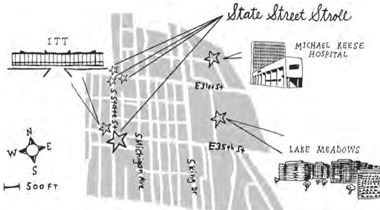

图 1.2 近南区（Near South Side）的大规模开发。Julia Gualieri 画。

20世纪70年代，环区（Loop）南部的战略性遗弃和新投资已成为公共辩论中激烈的话题。为《论坛报》撰稿的城市社会学家皮埃·德·维斯（Pierre De Vise）认为，尽管芝加哥黑人由于南方和海外工人失去了工作，由于所谓的“贫民窟清理拆迁球”失去了住房，但环区南部隔离的非白人社区投资的匮乏，仍然可以解释为开发者在白人郊区的“过度开发”。⁶ 像盖尔·西西罗（Gale Cicero）这样的活动人士，以及像西北大学城市-郊区投资研究小组这样的学术团体，通过将公众注意力转向联邦住房管理局（FHA）的歧视性做法，拆解了德·维斯的断言。当地的储蓄贷款行业和房地产委员会一起，FHA几十年来一直在南环区（South Loop）等社区系统地传播着剥削性的繁荣与衰退循环。⁶⁷

1972年至1981年间，芝加哥失去了123,500个工作，占私营部门就业人数的10%，而该市大地区的就业人数增长了25%。尚姆堡（Schaumburg）、诺德布鲁克（Northbrook）和纳珀维尔（Naperville）等白人郊区的“增长边界”与“衰败边界”之间的差异，被映射到城市严格的种族地理格局上，其中黑人社区的就业下降最为剧烈。⁶⁸ 近南区的人口在50年代初就已经急下降，到70年代初，该地区仅居住着7000人。那里也几乎完全变为租客居住，83%的居民住在剩余的大型公共建筑中。⁶⁹ 然而，尽管遭受了这些毁灭性的损失，环区南部的黑人居住区在20世纪80年代初开始经历了所未有的文化增长，这种增长是由重新激活“唱片街”（Record Row）上创业音乐文化空间的力量驱动的。

20世纪50和60年代，芝加哥南部是一个繁荣的依赖型音乐产业基地。许多小型唱片公司的存在，以及舞厅、俱乐部和酒馆等其他音乐聚集空间，使得独立的黑人音乐企业家和独立（或“独立”）录音公司能够在实验新录音技术的同时，追踪听众偏好的细微变化。⁷⁰ 芝加哥最著名的黑人唱片公司之一的`Vee-Jay`于1954在该市第一条某种意义上的“唱片街”开设了第一个总部，如图1.3所示；该地区已经是国际象棋唱片（Chess Records）、`Parrot/Blue Lake`唱片和联合发行（United Distributors）的所在地。⁷¹

20世纪40年代，提供分销和艺人制作（A&R）服务的公司开始沿罗西街和第16街之间的密歇根南南部一条地带向环区靠拢。到60年代中期，南部的第二条唱片街已成为不少于17家分销商和六家独立唱片公司的所在地，其中包括`Decca`、`Capitol`、`Constellation`和水星唱片（Mercury Records）。`Vee-Jay`受益于在第一条唱片街附近的业务增长（那里被视作其邻居的杂剧时代音乐厅），但利维安·卡特（Vivian Carter）和詹姆斯·C·布拉肯（James C. Bracken）最终搬到了密歇根南部，以利用那里集中的创作、录音、艺人制作和分销明星。根据音乐学家和历史学家波西亚·莫尔特（Portia Maultby）的说法，如图1.4所示的第二条唱片街为黑人企业家进入芝加哥独立工作室担任会计师、销售和推广总监等职业创造了准入机会。录室音乐人菲尔奇（Philch）说：“在那个年代，你走两个街街就能敲开遍世界的每一家主要公司”——⁷³ 这种整合显然对艺术家和所有人来说都是巨大的益处。

南环区成为芝加哥独立黑人音乐产业的神经中心，但音乐创意和实验的空间仍相对均匀地分布在环区相邻的社区。例如，近北区的卡布尼绿（Cabrini Green）住宅项目，特别是塞沃德公园的社区建筑，是50年代“杜瓦崇拜”（doo worship）发展的重要场所，并在60年代一直对黑人音乐实验至关重要。根据传奇R&B歌手兼作曲家杰里·巴特（Jerry Butler）的话（他与母亲和两个兄弟在卡布尼的高层公寓里长大），音乐在住宅区随处可见，在街角。⁷⁴ 事实上，像印象派乐队（The Impressions）这样由芝加哥灵魂乐先驱、`Curton`唱片公司主席柯蒂斯·麦菲尔德（Curtis Mayfield）领军的艺术家，在住宅区之外创作并表演了他们的早期曲目，凭借唱片街的独立唱片大获青红。⁵ 据说住宅项目紧凑的物理空间为黑人的实验提供了良好的声学效果。⁶ 许多卡布尼的居民，如爵士钢琴家拉姆齐·刘易斯（Ramsey Lewis），也在如图1.5所示的`Wayman AME`教堂唱美赞歌。⁷⁷ 福音音乐带到了密歇根南部。

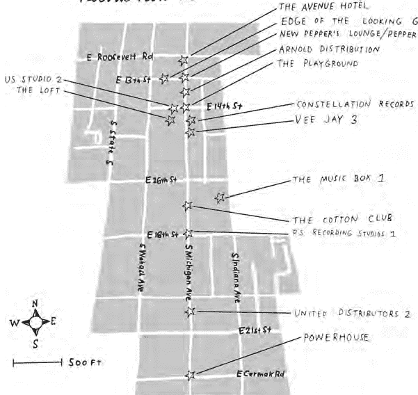

图 1.4 唱片街 2。Julia Gualieri 画。

到70年代末，居民的流离已经确立了芝加哥独立产业的衰落。⁸ 美国音乐界的大玩家，如大西洋和哥伦比亚/CBS，开始从大学校园挖掘黑人艺术家。⁸⁰ 与此同时，联邦通信委员会（FCC）对独立唱片公司的商业行为发起了系列调查，涉及向电台播放其艺人。⁸¹ 尽管失去了许多品牌，布鲁斯克（Brunswick）在1977年赢得了FCC的贿赂案。然而，由于没有团体依靠，这家开拓性的唱片公司被迫倒闭。²

## 有色少数裔文化的前身

近北区的居住和神圣空间对黑人音乐的发展非常重要，但近南区和西区的酷儿音乐聚集场所在塑造后来的房屋音乐（house music）方面起了作用。这些社区在20世纪70年代和80年代初的文化演变，此前源于南部黑人和酷儿文化的发展的，那个时期芝加哥南部的黑人社区成为了该市主要的罪恶区。³ 这一被局外人士标记为“黑人带”、被居民称为“青铜维尔”（Bronzeville）的地区是几位标志性有色人酷儿艺人的孵化器。在华盛顿公园（Washington Park）著名的男同约会场所西侧，观众可以欣赏现场爵士乐队和约瑟夫·“乔”·休斯（Joseph "Joe" Hughes）`De Luxe`剧院的通俗女装舞台表演，或者享受`Club DeLisa`变装皇后演员的表演。在这些场所于30年代后期开业之前，灵媒师布拉克夫人（Madame Block）经营着一家跨族妓院，大多数富裕的男性在公园东边界一个街区的地方寻找黑人伴侣。南区工人俱乐部（Southside Workmen's Club）也为社区的一群跨族“同恋者”提供了更安全的空间。⁸⁴ 需要注意的是，尽管这些空间提供了相对的安全

# 浴火重生 · 41

以及对所有年龄段性少数群体的支持，他们很少受到邻居的青睐。与那些帮助北区（Near North Side）带回和平的白人道德改革者不同，芝加哥南区的黑人社区对于他们是否会与性工作者、煽动舞者和性少数人士密切居住几乎没有控制权。根据黑人女性主义学者帕特里夏·希尔·柯林斯（Patricia Hill Collins）的说法，黑人女性长期以来受制种族主义和异性恋的“双重禁锢”动态的影响，部分是因为他们社区中最强大的机构（如黑人教会）试图拒绝对所有类型的性酷儿特征的过度界定描述。85

令布朗维尔（Bronzeville）的黑人道德改革者感到惊的是，战前几年发展的有色少数群体歌歌舞文化不仅存续了下来，而且还在扩张，影响了20世纪70年代南环路（South Loop）的蓝色空间。迈克尔·亚伯拉罕（Michael Abraham）是一位在伊利诺伊理工学院获得艺术硕士学位的白人摄影师，他记录了那个时代两个著名的南区夜俱乐部的活跃场景：由波普·斯塔普尔斯（Pop Staples）和“姐妹花”（The Sisters）经营的迪斯科舞厅`Peru's House`，以及一家蓝调俱乐部`辣椒避风港（Pepper’s Hideout）`。亚伯拉罕的照片证明了跨性别女性和女性移民在南区文化空间中意外出现。那些无名的天后们（如图1.6中所示的舞者）为他的民族志镜头表演，身着闪烁的面料，眼中闪烁着反叛的光芒。根据同样出现在亚伯拉罕照片中的音乐家兼舞者雷吉奥·麦克拉林（Reggio McLaughlin）的话，这位摄影师会让他的模特摆姿并挑逗他们，策划出一些具有争议的场景以创造引人入胜的视觉画面。然而，尽管有这种显性的构图，他的工作仍证明了南环路地区像`Pepper's`这样的黑人俱乐部仍然保留了它们在更深处的布朗维尔前身中许多性混合的社会元素。正如麦克拉林评价亚伯拉罕的性酷儿题材时所说：“在周围看到他们是很正常的事。”87

虽然有色少数群体性酷儿在芝加哥70年代蓝调界那个相对异直的世界中仍然处于边缘（尽管是例外），但黑人男同性恋在南岸（South Shore）社区培养了活跃的私人派对文化。根据据当时受欢迎的迪斯科DJ克雷格·坎农（Craig Cannon）的说法，79街与Yates街之间，以及67街到公园之间的区域，是自20世纪60年代末开始繁荣的仅限邀请文化的一部分。他将此归功于巨大的马蹄形花园公寓有助于发展该社区的黑人同性恋社会文化：“当我们在私人派对上邀请这些人来时，我们试图让…… . . . 环境变得非常像俱乐部。这样他们就会搬出家具，我们会准备闪烁灯、请一个DJ，就像在俱乐部里一样。”88

20世纪70年代初，如图1.7所示的第六街和南德雷克斯尔街（Sixth and South Drexel）成为平行的同性恋集体和社区的家园：芝加哥新兴的跨种族同性恋解放运动。女同恋活动家维尼塔·格雷伊（Vernita Gray）和芝加哥大学的一名白人大学生亨利·魏姆霍夫（Henry Weimhof）在他们的社区为芝加哥性酷儿创造了新的社交空间，最初通过大学初期的同性恋解放战，随后通过芝加哥同性恋解放组织。

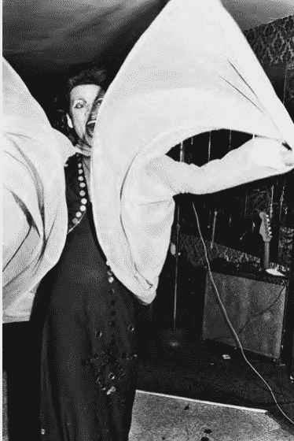

**图 1.6** `Pepper's Hideout` 的无名舞者；经迈克尔·亚伯姆森档案许可使用。

根据活动家马克斯·史密斯（Max Smith）的，南区的跨种族和黑人男同性恋活动运动加速了芝加哥北区黑人经营和运营的空间的发展。事实上，黑人芝加哥人为旧城（Old Town）社区为男女同性恋者提供更安全的商业空间扩张至关重要。尽管如此，仍有少数黑人男同性恋和女同恋在这些新酒吧和俱乐部中受到了毫无保留的欢迎。9

有时，旧城的非白人顾客会遭受人身暴力和种族蔑视，但更多时候，这种虐待要隐蔽且阴险。北区的酒吧和俱乐部所有者强迫非白人同性恋和女同恋在达到场所的“种族配额”后，他们出示多种形式的身份证明。10 这些配额基于场所门卫人员的判断和监管，他们评估在特定时间内某场所内的黑人和棕色皮肤顾客是否过多，并限制到达太晚的人士进入。

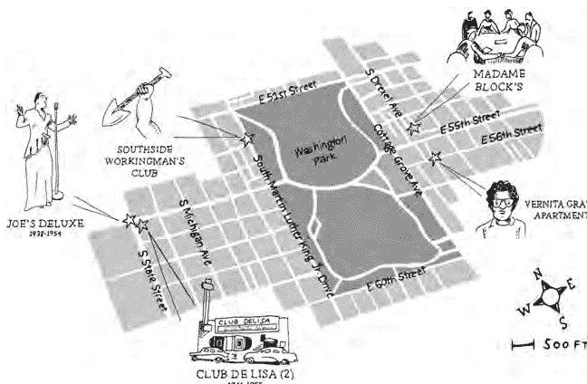

**1.7** 酷儿色彩的布朗维尔。Julia Gualieri 绘图。

顾客雷·托马斯（Ray Thomas）记得，这种景象特别对黑人男同性恋者来说是非常令人沮丧的，即使门卫是黑人也是如此：“我们去过几次`Bistro`，结果光是想进去就变成了一件大麻烦，以至于1973年10月地下派对开始了，那就是最初的`Warehouse`。”9

种族配额经常导致芝加哥性酷儿商业空间的重新隔离，尽管同性恋解放曾为性酷儿聚会提供了新的、更少限制的可能性。有色少数性酷儿及其空间遭受了恐怖和身体恐吓。在其中一个，纵火犯分别在1981年6月初和9月两次袭击了位于北街937号的`Ritz`夜总部，那是一个以黑人和同性恋为主的迪斯科舞厅。92 尽管弗雷德·莫里斯（Fred Morris）认为火是他的竞争对手放的，或者是因为有人对他有个人私怨，但并不难看出北区出现一家黑人同性恋迪斯科舞厅，如何对乔治·利普西茨（George Lipsitz）所说的社区“白人空间想象”构成威胁——即对受控环境和可预测种族秩序的理想化描述。93

种族歧视促使有色少数性酷儿组织起来抗议，抵制诸如图1.8所示的`Auggie's`、`CK's`、`Den One`和`Bistro`等同性恋酒吧，但也标志着地下派对的重要性。例如，推广人罗伯特·威廉姆斯（Robert Williams）开始在近西区和近南区的阁楼空间举办`US Studios`活动，目睹了在`Bistro`的黑人顾客遭受的虐待。94 尽管他是早期原型浩音乐（house music）文化的关键先驱，其美学和声学

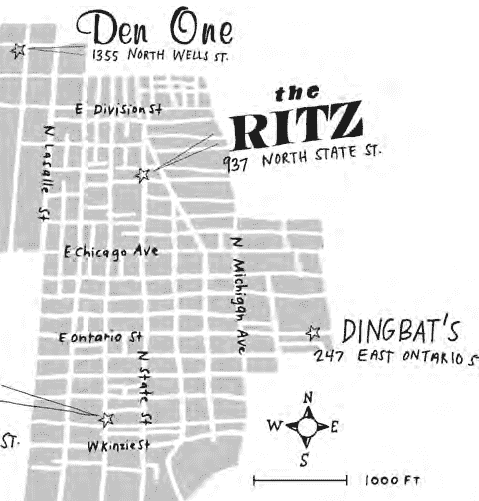

**图 1.8** 北区迪斯科舞厅。Julia Gaultier 绘图。

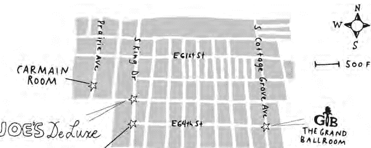

主会大厅

`JOES Deluxe`

私人雕塑室

**图 1.9** 南区有色少数性酷儿色彩空间。Julia Gaultier 绘图。

虽然模仿纽约市迪斯科舞厅的模式，但威廉姆斯绝不是芝加哥唯一尝试非商业化、跨流派音乐的先驱性音乐企业家。像`Ezebukwu`这样的艺术家仍然点亮了俱乐部空间，如私人雕塑室，这些空间紧邻深南区（图1.9）。

到20世纪70年代中期，推广人经常在芝加哥西环和南环区的闲置空间举办无证派对，通过他们的汗水投入创造了数十前的价值。95 例如，罗伯特·威廉姆斯在密歇根大道南1400号设立了`US Studios`的第二个版本，他认为那是芝加哥传奇人物里·巴特（Jerry Butler）的录音室。96 虽然威廉姆斯主要关注他租用的空间楼感受，他说他也想重新居住遗址。97

正如本文所示，芝加哥的有色少数性酷儿地下深受空间连续性和断裂的影响；并受到压迫力量的结构性纠缠，同时也并在充满黑人卓越成就和快乐的空间中聚会。当迪斯科在80年代演变并合并为一种名为`house`的流派时，它的特征（如结构、节奏和音色）与表演研究学者莱恩·库里尔（Brian Currill）所说的与其发展空间之间深层且持久的历史联系同样重要。98 这些空间过去和现在都紧密连接着整个20世纪黑人城市音乐史：在芝加哥、纽约、洛杉矶、底特律和巴尔的以及整个黑西洋产生的迪斯科、灵魂、R&B、爵士、蓝调和福音。99 这些声音在特定地下消费场所的回响，将它们与布朗维尔和南环路等长期拥有有色少数性酷儿音乐传统的社区联系在一起，也与由黑人酷儿社交塑造的更深刻的空间遗产联系在一起，如南区的公寓、改造后的工业阁楼，以及欧内斯特·哈迪（Ernest Hardy）在评价 house 音乐起源时称之为“无比火热的”。100 尽管 house 从这些热点走向世界，但它仍然不可否认的芝加哥音乐；它无法脱离产生它的社区和空间。艺术家和学者可能希望将`视为芝加哥的文化产品`，以管理与其广泛审美影响以及深远国际传播的关系，但这种音乐并不舞蹈音乐学者希尔贡达（Hillegonda）所建议的那样是“游牧的”。101 即使 house 音乐吸收并重新语境化

源自各种场所的各种声音，如朋克、意大利迪斯科、底特律放摇克和费城灵魂乐，它仍然植根于芝加哥酷恋人、黑人和拉丁裔舞者的者的经历，以及芝加哥酷恋人、黑人的社交舞蹈空间。

芝加哥豪斯音乐代表了芝加哥独特的有色人种酷恋音乐实验与创业传统，以及帮助这些传统繁荣的空间，尽管其发展也深度得益于源自纽约的进步俱乐部风格、空间实践、声学技术、混音技术和声音曲库。本章探讨了`US Studios/The Warehouse`和`The Music Box`，两处传奇的芝加哥豪斯音乐空间。这两个地方经常被描述为热到蒸汽从窗外涌出，但却发展出了创新的音乐实践——² 它揭示了植根于纽约的创新音乐实践是如何在这些芝加哥场所具体化并神圣化的，并探讨了在各自的驻场 DJ 弗兰基·纳克尔斯（Frankie Knuckles）和罗恩·哈迪（Ron Hardy）的影响下，他们如何定义了一个从迪斯科毁灭运动灰烬中如凤凰涅槃般的新生流派星座。

# 2 `WAREHOUSE` 与与 `MUSIC BOX`

## 滋养芝加哥豪斯音乐文化

### 引言

DJ 迈克·温斯顿（Mike Winston）一直拒绝去`The Warehouse`（仓库俱乐部），尽管他的朋友莫里斯·“法官”·蔡托（Maurice “Judge” Chaytor）一直在催促他加入这场快乐。温斯顿承认自己曾是个派对男孩，经常在芝加哥西环路（West Loop）的`Rialto`等这种性别的和种族混合的酒吧里闲逛和唱片，有时还会沉溺于酒精和药物。他说有些东西阻止了他在南方南杰斐森街206号放孤一掷；对蔡托所描述的那种“狂野、非常放荡……而且非常同性恋”的活动感到一种不安。最终，这种吸引力变得让他无法拒绝。

温斯顿在西环路的一家咖啡馆里，一边吃着盘薯条，一边回忆起第一次去`The Warehouse`的夜晚，仿佛就发生在昨天。他提到从南杰斐森街206号衣帽室走下楼梯时的那种期待感，他说舞池是一片漆黑，被间歇闪烁的闪光灯照明。当他靠着墙和栏杆稳住身体，正当他的眼睛开始适应黑暗时，DJ放了`The Watnaut`1981年晚期迪斯科杰作《Help Is on the Way》。在近四十年后描述在那一刻听到这首歌的经历时，温斯顿说他立刻哭了：“[那是]我唯一能感受到的情绪……我当时想，‘我的天呐，这是谁？是谁在放这种音乐？’它太强烈了。然后他就是弗兰基……这就是他所做的。他能从你身上激发出那种情感。感觉就像是，‘我的天呐，这是谁？’”

尽管《Help》凭借其高昂的人声和充满动力的贝斯线听起来如此神圣，但不仅仅DJ的节目赋予了温斯顿第一次`The Warehouse`之行的生命。关于1995年对豪斯音乐的定义，表演研究学者布莱恩·库里德（Brian

《还记得豪斯吗？芝加哥的有色人种酷恋地下世界》。Micah E. 牛津出版社（2019）。© Micah E. Salkind。

DOI: `10.1093/97801990698416.003.003`

48 • 这就是开始

Currid强调了在舞池上召唤豪斯历史的至关重要，“而不是[豪斯音乐回答]关于和弦结构、节奏和音色的特定问题。”-² 许多研究豪斯音乐的人纠结它的历史始于罗伯特·威廉姆斯（Robert Williams）的`Warehouse`（在弗兰基·纳克尔斯的音乐指导下），还是说它已经准备好索引了芝加哥长期存在的黑人同性恋豪斯派对文化的声音。一派观点认为，“豪斯音乐”这一概念直到20世纪80年代中期芝加哥的业余制作人开始商业录制后才变得重要。我认可这场关于“豪斯音乐”起源的辩论的价值，以及它赋予芝加哥利益相关者的力量，但本章并不关乎解析谁先对这种音乐说了或相信过什么。它分析并语境化了两位生活豪斯音乐文化精神的先驱DJ的审美优先、技术创新和进步的音乐节目，这种文化引领着他们来到了`The Warehouse`。

一栋由奶油色砖建造的狭窄建筑点缀着绿色艺术菱形，206杰斐森街在1977年至1982年间经营着一家全通宵的、会员制的、非营利的果汁酒吧，为芝加哥的社交舞者制作文化节目。主办人罗伯特·威廉姆斯以及一个财务支持者和联合举办者团队制作了他们的`US Studios`，在一位来自布鲁克林的年轻DJ弗弗兰基·纳克尔斯（Frankie Knuckles，名 Francis Richards Nicholson）以及他主要是酷恋人、黑人和拉丁裔的观众每个周末聚集后，将其命名为“`The Warehouse`”。-1 在几年后与纳克尔斯一起派对几次后，威廉姆斯开发了一个新的果汁酒吧概念——`The Music Box`（音乐盒），并请了一位新的驻场DJ：芝加哥本地人罗恩·哈迪（Ron Hardy）。这第二个项目成为一个异性恋、绝非镜像的舞者部落极具影响力的社会声学空间，也是有志DJ和音乐制作人的灵感来源。`Music Box`的观众与`The Warehouse`的一个群体重叠并补充，这群人继续在纳克尔斯的新场馆`The Power Plant`（发电厂）一起派对。

罗恩·哈迪将节奏复杂的业余的“节拍轨道（beat tracks）”整合到他的`Music Box`场次中的投入，体现了一个非利己的、艺术家内部支持系统的最佳方面面，这种系统让芝加哥的豪斯音乐文化在整个城市繁荣，并在并在捕捉了全美国、英国和欧洲大陆舞者的想象力与心灵。然而，哈迪编排了年轻艺术家未完成和未发表的作品，并不意味着他的文化劳动比弗兰基·纳克尔斯的更重要或更有影响力。纳克尔斯为有心的DJ/制作人提供了发展技能的空间和时间，为其开放并填充

`Warehouse`与`Music Box` • 49

即使弗兰基·纳克尔斯的名字在全球范围内传得罗恩·哈迪更远，异性恋、男性为中心的`Music Box`观众在当地拥有更多权威性。这可以部分归因于恐同症，以及80年代许多酷恋的`Warehouse/Plant`观众死于艾滋病的事实，但也与录带成为记录现场集的一种便捷且流行的方式有关。通过哈迪和纳克尔斯的多个现场集和原始混音，本章认为这些艺术家同时构建了芝加哥声音和人声的基础，尽管他们在`Warehouse`结束时经历了一个按性别划分的文化分裂。

纳克尔斯和哈迪培养的音乐不可磨灭地标志着之前流行的非洲声学传统，这一系列技术和风格被艺术家阿米里·巴拉克·雷·琼斯（Amiri Barack LeRoi Jones）称为“变化的相同”。然而，豪斯音乐基于采样的美学通过引入震撼身体的低频和强大的高音放大打破了之前的黑人文化风格。这些包括交叉交叉混合器；深度凹槽的12英寸舞曲单曲和混音；磁卷带和录带编辑；以及后来的采样器、鼓机和合成器。这些先进技术工具即乐器的物理属性与操控它们的艺术家之间的主观关系，以及对其反应的观众联系在一起。纳克尔斯和哈迪重构了民族音乐学家威尔·吉布布森（Will Gibson）基于DJ设置“使用逻辑”的概念。反过来，装置的“功能性”（即其物理属性实现的特定用途）塑造了艺术家在表演期间体验和构思即兴的重要方面。

在2009年的一次采访中，芝加哥的DJ `Traxx`（年轻时罗恩·哈迪的忠实追随者）描述了大师如何利用其技术技能刺激并玩弄舞者的感知。对于`Traxx`来说，哈迪的观众会“听到这种方式的模式和音色板以及像风之类的模块化效果，很难区分什么是是什么。如果你处于那个时期，你会认为那是罗恩·哈迪，还是会认为那是唱片？”响应召唤的民族音乐学家查斯·凯尔（Charles Keil）和史蒂芬·费尔德（Steven Feld）为了“追踪”音乐机械化的过程，可能会富有成果地将预期的音乐/节奏主题与像`Traxx`这样的舞者在Hardy的某场表演中实际听到的声音之间的差距，称为“参与性差异”（participatory discrepancies）。这一概念最初用于描述观众如何体验现场表演中演奏者之间调音和时间上的微小差异，我在本章中展示了“参与性差异”的概念可以也应该被用来解释电子舞曲社区（特别是由DJ主持的社区）如何体验那些撕开预期熟悉感和即兴新颖性的断裂与不和谐。除了这种差异可能为Hardy或Knuckles的追随者带来那种不安却又愉悦的状态外，舞者们可能会感受到一种延迟的、或许是无法实现的快乐的幽灵；这种快乐与特定知晓正在播放的内容密切相关。

本章致敬弗兰基·纳克尔斯（Frankie Knuckles）和隆·哈迪（Ron Hardy），其意义在于，他们都是黑人同性恋。。他们不仅扮演了如同牧师布道功能的角色，强调了黑人教会中那种性化的灵性化的“呼唤与回应”（而这种教会让他们的许多信徒感到被排斥），还当了南区（South Side）果汁吧文化的助产士，影响并孕育了塑造20世纪80年代上半叶`House`音乐文化演变的制作人和推广者。本章承认，尽管纳克尔斯和哈迪可能成为芝加哥`House`音乐萌芽时期最著名的两个DJ，但他们并非孤立地离开先驱推广者工作，他们的出现也没有来自芝加哥、纽约和底特律庞大DJ/制作人网络的贡献。

最终，这认为`House`音乐必须被置于芝加哥地下世界的酷儿化、黑人“马拉奴式空间”（maroon spaces）中，才能理解其文化影响和社会效用。在批判性理论家阿斯顿·克劳利（Aston Crawley）和哲学家西尔维亚·温特（Sylvia Winter）工作的基础上，我在全文中使用“马拉奴化”（maroonage）一词，以强调纳克尔斯和哈迪的追随者并非像他们许多民权时代的同类那样提出要求，他们的大多数有色人种酷儿创造了存在于主流同性恋迪斯科、直人黑人夜店和黑人教会之外的世界。`House`音乐文化产生了一系列审美实践，其特征正如克劳利在描述新尔良“马拉奴人”的文化工作时所说的，“不同的生态系统、不同的互动”以及“不同的栖息模式”。像加勒比马拉奴人一样，芝加哥`House`音乐的地下世界也以……

以克劳利所说的“始终存在的快乐与享受的审美实践”为特征——8 个由`House`人们塑造的喜悦空间在物理和心理上可能与主流文化机构隔离开来，但正如温（Wyn）在其关于牙买加马拉奴人的著作中所言，它们并不是“文化死胡同”。9 反反，它们是文化维护的空间，类似于洛杉矶器乐手兼乐队领袖霍拉斯·塔普斯科（Horace Tapscott）所称为文化“避风港”。10

尽管深受其婴儿时期具有特定文化的马拉奴空间的影响，但`House`音乐证明了其近乎无限的能力，能够培养新的文化想象，在这些想象中种族、性别、性倾向和能力以意想不到且往往令人惊讶的方式交叉。通过列举纳克尔斯建立芝加哥`House`音乐审美和社会优先事项的一些方式，并研究哈迪的`A&R`动作如何影响其追随者的原始音乐制作，本章为`House`音乐文化及其早期花期的缺乏类型音乐的朋克混合设定了技术和社会层面的包容条款。它也作为第3章和第4章的序言，这两章都强调了这种音乐在80年代跨媒体平台经历的适应和翻译过程。

在`Warehouse`成为芝加哥的一个地标之前，城市里有一家非营利、会员驱动的社交俱乐部名为`US Studios`。它的成功以及在`The Warehouse`发展中的作用，部分基于这样一个事实：它最初并不是为了产生剩余资本，而是为了培养一种集体互助和馈赠文化。

对于在 US 活动之前的推广者来说，共同的文化劳动不仅发生在派对期间，发生在派对之前或之后也同样重要。许多人的参与让 DJ 工作、悬挂装饰以及准备水果和其他零食变得轻松许多。根据那些接近 US Studios 圈子的人（如著名设计师拉里·霍普（Larry Hope））来说，他们将纽约的地下舞蹈派对文化相结合，为芝加哥的观众服务。

迈克尔·马修斯（Michael Mathews）、本尼·温菲尔德（Benny Winfield）、本尼的妻子 April 和她的兄弟格雷格（Greg）、Fred、Pj、唐纳德·克西（Donald Crossy）以及 Vicky 只要有机会就会飞往纽约，和朋友一起在 Soho House 听 Larry Levan 的音乐，在 Gallery 听 Nicky Siano 的音乐，在他的 Loft 听 David Mancuso 的音乐，跳整晚舞。他们每次回到芝加哥都会感叹，家里没有人像他们在东部那样喜欢跳舞。11

霍普是芝加哥艺术学院的学生，他在芝加哥 House 音乐社区因为该场景的先驱 DJ 和制作人制作定制皮帽而闻名。他想起 Soho 舞池上摇动的变色日本灯笼的迷人效果：

> 当灯笼晃动房间时，它们会改变颜色。所以如果房间是蓝色的，等到它……它就会变成黄色或红色。12

结合裸露的砖墙、用于高频的扬声器阵列以及震动身体的低音放大器，纽约的迪斯科地下成为马修斯及其团队的蓝图。

由于无法像他们希望的那样往返，US 圈子与一位名叫罗伯特·威廉姆斯（Robert Williams）的纽约移民建立了联系，帮助他们实现一些希望在家乡实施的节目。威廉姆斯是一位社会工作者兼深夜企业家，搬到芝加哥是因为他负担不起曼哈顿的高租金。他通过制作认识马修斯和温菲尔德，他们请求他的指导，最终将他推向 US 项目的领导职位。

根据当时的情况，当他与 US 联系时，在大型公寓里举办针对黑人同性恋人的派对已经是芝加哥南岸社区（South Shore）的一个特征。威廉姆斯并不知道自己可能会做什么工作，但同意帮助 US 在靠近市中心的地方定期举办阁楼派对。该小组让温菲尔德的领袖西格弗里德·“齐奇”·舒（Sigfried "Ziggy" Schumann，一位德国裔鲁特琴师）提供了帮助。舒租用并随后启动了 US 在早期派对中使用的 ALTEC Lansing Voice 扬声器。13

在开始时，US 团队保持着流动状态，在不同的阁楼之间跳跃，尝试将纽约派对场景的模式适应到一个不习惯这些混合风格、技术和其他激发 US 成员东部之行的制作元素的当地地区。

第一场 US Studios 派对发生在 1973 年秋季的迈克尔·马修斯的东贝尔蒙特大道（East Belmont Avenue）。派对位于城市的一个居住区，该地区将成为北区蓬勃夜生活经济以及果汁吧的核心。根据罗伯特·威廉姆斯的说法，由于邻居投诉，警察在半小时内就驱散了聚会。尽管如此，派对还是传出了很成功的消息。

几周后，US 在从一位名叫 Maxine 的女性那里租来的 Clinton 大街 116 号私人生活阁楼空间举办下一次活动时（威廉姆斯描述她为一位黑人革命者），小组已经毫不困难地填满了舞池。

随着南区黑人同性恋舞社区的热度日益高涨，这个来自美国的团体（US）渴望扩大自己的影响力，但温菲尔德（Winfield）和马修斯（Matthews）对夜生活经营经济仍有许多需要学习的地方。

租给该团体顶层 Loft 的艺术家 Maxine 在她空间举办的首场派对成功后并不傻。当 US 再次向她租房时，她要求该团体支付双倍押金。威廉姆斯（Williams）表示，他们知道如果在大楼里有自己的空间，可以做得更好，因此他恳求温菲尔德和马修斯租下紧邻 Max 下方的一个相当昂贵的单元，而不是屈从于她的加价。威廉姆斯起初对此表示怀疑，但最终说服了他们；毕竟他才是专家。

在克林顿街 116 号租下新空间后，威廉姆斯发起了一场美学改造，用厚实的深黑色喷漆覆盖了整个墙壁、天花板、窗户、地板，甚至是厕所和洗手池。由于没有资源像 Soho House 或纽约其他俱乐部那样创造复杂的视觉效果，参与 US 派对的推广者采用了经济策略，将注意力吸引到环线区（Loop）附近实验的声学和空间元素上，同时尽可能地减少视觉输入的影响。

这种策略似乎起到了提高空间声学潜力的效果。事实上，尽管 Studios 在第二次克林顿街 116 号的活动中将门票从 2 美元提高到 4 美元，以帮助支付一些新成本，有色人酷儿舞者依然聚集在这里派对。

US 团体在芝加哥黑人同性恋舞者中几乎瞬间流行，得益于它将熟悉与新颖的制作元素及推广策略相结合。正如 DJ 克莱格·坎农（Craig Cannon）指出的，自 20 世纪 60 年代后期以来，黑人同性恋社区一直在南区随着不断的 DJ 混音跳舞；那里的舞者已经习惯了仅限邀请的深夜活动。

通过在环线区附近举办派对，US 让这个小圈子的场景更容易被住在北边和西边的人接触。随着他们将南区的家庭派对模式扩展到新空间，该团体保留了一些平价但热情的待客方式（提供免费食物），但强调了现场节拍混音的 DJ Set，而不是预录磁带。

它还整合了纽约地下迪斯科店的装饰，如大氦气球和极简灯光（闪烁灯），以凸显高耸的天花板、斑驳的砖墙和原木地板。US Studios 就像纽约传奇的天堂工厂（Paradise Garage）一样，被设计为一个仅限会员的社交俱乐部，在功能上对广大好奇的音乐爱好者（甚至是未成年人）开放。

内部人士通过出售会员卡带来了新观众，所有成员都允许带朋友来。因此，虽然派对上有稳定且老牌的群体，但这种模式足够灵活，也能容纳好奇的舞者。

随着观众扩大，这个小组寻求新的空间来举办活动，以更好地适应其果汁吧模式和蓬勃发展的声学需求。1973 年底，一场火灾摧毁了南克林顿街 116 号，摧毁了空间和团队的音响系统。罗伯特·威廉姆斯将派对搬到了南密歇根街 1400 号，那里曾是印象乐队（Impressions）主唱杰里·巴特（Jerry Butler）的工作坊。

不幸的是，新场馆离对面的消防房太近，意味着顾客面临着新类型的审查和监视。威廉姆斯回忆道，有一天去上班时发现建筑正面布满弹孔，这种破坏行为他认为是消防员及其同伙所为。最终，US 因在南密歇根街 1400 号违反建筑规范被传，因此他们搬回了西环区，定居在西亚当斯街 555 号的五层 Loft。

分裂后，威廉姆斯失去了势头。前 US Studios 的成员可能接管了该领域最受欢迎的推广者，而他已经获得了一个新场馆、一位大师和一套顶尖的音响系统。

根据威廉姆斯的说法，他们在 1976 年春季租下的南杰斐逊街 206 号大楼非常适合举办地下舞派对，因为它很低调但宽敞。舞者可以进入并爬上窄楼梯到达票务处，门卫会在那里迎接他们。二楼的门厅延伸出一个休息廊和衣帽间，顾客可以从那里回到空间前方，然后下到舞池。如果他们需要停舞休息，可以上到法庭室或下到地下室吃点心。

到 6 月份在杰斐逊街 206 号开门时，威廉姆斯不仅厌倦了人际戏码，也厌倦了兼职 DJ。他知道，如果他想与“鲍里”（The Bowery）的竞争对手竞争，他需要一位经验丰富的专家，一个拥有创新方法并能接触唱片资源的人。

威廉姆斯前往纽约，计划将 US 的驻场权交给拉里·列万（Larry Levan），他是一个在纽约拥有固定追随者的小名人。当列万拒绝邀请后，他询问了第二个备选特里·斯科特（Terry Scott），他是 49 街 Better Days 俱乐部非常受欢迎的 DJ。弗兰基·纳克尔斯（Frankie Knuckles）是他的第三个选择。

弗兰基主要被人们知道是列万在大陆浴室（Continental Baths）的好友和助手 DJ。大陆浴室是位于百老汇和阿姆斯特丹街的一间小型同性恋浴室，其地下室有一个迪斯科。

根据威廉姆斯的说法，在杰斐逊街 206 号开业之夜，只有大约二十个人跟着他的新 DJ 出现。他说他们“看不懂弗兰基”，是因为他播放了他们不熟悉的音乐。¹⁵

意识到他需要在芝加哥观众所在的地方吸引他们，弗兰基在首秀后不久就在“鲍里”表演了一场惊喜演出。威廉姆斯将弗兰基像派遣特洛伊木马一样送进竞争对手场馆（事实上，他免费提供了 DJ 服务）。他明白，如果弗兰基表现得好，威廉姆斯就能在几周内把“鲍里”的观众赢回 206 号。

弗兰基在鲍里的 Set 更适合芝加哥观众的特定曲目，而他专业地执行了他的特定风格。

# 56 · 这一切是如何开始的

在芝加哥南岸的派对场景，以及像 The Bistro 和 The Rialto 这样的混族、同性恋迪斯科厅中，他从未放弃与 Larry Evans 一起学到的关于纽约音乐上无知的地下世界的知识。特别是，Knuckles 持续以一种致敬标志性 DJ、主持人和活动策划人 David Mancuso 的开创性工作的方式进行演奏。

Mancuso 因创造了地下迪斯科的音乐和社交模板而闻名。根据历史学家 Tim Lawrence 的说法，他的传奇之处在于整合了精心策划的声音、灯光和其他仪式元素，创造了一个脱离异性父权制白人至上主义时空的世界。¹⁷

Robert Williams 不仅经常出没 David Mancuso 的派对，也深受 DJ Nicky Siano 制作的派对的影响。Siano 在 Soho 的 The Gallery 俱乐部举办的周末活动与 Mancuso 一样，在高分贝水平下将挑战流派的舞曲进行创造性混音，面向主要是酷儿、黑人和拉丁裔观众。这种共鸣空间能够容纳他们的性流动性、种族多样性以及对精神狂喜的需求。¹⁸

Williams 对纽约地下空间机制的关注有助于他理解社交波动与声音震动之间的亲密关系。换句话说，他开始意识到，在大音响系统上播放的音乐可以刺激愉悦的感官，跨越并超越舞者的性欲带。

声音研究学者 Steve Goodman 在关于美国军事使用精确的低音和次低音频率的研究中指出，这些频率有潜力引发不仅是跳舞主体之间的区别，而且是舞者与构成他们舞蹈空间的物质元素之间的区别。

Siano、Mancuso 以及后来的 Williams 调整并重新调整音响系统（有时在每个周末使用后），以确保精确的次低音频率能创造一种集体体验，坍塌诸如“心与体、主体与客体[以及]活物与非活物”等类别之间的日常性。¹⁹

到 20 世纪 70 年代后期，由纽约地下迪斯科俱乐部声学环境设计的定制音响系统被 Richard Long 证明是卓越环境的关键组成。作为一个痴迷的发烧音响爱好者，Long 与 Larry Levan 一起想象俱乐部音效的可能性。

在 20 世纪 80 年代，他为 Michael Brody 的 Paradise Garage 系统提供持续服务，并与俱乐部的驻场 DJ 频繁进行调整。Long 不断的尝试和调试帮助 The Garage 利用并保留了它的精确性和力量。

随后，他将 The Garage 作为他的分频器（crossover）的大型展示室。他开发的这种工具允许 DJ 在独立的扬声器中放大低频、中频和高频。他还与 Levan 和 The Garage 合作发明了高质量的次低音扬声器，能够“在低至 30 Hz 的极高声压下实现惊人的再现能力”。²⁰

悬挂在 The Garage 舞者头上方几英尺处的大型高音单元阵是 Long 系统的皇冠明珠。这些高音单元架可以被隔离并用于工程师所说的“特效”。²¹

像 Ivan 这样的 RLA 的 DJ 们开发了新的声音方法和表演技巧。根据 West End Records 高管 Mel Cheren 的说法，RLA “为音乐增添了一种诡异的元素。只需开关一拨，Larry 就能让人声产生锡罐般的回响，或者听起来像头顶飞过的喷气式飞机，或是下方轰隆的地铁火车”。²²

换句话说，Ivan 使用 RLA 创建了分层声音，模仿或暗示了城市生活的听觉背景。这种声音魔术将 The Garage 无与伦比的声音系统与纽约其他场馆区分开来。

根据 Cheren 的说法，Ivan 和 Long 最终在 The Garage 共同开发了一个五路分频系统，彻底改变了高音和场馆巨大舞池的管理：Larry 使用分频器与他的观众（他的羊群）进行交流。这被称为“迪斯科福音主义：通过混音进行传教”。²³

RLA 帮助强调的这种布道式功能（这一角色对于来自黑人教会的酷儿人士来说具有特殊意义），在随后被芝加哥 House 音乐的先驱进一步发扬。

尽管 Robert Williams 的 RLA 系统在安装环境的声学调试上没有 The Garage 的那么精确，但它的力量和精度对于 Warehouse 的顾客来说是革命性的。²⁴ Frankie Knuckles 通过使用 RLA 分频器提取他系统的高音来增强人声，并用密集的低音波平滑他的舞池，使舞者因愉悦而尖叫。²⁵

根据 Warehouse 的常客 Roy Bryant 的说法，他是一个后来成为 House 音乐大师 Steve “Silk” Hurley 舞者的冒险青少年，狂喜的观众参与已成为 Williams 场馆整体声音事件的一部分。

Bryant 清楚地记得 Gentle Lee 狂喜的人声表演。他是另一位 Warehouse 的常客，有一扇窗户可以站在那里，看起来像个教堂里的白人女士……当歌曲能听见他在听音乐时……²⁶

在芝加哥 Warehouse 发展的文化无疑植根于纽约艺术家和夜生活创业者的技术和社会创新，但它也得益于在该市南区由像 Michael Ezekukwa、Dana Powell 和 Craig Cannon 等迪斯科 DJ 所培养的美学特性。

这些黑人唱片师和其他人，已经为聚集在 Warehouse 听音乐的许多舞者做好了准备，让他们去听迪斯科专辑曲目的 B 面曲——即后来成为地下的曲目。这些曲目在 US Studios 开始在 Loop 地区举办派对之前的几年里，曾以特殊的酷儿浪潮表演。

被称为芝加哥音乐最谦卑的先驱之一，Mike Ezekebwu 在 Jackson Park 社区的 Jeffrey Pub 进行的表演对于在南区长大的年轻人来说是革命性的。Chosen Few DJ Corp. 的成员 DJ Alan King 记得路过 Pub 门口时，听到 Ezekebwu 现场表演的片段。

他那时也很年轻，但当时无论发生什么都很有趣。²⁷ Ezekebwu 不仅在 Jeffrey 现场表演，他在 20 世纪 80 年代初在南区的 Martin's 担任 DJ，以及在北区的 Dingbaat 担任 DJ，缝合了分散的黑人酷儿地理。²⁸

为了增强表演，他学会了数拍和倒胶唱片。这允许他延长特别有共鸣的旋律，例如 Emotions 的《I Don't Want To Lose Your Love》，这是他在 Private Sculpture Room 为黑人酷儿观众表演的赞歌。²⁹

Ezekebwu 说，他第一次掌握这种“转盘式”技术时，他连续播放了近一小时，将 12 英寸唱片看作是不确定的文本：

> 我播放它，然后重新开始……我一直播放开头……我甚至不让人声停留。然后我开始播放人声。我播放人声……副歌响起，再次开始……³⁰

与商业音乐产品（其用途在进入市场之前就已预定）不同，12 英寸舞曲单曲是纽约的一个幸运意外。据传说，迪斯科重混大师 Tom Moulton 无法获得 7 英寸乐队黑胶唱片来测试新版本的编辑。他的母带工程师将重混单曲的纹路分布在通常用于长放专辑（LP）的 12 英寸唱片上。

遵循 Moulton 的做法，迪斯科唱片公司 Salsoul 在 1976 年发行了 Double Exposure 的 12 英寸版《The Ten Percent》。³² 在迪斯科主流流行的巅峰时期，唱片公司压制的 12 英寸乙烯唱片比以往任何时候都多。

在转向通过这些更大的唱片推广单曲之前（这种做法使得模拟声音可以刻录在更多的乙烯上，从而具有更宽广的动态范围），在很大程度上是因为先驱的 DJ/制作人纽约市像 Moulton 那样证明了扩展的舞蹈混音对于适当的俱乐部推广是必要的。

正如 Brewster 和 Broughton 提到的，商业性的 12 英寸单曲就像 MP3 一样，是由于“消费者需求而非唱片公司的营销指导”而引入的格式。³³

当 12 英寸唱片成为迪斯科 DJ 的常用工具时，它已经肯定了艺术家以新且意料之外的方式进行音乐表达。正如 Will Gibson 从他与爵士艺术家合作的视角来看，这些艺术家实现了此前被认为他们的乐器无法实现的可能：

> 通过技术或物体本身的改变，一组新的动作可能性[发生了位移]。³⁴

12 英寸单曲蕴含的可能音乐动作，存在于美国录音行业与舞蹈 DJ/制作人之间的非线性反馈循环中。这种循环是由芝加哥、纽约和牙买加之间的人际和职业关系所塑造的；而在那里，民族音乐学家 Michael Veal 对音乐室和录音文化、混音/双文化的研究已经非常发达。³⁵

连接芝加哥与黑人音乐创造空间的人际和商业流动，不仅受到音乐器具本身的物质性或播放它们的音响系统的影响，还受到它们所处空间的影响。

根据长期居民、历史学家兼艺术家 Daniel Go 的说法，位于市北部的著名种族混合迪斯科场所 The Bistro 经常因其种族主义配额而拒绝黑人顾客。到 20 世纪 70 年代中期，那里拥挤到队列经常会排满整条街。³⁶

根据他的追随者的说法，Warehouse 甚至更加拥挤。Williams 表示，在场地的高峰期，他会将约 2000 名顾客挤进 3000 平方英尺的空间——这大约相当于郊区房屋的大小——而场地的三分之二位于中心地板的上方或下方。

顾客们记得 Warehouse 是一个具有无法衡量的社会扩张性的空间，比起培养文化感应和活力更合适。事实上，Warehouse 的舞者体验了被挤在一起的生理撞击，也将禁锢带来的拥挤和不适视为一种自由。

文化历史学家 Shane Vogel 说，“紧凑结构中的松散空间”激发了 Warehouse 的拥挤与 20 世纪 20 年代哈莱姆爵士俱乐部之间类似的文化体验。

他假定，尽管黑人文化空间可能比广大观众可以进入的空间更小、物理上更受限，但在那里表演的艺术家能够更好地专注于“声音的产生以及表演者与观众之间的互惠”。³⁷

根据芝加哥浩室音乐制作人、DJ 兼推广人 June Saunders 的说法，Warehouse 观众的审美偏好也类似地发展起来，以应对场地的 RLA 音响系统激活狭小物理空间的方式。

不仅是 Warehouse 的舞池很紧凑，而且从巨大的低音扬声器阵中脉动的低频频率如此深邃和强烈，以至于舞者本身就变成了共鸣腔：

> 这个地方很窄，墙上排列着七英尺高的低音箱，上方挂着高音喇叭。这个音响系统足够 5000 人使用——在户外的话。但它就在这个小房间里，撞击着你的身体。感觉就像低音填满了你的整个身体。³⁸

“仓库”的音响系统塑造了观众最终接受浩室音乐的方式，让他们超越了仅仅随着伟大的 DJ 混音的音乐跳舞，而音乐本身的放大和共鸣是社会声学中的关键部分。

在他关于牙买加舞厅文化的研究中，民族音乐学家朱利安·亨利克斯（Julian Henriques）使用“振动感”（`vibrotactility`）的概念来分析通常支撑“仓库”的重低音频率的情感经济；他认为，音乐震动的振幅和强度对于观众如何从内脏上体验 DJ 的现场至关重要。¹⁹

朋克歌手瑞切尔·凯因（Rachael Cain）是 80 年代经常参加“仓库”派对的少数女性和白人之一。回想起那些早期的日子，她强调“仓库”不仅是一种音乐或口头的体验，而且是“全心的体验”。在那里跳舞让她相信浩室音乐必须影响你的整个存在：“不仅仅是你的头，不是你的耳朵，而是你的身体。”⁴⁰

在 2014 年关于该场地的小组中，现代舞音乐存档基金会的查尔斯·马洛克（Charles Matlock）记得那种巨大的声音甚至会让他手臂上的汗毛颤抖的感觉。⁴¹ 这些印象证实了，浩室音乐是在亨利克斯所说的“声景”中作为一种音乐文化建立的，它变得不仅仅是听觉，甚至是疯狂的。⁴²

20 世纪波动的特质不仅归功于 RLA 音响系统的音效能力，还归功于场地舞池的身体密度；也就是说，即吸收和反射声音的身体，以及建筑本身的物质性。从 RLA 低音箱发出的声波和高音扬声器的声音在狭窄的砖墙上反射，在某种程度上帮助塑造了一群跳舞的身体，使它们协调地脉动。

建筑的其他结构特征（如翘曲的木地板）也随着 RLA 强有力的低音而起伏，增加了另一层触觉输入，帮助舞者与 DJ 以及彼此达成同步。正如亨利克斯所指出的，在强力低音频率压力下的身体对声音压力的反应方式，也受到其内部生物节律脉动的塑造。⁴³

影响听觉刺激以及消化和其他生理过程的躯体震动在“仓库”被包裹在外部声音压力的茧中。在他关于科技舞和浩室社交舞中情感流动的著作中，路易斯·曼努埃·加西亚（Luis-Manuel Garcia）建议，这种外在内在震动过程之间的相互作用，实际上是舞者内部脉搏与外部震动压力之间的汇或分散，可能会引发快乐、痛苦或宣泄。⁴⁵

弗兰基·纳克斯斯（Frankie Knuckles）在强度期间围绕每分钟 120 拍的健康成人心率的重复，以及性行为，这确保了巨大的声音往往也放大了派对的感官和色欲。

驱动“仓库”舞者身体和内心的社会声学波可能让许多芝加哥黑人年轻人感到兴奋，但类似的情感体验在纽约占多数白人的跨种族空间中已探索多年。

在关于曼哈顿迪斯科世界的批判写作中，表演研究学者塔维亚·永（Tavia Nyong）将 20 世纪 60 和 70 年代的社区仪式（如重生、原始尖叫和团体疗法）与他所谓的迪斯科对弗洛伊德“文明困境”的反抗联系起来，即“文明人”在寻找更多文明时只能找到忧郁的文化难题。

在芝加哥“仓库”每周跳舞的仪式可能让舞者触及纽约大多数同性恋观众的回归集体体验中激发的同样的“爱、狂喜和合一的海感”。⁴⁶ 这些仪式还与被排斥的非洲裔传统的谱系相连。

正如人类学家贾法里·艾伦（Jafari Allen）在他关于酷儿俱乐部文化的研究指出的，在西印度群岛和美国南部盛行的莱姆（lime）、环圈（ring out）和贝姆贝（bembe）以及中间所有点的逃亡空间，以一种酷儿扭曲时间和压缩空间的方式在美国城市的地下世界中重新出现。⁴⁷

芝加哥舞者的这种体验不仅连接到纽约和整个黑人大西洋的先验实践和仪式，还连接到风城中世纪变装舞会和表演的风格和感受。

与“仓库”的舞者不同，芝加哥南边战前酷儿俱乐部场所（如 `Club De Lisa` 和 `Joe's Deluxe`）的观众并不是舞台上的，也不是表演的一部分。而且正如历史学家苏基·德拉克罗瓦（Sukie de La Croix）建议的，许多参加这些表演的人寻求的是单一维度的奇观，而非代表性的多样性。⁴⁸

酷儿“仓库”顾客可能被窥视，特别是在奇怪的异性恋之后。

他在 20 世纪 80 年代初发现了这里的派对，但观众并不是南杰斐逊街 206 号发生情况的主流视角。相反，牧师们进行了激进的自我塑造表演，并与他们的 DJ 进行狂喜的交融，这种场所的伦理和视觉效果源于 DJ 克莱格·坎农（Craig Cannon）所描述的相互尊重和对音乐体验的共同热爱。

坎农注意到观众对 Frankie 的声音近乎痴迷，他表示：“你可能站在常客旁边，但这没有任何区别。那是 DJ 统治世界的时代。”⁴⁹

狂喜的表演观众加入他们的 DJ 一起，将仓库（The Warehouse）的舞池转化为 Allen 引用艺术家和伯尼斯·雷伊根的话所说的“神圣之地”；这是一个在他们所经历的许多神圣黑人表达空间中是不可想象的空间。⁵⁰

正如 Knuckles 本人所说：“对于大多数去仓库的人来说，那里确实如此。”⁵¹ 这种与教会的联系不仅仅是因为派对结束于周日晨这一事实。

根据常客的说法，Knuckles 的音乐节目会在凌晨 6 点左右发生变化。他会从俱乐部的 RLA 跨界曲目中去掉一些强烈的贝斯节奏，转向一种灵魂的、福音色彩的曲目，这种曲目已成为全球 House 制作人的关键声音浸润剂。

罗伊·布莱特（Roy Bryant）说：

> 这真的会击中你。然后他会再次带你回来。所以就像 6 到 7 点或 6 到 8 点，他会用教会的氛围、福音曲目让你“教会化”，而在 8 点，派对又重新开始了。

克莱格·坎农说，老一代的仓库观众（许多人是 VWON 的听众）习惯了在电台关闭前听到芝加哥传奇的黑人歌曲《开启我们的眼睛》（`Open Our Eyes`）。⁵³ 当他们听到 Knuckles 播放这些曲目时，加强了他们与这座城市、其音乐元素以及俱乐部反压迫文化实践的联系。

神圣（福音、赞歌）与世俗（R&B、放克和迪斯科）的并置，成为在 Knuckles 音乐指导下，人们所崇拜的 House 音乐汇聚并创造属于他们自己的活力教会的核心。

表演学者 E. 帕特里克·约翰逊（E. Patrick Johnson）描述了亚特兰大俱乐部场景中的黑人男恋同如何创造一个“自我验证的环境，在这个环境中，他们一方面拥有性主权，另一方面又被精神占据。”⁴⁴ 约翰逊所指的精神，是指在 Knuckles 的细心指导下在仓库里摇动的东西。

正如这位 DJ 本人所说：

> 你会有这些接地气的、像玉米一样喂养大的中西部民谣，但派对非常有灵魂感，非常有灵性。⁵⁵

著名的芝加哥人和福音创新者托马斯·多西（Thomas Dorsey）因以下闻名：他将蓝调俱乐部、自助餐点飞行和租金派对的旋律和形式结构与周日崇拜的神圣音乐相结合。

相比之下，Frankie Knuckles 将神圣的歌词主题和音乐元素融入了一个严格的世俗的（即使是享乐主义的）黑人俱乐部空间。

Knuckles 说，这种方法不仅受到他想要表达有意义且鼓舞人心的话的愿望的影响，还受到他如何对表演观众的欲望和身体反应做出动态回应的影响，他意识到这些人需要被牧养，事实上，是从他们日常生活的压迫束缚中解放出来。

仓库舞池的灵性在许多方面与某些在芝加哥教会世界长大的非洲裔美国男性经历的某种文化真空有关，当他们在青少年时期开始探索一系列非规范的性别身份和性欲望时是如此。⁵⁶

在俱乐部中获得生活，即在场所获得的个人和集体的肯定，并不一定涉及某种意义上的“出柜”，尽管它确实经常涉及对同性欲望和/或对酷儿化性别表达的认可。

它更多时候，正如 Allen 所建议的那样，是一个植根于黑人精神生活的内省过程：

> 让你的生活从目前的伪装迈向一种真正的生活，去看你可能躲在什么地方——你可能想象出什么样的恩典，然后帮助他人看到。我在这里描述的并不是人们简单来说所说的“出柜”：在黑人男恋的术语中被称为“向上”（`going up`）或“向内”（`going in`）。俱乐部是许多人开始展现这种神圣生活边缘的一个地方。⁵⁷

让一个人的生活“酷儿化”了进入由白人中产阶级男性主导的同质化或规范性男同恋文化的常规观念。约翰逊可能会说，它“酷儿化”空间，将注意力重新集中在“跨性别者、女同恋人和有色双人的身体、知识和经历上”。⁵⁸

理解仓库 DJ 的文化劳动，以及舞者的共同劳动，在相似的酷儿框架内是非常关键的。

在约翰逊对亚特兰大黑人男恋俱乐部的详细描述中，他将 DJ 比作牧师，通过与他的羊群使用“呼应与回应”（`call and response`）来承认他们的地区差异，同时赞扬他们在黑人精神生活中的许多相似的经历。⁵⁹

在早期的 House 音乐文化中，DJ 不可能采取这种大胆的方法。音台里不会有麦克风，任何形式的语音呼唤都会掩盖像 Knuckles 这样的艺术家为观众不懈创造的音乐流。

## 64 · 这一切是如何开始的

在 1995 年于纽约大学（NYU）举行的一个研讨会上，学者、艺术家和记者拆解了“DJ 拜”。文化评论家安德鲁·罗斯（Andrew Ross）建议，DJ 最终通过他们作为“创造者”的工作超越了他们作为助产士的局限性，认为这种从“行业中间人或助产士到独立制作者和创作者身份”的转变，是舞曲世界一次积极且具有革命性的繁荣。⁶⁰

芝加哥音乐世界实际上植根于这种“中间人”角色。正如像助产士一样，在像仓库这样的场所担任 DJ 需要尊重在派对的神圣空间内释放痛苦的血汗泪水所涉及的过渡能量。

特别是黑人助产士，有一段白人医生不会工作的长期传统。就像芝加哥酷儿有色人游乐场的 DJ 一样，他们经常参与资本主义边缘运行的非正式、礼物、物物交换和替代性经济，同时高度重视患者（在此情况下是观众）的精神、心理和身体健康。

Frankie Knuckles 的助产行为通过几种互补的方式奠定了观众精神升华的基础。主要的，他为他的音乐节目引入了对陌生曲目的敏锐耳朵，但他从未离开观众的舒适区太远。

相反，除了他那场传奇的开场表演外，他致力于将朋克、放克、R&B 和迪斯科的未来经典曲目与芝加哥舞者已经熟悉的曲目相结合。

我所说的“未来经典”意味着，在那些实际上日复一日、年复一年、十年如一日播放的传奇歌曲中，在 Knuckles 播放它们之前，这些歌曲在很大程度上并不为人知。

据 DJ 和制作人杰西·桑德斯（Jesse Saunders）说，Knuckles 能够编写可以从地下跳跃到电台的陌生、挑战类型的录音，是他对整代 DJ 和制作人的音乐和社会影响的一个关键维度。⁶¹

与 20 世纪 70 年代末在芝加哥表演的其他 DJ 不同，Knuckles 仍然拥有通往纽约地下新声音的直接、特权渠道，他利用唱片机、旋转调音器和卷带录音机将这些声音注入他的芝加哥曲目中，并建立在纽约和芝加哥主流迪斯科厅发展的成型音乐技术，以及南岸社区的黑人男恋家庭派对的基础上。

此外，他还与罗伯特·威廉姆斯（Robert Williams）合作整合视觉效果，可以增强他音乐节的效果，如闪烁灯和投影视频。

## 仓库与音乐盒 · 65

像 Bostich 的《Yellow》、Skatt Ross 的《Walk The Night》以及 Taana Gardner 的《When You Touch Me》等歌曲对芝加哥观众来说并不总是熟悉的。

通过在仓库（The Warehouse）拆解这些歌曲，Knuckles 点燃了整个城市对非商业舞曲的热烈热情。

然而，Knuckles 在仓库的许多曲目，尤其是那些朋克唱片和欧洲进口碟，并不总能在商业或促销发行中以适当格式的混音版本出现。

正如著名的 DJ 和仓库常客 Dana Powells 对那个时代评价道：

> 主流唱片公司经营了这种音乐，但是……其中一部分是为了舞池的。它没有适当的制作水平。⁶³

根据 Knuckles 的说法：

> 1981 年，行业已经宣布迪斯科死掉了。所有的唱片公司都在撤销舞蹈部门，不再有快节奏的舞曲了。我意识到必须开始改变一些事情，才能继续为我的舞池提供素材。⁶⁴

磁带在过去的三十年里才作为一种商业录音和播放介质流行，它帮助 Knuckles 满足了舞者们贪渴的音乐胃口，同时也开启了音乐制作的大门。

磁记录发明于 19 世纪末，但直到 20 世纪 30 年代德国军方使用涂有磁性氧化铁的塑料胶片生产高质量音频时，其商业用途才开始成形。

盟军在二战后夺取了这项技术，一位在战期间担任伦敦无线电技术员的美国企业家 John Herbert Orr 投资了其商业生产。

Orr 在美国将磁带标记为广播的增强工具，有助于制作人营销和分发用于联播的预录节目，而不是家庭录音的工具。尽管受到广播集团的阻力，这种介质很快成为全国 AM 频电台使用的标准工具。

在磁带上录音非常简单；它比钢丝具有更强的编辑能力，并消除了节目播放时的表演成本。磁带唱片也补充了黑胶唱片的商业生产，消除了制作一次完美录音的需求，并更容易切割和切分录音片段。

到 20 世纪 50 年代，廉价的消费级开带式播放/录音机顺着人们对高保真音乐的热情浪潮，与微纹胶黑胶唱片、FM 广播、高保真放大器和扬声器以及电视一起，进入了日益繁荣的美国中产阶级的家庭。⁶⁵

根据曾在仓库偶尔代替 Frankie Knuckles 工作的 Craig Cannon 的说法，在 Knuckles 来到这座城市之前，迪厅中使用开带式录音机并不是常见做法。

南 Shore 某场派对的主持人可能会在他宽敞的六室公寓的一半区域配备一台双面开带录音机，通过高保真系统播放预录的混音；这套播放设备的零售价略低于 500 美元，对于大多数移动 DJ 来说太笨重太昂贵了。

同性迪厅的场所经营者仍然需要被说服去追求高质扬声器、放大器和转胶盘，更不用说开带系统了。

尽管密集的磁带被认为与文化格格不入，Knuckles 将其视为打造商业音乐标志性编辑的手段。

通过与 20 世纪 80 年初在哥伦比亚学院学习音频工程课程的制作人兼 DJ Craig Loftis 合作，他开始实际上手剪辑商业唱片的磁带录音。

根据 Loftis 的说法，两人使用先锋 707 RT 磁带机制作他们的自制编辑：

> 你会在节拍之前切开，做个标记，然后拿过来并剪接……用直切你会得到一个瞬间的冲击感……你用斜切，你实际上……切掉这个低频率的结尾，让这个低频率与另一个交汇并将其融合，将它们合并在一起。

Knuckles 说：

> 你必须考虑连续性之类，不是吗？你不能一直重复，否则很无聊。你必须给它一些让它亮起来的东西，这样它就不只是单调的持续……我只是试图寻找一些不同的东西来让舞池保持疯狂，这样他们每周末都会来。

芝加哥的原始 House 受众倾向于喜欢那些听起来新颖但又并非完全陌生的东西。Knuckles 和 Loftis 的开带混音通过听起来既有音乐的新颖感又熟悉，同时回应了这些预测，这是仓库声音中一个令人兴奋的元素，并提升了 Knuckles 作为 DJ 的声誉。

最终，Loftis 和 Knuckles 的磁带编辑成为了像 Steve “Silk” Hurley 这样的年轻 House 制作人的风格和技术蓝图，Hurley 在 20 世纪 80 年代中期在芝加哥崛起，塑造了他们对正确歌曲长度、乐句和编曲的想法。

例如，《Let No Man Put Asher》是歌手三重组 First Choice 在 1977 年专辑《Delusions》中的一曲。Loftis 和 Knuckles 通过将其许多旋律元素转化为声音跌落（`drop`），重新构思了歌曲的结构，同时加强了其 30 秒前奏中的低音律动和氛围旋律。

他们在开带机上的非官方翻制版的流行，为《Asunder》在 1983 年由 Salsoul Records 重新作为商业俱乐部单曲发行后在告示牌舞曲榜上的爆发铺平了道路，其律动在许多方面遵循传统的流行结构，其本身也非常适合通过磁带进行进一步的处理或分发。⁶⁶

许多 20 世纪 80 年代中期的芝加哥本地热门歌曲在新的独立唱片公司商业发行之前，先在磁带上流传。这些磁带包含的内容让听众因其打破了对舞曲形式和声音的预期而记忆深刻。

DJ Elbert Phillips 在 Ron Hardy 的影响下成长并最终成为一名小号手，他回忆起 Jamie Principle 和 Knuckles 的早期混音《Waiting on My Angel》，这从未商业化。

他说这个特定的混音之所以是“经典”，是因为它特别长的积累（`buildups`）和间奏（`breakdowns`），这种安排在俱乐部播放中比广播更有可能利用。

喜欢 Phillips 的 Jackson 在广播和磁带的 House 音乐中长大，记得一位邻居朋友 DJ Mel Hammond 分享了一张深受喜爱的磁带，上面有 Knuckles 的《Baby Wants to Rise》和《Bad Boys》的早期版本：

> 是《Baby Wants to Ride》真正连接了《Bad Boys》。你知道的，它在结尾处有这些手“ptc、tch”，然后手倒退：“schp、schp”，然后《Bad Boys》的贝斯线进了……

除了磁带让 DJ 能够播放和重新构思商业唱片的结构外，这项技术让 House 在新的空间、即社交配置中呈现。

对于 Phillips 和 Jackson 来说，那些太年轻或对仓库直白的酷恋色彩感到不确定的人，翻制磁带（有些是从录音室录制的，有些是从仓库以及后来的音乐盒现场录制的）提供了另一个世界的窗口。

根据 House 制作人 Gere McLaughlin 的说法，他后来以各种别名录制 House 曲目：

> 这些磁带对我年轻易受影响的心灵来说是改变生活且震撼心灵的……仅仅听它们就能带你离开贫民窟，进入一个每个人都是艺术性的、精致的、多才且已经超越了我们通常世界所呈现的哈莱姆复兴或爵士时代巴黎的世界。在那里，种族、信仰、肤色和性取向并不重要，重要的是你可以变得多么华丽。尽管这是一个对于当时真实情况的夸大，我相信，正是这种美学成为了许多被其吸引的人的理想和灵感来源。

McAllister 认为，对于许多在磁带中听到弗基·纳克斯（Frankie Knuckles）音乐的人来说，“仓库”（The Warehouse）已成为一个通往大都市黑人身份的神话纽带，这种身份超越了芝加哥极度隔离的狭隘局限。

Knuckles 与 Williams 之间的合作得益于无数舞者、布景师、服装设计师、放映员和其他艺术家的能量投入，他们共同在杰斐逊南街 206 号创造了这种神话般的本土魔法。这种合作催生了一场运动，并为最终被理解为 House 音乐经典曲奠定了包容性的主要标准。

然而，正如所有美好的事物一样，“仓库”时代最终走向终结。Williams 与 Knuckles 的合作在 1982 年陷入停滞，Williams 声称，在 Knuckles 将仓库音响系统带到其他演出活动后，他失去了他的信任，特别是参加了由 Dave “Medusa” Sheldon 举办的派对。Medusa 是一个年轻的白人、仓库土著，开始在西环路（West Loop）社区推广他的 House 活动，Williams 将他视为竞争对手。

Knuckles 想与他以及其他推广人合作的意愿，也恰好与“仓库”的政策冲突。该场馆开始在周末晚上开放，并取消了会员制度。它本已成为芝加哥爱好的舞者的聚集地，但根据 Knuckles 的说法，这里的同性恋客户被推向边缘。

Knuckles 与 Williams 分道扬扬，在更北的地方了自己的派对。位于哈尔斯特北 1015 号的“电厂”（The Power Plant，前身为 Riverside Club）吸引了 Knuckles 的许多忠实追随者。它还锚定了一个黑人同性恋 House 场所群，这些场所在随后的几十年中推动了芝加哥 House 音乐的发展。

在 Knuckles 1988 年离开芝加哥之前，“电厂”一直是他在芝加哥主要的驻场 DJ。这里保留并扩大了“仓库”的身份——即一个双重边缘化的有色人族同可以在一位当地本土传奇的音乐指导下进行交流的空间。

弗基·纳克斯的舞池已不再是该市聆听新声音最重要的场所。在“美国录音室/仓库”开设了一个新场馆，那里以一群更吵闹、性多样化更高的年轻人群体而闻名，其中包括许多 Knuckles 认为已经开始“稀释”“仓库”氛围的人。

## “音乐盒”的成立

要理解罗伯特·Williams 在 20 世纪 80 年代初将 House 音乐传播到“仓库”之外的行为，了解他与新墨西哥州阿尔伯克基州的一位兄弟会兄弟共同探索一项新业务将大有帮助。

在经历了几次波折的选址任务和一次令人印象深刻的探索性尝试后，Williams 在新墨西哥成立了一家 501c 实体，注册成立了“音乐盒”（Music Box）。

不久后，芝加哥市政府通知，杰斐逊南街 206 号不适合作为社交俱乐部使用。检查员告诉所有者，该建筑的设计无法承受“仓库”舞者的剧烈冲击。

当市政府关闭该地时，Williams 与 Knuckles 的关系已经破裂，新墨西哥的推广人团体也正在瓦解。他决定保留他在阿尔伯克基业务的知识产权，但将他建立的 501c 实体转移到伊利诺伊州。

一旦所有申请文件重新提交，Williams 的“音乐盒”就在密歇根路的一家临时画廊开业了，距离一个名为“游乐场”的热门青少年酒吧只有几个街区。

不久，杰斐逊南街 206 号的所有者向他提供了印第安纳南街 1632 号阁楼的新租，这个空间将成为该派对最稳定的家。Williams 有了场馆，但需要一位至少像弗基·纳克斯那样才华大师来维持他在“仓库”舞者那里建立的声誉。经过仔细考虑后，他将驻场机会给了一个名气不高但同样才华横溢的隆·哈迪（Ron Hardy）。

## Ron Hardy 的驻场

哈迪在 20 世纪 70 年代后期在 Den One 建立了声声，那里是近岸（Near Side）融合极其激烈的同性恋俱乐部之一。他于 1977 年离开芝加哥，在洛杉矶转了几几年唱片，然后回到城市参加他哥哥的葬礼，此后决定留下来。

当 Williams 询问哈迪是否和他一起开始新的驻场时，哈迪正在周三在“里兹酒店”（The Ritz）演出，那是位于北州特街 937 号的、的黑人同性恋迪斯科舞厅，自 1976 年以来一直开放，但在 1981 年场火灾后曾关闭过。

能与芝加哥最著名的地下夜店推广人之一合作的机会似乎完全出乎意料。根据弗基·纳克斯的说法，哈迪向他寻求建议，或许还有他的许可，而 Knuckles 慷慨地给予了。根据 Williams 的说法，Knuckles 试图把哈迪拉到“电厂”。

然而，无论 Knuckles 的意图如何，这种驻场的邀约是极具吸引力的，尤其是因为哈迪将在 Williams 从“仓库”搬到“音乐盒”的 RLA 音响系统上。

尽管哈迪之后还在其他场所表演，包括西德沃恩的 C.O.D. 以及位于密歇根路南大道 326 号的第二个“音乐盒”，芝加哥的首个版本的“盒子”（The Box）一直开放到 1988 年，它将成为 House 制作人 DJ Pierre 后来最常联系的派对，DJ Pierre 后来将这种 DJ 从根本上描述为“充满活力”且通常具有实验性的表演风格。

## “电厂”与“音乐盒”的分化

在 1982 年和 1983 年，House 音乐文化的黄金岁月，好奇的新一代青少年观众涌向南环路（South Loop）的一群全年龄段地下地下“果汁酒吧”（juice bars）。

当这一场景正在成长并结出果同时，许多对地下迪斯科最狂热的粉丝继续光顾由隆·哈迪和弗基·纳克斯举办的派对。如果有足够的时间恢复，或者有精力像马拉松一样度过周末，他们可以在周五在“盒子”跳，周六在“电厂”跳。

但除了这些硬核舞者外，“仓库”的大多数同性恋客户跟随弗基·纳克斯前往了“电厂”，而大多数异性恋观众则前往了“音乐盒”。

House 爱好者争论 Knuckles 和哈迪在各自场馆的风格的优先地位，因为他们曾在这种友好的竞争中处于对立阵营。在这些叙事中，“电厂”被女性化，并与 Knuckles 与观众共同培养的克制音乐感性联系在一起。

当粉丝被要求描述弗基·纳克斯派对的声音和氛围时，“平滑”或“精致”等形容词，以及如“灵魂流动性”（soulful fluidity）之类的概念框架占据了主导地位。

传奇 House 制作人 Chez Demier 将 DJ 之间的区别描述为观众将声音与阶级标识联系起来，“电厂”代表了向往的中产阶级或布尔乔，而“音乐盒”代表了黑人芝加哥文化的“贫民窟”或“底层文化”。

罗伯特·Williams 同意 Demier 的观点，认为哈迪在“盒子”的风格与他的“贫民窟街头”紧密相连，并认为他是预示“音乐变革”的原创作品的灵感来源。

## House 音乐中的酷儿、女性主义与阶级维度

被强迫与这位出生于布克斯的双胞胎陷入二选一的对立，尽管嘻哈和 House 文化都源于 20 世纪 70 年代后期相似的技术和社会变革，但这往往让 House 听众忽视 House 文化中的酷儿色彩、亲女性和中产阶级维度。

例如，像全球范围内闻名的流行 DJ 制作人——纽约的 Armand Van Helden 和芝加哥的 DJ Sneak，他们在采访中疏远了 House 的女性主义和酷儿主义根源，将自己描述为充满男性气气的“House 帮派”，或诉诸自己的嘻哈正统身份。⁸⁸

这些以及其他反女性和恐同性恋的叙事在过去的四十年里流传，淡化了 House 音乐文化本身具有阶级和性别维度事实，而且嘻哈的声音以及贫民和工人阶级人一直是其融合元素的一部分。

这种融合的音频维度在 Music Box 时代开始通过新浪潮被记录，特别是通过那些使用磁带播放器和录音机的 DJ/制作人。

## 磁带技术与 House 音乐

到 1983 年，磁带录音机自 1974 年进入 House 音频市场以来，价格急剧下降。结果是磁带机开始在芝加哥地下世界的家庭录音和 DJ 间取代了笨重的开带机。⁸⁹

因此，虽然唱片机和调音机锁定了芝加哥 House 音乐文化发展第一个十年里大部分创新的核心，但磁带在第二和第三个十年变成了原型制作和传播声音的关键工具。

Ron Hardy 的现场磁带录音让他的声音在芝加哥内部及之外流传，并在那里已带有某种神话色彩。最近，这些录音作为可下载的 MP3 和流媒体音频文件在网上被随意地复制、存档和传播，这在某种程度上归于丰富的 deepophpage 社区和 YouTube 上的业余活动者的努力⁹⁰。

录制的 DJ 混音带的随意流动（通常是脱离唱片信息的 MP3 文件形式）让 The Music Box 青睐的 House 声音从当地交换回路转移到了国家和国际回路，在将 The Box 及其大师奉入 House 音乐创新者殿堂的过程中发挥了重要作用。

然而，Ron Hardy 对芝加哥 House 音乐的影响植根于更实质性的艺术和创新实践，正是这种更近期的传播所实现的。要理解他的创新能力和对听众的掌控，关键在于思考磁带技术的辅助功能如何从三个互补方面影响了 Hardy 的艺术。

首先，双磁带录音机（特别是山水品牌的 `$450 D-W9` 型号）简化了处理开带机时固有的痛苦剪贴过程，让 Hardy 不仅可以在他的家庭工作室，甚至可能在即兴俱乐部表演中重新配置音乐¹⁹¹。

其次，磁带的紧凑性、廉价性和相对耐用性有助于缩小 Hardy 与业余音乐制作人之间的距离。艺术家可以在下午录制一曲，并在那天晚上交给 Hardy；反过来，Hardy 可以在他的 DJ 间预览演示带，如果制作人运气好，当天晚上就能在俱乐部里播放它。

最后，磁带的便携性和可重配置性帮助 Hardy 在芝加哥果汁场景的酷儿深夜空间/时间之外存档并传播了他的声音。

## Hardy 的现场混音技术

Hardy 的现场混音技术可以帮助流行音乐和媒体历史学家理解，芝加哥 House 音乐文化中的磁带录制如何预示了行业内的趋势——这些趋势使音乐制作人、连接听众的守门 DJ 与音乐市场之间的空间和社会距离在 20 世纪 80 年代变得压缩，这种趋势随着 MP3 的出现进一步加剧¹⁹²。

廉价且一次性的磁带为“开放式”音乐制作方法提供了可能；其革命性的承诺在某种程度上取决于它将录音从工业控制中解放出来的能力¹⁹³。

事实上，虽然 Hardy 经常直接从他的 DJ 控制台录制长格式混音，但他的粉丝也经常自己承担记录他工作的责任，在俱乐部场所周围放置带有麦克风的录音机。

据说 Ron Hardy 性格狂热、动作快，这也许由于药物滥用而放大，但这无疑是他作为艺术家身份的核心部分。他使用磁带来剪辑并加快速度——达到他预设速度的 6 + 6 或 8 百%¹⁹⁴。

以高速度播放和再次录制改变了听众对喜爱的音乐的预期；如果 Hardy 以比原曲快一个音调和几个节拍的速度来混音，Music Box 的舞者会更倾向于这位大师和新的节奏。

因为节奏对 Ron 来说毫无意义……如果他想让[任何特定歌曲]的两首歌在一起，它们就会聚在一起。他让这一切奏效。而且你会喜欢的。

Hardy 加强了他混音的均衡器（EQ），有时甚至比 Frankie Knuckles 还要剧烈，将他的听众推向力竭的边缘。正如 Music Box 代替 DJ Lee Collins 回忆道：“Ron 经常说：‘盯着那些该死的，如果他们看起来快要晕倒了，就下手更重一点。’¹⁹⁵

通过强调 Knuckles 为了追求旋律句法而淡化的具有驱动性的打击乐元素，并且在不放弃那些歌颂当地酷儿有色人音乐狂热历史声音的情况下，Hardy 保持了与 House 音乐根源的联系，开辟了自己的创新和影响之路。

## 即兴磁带编辑

作为“暂停键高手”，Hardy 也以其即兴磁带编辑闻名，其中许多是在 DJ 间现场创作的。

Jesse "Roy" Bryant 说，Hardy“会带上耳机，插到[山水]磁带机上，当派对在唱片上播放歌曲时进行编辑，他在磁带机里进行暂停键编辑：砰、砰、砰、砰。他会转动磁带，倒带，按下播放键（哔！）然后将其混入。”⁶

虽然 Hardy 很可能在隔间内完成了他的部分现场编辑，但该场景的先驱们在多年来已经反驳或背景化了这种据报道的倒放唱片的偏好。

根据另一位开创性的磁带操控专家“Remix” Rory 的说法，Ron 那神话般的创新是意外的：Ron 当时在一张演示磁带上播放 Chip E 的《Time 2 Jack》。磁带另一面的歌曲是《It's House》。在播放《Time 2 Jack》期间，磁带扭曲产生了挤带或其他现象⁷。

音乐信息——即理解舞蹈的剧烈运动和/或受控药物的影响——被吸收和解释的方式，可能与多次收听录制到磁带或编码为 MP3 的现场现场听后所获得的信息大不相同。

然而，正如民族音乐学家 David Novak 指出的，这些体验过早假设的“现场性”和“死亡性”概念是社会建构的。尽管它们依赖于附在现场表演“生命、文化背景”与假定的“私人聆听死亡性”上的不同概念，但我们可能会认为它们具有同样深刻的影响¹⁸。

此外，芝加哥 House 音乐兴起的第一个十年 DJ 演出的再媒介录音（那些由 DJ 自己从俱乐部声音中提取，或由观众成员放在扬声器附近的磁带录音机录制的音频），以其他方式模糊了现场/死亡的界限。

现场录音没有捕捉到俱乐部空间的环境音或身临其境的体验。爱好者录音的现场性以原始表演观众的环境声音印象为标志，如歌唱和欢呼声，但它捕捉到的现场录音中中高频之间的偏差较小⁹⁹。

此外，由于这些唱片是且通常作为非商业盗版带提供给潜在消费者，这两类唱片都颠覆了录片行业从已故艺术家那里榨取资本的模式¹⁰⁰。

## Hardy 对经典混音的再创作

在一个首次在 deepepage 上归档、随后在舞蹈音乐历史学家 Jacob Arnold 的在线 Gridface 档案中列出清单的现场场集中，Hardy 改编了 Walter Gibbons 在 1979 年对 Frankie Knuckles 的 Warehouse 赞歌曲目《Let No Man Put Asunder》进行的混音。

他对这个经典 First Choice 歌曲混音版的再混音，展示了他对磁带录音机高超的技术掌握程度，也说明了经常被低估的磁带技术对 House 音乐美学发展的影响。

这张包含了 Hardy 对 Gibbons 混音盗制版《Let No Man Put Asunder (Disco Madness Remix)》的唱片混合，并没有捕捉到 The Music Box 安装的 RLA 系统的宏大音效，也无法传达出与 Hardy 合作的现场表演观众的能量；人们仍然能听到 DJ/制作人强调 Rochelle Fleming 的唱腔词句“let me tell you”（让我告诉你）和“aw, shocks”（噢，震惊了），当他切入歌曲正统间奏（breakdown）中哀伤的“baby... baby, baby”呼唤时。

Hardy 将《Asunder》中女性化的声音挪用到一种音乐叙事中，在社会学家 Bradley Taylor 所说的舞蹈音乐制作的男性化、文化和语言学框架，与他所采样的女性女歌手所歌扬的女性化体现、情感和本质之间创造了一个鸿沟。

那些曾经线性地向和声和和谐解决无限移动的线条，随着磁带在混合接缝处的轻微滑脱，产生了一种幽灵般的证据，证明这种声音并非 12 英寸迪斯科单曲的产物，而是一个基于 D-W9 或类似的商业录带机功能的技巧壮举。

一分半钟后，Hardy 释放了他的磁带循环，让 Fleming 唱道“I've got something for your mind, your body, and your soul”（我为你的思想、身体和灵魂准备了一些东西）。

在《Asunder》的现场版本中，Hardy 将自己和他的舞池穿插其中。通过对歌曲中最具力量的歌词进行渲染，而非那些责心爱的恋人意外离开的歌词，Hardy 将其转化为一种苦乐参半的哀歌，一场为了永无止境舞对的狂喜召唤。

在另一场 1983 年归档于 deepepage 的 Set 场次中（同样由 Jacob Arnold 在 Gridface 上专业地列出），Hardy 从 Paul Simpson Connection 的乐器版《Use Me Lose Me (Reprise)》过渡到 She Pettibone 对《Asunder》混曲中的口白/吟唱线条。

在这段现场编辑中，他突出了这一句：“You know what this means? This means no man in the world can let go of this Aquarius. You dig where I'm coming from?”（你知道这意味着什么吗？这意味着世界上没有人可以放弃这个水瓶座。你懂我的意思吗？）

歌手 Joyce Jones 和 Annette 在 Hardy 提取歌曲的“It's never over”副歌之前进行客唱，通过地下节奏轨道 Novaga 的《Faces Drums 1》中极具欺骗性的简单鼓点将副歌逐渐淡出。

Hardy 捕捉了《Asunder》（当时）广为人知的歌唱节奏的各种切入和退出，使用听起来像是从磁带机即兴点入（punch-ins）的声音，回收了“over”字句的回声和叠层诉求；同时强调了旋律纹理；这一切随后他过渡并提取了下一个节奏副歌。

## 非音乐样本与声音实验

像他之前的 Knuckles 一样，Hardy 打破了对于“完成品”听起来像什么的认知，然而他的技术造诣远超他编辑现有混音的作品。

他还通过整合乡村效果和非音乐样本来推向观众，这些是 Frank 带来的“重磅弹和惊喜”。

在 1987 年的一场 Set 中，Hardy 以一种类似带有警钟声的鸣响定音鼓开场。有音高的管响乐鼓声逐渐消失，一辆轰鸣的火车声向混合轨道驶来，蒸汽汽笛宣告了它的到来。

Hardy 将迎面而来的火车声融入 Stevie Wonder 1977 年的单曲《As》中，节奏没有出现一丝停顿。他的声音调动了歌曲的第一句歌词：“Around the sun earth knows she’s revolving...”（在太阳周围，地球知道她正在旋转……）。

人声的音调承载了一个完整的故事；Hardy 扭曲了歌手的人声音色，改变了感觉。

## 74 · 这就是一切开始的地方

在一个首次在 `deepepage` 上归档、随后在舞蹈音乐历史学家 `Jacob Arnold` 的在线 `Gridface` 档案中列出清单的现场场集中，`Hardy` 改编了 `Walter Gibbons` 在 1979 年对 `Frankie Knuckles` 的 `Warehouse` 赞歌曲目《Let No Man Put Asunder》。他对这个经典 `First Choice` 歌曲混音版的再混音，展示了他对磁带录音机高超的技术掌握程度，也说明了经常被低估的磁带技术对 `House` 音乐美学发展的影响。

这张包含了 `Hardy` 对 `Gibbons` 混音盗制版《Let No Man Put Asunder (Disco Madness Remix)》的唱片混合，并没有捕捉到 `The Music Box` 安装的 `RLA` 系统的宏大音效，也无法传达出与 `Hardy` 合作的现场表演观众的能量；人们仍然能听到 DJ/制作人强调 `Rochelle Fleming` 的唱腔词句“let me tell you”（让我告诉你）和“aw, shocks”（噢，震惊了），当他切入歌曲正间奏（`breakdown`）中哀伤的“baby... baby, baby”呼唤时。

`Hardy` 将《Asunder》中女性化的声音挪用到一种音乐叙事中，在社会学家 `Bradley Taylor` 所说的舞蹈音乐制作的男性化、文化和语言学框架，与他所采样的女性歌手所歌唱的女性化体现、情感和本质之间创造了一个鸿沟。那些曾经线性地向和声和和谐解决无限移动的线条，随着磁带在混合接缝处的轻微滑脱，产生了一种幽灵般的证据，证明这种声音并非 12 英寸迪斯科单曲的产物，而是一个基于 `D-W9` 或类似商业录带机功能的技巧壮举。

一分半钟后，`Hardy` 释放了他的磁带循环，让 `Fleming` 唱道“I've got something for your mind, your body, and your soul”（我为你的思想、身体和灵魂准备了一些东西）。在《Asunder》的现场版本中，`Hardy` 将自己和他的舞池穿插其中。通过对歌曲中最具力量的歌词进行渲染，而非那些责心爱的恋人意外离开的歌词，`Hardy` 将其转化为一种苦乐参半的哀歌，一场为了永无止境舞蹈的狂喜召唤。

在另一场 1983 年归档于 `deepepage` 的 `Set` 场次中（同样由 `Jacob Arnold` 在 `Gridface` 上专业地列出），`Hardy` 从 `Paul Simpson Connection` 的乐器版《Use Me Lose Me (Reprise)》过渡到 `She Pettibone` 对《Asunder》混曲中的口白/吟唱线条。

在这段现场编辑中，他突出了这一句：“You know what this means? This means no man in the world can let go of this Aquarius. You dig where I'm coming from?”（你知道这意味着什么吗？这意味着世界上没有人可以放弃这个水瓶座。你懂我的意思吗？）歌手 `Joyce Jones` 和 `Annette` 在 `Hardy` 提取歌曲的“It's never over”副歌之前进行客唱，通过地下节奏轨道 `Novaga` 的《Faces Drums 1》中极具欺骗性的简单鼓点将副歌逐渐淡出。

`Hardy` 捕捉了《Asunder》（当时）广为人知的歌唱节奏的各种切入和退出，使用听起来像是从磁带机即兴点入（`punch-ins`）的声音，回收了“over”字句的回声和叠层诉求；同时强调了旋律纹理；这一切随后他过渡并提取了下一个节奏副歌。

像他之前的 `Knuckles` 一样，`Hardy` 打破了对于“完成品”听起来像什么的认知，然而他的技术造诣远超他编辑现有混音的作品。他还通过整合乡村效果和非音乐样本来推向观众，这些是 `Frank` 带来的“重磅弹和惊喜”。

在 1987 年的一场 `Set` 中，`Hardy` 以一种类似带有警钟声的鸣响定音鼓开场。有音高的管响乐鼓声逐渐消失，一辆轰鸣的火车声向混合轨道驶来，蒸汽汽笛宣告了它的到来。`Hardy` 将迎面而来的火车声融入 `Stevie Wonder` 1977 年的单曲《As》中，节奏没有出现一丝停顿。

他的声音调动了歌曲的第一句歌词：“Around the sun earth knows she’s revolving...”（在太阳周围，地球知道她正在旋转……）。人声的音调承载了一个完整的故事；`Hardy` 扭曲了歌手的人声音色，改变了感觉。

## 仓库与音乐盒 · 77

这提供了关于他们密度的证据。它也展示了 `Hardy` 如何致力于提升那些勇敢的 DJ 和制作人的音乐，而他正是他们主要的影响者¹119。根据芝加哥制作人 `Adonis` 的说法，无论你是谁，`Ron Hardy` 都会听你的曲目，如果他喜欢，他就会播放它¹120。

对现存混带的检查证实了这种说法：这位 DJ 在单场演出中不会连续播放同一位业余制作人的多首歌曲，有时甚至是连续播放。以 1986 年的作品《House 音乐赞美歌》（`The House Music Anthem`）而闻名的 `Marshall Jefferson` 声称，在 20 世纪 80 年代中期，他在 `House Music Box` 同时循环五十首歌曲¹121。

`Hardy` 担任地下音乐的非正式艺人经理（A&R），利用他的平台将文化资本横向传播到整个芝加哥 `House` 场景。除了那些记录在他幸存现场混带中的曲目外，目前并不完全清楚他播放了哪些、没有播放哪些；许多著名的芝加哥制作人都归功 `Hardy`，让他们第一次体验到自己的音乐在乐于接受、富有冒险精神的观众面前播放。

这些测试的启发机会可能会激励艺术家微调和调整他们的作品，以适应芝加哥的舞池，或将其发行作为公开的商业 12 英寸单曲。对于 `Brewster` 和 `Broughton` 来说，`Hardy` 象征着芝加哥 `House` DJ 的目标：“成为第一个拥有新歌的人；带来最奇异的欧洲进口碟；在每个晚上增加最多的元素。”¹²²

通过推崇前卫作品以及老旧曲目，他不仅展示了一种根植于对未来好奇心和渴望的精神，还对过去的声音表达了深切的尊重。`Need`、家庭放克（`family funk`）、迪斯科和 R&B 赞美曲为未来几十年里地下 `House` 场景的舞者提供了连接带和主要的切入点。

回到 1987 年某个未知的日子，可能是北边 `C.O.D.` 的一个周六晚上，`Hardy` 利用他手中所有的工具进行表演。记录这组混带的 MP3（推测是在一个容纳 1,000 人的地下室俱乐部播放的）是其中之一，我们必须带着他艺术的特殊性来思考。

在接下来的仔细解读中，我通过审视附在每首歌上的语义网，拆解了 `Hardy` 对文化权的传播、“强烈”的播放风格以及编程的创意方法，我了解了他是如何播放的，以及他在曲目切换中叠加的潜在手段。

我承认这个同名的档案是不完整且局部的，但也意味着这些品质证明了它的瞬时性，这是 `Muñoz` 对许多酷儿档案所说的特质，特别是那些索引了多重边缘化酷儿主体文化劳动的档案¹²³。

人们永远无法知道所有的曲目，理解维持混合所使用的每一个效果或技术，尤其在缺乏原始现场表演的感外视觉信息的情况下。在不同程度上，知道与不知道 DJ 组表演的曲目之间的参与性差异，普遍存在于两种情况下：在磁带或 MP3 上听简短的、多次媒介化版本的愉悦体验；听从俱乐部音响系统或 DJ 控制台录制的舞蹈；以及那些在现场报道的人感到，当 `Hardy` 现场表演时感觉就像是在和他跳舞。

芝加哥 `House` 体验的一部分是、并且仍然是，关于在音乐识别熟悉的喜悦和声音谜团的新奇感之间寻找感受。通过关注 `Muñoz` 所说的混带的“闪光”和“残留”，即一个可能永远无法证实为真实的物体的不完美、糟糕的痕迹，我想建议，它的力量更多归功于 `Hardy` 的粉丝所认为的身份，而不是我作为历史学家可能帮助我提出的任何证据性主张。

## 78 · 它是这样开始的

始于 `MLK/Gene Hunt` 的爆发，那是酸性合成器嗡嗡作响的巢。`Hardy` 在 `Dinosaur LS` 的《Go Bang #5》第 3 标记处大汗淋漓，这是一首 1982 年 `Arthur` 的作品，由纽约迪斯科制作人 `Francis Kevorkian` 制作¹。

他循环了那首歌中动人心魄、不和谐的管风琴声，而 `Hunt` 的《Living》中酸性的尖叫声被埋在下面。在三秒钟后，`Hardy` 释放了两首曲目之间正在发展的张力，切换到 `Lola Bland` 充满康加鼓的歌词号召片段，要求人们“bang, bang, go bang, go bang”。

根据 `Tim Lawrence` 的说法（他的关于 `Russell` 的传记记录了 `Russell` 悲剧性的短暂生命和对舞曲音乐世界持久的影响），`Russell` 在《Go Bang #5》上与担任 `James Brown` 伴唱的 `Black` 以及 `Julius Eastman`（这位黑人、“火焰燃烧的酷儿”歌剧芭蕾舞剧作曲家）共同工作。

在 `Hardy` 的现场背景下，这首歌设定了一个舞台，让皇后和街头女性，以及许多认为自己认同各种边缘化身份间隙的人们，可以聚在一起，随着温暖的小号、拨奏的大提琴和迷幻的装饰一起跳舞¹²2。

这首包容性的赞美曲，`Hardy` 在疯狂播放 `Russell` 的激进作品三分钟后，开始引入带有 `Music Box` 风格的《Box Energy》的沉重低音节奏³。这让 `Russell` 作品中的层叠管风琴以及 `Eastman` 的人声上升了一分钟，随后完全融入了他的酸性节奏。

`DJ Pierre` 是芝加哥最高产的 `House` 音乐制作人之一，也是城市 `House` 美学的鼻祖。他说在 `Hardy` 支持他之前，对自己作为制作人的才华几乎没有信心：“只需要有人说，‘嘿，你做的太棒了！’你开始相信自己并在此基础上建立。”⁴

`Hardy` 将雷鸣般的低音拉入 `Pierre` 的《Box Energy》旋律中，让歌曲底鼓的微弱脉动变成一种安静的回声轰鸣。这种“酸性”（`acid`）声音通过调整 `Roland TB-303` 的参数产生，体现了 `House` 音乐如何扩展其工具的可用性。

正如音乐学家 `Mark Butler` 指出的：“通过庆祝高科技机器的错误并故意引发故障，音乐人能够重新界定我们如何使用技术，而不是技术如何表演。”⁸

接下来，`Hardy` 使用 `J.M. Silk` 在 1986 年对 `Isaac Hayes` 的《I Can’t Turn Around》的开头节奏。歌曲的合成器在 9:50 处过滤进《Box Energy》，其主要开头基调嵌入了 `DJ Pierre` 不和谐、扭曲的旋律中⁹。

`Hardy` 似乎使用了特殊的 DJ 工具，发布在英国版本的唱片《Turn Around》中，“Intro（E 小调 House）”。在这个版本中，`Steve “Silk” Hurley` 使用了显而易见的合成器，将主导反旋律放在提琴音域，同时将歌曲更具律性的线条放在中提琴音域，并偏离了 `Hayes` 原曲中广为人知的管弦乐动机³。

`Hardy` 整合了跨越迪斯科和 `House` 的流行地下热门歌曲，拒绝了它们是闭合、已解决文本的想法。我们赋予这些歌曲第三种生命，将它们投放，并拒绝让它们像 `Hayes` 对观众那样停留在原地。

《Can’t Turn Around》是 `Hayes` 1975 年《Chocolate Chip》专辑中的主打歌，在 20 世纪 80 年代中期通过 `Frankie Knuckles` 和 `Ron Hardy` 的录音带编辑和磁带混合进行了延伸和重混。这首歌从其他新兴 `House` 音乐制作人的家庭工作室走向了更广阔的舞池¹³。

`Hardy` 使用着他的 `C.O.D.` 鼠标，在 12 分钟左右切入一首节奏感十足的《Turn Around》，这首歌与 1986 年登上美国 `Billboard` 舞曲排行榜冠军的作品相似。他没有让 `Keith Nunnally` 的人声解决，而是突然切换到歌曲的间奏（`breakdown`），循环它，强调驱动力，在《Turn Around》熟悉的歌词之前挑逗他的，将歌曲与 `Tyree Cooper` 和 `Sean “Smiley” Williams` 作品《No Control》的弹性贝斯线混合。

`Hardy` 在 1983 年离开芝加哥去接受威斯康星大学的篮球奖学金之前，作为一名高中运动员拥有成功的职业。他在校的第一年结束后就回了，放弃了在 NBA 队的梦想，专注于 DJ 和和 `Mike Dunn`、`Hugo` 等朋友推广自己的 `House` 之夜。

`H. Cooper` 感到自己也有必要创作自己的原创音乐。正如他所说：“作为一名芝加哥的 DJ，你想发行唱片。你想被世人知道。”作为一名推广人或 DJ 的名声，与作为录音艺术家所获得的声望不可同日而语。

Hardy 随心所欲地从各种类型的黑人流行音乐（包括福音音乐）中采样。在这段 C.O.D. 混音的 13:40 处，他在 House Family 的《No Control》背景上，听到了歌手 Tremaine Hawkins 的无合唱录音。他很可能是从 1985 年那首夺冠的福音/舞曲跨界热门单曲《Fall Down (Spirit of Love)》的黑胶胶胶片中，提取了 Hawkins 激昂的人声。Hardy 将《Fall Down》与《No Control》交织在一起，听起来就像是为了十年前在“仓库”（The Warehouse）时期长大的 House 观众所进行的世俗与神圣的融合；这就像是向 C.O.D. 观众的一种歌词号召，让他们伏下身，与他们的大师进入狂喜的共融。像 Hawkins 那样的人声叙事的使用，成为芝加哥 DJ 为其混音注入明确信息和修辞点缀的关键手段，Hardy 利用这一点在他的混音中编织了一个平行的叙事，建立了此前 Frankie Knuckles 和 Larry Levan 所实践的“叙事性混音”传统。

在 15:30 处，他从一首人声轨道切换到另一首，离开了 Tremaine Hawkins 的《Fall Down》和 House Family 的《No Control》，进入 The Night Writers 的《Let The Music Use You》，这是一首由 Danica Records 制作、带有 Ricky Dillard 的灵魂乐。The Night Writers 是 Frankie Knuckles 的一个别名，Hardy 加入这首歌可以被视为这位“教父”在 20 世纪 80 年代作为艺术家/制作人、DJ 以及芝加哥 House 场景灵魂人物持续影响力的致意，即便他后来离开了城市前往纽约驻场，并在英国和欧洲巡演。Dillard 像 Hawkins 一样，帮助 Hardy 在混音中布道：“音乐掌控一切，为了你灵魂的音乐……让音乐带你走向顶峰。”

House 场景的音乐制作，正如此前的芝加哥 R&B、福音和蓝调一样，通常是家族事务。Tyler Cooper 使用他的姐姐作为歌手，Wayne Williams 将小伙子推给了他的异父 Jesse Saunders，而酷少数群体则形成了他们自己紧密的音乐合作者家庭。与 Mike Winston 合作的《Let The Music》，而 Winston 正是 The Power Plant 时期的 Warehouse 舞者，后来也成为了他的情人和共同合作者。DJ Dana Powell 展示了早期的 House 场景并没有今天这么有竞争性。“我记得那时候 Frankie 会来叫我‘发电机’（Generator），我们经常待在一起。我们度过了生命中最美好的时光。”

Hardy 在他的 C.O.D. 场中加入 Knuckles 和 Winston 的音乐，展现了谦逊与慷慨，证明了他仍然致力于在芝加哥培养一个既有竞争又充满爱的音乐氛围。

在音乐的 19:37 处，Hardy 突然从 Knuckles 创作的 Night Writers 作品那种充满灵动的活力感转变为《Acid Trip》，这是一首由 Farley 的“Jackmaster Funk”制作的律动感节拍歌曲。Hardy 可能是从 Farley 的《No Vocals Necessary》EP 专辑中提取了这首歌，该专辑于 1988 年由这位芝加哥制作人的厂牌发行，但很可能是 Farley 将像《Acid Trip》这样的作品通过促销样片胶片或磁带交给了 Hardy，让这位 DJ 在免费发布之前可以先听到。

Hardy 使用了类似风声的特效（可能来自一张专门设计的音效唱片）来触发《Acid Trip》升调的贝斯线和粘性的克瓦乐（clave），标志着从《The Music Take You》结束的运动向情感转变，并为混音的新篇章扫清了道路。在 23:00 左右，他笨拙地从已经进入较不刺耳的合成器贝斯线的《Acid Trip》，过渡到 Touchdown 1982 年作品《Ease Your Mind》的英国重混版。这种被称为“火车事故”（train wreck）或不完美的片段在早期的 House 混音场中很寻常，在那期间，DJ 必须使用新兴的制作器和模拟音轨流动的节拍，过渡到编程鼓机的规律中。

根据流行文化学者 Philip Auslander 的观点，880 年代的摇滚音乐通常建立在真实的现场表演与刻意的练习之间一种不安的辩证法之上。Hardy 的 C.O.D. 演出与摇滚音乐人的现场演出不同，它是一个由预录声音构建的录制现场表演。它的技术错误索引了 House DJ 演出的现场性不仅取决于对存储在蜡胶上的录音室声音的完美复制，更取决于一种即兴的不完美模式，这种不完美在混音中编程时几乎会发生。

Hardy 在混音中此点播放的《Ease Your Mind》英国重混版，与纽约嘻哈作者 Arthur 创作的更具标志性的、带有电子味的美国重混版截然不同；它突出了该曲目东海岸音乐人的切片感，并在这个特定的长场次背景下，召唤 Hardy 的听众回到 20 世纪 70 年代末和 80 年代初制作的 R&B、迪斯克和爵士放克的根源声音中。在 27:00 左右，Hardy 将 Touchdown 的唱片拉回转片机转盘，让胶片在他的唱针下发出清晰的磨损声。他没有断拍，拨动混音器的交叉推子，引入了 Da Posse 的《The Groove》中推进节奏。

《The Groove》由 Maurice Joshua 和 Hula Mahone 创作，这两个芝加哥年人后来因获得格莱美奖重混而闻名，这首歌其实就是：合成器贝斯和旋律主音，加上大量的数字鼓点。这首歌体现了 80 年代后期产自芝加哥本土 House 音乐酸性且节奏复杂的一面。Hardy 倾情地播放着它，但他没有让他的循环节奏变得陈旧。在《The Groove》脉动不到一分钟后，他加入了 Ten City 的《Devotion》无合唱。

Ten City 歌手 Byron Styling 适合教堂的假声悬浮在《The Groove》的合成器旋律之上，Hardy 通过他的均衡器将这段旋律在 Da Posse 的曲目中拉入抽出：“I wanna give devo-devo-devo-devotion...” DJ 对 Styling 的人声进行了重混，这是在其关键转折年份期间由主流唱片公司发行的商业单曲。事实上，1986 年和 1987 年对于像 Ten City 这样拥有舞者和歌手的 House 艺人来说意义重大，他们取得了一些全国和国际成功。然而，当时芝加哥 DJ/制作人制作的跨界曲目相对较少。歌手艺人的成功凸显了，如果没有流行偶像的呈现包装，想要突破这座城市的局部经济是多么困难。

为了接替《The Groove》，Hardy 播放了一首出处不明的歌曲。在《The Groove》/《Devotion》之后的时刻（出现在混音的 29:50 处），Griffiface 的 Jacob 和我都未能将其归类于他的唱片范畴。这标志着 C.O.D. 音乐造诣的关键性断裂。Hardy 将高频部分拉入抽出，节奏性地脉动着快速的合成器镲和军鼓，下方是愤怒的、嗡嗡贝斯线和降调的定鼓。我们可以想象 Hardy 在他演出的高潮时刻可能引发的舞池狂热，信徒们在闪烁灯下翻腾，而他们的大师、记者 Andy Thomas 如此诗意地描述这位 DJ：“使用磁带机和均衡器用一种在美与混沌之间摇摆的疯狂黑暗能量震慑他们。”

在 C.O.D. 混音进行近三十三分钟时，他引入了 Coach Rhythm System 1977 年作品《Time Warp》中的合成器动机。这种将未知的芝加哥 House 曲目与十年前的爵士放克器器特定的配对，展示了 Hardy 的音乐听觉和技术实力。

它们在时间上被十年来变化的录音室技术隔开。埃德·格兰特（Edd Grant），《Coacouse》的作曲者和 Ice Records 的所有者，将黑人创业视为一种用于在国际音乐市场中获得声名的有力工具。Hardy 对 Coacouse 声音的使用不仅追溯了 House 音乐的根源，也引用了格兰特的国际主义世界观。

在这首 Coacouse 怀旧曲开始一分钟后，Hardy 就用 Fingers Inc. 的《I'm Strong》摇晃的铃声震动了他的观众。这首歌原本由罗伯特·欧文斯（Robert Owens）演唱，但其器乐版最终成为了英国鼓舞器n贝斯先驱 Fabio 在伦敦仓库派对 Rage 50 上的常驻曲目。欧文斯超凡脱俗崇拜节奏的灵魂唱腔，在器乐版的《Music Take Me Up》之上击中了旋律的线条。

这首歌作为 Fingers Inc. 1988 年英国黑胶唱片 *Another Side* 的专辑收录曲，可能早在 1987 年就在芝加哥的地下俱乐部中通过 12 英制临时乙酸盐或磁带流传了。在这首歌的早期版本中，欧文斯的声音在同步前景中淡入淡出，直到 Hardy 的旋律与 Farley Jackmaster 的《The Funk Is On》的旋律交叉。Hardy 在 Fingers Inc. 的《Music》（这首歌也出现在当时 Farley 的电台 场中）和 Farley 的更具旋律感的器乐曲之间穿梭，后者拥有合成器号角独奏、温暖的琴键和清脆的军鼓。

Hardy 现场的这段最终完成动作完全契合了 20 世纪 80 年代中期芝加哥新兴的郊区制作风格，这种风格因其灵魂化、爵士化且旋律复杂的器乐主题而被称为“深层房屋”（deep house）。特别是人表演，例如罗伯特·欧文斯在《The Funk Is On》之后名为《Never No More Lonely》歌曲中的表演，成为了这一亚派发展的核心。

## 结论

DJ 埃默·菲利普斯（Elmer Phillips）将声音理解为磁带复制原始现场的保真度，这种声音的清晰度索引了个人与 DJ 或制作人的社会亲近程度：磁带上的声音越清晰，与录制它的艺术者的关系就越紧密。网上可以找到大量的 House 音乐文化早期 Ron Hardy 的混音，以及近年来艺术家向音乐记者讲述关于“音乐盒”的故事相对较多，这无疑与“仓库/电厂”（The Warehouse/Power Plant）社区大规模死亡的沉默，以及音乐产业普遍的同性恋恐惧有关。

然而，这些档案的可用性也取决于磁带录音技术的普遍赋能所引发的文化传播增强，以及“音乐盒”时期 Hardy 现场的磁带录音的相对丰富。虽然我们无法得知本章分析的 C.O.D. 混音中缺失了哪些信息，并因此在那那个晚上 Hardy 还向他的观众表达了其他什么，但现存的记录凭借其节奏、旋律、唱片学和歌词的意义模式，索引了对芝加哥黑人音乐和社会历史的多重指代在过去和现在如何被嵌入在长篇 House 混音中。尽管粉丝们痴迷地记录了此类录音，Hardy 的现场听起来也展现了 House 音乐档案那转瞬即逝的界限。

与其将“音乐盒”的记忆与“仓库”文化的祖先形式和审美优先级对立，本章尝试将它们结合起来解读，承认 Knuckles 和 Hardy 作为黑人同性恋男性，在他们的 DJ 讲台上传道，将芝加哥尖端的社交舞蹈音乐和文化助产于世界上，他们过去和现在都是芝加哥 House 音乐“资产阶级/酷儿”（bougie/banjee）二元性的原始阴阳。在接下来的章节中，他们关于芝加哥 House 音乐和文化的双模板由于南区青少年的创业努力而变得更加复杂，这些是在 80 年代初混在“仓库”里的孩子，或自称混在那里的孩子。是他们的文化劳动进一步推动了芝加哥有色人种酷地下文化遍布整个城市，随后走向全球。

## 3 重新调节地下

### 青少年派对、迪斯科朋克与热点混合电台

DJ Lady D（原名达琳琳·杰克森）记得，在华盛顿高地（Washington Heights）位于南区的尽头，街道上曾有一唱片店。她不确定店是什么时候关门的，但在她小时候，社区里的朋友们经常会攒几分钱去那里买 45 转唱片。音乐是他们最喜爱的，而购买唱片、比较谁拥有哪些曲目以及分享这些歌曲的仪式是他们日常生活的中心。

回忆起西环路（West Loop）生活的一个雨雨十一月日，Lady D 说她的生日派对都是随着她和朋友分享的音乐跳舞：“人们会来，我们就跳。你有这首歌吗？从头到尾都是音乐。当然也有那种套圈尾的小驴游戏之类的，但我们更多是想跳跳舞，玩得开心。”

在芝加哥南区的青少年第一次溜进“仓库”和“音乐盒”之前，许多人已经部分活跃在他们自己社区内的跨代、社区空间中。与居住在北方都市的其他黑人南方移民的孩子不同，芝加哥青年通过同龄人以及与大众媒体的互动学习如何听音乐、跳舞和随律动。前青少年在电视机前跳舞，从《Big Hill's Red Hot and Blues》、《Kiddie-a-Go-Go》、《Chicago Party》和《Soul Train》等节目中的其他年轻舞者那里学习新步。到了初中，许多人在街区派对、生日庆典以及芝加哥滑冰场的地板上练习跳舞。在这些私密和公共空间里，年长的兄姐妹、邻居和朋友教了年轻人如何移动、如何穿衣，最重要的是如何在声音的多样性中找到快乐。

20 世纪 80 年代，南区的青少年参加溜袜舞会（sock hops）、Sadie Hawkins 派对以及该市著名的学校派对。他们一些最令人怀念的 House 音乐活动在酒店宴会厅和其他灵活的多功能空间举行，社交社团的成员在那里表演半编舞的舞蹈动作。虽然本章关注的是在声音和商业特征上推动 House 音乐前进的艺术家和企业家，但不应低估现场中成百上千的匿名年轻人作为 House 音乐先驱是是多么至关重要。

南区的一些小圈演变成了野心勃勃的实体，扩展了 House 音乐的文化影响和商业可行性，在城市范围内举办自己的活动，并促进了青少年派对场景的发展。到 80 年代初，像 The Chosen Few、Vertigo 和 Gucci Productions 这样的团体在南区的学校舞会和 House 派对中孵化，彻底了该市先驱推广者使用的全年龄酒吧模式。他们的活动迎合了渴望无监护跳一整晚的、主要是黑人的中产阶级青少年的口味，然而，他们成为了泛性恋舞者社区的支持与连接。特别是 Vertigo 的活动，强调了酷儿青少年和女性如何以与声音自由和激进性包容相关的方式回应并适应“仓库”文化。

南区的“迪斯科朋克”酒吧和学校舞会场景是由创业团队建立的，但它们受到了赫·肯特（Herb Kent）等电台 DJ、WDAI 的迪斯科以及最初的 Mix 5 集合体的文化工作的滋养。这些电台革命通过将“热混合”（hot mix）定义为一种独特的、具有特定文化的电台格式，培养了后来被称为 House 音乐的可舞声音丛的商业可行性。热混合节目与早期投机性的黑人吸引力电台模式不同，它们建立了连接芝加哥现场音乐场所、独立录制行业以及该市创业艺术家工作的文化影响网络。

本章介绍了让 House 音乐从芝加哥酷儿的各种结构性因素和文化参与者

以媒体研究学者博特（Bolter）和格鲁辛（Grusin）的“再媒介”（remediation）概念为切入点，我认为 WBMX Hot Mix 5 节目特别针对由种族、性及社会经济异质化听众组成的新一代观众，对芝加哥酷儿地下世界的时间和空间维度进行了再媒介。正如博特和格鲁辛在分析视觉媒体时所言：

> 我们文化中的某种媒介永远无法孤立地运作，因为它必须与其他媒介建立尊重与竞争的关系……如果有人发明了一种新的视觉呈现设备……他们不可避免地会声称这种设备在某些方面更好地实现了真实性或原正性。

我认为，电台 DJ 并非要取代俱乐部里的现场 DJ，也不是声称自己具有真实性或影响了他们在俱乐部领域的前驱；那些在芝加哥播放开放格式和混合舞曲音乐的电台 DJ，与该城市地下世界和主流大舞厅的 DJ 承担了互补的、大部分是非竞争性的角色；事实上，许多人已经在那些空间建立了自己的事业。然而，正如博特和格鲁辛所指出的，物质的再媒介与社会安排的再媒介是不可分割的。¹ 热混音师（hot mixers）在空中的普及使得他们掩盖了统治地下世界的 DJ 的人气，改变了当地观众对现场俱乐部音乐听感的预期，而这种改变是仅在俱乐部和地下空间播放的 DJ 无法忽视的。

通过将曲目库并将俱乐部混音风格适应于商业电台的限制，芝加哥电台推广 House 音乐的混音大师和企业家选择性地利用了音乐文化的多种标记来维持其功能性，在电波中投射出黑人身份、女性气质和特立尼达（Trinidad）的星灵痕迹，同时也最小化了 House 音乐酷儿遗产的音频标记，以扩大其吸引力。这种新的城市声景自主地聚合了 20 世纪 80 年代中期电台通过过度针对、特定流派的听众画像刻绘所导致的社会碎片化，并引发了酷儿理论家朱迪斯·哈尔伯曼（Judith Halberman）可能描述的 House 音乐维持生命之地的地下世界的“酷儿时间与空间”⁴。

电台企业家将挖掘 House 音乐听众的工作留给了年轻的推广者和 DJ，他们继续在多功能空间和工业阁楼中制作地下派对。尽管这些空间并非都是专门为酷儿人士设计的，但帮助塑造它们的朋克声景以及电台再媒介与适应的过程始终是酷儿式的递归。事实上，即使当年轻的推广者和 DJ 推动 House 声音和其他文化传统向前发展时，他们始终在回望有色人种酷儿地下世界寻求灵感。

将 House 音乐文化和美学的发展与再媒介的目的论假设相对话，反驳了文化变化是沿着线性、进步的轨迹发生的观点，即新媒体格式超越其旧的、过时的前驱。相反，House 音乐媒体——如电台热播节目、自制暂停键磁带和混音磁带——受影响于被声音学学者查尔斯·艾肯（Charles Aiken）所描述的“残留”声音和广播媒体的影响，并对之产生了影响⁵。像芝加哥黑人青睐 DJ 所开创的电台格式，以及他们独立的蓝调、灵魂和 R&B 行业的社会与艺术制品及商业模式（这些本身就是该市黑人音乐和社会矩阵的产物），在芝加哥 House 音乐繁荣时期以令人惊讶且创新的方式回归。本章记录了其中的一些回归。

## 芝加哥黑人社交舞文化的深度时间与空间

说芝加哥与唐·康尼斯（Don Cornelius）的《灵魂列车》（Soul Train）舞蹈节目有着长期且复杂的亲缘关系，是一种极其保守的说法。在该节目于洛杉矶拍摄之前，它还是芝加哥的本地制作，而且从 1970 年 8 月首次播放开始，它就在该市青少年中获得了巨大成功。年轻的黑人和棕色皮肤芝加哥人依靠在电视前随《灵魂列车》舞者一起观看并舞动，响应并学习那些可能在他们的社区街道和活动室中开发的动作。为了说明 House 音乐变得多么受欢迎，在首映仅一个月后发表的《芝加哥捍卫者》（The Chicago Defender）9 月 21 日版上的一篇文章曾挑战读者，让他们找出一个 30 岁以下不看《灵魂列车》的黑人拉丁裔人士⁶⁶。

康尼斯的节目不是芝加哥第一个在公共接入的舞蹈节目，但它的兴起得益于当地独特的公共媒体格局中的实例化⁷。根据文化历史学家亚当·格林（Adam Green）的观点，通过开创新声音的创新传输系统，黑人青睐 DJ 帮助为 R&B 的诞生创造了必要条件——这种神圣与世俗音乐风格的合成，“也许是黑人最受赞誉的现代性”⁸。杰克·库珀（Jack Cooper）是该市首位在电台播放唱片唱片的黑人青睐 DJ，而艾尔·本森（Al Benson）是第一个将他来自北方的听众所熟悉的蓝调与黑人大都市的新快节奏声音融合的人。他在 1390 AM 的 WGES 电台的节目促进了芝加哥 R&B 音乐的销售，并启发了一代电台 DJ 去播放诞生于城市歌舞厅、俱乐部和大舞厅等半即兴环境中的声音。

1963 年，出版音乐的菲尔·切斯（Phil Chess）和莱昂纳德·切斯（Leonard Chess）——这对波兰/犹太兄弟经营着芝加哥南边的 Chess 唱片公司和 Macamba Lounge——购买了 1690 AM 的广播权，他们将其更名为 WVON，以象征他们（仍）致力于广播“黑人的声音”。这对兄弟聘佣了现在已成为传奇的当地人才，如赫伯·肯特（Herb Kent），并从全国范围内挑选了一些最优秀的 DJ 作为该电台的播音员。根据肯特的说法，WVON 的“好家伙们（Good Guys）……他们有自己的主题曲、他们自己的小小的标志、一种声音或口号”，他们集体赞扬了过去几十年大迁徙期间聚集在一起的多元黑人听众，合成了来自许多不同口味和影响的芝加哥 R&B 和灵魂声音。

1964 年，Pulse 的收视专家根据他们对收音听众进行的入户访谈得出的报告显示，WVON 在库克县的收视率之大，足以击败许多服务芝加哥白人八县大区的电台。20 世纪 50 年代和 60 年代南边著名的电台人物理查德·斯塔姆（Richard Stamm）表示，尽管该电台很受欢迎，但提供佣金而非工资的独立黑人电台在该市的黑人社区具有巨大的文化影响。这些指数站上的创业型黑人 DJ 使用“时空共享”模式，支付固定费用购买空档，并转售给当地企业。这允许他们播放他们认为最能吸引听众口味和购买模式的声音，这些口味和模式也反映了他们自己。根据斯塔姆的说法，这些小型黑人电台占据了芝加哥白人族电台留下的极小市场份额。

1967 年，另一位名叫霍华德·夏普罗（Howard Shapiro）的犹太裔企业家通过将芝加哥独立黑人电台使用的时空共享模式应用到他在名为 WCIU 的小型公共接入电视电台的工作中，在芝加哥的独立媒体格局中发挥了巨大的作用。在通过广播每日《股市观察》节目和财经新闻赢得市商界的青后，夏普罗从该市大量未受服务的移民社区和有色人族引入了新的思想和人才。《芝加哥论坛报》将该电台描述为“电波上的联合国”，因为它为西班牙、韩国、波兰、日本、阿拉伯、菲律宾、希腊和非洲裔美国广播业余团体提供了前所未有的机会，这些团体几乎被大型电视台完全忽视。这些企业家创建了具有特定文化特色的节目，吸引了边缘化的受众，并让 Shapiro 挖掘了尚未开发的营销收入来源。¹⁴

在 Shapiro 的第一年，Don Cornelius 开始为 WCIU 的《黑人视角新闻》工作。他还兼任了 WVON 的工作，并偶尔主持高中社交舞会。1970年，在积累了几年广播经验后，Cornelius 向 Shapiro 推销了一个下午档舞蹈节目，他计划基于其电台已取得成功的《Kiddie-a-Go-Go》和《Red Hot and Blues》节目的经验来建立该节目。根据芝加哥电视历史学家 Jack Austin 的说法，WCIU 早期这些芝加哥舞蹈节目完善了为费城版的《美国青少年摇滚》（*American Bandstand*）以及《Time for Teens, Spin Time》和《The Swinging Mastery》所开发的模板，但这些早期的节目中没有一个是面向非观众的，而且除了《Red Hot and Blues》之外，没有任何一个节目让有色人种担任舞者。Cornelius 改变了形式，将黑人和芝加哥的舞蹈俱乐部，以及 Jerry Butler、The Chi-Lites、The Five Stair Steps 和 The Emotions 等音乐表演者引入节目，他们都在 1970 年 8 月 17 日的节目首集中表演了节目。《Soul Train》立即走红。该节目的历史学家 Christopher Lehman 认为，它的瞬间流行是因为它捕捉到了渴望听、和看到的、乐于接受的年轻观众的注意力。¹⁵ 这是一部制作成本廉的节目，Cornelius 邀请了嘉宾艺术家在“迎面而来的火车低浮雕塑”前进行口型表演，而青少年伴侣则挤在一个小录音室里跳舞。¹⁶

到1971 年，Cornelius 在芝加哥 Johnson 产品公司的支持下达成了一项将《Soul Train》面向全国观众分播的交易。他将节目的大部分主要业务移到了洛杉矶，并开始每周制作一个新版本，邀请名人担任共同主持人，并设有正式的舞蹈比赛。舞蹈学者 Naomi Bragin 认为，随着节目通过全国分播壮大，这辆火车继续代表了移动系统和街头舞者的空间“局部性”，这些舞者跨越地理和社会边界，汇聚在片场中和电视机前。¹⁷ 这些跨越强调了《Soul Train》如何整合了一种受芝加哥当地音乐和社会文化影响的全国流行文化。

回到这座风城（芝加哥），接受过 Jilliard 培训的舞者 Clinton 接手家乡版《Soul Train》的主持。¹⁸ 从纽约回来后，他已成为该市南区夜俱乐部的常客，特别是在 64 街和 Cottage Grove 交汇处，在那里他组了一个舞蹈队，为 The Emotions 和 The Jackson 5 等巡演音乐表演者开场并为他们编排了舞步。Cornelius 聘请了 Ghent，请他把在 Budland 现场的才华带到 WCIU 录音室。¹⁹ 结果，当地制作的《Soul Train》展示了芝加哥黑人中一些最具创造力和节奏感精准的舞者，以及启发和支持他们的创意年轻人。²⁰ 无论年龄大小，芝加哥人不仅是为了听好音乐而调台，更是为了在城市深夜的成人专享俱乐部和高中舞会上学习新的舞步。《Soul Train》是他们通通往一个不同世界的窗口。

在 Ghent 的掌持下，《Soul Train》成为芝加哥学龄前黑人和拉丁裔舞者了解其社区动态的门户。该节目的全国分播对应版本通过转化其他黑人和拉丁裔舞蹈社区的经验，补充了这种接触，主要是那些从洛杉矶地下俱乐部领域迁移并新兴的社区。芝加哥 House 音乐推广人 David “Risque” Walker（他后来在南区经营了 Gucci 制作公司）记得小时候看《Soul Train》。他说，该节目的吸引力直接来自于舞者是“在社区中创造的”这一事实。²¹ 正如舞蹈历史学家 Thomas Deantz 所说，该节目“将黑人社交舞视为黑人认同的组成部分，以及一种同时表达和文化流动的策略”。²²

芝加哥黑人社区的年轻舞者可能会在电视前和家人跳舞，但他们也经常被促使在社区后院、街道、车库和地下室娱乐场场的非正式比赛中互相表演。DJ Leonard “Remix” Roy 回想起母亲和她的男友鼓励他在家庭派对期间的非正式舞蹈比赛中表演：“大人们放着 James Brown 或 The Jackson 5 的音乐，当孩子们跳舞时向地上扔钱。我母亲常对我说‘孩子，你在外面跳得好一点，赚点他们的钱。’²³

正如 Roy 关于赚钱的观点所暗示的，正如成年人通过奖励他们表演来教年轻舞者理解以及如何移动身体，他们也传递了关于什么声音能点燃舞池的具身知识。DJ Craig Cannon 说，他经常被留在他父母的派对上担任 DJ。当他播放正确的歌曲时，他看到派对上的成年人用身体做出了同样的反应：

“他们会让我坐在唱片机旁的小凳子上 . . 我的我的工作是把[唱片]抬回[转轴]上，这样它们就可以再次播放 . . 我也看到了反应；这首歌在放，他们正这样反应。这就是让我成为 DJ 的原因……我知道当 James Brown 或 Marvin Gaye 唱他们的 Motown 歌曲时，他们会疯狂。。不是每首歌，是其中几首。²⁴

通过观察哪些歌曲让他们的父母“疯狂”，年轻人可以学习到正确的歌曲在正确的时间可能引发的能量传递和情感共鸣。这种知识的跨代分享帮助了一些芝加哥人，他们随着年龄增长，发展了该城市的 House 场景技巧，并以此进入城市的酒吧和俱乐部。

除了在家庭、街区和社区空间发生的非正式教学和学习之外，那些还小到参加高中滑冰或地下室派对的芝加哥人，在城市的许多滑冰场中学了舞蹈音乐和社交舞。²⁵ 到20 世纪70年代后期，由于更广泛的行业趋势使这些场所强调娱乐而非滑冰运动，芝加哥滑冰者融入了迪斯科音乐、彩色灯和其他夜俱乐部特征，为全年龄段的边滑冰边舞蹈创造了机会。²⁶ DJ、视频摄影师和 House 音乐历史学家 Reggie Stanton 在西 95 街和 Elston 大街附近的 Loop 滑冰场旁长大，他记得滑冰场周围发生的黑人创作活动的密度：“那是我开始打碟的地方 . . 那个小区域有这么多 DJ . . 我们只是沉浸在那种氛围中。⁷ 有些滑冰者记得去 Loop 时会脱掉滑鞋跳舞；有些记得滑冰者之间互相表演，与炫酷的 JB 滑冰者（他们表演技巧和华丽的舞步）巡游，并在滑冰时跳 Washington 舞。⁸ 流行的滑冰场如 Loop、Clark 街的 Rainbow 和 78 街的 Rhythm，孵化了一种独特的城市滑冰舞蹈文化变体，并滋养了该市新兴的 House 音乐场景。⁹

根据 DJ Craig Loftis 的说法，在门德尔天主教高中（Mendel Catholic High School）的双层舞会上，南区的年轻人聚集在一起，你不需要担心打斗、暴力、枪支之类的事。你们只是在狂欢。”DJ Loftis 对门德尔场景的印象是：“它不像那种让我们（我们的父母）觉得很放心的法外派对，那种感觉就像‘好吧，他们只是在跳舞。’² 像位于 West Garfield 900 号的 Visitation Catholic 和位于 Cottage Grove 4830 的 Hales Franciscan 这样的教区学校，以及精英磁性学校——如位于 North California Ave 3633 的 Gordon Tech 和位于 South Laflinlin 211 的 Whitney Young——都借鉴了门德尔的模式，通过预约在果汁酒吧地下界声名起的 DJ，将来自城市的青少年吸引到他们的周末派对中。

正如其地下世界一样，芝加哥的高中舞对文化稳地吸纳了熟悉的社交舞传统和新颖做法，这在一定程度上是因为它们围绕青少年并由青少年组织的。舞者们随着年龄增长离开各种机构，每三或四年传递一次舞池教学法和课程。果汁酒吧地下界最著名的女性 DJ 之一 Celeste Alexander 将芝加哥高中社交舞文化的代际延续描述为“像楼梯一样被组织的”。在每一级台阶上，还未到达下一级的资深舞者会社交化更年轻的徒弟，教导他们如何移动、着装或追求伴侣，然后离开去在链条中的上一个机构学习一套类似的社交实践。Lady D 表示，这种文化“训练”是她所习惯的，当她年龄增长离开青少年圈并进入北边更具种族混合性的社交舞空间时，她将这种习惯带走了：“我一直认为自己像一个教练、一个教育者，你不是自己进来的。你怎么知道呢？³³⁴

随着 20 世纪 70 年代后期无线电波上高功率 FM 电台的兴起，地理上隔离的 AM 广播站开始被触达更广泛、更多化听众群的电台所取代。无线电的非物质性和广泛的覆盖范围使其能够跨越社会和地理距离，影响并连接这些不同的受众。正如媒体历史学家 Tim Taylor 所暗示的，即使无线电听众通过种族、阶级、性别和性取向的不同棱镜体验生活，他们仍然可以在同一时间分享相同的音乐。³⁵ 20 世纪 70 年代后期，芝加哥年轻人随着 WDAI 94.7 FM 的出现首次在无线电中尝到了混合 disco 音乐，该电台辞退了 Steve Dahl 并发明了城市的午餐时间混音。³⁶ WDAI 的全 disco 节目在公司 disco 时代的末期仅运行了16个月，但由俱乐部 DJ Lou DiVito、Peter Lewicki、Kenny Jason、Scott Adams 和 Charlie Di Giovanni 不间断录制的热混音（hot mixes），给来自整个芝加哥大地区的年轻听众留下了深刻印象。³⁷ 他们还培训了许多年轻 DJ 和舞者，这些人在前往 Warehouse、The Music Box 以及其他派对之前听这些混音（最初被称为“changes”）的技巧，而这是在他们第一次踏足这座城市的地下爵士酒吧和俱乐部之前。

在 Lou DiVito 在 20 世纪 70 年代后半叶于 Dugan’s Bistro (The Bistro) 旋转闻名后，WDAI 邀请了他。DiVito 的混音风格（存档于 WDAI 的磁带记录，现在是 MP3 格式）证明了，芝加哥北边流行的同恋迪斯科舞厅远不止有种族歧视门禁政策那么简单。The Bistro 拥有先进的声学设备，甚至有一个交叉传输器（crossover），DJ 用它来平衡低音和高音，尽管与 Warehouse 复杂的 RLA 系统相比，它是非常原始的。极不可能任何 WDAI 的热混音是在迪斯科舞厅现场观众前录制的，但它们对芝加哥人来说仍然具有启发性。WDAI 的 DJ 将年轻听众在通宵舞会中的欢乐体验进行了转化，他们用同恋迪斯科中那种奇特的时空文化（在那种舞厅里，舞者在强力音响系统的物理压力和单一大师的长篇幅音乐编排下聚集在一起）换了商业电台的精巧简短和声音压缩。与嘻哈哈从南布朗克斯的现场 DJ 表演演变为录室录制的黑胶说唱不同（音乐学家 Loren Kajikawa 将这一过程描述为由多个企业行为者调介的形式和社交翻译过程），芝加哥的地下舞曲音乐主要是通过俱乐部 DJ 自身的创意投入进入电台市场的.³⁸

转向电台改变了美学，迪斯科电台无法容纳 DJ 表演中具身的、对话的方面，即俱乐部空间所实现的亲密身体体验。然而，当商业电台的规范迫使 disco DJ 放弃其节目中的某些方面时，表演者后来转化了 FM 广播以适应迪斯科舞厅的一些审美规范。WDAI 的热混音者优先考虑连续的音乐流，并克制不在广播中聊天。³⁹ 他们还放弃了与 DJ 进行种族认同的可能性（这是芝加哥早期吸引黑人听众的电台成功的核心），转而采用一种更微妙的认同可能性组合，他们混音中的每首歌都提供了多次机会，让身份在各种主体位置上找到自己的呼应。

在 1980 年一次 WDAI 混音开头，Di Vito 播放了 Janice McClain 1979 年的《Smack Dab In The Middle》，这是一首由 Larry Levin 混音并在华纳唱片发行的灵魂 disco 歌曲.¹⁰ 这首歌包含了歌声、丰富的管响乐编曲和 doo-wop 背景和声。⁴¹ Di Vito 在 3:40 处从《Smack》那种甜腻、硬性的 disco 转变为 Manhattan Transfer 一首奇特新歌《Twilight Zone》的开场合成器，这首录音与《Smack》 一样，是在 disco 鼎盛时期在大西洋唱片发行的。² 仅从这两首歌的制作名单中（它们仅占了单次热混音总长度的六分之一），Di Vito 通过强调 McClain 身上体现的黑人女性发声，凸显了 disco 文化的纽约同恋色彩，同时也暗示了 Manhattan Transfer 等白人艺术人的参与。他的热混音，以及由电台其他 DJ 制作的作品，在某些意义上是芝加哥 disco 时代的绝唱曲；事实上，到 1980 年 5 月，该电台已将其格式转换为“成人摇滚”。⁴³

表面上是为在俱乐部通过听节拍匹配和音乐的一代人准备的，白天热混音似乎对芝加哥那些太小无法进入迪斯科舞厅的舞者和音乐企业家更有影响。尽管如此，WDAI 的主要听众并不是青少年。许多人在社区派对（如 Soul Train）和社区滑冰场听到业余 DJ 播放的 disco 音乐。由于热混音比编辑过的单曲长，但比地下果汁酒吧的 DJ 现场短，这种格式有助于训练这些年轻舞者在扩展的时间框架内思考音乐编排，因为它引发了某些地下俱乐部规范。⁴⁴ 此外，尽管热混音主要在无线电上听到，但它们通过磁带流传。

媒体学者经常强调磁带的便携性、可变性和紧凑尺寸是塑造其在业余创作社区使用方式最重要的赋能，该格式的负担也至关重要。⁴⁵ 到 1974 年（在 WDAI 热混音出现前几年），杜比双磁录音磁带和二氧化铬制空白磁带价格下降了。⁴⁶ 这些新具有经济效益的录音工具承诺了更高的录音稳定性和更好的音质，有助于确保磁带录音成为听众存档和模仿热混音者的一种易 way且可靠的方式。

年轻听众通过“暂停剪辑”或“暂停混音”他们最喜欢的舞曲组合，通过手动操控双磁带机的录音功能，模拟热混音 DJ 无缝音乐叙事的声音。

磁带。在他的回忆录《House音乐之源》（From the Root to the Fruit of House Music）中，DJ Leonard “Remix” Roy 使用 Sandy RD 录音机不仅是为了制作无缝混合的磁带，还像 Frankie Knuckles 和 Craig Loftis 使用开带式录音那样，通过扩展和编辑歌曲来使其更适合跳舞：“这种方法……允许我从某段与原曲不同的歌曲中抽离，将其融合到另一首歌上，使用 32 拍测量法记录整首歌，并得到一个几乎等同于混音制作的成品。”⁴⁷ Jesse Saunders 记得使用暂停键进行混音的经历，他说早在 George Clinton/Parliament Funkadelic 的《One Nation Under A Groove》第 12 寸扩展版出现很久，他就“延长了这张专辑版本……人们简直疯狂了，纳奇那到底是什么。”⁴⁸ 在他的自传中，他描述了编辑如何帮助他成为一名拥有独特声名的 DJ，拥有令人惊讶的、市面上无法买到的曲目库，并将他在磁带上的音乐创新与纽约录音室发生的平行发展联系起来，在那里，磁性开带录带塑造了迪斯科的审美优先级。⁴⁹

Saunders 与他的继兄弟 Wayne Williams 以及朋友们，是第一批察觉到 Frankie Knuckles 和他在 The Warehouse 的那些主要是同性恋观众之间发生状况的直性恋人。1977 年，该小组正式成立了 The Chosen Disc Corp.，这是一个租赁的移动音响系统，试图将一些 Warehouse 的音乐带给更年轻、更直率的观众。DJ Tony Hatchett 于 1978 年加入他们，Alan King 于 1979 年加入，Tony 的小弟弟 Andre（该小组的灵魂级同性恋经理）于 1981 年加入。⁵⁰

The Chosen Few 在南区知名的既有场馆（如位于 5638 South Woodlawn 的 Blue Gargoyle 和位于 55th and State 的 Burning Spear）举办派对，但他们最令人们怀念的是推广了 The Loft——这是一个位于 14th 和 South Michigan 交汇处的一处废弃工业空间举办的地下派对，它借鉴了 The Warehouse 的空间、社交和音乐维度。David “Risque” Walker 记得他在 1979 年在 The Loft 接触到圈子的经历：

> 派对的音乐太棒了……女孩可以光着上衣内衣跳舞，两个女孩可以和一个男孩跳舞，两个男孩也可以一起跳舞……哇，这是什么！⁵¹

DJ 和制作人“Chip E.” Eberhart 记得第一次去 The Loft 的经历，他说“他以前在收音机听过一些迪斯科……但从未听过像这样的迪斯科。”⁵²

虽然这些派对可能不是由黑人同性恋推广者推广，也不是为了黑人同性恋观众，但 Wayne Williams 和他的朋友们能够在一个原始的工业化音乐空间内重现 The Warehouse 的音乐混音版本，这个空间仍然能够为他们的青少年观众唤起某种性流动性和反流派的音乐氛围。

到 1979 年底，南区青少年对地下舞曲的需求增长，使得 The Chosen Few 毫不费力地每个周末填满 The Loft。DJ Alan King 记得派对现场非常激烈，以至于舞者随着节拍跺脚时，木地板都会发生弯曲，就像在 The Warehouse 一样。有些晚上，顾客甚至直接爬上墙：

> 人们在外面排队，但我们已经超员了……突然我们看到一把梯子靠在二楼窗户上，人们就开始……涌进来。⁵³

The Loft 可能只持续了几年，但为年轻的芝加哥黑人推广者们点燃了火，并界定了对 Williams/US Studios 派对进行精简改编的基准。

20 世纪 80 年代初，其他几个社交群体/移动设备开始在 The Loft 几街之隔名为 Sauer’s 的德国餐厅举办派对。由于靠近其他场馆，且拥有易于移动的木质桌椅，Sauer’s 在 1980 年到 1982 年间成为了 David “Risqué’s Walker” 的 Gucci Sounds/Gucci Productions 以及 Eric Bradshaw 的 Vertigo 等团体的舞曲创业中心枢纽。根据 Walker 的说法，他是第一个接触该场地的人：

> 有一天我穿了西装进去的——好吧，当时我是迪斯科风，所以我穿了牛仔裤、鞋，夹了一件领结外套——我和老板 Cary 会了面……和他谈了关于周五和周六晚上演出的交易，并平每晚的利润。那是我独立完成并制作的第一笔交易。我妈是收银员，我爸，你知道的[芝加哥警察局]，是保安。⁵⁴

像 Walker 这样的推广者使用“punk”（朋克）一词描述他们投入的音乐，由于“house music”一词的广泛传播，这在某种程度上帮助他们强调了他们制作的派会的种族和性别边缘性。迪斯科朋克是一个语义桥梁，连接了芝加哥年轻人接触异质可跳舞声音的多种收听环境，也是一种强调不受黑人范围人为限制约束的社会文化的手段。对于地下推广者来说，迪斯科朋克文化可以同时是同性恋和直性恋、白人和黑人、工人阶级和中产阶级，以及任何其他形式的结合。

朋克起源于黑人对顺从或同性恋男性的俚语，但关于其作为音乐流派发展的早期研究（例如 Dick Hebdige 1979 年开创性的著作《亚文化：风格的意义》）倾向于关注来自英国和纽约的一群白人男性化主角，而忽视了音乐中至关重要的黑人先驱者。⁵⁵ Linda Andes 将这些熟悉的白人叙述者称为朋克的“理想类型”，但她认为该术语的内容比其早期编码要丰富得多。Andes 提出，朋克能够索引一系列个性化的、以过程为导向的认同。⁶⁶

这种更广泛的朋克定义与芝加哥年轻推广者使用该术语的方式相吻，即为了强调派会的权力，并动摇音乐划分和社会等级。⁵⁷

朋克动摇种族类别的力量对于一直试图从种族化消费中获利的主流音乐产业来说是敌对的。根据历史学家 Karl Hagstrom Miller 的说法，美国唱片业自 20 世纪 20 年代以来一直在通过种族化分类将白人和黑人听众分开：

> [种族和老歌的独立目录]暗示了消费者身份与音乐品味之间的对应，这种关系既是整体的又是排他的。它们意味着人口中的特定部分会对特定的唱片感兴趣，而对其他类型不感兴趣。音乐品味被认为比广泛的要窄。种族和老歌类别是该行业迄今为止最大的市场细分实验。⁵⁸

种族化的音乐二元论可能起源于唱片公司的刻意营销计划，它们在 80 年代已在其中植入了意识形态。流行音乐学者 Theo Catefosis 认为，像 Sire Records 的 Seymour Stein 这样的行业企业家实际上通过指示电台节目总监在 70 年代后期使用“新浪潮”（new wave）一词来描述反流派或可跳舞的摇滚乐，从而限制了电波上“朋克”一词的使用。Stein 和他的公司甚至在推广中暗示，“朋克”是低俗的，就像用“种族”和“山里人”分别描述黑人和白人一样。⁵⁹

讽刺的是，通过将该术语与用于聚合观众的词汇隔离开，Stein 和其他行业高管证明了朋克干扰了声音隔离。它能够说明音乐如何跨越社会分歧，这解释了为什么它在 70 年代末和 80 年代初的芝加哥地下舞曲社区中被广泛使用。

像 Walker 这样自称为“迪斯科朋克”的人，是在反击民权运动后那种旨在稳定身份类别的指令。

后来，凯西·科恩（Cathy Cohen）在她奠基性的文章《朋克、推土机者与福利皇后：酷恋政治的激进潜力？》中指出，科恩认为，与其在那些将差异压缩进强化等级制度框架的身份类别中寻求同化，美国社会经济、社会和种族边缘的人应该实践一种“寻求转型允许压迫体系持续存在并高效运作的基础结构和等级制度的政治”。⁶⁰

通过模仿芝加的有色人种酷恋地下世界来创建自己的社交空间、风格和声音，迪斯科朋克活动组织者正参与着这样的转型¹¹

Chosen Few 和 Gucci 对在很大程度上是由一群直男群体制作的，他们吸收了 The Warehouse 场地的声音和空间动态；但 Vertigo Productions 则由一群性倾向的 DJ 和活动组织者组成，他们与原始场地的酷恋现实和政治有着明确联系。

根据克雷格·洛夫蒂（Craig Loftis）的说法，该团队最初是一个推广实体，邀请外外 DJ 为他们在多功能空间和果汁酒吧举办的派对播放并提供音。只要 DJ 准时出现，这对 Vertigo 来说效果很好。有一晚上，该团队差点毁了他们的声誉，并在一场由 Chosen Few DJ 主出的活动中赔了钱，因为他们迟到了几个小时。根据洛夫蒂的说法，埃里克·布拉肖德（Eric Bradshaw）第二天辞职，并为 Vertigo 购买了自己的音响系统，同时命令他和“洛里”（Lori）Branch 学如何当 DJ。

在最活跃时期，Vertigo 由洛夫蒂和 Branch 担任 DJ，布拉肖德负责平面设计（他的作品示例见图 3.1），史蒂夫·摩尔（Steve Moore）负责物流和推广。

Branch 在芝加哥南区的一个庞大、保守的家庭长大，深受爵士乐、流行音乐的影响，并热爱教会；她记得在成为 Vertigo 的 DJ 之前，她是皮埃·坎贝尔（Pierre Campbell）。她当时已经和朋友 Jean-Campbell 参加过该小组的几次派对。她还陪他去北边的 Wax Tra! 购买唱片，那是位于林肯大道的一家知名的工业/朋克音乐百货商店。⁶²

Branch 在描述自己如何从 Vertigo 派对的舞者变成 DJ 时说，布拉肖德看中她不仅热爱音乐，还能凭借自己的出貌吸引观众。在他的指导下，她开始工作，在克雷格·洛夫蒂的第一任导师何塞·戈梅斯（José Gómez）的教导下学习如何混音和制作迪斯科音乐：

> 我们坐在克雷格的地下室里，从那些带有 Numark 标记的旧 Gemini-belt 转盘上学习。你必须对这些东西非常精准，因为它们很坏且又古怪，不是石英驱动的。⁶³

Branch 记得她在高中的后期是一段她不仅实验芝加哥的地下夜生活，还在探索自己性性的时期。她将潜入 The Warehouse 的奇妙音乐体验与她对同性欲望的探索联系在一起。

**图 3.1** Vertigo 宣传传单，芝加哥顶尖 DJ；经埃里克·布拉肖德许可使用。

> 我们在十六或十七岁时接触了 The Warehouse。那时还太小进不去，但我们找到了办法……那是一段魔幻的时光……那对于……舞曲音乐爱好者来说，是一次成年礼，就像我们一样。而且，这恰好赶上了整个出柜期……我自己也正在出柜，所以我接触到了男同和女同恋，以及那些对这场音乐运动投入巨大精力的人。所以，当你站在那个十字路口时，这是一种幻想。⁶⁴

对于 The Warehouse 无畏的青少年来说，其他有色人种酷恋的精神和存在与场地的声音紧密相连；它们是单一文化体验的两个方面。

Branch 受 The Warehouse 启发，并与 Vertigo 合作，成为迪斯科界少数在全市享有声誉的酷恋女性 DJ，但她并不是 20 世纪 80 年代初期引起关注的唯一女性。

在 Branch 起步的同时，DJ 塞莱斯特·亚历山德（Celeste Alexander）在 King Drive 和 47 街的 Calvin Hollis 国际游戏室完成了首场演出，在那里，大卫“Risqué”将她介绍为包括史蒂夫“Silk”·赫利（Steve “Silk” Hurley）、Keith Fobs 和 Andre Hatchett 在内 DJ 阵容中的一员。

亚历山德说，在她的首场演出中，她伪装成男性以获得信誉：

> 我戴棒球帽，穿运动服，很多时候直到我开始表演并设法让他们离开之前，我都没有透露我是一个女孩。⁶⁵

她在几年后生子时停止了表演，如今她在芝加哥备受推崇，因为她对早期 House 音乐领域出了巨大的艺术贡献。作为弗兰基·纳克尔斯（Frankie Knuckle）Power Plant 的关键财务合作伙伴，她的知名度则较低。

在音乐新闻报道中，由于记录的是那些在 20 世纪 80 年代中期主导 House 音乐制作世界的直男的生涯，Alexander 和 Branch 可能被掩盖了，但他们对于从南区向原始 House/迪斯科朋克音乐的传播至关重要。

酷恋男性也继续作为赞助人、舞者、艺术家和其他其他 DJ 的导师，为该领域的增长做出了慷慨贡献。Andre Hatchett 是 Chosen Few 集体的年轻成员，在他哥哥 Tony 向他介绍 DJ 之后后，开始指导 Alexander。

在他讲述自己的起源故事时，他已经制作了一些混音录带，并且像杰西·桑德斯（Jesse Saunders）一样，使用他的双胶带机重新混音歌曲。年轻的 Hatchett 第一次半公开表演是在他姨妈的生日派对上。在为家人表演时，他意识到自己在混音方面很有天赋：

> 派对在凌晨 1 点或 2 点结束了，但我没。我坐在那里，戴着耳机，一直在混音所有的歌。⁶⁶

Hatchett 在为家庭担任 DJ 的过程中，不断发展自己的风格以及对 The Warehouse 播放的各种舞蹈曲风的欣赏。尽管弗兰基·纳克尔斯（Frankie Knuckles）从未教过他，但这位大师对 Hatchett 的风格以及对 The Warehouse 播放的多样化舞蹈曲目的审美产生了深远影响。

Hatchett 强调，他的技艺建立在对两种曲目的倾听之上，有一次当 Knuckles 出现时，他带着卷带录音机：

> 在南区没有地方听到这种音乐……这太奇怪了。⁶⁷

Hatchett 并不是唯一一个像 Knuckles 那样尝试编曲的 DJ；根据制作人文斯·劳伦斯（Vince Lawrence）的说法，还有人涌入 The Loft 附近的全龄酷恋场景。

曾是经营活跃的酷恋酒吧经理的克雷格·汤森（Craig Thompson）将酷恋酒吧改造成青少年之夜，吸收了有色人种地下世界的元素，并抛弃了其他。汤森意识到为了确保他的场所吸引直男观众，他必须重新品牌。讽刺的是，他将其命名为“第一印象”（First Impressions）。⁶⁸

里纳德“Remix”·罗伊（Leonard “Remix” Roy）曾是西区 Zone 的知名 DJ，他说他和与 Wall To Walls 团队的一些合人在名为 Bitter End 的南方场所采取了类似的重新品牌策略，“由于该酒吧为人广知。”⁶⁹ 那 Roy 和他的伙伴 JR Dionte 认为，如果他们的场所与酷恋人开发的酷恋文化过于紧密，就无法向青少年出售派对，他们通过音乐和社交文化来区分；酷恋文化对于前沿人士来说可以很酷，但在卖给大众时，必须有一层直男的外壳。

与使用市场细分工具来瓜分市场的美国流行推广者不同，同质化的推广者通过模糊其源头，实际上扩大了地下音乐的市场。⁷⁰ 新地下推广者也明白，青少年场景的成功就像高中人气一样，是转瞬即逝的。他们不仅需要淡化他们正在推广的文化，还需要与黑人最流行的社交圈结盟来销售它。

克雷格·汤森发展了一支与雷吉·科纳（Reggie Corner）所说的“好学校”有联系团队：南区的 Hyde Park、Dunbar 和 Kenwood，以及北边的艺术精英型公立学校 Whitney Young。他依靠一群与这些机构相关的中产阶级青少年，通过分发被称为“传单”（pluggers）的小传单来吸引观众，此外还在交通枢纽张贴海报。⁷¹

推广者和 DJ 适应了各种社会经济背景的有色人种夜生活创业者所青睐的社交经济模型，但在 1979 年到 1981 年间，南区的中产黑人青少年（特别是居住在 Hyde Park 和 South Shore 社区的人）可见度最高。Chosen Few 是一个被里纳德“Remix”·罗伊讽刺地称为“米奇之屋”（Mickey House）的群体。

## 修复地下世界

### 103

“俱乐部（Club）”对迪斯科朋克（disco punk）的声音产生了标志性的影响，但它塑造了学院风（preppy）、追求梦想的街头风格，这种风格后来成为了南区大部分音乐文化的特征。⁷²

引领潮流的青少年使用受莉莎·伯恩巴赫（Lisa Birnbach）《学院风手册》启发的穿着规范，根据 Honey Performance 的 Meida McNeal 所说，这种风气在该年代早期对芝加哥产生了巨大影响。⁷³ 对于某些人来说，阶级意识的学院风和乐队与音乐本身成了同义词。

推广人雷吉·康纳（Reggie Corner）认为：

> 穿上你的 Polo 和 Izod，还有带洞的 K-Switch 鞋子，穿着旧牛仔裤，那是标准做法，那是……那就是学院风。干净的衬衫 . . . 扣好扣，牛津 . . . 我们穿着他们破洞的衣服 . . . 再加上外套。穿一件好的夹克就是学院风。⁷⁴

推广人在活动宣传中使用像 Izod 这样标志性的学院风品牌，来预示其目标观众的阶级组成，即使他们使用“态度”或“风格”等模糊术语来代这些阶级差异。

在芝加哥 Hot 1981 年秋季“Izod & Burger Bash Fest!”的宣传中，安东尼·瓦格纳（Antonio Wagner）的插图（如图 3.2 所示）看起来非常像当时的 Izod 或百货商店目录广告。雷吉·“DJ Purple”丹文波特（Reggie “DJ Purple” Davenport）回忆道，一些年轻人认同受英国口音影响的文化。⁷⁵ 这种追求的阶级意识暗示了这些图像，并与嘻哈对黑人真实性的持续辩论有关。

**图 3.2** 芝加哥 Hot 传单，Izod & Burger Bash Fest!

### 104

艺术家 Chuck D（Chuck D）在 1987 年曾著名地抱怨浩室音乐（house music）所代表的怪诞和向上流动，他曾这样说：

> 它是复杂的、反黑人的、反感性的，是我听过的最虚假的东西。它代表了同性恋群体，它将黑人与他们的过去和文化隔离开来；它是向上流动的。⁷⁶

通过否定中产阶级和酷儿黑人的价值与历史，Chuck D 拒绝黑人文化的多元性，转而支持一种单一的、阶级同质的理想类型，并将其合理化为白色摇滚手。他的否定并不新鲜。正如 E. Patrick Johnson 在关于阿米里·巴拉卡（Amiri Baraka）和埃尔里奇·克利弗（Eldridge Cleaver）等黑人民族文学巨匠的研究出的，真实的黑人男性气质一直伴随着一种污染性的白色同性恋者的味道。⁷⁷

至关重要的是理解，芝加哥的浩室音乐文化并非拒绝历史，也不是通过模仿或过度认同白人（浩室音乐文化的诞生地 The Warehouse/Power Plant 和 The Music Box 超过 90% 都是黑人）。

相反，浩室音乐吸收了酷恋和中产阶级的装束符号，当 20 世纪 80 年代黑人经济进步开始停滞时，这些符号投影了社会自由和可能性。DJ 和生产者文斯·麦卡洛斯特（Vince McAllister）将此称为一种“出人头地”（making it out）的策略：

> “‘出人头地’这个想法对我浩室场景的经历非常重要。对于我们早期浩室场景的许多人来说，这就是：从我们长大的混乱社区（贫民窟）中逃离。像恩·威廉姆斯（Wayne Williams）、杰西·桑德斯（Jesse Saunders）、文森·劳伦斯（Vincent Lawrence）和史蒂夫·‘Silk’·赫利（Steve 'Silk' Hurley）这样的 DJ、生产者和推广人，他们许多在相对稳定的双父母中产阶级家庭长大，通常可以获得南区其他年轻人没有的乐器和私人音乐课。有些人还成为了早期浩室运动历史中最常引用的叙述者，他们与音乐记者进行了多次采访，这些采访强调了他们的参与和影响。我指出这一点并不是为了说明他们的观点、回忆或推广没有他们声称的那么重要，而是为了提供思考空间，思考为什么某些声音走到了麦克风的前沿，而其他声音却被边缘化在历史细微的背景嘶声中。”

推广人文斯·劳伦斯（Vince Lawrence）对芝加哥独立黑人音乐业务各个方面的接触和欣赏，似乎深受其父亲尼米亚·米切尔·Junior号（Nemiah Mitchell Junior）创业努力的影响。米切尔在芝加哥当地音乐行业起步，曾在柯蒂斯·梅菲尔（Curtis Mayfield）的`Custom Records`工作。米切尔还管理过芝加哥乐队`Captain Sky`的账目，该乐队在1978年凭借名为《Wonder Worm》的歌曲走红。

## 修复地下世界 • 105

“Wonder Worm。”⁷⁹ 该团体在登上《灵魂列车》并在东海岸俱乐部巡演后获得了全国知名，米切尔允许劳伦斯在暑假期间参加他的巡演，这样他就能赚钱购买自己的第一台合成器。⁸⁰ 除了米切尔在`Curtom`和`Captain Sky`工作之外，他还在1982年创立了自己的名为`Mithbal`的个人厂牌。在这项工作中，他为每份发行承担利润风险，在芝加哥的`Musical Productions`压片厂压制有限数量的唱片，并卖给当地零售商和独立电台`DJ`。⁸¹

米切尔后来为劳伦斯和詹姆斯·桑德斯（James Saunders）的乐队`Z-Factor`投入了一些录音室时间，他们利用这段时间录制了1983年的《I Like to Do It in Fast Cars》。² 通过重复的合成器和吉他节奏、强劲的贝斯线和分拍打击乐，《Fast Cars》根据桑德斯的说法非常基础：

>“这是我第一次遇到做过唱片的人，虽然它并不好听，但我把它混进了我的组里，让球动起来并打破这张唱片。”⁸³

米切尔在`Mithbal`上发行了《Fast Cars》，它在`WBMX`和`WGCI`成为一个小热门。这首歌今天被广泛认为是基基性的迪斯科/朋克/浩室录制。⁸⁴

米切尔与`Vee-Jay Records`的维维安·卡特（Vivian Carter）和詹姆斯·C·布拉肯（James C. Bracken）或之前的`Curtom`梅菲尔完全不同。他将音乐制作视为他可以产生自主性和文化主体性的领域，如果获得市场青睐，就能获得意外之财。他的历史学家亚当·格林（Adam Green）指出，芝加哥的音乐企业家经常将社区权威与个人经济野心联系在一起。⁸⁵

像梅菲尔、卡特和布拉肯这样的老牌偶像，范例了2070年代末和80年代初工作的芝加哥黑人的创业式自我实现。他们的成就为米切尔和劳伦斯这样的小人物提供了证据，证明他们也有可能创造出本土热门。

对于`WVON`的赫伯·肯特（Herb Kent），芝加哥黑人先驱的斗争证明了成功从未没有没有考验。这位传奇的黑人`DJ`在经历药物成瘾斗争后，于80年代初回了芝加哥。像阿尔·库珀（Al Cooper）和乔治·本森（George Benson）一样，他时刻怀念70年代。103.

## 106 • 这就是一切的开始

1981年，芝加哥一家名为`WBMX`的黑人电台有一档名为《周六晚上不是玩笑》（`Saturday Night Ain’t No Joke`）的节目。节目广受欢迎的`DJ`被称为原始“热混五人组”（`Hot Mix 5`），他们为城市喧闹的后迪斯科酒吧场景提供了更丰富的听觉对应，并在随着芝加哥浩室音乐从以`DJ`为导向的表演文化转向更多受原始音乐制作影响的文化过程中，规范化并改变了这种声音。除了少数参加南环路/近南区（South Loop/Near South Side）果汁酒吧的青少年外，还有人数更少成功进入的……

## 修复地下世界 • 107

在芝加哥，大多数年轻人通过收听`102.7 FM`上的`WBMX`热混带节目，首次体验了被称为“房屋音乐”（`house music`）的音乐。20世纪80年代，像`WKCC`和`WNUR`这样的大学电台（后者使用调频上的`89.3`低功率频段）也出现了其他节目，而由`Hot Mix 5 DJ`主演的《周六夜现场：这不是开玩笑》（`Saturday Night Live Ain't No Joke`）则是那个在该年代上半叶成长起来的音乐听众群体经常被提及的基石。

`WBMX`由创业者`Gompert Sonderling`于1973年创立。当`Viacom`公司于1980年收购他大部分的媒体资产时，他保留了该电台执照，并致力于其直觉性的黑人音乐节目组合，这种投入比他持有任何其他广播产产的时间都要出近十年。Sonderling的高明之笔是邀请了李·迈克尔（Lee Michaels）担任1980年的制作总监（`PD`）。

迈克斯是北卡罗来纳州夏洛特独立黑人电台的老兵，他在卷带式混音方面经验丰富，这种经历使他在努力与芝加哥的竞争对手电台`1075 WGCJ`争夺市场份额时大有益。`WGCI`的`PD` Barry Mayo在接受《告示牌》杂志采访时声称，“代码从未在黑人中流行过”，并且该电台之所以在十年中处于领先地位，是因为它放弃了流行的迪斯科（`disco`）格式，转而采用`R&B`、爵士、新浪和成人流行音乐的多元化组合。

虽然 Mayo 通过让他的黑人听众远离迪斯科来贬低这种音乐，但迈克尔深知，引领城市潮流的芝加哥酷恋者、黑人和拉丁裔舞者仍然沉迷于一种混合的、后迪斯科的声音，这种声音在地下青少年俱乐部和果汁吧中非常好听；即使“迪斯科”一词因为其明确指向酷恋倾向而成为了另一个贬义词，迪斯科音乐的能量依然活跃着芝加哥的舞池。通过修复青少年酒吧和有色人酷恋地下世界的迪斯科混音风格以及反流派的曲目——这些是已经在`Disco DAI`热混带中被修复过的音频格式——迈克尔扩大了后来被称为房屋音乐的影响范围，将其声音更深层地带入了城市的北部和南部郊区。

20世纪60年代，Chess兄弟创立了`WVON “Good Guys”`节目，服务于一群从大部分农村化的南方地区搬到芝加哥的年轻人。迈克尔设想，`Hot Mix 5`将是一个同样对这个后工业化大都市自身的区域差异敏感的群体。

1981年春季，他举行了一次混音带公开征集，选出了五位播放特定声音的`DJ`，他想象这些声音将适合他们特定的独特听众，但他们也有能力与来自邻社区之外的人共享声音空间。正如他所说，最初的`Hot Mix 5`涵盖了南区相关的深层房屋（`deep house`）和朋克、郊区青少年喜爱的“甜甜”流行乐，以及北区流行的拉丁自由派曲（`Latin freestyle`）。

然而，迈克尔并没有依靠这些混音师们来承载芝加哥声音多样性的所有文化重量。他还聘佣了一支黑人和拉丁裔的主持团队，帮助维持并为电台的“城市”个性和品牌增添纹理。

听众构成自20世纪20年代格式最早的商业运作以来一直是广播企业赞助者要考虑的问题。事实上，服务于大型多元族裔公众的电台所面临的营销挑战并不新鲜。正如芝加哥黑人`DJ Al Benson`通过他前一代人对“北方和南方记忆”的病毒式融合所示的那样，芝加哥南区和西区的听众对那些`DJ`人声风格听起来明显是黑人的电台做出了热情和忠诚，即使国家级广播机构在赞助他们时却冷嘲热讽。

李·迈克尔并不关注听众；他关乎的是培养一个由黑人和拉丁裔听众组成的听众：

>“我试图做的是反映大都市地区，我们电台上没有西班牙裔，而[阿姆曼多]比我真正寻找的要少拉丁裔，但他是一个优秀的无线电技术员。”

`WBMX`的黑人和拉丁裔听众Veronika、Mike Jefferson、Steve Gunn和Armando Rivera对广播中的言语模式、口音和俚语进行即兴发挥，这些模式交替地被分类、种族化和性别化，通过非白人人声的筛子，过滤掉《周六夜现场：没有声音》从地理位置多样化的俱乐部场景中整合出的景观。

根据迈克尔的说法，当他推广混音带比赛以寻找成为`Hot Mix 5`的`DJ`时，“他无法招募超过五个个人……五个人已经是极限了，”但“[如果我只做三个人，这种风格或那种风格就无法被代表。”

对于节目的成功来说，关键点在于能够镜像并具体化芝加哥文化上迥异又重叠的舞场，以及该城市最终阵容中极具张力的男中音。在他构思节目阵容时，“哥伙子们（Guys）”显然是一个操作性词汇。如图3.3所示，新任《周六夜现场》`DJ`们为了适应广播的时间限制（包括其企业规律性以及这种规律性所蕴含的音乐勇气），他们编排了音乐并使用多样的采样和其他`DJ`技术，将收听节的异质听众的文化差异拉入其中。

主持人Armando Rivera与城市日益增长的拉丁裔人口建立了联系；Kenny “Jammin” Jason、Scott “Smokin” Silz和Mickey “Mixin” Oliver为郊区以及白人/北区听众表演；Ralphi “Rockin’” Rosario吸引北区和西区的拉丁裔听众，而Farley “Funkin’ Keith

**图 3.3 原始的 Hot Mix 5**

| DJ | 听众群体 |
| :--- | :--- |
| Kenny “Jammin” Jason | 郊区 / 白人/北区 |
| Scott “Smokin” Silz | 郊区 / 白人/北区 |
| Mickey “Mixin” Oliver | 郊区 / 白人/北区 |
| Ralphi “Rockin’” Rosario | 拉丁裔（北区和西区） |
| Farley “Funkin’ Keith | 拉丁裔 |
| Armando Rivera | 拉丁裔 |

## 108 • 这就是全部

根据迈克尔的说法，当他推广混音带比赛以寻找成为`Hot Mix 5`的`DJ`时，“他无法招募超过五个个人……五个人已经是极限了，”但“[如果我只做三个人，这种风格或那种风格就无法被代表。”

对于节目的成功来说，关键点在于能够镜像并具体化芝加哥文化上迥异又重叠的舞场，以及该城市最终阵容中极具张力的男中音。“哥伙子们（Guys）”在他构思节目阵容时显然是一个操作性词汇。如图3.3所示，新任《周六夜现场》`DJ`们为了适应广播的时间限制（包括其企业规律性以及这种规律性所蕴含的音乐勇气），他们编排了音乐并使用多样的采样和其他`DJ`技术，将收听节的异质听众的文化差异拉入其中。

主持人Armando Rivera与城市日益增长的拉丁裔人口建立了联系；Kenny “Jammin” Jason、Scott “Smokin” Silz和Mickey “Mixin” Oliver为郊区以及白人/北区听众表演；Ralphi “Rockin’” Rosario吸引北区和西区的拉丁裔听众，而Farley “Funkin’ Keith

迈克尔说，Frankie Knuckles提交过一份磁带供考虑，但因为提交太晚而没有入选。Knuckles最终在1985年加入了`Hot Mix 5`随后离开，但到那时，正如他所说，BMX从这种关联中获得的比他个人的更多：

>“我可能拥有最成功的……而且作为该团队的一员并在电台里工作，这为节目增加了许多可信度。”

Knuckles还声称其他混音师，如Frankie

## 110 • 这已经开始了

“Hollywood” Rodriguez和Farley “Funkin’ Keith隐晦地（如果不是公开的话）解读他所说的“仓库（Warehouse）”音乐，认为那是“同性恋音乐（fag music）”。

20世纪80年代，`WBMX`混音师的音乐修复了地下俱乐部美学，以服务地下曲目的狭窄范围，迫使其在歌曲长度、歌词结构和和复杂性方面符合流行规范。这种对流行规范的遵循有助于`WBMX`培养出一群听众，与芝加哥青少年果汁吧和有色人酷恋地下世界相比，这些听众在地理、世代和种族上更加异质。

当这些`Hot Mix 5`的听众长大并进入城市的酒吧和俱乐部时，他们带着关于音乐性和社会的想法而来，这些想法在某些情况下是在黑人和棕色人家庭形成的文化传播实体场所中培养的，但在许多情况下则超越了这些场所。

## 修复地下世界 • 111

空间、滑冰场和地下果汁吧。他们那些远隔二代的交叉社区，甚至不如近南区（Near South Side）果汁吧场景的青少年那样敏锐地察觉到，他们所认同的混合风格和曲目，是如何在为了服务芝加哥有色人种酷儿群体而创造的深色空间中被构建和测试的。

撇开 Lee Michaels 的权威主张不谈，对于一个20世纪80年代中期并非芝加哥出生的人来说，通过听粉丝将电台磁带录音转换为`MP3`存档的现存各种`WBMX`电台热力混音录音，几乎无法辨别出特定的音乐风格是如何影响那些地理位置分散且族裔不同的观众的。

尽管存在这种解读上的挑战，但一位出名的艺术家——也许是产出最高且商业上最成功的艺术家——Farley “Finkin” Keith Williams（又名Farley “Jackmaster” Funk，自称为“House音乐的创造者”），提供了一个非常有用的案例研究，揭示了这五位原始`DJ`在创造一种全新的、扩张的、可行的电台格式和音乐文化时，是如何各自与他们地理多样化的社区建立联系的。

Farley因在Craig和Hayne Thomson的`Playground`担任驻场`DJ`而闻名，该场所位于密歇根州南部和第14街交汇处的迪斯科旋涡中心，就在`Loft`和`First Impressions`对面。该空间在1982年春季开放，当时Farley成功通过了`Hot Mix 5`的试拔，它拥有约1000平英尺的舞池和20英尺高的天花板。

根据他的原始驻场`DJ`Je Saunders的说法，那里是：

>芝加哥第一家让所有不同群体（黑人、白人、异性恋、同性恋）聚在同一个地方的俱乐部……我们的俱乐部发挥了关键作用，不仅让所有类型的人聚在一起，还让许多不同的音乐汇聚。House雷鬼、摇滚、R&B、电子、嘻哈和新浪音乐在The Playground的唱片上都找到了自己的天地。

`The Playground`拥有全年龄段果汁经营许可证，设有一个零食吧和一个水站；周末派对从晚上9点开始，门外排着长长的人群。根据Saunders的说法，场场在10点时就达到了1500人的容量上限。

在进入`Playground`和`WBMX`之前，Farley竭尽所能地为了接近Saunders以及在近南区萌芽的地下`DJ`文化。他搬运唱片、张挂海报、派发传单（`pluggers`），使自己熟悉了芝加哥迪斯科朋克生态系统中至关重要但往往被低估的推广环节。

当他没有忙于推广时，Farley通过收听Kenny 'Jammin' Jason的`W`频道热力混音来自学如何混音唱片：

>我妈妈在家里有一台唱片机，如果你转动‘FM’和‘phono’之间的调节旋钮，你就能同时听到唱片和唱片机的声音。所以我做的是，获取他正在播放的完全相同的唱片，把它放在唱片机上，尝试找到他所播放的唱片的精确位置。这就是我甚至在学会混音（`mix`）或刮擦（`scratch`）之前，就学会了使用电唱效果（`flange`）。

就像他之前的芝加哥艺术家一样，Farley延伸了他所掌握声学工具的性能，训练自己的耳朵去适应舞曲的节奏复杂性、移调和不同的音色。在1981年到1987年间，他成为了采样领域领域无可争议的大师，并改变了后来成为芝加哥`House`音乐的文化。

有两个轶事特别说明了Farley对芝加哥`House`运动不懈的维护。首先，在加入`Hot Mix 5`后，他开始将他在`WBMX`和`Playground`播放的那些初级的、反流派的迪斯科混音称为“House音乐”。他坚持这种声音应该被称为`House音乐`。

这在某种程度上也是对西区（West Side）唱片播放师兼House鼻驱Leonard “Remix” Roy的先发制人攻击，后者也声称自己是第一个使用和传播“House音乐”术语的人。Farley像他常做的那样，利用竞争对手的长处开启了他职业生涯的新阶段，同时帮助转变了芝加哥地下舞蹈社区的归属感和身份认同感。

Farley在1986年参加纽约音乐研讨会（`NMS`）——这是一项每年在纽约举行的行业会议和展示活动——再次对“House音乐”这一术语发力冲击。他带着来自`D.J. International Records`的一批艺术家参加了研讨会的展示，邀请函如图3.4所示。

1986年的`NMS`是一个关键节点，英国生活媒体开始寻找并推广几位芝加哥`House`音乐的先驱。Farley说，这种关注部分是因为他在研讨会小组期间宣布了这种音乐的持久性：

>Kenny Jason, Julian Perez . . 我们全都在房间里，我正试图让我们的音乐为人知。如果有人在小组里说类似的话，“我前几天在我家里放音机……”我会大喊道：“他说House！HOUSE！HOUSE！”结果是，当我们进入第二个小组时，每个人都会跟着我喊“HOUSE！”$^{106}$

**图 3.4** 1986年7月16日在Better Days举办的音乐研讨会`DJ International`展示邀请函；经Rocky Jones许可使用。

Farley的努力不应被低估，但他几乎不是仅仅为了芝加哥`House`音乐而寻求全国性的关注。他当然是集体的一部分。`WBMX Hot Mix 5`的节目部分基于……的，`Hot Mix 5`的节目部分基于……的，在20 80年代末，808桥了制作、现场表演和电台的世界。

## 补救地下世界 • 115

……这一事件似乎表明，`House音乐`本身及其极大的异质性让观众能够跨越种族、阶级和性取向的边界和平聚集。

如图3.5所示，`Hot Mix 5 DJ`的现场预订强化了他们的赞助商在电电波段上的主导地位。通过在芝加哥地区播放长达一小时甚至半小时的`DJ`组，热混音师（`hot mixers`）不仅测试并强化了他们节目的身份，还帮助明确了观众对某种特定的、适合广播的`House音乐`风格的预期。

因此，《周六现场直播》（`Saturday Night Live`）及其`DJ`有时会与这种音乐被视为舞曲音乐的认知作斗争，当他们的音乐保持更具挑战性和地下性时，这种冲突变得尤为明显。弗兰基·“好莱坞”罗德格斯（Frankie “Hollywood” Rodriguez）记得有一次，在播放了英国艺术家`M.A.R.S`的歌曲《Pump up the Volume》（这首歌最终进入了主流市场）后，他在酒吧问了一位`DJ`。

**图 3.5** 海报，1982年10月纽约对阵芝加哥`Hot Mix 5 DJ`大赛，经Sal Amato和Armando Rivera许可。

1987 年：“我说：‘哇，这首歌太棒了！我要在电台里播放它，’结果他说：‘对我来说放这首歌不酷，因为我的新波音乐粉丝会听到它。’”齐尼·鲍威尔（Zinni Powell）是一个在海德公园听着混音带长大的粉丝，她说是 WBMX 的第二代混音师标志着该节目影响力的结束：“当 BMX 变得有点商业化时，我们慢慢疏远了它，大概是在朱利安·佩雷斯（Julian Perez）开始加入的时候。”

如果 1984 年和 1985 年的 Hot Mix 5 变得过载，并在伴随这种声音长大的观众中变得不再流行，那么这个集体做什么都是对的。Hot Mix 5 的节目帮助 WBMX 使在芝加哥电台市场的份额翻了一番，这意味着在该电台目标群体中每 100 名听众中，就有很可能在收听 WBMX。据许多说法，这种模式的成功归于电台的扁平化结构。根据 20 世纪 80 年代中期加入混音师的弗兰基·“好莱坞”罗德格斯的说法，WBMX 的员工“可以直接去找老板……没有官僚主义，没有华尔街式的电台模式。”李·迈克尔斯（Lee Michaels）利用了这种机会，与桑德林格（Sonderling）开会，他坚信如果他的预算有一百万美元，他就能击败 WGCI；而当时 WBMX 的累计听众约为 825,000 人，而 WGCI 为 600,000 人。通过感知研究、焦点小组和每周音乐调查，他帮助自己完善了电台的播放单，并量化了他和其他黑人电台从业者几十年来一直在直觉上所做的事情。

1985 年，WBMX 超过了 WGCI，占据了芝加哥最受青睐的电台市场 14% 的份额。然而，尽管取得了这一里程碑，该电台在吸引全国广告商方面仍然无法 same WGCI。这可以解释为 WGCI 由甘尼特公司（Gannett Company Inc.）支持，这是一个高度多元化的全国性媒体集团，拥有报纸、电视电视站和户外广告牌。WBMX 是少数日益减少的黑人独立电台之一，它没有姐妹电台，而且由于在种族异质性和年龄层上，其受众相对较难推销。它根本无法竞争。

1985 年 10 月，李·迈克尔斯因为 5,000 美元的工资差异离开了 WBMX，并立即被 WGCI 聘用。在离开之际，他还把最初的 Hot Mix 5 DJ 也挖到了这家竞争电台。最初的 DJ，除了几个月前因个人原因跳槽的斯科特·“烟熏”西尔（Scott “Smoking” Sil）以及已经离开加入 WGCI 模仿性节目 Jackmasters 的法尔利（Farley）外，其他人都仍处于合同期内，因此过渡期对两家电台来说都是波折的。WBMX 最终在一次全市性的 DJ 大赛后用朱利安·‘跳跃’·佩雷斯（Julian 'Jumpin' Perez）取代了法尔利，并在第五位置安排了轮替名单，其中包括史蒂夫·‘丝绸’·赫利（Steve 'Silk' Hurley）、弗兰基·纳克尔斯（Frankie Knuckles）和弗兰基·‘好莱坞’·罗德格斯。1986 年 7 月，他们失去了“摇滚”·罗萨里（Rockin' Rosario）、肯尼·‘即兴’·杰森（Kenny 'Jammin' Jason）和米基·‘混合’·奥利弗（Mickey 'Mixin' Oliver），他们转向了 WGCI。

WGCI 在 1987 年 2 月结束了 Jackmasters 节目，就在从 WBMX 挖走 Hot Mix 5 DJ 几个月后。到那时，BMX 重新构建了它的热混，拥有一支包括弗兰基·‘好莱坞’·罗德格斯、坏小子·比尔（Bad Boy Bill）和迈克·‘杀手’·威尔逊（Mike 'Hitman' Wilson）在内的 DJ 团队，他们都是当地音乐界的明日之星。即使有新 DJ 加入，旧的时代已经过去，观众对该电台和模式的支持正在减弱。根据法尔利·‘大师’·范克（Farley 'Jackmaster' Funk）的说法，他回到了 BMX 并帮助提高了其收视率，随后在 1988 年卖给了 WGCI 的节目监巴里·梅约（Barry Mayo），梅约建立了自己的名为“广播伙伴有限公司”（Broadcast Partners Incorporated, BPI）的媒体集团。约解雇了整个 WBMX 团队，并将电台转型为黑人当代音乐模式。

## 结论

WGCI/甘尼特接管 WBMX 的方式——在购买之前先进行学习——利用了像华纳兄弟唱（Warner Brothers）和大西洋唱片（Atlantic）等大型唱片公司用来利用芝加哥 A&R 成本的策略。WBMX 和 WGCI 之间的竞争故事在某种程度上是李·迈克尔斯与巴里·梅约之间个人竞争的故事。就像芝加哥的竞争性 DJ 一样，这些节目监（PD）公开辩论黑人音乐成功的标准应该是什么。迈克尔斯和梅约最终完全离开了电台工作，尝试作为自由顾问执业，体现了向个人化和社区化程度减少的更大转变。梅约对独立这一想法持乐观态度，因为他已经与全国广告商建立了关系，随着黑人电台继续扩大到更大的市场，他能够利用这些关系。

## 4 第一个年代的结束：House 音乐的跨界与扩张

### 引言

正如 The Warehouse/US Studios 早期一样，在一个社会对立威胁要让 House 音乐在尚未形成流派之前停止发展的时代，20 世纪 80 年代初期是一个充满毒性人际恩怨、职业转型和竞争的时期。这种竞争不仅发生在果汁吧吧（juice bar）推广人、电台节目总监、业余制作人和 DJ 之间，也发生在支持这些人的辅助性商业和社会机构之间。芝加哥独立黑人电台业务的变迁，以及迪斯科音乐在俱乐部空间和电波中的修复（remediation），对于激发消费者的兴趣至关重要，这使得芝加哥独立音乐产业得以重启。在 Frankie Knuckles 和 Ron Hardy 之前，House 音乐企业家们认为他们工具的预设创作能力是足够的，通过扩展他们掌握的合成器和鼓机的技术功能，来增强地下风格模板。到 20 世纪 80 年代中期，芝加哥创性的独立唱片及其对 DJ 友好的唱片店已开始热销。

当地独立唱厂的支持，对于芝加哥本土 House 声音的传播来说，与其电台、果汁吧、学校舞厅、宴会和俱乐部空间的支持同样关键，但将录音推向市场通常意味着签署真正的合约。在 20 世纪 80 年代下半叶，该市一些畅销制作人对芝加哥的局限性感到沮丧，开始向城市外发展职业。与此同时，由白人和拉丁裔制作人开发的受朋克影响的新型果汁吧，扩大了 House 音乐汇聚地理、性别和种族上更多化受众的能力。芝加哥的舞者涌向像 Medusa's 这样的北区混合空间以及像 Club Naked 这样的南区场所，让本土 House 音乐与工业、朋克、嘻哈和电子乐（electro）融合。这些场所出现在芝加哥 House 音乐生命周期的关键节点，重新媒介了由 Hot Mix 5 混音师推广给一代舞者的声音，并催生了跨界社区的发展。

在此语境下，“跨界”（Crossing over）一词反映了一个至关重要的 RLA 工具名称，地下迪斯科 DJ 使用它来分离混音中的高、中、低频；正如跨界器允许 House 音乐的先驱将特定声音引导至特定的放大设备，通过结合不同但相互相关的频率来增强整体听觉体验，舞者也跨越到了隔离的居住区和文化空间，增强了城市场所整体的种族、族裔、和社会和阶层的融合。跨界攀升社区的概念也影响了流行音乐的跨界。正如 Nelson George 在《节奏布鲁斯之死亡》（The Death of Rhythm Blues）中所述的那样，由大多数黑人观众培养的艺术家和声音在推向白人消费者时，其政治价值观和音乐色调往往会发生变化¹。芝加哥的社会声音主流与地下领域处于由多向影响流塑造的持续流动状态；在黑人社区创作的 House 声音无疑吸引了听者，但白人和拉丁裔社区培养的朋克和工业声音也影响了黑人艺术家和观众。跨界社区在类型和社会上的不稳定性让年轻的芝加哥人拒绝了“只有特定群体才听某些声音”的观念；事实上，他们在这种隔离所固立的文化等级制度中翩起舞来。

这最后一个历史章节认为，除了受到电台混音修复的影响外，House 音乐在芝加哥及以外的传播受到 20 世纪 80 年代下半叶发生的几家先驱机构和转型转变的影响。首先，芝加哥 House 制作人获得了物质激励，建立了独立唱厂发行音乐，并通过专业唱片店将其交给消费者。其次，新的果汁吧推广人将 House 声音推向更多元化的社交空间。第三，House 随着舞者和 DJ 离开了芝加哥，他们离开城市工作、上学和服役时带走了 12 英制单曲和磁带热混音，在全美、英国和欧洲传播并帮助普及了芝加哥 House。最后，本章认为 House 音乐的外流很大受到 HIV/AIDS 对其基础社区的毁灭性影响。当 The Warehouse 时代的有色人族舞者去世时，他们的许多故事便不再被讲述。到千年禧之交，更多的人爱上了 House 音乐。但很少有人记得或了解它的丰富源自何处，它是如何形成的。

### 制作与销售芝加哥 House

20 世纪 70 年代后期，一位名为 Paul Weisberg 的音乐创业者建立了一个名为独立唱片服务（IRS）的唱片池，将芝加哥俱乐部和果汁吧的 DJ 与最的迪斯科歌曲连接起来。为了扩大影响力并赚更多钱，他决定在他父亲位于 Plymouth Court 的汽车库里建立一家实体黑胶店；Weisberg 将其命名为 Importes。虽然有几十家唱片店促进了芝加哥 House 音乐文化的早期发展，但 Importes Etc. 最受推崇且最常被引用，是因为它是连接欧洲意大利迪斯科分销商、业余 House 音乐制作人以及城市地下果汁吧和俱乐部舞者的关键纽带。

在创立 IRS 时，Weisberg 幸运地拥有了百科全书爱好者 Brett Wilcot，后者曾从竞争对手唱片池 Dogs Of War 跳槽而来。虽然 Wilcot 拥有创建歌单、播放音乐和编写由 Eddie Thomas 运营的文案的经验，但他也有担任 Importes 采购员的经验。DJ 与 Imports 员工之间的社会和经济联系对此至关重要。

到 20 世纪 80 年代中期，Imports 在正式化 House 类别方面发挥了关键作用，同时加强了与 Warehouse、Impression 以及其他空间的商业和社交联系。在产品采购、选曲策划和对客户的关注上，Imports 的员工与他们在芝加哥电台的同仁一样，处于地下和专业舞曲全国商业趋势的最前沿。

Imports 不仅仅是一个社交和音乐枢纽，它在芝加哥还发挥了民主化，将业余唱片手的热门曲目信息和获取渠道传播到整个芝加哥。制作人 Marshall Jefferson 说，那里的店员会贴出一块告示板，描述 Hot Mix 5 歌曲中播放过的内容。

> # 第一个十年的结束 • 123

广播电台的 DJ 投入了时间和精力，但代价是为 WBMX 的粉丝、舞者和其他深夜到达现场的人免费提供服务。正如 DJ 米克尔·塞拉菲尼（Michael Serafini）评价他的朋友兼合作伙伴德里克（Derrick）——20世纪 80 年代后期 Importes 的店员所说：“我以前在 Importes Etc 看到他……他总是那么刻薄。”^11 这种刻薄并非完全针对个人，而是职业性的表现。这种强硬的外表向顾客传达了一个信号：在 Importes 为 DJ 服务，与其他类型的商店经营不同，是一项充满男性的、需要耐心的工作。

1983 年，青少年制作人罗伦斯·Saunders（Laurence Saunders）和杰西·Saund（Jesse Saunders）带着一叠刚在布里奇波特当地压制的黑胶片访问了 Importes。他们的录制作品《On and On》是 1980 年由名为 MACH 的艺术家发行的一张稀有的后迪斯科（post-disco）12 英制促销唱片的翻唱版，据说是从杰西·Saunders 的收藏中被盗的。^12 MACH 及其复制品围绕音效和从澳大利亚乐队 Player 1 乐队的歌曲《Space Invaders》中采样的贝斯线条展开，其鼓点轨道和汽车喇叭声取自 Lips Inc. 公司的《Funkyown》，并包含了多娜·萨默斯（Donna Summers）《Bad Girls》中的嘟嘟声和哔叫声。在某种意义上，Saunders 试图从零开始重构那个听起来像是由多音键盘、Roland TB-303 合成器和 TB-606 鼓机构成的热门曲目结尾。^13 通过重新模仿这种稀有的进口制品，他帮助界定了未来几年里其他芝加哥浩斯音乐制作人可以使用的最简单的美学元素和作曲策略。^14

根据 Saunders 的说法，原版的《On and On》成了他现场演出的常客，而他重制这首歌的动力源于希望继续通过这首歌在 The Playground 以及他在市其他演出中确立自己的声音存在感。罗伦斯说，他并不担心为《On and On》提供资金，因为 Saunders 已经推广过原曲，他知道自己一定能卖掉它们。^15 当 Importes 买下所有 500 黑标签测试拷贝版后，罗伦斯和 Saunders 迅速回到拉里·谢曼（Larry Sherman）那里压制，谢曼是同样的南区企业家，他在 1982 年购买了布里奇波特压片厂（原名为 Musical Products）。尽管他创立 Precision 的初衷是为自动点唱机重新压制摇滚唱片，但谢曼一眼就看出了机会。两个没有经验的小孩子在奇怪的玩具上敲出他所谓的“简单节奏”，通过复制一首非法盗版的迪斯科唱片迅速获得了 400% 的利润，那么为什么他自己不能呢？^16 谢曼在他的压片厂创立了 Tax Records，并聘请文斯·罗伦斯（Vince Lawrence）担任其艺人监（A&R）。

Saunders 和 Lawrence 深深受芝加哥青少年果汁酒吧和地下阁楼派对那种反流派声音景观的影响，但他们也处于该市早期独立黑人音乐的传统之中。

在与 Trax 签约之前，他们已经在 Jes Jay 及其母公司 Mitchball 上发行了《Fast Cars》和《Fantasy》等唱片，Mitchball 是罗伦斯的父亲尼米亚·米切尔小世士（Nemiah Mitchell Jr.）经营的小型 R&B 和蓝调唱片公司。根据米切尔的说法，他在 Mitchball 上发行蓝调唱片的运气并不好，但他信任儿子的品味。^17 在 1984 年到 1985 年间，Saunders、Lawrence 以及他们的创作伙伴杜恩·巴福德（Duane Buford）每周估计获得 10,000 到 15,000 美元的 DJ 收入，并直接通过芝加哥的专业舞蹈音乐店以及底特律等邻近城市出售他们自制（homemade）的音乐。^18 根据许多人的描述，在果汁酒吧和电台里听到《On On》和《Fast Cars》对年轻人来说是一种狂欢，尤其是因为用于创作这些曲目的制作元素是如此简单。根据芝加哥制作人马歇尔·杰斐逊（Marshall Jefferson）的说法，Saunders 和 Lawrence 激发了他人，并不是因为他们拥有惊人的天赋，而是因为他们“并没有那么好”。正如杰斐逊所说，他们只是“制作音乐的非音乐人士”；如果他们可以，他也可以。^19

如果说 Saunders 和 Lawrence 作为 Z-Factor 代表了新奇的 DIY 朋克可能性，即像 Roland 机器和贝斯合成器这类相对便宜的录音室技术，那么杰米·普林西尔（Jamie Principle）则是芝加哥浩斯场景中万无一的天才。作为一个听鲍鲍、、王王子和 Human League 乐队的中产阶级孩子，Principle 从未当过 DJ，但他接受过单簧管训练，并在他的首次家庭合奏中打鼓。一张弗兰基·纳克尔斯（Frankie Knuckles）创作的磁带录带恰好在何塞·戈梅斯（José Gomez）的帮助下进入 Principle 的手中，戈梅斯是教过克雷格·洛夫蒂（Craig Loftis）和洛莉·布兰奇（Lori Branch）当 DJ 的同一个舞蹈爱好者。Principle 说，在 Power Plant 播放《Your Love》之前，Knuckles 打给他并征求他的许可，他给予了。当他终于来到现场通过 Trax 的音响系统听到这首歌时，Principle 的下巴都掉在了地上。尽管《Your Love》直到 1987 年才在 Trax 上作为单曲正式发行 12 英制——见图 4.1——但它成为了开启浩斯音乐记录工业的粗糙盗版的的重要素材，也是 20 世纪 80 年代初浩斯场景 DJ 以及今日工作人士的必备之。^20

1985 年，杰西成为首位在 Trax 上发行歌曲的艺术家。《Wanna Dance》模仿了《Cut alla Le No’》，是一段小鼓机的小片段，几乎配有几乎听不到的旋律和两个标志性的人声片段，第一个开始提问：“wannana dance?”，第二个是三小丑剧（The Three Stooges）中 Curly 的采样，回答道：“so-itent！”^21 根据 Saunders，原版的《On and On》成了他的现场演出常客，他重制这首歌的动力源于希望继续通过这首歌在 The Playground 以及他在市其他演出中确立自己的声音存在感。罗伦斯说，他并不担心为《On and On》提供资金，因为 Saunders 已经推广过原曲，他知道自己一定能卖掉它们。^15 当 Importes 买下所有 500 黑标签测试拷贝版后，罗伦斯和 Saunders 迅速回到拉里·谢曼（Larry Sherman）那里压制，谢曼是同样的南区企业家，他在 1982 年购买了布里奇波特压片厂（原名为 Musical Products）。尽管他创立 Precision 的初衷是为自动点唱机重新压制摇滚唱片，谢曼一眼就看出了机会。两个没有经验的小孩子在奇怪的玩具上敲出他所谓的“简单节奏”，通过复制一首非法盗版的迪斯科唱片迅速获得了 400% 的利润，那么他自己不能呢？^16 谢曼在他的压片厂创立了 Tax Records，并聘请文斯·罗伦斯（Vince Lawrence）担任其艺人监（A&R）。

Saunders 和 Lawrence 深深受芝加哥青少年果汁酒吧和地下阁楼派对那种反流派声音景观的影响，但他们也处于该市早期独立黑人音乐的传统之中。

在与 Trax 签约之前，他们已经在 Jes Jay 及其母公司 Mitchball 上发行了《Fast Cars》和《Fantasy》等唱片，Mitchball 是罗伦斯的父亲尼米亚·米切尔小世（Nemiah Mitchell Jr.）经营的小型 R&B 和蓝调唱片公司。根据米切尔的说法，他在 Mitchball 上发行蓝调唱片的运气并不好，但他信任儿子的品味。^17 在 1984 年到 1985 年间，`Saunders`、`Lawrence` 以及他们的创作伙伴杜恩·巴福德（Duane Buford）每周估计获得 10,000 到 15,000 美元的 DJ 收入，并直接通过芝加哥的专业舞蹈音乐店以及底特律等邻近城市出售他们自制（homemade）的音乐。^18 根据许多人的描述，在果汁酒吧和电台里听到《On On》和《Fast Cars》对年轻人来说是一种狂欢，尤其是因为用于创作这些曲目的制作元素是如此简单。根据芝加哥制作人马歇尔·杰斐逊（Marshall Jefferson）的说法，`Saunders` 和 `Lawrence` 激发了他人，并不是因为他们拥有惊人的天赋，而是因为他们“并没有那么好”。正如杰斐逊所说，他们只是“制作音乐的非音乐人士”；如果他们可以，他也可以。^19

如果说 `Saunders` 和 `Lawrence` 作为 Z-Factor 代表了新奇的 DIY 朋克可能性，即像 Roland 机器和贝斯合成器这类相对便宜的录音室技术，杰米·普林西尔（Jamie Principle）则是芝加哥浩斯场景中万无一的天才。作为一个听鲍鲍、王王子和 Human League 乐队的中产阶级孩子，`Principle` 从未当过 DJ，但他接受过单簧管训练，并在他的首次家庭合奏中打鼓。一张弗兰基·纳克尔斯（Frankie Knuckles）创作的磁带录带恰好在何塞·戈梅斯（José Gomez）的帮助下进入 `Principle` 的手中，戈梅斯是教过克雷格·洛夫蒂（Craig Loftis）和洛莉·布兰奇（Lori Branch）当 DJ 的同一个舞蹈爱好者。`Principle` 说，在 Power Plant 播放《Your Love》之前，`Knuckles` 打给他并征求他的许可，他给予了。当他终于来到现场通过 Trax 的音响系统听到这首歌时，`Principle` 的下巴都掉在了地上。尽管《Your Love》直到 1987 年才在 Trax 上作为单曲正式发行 12 英制——见图 4.1——但它成为了开启浩斯音乐记录工业的粗糙盗的重要素材，也是 20 世纪 80 年代初浩斯场景 DJ 以及今日工作人士的必备之。^20

1985 年，杰西成为首位在 Trax 上发行歌曲的艺术家。《Wanna Dance》模仿了《Cut alla Le No’》，是一段小鼓机的小片段，几乎配有几乎听不到的旋律和两个标志性的人声片段，第一个开始提问：“wannana dance?”，第二个是三小丑剧（The Three Stooges）中 Curly 的采样，回答道：“so-itent！”^21 根据 `Saunders`，原版的《On and On》成了他的现场演出的常客，他重制这首歌的动力源于希望继续通过这首歌在 The Playground 以及他在市其他演出中确立自己的声音存在感。罗伦斯说，他并不担心为《On and On》提供资金，因为 `Saunders` 已经推广过原曲，他知道自己一定能卖掉它们。^15 当 Importes 买下所有 500 黑标签测试拷贝版后，罗伦斯和 `Saunders` 迅速回到拉里·谢曼（Larry Sherman）那里压制，谢曼是同样的南区企业家，他在 1982 年购买了布里奇波特压片厂（原名为 Musical Products）。尽管他创立 Precision 的初衷是为自动点唱机重新压制摇滚唱片，谢曼一眼就看出了机会。两个没有经验的小孩子在奇怪的玩具上敲出他所谓的“简单节奏”，通过复制一首非法盗版的迪斯科唱片迅速获得了 400% 的利润，那么他自己不能呢？^16 谢曼在他的压片厂创立了 Tax Records，并聘请文斯·罗伦斯（Vince Lawrence）担任其艺人监（A&R）。

`Saunders` 和 `Lawrence` 深深受芝加哥青少年果汁酒吧和地下阁楼派对那种反流派声音景观的影响，但他们也处于该市早期独立黑人音乐的传统之中

# 126 • THIS IS HOW STARTED

Dangeereuses：“Las niñas en el piso . . . mueven su culto!”^25 在他们标签的第一年，谢曼和 `Lawrence` 还许可了 Adonis 的《No Way Back》、《Marshall Jefferson 的《Move Your Body (The Music Anthem)》以及一系列 Farley “Funkin/Jackmaster” Keith 的粗糙工具。^26 Musical Products 压片厂迅速成为芝加哥新制作的基石，特别是对于小标签，谢曼并不是唯一一个通过开发制作人获利的人。另一个音乐企业家 Rocky Jones 经营着名为 Audio Talent 的唱片池，他在 1985 年进入该领域，通过他的 DJI 迅速比肩谢曼的影响。`Jones` 的首次发行是 Silk 的《Music is The Key》，以 J. Silk 的名义发行。`Hurley` 缺乏为《Music is The Key》进行正式发行的资金，他用一辆雪佛兰换谢曼压制 10,000 拷贝但这并不是一个很大的风险，因为他和 `Hurley` 已经通过售完《Music’s》原始测试拷贝版证明了唱片买者的巨大需求。^28 《Music is the Key》在未来的一年里售出了约 85,000 份，在十月份进入公告牌热门舞曲/俱乐部播放榜前十，并共持续了十三周。^29 根据 `Hurley` 的说法，他新唱片的成功源于其他形式的音乐：“一群在音乐上什么都不懂，但对如何活跃观众了如指掌的 DJ。”^30 像 `Hurley` 这样在 WGCI 的 Jackmasters 节目中拥有电台听众的 DJ，可以在商业化发行材料之前在各种场所进行推广并获取观众反馈。

# 第一个时代的终结 • 127

丝滑歌手基思·纳纳纳利（Keith Nunnally）曾说：“当 Steve 开始获得成功时，Farley 无法忍受……他产生了强烈的嫉妒。”^31 因为 `Farley` 的影响力比 `Hurley` 还要大——当时 WBMX 相比于 WGCI 是一支强有力电台——他能够控制城市音乐社区的公众舆论，来应对这两位艺术家之间正演变为激烈的竞争。首先，基思宣布他不再是“放克基思”（Funkin' Keith），而是将使用 Farley “杰克大师”（Jackmaster）Funk 这个名字。`Hurley` 本来一直在使用 Steve “杰克大师”（Jack Master）Hurley，但由于 `Farley` 的名声太臭，他感到被迫将别名改为 Steve “丝绸”（Silk）Hurley。与 `Hurley` 认为 `Farley` 对其作品的全盘抄袭相比，偷用一个名字似乎是一件微不足道的冒犯：

“在我把艾萨克·海斯（Isaac Hayes）的版本的《I Can't Turn Around》出来之前，[Farley] 就去制作了自己的版本，并基于此进行了编曲——我们曾是合租房，他比我的四轨道录制快了一步，然后他把我的版本稍微修改一下就变成了他自己的版本。他的版本叫作《Love Can't Turn Around》，在海外先发行了，而我们的出来时，大家就像：‘嘿，嘿，嘿，Farley “杰克大师”Funk。’当我的版本出来时，大家就说：‘噢，他在偷 Farley 的东西’，因为根本没有人真正知道背后的故事。”^32

关于《Love Can't Turn Around》原创性的争论不仅关乎谁先想到重新录制这首地下迪斯克赞歌，或关乎谁想出了哪种编曲，还受到当时 House 音乐产业中暗流涌动的剥削风潮的影响。在《Music is the Key》成为全国性的舞池热门单曲后（到 1986 年，这张唱片被认为已售出超过 10 万份）——`Rocky Jones` 向该制作人和歌手支付了 35,000 美元。在他们看来，这笔钱远低于他们欠的金额。`Hurley` 自 1984 年以来就在 DJ 组中推崇的艾萨克·海斯翻唱版最终陷入了僵局，因为他们试图与 DJI 撇清关系。他们告诉为英国杂志《新音乐表达》（NME）撰稿的 Simon Ritter，他们非常通通芝加哥独立黑人音乐的历史，不愿让又一个黑人创意团队加入“被剥削者的行列”^333。根据 `Hurley` 的说法，在他和 `Nunnally` 从录音室夺回该歌曲的母带后，`Jones` 进行了报复：“人们会试图通过[他]联系我们，他们说话不分场合或者不想被打扰，他们就听了他的。他告诉某人说我们永远不会在英国演出。”^34

# 128 • 这就是它的开始

由于 J.M. Silk 的海斯翻唱版陷入了法律僵局，`Farley` 转而利用其在芝加哥果汁酒吧的巨大人气，录制了一个新版本，并在他自己的 House Records 厂牌发行。根据 `Farley` 在制作曲器上的合作者杰西·桑德斯（Jesse Saunders）的说法，并不是 `Hurley` 的四轨道翻唱版，而是他的音乐理论背景构成了 `Farley` “杰克大师”Funk 的《Love Can’t Turn Around》创作的核心。^35 维斯·劳伦斯（Vince Lawrence）揽了此功，说他请来了华丽的歌手丹迪·保罗（Dandy Paul）录制他必须重写的歌词。`Lawrence` 的歌词反转了海斯那首赞歌的含义；歌词不是“I Can’t Turn Around”（我无法转身），而是“Love Can’t Turn Around”变成了浪漫式的拒绝：“这就是开始的方式/我的梦想都心碎了。”^36 `Lawrence`、谢尔曼和 `Jones` 与 Track 以及 DJI 的公司内部法律顾问 J.B. Ross 合作，在 1986 年国际唱片与音乐出版会（MIDEM）会议上，将新翻唱版的英国出版权卖给了伦敦唱片公司（London Records）。^37 在伦敦唱片公司 A&R 高管和芝加哥 House 音乐爱好者皮特·通（Pete Tong）的支持下，《Love Can't Turn Around》成为了第一首进入英国榜单的 House 歌曲。

桑德斯表示，由于谢尔曼和 `Jones` 围绕的社区，《Love Can't Turn Around》是最后几首 House 发行物之一^38 随着其获得巨大成功，艺术家们开始为了谁应该获得音乐娱乐的报酬而争斗，而 `Jones` 和谢尔曼却在从中获利。在某些情况下，`Jones` 和谢尔曼提供了预付款，或者是汽车之类的礼物，而在另一些情况下，他们被认为保留了未来的版税。有些芝加哥 House 制作人从未知道他们的音乐在芝加哥卖了多少，更不用说英国了。^10 除了这些挣扎，许多艺术家声称对 Musical Products 的产品不满。谢尔曼被认为一直在将旧黑胶片回收到锅炉中。^11 Importes Etc 的 Charles Williams 声称，Trax 只需要更换机器。^12 为自己辩护，谢尔曼表示他经营的是简易模式。整个事业的氛围让他能够简化音乐从录音室到压片厂再到唱片店的流程：“我周一买唱片，周一晚上剪辑，周二就在压槽里，周二晚上有了样片。如果东西看起来没问题，周二下午我在印刷店制作标签。周一就是新发行。”^43

# 第一个时代的终结 • 129

多年后，曾在 DJI 担任 A&R 工作的 Chip E 反思了谢尔曼和 `Jones` 为何能如此有效地剥削年轻艺术家。他认为，这种剥削运作的机制之所以有效，是因为年轻艺术家假设律师在起草合同时并没有从中获利。“我们那时很年轻，这些家伙手里有清单。我们没有把他们看作恶棍，而是把他们看作救世主。这里为我们提供了利用我们音乐的方式，在某种程度上……他们提供了 500-1500 美元的预付款……是以许可协议进行的……Rocky 或 Larry 会提出合同，Jay 负责编写。你不理解律师是在代表他们的利益。但大多数合同都是为期五到十年的许可，而且它们都过期了。”^44

随着 House 音乐在国外流行，成为 20 世纪 80 年代后期和 90 年代初英国和欧洲大陆流行艺人的主要来源，谢尔曼和 `Jones` 继续从他们合作的制作人的创意劳动中获益。极少有艺术家（如果有）能够通过他们在 Trax 和 DJI 的录音获得真正的生计。一个青少年是否能够通过制作一首当地热门唱片并生存，这对于年轻艺术家的利益来说是种合理的期望，而 `Jones` 和谢尔曼并非为了年轻艺术家的利益这种带有种族色彩的感知抑制了 Trax 和 DJI 新作品的激增，同时也刺激了 20 世纪 90 年代末芝加哥新黑人厂牌的发展。^45

## 芝加哥House音乐的流出

1986 年，在 `Frankie Knuckles` 在 The Warehouse 开始放片仅九年后，这座孕育了 House 音乐声音、空间和社交文化的城市，正经历着新代际分歧、文化整合和结构性变革的转型。首先，最老的一代青少年舞者、DJ 和制作人离开了这座城市的酒吧。有些人离开芝加哥，在海外作为录音艺术家或在主流唱片公司成名；有些人离开去上大学，还有人加入了军队。其次，一波新生的制作人和 DJ 开始将芝加哥 House 声音推向更具冒险精神的新方向。这一群体比其前辈更擅长在国家和国际市场上推销自己，因此对芝加哥当地场景及其政治有着不同的取向。第三，HIV/艾滋滋病对芝加哥的有色人社交舞会社区造成了毁灭性破坏，摧毁了对 House 早期进展至关重要的强大社会文化。最后，在 20 世纪 90 年代初，那些留下来为新一代舞者培养芝加哥 House 音乐的人失去了让他们文化早期繁荣的 House 许可结构的使用权。^46

这些团体在 20 世纪 80 年代初活跃于青少年领域，其中包括第一批开启 Hot Mix 5/Imports Etc./Trax 以及 DJ 时代的推广人和 DJ，他们在高中毕业后开始散去。`Jesse Saunders` 和 `Vince Lawrence` 搬到了加利福尼亚，并分别与 Geffen Records 签署了合同，这在当时是一家推崇诸如 Donna Summer、Peter Gabriel 和 Joe Walsh 等艺人的流行公司。据 `Saunders` 所说（他在 Geffen 的职业生涯并无结果），他很快意识到，在一家没有市场通用化概况的主流唱片公司担任一名黑人艺术家是个问题。^47 在 Geffen 创作了 Bang Orchestra! 的 `Lawrence` 也花费了一年多录制了唱片从未发布的素材；尽管他和 `Saunders` 正在制作他们反流派的 DIY 场景，但他们并不聪明足以引导自己的初创项目通过主流唱片的既定路径。^48

在 `Saunders` 和 `Lawrence` 在洛杉矶打拼的同时，`DJ Pierre` 为 Trax 制作的“酸性 House”（acid house）作品基于制作人对 Roland TB-303 低音合成器的创新性操控，成为了声音的标志。`Marshall Jefferson` 感觉到芝加哥 House 场景发生了分裂。^49 对 `DJ Pierre` 来说，他通过将磁带带给 `Ron Hardy` 为他的 EP《Acid Tracks》制造了热度，后者在 The Music Box 虔诚地播放这些歌曲。直到酸性 House 的声音已经在舞者中流行起来，他才找 `Jefferson` 讨论在 Trax 出版 EP。^50 `Jefferson` 在 `Lawrence` 离开后接手 Trax 的 A&R（艺人与制作）工作，并帮助 `Larry Sherman` 各种类型新艺人的音乐，包括 `Pierre` 的 Phuture 项目。`Jefferson` 声称，凭借担任唱片公司 A&R 的身份，他民主化了被 `Vince Lawrence` 超级竞争的伦理所阻碍的准入：“我的哲学是，把任何好的、地下的东西都发出去。保持唱片的酷炫，大家就能走出去。”^51

虽然 `Jefferson` 可能真的相信“潮水涨船高”，但他凭借凭借《Move Your Body (The House Anthem)》在英国和欧洲获得的巨大且近乎成功的成功，使他能够通过海外赚钱，从而使他能够从劳动中获得大多数芝加哥业余爱好者所无法获得的利润。“当 [Jefferson] 去 [英国] 时，人们开始找他当 DJ，他说：‘我不是 DJ。我们会付你 1500 美元、2000 美元，’于是他说：‘好吧，我是一个 DJ！’^52 `Jefferson` 随后成为一名多产的 DJ 和制作人，创作了极其成功的单曲，如 Kim Mazelle 的《Useless》（他在 Capitol Records 发行）以及 Ce Ce Rogers 的《Someday》（他为 Atlantic 录制）^53 即使他从未从《Move Your Body》中赚到钱，`Jefferson` 为 Trax 制作的这首开创性唱片也是一项让他职业生涯走向全球舞台的亏损^54

Phuture 1987 年的《Acid Tracks》最终成为 Trax Records 最具标志性的遗迹之一。这首 EP 是冲击性低音的翻腾、迷幻旋风，为芝加哥 House 音乐奠了一种特别刺耳的愿景，这种愿景是在 `Ron Hardy` 的 Music Box 狂热文化以及受影响的派对中培养的。`Joe Smooth` 在 DJ International 上的《Promised Land》是另一首来自 1987 年的芝加哥 House 里程碑唱片，标志着另一种完全不同的声音和心理空间，一个在 `Frankie Knuckles` 的 Power Plant 维持的 House 世界。^55 `Smooth` 以是芝加哥 Smart Bar 第一位常驻 DJ 而闻名，他“总是来到 Imports 和 . . 告诉 [店员] 他拥有的一些设备。”^56 `Smooth` 的《Promised Land》由 Anthony Thomas 的福音音乐律动支撑，标志着完全不同的声音，一种通过合成器和声、冲击音和 808 拍手营造出的超脱视角：“有一天我们都会从 . . 暴力中获得。”^57 作为芝加哥 Smart Bar 第一位常驻 DJ，Ensoniq 键盘对于他那种丝滑制作风格是不可或缺的。

当像 Marshall Jefferson、Joe Smooth 和 DJ Pierre/Phuture 这样的第二代 House 制作人在 1985 年至 1987 年间通过 Trax 和 DJ International 发行作品时，DJ 和制作人之间建立的互补但独特的音乐路径在 80 年代末以前所未有的方式汇合了。一个 DJ/制作人需要一个接受的受众来创造伟大的音乐——确实，他们也需要同行的支持。

1987 年，BMX 热门混音师 Ralf Rosario 的《You Used To Hold Me》是一首由歌手 Xavier Gold 演绎的 Hook 驱动 House 情歌。这首歌在北边的 Seascape Studio 为 Hot Mix 5 厂牌录制，最终售出了 40,000 份，帮助了 Rosario 成为一名在 90 年代帮助了数十俱乐部单曲的格莱美提名混音师。⁹ 然而，如果没有其社区的支持，Rosario 不会有如此巨大的成功。他通过为 Vince Lawrence 的 Bang Orchestra! 在 Geffen 发行的少数歌曲之一获得了首次混音机会。⁶⁰ “Sample That!”基于 Lawrence 和 Saunders 在 Trax 上的作品，充满了破碎的采样、厚实的鼓点、合成器号角和弹性低音线。

据 Lawrence 说，他在 Ministry 的工作室期间，听着 Trevor Horn 与 Grace Jones 以及 Art of Noise 合作的作品，以及 Herbie Hancock 的《Rock It》，[他]制作了一张纯百分是 Fairlight 合成器的唱片。⁶¹ Fairlight 在 80 年代中期是采样器之王，价值 35,000 美元，具有同时叠加八个声音的触控书写功能。² Lawrence 能够接触，更不用说使用这样的工具来表达他早期的独立尝试。然而，真正值得注意的并不是 Lawrence 从制作像 LinnDrum 样的采样器变为实验 Fairlight，而是他所开启的声音领域与芝加哥北边制作的工业音乐有如此多的共同点。

芝加哥南部和西部侧根深蒂固的、挑战流类的青少年舞蹈场景，位于北 Sheffield 的 Wax Trax! 唱片公司、Grape Studios 和 Medusa's 促进了围绕贝尔蒙特走廊聚集的类朋克和工业音乐场景的形成。

生活伴侣吉姆·纳什（Jim Nash）和弗兰基·弗莱舍（Frankie Fleisher）于 1978 年在林肯大道创立了 Wax Trax!，最初仅仅是为了见证 Comiski 公园仪式化的迪斯科活动。他们在 1981 年成立的 Wax Trax! 唱片公司致力于发行“不妥协且具有侵略性”的作品，并试图冲击主流唱片公司。他们最成功的案例是出生于古巴的阿尔·乔根格斯（Al Jourgens）的 Ministry 乐队。

即使在 Ministry 投票与 Sire/Warner Brothers 唱片公司签约后，Tuesday 在运营 Wax Trax 方面仍承担了积极的角色。他还继续与 Payhead 和 Revolving Cocks 等侧计划在厂牌下录制，而纳什和弗莱舍则推出了 My Life With The Thrill Kill Kult (MLWTKK) 以及其他芝加哥朋克/金属/工业乐队的新素材。

DJ Michael 说，他在年代交替之际经常混迹舞蹈酒吧 Berlin。正是在这段时间，拉尔夫·罗萨里（Ralph Rosario）举办了每周二驻场，以其沉浸式的主题装置和音乐视频记者（VJs）闻名。Berlin 是从芝加哥交通局贝尔蒙特红线站辐射出的系列场所中的一个；在 20 世纪 80 年代后半叶，在这个场景中，大部分北部的人和拉丁裔与日益壮大的黑人南部和西部人并肩而。

尽管 20 世纪 80 年代后期，北部的一些朋克场所帮助扩大了芝加哥 House 音乐的地理范围，但制作人戴夫“美杜莎”谢尔顿（Dave "Medusa" Shelton）的 Medusa's 成了莱克维尤（Lakeview）社区最具标志性的场所。

Medusa 是 20 世纪 70 年代后期和 80 年代初进入 The Warehouse 俱乐部的首批变皇后之一。他于 1979 年 3 月 17 日在南 Jefferson 路 266 号空间举办了他的第一场派对，但他也在 The Warehouse 之外举办活动。在 Loop 附近西 Jefferson 路 161 号的一个午后场所举办的某些派对上，Medusa 邀请了弗兰基·纳克斯斯（Frankie Knuckles）担任 DJ。

他还在北部的迪斯科厅举办过一些“击完就走”的单场活动，包括 1979 年 10 月在 Duggan's Bistro 举办的名为“美杜莎在小馆大饱餐”的活动。这场派对充斥着“猥琐、低俗、烂货们”，显然还提供了用银盘盛装的 1,000 个城堡堡汉堡，并在舞池中央放了一张弄脏的床垫。

像“大饱餐”这样的派对将 Medusa 与一个根源于纽约市和芝加哥郊外的酷儿朋克谱系联系在一起。正如纽约酷儿百老汇剧院场的制作人一样（那里酷儿艺术家 Jamie Kurtie 和 H.M. Koutokas 展示了粗俗的“坎普风”），Medusa 依靠震撼和颠覆来刺激顾客。他的活动还建立在 The Warehouse 的非企业化自助餐/有色人社交文化之上，这种文化与纽约市的跨族裔迪斯科传统以及芝加哥南岸派对文化相联系。

当 Medusa 于 1983 年在 School 和 North Sheffield 交角的一处前维京人协会会馆开始制作时，他想象这个空间将变成一个像 The Warehouse 那样的非企业化派对，那里所有的朋友，无论是同性恋还是异性恋，都可以做自己；说是南 Jefferson 路 266 号的白色版本。

到 1985 年，Medusa's 周五和周六晚上都会开放，晚上 7:30 到 10:30 接收 17 到 20 岁的青少年，并在晚上 11 点重新开放给 21 岁及以上的观众。保密负责人罗德尼·俄罗斯（Rodney Russian）告诉《太阳报》的人们，人们可以“与不住在同一街区的其他青少年交流”。

根据舞者凯尔文·罗宾森（Kelvin Robinson）的说法，和朋友溜去 Medusa's，“你有你的嘻哈社区，你的朋克/新浪潮类，你的你的格姆少年，然后你的 House Music，大家都在那个空间里。就是一种爱的感觉。”

这个场所不仅是不住在同一街区的孩子的聚会点，也是那些居住在被隔离城市之外及对立端的人的聚会点；一个真正的跨界社区。

虽然许多年轻舞者来到 Medusa's 是为了体验狂热的 VJ 现场表演、精工细美的艺术家装置和巨大的舞池，但也有人来听像马马克·斯蒂芬斯（Mark Stephens）这样有经验的 DJ 将流行、电子、嘻哈和 House 音乐编织成另一种更硬朗的工业图景。

斯蒂芬斯像先驱 DJ 们一样，感叹自己经常不得不播放那些并不吸引自己的音乐，因为他理解自己的艺术劳动既是给予也是接受：“这有点像性爱……有一种挑逗的元素——而且实际上在给[观众]满足。”

根据 DJ Val "Psychobitch" 谢姆普鲁格（Scheimpflug）的说法，她在 Medusa's 鼎盛时期成年，她和她的合作者 DJ 泰里·布鲁托尔（Teri Bristol）会在去场场之前睡午觉，在午夜听斯蒂芬斯打碟。他最终指导了这两位女性，她们后来成为了俱乐部的常驻人员。斯蒂芬斯记得他作为导师的慷慨精神。

> [马马克·斯蒂芬斯]在 DJ 方面教导我要有诚信，在别人提出请求时尊重他们，不要不尊重。某一天晚上，他说：“我要尿尿。你来接手。”而我说：“什么？” . . . 大惊失色。我那可怜的手抖得厉害。

图 4.2 Medusa's 传单，20 世纪 80 年代后期/90 年代初；经 Dave "Medusa" 许可使用。

我当时在说：“好吧，要么死。” . . . . . . . . . . . . . . . . . . . . . . . . . . . . . . . 所示的插头。

Medusa's 在 20 世纪 80 年代。

Medusa's 成为一个跨代、跨文化的场所，在派对期间还展示了 Wax Trax! 唱片公司的艺术人的表演，如 Ministry、The Revolving Cocks、Anne Clark 以及 Smashing Pumpkins。在 20 世纪 80 年代。

当他们在 1989 年与 Medusa 开始合作时，Rush, Armando 和 Lil' 已经是芝加哥派对场景中的巨星，吸引了 3,000 到 5,000 人进入像这样的场所。根据 DJ Mike Dunn 的说法（他当时正在芝加哥建立名声），Medusa's 是许多黑人的关键进入点：“大多数人回到 20 世纪 80 年代谈论 Frankie [Knuckles] 和 Ron [Hardy]……但 Bismarck 是人们去派对的地方。”

80 年代观众大多是来自南部和西部的黑人和拉丁裔，他们加入了 Rush、Armando 和 Lil' 的跨族裔群体。根据来自南部的早期音乐爱好者 Dwayne Powell，反种族主义头头引入了风格：

> 我们会买机车夹克和马丁靴靴，还有条纹裤。我们把这些融入了自己的风格中。……当然，因为来自街区，我们很怪异。

DJ Pierre 说，除了 Powell 描述的朋克莫霍头和军大服外，Medusa's 的嘻哈时尚是：“裤子[必须]肥大。发型要利落。……谁最酷。”

Medusa's 大部分向城市的 17 岁以上人群开放，但该场所在地理上与大多数黑人和裔青少年居住的社区相当遥远。1989/1990 年，四个南部人在 Pilsen 社区举办了一场地下派对，填补了这一空白。

特洛·阿什拜（Troy Ashby）获得了 School 和 North Sheffield 交角一处仓库的使用权，他和朋友在那里制作了名为 Club Naked 的定期活动。与艺术总监布莱恩·斯普（Bryan Sperry）、DJ Johnny Fiasco（Juan Lopez）以及门卫/主持人桑·李（Sang Jo Lee）合作，Ashby 不仅推广并制作 Club Naked，还担任了他的家庭乐队 United Front of America 的主唱。

正如俱乐部常客格塞尔·Y·阿科斯塔（Gresel Y. Acosta）回忆的，这个跨界社区变成了一个巨大的种族多元化替代方案，取代了在 Medusa's 等场所为营利而制作的本土场景，也取代了许多青少年本会去的 House 派对：

> 在舞池区，我们看到了你想到的任何类型的人。穿 T 恤和 Converse 鞋的白人、留长马尾的拉丁裔、留着莫霍头的黑人女孩、戴着金链的亚洲人。墙是到处贴满了传单和在令人震撼的灯光下闪烁的原作艺术。那音乐！前一分钟还是 TAPPS 的《My Forbidden Lover》，下一分钟就是 Nitzer Ebb 的《Join In the Chant》，再一分钟就是 The Exploited 的《Sex and Violence》。¹⁸⁰

DJ Jesse De La Peña 是 Club Naked 的偶尔表演者，他在芝加哥南部长大，他证实了 Acosta 对该场馆声景的解读。他将其描述为整合了异质的音乐混合，迎合了对嘻哈、朋克、工业音乐和 House 音乐的重叠兴趣，他将 Club Naked 称为“我们对北边……对像 Medusa 之类地方的回答”。⁸¹

根据 Brian Sperry 的说法，Club Naked 跨界社区的种族和民族混合，是对库里大区高中（Curie Metro High School）种族主义文化的至关重要的解药，他和其他创始人就是在那里就读的：

> 当我上大一时，发生了严重的种族暴乱……是黑人对拉丁人，白人对黑人……我当时才十四岁，却目睹了这一切暴力。⁸²

Sperry 对库里每天发生的暴力事件进行了收集，他指出这些冲突被埋在芝加哥长期的反整合恐怖主义历史中，包括几十年前在盖奇公园（Gage Park）和西西罗罗（Cicero）发生的事件。

正如与结构性种族主义相关的其他类型的暴力一样，芝加哥的年轻人在自己的整合空间里协商他们的文化反应，而这些空间往往过于脆弱而无法持续。由于 Abshire 和 Sperry 与药物成瘾的斗争，Club Naked 在压力下崩溃了，还有作为经营地下果汁酒吧的青少年所面临的其他挑战，包括关于金钱的争吵。

回想起该场馆的终结时，DJ Johnny Fiasco 说：“自我变得变得非常大，在某一个时刻，也许 Troy 说：‘嗯，没了你们我也可以做这个。’ 而他确实可以，而且他也确实做了。”

Abshire 随后去了麦克斯维尔街的 The New Scene，将 Club Naked 的动力和能量传递给新一代的青少年。几年后，有了这样一段回忆：

2012 年 9 月，Club Naked 的常客 Larissa Johnson 与 Jesse De La Peña 合作，在芝加哥西边的场馆 Output 举办了 Club Naked 重聚派对。该活动的传单（如图 4.3 所示）列出了演出的 DJ 名单，包括 Club Naked 的常客 De La Peña、Fiasco、已故的 Adam “Chunkabud” Maljan 和 Craig Alexander，以及三位戴着帽子的派对者的照片，这些帽子推测是 Abshire 设计的，他以制作华丽的皇冠而闻名。

Johnson 说，尽管 Output 人满为患，但 Club Naked 创始人的缺席为庆典蒙上了一层阴影：

> 我从没有真正机会感谢他，因为我已经完全离开了那个圈子去上大学了……他真的为孩子们做了很多……那是我们发现自己作为人类潜能的起点，尽管我们当时都是怪胎。⁸⁴

138 • 它是这样开始的

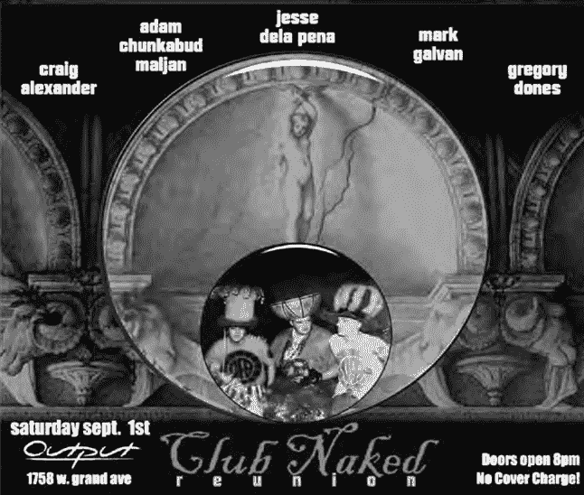

图 4.3 Club Naked 重聚数字传单。

与来自芝加哥南部和西部的中产阶级青少年一样，Johnson 离开城市也影响了她与 House 音乐持续发展的关系。由于无法持续在场，大学年龄的很难充分参与城市地下正在发生的一切。

DJ Darlene "Lady D" Jackson 记得在周末和假期回到芝加哥，与儿时的朋友重聚，并出没那些新开放的俱乐部：

> 但回到家里的感觉总是老样子；对于 Lady D 来说，House 音乐是一种充满熟悉感和舒适感的文化基石，然而她又渴望新的声音。通过将现场音乐与她访问 Coconuts、A.K.A. 和 C.D. 等俱乐部相结合，她保持了对新声音的敏锐度。

在 House 音乐中长大的大学生，在回到家后，对于如何认同和参与不断变化的文化持矛盾态度。根据 Jackson 的说法，南部的场景在 20 世纪 80 年代后期变得充满男性的能量，因此，即使是最思想开放的直男，也不真想在 Jackson 玩笑称为“香肠大对”的地方跳舞。

20 世纪 80 年代后期极度男性化的能量在 Dance Mania 出品的火热、节奏感强的材料中找到了声音上的对应，该厂牌由 Jesse Saunders 创立，在 House 音乐商业化爆发后由 Ray Barney 推向主流：

> 这不是男同性的——几乎是微不足道的。那时你看到一群人，人群在挤压中剧烈摇动。

第一个第一个十年的终结 • 139

当 House 音乐文化在其诞生的城市从声音和社交层面继续转变时，许多即将上大学的舞者带来了、培养并传播了这些声音。

Zinelle "Ninzi" Powell 是一位在 20 世纪 80 年代中期成年的舞者，她记得芝加哥 DJ 是向她在佛罗里达大学的观众介绍这种音乐的：

> 当时，他们会展示自己，然后 House 音乐就会响起，底特律、纽约、费城的人就会接管。

Powell 不仅将 House 与芝加哥联系起来，还与 20 世纪 70 年代末和 80 年代初在黑人社区发展的各种城市、后迪斯科、流行舞曲文化联系在一起，表明芝加哥的声音只是许多相互关联的音乐风味之一。

准备上大学的芝加哥人并不是唯一通过磁带和 12 英制唱片带来 House 音乐的人。美国军人对于在 20 世纪 80 年代及其外的传播 House 音乐也起了巨大作用。

DJ Steve "Miggidy" Maestro 后成为 Prop 的驻场 DJ，他回忆起在肯塔基州一个靠近福诺克斯堡要塞（Fort Knox）的基地外俱乐部时，利用他在芝加哥学到的知识来满足新兵的多样化口味：

> 正因为 House 音乐，我学会了如何放嘻哈。当时我放 Full Force；我放德克哈诺音乐；我放 2 Live Crew。我理解了编排。周四、周五、周六晚上，我带着十箱唱进来，从晚上 9 点一直到第二天凌晨 5 点。⁸⁸

Maestro 的基地外夜间场所成为了黑人和拉丁裔文化维护与交流的国际化场所，一个类似于塑造了芝加哥场景的跨界社区。

活动推广人 David "Risque" Walker 记得在夏威夷的斯考菲尔德兵营（Schofield Barracks）担任内部时，与一位来自纽约的合作者一起 DJ 并举办派对：

> 他们可能会放嘻哈，同时也放 House 音乐，任何正在播放的音乐。最著名的歌曲之一是 Steve 'Silk' Hurley 的《Your Body》。

正如 Walker 所指出的，在国际传播中（也许比在本土更如此），House 是包含嘻哈的黑人景观的一部分。⁹ 当在芝加哥 House 文化中成年的年轻人离开家乡时，无论是为了深造、服兵役还是在海外巡演，他们都将更多样的声音和舞蹈风格融入了自己的曲目中。¹⁰

## 第一个十年的结束 • 141

这种破坏对更广泛范围内的社区创造力和文化发展产生了影响。制药公司和美国政府对 HIV/艾滋病缺乏同情心和响应，由于芝加哥白人社区的种族主义以及他黑人社区的同性恋恐惧，这种影响被放大。

DJ Craig 回忆道：

> 当时并没有像现在这样患上后吃颗药就能像常人一样生活。有伤亡和屠杀。那种感觉非常无助，疾病控制中心或其他医疗机构并不足以尝试拯救这些人，或者说当事人正处于否认阶段，由于羞耻感，他们一直等到陷入绝境才寻求帮助。92

作家 Jo A. Moore 为 1985 年 8 月份《芝加哥同性恋杂志》的文章证实了坎农（Cannon）的评估，指出政治和个人的沉默加剧了彼此的影响。到 1985 年，基于信仰的组织才刚刚开始“唤醒沉睡的黑人社区”，让他们意识到 HIV/艾滋病的毁灭性现实，Moore 指出这种疾病此前被误认为是黑人的事。93 那年，芝加哥黑人报告的 HIV/艾滋病病例占该市总病例数的 30%。94 根据芝加哥公共卫生部（CDPH）的数据，全国这一比例自 1984 年以来翻了一番。1985 年是芝加哥 HIV/艾滋病活动人士的关键之年，他们建立了芝加哥艾滋病基金会（AFC）和芝加哥之家（Chicago House），后者是一个为了反对针对艾滋病患者住房歧视而成立的组织。95 这些非营利社会和服务活动组织并没有获得慈善界的赞誉，但它们为遭受这种瘟疫的人提供了关键服务。

1986 年，感染率再次上升。96 正 DJ Lori Branch 回忆道，“他们一个接一个开始死去”。97 根据 DJ Dana Powell 的说法，来自南杰斐逊街 206 号 Warehouse 的四名成员可能在 20 世纪 80 年代中期感染了 HIV/艾滋病，其中许多人在随后的几年里死于疾病相关的并发症。98 当 DJ Michael Winston 开始遭受 HIV 时，他以为自己只是感染了普通感冒。99 他向朋友和家人隐瞒病情，最终在伊利诺伊州的斯普林菲尔陷入了成瘾和抑郁的循环，与他喜爱的 House 社区隔离开。正如许多生存下来的 DJ、制作人和舞者一样，Winston 没有让他的血清状态定义他的生活机会，也没有限制他的乐观。今天，他是位于西区侧的 Haymarket 中心工作的一名 HIV 教育员和成瘾顾问。

这种疾病破坏了芝加哥白人阶层，也席卷了 Medusa's 等俱乐部的跳舞社区。根据 Rod Rushing 的说法：

> “当时弥漫着许多无法言说的恐惧和悲伤。我在 1985 年检测呈阳性。我最好的朋友在我阳性后一个月去世了。然后我想 Mark [Stephens] 也在那个时候阳性。100”

在 HIV/艾滋病毁灭芝加哥音乐社区的同时，Medusa's 周边的 Lakeview 社区居民开始采取政治手段，以回应他们认为该场所对他们社区产生的负面影响。1986 年 12 月，涵盖 North Center 的第 44 区议员 Bernard Hansen 和涵盖 Lincoln Square 社区的第 47 区议员 Eugene Schulter 共同发起起了一项全市法令，要求果汁吧（juice bars）的营业时间与酒馆一致，而酒馆必须在午夜关闭。这一法律变化将有效地导致果汁吧在深夜客流通常到达之前关闭，摧毁了过去十年中让 House 音乐在城市繁荣发展的受青睐经济和社会模式。

在一次关于拟议果汁吧条例的座无虚席的社区听证会上，像 Wax Trax! Record片公司的 Jim Nash 这样的老板，以及像 Jane Addams Hull-House 博物馆艺术总监 Pat Murphy 这样的文化领袖，与青少年及其父母一起支持了 Dave "Medusa" Shelton 和他所建立的机构。这些支持者称 Medusa's 是青少年的“健康替代品”，并反驳了由邻里居民和市议会传播的叙事，那些叙事将俱乐部年轻成员描绘成破坏者和吸毒者。支持者暗示市议会应该看到 Medusa's 在文化和经济层面的价值；它是一个提供工作机会、支付薪水良好的社区艺术场所，而不是 Hansen 和 Schulter 所描绘的罪恶之窟。101 尽管文化领袖发出了热诉求（其中一些人无法理解将非酒精果汁吧作为与酒精消费相关的社会问题攻击目标的虚伪性——批评者们公开质疑市议会成员是否在通过酒类许可证回扣“中饱腰包”），芝加哥市议会最终妥协了，在一个月后投票将果汁吧的营业时间缩短至凌晨 2 点。102

## 第一个十年的结束

在变化后的近五年时间里，Bernard Hansen 继续坚持认为，被 Medusa's 吸引的外来人应对 Lakeview 夜晚后出现的旧避孕套、酒瓶和涂鸦负有责任。这位议员在 1991 年 10 月一次关于新果汁吧限制的市议会听证会上出了致命一击，自称北 Sheffield 街 3257 号的物业主已向他保证，Medusa's 的租约在 1992 年 5 月到期后不会续约。103 事实上，该场所在次年的 6 月举行了最后一个周末的音乐活动。最后的告别庆祝活动有来自 Wax Trax! 的艺术家、一场复古派对，当然还有 House 音乐。由于音乐制作人 Jamal Moss 制作了一系列从俱乐部播放列表中提取他喜爱的歌曲的 Medusa 翻录版（Edits），Medusa's 改变并演化了许多接触过工业音乐的芝加哥人的灵魂。它的结局标志着城市不断变化的文化生态系统中另一个微生命周期的结束。11014

## 结论

20 世纪 90 年代初，芝加哥 House 音乐社区再次分裂。新的许可证限制对碎片化起到了很大作用，但录音师报酬不公、早期接触青年的流失、有色人种社区中无法避免的 HIV/艾滋病相关疾病和死亡，以及许多与文化所有权、归属感和可见性相关的问题。士绅化的郊迁入者取代了 Lakeview 等社区中对 House 音乐和文化敏感的工人阶级居民。与此同时，推广人将音乐带入了可能远离其根源的新文化空间。正如舞蹈历史学家 Michaelangelo Matos 所说，90 年代从郊区来的狂欢者（ravers）“与 House 粉不同——更年轻、人数更多”。15 一些参与芝加哥 House 文化最久的人质疑这种文化是否正在被夺走。

尽管芝加哥 House 音乐文化在 20 世纪 90 年代无疑发生了变化，但其交叉社区对芝加哥的文化结构仍然至关重要。在随后的二十年里，城市有色人种地下文化的后代继续在那些唤起早期记忆的空间聆听并庆祝先辈喜爱的声音。他们还激活并修订了旧传统，以适应新时代的技术和社会条件。接下来的三个章节将探索当代芝加哥 House 场景的丰富性，包括与北区和西区朋克/工业风先驱相关的场景、南区的迪斯科朋克文化，以及许多传奇舞者。这些民族志记录以不同的方式提问：当芝加哥的 House 观众说他们记得 House 时，他们记忆的是什么。

# 5 我的脸上全是它吗？

## 在“天选之”（The Chosen Few）老派重聚野餐上传唱一种社区的爱的伦理

## 引言

“我的脸上全是它吗？”

“当然是！”

“我的脸上全是它吗？”

“当然是！”

杰西·桑德斯（Jesse Saanders）在 2012 年“天选之”老派重聚野餐上，用他翻唱的 Loose Joints 经典歌曲《Is It All over My Face》向观众欢呼。他面前密密麻麻的数千人对此回应，合唱声在芝加哥南南部杰克逊公园（Jackson Park）郁郁葱葱的景观中回荡。炎热的阳光几乎在移动的云层后落下，舞者们在与这位标志性的 House 制作人和 DJ 狂欢地呼应时，抬头望向天空。事实上，每个人的脸上充满了幸福。情侣手牵手跳着双步舞，婴儿在父母和祖父母的怀里挥着小拳头，VIP 们在舞台后互相绊倒，挤向 DJ 舞台前，以便在欢快的人群中于舞者面前行。等到我的皮肤因干燥的汗水而紧绷，耳朵被晒伤；膝盖因奔跑和跳舞而酸痛；从后台工作中抽身片刻，我闭上眼睛，深呼吸，沉浸在桑德斯黄金时期的落日表演中，这是对我承担“世界上最大的 House 音乐野餐”这一不劳工作的报酬。¹

除非你在芝加哥七月的潮湿中与超过 4 万名 House 爱好者共舞过，当密歇根湖吹来的微风刚好拂过你的后颈，鼻尖弥漫着烧烤的味道和盘旋的香烟，否则你无法想象“天选之”老派重聚野餐的规模，这是 Saunders 和“天选之”每年夏天举办的派对。“老派”（Old school）是 20 世纪 80 年代中期成长的 House 观众使用的术语，用来描述 70 年代后期及之后的声音。虽然这个词具有很强的主观性和代际特定，但在老派野餐的语境下，当用来描述 House 音乐时，它大多等同于“经典”。²

在野餐会上，House 音乐俱乐部那种封闭的、成人文化褪去了其成熟性感的夜晚神秘色彩。DJ、舞者和客座歌手庆祝着芝加哥 House 的生命力，同时继续庆祝让其不断前行的声音、舞步、风格和品味。大多数参与者是三十多岁的非裔美国芝加哥人，他们是在 80 年代成长的孩子，那时 House 音乐是城市里独立黑人电台和私立学校舞会的旋律。从 7 月 4 日周六黎明开始，一群离群群体和其他 House 音乐爱好者汇聚在杰克逊公园，怀里抱着睡睡惺惺的营地者、椅子、伞、烧烤架和其他东西。如果你足够幸运，朋友会出钱买至少一个十乘十的区域，让你可以搭建遮阳篷和自助餐。如果你是数千名购买电子票入场但没有营地留的舞者之一，请为即将到来的马拉松式舞蹈准备好水分和物资。

“天选之”（The Chosen Few）是一个位于芝加哥的 DJ 团体，他们在 70 年代末和 80 年代初制作了派对。唱片高管韦恩·威廉姆斯（Wayne Williams）于 1977 年与他的继兄弟 Saunders 一起创立了该团体，并在 1978 年加入了 Tony Hatchet，1980 年引入了 Alan King，并在 1981 年引入了 Tony 的弟弟 Andre。DJ Terry Hatchet 于 2006 年加入，Mike Dunn 在 2012 年被纳入行列。³ 这些人是芝加哥黑人南部地区最大的 House 音乐偶像之一，但如今以门票节形式的“野餐”，是该团体唯一女性且非 DJ 成员金姆·帕哈姆（Kim Parham）的脑脑。她希望通过在 1990 年 7 月 4 日周末邀请“早期 House 音乐时代”的各种团队聚在一起，来延续这种参与性发展。正如 Hatchet 家族多年一直做的那样，参与者来到科学工业博物馆后的凤凰花园（Garden of the Phoenix）跳跃起舞。⁴ 二五多年以后，“天选之”团体已将其派对举办地从为 1893 年世博会建造的精美日本亭子迁到了第 63 街和 Hayes 驱动路。每年，它都欢迎来自芝加哥和世界的数万名音乐爱好者。

## 民族志研究方法

我对“天选之”老派重聚野餐的民族志研究方法深报于表演研究学者德怀特·康克古德（Dwight Conquergood）和 D. 索伊尼·麦迪森（D. Soyini Madison）所称的“共同表演式见证”（co-performative witnessing）。我试图追踪权力差异如何塑造并被我的民族志视角所塑造，尽管我正对这一活动进行表演观察。我还借鉴了民族音乐学家凯拉·甘特（Kyra Gaunt）的见解，她为揭示黑人音乐风格捕捉社区社会记忆的“躯体史学”（somatic historiography）提供了一个生成性模板。素材源自我担任“天选之”志愿者侧台助理和工作人员期间的野外笔记，以及作为一名观众在 2012 年、2013 年及后续活动中与人群一同跳舞的记录。

“我的脸上全是这个吗？”

著名的“白城”。博览会的举办者是一群白人政治精英，他们在中途场（Midway）策划了一场关于非白人他者的真人展示，以代表当时流行的单线社会演化论。尽管在一个多世纪后的今天，几乎无法在杰逊公园（Jackson Park）找到世界博览会的痕迹，但该活动的建筑已在附近的科学与工业博物馆立面上得以保留。这座博物馆在博览会期间被称为美术宫，其对艺术的尊崇因紧邻中途场上的原始住民村落而显得格外突出。¹¹10

20 世纪 70 年代初，《芝加哥每日卫报》（Chicago Daily Defender）成为科学与工业博物馆年度黑人历史系列活动“黑人美学”（Black Esthetics）的主赞助商。这项为期十天的活动在 1984 年被更名为“黑人创意”展览，展示了特展、评审艺术展、免费表演以及关于“黑人创业”的作品。¹¹¹“黑人美学/黑人创意”是科学与工业博物馆少数突出非白人企业家、发明家、艺术家和其他文化媒介成就的项目之一，其策划旨在培养种族自豪感作为一种提升意识形态。它延伸了《卫报》对黑人社会向上流动的愿景，而这个空间在最初的形态中是将非白人他者视为现代文明主体的对立面；它通过强调该种族在发挥影响力时的巨大成就，修正了“黑人天才”的陈词，并促使年轻人在数学、科学和艺术领域追求高水平的个人成就。¹²“被选中的老派野餐”（The Chosen Old School Picnic）建立在《卫报》和科学与工业博物馆的提升基础上，它是一场集体策划的作品，尊崇了从事艺术的黑人企业家。

虽然早期在海德公园（Hyde Park）周边对文化和社区活力的庆祝是为黑人历史月期间的大规模多元化受众设计的，但“被选中的少数”（Chosen Few）却于 20 世纪 80 年代末在科学与工业博物馆后，作为 7 月 4 日的哈切特家族聚会开始。19 世纪末和 20 世纪初的大迁徙散播了紧密的非洲裔美国社区，像那样的北方家庭聚会有助于缓解创伤和断裂。到 20 世纪 60 和 70 年代，这些功能依然存在，正如更公开的“子弹庆祝”活动正如活动牧师雷妮·麦科伊博士（Dr. Renee McCoy）所说的，“能够加强和稳定非洲家庭的仪式，以及为后代建立强大且可行基础的工具。”¹³ 聚会也是长辈传递社会价值、青少年加强和增强自尊心的重要空间，也是所有参与者相互灌输归属感、爱和关怀的场所。¹⁴

# 尚未结束

“被选中的少数”家族的幼成员 DJ 安德烈·哈切特（DJ Andre Hatchett）记得“被选中的少数老派聚会野餐”开始时，那时只有他父亲的亲戚和几个朋友参加：

> “它是从一个帐篷开始的。那是我们的。我们就一直在那里。第二年有两个帐篷。我们有一个和去年一模一样的帐篷，给我叔叔用的，然后还有一个给孩子的帐篷。等我们回过神来，环顾四周，心想：‘这到底是怎么了？’我开始称之为帐篷城。”¹⁵

哈切特家族烧烤之所以从私密的聚会变成盛大的派对，部分是因为“House 音乐迷”（house heads）发现哈切特和他的朋友们（他们在 80 年代在学校舞会和果汁吧聘请的 DJ）在假期周末期间免费表演，另一部分是因为“被选中的少数”鼓励了这种行为。正如哈切特所说：“现在有很多人不住在这里了，他们都为了野餐回来。我们把来自世界各地的人聚到这里……他们为了这次野餐专门请假。”¹⁶

哈切特使用“帐篷城”的比喻来强调在他家人周围迅速扩增的临时结构区域的自发性和完整性。与比德·比尔肯日（Bud Billiken）一直被构想为全芝加哥的包容性庆祝不同，“被选中的少数老派聚会”从一个芝加哥家庭的私密 7 月 4 日庆祝，发展变成了全球 House 音乐听众的目的地。这种转变在 1990 年后金姆·帕哈姆（Kim Parham）和“被选中的少数 DJ”的推广下也得到了鼓励，反映了广义的非洲裔美国人社会文化中血缘与非血缘关系界限的不稳定性，也反映了自 20 世纪 80 年代初繁荣以来芝加哥 House 音乐文化中发展的家庭联系。

芝加哥战后的黑人人口许多是受稳定工业就业承诺和免受私刑暴徒侵害而从南方来到这座城市的，他们发现自己处于新的不稳定的境地：部分是因为他们是工业工作中最后被也是最早被解雇的，另一部分是因为工业经理经常利用他们来打破种族隔离白人工会的罢工。芝加哥的黑人移民发现优质住房选择规模有限，因为许多中产阶级社区受到种族主义住房公约和红线划定（redlining）的限制。这些新的城市压力加剧了南方移民所面临的日常挑战，在许多情况下他们为了在北方获得更好的生活，放弃了稳定的社会网络和显而易见的种族歧视。他们建立了非血缘的联系来实现某种程度的社会稳定。¹¹⁷

# 我的脸上全是这个吗？

在 20 世纪 70 和 80 年代成长的黑人舞者一代通过家庭聚会对黑人文化的连续性产生了深刻的欣赏。根据雷妮·麦科伊的说法，20 世纪 90 年代和 21 世纪管理这些活动的长辈以不断增加的数量传递，颠覆了许多大型聚会活动的连续性。¹⁸“被选中的少数老派聚会野餐”在这些代际转变，以及剧烈的新自由主义改革带来的持续物质和心理负担下，稳定了一个“被选中的家庭”，例如华盛顿对帮派青少年干预计划的过早清理，以及对公园和学校的普遍撤资。¹⁹

这种和平赋予了黑人居民和芝加哥散居者回到海德公园的权利，经历了半个多世纪历史学家多里安·鲍尔德（Dorian Baldwin）引用社区活动人士的话所说的“黑人清除”政策和士绅化。¹⁰“被选中的家庭”被社会科学家用来解码同性恋女创造的支持网络的效能和价值，这个术语与“拟亲属”（fictive kin）的概念几乎可以互换，后者更频繁地、也更具问题性地用来描述非洲社区中常见的非生物学亲缘支持结构。²¹

将“被选中的”作为他们的首选头衔，“被选中的少数”DJ 们拒绝了那种认为他们的纽带是虚假的污名化逻辑，并将他们的活动联系到历史上一直包含血缘和非血缘关系的非洲家庭聚会中。²²虽然“被选中的家庭”这一术语是亲属关系领域的学者在 20 世纪 90 年代初开发的，但“familia”概念早已被酷儿女性主义学者切莉尔·莫拉加（Cheryl Moraga）在 80 年代用于解释“跨代纽带”的情色质感，以及“异性之间及性别内部深层情感纽带”。莫拉加建议，酷儿家庭通过共同的苦难和庆祝而形成的联系可能是真实的，甚至比纽结生物学家庭更真实。²³

在“被选中的少数”野餐以及广义 House 音乐文化的背景下，“家庭”和“被选中的家庭”的概念是有用的解释视角，因为它们强调了一个创造性的、反霸权的世界，通过生命和确认爱的仪式产生并重新产生亲缘联系。正如比尔肯日的组织者，以及那些举办南方南方冰激淋社交活动和教会宴会的人一样，开创性的芝加哥 House 音乐推广者利用了各种文化元素（包括食物）来促进联系，让观众感到自己是受邀的客人和活跃的共同制作者。²⁴

食物也将“少数精英者野餐”（The Chosen Few Picnic）与纽约和芝加哥的一种功能谱系联系起来，例如阁楼派对和二战前的平公寓，这些场所塑造了 20 世纪下半叶风风之城黑人文化的繁荣。²⁵

根据烹饪历史学家迈克尔·特威蒂（Michael Twitty）的观点，烧烤与加勒比逃亡奴（maroons）有深厚的渊源，他们通过熏烤肉类，部分是为了保存食物，同时也与本土/非裔美国人的反殖民烹饪实践有关。26 很少有观众会通过在餐中加入各种“灵魂食物”（soul foods）来广泛地进行烧烤，其中许多食物标志着20世纪初大迁徙后建立的跨国界和跨阶级的联系。根据食品学者洛雷塔·特伦森（Loreta Trenton）的观点，自20世纪60年代以来，从家带回并适用于野餐等活动的各种多族裔选择，对北方黑人社区（尤其是中产阶级社区）至关重要，因为它们连接了南方工人阶级的非裔美国文化。27 麦考博士（Dr. Mcoy）在她关于自己家族聚会烧烤的研究中证实了这一点，她描述了整烤猪如何将她的亲属与奴隶和迁移的历史联系在一起。正如她所说：“世代自豪地追溯乔治亚州、南卡罗来纳州和密歇根州荒野根源的男女，尽管医生和公共卫生官员的警告，他们捍卫着这种动物的神圣性。”28

在2012年我参加电影活动期间，我在“少数精英者”的后台接待区获得了宴会食物：玉米饼、豆子沙拉、烤腌制虾、酱料、饼干以及芝加哥著名的加雷特糖渍爆米花。2013年，我了解到当我的野餐活动举办者塔菲（Tuffy）和米歇尔（Michelle）竭尽全力提供美食时，许多参与者也像服务员一样准备充分：咖啡味烤羊排（当时只有牛肉或猪排）、猪香肠、火鸡玉米饼、意大利面沙拉以及塔菲说从他奶奶那里学来的秘密土豆沙拉配方。老派野餐的烹饪选择面对着烤猪，部分是因为芝加哥的美国文化比以往任何时候都更有融合性。移民社区，如皮尔森区（Pilsen）毗邻芝加哥历史性的非裔美国人西边的墨西哥裔美国人，塑造了整个城市的消费模式。例如，塔菲非常兴奋地分享了他的版玉米卷（elotes）：配有白色奶酪（queso blanco）、辣椒粉和青汁的烤玉米。他在主要是黑人的营地中热情地融入墨西哥裔美国人街头美食，表明野餐参与者整合烹饪传统的方式与芝加哥DJ整合新声音的方式相似：将它们与已经熟悉的音乐并置。

## 律动曲库中的经典之作

食物的准备和共同食用对于“少数精英者老派聚会野餐”中发生的遗产创造至关重要，但对大多数参与者来说，吃只是次要考虑。“少数精英者”的DJ以及野餐的客座DJ和歌手，投入了大量的精力和思考，通过关于自我和社区爱的广泛声音叙事，积极培养跨世代的音乐联系。² 他们这样做部分是为了强调芝加哥浩室观众认为“经典”的歌曲，其中许多歌曲包含了对生命和爱的肯歌词呼吁。经典歌曲帮助“少数精英者”社区讲述一个关于其成员如何相爱和爱自己的复杂故事。这种对社区爱和跨世代联系的培养在阶级多元化的黑人社区中尤为重要，在这些社区中，血缘家庭可能会胡克斯（hooks）所说，“持续的情感和物质资源匮乏使得环境产生不必要的压力。”³

“少数者”的艺术家们将几代舞者连接在一起，通过经典曲目、采样经典曲目的歌曲以及可能成为经典的曲目——我们或许称这些为经典——在声音上加固了一个庞大的“被选家庭”。什么构成了一首经典曲目？纽约浩室舞者布莱恩·波利特（Brian Polite）和DJ们说道。他提到了纽约女子组合`ESG`的《Moody》、费城国际唱片公司House乐队的《Love Is the Message》以及`Lil`的《Video Clash》。³ 在2012年和2014年的老派聚会野餐上，DJ们将这些以及其他世外经典与较新的歌曲并置，如肖恩·埃斯科费里（Sean Escoffery）的《Days Like This》、`Dennis Ferrer`的《Hey Hey》和`Terry Hunter`的《Wonderful》，以及杰克逊去世发布的《Love Never Feel So Good》的混混。³³ 正如约瑟夫·肖尔茨（Josef Scholz）在其嘻哈民族志著作中描述的B-boy经典中的歌曲一样，触发了“下意识但习得”的回，反映了观众的首要情感能量和特定经历，以及对独特心理形象和节奏的次级和三级反应。³⁴ 例如，当《Video Clash》的三叉戟旋律在DJ的混音中浮现时，熟悉它的舞者可能会通过展现出对歌曲节奏和旋律纹理的身体契合，体验到共同的快乐和愉悦。尽管如此，许多浩室舞者分享的动态曲库与更具体的B-boy经典相比有所不同，因为经典歌曲并不像B-boy经典中的歌曲那样一定构成特定的手势、步骤或具身知识。³⁴ 然而，它们可以是富含记忆潜力的重写本（palimpsests），DJ们以巨大的力量运用它们。

2003年，客座DJ特伦（Trent）用查卡·汗（Chaka Khan）1981年的《I Know You, I Live You》开启了他的表演。⁵ 这首歌对于芝加哥的回归乡野餐来说非常恰当，因为汗作为南区的土著女儿而闻名，就像特伦一样，为了成为巡演艺术家而离开。1953年，在芝加哥大学附近，汗（原名Yeette Marie Stephens）由一位在国家意见研究中心工作的母亲抚养；对她来说，她是自由摄影师。当她的父母离婚后，汗在2060年代在不同的家庭和当地图书馆之间漂泊，在南部的俱乐部演出。⁶ 她在这些空间里与水晶组合（The Crystals）表演格莱迪斯·奈特和艾丽莎·富兰克林，并与签约柯蒂·梅菲尔（Curtis Mayfield）厂牌的`Rolling Minstrel`组合合作。不久，汗发现自己在与芝加哥爵士放克乐队合作合作。几张专辑和一份主流唱片合同后，她开始创作、制作并演唱自己的作品。⁷ 与热门制作人尼古拉斯·阿什福德（Nicholas Ashford）和瓦莱莉·辛普森（Valerie Simpson）合作创作的《Every Woman》是汗的突破单曲。⁸ 这首歌首先在`Warehouse`俱乐部引起轰动，随后在`Music Box`引起轰动。⁹《I Know You, I Live You》作为汗在华纳的第三张个人专辑1981年的《What Cha' Gonna Do For Me》的第四支单曲发布。歌曲与阿里夫·马登登（Arif Marden）合作创作，这位土耳裔美国制作人凭借`Average White Band`成名，`What Cha'`建立在汗在1978年《Chaka》中开始创作的流派融合声音之上。

## “我的脸上全都是它吗？” 157

《I Know You, I Live You》的旋律第一次钻入我十六岁的大脑。这首由 Burton 创作的原曲由 New Edition 乐队成名的 Maurice Starr 制作，当时对我来说是不为人知的。43 当我听到 `ATFC` 的千年版本时，带着 Millet 那略显笨拙的唱腔，仿佛是一首完全全新的作品。后来我才知道，`ATFC` 的这首歌曲提取了 Burton 的歌词设定以及 Khan/Marden 的《I Know You, I Live You》中的铜管乐。这段铜管乐让《Bad Habit》吸引了新一代的 House 舞者，同时也使其成为一首已有近二十年的持久 House 经典曲目。在我第一次遇到那段编曲并在 Chosen Few 播放了《I Know You, I Live You》十多年后，他选择了同样的旋律，用这些标志性的喇号击奏治愈了 Chosen Few 的观众，将孤立的分解音与一波失真波融合在一起，让歌曲在舞台巨大的扬声器中从左向右扫过。通过这首器乐曲，Trought 将 Khan 的主歌重复了两次，然后三次，反复撞击着歌词：“如同清晨的太阳；如同夜晚的月亮；我感觉你已是我的一部分；我了解你，我为你活着。”当播放 Khan 的歌词时，他暗示观众中的舞者也通过《I Know You, I Live You》了解了彼此，以及他们自己。当 Chosen Few 开始唱响欢乐的歌曲时，Khan 的曲目成为了成员们自我认知/自我爱，以及他们群体认知/爱爱的背景音乐。

当嘻哈哈 DJ 随着间奏点（break）轻快移动时，特别是当为了满足 b-boys 和 b-girls 的需求和欲望时，House DJ 经常寻找意料之外的乐句进行探索。Trent 循环着《I Know You》的各种器乐主题，加入了贝斯、吉他和铜管乐律，并在主歌的循环器乐部分调节了高、中、低频率。通过强调和操纵各种旋律，他刺激了观众的神经中心，庆祝了他所能用的基于采样的音色，并引发了与《I Know You, I Live You》、Chaka Khan 以及那些在作品中挪用她音乐天才的人之间的新旧关联。House DJ 使用经典曲目和他们的关联网络，来激活被音乐历史学家 Josh 描述为“自动性”（autopias）的状态。与其为革命政治提出具体的蓝图，不如说 Trent 在派会上对《I Know You, I Live You》的即兴表演指向了乌托邦，因为它们帮助听众进入跨越地点和时间的感状态，并驱动了种族、世代等多个维度的听众社区：“音乐从一个时刻到另一个时刻听起来总是不同的，并彻底改变所有听到它的人。”44 即便是流行歌曲的即兴也可能是学者 Daniel Fischlin、Ajay Heble 和 George Lipschitz 所说的一种“模糊边界的文化融合”（boundary-blurring transculturation），培养了“在差异中统一”的感觉。45

在2013年的派会上，Wayne Williams 以 Kraftwerk 1977 年的《Trans-Europe Express》的不同的活力。46 这不仅是一首 House 经典（在80年代早期活跃于纽约的`Paradise Garage`、`The Warehouse`等地下派对），它还被广泛认为是纽约嘻哈和底特律科技迷的入门曲。47 根据布朗克斯 DJ 和 MC Afrika Bambaataa 的说法，当 Sonic Force 在1982年发布标志性的采样自《Planet Rock》时，他在 Village 的唱片店淘这节拍时，他觉得《Trans-Europe》听起来很奇怪。而且随着我继续听，他说，他们对那些酷的小子很有感觉。48 到了1983年，Juan Atkins 和他的好朋友 Derrick May 开始将《Trans-Europe》整合到他们为底特律中产阶级青少年表演的DJ Set中。在他的著作《The Underground is Massive》中，舞蹈音乐历史学家 Michelangelo Matos 说，Atkins 和 May 演奏这首 Kraftwerk 作品的方式使其在全世界范围内变得“非常有味道（funky）”。49 歌曲不和谐的节奏提醒着派会上的听众，德国合成流行乐如何帮助缝合黑人西部和东北部的音乐文化。

在2012年派会上一个感人的时刻，James Saunders 播放了对`The’Jays`的《Now We That Found Love》的House翻唱，这是一个由 Philadelphia International 的 Leon Huff 和 Kenny Gamble 创作并于1973年发行的歌曲。50 当他播放这首 CD 时，我起了一身鸡皮疙瘩；通过确认我对旋律的连接，释放了愉悦的神经化学物质。51 Saunders 唤起了我在收音机听过的1991年 D & The Boys 演绎的版本的感觉，以及与雷鬼流行组合 Third World 1978 年翻唱版本更近的积极关联。此外，他的表演符合弗洛伊德可能称的派会“海洋感调性”（oceanic feeling tone）。这种调性在 House 空间的作用与学者 Tanya Nyong'o 在其作品中分析的纽约地下世界相似，它消解了个体主观性，并开启了一个具身体的状态，人们可以通过它放弃自我，并在彼此之间体验超越的精神连接。52 情感理论家 Luis-Manuel Garcia 帮助丰富了 Nyong'o 对地下感受的弗洛伊德式分析，他认为观众之间的动态情感连接被特定情境的听觉输入加强。53 在派会上，这些可能包括热皮肤上的汗水、密根湖吹过额头的凉风，以及香炉和调味烟草的味道。

## “我的脸上全都是它吗？” — 159

当观众的能量被狂喜激发时，House DJ 经常会在Set中加入经典曲目，依靠共享曲目的熟悉度来将跨越数十年的观众对齐；像《Now That Found Love》这样的歌曲成为 House 观众的宝贵共享资源，因为它们从未停止与社会构建产生共鸣。54 然而，尽管 Chosen Few 的 DJ 在他们的长时间表演中几乎完全依赖并赞颂经典，但他们利用有限的时间来呈现这些经典，然后再转向播放不太熟悉的、越越新的 House 曲目。这些干预打破了单调，并塑造了动态中的 House 音乐曲库。

在2014年的派会上，芝加哥电台的老朋友、Drop House 的传奇驻场 MC 和 DJ Steve “Mickey” Maestro 使用未发布的 DJ Dolla Bill 曲目《How It Started》来向经典曲目致敬，而实际上并没有播放其中任何一首。56 在创作《How It Started》时，Dolla Bill 使用了来自 Farley 歌曲中 Daryl Pandy 的人声采样，圣化了一个由标志性 Hook 和节奏节奏构成的超级混音，这个混音快速贯穿了芝加哥 House 音乐发展的第一个十年。通过使用“now this is how it started . . .”以简短的方式表达对经典曲目的尊重和理解，Maestro 释放了自己去播放2014年更深奥的Set之一，在Set中他加入了许多新奇惊喜的House声音，同时也向那些开辟了这条道路的许多艺术家致以敬意。

Thomas 用 Willie Hutch 的《Brothers Gonna Work It Out》开始他的Set，通过回溯到70年代初的Funk根源并乘着歌曲的切分音调、坚定的弦乐和wah-wah吉他，调逗着派会的观众。57 DJ 顺无衔接地继续着

## 尚未结束 160

在 Alicia Myers 的经典歌曲《I Want to Thank You》、Chaka Khan 的《I Know You, I Live You》以及 Harold Melvin and The Blue Notes 的《Bad Luck》之间。^58 当他时长一小时的表演结束时，流着泪水的 Thomas 倒在他旧的 CDJs 上，显然被他与野餐舞者们分享的活力变化所打动。他表演的情感影响部分可以归功于他高超的混音技巧，也归功于他对经典曲目的编排。他选择并无缝地融合这些曲目，将每首歌都作为一个独立的时刻来引起关注，同时又在即兴的混合对话中听到所有歌曲的冲击力倍增。

在“被选之者野餐”（The Chosen Few Picnic）上，经典芝加哥 House 声音与新制作音乐之间复杂的交织尽管它们一直在回顾过去，却依然向前发展。此外，芝加哥 House 音乐的曲库挑战了社会学家莎拉·科恩（Sarah Cohen）在其作品中对“创新音乐场景”与“记忆文化”之间所做的有用但有限的区分。^59 这座城市不断演化的 House 音乐坚持其具有“双面性”的能力：将旧与新结合，以服务于重新阐述一种广泛的族裔身份。这种音乐的过去、现在和未来的特征在芝加哥通常映射为“北方/白人/新南方/黑人/旧”的二元对立，但这是一种过于简单的概括。虽然人们对伴随成长的经典曲目有更高的欣赏，但南北两边的场景都被新旧声音的结合所浸润并连接在一起。

## 跳舞的爱的社区

在“被选之者野餐”上培养出的广大的爱，不仅源于那些热烈恳求观众去爱与被爱的歌曲的强化和重复，还得益于社交舞蹈，这种舞蹈让多元化的舞者能够通过肢体表达这种社区之爱。在士绅化进程中的海德/杰克逊公园（Hyde/Jackson Park）举行大型公共舞蹈舞会这一充满政治色彩的背景下，灿烂的面孔、伸展的手和踏步的脚具象化了 House 音乐中阐述的伦理。

House 舞蹈像 House 音乐一样，可以被视为一种运动中的曲库；随着填充舞池的身体随年龄和经验而改变，它不断演化。一些 House 音乐的当地历史学家，如雷吉·斯坦顿（Reggie Stanton）认为，芝加哥的 House 音乐场景自2005年以来吸收了前所未有的中年黑人涌入，他们许多人虚假地声称长期参与其中，因为他们的代谢已经减慢，以至于无法遵循那些被推崇的、美美的严格标准——那是由一种痴迷青春、公司化的 Hip Hop 文化所定义的标准。60

## “全都在我的脸上吗？” 161

无论 House 是否已成为老 Hip Hop 爱好者的避风港，这些空间都允许并优先考虑了不同体型和不同运动方式的人的体验。“老派重聚”（The Old School Reunion）也不例外。

野餐的舞者通常会调节体力消耗强度，以防止自己过热或疲劳。整个下午大部分时间站立，是一项耐力的体力挑战，特别是如果你无法方便地进入阴凉帐篷的话。此外，公园草地和泥土的混合虽然对膝盖非常宽容，但几乎不允许进行高难度的旋转，也不适合需要大量空间和平整地面的舞者。正如此，从每天早晨第一位 DJ 开始打碟那一刻起，就有舞者在其中投入，在与其他人舞动时洒汗水。有些人为某个特定的 DJ 留体力，在一天中的上半部分饮用“液体勇气”来壮胆，后半部分在阳光下让毛孔流出汗水。另人在主舞台周围流汗，他们不是舞者，而是为婴儿、儿童和老人提供送水的人。正如人类学家贾法里·艾伦（Jafari Allen）所说，为了社区喜悦而流出的黑汗，正如在“被选之者”那里那种从额头流下并浸透衣服的汗水，可能被视为对自私的一种讽刺尝试（或提醒），那些历史性的（且务实的）经历恰恰精确且独特地标记为在奴隶贸易中被占用的劳动。61 “被选之者”舞者与 DJ 之间的汗水交换与其他类型的俱乐部舞蹈一样，运行在一种非交易性的享乐经济中，这种经济反转了英美新教的伦理。62 它也是对不动摇的自我和社区爱的有力表达，依赖于亲密的共识协商。DJ 用一首歌曲召唤，观众则用身体回应。他们的反应越是狂热，DJ 就越觉得遵循某个特定的叙事现实是得到了肯定的。

舞台在构建“被选之者老派重聚野餐”的爱的氛围方面发挥了不可小的作用。61 虽然派对很大一部分特点是出人地熟悉的老派 DJ 现场，但头牌 DJ 的表演总是穿插着非 DJ 歌手的表演。当这些表演者来到麦克风前，混音中的低音和打击乐器音量就会降低。随着客座歌手如 2012 年的琳达·克里福德（Linda Clifford）和莱罗·伯格斯（Leroy Burgess，Black Ivory 乐队的歌手）、2013 年的水晶沃特（Crystal Waters）以及 2014 年的乔斯琳·布朗（Jocelyn Brown）根据自己脑中的录音进行现场表演时，节奏和整体强度随之降低。他们的表演提醒了野餐参与者，`House` 是一项深植于传统，得益于制作其 DJ 素材的乐器手和歌手的才华与创造力。野餐的制作人通过这些艺术家安排每年的“公共广播”（PAs），以在原本高强度的 DJ 程序中创造出活力的低谷。这种排序让观众在更狂喜的 DJ 表演之间有喘息、放松、去洗手间或吃零食的时间。

在莱罗·伯格斯 2012 年的广播期间，我离开了后台的职责，在野餐的观众中找到了我的朋友们。我们周围的大多数人似乎对伯格斯的表演不感兴趣，背对着他并盖过声音交谈，但舞台表演者与野餐的表演观众之间仍然存在着嬉戏的互动。16 我正与 Honey Pot Performance 的梅迪卡·麦尼尔博士（Dr. Medica McNeal）聊天，这时我注意到我们的其他同伴与许多舞者完美同步地跳着滑步（`electric slide`）。尚不清楚这一时刻的滑步构成一种深思的姿态、一个内心的笑话，还是两者皆非。随着舞蹈的情绪时刻变化，随着越来越多的人加入，第一批舞者改变了他们的参与价值，在舞蹈研究学者李·艾·弗里德兰（LeeEllen Friedland）描述的三种非洲裔动力参与模式（节奏感、运动感和直立舞）之间移动，他们离开了半结构化的编舞并相互回应。15 有些舞者在滑步中表现得漫不经心，投入到动作的社交性中。这种互动证明了老重聚现场的舞蹈行为之一，加厚了自我/社区的纹理，即 House 音乐内部因跨族消费和个人化创业而创造的混乱且问题的张力。它也体现了表演研究学者芭芭拉·鲍宁（Barbara Browning）所描述和历史化的、使这种加厚的非洲离散舞蹈的“传染性”品质。17 为了配合雷鬼歌手玛西亚·格里菲斯（Marcia Griffith）1980 年的《Electric Boogie》，滑步是一种围绕葡萄藤步（`grapevine`）的四线舞蹈，在加勒比和非洲裔社交舞蹈社区中发展。17 由于被一个积极管控其流的白色教练所标记，滑步也索引了 70 年代白人观众对迪斯科的交叉和挪用。18 在 2012 年“被选之者”的舞者即兴地与《Electric Boogie》的原始俱乐部语境建立身体连接，挑战了认为它已完全让给白人俗气的观点。滑步黑人根源的酷与其被广泛白人挪用的不酷之间的中间地带，连接了它，

## “我脸上全是吗？” 163

在某种程度上，取决于观众对莱伊·伯格斯（Leroy Burgess）早期表演的回应。尽管他的组合 Black Ivory 在 1979 年的歌曲《Mainline》是最经久的 House 经典之一，但伯格斯的其他许多作品对 The Picnic 的舞者来说似乎没那么熟悉。⁶⁹ 他的专辑曲目和单曲见证了观众之间分享会会的眼神、豪放的笑声、装作严肃的独舞以及慵懒的节奏省略音，他们正跳着一种充满矛盾的情绪编舞。他们进入并退出电滑步（`electric slide`）的集体脉动，在旁观模式与参与参与模式之间切换，富有表现力地减少移动重心和后退的力度。⁷⁰ 当伯格斯表演《Mainline》时，观众的反应没有任何矛盾之处。伯格斯穿着黑色翻领衬衫，搭配长裤并戴着银项链，像孔雀一样在舞台上来回穿梭，让他的伴唱在副歌部分击合和，而他自己穿插着无词的华彩咏唱和“看这里”的叫喊。当歌曲中的器乐间奏响起时，他随着《Mainline》标志性的号角齐奏律动肩膀，进入了一种律动，毫不费力地契合了几分钟前地面舞者跳的电滑步。

就像通过重混和采样不断焕新传统的经典社交舞蹈舞库一样，黑人社交舞蹈的元素（如锚定电滑步的葡萄藤步）反复被嵌入新舞蹈的经纬之中。长辈对旧动作的分享以及青少年对新步和变体的分享，可以将四代甚至五代舞者联系在一起。舞蹈研究学者凯特琳·哈扎德-戈登（Katrina Hazard-Gordon）将这种现象与黑人社交舞蹈高度的“代际渗透”联系起来，她声称，白人社交舞者经常回收黑人形式但并不将其跨越代际传递不同，黑人青少年在 The Picnic 这样的社交活动中直接从父母、姨妈叔叔那里学习动作词汇。⁷¹

黑人流行文化学者五十年来一直强调了舞台上和舞台前的人在创造力和技艺方面的关键区别。⁷² The Picnic 通过引入一个可以被认为是“舞者化身”的角色，模糊了表演者与观众之间的界限——这位表演者在 DJ 面前流汗，充当与其脚下数千名舞者之间的中介。这个化身通常由大卫·“里奎克”（David “Risqué” Walker）扮演，也被称为“全球律动大师”（Global Groove Guru）。他是一个引人入胜的奇观，戴着部落头饰

## 164 • 尚未结束

和面具，工装短裤，赤裸着胸膛，Risqué 一整天镇守全场，在近乎十二小时的节目中旋转、律动并与地面上的舞者共鸣。他说，他的装扮、舞蹈和打击乐是为了引起人们关注他在芝加哥俱乐部文化的根源，特别是像他在 Red 的 Boom Boom Room 担任保安员时的同性恋/混合之夜，以及他常去的纽约俱乐部受“天堂车库”（The Paradise Garage）的影响。⁷³

Risqué 的表演不仅在 House 文化跨地域历史中取得了重要时刻，还连接了 Picnic 的舞台守卫和其表演观众。全球律动大师有时既内省又具有强制性，他有时必须冥想，迷失在他的精神交流中，凝视着太阳或弯腰聚集能量。绝大多数时候，Risqué 坐在舞台边缘，举起双手，请求舞者和 DJ 帮助他强化那里神圣的爱之氛围，并使用气球和面具等非音乐道具增强他的能量以进行狂喜的交融。乐器如光滑的铃铛、手鼓、响击木板和一个巨大的雨棒，不仅为 Risqué 具有说服力的姿态增添了视觉，还增添了节奏密度，帮助他尊重 The Few Picnic 的局部特殊性，并放大了表演者与观众之间的交流。

尽管少数 DJ 并没有一贯应对该领域的性别差异，但他们通过在 The Picnic 舞台上展示多样化的、非霸权的男性气概（如 Risqué 所塑造的那种），不断打破了黑人男性气概是单一维度的观念。⁷⁴ 这种集体化的男性气概特征是温柔、表现性的快乐、非侵略性，以及被多才多艺的芝加哥音乐人马里克·尤瑟夫（Malik Youssef）称为“柔软”（softness）的整体特质。在与 House 制作人兼 DJ 史夫·“Silk” Hurley 的采访中，他描述了 House 音乐对于塑造他体现柔软男性气概的方式至关重要。他认为自己的柔软举止与对跨代际和跨性别学习与分享知识的尊重，以及社会差异的其他方面密切相关。⁷⁵ 黑人自我/集体爱的解放潜力（如 The Old School Reunion Picnic 所庆祝的）不仅挑战了父权制思维，还完全放弃了它。然而，这种乌托式的愿景与晚期资本主义生活及其巩固的熟悉表征机制存在张力。尽管 Picnic 在舞台上推广多样化的非霸权黑人男性气概，但 Picnic 的混音中经常没有女性 DJ，而是依赖熟悉的、过度性化的女性形象来吸引观众注意力，这阻止了对 Picnic 反霸权潜力的轻松解读。

## “我脸上全是吗？” 165

2012 年，由四位焦糖色皮肤舞者组成的歌队在节目的大部分时间在 DJ 台前的舞台中心加入了 David Risqué 的行列。这些舞者穿着比基尼和羽毛头饰（与 Risqué 的相似，见图 5.1），他们的身体和装扮将巴西和南非音乐对芝加哥 House 音乐的持续影响具体化，帮助在 Picnic 上扩大了非裔散民的可见性。虽然活动制作者通过与这些“小 Risquette”共享舞台来索引重要的非洲和拉丁美洲地区，但他们这样做的方式是巩固了霸权的、过度性化的女性形象来吸引观众注意力，阻止了对 Picnic 反霸权潜力的轻松解读。

图 5.1 David Risqué 与舞者，2012 年选定 Picnic；照片由 Micah Salkind 拍摄。

## 166 • 尚未结束

2013 年，Picnic 邀请了天后克莉斯塔尔·沃特斯（Crystal Waters）表演了她的三首热销歌曲：《Makin’ Happy》、《Gypsy Woman》和《100 Percent Pure Love》。Waters 激烈的舞台呈现挑战了黑人女性财产的观念，而他们的编舞则扩展了 Picnic 的酷儿之爱。⁷⁶ 我对 Waters 现场表演的主要背景观点——这让我觉得她之所以出现在 Picnic 很大程度上是因为她是一个文化符号——是她的表演⁷⁷ 在这次亮相中，Waters 正处于商业成功的巅峰；《100 Percent Pure Love》不仅是一首数字热门单曲，还登上了 Billboard 榜单第十一。⁸ 在那次表演中，Waters 在纽约切尔西码头巨大的人群面前穿了一套花呢套装，留着爆炸弹卷（jheri curl）。这位歌手将这身 90 年代的装扮换成了 2013 年 Picnic 上的成熟性感蛇蝎（femme fatale）：一个利落的复古波波头、黑色皮革短裤、黑色系结上衣，舞者们像她的私人保镖一样加入她，所有人都配着领带夹和深色雷墨镜。没多久，他们就开始在离开胯的情况下跳震舞（`popping`）和锁舞（`locking`），在 Waters 身上磨蹭，甚至假装打她。他们交替地与她跳舞、在她身上跳舞，享受他们的力量、灵活性和敏捷，一边进行身体滚（`body roll`）、定格（`tut`）和跳 Waacking（`waack`）。⁹

无论 Waters 的舞者是否认同同性之爱，他们都在跳 Waacking。根据舞者兼历史学家娜米·布拉金（Naomi Bragin）的说法，Waacking（也被称为 punking）是在洛杉矶《灵魂火车》（Soul Train）节目流行期间，由有色人男性开发的。这种形式的风车动作要求练习者在肘部旋转时过度伸展肩膀，并将手腕旋转至头脑后方。正如布拉金指出的，这种风格被世界街头舞和比赛中的女性所采用，她们寻求有色人男性所体现的力量和韧性，而不是模仿他们的着装表达。布拉金将这种身体变装（corporeal drag）称为“一种酷儿游戏的过程，表演者在其中尝试并重塑动作，作为重新体验和呈现身体的感官运动材料。”⁸⁰

“这都在我的脸上吗？” 167

Chosen Few 老派重聚野餐（Chosen Few Old School Reunion Picnic）以及其他官方认可的场所，经常将黑人/芝加哥遗产作为诉求。通常情况下，性少数群体或运动赋予了“野餐”表演以真实性，但性少数人士并未被识别并提升到与其创新者身份相符的高度。这在一定是因为，在更大的南区 House 音乐社区中，同性恋者被纳入了被认为是该领域直主流化的文化织物中，正如芝加哥的黑人和拉丁裔长期以来一直是布朗兹维尔尔（Bronzeville）和南岸（South Shore）文化生活的中心而非例外一样。尽管如此，对性少数制作人的随意加入似乎是事后考虑的，这是一种“天神式的干扰”，破坏了该活动广阔的爱伦理在治愈和团结一个异质黑人和棕色皮肤舞者群体方面的潜力。例如，在2014年 Chosen Few 颁奖礼上，DJ 克莱格·坎农（Craig Cannon）——一位曾在罗伯特·威廉姆斯（Robert Williams）美国工作室担任 DJ 的原始同性恋黑人迪斯科 DJ——并未到场领取他的奖项。我曾试图找到他在哪里，希望他能准时回到后台，但他说他还在家里，没有收到关于颁奖日期和时间的任何确认。

“野餐”的制作人和活动主持人在淡化性少数贡献与庆祝跨取向归属之间游走于一条微妙的线上，有时会忽视或淡化性在芝加哥 House 音乐文化发展中的重要性。这种类似于色盲主义的模拟伦理，人们可以称之为一种对性取向漠视的态度。例如，WGCI 电台受欢迎的广播 DJ、主持人 D. Liv 对2012 年的观众说：“我们不搞黑人，我们不做白人，我们不停止，我们不搞同恋，我们做 House 音乐。”81 从某种意义上说，他是的。他的号召不仅应该被放在直人时间解构对性少数权力的社会背景下理解，还应该放在多样性中的多样性背景下——尽管这在野餐舞台上可能受到限制，但它是活动表演观众所体现的一个至关重要的维度。舞者们穿着西装和背心；他们的头发留着不对称波波头、脏辫和卷发；他们有浅肤也有深肤；有些人认同自己的性少数身份，另一些像是直人；他们是参与性表演的混合，代表了芝加哥黑人和拉丁裔在阶级、肤色、年龄和性倾向方面的多元群体，而这些与“野餐”的代表性领域相叠。

“野餐”的 DJ 不仅代表了性别的种族多样性，他们还通过根根于 House 音乐非洲拉丁裔节奏基础的曲目，展现了他们所在领域的代际多样性。手鼓（Tambores）、定音鼓（timbales）、克拉维（clave）以及其他源自古巴歌曲的元素，锚定了“野餐”上新加入的 House 曲目，如丹尼斯·费雷尔（Dennis Ferrer）的《Red Room》，以及里弗·海洋（River Ocean）合作 India 的《Love and Happiness》，82 在整个漫天的 DJ 演出中，在每一个曲目里，非洲拉丁节奏符号与“野餐”上的黑人和拉丁裔 House 艺术家和观众汇合，尽管有时 House DJ 和制作人面临着通过拉蒙·里维拉-塞尔维拉（Ramón Rivera-Servera）所揭示的具有意识意识非洲裔异情调来承认拉丁身份的风险。83

Chosen Few 吸引了芝加哥 House 观众中的某些群体，作为大多数中产阶级的南区黑人，他们可能无法触及这些群体。2012年和2013年，拉丁裔 DJ 路易·维加（Louie Vega）和杰西·德·拉·佩尼亚（Jessie De La Peña）出现在舞台和观众中，增强了“野餐”上的非洲拉丁声学存在。无论是 Vega 还是 De La Peña 在野餐上播放拉丁音响的程度都没有超过任何美国 DJ，但他们的名字出现在节目表中，建立了与嵌入芝加哥 House 音乐的拉丁裔历史及其存在之间的重要联系，维护了拉丁裔作为芝加哥当代 House 场景创新者的中心地位。De La Peña 在皮尔森（Pilsen）的一些秘密场所作为一名折衷的嘻哈和 House DJ 开始职业，是我在分发混带时在野餐现场遇到的唯一表演者，他不仅体现了让芝加哥最受关注的老派 DJ 与年轻观众保持相关的创业伦理，还在芝加哥 House 音乐以美国人为主的叙事中为拉丁裔争取了空间。

“野餐”的制作人/推广人和客艺术家指向了早期那里的人以及派对的声音，而活动的观众则通过唤起仍作为当地历史重要标记的各种场所的共同历史，与芝加哥 House 音乐社区建立联系。2014年，韦恩·威廉姆斯（Wayne Williams）利用他的歌曲《There Was a Place》点名了各种 1980 年代的果汁店、俱乐部和其他场所，包括：“The Penthouse, The Loft, Sauer’s, The Playground, Mendel, C.O.D.’s, A.K.A.’s, The Candy Store, Resurrection, The Music Box, The Underground, Bismarck, Power Plant，”威廉姆斯突然降低了高音，为观众的欢呼和好评创造了声学空间，然后将高音拉回，让他的点名结束：“The Racquetball, The Warehouse . . . 告诉你们，曾有一个 Williams 使用了《There Was a Place》来强调 House 的空间连续性，将来自南区及以上的记忆地标带到了“野餐”意识的前沿。84

虽然 DJ 的表演通常是“Chosen Few 老派重聚野餐”传输 House 音乐和文化的主要媒介，但活动推广人和主持人也利用教学景观、官僚公告、赞助商感谢和奖项与过去联系，同时为演变留下空间。2013年，杰西·桑德斯（Jesse Saunders）在节庆舞台上与观众进行了怀旧式的互动：

> “看看所有的帐篷。我记得很久以前 . . . 当我们以前去那里时，谁在我们身后博物馆后面？难怪我们不得不搬家。你们都在那儿！你们记得我们在米德韦（Midway）的时候吗？我们在那里呆够了。我们接下来去了哪里？谁记得？我们在这一边[指向西方] 记得吗？我们在这里多久了？三个吗？不。你们这些 House 人，应该知道的吧？好吧。那么怎么？这是第23 次了？你们还会陪我们度过下一个三个吗⁵

Chosen Few DJ 通过不断回忆“野餐”的历史，为他们的选择家庭建立了一种稳定感。这种稳定的努力加强了芝加哥的社区运动，帮助城市的各界观众通过对根植共同故事的 House 音乐的热爱的社区伦理连接在一起。

2012年，伊利诺伊州发布了一份正式公告，表彰 Chosen Few 的成就，表明政客也注意到了集体在南区培养社区伦理方面所取得的重要工作。该文件由伊利诺伊州参议员安塔·柯林斯（Anatine Collins）签署，特别提到了 Chosen Few 通过“House 音乐的和平媒介”统一人们。它承认 Chosen Few 通过他们的工艺“影响了成千上万，娱乐了大众，并连接了几代人⁸ 除了代际稳定和连续性，变化和进化一直是芝加哥 House 音乐社会、音乐和舞蹈的核心，而过去现在的政治取向体现在该活动的制作人既包括当地著名的芝加哥 DJ，如埃里克·雅克斯（Eric Jacques）和凯文·麦斯维因（Kevin McSwain），以及世界著名的主宾星小路易·维加（Lil' Louie Vega）。文化的过去现在有助于解释近年来设立年度终身奖和 House DJ 名人堂的举措。2013年，将芝加哥的弗兰基·纳克斯（Frankie Knuckles）、罗·哈迪（Ron Hardy）和小路易（Lil' Louis）命名入堂，引发了巨大的掌声。他说 Chosen Few 在决定谁入选名人堂时，“回到了那些在1976年做这件事的人”，增加了广播电台 WDAI、电台 DJ 赫伯·肯特（Herb Kent），正式将 House 音乐的历史遗产延伸到迪斯科时代。

## 170 • 尚未结束

在 D.J. International Records 备受争议的创始人洛奇·琼斯（Rocky Jones）接受 2013 年“少数精英”终身成就奖时，他谈到了维持对芝加哥音乐活态遗产承诺的挑战，这种挑战来自于将其贬为遥远过去的叙事事实中：“芝加哥是唯一能产生音乐的地方。许多城市想声称拥有，许多国家也想拥有。无论你想称它为 EDM，无论你想叫它什么，它始终是 House Music。”^{87} 在为芝加哥重申 House 的过程中，琼斯可能是在暗示营利性的 Wavefront 音乐节的制作者决定安排一个“遗产舞台”，这与当年的野餐活动（Picnic）发生了冲突，干扰了 The Chosen Few DJs 作为芝加哥本地 House 音乐社区大使和召集者一直以来付出的良好工作。尽管该团体的内部心态可能会引起那些未被“选中”的人的怨恨，但每年，届的表演者和当地英雄都会被邀请上台加入集体，参加演出的点名，分享活动的成功。例如，2012 年，The Chosen Few DJs 为弗兰基·纳克斯（Frankie Knuckles）提供了 VIP 舞台，并用高尔夫球送他上，尽管他并没有表演。2013 年，由于该市许多著名的艺术家（包括纳克斯在内）被预约在 Wavefront 几英里之外，而后者在市北部的蒙特罗斯海滩（Montrose Beach）举行。

Wavefront 的制作者在其电子舞曲（“EDM”）节的大叙事中，将芝加哥 House 降为一个遗产舞台，将其与其影响并持续影响的许多舞蹈音乐形式分离。像弗兰基·纳克斯、Gene Ferris、Jamie Principle、Diz、Ralph Rosario、Michael Serafini 和 Derrick Carter 这样的“本地”或本土艺术家曾是“全球” EDM 艺术家的一部分。这种做法收缩了、白人化、正统化并全球化了芝加哥 House 音乐的影响，同时也掩盖了他们的先驱在芝加哥跨越、种族、性别和代代的动态连接。芝加哥 House 再次变成了文化先驱或记忆文化，而不是一个仍然充满文化影响、韧性和创造力的当代音乐现场。^{88}

## 结论

在探讨参与 Chosen Few 老派重聚野餐活动制作的多重、交织的文化元素时，本章将该活动置于广阔的本地背景中，它既作为芝加哥 House 音乐社区一个子群体丰富记忆的回归而具有独特的重要性，也只是芝加哥广阔文化菜单上的一个选项。这次野餐活动是一系列嵌套的表演——DJ 组和现场 PA 中的个人单曲、音乐节弧线中的场次、一系列年度音乐节中的每个音乐节——它激活了记录在舞蹈、音乐和饮食方式中的芝加哥文化历史。它还是一个重要的文化产品，与芝加哥其他根于 House 音乐传统的本地文化产品对话，例如皮尔森区（Pilsen）社区的 Fiesta Del Sol 和 The Silver Room Block Party（后者是一个在威基尔公园（Wicker Park）制作了十年的活动，但现在已移至海德公园（Hyde Park）举行）。下一章将展示由酷儿群体制作的俱乐部夜晚如何重新记忆和重新激活芝加哥 House 音乐历史中不同但相关的方面，以服务培养相似但独特的自我/社区爱伦理。这些西岸/北岸的派对可能没有明确连接到 Chosen Few 的南岸文化，但他们通过无数隐含的方式承认了后者对他们工作的核心作用。

# 你准备好改变你的生活了吗？

### 在芝加哥当代酷儿场景中表演新旧情感与狂野

## 引言

（2014 年 3 月 11 日）晚上 11:00，我停在 Damon 街和 Dickson 街的街角。今晚从海德公园开车而来的 Justin 和 Paul 都要去街角 7-11 的 ATM 机取现金。我没关系，所以我把他们留给 Danny 家的温暖和安全，对我的熟人 Claire 微笑并挥手，擦肩而过，向场地的门卫出示了身份证。当我进入并开始脱衣服时，我看到 Latham “速度女神” Zearfoss 正在控制着人烟稀少的 Off Chances 地板。我脱掉外层，在吧台留言，点了点单上最淡的饮料。当 Justin 和 Paul 回来，我们在舞池中组成了一个小三角，时而互相跳舞，时而独自跳舞，时刻留意寻找新朋友。今晚的氛围特别柔和/女性化，人们看起来很放松。我找到少数灯光之一并退后，伸展双臂并活动手腕。突然，当 Rita Bacon 加入 Janet Jackson 的《Empty》时，Paul 叫了起来，疑惑为什么更多人进入这首歌，这首歌的节奏背景音非常稀疏。¹ 我们翻了个白眼，玩笑道在 Off Chances 的时候你根本对周围的舞者起不了任何作用。今晚我也有独自律动的时刻，特别是当 Bacon 播放 Bobby McFerrin 的《Thinking about Your Body》而 Zearfoss 播放 Paul Simon 的《I Know What I Know》时² 在这些听觉愉悦时刻感到孤独的缺点是，它们可能会与舞池的群体流动不同步；但优点是，内在时刻给了舞者一个互相了解的机会，也许在问自己：为什么她不

*Do You Remember House? Chicago’s Queer of Color Undergrounds.* Micah E. Salkind, Oxford University Press (2019). © Micah E. Salkind. DOI: 10.1093/97801968416.003.007

## 174 • 尚未结束

什么能让我们兴奋？什么让我们动起来？我经常在 Chances 此时思考这些问题。

（2014 年 4 月 21 日）这是周一的早晨，应该是凌晨 2:0 点；汗水浸透了我的背心，但我拒绝停止移动；Smart Bar 即将进入高潮，我想待在律动的中心，听着一些我最喜欢的艺术家：Queen! 的驻场 Garrett David 和 Michael Serafini，以及 New's Carry Nation 的 Nita Avenue，他们今晚非常兴奋能看到 Wright 表演他的新歌《Sweat》，这是与澳大利亚制作人 Stereogramous 的合作。Carry Nation 的男孩们播放了一段未发布的器乐演示，敲击 EQ，在歌曲弹性的贝斯线条下方开启了类似现场的声音。Wright 在旋律上方大喊、呻吟并低语：“我的身体浸在汗水中 ...环绕着，热气从地面升起 ...不要停止，让它升起” 似乎几个小时后灯光亮了，我踉跄着走出俱乐部，清晨的鸟鸣声在我嗡嗡的耳朵里清晰可闻。我摇下车窗，当我沿着湖岸大道（Lake Shore Drive）从北岸开往海德公园时，让风吹干湿透头发，捕捉新日的第一缕阳光，心里想自己多么幸运，能在芝加哥经历人们所谓的芝加哥 House 音乐复兴，特别是其酷儿音乐复兴。

我在 2013 年 10 月到达芝加哥，我在那里有几个朋友，但我不想让他们成为我永恒的实野调查伙伴。我尽力去熟悉我自己，而不是熟悉我。我找了心理治疗师，并养成了规律的出门习惯，试图更好地了解自己在舞池上的需求和欲望，即使夜晚独自一人让我感到忧郁或焦虑。从独自舞池内省空间到一个让我感到自己被 Chances 群体拥抱并纳入 Queen! 场景的转变，真是太神奇了。我使用这些不同的配置——被社区拥抱和被场景纳入——来表明我是以互补的方式体验了这两个派对的社交性，但我在 Chances 建立的关系要远得多

## 你准备好开启你的生活了吗？ • 175

……比我在 Queen! 开展的那些活动更具舞池的吸引力！⁴Chances 可能最广为人知是一系列每月举办的舞蹈派对，但它源于一群在白天就已经建立起联系的朋友的行动主义和艺术创作。当舞者们来到 Chances 的舞池参加派对时，他们正在增强可能已经具有非常深厚基础的关系。这对于 Queen! 的组织核心来说无疑如此。常驻 DJ、主持人以及与当晚活动相关的客人们们，特别是像 Garrett David 和 Jacob "JPEG" Meehan 这样的人（他们白天在 Gramophone Records 与 Michael Serafini 一起工作），显然是俱乐部之外的朋友和合作者。当晚的许多制片人和一些常客舞者在我与他们进行访谈时，已经成为了我更熟悉的熟人。尽管那个团队中还没有人成为我的亲密好友，但尽管我只是一名研究人员和芝加哥的临时居民，我仍然感受到了欢迎和认可。

Smart Bar 于 2013 年 4 月 3 日正式将 Queen! 推向为一个周日晚的派对。在俱乐部网站上提到，这个每周举办的活动庆祝了场地的“LGBT 家庭”，并提到了每一个想要摇动尾巴的人。”⁵ 这一表述试图重振芝加哥早期 House 文化中充满活力的政治精神，但又并未将 Queen! 推广为一项仅针对性少数人群体的活动。事实上，活动的推广者寻求为新观众保留 House 音乐和文化的开放性可能性，正如 Queen! 的创者之一、兼驻 DJ Michael Serafini 所说的那样，他们将 House 音乐分享给“新的一代孩子，让他们在……音乐和派对方面传承下去。”⁶ 与 Queen! 形成对比与补充的是，Chances 一直被构想为一场明确的酷儿（queer）系列派对。在 2013 年至 2014 年间，一个五人的组织机构在这些活动中进行推广并担任 DJ，但该小组自 2005 年开始工作以来，其组成已经发生了变化。Chances 自称为“组织者”，部分原因是为了表明他们认为自己的劳动（涵盖了活动制作、推广和担任 DJ）是基于他们的行动主义取向的。他们对纯粹的芝加哥 House 音乐节目并没有特定的承诺，然而 Chances 培养了一种与芝加哥色彩的地下世界相连的文化。

Chances 和 Queen! 是那些跨越世代、多人种和泛性恋的 DJ、推广者和表演者集体认真对待 House 音乐历史的地方，他们通过与我进行的结构化口述史访谈以及在公共小组讨论期间，明确承认了这些历史对他们项目的价值。虽然双方都排练并重新活化了这些历史，并策略性地将其作为灵感来源，但他们这样做的方式各异。因此，本章刻意将民族志叙述和对其的细读解离开来，以解释空间、声音和视觉如何运作，为他们特定的（尽管是重叠的）观众发挥作用。然而，它并不仅仅是比较对比 Queen! 和 Chances Dances；一种还原性的比较框架可能无法考虑到通过芝加哥音乐文化的多重谱系所能引出的许多生产性协同效应。⁷ 基于福柯尔对历史调查新方法的呼吁，这项分析超越了对连续根源和分支的搜寻。相反，它挖掘了 Queen! 和 Chances Dances 的不连续性和奥秘性，在两个派对之间交叉淡入，以测试并模糊它们的边缘，同时理出各自主导的风格冲动——Queen! 的怀旧，以及重新活化的芝加哥音乐文化对于多人种、种族边缘化或性别酷儿的人们在空间、声音和视觉维度上的使用价值。⁸

在民族学家亚历山大·马德里-戈萨莱斯（Alejandro Madrid-Gonzales）的《Nor-Tec Rifa!》中，作者建议处于“边缘情况”的消费者（如在墨边居住的人）通过面向过去、现在和未来的文化追求来形成他们的认同⁹。特别是 Nortec 的观众，表达了他所说的对他们既没有生活过也没有跳舞过的文化时刻和空间的“怀旧”式渴望。利用这种巧合，某场 Queen! 一直是一场“怀旧”派对。他们的推广者庆祝了芝加哥 House 音乐文化中一个理想化黄金时代的记忆，那个时代发生在……霍埃斯蒂班·穆诺斯（José Esteban Muñoz）将这种“边缘”描述为一种“怀旧”的派对，他认为这种“边缘”具有产生……的可能，这种“边缘”是……的文化。他认为这种“边缘”具有……的可能，这种“边缘”是……的文化。他认为这种“边缘”具有……的可能，这种“边缘”是……的文化。他认为这种“边缘”具有……的可能，这种“边缘”是……的文化。这种分析建立在……的呼吁之上，这种分析超越了……芝加哥……的文化。

178 • 远未结束

**图 6.1 Cabaret Metro 和 Smart Bar 外观；照片由 Robert W. Krueger 拍摄，芝加哥公共图书馆 Sulzer 区域图书馆提供。**

图6.1所示的摇滚俱乐部 Metro 照片由 Robert W. Krueger 拍摄，芝加哥公共图书馆 Sulzer 区域图书馆提供。该场所拥有强大的 Funktion One 音响系统和周到、专业的团队，帮助其平运行，同时也接待着来自芝加哥及其他地区的备受推崇的地下迪斯科、House 和 Techno DJ 师。就像芝加哥首个培养 House 音乐文化发展的地下俱乐部 The Warehouse 一样，Smart Bar 是一个典型的“第二城市”机构，它向纽约寻求灵感。所有者乔·沙纳汉（Joe Shanahan）在纽约度过一年的旅游后回来，深受启发，想在阁楼公寓里举办舞蹈派对和艺术活动。也许他意识到将生意与娱乐过度混合并不是个好主意，于是他在附近的一个瑞典社区中心设立了店铺，将其一楼改造为摇滚乐表演场，并将地下室变成了舞厅。¹¹²

## 你准备好开启你的生活了吗？ 179

Queen! 的 DJ 加雷特“大卫”·里格利（Garrett “David” Shrigley）来到芝加哥时，对于同性派对和后工业空间对 House 音乐文化意味着什么，已经有了成熟的想法。他的理解部分源于这种感觉：空间和场所与俱乐部的声音和观众同样重要：

我对历史以及 . . 建筑的重要性的一种……想法 . . 那些在事物历史中发挥过作用的环境的重要性 . . 比如像 The Paradise Garage、The Warehouse 或 Music Box 这样的地方的重要性。这是最吸引我的一点，即这不仅仅是这些人或这些音乐，还有许多与之相关的结构，这真的让我感兴趣，就像它的传承一样，因为它给了你 . . 这些实体的空间，去梦想它可能是什么样子。

里格利带来了注入新能量的观点，探讨了芝加哥 House 历史如何影响音乐的现在和未来，但他同时也带来了一套基于大部分自学芝加哥 House 历史的深层预期——这是一种“怀旧”视角，将祖辈场所那种脱离根性的性社交自由与 DJ 们所采取的音乐自由联系在一起：“我只是觉得在 [Queen!/Smart Bar] 身体上可以自由做任何事情。就像人们可以自由地做自己，之类的。我觉得这就是派对的心态。”¹¹³ Queen! 并不试图重建 Warehouse 或 Music Box 那些传奇的芝加哥派对，而是将自己视为连接并重新激活这些派对的声音和风格，为了“让新一代的孩子拥有他们自己的东西。”¹⁴

根据 Queen! 创始人兼驻场 DJ 米克尔·塞拉菲尼（Michael Serafini）的说法，Smart Bar 于 1982 年开业，位于一家廉价的派对、朋克和摇滚乐俱乐部之上，那里性工作者、光头党和粉丝都会汇聚在这里。¹¹⁵ 这里曾是一个相对负担得起的工人阶级社区，但到 20 世纪 90 年代末，该地区的房价翻了一番，许多老居民在公寓开发商的压力下搬迁。¹¹⁶ 即便绅士化改变了 Lakeview 地区的种族和社会经济组成部分，Smart Bar 仍致力于策划多元风格的芝加哥 House 音乐和异质观众。

房地产大亨和记者认为对 Lakeview 的投机性投资是积极的必然，但道格·伊斯卡尔（Doug Iscar）在 Belmont Rocks 的照片记录了该社区转型前的交叉社区。2009 年的《边缘水域》（Marginal Waters）展览和专题艺术历史学家大卫·盖蒂（David Getty）获取了 20 世纪 80 年代 Lakeview 的“混乱细节”。¹¹⁷ 他们成为经常被引用的视觉索引，代表 Smart Bar 所处的社会世界，特别是湖滨地区 House DJ/制作人/歌手肖恩·J· 莱特（Shaun J. Wright）所说的城市“黑人同性恋海滩”。¹¹⁸ Belmont Rocks 从 1977 年开始举办该市游行后的黑人骄傲活动，但这种用途是在始于 1972 年的、至关重要的半年的黑人女同恋组织之后。正如活动家维尼塔·格雷（Vernita Gray）在接受女性主义历史学家 A. 芬·恩克（A. Finn Enke）的采访时回忆的那样，最初的聚餐变成了数万非洲裔人在湖滨公共空间主主权的聚集。¹¹⁹

由 Ischar 在 1985 年夏天拍摄，并在 Goldin 画廊 2009 年《边缘水域》目录中发布的26 张色版，直观地展示了 Lakeview 有色人种工人阶级（特别是有色人酷儿群体）与该社区日益白人化的同性恋环境之间脆弱的平衡，这个群体通常被认为是同质向上流动的。在图 6.2 所示的“版18”中，Ischar 描绘了一个在家庭野餐前景静静休息的年轻人，他穿着 Lycra 速泳裤，苍白的皮肤在夏日阳光下几乎在发光。尽管他注意到了主体在 Rocks 的白人同性恋的存在，但 Ischar 用画面中四分之三的……

**图 6.2 取自 Doug Ischar《Marginal Waters》系列的“版 18”，拍摄于约 1985 年；由 Doug Ischar 提供。**

## 你准备好开启你的生活了吗？ 181

……充满了背景中充满活力的野餐。照片似乎暗示，白人同性恋的生活实际上与 Lakeview 居民的生活并不分离，事实上，正是阶层多元的有色人种的共存激发了 Rocks 及临邻社区的社会活力。2003 年，芝加哥铲平了 Belmont Rocks，抹掉了“北美最中心、可见的同性恋海滩”。²⁰ 这种对城市中少数跨种族酷儿公共空间之一的蓄意破坏，让 House 粉丝怀念弗兰基·纳克斯（Frankie Knuckles）游行后的 DJ Set，这在许多方面都是 Lakeview 交叉文化的终结。¹¹¹ 然而，颠覆该社区的结构性变化并非一夜之间发生的，而是经历了近二十年。首先，城市在 1987 年投票强制酒吧在该社区举办非酒精、全年龄的舞蹈派对（见第4章）。¹¹² 其次，1988 年，伊利诺伊州立法者通过了一项反对瑞格球场夜赛的条例，使小队能够在黑暗后消除此前占据的居住和商业区，增加了对该社区人口的审查。¹¹³ 第三，1991 年底，芝加哥市议会强制酒吧获得特殊分区许可并遵守午夜12 点的宵禁。¹¹⁴ 由于这些结构性变化以及与 Lakeview Boytown 地区酷儿绅士化相关的文化转变，黑人同性恋 House 将宣传重点转移到了肯尼迪高速公路和芝加哥河之间的工业区。

根据 North Halsted 440 号 Clubhouse 的所有者鲍·尤沃（Bob Yeworth）的说法，他的已故合伙人萨姆·戴斯基（Sam Davis）在 1968 年 Boytown 传奇同性恋舞厅 Club LaRay 倒闭后，必须获得 Lakeview Windy City Bar 的执照。回忆录显示，他遇到来自 Lakeview 社区区议员伯尼·汉森（Bernie Hansen）的阻力，直到明确他与戴斯基将经营一家黑人同性恋场所时：“突然之间，门关上了。这是来自分区部门和酒牌委员会的。我们的第一期报道登在了《芝加哥同性》杂志上……他确保了执照转让被拒绝了。”¹¹⁵ 到 1997 年，Lakeview 的 Boytown 已成为许多人所说的美国第一个正式指定的“同性恋社区”，Halsted 街走廊布满了赞助的彩虹柱。¹¹⁶

## 尚未结束

与 Halsted 街南部地区（如 The Clubhouse、The Generator 和 Prop House）不同，Smart Bar 从未被产出或构想为一个专门针对同性恋人的空间，更不用说黑人和拉丁裔同性恋了。相反，它一直被构想为一个与芝加哥 House 音乐中包容与自由的乌托邦愿景有着特殊关系的地方。这些愿景通常建立在芝加哥后工业深红色空间（maroon spaces）的精神性表达模式之上，并持续由空间内的白人男性音乐企业家进行调解。

Smart Bar 所有者 Joe Shanahan 在其个人博客的一篇文中提到了他作为一个白人、异性恋、未成年且非成员，试图进入主要由黑人同性恋人组成且仅限会员的南杰斐街 206 号 Warehouse 俱乐部时的转型初次体验：“我创立了 Smart Bar，试图以我的方式重新捕捉那个夜晚的魔力，坚持 Frankie 最最初的哲学。”通过“音乐优先”，Shanahan 暗示他对场地的愿景是建立在音乐卓越性之上的，认为这是伟大夜生活的共同分母，而一个异质、开放的观众（跨界社区）只有在一个将优秀节目作为首要任务的空间里才能聚集在一起。值得注意的是，Smart Bar 的所有者希望场地“重新捕捉”那种魔力。他暗示，策划芝加哥 House 音乐唤起某种转瞬即逝的东西；一个被粉红记忆所激发的乌托邦愿景。

在 2014 年 4 月去世之前，这位 House 音乐“教父”在 Smart Bar 的 Queen! 派对以及每周活动前的单次周日活动中发挥着巨大的作用。他在 2013 年生日周末的周日晚上演出（那是他与马丁·路德·金共同度过的生日），并在劳动节和感恩节假期周末也曾演出，这些活动证实了该派对作为一个保护并贡献芝加哥 House 音乐遗产的功能的地位。自从“教父”去世后，该派对每年在他的生日周末举办一次由 Frankie Knuckles 基金会赞助的年度慈善庆祝派对。然而，尽管 Knuckles 的遗产在 Queen! 创意团队和 Smart Bar 所有者心中占据着重要地位，派对驻场 DJ——Michael Serafini、Derrick Carter 和 Gary "David" Shrigley 的现场表演依然让派对继续向前发展。

Serafini 和 Carter 作为芝加哥的资深人物，将 Queen! 与 20 世纪 80 年代芝加哥无数的派对联系起来。他们理解自己的场地植根于 Red Dog、Shelter、Medusa's 和 Berlin 等深受人们怀念场所的包容精神。Serafini 特别提到 Boom Boom Boom Room 是 Queen! 的前身。作为一个通常在其他异性恋/混合型场所举办的每周“同性恋”派对，Boom Boom 最著名的时期是在 20 世纪 90 年代 Wicker Park 的 Red Dog，正如 DJ Lady D 所说，那时是“一场为同性恋人举办的家庭派对”，也是“一场为 House 迷举办的同性恋派对”。根据当晚声名显赫的人物 Byrd Bardot 的说法，Boom Boom 是一个名为 Jack Walls/Hifi Bangalore 的策划人的脑力，他“聚集了……几个异性恋人、几个傻傻的变装皇后（queens）以及芝加哥最漂亮的两个跨性性别者”。Boom Boom 是由这支强大的团队建立的行业之夜，服务于制作芝加哥夜生活的多种类型表演艺术家的品味；在萌芽时期，它也是先锋芝加哥 DJ 的展示平台。

前酒吧人才选拔人 Marea “Black Madonna” Stamper 说，虽然她对谈论 Queen! 的 DJ 感到犹豫，但她知道他们希望派对避免落入她那种带有开玩笑意味的“这座城市同性恋舞厅现在拥有的那些蠢事”中。她回想起早年在肯塔基州派对的日子，那里的同性恋酒吧和俱乐部拥有最好的音乐和最包容的舞池，而当时的同化作用（她特别提到了婚姻平等）可能在无意中稀释了地下夜生活的激进潜力。Queen! 的驻场人员理解他们在 Boom Boom（以某种形式运行了二十多年）的经历，即要保持 House 音乐从其有色酷性恋根源演化而来的精神，他们必须超越其仅仅是一个同性恋派对的局限，但同时面对一个核心酷性恋群体，由他们承担维护这种新怀旧氛围的低级和无偿劳动。

## 西部更安全的空间

Queen! 与 House 音乐空间遗产的关系通过其驻场 DJ、以及 Smart Bar 作为 House 音乐场地的持久性和重要性得以体现；而 Chances D 与 House 音乐先驱和社会地理环境的关系则没那么直接。在 20 世纪 90 年代后期和 21 世纪初，许多 Chances D 的组织者是以成年人身份来到芝加哥的，他们对 House 音乐大部分陌生。他们并非来自这座“大肩膀城市”（City of Big Shoulders），也不是在从这些声音源头分支出的中西部狂欢场景（rave scenes）中长大。然而，尽管来到这座城市时对 House 音乐文化没有主导兴趣，组织者们发现他们经常拥有所需的工具，在许多充满芝加哥 House 音乐深红色起源的非商业空间里建立舞蹈社区。Rita Bacon 在密苏里州哥伦比亚市的一个滑滑冰场举办了她的第一场朋克演出，预订了乐队，印了传单并通过口碑营销推广活动。在纽约市长大的 Aay Preston-Mynt 搬到芝加哥布里奇特社区的一个曾被称为 Texas Ballroom、Nightgowns 和 Diamonds 的阁楼空间，将他的策展专长和制作能力贡献给 DIY 独立摇滚演出，同时磨练了他的 DJ 技能。正如 Bacon 开玩笑所说的，这些人并不是派系的乡巴佬（hayseeds）；他们是具有创造力、创业精神的迁入者。

2004 年 10 月，Preston-Mynt 的阁楼曾举办过一个在全国广登的朋克工作室，为“女性主义入侵”（feminist trespass）制作自主媒体。为期四天的 PLIV 项目——由芝加哥艺术生尽力租赁学校媒体的努力推动——汇聚了全国的酷性恋和女性主义媒体制作人。在获得了来自芝加哥艺术学院和伊利诺伊大学的边缘合法空间和视听设备后，一群当地校友开始想象他们选择了自己的叛逆频道后会发生什么。根据创始人组织者 Latham Zearfose 的说法，项目始于一个想法……9 月，首批 Chances 组织者开始在密尔基湖大道一家名为 Big House Lounge 的餐馆每月第三个周一举办派对。2013/14 年，新老创始人组织者在芝加哥西部三个不同但固定的主办场地制作了一系列每月一次的派对。Chances 取名自一个各种酷性恋者可能相遇的小镇同性恋酒吧，它的产生源于与芝加哥最初 House 音乐企业家们相似的挫败感：其组织者认为城市现有的文化产品无法满足他们的需求，与其在无法修补的空间里争取包容，他们不如通过制作自己的活动来服务自己。虽然几乎由黑人同性恋男性和少数黑人女性组成的原始 US Studios/Warehouse 董事会对 Bistro 和 Speakeasy 等场所的种族主义政策感到厌倦，但 Chances 组织者的非正式文化有时以白人为主，通常是多族多样的，其扁平的组织结构试图突出有色酷性恋人、女性以及性别非规范成员的声音。然而，正如表演研究学者 Kemi Adeyemi 在其对 Chances DJ Carmen ... Guerrero 的细微反种族主义声音策略的研究指出的那样，

## 你准备好开启你的生活了吗？

组织者的努力往往无法完全消除残留在活动场所各种空间以及在其中跳舞的人体内的白人至上主义遗迹。³⁶

在 Big Horse Lounge 举办首次月度派对后，组织者意识到，他们并不是唯一对“男孩镇”（Boystown）感到疏离的人。随后，丽塔·贝肯（Rita Bacon）在捕捉一种狂野时代精神时感叹道：“你在那里无法呼吸。每个人都是赤裸的。那就像是一个狂喜、狂喜的时刻……我们并没习惯待在一个非常有包容性的舞蹈空间里。³⁷ 就像 206 Jefferson 的派对一样，Chances 也对对酷儿恋夜生活感兴趣的早熟青少年完全开放。正如 Zearfuss 所说，那家餐厅有一扇后门，我们可以就这样趁着别人溜进去，或者其他人也可以溜进来假装不知道这有回事。所以那里的能量真的很棒。我记得有几次时候，你会被周围的人群举离地面。³⁸ 在一年之内，组织者决定，比起 Big Horse 拥挤带来的兴奋感，他们更倾向于拥有更大的空间，那里他们可能更好地迎接新舞者。他们搬到了 Wicker Park 长期经营的 Subterranean，那里的经理为他们提供了每月第三个周一的档期，并拥有更好的设施和利润分成条款。

2007 年，在经历了几年的成功后，Chances 组织机构精简为一个由四人组成的精干小组，并开始在 Bucktown（位于 Wiener Pack 正东北部）的 Danny’s Tavern 举办第二个月度之夜。“Off Chances”成了该集体的“书呆气”小妹妹派对。⁴¹ 它这种自称的“兜风/书呆气”氛围是在场馆狭小的空间中培养出来的，那是一座位于住宅区街道的紧凑维多利亚式房屋，前间是酒吧，后间是舞池。2013 年至 2014 年间，Danny’s 的房间装饰着一个简单的迪斯科球和几颗锡箔纸的纸板星星；蜡烛灯照亮了从舞池延伸出来的桌子。到 2009 年，Chances 的组织者在 Danny’s 西西一英里的另一家廉价酒吧举办了第三场月度派对。The Hideout 落在芝加哥河北支旁，根据其网站介绍，它是“一个为那些格格入或只想融入的非常人士提供的常驻酒吧”。⁴² The Hideout 建筑于 100 多年前的木架结构中，并在随后的几十年里被“无证私自酿酒者和军火贩”使用过，其这种神话般的色彩非常适合 Chances 狂野的音乐和社交方式。该场馆距离 Prop House 也只有几步之遥，这是一个由 Rails Marketing Group 的 Bernard Johnson 推广的长期运营的黑人同性恋 House 和时髦派对。

2009 年和 2014 年，Chances 团队接手了每个月最后一个周六从午夜到凌晨 3:00 的 Hideout 极简主义风格的舞池。该场馆后面有一个小酒吧，其宽敞的方格亚油地地板和舞蹈空间设有一个列表舞台（见图 6.3）、高脚桌和一些装饰灯。由于该场馆对其周六晚的舞蹈派对收取 5 美元的入场费，Chances 的组织者决定，他们的周六活动将是唯一强制顾客付费的活动。来自 Hideout 的所有剩余资金资助了该组织的两个资助计划。

Chances 在网站上强调，他们致力于建立“更安全的空间”。⁴³ 历史学家 Christina Hannahardt 在她的《酷儿活动家们》一书中指出，正如许多组织者一样，他们有时会诉诸“安全”的概念，将其视为一种乌托邦式的未来，即所有人在自己的社区里都能真正感到安全，并试图避免重写“安全”这一固定术语运作时的种族主义术语——这些术语是对白人和中产阶级文化规范的隐晦引用。⁴⁴ Chances 的组织者使用“更安全”一词是为了抵抗那种通过排挤工人阶级白人和有色人种而创造的安全感陷阱。通过暗示创造安全的工作永无完止，他们指出了身处以音乐和社会差异为特征的交叉社区时，总是会涉及某些不稳定性、风险和脆弱性。Chances 流动的状态也是该集体安全愿景的一个关键维度。因为活动每月不在同一个地点重复超过一次，组织者能够将文化影响扩散到 Wicker Park 和 Bucktown 这种混合商业/居住区的几个不同场馆，并与它们的历史联系起来；这些社区大部分已经绅士化，或者因为它们像 Hideout 周围的 River North 地区那样持续工业化而没有任何绅士化的风险。组织者还通过让活动对舞者免费或低价来使活动更安全，不收入场费，或建议捐款金额不超过 5 美元。

图 6.3 艺术家 Sofia Moreno，以及 Chances 的 DJ 成员员 Justin “Swaguerilla/Hijo Pródigo” Mitchell 和 Jacqui “CQQCHIFUIT” Guerrero 在 2014 年 5 月 4 日位于 Hideout 的舞台上；由 Micah Salkind 拍摄。

## 女王的怀旧音乐混音

对 Prop House 后室的兴奋，体现了黑人同性恋 House 社区长辈们有时提到的跨越世代的创伤性分裂。根据这种逻辑，年轻人放弃了 House 音乐及其年长舞者，转而追求舞厅（ballroom）曲目、热门嘻哈和 R&B。然而，芝加哥较年轻的酷儿、黑人和拉丁裔观众几十年来一直在用其他流派来补充 House 音乐，因为那是他们的异性恋同伴所喜欢的，而且在某种程度上为了与以前的人隔离开来。HIV/AIDS 也导致了代际的不协调，那些逝世的大师本可以像异性恋规范社交舞蹈社区的父母对孩子所做的那样，传授关于芝加哥 House 重要性的故事。⁴⁷ DJ Dana Powell 说，他对迪斯科时代和经典歌曲的怀旧充满了快乐和痛苦：“我在想那些朋友，当这些歌曲出来时，那些歌曲很流行，而那些人现在已经不在这里了。⁴⁸

根据 Mister Wallace（有时被称为“女王”Queen!，酷儿嘻哈合团 Banjee Report 的成员），像 Azealia Banks 这样性别流动的流行艺术家让有色人种的年轻女王重新关注了像 House 这样被记忆的形式，而这种形式由于太过于“酷儿”而被主流观众抛弃了十多年。⁴⁹ 对反流派声音的新兴趣可能也帮助了年轻观众回到 House。Craig Loft 也证实了反对流派稳定性指令的重要性，他说他最成功的商业音乐作品之一就诞生于 Prop House，在那里他必须聚集“坏孩子”、喜欢“节奏”的年轻群体，以及植根于灵魂深层 House 音乐的老观众。他的赞歌歌曲《Mary Mary》以一种沉重的、散开的鼓点声和闪动的低音开始，

## 你准备好开启你的生活了吗？

它跳动的 1972 年节奏通过 Aretha Franklin 在 1972 年的歌曲《Oh Don't You Weep》中闪烁的人声得以增强。⁵⁰ 在 Loftis 的原始盗版版本中——即他将其设计为非商业 DJ 工具的曲目版本——以及带有芝加哥 House 歌手 Karen (Dajae) Gordon 人声的商业重新发行版，“Mary don’t weep”的歌声再次循环，并凸显了经典 House 圣圣的灵魂。这首歌曲还通过采样 Masters at Work 1991 年的开创性作品《Ha Dance (Pumpin Dubb)》中的“Ha”，引入了球场文化（ball culture）的味道。⁵¹ Loftis 将 Franklin 的人声和“Ha”采样与深沉的、狂欢般的低音底鼓和充满驱动力的军鼓节奏层叠，邀请 House 舞迷者、球场小将们和节奏爱好者进入舞池。

尽管像 Loftis 这样的 DJ/制作人付出了努力，但 House 音乐在 21 世纪初的芝加哥黑人和拉丁裔青年文化中的地位确实变得相对不再突出。然而，像 Red Dog 的 Boom Boom Room 这样的派对一直到新千年，仍在为跨世代、多种族和泛性恋舞者的交叉社区维持并继续发展芝加哥 House 音色。2013 年和 2014 年，Queen! 以及由 Queen! 场景长期参与者举办的派对（如 Wang's 的深夜 Men’s Room、Bijou 剧院和柏林的 TWIRL）将芝加哥 House 音乐推广为一种酷儿文化里程碑，并在某些情况下将这种音乐重新引入新一代种族舞者手中。Queen! 驻场和客座 DJ 播放的新怀旧风 House 曲目重活了自 20 世纪 70 年代后期以来流行的主打曲目、新颖和实验性的曲目、盗版流行混音，以及通过采样超越了 House 历史的惊喜，以及学者 Brian Currid 所说的其他“与 House 的‘历史’的关联”。⁵²

我喜欢跳舞 Michael Serafini 和 Garrett David 的现场，我发现 Derrick Carter 经常用我熟悉的歌曲来向我致意。这些声音通常是 Carter 在公共论坛上被称为“House，但不是 House”的歌曲，他播放这些是因为他来自于一个时代，正如他所说，“那个时代的类型少得多，对音乐的本质、人们播放的内容以及提供给俱乐部消费者的细分也要少得多。”⁵³ 在 Queen! 的现场中，我经常遇到他使用《ecstatic》的人声为他的舞池转动长篇的歌词叙事。正如 Brewster 和 Broughton 指出的，叙事性混音（narrative mixing）通常与 Frankie Knuckles 和 Larry Levan 等先驱 DJ 联系在一起，很难精通，因为它要求播放者在编排节目时，在能量水平、节拍、乐器法和调性之上，考虑一个额外的符号学层面。⁵⁴ 当执行良好时，这种技术可以促使舞者将他们自己的参与视为 House 音乐活历史不可或缺的一部分，作为一种包容但在文化特定的动态曲目。

2013 年 10 月 20 日，Carter（如图 6.4 所示）为自己的生日表演了一场火热的现场，包括三首合在一起有助于触及 Queen 新怀旧音色的核心曲目：R&B/流行组合 Destiny's Child 1999 年的单曲《Bills Bills Bills》的混音、Adonis 1986 年的《No Way Back》以及 Black Ivory 1979 年的《Mainline》。⁵⁵ 这每一首歌曲都与 House 音乐声音和社会发展的特定时代相关，并连接了舞者。Carter 对这些歌曲的共同表演重活并扩展了芝加哥 House 音乐作为一种动态曲目的范围，邀请音乐的老、新观众在 Queen! 的舞池上相互识别并建立联系。

《Mainline》是一首来自 Warehouse 时代的、动力十足的迪斯科赞歌，在 The Chosen Few Picnic 上也受到推崇，它是芝加哥无处不在的经典曲目之一。它的歌词“I just can’t stop ‘cause you've struck my mainline; can’t stop this inside my brain.”—⁵6 这首歌的生命力，尤其是对于当晚傍晚在 Carter DJ 亭边缘狂放高唱的 Queen 们来说，不仅说明了它悦耳的旋律和精湛的器法，还说明了词曲作家 Russel Patterson 创造性歌词的力量。1992 年，当 Carter 在 Wicker Park 的公寓派对中作为 DJ 成名时，县法院一天内可能有 250 多起毒品案件审理。⁵57 芝加哥居民，特别是在 House 文化中找到释放的有色人种，需要仍然需要有机会将药物成瘾和滥用的叙事转化为爱与支持的叙事。

一些芝加哥 House 赞歌（如《Mainline》）通过重新构建压抑主题，为舞者超越出身和抑郁提供了空间，另一些则促使他们忍痛直到蜕变。《No Way Back》1986 年在芝加哥 Trax Records 发布，确保了在许多当代场所和场景中的地位。它是十九岁的 Adonis 在家庭录音室录制的，正值芝加哥 House 音乐在城市鼎盛，恰恰是 Carter 在郊外 Melrose Park 的高中中学时期。《No Way Back》由空灵的机器人人声、TR-808 鼓点线和合成低音旋律构建：“Release my soul, lost control . too far gone . ain't no way.”它的歌词通过索引 Ron Hardy 传奇 Music Box（“bang the box”）和该市派对场景的标志性舞蹈动作（“jack your bodies”）传达给芝加哥的 House 受。⁵58 当 Carter 在 Queen! 播放这首歌时，他将观众与这些社会空间历史联系起来。

在 Carter 播放的《Bills Bills Bills》版本中（这可能是他自己的混音或另一个艺术家的），他将歌曲的原始制作换成了一段充满动感的钢琴曲目和跳动的四四拍，唤起了他开创的 20 世纪 90 年代芝加哥音色。⁵59 在可以用 Shazam 搜索的 DJ 现场时代，不知道如何找到混音版、不知道是谁编辑了它、或者是否发布过正式版本，是很特别的。这种对快乐的推迟——一种处于已知边缘而非完全理解时体验到的快乐——与 Keil 和 Field 描述的“参与性差异”有关，在芝加哥 House 音乐表演中处于边缘的相同感觉，塑造了早期听众听到使用特效、新曲目和惊喜技巧节目的体验。⁶⁰ “Bills”未知的混音者与其广为人知的原曲之间的差距，增强了音频友好的趣味性。

2013 年 11 月 3 日晚上，Carter 以 MFSB 的《Love Is The Message》开场，将一代迪斯科爱好者聚集在一起，其中许多人可能听过这首费城灵魂杰作，伴随着 Jennie Livingston 1992 年纪录片《Paris is in Burning》的图像和声音。《Love Is The Message》在《巴黎》原声带中显而易见，它是电影受喜爱的舞场场景之一。⁶ 即使没有完整的人声，“love is the message that I sing to you, love is the message for us all，”这首歌创造了一个具有意义的器乐桥接，因为它对跨世代观众具有意义。

## 你准备好开启你的生活了吗？ • 193

这两条音轨中的第一首将作品重点从一个社区爱的故事转向了浪漫爱情。第二首由芝加哥深 House 晚餐小组 Fingers Inc. 的歌手创作，将一生的柏拉图式友谊加入了其中。就像宏大交响乐中的一个乐章，这系列曲目排练了令人难忘且重复的歌词，但这只是 Carter 和他的常驻成员在那个夜晚表演中提出的众多组合之一。即使只是被动地听到，或者只是以短暂、转瞬即逝的爆发形式出现，它也能在舞池中引发怀旧的情绪。

Carter 的 Queen! 场次并不昂贵，但他显然将派对视为他做自我的空间，一个他可以为家乡选秀讲述自己部分故事的论坛；他想按他想要的方式演奏。如果 Carter 想要播放一组 Steppers 舞曲，并像他在 2014 年 2 月 9 日那样，通过 Bobby Caldwell 的《What You Don’t Do For》等歌曲放慢节奏，那么至少在他执守打台时，我们都是他的客人。虽然 Derrick Carter 的名字像 Frankie Knuckles 一样，可能被用来推广 Queen!。事实上，由于忙碌的巡演行程，他经常将推广工作、职责和 DJ 任务留给他能力极强的常驻成员 Michael Serafini 和 Garrett “David” Shrigley。和 Carter 一样，这些才华横溢的 DJ 致力于 Queen!，以一种新怀旧的方式想象芝加哥 House 音乐的过去、现在和未来正处于动态的互动之中。

在 2013/14 赛季，Queen! 特色了 Jamie 3:26 深情且有根源的声音、Chez Damier 带有意大利 Disco 和 Techno 影响的律动、Harry Cross & Jacob “JPEG” Meehan 的浴室式高能量、Black Madonna 的百科全书式的才华、Alinka 的芝加哥弹跳（Chi-town bounce）以及 Shaun J.Wright 崇高的 Techno 和声音。当晚还邀请了 The Carrie Nation、Seffi、Virginia 和 Prosumer 等访问艺术家。这些表演者帮助塑造了人们对芝加哥 House 过去是什么、应该变成什么样的看法，以及这种音乐及其诞生城市在音乐上与世界其他音乐之都（如底特律、纽约、伦敦和柏林）的关系。Queen 的新怀旧氛围部分程度上源于同时管理局部与全球感，并试图触及两者交汇处成熟的音乐甜点。与该场次相关的艺术家通过他们的原创制作、DJ 演出和推广工作，与 House 音乐发展了嵌套关系——局部中的全球，以及全球中的局部。

## 194 • 远未结束

Black Madonna，又名 DJ 和制作人 Marea Stamper，她在舞蹈音乐行业的起步是在 Midwestern Ravens 从她的车里售卖热门 DJ Set 的磁带录音。当她安定下来开始过她所谓的“冒险资本主义”生活并在肯塔基州上大学时，Tammy 利用她母亲从一个烟草仓里买回的一叠稀有 Groove 和灵魂乐唱片自学了 DJ。大学毕业后搬到了芝加哥，直接找到了舞蹈音乐企业家 Radoslaw "Radek" Hawryczuk，后者请她帮助启动并随后管理他的 Dust Trax 厂牌的数字发行部门。

当 Stamper 开始作为舞蹈音乐制作人获得声誉时，她还在为在线内衣供应商撰写文案来赚钱，并梦想着作为艺术家拥有一可持续的职业。她的成功始于国际巡演机会，以及与 Queen! 的 Sergei Garrett "David" Shirley 的偶然相遇。当时他正在 Dust Trax 实习，在无意间听到她在工作时播放了他的曲目《Exodus》。她围绕着 The Joubert Singers 在 1985 年的歌曲《Stand On The Word》中采样的钢琴和人声线条构建了这首歌声，那是一首福音 House（Gospel House）经典，通常被归于 Celestial Choir，它是 Larry Levant 和新泽西俱乐部店主 Tony Humphries 的喜爱。Shirley 询问 Stamper 是否可以在他那初露头角的的 Stripped & Chewed 厂牌上发行《Exodus》，该厂牌当时正通过 Kickstarter 活动进行建立。这次合作促成了该厂牌和 Black Madonna 的诞生。

到 2014 年春天，Stamper 已经在全欧洲预订了自己的演出，并接手了 Smart Base 预订艺人的崇高职责。尽管有了这些巨大的商业成功标志，她仍试图写出一首传奇的人声曲目，以在她在描述的舞蹈音乐这种“转瞬即逝”的巡演经济中稳固自己的地位：“如果你制作出一首伟大的人声 House 或 Disco 唱片，它是通往舞蹈界不朽的关键。那些现在仍在为了 90 年代做过的一首不错的人声 House 唱片而签约的人。这既简单又困难。”《Exodus》也许在一生中还不是那一个，但它是 Queen! 珍藏的新怀旧声景的惊人浓缩。它听起来很老派，但是用复杂的制作工具构建的，并融入了新的声音和效果，包括微妙的数字细节，增强了 Joubert Singers 钢琴和贝斯律动那种时空错错的能力。Stamper 使用稳定的底鼓、延迟的镲钢以及闪烁、衰减的军鼓和镲帽，塑造出一个节奏茧，包裹着人声线条、管风琴以及创新的 Chicago OpenTV 堆叠的“哦”声。

2016 年春天，总部位于芝加哥的创新媒体 OpenTV —— 文化理论家 Aymar Julian 博士的一个兼具创意与学术的项目，帮助开发、首映并举办了一部由当地变装偶像、兼任 Queen! 主持人 Shea Coulé 创建的短片《Lipstick City》。

## 你准备好开启你的生活了吗？

197 正在进行。Shritley 试图让皇后说话的尝试最引人注目的是它们在派对周围成长的文化背景下所表达的谦逊。仅仅将这些尝试还原为剥削性的插值是只见木不见树。此外，Shritley 记录的皇后们通过主持和在舞池中跳舞获得了了微道的自主性，正如我将通过对派对视觉语言的分析展示的那样。

## 在 Chances Dances 中鸣响荒野

那是 2014 年 1 月 14 日晚上 11:00，我走进了 Danny's Tavern。当我脱掉外衣时，Rita Bacon 播放了 Ed Sheeran 的《I See Fire》的 Kygo 重混版。Aay Preston-Mynt 认为晚上 10:00 到午夜是 Chances Dances 观众对音乐接受度最高、人们产生反应最烈的时期。这个特殊的周二是一个下雪纷纷、忧郁的夜晚，Kygo 的合成排笛似乎完美契合 Danny's 的冷酷氛围。寒意并没有持续多久；没过几首歌，Bacon 就用 Beyoncé 的《XO》提升了温度。Beyoncé 的同名专辑在 2013 年 12 月于 iTunes 上发布，几乎没有任何官方预热宣传，但到 2014 年 1 月，它已经芝加哥随机舞池的常客。在《Drunk in Love》中，在其他只安排 120–130 BPM 歌曲的俱乐部之夜和场所，当那天傍晚《Drunk》响起时，舞者们不禁引出 Jay-Z 那句不幸的引用 Ike Turner 的话：“吃蛋糕，安娜梅。”这句词在 Chances 的同性恋收复是 Esteban Muñoz 著名的描述的“去身份认同”（disidentification）的完美范例；人们并不是包容 Turner 的家庭暴力或 Jay-Z 对此的援用，他们是在推崇一种对肛交的微妙暗示。

Chances 的音响运作方式与 Queen! 不同，因为 Chances 派对从未受过必须编排浩室音乐或其亲戚迪斯科和科技舞曲的限制。2013-2014 年的 Chances DJ——Just “Swaguerilla/Hijo Pródico” Mitchell、Jacquelyn “CQCQHFRUIT” Guerrero、Aay “Nina Ramone” Preston-Mynt、Latham “The Lady Speedstick” Zearfoss 以及 Rita Bacon（显然不需要）——更倾向于一种音乐编排方法，而不是对流派的忠实或无缝节拍匹配的流畅性。讽刺的是，这种边缘分明、反流派的冲动将他们与声音能量联系起来，Queen 的 Derrick Carter 记得这些能量是 20 世纪 80 年代中期浩室 DJ 的核心，他说“可以随心所欲地加入这些非常疯狂且迥异的元素……所有元素的协同[变成]某种更层次的东西。”浩室 DJ 场中音乐上的额外部分，或者 Carter 所说的“某种更层次的东西”，可能显式地联系到 Queen! DJ 这种新怀旧式表演中被召唤的音频自由，但它仍然是 Chances 音乐文化的重要组成部分。事实上，Chances 邀请舞者聚集的方式植根于对野性多样性的欣赏，而非对新怀旧式声音的忠实。Chances DJ 致力于通过 Muñoz 所说的“狂野混音”（wild mix）来利用与浩室音乐历史相关的暮色能量。

五位 DJ 每个人都有自己的个人观点，在任何一个表演之夜，他们通过半小时为单位的轮换播放创造了一种风格的混合体。他们共同创造的独特声音组合结合他们的编排以及不断的洗牌，确保了没有人的音乐叙事被完全优先。这种格式挑战了 Chances 管理音乐重叠区域的能力，并挑战了观众（他们经常感到自己被推着走并意意之外地离开了了自己的节奏），让他们去适应尴尬的过渡。对于那些被 Chances 对音乐线性和无缝性的朋克式开场所阻隔的人来说，芝加哥有很多地方可以获得匹配得更完美的音乐。

Chances 的成立是为了创造一个不同声音可以并置的场所，即使不能无缝整合；这是对组织者所认为的“男孩镇”（Boystown）侵略性同质化声景的一种声音反驳。正如 Zearfoss 解释的，“我们所有人都脱离了那种平庸的迷幻科技舞曲，那是芝加哥同性恋场所的特定音乐风味。”我们所说的科技舞曲或“电路派对”音乐，对于 Chances 的组织者和观众来说，其冒犯性不在于声音纹理，而在于它的普遍性以及它已成为配乐的同性恐惧社交脚本：“我们希望 [Chances] 在参与者和组织者上不是同质化的，在我们播放的音乐类型上也是如此。”2014 年 1 月的这个特别夜晚，在 Off Chances，Bacon 和 The Lady Speedstick 播放了著名的 Chances 经典曲目，如 Annie Lennox 的《Walking on Broken Glass》、Ciara 的《Ride》和 Black Box 的《Everybody Everybody》，以及歌手 Big Dipper 和芝加哥的 Mister Wallace 的新歌《Cute 2 Me》。他们创作的三个小时声音主要依靠人声，在大多数情况下避开了了 Chances DJ 在场中经常播放的替代摇滚和重低音声音。

否则可能是不安全的文化实践¹¹⁰。穆尼奥（Muñoz）指出，与其他类型的酷儿实践（如八卦）相比，磁带扩张了人们对物质性的理解：它们既是永久的、存档的、可读的又是转瞬即逝的。作为物理制品或数字存档材料，它们本身并没有内在的具体性或稳定性；在这里，它们仍可能消失。

2013–2014年 Chances 的所有成员并非以相同的方式与“泵乐感性”相连，部分是因为他们并不是在一个意识形态被明确命名的社区中长大。资深成员 Zearfoost、Bacon 和 Preston-Mynt 曾窥探朋克摇滚并寻找稀有的唱片；“Swaguerilla/Hijo Pródigo”Mitchell 和 Jacquelyn "CQQCHFRUIT" Guerrero 则在拉丁自由说唱（Latin freestyle）和 Roland TR-808 合成器节奏（clave）的庇护下成年¹¹¹。当他们去芝加哥地区读大学时——Mitchell 在德波尔大学入学，Guerrero 在他们所听的音乐混音中处于前沿——他们不仅将这些音乐视为芝加哥特定的俱乐部声音，更将其视为多重边缘化社区中安慰与家庭生活的象征。Guerrero 说，大学毕业后，她在 Uptown 社区的一个室友那里学习了 House 音乐（house）：“我和一个人住在一起 . . 他会放很多音乐并跳舞 . . . 从这里.. 我一边缝纫一边听音乐，或者整理、打扫一边听音乐。所以我每天一醒来都是那种声音，每天都听到它。”¹² 对 Guerrero 来说，House 并不是一种主要的俱乐部音乐，而是大学大学之外创造的、新拥抱的人际关系的声带。

Guerrero 将他们的艺术实践描述为围绕“学习”建立的。他们花时间仔细考虑 DJ 作为讲述者的角色，决定了在没有学术机构限制或验证的情况下，夜生活空间中什么需要被说出和听到的：“我从第一次开始跳舞就开始学习了，真正投入了这个圈子，并开始了我的表演实践，这种实践也在俱乐部里进行¹¹³ 正如评论家 Fred Moton 和 Stefano Harney 在《地下公社》（The Undercommons）著作中所言，参与个人的文化追求，意味着这些活动早已存在的持续且不可逆的知识性¹¹¹⁴。这种诚恳的关注无疑为 Guerrero 带来了回报。他们精心制作的表演具有神圣的特质，致敬 House 音乐早期的“月空间”（moon spaces），在那里，该圈子的革命性 DJ 牧师-助产士为有色人种女王们提供了一个聚在一起进行狂喜、精神性聚会的空间。

## 202 · 尚未结束

在《闪耀滩》——这是 Guerrero 为芝加哥普利兹克剧院（Pritzker Auditorium）2013年多流派、特定场地的“复兴”（Revival）项目创作的一个装置/祭坛和多媒体表演（包括 DJ）中——艺术家将他们所知的 DJ 叙事性使其爆发。在不带任何预判地走进装置，我被 CQQCHIE 的声音震慑得屈服，她在由闪烁的沙子和碎镜子组成的舞台上跳舞，赤裸的胸部被亮片挂毯所框。她在2013年12月在 MANA Contemporary（Pilsen 临时艺术空间）与芝加哥多媒体表演艺术家 Sofia Moreno 合作复活了这部作品，并在2015 年伊利诺伊大学 400 画廊的“改变”（Making Changes）十周年展上与 Moreno 再次开始了第三次表演，名为 $$$Mutation X Glitter Beach$$$¹¹⁰⁵。虽然我没赶上第二次表演，只看到了第三次表演留下的碎片，但初次接触《闪耀滩》是一次启示。我感到一种奇奇和渴望，当 CQCHIE 被强碱性的橙色颜料涂抹时，我的眼睛在灼烧。

当 Guerrero 在组织 Chances Dances 期间刻苦地培养一种狂野的、反流派的艺术实践时（这种实践已将推广、制作和 DJ 领域扩展到了表演艺术），Justin “Swagrilla/Hilo Pródigo” Mitchell 投入了可能比派对其他组织者更多的精力，将 DJ 和音乐制作当成了全职职业。他充满活力的节奏促使 Chances 的舞者审视自己情绪中的阴暗面，并问自己在没有稳定的四拍子底鼓（`four-to-the-floor kick`）的情况下是否能在俱乐部空间里站立或移动。Mitchell 对技艺的深度投入使他能够正如他所说，“变得更怪一点……通过一些并非专门为了舞池创作的作品尝试大胆的改变”¹¹⁰⁶。

Mitchell 在 2013 年 12 月 16 日采取了一些深思熟虑的冒险，他用忧郁的 Mos 单曲《Umi Says》预热了 Subterranean 的观众，歌词恳求“黑人获得自由”，并暗示“对于你和我，明天可能永远不会到来，这种生活并无保证”¹¹⁰⁷。这首亲黑人的赞歌为那个夜晚奠定了基础，那个夜晚承诺在声音上拥有黑人，尽管它也为其他人提供了享受的空间。当他的第一场现场随着一首我无法确定的、低沉的 Jamie xx 歌曲而逐渐成形，我感觉到 Mitchell 正在探索他可以在深夜早期的休闲部分使用多少低音¹¹⁰⁸。

正如在 20 世纪 80 年代成长的南区和西区头子怀旧地想起他们青少年时期听过的音乐一样，Chances DJ 的方法深根于他们自己特定代代的“老派”风格：1990 年代。组织者青睐由 Darkchild 和 Elliott 等艺术家制作的主流（尽管偏左）的 R&B 曲目库，以及参考他们作品的当代歌手和制作人，如 Kelela、Mapei 和 Tinashe。Changes 曲目库的这一方面凸显了文化理论家 Alexander Weheliye 所说的“处于人类与后人类交界点的机械化欲望”¹⁰⁹。由于特别是黑人主体缺乏人性完全被认可的奢侈，Weheliye 说，Elliott 制作中使用的机械化和经过处理的人声，可以唤起一个歌手的“技术纯真”时代¹¹¹⁰ 正如 Weheliye 所言，灵魂乐 R&B 人声的质感以及增强的人性气息和灵魂乐 R&B 人声成为了 Chances 舞池的相互构成部分，而非相互的审美对象¹¹¹¹。

Chances DJ 对 1990 年代 R&B 的表演不仅召唤了灵魂人声与合成数字处理边缘的描绘空间，还让 Chances 的观众重新审视并刷新了他们青少年时期记得的异恋父权流行流派。除了回收 R&B 和嘻哈流行流派外，Chances DJ 经常对被简化地认为是恐同的后殖民低音采取狂野的方法。“Nina Roman”Preston-Myint 在 2013 年 2 月 16 日与 Swagrilla 进行音乐对话时，为 Chances 舞池上的许多酷儿、女性化和性别流动的舞者提供了一部分加勒比舞厅（`dancehall`）。通过主张并重新塑造该流派，Preston-Myint 完成了一种粗犷男性气概与女性魅力的转向¹¹¹² 当 Preston-Myint 播放曲目时，舞者们可以听出模糊性别的人声语调和乐句中可能存在的异性恋层叠。

副歌。这一时刻体现了狂野美学的灵活性，体现了组织者/DJ 们对观众既有口味的积极回应，同时也不断地挑战这些口味。正如米切尔（Mitchell）所说，Chances Dances 是一次在“他们想要的”与“你想告诉他们的”之间寻求平衡的尝试。114

## Queen! 的新旧主义视觉（Neostalgic Visuality）

Queen! 这个名字带有一个标点感叹号，在视觉上引用了芝加哥传奇的 Wah Trax! 唱片公司，这是一个在 Smart Bar 的新旧主义认同中保留下来的实体（最具体地说，是在 2014 年 6 月，在其楼上的姐妹俱乐部 Cabaret Metro 设的一家快闪店中）。115 Smart Bar 的设计师们开发了营销材料，通过强化派对的新旧主义文化想象，向潜在顾客展示了：这种派对植根于其悠久的场馆，但由 DJ 的创造力驱动，以及许多在制作中担任过正式和非正式角色的变装皇后（`drag queens`）和深夜生活人物的表演与特质。“造型”（`look`）一词被 Jacqui “QQCHIFUIT” Guerrero 和 Chances Dances 的组织者/舞蹈社区所采用。它指的是通过个人的装饰、服装、妆容或其他奇装异服，用来“转换”或“承载”一种展示性元素，这种元素可以同时是艺术家表演自身身份的一部分，也是对他们所参加或工作的夜店之夜整体体验的贡献。

当他们开始宣传 Queen! 时，Smart Bar 的设计师们创建了一个品牌，该品牌明确致敬了场馆标志性的圆形标志（如图 6.6 左侧所示）。该图像模仿了某种源自家用产品广告的复古手绘图像，与那些以芝加哥标志性的 Morton 盐女孩为特色的广告大不相同，这种双皇的图像呼应了 Smart Bar 是一个真实、可靠的文化机构的理念。俱乐部的

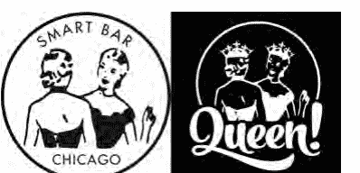

图 6.6 Smart Bar 标志与 Queen! 标志，约 2013 年春季；由 Smart Bar 提供。

标志以及在此基础上形成的 Queen! 标志（如图 6.6 右侧所示），迎合了一种促销逻辑，这种逻辑利用了历史学家莎伦·祖金（Sharon Zukin）所说的城市消费者对“真实性”的渴望——这种渴望能帮助他们植根于特定的时间和地点，并将其融入对重塑我们世界的更大社会力量的宇宙级认知中.¹¹¹⁶ 品牌暗示，尽管在过去的几十年里结构和文化变革重塑了湖景区（Lakeview），但舞者们仍然可以依靠 Smart Bar 提供世界级的 House、Techno 和 Disco 节目。Queen’s 这一子品牌的的视觉和感觉建立在原始俱乐部标志所蕴含的时间和空间稳定性之上，甚至打破了永恒的幻象。通过增加两顶皇冠和一种富有律感的手绘字体，设计师们暗示 Queen! 是 Smart Bar 演化出的、由女性力量驱动的“女儿”，是该原始主题品牌的新旧主义迭代版本。

在 Queen! 于 2013 年 4 月成为常驻活动之前，Smart Bar 的运营者们曾使用其他几种品牌身份进行设计，为这个夜晚创造了一套新旧主义词汇。2013 年 1 月的传单模仿了 Jamie Reid 为 1977 年性手裤胶乐队的《God Save The Queen》单曲创作的剪贴画流行美学；2013 年 3 月的一份传单则基于扑牌的设计（自然然是红桃皇后）。¹¹⁷ 设计师们将粗线条的无衬线字体放置在深色、饱和的背景上，并使用流行艺术色彩和青色排版元素，暗示 Queen! 是一个专业、趣味且易于亲近的。值得注意的是，推广者在这些早期营销材料中同时列出了 Queen! 的 DJ 和主持人的名字，连接了先驱的芝加哥流行身份，同时仍让 Ruby D 和 Sal-E 等人才占据头条位置。¹¹⁸ 当 Smart Bar 在 2013 年 4 月推出 Queen! 作为官方常驻活动时，设计师们转入一种更一致、不那么火爆的风格，保持了他们在该晚活动传单上使用的霓虹色调和全大写风格元素，并为 Queen! 字体和 Smart Bar 标志的文本添加了外光效果。此举有助于将当晚营销材料的视觉感受与俱乐部霓虹点缀的黑盒感联系起来。到 2013 年秋季，当我第一次开始参加 Queen! 时，Smart Bar 的设计团队使用了一种全新的视觉身份，包括一套字体、颜色、图像、马戏团元素、一个皇冠图标以及一个没有脸的乱胡子。与为 Queen! 创建的图标类似，这些许多图形元素都是围绕带有岁月痕迹现有档案图像构建的。它们部分描绘了派对的酷儿属性（`queerness`），就像这是一个公开的秘密。

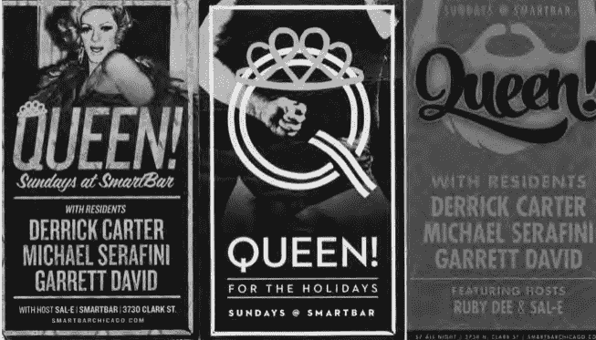

图 6 2014 年 4 月 7 日、2013 年 11 月、2013 年 10 月 Queen! 传单；作者个人收藏。

图形设计元素无疑在塑造 Queen 的怀旧想象中发挥了重要作用，但派对才华的主持者让品牌的视觉轮廓动了起来。芝加哥的表演艺术家、变装艺术家以及非性别规范的俱乐部少年在门口和派对地板上剪裁出无畏的服装形状，刻意且无意识地致敬 Medusa 的哥特/朋克氛围，以及 Boom Boom Room 等性别摇克（`gender-funk`）地下派对的遗产。通过从字面和意义上撕裂他们的丝袜，这些艺术家关注了芝加哥音乐文化的过去、现在和未来。

Ruby Dee 是那些似乎能够掌控一切的人之一。凭借她完美的面容和女主人般的穿着，Ruby 的造型总是引用了芝加哥深夜生活的先驱，如 Boom Boom Room 的 Jojo Baby 和 Byrd Bard，将变装的表演的可能性推向了意想不到的领域。2013 年 10 月 28 日，Queen! 有位摄影师正在拍摄一位日本 b-boy。Ruby Dee 穿着紧身胸胸衣和天高跟鞋，在舞者周围走动，用犀利且俏皮的微笑缓解了他的男性的紧张。她从未移开目光，俯落在地板上，甩动着她盘起的假发，同时向这位 b-boy 提供热情，并暗示他的嘻哈风气脱离了特定的时间和空间¹⁹ Queen! 的女主持人们守护着这个夜晚的酷儿氛围，在一个本可能充斥着重节奏的男性化空间里，强有力地介入了女性的存在。她们提醒顾客，即使 Queen! 的 DJ 表演了精彩的节目，他们也不会独自占据观众的注意力。

2013 年 11 月 3 日，我走到 Smart Bar 门口出示身份证，并受到了 Ruby 和 Sal-E 的热烈欢迎（合照见图 6.8）。他们正在化亡灵节（`Dia De Los Muertos`）妆：乌黑头发梳成紧紧的发髻、高蕾丝衣领和巨大的西班牙扇。他们对细节的关注以及通过呈现的精美骷脸（`calaveras`）可能致敬了派对上的其他拉丁裔主题，同时也提醒了观众，尽管当晚宣传的变装主持人主宰派对，现场总有其他舞者（其中许多是 Queen! 的常客），他们在自己的装扮呈现上也采取了具有启发性的新旧主义方法。确实，Queen! 主持人的造型融入了表演观众的造型中，许多舞者在大多数晚上都穿着类似的复杂的服装和妆容。在我到达时，那个 11 月的特定晚上地板上有两个群体，一组穿着漆皮恋物装，另一组则戴着更有街头风格的反戴棒帽和大裆裤。

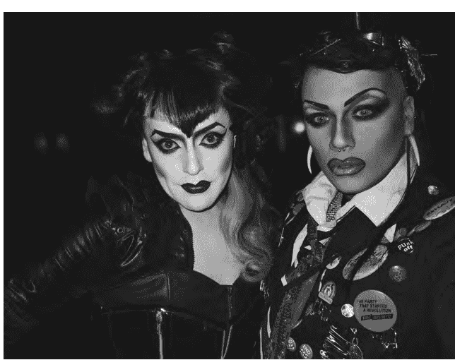

图 6.8 Ruby D 和 Sal-E 在 Queen!；照片由 Sal Esparza 提供。

夜晚那怀旧的氛围，呈现出一种既准备好狂欢、又准备好拍照的姿态。

2013 年 12 月 1 日，舞者兼编舞家 Darling Shear（图 6.9 左侧，她在 Queen! 派中）与 Chances D 组织者 Justin Hijo Pródigo/Swaguerilla Mitchell 一同在 Smart Bar 的舞池上旋转，眼神流转。那个晚上，她留着金色短发，在俱乐部耀目闪烁的频闪灯衬托下，她棕褐色的皮肤格外格外。¹120 传单上并没有将 Shear 宣传为主持人，但她像最出色的女招待和舞者一样撑起了那片位置，当她在黑暗中旋转时，她受过的古典训练让她大放异彩。Queen! 的现场依靠像 Shear 这样付费的女招待和技术高超的舞者来保持其地下氛围，并与当年那些离开芝加哥种族歧视同性恋舞厅的有色人酷恋者保持怀旧的联系。这种对当晚有色人观众的代表性使命，虽然可能是一种负担，但并不总是一种标签化的工程；有时，这甚至像是派对推广团队的一种刻意尝试，分享他们代表芝加哥 House 文化的权威。Shear 在 Boom Boom Room 场景中作为俱乐部舞者成长，她说，当她没有主持时，她可以免费入场，而当她主持时，她可以免费喝酒。无论如何，Queen! 都为她提供了一个可以“尽情跳舞”的地方。¹121

图 6.9 舞者兼编舞家 Darling Shear 与 Chances D 组织者 Justin Mitchell 在 Queen!；照片由 Erik Kommer (EMK Photography) 提供。

# 你准备好改变生活了吗？ • 209

舞者 Nishi Roothaan 说，对她来说，Queen! 是一个表达自我的安全空间，因为它并不是特定的同性恋之夜，也不是事实上的异性恋之夜：

> 我不认同同性恋或异性。我喜欢我喜欢的人，但我仍然觉得自己认同那个社区，因为这不仅仅是接受同性恋，而是关于接受你自己，这在 Queen! 对我来说非常特别，我在芝加哥的其他领域很少看到这种东西。

Roothaan 说，对她而言，Queen! 是一个培养个人自由感的空间，因为她能从她的“深度熟人”那里获得支持。¹122 这些舞池朋友以非常独特的方式照顾 Roothaan，在她移动时分享并放大她的情绪。她在这种舞池互动中看到了这种原始的特质——类似于理论家 Luis-Manuel Garcia 所描述的“流动性”——与一般的地下 House 音乐派对的时空相连，特别是与 Queen! 的新怀旧场景相连。¹123

# Chances 舞会中的可爱与狂野生命力

C*D 标志（如图 6.10 所示）曾以各种形状和大小被构思和重新配置，放置在多个重叠的宝石色背景上，而在我在 Chances Dances 进行实地考察的那年里，它有时甚至被完全弃用。在集体的网站上，C*D 标志位于一行标语上方，标语写着：“芝加哥的酷儿社区——自 2005 年起保持可爱。”¹124 该图标似乎通过引用法国时尚屋 Chanel 标志性的交叉“C”字来指代奢华与魅力，但也许这只是一个美丽的巧合。人们还可以考虑 Chances Dances 的标志——其粗体黑色字母，放置在金色背景和炽热的白色天体上——是如何作为一个隔世世界的“可爱纹章”发挥作用的，那是一个就在地平线上的狂野乌托邦。

图 6.10 Chances Dances 标志；由 Chances Dances 提供。

# 210 · 尚未结束

Chances Dances 派对的组织者和观众经常诉助于其文化工作的“可爱性”，利用理论家 Sanne Ngai 所描述的“可爱”所具有的柔软、无边际或无底的特质，来作为他们激进政治的掩护。Chances Dances 那些狂野视觉效果及相关文化产品的可爱，有助于他们在活动主义语境下运作，同时又不会贬低舞者们在舞池上寻求的快感与释放。¹125 可爱性，通过他们在 Chances 的日常言语中进行理论化的表述，也是一种对冲，它承认了极具前景的美学、政治组织或创意劳作，而无需投入过多的情感。正如 Ngai 所指出的，这个词意味着对精神/戏剧味味层次的审美评价，掩盖了看似无害的粉末下的刀锋。¹126

当批评者嘲讽 Chances 不符合芝加哥或或特定的工人阶级真实性想象时，他们将派对及其组织者斥为“艺术学院派”或“文青”，暗示他们受过过多教育和特权，而且他们在工作中使用的、模糊讽刺的异质美学与他们所看到的与赋权联系的边缘群体无关。这些对集体文化工作的肤浅解读，忽略了 Chances Dances 的组织者和舞者如何特别地为非性别规范的人创造了共享空间。Chances 的洗所标志（组织者放置在工作场所附近厕所门上的男女性符号之上）在两个当代符号学层面发挥作用。首先，这些标志在文本层面传达了 Chances 的性别包容政策；其次，利用可爱的设计元素消解了潜在的批评。

图 6.11 左侧标志由 Garrett Hansell 设计，使用沙龙风格的大写字体和黑色方案，简洁地表达了其观点：“性别中立厕所……欢迎所有身体！”文字下方是一行草体信息：“让我的尿尿。亲亲——。”这种幼稚化的、手写体和浸了尿渍的美学，将创建性别中立厕所的项目框定为一个孩子也能理解的事情。正如它引用的非洲裔美国灵歌《下摩西山》，这段文字促使观众顺其自然，暗示性别中立并不是某种难以理解或宏大的政治项目，而是常识性的善良。

**6.11** Chances Dances 厕所标志。由 Chances D 提供。

两个厕所标志中的第二个是集体在芝加哥当代艺术馆（MCA）举办的策划表演派对“召唤新的酷儿现实”中使用的，详细说明了为什么中立设施是必要的。这里有一个可爱的手绘元素，引用了 Marlo Thomas 1974 年的女性主义儿童唱片《Free To Be You Me》，但大部分黄色和紫色文字字体要小得多，包含了信息的核心。页面顶部提出的修辞疑问（“当然，我们可以接受男女共享同一个空间，对吧？”用可爱的修辞确认结束了关于厕所包容性的对话。“当然”和“吧”的使用表明，这是对已经属于 Chances Dances 社区并认为自己具有关怀和包容心的人的一种正式交流。

除了培养性别包容性外，Chances D' 将视觉化酷儿祖先和家庭体验。集体的 2007 年骄傲游行花就是这种工作的典范。在 Boystown 年度游行开始前，仅凭手工用品和一群敬业的志愿者，通过缝制和热熔胶，组织者 Latham Zearfoss、Aaron Preston-Mynt、Dylan Mira 和 Chris Pappangas 一同 Chances 的舞者，将一辆 U-haul 货车变成了一个长满白色帽子的带刺的、生殖器的龙/卡通恐龙。正如他们后来接管 MCA 时所做的，

# 212 • 尚未结束

他们将这种移动的、可穿的、参与式的行动称为“召唤新的酷恋现实”（Summoning a New Queer Reality）。

虽然有些参与者，如图 6.12 所示的 Mira 和 Preston-Myint，他们分别穿着凤凰戏服和面具，在紫色羽毛卡车的背上跳舞，另一些人则沿着游行路线前进，分发描绘有酷恋（女）英雄的半色纸面具；这是一套可穿的先辈集合，其中包括有色人酷恋、跨性别和朋克活动家、音乐家、电影制作人和视觉艺术家。这些面具的视觉质量（图 6.13 展示了其中一个）强调的是艺术家的传，而非鼓励跨种族或跨性别的变装。事实上，参与者被邀请首先通过他们的言语和行为来识别并联系这些偶像，其次通过与他们各种交织性主体性的特质相契合或对其进行批判。通过发放这些可爱的纸面具，组织者促使游行观众想象自己是广阔的酷恋艺术创作者谱系的一部分，同时对骄傲日的企业“粉红”（`pinkwashing`）进行批判。Preston-Myint 回忆看到旁观者被面具吸引：“看到一种与他的历史相关的个人联系真的很棒，这种联系在这些广告图像之外，并连接……”

图 6.12：Dylan Mira 和 Aay Preston-Myint 在“召唤新的酷恋现实”花车上；照片由 Chances D. 提供。

# 你准备好改变你的生活了吗？ • 213

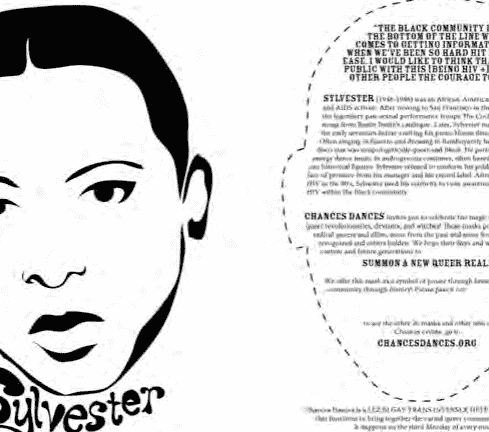

> “CHANCES社区正处于愿意切断信息的前沿，当我们提出要求但他们能够听见时。我想找到一种方法来向他们让他们，让他们足够的勇气让其消失。”

STAYED. 在整个20世纪70年代和1980年代一直保持活跃。在70年代末搬到旧金山后，他决定在1980年组织第一个夏季酷恋花车。在三年里，在其他社区中，他一直致力于许多不同的项目以及他最新的标签。

# 召唤一个现实

CHANCES的舞者们庆祝自由的形象和酷恋多样性，以及等等。这些人通过占据空间来表达某种抗议。他们占据了街道，并可能占据自由和后代。

我们也通过多样性的术语和其他方式思考社区——`Chance-pass`

# CHANCESDANCES.ORG

Chance Navarro 是“LGBTQ+游行花车反抗党”的成员。

在2011年组织花车后，他在2012年继续组织该活动。

芝加哥，2012年7月。Miles

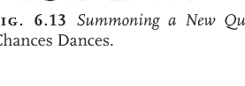

图 6.13：“召唤新的酷恋现实”中Sylvester DIY面具；由 Chances D. 提供。

通过这些图像与街道上的人联系，而不是通过Altoids花车之类的。¹¹²⁷ Chances的组织者和舞者利用“可爱”来对抗并管理他们作为主体与其之间的权力差异，以及他们在那个以商品为导向的世界中被淹没的欲望恋物对象。¹²⁸

除了使用标志性的洗礼标志并制作诸如“召唤”花车这样的一次性项目外，Chances通过酷恋表演和资助将可爱与其他们的狂野特质相结合。2014年3月14日，组织者颁发了两年一度的“批判性狂野”（Critical Fiergency）助金（该助金自2008以来一直授予在芝加哥工作的自认酷恋艺术创作者）以及Mark Aguar纪念助金（该助金自2012以来一直授予该城市的有色女性光谱艺术家）。“批判性狂野”一词借自José Esteban Muñoz著作《去识别》（Disidentifications）的引言，他在书中描述了电影制作人Marlon Riggs在其电影《舌》（Tongues Untied，1989）中处理同性恋假设白性的方式。¹²⁹ Mark Aguar纪念助金是以芝加哥伊利诺伊大学（UIC）的一名MFA学生兼Chances社区成员的名字命名的，她在2012年不幸离世。根据她的个人网站，Aguar的作品“是对酷恋表达以及在互联网上作为同性恋长大意味着什么的的持续探索。”¹³⁰ Zearfoss说，纪念助金的资金来自Danny's和The Hideout收入的增加，以及Aguar家族对Chances Dances的慷慨捐赠。¹³¹

# 214 • 尚未结束

2014年冬季，Chances颁发的“批判性狂野”奖分给了跨性别-酷恋表演项目WITCH HAZEL和Margaret Bobo-Dancy；Mark Aguar助金则授予了多才表演艺术家Nic Kay。没有获得该奖项的人在宣布的当晚没有进行表演，但WITCH HAZEL曾在2013年11月18日在Subterranean表演过。他们对Rihanna的歌曲《Birthday Cake》进行的哥特式对口型（如图6.14所示），体现了狂野的酷恋文化创作如何在Chances Dances的“可爱”基调中运作的典型。WITCH HAZEL由Devin Casey、Imp Queen和Ariel Zetina组成，他们从观众席中走出。

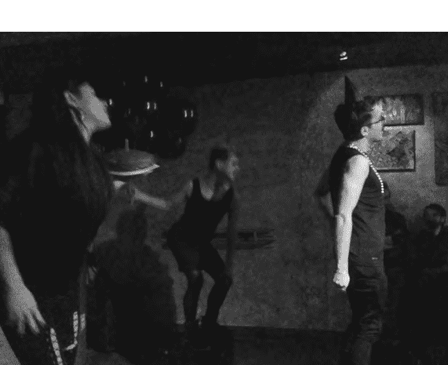

图 6.14：2013年11月18日在Subterranean表演的WITCH HAZEL；照片由Micah Salkind拍摄。

动作（比比手指和扭动臀部）之前回到观众席。WITCH HAZEL交织了40流行音乐的低俗与混乱。坐在Chances顾问委员会并对资助做出决定的组织者将“可爱”作为一种狂野集体主义的小美学，承认了有色酷恋狂欢者的本质。在2014年春季的资助周期，授予了Nic Kay1000美元的Mark Aguar奖，用于开发他们的新表演作品《Lil Black — Gone Wild》。根据Nic Kay在Chances网站上引用的申请，他们提出的作品（后来变成了巡演表演`lil BLK`，2015）将“深受舞厅文化、现场朋克表演、舞踏和赞美舞的影响”。组织者说，Nic Kay的项目在申请中脱颖而出，“因为它对归属与差异、竞争与集体以及酷恋活动社区内部的紧张进行了批判性的探索。”¹³³几个月后，2015年夏天，Nic Kay我在威斯康星州斯图本的ACRE艺术家驻留期间进行了工作室访问。当我们讨论《BLK》的音设计、服装和舞台元素时，我开始理解Nic Kay将可爱作为其表演的次要因素的使用，与该类别允许表演流派和代际酷恋的方式有关。¹³⁴ Chances的一些表演者，如女性主义双人组Mothergirl的Kate Albert和Sofia Hamilton，即使在批判其无法消费时，也在他们的作品中使用可爱。在作品《如果你看到什么就买什么》（If You See of Something, Buy It）的重新版本中，Albert和Hamilton在奖项颁发晚上进行了表演，他们探索了夸张的可爱如何带有一种令人不安的冲击力。在作品的原始表演中，Mothergirl将椒甜圈、柠檬和假睫毛等商品呈现为奇特的组合，然后过度消耗或使用它们，直到变得怪异。他们在Sub-T舞台上重新审视了原始的这种困可爱，配以Chances客座DJ RMX Reality创作的配乐。当RMX播放他们切碎和慢放的人声时：“一个你拥有的一切。如果我发现某些拥有的……”

## 216 · 尚未结束

价值，那么它就会从中间分开，我们每个人都拥有价值的一半 . . .

Mothergirl 喝下了大桶蓝色窗清洁水颜色的液体。这场表演引发了舞者们震惊、敬畏和冷淡的表情，表明“可爱”在应对尖锐批判时可能是有效的，但它无法掩盖商品拜主义所有令人不安的事实。

在周二，Off Chances 的派对通过提供素食烘焙食品以及他们提供的免费混合 CD/在线播客，帮助增加了“可爱指数”。根据 Zearfoss 的说法，这些甜腻的馈赠旨在反映 Chances 社区在讨论“不期待回报的赠予礼物的愉悦”时那种对话的甜蜜感。组织者希望通过提供零食，来利用世界上“不以利润为目标的馈赠行为所具有的反资本主义潜力”。Zearfoss 将这种可爱的工作称为派对中在声音、动能和服饰维度上发生的显性“世界构建”的某种“潜台词”，并指出，组织者希望这能为他们的激进项目做出贡献，即使是暂时的.¹¹³⁵

在 Chances 对食物和音乐的赠予之所以触动了我，方式在于组织者们将其与芝加哥 House 音乐文化中“自助式好客”的传统联系在了一起。我在 The Hideout 与 Zearfoss 就这种看似无意的平行性发起了对话，他同意Chances 狂野、反资本主义的伦理与早期 House 音乐文化中深色的、低利润的赠与经济之间存在着显著联系。当我们交谈时，刚刚受邀为策展人 Anthony Steper、Erin Nixon 和 Anthony Romero 在实验场馆 Links Hall 制作的“灭绝表演”（Extinct Performance）系列，想象性地审视芝加哥过往的艺术运动。Zearfoss 认为，关于 House 音乐文化历史与 Chances 起源之间联系的一些共同工作非常适合这个项目。¹¹¹⁶ 我很乐意帮助他梳理这些联系，因为我知道这会非常有趣，并且无疑能帮助我探索芝加哥音乐的持久遗产。

Zearfoss 和我开始我们的研究，就是穿梭在芝加哥街头，拍摄已废弃的 House 音乐场所的视频素材。我们拍摄了自己走过这些记忆空间门槛的画面，以及那些与 Chances 社区相关的场所。在这些朝圣中，我们更清楚地感受到许多早期 House 音乐场所彼此之间、以及 Chances 场所之间有多么接近。这些是视觉艺术家 Edie Fake 在他宏大的插画系列中所称为“记忆宫殿”的空间，该系列纪念了芝加哥过往的同性恋社交街道。¹¹³⁷ 我们利用在一起的时间开始脑风暴如何在我们希望创作的表演/讲座中，将 Chances 和芝加哥 House 历史的音频和视觉元素结合，并选定 Arthur Russell 1978 年的杰作《Go Bang》作为他音乐配乐的开场。¹¹³⁸《Go Bang》对渴望同时看到所有朋友的庆祝，感觉就像是一个项目不置疑的开端姿态，这个项目试图连接四十年来狂野、同性的艺术创作与派对之间的点点。这首歌对于原始 Warehouse 时代期间及之后出现的一代人具有标志性，但它像许多 Chances 的经典作品一样，对较年轻的观众也保持着可读性，这些观众可能在低音男声 Julius Eastman 的男性化呼召，或在 Lola Blank 的女性性情呼召中找到自己。《Go Bang》的歌词作者通过蜿蜒的风琴处理过程、拨奏的大提琴和扭曲的小号号重音，为跨越时间的听众建立了联系。录音中的艺术家以及被他们的音乐持续治愈的舞者们，从未停止“敲击”（banging）。¹¹³⁹

Zearfoss 和我 2014 年 1 月 26 日在 Links Hall 为满座的观众表演了第一版本的“无边界音乐混合带”（Borderless Musical Mixtape）。我们的混合音乐配乐包含了在 Chances Dances 派对十年间作为芝加哥 House 经典引发热烈反响的声音，穿插了各种录音，如底特律团体 Inner City 的科技流行赞歌《Good Life》、Sister Sledge 的迪斯科杰作《Lost in Music》，以及对 Frank Ocean 歌曲《Thinking About You》的当代 House 混曲。¹¹⁴ 配乐成了声音的背景，有时也成为我们短文对话式表演的背景——我关于芝加哥 House 文化的历史的探讨，Zearfoss 关于 Chances Dances 的亲身经历。我们在投影拍摄的视频画面时，为彼此调节音量。Zearfoss 在这个视觉配乐上叠加了霓虹色的曲目，以及过去 Chances 视频拍摄的素材；身体和文字在芝加哥的同性恋记忆宫殿中灼烧并模糊。我们将一个彩色派对灯聚焦在相邻的墙壁上，以增强视觉重层（如图 6.15 所示），作为另一个吸引和唤起芝加哥废弃且灭绝的同性恋文化的小行动。

在我们的讲座/表演之后，Latham 和我加入了一群电视人物和制作人，他们帮助我们扩展了对话，并对芝加哥夜生活的有色种同性恋和性别非规范的邪教文化提供了其他细致的视角。这代表了一种转变，从两个白人顺性别者主导空间和叙事，转向一个更异质的群体，在其中我们的声音被去中心化，刻意镜像了 Chances Dances 以及这个研究项目并不完美的政治和形象；Zearfoss 在开始派对时试图去中心化顺性别特权和白人至上主义，尽管这些始终是西西弗式的任务，正如我在自己的研究中尝试做的那样，并取得了类似的不完全且未完成的结果。实现某些意义的唯一方法似乎尽管工作面临挑战和不足，也要继续“敲击”（banging）。

图 6.15 无边界音乐想象、表演与小组讨论，2014 年 1 月 26 日，图中人物从左上上到右下依次为：Micah Salkind, Latham Zearfoss, Rosé Hernandez, Ali McDonald, Precious Davis, Juana Peralta, 以及 Mister Wallace；图片由 Link’s Hall 提供。

## 220 · 尚未结束

而在 Chances D，人们深刻地感受到一种历史的联结，尽管存在着持续的碎片化与断裂；这种感受源于个体的主体位置，源于跨越社会差异各个角的倾听与共情。正如 Generator 的长期驻场 DJ Powell 所说，Warehouse 俱乐部中多达 80% 的舞者如今已不在我们身边，那么我们该如何认识他们，或者如何认识他们创作的艺术呢？²¹⁴ 我们如何在舞池上纪念我们的记忆？我建议，这在很大程度上通过现场、彼此关怀以及讲述他们的故事来实现；通过不断撞击并正视我们的工作永远不足以改变世界的方式。

在许多方面，我们对芝加哥 House 音乐空间的参与和投入，依赖于我利用有色人种酷儿（queer of color）历史的特权访问权，这与芝加哥圈内及之外其他白人、以男性为中心的音乐企业家所拥有的仁慈权利感不同。就像 Smart Bar 的创始人/老板 Joe Shanahan，或 Queen! 的 DJ Garrett David，我同样痴迷于从种族和性别的边缘熔炉中对自由与创造的期待，这种痴迷风险着掩盖那些我希望放大的有色人种酷儿的故事。我作为一名酷儿的经历也与 Shanahan 和 David 有不同。由于一直在寻找可以建立联系的酷儿祖先、榜样和传统，并在青少年时期发现芝加哥 House 音乐是通往这些联系的途径，我对比共享权威的投入和兴趣既受相似性的塑造，也受差异性的影响。这并不是说异性恋者没有进入我们世界的途径。事实上，他们有，这也是为什么 House 音乐对于那些致力于反对种族主义、异性恋主义、阶级主义以及其他形式社会暴力和结构性歧视碎片逻辑的人来说，仍然是一个充满可能与承诺的丰富载体。

通过新旧记忆（neostalgia）的矩阵，在 Queen! 和在 Chances D 的狂欢中，跨越差异轴构建出的共同历史，尽管由于 HIV/AIDS 死亡和舞蹈音乐趋势的演变存在各种代际鸿沟，这证明了为什么 Allen 所假设的，在寻找自我生活时是“进入”（going in）而非“出来”（coming out），可以是理解酷儿夜晚生活情感可能性的有用方式。当芝加哥正为谁有权代表或定义 House 音乐而激烈争论时，参与这些功能的艺术家们继续创新和记忆。他们在保持植根的同时，创造了通往和穿越芝加哥 House 文化历史的新路径，维持了他们自己以及那些在他们的舞池中理顺了生活的舞者的生存¹⁵。

正如 David “Risqué” Walker 所言，舞者成就了 DJ。没有舞者，你就没有 DJ。舞者不需要 DJ，DJ 需要的是舞者¹⁴⁶ 随后的最后一个自民族志章节将揭示，在 Queen! 和 Chances D 跳舞如何让我感受到与芝加哥 House 音乐文化新旧记忆式和狂野谱系之间的个人联结，并通过这些谱系，触及了其有色人种酷儿地下世界的历史。这种分析可以出现在本书的开头、中间或书中的任何地方，但作为结尾却感觉是恰当的。跳舞过去、现在、并将永远是我实践认知、爱意和重新记住芝加哥 House 音乐文化所教给我的首要方式。

# 在勇敢的空间中跳舞

人们以为我们只是在跳舞。不，你们只是在跳舞。我们是在哀悼、庆祝、为战争准备、超越、构建、抵抗、讲述故事、反叛和欢庆。

> —MARIO “MARS，”活动人兼主持人，Excursions

## 引言

那是 2014 年 4 月 21 日，我依然在 Queen!，但离灯亮起还有很久。Garrett David 正在胶片台上旋转一首采样了 Harold Melvin and The Bluenotes 乐队《Bad Luck》的曲子，几对伴侣正同步地律动着。看着其中一对人跳起伴侣舞让我很欣喜。他们从亲密的拥抱转为齐步行进，分享着他们的时刻。他们看起来很有林迪风（lindy hip），但带着那种 House 的律动感。附近还有另一个舞者。他面对俱乐部后方，像风车一样旋转着双臂。他背对着 DJ 席，双腿叉开，穿着一件白色牛津衬衫并扣到几乎脖子，灰色的头发向后梳理。他正处于神入状态。对我来说，我迷失在音乐中，沉浸在情绪中，找回我的自我。Michael Serafini 现在正在胶片台上播放一首采样了 Donna Summer《Bad Girls》前段的曲子：“toot beet, beep beep..”我自己能想到的只有，我很庆幸今晚来这里工作。

在芝加哥进行实地调查期间，我将周围人的跳舞视为一种即兴表演，即使他们并没有意识到我这个“唯一观众”的存在，尽管我我也在表演，深深沉浸在自己的动作、记忆和感受中。在我的各种邂逅中，夜店跳舞在核心始终是动态且忙碌的，一种解释性的表达，为 DJ 的声音提供了物理的、具身的形态。因此，我在最后一章中引用人类学家埃尔文·戈夫曼（Erving Goffman）观点，表演（即使是地下俱乐部舞者的表演）反映了

*Do You Remember House? Chicago’s Queer of Color Undergrounds.* Micah E. Salkind, Oxford University Press (2019). © Micah E. Salkind.

`DOI: 10.1093/9780190698416.003.008`

## 224 · 尚未结束

无论一个人是男主还是女主人、DJ、临时顾客还是常客，都反映在他们的跳舞中。

本章还基于舞蹈学者 Jonathan Bolton 的工作，他从酷儿视角出发，探讨了社会角色是如何通过舞者的感受方式被塑造的。我根据自民族志叙述的个人细节进行创作，这种叙述在完整描绘出芝加哥有色人种地下世界跳舞的可能与局限方面能力有限。通过我在这本书关注的故事中获得的经历，以及对社交舞者的口述史采访，我论证了在 Queen! 这样的空间中跳舞，能够开启狂喜与抑郁的情感。这一主张在许多方面确实支持并建立在菲奥娜·巴克兰（Fiona Buckland）的重要民族志工作基础上，她认为酷儿舞蹈通过“对位、争论和多声部”的过程产生了抵抗同质化跨历史性的“酷儿生活世界”。这种定位的结果可能是有色人种舞者以及与其共享空间的人，在与他们音乐生活和社会世界迥异的人中发展出生存策略。

关于拉丁身份（Latinidad），拉蒙·里维拉-塞尔维拉（Ramón Rivera-Servera）指出，实现有色人夜生活所承诺的乌托邦可能，不仅仅是与他人共舞，而是多个社区及其交汇处“严肃体验的结果，有时甚至与他人形成对比或冲突”。在最后一章中，我认真对待了这种冲突，通过对自己在我所谓的“勇敢”而非“安全”的空间中跳舞的经历进行理论化，以解释这些经历如何帮助我学会如何在不和谐中生活并穿行。

最后，值得提到的是本章为理解 `jacking` 和 `vogue`（甩手）提供了一些解释框架，但它没有涉及 `stepping`（垫步）或 `footing`（步法），这些与芝加哥房屋舞相邻且往往交织的至关重要的社交舞蹈形式。我在这里分析的酷儿地下世界（主要是北边且倾向于多族裔的白人）据我所知，他们并不深陷这些风格或与之协调的音乐曲目。我将它们的特定历史和具身政治留给更有能力的人处理。

## 变得巨大（Being Big）

在芝加哥跳舞时，我经常发现自己同时存在展现自我和变得隐形的需求。这种紧张感就像是我花费了生命四分之一的时间试图占据更少空间的一种具身反应。青少年时期，我的默认姿态是顺从的；仿佛我可以让自己变得足够小，从而从那些可能因为我自慰酷儿化而指责我的人雷达中消失。房屋舞空间（尽管我在来到芝加哥之前就跳过这种舞）一直让我感到足够安全，去练习消除这种习惯性的具身退缩。我敞开心怀，伸展肢体，沉浸在自己的声音和步态中。我需要散开身体，感受连接肌肉与身体的筋膜紧绷着。我想占据物理空间，成为一个更大的存在，但这并不总是那么易事。

我在芝加哥的夜晚通常始于对我必须移动的空间进行扫描和评估。我会考虑空间亲近程度（`bolen proximity`，即我跳舞身体与周围人之间的距离），以及熟悉程度（即我和舞伴所面对的方向）。当我进入舞池时，我会问自己那里的人是否多到足以填满而不让我感到孤独，或者人太多以至于我无法放松、无法无顾忌地投入动作中。大多数时候，我在 `Queen!` 的夜晚其特征是拥有开阔而非限制性的地形，而且房间不会拥挤到无法移动。2013年10月20日，当我们错肩而过时，人们不断擦过我的肩膀并触碰我；有人甚至拍了拍我的头。尽管舞蹈音乐活动中的接触社交规范似乎比大多数公共空间更具扩张性，但对于酷儿俱乐部空间中的舞者来说（他们中许多是将俱乐部跳舞视为心理健康方案核心组成部分的少数族裔），路易斯·曼努埃尔·加西亚（Luis-Manuel Garcia）所说的“触觉听觉”（`haptic aurality`，或以触为导向的听）可能成为一种不受欢迎的负担。有时我请求陌生人的接触，但有时这可能是令人不安且不受欢迎的。应对这种氛围和风险成了出门的一部分。如果我想接触或近距离跳舞，我完全可以找到，但我也可以保持距离并在后置音器旁占据大量的地板空间。那是舞池边缘，适合进行旋转、踢腿和其他大动作。我可以待在后面，不用担心是否会无意中以不受欢迎的方式触碰到某人或撞倒饮料。当我变得“巨大”时，我是在寻找伸展并占据空间，寻求自我认知和赋权。

由于 `Queen!` 是按照 `Boom Boom Room` 的工业化夜生活派对模式建立的，那些倾向于喝酒、对身体控制较少且不尊重空间规范的“周末战士”似乎比周五或周六晚上的派对要少且远。房屋舞者大卫·亚当斯和凯尔·罗宾森指出，与 `Wicker Park` 的 `Red Dog` 不同，`Smart Bar` 一直坚持着对舞者友好的政策。他们注意到，它是芝加哥少数专门设计的舞蹈俱乐部之一，一直允许舞者带着汗巾早点来，在地板上伸展身体，并通过翻转和双人舞动作占据额外的空间。

与 `Smart Bar` 拥有专门的舞池不同，用于 `Chances` 的所有空间没有一个是为跳大动作的舞者创建的。在身体上，我发现自己在这些舞池中紧绷着，双腿和肌肉的紧张方式抑制了我变得“巨大”的能力。然而，像之前的 `The Warehouse`（仓库）一样，那里（尤其是 `Off Chances`）即使感觉局挤，在社交上也可以很随意。当我在那里跳舞时，我想变得巨大，占据空间，但同时也融入人群。我试图为了自己而变得巨大，而不是为了房间里的其他舞者。我是在寻找一个圆圈（`cipher`），如果在 `Queen!`，如果我最终进入了一个圆圈中心，或者加入 `Soul Train` 队列，我必须离开。这要求我对脸部表情和近距离保持高度意识；我必须安静地向后挪动而不会绊到别人的腿，或者旋转并滑出让路，躲避手臂、飞舞头发和饮料。我变得非常擅长扭动身体躲避视线，在舞者们聚集成那些熟悉的集体形状时，像拼图碎片一样在他们之间移动。

`Queen!` 和 `Chances` 的舞会经常有多族裔、有时看起来以白人为主的舞蹈社区参与，前者通常更具男性化，后者通常更具女性化（`femme`）。两场派对都明确努力包容多种类型的差异，同时优先考虑非白人、非中产阶级、残障人士和非性别规范的表达。¹ 虽然我在这两场派对中练习占据空间，但我同时也对我所感到的他们各自舞蹈的人口统计非常敏感。也就是说，我过度意识地留意我白人、呈现男性化的身体是否占据了太多空间。哲学家莎拉·艾哈德（Sara Ahmed）在她关于酷儿现象学的著作中，将“在后”、“边缘化”或“面向”与一个酷儿化的过程（`queering`）联系起来²。对我俱乐部空间取向的酷儿化帮助我考虑我的肢体是否控制、我是在舞池的中心还是边缘、我是否挡住了一个人或女性化者。我对自己在舞池中位置的敏感，是观察与酷儿色彩地下文化相关的社交空间而不转化为被殖民的自由区的一部分。当我决定向边缘靠拢时，我这样做是为了执行一种让位的政治；变小是变得巨大的有趣的补充。

## 节奏

当我关注 `Chances` 和 `Queen!` 舞池的酷儿取向时，我在两个派对中都投入了大量的精力练习音乐同步（`entrainment`）。像苏珊·李·福斯特（Susan Leigh Foster）和路易斯·曼努埃尔·加西亚这样的舞蹈学者和民族学家关注了与音乐同步（身体与节奏或脉动的同步）如何与舞池上的关系或情感交换相联系的方式¹³。培养的音乐知识，特别是对芝加哥房屋舞目的深刻欣赏和喜爱，成了我娱乐的一部分。它也影响了我与 `DJ` 组曲进行个人化但社交化的运动互动模式。我认为有必要在这里区分一些细微差别，即“驭节奏”（`riding the rhythm`，这是同步的一个方面，主要通过节奏人物影响人的舞蹈）以及 `Queen!` 的常客。

## 228 · 尚未结束

Nishii Roathan 将这种从音乐的旋律性人声，或其他基于音高和色调的音频安排中从中“汲取能量”。¹¹⁴

在实野调查期间及之后，我练习记录 `DJ` 混音中的节奏变化，以此作为一种与他她的声音积极互动的方式，同时在练习中超越排练的步骤，追求自我意识的运动掌控力。这种做法是向我自己（可能也向房间和 `DJ`）发出一个信号，表明我对均衡化器（`eqing`）、混音和其他特效非常敏感。我试着用会心的眼神与 `DJ` 交流，当我标记自己某些伸出的肢体时，脚下依然感知着他们正通过前一曲目底鼓的主脉冲之一引入新节奏，而我的手或头部则在处理进入音乐框架的新颖 `808` 高音、军鼓和其他高频节奏元素时进行“去模糊”。我对 `DJ` 技巧的表演性认可帮助我将自己定位为某种专家，尽管我无法像高水平的夜店舞者那样技艺精湛。这也变成了一种进入情感纠缠的方式，将我沉浸在 Susan Foster 所说的、舞蹈通过律动（`groove`）或区域（`zone`）产生剩余价值的能力之中。⁵ 在这些时刻，当我与混音中的节奏成分接触得最深时，我渴望有人能和我一起跳舞。正如艺术家兼活动家 Gordon Hull 需要在我的身体中被看到和认可一样。⁶ 点头、微笑，或是由 Hall 所描述的“派对朋友”或舞池相识者搭在我肩膀上的手臂，证实了我的工作是一个共享项目的一部分，通过这个项目我体验了一种集体感。在他们的诗意著作《地下》（`The Undercommons`）中，Moten 和 Harney 将此称为“希望性”（`hopality`）：“一种通过他人来感受的方式，一种对感受他人的感觉。”¹⁷

尽管沉浸在 `DJ` 组目的节奏密度中对我的舞蹈至关重要，当我处理我熟悉的歌曲歌词时，旋律的基础和色调色彩往往促使我进行大胆的转变。我大声叫、欢呼。我环顾四周，看谁知道 `DJ` 在唱什么。我的表演让我想起听过的 `Warehouse` 舞者，如 Gentle Lee，她在音乐之外的探索塑造了芝加哥有色人种酷儿地下（`queer of color underground`）三十年的声音。⁸ 与人声轨道合唱不仅让我与我想象中的 House 音乐历史联系起来，也加强了我的舞蹈。⁹ 从肺部排出的空气压力由于房间音响系统的外部压力而放大。我疯狂跺踏直到满脸通红，我剧动的心脏与撞击肋骨的低音轰鸣竞争。正如驾驭节奏一样，随唱为我提供了一个展示我对芝加哥 House 曲目熟悉程度的方式，但这并不总是。

## 在勇敢的空间中跳舞 • 229

完全喜悦的。例如，在 `Queen!` 俱乐部担任客座表演期间，David “Cratebug” Macías 降低了 Loose Joints 歌曲《Is It All Over My Face?》的均衡效果，期待观众发出一声“太赞了”，但感觉似乎只有我一个人回应。²⁰ 在那一刻，我感到有些尴尬，怀疑自己是否正确记住了信号。我那经过预演的反应带来的愉悦感得到了感谢，因为我知道这种反应是通过刻意学习而非渐进的、有机的培养得来的。

除了随唱和回应人声外，我还通过从我熟悉的歌曲的非人声旋律元素中汲取能量，在舞台上表达我对芝加哥 House 音乐和文化的欣赏与连接，特别是那些在低音和超低音区域播放的歌曲。在 Jamie 3 的 `Queen!` 演出期间，我抓住了后喇声器，让我旋转的臀部与 Bill Withers《Who Is He and What Is He?》标志性的贝斯线同步。²¹ Malcolm Dunlap 圆润的拨弦采集音符进入了律动，而 Stanley McKenny 关于一个嫉妒扩散的故事则在 `Smart Bar` 对 Function Operations 的强力吟唱中展开。

Nishii Roathan 说，从人声的旋律句法中汲取能量深植于她作为腹舞者的身份中，但对于像 `Queen!` 这样的 House 空间也完全合理。她可以跟随 Derrick Carter 现场表演中深处的长笛独奏或萨克斯线条，以一种令人惊讶的方式在舞者们的四肢间穿梭。2014 年 3 月 23 日，凌晨 2 点左右，我注意到她的臀部卡到了舞池的边缘。她拥抱了我，然后与另一个常客组成了一个双人舞；他们在我们两个人的踏步（`two-stepping`）脚下的四四拍底鼓节奏中如液体般流淌。当 Roathan 和她的伴侣汲取音乐旋律人声的能量时，我觉得我通过驾驭节奏，为她的即兴探索提供了一个脉动的对位法和基石；我们完全体现了 `DJ` 的音乐叙事。

在 House 课程中和夜店的舞池里，我练习 Boogie McClarin 所说的“成为乐器”，感受 House 音乐宽广旋律性人声的句法。这是一种拥抱对音乐声音深爱的练习，反之，也是练习一种具有同理心的运动方式，这种方式可能将我与其他有相似感受的舞者联系起来。²² 在教室里，在俱乐部里，我努力通过芝加哥 House 舞蹈的方式来移动和感受，这种形式具有超越庆祝和自由的共鸣。它也是对大规模监禁和士绅化所实施的、位移性侵犯的持续性回应，这些侵犯触及并塑造了芝加哥的有色人种酷儿地下。感受芝加哥。

## 230 · 尚未结束

舞蹈意味着从身体上认同我作为一个白人男性躯体与这些侵犯的关系，他的文化资本使他有空间去思考和编写一个不属于他的城市的故事。然而，作为一个在中西部由父母抚养长大的、他们教导他要谦卑和热爱正义的酷儿犹太人，我可以与同样热爱 House 音乐的人建立联系并学习。驾驭节奏和汲取能量只是这项工作的两个组成部分。

## 跳动身体（Jack），摆出姿势

那是 2014 年 1 月 27 日，McClarin 关掉了老镇民谣学校（Old Town School of Folk Music）休息室的灯。她让我们精疲力竭地随着音乐跳动（`jack`），我尽力让肩膀向前倾斜；让它们垂向臀部再再次抬起，骨盆随着推进性的动作同步脉动。如果我掉了拍子，陷入自己的思绪，并努力不感到沮丧。像黑人和有色人种的社交舞一样，`Jack` 并没有那么简单。³

表演者 Holman 说，跳动身体的想法与她在“不在乎流汗”的空间里感受到的自由紧密相连。⁴ 在 30 岁时在一个有荧光灯和柠檬绿墙、配有落地镜的舞蹈教室里学习 `Jack` 显得有些滑稽。在老镇的休息室里，我闻到了自己身上的汗水味，当我从努力中抬头时，在镜中看到了自己笨拙瘦削的手肢。我我想我至少感觉像 1980 年代在密加哥南部公寓阁楼和西区舞厅里聚集的孩子们。

正如 McClarin 所说，`Jack` 那活塞般的圆周讲述了地下制作室与那些随着内部产生的声音跳舞的、荷尔蒙的青少年之间的对话故事。⁵ `Jack` 是一种对费洛蒙、汗水和 `808` 持续脉冲的无监管的稚气反应，但这并非完全关于专注的性能量；那里也有一种混乱的朋克元素。在这样扭头一段时间后，我开始看到星光。McClarin 将这种迷失感比作服用致幻药物可能产生的体验，提醒我即使是芝加哥 House。

# 在勇敢的空间中起舞

它融合了南侧区迪斯科店和自助餐公寓的灵性声音与步法，但同时也带有芝加哥性别的混合的西侧和北侧文化中那种侵略性的、男性化的女性气质特征。26 视野中闪现的斑点——这是强迫血液从大脑流向躯干和骨盆的生理反应——与口干、心悸，以及我在肉体愉悦几要融为不适感的剧烈边缘时可能感受到的其他感觉一样，同样是舞蹈的一部分。

当我从全身性的“杰克”（`jack`）动作中跌落回神时，我想起了小时候的感受：绕着圈学习直到摔倒；或者在青少年时期，钻研如何过度呼吸，并刻意通过阻挡血液流向颈动脉来昏厥。微笑让我想起生命中那些仅仅为了看看会发生什么而冒无谓风险的时刻。我想起了自己年轻时第一次在同性恋酒吧的经历，当时我看着 Josh 旋转，从未停下来喘气。或者在躲避高中去参加的狂欢会上，我对着来回跳动、踢腿、金发卷曲飞扬的 Emery 傻笑。我会用余光捕捉舞者，并尝试在自己身上模仿他们的动作，在练习编织那些深植于一系列重复短语中的步法时，努力保持四肢的平衡。这些动觉记忆中带有某种甜感，而 House 音乐和舞蹈唤醒这些记忆的方式又充满力量。

虽然天真，但 House 音乐的实验让我作为一个在这个世界中的酷儿儿，在走向自我认知（以及后来的自爱）时，与他人的肉体感联系在起。许多舞者也回想起通过排练和适应从陌生人、朋友和老师那里学习新步法的时刻。舞者 Kelsa Robinson 说，学会“jack”标志着她第一次身体化了周围舞者的动作词汇：“我直接跳进圆圈（`cipher`），做着我现在看来是那种带有后踢的 `jack` 动作。它是从我身体里出来的，我记得大家都在说：‘噢天！Kelsa 会跳舞！’”27 资深 Stamper Regular Adams 将这种在俱乐部空间学习步法的过程描述为一种加法式的语言构建：“你面对面表达些什么，然后把它加入到你自己身上。”28

与像 Adams 这样技艺精湛的舞者聊天，名字像泉水一样涌出；每一个手势、记忆、瞬间，都被与其共舞过的身体所感染。在这种背景下，像 `jack` 这样的动作变成了一种社交粘合剂，连接了跨越空间、时间和社交差异维度的人们。在讨论她作为 `DJ` 的职业发展时，The Black Madonna (Marea Stamper) 说，她一直很擅长变声，并且播放像她的芝加哥偶像那样的唱片让她能够精炼天生的模仿天赋，服务于她的音乐实践。多年来，她会模仿某个 `DJ` 的音乐句法或混音风格，甚至在卧室或她主口的派对上尝试还原某个特定的转场。最终，在模仿了二十个人或更多人后，Stammer 开始听起来像她自己了。29 在很多方面，芝加哥 House 空间的舞者也变得类似的倾向。当他们从舞池的对话者那里学习并组合出一块动作词汇拼贴时，他们找到了属于自己的方式。

在舞池上成为自我是一个终身过程，但与其他类型的学习一样，年轻时投入到技艺中的工作似乎刻在了骨子里。例如，有一种肩膀的抖动和伴随侧笑的点头，当我跳舞时，从未让它从我身体里消失；我确定只要我活着，那里就会有一个归属地。在某种意义上，我在青少年时期进入舞蹈空间时练习的这些基础动作，与我的语音语调、姿态或目光一样，是我身份的物理表达。随着年龄的增长，我在这些基础动觉谱系中增加了内容，而它们始终是我曲目中不可或缺的一部分。对于许多芝加哥舞者来说，`jack` 和 `step touch`（或双步）同样是基础的；它们是舞者们毫不费力就能完成的动作。

在“Dances and Queer!”活动中，即兴（`jamming`）动作被 Vogue（甩舞）那精炼、静谧的词汇所补充。事实上，Vogue 的动作词汇可以被视为舞蹈中男性的“阳”。这种性别二元性与 Warehouse 和 Music Box 舞者用“`bougie/banjee`”术语描述的阶级二元性相得益彰。然而，就像 Frankie Knuckles 和 Ron Hardy 的音乐节目和审美干预一样，House 舞者总是能找到打破二元性逻辑的方法。歌手兼舞者 Shaun J. Wright 解释说 Vogue 是一种实践，让他可以在舞池上整合他身份中各种性别成分：

> 我的身体可以是男性的，并模仿一个跨性别女性，模仿女性，模仿男性，进行更具男性化的表演，但像女性那样拆解，因为她们是后现代主义的。你正在对一个评论进行评论，那是对其他事事的评论。这是一场斗舞，但我会以女性化的风格来进行，产生女性气质，并创造出这种全新的、歌剧式的、歌舞剧几何表达，以及这种演变，以及它是如何与音乐联系的。30

Wright 指出舞池斗舞如何让他参与非二元性别/后现代主义的性别游戏。这呼应了表演学者 Marlon Bailey 所说的 Vogue 的力量——它能够讲述一种同时整合了“戏剧派”（`dramatics`）的“粗野激烈”的动作词汇，以及“柔和/贵气”（`soft/count`）的“纤俏精致”特质的故事。31 Wright 并不是唯一向我提到 Vogue 为不存在的酷儿舞者提供的游戏性可能性的舞者。

对于主持人兼俱乐部表演艺术家 Mister Wallace 来说，Vogue 也是一种获取和重激活有色人酷儿历史的方式。当她开始在周日去 `Smart Bar` 时，有一些黑人和拉丁裔人士告诉她，他们需要代表并维护自己的文化遗产，因为他们在那那里没有看到这些人。Wallace 说，她已经在“Banjee Report 之晚上见过黑人孩子了”。2 当她去 `Queen!` 时，她把他们带了。Wallace 说，年轻的酷儿舞者、`DJ`、其他顾客以及有色人员工可以帮助长辈在 `Queen!` 保留 House 音乐的真实灵魂。描述一次互动瞬间时，她提到当一位老 `Queen!` 舞者 Miss Thing 用手电筒发现她跳舞时感到的自豪：“她说，亲爱的……你懂，你也拥有它，我们支持你去的任何地方。我们需要像你这样的人让我们拥有的东西活下去。”33 Miss Thing 验证了 Wallace 的才华，确认了她在 `Queen!` 重激活芝加哥有色人酷儿历史的能力，让“我们”（有色人）过去“拥有”的东西得以延续。对于 Wallace 来说，这不仅是伦理上的，也是一种文化责任。她的舞蹈是对那些离世或无法继续传承传统的生动致敬。

Queen! 的策划者意识到，他们与南侧和西侧的青少年文化没有直接联系，那里的 Vogue 传统是在竞技斗舞和其他社区活动中维持和发展的。尽管缺乏这种个人联系，Garrett Davis 说他知道 Vogue 是他、Derrick Carter 和 Michael Serafini 想要保留的地下动觉课程的重要部分。为此，Queen! 的居民们夸口邀请 Wallace 和 Wright 在晚上早些教授 Freaking 和 Vogue 课程。34 Wright 曾接受过非洲舞蹈训练，并属于芝加哥西侧 Austin 地区的脚舞队35。对他而言，学习 Vogue 并不是发生在教室或舞蹈室；而是他青少年时期参加亚特兰大舞会（ball scene）的组成部分：

## 234 • 尚未结束

这是我呼吸的空气，其他人本身并不知道如何这样做，但对正在发生的事情有一种特定的理解，这种理解并不适用于我，适用于所谓的“狩猎时间”（safari time）。这并不陌生，而且与音乐完美契合。它是为音乐构建的，而音乐也是为它而生的。²36

像许多 House 舞者一样，莱特将动作视为音乐的延伸，而不是独立于音乐之外。尽管他接受过现代和古典风格的训练，并曾作为非洲社区的专业舞者工作，但在地下 House 舞馆时，他往往倾向于时尚（vogue）的姿态。

然而，莱特将时尚视为一种具有意义和重要性的日常仪式。他知道，无论对他来说多么熟悉，它的日常特质都不应该理所当然。自从这种形式通过 YouTube 视频服务高度媒介化以来，时尚消耗了他所谓的“狩猎”风格，或者贝尔·胡克斯（bell hooks）在关于种族和代表的作品中所提到的“奇观”。³⁷ 舞蹈学者凯拉·甘特（Kyra Gaunt）认为，YouTube 上的这种传播会导致她所谓的黑人社交场合（如舞会 ball scene）的“语境崩塌”，以及对黑人社交舞者的记忆不足。她认为，这甚至可能使旧媒体隔离观众的倾向实体化。³⁸ 在线学习过时尚后，米斯特·华莱（Mister Wallace）明白，这种形式的归属权面临从其有色族人先驱手中被夺走的风险：“你会看到乌克兰男孩，你会看到洛杉矶的男孩穿着高跟鞋做出时尚姿势，然后他们很酷，所以我希望这能让他们跨越那个界限，去发现，你知道的，这些孩子在引用什么⁹

YouTube 已成为跨界欣赏的窗口，同时也促进了对时尚以及其他有色族人和黑人青年文化的挪用，但它也是媒体学者 K·米勒（K Miller）所说的一种生成性的“业余到业余”学习环境。¹⁰ YouTube 的教学能力对于彼此相互联系的中产阶级和郊区酷性恋者，以及对于像舞会这样的文化实践可能尤为重要，因为否则他们可能无法获得定期的面对面接触。表演者兼活动家普雷秀斯·戴维斯（Precious Davis）称该网站为“真正归档的好地方”，那里也记录了有色族人女性的作品。她认为，芝加哥的艺术家们（例如在市 Baton Show Lounge 参加洲际小姐选美比赛的参赛者）几乎没有其他地方可以向国家和国际观众传播他们的作品。然而，当米斯特

## 在勇敢的空间中跳舞

华莱斯说，尽管在线时尚档案正在增加，但仍面临风险。她的观点是，时尚应该“处于一个更具策展性的地方，比如学术环境”，以便为后代保护它。¹

虽然我同意时尚像 House 音乐和广义文化一样，在流行和机构档案中有一席之地，但它应该像这些相邻实践一样，继续超越档案的局限。正如历史学家玛雅·埃琳娜·马丁内斯（María Elena Martínez）所说，机构档案倾向于将非规范的身体和生活简化为“精彩”或“色情”的碎片。通过在 House 音乐地下世界的具身记忆中普及，除了舞会和其他有色族人社交功能外，时尚等传统可以继续被体验为一种喜悦的剩余，反抗马丁内斯描述的暴力和主权式的分类逻辑。²

## 跳出脑海

2014年2月10日：今晚在 Old Town 的绿色休息室，Boogie 让我们练习用轻盈的踢腿和倒立来扭动臀部，我们还练习了在 Hip Hop 课上那种在膝盖位移时配对的像火车一样的手臂动作；对于我十年的瑜伽练习，我感到自信。这项工作中有一个特别困难的方面仍然存在：我仍然无法自信地用肩膀/上身部引导，并让头部跟随。我猜我的大脑还是想得太多了。我一直在努力这一点，试图保持身体对齐，步法紧凑，内心敞开……当我们今晚结束时，我感到一种以前在课程中从未有过的精疲力竭。我对芝加哥 House 舞强烈的身体性产生了新的敬意，我等不及要康复，以便再次出去练习了。³³

在 2014 年 2 月扭伤膝盖后，我花了几乎一个月的时间才觉得准备好去跳舞。我于 3 月 11 日回到 Off Changes，并特别注意从 Boogie McClarin 的课程中学到的一些步法。在我的实地笔记中，我写道我的“脚步变得更轻盈、更有节奏”。因为周二的 Off Changes 紧接着 McClarin 周一晚上的 House 舞课之后，我往往能更敏锐地整合课程中的元素，如踢球换（kick-ball-change）或裙步；它们并不是自然从身体里出来的；相反，我会停下来刻意地执行它们。

我在练习室和俱乐部练习的步骤很大程度上源于 McClarin 通过其与芝加哥黑人社交舞蹈文化的联系而历史化和语境化的动作词汇。其中一些根植于斗舞（capoeira），另一些源于 Hip Hop，还有一些源于波多黎各的 Plena 和 Bomba。作为一名教练，她从未演示过任何脱离文化的动作，总是格外留心地将动作与它们的庆祝或反抗的政治维度联系起来。因此，在 McClarin 的 House 舞课上，与在 YouTube 上或从俱乐部舞池上的朋友那里不同，总是涉及到在她身上对脆弱性和风险的模范。她信任她的学生不仅记住一个动作是如何执行的，还记住它从哪里来以及为什么是必要的。

## 236 • 尚未结束

我在 McClarin 课上练习的许多动作在我的成长或家庭生活中是陌生的，但我尝试带着尊重——在公开场合——运用它们。正如丹尼尔·戈德曼（Danielle Goldman）在她关于曼波（mambo）的作品中所指出的，即兴非洲裔动作可能会确保它们在仪式性舞蹈中的存在，但不能保证它们保留其神圣内涵；它们不会变成装饰性的：“面对一系列可能的动作，每一个都承载着社会层含义，没有保证文化记忆能够生存。”⁵

## 在勇敢的空间中起舞

拥有管理自己混乱情绪的能力。我准备好与他人分享这份艰辛的努力。

我注意到我在俱乐部生活中正在培养一种开放的实践，这影响了我的俱乐部经历。3月23日，Metro 在 Queen! 之前举办了一场音乐会，来自楼上摇滚俱乐部的观众在 Smart 跳池结束了他们的夜晚。我并没有对此感到愤怒，也没有担心我作为一名酷性恋观众的特权地位受到威胁，而是思考了我是如何对我认为的异性恋人士占据空间的行为做出反应的，并质疑了我对性欲可认知性的假设。再次，顺应于这种“未知”和共情的软实力，我被提醒道，对我而言，社交舞的快乐构成了苏珊·福斯特（Susan Foster）所描述的“爱的丰盈”范式之中，而非僵化或匮乏的范式。⁴⁸

在旅行两周后于4月4日回到 McClarin 的课程时，我很担心自己在增强力量、耐力和灵活性方面已经退步了。我主要担心我无法跳出自己的思维定式，忘记镜子，并反映到一种深层的感知中。我的舞蹈心智就像一块我开始培养的肌肉：我能感觉到它在逐渐增强，并担心它流失的速度会比它获得的速度快得多。在课程结束时，我反思了自己实际上是如何进入身体的；将我的动作像穿宽松的衣服一样穿着。我看到自己的倒影，几乎⁴⁹ 我并没有失去任何东西；事实上，我无可失去。在2014年1月到5月间（我在芝加哥跳舞最频繁的月份），我感到自己深入了“跳出思维定式”的实践中。这种实践不再是关于在夜生活中完全融入舞池的集体流动，而更多是关于在日常生活中深度具象化。多年后，这是比我学到的任何物理动作都更持久的东西。

## 结论

我开始将我在芝加哥练习的地方称为“勇敢”的，因为它们为一种超越其限制的身体和心理训练搭建了舞台。⁵⁰ 我不仅在培养一种让我能够成为菲奥娜·巴克兰兰（Fiona Buckland）所说的“酷性恋生活世界”一部分的，而且更深地生活在跨越看似无限轴线的差异之中。⁵¹ 在芝加哥的地下世界起舞不仅意味着庆祝这些交叉轴线上的连接与自由，也意味着勇敢地面对并顺应随之产生的冲突。这意味着向前，但更多时候是后退。这意味着顺从未知的可能性，而不是假装已知。这意味着让自己有一点点追星迷，好跳出思维定式，哪怕只有一分钟，去窥见未来某一天世界的模样。

我有幸受邀 Subterranean 的 Chance Dances 担任 DJ。我对于在芝加哥最后一个夜晚的回忆大多是浸在酒精里的迷雾，但有一些令人惊叹的画面和声音令我难忘：在一个混音中播放着 Toni Size 的《Brown Paper Bag》，持续了大约一分钟；看到我的室友为一位我尝试介绍了几周的朋友做按摩（平顺他的气）；自然地跟着 J-Lo 的《Waiting For Tonight》大合唱，多亏了 CCQCHIFUIT；还有太多其他美妙的感觉，交织在一起。当我与合作者杰克逊·莫利（Jackson Morley）主持 Sub-T 的舞池时（这个舞池我在过去一年的其他芝加哥派对上曾洒下这么多汗水），我想到在这次及其他芝加哥派对上聚集的社区并非基于那种明确良好的感觉。那里有轻盈，但也有阴影，一种苦甜参味的感觉，即即便创造酷性恋夜生活并成为其中的一部分——不可避免地要面对那些过度负担了多元族和有色酷性恋地下世界的人生活的暴力——是可以快乐的，但这无疑负担了那些孕育并维持芝加哥 House音乐及其许多组成文化传统的人的生活。正如拉尔夫·艾利森（Ralph Ellison）对蓝调音乐深刻地评论的那样（蓝调依然通过芝加哥 House音乐生存并呼吸），这些传统并没有提供解决方案，“除了自我，没有替罪羊。”⁵²

## 尾声

我们并肩站立在海德德公园艺术中心（The Hyde Park Art Center）巨大的中央展览空间里，空气中充满了期待的电荷。四十或五十个人蜷缩在由2x4木板和地毯块组成的格栅下方，2014年芝加哥家庭戏剧节开幕之夜的观众颤动着，仿佛周围巨大的约翰·普鲁斯（John Preus）雕塑的心跳。普鲁斯从过去一年在芝加哥一些关闭的公立学校收集的垃圾中制作了“野兽”——它既美丽又令人心碎，提出的关于种族隔离、教育政策和社会艺术实践有效性的问题比它回答的要多得多。但我们的大多数人来这里不仅仅是为了普鲁斯的雕塑装置；我们是来看 Honey Pot Performance 将如何处理它的。

Honey Pot Performance (HPP) 是一个协作创意团体，致力于在当代全球生活的压力下记录非洲裔散居的女性主义和边缘主体性。该集体为其 2014 年的长篇演出《Juke Cry：手拍掌：House音乐人民史》（*Juke Cry Hand Clap: A People's History of House*），在 MANA Contemporary 的迭代出版工作坊中开发了编舞和故事，那是位于皮尔森的一个工业仓库，拥有 High Concept Laboratories 艺术家驻留计划。Honey Pot 在这些工作坊中开始的开放公共档案和地图，规避了由 House 音乐那些通常是异性恋、中产阶级的男性奠基人所记录的圣化叙述，并要求将芝加哥 House 音乐文化作为一种广泛的运动景观进行多声部的历史重构。事实上，HPP 已经在芝加哥城市文化的领域耕了十多年。

回到“野兽”的腹部，Holman、Johnson、艾莎·让-巴普（Aisha Jean-Baptiste）和艺术总监 Mc 在野兽紧凑的舞池周围移动，欢迎观众进入“情书”和活档案。汗水和声音沐浴着 Honey Pot 的女性们，她们正在展示其完整作品的片段。正如 HPP 的女性们会告诉你的，拥抱是她们日常工作的常态——通过在舞池上大方给予，群体向我们传递了 House 如何通过对音乐、舞蹈和和平的热爱来挑战常规的方式。

我在 2014 年 1 月至 4 月期间以团体的学者身份与 Honey Pot Performance 密切合作，但从 2009 年我就对该团体的作品产生了兴趣，当时我为 Mc 博士（当时布根大学戏剧艺术与表演研究系的博士后研究员）的一部学生舞蹈作品设计音乐。从那次合作以来，我像与其他合作者一样与 HPP 的成员一起跳舞；我曾与他们共进晚餐喝酒；在他们每周排练流汗时观察并与他们思考；帮助他们在 MANA Contemporary 制作了五场每月地图工作坊；并与他们许多人录制了 House 口述史。在 2014 年 Concept Laboratories 期间作为学者与 HPP 工作，让我研究了其他学者/艺术家如何处理公共人文。我深入其中并进行了正式的民族志研究，参与工作坊并与集体成员共同表演，协助他们完善一部晚场剧场舞蹈剧的故事和编舞。

目前我正与 HPP 的 McNeal、Johnson 以及 DJ Marlon 合作，这是一个庞大的芝加哥 House 音乐专家小组，其中包括才华横溢的 Duane Powell、派对推广人和主持人 Anaise “Miss Priss” McCurry 和 Larissa Johnson、Nicole Keenan，并与 Monlade "Angel" Gogins 一起创建另一个活态档案，暂定名为“芝加哥黑人社会文化地图”。该项目使用了地图艺术项目（Mapping Arts Project），这是一个由文化人类学家 Lara Stein Pardo 和 Birdbird Arts & Research 创建的平台，旨在将记忆、转瞬即逝以及普通人的故事汇聚到一个强有力且不断演变的数字存储库中。它不仅将与房屋浩斯音乐（house）相关的故事联系起来，还将其与前驱的社会和音乐文化相连。我们继续致力于共同开发这张地图，使其成为一个功能强大、易于访问的工具，让多样化的用户参与并贡献对芝加哥文化历史的记录。那么，你可能会问，地图与保护芝加哥浩斯音乐的历史和文化有什么关系？HPP 和我正在创建的公共、集体且开放的数字地图，如果人们稍微了解一下西欧、美国和芝加哥的制图历史，它们就会更有意义。

制图学，或称地图绘制的科学，是一种用于绘制政治边界和地理分散的人口的技术。它也是该国家最引人注目的统治工具之一。到 18 世纪中叶，手绘地图成为现代殖民项目中不可或缺的工具。在这些地图中，关于所谓“新世界”（或至少对西欧探险者来说是新世界）的信息流，不再局限于对自然和人力资源的调查与描述（正如 16 世纪那样），而是集中在科学发明、分类和对数据的解释上。科学与帝国主义是同一个项目的一部分；通过将用于记录信息的口头、统计和图表系统转换为看似价值中立的收集、盘点和呈现信息的工具，18 世纪的殖民地地图让探险家更容易地开发土地和海洋。

地图绘制往往伪装成文化中立的，被视为一种官僚职能而非一个深刻的意识形态项目。这种新颖性随着美国向西扩张期间制图技术的革新而发展。1863 年，美国陆军工程兵团利用新探险区域可用的水测数据，以及三角三角量测量和天文计算，来确定并定义更精确的政治边界。1879 年之后，该兵团移交给战争部，建立了国家美国地质调查局以规划进一步向西扩张。因此，地图绘制与“天命昭昭”的种族灭绝狂热密不可分。

当人们想到著名的芝加哥地图时，会想到 CTA 线路，以及早期芝加哥铁路地图，这是南方移民进入这座大城市的主要手段。有一张特别迷人的地图，暗示了不断变化的芝加哥市和塑造它的大迁徙，但它完全没有显示这座城市。

James R. Grossman 的著名地图由美国军事情根据一战期间调查黑人激进分子的数据绘制（如图 c 所示），代表了 1919 年《芝加哥捍卫者》（The Chicago Defender）的南方发行情况。根据转载了这张地图的《芝加哥百科全书》，这份位于芝加哥的出版物的 130,000 名主要读者中有四分之三位于南方。视觉化呈现其发行量有助于感受到报纸在宣传《黑人大都市》（The Black Metropolis）吸引力方面有据可的巨大作用，特别是对于那些生活在密西西比三角洲的人来说。

加拿大地理学家 Sébastien Caquard 说，世界目前正处于制图学的“关键转折点”，这对于我们制作的地图与我们用来构建它们的叙事之间的联系产生了两个戏剧性的影响。首先，向业余制图的转变有助于使嵌入在地图中的元叙事变得更加透明，引起人们关注它们在历史上曾被掩盖的故事和意识形态。其次，它帮助将集体制图本身成为一种引人入胜的故事形式。HPP 及其合作者不仅孤立地谈论或绘制浩斯文化的地图，还强调了它是如何作为一个 100 多年文化演变过程的一部分。

图 c.1 1919 年《芝加哥捍卫者》的南方分布图，摘自《芝加哥百科全书》；经伊利诺伊州芝加哥市纽贝里图书馆许可复制。

## 结语

- ……它们，在其中进行表演的艺术家，以及哪些实体推广了它们。
- 故事成为地图上不同地点和艺术家之间的纽带线，因为艺术家的页面充满了情境叙事，这些叙事在地图上用颜色标记，指示正在发生的艺术实践类型，而每个空间的页面都列出了与其相关的所有故事。此外，地图艺术允许用户将数字遗迹与地点、故事和艺术家联系起来，前提是它们属于贡献者、属于公有领域或获得了许可。

迄今为止，我们已经收集了芝加哥 350 多处文化记忆地点的名称和位置，并取得了良好的开端，开始准确找出它们何时运营、由谁赞助、那里有哪些艺术家在其中表演，以及哪些实体推广了它们。这项工作在代表芝加哥充满活力的社会文化及其维持这些文化的人方面具有巨大的政治意义。

创建一个开放的地图不仅仅是重复已经存在的存档浩斯音乐文化的做法，它从指数级上扩展了“档案”可能的样子和感觉的概念。2017 年秋季，我们的小组与 CBMR 和现代舞蹈音乐研究与存档基金会合作，赢了国家人文基金会（NEH）的共同遗产补助金。来自 NEH 的资助将帮助我们在未来几年内数字化更多与芝加哥浩斯音乐历史和黑人文化相关的材料。我们将购买新的平板扫描仪帮助我们记录，并购买音频录音机帮助我们保护那些标志性的磁带。Mapping Arts 网站将建立以接收提交，它将帮助我们记录塑造了它的社会文化，将浩斯音乐纳入该城市的文化遗产之中。

Juke 创建于地图开发的早期阶段，其部分是作为 HPP 集体对音乐以及浩斯文化的一封情书。《你还记得芝加哥吗？》在许多方面，正如我们所有人一样。

像它之前的《捍卫者》报一样，浩斯音乐标记了特定的技术以及此前未被文化历史学家和音乐学家探索过的社会变化。其中最主要的是芝加哥浩斯文化成为重新记忆、排演和重活那些被忽略、误记或被视为微不足道的历史的脚架。浩斯爱好者，特别是有色种的人士，更具体说是有色种的酷儿人士，主要通过制作、俱乐部推广和舞蹈来重活这些历史，但也通过他们的故事。《你还记得芝加哥吗？》展示了这些传统和其他传统如何让新老从业者像声音一样层叠故事，这种混合根据人的主观性、地理视角和文化价值观呈现出多种矛盾的含义。

## Coda • 245

黑色音乐遗产文化。毫无疑问，这些术语围绕着关于什么是什么、不是什么的永恒争论，而芝加哥的公共机构也代表了关于什么是“House音乐”的争论。为了更好地理解这场纳克尔斯（Knuckles）纪念/舞蹈派对的特定背景，了解该部门之前对 House 音乐的工作将帮助。

DCASE 在 1996 年慈善家弗朗西斯·科梅（Frances Comer）的支持下启动了 SummerDance 系列活动。科梅是一位芝加哥社交名媛，她在参观了林肯中心的“仲夏夜之舞”后深受启发，决定资助免费的公共舞蹈课程和现场音乐表演。短短几年内，SummerDance 在芝加哥的社交舞蹈社区中变得极受欢迎，吸引了数千人参加其标志性的萨萨和摇摆舞之夜。2004 年，有机会纪念芝加哥当地且代表性不足的 House 音乐遗产，DCASE 的高级项目总监迈克尔·奥尔夫（Michael Orlove）和策展人布莱恩·基格（Brian Keiger）开始将 House DJ 纳入 SummerDance 的节目中。基格表示，DCASE 的员工用自己的唱片机和调音台制作了周三晚上的 SummerDance DJ 系列。幸运的是，试点活动获得了成功，吸引了比通常参加 SummerDance 活动更年轻、种族更多元化的群体。2005 年，戴利市长考虑到周三项目的成功，将 8 月 10 日宣布为芝加哥的“House 之日”。

基格说，就在戴利发布公告的同年，DJ 系列的规模已经超出了位于密歇根街南 601 号的格兰特公园“音乐之魂”。他想象未来的活动不仅会发生在市环路（The Loop），还会发生在全市所有的社区公园。为了维持这个受欢迎的节目，奥尔夫和基格邀请了对芝加哥 House 音乐文化发展至关重要的多个代际和场景的艺术家。他们清醒地意识到，DJ 系列是该市第一个承认 House 音乐是对芝加哥文化遗产的重要贡献的高知名度公共项目。“House 教父”弗兰基·纳克尔斯（Frankie Knuckles）；先驱制作人如杰西·桑德斯（Jesse Saunders）和史蒂夫“Silk”·赫利（Steve “Silk” Hurley）；混音电台明星如 Badboy Boy、拉尔菲·罗萨里（Ralphi Rosario）和法尔利“Jackmaster”·芬克（Farley “Jackmaster” Funk）；同性偶像 Psychobitch 和特里·布里斯托尔（Teri Bristol）；以及第二、三代人如德里克·卡瓦伯（Derrick Carver）、Diz、隆·特伦特（Ron Trent）和泰里·亨特（Terry Hunter）都为 DJ 系列表演过。根据基格的说法，这是一场美丽的、跨代的汇聚：

> 那是最神奇的事情，也是让我觉得如此特别的地方……看到祖父母推着婴儿车……他们和 House 音乐一起长大，甚至看到……隆·特伦特来见她的现场，或者看到杰米·普林西尔（Jamie Principle）过来在大家上面唱歌（对着千禧公园比着手势），而且大家都记得歌词.¹⁰

## 246 • 你还记得 House 吗？

2006 年 6 月 26 日晚，在酸性 House（acid house）传奇、芝加哥本地人 DJ Pierre 的表演期间，几名青少年发生肢体，芝加哥警察提早关闭了 SummerDance DJ 系列。根据当晚介绍 DJ Pierre 的瓦伦西亚·“老母教女”·丹斯勒（Valencia 'Mother Diva' Danzler）的话，活动非常和平；甚至没人知道后台发生了冲突.¹¹ 这种和平的气氛渗透在由 411 House 团体在活动现场拍摄的视频中。在现已存档于 YouTube 的片段中，一位看不见的采访者询问了各成员他们喜欢 House 音乐的方面。这些跨代、种族多元的受访者表示，House 让他们感到充满活力，让他们可以做自己.¹²

在戴利广场发生事件后，公共安全官员告诉 DCASE 需要停止 DJ 系列，因为这些活动对公共安全有危险。正如库（Keugh）所说，芝加哥警察与 House 社区没有联系，并将 DJ 文化等同于帮派文化：“我们基本上因为在公共场所邀请 DJ 而受到指责。”¹Kepler 通过冲突争得了对乔·沙纳汉（Joe Shanahan）的关照，后者同意在 Metro/Smart Bar 完成 2006 系列剩余的演出。在接下来的十年里，DCASE 的 House 音乐节目充其量极不稳定。

到 2016 年，DCA 和市长特别活动办公室提供了几个获得许可的常规 House 音乐项目，包括在芝加哥文化中心举办的长时长“接线周五”（Wired Friday）午餐 DJ Set，以及在戴利广场、千禧公园和芝加哥泰特馆（The Tate of Chicago）的户外表演。到那时，芝加哥市还通过纪念 House 音乐记忆地点扩展了艰苦争取来的分支，例如原 Warehouse 夜总店外的杰斐逊街街区（在 2004 年被授予了“弗兰基·纳克尔斯路”（Frankie Knuckles Way）的荣誉名称），以及兰道普和哈尔斯特的街角（在 2014 年被认可为“国际 DJ 大道”（D.J. International Boulevard）。2015 年夏天，DCASE 文化中心举办了一场名为“动起来你的身体”（Move Your Body）的芝加哥音乐展，其名称源自马歇尔·杰斐逊（Marshall Jefferson）歌曲《House Anthem》中的副歌。

当哈罗德·华盛顿（Harold Washington）市长在 1986 年建立现在的 DCASE 时，他的团队在任何关于城市遗产或发展中文化优先事项的官方表述中都没有包含 House 音乐.¹⁴ 蓝调和西方古典音乐获得了特别提及，尽管 House 的声音和空间已经深根于城市的文化织物中，但它却显而易见地缺失了。即使假设 House 文化不在华盛顿政府的考量范围内，在布恩（Boone）专员领导下创建的芝加哥 2012 年《文化规划》中忽略 House 音乐，说明了该市仍然致力于一种强化了流派间划分的文化遗产愿景。

House 是那些从未放弃过聆听爵士、蓝调、杜波普（doo bap）、R&B、灵魂乐、放克和迪斯科混合在一起的声音的人产物，尽管他们注意到这些音乐是独立的。正如达娜·鲍威尔（Dana Powell）所说，它“也是”一种运动中的有色人酷儿，无法用流派语言来解释，也是晚期资本主义阴影下充满矛盾情感的狂野储库。当我们记得 House 时，我们记得这些经历，也记得我们的差异；我们的记忆成为我们舞蹈的组成部分，而我们的舞蹈变成了我们在一起的方式——扩张地去爱、运动并永不遗忘。

DJs 2012; “全球最高薪 DJ 2013”; “全球最高薪 DJ 2014”; “全球最高薪 DJ 2015.”

+ 17. Ferguson, 《黑色的异类》(Aberrations in Black), 149.
+ 18. Eng, David, Judith Halberstam, and José Esteban Muñoz, “现在的酷儿研究是什么?” 4.
+ 19. Muñoz, “作为即逝之物的酷儿”(Queerness as Ephemera), 6.
+ 20. Allen, “为了跳舞挚爱社区的孩子们”, 320.
+ 21. Nyong’o, “狂野与迷恋”; Siegel, (Vaginal Davis) 《福音与真理》。
+ 22. Nyong’o, “没有王子的乌鸦”(Crows without Kings).
+ 23. Hartman, “两幕中的金星”, 11–12.
+ 24. Portelli, 《路易吉·特拉斯鲁利的死亡和其他故事》(The Death of Luigi Trastulli and Other Stories), 51.
+ 25. Thornton, 《流行文化》(Cult Cultures), 111.
+ 26. Nyong’o, 《流行文化》(Cult Cultures), 152, 3.
+ 27. Wynster, “一体爱——修辞还是现实——非裔牙麦加主义视角”; Crawley, 《黑五旬节教海滩》(Blackpentacostal Beach).
+ 28. Lawrence, 《爱拯救一天》(Love Saves the Day); Summer, “在我房子上”; Summer, 《在门口检查你的身体$; Fenkisher, “你最好得工作!”
+ 29. Derrida and Ronell. “体裁法则”; Dana Powell, 浩音乐口述史,
+ 30. Keyes, Keith. 《音乐流与企业文化》(Music Genres and Corporate Cultures), 28.
+ 31. Cohen, “朋克人、持砍刀者与福利皇后。”
+ 32. Nyong’o, “朋克理论”(Punk’d Theory). 20.
+ 33. Nyong’o, “你想要酷儿理论吗（还是你想要真相）？20世纪70年代朋克与酷儿的交叉”, 110.
+ 34. Nyong’o. “棕色朋克”(Brown Punk), 75.
+ 35. Muñoz, “X 与朋克摇滚公共领域的狂野。”
+ 36. 见 Wilson，《当工作消失》(When Work Disappears); Massey & Denton, 《美国种族隔离》(American Apartheid); Lipsitz, 《白人的占有投资》(The Possessive Investment in Whiteness); Cornel West, 《种族问题》(Race Matters).
+ 37. Muñoz, “X 与朋克摇滚公共领域的狂野。”
+ 38. Ferguson, 《物的重组》(The Reorder of Things), 13.
+ 39. Christian, 《理论竞赛》(The Race for Theory).
+ 40. Taylor, 《档案与剧谱》(The Archive and the Repertoire).
+ 41. Ferguson, 《黑色的异类》(Aberrations in Black), 21.
+ 42. Canon, 浩音乐口述史.
+ 43. “The Music Box”经常被拼作“The Muzic Box”。为了一致，我全文使用第一种拼法。
+ 44. Rhythm Control, 《我的房子》(My House); Fingers Inc., 《你能感觉到吗》。

# 第一章

+ 1. Bachin, 《建设南侧区》(Building the South Side), 209.
+ 2. Stamz, 《他们的灵魂》(‘Em Soul), Richard, 52.

## 注释 • 251

+ 3. Squires 等人，芝加哥：种族、阶级与对城市衰落的回应, 24.
+ 4. Spirou and Bennett. 《这谈不上体育精神》(It's Hardly Sportin’), 32.
+ 5. Euchner, 《游乐场》(Playing the Field), 134.
+ 6. Frank, “唱片症”(Discophobia), 286–287.
+ 7. 正如 Keith Negus 所出，流派的定型化往往得到各种行业中间者的推动，包括但不限于广播电台人员、零售商、DJ 和“街头推广”人员：Negus, 《音乐流与企业文化》(Music Genres and Corporate Cultures), 175.
+ 8. Echols, 《热点：迪斯科与美国文化的重建》(Hot Stuff: Disco and the Remaking of American Culture), xx–xxvi.
+ 9. Cheren 等人，《我的生活与天堂车库》(My Life and the Paradise Garage), 288; Bates, “还原事实”(Setting the Record Straight), 18.
+ 10. Ware, “唱片症”(Discophobia), 《观点》。
+ 11. Dahl 等人，《迪斯科破坏运动》(Disco Demolition), 2016–30.
+ 12. Young, “当粉丝想要摇滚时，棒球停止了”(When Fans Wants to Rock, the Baseball Stopped), 11.
+ 13. Dahl 等人，《迪斯科破坏运动》(Disco Demolition), 2016, 16.
+ 14. Thomas and Gear, “用 Roland 摇摆房屋”(Rockin’ the House with Roland), 41; Guarino, “Trax 构建的房屋”, F1.
+ 15. Saunders and Cummins, 《浩音乐：真实故事》(House Music: The Real Story), 15.
+ 16. Mumford, 《中间地带》(Interzones), 1997, 83.
+ 17. Romeyn, 《街景》(Street Scenes), 187.
+ 18. Young, “当粉丝想要摇滚时，棒球停止了”, 12.
+ 19. Dickson, 《吉姆·克罗·维克》(Jim Crow Veeck), 60, 79.
+ 20. Dan Swann, “为什么黑人不去芬威公园？”
+ 21. Knee, “吉姆·克罗被三振”(Jim Crow Strikes Out), 64.
+ 22. Young, “当粉丝想要摇滚时，棒球停止了”, 12.
+ 23. Toni Ginnetti 发表于《芝加哥每日记者》，1979年7月14日，引自 Young：“当粉丝想要摇滚时，棒球停止了”, 11。根据 J. Bradford Robinson 的说法，阿多诺对迪斯科的主要批判是剥离了原始语境并将其去语境化：Robinson, 《阿多诺的文章》(The Essays of Adorno), 10.
+ 24. López, 《口哨政治》(Dog Whistle Politics).
+ 25. Dantzler, 浩音乐口述史.
+ 26. “迪斯科破坏之夜”(Disco Demolition Night).
+ 27. 《浩音乐纪录片系列》(House Music Documentary The Series).
+ 28. Roach, 《死之城》(Cities of the Dead), 26, 206.
+ 29. Grossman, “盖奇公园报告”(Report from Gage Park).
+ 30. Unger, “在盖奇公园被捕”(Arrest at Gage Park).
+ 31. Brune, 《留住白人的墙》(The Walls that Keep White).
+ 32. Halvorsen, “取消权利提供住房渠道”(Cancel Rights: Provides Access to Housing).

## 252 • 注释

+ 33. Lipsitz, 《白人的占有投资》(The Possessive Investment in Whiteness), 29.
+ 34. Euchner, 《游乐场》(Playing the Field), 152.
+ 35. Cowie, 《活着》(Stays' Alive), 223.
+ 36. Deeb, “电视与广播。”关于收视系统的发展，见 Davidson, “收视游戏”。
+ 37. Brewster and Broughton, 《DJ 救了我命》(Last Night a DJ Saved My Life), 192–193.
+ 38. Lawrence, 《拯救一天》(Saves the Day), 369; Pchansky “迪斯科格式死亡后 WGCI 上升”.
+ 39. Saunders and Cummins, 《浩音乐：真实故事》(House Music: The Real Story), 35.
+ 40. Lopes, “创新与多样性”(Innovation and Diversity), 59.
+ 41. Echols, 《热点》(Hot Stuff), 201–208.
+ 42. Deeb, “电视与广播。”
+ 43. Mays, “史蒂夫·达尔”(Steve Dahl).
+ 44. Billboard Sat “迪斯科为黑人艺术家提供良药”(Disco Providing Panacea for Black Artists).
+ 45. 关于迪斯科的异质构成，见 Kronengold, “迪斯科中的交换理论”(Exchange Theories in Disco),
+ 46. Dugan, “社区”。
+ 47. Billboard Sat “迪斯科为黑人艺术家提供良药”(Disco Providing Panacea for Black Artists).
+ 48. Ford, 《节奏》(Rhythm),
+ 49. Chenansky “迪斯科格式死亡后 WGCI 上升”.
+ 50. Penchansky “迪斯科格式死亡后 WGCI 上升”.
+ 51. Cheren 等人，《我的生活与天堂车库》(My Life and the Paradise Garage), 288.
+ 52. Guerrero, “Trax 构建的房屋”,
+ 53. Saunders and Cummins, 《浩音乐：真实故事》(House Music: The Real Story), 35.
+ 54. 该,
+ 55. 环环区(The Loop), 33.
+ 56. 环环区。
+ 57. 近西区(Near West Side) 和南区(South Side) 是官方指定的区域。

+ 58. Goetze, “芝加哥人口”(Population in Chicago),

+ 59. Wille, 《住在环环区》(At Home in the Loop).

+ 60. Squires 等人, 155.

+ 61. Fuerst and Hunt, 《公共住房天堂》(When Public Housing Paradise).

+ 62. 该,

+ 63. Stamz, 《他们的灵魂》(‘Em Soul), Richard, 52.

+ 64. Squires 等人, 156, 156.

+ 65. 该,

+ 66. 该,

+ 67. Merridew, “De Wise”

+ 68. 芝加哥事实书.

+ 69. 芝加哥事实书.

+ 70. 该, 70.

+ 71. 该,

+ 72. 该,

+ 73. 真实的,

+ 74. Fuerst and Hunt, 《公共住房天堂》(When Public Housing Paradise).

+ 75. Pruter, 《芝加哥灵魂》(Chicago Soul), 31.

+ 76. 该,

+ 77. 该与该.

+ 78. 《节奏的死亡》(The Death of Rhythm), 70.

+ 79. Stamz, 《他们的灵魂》(‘Em Soul), Richard, 52.

+ 80. O’Reagan, “贿赂（广播）”(Payola (Radio)).

+ 81. Arnold, “如果你早知道（Chip E）”(If You Only Knew (Chip E)).

+ 82. 《布鲁斯克唱片史》(History of Brunswick Records).

+ 83. 该,

+ 84. 该,

+ 85. 该,

+ 86. 该,

+ 87. 该与该.

+ 88. 芝加哥事实书.

+ 89. 芝加哥事实书.

+ 90. Massey & Denton, 《美国种族隔离》(American Apartheid), 92.

+ 91. Kulieke，“警方称 Ritz 纵火”(Ritz Fires Arson, Says Police).

+ 92. Lipsitz, 《种族主义如何发生》(How Racism Takes Place).

+ 93. 芝加哥十字军，“C.K. 和解了种族偏见指控”;“罗伯特·威廉姆斯的采访”。

+ 94. Goetze, 《理解社区变化》(Understanding Neighborhood Change), 101–102.

+ 95. “罗伯特·威廉姆斯的采访”。事实上，Reggio McLaughlin 证实了 Butler 的作曲工作坊位于 14 街南密歇根街某栋建筑的二楼。McLaughlin, 浩音乐口述史.

+ 96. Williams,

+ 97. 该,

+ 98. Currid, “我们一家”(We Are Family), 195–196.

+ 99. Gilroy, 《黑色大西洋》(The Black Atlantic).

+ 100. Hardy, 《血液节拍：第一卷》(Blood Beats: Vol. 1), 59.

+ 101. Rietveld, “迪斯科的复仇”(Disco’s Revenge), 7.

+ 102. Arnold, “如果你早知道（Chip E）”.

# 第二章

- 1. Whatnauts。援助正在路上；Winston，《浩室音乐口述史》。

- 2. Currid, “我们是一家人”,171, 173。

- 3. Petridis, “弗兰基·纳克尔”。

- 4. Baraka, “变化的相同性（R&B 与新黑人音乐）”,180。

- 5. Gibson, “可负担理论”,133–135；Gibson, “物质文化与具身化动作”,182。

- 6. Johannsen, “播放最喜爱的：Traxx”。

- 7. Keil and Feld, 《音乐律动》，107。

- 8. Crawley, 《黑人五旬派的呼吸》，89。

- 9. Wynter, “一体爱——修辞还是现实？——非洲哈梅加主义的侧面”,65。

- 10. 援自 Lipsitz，《种族主义如何发生》，135。

- 11. Hope，《浩室音乐口述史》。

- 12. 同上。

- 13. Lawrence, 《爱拯救一天》，296。

- 14. 同上。

- 15. Williams，《浩室音乐口述史》。

- 16. Matos, “芝加哥如何找回它的律动”。

- 17. Lawrence, 《爱拯救一天》，24。

- 18. 同上,182。

- 19. Goodman, 《声音战争》，xiv。

- 20. 30 Hz 以下的声音很大程度上是非音乐性的且不可听的；雷声、爆炸和其他自然现象占据这一范围。

- 21. Long, “先进的 Discotope 音响系统”,2。

- 22. Cheren 等人，《我的生活与天堂车库》，145。

- 23. 同上,182。

- 24. Lawrence, 《爱拯救一天》，297。

- 25. 纳克尔可能实际上参与了系统的调整，以确保其处于经典的准备状态：Knuckles, “弗兰基·纳克尔”。

- 26. Bryant，《浩室音乐口述史》。

- 27. Slang Musicgroup, “俚语音乐团体”；King 等人，“芝加哥建造的房子”。

- 28. Cabello, “酷儿青铜”;Arnold, “米克尔·埃泽布库，流浪者”。

- 29. The Emotions，“我不想失去你的爱（特别唱片版）”；这些技术由 Pete Jones 等唱片人在纽约开发，并在20 世纪70 年代后期和 80 年代初被嘻哈 DJ 使用：Katz，《律动音乐》，57。

- 30. Ezebukwu，《浩室音乐口述史》。

- 31. Brewster and Broughton, 《昨晚 DJ 救了我的命》，137。

- 32. 同上,178–179。

- 34. Gibson, “物质文化与具身化动作”,184。

- 35. Veal, 《Dub》 40, 45。

- 36. Arnold, “迪斯科策展人”。

- 37. Vogel, 《哈莱姆歌舞厅的场景：种族、性欲、表演》，84–85。

- 38. Matthew, “杰西·桑德斯”,14–17。

- 39. Henriques, “情感的震动”,58, 78。

- 40. Bidder，《增大音量》，32。

- 41. Williams 等人，“浩室音乐先驱”。

- 42. Henriques, “情感的震动”,58, 78。

- 43. Henriques, “情感的震动”,67。

- 44. Garcia, “你也能感受到吗?”,177–178。

- 45. Xue-rui 等人，“健康成年人在性行为期间血压和心率的变化”,211–217。

- 46. Nyongo’o, “我感受到爱”,106。

- 47. Allen, “为了在挚爱社区跳舞的孩子”,316。

- 48. de la Croix, 《芝加哥低语》，126, 148–153。

- 49. Cannon，《浩室音乐口述史》。

- 50. 援自《在 PBS 上跳舞》(1993)，见 Allen, “为了跳舞的孩子”,319。

- 51. Broughton, “我的这类城市”。

- 52. Bryant，《浩室音乐口述史》。

- 53. Cannon，《浩室音乐口述史》。

- 54. Johnson, “在黑暗中感受精神”,407。

- 55. Broughton, “我的这类城市”。

- 56. 这是一个针对某一现象的通用框架，详见于：McBride, “女王能说话吗?”363–379；以及 Miller, “被否认的遗产”,51–61。

- 57. Allen, “酷儿”研究，或（几乎）关于酷儿研究的一切。

- 58. Johnson, “我关于酷儿研究的所有知识都是从我奶奶那里学到的”,3, 10。

- 59. Johnson, “在黑暗中感受精神”,407。

- 60. Ross 等人, “黑人社区助产术的历史发展”,248。

- 61. Robinson, Saunders and Cummins，《浩室音乐：真实故事》31。

- 62. Dana Powell，《浩室音乐口述史》。

- 63. Broughton, “我的这类城市”。

- 64. Morton, “生锈丝带”,10。

- 65. Cannon，《浩室音乐口述史》；《芝加哥论坛》，RT07 带。《芝加哥论坛》，1977年10月27日。

- 66. Loftis，《浩室音乐口述史》。

- 67. Knuckles, “弗兰基·纳克尔”。

- 68. Hurley 通过对磁带编辑的使用，进一步调查了 1988 年版 Ten City 的 “That’s the Love”和 1991 年版 Jamie’s “Got a Love for You.”以及 Keith，“从灰烬中崛起”。

- 69. First Choice, “弗兰基·纳克尔 混合”。学者们进一步调查磁带编辑如何帮助了浩室音乐的爆发、更广泛的跨国舞蹈文化以及近 4000 小时的历史录音（存档于2017年9月10日，http://demancemusicfound.org）。

- 70. Phillips，《浩室音乐口述史》。

- 71. Jackson，《浩室音乐口述史》。

- 72. McAllister, “Jere 的世界”。

- 73. Williams，《浩室音乐口述史》。

- 74. Broughton, “我的这类城市”。

- 75. 同上。

- 76. Arnold, “Den：Ron Hardy 的第一年”。

- 77. Arnold, “Music Box 的 Ron Hardy”；First Choice，“Ritz Fires Police”。Brewster，“Ron Hardy，芝加哥传奇”。

- 78. Miller, “谁是罗伯特·威廉姆斯?”

- 79. Broughton, “我的这类城市”。

- 80. Thomas, “革命之屋”,62。

- 81. Broughton, “我的这类城市”。

- 82. Thomas, “革命之屋”,62。

- 83. Chuck D，援自 Reynolds，《狂喜世代》，24。

- 84. Holman，《浩室音乐口述史》。

- 85. Gonzalez, “Armand Van Helden”；Matos, “芝加哥如何找回它的律动”。

- 86. Eisenberg, “磁带快进”；Fantasy，“更细带机”。

- 87. `deepousepage` 是一个芝加哥和纽约浩室及地下音乐爱好者的网站中心，成立于1997年由 Torin Edmond 和 Timothy Richardson 拥有并管理：http://deepousepage.com/about。

- 88. Fantasy, “De Deals Twins”。

- 89. Garofalo, “从音乐出版到 MP3”,349。

- 90. Novak, “收容地下”。

- 91. Phillips，《浩室音乐口述史》；Brewster and Broughton, 唱片机，“Marshall Jefferson.”256。

- 92. Thomas, “革命之屋”,61。

- 93. Bryant，《浩室音乐口述史》。

- 94. Roy 等人，《浩室音乐的根与果》，54。

- 95. Novak, 日本版,49。

- 96. Ron Hardy, “1985年 Muzic Box 现场”, 

- 97. Stanyek and Piekut, “死寂：冥界的技术”,14。

- 98. First Choice, “Let No Man Put Asunder (迪斯科混音)”,

- 99. 各类。《迪斯科疯狂》。

- 100. Bradley, “采样性”,157。

- 101. Ron Hardy, “1983年 Muzic Box 现场”,15:00。

- 102. Paul Simpson Connection “Use Me Lose Me (重制混音); First Choice. Let No Man Put Asunder (Sep Pettibone 混音),”

- 103. Alejandro Navarro. Faces Drums 1。

- 104. Ron Hardy, “1983年12月15日 US_Studio_Music Box”,23:30。

- 105. Broughton, “我的这类城市”。

- 106. Stevie Wonder. “As”。

- 107. Thomas, “革命之屋”,61。

- 108. Loiperdinger and Elzer, “Lumiere 的火车到达”,90。

- 109. 我使用了 Countryman，《向南方》(2006) 中使用的“up-south”一词。

- 110. Griffin, “谁让流量慢下来?”60。

- 111. Wilkerson, 《其他太阳的温暖>, 190。

- 112. Ron Hardy, “1984年1月17日 US Studios/The Muzic Box 现场”。

- 113. De La Peña, “JDL 的马丁·路德金演讲特色”。

- 114. King, “我们在一起”；Gene Hunt, 《生活在土地》。

- 115. 关于歌曲《我们在一起》的历史，请见 Redmond, Shana L. 《赞歌》，176。

- 116. Matthew, “Gene Hunt”。

- 117. Thomas, “革命之屋”,62。

- 118. Lawrence, 《你能跳吗?,7。

- 119. Broughton, “我的这类城市”。

- 120. Muñoz, 《La Go Bang! 弄干净你的豆子》。

- 121. Lawrence, “我想在结尾看到我所有的朋友”,157–158。

- 122. DJ Pierre. “箱体能量”。

- 123. Matthew, “DJ Pierre”。

- 124. Butler, “每个人都需要303，每个人都喜欢滤波器”,116。

# 258 • 注释

以及富有节奏的韵律、引用以及其他其它类型的细致判读之间保持平衡至关重要。

136. 夜间作家（The Night Writers）。“让音乐（使用你）。”

137. Petridis, “Frankie Knuckles。”

138. Dana Powell, House Music Oral History.

139. Farley “Jackmaster” Funk. “Acid Trip.”

140. Touchdown. “Ease Your Mind (UK Remix)。”

141. Auslander, `Liveness`, 85.

142. Da Posse, “The Groove.”

143. 这种节奏复杂性主于旋律或和声复杂性（尽管在 House 场中这两者兼具），它具有非洲离散社区的血统：Rose, `Black Noise`, 65–66。

144. Ten City. “Devotion (A Capella)。”

145. 关于 Ten City 以及其他具有流行代表元素的“深层浩室”（`deep house`）艺术家可市场化的英国视角，参见 Witter, “Let’s Get Spiritual: Deep House。”

146. Thomas, “House of Revolution,” 6.

147. Coauche Rhythm Section. “Nobody’s Got Time/Time Warp。”

148. Goldman, “Easy Grant: Living on the Ice Block。”

149. Mr. Fingers. “I’m Strong (Track)。”

150. Brewster and Broughton, `Last Night a Dj Saved My Life`, 572.

151. Fingers, “Music Take Me Up。”

152. Farley “Jackmaster” Funk. “The Funk Is On。”

153. Arnold, “Farley ‘Jackmaster’ Funk, 1987–1988。”

154. Carly, “Stop Calling it Deep House!”

155. Phillips, House Music Oral History.

# 第3章

+ 1. Darlene, “Lady D” Jackson, House Music Oral History.

+ 2. Bolter and Gruisin, `Remediation: Understanding New Media`, 65.

+ 3. 同上。

+ 4. Halberstam, In `A Queer Time and Place`, 6.

+ 5. Acland, “Introduction: Residual Media,” xiii–xxii.

+ 6. The Chicago Defender, “Soul Train Hit with Teens.”

+ 7. Lehman, `A Critical History of Soul Train on Television`.

+ 8. Green, `Selling the Race`, 83.

+ 9. “Cradle of Rhythm and Blues (Record Row TV Documentary)。”

+ 10. Kent and Smallwood, `The Cool Gent`, 82.

+ 11. Pruter, `Chicago Soul`, 16; Fisher, `Something in the Air`, 193.

+ 12. Green, `Selling the Race`, 83.

13. Stamz, ‘Em Soul, Richard!, 60, 65.

14. Widder, ‘The UN of the Airwaves on Channel 23.’

15. Lehman, *A Critical History of Soul Train on Television*, 28.

16. Austen, ‘Soul Train Local.’

17. Bragin, ‘Black Power of Hip Hop Dance.’

18. The Chicago Defender, ‘Soul Train Is Great: Goes National.’

19. Lehman, *A Critical History of Soul Train*, 24.

20. Austen, ‘Soul Train Local.’

21. Walker, House Music Oral History.

22. DeFrantz, ‘Unchecked Popularity,’ 133.

23. Rroy et al., *From the Root to the Fruit of House Music*, 8.

24. Cannon, House Music Oral History.

25. Hill, ‘Roller Rings Attached to Amusement Parks.’

26. Cohen, ‘Variety.’

27. Stanton, House Music Oral History.

28. Steppers, “Definition of Stepping; Hill, ‘Remember the Loop on Disco with 95th Street in Chicago?’

29. Ortiz, ‘Urban Roller Skating Fries for Survival as U.S. Rinks Close.’

30. Branch, House Music Oral History.

31. Loftis, House Music Oral History.

32. Darlene ‘Lady D’ Jackson, House Music Oral History.

33. Alexander, House Music Oral History.

34. Darlene ‘Lady D’ Jackson, House Music Oral History.

35. Taylor, ‘Music and the Rise of Radio in Twentieth America, 259.’

36. Loftis, House Music Oral History.

37. Saunders et al., *House Music: The Real Story*, 35; Hernandez, ‘Steve Silk Hurley; Bristol and Scheinflug, House Music Oral History.

38. Kajikawa, *Sound Race in Rap Songs*, 40–41.

39. Arnold, ‘Disco Curator.’

40. Lu DiVito, ‘Dj DiVito Mix WAI 1980 #1.’

41. Janice McClain, ‘Smack Dab in the Middle.’

42. The Manhattan Transfer, ‘Twilight Zone.’

43. Alridge, ‘Tempo TV.’

44. 根据 Jesse Saunders 的说法，WDAI 在多数程度上是 House 这一代听到这些长格式混合曲的第一个电台：Saunders and Cummins, *House Music: The Real Story*, 35.

45. Novak, *Japanoise*, 200.

46. Eisenberg, ‘Cassette Tapes Reeling Ahead.’

47. Rroy et al., *From the Root to the Fruit of House Music*, 30.

48. Saunders, ‘What Kind of House Party Is This? (Jesse Saunders Excerpt).’

49. Saunders and Cummins, *House Music: The Real Story*, 119.

## 260 注释

50. Galil, “An Oral History of the Chosen Few.”

51. Walker, House Music Oral History.

52. Arnold, “If You Only Know (Chip.).

53. King, House Music Oral History.

54. Walker, House Music Oral History.

55. Hebdige, *Subculture*, 25.

56. Andes, “Growing Up,” 214–215.

57. 参见 Nguyen and Nikipour, *Punk*, 8–9.

58. Miller, *Segregating Sound*, 188.

59. Cateoris, *Are We New Wave?*, 25.

60. Cohen, “Punks, Bulldogs, and Welfare Queens,” 438.

61. 在西伊利诺伊大学为少数黑人学生举办派对时开发了他的 Gucci 概念。这个名字既是 Gentleman’s Unification of Individuals 的缩写，也是中产阶级青年青爱的全球时尚品牌。

62. Branch, House Music Oral History.

63. 同上。

64. 同上。

65. Alexander, House Music Oral History.

66. Hatchett, House Music Oral History.

67. 同上。

68. Saunders, “What Kind of House Party Is This?” (Jesse Saunders Excerpt), 1994.

69. Rroy et al., *From the Root to the Fruit of House Music*, 27.

70. 关于更多市场划分，参见 Keightly, “Long Play: Adult-Oriented Popular Music and the Temporal Logics of the Post-War Sound Industry in the U.S.”

71. Corner, House Music Oral History.

72. Rroy, *From the Root to the Fruit of House Music*, 27.

73. McNeal, House Music Oral History.

74. Corner, House Music Oral History.

75. Davenport, House Music Oral History.

76. Reynolds, *Generation Ecstasy*, 24.

77. Johnson, *Appropriating Black*, 58.

78. McAllister, “Je M. c Magazine, May 2006, 12–13.

79. Captain Sky, “Wonder Morn.”

80. Fleming and Mingay, *What Kind of House Party Is This?*, 234.

81. Fleming and Mingay, *What Kind of House Party Is This?*, 238.

82. Z. Factor, “I Like to Do In” Fast Cars.

83. Saunders et al., *House Music: The Real Story*, 51.

84. Arnold, “Vince Lawrence, House’s Architect.”

## 266 注释 • 261

85. Green, *Selling the Race*.

86. 听众描述 WXFM 标准节目的案例可见于 Keating, “Words ‘n Chords.”

87. Matthew, “Vince Lawrence, House’s Architect”; Stanton, “The Cool Gent.”

88. Kent et al., *The Cool Gent*, 24.

89. 关于舞蹈文化的兴起以及《Billboard》对其的推广，参见 Vance, “International Dance Music.”

90. Billboard Staff, “Newsline.”

91. Chicago Tribune, “WBMX Radio Soft for $27 Million.”

92. WBMX.COM – The Real Story, Part 1, 3:30.

93. Pechansky, “WCI-FM Killing Format.”

94. WBMX.COM – The Real Story, Part 4, 9:29.

95. Douglas, *Listening in Radio and the American Imagination*, 124.

96. Green, *Selling the Race*, 85–86.

97. WBMX.COM – The Real Story, Part 3, 5:10.

98. WBMX.COM – The Real Story, Part 3, 3:00.

99. WBMX.COM – The Real Story, Part 3, 4:00.

100. Brewster and Gordon, *The Record Players*, 238.

101. Bidder, *Pump up the Volume*, 25.

102. Butler, *Unlocking the Groove*, 166.

103. WBMX.COM – The Real Story, Part 2, 7:43.

104. WBMX.COM – The Real Story, Part 4, 12:30.

105. Saunders and Cummins, *House Music: The Real Story*, 50.

106. Saunders, “What Kind of House Party Is This? (Jesse Saunders Excerpt)”; Matthew, “Farley Jackmaster Funk.”

107. Butler, *Unlocking the Groove*, 64.

108. Vazquez, “Can You Feel the Beat?”, 107; Rose, *Black Noise*, 75.

109. Weheliye, “Feeninin,” 33.

110. Kot, “House.”

111. Status IV, “You Ain Really Down”; Colonel Abrams, “Trapped”; First Choice, “Let No Man Put Asuter”; Keith, “160 farley100 Farley Keith WBMX, ~1985.”

112. WBMX.COM – The Real Story, Part 5, 3:10.

113. WBMX.COM – The Real Story, Part 6, 10:59.

114. Zenzile Powell, House Music Oral History.

115. WBMX.COM – The Real Story, Part 7, 7:01.

116. WBMX.COM – The Real Story, Part 7, 6:50.

117. Ortiz, “Lost in the Mix.”

118. Matthew, “Farley Jackmaster Funk”; Chicago Tribune, “WBMX Radio Soft for $27 Million”; Billboard Staff, “Newsline.”

119. Ross, “Black-Owned Consultancies Emerge on Scene.”

120. 这一过程始于20 世纪 60 年代，并在20 世纪 80 年代和 90 年代达到了更复杂的强度水平：George，《节奏与布鲁斯的死亡》。

121. Weisbard，《Top 40 民主》，242–243。

# 第 4 章

1. George，《节奏与布鲁斯的死亡》，81, 153–156。

2. 芝加哥对于该商店名称的拼写是 Imports 还是 Imports 存在一些争议。

3. Wilcot，“关于芝加哥 Imports 等. 的一个问题”。

4. Roy 等人，*House Music 的根源与果实*，68。

5. 同上。

6. Bidder，《Pump up the Volume》，20。

7. Fleming 和 Mingay，《这是一种什么样的 House 派对？》，21。

8. 到 1986 年，Imports 方法已在全美范围内标准化：Bessman，“NMS: 在零售业打破记录”。

9. Broughton，“我的城市”。

10. Straw，《评估唱片收藏规模》，9–10。

11. Serafini，House 音乐口述史。

12. MACH，“Funky Mixup and On”; Jesse Sander, “On and On.”

13. 我使用“mash”（混音）一词来分别指代这些音轨在听觉上模糊了原本被认为模仿素材与新音乐创意之间显而易见的区别的界限：Sinnreich，《Mashed Up》，65。

14. Morey 和 McIntyre，“当代舞蹈采样作曲家的创作性工作室实践”，55。

15. Fleming 和 Mingay，《这是一种什么样的 House 派对？》，243。

16. Guardino，“Trax 建造的 House”。

17. Fleming 和 Mingay，《这是一种什么样的 House 派对？》，238。

18. Fleming 和 Mingay，《这是一种什么样的 House 派对？》，235。

19. Brewster 和 Broughton，《唱片机》，253–254。

20. Fleming 和 Mingay，《这是一种什么样的 House 派对？》，219。

21. Le’ Noiz，“Wanna Dance”。

22. Fleming 和 Mingay，《这是一种什么样的 House 派对？》，235。

23. Jese Veloc，“Super Rhythm Trax.”

24. Jese Veloc，“Girls out on the Floor.”

25. Liaisons Dangereuse，“Los Niños Del Parque.”

26. Adonis，“No Way Back”；Marshall Jefferson, “The House Music Anthem”；Farley “Jackmaster” Funk, “Funkin with the Drums Again.”

27. J.M. Silk，“音乐是关键”。

28. Brogan，“从芝加哥地下兴起的国家热门舞曲”；Hurley 和 Keith，“从灰中重生。”

29. Billboard，“J.M. Silk: 排名历史”。

30. Kot，“House”。

31. Witter，“Time To Jack”。

32. Fleming 和 Mingay，《这是一种什么样的 House 派对？》，219。

33. Witter，“JM Silk: Moving House”。

34. 同上。

35. Farley “Jackmaster” Funk, “Can’t Turn Around”；Saunders 和 Cummins，《House Music—真实的故事》，99。

36. Arnold，“Vice Lawrence, House 的建筑师”。

37. MIDEM 被誉为“音乐生态系统”最大的国际商务活动：MIDEM，House Music—Midem 在线注册。

38. Saunders 和 Cummins，《House Music—真实的故事》，99。

39. Loftis，House 音乐口述；Guarino，“Trax 建造的 House”。

40. Brewster 和 Broughton，《唱片机》，272。

41. Boorman，“Marshall Jefferson”。

42. Guarino，“Trax 建造的 House”。

43. 同上。

44. Brewster 和 Broughton，《唱片机》，247。

45. Galil，“Dance Mania 唱的回归”。

46. Donato 和 Stone，“Patel 委员会投票为果汁吧封上盖子”。

47. Saunders 和 Cummins，《House Music—真实的故事》，107。

48. Arnold，“Vice Lawrence, House 的建筑师”。

49. Brewster 和 Broughton，《唱片机》，262。

50. Sax， “Back to the Phuture”，10。

51. Lawrence，“Can You Jack?,” 10。

# 注释

- 52. Renn，“Track Rocks, Chicago Acid, Jack Tracks, Phuture, Armando, Liddell Townsend。
- 53. Kym Mazelle.“Useless”；Ce Ce Rogers.“Someday。”
- 54. Urban，“Marshall Jefferson: 5 杂志采访”。
- 55. Phuture.“Acid Tracks”；Joe smooth 特邀 Anthony Thomas.“The Promised Land.”
- 56. Arnold，“If You Only Know (Chip E.).”,
- 57. Joe smooth 特邀 Anthony Thomas.“The Promised Land.”
- 58. Renn，“Track Records, Chicago Acid, Jack Tracks, Phuture, Armando, Liddell Townsend。
- 59. Ralphi Rosario 特邀 Xaviera Gold，“You Used to Hold Me”；McCormick Stormy Times
- 60. Bang Orchestra!“Sample That!”
- 61. Arnold，“Vice Lawrence, House 的建筑师”。
- 62. Morse，“Plugging in Pop.”
- 63. Popson，“Wax Trax 的录音方法”。
- 64. Lee，“考察独立公司的概念”，18。
- 65. Arnold，“Medusa’s.”
- 66. Cooke，“Richard Cooke 的发现”。
- 67. McLeod，“忘了荒谬的，这太离谱了！”
- 68. Arnold，“Medusa’s”；Burt，“回望 Medusa’s 的”。
- 69. Eng，“给青少的一些舞厅”。
- 70. Robinson，House 音乐口述。
- 71. Bravin，“Djs”。
- 72. Bristol 和 Scheinpflug，House 音乐口述。
- 73. Arnold，“Medusa’s。”
- 74. Billups，House 音乐口述。
- 75. Matthew，“The Armando Project: Mike Dunn 转录录。
- 76. Duane Powell，House 音乐口述。
- 77. Brewster 和 Broughton，《唱片机》，267。
- 78. Li’L Louis and the ** *From the Mind of Louis.*。
- 79. Rojas 和 De Peña，“Club Naked 专题”。
- 80. Acosta，“梦想的仓库”。
- 81. Rojas 和 De Peña，“Club Naked 专题”。
- 82. 同上。
- 83. 同上。
- 84. Larissa Johnson，House 音乐口述。
- 85. Darlene,House 音乐口述。
- 86. Jevon,House 音乐口述。
- 87. Zenzille,House 音乐口述。
- 88. Maestro，House 音乐口述。
- 89. Walker，House 音乐口述。
- 90. Donato，“Hanging Out
- 91. Out,House 音乐口述。
- 92. Cannon,House 音乐口述。
- 93. Moore，“Not for Whites”。
- 94. 同上。
- 95. Windy City Times，“Year 记录”。
- 96. Baim,*Out and Proud in Chicago*,149–150。
- 97. Branch,House 音乐口述。
- 98. Dana Powell,House 音乐口述。
- 99. Winston,House 音乐口述。
- 100. Arnold，“Medusa’s”。
- 101. Donato and Strong，“Council Votes for Lid on Juice Bars.’”
- 102. Park，“Juice Bars.
- 103. Davis，“Alderman to Squeeze on Juice Bars.”
- 104. Arnold，“Medusa’s”。
- 105. Matos,84。

# 第 5 章

- 1. 作者实地笔记，2012年7月8日。
- 2. 关于该术语的高度主观性，参见 Lewis，“Old School Is”。
- 3. Galil，“Chosen Few Picnic, ‘Woodstock of Music’.”
- 4. Chosen Few DJs，“About.”
- 5. Madison，“Co-Performative Witnessing,”827; Gaunt,The Games Black Girls Play,4。
- 6. hooks,*Salvation,*213–214。
- 7. Taylor,*The Archive and the Repertoire,*20.
- 8. Higuchi, Scott.“Pinkster in Chicago,”325。
- 9. Rutkoff and Scott “Billiken Club,”157。
- 10. Miller，“Americanism Musically,”137–155。
- 11. Washington，“Proclamation of Black Creativity Days,2月4-12，1984。”
- 12. Green，“Selling the Race,”72。
- 13. McCoy，“African American Elders, Cultural Traditions, and the Family Reunion,”16。
- 14. Vargas，“More Than a Picnic
- 15. Hatchett,House 音乐口述。
- 16. 同上。
- 17. 从非血亲建立家庭的动力（这也塑造了正式适应和非核心扩展家庭配置）可以追溯到在种植园奴隶压力下发展的早期社会形式：Gututman，《The Black Family in Slavery and Freedom,1750–1925》，1976。
- 18. McCoy，“African American Elders, Cultural Traditions, and the Family Reunion,”20。
- 19. Davidson 等，“城市为孩子们提供了逃离出口”；Spielman，“Budget Cuts Safety, Anti-Gang Programs.”Education Week。“Chicago School Closures Galvanize Parent Activities,”10。
- 20. Baldwin，“The ‘800-Pound Gargoyle,’”86。
- 21. Weston,*Families We Choose,*29; Stack,*All Our Kin,*59。
- 22. Nelson，“Whither the.
- 23. Madison，“Co-Performative Witnessing,”827; Gaunt,The Games Black Girls Play,4。
- 24. *, in the Music,132.
- 25. Robert Williams 的个人照片收于 Arnold，“The Warehouse.”

注释 • 267

致野餐会上的某人：Nyong’o, “I Feel Love: Disco and Its Discontents,” 105；另见 杜尔干，《宗教生活的原始形式》，208。

- 53. Garcia, “Can You Feel It, Too?” 2.
- 54. Thompson, *Flash of the Spirit*, xiii.
- 55. 我借用了 Mark Butler 关于本体论厚度（ontological thickness）的概念，这是基于 Gracy 和 Zak 在 Butler 著作《Playing with Something that Runs》中对本体论的研究建立的，42。
- 56. DJ Dolla Bill. “How It Started (DJ Dolla Bill Mix),”
- 57. Willie Hutch, “Brother’s Gonna Work Out/Slick.”
- 58. Harold Melvin and the Blue Notes. “Bad Luck (Part 1 & 2)” Alicia Myers. *I Want To Thank You*.
- 59. Cohen, “From the Big Dig to the Big Gig,” 46.
- 60. Stanton, *House Music Oral History*.
- 61. Allen, “For the Children Dancing the Beloved Community,” 319.
- 62. 我使用代词“他”，是为了承认在我参加过的 2012 年、2013 年和 2014 年野餐会上，所有的 DJ 都是男性。对于大多数男性 DJ，请见 Fikenther, “You Better Work!,” 64。
- 63. 我在这里模仿 Lawrence 引用 Thornton 的方式，来描述跳舞人群那种话语性的具身体强度：Lawrence, “Beyond the Hustle,” 205.
- 64. 关于“表演观众”（performing audience）一词的描述，该词在电子舞曲文化背景下打破了观众与表演者之间的区别，见 Butler, *Unlocking the Groove*, 47, 72.
- 65. Friedland, “Disco,” 28.
- 66. 见 Browning 在 *Infectious Rhythm*, 54 中对传染隐喻的深思使用和恐怖化处理；另见 Ron Kapadia 在“Sonic Contagions,” 238 中将该术语用于音乐中声音的、表演性的传输、变和变化过程。
- 67. Marcia Griffiths. “Electric Boogie.”
- 68. Silver, “The Electric Slide.”
- 69. Black Ivory, “Mainline/Dance.”
- 70. Jackson, “Improvisation in African-American Vernacular Dancing,” 44.
- 71. Hazzord, “Afro-American Core Culture Social Dance,” 21.
- 72. Baraka, *Blues People*, 360.
- 73. Walker, *House Music Oral History*.
- 74. Connell, and Messerschmidt, “Hegemonic Masculinity,” 832.
- 75. “Interview with Malik Yusuf, Chicago’s Finest: The Chicago LP.,
- 76. Crystal Waters. “100% Pure Love”; Crystal Waters. “Gypsy Woman (She’s Homeless);”; Crystal Waters. “Makin’ Happy.”
- 77. “Crystal Waters Performance., Wigstock The Movie.

# 268 • 注释

- 78. McCarthy, “Crystal Waters Joins Harry Romero, Armand Pena & Alex Alicea in ‘Blow’ Video.".
- 79. Waacking 是肩膀和手臂的快速抖动，其教学涉及在节拍上改变手臂角度，其方式接近埃及象形文字的手部动作。
- 80. Bragin, “Techniques of Black Male Re/dress,” 2.
- 81. 作者野外笔记，2012年7月8日。
- 82. Dennis Ferrer. “The Red Room”: River Ocean featuring India. “Love & Happiness (Yemaya Y Ochun).
- 83. Rivera-Servera, *Performing Queen Latinidad*, 159.
- 84. 作者野外笔记，2014年7月5日；Wayne Williams. “There Was a Place (Wayne and Terry in the Beginning Main),”
- 85. 作者野外笔记，2013年7月6日。
- 86. Collins, “Proclamation.”
- 87. 作者野外笔记，2013年7月6日。
- 88. Cohen, “From the Big Dig to the Big Gig,” 46.

# 第六章

- 1. Janet Jackson. “Empty.”
- 2. Bobby McFerrin. “Thinking about Your Body”; Paul Simon. “I Know I Know”
- 3. Stereogamous featuring Shaun J.Wright. “Sweat”; 作者野外笔记，2014年4月21日。
- 4. 这两个层面的包容与参与之间的差异，很大程度上是因为我花了大量时间在俱乐部之外，通过我们合作的一项名为 *Borderless Musical Imaginaries Mixtape*（本章已讨论）的研究与表演项目来了解 Latham Zeaross。
- 5. Smart Bar, “Queen! Sundays With New Residents: Knuckle Knuckles & Derrick Carter.”
- 6. Serafini, *House Music Oral History*.
- 7. Foucault, “Nietzsche, Genealogy, History,” 146.
- 8. Crenshaw, “Demarginalizing the Intersection of Race and Sex.”
- 9. Madrid-González, *Nor-Tec Rifa*, 3.
- 10. Madrid-González, *Nor-Tec Rifa*, 19.
- 11. 作者野外笔记，2014年5月5日。
- 12. Smart Bar, “Smart Bar.”
- 13. Shrigley, *House Music Oral History*.
- 14. 同上。
- 15. Serafini, *House Music Oral History*.

注释 • 269

- 16. Myers, "A Neighborhood on Booming Lakeview."
- 17. Is et al., *Marginal Waters*, 6.
- 18. Wright, *House Music Oral History*.
- 19. Pride.com, "Chicago’s Black Pride as United"; Enke, *The Movement*, 60.
- 20. Heinen, "Sunny and Sheer.”
- 21. Jackson,."
- 22. Johnson, "Revamp for Juice-Bar.”
- 23. The New York Times, "After 72 Years, Wrigley Field Hit."
- 24. Davis, "City Council Recommends Zoning on Juice-Bars."
- 25. Year, *House Music Oral History*.
- 26. 尽管包含了有色人少数群体的努力，但对 Rust 和 James Baldwin 的纪念仍以白人为主：Ghazani, 377, 386.
- 27. Shanahan, "My Guardian Angel, Frankie Knuckles."
- 28. Darlene "Lady D" Jackson, *House Music Oral History*.
- 29. Mirani, "Bardot Takes Over at Boom Room."
- 30. Stamper, *House Music Oral History*.
- 31. Boom 在2016年重启：Mirani, "Boom Room is Back!"
- 32. Bacon, *House Music Oral History*.
- 33. Preston-Mynt, and Latham Zeaross et al., *Borderless Imaginaries Mixtape*.
- 34. Zearfoss, *House Music Oral History*.
- 35. Adeyemi, "Witchy Darkness."
- 36. Bacon, *House Music Oral History*.
- 37. Zearfoss, *House Music Oral History*.
- 38. Lloyd, *Neo-Bohemia*.
- 39. Arnold, "From Left to Warehouse."
- 40. Zearfoss, *House Music Oral History*.
- 41. The Hideout, "History of The Hideout."

# 注释

- 42. Chances, "The Parties."
- 43. Hanhardt, *Safe Space*, 205.
- 44. Cannon, *House Music Oral History*.
- 45. Bernard Johnson, *House Music Oral History*.
- 46. Bogt et al., *Intergenerational Continuity of Taste*, 319.
- 47. Dana Powell, *House Music Oral History*.
- 48. Wallace II, *House Music Oral History*.
- 49. Grand High Priest, "Mary Mary (Grand High Priest Mixes)"; Aretha Franklin, "Mary Don’t Weep."

## 270 注释

- 51. “Ha”采样自埃迪·墨菲的电影《交易》（Trading Places, 1983），但由 Masters at Work 成为经典：Masters at Work. "The Ha (Pumpin’ Dub)."
- 52. Curried, "We Are Family," 171.
- 53. King et al., "The House That Built."
- 54. Brewster and Broughton, "Paradise Garage and the Last Art of DJ."
- 55. 作者野外笔记，2013年10月20日。
- 56. Black Ivory, "Mainline/Dance."
- 57. McMahon et al., "The Drug War in Human Terms, the Casualty List Is Never-Ending."
- 58. Adonis, *No Way Back*.
- 59. Destiny’s Child. "Bills, Bills, Bills (A Cappella)."
- 60. Keil and Feld, *Musical Grooves*, 96.
- 61. Danny Tenaglia, "Music Is the Answer (Dancin’ and Pranc’)."
- 62. Mass Order, "Lift Every Voice (Take Me Away)."
- 63. Rooster, *Sounding Like A-No*, 27.*
- 64. Bradley, "Sampling Sexuality," 170.
- 65. BFSB, "Love Is the Message."
- 66. Livingston, *Paris is Burning.*
- 67. Chaka Khan, "You Love All Lifetime"; Robert Owen. "I’ll Be Your Friend."
- 68. 作者野外笔记，2014年2月9日。Bobby Caldwell. "What You Won’t for Love."
- 69. 传奇芝加哥酷儿皇后 Bardt（他著名的控制着 Boom Room 的大门）以及推广人 Paradise Soul 的创始人 Luis Lazu 在构思和制作 Queen! 的早期版本中发挥了重要作用。
- 70. Ryce, "The Black Madonna."
- 71. Stamper, *House Music Art History*.
- 72. The Joubert Singers, "Stand On The Word."
- 73. Stamper, *House Music Art History*.
- 74. The Black Madonna, "Exodus."
- 75. Coulee, "Lipstick City."
- 76. Christian, "Scarcity to Capacity: The Scale of Production Value in Networked Television."
- 77. Garrett Davis, "That Queen!."
- 78. Shrigley, *House Music Art History*.
- 79. 同上。
- 80. McBride, "Can the Queen Speak?," 377.
- 81. Sheeran, "I See Fire (Kygo Remix)."
- 82. Preston-Myint, *House Music Art History*.
- 83. Beyoncé, "XO."
- 84. Beyoncé, "Drunk in Love."

85. Muñoz，《去身份识别》（Disidentifications）；感谢 Ashon Crawley 博士向我指出这一点。
86. King 等。
91. Bacon，《豪音乐口述史》。
92. King 等。
94. Bacon，《豪音乐口述史》。
95. Zearfo，《豪音乐口述史》。
96. Vargas，“酒馆时代的朋克后世，” 57。
97. 同上。
98. 关于情感黏性（affective stickiness）更多信息，请见 Ahmed，《情感的文化政策》，89–
99. Dominguez，“纯真与现实”， 6。
100. Muñoz，“你能感受到节奏吗？”， 113；Mitchell，《豪音乐口述史》；Guerrero，《豪音乐口述史》。
101. Guerrero，《豪音乐口述史》。
102. Guerrero，《豪音乐口述史》。
103. Guerrero，《豪音乐口述史》。
104. Harney 和 Moten，《下层社区》（The Undercommons）， 110。
105. 2016年6月，我委托 Guerrero 和他们的合作者 La Spacer 制作了一场 Glitter 表演的版本，可见：https://micah-salkind.squarespace.com/#trqpiteca-x-glitter-beach-x-as220/
106. Mitchell，《豪音乐口述史》。
107. Mos Def，"Umi Says"。
108. 作者的实地笔记，2013年12月16日。
109. Weheliye，"Feenin，" 32。
110. Weheliye，"Feenin，" 35, 37。
111. Weheliye，"Feenin，" 38。
112. Ellis，"公开与坏女孩，" 9。
113. Fugees，"柔声杀了我》。
114. Mitchell，《豪音乐口述史》。
115. Fragassi，"Wax Trax 唱片店在市场开设了为天的快闪店，"
116. Zukin，《裸，城市》（Naked, City）， 220。
117. 性手枪乐队（Sex Pistols），"保卫女王"。

## 272 • 注释

118. Lazu 早期与 Queen! 推广者和 DJ 合作，将她和 DJ D 的 Paradise Soul 对对的观众带到了 Smart Bar。Pabey，《豪音乐口述史》。
119. 作者的实地笔记，2013年10月28日。
120. 作者的实地笔记，2013年12月1日。
121. Darling Shear 与作者讨论，2016年1月。
122. Roothaan，《豪音乐口述史》。
123. Garcia，“你也能感受到吗？，” 2-3。
124. Chances Dances 网站首页。
125. Ngai，《我们的审美类别》（Our Aesthetic Categories）， 58–59。
126. Ngai，《我们的审美类别》， 22, 28。
127. Preston-Myint，《豪音乐口述史》。
128. Ngai，《我们的审美类别》， 63, 87。
129. Muñoz，《去身份识别》， 9。
130. Aguhar
140. Sister Sled，“在音乐中”：内城。“好生活”；Frank Ocean，《Thinking About You》(Lonsdale Boys Club 重混版)。
141. Salkind 和 Zearfoß 等。
143. Allen，“当前语境下的黑人/酷恋/离散，” 217。
144. Dana Powell，《豪音乐口述史》。
145. DiCrescenzo，“为什么芝加哥豪在芝加哥不重要？，”
146. Walker，《豪音乐口述史》。

## 第7章

1. 作者的实地笔记，2014年4月21日。
2. Goffman，《日常生活中自我的呈现》（The Presentation of Self in Everyday Life）， 15–16
3. Bollen，《酷恋动觉》（Queer Kineshesia）， 309。
4. Buckland，《不可能的舞蹈》（Impossible Dance）， 7。
5. 作者的实地笔记，2014年1月13日。
6. Rivera-Servera，《表演酷恋拉丁身份》（Performing Queer Latinidad）， 145。

注释 • 273

7. Bollen，《酷恋动觉》（Queer Kinesthesia）， 293。
8. 作者的实地笔记，2013年10月20日。
9. Garcia，“你也能感受到吗？，” 59, 61。
10. Adams，《豪音乐口述史》。
11. 了解这一点至关重要：在迪斯科灯下，种族和性别的视觉效果往往是模糊的。我绝不是暗示我完全理解任何一个派对的人口统计特征。
12. Ahmed，《酷恋现象学》（Queer Phenomenology）， 172。
13. Garcia，“你也能感受到吗？，” 174；Foster，“为什么总有跳舞的能量？” 15–16。
14. Roothaan，《豪音乐口述史》。
15. Foster，“为什么总有跳舞的能量？” 17。
16. Hall，“派对朋友”。
17. Harvey 和 Moten，《下层潮流》（The Undercurrents）， 98。
18. Bryant，《豪音乐口述史》。
19. 见我第6章对马德里怀旧概念的使用。
20. 作者的实地笔记，2013年10月28日。
21. Bill Withers，“是谁，他又是？”（Henrik Schwarz）。
22. 作者的实地笔记，2014年5月5日。
23. 作者的实地笔记，2014年1月27日。
24. Holman，《豪音乐口述史》。
25. 作者的实地笔记，2014年1月27日。
26. 同上。
27. Robinson，《豪音乐口述史》。
28. Adams，《豪音乐口述史》。
29. Stamper，《豪音乐口述史》。
30. Wright，《豪音乐口述史》。
31. Bailey，《高跟鞋舞》（Queues in Pumps）， 175。
32. Wallace II，《豪音乐口述史》。
33. 同上。
34. Shrigley，《豪音乐口述史》。
35. 同上。
36. Wright，《豪音乐口述史》。
37. hooks，“黑色外观，” 150。
38. Gaunt，“Twerking，” 254。
39. Wallace II，《豪音乐口述史》。
40. Miller，“跟随，” 184。
41. Salkind 和 Zearfoß 等，“无界想象”。
42. Martínez，“档案、身体与想象，” 174。
43. 作者的实地笔记，2014年2月10日。
44. 作者的实地笔记，2014年3月11日。

274 • 注释

45. Goldman，《我想成为》（I Want to Be）， 38–39。
46. Goldman，《我想成为》（I Want to Be）， 145。
47. 作者的实地笔记，2014年3月10日。
48. Foster，“为什么总有跳舞的能量？” 23。
49. 作者的实地笔记，2014年4月7日。
50. 作者的实地笔记，2014年4月20日。感谢语言学家 Tyler Schneelen 提供这个短语。
51. Buckland，《不可能的舞蹈》（Impossible Dance）， 7。
52. Ellison，《影子与行动》（Shadow and Act）， 94。

## 尾声 (CODA)

1. 作者的实地笔记，2014年3月16日。
2. Escolar，“探索、制图与国家权现代化，” 67。
3. 同上，72。
4. Grossman，“芝加哥捍卫报南部发行，”
5. Queer，“制图 I：叙事制图，” 136。
6. Elbert Phillips 和 Craig Loftis，“Frankie Knuckles 致敬”。
7. Keiger，Micah Salkind 采访，2023年11月13日。
8. Wisby，“迈出出去”。
9. Screamin’ Rachael，“豪统一日”。
10. Keiger，个人采访。
11. Danzler，《豪音乐口述史》。
12. “芝加哥夏季舞蹈系列2006 第三部分，”2006。
13. Keiger，个人采访。
14. “芝加哥文化计划”。
15. Dana Powell，《豪音乐口述史》。

# 参考文献

### 图书

Abramson, Michael 和 Nick Hornby，《南部之光》（Light on the South Side）。芝加哥：Numero Group, 2009。

Ahmed, Sara，《酷恋现象学：取向、客体、他者》。杜哈：杜克大学出版社， 2006。

Auslander, Philip，《现场：媒体化文化中的表演》（Liveness: Performance in a Mediatized Culture）。纽约：Routledge, 1999。

Bacon, Robin Faith，《建造南部：1890-1919年芝加哥的城市空间与公民文化》。芝加哥：芝加哥大学出版社， 2004。

Bailey, Marlon M.高跟鞋：底特特的性别、表演与舞会文化》（Queues in Pumps）。纽约：芝加哥大学出版社, 2013。

Baim, Tracy，《芝加哥的公开与自豪》（Out and Proud in Chicago）。埃文斯顿：Agate Publishing, 2008。

Baldwin, Davarian，《芝加哥的新黑人：现代性、大迁移与黑人城市生活》。北罗来纳州：北罗来纳大学出版社， 2007。

Baraka, Amiri，《蓝调人：美国白人的黑人音乐》（Blues People: Negro Music in White America）。纽约：W. Morrow, 1963。

Bidder, Sean，《豪的历史》（Pump up the Volume: A History of House）。伦敦：Channel 4 Books, 2001。

Brewster, Bill 和 Frank Brought，《昨晚一个 DJ 救了我的命：DJ的历史》（Last Night a DJ Saved My Life: The History of the Disc Jockey）。纽约：Grove Press, 2000。

《唱片机：DJ 革命者》。纽约：Black Cat, 2010。

Browning, Barbara，《感染性节奏：传染与非洲文化的隐喻》（Infectious Rhythm: Metaphors of Contagion and the African Culture）。纽约：Routledge, 1998。

Buckland, Fiona，《不可能的舞蹈：俱乐部文化与酷恋世界的构建》（Impossible Dance: Club Culture and Queer World-Making）。康涅狄格州：威斯康星大学出版社, 2002。

Butler, Mark J策略随运行的东西：DJ 和笔记本表演中的技术、即兴与作曲》（Playing with Something that Runs: Technique, Improvisation, and Composition in DJ and Laptop Performance）。纽约：牛津出版社, 2014。

《解锁律动：节奏与电子音乐》（Unlocking the Groove: Rhythm, and Electronic Music）。布明宁：印第安纳大学出版社, 2006。

281 • 参考文献

Fikentscher, Kai.“你最好努力点！”：纽约市地下舞音乐（You Better Work!: Underground Dance Music in New York City）。俄亥俄州：威斯康星大学出版社, 2000.

## 参考文献 • 277

- Fleming, Jonathan, and David Mingay. 《这是哪种派对？：音乐革命的历史》. Slough, UK: Mind In You Publishers, 1995.
- Fuerst, J. S., and D. Bradford Hunt. 《当公共住房曾是天堂时：在芝加哥建立社区》. Westport, CT: Routledge, 2003.
- Gaunt, Kyra. 《黑人女孩玩的游戏：从双人跳绳到嘻哈音乐中学习门道》. New York: New York University Press, 2006.
- George, Nelson. 《节奏与布鲁斯的之舞》. New York: Penguin, 2004.
- Gilroy, Paul. 《黑人大西洋：现代性与双重意识》. Cambridge, MA: Harvard University Press, 1993.
- 《社区复兴》. Cambridge, MA: Ballinger Publishing Co., 1979.
- Goetze, Rolf. 《期望在城市复兴中的作用》。

- Goffman, Erwin. 《日常生活中的自我呈现》. New York: Doubleday, 1959.
- Goldman, Danielle. 《我想准备好：作为自由实践的即兴舞蹈》. Ann Arbor, IL: University of Michigan Press, 2010.
- Goodman, Steve. 《声波战争：声音、情感与恐惧的生态学》. Cambridge, MA: MIT Press, 2010.
- Grazian, David. 《蓝色芝加哥：城市布鲁斯俱乐部中对真实性的追求》. Chicago, IL: University of Chicago Press, 2003.
- Green, Adam. 《选择种族：文化、社区与黑人芝加哥，1940–1995》. Chicago, IL: University of Chicago Press, 2007.
- Griffin, Farah Jasmine. 《是谁在让你流淌？：非裔美国人的迁徙叙事》. New York: Oxford University Press, 1995.
- Grossman, James R., and Ann Durkin Keating, Janice L. Reiff, Newberry Library, and Chicago Historical society, 编。《芝加哥百科全书》. Chicago, IL: University of Chicago Press, 2004.
- Gutman, Herbert G. 《奴隶与自由中的黑人家庭，1750–1925》. New York: Pantheon Books, 1976.
- Halberst, Judith. 《在酷儿的时间与空间：跨性别身体、亚文化生活》. New York: New York University Press, 2005.
- Hanhardt, Christina B. 《安全空间：同性恋社区历史与暴力政治》. Durham, NC: Duke University Press, 2013.
- Hardy, Ernest. 《血脉节拍：第一卷。混混与扩展版》. Washington, DC: RedBone Press, 2006.
- Harney, Stefan and Fred Moten. 《地下公学：逃亡者的飞行与黑人研究》. New York: Minor Considerations, 2013.
- Heap, Chad. 《摇摆：美国夜生活中的性与种族遭遇，1885–1940》. Chicago, IL: University of Chicago Press, 2010.
- Hebdige, Dick. 《亚文化：风格的意义》. London: Routledge, 1979.
- Hill Collins, Patricia. 《黑人性政治：非裔美国人、性别与种族主义》. New York: Routledge, 2004.
- hooks, bell. 《黑人面相：种族与表现》. Boston, MA: South End Press, 1992.
- 《救赎：黑人与爱》. New York: William Morrow, 2001.
- Ischar, Doug 等 al. 《边缘水》. Chicago, IL: Golden Gallery, 2009.
- Johnson, E. Patrick. 《挪用黑人性：表演与真实性的政治》. Durham, NC: Duke University Press, 2003.
- Kajikawa, Loren. 《说唱歌曲中的种族研究》. Oakland, CA: University of California Press, 2015.
- Katz, Mark. 《格律音乐：嘻哈DJ的艺术与文化》. New York: Oxford University Press, 2012.
- Keil, Charles. 《城市布鲁斯》. Chicago, IL: University of Chicago Press, 1991.
- Keil, Charles, and Steven Field. 《音乐丛林：论文与对话》. Chicago, IL: University of Chicago Press, 1994.
- Kent, Herb, and David Smallwood. 《酷绅：电电传奇赫伯·肯特的九条命》. Chicago, IL: Lawrence Hill Books, 2009.
- Kun, Josh. 《音乐乌托邦：音乐、种族与美国》. Berkeley, CA: University of California Press, 2005.
- Lawrence, Tim. 《她热爱这一天：美国舞蹈音乐文化史，1970–1979》. Durham, NC: Duke University Press, 2003.
- Lehman, Christopher P. 《电视节目灵魂号的批判性历史》. Jefferson, NC: McFarland, 2008.
- Levine, Lawrence. 《黑人文化与黑人意识：从奴隶到自由的非裔美国民间思想》. Oxford University Press, 1978.
- Lewis, E. 《用他们的话：种族、权力与20世纪的弗吉尼亚州诺福克》. Berkeley, CA: University of California Press, 1991.
- Lipsitz, George. 《新波西米亚：后工业城市的艺术与商业》。
- 《白人主义中的占有想象：白人如何从身份政治中获利》. Philadelphia, PA: Temple University Press, 2006.
- Lloyd, Richard D. 《后工业城市的艺术与商业》. New York: Routledge, 2006.
- López, Juan Henry. 《狗政治：编码的亲缘关系如何重塑种族主义与中产阶级》. Oxford: Oxford, 2015.
- Madrid-González, Alejandro L. 《里法！：从蒂华纳到世界的电子舞曲》. Oxford University Press, 2008.
- Massey, Douglas, and Nancy Denton. 《美国隔离制度：隔离与底层阶级的形成》. Cambridge, MA: Harvard University Press, 1993.
- Matos, Michaelangelo. 《地下：电子音乐如何征服美国》. New York: Day St., 2015.
- Miller, Karl Hagstrom. 《隔离的声音：吉姆克劳时代的民谣与流行音乐》. Durham, NC: Duke University Press, 2010.
- Miller, Kiri. 《随声唱：数字游戏、YouTube与表演》. New York: Oxford University Press, 2012.
- Moraga, Cherrie. 《爱的战争》. Boston, MA: South End Press, 1983.
- Mumford, Kevin J. 《交叉地带：20世纪芝加哥的黑白性族区》. New York: Columbia University Press, 1997.
- Muñoz, José Esteban. 《航行乌托邦：过去与现在的酷儿未来》. New York: New York University Press, 2009.
- 《身份认同：有色酷儿与政治表演》. Minneapolis, MN: Minnesota Press, 1999.
- Negus, Keith. 《音乐流派与企业文化》. London: Routledge, 1999.
- Ngai, Stiane. 《我们的审美文化：奇异、有趣的》. Cambridge, MA: Harvard University Press, 2012.
- Nguyen, Mi Thi, and Golkar Nik. 《朋克》. New York: Guillotine Publishing, 2013.
- Novak, David. 《日语：循环边缘的音乐》. Durham, DC: Duke University Press, 2003.
- Portelli, Alessandro. 《音乐记忆之城：哥伦比亚加利的萨萨、唱片与流行文化》. Middletown: Wesleyan University Press, 2002.
- Portelli, Alessandro. 《音乐的死亡：声音、记忆与口述史》. Middletown: Wesleyan University Press, 1990。（注：根据上下文修正）
- Pruter, Richard. 《声响芝加哥》. Chicago, IL: Newberry Press, 1991.
- Rose, Sharon. 《赞歌：音乐、团结与非裔离散》. New York: University Press, 2014.
- Reynolds, Simon. 《俱乐部文化：音乐、媒体与亚文化资本》. Hanover, NH: Wesleyan University Press, 1996.
- Rivera, Ramón. 《表演酷儿性：舞蹈、性别与表演》. Middletown: Wesleyan University Press, 2008.
- Roach, Joseph. 《哈莱姆歌剧院：新表演》. Ann Arbor, MI: University of Michigan Press, 2012.
- Taylor, Diana. 《档案与剧目：美国经验中的文化记忆》. Durham, NC: Duke University Press, 2003.
- Taylor, Timothy D. 《奇异声音：音乐、技术与文化》. New York: Routledge, 2001.
- Thompson, Robert. 《精神的织物：非洲与非裔美国艺术》. New York: Random House, 1983.
- Trouillot, Michel. 《沉默过去：权力与历史的生产》. Boston, MA: Beacon Press, 1997.
- Veal, Michael E. 《迪比：牙买加雷鬼中中破碎歌曲的声音》. Middletown, CT: Wesleyan University Press, 2007.
- Vogel, Shane. 《哈莱姆歌剧院：种族、性别与表演》. Chicago, IL: University of Chicago Press, 2002.
- Waxer, Lisa A. 《音乐记忆之城：哥伦比亚加利的萨萨、唱片与流行文化》. Middletown: Wesleyan University Press, 2002.
- Weisbard, Eric. 《Top 40民主：美国音乐的复兴主流》. Chicago, IL: The University of Chicago Press, 2014.
- West, Coron. 《种族问题》. Boston, MA: Beacon Press, 2001.
- Weston, Kath. 《我们选择的家庭：女同性恋、同性恋、亲属》. New York: Columbia University Press, 1991.
- Wilkinson, Isabel. 《我们太阳的温暖：美国大迁徙的史诗故事》. New York: Random House, 2010.
- Wille, Lois. 《环线之家：权与社区如何建立芝加哥的迪尔伯公园》. Carbondale, IL: Southern Illinois University Press, 1997.
- Wilson, William J. 《当城市消失时：新城市贫民的世界》. New York: A.A. Knopf, 1996.

## 参考文献 • 280

- Schloss, Joseph. 《基础：黑人文化与嘻哈》. New York: Oxford University Press, 2009.
- Sinnreich, Amar. 《混合：音乐、技术与芝加哥的崛起》. Amherst, MA: University of Massachusetts Press, 2010.
- Squires, Gregory D., Larry Bennett, Kathleen McCourt, and Philip Nyden. 《体育场、社区与城市衰落》. DeKalb, IL: Northern Illinois University Press, 2003.
- Squires, Gregory D. 《芝加哥：种族、阶级》. Philadelphia, PA: Temple University Press, 1987.
- Stack, Carl B. 《我们所有的亲属：黑人社区的生存策略》. New York: Harper & Row, 1975.
- Stamaz, Richard. 《给他们灵魂：芝加哥的种族、广播与节奏布鲁斯》. Urbana, IL: University of Illinois Press, 1991.

## 参考文献 • 281

Yuhl, Stephanie. 《记忆的黄金时代：历史性查尔顿的形成》。北卡罗莱纳州大学：北卡罗莱纳大学出版社，2005年。

Zukin, Sharon. 《裸露城市：真实城市空间的死亡与新生》。牛津：牛津大学出版社，2010年。

## 文章

Aland, Charles R. “引言：残留媒体”，载于《残留媒体》。明尼阿波利斯：明尼苏达大学出版社，2007，xiii–xxvii。

Allen, Jafari S. “当前节点下的黑人/酷儿/离散群体”。GLQ: A Journal of Lesbian and Gay Studies 18, no. 2 (2012): 211–248。

《跳舞在爱的社区的孩子》。

Baim, Tracy, and Sukie De La Croix “酷儿基督徒之死”。《黑色线条》2003，24–25。

Baldwin, Davarian L. “800磅石像像：芝加哥南区高等教育与城市发展的长期史”。《Americanly》67, no. 1 (2015): 81–103。

Baraka, Amiri. “变化的同一性（R&B与新黑人音乐）”，载于《莱罗·琼斯/阿米里·巴拉卡读者》，编辑：William J. Harris。纽约：Thunder’s Mouth Press，1991，186–209。

Bates, Joseph. “还原事实”。《公告牌》，1980年4月26日，18页。

Bessman, Jim. “NMS：零售业的记录打破者”，“公告牌》，第98卷第32期，1986年9月9日，46页。

Betancur, John. “芝加哥的士绅化与社区织体”。《城市研究》48, no. 2 (2011年2月): 383–406。

“公告牌国际舞曲论坛”。《公告牌》，1980年1月19日，38–39页。

《公告牌》员工. “迪斯科未为黑人艺术家推广”。《公告牌》，1979年7月14日，59、65页。

《公告牌》员工. “新闻快线”，“公告牌》，第100卷第37期，1988年9月10日，15页。

Bollen, Jonathan. “酷儿肢体语言：舞池上的表演性”，载于《欲望舞蹈：舞台内外的性欲编舞》，编辑：Jane Desmond，威斯康星州麦迪逊：威斯康星大学出版社，2001年，285–314页。

Bogt, Tom 等. “品味的代际连续性：父母与青少年的音乐偏好”，“社会力量》90.1 (2011): 297–319。

## 参考文献 • 282

Bradby, Barbara. “萨姆化性欲：舞曲中的性别、技术与身体”。《流行音乐》12, no. 2 (1993): 155–176。

Bragin, Naomi. “黑人男性重新装扮的技巧：Waacking/Punking复兴中的肢体舞蹈与运动政治”。《女性与表演：女性主义理论期刊》24, no. 1 (2014): 1–18页。

Bravin, Jess. “DJ 们：将音乐旋转成情绪。《芝加哥判报》，1986年9月12日，周五，第3页。

Drogan, Daniel. “源自芝加哥地下世界的全国最火舞曲兴起”，“芝加哥判报》，1986年7月20日，艺术版，第12页。

Brune, Tom. “让西西哥保持白色的围墙。《波士顿公报》，1983年3月20日，2页。

Buck, Thomas. “草地草场成为景点：旧贫民窟区吸引了许多人。《芝加哥判报》，1957年5月13日，第1版。

Butler, Mark J. “每个人都需要一个303，每个人都需要过滤器：电子舞曲与过时美学”，载于《数字媒体：人类传播的变革》，编辑：Paul Massaris and Lee Humphries，纽约：Peter Lang，2006，111–118页。

Caquart, Sébastien. “制图学I：绘制叙事性制图。《人文地理进展》37, no. 1 (2013年2月): 135–44页。

Chaditha, Letha. “城市与农村非洲女性照顾者的家庭团聚参与情况。《婚姻与家庭评论》37, no. 1/2 (2005): 129–146页。

《芝加哥酷儿十字军者》。“C.K. 解决了种族偏见”。1975年8月，3页。

《芝加哥酷儿生活》员工. “迪斯科遭到抗议。《芝加哥酷儿生活》，1975年8月1日。

—— 显示 34—先锋 RT—700 磁胶机。《芝加哥判报》，1997年10月27日，第3版。

—— WBMX 电台以2700万美元出售。《芝加哥判报》，1987年9月9日。

Christian, Barbara. “理论的竞赛。《文化批判》，no. 6 (1987): 51–63页。

Clark, Mark H. “使磁性录音商业化：1920–1955。《磁性与材料杂志》93, no. 3 (1999年3月): 1–10页。

Clifford, James. "离散。《文化人类学》9, no. 3 (1994): 32–38页。

Cohen, Kathy J. "朋克、斗牛犬与福利皇后：酷儿政策的激进潜力？《GLQ: 女性恋与男性恋研究期刊》24, no. 4 (2017年1月): 437–485页。

Cohen, Sara. "滑冰！迪斯科复兴了冰场。《变化的城市：欧洲与美国的后工业背景》，编辑：Fabian Holt and Carsten Wergin。

Connell, R. W., and James W. Messerschmidt. "霸权男性气质：重新思考概念。《性别与社会》19, no. 6 (2005年12月): 19–51页。

Cooke, Richard. "理查德的发现。《杂志》，1979年，30页。

283 • 参考文献

Crenshaw, Kimberle. "种族、性别交叉性的去边缘化：歧视、女性主义理论与反种族主义基础》，编辑：D. Kelly，费城：天普大学出版社，1993，38–95页。

Currid, Brian. "我们是一家人：House音乐与酷儿表演性"，载于《游荡：种族、国籍与性取的干预》，编辑：Philip Brett and Susan Leigh，布鲁明顿：印第安纳大学出版社，1995，165–196页。

Davidson, Bill. "收率游戏：广播者依赖民调。《Collier's》，1954年10月29日。

Davidson, Jean, William Reckental, and Rob Karath. "街逃离死胡同。《芝加哥判报》，1985年12月30日，新闻版。

Davis, Robert. "奥尔德进入迪斯科吧。《芝加哥判报》，1991年10月18日，北版。

"市议会建议对迪斯科进行分区。《芝加哥判报》，1991年10月23日。

Deeb, Gary. "节奏电视与广播：周六夜晚带来了就业。《芝加哥判报》，1978年12月28日，2页。

DeFrantz, Thomas. "不受限制的流行：新自由主义下的黑人舞蹈"，载于《新自由主义与全球剧场：表演变体》，编辑：Bernardo Attias, Hillegonda C. Rietveld，纽约：Palgrave Macmillan, 2012, 128–142页。

De la Croix, Sukie. "黑人珍珠。《黑色线条》，1999年1月，19页。

"黑人珍珠。《黑色线条》，1999年3月，22页。

Derrida, Jacques, and Aquarium Ronell. "体裁的法律。《批判批判》7, no. 1 (1980): 55–81页。

Dodson, Jualynne E., and Cheryl Townsend Giles. "没有像教会食物那样的：非裔基督教传统：重新记忆社区与滋养精神（们）。。《美国宗教学院杂志》63, no. 3 (1995年10月): 519–538页。

Donato, Karla. "闲逛？现在别看，杰克，但House音乐正在找到家。《芝加哥判报》，1987年3月4日，第7版，A19页。

Dozer, Richard. "Veeck要求的。《芝加哥判报》，1979年7月14日。

Education Week. "芝加哥学校停课激发了家长活动家。《教育周》，第32卷第3期，2013年6月5日。

Eisenberg, Norman. "录带已到。《华盛顿邮报》，1974年4月14日，高保真版。

Ellis, Nadia. "出与入：牙买加舞厅中的酷儿表演诠释。《Small Axe》15, no. 2 (2011): 7–23页。

Eng, David, Judith Halberstam, and José Esteban Muñoz, "引言：酷儿研究有何酷儿之处？《社会文本》84/85, (2005), 1–18页。

Eng, Monica. "某些舞厅迎合青少年的口味。《芝加哥太阳报》，1986年6月6日，五星体育最终版，84页。

Escolar, Marcelo. "探索、4与国家权力的现代化。《国际社会科学期刊》第151 (1997年3月1日)。

Fabbri, Franco. "音乐体裁理论：两次应用"，载于《流行音乐视角：第一届流行音乐研究国际会议论文，阿姆斯特丹，1981年6月》，编辑：David Horn and Philip Tagg，哥德哥堡，瑞典。

Fantal, Hans. "声音交易。《纽约时报》，1983年10月9日。

"精良唱机。《纽约时报》，晚间版，东版，52。

Fik, Kai. "不是混音，而是选择：DJ文化中的音乐编排"，载于《混合中的DJ文化：权力、技术与社会变化》，编辑：Bernardo Attias, Hillegonda C. Rietveld，纽约：Bloomsbury, 2013, 123–149页。

Finn, Thomas. "爱"，载于《古代历史百科全书》。Wiley & Sons, 2012。

Ford, Richard G. "芝加哥的人口继承。《美国社会学》56, no. 2 (1950年9月): 156–160页。

Foster, Sean Leigh. "为什么总有能量跳舞？48, no. 3 (2017年1月): 11–26页。

Foucault, Michel. "尼采、谱系"，载于《语言、记忆、实践：选编论文》，编辑：David Bouchard and Sherry Simon，印第康星州伊塔卡：康奈尔大学出版社，1997, 139–164页。

Foucault, Gillian. "迪斯科恐惧：1979年对迪斯科的反同性恋偏视。《性历史杂志》16, no. 2 (2007): 276–306页。

Friedland, Lee. "迪斯科：非裔美国表演。《舞蹈研究》of, no. 2 (2003): 27–35。

# 参考文献

Gleason, Bill. “科米斯基的恐怖。”《芝加哥太阳时报》，1979年12月13日。

Green, Paul. “独立迪斯科推广者正向流行音乐跨界。”《告示牌》，1980年2月16日，第44, 58页。

Guarino, Mark. “Traxt建造的房子：二十年后，芝加哥豪斯音乐依然席卷全球。”《芝加哥每日差报》，2004年10月1日，F1，《时代周报》主活动。

Hall, Gordon. “派对朋友们”，收于《平台：Chances 舞蹈的十年》。伊利诺伊州芝加哥：Chances Dances 出，2016年，150–55页。

Halvorden, David. “民权游行：帕特提供平等的住房和贷款机会。”《芝加哥论坛人报》，1966年8月27日。

Harrison, Eric. “芝加哥曾是充满海洛因流行药物的圣地：专家表示，当地帮派和地理因素减轻了这种物质的影响。该市郊区及国家其他地区已遭受破坏。”《洛杉矶时报》，1989年12月3日，家庭版，第-A部分，国家描述。

Hartman, Saidiya. “两幕中的金星。”《Small Axe》第12卷，第2期 (2008)：1–14页。

Hazzard-Gordon, “非裔美国核心社交舞：意义四个维度的考察。”《舞蹈研究[期刊]》第15卷，第2期 (1983年春季)，21–26页。

Handie, Camille. “不要误解我：尼娜·西蒙的隐形剧场。”《Callallo》第35卷，第4期 (2012)：105–84页。

Henderson, L. “黑檀与灵魂：通过传统饮食文化构建中产阶级认同。《音乐》第32卷，第4期 (2007年冬季)：81–97页。

Henriques, Julian. “效应的震动及其在金斯顿舞厅之夜的传播。《身体与社会》第16卷，第1期 (2001年3月)：57–89页。

Higuchi, Hayumi. “俱乐部：种族领袖教育子女 (1921–1940)。”第13卷，第2期 (2005)：154–59页。

Jackson, Jonathan. “非裔美国口语舞蹈中的即兴。《舞蹈研究》第33卷，第2期 (2001年12月)：40–53页。

James, Susan. “永远带着微笑。在黑暗中感受精神：扩展非裔美国社区中神圣的观念。《Callaloo》第21卷，第2期 (1998)：399–416页。

J. “我从我祖母那里学到的关于（几乎）一切的故事。《文本与表演》第21卷，第1期 (2001)：1–25页。

Johnson, Steve. “果汁店计划的翻新。《芝加哥论坛人报》，1987年1月7日，A10页。

J. “声学传染：诞生，与酷恋制图学。《流行音乐研究杂志》第26卷，第2–3期 (2014年6月)：226–250页。

Keating, Mike. “文字与信件。《芝加哥论坛人报》，1974年9月15日，第6页。

Keightley, Kier. “长放片：面向成人的流行音乐与美国战后唱片工业的时间逻辑。《媒体、文化与社会》第26卷，第3期 (2004)：375–91页。

Knee, Stuart. “吉姆·克鲁斯的离场：美国棒球运动整合的斗争，”收于《种族、体育与地位的斗争》，J. A. Manning 和 Andrew Ritchie 编。伦敦：Frank 出社，2004年。

Kot, Greg. “豪斯音乐：它是什么。为什么它在故乡是孤儿。《芝加哥论坛人报》，1990年8月19日，艺术版，J–5页。芝加哥建造的房子。《芝加哥论坛人报》，1990年8月19日，第13页。

Kronfeld, Charles. “迪斯科、新浪潮和以专辑为导向的摇滚中的交换理论。”第50卷，第1期 (2008)：43–82页。

Kulieke, Stephen. “警方称里茨（Ritz）纵火自焚。《芝加哥生活》，1981年9月18日。

Lawrence, Tim. “超越热潮的1970年代舞蹈 (The Hot 1970s Dance): 迪斯科厅文化与当代舞者的兴起，”收于《舞厅、布吉、辛米舞、摇摆：社交与流行舞蹈读》，Julie Malnis 编，伊利诺伊州厄尔巴纳：伊利诺伊大学出版社，2009年，199–214页。我想同时看到我所有的朋友：罗塞尔与男同迪斯科中的酷恋。《流行音乐研究杂志》第18卷，第2期 (2006年8月1日)：144–166页。你能跳得吗？芝加哥学术与实验豪斯音乐，1985–95年。伦敦：Soul Jazz Records，2005年，唱片笔记，1–47页。

Lee, Stephen. “重新审视‘独立’唱片公司：Wax 唱片案例。《流行音乐》第14卷，第1期 (1995年1月)：13–31页。

Loiperdinger, Martin, 与 Bernd Elzler. “米花（Lumiere）电影的到来：电影的创始传说。《影像》第4卷，第1期 (2004)：89–118页。

Long, Richard. “尖端迪斯科系统：声学测量。《Acouilog》，1977年。

Lopes, Paul D. “1960年至1990年流行音乐行业的创新与多样性。《美国社会学评论》第57卷，第1期 (1992年2月)：325–342页。

Madison, J. Soyini. “共同表演见证。《文化研究》第21卷，第6期 (2007)：826–831页。

Martínez, Maria Elena. “档案、书籍与想象：胡安·阿格拉尔（Juana Aguilar）与历史、性欲和政治。《激进历史评论》2014年第120期 (2014年9月)：159–82页。

Matthew, Terry. “桑德斯（Saunders）。。《5杂志》，2006年1月，14–17页。“震惊不已。《5杂志》，2006年11月，15页。

Mays, Bruce. “史蒂·达尔（Steve Dahl）：轻松听音乐。《芝加哥论坛人报》，1980年2月17日，9页。

McAllister, J. “J的世界。《5杂志》，2006年5月，12–15页。J的世界。《5杂志》，2006年6月，12–13页。

McBride, Dwight A. “皇后会说话吗？种族主义与权威问题。《Callaloo》第21卷，第2期 (1998)：363–379页。

McCormick, Moira. “风暴的时代。《告示牌》第100卷，第6期，1988年2月6日。

McCoy, Reece. “美国长者、文化传统与家庭团聚。《第35卷，第3期 (2011)：16–21页。

McMahon, Colin, 等. “人类术语下的毒品战争：伤亡名单。《芝加哥论坛人报》，1992年2月27日，1页。

Merridew, Alan. “红线控。《芝加哥论坛人报》，1976年9月30日，西区。城市郊区的红线政策。《芝加哥论坛人报》，1976年6月17日，7页。

Miller, Kari. “音乐：19世纪殖民展览的演变与公共教育。《第2期 (2003)：137–55页。”

Miller, Robert L. “遗产：非裔美国男性与黑人教会。《社会工作》第52卷 (2007年1月)：51–61页。

Mir, Czarina. “罗伯特·威廉姆斯（Robert Williams）是谁？《5杂志》，2005年12月，24–26页。”

Moore, J. “不仅针对白人：酷恋案例中的黑人。《1985年8月，第5页。”

Morey, Justin, 与 Phillip McIntyre. “当代舞蹈作曲家的创作性工作室实践。《电子音乐文化杂志》第6卷，第1期 (2004年6月)：41–60页。”

Morse, Steve. “接入流行音乐：节奏迈向科技。《波士顿环球》，1983年6月5日，艺术与电影版，B10页。

Morton, David L. “生锈带：约翰·赫伯特·奥尔（John Herbert Orr）与磁带工业的制造，1945–1960。《商业历史评论》第67卷，第4期 (1993年冬季)：58页。

Muñoz, José Esteban. “作为证据的碎片：酷恋行为的导言。《女性与表演：女性主义理论杂志》第8卷，第2期 (1996年1月)：5–16页。感受自由：里卡多·巴赫（Ricardo Bach）最甜蜜的宿醉（以及其他）。《剧院杂志》第52卷 (2000)：67–79页。”

Myers, Linnet. “莱斯伍德街区的社区公寓，取决于德德博拉和莱昂诺·罗梅罗我们。开发者正在赢得。《芝加哥论坛人报》，2000年10月22日，10–11页。”

Neal, Mark Anthony. “灵魂出售：企业对黑人音乐的兼并。《音乐与社会》第21卷，第3期 (1997年9月)：117–135页。”

Nelson, Margaret K. “虚构亲属去何在？或者，名字里有什么？《家庭问题杂志》第35卷，第2期 (2014年1月)：201–22页。”

Nusser, Richard M. “查询——你能跳这个吗？《告示牌》，1980年2月16日，第42, 48页。

Nyong'o, Tavia. “你想要酷恋理论（还是你想要真相？）？1970年代朋克与酷恋的交汇。《激进历史评论》2008年，第100期 (2008年12月21日)：103–19页。我感受到爱：迪斯科及其不满。《批判》第50卷，第1期 (2008)：101–112页。“朋克理论。《文本》第23卷 (2005)：19–34页。”

O'Reagan, Jdey. “红线控 (Redlining)。社会行为科学百科全书。SAGE，2014年8月12日。”

Parkin, Tom. “果汁店。《芝加哥论坛人报》，1987年1月2日，体育版，20页。

Penchansky, Alan. “WGCI-FM 杀戮后。《告示牌》，1980年4月19日。

Popson, Tom. “唱片制作方法。《芝加哥论坛人报》，1985年7月26日，周五。

Rast, Joel. “创造统一的精英：芝加哥中心区。《城市历史杂志》第37卷，第4期 (2011年7月)：583–605页。

Rietveld, Hellega. “红线控，芝加哥郊区。《芝加哥论坛人报》，1986年8月11日。”Dancecul: “C的复仇：豪斯音乐的游牧记忆。《电子音乐杂志》第2卷，第1期 (2011)：4–23页。

## 参考文献 • 289

Straw, W. 《评判唱片收藏：音乐文化中的性别与鉴赏力》，收录于《Sexing the Groove: Popular Music and genre》，Sheila Whiteley 编，伦敦: Routledge, 1997, 3–16。

Swanson, Dan. 《为什么黑人不去芬威公园？》《贝州州旗报》，1970年4月27日，20页。

Taylor, Timothy D. 《音乐与20世纪20年代美国广播的兴起》，收录于《Wired for Sound: Engineering and Technologies in Cultures》，Paul D. Greene 和 Thomas Porcello 编，Midtown, CT: Wesleyan University Press, 2005, 245–68。

《芝加哥捍卫者》。灵魂号车命中青少年》。《芝加哥每日捍卫者》，1971年9月21日，日报版。

《灵魂号车是伟大的国家》。《芝加哥每日捍卫者》，1971年11月1日，日报版，理论板块。

Thelen, David. 《记忆与美国历史》。《美国历史杂志》第75卷，第4期 (1989): 1117–1129。

《纽约时报-哨报》，《72年后，瑞格利球场的夜场赛击中人心》。佛特劳德德代尔堡，1988年2月26日，1A版。

Thomas, Andy. 《革命之屋》。Wapoexities，2011年2月，54–62页。

Thomas, Tony 和 Tommy Gear. 《与罗兰一起摇滚浪潮》。Rolanders Group杂志，1987年1月2日，41页。

Vareb, Robert. 《唱片恐惧症》。《纽约时报》，1970年7月10日，观点版。

Vargas, Deborah R. 《坎提纳时代的朋克后生。《社会文本》第31卷，第3期 (2013年9月21日): 57–73。

Vazquez, Alexandra T. 《你能感受到节拍吗？自由风格的爱、爱与录音之波。《社会文本》第20卷，第1期 (2010): 107–124。

Washburn, Gary. 《公寓版改变芝加哥住房市场的方向》。《芝加哥论坛人报》，1977年10月9日，W板块。

Washington, Harold. 《黑人创意力日宣言，1984年2月4日至12日》。1984年2月2日，Diane McCainie, 外事部，《黑人创意力1984–1985》，第2/23页，科学与工业博物馆。

Weheliye, Alexander G. 《Feenin’：当代黑人流行音乐中的后人类声音。《社会文本》第20卷，第2期 (2002): 21–47。

Widder, Pat. 《电台23频道上的联合国。《芝加哥论坛人报》，1993年1月8日，Tempo板块。

Wilkins, Fanon Che. 《超越边界：洛林·汉斯伯里的批判性民族主义，1950–1965》。《激进历史评论》，第95期 (2006年春季): 191–210。

Wisby, Gary. 《走出——芝加哥夏季节开幕。《芝加哥时报》，1998年7月10日，晚间体育终版版，4页。

Wynter, Sylvia. 《一体之爱——修辞还是现实？——非洲加麦加人的侧面。《加勒比研究》第12.3 (1972): 64–97。

## 290 参考文献

谭雪瑞、吕颖、杨大中和陈晓等. 《健康成年人性活动期间的血压和心率变化：》《血压监测》第13卷，第4期 (2008年8月): 211–217。

Young, Christopher J. 《当粉丝想要摇滚时，棒球停滞了：芝加哥南部的体育、推广与迪斯科的拆除。《棒球研究杂志》第38卷 (2009年1月1日): 211–217。

Ziemba, Stanley. 《研究显示城市损失了123,500个工作：》工作。《芝加哥论坛人报》，1983年1月12日。

## 网站、在线文章与多媒体

- Acosta, Griel. 《梦想之屋》。Write to Right, 2006年1月26日，于2015年11月11日访问，http://writeroright.blogspot.com/2006_01_01_archive.html。

- Agugar, Mark. 《艺术家声明》。Mark August Tumblr，于2016年1月28日访问，http://markaguhtumblr.com/statement。

- Arnold, Jacob. 《迪斯科策展人》。Gridface, 2011年2月2日，于2012年4月25日访问，http://www.gridface.com/features/daniel-goss-disco-curator。

- “Farley ‘jackmaster’ 1987-1988”。Gridface, 2014年8月3日，于2015年1月13日访问，http://www.gridface.com/features/farley-jackmaster-fun.html。

- “从左侧到仓库：芝加哥对比底特律”。Boiler Room, 2015年11月4日，于2014年11月4日访问，http://boilerroom.com/chicago-vs-detroit-feature/

- “如果你知道（Chip）”。Gridface, 2010年2月15日，于2012年4月25日访问，http://www.gridface.com/features/chip_html。

- “Medusa的缺失链接”。Resident Advisor, 2013年9月4日，于2014年9月4日访问，http://www.residentadvisor.com/feature.asp917。

- “旅行者 Michael Ezukwu”。Gridface, 2011年6月4日，于2012年5月1日访问，http://www.gridface.com/features/ezebukwu。

- “Ron Hardy在音乐盒子”。2015年5月18日，于2015年5月18日访问，http://daily.redbullmusicacademy.com/2015/05/ron-hardy-at-music-box。

- “Den：Ron Hardy的DJ生涯”。Red Bull Music Academy, 2014年12月5日，于2014年12月12日访问，http://www.redbullmusicacademy.com/den。

- “仓库的名字”。Resident Advisor, 2012年5月16日，于2012年5月17日访问，http://www.residentadvisor.com/feature.asp2597。

- “Vince Laurence House”。Gridface, 2010年1月19日，于2012年5月1日访问，http://www.gridface.com/features/vince-laurence。

- Austen, Jake. 《灵魂号当地。《芝加哥读者》，2008年10月2日，http://www.chicagoreader.com/chicago/soul-train/?oid=10614。

- Billboard. 《J. Silk图表》。Billboard, 2015年，于2015年10月19日访问，http://www.billboard.com/article/27652/jm-silk/chart。

- Boorman, Mike. 《Marshall Jefferson：芝加哥如何走向全球》。2014年10月15日，http://www.skiddle.com/all/Marshall-Jefferson-Went-Global/23745/。

- Brewster, Bill. 《芝加哥传奇 Ron Hardy》。2004年，http://www.djhistory.com/features/non-hardy-chicago。

- Brewster, Bill 和 Frank Broughton. 《天堂车库与最后的DJ》。2002年，于2012年5月3日访问，http://www.rockbackpages.com/Library/Article/paradise-garage-and-last-art-of-dj。

- Broughton, Frank. 《我的城市：芝加哥历史》。1995年4月，http://www.rockbackpages.com/Library/my-kind-of-town-the-history-of-chicago。

- Burt, Sheila. 《观察Medusa》。2009年2月26日，于2013年2月13日访问，http://www.gapers.com/transmission/2009/09/24/a_look_in_the_mirror_at_medusa/。

- Castro, Tim. 《Matt和Pat McCom采访》。数字档案与展览，于2013年2月21日访问，http://outhistory.org/wiki/Liberation/Third_World。

- Caryl, Kristen. 《管它叫Deep House！2013年8月23日，于2015年1月15日访问，http://www.mixmag.com/music/the-blog/stopping-it-deep-house。

- Chances Dances. 《2014冬季关键活动》。2016年3月7日，http://www.chancesdades.org/news/139851。

- 《派对》。Chances Dances, 2015年3月3日，http://www.chancesdades.org/parties。

- ChicagoPride.com, 2013年4月23日，于2016年12月16日访问，http://chagopride.com/。

- 《芝加哥Union黑人自豪活动》。ChicagoPride.com, 2017年，http://articles.city/article/405604。

- 《芝加哥夏季舞2006脉动》。YouTube视频，41house发布，2012年7月19日，http://youtube.com/vQBfIl7uk35s。

- 芝加哥论坛人报。《Emont Sterling》。1997年7月30日，于2015年9月18日访问，http://articles.chicagotribune.com/1997-03-30/news/97030247_1_load-station-broadcasting。

- Chosen Few Djs. 《Chosen Few Djs》，2013年7月15日，http://chenfewdjs.com/about/。

- 市文化事务局。《芝加哥市规划》。1986年，于2013年4月8日访问，http://www.cityofchicago.org/content-dam/city/depts/dca/。

- 《芝加哥文化规划2012》。市，于2013年4月8日访问，http://www.cityofchicago.org/content-dam/city/depts/dca/CulturalPlan.pdf。

## 292 参考文献

Collins, Annazette. 《宣言》。2012年6月15日。

- Couleky, Shea. 《口红水》。Vimeo, 15秒，http://vimeo.com/16459147。

- 《摇篮摇滚（纪录片）》。YouTube视频，17分10秒，由Michael D.Alpin发布，2015年2月，https://youtube.be/d_M1AYbM。

- Crawley, Ash. 《无音乐：汉姆德B3与黑人五旬节的中心》。博客，2014年4月30日，http://ashcrawley.com/2014/04/30/nothing-music-the-hammond-b3-and-centrifitivity-of-blackpentostal-sound。

## 参考文献 • 293

Galil, Leo. 《少数精选者者野餐的口述史：“House音乐的伍德斯托克”。》《芝加哥读者》（Chicago Reader），2015年7月2日，访问于2015年7月2日，http://www.chicagoreader.com/chicago/chosen-few-house-reunion-picnic-jackson-park-hatchett-saanders-williams/Content?toid=18157534。

—— 《舞蹈狂热唱片的回归》。《芝加哥读者》（Chicago Reader），2013年5月13日，访问于2013年10月11日，http://www.chicagoreader.com/chicago/ray-barney-victor-patris-mitchell-reach-dance-mania/Content?oid=975078。

Gavett, Gretchen. 《时间线：美国黑人艾滋病30年》，《前线》（FRONTLINE），2012年7月10日，访问于2016年4月16日，http://www.pbs.org/wgbn/frontline/article/timeline-30-years-of-aids-in-black-america/

Goldman, Vivien. 《查卡·汗：关于查卡的内幕》。》《声音》（Sounds），1976年1月24日，http://www.rocksbackpages.com/Library/Article/chaka-khan-the-low-down-on-chaka。

—— 《艾迪·格兰特：在冰块上生活》。《旋律制作者》（Melody Maker），2009年7月7日，访问于2014年9月10日，http://www.rocksbackpages.com/Library/Article/eddy-grant-living-on-the-ice-block.

Gonzalez, David-Anthony. 《阿曼达·范·赫尔登：5杂志采访》。》《5杂志》（5 Magazine），2009年3月，访问于2012年8月17日，http://www.5chicago.com/features/march2009/amanda-van-helden-interview.html。

Grafton, Bret. 《拉尔菲·罗萨里：5杂志采访》。》《5杂志》（5 Magazine），2012年3月9日，访问于2015年9月15日，http://www.5chicago.com/features/july2012/ralphi-rosario/index.html。

Grossman, James R. 《1919年芝加哥捍卫报的南部发行》。》芝加哥大学出版社，2004年。http://archives.carli.illinois.edu/cdm/ref/coln/nby_chicago/322。

Grossman, Ronald. 《盖奇公园报告》。》《芝加哥论坛判报》（Chicago Tribune），1973年3月4日，访问于2015年7月23日，http://www.chicagotribune.com/1973/03/04/article/report-from-gage-park#test

Hagan, Joe. 《我希望知道自由的感觉是如何》。》《信徒者》（The Believer），2010年8月，访问于2015年6月6日，http://longform.org/stories/I-Wish-I-Know-How-It-Would-Feel-To-Be-Free.

Hardy, Ron. 《110-ron40 Hardy在Music Box的现场版》，》，2016年2月，http://www.mixcloud.com/gridface/110-ron40-hardy-live-at-the-music-box-1985/

—— 《1983年The Music Box现场版》，访问于2013年9月23日，http://www.mixcloud.com/gridface/167-100-ron-hardy-live-at-the-music-box-1983/

—— 《1984年US Studios/The Music Box现场版》，访问于2013年9月26日，https://www.mixcloud.com/gridface/200-114-ron-hardy-live-at-us-studiomuzic-box-1171984/

—— 《US_Studio_Music Box 12_1983》，访问于2013年9月30日，https://www.mixcloud.com/gridface/735-musicbox121583a-ron-hardy-us-studiomuzic-box-12151983/.

## 参考文献 • 294

Heinemann, Jason A. 《阳光与纯粹》。》《时代·芝加哥版》（Time Chicago），2009年9月，访问于2013年1月18日，http://timeouticago.com/arts-culture/gay-lesbian/68140/belmont-rocks-document-photo-exhibition。

Hernandez, William. 《Steve Silver致敬》，访问于2014年4月10日，http://www.homag.net/index.php?page=interviews/162.

Hill, Marjorie. 《附属于游乐园的溜冰场》。》《真实滑冰故事》（Real Skate Stories），2014年9月25日，访问于2015年9月5日，http://www.realsketories.com/did-you-know-roller-rinks-were-attached-to-amusement-parks/

《布鲁斯克唱片历史》，位于布鲁斯克公司网站，访问于2014年11月18日，http://brunswickrecords.com/classic/history.

Hoskyns, Barry. 《查卡·汗：你打算做什么（华纳版）》。》《英国音乐》（NME），1981年5月9日，访问于2017年11月10日，http://www.rocksbpages.com/Library/Article/chaka-khan-what-gonna-do.

《House音乐纪录片》，YouTube视频，9:26，来自Carl Hindmarsh（频道4，2001），由acidouse发布于2013年1月24日，https://youtu.be/video.

《与Malik Ysef的采访》。《芝加哥：LP》，明尼阿波利斯（Silk指导，2007）。

《与Robert Williams的采访》，访问于2013年11月15日，http://www.deehousepage.com/robertilliams.

Izz, Tom. 《Discomusic.com》，2012年，http://www.discomusic.com/people-more/15212_.

Johansson, Finn. 《Playing Favre》。《Resident Advisor》，2005年9月，http://www.residentadvisor.net/feature.asp?194.

Keith, Farley. 《Funk》。1985，访问于2016年3月2日，https://www.mixcloud.com/gridface/160-farley100-wbmx-1985/

King, Jr. Luther. 《我们将获胜》。1968年3月31日，访问于2014年8月4日，http://soever.net/2011/10/dr-martin-luther-words-once.

Knuckles, Frankie. 《Frankie Knuckles：通往House音乐根源的之旅》。RBMA采访，2011年，访问于2014年2月18日，http://www.rbmusicacademy.com/lectures/frankie-knuckles?template=RBMA_Lecture.

Lewis, Gregory. 《老派》。》《哨报》（The Sentinel），2008年9月15日，访问于2016年3月3日，`http://weblogs.sun-sentinel.com/news/columnists/oldschools/blog/2008/09/post`。

Livingston, Jennie. 《巴黎燃烧》。纽约市，1991年，Bob Locker视频，1992，VHS。

Matthew, Terry. 《DJ Pierre：5杂志采访》。》《5杂志》（5 Magazine），2013年5月10日，访问于2014年8月15日，`http://www.chicago.com/features/april/2013/dj-pierre-5-magazine-interview/index.html`。

## 参考文献

《Farley Jackmaster Funk：5杂志采访》。》《5杂志》（5 Magazine），2008年3月，访问于2012年7月20日，`http://www.chicago.com/features/march2008/farley-jackmaster-funk.html`。

《Gene Hunt：5杂志采访》。》《5杂志》（5 Magazine），2007年12月，访问于2012年7月20日，`http://www.chicago.com/features/december2007/gene-hunt.html`。

《Jack!芝加哥黑人同志夜生活中的House音乐》。》《5杂志》（5 Magazine），2009年2月，访问于2013年8月26日，`http://www.chicago.com/features/february2009/jack-black-gay-scene.html`。

《The Armando Project：Armando Gallop：一生》。》《5杂志》（5 Magazine），2011年2月，访问于2014年8月4日，`http://www.chicago.com/armando-armando-gallop-tribute.html`。

《The Armando Project：Mike Dunn采访转录》。}《5杂志》（5 Magazine），2011年2月，访问于2015年11月6日，`http://www.chicago.com/armando/transcript-mike-dunn.html`。

Matos, Michaelangelo. 《芝加哥House如何找回它的律动》。}《芝加哥读者》（Chicago Reader），2012年5月3日，`http://www.chicoreader.com/gyrobase/a-history-of-wave-of-chicago-house-music/Contentid=694277&showFullText=true`。

McCarthy, Zel. 《Crystal Waters邀请Jimmy Romero, Roman Penna和Alice合作《Blow》：先看！》。}《公告》（Billboard），2013年8月20日，访问于2014年9月27日，`http://www.billboard.com/articles/columns/code/5657823/crystal-waters-harry-romero-armand-pena-alice-in-blow`。

McGuire, Colin. 《电子音乐制作的实体与瞬即性》。}《Danceceut：电子舞曲期刊》第6卷第1期（2014年6月2日），访问于2014年6月17日，`https://dj.danceceut.net/index.php/danceceut/article/457`。

MIDEM. 《Midem注册》。}MIDEM，2012年9月19日，访问于2015年10月29日，`http://www.midem.com/`。

Mirani, Czarina. 《Boom Room回来了！》。}《5杂志》（5 Magazine），2014年2月24日，访问于2016年2月24日，`http://www.chicago.com/-room-is-back`。

—— 《Bardot接管了Boom Room》。}《5杂志》（5 Magazine），2011年10月10日，访问于2015年2月24日，`http://www.chicago.com/features/bardot-takes-boom-room`。

—— 《Frankie Knuckles现场版》。}《5杂志》（5 Magazine），2009年6月，访问于2012年7月20日，`http://www.chicago.com/features/june2009/frankie-knuckles`。

Saxelby, Ruth. “回到未来：DJ Pierre 讲述酸性音乐的发明以及 EDM 粉丝需要了解他们的历史。” The Fader，2014年8月4日，访问于2014年8月6日，`http://www.thefader.com/2014/08/04/phuture-dj-pierre-inventing-acid-interview/`

Schuers, Fred. “Chaka Khan，大地之母。” 滚石杂志，1979年4月5日，访问于2011年11月17日，`http://www.rockbackpages.com/Library/Article/chaka-khan-earth-mother`。

Shanahan, Joe. “我的守护神神，Frankie Knuckles。” Joespace.com, 访问于2014年4月28日，`http://joespace.com/post/84057334307/my-guardian-angel-frankie-knuckles`。

Silver, Ric. “Electric Slide，”2013年7月9日，`http://the-electricslidanced.com/index.html`。

Smart, Beau. “Queen！新住客的周日：Frankie Knuckles & Derrick Carter。” Smart Bar 首页，访问于2013年2月11日，`http://smartbarchicago.com/queen-sundays-with-new-residents-frankie-knuckles-derrick-carter`。

- Smart Chicago Bar Soundcloud, 访问于2015年2月26日，`https://soundcloud.com/smartbarchicago`。

Stenton, Dave. “Chez Demier：正在进行中的工作。” Resident Advisor，2010年6月6日，访问于`http://www.residentadvisor.net/feature.aspx?1136`。

Stepner, Anthony. “灭绝实体的简史。”2013年1月，访问于2015年3月5日，`http://extinctentities.tumblr.com/og-1`。

Stern, Mark. “神经怀旧。”2014年8月12日，访问于2015年1月22日，`http://www.sale.com/articles/health_and_science/science/2014/08/musal_nostalgia_the_psychology_and_neuroscience_for_song_preference_and_html`。

The Chicago Ambassador. “Joe Shanahan，芝加哥影响力最大的音乐人。” The Chicago Ambassador，2015年4月29日，访问于2015年11月30日，`https://thechicagoambassador.wordpress.com/2015/04/29/joe-shanahan-chicago-most-influential-music-man/`

The Hideout “关于 The Hideout” The Hideout 首页，访问于2015年2月10日，`http://www.hideout.com/history`。

Twitty, Michael W. “烧烤是一项美国传统——被奴役的非洲人和美国印第住民。” 英国卫报，2015年7月4日，访问于2016年2月17日，`http://www.theguardian.com/commsifestree/2015/07/04/barbecue-american-tradition-enslaved-africans-native-americans`。

Unger, Robert. “Gage Park 有7 人被捕。” 芝加哥论坛，1972年11月16日，访问于2017年7月23日，`http://archives.chicagotribune.com/1972/11/16/page/5/article/7-arrested-at-gage-park`。

Urban, Rees. “Marshall Jefferson：5 杂志采访。” 5 Magazine，2009年8月，访问于2012年8月17日，`http://www.schicago.com/features/august2009/marshall-jefferson.html`。

— “Tyree Cooper 采访。” 5 Magazine，2008年9月，访问于2012年8月17日，`http://www.5chicago.com/features/september2008/tyree-cooper.html`。

Vargus, John D. “不仅仅是野餐：非洲家庭团聚。” 埃默里美国生活神话与仪式中心工作论文 21，2002年9月，访问于2013年7月12日，`www.marial.emory.edu/pdfs/Vargus02-02.pdf`。

“WMBC.COM——真实故事——第1部分，”YouTube 视频，由 wmbc chicago 发布，2006年6月14日，访问于2013年12月3日，`https://youtube.com/MMkACbXf`。

“WMBC.COM——真实故事——第2部分，”YouTube 视频，由 wmbc chicago 发布，2006年6月14日，访问于2013年12月3日，`https://youtube.com/FwGzp7WmWUf`。

“WMBC.COM——真实故事——第3部分，”YouTube 视频，由 wmbc chicago 发布，2006年6月14日，访问于2013年12月3日，`https://youtube.com/O34k4NvToM`。

“WMBC.COM——真实故事——第4部分，”YouTube 视频，由 wmbc chicago 发布，2006年6月14日，访问于2013年12月3日，`https://youtube.com/J05djeC4`。

“WMBC.COM——真实故事——第5部分，”YouTube 视频，由 wmbc chicago 发布，2006年6月14日，访问于2013年12月3日，`https://youtube.com/J05djeC4`。

“WMBC.COM——真实故事——第6部分，”YouTube 视频，由 wmbc chicago 发布，2006年6月14日，访问于2013年12月3日，`https://youtube.com/Jpd3SNk`。

“WMBC.COM——真实故事——第7部分，”YouTube 视频，由 wmbc chicago 发布，2006年6月14日，访问于2013年12月3日，`https://youtube.com/ROLHY-4Y`。

Wilcox, Brett. “关于芝加哥进口的问题，” Deep House 论坛，2008年9月，访问于2014年5月30日，`http://deephouse.com/forums/showthread.php?1308`。

Windy City Times. “年鉴：1985年的现场，” Windy City Times，2005年9月21日，访问于2015年2月2日，`http://www.windycity.com/news/article.php?id=9516`。

Witter, Simon. “Moving House。” NME，1986年6月20日，访问于2012年4月18日，`http://www.rockbackpages.com/Library/silk-moving-house`。

`Let Get Spiritual—Deep House. Time to Jack.`

## 会议、演讲、座讨会、未出版作品、私人通信等

Adeyemi, Mimi. “关于黑暗：舞池上熟悉的节奏。” 酷儿之夜座讨会，西北大学，2014年3月6日。

Bragin, Naomi. “嘻哈的黑人力量：美学政治。” 英国工作室，布朗大学，2017年3月16日。

Chaytor, Maurice, Kristen Kaza, Craig Loftis 和 Shaun Wright 与 Micah Salkind。“伊利诺伊州人文委员会呈现：老派/未来经典。”小组，银色厅，2014年7月10日，`http://www.prairie.org/events/287/old-school-classics`。

Christian, Aymar. “从稀缺到能力：网络电视的制作价值。” 未出版。

Crawley, Sean. “空白音乐：真空 的离心力，” Black Fidelity，EMP 流行文化会议，西雅图，2014年4月25日。

Dominguez, Pier. “纯真与真实：音乐视频院的种族媚俗，” 身体化美国/表演，布朗大学，罗德岛州，2015年12月4日。

Garcia, Luis Manuel. “你也能感受到吗？巴黎、芝加哥和柏林电子舞会的亲密感与情感。” 博士论文，芝加哥大学，2011年。

Gaunt, Brian Kyle Moncell, “Ill Cosmos，” Durden 和 Red Medina。“节奏中的日常：纽约市音乐-运动延续。” EMP 流行文化会议 2013，纽约，纽约，2013年4月18日，`http://www.empmuseum.org/programs-plus-education/pop-conference/2013/emp-conference-2013-new-york.aspx`。

Hurley, Steve, “Silk，” 以及 Farley “Master Funk”。“灰烬中崛起：迪斯科之后的 House 音乐创作及其向电子舞的的转型。” 舞音乐活动：芝加哥 House 音乐历史，哥伦比亚学院，芝加哥伊利诺伊州，2014年2月22日，`http://www.column.com/Dance_Center/performances/b-real/house-symposium.php`。

Jones, Omi Joni. “绘制黑色身体。”小组1，档案黑色身体，西北大学，2014年4月19日。

King, Alex, Robert Williams, Derrick Carter, Micah Salkind 和 Monica Hairston-O’Connell。“芝加哥建造的 House。” 芝加哥，芝加哥历史博物馆，2014年1月30日。

McLeod, Krew. “忘记深渊吧，太荒谬了！纽约地下剧院为朋克做的准备，” 原朋克爆发，流行文化会议，EMP 博物馆，西雅图，华盛顿州，2015年4月18日。

Melnick, Jeff. “项目文化：公共住房的流行艺术，” 重新思考环境中的种族。马诸塞州：查尔斯·沃伦美国历史研究中心，2005年。

Muñoz, José Esteban. “棕色社区：巴黎焚毁之后。” 酷儿理论的非国家性，布朗大学，普罗维斯，罗德岛州，2013年4月11日。

“以及朋克摇社区的荒野。” 历史感：流行文化与未发布的当下，EMP 流行文化会议。纽约，纽约。

Novak, David. “1980年代的磁带文化，” 旧运动：EMP 流行文化会议，西雅图，华盛顿州，2014年4月26日。

Nyong, Tavia. “缺失的人。” 面对与虚构：视觉文化公共课程，金斯密德学院，2015年11月12日受邀演讲。

Salkind, Micah, Latham Owen, 等。“灭绝实体：基因谱。” 框架研究，西北大学，埃文斯顿，伊利诺伊州，2014年3月24日。

Vargas, Deb. “丰富的剩余。” 参考文献。（等等，这是一个标题错误）

## 口述史

由作者采访，存档于黑人音乐研究中心，哥伦比亚学院，芝加哥伊利诺伊州。

- David Adams（舞者），2014年4月4日。
- Celeste Alexander（DJ），2014年3月15日。
- George “Georgie Georgie” Andros（DJ），2014年4月10日。
- Rita Bacon（组织者），2014年4月30日。
- Marlon “Jo Presser” Biller（DJ），2014年4月2日。
- Lora Branch（DJ），2014年2月20日。
- Teri Bristol 和 Valerie “Psychobitch” Scheinpflug（DJ，制作人），2014年3月4日。
- Jesus “Roy” Bryant（舞者），2014年1月22日。
- Craig Cannon（DJ），2014年2月5日。
- Maurice “Judge” Chaytor（Frankie Knuckles 基金，舞者），2014年2月9日。
- Reggie Corner（推广者），2013年11月19日。
- Harry Cross（DJ，推广者），2014年4月10日。
- Valencia “Mother Diva” Dantzler（推广者），2014年3月24日。
- Reggie “DJ Purple” Davenport（DJ，舞者），2014年2月7日。
- Jesse De La Peña（DJ，推广者），2014年3月26日。
- Michael Ezebukwu（DJ），2014年1月29日。
- Toy “Tonka Oi” Foster 和 Victor “The Dizz” Blackful（舞者和 DJ，推广者）——2013年12月1日。

- Ozzie Green（制作人），2013年11月23日。
- Jacqueline "CCQCH1FRUIT" Guerrero（DJ，组织者，表演者）—2014年4月18日。
- Andre Hatchet（DJ）—2014年3月14日。
- Felicia Holman（舞者）—2014年4月7日。
- Larry Hope（设计师，理发师师）—2013年12月7日。
- Darlene “Lady D” Jackson（DJ）—2013年11月20日。
- Jevon Jackson（DJ）—2013年12月9日。
- Bernard Johnson（推销员）—2013年12月17日。
- Larissa Johnson（推销员，舞者）—2014年3月21日。
- Alan King（DJ）—2014年2月13日。
- Craig Lofs（DJ，制作人）—2014年2月6日。
- Steve “Maestro” DJ—2014年5月7日。
- Reggio McClauchlin（DJ，贝斯手）—2013年11月18日。
- Leslie McLean and Sherry “Sweet” Barren（舞者）—2014年2月11日。
- Dr. Micah Neal（学者，舞者）—2014年4月9日。
- Jacob “JPEG” Meahan（DJ，推销员）—2014年3月4日。
- Czarini Mirani（DJ，记者）—2014年1月29日。
- Justin “Swagella/Hí Prigo” Mitchell（DJ，制作人，组织者）—2014年5月6日。
- Natalie “La Spacer” Murillo（DJ，制作人，视觉艺术家）—2014年5月4日。
- Anthony “Ace” Paby（DJ，主持人）—2014年2月7日。
- Elbert Phillips（DJ，制作人）—2013年11月12日。
- Aay “Name Ramone” Preston-Mint（DJ，组织者，视觉艺术家）—2014年4月16日。
- Dana Powell（DJ）—2014年1月14日。
- Duane Powell（DJ）—2014年4月22日。
- Zenzile Powell（舞者）—2014年1月24日。
- Alena “Alinka” Ratner（DJ，制作人）—2014年4月22日。
- Kelsa Roothaan（舞者）—2014年3月10日。
- Nishi Roothaan（DJ）—2013年6月12日。
- Michael Sawyer（DJ，唱片店主）—2014年2月5日。
- Garrett “David” Shrigley（DJ，推销员）—2014年1月23日。
- Marea “Black Madonna” Stamer（DJ，制作人）—2014年4月2日。
- Reggie Stanton（推销员，摄影摄影师，DJ）—2014年12月23日。
- David “Global Groove Gray/Risqué” Walker（推销员，舞者）—2014年5月2日。
- Erik “Master” Wallace II（表演者，主持人）—2014年1月24日。
- Robert Williams（推销员，DJ）—2014年1月16日。
- Michael Winston（DJ）—2014年2月2日。
- Shaun J. Wright（DJ，歌手，制作人，舞者）—2014年4月8日。
- Bob Wyatt（推销员，俱乐部所有主）—2013年11月22日。
- Latham “The Lady Speedwick” Zearfoss（DJ，组织者，视觉艺术家）—2014年5月3日。

# 参考文献

## 选选唱片

- Adonis. "No Way Back." Trax Records, TX112, 1986, 黑胶胶片, 12", 33 1/3 RPM, 红色标签。
- Afrika Baambaata & The Sonic Force. "Planet Rock." Tommy Boy, TB 823, 1982, 12", 33 1/3 RPM.
- Alicya Myers. "I Want to Thank You." MCA Records, MCA-52107, 1981, 黑胶胶片, 7", 45 RPM.
- Alessandro Nova. "Faces Drums 1." Shake Records, SR 001, 1981, 黑胶胶片, 12", 33 1/3 RPM.
- Annie Lennon, "Walking on Broken Glass." Artists, 07822-12484-2, 1992, CD, Max maxi单曲。
- Aretha Franklin, "Mary Don't You Weep." Amazing Grace. Atlantic, SD2-9096, 1972, 双张黑胶胶片, LP.
- ATFC face. Lisa Millet. "Habit." DefFC1, 2000, 黑胶胶片, 12", 33 1/3 RPM.
- Bang Orchestra! "Sample That!" Geffen Records, 0-20510, 1986, 黑胶胶片, 12", 45 RPM.
- Beyoncé. "Drunk In Love." Beyoncé. Colombia, 2013, AAC, 专辑, 256 kbps, 美国: Colombia, 2013.
- Beyoncé. "Co You." Beyoncé. Colombia, 2013, AAC, 256 kbps, 美国: Colombia, 2013.
- Big Dipper and Wallace. "Cute Me." 自行发行, 2014, MP3, 256 kbps.
- Bill Withers. "Who Is He and What Is He?(Henrik Schwarz Edit.) 非官方发行, 2009, 黑胶胶片, 12", 45 RPM.
- Black Box. "Everybody Everyday." RCA, 2628-RD, 1990, 黑胶胶片, 12", 33 1/3 RPM, 单曲。
- Black Ivory. "Mainline/Dance." Buddah Records, DSC, 132, 1979, 黑胶胶片, 12", 33 1/3 RPM.
- Blaze and Palmer Brown. "I Remember." Slip 'n Slide, SLIP 151, 2002, 黑胶胶片, 12".
- Bobby Caldwell. "What You Won't Do for Love." Clouds, 11, 1978, 黑胶胶片, 7", 45 RPM, 单曲。
- Bobby Mcerry. "Thinking about Your Body." Spontaneous Innovations. Jazz Heritage, 51270, 1986, CD.
- Captain Sky. "WONDER Worm." AVI, AVI-225-S, 1978, 7", 45 RPM.
- Ce Rogers. "Atomic." A-08667, 1987, 黑胶胶片, 12", 33 1/3 RPM.
- Chakan Khan. "I Know, I Live. What Gonna Do For Me." Warner Bros. Records, HS 3526, 1981, LP.
- "I'm Every Woman." Warner Bros. Records. WBS 8693, 1978, 黑胶胶片, 7", 45 RPM.
- "You Love All My Lifetime." Warner Bros. Records, 0-40377, 1992, 黑胶胶片, 12", 宣传版。
- Ciara and Ludacris. "Ride." 88687-0451-2, 2010, CD, 单曲.
- Colonel Abrams. "Trapped." MCA-3568, 1985, 黑胶胶片, 12", 33 1/3 RPM.
- Crystal Waters. "100% Pure." Mercury, 85485-1, 1994, 黑胶胶片, 12", 33 1/3 RPM.
- "Gypsy Woman (She's)." Mercury, 86809-1, 1991, 黑胶胶片, 12", 33 1/3 RPM.
- "Makin' Happy." Mercury, 86763-1, 1991, 黑胶胶片, 12", 33 1/3 RPM.
- Cosmic Rhythm Section. "Nobody's God Time/Time Warp." ICE, ICE-12, 1977, 黑胶胶片, 12", 45.
- Da Posse. "The Groove." Future Records, FR-1, 1988, 黑胶胶片, 12", 33 1/3 RPM.
- Danny Tenaglia. "Music Is the Answer (Dancin')." Twisted America, TW-12-5543, 1991, 黑胶胶片, 33 1/3 RPM.
- Dennis Ferry. "Hey Hey." Objectivity, OB-014, 2009, 黑胶胶片, 12", 33 1/3 RPM.
- "The Red Moon." Objectivity, OB-016, 2010, 黑胶胶片, 12", 33 1/3 RPM.
- Destiny's Child. "Bills, Bills (A Cappella)." Columbia, CAS-4043, 1999, 黑胶胶片, 12".
- Dinosaur L. "Go Bang!" Sleeping Bag Records, SLX-O, 1982, 黑胶胶片, 12", 45.
- DJ Bella. "How It Started (DJ Bella Mix)." MMP Records, 2014, MP3.
- DJ Pierre. "Box of Energy." Acid Trax Volume 2, TX-50004, 1998, 黑胶胶片, 合选辑.
- DJ Sneak. "You Can't Hide From Bus." Classic, CMC-93, 1997, 黑胶胶片, 12", 33 1/3 RPM.
- Ed Sheeran. "I See Fire (Kygo Remix)." 非官方发行, MP3, 2015, `https://soundcloud.com/kygo/ed-sheeran-see-fire-kygo`.
- ESG. "Master." ESG Records, 99-04, 1991, 黑胶胶片, 12", EP, 45 RPM.
- Farley "Jackmaster" Funk. "Acid Trip." 无人声. House Records, HU-50, 1988, LP.
- "Love Can't Turn Around." House Records, FU-10, 1986, 黑胶胶片, 33 1/3 RPM.
- "Funk With The Drums." Track Records, TX-106, 1985, 黑胶胶片, 12", 33 1/3 RPM 黑色标签。
- "The Funk Is On." 无人声. House Records, HU-50, 1988, 黑胶胶片, LP.
- Fingers Inc. "Can You Feel It." Indigo Music, 1989, 黑胶胶片, 12".
- "Thinking Up." J.M. Slick, B0001441-11, 2003, 黑胶胶片.
- "That Love." Rock Choice, 1202, 1975, LP.
- "Let "Let Not Go For Me." Gold Mine, 5701-RD, 1983, 黑胶胶片, 12", 33 1/3 RPM.
- "I'm Every Woman." Warner Bros. Records. WBS 8693, 1978, 黑胶胶片, 7", 45 RPM.
- "You Love All My Lifetime." Warner Bros. Records, 0-40377, 1992, 黑胶胶片, 12".
- Ciara and Ludacris. "Ride." 88687-0451-2, 2010, CD, 单曲.
- Colonel Abrams. "Trapped." MCA-3568, 1985, 黑胶胶片, 12", 33 1/3 RPM.
- Crystal Waters. "100% Pure." Mercury, 85485-1, 1994, 黑胶胶片, 12", 33 1/3 RPM.
- "Gypsy Woman (She's)." Mercury, 86809-1, 1991, 黑胶胶片, 12", 33 1/3 RPM.
- "Makin' Happy." Mercury, 86763-1, 1991, 黑胶胶片, 12", 33 1/3 RPM.
- Cosmic Rhythm Section. "Nobody's God Time/Time Warp." ICE, ICE-12, 1977, 黑胶胶片, 12", 45.
- Da Posse. "The Groove." Future Records, FR-1, 1988, 黑胶胶片, 12", 33 1/3 RPM.
- Danny Tenaglia. "Music Is the Answer (Dancin')." Twisted America, TW-12-5543, 1991, 黑胶胶片, 33 1/3 RPM.
- Dennis Ferry. "Hey Hey." Objectivity, OB-014, 2009, 黑胶胶片, 12", 33 1/3 RPM.
- "The Red Moon." Objectivity, OB-016, 2010, 黑胶胶片, 12", 33 1/3 RPM.
- Destiny's Child. "Bills, Bills (A Cappella)." Columbia, CAS-4043, 1999, 黑胶胶片, 12".
- Dinosaur L. "Go Bang!" Sleeping Bag Records, SLX-O, 1982, 黑胶胶片, 12", 45.
- DJ Bella. "How It Started (DJ Bella Mix)." MMP Records, 2014, MP3.
- DJ Pierre. "Box of Energy." Acid Trax Volume 2, TX-50004, 1998, 黑胶胶片, 合选辑.
- DJ Sneak. "You Can't Hide From Bus." Classic, CMC-93, 1997, 黑胶胶片, 12", 33 1/3 RPM.
- Ed Sheeran. "I See Fire (Kygo Remix)." 非官方发行, MP3, 2015, `https://soundcloud.com/kygo/ed-sheeran-see-fire-kygo`.
- ESG. "Master." ESG Records, 99-04, 1991, 黑胶胶片, 12", EP, 45 RPM.
- Farley "Jackmaster" Funk. "Acid Trip." 无人声. House Records, HU-50, 1988, LP.
- "Love Can't Turn Around." House Records, FU-10, 1986, 黑胶胶片, 33 1/3 RPM.
- "Funk With The Drums." Track Records, TX-106, 1985, 黑胶胶片, 12", 33 1/3 RPM 黑色标签。
- "The Funk Is On." 无人声. House Records, HU-50, 1988, 黑胶胶片, LP.
- Fingers Inc. "Can You Feel It." Indigo Music, 1989, 黑胶胶片, 12".
- "Thinking Up." J.M. Slick, B0001441-11, 2003, 黑胶胶片.
- "That Love." Rock Choice, 1202, 1975, LP.
- "Let "Let Not Go For Me." Gold Mine, 5701-RD, 1983, 黑胶胶片, 12", 33 1/3 RPM.

## 参考文献 • 305

- MACH. *Funky Mix/On and On.* Remix Records, 1980, 胶片, 12", 33 1/3 RPM, 非官方发行版。
- Marcia Griffiths. "Electric Boogie." Mango, MLPS-7805, 1983, 胶片, 12", 33 1/3 RPM.
- Marshall Jefferson. "The House Music Anthem." Track Records, TX1177, 1986, 胶片, 12", 33 1/3 RPM, 黑色标签。
- Mass Order. "Lift Every Voice (Take Me Away)." Columbia, 657847, 1992, 胶片, 12", Max长单曲。
- Masters at Work. "The Dance (Pumping' Dubb)." *Blood Vibes/Jump On It/The Dancing.* Records, CR-246, 1991, 1992, 33 1/3 RPM。

MFSB. "Love Is The Message." *Love Is The Message.* Philadelphia International Records, PIR 65864, 1973, 胶片, LP, 专辑。

Michael Jackson. "Never Felt So Good (David Morales and Eric Kuffer De Mix)." Epic, 2014, MP3, 单曲 256 kb.

Mos Def. "Umi Says." *Black on Sides.* P-50141, 1999, 胶片, CD.

Mr. Fingers. "I'm Strong (Track)." 6 Track E.P., Jack Tracks, 1988, 胶片, EP, 33 1/3 RPM.

Paul Simon. "Know What I Know." *Graceland.* Warner Records, 9 25447-2, 1986, CD.

Paul Simpson Connection. "Use Me Lose Me (Reprise)." *Use Me Lose Me* Streetwise, SWRL 2209, 1982, 胶片, 12", 33 1/3 RPM.

Phuture. "Acid Tracks." Track Records, TX1427, 1987, 胶片, 33 1/3 RPM, 白色标签。

Ralphi Rosario factoring Xavier Gold. "Used To Hold Me." Hot Mix 5 Records, HMF 102, 1987, 胶片, 12", 33 1/3 RPM.

Rhythm Control. "My House." Catch A Beat Def Jam Recordings, 2160, 1987, 胶片, 12", 33 3 RPM.

Rhinanna. "Birthday Cake *Talk that Talk*.

River Ocean featuring India. "Love & Happiness (Yemaya O Chun)." Strictly Rhythm, SR 12231, 1994, 胶片, 12".

Robert Owen. "I'll Be Your Friend." RCA, 07863 62156-1, 1991, 胶片, 12", 33 1/3 RPM.

Sex Pistols. "God Save the Queen." Virgin, VS 181, 1977, 胶片, 7", 45 RPM, 单曲。

Shaun Effect. "Days Like This." Oyster Music, Promo 19A, 2001, 胶片, 12", 33 3 RPM.

Sister Sledge. "Lost In Music." Cotillion, 45001, 1979, 45 RPM, 单曲。

Status IV. "You Ain't Really Ready." Radar Records, RDR-12003, 1983, 胶片, 33 1/3 RPM.

Stereogamous Featuring Shaun J. Wright. "Sweet." United Kingdom, 829415009824, 2014, MP3, 2个文件, 320 kbps.

Stevie Wonder. "As." *Songs In The Key Of Life.* Tamla/Motown, T13-340C2, 1976, 2张胶片 LP。

Pendergrass, Teddy. "You Can't Hide From Yourself." Philadelphia International Records, PIR 5422, 1977, 胶片, 7", 45 RPM.

Ten City. "Devotion (A Cappella)." *Devotion.* Atlantic, DMD 1099, 1987, 胶片, 12.", 预告。

Terry Hunting Teresa Griffin. "Wonderful." Soul Heaven Records, SHR014, 2007, 胶片, 12, 33 1 RPM.

The B-52s. "Love Shack." Records, 0-21410, 1989, 胶片, 12.

Mesopotamia. Warner Bros. Records, MINI 3641, 1982, 胶片, LP, 迷你专辑。

Black Madonna. "Exodus." *Goodbye to All.* Stripped & Chewed, CSRS008, 2014, 胶片, 12", 33 1 RPM.

The Emotions. "I Don't Wanna Lose Your Love (Special Disco Version)." Flowers Don't Wanna Lose Your Love. Columbia, 23-10514, 1976, 胶片, 12", 33 1/3 RPM.

The Joubert Transfer. "Stand On The Word." Atlantic, DSKO 226, 1979, 胶片, 50028.

The Manhattan Transfer. "Twilight Zone." DSKO 2540, 1979, 胶片, 12".

The Night Writers. "Let the Music (Use You)." Danica Records, DAN-1610, 1987, 胶片, 12".

The O'Jays. "Now that We Found Love." Philadelphia International, KZ 3240, 1973, 胶片, LP.

Touchdown. "Ease Your Mind (UK)." Streetwise, SWRL 2201, 1982, 胶片, 12", Remix.

Tramaine Hawkins. "Fall Down (Spirit of Love A Cappella)." A&M Records, SP-1246, 1985, 胶片, 12".

Various. *Disco Madness.* Salsoul Records, SA-8518, 1979, 胶片, LP.

Wayne Hutch. "Brother's Gonna Work Out." Motown, Y-558, 1974, 胶片, 7, 45 RPM.

Factor. "I Like to Do It Fast Cars." Mitchell Records, MB-8300, 1983, 胶片, 12, 33 1/3 RPM.

# 索引

数字后带有*斜体*

- Abrams, Colonel, 114
- Abramson, Michael, 41, 42
- Abshire, Troy, 136–38
- acid house, 130–31
- "Acid Tracks" (Pierre), 130–31
- Trip (Funk)
- Alexander, Charles, 123
- Acosta, Grisel., 136
- acoustic techniques, 75–76
- activism, 30–34, 42, 186–87
- Adams, David, 226, 231
- Adams, Scott, 94
- Adeymi, Kemi, 184–85
- Adonis, 77, 126–91
- Adorno, Theodor, 29, 251
- adult rock, 33–95
- adventure capitalism, 194
- advertising, 108, 116
- aesthetic practices of cuteness, 215
- DIY sensibility, 124, 200–201, of joy and enjoyment, 50–51
- production aesthetics, 196–97
- AFC (AIDS Foundation of Chicago), 141
- affect: waning of, 13
- African American culture, 150, 153–54
- Afro-Diaspora, 11, 32, 162, 258-141
- Black Diaspora of Chicago, 153
- Chosen Few Old School Picnic, 165, 165
- Afro-fabulism, 10–11
- Afro-Latin rhythms, 167–68
- Aguh, Mark, 213–14
- Ahmed, Sara, 227
- AIDS, 140–41, 215–16
- AIDS Foundation of Chicago (AFC), 141
- A.K., 138
- Albert, Katy, 215
- album-oriented rock (AOR), 31
- Alexander, Celeste, 4, 93, 101
- Alexander, Craig, 137–38, 138
- Alinka, 193
- Al Jourgens’s Ministry, 132–135
- Allen, Jafi, 10, 61, 63, 161–290
- Allen, Vince, 125
- The Alley, 136
- ALTEC Lansing Voice of Theater, 52
- Amato, Sal, 110, 114
- American Bandstand, 90
- American League, 28
- Amp (MTV), 1
- Mutation X Glitter Beach (Guerrero and Moreno), 202
- analing, Linda, 98
- Another Side (Fingers Inc.), 83
- Ansolia Hotel, 55
- AOR (album-oriented rock), 31
- Arbitron ratings, 31–33
- The Archive and the Repertoire (Taylor), 149–50
- Armando (Gallop), 135
- Arnold, Jacob, 72
- Arnold Distribution, 38
- arson, 43
- Art Institute of Chicago, 52, 184
- instillations, 134
- The Art of Noise, 132
- "As" (Wonder), 75
- Ashford, Nick, 156
- ATFC, 156–57
- Atkins, June, 158
- Atlanta, Georgia, 62–63
- Atlantic Records, 39, 95, 117, 131
- audience, 108, 267
- Audio Talent, 126
- audiotopia, 157
- Auggie’s, 43
- Auslander, Philip, 81
- Austen, Jake, 90
- Automagic, Will, 174
- Aviance, Nita, 174
- B-52s, 199
- Baby Wants to Ride (Knuckles), 67
- back-spinning, 113–14
- Bacon, Rita, 173, 183–85, 197–201
- Banks, Azealia, 188–89
- Baraka, Amiri (LeRoi Jones), 49, 104
- Bardoy, Byrd, 183, 205–6
- Barney, Ray, 139
- baseball, 28–29
- Basquiat, Jean-Michel, 11
- bathroom signs, 210–211
- Baxter, Gray, 115
- bboys, 206
- The Beast (Preus), 239
- beat tracks, 48–49
- The Belmont Rocks, 80–181
- Benson, Al, 89, 108
- Benson, George, 105
- Billiken, Bud, 150–53
- Billboard, 106–7, 118, 226
- "Bills" (Destiny’s Child), 190–91
- Billups, Marlon “De Presser”, 240–41
- Birnach, Lisa, 103
- Birthday Cake" (Rihanna), 214
- The Bismarck, 135
- The Bistro (Dugan's Bistro), 43–44, 59, 94, 133–34, 184
- The Bitter End, 6, 102
- Black American National Anthem, 192
- Black Atlantic cultural practices, 257–133
- Black Belt (Bronzeville), 40–41, 43
- Blackbird Arts & Research, 241
- Black Box, 192
- "Black Creativity" exhibition (Museum of Science and Industry), 151
- Black Diaspora, 153
- "Black Ethics" series (Museum of Science and Industry), 151
- Black feminism, 12–13
- Black gay activism, 42
- Black History Month, 151
- Black Ivory, 161, 163, 190–91
- The Black Madonna (Mareaer), 183, 93–95, 231–32
- Black music, 3
- "Blackout," (Lil Louis)
- Black Panthers, 29
- Black Pride, 180
- Black queens, 41–42
- Black social dance, 88–93, 163
- A View of the News, 90
- Blank, Lola, 78
- Black cassettes, 95
- blaxploitation, cinema, 35
- Blaze, 5
- Blighted Areas Redevelopment Act, 35
- Block, Madame, 40–41, 43
- Blue Gargoyle, 96
- Blue Lake Records (Bronzeville Record Manufacturing Company), 37, 37
- The Bluetos, 223
- Bobo-Dancey, Margaret, 214–15
- Bollen, Jonathan, 224
- Boom Boom Room, 164, 182–83, 189, 205, 69
- Boone, Michelle, 244–45, 247
- bootleg products, 67–78
- Borderless Musical Imaginaries Mixtape, 216–19, 218, 268
- Bostich, 65
- The Bowery, 54–55
- Bowie, David, 124
- The Box. See The Music
- "Box Energy" (Pierre), 78–79
- "Bad Luck" (Knuckles), 67
- "Bad Habits" (Burton), 156
- "Bad Habit" (ATFC), 156–57
- "Bad Girls" (Summer), 123, 223
- "Bad Boys" (Knuckles), 67
- Bad Mill, 117, 245

## 310 索引

- Bud Billiken 野餐, 150–52
- Buidland, 91
- The Burlanders, 91
- Bford, Duane, 124
- Burgess, Leroy, 161–63, 190–91
- 燃烧之矛 (Burning Spear), 96
- Barns, Marvin (Lil Louis), 135–36
- Burton, Jenny, 156–57
- Butler, Jerry, 39–44, 54, 90, 253n96
- Butler, Mark, 79, 110, 267n55
- CCAC (芝加哥中部区域委员会), 35
- CCAC 计划, 35
- Celeda, 191–92
- 天空合唱团 (Celestial Choir), 194
- 非黑人音乐研究中心 (CBMR), 8, 243
- Chaka (Khan), 156
- 机会舞 (Chance Dances), 173–77, 183–87, 197–204, 209–19, 226–232
- 卫生厕标志, 210–111
- 关键激进资助金 (Critical Fiercisen grants), 213–15
- 标志, 209–110, 209f
- Mark Ugahur 纪念资助金, 213–15
- 歌厅文化, 41
- 歌厅地铁 (Cabaret Metro), 204, 237, 246

- CaBee, Brenda, 195f

- 卡布里尼绿地 (弗朗西斯·卡布里尼公寓), 39, 40f

- Cain, “Screamin’”, 60, 132

- Cajual, 2

- Caldwell, 1893

- Campbell, Jean-Pierre, 99

- 营文化, 150–55

- Cannon, Craig, 5–7, 41, 52–53, 57, 62, 65–66, 91–92, 141, 167

- 资本主义，冒险, 194

- Capitol唱片 (Capitol Records), 38, 131

- 天空船长 (Captain Sky), 104–5

- Caquard, Sébastien, 242–43

- Carey, Mariah, 200

- Carmain 房间 (Carmain Room), 45f

- Carol 的地下酒馆 (Carol’s Speakeasy), 184

- 携带, 204

- 搬运 (The Carry), 174, 193

- Carter, Derrick, 123, 170, 182–83, 197–99, 233, 245

- Queen! 场次, 189–93, 190f, 229

- Cvier, Vivian, 305

- 地图学, 241–43

- Casey, Devin, 214–45

- 磁带, 71–73, 83–84, 95–96

- CBMR (非黑人音乐研究中心), 8, 243

- CBS, 39

- 试点电视项目, 184

- 唤醒新的酷儿实实 (Summoning a New Queer Reality), 211–213, 212f, 213f

- Chapman, Sam, 76

- Chaytor, Maurice, “法官,” 47, 140–41

- Chelsea Peer (同伴), 166

- Cheren, Mel, 33, 57

- Chess, Leonard, 89

- Chess, Phil, 89

- Chess 唱片 (Chess Records), 37, 89, 107

- 芝加哥，伊利诺州, 14

- 非裔美国人文化, 153–54

- 黑人离 (Black Diaspora), 153

- 黑人居住区, 36–37

- 黑人社交舞圈, 88–93

- Bucktown, 185–87

- 康西基公园 (Comiskey Park), 23–24, 24f

- 临时酷儿俱乐部场景, 173–221

- 其文化演变, 39–40

- 其文化遗产, 247

- 文化计划 (Cultural Plan), 247

- 文化事务与特殊活动部 (DCASE), 244–46

- 发展, 34–37

- 芝加哥中部地区发展计划, 35

- 迪斯科文化, 25–30

- 迪斯科队列, 29, 33

- 文化, 47–84

- 历史, 21–144

- 遗产, 182, 244–45

- 搬出, 130–43

- 压片与销售, 121–129

- 复兴, 173–221

- 特征元素, 75

- D.J. 国际大道 (D.J. International Boulevard), 246

- 就业, 36–37

- Frankie Knuckles 径 (Frankie Knuckles Way), 246

- 腐败前沿, 36–37

- 增长前沿, 36–37

- 芝加哥 House音乐原创项目, 7–8, 141

- 芝加哥派对 (Chicago Party), 85

- 芝加哥公立学校 (Chicago Public Schools), 30

- 芝加哥房地产委员会 (Chicago Real Estate Board), 30

- House 音乐社区, 47–84, 143–144, 173–221

- House 音乐计划, 246

- 统一日 (Unity Day), 245

- 独立唱片公司, 37–39, 119–220

- 芝加哥世览会 (1893), 150–51

- 芝城人 (Chi-Lites), 39, 90

- Chip (Larry Eberhart II), 73, 96, 122, 131

- 编舞, 90–91

- Lakeview, 179–81, 185, 269

- Loop 社区, 34–35, 252n56

- 音乐遗产, 169, 181, 244–45

- 南侧 (Near Side South), 252n56

- 西侧 (Near West Side), 34–39–40, 252n56

- Chosen Few, 58, 86–99, 102–3, 148–150

- 终奖 (Lifetime Award), 196–70

- 伊利诺州宣言, 169

- 皮尔森 (Pilsen), 136, 154, 168

- 原始 House 地理, 23–46

- 有色人酷儿, 44–46

- 种族整合, 28–29

- 南 广场 (south Armour Square), 23–24, 24f, Loop South, 252n6

- Chosen Few Old School, 14–71, 165

- Christian, Ajax, 194–95

- Christian, Barbara, 15

- Chuck D, 103–4

- State Street Roll, 23–24, 24f

- 夏季之舞, 245

- West Loop, 44–45, 252n6

- 西侧 (West Side), 183–87

- Ciara, 198

- 西西罗 (Cicero), 伊利诺州, 30–31

- 派对音乐, 198

- CK’s, 43

- 芝加哥黑人社交文化地图, 芝加哥中部区域委员会 (CCAC), 35

- 芝加哥文化中心 (Chicago Cultural Center), 246

- Clark, Anne, 135

- Classic唱片 (Classic Records), 2

- Cleaver, Eldridge, 104

- 克利夫兰印第安, 281

- Clifford, Linda, 161–62

- Clinton, Bill, 118

- Clinton, George, 96

- 芝加哥捍卫者 (The Chicago Defender), 88, 150, 151, 242, 24f

- 芝加哥自由运动 (Chicago Freedom Movement), 30

- 芝加哥同志解放 (Chicago Gay Liberation), 42

- 芝加哥热力 (Chicago Hot), 103–104, 103f

- 芝加哥 House 之舞, 224

- 芝加哥 House 音乐, 1–3, 15–16, 189, 143–44, 173–221

- CLOUDS (混音带), 200–201

- 俱乐部视角, 266–67n52

- Club Congo, 24f

- Club Cultures (Thornton), 11

- 俱乐部舞, 90–91, 223–24

- Club De Lisa, 40–41, 43f, 61

- 俱乐部 (The Clubhouse), 181–82

- Club LaRay, 181

- Club Lamar, 120–36, 138f

- 俱乐部, 168

- 练房节奏组 (The Coachouse Rhythm Section), 82–83

- Coconuts, 138

- C.O.D., 69, 76, 79–80, 138

- Cohen, Cathy, 12–13, 98–99

- Cohen, Sara, 160

- 集体欢腾, 228, 266–67n52

- 集体互助, 51

- 大学电台, 107

- Collins, Annazette, 169

- Collins, Lee, 72

- Collins, Patricia Hill, 41

- Collins, Stacy, 75

- 色盲症, 167

- Columbia/CBS, 39

- 伦比亚学院 (Columbia College), 8, 66, 102

- 康巴希河集体 (Combahee River Collective), 12–13

- Comer, Frances, 245

- 康西基公园 (芝加哥，伊利诺州), 23–29, 24f

- 公共社生活, 161, 164, 166

- 社区交叉, 10, 16, 110–111, 120–139–40

- 社区赠送, 51, 121–22, 216, loving–170

- Conquergood, Dwight, 149

- 恒星唱片 (Constellation Records), 38, 38f

- 感染, 267n66

- 大陆银行 (Continental Banks), 55

- Cooper, Al, 105

- Cooper, Hugo H., 79–80

- Cooper, Jack, 88–89

- Cooper, Tyree, 79–80

- 形成性见证, 149

- Cornelius, Don, 88, 90–91

- Corner, Reggie, 3, 102–3

- 棉花厅 (Cotton Ballroom), 24f, 38

- Coulee, Stea, 195

- CRUIT (Jacelyn), 184–85, 187f, 197–98, 201–4, 238, 271n06

- crack, 14

- Crawley, Ashon, 11, 50

- 资助金 (Chances), 213–15

- Cross, Harry, 193

- crossly, Donald, 51

- 交叉欣赏, 23–35

- 社区, 10, 16–139–40

- crown, 37–38

- Crystaleste, 156

- 文化欣赏, 236

- 文化中心 (芝加哥，伊利诺州), 246

- 文化整合, 76, 158

- 文化革命, 24–25

- 黑人社交舞, 88–93

- 文化营地, 150–55

- 芝加哥 House 音乐, 47–84

- 迪斯科, 25–30

- 赠送, 51, 121–22, 216

- 库里学校 (Curie Metro), 136

- Currid, Brian, 44–48, 189

- Curtis, 133–34

- Curt 唱片 (Curt Records), 39, 104–5, 121, 156

- Cute Me (大户座和华莱士), 198

- 可爱, 209–19, 272

- Dahl, 25–32, 93–94, 251n23

- House Spot (希伯来中心), 4–5f

- Daly Park (芝加哥，伊利诺州), 246

- Damier, 70, 103

- 舞蹈与跳舞, 165, 220–223–38

- Afro-Disias, 88–93, 163

- 芝加哥 House, 224

- 编舞, 90–91

- 电滑步, 162–63

- House, 160–70, 224

- jacking, 191, 230–35

- 伪震 舞, 139

- 朋克, 226

- 酷儿社交, 224

- 滑板, 92

- 震 舞, 236

- 社交, 88–93, 162–63, 228, 237

- 街舞, 226

- 模特 (姿势), 230–35

- waacking, 163, 268n79

- 舞蹈俱乐部, 226

- 舞蹈社区, 227

- 舞蹈比赛, 91, 232–33

- 舞池, 59–63, 134, 209, 226, 232–33

- Da Mania 唱片, 139

- 舞蹈混音, 58–59

- 舞蹈音乐, 49–50, 191, 261n90

- 地下, 85–118

- 舞蹈派对, 92–186

- 舞蹈秀, 90

- Danica 唱片, 80

- Danny 的酒馆 (Danny’s Tavern), 173, 185–86, 197, 200–201, 214

- Danler, Valencia “母亲之神,” 29, 246

- Da Posse, 81–82

- Childmok, 203

- Davenport, Reggie “Purple,” 103–4

- David, Garrett, 14–75, 196, 220, 233

- Queen! 场次, 189–90, 223

- 那 Queen! 轨道! (That Queen! Track!), 196

- 文芬奇庄园 (DaVinci Manor), 135

- Davis, Precious, 218f, 219, 234–35

- Davis, Sam, 181

- Davis, Vaginal, 10

- “这些日子” (Ecoffery), 155

- Decca (唱片公司), 38

- Deeb, Gary, 31

- Deep Fix, 1

- 深 House (deep house), 83

- deepouspage (网站), 71, 74, 256n90

- De Frantz, Thomas, 91

- 工业去化, 34–37

- De Croix，社交, 61

- De La Pessa, 76, 136–38, 138f, 166

- 奢华咖啡馆 (De Luxe Cafe), 24f

- Den 俱乐部, 43, 44f, 69, 102

- 帕德大学 (DePaul University)

- Presser, Jo, 36

- 德里达, 14, 50

- 底特律科技舞, 46

- 发展, 34–37

- 芝加哥中部地区发展计划, 35

- 绅士化, 185

- 奉诚, 39

- 钻石, 117

- 迪斯科毁灭, 25–30

- 迪斯科音乐, 244–55

- 东欧犹太人, 27–28

- Eastman, Julius, 78

- Ebit, Niger, 136

- Eberhart, Larry “Chip E.” II, 73, 96, 122, 129, 131

- Echols, Alice, 24

- 爱德镜世界边缘 (Edge of the Looking Glass), 38f

- 辑

- 磁带, 72–73, 95

- 卷带带, 65–67, 225–56n69

- edM (电子舞音乐), 170, 249n16. 参见 House音乐

- Edmond, 多伦, 256n90

- 欢腾, 266–67n52

- “电子摇滚” (Griffith), 162–63

- 电子舞音乐 (EDM), 170, 249n16. 参见 House音乐

- 精英俱乐部 (Elite咖啡), 24f

- Elliott, 202–3

# 索引 • 315

- Ellis, Nadia, 203

- Ellison, Ralph, 238

- 墨西哥玉米 (elotes), 154

- 唤醒新的酷恋现实 (Summoning a New Queer Reality)

- 口罩 (Chances Dances) 212–13, 213f

- 《超级飞》(Super Fly), 35

- 情感, 58, 90–91

- “Empty”(Jackson), 173

- Eng, David, 9

- “我喜欢在快车里驰骋”(Z-Factor), 105, 124

- FCC 联邦通信委员会 (FCC), 39

- 联邦通信委员会 (FCC), 39

- Enke, A. Finn, 180

- Ensonique Mirage 键盘, 131

- 娱乐, 28

- 创业者, 155

- 联邦住房管理局 (FHA), 36

- Feld, 50

- 女权主义, 12–13, 184, 211

- Ferguson, Roderick, 9, 16–17

- Ferrer, Dennis, 155, 167

- Ferris, Gene, 170

- Escoffery, Sean, 155

- ESG 环境、社会和公司治理, 155

- Eshun, Kodwo, 10–11

- 欧洲

  - 大陆, 129

  - 进口自, 65, 77

- FHA 联邦住房管理局, 36

- 惨剧 (John Lopez), 136–38

- 太阳之节 (Fiesta Del Sol), 171

- Fikentscher, Kai, 12

- 《最终幻想》(Final Fantasy 合混带), 200–201

- Fingers Inc., 193

- First Choice, 66, 74, 114

- 第一印象, 102, 105, 122

- Fischlin, Daniel, 158

- Fissinger, Laura, 156

- 意大利语迪斯科 (Italo-disco), 46, 113

- “Everybody”(Black Box), 198

- “Exodus”(The Black Madonna), 194–95

- 异域风情, 168

- 五级阶梯 (The Five Stair Steps), 90

- Flack, Roberta, 203–4

- Flesher, Dannie, 133

- Flume 咖啡, 24f

- fyers, 100f, 205, 206

- Fobs, Keith, 100f, 1

- 《福布》杂志, 249n16

- 诺克斯堡, 139–40

- 体验音乐项目 (EMP) 大会, 13

- 剥削, 127–293

- 被剥削者 (The Exploited), 136

- 灭绝灭绝 (Extinct Extinct), 216

- Ezebukwu, Michael (Mike), 32, 57–58, 110, 169

- `Foster, Sean Leigh`, 22–28, 237
- `Foucault, Michel`, 6, 236
- `1471 密尔沃基`, 185
- `弗朗西斯·卡布里尼公寓`（卡布尼绿），39, 40f
- `Frankie Knuckles 基金会`, 182
- `Fabio`, 83
- 抽象（`abulation`），10–11
- “Faces Drums 1”（`Novaga`），74–75
- `Fairlight 合成器`, 132
- `Fake, Edie`, 216
- “Fall Down (Spirit of Love)”（`Hawkins`），80
- 家庭，80, 15–55, 265n17
- “Fantasy”，124
- 时尚士，136–38, 167。另见视觉特效，204, 206–8

# 316 • 索引

- “一个 Frankie Knuckles 混音”（`Knuckles`），66–67, 74
- `Frankie Knuckles 风格`, 246
- `Franklin, Aretha`, 156, 189
- “Free To Be You and Me”（`Thomas`），211
- `西格蒙德·弗洛德`, 266–67n52
- `周五夜现场会`（`WMBX-FM`），110
- `Friedland, Leeuwen`, 162
- `Fugees 乐队`, 203–4
- 资金，194
- `Funk, Farley "Funkin/Jackmaster`。”另见 `Keith, Farley`
- “The Funk Is On”（`Funk`），83
- 灵魂放克音乐，46
- `Function One 音响系统`, 188
- “Funytown”（`Lipps Inc.`），123
- 未来经典，64
- `Gabriel, Peter`, 130
- `Gage Park 高中`（伊利加哥，伊利诺伊州），30
- 画廊（`The Gallery`），51–55
- `400 画廊`（伊利诺伊大学），202
- `Gall 奔跑`（`Armando`），135, 135f
- `Galvan, Mark`, 138f
- `Gamble, Kennedy`, 158
- `Gannett 公司`, 116–17
- 车库（`The Garage`），56–57
- `Garcia, Luis-Manuel`, 61, 158–n209, 26–58
- `Gardner, Taana`, 65
- `Gaunt, Kra`, 149, 234
- 社区，181
- 芝加哥同恋，81
- 同恋解放前线（芝加哥大学），42
- 同恋时报（`Gay Times`），141
- `Gefen 唱片`, 130, 132
- `Gemini 唱片`, 99
- 性别差异，101, 164
- 性别包容性，210–112, 211
- 发生器，80, 182
- 士绅化，153, 185–87
- 芝加哥黑文化，241, 243
- 记忆映射，23–46, 37f, 44, 246
- `George, Nelson`, 120
- `Gets, David`, 179–80
- `Ghent, Clinton`, 90–91
- `Gibbons, Walter`, 74
- `Gibson, James J.`, 49
- `Gibson, Will`, 59
- `Global Groove`（`David Walker`），163
- “Go Bang”（`Russell`），55
- “Go Bang”（`dinosaur`），78
- “Go Bang”（`Pistols`），205
- “Go Bang”（`Angel`），241
- 上救主女王（`God Save The Queen`），180–81
- “Good Life”（`Inner City`）（`Jomanda`），255–56
- `Goffman, Erving`, 223–24
- `Gold, Xavier`, 132
- `Goldman, Danielle`, 236
- `Gomez, José`, 99, 124
- `Goodman, Steve`, 56
- `Gordon, “Daje,”`, 189
- `Gordon Tech`, 93
- `Goss, Daniel`, 59
- 留声唱片（`Gramophone`），2, 175, 205
- 大舞厅（`The Grand Ballroom`），45f
- 大剧院（`Grand Theater`），24f
- `Grant, Eddy`, 83
- 图形设计，204–9
- 大黑人迁移，75–76, 154
- `Green, Adam`, 88–89, 105
- `Gridface`, 74
- `Griffin, Farah Jasmine`, 162–63
- `Griffith, Mercia`, 41
- “The Grove”（`Da Posse`），81–82
- `Gucci Sounds/Gucci Productions`, 86, 91, 97, 29n61
- `Guerrero, Jaquelyn (Jacqui)`, 184–185, 87f, 197–98, 201–4, 238, 271n06
- `Guest, Annette`, 74–75
- `Gunn, Steve`, 108
- “Gypsy Woman”（`Waters`），166
- `Hardy, Ernest`, 50
- `Hardy, Ron`, 3–4, 48–49, 67, 69–83, 169
- `Harney, Steffano`, 201
- 哈罗德与蓝调士士，160
- `Hartman, Saidiya`, 11
- `Hatchet, Andre`, 96, 100f, 101–2, 148, 152
- `Hatchet, Tony`, 96, 100f, 101, 148
- `Hatchet 家族聚会`, 151–52
- `Hawkins, Tremaine`, 80
- `Hawystryzczuk, Radoslaw “Radek,”`, 194
- `Hayas, Isaac`, 72, 79, 127
- `Hazard-Gordon, Katrina`, 163
- `Heavy D and the Boys`, 158
- `Hebdige, Dick`, 97–98
- `Heble, Ajay`, 158
- 希伯来文化中心（`Da House Spot`），4
- `Henderson, Laretta`, 153
- `Henri, Julian`, 60–61
- `Hernandez, Rosé`, 286, 219
- `HIV/AIDS`, 14, 49, 121, 130–140–188
- `Hill, Big Bill`, 85
- `Hill, Layn`, 203–4
- `Hollis, Calvin`, 101
- `Holman, Felicia`, 70, 230, 240
- 同性恋，40–41
- 同性恐惧症，25–26, 99, 110, 141

# 318 • 索引

- 酸性浩室（`acid house`），130–31
- 非洲离散系，11, 32, 61, 258n141
- 作为嘻哈的对立面，70
- 作为音乐类别，122
- 神化（`de-fication`）
  - 作为一种流派，244–45
  - 福音音乐（`gospel`），194
  - 历史，23–48, 55–56, 119–44
  - 遗产，169, 182, 244–45
  - 制作策略，104
  - 自芝加哥，130–43
  - 怀旧音乐混合，187–97
  - 怀旧，171–222
  - 老派，148
  - 压片与销售，121–29
  - 原始浩室地理，23–46
  - 酷恋，173–221
  - 复兴，
  - 动态曲目，16, 49–50
  - 记忆地点，246
  - 术语，5–6, 97–98, 112, 122
  - 仓库音乐，122
  - 分水岭时代，70
  - 狂野音乐混合，199
  - “浩室赞 (Move Your Body)”（`Jefferson`），77, 126, 131, 246
- 浩室派对
  - 同恋人士，183
  - 青少年，91–92, 101
- 浩室统一日，245
- “它是如何开始的”（`Dolla Bill`），159
- 海德艺术中心（`HPAC`），239
- `Huff, Leon`, 78
- `hunter, Terry`, 148, 155, 245
- 浩室音乐
  - 酸性浩室，130–31
  - 非洲离散系，11, 32, 61, 258n141
  - 作为嘻哈的对立面，70
  - 作为音乐类别，122
  - 经典，49–50
  - 跨界，119–44
  - 深度浩室，83
  - 定义，47–48
  - 发展，55–56
  - 神化（`de-fication`）
  - 像迪斯科的复仇，26–27
  - 传播，119–44
  - 作为流派，244–45
  - 福音音乐，194
  - 历史，23–48, 55–56, 119–44
  - 遗产，169, 182, 244–45
  - 制作策略，104
  - 自芝加哥，130–43
  - 怀旧音乐混合，187–97
  - 怀旧，171–222
  - 老派，148
  - 压片与销售，121–29
  - 原始浩室地理，23–46
  - 酷恋，173–221
  - 复兴，
  - 动态曲目，16, 49–50
  - 记忆地点，246
  - 术语，5–6, 97–98, 112, 122
  - 仓库音乐，122
  - 分水岭时代，70
  - 狂野音乐混合，199
  - “浩室赞 (Move Your Body)”（`Jefferson`），77, 126, 131, 246
- 蜜罐表演（`Honey Pot Performance`）（`HPP`），162, 239–40, 243
- 钩子，`bell`，149, 155, 234
- `Hosyns, Barney`, 156
- `Horn, Trevor`, 132
- 热食午餐（`WBMX-FM`），110
- `Hot Mix 5 DJs`, 86–106, 131–32
- `Hot Mix 5 唱片`, 132
- `Hot Mix 5`, 86–87, 106–17, 115f
- 浩室舞蹈，160–70, 224, 232
- 浩室名人 `DJ`，169
- 浩室 `DJs`，157–59
- 浩室黑帮，79
- 浩室头（`Househead`），239
- “帮助已路上”（`The Whennauts`），47
- “Hey Hey”（`Ferrer`），155
- “Hi-Fi”（`Jack Walls`），183
- “Hi-Fi”（`Justin Mitchell`），187, 197–98, 201–4, 208f
- “我有一个梦想”（`King`），76
- “我知我所知”（`Simon`），173
- “我知道我活着”（`Khan`），156–57
- “我会是你的朋友”（`Owens`），192–93
- “我是每一个女人”（`Khan`），156
- “我很坚强”（`Fingers.`），83
- “感谢你”（`Myers`），159–60
- 冰唱片（`Ice Records`），89
- 意大利语迪斯科，46, 113
- `ITT 伊利诺伊理工大学`, 35, 36f
- `iTunes`, 197
- `Izod`, 103
- `Izod & 汉堡节`（芝加哥热），103–4

# 324 • 索引

- 抽离（`jacking`），191, 230–35
- `Jackmasters`（`WGC`），116–17, 126
- `Jackson, Darlene (Lady D)`, 85
- `Jackson, Janet`, 173
- `Jackson, Jevon`, 67, 139
- `Jackson, Michael`, 155
- 杰克逊公园（芝加哥），150–51
- “操控你的身体”（`Hurley`），140
- 牙买加音乐，203
- `Jameson, Frederic`, 13
- `Jamie: 36, 193, 229`
- `Jamiexe`, 202
- `Jason, “Jammin”,`, 94, 108, 09f, 112–13, 115f
- `jay-Z`, 197
- 爵士，32
- `Jean-Baptiste, Aisha`, 240
- `Jefferson, Marshall`, 122–240–132
- “移动你的身体 (浩室赞歌)”（`Jefferson`），77, 126, 131, 246
- `Jeffery Pub`, 58, 188
- `Jeffries, Mike`, 108
- `Jes Say`, 124
- 犹太人，欧洲，27–28
- `J-Lo`, 238
- `De's Luxe`, 40–41, 43f, 45, 58, 61
- `Johnson, Abro`, 240–41
- `Johnson, Bernard`, 186, 188
- `Johnson, E. Patrick`, 62–63, 104
- `Johnson, James Weldon Johnson`, 192
- `Johnson, Larissa`, 17–38, 240–41
- 海德公园（芝加哥），153
- 海德公园艺术中心（`HPAC`），239

## 320 索引

- `Johnson Products Co.`, 90
- “Join In the Chant”（`Ebb`），136
- `Jojo Bob`, 196
- `Jomanda`, 255–56n69
- `Jones, Grace`, 132
- `Joyce`, 74–75
- `Jones, LeRoi Jones (Amiri Baraka)`, 49
- `Jones, Pete`, 254n29
- `Jones, Rocky`, 126–29, 170
- `Joshua, Maurice`, 81–82
- `Joubert歌唱团`, 194
- `Jourgenson, Al`, 132–33, 135
- 快乐与迷醉：审美实践，50–51
- 榨汁吧，102, 105–6, 111–120, 132–33, 168
  - 文化，50
  - 营业时间，141, 181
- `Juke Cry Clap Clap: H 的平人民史`（`HPP`），239–40, 244
- `Kajikawa, Loren`, 94
- `Kandi`（天后），200
- `Kapadia, Ronan`, 267n66
- `Kasso`, 121
- `Kay, Nic`, 214–15
- `Keenon, Nicole`, 240–41
- `Keiger, Brian`, 245–46
- `Keil, Charles`, 50
- `Keith, Farley “Funk/Jackmaster Funk,”`, ’76, 115f, 121–22, 126–27, 245
  - “Acid Trip”（`Funk`），81
  - `Farley feet`（鼓点增强），113–14
  - “The Funk Is On”（`Funk`），83
  - `Hot Mix 5`, 108–12, 107
    - “`house music`”术语，112
  - `Jackmasters`, 116–17
  - “Love Can’t Turn Around”（`Funk`），127–28, 159
  - `No Vocals Necessary`, 81
- `Kelela`, 203
- `Kent, Herb`, 62, 86, 89–105–7, 113, 169
- `Kenwood school`, 102
- `Kovarkian, Franco`, 78
- `Khan, Chaka (Yvette Marie Stephens)`, 15–57, 160, 192–93
- `Khia`（天后），200
- `Kickstarter`, 194
- `Kiddie-a-Go`, 85, 90
- “Killing Me Softly”（`Flack`），203–4
- `King, Alan`, 58–96, 148
- `King, Martin Luther, Jr.`, 30, 76, 199
- 亲属关系，153
- `Knight, Gladys`, 156
- `Knuckles, Francis Warren Nicholls Jr.`
  - 合作，50–68, 80–81, 101–2, 121, 124, 125f
  - 舞对派纪念活动，182, 244–45
  - 关于迪斯科破坏运动，33
  - “A Frankie Knuckles Mix”，66–67, 74
  - `Hot Mix 5`, 10–19
  - 关于 `house music`，26, 33
  - 遗产，169–70, 182, 244–45
  - “Let The Music Use You”（`The Night Writers`），80–81
  - 音乐节目编制，62–65, 70, 189
  - 在 `The Power Plant`，48–49, 68–70, 124, 131
  - 在 `queen!`，182, 193
  - 混音，66–67, 74–79, 80, 110
  - `Smart Bars` 现场，182
  - 技术创新，55–57, 66–57, 254n22
  - `VIP` 身份，170, 182
  - “Waiting on My Angel”，67
  - `The Warehouse` 现场，6, 48, 55–57, 62–67
  - `von WBMX`，117
- `Kool and The Gang`, 76

- Korg 键盘，123
- Koutoukas, H.M., 133–36
- Kraftwerk, 158
- Kun, Josh, 157
- Kygo, 197
- “Lift Ever Voice (Take Me Away)”（Mass Order），192
- “Lil Black Gone Wild”（Kay），215
- “lil BLK”（Kay），215
- Lil Louis（Marvin Burns），135–36，155–56，169
- Lindholm High School（芝加哥，IL），30
- Links Hall，214
- LinnDrum，24–259
- Linn Electronics LM-1 鼓机，114
- Lipps Inc.，150
- Lady D（Darlene Jackson），85，93，138，183
- Lake Meadows，35，36
- Lakeview（芝加哥，IL），179–180，185，269n26
- Lipitz, George，31，158
- 流动性，209
- Lasting Saved My Life（Brewster and Broughton），3
- 拉丁裔人，26，108
- Lawrence, Tim，12，56，78
- Lawrence, Vince，29，33，102–123–130–32
- Lawrence, Luis，205，270n69，272
- Lee, Gentle，57，228
- Lee, Jo，188
- Lehman, Christopher，90
- Lennox, Annie，198
- Leroy，124–125，132
- “Let No Man Put Asunder”（First Choice），66–74，114
- “Let No Man Put Asunder”（Gibbons），74
- “The Music You Use”（The Night Writers），80–81
- Larry，51–55，80，95，184
- Lewicki, Peter，94
- Lewis, Ramsey，39
- 授权，129，142
- 终身成就，169
- 活在土地（Hunt），78
- Livingston, Jennie，192
- Lloyd, Richard，185
- Loft, Craig，66–72
- 标志，200
- `logos`，214
- 伦敦，83
- 伦敦，128
- Long, Richard，56–57
- Loop（芝加哥，IL），34–35
- Loose Joints，252
- Los Niños del Parque（Danger），136
- Lost in Music，217
- 快乐，160
- 快乐社区，161，164，166
- 快乐与迷醉的文化，50
- 快乐与迷醉的审美实践，50–51–50
- “Love Can’t Turn Around”（Funk），127–28，159
- “Love Never Felt So Good”（Jackson），114，155
- “Love Is The Message”（MSB），192
- “Love You All”（Khan），192–93
- Love Mary，188
- Love Music，215–216
- Love，234–235
- Love，233，2-2，234，235，236，237，238，239，240，241，242，243，244，245，246，247，248，249，250，251，252，253，254，255，256，257，258，259，260，261，262，263，264，265，266，267，268，269，270，271，272
- Love，203，204，205，206，207，208，209，210
- Love，211
- Mass Order，192
- Mass Order（Take），192
- Mass Order（Take Me Away），192
- Mass Order（Take Me Away），（Mass Order），192
- Mass Order（Take Me Away），（Mass Order），192
- Mass Order（Take Me Away），（Mass Order），192
- Mass Order（Take Me Away），（Mass Order），192
- Mass Order（Take Me Away），（Mass Order），192
- Mass Order（Take Me Away），（Mass Order），192
- Mass Order（Take Me Away），（Mass Order），192
- Mass Order（Take Me Away），（Mass Order），192
- Mass Order（Take Me Away），（Mass Order），192
- Mass Order（Take Me Away），（Mass Order），192
- Mass Order（Take Me Away），（Mass Order），192
- Mass Order（Take Me Away），（Mass Order），192
- Mass Order（Take Me Away），（Mass Order），192
- Mass Order（Take Me Away），（Mass Order），192
- Mass Order（Take Me Away），（Mass Order），192
- Mass Order（Take Me Away），（Mass Order），192
- Mass Order（Take Me Away），（Mass Order），192
- Mass Order（Take Me Away），（Mass Order），192
- Mass Order（Take Me Away），（Mass Order），192
- Mass Order（Take Me Away），（Mass Order），192
- Mass Order（Take Me Away），（Mass Order），192
- Mass Order（Take Me Away），（Mass Order），192
- Mass Order（Take Me Away），（Mass Order），192
- Mass Order（Take Me Away），（Mass Order），192
- Mass Order（Take Me Away），（Mass Order），192
- Mass Order（Take Me Away），（Mass Order），192
- Mass Order（Take Me Away），（Mass Order），192
- Mass Order（Take Me Away），（Mass Order），192
- Mass Order（Take Me Away），（Mass Order），192
- Mass Order（Take Me Away），（Mass Order），192
- Mass Order（Take Me Away），（Mass Order），192
- Mass Order（Take Me Away），（Mass Order），192
- Mass Order（Take Me Away），（Mass Order），192
- Mass Order（Take Me Away），（Mass Order），192
- Mass Order（Take Me Away），（Mass Order），192
- Mass Order（Take Me Away），（Mass Order），192
- Mass Order（Take Me Away），（Mass Order），192
- Mass Order（Take Me Away），（Mass Order），192
- Mass Order（Take Me Away），（Mass Order），192
- Mass Order（Take Me Away），（Mass Order），192
- Mass Order（Take Me Away），（Mass Order），192
- Mass Order（Take Me Away），（Mass Order），192
- Mass Order（Take Me Away），（Mass Order），192
- Mass Order（Take Me Away），（Mass Order），192
- Mass Order（Take Me Away），（Mass Order），192
- Mass Order（Take Me Away），（Mass Order），192
- Mass Order（Take Me Away），（Mass Order），192
- Mass Order（Take Me Away），（Mass Order），192
- Mass Order（Take Me Away），（Mass Order），192
- Mass Order（Take Me Away），（Mass Order），192
- Mass Order（Take Me Away），（Mass Order），192
- Mass Order（Take Me Away），（Mass Order），192
- Mass Order（Take Me Away），（Mass Order），192
- Mass Order（Take Me Away），（Mass Order），192
- Mass Order（Take Me Away），（Mass Order），192
- Mass Order（Take Me Away），（Mass Order），192
- Mass Order（Take Me Away），（Mass Order），192
- Mass Order（Take Me Away），（Mass Order），192
- Mass Order（Take Me Away），（Mass Order），192
- Mass Order（Take Me Away），（Mass Order），192
- Mass Order（Take Me Away），（Mass Order），192
- Mass Order（Take Me Away），（Mass Order），192
- Mass Order（Take Me Away），（Mass Order），192
- Mass Order（Take Me Away），（Mass Order），192
- Mass Order（Take Me Away），（Mass Order），192
- Mass Order（Take Me Away），（Mass Order），192
- Mass Order（Take Me Away），（Mass Order），192
- Mass Order（Take Me Away），（Mass Order），192
- Mass Order（Take Me Away），（Mass Order），192
- Mass Order（Take Me Away），（Mass Order），192
- Mass Order（Take Me Away），（Mass Order），192
- Mass Order（Take Me Away），（Mass Order），192
- Mass Order（Take Me Away），（Mass Order），192
- Mass Order（Take Me Away），（Mass Order），192
- Mass Order（Take Me Away），（Mass Order），192
- Mass Order（Take Me Away），（Mass Order），192
- Mass Order（Take Me Away），（Mass Order），192
- Mass Order（Take Me Away），（Mass Order），192
- Mass Order（Take Me Away），（Mass Order），192
- Mass Order（Take Me Away），（Mass Order），192
- Mass Order（Take Me Away），（Mass Order），192
- Mass Order（Take Me Away），（Mass Order），192
- Mass Order（Take Me Away），（Mass Order），192
- Mass Order（Take Me Away），（Mass Order），192
- Mass Order（Take Me Away），（Mass Order），192
- Mass Order（Take Me Away），（Mass Order），192
- Mass Order（Take Me Away），（Mass Order），192
- Mass Order（Take Me Away），（Mass Order），192
- Mass Order（Take Me Away），（Mass Order），192
- Mass Order（Take Me Away），（Mass Order），192
- Mass Order（Take Me Away），（Mass Order），192
- Mass Order（Take Me Away），（Mass Order），192
- Mass Order（Take Me Away），（Mass Order），192
- Mass Order（Take Me Away），（Mass Order），192
- Mass Order（Take Me Away），（Mass Order），192
- Mass Order（Take Me Away），（Mass Order），192
- Mass Order（Take Me Away），（Mass Order），192
- Mass Order（Take Me Away），（Mass Order），192
- Mass Order（Take Me Away），（Mass Order），192
- Mass Order（Take Me Away），（Mass Order），192
- Mass Order（Take Me Away），（Mass Order），192
- Mass Order（Take Me Away），（Mass Order），192
- Mass Order（Take Me Away），（Mass Order），192
- Mass Order（Take Me Away），（Mass Order），192
- Mass Order（Take Me Away），（Mass Order），192
- Mass Order（Take Me Away），（Mass Order），192
- Mass Order（Take Me Away），（Mass Order），192
- Mass Order（Take Me Away），（Mass Order），192
- Mass Order（Take Me Away），（Mass Order），192
- Mass Order（Take Me Away），（Mass Order），192
- Mass Order（Take Me Away），（Mass Order），192
- Mass Order（Take Me Away），（Mass Order），192
- Mass Order（Take Me Away），（Mass Order），192
- Mass Order（Take Me Away），（Mass Order），192
- Mass Order（Take Me Away），（Mass Order），192
- Mass Order（Take Me Away），（Mass Order），192

- Mass Order (Take Me Away), (Mass Order), 192

- Mass Order (Take Me Away), (Mass Order), 192

- Mass Order (Take Me Away), (Mass Order), 192

- Mass Order (Take Me Away), (Mass Order), 192

- Mass Order (Take Me Away), (Mass Order), 192

- Mass Order (Take Me Away), (Mass Order), 192

- Mass Order (Take Me Away), (Mass Order), 192

- Mass Order (Take Me Away), (Mass Order), 192

- Mass Order (Take Me Away), (Mass Order), 192

- Mass Order (Take Me Away), (Mass Order), 192

- Mass Order (Take Me Away), (Mass Order), 192

- Mass Order (Take Me Away), (Mass Order), 192

- Mass Order (Take Me Away), (Mass Order), 192

- Mass Order (Take Me Away), (Mass Order), 192

- Mass Order (Take Me Away), (Mass Order), 192

- Mass Order (Take Me Away), (Mass Order), 192

- Mass Order (Take Me Away), (Mass Order), 192

- Mass Order (Take Me Away), (Mass Order), 192

- Mass Order (Take Me Away), (Mass Order), 192

- Mass Order (Take Me Away), (Mass Order), 192

- Mass Order (Take Me Away), (Mass Order), 192

- Mass Order (Take Me Away), (Mass Order), 192

- Mass Order (Take Me Away), (Mass Order), 192

- Mass Order (Take Me Away), (Mass Order), 192

- Mass Order (Take Me Away), (Mass Order), 192

- Mass Order (Take Me Away), (Mass Order), 192

- Mass Order (Take Me Away), (Mass Order), 192

- Mass Order (Take Me Away), (Mass Order), 192

- Mass Order (Take Me Away), (Mass Order), 192

- Mass Order (Take Me Away), (Mass Order), 192

- Mass Order (Take Me Away), (Mass Order), 192

- Mass Order (Take Me Away), (Mass Order), 192

- Mass Order (Take Me Away), (Mass Order), 192

- Mass Order (Take Me Away), (Mass Order), 192

- Mass Order (Take Me Away), (Mass Order), 192

- Mass Order (Take Me Away), (Mass Order), 192

- Mass Order (Take Me Away), (Mass Order), 192

- Mass Order (Take Me Away), (Mass Order), 192

- Mass Order (Take Me Away), (Mass Order), 192

- Mass Order (Take Me Away), (Mass Order), 192

- Mass Order (Take Me Away), (Mass Order), 192

- Mass Order (Take Me Away), (Mass Order), 192

- Mass Order (Take Me Away), (Mass Order), 192

- Mass Order (Take Me Away), (Mass Order), 192

- Mass Order (Take Me Away), (Mass Order), 192

- Mass Order (Take Me Away), (Mass Order), 192

- Mass Order (Take Me Away), (Mass Order), 192

- Mass Order (Take Me Away), (Mass Order), 192

- Mass Order (Take Me Away), (Mass Order), 192

- Mass Order (Take Me Away), (Mass Order), 192

- Mass Order (Take Me Away), (Mass Order), 192

- Mass Order (Take Me Away), (Mass Order), 192

- Mass Order (Take Me Away), (Mass Order), 192

- Mass Order (Take Me Away), (Mass Order), 192

- Mass Order (Take Me Away), (Mass Order), 192

- Mass Order (Take Me Away), (Mass Order), 192

- Mass Order (Take Me Away), (Mass Order), 192

- Mass Order (Take Me Away), (Mass Order), 192

- Mass Order (Take Me Away), (Mass Order), 192

- Mass Order (Take Me Away), (Mass Order), 192

- Mass Order (Take Me Away), (Mass Order), 192

- Mass Order (Take Me Away), (Mass Order), 192

- Mass Order (Take Me Away), (Mass Order), 192

- Mass Order (Take Me Away), (Mass Order), 192

- Mass Order (Take Me Away), (Mass Order), 192

- Mass Order (Take Me Away), (Mass Order), 192

- Mass Order (Take Me Away), (Mass Order), 192

- Mass Order (Take Me Away), (Mass Order), 192

- Mass Order (Take Me Away), (Mass Order), 192

- Mass Order (Take Me Away), (Mass Order), 192

- Mass Order (Take Me Away), (Mass Order), 192

- Mass Order (Take Me Away), (Mass Order), 192

- Mass Order (Take Me Away), (Mass Order), 192

- Mass Order (Take Me Away), (Mass Order), 192

- Mass Order (Take Me Away), (Mass Order), 192

- Mass Order (Take Me Away), (Mass Order), 192

- Mass Order (Take Me Away), (Mass Order), 192

- Mass Order (Take Me Away), (Mass Order), 192

- Mass Order (Take Me Away), (Mass Order), 192

- Mass Order (Take Me Away), (Mass Order), 192

- Mass Order (Take Me Away), (Mass Order), 192

- Mass Order (Take Me Away), (Mass Order), 192

- Mass Order (Take Me Away), (Mass Order), 192

- Mass Order (Take Me Away), (Mass Order), 192

- Mass Order (Take Me Away), (Mass Order), 192

- Mass Order (Take Me Away), (Mass Order), 192

- Mass Order (Take Me Away), (Mass Order), 192

- Mass Order (Take Me Away), (Mass Order), 192

- Mass Order (Take Me Away), (Mass Order), 192

- Mass Order (Take Me Away), (Mass Order), 192

- Mass Order (Take Me Away), (Mass Order), 192

- Mass Order (Take Me Away), (Mass Order), 192

- Mass Order (Take Me Away), (Mass Order), 192

- Mass Order (Take Me Away), (Mass Order), 192

- Mass Order (Take Me Away), (Mass Order), 192

- Mass Order (Take Me Away), (Mass Order), 192

- Mass Order (Take Me Away), (Mass Order), 192

- Mass Order (Take Me Away), (Mass Order), 192

- Mass Order (Take Me Away), (Mass Order), 192

- Mass Order (Take Me Away), (Mass Order), 192

- Mass Order (Take Me Away), (Mass Order), 192

- Mass Order (Take Me Away), (Mass Order), 192

- Mass Order (Take Me Away), (Mass Order), 192

- Mass Order (Take Me Away), (Mass Order), 192

- Mass Order (Take Me Away), (Mass Order), 192

- Mass Order (Take Me Away), (Mass Order), 192

- Mass Order (Take Me Away), (Mass Order), 192

- Mass Order (Take Me Away), (Mass Order), 192

- Mass Order (Take Me Away), (Mass Order), 192

- Mass Order (Take Me Away), (Mass Order), 192

- Mass Order (Take Me Away), (Mass Order), 192

- Mass Order (Take Me Away), (Mass Order), 192

- Mass Order (Take Me Away), (Mass Order), 192

- Mass Order (Take Me Away), (Mass Order), 192

- Mass Order (Take Me Away), (Mass Order), 192

- Mass Order (Take Me Away), (Mass Order), 192

- Mass Order (Take Me Away), (Mass Order), 192

- Mass Order (Take Me Away), (Mass Order), 192

- Mass Order (Take Me Away), (Mass Order), 192

- Mass Order (Take Me Away), (Mass Order), 192

- Mass Order (Take Me Away), (Mass Order), 192

- Mass Order (Take Me Away), (Mass Order), 192

- Mass Order (Take Me Away), (Mass Order), 192

- Mass Order (Take Me Away), (Mass Order), 192

- Mass Order (Take Me Away), (Mass Order), 192

- Mass Order (Take Me Away), (Mass Order), 192

- Mass Order (Take Me Away), (Mass Order), 192

- Mass Order (Take Me Away), (Mass Order), 192

- Mass Order (Take Me Away), (Mass Order), 192

- Mass Order (Take Me Away), (Mass Order), 192

- Mass Order (Take Me Away), (Mass Order), 192

- Mass Order (Take Me Away), (Mass Order), 192

- Mass Order (Take Me Away), (Mass Order), 192

- Mass Order (Take Me Away), (Mass Order), 192

- Mass Order (Take Me Away), (Mass Order), 192

- Mass Order (Take Me Away), (Mass Order), 192

- Mass Order (Take Me Away), (Mass Order), 192

- Mass Order (Take Me Away), (Mass Order), 192

- Mass Order (Take Me Away), (Mass Order), 192

- Mass Order (Take Me Away), (Mass Order), 192

- Mass Order (Take Me Away), (Mass Order), 192

- Mass Order (Take Me Away), (Mass Order), 192

- Mass Order (Take Me Away), (Mass Order), 192

- Mass Order (Take Me Away), (Mass Order), 192

- Mass Order (Take Me Away), (Mass Order), 192

- Mass Order (Take Me Away), (Mass Order), 192

- Mass Order (Take Me Away), (Mass Order), 192

- Mass Order (Take Me Away), (Mass Order), 192

- Mass Order (Take Me Away), (Mass Order), 192

- Mass Order (Take Me Away), (Mass Order), 192

- Mass Order (Take Me Away), (Mass Order), 192

- Mass Order (Take Me Away), (Mass Order), 192

- Mass Order (Take Me Away), (Mass Order), 192

- Mass Order (Take Me Away), (Mass Order), 192

- Mass Order (Take Me Away), (Mass Order), 192

- Mass Order (Take Me Away), (Mass Order), 192

- Mass Order (Take Me Away), (Mass Order), 192

- Mass Order (Take Me Away), (Mass Order), 192

- Mass Order (Take Me Away), (Mass Order), 192

- Mass Order (Take Me Away), (Mass Order), 192

- Mass Order (Take Me Away), (Mass Order), 192

- Mass Order (Take Me Away), (Mass Order), 192

- Mass Order (Take Me Away), (Mass Order), 192

- Mass Order (Take Me Away), (Mass Order), 192

- Mass Order (Take Me Away), (Mass Order), 192

- Mass Order (Take Me Away), (Mass Order), 192

- Mass Order (Take Me Away), (Mass Order), 192

- `Mass Order (Take Me Away)`, (`Mass Order`), 192
- `Mass Order (Take Me Away)`, (`Mass Order`), 192
- `Mass Order (Take Me Away)`, (`Mass Order`), 192
- `Mass Order (Take Me Away)`, (`Mass Order`), 192
- `Mass Order (Take Me Away)`, (`Mass Order`), 192
- `Mass Order (Take Me Away)`, (`Mass Order`), 192
- `Mass Order (Take Me Away)`, (`Mass Order`), 192
- `Mass Order (Take Me Away)`, (`Mass Order`), 192
- `Mass Order (Take Me Away)`, (`Mass Order`), 192
- `Mass Order (Take Me Away)`, (`Mass Order`), 192
- `Mass Order (Take Me Away)`, (`Mass Order`), 192
- `Mass Order (Take Me Away)`, (`Mass Order`), 192
- `Mass Order (Take Me Away)`, (`Mass Order`), 192
- `Mass Order (Take Me Away)`, (`Mass Order`), 192
- `Mass Order (Take Me Away)`, (`Mass Order`), 192
- `Mass Order (Take Me Away)`, (`Mass Order`), 192
- `Mass Order (Take Me Away)`, (`Mass Order`), 192
- `Mass Order (Take Me Away)`, (`Mass Order`), 192
- `Mass Order (Take Me Away)`, (`Mass Order`), 192
- `Mass Order (Take Me Away)`, (`Mass Order`), 192
- `Mass Order (Take Me Away)`, (`Mass Order`), 192
- `Mass Order (Take Me Away)`, (`Mass Order`), 192
- `Mass Order (Take Me Away)`, (`Mass Order`), 192
- `Mass Order (Take Me Away)`, (`Mass Order`), 192
- `Mass Order (Take Me Away)`, (`Mass Order`), 192
- `Mass Order (Take Me Away)`, (`Mass Order`), 192
- `Mass Order (Take Me Away)`, (`Mass Order`), 192
- `Mass Order (Take Me Away)`, (`Mass Order`), 192
- `Mass Order (Take Me Away)`, (`Mass Order`), 192
- `Mass Order (Take Me Away)`, (`Mass Order`), 192
- `Mass Order (Take Me Away)`, (`Mass Order`), 192

# 索引 · 325

- `Paige, Satchel`, 28
- `Pailhead`, 133
- 艺术宫 (`Palace of Fine Arts`)。参见科学与工业博物馆
- 拿拿咖啡馆（夜店），24f
- 拿拿俱乐部 (`Panama Club`)，24f
- `Pandy, Derry`, 158
- `Pappas, Chris`, 211–12
- 天堂车库 (`Paradise Garage (NYC)`)，53，56–57
- `Paradise Soul`，205，270n69，272n119
- `Pardo, Laro Stein`，241
- `Parham, Kim`，148，152
- 巴黎很无聊 (`Paris is Boring`)，192
- `Parliament Funkeladel`，96
- 鹦鹉唱片 (`Parrot Records (Bronswick Record Manufacturing Company)`)，37f
- 参与性差异 (`participatory discrepancies`)，49–50，191
- 社交舞 (`partner dancing`)，223，226
- 派对朋友 (`party friends`)，228
- `Patterson, Russell`，190–91
- 保罗·西蒙联结 (`Paul Simon Connection`)，74–75
- 页面编辑 (`page editing`)，95–96
- `Pendergrass, Teddy`，22
- 辣椒之海蒂 (`Pepper’s Heidi`)，38f，41，42f
- `Peralta, Juan`，218，219
- `Perez, Julian “跳跃” (Julian “Jumping”)`，112，117
- 表演（表演） (`performance(s)`)，223–24，267
  - 新怀旧的 (`neostalgic`)，187–97，204–9
  - 天外的 (`open-air`)，246
- 行为艺术 (`performance art`)，134，202，215
- `Perv’s House`，41
- `Pettibone, Shop`，74–75
- 相移 (`phasing`)，113–14
- 费城国际唱片公司 (`Philadelphia International Records`)，32，155，158
- 费城菲莉丝 (`Philadelphia Phyllis`)，28
- `Phillips, Ebert`，67，83–84
- 费城灵魂 (`Philly soul`)，46
- `Phuture`（皮埃尔），131–32
- 野餐 (`The Picnic`)，266–67n52
- 皮埃尔 (`Pierre`)，70–78，130–32，136，246
- 领航电视 (`Pilot TV`)，184
- `Psilen`（芝加哥，伊利诺伊州），136，154，168，171
- “行星摇滚” (`Planet Rock (Bambataa)`)，158
- 植物工厂 (`The Plant. The Power Plant`)
- 玩家（1） (`Player (1)`)，123
- 游乐场 (`The Playground`)，38f，69，111
- 优雅，布莱恩 (`Polite, Brian`)，155
- `pov house`，220
- `Portelli, Alessandro`，7–8，11
- 摆拍（甩舞） (`posing (vogue)`)，230–35
- 威尔，达娜 (`Powell, Dana`)，12，57，65，80，141，188，220–41，247
- 威尔，杜安 (`Powell, Duane`)，136
- 威尔，泽恩齐尔·“辛基” (`Powell, Zenzille “Zinky”`)，116，139
- 强力房 (`Powerhouse`)，38f
- 电厂 (`The Power Plant`)，48–49，68–70，101，124，131
- 精准压制 (`Precision Pressling`)，123
- 学院乖风手册 (`Preppy Handbook (Birnbach)`)，103
- 学院乖风风 (`preppy style`)，103
- 处方 (`Prescription`)，2
- 普雷斯顿-明，艾（“尼娜·拉蒙”） (`Preston-Myn, Aay (“Nina Ramone”)`)，184–197，98，201，203–4，211–13，212f
- 青少年 (`pre-teens`)，85–86
- `Preus, John`，239
- 自豪活动 (`pride events`)
  - 黑人自豪 (`Black Pride`)，180
  - 同性恋游行自豪 (`gay parade pride`)，211–12
- `Pince`，124
- `Principle, Jamie`，67，124，170
- 私人雕塑室 (`Private Sculpture Room`)，45f，58
- “应许之地” (`Promised Land (Smooth)`)，131
- 推广（推广） (`promotion(s)`)，183–204，251n7
  - 传单 (`flyers`)，99，105，204，206f
  - 标志 (`logos`)，205–4，209–210，209f
- 道具房 (`Prop House`)，139，159，182，188–89
- 接近性 (`Proximity`)，193
- 拟拟摇滚舞 (`pseudo-slam dancing`)，139
- PS 录音室 (`PS Recording Studios`)，38f
- 心理出生 (`Psychobirth`)，245
- 公共接入电视 (`public access television`)，88–90
- 波多黎哥 (`Puerto Rico`)，9
- “放大音量” (`Pump up the Volume (M.A.R.S.)`)，115–16
- 朋克天后 (`punk divas`)，200
- 朋克（术语） (`punk (term)`)，97–98
- 朋克 DJ (`punk deejay`)，166
- 朋克音乐 (`punk music`)，12–13，46，123，133，176
- 朋克商店 (`punk stores`)，136
- 朋克场馆 (`punk venues`)，13，33
- 纯粹垃圾（混带） (`Pure Shit (mixtape)`)，200–201
- 女王！ (`Queen!`)，174–77，190f，270n11，272n119
- 地板 (`quality floor`)，209，225–28，232–33
- 质量 DJ (`quality dejs`)，178–82–83，190f
- 质量传单 (`quality flyers`)，205，206f
- 标志 (`logo`)，204–5，204f
- 质量混音 (`quality mix`)，187–98，229
- 质量性 (`qualityuality`)，24–9，204f，206f
- 酷儿活动 (`queer activism`)，anti-racist，186
- 酷儿俱乐部 (`queer clubs`)，community，173–221
- 酷儿灵魂音乐 (`queer house music`)，173–221
- 有色人酷儿 (`queer of color`)，9–13，39–44
- 酷儿社交舞 (`queer social dance`)，224
- 酷儿活动 (`queer activists`)，186–87
- 酷儿光头党 (`queer skinheads`)，136
- 酷儿声学策略 (`queer sonic tactics`)，184–85
- 酷儿门政策 (`queer door policies`)，184
- 酷儿白人至上主义 (`queer white supremacy`)，184–85，253n90
- 种族主义 (`racism`)，34–37，41–43，118，136–37，141
- 反种族光头党 (`anti-racist skinheads`)，136
- 迪拆除之 (`Disco Demolition Night`)，25–30
- 格式 (`formats`)，32–33
- 评分系统 (`ratings systems`)，31，252n36
- 愤怒 (`Rage`)，50，83
- 铁轨营销集团 (`Rails Marketing Group`)，186，188
- 彩虹 (`Rainbo`)，92
- 拉蒙，尼娜（艾·普雷斯顿） (`Ramone, Nina (Aay Preston-Myint)`)，184，197–98，201–4，211–123，212f
- 快速火力混音 (`rapid-fire mixing`)，113–14
- 狂欢音乐 (`rave music`)，143，194
- R&B，独立 (`r&b, indie`)，37–99
- 里根，伯尼·约翰逊 (`Reagan, Bernie Johnson`)，62
- 唱片公司 (`record labels`)，independent，37–39，119–20，121
- 铁轨行 1 (`Record Row 1`)，37，37
- 铁轨行 2 (`Record Row 2`)，37–38，38f
- 唱片 (`records`)。参见黑胶唱片
- 唱片店 (`record stores`)，121
- 红狗 (`Red Dog`)，164，182–83，189，226
- 红热与蓝调 (`Red Hot and Blues`)，55，90
- “房间”（费勒） (`Room (Ferrer)`)，167
- 带带 (`reel-to-reel tape`)，65–67，101–2，255–56n96
- 族关系 (`race relations`)，114–15，136–37，273n11
- 种族歧视 (`racial discrimination`)。参见种族主义
- 种族融合 (`racial integration`)，28–34，114–15，253n90
- 种族配额 (`racial quotas`)，42–43
- 皇家剧院 (`Regal Theatre`)，37
- 德，杰米 (`Reid, Jamie`)，205
- 混混 (`remix`)，58–55n66
  - 声学技术 (`acoustic techniques`)，75–76
  - 经典灵魂音乐 (`classic house music`)，149–50，155–60
  - 舞蹈混音 (`dance mixes`)，58–59
  - DiVo 热混音 (`DiVo hotmixes`)，95
  - 鼓点增强 (`drum enhancements`)，113–14
  - 早期（滑稽） (`early (parodies)`)，32
  - 费利收益 (`Farley loot`)，114
  - Hardy 混音 (`Hardy mixes`)，70–84
  - 热混音 (`hot mixes`)，86–87，93–106
  - Knuckles 混音 (`Knuckles mixes`)，66–67，74，79–80
  - 旋转技术 (`merry-go-round technique`)，58
  - 叙事混音 (`narrative mixing`)，80，189–90
  - 怀旧的 (`nostalgic`)，187
  - 暂停使用 (`pause using`)，95–96
  - 性能技术 (`performance techniques`)，113–14
  - 快速火力混音 (`rapid-fire mixing`)，55–57，66–71，73，96，113–141
  - 野性混音 (`wild mixes`)，199
- “那个女王！”(`That Queen! (David)`)，196
- “穿过电线”(`Through the Wire (West)`)，156
- “转过身”(`Turn Around (Silk)`)，79
- “等待我的天使”(`Waiting on My Angel (Knuckles)`)，67
- “我们将战胜”(`We Shall Overcome (Hardy)`)，76，25716
- “你无法从你的哥们儿躲藏”(`You Can’t Hide from Your Bud (Sneak)`)，2
- 混音曲库 (`repertoire in mixing`)，149–50–160
- 剩余边界 (`residual bound`)，88
- 聚会野餐 (`reunion picnics`)，150
- 叛逆唱团 (`The Revolting Cocks`)，133
- 里尔托剧院 (`The Rialto`)，47
- 理查森，提摩西 (`Richardson, Timothy`)，256
- 瑞基，布奇 (`Rickey, Branch`)，28–29
- 里特维尔德，希尔德加德 (`Rietveld, Hildegarde`)，46
- 瑞格斯，马龙 (`Riggs, Marlon`)，213
- 蕾哈娜 (`Rihanna`)，214
- 眨眼 (`The Wink`)，92
- 里斯凯特 (`Risquettes`)，165，165
- 里瓦亚，阿曼多 (`Rivera, Armando`)，108
- 里瓦亚，路易 (`Rivera, Luie`)，115
- 里瓦亚，拉蒙 (`Rivera, Ramón`)，168，225
- 里瓦亚海洋 (`Rivera Ocean`)，167
- 河滨俱乐部 (`Riverside Club`)，68
- 音响系统 (`sound systems`)，56–57，60–121
- RMX 现实 (`RMX Reality`)，215–16
- 罗宾森，J. 布拉德福德 (`Robinson, J. Bradford`)，25123
- 罗宾森，凯尔莎 (`Robinson, Kelsa`)，134，226，231
- 摇滚迪斯科 (`rock discos`)，106
- 摇滚音乐 (`rock music`)，31–33，95
- 罗德里格，弗兰基 (`Rodriguez, Frankie`)，109–10
- 罗杰斯，塞 (`Rogers, Ce`)，131

# 索引

## 酸性之旅 (Acid Trip (Funk)), 81

- “宝宝想要骑”（Baby Wants to Ride (Knuckles)），67
- “坏小子”（Bad Boys (Knuckles)），67
- “坏习惯”（Bad Habits (Pierre)），156
- “盒子能量”（Box Energy (Pierre)），78–79
- “出埃及”（Exodus (The Madonna)），194–95
- “如何开始”（How It Started, Frankie Knuckles (Dolla Ball)），66–74
- “如果你看到两个，买它”（If You See Two of Something, Buy It (Mothergirl)），215–16
- 引入（Intro (House-Minor) (Hurley)），79
- “持续不断地”（On and On (MACH)），123
- “玛丽·玛丽”（Mary Mary (Loftis)），188–89
- 罗兰 TB-303 合成器（Roland TB-303 synthesizer），123
- 罗兰 TR-808 节奏作曲（Roland TR-808 Rhythm Composer），113–14, 202
- 滑冰迪斯科（roller disco），92
- 溜冰场（roller rinks），92
- 滚滚歌艺人（Rolling Minstrel），156
- 动滚石（Rolling Stone），156
- 罗梅罗，安东尼（Romero, Anthony），216
- 罗姆恩，伊森（Romeyn, Ethan），27–28
- 鲁萨安，尼西（Roothaan, Nishi），209, 227–29
- 罗萨里，拉菲·“摇滚”（Rosario, Ralphi “Rockin’），108, 109f, 115f, 117, 132–33, 170, 245
- 罗斯，J. B.（Ross, J. B.），128–29
- 版税（royalties），128
- 罗斯特，弗朗西斯（Royster, Francesca），192
- 罗永，伦纳德·“混音”（Royon, Leonard “Remix”），6, 73, 91, 96, 102–3
- 鲁比·D（Ruby D），196, 205–207f
- 鲁弗斯（Rufus），156
- 冲击（伊赛·马杰）（Rush (Ishhs Major)），135
- 鲁什，罗德（Rushing, Rod），141
- 塞尔，亚瑟（Russell, Arthur），78, 217
- 俄罗斯，丹兰（Russian, Dylan），134
- 鲁斯汀，贝亚德（Rustin, Bayard），269n26
- 更安全的空间（safer spaces），183–87
- 萨-E（Sal-E），196, 205, 207–285f
- 销售（sales），121–29
- 萨尔金，米凯（Salkind, Micah），4, 187, 190f, 220–23–88
- 采样想象混带（Sample Imaginaries Mixtape），216–19, 218
- 采样那个！（Sample That! (Bang Orchestra)），302, 58, 66
- 采样（sampling），131–32, 189
- 山水无线（Sansui），71–72
- 萨珀斯坦，阿比（Saperstein, Abe），27–28
- 萨森，萨奇（Sassen, Sasaki），34
- 星期六晚上不是那种（Saturday Night Ain’t No Jive (BMX-FM)），106–17
- 桑德斯，杰西（Sanders, Jesse），59–60, 80, 104
- 选民少数公司（The Chosen Few Corp.），101, 148
- 选民少数老派回归野餐（The Chosen Few Old School Reunion Picnic），147, 158–59
- 选民少数音乐唱片（The Chosen Few Dance Music Records），33
- 选民少数喜欢开开车（The Chosen Few Like It In Fast Cars），105, 124, 225, 132
- 选民少数非 Knuckles（The Chosen Few non Knuckles），64
- 选民少数持续不断地（The Chosen Few On and On (MACH)），123
- 选民少数想要跳（The Chosen Few Wanna Dance (Le’iz)），124–25, 132
- 萨沃伊剧院（Savoy Theatre），37
- 尚姆堡，伊利诺伊州（Schaumburg, Illinois），36–37
- 示因普，瓦尔·“心理”（scheinplug, Val “Psychitch”），34
- 洛斯（schloss），155
- 绍菲尔兵营（schofield Barracks (Hawaii.)），140
- 靴，西格弗里德·“齐奇”（schuh, Sigfried “Ziggy”），52
- 施瓦茨，杰夫（Schwartz, Jeff），25
- 斯科特，提（scott, Tee），55
- 刮胶（scratching），113–14
- 西格录音室（Seagraave Studios），132–33
- 塞德里克（DJ）（sedrick (Dj)），188
- 自我/社区爱（self/communal love），161, 164, 166, 266n29

## 330 • 索引

- 南南区工人俱乐部（Southside Workmen's Club），40–41, 43f
- “太空入侵者 (玩家 (I))”，123
- 空间规范，227
- 特效，56–57
- Spen & Karisma，188
- Sperry, Bryan，136
- 旋转时间（Spin Time），90
- 灵性，62–63
- Stamerper，《黑圣母》，183–95, 231–332
- Stamz, Richard，35, 89
- “Stand On Word (朱伯特歌手团)”，194
- Stanton, Reggie，92, 160
- Staples, Pop，41
- 斯泰普斯歌手团（The Staples Singers），141
- Starr, Maurice，157
- 州街漫步（State Street Stroll），23–24, 25, 36f
- Status IV，114
- 保持醒并挑选（WXFM），105–7, 113
- Steel, Richard，76
- Steffi，193
- Stein, Yeyn，098
- Stephens, Mark，134–35, 141
- Stephens, Yvette Marie，156
- Stepter, Anthony，216
- 立声同性（Stereogamous），174
- Stevenson, Adlai，30–31
- Stewart, Rod，32
- Stingly, Byron，82
- 股市观察者（Stock Market Observer），89
- Straw, Will，122–23
- 流媒体音频，71
- 街舞，166
- 街头美食，154
- 街头推广，251n7 另见推广 (Promotion(s))
- 剥离与咀嚼（Stripped & Chewed），194, 196
- 亚文化：生命的意义（Hebidge），97–98
- 地下（Sub-T），185, 202–238
- WITCH HAZEL 位于，214, 214f
- Summer, Donna，123, 130, 223
- 夏舞系列（芝加哥 DCASE），245–46
- “夏日狂热 (Summertime Madness)” (Kool and The Gang, 76)
- 召唤一个新的酷恋现实（Chances Dances），211–13, 212f, 213f
- 超级飞行（Super Fly），35
- Swaguerilla (Justin Mitchell)，187–98, 201–4, 208f, 08
- Swanson, Dan，28
- “汗水 (Sweat)” (Wright)，174
- 瑞典社区中心，178
- 甜美女神（HPP），239
- 飞翔多数派（The Winging Majority），90
- Sylvester，192, 212, 213f
- 合成器，123, 132. 另见 鼓机 (Drum machines)
- 磁带剪辑，65–67, 72–95, 96, 255–56n69
- TAPPS，136
- 芝加哥味道（The Taste of Chicago），114–15, 246
- Taylor, Diana，16, 49–50
- 节奏，93
- TB-606 鼓机，123
- 技术创新，71, 101–2, 131–33
- 胶带剪辑，95–96
- 鼓机，55–56, 114–123, 201
- 卷带机剪辑，255n69
- 音响系统，56–57, 60–61, 68–96, 120, 178
- 合成器，123, 132
- 科技音乐，158, 198
- 十场舞蹈表演会，88–89
- 青少年派对，85–118
- 青少年暴力，246
- 电信法案，118

## 索引 • 331

### 电视

- Pilot TV 计划，184
- 公共接入电视，88–90

### 其他条目

- Tenaglia, Danny，191–92
- Ten City，82, 255–56n69, 258n143
- “百分之十 (双重曝光)，58

### 术语

- 音乐分类，122
- “选定的家庭”，153
- “批判性的凶猛”，213–114
- “浩室音乐”，5–6, 97–98, 112
- “llqk”，204
- “老派”，148
- “朋克”，97

### 其他条目（续）

- 德克萨斯舞厅（Texas Ballroom），184
- “那是一个女王！(Craftic)”，196
- “这就是爱情的样子 (Ten City)”，255–56n69
- “曾经有这样一个地方 (Williams)”，168
- 存在论的厚度，267n55
- Miss, Thing，233
- “想念你 (Ocean)”，217
- “想你的身体 (McFerrin)”，173
- 第三世界，158
- Thomas, Andy，82
- Thomas, Anthony，131
- Thomas, Eddie，121
- Thomas, Marlo，211
- Thomas, Pharris，159–60
- Thomas, Ray，43
- Thomas, Craig，102, 111
- Thomson, Hayne，111
- Thornton, Sarah，1
- 三小鬼（Three Stooges），124–25
- 惊悚杀戮（Thrill Kill），133
- “穿过电线 (West)”，156
- “时间跳跃 (Chip)”，73
- 青少年时间（Time for Teens），90
- “时空扭曲 (教练员小屋分部)”，82–83
- Tong, Pete，128
- 狂言之舌（Riggs），213
- Torres, Rusty，29
- touch: 社交规范，225–26
- Touchdown, 达阵，81
- 交易场所（Trading Places (1983)），270
- 训练效果，75
- trans nacho，198
- 跨文化，158
- 有色人女性，234–35
- “欧洲快递 (Kraftwerk)”，158
- “被困住 (Abrams)”，114
- Trace Records，106, 123–31, 125
- Trax (DJ)，49–50
- Trent，156–57, 245–46
- Trouillot, Michel，6–7
- Tsang, Wu，10
- Turner, Ike，197
- turning，204
- 辅导，268n79
- 黑胶片，58–59
- “黄昏之地 (曼哈顿)”，95
- TWRL，189
- Twirl Records，174
- Twitty, Michael，154
- 地下，11
- 地下音乐，85–118
- 地下派对，43–44
- 地下场馆，29, 33, 185
- 业业，36–37
- 联合销商，37, 38f
- 美国怪人（United Freaks of America），136
- 英国，11, 28–29
- 芝加哥大学，42, 153
- 伊利诺伊大学，184, 202
- Upchurch, Phil，38
- 城市更新，34–37

## 索引 • 332

- 郊区投资集团（西北大学），36
- 美国手机球场（Comikey Park），23–29, 24
- “无用的 (Mazelle)”，131
- “用我吧 (Paul Simpson Connection)”，74–75
- 美国录音室，38–43–45, 48–51–157
- VJs (视频播音员)，133–34
- Vocalo Radio，76
- 人声采样，80, 124–25
- Vogel，59–60
- vogue (甩头)，230–35
- 语音旁白音乐，76
- waacking，166, 233, 268n77
- Wade, Antonio，103–4, 103f
- “等待今晚 (Jo)”，238
- “等待我的天使 (Principle)”，67
- Walker, David，91, 96–97, 101, 140–221, 260
- 破坏行为，54
- Van Helden, Armand，71
- Vare, Robert，25
- Vargas, Deb，200
- Veal, Michael，59
- Veeck, Bill，25, 28–29
- Veeck, Mike，25
- Vee-Jey Records，37–38, 31, 38f, 105
- Velez，125–26
- Vendome 剧院，24f
- Veronique，108
- Global Groove Guru，163–165f
- “走在玻璃上 (Lennox)”，198
- Walkman (Kasso)，121
- “漫步之夜 (Skatt Bros)”，65
- Wallace, Mister，174, 188, 218f, 219–235
- Vertigo Productions，86, 97, 99, 100f
- Viacom Inc.，107
- 触感，60
- “视频课堂 (Lil Louis)”，136, 155–56
- 视频播音员 (VJs)，133–34
- Walsh, Jack (HiFi Bangalore)，183
- Walsh, Joe，130
- Wang’s，189
- “想跳舞？(Le’ Noiz)”，124–132, 125
- 仓库（The Warehouse），6, 47–49, 51–69
- 人口统计学，184
- 浩室音乐，121–29
- 访问区天主教，93
- 视觉效果，64–65, 87, 204–199
- HIV/艾滋，141
- 浴室标志，210–11
- Chances Dances，209–110
- 掩具 (Chances)，212–13, 213f
- 音乐位于，62–65, 122, 158
- 流行度，59
- 青少年，85, 99, 106–177
- “战争游戏 (Lil Louis)”，136
- 华纳兄弟 (Warner Bros)，95, 117, 133, 156
- Washington, Harold，14, 92, 153–246
- 华盛顿公园 (芝加哥, IL)，43f, 150
- Waters, Crystal，161–167
- 海滨节 (Wavefront Festival)，170
- Waxer, Lisa，35
- Wax Tax Records，199, 92–133, 141, 204
- Wayman 卫公会 (AME) 教，39, 40f
- WBMX-FM (92.7 FM)，31–32, 105–7, 116–128, 186
- 周五之夜会 (Friday Night Jam)，110
- Hot Mix 5，86–87, 106–107, 109f
- WCIU，89
- WBAI 94.7 FM，31–33, 86–95, 11, 259
