# 你会说 Java 吗？Java 语言基础

## 序言

关于 Java 的书籍琳琅满目——从入门指南到完整参考书应有尽有。第一类书籍倾向于专注于基础概念，并没有让你离开“Hello world!”程序太远。第二类书籍又太厚实了——通常超过 1000 页。它们作为参考源非常棒，但细节过载且示例过于冗长。它们还试图涵盖尽可能多的主题，这使得学习曲线更加陡峭。

本书的长度不到两百页，因此它绝对不是一本参考指南。它也不是一本“Java 基础”书。

本书并不过分关注细节，而是通过小型综合性示例来说明一切，侧重于 Java 的基本特性，这些特性对于构建现实应用至关重要。目标是让你对 Java 如何工作有一个整体的理解。细节以后可以从 Java 原始规范和教程，或者从那些综合指南和完整参考书中查找到。

从底层开始，本书将为你的 Java 知识打下坚实的基础。

如果你想成为一名 Java 专家——这本书是一个很好的起点。祝你好运！

## 安装软件

如果你想尝试书中提供的示例程序，你需要在机器上安装 JDK 8 软件。你可以从 Oracle 网站免费下载：

http://www.oracle.com/technetwork/java/javase/downloads/

该软件有不同的版本供选择，适用于不同的操作系统 – Linux、Mac OSX、Solaris 或 Windows。

关于如何在不同操作系统上安装和配置 Java 8 平台的说明，可以参考这篇笔记：

https://docs.oracle.com/javase/8/docs/technotes/guides/install/

注意：书中引用的所有 URL 以后可能会发生变化。

### 使用示例

在整本书中，使用了大量的示例来说明 Java 语言特定特性的用法。示例的基本结构如下：

```java
// Comments . . .
class className {
    statements . . .
    public static void main (String args[]) {
        statements . . .
        System.out.println(results);
    }
}
```

为了完全理解上述语法，必须先阅读书中的几个主题。在此时，以下解释已足够用于处理示例。

Java 是区分大小写的：

`thisVariable` 和 `ThisVariable` 是两个不同的变量。

注释：

```java
// 这是一行不可执行的注释行
```

```java
/*
这是一块被注释的行
. . . .
*/
```

单个语句以分号结束：

```java
thisvariable = 5;
```

一个语句块包含在花括号内：

```java
{ a=5; b="text"; }
```

DOT (.) 符号表示：

```java
objectA.variable1; // 返回 objectA 的 variable1 的值
A.method1(); // 执行 objectA 的 method1
```

`.` 左侧的代码必须是一个对象，而其右侧的代码必须是该对象的属性 – 变量或方法。带有多个点操作符的表达式从左到右执行。

```java
System.out.println("Total = " + 5); // output: Total = 5
```

```java
System.out.print(" x=" + 1); // output: x=1
System.out.print(" y=" + 2); // output: x=1 y=2
```

这些是常用的打印结果的方法。这两个语句都使用 `"+"` 运算符将括号内列出的所有项（参数）合并为一行文本并输出到控制台。`print` 方法将参数输出到当前行，附加在内容之后。`println` 方法输出结果并切换到新行。

### main 方法

每个 Java 应用都从 `main` 方法（程序）开始执行：

```java
public static void main (String args[]) { code }
```

### 类

`class className {..}` 是类的定义。每个类定义都存储在具有相应名称的文件中 - `className.java`。

## 面向对象编程

任何计算机程序的目的都是对数据进行某些操作。面向对象的程序也是如此。然而，“传统的”数据驱动型程序与面向对象的程序之间的区别在于它们看待数据的方式。

传统程序“看到”并能对单个或分组的原始数据类型的基本数据元素（数字、字符、文本字符串等）执行操作。有时，更复杂的数据结构（如表格、栈或列表）以及专门的操控命令可以被构建在语言中，但仅此而已了。最高层次的抽象停止于上述数据结构。例如，如果我们想创建一个某个逻辑实体（如“客户”）的表示，我们需要构建一组新的数据元素并编写访问它的代码。

面向对象的程序将抽象提升到了另一个层次。它们仍然可以操作原始数据类型（数字、字符等），但主要焦点是所谓的“对象”。对象是一个包含数据以及访问这些数据的代码实体。面向对象的语言提供了额外的工具集（命令、操作符、其他语言结构），允许创建和操作对象。在 Java 语言中，例如，我们有一个定义类的结构（它是构建对象的模板），以及一个特殊的操作符 `new`，用于创建对象的实例：

```java
// 定义类“Apple"
class Apple {
    data and code ...
}
```

```java
// 创建一个类 类的新对象
obj = new Apple();
```

### 面向对象设计

正如我们已经提到的，传统语言与面向对象编程语言之间的主要区别在于看待数据时的抽象级别。传统语言提供了主要处理原始数据元素的方法，而面向对象的语言侧重于处理逻辑对象。语言中实现对象操作的方式基于面向对象设计（OOD）原则。OOD 包含三个核心概念 – 封装、继承和多态。通常情况下，它们规定了对象及其内容应该如何构建，以及对象之间的有效关系。为了理解这些概念，我们必须熟悉对象相关的术语。

让我们看看这张图：

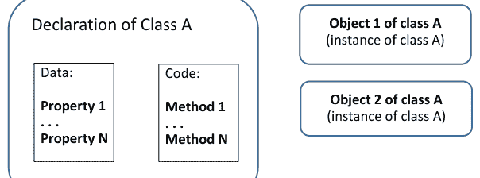

类 A 是构建对象的模板（定义）。它由称为“属性”的定义和称为“方法”（可执行代码）程序组成。

对象 1 和对象 2 是类 A 的实例。它们持有类 A 中声明的所有属性的具体值。

### 封装

封装原则要求对象的内部（数据和代码）不被直接访问。通过公共方法与对象“通信”。以下是 Java 中实现封装的示例。

```java
// 定义类 "Apple"
class Apple {
    private String color;
    public void setColor(String c) {
        color = c;
    }
}
```


```java
// 创建类 Apple 的对象
```

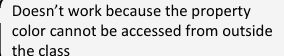

```java
// 执行对象的 "setColor" 方法
// 将颜色属性设置为 "red"
apple1.setColor("red");
```

```java
// 将颜色属性设置为 "red" 是错误的
apple1.color = "red";
```

### 继承

继承原则适用于类之间的关系。它规定类之间可以存在父子关系，其中子类（子类）继承父类（父类）的所有特征。

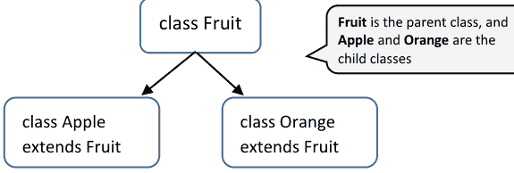

```java
// 定义类 "Fruit"
class Fruit {
    private String color;
    public void setColor(String c) {
        color = c;
    }
}
```

```java
// 将类 "Apple" 定义为 Fruit 的子类
class Apple extends Fruit {
}
```


```java
// 创建类 Apple 的对象
Apple apple1 = new Apple();
```

```java
// 执行对象的 "setColor" 方法
// 将颜色属性设置为 "red"
apple1.setColor("red");
```

```java
// 将颜色属性设置为 "red" 是正确的，因为继承了方法
```

### 多态

多态原则允许在一个或多个类中具有相同名称但实现不同的方法，并且语言必须能够在运行时确定执行哪种变体方法。

以下是 Java 语言实现多态的示例。假设我们需要计算不同形状（矩形、三角形、圆形等）的面积。每个形状都由它自己的类表示，且每个类都是超父类 `Shape` 的子类：

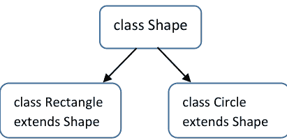

```java
// 定义类 Shape
class Shape {
    public double footage;
    public void showSquareFootage() {
        System.out.println(footage);
    }
}
```

```java
// 当创建 Rectangle 类对象时执行此方法。// 定义类 Rectangle
class Rectangle extends Shape {
    double width;
    double height;
    Rectangle(double w, double h) {
        width = w;
        height = h;
    }

    public void showSquareFootage() {
        footage = width * height;
        System.out.println(footage);
    }
}
```

```java
// Declare the class circle
class Circle extends Shape {
  double radius;
  Circle (double r) {
    radius = r;
  }

  void showSquareFootage() {
    double footage = radius * radius * 3.1415;
    System.out.println(footage);
  }
}
```


// Main program

```java
// Create an object of class shape
Shape shapel = new Shape();
shapel.showSquareFootage(); // prints "0"
```

```java
// Create a rectangle with width=2 and height=3
shapel = new Rectangle(2.0, 3.0); // shapel is now a rectangle
shapel.showSquareFootage(); // prints "6"
```

```java
// create a circle object with radius=2
shapel = new Circle(2.0); // shapel is now a circle
shapel.showSquareFootage(); // prints "6.2830"
```

在上面的示例中，变量 `shape1` 根据程序流程的不同，可以代表不同子类的对象。在执行期间，语言将验证 `shape1` 引用的对象的类型，并选择合适的 `showSquareFootage` 方法。

现在考虑我们想要改变矩形的尺寸并同时计算它的新面积。我们可以在 `Rectangle` 类定义中添加另一个 `showSquareFootage` 方法变体：

```java
class Shape {
  public double footage;
  public void showSquareFootage() {
    System.out.println(footage);
  }
}
```

```java
class Rectangle extends Shape {
  double width;
  double height;
  Rectangle (double w, double h) {
    width = w;
    height = h;
  }

  public void showSquareFootage() {
    footage = width * height;
    System.out.println(footage);
  }

  public void showSquareFootage(double w, double h) {
    width = w;
    height = h;
    footage = width * height;
    System.out.println(footage);
  }
}
```

> 此方法计算矩形的面积。

> 此方法改变矩形的尺寸，然后计算其面积。

现在，为了选择并执行适当的方法，语言不仅需要分析对象类型，还需要分析方法的签名（signature）。方法的签名是其返回类型和输入参数类型的组合。此示例中第一个方法的签名是 "void+void"（没有输出且没有输入参数），第二个方法的签名是 "void+double+double"（没有输出参数和两个类型为 `double` 的输入参数）。

以下是 `showSquareFootage` 方法两种变体的使用方法：

```java
// Main program logic

// 创建一个宽度为2、高度为3的矩形对象
Rectangle shape1 = new Rectangle(2.0, 3.0);

shape1.showSquareFootage();              // prints "6"

// 将矩形尺寸更改为 3x4
shape1.showSquareFootage(3.0, 4.0);      // prints "12"
```

## 数据类型、变量和字面量

面向对象的设计讨论让我们了解了 Java 语言与其他“传统”语言的不同。现在，让我们来看看让 Java 变得与非面向对象语言相似的特征。

包括 Java 在内的大多数语言都具有以下共同点：

- 操作基本数据类型的能力

- 变量和字面量

- 固定的运算符集

- 用于控制程序流的语言结构和语句

在本章中，我们将回顾基本数据类型、变量和字面量。其余内容将在后面的章节中介绍。

### 基本数据类型

基本数据类型（也可以称为简单类型或原子类型）不是由其他数据类型组合成的类型。例如，字符串不是基本数据类型，因为它被定义为字符数据类型元素的集合。

Java 定义了八种基本数据类型：

| Date | 描述 | 长度（位） | 范围（近似） |

|---|---|---|---|

| byte | 有符号整数 | 8 | -128 到 +127 |

| short | 有符号整数 | 16 | -32,768 到 +32,767 |

| int | 有符号整数 | 32 | -2.1*10^9 到 +2.1*10^9 |

| long | 有符号整数 | 64 | -9.2*10^18 到 +9.2*10^18 |

| float | 浮点数 | 32 | ± (1.4e-45 到 3.4e+38) |

| double | 浮点数 | 64 | ± (4.9e-32 到 1.8e+308) |

| char | Unicode 字符 | 16 | 0 到 65,536 |

| boolean | | N/A | true 或 false |

注意：Java 没有揭示 `boolean` 数据类型的长度，取决于其实现方式。

### 变量

在 Java 中，数据类型可以带值也可以不带值声明。以下是一些示例：

```java
int k = 100;
double d = 10.5;
char c = 'A';
boolean b = true;
```

### 字面量

字面量是源代码的一部分的固定值。例如，`100` 是整数字面量，`'A'` 是字符字面量。字面量有几种类型：

- 整数字面量

- 浮点数字面量

- 字符字面量

- 布尔字面量

- 字符串字面量

| 字符 | 描述 |

| --- | --- |

| ' | 单引号 |

| " | 双引号 |

| \ | 反斜杠 |

### 布尔字面量

布尔字面量只有两个值：`true` 和 `false`。这些值不会被转换为任何数值。

```java
boolean b = true; // 声明变量 "b" 并将其设置为 true
b = false; // 将 "b" 设置为 false
```

### 字符串字面量

字符串字面量是通过双引号括围一系列字符序列而形成的。以下是几个有效字符串字面量的示例。

```java
"String Literal"
"String in double quotes"
"String on \n two lines"
```

### 算术表达式中的类型转换

通常情况下，算术表达式的操作数（变量和字面量）可以是不同的数据类型。类型转换机制通过将操作数的精度从低级别提升到高级别来处理此类情况。精度从字节到双精度增加如下：

```
byte → short → int → long → float → double
```


类型转换有两种类型：隐式转换和显式转换。隐式转换由语言根据操作数的实际数据类型自动完成。显式转换由程序员通过在变量或字面量前面放置所需的类型来请求。

以下是算术表达式中操作数类型确定或设置的规则：

- 所有的整数字面量默认类型为`int`
- 所有的非整数字面量默认类型为`double`
- 在计算任何算术表达式之前，所有的`byte`和`short`变量都会被提升为`int`类型
- 对于每个算术操作（`+`, `-`, `*`, 等），如果操作数数据类型混合，则低精度的操作数将提升为高精度操作数的类型
- 字面量或变量将提升或降级为括号中类型修饰符显式指定的数据类型

## 示例 1

```
double result = 1.5 + 3 / 2; // result = 1.5 + 1 = 2.5
```

数据类型的确定和计算过程如下：

```
(double) result =
(double) 1.5 + (int) 2 =
(double) 1.5 + (int) 1 =
(double) 1.5 + (double) 1 = (double) 2.5
```

## 示例 2

```
double result = 1.5 + (double) 3 / 2; // result = 1.5 + 1.5 = 3.0
```

数据类型的确定和计算过程如下：

```
(double) result =
(double) 1.5 + (double) 3 / (int) 2 =
(double) 1.5 + (double) 3 / (double) 2.0 =
(double) 1.5 + (double) 1.5 = (double) 3.0
```

## 示例 3

```
int result = (int) (3.0 / 2.0); // result = 1
```

数据类型的确定和计算过程如下：

```
(int) result =
(int) ( (double) 3.0 / (double) 2.0 ) =
(int) ( (double) 1.5 ) =
(int) 1
```

## 运算符

在本章中，我们将复习可以应用于原始数据类型的运算符。这些运算符可以分为四大类：算术运算符、位运算符、关系运算符和布尔运算符。此外，这里还将讨论赋值运算符（`=`）和问号运算符（`?`）。

## 赋值运算符

赋值运算符`=`用于给变量赋值。在之前的示例中我们已经多次使用了它。赋值运算符的格式如下：

```
variable = expression;
```

它还可以用于在单个语句中为多个变量赋值，如下所示：

```
var1 = var1 = ... = varN = expression;
```

示例：

```
int x, y;   // 声明类型为整数的变量 x 和 y
x = 1;      // 将值 1 赋值给变量 x
x = y = 2;  // 将值 2 赋值给变量 x 和 y
```

## 算术运算符

算术运算符用于计算。Java 支持以下五个基本代数运算符：加（`+`）、减（`-`）、乘（`*`）、除（`/`）和取模（`%`）。其中每一个运算符都可以与赋值运算符（`=`）结合，形成所谓的简写运算符：

```
arithmetic_operator +=
```

示例：

```
double x, y;
x = 2.5;
y = 10;
x += y;      // x = 12.5 结果与 x = x + y 相同
x %= y;      // x = 2.5 结果与 x = x % y 相同
             // 注意：取模操作 (%) 返回的是
             // 除法 12.5 / 10 的余数
```

Java 还提供了两个算术运算符：自增（`++`）和自减（`--`），分别对值加 1 或减去 1。这些运算符可以放在变量之前或之后：

```
int x = 1;      // 声明 x 并将其值设置为 1
x++;             // 将 x 加 1 (x=2)
++x;             // 将 x 加 1 (x=3)
x--;             // 将 x 减 1 (x=2)
--x;             // 将 x 减 1 (x=1)
```

## 位运算符

位运算符用于对整数类型的每个位执行位操作。这些包括与（`&`）、或（`|`）、异或（`^`）和非（`~`）。

## 位移运算符

位移运算符根据指定的比特位数将数值的内容向左或向右移动。`<<`和`>>`运算符保留数字的符号（最左位），而`>>>`运算符则会在最左位置填充零。

## 关系运算符

关系运算符用于比较两个操作数的值，并产生`true`或`false`的布尔结果。

下表列出了所有可的关系运算符：

| 运算符 | 执行比较 |
| --- | --- |
| `==` | 操作数相等 |
| `!=` | 操作数不相等 |
| `>` | 第一个操作数大于第二个操作数 |
| `>=` | 第一个操作数大于等于第二个操作数 |
| `<` | 第一个操作数小于第二个操作数 |
| `<=` | 第一个操作数小于等于第二个操作数 |

示例：

```
int x = 1;
int y = 2;

if (x == y) { System.out.println("x is equal to y"); }
else { System.out.println("x is not equal to y"); }
```

## 布尔逻辑运算符

布尔逻辑运算符与位逻辑运算符相似。它们都对两个操作数应用逻辑 AND（与）、OR（或）、XOR（异或）和 NOT（非），并产生布尔结果，但位逻辑运算符作用于位，而布尔逻辑运算符作用于布尔值。

除了“常规”四个逻辑运算符（AND, OR, XOR, NOT）之外，Java 还提供两个“增强”布尔运算符——短路 OR 和短路 AND。它们将在本节稍后进行解释。

下表列出了布尔逻辑运算符：

| 运算符 | 执行的功能 | 运算符类型 |
|---|---|---|
| `!` | 逻辑一元 NOT | 常规逻辑运算符 |
| `&` | 逻辑 AND | |
| `|` | 逻辑 OR | |
| `^` | 逻辑异或 OR (XOR) | |
| `||` | 短路 OR | 短路逻辑运算符 |
| `&&` | 短路 AND | |

与位运算符相同，布尔逻辑运算符（一元 NOT 运算符和短路运算符除外）可以与赋值运算符结合，形成如下所示的简写形式：

```
a &= b;   // 这相当于 a = a & b;
a |= b;   // 这相当于 a = a | b;
a ^= b;   // 这相当于 a = a ^ b;
```

布尔逻辑运算符（`&`）、（`|`）、（`^`）和（`!`）将逻辑运算符 AND, OR, XOR, 和 NOT 应用于表达式的两个布尔操作数。下表显示了两个布尔操作数所有可能的组合的布尔逻辑运算符结果：

| 逻辑运算符: | AND | OR | XOR | NOT |
|---|---|---|---|---|
| 操作数 A | 操作数 B | A & B | A \| B | A ^ B | !A |
| True | True | True | True | False | False |
| True | False | False | True | True | False |
| False | True | False | True | True | True |
| False | False | False | False | False | True |

短路运算符（`&&`）和（`||`）在左侧操作数的值决定结果且无论另一个操作数的值时，不会评估逻辑表达式的右侧操作数。例如，如果`A=true`，无论`B`的值是什么，`A | B`的结果始终为`true`。

示例：

```
boolean a, b, c;
a = true;
b = true;

a = !b;      // a=false
a &= b;      // a=false (同于: a = a & b)
a |= b;      // a=true (同于: a = a | b)
a^= b;      // a=false (同于: a = a ^ b)
a = a ^ b; // a=false
```

// 短路运算符

```
a = false;
b = true;
c = a || b;   // c=true (a 和 b 都会被求值)
c = b || a;   // c=true (a 不会被求值)
c = a && b;   // c=false (b 不会被求值)
```

## 条件运算符

Java 提供了一个特殊的三元（三路）条件运算符`? :`，它允许对某些 IF-THEN-ELSE 语句进行紧凑实现。`:`运算符的格式如下：

```
variable = logical_expression ? expression1 : expression2
```

`logical_expression`是任何求值为布尔值的表达式。如果它求值为`true`，则求值`expression1`并赋值给`variable`；否则，求值`expression2`并赋值给`variable`。这可以用伪代码表示如下：

```
IF logical_expression = true
THEN variable = value of expression1
ELSE variable = value of expression2
```

示例 1：

```
int x = -1; int y = -1;
y = x > 0 ? x : -x; // x = -1; y = +1
```

示例 2：

```
int x = -1; int y = -1;
y = x > 0 ? x : -(x = x + y); // x = -2; y = +2
```

在第二个示例中，首先执行`x = x + y`表达式导致`x=-2`。然后，表达式`-(-2)`求值为`+2`，并将此值赋值给`y`。

# 程序流控制

大多数计算机语言（包括 Java）都支持以下基础程序流控制结构：

- 顺序语句 (Sequential Statement)
- 语句块 (Block of Statements)
- 二选一结构 (IF 结构)
- 多选一结构 (CASE 结构)
- 迭代 (Iteration)
- 跳转 (GOTO 语句)

本段落将介绍 Java 对这些结构的实现。

## 顺序语句

顺序语句不改变程序流。

赋值语句如`x = b;`是顺序语句的一个示例。Java 还有一个空语句，它只是一个分号（`;`），前面没有任何表达式。

## 语句块

语句块是一组被包含在大括号`{}`之中的语句。

## "if" 语句

"if" 语句实现了二选一结构：

if 语句的格式如下：

```
if ( expression )
  { statements }
else
  { statements }
```

示例：

```
int x, y;
x = 5;
if (x > 0) y = 1;
else y = 0;
```

## "switch" 语句

switch 语句实现了多选一 (CASE) 结构：

switch 语句的格式为：

```
switch ( expression ) {
  case value1:
    statements;
  case value2:
    statements;
  default:
    statements;
}
```

## 迭代语句

Java 支持三种迭代语句——`while`、`do...while`和`for`。它们都会执行代码块直到满足某些条件。

## "while" 语句

`while`语句在指定的条件为真时执行代码块（循环体）。

这里的一个重要点是先求值`condition`，然后执行`body`。如果初始为假，循环体将完全不执行。while 语句的格式为：

```
while ( condition ) { body }
```

示例：

```
int n;
n = 2;
while (n > 0)
{
    System.out.print("n=" + n); // 输出 "n=2 n=1"
    n--;
}
```

## "do...while" 语句

`do...while`语句与上述`while`语句相似，有一个例外——它首先执行循环体，然后评估指定的条件：

do...while 语句的格式如下：

```
do { body } while ( condition ) ;
```

示例：

```
int n;
n = 2;
do
{
    System.out.print("n=" + n); // 输出: "n=2 n=1"
    n--;
}while (n > 0);
```

正如我们所看到的，结果与之前的`while`语句示例完全相同。然而，如果`n`的初始值为 0，循环体将执行一次，上述代码将产生此输出：

```
n=0
```

## "for" 语句

`for`语句用于实现所谓的“控制”循环。控制循环基本上是`while`循环，但它具有显式指定的代码，用于初始化和迭代循环控制条件中使用的变量：

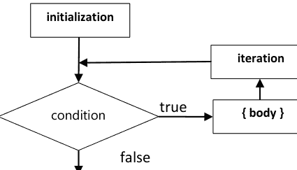

让我们看看上一个`while`语句的示例：

```java
int n;
n = 2;
while ( n > 0 ) {
  system.out.println("n=" + n);
  n--;
}
```

相同的逻辑可以使用`for`语句如下所示编码：

```java
int n;
for ( n = 2; n > 0; n--) {
  system.out.println("n=" + n);
}
```

这是`for`语句的“经典”形式，其格式为：

```
for (初始化; 条件; 迭代) { 主体 }
```

`for`语句的另一种形式是处理集合（例如数组），被称为“for-each”循环。我们将在几个示例中介绍它。

上面示例中的`n`被称为循环控制变量。可以有多个循环控制变量，如例所示：

```java
int x, y, z;
// 寻找 x, y 和 z 之和降为 0 的时刻
for (x=3, y=5, z=7) x+y > 0; x--, y--, z--; {}; // 空块；可以不带大括号指定
System.out.println("x/y=" + x + "/" + y + "/" + z);
```

这段代码的输出将是：

```
x/y/z=-2/0/2
```

注意初始化（`x=3, y=5, z=7`）和迭代（`x--, y--, z--`）语句是用逗号分隔的。

## 内部循环控制变量

关于`for`语句的另一个重要说明：当循环控制变量在`for`语句内部定义时，它在`for`语句之外是“不可见的”：

```java
for ( int n = 2; n > 0; n-- )
{
  System.out.println("n=" + n);
} // n 的值是已知的

// n 变量在 for 语句之外是“不可见的”
System.out.println("final n=" + n); // 错误：n 未定义
```

## 无循环控制变量的 "for" 语句

值得提到，`for`语句可以在没有初始化或迭代表达式（或两者都没有）的情况下编码：

```java
int n, max;
n = 0;
max = 100;
boolean reachedMax = true;
for ( ; !reachedMax; ) // 当未达到 max 时...
{
  // n 的值直到它超过 max
  n++;
  if (n > max) reachedMax = true;
}
System.out.println("n=" + n); // 输出：n=128
```

## "for-each" 语句

考虑这样一个示例：我们需要计算存储在数组中的一组数字的平均值。以下是我们使用“经典”`for`语句来实现这一点：

```java
int nArray[] = {1, 2, 3, 4, 5}; // 包含五个数值的数组
double avg = 0;

// 遍历 nArray 元素（第一个元素索引为 0）
// 并计算所有元素的和

for ( int i = 0; i < nArray.length; i++ )
  avg += nArray[i];

// 将和除以元素个数
avg /= nArray.length;
System.out.println("avg=" + avg); // 输出：avg=3.0
```

使用语句的“for-each”版本也可以实现相同的结果，其格式如下：

```java
for (类型 迭代变量: 集合) { 主体 }
```

上面的示例看起来如下：

```java
int nArray[] = {1, 2, 3, 4, 5}; // 包含五个数值的数组
double avg = 0;

// val 必须被赋值每个数组元素的值
// 按照顺序逐一个。

for ( int val: nArray)
  avg += val;

avg /= nArray.length;
System.out.println("avg=" + avg); // 输出：avg=3.0
```

请注意，迭代变量`val`的数据类型必须与集合（数组）元素的数据类型相同或兼容。兼容的数据类型是原始数据类型可以隐式提升的类型。在这个示例中，原始数据类型是`int`，它可以提升为`long`、`float`或`double`。

## "break" 语句

Java 提供了两个语句——`break`和`continue`，它们可以中断循环或任何语句块的“自然”执行流。`break`语句会导致循环或任何命名代码块在到达末尾之前终止。`continue`语句立即开始循环的下一次迭代。


让我们从`break`语句开始。我们已经在`switch`结构中见过它，它被用于在`case`表达式中跳出`switch`语句。

## 跳出带标签块

`break`语句的格式如下：

```java
break [标签];
```

标签`label`是可选的，用于跳出任何命名的（带标签的）代码块。该块不需要是循环或`switch`语句。考虑这个示例：

```java
int var;
var = 2;

block1:
{
    if (var != 1) break block1;
    System.out.println("Block 1 executed");
}

block2:
{
    if (var != 2) break block2;
    System.out.println("Block 2 executed");
}
```

这段代码的输出将是“Block 2 executed”。由于变量`var`不等于 1，`break block1`将跳出`block1`到下一条语句。注意，这种技术在命名块块嵌套时同样有效。`break`可以从内部块跳到外部块之外：

```java
int var = 2;

block1 {
  block2 {
    block3 {
      if (var == 1) break block1;
      if (var == 2) break block2;
      if (var == 3) break block3;
      System.out.println("Last statement of block3");
    }
    System.out.println("Last statement of block2");
  }
  System.out.println("Last statement of block1");
}
```

这段代码的输出将是 "Last statement of block1"。条件`(var==2)`为真，`break2`将跳出`block3`和`block2`，到`block1`的下一条语句。

## 跳出循环

当`break`语句不带标签参数使用时，它会中断包含`break`的循环的执行。在嵌套循环的情况下，可以使用标签来识别每个循环，标签参数将指示终止哪个循环。

示例：

```java
int i;
// for 循环
for (i=9; i>0; i--) {
  System.out.println("i=" + i);
  if (i==7) break;
}
// while 循环
i = 9;
while (i>0) {
  System.out.println("i=" + i);
  if (i==7) break;
}
// do...while 循环
i = 9;
do
{
  System.out.println("i=" + i);
  if (i==7) break;
} while (i>0);
```

所有的`for`循环在`i`从 9 递减到 0，当`i`等于 7 时`break`。

所有的`while`循环在`i`从 9 递减到 0，当`i`等于 7 时`break`。

所有的`do...while`循环在`i`从 9 递减到 0，当`i`等于 7 时`break`。

所有的`for`循环在`i`从 9 递减到 0，当`i`等于 7 时`break`。

所有的`while`循环在`i`从 9 递减到 0，当`i`等于 7 时`break`。

所有的`do...while`循环在`i`从 9 递减到 0，当`i`等于 7 时`break`。

所有的`for`循环在`i`从 9 递减到 0，当`i`等于 7 时`break`。

所有的`while`循环在`i`从 9 递减到 0，当`i`等于 7 时`break`。

所有的`do...while`循环在`i`从 9 递减到 0，当`i`等于 7 时`break`。

所有的`for`循环在`i`从 9 递减到 0，当`i`等于 7 时`break`。

所有的`while`循环在`i`从 9 递减到 0，当`i`等于 7 时`break`。

所有的`do...while`循环在`i`从 9 递减到 0，当`i`等于 7 时`break`。

所有的`for`循环在`i`从 9 递减到 0，当`i`等于 7 时`break`。

所有的`while`循环在`i`从 9 递减到 0，当`i`等于 7 时`break`。

所有的`do...while`循环在`i`从 9 递减到 0，当`i`等于 7 时`break`。

所有的`for`循环在`i`从 9 递减到 0，当`i`等于 7 时`break`。

所有的`while`循环在`i`从 9 递减到 0，当`i`等于 7 时`break`。

所有的`do...while`循环在`i`从 9 递减到 0，当`i`等于 7 时`break`。

以下是嵌套嵌套循环的示例：

```java
int x, y = 0;
loopA: for (x=0; x<3; x++) {
  for (y=0; y<3; y++) {
    if (x == y) break loopA; // 当 x 等于 y 时跳出外层循环
    System.out.println(x + "/" + y);
  }
}
```

## 多维数组

解释多维数组创建的最简单方法是回顾一个示例。假设我们想要创建以下二维数组：

| 列 1 | 列 2 | 列 3 |
| --- | --- | --- |
| 行 1 | 1 | 2 |
| 行 2 | 10 | 11 | 12 |

使用数组初始化器，可以通过该语句创建数组：

```java
int[][] N = {{1, 2}, {10, 11, 12}};
```

该数组将包含五个元素，数组元素的值赋值方式如下：

```java
N[0][0] = 1;
N[0][1] = 2;
N[0][2] // 元素不存在
N[1][0] = 10;
N[1][1] = 11;
N[1][2] = 12;
```

我们也可以使用`new`语句创建这个多维数组：

```java
int[][] N;
N = new int[2][3]; // 创建的 2x3 数组是一个包含 6 个元素的 2x3 表。
```

然而，上述代码的结果是一个包含 6 个元素的 2x3 表。为了去掉`N[0][2]`元素，我们需要重写代码：

```java
int[][] N;
N = new int[2][]; // 具有未定义行数的列
N[0] = new int[2]; // 第一行将包含 2 列
N[1] = new int[3]; // 第二行将包含 3 列
```

为了避免与其它语言中实现数组（或表格）的方式产生混淆，你应该将 Java 数组想象成对象的层级结构。我们刚刚回顾的`N`数组可以看作：

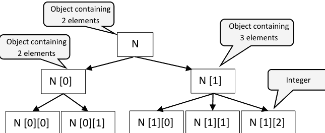

作为对象，`N`、`N[0]`和`N[1]`拥有`length`属性，当我们在我们想要遍历数组时非常有用：

```java
// 这段代码打印二维数组 N 的所有元素
for (int x=0; x<N.length; x++)
{
  for (int y = 0; y < N[x].length; y++)
  {
    System.out.println(N[x][y]);
  }
}
```

# 方法

**方法**（method）是一个可以通过名称引用和调用的代码块。它的结构如下：

```java
accessAttributes returnType methodName(parameters) { body }
```

示例：

```java
public int myMethod(int x, int y) {
return x + y;
}
```

该方法接受两个整数，并将它们的和返回给调用程序（即另一个方法）。

**访问修饰符**（access attributes）是可选的。它们将在单独章节中详细讨论。

**返回值类型**（return type）可以是任何基本类型、数组、类或`void`，后者表示方法不返回任何数据。

**方法名**（method name）可以是你选择的任何名称。

**参数**（parameters）是可选的。

**方法体**（body）是一组变量声明和可执行语句。

## "main" 方法

`main`方法是一个特殊方法，用于启动所有 Java 程序的执行。Java 在所有提交执行的类中查找此方法，并期望它的定义完全如下：

```java
public static void main (String args[]) { body }
```

## 类和对象

Java 是一种面向对象的语言，这意味着它的主要目的是操作对象。对象（Object）是由数据和代码组成的逻辑实体。所有对象都是由称为类（class）的模板构建的，这使得类成为 Java 语言的核心。任何你想在 Java 中实现的功能必须构造为一个类。

下图说明了类和对象之间的关系：

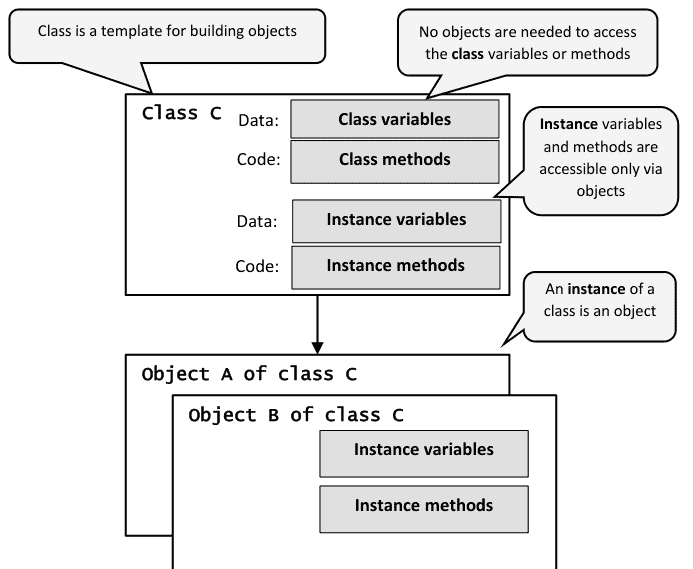

## 类声明

使用`class`语句声明类：

```java
class className {
  type variable1;
  type variable;
  type method1(parameters);
  type methodN(parameters);
}
```

示例：

```java
// Temperature 类提供了将温度
// 从摄氏度转换为华氏度以及反之然的功能
class Temperature {
  // 类变量和方法：
  static double t; // 温度值
  static double FtoC() // 将 'F' 转换为 'C' 的方法
    {return (temp - 32) / 1.8;}
  static double Ctof() // 将 'C' 转换为 'F' 的方法
    {return temp * 1.8 + 32;}

  // 实例变量和方法：
  double temp; // 温度值
  double toCelsius() // 将 'F' 转换为 'C' 的方法
    {return (temp - 32) / 1.8;}
  double toFahrenheit() // 将 'C' 转换为 'F' 的方法
    {return temp * 1.8 + 32;}
}
```

## 类变量和方法

之前的示例代码声明了一个新的`Temperature`类，包含组变量和方法。这两组主要区别在于对`static`作用域修符的使用。所有声明为`static`的变量和方法都称为类变量和类方法，可以在不创建对象的情况下使用。变量和其他方法称为实例变量和实例方法，只能通过对象实例使用。

下面的代码说明了上面定义的`Temperature`类类的变量`t`以及类方法`FtoC()`和`CtoF()`的使用：

```java
double temp;

// 类变量和方法可以通过类名引用
Temperature.t = 77.0;
temp = Temperature.FtoC();
System.out.println(Temperature.t + " F=" + temp + "C");
```

```java
// 类变量和方法可以直接通过它们的名称
// 进行引用（如果名称在程序中是唯一的）
temp = 25.0;
System.out.println(t + "C=" + temp + "F");
```

这段代码将打印：

```text
77.0F=25.0C
25.0C=77.0F
```

## 初始化类变量

在程序执行期间，当类加载到 Java 虚拟机（JVM）时，类变量会被赋值。对于数值变量，默认值为零。如果需要将类变量初始化为非默认值，可以在`static`块中完成。

示例：

```java
class Temperature {
    static double t = 77.0; // 类变量已初始化
    static double FtoC() // 将 'F' 转换为 'C' 的方法
        {return (temp - 32) / 1.8;}
    static double Ctof() // 将 'C' 转换为 'F' 的方法
        {return temp * 1.8 + 32;}

    double temp; // 温度值
}
```

类变量`totalCount`在类首次被`main`程序引用时将初始化为 0。当创建对象`obj1`和`obj2`时，实例语句块将执行，将`totalCount`增加 1，并将新值赋给实例变量`myNumber`。请注意，对象`obj1`和`obj2`将拥有它们自己的`myNumber`变量副本。

上一个示例包含一个尚未触及的内容——`new`语句，它用于创建对象。让我们仔细查看该语句以及创建新对象的整个过程。

## 对象的用法

对象是 Java 语言的核心，因此很好地理解如何创建对象以及如何使用它们的内容非常重要。

## 创建对象

创建新对象的过程称为实例化，它是使用`new`语句完成的。`new`语句的格式如下：

```java
className 对象的引用变量 = new className(参数);
```

示例：

```java
myClass object1 = new myClass();
```

在执行上述语句期间，发生了以下情况：

- 1) `myClass object1`声明了类型为`myClass`的变量`object1`。该变量可以用于引用任何`myClass`类的对象，这就是为什么此类变量被称为对象引用。
- 2) `new`运算符创建一个新对象；所有变量的实例声明、语句块和方法都会被处理。
- 3) 调用`myClass()`方法来可选地初始化新创建对象的实例变量。
- 4) 建立了变量`object1`与新对象之间的引用。

## 构造方法

上述的`myClass()`方法被称为构造方法，它是一个与类名相同且没有指定返回类型的方法。它在创建该类的对象时由 JVM 调用。构造方法的作用是初始化类的实例变量。如果你不声明任何构造方法，JVM 将创建一个：`className() {}`，它将什么都不做。然而，一旦程序员至少声明了一个构造方法，默认构造方法就会消失且无法使用。请记住，构造方法是在实例声明和语句块处理之后立即调用的。下面是一个跟踪对象的类示例：

```java
class testclass {

    static int count; // 对象总计数器；默认值为零

    int myNumber; // 对象的顺序号

    // 实例块在每次创建对象时执行

    {

        myNumber = ++count; // 实例块增加计数

    } // 并将其赋值给对象的 myNumber

    testClass() {} // 无参数的构造方法

    testClass(int n) {

        myNumber = n; // 第二个构造方法；将指定的

        // 顺序号赋予新对象

    }

    -----执行----

    public static void main(String args[]) {

        testClass obj1 = new testClass();

        testClass obj2 = new testClass();

        testClass obj3 = new testClass(10);

        System.out.println(obj1.myNumber); // 输出 1

        System.out.println(obj2.myNumber); // 输出 2

        System.out.println(obj3.myNumber); // 输出 10

    }

}
```

注意，我们定义了两个同名但不同的构造方法。这被称为“方法重载”。

## 方法重载

**方法重载**是 Java 用于区分具有相同名称但不同参数列表方法的机制。Java 中的每个方法都通过其**签名**来区分——即方法名加上参数类型列表。`testClass()`方法的签名可以表示为“testClass”，而`testClass(int n)`的签名将是“testClass,int”。

## “this”关键字

在之前的示例中，实例变量在构造方法中直接通过它们的名称引用。但当在`main`方法中声明一个与实例变量同名的变量时会发生什么呢？这种情况是完全合，因为在`main`方法内部声明的所有变量在方法外部都是“不可见”的。

另一个令人困惑的情况是实例变量的名称也被用在构造方法的参数列表中。这个问题可以通过使用`this`关键字来解决，它代表当前对象。看这个示例：

```java
class testClass {

  int x;

  testClass(int x) {

    x = x;

    this.x = x;

  }

  public static void main(String args[]) {

    int x;

    testClass obj = new testClass(100);

    x = obj.x;

  }

}
```


`this` 关键字不仅可以用于引用实例变量，还可以从一个构造方法调用另一个构造方法，或者将当前对象作为参数在方法之间传递。

重要说明：`this` 关键字只能在构造方法中使用。

另一个使用 `this` 关键字的示例：

```java
class Position {
    int x, y, z;

    Position(int x, int y, int z) {
        this.x = x;
        this.y = y;
        this.z = z;
    }

    Position(int x) {
        this(x, 0, 0);
        showPosition(this);
    }

    void showPosition(Position p) {
        System.out.println("My position: " + p.x + "," + p.y + "," + p.z);
    }

    public static void main(String args[]) {
        Position obj = new Position(5);
    }
}
```

上述代码输出：`My position: 5,0,0`

## `super` 关键字

在之前的示例中，实例变量在构造方法中通过其名称直接引用。但当在 `main` 方法中声明一个与实例变量同名的变量时会发生什么？这种情况是完全合法的，因为在 `main` 方法内部声明的所有变量在方法外部都不是“可见”的。

另一个令人困惑的情况是实例变量的名称也被用在构造方法的参数列表中。这个问题可以通过使用 `this` 关键字来解决，它代表当前对象。看这个示例：

```java
class testClass {
    int x;

    testClass(int x) {
        x = x;
        this.x = x;
    }

    public static void main(String args[]) {
        int x;
        testClass obj = new testClass(100);
        x = obj.x;
    }
}
```

`this` 关键字不仅可以用于引用实例变量，还可以从一个构造方法调用另一个构造方法，或者将当前对象作为参数在方法之间传递。

重要说明：`this` 关键字只能在构造方法中使用。

另一个使用 `this` 关键字的示例：

```java
class Position {
    int x, y, z;

    Position(int x, int y, int z) {
        this.x = x;
        this.y = y;
        this.z = z;
    }

    Position(int x) {
        this(x, 0, 0);
        showPosition(this);
    }

    void showPosition(Position p) {
        System.out.println("My position: " + p.x + "," + p.y + "," + p.z);
    }

    public static void main(String args[]) {
        Position obj = new Position(5);
    }
}
```

上述代码输出：`My position: 5,0,0`

## `super` 关键字

在之前的示例中，实例变量在构造方法中通过它们的名称直接引用。但当在 `main` 方法中声明一个与实例变量同名的变量时会发生什么？这种情况是完全合法的，因为在 `main` 方法内部声明的所有变量在方法外部都不是“可见”的。

另一个令人困惑的情况是实例变量的名称也被用在构造方法的参数列表中。这个问题可以通过使用 `this` 关键字来解决，它代表当前对象。看这个示例：

```java
class testClass {
    int x;

    testClass(int x) {
        x = x;
        this.x = x;
    }

    public static void main(String args[]) {
        int x;
        testClass obj = new testClass(100);
        x = obj.x;
    }
}
```

`this` 关键字不仅可以用于引用实例变量，还可以从一个构造方法调用另一个构造方法，或者将当前对象作为参数在方法之间传递。

重要说明：`this` 关键字只能在构造方法中使用。

另一个使用 `this` 关键字的示例：

```java
class Position {
    int x, y, z;

    Position(int x, int y, int z) {
        this.x = x;
        this.y = y;
        this.z = z;
    }

    Position(int x) {
        this(x, 0, 0);
        showPosition(this);
    }

    void showPosition(Position p) {
        System.out.println("My position: " + p.x + "," + p.y + "," + p.z);
    }

    public static void main(String args[]) {
        Position obj = new Position(5);
    }
}
```

上述代码输出：`My position: 5,0,0`

## `super` 关键字

当创建一个子类对象时，父类对象也会被创建，无论是隐式的还是显式的。这意味着任何对象都包含父类（superclass）。创建父类对象的示例：

```java
class superClass {
    int x;
}

class subclass extends superClass {
    int x;
}
```

`super` 关键字用于访问父类实例。例如：

```java
class superClass {
    int x;
}

class subclass extends superClass {
    int x;

    subclass(int x) {
        super.x = x;
        this.x = x;
    }

    public static void main(String args[]) {
        subclass obj = new subclass(10);
        System.out.println(obj.x); // 输出 10
        System.out.println(((super) obj).x); // 逻辑在此
    }
}
```

`super` 关键字可以用于调用父类构造方法或访问父类的实例变量或方法。

## 对象类型转换

注意，`super` 关键字只能在构造方法中使用。那么我们如何从子类对象访问父类的实例变量或实例方法呢？在上面的示例中，变量 `x` 在子类和父类中都定义。子类的 `x` 可以通过子类对象名称引用如下：`subclassObject.x`，但父类的 `x` 被隐藏了。解决此问题的方法是类型转换。我们可以将子类对象转换为任何父类对象。考虑一个两个类 `Parent` 和 `Child`，它们都声明了实例变量 `x`。

```java
class Parent {
    int x;
}

class Child extends Parent {
    int x;
}

class Test {
    public static void main(String args[]) {
        int y;

        // 类型为 Child 的引用子类对象：
        Child c = new Child();

        y = c.x;             // 引用子类的 x
        y = ((Parent) c).x;  // 引用父类的 x

        // 类型为 Parent 的引用子类对象：
        Parent p = new Child();

        y = p.x;             // 引用父类的 x
        y = ((Child) p).x;    // 引用子类的 x
    }
}
```

此表总结了父类和子类实例变量的可访问性：

| 对象引用 | `class Parent` 实例变量 | `class Child extends Parent` 实例变量 |
| --- | --- | --- |
|  | 特有 | 与 `Child` 中相同 |
|  | 特有 | 与 `Parent` 中相同 |
| `Parent p1 = new Parent()` |  |  |
| `p1.` | 可以访问 | 可以访问 |
| `Parent p2 = new Child()` |  |  |
| `p2.` | 可以访问 | 可以访问 |
| `((Child) p2).` | 可以访问 | 可以访问 |
| `Child c = new Child()` |  |  |
| `c.` | 可以访问 | 可以访问 |
| `((Parent) c).` | 可以访问 | 可以访问 |
| `super.` | 可以访问 | 可以访问 |

## 方法重写（Method Overriding）

方法覆盖是一种特殊的机制，允许在父类及其任何子类中声明具有相同签名（名称和参数类型）的实例方法。

此表展示了访问父类和子类实例方法的不同方式。请注意，对象类型转换并不能让你从子类访问父类的被重写方法。一旦创建了子类对象，每个重写方法只有子类实例是可的。

| 对象引用 | `class Parent` | `class Child extends Parent` |
| --- | --- | --- |
|  | 实例方法（特有） | 重写 |
|  | 实例方法（特有） | 重写 |
| `p1.` | 可以访问 | 可以访问 |
| `Parent p2 = new Child()` |  |  |
| `p2.` | 可以访问 | 可以访问 |
| `((Child) p2).` | 可以访问 | 可以访问 |
| `Child c = new Child()` | 可以访问 | 可以访问 |
| `c.` | 可以访问 | 可以访问 |
| `super.` | 可以访问 | 可以访问 |
| `((Parent) c).` | 可以访问 | 可以访问 |

## 确定对象的类型

在处理对象时，有时可能不清楚对象属于哪个类。例如，如果类 `A` 被类 `B` 和 `C` 继承，类型为 `A` 的对象引用可以引用 `A`、`B` 和 `C` 类的对象：

```java
A obj;

obj = new A(); // obj 是指向类 A 对象的引用
obj = new B(); // obj 是指向类 B 对象的引用
obj = new C(); // obj 现在引用类 C 的对象
```

类型为 `Object` 的对象引用可以引用任何类、任何对象：

```java
Object obj;

obj = new String("text");
obj = new Integer(123);
obj = new MyClass();
```

那么，我们如何确定变量所引用对象的真实类型呢？

答案是——借助 `instanceof` 运算符。

`instanceof` 运算符格式为：

```java
objectReference instanceof classType
```

示例：

```java
Object obj;

obj = new String("text");
obj = new Date();

if (obj instanceof String) {
    System.out.println("Object of type String");
}

if (obj instanceof Date) {
    System.out.println("Object of type Date");
}
```

## 总结

以下是我们目前为止关于对象的学习内容总结：

- 使用 `new` 语句实例化（即创建）对象，其格式为：`className variable = new className();`
- `constructor` 是一个名称与类名相同的特殊方法，当创建该类的对象时，JVM 会自动调用它。
- 构造函数的格式为：`className(parameters) {body}`。`parameters` 和 `body` 是可选的，返回类型被省略。
- 构造函数在处理完所有实例声明并执行实例块（如果存在）后被调用。
- 一个类可以有多个具有不同签名（即具有不同参数类型序列）的构造函数。
- 当没有显式声明构造函数时，Java 会自动创建一个空构造函数（`className()`）。
- 如果存在一个显式声明的构造函数，JVM 将不会创建默认构造函数（`className()`）。
- 构造函数可以通过在构造函数体的第一条语句中执行 `this(parameters);` 来调用同类的另一个构造函数。
- 在构造函数中，可以通过 `this` 关键字引用实例变量，如下：`this.variableName`
- 关键字 `super` 代表子类（子）的父类（父），可以在子类的构造函数中使用它来调用父类构造函数——`super(parameters)`；访问父类实例变量——`super.variable`；以及调用父类方法 `super.method()`。
- 父类及其子类可以声明同名的实例变量。如果我们想从子类访问父类的非特有实例变量，应该使用对象类型转换机制：

```java
((superclass) subclassObject).x

// 指向父类的变量 x
```

- 父类及其子类可以声明具有相同签名（名称和参数列表）的实例方法。方法重写机制确保了在创建对象时实例化了正确的方法。
- `instanceof` 运算符检查对象是否属于指定的类。

## 包装类（Type Wrappers）

基本类型数据类型的使用有其局限性。许多数据结构是针对对象操作的。例如，你无法构建一个整数集（集合是具有不同值的对象的集合，这将在书中后后讨论）。这就是为什么 Java 提供了类型包装类——将原始类型封装在对象中的类。每个原始类型都有对应的一个包装类：

`Double`、`Float`、`Long`、`Integer`、`Short`、`Byte`、`Character` 和 `Boolean`。

上述每个类都提供了系列的方法（大部分是静态的），允许对底层原始类型进行各种操作，包括不同原始类型之间的转换。

示例：

```java
Integer N = Integer.valueOf(10); // N 是一个 Integer 对象

int n = N.intValue();
double d = N.doubleBinaryString(n);
String s = Integer.toString(n);

System.out.println("n=" + n + " d=" + d + " s=" + s);
```

该程序的输出为 `"n=10 d=10.0 s=1010"`。

## 自动装箱（Autoboxing）

在 JDK5 中，Java 引入了自动装箱/自动拆箱功能。当需要该类型的对象时，自动装箱会自动创建一个类型包装对象并将原始类型封装其中。自动拆箱是相反的过程；它从包装对象中获取原始类型。

示例：

```java
class testwrapper {
    public static double test(Integer N) {
        return N;
    }

    public static void main(String args[]) {
        int n = 123;
        double d = test(n);

        System.out.println("d=" + d); // 输出: d=123.0
    }
}
```

## 字符串（Strings）

在 Java 中，字符序列由 `String` 类表示。`String` 类是一个普通类，可以像普通类一样处理。然而，由于其广泛的使用，Java 添加了一些方便的功能，使字符串处理更加直观。在本章中，我们将回顾 `String` 类的所有特殊特性。

### 字符串字面量（String Literals），创建字符串

字符串字面量是封装双引号内的字符序列：`"First line of a string literal.\n second line."`

字符串字面量可以直接创建 `String` 对象：

| 语句 | 描述 |
| --- | --- |
| `String s1 = new String();` | 创建一个空的 `String` 对象 |
| `s1 = "text";` | 给 `String` 对象 `s1` 赋值 |
| `String s2 = new String("text");` | 创建并初始化 `String` 对象 |
| `String s3 = "text";` | 使用字面量创建并初始化 `String` |

正如示例所示，无需使用 `new` 运算符即可创建 `String` 对象——只需将字符串字面量直接赋值给 `String` 变量。初看起来这很奇怪，但有一个简单的解释：

> Java 中独立的字符串字面量是 `String` 类的对象。

Java 为每个唯一的字符串字面量创建一个对象，不同的对象变量可以引用该对象。相反，`new` 运算符无论传递给构造函数的字面量值是什么，总是创建一个新对象：


```java
String s1 = new String("text"); -> String 对象 "text"

String s2 = new String("text"); -> String 对象 "text"

String s3 = "text"; -> String 对象 "text"

String s4 = "text";
```

由于独立的字符串字面量表示一个 `String` 对象，因此你可以像操作对象一样操作它，而无需创建引用。例如，你可以调用 `String` 类的实例方法 `length()` 来获取字面量的长度，如下：

```java
int n = "text"; // n = 4
```

关于 `String` 对象的另一个重要事实：

> 一旦创建并初始化，`String` 对象就不能被修改。它的值不能被追加、截断或替换。如果你需要可修改的字符串——请使用 `StringBuffer` 类（本书未涉及内容）。

## 比较字符串

理解比较两个实际的字符串值与比较两个 `String` 对象的引用之间的区别是非常重要的：

```java
String s1 = "text";

String s2 = "text";

boolean b = (s1 == s2); // b=true

s1 和 s2 指向同一个值为 "text" 的 String 对象

String s3 = new String("text");

String s4 = new String("text");

boolean b = (s3 == s4); // b=false

s3 和 s4 指向不同的具有相同值 "text" 的 String 对象
```

要比较两个字符串的实际值（实际上它们封装在 `String` 对象中），我们需要使用 `String` 类的实例方法 `equals()`：

```java
String s1 = new String("text");

String s2 = new String("text");

boolean b = (s1.equals(s2)); // b = true
```

## 字符串拼接运算符

字符串拼接运算符 `+` 将两个操作数合并为一个字符串。原始数据类型操作数（`boolean`、`int`、`char`、`double` 等）会被转换为它们的字符串表示，而对象操作数将通过调用实例方法 `toString()` 转换为字符串。这种转换是在操作的基础上执行的，从左到右，如下例所示。

### 示例 1

```java
string s = "I have " + 5 + 4 + " dollars";
```

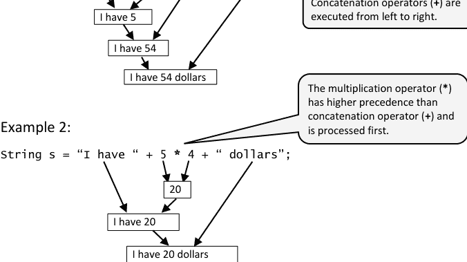

### 示例 2

```java
String s = "I have " + 5 * 4 + " dollars";
```


## `String` 类方法

在本节中，我们将介绍 `String` 类的一些常用方法。

### 确定字符串长度

```java
String s = "text";

int lng = s.length(); // lng = 4

lng = "my string".length(); // lng = 9
```

### 比较字符串

`compareTo()` 方法按字典顺序对两个字符串进行比较。比较基于字符串中每个字符的 Unicode 值，并通过从左到右逐个比较字符，直到找到不相等的字符或到达其中一个字符串的末尾。`compareTo()` 方法返回的值计算方式为不相等字符的数值之差（`'a' - 'b' = -1`）。如果其中一个字符串到达末尾，该方法返回两个字符串长度的差。

```java
String s = "ab";

int n;

n = s.compareTo("ab"); // n = 0 ("ab" = "ab")

n = s.compareTo("aa"); // n = +1 ("ab" > "aa")

n = s.compareTo("bb"); // n = -1 ("ab" < "bb")

n = s.compareTo("abaa"); // n = -2 ("ab" < "abaa")
```

### 访问字符串字符

```java
String s = "abcdef";

char c = s.charAt(0); // c = 'a'

char c = s.charAt(5); // c = 'f'
```

### 搜索字符

```java
String s = "abcd";

int pos;

pos = s.indexOf('g'); // pos=-1 (未找到字符 'g')

pos = s.indexOf('b', 2); // pos=+3 (位置 2 之后的第一个 'b' 在位置 3)

pos = s.lastIndexOf('c'); // pos=+4 (最后一个符号 'b' 在位置 4)
```

### 搜索子字符串

```java
String s = "abcd";

int pos;

pos = s.indexOf('abd'); // pos = -1 (未找到子字符串 'abd')

pos = s.indexOf('bc'); // pos = 1 (子字符串 'bc' 在位置 1)
```

### 提取子字符串

```java
String s = "abcdef";

String s1 = s.substring(1, 3); // s1 = "bc"

String s2 = s.substring(1); // s2 = "bcdef"
```

### 从现有字符串创建新字符串

```java
String s = " abc \n";

String s1 = s.trim(); // s1 = "abc"

String s2 = s.replace(' ', '+'); // s2 = "+abc"
```

### 从字符串创建字符数组

```java
String s = "abcd";

char[] c = s.toCharArray();

s.getChars(0, 2, c, 2);
```

| 表达式 | 值 |
| :--- | :--- |
| `c[0]` | `'a'` |
| `c[1]` | `'b'` |
| `c[2]` | `'c'` |
| `c[3]` | `'d'` |

从位置 2 开始复制字符串 `c` 中位置 0、1 的字符。

| 表达式 | 值 |
| :--- | :--- |
| `c[0]` | `'a'` |
| `c[1]` | `'b'` |
| `c[2]` | `'c'` |
| `c[3]` | `'d'` |

### 从字符串创建字节数组

此方法将字符串的每个字符从 Unicode（16 位）转换为 8 位编码（通常为 ASCII），并创建一个字节数组。

```java
String s = "abcd";
byte[] b = s.getBytes();
```

| 表达式 | 值 |
| :--- | :--- |
| `b[0]` | `97 ('a')` |
| `b[1]` | `98 ('b')` |
| `b[2]` | `99 ('c') |
| `b[3]` | `100 ('d')` |

### 从字符数组创建字符串

`String` 类的静态方法 `copyValueOf()` 从字符数组中创建一个 `String` 对象。它具有以下格式：

```java
static copyValueOf(char[] charArray);
```

```java
static copyValueOf(char[] charArray, int startPos, int numberOfElements);
```

示例：

```java
char[] c = {'a', 'b', 'c', 'd'};

String s1 = String.copyValueOf(c); // s1 = "abcd"

String s2 = String.copyValueOf(c, 1, 2); // s2 = "bc"
```

## 包（Packages）

包是类的容器。所有的 Java 类都分布在不同的包中。基本类位于 `java.lang` 包中。其他包的示例包括 `java.io`、`java.util`、`java.net` 等。

包按树形结构排列：

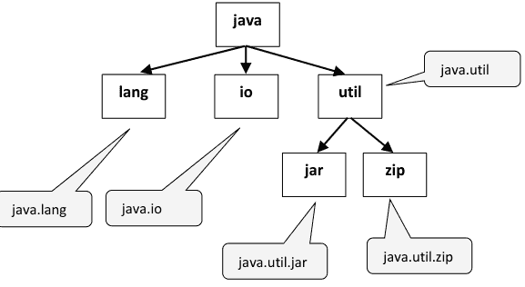

`java.lang` 包 Java 编译器始终可用。当你的程序需要使用不同包中的类时，该类或包含该类的整个包必须导入程序中：

```java
import java.math.*;

import java.io.FileReader;
```

用户定义的类也存放在包中。例如，上述示例中的 `myClass` 将被放在默认的“无名”包中。要将其放入特定包中，程序的第一条语句（不计注释）必须是包语句：

```java
package mypack.io;

import java.io.FileReader;

class myClass { ... }
```

注意，类在编译后会保留关于其所属包的信息。因此，如果你将一个类从一个包复制到另一个包，它将无法工作。然而，有一个例外。当类在没有包语句的情况下编译时，它可以被放在任何命名的包中，并被该包中的所有类访问。包概念的实现取决于安装 Java 的环境（Linux、Mac、Windows 等），因此不包含本书的范围内。

## 修饰符（Modifiers）

Java 语言的以下实体——类、接口、变量和方法——可以使用所谓的修饰符进行声明，以控制它们的行为和/或访问权限。这里，`myMethod` 使用两个修饰符：`public` 和 `static`。

```java
public static void myMethod() { ... };
```

## 类修饰符

可以应用于类的修饰符集合有限：

- `public`
- `abstract`
- `final`

`public` 修饰符使类可以从任何包访问。如果未指定此修饰符，类将在其声明所在的包内可见。

`abstract` 修饰符定义了一个类，其中一个或多个方法被声明为框架——具有返回类型和参数列表，但没有主体。抽象类将在“抽象类”章节中进一步解释。

`final` 修饰符禁止类被继承。

## 访问权限修饰符

访问权限修饰符控制变量和方法在相同包或不同包的类中的可见性。有四种访问权限修饰符（按从低到严格排序）：

`public` → `protected` → [无修饰符] → `private`

```java
public void myMethod() { ... };

protected int n;

double x;

private String name;
```

下表显示了一个类的变量和方法在其子类以及相同或不同包类中的可见性：

|  | 包一 |  | 包二 |  |
| :--- | :--- | :--- | :--- | :--- |
| 类 A | A 的子类 | 类 B | A 的子类 | 类 C |
| `public` | 可见 | 可见 | 可见 | 可见 |
| `protected` | 可见 | 可见 | 可见 | - |
| 无修饰符 | 可见 | 可见 | - | - |
| `private` | 可见 | - | - | - |

# 泛型

**泛型**（Generics）是 Java 的特性，允许在声明类、接口、方法或构造函数的对象参数类类型时使用泛型名称。例如，如果两个方法的功能相同，但一个接收整数参数，另一个接收双精度类型参数，我们可以只声明一个方法，并为该方法提供参数的“**泛型**类型”，该类型将在编译期间被替换为相应的类型。

理解**泛型**所有优势和限制的最佳方法是通过示例，下文演示了这些。

## 泛型方法

假设我们创建一个方法，在不知道对象类型的情况下对对象进行操作。实现这一点的某种方法是使用 `Object` 类——它是所有对象的父类。我们可以接受一个 `Object` 实例，然后将其转换为所需的类型。

例如，方法 `sumArea` 通过逐个处理对象，汇总了类型为 `A` 和 `B` 的对象占用的总面积。我们对对象 `A` 和 `B` 唯一了解的是它们是**不相关**的（即属于不同的类层次结构），并且它们都具有返回面积值的 `getArea()` 方法。`sumArea` 方法可以实现为：

```java
class A {
  public double getArea() {
    return 10.0;
  }
}

class B {
  public double getArea() {
    return 20.0;
  }
}
```

```java
class myClass {
  double totalArea;

  public void sumArea(Object obj) {
    if (obj instanceof A) {
      totalArea += ((A) obj).getArea();
    }

    if (obj instanceof B) {
      totalArea += ((B) obj).getArea();
    }
  }
}
```


现在，我们能使用**泛型**来消除 `instanceof` 和对象强制转换吗？简短的答案是——是的，也不是。在这里我们遇到了一个关于**泛型**的一个非常重要的事实：

泛型是一个编译期特性，而不是运行时特性。所有的类类型引用都在编译时解析。

例如，`sumArea` 方法可以用泛型符号重写如下：

```java
public <T> void sumArea(T obj) {
  totalArea += obj.getArea();
}
```

> `T` 参数不是一个真实的类名，而是一个泛型名称。它必须放在返回类型之前。

在对象强制转换的示例中，当方法 `sumArea` 接收到类 `A` 的对象时，引用 `obj` 被处理就像是由语句 `Object obj = new A();` 创建的一样；通过将 `obj` 强制转换为原始类 `A`，我们获得了对其所有变量和方法的访问权限。

泛型机制的工作方式有些不同。在编译时，类型变量 `T` 必须解析为真实的类名。由于我们没有提供任何关于它可能是什么的提示，`T` 将被替换为 `Object`——所有类的父类——这将是源代码的唯一更改。在没有强制转换的情况下，声明为 `Object obj = new A()` 的引用 `obj` 将只能访问 `Object` 类的实例变量和方法，以及被类 `A` 重写的 `Object` 方法。此图表显示了在不同情况下对象 `A` 的哪些属性是可以访问的：

| “对象强制转换”方法 | `A obj = new A()` | “泛型”方法 |
| :--- | :--- | :--- |
| 参数 `obj` 被处理为类似于：`Object obj = new A()` | `class Object` | `T` 被替换为 `Object`。参数 `obj` 被处理为类似于：`Object obj = new A()` |
|  | `variable v1` |  |
|  | `method m1` |  |
|  | `variable v2` |  |
|  | `method m2` |  |
| `(A) obj` | `class A` | `obj` |
|  | `variable v2` |  |
|  | `method m2` |  |
|  | `variable v3` |  |
|  | `method m3` |  |

正如我们所见，在没有显式强制转换的情况下，“泛型”代码无法访问对象 `obj` 的类 `A` 实例变量和方法。这个问题可以通过对类结构进行一些更改，并向泛型方法提供更多信息来解决。

首先，我们可以告诉泛型方法哪个类（或哪些类）可以替换类型变量 `T`：

```java
public <T extends AB> void sumArea(T obj) { ... }
```

`<T extends class>` 被称为边界类型，它为可以被类型变量 `T` 引用的类设置了上界。

其次，应该将新类 `AB` 变为类 `A` 和 `B` 的父类，并定义我们在泛型方法 `sumArea` 中可以使用的所有实例方法：

```java
abstract class AB {
  public double getActivity();
}

class A extends AB {
  public double getActivity() {
    return 10.0;
  }
}

class B extends AB {
  public double getActivity() {
    return 20.0;
  }
}
```

> 注意：类 `AB` 并不要求是抽象的。

现在，我们的 `obj` 将视为声明为“`AB obj = new AB()`”，类 `A` 和类 `B` 的 `getArea()` 方法将通过方法重写机制访问。简单来说，泛型方法的声明从此转变为：

```java
public <T> void sumArea(T obj) {
  totalArea += obj.getArea();
}
```

变为这个：

```java
public <T> void sumArea(T obj) {
  totalArea += obj.getArea();
}
```

实际上，`sumArea(AB obj)` 访问特定类或其父类。

## 泛型类

首先，我们需要理解泛型类与普通类并没有太大区别。让它变成“泛型”的是语法。这里有一个泛型类的示例：

```java
class G<T> { }
```

我们可以创建任何类型的 `G`：

```java
G<String> stringList = new G<>("Hello");

G<Integer> intList = new G<>(123);
```

我们还可以有多个类型参数：

```java
class G<K, V> {
  K key;
  V value;
}
```


## 泛型擦除

泛型的主要特性之一是类型擦除。这意味着编译器在检查后移除所有的泛型类型信息。这样做是为了与旧版本的 Java Java。

例如，以下代码：

```java
class List<T> {
  private Object[] elements;

  public void add(T element) { ... }

  public T get(int i) { return (T) elements[i]; }
}
```

会被编译为：

```java
class List {
  private Object[] elements;

  public void add(Object element) { ... }

  public Object get(int i) { return (Object) elements[i]; }
}
```

编译器会插入必要的强制转换以确保类型正确。这在运行时防止了`ClassCastException`。

## 通配符

通配符用于表示未知类型。有三种类型的通配符：

- `<?>`（无界通配符）：表示任何类型。
- `<? extends T>`（上界通配符）：表示`T`的任何子类。
- `<? super T>`（下界通配符）：表示`T`的任何父类。

### 无界通配符

无界通配符用于在你不在对象类型时。

```java
public void process(List<?> list) {
  for (Object obj : list) {
    System.out.println(obj);
  }
}
```

### 上界通配符

上界通配符用于你想将类型限制在特定的类层次结构时。

```java
public void doubleList(List<? extends Number> list) {
  for (Number n : list) {
    System.out.println(n.doubleValue());
  }
}
```

### 下界通配符

下界通配符用于你想将类型限制在特定类或其父类时。

```java
public void addIntegers(List<? super Integer> list) {
  for (int i = 0; i < 10; i++) {
    list.add(i);
  }
}
```

## 将泛型类作为参数

泛型类的对象可以像其他 Java 对象一样作为参数传递给方法：

```java
class GenericClass<T> { ... }

public void myMethod(GenericClass g) { ... }

GenericClass<A> a = new GenericClass<A>();
GenericClass<B> b = new GenericClass<B>();
```

```java
myMethod(a);
myMethod(b);
```

如你所见，`myMethod()`可以接受任何类型的`GenericClass`对象，无论创建这些对象时使用的类型变量`T`是什么。我们可以通过对`myMethod()`的输入参数指定限制，来为该过程添加一些类型安全检查。这是通过通配符参数`?`实现的。下面的示例演示了在方法声明中使用`?>`参数：

```java
abstract class AB { ... }

class A extends AB { ... }

class B extends AB { ... }

...

class G<T extends AB> extends AB { ... }
```

```java
public void myMethod(G<?> g) { ... }

...

public void myMethod(G<? extends AB> g) { ... }

...

public void myMethod(G<? super B> g) { ... }
```

在此示例中，`<? extends AB>`为传递对象引用设置了上限，而`<? super B>`设置了下限。

## 泛型接口

泛型接口的声明方式与泛型类的声明类似，例如：

```java
interface GenericInterface<T> {
  public void myID(T id);
}
```

接口声明中的类型变量是从实现该接口的类传递给接口的：

```java
class myClass<T> implements myInterface<T> { ... }

interface myInterface<T> { ... }
```

这就是为什么泛型接口只能由泛型类实现。

可以在类声明、接口声明或两者中限制类型变量的范围：

```java
class myClass<T extends AB> implements myInterface<T> { ... }

interface myInterface<T extends ABC> { ... }
```

Java 编译器通过比较类中为类型参数设置的边界与接口中设置的边界来执行类型安全检查。类的类型参数必须在接口类参数的边界之内。

注意：类型变量`T`是否在类或接口的体中使用（或如何使用），与类型安全检查过程无关——类型安全检查将会被执行。

下面是有效和错误的声明示例。

```java
class AB {}

class A extends AB {}

class B extends AB {}
```

> `myInterface`只能由类`AB`或其子类实现。

```java
interface myInterface<T extends AB> { ... }
```

> 有效声明。

```java
class myClass<T> implements myInterface<T> { ... }
```

> 有效；类`A`是`AB`的子类。

```java
class myClass<T extends A> implements myInterface<T> { ... }
```

```java
class myClass<T extends string> implements myInterface<T> { ... }
```

> 错误！类`String`不是`AB`的子类。

```java
class myClass implements myInterface<T> { ... }
```

> 错误！类`myClass`必须是泛型的。

```java
class myClass<X> implements myInterface<T> { ... }
```

> 错误！`myClass`和`myInterface`中的泛型类型变量必须具有相同的名称。

## 泛型构造函数

记住构造函数是功能用于创建类的实例（对象）的方法是非常重要的。作为方法，它们可以被声明为泛型。类本身可以是泛型的，也可以是非泛型的。

在之前的示例中我们已经见过了泛型类的构造函数。这是另一个示例：

```java
class GenericClass<T> {
  public T key;

  GenericClass(T k) {
    this.key = k;
  }
}
```

```java
GenericClass<Integer> g = new GenericClass<Integer>(123);
```

即使类不是泛型的，构造函数本身也可以是泛型的。例如：

```java
class Node {
  private Object data;

  public <T> Node(T data) {
    this.data = data;
  }
}
```

这允许构造函数处理不同类型的数据，同时类结构保持固定。

# Lambda 表达式

Lambda 表达式是 Java 语言的一种特殊结构，用于在任何类之外定义方法。实际上，Lambda 表达式会自动声明一个“隐藏”类，创建该类的实例并将指定方法附加其。

让我们用一个示例来说明这个过程。我们将使用“传统”方法实现功能，同时也使用 Lambda 表达式实现。任务是创建一个将任何文本转换为大写字母的方法。

这里是“传统”方法：

```java
class myClass {
  string transform(string s) { return s.toUpperCase(); }
}

..

myClass c = new myClass();

System.out.println(c.transform("text")); // 输出: "TEXT"
```

使用 Lambda 表达式的相同`transform`方法：

```java
interface myInterface {
  String transform(String s); // "txt" 替换输入参数
}

myInterface upper = (txt) -> { return txt.toUpperCase(); };

System.out.println(upper.transform("text")); // 输出: "TEXT"
```

> 我们需要创建一个只能声明一个方法的接口。这被称为“函数式接口”。

> 成为`transform`方法的体。

> `upper`是实现`myInterface`的“隐藏”类的对象。

以上内容都是正确的，但有时仅仅为了一个类或一个很少使用的方法就创建一个新类并不实用。此外，同一个接口可以用于创建许多不同的方法。例如，这里是另一个使用之前提供的`myInterface`相同接口的方法：

```java
myInterface lower = txt -> txt.toLowerCase();

System.out.println(lower.transform("TEXT"));
```

为了充分利用这一功能，`java.util.function`包提供了几个预定义的函数式接口，用于 lambda 表达式。这些函数式接口之一的`Function<T,R>`将其`apply()`方法应用于类型为`T`的对象，并将结果作为类型为`R`的对象返回。`Function`接口的部分声明如下所示：

```java
public interface Function<T, R> {
  R apply(T t);

  ..
}
```

让我们使用这个接口和 lambda 表达式来创建一个将数字转换为单词的方法：

```java
import java.util.function.*;
```

```java
Function<Integer, String> spell = N -> {
  String digits[] = {
    "zero", "one", "two", "three", "four",
    "five", "six", "seven", "eight", "nine"
  };

  return digits[N.intValue()];
};

Integer N = Integer.valueOf(4);

System.out.println(spell.apply(N)); // prints: "four"
```

在之前的示例中，我们显式声明了函数式接口类型的对象引用：

```java
Function<Integer, String> spell;

Interface lower;
```

然后，将 lambda 表达式赋值给这些对象引用。这种创建 lambda 表达式的方法清楚地展示了我们的尝试目标，但并不是强制性的。通常情况下，没有必要声明函数式接口引用。lambda 表达式本身可以被视为（并使用）相应函数式接口的对象。例如，如果参数声明为函数式接口，我们可以将 lambda 表达式作为参数传递给方法。

这里有一个例子；`IntPredicate`是一个工厂提供的函数式接口，声明了以下测试方法：

```java
boolean test(int value)
```

我们将利用它来选择指定值范围内的数字`(n > min) & (n < max)`。以下是需要执行的操作：

- 创建一个`IntPredicate`类型的对象。
- 将其`test`方法替换为所需的条件表达式。
- 使用`test`方法检查数字是否在范围内。

```java
import java.util.function.*;
```

```java
class testLambda {
  static int min = 0;
  static int max = 100;

  public static IntPredicate filter(IntPredicate p) {
    return p;
  }

  public static void main(String args[]) {
    int i = 100;

    if (filter(n -> (n > min && n < max)).test(i)) {
      System.out.println("within range");
    } else {
      System.out.println("out range");
    }
  }
}
```

解释：`filter`方法接收一个`IntPredicate`类型的对象并将其返回。这里的目标是将 lambda 表达式传递给此方法并将其作为对象返回。lambda 表达式本身并没有告诉我们它被用于哪个函数式接口，因此我们需要向 Java 编译器提供此信息，可以直接将 lambda 表达式赋值给函数式接口变量，或者将 lambda 表达式作为函数式接口类型的参数传递。因此，在这个示例中，lambda 表达式`n -> (n > min && n < max)`创建了一个`IntPredicate`类型的对象，将其`test`方法替换为`(n > min && n < max)`，并将此对象表达式传递给`filter`方法。`filter`方法返回该对象，因此表达式`filter(n -> (n > min && n < max))`实际上是`IntPredicate`类型的引用。最后，我们使用此对象引用来调用实例方法`test`（此时它反映了 lambda 表达式）：

```java
filter(n -> (n > min && n < max)).test(i)
```

上述程序的输出结果：“out of range”。

## 方法引用

方法引用功能允许你在不执行方法的情况下创建该方法的引用。然后，该引用可以使用双冒号`::`运算符传递给另一个方法进行执行。下面的图表和相应的程序代码说明了这一过程：

```java
interface F {
  void execute();
}

class myClass {
  static void common(F obj) {
    obj.execute();
  }

  void myMethod() { ... }

  public static void main(String[] args) {
    common(myClass::myMethod);
  }
}
```

`common()`方法定义为接收函数式接口`F`的对象并运行其`execute()`方法。在运行时，方法引用运算符`::`创建了函数式接口`F`的实例（因为`common()`方法期望一个其`execute()`方法指向`method1`的对象）。然后，将`F`的实例传递给`common()`方法，并执行`method1()`。注意，作为引用传递的方法必须与函数式接口定义的方法具有相同的签名（返回类型和参数的类型）。

以下是一些将字符串`"Test Text"`转换为大写或小写的示例。

```java
interface Transform {
  String doit(String s);
}
```

> `doit()`方法的签名：
>
> `<String>method<String>`
>
> 所有作为引用传递的方法都必须具有此签名。

```java
class myClass {
  static void printAS(Transform obj) {
    System.out.println(obj.doit("Test Text"));
  }
}
```

## 方法引用

方法引用功能允许你在不执行方法的情况下创建该方法的引用。然后，该引用可以使用双冒号`::`运算符传递给另一个方法进行执行。下面的图表和相应的程序代码说明了这一过程：

```java
interface F {
  void execute();
}

class myClass {
  static void common(F obj) {
    obj.execute();
  }

  void myMethod() { ... }

  public static void main(String[] args) {
    common(myClass::myMethod);
  }
}
```


`common()` 方法定义为接收函数式接口 `F` 的对象并运行其 `execute()` 方法。在运行时，方法引用运算符 `::` 创建了函数式接口 `F` 的实例（因为 `common()` 方法期望一个其 `execute()` 方法指向 `method1` 的对象）。然后，将 `F` 的实例传递给 `common()` 方法，并执行 `method1()`。注意，作为引用传递的方法必须与函数式接口定义的方法具有相同的签名（返回类型和参数的类型）。

以下是一些将字符串 `"Test Text"` 转换为大写或小写的示例。

```java
interface Transform {
  String doit(String s);
}
```

> `doit()` 方法的签名  
> `<String>method<String>`  
> 所有作为引用传递的方法都必须具有此签名。

```java
class myClass {
  static void printAS(Transform obj) {
    System.out.println(obj.doit("Test Text"));
  }
}
```

## 构造方法引用

构造引用与方法引用类似。假设函数式接口持有两个构造函数：

```java
interface defaultConstructorRef<T> {
  T create();
}
```

我们希望不仅可以通过传统的 `new` 关键字来构建对象，还可以通过构造方法引用。首先，我们声明一个带有参数的函数式接口：

```java
interface myConstructor {
  Location create(int x, int y);
}
```

然后，在执行期间，`Location::new` 将函数接口类：

```java
myConstructor mc = Location::new;
```

此示例演示了创建和使用构造引用的基础。然而，拥有两种调用构造函数的方式似乎收益大于。

所以这里有一个更实用的示例——我们将两个不同类（A 和 B）的构造方法引用传递给 `printName()` 方法。该方法将使用收到的构造引用来创建对象并调用它。

```java
interface AB {
  String methodName();
}

class A implements AB {
  String name;

  A() {
    name = "A class";
  }

  public String methodName() {
    return name;
  }
}

class B implements AB {
  String name;

  B() {
    name = "B class";
  }

  public String methodName() {
    return name;
  }
}
```

`AB` 是 `printName()` 方法中对 A 和 B 实例强制转换的类型。`methodName()` 方法必须在此声明，以便方法重写机制起作用。

```java
class testConstructorRef {
  public static void main(String args[]) {
    printName(A::new);
    printName(B::new);
  }

  public static void printName(defaultConstructorRef obj) {
    AB obj = (AB) obj.create(); // 注意：此处变量名为 obj
    system.out.println(obj.methodName());
  }
}
```

> `(AB)` 强制转换是必要的，因为 `create()` 返回的对象类型为 `Object`。注意：我们可以在 `defaultConstructorRef` 中指定 `<T extends AB>` 以避免强制转换。

此程序创建输出：

```text
A class
B class
```

# 内部类

内部类是在另一个类内部或方法内部定义的类：

```java
class classA {                   // 顶层类（外部类）

  class classB {                 // 内部类

    class classC {               // 内部类

    }
  }

  public void myMethod() {
    class classD {               // 内部类（又称局部类）

    }
  }
}
```

## 静态内部（嵌套）类

静态内部类是带有 `static` 修饰符且在另一个类内部定义的类：

```java
class outerClass {
  static class innerClass {

  }
}
```

静态内部类只能访问外部类的静态变量和方法，并且与外部类的实例没有关联。在这方面，它的行为与在外部类之外定义的任何其他类完全相同，因此此类类更合适的名称是静态嵌套类。

使用内部（嵌套）类的示例：

```java
public class Outer {
  static String myName = "Outer";
  static int N = 0;

  static class Nested {
    static String symbolName = "Nested";
    int myN;

    Nested() {
      myN = ++N;
    }
  }
}
```

| 说明 |
| :--- |
| `N` 将跟踪嵌套类创建的实例总数 |
| 嵌套类的构造函数；增加对象的顺序号 |

```java
public static void main(String args[]) {
  System.out.println(myName);
  System.out.println(Nested.myName);
  System.out.println(Outer.Nested.myName);

  Nested nested1 = new Nested();
  Outer.Nested nested2 = new Outer.Nested();

  System.out.println(nested1.myN); // 输出: 1
  System.out.println(nested2.myN); // 输出: 2
}
```

## 非静态内部类

非静态内部类是作为实例属性在另一个类内部定义的类（即不带 `static` 修饰符）。非静态内部类的对象可以访问其创建时所在的外部类的实例变量和方法。非静态内部类的对象可以在外部类的实例方法内部创建，也可以通过以外部类名为名前缀的 `new` 运算符创建：

```java
public class outer {
  int x = 0;

  class Inner {
    void innerMethod() {
      x++;
    }
  }

  public static void main(String args[]) {
    Outer outer1 = new Outer();
    Inner inner1 = outer1.new Inner();
    Outer.Inner inner2 = outer1.new Inner();

    outer1.instanceMethod();
  }

  void instanceMethod() {
    Inner inner3 = new Inner();
    Outer.Inner inner4 = this.new Inner();
  }
}
```

## 局部内部类

在方法内部定义的类被称为局部类。

```java
public static void main(String args[]) {
  int x = 1;
  int y = 2;

  // 在 main 方法内定义的 myLocalClass 类

  class myLocalClass {
    String s = "Local Class";
    int z;

    {
      z = x + y;
    }

    {
      x = 2;
    }
  }

  myLocalClass loc = new myLocalClass();
  System.out.println("z=" + loc.z); // 输出: z=3
}
```

# 抽象类

抽象类是声明了一个或多个方法但未定义的类（即没有方法体）。为了理解为什么我们需要抽象类，请考虑这个类层次结构。

`Shape` 类声明了用于计算特定形状面积的 `getArea` 方法。该方法在每个子类（`Square` 和 `Circle`）中都被重写了具体的实现。如果我们创建一个 `Shape` 类的对象，它的 `getArea()` 将没有任何意义。当然，我们可以让它返回一个假值（如零）来表示这不是真实的形状。然而，更好的方法是完全禁止创建 `Shape` 类对象。这正是抽象类和抽象方法派上用场的地方。

示例：

```java
abstract class Shape {
  String myName;

  public abstract double getArea(double arg);

  public String getName() {
    return myName;
  }

  public static void main(String[] args) {
    Shape a = new Circle();
    Double area = a.getArea(1);
    System.out.println("area=" + area); // 输出: "area=3.1415"
  }
}

class Circle extends Shape {
  public double getArea(double arg) {
    return arg * arg * 3.1415;
  }
}
```

## 匿名类

匿名类是在表达式内部定义的类。

# 接口

接口是常量、抽象方法和默认方法的集合。接口的主要目的是定义类必须实现的契约。这允许多态，使得不同的类可以被视为相同的接口类型。

类可以通过使用 `implements` 关键字实现多个接口。当一个类实现接口时，它必须为接口中的所有抽象方法提供实现，除非该类本身也是抽象类。

```java
interface Animal {
  void makeSound();

  default void sleep() {
    System.out.println("Sleeping...");
  }
}

class Dog implements Animal {
  public void makeSound() {
    System.out.println("Bark");
  }
}

class Cat implements Animal {
  public void makeSound() {
    System.out.println("Meow");
  }
}
```

匿名类是没有名字的类。它通常用于你只需要定义一次类的情况。匿名类在表达式内部同时定义并实例化。

```java
Runnable r = new Runnable() {
  @Override
  public void run() {
    System.out.println("Running in an anonymous class");
  }
};
```

下面的示例演示了处理接口的常用技术。

```java
interface Command {
  void execute();
}

public class Test {
  public static void main(String[] args) {
    Command c = new Command() {
      @Override
      public void execute() {
        System.out.println("Executing command");
      }
    };

    c.execute();
  }

  static void runCommand(Command cmd) {
    cmd.execute();
  }
}
```

## 接口 vs 抽象类

你可能已经注意到接口和抽象类是相似的。它们都可以声明常量，并提供方法模板供其他类进一步实现。那么问题是——哪些事情是用接口可以而类做不到的呢？

让我们来看一个例子：

```text
abstract class Fruit
  getVolume()

class Orange extends Fruit
  getVolume() {...}

abstract class Package
  getVolume()

class Box extends Package
  getVolume() {...}
```

可以通过以下方式访问 Orange 和 Box 对象的 `getVolume()` 方法：

```java
Orange orange = new Orange();
orange.getVolume();

Fruit fruit = new Orange();
fruit.getVolume();
```

```java
Box box = new Box();
box.getVolume();

Package pack = new Box();
pack.getVolume();
```

由于 Orange 和 Box 类属于不同的层次级，无法创建一个可以同时引用这两个对象的引用。

接口允许我们这样做，因为类层次级和接口层次级是无关的。接口打破了类层次级的边界。互不相关的类可以实现同一个接口，该接口类型的变量可以引用这些类的对象。

```text
class Shape
  getVolume()

class Orange implements Shape
  getVolume() {...}

class Box implements Shape
  getVolume() {...}
```

示例：使用单个接口变量引用不同类层次级中的类对象。

```java
interface Shape {
  double getVolume();
}

class Orange implements Shape {
  double getVolume() {
    implementation code
  }
}

class Box implements Shape {
  double getVolume() {
    implementation code
  }
}
```

```java
Shape shape;

shape = new Orange();
shape.getVolume();
```


```java
shape = new Box();
shape.getVolume();
```


注意：采用了多态机制来查找并执行 `shape` 变量引用的实际对象的 `getVolume()` 方法。

## 接口中的默认方法和静态方法

有时，具有完整实现方法（即带有方法体的方法）的接口是有益。这可以通过两种实现：声明默认方法或静态方法。

默认方法是具有方法体并以 `default` 修饰符开头的实例方法。默认方法可以在实现接口的类中重写，但不是强制的。

```java
interface Shape {
  default double getVolume() {
    return 1.0;
  }
}
```

静态方法是具有方法体并以 `static` 修饰符开头的类级方法。静态方法可以在实现接口的类中被重写，但不是强制的。

```java
interface Shape {
  static String getShapeName(Object obj) {
    return obj.getClass().getName();
  }
}
```

示例：

```java
class Orange implements Shape {
  public static void main(String args[]) {
    double volume;
    String name;

    Shape obj = new Orange();
    name = Shape.getShapeName(obj);
    volume = obj.getVolume();

    System.out.println("Shape=" + name); // prints: "Shape=Orange"
    System.out.println("Volume=" + volume); // prints: "Volume=0"
  }
}
```

# 异常


**异常**是由于错误导致程序正常流的中断。某些错误是致命的且无法恢复，而另一些则并不关键，可以由应用程序处理（例如文件未找到）。Java 识别两种类型的异常：**检查异常**（checked exceptions）和**未检查异常**（unchecked exceptions）。

**未检查异常**是不可预见的。例如，JVM 失败或除以零都不是预期的情况。通常这些错误是由 Java 运行时环境的问题或应用程序代码中的 bug 引起。处理未检查异常的方法修复环境问题（如果有）或消除应用程序中的 bug（调试）。

未检查异常是不可预见的，且不需要应用程序处理。

**检查异常**在某些 Java 类或用户定义类中显式声明，并可能**抛出**（throw）它们。例如，如果尝试打开的文件找不到，`FileReader` 将抛出 `FileNotFoundException`。

检查异常在某些 Java 类或用户定义类中显式声明，并可能**抛出**（throw）它们。例如，如果尝试打开的文件找不到，`FileReader` 将抛出 `FileNotFoundException`。

## 异常处理

要在应用程序中处理未检查异常，可以使用以下结构：

```
try {
    你想要监控可能发生异常的代码
} catch (exceptionType1 e) {
    处理异常 type1 的代码
}
...
catch (exceptionTypeN e) {
    处理异常 typeN 的代码
} finally {
    无论 try 或 catch 块结果如何都会执行的代码
}
```

处理未检查（非预期）异常的示例：

```
int n = 0;
try {
    n = 5 / n;
} catch (ArithmeticException e) {
    System.out.println("捕获到异常!");
} finally {
    System.out.println("n=" + n);
}
```


注意，一旦异常被捕获，传播过程就会停止并恢复正常程序执行。然而，即使在异常被捕获和处理后，也可以将异常传递给调用方法。这是通过 `throw` 语句实现的：

```
// 显式传播未检查异常

public static void main(String args[]) {
    try {
        myMethod();
    } catch (ArithmeticException e) {
        System.out.println("main 中出现异常!");
    }
}

public static void myMethod () {
    int n = 0;
    try {
        n = 5 / n;
    } catch (ArithmeticException e) {
        System.out.println("myMethod 中出现异常!");
        throw e;
    }
}
```

## 处理检查异常

检查异常（Checked exceptions）是由某些 Java 类或用户程序显式声明并抛出的异常。如果你的程序使用了 Java 类或调用了可能抛出检查异常的方法，你必须捕获该异常，或者显式地将其传递给调用方法。

此图说明了应该如何处理检查异常：

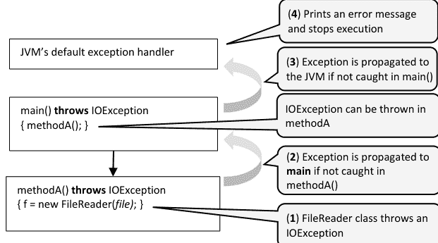

请注意，如果该方法可以创建并抛出自己的异常，或者捕获了检查异常并使用 `throw someException` 语句重新抛出，则该方法必须声明 `throws someException` 子句。

示例：

```
// 显式传递检查异常
import java.io.*;
class MyClass {
    public static void main(String[] args) {
        String file = "not_existing_file";
        try {
            checkFile(file);
        } catch (IOException e) {
            System.out.println("main: checkFile failed!");
        }
    }
}
```

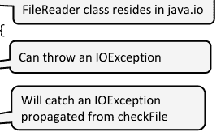

```
public static void checkFile (String file) throws IOException {
    FileReader f;
    try {
        f = new FileReader(file);
    } catch (IOException e) {
        System.out.println("checkFile: IOException!");
        throw e;
    }
}
```

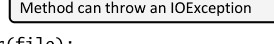


上述代码产生以下输出：

```
checkfile: IOException!
main: checkFile failed!
```

除了 Java 提供的预定义检查和未检查异常集外，你还可以像检查异常一样构建自己的异常。为了理解如何实现，我们首先复习异常类。

## 异常类层次结构

对于每个异常，Java 都会创建一个包含有关该异常有用信息的对象。每种类型的异常都由它自己的类表示 - `FileNotFoundException`、`IndexOutOfBoundsException` 等。所有这些类都是顶级类 **Throwable** 的子类。下图显示了异常类的层次结构：

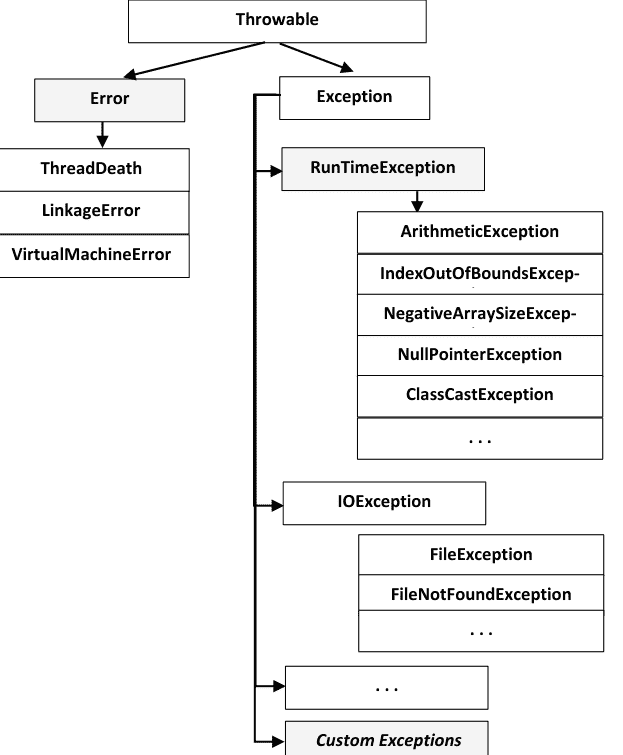

`Error` 和 `RuntimeExceptions` 是未检查异常，不需要被捕获和处理。其余的都是检查异常，如果它们在执行期间可能抛出，则必须由应用程序逻辑处理。

**Throwable** 类提供了几个可以在程序异常处理逻辑中使用的有用方法。以下是其中一些：

| `String getMessage()` | 返回此异常的详细消息字符串 |

| :--- | :--- |

| `void printStackTrace()` | 将上述消息和轨迹追踪信息发送到标准错误流 |

| `String toString()` | 返回此异常的简短描述 |

现在我们已经知道了异常类是如何组织的，让我们来看看如何创建一个自定义异常。

## 创建自定义异常

自定义的、用户定义的异常可以如下构建为 **Exception** 类的子类：

```
class CustomException extends Exception {
    public CustomException(String msg) {
        super(msg);
    }
}

class runTest {
    public static void main(String args[]) {
        try {
            testMyException();
        } catch (CustomException e) {
            System.out.println( e.getMessage() );
        }
    }

    // 抛出 CustomException 的方法
    public static void testMyException() throws CustomException {
        CustomException e;
        e = new CustomException("My exception");
        throw e;
    }
}
```

# 线程

当程序的两个或多个部分并发运行时，该程序被称为多线程程序。每条执行路径被称为一个线程。每个 Java 程序都至少有一个从主线程（main thread）启动的线程。

## 启动线程

应用程序可以根据需要创建任意数量线程。为了能够创建线程，类需要扩展 `Thread` 类或实现 `Runnable` 接口。在这两种情况下，创建线程的类都必须实现 `run()` 方法。下图说明了创建线程的两种方式。注意，在两种情况下，必须存在一个 `Thread` 类型的对象，并且它可以访问你类的 `run()` 方法：

| 类型为 Thread的对象 | 类型为 Thread 的对象 |

| :--- | :--- |

| class Thread | class Thread |

| start {...} | start {...} |

| class A extends Thread run() {...} | class B implements Runnable run() {...} |

如图所示，线程通过调用启动线程的类中的 `start()` 方法来启动，该方法调用该类中定义的 `run()` 方法。

在这个示例中，新线程是由一个扩展 `Thread` 类的 `myClass` 对象启动的：

```
class myClass extends thread {
    public void run() {}{
    public static void main(String args[]) {
        myClass th1 = new myClass();
        th1.start();
    }
}
```

当你的类扩展 `Thread` 类时，你必须实现的方法只有 `run()` 方法。该方法应该定义由新线程将执行的操作。注意，`Thread` 类定义的 `run()` 方法是空的，什么都不做。

你也可以实现（即重写）类 的其他方法，但有一个例外——`start()` 方法。如果你实现了 `start()` 方法，即使它调用了 `run()` 方法，也不会启动任何线程，`run()` 将作为你类的一个普通方法在当前线程中执行。

这种创建线程的方法是完全可以的，但如果你不想重写除 `run` 方法之外的 `Thread` 类其他方法，更好的方法是实现 `Runnable` 接口。

在这个示例中，新线程是由实现 `Runnable` 接口的 `myClass` 对象创建的：

```
class myClass implements Runnable {
    public void run() {}
    public static void main(String args[]) {
        Thread th2 = new Thread(new myClass() );
        th2.start();
    }
}
```

`Runnable` 接口只声明了一个方法 – `run()`，因此你的类需要实现该方法。要启动新线程，程序必须使用以下构造函数创建 `Thread` 类对象：

`Thread (Runnable target)`

在这里，`target` 是你的类的实例。

需要重申的是，线程只能通过 `Thread` 对象的 `start()` 方法启动。在第一个示例中，当 `Thread` 的子类被实例化时，通过调用 `super()` 构造函数自动创建一个 `Thread` 类对象。在第二个示例中，我们显式创建了一个 `Thread` 对象，并向它传递了 `myClass` 类的对象。

这是一个启动线程的示例程序：

```java
import java.io.IOException;

class testThread implements Runnable {
    public static void main(String args[]) {
        Thread th = new Thread(new testThread());
        th.setName("Thread 1");
        th.start();

        try {
            System.out.println("main: hit enter...");
            System.in.read();
        } catch (Exception e) {
            System.out.println("main exception: " + e);
        }
        System.out.println("main ended");
    }

    public void run() {
        String name = Thread.currentThread().getName();
        try {
            System.out.println("thread: hit enter...");
            System.in.read();
        } catch (Exception e) {
            System.out.println("thread exception: " + e);
        }
        System.out.println(name + " thread ended");
    }
}
```

上述程序提示你回车。第一个请求来自线程，第二个来自主方法。你应该两次回车，先停止主方法的执行，然后是线程的执行。

## 守护线程

当你执行之前的程序时，你会注意到主线程在你回车后结束了，但线程将继续运行直到你再次回车。在父线程死亡后继续执行的线程被称为用户线程。另一种类型的线程被称为守护线程（daemon threads）。守护线程会在父线程死亡后死亡。默认情况下，新创建的线程是守护线程；要使其成为守护线程，你需要通过调用 `setDaemon(true)` 进行标记。确保在启动线程之前完成操作：

```
Thread th = new Thread(new myClass() )
th.setDaemon(true);
th.start();
```

## 中断线程执行

一个线程可以通过实例方法 `interrupt` 被另一个线程中断：

```
Thread th = new Thread(new myClass() );
th.start();
```

```
th.interrupt();
```

`interrupt` 方法在线程对象中设置一个标志，该标志必须在 `run()` 方法中检查才能产生效果。

```java
public void run() {
    if (Thread.interrupted()) {
        System.out.println("I was interrupted");
    }
}
```

注意，`interrupt()` 是实例方法，而 `interrupted()` 是静态方法。

这两个方法都不会停止线程执行。它们仅仅允许向线程“发送一个 信号”，但如何处理这个“信号”取决于被中断的线程。

## 等待线程结束

如果主线程依赖于子线程的执行，它可以使用 `Thread` 类的 `join()` 方法来“连接”到子线程并等待其完成。

```java
Thread th = new Thread(new myClass());
th.start();

try {
    th.join(1000);
    th.join();
} catch (InterruptedException e) {
    System.out.println("Exception: " + e);
}
```

## 同步

在多线程编程中，将对共享资源的访问限制为一次只有一个线程通常至关重要的。Java 提供了一种资源锁定机制，可以通过 `synchronized` 方法或 `synchronized` 语句块（statement blocks）以两种方式使用。我们稍后将对这两种方法进行讨论。

首先，为了理解 Java 的同步和锁定机制，我们需要了解两个关键术语：监视器（monitor）和锁（lock）。当一个线程获取锁时，被称为它进入了监视器。这对于理解主题本身没有太大帮助，但非常重要，因为这些术语出现在所有的 Java 手手册中。

### 同步方法

你可以将类中的任何方法声明为 `synchronized`：

```java
synchronized static public void method1() {}
synchronized public void method2() {}
```

通过这种方式，你可以在类级别、对象级别或两者级别上激活锁定机制。

对象级别的同步工作原理如下：

| 描述 |

| :--- |

| 一个对象的所有同步实例方法都由同一个锁控制。在任何时刻，该对象只能执行一个同步实例方法。 |

类层级的同步工作原理如下：

| 描述 |

| :--- |

| 一个类的所有同步静态方法都由同一个锁控制。在任何时刻，该类只能执行一个同步静态方法。 |

注意，对象级别的同步和类级别的同步之间是互不影响的。

### 同步语句块

在某些情况下，你可能无法使用同步方法，例如当你不允许修改该类时。在这种情况下，你可以使用 `synchronized` 语句块。以下是 `synchronized` 语句块的定义方式：

```java
synchronized ( object ) { statement block }
```

该语句可以用线程执行路径中的任何地方（例如在 `run()` 方法或由其调用的任何其他方法中）。语句块将在对象上被锁定，并且一次仅有一个线程可以访问。


关于上述结构中使用的对象，必须说明重要一点。该对象可以是任何类的对象，即使是仅为了作为锁而创建的虚拟对象。只要所有线程都能访问同一个对象，语句块的同步就能生效。

下面的示例演示了语句块同步的用法。

### 示例：一次仅有一个线程执行同步块

```java
import java.io.IOException;

class testSyncBlock implements Runnable {
    Object lock;
    public static void main(String[] args) {
        testSyncBlock mainThread = new testSyncBlock();
        mainThread.lock = new Object();

        Thread th1 = new Thread(mainThread, "thread1");
        Thread th2 = new Thread(mainThread, "thread2");
        th1.start();
        th2.start();

        try {
            th1.join();
            th2.join();
        } catch (InterruptedException e) { System.out.println(e); }
    }

    public void run() {
        String name = Thread.currentThread().getName();
        System.out.println(name + " started");

        synchronized (lock) {
            try {
                System.out.println("hit enter...");
                System.in.read();
            } catch (Exception e) { System.out.println(e); }
        }
    }
}
```

## 高级线程间通信

在大多数情况下，`synchronized` 方法和 `synchronized` 语句块对于建立共享资源的安全访问足够了。然而，可能需要对同步过程进行更细粒度的控制。`Object` 类定义的以下三个方法允许两个或多个线程之间相互通信：

- `wait()`
- `notify()`
- `notifyAll()`

`wait()` 方法释放当前线程持有的锁，并将线程置于等待状态。

`notify()` 方法唤醒一个正在等待的线程。唤醒哪个线程是随机的。

`notifyAll()` 方法唤醒所有正在等待锁的线程。上述方法必须在 `synchronized` 方法或 `synchronized` 块中使用。下面的示例说明了如何建立线程之间的通信。

```java
import java.io.IOException;

class testNotify implements Runnable {
    Object lock;
    String[] s = {"one", "two", "three", "four"};
    int count = 0;

    public static void main(String[] args) {
        testNotify me = new testNotify();
        me.lock = new Object();

        Thread th1 = new Thread(me, "thread1");
        Thread th2 = new Thread(me, "thread2");
        th1.start();
        th2.start();
    }

    public void run() {
        String name = Thread.currentThread().getName();
        synchronized (lock) {
            try {
                while (count < s.length) {
                    System.out.println(name + " : " + s[count++]);
                    lock.notify();
                    lock.wait();
                }
            } catch (Exception e) { System.out.println(e); }
        }
    }
}
```

注意，`wait()`、`notify()` 和 `notifyAll()` 方法必须由当前线程所锁定的对象来调用。否则，将抛出 `IllegalMonitorStateException`。

上述程序的输出如下：

- `thread1: one`
- `thread2: two`
- `thread1: three`
- `thread2: four`

# 集合框架

集合框架（Collections Framework）是一组接口和类，为管理对象组提供了标准方法。整个概念的核心是集合（collection），它是通过某种方式分组的对象的通用术语。根据集合构建和访问的方式，所有集合可以分为三大类：

- LIST：对象序列；例如：数组、排序列表、队列、栈。
- SET：唯一对象组；不允许重复。
- MAP：键/值对对象组。

每个组都可以进一步细分。例如，列表可以是排序的、链接的、组织成栈等的。然而，无论集合之间的差异如何，对它们进行的大部分操作都以相似的方式通过标准接口完成。本章提供了这些操作的概述。

## 创建集合

大多数集合都使用相应类的 `add()` 方法将新元素放入集合中：

```java
// 创建 LinkedList 集合
LinkedList<String> list = new LinkedList<String>();
list.add("A");
list.add("B");
list.add(1, "C");
System.out.println(list); // 输出: [A, C, B]
```

```java
// 创建一个 TreeSet 集合
```

```java
TreeSet<Integer> intset = new TreeSet<>();
intset.add(3);
intset.add(5);
intset.add(1);
System.out.println(intset); // 输出: [1, 3, 5]
```

> 定义一个 `Integer` 对象的排序集合。

某些集合类（`Vector`、`Stack`、`PriorityQueue` 等）以及所有的 map 类都不使用 `add()` 方法来向集合中添加元素。例如，`Vector` 类使用 `addElement()` 方法，`PriorityQueue` 类使用 `push()` 方法，而 map 类使用 `put()`：

```java
TreeMap<Integer, String> map = new TreeMap<>();
map.put(2, "two");
map.put(1, "ten");
map.put(3, "three");
map.put(1, "one");
System.out.println(map); // 输出: {1=one, 2=two, 3=three}
```

> 因为键必须是唯一的，1/one 对将覆盖之前的 1/ten 条目。

## 获取集合元素

从集合中获取元素的最常用方法是通过 `get()` 方法或其变体（例如 `getFirst()`、`getLast()`）：

```java
LinkedList<String> list = new LinkedList<String>();
list.add("A");
list.add("B");
list.add(0, "C");
System.out.println(list.get(1)); // 输出: "A"
System.out.println(list.getFirst()); // 输出: "C"
System.out.println(list.getLast()); // 输出: "B"
```

> 获取列表的第二个元素。

```java
TreeMap<String, String> map = new TreeMap<>();
map.put("key1", "A");
map.put("key2", "B");
System.out.println(map.get("key1")); // 输出: "A"
System.out.println(map.get("key3")); // 输出: "null"
```

> 获取与 `"key1"` 关联的值。

## 更新集合

每个集合都定义了一组方法，允许你通过删除或更新元素对已创建的集合进行更改。这些方法在不同的集合类之间可能有所不同。所有集合共同的方法只有一个是 `remove()`。下面是在不同集合上执行更新操作的一些示例。

```java
TreeMap<String, String> map = new TreeMap<>();
map.put("key1","A");
map.put("key2","B");
map.put("key3","C");

map.remove("key1","A");

map.replace("key2","D");
System.out.println(map); // 输出: {key2=D, key3=C}
```

> 从 map 中移除 `"key1/A"` 对。

> 将 `"key2/B"` 替换为 `"key2/D"`。

```java
Vector<String> v = new Vector<>();
v.addElement("A");
v.addElement("B");
v.addElement("C");

v.removeElement(1);
System.out.println(v); // 输出: [A, C]

v.removeAllElements();
```

> 位置 1 处的元素（即第二个元素）。

> 从此 vector 中移除所有元素并将其大小设置为零。

## 遍历集合

在某些情况下，你需要顺序访问集合，按一个方向或两个方向逐个读取其元素。实现这一点有两种方法：使用 `for-each` 循环，以及使用迭代器——即 `Iterator`、`ListIterator` 和 `Spliterator` 类。然而，集合必须实现 `Iterable` 接口才能使用这些任一种方法。例如，map 类没有实现 `Iterable` 接口，因此你必须使用 `entrySet()` 方法获取 map 的集合视图（即将 map 转换为 SET 类型的集合），以便像处理集合一样处理该 map。

## `for-each` 循环

遍历集合的第一种方法是使用 `for-each` 循环。这是按一个方向逐个顺序访问集合元素最简单的方法。

### 示例

```java
// 遍历列表
LinkedList<String> list = new LinkedList<String>();
list.add("A");
list.add("B");
list.add("C");

for (String s : list) {
    System.out.println(s); // 打印列表的每个元素
}

// 遍历 map
TreeMap<String, String> map = new TreeMap<>();
map.put("key1","A");
```

> 遍历列表。

每个元素逐个赋值给 `s`。

> 将一个键/值对放入 map 中。

> 从 map 元素创建一个 set 类型的集合。

> 循环遍历 map。每个 map 条目都被赋值给 `m`。

```java
Set<Map.Entry<String, String>> mapset = map.entrySet();

for (Map<String, String> m : mapset) {
    System.out.println(m); // 输出: key1=A
    System.out.println(m.getKey()); // 输出: key1
    System.out.println(m.getValue()); // 输出: A
}
```

让我们仔细观察 `mapset` 的声明。实例方法 `entrySet()` 将 `TreeMap` map 转换为类型为 `Set<Map.Entry<String,String>>` 的 Set 类型集合 `mapset`。`Set` 表示这是一个 Set 集合；`Map.Entry` 是存储在集合中的对象类型；`<String,String>` 指定了存储在 `Map.Entry` 对象中的键/值对的类型。

通过显式声明集合中存储的对象的类型为 `Map.Entry`，我们还可以访问 `Map.Entry` 接口中声明的所有方法。在示例中，我们使用了 `getKey()` 和 `getValue()` 方法。

`mapset` 也可以定义如下：

```java
Set mapset = map.entrySet();
```

但在这种情况下，我们只知道 `mapset` 集合包含类型为 `Object` 的对象。我们可以直接使用它们，或者将它们强制转换为适当类型，以便对底层 map 元素执行任何有意义的操作。

注意，`for` 语句必须显式指定从集合中获取的对象的类型：

```java
for (Map.Entry<String, String> m : mapset)
```

## `Iterator`

`Iterator` 接口用于提供对集合元素的顺序访问，以及从集合中移除元素。

为了使用迭代器，集合类必须实现 `Iterable` 接口并定义 `iterator()` 方法，返回该集合的 `Iterator` 对象。

### 示例

```java
LinkedList<String> list = new LinkedList<>();
list.add("A");
list.add("B");
list.add("C");
```

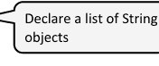

```java
System.out.println(list); // 输出: [A, B, C]
```

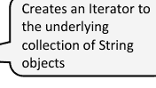

```java
Iterator<String> loop = list.iterator();
```

```java
while (loop.hasNext()) {
    string s = loop.next();
    if (s == "B") { loop.remove(); }
}
System.out.println(list); // 输出: [A, C]
```


上面的代码删除了 “B” 元素。

上面的代码删除了 “B” 元素。


## Iterator 移除

```java
while (loop.hasNext()) {
    string s = loop.next();
    if (s == "B") { loop.remove(); }
}
System.out.println(list); // 输出: [A, C]
```


上面的代码删除了 “B” 元素。

## List Iterator

`ListIterator` 接口提供了在双向遍历集合的同时修改列表的功能。

`ListIterator` 接口扩展了 `Iterator` 的功能，允许按双方向遍历集合并在迭代期间修改列表。

### 示例

```java
LinkedList<String> list = new LinkedList<>();
list.add("A");
list.add("B");
list.add("C");
```


```java
System.out.println(list); // 输出: [A, B, C]
```


```java
ListIterator<String> loop = list.listIterator(list.size());
// 反向遍历列表
while (loop.hasPrevious()) {
    String s = loop.previous();
    loop.set(s + "1");
}
System.out.println(list); // 输出: [A1, B1, C1]
```


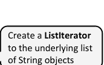

## `Spliterator`


`Spliterator` 接口是 JDK 8 添加的最新迭代器类型。它设计用于遍历集合或其他元素源，并可选地对其进行分区以并行处理。我们说“集合或其他源”，是因为 `Spliterator` 不仅可以为集合创建，还可以为数组、I/O 通道或生成器创建。

注意，`Spliterator` 会消耗源。一旦处理完源的所有元素，必须重新创建 `Spliterator`。

在下面的示例中，我们为整数数组创建一个 `Spliterator`，将其分成两部分，并计算存储在数组中的所有值的和。

```java
import java.util.*;

class testSpliterator {
    static int total = 0;

    public static void sum(Integer i) {
        total += i;
    }

    public static void main(String args[]) {
        Integer[] integers = {1, 2, 3, 4};
        Spliterator<Integer> sp1 = Arrays.spliterator(integers);
        Spliterator<Integer> sp2 = sp1.trySplit();

        while (sp1.tryAdvance(i -> total += i));

        if (sp2 != null) {
            while (sp2.tryAdvance(i -> sum(i)));
        }

        System.out.println("Total=" + total); // 输出: Total=10
    }
}
```

## 比较器（Comparator）

任何有序集合（例如 `TreeSet`）都需要某种比较算法来确定集合中的哪个元素比另一个元素更“大”。实际上，对于可以存储在有序集合中的每种类型的对象，都有默认的算法。这些算法通过 `Comparator` 函数式接口实现，该接口定义了 `compare()` 方法。如果我们想更改集合中对象的默认顺序，可以构建一个指向自定义比较器的集合。

请注意，`Comparator` 可以为没有自然排序的对象集合提供排序。

下面的示例展示了如何创建一个自定义比较器来对整数数组进行降序排序。

```java
import java.util.*;

class testComparator {
    public static int reverse(Integer n1, Integer n2) {
        return n2.compareTo(n1);
    }

    public static void main(String[] args) {
        Integer[] nn = {1, 2, 3};
        Arrays.sort(nn, (n1, n2) -> reverse(n1, n2));
        System.out.println(nn[0] + " " + nn[1] + " " + nn[2]);
    }
}
```

该程序的输出将是“3 2 1”。

注意：`Arrays` 类定义了多个排序方法；我们使用了其中一种：

`static void sort(T[] a, Comparator<? super T> c)`

以下是执行过程：

- `T` 变为第一个操作数 `T`。
- 整数数组替换第一个操作数 `T`。
- Lambda 表达式 `(n1, n2) -> reverse(n1, n2)` 被转换为 `Comparator<Integer>` 函数式接口的实例，其 `compare()` 方法实现为 `{ reverse(n1, n2); }`。
- 在排序过程中，使用 `reverse()` 来确定两个整数中哪一个更大，如下：

`n1 > n2 : result > 0; n1 < n2 : result < 0; n1 = n2 : result = 0`

# I/O 流（I/O Streams）

流是输入的抽象表示，从那里检索源数据；或者是输出，将数据发送到。Java 识别两种类型的流：字节流（byte streams）和字符流（character streams）。字节流应用于发送或接收二进制对象，而当处理字符且需要数据的“字符”表示时，应使用字符流。

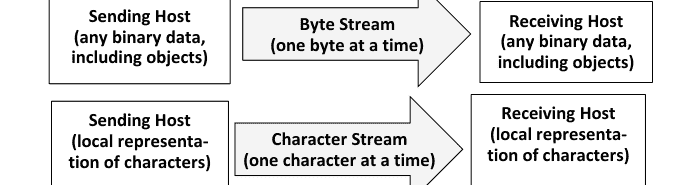

请注意，通过字节流或字符流传输数据是一次一个字节或一个字符进行的。存在缓冲流（buffered streams）可以将数据分组到缓冲区，但这些流仍然基于底层的字节流或字符流。

本章提供了流概念的概述，并说明了一些输入和输出流的使用。

## 字节输出流（Byte Output Streams）

假设一个应用程序生成了以下类型的数据并想将其写入文件：

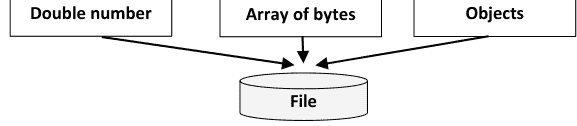

实现此目标的方法可以是为每种输入数据创建不同的类，但 Java 处理此任务的方法是构建一个流的“链”，每个流执行必要的数据转换并将结果传递给下一个流：

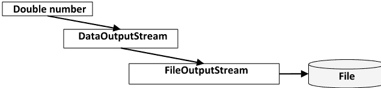

`FileOutputStream` 类提供了几种向文件写入数据的方法。例如，它定义了方法 `write(byte[] b)`，将指定的字节数组写入文件。如果我们有一个准备好的数组，可以如下使用该方法：

```java
byte[] b = {97, 98, 99};
FileOutputStream fileout;
fileout = new FileOutputStream("myfile.txt");
fileout.write(b);
```

然而，`FileOutputStream` 类不处理原始数据类型（`double`、`float`、`int` 等）。因此，为了写出一个 `double` 类型的数字，我们需要引入 `DataOutputStream` 类，它实现了 `writeDouble` 方法。`DataOutputStream` 将接收到的参数转换为字节数组，并通过调用底层流的 `write` 方法将每个字节一个接一个传递给底层流：

```java
DataOutputStream dataout;
dataout = new DataOutputStream(fileout);
```

`dataout` 将为每个输出字节调用 `fileout.write()` 方法。

现在，我们可以调用 `DataOutputStream` 的 `writeDouble` 方法，它将 `double` 类型的数字转换为字节，并通过 `write` 方法将其传递给 `FileOutputStream`：

```java
dataout.writeDouble(123.4);
```

通常情况下，流链是从底向上构建的：

```java
C c = new C();
B b = new B(c);
A a = new A(b);

// 或者只需：
A a = new A(new B(c));
```

数据在输出流之间的传递方式如下：

| 对象 `a` | 对象 `b` | 对象 `c` |
| --- | --- | --- |
| `a.write(...)` | `write(...)` | `write(...)` |
| 转换 | 转换 | 转换 |
| `b.write(...)` | `c.write(...)` | |
| | | `}` |

为了使此机制运行，必须满足以下要求：每个输出流必须是 `OutputStream` 的子类，且每个输出流都具有以下方法：

- `write(int i)` - 强制性
- `write(byte[] b)` - 可选
- `write(byte[] b, int offset, int length)` - 可选

（注：此处原文存在重复段落，已按要求保留翻译）

- `write(int i)` - 强制性
- `write(byte[] b)` - 可选
- `write(byte[] b, int offset, int length)` - 可选

- `write(int i)` - 强制性
- `write(byte[] b)` - 可选
- `write(byte[] b, int offset, int length)` - 可选

- `write(int i)` - 强制性
- `write(byte[] b)` - 可选
- `write(byte[] b, int offset, int length)` - 可选

- `write(int i)` - 强制性
- `write(byte[] b)` - 可选
- `write(byte[] b, int offset, int length)` - 可选

- `write(int i)` - 强制性
- `write(byte[] b)` - 可选
- `write(byte[] b, int offset, int length)` - 可选

每个输出流必须是 `OutputStream` 的子类，且每个输出流都具有以下方法：

- `write(int i)` - 强制性
- `write(byte[] b)` - 可选
- `write(byte[] b, int offset, int length)` - 可选

每个输出流必须是 `OutputStream` 的子类，且每个输出流都具有以下方法：

- `write(int i)` - 强制性
- `write(byte[] b)` - 可选
- `write(byte[] b, int offset, int length)` - 可选

每个输出流必须是 `OutputStream` 的子类，且每个输出流都具有以下方法：

- `write(int i)` - 强制性
- `write(byte[] b)` - 可选
- `write(byte[] b, int offset, int length)` - 可选

每个输出流必须是 `OutputStream` 的子类，且每个输出流都具有以下方法：

- `write(int i)` - 强制性
- `write(byte[] b)` - 可选
- `write(byte[] b, int offset, int length)` - 可选

每个输出流必须是 `OutputStream` 的子类，且每个输出流都具有以下方法：

- `write(int i)` - 强制性
- `write(byte[] b)` - 可选
- `write(byte[] b, int offset, int length)` - 可选

每个输出流必须是 `OutputStream` 的子类，且每个输出流都具有以下方法：

- `write(int i)` - 强制性
- `write(byte[] b)` - 可选
- `write(byte[] b, int offset, int length)` - 可选

每个输出流必须是 `OutputStream` 的子类，且每个输出流都具有以下方法：

- `write(int i)` - 强制性
- `write(byte[] b)` - 可选
- `write(byte[] b, int offset, int length)` - 可选

每个输出流必须是 `OutputStream` 的子类，且每个输出流都具有以下方法：

- `write(int i)` - 强制性
- `write(byte[] b)` - 可选
- `write(byte[] b, int offset, int length)` - 可选

每个输出流必须是 `OutputStream` 的子类，且每个输出流都具有以下方法：

- `write(int i)` - 强制性
- `write(byte[] b)` - 可选
- `write(byte[] b, int offset, int length)` - 可选

每个输出流必须是 `OutputStream` 的子类，且每个输出流都具有以下方法：

- `write(int i)` - 强制性
- `write(byte[] b)` - 可选
- `write(byte[] b, int offset, int length)` - 可选

每个输出流必须是 `OutputStream` 的子类，且每个输出流都具有以下方法：

- `write(int i)` - 强制性
- `write(byte[] b)` - 可选
- `write(byte[] b, int offset, int length)` - 可选

每个输出流必须是 `OutputStream` 的子类，且每个输出流都具有以下方法：

- `write(int i)` - 强制性
- `write(byte[] b)` - 可选
- `write(byte[] b, int offset, int length)` - 可选

每个输出流必须是 `OutputStream` 的子类，且每个输出流都具有以下方法：

- `write(int i)` - 强制性
- `write(byte[] b)` - 可选
- `write(byte[] b, int offset, int length)` - 可选

每个输出流必须是 `OutputStream` 的子类，且每个输出流都具有以下方法：

- `write(int i)` - 强制性
- `write(byte[] b)` - 可选
- `write(byte[] b, int offset, int length)` - 可选

每个输出流必须是 `OutputStream` 的子类，且每个输出流都具有以下方法：

- `write(int i)` - 强制性
- `write(byte[] b)` - 可选
- `write(byte[] b, int offset, int length)` - 可选

每个输出流必须是 `OutputStream` 的子类，且每个输出流都具有以下方法：

- `write(int i)` - 强制性
- `write(byte[] b)` - 可选
- `write(byte[] b, int offset, int length)` - 可选

每个输出流必须是 `OutputStream` 的子类，且每个输出流都具有以下方法：

- `write(int i)` - 强制性
- `write(byte[] b)` - 可选
- `write(byte[] b, int offset, int length)` - 可选

每个输出流必须是 `OutputStream` 的子类，且每个输出流都具有以下方法：

- `write(int i)` - 强制性
- `write(byte[] b)` - 可选
- `write(byte[] b, int offset, int length)` - 可选

每个输出流必须是 `OutputStream` 的子类，且每个输出流都具有以下方法：

- `write(int i)` - 强制性
- `write(byte[] b)` - 可选
- `write(byte[] b, int offset, int length)` - 可选

每个输出流必须是 `OutputStream` 的子类，且每个输出流都具有以下方法：

- `write(int i)` - 强制性
- `write(byte[] b)` - 可选
- `write(byte[] b, int offset, int length)` - 可选

每个输出流必须是 `OutputStream` 的子类，且每个输出流都具有以下方法：

- `write(int i)` - 强制性
- `write(byte[] b)` - 可选
- `write(byte[] b, int offset, int length)` - 可选

每个输出流必须是 `OutputStream` 的子类，且每个输出流都具有以下方法：


- `write(int i)`：强制性
- `write(byte[] b)`：可选
- `write(byte[] b, int offset, int length)`：可选

每个输出流必须是 `OutputStream` 的子类，且每个输出流都具有以下方法：

- `write(int i)`：强制性
- `write(byte[] b)`：可选
- `write(byte[] b, int offset, int length)`：可选

- 为了使此机制运行：

  - 满足以下要求：每个输出流必须是 `OutputStream` 的子类，且每个输出流都具有以下方法：
  - `write(int i)`：强制性
  - `write(byte[] b)`：可选
  - `write(byte[] b, int offset, int length)`：可选

## 字符输出流（Character Output Streams）

Java 中的所有字符都以 Unicode 格式表示。字符输出类在将字符发送到输出设备或其他流之前，会将它们转换为本地表示（例如 ASCII 格式）。字符输出流的另一个功能是生成任何原始类型的字符表示。这通过 `PrintWriter` 类的 `print` 和 `println` 方法实现。这些方法被重载（即有多个版本），并接受原始数据类型、字符串、字符数组或对象。

类似于继承 `OutputStream` 类的输出流类，字符流类继承 `Writer` 类及其写入方法。

下面的程序使用两个不同的字符输出流将字符数组写入文件：

```java
import java.io.*;

class testcharStreams {
    public static void main(String args[]) {
        char[] c = {'a', 'b', 'c'};

        FileWriter filewriter;
        PrintWriter printout;

        try {
            filewriter = new FileWriter("write.txt");
            filewriter.write(c, 0, 3);
            filewriter.flush();

            printout = new PrintWriter("print.txt");
            printout.println(123.4);
            printout.flush();
        }
        catch (IOException e) {
            System.out.println("I/o error");
        }
    }
}
```

上述程序产生：“接收到的字节：8"

## 字节输入流

字节输入流用于接收（读取）字节序列。此组中的所有类必须继承 `InputStream` 抽象类并实现其读取方法：

```java
abstract int read();
int read(byte[] b); // 可选
int read(byte[] b, int offset, int len); // 可选
```

注意：当到达流结束时，读取方法返回整数值 `-1`。

除了读取方法外，`InputStream` 类还提供了几种方法来支持所谓的“可标记流”（markable streams）。通过可标记流，你可以标记流中的当前位置，并在稍后返回该位置。可以使用 `markSupported` 方法来检查流是否是可标记的。

以下是从文件中读取整数的示例：

```java
// 假设：一组整数值已通过 DataOutputStream 写入了
// "test.txt" 文件。
import java.io.*;

class TestByteInputStream {
    public static void main(String[] args[]) {
        boolean EOF = false;
        int i;

        try {
            File myfile = new File("test.txt");
            FileInputStream filein = new FileInputStream(myfile);
            DataInputStream datain = new DataInputStream(filein);

            while (!EOF) {
                i = datain.readInt();
                System.out.println("i=" + i);
            }
        } catch (EOFException e) {
            EOF = true;
        } catch (IOException e) {
            System.out.println("I/O Error");
        }
    }
}
```

## 字符输入流

字符输入流由一组继承 `Reader` 抽象类的类表示。其目的是从不同的源以原生（本地）编码格式读取字符，并将其转换为 Unicode 格式。每个输入流类都必须实现读取方法：

```java
int read(); // 读取单个字符
int read(char[] c); // 将字符读入数组
// 读取到数组的一部分；
abstract int read(char[] c, int off, int len);
```

注意：当到达流结束时，读取方法返回整数值 `-1`。

除了读取方法外，`Reader` 类还提供了其他几种方法来支持所谓的“可标记流”。通过可标记流，你可以标记流中的当前位置，并在稍后返回该位置。可以使用 `markSupported` 方法来检查流是否是可标记的。

示例：


```java
// 打印字母表中每隔一个字符
import java.io.*;

class testStringReader {
    public static void main(String[] args[]) {
        String s = "abcdefghijklmnopqrstuvwxyz";
        int i = 0;
        try {
            Reader sReader = new StringReader(s);
            do {
                sReader.skip(1);
                i = sReader.read();
                if (i > 0)
                    System.out.print((char) i);
            } while (i != -1);
        } catch (IOException e) {
            System.out.println("Error reading file");
        }
    }
}
```

该程序产生输出："dfhjlnprtvxz"

## Try-With-Resources

JDK7 在流处理过程中增加了一个非常棒的增强。它允许在我们用完流后自动释放流所持有的资源（例如关闭文件）。此功能可以与实现了`AutoClosable`接口的类，该接口仅声明了一个方法 — `close()`。当`try`块结束时，将调用`close`方法。

新的`try`块格式：

```
try ( 资源声明和初始化 )
{ 资源的使用 }
catch ( . . ) { . . }
```

示例：

```java
class mystream extends OutputStream {
    public void writeInt(int i) { }

    public void write(byte[] b, int offset, int lng) {
        System.out.println("Received bytes: " + lng);
    }
}

class teststreams {
    public static void main(String args[]) {
        try (
            DataOutputStream dataout =
                new DataOutputStream(
                    new BufferedOutputStream(
                        new MyStream()))) {
            dataout.writeInt(123);
            // dataout.flush();
        } catch (IOException e) {
            System.out.println("I/o error");
        }
    }
}
```

# 序列化

序列化是将对象的状态转换为字节流的过程，然后可以将其保存到文件中或通过网络传输。反向过程称为反序列化，即从字节流中重建原始对象。

在 Java 中，一个类必须实现`java.io.Serializable`接口才能被序列化。这是一个标记接口，意味着它没有方法需要实现。

当对象被序列化时，它的整个对象图也会被序列化。然而，某些字段不应该被序列化。例如：

- **Transient 字段**：标记为`transient`关键字的字段不会被序列化。
- **Static 字段**：它们属于类而不是实例，因此不被序列化。

示例：

```java
import java.io.*;

class User implements Serializable {
    private String name;
    private transient int age; // 此字段将不会被序列化

    public User(String name, int age) {
        this.name = name;
        this.age = age;
    }

    @Override
    public String toString() {
        return "User{name='" + name + "', age=" + age + '}';
    }
}

public class SerializationDemo {
    public static void main(String[] args) {
        User user = new User("Alice", 30);
        String filename = "user.ser";

        // 序列化对象
        try (ObjectOutputStream out = new ObjectOutputStream(new FileOutputStream(filename))) {
            out.writeObject(user);
            System.out.println("Object has been serialized to " + filename);
        } catch (IOException e) {
            e.printStackTrace();
        }

        // 反序列化对象
        try (ObjectInputStream in = new ObjectInputStream(new FileInputStream(filename))) {
            User deserializedUser = (User) in.readObject();
            System.out.println("Deserialized object: " + deserializedUser);
        } catch (IOException | ClassNotFoundException e) {
            e.printStackTrace();
        }
    }
}
```

反序列化对象时，`transient`字段将被初始化为它们的默认值（例如 int 为 0，对象为 null）。

为了对序列化过程有更多控制，你可以在序列化类中实现`writeObject`和`readObject`方法。

```java
private void writeObject(ObjectOutputStream out) throws IOException {
    out.defaultWriteObject(); // 序列化非静态非 transient 字段
    // 自定义序列化逻辑
}

private void readObject(ObjectInputStream in) throws IOException, ClassNotFoundException {
    in.defaultReadObject(); // 反序列化非静态非 transient 字段
    // 自定义反序列化逻辑
}
```

除了上述功能外，随着时间的推移，NIO 还与标准 I/O 流协同工作，并执行文件系统操作（即文件和目录的操作）。

以下是主要的 NIO 类和接口：

## Buffer

`Buffer`类用于创建缓冲区并操作缓冲区的内容。`Buffer`类有不同的子类来存储不同类型的原始数据——`ByteBuffer`、`CharBuffer`、`IntBuffer`。

## Channel

`Channel`实际上是一个由各种通道类实现的接口：`SocketChannel`、`DatagramChannel`、`SeekableByteChannel`、`FileChannel`等。它代表与一个能够执行 I/O 操作的实体（文件、网络套接字等）连接。

## Selector

`Selector`类允许单个应用程序线程处理多个通道。

（`Selector`类的用法超出了本书的范围。）

## Files

`Files`类提供了操作文件和目录的方法。它还可以打开标准的字节流（即`InputStream`和`OutputStream`），以便从文件读取或向文件写入。

第一个示例说明了如何使用`Buffer`、`Channel`和`Files`通过阻塞通道在应用程序和磁盘文件之间传递未格式化的数据（字节）。

```java
// Example of using NIO writing to and from files

import java.io.*;
import java.nio.*;
import java.nio.file.*;
import java.nio.channels.*;

class testNIO {
    public static void main(String[] args) {
        byte[] bytes = {97, 98, 99};
        ByteBuffer buffer = ByteBuffer.allocate(16);

        try {
            Path path = Paths.get("testNIO.txt");

            SeekableByteChannel channel = Files.newByteChannel(
                path,
                StandardOpenOption.CREATE,
                StandardOpenOption.WRITE,
                StandardOpenOption.READ
            );

            buffer.put(bytes);
            buffer.rewind();
            channel.write(buffer);

            channel.position(1);
            buffer.rewind();
            channel.write(buffer);

            channel.truncate(3);
            channel.position(0);
            buffer.rewind();

            int i = channel.read(buffer);
            System.out.println("file length = " + i); // prints: 3

            channel.close();
        } catch (InvalidPathException e) {
            System.out.println("invalid path");
        } catch (IOException e) {
            System.out.println("I/O error");
        }
    }
}
```

执行代码后，文件`testNIO.txt`将包含"aab"。

下一个示例演示了 NIO 和标准流 I/O 如何协同工作来读取文件内容。

```java
// Print the testNIO.txt file created in previous example

import java.io.*;
import java.nio.file.*;

class testNIOStream {
    public static void main(String args[]) {
        int i;

        try {
            Path path = Paths.get("testNIO.txt");
            InputStream stream = Files.newInputStream(path);

            do {
                i = stream.read();
                if (i != -1) {
                    System.out.println((char) i);
                }
            } while (i != -1);

            stream.close();
        } catch (InvalidPathException e) {
            System.out.println("Invalid path");
        } catch (IOException e) {
            System.out.println("I/O error");
        }
    }
}
```

本章的最后一个示例演示了 NIO 与文件系统工作的一些能力。

```java
// Print all the directories on the C: drive

import java.io.*;
import java.nio.file.*;
import java.nio.file.attribute.*;

class testNIOFileTree {
    public static void main(String[] args) {
        try {
            Path path = Paths.get("c:");
            Files.walkFileTree(path, new CustomFileVisitor());
        } catch (IOException e) {
            System.out.println(e);
        }
    }
}

class CustomFileVisitor extends SimpleFileVisitor<Path> {
    @Override
    public FileVisitResult visitDirectory(
            Path dir,
            BasicFileAttributes attrs) throws IOException {
        System.uout.println(dir.toString());
        return FileVisitResult.CONTINUE;
    }

    @Override
    public FileVisitResult visitFile(
            Path file,
            BasicFileAttributes attrs) throws IOException {
        System.out.println(file.toString());
        return FileVisitResult.CONTINUE;
    }
}
```

这段代码计算出的结果是 8。

现在，如之前所述，整个过程可以用一行代码表示：

`int sum = Arrays.stream(doubles).mapToInt(n -> (int) (n + 0.5)).sum();`


如果我们需要将更复杂的逻辑放入映射（即放入`applyAsInt`方法中），我们可以定义一个自定义并在 lambda 表达式中指定它：

```java
public static int round(double n) {
    int i = (int) (n + 0.5); // 四舍五入双点数
    System.out.println("in=" + n + " out=" + i);
    return i;
}
```

```java
int sum = Arrays.stream(doubles).mapToInt(n -> round(n)).sum();
```

`mapToInt()`方法是一个中间操作 - 它接受一个流并返回另一个流。`sum()`方法是一个终端操作 - 它消耗流并返回最终结果。

下一个示例演示了遍历流中所有元素（对象）的过程。我们利用`Stream`类的`forEach()`实例方法执行循环。`forEach()`方法声明如下：

`forEach(Consumer<? super T> action)`

对于流中的每个对象，`forEach()`方法会调用`Consumer`的`accept()`方法，并为其提供从流中获取的对象。`Consumer`是一个函数接口，可以通过 lambda 表达式或使用方法引用来创建`Consumer`类型的对象。以下示例展示了两种方法。

```java
// 使用 Stream 类的 forEach() 方法

import java.util.*;
import java.util.stream.*;

class testStream {
    public static void main(String[] args) {
        String[] words = {"One", "Two", "Three"};
        Stream<String> stream = Arrays.stream(words);
```


```java
stream.forEach(w -> System.out.print(w));

stream = Arrays.stream(words);

stream.forEach(System.out::print);
```

> 此 lambda 表达式将创建一个 `Consumer` 对象，其 `accept()` 方法的实现为 `System.out.println(w)`。

> 此方法将创建一个 `Consumer` 对象，并将 `System.out` 对象的 `print` 方法传递给它。

上述代码打印了两行：

```text
"OneTwoThree"
"OneTwoThree"
```

在我们结束对 Stream API 的概览之前，我们想提到 Stream API 提供的优势之一是并行处理。假设环境支持并行，对流上的操作可以并行进行。要切换到并行处理，请使用 `parallel()` 方法：

```java
int sum = Arrays.stream(doubles)
    .parallel()
    .mapToInt(n -> round(n))
    .sum();
```

# 可观察对象与观察者

`Observable` 类配合 `Observer` 接口提供了一种建立对象间通信的简单机制。一个对象（观察对象）可以被一个或多个其他对象（观察者）观察。当需要时，被观察的对象可以通知观察者，它们可以执行某些操作。

| `class M extends Observable` | `class W1 implements Observer` |
| :--- | :--- |
| `m = new M()` | `w1 = new W1()` |
| `m.addObserver(w1)` | `w1.update()` |
| `m.addObserver(w2)` | `class W2 implements Observer` |
|  | `w2 = new W2()` |
| `m.setChanged()` | `w2.update()` |
| `m.notifyObservers(observers)` |  |

示例：

```java
import java.util.*;

public class myClass extends observable implements Observer {

    String myName;

    public myClass(String s) {
        myName = s;
    }

    public void update(Observable m, Object arg) {
        System.out.println(myName + " received a " + arg + " from " + m.myName);
    }

    public static void main(String args[]) {
        myClass m = new myClass("manager");

        m.addObserver(new myClass("Bob"));
        m.addObserver(new myClass("Joe"));

        m.setChanged();
        m.notifyObservers("message");
    }
}
```

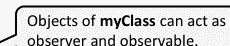

> 创建两个新对象并将它们注册为 `m` 的对象。

> 在每次通知之前必须调用 `setChanged()`。

> 每个观察者的 `update()` 方法都将被调用；注意：`m` 将自动传递给 `update()`。

此程序的输出：

```text
"Bob received a message from manager"
"Joe received a message from manager"
```

# 枚举

枚举背后的思想是提供一种简单的方法来定义常量集合，这些常量不受限于任何原始类型或对象类型（通常这些类型限制会限制它们的使用范围）。Java 对此问题的解决方案是一种新类型的类，其实例被视为常量。这里是一个枚举类的声明示例：

```java
enum myEnum { MIN, MAX }
```

注意这里使用 `enum` 而不是 `class`。`MIN` 和 `MAX` 是 `myEnum` 类的实例（对象），被称为枚举常量。它们被隐式地声明为 `public`、`static`、`final`。当枚举类在程序中第一次被引用时，枚举常量会被创建（实例化）。因此，你不需要使用 `new` 运算符（事实上，你也无法使用）来创建枚举类的对象。除了这些差异外，枚举类仍然是 Java 类，因此它们可以拥有静态变量和实例变量、方法、语句块，甚至构造函数。

示例：

| 代码 | 说明 |
| :--- | :--- |
| `myEnum { MIN, MAX; }` |  |
| `static { System.out.println("Class myEnum loaded"); }` | 静态语句块；当类 `myEnum` 加载到 JVM 时执行 |
| `{ System.out.println(this + " created"); }` | 实例语句块；当该类的实例被创建时执行。 |
| `public static void main(String args[]) { myEnum min, max; }` | 第一次引用类 `myEnum`；声明两个 `myEnum` 类型的变量 |

此程序的输出：

```text
MIN created

MAX created

Class myEnum created
```

现在，让我们看看可以用枚举做什么。说明枚举优势的最佳方法是通过示例。假设我们有一个监控主要国家机场天气状况的方法。通过使用枚举，我们可以在编译时确保方法只接收预定义的机场集合，从而减少运行时错误的风险。

```java
enum Airport {

    JFK("New York"),
    PHL("Philadelphia"),
    MIA("Miami");

    String state, city;

    Airport(String s, String c) {
        this.state = s;
        this.city = c;
    }

    public static double getTemp(Airport a) {
        return 80.0;
    }

    public static String getCity(Airport a) {
        return a.city;
    }

    public static String getState(Airport a) {
        return a.state;
    }

    public static void main(String args[]) {
        Airport a;

        a = Airport.MIA;

        System.out.println(
            getCity(a) + ", " + getState(a) + " temp=" + getTemp(a)
        );
    }
}
```

此程序的输出：`Miami, FL temp=80.0`

# 正则表达式

文本字符串内容的验证和处理可以在许多应用程序中找到。例如，我们可能需要检查输入的电子邮箱地址格式是否有效。正则表达式 API 是一个强大的工具，Java 程序员可以它来执行文本验证、解析、分词或其他类型的处理。

正则表达式 API 由两个实用类组成：`Pattern` 和 `Matcher`。`Pattern` 类用于构建正则表达式，这些正表达式被称为“模式（patterns）”。`Matcher` 类用于将模式应用到文本字符串上。这两个类的用法非常简单，但挑战在于掌握正则表达式技巧，遗憾的是，这超出了本书的讨论范围。尽管如此，我们仍然通过几个示例来让你熟悉可以在文本字符串上执行的操作，并涵盖正则表达式的基础知识。

## 正则表达式基础

正则表达式是一个字符序列，定义了一个可以与文本字符串进行匹配的模式。例如，正则表达式“abc”可以用于检查文本是否包含“abc”序列。

正则表达式有几类。我们将介绍其中三类。

正则表达式的第一类被称为“字符（characters）”，它包含了大多数字符以及转转义序列，如 `\t`（制表符）或 `\n`（换行符）。“abc”就是字符正则表达式的一个示例。

正则表达式的第二类被称为“字符类（character classes）”，代表一组有效字符。例如，模式 `[a-zA-Z]` 匹配任何小写或大写字母。

对于某些字符类结构，Java 提供了简写形式：

- `.` 匹配任何字符
- `\s` 匹配空白字符
- `\d` 匹配任何数字
- `\w` 匹配任何单词字符

正则表达式的第三类构造结构被称为“量词（quantifiers）”。量词可以附加到任何字符或字符类结构上，用以指定该结构允许出现的次数：

- `?` 出现一次或不出现
- `*` 出现零次或多次
- `+` 出现一次或多次
- `{n}` 恰好出现 n 次
- `{n,}` 至少出现 n 次
- `{n,m}` 出现 n 到 m 次

还有其他的正则表达式组，但它们的复习超出了本书的范围。

## 正则表达式示例

在开始示例之前，我们需要提到一下 `Pattern` 和 `Matcher` 类没有构造函数。`Pattern` 对象是通过 `Pattern` 类的静态方法 `compile()` 创建的，而 `Matcher` 对象是通过 `Pattern` 类的实例方法 `matcher()` 创建的。

示例：验证整个文本是否匹配模式。

```java
String regex;

Pattern p;

Matcher m;
```

| `Pattern` | 描述 |
| :--- | :--- |
| `[a-z]+` | 匹配一个或多个小写字母 |
| `[a-zA-Z0-9]+` | 匹配任意数量字母或数字 |
| `@` | 匹配字符 '@' |
| `\w+` | 匹配任意数量单词字符 |
| `\.` | 匹配字符 '.' |
| `com` | 匹配字符串 "com" |

```java
p = Pattern.compile(regex);

m = p.matcher("test");

m.matches(); // 输出: true
```

示例：从邮箱中提取用户名和网站地址。

```java
import java.io.*;
import java.util.stream.*;
import java.util.regex.*;

class testregex {

    public static void main(String[] args) {

        String text = "a b c a b def b g";

        Pattern p = Pattern.compile("\\s");

        Stream<String> stream = p.splitAsStream(text);

        Stream<String> unique = stream.distinct();

        unique.forEach(w -> System.out.print(w + " "));

        // 同样的结果可以通过一条语句实现：

        Pattern.compile("\\s")
            .splitAsStream(text)
            .distinct()
            .forEach(w -> System.out.print(w + " "));
    }
}
```

上述程序的输出是：`"a b c def g "`。

示例：将所有空白序列替换为分号。

```java
String text = "One  Two  Four";

System.out.println(
    Pattern.compile("\\s+")
        .matcher(text)
        .replaceAll(";")
); // 输出: One;Two;Four
```

# 反射 API

每个 Java 程序都会对各种类型的对象（类、接口、数组、基本类型等）执行某些处理。在运行时，对于程序使用的每种类型的对象，Java 虚拟机（JVM）都会创建一个 `Class` 实例，该实例提供了检查对象类型属性的方法。例如，当你声明一个类 A 时，JVM 会构建一个对应的 `Class` 对象，提供关于类 A 的所有信息——它的方法、接口、注解、字段等。

反射 API 是 Java 语言中一个非常重要的组件。它被 Java Beans（本书未涵盖）、各种工具，在处理注解时等被广泛使用。你也可以将其用于调试目的。

## 获取 Class 对象

获取特定类的 `Class` 对象有三种主要方法。

当你有一个想要探索的类实例时，可以调用由 `Object` 类定义的实例方法 `getClass()`，该方法对所有 Java 对象可用：

```java
class myClass { }

myClass obj = new myClass();

Class c = obj.getClass();
```

在没有类实例可用的情况下，可以使用所谓的“类字面量（class literal）”来获取 `Class` 对象。类字面量是由类名后接 `.class` 形成的：

```java
interface myInterface {
    void methodName();
}

class myClass { }

Class c = myClass.class;

Class i = myInterface.class;
```

最后，你可以使用 `Class` 类的静态方法 `forName()`。该方法接受类的全限定名并返回其 `Class` 对象。请注意，`forName()` 方法可能会抛出 `ClassNotFoundException`。

```java
class myClass { }

Class c = Class.forName("myClass");

Class s = Class.forName("java.lang.String");
```

## 注解（Annotations）

注解为 Java 编程代码提供了一种标准的记录方式。以下特征使得注解与其他文档记录手段有所不同：

- 注解与其所标记的程序结构紧密相关；这减少了误表述的可能性。
- 注解可以作为 Java 编译器的指令，用于执行某些操作，例如：抑制某些警告消息。
- 注解是对象，可以通过包含注解的应用程序或第三方工具，在运行时对其进行访问。

重要说明：注解在运行时没有作用。

## 我们是如何创建注解的？

简而言之，注解是普通的 Java 类，只是在声明和处理上有所不同。所有注解类（称为注解类型）都是通过实现 `Annotation` 接口来创建的。然而，我们没有在类声明中使用 `implements` 关键字，而是使用 `@interface` 来指定注解类：

```java
@interface myAnnotation {

    Type method();

    Type method() default value;

    ....
}
```

| 说明 |
| :--- |
| 注解声明中只允许存在没有方法体的方法 |

示例：

```java
@interface Author {

    string name();

    string version() default "1.0";
}
```

| 说明 |
| :--- |
| 可以声明方法返回的默认值。 |

程序源码中的任何声明都应该位于声明本身之前，并被注解。注解应该位于被标记的声明之前：

```java
@Author(name="John Doe", version="1.2")
class myClass { ... }
```

| 说明 |
| :--- |
| 类 `myClass` 被标记了 `Author` 信息 |

```java
@Author(name="Bob")
public void myMethod(int n) { ... }
```

| 说明 |
| :--- |
| 方法 `myMethod` 被标记了注解。跳过 `version` 是可以的，因为它定义了默认返回值 |

## 我们可以用注解做什么？

在回答这个问题之前，我们需要回顾一下 Java 程序的生命周期，该生命周期可以分为四个阶段：

- 源代码
- 编译
- 字节码
- 执行（运行时）

初始问题需要针对每个阶段进行拆分：“在源代码中、编译期间、字节码中以及在运行时，我们可以用注解做什么？”

正如我们已经所出的，源代码包含了注解的声明。从程序员的角度来看，除了声明语法的具体细节外，这里没什么可以讨论的，这些细节将在稍后介绍。

下一阶段是编译。编译器解释注解声明并创建相应的 Java 对象，但编译器对注解还做了其他操作吗？答案是肯定的——有一组预定义的（即内置的）注解，它们作为编译器的指令。它们都定义在 `java.lang.annotation` 包中：

```java
@Retention
@Target
@Inherited
@Override
@SuppressWarnings
@Deprecated
@Safevarargs
@Repeatable
@FunctionalInterface
```

与所有注解一样，预定义的注解应该位于被标记的声明（或另一个注解）之前。例如，以下代码将指示编译器检查 `someMethod()` 是否确实是父类相同方法的重写。如果当前类的父类没有声明 `someMethod()`，则会导致编译错误。

```java
@Override
public void myMethod() { ... }
```

其他非预定义的注解（用户定义的或在其他 Java 包中声明的）由预定义的 `@Retention` 注解控制。`@Retention` 注解可以指定由 `RetentionPolicy` 枚举定义的三个值。

```java
@Retention(RetentionPolicy.SOURCE)
```


```java
@Retention(RetentionPolicy.CLASS) // 默认
@Retention(RetentionPolicy.RUNTIME)
```

注意：`@Retention` 只能标记一个注解声明。

以下是常量的效果：

- `SOURCE` – 注解仅留在源码（`.java` 文件）中，并在编译后丢弃。
- `CLASS` – 注解将存储在字节码（`.class` 文件）中，但在执行前会被丢弃；这是默认值。
- `RUNTIME` – 注解将在运行时可用。

`SOURCE` 级别的注解不被编译器处理（预定义注解除外）。然而，从 SE 6 开始，你可以为编译器添加注解处理器，这些处理注解的独立工具。它们超出了本书的讨论范围。

`CLASS` 级别的注解太特殊，因此也超出了我们的讨论范围，让我们讨论运行时处理。

## 处理运行时注解（Processing Runtime Annotations）

当另一个注解指定了 `@Retention(RetentionPolicy.RUNTIME)`（自定义或在某个 Java 包中声明）时，它使得该注解在运行时可用。由于 Java 没有提供任何处理注解的特殊机制，这取决于我们如何操作。

正如我们已经提到的，注解是实现 `Annotation` 接口的 Java 对象。这意味着如果我们能够获取某个注解对象的引用，就可以调用方法来检索声明的值：

```java
@interface Author {
    String name();
}

@Author(name = "Bob")
class myClass {
    public static void main(String args[]) {
        Author a = (myClass.class).getAnnotation(Author.class);
        System.out.println(a.name()); // 将打印：Bob
    }
}
```

## 注解类型（Annotation Types）

注解语义允许在相应信息可以推导时省略注解结构的部分内容。例如，如果注解没有参数，以下两个是等价的：

```java
@interface MyAnnotation { }

@interface MyAnnotation
```

这是由注解拥有的元素驱动的。根据此，Java 识别以下类型的注解：

- 普通注解（Normal Annotation）
- 单元素注解（Single Element Annotation）
- 标记注解（Marker Annotation）

## 限制 `@Annotations` 的使用

预定义的注解 `@Target` 可用于指定另一个注解可以应用于项类型。有效值由枚举 `ElementType` 定义：

```java
@Target(ElementType.ANNOTATION_TYPE)

@Target(ElementType.CONSTRUCTOR)

@Target(ElementType.FIELD)

@Target(ElementType.LOCAL_VARIABLE)

@Target(ElementType.METHOD)

@Target(ElementType.PACKAGE)

@Target(ElementType.PARAMETER)

@Target(ElementType.TYPE)

@Target(ElementType.TYPE_PARAMETER)

@Target(ElementType.TYPE_USE)
```

示例：

```java
// Author 只能用于注解构造函数和方法
@Target(ElementType.CONSTRUCTOR, ElementType.METHOD)
@interface Author {
    String name();
}

@Author(name = "Joe")
class myClass { ... }

@Author(name = "Bob")
myClass() { ... }

@Author(name = "Mike")
public void myMethod() { ... }
```

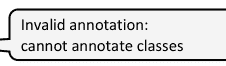

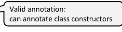

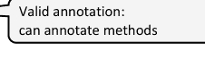

# JavaFX API

JavaFX 是一组图形和媒体包，允许开发者创建具有高性能现代图形用户界面的丰富客户端应用程序，具备音频、视频、图形和动画。

每个 JavaFX 由两个部分组成：`application`（应用程序）和 `stage`（阶段）。`application`（由 `Application` 类表示）负责构建 `stage` 及其元素，并定义处理逻辑。`stage`（由 `Stage` 类和其他类表示）是定义 `application` 视觉外观的对象分级集合。

此图展示了 JavaFX 程序的结构：

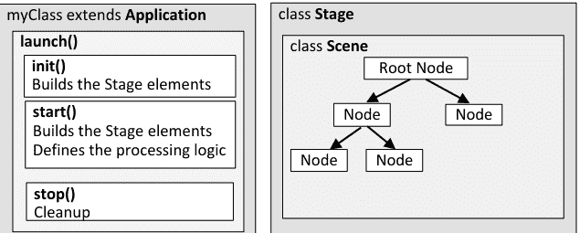

`Stage` 定义了 JavaFX 应用程序的环境。Java 运行时环境提供默认的 `Stage` 实例。然而，你可以创建多个 `Stage` 实例（对象）。

`Scene` 是一个容器（窗口），保存了 `stage` 的内容（即元素）。`Scene` 的内容创建了所谓的 `scene graph`（场景图）。

`Root Node`（根节点）决定 `Scene` 中元素的布局。

`Node`（节点）代表 `Scene` 的元素。它可以是一个按钮、文本框、几何形状、动画等。

`Application` 类启动 JavaFX 应用程序。`launch()` 方法执行 `init()` 方法，然后是 `start()`，在 `Stage` 完成后（例如窗口关闭）——执行 `stop()` 方法。

以下 JavaFX 示例，用于创建一个显示圆形和矩形的窗口：

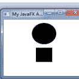

```java
import javafx.application.*;
import javafx.stage.*;
import javafx.scene.*;
import javafx.scene.shape.*;

public class testJavaFX extends Application {
    Circle circle;
    Rectangle rectan;

    public static void main(String[] args) {
        System.out.println("JavaFX: launch");
        launch(new String[1]);
    }
}
```

| 说明 | 代码 |
| :--- | :--- |
| 创建 `testJavaFX` 类的实例并执行 `init()`、`start()` 和 `stop()` 方法。必须提供 `String[]` 参数，但可以是空的。 | ```java<br>public void init() {<br>    System.out.println("JavaFX: init");<br>    System.out.println(Thread.currentThread().getName());<br>}<br>``` |
| `init()` 方法是可选的；所有声明可以在 `start(Stage)` 中完成。 | ```java<br>circle = new Circle(100, 40, 30);<br>rectan = new Rectangle(80, 80, 40, 40);<br>``` |
| 我们可以在 `init(Stage)` 方法中创建节点。 | ```java<br>public void start(Stage stage) {<br>    System.out.println("JavaFX: start");<br>    System.out.println(Thread.currentThread().getName());<br>}<br>``` |
| 声明一组节点。 | ```java<br>Group rootNode = new Group();<br>``` |
| 向组添加两个节点。 | ```java<br>rootNode.getChildren().add(circle);<br>rootNode.getChildren().add(rectan);<br>``` |
| 将节点放入 200x200 像素的窗口中。 | ```java<br>Scene scene = new Scene(rootNode, 200, 200);<br>``` |
| 构建阶段并启动 JavaFX 应用程序的执行。 | ```java<br>stage.setTitle("My JavaFX Application");<br>stage.setScene(scene);<br>``` |
| 将场景放置在阶段上。 | ```java<br>stage.show();<br>``` |
| 打开窗口。开始执行 JavaFX 应用程序。 | ```java<br>public void stop() {<br>    System.out.println("JavaFX: stop");<br>    System.out.println(Thread.currentThread().getName());<br>}<br>``` |
| `stop()` 方法是可选的。 | JavaFX: stop<br>JavaFX: [Thread name] |

为了处理事件，每个对象都必须自己注册为事件处理器，并实现某种事件处理逻辑。由于事件会传递给每个对象两次——一次是在捕获（或过滤）阶段，另一次是在冒泡（或处理）阶段，因此对象可以设置事件过滤器、事件处理器，或者两者兼备。

所有节点（即 `Node` 类的子类）以及 `Stage` 和 `Scene` 类都定义了用于注册和实现事件过滤器与事件处理器的方法：

```java
<T extends Event> void addEventListener(
    EventType<T> eventType,
    EventHandler<? super T> handler
);
```

```java
<T extends Event> void addEventHandler(
    EventType<T> eventType,
    EventHandler<? super T> handler
);
```

还有一些用于为不同类型的事件注册事件处理器的“便利方法”。它们本质上是 `addEventHandler` 方法的简写。例如，此方法为“鼠标点击”事件注册了一个事件处理器：

```java
void setMouseClicked(EventHandler<? super MouseEvent> value);
```

让我们使用 `addEventHandler()` 和 `setMouseClicked()` 方法来练习并创建几个事件处理器。

`setMouseClicked` 方法声明了一个参数——一个泛型函数接口 `EventHandler` 的对象，其泛型类参数可以是 `MouseEvent` 或 `MouseEvent` 的任何父类（例如 `EventHandler<MouseEvent>`、`EventHandler<Event>` 等）。

`EventHandler` 泛型接口声明了以下方法：

```java
void handle(T event);
```

接下来，我们需要创建一个类型为 `EventHandler<MouseEvent>` 的对象，实现它的 `handle()` 方法，并将此对象作为参数传递给 `setMouseClicked()` 方法。这可以通过多种方式实现，下面展示了其中三种。

使用 `setOnMouseClicked()` 方法注册事件处理器的第一种方法是使用匿名类：

```java
node.setOnMouseClicked(
    new EventHandler<MouseEvent>() {
        public void handle(MouseEvent e) {
            ... 事件处理逻辑 ...
        }
    }
);
```

- 创建一个 `EventHandler<MouseEvent>` 类型的对象。
- 实现 `EventHandler` 泛型接口的 `handle()` 方法。

使用 `setOnMouseClicked()` 方法的第二种方法是使用 lambda 表达式：

```java
node.setOnMouseClicked(
    e -> { ... 事件处理逻辑 ... }
);
```

- 此 lambda 表达式创建了一个 `EventHandler<MouseEvent>` 类型的对象，其 `handle()` 方法按照 `(...)` 中的指定已实现。

使用 `setOnMouseClicked()` 方法的第三种方法是使用方法引用：

```java
class myClass {
    public void myClickHandler(MouseEvent e) {
        ... 事件处理逻辑 ...
    }

    public static void main(String[] args) {
        ...
        node.setOnMouseClicked(
            myClass::clickHandler
        );
    }
}
```

- 此方法引用表达式创建了一个 `EventHandler<MouseEvent>` 类型的对象，其 `handle()` 方法指向 `myClickHandler()` 方法。

注意，`myClickHandler` 方法的签名必须与 `EventHandler` 接口的 `handle` 方法相同，其声明如下：

```java
void handle(T event)
```

`T` 是我们想要处理的事件类型；在我们的应用中它是 `MouseEvent`。

现在让我们使用 `addEventHandler()` 方法创建一个事件处理器。`addEventHandler` 的格式如下：

```java
<T extends Event> void addEventHandler(
    EventType<T> eventType,
    EventHandler<? super T> eventHandler
)
```

该方法与之前审查过的 `setOnMouseClicked` 的第一个区别在于，`EventHandler` 对象可以是任何事件类型，而不仅仅是 `MouseEvent`。事实上，`EventHandler` 可以为 `Event` 类以及 `Event` 类的任何子类创建。第二个区别是——我们需要通过传递 `EventType<T>` 类型的对象来告诉方法我们将处理哪种事件类型，其中 `T` 可以指定 `Event` 类及其任何子类。

使用 lambda 表达式，我们可以如下为“鼠标点击”事件构建事件处理器：

```java
node.addEventHandler(
    MouseEvent.MOUSE_CLICKED,
    e -> { ... 事件处理逻辑 ... }
);
```

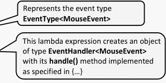

注意：此示例中的 `MouseEvent.MOUSE_CLICKED` 是定义在 `MouseEvent` 类中的 `EventType<MouseEvent>` 静态变量，代表“鼠标点击”类型。它的定义为：

```java
public static final EventType<MouseEvent> MOUSE_CLICKED
```

事件过滤器的注册与事件处理器的注册相似，不同之处在于它没有提供便利方法。

通过下一个示例，我们将结束对 JavaFX API 特性的简要概述。该示例说明了我们目前为止关于 JavaFX 事件处理机制中学的所有内容。在 Windows 系统上运行时，它将显示以下窗口：

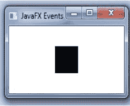

在您点击黑色矩形内的任意处后，控制台将打印以下消息：

- 捕获阶段：Stage clicked
- 捕获阶段：Scene clicked
- 捕获阶段：Group clicked
- 捕获阶段：Rectangle clicked
- 冒泡阶段：Rectangle clicked
- 冒泡阶段：Group clicked
- 冒泡阶段：scene clicked
- 冒泡阶段：stage clicked

要停止 JavaFX，请关闭显示的窗口。

## JavaFX 事件处理示例


```java
import javafx.application.*;
import javafx.stage.*;
import javafx.scene.*;
import javafx.scene.shape.*;
import javafx.event.*;
import javafx.scene.input.MouseEvent;

public class testJavaFX extends Application {
    public void start(Stage stage) {
        Group rootNode = new Group();
        Rectangle rect = new Rectangle(80, 30);
        rootNode.getChildren().add(rect);
        Scene scene = new Scene(rootNode, 200, 100);

        stage.addFilter(MouseEvent.MOUSE_CLICKED,
            System.out.println("Capturing phase: Stage clicked"));
        stage.addEventHandler(MouseEvent.MOUSE_CLICKED,
            System.out.println("Bubbling phase: Stage clicked"));

        scene.addFilter(new EventHandler<MouseEvent>() {
            public void handle(MouseEvent e) {
                System.out.println("Capturing phase: Scene clicked");
            }
        });
        scene.setOnMouseClicked(e -> {
            System.out.println("Bubbling phase: Scene clicked");
        });

        rootNode.addFilter(MouseEvent.MOUSE_CLICKED,
            System.out.println("Capturing phase: Group clicked"));
        rootNode.addEventHandler(MouseEvent.MOUSE_CLICKED,
            System.out.println("Bubbling phase: Group clicked"));

        rect.addFilter(MouseEvent.MOUSE_CLICKED,
            System.out.println("Capturing phase: Rectangle clicked"));
        rect.setOnMouseClicked(e -> {
            System.out.println("Bubbling phase: Rectangle clicked");
        });

        stage.setTitle("JavaFX Events");
        stage.setScene(scene);
        stage.show();
    }

    public static void main(String[] args) {
        launch(args);
    }
}
```

# 参考资料

- [Java 平台安装和配置指南](https://docs.oracle.com/javaase/8/docs/technotes/guides/install/)：在不同操作系统上安装和配置 Java 平台的指南。
- [Java SE 下载](http://www.oracle.com/technetwork/java/javaase/downloads/)
- Java SE 文档。
- 浏览 Java SE（标准版）、Java EE（企业版）和 Java ME（嵌入式版）文档的起点。
- [Java SE 教程](http://docs.oracle.com/javaase/tutorial/)：包含数百个完整的示例和几十节课程。
- [Java SE 8 规范](http://docs.oracle.com/javaase/8/docs/api/index.html)：所有 Java 类和接口的完整规范。
- [Java 语言和虚拟机规范](https://docs.oracle.com/javaase/specs/)
- [JavaFX API 规范](http://docs.oracle.com/javaase/8/javafx/api/toc.htm)：所有 `javafx` 包均在此处。

# 目录

- 抽象类：100
- 访问修饰符：77
- 注解：164
  - 标记（marker）：169
  - 正常（normal）：169
  - 限制使用：170
  - 单元素：169
- 匿名类：101
- 应用类：171
- 数组
  - 创建：46
  - 声明：46
  - 多维：47
- 自动装箱 / 自动拆箱：68
- `Buffer` 类：146
- 强制转换
  - 在算术表达式中：25
  - 对象：61
- `Channel` 接口：146
- 类
  - `Application`：171
  - `Buffer`：146
  - `Enum`（枚举）：157
  - `FileOutputStream`：136
  - `Files`：146
  - `InputStream`：140
  - `Matcher`：158
  - `Node`：171
  - `Observable`：154
  - `OutputStream`：137
  - `Pattern`：158
  - `Reader`：141
- `Scene`：参见
- `Selector`：146
- `Stage`：参见
- `String`：69
- `Throwable`：113
- `Writer`：139
- 类分类
  - 抽象（abstract）：100
  - 匿名（anonymous）：101
  - 类变量和方法：51
  - 构造函数，`super` 关键字：60
  - 构造函数，`this` 关键字：58
  - 构造函数：57
  - 声明：51
  - 初始化类变量：52
  - 实例变量和方法：54
  - 局部内部类：99
  - 方法重写：63
  - 非静态内部类：98
  - 静态内部类（嵌套）：97
- 类与对象：50
- 集合：126
  - 创建：126
  - 框架：126


- `迭代`：129
  - `获取元素`：127
  - `更新`：128

- `Comparator`：134

- 构造器引用：95

- 反序列化：143

- 封装：15

- 枚举类（`Enum class`）：157

- 枚举（`Enumerations`）：155

- 异常：107
  - 检查异常（`checked`）：107
  - 检查异常处理：111
  - 异常层级：113
  - 自定义异常：115
  - 默认异常处理器：108
  - 运行时（`run time`）：113
  - 非检查异常（`unchecked`）：107
  - 非检查异常处理：108

- `FileOutputStream` 类：136

- `Files` 类：146

- `For-Each` 循环：129

- 泛型（`Generics`）：79
  - 类：82
  - 构造函数：87
  - 接口：85
  - 方法：79
  - 将方法作为参数传递：84
  - 类型安全：82
  - 类型变量：82
  - 通配符参数（`?`）：84

- 继承：16

- 内部类：97

- `InputStream` 类：140

- 接口：102

- 消费者：133、152
  - 默认方法：106
  - 完全实现的方法：106
  - 静态方法：106

- `IO` 流：135

- 迭代语句：37
  - 迭代器：131

- `JavaFX`：171
  - `JavaFX` 事件：175

- `JDK 8` 安装：10

- `Lambda` 表达式：89

- 列表迭代器：132

- 字面量：22
  - 布尔（`boolean`）：25
  - 转换（`casting`）：25
  - 字符：23
  - 类字面量：162
  - 数值：22
  - 字符串：25、69

- 循环控制变量：40

- 方法重载：58

- 方法重写：63

- 方法引用：93

- 方法：49
  - `main`：49

- 修饰符：49
  - 访问级别：77
  - 默认：106
  - `final`：78
  - 静态：78

- 新 `IO` 流：145

- `NIO`：145

- `Node` 类：171

- 对象：
  - 转换（`casting`）：61
  - 创建：56
  - 实例化：56

- 可观察类：154

- 观察者接口：154

- 运算符：
  - `::` 方法引用：93
  - `+` 字符串拼接：71
  - `for-each`：129
  - `instanceof`：64

- `OutputStream` 类：137

- 包：75

- 多态：17

- 原生数据类型：20

- `Reader` 类：141

- 反射 `API`：161

- 正则表达式：158

- `Scene` 类：171

- 变量范围：21

- `Selector` 类：146

- 序列化：143

- `Spliterator`：133

- 语句：
  - 块：34
  - `break`：42
  - `continue`：45
  - `do while`：38
  - 空：34
  - `for`：39
  - `for-each`：41
  - `new`：56
  - `package`：75
  - 程序流控制：34
  - 顺序性：36
  - `switch`：36
  - `try-with-resources`：142
  - `while`：37

- `Stream API`：150

- 流：135
  - 字节输入流：140
  - 字节输出流：135
  - 字符输入流：141
  - 字符输出流：139
  - 基础：135

- `String` 类：69

- 字符串：
  - 比较：70
  - 拼接：71
  - 创建：69
  - 方法：72

- `super` 关键字：60

- `switch` 语句：36

- `this` 关键字：58

- 线程：116
  - 通信（`wait & notify`）：124
  - 守护线程：119
  - 中断：119
  - 合并（`joining`）：120

- 同步：120

- 对方法进行同步：121

- 对语句块进行同步：121

- 用户线程：119

- `try-With Resources`：142

- 类型包装类：67

- 变量：21

- 通配符参数（`?`）：84

- `Writer` 类：139
