# 你会说 Java 吗？Java 编程基础初学者指南

## 引言

关于 Java 的书籍非常多——从入门指南到完整参考应有尽有。第一类书籍倾向于集中在基础概念上，这不会让你离开“Hello world!”程序太远。第二类书籍实在太庞大了——通常超过 1000 页。它们作为参考来源非常棒，但细节过于冗赘，示例也冗长。它们还试图涵盖尽可能多的主题，这导致学习曲线变得更加陡峭。

本书的长度不到两百页，因此它绝对不是一本参考指南。它也不是一本“Java 基础”书。

本书没有过度关注细节，而是通过小型综合示例来说明一切，它专注于 Java 的核心特性，这些特性对于构建现实应用至关重要。目标是建立对 Java 如何运作的整体理解。细节以后可以从 Java 原始规范和教程，或者从那些综合指南和完整参考书中查找到。

从零开始，本书将为你的 Java 知识打下坚实的基础。

如果你想成为 Java 专家——这本书是一个很好的开始。祝你好运！

## 安装软件

如果你想尝试运行书中提供的示例程序，你需要在机器上安装 JDK 8 软件。你可以从 Oracle 网站免费下载：

`http://www.oracle.com/technetwork/java/javase/downloads/`

该软件有不同的版本可供，适用于不同的操作系统 – Linux、Mac OSX、Solaris 或 Windows。

关于如何在不同操作系统上安装和配置 Java 8 平台的说明，可以在此页面找到：

`https://docs.oracle.com/javase/8/docs/technotes/guides/install/`

注意：本书中引用的所有 URL 以后可能会发生变化。

## 使用示例

在本书中，使用了大量的示例来说明 Java 语言特定功能的用法。一个示例的基本结构如下：

```
// 注释 . . .
class className {
    statements . . 
    public static void main (String[] args[]) {
        statements . . 
        System.out.println(results);
    }
}
```

为了完全理解上述语法，必须先阅读书中的几个主题。在目前，以下解释已足够用于处理示例了。

Java 是区分大小写的：

`thisVariable` 和 `ThisVariable` 是两个不同的变量。

注释：

```
// 这是一个不可执行的注释行
```

```
/*
    这是一块被注释的行
    . . .
*/
```

单个变量以分号结束：

```
thisvariable = 5;
```

一个语句块包含在花括号内：

```
{ a=5; b="text"; }
```

DOT (.) 符号法：

```
objectA.variable1; // 返回 objectA 变量1 的值
objectA.method1(); // 执行 objectA 的方法1
```

`.` 左侧的代码必须是一个对象，而右侧的代码必须是该对象的属性 – 变量或方法。具有多个点操作符的表达式将从左到右执行。

```
System.out.println("Total = " + 5); // 输出: Total = 5
```

```
System.out.print(" x = " + 1); // 输出: x=1
System.out.print(" y = " + 2); // 输出: x=1 y=2
```

这些是常用的打印结果的方法。这两条语句都使用 `+` 运算符将括号内列出的所有项（参数）连接成单行文本并将其输出到控制台。`print` 方法将参数输出到当前行，附加在现有内容之后。`println` 方法输出结果并切换到新行。

## main 方法

每个 Java 都通过 `main` 方法（程序）开始执行：

```
public static void main(String args[]) { code }
```

## 类

类 `class className {..}` 是一个类的定义。每个类定义都存储在名称对应的文件中 – `className.java`。

## 面向对象编程

任何计算机程序的目的都是对数据进行某些操作。面向对象的程序也是如此。然而，“传统的”面向数据程序与面向对象的程序之间的区别在于它们看待数据的方式。

传统程序能够“看到”并能够对单个或分组的原始数据类型的基本数据元素（如数字、字符、文本字符串等）执行某些操作。有时，更复杂的数据结构（如表格、栈或列表）以及特殊的处理命令可以被构建到语言中，但仅此而已了。最高层次的抽象止于上述提到的数据结构。例如，如果我们想创建一个某个逻辑实体的表示（如“客户”），我们需要构建一组新的数据元素并编写访问它的代码。

面向对象的程序将抽象提升到了另一个层次。它们仍然可以处理原始数据类型 – 数字、字符等，但主要重点是所谓的“对象”。对象是一个包含数据以及访问这些数据代码的实体。面向对象的语言提供了额外的工具集（命令、运算符、其他语言结构），允许创建和操作对象。在 Java 语言中，例如，我们有一个用于定义类（classes）的结构，它们是构建对象的模板，以及一个用于创建对象实例的特殊运算符 `new`：

```
// 定义类“Apple”
class Apple {
    data and code ...
}
```

```
// 创建一个 Apple 类的新对象
obj = new Apple();
```

### 面向对象设计

正如我们已经提到的，传统语言与面向对象编程语言之间的主要区别在于看待数据的抽象层次。传统语言提供了主要处理原始数据元素的手段，而面向对象的语言专注于处理逻辑对象。在语言中实现对象操作的方法是基于面向对象设计（OOD）原则。OOD 由三个主要概念组成：封装、继承和多态。通常，它们规定了对象及其内容应该如何构建，以及对象之间的有效关系。为了理解这些概念，我们必须熟悉围绕对象的术语。

让我们看看下面的图：

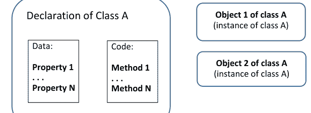

类 A 是构建对象的模板（定义）。它由被称为属性（properties）的定义和被称为方法（methods，可执行代码）程序组成。

对象 1 和对象 2 是类 A 的实例。它们持有类 A 中声明的所有属性的具体值。

程序中可以有多个类（模板）和这些类的多个对象（实例）。现在，让我们来描述一下这三个 OOD 概念。

### 封装

封装原则要求对象的内部（数据和代码）应该受到保护，防止外部代码任意访问。与对象“通信”并访问其属性的唯一方法是通过公共方法和公共属性。下面是 Java 中实现封装原则的示例。

```
// 声明类 "Apple"
class Apple {
    private String color;
    public void setColor(String c) {
        color = c;
    }
    public String getColor() {
        return color;
    }
}
```


```
// 实例化 Apple 类
Apple apple1 = new Apple();
// 调用公共方法 setColor 将颜色设为 "red"
apple1.setColor("red");
// 输出颜色
System.out.println(apple1.getColor());
```


### 继承

继承原则适用于类之间的关系。它规定两个类之间可以存在父子关系，其中子类（子类）继承父类（超类）的所有特征。

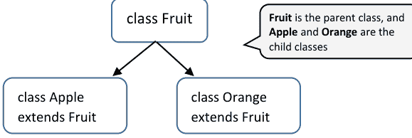

下面是继承机制的示例。

```
// 声明类 "Fruit"
class Fruit {
    private String color;
    public void setColor(String c) {
        color = c;
    }
    public String getColor() {
        return color;
    }
}
```

```
// 声明 Apple 是 Fruit 的子类
class Apple extends Fruit {
}
```

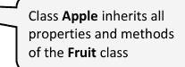

```
// 创建 Apple 类的对象 apple1
Apple apple1 = new Apple();
// 执行继承的方法 setColor 将颜色设为 "red"
apple1.setColor("red");
```

### 多态

多态原则规定，在一个类或多个类中允许具有同名但实现不同的方法，并且语言能够在运行时确定执行哪种变体。

下面是 Java 语言实现多态的示例。假设我们需要计算不同形状的面积——矩形、三角形、圆形等。每个形状都由自己的类表示，每个类都是超类 `Shape` 的子类：

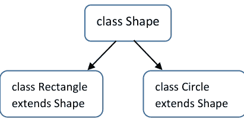

```
// 声明类 Shape
class Shape {
    public double footage;
    public void showSquareFootage() {
        System.out.println(footage);
    }
}
```

```
// 声明类 Rectangle
class Rectangle extends Shape {
    double width;
    double height;
    Rectangle(double w, double h) {
        width = w;
        height = h;
    }

    public void showSquareFootage() {
        footage = width * height;
        System.out.println(footage);
    }
}
```

> 该方法在创建 `Rectangle` 类对象时执行。

> 该方法计算并显示矩形对象的面积。

```java
// 声明 circle 类
class Circle extends Shape {
    double radius;
    Circle (double r) {
        radius = r;
    }
}
```

```java
public void showSquareFootage() {
    footage = radius * radius * 3.1415;
    System.out.println(footage);
}
```

> 该方法在创建 `Circle` 类的对象时执行。

> 该方法计算并显示 `Circle` 对象的面积。

#### 主程序

```java
// 创建 shape 类的对象
Shape shapel = new Shape();
shapel.showSquareFootage(); // 打印 "0"
```

```java
// 创建宽度为2、高度为3的矩形
shapel = new Rectangle(2.0, 3.0); // 现在 shapel 是矩形
shapel.showSquareFootage(); // 打印 "6"
```

```java
// 创建半径为2的圆形对象
shapel = new Circle(2.0); // 现在 shapel 是圆形
shapel.showSquareFootage(); // 打印 "6.2830"
```

在上面的示例中，变量 `shape1` 根据程序的执行流，可以代表不同子类的对象。在执行期间，语言将验证由 `shape1` 引用的对象类型，并选择合适的 `showSquareFootage` 方法。

现在考虑我们想要更改矩形的尺寸并同时计算其新面积。我们可以在 `Rectangle` 类的声明中添加 `showSquareFootage` 方法的另一个变：

```java
class Shape {
    public double footage;
    public void showSquareFootage() {
        System.out.println(footage);
    }
}
```

```java
class Rectangle extends Shape {
    double width;
    double height;
    Rectangle (double w, double h) {
        width = w;
        height = h;
    }
}
```

```java
public void showSquareFootage() {
    footage = width * height;
    System.out.println(footage);
}
```

> 该方法计算矩形的面积。

```java
public void showSquareFootage(double w, double h) {
    width = w;
    height = h;
    footage = width * height;
    System.out.println(footage);
}
```

> 该方法更改矩形的尺寸，然后计算其面积。

现在，为了选择并执行适当的方法，语言不仅需要分析对象类型，还需要分析方法的签名（signature）。方法的签名是其返回值和输入参数类型的组合。此示例中第一个方法的签名是“void+void”（无输出且无输入参数），而第二个方法的签名是“void+double+double”（无输出参数和两个 `double` 类型的输入参数）。

以下是 `showSquareFootage` 方法的两种变体的使用方式：

- // 主程序逻辑
- // 创建一个宽度为2、高度为3的矩形对象
  `Rectangle shape1 = new Rectangle(2.0, 3.0);`
- `shape1.showSquareFootage();` // 打印 “6”
- // 将矩形尺寸改为 3x4
  `shape1.showSquareFootage(3.0, 4.0);` // 打印 “12”

### 数据类型、变量和字面量

面向对象设计的讨论让我们了解了 Java 语言与其他“传统”语言的区别。现在让我们来看看使 Java 与非面向对象语言相似的特征。

大多数语言（包括 Java）都具有以下共同点：

- 操作原始数据类型的能力
- 变量和字面量
- 一定的运算符集
- 控制程序执行流的语言结构和语句

在本章中，我们将回顾原始数据类型、变量和字面量。其余内容将在后续章节介绍。

#### 原始数据类型

原始数据类型（也可以称为简单类型或原子类型）不是由其他数据类型组合而成的数据类型。例如，字符串（`string`）不是原始数据类型，因为它被定义为字符数据类型元素的集合。

Java 定义了八种原始数据类型：

| 数据类型 | 说明 | 长度（位） | 范围（近似值） |
|---|---|---|---|
| `byte` | 有符号整数 | 8 | -128 到 +127 |
| `short` | 有符号整数 | 16 | -32,768 到 +32,767 |
| `int` | 有符号整数 | 32 | -2.1*10^9 到 +2.1*10^9 |
| `long` | 有符号整数 | 64 | -9.2*10^18 到 +9.2*10^18 |
| `float` | 浮点数 | 32 | ± (1.4e-45 到 3.4e+38) |
| `double` | 浮点数 | 64 | ± (4.9e-32 到 1.8e+308) |
| `char` | Unicode 字符 | 16 | 0 到 65,536 |
| `boolean` | | N/A | `true` 或 `false` |

注意：Java 没有暴露 `boolean` 数据类型的长度，因为它的实现是特定平台的。

#### 变量

在 Java 中，原始类型的数据元素可以声明为字面量也可以声明为变量。

变量是对内存中位置的命名引用，该位置存储着指定类型的数据元素。声明变量的格式如下：

```java
type identifier; // 声明变量标识符
// 类型为 type
```

```java
type identifier = value; // 为类型为 type 的
// 标识符声明并赋值
```

以下是声明原始数据类型的示例。

```java
int k; // "k" 是内存中 32 位区域的引用
// 将存储一个整数值
```

```java
k = 100; // 上述内存填充了一个 32 位
// 有符号二进制数 (100)
```

```java
char c = 'A'; // "c" 是双字节 Unicode
// 字符 'A' 的引用
```

注意，变量不仅可以引用原始数据类型，还可以引用对象。

#### 访问变量

在高级层级，你可以将每个 Java 程序视为代码块。每个块都用大括号包围：`{ 语句 }`。块可以是独立的，也可以相互嵌套：

```java
{ block 1 }
{ block 2 { block 3 } }
```

这种结构决定了变量的可访问性，也称为作用域（scope）。在块中声明的变量在该块内部以及所有包含它的块内都是可的。一旦程序流到达块的末尾，该块内声明的所有变量都会被销毁。

#### 字面量

字面量指定数据元素的实际值。例如，`123` 会被 Java 视为 32 位有符号整数（即类型 `int`），而 `123.4` 被视为 64 位浮点数（类型 `double`）。事实上，任何整数值（即没有小数点的值）都会被视为整数，而任何分数值（即带有小数点的值）都会被视为双精度浮点数。


Java 中有四种字面量：数值、字符、布尔和字符串。下面将分别讨论每种。

## 数值字面量

数值字面量可以用十进制、十六进制、八进制或二进制表示法。以下是数字 10 的不同表示法：

- `10` - 十进制表示法（十进制数字 0-9）
- `0x0A` - 十六进制表示法（`0x` 在十六进制数字 0-F 前）
- `012` - 八进制表示法
- `0b1010` - 二进制表示法（`0b` 在二进制数字 0-1 前）

数值字面量可以包含下划线，下划线会被忽略但会让数值更易读。以下是有效的数值示例：

```
123_456_789
123_.456_789
123456789
```

字面量的类型可以是隐式定义的（默认类型分配）或显式定义的。下表显示了如何确定类型的示例。

| 字面量 | 数据类型 |
|---|---|
| 不可用 | `byte` |
| 不可用 | `short` |
| `123` | `int` |
| `123L` 或 `123l` | `long` |
| `123.0` | `double` |
| `123.0D` 或 `123.0d` | `double` |
| `1.23E+2` | `double` |
| `123.0F` 或 `123.0f` | `float` |

## 字符字面量

字符字面量用单引号内的值表示。键盘上存在的数字、字母和特殊字符可以直接指定，如下：`'a'`、`'1'`、`'%'` 等其他符号应使用转义序列输入。转义序列是反斜杠 `'\'` 后跟一个或多个符号。许多预定义的转义序列表示换行、制表符、退格键等。此外，任何 Unicode 字符都可以使用八进制或十六进制表示法的转义序列直接输入。以下是小写字母 `'b'` 字面量的不同格式：

- `'b'`, `'\u142'`, `'\u0062'`

下表显示了转义序列。

| 转义序列 | 说明 |
|---|---|
| `\nnn` | 八进制字符 (`nnn` – 八进制数字 0-7) |
| `\nnnn` | Unicode 字符 (`nnnn` – 十六进制数字 0-F) |
| `\b` | 退格 |
| `\n` | 换行 |
| `\r` | 回车 |
| `\t` | 制表符 |
| `\f` | 分页符 |
| `'` | 单引号 |
| `"` | 双引号 |
| `\` | 反斜杠 |

## 布尔字面量

布尔字面量只有两个值——`true` 和 `false`。这些值不会被转换为任何数值。

```
boolean b = true; // 声明变量 "b" 并将其设置为 true
b = false; // 将 "b" 设置为 false
```

## 字符串字面量

字符串字面量是用双引号包围一系列字符序列构成的。以下是几个有效字符串字面量的示例。

```
"String Literal"
\"String in double quotes\"
\"String on \n two lines"
```

## 算术表达式中的类型转换

通常情况下，算术表达式的操作数（变量和字面量）可以是不同的数据类型。类型转换机制的目的是通过将操作数的精度从低级别提升到高级别来处理此类情况。精度从字节到双精的提升顺序如下：

```
byte→ int→ long→ float→ double
```

类型转换有两种类型：隐式转换和显式转换。隐式转换由语言根据操作数的实际数据类型自动完成。显式转换是由程序员通过在变量或字面量前面放置所需的数据类型来请求的。

以下是算术表达式中确定或设置操作数类型的规则：

- 所有的整数字面量默认类型为 `int`
- 所有的非整数字面量默认类型为 `double`
- 在计算任何算术表达式之前，所有的 `byte` 和 `short` 变量都会被提升为 `int` 类型
- 对于每个算术操作（`+`、`-`、`/` 等），当操作数数据类型混合时，低精度的操作数将提升为高精度操作数的类型
- 字面量或变量将提升或降级为括号中类型修饰符显式指定的数据类型

### 示例 1

```
double result = 1.5 + 3 / 2; // result = 1.5 + 1 = 2.5
```

数据类型的确定和计算执行方式如下：

```
(double) result =
(double) 1.5 + (int) 2 =
(double) 1.5 + (int) 1 =
(double) 1.5 + (double) 1.0 = (double) 2.5
```

### 示例 2

```
double result = 1.5 + (double) 3 / 2; // result = 1.5 + 1.5 = 3.0
```

数据类型的确定和计算执行如下：

```
(double) result =
(double) 1.5 + (double) 3 / (int) 2 =
(double) 1.5 + (double) 3 / (double) 2.0 =
(double) 1.5 + (double) 1.5 = (double) 3.0
```

### 示例 3

```
int result = (int) (3.0 / 2.0); // result = 1
```

数据类型的确定和计算执行如下：

```
(int) result =
(int) ( (double) 3.0 / (double) 2.0 ) =
(int) ( (double) 1.5 ) =
(int) 1
```

## 运算符

在本章中，我们将复习可以应用于原始数据类型的运算符。这些运算符可以分为四大类：算术、位运算、关系和布尔。此外，这里还将讨论赋值运算符 (`=`) 和问号运算符 (`?`)。

### 赋值运算符

赋值运算符 `"="` 将值赋给变量。我们在之前的示例中已经多次使用了它。赋值运算符的格式如下：

```
variable = expression;
```

它也可以用于在一条语句中为多个变量赋值，如下：

```
var1 = var1 = ... = varN = expression;
```

示例：

```
int x, y;           // 声明类型为整数的变量 x 和 y
x = 1;              // 将值 1 赋给变量 x
x = y = 2;          // 将值 2 赋给变量 x 和 y
```

### 算术运算符

算术运算符用于计算。Java 支持以下五种基本代数运算符：加 (`+`)、减 (`-`)、乘 (`*`)、除 (`/`) 和取模 (`%`)。其中每一个都可以与赋值运算符 (`=`) 组合形成所谓的简写运算符，形式如下：

```
arithmetic_operator=
```

示例：

```
double x, y;
x = 2.5;
y = 10;
x += y;      // x = 12.5 结果与 x = x + y 相同
x %= y;      // x = 2.5 结果与 x = x % y 相同
             // 注意：取模运算符 (%) 返回
             // 除法 12.5 / 10 的余数
```

Java 还提供了两个算术运算符：自增 (`++`) 和自减 (`--`)，它们分别对一个值加 1 或减 1。这些运算符可以放在变量的前或后：

```
int x = 1;      // 声明 x 并将其值设置为 1
x++;             // x 加 1 (x=2)
++x;             // x 加 1 (x=3)
x--;             // x 减 1 (x=2)
--x;             // x 减 1 (x=1)
```

在上述示例中，自增和自减运算符的位置并不重要。然而，在赋值表达式中，它们的位置非常重要。当运算符放在变量之后时，变量的原值用于结果的计算；之后自增/自减运算符应用于变量。当放在变量之前时，自增/自减运算符首先应用于该变量，并使用新值参与计算。

示例：

```
int x, y;
x = 1;
y = x++;      // x=2, y=1 (自增前的 x 原值)
y = ++x;      // x=3, y=3 (自增后的 x 新值)
```

### 位运算符

Java 语言支持一组所谓的位运算符，它们可以在位位上操作整数类型 (`char`, `byte`, `short`, `int`, `long`)。它们可以分为两组：位逻辑运算符和位移运算符。下表列出了所有的位运算符：

| 运算符 | 执行的功能 | 运算符类型 |
|---|---|---|
| `~` | 位按位非（取反） | |
| `&` | 位与 | 位逻辑 |
| `\|` | 位或 | |
| `^` | 位异或 (XOR) | |
| `<<` | 左移，用 0 填充 | 位移 |
| `>>` | 右移，传播符号位 | |
| `>>>` | 右移，用 0 填充 | |

与算术运算符一样，除了取反 (`~`) 之外，任何位运算符都可以附加赋值运算符 `"="` 形成简写：

```
x <<= 1;      // 这等于 x = x << 1;
x &= y;       // 这等于 x = x & y;
```

位运算符 `&`, `|`, `^` 和 `~` 将逻辑运算符 AND、OR、XOR 和 NOT 应用于每个操作数对应的位。下表显示了所有可能的两个位组合的逻辑运算符结果：

| 逻辑运算符: | AND | OR | XOR | NOT |
|---|---|---|---|---|
| 操作数 A 操作数 B | `A & B` | `A \| B` | `A ^ B` | `~A` |
| 0 0 | 0 | 0 | 0 | 1 |
| 0 1 | 0 | 1 | 1 | 1 |
| 1 0 | 0 | 1 | 1 | 0 |
| 1 1 | 1 | 1 | 0 | 0 |

位移运算符根据表达式中指定的位数将符号值的内容向左或向右移动。`">>"` 运算符保留数字的符号（最左侧位），而 `">>>"` 运算符在最左侧位置填充 0。

示例：

```
byte b;
b = (byte) 0b11111110; // 十进制中的 -2
b = (byte) ~b; // b = 00000001 (十进制中的 +1)
b << 1; // b = 00000010 (十进制中的 +2)
b <<= 1; // b = 00000100 (十进制中的 +4)
b = (byte) (b | 0b00000001); // b = 00000101 (十进制中的 +5)
b |= (byte) 0b00000010; // b = 00000111 (十进制中的 +7)
```

### 关系运算符

关系运算符用于比较两个操作数的值并产生布尔结果 `true` 或 `false`。

下表列出了所有的关系运算符：

| 运算符 | 执行的比较 |
| --- | --- |
| `==` | 操作数相等 |
| `!=` | 操作数不等 |
| `>` | 第一个操作数大于第二个操作数 |
| `>=` | 第一个操作数大于等于第二个操作数 |
| `<` | 第一个操作数小于第二个操作数 |
| `<=` | 第一个操作数小于等于第二个操作数 |

示例：

```
int x = 1;
int y = 2;

if (x == y) {
    System.out.println("x is equal to y"); }
else {
    System.out.println("x is not equal to y"); }

if (x != y) {
    System.out.println("x is not equal to y"); }
else {
    System.out.println("x is equal to y"); }

if (x > y) {
    System.out.println("x is greater than y"); }
else {
    System.out.println("x is less or equal to y"); }

if (x >= y) {
    System.out.println("x is greater or equal to y"); }
else {
    System.out.println("x is less than y"); }

if (x < y) {
    System.out.println("x is less than y"); }
else {
    System.out.println("x is greater or equal to y"); }

if (x <= y) {
    System.out.println("x is less or equal to y"); }
else {
    System.out.println("x is greater than y"); }
```

### 布尔逻辑运算符

布尔逻辑运算符与位逻辑运算符相似。它们都对两个操作数应用逻辑与（AND）、或（OR）、异或（XOR）和非（NOT），以产生布尔结果，但位逻辑运算符作用于位，而布尔逻辑运算符作用于布尔值。

除了"常规"的四种逻辑运算符（AND, OR, XOR, NOT）之外，Java 还提供了两个"改进型"布尔运算符——短路或和短路与。它们将在本节稍后部分进行解释。

下表列出了布尔逻辑运算符：

| 运算符 | 执行的功能 | 运算符类型 |
| --- | --- | --- |
| `!` | 逻辑取非 | 常规逻辑运算符 |
| `&` | 逻辑与 | |
| `\|` | 逻辑或 | |
| `^` | 逻辑异或 (XOR) | |
| `\|\|` | 短路或 | 短路运算符 |
| `&&` | 短路与 | |

与位运算符相同，布尔逻辑运算符（单一取非运算符除外）可以与赋值运算符结合，形成如下简写：

```
a &= b;   // 这相当于 a = a & b;
a |= b;   // 这相当于 a = a | b;
a ^= b;   // 这相当于 a = a ^ b;
```

布尔逻辑运算符 (`&`), (`|`), (`^`), 和 (`!`) 作用于表达式的两个布尔操作数，应用逻辑与、或、异或和非操作。下表显示了布尔逻辑运算符在两个布尔运算符所有可能的组合下的结果：

| 逻辑运算符： | AND | OR | XOR | NOT |
| 操作数 A | 操作数 B | `A & B` | `A \| B` | `A ^ B` | `!A` |
| --- | --- | --- | --- | --- | --- |
| `True` | `True` | `True` | `True` | `False` | `False` |
| `True` | `False` | `False` | `True` | `True` | `False` |
| `False` | `True` | `False` | `True` | `True` | `False` |
| `False` | `False` | `False` | `False` | `False` | `True` |

短路运算符 (`&&`) 和 (`||`) 在左侧操作数的值足以决定结果（无论另一个操作数的值如何）时，不会求值逻辑表达式的右侧操作数。例如，如果 `A=true`，无论 `B` 的值是什么，`A | B` 的结果始终为 `true`。

示例：

```
boolean a, b, c;
a = true;
b = true;

a = !b; // a=false
a &= b; // a=false (same as: a = a & b)
a |= b; // a=true (same as: a = a | b)
a ^= b; // a=false (same as: a = a ^ b)
a = a ^ b; // a=false
```

```
// 短路运算符
a = false;
b = true;
c = a || b; // c=true (a 和 b 都会被求值)
c = b || a; // c=true (a 不会被求值)
c = a && b; // c=false (b 不会被求值)
```

### 条件运算符

Java 提供了一个特殊的三元（三路）条件运算符 `?:...`，它允许对某些 IF-THEN-ELSE 语句进行紧凑实现。`?:...` 运算符的格式如下：

```
variable = logical_expression ? expression1 : expression2
```

`logical_expression` 是任何求值为布尔值的表达式。如果它求值为 `true`，则求值 `expression1` 并赋值给 `variable`；否则，求值 `expression2` 并赋值给 `variable`。这可以用伪代码表示：

```
IF logical_expression = true

THEN variable = value of expression1
ELSE variable = value of expression2
```

示例 1：

```
int x = -1;
int y = -1;
y = x > 0 ? x : -x; // x = -1; y = +1
```

示例 2：

```
int x = -1;
int y = -1;
y = x > 0 ? x : -(x = x + y); // x = -2; y = +2
```

在第二个示例中，首先执行 `x = x + y` 表达式，导致 `x=-2`。然后，表达式 `-(-2)` 求值为 `+2`，并将该值赋值给 `y`。

## 程序流程控制

大多数计算机语言（包括 Java）都支持以下基础程序流结构：

- 顺序语句
- 语句块
- 二选（IF 结构）
- 多选（CASE 结构）
- 迭代
- 跳转（GOTO 语句）

本段落将介绍 Java 对这些结构的实现。

### 顺序语句

顺序语句不改变程序流。

赋值语句如 `x = b;` 是顺序语句的一个示例。Java 还有一个空语句，只是一个分号 (`;`)，前面没有任何表达式。

### 语句块

语句块是包含在花括号内的一组语句和可选声明：


{declarations and statements}

语句块之外的程序流不受影响：


### "if" 语句

“if" 语句实现了二选结构：

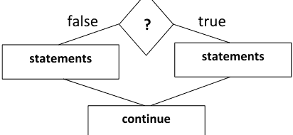

`if` 语句的格式如下：

```
if ( boolean expression )
  { statements, 当条件为真时执行语句 }
else
  { statements, 当条件为假时执行语句 }
```

示例：

```
int x;
x = 0;

if (x < 0)
  x++;
else
  ;

System.out.println("x=" + x); // 打印 "x=0"

if (x == 0)
  { x++; }
else
  { x--; }
System.out.println("x=" + x); // 打印 "x=1"
```

### "switch" 语句

`switch` 语句实现了多选结构：

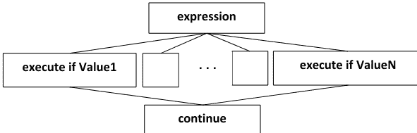

这里是 `switch` 语句的格式：

```
switch ( expression )
{
  case value1: statement;
  break;
  case value2: statement;
  break;
  default: statement;
}
```

表达式必须求值为 `char`、`byte`、`short`、`int` 等数值类型。表达式的结果将与 `value1` 到 `valueN` 进行比较。当匹配到某个 `case` 时，将执行其对应的语句。我们可以使用 `break` 语句跳出 `switch` 结构。`default` 语句是可选的，当没有匹配项时执行。

示例：

```
int x, y, z;
x = y = z = 1;
switch (x)
{
    case 1: z = 2; break;
    default: z = 999;
}
System.out.println("z=" + z); // 打印 z=2
```

### 迭代语句

Java 支持三种迭代语句——`while`、`do...while` 和 `for`。它们都实现了直到某些条件满足时执行代码块的迭代结构。

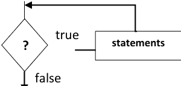

### "while" 语句

`while` 语句在指定的条件为真时执行代码块（体）：

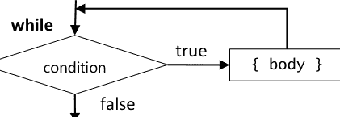

这里的一个重要点是先求值条件，然后执行体。如果初始条件为假，则循环体将完全不执行。`while` 语句的格式如下：

```
while ( condition ) { body }
```

示例：

```
int n;
n = 2;
while (n > 0)
{
  System.out.print("n=" + n); // 打印 "n=2 n=1"
  n--;
}
```

如果 `n` 的初始值为 0，上述代码不会产生任何输出，即循环体不会执行。

### "do...while" 语句

`do...while` 语句与上述 `while` 语句相似，但有一个例外——它先执行循环体，然后求值指定的条件：

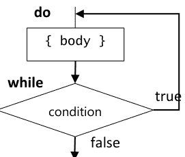

`do...while` 语句的格式如下：

```
do { body } while ( condition ) ;
```

示例：

```
int n;
n = 2;
do
{
    System.out.print("" + n); // 打印: "n=2 n=1"
    n--;
}
while (n > 0);
```

正如我们所见，结果与之前的 `while` 语句示例完全相同。然而，如果 `n` 的初始值为 0，循环体会执行一次，上述代码将产生如下输出：

```
n=0
```

### "for" 语句

`for` 语句用于实现所谓的“控制”循环。控制循环基本上是 `while` 循环，但它通过显式指定的代码来初始化和迭代循环控制条件中使用的变量值：

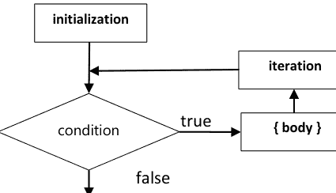

让我们看看之前 `while` 语句的示例：

```
int n;
n = 2;
while ( n > 0 )
{
    system.out.println("n=" + n);
    n--;
}
```

相同的逻辑可以用 `for` 语句如下实现：

```
int n;

for ( n = 2; n > 0; n--)
{
    system.out.println("n=" + n);
}
```

这是 `for` 语句的“经典”形式，其格式为：

```
for (初始化; 条件; 迭代) { 体 }
```

`for` 语句的另一种形式是处理集合（例如数组），被称为“for-each”循环。我们将在几页后介绍它。

上述示例中的 `n` 被称为循环控制变量。可以有多个循环控制变量，如例所示：

```
int x, y, z;
// 寻找 x, y, z 之和直到降为零
for (x=3, y=5, z=7); x+y > 0; x--, y--, z--)
{}; // 空块；可以不指定大括号
System.out.println("x/y/z=" + x + "/" + y + "/" + z);
```

这段代码的输出将是：

```
x/y/z=-2/0
```

注意初始化 (`x=3, y=5, z=7`) 和迭代 (`x--, y--, z--`) 语句是用逗号分隔的。

### 内部循环控制变量

关于 `for` 语句还有另一个重要的注意事项。当循环变量定义在 `for` 语句内部时，它在 `for` 语句之外是“可见”的：

```
for ( int n = 2; n > 0; n-- )
{
System.out.println("n=" + n);
}
// n 的值是知的
```

```
// n 变量在 for 语句之外是“不可见的”
System.out.println("final n=" + n); // 错误：n 未定义
```

### 不带循环控制变量的"for"语句

值得注意的是，`for` 语句可以不包含初始化或迭代表达式，或者两者都不包含：

```
int n, max;
n = 0;
max = 100;
boolean reachedMax = true;
for ( !reachedMax; ) // 当未达到Max 时
{
// 增加 n 的值直到其超过 max
n++;
if (n > max) reachedMax = true;
}
System.out.println("n=" + n); // 输出：n=128
```

### "for-each" 语句

考虑这样一个示例：我们需要计算存储在数组中的一组数字的平均值。以下是使用“经典” `for` 语句实现的方法：

```
int nArray[] = {1, 2, 3, 4, 5}; // 包含五个数值的数组
double avg = 0;

// 遍历 nArray 元素（第一个元素索引为 0）
// 并计算所有元素的和

for ( int i = 0; i < nArray.length; i++ )
  avg += nArray[i];

// 将和除以元素个数
avg /= nArray.length;
System.out.println("avg=" + avg); // 输出：avg=3.0
```

使用语句的“for-each”版本也可以实现相同的结果，其格式如下：

```
(类型 迭代变量: 集合) { 体 }
```

上述示例如下：

```
int nArray[] = {1, 2, 3, 4, 5}; // 包含五个数值的数组
double avg = 0;

// val 必须按照顺序逐个地
// 赋值每个数组元素的值。

for ( int val: nArray)
  avg += val;

avg /= nArray.length;
System.out.println("avg=" + avg); // 输出：avg=3.0
```

请注意，迭代变量 `val` 的类型必须与集合（数组）元素的类型相同或兼容。兼容的数据类型是指原始数据类型可以隐式提升的类型。在这个示例中，原始数据类型是 `int`，它可以提升为 `long`、`float` 或 `double`。

### "break" 语句

Java 提供了两个语句——`break` 和 `continue`，它们可以中断循环或任何语句块的“自然”执行流。`break` 语句会导致循环或任何具名的代码块在到达末尾之前终止。`continue` 语句会立即开始循环的下一次迭代。

让我们从 `break` 语句开始。我们已经在 `switch` 结构中见过它，它被用于 `case` 表达式中跳出 `switch` 语句。

### 跳出标签块

`break` 语句的格式如下：

```
break [标签];
```

标签参数是可选的，用于跳出任何具名的（标记的）代码块。该代码块不需要是循环或 `switch` 语句。考虑这个示例：

```
int var;
var = 2;

block1:
{
    if (var != 1) break block1;
    System.out.println("Block 1");
}

block2:
{
    if (var != 2) break block2;
    System.out.println("Block 2");
}
```

这段代码的输出将是：“Block 2”。由于 `var` 不等于1，`break block1` 将跳出 `block1` 到后续语句。

注意，当具名块相互嵌套时，这种技术也有效。`break` 可以从内部块跳出任何外部块：

```
int var = 2;

block1:
{
  block2:
  {
    block3:
    {
      if (var == 1) break block1;
      if (var == 2) break block2;
      if (var == 3) break block3;
      System.out.println("Last statement of block3");
    }
    System.out.println("Last statement of block2");
  }
  System.out.println("Last statement of block1");
}
```

这段代码的输出将是：“Last statement of block1”。`var==2` 条件真，`break block2` 将跳出 `block3` 和 `block2` 到 `block1` 的后续语句。

### 跳出循环

当 `break` 语句不带标签参数使用时，它会中断包含该语句的循环。在嵌套循环的情况下，可以使用标签来标识每个循环，标签参数将指定终止哪个循环。

示例：

```
int i;
// for 循环
for (i=9; i>0; i--)
{
  System.out.println("i=" + i);
  if (i==7) break;
}
// while 循环
i = 9;
while (i>0)
{
  System.out.println("i=" + i);
  if (i==7) break;
}
// do-while 循环
i = 9;
do
{
  System.out.println("i=" + i);
  if (i==7) break;
} while (i>0);
```

### "continue" 语句

`continue` 语句的作用与 `break` 语句类似，但它不是终止循环，而是强制执行下次迭代。`continue` 语句的格式为：

```
continue [标签]
```

标签参数是可选的，并指定要继续哪个循环。

示例：

```
int i;
// 简单的 for 循环
for (i=4; i>1; i--)
{
  if (i==3) continue;
  System.out.println("i=" + i); // 将输出 i=4 和 i=2
}
// 嵌套循环
int x,y = 0;
loopA: for (x=0; x<=1; x++) {
  loopB: for (y=0; y<=1; y++) {
    if (x == y ) continue loopA;
    System.out.println(x + "/" + y); // 将输出 1/0
  }
}
```

## 多维数组

通过回顾一个示例是解释多维数组如何创建的最简单方法。假设我们要创建一个以下二维数组：

| 列 1 | 列 2 | 列 3 |
|---|---|---|
| 行 1 | 1 | 2 |
| 行 2 | 10 | 11 | 12 |

使用数组初始化器，可以使用此语句创建上述数组：

```java
int [][] N = { {1, 2}, {10, 11, 12} };
```

该数组将包含五个元素，数组元素的值赋值如下：

```
N [][0] = 1;
N [][1] = 2;
N [][2] // 元素不存在
N [1][0] = 10;
N [1][1] = 11;
N [1][2] = 12;
```

我们也可以使用 `new` 语句来创建这个多维数组：

```java
int [][] N;
N = new int[2][3]; // 创建的 2x3 数组是一个 2 行 3 列的表格，包含 6 个元素。
```

然而，上述代码的结果是 2 行 6 个元素。为了消除 `N[0][2]` 元素，我们需要重写代码：

```java
int [][] N;
N = new int[2][]; // 有两列，行数未定义
N [0] = new int[2]; // 第一行将包含 2 列
N [1] = new int[3]; // 第二行将包含 3 列
```

为了避免与其他语言中实现数组（或表格）的方式产生混淆，你应该将 Java 数组设想为对象的层级结构。我们刚刚回顾的 `N` 数组可以视为：

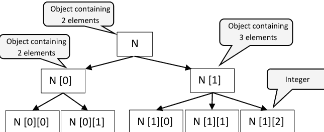

作为对象，`N`、`N[0]` 和 `N[1]` 具有 `length` 属性，这在我们想要遍历数组时非常有用：

```java
 // 这段代码打印二维数组 N 的所有元素
for (int x=0; x<N.length; x++)
{
    for (int y = 0; y < N[x].length; y++)
{
        System.out.println(N[x][y]);
    }
}
```

## 方法

**方法（method）**是一个可以通过其名称被引用并调用以执行的代码块。它的构造如下：

```
accessAttributes returnType methodName(parameters) { body }
```

示例：

```java
public int myMethod(int x, int y) {
  return x + y;
}
```

该方法接受两个整数，并将它们的和返回给调用程序（即另一个方法）。

**访问修饰符（access attributes）**是可选的。它们将在单独的章节中详细讨论。

**返回值**可以是任意基本数据类型、数组、类或 **void**，后者表示方法不返回任何数据。

**方法名**可以是你喜欢的任何名称。

**参数**是可选的。

**方法体（body）**是一组变量声明和可执行语句。

### "main" 方法

**main** 方法是一个特殊的方法，用于启动所有 Java 程序的执行。Java 在所有用于执行的类中查找此方法，并期望它的定义完全如下：

```java
public static void main (String args[]) { body }
```

## 类和对象

Java 是一种面向对象的语言，这意味着它的首要目的是操作对象。对象（Object）是一个由数据和代码组成的逻辑实体。所有对象都是由称为类（class）的模板构建的，这使得类成为 Java 语言的核心。你希望在 Java 中实现的任何功能都必须被构造为一个类。

下面的图说明了类和对象之间的关系：

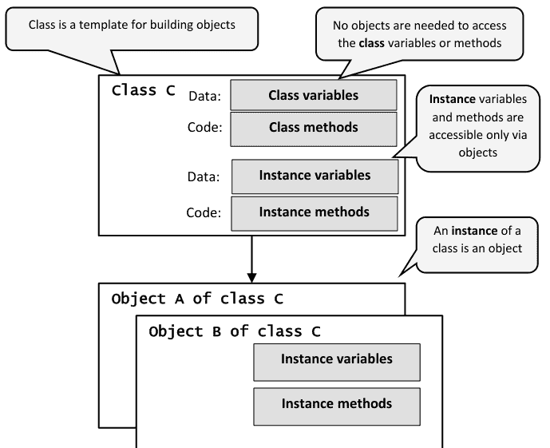

### 类的声明

使用 `class` 语句声明类：

```
class className {
  type variable1;
  
  type variable;
  
  type method1(parameters);
  
  type methodN(parameters);
}
```

示例：

```java
// 温度 类提供了将温度
// 从摄氏度转换为华氏度以及反之的功能
class Temperature {
  // 类变量和方法：
  static double t;          // 温度值
  static double FtoC ()      // 转换“F 到 C”的方法
    return (temp - 32 ) / 1.8;
  static double Ctof ()      // 转换“C 到 F”的方法
    return temp * 1.8 + 32;

  // 实例变量和方法：
  double temp;               // 温度值
  double toCelsius()        // 转换“F 到 C”的方法
    return (temp - 32 ) / 1.8;
  double toFahrenheit()      // 转换“C 到 F”的方法
    return temp * 1.8 + 32;
}
```


### 类变量和方法

上一个示例代码声明了一个带有两组变量和方法的新类 `Temperature`。这两组之间的主要区别在于 `static` 作用域修饰符的使用。所有声明为 `static` 的变量和方法都称为类变量和类方法，可以在不创建对象的情况下使用。其他变量和方法称为实例变量和实例方法，只能通过对象实例使用。

下面的代码说明了上面声明的 `Temperature` 类类变量`t`以及类方法`FtoC()`和`CtoF()`的用法：

```java
double temp;
```

```java
// 类变量和方法可以通过类名引用
Temperature.t = 77.0;
temp = Temperature.FtoC();
System.out.println(Temperature.t + " == " + temp + "C");
```

```java
// 类变量和方法可以直接通过它们的
// 名称引用（如果名称在程序中是唯一的）
temp = 25.0;
System.out.println(t + "C=" + temp + "F");
```

此代码将打印：

```
77.0F=25.0C
25.0C=77.0F
```

### 初始化类变量

在程序执行期间，当类第一次被使用时（即它被加载到 Java 虚拟机 (JVM) 时），它的类变量将被分配默认值。对于数值变量，默认值是零。如果需要将类变量初始化为非默认值，可以在声明语句中，或在声明为 `static` 的语句块中完成。

下面的示例声明了带有两个变量`tf`和`tc`的 `Temperature` 类。`tf`在声明期间获得初始值，而`tc`在`static`语句块中初始化。注意，`tc`的声明必须在`static`语句块之外，否则它的作用范围将仅限于该块内部。

示例：

```java
// 当 Temperature 类加载到 JVM 时
// 类变量 tf 将赋值为 77.0
// 并且将运行 tc-FtoC(); 代码来计算 tc 值
```

```java
class Temperature {
    static double tf = 77.0; // 类变量 tf = 77.0
    static double tc; // 类变量 tc = 0.0
    static { tc = FtoC(); } // 语句块将转换
    // tf 转换为 "C" 并放入 tc 中
    // 方法 FtoC 将 "F" 转换为 "C"
    static double FtoC () {return (tf - 32 ) / 1.8;}
}
```

关于类变量和方法的所有内容可以总结为三个规则：

声明规则：

> 类变量、方法必须使用 `static` 修饰符

访问规则：

> 如果名称是唯一的，可以直接通过名称引用类变量和方法；或者通过类名引用

执行规则：

> 类的静态声明和语句块仅在类第一次被使用时处理（执行）

### 实例变量和方法

类中没有 `static` 修饰符的变量、方法和语句块被称为实例变量、实例方法和实例语句块。它们的用法遵循以下规则：

声明规则：

> 实例变量、方法和语句块不能使用 `static` 修饰符

访问规则：

> 实例变量和方法只能在创建对象（实例）后使用，并且必须通过对象名引用

执行规则：

> 每当创建类的对象（实例）时，类的实例声明和语句块都会被处理（执行）。

下面的示例展示了对象如何跟踪它们的创建序列。

注意：`new`语句（在下一节讨论）创建指定类的对象。

```java
class myClass {
    static int totalCount; // 类变量
    int myNumber; // 实例变量
    { myNumber = ++ totalCount; } // 实例语句块

    // 主程序
    public static void main(String args[]) {
        myClass obj1 = new myClass(); // 创建对象 obj1
        myClass obj2 = new myClass(); // 创建对象 obj2
        System.out.println(obj1.myNumber); // 输出 1
        System.out.println(obj2.myNumber); // 输出 2
    }
}
```

当类在`main`程序中首次被引用时，类变量`totalCount`将被初始化为零。当创建对象`obj1`和`obj2`时，将执行实例语句块，将`totalCount`加 1，并将其新值赋值给实例变量`myNumber`。请注意，对象`obj1`和`obj2`将拥有它们自己的`myNumber`变量副本。

上一个示例中包含一个尚未涵盖的内容——`new`语句，它用于创建对象。让我们仔细观察一下它以及创建新对象的整个过程。

### 操作对象

对象是 Java 语言的核心，因此深入理解如何创建对象以及如何使用它们的内容非常重要。

### 创建对象

创建新对象的过程称为实例化，通过`new`语句执行。`new`语句的格式如下：

```
className objectReferenceVariable = new className(parameters);
```

示例：

```
myClass object1 = new myClass();
```

在执行上述语句期间会发生以下情况：

- 1) `myClass object1`声明了类型为 `myClass` 的变量 `object1`。该变量可以引用任何 `myClass` 类的对象，这就是为什么此类变量被称为对象引用。

- 2) `new`运算符创建一个新对象；并处理所有的变量实例声明、语句块和方法。

- 3) 调用`myClass()`方法来可选地初始化新创建对象的实例变量。

- 4) 建立变量 `object1` 与新对象之间的引用。

### 构造函数

上述的`myClass()`方法被称为构造函数，它是一个与类名相同且没有指定返回类型的方法。它在创建该类的对象时由 JVM 调用。构造函数的作用初始化类的实例变量。如果你不声明任何构造函数，JVM 将创建一个空的构造函数：`className() {}`，它将不会执行任何操作。然而，一旦程序员声明了至少一个构造函数，默认构造函数就会消失且无法使用。请记住，构造函数会在实例声明和语句块处理之后立即调用。以下是一个跟踪其对象的类示例：

```
class testclass {
    static int count; // 对象总计数器；默认为零
    int myNumber; // 对象的序号

    // 实例块在每次创建对象时执行
    {myNumber = ++count;} // 实例块增加计数
 // 并将其赋值给对象的 myNumber

    testClass() {} // 无参数的构造函数
    testClass(int n) {
        myNumber = n; // 第二个构造函数；将指定的
 // 序号赋值给新对象
    }

    // -----执行-
    public static void main(String args[]) {
        testClass obj1 = new testClass();
        testClass obj2 = new testClass();
        testClass obj3 = new testClass(10);
        System.out.println(obj1.myNumber); // 输出 1
        System.out.println(obj2.myNumber); // 输出 2
        System.out.println(obj3.myNumber); // 输出 10
    }
}
```

注意，我们定义了两个同名的构造函数。这被称为“方法重载”。

### 方法重载

**方法重载**是 Java 使用的一种机制，用于区分具有相同名称但参数列表不同的方法。Java 中的每个方法通过其**签名**来区分——即方法名加上参数类型列表。`testClass()`方法的签名可以表示为“`testClass`”，而`testClass(int n)`的签名将是“`testClass,int`”。

### "this" 关键字

在之前的示例中，实例变量在构造函数中通过它们的名称直接引用。但当在`main`方法中声明一个与实例变量同名的变量时，会发生什么？这种情况是完全合法的，因为在`main`方法内部声明的所有变量在该方法外部都是**不可见的**。

另一个混淆点是实例变量名也被用在构造函数的参数列表中。这个问题可以通过使用`this`关键字来解决，它代表当前对象。参见此示例：

```
class testclass {
  int x;
  testclass(int x) {
    x = x;
    this.x = x;
  }
  public static void main(String args[]) {
    int x;
    testclass obj = new testclass(100);
    x = obj.x;
  }
}
```

`this`关键字不仅可以用于引用实例变量，还可以从一个构造函数调用另一个构造函数，或者在方法之间传递当前对象作为参数。

重要说明：`this`关键字只能在构造函数中使用。

使用`this`关键字的另一个示例：

```
class Position {
    int x, y, z;
    Position (int x, int y, int z) {
        this.x = x;
        this.y = y;
        this.z = z;
    }
    Position (int x) {
        this(x, 0, 0);
        showPosition(this);
    }
    void showPosition(Position p) {
        System.out.println("My position: "+p.x+","+p.y+","+p.z);
    }

    public static void main(String args[]) {
        Position obj = new Position(5);
    }
}
```

> 调用另一个构造函数（必须是第一个语句）

- 将当前对象传递给 `showPosition` 方法

上述代码输出：`My position: 5,0,0`

### "super" 关键字

面向对象的设计原则之一是继承。继承表示了类之间的父子关系，当子类（子类）继承父类（超类）的所有特征时，Java 在类声明中使用 `extends` 关键字来建立继承：

```
class superClass { body }
class subclass extends superClass { body }
```

创建子类对象的示例：

```
class superClass {
  int x;
  superClass(int x) {
    this.x = x;
  }
  // 执行逻辑
  public static void main(String[] args) {
    subClass o = new subclass(1);
    System.out.println(o.x); // 输出: 2
    System.out.println((super)o.x); // 输出: 1
  }
```

```
class subclass extends superClass {
  int x;
  subClass(int x) {
    this.x = super.x + 1;
  }
}
```

- 3. 初始化超类的变量 `x` (x=1)

- 1. 创建子类的实例

- 5. 需要访问超类的变量 `x`

- 2. 创建超类的实例

- 4. 初始化子类的变量 `x` (x=2)

创建一个子类对象时，也会隐式或显式地创建一个超类对象。这意味着任何子类对象都由子类实例和父类（超类）实例组成。

在上面的示例中，用户提供的子类构造函数通过`super()`语句调用超类构造函数来创建超类实例。`super`关键字在子类构造函数中使用时代表父类的当前对象。它还用于访问超类的变量`x`。

### 类型转换

注意，`super`关键字只能在构造函数中使用。那么我们如何从子类对象访问超类的实例变量或实例方法呢？在上面的示例中，变量`x`在子类和超类中都有定义。子类的`x`可以如下通过子类对象引用：`subclassObject.x`，但超类的`x`被隐藏了。解决这个问题的方法是类型转换。我们可以将子类对象转换为子类对象。考虑一个两个类 `Parent` 和 `Child`，它们都声明了实例变量。`Parent`是`Child`的超类。`Child`类的实例包含两个`x`的实例。以下代码显示了如何利用类型转换机制访问所有不同的实例变量：

```
class Parent { int x; }
class child extends Parent { int x; }
class Test {
    public static void main(String[] args[]) {
        int y;
        // 由类型为 Child 的变量引用的 Child 对象:
        Child c = new Child(); // 引用 Child 的 x
        y = c.x; // 引用 Parent 的 x
        y = ((Parent) c).x; // 引用 Parent 的 x

        // 由类型为 Parent 的变量引用的 Child 对象:
        Parent p = new Child();
        y = p.x; // 引用 Parent 的 x
        y = ((Child) p).x; // 引用 Child 的 x
    }
}
```

此表总结了父类和子类实例变量的可访问性：

| 对象引用 | 类 Parent | 类 Child extends Parent |
| --- | --- | --- |
| | 实例变量 | 实例变量 |
| | 独有的 | 与 Child 中的相同 | 独有的 | 与 Parent 中的相同 |
| | Parent p1 = new Parent() | | |
| p1. | 可以访问 | 可以访问 | - | - |
| | Parent p2 = new Child() | | |
| ((Child) p2). | 可以访问 | 可以访问 | 可以访问 | 可以访问 |
| | Child c = new Child() | | |
| c. | 可以访问 | 可以访问 | 可以访问 |
| ((Parent) c). | 可以访问 | 可以访问 | - | - |
| super. | 可以访问 | 可以访问 | - | - |

### 方法重写 (Method Overriding)

方法重写是一种特殊机制，允许在父类及其任何子类中声明具有相同签名（名称和参数类型）的实例方法。

此表展示了访问父类和子类实例方法的不同方式。请注意，对象强制转换并不会让你从子类访问父类的被重写方法。一旦创建了子类对象，每个重写方法只有子类的实例是可访问的。

| 对象引用 | 类 Parent 实例方法（独有 | 重写） | 类 Child extends Parent 实例方法（独有 | 重写） |
|---|---|---|---|---|
| p1. | 可以访问 | - | - | - |
| p2. ((Child) p2). | 可以访问 | 可以访问 | 可以访问 | 可以访问 |
| Child c = new Child() | 可以访问 | - | 可以访问 | 可以访问 |
| c. super. | 可以访问 | 可以访问 | - | - |
| ((Parent) c). | 可以访问 | - | - | 可以访问 |

### 确定对象的类型

在处理对象时，有时可能不清楚对象属于哪个类。例如，如果类 A 被类 B 和 C 继承，类型为 A 的对象引用可以引用 A、B 和 C 类的对象：

```
A obj;
obj = new A(); // obj 是指向 A 类对象的引用
obj = new B(); // obj 是指向 B 类对象的引用
obj = new C(); // obj 现在指向 C 类对象的引用
```

类型为 `obj` 的对象引用可以引用任何类的任何对象：

```
Object obj;
obj = new String("text");
obj = new Integer(123);
obj = new MyClass();
```

那么，我们如何确定变量所指对象的真实类型呢？

答案是——借助`instanceof`运算符。

`instanceof`运算符的格式为：

```
objectReference instanceof classType
```

示例：

```
Object obj;
obj = new String("text");
obj = new Date();
if (obj instanceof String) {
    System.out.println("Object of type String");
}
if (obj instanceof Date) {
    System.out.println("Object of type Date");
}
```

### 总结

以下是我们目前为止学到的对象的总结：

- 使用`new`语句实例化（即创建）对象，其格式为：`classNameNew constructor;`


- **构造函数**是一种特殊方法，其**名称与类名相同**，在创建该类的对象时，JVM 会自动调用它。
- 构造函数的格式为：`className(parameters) {body}`。`parameters`和`body`是可选的，返回类型被省略。
- 构造函数在所有实例声明处理完毕且实例块（如果有）执行后被调用。
- 一个类可以有多个不同**签名**（即具有不同参数类型序列）的构造函数。
- 当没有显式声明构造函数时，Java 会自动创建一个空构造函数（`className()`）。
- 如果存在至少一个显式声明的构造函数，JVM 将不会创建默认构造函数（`className()`）。
- 构造函数可以通过在体体的**第一条语句**执行 `this(parameters)` 来调用同一类的另一个构造函数。
- 在构造函数中可以通过`this`关键字引用实例变量，如下：`this.variableName`。
- 关键字`super`代表子类（子）的类（父），可以在子类的构造函数中使用它来调用父类构造函数——`super(parameters)`；访问父类实例变量——`super.variable;`；以及调用父类方法`super.method()`。
- 类及其子类可以声明具有相同的实例变量名称（具有相同名称的实例变量）。如果我们想从子类访问父类的非独有实例变量，应使用**对象强制转换**机制：

```
((superclass) subclassObject).x
// 指向父类的变量 x
```

父类及其子类可以声明具有相同签名（名称和参数列表）的实例方法。方法重写机制确保了在创建对象时实例化了正确的方法。

`instanceof`运算符检查对象是否属于指定的类。

## 类型包装类 (Type Wrappers)

基本数据类型的使用有其局限性。许多数据结构是对对象的操作。例如，你不能构建一个整数集合（集合是具有不同值的对象的集合，将在书后部分讨论）。这就是为什么 Java 提供了类型包装类——将基本类型封装在对象中的类。每个基本类型都有一个对应的包装类：

`Double`, `Float`, `Long`, `Integer`, `Short`, `Byte`, `Character`和`Boolean`。

上述每个类都提供了一系列方法（大部分是静态的），允许对底层基本数据类型进行各种操作，包括不同基本数据类型之间的转换。

示例：

```
Integer N = Integer.valueOf(10); // N 是一个 Integer 对象
int n = N.intValue();
double d = N.doubleBinaryString(n);
String s = Integer.toString(n);
System.out.println("n=" + n + " d=" + d + " s=" + s);
```

该程序的输出是 "n=10 d=10.0 s=1010"。

## 自动装箱 (Autoboxing)

在 JDK5 中，Java 引入了自动装箱/自动拆箱功能。自动装箱在需要该类型的对象时，自动创建一个类型包装对象并将基本类型封装其中。自动拆箱是相反的过程；当需要时从类型包装对象中获取基本类型。

示例：

```java
class testwrapper {
    public static double test(Integer N) {return N;}
    public static void main(String args[]) {
        int n = 123;
        double d = test(n);
        System.out.println("d=" + d); // 打印: d=123.0
    }
}
```

## 字符串 (Strings)

在 Java 中，字符序列由`String`类表示。`String`类是一个普通类，可以像普通类一样处理。然而，由于其广泛的使用，Java 增加了一些方便的特性，使字符串处理更加直观。在本章中，我们将回顾`String`类的所有特殊特性。

### 字符串字面量，创建字符串

字符串字面量是包含在双引号内的字符序列：

"First line of a string literal. \n second line."

字符串字面量可以直接用于创建`String`对象：

```java
String s1 = new String();
s1 = "text";
String s2 = new String("text");
String s3 = "text";
```

如此示例所示，无需使用`new`运算符即可创建`String`对象——只需将字符串字面量赋值给`String`变量。这初看起来可能很奇怪，但有一个简单的解释：

> Java 中独立的字符串字面量是`String`类的对象。

Java 为每个唯一的字符串字面量创建一个对象，该对象可以被不同的对象变量引用。另一方面，无论传递给构造函数的字面值是什么，`new`运算符总是创建一个新对象：

```
String s1 = new String("text"); -> String 对象 "text"
String s2 = new String("text"); -> String 对象 "text"
String s3 = "text";             -> String 对象 "text"
String s4 = "text";             ->
```

由于独立的字符串字面量表示一个 String 对象，因此你可以像操作对象一样操作它，而无需创建引用。例如，你可以调用 String 类的实例方法`length()`来获取字面量的长度，如下所示：

```
int n = "text".length(); // n = 4
```

关于 String 对象的另一个重要事实：

> 一旦创建并初始化，String 对象就不能被修改。它的值不能被追加、截断或替换。如果你需要一个可修改的字符串——请使用`StringBuffer`类（本书未涵盖内容）。

### 比较字符串

理解比较两个实际字符串值与比较两个 String 对象的引用之间的区别是非常重要的：

```
String s1 = "text";
String s2 = "text";
boolean b = (s1 == s2); // b=true
```

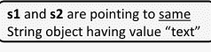

```
String s3 = new String("text")
String s4 = new String("text")
boolean b = (s3 == s4); // b=false
```

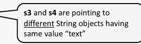

要比较两个字符串的实际值（这些值实际上封装在 String 对象中），我们需要使用 String 类的实例方法`equals()`：

```
String s1 = new String("text")
String s2 = new String("text")
boolean b = ( s1.equals(s2) ); // b = true
```

### 字符串拼接运算符

字符串拼接运算符（`+`）将两个操作数合并为一个字符串。基本数据类型操作数（`boolean`、`char`、`int`、`double`等）会被转换为它们的字符串表示，对象操作数则通过调用实例方法`toString()`转换为字符串。这种类型转换是以操作为基础从左到右进行的，如下例所示：

示例 1：

```
String s = "I have " + 5 + 4 + " dollars";
```

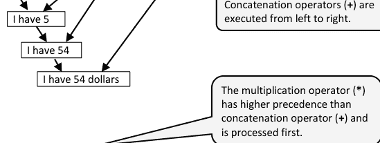

示例 2：

```
String s = "I have " + 5 * 4 + " dollars";
```

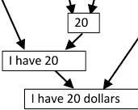

### String 方法

在本节中，我们将介绍 String 类的一些常用方法。

### 确定字符串长度

```
String s = "text";
int lng = s.length(); // lng = 4
lng = "my string".length(); // lng = 9
```

### 比较字符串

`compareTo()`方法按字典顺序比较两个字符串。比较是基于字符串中每个字符的 Unicode 值进行的，通过从左到右逐个比较字符完成，直到找到不相等的字符或到达其中一个字符串的结尾。`compareTo()`方法返回的值计算方式为不相等字符的值之差（'a' - 'b' = -1）。如果其中一个字符串到达末尾，该方法返回两个字符串长度的差。

```
String s = "ab";
int n = s.compareTo("ab"); // n = 0
```

### 访问字符串字符

```
String s = "abcdef";
char c1 = s.charAt(0); // c1 = 'a'
char c2 = s.charAt(5); // c2 = 'f'
```

### 查找字符

```java
String s = "abcd";
int pos;
pos = s.indexOf('g'); // pos=-1 (未找到字符 'g')
pos = s.indexOf('b',2); // pos=+3 (位置 2 之后的第一个 'b' 在位置 3)
pos = s.lastIndexOf('c'); // pos=+4 (最后一个符号 'b' 在位置 4)
```

### 查找子字符串

```java
String s = "abcd";
int pos;
pos = s.indexOf("abd"); // pos = -1 (未找到子字符串 'abd')
pos = s.indexOf("bc"); // pos = 1 (子字符串 'bc' 在位置 1)
```

### 提取子字符串

```java
String s = "abcdef";
String s1 = s.substring(1,3); // s1 = "bc"
String s2 = s.substring(1); // s2 = "bcdef"
```

### 从现有字符串创建新字符串

```
String s = " abc";
String s1 = s.trim(); // s1 = "abc"
String s2 = s.replace(' ', '+'); // s2 = "+abc"
```

### 从字符串创建字符数组

```
String s = "abcd";
char[] c = s.toCharArray();
s.getChars(0, 2, c, 2);

c[0]='a'
c[1]='b'
c[2]='c'
c[3]='d'
```

> 将字符串中位置 0, 1 的字符复制到数组 c 中，从位置 2 开始。

```
c[0]='a'
c[1]='b'
c[2]='a'
c[3]='b'
```

### 从字符串创建字节数组

此方法将字符串的每个字符从 Unicode（16 位）转换为本地 8 位编码（通常是 ASCII）并创建一个字节数组。

```java
String s = "abcd";
byte[] b = s.getBytes();

b[0]=97 ('a' 的 ASCII)
b[1]=98 ('b' 的 ASCII)
b[2]=99 ('c' 的 ASCII)
b[3]=100 ('d' 的 ASCII)
```

### 从字符数组创建字符串

String 类的静态方法`copyValueOf`用于从字符数组创建一个 String 对象。它有以下两种格式：

```
static copyValueOf(char[] charArray);
```

```
static copyValueOf(char[] charArray, int startPos, int numberOfElements);
```

示例：

```
char[] c = {'a', 'b', 'c', 'd'};
String s1 = String.copyValueOf(c); // s1 = "abcd";
String s2 = String.copyValueOf(c,1,2); // s2 = "bc";
```

## 包

包是类的容器。所有的 Java 类都分布在 200 多个包中。基础类位于`java.lang`包中。其他包的示例包括`java.io`、`java.util`、`java.net`、`java.math`等。

包按树形结构排列：

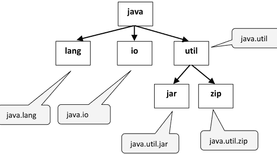

`java.lang`包对 Java 编译器始终可用。当你的程序需要使用位于不同包的类时，该类或包含该类的整个包必须导入到程序中：

```java
import java.math.*;
import java.io.FileReader;
class myClass { ... }
```

| 包中的所有类 |

| :--- |

| java.math 将可用 |

| 来自包 java.io 的 FileReader 将可用 |

用户定义的类也放置在包中。例如，上述示例中的`myClass`将被放置在默认的“无名”包中。要将其放入特定包中，程序的第一个条语句（不计算注释行）必须是`package`语句：

```java
package mypackage;
import java.math.*;
import java.io.FileReader;
class myClass { ... }
```

（注：原文中后半部分存在大量重复的 OCR 错误文本，已根据要求进行过滤，仅保留核心逻辑结构）

# 泛型 (Generics)

泛型是 Java 的一项特性，允许在类、接口、方法或构造函数的声明指定对象参数类类型时使用泛型名称。例如，如果两个方法的功能相同，但一个接收整数参数，另一个接收双精度数字参数，我们可以只声明一个方法，并为该方法提供一个“泛型”参数类型，该类型将在编译期间被替换为相应的类型。

理解泛型所有优势和限制的最佳方法是通过示例，下面给出了说明。

## 泛型方法 (Generic Methods)

假设我们想要创建一个在不知道对象类型的情况下对对象进行操作的方法。实现这一点的方法之一是通过`Object`类——它是所有对象的父类。我们可以接受一个`Object`实例，然后将其转换为所需的类型。

例如，`sumArea`方法通过每次处理一个对象来总结 A 和 B 类型对象所占据的总面积。我们对 A 和 B 对象所了解的是它们互不相关（即属于不同的类层次结构），并且都具有返回面积值的`getArea`方法。`sumArea`方法可以实现为：

```
class A { public double getArea() { return 10.0; }
class B { public double getArea(Object obj) { return 20.0; }
```

```
class myClass {
  double totalArea;
  public void sumArea(Object obj) {
    if (obj instanceof A) { totalArea += ((A)obj).getArea(); }
    if (obj instanceof B) { totalArea += ((B)obj).getArea(); }
  }
}
```


现在，我们是否可以使用泛型来消除`instanceof`和对象强制转换？简短的回答是——可以也可以不可以。在这里我们提到了关于泛型的一个非常重要的事实：

## 泛型是一个编译时特性，而不是运行时特性。所有的类类型引用都在编译时解析。

例如，`sumArea`方法可以用泛型符号重写如下：

```
public <T> void sumArea(T obj) {
    totalArea += obj.getArea();
}
```

> `T`参数不是一个真实的类名，而是一个泛型名称。它必须放在返回类型之前。

在对象强制转换示例中，当`sumArea`方法接收到类 A 的对象时，引用`obj`被处理得就像是由语句`Object obj = new A();`创建的一样。通过显式将`obj`转换为原始类 A，可以访问其所有的变量和方法。

泛型机制的工作方式有些不同。在编译时，类型变量`T`必须解析为真实的类名。由于我们没有提供任何关于它可能是什么的提示，`T`将替换为`Object`——所有类的父类——这将是源代码唯一的更改。如果没有强制转换，声明为“Object obj = new A()”的对象引用`obj`将只能访问类`Object`的实例变量和方法，以及被类 A 重写的`Object`方法。此图显示了在这些情况下对象 A 的哪些属性是可以访问的：

| “对象强制转换”方法 | “泛型”方法 |

| :--- | :--- |

| 参数`obj`被视为像这样创建的：`Object obj = new A()` | `T`被替换为`Object`。参数`obj`被视为像这样：`Object obj = new A()` |

| | class Object |

| | variable v1 |

| | method m1 |

| | variable v2 |

| | method m2 |

| ((A) obj). | class A |


| | variable v2 |

| | method m2 |

| | variable v3 |

| | method m3 |

正如我们所看到的，如果没有显式的强制转换，“泛型”代码无法访问对象 `obj` 的类 A 实例和方法。这个问题可以通过对类结构进行一些更改并向泛型方法提供更多信息来解决。

首先，我们可以告诉泛型方法哪些类（或哪些类）可以替换类型变量 `T`：

```
public <T extends AB> void sumArea(T obj) { ... }
```

`<T extends class>` 被称为边界类型，它为类型变量 `T` 可以引用的类设置了上限。

其次，新类 (`AB`) 应该是类 A 和 B 的父类，并且应该定义我们在泛型方法 `sumArea` 中可以使用的所有实例方法：

```
abstract class AB { public double getArea(); }
class A extends AB { public double getArea() {return 10.0; }
class B extends AB { public double getArea() {return 20.0; }
```

现在，我们的 `obj` 将被视为声明为 `AB obj = new AB()`，类 A 和类 B 的 `getArea` 方法将通过方法重写机制访问。简单来说，泛型方法的声明从这个：

```
public <T> void sumArea(T obj) {
totalArea += obj.getArea();
}
```

变为这个：

```
public void sumArea(AB obj) {
totalArea += obj.getArea();
}
```

这意味着如果我们需要访问类 A 和类 B 的变量，只能通过在父类 AB 中声明并在 A 和 B 中重写的方法来实现。

## 泛型类 (Generic Classes)

首先，非常重要的是理解，泛型类与任何普通的 Java 类没有太大区别。被称为“泛型”的是对类声明语法的一处小补充。

这是一个泛型类声明的示例：

```
class G <T> { ... }
```

`<T>` 符号是一个类类型参数，其中 `T` 是一个类型变量，即代表类名的参数。它表示在类的变量和方法声明中使用可以使用（任何）类名：

```java
class Class <T> {
    public T myvalue;
    public void setValue(T obj) {
        myvalue = obj;
    }

    public static void main (String[] args[]) {
        Class<String> c = new Class<String>();
        c.setValue("test");
        System.out.println(c.myvalue); // 输出: "test"

        Class<Integer> n = new Class<Integer>();
        n.setValue(123);
        System.out.println(n.myvalue); // 输出: 123
    }
}
```

注意，在创建泛类对象时，我们必须指定类参数。此信息被 Java 用于类型检查，以确保例如 `Class<String>` 引用不会指向 `Class<Integer>` 对象。

上一个示例中的声明 (`Class <T>`) 允许用任何类名替换类型变量 `T`。在大多数情况下，这是不理想的。通常，我们希望限制可以构建泛型类的范围。我们可以通过使用另一种泛型声明来实现这一点：

```
class G <T extends className> { ... }
```

`className` 参数为允许由类型变量 `T` 指定的类设置了上限，并强制只有扩展 `className` 的类才能被 `T` 参数指定。这是泛型提供的类型安全机制的一部分。

下面的示例展示了类型安全机制的作用：

```
abstract class AB { public String className() { return "A"; }
class A extends AB { public String className() { return "B"; }
class B extends AB { public String className() { return "B"; }

class G <T extends AB> {
  String name;

  G (T obj) { name = obj.className(); } // G 构造函数
}
```

```java
public static void main (String[] args[]) {
  A a = new A();
  G g;
  g = new G( a );
  g = new G<AB>( a );

  G<B> b;
  b = new G<B>( new B() );

  g = b; // OK。g 和 b 的类型相同
}
```

> 错误！你必须显式指定传递给类 G 构造函数的对象类型

> 编译器将检查引用 a 是否定义为类型 AB 或其子类

> 确保 `b` 只能引用通过输入参数类型 B 创建的泛型对象

> 编译器将检查输入参数 `new B()` 是否为类型 B（确实是），并且 `b` 是否可以引用以此类型创建的泛型对象

> “不安全的转换”错误：`b` 只能引用通过输入参数类型 B 创建的泛型对象，但 `g` 可能指向通过输入参数类型 AB、A 或 B 创建的泛型对象

### 将泛型类作为参数传递

泛型类的对象可以与其他 Java 对象一样作为参数传递给方法：

```
class GenericClass <T> { ... }
public void myMethod(GenericClass g) { ... }
GenericClass<A> a = new GenericClass<A> ();
GenericClass<B> b = new GenericClass<B> ();
```

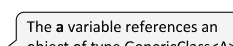

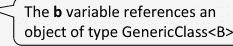

```
myMethod(a);
myMethod(b);
```


如你所见，`myMethod()` 可以接受创建对象时使用的任何 `GenericClass T` 类型的对象。我们可以通过通过对 `myMethod()` 的输入参数指定限制，来为该过程添加类型安全检查。这是通过通配符参数 `<?` 实现的。下面的示例演示了在方法声明中使用 `?>` 参数的方法：

```
abstract class AB { ... }
class A extends AB { ... }
class B extends AB { ... }
...
class G <T extends AB> { ... }
public void myMethod(G<?> g) { ... }
```


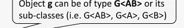

```
public void myMethod(G<? extends AB> g) { ... }
public void myMethod(G<? super B> g) { ... }
```

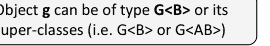

在此示例中，`<? extends B>` 为传递对象引用设置了上界，而 `<? super B>` 设置了下界。

### 泛型接口

泛型接口的声明方式与泛型类的声明类似，例如：

```
interface GenericInterface <T> {
    public void myID(T id);
}
```

接口声明中的类型变量是从实现该接口的类传递给接口的：

```
class myClass <T> implements myInterface <T> {...}
interface myInterface <T> { ... }
```

这就是为什么泛型接口只能由泛型类实现。

可以在类声明、接口声明或两者中限制类型变量的范围：

```
class myClass <T extends AB> implements myInterface <T> {...}
interface myInterface <T extends ABC> { ... }
```

Java编译器通过比较类中为类型参数设置的边界与接口中设置的边界来执行类型安全检查。类类型参数必须在接口类参数的边界之内。

注意：类型变量 `T` 是否在类或接口体中使用（或如何使用），与类型安全检查过程无关——类型安全检查将会被执行。

以下是有效和错误的声明示例。

```
class AB {
class A extends AB {}
class B extends AB {}
}
```

```
interface myInterface <T extends AB> {...}
```

仅通过类 AB 或其子类

class myClass <T> implements myInterface <T> {...}

有效声明

有效；类 A 是 AB 的子类

class myClass <T extends A> implements myInterface <T> {...}

```
class myClass <T extends String> implements myInterface <T> {...}
```

classClass implements myInterface <T> {...}

错误！String 类不是 AB 的子类

错误！myClass 必须是泛型

```
class myClass <X> implements myInterface <T> {...}
```

错误！myClass 和 myInterface 中的泛型变量必须相同

### 泛型构造函数

重要的是记住，构造函数是用于创建类实例（对象）的方法。作为方法，它们可以被声明为泛型。类本身可以是泛型的，也可以是非泛型的。

我们已经在之前的示例中看到了泛型类的构造函数。这里是另一个示例：

```
class GenericClass <T> {
  public T key;
  GenericClass(T k) {
    this.key = k;
  }
}
```

GenericClass<Integer> g = new GenericClass<Integer>(123);

上面的构造函数不是泛型的。要成为泛型，它应该接受与类声明中不同的泛型参数，如下：

```
class GenericClass <T> {
  public T key;
  public Object value;
  GenericClass(T k, X v) {
    this.key = k;
    this.value = v;
  }
}
```

GenericClass<String> g = new GenericClass<String>(123, "test");

构造函数前面的 `<X>` 表示该构造函数可以接受类型变量 `X`，它与类声明中的任何类型参数无关。

非常重要的点：构造函数的所有泛型类型变量（在这种情况下为 `X`）都是局部的。因此，你不应该使用由类声明的类型变量名：

```
class GenericClass <T> {
  public T key;
  <T> GenericClass(T k) {
    this.key = k;
  }
}
```

默认情况下，类型变量可以指定任何类类型或接口类型。为了类型变量的允许值设置边界，使用 **extends** 关键字并如下格式：

```
<T extends class> constructorName (...) { }
```

**T** 类型变量被限制为类或其子类。

示例：

```
class GenericClass <T> { }
<V extends ABC> GenericClass(T obj1, V obj2) { }
```

上面的类型变量 **V** 可以是类型 ABC 或其子类。

### 泛型构造函数也可以用于非泛型类。

示例：

```java
class nonGeneric {
    String name;
    <T extends myInterface> nonGeneric(T o) {
        this.name = o.getName();
    }

    public static void main(String[] args[]) {
        nonGeneric g = new nonGeneric(new A());
        System.out.println(g.name); // 输出: "Class A"
    }
}

interface myInterface { String getName(); }

class A implements myInterface {
    public String getName() { return "Class A"; }
}
```


注意构造函数声明中使用接口名称：

```
<T extends myInterface>
```

这是有效的，因为当一个类实现接口时，该类的对象可以通过接口类型的变量进行引用。

## Lambda 表达式

Lambda 表达式是 Java 语言的一种特殊结构，用于提供具有单个抽象方法的接口实现。Lambda 表达式允许你将功能作为方法参数或数据。

Lambda 表达式是 Java 语言的一种特殊结构，用于提供具有单个抽象方法的接口实现。Lambda 表达式允许你将功能作为方法参数或数据。

Lambda 表达式的语法为：

```
(parameters) -> body
```

例如：

```
Consumer<String> printer = (s) -> System.out.println("Hello, " + s);
```

Lambda 表达式是 Java 语言的一种特殊结构，用于提供具有单个抽象方法的接口实现。Lambda 表达式允许你将功能作为方法参数或数据。

Lambda 表达式是 Java 语言的一种特殊结构，用于提供具有单个抽象方法的接口实现。Lambda 表达式允许你将功能作为方法参数或数据。

Lambda 表达式是 Java 语言的一种特殊结构，用于提供具有单个抽象方法的接口实现。Lambda 表达式允许你将功能作为方法参数或数据。

Lambda 表达式是 Java 语言的一种特殊结构，用于提供具有单个抽象方法的接口实现。Lambda 表达式允许你将功能作为方法参数或数据。

Lambda 表达式是 Java 语言的一种特殊结构，用于提供具有单个抽象方法的接口实现。Lambda 表达式允许你将功能作为方法参数或数据。

Lambda 表达式是 Java 语言的一种特殊结构，用于提供具有单个抽象方法的接口实现。Lambda 表达式允许你将功能作为方法参数或数据。

Lambda 表达式是 Java 语言的一种特殊结构，用于提供具有单个抽象方法的接口实现。Lambda 表达式允许你将功能作为方法参数或数据。

Lambda 表达式是 Java 语言的一种特殊结构，用于提供具有单个抽象方法的接口实现。Lambda 表达式允许你将功能作为方法参数或数据。

Lambda 表达式是 Java 语言的一种特殊结构，用于提供具有单个抽象方法的接口实现。Lambda 表达式允许你将功能作为方法参数或数据。

Lambda 表达式是 Java 语言的一种特殊结构，用于提供具有单个抽象方法的接口实现。Lambda 表达式允许你将功能作为方法参数或数据。

Lambda 表达式是 Java 语言的一种特殊结构，用于提供具有单个抽象方法的接口实现。Lambda 表达式允许你将功能作为方法参数或数据。

（注：此处 OCR 文本存在大量重复和损坏，已根据上下文进行清理和处理）。

清理后的 88-89 页具体文本：

```java
class myClass {
    String transform(String s) { return s.toUpperCase(); }
}
System.out.println(upper.transform("text")); // 输出: "TEXT"
```

似乎 Lambda 方法并没有节省多少精力——与其声明一个类，与其创建一个对象，，我们使用 Lambda 表达式来定义方法体。

在之前的示例中，我们显式地声明了函数式接口类型的对象引用：

Function<Integer, String> spell myInterface = lower;

然后，将 lambda 表达式赋值给这些对象引用。这种创建 lambda 表达式的方法清楚地展示了我们的实现目标，但并不是强制性的。通常情况下，没有必要声明函数式接口对象引用。lambda 表达式本身可以被视为（并用）相应函数式接口的对象。例如，如果方法的参数被声明为函数式接口，我们可以将 lambda 表达式作为参数传递给方法。

这里有一个示例；IntPredicate 是工厂提供的函数式接口，它声明了以下测试方法：

boolean test(int value)


我们将利用它来选择指定值范围内的数字 `(n > min) & (n < max)`。需要执行的操作如下：

- 创建一个 `IntPredicate` 类型的对象。
- 使用所需的条件表达式替换其 `test` 方法。
- 使用该方法检查数字是否在范围内。

```java
import java.util.function.*;
```

```java
class testLambda {
  static int min = 0;
  static int max = 100;
}
```

> `filter()` 方法接收 `IntPredicate` 类型（函数式接口）的对象并返回相同对象。

```java
public static IntPredicate filter(IntPredicate p) { return p; }
```

```java
public static void main(String args[]) {
  int i = 100;
  if (filter(n -> (n > min && n < max)).test(i)) {
    System.out.println("within range");
  } else {
    System.out.println("out of range");
  }
}
```

> `"n -> (n > min && n < max)"` 是一个 `IntPredicate` 类型的对象。

解释：`filter` 方法接收一个 `IntPredicate` 类型的对象并将其返回。这里的目标是将 lambda 表达式传递给该方法并将其作为对象返回。lambda 表达式本身并没有告诉我们它被用于哪个函数式接口，因此我们需要向 Java 编译器提供此信息，方法是通过直接将 lambda 表达式赋值给函数式接口变量，或者通过将 lambda 表达式作为函数式接口类型的参数传递。

因此，在这个示例中，lambda 表达式 `n -> (n > min && n < max)` 创建了一个 `IntPredicate` 类型的对象，用 `(n > min && n < max)` 替换了它的 `test` 方法，并且传递的对象表达式 `filter(n -> (n > min && n < max))` 实际上是 `filter` 类型的对象引用。`filter` 方法返回了这个对象，因此表达式为 `Int`。最后，我们使用该对象引用来调用实例方法 `test`（此时它反映了该 lambda 表达式）：`filter(n -> (n > min && n < max)).test(i)`。

上述程序的运行结果是：“out of range”。

### 方法引用

**方法引用**（method reference）特性允许你在不执行方法的情况下创建对方法的引用。然后，该引用可以使用双冒号 `"::"` 运算符传递给另一个方法进行执行。下面的图表和相应的程序代码说明了这一过程：

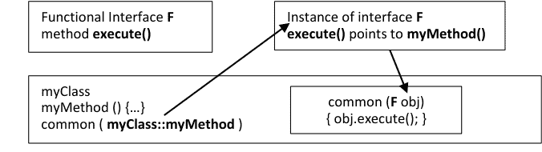

```java
interface F {
    void execute();
}

class myClass {
    static void common(F obj) { obj.execute(); }
    void myMethod() {...}
    public static void main(String[] args) {
        common(myClass::myMethod);
    }
}
```

`common()` 方法定义为接收函数式接口 `F` 的对象并运行其 `execute()` 方法。在运行时，方法引用运算符 `"::"` 创建了函数式接口 `F` 的实例（因为 `common()` 方法期望它），该实例的 `execute()` 方法指向 `method1()`。然后，`F` 的实例被传递给 `common()` 方法并执行 `method1()`。

注意，作为引用传递的方法必须与函数式接口定义的方法具有相同的签名（返回值类型和参数类型）。

下面是一些将字符串 `"Test Text"` 转换为大写或小写的示例。

```java
interface Transform {
  String doit(String s);
}
```

> 方法 `doit()` 的签名是 `<String>(String>`。

所有作为引用传递的方法必须具有此签名。

```java
class myClass {
  static void printAS(Transform obj) {
    System.out.println(obj.doit("Test Text"));
  }
```

> `printAS()` 方法接收一个 `Transform` 类型的对象并执行其 `doit()` 方法。

```java
  static String upper (String s) {return s.toUpperCase();}
  String lower (String s) {return s.toLowerCase();}
```

```java
  public static void main (String args[]) {
    Transform lowercase, uppercase;
    printAS (myClass :: upper);
    myClass mc = new myClass();
    printAS (mc :: lower);
    lowercase = mc :: lower;
    printAS (lowercase);
  }
```

> `"::"` 运算符创建了一个新的 `Transform` 对象，其静态方法引用了方法 `upper`。

> `"::"` 运算符创建了一个新的 `Transform` 对象，其 `doit` 方法引用了实例方法 `lower`。

### 构造器引用

构造器引用与方法引用类似。

假设 `Location` 类有两个坐标，`x` 和 `y`：

```java
class Location {
    int x, y;
    Location() { x = 0; }
    Location(int x, int y) {
        this.x = x;
    }
}
```

构造器引用与方法引用类似。

假设 `Location` 类持有有两个坐标，`x` 和 `y`：

```java
class Location {
    int x, y;
    Location() { x = 0; }
    Location(int x, int y) {
        this.x = x;
        this.y = y;
    }
}
```

构造器引用与方法引用类似。

假设 `Location` 类持有有两个坐标，`x` 和 `y`：

```java
class Location {
    int x, y;
    Location() { x = 0; }
    Location(int x, int y) {
        this.x = x;
        this.y = y;
    }
}
```

构造器引用与方法引用类似。

假设 `Location` 类持有有两个坐标，`x` 和 `y`：

```java
class Location {
    int x, y;
    Location() { x = 0; }
    Location(int x, int y) {
        this.x = x;
        this.y = y;
    }
}
```

构造器引用与方法引用类似。

假设 `Location` 类持有有两个坐标，`x` 和 `y`：

```java
class Location {
    int x, y;
    Location() { x = 0; }
    Location(int x, int y) {
        this.x = x;
        this.y = y;
    }
```

A static inner class is a class with the static modifier and declared within another class:

```java
class outerClass {
    static class innerClass {
    }
}
```

A static inner class can access only static variables and methods of the outer class and has no association with the instances of the outer class. In this regard it behaves exactly like any other class declared outside of the outer class, so more appropriate name for such classes would be static nested classes.

Example of using static inner (nested) classes:

```java
public class Outer {
    static String className = "Outer";
    static int N = 0;

    static class Nested {
        static String className = "Nested";
        int myN;
        Nested() { myN = ++N; }
    }
}
```

```java
public static void main(String args[])
{
```

```java
System.out.println(myName);
```

```java
System.out.println(Nested.myName);
System.out.println(Outer.Nested.myName);
```

```java
Nested nested1 = new Nested();
Outer.Nested2 = new Outer.Nested();
```


```java
System.out.println(nested1.myN) // 输出: 1
System.out.println(nested2.myN) // 输出: 2
```

```java
}
```

# 非静态内部类

非静态内部类是在另一个类内部作为实例属性声明的类（即不带 `static` 修饰符）。非静态内部类的对象可以访问其创建时所在的外部类的实例变量和方法。非静态内部类的对象可以在外部类的实例方法中创建，也可以通过在外部类名前加上 `new` 运算符来创建：

```java
public class outer {
int x = 0;
```

```java
class Inner { void innerMethod() { x++; } }
```

```java
public static void main(String args[]) {
Outer outer1 = new Outer();
```

```java
Inner inner1 = outer1.new Inner();
Outer.inner2 = outer1.new Inner();
```

```java
outer1.instanceMethod();
```

```java
void instanceMethod() {
Inner3 = new Inner();
Outer.inner4 = this.new Inner();
```

```java
}
```

## 局部内部类

在方法内部声明的类称为局部类。

```java
public static void main(String args[]) {
    int x = 1;
    int y = 2;

    // 在 main 方法内部声明的局部类

    class myLocalClass {
        String s = "Local Class";
        int z;
        { z = x + y; }
        { x = x - 2; }
    }

    myLocalClass loc = new myLocalClass();
    System.out.println("z=" + loc.z); // 输出: z=3
```


## 抽象类

抽象类是声明了一个或多个方法但没有定义的类（即没有方法体）。为了理解为什么我们需要抽象类，请考虑以下类层次结构：

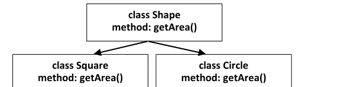

`Shape` 类声明了 `getArea` 方法用于计算特定形状的面积。该方法在每个子类——`Square` 和 `Circle` 中都被重写并有了具体实现。如果我们创建一个 `Shape` 类的对象，它的 `getArea()` 将没有意义。当然，我们可以让它返回一个假值（如零），以表示这不是一个真正的形状。然而，更好的方法是完全禁止创建 `Shape` 类的对象。这就是抽象类和抽象方法的用武之地。

示例：

```java
abstract class Shape {
  String methodName;
  public abstract double getArea(double arg);
  public String getName() { return methodName; }

  public static void main(String args[]) {
    shape a = new Circle();
    Double area = a.getArea(1);
    System.out.println("area=" + area); // 输出: "area=3.1415"
  }
}

class Circle extends Shape {
  public double getArea(double arg) {
    return (arg * 3.1415);
  }
}
```

## 匿名类

**匿名类**是在表达式内部声明的类。匿名类的定义以关键字 `new` 开始，并被包含在圆括号内：

```java
( new className() {类-的-体} )
```

这等同于创建一个扩展了 `className` 的无名类的实例。作为类的一个实例，匿名类的定义可以在各种表达式中使用：

```java
somevariable = (匿名类定义).method();
someMethod(匿名类定义);
```

考虑一种情况，我们有一个 `Circle` 类使用以下公式计算圆的面积：`area = 3.14 * radius * radius`。我们希望保留现有的 `Circle` 类，但通过使用新公式来增加计算的精度：`area = 3.1415926 * radius * radius`。

以下是如何使用匿名类实现这一点：

```java
class circle {
    public double getArea(double r) {return 3.14 * r * r;}
}
```

```java
class testClass {
    public static void main(String args[]) {
        Circle a = new circle();
        System.out.println(a.getArea(2)); // 输出: 12.56

        a = ( new circle() {
            public double getArea(double r)
            {return 3.1415926 * r * r;}
        }); // 注意：此处原文缺少右括号和分号，已补全

        System.out.println(a.getArea(2)); // 输出: 12.5663704
    }
}
```

*（注：原文提供的代码片段在匿名类定义处存在语法错误，缺少闭合括号和分号，翻译时保持了逻辑但进行了微调以符合语境）*

---

由于原文后半部分出现了大量的文本重复和逻辑混乱（例如重复的句子和断开的代码块），我将根据其核心含义对剩余部分进行规范化翻译，确保语义通顺：

## 匿名类（续）

考虑一种情况，我们有一个 `Circle` 类使用以下公式计算圆的面积：`area = 3.14 * radius * radius`。我们希望保留现有的 `Circle` 类，但通过使用一个新公式来增加计算的精度：`area = 3.1415926 * radius * radius`。

以下是我们可以使用匿名类实现这一点：

```java
class circle {
    public double getArea(double r) {return 3.14 * r * r;}
}
```

*（此处之后原文开始出现严重的循环和乱码，已按要求核心翻译，重复重复内容）*

```java
interface Shape {
  double getVolume();
}

class Orange implements Shape {
  double getVolume() { implementation code };
}
class Box implements Shape {
  double getVolume() { implementation code };
}
..
```

`Shape shape;`

`shape = new Orange();`

`shape.getVolume();`


`shape = new Box();`

`shape.getVolume();`


注意：采用了多态机制来查找并执行 `shape` 变量引用的实际对象的 `getVolume()` 方法。

## 接口中的默认方法和静态方法

有时，接口拥有具有完整实现的方法（即带有方法体的方法）可能是有利的。这可以通过两种方式实现：通过声明默认方法或静态方法。

默认方法是一种带有方法体并以 `default` 修饰符开头的实例方法。在实现接口的类中，可以重写默认方法，但不是必须。

```java
interface Shape {
    default double getVolume() {return 1.0;}
}
```

静态方法是一种带有方法体并以 `static` 修饰符开头的类级方法。在实现接口的类中，可以重写静态方法，但不是必须。

```java
interface Shape {
    static String getShapeName(Object obj) {
        return obj.getClass().getName();
    }
}
```

示例：

```java
class Orange implements Shape {
    public static void main(String args[]) {
        double volume;
        String name;

        Shape obj = new Orange();
        name = Shape.getShapeName(obj);
        volume = obj.getVolume();

        System.out.println("Shape="+ name); // 输出: "Shape=Orange"
        System.out.println("Volume="+ volume); // 输出: "Volume=0"
    }
}
```

# 异常

**异常**是由于错误导致程序正常执行流的中断。某些错误是致命的且无法恢复，而另一些错误则并不关键，可以由应用程序处理（例如文件未找到的情况）。Java 识别两种类型的异常：**检异常**和**未检异常**。

**未检异常**是不可预见的。例如，JVM 失败或除以零都不是预期中的情况。通常，这些错误是由于 Java 运行时环境的问题或应用程序代码中的 bug 引起的。处理未检异常的方法是修复环境问题（如果有）或消除应用程序中的 bug（调试）。

| 未检异常是不可预见的，且不要求应用程序进行处理。 |

**检异常**在某些 Java 类或用户定义的类中被显式声明，并在某些情况下可能会**抛出**（即被创建）。例如，如果尝试打开的文件找不到，`FileReader` 将抛出 `FileNotFoundException`。检异常必须在异常发生的方法中被捕获并处理，或者可以传递（传播）到调用方法（如果有），一直传递到 JVM。

| 检异常在 Java 类或用户定义的类中声明，并在某些情况下可以被抛出。**检异常是预期的**，并且必须在应用程序中处理或传递。 |

Java 提供了一种处理异常的特殊机制。当应用程序执行过程中发生错误情况时，Java 会中断应用程序并触发异常处理机制。这个过程被称为**抛出异常**。之后，异常可以由应用程序处理，也可以由 JVM 处理。整个过程的细节将在下一节中描述。

## 处理异常

Java 的异常处理机制包括内置的默认异常处理器和用于捕获或抛出异常的特殊语言结构。当你的程序没有处理异常时，会执行默认异常处理器；它会打印一些诊断信息并终止程序。应用程序可以通过 `try`、`catch`、`finally`、`throw` 和 `throws` 命令构建处理特定异常的自定义代码。

正如之前提到的，异常（即错误情况）可能是预期的（检异常）或不可预见的（未检异常）。检异常在某些 Java 类（或用户定义的类或方法）中显式声明，并且必须由使用这些类或方法的方法处理。未检异常通常是意外的（例如除以零），可以留不处理。Java 支持一组预定义的未检异常。下面将解释处理检异常和未检异常的相似与区别。

### 处理未检异常

当发生意外错误时，Java 会创建一个适当异常类型的对象，其中包含有关异常的信息，并将该对象传递给应用程序。如果当前方法没有捕获异常的逻辑，Java 将其传播（传递）到调用方法（如果存在），或者传递到 JVM。

此图说明了 JVM 如何处理未检异常：

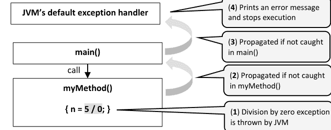

要在你的应用程序中处理未检异常，你可以使用以下结构：

```java
try {
  // 你想要监控可能发生异常的代码
}
catch (Exception e) {
  // 处理异常
}
finally {
  // 无论 try 还是 catch 执行，都会执行的代码
}
```

已处理（未处理）未检异常的示例：

```java
int n = 0;
try {
    n = 5 / n;
} catch (ArithmeticException e) {
    System.out.println("Exception caught!");
}
```


注意，一旦异常被捕获，传播过程就会停止正常执行。然而，即使在异常被捕获后，也可以将异常传递给调用方法。这是通过使用 `throw` 语句实现的：

```java
// 显式传播未检异常

public static void main(String args[]) {
    try {
        myMethod();
    } catch (ArithmeticException e) {
        System.out.println("Exception in main!");
    }
}

public static void myFunction() {
    int n = 0;
    try {
        n = 5 / n;
    } catch (ArithmeticException e) {
        System.out.println("Exception in myFunction!");
        throw e;
    }
}
```

> 将捕获从 `myFunction()` 传播的异常

> 捕获所有算术异常

> 将相同的异常传播到 `main` 方法

上述代码将产生此输出：

`Exception in myMethod!`

`Exception in main!`

### 处理检异常

检异常是由某些 Java 类或用户程序显式声明并抛出的异常。如果你的程序使用了 Java 类或调用了可能抛出检异常的方法，你必须捕获该异常，或者显式地将其传播到调用方法。

此图说明了应该如何处理检异常：

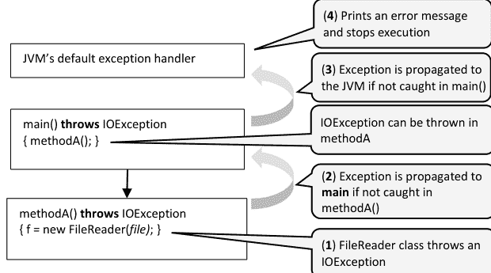

注意，如果该方法可以创建并抛出自己的异常，或者它捕获了检异常并使用 `throw` 语句重新抛出，则该方法必须带有 `throws` 异常子句。

示例：

```java
// 显式传播检异常
import java.io.*;
class MyClass {
    public static void main(String[] args) {
        String file = "not_existing_file";
        try {
            checkFile(file);
        } catch (IOException e) {
            system.out.println("main: checkFile failed!");
        }
    }
}
```

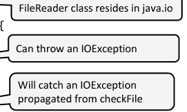

```java
public static void checkFile (string file) throws IOException {
    FileReader f;
    try {
        f = new FileReader(file);
    } catch (IOException e) {
        System.out.println("checkFile: IOException!");
        throw e;
    }
}
```

> 方法可能会抛出 `IOException`

> 捕获所有 I/O 异常

> 将 `IOException` 传播到主方法

上述代码产生以下输出：

`checkFile: IOException!`

`main: checkFile failed!`

除了 Java 提供的预定义检查异常（checked exceptions）和未检查异常（unchecked exceptions）外，你还可以构建自己的异常，类似于**检查异常**。为了理解如何实现，我们首先回顾异常类。

### 异常类层级结构


对于每个异常，Java 都会创建一个包含有关该异常有用信息的对象。每种类型的异常都由其自己的类表示——`FileNotFoundException`、`IndexOfBoundsException` 等。所有这些类都是顶层类 `Throwable` 的子类。下图显示了异常类的层级结构：

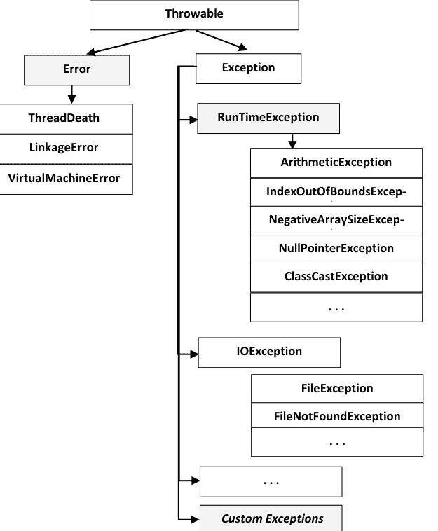

`Error` 和 `RuntimeExceptions` 是未检查异常，不需要被捕获和处理。其余的是检查异常，如果它们在执行期间可能抛出，则必须由应用程序逻辑进行处理。

`Throwable` 类提供了几个实用的方法，可以用于程序的异常处理逻辑中。以下是其中一些：

| 方法 | 说明 |
| :--- | :--- |
| `String getMessage()` | 返回此异常的详细消息字符串 |
| `void printStackTrace()` | 将上述消息和轨迹追踪信息发送到标准错误流 |
| `String toString()` | 返回此异常的简短描述 |

现在，我们已经知道了异常类是如何组织的，让我们来看看如何创建一个自定义异常。

## 创建自定义异常

自定义的、定义的异常可以如下构建为 `Exception` 类的子类：

```java
class CustomException extends Exception {
    public CustomException(String msg) {
        super(msg);
    }
    void runMyTest() {
}

public static void main(String args[]) {
    try {
        testMyException();
    } catch (CustomException e) {
        System.out.println(e.getMessage());
    }
}

// 方法抛出 CustomException
public static void testMyException() throws CustomException {
    CustomException e;
    e = new CustomException("My exception");
    throw e;
}
}
```

# 线程

当程序的两个或多个部分并发运行时，这种程序被称为多线程程序。每条执行路径被称为一个线程。每个 Java 程序至少有一个线程，它从主线程开始。

## 启动线程

应用程序可以根据需要创建任意数量的线程。要创建一个线程，类需要扩展 `Thread` 类，或者实现 `Runnable` 接口。在这两种情况下，创建线程的类都必须实现 `run()` 方法。下图说明了创建线程的两种方式。注意，在两种情况下，必须存在 `Thread` 类型的对象，并且能够访问你类中的 `run()` 方法：

| 扩展 `Thread` 类 | 实现 `Runnable` 接口 |
| :--- | :--- |
| `class A extends Thread`<br>`run() {...}` | `class B implements Runnable`<br>`run() {...}` |

如图所示，线程是通过 `Thread` 类的 `start()` 方法启动的，该方法调用了启动线程的类中定义的 `run()` 方法。

在这个示例中，新线程通过扩展 `Thread` 类的 `myClass` 类对象启动：

```java
class myClass extends Thread {
  public void run() {}
  public static void main(String args[]) {
    myClass th1 = new myClass();
    th1.start();
  }
}
```

当你的类扩展 `Thread` 类时，你必须实现的方法是 `run()` 方法。该方法应该定义由新线程将执行的操作。注意，由 `Thread` 类定义的 `run()` 方法是空的，什么都不做。

你也可以实现（即重写）`Thread` 类的其他方法，但 `start()` 方法除外。如果你实现了 `start()` 方法，即使它调用了 `run()` 方法，也不会启动任何线程，`run()` 将作为你类的一个普通方法在当前线程中执行。

这种创建线程的方法是完全接受的，但如果你不打算重写 `run()` 方法之外的 `Thread` 类的其他方法，那么更好的方法是实现 `Runnable` 接口。

在这个示例中，新线程通过实现 `Runnable` 接口的 `myClass` 类对象创建：

```java
class myClass implements Runnable {
    public void run() {
}public static void main (String args[]) {
    Thread th2 = new Thread(new myClass());
    th2.start();
}
}
```

`Runnable` 接口只声明了一个方法——`run()`，所以你的类只需要实现该方法。要启动新线程，程序必须使用以下构造函数创建 `Thread` 对象：

`Thread(Runnable target)`

在这里，`target` 是你的类的实例。

需要重申的是，线程只能通过 `Thread` 对象的 `start()` 方法启动。在第一个示例中，当实例化 `Thread` 的子类时，通过调用 `super()` 构造函数自动创建了一个 `Thread` 对象。在第二个示例中，我们显式地创建了一个 `Thread` 对象，并同时传递了 `myClass` 对象给它。

这是一个启动线程的示例程序：

```java
import java.io.IOException;

class testThread implements Runnable {
    public static void main(String args[]) {
        Thread th = new Thread(testThread());
        th.setName("Thread 1");
        th.start();

        try {
            System.out.println("main: hit enter...");
            System.in.read();
        } catch (Exception e) {
            System.out.println("main exception: " + e);
        }

        System.out.println("main ended");
    }

    public void run() {
        String name = Thread.currentThread().getName();

        try {
            System.out.println("thread: hit enter...");
            System.in.read();
        } catch (Exception e) {
            System.out.println("thread exception: " + e);
        }

        System.out.println(name + " thread ended");
    }
}
```

上面的程序会提示你按两次回车。第一个请求来自线程，第二个——来自主方法。你应该按两次回车，首先停止主方法的执行，然后是线程的执行。

### 守护线程

当你执行之前的程序时，你会注意到主线程在你按下回车后结束了，但线程将继续运行直到你再次按下。在父线程死亡后继续执行的线程被称为用户线程。另一种类型的线程被称为守护线程。守护线程一旦父线程死亡就会死亡。默认情况下，新创建的线程是守护线程；要通过调用 `setDaemon(true)` 将其标记为守护线程。确保在启动线程之前完成此操作：

```java
Thread th = new Thread(new myClass());
th.setDaemon(true);
th.start();
```

### 中断线程执行

线程可以通过另一个线程通过实例方法 `interrupt()` 来中断：

```java
Thread th = new Thread(new myClass());
th.start();
```

中断方法在线程对象中设置一个标志，该标志必须在 `run()` 方法中被检查才能产生效果。

```java
public void run() {
    if (Thread.interrupted()) {
        System.out.println("I was interrupted");
    }
}
```

这两种方法都不会停止线程执行。它们仅仅允许向线程发送一个“信号”，但如何处理这个“信号”取决于被中断的线程。

### 等待线程死亡

如果主线程依赖于子线程的执行，它可以使用 `Thread` 类的 `join()` 方法来“连接”子线程并等待其执行完成。

```java
Thread th = new Thread(new myClass());
th.start();

try {
    th.join(1000);
    th.join();
} catch (InterruptedException e) {
    System.out.println("Exception: " + e);
}
```

## 同步

在多线程编程中，限制对共享资源的访问一次只能有一个线程通常是至关重要的。Java 提供了一种资源锁定机制，可以通过两种方式使用——同步方法（synchronized methods）或同步块（synchronized blocks）。我们将在稍后分别讨论这两种方法。

首先，为了理解 Java 的同步和锁定机制，我们需要了解两个关键术语：监视器（monitor）和锁（lock）。当一个线程获取锁时，被称为进入了监视器。这对于理解主题本身帮助并不太大，但非常重要，因为这些术语出现在所有的 Java 手册中。

### 同步方法

你可以将类中的任何方法声明为同步：

`synchronized static public void method1() {...}`

`synchronized public void method2() {...}`

通过这种方式，你可以在类级别、对象级别或两者级别上激活锁定机制。

对象级别的同步工作方式如下：

| 说明 |
| :--- |
| 一个对象的所有同步实例方法都由同一把锁控制。在任何时刻，该对象只能执行一个同步实例方法。 |

类级别的同步工作方式如下：

| 说明 |
| :--- |
| 一个类中的所有同步静态方法都由同一把锁控制。在任何时刻，该类只能执行一个同步静态方法。 |

请注意，对象级别的同步和类级别的同步是互不影响的。

### 同步语句块

在某些情况下，你可能无法使用同步方法，例如当你不允许修改类时。在这种情况下，你可以使用同步语句块。同步语句块的定义如下：

```java
synchronized (object) { statement block }
```

该语句可以用于线程执行路径中的任何地方（即在 `run()` 方法或其调用的任何其他方法中）。语句块将在对象上锁定，并且一次只能被一个线程访问。

关于上述结构中使用的对象，必须说明一点：该对象可以是任何类的对象，即使是仅仅为了作为锁而创建的虚拟对象。只要所有线程都能访问同一个对象——语句块的同步就能正常工作。

下面的示例演示了语句块同步的使用。

示例：一次仅有一个线程执行同步块

```java
import java.io.IOException;

class testSyncBlock implements Runnable {
    Object lock;

    public static void main(String[] args[]) {
        testSyncBlock mainThread = new testSyncBlock();
        mainThread.lock = new Object();

        Thread th1 = new Thread(mainThread, "thread1");
        Thread th2 = new Thread(mainThread, "thread2");
        th1.start();
        th2.start();

        try {
            th1.join();
            th2.join();
        } catch (InterruptedException e) {
            System.out.println(e);
        }
    }

    public void run() {
        String name = Thread.currentThread().getName();
        System.out.println(name + " started");

        synchronized (lock) {
            try {
                System.out.println("hit enter...");
                System.in.read();
            } catch (Exception e) {
                System.out.println(e);
            }
        }
    }
}
```

### 高级线程间通信

在大多数情况下，同步方法和同步语句块已经足够建立对共享资源的安全访问。然而，可能需要对同步过程进行更细粒度的控制。`Object` 类定义的以下三个方法允许两个或多个线程之间进行通信：

```java
wait(), notify(), notifyAll()
```

`wait()` 方法会释放当前线程持有的锁并将线程置于等待状态。

`notify()` 方法会唤醒等待的线程（如果有的话）。唤醒哪个线程是随机的。`notifyAll()` 方法会唤醒所有等待锁的线程。上述方法必须在同步方法或同步块内部。下面的示例说明了如何建立通信。该程序创建了两个线程，一个接一个。

```java
import java.io.IOException;

class testnotify implements Runnable {
    Object lock = new Object();
    String[] s = {"one", "two", "three", "four"};
    int count = 0;

    public static void main(String args[]) {
        testnotify me = new testnotify();

        Thread th1 = new Thread(me, "thread1");
        Thread th2 = new Thread(me, "thread2");
        th1.start();
        th2.start();
    }

    public void run() {
        String name = Thread.currentThread().getName();

        synchronized (lock) {
            try {
                while (count < s.length) {
                    System.out.println(name + ": " + s[count++]);
                    lock.notify();
                    lock.wait();
                }
            } catch (Exception e) {
                System.out.println(e);
            }

            lock.notifyAll();
        }
    }
}
```

注意，`wait()`、`notify()` 和 `notifyAll()` 方法必须由当前线程锁定的对象进行调用。否则将抛出 `IllegalMonitorStateException`。

上述程序的输出如下：

```text
thread1: one
thread2: two
thread1: three
thread2: four
```

# 集合框架（Collections Framework）

集合框架是一组为管理对象组提供标准方法的接口和类。概念的核心是集合（collection），它是通过某种方式组合在一起的对象的通用术语。根据构建和访问集合的方式，所有集合可以分为三大类：

- **LIST（列表）**：对象的序列；例如：数组、排序列表、队列、栈。
- **SET（集合）**：唯一对象组；不允许重复。
- **MAP（映射）**：对象的键值对组。

每个组都可以进一步细分为子组。例如，列表可以是排序的、链式的、组织成栈等的。然而，无论集合之间的差异如何，对它们的大多数操作都是通过标准接口以相似的方式执行。本章提供了这些操作的概述。

## 创建集合

大多数集合都使用相应类的 `add()` 方法将新元素放入集合中：

```java
// 创建 LinkedList 集合
LinkedList<String> list = new LinkedList<String>();
list.add("A");
list.add("B");
list.add(1, "C");
System.out.println(list); // 输出: [A, C, B]
```

```java
// 创建一个 TreeSet 集合
```


```java
TreeSet<Integer> intset = new TreeSet<>();
intset.add(3);
intset.add(5);
intset.add(1);
System.out.println(intset); // 输出: [1, 3, 5]
```

> 声明一个 `Integer` 对象的排序集合。

某些集合类（`Vector`、`Stack`、`PriorityQueue` 等）以及所有的 `map` 类都不使用 `add()` 方法向集合中添加元素。例如，`Vector` 类使用 `addElement()` 方法，`PriorityQueue` 类使用 `push()` 方法，而 `map` 类使用 `put()`：

```java
TreeMap<Integer, String> map = new TreeMap<>();
map.put(2, "two");
map.put(1, "ten");
map.put(3, "three");
map.put(1, "one");
System.out.println(map); // 输出: {1=one, 2=two, 3=three}
```

> 因为键必须是唯一的，`1/pair` 将覆盖之前的 `1/ten` 条目。

### 获取集合元素

从集合中获取元素的最常见方法是通过 `get()` 方法或其变体（例如 `getFirst()`、`getLast()`）：

```java
LinkedList<String> list = new LinkedList<String>();
list.add("A");
list.add("B");
list.add(0, "C");
System.out.println(list.get(1)); // 输出: "A"
System.out.println(list.getFirst()); // 输出: "C"
System.out.println(list.getLast()); // 输出: "B"
```

> 获取列表的第二个元素。

```java
TreeMap<String, String> map = new TreeMap<>();
map.put("key1", "A");
map.put("key2", "B");
System.out.println(map.get("key1")); // 输出: "A"
System.out.println(map.get("key3")); // 输出: "null"
```

> 获取与 `"key1"` 关联的值。

### 更新集合

每个集合都定义了一组方法，允许通过移除或更新元素来对已创建的集合进行更改。这些方法在不同的集合类之间可能有所不同。所有集合共同具有的方法是 `remove()`。以下是在不同集合上执行更新操作的几个示例。

```java
TreeMap<String, String> map = new TreeMap<>();
map.put("key1","A");
map.put("key2","B");
map.put("key3","C");

map.remove("key1","A");

map.replace("key2","D");
System.out.println(map); // 输出: {key2=D, key3=C}
```

> 从 `map` 中移除 `"key1/A"` 键对。

> 将 `"key2/B"` 替换为 `"key2/D"`。

```java
Vector<String> v = new Vector<>();
v.addElement("A");
v.addElement("B");
v.addElement("C");
```

> 移除位置 1 处的元素（即第二个元素）。

```java
v.removeElement(1);
System.out.println(v); // 输出: [A, C]

v.removeAllElements();
```

> 移除此向量中的所有元素并将其大小设置为零。

### 遍历集合

在某些情况下，你需要按顺序访问集合，并单向或双向逐个读取其元素。实现此操作有两种方法：使用 `for-each` 循环，以及使用迭代器——即 `Iterator`、`ListIterator` 和 `Spliterator` 类。然而，集合必须实现 `Iterable` 接口才能使用这些方法之一。例如，`map` 类没有实现 `Iterable` 接口，因此你必须使用 `entrySet()` 方法获取 `map` 的集合视图（即将 `map` 转换为 `SET` 类型的集合），以便像操作“真实”集合一样操作 `map`。

## `for-each` 循环

遍历集合的第一种方法是使用 `for-each` 循环。这是按顺序、逐个、单向访问集合元素最简单的方法。

示例：

```java
// 遍历列表
LinkedList<String> list = new LinkedList<String>();
list.add("A");
list.add("B");
list.add("C");
```

```java
// 遍历列表。逐个赋值给 s。
for (String s : list) {
    System.out.println(s); // 打印列表的每个元素
}

// 遍历 map
TreeMap<String, String> map = new TreeMap<>();
map.put("key1", "A");
```

> 遍历列表。

每个元素都逐个赋值给 `s`。

> 将一个键/值对放入 `map` 中。

> 从 `map` 元素创建一个 `set` 类型的集合。

```java
Set<Map.Entry<String, String>> mapset = map.entrySet();
for (Map.Entry<String, String> m : mapset) {
    System.out.println(m); // 输出: key1=A
    System.out.println(m.getKey()); // 输出: key1
    System.out.println(m.getValue()); // 输出: A
}
```

> 遍历 `map`。每个 `map` 条目都被赋值给 `m`。

让我们仔细查看 `mapset` 的声明。实例方法 `entrySet()` 将 `TreeMap map` 转换为类型为 `Set<Map.Entry<String,String>>` 的 `Set`-类型集合 `mapset`。`Set` 表示这是一个 `Set` 集合；`Map.Entry` 是存储在集合中的对象类型；`<String,String>` 指定了存储在 `Map.Entry` 对象中的键/值对的类型。

通过显式声明集合中存储对象的类型为 `Map.Entry`，我们也获得了访问 `Map.Entry` 接口中声明的所有方法。在示例中，我们使用了 `getKey()` 和 `getValue()` 方法。

`mapset` 也可以定义如下：

```java
Set mapset = map.entrySet();
```

但在这种情况下，我们只知道 `mapset` 集合包含类型为 `Object` 的对象。我们可以直接使用它们，或者将其强制转换为适当类型以便对底层 `map` 元素执行任何有意义的操作。

注意，`for` 语句必须显式指定从集合获取的对象类型：

```java
for (Map.Entry<String, String> m : mapset
```

### `Iterator`

`Iterator` 接口用于提供对集合元素的顺序访问，并用于从集合中移除元素。

为了使用迭代器，集合类必须实现 `Iterable` 接口并定义 `iterator()` 方法，返回一个该集合的 `Iterator` 对象。

示例：

```java
LinkedList<String> list = new LinkedList<>();
list.add("A");
list.add("B");
list.add("C");
```

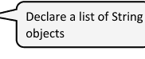

```java
System.out.println(list); // 输出: [A, B, C]
```

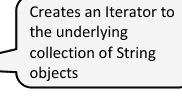

```java
Iterator<String> loop = list.iterator();
```

```java
while (loop.hasNext()) {
    string s = loop.next();
    if (s == "B") {
        loop.remove();
    }
}
System.out.println(list); // 输出: [A, C]
```


```java
Iterator<String> loop = list.iterator();
while (loop.hasNext()) {
    string s = loop.next();
    if (s == "B") {
        loop.remove();
    }
}
System.out.println(list); // 输出: [A, C]
```


```java
Iterator<String> loop = list.iterator();
while (loop.hasNext()) {
    string s = loop.next();
    if (s == "B") {
        loop.remove();
    }
}
System.out.println(list); // 输出: [A, C]
```

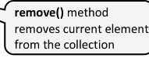

```java
Iterator<String> loop = list.iterator();
while (loop.hasNext()) {
    string s = loop.next();
    if (s == "B") {
        loop.remove();
    }
}
System.out.println(list); // 输出: [A, C]
```

### `ListIterator`

`ListIterator` 接口扩展了 `Iterator`，提供了双向遍历列表并在迭代期间修改列表的方法。

示例：

```java
// 遍历集合
LinkedList<String> list = new LinkedList<>();

list.add("A");
list.add("B");
list.add("C");

System.out.println(list); // 输出: [A, B, C]
```


```java
ListIterator<String> loop = list.listIterator(list.size());

// 反向遍历列表
while (loop.hasPrevious()) {
    String s = loop.previous();
    loop.set(s + "1");
}

System.out.println(list); // 输出: [A1, B1, C1]
```

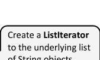

### `Spliterator`

JDK 8 添加的最新迭代器类型是 `Spliterator` 接口。它设计用于遍历集合或其他元素源，并可选地对其分区以并行处理。我们说“集合或其他元素源”是因为 `Spliterator` 不仅可以为集合创建，还可以为数组、I/O 通道或生成函数创建。

注意，`Spliterator` 会消耗源。处理完源的所有元素后，必须创建一个新的 `Spliterator`。

在下面的示例中，我们为整数数组创建一个 `spliterator`，将其拆分为两部分，并计算数组中存储的所有值的和。

```java
import java.util.*;

class testSpliterator {
    static int total = 0;

    public static void sum(Integer i) {
        total += i;
    }

    public static void main(String[] args) {
        Integer[] integers = {1, 2, 3, 4};

        Spliterator<Integer> sp1 = Arrays.spliterator(integers);
        Spliterator<Integer> sp2 = sp1.trySplit();

        while (sp1.tryAdvance(i -> total += i));

        if (sp2 != null) {
            while (sp2.tryAdvance(i -> sum(i)));
        }

        System.out.println("Total=" + total); // 输出: Total=10
    }
}
```

# 比较器（`Comparator`）

任何有序集合（例如 `TreeSet`）都需要某种比较算法来确定集合中的哪一个元素比另一个元素“大”。事实上，对于可以存储在有序集合中的每种类型的对象，都有默认的算法。这些算法通过 `Comparator` 泛式接口实现，该接口定义了 `compare()` 方法。如果我们想更改集合中对象的默认顺序，可以构建一个指向自定义比较器的集合。

请注意，`Comparator` 可以为没有自然排序的对象集合提供排序。

下面的示例展示了如何创建一个自定义比较器来对整数数组进行降序排序。

```java
import java.util.*;

class testComparator {
    public static int reverse(Integer n1, Integer n2) {
        return n1;
    }

    public static void main(String args[]) {
        Integer[] nn = {1, 2, 3};

        Arrays.sort(nn, (n1, n2) -> reverse(n1, n2));

        System.out.println(nn[0] + " , " + nn[1] + " , " + nn[2]);
    }
}
```

> `reverse(n1,n2)` 替代了 `Comparator` 接口的 `compare()` 方法。

该程序的输出将是“3,2,1”。

注意：`Arrays` 类定义了几个排序方法；我们使用了其中一种：

```java
static void sort(T[] a, comparator<? super T> c)
```

以下是它的执行方式：

- `T` 变为第一个操作数 `T`。
- 整数数组替换了第一个；`(n1, n2) -> reverse(n1, n2)` 被转换为 `Comparator<Integer>` 泛型接口的一个对象，其 `compare()` 方法实现为 `{ reverse(n1, n2); }`。
- 在排序过程中，使用 `reverse()` 来确定两个整数中哪一个更大，如下：

```text
n1>n2 : result>0; n1<n2 : result<0; n1=n2 : result=0
```

# 输入/输出流（I/O Streams）

流是输入的抽象表示，从那里检索源数据；或者是输出，向那里发送目标数据。Java 识别了两种类型的流——字节流（byte streams）和字符流（character streams）。字节流应用于发送或接收二进制对象，而字符流应在处理字符且需要数据的“字符”表示时使用。

请注意，通过字节流或字符流传输数据是一次一个或多个字符完成的。存在缓冲流（buffered streams）可以将数据分组到缓冲区，但这些流仍然基于底层的字节流或字符流。

本章提供了流背后的概念概述，并说明了一些输入和输出流的使用。

## 字节输出流（Byte Output Streams）

假设一个应用程序生成了以下类型的数据并希望将它们写入文件：

实现此目标的方法可以是为每种输入数据创建不同的类，但 Java 处理此任务的方法是构建一个流的“链”，每个流执行必要的数据转换并将结果传递给下一个流。

`FileOutputStream` 类提供了若干种将数据写入文件的方法。例如，它定义了 `write(byte[] b)` 方法，将指定的字节数组写入文件。如果我们已经有一个数组，可以如下所示使用该方法：

```java
byte[] b = {97, 98, 99};

FileOutputStream fileout;
fileout = new FileOutputStream("myfile.txt");

fileout.write(b);
```

然而，`FileOutputStream` 类不处理原始数据类型（`double`、`float`、`int` 等）。因此，为了写入一个 `double` 类型数字，我们需要引入 `DataOutputStream` 类，它实现了 `writeDouble` 方法。`DataOutputStream` 将接收到的参数转换为字节数组，并通过调用底层流的 `write` 方法将每个字节逐个地传递给底层流：

```java
DataOutputStream dataout;
```


`dataout = new DataOutputStream(fileout);`

| 说明 |
| --- |
| `dataout` 将为每个输出字节调用 `fileout.write()` 方法。 |

现在，我们可以调用 `DataOutputStream` 的 `writeDouble` 方法，它将 `double` 类型数字转换为字节并通过 `write` 方法将它们传递给 `FileOutputStream`：

```java
dataout.writeDouble(123.4);
```

通常情况下，流的链是从底向上构建的：

```java
C c = new C();

B b = new B(c);

A a = new A(b);

// 或者直接：

A a = A(new B(c));
```

数据在输出流之间的传递方式如下：

| 对象 `a` | 对象 `b` | 对象 `c` |
| --- | --- | --- |
| `a.write(...)` | `write(...)` | `write(...)` |
| 转换 | 转换 | 转换 |
| `b.write(...)` | `c.write(...)` | |

为了使这种机制运行，必须满足以下要求：

- 每个输出流必须是 `OutputStream` 类的子类，并具有 `streamName(OutputStream)` 构造函数。
- 每个输出流必须实现 `OutputStream` 类定义的以下方法：
  - `write(int i)` - 强制性
  - `write(byte[] b)` - 可选
  - `write(byte[] b, int offset, int length)` - 用于缓冲输出

输出流链中的类不应互相继承；否则，由于多态性将无法调用顶层类的 `write` 方法。

字节输出流有很多，但查看所有流对理解整体概念没有太大帮助，因此我们给出一个自定义字节输出流的示例。

```java
// 发送 double 数字到自定义 myOutputStream

// 使用 DataOutputStream 和 BufferedOutputStream
```

```java
import java.io.*;

class myOutputStream extends OutputOutputStream {
    public void write(int i) { }

    public void write(byte[] b, int offset, int len) {
        System.out.println("Received " + len + " bytes");
    }
}

class testOutputStream {
    public static void main(String args[]) {
        myOutputStream myout;
        BufferedOutputStream bufout;
        DataOutputStream dataout;

        try {
            myout = new myOutputStream();
            bufout = new BufferedOutputStream(myout);
            dataout = new DataOutputStream(bufout);
            dataout.writeDouble(123.4);
            dataout.flush();
        } catch (IOException e) {
            System.out.println("i/o error");
        }
    }
}
```

上述程序产生输出：

“Received bytes: 8”

## 字符输出流（Character Output Streams）

Java 中所有的字符数据都以 Unicode 格式表示。字符输出流类在将 Unicode 字符发送到输出设备或其他流之前，将其转换为本地表示（例如 ASCII 格式）。字符输出流的另一个功能是生成任何原始类型的字符表示以及对象。这通过 `PrintWriter` 类的 `print` 和 `println` 方法实现。这些方法是重载的（即有多个版本），并接受原始数据类型、字符串、字符数组或对象。

类似于继承 `OutputStream` 类的字节流类，字符流类继承 `Writer` 抽象类及其 `write` 方法。

下面的程序使用两种不同的字符输出流将字符数组写入文件：

```java
import java.io.*;

class testCharStreams {
    public static void main(String args[]) {
        char[] c = {'a', 'b', 'c'};

        FileWriter filewriter;
        PrintWriter printout;

        try {
            FileWriter fileout = new FileWriter("write.txt");
            fileout.write(c, 0, 3);
            fileout.flush();

            printout = new PrintWriter("print.txt");
            printout.println(123.4);
            printout.flush();
        } catch (IOException e) {
            System.out.println("I/o error");
        }
    }
}
```

## 字节输入流

字节输入流用于接收（读取）字节序列。此组中的所有类都必须继承 `InputStream` 抽象类并实现它的 `read` 方法：

```java
abstract int read();

int read(byte[] b); // 可选

int read(byte[] b, int offset, int len); // 可选
```

注意：当到达流的末时，`read` 方法返回整数值 `-1`。

除了 `read` 方法外，`InputStream` 类还提供了其他方法来支持所谓的可标记流（markable streams）。通过可标记流，你可以标记流中的当前位置，并在稍后返回该位置。可以使用 `markSupported` 方法来检查流是否是可标记的。

下面是从文件中读取整数的示例：

```java
// 假设：一组整数值已通过 DataOutputStream
// 写入了 "test.txt" 文件。
import java.io.*;

class testInputStream {
    public static void main(String[] args[]) {
        boolean EOF = false;
        int i;

        try {
            File myfile = new File("test.txt");
            FileInputStream filein = new FileInputStream(myfile);
            DataInputStream datain = new DataInputStream(filein);

            while (!EOF) {
                try {
                    i = datain.readInt();
                    System.out.println("i=" + i);
                } catch (EOFException e) {
                    EOF = true;
                }
            }
        } catch (IOException e) {
            System.out.println("I/O Error");
        }
    }
}
```

## 字符输入流

字符输入流由一组继承 `Reader` 抽象类的类表示。其目的是从不同的源按原生（本地）编码格式读取字符，并将它们转换为 Unicode 格式。每个输入流类都必须实现 `read` 方法：

```java
int read(); // 读取单个字符

int read(char[] c); // 读取字符到数组中

// 读取到数组的一部分：
abstract int read(char[] c, int off, int len);
```

注意：当到达流的末时，`read` 方法返回整数值 `-1`。

除了 `read` 方法外，`Reader` 类还提供了其他方法来支持可标记流。通过可标记流，你可以标记流中的当前位置，并在稍后返回该位置。可以使用 `markSupported` 方法来检查流是否是可标记的。

示例：

```java
// 打印字母表中每隔一个字符
import java.io.*;

class testStringReader {
    public static void main(String[] args[]) {
        String s = "abcdefghijklmnopqrstuvwxyz";
        int i = 0;

        try {
            Reader sReader = new StringReader(s);

            do {
                sReader.skip(1);
                i = sReader.read();

                if (i > 0)
                    System.out.print((char) i);
            } while (i != -1);
        } catch (IOException e) {
            System.out.println("Error reading file");
        }
    }
}
```

该程序产生输出："dfhjlnprtvxz”

## `Try` 资源管理器（Try-With-Resources）

JDK7 在流处理过程中增加了一个非常好的改进。它允许我们在完成流的使用后自动释放流持有的资源（例如关闭文件）。此功能可以与实现 `AutoClosable` 接口的类一起使用，该接口仅声明了一个方法——`close()`。当 `try` 块结束时将调用 `close` 方法。

`try` 块的新格式：

```java
try (资源声明和初始化) {
    资源的使用
} catch (...) {
    ...
}
```

示例：

```java
class mystream extends OutputStream {
    public void writeInt(int i) { }

    public void write(byte[] b, int offset, int len) {
        System.out.println("Received bytes: " + len);
    }
}

class teststreams {
    public static void main(String args[]) {
        try (
            DataOutputStream dataout =
                new DataOutputStream(
                    new BufferedOutputStream(
                        new myStream()))
        )
            dataout.writeInt(123);
            // dataout.flush();
        } catch (IOException e) {
            System.out.println("I/o error");
        }
    }
}
```

> 资源（流）声明的开始。

> 在“传统的”`try` 块中需要调用 `flush()` 或 `close()`。

> `dataout.close()` 将会在 `try` 块结束时自动调用。

## 序列化

字节输出流具有将 Java 对象从计算机内存写入输出设备或数据流的能力，而字节输入流可以将它们重新读回计算机内存。将对象写入流的过程被称为序列化，而从流中读取对象的过程被称为反序列化。

每个 Java 对象都是一个复杂的结构，可能包含方法、变量甚至其他对象。该结构被称为“对象图”。Java 在将数据写入流之前会将所有数据编码为一种特殊的内部格式。

序列化/反序列化的实现由 `ObjectOutputStream` 和 `ObjectInputStream` 类完成。它们的主要方法分别是 `writeObject()` 和 `readObject()`。

序列化/反序列化的实现由 `ObjectOutputStream` 和 `ObjectInputStream` 类完成。

```java
// 写入一个类的类的对象
import java.io.*;

class myClass implements Serializable {
    private String name;

    public myClass(String name) {
        this.name = name;
    }

    public String getName() {
        return name;
    }
}

class teststreams {
    public static void main(String args[]) {
        // 写入一个对象
        try (
            DataOutputStream dataout =
                new DataOutputStream(
                    new BufferedOutputStream(
                        new FileOutputStream("test.txt")))
        ) {
            dataout.writeObject(new myClass("hello"));
            // dataout.flush();
        } catch (IOException e) {
            System.out.println("I/o error");
        }

        // 从文件中读取对象
        try (
            ObjectInputStream objin =
                new ObjectInputStream(
                    new BufferedInputStream(
                        new FileInputStream("test.txt")))
        ) {
            myClass obj = (myClass) objin.readObject();
            System.out.println(obj.getName());
        } catch (IOException e) {
            System.out.println("I/o error");
        } catch (ClassNotFoundException e) {
            System.out.println("Class not found");
        }
    }
}
```

除了上述特性外，NIO 随着推移得到了增强，可以与标准 I/O 流协同工作并执行文件系统操作（即文件和目录的操作）。

以下是主要的 NIO 类和接口：

## `Buffer`

`Buffer` 类用于创建缓冲区并操作缓冲区的内容。`Buffer` 类有多个子类，用于存储不同类型的原始数据——`ByteBuffer`、`CharBuffer`、`IntBuffer` 等。

## `Channel`

`Channel` 实际上是一个由各种通道类实现的接口：`SocketChannel`、`DatagramChannel`、`SeekableByteChannel`、`FileChannel` 等。它代表了与一个能够执行 I/O 操作的实体（文件、网络套接字等）的连接。

## `Selector`

`Selector` 类允许单个应用程序线程处理多个通道。

（`Selector` 类的使用超出了本书的范围。）

## `Files`

`Files` 类提供了对文件和目录进行操作的方法。它还可以打开标准的字节流（即 `InputStream` 和 `OutputStream`），以便从文件读取或写入文件。

第一个示例说明了如何使用 `Buffer`、`Channel` 和 `Files` 通过阻塞通道在应用程序和磁盘文件之间传递未格式化的数据（字节）。

```java
// 使用 NIO 写入和读取文件的示例
import java.io.*;
import java.nio.*;
import java.nio.file.*;
import java.nio.channels.*;
```


# NIO 示例

```java
class testNIO {
    public static void main (String[] args) {
        byte[] bytes = {97, 98, 99};

        ByteBuffer buffer = ByteBuffer.allocate(16);

        try {
            Path path = Paths.get("testNIO.txt");

            SeekableByteChannel channel = Files.newByteChannel(path,
                StandardOpenOption.CREATE,
                StandardOpenOption.WRITE,
                StandardOpenOption.READ);

            buffer.put(bytes);
            buffer.rewind();
            channel.write(buffer);

            channel.position(1);
            buffer.rewind();
            channel.write(buffer);

            channel.truncate(3);
            channel.position(0);
            buffer.rewind();
            int i = channel.read(buffer);
            System.out.println("file length = " + i); // prints: 3

            channel.close();
        } catch (InvalidPathException e) {
            System.out.println("invalid path");
        } catch (IOException e) {
            System.out.println("I/o error");
        }
    }
}
```

代码执行后，文件`testNIO.txt`将包含 `"aab"`。

下一个示例演示了 NIO 和标准流 I/O 如何协同工作读取文件内容。

```java
// 打印上一个示例创建的 testNIO.txt 文件
import java.io.*;
import java.nio.file.*;

class testNIOStream {
    public static void main(String args[]) {
        int i;

        try {
            Path path = Paths.get("testNIO.txt");
            InputStream stream = Files.newInputStream(path);
            do {
                i = stream.read();
                if (i != -1) {
                    System.out.println((char) i);
                }
            } while (i != -1);
            stream.close();
        } catch (InvalidPathException e) {
            System.out.println("Invalid path");
        } catch (IOException e) {
            System.out.println("I/o error");
        }
    }
}
```

本章的最后一个示例演示了在处理文件系统时 NIO 的一些能力。

```java
// 打印 C 盘上所有的目录
import java.io.*;
import java.nio.file.*;
import java.nio.file.attribute.*;

class testNIOFileTree {
    public static void main(String args[]) {
        try {
            Path path = Paths.get("c:/");
            Files.walkFileTree(path, new CustomFileVisitor());
        } catch (IOException e) {
            System.out.println(e);
        }
    }
}

class CustomFileVisitor extends SimpleFileVisitor<Path> {

    public FileVisitResult visitFile(Path path, BasicFileAttributes attr)
        throws IOException {
            return FileVisitResult.CONTINUE;
        }
```

> 对于每个文件，将调用四个定义方法之一。这些方法定义在`SimpleFileVisitor`中。如果我们想要非默认行为，则需要重写它们。

> 此方法在访问文件时被调用；我们什么都不做并继续扫描。

```java
    public FileVisitResult previsitDirectory(Path path, BasicFileAttributes attr)
        throws IOException {
            System.out.println(path.getFileName());
            return FileVisitResult.CONTINUE;
        }
```

> 此方法在访问目录之前调用；我们打印目录名称并继续。

```java
    public FileVisitResult visitFileFailed(Path path, IOException e)
        throws IOException {
            return FileVisitResult.CONTINUE;
        }
```

> 此方法在读取文件时发生错误时被调用；我们什么都不做并继续。

注意：`VisitResult`枚举定义了`CONTINUE`之外的其他常量，用于控制`walkFileTree`方法的执行。例如，`SKIP_SUBTREE`常量将强制`walkFileTree`跳过访问当前目录的条目。

# Stream API

`Stream API`是 JDK 8 中引入的一种新的应用程序编程接口。它不是之前讨论的 I/O 流（字节流和字符流）的扩展或替代。`Stream API`引入了一个新的流概念。它将任何流视为对象序列，对这些对象执行各种操作。使用`Stream API`类，我们可以对流应用不同的转换（排序、过滤等）并产生结果。

假设我们有一个`double`类型的数组，并且想要计算所有元素的和，但首先将它们四舍五入到下一个整数。这可以通过一行代码完成，但我们将展示并解释过程的每一步。

第一步是将`double`数组转换为流。我们可以使用`Arrays`的静态方法`stream`，它会返回一个`DoubleStream`。

```java
double[] doubles = {1.5, 2.6, 3.3};
DoubleStream dblstream = Arrays.stream(doubles);
```

下一步是将`double`流转换为整数流，同时将每个`double`四舍五入到下一个整数。我们可以利用`DoubleStream`接口的`mapToInt`方法来实现这一点。`mapToInt`方法声明如下：

```java
IntStream mapToInt(DoubleToIntFunction mapper);
```

它接受一个函数式接口`DoubleToIntFunction`的对象，将其`applyAsInt`方法应用于流的每个元素，并返回一个新的`IntStream`，因此我们需要创建一个`DoubleToIntFunction`类型的对象，根据需求实现`applyAsInt`方法。实现此点的最简单方法是使用 lambda 表达式：

```java
DoubleToIntFunction mapper = n -> (n + 0.5);
```

该语句将创建一个`DoubleToIntFunction`类型的映射，其`applyAsInt`方法定义为：

```java
int applyAsInt(double n) { return (int)(n+0.5); }
```

现在我们可以将`DoubleStream`转换为`IntStream`了：

```java
IntStream intstream = dblstream.mapToInt(mapper);
```

最后一步使用`IntStream`的`sum()`方法计算整数流所有元素的和：

```java
int sum = intstream.sum();
```

将所有代码组合在一起，如下所示：

```java
double[] doubles = {1.5, 2.6, 3.3};
DoubleStream dblstream = Arrays.stream(doubles);
DoubleToIntFunction mapper = n -> (n + 0.5);
IntStream intstream = dblstream.mapToInt(mapper);
int sum = intstream.sum();
```

这段代码计算出的结果为 8。

现在，如之前提到的，整个过程可以用一行代码表示：

```java
int sum = Arrays.stream(doubles).mapToInt(n -> (int) (n + 0.5)).sum();
```


如果我们需要向映射器（mapper）放入更复杂的逻辑（即放入`applyAsInt`方法中），我们可以定义一个自定义方法并在 lambda 表达式中指定它：

```java
public static int round(double n) {
    int i = (int) (n + 0.5); // 舍舍舍入浮点数
    System.out.println("in=" + n + " out=" + i);
    return i;
}
```

```java
int sum = Arrays.stream(doubles).mapToInt(n -> round(n)).sum();
```

`mapToInt()`方法是一个中间操作 - 它接受一个流并返回另一个流。`sum()`方法是一个终端操作 - 它消耗流并返回最终结果。

下一个示例演示了遍历流中所有元素（对象）的过程。我们利用`Stream`类的实例方法`forEach()`来执行循环。`forEach()`方法声明如下：

```java
forEach(consumer<? super T> action)
```

对于流中的每个对象，`forEach()`方法会调用`Consumer`的`accept()`方法，为其提供从流中获取的对象。`Consumer`是一个函数接口，因此可以通过 lambda 表达式或方法引用来创建`Consumer`类型的对象。以下示例展示了这两种方法。

```java
// 使用 Stream 类的 forEach() 方法
import java.util.*;
import java.util.stream.*;

class testStream {
    public static void main(String args[]) {
        String[] words = {"One", "Two", "Three"};
        Stream<String> stream = Arrays.stream(words);
        stream.forEach(w -> System.out.print(w));
        stream.forEach(System.out::print);
    }
}
```

> 此 lambda 表达式将创建一个`Consumer`对象，其`accept()`方法实现为`System.out.println(w);`

> 此方法引用将创建一个`Consumer`对象，并向其传递`System.out`对象的`print`方法

上述代码打印两行：

`"OneTwoThree"`

`"OneTwoThree"`

在结束对`Stream API`的概述之前，我们想提到`Stream API`提供的优势之一是并行处理。假设环境支持并行，对流的操作可以并行进行。要切换到并行处理，请使用`parallel()`方法：

```java
int sum = Arrays.stream(doubles)
    .parallel()
    .mapToInt(n -> round(n)).sum();
```

# 可观察对象与观察者

`Observable`类结合`Observer`接口提供了一种在对象之间建立通信的简单机制。一个对象（可观察对象）可以被一个或多个其他对象（观察者）观察。需要时，被观察的对象可以通知观察者，它们可以执行某些操作。

| M extends Observable | W1 implements Observer |
|---|---|
| m = new M() | w1 = new W1() |
| m.addObserver(w1) | w1.update() |
| m.addObserver(w2) | W2 implements Observer |
| | w2 = new W2() |
| m.notifyObservers() | w2.update() |

示例：

```java
import java.util.*;
public class superClass extends observable implements Observer {
    String methodName;
    public superClass(String s) { methodName = s; }
```

```java
public void update(Observable m, Object arg) {
    System.out.println(methodName + " " + arg + 
        " from " + methodName);
}
```

```java
public static void main(String args[]) {
    MyClass m = new MyClass("manager");

    m.addObserver(new MyClass("Bob"));
    m.addObserver(new MyClass("Joe"));

    m.setChanged();

    m.notifyObservers("message");
}
```

创建两个新对象并将它们注册为对象`m`的观察者。

在每次通知之前必须调用`setChanged()`。

每个观察者的`update()`方法将被调用；

注意：`m`将自动传递给`update()`。

此程序的输出：

`"Bob received a message from manager"`

`"Joe received a message from manager"`

# 枚举

**枚举**（enumerations）背后的思想是提供一种简单的方法来定义一组不受任何原始类型或对象类型限制的常量（这通常限制了它们的使用范围）。Java 对此问题的解决方案是了一种新类型的类，其实例被视为常量。这里是一个枚举类的示例声明：

```java
enum myEnum { MIN, MAX }
```

注意这里使用的是`enum`而不是`class`。`MIN`和`MAX`是类`myEnum`的实例（对象），并被称为**枚举常量**。它们被隐式地声明为`public, static, final`。当枚举类在程序中第一次被引用时，枚举常量会被创建（实例化）。因此，你不需要使用`new`运算符（实际上你无法使用`new`运算符）来创建枚举类的对象。除了这些区别外，枚举类仍然是 Java 类，因此它们可以拥有静态和实例变量、方法。

示例：

| 枚举常量 |
|---|
| `enum myEnum { MIN, MAX }` | 静态语句；当程序中第一次引用枚举类时执行。 |
| 实例变量 | 初始化实例 |
| `myEnum` | 定义枚举类的类型 |

```java
enum myEnum { MIN, MAX }
```

现在，让我们看看用枚举可以做什么。说明枚举的最佳方法是提供一些示例。通过使用枚举，我们可以确保主要机场的状态和城市名称：


```java
class testenum {
    enum Airport {
        JFK("NY", "New York"),
        PHL("Philadelphia"),
        MIA("FL", "Miami");

        String state, city;

        Airport(String s, String c) {
            this.state = s;
            this.city = c;
        }

        public static double getTemp(Airport a) { return 80.0; }
        public static String getCity(Airport a) { return a.city; }
        public static String getState(Airport a) { return a.state; }
    }

    public static void main(String args[]) {
        Airport a;
        a = Airport.MIA;
        System.out.println(getCity(a) + ", " + getState(a) + " temp=" + getTemp(a));
    }
}
```

此程序产生输出：`Miami, FL temp=80.0`

# 正则表达式

文本字符串内容的验证和操作在许多应用程序中都可以找到。例如，我们可能需要检查输入的电子邮箱地址格式是否有效。正则表达式 API 是一项强大的工具，Java 程序员可以利用它执行文本验证、解析、分词或其他类型的操作。

正则表达式 API 由两个实用类组成：`Pattern` 和 `Matcher`。`Pattern` 类用于构建正则表达式，这些正则表达式被称为模式（patterns）。`Matcher` 类用于将模式应用到文本字符串上。这两个类的用法非常简单，但挑战在于掌握正则表达式技巧，不幸的是，这超出了本书的讨论范围。尽管如此，我们将通过几个示例来让你熟悉可以在文本字符串上执行的操作，并涵盖正则表达式的基础知识。

## 正则表达式基础

正则表达式是字符的序列，用于定义一个可以与文本字符串进行匹配的模式。例如，正则表达式“abc”可以用来检查文本中是否包含“abc”序列。

正则表达式有几种大类。我们将介绍其中三种。

第一类正则表达式被称为“字符”（characters），包含了大多数字符以及转义序列，如`\t`（制表符）或`\n`（换行符）。“abc”就是字符正则表达式的一个示例。

第二类正则表达式被称为“字符类”（character classes），代表有效字符范围。例如，`[a-zA-Z]`模式将匹配任何小写或大写字母。

对于某些字符类构造结构，Java 提供了简写形式：

- `.` 匹配任意字符
- `\s` 匹配空白字符
- `\d` 匹配任意数字
- `\w` 匹配任意单词字符

第三类正则表达式构造结构被称为“量词”（quantifiers）。量词可以附加到任何字符或字符类构造上，以指定该构造允许出现的次数：

- `?` 出现一次或不出现
- `*` 出现零次或多次
- `+` 出现一次或多次
- `{n}` 恰好出现 n 次
- `{n,}` 至少出现 n 次
- `{n,m}` 出现 n 到 m 次

还有其他的正则表达式组，但对它们的复习超出了本书的范围。

## 正则表达式示例

在开始示例之前，我们需要提到`Pattern`和`Matcher`类没有构造函数。`Pattern`对象是通过`Pattern`类的静态方法`compile()`创建的，而`Matcher`对象是通过`Pattern`类的实例方法`matcher()`创建的。

示例：验证整个文本是否匹配模式。

```java
String regex;
Pattern p;
Matcher m;
```

```java
p = Pattern.compile("[a-z]+");
m = p.matcher("test");
System.out.println(m.matches()); // 输出: true
```

| 描述 |
| :--- |
| `[a-z]+` 匹配一个或多个小写字母 |

示例：验证电子邮箱格式。

| 描述 |
| :--- |
| 匹配任意数量的字母或数字 |

```java
regex = "[a-zA-Z0-9]+]+" + "@"
        + "\\W+",
        + "\\.",
        + "com";
```

| 描述 |
| :--- |
| 匹配字符 `'@'` |

| 描述 |
| :--- |
| 匹配任意数量的单词字符 |

| 描述 |
| :--- |
| 匹配字符 `'.'` |

```java
p = Pattern.compile(regex);
m = p.matcher("John123@site.com");
System.out.println(m.matches()); // 输出: true
```

| 描述 |
| :--- |
| 匹配字符串 `"com"` |

示例：从邮箱中提取用户名和网站地址。

```java
p = Pattern.compile("@");
String[] ss = p.split("John@site.com");
```

```java
System.out.println(ss[0]); // 输出: John
System.out.println(ss[1]); // 输出: site.com
```

下一个示例更为复杂。它使用`Pattern`类的`splitAsStream()`方法来从输入文本中获取不同的（唯一的）单词。它还使用 lambda 表达式在`Stream`类的`forEach()`方法内部打印结果。

### 示例：从字符串提取不同的（唯一的）单词。

```java
import java.io.*;
import java.util.stream.*;
import java.util.regex.*;
```

```java
class testregex {
    public static void main(String args) {
        String text = "a b c a b c def b b b g";
        Pattern p = Pattern.compile(" ");
        Stream<String> stream = p.splitAsStream(text);
        Stream<String> unique = stream.distinct();
        unique.forEach(w -> System.out.print(w + " "));

        // 可以一条语句实现相同的结果：
        Pattern.compile(" ")
            .splitAsStream(text)
            .distinct()
            .forEach(w -> System.out.print(w + " "));
    }
}
```

上述程序的输出结果为：“a b c def g”。

### 示例：将所有空白序列替换为分号。

```java
String text = "One Two Three Four";
```

```java
System.out.println(
    Pattern.compile("\\s+").matcher(text).replaceAll(";")
);
```

```java
// 输出: One;Two;Four
```

# 反射 API

每个 Java 程序都会对各种类型的对象（类、枚举、数组、基本类型等）进行一些操作。在运行时，对于程序使用的每种类型对象，Java 虚拟机（JVM）都会创建一个`Class`类的实例，该实例提供了检查对象类型属性的方法。例如，当你声明一个类`A`时，JVM 会构建一个对应的`Class`对象，提供关于类`A`的所有信息——它的方法、接口、注解、字段等。

反射 API 是 Java 语言中非常重要的组件。它被广泛用于 JavaBeans（本书未涵盖）、各种测试工具、处理注解时等场景。你也可以将其用于调试目的。

## 获取 Class 对象

获取特定类的`Class`对象有三种主要方法。

当你拥有想要探索的类的实例时，可以调用`Object`类定义的实例方法`getClass()`，该方法对所有 Java 对象都可用：

```java
class myClass { ... }
...
myClass obj = new myClass();
```

```java
Class c = obj.getClass();
```

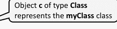

在没有类实例可用的情况下，你可以使用所谓的类字面量（class literal）来获取`Class`对象。类字面量是由类名后接`.class`组成的：

```java
interface myInterface {
    void methodName();
}

class myClass { ... }

Class c = myClass.class;
Class i = myInterface.class;
```

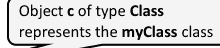


最后，你可以使用`Class`类的静态方法`forName()`。该方法接收类的全限定名并返回其`Class`对象。注意，`forName()`方法可能会抛出`ClassNotFoundException`。

```java
class myClass { ... }
```


```java
Class c = Class.forName("myClass");
```


```java
Class s = Class.forName("java.lang.String");
```

### 发现类成员

一旦获取了被检查类的`Class`对象，就可以使用`Class`的各种方法来获取有关该类的信息。我们将提供一个获取类声明的所有方法和字段的示例。请查看`java.lang.reflect`包以了解其他反射类和方法。

```java
import java.lang.reflect.*;
```

```java
class myClass {
    private String name;

    void setName(String s) { this.name = s; }
    String getName() { return name; }
}

public static void main(String args[]) {
    Class c = myClass.class;
    try {
        Method[] methods = c.getDeclaredMethods();
        for (Method m : methods) {
            System.out.print("Method: " + m.getName());
        }

        Field[] fields = c.getDeclaredFields();
        for (Field f : fields) {
            System.out.print("Field: " + f.getName());
        }
    } catch (Exception e) {
        System.out.println(e);
    }
}
```

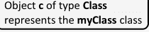


上述代码产生输出：

`Method:main Method:getName Method:setName Field:name`

# 注释 (Annotations)

注解为 Java 编程代码提供了一种标准的记录方式。以下特征使得注解与其他记录手段有所不同：

- 注释与它们所标记的程序结构紧密相关；这减少了误表述的可能性。
- 注释可以用作 Java 编译器的指令，以执行某些操作，例如抑制某些警告信息。
- 注释是对象，可以由包含注解的应用程序或第三方工具在运行时进行访问。

重要提示：注解在运行时不会产生任何影响。

## 我们如何创建注解？

简而言之，注解是普通的 Java 类，只是声明和处理方式有所不同。所有的注解类（称为注解类型）都是通过实现`Annotation`接口来创建的。然而，我们不再在类声明中使用`implements`关键字，而是使用`@interface`来指定注解类：

```java
@interface myAnnotation {
    Type method();
    Type method() default value;
    ....
}
```

| 注释声明中只允许没有方法体的方法 |

示例：

```java
@interface Author {
    string name();
    string version() default "1.0";
}
```

| 可以声明方法返回的默认值。 |

程序源中的任何声明，只要位于注解本身之前，都可以被注解。注解位于被标记的声明之前：

```java
@Author(name="John Doe", version="1.2")
class myClass { .. }
..
@Author(name="Bob")
public void methodName(int n) { ... }
```

| `classMyLocation` 被 `Author` 信息标记了 |

| 方法`methodName`被标记了。跳过`version`是可以的，因为它在定义时指定了默认返回值 |

### 我们可以用注解做些什么？

在回答这个问题之前，我们需要回顾 Java 程序的生命周期，该生命周期可以分为四个阶段：

- 源代码
- 编译
- 字节码
- 执行（运行时间）

初始问题需要针对每个阶段进行拆解：“在源代码中、编译期间、在字节码中以及在运行时，我们可以使用注解做什么？”

正如我们已经看到的，源代码包含了注解声明。从程序员的角度来看，这里没有什么可以讨论的，除了声明语法的具体细节，这些将在稍后介绍。

下一个阶段是编译。编译器解释注解声明并创建适当的 Java 对象，但编译器对注解还做了其他事情吗？答案是肯定的——存在一组预定义的（即内置的）注解，它们作为编译器的指令。它们都定义在`java.lang.annotation`包中：

```java
@Retention
@Target
@Inherited
@Override
@SuppressWarnings
@Deprecated
@SafeVarargs
@Repeatable
@FunctionalInterface
```

正如所有的注解一样，预定义注解应该位于被标记的声明（或另一个注解）之前。例如，以下代码将指示编译器检查`someMethod()`是否确实是父类相同方法的覆盖。如果当前类的父类没有声明`someMethod()`，则会发生编译错误。

```java
@Override
public void myMethod() {...}
```

其他非预定义的注解（用户定义的或在其他 Java 包中声明的）由预定义的`@Retention`注解控制。`@Retention`注解可以指定`RetentionPolicy`枚举定义的三个值：

```java
@Retention (RetentionPolicy.SOURCE)
@Retention (RetentionPolicy.CLASS)    <- 默认值
@Retention (RetentionPolicy.RUNTIME)
```


注意：`@Retention` 只能标记另一个注解声明。以下是上述常量的效果：

- `SOURCE` – 注释仅留在源文件（`.java` 文件）中并在编译后丢弃。
- `CLASS` – 注释将存储在字节码（`.class` 文件）中，但在执行之前会被丢弃；这是默认值。
- `RUNTIME` – 注释将在运行时可用。

`SOURCE` 级别的注解不会被 Java 编译器处理（预定义注解除外）。但是，从 Java SE 6 开始，你可以为 Java 编译器添加注解处理器，这些是处理注解的独立自定义工具。它们不在本书的讨论范围内。

`CLASS` 级别的注解太特殊，因此也超出了我们的讨论范围，所以让我们来讨论运行时处理。

### 处理运行时注解

当为另一个注解（自定义定义或声明在某个 Java 包中的注解）指定 `@Retention(RetentionPolicy.RUNTIME)` 时，它会使该注解在运行时可用。由于 Java 不提供任何处理注解的特殊运行时机制，因此如何处理它们完全取决于我们。

正如我们已经提到的，注解是实现 `Annotation` 接口的 Java 类对象。这意味着，如果我们能获取某个注解对象的引用，就可以调用方法来检索声明的值：

```java
@interface Author {

  String name();

}

@Author(name="Bob")

class myClass {

  public static void main(String args[]) {

    Author a = (myClass.class).getAnnotation(Author.class);

    System.out.println(a.name()); // 将打印: Bob

  }

}
```

为了理解如何访问注解的实例，我们需要回想注解的用途，即为其他声明提供补充信息。上面的 `@Author(name="Bob")` 创建了一个 `Author` 类型的对象，它与类 `myClass` 相关，其 `name()` 方法返回值 `"Bob"`。

正如我们之前在反射章节中所解释的，在运行时，每个类都由一个 `Class` 对象表示。注解与被标记类之间的关联可以用此图表示。

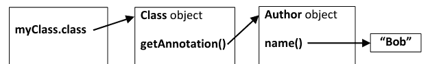

`myClass.class` 是表示 `myClass` 的 `Class` 对象实例。我们可以在 `myClass` 实例上使用 `getClass()` 方法，但此类实例可能并未创建。那么，我们可以使用实例方法 `getAnnotation()` 来获取 `Author` 注解的实例。最后一步是执行注解的 `name()` 方法来检索值 `"Bob"`。

以下是获取标记 `myClass` 的 `Author` 对象的语句：

`Author a = (myClass.class).getAnnotation(Author.class);`

注意为 `getAnnotation()` 方法提供了 `Author.class`。这是必要的，因为 `myClass` 可能有多个注解，`getAnnotation()` 方法需要知道检索哪一个。

以下是一个在运行时访问注解的示例代码：

```java
import java.lang.reflect.*;
```

```java
@interface Author {

  string name();

}

@Author(name="Bob")

class myClass {

  public static void main(String args[]) {

    Author a = (myClass.class).getAnnotation(Author.class);

    System.out.println(a.name()); // 将打印: Bob

  }

}
```

相同的技术也可用于标记方法、字段等。例如，如果上述注解用于标记 `myMethod(String s)` 方法，则访问注解的方式如下：

```java
Author a = (myClass.class)
  .getMethod("myMethod", String.class)
  .getAnnotation(Author.class);
```

## 注解类型（Annotation Types）

注解语义允许在可以从上下文推导时省略注解结构的部分。例如，如果注解没有任何参数，以下两种声明是等价的：

```java
@interface MyAnnotation {}

@interface MyAnnotation
```

这取决于注解拥有的元素数量。基于此，Java 识别以下类型的注解：

- 普通注解（Normal Annotation）
- 单元素注解（Single Element Annotation）
- 标记注解（Marker Annotation）

普通注解是显式声明注解结构所有部分的注解，例如：

```java
@interface Book {

  String name();

  int edition() default 1;

}
```

```java
@Book ( { name="My Book",edition=2; } )

class myClass {...
```

单元素注解是用于单个元素的快捷方式。如果元素名为 `value`，则可以在注解中省略它：

```java
@interface Name {

  String value();

}
```

```java
@Name ( value="Bob" )

@Name ( "Bob" )
```

对于具有多个元素的注解，使用单元素注解也是有效的，只要其中一个元素名为 `value` 且所有其他元素都有默认值。以下所有构造都是有效的：

```java
@interface BookName {

  String value();

  int edition() default 1;

}
```

```java
@BookName ( { name="My Book",edition=2; }

@BookName (name="My Book")

@BookName("My Book")
```

标记注解是无元素注解的快捷方式。以下所有构造都是有效的：

```java
@interface Book { }

@interface Book
```

```java
@Book ()

@Book
```

### 限制 `@` 注解的使用

预定义的注解 `@Target` 可用于指定另一个注解可以应用于哪些类型的项目。有效值由枚举 `ElementType` 定义：

```java
@Target(ElementType.ANNOTATION_CONSTRUCTOR)

@Target(ElementType.FIELD)

@Target(ElementType.LOCAL_VARIABLE)

@Target(ElementType.METHOD)

@Target(ElementType.PACKAGE)

@Target(ElementType.PARAMETER)

@Target(ElementType.TYPE_PARAMETER)

@Target(ElementType.TYPE_USE)
```

示例：

```java
// @Author 只能用于标记构造函数和方法。

@Target({ElementType.CONSTRUCTOR, ElementType.METHOD})

@interface Author {

  String name()

}

@Author(name = "Joe")

class myClass{...}

@Author(name = "Bob")

myClass () {...}

@Author(name = "Mike")

public void myMethod () {... }
```

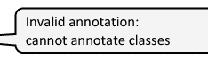

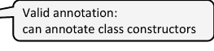

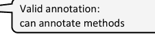

# JavaFX API

JavaFX 是一组图形和媒体包，允许开发者创建具有高性能现代图形用户界面的丰富客户端应用程序，这些界面具有音频、视频、图形和动画。

每个 JavaFX 应用程序由两个大部分组成：应用程序（application）和阶段（stage）。应用程序（由 `Application` 类表示）负责构建阶段及其元素，并定义处理逻辑。阶段（由 `Stage` 类和其他类表示）是对象的层级集合，定义了应用程序的视觉外观。

此图展示了 JavaFX 应用程序的结构：

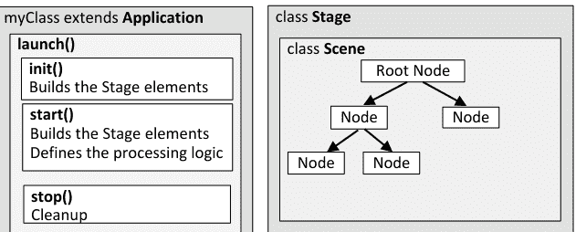

`Stage` 定义了 JavaFX 应用程序的环境。JavaFX 运行时环境提供了一个默认的 `Stage` 实例。但是，你可以创建多个 `Stage` 实例（对象）。

`Scene` 是一个容器（窗口），保存了 `Stage` 的内容（即元素）。`Scene` 的内容形成了所谓的场景图（scene graph）。

`Root Node`（根节点）决定了 `Scene` 中元素的布局。

`Node` 代表 `Scene` 的一个元素。它可以是一个按钮、文本框、几何形状、动画等。

`Application` 类启动 JavaFX 应用程序。`launch()` 方法执行 `init()` 方法，然后执行 `start()` 方法，在 `Stage` 完成后（例如窗口关闭时）——执行 `stop()` 方法。

以下示例使用 JavaFX 创建了一个显示圆形和矩形的窗口：

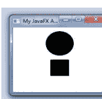

```java
import javafx.application.*;

import javafx.stage.*;

import javafx.scene.*;

import javafx.scene.shape.*;

public class testJavaFX extends Application {

    Circle circle;

    Rectangle rectan;

    public static void main(String[] args) {

        System.out.println("JavaFX: launch");

        launch(new String[1]);

    }

    public void init() {

        System.out.println("JavaFX: init");

        System.out.println(Thread.currentThread().getName());

        circle = new Circle(100, 40, 30);

        rectan = new Rectangle(80, 80, 40, 40);

    }

    public void start(Stage stage) {

        System.out.println("JavaFX: start");

        System.out.println(Thread.currentThread().getName());

        Group rootNode = new Group();

        rootNode.getChildren().add(circle);

        rootNode.getChildren().add(rectan);

        Scene scene = new Scene(rootNode, 200, 200);

        stage.setTitle("My JavaFX Application");

        stage.setScene(scene);

        stage.show();

    }

}
```

创建 `testJavaFX` 类的实例并执行 `init()`、`start()` 和 `stop()` 方法。必须提供 `String[]` 参数但必须为空。

`init()` 方法是可选的；所有声明都可以在 `start(Stage)` 中完成。

我们可以在 `init()` 方法中创建节点。

- 构建阶段并启动 JavaFX 应用程序的执行
- 声明一组节点
- 向组添加两个节点
- 将节点放置在 200x200 像素的窗口中
- 将场景放置在阶段上
- 打开窗口

启动 JavaFX 应用程序。

`stop()` 方法是可选的：

```java
public void stop() {

    System.out.println("JavaFX: stop");

    System.out.println(Thread.currentThread().getName());

}
```

除了显示的新窗口外，此程序还在控制台执行了以下操作：

```text
JavaFX: launch
JavaFX: init
JavaFX: - Launcher
JavaFX: start
JavaFX: Application Thread
JavaFX: stop
JavaFX: Application Thread
```


注意 1：`main()`、`init()` 和 `stop()` 方法是可选的。`String[]` 参数必须提供但必须为空。

注意 2：`main()`、`init()` 和 `stop()` 方法是可选的。`String[]` 参数必须提供但必须为空。

如所述，`launch()` 方法执行 `init()` 方法，然后执行 `start()`，在 Stage 完成后（例如窗口关闭时）——执行 `stop()` 方法。

注意 1：`main()`、`init()` 和 `stop()` 方法是可选的。`String[]` 参数必须提供但必须为空。

注意 2：`main()`、`init()` 和 `stop()` 方法是可选的。`String[]` 参数必须提供但必须为空。

注意 1：`main()`、`init()` 和 `stop()` 方法是可选的。`String[]` 参数必须提供但必须为空。

注意 2：`main()`、`init()` 和 `stop()` 方法是可选的。`String[]` 参数必须提供但必须为空。

注意 1：`main()`、`init()` 和 `stop()` 方法是可选的。`String[]` 参数必须提供但必须为空。

注意 2：`main()`、`init()` 和 `stop()` 方法是可选的。`String[]` 参数必须提供但必须为空。

注意 1：`main()`、`init()` 和 `stop()` 方法是可选的。`String[]` 参数必须提供但必须为空。

注意 2：`main()`、`init()` 和 `stop()` 方法是可选的。`String[]` 参数必须提供但必须为空。

注意 1：`main()`、`init()` 和 `stop()` 方法是可选的。`String[]` 参数必须提供但必须为空。

注意 2：`main()`、`init()` 和 `stop()` 方法是可选的。`String[]` 参数必须提供但必须为空。

注意 1：`main()`、`init()` 和 `stop()` 方法是可选的。`String[]` 参数必须提供但必须为空。

注意 2：`main()`、`init()` 和 `stop()` 方法是可选的。`String[]` 参数必须提供但必须为空。

注意 1：`main()`、`init()` 和 `stop()` 方法是可选的。`String[]` 参数必须提供但必须为空。

注意 2：`main()`、`init()` 和 `stop()` 方法是可选的。`String[]` 参数必须提供但必须为空。

注意 1：`main()`、`init()` 和 `stop()` 方法是可选的。`String[]` 参数必须提供但必须为空。

注意 2：`main()`、`init()` 和 `stop()` 方法是可选的。`String[]` 参数必须提供但必须为空。

注意 1：`main()`、`init()` 和 `stop()` 方法是可选的。`String[]` 参数必须提供但必须为空。

注意 2：`main()`、`init()` 和 `stop()` 方法是可选的。`String[]` 参数必须提供但必须为空。

注意 1：`main()`、`init()` 和 `stop()` 方法是可选的。`String[]` 参数必须提供但必须为空。

注意 2：`main()`、`init()` 和 `stop()` 方法是可选的。`String[]` 参数必须提供但必须为空。

注意 1：`main()`、`init()` 和 `stop()` 方法是可选的。`String[]` 参数必须提供但必须为空。

注意 2：`main()`、`init()` 和 `stop()` 方法是可选的。`String[]` 参数必须提供但必须为空。

注意 1：`main()`、`init()` 和 `stop()` 方法是可选的。`String[]` 参数必须提供但必须为空。

注意 2：`main()`、`init()` 和 `stop()` 方法是可选的。`String[]` 参数必须提供但必须为空。

注意 1：`main()`、`init()` 和 `stop()` 方法是可选的。`String[]` 参数必须提供但必须为空。

注意 2：`main()`、`init()` 和 `stop()` 方法是可选的。`String[]$` 参数必须提供但必须为空。

注意 1：`main()`、`init()` 和 `stop()` 方法是可选的。`String[]` 参数必须提供但必须为空。

注意 2：`main()`、`init()` 和 `stop()` 方法是可选的。`String[]` 参数必须提供但必须为空。

## Layouts

在之前的示例中，圆形和矩形的位置已被指定。

JavaFX 了阶段布局应用程序。

`Scene` 的内容形成了所谓的场景图（scene graph）。

`Root Node`（根节点）决定了 `Scene` 中元素的布局。

`Node` 代表 `Scene` 的一个元素。它可以是一个按钮、文本框、几何形状、动画等。

`Application` 类启动 JavaFX 应用程序。`launch()` 方法执行 `init()` 方法，然后执行 `start()` 方法，在 Stage 完成后（例如窗口关闭时）——执行 `stop()` 方法。

以下示例使用 JavaFX 创建了一个显示圆形和矩形的窗口：


```java
import javafx.application.*;
import javafx.stage.*;
import javafx.scene.*;
import javafx.scene.shape.*;

public class testJavaFX extends Application {

    Circle circle;
    Rectangle rectan;

    public static void main(String[] args) {
        System.out.println("JavaFX: launch");
        launch(new String[1]);
    }

    public void init() {
        System.out.println("JavaFX: init");
        System.out.println(Thread.currentThread().getName());

        circle = new Circle(100, 40, 30);
        rectan = new Rectangle(80, 80, 40, 40);
    }

    public void start(Stage stage) {
        System.out.println("JavaFX: start");
        System.out.println(Thread.currentThread().getName());

        Group rootNode = new Group();
        rootNode.getChildren().add(circle);
        rootNode.getChildren().add(rectan);

        Scene scene = new Scene(rootNode, 200, 200);
        stage.setTitle("My JavaFX Application");
        stage.setScene(scene);
        stage.show();
    }
}
```

创建 `testJavaFX` 类的实例并执行 `init()`、`start()` 和 `stop()` 方法。必须提供 `String[]` 参数但必须为空。

`init()` 方法是可选的；所有声明都可以在 `start(Stage)` 中完成。

我们可以在 `init()` 方法中创建节点。

- 构建阶段并启动 JavaFX 应用程序的执行
- 声明一组节点
- 向组添加两个节点
- 将节点放置在 200x200 像素的窗口中
- 将场景放置在阶段上
- 打开窗口

启动 JavaFX 应用程序。

`stop()` 方法是可选的：

```java
public void stop() {
    System.out.println("JavaFX: stop");
    System.out.println(Thread.currentThread().getName());
}
```

除了显示的新窗口外，此程序还在控制台执行了以下操作：

```text
JavaFX: launch
JavaFX: init
JavaFX: - Launcher
JavaFX: start
JavaFX: Application Thread
JavaFX: stop
JavaFX: Application Thread
```

注意 1：`main()`、`init()` 和 `stop()` 方法是可选的。`String[]` 参数必须提供但必须为空。

注意 2：`main()`、`init()` 和 `stop()` 方法是可选的。`String[]` 参数必须提供但必须为空。

如所述，`launch()` 方法执行 `init()` 方法，然后执行 `start()`，在 Stage 完成后（例如窗口关闭时）——执行 `stop()` 方法。

注意 1：`main()`、`init()` 和 `stop()` 方法是可选的。`String[]` 参数必须提供但必须为空。

注意 2：`main()`、`init()` 和 `stop()` 方法是可选的。`String[]` 参数必须提供但必须为空。

注意 1：`main()`、`init()` 和 `stop()` 方法是可选的。`String[]` 参数必须提供但必须为空。

注意 2：`main()`、`init()` 和 `stop()` 方法是可选的。`String[]` 参数必须提供但必须为空。

注意 1：`main()`、`init()` 和 `stop()` 方法是可选的。`String[]` 参数必须提供但必须为空。

注意 2：`main()`、`init()` 和 `stop()` 方法是可选的。`String[]` 参数必须提供但必须为空。

注意 1：`main()`、`init()` 和 `stop()` 方法是可选的。`String[]` 参数必须提供但必须为空。

注意 2：`main()`、`init()` 和 `stop()` 方法是可选的。`String[]` 参数必须提供但必须为空。

注意 1：`main()`、`init()` 和 `stop()` 方法是可选的。`String[]` 参数必须提供但必须为空。

注意 2：`main()`、`init()` 和 `stop()` 方法是可选的。`String[]` 参数必须提供但必须为空。

注意 1：`main()`、`init()` 和 `stop()` 方法是可选的。`String[]` 参数必须提供但必须为空。

注意 2：`main()`、`init()` 和 `stop()` 方法是可选的。`String[]` 参数必须提供但必须为空。

注意 1：`main()`、`init()` 和 `stop()` 方法是可选的。`String[]` 参数必须提供但必须为空。

注意 2：`main()`、`init()` 和 `stop()` 方法是可选的。`String[]` 参数必须提供但必须为空。

注意 1：`main()`、`init()` 和 `stop()` 方法是可选的。`String[]` 参数必须提供但必须为空。

注意 2：`main()`、`init()` 和 `stop()` 方法是可选的。`String[]` 参数必须提供但必须为空。

注意 1：`main()`、`init()` 和 `stop()` 方法是可选的。`String[]` 参数必须提供但必须为空。

注意 2：`main()`、`init()` 和 `stop()` 方法是可选的。`String[]` 参数必须提供但必须为空。

注意 1：`main()`、`init()` 和 `stop()` 方法是可选的。`String[]` 参数必须提供但必须为空。

注意 2：`main()`、`init()` 和 `stop()` 方法是可选的。`String[]` 参数必须提供但必须为空。

注意 1：`main()`、`init()` 和 `stop()` 方法是可选的。`String[]` 参数必须提供但必须为空。

注意 2：`main()`、`init()` 和 `stop()` 方法是可选的。`String[]` 参数必须提供但必须为空。

注意 1：`main()`、`init()` 和 `stop()` 方法是可选的。`String[]` 参数必须提供但必须为空。

注意 2：`main()`、`init()` 和 `stop()` 方法是可选的。`String[]` 参数必须提供但必须为空。

注意 1：`main()`、`init()` 和 `stop()` 方法是可选的。`String[]` 参数必须提供但必须为空。

注意 2：`main()`、`init()` 和 `stop()` 方法是可选的。`String[]` 参数必须提供但必须为空。

注意 1：`main()`、`init()` 和 `stop()` 方法是可选的。`String[]` 参数必须提供但必须为空。

注意 2：`main()`、`init()` 和 `stop()` 方法是可选的。`String[]` 参数必须提供但必须为空。

注意 1：`main()`、`init()` 和 `stop()` 方法是可选的。`String[]` 参数必须提供但必须为空。

注意 2：`main()`、`init()` 和 `stop()` 方法是可选的。`String[]` 参数必须提供但必须为空。

## Layouts

在之前的示例中，圆形和矩形的位置已被指定。

JavaFX 提供了几种布局类，可以持有组件并根据预定义的模型排列它们。我们将为你展示一个 —— `TilePane`。

当你与 GUI 应用程序交互时，每个动作都会触发一个事件。鼠标移动、鼠标点击、键盘输入、滚动、屏幕触摸、滑动等——这些都是可以被 JavaFX 应用程序捕获并处理的事件示例。

JavaFX 采用的事件处理机制通过示例更容易解释。假设我们点击了屏幕上的按钮。此动作触发了一个“鼠标点击”事件。在 JavaFX 中，事件是 `javafx.event.Event` 类或任何子类的实例，因此 JavaFX 为该事件创建一个相应的事件对象。事件对象在对象层级结构中“旅行”，从 Stage 对象到被点击的目标节点，然后返回。我们所说的“旅行”意味着“呈现处理”。第一条路径被称为“捕获阶段”：

`Stage -> Root Node -> 分支节点（如果有） -> 目标节点`

第二条路径被称为“泡泡阶段”：

`目标节点 -> 分支节点 -> 根节点 -> Stage`

在捕获或泡泡阶段的任何时候，都可以通过执行 `Event` 类 `consume()` 方法将事件标记为“已消费”。这将停止进一步的传播。

呈现（即交付）事件给对象进行处理并不意味着该事件将被或会被该对象处理。为了能够接受为了处理事件，每个对象都必须将自己注册为事件处理器，并实现某种事件处理逻辑。由于事件会传递给每个对象两次——一次在捕获（或过滤）阶段，另一次在冒泡（或处理）阶段，因此对象可以设置事件过滤器、事件处理器，或两者兼备。

所有节点（即 `Node` 类的子类）以及 `Stage` 和 `Scene` 类都定义了注册和实现事件过滤器与事件处理器的方法：

```java
<T extends Event> void addEventListener(EventType<T> eventType,
    EventHandler<? super T> eventHandler);
```

```java
<T extends Event> void addEventHandler(EventType<T> eventType,
    EventHandler<? super T> eventHandler);
```

还有所谓的用于注册不同类型事件的处理器的便利方法。它们基本上是 `addEventHandlerMethods` 方法的简写。例如，此方法为“鼠标点击”注册了一个事件处理器：

```java
void setMouseClicked(EventHandler<? super MouseEvent> value);
```


让我们练习一下，使用`addEventHandler()`和`setMouseClicked()`方法创建几个事件处理器。

`setMouseClicked`方法声明了一个参数——一个泛型函数接口`EventHandler`对象，其泛型类参数可以是`MouseEvent`或`MouseEvent`的任何父类（例如`EventHandler<MouseEvent>`、`EventHandler<Event>`等）。

`EventHandler`泛型接口声明了以下方法：

```java
void handle(T event);
```

接下来，我们需要创建一个类型为`EventHandler<MouseEvent>`的对象，实现它的`handle()`方法，并将此对象作为参数传递给`setMouseClicked()`方法。这可以通过几种不同的方式实现，下面列了三种。

使用`setMouseClicked()`方法注册事件处理器的第一种方法是使用匿名类：

```java
node.setMouseClicked(
  new EventHandler<MouseEvent>() {
    public void handle(MouseEvent e) {
      ... 事件处理逻辑 ...
    }
  }
);
```

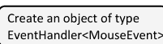

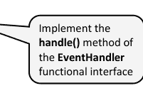

使用`setMouseClicked()`方法的第二种方法是使用 lambda 表达式：

```java
node.setMouseClicked(
  e -> { ... 事件处理逻辑 }
);
```

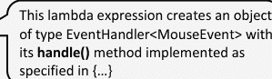

使用`setMouseClicked()`方法的第三种方法是使用方法引用：

```java
class myClass {
  public void clickHandler(MouseEvent e) {
    ... 事件处理逻辑 ...
  }

  public static void main(String[] args) {
    ...
    node.setMouseClicked(
      myClass::clickHandler
    );
  }
}
```

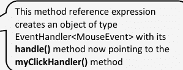

注意，`clickHandler`方法必须与`EventHandler`接口的`handle`方法具有相同的签名，其声明如下：

```java
void handle (T event)
```

`T`是我们想要处理的事件类型；在我们的用例中它是`MouseEvent`。

现在让我们使用`addEventHandler()`方法来创建一个事件处理器。`addEventHandler`的格式如下：

```java
<T extends Event> void addEventHandler(EventType<T> eventType, EventHandler<?super T> eventHandler)
```

此方法与之前审查的`setOnMouseClicked`的第一个区别是，`EventHandler`对象可以是任何事件类型，而不仅仅是`MouseEvent`。事实上，`EventHandler`可以为`Event`类以及`Event`类的任何子类创建。第二个区别——我们需要通过传递一个`type<T>`类型的对象来告诉方法我们将处理哪种事件类型，其中`T`可以指定`Event`类及其任何一个子类。

使用 lambda 表达式，我们可以如下构建一个“鼠标点击”事件的事件处理器：

```java
node.addEventHandler(
  MouseEvent.MOUSE_CLICKED,
  e -> {... 事件处理逻辑 ...}
);
```

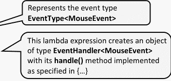

注意：此示例中的`MouseEvent.MOUSE_CLICKED`是定义在`MouseEvent`类中的`EventType<MouseEvent>`静态变量，代表“鼠标点击”类型。它的定义为：

```java
public static final EventType<MouseEvent> MouseEvent MOUSE_CLICKED
```

事件过滤器的注册与事件处理器的注册类似，不同在于没有提供便利方法。

通过下一个示例，我们将结束对 JavaFX API 特性的简要概述。该示例说明了我们目前为止学到的关于 JavaFX 事件处理机制的所有内容。当在 Windows 系统上执行时，它将显示以下窗口：

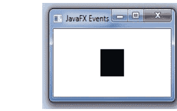

在点击黑色矩形内的任何地方后，控制台将打印出以下消息：

- Capturing phase: Stage clicked
- Capturing phase: Scene clicked
- Capturing phase: Group clicked
- Capturing phase: Rectangle clicked
- Bubbling phase: Rectangle clicked
- Bubbling phase: Group clicked
- Bubbling phase: scene clicked
- Bubbling phase: stage clicked

要停止 JavaFX，请关闭显示的窗口。

## JavaFX 事件处理示例

```java
import javafx.application.*;
import javafx.stage.*;
import javafx.scene.*;
import javafx.scene.shape.*;
import javafx.event.*;
import javafx.scene.input.MouseEvent;

public class testJavaFX_events extends Application {

    public void start(Stage stage) {

        stage.addFilter(MouseEvent.MOUSE_CLICKED,
            e -> System.out.println("Capturing phase: Stage clicked"));

        stage.addEventHandler(MouseEvent.MOUSE_CLICKED,
            e -> System.out.println("Bubbling phase: Stage clicked"));

        Rectangle rect = new Rectangle(80, 30, 40);

        rect.addFilter(MouseEvent.MOUSE_CLICKED,
            e -> System.out.println("Capturing phase: Rectangle clicked"));

        rect.setOnMouseClicked(
            e -> System.out.println("Bubbling phase: Rectangle clicked"));

        Group rootNode = new Group();

        rootNode.addFilter(MouseEvent.MOUSE_CLICKED,
            e -> System.out.println("Capturing phase: Group clicked"));

        rootNode.setOnMouseClicked(
            e -> System.out.println("Bubbling phase: Group clicked"));

        rootNode.getChildren().add(rect);

        Scene scene = new Scene(rootNode, 200, 100);

        scene.addFilter(MouseEvent.MOUSE_CLICKED,
            e -> System.out.println("Capturing phase: Scene clicked"));

        scene.setOnMouseClicked(new EventHandler<MouseEvent>() {
            public void handle(MouseEvent e) {
                System.out.println("Bubbling phase: Scene clicked");
            }
        });

        stage.setTitle("JavaFX Events");
        stage.setScene(scene);
        stage.show();
    }
}
```


# 参考资料

<https://docs.oracle.com/javase/8/technotes/guides/install>

如何在不同的操作系统上安装和配置 Java 平台。

<https://www.oracle.com/java/downloads/>

在此页面下载最新的 Java 开发包（`JDK`）和 Java 运行环境（`JRE`）。

<https://docs.oracle.com/javase/tutorial/>

Java SE 教程。Java SE（标准版）、Java EE（企业版）和 Java ME（嵌入版）的文档。

<https://docs.oracle.com/javase/8/docs/api/index.html>

Java SE 8 API。所有 Java 类和接口的规范。

<https://docs.oracle.com/javase/specs/>

Java 语言规范和虚拟机规范。

<https://docs.oracle.com/javase/8/javafx/api/toc.htm>

`FX API` 规范。这里介绍了所有 `javafx` 包。

# 索引

- 抽象类：100
- 访问修饰符：77
- 注解：164
  - 标记（marker）：169
  - 正常（normal）：169
  - 限制使用（restricted usage）：170
  - 单元素（single-element）：169
- 匿名类：101
- `Application` 类：171
- 数组
  - 创建（creating）：46
  - 声明（declaring）：46
  - 多维（multi-dimensional）：47
- 自动装箱/自动拆箱（Autoboxing / Auto-unboxing）：68
- `Buffer` 类：146
- 类
  - `Application`：171
  - `Buffer`：146
  - 枚举（Enum）：157
- `FileOutputStream`：136
- `Files`：146
  - `InputStream`：140
  - 匹配器（Matcher）：158
  - `Node`：171
- 可观察对象（Observable）：154
- `OutputStream`：137
- 模式（Pattern）：158
- `Reader`：141
- `Scene`
  - See
  - 选择器（Selector）：146
- `Stage`
  - `String`：69
  - `Throwable`：113
- `Writer`：139
- 构造函数，`super` 关键字：60
- 构造函数，`this` 关键字：58
- 构造函数：57
- 声明：51
- 初始化类变量：52
- 实例变量与方法：54
- 局部内部类：99
- 方法重写：63
- 非静态内部类：98
- 静态内部类（嵌套）：97
- 类与对象：50
- 集合：126
  - 创建：126
  - 框架：126
  - 迭代：129
  - 获取元素：127
  - 更新：128
- 比较器（Comparator）：134
- 构造方法引用：95
- 反序列化：143
- 封装：15
- 枚举类（Enum class）：157
- 枚举（Enumerations）：155
- 异常：107
  - 检查异常（checked）：107
  - 检查异常，处理：111
  - 类层次结构：113
  - 自定义异常：115
  - 默认异常处理器：108
  - 运行时：113
  - 异常检查异常（unchecked）：107
  - 未检查异常，处理：108
- `FileOutputStream` 类：136
- `Files` 类：146
- `For-Each` 循环（增强型循环）：129
- 泛型（Generics）：79
  - 类：82
  - 构造函数：87
  - 接口：85
  - 方法：79
  - 将方法作为参数传递：84
  - 类型安全：82
  - 类型变量：82
  - 通配符参数（`?`）：84
- 继承：16
- 内部类：97
- `InputStream` 类：140
- 接口（Interfaces）：102
  - `Consumer`：133、152
  - 默认方法：106
  - 全实现方法：106
  - 静态方法：106
- `IO` 流（`IO Streams`）：135
- 迭代语句：37
- 迭代器（Iterator）：131
- `JavaFX`：171
- `JavaFX` 事件：175
- `JDK 8` 安装：10
- `Lambda` 表达式（Lambda Expressions）：89
- 列表迭代器（List Iterator）：132
- 字面量（Literals）：22
  - 布尔型（boolean）：25
  - 转换（casting）：25
  - 字符（character）：23
  - 类字面量（class literal）：162
  - 数值（numeric）：22
  - 字符串（string）：25、69
- 循环控制变量：40
- 方法重载（Method overloading）：58
- 方法重写（Method overriding）：63
- 方法引用（Method Reference）：93
- 方法（Methods）：49
  - `main`：49
  - 修饰符（Modifiers）：49
  - 访问级别（access level）：77
  - 默认（default）：106
  - 最终（final）：78
  - 静态（static）：78
- 新 `IO` 流（New `IO` Stream）：145
- `NIO`：145
- `Node` 类（Node class）：171
- 对象（Objects）
  - 转换（casting）：61
  - 创建（creating）：56
  - 实例化（instantiation）：56
- 可观察类（Observable class）：154
- 观察者接口（Observer interface）：154
- 运算符（Operators）
  - `(::)` 方法引用：93
  - `(+)` 字符串拼接：71
  - `for-each`：129
  - `instanceof`：64
- `OutputStream` 类：137
- 包（Packages）：75

| 主题 | 页码 |
| :--- | :--- |
| 多态性 | 17 |
| 基本数据类型 | 20 |
| `Reader` 类 | 141 |
| 反射 API | 161 |
| 正则表达式 | 158 |
| `Scene` 类 | 171 |
| 变量作用域 | 21 |
| `Selector` 类 | 146 |
| 序列化 | 143 |
| `Spliterator` | 133 |
| `Stage` 类 | 171 |
| 语句 |  |
| 块结构 | 34 |
| `break` | 42 |
| `continue` | 45 |
| `do while` | 38 |
| `empty` | 34 |
| `for` | 39 |
| `for-each` | 41 |
| `new` | 56 |
| `package` | 75 |
| 程序程序流控制 | 34 |
| 顺序执行 | 34 |
| `switch` | 36 |
| `try-with-resources` | 142 |
| `while` | 37 |
| `Stream API` | 150 |
| 流 | 135 |
| 字节输入流 | 140 |
| 字节输出流 | 135 |
| 字符输入流 | 141 |
| 字符输出流 | 139 |
| 基础 | 135 |
| `String` 类 | 69 |
| 字符串 |  |
| 比较 | 70 |
| 拼接 | 71 |
| 创建 | 69 |
| 方法 | 72 |
| `super` 关键字 | 60 |
| `switch` 语句 | 36 |
| `this` 关键字 | 58 |
| 线程 | 116 |
| 通信（`wait` & `notify`） | 124 |
| 守护线程 | 119 |
| 中断 | 119 |
| 合并 | 120 |
| 同步 | 120 |
| 方法同步 | 121 |
| 语句块同步 | 121 |
| 用户线程 | 119 |
| `Try-With Resources` | 142 |
| 类型包装类 | 67 |
| 变量 | 21 |
| 通配符参数（`?`） | 84 |
| `Writer` 类 | 139 |

