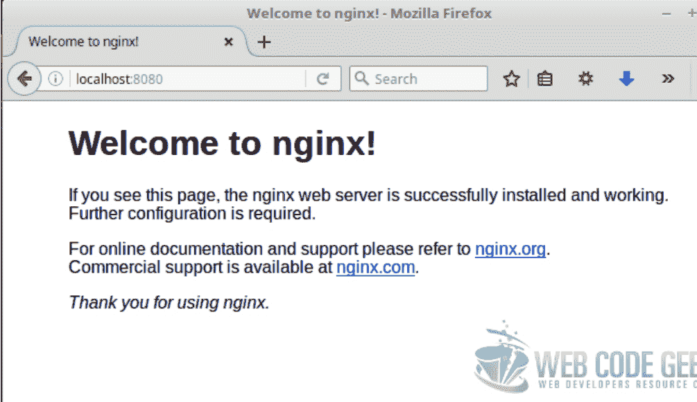
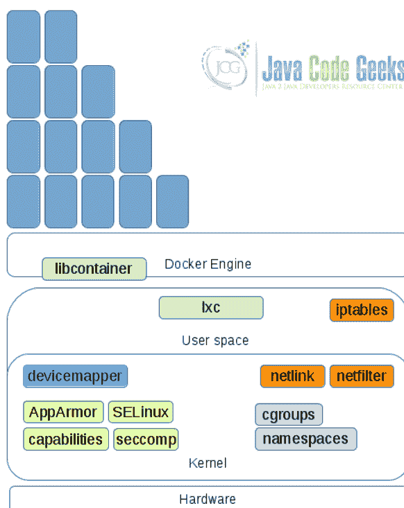
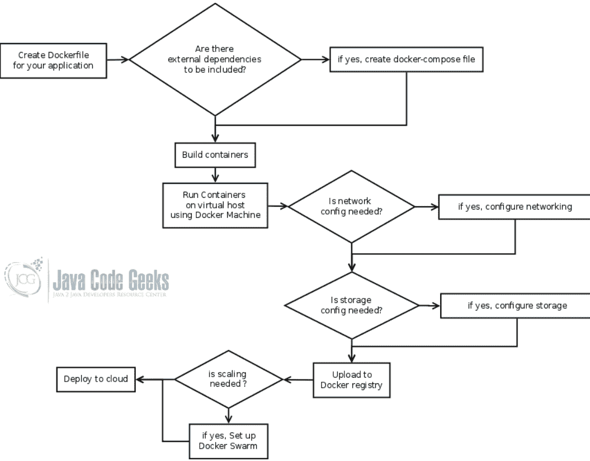
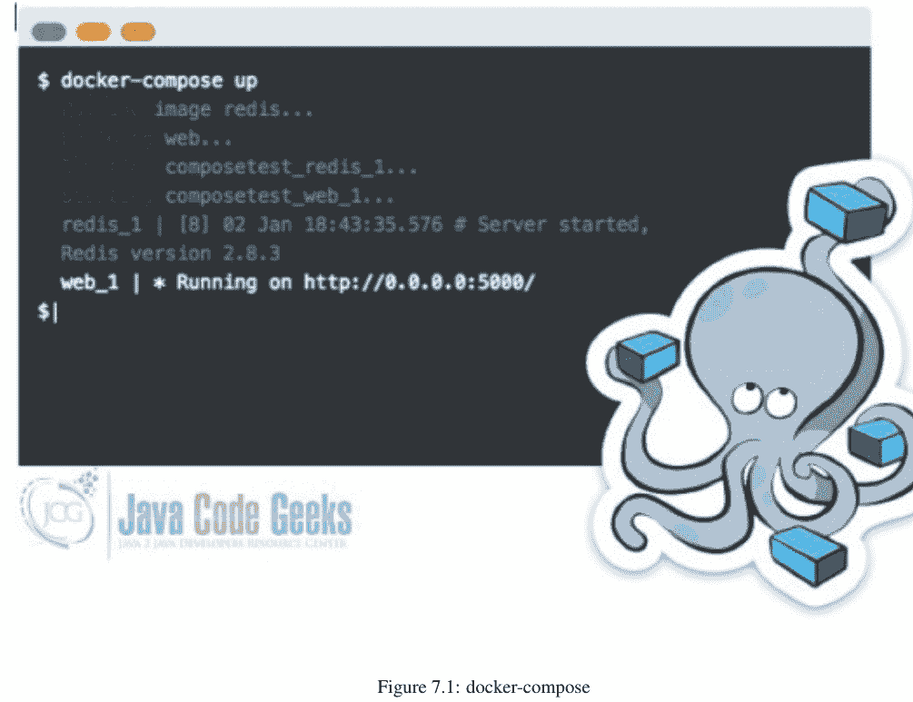

# Docker 容器化秘籍：Docker 自动化的热门配方

- 4.6 总结 ... 29

# 前言

Docker 是全球领先的软件容器化平台。Docker 容器将软件封装在一个完整的文件系统中，该系统包含了运行所需的所有内容：代码、运行时环境、系统工具、系统库——任何可以安装在服务器上的东西。这保证了软件无论环境如何，运行结果始终一致。（来源：https://www.docker.com/what-docker）

Docker 为 Linux 上的操作系统级虚拟化提供了额外的抽象和自动化层。Docker 使用了 Linux 内核的资源隔离特性（如 `cgroups` 和内核命名空间）以及支持联合的文件系统（如 `OverlayFS` 等），允许独立的“容器”在单个 Linux 实例中运行，避免了启动和维护虚拟机的开销。（来源：https://en.wikipedia.org/wiki/Docker_(software)）

在本电子书中，我们提供了一系列 Docker 示例，这些将帮助你启动自己的自动化项目。我们涵盖了广泛的内容，从安装和配置到 DNS 和命令。通过我们直观的教程，你将以最短的时间让自己的项目运行起来。

# 作者简介

JCGs (Java Code Geeks) 是一个独立的在线社区，专注于创建终极的 Java 开发者资源中心；目标针对技术架构师、技术团队负责人（高级开发人员）、项目经理以及初级开发者。

JCGs 为 Java、SOA、敏捷和电信社区提供由领域专家编写的每日新闻、文章、教程、评论、公告、代码片段和开源项目。

你可以在网上找到他们：https://www.javacodegeek.com/

# 第一章

# 初学者 Docker 教程

在本文中，我们将解释 Docker 的主要功能。我们将简要解释为什么容器是必要的、要使用哪些主要命令，以及如何在集成测试中使用 Docker。下表显示了全文的概览：

## 1.1 为什么我们需要 Docker？

图 1.1：docker

一致的环境，对于分布式应用来说是一个重要问题，因为我们需要安装或升级具有相同配置的多个节点。

## Docker 容器化实战指南

Docker 是一个容器管理器，这意味着它能够创建并执行代表软件特定运行时环境的容器。与 VirtualBox 等虚拟机不同，Docker 使用 Linux 内核的资源隔离特性，允许独立的“容器”在单个 Linux 实例中运行，避免了启动和维护虚拟机的开销。带有 docker 的计算机可以同时运行多个容器。

因此，Docker 的自动化主要为集成测试和持续交付提供了便利。

## 1.2 机器、镜像和容器

为了使用 docker，明确一些术语很重要。Docker 区分了三个重要概念：docker 机器（machines）、docker 镜像（images）和容器（containers）。

Docker 容器是特定运行时环境的执行。例如，模拟具有特定数据库的应用。这些运行时环境被称为 Docker 镜像，它们是执行名为 `Dockerfile` 的特定脚本文件中系列命令的结果。因此，Docker 允许拥有特定 Docker 镜像的多个容器。这些可以与程序和进程的概念进行比较。事实上，容器像进程一样，可以被创建、停止、死亡或运行。

Docker 机器是本地（虚拟）机器或远程机器（例如 Amazon AWS 或 DigitalOcean 等云平台），上面运行着 docker。和物理机器一样，docker 机器具有特定的 IP 地址。每台 docker 机器都可以管理多个 docker 镜像和容器。通过我们自己的个人电脑，`docker-machine` 命令允许我们连接到所有的 docker 机器来管理它们的容器和镜像。

### Docker machine {IP=192.168.99.100}

### Docker machine {IP=...}

### Docker containers

container1:MongoDB

container2:MongoDB

container3:MongoDB

DigitalOcean

### Docker machine {IP=...}

AWS

### Docker images

| MongoDB | Java8 |

| Ubuntu | ... |

#### 1.2.1 安装 docker 和 docker-machine 的步骤

按照以下步骤安装 docker 和 docker machine

从此处下载并安装 docker 二进制文件。一旦你按照安装说明操作，就可以运行以下命令。

Docker 安装测试

```
$ docker run ubuntu:14.04 /bin/echo 'It works!'
It works!
```

如果你运行 OS 或 Linux，下载 Docker Binary 并更新 PATH：

Unix Docker machine 安装

```bash
$ curl -L https://github.com/docker/machine/releases/download/v0.6.0/docker-machine-uname \
s-`uname -m` > /usr/local/bin/docker-machine && \
chmod +x /usr/local/bin/docker-machine
```

如果你在 Windows 上使用 git bash 运行

Windows Docker Machine 安装

```bash
if [ ! -d "$HOME/bin" ]; then mkdir -p "$HOME/bin"; fi
curl -L https://github.com/docker/machine/releases/download/v0.6.0/docker-machine-Windows-x86_64.exe > "$HOME/bin/docker-machine.exe"
```

否则，使用 Docker 官方发布的安装程序。

## 1.3 理解命令

有很多 docker 命令。事实上，如果只是直接在终端中运行 `docker`，就可以看到所有可用命令。

命令：

| 命令 | 说明 |

| --- | --- |

| attach | 附加到运行的容器 |

| build | 从 Dockerfile 构建镜像 |

| commit | 从容器的更改创建一个新镜像 |

| cp | 从容器拷贝文件/文件夹到 HOSTDIR 或 STDOUT |

| create | 创建新容器 |

| diff | 检查容器文件系统的更改 |

| events | 获取服务器的实时事件 |

| exec | 在运行的容器中执行命令 |

| export | 将容器导出为 tar 归包 |

| history | 显示镜像的历史 |

| import | 导入 tar 包中的内容以创建文件系统镜像 |

| info | 显示系统级信息 |

| inspect | 返回容器或镜像的详细信息 |

| kill | 杀死运行的容器 |

| load | 从 tar 归包或 STDIN 加载镜像 |

| login | 注册或登录 Docker 注册表 |

| logout | 退出 Docker 注册表 |

| logs | 获取容器日志 |

| pause | 暂停容器内的所有进程 |

| port | 列出容器的端口映射或特定映射 |

| ps | 列出正在运行的容器 |

| pull | 从仓库拉取镜像或仓库 |

| push | 将镜像或仓库推送到仓库 |

| rename | 重命名容器 |

| restart | 重启运行的容器 |

| rm | 删除一个或多个容器 |

| rmi | 删除一个或多个镜像 |

| run | 在新容器中运行命令 |

| save | 将镜像保存为 tar 归包 |

| search | 在 Docker Hub 中搜索镜像 |

| start | 启动一个或多个停止的容器 |

| stats | 列出容器资源使用统计的列表 |

| stop | 停止容器 |

| tag | 将镜像标记到仓库 |

| top | 显示容器内运行的进程 |

| unpause | 继续容器内所有进程 |

| version | 显示 docker 版本信息 |

| wait | 阻塞直到容器停止，然后打印退出码 |

运行 `docker COMMAND --help` 获取有关命令的更多信息。

在本节中，我们将学习如何管理 docker machine、如何使用特定的 docker machine 拉取 docker 镜像以及如何创建这样的镜像。

#### 1.3.1 创建机器

首先，我们将使用以下命令列出所有可用的 docker machine：

列出 Docker Machines

```
docker-machine ls
```

如果没有任何机器，我们将按照如下方式创建一个新的：

Docker 安装测试

```
docker-machine create --driver virtualbox default
```

注意，为了创建 docker machine，我们需要指定一个驱动程序（driver），这将决定它是一个虚拟机（在此例中为 virtual box），还是到外部机器上运行的 docker 的连接。

#### 1.3.2 创建镜像

Docker 镜像是在特定的 docker machine 中创建的。为了定义我们要使用的 docker machine，我们需要运行以下命令：

选择 docker machine

```
eval "$(docker-machine env default)"
```

为了检查这一点，再次列出所有可用的 docker machine。此时，应该出现一个具有新 IP 地址（192.168.99.100）的新机器，并且在 ACTIVE 容器中包含一个星号。

激活的 Docker Machine

| NAME | ACTIVE | DRIVER | STATE | URL | SWARM |

|---|---|---|---|---|---|

| default | | virtualbox | Running | tcp://192.168.99.100:2376 | |

Docker 镜像是运行时环境的二进制文件。docker 镜像的内容是执行名为 `Dockerfile` 的纯文本文件中出现的指令集的结果。然而，为了避免反复从 Dockerfile 构建 docker 镜像，有一个名为 Docker Hub 的在线 docker 镜像仓库。

例如，要拉取 MongoDB 镜像，我们只需要执行如下 `docker pull` 命令：

docker pull 命令

```
docker pull mongo
```

为了查看我们 docker machine 中已安装的镜像，使用以下命令。注意出现了一个带有 Mongo 镜像的新条目。每个镜像都有一个我们机器的唯一镜像标识符，称为 IMAGE ID。

列出 Docker 镜像

```
docker images
```

如果你对了解如何创建 Dockerfile 感兴趣，我们强烈遵循这个示例。

#### 1.3.3 创建容器

Docker 容器是 docker 镜像的实例。为了从镜像创建容器，我们使用 `docker run` 命令。例如：

列出 Docker 镜像

```
docker run mongo
```

## Docker 容器化食谱

在此之后，我们可以通过以下指令检查容器列表。

列出容器

```
docker ps -a
```

注意，我们的容器也有标识符，称为 CONTAINER ID。我们稍后会使用它。

从应用程序连接到此容器的 IP 地址是我们 docker machine 的 IP（192.168.99.100）。

#### 1.3.4 清理环境

到此时，我们已经下载了一个 docker machine 并启动了一个 docker 容器。为了停止并删除容器和镜像，我们需要执行以下指令：

停止容器：

停止 Docker 容器

```
docker stop #containerId
```

删除容器：

删除 Docker 容器

```
docker rm #containerId
```

删除 docker 镜像：

删除 Docker 镜像

```
docker rmi #imageId
```

## 1.4 使用 Maven 运行集成测试

使用 Docker 设计集成测试有不同的方法。在这个示例中，我们将设计一个 Maven 项目，该项目在执行 JUnit 测试之前会自动启动一个 MongoDB 容器。

#### 1.4.1 Maven 配置

首先是这个 `pom.xml` 文件。我们将使用 `docker-maven-plugin` 插件在运行集成测试之前自动加载定义的 Docker 镜像并创建一个容器。为了支持集成测试，我们使用了 `maven-failsafe-plugin`。

pom.xml


```xml
<project xmlns="https://maven.apache.org/POM/4.0.0" xmlns:xsi="http://www.w3.org/2001/XMLSchema-instance"
  xsi:schemaLocation="https://maven.apache.org/POM/4.0.0 https://maven.apache.org/xsd/maven-4.0.0.xsd">
  <modelVersion>4.0.0</modelVersion>
  <groupId>javodegeeks</groupId>
  <artifactId>javadegeeks</artifactId>
  <version>1.0-SNAPSHOT</version>
  <packaging>jar</packaging>
  <properties>
    <project.build.sourceEncoding>UTF-8</project.build.sourceEncoding>
    <project.build.resourceEncoding>UTF-8</project.build.resourceEncoding>
    <maven.compile.encoding>UTF-8</maven.compile.encoding>
  </properties>
  <build>
    <plugins>
      <plugin>
        <artifactId>maven-compiler-plugin</artifactId>
        <version>2.1</version>
        <configuration>
          <source>1.8</source>
          <target>1.8</target>
          <encoding>UTF-8</encoding>
        </configuration>
      </plugin>
      <plugin>
        <groupId>org.apache.maven.plugins</groupId>
        <artifactId>maven-failsafe-plugin</artifactId>
        <version>2.9.1</version>
        <configuration>
          <includes>
            <include>**/IntegrationTest.java</include>
          </includes>
        </configuration>
        <executions>
          <execution>
            <id>integration-test</id>
            <goals>
              <goal>integration-test</goal>
            </goals>
          </execution>
          <execution>
            <id>verify</id>
            <goals>
              <goal>verify</goal>
            </goals>
          </execution>
        </executions>
      </plugin>
      <!-- 告诉 surefire 跳过测试，我们使用 failsafe 插件 -->
      <plugin>
        <groupId>org.apache.maven.plugins</groupId>
        <artifactId>maven-surefire-plugin</artifactId>
        <version>2.10</version>
        <configuration>
          <skip>true</skip>
        </configuration>
      </plugin>
      <plugin>
        <groupId>io.fabric8</groupId>
        <artifactId>docker-maven-plugin</artifactId>
        <version>0.15.0</version>
        <configuration>
          <logDate>default</logDate>
          <autoPull>true</autoPull>
          <dockerHost>tcp://192.168.99.100:2376${dockerHost}</dockerHost>
          <certPath>$(user.home)/.docker/machine/certs/${certPath}</certPath>
        <images>
          <image>
            <name>mongo</name>
            <run>
          </image>
        </images>
        </configuration>
      </plugin>
    </plugins>
  </build>
</project>
```

## Docker 容器化实教程

```xml
<ports>
  <port>27017:27017</port>
</ports>
<run>
</image>
<images>
  <configuration>
    <!-- 钩生命周期 -->
    <executions>
      <execution>
        <id>start</id>
        <phase>pre-integration-test</phase>
        <goals>
          <goal>start</goal>
        </goals>
      </execution>
      <execution>
        <id>stop</id>
        <phase>post-integration-test</phase>
        <goals>
          <goal>stop</goal>
        </goals>
      </execution>
    </executions>
  </configuration>
</plugin>
<build>
  <dependencies>
    <dependency>
      <groupId>org.mongodb</groupId>
      <artifactId>mongodb-java-driver</artifactId>
      <version>3.2.2</version>
    </dependency>
    <dependency>
      <groupId>junit</groupId>
      <artifactId>junit</artifactId>
      <version>4.12</version>
      <scope>test</scope>
    </dependency>
  </dependencies>
</project>
```

## 1.4.2 创建集成测试

集成测试在通过 `maven-docker-plugin` 创建 MongoDB 容器后执行。我们将创建一个测试来验证下面的 Zoo 组件，该组件包含一个名为 `addAnimal` 的操作，向 MongoDB 插入一条动物。

`Zoo.java`

```java
package javacodegeeks;

import org.bson.Document;

import com.mongodb.MongoClient;

public class Zoo {

  private MongoClient client;

  public Zoo(MongoClient client) {
    this.client = client;
  }

  public void addAnimal(String name, String type) {
    Document doc = new Document("lion").append("type", "mammal");
    client.getDatabase("mydb").getCollection("animals").insertOne(doc);
  }
}
```

为了测试 Zoo 组件，我们通过空数据库对其进行验证，确保在执行 `addAnimal` 操作后，MongoDB 中包含了一个新动物。

`IntegrationTest.java`

```java
package org.bson.Document;

import org.junit.AfterClass;
import org.junit.Assert;
import org.junit.BeforeClass;
import org.junit.Before;
import org.junit.Test;
import com.mongodb.client.MongoClient;
import com.mongodb.client.FindIterable;
import com.mongodb.client.MongoDatabase;

public class IntegrationTest {

    private static MongoClient client;

    @BeforeClass
    public static void start() {
        client = new MongoClient("192.168.99.100");
        MongoDatabase db = client.getDatabase("mydb");
        db.createCollection("animals");
    }

    @Test
    public void testMongoInsert() {
        Zoo zoo = new Zoo(client);
        zoo.addAnimal("lion", "mammal");

        FindIterable it = client.getDatabase("mydb").getCollection("animals")
            .find(new Document("name", "lion"));
        Assert.assertNotNull(it.first());
    }

    @AfterClass
    public static void stop() {
        client.close();
    }
}
```

注意，你的 MongoDB 数据库的 IP 地址就是我们的 Docker 容器。

## 1.4.3 运行测试

要运行我们的集成测试，只需执行 `mvn verify` 命令。

运行集成测试

```bash
mvn verify
```

这将产生以下内容：

Mvn 输出

```
[INFO] Building jar: /Users/rpau/workspace/javodegeeks/target/javodegeeks-1.0-SNAPSHOT.jar
[INFO] --- --- docker-maven-plugin:0.15.0:start (start) @ javodegeeks ---
[INFO] DOCKER > [mongos] : Start container a2a9d3cbbfd
[INFO] --- --- maven-failsafe-plugin:2.19.1:integration-test (integration-test) @ javodegeeks ---
```

## 测试

```
Running javodegeeks.IntegrationTest
may 15, 2016 11:00:11 PM com.mongodb.dbclients.logging.Logger log ←
INFORMATION: Cluster created with settings={hosts=[192.168.99.100:27017], mode=SINGLE,
clusterType=Replica, serverSelectionTimeout=30000 ms, maxWaitQueueSize=500}
may 15, 2016 11:00:11 PM com.mongodb.dbclients.logging.Logger log ←
INFORMATION: No server chosen by cluster description ClusterDescription(type=UNKNOWN, connectionMode=SINGLE, all=[ServerAddress(address=192.168.99.100:27017)]) Waiting for 30000 ms before timing out
may 15, 2016 11:00:11 PM com.mongodb.dbclients.logging.Logger log ←
INFORMATION: Open connection [id:localValue:1, serverValue:1] to ←
may 15, 2016 11:00:11 PM com.mongodb.dbclients.logging.Logger log ←
INFORMATION: Monitor thread successfully connected to server with ServerAddress(address=192.168.99.100:27017, type=STANDONE, state=CONNECTED, ok=true, serverVersion=0, maxVersion=4, maxMaxSize=1677216, roundTripTimeMillis=147362)
may 15, 2016 11:00:11 PM com.mongodb.dbclients.logging.Logger log ←
INFORMATION: Open connection [id:localValue:2, serverValue:2] to ←
may 15, 2016 11:00:11 PM com.mongodb.dbclients.logging.Logger log ←
INFORMATION: Closed connection [id:localValue:2, serverValue:2] to
192.168.99.100:27017 failed because the pool has been closed.
Tests run: 1, Failures: 0, Errors: 0, Skipped: 0.601 sec - in - javodegeeks.IntegrationTest
```

结果：

`Tests run: 1, Failures: 0, Errors: 0, Skipped: 0`

```
[WARNING] File encoding not been set, using platform encoding UTF-8, i.e. build is platform dependent!
[INFO] --- --- docker-maven-plugin:0.15.0 (stop) @ javodegeeks
[INFO] DOCKER > [mongos] : Stop and remove container a2a9d3cbbfd
[INFO] --- --- maven-failsafe-plugin:2.19.1:verify (verify) @ javodegeeks ---
```

## 1.5 下载源代码

下载

你可以下载此示例的源码：Docker 教程

# 第 2 章

# 在 Ubuntu 上安装 Docker 教程

Docker 无疑是目前最流行的软件之一，几乎每个开发者和系统管理员都在使用。在本教程中，我们将介绍如何在 Ubuntu 上安装它。

本教程我们将使用 Linux Mint 18（基于 Ubuntu 的 Linux 发行版）64 位版本。

## 2.1 环境要求

根据 Docker 文档，安装 Docker 必须满足以下先决条件：

- 64 位发行版。显然，我们需要 64 位的处理器。

- 至少 3.10 内核版本。在 Ubuntu 中，这些版本从 13.10 开始就存在，所以不应该是问题。

以防万一，我们可以通过以下命令检查内核版本：

```bash
uname -r
```

这将显示内核发布版本。对于这种情况，输出为：

```
4.4.0-21-generic
```

## 2.2 安装

我们可以简单通过 `apt-get` 安装 Docker，无需添加任何仓库，只需安装 `docker.io` 包即可：

```bash
sudo apt-get update
sudo apt-get install docker.io
```

我们可以通过执行以下命令检查 Docker 是否已安装：

```bash
docker -v
```

### 2.3.1 拉取镜像

Docker 社区非常庞大。有海量的预配置镜像，其中许多镜像由相关软件的官方开发者维护（例如 MySQL、Nginx、Jenkins 等很大程度上）。

这些镜像可以在 Docker Hub 上找到。你不需要先创建一个容器来拉取镜像，但如果你想托管自己的镜像，则将需要一个容器。


我们已经见过如何拉取镜像。对于这些官方镜像，我们只需要指定仓库名称即可：

```bash
docker pull <repository>
```

对于其他用户的镜像，我们必须指定用户名：

```bash
docker pull <username>/<repository>
```

默认情况下，将拉取仓库中的镜像（如果你拉取过 BusyBox 镜像，可能已经看到过“Using default tag: latest”提示信息）。但我们也可以拉取由版本标签指定的特定镜像。为此，我们只需要在冒号后添加标签即可：

```bash
docker pull <username>/<repository>:<tag>
```

例如：

```bash
docker pull busybox:1.25.0
```

注意：要查看你拥有的镜像，可以使用`images`命令：

```bash
docker images
```

### 2.3.2 从 Dockerfile 创建镜像

创建被称为 Dockerfile 的文件是基于现有镜像创建我们自定义镜像的方法。

它只包含在文件中编写要执行的步骤。

### 2.3.3 创建容器

我们已经见过如何拉取镜像并创建自己的镜像，但还没有学习如何使用它们。

当我们使用镜像时（即实例化时），我们会创建一个容器。我们可以从同一个镜像创建多个容器。这个概念与面向对象编程中的类和对象几乎相同。

创建容器，我们使用`run`命令。最简单的方法是直接指定镜像执行它：

```bash
docker run busybox
```

似乎什么都没有发生。但在后台，Docker 已经从镜像创建了一个容器，执行了它，然后结束了它，因为我们没有指定任何操作。

我们可以在容器内部执行命令：

```bash
docker run busybox echo "Hello world!"
```

没什么大不了，对吧？但想象一下在虚拟机上这样做，并比较一下每个各花费的时间。

我们还可以使用`-it`选项设置交互式 shell：

```bash
docker run -it busybox
```

为了看到一个更完整的示例，我们将拉取 Nginx 镜像：

```bash
docker pull nginx
```

然后我们将使用以下命令运行它：

```bash
docker run -p 8080:80 -d nginx
```

并且，如果我们在浏览器中访问`localhost:8080`，我们将看到我们有一个 Docker 化的 Nginx Web 服务器！



让我们解释一下我们做了什么：

- 通过`-p 8080:80`，我们将主机的端口 8080 绑定到容器的端口 80。
- 通过`-d`选项，我们将容器分离并在后台运行，并接收了其 ID。

通过这个例子，你已经注意到了 Docker 的强大之处。

注意：要停止容器，我们可以执行`stop`命令后跟容器 ID：

```bash
docker stop <container-id>
```

## 2.4 总结

在本教程中，我们学习如何在 Ubuntu 上安装 Docker 及其非常基础的配置。除此之外，我们还学习 Docker 的基本用法，从 Docker Hub 拉取镜像以及从这些镜像创建容器。

# 第 3 章 Docker 内核要求

## 3.1 引言

Docker 是一种容器化技术，为应用程序提供操作系统级的虚拟化。它隔离进程、存储、网络，并为运行在容器中的服务提供安全性。为了实现这一点，Docker 依赖于 Linux 内核的各种特性。让我们在本文中介绍这些 Docker 内核要求。

## 3.2 Linux 内核对 Docker 引擎的依赖

对 Linux 内核的依赖大致分为四类：资源限制、安全、网络和。资源限制功能允许容器创建者对容器环境进行限制，如内存使用、CPU 等。安全功能允许将安全策略应用到容器上。网络功能允许 Docker 提供的 SDN 网络功能。存储功能允许 Docker 支持卷（volumes）以及各种存储后端。



图 3.1：Docker 的内核依赖

现在让我们简要检查这些依赖的每一个。

## 3.3 资源限制依赖

### 3.3.1 控制组（即 cgroups）

控制组（或 cgroups）是一种用于限制单个进程或一组进程资源使用的内核特性。它为 Docker 提供了 4 个主要功能：

- 为用户定义的进程限制资源（CPU、内存、网络、磁盘 I/O 等……）。
- 设定资源优先级（一组进程将比另一组获得更多资源）。
- 为了计费目的衡量资源使用。
- 控制一组进程。

`docker run`命令用于操作分配给容器的资源。例如，`docker run --shares=<value>`设置分配给容器的 CPU 份额（每个容器默认获得 1024 份）。`docker run --cpuset-cpu=<value>`设置运行容器的 CPU 核心。请查看这篇有见地的文章以获取一些为 Docker 容器操作 cgroups 设置的示例。

### 3.3.2 命名空间（Namespaces）

命名空间是种为容器提供轻量级进程虚拟化的内核特性。这有助于 Docker 为容器隔离这些资源——进程 ID、主机名、用户 ID、网络访问、IPC 和文件系统。Docker 结合了命名空间和 cgroups 来隔离容器资源并管理使用限制。这些命名空间用于隔离容器——进程 ID（pid）、网络（net）、挂载（mnt）、主机名（uts）、共享内存（ipc）。

- pid 命名空间处理在容器内运行且与其他容器隔离的进程。
- net 命名空间为每个容器创建单独的网络接口和 IP 地址。
- mnt 命名空间为每个容器创建隔离的挂载。来自主机操作系统的挂载点可能会被带入容器，但对其的任何添加都不会传回宿主机。
- uts 命名空间创建拥有自己主机名的容器，而不影响其他容器或系统的其余部分。
- ipc 命名空间为每个容器创建隔离的共享内存空间，并防止不同计算机共享内存之间的访问。

## 3.4 安全依赖

### 3.4.1 AppArmor

AppArmor 是一种强制性访问控制（MAC）工具，用于将程序限制在有限资源范围内。限制策略在简单的文本文件中设置，以管理进程的存储、网络和能力。策略可以在强制模式（enforcement mode）或投诉模式（complain mode）运行。强制模式下的策略将执行策略并报告违规行为。投诉模式下的策略不会执行限制，仅报告违规行为。

Docker 安装了默认的 AppArmor 配置文件`/etc/apparmor.d/docker`。这被应用于所有 Docker 容器。你可以使用`docker run -it <container-name> --security-opt=apparmor=<profile-name>`为容器应用特定的 AppArmor 配置。

阅读此处详细 Docker 如何使用 AppArmor。

### 3.4.2 增强 Linux（即 SELinux）

SELinux 与 AppArmor 类似，在内核子系统上执行 MAC 策略。与 AppArmor 相比，SELinux 允许进行更详细的多级安全策略控制。它目前由 RedHat 开发和维护。

### 3.4.3 Posix 能力（即 Capabilities）

在 Linux 中实现的 Capabilities（被称为 Posix Capabilities）将 root 用户的权限划分为称为“能力”的较小单元。这些能力作为一个单元被启用/禁用，并分配给线程。线程/进程可以使用最小能力集来执行某些操作，而无需假设超级权限。请查看 Linux 系统中的`man capabilities`以获取更多关于能力的详细信息。Docker 使用能力来限制容器的实际能力，同时为其内部的服务提供所有可能的功能。容器内的 root 用户可能不具备主机 OS 中 root 用户的所有权限。

阅读本文以进一步探索 Docker 对能力的支持。

### 3.4.4 安全计算模式（即 seccomp）

安全计算模式，也称为 seccomp，提供了一种过滤用户定义进程可用系统调用的机制。它与其他工具结合，提供 seccomp 沙箱来从所有可用系统调用中过滤线程。当 seccomp 应用到线程时，它只能执行 4 个系统调用——`read()`、`write()`、`sigreturn()`和`exit()`。如果进程使用任何其他系统调用，内核将杀死该进程。

通过`docker run`的`security-opt`选项为 Docker 容器设置 seccomp 配置文件，如下：

```bash
$ docker run -it <container-name> --security-opt <value>
```

阅读此处可获取有关 Docker 使用 seccomp 的更多信息。

## 3.5 网络依赖

### 3.5.1 Netfilter

Netfilter 是由 Linux 内核提供的一个框架，允许对流过机器的数据包进行操作。其特性包括对 IPv4 和 IPv6 数据包进行静态和状态包过滤、网络地址转换、端口地址转换，以及为第三方应用开发者提供的可扩展 API。Docker 通过其对应的 IPTables 使用 Netfilter。

### 3.5.2 IPTables

iptables 是用于 netfilter 的用户空间工具。它与 netfilter 交互，允许系统管理员为数据包过滤、网络地址转换（NAT）等定义防火墙规则。如果 Docker 守护进程发现系统中安装了 iptables，它会向 iptables 附加防火墙规则。例如，当我们把容器端口暴露到外部时，Docker 会在 iptables 中添加相应的规则。要禁用 iptables，在启动 Docker 守护进程时将 iptables 选项设置为 false，如下所示：

```bash
$ docker --iptables=false
```

查看此博客文章可以获取 Docker 如何使用 iptables 的一些示例。

### 3.5.3 Netlink

Netlink 作为一种工具，提供利用 socket 接口在内核和用户空间组件之间通信的机制。用户空间组件也可以它进行相互通信。这是 ioctl 的替代方案，并减少了对直接系统调用、ioctl 调用等的依赖。Docker 实现了它的 netlink 库来与内核的 netlink 接口通信，从而创建并连接网络设备。

这篇优秀的文章详细介绍了 Docker 如何使用 Netlink 的细节。

## 3.6 文件系统依赖

Docker 支持带有插件架构的各种存储驱动。用户可以选择一个存储驱动来运行 Docker 守护进程。然而，Docker Engine 同时只能支持一个活跃的存储驱动。存储驱动的更改需要重启 Docker 守护进程。

### 3.6.1 Device mapper

devicemapper 框架由内核提供，将物理块设备映射为虚拟设备。它为逻辑卷管理、设备加密、写时复制（copy-on-write）文件等功能提供了基础……Docker 使用该框架支持容器中的写时复制文件。

## 3.7 其他非内核依赖

### 3.7.1 LibContainer a.k.a RunC

libcontainer（现称为 opencontainers/RunC）——这不完全是一个内核特性。Docker 开发此作为一个执行引擎，暴露了一个一致的标准化 Go API，用于处理 Linux 命名空间、cgroups、capabilities、AppArmor、安全配置、网络接口、防火墙和防火墙规则。RunC 已经取代 LXC 成为 Docker Engine 的默认执行驱动。

### 3.7.2 LXC

与 libcontainer 一样，LXC 为 Linux 内核的容器支持功能提供了用户空间接口。在 Docker 迁移到 RunC 之前的初始执行引擎。

## 3.8 总结

在篇文章中，我们介绍了 Docker 依赖并构建以实现容器化的关键内核特性。每个内核特性本身都可以被进一步研究和深入理解，以提高 Docker 的容器安全性。Docker 文档还包含有关内核级启用器的更多信息。

# 第 4 章 Docker Hello World 示例

在这个示例中，我们将探索在 Docker 中运行基础“Hello, World”容器的不同方法。

## 4.1 介绍

创建一个 Docker Hello World 容器并让其运行，可以验证你已经在开发环境中正确设置了 Docker 基础设施。我们将通过 4 种不同的方式来实现：

- 运行 Docker 提供的 hello world 镜像。
- 从另一个基础 Docker 镜像中打印“Hello, world”。
- 用 Java 编写一个简单的“Hello, World”程序并在 Docker 容器内运行。
- 使用 Gradle 和 Docker 执行 Java 的“Hello, World”程序。

你应该已经安装了 Docker 以遵循示例操作。在继续之前，如果需要，请从 Docker 首页安装 Docker 引擎。在 Linux 上，请确保在安装时将你的用户名添加到“docker”组中，这样你就不需要调用 sudo 来运行 Docker 客户端命令。你还应该安装 Java 和 Gradle 来尝试示例 3 和 4。安装你的 JRE 分发版以获取 Java，并从 gradle.org 安装 Gradle。

让我们开始吧！

## 4.2 运行 Docker 提供的 hello world 镜像

这是验证你已正确安装 Docker 最简单的方法。只需在终端中运行 hello-world Docker 镜像。

```bash
$ docker run hello-world
```

如果不存在，此命令将从 Dockerhub 下载 hello-world Docker 镜像并运行它。如果运行顺利，你应该能看到下面的输出。

## Docker Containerization Cookbook

```text
File Edit View Search Terminal Help
sh-4.2 docker run hello-world\docker: Unable to find image hello-world:latest
latest: Pulling from hello-world
```

```text
@0cb14da8d4: Pull complete
Digest: sha256:c556e83a20277fb8f2ddb6763baddd67795b12411e42dccff93411alfeb60fd9
Status: Downloaded image for hello-world
```

Hello from Docker!

这意味着你的安装工作正常。

为了生成此消息，Docker 执行了以下步骤：

1. Docker 客户端联系 Docker 守护进程。
2. 守护进程从 Docker Hub 拉取镜像。
3. 守护进程从该镜像创建一个新容器，运行产生当前看到的输出的可执行文件。
4. 守护进程将输出流到 Docker 客户端，客户端将其发送到你的终端。

```bash
想要尝试更具挑战性的操作，你可以运行以下命令运行 Ubuntu 容器：
$ docker run -it ubuntu
```

使用免费的 Docker Hub 账户共享镜像、自动化工作流等：

https://hub.docker.com

获取更多示例和想法，请访问：

https://docs.docker.com/engine/userguide/

```text
sh-4.2
```


图 4.1：运行 Docker Hello-World 镜像

## 4.3 从其他基础 Docker 镜像中打印“Hello, world”

这同样简单。Docker 提供了一些基础镜像，可以直接用于打印“Hello, World”。可以像下面所示操作，并验证你已成功安装了 Docker。

```bash
$ docker run alpine:latest "echo" "Hello, World"
```

此命令在第一次运行时下载 Alpine 基础镜像并创建一个 Docker 容器。然后它运行容器并执行`echo`命令。`echo`命令会回显“Hello, World”字符串。结果是，你应该看到下面的输出。

## Docker Containerization Cookbook

```text
File Edit Search Terminal Help

sh-4.2$ docker run alpine:latest "echo" "Hello, World"

Unable to find image 'alpine:latest' locally

latest: Pulling from library/alpine

Digest: sha256:1354db23ff5478120c980eca1611a51c9f2f8b61f24283ee820bf9a54f2e5c

Status: Downloaded newer image for alpine:latest

Hello, World

sh-4.2$
```


图 4.2：使用 Alpine Docker 镜像打印 Hello World

## 4.4 用 Java 编写简单的“Hello, World”程序并在 Docker 容器内运行

让我们提高提高难度。让我们用 Java 写一个简单的 hello world 程序，并在 Docker 容器内执行它。

### 4.4.1 创建 HelloWorld.java

首先，让我们创建一个打印“Hello, World”的简单 Java 程序。打开你喜欢的文本编辑器并输入以下代码：


```java
public class HelloWorld {
    public static void main(String[] args) {
        System.out.println("Hello, World");
    }
}
```

这是一个标准的 Java `HelloWorld` 程序，与官方 Java 教程中提供的版本非常相似。将文件保存为 `HelloWorld.java`。现在，使用 Java 编译器编译此文件。

```bash
$ javac HelloWorld.java
```

这应该创建一个 `HelloWorld.class` 类。通常，我们会使用 `java` 命令，如下面所示执行 `HelloWorld`。

## Docker Containerization Cookbook

```text
File Edit View Search Terminal Help

sh-4.2$ java HelloWorld

Hello, World

sh-4.2$ |
```


但我们想在 Docker 容器内运行它。为了实现这一点，我们需要创建一个 Docker 镜像。让我们现在开始。

### 4.4.2 创建 Dockerfile

要创建 Docker 镜像，我们需要创建一个 Dockerfile。Dockerfile 定义了一个 Docker 镜像。让我们现在创建它。创建一个名为 `Dockerfile` 的新文件并输入以下内容保存。

```dockerfile
FROM alpine:latest

ADD HelloWorld.class HelloWorld.class

RUN apk --update openjdk8-jre

ENTRYPOINT ["java", "Docker.security.egd=/dev/urandom", "HelloWorld"]
```

完整的语法可以在 Docker 文档中找到，这只是简要说明我们做了什么。我们从 Alpine 镜像扩展。我们将 `HelloWorld.class` 添加到镜像中。随后安装了 JRE 环境。最后，我们给了运行镜像时执行的命令——即在 JVM 中运行我们的 `HelloWorld`。

### 4.4.3 创建 Docker Hello 镜像并运行

现在，通过执行以下命令从此 Dockerfile 构建镜像。

```bash
$ docker build --tag "docker-hello-world:latest".
```

作为结果的结果，你应该看到下面的输出。

## Docker 容器化食指南

```text
File Edit View Search Terminal Help

sh-4.2$ docker build --tag docker-hello-world:latest

Sending build context to Docker daemon 4.096 KB

Step 1: FROM alpine:latest

  --> ba5dc5971baa

Step 2: ADD HelloWorld.class HelloWorld.class

  --> Using cache

  --> 44adc6c61343

Step 3: RUN apk update --update add openjdk8-jre

  --> Using cache

  --> 392efc0aa3d

Step 4: ENV JAVA_OPTIONS=-Djava.egd.file=/dev/urandom HelloWorld

  --> 01e53de6d98

  --> 7d633cc7ff0b

Removing intermediate container 01e53de6d98

Successfully built 7d633cc7ff0b

sh-4.2$
```

图 4.4：构建名为 `docker-hello-world` 的 Docker 镜像

最后，运行 Docker 镜像以查看打印出的 `"Hello, World"`。

```bash
$ docker run docker-hello-world:latest
```

执行此操作后，你应该看到下面的输出。

```text
File Edit View Search Terminal Help

sh-4.2$ docker run docker-hello-world:latest

Hello, World

sh-4.2$
```

图 4.5：运行 Docker 镜像 `docker-hello-world`

就是这样。这证明了你也可以也可以创建自己的自定义 Docker 镜像并运行它们。

## 4.5 使用 Gradle 和 Docker 在 Java 中执行 "Hello, World" 程序

现在让我们更进一步。现实世界中的程序比上面显示的要复杂。因此，让我们创建另一个 hello Java 程序，并使用 Java 生态系统的一些最佳实践在 Docker 容器中运行它。此外，让我们使用 Gradle 设置 Java 项目，为其添加 Docker 插件，创建 Docker 镜像并使用 Gradle 运行它。

### 4.5.1 初始化新项目并创建 HelloWorld.java

首先，创建一个名为 `"docker-hello-world-example"` 的文件夹，打开终端并进入该文件夹。接下来，使用 Gradle 初始化一个新的 Java 项目。

```bash
$ gradle init --java-library
```

一旦你看到创建了下面的文件夹结构。你可以删除 `Library.java` 和 `LibraryTest.java` 文件。我们不需要它们。

```text
File Edit View Search Terminal Help

sh-4.2$ tree

 |-- build.gradle

|-- gradle

|   -- wrapper

|     |-- gradle-wrapper.jar

|     |-- gradle-wrapper.properties

|-- gradlew

|-- gradle.bat

|-- settings.gradle

|-- src

|   -- main

|     |-- java

|       |-- Library.java

|   -- test

|     -- java

|         -- LibraryTest.java

7 directories, 8 files

sh-4.2$
```

> 图 4.6：Gradle 创建的示例 Java 项目文件夹结构

现在，在 `src/main/java/com/javacodegeeks/examples/HelloWorld.java` 创建新文件并在其中输入以下内容。完成后保存。

```java
package com.javacodegeeks;

public class HelloWorld {

    public static void main(String[] args) {

        System.out.println("Hello, World");

    }

}
```

### 4.5.2 创建 Dockerfile

接下来，在 `src/main/resources` 中创建一个名为 `"src/resources/Dockerfile"` 的 Dockerfile 并输入以下内容。保存并关闭文件。

```dockerfile
FROM alpine:latest

RUN apk --update openjdk8-jre

COPY docker-hello-example.jar app.jar

ENTRYPOINT ["java", "-Djava.security.egd=file:/dev/random", "-jar", "app.jar"]
```

让我们回顾一下我们在基础 Dockerfile 中做了什么。我们从 Alpine Linux 基础派导出镜像。接下来，我们从 OpenJDK 安装了 J2SE。然后，我们将构建过程生成的 jar 包作为 `app.jar` 拷贝到 Docker 镜像中。最后，我们选择在 Docker 容器运行时执行 `app.jar`。

### 4.5.3 引入 Gradle-Docker 插件

接下来，对 `build.gradle` 文件进行以下更改以更新 Gradle 清单。

```gradle
mainClassName = 'com.javacodegeeks.examples.HelloWorld'

jar {

  manifest {

    'Main-Class': mainClassName

  }

}
```

我们将 `mainClassName` 设置为 `com.javacodegeeks.examples.HelloWorld`，并将相同的属性设置到将创建的 jar 包的清单文件中。

接下来，在 `build.gradle` 文件的最顶部插入以下更改，以配置并添加 Docker 的 Gradle 插件。

```gradle
buildscript {

  repositories {

    url "https://plugins.gradle.org/m2/"

  }

  dependencies {

    classpath "gradle.plugin.com.palantir.gradle.docker:gradle-docker:0.9.1"

  }

}
```

```gradle
plugins {

  id 'com.palantir.docker' version '0.9.1'

  id 'com.palantir.docker-run' version '0.9.1'

}
```

```gradle
apply plugin: 'com.palantir.docker'
```

在这里添加了 Palantir 提供的名为 `docker` 和 `docker-run` 的 Gradle 插件。这些插件允许我们使用 Gradle 创建并运行 Docker 容器。我们了查找 `gradle-docker` 插件的 URL (`https://plugins.gradle.org/m2/`)。还将作为构建依赖添加到类路径中。

### 4.5.4 在 Gradle 构建文件中配置 Docker 任务

接下来，在 `build.gradle` 文件的底部插入以下更改以配置 Docker 镜像的细节。

```gradle
docker {

  name 'com.javacodgeeks.examples.docker-hello-world:1'

  tags 'latest'

  dockerfile 'src/main/docker/Dockerfile'

}
```

这里我们配置了 Docker 镜像的细节。镜像名称为 `com.javacodgeeks.examples.docker-hello-world:1`，标签为 `latest`，Dockerfile 路径为 `src/main/docker/Dockerfile`。

# 第 5 章

# Docker 即服务

在之前的文章中，我们学习了 Docker、容器以及如何操作容器。在这篇文章中，我们将学习通用的容器即服务（CaaS）概念，以及 Docker 如何实现 CaaS 的。

## 5.1 为什么需要 Docker 即服务？

以一个涉及 Docker 的典型开发者工作流为例。它通常如下。这是基于 Docker 文档提供的参考工作流。

## Docker 容器化实战



从上述工作流中可以看出，如果在组织内规模化使用 Docker 进行应用开发，会有大量的 IT 活动需要执行。

- 用于托管 Docker 容器以及 Docker 提供的所有相关工具的基础设施。
- 根据需要为容器提供计算、存储和网络支持。
- 应用生命周期支持和维护。
- 根据需要监控计算、存储和网络利用率，并停止/启动容器。
- 解决容器的扩展需求。处理企业级规模的容器编排。

这些问题在企业级规模下是非常重要的。现有的解决方案是管理员使用基础设施即服务（IaaS），例如亚马逊的 AWS EC2，并手动或通过自建工具来处理上述问题。然而，Docker 提供了“Docker 即服务”来解决这些问题。

## 5.2 容器即服务 (CaaS)

那么，什么是 CaaS 呢？它是一种云服务模型，用户可以使用按需付费模式从云提供商处订购并使用容器化基础设施。Docker CaaS 是一个例子，AWS 的 Amazon EC2 容器服务 (ECS) 是另一个例子。

作为一种云服务模型，CaaS 可能被视为 IaaS 的子集，因为它为用户提供了基于容器的基础设施。CaaS 产品通常寻求为其用户提供以下功能：

- 通过 API 或 Web 界面管理容器。
- 监控容器使用的计算、存储和网络资源。
- 为容器提供集群管理和编排能力。
- 提供安全和治理控制。
- 理想情况下，价格廉廉的，以便 CaaS 可以在不同的云提供商之间迁移，或从本地迁移到云端。

## 5.3 Docker CaaS

Docker 的 CaaS 产品称为 Docker Datacenter，它封装了 Docker 工具，为开发者和 IT 人员提供了一致的基础设施。这是一项针对企业的商业产品，并提供以下功能：

- 将知名的开源工具整合到 CaaS 伞下——Docker Engine、Docker Compose、Docker registry、Docker Swarm。
- 增加了商业特性——通用控制面板（Universal Control Pane）和可信仓库（Trusted Registry）。
- 在本地或云端部署 CaaS 的能力。
- 用于管理镜像的私有可信仓库。
- 通过 Swarm 和通用控制面板提供集群管理和编排能力。
- 应用开发生命周期、持续集成和部署的工具。
- 提供从开发到生产阶段整个应用生命周期的安全保障。

参考 Docker 的 Docker Datacenter 页面获取更多关于提供 Docker 服务的信息。

## 5.4 总结

在这一节中，我们理解了需要“Docker 即服务”解决方案来处理组织规模化容器化应用开发的需求。我们简要了解了通用 CaaS 服务提供的功能。然后，我们简要讨论了 Docker 名为 Docker Datacenter 的 CaaS 产品，它为开发者和 IT 管理员提供作为服务的 Docker 工具。

# 第 6 章

# Docker 构建构建示例

## 6.1 引言

Docker 是一个避免常见的冲突、依赖和环境不一致等头疼问题的工具，这对于分布式应用是一个重要问题，因为我们需要在相同配置的多个节点上安装或升级。

Docker 是一个容器管理器，这意味着它能够创建并执行代表软件特定运行时环境的容器。特定的运行时环境被称为 Docker 镜像（image），而容器是 Docker 镜像的特定执行。这与类和对象/实例的概念相同，允许我们为每个容器定义不同的网络配置。

Dockerhub 是 Docker 镜像的仓库。Docker 用户可以上传他们的镜像并与社区共享。它让软件提供者的用户无需处理安装指南。他们只需要下载镜像并创建所需数量的容器。事实上，当系统管理员需要在机器集群中扩展相同的软件时，这特别有用。

本教程的目的是解释如何使用 `docker build` 命令构建 Docker 镜像。

## 6.2 安装与用法

`docker build` 命令取决于你的操作系统，在 Mac、Windows 和 Ubuntu 上均可用。一旦安装了它，你就可以按照以下方式构建。

Docker 构建命令：

```bash
docker build
```

它输出如下：

## 容器化实战

```text
bash-32$ docker build --help
Usage: docker build [OPTIONS] PATH | URL | -
从指定的源码构建新镜像

--cpu-shares=0              CPU 份额（相对权重）
--cgroup-parent             可选的父 cgroup
--cpu-period=               限制 CFS（完全公平调度）周期
--cpu-quota=                限制 CFS（完全公平调度）配额
--cpuset-cpus=              允许执行的 CPU 数（0-3）
--cpuset-mem=               允许执行的内存限制（0-3）
--disable-content-trust=true  跳过内容完整性验证
-f,--file                  Dockerfile 的名称（默认为 'PATH/Dockerfile'）
--force-rm=false            构建后强制删除中间容器
--help                      打印帮助信息
--quiet                     抑制详细输出
--memory=                   内存限制
--memory-swap=              总内存（内存+交换分区），'-1' 表示禁用交换分区
--no-cache=false             构建镜像时不使用缓存
--pull=false                始终尝试拉取新版本的镜像
--rm=true                   构建成功后删除中间容器
-t,--tag=                   仓库名称（以及可选标签）
--limit=[]                  大小限制
```

图 6.1：`docker build`


`docker build` 命令从 Dockerfile 和上下文构建镜像。为了指定上下文，你需要引用本地文件目录或 URL。此上下文的内容可以在 Dockerfile 的 `ADD` 指令中引用。

## 6.3 上下文定义

`docker build` 命令的上下文可以是本地目录（`PATH`）、Git 仓库（`URL`）或标准输入（`-`）。本节解释了这些不同上下文的使用场景。

### 6.3.1 使用 PATH 构建

可能你假设 Docker 守护进程始终在你的机器上运行。然而，当你为远程机器构建时，该命令向守护进程发送一个包含你指定的本地目录内容的 tar 包以继续构建。例如：

从路径构建`docker build`

```bash
docker build
```

将执行目录的内容发送到 Docker 守护进程。

### 6.3.2 使用 URL 构建

URL 为 Git 仓库设计。在这种情况下，构建命令会克隆 Git 仓库并将克隆的仓库作为上下文。根目录下的 Dockerfile 将用作 Dockerfile。除了 `http` 或 `https` 之外，你可以通过 `git://` 或 `git@` 架构指定任意的 Git 仓库。对于 GitHub 仓库，我们可以如下使用 `docker build`：

```bash
docker build github.com/myuser/project
```

### 6.3.3 使用 `-` 构建

这将从 STDIN 读取 Dockerfile 而不使用上下文。它通常用于发送压缩后的文件。支持的格式有：bzip2、gzip 和 gz。例如：

从标准输出构建`docker build`

```bash
docker build - < context.tar.gz
```

## 6.4 Dockerfile 位置

Dockerfile 的默认位置在指定上下文的根目录下，命名为 Dockerfile。然而，你可以使用 `-f` 选项指定另一个文件，但它必须位于构建上下文内部。例如：

使用特定的 Dockerfile 进行`docker build`

```bash
docker build -f Dockerfile.debug
```

## 6.5 示例

现在，让我们检查来自之前的 JavaCodes 示例中使用的 GitHub 项目的 Ubuntu 镜像。运行以下命令：

使用真实项目进行`docker build`

```bash
docker build -t jacavgeeks/buildsample github.com/rpau/docker-example4j
```

现在，执行 `docker images` 来确认镜像是否可用。这会显示你的 Docker 守护进程的镜像。它应该显示类似于以下输出的内容：

| IMAGE ID | CREATED | VIRTUAL SIZE |
| :--- | :--- | :--- |
| 3c33d4cb5c8f | 6 minutes ago | 961.2 MB |
| REPOSITORY | TAG | |
| jacavgeeks/buildsample | latest | |


图 6.3：`docker images`

## 6.6 结论

本教程解释了什么是 Docker 镜像以及如何使用 `docker build` 命令来构建它。该命令需要指定上下文，即我们需要添加到镜像中的文件位置，以及 Dockerfile 的位置。最后，我们的示例展示了如何从 GitHub 项目构建镜像，并使用 `docker images` 命令验证我们的 Docker 守护进程中可用的镜像。

请记住，创建 Docker 镜像对于在机器集群中安装需要的特定执行环境非常有用。因此，它可以避免由于生产环境和开发环境之间的差异引起的问题。

# 第 7 章 Docker Compose 示例

## 7.1 介绍

Docker Compose 是一个用于定义和运行多容器 Docker 应用程序工具。通过 Compose，你可以定义一个配置文件，设置应用程序在特定机器上所需的 Docker 容器集合。然后，使用单个命令在单台主机上创建并启动所有服务。

Docker Compose 对于以下用例场景特别有用：

- 仅使用你自己的机器创建一个启动所有所需服务的开发环境。换句话说，无需在自己的机器或不同的机器上反复手动准备你的开发环境。
- 自动化创建与生产环境具有相同的测试环境，并运行集成测试。
- 单机部署——即在一台机器上作为 Docker 容器使用不同的服务。最推荐的方法是使用 Docker Machine 或 Docker Swarm，因为你可以安全地从笔记本电脑远程启动 Docker Compose，而无需 SSH。

要使用 Docker Compose，你只需要创建一个名为 `docker-compose.yml` 的配置文件，该文件包含了创建和运行一组 Docker 容器的规范。让我们尝试创建一个使用 Redis 数据库服务器的 Web 应用程序示例。



## 7.2 Docker Toolbox 设置

Docker Compose 是 Docker Toolbox 包含的工具之一。要安装 Docker Toolbox，你只需要为你的操作系统下载相应的安装程序并执行它。

Docker Toolbox 包含以下工具：

- Docker Compose：用于在一台机器上创建包含多个 Docker 容器的环境。
- Docker Machine：将 Docker 容器动态运行到远程机器或本地/默认区域。
- Docker Kitematic：通过图形用户界面（GUI）构建和运行容器。
- VirtualBox：用于创建和运行 Docker 容器。

一旦完成安装程序，你就应该能够运行 `docker-compose --help`，它会打印接受的子命令。

## 7.3 Docker Compose 示例：连接到 Redis 的 HTTP 服务器

此示例关于一个使用 Redis 的 TODO 列表 Web 应用程序，基本上包含三个步骤：

- 在 `docker-compose.yml` 中定义如何运行 Web 和数据库 Docker 镜像，以便它们可以在隔离环境中一起运行。
- 创建 Web 应用程序及其 Dockerfile，以便在任何地方创建运行时环境。
- 最后，运行 `docker-compose up`，Compose 将启动并运行你的整个应用。

### 7.3.1 创建 docker-compose.yml 文件

创建一个名为 `todos` 的空项目，并将以下 `docker-compose.yml` 拷贝到项目目录下。

```yaml
web:
  build:
    .
  ports:
    - "8000:8000"
  links:
    - redis
redis:
  image: redis
```

该文件指定了两个容器：`web`，包含了我们启动 Web 服务器和 Redis 服务器的 Java 代码。注意在第一种情况下使用了 `build` 属性，而第二种情况使用了 `image` 属性。这意味着 Web 容器需要构建一个出现在我们本地系统中的 Docker 镜像。然而，对于 Redis 服务器，镜像是从 Docker Hub 注册表下载的。

通过这个 `docker-compose.yml` 文件，Compose 在同一个本地网络中模拟了具有不同 IP 的两个机器，因为它们是链接的（`link` 属性）。然而，只有 Web 通过你 Docker Machine 的 `8000` 端口对外开放，Docker 在此端口与容器 `8000` 端口之间创建绑定。

### 7.3.2 创建 Web 服务器

现在，让我们在与 `docker-compose.yml` 文件相同的目录下创建 Compose 所需的 Dockerfile，内容如下：

Dockerfile：

```dockerfile
FROM ubuntu:14.04
MAINTAINER jacavodegeeks

RUN apt-get update && apt-get install -y python-software-properties software-properties-common
RUN add-apt-repository ppa:webupd8team/java

RUN echo "oracle-java8-installer shared/accepted-license-v1-1 boolean true" | 
debconf-set-selections

RUN apt-get update && apt-get install -y oracle-java8-installer maven

ADD /usr/local/todolist
RUN cd /usr/local/todolist && mvn install assembly:assembly
CMD ["java", "-cp", "/usr/local/todolist/target/todolist-1.0-jar-with-dependencies.jar", "com.jacavodegeeks.todolist.TodoServer"]
```

此 Dockerfile 使用 Maven 构建我们的 todolist 项目并启动一个简单的 Java 类。因此，有必要将我们的 todolist 项目转换为 Maven 项目。要这样做，请将以下 `pom.xml` 拷贝到项目目录（与 Dockerfile 和 `docker-compose.yml` 相同的位置）。

`pom.xml`：

```xml
<project xmlns="https://maven.apache.org/POM/4.0.0" xmlns:xsi="http://www.w3.org/2001/XMLSchema-instance"
  xsi:schemaLocation="https://maven.apache.org/POM/4.0.0 https://maven.apache.org/xsd/maven-4.0.0.xsd">
  <model>4.0.0</model>
  <groupId>com.javacodgeeks</groupId>
  <artifactId>todolist</artifactId>
  <version>1.0</version>
  <dependencies>
    <dependency>
      <groupId>org.bipaluch.redis</groupId>
      <artifactId>lettuce</artifactId>
      <version>3.3.2</version>
    </dependency>
    <dependency>
      <groupId>commons-io</groupId>
      <artifactId>commons-io</artifactId>
      <version>2.4</version>
    </dependency>
    <dependency>
      <groupId>com.fasterxml.jackson.core</groupId>
      <artifactId>jackson-databind</artifactId>
      <version>2.6.3</version>
    </dependency>
  </dependencies>
  <build>
    <plugins>
      <plugin>
        <artifactId>maven-assembly-plugin</artifactId>
        <version>2.6</version>
        <configuration>
          <descriptorRefs>
            <descriptorRef>jar-with-dependencies</descriptorRef>
          </descriptorRefs>
        </configuration>
      </plugin>
    </plugins>
  </build>
</project>
```

此 POM 文件使用 lettuce（一个 Java Redis 客户端）和 jackson-io 作为编写基础 HTTP 服务器的工具库 `src/main/java/com/javacodgeeks/todolist/TodoServer.java`。

```java
package com.jacodgegeeks.todolist;

import java.io.IOException;
import java.io.OutputStream;
import java.net.InetAddress;
import java.net.MalformedURLExceptionException;
import java.net.URI;
import java.util.List;

import org.apache.commons.io.IOUtils;

import com.fasterxml.jackson.databind.ObjectMapper;
import com.lambdawarks.redis.RedisClient;
import com.lambdawarks.redis.RedisConnection;
import com.lambdawarks.redis.ValueScanCursor;
import com.sun.net.httpserver.HttpExchange;
import com.sun.net.httpserver.HttpHandler;
import com.sun.net.httpserver.HttpServer;
```


```java
public class TodoServer {
    public static void main(String[] args) throws Exception {
        HttpServer server = HttpServer.create(new InetSocketAddress(8000), 0);
        server.createContext("/", new MyHandler(System.getenv("REDIS_PORT")));
        server.setExecutor(null); // creates a default executor
        server.start();
    }

    static class MyHandler implements HttpHandler {
        private RedisClient redisClient;
        private RedisConnection connection;
        private ObjectMapper mapper;

        public MyHandler(String redisURL) throws MalformedURLException {
            String hostPort = redisURL.substring("tcp://");
            int separator = hostPort.indexOf(':');
            redisClient = new RedisClient(hostPort.substring(0, separator), Integer.parseInt(hostPort.substring(separator + 1)));
            connection = redisClient.connect();
            mapper = new ObjectMapper();
        }

        public void handle(HttpExchange t) throws IOException {
            String method = t.getRequestMethod();
            OutputStream os = t.getResponseBody();
            String response = "";

            if (t.getRequestURI().getPath().equals("/todos")) {
                if (method.equals("GET")) {
                    ValueScans<String> cursor = connection.sscan("todos");
                    List<String> tasks = cursor.getValues();
                    response = mapper.writeValueAsString(tasks);
                }
            } else if (method.equals("PUT")) {
                connection.sadd("todos", IOUtils.toString(t.getRequestBody()));
                response = "OK";
            }

            t.sendResponseHeaders(200, response.length());
            os.write(response.getBytes());
            os.close();
        }

        @Override
        public void finalize() {
            connection.close();
            redisClient.shutdown();
        }
    }
}
```

注意，`TodoServer` 假设 Redis 连接 URL 出现在一个名为 `REDIS_PORT` 的环境变量中。

# Docker 容器化指南

然而，如何知道可用环境变量的名称呢？Docker 在这里定义了标准方法。

## 7.3.3 启动 Docker Compose

示例所需的所有元素都已就绪。现在，打开你的终端，进入项目目录并运行：

```bash
docker-compose up
```

漂亮！此时此刻，我们在默认的 docker-machine 中拥有了一个连接到 Redis 的 HTTP 服务器。为了发现默认 docker-machine 的 IP，请运行以下命令。

Docker-Machine ip 命令：

```bash
$ docker-machine ip default
192.168.99.100
```

## 7.3.4 测试 Web 服务器

使用上一个命令的输出，我们可以使用 `curl` 命令测试 Web 服务器。可用选项有：

创建新任务：

```bash
curl -X PUT --data "new task" https://192.168.99.100:8000/todos
```

列出所有任务：

列出所有任务的 CURL 命令：

```bash
curl -X GET https://192.168.99.100:8000/todos
```

## 7.4 下载完整的源代码

这是一个关于如何使用 Docker Compose 运行 Java 程序的示例。

### 下载

你可以下载此示例的完整源代码：`docker-compose example`

# 第 8 章：在 Docker 中配置 DNS

## 8.1 介绍

本文概括地介绍了 Docker Engine 的网络功能，并特别介绍了如何在容器中配置 DNS。本文假设你已经安装了 Docker Engine 并且了解了操作容器的基础知识。我们在这里不会讨论来自其他网络发现服务的发现，因为那需要对 Docker Swarm 等 Docker 工具有更深入的了解。由于这些文章侧重于 Docker 的基础知识，我们将关注同一台主机内的容器网络。因此，让我们从理解 Docker 网络基础开始吧。

## 8.2 Docker Engine 网络配置基础

Docker Engine 默认提供 3 个网络：bridge（桥接）、host 和 none。`docker network lists` 命令可以列出由 Docker 创建的所有网络。因此，在默认安装下，你将看到类似的内容。

```shell
$ docker network ls
NETWORK ID     DRIVER    SCOPE
3d6f5e6e2e518  bridge    local
1e8e86864ea   host      local
f187f168df62  none      null
```

bridge 网络映射到 Docker 宿主机上的 `docker0` 网络网桥。可以使用 `ip address` 命令检查其详情。

```bash
$ ip address show docker0
d6: BROADCAST,MULTICAST,LOWER_UP> mtu 1500 qdisc noqueue state UP
    link/ether 02:45:01:c0:ba:7:ff:ff:ff:ff:ff
    inet 172.17.0.1/16 scope global docker0
       valid_ft preferred_ft forever
    inet6 fe80::422e:ff00:bac7/64 scope link
       valid_ft preferred_ft forever
```

### 8.2.1 检查网络（Inspect）

由 Docker 引擎创建的容器都会添加到默认的 bridge 网络。可以使用 `docker network inspect` 命令如下所示检查网络……

```json
$ docker network inspect bridge
[
{
  "Name": "bridge",
  "Id": "3651e62e51d85430c78ce68bd2737e9ad055dd45097b04ef7597bce644",
  "Scope": "local",
  "Driver": "bridge",
  "Enable": false,
  "IPAM": {
    "Driver": "default",
    "Options": null,
    "Config": {
      "Subnet": "172.17.0.0/16",
      "Gateway": "172.17.0.1"
    }
  },
  "Internal": false,
  "Containers": {},
  "Options": {
    "com.docker.network.bridge.default_bridge": "true",
    "com.docker.network.bridge.enable_ip_masquerade": "true",
    "com.docker.network.bridge.host_binding_ipv4": "0.0.0.0",
    "com.docker.network.bridge.name": "docker0",
    "com.docker.network.bridge.driver.mtu": "1500"
  },
  "Labels": {}
}
]
```

注意上图中的 `"Containers"` 部分。它列出了连接到 bridge 网络的容器。在 Docker 安装或所有容器都停止时，此部分将为空。

### 8.2.2 用户定义网络

除了默认网络外，用户可以使用 `docker network create` 命令创建新网络。让我们创建一个名为 `example-network` 的新网络并现在检查其内容。

```bash
$ docker network create example-network && docker network inspect example-network
{
  "Name": "example-network",
  "Id": "3d6f5e6e2e5181e8e86864eaaf187f168df62",
  "Scope": "local",
  "Driver": "bridge",
  "Enable": false,
  "IPAM": {
    "Driver": "default",
    "Options": null,
    "Config": {
      "Subnet": "172.18.0.0/16",
      "Gateway": "172.18.0.1"
    }
  },
  "Internal": false,
  "Containers": {},
  "Options": {},
  "Labels": {}
}
```

（注：此处根据逻辑补全了命令和输出示例）

```bash
{
  "Name": "example-network",
  "Id": "3d6f5e6e2e5181e8e86864eaaf187f168df62",
  "Scope": "local",
  "Driver": "bridge",
  "Enable": false,
  "IPAM": {
    "Driver": "default",
    "Options": null,
    "Config": {
      "Subnet": "172.18.0.0/16",
      "Gateway": "172.18.0.1"
    }
  },
  "Internal": false,
  "Containers": {},
  "Options": {},
  "Labels": {}
}
```

现在让我们向该网络添加一个容器。

```bash
$ docker run --it --name infinite_loop --network=example-network enharihan/infinite-loop
loop
3c23fb845274e24ac8daa3216af5bc3d6d275b58e6a844424c40083c8022c$
```

现在让我们检查该网络：

```json
$ docker network inspect example-network
{
  "Name": "example-network",
  "Id": "3d6f5e6e2e5181e8e86864eaaf187f168df62",
  "Scope": "local",
  "Driver": "bridge",
  "Enable": false,
  "IPAM": {
    "Driver": "default",
    "Options": null,
    "Config": {
      "Subnet": "172.18.0.0/16",
      "Gateway": "172.18.0.1"
    }
  },
  "Internal": false,
  "Containers": {
    "infinite_loop": {
      "Name": "infinite_loop",
      "EndpointId": "cc03b31824c2dc3bf1676f5a165ea83ad71ba6abcd4ad16cdaad4aad97",
      "MacAddress": "02:42:ac:12:00:02",
      "IPv4Address": "172.18.0.2",
      "IPv6Address": ""
    }
  },
  "Options": {},
  "Labels": {}
}
```

你可以看到从镜像创建的 `infinite_loop`。

## 在网络内连接容器

所有容器默认都连接到 bridge 网络。同一个 Docker 网络内的容器可以相互连接。让我们通过一个简单的示例来看。我们在之前创建的自定义网络中从 `enharihan/infinite-loop` 镜像创建 2 个简单的容器。我们将检查网络以查看容器已添加：

```bash
$ docker run --it --name=infinite_loop_1 --network=example-network enharihan/infinite-loop
loop
3c23fb845274e24ac8daa3216af5bc3d6d275b58e6a844424c40083c8022c$
$ docker run --it --name=infinite_loop_2 --network=example-network enharihan/infinite-loop
loop
9bd94658d4456618f60413e0cb41f6b4502eb60cbfb325a1bd72f18bffdd45
```

## Docker 容器化实战

```text
$ docker network inspect example-network
{
  "Containers": {
    "32cbfb845274e2acbcda3216affc3b6d2755b58e6a84424c0083ca8022c": {
      "Name": "infinite_loop_1",
      "EndpointIP": "c7f2c552-d3b8-47a6fb70d9dc927a6b80a40d9b56eff2ed2bc0fa042a099",
      "MacAddress": "02:42:ac12:01:00:02",
      "IPv4Address": "172.18.0.2/16",
      "IPv6Address": ""
    },
    "9bd94665d8435681f804130eb46ec6bff325a1bd7f218bffdd45": {
      "Name": "infinite_loop_2",
      "EndpointIP": "",
      "id": eeb3c4d3a6c2feea63cb23fb5319a06c8c23c220ad486f19de02b2225bd,
      "MacAddress": "02:42:ac12:12:00:03",
      "IPv4Address": "172.18.0.3/16",
      "IPv6Address": ""
    }
  }
}
```

容器 `infinite_loop_1` 和 `infinite_loop_2` 是在后台模式下创建的。正如确认的，它们已被添加到 `example` 网络中，IP 地址分别为 `172.18.0.2` 和 `172.18.0.3`。如果没有提供 `--network=` 参数，容器默认会被添加到桥接网络（bridge network）中。现在，我们进入容器 `infinite_loop_1` 的会话并 ping `infinite_loop_2`。


```bash
$ docker exec -it infinite_loop_1 sh
$ ping -c 5 172.18.0.3
PING 172.18.0.3 (172.18.0.3) : 56 bytes
64 bytes from 172.18.0.3: seq=0 ttl=64 time=0.165 ms
64 bytes from 172.18.0.3: seq=1 ttl=64 time=0.124 ms
64 bytes from 172.18.0.3: seq=2 ttl=64 time=0.115 ms
64 bytes from 172.18.0.3: seq=3 ttl=64 time=0.115 ms
64 bytes from 172.18.0.3: seq=4 ttl=64 time=0.116 ms

--- 172.18.0.3 statistics ---
5 packets transmitted, 5 received, 0% packet loss
round-trip min/avg/max = 0.106/0.117/0.137 ms
```

如你所看到的，添加到同一个网络中的容器可以通过它们的 IP 地址自动找到对方。接下来，让我们在 Docker 中设置 DNS，以便我们使用 IP 地址进行通信。

## 8.3 在桥接网络中设置 DNS

Docker 在每个容器中使用以下 3 个文件进行配置：

- `/etc/hostname` - 该文件将容器的 IP 地址映射到名称。
- `/etc/hosts` - 该文件将容器的 IP 地址映射到名称。
- `/etc/resolv.conf` - 该文件包含其他服务器的 IP 地址，当容器无法解析名称时将引用它们。

这些文件可以使用 `docker run` 命令进行设置和管理。容器的主机名（hostname）通过 `--hostname` 选项设置 `/etc/hostname`。

```bash
$ docker run -itd --name=infinite_loop_1 --hostname=container1 enhariharan/infinite-loop
986d9b5a28349edd6d33d1c9f31599ec2b4faa7399f5b1b09c46
$ docker exec -it infinite_loop_1 cat /etc/hostname
```

容器的条目可以使用 Docker 的 `--link` 选项放入 `container2` 的 `/etc/hosts` 文件中。现在再运行一个示例，我们在 `container2` 内部使用 `link infinite_loop_1 to infinite_loop_2`。

```bash
$ docker run -itd --name=infinite_loop_1 --hostname=container1 enhariharan/infinite-loop
97fe6577ee1b2bca90d4b157a299c45bc52aca555dcc6156
$ docker run -itd --name=infinite_loop_2 --hostname=container2 --link=infinite_loop_1 enhariharan/infinite-loop
2aa6daef9b06038a2b4f9a511875abbdb8e23502ea9c1dc6
$ docker exec -it infinite_loop_2 cat /etc/hosts
127.0.0.1 localhost
::1 localhost ip6-loopback
ff00:: ip6-all
ff02::2 ip6-routers
172.18.0.3 infinite_loop_1
container2 172.18.0.4
$ docker exec -it infinite_loop_2 ping -c 5 container1
PING container1 (172.18.0.3): 64 bytes
64 bytes from 172.18.0.3: seq=0 ttl=64 time=0.175 ms
64 bytes from 172.18.0.3: seq=1 ttl=64 time=0.118 ms
64 bytes from 172.18.0.3: seq=2 ttl=64 time=0.123 ms
64 bytes from 172.18.0.3: seq=3 ttl=64 time=0.118 ms
--- ping statistics ---
5 packets transmitted, 5 received, 0% loss
round-trip min/avg/max = 0.115/0.129/0.175 ms
```

但通过桥接网络中发现容器的优势到此为止了。要使用我们的 IP 地址且不使用 `link` 来连接容器，那么我们需要使用定义的网络（defined networks）。让我们来看看它的基础知识。

## 8.4 在用户自定义网络中设置 DNS

在用户自定义网络和桥接网络中连接容器之间存在重要差异。其中一点是 Docker 的 `--link` 选项在用户自定义网络中将不起作用。让我们看看如何使用用户自定义网络来实现该功能。我们将容器 `infinite_loop_1` 和 `infinite_loop_2` 添加到名为 `example_network` 的自定义网络中，并在内部 ping `infinite_loop_2`。

```bash
$ docker run -itd --name=infinite_loop_1 --hostname=container1 --network=example_network enhariharan/infinite-loop
d91975ae6e4bd01d9a37e73c9a34c145ed195e573f6bd99eb45dc0964
$ docker run -itd --name=infinite_loop_2 --hostname=container2 --network=example_network enhariharan/infinite-loop
3b4dad71b714025db733068bc23114c670f70f2e3492763
$ docker exec -it infinite_loop_2 ping -c 4 container1
PING container1 (172.20.0.2): 56 bytes
64 bytes from 172.20.0.2: seq=0 ttl=64 time=0.111 ms
64 bytes from 172.20.0.2: seq=1 ttl=64 time=0.112 ms
64 bytes from 172.20.0.2: seq=2 ttl=64 time=0.115 ms
64 bytes from 172.20.0.2: seq=3 ttl=64 time=0.118 ms
---
4 packets transmitted, 4 received, 0% loss
round-trip min/avg/max = 0.111/0.115/0.118 ms
```

## 8.5 总结

在本文中，介绍了 Docker 网络的基础知识。我们学习了支持的网络类型以及如何创建自定义桥接网络。我们还学习了如何将容器添加到特定的网络以及 Docker 提供的内置 DNS 如何工作。

# 第 9 章

# Docker 启动示例

在 Docker 术语中，容器是镜像的实例。一个典型的比说是面向对象编程中的类和对象。

本示例将展示如何启动容器，即运行实例。

## 9.1 安装

注意：Docker 需要 64 位系统且内核版本大于或等于 3.10。

我们可以简单地通过 `apt-get` 安装 Docker，无需添加任何存储库，只需安装 `docker.io` 包：

```bash
sudo apt-get update
sudo apt-get install docker.io
```

更多详情请参考[Ubuntu 上安装 Docker 教程]。

## 9.2 拉取示例镜像

如果你以前用过 Docker，你（应该）已经知道容器是镜像的实例，所以首先我们需要一个镜像。

获取 Docker 镜像最简单的方法是从 Docker Hub 获取，即拉取（pull）。我们可以拉取一个，例如 `nginx` 镜像：

```bash
docker pull nginx
```

你可以通过执行以下命令来检查系统中是否拥有该镜像：

```bash
docker images
```

## 9.3 从镜像创建容器并运行它：run

现在我们有了一个 Docker 镜像，可以很容易地从它创建一个容器。

和之前一样，容器只是镜像的一个实例。我们可以从同一个镜像创建多个不同的容器，并让它们同时运行。

`docker run` 命令会创建容器并运行它。因此，从镜像运行容器就像执行以下命令一样简单：

```text
docker run <image-name|image-id>[:tag]
```

这意味着我们可以执行以下命令来创建容器：

```text
docker run nginx
```

以及：

```text
docker run abf31288d13
```

此外，我们还可以指定标签（tag）：

```text
docker run nginx:latest
```

对于之前的示例，Docker 会从我们磁盘中已存在的镜像中创建容器。但是，我们可以直接运行磁盘中没有该镜像的容器；Docker 足够聪明，如果在磁盘中找不到镜像，它会知道必须进行拉取（pull）。因此，我们会执行：

```text
docker run nginx:1.10
```

这是一个并不存在的镜像，Docker 在提示无法找到镜像后，将执行拉取然后运行：

```text
Unable to find image 'nginx:1.10' locally
```

### 9.3.1 在分离模式下运行容器

如果你运行容器，你会发现容器正在控制台中运行，如果你终止了该进程，容器就会停止。

通常，我们希望在后台或分离（detached）模式下运行容器。为此，我们需要使用 `-d` 选项：

```text
docker run -d nginx
```

使用此选项，Docker 将显示容器 ID，然后分离容器。

### 9.3.2 给容器命名

Docker 生成的随机名称没有提供关于容器的任何信息，因此我们应该始终给容器起一个有意义的名字。这可以通过 `--name` 选项实现，例如：

```text
docker run -d --name=nginx1 nginx
```

### 9.3.3 将容器端口映射到宿主机端口

对于大多数容器来说，端口发布是一个基本选项。如果我们正在运行 Web 服务器（如本示例所示），这显然至关重要的。

为了这一点，我们想要使用 `-p`（--publish）选项，它的格式如下：

```text
docker run -p <host-port>:<container-port>
```

例如，如果我们想将容器的 80 端口映射到宿主机的 80 端口，我们将执行：

```text
docker run -d --name=nginx2 -p 80:80 nginx
```

现在，如果我们在浏览器中访问 localhost（127.0.0.1），我们就能看到 Nginx 的欢迎页面。也就是说，我们正在访问运行在容器中的 Web 服务器的根目录。

当然，我们可以使用宿主机上的任何（免费）端口：

```text
docker run -d --name=nginx3 -p 8080:80 nginx
```

### 9.3.4 运行容器并获取命令行

在某些情况下，我们只是想获取容器的命令行。为此，我们需要使用两个选项：`-i`（--interactive）和 `-t`（--tty），并指定 shell：

```text
docker run -i -t <image> </path/to/shell>
```

例如：

```text
docker run --name=nginx4 -i -t nginx /bin/bash
```

我们将以交互式方式运行容器。

若要退出容器，我们可以在容器内部执行 `exit`。

我们可以通过 `-it` 将这两个选项合并为一个：

```text
docker run --name=nginx5 -it nginx /bin/bash
```

### 9.3.5 指定用户名

存在使用 `-u`（--user）选项指定容器运行时用户名的可能：

```text
docker run -u <username> <image>
```

应用到上一个示例，不以 root 用户而是以 nginx 用户运行容器：

```text
docker run --name=nginx6 -u nginx -it nginx /bin/bash
```

## 9.4 启动已有的容器：restart

假设我们停止了其中一个容器：

```text
docker stop nginx1
```

现在，nginx 容器已停止。如果我们尝试创建一个具有相同名称的容器：

```text
docker run --name=nginx1 nginx
```

Docker 会抛出一个错误，且容器将不会被启动：

```text
docker: Error response from daemon: Conflict. The name "nginx1" is already in use by container 4ae3a240dc6c2dc6d968afdb91be14860be72ed6ca65e2d52ac8546e5d6ce16d. You have to remove (or rename) that container to be able to reuse that name.
```

该信息非常明确：我们不能创建一个与另一个容器同名的容器（这就是为什么我们在示例中为容器使用了不同的名称），即使它已经停止了。

如果我们想要运行那个容器，即我们之前创建的 nginx 镜像的特定实例，我们需要删除或重命名它，而且我们不需要使用 `start` 命令，而是使用 `restart`：

```text
docker restart <container-name> <container-id>
```

因此，为了重启我们停止的容器，我们只需要执行：

```text
docker restart nginx1
```

## 9.5 总结

我们学习了如何从镜像创建并运行容器。我们还学习了如何在分离模式下运行容器、为容器命名、映射端口、以交互模式运行容器以及指定用户名。最后，我们还学习了如何启动已有的容器。

# Docker 容器化指南

- `CONTAINER ID`: ID
- `IMAGE`: Image
- `COMMAND`: Command
- `CREATED`: Running
- `STATUS`: Status
- `PORTS`: Ports
- `NAMES`: Names

请注意，名为 `CONTAINER ID` 和 `CREATED` 的字段在进行格式化时使用了完全不同的名称。如果我们想显示每列的表头，可以在指定格式之前添加表格标识符，例如：

```bash
docker ps -a --format 'table {{ .ID }} {{ .Names }}'
```

输出将如下所示：

| CONTAINER ID | NAMES |
|---|---|
| e723bc39fd9 | jolly_bhabha |
| 642aec18d38 | myusbox |
| fe574b4cca5 | grave_ramanujan |
| 0583be5c5598 | pedantic_hoover |
| 4ceaeed785b3 | cranky_murdock |

为了对齐每一列，我们可以在每列之间使用制表符（tab）：

```bash
docker ps -a --format 'table {{ .ID }}	{{ .Names }}'
```

拥有更美观的格式：

| CONTAINER ID | NAMES |
|---|---|
| e723bc39fd9 | jolly_bhabha |
| 642aec18d38 | myusbox |
| fe574b4cca5 | grave_ramanujan |
| 0583be5c5598 | pedantic_hoover |
| 4ceaeed785b3 | cranky_murdock |

## 10.3.2 在 Docker 配置文件中保存模板

我们已经看到了如何对容器输出进行自定义格式化，但另一方面，这需要编写大量内容，让我们觉得这并不值得。

幸运的是，Docker 允许为 `ps` 命令定义默认格式配置，每当我们执行它时，它都会显示定义的输出，而无需指定 `--format` 选项。

为此，我们只需要用喜欢的编辑器打开位于主目录下 `.docker/` 文件夹下的 `config.json` 文件：

```bash
vim ~/.docker/config.json
```

并为 `psFormat` 添加一个 `--table` 值，例如：

```json
{
  "psFormat": "table {{ .ID }}\t{{ .Names }}\t{{ .Status }}"
}
```

现在，只需执行以下 Docker 命令：

```bash
docker ps -a
```


```text
输出将是：
```

| CONTAINER ID | NAMES | STATUS |
|---|---|---|
| 723bc39fdd9 | jolly_bhabha | Exited (0) 10 minutes ago |
| 642ae1d8d63 | mybybox | Exited (0) 10 minutes ago |
| fe574b4fcca5 | grave_ramanujan | Exited (0) 10 minutes ago |
| 0583be5c5598 | pedantic_hoover | Exited (0) 10 minutes ago |
| e4ceead785b3 | cranky_murdock | Exited (0) 10 minutes ago |

## 10.3 使用过滤器

容器列出的剩余兴趣点是结果的过滤。当我们处理多个容器且只想获取其中某些容器的信息时，这非常有用。

对于过滤输出，使用`-f`（`--format`）作为过滤器。格式如下：

```bash
docker ps -f "key1=value" -f "key2=value2" -f "keyN=valueN"
```

如你所见，我们可以指定任意数量的过滤器，但对于每个过滤器，我们必须指定过滤条件。

例如，我们可以通过容器名称过滤：

```bash
docker ps -a -f "name=mybybox"
```

显示输出：

| CONTAINER ID | NAMES | STATUS |
|---|---|---|
| 642ae1d8d63 | mybybox | Exited (0) 15 minutes ago |

（保持我们在上一节中看到的配置）。

过滤器还支持正则表达式，例如：

```bash
docker ps -a -f "name=.*"
```

查找带有下划线的容器名称，输出为：

| CONTAINER ID | NAMES | STATUS |
|---|---|---|
| 723bc39fdd9 | jolly_bhabha | Exited (0) 15 minutes ago |
| fe574b4fcca5 | grave_ramanujan | Exited (0) 15 minutes ago |
| 0583be5c5598 | pedantic_hoover | Exited (0) 15 minutes ago |
| e4ceead785b3 | cranky_murdock | Exited (0) 15 minutes ago |

## 10.4 总结

在本教程中，我们学习了如何列出用 Docker 创建的容器。但我们更进了一：我们查看了列出命令提供的选项，使输出更美观且符合我们的需求，还学习了如何保存配置以作为默认值。
